# Linux 酷技巧 2025 版

## 通过特刊（Special Issues）精进你的技能！

从我们的特刊号库中了解 Shell、LibreOffice、Linux 等更多内容。

《Linux 杂志》团队创建了一系列单行，让你深入探讨你感兴趣的话题。

提供纸质版或数字版


查看完整库！shop.linuxnewmedia.com/shop

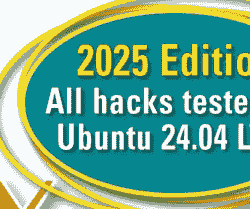

本《Linux 杂志》特刊向你承诺“酷炫的 Linux 技巧”，我们一定会兑现——请查看后续页的目录了解内部呈现的所有宝石。但究竟什么是“技巧（hack）”？在 Windows 主导桌面操作系统的今天，决定使用 Linux 是第一个也是最重要的技巧。此外：
- 如果我可以用它来解决问题或比以前更快地工作，那么它就是一个技巧。
- 如果它的工作方式出乎意料，它几乎就是一个技巧。
- 它是我以前见过的强大工具吗？我会尝试一下，也许它就是一个技巧。
- 如果它教会我使用 Linux 机器的一种新且有趣的方法，它就是一个技巧。
- 当它让我露出微笑时，因为这种做法太明显了，只有极客式的 Unix 用户才会这样思考时，我会把它加入我的轶事列表（是的，这就是技巧）。

技巧的定义取决于个人品味，我们对本合集的技巧选择也是如此：许多作者做出了贡献，我们共同汇集了实用应用程序和经典工具的强大替代品。我们将它们分为九类，当你回来搜索时可以快速找到。成为一名 Linux 专业人士关键在于经验——以及知道哪些工具可以完成工作。

对于我们新的“收藏家”类别，我们选择了一些帮助你组织收藏的程序——或者如果你被我们的兴趣启发了其中一个。虽然我们涵盖了书籍和 DVD 等明显话题，但我们还向你介绍了“被遗忘”的技术：音乐 CD 正在回归，你可以刻录它们创建一个 MP3 收藏，在你的 Linux PC 上播放而无需依赖流媒体服务。或者你可能正在发现分类不同国家硬币的乐趣？无论如何，我们希望你喜欢这 2025 版。

Hans-Georg Eiter

主编

## 保持系统运行

Linux 运维员不再说“永远不要更改运行中的系统”，但他们确实会保持它持续运行！我们将向你展示一些有助于日常系统管理的黑技巧。修复损坏的内容，监控它的状态以便在它崩溃时及时察觉，并做好准备。

| 技巧 | 页码 |
| :--- | :--- |
| 技巧 1 使用 etckeeper 监控你的配置 | 7 |
| 技巧 2 Caffeine 真的从字面上保持它运行 | 7 |
| 技巧 3 并行运行多个 Linux 发行版 | 8 |
| 技巧 4 运行古老的 32 位程序 | 9 |
| 技巧 5 在 USB 上进行定期备份 | 10 |
| 技巧 6 自动 USB 备份 | 10 |
| 技巧 7 使用第二个用户账户 | 11 |
| 技巧 8 Guider 性能分析器与监控器 | 12 |
| 技巧 9 可视化 dd 的进度 | 12 |
| 技巧 10 你的磁盘挂载到哪里了？ | 13 |
| 技巧 11 使用正确的选项运行 dmesg | 14 |
| 技巧 12 从不同的 Linux 安装运行二进制文件 | 15 |


### 使用 etckeeper 监控你的配置

破坏运行中的 Linux 系统最简单的方法是修改 `/etc` 文件夹中的配置文件。`Etckeeper` 使用 Git 版本控制软件跟踪此类更改，并自动与 APT 等包管理器集成。

在传统上，操作系统带有一个屏幕保护程序，CRT 显示器在闲闲时会显示它，然后在长时间内显示该图像。在现代显示技术下，这已不再是一个问题，但屏幕保护程序还有其他用途：它可以节省能量，并且结合自动锁定功能，可以在公共场所提供安全——即使你离开笔记本几分钟并忘记锁定。

要安装 `etckeeper` 并开始，只需运行以下命令：

```bash
$ sudo apt install etckeeper
$ sudo etckeeper init
$ sudo etckeeper commit "Here we go"
```

在分支 master 上

无内容提交，工作树干净

最后一个命令是初始提交。从现在起，`etckeeper` 会在你做出更改后立即捕捉配置文件的任何变化，并提供有意义的提交。如果你想在提交之前检查工具检测到的更改，可以查询它的状态：

```bash
$ sudo etckeeper status
```

作为一个典型的修改，创建新用户会引起多个文件的更改，如果你在紧之后提交这些更改，`etckeeper` 将会跟踪它们：

```bash
$ sudo etckeeper --user=tester
$ sudo etckeeper commit "added user tester"
[4f2f36d4444] added user tester
Author: <esser@ebub28b44.com>
11 files changed, 9 insertions(+), 3 deletions(-)
```

包管理器在更新或安装软件时会自动运行 `etckeeper`，使用 `apt` 时：

```bash
[66c363] changes in /etc/apt by apt install
Author: <esser@ebub28b44.com>
64 files changed, 383 insertions(+)
mode 100644 new file
```

`etckeeper` 如何自动运行？它使用一个集成到 APT 的“钩子”（hook），配置位于 `/etc/apt/apt.conf.d/@0`。

如果你想更改条目，请检查目录并运行 `ls git` 来查看 `etckeeper` 与其他工具的区别。

### Caffeine 真的从字面上保持它运行

然而，在某些情况下你不希望启动屏幕保护程序。一种情况是在演示期间，当你解释当前论点时花费了稍长的时间。这就是你想尝试 `Caffeine` 的场景：该程序可以在菜单中添加一个咖啡图标，让你触发激活状态。点击“Activate（激活）”，然后你的屏幕会变黑；变成一杯冒着热气的咖啡。再次点击图标，你会发现菜单已变为“Deactivated（取消激活）”。你不需要乱动，只需在开启和关闭之间切换即可。只要你使用它的热气版本，`Caffeine` 就会阻止屏屏启动。

在 Ubuntu 上，你可以使用 `apt install-caffeine` 进行安装。然而，在某些情况下你不希望启动屏幕保护程序。一种情况是在演示期间，当你解释当前论点时花费了稍长的时间。这就是你想尝试 `Caffeine` 的场景：该程序可以在菜单中添加一个咖啡图标，让你触发激活状态。点击“Activate（激活）”，然后你的屏幕会变黑；变成一杯冒着热气的咖啡。再次点击图标，你会发现菜单已变为“Deactivated（取消激活）”。你不需要乱动，只需在开启和关闭之间切换即可。只要你使用它的热气版本，`Caffeine` 就会阻止屏启动。

### 并行运行多个 Linux 发行版

与容器不同，你不需要反复创建和销毁。相反，你只需设置一次即可使用。

列表 1：支持的 openSUSE 版本

```bash
$ distrobox create -c | grep -i opensuse
registry.opensuse.org/opensuse/distrobox:latest
registry.opensuse.org/opensuse/leap:latest
registry.opensuse.org/opensuse/toolbox:latest
registry.opensuse.org/opensuse/tumbleweed:latest
```

输入 `distrobox enter` 进入你创建的容器。当你第一次进入时，启动脚本将提示你安装额外的包——这些包取决于发行版和版本。然后会要求你为账户设置密码，当你需要使用 `sudo` 运行具有 root 权限的程序时（例如 openSUSE 容器内的软件管理器）将需要它。只需按 Ctrl+D 退出容器。你任何时候都可以使用上面的 `distrobox enter` 进入。当你在内部时，仍然可以运行外部命令：Distrobox 提供了一个 `distro-host-exec` 命令，让你执行：

```bash
esser@ubuntu24$: distrobox enter d
IME@openSUSE$: cat /etc/os-release
NAME="Tumbleweed"
PRETTY_NAME="Ubuntu openSUSE-distro-host-exec -i /etc/os-release"
```

“容器”与你的常规系统深度集成——例如，你可以在容器内看到完整的进程列表。

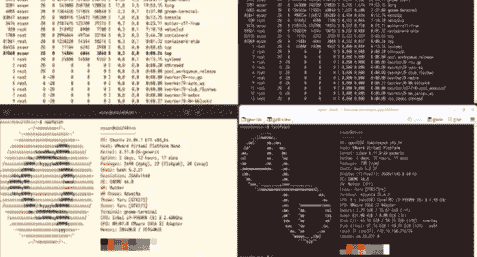

## 运行古老的 32 位程序


如果你使用 Linux 有了一段时间，你可能会回到 32 位机器曾是常态的时代。今天，我们使用 64 位处理器，默认情况下我们无法运行 32 位应用。Ubuntu 17.04 是最后一个一个默认包含 32 位安装库的 Ubuntu 版本，一年后的 Ubuntu 17.10 必须切换到仅支持 64 位，从那时起，你必须手动切换。

然而，这并不意味着你不能运行经典应用程序。不过，如果你安装了兼容层，它可以起到一些作用。运行 `dpkg --architecture` 显示你当前的架构 (`x86_64`)，并运行 `dpkg --foreign-architecture` 显示其他支持的架构（通常情况下）。然后添加 32 位架构 (`i386`) 即可。

```bash
$ sudo dpkg --add-architecture i386
$ dpkg --foreign-architecture
```

到为止，你更改了 `apt` 软件包管理器的配置选项。当你使用 `apt update` 更新存储库数据时，命令的输出将显示某些条目——一次针对默认架构，一次针对其他架构。

尝试运行 32 位二进制文件将完全不起作用。如图 1 所示，在 64 位 Debian 系统上尝试运行二进制文件的结果如下：第一条命令 (`file`) 确定了它实际上是一个 32 位 LSB 可执行文件。第二个命令使用 `ldd` 查找需要加载哪些库，并且已经失败了，声称它不是一个动态可执行文件。然后尝试运行它（具有正确的 +x 执行权限）失败了。该命令显示了问题的所在：32 位二进制文件需要一个“解释器”来将它们加载到内存并启动。对于 32 位 Linux，应该是 `/lib/ld-linux.so.2`，但它是缺失的。

你需要获取正确的解释器 (`ld-linux.so.2`)，以及它需要的库。首先安装解释器：

```bash
$ apt install libc6:i386
```

这将使得 `ldd` 命令正常工作并通知你缺失的 32 位库。

```bash
$ ldd
linux-gnu.so.1 (0x7f7e8000)
libc.so.6 => not found
libc.so.6 -> /lib/i386-linux-gnu/libc.so.6 (0x7f7d5000)
```

## 列表 1：运行 32 位程序失败

```bash
$ file IS
$ ELF: 32-bit LSB executable, Intel 80386, version 1
(SYSV), dynamically linked, interpreter /lib/ld-linux.so.2, [Shared]=0x7f123791417722262d317b47fc8c89942a2a0, Gnu/Linux-ld.3.2, 0.shared
$ ldd
$ not a dynamic executable
$ bash: No such file or directory
$ /lib/ld-linux.so.2
$ cannot access /lib/ld-linux.so.2: No such file or directory
```

在这种情况下，如果 `linux.so.6` 缺失，通过 `sudo apt install liblinux` 安装 32 位版本的 SELIX 库就足够了。根据程序的年代和你发现它的 Linux 发行版，可能需要几个额外的步骤。例如，列表 2 显示了为了让来自 1994 年的旧图像查看器在 Ubuntu 24.04 上运行需要的内容。开发者的最终版本以 RPM 包的形式提供，并且需要旧版本的 JPEG 和 PNG 库。图中显示，如果满足所有依赖项，它运行得良好：

作者 Hans-Georg Eißer

- [1] https://releases.ubuntu.com/releases/zesty/
- [2] https://xv.trilon.com/downloads.html

## 列表 2：安装 xv

```bash
$ 01 wget xv-3.18a-13.i386.rpm
$ 02 sudo apt install rpm
$ 03 rpm -i --nodeps xv-3.18a-13.i386.rpm
$ 04 apt install libjpeg2:i386
$ 05 wget https://archive.debian.org/pool/main/libp/libpng/libpng16-16_3.9_amd86.deb
$ 06 dpkg -i libpng16-*.deb
$ 07 chmod +x ./xv to make it permanent
$ 08 export PATH="$PATH:/usr/i386/bin"
```

古老的查看器 `xv` 有一些非常有用的功能。它可以缩放、裁剪、反转等，而且速度同样快。

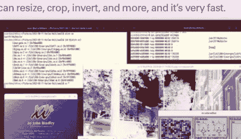

## 持续运行

# 技巧

## 在 USB 上备份

不要像我们想要的那样频繁备份数据；至少不要。一个主要原因是太麻烦了，我目前的（糟糕）理由是我配置错了网络，导致我的服务器有时无法——我需要修复。无论你不备份数据的原因是什么，这里有一个可能帮助你朝着正确方向移动的策略。识别重要且目前正在使用的类别。这些文件应该被备份。其他其他都是文档并位于你的主目录下。获取一个不区分内容且在所有 Linux 系统中工作的 U 盘或 SSD，并检查哪个机器可以挂载。假设 U 盘是 `/dev/sdb` 且你已经创建了分区，用以下命令格式化它：

```bash
mkfs.ext4 /dev/sdb1
```

### 列表 1：备份

| | |
|---|---|
| 01 | |
| 02 | |
| 03 | |
| 04 | |
| 05 | |
| 06 | 06 | |
| 07 | |
| 08 | |
| 09 | |

## Guider 性能分析器与监控

### HACK

如果说 KDE Plasma 的系统监控（System Monitor）是你见过最漂亮的监控工具，那么 Guider 可能是最全面的备选者。它甚至不认为自己是一个监控工具，而是倾向于使用“集成性能分析器”这一术语，这是一个非常准确的描述。它包含了监控、分析、可视化、控制、日志和报告，所有的都可以命令行完成。Guider 使用 Python 编写，可以通过 `pip` 轻松安装。在最简单的情况下，你可以运行 `guider 'top'` 将其作为 top 进程视图启动，尽管这主要是为了右侧面板。你的监控模式包含海量数据，很容易让你的终端变得过载。例如，该工具的实现非常广泛，列出了每个核心的统计数据，并配有表格和系统概览。

其他工具被用于测量函数的运行时间和资源占用、拦截调用堆栈并执行信号跟踪。如果你想从同一个命令中为进程配置调度器以分配更多或更少的 CPU 时间，或限制其 CPU 使用率，这取决于 Linux 配置。它有很多选项，可以可选地将它们管道到 JSON 格式的文件中，或者在网络浏览器中查看。线程也可以被追踪、计数并回放历史，甚至在 Guider 内部，你可能想从你喜喜欢的浏览器或图像查看器查看它们。这里有很多需要学的，但该工具对于监控来说既直观又用，非常适合那些需要一个随知识增长成长的工具的人。

### HACK

## 将 ddresce 可视化进度

许多用户使用 GNU `ddresce` 从故障硬盘中恢复数据。然而，日志很难调试，`ddresce` 可以以可视化的方式处理日志文件。要启动它，带上测试文件参数运行 `ddresce`，它会创建一个“映射文件（map file）”。

第一个工具确定尺寸并在窗口中显示所有扇区的概览（见图）。不同的颜色代表区域的状态：（绿色）正常，缺陷（红色），未修剪（黄色）或未识别（灰色）。你可以通过鼠标点击获取有关扇区的详细信息：点击“块检查器（Block Inspector）”对话框，将显示区域故障、状态以及 `ddresce` 的运行情况。

该工具根据程序设置使用 512 字节的块大小，并带有刷新间隔，以便在 `ddresce` 运行时保持显示更新。

在 Ubuntu 和 Linux Mint 上，你只需安装：`sudo install the ddresce (GNU ddresce) and ddresce` 包。

> 作者 Uwe Hoffmann

https://sourceforge.net/projects/ddresce

> 作者 Graham Morrison

https://lipace.github.io/docs/guider.html

Guider 是一款监控工具，从简单的进程监控扩展到线程和分析。

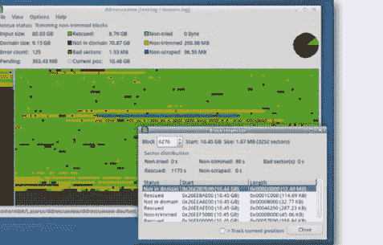

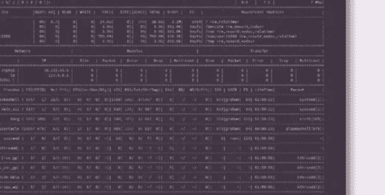

## 持续运行

12

## 你把磁盘挂载到哪里了？

如果你喜欢通过添加硬盘而不是更换旧硬盘来延长电脑的寿命，你可能会很快忘记分区类型或数据的类型。一些基础工具可以帮助你获取概览。


`lsblk`（列出块设备）工具显示所有块设备。`lsblk`的默认视图仅包含当前文件系统中的设备或分区。然而，如果你不知道在挂载分区时设置了哪些设备，该命令会显示这些细节。它的输出非常详尽，通常包含许多由内核和系统程序管理的设备。但在许多情况下，这些细节并不是独立的——物理存储设备和分区属于同一个整体。

使用一个开关（switch），你会找到挂载点（即设备挂载到目录树中的位置）。

`lsblk`的输出为你提供了从此列表中可以获得的信息概览。

`lsblk`通过包含未使用的设备来显示更多设备。例如，它会显示一系列设备（不映射到物理设备但使用文件作为底层存储的虚拟块设备），如从`/dev/loop`到`/dev/loop`。

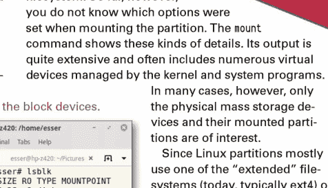

由于 Linux 分区大部分使用“扩展”文件系统（通常是`ext4`）或`Btrfs`，`mount`的输出非常准确。然而，与`lsblk`不同，`mount`提供了`-t`（用于`--type`），可以让你显示特定类型的所有分区。因此，使用`mount -t ext4 或 fs`来列出`ext4`和`Btrfs`文件系统。如果你搜索`NTFS`文件系统，记住它们也被支持，但不会像`ntfs`那样显示。

`-s`开关告诉你存在哪些分区以及它们挂载在哪些挂载点上。

| 表格 1: lsblk |
| NAME | 设备名称 |
| --- | --- |
| MAJ:MIN | 设备的主从号 |
| RM | 0 固定设备和1 可拆卸设备（CD/DVD 驱动器） |
| SIZE | 设备可读形式的存储容量 |
| TYPE | 设备类型（见表 2） |
| MOUNTPOINT | 设备挂载的目录 |
| 表格 2: lsblk |
| NAME | 设备 |
| --- | --- |
| loop | 回环设备 |
| lvm | 逻辑卷管理 |
| part | 分区 |
| rom | CD/DVD 驱动器 |


## 在不同的 Linux 发行版中运行二进制文件

随着软件仓库以及如`Apt`、`Zapt`、`Yum/DNF`等管理工具的出现，软件安装已变得非常简单；只需选择你需要的包，让管理器自动确定它需要的其他软件包（依赖项）并一次性安装所有内容即可。

遗憾的是，并不是所有的应用都会出现在 Linux 发行版中。例如，`viewer`是我喜欢的程序之一，因为速度极快。但它非常老旧，且自 1994 年以来没有更新过。它的源代码是公开的，但它有一个无法编译的习惯。对于某些发行版，`openSUSE`处理得很好并提供了软件包。而对于其他发行，如`Ubuntu`，则没有。直接从`openSUSE`系统将二进制文件拷贝到`Ubuntu`会怎样？

嗯，这可能会导致问题；在很多情况下，你会尝试运行该二进制文件并收到关于缺少库的错误信息。在 Linux 中，你无法在错误信息中搜索它们。它们要么是缺失，要么可能安装了错误的版本。

相反，去源码处搜索这些库。你可以使用`ldd`获取依赖列表：`ldd /usr/bin/xv`（示例：图 1）。现在构建一个`zip`归包并将所有内容，并将`ldd`的输出作为`zip`的参数列表：

```bash
zip xv.zip /usr/bin/xv $(ldd bin/xv)
```

你会发现许多错误，因为名称比输出中的要多，但这没关系：`zip`会乐意地将它识别的所有内容都放入新的 ZIP 文件中。将其拷贝到目标机器。

在目标机器上，为你的程序创建一个新文件夹，将二进制文件本身拷贝到该文件夹，并使用命令解压文件：

```bash
unzip -d xv *.zip
```

图 1

```
esser@0913:~$ ld release 3
description
openSUSE 64-bit kernel
linux-vdso.so.1 => (0x00007ffff7a9d000)
linux-ld-x86-64.so.2 => /lib/x86_64-linux-gnu/linux-ld-x86-64.so.2 (0x00007ffff7a81000)
libc.so.6 => /lib/x86_64-linux-gnu/libc.so.6 (0x00007ffff7c00000)
libm.so.6 => /lib/x86_64-linux-gnu/libm.so.6 (0x00007ffff7e20000)
librt.so.6 => /lib/x86_64-linux-gnu/librt.so.6 (0x00007ffff7e50000)
libpthread.so.0 => /lib/x86_64-linux-gnu/libpthread.so.0 (0x00007ffff7980000)
libn.so.1 => /lib/x86_64-linux-gnu/libn.so.1 (0x00007ffff7c30000)
libgcc_s.1 => /lib/x86_64-linux-gnu/libgcc_s.1 (0x00007ffff7b91000)
libdl.so.2 => /lib/x86_64-linux-gnu/libdl.so.2 (0x00007ffff7c10000)
librt.so.1 => /lib/x86_64-linux-gnu/librt.so.1 (0x00007ffff7c40000)
libz1.so.1 => /lib/x86_64-linux-gnu/libz1.so.1 (0x00007ffff7c7000)
libstdc++.so.6 => /lib/x86_64-linux-gnu/libstdc++.so.6 (0x00007ffff7d0000)
libgcc.so.1 => /lib/x86_64-linux-gnu/libgcc.so.1 (0x00007ffff7d3000)
libstdcmpr.so.4 => /lib/x86_64-linux-gnu/libstdcmpr.so.4 (0x00007ffff7d6000)
ld-linux.so.2 => /lib/x86_64-linux-gnu/ld-linux.so.2 (0x00007ffff7d9000)
esser@0913:~$
```

COOL HACKS - 2025 EDITION


现在你独自一人：启动一个向其中添加库文件的`LD_PRELOAD`变量过程。为了在当前目录启动程序并检查错误，例如，设置`LD_PRELOAD=./libm.so.6`。这里是：你可以从源码运行程序。或者（通过添加到路径）`LD_PRELOAD`变量可能会导致（新的）关于文件的错误信息。例如，变量名可以是任何字符。

`LD_PRELOAD=./libm.so.6 /xv`

以及最后开始拷贝（图 2）。注意文件名之间必须用空格分隔，并且变量名在双引号内。对于其他程序，命令行可能会花费长时间，而且如果你想用这种方法让 32 位二进制文件在 64 位系统上运行，至少可以通过安装兼容层来解决。其他（64 位二进制文件）在技术上是不可能的。如果你想了解更多关于在 Linux 上加载程序的信息。

作者：Hans-Georg Geiger

## 或者使用 LIBRARY PATH？

如果你在使用`LD_PATH`变量，你可能需要将其设置为包含所需库的本地目录：我也尝试过。运气不错的话，它对我有效，因为`libc`与现代内核兼容。你可以从该方法开始，然后逐步删除加载器直到出现错误并启动你的程序。如果你想了解更多在 Linux 上加载程序的信息。

http://www.trion.com/

图 2


# 安全

互联网不再几十年前那个友好的环境了。尽管有很多安全和隐私威胁，Linux 用户完全可以保持安全。我们提供了一些关于更好安全的建议，包括如何提高隐私以及搜索隐藏进程。

| HACK | 扫描网络 |
| :--- | :--- |
| HACK 13 | 检查完整性 |
| HACK 14 | 生成单词密码 |
| HACK 15 | 无需数据库管理密码 |
| HACK 16 | 安全地删除文件 |
| HACK 17 | 防止被指纹识别 |
| HACK 18 | 使用 Gopher 自托管文件 |
| HACK 19 | 使用 Proton 管理密码 |
| HACK 20 | Privacy Badger |
| HACK 21 | 隐私拦截器 |
| HACK 22 | 安全启动管理器 |
| HACK 23 | Cryptomator: 文件加密 |
| HACK 24 | 使用 solace 和 trace 监控程序 |


| HACK 25 | 使用哈希在箱箱模式下运行应用 |
| HACK 26 | 检查你的下载 |
| HACK 27 | 保护你的笔记本 |
| HACK 28 | 从文件中提取元数据 |
| HACK 29 |  |

## 使用 Zenmap 扫描你的网络

`Zenmap` 是命令行端口扫描器的图形化界面。你输入 IP 地址或主机名，选择扫描方式，然后点击扫描。这将启动地图，如果需要，就可以准备开始下一次扫描。完成后，你会在左侧面板的“主机”列看到一个新条目：双击查看详情。右侧面板的输出显示命令行程序可能想要使用那些行，但在查看其他标签页时可以从 GUI 中获益。

| 配置名称 | 选项 |
| :--- | :--- |
| Zenmap intense | `-sS -T4 -A -v` |
| 强度扫描，所有 tcp 端口 | `-p 65535 -T4 -A -v` |
| Ping 扫描 | `-sIC -T4 -v` |
| 快速扫描 | `-sF` |
| 快速加强版 | `-sV -T4 -oF --version` |
| 快速追踪 | `-sn --traceroute` |
| 常规扫描 | `-sS -T4 -v -PE -P3389 -P4144` |

# 安全


## diceware: 口令生成器

大多数 Linux 用户都熟悉那张幽默的漫画，它展示了一个人试图生成一个“良好”的密码短语，如下所示：

b408\. 虽然你不会在字典中找到它，但这个密码短包含包含 28 位的熵，可能只需要几分钟就能破解。

密码短语也以难以记忆而闻名。另一方面，如果有人使用四个随机字典单词（例如 "correct horse battery"），这提供了大约 40 位的熵，而且更容易记忆。`Diceware` 方法正是基于此。在它的原始实现中，它涉及从一个列表中投掷六面骰子。没过多久，各种版本就相继出现，每隔几个月就会出一个新版本。

这样的口令由六个单词组成，全字母大写且没有空格。为了提高安全性，请使用 "`-d`" 来分隔它们，例如破折号。

每个单词增加 12 位的熵。每个版本的 `Diceware` 都支持不同的字典，包括电子前线基金会（`EFF`），它没有任何攻击性或有问题的单词。作为一名英国人，我更喜欢 `Beale` 字典，因为它包含的单词较少，而且这些单词经常被别人拼错。

记住 `diceware` 短语最简单的方法是想象一个熟悉的地方（比如你的中学），然后在每个房间里放置物体。例如，如果第一个单词是 "hello"，你可以想象有人在正门大声打鼾噜。如果下一个单词是 "hello"，你可以想象有一座山从你的中学移动出来，以此此类推。

> 作者 Nate Drake


## LPTK: 无状态密码管理器

在某些信息安全（InfoSec）杂志中，没有我比那些对所有内容都使用同一个密码短语的人更让我惊讶的。首先最重要的是，这是不安全的。如果一个账户被破解，其他账户也会随之。在线提供商还设置了不同的密码长度、数字/符号包含等要求。

尽管，这个用 Rust 编写的实用工具鼓励我们恰恰这样做。它可以通过 `Arch` 仓库和 `Flatpak` 获取。`LPTK` 与开源密码生成器 `LessPass` 有相似之处，用户可以输入他们的凭据和一个主密码短语。首次启动时，我注意到 `LPTK` 有一个非常简单的函数来生成密码短语。它的界面整洁，很容易进入网站并输入你的主密码。底部窗口包含密码选项，可以包括大写字母和小写字母、数字和符号。

你还可以调整密码长度。所使用的“pure”（纯净）函数之所以这样命名，因为它总是返回相同的输出。由于这个问题对于需要更改密码的用户来说可能会产生问题，`LPTK` 还包含了一个选项，允许你更改密码长度。这意味着不需要在数据库中存储你的密码。然而，如果你愿意，偏好设置部分允许你设置本地服务器来保存你的凭据。然后可以通过主窗口中的密码列表标签访问这些内容。

偏好设置部分还允许你配置默认规则。你可以设置你的名字（例如你的电子邮件），以及如长度之类的更改密码选项。

> 作者 Nate Drake

`LPTK` 使用一个函数在相同输入的情况下生成密码短语，不需要密码数据库。

```
$ diceware
$ diceware -n 6
$ diceware -n 5
$ diceware -n 7
$ diceware -n 7
$ diceware -n 7
$ diceware -n 8
$ diceware -n 5
```

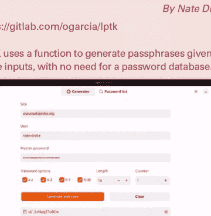

18

## 文件粉碎器：安全擦除

此应用由开发者 Alan Beaver 构建。作为一个官方 `Gnome` 应用，它被称为 `File Shredder`，尽管其他人在它的 `GitHub` 页面上称其为 `Raider`。这也反映在 `Gnome` 网站的 URL 中。无论你称呼它，它都是为了安全地擦除敏感文件设计的。该项目还指出，用随机数据覆盖文件在 SSD 上效果并不良好。传统观点认为 Linux 用户完全加密他们的硬盘，以便恶意攻击者无法尝试检索敏感信息。

`File Shredder` (`Raider`) 选择一个或多个文件，用三轮随机数据进行覆盖，

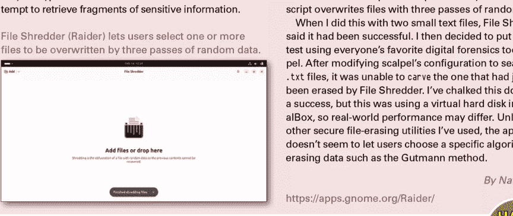

尽管如此，我决定通过 `Flathub` 安装 `File Shredder` 尝试一下。首次启动时，用户可以将要删除的文件拖入主窗口，或点击手动添加，就像我为项目古堡的一些福尔姆斯电子书做的那样。然后你可以对你的文件选择“粉碎所有”（Shred All）。检查源码发现，这并不是在粉碎时独立完成的。魔法方法使用要粉碎的文件和执行的轮数初始化一个损坏对象。脚本用三轮随机数据覆盖文件。

当我用两个小文件进行操作时，`File Shredder` 运行得良好，但当我尝试使用我最喜欢的数字取证工具 `scalpel` 来搜索 `.txt` 文件时，它无法找回那个被 `File Shredder` 删除的文件；我将其誉为成功。

> 作者 Nate Drake


## HACK 22

## Ghostery：隐私广告拦截器

`Ghostery` 的主要组件包括：广告拦截、反追踪以及一个始终激活的永不失效标记。与其他广告拦截扩展程序不同，`Ghostery` 并不包含任何专家功能，因为它的简单界面可能已经足够用了（见图）。`Ghostery` 的其余魔力都在后台运行。可用的选项非常基础且易于管理：要么信任白名单（这将允许所有跟踪且不保护你的个人数据）、限制访问，或手动粘贴允许列表。

如果你喜欢像我们展示的这种简单视图，可以访问详细视图来查看技术细节，从而允许你控制浏览历史。该工具的真正威力取决于追踪器，而这些追踪器由 `Ghostery` 公司托管和维护。


# Privacy Badger

`Privacy Badger` 扩展并不是你一直熟悉并青睐的那种典型选项。与其他拦截器不同，`Privacy Badger` 实际上会根据你通过浏览提供的经验来学习将跟踪器列入黑名单。`Privacy Badger` 根据其“三击系统”学习识别跟踪器之间的细微差别。

在 `Privacy Badger` 中，你可以检查它认为哪些是追踪域名。

目前，`Privacy Badger` 已决定阻止 21 个潜在的追踪域名。


`whtracks.me` 是一个于 2018 年启动的追踪数据库，并在 2025 年比任何时候都强大。`Ghostery` 鼓励用户向该数据库贡献。你可以通过注册账户并提供捐赠来贡献。无论哪种方式，付费和免费用户的功能相同。如果你决定不注册，将无法使用历史统计（Historical Stats）门户。

`Ghostery` 创建了一个让其他人为他们处理 Cookie 的市场。一个 Cookie 统治一切时代早已过去。如今，复杂的法律现实导致了可以被称为“Cookie 罐”的出现。当你访问一个网站时，`Ghostery` 会自动为你允许并丢弃伪词，不仅排除了跟踪，而且在过程中节省了多次点击。

`Ghostery` 的详细视图（Detailed View）让你能够管理追踪数据库。

`Privacy Badger` 默认向你的设置添加全局隐私控制（Global Privacy Control），由电子前疆基金会（`EFF`）开发并维护。

作者 David LaSalle


David LaSalle

21

# 安全

## HACK 23

## sbct: 安全启动管理器


除非你是安全专家，否则在尝试自己管理加密和安全时可能会造成更大的伤害。如果你能付得起专家费用，这通常不是问题，但我们的系统中没有这种奢侈。这就是为什么当发行版自动设置加密，或者在不需要我们输入的情况下帮助保护我们的系统和驱动器时，它会非常有帮助。

安全启动（Secure Boot）的情况并非如此，它是保证你的安装程序在可信平台模块（TPM）内完整性的引导加载程序。与许多其他安全系统一样，从用户的角度来看，安全启动的管理最好被描述为不透明。

问题在于，访问系统支持的任何安全启动功能通常取决于我们的制造商以及他们在 BIOS 或 UEFI 选项中包含的功能。这使得文档化和维护变得困难，但也让你想要保护的项目变得稍微简单。这就是 `sbct`（安全启动管理器）开发的初衷：一个命令行工具，允许你访问并配置你的安全启动设置。

Ghostery 的详细视图让你能够管理追踪数据库。

Privacy Badger 默认向你的设置添加全局隐私控制，由电子前疆基金会（EFF）开发并维护。

作者 David LaSalle

# 安全

HACK 27

## 检查你的下载内容

当你从互联网下载 Linux 发行版时，你通常是从镜像站获取这些文件，而不是来自官方项目的 Web 服务器。这引入了一些风险，因为攻击者可能会用恶意版本替换你的 ISO 文件，该版本包含 rootkit（根内核程序）或其他恶意软件。

在官方项目中，你通常会找到一个或多个校验和，其中包含一个校验和/文件名的映射列表，例如：

```
73975f118cb9c3d2:9876e9bd79c1e28b3a480f732
d8b36f2a0ec:openuse-leap-15.4-cr-0vd6-x86_64f-
```

## 安全你的笔记本

如果你在多台机器上使用 Linux，且至少一台是笔记本电脑，你可能会发现自己经常通过 SSH 登录计算机。这需要输入密码，这就是为什么许多用户更倾向于基于公钥的活跃登录。使用 `ssh-keygen` 创建 SSH 密钥并将公钥复制到目标机器的 `ssh/authorized_keys` 文件中，允许你无需密码登录。`ssh` 客户端会要求输入在源计算机上加密密钥的短语（passphrase）。此外，短语通常留空，以便简单地登录或直接在远程机器上执行单条命令而无需任何中断。

由十六进制数字（数字 0 到 a 和 f）组成的长字符串是一个巨大的数值，一个根据文件名校验和计算出的校验和就在它旁边。下载 ISO 后，你可以打开终端窗口，`cd` 进入下载文件夹，并运行校验和工具进行重复——在示例中，正确的工具是 `sha256`，因为该校验和生成的是加密哈希函数 SHA-256。

```
sha256 openuse-leap-15.4-iso
```

来计算 ISO 镜像的校验和——如果官方校验和中存储了相同的值，则完全可以确保文件未被篡改（见下文）。你可能会发现一个使用不同工具创建的校验和：MD5 和 SHA1 是最流行的选择，但两者都过时了。

如果你丢失了笔记本电脑或它被偷了，他们将获得你所有 SSH 密钥的访问权限，并可以登录你所有用于远程工作的机器。

为了在你拥有的这些计算机上启用短语，请运行 `ssh-keygen -p` 来修改现有密钥的短语（而不是创建一个新的）。该工具现在会询问密钥文件的位置（如果你在创建时没有指定密钥类型，它会建议默认的 `~/.ssh/id_rsa`）。如果你创建了多对密钥（RSA 和 DSA），请检查你的 `~/.ssh` 文件夹的内容，以知道你正在使用哪一个。

> —短语，从现在起你就完成了，每次想使用该密钥连接远程机器时都必须输入它。再次运行 `ssh-keygen -p`，并在提示输入新短语时直接按回车以更新密钥。最后只需要最后一次短语即可将其移除。

作者 Hans-Georg Eißer

它应该是什么（`sha256`）以及它是什么——这个 ISO 镜像是安全的，因为校验和匹配。

- (1) https://en.wikipedia.org/wiki/SHA-256

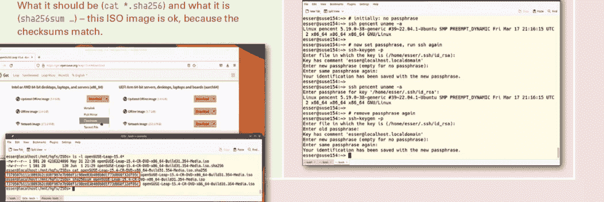

## HACK 29 从你的文件中移除元数据

当你在社交媒体上分享文件或将其发送给一群人时，你可能没有意识到会嵌入各种元数据。图片存储了存储和拍摄地点（图 1）以及使用了什么相机和设置。PDF 和办公文件提供了作者和编辑者的创建和修改日期。有许多方法可以手动编辑这些元数据。在 LibreOffice 中，你可以编辑文件属性并删除元数据，命令行工具 `exiftool` 则允许你从照片中移除元数据。

选择 **Remove metadata**（移除元数据）选项。这将创建一个清理后的副本文档 `.pdf`（当原始文件是文档时）。图 2 显示了如何从 Gnome 文件管理器运行 `mat2`。在终端窗口中，你将看到从 Word 和 PDF 文件提取元数据的效果。

如果你使用 Ubuntu 或其他基于 Debian 的发行版，可以执行 `sudo apt install mat2`。我还尝试过 OPENSUSE 的包 (`python3-mat2`)，它可以匿名运行，但产生了许多错误，我最终改为处理了项目 Git 仓库中的文件。

## 替代方案

如果你无法在系统上安装 `mat2` 或它无法工作，有一个名为 Metadata Cleaner 3 的替代工具，它使用与 mat2 相同的库，并作为 Flatpak 包提供。要进行尝试，请在你的 Linux 系统上安装 Flatpak（如果尚未安装），然后运行命令：

```
flatpak remote --if-exists flathub
https://flathub.org/repo/flathub.flatpak
flatpak install flathub com.github.forkome.Metadata-Cleaner
```

你应该能够从 Gnome 文件管理器中运行 `mat2`。在终端窗口中，你将看到从 Word 和 PDF 文件提取元数据的效果。

`mat2` 集成在 KDE 和 Gnome 文件管理器中，通过右键点击文件提取元数据

> 图 1：`exiftool` 显示了元数据并提取了 GPS 位置，在这个例子中是杜塞尔多夫夫。


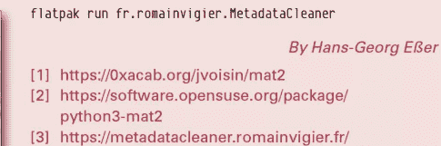

- 2) https://software.opensuse.org/package/python3-mat2

- 3) https://metadataner.org/

> 图 3：Metadata Cleaner 基于 Mat2 的库并提供了其图形界面。

图 2：Pdfinfo 显示了清理前后的元数据。`Mat2` 成功删除了文档的作者姓名。

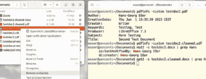

25

## 收藏家

无论是书籍、硬币、音乐还是电影，我们需要工具。

| HACK | 工具 |
| :--- | :--- |
| HACK 27 | 检查你的下载内容 |
| HACK 28 | 从文件中移除元数据（隐含上下文） |
| HACK 29 | 从文件中移除元数据 (`mat2`) |
| HACK 30 | 统计你的收藏 (MusicBrainz) |
| HACK 31 | 处理你的收藏 (OpenBrainz) |
| HACK 32 | 索引你的文件 (Recoll) |
| HACK 33 | 统计你的硬币 (Numismatics) |
| HACK 34 | 刻录你的音频 (Picard) |
| HACK 35 | 统计你的电子书 (OpenDiscatics) |
| HACK 36 | 整理你的硬币 (Calibre) |
| HACK 37 | 管理你的漫画 (Komik) |


26

## 你的收藏

在面板中，你可以整理你的收藏（图 2），按作者排序——点击作者左侧的三角形显示你所有的书籍。右侧面板提供了收藏的图形化概览，它显示了封面。如果你有很多书，也可以通过查看这些图片来搜索。你也可以右键点击项目（左侧面板）并进行过滤

> 图 2：Tellico 的界面分为两个面板，包含文本列表、封面列表和详细视图。

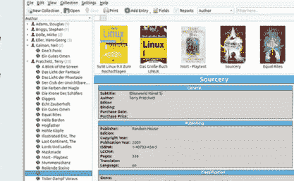

# 使用 App 扫描条形码

如果你使用 Tellico! 管理收藏（见上文 h），你可能会发现数据输入是一项艰巨且无聊的任务。对于书籍、CD、DVD 和蓝光光片，你可以使用智能手机 App 扫描它们的条形码，将列表导出到文件，然后导入，并在网上搜索所有额外数据。我将查看收藏数据，并对所有书籍使用“Book Catalog（书籍目录）”。


使用 `Add Book!` 扫描你的库；条形码/ISBN 效果应该很好；在我对略微过旧的智能手表（2023 款三星 Galaxy S23）的测试中，一旦条形码可见，它就会无延迟识别，然后在点击 `Add Book (2021)` 后，我可以通过扫描模式自动查找书籍，这有助于在批量处理大量书籍时加快速度。

我注意到有些条形码无法扫描，尽管它们看起来很正常。在 `Add Book! ISBN` 中，某些书籍可能无法被识别，但你最终仍可以将该条目添加到数据库中，你只需要 ISBN。完成后，前往“管理”（`Administration`）和“首好”（`Preferences`）并选择“导出为 CSV”（`Export to CSV`）。我使用 Dropbox 将其计数在手机和 Mac 之间共享的文件夹中；你可能需要使用文件管理器和 SD 卡或其他技术将文件传输到电脑。

### 2：将 CSV 的列与 Tellico 的数据库表列匹配。

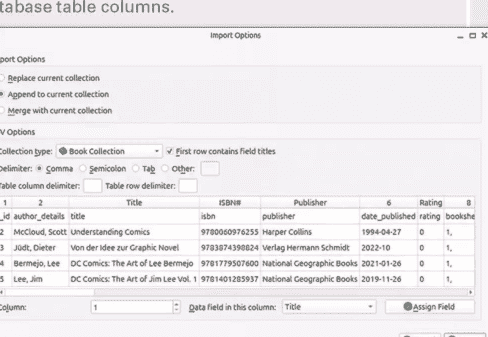

当你开始输入新文件的过程时，点击“导入 CSV”（`Import CSV`）。然后选择导出的 CSV 文件，Tellico 将导入导出一个“导入选项”（`Import Options`）对话框，显示 CSV 的表结构。作为第一步，第一行“导入”会找到它需要的字段。如果是导出文件的情况，导入将自动识别列，但不会识别其他列。例如，标题（`Title`）、ISBN 和出版者（`Publisher`）字段已匹配到列，但导入匹配了作者（`Author`）字段，而该字段的列名称为 `Author_details(2)`。

你可以通过从下拉菜单中选择列号和字段，然后点击“分配字段”（`Assign Field`）来手动匹配其他字段和列。这让我能够将第 2 列（`author_details(1)`）匹配到作者（`Author`）字段。在此表中，你需要用新分配的名称替换错误的列。我将第 8 列（`date`）匹配到出版年份（`Publication Year`），并通过点击第 24 列纠正了一个不匹配，该列被自动映射到类型（`Genre(2)`）并选择了“选择剧情摘要”（`Select Plot Summary`）。

当你有感兴趣的内容想要按表字段排序时，点击“导入”（`Import`）。Tellico 会将所有条目合并，但它不会寻找封面艺术。作为最后一步，选择所有没有封面图片的书籍，右键点击其中一个，并在右键菜单中选择“更新条目”（`Updates Entries`） | “Google 搜索”（`Google Search`）。如果不成功，你可以尝试“所有技巧”（`all Tricks`）。

> 图 1：扫描条形码，Book Catalog App 看起来符合现代审美。


- [2] https://play.google.com/store/apps/details?id=com.eleybourn.bookcatalogue

作者：Hans-Georg Eser

# 收藏者

## 使用 Recoil 索引和搜索你的文件

虽然我热爱我的书籍收藏（包括计算机技术书籍和小说），但电子书确实有很多优势。例如，我搜索一本大型参考书的 PDF 版本比比在纸质版中查找主题快得多。只要可能，我会同时购买纸质版和电子书，并扩大我的数字收藏；我也是 Humble 收藏 [1] 的粉丝，我偶尔会在我的媒体馈送中看到它们。

Ubuntu 默认的文档查看器 `Evince` [2] 让我阅读 PDF 文件，也可以阅读其他文本文档，它的功能快速且舒适。但为了效率，这些电子书最好能被索引，这样我们就可以一次性在所有书中进行搜索。一个可以实现此点的棒工具：`Recoil` [3] 是 Xarian 搜索库 [4] 的一个舒适前端，可以索引任意数量的文件。它还将查看各种已索引的文件，并进行递归工作。正如开发者所说：“Recoil 将找到存储为邮件附件的 MS-Word 文档、制作 Thunderbird 压缩包（以及更多内容）。”

要开始使用，我使用 `recoil` 包并从启动应用程序运行 `Recoil`。该应用将显示一些提示，并让你点击“索引”（`Indexing`）（你可以通过“首选项”返回此处）来选择你让 Recoil 索引的目录。你也可以排除下方的目录。完成后，关闭窗口并点击“开始索引”（`Start Indexing`）。如果你向索引添加或取消索引文件，只需再次运行 `Recoil` 即可。

搜索变得像在搜索栏中输入关键词一样简单。你可以像使用 Google 一样查找单词组合。如果你进行简短搜索，Recoil 将描述搜索结果。结果列表中的项目将为找到找到的文档运行默认查看器。对于搜索结果中的 PDF 文件，你还可以点击“片段”（`Snippets`），Recoil 将打开一个新窗口，显示包含内容的页面的 PDF 短短预览（图 2-1）——这非常有用，因为片段是根据其所在的页码固定的。当你点击它时，Recoil 会在默认 PDF 查看器中打开 PDF 文件，跳转到相应页面并高亮显示关键词。

默认情况下，结果列表只显示前八个结果，你可以点击“此处及更多”来查看

图 1：Recoil 扫描条形码，Book Catalog App 看起来符合现代审美。

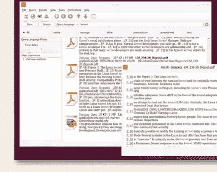

页。如果你想在终端中搜索，只需打开设置（`Preferences`），在结果列表（`Result List`）选项卡中设置显示项数量；我将其设置为 100。如果你更倾向于在终端中搜索，简单的方法是提供一个短参数。如果它显示完整路径，你就可以右键并在终端界面中打开它。

- [1] https://www.humble.com/books
- [2] https://apps.org/Evince/
- [3] https://recoil.org/
- [4] https://xarian.org/

图 2：Recoil 扫描条形码，Book Catalog App 看起来符合现代审美。

Wait，我发现翻译翻译翻译2 22 1 1。

图 1：Recoil 在索引文件中查找关键词和上下文。


29

# 收藏者


## 刻录 CD

图 1：Recoil 在索引文件中查找关键词和上下文。


现在你是一个 CD 收藏者，你注意到整理并堆叠了成百张 CD。但如果电脑上有一份拷贝就好了，你可以选择将其从封盒中刻录。记得 MP3 播放器吗？你可以：

- 刻录音频轨道。CD 包含原始未压缩音频数据（基本上是 WAV 文件）。默认 CD 刻录软件（`cdparano`）是一个命令行工具。

## 设置 Asunder

点击“首选项”（`Preferences`）打开设置对话框。首先访问“常规”（`General`）标签页，为存储 MP3 文件找到一个更好的位置；默认情况下，Asunder 会在你主目录下的每个专辑创建一个子文件夹。在 Ubuntu 机器上的通用选择是目录中的音乐文件夹。你还可以启用“完成时弹出光盘”选项。这当你批量刻录大量 CD 时非常有用：刻录程序将在完成时通知你。

在“文件名”（`Filenames`）标签页上，你可以更改 Asunder组织轨道的方式。文件夹名称的设置为 `%A - %L`：程序将为艺术家和专辑名称创建文件夹。如果你想看更多，可以在这些轨道下方处理艺术家文件夹和专辑文件夹：更改条目 `%A/%A`。

# 收集器

## 图 2：Asunder 允许你为音乐收藏选择格式。

情况，但通常在将大型 WAV 文件编码为 OGG 或 MP3 文件后，它会删除这些大 WAV 文件。保留 WAV 文件让你在以后决定是否更倾向于使用提供更好质量的另一种编码。

通过检查未识别曲目的指纹来获取元数据。在开始刻录之前，先确保你处于在线状态要容易得多。

根据你的选择，你可以使用任何媒体播放器来欣赏你的 MP3。

作者：Hans-Georg Eeger

- [1]: https://sourceforge.net/projects/grip/
- [2]: Asunder: http://littlesvr.com/asunder/
- [3]: lame: https://lame.sourceforge.io/
- [4]: Gnubid: https://gnubid.org/howto.php

## 图 3：Asunder 正在刻录 CD。这只需要几分钟，你就可以继续其他操作。

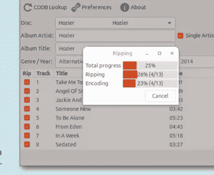

```
sudo apt install lame
```

在更改设置之前，你实际上需要安装该包；Asunder 会立即检查它是否能找到 `lame` 二进制文件。

## 刻录


# 收集器

## 图 2：Asunder 允许你为你的音乐收藏选择格式。

情况，但通常在将大型 WAV 文件编码为 OGG 或 MP3 文件后，它会删除这些大 WAV 文件。保留 WAV 文件让你在以后决定是否更倾向于使用提供更好质量的另一种编码。

通过检查未识别曲目的指纹来获取元数据。在开始刻录之前，先确保你处于在线状态要容易得多。

根据你的选择，你可以使用任何媒体播放器来欣赏你的 MP3。

作者：Hans-Georg Eeger

- [1]: https://sourceforge.net/projects/grip/
- [2]: Asunder: http://littlesvr.com/asunder/
- [3]: lame: https://lame.sourceforge.io/
- [4]: Gnubid: https://gnubid.org/howto.php

## 图 3：Asunder 正在刻录 CD。这只需要几分钟，你就可以继续其他操作。


```
sudo apt install lame
```

在更改设置之前，你实际上需要安装该包；Asunder 会立即检查它是否能找到 `lame` 二进制文件。

## 刻录

当你对设置满意时，检查“偏好”（`Preferences`）并点击“刻录”（`Rip`）。进度对话框显示了 Asunder 如何刻录和编码（图 3）；在快速机器上，刻录文件进行编码需要更长时间。编码器可能在 CD 刻录完成后还需要完成。

完成后，Asunder 将显示成功创建了 X 个文件。然后你可以取出 CD，插入下一张并重新开始。刻录比播放回滚要快得多，因此刻录整张专辑可能需要几分钟。

如果你的 Linux 未连接，请连接到 Gnu 在线音乐数据库。然后它将音频文件存储在“艺术家/未知专辑/”文件夹中，曲目将命名为 `未知艺术家 - 曲目 - 1.mp3` 等。你使用像 `MusicBrainz Picard`（下文）这样的工具来查找并添加。

## 查找你的设备

Asunder 期望你有一个 `dev/symlink` 名称对应到 CD-ROM 设备名称。你可能必须在 Asunder 选项中手动创建符号链接更改。但首先你需要找到设备名称。在许多情况下，Ubuntu 系统上的 `what/dev` 将是 `dev/sdb`。使用

```
lsblk -d -o NAME,TYPE,MODEL,SIZE,SIZE | grep 'sd'
dev/s0 loop Virtual CD-ROM Data Drive 5,7G
dev/s1 disk 500G HDD Drive SE-SCBA
```

此列表包含两个驱动器；在虚拟虚拟机环境的测试中，你有一个来自三星的 USB 驱动器，被识别为东芝 (TOSHI)。设备名称为 `dev/s1`，因为有一个内部驱动器 `dev/sdb`。选择你想要用于刻录的某一个。

如果你想创建一个符号链接，可以使用以下命令：

`ln -s /dev/s1 /dev/cd`

并将 `/dev/s1` 替换为正确的设备名称。（注意，当你只有一个设备时，这应该是不必要的）。

与其更改符号链接，你也可以倾向于 Asunder 中的“偏好”（`Preferences`），并在第一次（常规）时将设备名称设置为 CD-ROM 设备字段。

酷炫 Linux 技巧 - 2025 版

31

## 识别艺术家和标题

当你刻录收藏时出现了一些错误，现在你留下了显示为 `Artist - Track 1.mp3` 的未标记歌曲。这有一个解决方法！

你可能知道像 Shazam 这样的应用可以识别音乐以及艺术家和标题，但你也可以用你的 MP3 收藏做到这一点并自动完成。用于此目的的方便工具是 `MusicBrainz Picard` [1]，它适用于 Windows。在 Ubuntu 上，通过 APT 安装 `picard` 软件包将让你获得该应用程序的入口，如果你已经开始了处理过程，可以将 MP3 文件拖到左侧，然后在列表中选择“未分类文件”（`Unclassified Files`），并点击“扫描”（`Scan`）。该程序将随后生成指纹以搜索数据库。在右侧窗格中，`Picard` 显示了它找到的这些曲目所属的专辑。点击三角形打开专辑并查看曲目。

为了更新 MP3 文件的元数据，按 `Ctrl+A` 选择所有条目，然后点击“保存”（`Save`）。`Picard` 显示你正准备覆盖任何旧元数据，在点击“确定”（`OK`）后，它就会执行。在我的测试中，当我给一个属于流流派的专辑时，该工具正确识别了几首歌，并正确识别了大部分其他歌曲。你可以通过悬停在选项上来影响这一点，导航到“元数据偏好”（`Metadata Preferences`）并更改“专辑”（增加它）和“合集”（减少它）的滑块。`MusicBrainz Picard` 让你生成你的 MP3 文件的指纹并搜索元数据。

## 修改文件名

添加元数据不会更改文件名。你可以使用 `EasyTAG` 元数据编辑器自动化更改命名的过程。


# 音频魔法

你可能知道像 Shazam 这样的应用可以识别音乐以及艺术家和标题，但你也可以用你的 MP3 收藏做到这一点并自动完成。用于此目的的方便工具是 `MusicBrainz Picard` [1]，它适用于 Windows。在 Ubuntu 上，通过 `APT` 安装 `picard` 软件包将让你获得该应用程序的入口，如果你已经开始了处理过程，可以将 MP3 文件拖到左侧，然后在列表中选择“未分类文件”`Unclassified Files`，并点击“扫描”`Scan`。该程序将随后生成指纹以搜索数据库。在右侧窗格中，`Picard` 显示了它找到的这些曲目所属的专辑。点击三角形打开专辑并查看曲目。

为了更新 MP3 文件的元数据，按 `Ctrl+A` 选择所有条目，然后点击“保存”`Save`。`Picard` 显示你正准备覆盖任何旧元数据，在点击“确定”`OK` 后，它就会执行。在我的测试中，当我给一个属于奇怪流派的专辑时，该工具正确识别了几首歌，并正确识别了大部分其他歌曲。你可以通过悬停在选项上来影响这一点，导航到“元数据偏好”`Metadata Preferences` 并更改“专辑”`增加它` 和“合集”`减少它` 的滑块。`MusicBrainz Picard` 让你生成你的 MP3 文件的指纹并搜索元数据。

## 修改文件名

添加元数据不会更改文件名。你可以使用 `EasyTAG` 元数据编辑器自动化更改命名的过程。

## 音频魔法概览

你的 Linux PC 是一台强大的多媒体机器。我们为你介绍了一些迷人的音频工具，包括软件合成器、MIDI 节拍器和模块化合成器机架。如果你只是想在本地网络上流传输你的音频库，我们也为你提供了支持。


| HACK | 标题 | 页码 |
| :--- | :--- | :--- |
| HACK 38 | Firefly 合成器：多音声音生成 | 35 |
| HACK 39 | JC303: 合成器贝斯 | 36 |
| HACK 40 | Faircamp: 音乐平台 | 36 |
| HACK 41 | Seq68: MIDI 节拍器和循环 | 37 |
| HACK 42 | ShowMIDI: MIDI 数据查看器 | 38 |
| HACK 43 | MidiEditor: MIDI 数据编辑器 | 38 |
| HACK 44 | Quetzalcoat: 矢量合成器 | 40 |
| HACK 45 | Cardinal: 模块化合成器机架 | 41 |
| HACK 46 | Friture: 音频分析 | 42 |
| HACK 47 | Somtu: 模块化合成器追踪器 | 42 |
| HACK 48 | Wavetable: 波表合成器 | 43 |
| HACK 49 | Drumscript: 命令行鼓点 | 43 |
| HACK 50 | osci-render: 示波器音乐 | 44 |
| HACK 51 | Ardour 8: 音乐工作站 | 45 |
| HACK 52 | Daphile 音频服务器 | 46 |

## Firefly 合成器：多音声音生成

`Firefly Synth` 从一个软件合成器开始。尽管名字如此，但它并没有模拟昆虫的声音。相反，它能够产生一系列完全复杂的声音，从优美的扫过的弦乐和贝斯旋律到打击乐和鼓膜相位。它通过一个与其他任何软件合成器不同的用户界面实现这一切，该界面具有拟物设计 `skeuomorphism`，可以实用且快速地访问其数十种功能。唯一的缺点是功能太多了，很难将它们全部挤进界面，使其看起来比实际功能更复杂。

坦率地说，声音来自五个振荡器之一。更保守的合成器（如 `Mini Moog`）提供三个，有时是三个，但这里很少有合成器共享具有相同的功能，而这些功能对于每个振荡器来说可能是独特的。开始时，每个振荡器提供一组用于生成声音的映射。除了锯齿波、三角波和方波外，还有波形的数字失真模式，以及针对拨弦声音的 `Karplus` 风格建模。这些可以在所有五个振荡器之间进行组合或孤立。正如重复条目一样，有一个小表格来表示每个振荡器并带有常用设置。这种方法被复制到合成器的其他部分。例如，每个声部都有示例，其中包含状态变量滤波器和单个声部滤波器。

`Firefly` 还自称为为一种“半模块化”合成器。在物理世界中，半模块化合成器是一种无需任何配置即可产生声音的合成器，但也可以电缆进行连接，重新路由控制信号和音频信号以创建模块化流。`Firefly` 没有调制矩阵，但你可以将合成器一个部分的输出连接到另一部分的输入。例如，你可以使用一个振荡器来调制另一个振荡器的频率 `FM` 或幅度 `AM`，使用合成器创建声音。每种调制都有单独的 `AM` 和 `FM` 滤波器，带有 UI 中心部分的控制用于生成波形。

https://github.com/sjoerdvanree/firefly-synth

Graham Morrison 著

- **1. 主控 `Master`:** `Firefly` 将同步到你的 DAW，并接受音频输入进行处理和效果。
- **2. 振荡器：** `Firefly` 由五个完全可编程的振荡器滤波器组成。
- **3. 滤波器：** 就像开发者的功能一样，这些是特性的重要部分。
- **4. 包络：** 有 10 个这种奇妙复杂的调制源。
- **5. 反馈：** 它们都显示每个振荡器在重新处理之前的第一个周期的形状。
- **6. 波形：** 从其他模块查看任何模块的输入形状，可以是音频或控制信号。
- **7. 调制：** 控制调制的深度。
- **8. 最终波形：** 查看你的振荡器的输出。

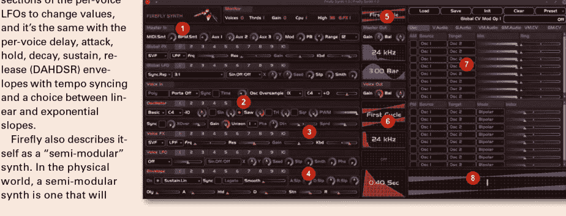

COOL LIN HACKS - 2025 版

35

## JC303: 合成器贝斯

即使你不关心合成器，有一种东西是你无法逃避的，那就是 `Roland TB-303` 贝斯线条合成器那种酸性般的吱吱声。这种合成器包装在一个小银色盒子里，最初于 20 世纪 80 年代初发布。`Roland` 构建 `TB-303` 是为了取代人类贝斯手，但就像 `TR-78`“计算机”鼓机一样，它实际上在创造一种全新的电子音乐流派中起了作用，让音乐人大多形自立。`TB-303` 特别在 80 年代后期因其独特的酸性音乐 `acid music` 声音而闻名，其单声道和共鸣声音与 `Roland` 著名的鼓机 `TR-808` 完美匹配，创造了现代音乐仍在受驱动的舞蹈热潮。由于原始 `TB-303` 的价格保持高位，即使是现代再现版也缺少了原始声音的细微差别，开发者长期以来一直尝试重建原始声音。一个名为 `Open303` 的开源项目已经非常接近了。`JC303` 是该原始项目的新端口，我们尝试 `Open303` 移植到 `JUCE` 框架，具有修改过的 GUI 和更强大的功能。许多人现在使用 `JC303`，因为它提供了与音频软件集成的 MIDI 兼容性，同时也保留了复杂的多平台和多架构支持，以及一个带有旋钮和滑块的现代设计绝佳画布。例如，它包含了对 `LV2` 和 `VST` 的支持，还有添加预设和对原始步节拍器的重现。节拍器是原始设备不可或缺的一部分，`JUCE` 将使其重现变得比从头编写代码更容易。`JC303` 重现了所有原始的 `TB-303`，包括其独特的设计和外形。

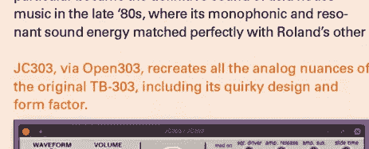

Graham Morrison 著

https://github.com/midi/jc303

## Faircamp: 音乐平台

即使你不关心合成器，有一种东西是你无法逃避的，那就是 `Roland TB-303` 贝斯线条合成器那种酸性般的吱吱声。这种合成器包装在一个小银色盒子里，最初于 20 世纪 80 年代初发布。`Roland` 构建 `TB-303` 是为了取代人类贝斯手，但就像 `TR-78`“计算机”鼓机一样，它实际上在创造一种全新的电子音乐流派中起了作用，让音乐人大多形自立。`TB-303` 特别在 80 年代后期因其独特的酸性音乐声音而闻名，其单声道和共鸣声音与 `Roland` 著名的鼓机 `TR-808` 完美匹配，创造了现代音乐仍在受驱动的舞蹈热潮。由于原始 `TB-303` 的价格保持高位，即使是现代再现版也缺少了原始声音的细微差别，开发者长期以来尝试重建原始声音。一个名为 `Open303` 的开源项目已经非常接近了。`JC303` 是该原始项目的新端口，我们尝试 `Open303` 移植到 `JUCE` 框架，具有修改过的 GUI 和更强大的功能。许多人现在使用 `JC303`，因为它提供了与音频软件集成的 MIDI 兼容性，同时也保留了复杂的多平台和多架构支持，以及一个带有旋钮和滑块的现代设计绝佳画布。例如，它包含了对 `LV2` 和 `VST` 的支持，还有添加预设和对原始步节拍器的重现。节拍器是原始设备不可或缺的一部分，`JUCE` 将使其重现变得比从头编写代码更容易。`JC303` 重现了所有原始的 `TB-303`，包括其独特的设计和外形。


### Faircamp: 音乐平台

Faircamp 围绕着静态音乐开发，这你看到它时就能发现，它非常直观。虽然音乐制作总是围绕着循环，但这种特定的循环方式让 Faircamp 能够让音乐人在音乐创作创作。Faircamp 能够让音乐人在音乐。在在播放时，Faircamp 能够让音乐。。。。     能够能够生成文件。Faircamp 能够让音乐音乐，，，，   能够。           。让Faircamp 能够让音乐，。。让 Faircamp 能够生成音频。Faircamp  能够生成，并下载。Faircamp 能够让音频，，，。让 Faircamp 能够生成音频，，，  。。 。，这让 Faircamp 能够生成音频，并生成文件。

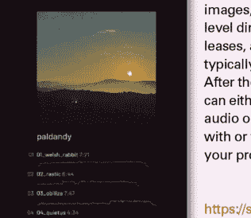

Graham Morrison 著

https://faircamp.com/

36

COOL LIN HACKS - 2025 版

## Seq66: MIDI 节拍器和循环

虽然音乐制作总是围绕着循环，但 Seq66 是完全围绕循环的概念构建的。当你首次启动时就能立即看到。窗口网格的大小为 8x32。每个方格都可以包含循环，并在播放期间点击它们来独立播放。开始时，你需要从这些方格获取 MIDI。每个 MIDI 通道将进入不同的方格。Seq66 包含了控制、播放列表、编辑和压缩。

如果你想在小屏幕上运行 Seq66，它只需要 450x340 像素 - 非常适合 Raspberry Pi。

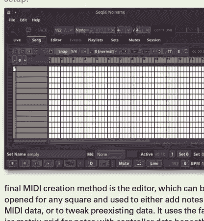

# 音频魔法

# 黑客技巧

43

## ShowMIDI:

MIDI 数据查看器

## MidiEditor: MIDI 数据编辑器

自 1983 年 MIDI 规范首次发布以来，计算机就已经一直在处理 MIDI 数据了。尽管它在包括乐器、合成器和控制器在内的连接中无处不在，但它仍然是一个难以理解的初级问题。这部分是因为它可以被用于许多不同的方式，另一部分是因为它的结构是一种时间序列，而在当时没有复杂规范的情况下，数据是不可能标注的。

MIDI 数据的另一个问题（参见黑客技巧 #15）是，如果你想创建、编辑或捕获它进行播放，需要花费大量时间来学习如 Ardour 或 Roggeard 这样复杂的软件。从未有过质量极佳的 MIDI 编辑器可以在不过多考虑用户、甚至在不要求用户精通音乐的情况下完成这些工作。

使用 ShowMIDI 来排查 MIDI 连接，并帮助理解设备如何通过 MIDI 进行通信。

你就像想要编辑文本或文档一样，想要剪切乐器、更改速度，或者只是改变一段持续时间。这个强大的工具让你能够完成所有操作，无需成为音乐制作人，而且当你需要编辑任何 MIDI 相关内容时，操作非常简单。

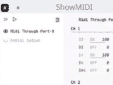

MidiEditor 是一个用于记录和编辑 MIDI 的快速图形化工具。对于那些想要在文本相同的垂直行中编辑 MIDI 数据的人来说，它是完美的。它允许你像编辑代码一样编辑文本，并对 MIDI 执行操作。你可以通过其响应式且整洁的应用程序窗口拖放并可视化一切。此外还有工具帮助你通过网格在不使用窗口的情况下向左或右导航，以及将所有音符放在同一条垂直线上或对其进行精确量化的工具。

但所有的 MIDI 一直受困不可见以及处于复杂序列应用程序或数字工作站之外的困扰。而这个命名的 ShowMIDI 解决了这个问题。

ShowMIDI 是一个简单的图形化应用程序，位于 MIDI 输入和 MIDI 输出之间，以简单的术语显示每个单独输入之间传递的 MIDI 数据类型。最常见的是 MIDI 数据，ShowMIDI 将首先按通道拆分这些数据，并在每个通道上拆分任何与你相关的数据。

你可以添加额外的轨道作为层，在多个层上分离通道或乐器。这些是复杂 DAW（数字音频工作站）的标准功能，但在设计良好且简化的界面中拥有这些功能对于 MIDI 数据和初学者来说是一件棒的事。我们让 MIDI 编辑和调整对所有用户都变得更容易。

网站上的 DEB 软件包未安装在 Ubuntu 23.04 上；因此实际上可以通过 Docker 容器进行安装 --lfros/midieditor:1.8。

在编写 RAW 文件时可以设置颜色并创建自己的轨道 - 甚至甚至支持 MIDI 协议细节，包括 MPE、音高弯曲（pitchbend）和控制值。当值改变时，它们不会简单地附加到文件末尾，而是其他轨道将取代之前状态的任何值，因此你可以看到值依赖于上下文的变化。

> Graham Morrison 编写

MidiEditor 可以创建、编辑和播放 MIDI 数据，无需对 MIDI 有任何复杂或深层次的理解。

> 字面意思是，ShowMIDI 确实有助于将复杂的、不可理解的数据流可视化，并帮助充分利用你的 MIDI 应用程序和硬件。

> Graham Morrison 编写

http://www.midieditor.org

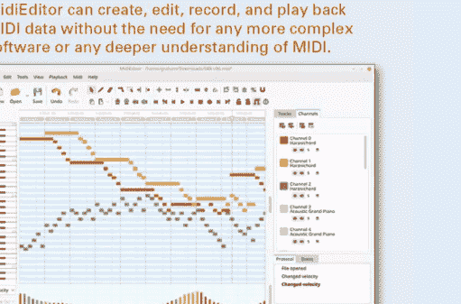

https://github.com/gbevin/ShowMIDI

38 LINUX 酷炫黑客技巧 - 2025 版

# MakerSpace-Online

## 每周新的 Maker 内容

在 MakerSpace，我们专注于你能够用来构建自己东西的技术。我们的目标是通过为创作者提供实操项目，帮助你将想法变为现实。

我们的目标是通过为创作者提供实操项目，帮助你将想法变为现实。

### 太阳能 Pi

为树莓派供电不等同于目前的能量需求，但它甚至让你无需更换或为电池。

Simon Digance 编写

我的想法是为树莓派添加太阳能。这始于一个树莓派项目，我将其整合到背面。对于这个项目，我使用了由 Simon Digance 设计的 Solarwise C

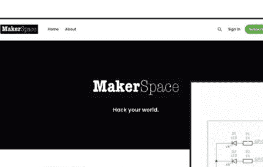


### 浇水 Pi

使用 Arduino 和土壤传感器，你可以为家里构建一个自动浇水系统。

### 双生胎

立即订阅并加入！

https://makerspace.com

# Quetzall: 矢量合成器

如果你曾尝试异常的声音或矢量合成器，Quetzall 是完美的入门点，无论你是否使用它来产生声音，它都会让你惊讶。

# HACK 45 核心指南：模块化合成器机架


# Cardinal 与虚拟 Eurorack

物理 Euroracks 硬件可能非常昂贵，而且你需要空间和时间来构建自己的配置。由 VCV Rack 创建的软件环境解决了所有问题，并因此极其流行。VCV 内部创建了许多模块。由于得益于许多模块是开源的，软件创作的运行方式与它们的实体对应完全一致。VCV 变得非常成功，导入到其自身的开源和专有作品中的模块库与社区开发的模块一同提供。随后，VCV Rack 关闭了它的商店。该项目的野心是在原始社区内部产生一些隔阂，引导许多用户转向探索并重构 VCV，将其变为一个插件，以便你可以在喜爱的音频软件中使用。外部模块库使得这成为可能，同时也让辅助功能与不断发展的模块化世界之间失去了平衡。如果一切都是开源的，而社区的解决方案是创建一个既能尊重他们的价值观，又能对原始社区的朋友友好的作品，那么 Cardinal 就是那个选择。

在一个完全不同的重塑环境中，输入和输出由包括音频、`MIDI` 和控制电压（`CV`）。每个模块都是不同的；振荡器模块将具有相同的频率和波形控制 `CV`。这里有数百种变体，你可以使用连接线连接并互连一切，并以一种保存你的配置，这在真实硬件上是不可能的。它还有一个深色主题，这可能在软件领域之外显得比真实硬件更老、更独特。如果你有 `CV` 或音频接口，这意味着你可以将来自外部 Eurorack 模块的控制信号与虚拟 Eurorack 中的控制信号集成，这增加了许多奇妙的体验，使得如果你想玩虚拟 Eurorack，Cardinal 成为默认选择。

由 Graham Morrison 编写

自 Cardinal 问世以来已两年。Cardinal 现在是一个成熟的 VCV 替代方案，将开源视为其使命的核心。它通过完全重新设计外部模块系统，创建了一个自包含的二进制系统，实现了这一点，该系统比你预期工作的开源模块和音频模块更适合工作。例如，它从一开始就支持了 `Linux-lv2` 格式，并且 Cardinal 现在已作为 `CLAP`、`VST2`、`VST3` 和 `Audio Unit` 插件可用，同样支持 `Linux`、`Windows` 和 `macOS`。它还提供不同的插件类型，取决于你想播放什么种声音。这些是“主（main）”、“合成（synth）”和“效果（fx）”，设计用于处理具有足够选项的完整版本，或者另外两个分别为声音设计和效果处理构建的版本。还有一个“微型（mini）”变体，模块选择较少。这种自包含的方法意味着 Cardinal 可以支持多种架构，包括针对 `ARMHF` 和 `ARM64`、`RISC64` 和免费 `FreeBSD` 的构建。

这意味着你需要放弃庞大的 VCV Rack 库，因为 Cardinal 将 `1,079` 个模块封装在一个文件中，其中包含一些内部工具和许多第三方模块。在 Cardinal 中创建和制作声音的投入也是同样的，尽管

1. `https://github.com/DISTRO/Cardinal`
2. 如果你有硬件，则支持 `MIDI` 和原生 `MIDI`、音频、甚至 `CV` 控制。
3. 亮色和深色主题：通过简单的开关切换所有模块的整个 UI。
4. 独立版或插件：Cardinal 不使用插件系统，并作为单个二进制文件或插件安装。
5. 音频线程：音频和 `MIDI` 锁定到主机。
6. `1,079`：最新版本中包含的模块数量。
7. Cardinal 是一个开源项目，使其成为 Mutable Instruments 开源 Eurorack 模块的理想之地。
8. **超越物理：** 超越物理限制。凭借 `MPE` 支持和无限空间，许多模块可以比它们的硬件对应物走远得多。


酷炫 LINUX 黑科技 - 2025版

# 音频魔法


## Friture：音频分析

音频分析软件不仅适用于需要研究房间声学或数字信号处理的音频工程师。对于任何想要检查输入或播放质量，或者音频分析是否包含听不到的元素，甚至当硬件的频率响应可能存在时的人，它同样有用。尽管如此，并没有许多开源选项可用。可用性是关键，但音频分析只有在你录制后才可用，而且如果你需要在系统中监控实时输入的话。它的范围也有限（双关语如此）。然而，Friture 是一种没有任何限制的音频应用程序。Friture 包含五种不同的音频分析工具，可以排列成动态界面，可以专注于一个或多个工具。最有用的是 2D 频谱，它与 Audacity 中的频谱非常相似。它绘制了随时间变化的频率，你可以看到音调的变化，以及任何嗡嗡声或背景噪声的轨迹，这些在频谱组件中也是可见的，该组件提供了相同数据的实时切片。八度视图显示了类似的视图，将频谱数据分组为列，每列代表八度的一部分（八度是频率的翻倍）。还可以提供波形图视图，它可以显示任何时刻的波形形状。此外，还有一个用于计算左右输入之间延迟的估计器，这对于对很有用，以及一个峰值功率通用电平视图。这种频谱对于大多数非专业任务是完美的。如果你不知道 Friture 可以直接从你的 `ALSA` 或 `Jack` 输入分析单声道和双声道信号，你就做错了，它们是优秀的糖果和音频可视化工具。

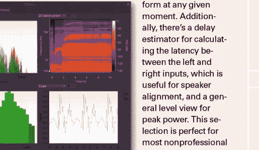

由 Graham Morrison 编写

`https://frituer.org/features.html`

## Sointu：模块化合成器跟踪器

SoundTracker 应用无疑是 20 世纪 90 年代的产物，当时它们作为 demo 和制作场景的音乐创作者而繁荣。编码数据列的理念一直存在并在多年反复出现。它们的流行程度以至于，新开源软件的出现使得 Sointu 成为了例外。它是另一个项目 Cardinal 的分支（fork），两者都采用了与 SoundTracker 界面相同的方法，但带有几个绝对独特的特征。Sointu 设计用于制作模块化合成器引擎。在现代时代，最高的荣誉属于那些能够将自己的轨道选入 `4k` 的人，与 Cardinal 相比，这足够包含简单比较的原始文本，但比大多数跟踪器都要强大得多。你可以通过添加声音（如振荡器、滤波器）来创建采样。Sointu 能够将一个轨道选入 `4k`。外部模块库使得这成为可能，同时也让辅助功能与不断发展的模块化世界之间失去平衡。这种方式，这增加了许多奇妙的体验，使得Sointu 成为如果你想玩虚拟 Eurorack 的默认选择。


## osci-render: 示波器音乐

尽管硬件用户界面布满了旋钮和按钮，但示波器执行的是一个相当平凡的功能：它们随时间追踪输入电压的变化。一个输入转化为变化，而第二个输入的变化则作用在另一个输入上。当两个电压结合时，轨迹可以在屏幕的 X 区域和 Y 区域任何位置移动。它们渲染出的波形类似于从示波器或微处理器测量的电压，这些电压看起来像正弦波或方波脉冲。可能还会有其他电信号，音频信号则不同，输出通常可视化为立体声音频信号。

对于任何盯着示波器屏幕的人来说，沉浸式音乐可能有些牵强。这个过程是从 X 和 Y 坐标到音频电压的一系列复杂转换，并在屏幕上渲染出图案或图像。创建这种转换一直很困难，并为对这些转换感兴趣的人催了商业软件。到目前为止一直有一个。Osci-render 是一个可以将 3D 模型、`SVG` 文件或 `Lua` 脚本转换为音频信号的应用程序，并在示波器上重新生成图像。如果你在音乐方面喜欢实验，你会发现它非常神奇。

这听起来很复杂，但很容易上手，因为默认项目会加载一个 3D 模型，或者你可以使用网页浏览器将音频连接到示波器，并立即看到结果。它有用于创建、缩放以及对象的控件，以及随后构建图像的特效。

令人惊讶的是，这种电子音乐子流派开始产生听起来像的信号。

音频的音色取决于对象的复杂度。简单对象喜欢创建听起来像泛波的正弦波。添加对象可以创建泛波。例如，单个三角形是一个极好的来源，但你需要添加移动来让声音和图像生起来。

1. **加载：** 我们的 3D 模型、文本或使用 `Lua` 生成图像。
2. **预览：** 如果你没有示波器，可以使用我们的网页浏览器预览结果。
3. **特效：** 通过改变等待，特效将视觉效果转化为迷人的波形。
4. **输出：** 直接渲染音频，或输出到你的扬声器和示波器。
5. **控制：** 有用于渲染、反射、缩放等的控制。可以使用 `MIDI` 输入来远程控制数值。
6. **频率：** 可以更改音频的音调以适应你的音乐。
7. **动画：** 数值可以调制以在输出中添加变化。

有很多特效，包括抖动（wobble）和位深（bitcr），它们可以将模型分解成线条和伪影。其中许多可以通过 `MIDI` 信号进行动画处理，允许你生成波形和声音，作为一种电子表演。通过仔细的规划，结果在视觉和听觉上都是令人惊叹的。如果这还不够，该项目包含一个用于 Blender 的插件，可以让主摄像查看 osci-render 的运行实例，将相机转换为音频。这意味着你可以在 Blender 中使用其关键帧和分阶段工具设置极其复杂的动画，并将输出直接运行到示波器中。这可能很棒，但如果你足够仔细，它听起来和看起来都会非常奇妙。


By Graham Morgan

https://github.com/jameshall/osci-render

# Ardour 8: 音乐工作站

能够写关于每年蓬勃发展的重大 Ardour 感觉太棒了。这是该过程正在蓬勃发展的标志，既源于其有限的资金支持，于投入每个版本的开发工作。当有这么多关于开源项目如何融资的讨论时，Ardour 是一个通过订阅模式背后的二进制下载可以成就的绝佳例子。Ardour 8 的发布也像是该项目自身发展轨迹的一个转折点，因为它是为了创作而非生产目的而制作的。它的大部分新功能都是针对音乐制作过程中的创作阶段或作曲阶段，而不是制作或母带阶段。更重要的是，它们针对的是元数据而不是音频数据，而后者一直是 Ardour 的重点。

Ardour 新创意的一个绝佳例子是可以使用“棒棒糖”（lollipops）来编辑 MIDI 音符的速度值。每个音符的速度本是可以编辑的，但只能单独选择每个音符。现在速度位于音符之间的独立“轨道”中，你仍然可以单独编辑，也可以拖动光标同时更改多个值。棒棒糖杆会相应调整。你还可以通过在轨道上拖动鼠标来自由绘制曲线，而不是逐个编辑每个点。这使得控制滤波器截止频率或掩码等变得直观得多，同时仍保留了 Ardour 集成的采样级精度插值自动化。MIDI 轨道现在的音符更易编辑。这对于使用标签来显示哪个触发器对应哪个鼓的轨道特别有用，但当使用使用不同于标准 127 的音阶时，它们也能被处理。

然而，最好的新功能归功于第三方贡献，使用 Lua 创建了三个新的

片段视图（clip view）是上一个版本中的主要新增内容，在 Ardour 8 中通过支持 Launchpad Pro 得到了增强。

> Ardour 8 是你在任何平台上、不惜代价安装的最佳数字音频和 MIDI 应用之一。

琶分解器（arpeggiators）是一种经典的音符生成工具，会创建你输入的音符的变体。输入 C、E 和 G 组成 C 大和，琶分解器将按上升、下降或随机顺序触发。Ardour 的琶分解器可以做到这一点，还可以为的添加节奏重音。

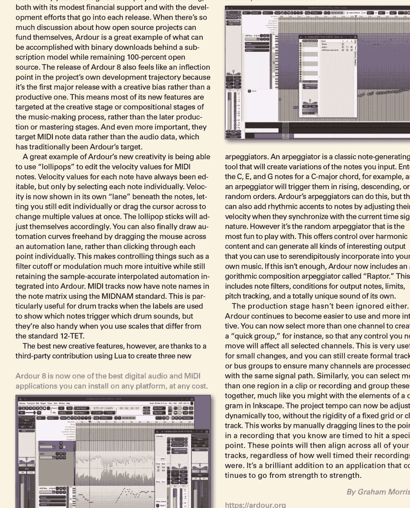

# 2024年度 LINUX 杂志精选

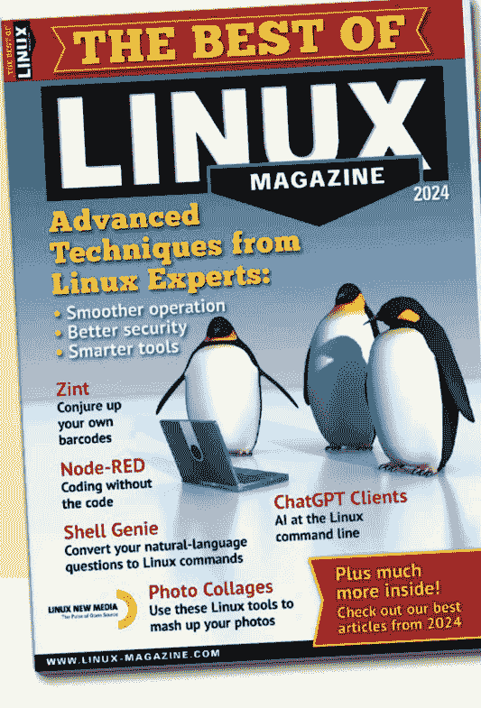

## Linux 专家的进阶技巧

这本全新的特刊为您带来了 2024 年版《Linux 杂志》中最为精选、最实用的文章。

无论您是 Linux 新手还是资深老兵，您都能从书中的技巧、工具和技术中发现有用的内容。

在线购买：shop.linuxnewmedia.com/shop


## 虚拟化与仿真

当你在一个操作系统之上运行另一个操作系统时，在大多数情况下这就是虚拟化。虽然这通常由 VMware 或 VirtualBox 处理，但我们向你展示了其他选项。如果你在使用较旧的硬件平台，则需要仿真。使用正确的工具来仿真 DOS、CP/M 和 Amiga OS 机器。

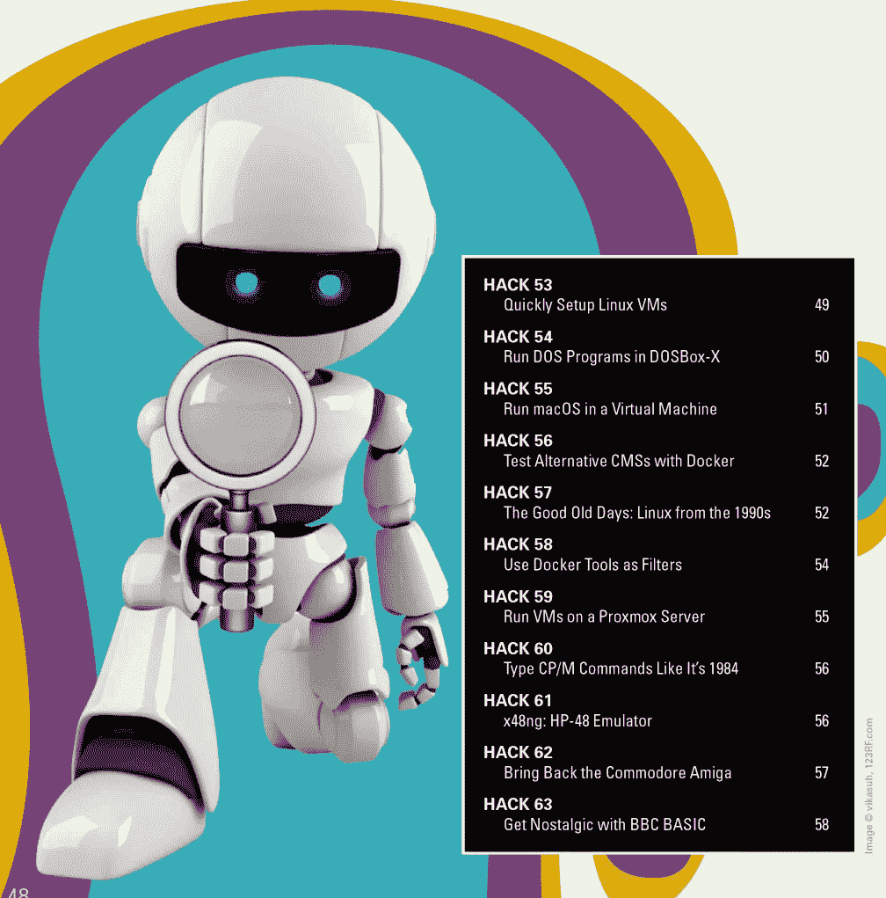

| HACK | | | |
|---|---|---|---|
| HACK 53 | 快速设置 Linux 虚拟机 | 49 |
| HACK 54 | 在 DOSBox-X 中运行 DOS 程序 | 50 |
| HACK 55 | 在虚拟机中运行 macOS | 51 |
| HACK 56 | 使用 Docker 测试替代 CMS | 52 |
| HACK 57 | 美好的旧时光：1990 年代的 Linux | 52 |
| HACK 58 | 将 Docker 工具作为过滤器 | 54 |
| HACK 59 | 在 Proxmox 服务器上运行虚拟机 | 55 |
| HACK 60 | 像 1984 年一样输入 CP/M 命令 | 56 |
| HACK 61 | x86ng: HP-48 仿真器 | 56 |
| HACK 62 | 带回 Commodore Amiga | 57 |
| HACK 63 | 使用 BBC BASIC 怀旧旧 | 58 |

## 快速启动 Linux 虚拟机

### HACK

### 虚拟化与实践

如果你需要创建各种 Linux 系统，且创建一个 Docker 容器是不够的（因为你需要运行测试），那么 Quicktool 让你能够通过简单的命令使用 KVM/Qemu 配置虚拟机。从下载页面获取 `quickemu-4.9.7-1_all.deb` 并安装它。

图 1：使用短命令安装 Linux 发行版虚拟机。

```
sudo apt install ./quickemu-4.9.7-1_all.deb
```

```
user@ubuntu:~$ quickemu-system-x86_64 -m 2G -ncli my-vm -drive file=ubuntu-20.04-server-amd64.qcow2
user@ubuntu:~$ quickemu-system-x86_64 -m 2G -ncli my-vm -drive file=ubuntu-20.04-server-amd64.qcow2
user@ubuntu:~$ quickemu-system-x86_64 -m 2G -ncli my-vm -drive file=ubuntu-20.04-server-amd64.qcow2
```

使用 Quickemu 设置新虚拟机始终从两个步骤开始：首先使用 `quickemu` 命令获取所需的安装包并创建一个配置文件，然后用它启动虚拟机。Quickemu 会在你的工作目录中创建一个和一个文件夹，方便你从专用文件夹中运行它。你可以通过 `quickemu -h` 列出支持的系统，该命令还接受一些选项（部分系统请见表 1）。对于每个支持的系统，你都可以进一步查找它们并发现可用的版本。例如，输入

你还可以安装非 Linux 系统，例如，`quickemu-free 1` 将创建一个带有 MS-DOS 克隆版本 FreeDOS 版本的虚拟机。原则上讲，这也适用于 macOS 和 Windows 版本（例如 `quickemu-macos` 或 `quickemu-windows`），你可能会发现 macOS 和 Windows 的运行效果更好。尽管如此，用一个命令设置各种 Linux 发行版的能力让 Quickemu 成为一个非常有用的助手。

`quickemu`

查看 openSUSE 发布版本。如果你想安装 15.6 版本，请运行此命令：

```
quickemu os:15.6
```

这将下载标准的 x86_64 ISO 镜像（`openSUSE-Leap-15.6-DVD-x86_64-Build30-Media.iso`）并创建一个你可以修改的配置文件。如果你想运行它，请运行

```
quickemu --os-15.6.conf
```

来启动虚拟机 (1)。虚拟机将启动到 ISO 镜像并让你配置系统；此时它将安装到你硬盘的 `opensuse-15.6` 文件夹中。一旦创建，你可以重启或关闭虚拟机，相同的命令将从磁盘启动这两个系统。如果你想删掉 openSUSE 系统，只需使用

```bash
rm -rf ~/opensuse-15.6*
```

来删除配置文件和文件夹。在图 2 中，你可以看到如何通过 SSH 登录虚拟机（这需要在虚拟机中启动 SSH 服务）以及使用共享文件夹需要采取哪些步骤。Hans-Georg Eber 著

## 表 1：支持的系统选择（Quickemu 4.9）

| 操作系统 | 版本 |
|---|---|
| Alpine Linux | 3.22, 3.21, 3.20, 3.19, 3.18, 3.17, 3.16, 3.14, 3.13 |
| CentOS Stream | 9 |
| Debian | 12.0, 11.1, 11.10, 10.3 |
| DragonBSD | 6.2, 6.1, 6.4, 6.2, 6.1, 6.0, 5.8, 5.3, 5.2, 5.1, 5.6, 7.10 |
| elementary OS | 8.0, 7.1 |
| Fedora | 42, 41 |
| FreeBSD | 14.2, 14.1, 13.5, 13.4 |
| FreeDOS | 1.3, 1.2 |
| Linux Mint | 22.13, 21.2, 21.1, 21.3, 20.2 |
| macOS | Mojave, Big Sur, Ventura, Sonora |
| Mage | 9.8 |
| MX Linux | 23.6 |
| NixOS | 10.1, 10.0, 9.4, 9.3 |
| Opentable | 25.0, 24.1 |
| OpenBSD | 25.0, 24.1 |


| openSUSE | 16.0, 15.5, 15.4, 15.3, 15.2, 15.1, 14.0, 7.7 |
| Proxmox VE | 22.0, 20.4 |
| Rocky Linux | 8.4, 8.3, 8.1, 7.4 |
| Soli | 9.6, 9.5, 9.4, 9.3 |
| Blackberry | 15.0, 14.2, 14.1, 13.3 |
| Solar | 2024-10, 2024-01 |
| Ubuntu | 14.04, 18.04, 20.04, 22.04, 24.04, 24.10, 25.04 |
| Windows | 11, 10 |
| Windows Server | 2022, 2019 |
| Zorin OS | 17 |

# 2025 年度酷炫 LINUX 黑客技巧

## 虚拟化与仿真

### 在 DOSBox-X 中运行 DOS 程序

如果你想运行 DOS 程序，可以在 VirtualBox、VMware、Qemu 甚至 Proxmox 服务器上设置虚拟机。但 DOS 虚拟机与宿主机的集成并不理想：对于 MS-DOS 是如此。

更好的选择是使用 DOSBox (1) 或 DOSBox-X (2)，后者是一个功能增强的分支。它们都适用于 Linux 以及其他操作系统，Windows 和 macOS。这些项目的重点是让旧游戏在现代计算机上运行。它们的功能之一是对内核时钟速度的精确控制：如果游戏运行得太快，你可以让它慢下来。

原始 DOSBox 的开发已经停止，但 DOSBox-X 项目仍然活跃：最新版本于 2023 年 5 月。Ubuntu 22.04 在其默认仓库中有这些程序，因此你可以通过以下命令之一安装：

```
sudo apt install dosbox
sudo apt install dosbox-x
```

通常情况下 DOSBox 是更好的选择。如果你在你的发行版中找不到包，Flatpak 版本（带有所有 Flatpak 软件包）需要使用

```
flatpak run com.dosbox.dosbox_x arguments
```

而不是使用命令行参数。

DOSBox-X 不仅仅仿真 DOS 时代的 PC 硬件，它还了自己的 Windows 5.0。如果某个程序声称你需要旧版本或更新后的版本，你可以通过 `set` 命令更改版本，例如：

```
ver set 62
```

会将报告的 DOS 版本设置为 6.22。通过此更改，你可以运行原始的 COMMAND.COM Shell。

# 在虚拟机中运行 macOS

## 虚拟化与模拟黑客技巧 55

Apple 的 macOS 操作系统长期以来无法在普通 PC 上运行。该公司希望您在 Apple 硬件上运行它。但最近几年来，已经有人实现了设置“黑苹果”电脑（直接直接在兼容的硬件上运行）以及在虚拟机中运行 macOS 系统。

数据传输时间不应超过半小时。当启动加载程序再次出现时，使用方向键选择第三个启动选项（Boot macOS install from Catalina，即你之前设置的卷名称）。安装完成后，再过一小时（或两个小时），你将回到桌面。

这些项目中的大多数项目的共同点是具有类似工作坊的装饰，让你能够下载、安装和配置许多文件和软件包。其中一些方法（已在 YouTube 视频中介绍过）包括 Denis Khola 的 OS-KVM (1)、Sick-Coder 的 Docker-OSX (2)（在环境中运行 Linux），以及 Gabriel Lucha 的 OS-PROXMO (3)（他在 Proxmox 服务器上使用 macOS）。

我花了两小时完成了基于 Sosumi 的 macOS 安装，但正如承诺的那样，它最终以一个可用的桌面结束。

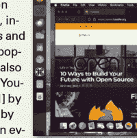

如果你运行基于 Snap 的 Linux，可以通过安装 Sosumi (4) Snap 软件包来简化过程——只需要两分钟：

```
sudo snap install sosumi
```

启动加载程序，这次有四个选项。选择第一个（Boot macOS from Catalina），启动后你可以引导 macOS 完成最后的设置（选择）和语言设置，使用你的 Apple 账户登录，启用或禁用磁盘，选择浅色或深色模式，以及其他几项（任务），然后你就进入了桌面。

以开始 Catalina 的安装。请注意，这不是当前的 macOS 版本：它发布于 2019 年，且该 Snap 在过去四年里没有更新过，但你仍然可以使用它运行大多数 macOS 应用程序，而且更简单的设置相比更当前的 macOS 版本具有优势。

## 添加内存

打开 Safari 后，花点时间下载一个当前版本的浏览器——我选择了 Firefox 版本，它在没有插件的情况下安装并运行。

此外，系统感觉有点缓慢；2GB 内存不足以正常使用。在 `~/sosumi/common/` 目录下你可以找到一个可以编辑的启动脚本——将内存（`--m`）从 2GB 改为 8GB 或更多。

可以提高低分辨率，但如果你查看 @TheLinuxXP 频道 [5] 的 YouTube 视频，该视频描述了 EFI 分区上的 macOS 启动加载程序和虚拟计算机的 BIOS。相关细节……

## macOS 安装

当启动菜单出现时，选择该条目（Boot macOS install from macOS Base），然后 macOS 工具程序将运行“磁盘工具”。在分区工具内部，选择 Apple Inc. VirtIO Block Media 设备，然后创建一个大小为 8GB 的磁盘（同样命名为一个较小的磁盘，点击磁盘）并选择文件系统类型——启动 OS X。扩展（日志式）和较新的 APFS 系统应该都可以工作。

在 macOS 工具窗口中点击“安装”（Install）、退出”（Quit）和“返回”（Back），然后重新安装 macOS。这将引导进入 macOS Catalina 的标准安装程序，初始

> 作者 Hans-Georg Eber

将默认的 2GB 内存大小更改为更符合 macOS 体验的——8GB 应该足够了。

| `~/sosumi/common/launch.sh` |
| --- |
| `/bin/bash` |
| `qemu-system-x86_64 -m 8G -smp 4 -enable-kvm \` |
| `-vga std -usb -device usb-tablet \` |
| `-drive file=~/sosumi/macdisk.qcow2,format=qcow2,if=virtio \` |
| `-device virtio-blk-p,drive=virtio0 \` |
| `-netdev user,id=net0 -nic nic=net0 -device virtio-net-device,model=net0` |

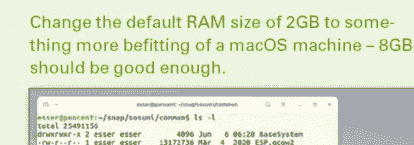

```
$ ~/sosumi/common/launch.sh
$ qemu-system-x86_64 -m 8G -smp 4 -enable-kvm \
-vga std -usb -device usb-tablet \
-drive file=~/sosumi/macdisk.qcow2,format=qcow2,if=virtio \
-device virtio-blk-p,drive=virtio0 \
-netdev user,id=net0 -nic nic=net0 -device virtio-net-device,model=net0
```

COOL LINUX HACKS – 2025 EDITION

51

## 虚拟化与模拟

### 黑客技巧 56 使用 Docker 测试替代 CMS

Docker 是专家所称的“容器虚拟化”工具。虽然技术细节很有趣，但更重要的是你可以在几秒钟内下载并运行复杂软件包的可用实例。这让 Docker 对各种应用程序都变得有趣，对于正在考虑不同内容管理系统（CMS）的网站所有来说非常有帮助。如果你是其中之一，你可能会阅读关于替代方案的文章，但没有什么比实际运行系统更能帮助你做决定了。现在设置一个 CMS 加上所有数据库表、新虚拟主机等需要时间。一旦你决定删除它，很可能碎片会浪费你的服务器空间。

安装 Docker 来测试一个系统：只需访问 Docker Hub 并搜索“content management”。第一个搜索结果是 WordPress、Joomla 和 Drupal 的官方镜像。例如，当你想要使用 docker-compose 安装 WordPress 时，正如 Docker 页面上描述的那样并运行

```
docker-compose -f stack.yml up
```

你会得到两个镜像（一个带有 Apache，另一个带有 MySQL 数据库）和一个可用系统——通过 `http://localhost:8080` 登录，更改用户名/密码，你就可以使用 WordPress（见图）。


> 作者 Hans-Georg Eber


# 黄金时代：90 年代的 Linux

许多用户觉得当切换到文本模式（`Ctrl+Alt+F1`）时，他们的 Linux 体验足够糟糕了。对于那些想要回到 10 年或 20 年前 Linux 世界的人来说，如果你有一台仍然良好的旧电脑将获得最好的体验。写作时，几种 Hat Linux 在出售，附带 CD 和打印版说明书——最早的系统必须从软盘安装，因为那时磁盘驱动还没有流行。找到一组可用的软盘可能会变成一种挑战，所以建议你坚持使用带有 3.5 英和和 6.25 英安装媒体的发行版。在图 1 中你可以看到我用于复古实验的旧机器；如果使用旧机器不是一个选择，你可以随时尝试虚拟化。在当前的 VirtualBox 或 VMware 上运行旧 Linux 桌面可能会导致问题，但你应该让它运行在你的模式中。获取虚拟机所需的安装媒体？互联网上的 [1] Wayback Machine 是一个巨大的旧软件仓库。如果你想下载 Linux 系统，使用你的搜索查询。图 2 显示了“Red Hat”的一些搜索结果。如果你需要一些集成，去 Internet Archive [2] 上的“Linux Distributions”页面。如果你想玩 MS-DOS 或 CP/M

52

COOL LINUX HACKS – 2025 EDITION

## 虚拟化与模拟

图 2：archive.org 上的旧版本。


早期基于 Windows 以及其他 Unix 系统，如 BSD 或 SunOS。如果你想进一步回到过去，离开 PC 进入家用电脑领域：向 Commodore C64、C128、Amiga；Sinclair ZX Spectrum；Amiga CPC 以及各种 Atari 系统问好——只需提到几个可以在 Linux 上模拟的经典计算机。

我特别发现的一个模拟器是 Retro Virtual Machine [5]。它不是开源的，仅限于两个计算机（Amstrad CPC 和 ZX Spectrum）。它可以处理硬件实现（ZX-Uno，见图 4），以及你可能需要的虚拟扩展驱动器或操纵杆。如果你想玩家用电脑游戏，你应该尝试 MAME 模拟器 [6]。在 Ubuntu 上包含 MAME；但它需要一些设置。另一个选项是尝试 RetroPie。虽然软件安装在 Raspberry Pi 上，但开发者还创建了适用于许多发行版（包括 Ubuntu 和兼容 IBM 的电脑）的 PC 版本。

无论是旧模拟器、旧电脑操作系统还是追溯到 80 年代的旧家用电脑，Linux 系统都能让你回到过去。当你安装软件系统时，你可以找到这些系统的许多版本以及在它们上运行的所有应用程序。

第二个兴趣是操作系统存档 [3]，它专门研究不再存在的 Linux 发行版和其他系统。你可以在那里找到旧 Ubuntu，但还会发现许多过去的 Linux。

当你在 Linux 上配置虚拟机时，请避免 SATA 硬盘并选择 IDE。Linux 内核不会识别 SATA 控制器。在 VirtualBox 上运行的 Red Hat 6.2。在我的测试期间，我不得不将网络适配器更改为虚拟 PCNet-II，Red Hat 系统通过 DHCP 了 IP 地址。VirtualBox 允许你选择要工作的部分。不过，你可以启用 SSD 守护进程，通过 X 转发登录虚拟机，然后启动一个新的终端或任何你想使用的程序。

在互联网上也可以找到许多其他操作系统，例如 MS-DOS 和这些

> 作者 Hans-Georg Eber

* [1] https://archive.org/
* [2] https://archive.org/details/linux_distributions
* [3] https://archive.org/
* [4] https://en.wikipedia.org/wiki/SunOS
* [5] https://retrovirtualmachine.org/
* [6] https://www.mamedev.org/

图 3：Red Hat 6.2 (运行中) - 虚拟机

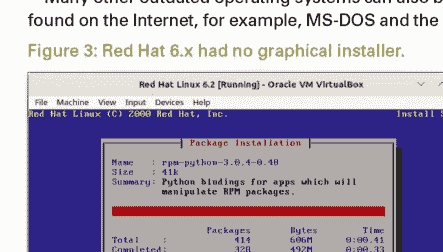

图 4：Retro Virtual Machine 2 模拟了 ZX Uno。


## 使用 Docker 工具作为过滤器

Unix 哲学——Linux 遵循的这一哲学——是使用许多简单的工具，并通过巧妙且富有创意的方式将它们组合起来解决问题。传统上，这类问题是指需要分析一个或多个文件并将其转换为一组输出结果的任务。

在许多情况下，你可以通过选择一组命令行工具并以这种方式组合它们来轻松构建解决方案：这种方式使得第一个工具的输出作为第二个工具的输入，第二个工具的输出作为第三个工具的输入，依此类推。这就是所谓的“构建流水线（building a pipeline）”，这里有一个示例：

```bash
grep /var/log/syslog | tail -n 0 | sed -e 's/\[[:digit:]]*@hostname=/hostname/g' | less
```

这条命令行命令同时使用了四个工具（`grep`、`tail`、`sed` 和 `less`），将每个工具的输出与后一个工具的输入连接起来。

- 1. `grep` 搜索日志文件 `/var/log/syslog` 中所有包含系统名称的行。它输出这些行并跳过其他行。
- 2. 此输出被传递到 `tail` 进程，该进程删除了最后 100 行。
- 3. 接下来，`sed` 对 `tail` 的输出执行查找并替换操作，尝试修改日志条目：将真实主机名和用户名替换为通用名称。这不会从过程中过滤掉任何行；它会查看每一行并可能对它们进行修改。
- 4. 最后，输出被传递到 `less`，它是一个分页器程序，让你查看信息。在 `less` 中，你可以向上或向下滚动行，并且可以进行搜索。

这些工具位于 Debian 和 Ubuntu 系统的仓库中。与其使用如下流水线：

```bash
column -t -s | txt2html --make_tools > passwd.html
```

（当缺少 `txt2html` 时该命令会失败），不如使用新容器的稍长一点命令：

```bash
column -t -s | docker run -i --rm txt2html --make_tools > passwd.html
```

这假设你会在包含 Dockerfile 的文件夹中通过命令 `docker build -t tools .` 创建一个名为 `tools` 的 Docker 镜像。运行 `docker` 会在内部启动一个容器实例并在内部运行 `txt2html` 命令——重要的部分是 `-i` 选项，它将你的本地标准输入转发到 Docker 容器，并允许读者转换流水线上上一个命令的输出。如果你一直需要该工具，那么每次调用工具时都启动一个新的容器并将其删除是没有意义的。相反，请以分离模式（后台）启动它：

```bash
docker run -it --name r_tools tools
```

并使用 `docker exec` 执行流水线中的命令（而不是 `run`）：

```bash
column -t -s | docker exec -i r_tools tools --make_tools > passwd.html
```

带有 `--name` 选项的名称必须与你在 `exec` 命令中使用的名称匹配。

作者：Hans-Ge Eser

https://metcanpac.org/dist/txt2html/view/scripts/txt2html

## 进入 Docker

那么，Docker 容器在这种设置下相关吗？要成功运行一个命令流水线，流水线的所有组件都必须安装。如果这一点显而易见，你将不可避免地发现你的机器上需要安装所需的工具。

例如，过滤器工具 `txt2html` 可能无法作为安装包供你的桌面使用，但你可以在 Debian 和 Ubuntu 系统的仓库中找到它。

| 列表 1: Dockerfile |
| :--- |
| ```docker
FROM debian
RUN apt-get update -q
RUN apt-get -y --force install txt2html
CMD /bin/bash
``` |

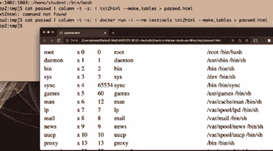

## 在 Proxmox 上运行虚拟机


# Proxmox Server

你可能习惯在 `VirtualBox` 或 `VMware Player` 中创建虚拟机（VMs）。它们都是客户端，这意味着你直接在电脑上运行它们。幸运的是，有替代方案。如果你需要在多台机器上运行虚拟机，那么你需要重新考虑。`Proxmox` 提供了这种方案。如果你有一台闲置的电脑（或者愿意买一台像 `HP Z440` 这样的机器，目前经销商处售价约 500 美元），你可以将其转换为虚拟机服务器。`Proxmox Environment (VE)` 是最好的开源程序之一 [1]。8.4 版本于 4 月发布；它基于 `Debian 12.10`。`Proxmox` 还支持 `LX` 容器（类似于 `Docker`）。根据你的需要，你可以使用虚拟机或容器。你可以从 `Proxmox` 网站获取 1.57GB 的 `ISO` 文件，将其写入 U 盘或驱动器并从中启动。安装过程将擦除你的磁盘。完成设置后，你可以记录下 `IP` 地址，以便从网络任何位置访问。所有配置都在远程浏览器中完成。`Proxmox` 机器是一台服务器；因此你不需要显示器或键盘。

对于下一步，你需要稍微研究一下术语，以便理解你在做什么。阅读另一篇文章或观看 `NetworkChuck` 关于虚拟机的两集视频 [2]。这些视频发布于 2021 年，但对于入门非常有帮助。没有必要阅读那 500 页的管理员指南。注意每次登录 `Web GUI` 都会遇到障碍（“你没有该服务的订阅”）。你的日常工作流将是这样的：在某些情况下你只需要使用虚拟机或容器之一并通过 `Web GUI` 停止它们或让它们一直运行。如果你发现解决了问题（或者只是想尝试新事物），那么直接在 `Proxmox` 服务器上安装镜像。只需点击即可创建一个虚拟机，从镜像启动，并按照通常步骤操作——就像使用 `VirtualBox` 或 `VMware Player` 一样。截图显示了 `Proxmox GUI` 和一个 `Ubuntu 22.04` 虚拟机桌面。启动和停止快得多，但与完整的虚拟机相比功能有限。

- [1] `Proxmox`: https://www.proxmox.com
- [2] `NetworkChuck`: https://www.youtube.com/@NetworkChuck

作者：Hans-Georg Eser

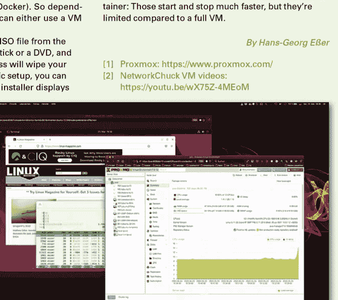

## 虚拟化与仿真


### CP/M

与当时惠尔公司的大多数计算器一样，`HP-48` 使用逆波兰（RPN）进行计算和编程。

`WordStar 3.3` 是适用于 `CP/M` 和 `DOS` 上的经典文本处理器版本之一。

# 重现 Commodore Amiga

`Commodore Amiga` 型号 [1] 是 20 世纪 80 年代和 90 年代非常受欢迎的计算机。`A500`、`A600` 和 `A1200` 将主板和软驱器集成在键盘外壳中，就像早期的电脑一样，例如 `Commodore C64` 或 `Sinclair ZX Spectrum`。

可运行的 `Amiga` 电脑很难找到，这就是为什么提供良好的模拟器如此重要。在 Linux 世界中，`Amberry` [2] 是目前的最佳选择；它派生于 `WinUAE` [3]，这是一款适用于 Windows 的 `Amiga` 模拟器。

你需要一个操作系统 `Kickstart`：它是 `Amiga (Amiga OS)` 的一部分，可以从 `Quanto` [4] 以 40 欧元购买。如果你有一台真实的 `Amiga`，也有办法读取 `Kickstart ROM`。添加该 `ROM`（`kick3a128.rom` 或 `kick3s-31-a128.rom`），可能还需要一个拷贝密钥（`kick.keyl`），这样你就可以启动它。

`Amiga` 包含了超过 4,000 个游戏和应用程序，由许多不同的开发者开发。早期版本仅适用于 `Raspberry Pi` 电脑（因此得名：`Amiga PiFx`），它运行在 4 台 `PC` 上。这台 `PC` 需要 `UEFI BIOS`，因为它必须从 `FAT` 分区的磁盘启动。

你可以在安装前下载一个 `PC` 版本（版本 1.7，`INTEL`；25GB），你需要将这 58GB 写入 `USB` 闪盘并用它启动 `Amiga`；或者下载一个更大的分区版本，它可以同时在 `PC` 和 `Raspberry Pi` 上启动（`PiAm72`: 35GB/96GB（解压后））。

大文件只有在 `Chris Edwards` 告视频 (5) 的描述中才能找到。解压缩包并将镜像写入 128GB `USB` 闪盘——在测试中，58GB 版本放不下，但带有 `USB` 闪盘的版本可以。在正常情况下，64GB 应该足够。

写入镜像后，记得拔掉并重新插入闪盘，搜索一个较小的 `FAT-128MB` 分区（如果存在，则称为 `/dev/sda1`）并从中拷贝 `Kickstart ROM`。如果密钥文件存在，也拷贝它。然后，将 `ROM` 重命名为 `kick.rom` 或 `Amigarom`，这样它就找不到了。完成后，重启机器或在另一台电脑上从闪盘启动。它不需要大量的资源。

## 这是一台 Amiga

如果你是 `Workbench` 世界的新手——请通过点击或双击任何看起来有趣的内容来探索 `Amiga` 宇宙。以下是起始步骤：

- 1. 尝试图标中的 `Amiga` 和 `iDemo`。这就是你找到那 5,000 个游戏和演示的方法。双击可以启动任何项目，在游戏或演示内部，你可以按 `F10` 杀死应用并回到桌面。

## 虚拟化与模拟

## HACK 62

`Primiga` 制作了一个宽屏模式的现代 `Workbench` 版本。


2. 点击状态栏，然后右键点击标题栏（屏幕顶部）。这将显示一个包含有趣程序或地点的菜单列表。

## 添加全 Linux 桌面

当你玩着海量的游戏、演示、生产力应用和工具时，你可能会意外按下 `Alt+Tab` 将你的 `Amiga Workbench` 桌面切换到 `Debian 12 Xfce` 桌面：所有的 `Amiga` 模拟在 `Raspberry Pi` 上都是一个全屏窗口，模拟器在帧缓冲区中运行。

你也可以从 `Debian APT` 包中添加任何当前的软件包用于 `Amiga` 的常规任务。如果你需要 Linux 权限，请在 `sudo` 列表中使用带密码的 `pi`——这些列表显示 `PC` 版本是

- [1] https://en.wikipedia.org/wiki/Amiga
- [2] https://blitterstudio.com/amberry/
- [3] https://www.winua.
- [4] https://www.amigafore.com/plus/
- [5] https://www.youtube.com/watch?v=z8NB9-NZ-c

> Hans-Georg Egg 

COLIN LINUX HACKS - 2025 EDITION

## 虚拟化与模拟

## HACK 63

## 使用 BBC BASIC 找回怀旧

`BASIC` 是家用电脑的经典编程语言——孩子们会惊叹地看着同学直接在终端输入像这样的程序。对于较长的程序，使用专业的编辑器会更好。这是：

```
10 FOR I1 TO 28
20 COLOUR I
30 PRINT "EEC IS HERE"
40 NEXT I
```

带有两个代码编辑器的 `SDL` 版 `BBC BASIC`。这是 Richard 的 `SDLL`。


它用彩色文本填充屏幕。二级是带有线条、正方形和圆形的实际图形。`BASIC` 有多种方言，`BBC Micro` 电脑上的 `BBC BASIC` 运行在 'colour' 上，但 `BBC BASIC` 也接受高级关键字 `COLOUR`。

一个简单的 Linux 版 `BASIC` 实现——`Matrix Brand BASIC` [II]，但它缺少让 `BASIC` 特别的一项功能：对内联汇编的支持，这允许用户加速运行太慢的代码。

这个版本的 `BASIC` 中没有 "`ASCII`" 命令，但你可以使用这些命令保存当前版本：

- `*SPOL "prognae.bas"`
- `*LIST`
- `*SPOL`

## Matrix Brand BASIC 支持 BASIC 的基础功能。

## SDL BASIC

`BBC BASIC` 的现代实现版本是 `BBC BASIC for SDL` [III]。它适用于 Linux、Windows、macOS 和移动操作系统，并让你无需行号即可编写 `BASIC`。相反，你

然后在在支持 `BASIC` 语法高亮的编辑器中打开源文件——在我的测试中，在 `KDE` 的编辑器中找到了源文件。你需要删除第一行和最后一行。稍后，只需在你使用的其他任何基础 解释器中修改该修改后的文件即可。

## 学习 BASIC

如果你想学习 `BBC BASIC`，可以从 Windows 版 `BBC BASIC` [IV] 的初级教程开始，并并检查其中的一些程序。这些程序不是基础的，但在许多情况下函数变量是名称选择的，你可以学习如何绕过程序。


# 教育

## multiElement: 化学2D 结构编辑器

《绝命绝风律师》（Better Call Saul）的粉丝可能还记得第四季的一集，大家最喜欢的邻居盖尔·辛格（Gale Singer）为汤姆·利希的歌曲《元素》演唱。这是一首朗朗口的歌曲，Lehrer 将元素名称改编到了《大将歌》的旋律中。在事物的本质上，某种周期表的呈现是 Serhii Reduchnyi 开发的这个实用工具的主题。目前，它仅在 Flathub 上可用。

首次启动时，`multiElement` 提供了一个简单清晰的界面。其他选项还包括周期表的简短版本，按行、周期和族分类显示元素。扩展视图（Extended view）更符合我记忆中所有元素列出来并进行颜色标记的样子。虽然创建一个周期表是一项任务，为了将拼写细到某种类型的程度，即使是不具备科学思维的读者也能一眼看出它是一个技术术语。最后一个选项是 Adomah 布局，维基百科告诉我们这种布局根据元素的量子数显示元素。

我提到维基百科是因为项目页面上的另一个承诺是“可以提供每个元素的即时、全面的信息”。在某种意义上这是正确的，但使用那些能良好显示与每个元素对应的维基百科条目的布局时，点击进入电子表格要快得多。我在简短视图、扩展视图和 Adomah（水平）视图中正确地发现了这一点。虽然 Lehigh 的歌曲只列出了 1959 年已知的 102 个元素，但 `multiElement` 列出了所有 118 个元素。

作者：Nate Drake

```
https://flathub.org/apps/github.r.sergii.multiElement
```

使用 multi-Element 以一种令人惊叹的方式查看周期表。点击元素可加载其维基百科条目。

# 技巧 65: JChemPaint: 周期表查看器

根据其项目页面，化学开发包（CDK）是一个“用 Java 编写的用于生物、化学和计算化学的科学性、LGPL 边缘库”。`JChemPaint` 使用 CDK 开发，在 16 年里，它仅通过 Help Flatpak 版本提供，该版本仍然保留了许多“绘制结构的 {质量改进”。

如果你喜欢的化学仅限于烘焙蛋糕或鸡尾酒，你也会从这个基础教程中受益。这是顶部第一个应用程序开始的帮助（Help）部分。这是 `JChemPaint` 模式。每次点击都会创建一个化学实体，无论是某种键的类型还是特定原子。

程序还包含元素列表。你可以通过下拉菜单访问这些内容。我用它加载了示例分子，这是高中生物化学内容，由两个简单分子（葡萄糖和果糖）组成。左侧面板包含各种类型的键和链。你也可以通过绘制原子来指示反应。某些原子是从底部开始绘制的。我趁此添加了一些溴和磷。这是发现该应用添加化学品感觉有多直观的极佳方式，尽管我非常怀疑一个巨大的分子能否结构化。

当你进行值得的化学操作时，文件（File）菜单允许你以 `MOL (MDL)` 格式导出化学结构，这是在文本中查看 3D 模型的标准方法。你还可以以图像格式（`SVG`、`BMP`、`JPG` 或 `PNG`）导出数据。

作者：Nate Drake

```
https://jchempaint.github.io/
```

教程解释说 `JChemPaint` 处于绘制模式，因此每次点击都会创建一个新实体。

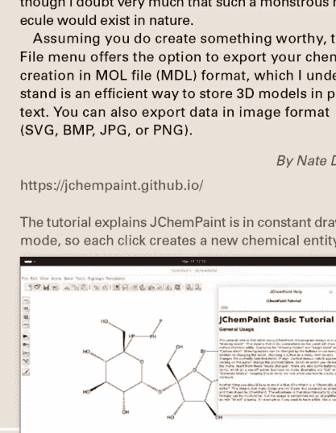

酷炫 LINUX 技巧 – 2025 版

61

# Gaia Sky: 天文学可视化平台

这个惊人的应用程序是欧洲空间局 Gaia 任务框架的一部分，该任务旨在绘制我们银河中约十亿颗恒星。显然，欧洲空间局非常希望 Gaia Sky 尽可能可用，因为它适用于 Windows、macOS 和 Linux。还通过 DEB 包、AppImage、AUR 镜像或 Flatpak 提供。如果用户需要安装数据集进行使用，有一个大约 83MB 的基础数据集，我选择了一个高分辨率纹理包。其他大型数据集可用，取决于你想要浏览多少恒星。

首次启动时，`Gaia Sky` 愉快地从我们的太阳系开始。你可以使用 `C` 键切换到更疯狂的模式。左侧的工具栏有助于相机选项、切换各种星系、云、甚至是星系的能力。你还可以调整星系的角度以及相机缩放。右下角有一个辅助重绘功能，同时显示相机和鼠标指针的虚拟坐标。

在早期的评论中，可以搜索并导航到银系的特定区域。我没有看到明显的搜索功能，但按 `Ctrl-F` 弹出了一个合适的对话框。往常一样，除了我自己觉得好笑，我开始输入“天王星”，地图跳转到了该行星。由于这非常大气，我很失望自己没有通过 VR 头显设备看到天体，而 `Gaia Sky` 是支持的。因为是实时数据，对于我们宇航员来说，有一种更准确的方法来探索银系。

左侧的工具栏用于切换不同的银系现象以及网格线...

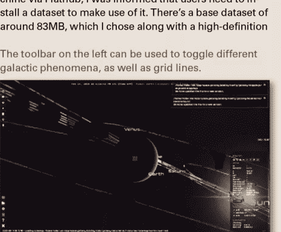

> 作者 Nate Drake

```
https://giasky.space/
```

# 技巧 Thrive: 进化模拟器

Linux 游戏有时被批评为图形支持不如 Windows。这个模拟器则不然，它是使用 Godot 引擎构建的。该游戏可以在 Steam 上花一点钱购买。然而，它仍然开源。代码可以从 GitHub 编译，尽管开发者建议 Linux 用户下载 `Thrive Launcher`（可在 Flatub 上获得）来安装游戏和必要的依赖项。

该游戏是《孢子》早期阶段（2008年）的游戏版，在那个控制单个生物的时期。与太空不同，你可以选择在温暖的池塘或热液喷口开始。默认情况下，细胞的行为也会表现得像“真实世界”，因此许多微生物或奇异食物源是不可能的。

当前版本支持光合作用。在其他顺序中，你的生物在一个没有氧气的的世界开始，因此它在进入大气时必须进化它的代谢方式。在常规阶段，你可以为你的生物选择特征，例如用于移动的纤毛或将更多来源转化为 ATP 能量的能力。

游戏还翻新了图形，具有新的 3D 膜、冰块和改进的泡泡...变形效果，你使用 `WASD` 键和鼠标组合让你的生物穿过喷口或池塘。按键可以旋转细胞，所以我必须承认当我玩时，我只使用了导航来进行前进并在需要时寻求帮助。

选项，更不用说那些令人震惊的拉丁名称了，初看起来似乎难以理解。每个选项都为你提供提示，例如增加效率所需的细胞部分。这是一种在雨后下午玩的玩耍。

> 作者 Nate Drake

```
https://revolutionarygames.com/
```

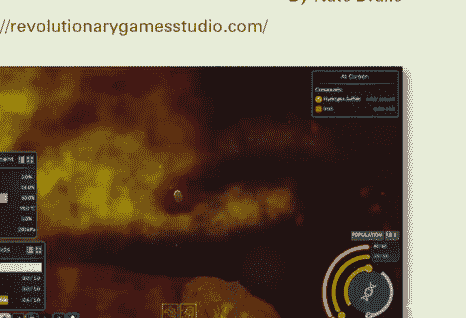

酷炫 LINUX 技巧 – 2025 版

# 技巧 68: Chordcat: 和弦命名应用

`Chordcat` 对初学者非常有用。它可以响应各种用户输入显示和弦音。二进制文件可以在 GitHub 页面获取。还有一个 Flatpak 版本。

除了可爱的猫咪，最初吸引我的是 `Chordcat` 的多功能性。启动后，你只需点击钢琴上的键来列出并重命名和弦（带声音）。你还可以使用键盘上的快捷键取消选择在连接的 MIDI 设备上播放的和弦。

它内置了节拍器。你可以通过下拉菜单访问这些。我用它加载了示例分子，这是高中生物化学内容，由两个简单分子（葡萄糖和果糖）组成。左侧面板包含各种类型的键和链。你也可以通过绘制原子来指示反应。某些原子是从底部开始绘制的。我趁此添加了一些溴和磷。这是发现该应用添加化学品感觉有多直观的极佳方式，尽管我非常怀疑一个巨大的分子能否结构化。

当你进行值得的化学操作时，文件（File）菜单允许你以 `MOL (MDL)` 格式导出化学结构，这是在文本中查看 3D 模型的标准方法。你还可以以图像格式（`SVG`、`BMP`、`JPG` 或 `PNG`）导出数据。

作者：Nate Drake

```
https://jchempaint.github.io/
```

教程解释说 `JChemPaint` 处于绘制模式，因此每次点击都会创建一个新实体。

# 教育

# 技巧 70

# Lootcode: 游戏

我一直很认同那些试图让学习变得有趣的人，因为坦率地说，学习通常并不有趣。这对于那些想要学习数据结构和算法（DSA）的人来说尤为如此。佛罗里达大学（UCF）的学生 Dylan 和 Luke 通过 `Lootcode` 证明了这一点的。在描述它时，他们自己的 GitHub 页面写道：“一个奇幻主题的、游戏化的练习平台，帮助你应对面试。”

游戏进度是非顺序的。这允许玩家按照他们喜欢的顺序学习数据结构。

虽然源代码可以在 GitHub 上获取，但游戏中的练习越来越难，因此鼓励玩家（如果愿意）通过主站、GitHub 或 Google 凭据登录 `Lootcode`。这样做后，你将进入 Albion 世界，在奇幻设定下导航一系列 DSA 问题。


例如，我在 Lexica 开始了我的之旅，那里的人们用技巧来装点自己。第一个挑战被称为“字母泄漏”，围绕人们对单词的兴趣。玩家必须编写脚本来重新排列文本中的相邻字符以拼出单词。对于 `Python`、`Java`、`C++` 或 `C`，Dylan 解释说他和 Luke 是 UCF 一个名为 Knights 的软件开发俱乐部的成员。任务是给白板，他们挑战自己解决他们在项目中看到的内容。他们在国际大学生程序设计竞赛（ICPC）、竞技性编程方面的经验，以及 Lootcode 像游戏一样，都结合在了一起。

玩家可以运行代码来决定他们如何成功并进入更难的问题。在后台，开发者使用 `Docker` 创建了隔离的沙箱环境以允许安全执行。

Dylan 还总结了 Lootcode 的理念：“如果代码可以让我们玩游戏，并且是一个有故事的游戏呢？”这个想法体现在 Lootcode 的实现中，他们创建了一个排行榜，Lootcode 的知识是用于面试的。我提到某些政府机构将代码谜题变成招聘工具，并且他们对此非常热情。

Albion 世界正处于崩溃状态。你会完成 `DSA` 任务来恢复它的数学完美吗？

这种对学习 `DSA` 平庸本质的感受激励我联系了开发者。他们乐意回答面试。


Lexica 区域是即将改变的字符之一。有一个独特的区域认为通过自然逻辑，可以计算和分析你的书写。

我不认为其中任何一个是 Lootcode 本身，但战斗的成功部分取决于可以用金币（gold）购买的独特机制。金币通过解决独特的游戏问题获得，因此有足够的题目供随机遇到和升级。在面试期间，团队还告诉我 Lootcode 现在已更新支持 `C#`、`Rust` 和 `Go`，除了列出的编程语言外。

Nate Drake 编写

https://lootcode.dev

64

酷 Linux 技巧 – 2025 版

# 技巧 71

## Keypunch: 打字练习器

Brage Fugleth 是 `Gnome` 的创建者，可能已经知道他用于学习吉他和弦的 `Fretboard` 应用。在这个技巧中，我想谈谈他写的另一个工具，名为 `Keypunch`。在谈到 `Gnome` 子集时，Fugleth 解释说他最新努力是对旧 `Gnome 2` 打字器的致敬。`Keypunch` 目前可以在 `Flathub` 上获得。

国际布局下，文本将以你在任何其他 Linux 程序中完全相同的方式出现。虽然 Linux 不缺打字应用，但 `Keypunch` 比 `Klavaro` 等旧 `Gnome` 软件提供了更清晰的界面。我看到的唯一缺点是目前没有针对 `QWERTY` 等特定键盘的练习模式。`Keypunch` 使用常用词。这仍然实时分析提高打字速度更好的方法。

启动 `Keypunch` 时，默认设置显示各种字典列表，我注意到这些是八个字符或更少。打字练习器会监控你的进度并标记错误。30 秒后，程序会显示准确率（百分比）和打字速度（每分钟单词 `wpm`）。我惊讶地发现我在 87wpm 下有 94% 的准确率，但当我使用内置下拉菜单将难度从“简单”更改到“高级”时，这个数字大幅下降。此设置包含了标点符号、数字以及更多的字符。当你打字时，大多数字母会被标为红色。

Nate Drake 编写

主菜单还支持“自定义文本”。默认设置为“那只敏捷的棕色狐跳过了懒狗”。你可以修改并更新自己的文本，如歌词或维基百科条目。开发者还强调 `Keypunch` 遵循你的默认键盘布局。也就是说，如果你使用的是 Dorak

https://github.com/fragefugleth/keypunch 似乎匹配了。`Keypunch` 有一个清晰的 UI，显示速度和准确率。

再次，它是另一个部分。51 知道如何的人可能都在他们的主页

# 需要更多 Linux？

- 关于热门话题的深度文章，包括比特币、云计算等
- 实用工具可以为你节省时间
- 关于开源世界的进展
- 树莓派等酷项目
- 进一步学习 Linux，不要错过！

# 学习 vi 基础

管理员的一半生活都在 shell 命令中。另一半是在 `vi`（或其改进版本 `Vim` – 可能是 `Emacs` 的替代品）。不要担心，如果你的首选编辑器不是 `vi`，让我告诉你这个古老的工具自 1976 年以来一直。你应该学习 `vi` 的原因如下：

- `vi` 适用于每个操作系统，它也安装在每个 Unix 类系统上。如果你运行的是古老的 `SunOS`，你将能够编辑文件。
- `vi` 是一个基于文本的程序，它不需要鼠标或完整的光标键。在极少数情况下远程登录到一个机器且键盘损坏的情况下，你仍然可以使用 `vi`。
- `vi` 有几种模式，例如插入模式（`Insert Mode`）和普通模式（`Normal Mode`）。在普通模式下，除非加载了编辑器或创建了内容，否则无法编辑文本。如果你从未这样做过，可以在网络上搜索“learning”，找到大量的教程和视频。或者直接运行命令检查你的 `vi` 版本（`vi --version`），如果你想查看。

https://vi.vim/
https://en.wikipedia.org/wiki/Editor
https://en.wikipedia.org/wiki/vi

# 命令行

你只需要浏览这些页面就知道命令行与我们许多人认为的相反。随着图形界面变得更加高效和易用，极简、无干扰且低资源占用的终端是一种命令行复兴。这对于那些没有足够的或信心来快速学习命令行的人来说可能是令人畏惧的。这就是《命令行杀》的帮助。

## 命令行

《命令行杀》是一个精妙设计的 600 多个文件，教你如何使用命令。通过这些文件，这是一个基于任务的游戏，你需要发现凶手。背后的天才想法是它不是一个孤立的游戏或二进制。

| 000000000 | 000000000 |
|-----------|-----------|
| COMMAND | LINE |
| LINE | MASTER_PI |
| 000000000 | 000000000 |
| 000000000 | 000000000 |
| 000000000 | 000000000 |
| 000000000 | 000000000 |
| 000000000 | 000000000 |
| 000000000 | 000000000 |
| 000000000 | 000000000 |
| 000000000 | 000000000 |
| 000000000 | 000000000 |
| 000000000 | 000000000 |
| 000000000 | 000000000 |
| 000000000 | 000000000 |
| 000000000 | 000000000 |
| 000000000 | 000000000 |
| 000000000 | 000000000 |
| 000000000 | 000000000 |
| 000000000 | 000000000 |
| 000000000 | 000000000 |
| 000000000 | 000000000 |
| 000000000 | 000000000 |
| 000000000 | 000000000 |
| 000000000 | 000000000 |
| 000000000 | 000000000 |
| 000000000 | 000000000 |
| 000000000 | 000000000 |
| 000000000 | 000000000 |
| 000000000 | 000000000 |
| 000000000 | 000000000 |
| 000000000 | 000000000 |
| 000000000 | 000000000 |
| 000000000 | 000000000 |
| 000000000 | 000000000 |
| 000000000 | 000000000 |
| 000000000 | 000000000 |
| 000000000 | 000000000 |
| 000000000 | 000000000 |
| 000000000 | 000000000 |
| 000000000 | 000000000 |
| 000000000 | 000000000 |
| 000000000 | 000000000 |
| 000000000 | 000000000 |
| 000000000 | 000000000 |
| 000000000 | 000000000 |
| 000000000 | 000000000 |
| 000000000 | 000000000 |
| 000000000 | 000000000 |


| 000000000 | 000000000 |
| 000000000 | 000000000 |
| 000000000 | 000000000 |
| 000000000 | 000000000 |
| 000000000 | 000000000 |
| 000000000 | 000000000 |
| 000000000 | 000000000 |
| 000000000 | 000000000 |
| 000000000 | 000000000 |
| 000000000 | 000000000 |
| 000000000 | 000000000 |
| 000000000 | 000000000 |
| 000000000 | 000000000 |
| 000000000 | 000000000 |
| 000000000 | 000000000 |
| 000000000 | 000000000 |
| 000000000 | 000000000 |
| 000000000 | 000000000 |
| 000000000 | 000000000 |
| 000000000 | 000000000 |
| 000000000 | 000000000 |
| 000000000 | 000000000 |
| 000000000 | 000000000 |
| 000000000 | 000000000 |
| 000000000 | 000000000 |
| 000000000 | 000000000 |
| 000000000 | 000000000 |
| 000000000 | 000000000 |
| 000000000 | 000000000 |
| 000000000 | 000000000 |
| 000000000 | 000000000 |
| 000000000 | 000000000 |
| 000000000 | 000000000 |
| 000000000 | 000000000 |
| 000000000 | 000000000 |
| 000000000 | 000000000 |
| 000000000 | 000000000 |
| 000000000 | 000000000 |
| 000000000 | 000000000 |
| 000000000 | 000000000 |
| 000000000 | 000000000 |
| 000000000 | 000000000 |
| 000000000 | 000000000 |
| 000000000 | 000000000 |
| 000000000 | 000000000 |
| 000000000 | 000000000 |
| 000000000 | 000000000 |
| 000000000 | 000000000 |
| 000000000 | 000000000 |
| 000000000 | 000000000 |
| 000000000 | 000000000 |
| 000000000 | 000000000 |
| 000000000 | 000000000 |

## 在 TIC-80 上学习游戏开发

游戏开发就像玩游戏一样。当然，你不能期望你的游戏能与由开发者、关卡设计人员和艺术家团队创建的商业游戏相竞争。但是，对于一个时间有限的单程序员来说，实现自己的版本仍然可行的。

使用文件名作为参数自动加载代码（列表 1）。它包含了所有必要的数据：代码、图形和声音。TIC-80 还会立即启动游戏——你只需按 `Esc` 键然后选择 `Game-in` 即可停止它。这将带你进入启动界面，你可以按一次 `Esc` 键进入代码编辑器。

从左上角的指令（Codeword）：吃豆人（Pac-Man）游戏、源代码编辑器、音乐、图像和精灵编辑器。

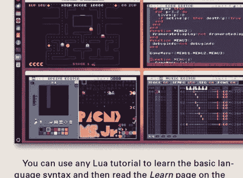

# 幻想计算机 (Fantasy Computer)

到目前提到的所有项目都是针对真实的机器，它们是当前的还是可以追溯到 1980 年代的。在这一章中，我们关注一种完全不同的方法：TIC-80 [3]。它被归类为“幻想计算机” [4]，并为你提供了一个带有全屏代码编辑器、精灵、地图和声音编辑器的编码环境。你可以使用 `Lua`、`Ruby`、`Python` 以及其他少数语言编写程序，这些语言可以让你显示游戏、定位精灵和背景音乐。

当你启动 TIC-80 时，它会显示一个彩色屏幕并加载一个小型示例作为游戏。它还会显示一个提示符，你可以在其中输入命令。如果你想编辑源代码，只需按 `Esc`，它将带你进入代码编辑器。为 TIC-80 编写游戏时，你将主循环代码放在 `TIC_draw()` 函数内部。拥有主循环是编写游戏的标准方法：其核心是运行一个循环来检查发生的事件。可以通过摇杆移动、按键、运行结束等事件。在图 1 中，第一个演示程序显示了我们在屏幕上绘制的精灵的移动（上、下、左、右）和移动位置。如果物体移动到游戏边界之外；它们设置为光标键，以便返回摇杆或游戏手器的四个方向。

在项目网站上，你可以找到许多示例程序：它们被作为开发者称为“卡片”（cards）的文件开发。下载一个卡片并运行 `tic80`。

你可以使用任何教程来学习基础语法，然后阅读网站上的“学习”页面，该页面解释了你可以用来访问计算机硬件的内置函数（例如 240x136 显示器）。此外，检查代码也是学习如何实现的极佳方法。如果你喜欢不同的语言，输入时可以使用 `lua`, `ruby`, `js`, `moon`, `fennel`, `squirrel`, `webre`, `wasn`, `jam` 或 `Python` —— `Lua` 仅是默认语言。

> 由 Hans-Geörg Eber

- [1] https://www.pygame.org/
- [2] https://lemospawn.com/
- [3] https://tic80.com/
- [4] https://github.com/fantasy/

## 列表 1：运行卡片

```
01 error@user804b-: $ -I -i you can type js -d - ""
02 573937 31 11:24 pacman_80
03 73837 31 11:19 sprite_painting,tic
04 49251 31 11:21 wip_more_like_game,tic
05 error@user804b-: $ tic80 pacman_80_tic
06 TIC-80 ting counter
07 version 1.2.0(beta42f)
08 https://tic80.com (C) 2017-2023
09 loading...
```

LINUX HACKS - 2025 版本

# 教育

## GCompr：面向儿童的游戏

让学习变得有趣的目标可能会吸引青少年，但 `GCompr` 的目标是 10 岁儿童。它由一组游戏（目前约 190 个）组成，专注于教育。该套件适用于 Linux，但也有 BSD、macOS 和 Windows 的版本。该项目自 2000 年以来一直在开发，最初是在 GNU 通用公共许可证 (`GPL`) 下发布的，由 Christophe Coudain 开发。`GCompr` 由 `KDE` 社区开发和维护。该套件的名字源自法语的“J'ai compris”（我理解了）。

显然，经过九年的工作，`GCompr` 的图形已经过重新设计以匹配项目指南。版本 4.0 还包括了一些活动，其中包括 `Calcudoku`，玩家必须根据规则填充网格。其他新标题引用了高级词汇，例如“enumerate（列举）”，这使得 `GCompr` 适合具有丰富词汇积累的儿童。

作者 Nate Drake

https://gcompr.net/

一些活动旨在教授相同的概念，例如“混合颜色”和“混合光”，这种多样性可以帮助年轻学习者保持兴趣。还有一个内置的“难度过滤器”，可以隐藏高级活动。这可以通过设置菜单进行，允许用户配置图形和背景音乐。这需要一个非常熟悉的企鹅形象。

最新版本的 `GCompr` (4.0) 解决了父母提出的某些问题，该套件已翻译成多种语言，包括荷兰语、波兰语、巴西葡萄牙语和法语。

（此处应有一个关于 `GCompr` 界面的图片）

## GPlates

一些最好、最有趣的开源软件源自学术界。这可能是因为两者共享相同的哲学和理念，导致了更好的结果。`GPlates` 是一个很好的例子。这是一个复杂且自适应的工具，用于探索和可视化板块构造科学——即地球的断裂和大陆运动——让每个人都能重建世界。`GPlates` 是一个基于地理的应用程序，包含一组大量的地理数据，大约 1 GB 的数据随程序，允许初学者通过控制来学习数年来地球的运动。每一帧都标有颜色的箭头，指示正在作用的力量，很容易看到裂谷和山脉是如何形成的。在 `Ubuntu 24.04` 上，运行 `QT_PLATFORM=xcb gplates` 否则它会崩溃。

作者 Graham Morrison

（此处应有一个关于 `GPlates` 界面的图片）


https://github.com/GPlates

# COOL LINUX HACKS – 2025 版本

## 探索太空

Celestia 是一个老项目，始于 2001 年。它是最早将空间描绘为无限大于立方体二维投影的天文项目之一。它赋予观察者离开二维视角，并在空间和时间上探索星星的能力，以三维的形式（或从木星表面或其他你想象的任何地方）看到它们。图形加速在 2001 年才成为可能，但应用程序跟踪并更新了 GPU，利用额外的内存和可以用于视差或模拟的卓越网络。性能还允许天空中出现更多星星，当你以光速的数倍穿越宇宙时可以进行缩放。Celestia 真正令人叹为观止。它是展示星座是由跨越巨大距离和的星星组成的最佳方式之一。同样，它展示了星星沿着银河系旋臂的位置，以及我们的太阳系在绕着自身、太阳以及银河中心黑洞旋转时的天体舞蹈。不幸的是，Celestia 变得停滞了，开发进展得极其缓慢。最近出现了一个分支（Celestia Origin）、一个新所有者以及一位加入 GitHub 的合作者。一个全新的、稳定的二进制版本将唤醒这个项目。这是因为 Celestia 真正可以在一个超级 GPU、增强现实和天文学图像的新世界中蓬勃发展。如果不是，那么一个类似的项目也值得我们拥有。

https://www.celestialproject.org/

与 Stellarium 等天文应用不同，Celestia 是太阳系和宇宙真实的 3D 模型。

作者 Graham Morrison

## 尝试 Edubuntu

Ubuntu 有多种变体。例如，你可以安装 Ubuntu 来获取 KDE 桌面，或者如果你喜欢 Xfce 桌面，则可以安装 Xuntu。大多数变体与普通 Ubuntu 的主要区别在于它们使用 Gnome 桌面作为替代方案。

另一个基于 Ubuntu 的运行时是以 Edubuntu 结尾的。虽然这个面向教育的 Ubuntu 版本开发停滞了一段时间，但你可以在网站上找到 24.04 LTS 和 25.04 的下载，它们也提供桌面安装程序（适用于树莓的 x86_64）。25.04 的安装程序为 5.8GB，并且适用于 ARM64，它在 Wayland 会话中运行 Gnome 桌面。根据 Edubuntu 的使命宣言，团队针对学校的教室计算机，它的工作效果与普通 Ubuntu 桌面一样好。Ubuntu 安装了一套你可能在常规桌面需要的常规教育工具。Edubuntu 安装程序允许你选择元软件包——添加 `ubuntu-edu` 和 `ubuntu-teaching` 以获取全套学习和教学应用。你也可以安装所需的特定软件。在应用程序概览中，你会发现艺术、语言和读写、数学、音乐教育、科学、社会科学、技术等子菜单。

# 网络

你正在家里运行一个网络：即使你只用了一台电脑，很有可能也使用了其他连接网络的设备，例如你的手机或智能电视。我们帮助你进行网络分析和安全文件传输，并推荐了一些有趣的客户端，例如用于经典 IRC 的 Mastodon 和 WeeChat。

| 技巧客技巧 | 页码 |
| :--- | :--- |
| HACK 79 快速且粗陋的 HTTP/FTP 服务器设置 | 71 |
| HACK 80 Transmission 4 (BitTorrent 客户端) | 72 |
| HACK 81 Hasty Paste 1.9.0: 简单在线剪贴板 | 72 |
| HACK 82 Neon Modem Overdrive: 终端论坛访问 | 73 |
| HACK 83 Trippy: 网络分析 | 73 |
| HACK 84 internarchive: 命令行访问 | 74 |
| HACK 85 TheDesk: Mastodon 客户端 | 74 |
| HACK 86 goread: 终端 RSS 阅读器 | 75 |
| HACK 87 Rymport: 安全文件传输 | 75 |
| HACK 88 WeeChat 4: IRC 客户端 | 76 |
| HACK 89 Tiny Tiny RSS: RSS 托管 | 77 |
| HACK 90 gping: 可视化 Ping | 77 |
| HACK 91 运行一个简单的 HTTP 服务器: webort | 78 |
| HACK 92 在 SSH 会话中使用 screen | 78 |
| HACK 93 使用 sshuttle 建立隧道 | 79 |


## 快速且粗陋的 HTTP/FTP 服务器设置

当你的本地网络中有有多台电脑时，你通常想在它们之间快速传输一个或多个文件。当然，这有很多“正规”的方法，涉及：

- 在虚拟机中运行专用的 NFS 或 Samba (CIFS) 服务器
- 配置 OpenSSH、创建 SSH 密钥并在所有机器之间交换公密钥
- 将文件复制到外部驱动器和磁盘，或者使用其他方法。

我个人倾向于使用 OpenSSH 进行所有传输，但这并不总是可能的：有时没有可用的 SSH 服务器，或者无法升级的机器不支持足够的 SSH 协议版本或任何其他端支持。

如果你想实现一个快速且粗陋的解决方案，可以运行 HTTP 或 FTP 服务器。

### 简单的 HTTP 服务器

安装和配置普通服务器（例如 Apache 或 FTP 服务器）需要花费一些时间，对于快速访问目录中的文件来说并不是一个选择。当你不需要创建一个真实的网页时，Webor [1] 是理想的解决方案：一个可以通过单行命令运行（当然，是在安装之后）的简单 Web 服务器。

在 Debian 或 Ubuntu 上，

```
sudo apt install webor
```

获取软件。然后只需输入

```
webor -b
```

`-b` 设置 Webor 将使用的基准目录。默认情况下，它将在端口 8080 上打开，这样你就可以通过任何浏览器通过 `http://ip:8080` 访问内容。

Webor 不适用于 OPENSE 和其他基于 RPM 的系统，但如果你安装了 Docker，可以简单地在容器中运行它：

```
docker run -it --rm -p 8080:8080 -v /:/web debian sh -c 'apt update; apt install webor -v webor /web'
```

Webor 为你提供目录的内容。

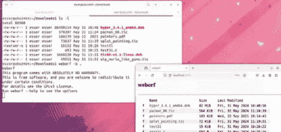

同样有效，你甚至可以在 Mac 或 Windows 机器上运行它。

如果你有 BusyBox (2)，可以运行其内置的 HTTP 服务器：

```
busybox httpd -f -p 8880
```

它将在 8880 端口打开，接受 HTTP 请求并从启动所在的目录提供文件。默认情况下，它不会列出目录内容，因此你要为客户端提供完整的 URL，或者添加一些处理目录列表的 CGI 脚本。

然而如果你使用 Python，HTTP 也会提供目录并列出其文件；当你运行时，默认端口是 8000

```
python3 -m http.server
```

### 文件传输协议

每台机器都有浏览器或兼容 HTTP 的工具（如 `wget` 或 `curl`）！如果你有 FTP 客户端，可以在另一台机器上设置 FTP 服务器。不要浪费时间去配置那些经典服务器之一。相反，遵循类似于 HTTP 服务器的简单选项，通过运行

```
sudo apt install python3-pyftpd
```

在 Ubuntu（或 Debian [3]）上安装该模块，然后切换到该目录使其可用，并运行

```
python3 -m pyftpd
```

这将在端口 2121 上启动一个 FTP 服务器。你可以使用匿名用户名和任意（或为空）字符串作为密码运行它。

通过这些选项，你可以共享你的文件。

作者 Hans-Georg Eßer

> [1] codes.eger/itgtrow/webor/
> [2] https://www.busybox.net/


## 技巧 80 Transmission 4 (BitTorrent 客户端)

Transmission 是另一个存在时间之久，已成为词汇的工具。特别是考虑到 Transmission 是一个 BitTorrent 客户端，这种技术的流行像任何其他事物一样起伏波动。Linux 用户在处理大文件和自托管项目时有了更好的措施。BitTorrent 允许我们在不产生上负担的情况下下载文件，但也通过保持种子活跃做出了巨大贡献。无论你使用什么，Transmission 都是跨平台的选择。

## 技巧 81 Hasty Paste 1.9.0 简单在线剪贴板


剪贴板允许用户在电脑之间交换数据。如果你需要在两个系统之间交换数据，像 `Hasty Paste` 这样基于 Web 的工具非常有帮助。该工具带有一个简单的剪贴板。没有基于 TLS 的加密，这就是为什么你应该使用 `Hasty Paste`。点击 `New` 按钮创建一个新的条目，你可以共享或分配。创建条目后，你也可以进行编辑；一旦创建，条目无法更改。

更多新功能，此主要版本关注稳定性，首先是性能和代码质量。代码的一部分还通过单元测试进行了现代化，确保了未来。还有新功能，如 Torrent 和哈希树、带有移动支持的新客户端以及用户保护。它仍然具有 GTK 和 Qt 良好的桌面支持，并且你可以从命令行运行它。结果是未来几年一个稳健的客户端，也是日益控制的世界之外最好的工具之一。

Ubuntu 用户运行 "`snap install transmission`" 安装版本 4；`APT` 仓库包含节约资源和速度。但是，有一个开发者没有时间积极开发该工具并添加更多功能。然而他仍然修复了漏洞和错误。

> Uwe Volricht
> https://encodedcode.co.uk/hasty-paste/install.html
> Graham Morrison
> https://github.com/transmission/

`Hasty Paste` 是系统间共享数据的通用剪贴板。

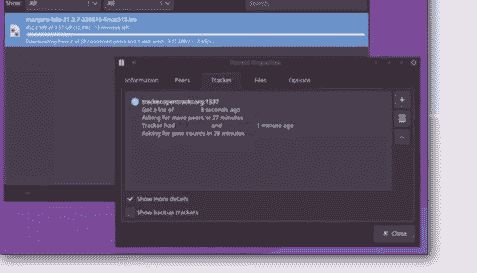

# Neon Modem Overdrive: 终端论坛访问

我们许多在 20 世纪 80 年代和 90 年代初使用拨号解调器访问公告板系统（BBS）的人，在迁移到带有协议、新闻客户端和网络浏览器的互联网之前要快乐得多。很多人依赖 `route`、`traceroute` 甚至 `ping` 等命令来确定系统如何到达以及本地配置问题在哪里。勇敢的新世界不需要连接或昂贵的电话通话，当然它成为了我们时代的主导技术。但这意味着在现代互联网出现之前一切都很糟糕。目前包括 `Discourse`（开源论坛服务器）、`Lemmy`（联邦社交网络）、`Lobste.rs`（联邦化的 Hacker News 等品）以及 `Hacker News`。通过命令行选项选择你想连接的服务器。顶部故事或你选择的服务器列表就像旧 BBS 上的消息。选择一个帖子读取其内容。有搜索的快捷键，以及在服务器和单个论坛之间切换的快捷键，以及发布你的回复。

体验在互联网上无法轻易重建，他们的对话感和羽化消息也是如此。这种体验是 Neon Overdrive 试图在现代时代通过你的终端重建的。

访问现代新闻网站和讨论论坛就像在 1988 年使用命令行一样。

`Neon Overdrive` 是一个 BBS 风格的命令行客户端，可以在你的终端中记住多个现代和联邦故事和评论。

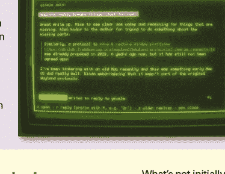

> Graham Morrison
> https://github.com/murusme/neonmodem

# Trippy: 网络分析

设计网络问题可能是困难的，特别是来自远程服务器的命令行。我们许多人依赖 `route`、`traceroute` 甚至 `ping` 等命令来找出系统如何到达，以及本地配置问题在哪里。`Trippy` 是一个很棒的小工具，它将三个工具的功能与易于理解且强大的基于终端的用户界面（TUI）结合在一起。

然而最初不容易理解的是运行 "`trippy`" 显示的命令，它不仅仅是好看，因为它提供了原始统计访问；它也可以在没有权限的情况下使用，尽管会丢失一些细节。

`Trippy` 支持 `TCP` 之外的多种跟踪选项，并将分析输出到 `JSON`、`CSV` 和 `Markdown` 格式。

`trip` 可以通过一个或多个 IP 地址或域名运行。几秒钟后主视图填充了数据包到达目的地经过的中间网络地址。它显示了跟踪 ping 时间的图表，你可以用方向键选择任何特定的跳点。这让你看到到达每个跳点的时间和丢包的百分比。它还显示了所选跳点详情之间的差异以及显示其地理位置的世界地图。这种带有多个图表的可视化方法很容易看到网络性能的任何变化，以及连接可能遇到问题的地方。它是 `ping` 和 `traceroute` 的绝佳替代。

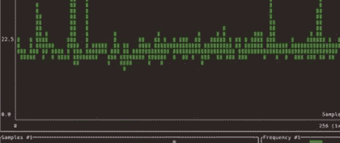

# 网络

## HACK 84

## internetarchive: 命令行访问

Internet Archive（互联网档案馆）不仅仅是一个主要用于历史研究的存档，它是现代互联网的骨干。它经常提供对受限、地理限制或围墙内容的访问，并致力于维护所有社交媒体未经编辑的随笔。这些现在发现了我们在线上的自由，而这通常取决于那些让人们负责任的人所做的转变，同时也提供了一个……

通过此工具，Internet Archive 拥有自己的一套开源命令行工具，可以通过 Python 的 `pip` 安装，也可以作为直接可执行的二进制文件安装。该二进制文件与 Internet Archive 的 API 交互，你可以仅通过终端的便利操作，完成许多使用键盘、鼠标和网络浏览器可以实现的任务。它对于自动数据录入，以及使用链接编辑和元数据上传特别有用。

这是人类将进入的伟大转型期中在线生活的快照。Internet Archive 非营利组织致力于免费实现这一切。它一直与我们合作，涵盖了 2023 年目前为止的所有存档，并可以通过你谦卑的网页进行访问。

通过该项目发布的一系列排序工具，在命令行中与 Internet Archive 交互。

但网页并不是进行严肃研究、学习或贡献超过几个文件的最佳场所。

从存档中获取特定项目，例如链接到带有标题、文件甚至条目集合页面的文件。还有生成文件（如电子书，“the fly”）的选项，这些文件通常在有人点击网站上的图标时自动创建。它可以节省大量时间，并帮助你避免在浏览离开你正在研究的内容（如 Amiga 经典合集）时受到干扰。

```python
pip install internetarchive

import internetarchive

archive = internetarchive.ArchiveSession()
item = archive.get_item('item-name')
for key, value in item.metadata.items():
    print(f'{key}: {value}')
```

## The-Desk: Mastodon 客户端

当 Twitter 让我们许多人发现非常难以使用时，该平台诞生了。幸运的是，现在我们不需要订阅就可以使用 TweetDeck 用户界面。或者，甚至可以在没有订阅的情况下使用该平台。但 TweetDeck 至关重要，因为它允许你为搜索、趋势和可能感兴趣的用户创建水平列列表。例如，你可能有一个“搜索”的列，或者一个显示提及某用户或标签的推文的列。这些列让你能够跳出在线时间线关注趋势，并管理各种不同的语境。TweetDeck 最初是一个第三方应用，使用 Twitter 的 API 构建了一个通往 140 字符社交媒体奇妙世界的门户，它是一个像 TweetDeck 这样的工具在今天无法开发的产物符号。免费的 API 已经消失了，对 TweetDeck 的访问也随之消失了。Mastodon 没有限制，现在有几个第三方客户端可以在被移植的社交馈流中实现列功能。The-Desk 已经领先，它支持显示器，并根据你从任何账户中想要添加的任何搜索和时间线，提供了一个完全可自定义的水平视图。这些内容是通过一个 markdown 图标添加的，之后你将看到一系列列选项列表，从过滤本地联邦时间线的列表到标记日期。它具有细致的控制程度，视觉可见且可以自动收回。你可以自由地更改头部大小和颜色、调整大小并配置。得益于流式 API，新故事会平滑出现。通过仔细调整，The-Desk 看起来可以像原始的 TweetDeck，而现在联邦宇宙（Fediverse）中对此有非常兴趣。

作者：Graham Morrison

https://thedesk.top/en/


### HACK

## goread: 终端 RSS 阅读器

## HACK 87

RSS 阅读器非常出色，因为 RSS 馈流只会提供故事的骨架或提及或更新，因此你可以自己决定是否投入更多时间来阅读。这并不能减少你在互联网上浪费的时间，但它可以作为你常规浏览之外有用信息和更新的渠道。然而，RSS 允许你步入日益嘈杂的弹出窗口、新闻以及许多网站自带的任何退出式营销。大多数 RSS 阅读器存在于网络浏览器内部（作为服务）或桌面应用程序，这使得网页往往变得被点击离开。

## Rymdport: 安全文件传输


我们几个时候非常喜欢优秀的 Magic Worm。它是一个命令行工具，可以在你的机器和互联网之风中的任何目标机器之间建立加密的点对点文件传输。对于这项工作，必须协商 NAT，然后机器必须找到到达目的地的方法。但 Magic Worm 透明地处理了这一切，只需通过路径或文件发送、接收，或者通过每次传输时显示的代码进行操作。但 Magic Worm 仍然需要一点命令行知识。这对于尝试传输的 Linux 和 macOS 用户来说可能不是什么困扰。

`goread` 是一个命令行 RSS 阅读器，它使用简单的配置文件链接到馈流，并在其基于策划的 UI 中呈现这些内容。它让网页变得简单，并帮助你在无需报告它们的情况下保持馈流更新。你可以直接从配置文件中查看类别和馈流的主列表，而主视图显示该列表馈流的内容。对于每个馈流，可以单独选择，也可以通过不同的聚合层进行选择。每个类别显示...

# Tiny RSS: RSS 托管

# 黑客技巧 89

有一个明显的趋势几乎追踪了命令行使用的轨迹，这已经持续了十年的演变：即对云端托管服务的背离。这可能是因为我们现在有了足够的容量来进行托管，并正在建立自己的服务器，或者付费使用微服务站点来运行几个应用程序。但是，走自己的道路有其巨大的优势，其中之一就是掌控自己的数据和自己的命运。它让你免于对隐私或服务的喋言不断的疑虑，并让你重新夺回对个人信息的控制权。

在你自己的订阅馈源库中穿梭。但 Tiny RSS 既是一个自托管的 RSS 聚合器，也是一个基于 Web 的 RSS 阅读器，它的功能与曾经表现出色但已完全停止的 Google 或目前仍然活跃的 Feedly 相当。Tiny RSS 值得你用来收集馈源并在自己的客户端上阅读，但它也是消费内容的绝佳场所。经过多年的开发，其 Web 界面功能比客户端要丰富得多。

它因缓存网页而闻名，这也是为什么 Tiny RSS 在历经多年之后依然强劲十足的原因。

它拥有插件和主题、可以在阅读文章时与原始文章并排显示的双或三栏视图、`JSON` API、部署功能、出色的管理功能，当然还有导入和导出馈源 OPML 列表的能力。如果你设置了一个服务器来运行杂项，例如这个这个工具就是完美的选择。

优秀的网站仍然提供它们的 RSS 馈源，其中包含它们的故事以及每个故事的更新和相应的链接。你使用像 Tiny RSS 这样的阅读器来追踪这些。

Tiny RSS 是一个出色的 RSS 聚合器和阅读器，你可以轻松地安装和运行。

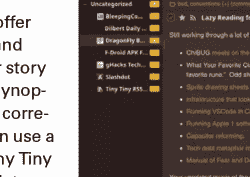

作者：Graham Morrison

# 黑客技巧 90 gping：可视化 ping

https://tt-rss.org/

如果说有一种 Linux 用户几十年来一直依赖的命令，那一定是 `ping`。它编写于 20 世纪 80 年代初，当时几乎每个人都能接入互联网，网络是用同轴电缆构建的，这种变化跟随我们从简单的家庭网络和拨号骨干，一直演变为多云提供商的扩展。`gping` 之能生存下来是因为它完美地执行了一个任务：让你知道远程对象有多远。Linux `ping` 对远程服务器所做的，就是运行机器是否在线，以及追踪数据包从你的机器到机器再回来需要多长时间。`ping` 的输出无非是每个数据包的一行文本，显示时间和时间差，这为留下了很大的改进空间，特别是如果你想随时间追踪响应情况，而这正是超级简单且超级用的 `gping` 的用处。

`Gping` 是一个命令行 `ping`，但它会显示一个或多个请求的响应时间。在本质上，它是 `ping` 的替代品，在每个请求的单行输出中，有一个点位于图表上。你可以看到间隔时间、缓冲区大小以及水平和垂直边距，当 `gping` 开始显示从你当前位置的访问性和当前机器的变化时，它将开始绘图。通过向命令添加多个一个目标以在同一张图表上获取每个目标的响应时间，你可以 地检查网络性能，并监控你的服务器，而且当你尝试用你的命令行技能惊艳他人时，它看起来酷极了。

`Gping` 可以解析 IPv4 和 IPv6 目标地址，并使用颜色来区分响应时间。

网络上的某些其他机器是否可访问并响应你的请求以确认边缘。“ping”这个名字大多指的是海洋声纳在声音回响时的脉冲声。

作者：Graham Morrison

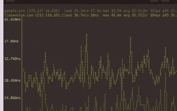

https://github.com/orf/gping

酷炫 Linux 黑客技巧 - 2025 版

77

# 网络

## 运行一个简单的 HTTP 服务器：weborf

在黑客 46 中提到的最糟糕的工具对于一次性任务是完美的，但如果你想共享一个文件以上的内容，或者保持隧道开启以便不必不断重新协商密钥，它就不那么妙了。还有其他方法可以实现，但 `weborf` 的简单程度几乎与 `weborf` 一样。

`weborf`（见图）建立了一个简单的 HTTP 服务器，就像旧时代的 Apache 一样，用于共享 `/srv/www` 的内容。这使得它极其灵活，不仅可以通过 Web 浏览器，还可以通过几乎任何访问网络的工具（如 WebDAV、虚拟根服务器命令和 CGI 脚本）。你指定要使用的端口（`--port`）和要共享的文件夹（`-d`），客户端只需使用正确的端口访问你的 IP 地址即可。你可以将其作为守护进程运行，使用身份验证，并仅监听来自你特定 IP 地址的连接。如果命令提供的选项过多，`weborf`（在独立包中）一个方便的基于 Qt 的 GUI 可以半自动地处理这一切，添加了遍历本地网络之外文件的 NAT 遍历，并将目录发送为 `.tar.gz`

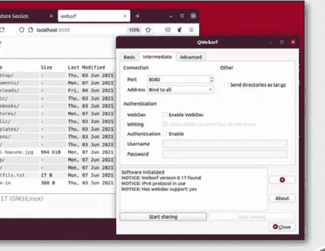

作者：Graham Morrison

## 在 SSH 会话中使用 screen

假设你正在通过 SSH 运行一个会话，并且一个命令需要一些时间才能完成（例如构建过程）。如果电脑进入睡眠或临时丢失网络连接，SSH 连接将断开。远程机器将终止，该会话中启动的所有进程将杀死你的构建。

你可以做几件事来避免这种情况。一个旧技巧是在后台运行进程，并让它们忽略连接丢失时发送的 hup 信号，以为网络更新和连接丢失做准备。对于构建过程，那可能是一个简单的命令。一个副作用是所有输出将将写入文件，而不是你的终端。我更喜欢的选择是不需要 `nohup` 或类似的技巧。我更喜欢在会话中使用 `screen`。（如果你的机器没有它，该包的名字就是 `screen`）。

当 `screen` 启动时，它会显示一条关于版权的消息；按回车退出。如果你丢失了连接，重新连接到远程机器并运行 `screen -r` 来重新附加会话。也许你不确定是否有 `screen -ls` 选项可用：

```
screen -d /dev/null
```

你可以自动化登录远程机器并检查 `screen` 的过程。创建以下行来：

```
screen -s
```

如果你想从运行中的会话中分离，按下 Ctrl-A，再按 D。你可以用 `screen` 做更多事情，这里是其中几个。

作者：Hans-Geer

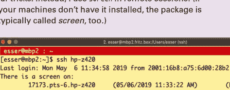

酷炫 Linux 黑客技巧 - 2025 版

78

# 网络


## 使用 sshuttle 建立隧道

在不可信的网络中，使用 `sshuttle` 建立隧道。这就像使用 VPN 一样。`sshuttle` 允许你通过 SSH 代理来加密流量，`sshuttle` 允许你通过 SSH 代理来加密流量。由于 `uttle` 隧道 建立隧道，`sshuttle` 允许你通过 SSH 代理来加密流量，`sshuttle` 允许你通过 SSH 代理来加密流量，`sshuttle` 允许你通过 SSH 代理来加密流量，`sshuttle` 允许你通过 SSH 代理来加密流量，`sshuttle` 允许你通过 SSH 代理来加密流量。

```
sshuttle -r <user><server>:80
```

```
Charly@local:~21 *
shuttle -dns -r sshuttle@kuehnast.com:80
```

# 文件格式

桌面文件管理器根据文件名的扩展名为每种文件类型定义默认应用程序。因此，当你（双）击文件时，默认程序将打开它。但很多时候，你只是想查看文件或对其进行一些更改，或者你可能想整理大量的文件。在这一期中，我们针对处理 ebook、Flash、JSON 和 ISO 文件，以及 RPM 和 DEB 软件包提供了一些建议。

| HACK 94 | HACK 99 | HACK 103 |
| --- | --- | --- |
| ebookread 0.1: 将 Ebook 文本转换为纯文本 81 | ASCII 艺术转换器：ASCII 艺术 84 | 点击鼠标挂载 ISO 镜像 86 |
| HACK 95 | HACK 100 | HACK 104 |
| Durdrad: ASCII 艺术编辑器 81 | Alexandria: Ebook 阅读器 84 | 获取 ISO 镜像的相关信息 86 |


| HACK 96 | HACK 101 | HACK 105 |
| Librum: Ebook 阅读器 82 | tone: 音频元数据编辑器 85 | 查看包内容 87 |
| HACK 97 | HACK 102 | HACK 106 |
| Ruffle: Flash 播放器 82 | fx: JSON 查看器 85 | 这是什么格式？87 |
| HACK 98 | | | |
| termdbms: 数据库编辑器 83 | | | |

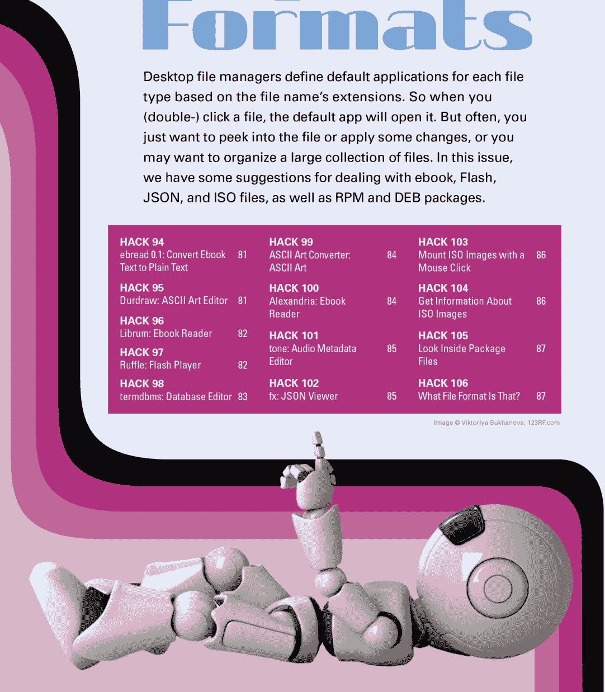

## ebookread 0.1: 将 eBook 转换为纯文本

`EPUB` 格式已成为电子书的标准，该格式实际上仅用于通过 `EPUB` 阅读器进行阅读。如果你想直接处理文本，你需要一种提取它的方法。基于 C 语言的 `ebook` 是一个简单的工具，可以将 `XHTML` 转换为文本格式。你需要从 Codeberg 仓库克隆该工具的源代码并自行编译。

使用 `ebook` 从 `EPUB` 文件中提取文本。

```
$ vhbraepub-html2txt:\/usr/local/bin/ebook-h -h
usage: ebook-h [options] file [-d] [-n] [-i] [-u] [-v] EPUB
  -f file --output-file=file
  -d dir --output-dir=dir
  -n name --name=name
  -i input --input=input
  -u output --output=output
  -v --verbose
  -q --quiet
  -h --help
  -version --version

将所有输出写入文件。
设置输出缩进大小（默认：is）。
输出文本。
打印此帮助信息。
启用输出（默认）。
显示版本。
打印程序版本。
```

调用参数定义了配置。要快速提取文本，请将要处理的 `EPUB` 文件名传递给工具。`Ebook` 会根据文件名创建一个文件夹并在其中存储文本文件。你可以使用 `-d` 指定目标目录。如果你想让 `ebook` 将文本写入单个文件，请指定带有名的文件 `(-o)`。`-u` 选项允许定义行长度，并使用 `-l`（小写 L）来格式化输出。要在不提取文本的情况下解压 `EPUB` 内容，工具将在详细模式下运行，这样你就能始终看到它当前正在做什么。对于脚本中的集成，你可以通过 `-q` 选项禁用此功能。

这个尚年轻的项目展现了潜力。除了在线帮助 `(-h)`，你还会找到一份详细的手手册。

https://codeberg.org/1-1sam/ebookread

## Durdado: ASCII 艺术编辑器

20 世纪80 年代著名的家用电脑之一之所以最初成功，是因为它们通常附带了供新用户尝试的演示程序。这些程序通常包含游戏、键盘训练以及图形向导。Commodore Amiga 64 包含了磁带，用于许多极端情况，并带了许多精妙的 Deluxe Paint。微软软件还包含了许多已久的图形编辑器，并帮助人们想象乐趣和创造力。`Durdado` 通过成为一个功能强大的文本绘图工具来适用于现代时代。`Durdado` 是一个 ASCII 艺术编辑器，具有许多简单的绘画功能，支持 16 或 256 色以及 Unicode 和 ANSI 字符。画布会适应终端的大小，你可以通过移动光标和按键在画布上画画，就像使用任何绘画程序一样。功能键是特殊字符，大部分功能通过按 `Esc` 访问。然后你可以进入屏幕菜单或直接输入命令。`Esc-C` 将打开色板，例如，而其他键允许你选择颜色、复制和粘贴文本块。它有一个完整的动画命令库，让你创建并复制现有文本，并设置延迟和播放速度。所有这些都存储在 `JSON` 格式的引擎中，用于渲染并在并在了一些额外依赖项的情况下写入 `PNG` 和 `GIF` 格式。如果你尝试让某人进入命令行或者这样，它是非常完美的。

除了绘画，它还可以使用 `437` 字符编码转换图像，这在老派 ANSI 艺术家中流行。

## Ruffle: Flash 播放器

`EPUB` 格式已成为电子书的标准，该格式实际上仅用于通过 `EPUB` 阅读器进行阅读。如果你想直接处理文本，你需要一种提取它的方法。基于 C 语言的 `ebook` 是一个简单的工具，可以将 `XHTML` 转换为文本格式。你需要从 Codeberg 仓库克隆该工具的源代码并自行编译。

## Librum: Ebook 阅读器

`EPUB` 格式已成为电子书的标准，该格式实际上仅用于通过 `EPUB` 阅读器进行阅读。如果你想直接处理文本，你需要一种提取它的方法。基于 C 语言的 `ebook` 是一个简单的工具，可以将 `XHTML` 转换为文本格式。你需要从 Codeberg 仓库克隆该工具的源代码并自行编译。

## termdbs: 数据库编辑器

### 文件格式

对于我们这些只是涉猎数据库的人来说，它们可能令我们深感畏畏。我们并不是害怕它们的 SQL 界面（特别是这个）或它们的配置；通常是因为数据库操作始终是高风险的。当你从不在同一个数据库中执行查询时，非常很容易因为一个字符或一次误解的转而导致灾难性的错误。当你正在运行数据库，且输出管理是你日常工作中的众多任务之一时，提高水平的方法总是可能的。

在这些情况下，某种图形界面可以有所帮助。它们通常设计用于引导你完成一系列特定的最佳实践步骤，并配备操作和质量验证。但最重要的是，你不需要记忆特定命令的语法并担心自己的错误。图形界面应该在后台为你完成这些工作。

从命令行访问 `SQLite` 和 `CSV` 格式的数据库，甚至可以在它们之间查询数据。

对于像我们这一代 PHP 和 MySQL 用户来说，这就是 `phpMyAdmin` 如此流行的原因。`phpMyAdmin` 帮助你可视化 `MySQL` 表格和查询结果，为你提供帮助并检查你的输入。`Termdb` 完成了同样的事情，但不需要 PHP。它是一个用于 `SQLite` 和 `CSV` 格式数据库的简单工具（支持 `MySQL` 服务器），非常适合你可能在家庭自动化系统中运行的那些本地服务器。在无需了解任何行或列数量的情况下，通过对 `SQLite` 支持执行搜索并更新数据库中的任何数据。一切都是交互式的，这意味着当你导航或搜索时，用户界面会更新以显示你搜索的当前状态。它具有类 `Vim` 的编辑控制方式，甚至支持这些操作，而且更好。

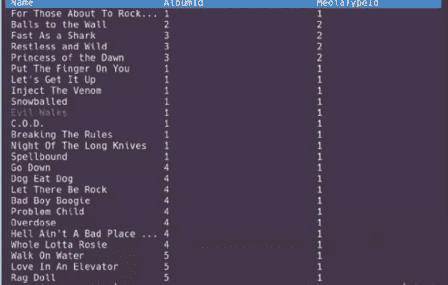

> 作者 Graham Morrison

> https://github.com/mathau/termdmbs


# 了解 ADMIN

`ADMIN` 在专业读物中包含了关于当代话题的详细讨论，包括安全、云计算、DevOps、HPC、容器、网络等。

## 订阅 ADMIN 每周获取 6 期内容

`ADMIN` 网络与安全杂志是你解决现实问题技术解决方案的来源。

- @adminmagazine.com 在 `ADMIN` 杂志中
- @adminmag @adminmagazine@hachyderm.io

## ASCII 艺术转换器：ASCII 艺术

### 技巧/黑科技

在计算机计算早期，如果你想找点乐趣，就必须利用现有的任何有限资源来实现。当显示器和打印机只能打印字符而不是像素图形时，许多乐趣都涉及 ASCII 字符。得于 Unix 的设备/文件架构，ASCII 文本可以发送到远程终端、行式打印机以及任何连接到网络的设备。你与那些只会“Hello World”团队的区别仅在于你所发送的 ASCII 质量。因此有了来自 `banner` 命令和 `coway` 的气泡字体文本。几十年后，现在这似乎真的没必要了，但这并没有阻止 ASCII 艺术转换器的出现，以应对那些你绝对需要尽可能美观文本的时刻。

ASCII 艺术转换器是一个快速且有趣的小工具，它完全符合你的预期。它将现代图像转换为古老的图像，这实际上意味着它将 `JPEG` 和 `PNG` 文件转换为图像的 ASCII 等效版本，仅使用 ASCII 重新重建图像。尽管转换器的质量很高，但它在所有图像（无论是输入还是输出）上的表现并不完美，不过你可以从中生成非常漂亮的结果。通过此工具，有可选参数可以强制指定宽度或高度，还可以更改增益以帮助消除相同颜色的背景和前景。最好的选项是 `--live`，它将在一个编辑器中打开 ASCII 转换，你可以在那里调整尺寸和增益值。生成效果效果的最简单方法——这让你面临寻找打印机 IP 地址的问题。ASCII 转换器的 `ascii` 命令允许交互模式，你可以在其中将 ASCII 转换输出到终端。

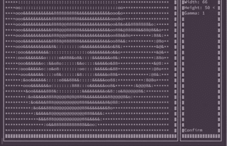

https://github.com/thed42/ascii-gen

作者 Graham


考虑到亚历山山大图书馆的衰落以及随后知识的流失，Alexandria 作为一个电子书阅读器是一个绝佳的名字。在许多书籍受到数字限制的情况下，依靠少数强大的应用程序来阅读和管理那些受限于特定围墙花园的书是非常好的。Alexandria 是这些应用之一。与 Calibre 等其他应用不同，它专注于阅读，为查看你的集合提供极简界面。它通过提供单一集合视图来实现这一点，仅涵盖你拥有的书籍。虽然你可以对这些书籍进行过滤和搜索，但无需过度担心它们的组织工作令人清爽。其次，Alexandria 支持所有的导入格式，包括 ebook 和 epub3，以及来自 Kindle 设备的 AZW 和 MOB3。除了这些，


你还可以导入常见的 MOBI 格式书籍、纯文本、漫画以及原生格式的小说。

# 文件格式

# 黑客技巧 103

## 点击鼠标挂载 ISO 镜像

在过去，我们通常下载 ISO 镜像并将其刻录到 CD-ROM 或 DVD-ROM 中。虽然这在今天仍然可行，但更典型的用法是将其写入 USB 闪存盘并从 U 盘启动。

如果你在 openSUSE 上使用 KDE，可以安装 `state-disk-imagesounter` 软件包，它包含了基本上相同的工具。在 Dolphin 中手动将其添加为 `*.iso` 的默认应用后，它的运行方式就像 Gnome 一样了。

此外，Linux 允许你通过简单将 ISO 镜像挂载到文件夹来访问它们。传统上，你会输入类似下方的命令：

```
sudo mount -o loop,ro=some.image /mnt/
```

Ubuntu 的 Gnome 预配置了通过双击挂载 ISO 镜像。

在终端窗口中，现代 Linux 发行版也允许你用同一个镜像进行此操作。在 Gnome 文件管理器中，你只需双击 ISO 镜像即可调用一个名为 `mount` 的小工具；或者在命令行中通过文件选择器手动运行此命令，并选择一个 ISO 镜像进行挂载。Gnome 和镜像管理器拥有 .iso 或 .image 文件，若要将 ISO 存储为 `some_name.image`，你可以右键点击它，选择“打开方式”，并选择“磁盘镜像管理器”。

作者 Hans-Georg Eeger

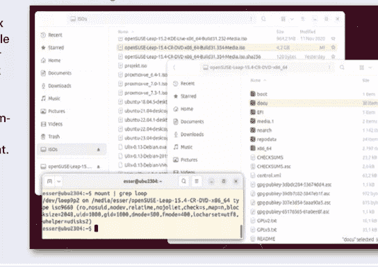

## 获取 ISO 镜像信息

挂载 ISO 就足够了，但有时当你真的想查看 ISO 镜像的元数据时，这并不是必要的：它是什么，谁制作的，它的属性是什么？你可以使用 `isoinfo` 来查询信息。

你可以为特定信息添加更多选项，例如，`-d` 显示 ISO 镜像的元数据，`-i` 将显示带有属性的完整文件列表。Linux 镜像将显示所有扩展名（允许文件名包含大小写字符以及包括所有者、组和访问权限在内的 Unix 文件属性），或者使用 `-r` 查看更多详情。

该命令行工具有一系列选项。选项 `-i` 是你用于选择镜像的选项。

对于自动化来说，最好生成你想要生成的输出。`-f` 选项显示所有文件及其路径。你可以快速在给定名称中搜索特定文件。你需要找到一个名为 `make_4.3.1.build1_amd64.deb` 的文件，并知道它在你某个 Ubuntu 镜像中。你可以使用以下命令搜索所有镜像：

使用 `-i`，你可以在不挂载的情况下从 ISO 镜像中提取信息。

```
isoinfo -f some_image.iso -i 2>/dev/null | grep "make_4.3.1.build1_amd64.deb";
```

它会显示 ISO 文件名以及它是否包含内部文件的 `-` 路径。

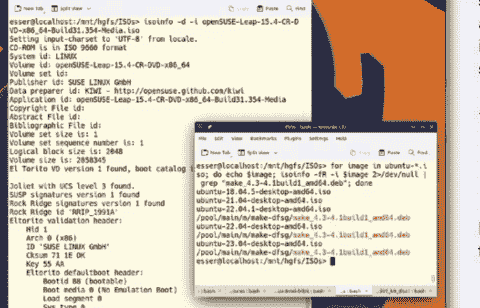

作者 Hans-Georg Eeger

## 黑客技巧 104

酷炫 LINUX 技巧 – 2025 版

## 黑客技巧 105

## 查看包文件

经典软件包具有 `.deb` 和 `.rpm` 扩展名，它们很少见，因为软件包安装是由基于仓库的工具（如 APT 和 Zipper）处理的。它们最终会下载、解包并安装这些文件，但你不需要直接接触它们。除非你发现无法通过官方或其他仓库获取软件，那时你可能需要直接提供包内容。

你可以使用 `dpkg -i package` 安装 Debian 软件包，或使用 `rpm -i package`（如果你想让包管理器 APT 解决依赖关系，同样地，你可以使用 `rpm -rp` 处理 RPM 软件包（如果你运行 openSUSE 系统或基于 RPM 的发行版，请使用高级软件包工具，例如 Fedora 使用 Yum）。但但如果你想在安装之前检查内容：

如果你一直没有使用命令行管理器（`less`），请安装并运行它。通过光标导航并按回车返回，你可以用 Vim 编辑文件，或者如果不起作用——`less` 将通过 `0`、`Exit` 退出。如果你想在 rpm 系统上检查 `.deb` 包，你需要安装一些低级软件包工具。在 Ubuntu、Debian 或 Mint 上，安装 `apt-utils`。

现在浏览到 `.deb` 包文件并按 F3 获取某些信息，或按回车进入包内容。从那里，你可以通过将它们复制到另一侧来提取文件。注意此功能在 Ubuntu 24.04 中更好；我们正在等待一个 Bug。

作者 Hans-Georg Eber

## 那是什么文件格式？

像 Dolphin 和 Nautilus 这样的文件管理器会查看它们正在处理的是什么类型的文件扩展名，更重要的是为它选择哪个应用程序。但还有另一种寻找文件类型的方法，那是真正的魔法。不是巫师和魔法师的魔法，而是“魔数文件”（magic file）的魔法。命令行使用一组配方（存储在 `/etc` 中的魔数文件）来检查文件中特定的字节，并以高概率识别文件类型。

一个非常简单的例子，PNG 图像文件的前六个字节始终是 `'89 P N G'`。

```
$ hexxd -c 8 package.png
89 50 4e 47 0d 0a 1a 0a | PNG.. |
```

所以，如果你有一个这些内容的文件，可以安全地假设它是一个 PNG 文件。文件测试这些列表，但它还可以做更多。许多类型都会显示。

作者 Hans-Georg

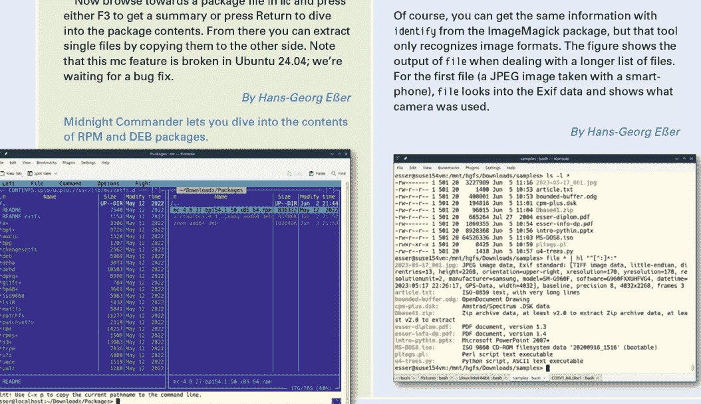

酷炫 LINUX 技巧 – 2025 版

# Shell

在终端窗口中，现代 Linux 发行版也允许你用同一个镜像进行此操作。在 Gnome 文件管理器中，你只需双击 ISO 镜像即可调用一个名为 `mount` 的小工具；或者在命令行中通过文件选择器手动运行此命令，并选择一个 ISO 镜像进行挂载。Gnome 和镜像管理器拥有 .iso 或 .image 文件，若要将 ISO 存储为 `some_name.image`，你可以右键点击它，选择“打开方式”，并选择“磁盘镜像管理器”。

作者 Hans-Georg Eeger


挂载 ISO 就足够了，但有时当你真的想查看 ISO 镜像的元数据时，这并不是必要的：它是什么，谁制作的，它的属性是什么？你可以使用 `isoinfo` 来查询信息。

你可以为特定信息添加更多选项，例如，`-d` 显示 ISO 镜像的元数据，`-i` 将显示带有属性的完整文件列表。Linux 镜像将显示所有扩展名（允许文件名包含大小写字符以及包括所有者、组和访问权限在内的 Unix 文件属性），或者使用 `-r` 查看更多详情。

该命令行工具有一系列选项。选项 `-i` 是你用于选择镜像的选项。

对于自动化来说，最好生成你想要生成的输出。`-f` 选项显示所有文件及其路径。你可以快速在给定名称中搜索特定文件。你需要找到一个名为 `make_4.3.1.build1_amd64.deb` 的文件，并知道它在你某个 Ubuntu 镜像中。你可以使用以下命令搜索所有镜像：

使用 `-i`，你可以在不挂载的情况下从 ISO 镜像中提取信息。

```
isoinfo -f some_image.iso -i 2>/dev/null | grep "make_4.3.1.build1_amd64.deb";
```

它会显示 ISO 文件名以及它是否包含内部文件的 `-` 路径。


作者 Hans-Georg Eeger

## 黑客技巧 105

## 查看包文件

经典软件包具有 `.deb` 和 `.rpm` 扩展名，它们很少见，因为软件包安装是由基于仓库的工具（如 APT 和 Zipper）处理的。它们最终会下载、解包并安装这些文件，但你不需要直接接触它们。除非你发现无法通过官方或其他仓库获取软件，那时你可能需要直接提供包内容。


酷炫 LINUX 技巧 – 2025 版

# Shell

在终端窗口中，现代 Linux 发行版也允许你用同一个镜像进行此操作。在 Gnome 文件管理器中，你只需双击 ISO 镜像即可调用一个名为 `mount` 的小工具；或者在命令行中通过文件选择器手动运行此命令，并选择一个 ISO 镜像进行挂载。Gnome 和镜像管理器拥有 `.iso` 或 `.image` 文件，若要将 ISO 存储为 `some_name.image`，你可以右键点击它，选择“打开方式”，并选择“磁盘镜像管理器”。

作者 Hans-Georg Eeger


挂载 ISO 就足够了，但有时当你真的想查看 ISO 镜像的元数据时，这并不是必要的：它是什么，谁制作的，它的属性是什么？你可以使用 `isoinfo` 来查询信息。

你可以为特定信息添加更多选项，例如，`-d` 显示 ISO 镜像的元数据，`-i` 将显示带有属性的完整文件列表。Linux 镜像将显示所有扩展名（允许文件名包含大小写字符以及包括所有者、组和访问权限在内的 Unix 文件属性），或者使用 `-r` 查看更多详情。

该命令行工具有一系列选项。选项 `-i` 是你用于选择镜像的选项。

对于自动化来说，最好生成你想要生成的输出。`-f` 选项显示所有文件及其路径。你可以快速在给定名称中搜索特定文件。你需要找到一个名为 `make_4.3.1.build1_amd64.deb` 的文件，并知道它在你某个 Ubuntu 镜像中。你可以使用以下命令搜索所有镜像：

使用 `-i`，你可以在不挂载的情况下从 ISO 镜像中提取信息。

```
isoinfo -f some_image.iso -i 2>/dev/null | grep "make_4.3.1.build1_amd64.deb";
```

它会显示 ISO 文件名以及它是否包含内部文件的 `-` 路径。


作者 Hans-Georg Eeger

## 黑客技巧 105

## 查看包文件

经典软件包具有 `.deb` 和 `.rpm` 扩展名，它们很少见，因为软件包安装是由基于仓库的工具（如 APT 和 Zipper）处理的。它们最终会下载、解包并安装这些文件，但你不需要直接接触它们。除非你发现无法通过官方或其他仓库获取软件，那时你可能需要直接提供包内容。

你可使用 `dpkg -i package` 安装 Debian 软件包，或使用 `rpm -i package`（如果你想让包管理器 APT 解决依赖关系，同样地，你可以使用 `rpm -rp` 处理 RPM 软件包（如果你运行 openSUSE 系统或基于 RPM 的发行版，请使用高级软件包工具，例如 Fedora 使用 Yum）。但但如果你想在安装之前检查内容：

如果你一直没有使用命令行管理器（`less`），请安装并运行它。通过光标导航并按回车返回，你可以用 Vim 编辑文件，或者如果不起作用——`less` 将通过 `0`、`Exit` 退出。如果你想在 rpm 系统上检查 `.deb` 包，你需要安装一些低级软件包工具。在 Ubuntu、Debian 或 Mint 上，安装 `apt-utils`。

现在浏览到 `.deb` 包文件并按 F3 获取某些信息，或按回车进入包内容。从那里，你可以通过将它们复制到另一侧来提取文件。注意此功能在 Ubuntu 24.04 中更好；我们正在等待一个 Bug。

作者 Hans-Georg Eber

## 那是什么文件格式？

像 Dolphin 和 Nautilus 这样的文件管理器会查看它们正在处理的是什么类型的文件扩展名，更重要的是为它选择哪个应用程序。但还有另一种寻找文件类型的方法，那是真正的魔法。不是巫师和魔法师的魔法，而是“魔数文件”（magic file）的魔法。命令行使用一组配方（存储在 `/etc` 中的魔数文件）来检查文件中特定的字节，并以高概率识别文件类型。

一个非常简单的例子，PNG 图像文件的前六个字节始终是 `'89 P N G'`。

```
$ hexxd -c 8 package.png
89 50 4e 47 0d 0a 1a 0a | PNG.. |
```

所以，如果你有一个这些内容的文件，可以安全地假设它是一个 PNG 文件。文件测试这些列表，但它还可以做更多。许多类型都会显示。

作者 Hans-Georg


## 使用 Zoxide 导航


在大多数 shell 中，主要的导航工具是 `cd`（切换目录）。`cd` 通常内置在 shell 中，像其他命令一样有自己的帮助页面，但这通常不会被注意到，因为大多数用户基础都是 `cd`。然而，当目录有多个层级时，`cd` 可能需要繁琐的输入，尤其是当你需要在目录结构向上移动并进入另一个目录时。`cd` 的现代版本 `zoxide` 通过数据库改变了这一点，它只需要路径中的最后一个目录。

为了获得结果，`zoxide` 依赖于基于目录访问频率的算法。在首次添加到数据库时，`zoxide` 会分配一个分数。你每访问它一次，分数就会增加。当进行查询时，如果目录在过去一天或一周内被访问过，就会添加。使用频率越高，值越高。当数据库达到最大条目时，它会重新分配访问频率并删除旧条目。

## 安装与配置

`Zoxide` 可用于许多发行版，也支持多种平台和包格式。然而，安装包只是开始。为了使其运行，`zoxide` 需要一些配置。首先，需要将 `zoxide` 添加到 shell 中。

```
eval $(zoxide init)
```

必须将其添加到 `~/.bashrc`、`~/.zshrc` 或手动使用 `zoxide-init`。`zoxide` 的 GitHub 提供了其他 shell 的说明。为了搜索目录名称，必须安装模糊搜索器 `fzf`。安装后，你可以更改命令名称。目录通过 `--SETTING` 存储在数据库中，可以选择 `none`、`prompt` 或 `pulp` 模式。

另一个简单的选项是将 `zoxide` 与 Emacs、Vim 和 nano 等应用程序集成，或者作为 Ranger 等多个文件管理器的一部分。这些由许多流行的开发者发布在 GitHub 上，例如 Joe 这样的文本编辑器，或 Dolphin 或 Doxide 这样的文件管理器。`zoxide` 的行为也可以通过环境变量设置：

- `ZOXIDE_DIR`: 指定存储数据库的目录。使用 `$ZOXIDE_DIR=$HOME` 进行本地存储。
- `ZO_E`: 设置为 1 时，将在导航到目录之前显示该目录。通过此变量，你可以使用 `-f` 从完整路径运行 `cd`
- `ZO_EXCLUDE`: 指定数据库中排除的目录。默认排除 `/home`。这对于安全和隐私很有用。
- `ZO_FZF_OP`: 提供在交互选择期间传递给 `fzf` 的自定义选项。实用的选项包括大小敏感性、搜索结果中目录权重的替代方法以及显示的选项。请查看 `fzf` 的选项列表。
- `ZO_MERGE`: 限制数据库中的最大条目数量。默认值为 10,000。

## 使用 Zoxide

所有这些配置使得 `zoxide` 使用非常简单。输入 `PATH`，最终目录会被添加到数据库中。下次当你需要导航到该目录时，只需要输入 `DIRECTORY`，无论它在目录树中有多深。例如，

```
z/home/etc
```

下次当你想创建 `zoxide` 时。一旦设置完成，你可以将最常用的目录添加到数据库并简化你的导航。当模式匹配时，你可以使用 `Space-Tab` 进行基于数据库的搜索并从列表中选择！这需要安装 `fzf`。

随着数据库的填充，`zoxide` 将选择排名最高的目录。你可以通过搜索路径中的多个目录或通过使用子路径来更改此行为。如果你带有子目录进行添加，`zoxide` 将通过 `-` 向进入一个目录，或通过 `~` 进入上一个目录。

对于更高级的用户，不再返回任何信息

`zoxide` 的行为可以通过放置在基本命令之后的自定义脚本进行编辑。你可以添加一个排名为 1 的路径，或者增加数据库中目录的排名。之后，条目的最后一个字段将得到更新。`ZO_EXCLUDE` 环境变量中的目录无法被添加。使用更快的方法添加目录而无需从导航中选择它们。

- `zoxide --port Fzf`: 输出格式对 `fzf` 关重要。`fzf` 的选项有 `--all` 和 `--interactive`。使用 `--(-1)` 时将返回所有结果，而不仅仅是使用过的；使用 `--score (-)` 列出排名，这些排名可以通过 `zoxide` 进行操作。
- `zoxide --remove`: 从数据库中删除目录。如果目录在 `ZO_EXCLUDE` 环境变量中，将从数据库中删除该目录。

例如使用 `zoxide`，返回的命令数量为

用户可能想通过在配置文件中添加别名 `alias cd` 让 `zoxide` 成为 `cd`。`zoxide` 节省了数千次击键，既高效又优雅。

图 1：当 `zoxide` 提供供选择的备选列表时。

```
# /home/bb/moonlander_notes
#/home/bb/moonlander
```

作者：Bruce Byfield

https://github.com/ajeetssoa/zoxide

## SHELL


## 寻找你喜喜欢的终端 HACK 111

## 使用最强大的分页器。

所有的操作系统都带有一个 shell，也有分页器（pager）：一个显示 ASCII 文本文件的页，每一页被定义为一个屏幕（或满满行的终端窗口）。在类 Unix 系统以及 MS 和 Windows 上，经典的分页器是：它显示文件的第一行，并在最后一行写入“More”，然后等待按键输入后再显示下一页。

# 使用 screen 保存你的 SSH 会话

以下模式看起来看起来熟悉吗？你通过 SSH 登录到远程计算机，在 Vim 等编辑器中修改文本文件，然后离开去忙其他事情。当你的 SSH 连接断开时，你再次登录，再次打开文件时，Vim 就会抱怨你已经在编辑它了。

这种情况在我身上经常发生，尽管我知道如何解决这个问题：在连接到远程系统后，运行 `screen`，它将创建一个可以保存你会话的新终端。（如果你还没有安装它，请使用包管理器获取。）

1. 打开两个终端窗口，并在两个窗口中都 ssh 登录到远程机器。
2. 在其中一个窗口中，输入 `tty` 查看终端设备。输入 `screen`，然后按回车进入 `screen` 环境。
3. 你现在处于一个由 `screen` 创建的自由终端中（输入 `tty` 查看变化）。在此处，用编辑器打开一个文件，例如：`vi ~/.bashrc`（如果远程机器上存在该文件）。移动到文件末尾并添加行，无需离开。
4. 通过关闭窗口来结束会话。在主窗口中，输入 `screen -RR`。你将重新连接到 `screen` 创建的终端，因此你会回到编辑器。在 `screen` 语言中，你刚刚“重新连接”（reattach）了终端。输入 `tty` 确认这确实是同一个终端。

终端会话将保持激活直到远程机器关机——直到你退出它。当你处于会话中，只需按下 `Ctrl-D` 即可分离（detach） shell。

你也可以要求“分离”当前会话。按下 `Ctrl-A`、`D`，你会收到类似下面的消息：

```
[from $2489.pts/0]
```

你回到了最初启动的 shell。运行 `screen -RR` 重新连接到会话。

如果你有多个只使用 SSH 的服务器，可以让他们它们自动启动 `screen` ——只需在 `~/.bashrc`（或你使用的其他启动文件）末尾添加以下行：

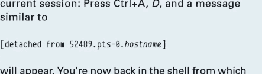

```
if [ -z "$TTY" ]; then screen -RR; fi
```

### 这将自动重新连接已分离的会话（如果没有则启动新的）。变量检查防止了 screen 会话的冲突。

## 更多功能

`screen` 除了保存 SSH 连接外还有许多其他功能。它是一个终端复用器：按下 `Ctrl-A`、`Shift-S` 分屏终端。窗口将分为两个同样大的窗口，其中一个处于激活状态。按下 `Ctrl-A`、`T` 将焦点移动到新区域，然后按下 `Ctrl-A`、`C` 在它们之间切换。你现在同一个会话中拥有两个终端。

类似地，你可以选择当前视图：按下 `Ctrl-A`、 `/`（管道符号）来实现这一点。你可以通过按下 `Ctrl-W` 退出所有这些视图。当你分离时，布局将会丢失（除非你选择 `-`，这样你只会在全屏模式下（终端内部）看到那一个会话）。要访问不可见的会话，按下 `Ctrl-A`、`,`，这将列出终端列表，你可以通过按键选择其中一个并按回车。

你可以通过编辑 `.screenrc` 配置文件更改许多选项。例如，你可能不喜欢 `screen` 使用 `Ctrl-A` 快捷键跳转到不同会话。（在会话中按下 `Ctrl-A`、`A` 可执行此操作）。要将其更改其他内容，只需在该文件中添加

```
escape ^B
```

同时也加上：

```
layout default
```

将在分离会话时保存分屏窗口的布局。

## 替代方案


`screen` 是一个非常好用的工具，自 1987 年以来一直存在！现代的替代方案是 `tmux`。你可以用它来识别 SSH 会话：安装并运行 `tmux`。你会发现它更好，因为它在终端底部显示了一个状态行。使用 `Ctrl-B`、`D` 分离会话（`tmux` 使用 `Ctrl-B` 而不是 `Ctrl-A`）来关闭窗口。然后用 `tmux` 重新连接会话。还有更多的复用器，但大多数不提供重新连接功能。

> 作者 Hans-Georg Eller

[1] https://www.gnu.org/software/screen/

[2] https://github.com/tmux/wiki

## ssc: 脚本编译器

简单脚本编译器 `ssc` 将脚本转换为二进制格式。你需要自己从源码构建该工具。

要将脚本转换为二进制文件，将脚本名称传递给 `ssc`，以及未来二进制文件的名称，`ssc` 会将代码转换为 ELF 文件。其中，`ssc` 支持 Bash、Perl、Python、Node.js、Lua 和 Ruby。默认情况下，程序使用库进行动态链接；使用 `--static` 创建静态二进制文件，尽管这会增加生成文件的大小。`-e` 选项允许 `ssc` 将预定义的解释器集成到二进制文件中。通过分析脚本，你可以添加调试功能，在启动时检查调试器是否激活以及是否需要它。

虽然 `ssc` 无法编译大于 8MB 的脚本，但它至少可以通过 RSA 加密代码来躲避窥探。要解密，请在调用时使用 `-o` 选项。输入 `-h` 获取在线帮助。GitHub 页面提供了更多描述和示例。

> 作者 Uwe Vollibricht

```
https://github.com/libersec
```

使用 `ssc` 的选项管理进程。

```
Terminal: uvollibricht@machine: ~$
ssc -h
Usage: ssc [options] <script> <output>
Options:
  -e <interpreter>  将预定义的解释器集成到二进制文件中
  -static           创建静态二进制文件
  -o <output>       解密文件
  -h                显示帮助
Supported languages: Bash, Perl, Python, Node.js, Lua, Ruby
```

## envio: 环境管理器

环境变量是命令行体验不可或的一部分。当你手动管理它们时很不方便，当你跨计算机共享账户时，这变成了一个问题。坦率说，`envio` 通过改进环境变量管理解决了这些问题。

`envio` 是一个具有两个主要功能的命令行工具。它在配置文件中存储环境变量。配置文件是你为任务使用的一组环境变量。你可以通过切换配置来切换项目。最棒的部分是所有变量都经过 GPG 加密。这意味着当你未激活时，其他人无法通过打开命令行访问它们，或通过配置文件看到你的环境变量。

`envio` 最棒的地方在于它易于使用。当你创建第一个配置文件时，它会要求你解锁加密密钥。你有添加、删除和更新密钥的命令，以及卸载配置以返回终端的默认状态。

> 作者 Graham Morrison

```
https://envio-cli.github.io/
```


```
$$ envi init my-profile
## 创建一个新的配置
$ envi add KEY=VALUE to a profile for use in your terminal sessions
## 从配置中添加环境变量到终端
$ envi launch my-profile
## 使用配置的环境启动
$ envi list
# 列出配置中的所有环境变量或当前显示的所有
$ envi set KEY=VALUE
## 覆盖变量并将其导入系统或本地文件
$ envi remove my-profile
## 将移除给定的配置
$ envi help
## 帮助
$ Enter your encryption key: ******
## 这可能会显示你 [y] 来设计你的配置
```

# Shell Genie: 使用 AI 生成 Shell 输入

人工智能（AI）已经主导了 IT 世界和媒体界数月。报道的语调从“人类的恩者”到“对人类的威胁”不等。为了保持这一趋势，我创建了 Shell Genie，这是一个新工具，它利用 AI 尝试让我们的 Shell 生活变得更轻松。

Shell Genie 命令行工具通过可以立即执行的命令来回答你的查询。你可以在 Shell Genie 中两个模型：GPT-3.5 或 Free Genie。GPT-3.5 是 OpenAI 的 ChatGPT 的当前版本。你需要一个 API key（花费 20 美元并包含 ChatGPT）来作为后端。作为替代方案，你可以使用 Free Genie，这是一个由 Shell Genie 开发者 Daniel Castillo 维护的免费模型。Shell Genie 可以通过用户输入的提示（prompt）来触发。

我无法保证运行 Genie 的服务器会一直可用。Shell Genie 正常运行的关键在于识别底层的操作系统，因为 Shell Genie 是针对操作系统回答问题的（图 1）。

# 擅长语言

Shell Genie 的提示词始终以 `shell-genie ` 开始，后面跟着一个带引号的语句。如果你已经使用过 ChatGPT 或类似的工具，你将熟悉其原理。问题越精确，答案越好（图 2）。你可以用英文提问，也可以用其他语言提问。在测试中，我发现用英文正确提问命中率最高。然而，大多数时候，Shell Genie 会对德语提问返回响应。

# 安装

安装 Shell Genie 最简单的方法是使用 `pip`，它是 Python Package Index 的安装器，如果你使用发行管理器安装了 `pipx` 包，它就会存在。你可以通过以下命令安装 Shell Genie：

```bash
pip install shell-genie
```

对于目前的 0.10 版本，你需要安装 Python 3.8 或更高版本。将工具安装到 `~/.local/bin`。如果你收到消息该目录不在你的路径中，可以通过添加新的终端变量或注销来修复。

接下来，你可以用以下命令初始化它：

```bash
shell-genie init
```

初始化时，你需要选择后端。如果你选择 Free Genie，你需要决定是否想对你问的问题和命令输出提供反馈，以便改进免费后端。Shell 警告说他

如果你不精通，Shell Genie 将提供一个命令来查找当前目录下所有以 `.txt` 结尾的文件（列表 1，第 1 行）。Shell Genie 大约需要三秒回答这个问题（第 2 行）。可以通过输入 `y` 确认来返回命令输出。通过运行命令，它将确定生成的命令是正确的。为了学习目的，系统会询问你是否想完成默认任务。

```text
File View Search Help | shell-genie init
$ shell-genie init "list all .txt files"
```

```text
> that will be the requested, command. OS, and then will improve to model the.
> the server will be running 24/7.
> do you want to continue? (y/n)
> your OS is Linux Mint 21.3 (y/n)
> following the generated commands to improve the models? (y/n)
> configuration complete! env: linux, shell: bash
> config saved to /home/user/.config/shell-genie/config.jaso
$ shell-genie init "find all files with .txt suffix in current directory"
```

```text
File View Search Help | shell-genie init
$ shell-genie "find all files with the txt suffix in the current directory"
> return only
> list type = "*.txt"
> do you want to run the command? (y/n)
> ~/install.txt
> did the command work? (y/n)
```

图 2：问题非常重要。我必须添加“only”一词，结果命令才能配合 -1 限制在当前目录。

## SHELL

### 列表 1：问题与回答

| 行 | 内容 |
| :--- | :--- |


| 01 | `$ shell-genie ask -find all files with the txt suffix in the current directory` |

| 02 | Command: `find -maxdepth 1 -type f name "*.txt"` |

| 03 | `$ shell-genie ask -find all files with the md suffix and a file larger than 50kb in the current directory and its subdirectories` |

| 04 | Command: `find -type f "*md" -size +100k` |

| 05 | `$ shell-genie ask -find all files and replaces the first letter A and B with a and b` |

| 06 | Command: `find -f "*.txt" -exec sed -i 's/A/a;s/B/b' \;` |

问题的性质。然而，要提醒的是某些答案可能是错误的。我在测试中没有发现这种情况；所有命令都经过纠正并可以运行。

Shellie 回答每一个像关于辩论那棘手问题

### 列表 2：输入别名

```bash
$ echo alias shell-genie='shell-genie ask' >> ~/.bashrc
$ source ~/.bashrc
```

硬盘上的所有数据（4）没有区分大小：取决于你是否真的想执行该命令。如果你不完全理解某个命令的作用，最好使用 `explainhell` 网络服务，它将详细解释该命令。Shell Genie 在确认命令之前会提示你。

当我在单词之间留空格时，系统无法处理错误消息。项目的 GitHub 页面提到了 `-explain` 选项。如果添加到查询中，其目的是详细解释结果。但对我来说不起作用。在某些情况下，ChatGPT 商业版的唯一请求超过了 Free Genie 的能力。你也可以用 (3) 制定相同的问题。列表 1 第 3 行的问题包含了子目录且仅限大于 50kb 的文件。Shell Genie 的回答是正确的（1）。时间没有由于问题的性质而改变。

# 结论

Shell Genie 对于对于不经常使用终端或不知道所有键和所需参数的用户来说，是一个非常有用的工具。鉴于 AI 目前的发展状态，尽管很有帮助，但这并不意味着返回给你的命令总是正确的。Shell Genie 是噱头还是有用的工具取决于持有者。

多个语句也可以组合，例如查找和替换，如列表 1 第 5 行的问题所示，生成的命令是正确的（第 6 行）。重复！shell 可以作为一个别名。我使用了 `alias` 并进入了 `~/.bashrc` 文件（列表 2）。为了立即启用它，我更新了文件（第 2 行）。

[1] https://github.com/dylanello/shell-genie

[2] https://www.deepl.com/translator

[3] https://explainhell.com

# 局限性

已知 ChatGPT 会“幻觉”（即编造答案）。Shell Genie 也是如此，但由于额外的参数变得并不明显。图 3：Shell Genie 可以处理更复杂的问题。

| File View Search Help |

| :--- | :--- |

| Command: `$ shell-genie delete all files with the md suffix and a file larger than 100kb in the current directory and its subdirectories` |

| do you want to run the command? (y/n): y |

图 4：Shell Genie 还会回答危险的命令，例如删除硬盘。

| File View Search Help |

| :--- |

| Command: `$ shell-genie delete all files with the hard disk` |

| do you want to run the command? (y/n): |

# COOL LINUX HACKS - 2025 EDITION

# HACK 1：提高性能

当你发现输入错误的命令而计算机没有按照你的意图执行时？现在你可以把错误变成效率——在出错后，shell 会选择改进后的命令。这只有在你安装了 "Fuck"（在 Ubuntu 20.04 或类似系统中）后才会有效。

```bash
sudo snap install
```

使用 Python 的安装程序并运行

```bash
pip install fuck
```

这应该在其他发行版上运行。你还需要在 `~/.bashrc` 末尾添加一行来定义函数：

```bash
eval $(fuck)
```

准备就绪：关闭并重新打开你的终端并输入错误，例如：

```bash
apt install bc
```

这意味着在单词“install”中，apt 会报错。只需输入 `fuck`，你新的助手就会建议正确的命令——你只需要按 Return。如果没有正确的，按 Ctrl+C。

# 记录你的 Shell

想象你想向朋友或同事解释如何在命令行执行特定任务，或者你可能在 shell 命令上遇到了问题。除了分享你的终端之外，还有一个更好的选项：使用脚本在 `recording.sc` 中捕获输出和时间信息：

```bash
script --time=recording.sc
```

现在执行你记录的内容，当你完成后退出 shell，记录就会停止。

```bash
scriptplay --time=recording.sc
```

会话会重复自身。所有按键（包括修正、光标移动等）都以你输入的速度可见。当你使用像 Midnight Terminal 这样的图形界面，记录和回放效果良好。你只需要在回放时让终端足够大。使用较大的窗口回放时，背景可能会看起来很（见图）。

# 小可以解决你的问题

如果你想为函数使用另一个名称——你可以使用不同的名称——更改 `~/.bashrc` 中的行

```bash
eval $(fuck --alias)
```

魔法命令将关闭。

> By Hans-Georg Eiber

> By Hans-Georg Eiber

[1] https://github.com/nvbn/fuck

在较大的窗口中播放将包含背景的混乱。

| name | size | modified | Year | type | User | Group |

| :--- | :--- | :--- | :--- | :--- | :--- | :--- |

| . | 4096 | Jun 04 14:54 | 2023 | dir | root | root |

| .. | 4096 | Jun 04 14:54 | 2023 | dir | root | root |

| .. | 4096 | Jun 04 14:54 | 2023 | dir | root | root |

| Documents | 4096 | Jun 04 14:54 | 2023 | dir | root | root |

| Desktop | 4096 | Jun 04 14:54 | 2023 | dir | root | root |

| Downloads | 4096 | Jun 04 14:54 | 2023 | dir | root | root |

| Movies | 4096 | Jun 04 14:54 | 2023 | dir | root | root |

| Music | 4096 | Jun 04 14:54 | 2023 | dir | root | root |

| Pictures | 4096 | Jun 04 14:54 | 2023 | dir | root | root |

| Videos | 4096 | Jun 04 14:54 | 2023 | dir | root | root |

| .bashrc | 1234 | Jun 04 14:54 | 2023 | file | root | root |

| .bash_history | 2048 | Jun 04 14:54 | 2023 | file | root | root |

## Atuin: Shell 历史数据库

人们在命令行中最初发现并随后依赖的功能之一，就是按下方向键向上来获取上一条命令。这在学习时非常有帮助，因为这意味着当你出错时，不需要重新输入相同的命令。当你无法记得在程序中需要修改的确切命令时，或者你想查看实现复杂输出时使用的确切命令序列时，这也极其方便。所有这一切通过向上方向键都可以实现，你很快就会学会使用 `Ctrl-R` 交互式搜索 shell 历史，并提供访问它的命令。它还有改进空间，这正是 Atuin 带来的一些潜在改进，它让你的 shell 历史变得更加强大。


Bash、Zsh 和 Shell 保存历史的方式与 Atuin 工作方式的区别在于，Atuin 将你的历史保存在 SQLite 数据库中，而不是文本文件。这带来了各种优势，如果你想跨每个会话或多个期间保留历史，它要强大得多。Atuin 将你的功能替换为一个搜索框，你可以在其中开始新的搜索查询。从历史中搜索命令既快速又无缝。历史包含了你运行的命令以及执行所需的时间。最重要的是，你可以选择通过端到端加密将历史同步到在线以及你的项目服务器。这需要一个账户，以及一些信任，但自托管服务器也是可以的。你可以在多个设备上拥有命令历史，这也许是使用 Atuin 时对历史功能最大的改进。

作者：Graham Morrison

## codespelunker:

### 命令行搜索

模糊查找器（fuzzy finder）帮助改变我们从命令行搜索东西的方式。特别是当你无法确切记得在找什么，或者只记得某个特定路径时，它大有帮助。它本身运行良好，但当你将其集成到你的 shell 中进行文件和历史搜索，或者集成到 Vim 或 Emacs 等编辑器中时，效果会好得多。从命令行使用它像安装一样简单是另一种替代方案，并且更适合在无需滚动查看的情况下寻找东西。这个小组是因为它就像在你的终端里拥有了一个 Google。

Codespelunker 搜索你当前目录和所有系统位置的内容。它最好与搜索框或 `anyway` 配合使用。它比索引快得多，速度极其惊人。TUI 命令行用户界面也使其易于使用。使用它就像使用 `fzf` 处理文档内容一样。搜索词将开始显示结果以及你在搜索位置列出的内容。与其输入命令，你可以将查询作为参数处理，非交互式输出将列出结果并高亮搜索词。它有精确搜索、模糊搜索和否定搜索的选项。你可以使用正则表达式，并且还有用于包含和排除目录的参数。它很快，而且比 `cat | grep | fzf .` 更容易使用。

作者：Graham Morrison

https://github.com/boycter/cs

Atuin 将你的历史存储在服务器上，因此你可以从任何设备访问命令。


酷炫 LINUX 技巧 - 2025 版

## 编 / 作者


## # 为我们撰稿

我们一直在寻找关于 Linux 和 Linux 环境工具的好文章。尽管我们会考虑任何主题，但以下主题对我们来说特别感兴趣：

- 系统管理
- 有用的技巧和工具
- 安全，包括新闻和技术
- 产品评论，特别是来自真实世界的经验
- 社区新闻和项目

如果你有想法，请发送一份包含大纲、长度估算、背景描述和联系方式的提案到 `edit@linux-magazine.com`。文章的技术水平应与我们通常在《Linux Magazine》中阅读的内容保持一致。

请记住，《Linux Magazine》在许多国家被阅读，因此最好避免使用可能无法被所有读者所理解的俚语和成语。

在提到未来的日期或事件时要小心。从你提交到最终稿到达读者手中之间可能会过去几周。提交提案或稿件时，请在邮件主题中使用有助于识别你的信息为文章提案的主题。欢迎提供截图和其他支持材料。

更多信息请访问：

`http://www.linux-magazine.com/write_for_us`.

| 总编辑 | Hans-Geörg Eiler |
| 高级编辑 | Joe Casad |
| 经理 | Lori White |
| 本地化与翻译 | Ian Tran |
| 文字编辑 | Amy Petrie, Aubrey Vaughn |
| 排版 | Dena Frierson, Lori White |
| 封面设计 | Lori White，插图基于 dimol123ref 的图形 |
| 市场营销 | Jessica Pryor, print@linuxnewmedia.com |
| 出版商 | Best Demand |
| 客户服务 | 美国和加拿大：邮箱：support@linuxnewmedia.com, 电话：1-866-240-2837（美国和加拿大）所有其他国家：邮箱：sub@linuxnewmedia.com |

## 作者

Brucefield

ate Drake

Hans-Geörg Eiler

Frank Hoffmann

Charly Kühnest

Daniel LaSalle

Graham Morrison

Ferdinand Thomas

Uwe Blackwell

虽然我们对内容尽了最大努力，但对使用它产生的任何后果不负责。

所有权利保留 ©2025 Linux New Media

4480 Parkway, New York, NY 10024

未经出版者许可，不得以任何形式复制。品牌和产品均为各自所有者的商标。

在德国印刷，beldruck GmbH。

在欧洲及其他地区分销商：

Sparkhaus Media, Bialstrass 1, 85625 Go

Linux Magazine（在线 ISSN:2832-9155）。ISSN-1757-6388 由 Linux New Media, LLC 出版。

## 酷炫 – 2025 版

## # 树莓派 GEEK 存档


## 在一张完整的可搜索 DVD 上获得所有期树莓派 GEEK！

超过 2000 多页信息、项目和乐趣！外赠 2 本特刊！


立即订！shop.linuxnewmedia.com

## 面向 AI 项目的 GPU 服务器：

最高性能。

最低价格！


> 每月 205 美起

## HETZNER

使用 Hetzner GEX-Line 服务器创建你的 AI 项目！

采用 CUDA 技术的 NVIDIA GPU 驱动。

hetzner.com/gpu


| 20 GB VRAM | 48 GB VRAM |
| --- | --- |
| 306.8 TFLOPS | 1457 TFLOPS |

适合各种预算的完美 GPU 服务器组合！
