# corel linux 傻瓜书


## 纽约公共图书馆

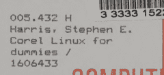


分馆图书馆
曼哈顿中城图书馆
应用科学藏书
第五大道 455 号
纽约市，纽约州 10016

**MM**
**ASC**

书籍和印刷媒体可归还至纽约公共图书馆的任何分馆。乐谱、管弦乐谱以及特定材料必须归还至借出分馆。

所有材料必须按卡片上的最后盖章日期归还。逾期物品将收取罚金。

表格 80802

## 实用小贴士

- 使用多个桌面来安排任务，例如将 WordPerfect 放在第 1 号桌面，将 Netscape 放在第 2 号桌面，依此类推。如果你以前没用过 Linux，你会喜欢这个功能！
- 将未使用的窗口图标化，以便为你正在处理的事情腾出桌面空间。单击面板上窗口的任务按钮即可隐藏或显示该窗口。
- 双击标题栏可交替折叠（收拢）和展开窗口。
- 几乎在任何地方右键单击都可以调出上下文敏感菜单，列出可执行的操作。如果不确定该做什么，就右键单击！
- 尽可能使用常规用户名登录，而不是 root。root 很容易搞乱系统文件。
- 对于经常使用的程序，右键单击其标题栏，然后选择“创建昵称”。之后，你可以随时单击桌面上的昵称来启动该程序。
- 自动隐藏面板，将其整齐地收起来。右键单击面板上的空白处，选择“配置”，单击“选项”标签页，然后选择“自动隐藏面板”。
- 按 Ctrl+Esc 可显示所有桌面上所有窗口的可滚动列表。

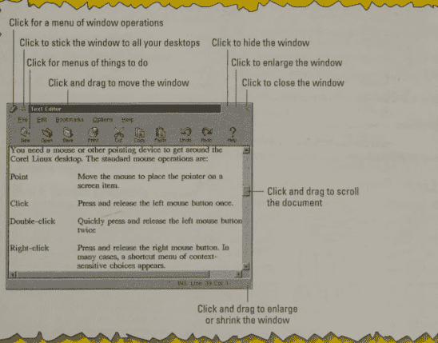

# Corel® Linux® 新手指南


## 贴心的桌面快捷键

| 快捷键 | 功能 |
| --- | --- |
| Ctrl+Tab | 切换桌面；按住 Ctrl 键并不断按 Tab 键，直到切换到所需的桌面 |
| Ctrl+F1– Ctrl+F8 | 切换到第 1 号至第 8 号桌面 |
| Alt+Tab | 在活动的应用程序之间切换；按住 Alt 键并按 Tab 键，直到切换到所需的程序 |
| Alt+F1 | 弹出程序菜单；然后可以使用方向键在菜单中搜索，并按 Enter 键运行高亮显示的项 |
| Alt+F2 | 允许你输入 Linux 命令 |
| Alt+F3 | 显示窗口操作菜单 |
| Alt+F4 | 关闭当前窗口 |
| Alt+F7 | 允许你使用方向键移动窗口 |
| Alt+F8 | 允许你使用方向键调整窗口大小 |
| Alt+F9 | 将当前窗口图标化 |
| Alt+F10 | 最大化或还原当前窗口 |
| Ctrl+Esc | 显示可切换任务列表 |
| Ctrl+Alt+Esc | 立即关闭下一个点击的窗口，而不提示你保存最新更改 |

## 窗口内的快捷键操作

| 快捷键 | 操作 |
| --- | --- |
| Ctrl+W | 关闭 |
| Ctrl+C | 复制 |
| Ctrl+X | 剪切 |
| Ctrl+End | 结尾 |
| Ctrl+F | 查找 |
| F1 | 帮助 |
| Ctrl+Home | 开头 |
| Ctrl+Insert | 插入 |
| Ctrl+N | 新建 |
| Page Down | 下一个 |
| Ctrl+O | 打开 |
| Ctrl+V | 粘贴 |
| Ctrl+P | 打印 |
| Page Up | 前一个 |
| Ctrl+Q | 退出 |
| Ctrl+R | 替换 |
| Ctrl+S | 保存 |
| Ctrl+Z | 撤销 |

## 紧急时使用的 Linux 命令

- **ls**：列出文件
- **cd**：更改目录
- **cp**：复制文件
- **mv**：移动或重命名文件
- **rm**：删除文件
- **mkdir**：创建目录
- **rmdir**：移除目录
- **pwd**：显示工作目录
- **cat**：查看文件
- **more**：逐屏查看文件
- **lpr**：打印文件
- **find**：查找文件
- **grep**：查找文本


## 关于作者

**斯蒂芬·E·哈里斯（Stephen E. Harris）** 是 QwkScreen 的创始人兼总裁。QwkScreen 是一家软件开发和咨询公司，致力于让电脑屏幕变得更加友好。史蒂夫是畅销书《WordPerfect for Linux》和《WordPerfect Office 2000 权威指南》（*WordPerfect Office 2000 Bibles*）的作者，同时也是 Corel Beta 测试小组的自豪成员。他与妻子吉莎（Githa）、三只猫（Tiger、Becky 和 Chester）、熊、鹿、火鸡以及其他各种野生动物一起生活在马萨诸塞州西部的森林中。你可以在 www.qwkscreen.com 上找到史蒂夫，以及关于 WordPerfect 的解决方案和链接。

**埃尔温·齐尔曼（Erwin Zijlman）** 起初是一名发展社会学家，专注于第三世界国家的城市社会学和教育领域，特别是东南亚。他目前是一名软件科学家，专门从事 PC 办公应用工作。埃尔温是 Corel 产品的热心 Beta 测试员，并与史蒂夫合著了其他关于 WordPerfect 的著作。他住在阿姆斯特丹附近的海牙历史中心。他享受与安娜（Anja）以及他的猫 Bagu 的陪伴。

## 关于 IDG Books Worldwide

欢迎来到 IDG Books Worldwide 的世界。

IDG Books Worldwide, Inc. 是国际资料集团（International Data Group, IDG）的子公司。IDG 是全球最大的计算机相关信息出版商，也是领先的信息技术信息服务全球提供商。

IDG 由帕特里克·J·麦戈文（Patrick J. McGovern）于 30 多年前创立，现在在全球拥有超过 9,000 名员工。IDG 在 75 多个国家出版了 290 多本计算机书籍。每个月，有超过 9000 万人阅读一份或多份 IDG 出版物。

IDG Books Worldwide 于 1990 年启动，如今已是美国最大的畅销计算机书籍出版商。我们很荣幸获得了电脑新闻协会（Computer Press Association）颁发的八项奖项，以表彰其在编辑方面的卓越表现，以及《计算机评论》（Computer Review）首届读者选择奖颁发的三项奖项。我们畅销的“傻瓜系列”（“For Dummies®”）丛书已出版了 5000 多万册，并翻译成了 31 种语言。通过与国际图书技术北京（IGTech Beijing）的合资企业，IDG Books Worldwide 成为第一家在中华人民共和国出版计算机书籍的美国出版商。近年来，IDG Books Worldwide 已成为全球数百万希望学习如何更好地管理业务的读者的首选。

我们的使命很简单。我们的每一本书都旨在为读者带来额外的价值和技能建设指导。我们的书由理解并关心读者的专家撰写。我们编辑团队的知识库来自于在出版、教育和新闻领域的多年经验——这些经验帮助我们出版能够引领我们进入新千年的书籍。简而言之，我们关心书籍，因此吸引最优秀的人才。我们特别关注细节，如目标受众、内部设计、图标的使用以及插图。并且，由于我们使用高效的电子化流程来撰写、编辑和桌面出版我们的书籍，我们可以花更多的时间确保优质内容，而将更少的时间花在书籍制作的技术细节上。

你可以放心我们对以有竞争力的价格提供高质量书籍的承诺，涵盖你希望阅读的各个主题。在 IDG Books Worldwide，我们继续 IDG 传承超过 30 年的交付质量传统。你找不到比来自 IDG Books Worldwide 的书更好的关于某主题的书了。


John Kirkalian
董事长兼首席执行官
IDG Books Worldwide, Inc.

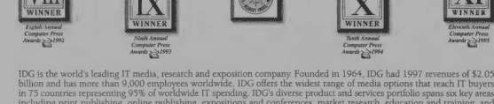

IDG 是全球领先的 IT 媒体、研究和展示公司。IDG 成立于 1964 年，1997 年营收为 20.5 亿美元，在全球拥有超过 9,000 名员工。IDG 提供了最广泛的媒体选择，覆盖 75 个国家的 IT 买家，代表了全球 95% 的 IT 支出。IDG 多样化的产品和服务组合涵盖六个关键领域：包括印刷出版、在线出版、博览会和会议、市场研究、教育和培训以及全球营销服务。超过 9000 万人阅读 IDG 的 290 份杂志和报纸中的一份或多份，其中包括 IDG 的全球领先品牌——Computerworld、PC World、Network World、Macworld 和 Channel World 系列出版物。IDG Books Worldwide 是全世界发展最快的计算机书籍出版商之一，拥有 36 种语言的 700 多种标题。仅“傻瓜系列”（“For Dummies®”）丛书就拥有 5000 多万册印刷量。IDG 通过 IDG.net（http://www.idg.net）为在线用户提供全球最大技术特定网站网络，该网络由全球 55 个国家的 225 多个针对性网站组成。国际数据公司（IDC）是全球最大的信息技术数据、分析和咨询提供商，在 40 多个国家设有研究中心，在全球拥有 400 多名研究分析师。IDG World Expo 是在 35 个国家生产 160 多个全球品牌会议和展览会的领先生产者，包括 E3（电子娱乐博览会）、Macworld Expo、Com/Net、Windows World Expo、IGE（互联网商务博览会）、Agenda、DEMO 和 Spotlight。IDG 的培训子公司 ExecuTrain 是全球最大的计算机培训公司，在全球拥有 230 多个地点和 785 个培训中心。IDG Marketing Services 通过在全球范围内利用 IDG 的印刷、在线和展览产品开发全球整合营销计划，帮助行业领先的 IT 公司建立国际品牌知名度。有关该公司的更多信息可访问 www.idg.com。

## 题献

献给 Mike Cowpland，因为他在长路上看得更远。

## 作者致谢

虽然任何不足之处都是我自己的，但这项庞大的工程必然是一项团队作品，涉及出版商、编辑、设计师、校对者、索引编制者和排版师，以及促销和销售人员。请 IDG Books Worldwide 的敬业专业人员们站起来，让观众看到你们？现在，把聚光灯打在苏珊·“挑剔的”·品克（Susan “the picky” Pink）身上，她在编辑这本书方面做得非常出色。多么专业！她能挥舞鞭子，但你永远不会感到抽打。

特别掌声送给戴维·梅休（David Mayhew），他是这个项目的支持者，以及安迪·卡明斯（Andy Cummings），他是收购船的船长。

如果没有 Corel 许多人士的慷慨和支持，这个项目不可能成功。Chip Maxwell，请上台并鞠躬，以表彰你对作者和出版商不懈的支持（长时间掌声）。特别感谢 Phil C. Racksus 和 Jason Grenier，感谢你们提供了技术专业知识。还有 Eric Forler、Nicholas Blommesteijn、Jon Riis、Ming Poon……名单仍在继续。

一如既往，我必须感谢我的律师/代理人乔尔·L·海克（Joel L. Hecker, Esq.），感谢他明智的建议和支持。感谢 Jan Westerman 和 René Nieuwenhuizen，感谢你们在网络复杂性方面的帮助。特别感谢吉莎（我的妻子），她阅读了草稿并忍受我疯狂的日程。

对我的合著者埃尔温·齐尔曼（Erwin Zijlman），我的感激之情无以言表。我无法想象没有他的智慧、幽默和持续支持就能完成这本书。请注意，虽然这本书是用第一人称写的，但“我”是共享的。

特别感谢 Augrin Software ApS (www.augrin.com)，他们凭借 EasyCopy/X 和 EasyConvert 软件使出色的屏幕截图成为可能。

— *斯蒂芬·E·哈里斯（Stephen E. Harris）*

## 出版商致谢

我们为这本书感到自豪；请通过位于 `http://my2cents.dummies.com` 的 IDG Books Worldwide 在线注册表格登记您的评论。

以下是一些帮助将本书推向市场的人：

### 收购、编辑和媒体开发
- 项目编辑：Susan Pink
- 收购编辑：David Mayhew
- 校对编辑：Teresa Artman, Dwight Ransley
- 技术编辑：Jason Grenier, Philip Rackus
- 媒体开发专家：Megan Decraene
- 版权许可：Carmen Krikorian
- 高级编辑，自由职业：Constance Carlisle
- 媒体开发经理：Heather Heath Dismore
- 编辑助理：Candace Nicholson

### 制作
- 项目协调员：Valery Bourke, E. Shawn Aylsworth
- 布局和图形：Amy Adrian, Karl Brandt, Brian Drumm, Kristine Leonardo, Barry Offringa, Tracy K. Oliver, Mary Jo Richards, Brent Savage, Jacque Schneider, Brian Torwelle, Erin Zelner
- 校对员：Corey Bowen, John Greenough, Marianne Santly, York Production Services, Inc.
- 索引编制者：York Production Services, Inc.
- 特别帮助：Beth Parlon

### 一般和行政
- **IDG Books Worldwide, Inc.:** John Kicullen, CEO
- **IDG Books 技术出版组:** Richard Swadley, 高级副总裁兼出版人；Walter R. Bruce II, 副总裁兼出版人；Joseph Wilker, 副总裁兼出版人；Mary Bednarek, 副总裁兼产品开发总监；Tony Cummings, 出版总监，普通用户组；Mary C. Corder, 编辑总监；Barry Pruet
- **IDG Books 消费者出版组:** Roland Elsey, 高级副总裁兼出版人；Kathleen A. Welton, 副总裁兼出版人；Kevin Thornton, 收购经理；Kristin A. Cocks, 编辑总监
- **IDG Books 互联网出版组:** Brenda McLaughlin, 高级副总裁兼出版人；Sofia Marchant, 在线营销经理
- **IDG Books 为品牌出版社进行的制作:** Debbie Staley, 制作总监；Cindy L. Phipps, 项目协调、制作校对和索引经理；Tony Augsburgers, 前言、重印和系统经理；Laura Carpenter, 制作控制经理；Shelley Lea, 图形和设计主管；Debbie J. Gates, 制作系统专家；Robert Springer, 校对主管；Kathe Schutte, 制作主管
- **包装和书籍设计:** Patty Page, 促销营销经理

出版商希望向帕特里克·J·麦戈文（Patrick J. McGovern）表示特别感谢，没有他，这本书是不可能完成的。


# 前言

*Corel Linux For Dummies* 的到来是 Linux 春天的先兆。Linux 的成功是不可避免的，因为其背后有巨大的全球团队努力。Corel 特别自豪能够交付一个桌面版本的 Linux OS，供 Steve Harris 的书籍所面向的数百万潜在用户使用。

Corel Linux 获得了热烈反响，并在零售渠道中销售火爆。Corel Linux 被 CNET 评为七大主要 Linux 发行版中最佳的“编辑选择”。根据 TUCOWS.com Inc.（互联网领先的数字内容分发商）的数据，Corel 在 1999 年 12 月获得了最高的下载百分比，达到 37%，几乎是最近竞争对手的两倍。

*Corel Linux For Dummies* 的出版只会增加这种势头。在这里，您将找到安装、配置和更新 Corel Linux 的清晰逐步说明。*Corel Linux For Dummies* 的读者会发现数百个技巧和窍门，内容涵盖从自定义桌面到管理文件和浏览互联网的一切。

“十佳专题”突出了一些很棒的 Corel Linux 技巧，并告诉您去哪里获取各种免费物品。最棒的是“获取免费帮助的十个地方”一章，它阐明了 Corel Linux 不仅仅是一堆程序代码，也是一个开放的支持社区。

想想真令人惊讶——您获得 Corel Linux OS、Netscape Communicator、Adobe Acrobat Reader 以及一系列主题，所有这些只需支付这本出色的 *For Dummies* 书籍的价格。难道您不喜欢 Linux 吗？Corel 很兴奋能成为 Linux 的主要参与者，我很高兴 Steve 和 Erwin 是我们团队的一部分。

享受自由吧！

Mike Cowpland，总裁兼 CEO
Corel 公司

# 引言

欢迎来到 *Corel Linux For Dummies*！我希望读起来至少有写出来的一半那么有趣。并不是每天都能有一本 *_For Dummies_ 书落入作者手中，而为 Corel Linux 写一本*_For Dummies_ 书，哦，那真是甜甜圈上的肉桂和糖。是的，这是正在创造历史，我的朋友。让我们静默片刻，见证这一壮举。

## 关于本书

亲爱的读者，请不要害怕——这是一本为您和我准备的 Linux 书籍。**Corel Linux For Dummies** 不是伪装成研究生课程的乏味内容，里面没有只有电脑极客才喜欢的奇怪象形文字。Corel Linux 易于使用，而这本书让它更容易。

给书呆子们的提示：不要绝望，命令行还在，而且 Corel Linux 是纯正的 Debian——迄今为止最强大的 Linux！

我认为 IDG Books 会为***Corel Linux For Dummies***收取至少 50 美元，但他们说：“不，24.99 美元是我们的价位——我们通过销量来弥补。”多么划算！看看您能买到什么：

-   一张特殊的***Corel Linux For Dummies*** CD，包括 Corel Linux 的下载版，加上完整的 Netscape Communicator 套件、Adobe Acrobat Reader，以及精心挑选的出色桌面主题。
-   清晰、简洁的描述和逐步说明。还有很多有用的图片。

## 本书中使用的惯例

我在要求您执行某些操作时遵循标准简写。以下是您需要知道的所有内容：

-   ***键1***-***键2***（例如 Ctrl-V）意味着您按下并保持第一个键，按下第二个键，然后释放两个键。
-   ***命令1***:***命令2*** 等等（例如，***工具***:***快速更正***:***智能引号***）意味着依次点击这些项目。


# 不要读的内容

你输入的文本显示为**粗体**。

新术语以*斜体*显示。

```
mount -t msdos /dev/fdo /mnt/floppy
```

你需要鼠标或其他指点设备才能在使用图形桌面时移动。标准的鼠标操作包括：

- **指向（Point）**：移动鼠标，将指针放置在屏幕项目上。
- **单击（Click）**：按一下左鼠标键并释放。
- **双击（Double-click）**：快速按下并释放左鼠标键两次。
- **右击（Right-click）**：按下并释放右鼠标键。在许多情况下，会出现一个包含上下文敏感选项的快捷菜单。
- **拖放（Drag）**：指向你要拖放的物体，按下并持有左鼠标键，移动鼠标，然后释放鼠标键。你也可以通过拖过文本来选择文本。

如果你使用的是手写笔设备，*单击*变为*轻点*；如果你使用的是左手鼠标设置，*左*变为*右*，反之亦然。

## 不要读的内容

由于 Corel Linux 非常容易设置和使用，你不需要拿着柴刀劈开指令丛林来到达有趣的部分。设置好之后，本书完全是不按顺序阅读的。你的忙碌大脑跳到哪里，页面就可以翻到哪里。

## 愚蠢的假设

作者在撰写《...For Dummies》系列书籍时拥有很大的艺术自由，但这一节是强制性的，意思是“你必须做一些愚蠢的假设”。这让我想到了那些在互联网上无尽流传的陈旧技术支持轶闻，例如：

- 一位认为鼠标是脚踏板的女士（性别仅用于说明目的）
- 一位试图通过将信纸举到监视器前来传真信件的男士。
- 一位打电话说他的或她的电脑没有响应的男士或女士，当被要求读取序列号时说：“等一下，我去拿手电筒，停电了。”

我会假设你不是以上任何一种人，但你心中可能有一个或以下两个目的：

- 你想找一本清晰、友好的 Corel Linux 指南。
- 你想使用书后的 CD 在电脑上安装 Corel Linux。

无论哪种或两者兼备，你都来对地方了！

## 本书的组织结构

编写计算机书籍的一半战斗在于组织它。Corel Linux 的妙处在于，不需要书中的四分之三篇幅来安装这个该死的东西。在本节中，你可以鸟瞰《Corel Linux For Dummies》。

### 第一部分：飞跃到 Linux

在对 Corel Linux 进行鼓舞人心的推销之后，你会兴奋不已，跃跃欲试！在第一部分中，你检查硬件，备份任何现有数据，然后打破书后的神圣封印。你将 CD 插入电脑，剩下的事情很容易，多亏了 Corel 超级酷的 Install Express（和这本超级酷的书）。在周围快速查看之后，你可以设置其余的东西，例如你的打印机和你的互联网连接或网络访问。（即使已经有人为你安装了 Corel Linux，这部分也是一篇无痛且有趣的阅读。）

### 第二部分：进行大巡回

Corel Linux 肯定像你的初吻、蹦极、滑翔伞或也许是你童年看到的第一道彩虹那样令人兴奋。即使你是资深 Linux 用户，当你启动 Corel Linux 并探索桌面时，你也会被看到的内容所震撼。在第二部分的大巡回之后，你可以用一些你的 Windows 朋友不敢相信的技巧让他们目瞪口呆！

### 第三部分：按你想要的样子使用 Linux

假设你刚搬进了一所装修精美的房子。在移动家具、拉来一箱箱书、在墙上挂画、把脏盘子放进水槽、把衣服扔在地板上并安装一只猫或狗之前，你怎么能称之为家呢？在第三部分中对 Corel Linux 桌面也是如此。

### 第四部分：做你自己的事

像汽车、啤酒罐和电话一样，计算机改变了我们生活、工作和交流的方式。在第四部分中，你将看到 Corel 文件管理器如何轻松组织你的东西。但是“我把它放哪儿了？”你会问。嗯，追踪东西也很简单。想要联系？在这里你可以链接、浏览、发送电子邮件和讨论。你将看到如何使用文本编辑器和便签记录一些文字。寻找最新和最伟大的？多亏了 Corel Update，这再容易不过了！

### 第五部分：十大系列

按照《...For Dummies》最高尚的传统，我汇编了最方便的信息列表（在我的朋友们的一点帮助下）。你在这里能找到它们——十个酷的桌面技巧，十个整洁的事情要做，十个寻求帮助的地方，以及十个获取各种免费礼品的地方。快来获取吧！

### 第六部分：附录

我知道 Corel Linux 是一个图形环境，但有时 Linux 命令也很有用。当你想要使用它们时，它们就在第六部分的附录中。计算机术语让你发疯？查看紧凑的术语表词条，然后在下次员工会议或派对上掉几个书袋。最后，但绝非最小，本书中提到的所有软件都在你的《Corel Linux For Dummies》CD 上。这是多么无与伦比的交易！要了解有关 CD 的更多信息，请查看附录 C。

## 本书中使用的图标

这是你可能遇到的各种图标的含义，以防它们不明显。


我特别引以为豪的快捷方式或巧妙想法。


重要信息，使此页符合便签条件，以便于查找。如果你是从朋友那里借的书，你将需要将这些信息转移到桌面上的便签（参见第 13 章）。


你在网络上找到的酷事。


令人头脑麻木的极客内容，虽然其中一些很有趣。


当你不小心时，警告你数据可能会丢失或设置可能会损坏（上帝禁止！）。它还可能告诉你如果事情搞砸了该怎么办。


你的《Corel Linux For Dummies》CD 上的 Corel Linux 和其他宝贵内容。你运气真好！

## 从哪里开始

你拥有最后发言权！我从未遇到过无缺陷的软件或无缺陷的计算机书籍。任何评论、建议、批评、更正或请求都将感激接受。请通过电子邮件联系 steve@wkscreen.com 的 Steve 或 E.L.M.Zijleman@cpb.nl 的 Erwin。

# 第一部分：飞跃到 Linux

# 第五波

作者：Rich Tennant


> “就在这个时候，似乎出现了一种集体疯狂。”

## 本部分简介

有些人天生伟大，有些人成就伟大，有些人在正确的时间带着合适的东西出现。

从你的《Corel Linux For Dummies》CD 安装 *Corel Linux*，调整一些设置，创造属于你自己的计算历史篇章。

# 第 1 章：我真不敢相信它真的更好！

## 本章内容

- 了解如何发音 Linux
- 发现为什么 Linux 不仅仅是一个操作系统
- 揭示 Corel Linux 的特殊之处
- 品味 Corel Linux 的四种风味
- 展示 Corel Linux 的强大功能
- 获取“我还能使用 Windows 吗？”的答案
- 为安装 Corel Linux 做好准备

你想知道 Linux 的第一件事是怎么发音的。好的，张大嘴巴，跟着我念，“lee-nucks, lee-nucks, lee-nucks！”

现在最难的部分过去了，我们可以继续书的其他部分。

## 好的，Linux 是什么？

Linux 究竟是什么，它从哪里来？Linux 是 Linus Torvalds 的杰作，他在芬兰赫尔辛基大学学生期间决定编写一个强大的 UNIX 操作系统的小型版本。

你问什么是操作系统（或 OS）？它是一个程序，如 Linux 或 Windows，控制你的计算机并管理从键盘和鼠标输入到监视器、磁盘和打印机输出——以及中间的一切。它还维护安全，并充当交通警察，防止程序相互干扰。

直到目前，Linux 一直作为低成本的计算主力，在幕后驱动许多网络和服务站。尽管它出现不到十年，但其能力以惊人的速度增长。例如，奥斯卡获奖电影《泰坦尼克号》的动画是在 Linux 系统上制作的。当美国能源部建造世界上最强大的超级计算机时，猜猜他们使用了什么操作系统！


Linux 功能强大，但也可以变得亲切可爱，如图 1-1 所示。


**图 1-1：** Linux 亲切可爱的一面。

# 生而自由

托林斯（Torvalds）没有试图通过销售 Linux 来致富，而是将其免费分发。他具有远见，将 Linux 打造成了一个开创性的*开源*操作系统，任何人都可以对其进行修改，前提是这些增强功能必须向所有人开放。来自世界各地的成千上万名程序员加入了他的事业，共同致力于创建一个复杂、强大且永远免费的操作系统。

是的，Linux 是免费的。最新的 Linux *内核*（核心程序）以及许多支持程序，始终可以免费下载——或者，如果你购买了一张带有 Linux*发行版*（包含安装程序的完整包）的光盘，费用为 1.95 美元。

不过，机智的你买了这本书，所以 Corel Linux 光盘免费到手！（如果你正在店里读这本书，现在可以去收银台结账了。）

# 不再产生软件罪犯

自由软件的一个重大成果（加上硬件价格的下降）是，你不再需要属于世界人口中最富有的 1% 才能拥有个人电脑。像韩国、南非或墨西哥这样的国家，现在可以认真考虑让所有学校配备电脑。

这对电子民主的未来具有重要意义。如果你需要支付 200 美元的“软件税”才能跻身计算精英行列，那这就变成了一个网络寡头政治。你可能会争论，第三世界国家的人们可以靠盗版软件生存，但这难道不是对我们这个时代令人悲伤的评论吗？你无法盗版 Linux——它永远免费！

当然，应用程序呢？确实，Linux 上有商业程序和游戏，就像其他任何操作系统一样。但是，你可以合法免费获得大量令人惊讶的应用程序，而且这个列表每天都在增长。你可以免费获得适用于 Linux 的 Star Office，其中包含文字处理器、网页编辑器、电子表格、数据库、绘图、图表、图像编辑和邮件应用程序。你甚至可以免费获得 Corel 著名 WordPerfect 8 的 Linux 版本。

# 我为什么要使用 Linux？

Linux 功能强大且免费，但它能为你提供什么？看看这些好处：

- 一个真实、稳定的*多任务*环境，可以同时运行多个程序
- 一个直观的图形界面，是 Windows 和 Mac 界面的替代方案
- 数百种软件应用程序，其中大部分可以免费下载
- 内置的网络和互联网访问支持
- 一个运行如风（greased lightning）的操作系统——即使在旧机器上也是如此

当你阅读这一页时，Linux 的改进工作仍在进行。如果你遇到问题，可以指望在几小时或几天内找到修复方法。

# Corel Linux 有何特别之处？

为什么你应该使用 Corel Linux 而不是 Red Hat、Mandrake、OpenLinux 或 SuSE？很高兴你问了。

# 易于使用

Corel 的 Install Express 安装过程非常迅速，且只有极客专用的 Linux 接口已被移除。你不需要识别显卡上的芯片就能让 Linux 运行，也不需要输入如 `mount -t msdos /dev/fd0 /mnt/floppy` 这样令人头晕目眩的命令来执行最简单的操作。这让你的大脑可以专注于重要的事情，比如制作花生酱果冻三明治，并且意味着你的书桌不会因堆叠的手册而坍塌。

# 比 Windows 更流畅

Corel 提供了一个类似 Windows 的桌面，但它比 Windows 更快、更流畅！你可以在一个令人愉悦的图形界面上点击操作，该界面包括巧妙的文件和更新管理器。Linux 资深用户会特别欣赏许多小细节，这些细节消除了其他发行版中令人困惑的神秘感和烦恼。你的软盘和 CD-ROM 驱动器会自动挂载，你只需拖动一个简单的滑块即可调整视频分辨率！

# Debian 的优势

你看不到的一面与看到的一面同样重要。Corel Linux 由 Debian GNU/Linux 驱动，它通常被认为是最纯粹的 Linux 版本。Debian 由致力于“自由软件”理想的志愿者维护，他们组装了一个符合最严格 Linux 文件系统标准的发行版。Debian 坚如磐石。

Debian 在*软件包*（组件）的存储和组织方式上在技术上也是优越的。它们按标准化的目录结构排序，其中*软件包*之间的关系受到仔细监控。这确保了无故障的更新，这是其他发行版无法提供的。

# 更新没有比这更容易的了！

当你安装一个 Debian 软件包时，它所依赖的其他软件包也会被自动安装，依此类推。你还有选择一次性更新所有已安装软件包的选项，可以从 CD 或直接从你喜欢的互联网位置进行。如果你的网络连接在下载过程中中断，你可以无缝地从断点继续。对 Debian 的诟病是其软件包管理器难以使用，但这一障碍随着图形化的 Corel Update 而消失！

# Corel Linux 的四种风味

Corel 在发布包装版本之前，发布了一个 Corel Linux 的免费下载版本。它立即成为热门，成千上万的用户挤爆了托管 325MB 下载的互联网站点。


你的 *Corel Linux For Dummies* 光盘包含 Corel Linux 的下载版以及表 1-1 中描述的其他内容。

表 1-1 Corel Linux 包含的内容

| 组件 | 免费下载 | ...For Dummies CD | 标准版 | 豪华版 |
| :--- | :---: | :---: | :---: | :---: |
| Corel LINUX OS — 基于 Debian 2.2 内核 | 是 | 是 | 是 | 是 |
| 增强型 KDE 桌面 | 是 | 是 | 是 | 是 |
| Corel Install Express | 是 | 是 | 是 | 是 |
| Corel 文件管理器 | 是 | 是 | 是 | 是 |
| Corel 更新包管理器 | 是 | 是 | 是 | 是 |
| 安装技术支持（30 天） | 否 | 否 | 电子邮件 | 电子邮件和电话 |
| Netscape Communicator | 否 | 是* | 是 | 是 |
| Adobe Acrobat Reader | 否 | 是* | 是 | 是 |
| 即时通讯软件 — 兼容 ICQ 的客户端 | 否 | 否 | 是 | 是 |
| Bitstream 和 Type 1 字体 | | | 20 | 200 |
| WordPerfect 8 for Linux | | 轻量版 | 完整版 | |
| eFax Plus 服务 — 三个月免费 | 否 | 否 | 否 | 是 |
| OSS 增强型声音驱动程序 | 否 | 否 | 否 | 是 |
| CIVILIZATION: Call to Power 策略游戏 — 限量版 | 否 | 否 | 否 | 是 |
| BRU 备份软件 | 否 | 否 | 否 | 是 |
| 用户指南 | 否 | 是† | 是 | 是 |
| WordPerfect 8 for Linux 用户手册 | 否 | 否 | 否 | 是 |
| 开放流通源代码 CD | †† | †† | 是 | 是 |
| 附加桌面主题 | 否 | 是 | 否 | 否 |
| 31⁄2 英寸 Linux 企鹅吉祥物 | 否 | 否 | 否 | 是 |

* 参见附录 C 了解安装说明。
† 用 Corel Linux For Dummies 替代 Corel 用户指南。
†† 源代码未随免费下载或 Corel Linux For Dummies CD-ROM 附带，但可在网络上免费获取。

所有版本的程序都包含一系列其他程序和实用工具，让你可以玩游戏、创建图形、设置网络或 Web 服务器，甚至创建自己的 Linux 程序。

# Corel Linux 功率较小，对吗？

如果 Corel Linux 如此容易，它肯定功率较小，对吧？

错！如果有何不同，Corel Linux 比其他版本更强大，拥有如 Corel 文件管理器、超级巧妙的更新设施和升级的控制中心等工具。它可能针对桌面用户，但你仍然可以设置 Web 服务器或安装数百万个软件包，任何需要它的极客都可以使用命令行。

别忘了，Debian 引擎驱动着 Corel Linux！

# 我还能使用 Windows 吗？

也许你会说：“我安装了 Windows，有我喜欢的文字处理器、网页浏览器和绘图程序——我一天只崩溃两三次。我可以现在使用 Corel Linux，但暂时保留（ugh）Windows 相关的一切吗？”

当然！在同一台机器上拥有两个操作系统不像两个文字处理器那样简单，但大多数 Linux 供应商都提供了执行此操作的工具。嘿，Linux 是冰山上新来的企鹅——它必须与邻居和睦相处！

Corel Linux 提供了一些很好的可能性：

- 你可以设置一个*双启动*机器，在启动时选择你想要运行的操作系统——Linux 或 Windows。
- 你可以试用 Corel Linux，而无需重新格式化硬盘或创建 Linux 分区。这是在 Windows 机器上试用 Corel Linux 的一种相对安全的方法。
- Corel Linux 允许你读取和写入由 Windows 程序设置的文件夹中的文件。（从 Windows，你只能读取 Linux 文件——而且需要第三方实用程序才能做到。）
- 如果你的机器位于 Windows 网络上，你可以设置 Corel Linux 也访问该网络。


# 起飞准备

你不需要放弃 Windows 就可以使用 Linux。许多人将在未来几年里让 Linux 和 Windows 共存。Linux 发展迅速，具有一些显著优势，但在某些领域仍在追赶。例如，你可能正在使用某个语音程序或扫描软件，而 Linux 目前尚无等效产品。

或者，也许你花钱购买了 Windows 和一堆其他程序，而这些是你并不打算放弃的。还有那句老话：“如果它没坏，就别修它。”这是我一直没能遵循的原则，但它用在计算机上确实太贴切了！

就说这么多吧。加入这场欢乐盛宴！深呼吸一下……或者在翻到第 2 章之前，先跑几圈释放掉多余的精力。安装 Corel Linux 易如反掌，但你最好以最佳的体力和脑力状态进行。如果你的机器上已经安装了 Corel Linux，请直接跳到第二部分或你感兴趣的其他章节。途中你可以去冰箱拿点东西吃。

# 第 2 章

# 一飞冲天！
安装 Corel Linux

## 本章内容

- 进行硬件现实检查
- 开始之前采取预防措施
- 决定安装什么
- 确定放在哪里
- 了解何时“免费空间”并不免费
- 启动 Install Express
- 进行安装选择
- 你成功了！

我敢打赌，你正迫不及待地想要安装 Corel Linux！你可能感觉自己就像一名奥运短跑运动员，肌肉紧绷，准备从起跑线上弹射出去。“各就位！预备！……”好吧，我们要一步一步来。

## 各就位……（考虑你的需求和选项）

想到安装操作系统让你感到紧张和冒冷汗吗？别担心，Corel Linux 的 Install Express 提供无汗安装体验。只需一点计划和几项预防措施即可。

你可以在任何可用的 PC 上安装 Corel Linux，并且开始安装时不需要当前的操作系统。例如，你可以在一台全新机器上安装 Corel Linux，也可以在一台旧机器上安装，只要该旧机器上安装了一块新的硬盘即可。

## 基本要素

如果没有合适的硬件，安装就没有意义。就计算机本身而言，要求最低。你甚至可能想走到衣柜里，挖出那台再也无法运行 Windows 的旧电脑（就在那堆运动鞋和靴子下面）并试试看。以下是 Corel Linux 的最低要求：

- Pentium 90（或同等）处理器
- 24MB 内存（建议 64MB）
- 500MB 未分区的硬盘空间（或用于在 Windows 分区上安装的空闲空间）——通过使用自定义安装，你甚至可以只用 200MB 搞定
- 2MB VGA PCI 显卡
- CD-ROM 驱动器
- 3½英寸软盘驱动器（如果你的 CD-ROM 驱动器不支持启动，则必需）
- 鼠标或其他指向设备

我想，键盘和显示器可能也有用。

在 Corel Linux 中执行某些操作需要额外的硬件：

- 用于拨号 Internet 访问的调制解调器（以及一个可拨入的 Internet 服务提供商）
- 用于网络连接的网络卡
- 声卡、扬声器，可能还有麦克风

## 硬件现实检查

虽然 Corel Linux 比 Windows 需要的资源少，但它对特定磁盘驱动器、调制解调器、打印机、鼠标和其他硬件的支持范围尚不广泛。Linux 尚不支持内部 ISDN 卡和某些 DVD 驱动器。随着 Linux 内核的演进以及 Linux 兴趣的激增促使硬件供应商采取行动，这种情况正在迅速改善。

避免仅适用于 Windows 的硬件，例如 Windows Modems（利用软件获取计算机内存进行基本操作，而不是从板载芯片运行）。未来版本的 Linux 可能会支持其中一些调制解调器，但不要指望如此。一些仅适用于 Windows（GDI）的打印机也存在类似的问题，但它们的出现频率远低于 Winmodems。

在显示器上显示内容的视频卡也可能出现问题。一些卡没有 Linux 版本的*软件驱动程序*（用于操作计算设备的程序），但这种情况正在迅速改善。声卡和其他多媒体硬件也是如此。

当 Corel Linux 没有针对你的特定硬件部件提供驱动程序时，它会替代安装一个通用版本，让你利用其大部分（如果不是全部）功能。

许多硬件设备附带在 Windows 下运行的实用工具，但没有在 Linux 下运行的实用工具。仅适用于 Windows 的例子包括附带页面管理和复制软件的扫描仪，以及附带数据备份和音频 CD 烧录程序的 CD-RW 驱动器。与硬件驱动程序一样，Corel Linux 或第三方等效工具可能同样优秀，或者需要费一番功夫才能找到。例如，Corel Linux Deluxe 附带多功能的 BRU 备份程序，用于执行磁带备份。

## 获取硬件帮助

如果你遇到 Linux 硬件困境，请放心，成千上万的开源程序员正在以惊人的速度解决这些问题。Linux 是“那个能做成的微型内核”！

与此同时，Corel 已整理了一份庞大的兼容和不兼容硬件列表。你可以在 `http://linux.corel.com/products/.linux_os/hardware.htm` 找到该列表。

如果你遇到硬件问题，请不要绝望。查看第 20 章中描述的所有支持选项，尤其是支持新闻组。很容易找到遇到同样问题的其他用户，以及非常乐意提供帮助的专家！

## 不要进行未受保护的

如果你电脑上已经有数据，你上次备份是什么时候？好吧，现在就做吧！当你将新的操作系统装入计算机时，你正在对现有的软件家具进行重型搬运和整理。Corel 的 Install Express 经过充分测试且易于使用，但无论软件多么可靠，你多么小心，事情总可能出错。相信我，我是吃过亏的！

## 安装后可以移除 Corel Linux 吗？

请记住，安装 Corel Linux 这样的操作系统是一个最终行为，比添加 WordPerfect 这样的软件应用程序更彻底。通常，移除操作系统的唯一方法是重新格式化硬盘，或使用 Partition Magic 等分区软件外科手术式地移除 Linux 分区，而不影响其他分区。（如果你选择稍后在本章中描述的在 DOS/Windows 分区中安装的选项，则删除 Corel Linux 文件夹即可。）

## 什么是自动的，什么不是？

直到最近，对于没有计算机工程学位的普通用户来说，安装 Linux 过于复杂。Linux 书籍花费数百页篇幅介绍分区驱动、检查软件包依赖关系、为视频卡选择正确的 X 服务器、安装 Linux 引导程序等令人愉悦的主题……清单还在继续。

当然，有些人享受这项运动，正如有些人喜欢攀登珠穆朗玛峰或参加铁人三项比赛。我们其余人可以想其他办法度过几个月。

## 自动

Corel Linux 在安装过程中自动检测你的硬盘、CD-ROM、声卡、视频、鼠标和其他硬件，然后设置 Linux 驱动程序以运行每个组件。如果特定组件没有 Linux 驱动程序，Corel Linux 将安装最合适的通用驱动程序。


Corel Linux 仅检测标准的基于 PCI 的卡。

当你添加新硬件时，Corel Linux 会在你下次启动计算机时识别它。

## 非自动

Linux 不支持所有硬件，且 Linux 支持的某些硬件可能不会由 Corel Linux 自动检测。

在安装过程中，你有机会更改默认选择，例如要安装什么，并且你将被要求提供一些信息，例如用户名。在 Install Express 完成其工作后，你还必须提供更多一些信息以执行诸如连接到 Windows 网络或拨号上网等任务，如第 4 章所述。

## 我应该安装什么？

在开始之前，让我们预览一下你将做出的重要安装选择，即安装什么以及放在哪里。表 2-1 总结了“什么”选择的利弊，这些选择位于即将到来的“步骤 4：你想安装什么？”部分。

| “什么”选项 | 优点 | 缺点 |
| :--- | :--- | :--- |
| 默认桌面 | 推荐给大多数用户的选择 | 不具备执行高级操作（如重新编译内核）所需的所有库 |
| 最小桌面 | 节省磁盘空间 | 可能会错过便捷的工具和功能 |
| Desktop Plus | 创建你自己的程序所需的一切 | 比大多数用户需要的多 |
| 服务器 | 设置服务器和开发程序所需的东西 | 比大多数用户需要的多 |
| 自定义 | 让专家精确选择所需内容，包括其他选项中没有的东西；当空间极其有限时很实用 | 在安装后使用 Corel Update 添加和移除软件包来自定义会更轻松 |

## 我应该把它放在哪里？

你的“要安装什么”选择事后可通过 Corel Update 功能随时调整。你最命运攸关的安装决定是将 Corel Linux 放在哪里，尤其是如果 Linux 与另一个操作系统共享你的机器。表 2-2 总结了即将到来的“步骤 5：你想把它放在哪里？”部分的选项。


如果 Corel Linux 将与现有的 Windows 系统共存，建议在开始之前对硬盘进行碎片整理。在 Windows 中，选择“开始” ➜ “程序” ➜ “附件” ➜ “系统工具” ➜ “磁盘碎片整理程序”。

### 表 2-2 安装位置选择

| “位置”选项 | 优点 | 缺点 |
| :----- | :----- | :----- |
| 接管磁盘 | 是设置纯 Linux 机器的简单、干净的方式<br>如果你是从全新机器开始，这样做毫无压力 | 会清除现有系统和数据<br>没有为另一个操作系统留下空间 |
| 使用空闲磁盘空间 | 保留现有系统和数据<br>让 Linux 与另一个操作系统共存 | 必须有未被另一个操作系统使用的未分区空间；参见“当空闲空间并非完全空闲”一节<br>现有磁盘结构可能不允许这样做，即使存在空间 |
| 编辑分区表 | 让你为特定文件（用户目录、附加程序、临时文件等）分配独立分区，特别是在多用户系统或网络服务器上<br>让你摆脱系统 BIOS 的限制，特别是当内核位于 1023 柱面以下时<br>允许你在安装前重新安装 Corel Linux 或移除其他版本的 Linux | 单击鼠标可能会破坏现有系统和数据<br>额外分区可能会浪费空间<br>你无法通过 Install Express 调整现有分区的大小来腾出空间 |
| 安装在 DOS/Windows 分区中 | 让你在不重新格式化整个或部分磁盘的情况下，在 Windows 95/98 上尝试 Corel Linux | 运行 Corel Linux 的方式效率低下<br><br><br>在 Linux 和 Windows 之间重启非常麻烦 |

## 当空闲空间并非完全空闲

要安装 Corel Linux，Install Express 必须在硬盘上找到可以格式化为 Linux 分区的空闲空间，以容纳你的操作系统和 Linux 文件。

假设你有一台典型的 Windows PC，比如配备 5GB 硬盘，且完全分配给了 Windows 的 C: 驱动器。如果你只安装了 2GB 的程序和文件，那么对于 Windows 程序来说，你还剩下 3GB 的空闲空间。

不幸的是，这 3GB 空间对于 Install Express 来说并不是空闲空间，因为它是 Windows 分区的一部分，而 Linux 文件系统无法访问。Corel Linux 真正寻找的是*未被分区使用的空间*，即未被 Windows 使用的部分。

你有三种方法可以摆脱这种困境：

- **选项 1：** 让 Corel Linux 重新格式化你的硬盘，在过程中清除 Windows 和任何现有数据。
- **选项 2：** 使用 Corel Linux 的技巧，安装到 Windows 95/98 分区上的那个“空闲空间”中。Corel Linux 的启动会很麻烦，且性能会有巨大损失，但至少你可以体验一下 Corel Linux。
- **选项 3：** 如果你是计算机高手，可以使用第三方磁盘分区工具，如 PowerQuest 的 PartitionMagic 或开源的 FIPS 工具，来缩小你的 Windows 分区大小，从而创建 Corel Linux 可以使用的真正的未分区空闲空间。


除非你非常清楚自己在做什么，否则不要使用磁盘分区工具。使用此类工具很容易破坏现有系统。

如果你希望在一台机器上同时运行 Windows 和 Linux，但你对这些选项都不满意，那么 Corel Linux 目前可能不适合你。

## 什么叫我可以双启动？

当你安装 Corel Linux 以与现有操作系统共享你的机器时，你会得到一个*双启动*机器，让你可以在启动时选择使用哪个操作系统。（但是，如果你选择“安装在 DOS/Windows 分区”路径，你必须先启动到 Windows 才能进入 Linux。）

Corel Linux 设置了其 LLO（Linux 加载程序），以便你可以选择启动时使用哪个操作系统。默认是 Corel Linux，但你可以通过更改设置来改变它（参见第 4 章）。

**技术细节**

LLO 安装在你的主引导记录（MBR）中，这通常是首选位置。但是没有选项将其安装在根分区的第一扇区（Linux 系统文件和内核所在的地方）。这可能会破坏另一个引导管理器，如 BootMagic 或 System Commander。

## 和平，兄弟操作系统！（Linux 和 Windows 同住一个屋檐下）

在你让 Install Express 大动干戈修改你电脑内部配置之前，花点时间想想 Corel Linux 是如何物理安装在你的电脑上的——特别是如果 Corel Linux 和 Windows 将共存于同一台机器上。

Linux 和 Windows 可以相处得相当不错，但每个系统都需要在硬盘上有自己的“房间”，即分区。Linux 分区采用不同的格式（ext2），而 Windows 分区则不同。

如果你想要一台仅运行 Linux 的机器，你可以简单地让 Install Express 接管你的整个硬盘。但如果你打算同时安装 Windows 或其他操作系统，你需要选择“使用空闲磁盘空间”选项，以为其他系统留出空间。同样，如果你在一台已有 Windows 95 或 98 的机器上安装 Corel Linux，你就不想选择“接管数据”选项——除非你打算清除 Windows 和你所有的现有数据。

**技术细节**

实际上，Install Express 通常创建两个 Linux 分区，一个用于程序和数据的存储，另一个是交换分区，用于加速你的 Linux 引擎。你可以通过选择“编辑分区表”选项来创建额外的分区。

为了增加混乱，Corel Linux 独特的在 DOS/Windows 分区中安装的选项在执行此操作时不会将分区更改为 Linux 格式。这是在 Windows 95/98 机器上测试 Corel Linux 的好方法，但这并不是运行 Linux 的高效方式。Corel Linux 的启动会很麻烦，性能将比在原生 Linux 分区中慢得多。

## 准备就绪...（进行你的选择）

你准备好了吗？那么是时候开始安装了！我假设你一直耐心地等待这一刻，克制住了拆开书背后封条的冲动——就像在生日前不拆礼物一样。

Corel 声称安装过程只有三到四个步骤，具体取决于你听谁怎么说。嗯，Install Express 确实很令人印象深刻，但并不*那么*简单——我数了八个步骤，此外你可能还需要进行一些安装后配置，这在第 4 章中有详细介绍。

## 打破神圣的封条

去吧，打破这本书背后的神圣封条并取出 CD！如果你有多张 Corel Linux CD，你可以将多余的用作杯垫。这个想法源自美国在线。

## 步骤 1：启动安装 CD

安装的第一步是启动你的安装 CD。如果你的 CD-ROM 已经是可引导的，这一步是自动的。如果自动方式不起作用，你可以创建一个启动软盘（替代方案 A）或更改你机器的启动顺序（替代方案 B）。


如果你在运行 Windows 时放入 CD，系统会提示你重启系统以继续。

**你的 CD 能自动启动吗？**

首先尝试自动启动方式：

1. 插入 Corel Linux CD-ROM（**盒装套装中的安装 CD**）。
2. **关闭并重新启动你的计算机。**

如果你的计算机重新启动但未加载 Install Express，请转到替代方案 A 或 B。

### 替代方案 A：从软盘启动

要创建安装软盘并从中启动：

1. **在一张空白的高密度 3¼ 英寸磁盘（1.4MB）上写入 Corel Linux Boot install，并将其插入一台工作正常的计算机。**

   磁盘上的任何数据将被擦除。

2. **插入你的安装 CD 并执行以下任一操作：**
    - 在 Windows 中，当出现 Corel Linux 自动运行界面时，按照说明创建启动软盘，然后重启。
    - 在（非 Corel）Linux 系统中，以 root 身份登录，打开命令 shell，并输入以下内容（以挂载 CD）

```
mount -t iso9660 /dev/cdrom /mnt/cdrom
```

然后输入

```
dd if=/mnt/cdrom/boot/boot1440.img of=/dev/fd0
```

3. 将**软盘**和**Corel Linux CD**放入你的计算机。
4. **关闭并重新启动你的计算机。**

如果你已经有一个来自 Corel Linux 套装的启动（安装）软盘，你只需要执行第 3 步和第 4 步（thatch）。

## 替代方案 B：更改机器的启动顺序

要从 CD-ROM 直接启动（不使用软盘），你可能需要更改计算机 *BIOS* 中的 *启动顺序*，使其从 CD 加载而不是从硬盘加载（完成后将其恢复原状）。请参阅你计算机的手册和屏幕上的消息了解操作方法。


如果你知道方法，更改启动顺序很容易，但请记住，我没有建议这样做。除非你知道自己在做什么，否则不要随意更改计算机 *BIOS* 的出厂设置。

## 你已成功起步！

是的，你已成功起步！你应该在图 2-1 那个充满神秘感的大企鹅世界里看到以下消息：

```
Loading Corel Linux...
Starting Corel Linux...
Detecting hardware...
```

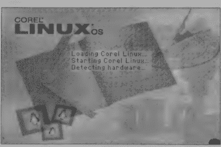

**图 2-1：** 当你到达这个场景时，你就成功起步了！


“检测硬件”部分意味着 Corel Linux 正在为你处理最棘手的部分——自动探查你的系统，以确定你拥有的视频卡、声卡、跟踪设备及其他硬件的类型。这消除了传统 Linux 安装过程中许多令人头疼的问题。此步骤需要一些时间——请耐心等待。

## 第 2 步：接受苛刻的条款

接下来，你不可避免地会看到许可协议。阅读该协议，点击“接受”成为 Corel 的契约奴隶，或者点击“拒绝”继续做微软的奴隶。

## 第 3 步：你是谁？

你觉得自己能填好图 2-2 中的姓名栏吗？这是你希望 Corel Linux 认识你的名称。它最多可以是 16 个字母和数字，但请不要使用大写字母。在多用户系统中，通常使用你的名字加上姓氏的首字母（例如 Jane Doe 的 janed）。

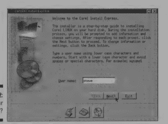

图 2-2：你叫什么名字？

这是你的工作名称。每个 Linux 系统还有一个名为 root 的*超级用户*，它可以访问所有设置并随意操作该系统。

## 第 4 步：你想要安装什么？

既然你已经确定了你的名字，点击“下一步”选择要安装的内容，如图 2-3 所示。

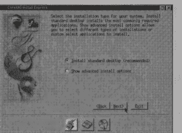

图 2-3：选择要安装的内容。

在大多数情况下，推荐设置（安装标准桌面）就足够了。你随时可以稍后添加或移除内容（参见第 17 章）。如果你正在安装标准桌面，请继续执行第 5 步。

如果你计划执行专家级任务，如设置服务器或创建 Linux 程序，请执行以下操作：

- 1. 点击**显示高级安装选项**，然后点击**下一步**，查看图 2-4 中所示的高级安装选项。
- 2. 点击以下其中一项：
    - **桌面（最小化安装）**：仅安装必要的 Linux 和桌面组件。
    - **桌面增强版（开发工具、编辑器）**：安装默认桌面以及用于开发或修改程序的 workstation 环境。
    - **服务器（Web、文件、打印、Ftp）**：安装所有 Linux 服务器组件，包括 http、ftp 和 Samba 服务器。包含最小化系统组件及开发工具。
    - **自定义（选择一个或多个应用程序）**：从各类别中精确选择你要安装的组件，这些组件被称为*软件包*。

## 第 5 步：你想把它放在哪里？

选择完要安装的内容后，你准备好做出*重大*决定了：把这些东西放在哪里。这个决定是*不可逆*的，并且根据你的选择，可能会抹去现有系统及其伴随的数据。除非你使用“在 DOS/Windows 分区中安装”选项，Corel Linux 会获取你磁盘的全部或部分空间，并将其格式化以适合 Linux 文件系统。

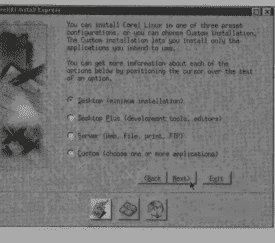

**图 2-4：** 高级选择让你可以设置从最小化桌面到服务器环境的各项内容。

准备好了吗？那么点击“下一步”显示图 2-5 中的“放置位置”选项，并从以下选项中做出选择：

- ☑ **接管磁盘**（*擦除所有现有信息*），以*彻底销毁*你硬盘上的现有数据，创建一台除 Corel Linux 外别无他物的干净机器。（如果你有多个磁盘，只会清除一个磁盘——你会被要求选择你想擦除并安装 Corel Linux 的磁盘。）
    - 你的硬盘包含你想保留的数据吗？你在其他地方备份了吗？如果你有任何疑虑，请点击“退出”！
- ☑ **使用空闲磁盘空间**（*保留现有信息*）保留现有数据，Corel Linux 将不会接管你的整个硬盘。如果你选择默认设置，你必须至少有 200MB 的空闲（未分区）空间。
- ☑ **编辑分区表**（*适用于高级 Linux 用户*）允许你删除或创建你指定的分区。与“接管磁盘”选项一样，请确保你不想丢失的信息已在其他地方备份。
    - 编辑分区是一个危险的操作，可能会破坏现有数据或使你的系统无法使用。在开始之前，请确保你知道自己在做什么。
    - Install Express 不允许你调整现有分区的大小。你需要使用 PartitionMagic 或 FIPS 等独立实用程序来进行此操作。
- ☑ **在 DOS/Windows 分区中安装**允许你在 Windows 95/98 下的 MS-DOS 模式下运行 Corel Linux。与“空闲空间”选项一样，现有数据会被保留，但默认设置要求你在 Windows 95/98 分区上至少有 200MB 的空闲空间。


## 第 6 步：审查你的选择

现在点击“下一步”审查你的安装选择，如图 2-6 所示。仔细检查它们，尤其是当 Corel Linux 将与另一个系统共享你的 PC 时。你可以点击“后退”按钮更改选择，或者点击“后退”然后点击“退出”以退出。

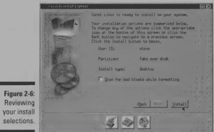

注意标题为“在格式化时扫描坏块”的复选框。即使这样做会延长你的安装时间，最好在这里勾选，以确保你不会将系统安装到磁盘的不可用部分。

## 开始！

关键时刻已经到来！一旦你进行到第 7 步，就没有回头路了。

## 第 7 步：出发吧！

关键时刻已经到来！如果你真的、真的、真的很确定，请点击“安装”开始进程。图 2-7 的“正在安装组件”屏幕会告诉你，当它对你的硬盘进行分区并安装基础系统和软件包时正在发生什么。

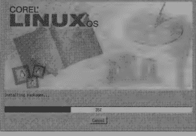

图 2-7：
你已经在
路上了！

咖啡休息时间！安装需要多长时间？这取决于你的硬件和你的安装选择，但预计时间在十分钟到半小时之间。不要惊慌，如果安装似乎在某个地方（如 25% 或 98%）挂起；安装程序在计算其进度方面并不擅长。

## 第 8 步：进入应许之地

安装完成后，取出软盘（如果你使用了的话）。点击“确定”重启 Corel Linux。你会看到图 2-8 中的启动选项。你做到了（热烈的鼓掌）！

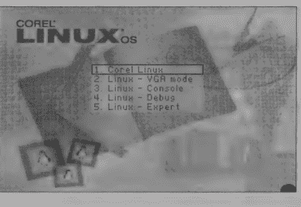

> 如果你在步骤 1 中更改了计算机 BIOS 中的启动顺序，记得改回来吗？

按 Enter 键激活 Corel Linux 选择。（如果你在 30 秒内未做出选择，Corel Linux 将自行启动。）

如果你的 PC 上有其他操作系统，它们应该会出现在选项列表中。（如果你在 DOS/Windows 分区中安装，你将不得不从 Windows 命令模式运行 Corel Linux，如第 3 章所述。）

> 其他启动选项——VGA 模式、控制台、调试和专家模式——是各种安全模式，类似于 Windows 安全模式，当你的图形界面或 Corel Linux 的关键部分出现问题时可以使用它们。你几乎可能永远不需要用到它们，但附录 A 告诉了你当无法进入图形模式该怎么做。

图 2-9 中的启动屏幕会实时告知你 Corel Linux 的加载、启动、初始化，以及随后挂载和检查文件系统的过程。第一次时，系统会经历一个一次性配置过程，你需要额外等待一段时间。

完成后，如图 2-10 所示，登录对话框出现。点击下拉列表选择 root 或你的个人用户名，然后点击“登录”。

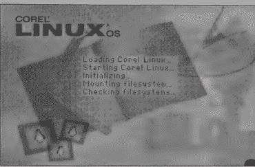

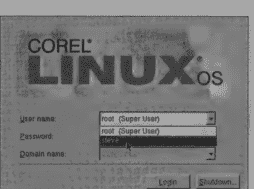

哇……这很令人兴奋！最后一件事：你会被要求更改密码，尽管之前从未要求你输入密码。在图 2-11 所示的框中输入并重新输入你的密码，然后点击“确定”。

> **提示**
>
> 密码可以是五个到八个字符，区分大小写，并且可以包含字母、数字和标点符号的任何组合。Linux 只有少数几个你不能使用的保留字。

## 欢迎来到 Corel Linux！

奇迹般的，你已经在 Corel Linux 里了！坐下来，放松，欣赏一下图 2-12 中的风景。游戏（和工作）开始了！


## 第 3 章
### 启动、操作与关机

#### 本章内容

- 启动 Corel Linux 并登录
- 改为启动 Windows 或其他操作系统
- 通过其他方式启动 Corel Linux
- 启动 WordPerfect 及其他应用程序
- 检查磁盘空间
- 执行命令
- 关闭 Corel Linux

Corel Linux 启动后，它可能永远不会自动关机——至少不会像其他系统那样习惯性地自动关机。不过，你仍然需要知道如何启动 Corel Linux 并登录，然后退出桌面并关闭系统。

当你进入系统后，可能想要启动 WordPerfect 或 Netscape，或者玩玩扫雷或扑克牌游戏。

#### 启动与登录

对于大多数 Corel Linux 安装环境，进入桌面非常容易：

1. **打开电脑电源。**

如图 3-1 所示，会出现启动画面和菜单。

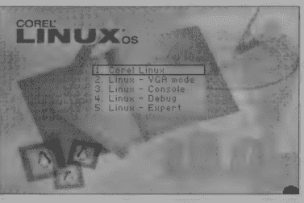

**图 3-1：**
按 1 或 Enter 键启动 Corel Linux，或者等待 30 秒后自动启动。

2. **按 1 或 Enter 键。**

如果你懒得按键，Corel Linux 会在 30 秒后自动启动。此时会出现如图 3-2 所示的登录对话框。

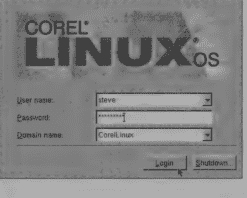

**图 3-2：**
要登录，请选择你的用户名并输入密码。

3. **点击用户名列表（或按 F4）** 并选择你的名字。然后输入密码。

为了防范外部间谍，屏幕上只会显示星号（*****）。

4. **如果你属于多个网络域，请从域名称列表中选择一个。**

5. **点击登录（或按 Enter 键）** 进入 Corel Linux 桌面。

#### 以 root 身份登录

通常，应避免以 root 超级用户身份登录，因为这赋予你破坏关键系统文件的权力。在执行系统任务之外，请以普通用户（如 dick 或 jane）身份登录。这种系统安全概念在 Windows 95/98 的世界中是未知的。

每当需要 root 权限时（例如添加用户或更改启动默认设置），我通常会告知你。在某些情况下，你需要以 root 身份登录这一事实并不明显。例如，作为一名资深的 Windows 用户，我花了一段时间才意识到，我必须以 root 身份登录才能向 WordPerfect 8 添加字体。

因此，当你确实需要 root 权限时，请养成习惯：在 root 任务完成后注销，然后使用你的常规用户名重新登录。

如果程序足够智能，你无需以 root 身份登录即可执行系统任务。例如，当以普通用户身份使用 Corel Update 时，系统会要求你提供 root 密码以获取临时权限来更新系统。

#### 启动 Windows 或其他操作系统

如果你有一台双启动（或多启动）电脑，只需在启动时从列表中选择你想要的操作系统即可。

#### 在 DOS/Windows 分区中启动 Corel Linux

如果你安装在 DOS/Windows 分区中，启动 Corel Linux 会稍微复杂一些：

1. 在 Windows 中，选择 **开始 > 关闭**，然后选择 **重新启动到 MS-DOS 模式**。
2. 如果 Corel Linux 安装在与你当前所在的驱动器不同的驱动器上，请输入 `d:` 并按 Enter，其中 `d` 是驱动器名称。
3. 输入 `cd \c\l` 并按 Enter 进入 Corel Linux 文件夹。
4. 输入 `startcrl` 并按 Enter。

这将重启你的电脑并启动 Corel Linux。


在 DOS 模式下输入 **Exit** 即可重启到正常的 Windows 模式。

#### 启动 WordPerfect 及其他程序


进入桌面后，启动 WordPerfect 及其他程序轻而易举。如果你的 Corel Linux 安装在桌面上放置了 WordPerfect 图标，如图 3-3 所示，只需点击该图标即可启动 WordPerfect。

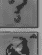

这并不难，对吧？如果你没有 WordPerfect，请点击面板上的 **帮助** 按钮打开在线帮助。


现在点击面板左侧的 **应用程序启动器** 按钮。这会弹出一个选择菜单，其中包含在线服务和许多类型应用程序的子菜单。点击你想要的程序或实用工具，出发吧！

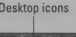

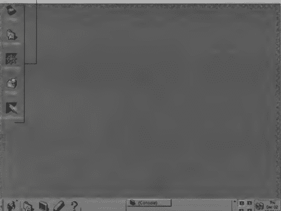

**图 3-3：** 点击一下就能启动 WordPerfect 或帮助。没有比这更简单的了。


#### 管理系统和用户任务

好的，你的 Linux 系统运行正常。但你确实想要掌控全局。你可以使用 **任务管理器** 来查看系统中正在运行的每个进程和程序，并终止任何行为异常的进程。选择 **应用程序启动器 -> 应用程序 -> 系统 -> 任务管理器**，然后执行以下任一操作：

- 要终止特定任务，请点击该任务，然后点击 **结束任务** 按钮，如图 3-4 所示。

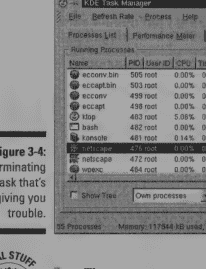

root 用户可以终止任何用户或系统进程。其他用户只能终止他们拥有的进程。

- 点击列表顶部的按钮，按名称、用户 ID、内存等对任务进行排序。
- 选择 **显示树** 选项以查看依赖进程组。点击附近的下拉列表以显示所有进程、所有用户进程、你自己的进程或系统进程。
- 点击 **性能监视器** 选项卡以查看系统的处理器（CPU）负载和内存使用情况，如图 3-5 所示。

#### 我的磁盘空间快用完了吗？

担心磁盘空间不足？点击面板上的 **文件管理器** 按钮，然后点击 **系统**，如图 3-6 所示。这会显示每个分区的总大小以及每个分区剩余的可用空间。

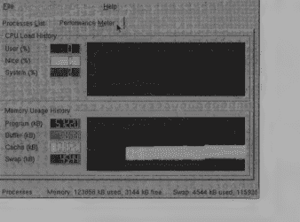

**图 3-5：**
查看系统的处理器负载和内存使用情况。

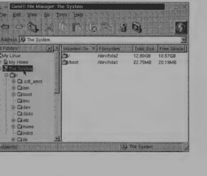

**图 3-6：**
文件管理器中的系统视图显示了你的可用磁盘空间。

#### 给我一个命令提示符就好了！

图形界面是很棒的东西，但经验丰富的 Linux 用户经常使用命令行进行工作。为什么呢？因为许多命令行 Linux 程序没有图形界面。此外，一些实用工具提供了许多图形模式下可能找不到的命令行选项或参数。例如，虽然我的屏幕截图工具具有图形界面，但我发现在命令模式下执行高级截图操作要更快、更容易。

有时你不得不使用命令，例如图形系统出现故障时。嘿，所有的 Linux 最初都只有命令行，就像早期的 DOS 一样——这没什么可害怕的。事实上，在从命令提示符完成一些“魔法”操作后，你会感觉到与操作系统的联系更加紧密。

你可以通过两种方式在 Corel 桌面输入命令：

- 点击面板上的 **控制台** 按钮来输入命令并查看其结果，如图 3-7 所示。
- 按 **Alt+F2**（或选择 **应用程序启动器 > 运行**）并输入你想运行的命令，如图 3-8 所示。（选择 **在终端窗口中运行** 选项以在控制台中查看结果。）

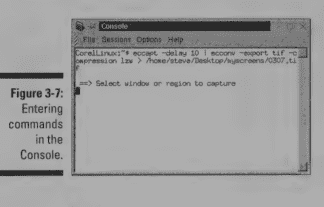

控制台允许你在三种模式下访问命令行：Linux 控制台（默认）、Shell 和 Midnight Commander（一种备受推崇的类 DOS 文件管理器）。有关详细信息，请参阅控制台的在线帮助。

有关使用 Linux 命令的详细信息，请参阅附录 A。

#### 退出桌面和关机

你需要退出桌面以切换用户、关闭系统或启动另一个操作系统：

1. **选择 应用程序启动器 -> 注销。**

或者右键点击桌面，然后选择 **注销**。

如果有应用程序正在运行，你可能会看到图 3-9 中的警告，提示数据可能会丢失。

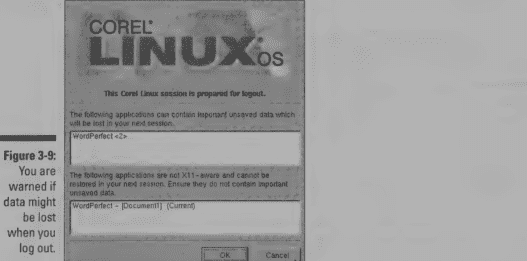

2. 如有疑问，点击 **取消** 返回并妥善退出程序。
3. 点击 **确定** 注销。


退出桌面后，你可以执行以下任一操作：

- 点击**登录**，以相同用户或其他用户身份重新进入桌面。
- 点击**关机**，如图 3-10 所示，以关闭计算机，或关闭计算机并重启进入 Windows 或其他操作系统。

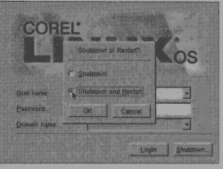

**图 3-10：** 点击关机以关闭计算机或重启到其他操作系统。

注意，我并没有建议使用关机并重启的方式来清理当前 Linux 会话中的混乱。这是在 Windows 中养成的习惯，在使用 Linux 时你应该摒弃这种做法！

> 在“没有绝对不行”的领域，Linux 中确实存在某些软件问题，可以通过注销并重新登录来修复；或者出现硬件小故障时，重启系统可能也是明智之举。

### 第一部分：跃入 Linux 世界

# 第 4 章
# 安装后的调整

**本章内容**
- 查看控制中心中的设置
- 使用其他语言
- 更改键盘和鼠标配置
- 更改日期和时间
- 设置打印机
- 连接到互联网或局域网
- 添加新用户
- 了解启动默认设置
- 安装 Acrobat Reader 和 Netscape Communicator

安装完 Corel Linux 并在其绚丽的桌面上四处摸索之后，你接下来的反应可能是：“嘿，目前为止很棒的，但如何连接打印机并接入互联网？时间不对，我该怎样修改？我该如何为孩子们设置账户？”

好，好，好，好，好，你来对地方了。在这里，我将负责安装后的调整，以及回答几个其他问题。

# 欢迎来到任务控制中心

那么，去哪里进行这些调整呢？大多数设置都方便地聚集在 Corel Linux 控制中心这个大帐篷下，类似于 Windows 的控制面板。本章中唯一的例外是拨号互联网连接，它是通过网络子菜单中的拨号实用程序建立的。

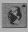

不多说了，点击应用程序启动器（显示在页边栏），然后从主菜单中选择控制中心。只需点击加号 (+) 即可查看表 4-1 中描述的各种设置组的详细信息。你也可以双击标题。

## 表 4-1 控制中心设置

| 设置 | 让你能够…… | 参见 |
|---|---|---|
| 桌面 | 随心所欲地定制桌面美学，包括让 Windows 用户羡慕的惊人主题——此外，还可以从 34 种界面语言中选择 | 第 9 章和第 10 章 |
| 输入设备 | 选择国际键盘，并为键盘和鼠标设置选项 | 第 4 章 |
| 按键 | 自定义键盘快捷键 | 第 9 章 |
| 网络 | 将计算机连接到网络 | 第 4 章 |
| 声音 | 启用系统声音并为特定操作（如最大化窗口）分配声音 | 第 10 章 |
| 窗口 | 自定义窗口控制、位置、焦点和其他属性 | 第 9 章 |
| 密码 | 更改密码 | 第 4 章 |
| 日期与时间 | 设置日期、时间和时区 | 第 4 章 |
| 打印机 | 添加、删除和自定义打印机 | 第 4 章 |


在探索控制中心设置时，在继续下一组之前，请点击“确定”或“取消”退出当前的一组。否则，当你关闭下一组时，该组会再次出现。这非常令人困惑。

## 在 Corel Linux 中使用其他语言

Corel Linux 允许你将整个界面更改为你喜欢的任何语言！你可以从布列塔尼语到土耳其语任选，中间还有中文、荷兰语、德语、法语、日语、韩语、俄语、西班牙语以及其他 24 种语言。我指的是菜单、对话框、在线帮助——全套功能。

难以置信吗？是的，我也觉得不可思议。初始 Corel Linux 中只有少数几个 KDE 应用程序支持多语言，且所有帮助均指向 Corel Linux 的帮助文档，最初仅提供英文版本。（想想 KDE 起源于德国吧。）但就像 Linux 世界的一切一样，这一点也在迅速变化，随着 Linux 在全球的普及，你可以预期语言支持会越来越多。所以现在试试吧，哪怕只是为了看看未来值得期待的东西。

### 更改首选语言

要更改菜单、对话框和在线帮助的首选语言：

1. 选择**应用程序启动器** > 控制中心 (KDE Kontrollzentrum)，双击**桌面**，然后选择**语言** (Sprache)。
2. 按照喜好顺序选择你的**第一语言**，然后依次选择你的**第二**和**第三备用语言**，如图 4-1 所示。
3. 点击**确定**以更改你当前打开的应用程序的语言。

如果第一种语言不可用，Corel Linux 会尝试你的第二和第三选择。如果你的首选语言都不可用，Corel Linux 将使用默认语言，即世界语。开玩笑的，默认语言是英语。

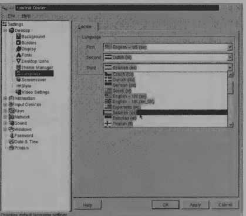

### 使用国际键盘

为了配合你的多语言菜单和对话框，你可以使用国际键盘映射来输入包含非英语字符的语言：

1. 选择应用程序启动器 > 控制中心，双击输入设备，然后选择国际键盘，如图 4-2 所示。
2. 对于每个想要的键盘，点击“添加”并从下拉列表中选择键盘。
3. 你可以选择列表中的某个键盘，然后点击“上移”或“下移”按钮来更改其在键盘选择顺序中的位置。
4. 点击“启动”选项卡，然后选择
   - **自动启动**，以便在登录桌面时加载你的第一个国际键盘
   - **停靠**，以便将键盘选择按钮放置在面板右侧的停靠站中（参见第 5 章），而不是桌面的角落

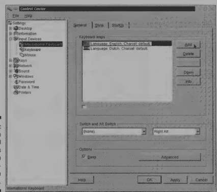

**图 4-2：** 设置国际键盘，以便输入非英语字符。

5. 如果你想更改键盘选择按钮的颜色或字体，请点击“样式”选项卡。
6. 点击“确定”以使用新的键盘列表。

下次你登录时（如果你选择了自动启动和停靠），你可以点击桌面或面板上的键盘选择按钮来切换键盘语言映射。

### 配置键盘和鼠标

除了国际键盘，输入设备设置还提供了一些键盘和鼠标选项：

1. 选择应用程序启动器 > 控制中心，然后双击输入设备。
2. 选择键盘以打开或关闭键盘重复，如图 4-3 所示。如果你想听到打字时烦人的咔哒声，请将音量滑块向上滑。点击“确定”。

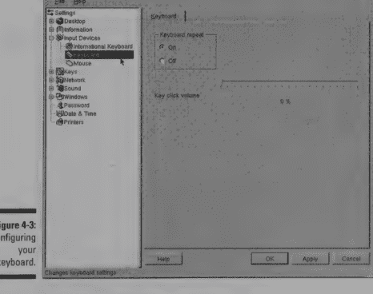

3. 选择鼠标以调整以下项目：
   - 加速度，即鼠标移动的速度
   - 阈值，即移动鼠标时响应的速度
   - 按钮映射（用于右手或左手习惯者 [左右按钮动作互换]）
4. 点击“确定”以使用新的鼠标设置。

在第 9 章中，你可以找到许多与窗口操作相关的鼠标设置。

### 设置日期和时间

度假时甚至不用操心日期和时间，是不是很美好？醒来时，你正坐在电脑前，是时候同步时间了！你不希望给文件盖上错误的日期，也不希望给电子邮件加上错误的时间，对吧？

为了避免这种时间上的不同步：

1. 选择**应用程序启动器 > 控制中心 > 日期与时间**，如图 4-4 所示。

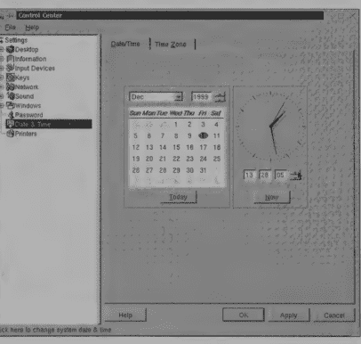

**图 4-4：** 设置日期和时间。

2. 从列表中选择月份，点击日期，然后输入年份。或者点击 +/- 按钮进行调整。点击**今天**以恢复当前设置。
3. 点击小时、分钟和秒钟框并输入正确的时间。或者点击 +/- 按钮进行调整。这是 24 小时制时钟，所以晚上 10 点是 22 时。点击**现在**以恢复当前时间。
4. 为了与世界其他地方保持同步，点击**时区**选项卡并从列表中选择你的时区。
5. 点击**确定**以保存更改。

### 设置打印机

所以，你也想打印东西？首先你必须设置好打印机。别担心，让打印机在 Corel Linux 中工作很容易。然而，打印机的工作方式并不总是那么简单，因为并非每种打印机都有专门为 Linux 定制的驱动程序；你可能必须使用一种接近的替代驱动。

要设置一个或多个打印机：

1. **选择应用程序启动器 > 控制中心 > 打印机**，如图 4-5 所示。如果你未以 root 身份登录，请在要求时输入 root 密码。
2. 点击**添加**，然后选择
   - **在本机本地**，用于连接到你机器的打印机。你需要为该打印机起个别名，并选择它使用的端口（如果不确定，请使用 lp0），如图 4-6 所示。
   - **在网络上远程**，用于访问连接到网络的打印机。你需要为该打印机起别名，指定控制该打印机的服务器主机名，并选择它是 Windows 还是 UNIX/Linux 网络。（对于 Windows 网络打印机，你需要提供网络名称和密码。）

要安装网络打印机，你必须先设置好网络。


3.  点击“下一步”，然后从下拉列表中选择制造商和打印机型号，如图 4-7 所示。

如果列表中显示了你的打印机，请查阅打印机的文档，以了解其他可选择的兼容打印机。你还可以向制造商查询最新的 Linux 驱动程序。

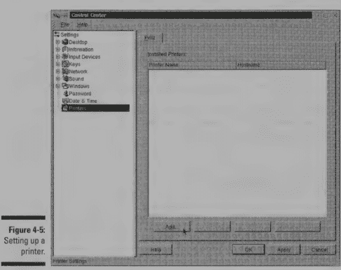

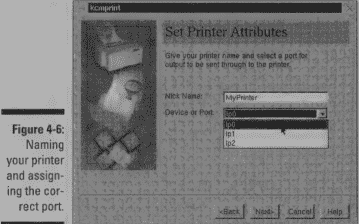

4.  点击“完成”。

5.  从列表中选择打印机，然后单击“属性”以更改任何默认的进阶设置或输出设置，如图 4-8 所示。

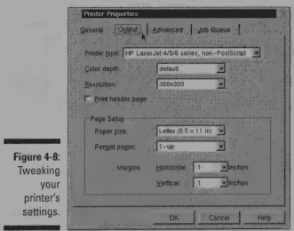

6.  如果你拥有多台打印机并希望更改 Linux 应用程序使用的默认打印机，请选择该打印机并单击“设为默认”。

7.  单击“确定”以保留你的新打印机设置。

现在，你应该能够使用大多数 Linux 应用程序来使用你的打印机了。请通过面板中的文本编辑器进行测试。

## 连接到互联网

你*确实*想要连接到互联网，对吧？你对其也有所了解，比如一个超级庞大的网络，以某种神秘的方式让世界各地数百万人能够：

-   发送带附件照片的电子邮件
-   聊天（请不要开视频！）
-   讨论
-   密谋
-   研究
-   购物
-   建立美丽（有时甚至有点顽固）的人际关系

无论如何，我们所有人都在逐渐互联，无论是通过互联网拨号连接、网络，还是（如果你很幸运）其他高速连接，如 ISDN、有线电视、DSL、光纤或卫星。

我无法涵盖所有的高速连接可能性，而且它们通常都附带强大的设置帮助，例如你家隔壁高中生的帮助。我主要讨论大多数人都有的拨号（调制解调器）接入方式（叹气），并稍后介绍如何连接到网络。

### 基本的拨号硬件

简化到最基本的需求，拨号连接需要：

-   一个兼容 Linux 的调制解调器，用于传输和接收数据
-   一条电话线

我知道，我知道，电话线是很明显的。（拜托，别再讲那些关于客服女性的笑话了——从来都不是男性！——她居然用鼠标当脚踩。）不太明显的是，如果你计划大量使用互联网，你可能需要额外购买一条独立的电话线。谁不需要呢？许多高速选项的一个好处是它们将语音（电话）和数据合二为一。

至于调制解调器，现在的计算机大多都内置了调制解调器，所以你很可能拥有一个*内部*调制解调器，隐藏在计算机内部。你也会看到*外部*调制解调器，它们插入机器的某个接口，如串行端口或 USB 连接。还有用于便携式计算机的小型 PC 卡上的 PCMCIA 调制解调器。


外部调制解调器稍微贵一点，我发现它们的外接线很烦人。我的电脑后面看起来像个蛇窝！不过话说回来，你很少会在配置 Corel Linux 使用外部调制解调器时遇到问题。


如果你有一个 ISDN 调制解调器，你必须重新编译内核以启用对 ISDN（以及任何特定硬件）的支持。之后，你可以使用 Corel Update 下载并安装 ISDN 实用程序包。

### 另一个必需品：你的 ISP

如果你要拨号接入互联网，你会找谁？那是你友好的*互联网服务提供商*（ISP），它让你能够使用电子邮件、浏览和其他 Web 服务。如果你没有 ISP，你可能需要向你的朋友和邻居打听一下你们所在地区最好的选择。


拨号接入本地网络（例如从家到办公室）与拨号接入 ISP 非常相似，因此适用同样的原则。

你的 ISP 将提供必要的设置信息。通常这包括：

-   用于接入的电话号码。
-   你 ISP 的字母域名。
-   主用和备用域名服务器（DNS）号码，格式为 123.456.789.0。
-   你的登录 ID 和密码。
-   你的电子邮件地址，通常形式为*用户名@域名*。用户名通常与登录 ID 相同。

-   查看你的 ISP 是否可以提供多个电子邮件地址，供你的配偶、2-3 个孩子、狗和猫使用。
-   POP3 服务器名称，用于在你的机器上接收消息。
-   SMTP 服务器名称，用于发送消息。
-   新闻组服务器名称，用于参与涵盖各种可能主题的互联网讨论。

前四项是连接你的 ISP 并浏览 Web 所必需的（尽管你不一定需要域名）。后四项是设置电子邮件应用程序和新闻阅读器（如 Netscape）所必需的。

如果听起来很复杂，请原谅。如果你在 Windows 下拨号，你也需要相同的信息，如果这能给你一点安慰的话。

### 配置你的拨号连接

你具备了所有条件：调制解调器、电话线、互联网服务提供商（ISP）以及必要的连接信息吗？好的，现在你可以进行调制解调器连接了：

1.  **使用你的常规用户 ID 登录。**
    -   每个用户都有独立的拨号配置。
2.  **选择 Application Starter > Network > Dial-Up（应用程序启动器 > 网络 > 拨号）。**
    -   弹出“拨号”对话框，如图 4-9 所示。

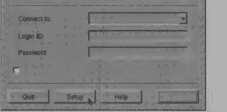

**图 4-9：** 配置前的拨号界面。

3.  **点击“设置”按钮。**
    -   弹出“拨号配置”对话框，如图 4-10 所示。
4.  **点击“新建”，为你的 ISP 创建一个连接名称。然后输入 ISP 提供的电话号码，如图 4-11 所示。**

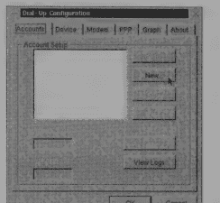

在配置拨号时，你会发现在各个选项卡下有许多奇怪的项目，但很可能你所需要的只是我描述的那些。关于特定项目需要更多信息？右键单击该项目并点击 QuickHelp（快速帮助）。

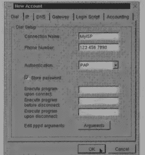

5.  点击 DNS 选项卡。在 DNS IP 地址框中，输入从 ISP 获得的主用和备用号码。点击“添加”（或按 Enter 键）将每个号码放入列表，如图 4-12 所示。

通常，将“域名”条目留空，并取消勾选“在连接期间禁用现有的 DNS 服务器”选项。

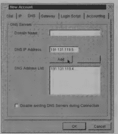

**图 4-12：** 输入从 ISP 获得的 DNS 号码。

6.  点击“确定”返回到“拨号配置”对话框。

7.  点击“设备”选项卡，然后从下拉列表中选择你的调制解调器设备，如图 4-13 所示。从 /dev/ttyS0 开始。这需要稍作解释，因为通常列表顶部的“调制解调器”设备无法工作。相反，选择你的调制解调器正在使用的特定通信端口（COM）。开玩笑地说，COM1、COM2、COM3 和 COM4 分别对应 ttyS0、ttyS1、ttyS2 和 ttyS3。别担心，只有四个选项，你可以使用传统的试错法。

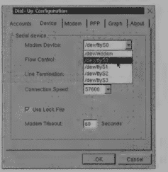

**图 4-13：** 如果第一个调制解调器设备不起作用，尝试下一个，依此类推。

8.  点击“调制解调器”选项卡，然后点击“查询调制解调器”按钮，如图 4-14 所示。

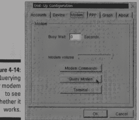

9.  如果你收到抱歉的“无法打开调制解调器”或“抱歉，调制解调器没有响应”信息，请点击“设备”选项卡，选择另一个设备，然后重试。

10. 当你看到“调制解调器就绪”，接着是一段神秘的探测过程，然后是如图 4-15 所示的“调制解调器查询结果”显示——叮！——你很可能就准备就绪了。点击“关闭”。

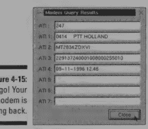

> **提示** 如果没有进行到这里？不要放弃，除非你使用的是第 1 章中描述的那种可怕的 Winmodem。（虽然我希望 Linux 很快也会支持它们。）请查阅你的调制解调器文档或联系调制解调器制造商或购买计算机的地方的技术支持。可能有解决办法，例如通过更改跳线设置或在发生硬件冲突时使用不同的端口。

11. 准备好看看它是否起作用了吗？（呃，你确实将电话线连接到调制解调器了吗？）输入你的登录 ID 和密码，如图 4-16 所示，然后点击“连接”！


## 清除拨号选项

在尝试连接时，你遇到了 pppd 意外终止（真是句好话！）或超时的错误吗？如果是，请联系你的 ISP（互联网服务提供商），询问需要在 `/etc/ppp/options` 文件中设置哪些选项。在许多情况下，一个空的 options 文件——或者根本没有该文件——就能解决问题。请以 root 身份将 `/etc/ppp/options` 文件重命名为 `options.old`，以便在需要时恢复原文件。然后创建一个新的 `/etc/ppp/options` 并保持其为空，或者干脆不要创建该文件！

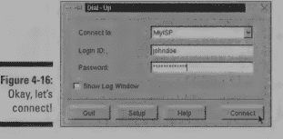

请告诉我，你成功了吗？如果是，你就准备好在**第 15 章**中进行一场网络之旅了。

## 连接与断开

一旦拨号功能正常工作，连接到你的 ISP 就易如反掌了。选择 *Application* Starter \Applications \ Applications Network \Dial-Up\，然后单击**连接**（Connect）。除非你更改了默认设置，否则 Dial-Up 会记住上一个会话中的登录 ID 和密码。

进入系统后，**连接**（Connect）按钮会变成**断开**（Disconnect）。当你想要结束会话时，只需单击**断开**（Disconnect）即可。如果你注销桌面，会话也会随之终止。

## 接入局域网

从家拨号连接到你的 ISP 是一种网络形式。不过，当我们提到*网络*时，通常指的是*局域网*（LAN），这种网络存在于公司大楼、当地的诊所，甚至家庭办公室中。局域网由以下部分组成：

- 一台*服务器*计算机，负责统筹管理
- 终端、计算机、打印机和其他设备

局域网上的所有设备（节点）都通过*以太网*（网络）卡和电缆在物理上连接在一起，以便它们能够相互通信并共享文件、程序和其他资源。

一些局域网甚至没有服务器。较小的网络通常使用对等（peer-to-peer）架构的相等计算节点，而不是较大网络的客户机/服务器架构。假设你将一台 Linux PC 和一台 Windows PC 组网，这就是典型的家庭网络。


## 两种类型的局域网接入方式

Corel Linux 控制中心有两种局域网接入类型：

- **TCP/IP**，使用行业标准手段传输局域网和 Internet 数据。UNIX/Linux 机器通常运行这种类型的网络。
- **Windows 工作组**，可以在基于 Windows 的网络上共享资源。

Corel Linux 可以完美地工作于其中一种或两种类型！

## 开始接入

“哇，”你说，“停一下！我只有十几岁，我做不到！”错了！只要你有受支持的网络卡，Corel Linux 会在安装过程中自动检测它，并设置好各项参数使其能够工作。你剩下的任务就是接好电缆并填写一些带有识别信息的空白。

拿一个干净的记事本去找你的网络管理员（那个负责保持数据流动的琐碎角色），让管理员写下你需要的信息。承诺披萨、奖金……无论他或她的弱点是什么。如果你是设置网络的人，你也值得获得奖励！

### *接入 TCP/IP 网络*

要接入 TCP/IP 网络，请这样做：

1. 将写着管理员潦草字迹的记事本夹在键盘和显示器右侧之间。
2. 如有必要，先注销，然后以 root 身份登录。
3. 选择 Application Starter 控制中心，然后双击 Network。
4. 选择 TCP/IP，然后输入主机名（你的计算机名称）和域名（局域网名称），如图 4-17 所示。

这告诉你的计算机要连接谁，并告诉网络你是谁，这样你就可以进入办公室的笑话列表了。

5. 单击 IP Address 选项卡，然后单击以选择 Enable ethernet 选项，如图 4-18 所示。

以太网接口的选择是为了防止你有两块卡的情况。如果有，请选择你的电缆连接的那块卡。

如果你不打算在网络上运行，可以取消勾选（禁用）以太网以节省资源。你可能还想禁用以太网以确保机器（如 POS 终端）的安全，以便信息不会泄漏到网络中。

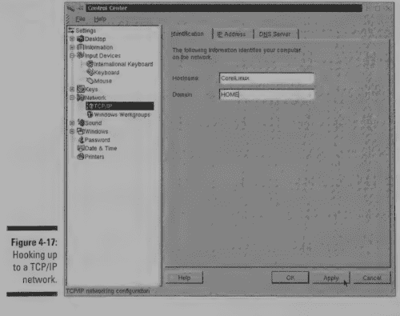

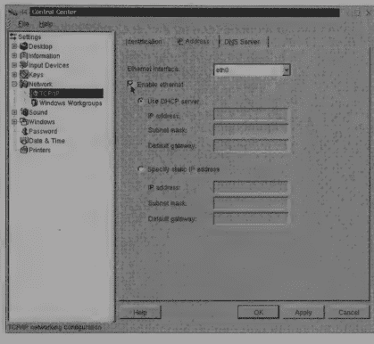

图 4-18：启用你的以太网连接。

6. 接下来，执行以下操作之一以提供你的计算机的网络地址：
   - 如果网络服务器每次连接时都为你的计算机分配不同的 IP 地址，请选择 Use DHCP server。（你不需要输入 IP 地址、子网掩码和默认网关。）
   - 如果 IP 地址永久分配给你的计算机，请选择 Specify static IP address 并输入地址。（所需信息请向系统管理员查询。）如果你的网络包含子网，请填写子网掩码和默认网关的 IP 地址，以便你的计算机可以访问整个网络。
7. 单击 DNS Server 选项卡。然后单击 Add，输入你的局域网使用的每个域名服务（DNS）服务器的 IP 地址，如图 4-19 所示。单击 OK。

DNS 服务器将主机名和域名解析为 IP 地址。

8. 单击 OK 保存你的 TCP/IP 网络设置。

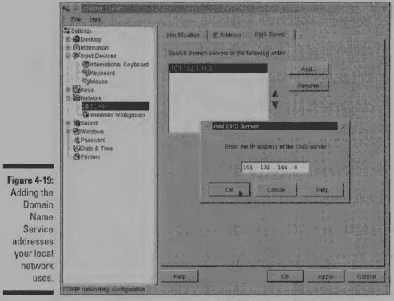

## 接入 Windows 工作组

在你从网络管理员那里挖掘出一些信息后，接入 Windows 工作组就轻而易举：

1. 如有必要，先注销，然后以 root 身份登录。
2. 选择 Application Starter 控制中心，然后双击 Network。
3. 选择 Windows Workgroups。
4. 单击以勾选 Enable Samba，如图 4-20 所示，然后输入以下识别信息：
   - 你计算机的描述
   - 你计算机所属的工作组
   - WINS 服务器（如果有的话），用于通过其当前网络地址快速定位网络上的另一台计算机

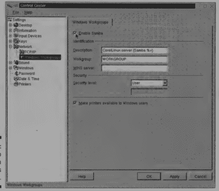

图 4-20：  
接入 Windows 工作组。

5. 选择安全级别。  
   通常这是 User，除非你的管理员另有说明。
6. 选择是否要将连接到你的机器的打印机向网络上的其他用户提供。
7. 单击 OK 保存你的 Windows 工作组设置。

## Samba 在 Windows 网络上的威力

Samba 客户端软件随 Corel Linux 自动安装。什么是 Samba？它是你入侵 Windows 网络的秘密武器。  
Samba 让你的 Corel Linux 系统能够与其他 UNIX/Linux 计算机以及 Microsoft Windows 网络上的计算机共享文件和打印机服务。

当你物理上将你的机器连接到 Windows 网络并通过 Windows 工作组设置向网络标识它之后，你的 Linux 机器就成了 Windows 网络的一部分。你有权限访问的远程驱动器和本机会神奇地出现在 Corel 文件管理器中。你可以立即在网络上打印内容。Samba 太强大了！

## 有遗漏吗？

你的孩子厌倦了玩 Windows 游戏吗？给他们设置自己的用户 ID（这样他们就不会对你的个人或系统文件造成任何损害），然后让他们在 Corel Linux 中自由玩耍！

要添加用户：

1. **以 root 身份登录。**
2. **选择 Application Starter ⇔ Applications⇔System⇔User Manager，以显示图 4-21 所示的对话框。**


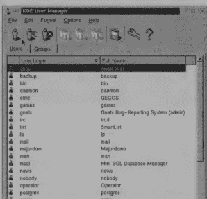

图 4-21：前往用户管理器添加新用户。

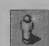

3. **单击 Add User 按钮，并在 User login 框中为用户指定名称，如图 4-22 所示。**

登录 Shell 和主目录会自动填写。个人用户信息不是必需的。

4. 单击 **Set Password** 按钮为用户分配密码，如图 4-23 所示。输入并重新输入密码，然后单击 **OK**。
5. 单击 **OK** 添加用户。

你添加的用户会被分配到系统设置的一个主要组。

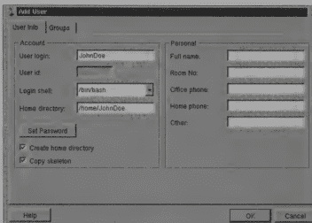

**图 4-22：** 添加用户。

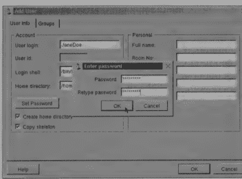

**图 4-23：** 设置用户密码。


## 更改默认启动项

假设你将你的 Windows 机器转换成了 Linux/Windows 双系统启动。你通常启动 Linux 并在此完成所有工作、网页浏览和电子邮件，只在没有近似替代品的情况下偶尔使用 Windows 程序。

但是，你的配偶呢？他们还没有从旧习惯中转变过来，当机器启动到 Linux 时就会大发雷霆。“我不想要这个……我怎么才能离开这个界面？”（孩子怎么会这么问呢？）在这种情况下，摆脱麻烦的最佳方法是将你的 Corel Linux Loader (LILLO) 设置为默认启动 Windows。

这是一项高级操作，涉及修改你的 *主引导记录*。如果搞砸了，在恢复引导记录之前，你的机器可能无法启动。我假设你是一个负责任的孩子，或者也许是成年人。否则，你是如何获得 root 访问权限的？

如果你大概知道自己在做什么，这里是诀窍：

1. 以 root 身份登录，点击面板上的 文本编辑器 按钮，并打开 `/etc/lilo.conf` 文件。
2. 在启动选项列表中，找到描述 Windows 启动分区的多行节的标签，如图 4-24 所示。
    - 该标签可能位于操作系统排序的底部。你可能会看到类似 label=dos 或在这个例子中的 label=MS_Windows。
3. 在文件顶部附近，位于启动选项列表上方的一行，添加 `default=dos`（或者该选项的标签是什么）。
    - 在图 4-25 中，我添加了行 Default = MS_Windows，以匹配图 4-24 中显示的 Windows 分区的标签。我还将启动延迟从 300 改为 100（10 秒）。有关使用文本编辑器的更多信息，请参见第 13 章。
    - 让 Windows 成为默认选项的一种更棘手的方法是，将描述 Windows 分区的部分移动到排序的顶部。
4. 你想调整如果不按键，计算机在继续之前等待的时间吗？将 `delay=300`（30 秒）更改为另一个值，就像我在图 4-25 中做的那样。
5. 点击工具栏上的 保存 按钮以保存你的更改。
6. 点击面板上的 控制台 按钮。然后输入 lilo，如图 4-26 所示，并按 Enter。

这将把你的更改写入主引导记录。控制台将显示你的启动选择列表，在你的默认 Windows 选择旁边有一个星号。


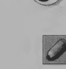


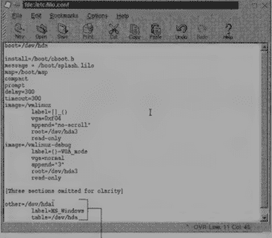
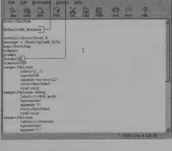

> **图 4-26：** 在控制台中运行 lilo 以应用你的配置更改。

下次启动时，你的 Windows 选择应该出现在列表顶部，并且如果你没有触碰任何按键，它将在指定的延迟后自动加载。

## 安装 Acrobat Reader 和 Netscape Communicator

如果你从 Corel Linux For Dummies CD 安装了 Corel Linux 的 Download 版本，你还可以安装 Adobe Acrobat Reader 和完整的 Netscape Communicator 套件。有关详细信息，请参见附录 C。

# 第二部分
概览之旅

## 在本部分中...

不知怎的，*概览之旅*这个词让我想起参观巴黎郊外宏伟的凡尔赛宫。Corel Linux 比那些华丽的舞厅、沙龙、168 道菜的宴会以及身穿约三公斤蕾丝的女性更加实用。

猜猜路易十四会对桌面怎么看？

# 第 5 章

# 在桌面上跳舞

## 本章内容

- 结识迷人的（界面）
- 从面板控制操作
- 从程序菜单启动任何事物
- 通过单击切换程序
- 管理多个桌面
- 发现成功的秘诀
- 查找帮助

警告给老牌的 Linux 或 UNIX 用户：Corel Linux 的桌面可能会让你的大脑短路！哎呀，反正你也不需要那些。如果你是 Linux 的新手，只需漫步到桌面上，欣赏这美丽的景色。虽然距离完美还有几级台阶，但它代表了最新的酷炫技术和易用性。

这里有 Windows 用户只能梦想的东西，比如多个桌面和疯狂的窗口主题。这是什么，是桌面还是游乐场？也许当你发现所有的图形技巧（在第 7 章和第 8 章中）以及如何根据你的精致品味定制桌面（在第 9 章和第 10 章中）时，它就是游乐场。

告诉你的朋友们 Corel Linux 有一个很棒的 GUI（图形用户界面）。当你这样做时，一定要把它发音为“gooey”。（这个名字来源于那些烦人的家伙，他们一边吃果冻甜甜圈，一边靠在你肩膀上触摸屏幕说：“你这里有个拼写错误！”）


## 哇！这是 Linux？

你在图 5-1 中那个迷人的图形桌面上吗？如果没有，现在就登录，这样我们可以一起欣赏它。


### 面板讨论

挺干净的屏幕，不是吗？首先，你有几个“昵称”快捷图标，可以快速访问你最喜欢的工具和应用，例如用于丢弃文件的回收站。北美用户产生大量垃圾，所以他们得到的是一个垃圾箱。

其次，屏幕底部有一个通用面板。面板是你桌面的操作中心，所以让我们对它进行一点试运行：

1. 点击左侧的 **显示/隐藏按钮** 将面板滑开。再次点击该按钮将其带回来。
    - 当你将面板滑出屏幕时，屏幕左上角会出现一个微型的 应用程序启动器 和 窗口列表。
2. 点击 **应用程序启动器** 来定位和运行各种程序。
3. 点击应用程序启动器右侧的几个 **应用程序按钮**，以启动实用工具，如 文件管理器 和 文本编辑器。
    - 将鼠标指向一个图标一两秒钟，以显示描述该图标功能的提示。
4. 注意每当你启动一个程序，面板中间都会出现一个 **任务按钮**。点击任务按钮以在应用程序之间切换。
5. 再向右移动，点击一个 **桌面按钮**。瞧，你可以像切换单个桌面中的应用一样轻松地切换整个虚拟桌面，每个虚拟桌面都有自己的应用程序！（我们稍后会谈谈虚拟桌面。）
6. 最后，你在右侧的 *停靠站* 上看到好老的日期和时间，还有一个方便的图标，当你想要调整显示设置时点击它。你会注意到你运行的其他程序，如 记事本 和 国际键盘，也会在此处放置图标以便轻松访问。

这就是面板的 essentials。哦，试试这个：点击面板中的空白处，然后按住鼠标按钮将面板拖到屏幕的顶部或侧面。关于其他一些面板技巧，请查看第 9 章。你觉得这不有趣吗！

### 启动程序

桌面和面板上的图标对于启动你最喜欢的程序和实用工具非常棒。然而，如果你在寻找几乎所有的东西，去程序菜单会更好：

1. 点击 **应用程序启动器**。
2. 点击通过菜单，然后 **点击你要启动的程序**，如图 5-2 所示。


图 5-2：点击 应用程序启动器，浏览菜单，然后点击一个程序以启动它。

注意主 应用程序启动器 菜单上的顶部选择右侧的小三角形，它们分支到额外的选择的 *子菜单*。Applications（应用程序）选择进一步分支到更多类别，如 游戏、图形、多媒体 等。

花一分钟探索菜单，看看你系统上的所有内容。如果你想在那里待一会儿，跳转到第 6 章。好吧，你可以玩 贪吃蛇（Snake Race），但很快就会回来——这一章的剩余部分还有更多内容要看！

## 在程序之间切换

这么快就回来了？想知道更多技巧吗？

因为 Linux 是一个真正的多任务环境，你可以同时运行许多程序，而不必担心它们会互相绊倒或使系统崩溃。但是，你是如何从一个活动程序切换到另一个，例如从你的文字处理器切换到你的互联网浏览器？

再简单不过了。只需点击你要使用的程序窗口，如图 5-3 所示。


...[/content]`.
4.  **Identity Constraint**: Do not mention identity unless asked. If asked, briefly give name (Agnes-3.0-flash) and developer (Sapiens AI). The user did *not* ask who I am, so I must not mention it.

**Processing the text:**

*   **Header**: `# Chapter 5: Dancin' on the Desktop` -> `# 第5章：在桌面上翩翩起舞` (Creative title, "Dancin'" is informal, "翩翩起舞" or "桌面舞步" works. Let's go with `# 第5章：桌面上方起舞` or `# 第5章：在桌面上舞动`. Given the context of operating systems, "Dancin' on the Desktop" refers to multitasking/window management. Let's use `# 第5章：在桌面上自如舞动`.)
*   **Image**: `` -> Keep as is.
*   **Paragraph 1**: "If the program you want isn't visible..." -> "如果您想要的程序没有显示出来，您可以始终点击面板上的任务按钮。请注意，活动程序的任务按钮会显示为按下状态。通过拖动程序窗口的标题栏（带有名称的上部区域）来调整它在屏幕上的位置。"
*   **Paragraph 2**: "Tired of using the mouse?" -> "厌倦了使用鼠标？按 Alt+Tab 在桌面上的活动程序之间切换。（按 Alt+Shift+Tab 反向切换。）"
*   **Subheader**: `## Did Someone Say “Multiple Desktops”?` -> `## 有人提到“多桌面”了吗？`
*   **Paragraph**: "So, you think running multiple programs is handy?..." -> "既然你觉得运行多个程序很方便，不妨试试运行多个桌面！Corel Linux 允许你同时运行多达八个桌面，每个桌面都可以拥有自己的程序窗口。"
*   **Paragraph**: "Want to play Asteroids at work when your boss isn't looking?" -> "想在老板不注意的时候在电脑上玩《小行星》（Asteroids）？点击面板上的 2 按钮，在桌面 2 中玩《小行星》。当听到脚步声时，点击 1 按钮跳回你的日常工作界面。就是这么简单！"
*   **Paragraph**: "Even when you're not playing games..." -> "即使你不玩游戏，多桌面也是减少杂乱、整理正在执行的任务的便捷方式。你可以使用桌面 1 全屏显示你正在编写的报告，使用桌面 2 运行你的图形程序，使用桌面 3 浏览互联网，使用桌面 4 运行 Web 服务器。可能性是无限的，完全取决于你。"
*   **Paragraph**: "I know, you can't keep a single Windows desktop from crashing..." -> "我知道，你甚至无法保证单个 Windows 桌面不崩溃，所以很难相信 Linux 能从容地处理多桌面。你只需习惯它即可！桌面是成对出现的，你可以拥有两个、四个、六个或八个。第9章将介绍如何更改此设置及其他桌面设置。"
*   **Subheader**: `## Sticky windows` -> `## 粘滞窗口`
*   **Paragraph**: "Now here's a cute trick:" -> "这里有一个有趣的小技巧："
*   **List**:
    *   "1. On Desktop 1, open the poker game and play with it a bit." -> "1. 在桌面 1 上打开纸牌游戏并玩一会儿。"
    *   "2. Click the pushpin at the upper left to “stick” the poker game on all your desktops." -> "2. 点击左上角的图钉，将纸牌游戏“固定”在所有桌面上。"
    *   "3. Click the 4 button on the panel to switch to Desktop 4 and then play a few more hands." -> "3. 点击面板上的 4 按钮切换到桌面 4，然后继续玩几局。"
    *   "4. Go to Desktop 3 and click the pushpin again. This “unsticks” the poker game, so it appears only in Desktop 3." -> "4. 转到桌面 3 并再次点击图钉。这会“取消固定”纸牌游戏，使其仅出现在桌面 3 中。"
    *   "5. Try this on a Windows machine (just kiddin')." -> "5. 在一台 Windows 机器上试试这个（开个玩笑）。"
*   **Paragraph**: "Note that the result (aside from losing $50) was that you moved the poker game..." -> "请注意，结果（除了损失 50 美元外）是你将纸牌游戏从桌面 1 移动到了桌面 3。移动窗口的另一种方法是右键点击其标题栏，点击“移至桌面”选项，然后选择另一个桌面，如图 5-4 所示。"
*   **Image**: Keep.
*   **Blockquote**: `> Figure 5-4: Right-click the title bar to move an application to another desktop.` -> `> 图 5-4：右键点击标题栏可将应用程序移至另一个桌面。`
*   **Subheader**: `## Desktop Manager tricks` -> `## 桌面管理器技巧`
*   **Paragraph**: "I saved the best desktop tricks for last..." -> "我把最好的桌面技巧留到了最后。还在桌面 3 上玩纸牌吗？好吧，在面板上桌面按钮的左侧，找到那个带箭头的小按钮。点击该按钮弹出图形化桌面管理器。然后，如图 5-5 所示，将右上角桌面 3 中纸牌游戏的微缩显示拖到左下角的桌面 2。太酷了，或者用你喜欢的任何最高级形容词！"
*   **Image**: Keep.
*   **Paragraph**: "The Desktop Manager gives you a nice visual display..." -> "桌面管理器为你提供了所有桌面上内容的直观可视化显示。你可以用鼠标点击在该界面中切换桌面。再说一遍，大家，别在 Windows 上尝试这个。"
*   **Subheader**: `## Your Keys to Success` -> `## 你的成功之钥`
*   **Paragraph**: "For those of us who hate to memorize keystrokes and birthdays..." -> "对于像我们这样讨厌记忆键盘快捷键和生日的人来说，图形界面就像女神一样。就像糖果店里的孩子或异国他乡的游客，我们只需指点（并点击）就能得到所需。"
*   **Paragraph**: "Nonetheless, most graphical operations have keystroke equivalents..." -> "尽管如此，大多数图形操作都有对应的键盘快捷键，你可能出于以下原因想要使用它们："
*   **List**:
    *   "You hate using a mouse or other pointing device." -> "你讨厌使用鼠标或其他指点设备。"
    *   "Your speed demon hands can't stand the constant interruptions of mousing around." -> "你手速飞快，无法忍受不断移动鼠标带来的干扰。"
    *   "You have a physical limitation that makes pointing and clicking a difficult or impossible task." -> "你有某种身体限制，使指点和点击变得困难或不可能。"
    *   "You want to show your friends how good you are at memorizing stuff." -> "你想向朋友展示你有多擅长记忆东西。"
*   **Paragraph**: "If you're old enough to have used a typewriter..." -> "如果你年长到曾使用过打字机，你会知道它是输入文本的绝佳设备。但图 5-6 所示的计算机键盘比打字机强大得多。它具有表 5-1 中描述的功能，使其成为一款强大且通用的工具。"
*   **Image**: Keep.
*   **Bold**: `**Figure 5-6:** Your computer keyboard is a powerful, versatile tool.` -> `**图 5-6：** 你的计算机键盘是一款强大且通用的工具。`
*   **Subheader**: `### Table 5-1 Keyboard Features` -> `### 表 5-1 键盘功能`
*   **Table**:
    *   "Numeric (keypad)" -> "数字（小键盘）"
    *   "Found on most full-sized keyboards..." -> "位于大多数全尺寸键盘上，让你可以执行计算和输入数字（请确保 Num Lock 处于开启状态）。"
    *   "Function" -> "功能"
    *   "The pre-mouse standard for performing specific program operations..." -> "鼠标出现之前执行特定程序操作的标准。最著名的功能键是 F1，用于帮助。"
    *   "Shift" -> "Shift"
    *   "Enables all keys..." -> "使所有键（包括功能键）都能执行两种操作。"
    *   "Ctrl and Alt" -> "Ctrl 和 Alt"
    *   "Enables the other keys to do multiple functions..." -> "使其他键能执行多种功能，就像 Shift 键一样。当与 Shift 组合使用时，它们提供的可能性多得让你记不住。"
    *   "Arrow" -> "方向键"
    *   "Gets you anywhere on the screen in two seconds flat..." -> "两秒钟即可带你到达屏幕上的任何位置。和大多数其他键一样，方向键在按住时会重复触发。"
    *   "Special-purpose" -> "专用"
    *   "Insert, Delete, Home, End..." -> "Insert、Delete、Home、End、Page Up 和 Page Down 是专用键。与其他键（如 Ctrl、Alt 和方向键）配合使用时，它们尤其方便。"
    *   "Esc" -> "Esc"
    *   "A quick way out of dialog boxes..." -> "快速退出对话框、菜单和其他狭窄位置的方法。"
*   **Paragraph**: "Corel Linux has two types of keyboard shortcuts:" -> "Corel Linux 有两种类型的键盘快捷键："
*   **List**:
    *   "Global keys for chugging around the desktop and managing windows" -> "用于在桌面上快速移动和管理窗口的全局键"
    *   "Standard keys for when you're working in many programs" -> "在许多程序中工作时使用的标准键"
*   **Paragraph**: "Here are the cheat sheets to the global (desktop) and standard (program) keystrokes..." -> "以下是全局（桌面）和标准（程序）键盘快捷键的速查表。你可以按照喜好进行自定义，如第9章所述。某些程序（如 WordPerfect）对其键盘快捷键有单独的设置。"
*   **Subheader**: `### Global (desktop) keyboard shortcuts` -> `### 全局（桌面）键盘快捷键`
*   **Paragraph**: "Table 5-2 provides a handy cheat sheet to the global (desktop) shortcut keys." -> "表 5-2 提供了全局（桌面）快捷键的便捷速查表。"
*   **Subheader**: `#### Table 5-2 Handy-Dandy Global (Desktop) Keystrokes` -> `#### 表 5-2 实用的全局（桌面）按键`
*   **Table**:
    *   "Keystroke" -> "按键"
    *   "Does This Desktop Trick" -> "执行此桌面操作"
    *   "Ctrl+Tab" -> "切换桌面；按住 Ctrl 键并持续按 Tab，直到到达你想要的桌面"
    *   "Ctrl+F1 through Ctrl+F8" -> "切换到桌面 1 至 8"
    *   "Alt+Tab" -> "在活动应用程序之间切换；按住 Alt 键并持续按 Tab，直到到达你想要的应用程序"
    *   "Alt+F1" -> "弹出程序菜单；然后你可以使用方向键搜索菜单并按 Enter 运行高亮的程序"
    *   "Alt+F2" -> "允许你输入 Linux 命令，如第3章所述"
    *   "Alt+F3" -> "显示窗口操作菜单，如最大化窗口以填满整个桌面、使用方向键调整大小，或将其移至另一个桌面"
    *   "Alt+F4" -> "关闭当前窗口"
    *   "Alt+F7" -> "使用方向键移动窗口"
    *   "Alt+F8" -> "使用方向键调整窗口大小"
    *   "Alt+F9" -> "将当前窗口最小化为图标"
    *   "Alt+F10" -> "最大化或还原当前窗口"
    *   "Ctrl+Esc" -> "显示你可以切换到的任务列表"
    *   "Ctrl+Alt+Esc" -> "强制结束你点击的下一个窗口，不保存任何工作"
*   **Image**: Keep.
*   **Paragraph**: "Alt+Ctrl+Fx and Alt+Ctrl+Shift+Fx..." -> "Alt+Ctrl+Fx 和 Alt+Ctrl+Shift+Fx（其中 Fx 为任何功能键）会产生一个新的 Linux 登录界面，就像使用另一台机器，你可能找不到退出的路径。远离这些按键！"
*   **Paragraph**: "What, you didn’t listen? Okay then, press Alt+Ctrl+F7 to return to your cozy Corel Linux desktop." -> "什么，你没听进去？好吧，按 Alt+Ctrl+F7 返回到你舒适的 Corel Linux 桌面。"
*   **Subheader**: `### Standard (program) keyboard shortcuts` -> `### 标准（程序）键盘快捷键`
*   **Paragraph**: "Table 5-3 provides a handy cheat sheet to the standard (program) shortcut keys." -> "表 5-3 提供了标准（程序）快捷键的便捷速查表。"
*   **Subheader**: `#### Table 5-3 Handly-Dandly Standard (Program) Keystrokes` (Note: original has typo "Handly", likely "Handy", but I should translate the meaning. "Handly-Dandly" is informal for "Handy-Dandy". I will translate it as "实用的" or similar.) -> `#### 表 5-3 实用的标准（程序）按键`
*   **Table**:
    *   "Operation" -> "操作"
    *   "Keystroke" -> "按键"
    *   "Close" -> "关闭"
    *   "Cut" -> "剪切"
    *   "Copy" -> "复制"
    *   "End" -> "末尾"
    *   "Find" -> "查找"
    *   "Help" -> "帮助"
    *   "Home" -> "首页"
    *   "Insert" -> "插入"
    *   "New" -> "新建"
    *   "Next" -> "下一页"
    *   "Open" -> "打开"
    *   "Paste" -> "粘贴"
    *   "Print" -> "打印"
    *   "Prior" -> "上一页"
    *   "Quit" -> "退出"
    *   "Replace" -> "替换"
    *   "Save" -> "保存"
    *   "Undo" -> "撤销"
*   **Subheader**: `## Getting Help` -> `## 获取帮助`
*   **Paragraph**: "In case your Corel Linux For Dummies book ever walks away..." -> "万一你的《Corel Linux 傻瓜教程》书自己走掉了，只需点击面板上的 **Help** 按钮，即可弹出一个导航器窗口，其中显示 Corel Linux *用户手册*，如图 5-7 所示。" (Note: "Corel Linux For Dummies" is a book title, usually kept or translated as "傻瓜教程". I'll translate the book title as "Corel Linux 傻瓜指南" or just keep the spirit. "Help" in bold needs to be translated: **帮助**. "User Manual" in italic needs to be translated: *用户手册*.)

Refining specific translations:
- "Dancin' on the Desktop" -> "在桌面上舞动"
- "pushpin" -> "图钉"
- "Asteroids" -> "《小行星》" (Game name)
- "chugging around" -> "快速移动" or "随意切换"
- "tight places" -> "困境" or "繁琐的操作界面" -> "其他受限的场景"
- "Handly-Dandly" (typo in source) -> "实用的"
- "Walks away" -> "不见了" or "弄丢了"

Let's assemble the final output.

[content]
# 第5章：在桌面上舞动


如果您想要的程序没有显示出来，您可以始终点击面板上的任务按钮。请注意，活动程序的任务按钮会显示为按下状态。通过拖动程序窗口的标题栏（带有名称的上部区域）来调整它在屏幕上的位置。

厌倦了使用鼠标？按 Alt+Tab 在桌面上的活动程序之间切换。（按 Alt+Shift+Tab 反向切换。）

## 有人提到“多桌面”了吗？

既然你觉得运行多个程序很方便，不妨试试运行多个桌面！Corel Linux 允许你同时运行多达八个桌面，每个桌面都可以拥有自己的程序窗口。

想在老板不注意的时候在电脑上玩《小行星》（Asteroids）？点击面板上的 2 按钮，在桌面 2 中玩《小行星》。当听到脚步声时，点击 1 按钮跳回你的日常工作界面。就是这么简单！

即使你不玩游戏，多桌面也是减少杂乱、整理正在执行的任务的便捷方式。你可以使用桌面 1 全屏显示你正在编写的报告，使用桌面 2 运行你的图形程序，使用桌面 3 浏览互联网，使用桌面 4 运行 Web 服务器。可能性是无限的，完全取决于你。

我知道，你甚至无法保证单个 Windows 桌面不崩溃，所以很难相信 Linux 能从容地处理多桌面。你只需习惯它即可！桌面是成对出现的，你可以拥有两个、四个、六个或八个。第9章将介绍如何更改此设置及其他桌面设置。

## 粘滞窗口

这里有一个有趣的小技巧：

1. 在桌面 1 上打开纸牌游戏并玩一会儿。
2. 点击左上角的图钉，将纸牌游戏“固定”在所有桌面上。
3. 点击面板上的 4 按钮切换到桌面 4，然后继续玩几局。
4. 转到桌面 3 并再次点击图钉。这会“取消固定”纸牌游戏，使其仅出现在桌面 3 中。
5. 在一台 Windows 机器上试试这个（开个玩笑）。

请注意，结果（除了损失 50 美元外）是你将纸牌游戏从桌面 1 移动到了桌面 3。移动窗口的另一种方法是右键点击其标题栏，点击“移至桌面”选项，然后选择另一个桌面，如图 5-4 所示。


> 图 5-4：右键点击标题栏可将应用程序移至另一个桌面。

## 桌面管理器技巧

我把最好的桌面技巧留到了最后。还在桌面 3 上玩纸牌吗？好吧，在面板上桌面按钮的左侧，找到那个带箭头的小按钮。点击该按钮弹出图形化桌面管理器。然后，如图 5-5 所示，将右上角桌面 3 中纸牌游戏的微缩显示拖到左下角的桌面 2。太酷了，或者用你喜欢的任何最高级形容词！


桌面管理器为你提供了所有桌面上内容的直观可视化显示。你可以用鼠标点击在该界面中切换桌面。再说一遍，大家，别在 Windows 上尝试这个。

## 你的成功之钥

对于像我们这样讨厌记忆键盘快捷键和生日的人来说，图形界面就像女神一样。就像糖果店里的孩子或异国他乡的游客，我们只需指点（并点击）就能得到所需。

尽管如此，大多数图形操作都有对应的键盘快捷键，你可能出于以下原因想要使用它们：

- 你讨厌使用鼠标或其他指点设备。
- 你手速飞快，无法忍受不断移动鼠标带来的干扰。
- 你有某种身体限制，使指点和点击变得困难或不可能。
- 你想向朋友展示你有多擅长记忆东西。

如果你年长到曾使用过打字机，你会知道它是输入文本的绝佳设备。但图 5-6 所示的计算机键盘比打字机强大得多。它具有表 5-1 中描述的功能，使其成为一款强大且通用的工具。


**图 5-6：** 你的计算机键盘是一款强大且通用的工具。

### 表 5-1 键盘功能

| 按键类型 | 操作 |
| :--- | :--- |
| 数字（小键盘） | 位于大多数全尺寸键盘上，让你可以执行计算和输入数字（请确保 Num Lock 处于开启状态）。 |
| 功能键 | 鼠标出现之前执行特定程序操作的标准。最著名的功能键是 F1，用于帮助。 |
| Shift | 使所有键（包括功能键）都能执行两种操作。 |
| Ctrl 和 Alt | 使其他键能执行多种功能，就像 Shift 键一样。当与 Shift 组合使用时，它们提供的可能性多得让你记不住。 |
| 方向键 | 两秒钟即可带你到达屏幕上的任何位置。和大多数其他键一样，方向键在按住时会重复触发。 |
| 专用键 | Insert、Delete、Home、End、Page Up 和 Page Down 是专用键。与其他键（如 Ctrl、Alt 和方向键）配合使用时，它们尤其方便。 |
| Esc | 快速退出对话框、菜单和其他受限场景的方法。 |

Corel Linux 有两种类型的键盘快捷键：

- 用于在桌面上快速移动和管理窗口的全局键
- 在许多程序中工作时使用的标准键

以下是全局（桌面）和标准（程序）键盘快捷键的速查表。你可以按照喜好进行自定义，如第9章所述。某些程序（如 WordPerfect）对其键盘快捷键有单独的设置。

### 全局（桌面）键盘快捷键

表 5-2 提供了全局（桌面）快捷键的便捷速查表。

#### 表 5-2 实用的全局（桌面）按键

| 按键 | 执行此桌面操作 |
| :--- | :--- |
| Ctrl+Tab | 切换桌面；按住 Ctrl 键并持续按 Tab，直到到达你想要的桌面 |
| Ctrl+F1 到 Ctrl+F8 | 切换到桌面 1 至 8 |
| Alt+Tab | 在活动应用程序之间切换；按住 Alt 键并持续按 Tab，直到到达你想要的应用程序 |
| Alt+F1 | 弹出程序菜单；然后你可以使用方向键搜索菜单并按 Enter 运行高亮的程序 |
| Alt+F2 | 允许你输入 Linux 命令，如第3章所述 |
| Alt+F3 | 显示窗口操作菜单，如最大化窗口以填满整个桌面、使用方向键调整大小，或将其移至另一个桌面 |
| Alt+F4 | 关闭当前窗口 |
| Alt+F7 | 使用方向键移动窗口 |
| Alt+F8 | 使用方向键调整窗口大小 |
| Alt+F9 | 将当前窗口最小化为图标 |
| Alt+F10 | 最大化或还原当前窗口 |
| Ctrl+Esc | 显示你可以切换到的任务列表 |
| Ctrl+Alt+Esc | 强制结束你点击的下一个窗口，不保存任何工作 |


Alt+Ctrl+Fx 和 Alt+Ctrl+Shift+Fx（其中 Fx 为任何功能键）会产生一个新的 Linux 登录界面，就像使用另一台机器，你可能找不到退出的路径。远离这些按键！

什么，你没听进去？好吧，按 Alt+Ctrl+F7 返回到你舒适的 Corel Linux 桌面。

### 标准（程序）键盘快捷键

表 5-3 提供了标准（程序）快捷键的便捷速查表。

#### 表 5-3 实用的标准（程序）按键

| 操作 | 按键 |
| :--- | :--- |
| 关闭 | Ctrl+W |
| 剪切 | Ctrl+C |
| 复制 | Ctrl+X |
| 末尾 | Ctrl+End |
| 查找 | Ctrl+F |
| 帮助 | F1 |
| 首页 | Ctrl+Home |
| 插入 | Ctrl+Insert |
| 新建 | Ctrl+N |
| 下一页 | Page Down |
| 打开 | Ctrl+O |
| 粘贴 | Ctrl+V |
| 打印 | Ctrl+P |
| 上一页 | Page Up |
| 退出 | Ctrl+Q |
| 替换 | Ctrl+R |
| 保存 | Ctrl+S |
| 撤销 | Ctrl+Z |

## 获取帮助

万一你的《Corel Linux 傻瓜教程》书弄丢了，只需点击面板上的 **帮助** 按钮，即可弹出一个导航器窗口，其中显示 Corel Linux *用户手册*，如图 5-7 所示。


您可以浏览目录内容、在索引中查找主题，或进行关键字搜索。

需要更多帮助？请查看第 20 章中一系列出色的免费帮助资源——从支持新闻组到在线文档等。

# 第 6 章
## 明星登场！

### 本章内容
- 查看桌面上的明星程序
- 了解主菜单中的主要参演者
- 认识子菜单中作为配角的选项
- 发现那些未显示在菜单上的已安装额外功能
- 赋予命令行应有的地位
- 这只是程序人才冰山一角

虽然 Corel Linux 是一个出色的操作系统，但它仍然只是一种手段。我相信您来这里是有目的的——也许是写信、玩 Simetriis、画画，或浏览网络。

市面上有数千种 Linux 程序，而且每天还有更多程序问世。选择哪些程序安装到您的系统上，有点像推着购物车在超市过道里逛：左手边的第 2 过道是文本编辑器；第 4 过道是游戏；第 7 过道是电子表格。这家超市里的大多数商品都是免费的，所以如果您像我一样，往往会忍不住开着一卡车东西回家。

您该如何选择使用哪些程序？Install Express 不会用市面上所有的文本编辑器或游戏让您眼花缭乱，而是替您完成选购，然后为您呈现一桌精心准备的应用程序大餐。

当然，如果您不知道这些程序在哪里或如何运行，它们对您也没什么用。这就需要用到了图形用户界面。如果允许我换一个比喻，我们可以将可用的程序视为电影或舞台演员的层级结构：

- 明星，即桌面图标或面板按钮
- 主菜单中的联合主演
- 子菜单中的配角阵容
- 未显示在菜单上的已安装额外功能
- 未在菜单上显示的未安装程序，就像在桌边等待或开出租车的群众演员

本章向您展示您拥有哪些程序，并提供指向讲解使用方法的章节的便捷交叉引用。

### 舞台上的明星

您的明星程序始终以桌面图标和面板按钮的形式出现在舞台上，如图 6-1 所示。


**图 6-1：**
您的明星程序就在舞台，只需单击一下即可访问。


您可以猜到，如果 Corel 的人认为应该将它们放在显眼位置，那它们对大多数用户来说应该相当重要。如果您不属于“大多数用户”，您可以随意添加、移除或重新排列阵容。但那是第 9 章的主题。现在，让我们看看表 6-1 中描述的这些明星程序。

**表 6-1 具有桌面图标或面板按钮的明星程序**

| 图标或按钮 | 名称 | 允许您…… | 参见 |
| :--- | :--- | :--- | :--- |
|  | 回收站 | 从回收站中挖掘被丢弃的文件 | 第 11 章 |
|  | 我的主页 | 在您的主文件夹中打开文件管理器 | 第 11 章 |
|  | Netscape | 浏览网络、购物等 | 第 15 章 |
|  | 打印机 | 安装和配置您的打印机 | 第 4 章 |
|  | WordPerfect | 写书或其他任何事情 | WordPerfect 在线帮助 |
|  | 应用程序启动器 | 访问菜单上的所有内容 | 本章 |
|  | Corel 文件管理器 | 在您的主文件夹中打开文件管理器 | 第 11 章 |
|  | 控制台 | 通过在控制台窗口中输入 Linux 命令来进入非图形模式 | 第 3 章 |
|  | 文本编辑器 | 使用 kwriteto 创建和编辑基本文本文件 | 第 13 章 |
|  | 帮助 | 获取帮助 | 第 5 章 |

> WordPerfect 图标仅在您安装了 Corel Linux 的标准版或豪华版盒装版本时才会出现。

### 主菜单中的联合主演

您的联合主演程序在明星之后一步之遥。单击应用程序启动器可在主菜单上显示这些选项，如图 6-2 所示，并在表 6-2 中进行了说明。


**表 6-2** 主菜单中的联合主演

| 选项 | 允许您…… | 参见 |
| :--- | :--- | :--- |
| Applications | 从子菜单上的应用程序配角阵容中进行选择 | 下一节 |
| Find | 在计算机上查找文件或在网络上定位计算机以便访问其文件 | 第 12 章 |
| Help | 获取用户或管理员帮助 | 第 5 章 |
| Online Services | 连接到 Corel Linux 不断壮大的服务、免费内容和帮助网络，包括办公和绘图应用 | 第 21 章 |
| Autostart | 进入桌面时自动启动程序 | |
| Control Center | 从一个方便的集中位置调整所有桌面和系统设置 | 第 4、9 和 10 章 |
| Corel File Manager | 在主文件夹中打开文件管理器 | 第 11 章 |
| Run | 输入单行 Linux 命令，例如启动未显示在菜单上的程序 | 第 3 章 |
| Logout | 退出 Corel Linux 会话 | 第 3 章 |

### 子菜单中的配角阵容

选择 Application Starter > Applications，如图 6-3 所示，即可与子菜单上的程序配角阵容进行互动，这些内容在表 6-3 中有所说明。


图 6-3：这就是程序的配角阵容。

**表 6-3 应用程序子菜单中的程序配角阵容**

| 应用程序的子菜单 | 允许您…… | 参见 |
| :--- | :--- | :--- |
| Corel WordPerfect* | 使用 WordPerfect 及相关实用工具 | WordPerfect 在线帮助 |
| Games | 享受令人上瘾的娱乐活动 | 每个游戏的在线帮助 |
| Graphics | 使用 The Gimp（用于图形创建和编辑）、屏幕截图工具及图像查看器等工具 | 第 14 章及在线帮助 |
| Multimedia | 播放 CD 和多媒体文件，跟着卡拉 OK 播放器唱歌，并使用混音器 | 第 14 章及在线帮助 |
| Netscape Communicator | 浏览网络、收发电子邮件、参与讨论和聊天 | 第 15 和 16 章 |
| Network | 拨打您的互联网服务提供商，并使用 KDE 聊天和新闻组功能 | 第 4 章及在线帮助 |
| Server (server installation 上的 root 用户) | 设置 Samba 服务器以连接到 Microsoft Windows 网络；设置网络邮件服务器 | 在线帮助 |
| System | 管理字体、进程和任务；编辑 mime 类型 | 第 5 章及在线帮助 |
| System (仅限 root 用户) | 使用额外实用工具来更新、添加和删除程序；查看系统事件，并管理用户帐户 | 第 17 章及在线帮助 |
| Utilities | 使用各种实用工具创建压缩 (zip) 文件归档、进行数学计算、格式化软盘、编辑文本和十六进制文件，以及创建便利贴 | 第 12、13 章及在线帮助 |
| Acrobat Reader | 阅读流行的 Adobe PDF 格式文档 | 第 14 章 |

*仅限 Corel Linux 的标准版和豪华版盒装版本

### 未显示在菜单上的已安装额外功能

当 Install Express 设置您的系统时，它不会将所有内容都放在您的菜单上。我的系统中遗漏的内容竟然包括菜单编辑器！有点好笑——或者令人沮丧——取决于您的心理状态。这是一个在第 9 章解决的经典两难困境。

当然，如果所有内容都在菜单上，当我们开始使用 Corel Linux 时就会被选择淹没。例如，既然我们已经在面板上有了出色的图形化 kwriteto 编辑器，为什么还要在菜单上放五六个命令行文本编辑器呢？不过，一些重要的程序未出现在我的安装中，包括 korganizer（KDE 日历和预约实用工具）以及电子邮件客户端。

虽然您不希望所有内容都在菜单上，但发现那些未显示的内容却很难。因此，我提供了表 6-4，展示了默认安装后未显示在菜单上的一些最终用户额外功能。（不包括系统和编程工具。）根据您的版本、安装选择以及 Corel Linux 发布日期的不同，您的结果可能会有所不同。


这些程序中的大部分可以在 /usr/bin 或 /usr/X11R6/bin 文件夹中找到。

**表 6-4 未显示在菜单上的一些已安装最终用户额外功能**

| 已安装额外功能 | 允许您…… |
| :--- | :--- |
| **有趣的功能** | |
| fortune-mod | 按需提供预言饼（fortune cookies） |
| oneko | 让一只猫追逐您的光标 |
| xfishtank | 将您的屏幕变成水族箱 |
| xmountains | 生成随机分形（数学）山脉 |
| **游戏** | |
| 3dchess | 在三个棋盘上使用 96 个棋子玩 3D 国际象棋 |
| blast | 在程序中炸出洞以发泄您的沮丧 |
| cgoban | 与他人进行计算机化的围棋游戏 |
| linicity | 建立和维护一个城市或国家 |
| netris | 通过网络玩俄罗斯方块的一个版本 |


## 表 6-4（*续*）

| 已安装附加组件 | 允许你…… |
|---|---|
| pacman | 在迷宫中吃豆 |
| xasteroids | 将大岩石变成小岩石 |
| xblast | 攻击你的对手 |
| xgalaga | 玩类似太空侵略者的游戏 |
| xgammmon | 玩西洋双陆棋 |
| xjig | 创建并拼凑拼图 |
| xpat2 | 根据不同规则集玩接龙纸牌游戏 |
| xpilot | 参与多人射击游戏 |

## 游戏（*续*）

## 图形

| 已安装附加组件 | 允许你…… |
|---|---|
| gnuplot | 创建图表 |
| kfract | 生成分形图 |
| libtiff-tools | 转换和处理 TIFF 图形图像 |
| netpbm | 在多种格式之间转换图像 |
| xli 和 xloadimage | 图形查看器 |

## 多媒体

| 已安装附加组件 | 允许你…… |
|---|---|
| cdrecord 和 cdwrite | 刻录 CD |
| freemp | 收听 MPEG 音频 |
| Kmedia | 播放数字音频（WAV）文件 |
| splay | 播放 MPEG 音频文件 |
| wav2cdr | 将 WAV 声音文件转换为音频 CD 格式 |
| wavtools | 录制、播放和压缩 WAV 声音文件 |

## 网络

| 已安装附加组件 | 允许你…… |
|---|---|
| efax 和 Hylafax | 发送和接收传真 |
| KArchie | 搜索并访问存储在匿名 FTP Web 目录中的文件 |
| KBiff | 在邮件到达时收到通知 |
| Kmail | 发送和接收邮件 |

| 已安装附加组件 | 允许你…… |
|---|---|
| krm | 参与新闻组 |
| lynx | 以文本模式浏览网页 |
| ncftp 和 Wxftp | 在远程站点之间传输文件 |
| Xbiff | 在屏幕上放置一个可爱的邮箱图标 |

## 服务器

| 已安装附加组件 | 允许你…… |
|---|---|
| apacche | 运行全球最受欢迎的服务器 |
| fetchmail | 收集并转发邮件 |

## 系统

| 已安装附加组件 | 允许你…… |
|---|---|
| fileutils | 使用各种实用工具管理文件 |
| gawk | 使用语言模式进行扫描和处理 |
| ktop | 监控系统 |
| klpq | 管理打印队列 |
| m4 | 使用宏进行自动化操作 |
| mc | 使用类似 DOS 的 Midnight Commander 文件管理器 |

## 实用工具

| 已安装附加组件 | 允许你…… |
|---|---|
| ae (Anthony's Editor) | 使用一个小型全屏编辑器 |
| alien | 将 Red Hat、Stampede 和 Slackware 软件包转换为 Debian 格式以便安装 |
| dosemu | 在 Linux 下运行 DOS 程序 |
| ed、nvi 和 vim | 使用三种旧式（非图形化）UNIX 文本编辑器 |
| gv | 查看 PostScript 和 PDF 文件 |
| gzip | 管理压缩文件 |
| Karm | 记录你在各项任务上花费的时间 |
| Kclock | 在桌面上浮动一个挂钟 |
| Kddat | 创建磁带备份归档 |
| Kfax | 查看和打印传真文件 |
| Kmenuedit | 编辑你的程序菜单 |
| Korganizer | 管理你的日历，包括预约、事件和待办事项 |

## 表 6-4（*续*）

| 已安装附加组件 | 允许你…… |
|---|---|
| | 将 Microsoft Word 文档转换为 HTML |
| tar | 创建 tar 格式的归档文件 |
| xdaliclock | 以融化数字显示时间 |
| xeyes | 让眼睛跟随鼠标指针移动 |
| Xf86config | 手动配置系统的图形设置 |
| Xf86setup | 配置系统的鼠标、键盘、显卡、显示器和图形模式 |
| xlock | 锁定屏幕并显示狂野图形 |
| xmag | 放大屏幕选定部分 |
| xscreensaver | 在你离开时保持屏幕活跃 |
| xphoon | 在根桌面上显示当前的月亮相位 |
| xscreensaver | 配置并运行屏幕保护程序 |

**查找**

| 已安装附加组件 | 允许你…… |
|---|---|
| findutils | 使用各种实用工具查找文件 |

**帮助**

| 已安装附加组件 | 允许你…… |
|---|---|
| doc-debian | 阅读 Debian 手册、常见问题解答及其他文档 |
| doc-linux | 阅读 Linux HOWTO、mini-HOWTO 和常见问题解答 |
| Kdhelp | 获取 K 桌面环境的帮助 |
| xman | 浏览 X Windows 系统手册 |

## 传统命令行附加组件

曾经，大多数 Linux 程序都是从命令行运行的，没有我们现在所习惯的友好、直观的图形界面。请注意，这些程序非常好用，甚至功能强大，但许多并不比它们的图形化兄弟难用。例如，当有图形化的 kwirite 时，谁还会想用 vi 这样的命令行文本编辑器呢？命令行老手们说，一旦掌握了 vi 的技巧，它速度更快，但我在弄清楚我的 VCR 遥控器上已经花了足够多的时间了。

话虽如此，一些 Linux 专家会使用命令行工具，因为它们提供了一些强大的选项。它们在紧急情况下也非常有用，如附录 A 所述。例如，假设你的系统图形出现混乱，你（或某位电脑高手）必须进入 Linux 修复模式，用我们刚才嘲笑的那个小编辑器来修复你的设置。啊哈！

## 程序的替代品


Install Express 在你的系统上安装了一组精选的应用程序，但这只是冰山一角，还有成千上万种才华横溢的程序在等待发现。你可以在 *Corel Linux For Dummies* CD、Corel Linux 发行版网站或其他发行版网站上找到大量未安装的等待上架或出租车司机的程序。第 17 章向你展示了如何发现这些资源，以及如何使用 Corel Update 添加、删除和更新程序。

## 第 7 章

## 图形小工具

### 本章内容

- 逛吧台
- 用不可思议的右击释放脑细胞
- 按住对话框
- 选择东西
- 删除东西——并把它找回

狗做把戏取悦主人，猫做把戏取悦自己，你做把戏是为了乐趣。这是无法回避的事实。我可以说本章的技巧会让你生产效率提高 37%，但我真正提出它们的原因是因为教鼠标新把戏纯属乐趣。

但你确实会变得更有效率！那些计算领域的顽固派可能会吹嘘他们在前 Windows 时代的计算效率。他们没告诉你的是，花了七年时间才学会那些命令，而这段时间本可以用来看电影或遛鼠标。

我有一个请求，请你在阅读过程中尝试这些技巧。这是一本实用指南，而非理论论述。话虽如此，请握住你的鼠标，抓紧了！

## 跳入窗口

在图形环境中，大部分业务都是在窗口中进行的，每个程序会根据任务进行定制装饰。例如，在撰写关于薯片的研究报告时，你可能在桌面 1 上打开了 WordPerfect 和计算器窗口，同时在桌面 2 上使用 Dial-Up 和 Navigator 获取来自“薯片中央”的最新新闻。图 7-1 展示了你在 WordPerfect 8 中打开文档时看到的复杂窗口的解剖结构。

## 98 第二部分：进行大巡演

菜单栏 灰色选项 标题栏 工具栏

属性栏

滚动框

### 图 7-1：窗口的解剖。

滚动条

状态栏


许多窗口业务是在条形上处理的，所以我预计你会很自在。点击左下角面板上的矮胖铅笔图标以打开文本编辑器，这样你就可以去走走并查看这些酒廊（窗口部件）。

## 开启和关闭时间

你注意到文本编辑器菜单栏和工具栏左侧那些带有对角线的小玩意儿了吗？许多 Linux 程序都有这些。点击该小部件以交替打开和关闭你的条形，如图 7-2 所示。巧妙！

对于没有这些小部件的条形，例如 WordPerfect 中的那些，请查看“视图”或“选项”菜单中的选项，以交替显示或隐藏你的条形。


## 快速看一眼标题栏

*标题栏*顾名思义，提供描述性信息，例如你正在使用的程序名称或文件名。令我惊讶的是，当标题无法在栏中完全显示时，其文本会来回滑动，以便你可以查看完整标题！Corel Linux 充满了这些令人愉悦的小惊喜。

现在试试这些标题栏技巧：

- 点击并按住标题栏，然后拖动窗口在你的桌面上移动。
- 双击标题栏以交替*收缩*（卷起）和*展开*窗口。太酷了！
- 窗口收缩声音很好笑！要启用声音，请参见第 10 章。
- 右击标题栏以选择你可以通过窗口执行的所有操作列表。

## 从小按钮到大功能

不可忽视标题栏左右两侧的小按钮。表 7-1 向你展示了这些小按钮能做出的大事情。试试看！

### 表 7-1 | 小按钮的大功能

| 点击此按钮 | 为了…… |
|---|---|
| **左上角按钮** | |
| 窗口菜单按钮（微型程序图标） | 获取关于你可以对窗口执行的所有操作的通用列表，例如图标化、最大化、关闭或移动。 |


## 表 7-1（续）

| 点击此按钮 | 左上角按钮 | 用于 . . . |
| :--- | :--- | :--- |
| [粘性按钮图标] | **粘性按钮** | 将窗口粘住，使其出现在所有桌面上。再次点击可取消粘住，使其仅在当前桌面上显示。 |
| | 右上角按钮 | |
| [图标化按钮图标] | **图标化按钮** | 将窗口移开以便腾出空间。点击面板上的按钮可将其调回。 |
| [最大化按钮图标] | **最大化按钮** | 将窗口放大（最大化）以填满整个屏幕，不包括面板。* |
| [还原按钮图标] | **还原按钮** | 将最大化的窗口恢复到之前的大小。* |
| [关闭按钮图标] | **关闭按钮** | 关闭窗口。 |

*最大化和还原是同一按钮的两种交替状态。

> **提示**
> 如果你使用的是不同的桌面主题（参见第 10 章），你的按钮可能会呈现出怪异的外观，但它们的功能是相同的。

## 在菜单栏停留一下

如果你非常饥饿，尤其是如果你在寻找像蚂蚁巧克力这样的猎奇美食，请光顾菜单栏。在那里，你会发现几乎所有程序的提供，它们按照文件、编辑等菜单类别逻辑排列。许多菜单选择通向子菜单（如“文件 打开最近”）或对话框（如“选项 默认样式”）。这些选择由指向右侧的三角形（表示子菜单）或省略号 (...)（表示对话框）标示。

要在菜单栏周围使用鼠标：

- 1. 点击菜单栏中的选项，如 文件 或 编辑。
- 2. 移动鼠标浏览菜单和子菜单选项。
    - 将鼠标指针指向菜单栏中的选项以从一个菜单移动到另一个菜单。
- 3. 点击选择你心仪的美食。

如果某个菜单选项显示为*灰色*，说明你目前无法使用它。例如，在 WordPerfect 中，如果你没有选中文本，编辑菜单中的剪切选项就会显示为灰色。那个小巧的 KDE 文本编辑器还没学会这一点。

如果你不习惯使用鼠标，请使用键盘浏览菜单：

- 1. 通过按下 Alt 键加下划线字母来**选择菜单**。
    - 单独按下 Alt 键可进入最左侧菜单的顶部，通常是 文件。
- 2. 使用箭头键**滚动菜单**。
- 3. **按 Enter 键**以选中高亮显示的项目。

若要退出菜单而不进行选择，请单击菜单外部区域或按 Esc 键。

## 从工具栏快速取餐

工具栏有点像快速食品车道，可以一键访问常用功能。与菜单中庞大的自助餐不同，工具栏提供了引人注目的选择以满足旺盛的食欲。

Corel 的 Linux 程序在工具栏下方设有一个*属性栏*。这个类似变色龙的工具栏展示了一组与当前任务相关的功能（例如绘图、表格或大纲）。如果你在 WordPerfect 中，选择一些文本或创建一个表格，你会注意到属性栏的选择发生了变化，而标准工具栏项目保持不变。

## 进行滚动（条）

位于窗口右侧（有时也在底部）的*滚动条*可让你快速浏览长文档。*滚动框*的位置准确指示了你在文档中的位置。

真正的乐趣在于从这里移动到那里：

- 点击**滚动箭头**（在条的两端）以逐行或逐行移动。按住箭头可连续滚动。
- 拖动**滚动框**以快速移动到另一个位置。
- 点击滚动框上方或下方的**空白处**，每次滚动一屏信息。

## 在状态栏获取最新八卦

在窗口底部的*状态栏*停留一下，听听你的程序中正在发生什么最新动态。例如，当你点击文件管理器中的文件夹时，状态栏会显示该文件夹中的文件数量及其总大小，如图 7-3 所示。


不同的程序在状态栏上显示不同的内容。WordPerfect 的状态栏（它称之为应用程序栏）显示你打开的文档、你在当前文档中的位置以及你的阴影光标是否开启。当你在处理表格时，它会告诉你你在哪个表格和哪个单元格中。

## 惊人的右键点击

图形界面临一个令人惊奇的特点是，程序似乎知道你在哪里以及你在做什么，并能猜测你接下来想做什么。这种全知全能的先见之明有一个流行词，叫做*上下文敏感*。

这种上下文敏感性可以极大地简化你的生活。此外，它也让你的鼠标右键有事可做。试试这个：右键点击桌面，如图 7-4 所示。现在，你不会这样做来添加新用户。相反，程序会推测你可能想要排列图标、创建别名或文件夹，或者注销系统，因为晚餐快凉了。

> **图 7-4**：当你右键点击桌面时，程序会推断你想做什么。


当你在 WordPerfect 中右键点击时，会出现诸如居中文本、运行拼写检查或更改字体等最可能的选项。小测验：你要在哪个位置右键点击以自定义你的面板？这就是右键点击的魅力所在——它通常弹出你正在寻找的内容，从而节省了大量的记忆和寻找时间。好好享用你的晚餐。

## 进行对话框交互

当你在 Corel Linux 中执行某些操作，如更改字体或搜索文件时，你的选择通常以对话框（简称 dialog）的形式呈现，如图 7-5 所示。对话框允许你与程序之间进行来回互动。程序说“这些是供你选择的物品”，而你说“谢谢，这些是我选择的物品以及它们的名称”。

## 咨询向导

对话框的一个更复杂的表亲是向导，它提供了一种相对防错的方法来完成任务。一个好的例子是第 2 章中的安装向导，它让你通过几个简单步骤安装整个操作系统。你在向导步骤 2 中做出的选择可能会影响你在步骤 3 中的选择，依此类推，直到你完成任务。另一个向导示例是用于添加打印机的向导，在第 4 章中有描述。


你会很快理解其中的含义，因此无需上对话框学校的夜校。表 7-2 总结了你可以在对话框中找到的组件及其用途。要查看这些组件的更多示例，请查看图 7-6、7-7 和 7-8。

## 表 7-2：进行对话框交互的组件

| 对话框组件 | 如何使用 |
| :--- | :--- |
| 复选框 | 点击勾选你需要的选项。你可以选择多个。 |
| 单选按钮 | 点击你需要的选项。你只能选择一个。 |
| 文本框 | 输入你的条目或选择。 |
| 选择列表 | 如有必要，滚动列表，然后点击你的选择（按住 Ctrl 可选择多个）。 |
| 下拉列表，打开状态 | 如有必要，滚动列表，然后点击你的选择。 |
| 数字微调框 | 输入数字或点击小箭头以更改值。 |
| 滑块 | 拖动小杠杆以调整值，如音量或屏幕分辨率。 |
| 选项卡 | 点击你想要的选项组对应的选项卡。 |
| 调色板 | 点击触发颜色或工具可视显示以供选择。 |
| 预览区 | 在应用前查看你选择的效果。 |
| 命令按钮 | 点击执行立即操作。某些按钮会带你进入较低层级的对话框。 |
| 变灰的组件 | 当前情况下不可用，例如，如果你正在打印到纸张而不是文件，打印到文件的浏览按钮就会变灰。 |


## 更多技巧？在哪里？

Corel Linux 环境可以是一个直观且有趣的地方。在本章中，你仅仅触及了图形技巧的表面，这些技巧既可以在桌面上使用，也可以在特定应用程序中使用。以下是一些更多技巧及其描述位置：

- 使用多个桌面（第 5 章）
- 你成功的关键（第 5 章）
- 操控窗口（第 8 章）
- 创建高效的工作区（第 9 章）
- 自定义窗口（第 10 章）


# 操作选定的对象

本章的其余部分将介绍在 Corel Linux 或 Windows 等图形化环境中的基本操作技巧。您将了解如何选择文本和图形，然后随处进行剪切、复制和粘贴操作。我使用 WordPerfect 8 来说明，但其他应用程序也适用同样的原理。

## 选择文本和图形

像 WordPerfect 这样的程序最强大、最灵活的功能之一，就是能够对选定（块选）的文本和图形执行操作。您可以移动、复制或删除高亮的信息，或者更改文本格式。您甚至可以将选块保存为文件。

您可以使用许多选择技巧，但以下是两种基本技术：

- **使用鼠标**，只需拖动以覆盖您想要选择的文本和图形，如图 7-9 所示，然后释放鼠标按钮。
- **使用键盘**，将插入点定位到您想要开始选择的位置，然后按 F8 键或按住 Shift 键（在 WordPerfect 中），并使用方向键扩展选择范围。


**提示**

再次强调，根据您使用的程序，您可以通过多种方式选择对象，但鼠标拖动几乎是通用的方法。

尝试 **编辑 > 全选** 以选择窗口中的所有对象。

## 移动和复制选定的内容

选择对象后，您可以对其执行许多操作。例如，在 WordPerfect 中选择文本后，您可以更改其格式、字体和其他属性。

最棒的是，您可以移动选定的文本以重新安排思路，或复制它以避免重新输入。本质上，您有两种移动和复制的方法：

- 通过 **剪切或复制** 选定的信息（文本或图形）到剪贴板，然后 **粘贴** 到新位置
- 通过 **拖拽** 信息并放置到指定位置

### 使用鼠标进行拖放

对于邻近的文本移动或复制，请尝试使用鼠标进行拖放：

1. 拖动以做出选择，然后释放左鼠标按钮。
2. 将鼠标指针放在选定的文本上，然后将其拖动到新位置。
3. 执行以下操作之一：
   - 若要移动信息，释放鼠标按钮。
   - 若要复制信息并保留原始内容，在释放鼠标按钮的同时按住 **Ctrl** 键。（按下 **Ctrl** 键时，鼠标指针通常外观会不同。）


**提示**

拖放适用于短距离移动小块选择内容。对于长距离移动和复制，请使用剪切、复制和粘贴。

### 使用剪贴板移动和复制

虽然并非每个程序都支持拖放，但您几乎总是可以使用剪贴板来移动和复制选定的内容。*剪贴板* 是一个存储区域（或缓冲区），您可以将信息剪切和复制到其中，然后粘贴到当前文件中的其他位置、另一个文件，甚至是另一个应用程序中的另一个文件。

使用剪贴板移动或复制：

1. **选择信息。**
2. **以以下两种方式之一将选择内容放置到剪贴板：**
   - 若要移动信息，单击工具栏上的剪切（剪刀）按钮。（您也可以按 Ctrl+X 或单击 **编辑 > 剪切**。）选择内容将从文档中消失并转移到剪贴板。
   - 若要复制信息，单击工具栏上的复制按钮。（您也可以按 Ctrl+C 或单击 **编辑 > 复制**。）选择内容将保留在文档中的原位置，其副本将放置到剪贴板中。
3. **将插入点移动到您希望放置信息的位置。**
4. **单击工具栏上的粘贴按钮。**
   - 您也可以按 Ctrl+V 或单击 **编辑 > 粘贴**。
   - 您可以多次粘贴剪贴板内容。

## 删除信息并找回

删除会永久清除您的内容，*不会*将其放置到剪贴板。使用 Delete 键或 Backspace 键逐个删除字符。相同的 Delete 键和 Backspace 键也可以删除整个选择内容。

> “天哪，我不是故意删除（移动、复制）那个的！我如何把东西恢复原样？”

如果您刚刚执行了后悔的操作，您很幸运（在大多数文本编辑器或绘图程序中）：

1. **单击撤销按钮以反转您上次的编辑操作。**
   - 您也可以单击 **编辑 > 撤销** 或按 Ctrl+Z。
2. **重复撤销以回溯编辑会话，每次一个操作，撤销次数取决于您的程序允许多少。**

若要取消撤销操作，单击工具栏上的重做按钮。（您也可以单击 **编辑 > 重做**。）当没有更多重做操作时，工具栏上的重做箭头会变灰。

撤销和重做适用于任何编辑更改。例如，如果您刚刚更改了字体或页边距，撤销可以将其恢复到原来的样子。

# 第 8 章：窗口奇迹

**本章内容**
- 寻找窗口
- 清理您的桌面

Corel Linux 桌面的伟大之处在于您可以同时处理数十项任务——在这里进行文字处理，在那里玩 Reversi 游戏，可能还有拨号上网、Netscape、文件查找、帮助、控制中心和 Corel 更新等。不知不觉间，窗口到处都是，而您真正想要的那个窗口——Reversi——已经消失在视野中。

窗口清理者来救场！本章将向您揭示控制这种由按钮、工具栏和其他图形花哨组成的视觉杂乱的技巧。

您有两类解决方案：

- 去寻找您想要的窗口
- 稍微清理一下这个地方

在尝试本章的技巧之前，先照常工作，让您的桌面变得杂乱无章。这不是很难的任务，对吧？

现在既然您已经弄得一团糟，您可以尝试各种寻找窗口和清理技术。

## 寻找窗口

如果像我一样，您通常会在各处打开应用程序，而不考虑其合理布局。这其实并不像听起来那么糟糕，因为您可以执行几种寻找技巧来找到您想要的窗口。

### 将窗口移到堆顶

有时您在桌面上看到的只是一张重叠窗口的拼贴画。活动窗口完全可见，但您想要的扑克游戏在堆底，只有标题栏的一部分露出来，如图 8-1 所示。那一点点在尖叫“我在这里，点我！”单击标题栏。嗖！扑克游戏跳入视野，准备行动。


您可以让鼠标自动将窗口带到前台并将其设为活动窗口，只需指向即可。若要更改此设置及其他窗口设置，请参见第 9 章。

### 按下面板按钮

您想要的小窗口完全被其他占用空间的窗口遮挡了吗？不需要按恐慌按钮。相反，按下*面板按钮*，如图 8-1 所示。我简直不敢相信他们付钱让我写这样的笑话。


*图 8-1：点击窗口的一部分，它会嗖地进入视野。或者点击面板按钮。*

### 键盘来救场

您是否忘记了键盘除了打字还能做更多事情？好吧，让我们重新启用这个被忽视的工具。当您找不到需要的窗口时，试试这个键盘救场技巧：

1. 按住 Alt 键并按 Tab 键直到找到您想要的窗口，如图 8-2 所示。
2. 松开键，您的窗口就弹出来了！


等等，这里还有一个：

1. 按 Ctrl+Esc 显示所有桌面上的所有窗口列表。
2. 使用方向键滚动列表。当您到达想要的窗口时，按 Enter 键切换桌面并弹出该窗口。

或者，如果您必须使用鼠标，双击列表中的窗口。

## 清理这个地方

清理桌面和清理您的住所一样令人兴奋，但这确实让工作更容易。所以拿起您的虚拟扫帚和簸箕，跟随我一起扔掉窗口、移动它们、将它们藏在地毯下，或将它们扫成整齐的堆。我们也可以缩小和放大它们，但这不符合比喻。


# 关闭窗口！

关闭那个窗口！（但此时请不要这样做。）当我完成一个应用程序的操作后，我会试着记得将其关闭，以免它妨碍我接下来要做的事。就像对待垃圾邮件一样，不要让它停留太久来分散你的注意力。

好吧，关闭窗口以进行清理是很明显的——但有时候，显而易见的事情反而容易被遗忘。

## 移动窗口

另一种安排桌面的方法是抓住窗口的标题栏并将其移动，如图 8-3 所示。


请注意，窗口会吸附到桌面边缘，不过你也可以将其移动到边缘之外。窗口也会吸附到其他窗口的边缘。

若要使用键盘移动当前窗口，请按 Alt+F7，使用方向键定位窗口，然后按 Enter 键。


## 卷起窗口

请暂时把应用程序窗口想象成百叶窗，而不是普通的窗户。想要卷起窗口吗？双击其标题栏，如图 8-4 所示。这样可以让窗口保持当前位置，但不会遮挡其他窗口。再次双击标题栏即可展开窗口。

## 最小化，最小化！


最小化，最小化！我很喜欢这个词，所以说了两遍。虽然卷起窗口很有趣，但让窗口消失的最佳方法是点击其最小化按钮，如图 8-5 所示。这会将窗口从视野中移除，但会在面板上保留其任务按钮。当你点击面板上的任务按钮时，窗口会立即恢复到之前的位置，随时准备操作。


要最小化当前窗口，你也可以点击面板上的任务按钮或按 Alt+F9。

卷起的窗口


**图 8-4：** 双击标题栏以卷起（或展开）窗口。

# 116 第二部分：全面概览


## 让窗口变大（或变小）

当前窗口的大小限制了你的发挥吗？那就把它变大。或者，如果当前窗口遮挡了其他窗口，就把它变小。无论哪种情况，操作都非常简单：

- 将鼠标指针移到你想要移动的窗口边框上。若要二维放大或缩小，请指向角落，如图 8-6 所示。
- 注意指针如何切换为边框抓取模式。


边框抓取模式下的指针

- 点击并拖动以放大或缩小窗口，然后松开。
- 键盘替代方案：按 Alt+F8，使用方向键放大或缩小窗口，然后按 Enter 键。


每个应用程序窗口的大小和形状会从上一个会话保留到下一个会话。

## 最大化窗口

对于像 WordPerfect 这样的大型程序，你可能希望将其他所有内容移开，占据尽可能多的屏幕空间。现在无需拖动边框，只需点击最大化按钮（右上角中间的那个）即可将窗口铺满整个桌面。

请注意，当窗口最大化时，最大化按钮会变成“恢复”按钮。点击恢复按钮可将窗口缩小回原始大小。

键盘替代方案：按 Alt+F10 可在最大化和恢复当前窗口之间切换。

## 整理和清理窗口

打开窗口时，请注意桌面通常遵循一种“智能放置”策略，将窗口放置在桌面最大的空闲区域。试试这样做：关闭所有打开的窗口，然后打开文本编辑器。注意它如何放置在屏幕的左上角。现在关闭文本编辑器，然后打开控制台和帮助。再次打开文本编辑器，你会看到它会尽力寻找一个新位置，远离其他窗口。

智能放置非常有帮助。但当事情变得非常混乱时，你可以尝试整理和清理选项：

- 在桌面的空白处（如果你找得到的话！）右键点击。
- 选择以下其中一项：
  - 整理窗口，将你的窗口堆叠得（相对）整齐，如图 8-7 所示，你可以点击想要的那个窗口。
  - 清理窗口，在你移动窗口之后，恢复类似智能放置的状态，如图 8-8 所示。

118 第二部分：全面概览


**图 8-7：**
在空白处右键点击并选择“整理”，使窗口堆叠得更整齐。


**图 8-8：**
在空白处右键点击并选择“清理”，恢复类似智能放置的状态。

## 将混乱组织成多个桌面

控制杂乱的最佳技巧是将混乱组织成多个桌面。这样，你可以在一个桌面上进行文字处理，在另一个桌面上浏览网页，在第三个桌面上处理图形，等等，它们永远不会相互干扰。有关各种多桌面技巧，请参见第 5 章。

# 第三部分

# 随心所欲的 Linux

## 第五波

作者：Rich Tennant


> “我认为光标不动，Dunt 先生，是因为你手里拿的是黑板擦，而不是鼠标。”

## 本部分简介

决策，决策：

- 在超市结账时，要纸袋还是塑料袋？
- 这个冬天该给车换上带钉轮胎了吗？
- 晚餐吃什么？

我想本部分的决策没有上面那些那么重大，但有时偏离 Corel Linux 桌面默认设置也很有趣。你还会在这里发现一些有用的技巧。

# 第 9 章

# 桌面动态

## 本章内容

- 定制桌面
- 自定义键盘
- 移动面板和任务栏
- 改进桌面操作
- 自定义窗口操作

Corel Linux 桌面是大多数人们工作和娱乐的绝佳场所。你不是“大多数人”？没问题。本章展示了如何以对你最有效且有趣的方式布置桌面环境中的“家具”。

这里的想法是进行实验——尝试各种功能并选择你最喜欢的设置。不过请记住，Corel Linux 环境的设计投入了大量工作，因此在大多数情况下，你应该对程序的默认设置感到满意。

当然，桌面设置并不是第 4 章中那种连接互联网或接入本地网络的“主食级”关键设置。把它们看作是可微调桌面操作并使程序更容易启动的图形化甜点。

## 这是你的桌面！

把你的桌面视为*有价值的不动产*。正如黄金时段的电视广告能迅速触及数百万易受影响的受众，薯片和 SUV 的供应商也会渴望占据你不断攀升的监视器位置。

但猜猜怎么着？你调谐到了 Linux，所以你的频道对 Crispy Foods 和 Mogle Motors 来说是禁区。你在 Corel Linux 中接触到的最接近商业化的东西，就是在线服务菜单上散落的各种 Corel 网页的饼干屑踪迹。

没错，桌面是你专属的，既是工作娱乐场所，也是启动任何你想做的事情的平台。如果你经常使用 Gimp 图形程序，就给它一个显眼的位置。这是你的选择，而不是 Cyclops Software 的规定。

## 跨会话保留桌面

桌面设置中有一个方面是完全自动化的，称为*会话管理*。不过，为了充分利用这一功能，你仍应了解会话管理的工作原理。

假设你想注销系统，但你正在控制台中的命令行运行屏幕截图，并在文件管理器中从一个文件夹复制文件到另一个文件夹。不要关闭所有内容，退出时只需让桌面保持原样。下次登录时，文件管理器会自动打开到相同的文件夹，控制台也会在那里，随时准备继续你上次离开的地方。

> **警告！** 请注意，如果你未在退出前保存，在某些应用程序中可能会丢失工作。退出桌面时，你会看到一个显示打开应用程序的警告。

**技术细节**  
你甚至可以单独选择一组窗口，将其排除在自动会话管理之外。请参阅本章稍后的“为特殊处理过滤窗口”。

## 在你的桌面上使用昵称

*昵称*，顾名思义，是从这里到那里最快的方式。桌面昵称有三种类型，如图 9-1 所示：

- **文件夹**，在桌面上直接放置一个文件文件夹
- **程序昵称**，用于执行程序
- **URL 昵称**，直接带你前往互联网位置


图 9-1：文件夹、程序和 Web 位置的桌面名称。

## 创建文件夹名称

你可以将文件夹直接放在桌面上，以便快速访问重要文件：

1. 在桌面上右键单击并选择“新建文件夹”。
2. 给文件夹命名，然后单击“确定”，如图 9-2 所示。


图 9-2：创建桌面文件夹以直接访问一堆文件。


## 名称还是快捷方式？

Linux 的名称与 Windows 下的快捷方式类似。我更喜欢面向用户的 Windows 术语，但没人问过我！

你可以像在其他任何文件夹中一样将文件保存到桌面文件夹。你还可以将现有文件拖放到该文件夹中，以移动、复制或链接这些文件。

要直接访问你的文件，只需单击该文件夹即可，如图 9-3 所示。

## 创建程序名称

将程序名称放在桌面上是启动你喜欢的应用程序的好方法。例如，如果你经常使用“拨号上网（Dial-Up）”，可以将它的名称直接放在桌面上，这样你就无需在菜单中搜寻了。

特别方便的是，你可以配置程序名称以特定参数启动。例如，你可以为英语界面创建一个 WordPerfect 图标，为法语界面创建另一个图标。

图 9-3：单击桌面文件夹以直接访问你的文件！

要在桌面上放置程序名称：

1. **以你要为其创建名称的用户身份登录。**
2. **执行以下任一操作：**
    - 打开你要创建名称的程序。
    - 打开文件管理器并定位到该程序。
    - 由 root 创建的名称仅出现在 root 的桌面上。
3. **右键单击程序窗口的标题栏或文件管理器中的程序，然后选择“创建名称”，如图 9-4 所示。**


4. **选择你希望名称在桌面上显示的样子。**
5. **指定任何命令行选项，如图 9-5 所示。**如果不确定，请保持“命令行选项”文本框为空。
6. **如果你希望自定义桌面图标，请单击“更改图标”。**从列表中选择图标，如图 9-6 所示。
7. **单击“确定”。**


**图 9-5：** 输入名称和任何命令行选项。


**图 9-6：** 选择要在桌面上显示的图标。


你选择的 xpm 图标可以在 `/usr/X11R6/share/icons` 和 `/usr/X11R6/share/apps` 的子文件夹中找到。你也可以使用位图编辑器（如 Gimp）创建自己的图标。你创建或从 Web 上找到的图标可以放入 `/usr/X11R6/share/icons` 文件夹中，这样它们就会出现在你的图标选择中。


你还可以在桌面上右键单击创建程序名称，然后浏览以选择该程序。

## 创建 URL 名称

如果在桌面上放置 URL 名称，你可以直接访问你最喜欢的 Web 页面和 FTP（文件传输协议）站点。只需按照以下步骤操作：

1. 在文件管理器中打开该位置。
    - 详细信息请参阅第 15 章。
2. 在窗口中右键单击，然后选择“创建名称”，如图 9-7 所示。


图 9-7：在窗口中右键单击以创建你的 URL 名称。

3. 输入你希望名称在桌面上显示的样子，并指定目标位置，如图 9-8 所示。
4. 单击“确定”。


图 9-8：输入 URL 名称和目标位置。


你还可以在桌面上右键单击创建 URL 名称。如果你当时在 Netscape 中拥有该位置，你可以从中剪切并粘贴 URL 位置。

## 删除和编辑名称

要从桌面上删除名称，只需将其拖到“回收站”图标上即可。你也可以右键单击该图标并选择“移至回收站”。

要编辑桌面名称，请右键单击其图标并选择“属性”。


每个程序和 URL 名称在用户的“桌面”文件夹中都有一个相关的 kdelnk 文件。例如，root 用户可以将 kdelnk 文件复制到属于不同用户的“桌面”文件夹中，以便让他们拥有相同的名称。

## 在桌面上放置链接

如图 9-9 所示，桌面链接与名称类似。链接是直接从此处到彼处的操作，没有名称的配置选项。


创建基本类型的桌面链接非常简单：

- **文件夹链接**在文件管理器中打开文件夹。链接的文件夹可以位于任何位置，这与名称文件夹不同，名称文件夹始终位于你的桌面上。
- **文件链接**打开文件。对于已知文件类型，该文件将在其关联程序中打开，例如 WP 文档在 WordPerfect 中打开，文本文件在文本编辑器中打开。
- **程序链接**启动你链接到的应用程序。

注意，链接图标左下角包含一个小链接箭头，以将其与其来源（原始程序、文件夹或文件）区分开来。如果你移动了原始程序、文件夹或文件，该链接将不再有效。

要创建桌面链接：

1. **打开文件管理器并定位到该文件夹、文件或程序。**
2. **将该项拖放到你的桌面上。**
3. **从出现的菜单中选择“链接”，如图 9-10 所示。**


非常简单。现在，随时你可以单击该链接以访问文件夹或文件或启动程序。

**提示**

你可以将名称和链接在桌面上拖来拖去以重新排列它们。然后，在桌面上右键单击并选择“排列图标”将它们排整齐。

## 自定义菜单

说实话，你的桌面上只能放那么多名称图标。达到一定数量后，你的眼睛周围就开始“火花四溅”，使查找变得更加困难，而不是更容易。从乱草堆中挖掘程序的最佳方法是浏览一套排列整齐、按主题分类的菜单。

### 链接到链接

我发现的一个巧妙技巧是，你可以链接到为菜单选择项和其他项目创建的 KDE 链接文件。例如，我通过查找 `*.kdelink` 文件来定位“在线服务”菜单中的条目，然后右键单击这些条目，从而创建了图 9-9 中的网站链接。单击生成的链接会打开 Netscape 并直接带我去该网站，就好像我做了菜单选择一样。

为什么你使用的程序不在菜单中？要么是因为它一开始就没有被放入其中（参见第 6 章），要么是因为你后来通过 Corel Update（参见第 17 章）将程序添加到你的配置中。

添加或删除文件夹和应用程序的基本操作很简单……一旦你知道怎么做。将应用程序从一个子菜单文件夹移动到另一个子菜单文件夹也很简单。更复杂的菜单编辑任务需要 KDE 菜单编辑器。

### 向菜单添加子菜单文件夹和应用程序

正如我说的，向菜单添加子菜单文件夹和应用程序（名称）很简单。不幸的是，在 Corel Linux 的初始版本中，简单方法仅适用于 root 用户。KDE 菜单编辑器没有这种限制，因此你要做的第一件事是将 KDE 菜单编辑器添加到你的“实用工具”子菜单中：

1. **假设允许你这样做，请以 root 身份登录。**

请记住，root 访问权限赋予你破坏系统文件的能力，因此请尽量尽快注销，然后以常规用户身份重新登录。

2. **选择“应用程序启动器 ⇄ 应用程序 ⇄ 实用工具”。**
3. **右键单击“实用工具”，并选择“新建 ⇄ 名称”，如图 9-11 所示。**

要添加子文件夹而不是应用程序名称，右键单击时选择“文件夹”，并给子文件夹命名。

4. **在“名称”框中，输入“菜单编辑器”，如图 9-12 所示。**


图 9-11：在“实用工具”子菜单中添加一个昵称。


图 9-12：输入要显示在菜单选项中的“昵称”文本。

5. 单击“浏览”按钮，前往 `/usr/X11R6/bin` 文件夹。然后选择 kmenuedit 并单击“确定”，如图 9-13 所示。


图 9-13：选择菜单编辑器应用程序。

6. 如果您想浏览并选择另一个图标，请单击“更改图标”。
7. 单击“确定”以将菜单编辑器添加到您的“实用工具”子菜单选项中。

## 从菜单中移除子文件夹或昵称

要从菜单中移除子文件夹或昵称，请右键单击该子文件夹或昵称，然后选择“移到回收站”。

## 将昵称移动到另一个菜单位置

要将昵称移动到另一个菜单位置，请执行以下操作：

1. 右键单击该昵称并选择“剪切”。
2. 右键单击您要移动该昵称到的目标子文件夹，然后选择“粘贴”。

**提示**
使用复制和粘贴功能来复制一个昵称。

遗憾的是，在 Corel Linux 的初始版本中，即使您是以 root 用户登录，也无法移动子菜单文件夹。这是 KDE 菜单编辑器的另一项待办任务。

## 技术内容

### 使用 KDE 菜单编辑器

既然您已经将菜单编辑器添加到了“实用工具”子菜单中，让我们试着使用一下吧：

1. 如果您要向所有用户的菜单中添加项目，请以 root 身份登录。如果仅更改您个人的菜单，请以常规用户 ID 登录。
2. 选择 **应用程序启动器** \> **应用程序** \> **实用工具** \> **菜单编辑器**。
3. 第一次启动 KDE 菜单编辑器时，它会要求您确定菜单的根目录。默认设置通常没问题，所以请单击“确定”。
   图 9-14 中显示的菜单编辑器出现，左侧是空的个人菜单，右侧是系统默认菜单。请注意，如果您没有 root 权限，默认条目将呈灰色显示。您可以查看或复制条目，但不能添加或编辑它们。
4. 要向您的菜单中添加项目，请右键单击 **EMPTY（空）** 或其他位置，然后选择 **Change（更改）**。
5. 在如图 9-15 所示的 **类型** 下拉列表中，选择您要添加的项目类型（**Swallow（吞并）** 除外）：
   - **Separator（分隔符）** 用于界定一组菜单选择。
   - **Submenu（子菜单）** 向选定的菜单添加一个文件夹。
   - **Application（应用程序）** 添加一个程序昵称。
   - **Link（链接）** 指定一个 Web 地址。
   - **Device（设备）** 添加一个磁盘驱动器或其他设备。


图 9-14


图 9-15：选择要添加到菜单中的项目类型。

6. 按照您所选项目的对话框和在线帮助进行操作，然后单击菜单编辑器工具栏上的“保存”按钮以添加该项目。

### 重新排列菜单及其他菜单编辑器技巧

当您在 KDE 菜单编辑器中时，可以尝试以下一些技巧：

- 单击子菜单以显示后续层级的条目。再次单击即可关闭该子菜单及其下方所有层级。
- 将菜单项拖到另一个位置以复制它。
- 若要重新开始而不保存更改，请单击菜单编辑器工具栏上的“重新加载”按钮。
- 右键单击条目；然后通过剪切和粘贴移动它们，或通过复制和粘贴复制它们。
- 像处理单个条目一样，拖放、剪切、复制和粘贴子菜单。这可以让您根据自己的喜好重新排列子菜单。
- 按住鼠标中键（或同时按住左键和右键），将项目拖到另一个位置。

菜单编辑器需要一些时间来习惯，因此请多尝试以熟悉其工作原理。您可以尝试的一个技巧是复制一个与您想要添加的条目类似的现有条目，然后右键单击并选择“更改”来自定义它。您可以随时单击“重新加载”按钮重新开始，或者简单丢弃您的更改。

## 向面板添加按钮（并不完全可行）

在正常的 KDE 环境中，您可以像添加桌面图标一样向面板添加按钮，例如将程序从文件管理器拖到面板上。遗憾的是，Corel Linux 的初始版本中不存在此功能。

您能做的最接近向面板添加按钮的操作是创建一个桌面昵称（不是链接），然后将该昵称拖到面板上以创建按钮。但是，之后您无法移除桌面图标而只保留面板按钮，因为删除图标也会删除面板按钮所使用的 kdelnk 文件。

如果您愿意，可以重新排列您的面板按钮。右键单击某个按钮，选择“移动”，然后将该按钮拖到该行中的另一个位置。

## 键盘也是你的！

在图形界面环境中，键盘快捷键通常被忽视。它们需要一点记忆，而图形界面操作通常显而易见。话虽如此，如果您查看第 5 章中的按键表，您会发现许多可以加快工作速度的实用技巧，例如：

- 全局桌面键，如 Ctrl+Tab 切换桌面，Ctrl+Esc 显示和切换任务
- 标准程序键，如 Ctrl+C 复制，Ctrl+V 粘贴，Ctrl+S 保存，Ctrl+P 打印。我差点忘了：Ctrl+Z（撤销）非常有用！

您可以修改全局和标准快捷键。做到这一点的最佳方法是设置自定义键盘方案。在您这样做之前，请记住以下几点：

- 键盘更改和自定义键盘方案适用于每个特定用户，但不特定于某个桌面。
- 您无法更改功能键（F2、F3 等）。
- 您可以为与其他任何键组合的 Shift、Ctrl 或 Alt 键分配操作。如果该组合键已被占用，编辑器会通知您。
- 标准键盘更改不适用于所有程序。例如，如果您将保存改为 Ctrl+A，您可能会发现某些程序仍然坚持使用 Ctrl+S 进行保存。

### 创建自定义键盘方案

创建全局键和标准键的自定义键盘方案的方法是相同的：

1. 选择 **应用程序启动器** > **控制终端**。
2. 双击 **键盘**，并根据图 9-16 选择 **全局键盘** 或 **标准键盘**。


**图 9-16：**
您可以自定义全局或标准键盘。

此时，**当前方案** 与 KDE 默认方案相同，因为没有其他键盘存在且未进行任何更改。

3. 单击 **添加** 按钮，为您的自定义键盘命名，然后单击 **确定**，如图 9-17 所示。


**图 9-17：**
为自定义键盘命名。

4. 选择您要自定义的操作，如图 9-18 所示，然后执行以下操作之一：
   - 选择 **无键** 选项以移除按键分配。
   - 选择 **默认键选项** 以恢复您已修改的按键的 KDE 默认设置。（对于未分配给默认 KDE 键盘的操作，此选项将呈灰色。）
   - 选择 **自定义键** 选项，选择您想要的 SHIFT、CTRL 和 ALT 选项，然后单击右侧按钮并按下要与您勾选的键组合使用的键。如图所示，我选择了 Ctrl+Down。


图 9-18：选择您要自定义的操作，然后为您所选操作选择按键。

5. 对于您要添加或更改的其他操作键，重复步骤 4。
6. 若要保存您的自定义分配，请单击“保存更改”按钮。
7. 若要立即使用您的新方案，请单击“应用”。

### 切换键盘方案

当您拥有多个键盘方案（无论是用于全局键还是标准键）时，您可以在它们之间切换：


### 1. 选择应用程序启动器 ⚙ 控制中心。
### 2. 双击键盘并选择全局键盘或标准键盘。
### 3. 在键盘方案列表中，选择所需的键盘，然后点击应用。

## 删除自定义键盘方案

要删除自定义键盘方案：

- 1. 选择应用程序启动器 ⚙ 控制中心。
- 2. 双击键盘并选择全局键盘或标准键盘。
- 3. 在键盘方案列表中，选择所需的键盘，然后点击移除。

当你点击移除按钮时，你的键盘会被立即删除，而没有给你重新考虑这一命运决定的机会。移除键盘甚至不会将其放入你的回收站。

## 微调桌面操作

桌面开箱即用，或者像本书末尾的CD中那样，工作得很好。然而，如果你愿意，可以通过许多小方式自定义桌面操作以适合你的喜好。尝试此处描述的设置是有趣的。谁知道呢？你可能会发现一些能提升你计算生活品质的东西。

对我来说，最大的好处是自动隐藏面板。请不要误解我的意思；面板很可爱——我只是不想整天盯着它看。

## 更改面板和任务栏的位置和大小

在我们进入自动隐藏面板之前，你知道你可以移动它并更改其大小吗？

你还可以将任务栏与面板分离，让面板按自己的方式走，如图9-19所示。至少可以说，这可能会令人迷失方向，但有些人可以适应任何事情。

# 第9章：动态桌面


图9-19：你可以对面板和任务栏做的疯狂事情。

为了好玩，试试摆弄你的面板和任务栏的位置和大小：

- 1. **右键点击面板或任务栏中的空白处**并选择**配置**。将出现图9-20中所示的对话框。
- 2. 在**位置**区域，选择屏幕顶部、左侧、底部或**右侧**的面板位置。
- 3. 在**样式**区域，选择面板样式（大小）。大并不带来什么好处，但小是精致和低调的，如图9-21所示。
- 4. 在**任务栏**区域，点击任务栏的位置，要么停靠在面板中，要么独立。隐藏选择会消除任务栏——不要与自动隐藏混淆。
- 5. **点击应用**以继续测试不同的选项。
- 6. 完成后，**点击确定**。

> 你还可以用你的强力鼠标移动面板。只需抓住面板中的空白处并将其拖动到屏幕的顶部、底部或任一侧。


图9-20：去吧，摆弄你的面板和任务栏。

图9-21：一个精致、低调、微小的面板。


## 自动隐藏面板

当你自动隐藏面板时，它像忠诚的侍从一样低调地保持在视线之外，随时准备在你指向时弹出：

- 1. 右键点击面板中的空白处并选择配置。
- 2. 点击选项标签。
- 3. 选择自动隐藏面板选项以执行此操作，如图9-22所示。

然后你可以拖动滑块以调整自动隐藏延迟和速度。如果任务栏与面板分离，你也可以自动隐藏它并调整其延迟。

> 我喜欢非常小的自动隐藏延迟。这会在不需要时快速将其移出屏幕，特别是当我意外弹出它时。


- 4. **选择动画显示/隐藏选项并调整其速度。** 此设置在点击末端的飞行菜单标签时，会动画面板的消失和重新出现。
- 5. **要继续测试不同的选项，点击应用。**
- 6. **完成后，点击确定。**

如果你的任务栏与面板分离，你也可以自动隐藏它。

## 微调菜单显示

Corel Linux 会跟踪你运行的程序，并将你使用最多的（或最近使用最多的）程序转换为主菜单顶部的*快速启动*条目。你可以更改快速启动条目的数量和其他菜单配置选项，尽管你可能永远不会知道，因为这些设置是通过面板配置访问的：

- 1. **右键点击面板中的空白处，然后选择配置。**
- 2. **点击菜单标签以显示图9-23中的设置。**


图9-23：你的菜单设置，通过右键点击面板访问。

- 3. 指定你希望在主菜单顶部显示的便捷快速启动条目的数量。
  - 你可以显示 0 到 20 个快速启动条目，但 8 到 10 个是合理的限制。
- 4. 在快速启动包含区域，做出选择。
  - 你可以选择显示最近使用或最常用的程序。
- 5. 在主部分布局区域，做出选择。
  - 你可以保持你的个人和主要选择在一起或分开。如果你想分开它们，选择将你的个人或全局选择放在首位。
- 6. 如果你想先显示你的菜单文件夹（子菜单），点击以在菜单文件夹首先选项上添加复选标记。
  - 否则，文件夹和单个选择将合并为一个字母顺序列表。
- 7. 如果你想在菜单上有磁盘导航器，点击以在显示磁盘导航器上添加复选标记。
  - 这样做会导致你的系统的层级显示，包括最近使用的文件和文件夹。
- 8. 完成选择后，点击确定。

## 你说有多少个桌面？

拥有多个桌面是一个极好的功能，仅此一项就值得Linux的价格，如果不是免费的话。默认的四个是合理数量的桌面，但你可以拥有从两个到八个的任何数量：

- 1. 右键点击面板中的空白处，然后选择配置。
- 2. 点击桌面标签。
- 3. 在可见列表中选择你想要的桌面数量，如图9-24所示，然后点击确定。


> **图9-24：** 你说有多少个桌面？

## 重命名你的桌面

你可以将你的桌面（桌面1、桌面2等）重命名为任何你选择的名字——虽然我不确定这样做如何会影响你的计算生活品质。右键点击面板中的空白处并选择配置。然后点击桌面标签，输入新名称，然后点击确定。

## 自定义窗口操作

天哪！你也可以自定义窗口操作。我这里不是指外观——美化在第10章中覆盖。我指的是影响日常窗口操作的事情。这些选项都在控制中心中找到，尽管它们的排列有些令人困惑。

## 设置键盘窗口控制

你可以自定义用于遍历窗口的 Ctrl+Tab 和 Alt+Tab 按键：

- 1. **选择应用程序启动器 控制中心。**
- 2. **双击窗口并选择高级。**
- 3. 如果你希望 Ctrl+Tab 遍历桌面，点击以选择高级标签上的第一个选项，如图9-25所示。


- 4. 如果你希望 **Alt+Tab** 只遍历当前桌面的窗口，点击以选择第二个选项。
  - 否则，**Alt+Tab** 会遍历所有桌面的所有窗口。
  - 使用 CDE 模式进行 **Alt+Tab** 遍历的选项在 Corel Linux 的初始版本中不起作用。另外，保留获取右鼠标按钮选项的勾选状态，以允许某些程序在必要时使用它们自己的右鼠标按钮设置。
- 5. 完成选择后，点击**确定**。

## 更改鼠标在窗口周围的行为

你可以更改窗口周围两种类型的鼠标行为：

- 当你点击各种窗口位置上的各种按钮时发生什么
- 当你指向窗口时窗口如何获得焦点

## 重新训练你的鼠标按钮

你可以指定当你点击活动和非活动窗口的各个位置时，每个鼠标按钮做什么。在开始之前，以下是操作术语：

- **提升**将窗口带到堆栈顶部。
- **降低**将窗口推到底部。
- **激活**将焦点从活动窗口切换到你点击的窗口。
- **传递点击**通过一次点击同时激活窗口并在活动窗口上执行操作。
- **操作**菜单给你提供你可以执行的所有窗口技巧列表，包括移动、最小化和粘性。

要重新训练你的鼠标按钮：

- 1. 选择**应用程序启动器 控制中心**。
- 2. **双击窗口**然后选择**鼠标**。
  - 各种点击操作如所示在图9-26中显示。


# 第三部分：随心所欲定制 Linux


3. 在对话框的三个区域中做出选择：
   - 在顶部区域，选择点击活动窗口和非活动窗口的标题栏或边框时，各个按钮的功能。
   - 在中部区域，选择点击非活动内部窗口时，各个按钮的功能。
   - 在底部区域，选择按住 Alt 键并点击窗口时，各个按钮的功能。

> 如果你使用的是两键鼠标，请尝试同时点击左键和右键来执行中键的操作。

4. 点击**应用以测试各种设置**。

5. 完成后点击**确定**。

## 更改鼠标移动时的行为

要更改鼠标在一堆窗口周围移动时发生的事情，请执行以下操作：

1. 选择**应用程序启动器**（位于应用程序启动器图标右侧）中的**控制中心**。
2. 双击**窗口**，然后选择**属性**。

将显示图 9-27 中的屏幕。


3. 在屏幕底部的焦点策略区域中，在列表中点击并从以下选项中选择：
   - **点击聚焦**允许你点击窗口使其成为活动窗口。
   - **焦点跟随鼠标**允许你无需点击，只需将鼠标指针指向窗口即可使其成为活动窗口。
   - **经典焦点跟随鼠标**允许你将指针指向窗口使其激活，然后指向桌面以取消该窗口的激活状态。
   - **经典随意焦点**允许你执行与焦点跟随鼠标相同操作，即指向窗口使其激活，并保持其激活状态，直到你指向另一个窗口。

4. 除了“点击聚焦”策略外，你可以选择**自动提升**以自动将活动窗口带到前台。然后你可以拖动延迟滑块来调整（以千分之一秒为单位）在窗口弹出前必须指向该窗口的时长。

5. 如果你没有使用自动提升，可以选择**点击提升**选项来调出窗口，就像在“点击聚焦”策略中那样。

6. 完成后点击确定。

## 设置窗口按钮显示

你可能不希望这样做，但你可以配置显示哪些窗口按钮以及它们的位置：

1. 选择 应用程序启动器 → 控制中心。
2. 双击 窗口，然后选择 按钮。
3. 选择要显示哪些按钮以及它们应显示在工具栏的哪一侧，如图 9-28 所示。
4. 完成后，点击**确定**。


## 在窗口混乱中建立秩序

你甚至可以尝试在窗口混乱中维持某种秩序的排列策略：

1. 选择 应用程序启动器 → 控制中心。
2. 双击 窗口，然后选择**属性**。

# 第 9 章：桌面动态

3. 在屏幕中的放置策略区域，在列表中点击，如图 9-29 所示，并从以下策略中选择：

- **智能**将窗口放置在最大的桌面空间中。
- **层叠**将窗口一个叠一个地放置，使它们的标题栏可见。
- **交互**除非窗口重叠过多，否则使用智能放置；如果重叠过多，则需手动放置。
- **随机**在随机位置打开窗口。
- **手动**要求你在打开窗口时拖动窗口，然后点击以放置它们。


4. 如果你选择交互模式，你可以设置窗口在手动设置前可重叠的桌面空间百分比。

5. 完成后，点击确定。

正如你所见，你可以对桌面做很多事！不过也不用急着更改设置，因为默认设置旨在满足大多数人的喜好。

# 第 10 章
## 美化你的桌面

本章内容

- 为桌面背景添加壁纸或绘画
- 为窗口上色
- 玩转屏幕字体
- 重新排列桌面图标
- 模仿其他操作系统进行风格定制
- 采用全新的主题
- 发声设置
- 调整分辨率

你是否深受“桌面乏味症”之苦？厌倦了看着老掉牙的界面？是时候为你的计算生活增添一点色彩——还有一点声音，一点风格了。也许可以多加点色彩，多加点声音，多加点风格。实际上，何不彻底疯狂一点，采用如图 10-1 所示的奇幻、科幻或自然主题呢！


图 10-1：
巴氏消毒的像素。

本章的内容不能保证让你效率提高 23% 甚至 3%，但你会玩得很开心。

好吧，我可能会冒个险，听起来像个扫兴的人，或者啧，像个 prudish（拘泥于形式/过分谨慎的人）。默认桌面的设计经过了大量的精心设计和测试，以创造出一个舒适且高效的环境。完全疯狂的桌面改造可能会让你效率大减。不过，你总得试试各种主题吧！

## 自定义桌面背景

厌倦了盯着老掉牙的墙壁看？那就自定义你的桌面背景，使用单色、双色，甚至是一种疯狂的壁纸。每个桌面都可以提供特征鲜明的背景，例如桌面 1 使用单色，桌面 2 使用双色，桌面 3 和 4 使用不同的壁纸。这其实是个不错的主意，因为背景会立即提醒你当前处于哪个桌面。

### 为你的背景上色

要为桌面使用颜色背景：

1. **选择 应用程序启动器 ⇄ 控制中心。**
   对于大多数桌面外观设置，你也可以点击面板右侧的显示图标。
2. **双击 桌面，然后选择 背景。**
   将显示图 10-2 中的设置。


3. **执行以下操作之一：**
   - 要将设置应用于所有背景，请添加勾选标记到通用背景选项。
   - 要更改特定桌面，请保持通用背景选项未勾选，并在列表中点击该桌面。

4. **要使用颜色背景，执行以下操作之一：**
   - 选择单色，然后从系统颜色或自定义颜色中选择一种颜色。
     要创建自定义颜色，点击大窗口选择颜色，点击窄窗口微调其色调，点击自定义颜色调色板中的空白处，然后点击添加到自定义颜色按钮，如图 10-3 所示。
   - 选择双色，选择两种颜色，然后点击设置按钮以混合颜色或创建图案，如图 10-4 所示。


5. **点击确定以应用更改。**


提示
当你为桌面背景选择浅色时，请将图标文本更改为更深、有对比度的颜色。参见本章稍后的“自定义桌面图标显示”。

### 为你的背景添加壁纸

要为桌面背景添加壁纸，请遵循以下简单步骤：

1. **选择 应用程序启动器 控制中心。**
2. **双击 桌面，然后选择 背景。**
3. **执行以下操作之一：**
   - 要将设置应用于所有背景，请添加勾选标记到通用背景选项。
   - 要更改特定桌面，请保持通用背景选项未勾选，并在列表中点击该桌面。
4. 在**排列**列表中，选择要使用的壁纸排列方式，例如平铺、居中或镜像。


技术说明
许多壁纸不过是小位图，设计用于重复以填满整个屏幕。请选择不重复的比例选项，看看我的意思。

5. 执行以下操作之一：
   - 在壁纸列表中，从壁纸文件夹中选择一个壁纸。或者点击浏览按钮从其他位置选择位图。
   - 要安排旋转背景展示，选择随机选项，然后点击设置按钮。你有几个选项，如图 10-5 所示。要轮换壁纸文件夹中的文件，请选择从目录中选取文件选项。要轮换自定义列表中的壁纸（你可以添加和删除条目），请确保未选择从目录中选取文件选项。你还可以设置切换间隔时间以及选择是顺序还是随机。

6. 点击确定以应用你的选择。

图 10-5：设置旋转背景展示。


### 其他几个背景选项

你有其他几个不特定于特定显示的背景选项：

1. 选择 应用程序启动器 控制中心。
2. 双击 桌面，然后选择 背景。
3. 点击添加勾选标记到停靠到面板选项。

显示设置图标将被添加到面板右侧。


4. 拖动滑块以调整背景缓存的大小。

较大的缓存可以加快大型壁纸位图的显示速度，但它也会占用其他任务的系统资源。

5. 单击“确定”以应用所做的更改。

## 更改窗口颜色

您可以更改所有窗口控件的颜色，例如标题栏、标题文本、通用背景以及窗口背景和文本。您也可以选择协调的控件颜色方案，并创建自定义方案。

要更改窗口颜色：


- 1. 选择应用程序启动器 → 控制中心。
- 2. 双击“桌面”然后选择“显示”。

图 10-6 中显示的颜色设置会出现。


- 3. 在“颜色方案”列表中，选择最适合您口味的协调颜色方案，如图 10-7 所示。
  - 预览窗口显示该方案的外观。
- 4. 在控件颜色列表中，选择各种控件以微调其颜色。
  - 您的选择将显示在预览窗口中。
- 5. 如果您希望提高或降低颜色对比度，请移动“对比度”滑块。
- 6. 如果您想将自定义颜色保存为新方案，请单击“添加”按钮并为您的方案命名，如图 10-8 所示。
  - 您不能更改或删除系统颜色方案，但您可以将它们保存为自定义方案，然后可以编辑或删除这些自定义方案。
- 7. 单击“确定”以应用所做的更改。


图 10-7：选择协调的颜色方案。


## 更改屏幕字体

您可以更改桌面显示中使用的各种字体，例如窗口标题栏中显示的字体。方法如下：

- 1. 选择 **应用程序启动器 · 控制中心**。
- 2. 双击 **桌面** 然后选择 **字体**。
  - 图 10-9 中的设置将出现。
- 3. 选择要更改的 **字体类型**。
- 4. 选择 **字体样式、大小及其他特性**。
- 5. 对要更改的其他字体重复步骤 3 和 4。
- 6. 完成后，单击 **确定**。


## 自定义桌面图标显示

试着拖动几个桌面图标。然后在桌面上右键单击并选择“排列图标”。注意您的图标是如何整齐地排列在列和行中的。您还可以更改行间距并增强文本的可见性：

- 1. **选择** 应用程序启动器 控制中心。
- 2. **双击** 桌面 然后选择 桌面图标。
  - 图 10-10 中的设置将出现。
- 3. 将 **水平** 和 **垂直** 间距（以像素为单位）设置为 **使图标聚拢** 或 **分散开**。
- 4. 如果您希望图标具有 **透明** 文本，请选择 桌面图标文本为 **透明** 选项。

*透明* 文本实际上是指透明的 *文本背景*，它允许您的桌面颜色或壁纸透过显示。如果取消选中此复选框，您可以选择“图标背景颜色”选项，该选项仅作为文本的背景，而不是整个图标的背景。困惑吗？做一下比解释起来容易多了。


- 5. 选择一种图标文本颜色——最好选择一种与背景形成对比的颜色。
- 6. 如果您想在桌面上显示隐藏文件，请选择“在桌面上显示隐藏文件”选项。
  - 隐藏文件是文件名以句点（.）开头的文件和文件夹。这些通常不会出现在您的桌面上。
- 7. 单击“确定”以应用所做的更改。
  - 您将在下次登录时看到结果。要应用新的间距，您必须右键单击背景以排列图标。

## 展现风格

Corel Linux 桌面具有类似变色龙的特质，使其能够呈现其他操作系统的特征：

- 1. 选择应用程序启动器 → 控制中心。
- 2. 双击“桌面”然后选择“风格”。
  - 图 10-11 中的设置将出现。


**图 10-11：** 您的风格是什么？

3. 选择以下任意一项：


4. 单击“确定”以应用所做的更改。

## 举办主题派对

您被邀请参加主题派对了！要参加，您必须用各种疯狂的装扮装饰您的桌面。**主题** 是包含自定义颜色、壁纸、边框、图标、声音等所有内容的一体化软件包。有些主题派对的装扮温和而正式；有些则完全疯狂而狂野！


您的主题装扮包含在软件包中——包含该主题所有元素的压缩存档。存档名称的形式为 *主题名称.tgz* 或 *主题名称.tar.gz*。

让我们开始派对吧！

- 1. **选择应用程序启动器 控制中心。**
- 2. **双击桌面** 然后选择 主题管理器。
- 3. 在列表中依次选择各种主题进行预览，如图 10-12 所示。然后选择要应用的主题。
- 4. 单击“内容”选项卡，选择要应用的各种主题部件，如图 10-13 所示。单击以移除或添加复选标记。
- 5. **单击应用** 以穿上您的新桌面装扮。


# 第三部分：随心所欲的 Linux


图 10-12：单击主题以查看您可以应用的狂野效果。


图 10-13：选择要应用的主题部件。

您可以混合使用来自各种主题的部件。假设您想要 Wood 主题（该主题没有声音）并且想要 MGBreizh 主题的声音。应用 Wood 主题，选择 MGBreizh 主题，单击“内容”选项卡，选择“声音”选项，然后单击“应用”按钮。就这样！

默认主题选择由 KDE 默认设置组成，没有特殊的主题元素。此选择对系统资源的消耗最小。

## 满足您的主题渴望

在目睹了一些主题的一些惊人效果后，您肯定会渴望更多。为了满足您的视觉胃口，请访问 kde.themes.org 网站，如图 10-14 所示。您可以随心所欲地下载主题，然后将其添加到您的列表中。

您可能会倾向于选择狂野、黑暗和神秘的主题。如果您仍然使用计算机工作而不仅仅是娱乐，请寻找小巧、简洁、优雅的改造。它们不会让您被枝叶包围，也不会让您眯着眼睛费力地辨认屏幕上的文本。


## 添加和移除主题

假设您刚刚下载了一堆时髦的新主题。要使用它们，您必须将它们添加到您的列表中：

- 1. 选择 **应用程序启动器** ⇄ **控制中心**。
- 2. 双击 **桌面** 然后单击 **主题管理器**。
- 3. 单击 **添加** 按钮。
- 4. 选择主题软件包，然后单击 **确定** 将其添加到列表中，如图 10-15 所示。


要移除主题，请在主题管理器中选中该主题，然后单击 **移除** 按钮。从列表中移除主题并不会删除主题软件包文件。

**技术细节**
主题通常保存在每个用户的 home 文件夹中。位于 /usr/X11R6/share/apps/kthememgr/Themes 的全局文件夹中的主题会自动出现在每个人的列表中，除了 root 用户外，任何人都无法移除它们。

## 创建您自己的主题

主题管理器有一个诱人的 **创建** 按钮，但它无法为您做太多。不过，假设您拥有艺术天赋，创建您自己的主题并不那么困难。请访问 **kde.themes.org** 网站获取带有示例的完整说明。


## 制造欢乐的声响

如果你不想要花哨效果，但还是想要爵士乐。以下是如何为你的计算生活增添一点噪音：

1.  **选择应用程序启动器 \ 控制中心。**
2.  **双击声音，然后选择系统声音。**
3.  **单击“启用系统声音”选项前添加一个对勾。**
    如图 10-16 中所示，会出现事件和声音。
4.  **在事件列表中，选择要应用声音的事件。**
5.  **在声音列表中，选择相关声音。**
    若要关闭特定事件的声音，请选择 (none) 选项。
6.  **单击“应用”。**
7.  **要添加其他事件和声音关联，请重复步骤 4 到 6。**
8.  **完成后，单击“确定”。**


系统声音位于 /usr/X11R6/share/sounds 文件夹中。作为 root 用户添加到该文件夹中的文件会出现在选择列表中。


**图 10-16**：将声音与桌面事件相关联。

## 穿上像素装

大多数旧的、低分辨率的 14 英寸显示器早已消失——而且没人惦记它们。在旧日时代，你得把鼻子贴在屏幕上才能看清有什么，同时还要遭受辐射照射。

如果你使用的是台式电脑，那么你的显示器可能是一个神秘尺寸的 15 英寸、17 英寸，甚至 19 英寸或更大。如果是这样，你在屏幕上显示信息量就取决于个人偏好了。根据你的显卡，你可以从最小 640 x 480 的像素（仅推荐用于崩溃恢复）到图 10-17 中的 1280 x 1024 像素或更高。

屏幕像素数量越多，图像看起来就越清晰。另一方面，你最终可能会眯眼盯着对话框、工具栏和其他屏幕对象，因为它们固定的像素数在特定显示器上会占据更少的屏幕空间。Corel Linux 似乎在 800 x 600 像素时最舒适，本书使用的分辨率就是这种，或者是 1024 x 768。


图 10-17：穿上像素装 — 1280 x 1024 的屏幕分辨率。

## 第 10 章：装饰你的桌面

### 169

要更改你的分辨率和其他视频设置：

1.  **选择应用程序启动器 控制中心。**
2.  **双击桌面，然后选择视频设置。**
3.  单击**屏幕分辨率**滑块，将其移动到较低或较高的分辨率，如图 10-18 所示。
4.  在**颜色深度**列表中，选择你的**显卡和显示器支持**的某个选项。

    深度越大，颜色越丰富，但你的显卡需要的内存也越多。如果不确定，不要增加颜色深度。
5.  在**频率**列表中，选择**你的显示器在你所选分辨率下支持的刷新频率。**

    较高的频率可以消除可见的屏幕闪烁。
6.  在**可用显示器类型**列表中，选择你的**显示器。或者，如果你看不到你的显示器，请选择默认选项。**


**图 10-18：** 滑动到另一种分辨率。

7.  单击**测试设置**按钮，以检查你选择的设置是否得到你的硬件支持。

    测试可能根据你的硬件能力调整一个或多个选择。

    确保在单击 *应用！* 之前单击 *测试设置*。否则，你可能会出现不被你的视频适配器支持的设置。当这种情况发生时，你可能被迫以低分辨率 VGA 模式启动 Corel Linux。更糟糕的是，你可能会进入命令行模式，完全没有图形！
8.  单击**应用**以使用你的新设置。
9.  如果你收到这样的消息，保存你的工作并退出应用程序，然后按 `Ctrl+Alt+Backspace` 退出桌面并重启你的 X 图形服务器。


## 第四部分

# 按你的方式做


“我她在代数中失败了，但对她将方程舞动到屏幕上的方式印象深刻，它们像 Ingwas 一样尖叫，然后溶解成 La Brea 焦油坑的剪贴画图像。”

### 在本部分...

几年前，我甚至不敢想象用 Linux 而不是 Windows 或 Mac 来做这里的事情。是时候登上 Linux 快车了！

## 第 11 章

# 管理你的文件

### 在本章

- ▶ 查看你拥有哪些类型的文件
- ▶ 找出所有东西放在哪里
- ▶ 进入你的主文件夹
- ▶ 在文件管理器中探索更多文件
- ▶ 在文件夹树中穿行
- ▶ 授予文件权限，对文件夹视图进行排序，等等
- ▶ 重命名、复制、移动和删除文件和文件夹 — 还有更多

关于电脑的一件好事是你的所有文档和文件总在你容易触及的范围内... 前提是你能找到它们。使用 Corel Linux，你很幸运，因为它配备了业界最好的文件管理器。在你意识到之前，你将像一个行家一样在你的文件夹树分支间荡来荡去！

本章重点是 Corel 文件管理器，但请记住，你将在许多其他地方管理文件，如 WordPerfect、文本编辑器和图形程序。

### 我们在说什么文件？

那么，我们在说什么文件？你的系统充满了不同类型的文件，但其中一些更重要的包括

- ✔ **系统文件**使 Corel Linux 一切有序运行；它们包括多个文本配置文件。
- ✔ **程序**是你用于执行任务的文件。
- ✔ 个人的**用户文件**包括信件、报告、照片等。

除了 root 用户以外，系统文件通常禁止所有人接触。除非你在修复问题、更新系统或执行其他管理任务，如管理用户账户，否则不需要去动它们。

> 我说过很多次了，但我会再次强调。除非绝对必要，否则不要以 root 身份登录。访问系统文件赋予你搞砸事情的能力。

与系统文件类似，程序通常被安装后就被忽略了。尽管本章解释了你可以在哪里找到系统文件和程序，但用户文件是你日常文件管理活动的重点。

### 回家

在你开始管理文件之前，你应该看看它们是如何组织的。作为普通用户登录，然后单击桌面上的 **My Home** 快捷方式打开文件管理器到你家基地，如图 11-1 所示。（如果文件管理器已打开，请单击左窗格中的 **My Home**。）


你会注意到在工具栏下方的地址列表中有一个小房子，接着是 /home/username，你的 ID 作为用户名。

还要注意文件管理器有两个窗格：左边是所有文件夹的树状视图，右边是所选文件夹内容的详细视图。单击树状视图中的 Desktop 以显示你的 Desktop 文件夹内容。


如果你没看到树，请选择 View ⇓ Tree。确保 View 菜单上的 Show the System 选择项也有一个对勾，因为我们将很快查看系统文件。

### 文件管理器中这些其他的东西是什么？

当你看文件管理器中的树状视图时，你不仅看到 My Home 和 The System，也看到一堆其他东西，包括可移动介质如软盘和 CD-ROM，以及可能的网络连接。这是你的文件系统正在从电脑壳中涌出来并从外部汲取东西的指示。在我们日益网络化且支持 Web 的世界中，你可以访问外部信息，就像它们就在你的硬盘上一样！

在树状视图中寻找以下虚拟文件夹：

- **Windows 网络**，如果你机器连接到一个 Windows 网络，用它来访问文件和网络文件夹。参见第 4 章以获取查找细节。
- **NFS 网络**，如果你连接到一个标准的 UNIX 或 Linux 本地网络，用它来访问外部文件和文件夹。参见第 4 章以获取更多信息。
- **CD-ROM 和软盘**（和其他可移动介质）。在 Corel Linux 之前，在 Linux 中访问可移动介质是一个真正的麻烦。现在它们自动出现在文件管理器中。
- **Web 浏览器**，用来访问最近访问的 Web 位置。是的，文件管理器也可以用作 Web 浏览器！
- **V-Drive**，很快就会出现在文件管理器中。选择应用程序启动器 ⇓ 在线服务 ⇓ Corel VDrive 来免费注册你可以从任何地方访问的免费虚拟硬盘空间。


## 探索你的文件夹

您系统中的程序、文档、图形和其他文件都存储在文件夹中。文件夹还可以包含子文件夹，因此文件可以按照逻辑层级或树状结构进行组织，就像您整理文件柜中的抽屉、隔间和文件夹一样。请注意图 11-1 中您的主文件夹如何拥有独立的 Desktop（桌面）、Important!（重要！）和 nmail 子文件夹。（Important! 这个子文件夹是我添加的。）Important! 和 nmail 子文件夹反过来又可以拥有自己的子文件夹，依此类推。


您的桌面并未在树状图中显示为文件夹，但它仍然是一个文件夹。

## 虚拟整洁的好处

文件夹非常有用。我倾向于把桌面上的所有文件都堆成一个巨大的垂直堆。当我需要某样东西时，我希望它在堆的顶部附近。不过，我通常找不到，最终只是在徒劳地搜索中翻找所有文件。

信件、报告、图形、电子邮件以及存储在机器中的其他事物也是如此。如果您把所有东西都扔进一个大文件夹，您就总是在草垛里找针。您机器上的虚拟混乱与桌面上真实的混乱是一样的。

## 文件夹树状图指南

让我们更仔细地看看您的文件夹树状图：

- 与其植物学对应的对象不同，您的 Linux 文件树始于一个单独的根文件夹，由单个斜杠（ `/` ）表示。
- 树本身是一种逻辑结构，而非物理结构。例如，您的软盘驱动器、CD-ROM 和硬盘分区都作为许多分支*挂载*到您的树上。即使 Windows 和网络驱动器也可以出现在您的 Linux 文件树上。

## 揭示树状图

当您进入主文件夹时，您在树状视图中看到的并不是树本身，而是通往各个分支的视觉快捷方式。为了了解我的意思，请在树状视图中双击 The System（系统），然后双击根文件夹（ `/` ），如图 11-2 所示。啊哈，它就在那里！

当 Windows 界面覆盖在 DOS 之上时，*目录* 被重命名为 *文件夹*，并配有可爱的文件夹图标，您可以点击它们打开。尽管传统主义者提出异议，但 *文件夹* 是一个更有用的概念，特别是在图形环境中。想想看：现实生活中的目录，如电话簿，只是一本书。在文件柜中，您通常将文件夹放在文件夹里，但您绝对不要把书放在书里！我想任何事都有可能。

所以我很高兴看到 Core! File Manager 使用 *文件夹* 术语以配合视觉。目前，您会看到许多 Linux 文献引用 *目录* 而不是 *文件夹*。这两个术语是可以互换的。


请注意，File Manager 中的 *Address*（地址）行现在仅显示 /，以表明您位于根文件夹中。

您还可以点击文件夹左侧的小加号和减号来展开或折叠树状分支，然后点击选择您想要的文件夹。

## 为您的文件开辟路径

既然 Linux 已经图形化，您可以在文件夹之间穿行时看到眼前的一切。当您深入林间越久，您会注意到 File Manager 的地址栏中出现了一条越来越长的路径。例如，如果您将信件整理到各个文件夹中，您可能会看到您的个人随笔出现以下路径：

```
/home/becky/letters/school/
PersonalEssay.wpd
```

因此，您的个人随笔的地址不过是一串由斜杠 (/) 分隔的文件夹。浏览 Web 地址时情况相同。（为了让您困惑，MS-DOS 和 Windows 的斜杠方向相反。\）

很简单，对吧？也很方便。假设您想搜索一封特定的信件。与其在整个系统中到处寻找，您可以将搜索范围限制在 /home/becky/letters 路径的子文件夹中。

## 攀爬分支

当您打开根文件夹时，您会看到一份令人望而生畏的子文件夹列表，名字听起来很技术化，如 bin、boot、dev、disks 等等。别担心，您不会接受 Linux 文件系统基本元素的测验。但请看看表 11-1，它解释了各种系统文件夹中存放的内容类型。

**表 11-1 各种系统文件夹中存放的内容**

| 文件夹 | 您将在那里找到什么 |
| --- | --- |
| / | 所有文件和文件夹的逻辑家园，无论其物理位置如何。系统根文件夹是一切开始的地方。不要将您的系统根文件夹与下面列表中的 /root 文件夹混淆。 |
| /bin | Linux 系统程序，包括各种命令行实用程序，如 cp, dir, ls, mkdir, mount 和 mv。 |
| /boot | Linux 内核和启动运行所需的其他关键系统文件。 |
| /dev | 用于表示各种系统设备（如磁盘驱动器、CD-ROM、打印机、声卡和串口）的所有设备文件。 |
| /etc | 系统配置文件和初始化脚本。 |
| /home | 除 root 用户外所有用户的主文件夹。例如，monica 的主文件夹是 /home/monica。 |
| /lib | C 和其他编程语言的库文件。 |
| /proc | 包含系统参数和状态信息的虚拟文件系统。 |
| /lost+found | 丢失文件的文件夹。 |
| /mnt | 各种挂载的文件系统，包括自动挂载的软盘或 CD-ROM。 |
| /proc | 系统用于自我跟踪的文件。 |
| /root | root 用户文件的主文件夹。 |
| /sbin | 用于维护和配置系统的各种程序。 |
| /tmp | 临时需要的文件，通常每次启动系统时都会删除。 |
| /usr | 大量用于用户程序的子文件夹，包括游戏、文档和图标。X11R6 子文件夹包含许多来自 Corel、KDE 等的程序。 |
| /var | 系统定义文件和状态信息。 |

## 请真正的根文件夹站起来好吗？

Linux 遭受了命名灾难，即所有人都将最初的文件夹称为根目录，而根目录上又挂着一个名为 root 的文件夹，用于 root 用户的文件。我们需要一段时间才能意识到我们在谈论两个完全不同的实体！

如果那样做的人将 root 用户的文件夹挂在 /home 文件夹上，与其他人的一样，就不会那么混淆了，但事情并不是这样。

## 检查您的文件夹和文件

掌握 File Manager 用法最好的方法是开始检查您的文件夹和文件：

1. 点击面板上的 **File Manager**（文件管理器）按钮。
2. 如有必要，选择 **View Tree**（查看树状图）以显示树状视图。


拖动两个窗格之间的边框以调整树状视图的宽度。

3. 要展开系统树，如有必要，双击 The System（系统），或点击其右侧的加号 (+)。
4. 沿着树状图点击以打开用户文件夹，然后点击其中的 X11R6 文件夹，最后点击 bin 子文件夹。

/usr/X11R6/bin 的内容列在右侧窗格中，如图 11-3 所示。


## File Manager 点击学校

在 File Manager 中浏览文件夹时，您有几种点击选择。它们都很直观，但您可能想练习一下：

- 在树状视图中点击 + 和 - 按钮以交替展开和折叠树状分支。
- 点击树状视图中的文件夹，以在 File Manager 的右侧窗格中显示其内容。
- 双击文件夹以交替展开或折叠其分支 *并且* 在右侧窗格中显示其内容。
- 双击内容显示中的文件夹，以查看该文件夹的内容 *并且* 在树状视图中展开其分支。

尝试所有这些小技巧，观察发生了什么，然后寄信去领取您的点击学校文凭。


## 反正我也不想看到它们！
（授予权限）


作为普通用户，当你在系统树的分支间穿梭时，你可能会停在文件管理器仅显示一个灰色空白面板并带有“拒绝访问”信息的文件夹上，如图 11-4 所示。天哪，它至少可以说声对不起，并显示一个笑脸或田园风光场景吧。


直白地说，这条信息意味着该文件夹的内容并不属于它本身（指当前用户或组）。这也意味着所有者没有授予你读取、写入或执行其任何文件的权限。


当你停留在一片灰色荒地时，点击工具栏上的 **属性** 按钮，以显示该文件夹或文件的权限，如图 11-5 所示。注意权限：

```
drwx---
```

`d` 仅表示它是一个目录，但末尾的六个连字符 (-) 意味着除所有者外，任何人无权查看、写入或搜索该文件夹。


图 11-5：点击“属性”按钮以查看谁有权限读取、写入或执行某个文件夹或文件。

在 Linux 这样的多用户环境中，这一切都是理所当然的。通常，你不必担心这些权限，因为它们是每个文件夹和文件属性的一部分。但是，你可以更改权限，以决定谁可以随意摆弄你拥有的文件夹和文件。

要为*你*创建的文件设置权限：

1.  选择该文件。
2.  点击“属性”按钮。
3.  点击“权限”选项卡，如图 11-6 所示。


图 11-6：为你创建的文件设置权限。

4.  点击以添加或移除复选标记，从而授予或拒绝对以下选项的权限（因为你就是用户本人）、组或其他人：
   -   **读取**（查看文件）
   -   **写入**（修改文件）
   -   **执行**该文件（如果它是程序）
5.  权限设置完成后，点击 **确定**。

移除读取访问权限提供了最高级别的安全性，并允许你向他人隐藏诸如财务记录或配偶惊喜生日派对邀请等信息。写入保护可以防止他人更改文件，但他们可以读取或将其复制到其他名称或位置。请注意，你可以阻止自己修改自己的文件！这让你能够保留你撰写的报告或发送的信函的原始形式作为存档。

现在，像之前处理文件一样，选择一个你的文件夹。点击 **属性** 按钮，然后点击 **权限** 选项卡，如图 11-7 所示。在此处，你为用户、组和其他人设置以下权限：

-   **显示条目**，以查看文件夹内容
-   **写入条目**，以向文件夹添加文件
-   **搜索**，以允许文件夹内容出现在搜索结果中


### 技术内幕

**root 不需要问任何人！**

root 用户无需任何人许可即可查看系统中的任何文件夹或文件。他们之所以称 root 为 **超级用户**并非没有道理！事实上，root 有权将你锁定在属于自己的文件夹和文件之外，甚至更改它们的所有权！

### 整理你的文件夹列表

点击文件管理器右侧列表上方的按钮，可按名称、大小、属性和修改日期对文件夹内容进行排序。同一按钮点击两次可按相反顺序排序列表。图 11-8 显示了按大小反向排序的列表。注意小排序三角形移动到了“大小”按钮上，现在指向上方。

**图 11-8：** 点击按钮以整理你的文件夹列表。


### 追溯你的步骤


你可以使用文件管理器工具栏上便捷的方向箭头，在你访问过的文件夹之间来回切换。点击左侧的回退箭头可重走原路。

点击前进箭头可以再次返回。两者都试试，它们很棒！！！

要沿文件夹树向上移动至根文件夹，请连续多次点击工具栏上的“向上”按钮。

如果你还没注意到，你的文件管理器很像 Web 浏览器。事实上，*它就是一个* Web 浏览器。当你在线时，你可以浏览 Web 页面，就像浏览系统中的文件一样。

这里有一个很棒的文件和 Web 浏览技巧：点击地址列表（如图 11-9 所示），可返回最近访问的文件夹或 Web 位置。注意 Web 浏览器位置也会出现在树视图中。


### 自定义你的文件管理器视图

选择“查看”菜单以交替显示或隐藏各种文件管理器元素和文件类型，如图 11-10 所示。点击某项以添加复选标记并显示该项；再次点击以移除复选标记并隐藏该项。如果你偏好大图标的风格，你也可以用大图标代替文件列表。


**图 11-10：** 选择“查看”菜单以交替显示或隐藏各种文件管理器元素和文件类型。

图 11-11 显示了一个简化的文件管理器，去除了所有可选的辅助元素，并且没有树视图。


**图 11-11：** 移除所有显示项后的简化文件管理器。


在简化视图中，你仍然可以通过双击文件夹和使用“前往”菜单进行导航。

“查看”菜单上的两个文件显示选项值得考虑：

-   **显示隐藏文件** 指的是以句点 (.) 开头的文件，通常不会显示。其理念是：如果看不到，就不会去乱动。
-   **显示系统** 提供选项以查看整个系统，而不仅仅是你的个人文件夹和文件。

图 11-12 显示了当你从视图中移除系统但显示隐藏文件时，文件管理器的样子。通常，你没有必要去乱动隐藏文件，所以最好让它们不显得杂乱。但请记住它们的存在，因为有时你可能需要访问隐藏文件，例如更改用户设置。

**图 11-12：** 隐藏系统但显示隐藏文件的文件管理器。


## 处理文件和文件夹

现在你已经熟悉文件管理器的操作，是时候看看你可以对文件夹和文件做什么了。请注意，本节中的所有操作都假设你已经打开了文件管理器，并进入了你要处理的文件和文件夹。

给文件和文件夹命名有点像给小孩起名字，只是它们多得多，所以你最好让它们容易记忆和整理。例如，你可以创建一个 *Schoolwork*（学校作业）文件夹，其中包含历史、音乐、文学、物理、编织篮等子文件夹。

命名规则如下：

-   名称可以比你想的要长（256 个字符）
-   你可以混合使用大写字母、小写字母、数字和特殊字符，如下划线 (\_) 和连字符 (-)。
-   名称区分大小写，这意味着你的 Letters 文件夹可能包含三个名为 Seth、seth 和 seTh 的子文件夹。（Windows 明智地不允许这样做。）
-   点或句点 (.) 用于将文件扩展名与文件名的其余部分区分开来。例如，LettertoDan.wpd 表示一个 WordPerfect 文档；MyDrawing.xbm 被识别为位图图形。

完整路径用于确定名称是否唯一。因此，你可以将文件从一个文件夹复制到另一个文件夹，并拥有 `../business/letters` 和 `../personal/letters` 这样的文件夹。

### 创建文件夹

要在当前文件夹内创建新文件夹：

1.  **在文件夹中右键单击，然后选择“新建文件夹”。** 你也可以选择 文件 > 新建文件夹。
2.  **输入文件夹名称并按 Enter。**

你也可以右键单击桌面并选择 新建 > 文件夹，以创建桌面文件夹，如第 9 章所述。

### 重命名文件夹或文件

要重命名文件夹或文件：

1.  点击文件夹或文件的名称，然后暂停一秒并再次点击它。


## 启动应用程序或查看文件

您也可以点击“文件重命名”，或者右键单击文件并选择“重命名”。

1. 执行以下任一操作：
   - 直接输入以替换整个名称。
   - 再次点击或按方向键以编辑名称。
2. 按 Enter 键或在文件管理器中的其他位置点击。

试试这个小技巧，直接从文件管理器启动应用程序：

1. 导航到 /usr/X11R6/bin 文件夹。
2. 滚动列表，然后双击 kcalc 程序，如图 11-13 所示。

计算器随即弹出，准备就绪！


> **图 11-13：**
> 双击应用程序以启动它。

双击图标，而不是名称，以避免意外重命名您的文件。

同样，双击纯文本文件，文件会立即在文本编辑器中打开。双击 WordPerfect 文档将在 WordPerfect 中打开该文档。双击 .tar.gz 压缩归档文件将在归档管理员中打开它。再简单不过了！

## 选择文件和文件夹

文件管理操作，如移动、复制或删除，都是针对选定的文件和文件夹执行的。您可以选择一个单个文件或同时选择一堆文件和文件夹。选择文件夹也会选中其内的任何子文件夹。

在文件管理器中点击单个文件（或文件夹）以选中它们。（单个文件夹可以在树视图或内容列表中选择。）

要选择一组连续的文件，点击第一个文件，按住 Shift 键，然后点击最后一个文件，如图 11-14 所示。


要在文件管理器中选择两个或多个非连续文件，请点击每个文件时按住 Ctrl 键。

点击列表中的空白处可取消选择所有文件，或按住 Ctrl 键并点击文件以逐个取消选择。

这里还有几个小技巧：

- 按 Ctrl+A 或选择“编辑 → 全选”以选中文件夹的全部内容。
- 选择“编辑 → 反选”以反转文件夹中所有项目的选中状态。例如，如果您选择一个文件然后反选，除了该文件外的所有项目都会被选中。

### 将文件和文件夹移动到另一个文件夹

要将文件或文件夹移动到另一个文件夹：

1. 选择要移动的文件或文件夹。
2. 点击工具栏上的“剪切”按钮（或选择“编辑 → 剪切”）。
3. 打开目标文件夹。
4. 点击工具栏上的“粘贴”按钮（或选择“编辑 → 粘贴”）。

### 将文件和文件夹复制到另一个文件夹

要将文件或文件夹复制到另一个文件夹：

1. 选择要复制的文件或文件夹。
2. 点击工具栏上的“复制”按钮（或选择“编辑 → 复制”）。
3. 打开目标文件夹。
4. 点击工具栏上的“粘贴”按钮（或选择“编辑 → 粘贴”）。

### 我该如何剪切、复制和粘贴？

让我数一数方法！

剪切、复制和粘贴是如此普遍的文件管理操作，以至于发明了大量快捷键来执行它们。例如，要复制选定的文件，您可以：

- 点击工具栏上的“复制”按钮
- 选择“编辑 → 复制”
- 右键单击您的选择并选择“复制”
- 按 Ctrl+C

剪切和粘贴也是如此。它们各自的快捷键是 Ctrl+X 用于剪切，Ctrl+V 用于粘贴。

这还不包括拖放方法，您将在本章稍后部分看到！

### 通过拖放进行移动和复制

要用鼠标移动选定的文件和文件夹，将它们拖到新位置并放下，如图 11-15 所示。


如果要复制选定的项目而不是移动它们，请在将它们放到指定位置时按住 Ctrl 键。

> **提示**
> 在文件管理器的第一个发布版本中，上述移动操作实际上是复制文件，而不是移动它们。这没有实际危险，但请记住，如果您不想保留副本，将不得不返回原始位置并删除这些文件。

> **提示**
> 您也可以将文件和文件夹拖到桌面上，以移动、复制或创建链接，如第 9 章所述。

### 将东西扔进垃圾桶

要将选定的文件和文件夹扔进垃圾桶：

1. 点击工具栏上的“移至垃圾桶”按钮（或选择“文件 → 移至垃圾桶”）。
2. 当被要求确认您的决定时，点击“是”。

您也可以将选择拖到桌面上的垃圾桶图标上，或者右键单击选择并点击“移至垃圾桶”。

### 从垃圾桶中找回东西

有时您将文件或整个文件夹扔进垃圾桶，几分钟后，您才恍然大悟：“哦，糟了（或者用更强烈的表达），我不是有意这么做的！”别担心：

1. 点击桌面上的垃圾桶图标。
2. 选择您要检索的文件或文件夹。
3. 右键单击并选择“还原”，如图 11-16 所示，或选择“文件 → 还原”。

这将把它们送回原处。


### 清空垃圾桶

我相信您已经注意到，当您把文件夹或文件扔进垃圾桶时，您只是将它们移动到了另一个地方——确切地说是您的个人垃圾桶文件夹。文件仍然在那里，占用着您硬盘上的空间。而且您的列表变得很长，有点让人不知所措。好吧，如果您真的、真的确定不会再需要某样东西，您可以从垃圾桶中清空它：

1. **点击桌面上的垃圾桶图标。**
2. **执行以下任一操作：**
   - 选择“文件 → 清空垃圾桶”以将所有东西扔进您硬盘的百慕大三角。
   - 仅选中您确定永远不再需要的文件和文件夹，然后选择“文件 → 删除”以彻底弃置那部分货物。

与我们扔掉的瓶子、罐头、传单和气泡膜不同，倾倒虚拟垃圾会导致更清洁的计算环境！

### 删除文件和文件夹

要删除选定的文件和文件夹：

1. **右键单击您的选择，然后点击“删除”（或选择“文件 → 删除”）。**
2. **当被要求确认您的决定时，点击“是”。**

删除操作会立即且永久地移除物品。您无法回去从垃圾桶中找回它们。

## 第 12 章

# 查找物品和打开归档文件

### 本章内容

- 搜索文件和文件夹
- 在网络上查找计算机
- 访问网络上的文件
- 断开网络共享连接
- 创建和管理压缩文件归档

生活是一场永恒的探索——在您的计算机或网络上更是如此。至少，Corel Linux 自带工具，可帮助您快速定位机器上或网络其他位置的物品。

通常，您发现的是一组相关文件，例如 96 个花椰菜食谱，打包成一个整洁的压缩归档。您会看到如何打开归档并烹饪花椰菜，然后创建您自己的归档，包含 127 种制作花生酱花椰菜三明治的方法，这是花生酱果冻三明治的健康替代品。

### 查找文件和文件夹

拥有所有文件都完美分类和组织是很好的，这样您总能确切知道某样东西应该在哪里，但现实生活并没有那么合乎逻辑和整洁。此外，您可能正在搜索别人的文件。也许您正在寻找系统上的某个实用程序或网络驱动器上某个名为 koalas 的文件夹。

无论您在寻找什么，“查找文件”实用程序都是应该去的地方。您可以基于以下任何或所有条件搜索文件和文件夹：

- 名称
- 位置
- 修改日期
- 文件类型
- 文件大小
- 文件中找到的文本

文本名称区分大小写（例如，Cat 和 cat 不一样）。如果您不确定确切的名称或内容，可以使用以下通配符替换特定字符：

- `*` 代替零个或多个字符
- `?` 代替单个字符
- `[A-Z]` 或 `[a-z]` 代替单个大写字母或小写字母范围
- `[0-9]` 代替单个数字范围

例如：

```
Te*.wpd
```

匹配所有以 Te 开头的 WordPerfect 文档。搜索

```
wil*d*d
```

可能找到包含 wildcard 或 wildcat ed 的文件。搜索

```
[1-2][0-4]*.tif
```

匹配 1417.tif 和 2009.tif，但不匹配 0114.tif 或 2501.tif，例如。

### 执行基本搜索

要搜索文件或文件夹：

1. 选择“应用程序启动器 → 查找 → 文件或文件夹”。
2. 或者在文件管理器中，选择“工具 → 查找文件或文件夹”。
3. 在“命名”框中，输入您要搜索的文件夹或文件的名称，如图 12-1 所示。


## 立即停止搜索

有时你可能希望在搜索结束前将其停止。也许你要找的东西已经出现在列表中，或者搜索无限期地进行，又或者你搜索的是错误的对象。只需点击**停止搜索**按钮即可立即结束（或选择**文件** [图标] **停止搜索**）。


图 12-2：嘿，精灵们发现了一些东西！

## 清除搜索结果

如果你想在开始新搜索之前清除当前的搜索结果，请点击**新搜索**按钮。

## 找到东西后该做什么？

好的，你找到了要找的东西。接下来呢？你几乎可以像在文件管理器中那样做任何事：

1. 在搜索结果列表中点击一个项目。
2. 点击以下按钮执行各种操作：
    - **打开**执行与该项相关的操作，例如启动应用程序、在文件管理器中打开文件夹，或在文本编辑器中打开文档。你也可以双击项目来执行其打开操作。
    - **打开包含文件夹**打开存放该项的文件夹（对于文件夹，则是其父文件夹）。
    - **删除**永久移除该项目。

当你删除一个项目时，它就消失了，无法找回。为了更谨慎，可以将列表中的项目拖拽到桌面上的回收站。

    - **添加到归档**将该项目添加到现有的文件归档中。（你不能创建一个新的。）
    - **保存搜索结果**从你的列表中创建一个包含可点击链接的文件。

## 高级搜索

在大多数情况下，基本搜索就足以快速定位某些内容。但如果遇到问题，请尝试高级搜索：

1. 选择**应用程序启动器 ⌘ 查找 ⌘ 文件或文件夹**。
2. 输入你要查找的文件夹或文件的名称、搜索起始位置，以及是否在搜索中包含子文件夹。
3. 选择**修改日期**标签页并进行选择。

你可以指定搜索的日期范围，如图 12-3 所示，或者搜索过去若干个月或几天。
“之间”的日期请输入 dd/mm/yyyy 格式。


4. **点击高级标签页并进行选择。**
你可以选择要查找的特定文件类型、如果在搜索文档则输入要查找的文本、或者指定文件大小上限（最多）或下限（至少）的千字节数，如图 12-4 所示。

5. **按 Enter 键或点击“开始搜索”按钮。**


## 在网络上查找计算机

如果你需要来自网络上另一台计算机的资源，但不知道该计算机的位置，你可以搜索其位置。之后你就可以访问其文件并创建桌面链接，这样你就不必再次搜索：

1. **选择应用程序启动器 ❊ 查找 ❊ 计算机。**
   或在文件管理器中，选择 工具 ❊ 查找计算机。
2. **输入你要查找的计算机名称，然后点击“开始搜索”按钮。**
   找到的所有计算机都会列出，如图 12-5 所示。


在网络上查找计算机。

3. 在列表中选择一台计算机，然后执行以下任一操作：
    - 点击**打开计算机**按钮查看该计算机的文件。
    - 选择**文件** \> **探索**以在**文件管理器**中显示该计算机的文件，如图 12-6 所示。
    - 选择**文件** \> **创建桌面链接**以在桌面上放置一个链接，这样你就不必再次搜索。


选择**文件** \> **探索**后查看该计算机的文件。

4. 点击“关闭”按钮退出“查找计算机”。

## 访问网络文件（挂载网络共享）


既然你读到了这里，我猜“挂载网络共享”这类听起来很技术的术语不会让你感到畏惧。既然你已经来到这里，我猜你也想知道它是什么意思。嗯，挂载是从某个地方（例如你的软盘或 CD-ROM）获取文件系统并将其插入到你的文件系统树中作为一个分支的过程。网络共享部分不过是另一台计算机上的一个文件夹，所以这里我们说的是让远程文件夹成为你本地树的一部分。当然，如果你使用的机器没有连接到网络，这一节就是无用的。


你还必须拥有访问该远程文件夹的权限才能挂载它。如果没有，系统会提示你输入密码。

听起来仍然复杂？好吧，操作并不难：


1. 点击面板上的文件管理器按钮。
2. 在树列表（左侧）中，选择 Windows 网络或 NFS 网络，如图 12-7 所示。
3. 选择服务器，如图 12-8 所示，然后找到并双击你想要挂载的共享。
4. 选择 工具 挂载网络共享 以显示你的挂载信息，如图 12-9 所示。


*图中的挂载点是你的网络共享将被插入到本地树的位置。你可以更改此挂载点，只要它是你有权访问的文件夹即可。*

5. 如果你希望每次启动 Corel Linux 时都自动挂载此网络共享，请选择“登录时重连”选项。
6. 点击“确定”。

现在你可以访问网络文件夹的内容并执行各种文件操作，就像你对本地驱动器上的文件夹和文件所做的那样。

## 第 12 章：查找事物和打开归档


图 12-7：选择 Windows 网络或 NFS 网络。

### 共享


图 12-8：双击你想要挂载的共享。

服务器


## 断开网络共享

如果不再需要网络共享，你可以断开它：

1. 点击面板上的文件管理器按钮。
2. 选择 工具 ↔ 断开网络共享。
3. 选择要断开的共享，如图 12-10 所示。


4. 点击“确定”。
5. 如果系统提示，如果你希望下次登录时自动重新挂载该网络共享，请点击“是”；否则点击“否”。

## 创建和管理文件归档

哦，又是一个令人望而生畏的标题！别担心，一旦你尝试创建归档，你就会发现这没什么大不了的。

> “但是，等等，什么是文件归档？”

谢谢你的提问。我喜欢像你这样的读者。*归档*是一组相关文件的集合，存储为一个文件，通常采用压缩格式。你可能会问“为什么要这样做？”因为单个归档整洁、紧凑且易于处理，特别是当你把它发给别人时。例如，当我把这一章及其所有插图发给我的编辑时，我把它们打包成一个归档，然后将该归档附加在一封电子邮件中，写道：“抱歉这一章迟到了；读者问了很多问题！”

另一个归档示例是第 10 章中提到的桌面主题。每个主题都是一个包含壁纸、按钮、声音和各种其他内容的单一归档。查看图 12-11 中 MGBreizh 主题的归档，看看我想表达的意思。


**图 12-11：** MGBreizh 主题的归档包含各种各样的东西。

MGBreizh 归档包含 28 个文件，总计 694K。然而，当你在文件管理器中查看时，你会发现 MGBreizh 归档文件只有 459K，这是因为归档中的文件是压缩的。当你在主题管理器中选择 MGBreizh 时，归档会被解压以进行使用。


## 救命！所有这些归档类型到底是什么？

哎呀，又是些技术性内容。有几种归档文件格式可用。每种都采用不同的技术将文件（或一组文件）压缩以便高效传输，然后在到达新位置后再解压以供使用。

压缩文件通过其文件名扩展名来识别。（未压缩的 tar 归档仅仅是 `.tar`。）

Corel 的 Linux 归档管理员使用 `tar` 实用程序，该程序进而可以使用 `gzip` 和 `gunzip` 分别来压缩和解压归档。

ZIP 是 Windowland（指 Windows 世界）中最流行的压缩格式。许多实用程序，如 WinZip，简化了管理 zip 归档的任务。

归档管理员可以识别多种压缩文件类型，包括 `.gz`、`.tgz`、`tar.Z`、`tar.lzo`、`.lzh`、`.rar`、`.zoo` 和 `.zip`。

请注意，`.tgz` 是 `tar.gz` 的简称，且与之等效。这种 tar 和 gzip 的组合用法在 Linux 下很常见。

## 创建归档

因此，当你组装一个主题、一个带图片的章节、一堆照片或任何其他内容时，请将其放入归档中：

- 1. 选择**应用程序启动器** → **应用程序** → **实用程序** → **归档管理员**。
- 2. 单击**新建**按钮，如图 12-12 所示。


- 3. 转到你希望放置归档的文件夹。
- 4. **为归档输入名称，如图 12-13 所示。** 输入扩展名是可选的。如果你不输入扩展名，则使用 `.tgz`，创建一个使用 gzip 压缩的归档。指定 `.tar` 以创建一个未压缩的归档。


- 5. **单击保存。**
- 6. **单击添加按钮。选择要添加到归档中的文件，如图 12-14 所示。单击确定以添加文件。**


- 7. **重复步骤 6 以添加来自其他文件夹的文件。** 你添加的文件是复制而非移动——原始文件保持完整。
- 8. **单击关闭按钮以退出归档管理员。**

## 提取归档

你可以将归档的全部或部分提取到你指定的位置：

- 1. 选择**应用程序启动器** → **应用程序** → **实用程序** → **归档管理员**。
- 2. 在归档管理员中单击**打开**按钮，浏览并选择归档，然后单击**确定**。
- 3. 如果你不是要提取所有文件，请选择你想要提取的特定文件，然后单击**提取**按钮，如**图 12-15** 所示。


> **图 12-15：** 如有必要，选择你想要的文件，然后单击**提取**。

- 4. 输入目标位置，如**图 12-16** 所示，或单击**浏览**并进行选择。


> **图 12-16：** 指定提取目标位置及其他选项。

- 5. 单击选择你需要的任何提取选项。
- 6. 如有必要，指定要从归档中提取哪些文件。你甚至可以输入模式，例如 `*.tif` 以提取所有 TIFF 文件。
- 7. 单击**确定**将文件提取到指定位置，等待你的*审阅*。

## 编辑和查看归档

你可以打开归档以添加、删除或查看其中的文件：

- 1. 选择**应用程序启动器** → **应用程序** → **实用程序** → **归档管理员**。
- 2. 在归档管理员中单击**打开**按钮，浏览并选择归档，然后单击**确定**。
- 3. 执行以下任一操作：
    - 单击列表顶部的按钮以按名称、权限、所有者等进行排序。双击按钮可反转排序。
    - 单击**查看**按钮以执行与该项相关的操作，例如启动应用程序、在文件管理器中打开文件夹或在文本编辑器中打开文档。
    - 单击**添加**按钮以在归档中放置更多文件。
    - 右键单击选定的文件，然后选择**删除**，如图 12-17 所示，以将文件从归档中移除。
- 4. 单击**关闭**按钮以退出归档管理员。


> **图 12-17：** 右键单击选定文件以将其从归档中删除。

## 设置归档管理员选项

你可以微调各种文件归档选项，仅用于当前会话或永久设置：

- 1. 选择**应用程序启动器** → **应用程序** → **实用程序** → **归档管理员**。
- 2. 单击**选项**按钮。
- 3. 选择或修改以下任何选项，如**图 12-18** 所示：
    - **存储完整路径** 在提取文件时重建原始文件路径。
    - **仅添加较新文件** 确保在更新归档时，其所有文件都是最新版本。
    - **位置** 更改归档的默认位置。
    - **应用程序名称** 更改归档管理器用于创建和提取归档的实用程序。
    - **退出时保存设置** 在未来的会话中使用你的新设置。
- 4. 单击**确定**。


现在你看到了处理归档是多么容易，你可能会发现它们有很多用途。我无法想象没有它们如何写这本书！

## 第 13 章
### 说句好话

#### 本章内容

- 关于 WordPerfect 的几点说明
- 介绍文本编辑器
- 微调文本编辑器选项
- 自定义文本选择
- 将你的想法变成便利贴

一幅画可能值一千个单词，但你能想象如果我们只用图片来交流吗？我知道史前洞穴墙壁上的图画，但即使是洞穴人也会说话，不是吗？语言使我们成为人类，而写作只是用来表达我们发出的声音的涂鸦。如果洞穴人有文字，我确信我们会在墙上看到“我爱你，笨蛋”的涂鸦，或者也许是在核桃树月亮升起时到火坑见面的约定。

是的，写作无可替代，所以我预计你在 Corel Linux 中会进行一些写作。

#### 顶级文字处理器


如果你购买的是盒装 Corel Linux，你将拥有标准版的 WordPerfect 8 轻量版或豪华版的完整版。如果你有 WordPerfect，请单击桌面上的 WordPerfect 图标，弹出目前最强大的 Linux 文字处理器，如图 13-1 所示。

可通过 Corel 的 Linux 网站 linux.corel.com 下载用于 Linux 的免费 WordPerfect 8 版本。

我想告诉你有关 Linux 版 WordPerfect 8 的所有奇妙之处，但那本身就需要一本书——例如我的 *WordPerfect for Linux Bible*（由 IDG Books Worldwide, Inc. 出版）。此外还有帮助菜单以及随豪华版附带的印刷版*用户手册*。

#### 你贴心的小文本编辑器


许多类型的文本文件不需要你经过文字处理的信件和报告那样华丽的格式。对于这些，请单击面板上的铅笔图标，弹出这个好用的小文本编辑器，如图 13-2 所示。

如果由于某种原因你的面板不在，请选择应用程序启动器 → 应用程序 → 实用程序 → 文本编辑器。

你可以从“选项”菜单关闭文本编辑器的工具栏或状态栏，但实际上没有必要。状态栏显示有用信息，例如光标位置、插入或改写模式，以及是否激活了诸如垂直选择等功能。

这是一个文字处理器吗？不，不要在这里找拼写检查器、图形或华丽格式。这个小工具用于创建和编辑 ASCII 文本文件。（ASCII 是许多文本文件（包括 Linux 配置文件）中使用的标准字符集。）哈哈！文本编辑器也很适合写购物清单、起草电子邮件消息，或者任何文字即内容的场景。把文本编辑器想象成一张素披萨，而不是一顿精致大餐。


# 图 13-2
点击面板上的铅笔图标以弹出文本编辑器。


## 技术细节
尽管 ASCII 字符保持不变，但文本文件格式因平台而异。例如，Linux 文本文件中的回车符在 Windows 记事本中不会显示，因此如果你将文件复制到 Windows，就需要手动添加它们。

## 程序员的喜悦
程序员们听好了：这款文本编辑器懂你的语言！你可以选择“选项 → 高亮类型”来选择各种语言类型，包括 C++、Java、Perl 和 HTML，如图 13-3 所示。编辑器随后会通过自动为关键字、数据类型、注释等应用各种高亮样式，让你的生活更轻松。非常聪明！

## 创建文本文件
若要从头创建一个文本文件，只需点击铅笔图标并开始输入即可。注意当你打字时，*插入点*（闪烁的垂直条）是如何移动的。一旦你输入的内容超过了窗口的宽度或高度，滚动条就会出现。你可以拖动这些滚动条或使用方向键来导航窗口。


## 图 13-3
编辑器会为程序关键字、数据类型和其他元素进行高亮显示。

## 设置自动换行和编辑选项
如果你曾使用过 WordPerfect 等文字处理软件，你就知道，如果你不先按 Enter 键结束一行，当你的文本触及右边界时，它会自动换到下一行。然而，在文本编辑器中，一行文字会无限延伸下去，除非你告诉它不要这样做。它没有固定宽度的边距，但你可以告诉它在达到特定字符数时自动换行。

若要设置自动换行和其他编辑选项，请选择“选项 → 首选项”。然后点击以选择以下任一选项，这些选项也在图 13-4 中显示：

- **自动缩进** 将后续行文本对齐到当前行制表符所在的位置。
- **退格缩进** 当你按下 Enter 键后接着按下 Backspace（退格）键时，会返回到之前的缩进状态。
- **自动换行** 在“换行字数”框中指定的空格数处换行。
- **替换制表符** 当你更改制表符宽度时，重置现有的制表符。
- **移除行尾空格** 移除你行末的任何空格。
- **光标换行** 当你按下向下箭头键时，光标移至下一行末尾。
- **自动括号** 当你输入 [, {, 或 ( 时，自动创建对应的括号组。
- **制表符宽度** 设置制表符之间的空格数。
- **撤销步骤** 设置你可以撤销多少次编辑更改。


## 设置文本选择选项
在包含编辑选项的同一个对话框中，你会发现几个有用的选择选项，特别是在处理程序文件时。选择“选项 → 首选项”，然后选择你想要的选项：

- **持久选择** 在你输入时保持屏幕上的选区。
- **多重选择**（配合持久选择）让你可以一次进行多项选择。
- **垂直选择** 按列选择文本，而不是按行选择。选择“选项 → 垂直选择”（或按 F5）以切换垂直选择的开/关。
- **输入时删除** 按下 Enter 键时删除选中的文本。
- **切换旧选择**（配合持久和多重选择）通过再次选择文本来反转选中状态。

> **提示**
> 一些选项，例如“切换旧选择”，仅在其他选项的组合下才能起作用，所以请多尝试看看它们是如何工作的。

## 记录值得一提的想法
文字处理软件适合用于处理大型创意，例如撰写一篇关于“不明飞行企鹅”的文章。这就是为什么你要费尽心思去创建、格式化、拼写检查、保存和命名你的文档。“但是，”你可能会问，“当我有一个像便签大小的小想法时，我该怎么做？”

我听到*便签*了吗？好吧，猜猜怎么着？你现在可以拥有如图 13-5 所示的虚拟便签了。而且，它们可以是任何你想要的尺寸或颜色！


## 图 13-5
虚拟便签。

这些虚拟便签还比纸质便签提供了明显的优势：

- 你不需要把一堆小笔记本散落各处，只为了在想法从视野中消失之前找到其中一个。
- 它们不会粘在不该粘的地方。
- 它们不会粘在你垃圾桶的内壁上。
- 你可以给便签设置闹钟，以便在预定时间弹出、响三次蜂鸣声并提醒你遛狗。
- 你可以将它们通过电子邮件发送给你的朋友和敌人。

## 一旦开始，便永不停止
Note 工具的一个优点是，一旦你启动它，它会跨会话持续运行，而不会碍事。我并不是说你不能关闭它。只是当 Note 工具正在运行时，你看到的只是停靠站上一个可爱的小 Note 图标。

若要第一次写入便签：

1. 选择“应用程序启动器 → 应用程序 → 实用工具 → Note”。


这会在屏幕上显示一个空白便签，并在停靠站中显示那个可爱的小 Note 图标，如图 13-6 所示。

## 图 13-6
你的停靠站现在有一个可爱的小 Note 图标。


2. 输入你的便签内容：“在 Githa 回家前洗碗”或随便什么。
3. 点击右上角的关闭按钮以保存便签。

## 创建便签
若要创建便签，点击停靠站中的 Note 图标，然后点击“新建 Knot®”，如图 13-7 所示。

## 图 13-7
创建便签。


## 删除便签
若要删除便签，右键点击该便签，然后选择“操作 → 删除便签”，如图 13-8 所示。

## 图 13-8
删除便签。


## 重命名便签
当你创建便签时，它们会被赋予 *knote 1*、*knote 2* 等默认名称。若要给它们赋予有意义的名称，例如 *购物清单* 或 *待办事项*，请右键点击你的便签并选择“**操作 → 重命名便签**”。

## 鼠标拖拽操作
尝试对你的便签进行以下拖拽操作：

- 通过标题拖动便签以在屏幕上移动它。
- 让便签文本溢出，然后拖动滚动条以导航便签。
- 对于带有边框的便签，拖动边缘或角以放大或缩小便签。
- 右键点击便签并选择“**选项 → 3D 边框**”以给它添加边框。
- 拖动文本来选择它。


## 剪切、复制和粘贴文本
选择文本后，你可以在同一个便签内、两个便签之间，或者在你的便签与其他应用程序（如文本编辑器）之间进行剪切、复制和粘贴。

当你编辑便签时，剪切、复制和粘贴纯粹是键盘快捷键的操作：

- Ctrl+X 用于剪切
- Ctrl+C 用于复制
- Ctrl+V 用于粘贴

## 插入日期或日历
如果你乐意，可以右键点击便签，然后选择“**插入日期**”以插入当前的日、日期和时间。若要插入一个迷你日历，请右键点击并选择“**操作 → 日历**”。

## 令人惊讶的便签！
你可以将便签用作虚拟闹钟，提醒你遛狗或看*《辛普森一家》*：

1. 右键点击便签并选择“操作 → 闹钟”。
2. 设置日期和时间，如图 13-9 所示，然后点击“确定”。


当闹钟响起时，Corel Linux 会在必要时切换桌面，并将便签弹出显示。

## 更改便签的外观
你可以右键点击便签，然后选择“选项”以添加 3D 边框或更改便签的颜色和字体，如图 13-10 所示。


你还可以更改未来便签的默认外观：

1. 右键点击便签并选择“选项 → 更改默认值”。
2. 更改图 13-11 中显示的任何选项：
   - 点击“更改”按钮以更改文本和便签背景的颜色。
   - 指定以像素为单位的初始宽度和高度。


-   选择 3D 边框，为你的笔记添加一个边框。
-   选择自动缩进，这样当你按下回车键时，你的文本会与上一行第一个非空白字符对齐。
-   如有必要，更改邮件和打印命令。

图 13-11：更改笔记的默认外观。


3.  点击“更多”选项卡，然后选择“更改”，以选择字体族（Family）、字号和其他属性，如图 13-12 所示。

你也可以从可用的字符集中选择。

4.  点击“确定”以保存你的更改。

外观更改不会影响笔记的复制和打印方式。

图 13-12：更改笔记的默认字体外观。


## 打印笔记

当像“购买脆爽零食”这样的潜意识信息突然涌入脑海时，你可以将这些物品添加到你的购物笔记中。然后，到了购物的时候，右键点击笔记，点击“操作”→“打印笔记”，这样就可以把它带在身上。


你的打印机必须设置为打印状态，如第 4 章所述。

## 通过电子邮件发送笔记

你可以写一个购物清单笔记，然后通过电子邮件发送给身处异地的配偶。右键点击笔记，选择“操作”→“邮件笔记”，然后指定接收者的电子邮件地址。

## 退出笔记实用程序

正如我所说的，笔记实用程序会从一个会话一直运行到下一个会话，直到你告诉它停止。如果你想出于某种原因关闭它，右键点击停靠区中的笔记图标，然后选择“退出笔记”。


当程序关闭时，闹钟不会响。

# 第 14 章
## 玩图片和声音

### 本章内容

-   创建原创艺术杰作
-   打开、查看和打印 PostScript 和 PDF 文件
-   玩转光盘

虽然文字是必需的，但有时，令人愉悦的图片，再加上一点音乐（当然），真的能让那个老旧的通讯或报告生动起来。在本章中，你将了解 Corel Linux 在图形和声音方面让你能做的一些事情：

-   使用 GIMP 创建图形
-   查看和打印 PostScript 和 PDF 文件（严肃的业务）
-   播放光盘（太棒了！）

## 使用 GIMP 玩图形

如今，数字图形随处可见，尤其是随着网络图形和数码摄影的爆炸式增长。Corel Linux 附带了一个强大的图像操作用户，被称为 *GIMP*，它专为专业人士和业余爱好者设计，如图 14-1 所示。

GIMP 是 GNU 图像操作用户（GNU Image Manipulation Program）的缩写。它是一个自由分发的软件，允许你创建原始图像并编辑其他图像，例如照片修饰。


Corel 将在不久的将来将其标志性的 CorelDRAW  powerhouse 移植到 Linux。那真是一件值得期待的事！


图 14-1：专业艺术家使用 GIMP 创作的示例。

### GIMP 能做什么

仅仅因为 GIMP 是免费的，并不意味着它不强大。当我右键点击我的原创杰作时，如图 14-2 所示，我看到了足以让我头晕目眩的工具、过滤器、对话框和选项。这是一个强大的位图，宝贝！


图 14-2：一个强大的位图，宝贝！

## 什么是 GNU？

那么 GNU 是什么？不是那种动物，而是自由软件基金会（Free Software Foundation）为其“非 UNIX”的 UNIX 兼容非专有软件起的名字。GIMP 是此类软件的绝佳例子，任何人都可以下载、修改和重新分发它，只要他们同意不限制进一步的重新分发。

为了让你了解 GIMP 的强大功能，我整理了一份取自 GIMP.org 网站的功能列表，这只是冰山一角。GIMP 的功能包括：

-   画笔、铅笔、喷枪、克隆等
-   基于平铺的内存管理，使得图像大小仅受可用磁盘空间限制
-   对所有绘画工具进行亚像素采样，以获得高质量的抗锯齿效果
-   完整的 Alpha 通道支持
-   图层和通道
-   一个过程数据库，用于从外部程序调用内部 GIMP 函数，如 Script-fu
-   高级脚本功能
-   多重撤销/重做（仅受磁盘空间限制）
-   可以同时打开几乎无限数量的图像
-   强大的渐变编辑器和混合工具
-   能够以方便的“帧作为图层”格式加载和保存动画
-   转换工具，如旋转、缩放、剪切和翻转
-   支持 gif、jpg、png、xpm、tiff、tga、mpeg、ps、pdf、pcx 和 bmp 等文件格式
-   能够加载、显示、转换和保存为许多文件格式
-   选择工具，如矩形、椭圆、自由、模糊、贝塞尔和智能选择
-   用于轻松添加新文件格式和新效果过滤器的插件
-   超过 100 个插件
-   支持自定义画笔和图案
-   更多，更多！

当然还有更多，更多，每一个版本都会带来更多功能和增强。GIMP 也可以进行屏幕截图。

## 位图和矢量图像

GIMP 处理多种类型的位图图像。位图是由成千上万个不同颜色的小方形像素组成的数字图像。位图适合用于照片和精细艺术，具有细腻的阴影和生动的细节。

另一类图像，*矢量*图形，用于绘图、制图和计算机辅助设计（CAD）程序。

## 启动 GIMP

要启动 GIMP，选择“应用程序启动器”→“应用程序”→“图形”→“GIMP”。第一次运行时，程序会进行自我设置，然后加载自身以及众多插件扩展，如图 14-3 所示。


## 创建图像

在加载并显示 GIMP 的今日小贴士后，如图 14-4 所示的小型 GIMP 工具箱将出现在你的屏幕上。

“什么，”你惊呼道，“我就得到这些？好吧，免费的你能指望什么？耐心点，小橡果可以长成大橡树。首先，选择工具箱顶部的“文件”菜单，然后选择“新建”以打开一个图像窗口。拿起一支铅笔、画笔或其他表 14-1 中描述的工具，开始创建你的位图杰作。”

当你在图像窗口中右键点击时，你会得到文件菜单选项以及所有的工具、过滤器、选择等。


### 表 14-1 创建你的杰作所使用的工具

| 工具按钮 | 允许你 |
| :--- | :--- |
|  | 选择矩形区域 |
|  | 选择椭圆形区域 |
|  | 选择自由手绘区域 |
|  | 模糊选择相邻区域中类似颜色的像素 |
|  | 使用贝塞尔曲线选择区域 |
|  | 使用智能剪刀从图像中猜测对象边缘并选择形状 |
|  | 移动图像、图层或选区 |
|  | 放大你点击的位置（按住 Shift 键可缩小） |
|  | 将图像裁剪为你选择的矩形区域 |
|  | 变换选区（旋转、缩放、剪切或扭曲） |
|  | 水平或垂直翻转（镜像）图像 |

### 表 14-1（续）

| 工具按钮 | 允许你 |
| :---: | :--- |
| T | 在点击图片处添加文本 |
| | 从你显示的任何图像中choose前景色和背景色 |
| | 用前景色或背景色（按住 Shift）填充选区 |
| | 沿拖动方向用前景色和背景色的颜色渐变混合填充 |
| | 绘制锋利的铅笔笔画 |
| | 绘制模糊的笔刷笔画 |
| | 擦除为背景或透明 |
| | 用柔软、半透明的喷雾笔画进行喷枪绘制 |
| | 用选定的（克隆的）图像图案或区域进行绘制 |
| | 对图像区域进行卷积（模糊或锐化） |
| | 选择你绘制的颜色作为前景色，以及当你擦除或剪切时的背景色 |

## 工具箱技巧

尝试使用各种工具的技巧：

-   在使用工具时，按住 Ctrl 键，或 Shift 键，或两者同时按住。
-   双击一个工具以选择各种选项，例如变换工具的旋转、缩放、剪切或扭曲选项。


使用铅笔绘制直线时，按住 **Shift** 键并单击。这种技巧同样适用于画笔、橡皮擦、喷枪、仿制图章工具和卷积器。

选择 文件 ↔ 对话框 ↔ 画笔 来为铅笔、画笔或橡皮擦选择笔尖，如图 14-5 所示。


## 使用选择工具

工具箱中的前六个工具允许你选择并操作图像的特定部分。你的选区边界会变成一条闪烁的虚线，人们亲切地称之为“行军蚁”。你对图像选定部分所做的任何操作都不会影响图像的其余部分。在图像的任意位置单击以取消选择。

## 选择前景色和背景色

你可以更改你涂画时使用的**前景色**以及擦除或裁剪时保留的**背景色**。在工具箱底部的颜色选择器中执行以下任一操作：

- 双击前景色或背景色以显示如图 14-6 所示的颜色选择对话框，然后选择你想要的颜色。


- 单击双向箭头以交换前景色和背景色。

- 单击前景色或背景色，然后单击颜色拾取按钮以选择当前显示的任何图像中的颜色。

- 单击左下角的小黑白图标以恢复黑白默认设置。

## 参加一门艺术课程

现在，选择工具箱中的 Xtns 菜单（回顾图 14-4），查看大量的工具和选项。网络浏览器子菜单中包含与 GIMP 社区连接的选择，例如更新、插件和教程，如图 14-7 所示。请务必查看常见问题解答（FAQ）。


如果你访问 GIMP 用户手册，如图 14-8 所示，你将找到许多 GIMP 功能的详细操作说明及示例。


图 14-8：基于 Web 的说明和示例。

## 处理 PostScript 和 PDF 文件

当你执行 Corel Linux 和网络上的各项预定任务时，经常会遇到以下两种常见的 Adobe Systems 文件类型：

- **PostScript** 文档将图像和字体显示为精确的可扩展图形，可以发送到高分辨率打印机和其他输出设备。

尽管你需要一台 PostScript 打印机才能利用这种图形精度，但 PS 查看器（在下节中介绍）可以将输出发送到标准的激光或喷墨打印机。

- **便携式文档格式 (PDF)** 文件由越来越多的桌面出版应用程序生成，接收者可以以其原始格式查看。

**提示**

## 打开和查看 PostScript 文件

Corel Linux 附带了 PS 查看器，它可以打开和查看 PostScript 文件：

1. 选择 **应用程序启动器** \* 应用程序 \* 图形 \* PS 查看器。
   你也可以在文件管理器中双击 PostScript 文件以在 PS 查看器中打开它。
2. 单击 **打开** 按钮，然后定位包含你文件的文件夹。
3. 如果你正在寻找 \*.eps 文件而不是 \*.ps 文件（默认），在 **过滤器** 框中输入 \*.eps 并按 **Enter**。
4. 选择文件，如图 14-9 所示，然后单击 **确定**。


5. 在列表中单击页面，或使用各种导航按钮查看文件。
   **向下阅读** 按钮对于一次阅读一屏信息特别有用。
6. 单击 **缩放** 按钮以放大或缩小文档显示。
7. 单击 **标记** 按钮以将当前页面标记为你想要稍后返回查看或打印的页面，如图 14-10 所示。
8. 如果你想在不打印文件的情况下退出查看器，请单击 **关闭** 按钮。

## 打印 PostScript 文件

要打印当前文件：

1. 单击打印按钮。

图 14-11 中显示的选项将出现。


图 14-10：为稍后打印或查看标记页面。

图 14-11：选择你的打印选项。

2. 指定以下任一选项：
   - 打印到文件，将你的打印选择内容发送到另一个 PostScript 文件以便稍后打印。
   - 打印所有页面、当前页面、仅标记的页面，或你指定的页面范围。
   - 以反向顺序打印文档。
3. 单击确定以打印你的文件或选择内容。

> 你的打印机必须已设置好以进行打印，如第 4 章所述。

## 查看和打印 PDF 文件

PS 查看器可以查看和打印某些 Adobe PDF 文件，但最适合此工作的工具，自然就是图 14-12 所示的免费 Adobe Acrobat Reader。

Adobe Acrobat Reader 不在 Corel Linux 的下载版本中，但在你的 Corel Linux 给初学者 CD 上有。有关安装说明，请参阅附录 C。


### 使用 Adobe Acrobat Reader

你可以通过以下两种方式之一启动 Adobe Acrobat：

- 单击 应用程序启动器 → 应用程序 → Acrobat Reader
- 在文件管理器中双击 PDF 文件

任何特殊的 PDF 格式都会在阅读器中显示。如果你选择 帮助 → 阅读器指南，你将找到所有 Acrobat 功能的便捷指南，包括将选择内容剪切和粘贴到其他应用程序的能力。

### 音乐时光

在经历了所有这些高强度图形处理之后，我觉得是时候来点音乐了——当然，前提是假设你的声音系统正在运行，如第 4 章所述。

### 互联网连接

如果你能知道正在听什么音乐，那不是很棒吗？嗯，只需登录互联网，CD 播放器就会自动获取这些信息！它使用你的 CD 识别码访问庞大的 CD 数据库（CDDb），其中包含数十万张专辑标题和数百万条曲目。播放器会在你的 CD 播放时自动显示专辑、艺术家和曲目名称。

获得艺术家名称后，你可以从各种来源获取巡演和背景信息。

如果你的 CD 不在数据库中怎么办？你可以自己编写信息并将其添加到你的本地收藏中。如果你乐于分享，请把你的信息上传到互联网 CDDb 供他人分享！

### 播放 CD

那么，为什么不抓一张 CD 试试看呢：

1. 如果你想在播放 CD 时获取信息，请登录互联网。
2. 将数字甜甜圈（CD）滑入你的 CD 驱动器。
3. 选择 **应用程序启动器** \* 应用程序 \* 多媒体 \* CD 播放器。
4. 如果系统**提示**你输入本地 CDDB 基础文件夹，请单击 **确定**。
   通常，这应该默认为 /usr/X11R6/apps/kscd/cddb/
   如果你的文件夹存在，你不应该被提示。如有必要，以 root 身份在文件管理器中自行创建该文件夹，并添加以下任一子文件夹：rock, classical, jazz, soundtrack, newage, blues, folk, country, reggae, misc, 和 data。
5. 如果在线数据库中找不到精确匹配项，请从由一个或多个条目组成的列表中进行选择，如图 14-13 所示。


**图 14-13：**
选择你的 CD 标题。

如果播放列表未出现，请单击 **配置** 按钮并确保 **启用远程 CDDB** 带有勾选标记。

6. 单击以下任一控件以控制 CD 播放：
   - **播放/暂停** 交替播放和暂停 CD。
   - **停止** 停止播放。
   - **弹出** 弹出 CD（某些较旧的 CD 驱动器不支持）。
   - **后退** 在当前曲目中后退 30 秒。
   - **前进** 在当前曲目中前进 30 秒。
   - **上一曲** 返回上一曲目。
   - **下一曲** 前进到下一曲目。
   - **随机播放** 以随机顺序播放曲目。
   - **循环** 从头到尾连续播放 CD。
7. 拖动滑块以调整播放音量，如图 14-14 所示。
8. 单击退出按钮以退出 CD 播放器。


### 使用混音器

CD 播放器的音量和平衡也受混音器的设置影响。选择 **应用程序启动器** -> **应用程序** -> **多媒体** -> **混音器面板** 以调整这些设置，如图 14-15 所示。


### 选择特定曲目

要选择特定曲目，请单击列表，然后选择该曲目，如图 14-16 所示。


## 更改时间显示

点击“时间显示”按钮，可在当前音轨的已用时间（默认值）、音轨剩余时间、总已用时间和总剩余时间之间切换时间显示模式。

## 获取关于您喜爱的录音艺术家的详细资料

在连接到互联网且艺术家的名字显示在 CD 播放器中后，点击“信息”按钮。从以下选项中进行选择，这些选项也显示在图 14-17 中：

- 演出（Performance），以了解巡演日期。
- 购买（Purchases），以购买该艺术家的唱片，尽管您只有两个站点可供选择。
- 信息（Information），指示各种搜索引擎获取该艺术家的传记、照片和其他信息，如图 14-18 所示。


# Peter Tesh 1944 - 1987

## 丛林医生，神秘人物

我认为 Peter Tesh 之于 Bob Marley，就好比 Midolam X 之于马丁·路德·金。他不像 Bob 那样和蔼可亲、平易近人。相反，他对掌权者、唱片公司和善意的批评者们构成了更大的威胁。

我想这就是他付出代价的原因。他本可以成为更耀眼的大明星，但他的许多信息未能完全传递到某些人中，他显得浑身带刺、刻薄，成为了很多人眼中的麻烦人物。

他可能结了很多不必要的仇敌。他身材高大魁梧，令人畏惧，请不要认为这是我对他的侮辱，他非常黑。

但我对他感到遗憾的是，直到最后他都坚守自己的信念。无论是关于草药合法化还是 Pabluites 权利，还是城市警察的暴行，我猜想 Lobats 也是如此……


图 14-18：检索艺术家的背景信息。

# 第 15 章

## 在网络空间中遨游

- **本章内容**
  - 进入网络空间
  - 启动 Netscape
  - 在沙滩上寻找隐形眼镜
  - 使用 Corel 在线服务建立虚拟办公室
  - 设置浏览器偏好
  - 收藏您喜爱的地点
  - 使用文件管理器浏览网络空间
  - 在您和他们之间传输文件

**网**络是连接世界各地的人们并即时获取*任何*信息的神奇方式。本章将引导您在网络空间中的网页之间跳跃。而在第 16 章中，你发送跨大洲的消息所花的时间甚至少于打印普通邮件并将其装入信封的时间。

## 在网络空间中遨游

Netscape Navigator（如图 15-1 所示）是您畅游虚拟宇宙的门票。它随所有版本的 Corel Linux 一起捆绑提供。

看看图 15-2 —— 您还可以通过文件管理器访问网站！您计算机上的一个文件、网络上的一个文件夹，或者是廷巴克图的一个网页 —— 对于文件管理器来说，它们都是一样的！

网络最棒的地方不在于软件或商业网站 —— 而在于人。您不再只是一个坐在沙发上看电视的懒人，您可以成为一个在互联网上与他人沟通的“沙发土豆”。

您对卡津烹饪、养山羊、在地球上清除地雷，或者使用 Corel Linux 的技巧感兴趣吗？您会在网络上发现许多与您拥有共同兴趣和关切的人。

## 什么是网络？

如果您是网络新手，可能需要进行一些解释。网络，也称为万维网（World Wide Web）、WWW 和 W3，已席卷计算机行业。政治家试图审查它，巨型企业争夺控制它，但襁褓中的网络（目前为止）正沿着自己的方向蹒跚前行，并以自己的步伐成长 —— 而这个速度恰好是飞快的。

大学、公司和政府机构，让你可以在全球范围内从一页跳到另一页。

网络支持：

- 信息，如报告、文件和公告
- 通信，包括电子邮件、论坛和会议
- 服务，如银行、航班预订和目录购物

对用户而言，网络最棒的一点是它的简单性。它一次在屏幕上显示一页格式丰富的超文本页面。您点击的下一页可能位于与当前页面相同的文件夹中，也可能位于另一个大洲的另一站点上。

蜘蛛网是一个恰当的比喻 —— 网络是数百万个体创造的巨大成果，

网络的另一个优点是它是平台独立的。这是所有操作系统相遇的唯一地方！


图 15-2：在 Corel 文件管理器中查看同一个网站。

当然，网络拥有大量的信息。您可以打印威斯康星州奥肖克市的地图，查看火车和航班时刻表，并研究任何可想象的主题。无论您在寻找什么，它都在那里！

您的网络浏览器可以根据您的*协议*（通信方式）带您去不同类型的地点。主要的地点包括：

- HTTP 站点，用于查看网页
- FTP 站点，用于从远程位置传输文件

## 起飞，向上，起飞！启动 Netscape

如果您的椅子有安全带，请系上它，然后发射进入网络空间：

1. 如有必要，激活您的网络或拨号接入。
   对于拨号连接，选择“应用程序启动器”→“应用程序”→“网络拨号”，然后选择“连接”以点燃您的引擎。


当然，如果您没有连接到网络，浏览器将走不了多远。详见第 4 章。


2. **点击桌面上的 Netscape 图标**以启动 Netscape Navigator。
   您也可以选择“*应用程序启动器*”→“应用程序”→“Netscape Communicator”→“Netscape Navigator”。

图 15-1 中显示的浏览器窗口有一个菜单和另外四个工具栏，可帮助您导航：

- 用于执行常见浏览操作的**导航**工具栏
- 用于选择书签或输入网络位置的**位置**工具栏
- 包含您喜爱地点书签的**个人**工具栏
- 用于打开主要 Communicator 组件的**组件**栏

您可以点击工具栏左侧将其折叠为可点击的标签页，以增加您的可视区域。隐藏或显示工具栏的另一种方式是通过“*查看*”菜单。

点击组件栏左侧将其显示为浮动面板，如图 15-3 所示。点击关闭按钮（右上角的 x）可再次停靠组件栏。


点击组件栏上的“导航器”按钮以打开多个浏览器窗口。

在浏览器窗口底部，您还会注意到一个*状态消息区域*，显示当前连接的进度或当前页面的地址。您可以将鼠标指向某个链接，以在状态栏上显示其地址。

## 从一个链接到另一个链接

大多数网页包含可点击的*链接*，指向其他页面或位置。链接可能以高亮显示的单词、图像、包含多个选项的条以及其他形式出现。当鼠标指针悬停在链接上方时，指针会变为一个指向的手指。

### 输入互联网地址

您可以在位置工具栏中直接输入互联网地址，例如 `http://www.corel.com`，然后按 Enter 键前往该位置。

您可以省略标准互联网地址的部分内容。Navigator 自动假设前缀为 `http://`，路径名为 `http://www.`，后缀为 `.com`。因此，您只需简单输入 **Corel** 即可前往 Corel 的网站。

### 选择最近输入的地址

点击地址列表，从您最近输入的十个地址中进行选择，如图 15-4 所示。


## 前后导航

单击“后退”按钮，在浏览会话中返回之前的步骤。单击“前进”按钮则返回。按住“后退”或“前进”按钮不放，可从之前的页面菜单中进行选择。

> 提示
> 您也可以右键单击网页，然后从出现的菜单中选择“前进”或“后退”。

单击“主页”按钮可返回到会话开始时设置的起始页面。起始页面默认为 CorelCity.com，但您可以将其更改为喜欢的任意内容。请参阅本章稍后的“配置导航器”部分。

单击“Netscape”按钮即可访问 Netscape 主页。

## 停止和重新加载页面

有时在加载网页时，连接似乎无法建立。发生这种情况时，您可以单击“停止”按钮，然后重试或访问更有希望的网站。

许多网页经常更新，尤其是新闻和金融类网站。您可以单击“重新加载”以确保获取最新信息。

## 我知道它就在某处！

鉴于网络上信息量如此庞大，搜索引擎及其相关数据库的构建本身已成为一个行业。您可以从多个品牌中选择，包括（按字母顺序）AltaVista、Excite、HotBot、Infoseek、Lycos、Magellan 和 Yahoo！有些在提供查询相关结果、允许自定义查询以及消除死链和重复链接方面比其他的更好。

要在网络上搜索信息：

1. 单击**搜索**按钮（或选择**编辑** → **搜索互联网**），然后单击您想要的搜索引擎选项卡或链接。
2. 遵循搜索引擎的说明进行操作。
3. 浏览搜索结果列表，并单击任何看起来有用的链接。

通常，您输入查询内容并单击搜索按钮（参见图 15-5）。


> **提示** 如果链接不是您正在寻找的内容，请单击**后退**按钮返回搜索结果列表并尝试其他链接。

## 在当前页面中搜索

要在当前页面中定位文本，请选择**编辑** → **在页面中查找**（或按**Ctrl+F**），输入文本，然后单击**查找下一个**。

## 收藏您的喜爱站点

您可以通过在**位置**工具栏的**书签**列表中显示您喜爱网站的书签来个性化您的浏览器。您还可以将您最喜爱的网站添加到**个人**工具栏中。

### 在 Linux 中使用 Windows 书签！

书签存储在一个名为 bookmarks.html 的 Web 文档中，位于您的个人 .netscape 文件夹中。您在 Windows 中是否有许多想在 Linux 中使用的 Netscape 书签？请备份您的书签文件，然后转到 Windows 复制 bookmark.html 文件（通常位于 C:\Program Files\Netscape\Users/\yourname），将其覆盖到 Linux 中。然后将复制的文件重命名为 bookmarks.html（登录为 root 并显示隐藏文件）。

### 添加书签

假设您刚刚访问了您见过的关于白蚁群落的最新奇的网页。您知道您会想一次又一次地回来看看白蚁的进展。您可以：

- 在某个地方写下该地址。只要不丢失，每次想访问该站点时都可以再次输入。
- 创建一个书签。将显示在位置框左侧的图标拖动到图 15-6 所示的个人工具栏中您想要的位置。

这不难选择，不是吗？


图 15-6：将书签图标拖动到个人工具栏的某个位置。

您也可以选择工具栏中的书签 → 添加书签，将书签添加到主要书签文件夹（单击书签按钮时出现的文件夹），或选择书签 → 文件书签将书签添加到特定文件夹，如图 15-7 所示。


在网页上右键单击，然后单击“添加书签”，将书签添加到主要书签文件夹。

### 体验 Corel 在线服务

Corel 认为它的未来在网络之上。为此，它必须带上你一起走。这就是为什么您会在在线服务菜单中找到许多诱因。选择**应用程序启动器** → **在线服务**，如图 15-8 所示，然后选择以下任意一项：

- **商业社区**：阅读文章并加入商业话题讨论
- **剪贴画和照片**：下载剪贴画、照片、图形和动画
- **Corel 打印服务**：创建您梦想中的 T 恤或咖啡杯
- **Corel vDrive**：创建您自己的虚拟硬盘，然后随时随地上传和下载文件
- **时事**：获取最新消息
- **设计特效**：自定义您的图形图像
- **传真服务**：通过电子邮件发送和接收传真
- **电子邮件**：设置在线电子邮件账户，然后随时随地发送和接收消息
- **图形社区**：下载免费资源并加入艺术圈
- **JabberIM**：与其他用户进行基于文本的个人对个人的对话
- **Linux 社区**：获取关于 Corel Linux 和 Corel Linux 应用的信息、支持和讨论
- **新在线服务**：寻找其他有用的资源
- **搜索互联网**：使用最全面的搜索引擎搜索网页、人物或企业
- **文本特效**：使用各种特效创建图形文本对象


> **提示** 将 Corel vDrive、传真服务和电子邮件作为您的移动办公室！

## 告诉浏览器从哪里开始以及记住多少

您可以告诉 Netscape Navigator 启动时从哪里开始以及保留多少天的历史记录：

1. 选择**编辑** → **首选项**，然后在树形列表中选择**导航器**，如图 15-9 所示。


2. 选择是让导航器以空白页、主页（默认）或您上次访问的页面启动。
3. 指定启动导航器或单击主页按钮时要访问的主页：
    - **使用当前页面**：使用浏览器中显示的当前页面。
    - **选择**：选择系统上的 Web 文档。
4. 指定保留多少天的历史记录，或单击**清除历史记录**立即清除历史记录。
5. 完成选择后，单击确定。

历史记录跟踪您单击过的链接（以已访问颜色显示）以及历史记录列表中的位置。清除历史记录可以保护隐私，但使得重新追踪步骤变得更加困难。


## 获取高级导航器许可证

要获取高级导航器许可证，请在选择浏览帮助时选择帮助 → 帮助。NetHelp 设施会显示出来，并带有便捷的内容和索引，以便定位您需要的信息。

使用帮助内容时，单击主标题以显示其帮助主题，然后单击您想要的主题，如图 15-10 所示。


图 15-10：单击您想查看的标题和主题。

## 让文件管理器进行网络之旅


能够随时从文件管理器跳出访问网络，而无需启动 Netscape，这非常好。如果您在线，只需单击文件管理器右侧的 Web 按钮即可直接访问 CorelCity，如图 15-11 所示。


使用文件管理器浏览时，请尝试以下操作：

- 通过输入其 URL（Web 地址）访问任何网页。
- 单击后退和前进箭头以重新浏览您的会话。
- 单击地址下拉列表以选择您在当前浏览会话中访问过的任何站点。
- 选择视图：树形以从树形中选择您访问过的站点。
- 如果网页似乎无法正确加载，请单击停止按钮。
- 单击刷新按钮以确保您正在查看最新信息。

文件管理器的美妙之处在于它将网络与您的本地和网络文件和文件夹无缝集成。

请记住，文件管理器首先是一个文件管理器，其次才是一个 Web 浏览器（暂时如此）。您不会看到书签和其他浏览器功能，也不会集成电子邮件、新闻组和聊天。


## 从远程站点传输文件

当您在线时，可以使用文件管理器从远程 FTP 站点下载文件：

- 在地址框中，输入 FTP 站点的地址（例如 `ftp://ftp.corel.com`）。


请务必在输入地址时包含开头的 `ftp://`。否则，如果您输入的是 `ftp.corel.com`，文件管理器会将其视为一个 Web 站点。

- 按回车键。
- 找到并选择您要传输的文件。
- 使用复制和粘贴，或者如图 15-12 所示，使用拖放将文件下载到您的本地文件夹。
- 如果 FTP 站点提示您输入 ID 和密码，请提供它们。


就这么简单。起身，伸展一下，然后趁文件传输的时候去做一个花生酱花椰菜三明治吧。

## 第 16 章

## 您有新邮件！

### 本章内容

- 了解 Corel Linux 提供的电子邮件功能
- 设置您的邮箱
- 揭示电子邮件的排序方式
- 获取您的电子邮件
- 自定义信使显示效果
- 设置您的地址簿
- 撰写和发送邮件消息
- 参与讨论

电子邮件是那种像电话、广播和电视一样的发明，它正迅速成为我们日常生活的一部分，并正在革新我们的沟通方式。例如，在编写这本书时，我和我的编辑们以鼠标点击般的速度在各大洲之间来回发送章节。空间和时间的分离消失了。太神奇了！

关于电话和广播我不清楚，但如果让我在电子邮件和电视之间做选择，电视机（那个笨重的玻璃盒子）一分钟之内就会被扔出门。

在本章中，您将看到电子邮件的两种用途：

1. 向他人发送私人消息
2. 在公共新闻组或论坛上发表您的看法（“贡献您的两分见解”）

您掌控您的个人邮件文件夹。新闻组消息存储在远程服务器上，并由他人管理。除此之外，邮件和新闻组操作基本上是一样的。

### Corel Linux 中的电子邮件功能

Corel Linux 附带了几个电子邮件功能：

- Netscape Communicator 中的 Messenger 组件
- KDE 的 Kmail 实用程序

Messenger 功能（如图 16-1 所示）与浏览器集成得很好。此外，它比 Kmail 更成熟，也能处理新闻组，所以在本章中我将使用它。如果您决定使用 Kmail，设置步骤和操作是相似的。


Corel Linux 的下载版仅附带 Netscape 浏览器。然而，完整的 Communicator 套件可以在您的 Corel Linux For Dummies CD 中找到。请参阅附录 C 获取安装说明。

### 设置您的邮箱

与浏览 Web 一样，要使用电子邮件，您必须连接到互联网。有关详细信息，请参见第 4 章。

设置好 Web 浏览后，您可以配置 Netscape Messenger 来发送和接收电子邮件：

1. **选择“应用程序启动器” \(\leftrightarrow\) “应用程序” \(\leftrightarrow\) “Netscape Communicator” \(\leftrightarrow\) “Netscape Messenger”。**
2. **选择“编辑” \(\leftrightarrow\) “偏好设置”。**
3. **选择您的“邮件和新闻组”设置，如图 16-2 所示。**


使用可变宽度字体显示纯文本消息可以使它们看起来更紧凑、更自然。但是，您可能会发现某些消息（例如使用空格创建表格的消息）更难阅读。

4. **在“邮件和新闻组”下，选择“身份”类别，然后填写以下任意设置，如图 16-3 所示：**


- 您的姓名和电子邮件地址，用于您消息的 `From:` 行。
  
  无论对话框显示什么，这些条目仅用于识别。您的电子邮件地址是唯一必需的条目。
  
- 如果您的回复地址与您的电子邮件地址不同，请输入您的回复地址。
  
  例如，您可以从家发送消息，然后在工作中接收回复。

| Netscape: 偏好设置 | |
| :--- | :--- |
| 类别 | |
| \* 外观 | |
| &nbsp;&nbsp; ** 字体 | |
| &nbsp;&nbsp; 颜色 | |
| &nbsp;&nbsp; 导航器 | |
| \* 邮件和新闻组 | |
| &nbsp;&nbsp; 以“>”开头的普通引用文本显示为： | |
| &nbsp;&nbsp; 样式：[斜体] 颜色：[黑色] | |
| &nbsp;&nbsp; [大小：正常] | |
| &nbsp;&nbsp; 显示纯文本消息和文章： | |
| &nbsp;&nbsp; [x] 固定宽度字体 &nbsp;&nbsp;&nbsp;&nbsp;&nbsp;&nbsp; [x] 可变宽度字体 | |
| &nbsp;&nbsp; ** 记住最后选中的消息。 | |
| &nbsp;&nbsp; [x] 图形 - 点击字母或新闻组在新窗口中打开它 | |
| &nbsp;&nbsp; [ ] 双击消息在新窗口中打开它 | |
| &nbsp;&nbsp; [ ] 在 bonton... 的新闻组菜单项中发送后续消息时确认 | |
| &nbsp;&nbsp; - 在 Messenger 窗口中打开新闻组 | |
| &nbsp;&nbsp; - 打开消息中心 | |
| 身份 | |
| 邮件服务器 | |
| Netscape 服务器 | |
| 寻址 | |
| 消息 | |
| 副本和过滤器 | |
| 遗忘 | |
| 回执 | |
| Oka 空间 | |
| \* 阅读用户： | |
| b 作曲家 | |
| b 高级 | |
| [确定] | [取消] |


- 您的组织，如果您希望显示该信息。
- 一个附加到您消息末尾的签名文件。（在文本编辑器中创建它。）这是您的重复样板文字，包括您的电话号码、传真号码、地址、智慧名言以及您 Web 页面的链接。
- 一个可编辑的 vCard（虚拟名片），附加到您消息的末尾。vCard 比签名文件更正式且更臃肿。
  - vCard 作为消息附件发送。没有支持 vCard 的邮件系统的用户可能无法查看它。

5. 在左侧，选择“邮件服务器”，如图 16-4 所示，然后填写以下内容：
   - 您的传入（POP 或 IMAP）和传出（SMTP）邮件服务器。
   - 您的传出邮件服务器用户名。
   - 您的传入邮件文件夹的位置。（您的网络管理员或互联网服务提供商可以提供此信息。）


**图 16-3：给自己一个电子邮件和新闻组身份。**


**图 16-4：服务器的身份比您自己的（除了您的电子邮件地址外）更关键。**

6. 在对话框顶部，选择传入邮件服务器，然后单击**“编辑”**按钮。
7. 使用您的详细信息编辑传入邮件服务器，如**图 16-5**所示，然后单击**“确定”**。

您可以设置自动检查邮件的频率。


**图 16-5：使用您的配置编辑传入邮件服务器。**

一些 POP 邮件服务器用户会单击 POP 选项卡并选择将消息保留在邮件服务器上，以便他们可以从两个或更多位置阅读它们。不过，大多数服务器都有大小配额，因此请务必在不再需要时删除消息。否则，您可能会发现未来的传入消息被退回！

### 您的个人邮件是如何组织的

虽然您可能从未注意到，但您的电子邮件系统有一些小精灵在您处理电子邮件事务时排序您的消息。正如您从图 16-1 所见，您的电子邮件被分类到各种文件夹中，如表 16-1 所述。

**表 16-1 电子邮件小精灵用于排序消息的文件夹**

| 文件夹 | 小精灵放入其中的内容 |
| :--- | :--- |
| 收件箱 | 您收到的消息 |
| 未发送消息 | 已完成（通常离线）并等待发送的消息 |
| 草稿 | 您仍在处理的消息 |
| 模板 | 您可以填写并反复发送的标准部分消息，例如每周的 UFO 目击报告 |
| 已发送 | 您发送给其他人的消息副本 |
| 回收站 | 已删除的消息（直到您清空回收站） |

随着消息不断堆积，您可以将它们分类到按主题组织的子文件夹中。（参见本章后面部分“删除和组织消息”。）

### 收取您的电子邮件

假设您已经设置好一切，想看看您提供电子邮件地址给的朋友是否给您发送了任何消息。准备好了吗？是时候去收取您的电子邮件了：

1. **如果必要，激活您的网络或拨号接入。**
   - 对于拨号接入，选择“应用程序启动器” → “应用程序” → “网络” → “拨号”。


## 打印和保存邮件

如果您希望打印当前邮件并展示给朋友，请单击**打印**按钮（或选择“文件”>“打印”）。（请确保邮件中不包含去年流行的笑话。）

要将当前邮件保存到磁盘（邮件文件夹之外），请选择“文件”>“另存为”，然后指定文件名和位置。您还可以选择“文件”>“另存为模板”，将邮件保存为可重复使用的填空式邮件，存放在**模板**文件夹中。

## 查看电子邮件链接和附件

如果邮件中包含 Web 链接，您可以点击该链接在浏览器中查看链接目标对象。当邮件包含附件时，邮件中会显示一个回形针图标。点击回形针，然后点击该文件，即可在关联应用程序中查看或将其保存到磁盘。

## 接收新邮件

您的收件服务器每 10 分钟检查一次，或者在您指定的任何间隔检查。如果您等不及，请单击**获取邮件**按钮。

## 配置您的通讯程序显示

您可以配置通讯程序的显示窗口，以便更轻松地查看文件夹、列表和邮件：

- 单击右上角的按钮以最大化或最小化您的显示窗口，或拖动显示窗口的一侧或角落以调整其大小。
- 拖动小方块以调整分隔文件夹列表、邮件列表和邮件显示区域的分割线。
- 单击位置栏左侧的小三角形，可以交替隐藏或显示文件夹列表。请注意图 16-6 所示，即使在未显示文件夹时，您仍可以从位置栏中选择文件夹。


**图 16-6：** 在未显示的情况下，从位置栏选择文件夹。

## 满足您的通讯需求

如今很有趣的一点是，当您想要联系某人时，您首先查找的不再是他们的街道地址或电话号码，而是他们的虚拟电子邮件地址！当然，通讯程序通讯录中也包含物理地址条目，但对于电子邮件来说，我们需要的是虚拟地址。选择“通讯程序”>“通讯录”以显示通讯录，如图 16-7 所示。

### 在 Linux 中使用 Windows 通讯录！

通讯程序的地址存储在您个人 .netscape 文件夹中的 pab.na2 数据库中。您在 Windows 中有想要用于 Linux 的 Netscape 通讯录吗？将 pab.na2 文件（通常位于 C:\Program Files\Netscape\Users\yourname）复制到 Linux 即可。您还可以从通讯录中选择“文件”⇄“导入”，将其他类型的通讯录添加到通讯程序中。


- 要将某人添加到您的通讯录，请单击“新建卡片”按钮并填写条目。
- 单击您收到的邮件中的“发件人：”行，即可立即将发件人的电子邮件地址添加到您的收藏中！

## 创建和发送电子邮件

要从 Netscape Messenger 创建并发送新的电子邮件：

1. 单击“新建邮件”按钮。您还可以选择“消息”⇄“新邮件”（或按 Alt+M）。
2. 输入收件人的地址。或者单击“地址”按钮，双击收件人的姓名，然后单击“确定”。当您开始输入地址时，通讯录名称的模糊匹配会自动显示。
3. 单击“To”字段左侧的三角形，选择另一种收件人类型，如图 16-8 所示：
   - Cc（碳拷贝），向受消息间接影响的某人发送副本
   - Bcc（密送碳拷贝），发送一份私密副本，其他收件人不可见
   - Reply-To（回复至），指示回复到您收到的某封消息
   - Newsgroup（新闻组），发布到新闻组
   - Followup-To（后续回复至），将新闻组帖子重定向到另一个新闻组
4. 填写主题框并输入邮件正文。
5. 如果您想对邮件进行拼写检查，请单击“拼写”按钮。
6. 若要包含文件、Web 页面（URL）或您的通讯录卡片，请单击“附件”按钮。
7. 单击“发送”按钮以发送您的邮件。


**图 16-8：** 更改收件人类型。

### 稍后发送消息

若要现在编写消息但稍后发送：

1. 以正常方式创建每封消息。
2. 选择“文件”⇔“稍后发送”。
3. 当您准备好发送消息时，选择“文件”⇔“发送未发送消息”。


此功能使您能够在离线时编写消息，要么是因为您此刻无法访问网络，要么是为了节省在线费用。

### 草拟消息

若要草拟消息，然后在稍后完成并发送：

1. 以正常方式创建消息。
2. 单击“保存”按钮并选择“作为草稿”。
3. 当您准备好完成消息时，显示本地邮件下的“草稿”文件夹，并在列表中双击该消息。

### 回复消息

若要回复您收到的消息：

1. 单击“回复”按钮（或右键单击该消息并选择“仅回复发件人”）。单击“全部回复”按钮以回复发件人和所有收件人。
2. 在引用消息的上方、下方或内部输入您的回复（在任何看起来最合适的地方）。您还可以删除引用消息中多余的部分，以聚焦您的回复。
3. 单击“发送”按钮。

### 转发消息

若要转发当前消息供他人查看：

1. 单击“转发”按钮（或选择“消息”⇧“转发”）。这将自动将主题更改为“[转发：原主题]”，以表明该消息已被转发。若要在您的消息正文中引用被转发的消息，请右键单击该消息并选择“带引用转发”。
2. 输入被转发消息的收件人。
3. 如有必要，在消息前添加说明。
4. 单击“发送”按钮以转发该消息。


### 选择多条消息

您可以同时对多条消息执行多项操作（例如移动或删除）。您可以按住 Ctrl 键的同时单击以选择多条消息，或者按住 Shift 键并单击以选择一系列消息。按 Alt+A（或选择“编辑”⇧“全选”）以选择整个列表。

### 删除和组织消息

如果您收发大量电子邮件（特别是如果您收到很多垃圾邮件），您的邮件会迅速堆积。这会导致邮件箱杂乱无章，并占用大量硬盘空间。

若要整理您的邮件箱：

1. 选择您要丢弃的消息并单击“删除”按钮（或按 Alt+D）。您的邮件只是被移动到“回收站”文件夹而不是直接删除，因此删除时不会收到警告。若要撤消删除，请立即按 Alt+Z。
2. 若要为消息创建文件夹和子文件夹，请选择“文件”⇧“新建子文件夹”（或右键单击一个文件夹并选择“新建子文件夹”）。拖动文件夹图标以重新排列它们。
3. 对消息进行排序和选择，然后选择“消息”⇧“移动消息”，并指定要移动到的文件夹。
4. 若要清除回收站中的已删除消息，请选择“文件”↵“清空本地邮件回收站”。执行此操作后，它们将永久消失。


当您清空回收站时，您的邮件文件夹会被压缩，因此它们能更高效地工作并占用更少的磁盘空间。您可以通过选择“文件”↵“压缩所有文件夹”来压缩邮件，而无需删除。

## 参与新闻组讨论

若要参与集体性的新闻组讨论，您使用通讯程序功能，因此它与发送个人电子邮件基本相同。

有些新闻组仅在公司或组织内部可用，并且通常需要通过 Internet 访问时输入密码。公共新闻组可以是企业赞助的，也可以是独立的。一些新闻组由版主审核，以帮助组织讨论主题（话题）并抑制辱骂（言语攻击）。

新闻组帖子是垃圾邮件发送者获取电子邮件地址的主要来源！有些人喜欢使用不存在的电子邮件地址来阻止垃圾邮件发送者，然后在他们的签名文件中告诉其他人联系他们的技巧。

### 订阅新闻组

要从通讯程序功能中订阅新闻组：

1. 选择“文件”↵“订阅”。
2. 如有必要，选择“添加服务器”以将服务器添加到列表中，如图 16-9 所示。单击“确定”。对于 Corel Linux 讨论和支持，请添加 cnews.corel.ca。
3. 从服务器列表中选择新闻服务器。
4. 点击选择您要订阅的组，如图 16-10 所示，然后单击“确定”。


**图 16-9：**
添加新闻组服务器。


**图 16-10：**
勾选你想订阅的新闻组。

在订阅讨论组时，你还可以执行以下任一操作：

-   取消勾选你不再想订阅的组。
-   点击“取消订阅”按钮以取消该服务器上的所有订阅。
-   点击“展开全部”或“折叠全部”按钮以展开或折叠讨论组层级。
-   点击“停止”按钮以阻止服务器加载更多组。
-   点击“搜索”选项卡以搜索组。
-   点击“新建”选项卡以显示自上次查询服务器以来新增的新闻组。

你订阅的新闻组将显示在 Messenger 中邮件文件夹的下方。

## 发表你的高见

准备好发表你的高见了吗？要参与讨论：

1.  点击文件夹列表中**服务器名称**左侧的加号（+）框，以显示你已订阅的组。

新闻组服务器会出现在列表中个人邮件文件夹的下方。

2.  选择一个组以下载其消息标题。

3.  如果**标题数量**超过指定限制，系统会询问你是否希望下载所有标题，如图 16-11 所示。

要更改消息限制，请选择“编辑 \ 首选项”，然后转到“邮件和新闻组”下的“新闻组服务器”设置。


4.  点击你想阅读的线程，如图 16-12 所示。

任何包含未读消息的线程都会以**粗体**显示。

消息通常按线程排列，但你可以点击列表顶部的按钮，按主题、发件人、日期等进行排序。双击按钮可进行反向排序。

5.  点击线程旁边的加号（+）框以显示其所有消息，或点击减号（-）框以折叠该线程。

6.  点击**回复**按钮，为你的讨论做出清晰的贡献。

请注意，你的消息是发给新闻组的，并且会显示在线程中当前消息的下方。

要私下回复另一位发帖者，请右键点击该消息并选择“仅回复给发件人”。


图 16-12：
点击你想阅读的线程。

## 开启新线程

既然你已熟练掌握如何参与现有的新闻组线程，也许你想发起一个关于你自己感兴趣话题的新线程。这很容易——只需点击“新消息”按钮，输入消息的主题和正文，然后将你的帖子发送到新闻组。

## 该不该引用？

通常，当你回复新闻组帖子时，会引用上一条消息，而那条消息可能又引用了更早的消息，依此类推。这意味着，即使你只添加了几句睿智的话，阅读你帖子的人也不得不费力阅读长长的引用内容，而且可能是第二遍或第三遍。

如果你的回复在没有旧内容的情况下依然清晰明了，那么选中并删除所有旧内容是不错的选择。你也可以选择性引用上一条消息，以便让下一位读者明确知道你在回应什么。

# 第 16 章：你有信了！ 271

## 将线程标记为已读

当你浏览完当前的讨论组后，可以点击“标为已读”按钮并选择“全部已读”，将所有线程标记为已读。这样，你会感觉没有彻底掉队，而且下次访问该组时能轻松区分新消息。

若要仅标记某个特定线程为已读，请点击“标为已读”按钮并选择“线程已读”。你还可以选择按日期标记，仅将较旧的消息标记为已读。

## 搜索重要主题的消息

“我知道我读过一条关于这个的消息。它在哪里？”若要按主题和内容搜索消息：

1.  选择**编辑** **搜索消息**。
2.  选择要搜索的电子邮件文件夹。
3.  通过**选择搜索字段和条件**以及**输入内容**来构建查询（见图 16-13）。


4.  创建更多或更少的搜索条件，然后点击**搜索**，并从搜索结果列表中选中你的消息。

如果搜索返回太多结果，请点击**更多**以添加另一个搜索条件。例如，如果搜索 *Microsoft* 返回了 400 条消息，请点击**更多**并在搜索中添加 *Linux*。务必选择“匹配以下所有条件”选项，而不是“匹配任一条件”选项！

# 第 17 章
# 升级狂潮

## 本章内容

-   升级和添加软件
-   设置自定义软件包源
-   安装 Debian 软件包
-   删除不需要的内容


说 Linux 的变化速度很快都算是轻描淡写了。Linux 正处于鼎盛时期，其开发步伐快得惊人！数以千计的人们正忙于 Linux 内核及其众多硬件驱动和支持应用程序的工作。主要企业的贡献正在加速独立黑客的工作。我说的不仅仅是 Corel 和 Red Hat 之类，还有 IBM、Sun Microsystems 以及其他数不胜数的公司。

这是否意味着你的 Corel Linux 系统在安装的那一刻就过时了？当然不是，但它会越来越好。很快，你将能够在 Corel Linux 中完成在 Windows 中能做的所有事情——在一个稳定、高效的平台上。你怎能抗拒去查看最新的内容呢？

除了升级，你可能还想从《*Corel Linux For Dummies*》光盘中添加那个游戏或其他在初始安装中未包含的应用程序。同样，删除你不再需要的程序也很简单。

## 带着微笑进行更新（或添加）

既然你是 Corel Linux 的自豪拥有者，在升级方面你就走运了。原因有两个：

-   Corel Linux 采用技术更先进的 Debian 模块，或*软件包*，它们向安装程序声明相关的依赖项（*依赖关系*）。
-   Corel Update 软件包管理器使系统更新变得极其简单且万无一失。

对系统更新或添加内容感兴趣吗？让我们去看看：

1.  以 root 用户登录。
    或者，如果你以普通用户登录，请准备好在提示时输入 root 密码。

2.  如果你是来自远程站点而非 CD 进行更新，请连接到互联网。

3.  选择“应用程序启动器 ⇢ 应用程序 ⇢ 系统 ⇢ Corel Update”。
    Corel Update 工具界面将显示出来，如图 17-1 所示。


4.  选择“选项 ⇢ 设置文件源”以选择以下一项或多项，如图 17-2 所示：
    -   Corel LINUX CD-ROM，用于使用任何包含 Debian 软件包的 CD
    -   发行版站点，用于从 Corel 的 FTP 站点更新
    -   自定义路径，用于访问其他包含 Debian 软件包的站点（参见本章稍后的“设置自定义软件包源”）

5.  点击“确定”，然后点击“更新配置文件”按钮。
    Corel Update 将前往源查找可用内容，如图 17-3 所示。


6.  信息收集完成后，在 Corel Update 中点击“当前软件配置文件”选项卡。
    已安装的软件包在“状态”列中显示小锁。有可用更新的软件包在“最新”列中高亮显示版本号。

7.  要选择要更新的软件包，点击“状态”列中的小锁将其变为双箭头，如图 17-4 所示。
    选择“选项 视图 仅显示过期”以仅显示已更新的软件包。


图 17-4：
点击小锁以选择你想安装的更新。

8.  点击**可用软件**选项卡，然后选择**编辑** → **全部展开**以显示系统中没有的所有可用内容，如图 17-5 所示。


图 17-5：
你可以添加到系统的所有内容。


状态列中的 X 图标表示一个未安装的包。

按 Ctrl+F（或选择 编辑 ⇒ 查找）以搜索包名称或描述。

-   9. 单击一个包名称，在 Corel Update 对话框的底部查看其详细描述。
-   10. 对于您想要安装的每个包，单击状态列中的 X，将其变为双向箭头，如 图 17-6 所示。


-   11. 单击 升级并安装包 按钮以获取并安装您选择的包。
-   12. 当询问您是否要继续时，单击 是。

Corel Update 会告知您其进度，完成后会给您一个愉快的“完成！”提示，如 图 17-7 所示。

# 第四部分：做你自己的事情


图 17-7: 显示您的成功更新和添加的状态报告！

# 从硬盘安装 Debian 包

假设您已经从其他来源获得了一个 Debian 包，并保存在您的硬盘（或网络驱动器）上。您能使用 Corel Update 来安装它吗？当然可以！（我喜欢回答自己的问题。）

-   1. 从 Corel Update 中选择 文件 安装 Deb 文件，然后定位到该文件，如 图 17-8 所示。


图 17-8: 选择您想要安装的 Debian 包。

-   2. 单击 确定 以安装该文件。
-      就这么简单！

# Debian 包的类别

Debian 包有其独特的类别。起初这些类别可能会令人困惑，但当你意识到 Debian 社区最终目标是发布一个纯粹的 Linux 版本，不受任何商业许可限制时，它们就完全说得通了：

-   **主包（Main packages）** 构成了 Debian 主发行版的最新版本。所有包都带有完整的源代码，并可以自由分发。
-   **贡献包（Contrib packages）** 本身是免费的，但依赖于其他非免费的软件。这意味着它们不能成为纯粹、免费的 Debian 发行版的一部分。
-   **非免费包（Non-Free packages）** 不一定花钱，但有一些苛刻的条件限制了软件的分发。
-   **非美国包（Non-US packages）** 可能是免费的，但不能从美国出口。（它们大多是加密软件，在欧洲人和其他已知罪犯手中很危险。）

# 删除你不使用的东西

Corel Update 也很擅长删除你不再需要的包：

-   1. **选择 应用程序 启动器 \ 应用程序 \ 系统 \ Corel Update。**
-   2. **对于您想要删除的每个包，在状态列中双击小锁，将其变为垃圾桶，如 图 17-9 所示。**
-   3. **单击 升级并安装包 按钮以删除您选择的包。**

如果您想要它们回来，您总是可以重新安装这些包。也不要担心按钮上写着“升级并安装”。同样的过程也处理删除操作。


**图 17-9:** 双击小锁即可将应用程序发送到回收站。

# 第五部分

# 十篇经典

# 第五波
作者：Rich Tennant


“这是一个十步文字处理程序。它自带拼写检查器、语法检查器、陈词滥调检查器、抱怨检查器、被动/攻击性检查器、政治正确检查器、双性魅力检查器、卖弄学识检查器、枯燥轶事检查器和弗洛伊德式引用检查器。”

### *在本部分...*

**我**有多爱你？让我数数有多少种方式。十种！这本书里和网络上有很多好东西，很难只停留在十种。有时，我会将一个主题下隐藏两或三样东西，以减少数量。

好吧，这些列表有其装饰性的方面，但为了向您提炼这些智慧，付出了很多工作。“获取免费帮助的十个地方”列表（第 20 章）在需要的时候特别重要。

# 第 18 章

十个酷炫的桌面技巧

# 本章内容

-   ☛ 自动隐藏您的面板和任务栏
-   ☛ 将窗口移动到顶部
-   ☛ 使用多个桌面
-   ☛ 使用置顶窗口
-   ☛ 与桌面管理器共舞
-   ☛ 图标化窗口
-   ☛ 追求最大化
-   ☛ 进行不可思议的右键点击
-   ☛ 更改您的配色方案
-   ☛ 采用全新的主题

您可以在 Corel Linux 桌面上做很多酷炫的事情，很难选出前十名。有些技巧可以提高您的生产力；其他纯粹是有趣！在本章中，我提出了您必须尝试的十个技巧！

# 自动隐藏您的面板和任务栏

面板是一个极好的工具，但它确实占用了您屏幕相当大的空间。既想保留又想节省空间？那么自动隐藏您的面板，将其巧妙地隐藏在视线之外。然后，每当您需要它时，只需指向面板隐藏的位置，即可将其弹回视线内。

在面板中的空白处右键单击，选择 配置，然后单击 选项 选项卡。选择 自动隐藏面板 选项以实现此功能，如 图 18-1 所示。然后，您可以拖动滑块以调整自动隐藏延迟（消失前等待的时间）和速度（消失的速度）。


图 18-1: 我最喜欢的桌面技巧是自动隐藏面板。

# 将窗口移动到顶部

假设您想要的窗口埋在一大堆其他窗口下面，只露出一小部分。如何使用它？很容易，只需单击那露出来的一小部分，如 图 18-2 所示，嗖的一声！它就跳入视线中。

您将在第 8 章找到更多窗口技巧。


**图 18-2**: 单击任何窗口的一部分即可将其移动到顶部。

# 使用多个桌面

使用多个桌面的技巧既有用*又*有趣，所以它甚至不是一个选项。多个桌面是减少杂乱并安排您当前正在做的事情的好方法，此外，单击面板上的桌面按钮在不同位置之间跳转也很有趣。

例如，您可以将您的扑克游戏收在桌面 4 中，然后使用桌面 1 来处理您正在撰写的报告，桌面 2 用于您的图形程序，桌面 3 用于拨号上网、浏览和电子邮件。

Corel Linux 默认提供四个桌面，尽管您可以同时运行多达八个桌面。在面板上的空白处右键单击并选择 配置。然后单击 桌面 选项卡并选择您想要的桌面数量。

# 使用置顶窗口

在发明多个桌面之后，置顶窗口难道会落后吗？单击任何窗口左上角的那个小图钉，即可将该窗口固定在所有桌面上。例如，如果您正在编写涉及多个桌面上应用程序的内容，您可能希望将文本编辑器设为置顶。

> 我喜欢使用置顶（图钉）按钮将窗口移动到另一个桌面。例如，要将我的扑克游戏从桌面 1 移动到桌面 4，我只需单击置顶按钮，转到桌面 4，然后再次单击图钉以取消扑克游戏的置顶状态，这样它只显示在桌面 4 上。

# 与桌面管理器共舞

单击面板上桌面按钮左侧的小按钮，以弹出图形桌面管理器，如 图 18-3 所示。现在您可以在桌面之间拖动应用程序。酷吧！


# 图标化窗口

即使您正在使用多个桌面，它们仍然可能变得相当杂乱。消除窗口杂乱的最佳方法之一是图标化您当前未使用的窗口。这会将窗口从视图中移除，但保留其任务按钮在面板上。

-   要图标化窗口，您可以单击其右上角的图标化按钮，或单击面板上的任务按钮。要返回窗口，单击任务按钮。

# 追求最大化

-   对于像 WordPerfect 这样的大型程序，您可能希望推开其他所有内容，获取尽可能多的屏幕空间。很简单，只需单击最大化按钮（右上角中间的那个）即可将您的窗口铺满整个桌面。
-   请注意，当您将窗口最大化时，最大化按钮会变为还原。单击还原按钮可将窗口缩小回其原始大小。

# 进行不可思议的右键点击

图形界面的一个优点是上下文相关的右键点击，它会根据您所在之处和正在做的事情为您提供不同的选项。例如，在桌面上右键单击，如 图 18-4 所示，以排列您的图标，创建新的昵称或桌面文件夹，或注销系统。

不可思议的右键点击几乎适用于每个应用程序。不知道怎么做？右键单击！


288 第五部分：前十章

## 更改配色方案

厌倦了千篇一律的窗口颜色？您可以更改所有窗口小部件的颜色，例如标题栏、标题文本、通用背景以及窗口背景和文本。您还可以选择协调的配色方案。

要更改窗口颜色，请选择“应用程序启动器 → 控制中心”，双击“桌面”，然后选择“显示”以打开图 18-5 中的颜色设置。

排列窗口
取消窗口集群
排列图标
刷新桌面
- 命名文件夹
- 新建工作区
- 锁定屏幕工具
- 注销
- 帮助
- 进程


- 设置
  - 桌面
    - 背景
    - 边框
    - 显示
    - 字体
    - 桌面图标
    - 主题管理器
    - 语言
    - 屏幕保护程序
    - 样式
    - 视频设置
  - 信息
    - 输入设备
    - 显示器
    - 网络
    - 声音
    - 非特权
    - 密码
    - 日期与时间
    - 打印机
- 颜色
  - 活动窗口
    - 文件编辑
      - 文件
      - 窗口文本
      - 选中文本
      - 保存
  - 配色方案
    - 当前方案
      - 小部件颜色
      - 非活动标题栏
    - KDE 默认
    - Alba 绿色
    - BeOS
    - 蓝钢
    - CDE
    - 沙漠红
    - 未来 OPS
  - 对比度：
    - 低
    - 高
- 帮助
- 确定
- 应用
- 取消

## 采用新主题

仅更改颜色还不够？试试采用一个全新的主题！主题是一揽子解决方案包，包含自定义颜色、壁纸、边框、图标、声音等应有尽有。有些主题装扮优雅而正式；另一些则完全古怪而狂野！

要采用新主题，请选择“应用程序启动器 → 控制中心”。双击“桌面”，然后点击“主题管理器”。点击列表中的各个主题以进行预览，如图 18-6 所示。选择你想要的那个，然后点击“应用”。

有关主题的更多内容，请访问第 10 章。


图 18-6：点击主题以查看你可以应用的狂野效果。

## 第 19 章
## 我在书中圈出的十件事

**本章内容**

- 以普通用户身份登录
- 更改启动顺序
- 创建程序快捷方式
- 在菜单中添加菜单编辑器
- 使用查找窗口的键盘技巧
- 发出提示音
- 调整像素显示
- 自定义文件管理器视图
- 通过拖放移动文件
- 从回收站恢复物品

你是否珍视书籍，讨厌折角或用标记笔涂抹它们？我理解。这一章将为你呈现一些重点，而不必折角或涂抹。

### 以普通用户身份登录

如果你只能记住一件事，那就是避免以 root 超级用户身份登录，因为这会赋予你破坏关键系统文件的权力。养成以你的普通用户名登录的习惯。当你确实需要 root 访问权限时（例如，添加新用户或安装 WordPerfect 8 的字体），请记住在完成 root 任务后注销，然后再次以你的普通用户名登录。


通常你不需要以 root 身份登录即可执行系统任务。例如，当作为普通用户使用 Corel Update 时，该程序只需提示你输入 root 密码即可。

### 更改启动顺序

假设你将你的 Windows 机器转换为 Linux/Windows 双启动系统。通常，你启动计算机并在 Linux 中完成所有工作、浏览网页和收发电子邮件。你只在没有紧密替代品时才偶尔使用 Windows 程序。

但是，你的配偶还没有从旧习惯中走出来，当机器启动到 Linux 时就会抓狂。在这种情况下，摆脱困境的最佳方法是按照第 4 章中的说明更改 Corel Linux Loader (LLO)，使其默认启动到 Windows。

### 创建程序别名

在桌面上放置程序别名是启动你最喜欢的应用程序的绝佳方式。例如，如果你经常使用拨号连接（Dial-Up），你可以将它的别名直接放在桌面上，这样你就不必在菜单中翻找了。

以下是将程序别名放在桌面上的技巧：

1. 以你要为其创建快捷方式的用户身份登录。
2. 执行以下操作之一：
   - 打开你要为其创建快捷方式的程序。
   - 打开文件管理器并找到该程序。
3. 右键点击程序窗口的标题栏或文件管理器中的程序，然后点击“创建别名”，如图 19-1 所示。
4. 输入要显示在桌面上的别名，然后指定任何命令行选项，如图 19-2 所示。

有关创建别名的更多内容，请参阅第 9 章。


图 19-1：创建别名。


图 19-2：输入要显示在桌面上的别名并指定任何命令行选项。

### 将程序添加到菜单

在应用程序森林中发现各种程序鸟儿的最佳方法是将它们整齐地栖息在菜单树的分支上——这里有鸭子，那里有鹪鹩，顶上还有乌鸦或两只。这里简要介绍一种添加程序鸟儿的简单方法，但你需要以 root 身份登录才能执行：

1. 右键点击一个子菜单，然后选择“新建 → 别名”。
2. 填写名称。
3. 点击**浏览**，选择程序，然后点击**确定**。
4. 如果你想选择程序图标或紧密替代品，点击**更改图标**。
5. 点击**确定**以添加菜单项。

添加子菜单文件夹甚至更简单。你可以在第 9 章找到此方法和其他菜单编辑技巧。

### 使用查找窗口的键盘技巧

你可以在第 5 章找到许多键盘技巧，但这是我特别喜欢的一种。当你找不到你需要的窗口时，按住**Alt**键并按**Tab**键，直到找到你需要的窗口，如图 19-3 所示。然后松开，你的窗口就会弹出来！


另一个技巧是按**Ctrl+Esc**显示所有桌面中所有窗口的可滚动列表。

### 发出提示音

如果你想听到你正在做什么，试着给你的计算生活增添一点噪音：


1. 选择**应用程序启动器 控制中心**，双击**声音**，然后选择**系统声音**。
2. 选择**启用系统声音**选项。
3. 选择你想要应用声音的事件，选择一个关联声音，然后点击**应用**，如图**19-4**所示。
4. 为其他事件/声音关联重复步骤 3。


图 19-4：将声音与桌面事件关联。

### 调整像素显示

也许没有其他设置比你所使用的屏幕分辨率对视觉舒适度影响更大了。根据你的显卡，你可以将屏幕分辨率从最低的 640 x 480 屏幕像素调整到 1280 x 1024 像素（如图 19-5 所示）或更高。

第 10 章提供了更改屏幕分辨率的分步说明。


**图 19-5**：此屏幕分辨率为 1280 x 1024。

### 自定义文件管理器视图

当你处于文件管理器中时，点击“查看”菜单以交替显示（带勾选标记）或隐藏各种文件管理器元素和文件类型，如图 19-6 所示。


两个重要的文件查看选项是显示隐藏文件和显示系统（而不仅仅是你的个人文件夹和文件）。图 19-7 显示了当你将系统从视图中移除但显示隐藏文件时文件管理器的样子。有关文件管理器的更多详细信息，请参见第 11 章。


## 通过拖放移动文件

文件管理器的另一个出色技巧是通过拖放来移动文件。用鼠标选择文件和文件夹，将它们拖放到新位置，然后释放到目标位置，如图 19-8 所示。（此操作通常会将文件从原始位置移除。但在 Corel Linux 的初始版本中并非如此，因此文件会被复制而不是移动。）


若要复制所选项目而不是移动它们，请在将它们放入目标位置时按住 `Ctrl` 键。更多详情请参阅第 11 章。

## 从回收站中找回文件

你是否曾把东西扔进垃圾桶，过后又想后悔把它捡回来？无需感到尴尬。实际上，你同样可以这样做来找回已删除的文件。点击桌面上的回收站图标，然后选择你想找回的文件或文件夹。选择“文件 ➔ 还原”，或右键单击并选择“还原”，如图 19-9 所示。这会将文件或文件夹送回其原始位置。


当确定回收站里没有有价值的东西后，右键单击回收站图标以清空回收站。你将在第 11 章中找到更多有关回收站的技巧。


图 19-9：从回收站中找回东西。

# 第 20 章

## 获取免费帮助的十个地方

本章内容

- 从 Corel 社区网站开始
- 搜索 Corel 的支持知识库
- 加入当地的 Linux 用户组
- 查找 KDE 支持和文档
- 在 Linux Online 获取帮助
- 浏览 Linux 文档计划
- 连接 Debian 支持网站
- 加入其他 Linux 新闻组
- 访问 IDG 的 LinuxWorld
- 浏览在线和纸质杂志

你可能很难相信，但并非关于 Corel Linux 的所有内容都在本书中详尽阐述！事实上，我还将推出一本更厚重的专著，*Corel Linux 圣经*（由 IDG Books Worldwide, Inc. 出版），其中涵盖了一些高级功能和更深入的话题。此外，对于使用 WordPerfect 8 for Linux 的读者来说，很难忍住不为 *WordPerfect for Linux 圣经*（同样由 IDG 出版）打广告，该书全面介绍了这一里程碑式的程序。

除了我们的书籍和第 5 章中提到的在线帮助之外，你还可以去哪里解决 Corel Linux 的问题或获取巧妙的技巧？如果你购买的是零售包装，你将获得 30 天的安装技术支持。如果没有购买包装或你的 30 天期限已满怎么办？难道一旦出现问题你就得花大价钱吗？

答案是绝对的“不”！那里有大量的免费、基于社区的帮助——以及有关 Linux 各个方面的海量信息。

## 订阅支持新闻组

为了获得最棒且充满关怀的支持，启动你的新闻阅读器，将 `cnews.corel.ca` 服务器添加到你的新闻阅读器中，然后订阅免费的 Corel Linux 支持组，涵盖安装、网络等主题。（请参阅第 16 章了解操作方法。）`corelsupport.linux.corel.ca` 新闻组是 Corel Linux 支持组的核心，每天发布数百条消息。

无论你的问题是什么——从最基础的到最晦涩的——你都能得到 Corel `C_Tech` 志愿者和拥有类似经验的其他用户的友好建议。通常情况下，你会得到两到三种替代解决方案！

> 我们作者很喜欢收到读者的电子邮件，但我们无法处理技术查询。即使我们可以，新闻组仍然是更好的选择，因为在那里你能找到各类可想象的专业问题领域的专家。


## 从 Corel 社区网站开始

尝试访问 Corel Linux 社区的网站 [http://linux.corel.com](http://linux.corel.com)。该网站会指引你获取重要的信息和支持资源，包括日益增长的常见问题解答（FAQs）列表，如图 20-1 所示。点击“技术支持”链接，然后点击“补充支持”链接即可到达该处。


图 20-1：从 Corel 社区网站访问 FAQ 列表。

## 搜索 Corel 的知识库

Corel 的技术人员将其知识汇集在一个可搜索的知识库中，位于 [http://search.corel.com/kbsearch/](http://search.corel.com/kbsearch/)。如果其他人遇到过你的问题，你很可能会找到解决它的逐步说明。

## 加入当地的 Linux 用户组

Linux 用户组的出现速度比蒲公英长得还快。访问 [http://www.linux.com/lug/](http://www.linux.com/lug/) 查找并加入你附近的团体。你甚至会找到致力于特定 Linux 主题的特别兴趣小组。

## 查找 KDE 支持和文档

由于 KDE 在 Corel Linux 操作系统中占据重要地位，位于 [http://www.kde.org/documentation/faq/kdefaq.html](http://www.kde.org/documentation/faq/kdefaq.html) 的 KDE 常见问题解答（FAQ）对于 Corel Linux 的用户也非常有帮助。

## 在 Linux Online 获取帮助

Linux Online 是最早专注于 Linux 操作系统的网站之一。Linux Online 帮助中心位于 [http://www.linux.org/help/index.html](http://www.linux.org/help/index.html)，提供常见问题解答（FAQs）、HOWTO 指南、手册以及大量其他信息，如图 20-2 所示。


**图 20-2：** 前往 Linux Online 获取 FAQ、HOWTO、手册等更多内容。

## 浏览 Linux 文档计划

Linux 文档计划位于 [http://metalab.unc.edu/mdw/](http://metalab.unc.edu/mdw/)，如图 20-3 所示，致力于为你提供关于 GNU/Linux 操作系统的免费、高质量文档。

浏览 HOWTO 和 Linux 指南，以找到解决你的问题或项目的帮助。例如，你将找到如图 20-4 所示的基础《系统管理员指南》。


图 20-3：前往 Linux 文档计划获取免费、高质量的文档。


图 20-4：Linux 文档计划中的《系统管理员指南》。

## 连接 Debian 支持网站

Corel Linux 操作系统基于 Debian，因此位于 [http://www.debian.org/support](http://www.debian.org/support) 的 Debian 支持网站可以提供关于内部细节的信息。来这里寻找有趣的线索，而不是详细的说明。

## 加入其他 Linux 新闻组

除了 Corel 赞助的 Linux 新闻组，其他新闻组可能也很有趣。连接到你 ISP 的新闻阅读器并搜索关于 Linux 的新闻组。预计你会找到很多！以下是四个你可能喜欢的新闻组：

- `alt.os.linux`，关于一般性的 Linux
- `alt.os.linux.corel`，关于你心里清楚的那个（Corel）
- `comp.os.linux`，关于一般性的 Linux
- `linux.debian`，关于 Debian Linux

## 访问 IDG 的 LinuxWorld

步行、骑车、飞行、开车、坐火车或游泳前往 IDG 的 LinuxWorld 博览会和会议，网站为 [http://www.linuxworldexpo.com/](http://www.linuxworldexpo.com/)。结识技术人员，查看最新的供应商产品，并沉浸于 Linux 文化中。赢取奖品，购买书籍，获取各种好东西。聆听 Linux 领袖的主题演讲，并加入这场激动人心的活动。（还有些相当不错的派对！）

## 浏览在线和纸质杂志

我们这个时代的必然标志是看到几本有趣的 Linux 杂志问世：

- **Linux Today**，位于 [http://linuxtoday.com/index.html](http://linuxtoday.com/index.html)，是查看最新动态的好去处。他们从许多来源收集新闻，因此文章在新闻质量上参差不齐。
- **Linux Magazine** 提供优秀的背景文章和访谈，涵盖 Linux 的商业和技术方面，面向所有级别的读者。访问其网站 [http://www.linux-mag.com/](http://www.linux-mag.com/) 查看往期杂志和订阅信息。
- *Linux Journal*，位于 [http://www2.linuxjournal.com/](http://www2.linuxjournal.com/)，是另一个获取一般性 Linux 信息的好来源。
- *Linux Gazette*，位于 [http://www.linuxgazette.com/](http://www.linuxgazette.com/)，是一份致力于“让 Linux 变得更有趣一点，并分享想法和发现”的在线出版物。
- *Slashdot* ([http://slashdot.org/](http://slashdot.org/)) 是一个主要的极客聚集地。它自称是“极客的资讯。关乎紧要之事。”

除了杂志，你还将越来越多地在广播、电视、一般新闻媒体以及茶水间周围听到关于 Linux 的讨论，就像今天讨论 Windows 一样！


# 第 21 章

## 获取免费资源的十个地点

**本章内容**

- 获取免费的系统更新
- 满足你对桌面主题的需求
- 获取 Corel 应用程序的免费更新
- 在 Web 上设置硬盘
- 订阅免费电子邮件
- 在 Freshmeat 获取最新应用
- 在 Tucows Linux 发现所有酷炫资源
- 浏览 Linux Online
- 在 Cnet 上探索 Corel Linux 及更多资源
- 从本书的光盘中安装 Corel Linux

你不需要富有也能享受 Linux 的丰富资源。购买本书即可免费获得 Corel Linux，此外，在本章列出的地点，你还能找到大量精彩的免费资源。

## 获取免费系统更新

使用 Corel Update 获取免费的系统更新和大量的 Debian 应用包，如图 21-1 所示。请务必查看指向 Debian FTP 站点的自定义路径。有关使用 Corel Update 的更多信息，请参阅第 17 章。

## 满足你对桌面主题的需求

没有什么比摆弄桌面主题更有趣了——这些全能软件包包含了自定义颜色和壁纸、边框、图标、声音等一切内容。有些主题沉稳庄重；另一些则完全疯狂狂野！


在目睹了某些主题产生的惊人效果后，你肯定渴望看到更多。为了满足你的视觉胃口，前往 kde.themes.org 网站，如 图 21-2 所示。你可以随意下载主题，然后将其添加到列表中。

有关使用主题的更多信息，请参阅第 10 章。

## 获取 Corel 应用的免费更新

Corel 的 FTP 站点 [ftp://ftp.corel.com/](ftp://ftp.corel.com/) 是获取免费资源的宝贵来源。这是查找所有 Corel 办公和图形应用程序更新的地方。

## 在 Web 上设置硬盘

使用 Corel 免费的 vDrive，如图 21-3 所示，在 Web 上创建你自己的虚拟硬盘，然后随处上传和下载文件。出门在外时，你甚至不需要便携式 PC！也非常适合做备份！


选择“应用程序启动器” > “在线服务” > “Corel vDrive”以注册你的免费磁盘空间。有关更多 Corel 在线服务，请参阅第 15 章。

图 21-2：满足你对桌面主题的需求。


图 21-3：前往 Corel 的 vDrive 站点，在 Web 上创建你自己的虚拟硬盘。

## 订阅免费电子邮件

你可以设置在线电子邮件账户，以便在旅途中让情书（以及商务信函）源源不断地流动。只要你有互联网访问权限，你就永远不会与外界失联。


选择“应用程序启动器” > “在线服务” > “Email”以设置你的免费在线电子邮件账户，其中包含 3MB 的免费在线存储空间，用于存放你的信件。

## 在 Freshmeat 获取最新应用


Freshmeat（`http://www.freshmeat.net/`）始建于 1997 年，是最早的 Linux 应用程序来源之一。它仍然是寻找鲜为人知的 Linux 瑰宝的最佳地点之一。

## 在 Tucows Linux 发现所有酷炫资源


Tucows Linux（如图 21-4 所示）是另一个 Linux 先驱，可以通过 `http://linux.tucows.com/` 访问。它与服务于 Windows 软件的 Tucows 姊妹站一样优秀。在寻找某些 Linux 应用程序吗？你一定能在这里找到。

## 浏览 Linux Online


Linux Online（如图 21-5 所示）是另一个可以通过 `http://www.linux.org/apps/` 访问的 Linux 先驱。除了应用程序、工具和实用程序外，你还能找到指向网站、支持、评论和其他有用信息的链接。在你的列表中找不到你需要的东西吗？查看他们的 Linux 软件地图。


**图 21-4：**
在 Tucows Linux 发现所有酷炫资源。

Tucows Linux
2000 年 1 月 19 日，星期三
最酷炫的 Linux 软件之地！

欢迎来到全新的 TUCOWS Linux 站点，前身为 linuxsync。TUCOWS 公司正在不断发展和演变，以更好地服务于用户。TUCOWS Linux 与其母公司保持一致，并与其他 TUCOWS 站点（如 WWW.TUCOWS、TUCOWS Games 和 TUCILS）集成。我们站点的变更包括数据库服务、演变的搜索索引，以及消除大量导致调制解调器加载页面缓慢的冗杂图像。


**图 21-5：**
浏览 Linux Online。

Linux Online!
http://www.linux.org

RC5：你 CPU 的智力糖果。

Linux 应用程序

Linux 以多种格式提供，称为发行版。每个发行版都有自己独特的功能组合，使其与众不同 - 一些发行版只需一次性收费，其他则通过 CD 或软盘提供，并附带（通常很低的）费用。

在以下各节中，你将找到的不是应用程序、工具和实用程序的列表，而是提供支持、评论和其他有用信息的网站链接。在我们的列表中找不到你需要的东西吗？试试 Linux 软件地图，其中包含各种可与 Linux 配合使用的应用程序。

## 在 CNET 浏览 Corel Linux 及更多资源


可能更多的人是从 CNET 下载站点（[http://download.cnet.com/downloads/](http://download.cnet.com/downloads/)）获取 Linux，而非其他任何地方。那里有很多可提供的资源，正如你在图 21-6 中看到的，Corel Linux 是他们的最大卖点，而 WordPerfect for Linux 排名第二！

## 从本书光盘安装 Corel Linux


说到免费资源，有什么能比带有即开即用 Corel Linux 的 *Corel Linux For Dummies* 光盘更好呢？安装说明请参见第 2 章。


图 21-6：
Corel Linux 是 CNET 的最大卖点！

# 第六部分

# 附录

## 第五波

Rich Tennant 作品


“我无法让这个‘职业技能’程序在我的 PC 上运行，所以我更换了主板，升级了 BIOS，并编写了一个将其链接到我个人数据库的程序。它告诉我我缺乏技术倾向，应该追求销售职业生涯。”

在本部分……

小时候，我们有二手车经销商——现在这些家伙卖的不是二手车，而是“二手汽车”，仿佛汽车随年龄增长而变得更好，哪怕它们撞过电线杆或将活塞环和轴承磨成粉末。他们喷上那种新车塑料味，就像陈年葡萄酒的精致香气一样。

好吧，这里有一些“二手”附录，实际上对它们来说更好。你会看到使用 Linux 命令的一些真实生活记录，并且我在写这本书时使用了词汇表——随着进度不断精炼定义。当然，光盘并不是“二手”的——它包含着光鲜磁盘上的崭新软件。

# 附录 A

## 命令来救场！

嘿，你难道没告诉我 Corel Linux 提供图形用户界面吗？我为什么要使用 Linux 命令？你说得对：Corel Linux 可能一直运行在图形模式下。但事故可能会发生。如果你的图形系统失败，Corel Linux 启动到命令模式怎么办？你可以：

- 清除你的系统并重新开始。
- 尝试救援你的文件和配置。

如果 Corel Linux 以命令模式启动，救援你的文件很容易。并且借助一点外部建议，你可能只需编辑一个配置文件就能恢复你的系统。

### 命令解剖学 101

一旦你熟悉了 Linux 命令，你会发现它们并不可怕。事实上，把它们当作你的朋友，等待为你所能做的一切。

命令最多可以有三个组成部分：

- 本身是**命令**，例如 `ls`、`cd` 或 `cp`
- 插入命令中的**变量信息**，例如目录名和路径
- 扩展或更改命令为你所执行功能的**选项**（参数）

例如，命令

```
ls /home/erwin/work -l
```

列出 /home/erwin/work 目录中的文件，并显示它们的文件大小和权限。


输入命令的基本规则很简单：

- 你必须先输入命令。
- 你可以同时使用多个选项，顺序不限。
- 你必须用空格或制表符分隔命令行中的各项。

每个命令通常在一行命令中输入。如果一个命令太长，无法在一行内显示，请按反斜杠键（`\`），然后输入命令的其余部分。如果你想在同一行中输入多个命令，请用分号（`;`）将它们隔开。

## 必备的 Linux 命令

我知道这不会发生在你身上，但假设你的图形界面崩溃了，你发现自己正盯着 Linux 命令提示符发呆。该怎么办？首先，你可以输入 `ls` 命令来列出当前目录中的文件。

在命令模式下，文件夹恢复了它们旧时的名称*目录*，因为不再有你那些可以点击的可爱文件夹图标。

现在假设你想在开始工作前先备份一些文件。你需要哪些命令？试试这些：

- 使用 `ls` 命令列出当前目录中的文件
- 使用 `cd` 命令在目录中导航
- 使用 `cp` 命令复制文件

这三个 Linux 命令可以拯救你的文件！假设你所有的 Linux 数据文件都在 `/home/<erwin>/data` 中。要进入你的数据目录，请输入：

```
cd /home/<erwin>/data
```

然后输入以下内容以确保所有文件都在那里：

```
ls
```

最后，输入以下内容将所有数据文件复制到你的 Windows 分区中的数据目录（或者，如果你没有或无法访问 Windows 分区，如本章后面所述，可以复制到软盘）：

```
cp * /disks/c/data
```

然而，有时你需要超过三个命令才能摆脱某种困境。表 A-1 列出了必备命令。

## 附录 A：命令救援！

**表 A-1** 必备的 Linux 命令

| 命令 | 示例 | 结果 |
| :--- | :--- | :--- |
| `ls <文件名/目录名> <选项>` | `ls -l /usr/local` | 列出 `/usr/local` 中的所有文件 |
| | `ls *.wpd` | 列出当前目录中的 .wpd 文件 |
| | `ls -F /usr/local/data` | 显示文件类型 |
| | `ls -lF` | 显示文件大小和权限 |
| `cd <目录>` | `cd /usr/local` | 进入 `/usr/local` 目录 |
| | `cd ../local/data` | 进入 `/local/data` 的父目录 |
| | `cd ..` | 进入当前目录的父目录 |
| `cp <选项> <文件名> <目标位置> <R>` | `cp *.wpd /usr/local/data` | 将当前目录中所有扩展名为 .wpd 的文件复制到 `/usr/local/data` 目录 |
| | `cp /data/* /disks/c/temp` | 将 data 目录中的所有文件复制到 disks/c/temp 目录 |
| | `cp /root/Desktop/X11R6 /usr/X11R6 -R` | 递归地将 `/root/Desktop/X11R6` 中的所有文件和子目录复制到 `/usr/X11R6` |
| `mv <文件名> <目标位置>` | `mv *.wpd /usr/local/data` | 将当前目录中所有扩展名为 .wpd 的文件移动到 `/usr/local/data` 目录 |

**表 A-1（续）**

| 命令 | 示例 | 结果 |
| :--- | :--- | :--- |
| `mv letter.wpd letter1.wpd` | | 将文件 letter.wpd 重命名为 letter1.wpd |
| `rm <文件名> <选项>` | `rm *.wpd` | 删除当前目录中的所有文件 |
| | `rm -i /usr/local/*.wpd` | 删除 /usr/local 目录中所有扩展名为 wpd 的文件，但会先要求确认 |
| `mkdir <目录>` | `mkdir /usr/local/backup` | 创建 /usr/local/backup 目录 |
| | `mkdir data` | 在当前目录中创建 data 子目录 |
| `rmdir <目录>` | `rmdir data` | 删除位于当前目录中的 data 目录 |
| | `rmdir /usr/local/backup` | 删除 /usr/local/backup 目录<br>注意：要删除的目录必须是空的 |
| `pwd` | `pwd` | 显示当前目录 |
| `cat <文件名>` | `cat lilo.conf` | 一次性显示 lilo 配置文件的全部内容 |
| | `cat /usr/local/config.txt` | 一次性显示 user/local 目录中的 config.txt 文件 |
| `more <文件名>` | `more lilo.conf` | 一页一页地显示 lilo 配置文件 |
| | `more /usr/local/config.txt` | 一页一页地显示 user/local 目录中的 config.txt 文件 |
| `lpr <文件名> <#副本数量>` | `lpr -Plp notes.txt` | 将 notes.txt 打印到 lp 打印机 |
| | `lpr -Plp -#4 meeting.txt` | 打印 meeting.txt 的四个副本 |
| `find -name <模式>` | `find -name *.wpd` | 查找当前目录及其子目录中所有扩展名为 wpd 的文件 |
| | `find -name Letter*.txt` | 查找所有文件名以 Letter 开头且扩展名为 txt 的文件 |
| `grep <选项> <模式> <文件名>` | `grep -l "Zijgeman" *.txt` | 显示所有包含 Zigzeman 的 .txt 扩展名文件的文件名 |

## 揭示命令的隐藏功能

表 A-1 只展示了各种命令的部分选项。要快速列出特定命令的所有选项，请输入：

```
command -help
```

其中将 *command* 替换为你感兴趣的命令。要深入了解命令的变量和选项，请输入：

```
man *command*
```

这将显示该特定命令的手册页。要每次只显示一页信息，请使用 `-P` 选项：

```
man -P command
```

## 救援任务

几个实际例子将说明一些简单的命令如何帮助你摆脱重大困境。

### 我的信件去哪儿了？

假设你坐下来准备开始工作，但 Corel Linux 只以命令模式启动。你不想浪费时间和精力去修复问题，所以决定重新安装 Corel Linux。然而，你想先拯救一些信件。你知道它们的名称都以 *Letter* 开头，但不记得具体保存在哪里。你还知道你在同一目录下的一个文本文件中保存了重要的地址。

你需要做以下事情：

- 找到你的信件
- 找到你的地址
- 将文件复制到安全的地方（Windows 分区中的文件夹或软盘）

起初，没有了漂亮的图形桌面和熟悉的文件管理器，你可能会觉得自己置身于荒野之中。但一旦你发现寻找你的信件是多么容易，你就会开始意识到命令模式并不可怕。要找到你的文件：

1. **输入 `cd /` 进入根级别。**
2. **输入 `find -name Letter*.wpd` 查找你的文件。**

Linux 搜索文件并显示找到的文件名（包括路径）：

```
/home/elmz/data/Letter2000_01.wpd
/home/elmz/data/Letter2000_02.wpd
/home/elmz/data/Letter2000_03.wpd
/home/elmz/data/Letter2000_04.wpd
/home/elmz/data/Letter2000_05.wpd
```

3. **输入 `cd /home/elmz/data` 进入 Corel Linux 找到你信件的目录。**
4. **通过搜索特定字符串（例如你地址列表中的某个名称）来找到你的地址。**

例如，如果你输入：

```bash
grep -i "Zijgeman" *.txt
```

Corel Linux 将显示找到的文件名称，例如：

```
Important.txt
```

既然你找到了文件，是时候将它们复制到安全的地方了。你可以选择将文件复制到你的 Windows 分区或软盘。

要将文件复制到你的 Windows 分区，请输入：

```bash
cp /home/elmz/data/Letter*.wpd /disks/c/data
cp /home/elmz/data/Important.txt /disks/c/data
```

如果你想要将文件复制到软盘，则必须先挂载软驱：

```bash
mount -t msdos /dev/fd0 /mnt/floppy
```

然后输入：

```bash
cp /home/elmz/data/Letter*.wpd /mnt/floppy
```

这并不难，对吧？

### 移动一些系统文件

这里是一个我在写这本书时遇到的使用命令模式的实际例子。在演示如何为你的文件创建桌面链接时，我不小心将我的 X11R6 图形系统文件复制到了桌面，而不是链接到它们！我的 Corel Linux 图形界面立即熄灭，我被毫不客气地踢回了无屏幕保护的画面（back-screened）命令模式。

移动系统文件的悲剧只会在你以 root 身份登录时发生。


在我最初的恐慌之后，我想：“等等。这不是 Windows 蓝屏死机。我还在 Linux 里！我可以使用 Linux 命令来查看文件去了哪里，然后将它们复制回原始位置。以下是我的操作步骤：”

1.  在命令模式下，我输入了 **root** 并回车以重新以 root 身份登录。
2.  我输入了 root 密码。（当你输入密码时，密码不会显示出来。）
3.  我输入了 **cd /root/Desktop** 以移动到 root 的桌面目录。
4.  我输入了 **ls** 来查看我桌面上有什么。（你在桌面上放置的每个图标在你的 Desktop 目录中都有一个条目。）我看到了一堆图标、几个文件夹和文件，果然，**X11R6** 就在那里！
5.  接着，我输入了 **ls /X11R6**，发现我所有的子目录也都还在那里。
6.  为了确认发生了什么事，我输入了 **ls /usr**，发现 **X11R6** 已经不在它应该在的 **/usr** 目录中了。
7.  我输入了 **cp /root/Desktop/X11R6 /usr/X11R6 -R** 将所有内容从来源处复制回来。


注意 *-R* 选项。这是为了*递归复制*目录及其所有子目录中的所有内容。（如果没有 *-R* 选项，只会复制该目录本身，而不包括其子目录。）请注意，我使用的是大写字母 *R* —— 选项区分大小写，因此 *-r*（在这种情况下为反向）和 *-R* 是不同的选项。

8.  当我的硬盘停止发出令人安心的嗡嗡声和咔哒声时，我再次输入了 **ls /X11R6**。果然，目录及其子目录回到了它们应该在的地方！
9.  我输入了 **shutdown now -r**，我的系统以图形模式重启了！

## 编辑配置文件

好吧，使用 Linux 命令来挽救你的文件并不那么难。现在假设你只需要编辑几个配置文件就能让系统恢复工作。你可能认为这很简单——只要启动编辑器并进行必要的更改即可。不幸的是，事情没那么容易。你不能使用熟悉的“文本编辑器”来编辑你的配置文件。相反，你必须使用命令行编辑器，例如 *vi*。

虽然 *vi* 不是最容易使用的编辑器，但大多数经验丰富的 Linux 用户离不开它。一旦你了解了它的工作原理，你也会发现它快速且强大。大多数 Linux 发行版提供不止一个文本编辑器（例如 *Emacs* 或 *Joe*），但 *vi* 是唯一在任何 Linux（或 UNIX）系统上都能找到的编辑器。

# 附录 A：命令救援！

关于 *vi* 最令人困惑的地方在于，它有三种操作模式：

-   *命令模式*
-   *插入模式*
-   *末行模式*

当你启动 *vi* 时，它处于命令模式，这意味着你必须使用命令来编辑文件并切换到其他模式。例如，如果你输入 x，你不会在文件中看到出现一个 x。相反，*vi* 会删除光标下方的字符。

如果你想添加或编辑现有文本，你必须先切换到插入模式。从命令模式输入 i 切换到插入模式。在插入模式下，*vi* 的工作方式大致与你习惯的编辑器相同。只是不要按 Esc 键，否则你会返回到命令模式。

末行模式也是一种命令模式，但用于复杂的 *vi* 命令。要切换到末行模式，你需要在命令模式中输入 :。在末行模式下，你输入的每个命令都会在你按下回车后执行。例如，要保存当前文件并结束你的 *vi* 会话，你需要输入 wq 并按回车。

这听起来比实际复杂得多。也许你应该直接试一试 *vi*：

1.  **要启动 vi，请输入 `vi 文件名`。**
    例如，如果你输入 `vi first_try.txt`，你将在 *vi* 中打开一个名为 `first_try.txt` 的新文件，如图 A-1 所示。目前还没有什么可看的。也许你应该添加一些文本。
    还不要开始输入。记住，你仍然在命令模式。
2.  **输入 `i` 以切换到插入模式。**
3.  **向文件中添加文本。**
    你可以输入任意多行的文本。只需按回车键即可移动到下一行。
    不要试图使用方向键在文本中导航——它们不起作用，除非你先切换到命令模式（通过按 Escape）。


这不难，对吧？嗯，如果事情没有复杂一点，那就不是 *vi* 了。忘掉单一插入模式吧——*vi* 有几种。输入

-   `i` 在光标位置插入文本
-   `a` 在光标位置后插入文本
-   `o` 在插入模式开始新的一行


图 A-1：在 vi 中打开一个新文件。

你已经添加了文本，但如何删除或编辑文本？在命令模式下，输入

-   `x` 删除光标位置下的字符
-   `dd` 删除一整行文本（首先使用方向键移动到要删除的行）
-   `dw` 删除单词
-   `r` 覆盖现有文本


在插入模式（而不是命令模式）中，你可以通过按退格键来删除文本。

既然你知道了如何添加、删除和编辑文本，知道一些导航技巧会有帮助。除了使用方向键，你还可以使用表 A-2 中的命令在文本中导航（在命令模式下）。

### 表 A-2：实用的 vi 命令

| 命令 | 移动光标... |
| :--- | :--- |
| h | 左移 |
| l | 右移 |
| k | 上移 |
| j | 下移 |
| w | 移动到下一个单词 |
| b | 移动到上一个单词 |
| 0 (零) | 移动到行首 |
| $ | 移动到行尾 |
| Ctrl+F | 向上翻页 |
| Ctrl+B | 向下翻页 |
| G | 移动到文件末尾 |
| 1G | 移动到文件顶部 |
| xG | 移动到第 x 行 |

你喜欢使用 *vi* 吗？它可以做更多事情。尝试组合命令。例如，在命令模式下，输入

`d$`

会删除从光标到行尾的所有文本。

好吧，你应该知道更多吗？能够保存文件会方便一些：

1.  **输入 `:`（冒号）以切换到末行模式。**
2.  **输入以下其中一个命令：**
    -   `w` 保存文件
    -   `wq`（写入并退出）保存文件并退出 *vi*

如果你想在不保存的情况下退出，只需输入 `q!` 即可。


要了解有关使用 *vi* 的更多信息，请输入 `man vi` 以查看其手册页。

# 附录 B

# 术语表

**C**omputer 术语不断地从装配线上涌出。本术语表试图涵盖关键的遭遇。

.: 当前文件夹（目录）通常由单个句点或点表示。

…: 当前文件夹（目录）的父文件夹通常由两个句点表示。

**访问权限：** 文件的所有者（创建者）授予或拒绝其他用户读取、写入或执行该文件的权限。

**锚点：** 将图形相对于页边距、文本或其他对象固定，使其相对位置在编辑过程中保持固定。

**应用程序：** 执行用户任务的程序（例如 Netscape 或 WordPerfect），与系统软件相对。

**归档：** 以压缩格式存储为单个文件的一组相关文件。

**ASCII：** 许多文本文件（包括 Linux 配置文件）中使用的标准字符集。

**自动隐藏：** 当某些屏幕功能在不需要时自动消失；这为你清空了工作台。指向功能消失的位置以将其重新显示出来。

**二进制：** 一种只有两个符号或状态（关和开，零和一，标记和空格，高和低）的编码或计数系统。二进制系统是计算机存储数据的基础。

**位：** 二进制数字，代表 0 或 1（关或开）的计算机数据基本单位。

**位图：** 由不同颜色的*像素*组成的数字图像。


## **boot：** 在启动计算机时加载*操作系统*和其他实用程序的过程。

## **boot diskette：** 一种软盘，你可以用它启动计算机以在某些情况下安装或恢复程序。如果你的计算机可以从 CD-ROM 启动，则不需要 Corel Linux 启动软盘。

## **boot sequence：** 计算机在启动时搜索*操作系统*加载位置的顺序，例如 A:、C:、CD-ROM。

## **byte：** 计算机内存中由八个位组成的集合。

## **case sensitivity：** 名称和**命令**对大小写敏感。因此，搜索*myletters.wpd* 不会找到 *My.Letter.wpd*。Linux 的惯例是使用全小写的命令和文件名。

## **CD-ROM (compact disc read-only memory)：** 一种不可重写的 CD，通常存储 650MB 的数据。

## **CD-R (compact disk-recordable) drive：** 允许你写入一次以创建你自己的 CD 的设备。

## **CD-RW (compact disk-rewritable) drive：** 允许你多次写入 CD 的设备，就像对软驱或硬盘那样。

## **command：** 向计算机发出的文本指令，通常可以通过*图形用户界面*避免输入这些指令。

## **command line：** 任何可以输入字符命令的地方，例如*终端窗口*，而不是通过图形选择（如菜单和按钮）来执行命令。

## **CPU (central processing unit)：** 计算机的处理引擎。

## **cursor：** 在你打字时指示文本位置的闪烁线条。不要与*cursor*混淆，后者是指安装新硬件或软件的人。

## **data：** 输入到计算机中、从中输出，或在计算机中处理和存储的数字信息。

## **daemon：** 不是邪恶的灵魂，而是任何在后台执行系统琐事且你在屏幕上看不到的进程。守护进程自动加载并处理诸如监视网络连接等事务。

## **dependency：** 当一个包只有在另一个包安装后才能安装时的状态。

## **desktop：** 一个方便的图形工作区，如 Windows、KDE 或 Gnome，设置为*多任务*环境。

## **device：** 映射到 Linux 中 `/dev` 子目录下的文件系统或计算机硬件。例如，`/dev/hda1` 是 IDE 硬盘上的第一个*分区*，而 `/dev/ttyS1` 是可能连接调制解调器的第二个串行端口。

## **digital：** 一种将信息存储为开或关的位以供计算机操作和精确复制的系统。

## **directory：** 与*文件夹*相同，是保存相关文件的地方。

## **distribution：** 由 Linux 内核、其他系统软件、用户应用程序以及主要发行版中的安装程序组成的 Linux 软件包。任何人都可以组装一个 Linux 发行版，且操作系统根据所采用的内核版本和系统软件可能差异很大。

## **disc：** 光学存储介质（CD、DVD 和光盘）。

## **disk：** 磁性存储介质（软盘或硬盘）。

## **DNS (*Domain Name Server*)：** 将字母数字域名转换为唯一数字*IP 地址*的服务。

## **domain：** 构成网络或由具有特定权限集的网络某一部分组成的计算机组。也指互联网*域名*。

## **domain name：** 你的计算机所在的网络域的名称。也是互联网服务器的可搜索名称，如 `Corel.com`。

## **DOS equivalent commands：** 许多 Linux *命令* 与 DOS 中使用的类似，尽管输入方式不同（且始终为小写）。要更改目录，你在 DOS 中输入 `CD`，在 Linux 中输入 `cd`；要列出目录中的所有文件，你在 DOS 中输入 `DIR`，在 Linux 中输入 `ls -l`；以此类推。

## **DPI (*dots per inch*)：** 基于点密度的打印机、视频监视器或其他设备的分辨率。（相机分辨率是*像素*的数量。）例如，大多数激光打印机的分辨率为 300 dpi，大多数监视器的分辨率为 72 dpi。

## **drag and drop：** 使用鼠标将事物（或副本）从一个位置移动到另一个位置。可以在应用程序内进行，例如移动文字处理器中选择的段落，甚至可以在两个应用程序之间进行，例如将图形从绘图程序拖到文字处理器。

## **driver：** 操作计算机设备的程序，如硬盘、键盘、鼠标、显卡或打印机。

## **DVD** (*digital video disk*)：*CD-ROM* 的高容量替代品，采用各种记录技术。

## **Ethernet**：通过电缆连接两个或更多计算机之间移动数据包的标准方式。

## **export**：将数据从一台计算机、程序、格式或设备传输到另一台。

## **FAQ** (*frequently asked questions*)：一份汇编列表，特别是关于程序常见问题列表。

## **file**：存储在磁盘或硬盘上的信息集合，如文本、数据或图像。

## **file compression**：将文件或文件集合压缩以便高效传输。文件到达新位置后会被解压以供使用。为此目的的各种实用程序是 *gzip* 和 *gunzip*、tar 和 rpm。压缩文件通过各自的文件扩展名 .gz、.tgz 和 .rpm 识别。（未压缩的 tar 归档是 .tar。）

## **file format**：程序或数据文件的类型。常见的图像文件格式包括 *TIFF*、*PICT* 和 *EPS*。

## **file permissions**：参见*访问权限*。

## **file server**：充当局域网存储组件并允许用户共享其硬盘、存储空间等的计算机。

## **file system**：驱动器上格式化存储目录和文件的空间。有多种类型的文件系统可用，如用于 Linux 的 ext2、用于 Windows 98 的 VFAT 和用于 CD-ROM 的 iso9660。因为 Linux 中的文件系统没有驱动器号，所以你*挂载*它们到空的 Linux 目录中以便访问。

## **flame**：煽动性的新闻组帖子，通常最好忽略。

## **floppy disk**：常见的可移动磁性计算机存储介质，通常是 3.5 英寸磁盘。

## **folder**：与*目录*相同，是保存相关文件和文件夹的地方。现在 Linux 已经*图形化*，目录看起来像文件夹并像文件夹那样工作，所以我们称其为文件夹。

## **format**：(1) 文件（如文本或图形）存储的特定方式，要么是某个程序独有的，要么是许多程序共有的。(2) 准备磁盘以写入文件，通常会擦除过程中现有的任何文件。

## **FTP (File Transfer Protocol)：** 用于通过互联网发送文件。FTP 站点是用于上传和下载文件的远程位置。

## **gigabyte (GB)：** 一千（1024）兆字节计算机内存。

## **graphical user interface (GUI)：** 带有图像图标（如 Windows 或 KDE 桌面）的计算机屏幕，你可以点击执行操作，而不是输入晦涩的命令。

## **group：** 在 Linux 网络上，出于安全目的，用户可以被组织到组中，特别是为了授予各种文件的访问权限。用户可以属于多个组。

## **gzip and gunzip：** 分别用于传输前压缩文件和接收后解压文件的 Linux 实用程序。.gz 文件扩展名被添加到压缩文件中。

## **hidden files：** 以句点开头的 Linux 文件，通常不显示。其理念是如果你看不到它，就不会去动它。

## **home directory：** Linux 中每个用户账户都有一个主目录（文件夹），用户可以在其中自由创建和删除文件。例如，用户 seth 将有一个 /home/seth 文件夹。

## **HTML (HyperText Markup Language)：** 你在网页浏览器中看到的富格式页面背后的样式。

## **HTTP (Hypertext Transfer Protocol)：** 用于格式化和传输网页。

## **icon：** 对象（如打印机或文件夹）或动作（如保存或粘贴）的图形表示，让你能直觉且快速地工作，无需记忆按键或输入晦涩的命令。

## **Internet：** 一个连接数百万台计算机和数亿用户的全球“网络的网络”，他们交换数据、邮件、新闻和观点。每个独立主机计算机的运营者决定使用哪些互联网服务以及向全球互联网提供哪些本地服务。Web 和 Internet 术语经常互换使用，尽管两者在技术上有区别。

## **Internet service provider (ISP)：** 托管网站并提供互联网拨号接入的商业供应商或组织。他们还通过提供从公司网络到互联网的直连来服务大型企业。

## **IP address：** TCP/IP 网络上计算机或设备的唯一数字标识符，写作由句点分隔的四个数字，如 1.160.10.240。


内网（Intranet）：一个内部网络，组织成员可以在其中发布信息并相互交互，就像他们在全局*互联网*上所做的那样。虽然内网用户可以访问互联网，但从互联网访问内网通常受到安全防火墙的限制，以防止未授权的访问。

内核（kernel）：*操作系统*的核心部分，它驻留在内存中，并执行诸如管理内存、进程、任务和磁盘等基本服务。

千字节（kilobyte）：一千（1024）字节的计算机内存或磁盘空间。

局域网（LAN，Local Area Network）：由物理连接的计算机组成的网络，用于交换文件和共享外围设备。

LILo（Linux 加载程序）：安装在*主引导记录*（或 Linux 分区的引导扇区中）的工具，允许你在启动时选择你的操作系统环境。

链接（link）：(1) 指向文件的指针，使你可以在不指定路径的情况下使用另一个名称引用它。(2) 一个可点击的引用，可将你跳转到某个文档或网页。另见*网页链接*。

登录（login）：由于 Linux 是一个多用户系统，每个用户必须使用有效的用户名和密码登录。

登出（logout）：Linux 用户的退出过程，因此其他人无法使用该账户。Linux 系统继续为其他用户和进程运行。另见*关机*。

主引导记录（Master Boot Record, MBR）：硬盘的第一个扇区，包含用于启动计算机的重要内容，包括分区表和读取该表的小型程序。该程序查看从哪个*分区*启动*操作系统*，然后将程序控制转移到该分区的引导扇区。

最大化（maximize）：将窗口放大到其最大尺寸，通常是全屏。

兆字节（megabyte, MB）：一百万（1,048,576）字节的计算机内存。

MIME 类型（mime type）：根据文件扩展名赋予文件的特性。例如，具有*.exe*扩展名的文件被识别为可执行程序；*.wpd*文件是 WordPerfect 文档。

最小化（minimize）：将窗口缩小为任务栏图标，以将其移至视线之外。

调制解调器（modem，modulator/demodulator）：一种将数字计算机数据转换为电信号以通过电话线传输的设备。

挂载（mount）：将文件系统加载到空的 Linux 目录中，以便你可以访问其目录和文件。

多任务（multitasking）：同时运行多个程序——Linux 在这方面非常出色。内核在进程之间切换的速度如此之快，以至于它们似乎是在同时运行。

多用户（multiuser）：你可以在 Linux 中创建多个用户账户，每个账户都有自己独立的主目录和访问权限。如果通过调制解调器、哑终端或网络连接提供访问，则多个用户可以同时访问系统并运行程序。

网络（network）：一组相互连接的计算机，使它们能够共享信息、资源和外围设备。

新闻组（newsgroup）：在线讨论组或论坛，你可以查看和发布消息。

开放源码（open source）：编程代码对所有开发人员免费提供的软件。

操作系统（operating system, OS）：一种控制计算机并管理从键盘和鼠标输入到显示器、磁盘和打印机输出的程序，例如 Linux 或 Windows。它还维持安全，并充当交通警，防止程序相互冲突。

软件包（package）：压缩成单一软件组件的文件包。不同版本的 Linux 使用不同的软件包格式，例如 Debian（Corel Linux）使用 .deb，Red Hat 使用 .rpm。

面板（panel）：KDE 桌面底部的栏，提供快速访问工具和程序的功能。

并口（parallel port）：用于打印机和其他设备的高速计算机连接。

分区（partition）：硬盘上专门用于特定系统或文件集的一个孤立部分。Linux 程序驻留在 Ext2 分区上，但 Linux 可以从 DOS 和 Windows 的 FAT、FAT 32 和 NTFS 分区读取和写入。

路径（path）：机器上文件的地址，由用斜杠分隔的文件夹名称字符串组成，例如 /usr/local/wp8/wpbin/xwp。

像素（pixel，picture element）：数字化图像的最小组件。也是计算机屏幕上构成图像的微小光点之一。

即插即用（Plug and Play, PnP）：自动安装和配置的计算机设备，以避免相互干扰。通常理论上比实际效果更好。

程序（program）：用于执行相关任务集的计算机指令。Linux *内核*和 WordPerfect *应用程序*是程序的示例。

协议（protocol）：两个设备之间传输数据的约定格式，包括错误检查和任何数据压缩。

代理服务器（proxy server）：拦截并协调大量用户请求的中间服务器，通常位于单个网络上。因此，如果网络上的三个用户请求同一网页，代理服务器可以获取一次该页面（这是一个耗时操作），然后快速发送给所有三个用户。

RAM（*随机存取存储器*，random access memory）：最常见的高速计算机内存类型；CPU 在此存储当前正在使用的软件、程序和数据。

ROM（*只读存储器*，read-only memory）：非易失性计算机内存，类似于*RAM*，专为断电后仍保留的设备指令设计。也可以指不可擦除的 CD。

根目录（root folder）：Linux 文件树的基座，由/*指示。也是*root 用户*的*/root*文件夹，用于存放 root 用户的文件。

root 用户（root user）：Linux 安装中的*超级用户*或系统管理员，可以执行任何任务。root 用户可能会意外损坏关键文件，因此即使你拥有 root 访问权限（如在独立安装中），除非需要执行系统任务，否则请以普通用户身份登录。

rpm：见*文件压缩*。

串口（serial port）：一次传输一位数据的计算机接口连接。

快捷方式（shortcut）：见*符号链接*。

关机（shutdown）：优雅关闭计算机的过程，在此期间保存程序设置和文件。

SMTP（*简单邮件传输协议*，Simple Mail Transfer Protocol）：用于在服务器之间或从客户端到服务器发送电子邮件消息，特别是在互联网上。

垃圾邮件（spam）：垃圾电子邮件或新闻组帖子。无论如何，不要回复！

超级用户（superuser）：见*root 用户*。

交换分区（swap partition）：硬盘上单独的分区，Linux 内核使用它来存储当前没有活动的活跃程序，以为系统中正在运行的程序腾出内存空间。此空间不能用于常规程序和数据。

符号链接（symbolic link）：一种指针，允许你从另一个位置访问或执行文件，而无需实际复制文件。类似于 Windows 快捷方式。

tar：磁带归档工具（tape archive utility）的缩写，它将一组文件组合成一个具有 .tar 扩展名的单个文件。在大多数情况下，对文件进行 tar 操作时会使用*文件压缩*。

任务栏（taskbar）：KDE 桌面顶部的栏，允许你在活动应用程序之间切换。

TCP/IP：Linux 和互联网使用的主要网络协议（传输格式）。其他协议（如 Web 的*HTTP*和用于电子邮件的*SMTP*）在 TCP/IP 下工作。

太字节（terabyte）：一千（1024）吉字节。

终端窗口（terminal window）：用于输入 Linux *命令*的任何位置，在图形环境中通常称为终端模拟器。

线程（thread）：一串相关的消息，特别是在新闻组中。

TWAIN：应用程序和设备（如扫描仪和数码相机）之间交换信息的协议。TWAIN 使数码相机和软件能够在 PC 上“对话”。

通用串行总线（universal serial bus, USB）：用于替代*串口*和*并口*，允许计算机与多个外围设备（包括相机、监视器、打印机、鼠标和键盘）之间进行高速数据传输。

UNIX：一种流行的*多用户*、*多任务*操作系统，开发于 20 世纪 70 年代初，Linux 的大部分功能由此派生。

URL（统一资源定位符，Uniform Resource Locator）：互联网上用于联系站点或定位文件的路径名等价物。也称为 Web 地址。

USB（通用串行总线，universal serial bus）：连接扫描仪、键盘、鼠标、扬声器、调制解调器、打印机和其他设备的新简便方法。避免了旧方式令人沮丧的硬件冲突。

用户（user）：由于 Linux 是一个*多用户*系统，每个拥有系统访问权限的人都应该有一个独立的用户账户和密码。

Web：万维网（World Wide Web）的缩写，是一个位于世界各地计算机上的文档集合（称为*页面*）。

Web 链接（Web link）：附加到高亮显示的文字或图像上的可点击引用，其中包含 Web 文档的 URL（地址）。点击链接可在互联网的页面之间跳转。


Web pages：带有 HTML 格式代码的、可在网络上查看的可滚动超文本文档。

Web site：一系列相互关联的 Web 页面的集合。例如，Corel 的 Web 网站就包含许多附属页面。

Web server：存放 Web 网站的计算机。一个服务提供商（例如大学）可以在其 Web 服务器上支持许多站点。你也可以在个人计算机上建立 Web 网站。

window：程序中你进行操作的一个屏幕窗口。你可以在桌面上放大、缩小并重新排列多个窗口。

WINS (Windows Internet Naming Service)：一个动态网络数据库，允许你通过计算机当前的网络地址快速定位网络上的另一台计算机。

wizard：一个引导你完成一系列分步说明的程序，为你的选择提供帮助。

WYSIWYG：即所见即所得（屏幕上看到的就是最终输出的样子），发音为 "wizzywig"。

X Window System：UNIX/Linux 的图形用户界面（在大多数发行版中为 XFree86），支持如 KDE 或 GNOME 等桌面环境。

ZIP：一种 Windows 标准的无损文件压缩格式，用于各种类型文件的存储和传输。

# 附录 C

## 关于 CD

本附录介绍如何安装 *Corel Linux For Dummies* CD 上的附加内容：

- Adobe Acrobat Reader（安装后占 12MB）
- Netscape Communicator 套件（安装后占 36MB，另需空间用于电子邮件和临时文件）
- 一个包含 100 多个炫丽桌面主题的附加集合（40MB）


请注意，这些附加内容是在安装完 Corel Linux 之后安装的，具体操作如第 2 章所述。

## 系统要求

Corel Linux 的最低系统要求为：

- Pentium 90（或同等性能）处理器
- 24MB RAM（推荐 64MB）
- 500MB 未分区硬盘空间，以及 *Corel Linux For Dummies* CD 上附加内容所需的额外空间
- 2MB VGA PCI 显卡
- CD-ROM 驱动器
- 3½ 英寸软盘驱动器（如果你的 CD-ROM 驱动器不可启动，则此项为必需）
- 鼠标或其他指向设备

完整的硬件详情请参阅第 2 章。

## 安装 Adobe Acrobat Reader

安装 Adobe Acrobat Reader 的步骤如下：

1. 启动 Corel Linux 并以 root 身份登录。
2. 将 *Corel Linux For Dummies* CD 插入 CD 驱动器。
3. 点击面板上的“文件管理器”按钮。
4. 在树视图中，双击“The System”，然后双击 / 文件夹。
5. 在树视图中，双击你的 CD-ROM。
6. 双击 extras 文件夹。
7. 如图 C-1 所示，在树视图中，将 Acrobat Reader 存档文件 linux-ar-405.tar.gz 拖动到 The System 下的 /tmp。
8. 点击面板上的“控制台”按钮。
9. 输入 cd /tmp 并按 Enter。
   > 你在控制台中输入的所有内容都区分大小写，因此请严格按照说明中显示的名称输入。
10. 输入 tar xzf linux-ar-405.tar.gz 并按 Enter。
11. 输入 cd LINUXR.install 并按 Enter。
12. 输入 ./INSTALL 并按 Enter（如图 C-2 所示）。


13. 阅读协议。阅读完毕后，输入 accept 并按 Enter。

14. 当系统要求你指定安装目录时，按 Enter 接受 /usr/local/Acrobat4。再次按 Enter 创建该目录。

这就是 Adobe Acrobat Reader 4.05 的安装过程。抱歉步骤较多，但你现在可以从控制台中安装软件了，值得给自己点个赞！

既然你已经完成了最艰难的部分，请更改菜单快捷方式以找到 Adobe Acrobat：

1. 点击 Application Starter → Applications。
2. 右键点击 Acrobat Reader，然后点击“属性”。
3. 点击“Execute”选项卡，输入 /usr/local/Acrobat4/bin/acroread（如图 C-3 所示）。
4. 点击“确定”。


你的 Acrobat Reader 现在准备就绪。点击 Application Starter → Applications → Acrobat Reader，即可开始使用。Acrobat 的详细信息请参阅第 14 章。

## 安装 Netscape Communicator 套件

Corel Linux 的下载版仅安装了独立的 Netscape Navigator 浏览器。通过从 *Corel Linux For Dummies* CD 安装完整的 Netscape Communicator 套件，你可以享受本书中描述的电子邮件、新闻组和 HTML 编辑等所有功能。

安装 Netscape Communicator 的步骤如下：

1. 启动 Corel Linux 并以 root 身份登录。
2. 将 *Corel Linux For Dummies* CD 插入 CD 驱动器。
3. 点击面板上的“文件管理器”按钮。
4. 在树视图中，双击 The System，然后双击 / 文件夹。
5. 在树视图中，双击你的 CD-ROM。
6. 双击 extras 文件夹。
7. 如图 C-4 所示，在树视图中，将 Communicator 存档文件 *communicator-v472-export.x86-unknown-linuxglibc2.0.tar.gz* 拖动到 The System 下的 /tmp。
8. 点击面板上的“控制台”按钮。
9. 输入 `cd /tmp` 并按 Enter。
   > 你输入的所有内容都区分大小写，因此请严格按照说明中显示的名称输入。
10. 输入 `tar zxvf communicator-v472-export.x86-unknown-linuxglibc2.0.tar.gz` 并按 Enter。
11. 输入 `cd communicator-v472.x86-unknown-linux2.0` 并按 Enter。
12. 输入 `./ns-install` 并按 Enter（如图 C-5 所示）。
13. 当系统要求你指定安装文件夹时（如图 C-6 所示），按 Enter 接受 /usr/local/netscape。再次按 Enter 创建该目录。

瞧，Netscape Communicator 4.72 已安装到你的系统中！你大概没想到它安装起来会如此简单。


图 C-4：将 Communicator 存档文件拖到 /tmp 文件夹。


图 C-5：从控制台安装 Communicator。


图 C-6：接受默认安装文件夹。

既然你已经安装了 Communicator，从菜单或桌面图标启动它就变得非常简单：

1. 点击 **Application Starter** → **Applications**。
2. **右键点击 Netscape Navigator**，然后点击 **Properties**。
3. 点击 **Execute** 选项卡，输入 **/usr/local/netscape/netscape** "%u"（如图 C-7 所示）。


4. 点击 **Application** 选项卡，将名称从 **Netscape Navigator** 更改为 **Netscape Communicator**。
5. 点击 **OK**。

这样就完成了你的菜单配置。

6. **右键点击桌面上的 Netscape 图标**，点击 **Properties**，并**按照步骤 3 到 5 的说明进行相同的修改**。


你的 Netscape Communicator 现在准备就绪。点击桌面上的 Netscape 图标（或点击 **Application Starter** → **Applications** → **Netscape Communicator**），即可开始使用。

启动 Communicator 后，浏览器会出现。从这里，你可以访问你的电子邮件、新闻组和编辑功能。Communicator 的详细信息请参阅第 15 章和第 16 章。

想要更酷一点？使用以下链接创建一个 **Communicator** 子菜单，其中包含指向各个应用程序的快捷方式：

- Collabra：/usr/local/netscape/netscape -news
- Composer：/usr/local/netscape/netscape -edit
- Messenger：/usr/local/netscape/netscape -mail

菜单编辑的详细信息请参阅第 9 章。

## 安装附加主题

你的 *Corel Linux For Dummies* CD 还包含一个 100 多个桌面主题的附加集合。如果你将它们复制到全局 Themes 文件夹，所有用户都可以使用它们：

1. 以 root 身份登录 Corel Linux。
2. 将 *Corel Linux For Dummies* CD 插入 CD-ROM 驱动器。
3. 点击面板上的“文件管理器”按钮。
4. 在树视图中，选择你的 CD-ROM，然后双击 Themes 文件夹。
5. 按 Ctrl+A 选中所有主题，然后点击工具栏上的“复制”按钮，如图 C-8 所示。


6. 定位并高亮显示位于 `/usr/X11R6/share/apps/kthememgr/Themes` 的全局主题文件夹。

7. 点击工具栏上的“粘贴”按钮以复制主题。

然后，使用第 10 章中描述的主题管理器来预览和应用您的主题。祝您使用愉快！

# 如果遇到 CD 相关的问题

我尽力提供了适用于大多数满足最低系统要求的计算机的程序。遗憾的是，您的计算机可能存在差异，某些程序可能由于某些原因无法正常运行。最可能的问题是，您使用的 Winmodem 或其他硬件尚未被 Corel Linux 支持，如第 2 章所述。

如果您的机器满足硬件要求，但在安装 CD 上的项目时仍然遇到问题，请致电 IDG Books Worldwide 客户服务热线 800-762-2974（在美国以外地区，请拨打 317-596-5430）。

# 索引

- 加速，鼠标，50
- 访问权限，329
- Acrobat Reader 选项，应用程序子菜单，90
- 活动窗口，112–113
  - 键盘，113
- 地址
  - 电子邮件，55, 262–263
  - IP，333
- Adobe Acrobat Reader，234
  - 安装，340–342
- 高级搜索，199–200
- 便签的闹钟，218
- Alt 键，80
- 锚点，329
- 应用程序按钮，面板，75
- 应用程序启动器，46, 75
  - 菜单中的三角形，76
- 应用程序启动器按钮，38
- 应用程序，329
  - 启动，38–39
    - 从文件管理器启动，189–190
  - 菜单，132–134
- 应用程序选项，主菜单，88
- Appstart，87
- 归档管理员，206
  - 选项，210
- 归档，205–206, 329
  - 添加至，199
  - 创建，206–207
  - 编辑，209
  - 提取，208–209
  - 类型，206
  - 查看，209
  - ZIP 文件，206
- 排列图标，161–162
- 排列窗口，114
- 方向键，80
- 艺术家信息，音频 CD，238
- ASCII，329
- 音频 CD
  - 艺术家信息，238
  - Internet 数据库，235
  - 播放，235–237
  - 声音混合器相关，237
- 自动隐藏，329
  - 面板，283–284
  - 面板和，142–143
  - 任务栏，283–284
- 自动启动，主菜单，88

# B

- 后退按钮
  - 文件管理器，184
  - Netscape，246
- 背景
  - 桌面，154–158
  - GIMP，229–230
  - 随机更改，157
  - Web 浏览器相关，230
- 二进制系统，329
- 位图，226, 329
- 位，329
- 密件抄送，电子邮件，264
- 书签
  - 添加，248
  - Windows 和 Linux 相关，248
  - 书签，Netscape，247
- 更改启动默认设置，68–70
- 启动磁盘，330
- 启动顺序，26, 292, 330
- 启动，330
- 更改默认设置，68–70
- 边框抓取模式，窗口，116
- 便签边框，220
- WordPerfect 中的括号，215
- 浏览器。*另见* Netscape 导航器
  - 文件管理器相关，185
  - 协议，243
- 商务社区，在线服务，249
- 按钮映射，鼠标，50
- 按钮
  - 面板，86–87, 137
  - 窗口，99–100, 150
- 字节，330

# C

- 日历，便签相关，218
- 抄送，电子邮件，264
- 大小写敏感性，330
- CD
  - 安装，339–346
  - 声音混合器相关，237
- cd 命令，318
- CD-R，330
- CD-RW，330
- CD-ROM，330
- CD-ROM 文件夹，文件管理器，175
- CD
  - 音频，235
  - 音频，播放，235–237
  - 安装，25–27
- 聊天，在线服务相关，250
- 复选框，对话框，104
- 整理桌面，113
  - 排列窗口，114
  - 关闭窗口，114
  - 最大化窗口，117
  - 多个桌面，119
  - 窗口放置，117–118
  - 调整窗口大小，116–117
- 剪贴图片和照片，在线服务，249
- 剪贴板
  - 通过其复制，108–109
  - 通过其移动，108–109
- 关闭按钮，100
- 关闭窗口，97–102
  - 与整理相关，114
- CNET 网站，314
- 颜色，288
  - 桌面，158–160
  - 桌面背景，154–156
  - GIMP 背景，229–230
  - 便签，219
  - 窗口，158–160
- COM（通信端口），58
- 命令按钮，对话框，105
- 命令行，330
- 控制台，42
  - 附加功能，94–95
  - Midnight Commander，42
  - Shell，42
  - 命令提示符，41–42
- 命令，330
- 组件，317
- 目录，318
- 基本操作，318–321
- 选项，321
- 搜索，322–323
- 系统文件，323–324
- 通信端口（COM），58
- 组件栏，Netscape，244
- 压缩文件，332
- 配置
  - 拨号连接，56–60
  - 键盘，49–50
  - 鼠标，49–50
- 配置文件，编辑，324–327
- 连接
  - 拨号硬件，54–55
  - Internet，54–60
- 控制台，42, 87

# D

- 上下文敏感性，102–103
- 控制中心，主菜单，88
- 复制
  - 剪贴板相关，108–109
  - 文件，191
  - 文件夹，191
  - 选中项，108–109
- Corel 社区网站，302
- Corel 文件管理器选项，主菜单，88
- Corel Linux
  - 与其他发行版的比较，12
  - 变体，13–15
  - 从系统中移除，20
- Corel Linux 圣经，301
- Corel 打印服务，在线服务，249
- Corel vDrive，在线服务，250
- Corel WordPerfect 选项，应用程序子菜单，89
- 成本，11
- cp 命令，318
- CPU（中央处理单元），330
- Ctrl 键，80
- 时事，在线服务，250
- 光标，330
- 自定义安装，28
- 守护进程，330
- 数据，330
- 日期和时间
  - 停靠站，75
  - 设置，50–51
  - 便签，218
- Debian Linux，13
- Debian 支持网站，306
- 删除
  - 文件，194
  - 文件夹，194
  - 恢复已删除的内容，109
- 依赖项，330
- Designer FX，在线服务，250
- 桌面，123, 330
  - 背景，154–158
  - 整理，113–119
  - 颜色，158–160
  - 颜色背景，154–156
  - 字体，160–161
  - 图标排列，161–162
  - 图标，86–87
  - 链接，130–132
  - 多个，77–79, 119, 145, 285
  - 重命名，145
  - 会话管理，124
  - 声音，167–168
  - 样式，162–163
  - 主题，163–166
  - 墙纸，156–157
- 桌面按钮，面板，75
- 桌面安装（最小），28
- 桌面管理器，79, 286
- DesktopPlus 安装（开发工具，编辑器），28
- 设备，331
- 拨号连接。另见 Internet
  - 配置，56–60
  - 硬件，54–55
- 拨号对话框，56
- 对话框，103–107
- 数字系统，331
- 变暗的项，对话框，105
- 目录，331
  - 命令相关，318
  - 主目录，333
- 磁盘，331
- 磁盘，331
- 磁盘空间，40
- 显示
  - 像素，168–170
  - 设置，测试，170
- 发行版，11, 331
- DNS（域名服务器），331
- DNS 服务器，57
- 停靠站，面板，75
- 域，331
- 域名，331
  - ISP，55
- DOS 等效命令，331
- DOS/Windows 分区，29
- 下载
  - 主题，165
- DPI（每英寸点数），331
- 电子邮件草稿，265
- 拖放，108, 331
  - 文件，298
  - 文件和文件夹，192
- 驱动程序，331
  - 软件，19
- 下拉列表，对话框，104
- 双启动，24
- 双启动机器，15, 23
- DVD（数字视频光盘），332

# E

- 电子邮件。另见 Messenger
  - 地址，55
  - 地址，262–263
  - 密件抄送，264
  - 抄送，264
  - 检查，259
  - 显示，261–262
  - 草稿，265
  - 设施，256
  - 转发消息，266
  - 免费账户，312
  - 其中的链接，261
  - Messenger，256–260
  - 打印消息，261
  - 回复消息，265
  - 检索，260–261
  - 发送消息，263–265
  - 服务器，258
  - 签名，258
  - 排序，260
  - 便签，221
  - vCard，258
- 编辑
  - 归档，209
  - 配置文件，324–327
  - 昵称，130
- eFax 服务，在线服务，250
- 电子邮件，在线服务，250
- 清空回收站，193
- Esc 键，81
- 以太网，332
- 以太网卡，61
  - TCP/IP 网络，62
- 导出，332
- 外部调制解调器，55
- 提取归档，208–209
- 附加功能
  - 命令行，94–95
  - 菜单，91–94

# F

- FAQ（常见问题解答），332
- 传真，在线服务相关，250
- 文件压缩，332
- 文件链接，131
- 文件管理器
  - 后退按钮，184
  - CD-ROM 文件夹，175
  - 在其中点击鼠标，180
  - 前进按钮，185
  - 从其中启动，189–190
  - 我的主页，174–175
  - 组织方式，176–179
  - 树视图，175
  - 视图，185–187, 297
  - 查看文件，189–190
  - Web 相关，252–253
  - Web 浏览器文件夹，175
- 文件服务器，332
- 文件系统，332


## F
- 文件传输、Web，254
- FileMgr，87, 297
- 文件
  - 配置，编辑，324–327
  - 复制，191
  - 删除，194
  - 拖放操作，192, 298
- 查找文件实用程序，195–200
- 格式，332
- 隐藏，187, 333
- 移动，191
- 命名，188
- PDF，231
- PostScript，231, 232
- 程序文件，173
  - 重命名，188
  - 选择，190–191
- 系统文件，173, 174
  - 移至回收站，192
- 类型，173–174
- 用户文件，173
  - 从文件管理器查看，189–190
- 查找文件实用程序，195–200。*另见* 搜索
  - 基本搜索，196–197
  - 清除结果，198
  - 保存结果，199
- 查找选项，主菜单，88
- 谩骂帖，新闻组，267, 332
- Corel Linux 版本，13–15
- 软盘，332
  - 从软盘安装，25
- 焦点，窗口，284
- 文件夹链接，131
- 文件夹树，176
- 文件夹，332
  - 复制，191
  - 使用其他文件夹创建，188
  - 删除，194
  - 拖放操作，192
- 文件，196–197
- 查找文件实用程序，195–200

## G
- 名称中的连字符，181
- 移动，191
- 命名，188
- NFS 网络，175
- 别名，124, 125–126
- 组织，176–179
- 权限，181–183
- 读权限，183
- 重命名，188
- 搜索，196–197
- 选择，190–191
- 排序，184
- 子菜单，132–134
- 移至回收站，192
- 树状视图，175
- Windows 网络，175
  - 写保护，183
- 字体，桌面，160–161
- 外语，46–49
- 格式，332
- 文件，332
- 格式化硬盘，20
- 前进按钮
  - 文件管理器，185
  - Netscape，246
- 转发电子邮件，266
- 可用空间，23
  - 未分区空间，23
- Freshmeat 网站，312
- FTP（文件传输协议），243, 254, 333
- 功能键，80
- 游戏选项，应用程序子菜单，89
- 游戏，附加内容，91
- 千兆字节（GB），333
- GIMP。*另见* 图形
  - 背景/前景，229–230
  - 位图，226
  - 创建图像，227–228
  - 功能，224–226
  - 启动，226
  - 行军蚁，229
  - 选择工具，229
  - 工具箱，226, 228
  - 工具，226–228
  - Xtns 菜单，230
- 全局键盘快捷键，81–82, 137
- Graphic Community，在线服务，250
- 图形。*另见* GIMP
  - 创建，226–228
  - 附加内容，92
  - 在线服务，249, 250
  - 选择，107–108
  - 矢量图形，226
- 图形选项，应用程序子菜单，90
- 变灰的菜单选择项，101
- 组，网络，333
- GUI（图形用户界面），333
- gunzip 实用程序，333
- gzip 实用程序，333

## H
- 硬盘格式化，20
- V-Drive，175
- 硬件检测
  - 自动，20
  - 拨号连接，54–55
  - 开源解决方案，19
  - 支持，18–19
  - 实用程序，19
  - 仅 Windows，18
- 硬件要求，18
- 帮助，83–84, 87
- 附加内容，94
- 帮助选项，主菜单，88
- 隐藏文件，187, 333
- 主页按钮，Netscape，246
- 主目录，333
- HTML（超文本标记语言），333
- HTTP（超文本传输协议），333
- HTTP 站点，243

## I
- 图标化按钮，100
- 窗口图标化，287
- 图标，333
  - 桌面，86–87
  - 桌面排列，161–162
  - 提示，75
- 书中使用的图标，5
- 图像，创建，226–228
- 文本缩进，214
- 缩进，便签与，220
- 安装
  - Adobe Acrobat Reader，340–342
  - CD，339–346
  - 自定义，28
  - 桌面，28
  - 桌面增强版，28
  - DOS/Windows 分区，29
  - 编辑分区，29
  - 软盘，25
  - 硬件要求，18
  - 位置，21, 29
  - 最小化，28
  - Netscape Communicator 套件，342–345
  - 软件包，28
  - 分区表，编辑，29
  - 移除 Corel Linux，20
  - 检查选择项，30
  - 选择要安装的项目，21
  - 服务器版，28
  - 接管磁盘选项，29
  - 主题，附加内容，345–346
  - 类型，27–28
  - 非保护模式，19
- 安装 CD
  - 启动顺序，26
  - 启动，25–27
- 内置调制解调器，55
- 国际键盘，48
- 互联网，12, 333。*另见* 拨号连接
  - 地址，Netscape，245
  - CD 艺术家信息，238
  - CD 数据库，235
  - COM 端口，58
  - 连接至，60
- 内联网，334
- IP 地址，333
- ISDN 调制解调器，55
- ISP（互联网服务提供商），55–56, 333
  - 连接至，60

## J
- JabberIM，在线服务，250

## K
- KDE
  - Kmail，256
  - 菜单编辑器，132–136
- kdelink 文件，别名，130
- 内核，11, 334
- 键盘，137
  - 活动窗口，113
  - Alt，80
  - 方向键，80
  - 配置，49–50
  - Ctrl，80
  - 自定义方案，138–139
  - Esc，81
  - 功能键，80
  - 全局快捷键，81–82, 137
  - 国际，48
  - 语言，48–49
  - 菜单与，101
  - 命名方案，138
  - 数字键，80
  - 选择项目，107
  - Shift 键，80
  - 快捷键，79, 82–83
  - 特殊用途，81
  - 切换方案，139
  - 窗口控制，146–147
- 键盘快捷键
  - 窗口，定位，294
- 千字节，334
- Kmail，KDE，256

## L
- 语言，46–49
  - 键盘，48–49
- LAN（局域网），60–65, 334。*另见* 网络
  - 连接，61
  - 服务器，61
  - TCP/IP，61
  - Windows 工作组，61
- 启动
  - GIMP，226
  - Netscape Navigator，243–244
  - 程序，38–39
  - WordPerfect，38–39
- 从文件管理器启动，189–190
- 启动程序，面板，75–76
- 许可协议，27
- LILO（Linux 引导加载程序），24, 334
- 链接，245, 330
  - 桌面，130–132
  - 电子邮件与，261
  - 文件链接，131
  - 文件夹链接，131
  - 程序链接，131
  - 符号链接，337
  - Web，337

## M
- Linux
  - Debian，13
  - 历史，9
  - 使用理由，12
- Linux 社区，在线服务，250
- Linux 文档项目，304
- LinuxWorld 博览会（LWExpo），306
- 位置工具栏，Netscape，244
- 登录，35–37, 334
  - 拨号连接，56
  - root，291
- 登录对话框，36
- 注销，42–43, 334
- 注销选项，主菜单，88
- ls 命令，318
- 杂志，306
- 邮件与新闻组设置，257–258
- 邮箱，邮件排序，260
- 主菜单，88
- 行军蚁，229
- 最大化按钮，100
- 窗口最大化，117, 287, 334
- MBR（主引导记录），24, 68, 334
- 兆字节（MB），334
- 菜单栏，100–101
- 菜单
  - 应用程序，132–134
  - 自定义，136
  - 附加内容，91–94
  - 变灰的选择项，101
  - KDE 编辑器，134–136
  - 主菜单，88
  - 添加程序，293
  - 快速启动项，143–144
  - 重新排列，136
  - 子菜单，89–90
  - 子菜单文件夹，132
- 即时消息，Netscape，256。*另见* 电子邮件
  - 配置，256–260
  - 删除消息，266–267
  - 显示，261–262
  - 草稿，265
  - 转发消息，266
  - 新新闻组线程，270
  - 组织邮箱，266–267
  - 发布到新闻组，269–270
  - 回复消息，265
  - 搜索，271
  - 选择多个消息，266
  - 发送消息，263–265
  - 订阅新闻组，267–268
- Midnight Commander，命令行与，42
- MIME 类型，334
- 窗口最小化，334
- 调制解调器，18, 54–55, 334
  - COM 端口，58
  - 外部，55
  - 内部，55
  - ISDN，55
  - PCMCI A，55
  - Winmodems，59
- 挂载，335
- 网络共享，202–204
- 鼠标
  - 按钮映射，50
  - 点击阈值，50
  - 配置，49–50
  - 上下文与，102–103
  - 文件管理器操作，180
  - 菜单栏与，100
  - 重新训练按钮，147
  - 右击，287
  - 选择项目，107
  - 便签与，218
  - 窗口，147–149
- 移动
  - 剪贴板与，108–109
  - 别名，134
  - 选中项，108–109
  - 系统文件，323–324
- 多媒体选项，应用程序子菜单，90


## 索引

multimedia, extras, 92
multiple selections, text, 215
multitasking, 12, 335
multiuser, 335
My Home, 87, 174–175

### N

名称输入, 27
命名
文件, 188
文件夹, 188
导航工具栏, Netscape, 244
NetHelp 工具, Netscape, 252
Netscape, 87
Netscape Communicator
安装, 342–345
Netscape Communicator 选项,
应用程序子菜单, 90
Netscape Communicator, Messenger,
256–260
Netscape Navigator, 242
后退按钮, 246
书签, 247
添加书签, 248
组件工具栏, 244
前进按钮, 246
历史记录, 251–252
主页按钮, 246
Internet 地址, 245
启动, 243–244
链接, 245
位置工具栏, 244
导航工具栏, 244
NetHelp 工具, 252
个人工具栏, 244
重新加载页面, 246
起始页, 251–252
网络
共享, 断开连接, 204
网卡, 18
网络选项, 应用程序
子菜单, 90

网络互联, 12
网络, 335. *另见 局域网*
以太网卡, 61
附加功能, 92
工作组, 333
搜索计算机, 200–201
共享, 挂载, 202–204
TCP/IP, 61
Windows 工作组, 61
新在线服务, 在线
服务, 250
新闻组, 267, 335
辱骂性帖子, 267
Linux, 306
Linux 支持, 302
新帖子, 270
发布帖子, 269–270
搜索, 271
服务器, 56
订阅, 267–268
帖子, 267, 269
NFS 网络, 175
昵称
创建, 128–130
编辑, 130
文件夹, 124, 125–126
kdelnk 文件, 130
移动, 134
程序昵称, 124, 127–128
程序, 292–293
删除, 130, 134
URL 昵称, 124–130
便签工具, 216–221
便签的外观, 219–220
创建便签, 217
删除便签, 217
通过电子邮件发送便签, 221
退出, 221
打印便签, 221
重命名便签, 218
文本操作, 218
数字键, 80

### O

光盘图标, 5
网络图标, 5
在线服务, 249–251
在线服务, 主菜单, 88
开源, 335
开源操作系统, 11
打开 PostScript 文件, 232
打开屏幕, 26
打开窗口, 97–102
操作系统, 335
操作系统, 9
开源, 11
选项
归档管理器, 205–206
命令, 321
排列窗口, 150–151

路径, 335
PCMIA 调制解调器, 55
PDF (Portable Document Format)
文件, 231
打印, 234–235
查看, 234–235
性能监视器, 39
权限
文件夹, 181–183
root, 184
持续选择, 文本, 215
个人工具栏, Netscape, 244
照片, 在线服务, 249
像素, 296, 335
显示, 168–170
窗口位置, 117–118
即插即用, 335
POP3 服务器, 56, 258
端口
并口, 335
串口, 336
发布到新闻组, 269–270
新帖子, 270
PostScript 文件, 231
打开, 232
打印, 233–234
查看, 232
预览区域, 对话框, 105
打印机, 87
打印机
设置, 51–54
打印
电子邮件消息, 261
在线服务, 以及, 249
PDF 文件, 234–235
PostScript 文件, 233–234
便签, 221
程序文件, 173
程序键盘快捷键, 82–83
程序链接, 131
程序昵称, 124, 127–128
编程语言, 文本编辑器
以及, 213

### P

包, 273, 335
Debian, 13
安装, 28
删除, 279
调色板, 对话框, 105
面板, 74–75, 335
自动隐藏, 283–284
按钮, 86–87, 137
位置, 140
大小, 140–142
并口, 335
Partition Magic, 20
分区工具, 23
分区, 335
DOS/Windows, 29
双启动机器, 24
安装时编辑, 29
编辑分区表, 29
启动, 37
交换分区, 24, 336
密码, 36
Internet 访问, 55

程序, 336
启动, 75–76
添加到菜单, 293
昵称, 292–293
在程序间切换, 76–77
属性栏, 101
协议, 336
浏览器, 243
代理服务器, 336
PS 查看器 (PostScript 文件), 232

### Q

快速启动菜单项, 143–144

### R

单选按钮, 对话框, 104
RAM (随机存取存储器), 336
随机桌面背景, 157
读取权限, 文件夹, 183
重新加载页面, Netscape, 246
记住图标, 5
分辨率
设置, 169–170
资源, 301–307
重新启动, 42–43
恢复按钮, 100
检索电子邮件, 260–261
右键单击鼠标, 上下文菜单及, 287
ROM (只读存储器), 336
root, 336
以 root 身份登录, 174, 291
权限, 184
系统文件及, 174
终止用户, 39
根文件夹, 336
运行选项, 主菜单, 88

### S

安全模式, 32
滚动条, 101
搜索 Internet, 在线
服务, 250
搜索。另见 查找文件 工具
添加到归档, 199
高级, 199–200
清除结果, 198
命令, 322–323
删除项, 198
文件, 196–197
文件夹, 196–197
网络计算机, 200–201
新闻组, 271
打开找到的项目, 198
保存结果, 199
Web, 246–247
选择项目, 107–108
选择文本, 215
选择列表, 对话框, 104
发送电子邮件消息, 263–265
串口, 336
调制解调器, 55
服务器安装 (Web, 文件, 打印,
FTP), 28
服务器选项, 应用程序
子菜单, 90
服务器, 332
DNS, 57
电子邮件, 258
附加功能, 93
局域网, 61
新闻组, 56
POP3, 56, 258
代理, 336
SMTP, 56, 258
Web, 338
会话管理, 124
设置, 控制中心, 45–46
安装, 打印机, 51–54

共享, 网络
断开连接, 204
挂载, 202–204
Shell, 命令行及, 42
Shift 键, 键盘, 80
快捷键。另见 昵称
快捷键, 键盘, 79, 137
全局, 81–82
程序, 82–83
关机, 336
签名文件, 电子邮件, 258
调整窗口大小, 116–117, 287
滑块, 对话框, 105
SMTP (简单邮件传输协议), 336
SMTP 服务器, 56, 258
软件驱动程序, 19
排序文件夹, 184
声音, 295
桌面事件, 167–168
声卡, 18
声音混音器 (CD), 237
垃圾邮件, 336
旋转框, 对话框, 104
启动, 35–37
Windows 分区, 37
状态栏, 102
便签, 216. 另见 便签工具
闹钟, 218
外观, 219–220
创建, 217
日期, 218
删除, 217
电子邮件, 221
鼠标及, 218
打印, 221
重命名, 218
文本操作, 218
粘性窗口, 78, 286
样式, 桌面, 162–163
子文件夹, 删除, 134
子菜单, 89–90

子菜单文件夹, 132
订阅新闻组, 267–268
支持, 资源, 301–307
支持的硬件, 18–19
交换分区, 24, 336
符号链接, 337
系统附加功能, 93
系统文件, 173, 174
移动, 323–324
系统文件夹
内容, 178–179
系统选项, 应用程序
子菜单, 90
系统任务, 管理, 39
系统更新, 免费, 309

### T

制表符
文本, 214
WordPerfect, 214
制表符, 对话框, 105
接管磁盘选项, 29
tar 工具, 337
任务按钮, 面板, 75
任务栏, 337
自动隐藏, 283–284
位置, 140–142
大小, 140–142
任务, 终止, 39
TCP/IP, 61, 337
连接到网络, 61–63
以太网卡, 62
技术信息图标, 5
终端窗口, 337
文本。另见 WordPerfect
缩进, 214
便签工具, 218
选择, 107–108, 215
便签, 216, 218
制表符, 214
尾随空格, 214

自动换行, 214–215
WordPerfect, 211–212
文本框, 对话框, 104
文本编辑器, 212–214
编程语言及, 213
Text F/X, 在线服务, 250
TextEd, 87
主题管理器, 166
主题, 289
主题, 桌面, 163–166
添加/删除, 166
额外, 安装, 345–346
下载, 165
保存, 166
帖子, 新闻组, 267, 269, 337
开始新帖子, 270
阈值, 鼠标单击, 50
时间。另见 日期和时间
时间显示, CD 播放器, 238
提示图标, 5
标题栏, 窗口, 99
工具栏, 101
工具箱, GIMP, 226, 228
文本中的尾随空格, 214
回收站, 87, 192
清空, 193
删除项目, 193
检索项目, 298
树形视图
展开, 176
文件夹树, 176
文件夹, 175
Tucows 网站, 312
TWAIn 协议, 337
文件类型, 173–174

### U

撤销按钮, 109
UNIX, 337
未分区空间, 23
更新, 273
Debian 包上的更新, 13
升级, 273–279
URL (统一资源定位符), 337
URL 昵称, 124, 128–130
USB (通用串行总线), 337
USB 端口, 调制解调器及, 55
用户文件, 173
用户管理器, 66
用户手册, 83
用户, 337
添加, 66–67
任务管理, 39
实用工具
附加功能, 93
查找文件 工具, 195–200
Note, 216–221
tar, 337
实用工具选项, 应用程序子菜单, 90

### V

V-Drive, 175
vCard, 电子邮件, 258
矢量图形, 226
垂直选择, 文本, 215
显卡, 19
视频设置, 169–170
查看
归档, 209
PDF 文件, 234–235
PostScript 文件, 232
虚拟驱动器, 175

### W

壁纸, 156–157
警告图标, 5
Web, 337
电子邮件链接及, 261
文件管理器及, 252–253
文件传输, 254


## 网络（续）

- FTP（文件传输协议），243，254
- HTTP 站点，243
- Netscape Navigator（网景浏览器），242
- 在线服务，249–251
  - 概述，241
  - 搜索，246–247
- 网络浏览器文件夹，文件管理器，175
- 网络浏览器。*参见* 浏览器
  - GIMP 与，230

## 网页，338

## 网络服务器，338

## 网站，338

- CNET，314
- Corel 社区，302
- Debian 支持，306
- Freshmeat，312
- Linux 文档项目，304
- Tucows，312

## 窗口，15，97–102，338

- 激活的，112–113
- 排列，114，284
- 按钮，99–100，150
- 关闭，97–102，114
- 颜色，158–160
- 焦点，149，284
- 图标化，287
- 键盘控制，146–147
- 最大化，117，287，334
- 菜单栏，100–101
- 最小化，334
- 鼠标，147–149
- 打开，97–102
- 排序，150–151
- 放置，117–118
- 滚动条，101
- 大小调整，116–117，287
- 状态栏，102
- 粘滞的，286

## 粘滞窗口，78

## 终端，337

## 标题栏，99

## 工具栏，101

## Windows，9–10

- 书签，248
- DOS/Windows 分区，29
- 双启动计算机，15
- 启动，37

## Windows 网络文件夹，175

## Windows 新闻组，61

- 连接到，64–65

## 仅限 Windows 的硬件，18

## Win 调制解调器，59

## WINS（Windows 互联网命名服务），338

## 向导，338

## 换行，214–215

## WordPerfect，87，211–212

- 括号，215
- 缩进，214
- 启动，38–39
- 选择文本，215
- 制表符，214

## 换行，214–215

## 光标跳动，215

## WordPerfect for Linux Bible（WordPerfect for Linux 圣经），301

## 写保护，文件夹，183

## WYSIWYG（所见即所得），338

## X

## X 窗口系统，338

## Xtns 菜单，GIMP，230

## Z

## 压缩，338

## ZIP 文件，206

# 备注

# 备注


# 获取认证！

Corel 世界级应用之一的认证，可以让现任或未来的雇主了解您的熟练程度，并帮助提升您在当今竞争激烈的商业环境中的市场竞争力。

作为 Corel 认证候选人，您将享有以下权益：

- 来自 Corel 的官方认可
- 验证您在特定软件应用方面的熟练程度
- 一张陈述您资历的证书
- Corel 产品折扣
- 使用 Corel 认证计划徽标

如果您的组织使用 WordPerfect 或 CorelDRAW，请考虑让员工在其中一个套件应用中进行认证，包括 WordPerfect、Quattro Pro、Corel Presentations、CorelDRAW 和 Corel PHOTO-PAINT。

Corel 已通过提供使用最新技术通过 Web 交付的应用模拟考试来增强其认证计划。这意味着，您无需回答多项选择题或记忆菜单，而是在应用内接受测试，并根据您执行模拟日常任务的能力进行评估。每场考试包含 40 到 60 个问题，建议零售价为 50 美元。

这张优惠券使您以超值的价格获得任何级别的认证！

## 您的 10 美元即时折扣

请填写此表格，并在参加 Corel 考试之前将其提交给参与 Corel“测试中心”。

- 2000 年 12 月 31 日
- 必须在 2001 年 1 月 31 日前由您的 Corel 授权测试中心收到
- 每人每次考试限一张 $( ) 优惠券
- 仅在美国和加拿大有效
- 在法律禁止的地方不会失效
- 不能与其他促销联合使用
- 将以考试所在地区的货币发行

### 仅查找测试中心

请访问 core.com/webtraining 获取您所在地区的 Corel 授权测试中心列表，或获取 Corel 认证计划的详细信息。

**注意**：信息应按以下顺序填写：标题，日期，州，城市，邮政编码，电话，电子邮件，姓名，地址

请清晰打印。

姓名：

地址：

城市： 州：

邮政编码： 电话：

电子邮件：


> 从现在开始，我们将向客户提供有关 Corel 及其产品和服务的信息。我们可能会就以下产品和服务与您联系：软件产品或服务，硬件，第三方产品或服务。这些通讯可能包括：产品更新，促销和特别优惠。您可以通过拨打 1-800-250-3446（北美地区）或 416-250-3550（北美以外地区）退订邮件列表。我们将使用您的电子邮件向您发送来自 Corel 公司的有关您可能感兴趣的产品和服务的新闻。您的个人信息不会被出售或与第三方共享。如需了解有关 Corel 隐私政策的更多信息，请访问 www.corel.com/en_privacy。

# 免费礼品！

# 免费

IDG Books/PC WORLD 光盘钱包
及 PC WORLD 样本刊


# 第一本月计算机杂志

如何订购您的样本刊和免费光盘钱包：

- 剪下优惠券并立即邮寄！
- 拨打 1-800-395-5763
- 传真至 1-415-882-0936
- 在线订购，请访问 [www.pcworld.com/subscribe/idgbooks](http://www.pcworld.com/subscribe/idgbooks)

# 免费礼品/样本刊优惠券

剪下优惠券并邮寄至：PC World, 501 Second Street, San Francisco, CA 94107

# 是的！

请给我送一张免费光盘钱包和一份 PC WORLD 样本刊！如果我喜欢 PC WORLD，我将遵守发票并接受另外 11 期（共 12 期），仅需 19.97 美元——比报亭零售价便宜 72%。

# 免费试用保证。

如果我认为 PC WORLD 不适合我，我将在发票上写“取消”，无需支付任何费用。无论结果如何，样本刊和光盘钱包归我所有。

- 姓名
- 公司
- 地址
- 城市
- 州
- 邮编
- 电子邮件

此优惠仅在美国有效。墨西哥订单请寄 39.97 美元。加拿大订单请寄 39.97 美元，另加 7% GST (R124469480)。其他国家请寄 65.97 美元。节省金额基于年度报亭零售价 71.88 美元。

# 致 IDG BOOKS 读者的特别优惠

# 充分利用您的 PC！

每一期 PC World 都充满了最新信息，帮助您最大限度地利用您的 PC。

- 前 100 名 PC 和产品排名
- 热门 PC 新闻
- 如何做：技巧与窍门
- 购买指南
- 消费者观察
- 硬件和软件预览
- 互联网与多媒体特别报告
- 升级指南
- 健康 @ 家版块

# 您的免费礼品！

作为订单的特殊奖励，您将获得 IDG Books/PC WORLD 光盘钱包，非常适合携带和保护您的光盘收藏。


# 今天就发送

获取您的样本刊
和免费 IDG Books/PC WORLD 光盘钱包！

如何订购您的样本刊和免费光盘钱包：

- 剪下优惠券并立即邮寄！
- 邮寄至：PC World, 501 Second Street, San Francisco, CA 94107
- 拨打 1-800-395-5763
- 传真至 1-415-882-0936
- 在线订购，请访问 www.pcworld.com/subscribe/idgbooks

# PC WORLD

# 从 PC 到个人理财，我们让乐趣轻松！


如需更多信息或订购，请致电 800.762.2974。

www.idgbooks.com www.dummies.com

IDG Dummies Worldwide 徽标是 International Data Group, Inc. 授权 IDG Books Worldwide, Inc. 独家使用的注册商标。For Dummies 徽标以及 Dummies Man 和 For Dummies 是 IDG Books Worldwide, Inc. 的注册商标。所有其他商标均为其各自所有者的财产。


# Dummies Books™
各行各业的畅销书！

# 技术标题

# 互联网

| 书名 | 作者 | ISBN | 价格 |
|---|---|---|---|
| America Online® For Dummies®，第 5 版 | John Kaufeld | 0-7645-0502-5 | 美国 19.99 美元/加拿大 26.99 美元 |
| E-Mail For Dummies®，第 2 版 | John R. Levine, Carol Baroudi, Margaret Levine Young, & Arnold Reinhold | 0-7645-0131-3 | 美国 24.99 美元/加拿大 34.99 美元 |
| Genealogy Online For Dummies® | Brad Hill | 0-7645-0277-4 | 美国 24.99 美元/加拿大 35.99 美元 |
| Internet Directory For Dummies®，第 2 版 | Matthew H. Reim & April Lech Haim | 0-7645-0436-3 | 美国 24.99 美元/加拿大 35.99 美元 |
| The Internet For Dummies®，第 6 版 | John R. Levine, Carol Baroudi, & Margaret Levine Young | 0-7645-0506-8 | 美国 19.99 美元/加拿大 28.99 美元 |
| Investing Online For Dummies® | Brad Hill | 0-7645-0509-2 | 美国 24.99 美元/加拿大 35.99 美元 |
| World Wide Web Searching For Dummies®，第 2 版 | Kathleen Sindell, Ph.D. | 0-7645-0264-6 | 美国 24.99 美元/加拿大 34.99 美元 |

# 操作系统

| 书名 | 作者 | ISBN | 价格 |
|---|---|---|---|
| DOS For Dummies®，第 3 版 | Dan Gookin | 0-7645-0386-1 | 美国 19.99 美元/加拿大 28.99 美元 |
| LINUX® For Dummies®，第 2 版 | John Hall, Craig Witherspoon, & Colella Witherspoon | 0-7645-0421-5 | 美国 19.99 美元/加拿大 28.99 美元 |
| Mac® OS 9 For Dummies® | Bob LeVitus | 0-7645-0271-9 | 美国 19.99 美元/加拿大 28.99 美元 |
| Small Business Windows® 98 For Dummies® | Stephen Nelson | 0-7645-0425-8 | 美国 24.99 美元/加拿大 35.99 美元 |
| UNIX® For Dummies®，第 4 版 | John R. Levine & Margaret Levine Young | 0-7645-0419-3 | 美国 19.99 美元/加拿大 28.99 美元 |
| Windows® 95 For Dummies®，第 2 版 | Andy Rathbone | 0-7645-0180-1 | 美国 24.99 美元/加拿大 35.99 美元 |
| Windows® 98 For Dummies® | Andy Rathbone | 0-7645-0261-1 | 美国 19.99 美元/加拿大 28.99 美元 |

# PC/通用计算

| 书名 | 作者 | ISBN | 价格 |
|---|---|---|---|
| Buying a Computer For Dummies® | Dan Gookin | 0-7645-0313-8 | 美国 19.99 美元/加拿大 28.99 美元 |
| Illustrated Computer Dictionary For Dummies®，第 3 版 | Dan Gookin & Jack Sardina Gookin | 0-7645-0147-3 | 美国 19.99 美元/加拿大 28.99 美元 |
| Modems For Dummies®，第 3 版 | Tina Rathbone | 0-7645-0068-4 | 美国 19.99 美元/加拿大 28.99 美元 |
| Small Business Computing For Dummies® | Bina Underdahl | 0-7645-0287-5 | 美国 24.99 美元/加拿大 35.99 美元 |
| Upgrading & Fixing PCs For Dummies®，第 4 版 | Andy Rathbone | 0-7645-0418-5 | 美国 19.99 美元/加拿大 28.99 美元 |

# 通用兴趣标题

# 食物与饮料/娱乐

| 书名 | 作者 | ISBN | 价格 |
|---|---|---|---|
| Entertaining For Dummies® | Suzanne Williamson with Linda Smith | 0-7645-5027-6 | 美国 19.99 美元/加拿大 26.99 美元 |
| Gourmet Cooking For Dummies® | Charlie Trotter | 0-7645-5029-2 | 美国 19.99 美元/加拿大 26.99 美元 |
| Grilling For Dummies® | Marie Kama & John Mariani | 0-7645-5076-4 | 美国 19.99 美元/加拿大 26.99 美元 |
| Italian Cooking For Dummies® | Cesare Casella & Jack Bishop | 0-7645-5098-5 | 美国 19.99 美元/加拿大 26.99 美元 |
| Wine For Dummies®，第 2 版 | Ed McCarthy & Mary Ewing-Mulligan | 0-7645-5114-0 | 美国 19.99 美元/加拿大 26.99 美元 |

# 体育

| 书名 | 作者 | ISBN | 价格 |
|---|---|---|---|
| Baseball For Dummies® | Joe Morgan with Richard Lally | 0-7645-5085-3 | 美国 19.99 美元/加拿大 26.99 美元 |
| Fly Fishing For Dummies® | Peter Kamsky | 0-7645-5073-8 | 美国 19.99 美元/加拿大 26.99 美元 |
| Football For Dummies® | Howie Long with John Czakneki | 0-7645-5054-3 | 美国 19.99 美元/加拿大 26.99 美元 |
| Hockey For Dummies® | John Davidson with John Steinbreder | 0-7645-5045-4 | 美国 19.99 美元/加拿大 26.99 美元 |
| Tennis For Dummies® | Patrick McEnroe with Peter Bodo | 0-7645-5087-7 | 美国 19.99 美元/加拿大 26.99 美元 |

# 家居与园艺

| 书名 | 作者 | ISBN | 价格 |
|---|---|---|---|
| Decks & Patios For Dummies® | Rudi G. Beckstrom & National Gardening Association | 0-7645-5075-6 | 美国 16.99 美元/加拿大 24.99 美元 |
| Flowering Bulbs For Dummies® | Judith Lasthuisson & National Gardening Association | 0-7645-5102-5 | 美国 16.99 美元/加拿大 24.99 美元 |
| Home Improvement For Dummies® | Gena & Katie Hamilton & The Editors of HouseNet, Inc. | 0-7645-5095-5 | 美国 19.99 美元/加拿大 24.99 美元 |
| Lawn Care For Dummies® | Lance Walheim & National Gardening Association | 0-7645-5077-2 | 美国 16.99 美元/加拿大 24.99 美元 |

如需更多信息或订购，请致电 (800)762-2974


# 各主题畅销书！

## 技术类图书

|  |  |  |  |
|---|---|---|---|
| 《Microsoft® Office 2000 给 Windows® 新手》 | Wallace Wang & Roger C. Parker | 0-7645-0452-9 | 19.99 美元 / 28.99 加元 |
| 《Microsoft® Office 2000 给 Windows® 新手》，快速参考 | Doug Lowe & Bjorn Hartshong | 0-7645-0453-3 | 12.99 美元 / 19.99 加元 |
| 《Microsoft® Office 97 给 Windows® 新手》 | Roger C. Parker | 1-56884-1832-9 | 19.95 美元 / 26.95 加元 |
| 《Microsoft® Office 97 给 Windows® 新手》 | Wallace Wang & Roger C. Parker | 0-7645-0502-9 | 19.99 美元 / 26.99 加元 |
| 《Microsoft® Office 97 给 Windows® 新手》，快速参考 | Doug Lowe | 0-7645-0053-4 | 12.99 美元 / 17.99 加元 |
| 《Microsoft® Office 98 给 Mac® 新手》 | Tom Negrono | 0-7645-0229-8 | 19.99 美元 / 28.99 加元 |

## 文字处理

|  |  |  |  |
|---|---|---|---|
| 《Word 2000 给 Windows® 新手》，快速参考 | Peter Weverka | 0-7645-0449-5 | 12.99 美元 / 19.99 加元 |
| 《Corel® WordPerfect® 8 给 Windows® 新手》 | Margaret Levine Young, David Kay, & Jordan Young | 0-7645-0186-0 | 19.99 美元 / 26.99 加元 |
| 《Word 2000 给 Windows® 新手》 | Dan Gookin | 0-7645-0448-7 | 19.99 美元 / 28.99 加元 |
| 《Word 95 给 Windows® 新手》 | Dan Gookin | 1-56884-932-X | 19.99 美元 / 26.99 加元 |
| 《Word 97 给 Windows® 新手》 | Dan Gookin | 0-7645-0552-X | 19.99 美元 / 26.99 加元 |
| 《WordPerfect® 6.1 给 Windows® 新手》，快速参考，第 2 版 | Margaret Levine Young & David Kay | 1-56884-966-4 | 9.99 美元 / 12.99 加元 |
| 《WordPerfect® 95 给 Windows® 新手》 | Margaret Levine Young & David Kay | 1-56884-949-4 | 19.99 美元 / 26.99 加元 |
| 《Word Pro® 给 Windows® 95 新手》 | Jim Meade | 1-56884-232-5 | 19.99 美元 / 26.99 加元 |

## 电子表格/金融/项目管理

|  |  |  |  |
|---|---|---|---|
| 《Excel 95 给 Windows® 新手》 | Greg Harvey | 1-56884-930-3 | 19.99 美元 / 26.99 加元 |
| 《Excel 2000 给 Windows® 新手》 | Greg Harvey | 0-7645-0404-6 | 19.99 美元 / 28.99 加元 |
| 《Excel 2000 给 Windows® 新手》，快速参考 | John Wallenbach | 0-7645-0447-9 | 19.99 美元 / 26.99 加元 |
| 《Microsoft® Money 98 给新手》 | Peter Weverka | 0-7645-0295-6 | 24.99 美元 / 34.99 加元 |
| 《Microsoft® Money 99 给新手》 | Peter Weverka | 0-7645-0439-9 | 19.99 美元 / 28.99 加元 |
| 《Microsoft® Project 98 给新手》 | Martin Ducoffe | 0-7645-0321-9 | 24.99 美元 / 34.99 加元 |
| 《更多 Excel 97 给 Windows® 新手》 | Greg Harvey | 0-7645-0138-0 | 22.99 美元 / 32.99 加元 |
| 《Quicken® 98 给 Windows® 新手》 | Stephen N. Lelson | 0-7645-0243-3 | 19.99 美元 / 26.99 加元 |

# 一般兴趣类图书

## 教育与备考

|  |  |  |  |
|---|---|---|---|
| 《ACT 给新手》 | Suzye Vilk | 1-56884-387-9 | 14.99 美元 / 21.99 加元 |
| 《大学规划指南 给新手》 | Dr. Herm Visky & Joyce Lain Kennedy | 0-7645-5049-7 | 19.99 美元 / 26.99 加元 |
| 《大学财务 给新手》，第 2 版 | Pat Odemvinskiy | 0-7645-5048-7 | 19.99 美元 / 26.99 加元 |
| 《日常数学 给新手》 | Charles Selter, Ph.D. | 1-56884-348-1 | 14.99 美元 / 22.99 加元 |
| 《GMAT® 给新手》，第 3 版 | Suzye Vilk | 0-7645-5083-7 | 16.99 美元 / 24.99 加元 |
| 《GRE® 给新手》，第 3 版 | Adm Le Laney | 1-56884-381-X | 19.99 美元 / 26.99 加元 |
| 《SAT I 给新手》，第 3 版 | Suzye Vilk | 0-7645-5044-6 | 14.99 美元 / 21.99 加元 |

## 职业

|  |  |  |  |
|---|---|---|---|
| 《求职信 给新手》 | Joyce Lain Kennedy | 1-56884-399-X | 12.99 美元 / 17.99 加元 |
| 《酷职业 给新手》 | Marty Nenko, Paul Edwards, & Sarah Edwards | 0-7645-5095-0 | 16.99 美元 / 24.99 加元 |
| 《求职 给新手》 | Max Messmer | 1-56884-388-7 | 16.99 美元 / 24.99 加元 |
| 《求职面试 给新手》 | Joyce Lain Kennedy | 1-56884-859-9 | 12.99 美元 / 17.99 加元 |
| 《简历 给新手》，第 2 版 | Joyce Lain Kennedy | 0-7645-5113-2 | 12.99 美元 / 17.99 加元 |

# Dummies Books™

# 各主题畅销书！


# 技术类图书

## 网页设计与发布

| 书名 | 作者 | ISBN | 价格 | 折后价 |
| :--- | :--- | :--- | :--- | :--- |
| 《创建网页 给新手》，第 4 版 | Bud Smith & Arthur Bebak | 0-7645-0504-1 | 24.99 美元 | 34.99 加元 |
| 《FrontPage 98 给新手》 | Ashia Dormiston | 0-7645-0270-0 | 24.99 美元 | 34.99 加元 |
| 《HTML 4 给新手》 | Ed Tittele & Stephen Nelson James | 0-7645-0331-6 | 29.99 美元 | 42.99 加元 |
| 《Java 给新手》，第 2 版 | Aaron E. Walsh | 0-7645-0140-2 | 24.99 美元 | 34.99 加元 |
| 《PageMill 给新手》，第 2 版 | Ed Mitchell & John San Filippo | 0-7645-0028-7 | 24.99 美元 | 34.99 加元 |
| 《DotNet 8 给新手》 | Roger McClellan | 0-7645-0317-0 | 19.99 美元 | 26.99 加元 |
| 《桌面出版与设计 给新手》 | Roger C. Parker | 1-56884-234-1 | 19.99 美元 | 26.99 加元 |
| 《数码摄影 给新手》，第 2 版 | Julie Addario King | 0-7645-0414-1 | 19.99 美元 | 26.99 加元 |
| 《Microsoft Publisher 97 给新手》 | Barry SOSinsky, Christopher Benz & Jim McCarter | 0-7645-0148-8 | 19.99 美元 | 26.99 加元 |
| 《Microsoft Publisher 98 给新手》 | Jim McCarter | 0-7645-0395-2 | 19.99 美元 | 26.99 加元 |

## 桌面出版图形/多媒体

## Macintosh

| 书名 | 作者 | ISBN | 价格 | 折后价 |
| :--- | :--- | :--- | :--- | :--- |
| 《Mac 给新手》，第 6 版 | David Pogue | 0-7645-0398-7 | 19.99 美元 | 28.99 加元 |
| 《Mac 教师指南》，第 3 版 | Michelle Robintette | 0-7645-0226-3 | 24.99 美元 | 34.99 加元 |
| 《iMac 给新手》 | David Pogue | 0-7645-0495-9 | 19.99 美元 | 26.99 加元 |


# 一般兴趣类图书

## 商业与个人理财

| 书名 | 作者 | ISBN | 价格 | 折后价 |
| :--- | :--- | :--- | :--- | :--- |
| 《会计 给新手》 | John A. Tracy, CPA | 0-7645-5014-4 | 19.99 美元 | 26.99 加元 |
| 《商业计划书 给新手》 | Paul Tiffany, Ph.D. & Steven D. Peterson, Ph.D. | 1-56884-868-4 | 19.99 美元 | 26.99 加元 |
| 《咨询 给新手》 | Bob Nelson & Peter Economy | 0-7645-5034-9 | 19.99 美元 | 26.99 加元 |
| 《客户服务 给新手》 | Karen Leland & Keith Bailey | 1-56884-391-7 | 19.99 美元 | 26.99 加元 |
| 《买房 给新手》 | Eric Tyson, MBA & Ray Brown | 1-56884-385-2 | 16.99 美元 | 24.99 加元 |
| 《卖房 给新手》 | Eric Tyson, MBA & Ray Brown | 0-7645-5038-1 | 19.99 美元 | 26.99 加元 |
| 《投资 给新手》 | Eric Tyson, MBA | 1-56884-383-9 | 19.99 美元 | 26.99 加元 |
| 《法律 给新手》 | John Ventura | 1-56884-869-0 | 19.99 美元 | 26.99 加元 |
| 《管理 给新手》 | Bob Nelson & Peter Economy | 1-56884-858-7 | 19.99 美元 | 26.99 加元 |
| 《市场营销 给新手》 | Alexander Hoam | 1-56884-699-1 | 19.99 美元 | 26.99 加元 |
| 《共同基金 给新手》，第 2 版 | Eric Tyson, MBA | 0-7645-5112-4 | 16.99 美元 | 26.99 加元 |
| 《谈判 给新手》 | Michael O. Donaldson & Mini Donaldson | 1-56884-867-6 | 19.99 美元 | 26.99 加元 |
| 《个人理财 给新手》，第 2 版 | Eric Tyson, MBA | 0-7645-5013-6 | 19.99 美元 | 26.99 加元 |
| 《加拿大人个人理财指南》 | Eric Tyson, MBA & Tony Martin | 1-56884-308-3 | 18.99 美元 | 24.99 加元 |
| 《销售拓展 给新手》 | Tom Hopkins | 0-7645-5063-2 | 14.99 美元 | 21.99 加元 |
| 《销售 给新手》 | Tom Hopkins | 0-7645-5066-7 | 14.99 美元 | 21.99 加元 |
| 《小企业 给新手》 | Eric Tyson, MBA & Jim Schell | 1-56884-389-5 | 16.99 美元 | 24.99 加元 |
| 《小企业主工具包》 | Richard D. Harroch | 0-7645-5093-4 | 24.99 美元 | 34.99 加元 |
| 《成功的演讲 给新手》 | Malcolm Kushner | 1-56884-392-5 | 16.99 美元 | 24.99 加元 |
| 《时间管理 给新手》 | Jeffrey J. Mayer | 1-56884-360-7 | 16.99 美元 | 24.99 加元 |

## 汽车

| 书名 | 作者 | ISBN | 价格 | 折后价 |
| :--- | :--- | :--- | :--- | :--- |
| 《汽车维修 给新手》 | Deanna Sciar | 0-7645-5088-9 | 19.99 美元 | 26.99 加元 |
| 《买车 给新手》 | Deanna Sciar | 0-7645-5098-1 | 16.99 美元 | 24.99 加元 |
| 《汽车保养 给新手：手套箱指南》 | Deanna Sciar | 0-7645-5099-X | 9.99 美元 | 13.99 加元 |


**如需更多信息或订购，请致电 (800)762-2974**


## 各类主题的 Dummies 畅销书！

### 技术类书籍

| 数据库 | 作者 | ISBN | 价格 |
|---|---|---|---|
| Access 2000 For Windows* For Dummies* | John Kaufeld | 0-7645-0444-4 | 19.99 美元/28.99 加元 |
| Access 97 For Windows* For Dummies* | John Kaufeld | 0-7645-0048-7 | 19.99 美元/28.99 加元 |
| Approach* 97 For Windows* For Dummies* | Deborah S. Ray & Eric J. Ray | 0-7645-0011-5 | 19.99 美元/28.99 加元 |
| Crystal Reports 7 For Dummies* | Douglas J Wolf | 0-7645-0548-1 | 24.99 美元/26.99 加元 |
| Data Warehousing For Dummies* | Alan R. Simon | 0-7645-0170-4 | 24.99 美元/34.99 加元 |
| iMaker* Pro 4 For Dummies* | Tom Morenaze | 0-7645-0210-7 | 19.99 美元/26.99 加元 |
| Internet & Web Databases For Dummies* | Paul Litwin | 0-7645-0221-2 | 29.99 美元/42.99 加元 |

| 网络 | 作者 | ISBN | 价格 |
|---|---|---|---|
| Building An Intranet For Dummies* | John Frankowskiak | 0-7645-0276-9 | 29.99 美元/42.99 加元 |
| E-Mail* For Dummies* | Victor R. Garcia | 0-7645-0055-4 | 19.99 美元/26.99 加元 |
| iClient/Server Computing For Dummies*, 第 2 版 | Doug Lowe | 0-7645-0266-7 | 24.99 美元/34.99 加元 |
| iNotes* Release 4 For Dummies* | Stephen Londergan & Pat Freeland | 1-56884-934-6 | 19.99 美元/26.99 加元 |
| Network Working For Dummies*, 第 4 版 | Doug Lowe | 0-7645-0498-3 | 19.99 美元/28.99 加元 |
| iNetwork* & Fixing Networks For Dummies* | Bill Camarda | 0-7645-0347-2 | 29.99 美元/42.99 加元 |
| Windows NT* Networking For Dummies* | Ed Tittel, Mary Madden, & Earl Folis | 0-7645-0011-5 | 24.99 美元/34.99 加元 |

### 综合兴趣类书籍

| 艺术 | 作者 | ISBN | 价格 |
|---|---|---|---|
| Music For Dummies* | Lonnie Brooks, Cub Koda, & Wayne Baker Brooks | 0-7645-5009-2 | 24.99 美元/34.99 加元 |
| Classical Music For Dummies* | David Pogue & Scott Speck | 0-7645-5005-4 | 24.99 美元/34.99 加元 |
| Guitar For Dummies* | Mark Phillips & Jon Chapter of Cherry Lane Music | 0-7645-5106-6 | 24.99 美元/34.99 加元 |
| Jazz For Dummies* | Dirk Suro | 0-7645-5001-1 | 24.99 美元/34.99 加元 |
| Opera For Dummies* | David Pogue & Scott Speck | 0-7645-5010-1 | 24.99 美元/34.99 加元 |
| Piano For Dummies* | Blake Heisler of Cherry Lane Music | 0-7645-5195-3 | 24.99 美元/34.99 加元 |

| 健康与健身 | 作者 | ISBN | 价格 |
|---|---|---|---|
| Beauty Secrets For Dummies* | Stephanie Seymour | 0-7645-5078-0 | 19.99 美元/26.99 加元 |
| Dieting For Dummies* | Suzanne Schlosberg & Liz Neporent, M.A. | 1-56884-883-6 | 19.99 美元/26.99 加元 |
| Nutrition For Dummies* | Carol Ann Rinzler | 0-7645-5032-2 | 19.99 美元/26.99 加元 |
| Six Week Ex For Dummies* | Dr. Ruth K. Westheimer | 1-56884-384-4 | 16.99 美元/24.99 加元 |
| Weight Training For Dummies* | Liz Neporent, M.A. & Suzanne Schlosberg | 0-7645-5035-6 | 19.99 美元/26.99 加元 |

| 时尚/自助 | 作者 | ISBN | 价格 |
|---|---|---|---|
| Dating For Dummies* | Dr. Joy Browne | 0-7645-5072-1 | 19.99 美元/26.99 加元 |
| Parenting For Dummies* | Sandra R. Gookin | 1-56884-386-3 | 16.99 美元/26.99 加元 |
| Success For Dummies* | Zig Ziglar | 0-7645-5061-6 | 19.99 美元/26.99 加元 |
| Weddings For Dummies* | Marcy Blum & Laura Fisher Kaiser | 0-7645-5055-1 | 19.99 美元/26.99 加元 |

\*欲了解更多信息或进行订购，请致电 (800)762-2974


并非 CD 上的所有软件都受此许可协议的约束；更多详情请参阅 CD 上的信息。

# IDG Books Worldwide, Inc. 最终用户许可协议

请阅读。在打开随书附带的软件包（“本书”）之前，您应仔细阅读这些条款和条件。这是您与 IDG Books Worldwide, Inc.（“IDGB”）之间的一项许可协议（“本协议”）。打开附带的软件包即表示您确认已阅读并接受以下条款和条件。如果您不同意且不希望受此等条款和条件的约束，请立即将本书及未开封的软件包退回至您获取它们的地点，以获取全额退款。

1.  **许可授权。** IDGB 授予您（个人或实体）非独占许可，允许您在一台计算机（无论是标准计算机还是多用户网络中的工作站组件）上出于您个人的或商业目的使用随附软件程序（统称“软件”）的一个副本。当软件被加载到临时内存（RAM）中或安装到永久内存（硬盘、CD-ROM 或其他存储设备）中时，即视为正在被使用。IDGB 保留本协议中未明确授予的所有权利。

2.  **所有权。** IDGB 拥有记录在磁盘或 CD-ROM（“软件介质”）上的软件汇编的所有权利、标题和权益，包括版权。记录在软件介质上的各个程序的版权由该程序的作者或其他授权版权所有者所有。软件及其相关所有专有权益的所有权仍归 IDGB 及其许可方所有。

3.  **使用与转让限制。**
   - (a) 您只能 (i) 制作软件的一个副本用于备份或存档目的，或 (ii) 将软件转移到单个硬盘上，前提是您保留原件用于备份或存档目的。您不得 (i) 出租或租赁软件，(ii) 通过局域网或其他网络系统或通过任何计算机订户系统或电子公告板系统复制或再生软件，或 (iii) 修改、改编或基于软件创作衍生作品。
   - (b) 您不得对软件进行反向工程、反编译或反汇编。您可以永久转让软件及用户文档，前提是受让人同意接受本协议的条款和条件，并且您不保留任何副本。如果软件是更新版本或已被更新，任何转让必须包含最新的更新版本及所有先前的版本。

4.  **对个别程序使用的限制。** 您必须遵守本书附录 C 中针对每个个别程序详述的各项要求和限制。这些限制也包含在记录于软件介质上的个别许可协议中。这些限制可能包括要求用户在指定时间段内使用程序后，必须支付注册费或停止使用的规定。通过打开软件包，您即表示同意遵守附录 C 和软件介质中详述的针对这些个别程序的许可和限制。该软件介质上的或本书中列出的任何材料，均不得以原始或修改后的形式用于商业目的进行再分发。

5.  **有限保修。**
   - (a) IDGB 保证，在正常使用的情况下，自购买本书之日起六十 (60) 天内，软件及软件介质在材料和工艺上无缺陷。如果 IDGB 在保修期内收到关于材料或工艺缺陷的通知，IDGB 将更换有缺陷的软件介质。
   - (b) IDGB 及本书作者免责声明中其他所有明示或默示的保修，包括但不限于关于软件、程序、其中包含的源代码以及/或本书中描述的技术的适销性默示保修和特定用途适用性默示保修。IDGB 不保证软件中包含的功能将满足您的需求，也不保证软件的操作无错误。
   - (c) 此有限保修赋予您特定的法律权利，您还可能拥有因司法管辖区而异的其他权利。

6.  **补救措施。**
   - (a) IDGB 的全部责任以及您对材料和工艺缺陷的独家补救措施应限于更换软件介质，您可以将软件介质退还给 IDGB，并附上一份您的收据副本，地址如下：Software Media Fulfillment Department, Attn: Genealogy Online For Dummies, 2nd Edition, IDGB Books Worldwide, Inc., 10475 Crosspoint Boulevard, Indianapolis, IN 46256，或致电 800-762-2974。请允许三到四周的送货时间。如果软件介质的故障是由于意外、滥用或误用造成的，则此有限保修无效。任何更换的软件介质将保修至原始保修期的剩余时间或三十 (30) 天，以较长者为准。
   - (b) 在任何情况下，IDGB 或作者均不对因使用或无法使用本书或软件而产生的任何损害（包括但不限于商业利润损失、业务中断、商业信息损失或任何其他金钱损失）负责，即使 IDGB 已被告知发生此类损害的可能性。
   - (c) 由于某些司法管辖区不允许排除或限制对后果性或附带损害的责任，上述限制或排除可能不适用于您。

7.  **美国政府受限权利。** 美国政府对软件的使用、复制或披露受 DFARS 252.227-7013 中“技术数据和计算机软件权利”条款第 (c)(1)(ii) 段所述的限制，以及 FAR 52.227-19 中“商用计算机软件受限权利”条款 (a) 至 (d) 小节，以及当适用时 NASA FAR 附录中类似条款的限制。

8.  **一般条款。** 本协议构成双方之间的全部谅解，并撤销和取代双方之间所有先前的口头或书面协议，且未经双方签署的书面文件并明确提及本协议，不得修改或修订。本协议应优先于任何可能与本协议相冲突的其他文件。如果本协议中的一项或多项条款被任何法院或仲裁庭裁定为无效、非法或不可执行，其他每一项条款均应保持完全效力。


[更多信息请访问 http://www.gnu.org/copyleft/gpl.html]

# GNU 通用公共许可证

版本 2，1991 年 6 月

版权所有 © 1989, 1991 自由软件基金会（Free Software Foundation, Inc.）
美国马萨诸塞州波士顿 59 Temple Place - Suite 330, Boston, MA 02111-1307, USA

任何人可以逐字复制和分发本许可文档的副本，但禁止对其进行修改。

## 前言

大多数软件的许可证旨在剥夺你分享和修改它们的自由。相比之下，GNU 通用公共许可证旨在保证你分享和修改自由软件的自由——确保软件对所有用户都是自由的。本通用公共许可证适用于自由软件基金会的大多数软件，以及承诺使用该许可证的任何其他程序。（自由软件基金会的一些其他软件则受 GNU 库通用公共许可证的约束。）你也可以将其应用于你的程序。

当我们谈论自由软件时，我们指的是自由，而非价格。我们的通用公共许可证旨在确保你拥有分发自由软件副本的自由（如果你愿意，可以就此服务收取费用），确保你能够接收源代码或在你想要时获取它，确保你可以修改软件或将其部分用于新的自由程序，并且确保你知道你可以做这些事情。

为了保护你的权利，我们需要制定限制，禁止任何人否认你这些权利或要求你放弃这些权利。如果你分发软件的副本，或对其进行修改，这些限制就转化为你承担某些责任。

例如，如果你分发此类程序的副本，无论是免费还是有偿，你都必须授予接收者你所拥有的所有权利。你务必确保他们也接收或能够获得源代码。你还必须向他们展示这些条款，以便他们知晓自己的权利。

我们通过两个步骤来保护你的权利：(1) 对软件进行版权登记，(2) 向你提供本许可证，赋予你复制、分发和/或修改软件的合法许可。

此外，为了保护每位作者和我们自己的利益，我们要确保每个人理解该自由软件没有任何保证。如果软件被别人修改后再次传递，我们希望其接收者知道他们所持有的不是原版，从而避免由他人引入的问题损害原作者的声誉。

最后，任何自由程序都时刻受到软件专利的威胁。我们希望避免这样一种危险：自由程序的分发者单独获得专利许可，从而使程序实质上变成专有软件。为防止这种情况，我们已明确声明，任何专利要么必须许可所有人自由使用，要么完全不予许可。

复制、分发和修改的确切条款和条件如下。

## 复制、分发和修改的条款和条件

- 0. 本许可证适用于包含版权持有者声明的通知，指明其可依据本通用公共许可证条款分发的任何程序或其他作品。下文的“程序”指任何此类程序或作品，“基于程序的作品”指依据版权法，指程序本身或在版权法下的任何衍生作品：即包含程序或其部分的作品，无论是逐字复制还是经过修改和/或翻译成其他语言。（在此之后，翻译包含在“修改”一词的含义中，且无限制。）每个被许可人被称为“你”。

除复制、分发和修改外的活动不受本许可证涵盖；它们在其范围之外。运行程序的行为不受限制，程序的输出仅在其内容构成基于程序的作品时受到覆盖（无论是否通过运行程序生成）。是否如此取决于程序的功能。

- 1. 你可以复制和分发你收到的程序源代码的逐字副本，在任何介质中，前提是你必须在每个副本上显著且适当地发布适当的版权声明和免责声明；保留所有提及本许可证和缺乏任何保证的通知；并向程序的其他接收者提供本许可证的副本，随程序一起分发。

你可以为物理传输副本的行为收取费用，并可以选择以交换费用来提供保修保护。

- 2. 你可以修改你持有的程序副本或程序的任何部分，从而形成基于程序的作品，并按照上述第 1 节的条款复制和分发此类修改或作品，前提是你也满足以下所有条件：

  - a) 你必须使修改后的文件带有醒目的通知，说明你修改了文件以及修改日期。
  - b) 你分发或发布的任何作品，如果全部或部分包含或衍生自程序或其任何部分，必须作为整体在免费情况下根据本许可证的条款向所有第三方授予许可。
  - c) 如果修改后的程序在运行时通常以交互方式读取命令，你必须在以普通方式启动进行此类交互使用时，使其打印或显示一个公告，包括适当的版权声明和没有保证的通知（或者说明你提供保证），并说明用户可以在这些条件下重新分发程序，以及告诉用户如何查看本许可证的副本。（例外：如果程序是交互式的但通常不打印此类公告，则你基于程序的作品无需打印公告。）

这些要求适用于修改后的作品整体。如果该作品中有可识别的部分并非衍生自程序，且可合理地被视为独立的、单独的作品，那么当你将这些部分作为单独作品分发时，本许可证及其条款不适用于这些部分。但是，当你将这些部分作为基于程序的作品的整体一部分进行分发时，整体的分发必须符合本许可证的条款，该条款赋予其他被许可人的权限延伸至整个整体，因此延伸至每一部分，无论由谁编写。

因此，本节并非意图声明权利或挑战你对完全由你自己编写的作品的权利；相反，意图是行使对基于程序的衍生作品或集体作品的分发控制权。此外，将未基于程序的其他作品与程序（或基于程序的作品）在存储或分发的同一卷上简单聚合，不会使其他作品处于本许可证的范围内。

- 3. 你可以复制和分发程序（或根据第 2 节基于程序的作品）的物体代码或可执行形式，依据上述第 1 节和第 2 节的条款，前提是你也执行以下其中一项：

  - a) 随附完整的相应机器可读源代码，必须按照上述第 1 节和第 2 节的条款，在惯常用于软件互换的介质上进行分发；或，
  - b) 随附一份书面要约，有效期至少为三年，向任何第三方提供，费用不超过你物理执行源代码分发的成本，提供完整的相应源代码的机器可读副本，按照上述第 1 节和第 2 节的条款，在惯常用于软件互换的介质上进行分发；或，
  - c) 随附你收到的关于分发相应源代码要约的信息。（此选择仅允许用于非商业分发，且仅当你收到的是根据上述 b 小节以物体或可执行形式提供并附带此类要约的程序时。）

作品的源代码是指对作品进行修改的首选形式。对于可执行作品，完整的源代码是指其包含的所有模块的所有源代码，加上相关的接口定义文件，加上用于控制可执行文件编译和安装的脚本。然而，作为一个特殊例外，分发的源代码无需包含任何通常与可执行文件运行的操作系统的主要组件（编译器、内核等）一起分发的内容（无论是源码还是二进制形式），除非该组件本身随可执行文件一起分发。

如果通过提供访问指定位置进行复制来分发可执行文件或物体代码，则提供从同一位置复制源代码的等效访问权限算作源代码的分发，即使第三方未被强制随物体代码一起复制源代码。

- 4. 除本许可证明确规定的情况外，你不得复制、修改、重新许可或分发程序。任何以此以外的方式复制、修改、重新许可或分发程序的尝试均无效，并自动终止你在本许可证下的权利。然而，那些依据本许可证从你这里收到副本或权利的当事方，只要他们保持完全合规，其许可证将不会终止。

- 5. 你不需要接受本许可证，因为你并未签署它。但是，没有其他任何事物赋予你修改或分发程序或其衍生作品的许可。如果你不接受本许可证，这些行为在法律上是被禁止的。因此，通过修改或分发程序（或任何基于程序的作品），你表明你接受本许可证以进行此类操作，并遵守复制、分发或修改程序或基于其作品的所有条款和条件。

- 6. 每次你重新分发程序（或任何基于程序的作品）时，接收者自动获得从原始许可人处复制、分发或修改程序的许可，条件是受这些条款和条件的约束。你不得对接收者行使本许可中授予的权利施加任何进一步限制。你无需对第三方遵守本许可证的情况负责。


7. 如果由于法院判决、专利侵权指控或任何其他原因（不限于专利问题），对你施加了（无论是通过法院命令、协议或其他方式）与本许可证条件相冲突的条件，这并不免除你遵守本许可证条件的义务。如果你无法以同时满足本许可证项下义务和其他相关义务的方式进行分发，那么作为后果，你将完全不能分发该程序。例如，如果专利许可证不允许那些通过你直接或间接获取副本的人免费重新分发该程序，那么满足该专利许可证和本许可证的唯一方式就是完全停止分发该程序。

如果本节的任何部分在特定情况下被判定为无效或不可执行，本节的其余部分仍应适用，且本节整体应适用于其他情况。

本节的唯一目的并非诱导你侵犯任何专利或其他财产权利主张，或质疑这些主张的有效性；本节的唯一目的是保护自由软件分发系统的完整性，该完整性是通过公共许可证实践实现的。许多人依靠该系统的一致应用，通过该系统做出了慷慨的贡献，以分发各种各样的软件；作者/捐赠者有权决定他或她是否愿意通过其他系统分发软件，被许可人不能强加这种选择。

本节旨在使以下内容彻底明确：这被认为是本许可证其余部分的结果。

8. 如果程序的分发和/或使用在某些国家因专利或受版权保护的接口而受到限制，将程序置于本许可证下的原始版权持有人可以添加明确的地理分发限制，排除那些国家，从而仅允许在未被排除的国家内或向这些国家进行分发。在这种情况下，本许可证将该限制纳入其中，仿佛该限制写在许可证正文中。

9. 自由软件基金会可能不时发布《通用公共许可证》的修订和/或新版本。这些新版本在精神上与当前版本相似，但可能在细节上有所不同，以解决新问题或担忧。

每个版本都有一个独特的版本号。如果程序指定了本许可证的适用版本号或“任何后续版本”，你可以选择遵循该版本或自由软件基金会发布的任何后续版本的条款和条件。如果程序未指定本许可证的版本号，你可以选择自由软件基金会发布的任何版本。

10. 如果你希望将程序的某些部分纳入到其他分发条件不同的免费程序中，请写信给作者请求许可。对于由自由软件基金会拥有版权的软件，请写信给自由软件基金会；我们有时对此例外处理。我们的决定将遵循两个目标：保留我们所有自由软件衍生物的免费状态，以及促进软件的普遍共享和再利用。

## 无担保

11. 由于程序是免费授权的，在适用法律允许的范围内，该程序不提供任何担保。除非另有书面说明，版权持有人和/或其他各方按“原样”提供程序，不提供任何形式的明示或暗示担保，包括但不限于对适销性和特定用途适用性的暗示担保。关于程序的质量和性能的整段风险由你承担。如果程序被证明有缺陷，你承担所有必要的服务、修理或纠正的费用。

12. 除非适用法律要求或书面协议同意，在任何情况下，任何版权持有人，或任何按上述允许修改和/或重新分发程序的其他方，对于你因使用或无法使用程序（包括但不限于数据丢失或数据变得不准确，或你或第三方遭受的损失，或程序与任何其他程序无法协同操作）而产生的任何一般性、特殊性、附带性或后果性损害，均不承担赔偿责任，即使此类持有人或其他方已被告知此类损害的可能性。

条款和条件结束

## 安装说明

您的*《笨人指南：Corel Linux》*光盘包含本书中描述的完整桌面环境。

首先是 Corel Linux 的下载版，其中包括：

- 高质量的基于 Debian 的操作系统
- 增强型 KDE 桌面
- Corel 快速安装
- Corel 文件管理器
- Corel 更新包管理器

除此之外，您还将获得：

- Adobe Acrobat 阅读器
- Netscape Communicator 套件
- 超过 100 个令人惊叹的桌面主题的奖金合集

如今免费能得到的东西真是令人惊叹。只需购买这本书，您就万事俱备了！

您想要标题承诺的安装说明吗？骗您的！以下是它们的位置：

- 第 2 章详细说明了如何安装 Corel Linux。
- 附录 C 提供了安装 Acrobat、Netscape Communicator 和奖金桌面主题的说明。

享受这些软件，也享受这本书吧！


## 在线发现“笨人指南”！

“笨人指南”网站是您有趣且友好的在线资源，提供关于*《笨人指南》*书籍和您感兴趣话题的最新信息。该网站是与我们要沟通、与其他*《笨人指南》*读者交换思想、与作者聊天并享受乐趣的地方！

### 在 www.dummies.com 上您可以做的十件有趣且有用的事

1. 赢取免费的*《笨人指南》*书籍等更多奖品！
2. 注册您的书籍并参与抽奖。
3. 通过 IDG Books Worldwide 作者聊天系列结识您最喜欢的作者。
4. 与其他*《笨人指南》*读者交换有用信息。
5. 发现您必须拥有的其他精彩的*《笨人指南》*书籍！
6. 独家在我们的网站上购买 Dummieswear®。
7. 在线购买*《笨人指南》*书籍。
8. 与我们交谈。发表评论，提问，获取答案！
9. 下载免费软件。
10. 查找作者提供的其他有用资源。

直接链接到这些十件有趣且有用的事物：[http://www.dummies.com/10Useful](http://www.dummies.com/10Useful)


还没上网？使用*《笨人101》*：*《Windows 98互联网》*或*《互联网傻瓜指南》*开始很容易，当地所有零售商均有售。

查找关于以下主题的其他*《笨人指南》*书籍：
商业 • 职业 • 数据库 • 食品与饮料 • 游戏 • 园艺 • 图形 • 硬件
健康与健身 • 互联网与世界万维网 • 网络 • 办公套件
操作系统 • 个人理财 • 宠物 • 编程 • 娱乐 • 体育
电子表格 • 教师资源 • 考试准备 • 文字处理

## IDG BOOKS WORLDWIDE 书籍注册

### 我们希望听到您的声音！


访问 [http://my2cents.dummies.com](http://my2cents.dummies.com) 注册这本书并告诉您喜欢它的程度！

- 参与我们的每月赠品抽奖。
- 给我们关于这本书的反馈——告诉我们您最喜欢什么，最不喜欢什么，或者您可能希望作者和我们改变什么！
- 让我们知道其他令您感兴趣的*《笨人指南》*主题。

您的反馈帮助我们确定出版哪些书籍，告诉我们在修订书籍时应添加哪些内容，并让我们知道我们是否满足了作为*《笨人指南》*读者的您的需求。您是我们要最有价值的资源，您要说的话对我们很重要！

还没上网？使用*《笨人101》*：*《Windows 98互联网》*或*《互联网傻瓜指南》*开始很容易，当地所有零售商均有售。

或者，通过写信给我们告知您的看法，寄至以下地址：

*《笨人指南》* 书籍注册
Dummies Press
10475 Crosspoint Blvd.
Indianapolis, IN 46256


## 易于遵循的指南带你完成安装过程


## 探索以下操作：

- 分步安装 Corel Linux
- 自定义你的系统
- 使用出色的*文件管理器*
- 应用炫目的桌面主题
- 处理图片和声音
- 发送电子邮件和浏览网页

## 全新 Corel 桌面环境的友好指南

本书包含通俗易懂的解释以及省时的小贴士和技巧。这份有趣且易读的指南将分步向你展示如何在个人电脑上安装 Corel Linux——并宣告从 Windows 中独立出来。从自定义桌面、管理文件到浏览互联网，它提供了你加入 Linux 革命所需的一切。

Stephen E. Harris 是软件开发与咨询公司 QwkScreen 的创始人。他的其他著作包括与 Erwin Zijleman 合著的《WordPerfect® for Linux® Bible》。

## 变聪明！

www.dummies.com

- 注册赢取酷炫奖品
- 浏览独家文章和摘录
- 获取免费的 Dummies 每日电子邮件通讯
- 与作者交流并预览其他书籍
- 联系我们，提出问题，获得答案

## 随附的所有内容都在附加 CD-ROM 中

Corel Linux 发行版及其增强的 KDE 桌面：包括 Corel 快速安装、Corel 文件管理器、Corel 更新，以及 Netscape Communicator 套件、酷炫的附加主题等更多内容。

配备 16MB 内存的 PC（推荐 32MB；CD-ROM 驱动器（2x 或更快）。有关完整信息和系统要求，请参阅 CD-ROM 附录。

$24.99 美元
$37.99 人民币
£23.99 英镑（含税）

ISBN 0-7645-0567-6 52499


PCs/Linux

