# Corel LINUX OS 入门套装：官方指南（附 CD-ROM）


Joe Merino & Kate Wrightson


副出版商兼总编辑：Scott Rogers

项目协调员：Stephanie Thomas

编辑：Nancy Crumpton

校对：Linda Medoff

索引：Karin Arrigoni

电脑设计：Liz Pau, Dick Schwartz

封面设计：Will Ross

# 关于作者

**Joe Merino** 是一位技术作家和热衷的 Linux 爱好者。他精通 Perl 和 Shell 脚本，并为《Linux 快速入门》（For Dummies）编写了多个章节。

**Kate Wrightson** 是一位拥有十年多年 UNIX 经验的技术作家。她为《Linux 快速入门》（For Dummies）编写了多个章节并从事互联网处理工作。

- 管理服务 . . . . . . . . . . . . . . . . . . . . . . . . . . . . . . . . 373
- 前言 ... xxiii
- 致谢 ... xv
- 绪言 ... xxix

# 第一部分 Corel Linux 简介

## 第 1 章 为什么选择 Linux 以及 Corel Linux？ ... 3
- UNIX 衍生系统与 Windows 和 MacOS 的对比 ... 4
- Linux 的历史 ... 6
- 理解 Linux 社区 ... 11
- Corel Linux ... 13

## 第 2 章 安装 Corel Linux ... 15
- Corel Linux 基础安装 ... 16
- Corel Linux Advanced安装 ... 24
- 磁盘分区 ... 32

## 第 3 章 X Window 系统 ... 39
- X Window 系统有何不同之处？ ... 40
- X Window 系统的基本结构 ... 41
- Corel Linux 上的 X Window 系统 ... 43
- 处理基础配置问题 ... 44

## 第 4 章 解决安装中的故障 ... 45
- Corel Linux 初始安装中的问题 ... 46
- 安装后出现的问题 ... 48
- X Window 系统的问题 ... 49
- 其他问题 ... 50

# 第二部分 KDE 桌面环境

## 第 5 章 桌面与窗口管理器 ... 53
- KDE 的基本功能 ... 55
- 什么是桌面环境？ ... 55
- 桌面由什么组成？ ... 56
- Corel 版本的 KDE 有何不同？ ... 57
- 桌面组件 ... 58
- 桌面图标 ... 60
- KDE 面板 ... 61
- 任务栏组件 ... 63
- 系统托盘小程序 ... 63
- 虚拟桌面管理器和虚拟桌面 ... 64

## 第 6 章 Corel 文件管理器 ... 65
- Corel 文件管理器基础 ... 66
- 在文件管理器中导航 ... 68
- 使用文件管理器完成基础任务 ... 71
- 复制文件 ... 71
- 删除文件 ... 72
- 重命名文件 ... 73
- 修改文件权限 ... 74
- 自定义文件管理器 ... 75
- 将文件管理器作为网络工具使用 ... 79
- 使用文件管理器进行网页浏览 ... 79
- 使用文件管理器从互联网传输文件 ... 80

## 第 7 章 使用控制中心配置您的桌面 ... 83
- 使用控制中心 ... 85
- 桌面 ... 86
- 信息 ... 95
- 输入设备 ... 95
- 键位 ... 98
- 网络 ... 101
- 窗口 ... 101
- 密码 ... 106
- 日期时间 ... 106
- 打印机 ... 107
- 应用桌面主题 ... 107
- 整理 KDE 面板 ... 109
- KDE 面板外观 ... 109
- KDE 面板图标 ... 110
- 向 KDE 面板添加图标 ... 111

## 第 8 章 高级 KDE 技术 ............................................ 113
- KDE 窗口管理器 ................................................................ 114
命令行选项 ................................................................................. 114
键盘快捷键 ........................................................................ 115
小型命令行窗口 ............................................................... 116
窗口管理器命令 ..................................................... 117
高效使用虚拟桌面管理器 ................................... 118
将虚拟桌面数量翻倍 ................................... 120
关闭虚拟桌面 ........................................................ 121
终端窗口与 KDE 图形工具的对比 ........................ 121

## 第 9 章在 Corel Linux 中使用互联网 ............................ 125
- 配置拨号上网连接 ......................................... 126
设置您的账户信息 ......................................... 126
通过登录脚本提升登录速度 ................................................. 131
设置您的调制解调器 ................................................ 133
测试您的拨号配置 ........................................ 135
使用 KDE 集成网络工具 ................................... 136
Kmail: KDE 的电子邮箱客户端 ........................................ 137
Kbiff: 邮件通知 ....................................................... 140
News: KDE 的新闻组客户端 ................................................ 141
Kviric: 全球群聊 ................................................ 146
Corel 在线服务 ............................................................ 147

# 第三部分 您的 Corel Linux 系统

## 第 10 章 启动与关机 ......................................... 153
- 启动您的 Corel Linux 计算机 ....................................... 154
示例 `init` 脚本 ................................................................... 156
选择合适的运行级别 (`Runlevel`) ............................................ 161
关闭您的 Corel Linux 计算机 ............................... 162
使用启动盘启动计算机 ................................ 163
停电及其他意外危机 ................ 164
系统死锁时 ....................................................... 166


# 第 11 章 Corel Linux 目录结构

应用程序崩溃 ............................................................. 167

KDE 崩溃 ....................................................................... 167

Corel Linux 崩溃 ............................................................ 167

## 主目录

管理目录 ............................................................................ 172

`/bin` ................................................................................................................................... . . . . . . . . . 172

`/usr` .................................................................................................................................... . . . . . . . . . 172

`/etc` ................................................................................................................................... . . . . . . . . . . . 175

`/var` ..................................................................................................................................... . . . . . . . . . . . . . . 176

`/sbin` 和 `/usr/sbin` ................................................................................ 178

`/dev` .................................................................................................................................... . . . . . . . . . . . 179

`/boot` ................................................................................................................................... . . . . . . . . . . . . 181

`/mnt` ................................................................................................................................... . . . . . . . . . . . . . 181

`/proc` ................................................................................................................................... . . . . . . . . . . . . 183

`/root` ................................................................................................................................... . . . . . . . . . . . . . 183

### 用户目录

`/home` ................................................................................................................... . . . . . . . . . . . . 184

`/tmp` ................................................................................................................................... . . . . . . . . . . . . 185

## 环境变量

系统环境变量 ............................................................ 186

用户自定义环境变量 ................................................... 187

# 第 12 章 用户空间与用户账户

Root 账户 .......................................................................................................... 193

用户账户 ................................................................................................................... 194

登录用户账户时使用 Root 权限 ............................................ 195

文件管理器的 Root 模式 ........................................................................................ 195

`su` 命令 ....................................................................................................................... 196

## 创建新用户账户

使用用户管理器添加新用户 ...................................................... 200

使用命令行添加新用户 ................................................... 201

用户 ID (`UID`) 与组 ID (`GID`) ........................................................................................ 202

设置文件权限 ............................................................... 204

特殊情况：单用户与多用户系统 ............................................................ 206

# 第 13 章 磁盘、驱动器与文件系统管理


什么是磁盘？ ................................................................................................................... 210

软磁盘与硬盘 ................................................................................................... 210

其他磁盘类型 ................................................................................................................... 211

Corel Linux 中如何表示磁盘 ............................................ 213

设备与文件系统：从表示到使用 ................................... 214

自动挂载 ...................................................................................................... 216

挂载网络文件系统 ................................................ 218

挂载光驱和软磁盘 ................................................................ 220

手动挂载额外驱动器 ................................................................... 220

高效文件管理技巧 ........................................................... 221

使用一致的命名方案 ........................................................ 222

了解 `/etc/mtab` ....................................................................... 222

使用 `/etc/fstab` 自动挂载 ................................................ 223

使用 NFS 浏览器 ......................................................................... 223

# 第 14 章 Corel Linux 图形化管理工具 ................... 225

使用 `KDE` 工具简化例行任务 ...................................... 226

更新 ............................................................................................... 226

`MIME` 编辑器 ....................................................................................... 231

事件查看器 ....................................................................................... 234

归档管理器 .......................................................................................... 238

使用用户管理器管理用户 ................................................ 241

系统概览 .......................................................................... 242

进程管理器 ............................................................................ 242

# 第四部分 核心 Linux 系统管理 .....................................

# 第 15 章 Linux 系统管理概述 ........................ 247

什么是系统管理？ ....................................................... 248

Shell 使用与编程 .......................................................... 249

网络 ................................................................................ 250

软件管理 ....................................................... 251

硬件管理 ....................................................... 251

服务管理 ...................................................... 251

服务器 .......................................................................................... 252

工作站 ................................................................... 252

邮件服务 ................................................................... 253

文件与打印机共享 ................................................... 253

INET 服务 .................................................................. 253

Web 服务 .......................................................................... 253

用户管理 .......................................................... 253

展望 .......................................................................... 254

# 第 16 章 管理员工具：Shell 与文本编辑器 ... 255

什么是 Shell？ .................................................................. 256

Bourne Again Shell (`bash`) ................................................... 258

常用命令 ...................................................... 258

命令语法 ......................................................... 260

输入与输出重定向 ....................................... 262

管道 ......................................................................... 264

设置环境变量 ................................ 266

文本编辑器 . . . . . . . . . . . . . . . . . . . . . . . . . . 269

`vi` . . . . . . . . . . . . . . . . . . . . . . . . . . . 270

`KEdit`: KDE 文本编辑器 . . . . . . . . . . . . . . . . . . . . . 276

其他文本编辑器 . . . . . . . . . . . . . . . . . . . . . . . . 278

## 第 17 章 Shell 扩展：基础脚本编写 . . . . . . . . 283


# 什么是 Shell 脚本？ . . . . . . . . . . . . . . . . . . . . . . . . 284

## Shell 脚本编写 . . . . . . . . . . . . . . . . . . . . . . . . . . . . 285

### 基础 Shell 脚本 . . . . . . . . . . . . . . . . . . . . . . . 286

### 多行示例 . . . . . . . . . . . . . . . . . . . . . . 287

### 变量 . . . . . . . . . . . . . . . . . . . . . . . . . . . . 287

### 从键盘获取输入 . . . . . . . . . . . . . . . . . . . . 289

### 流程控制 . . . . . . . . . . . . . . . . . . . . . . . . . . . . . . . 290

### Shell 数学 . . . . . . . . . . . . . . . . . . . . . . . . . . . . . . . . . 298

### 传递参数 . . . . . . . . . . . . . . . . . . . . . . . 300

### 注释 . . . . . . . . . . . . . . . . . . . . . . . . . . . . . . . . . . . . 302

### bash 调用 . . . . . . . . . . . . . . . . . . . . . . . . . . . . . 304

### 系统编程 . . . . . . . . . . . . . . . . . . . . . . . . . . . . . 304

### 使用 cron 自动执行 . . . . . . . . . . . . . . . . . . . . . . . 309

### 使用脚本 . . . . . . . . . . . . . . . . . . . . . . . . . . . . . . . 311

# 第 18 章 级别与启动过程 . . . . . . . . . . . . . . . 313

## 基础级别概念 . . . . . . . . . . . . . . . . . . . . . . . . . . . . . . 314

## 级别的内部工作 . . . . . . . . . . . . . . . . . . . . . . . . 314

### `/etc/init.d` . . . . . . . . . . . . . . . . . . . . . . . . . . . . . . 315

### 级别目录 . . . . . . . . . . . . . . . . . . . . . . . 318

## runlevel . . . . . . . . . . . . . . . . . . . . . . . . . . . . . . . . . 320

## 为什么要使用多级别？ . . . . . . . . . . . . . . . . . . . . . 323

# 第 19 章 处理硬件 . . . . . . . . . . . . . . . . . . . . . . 325

## 选择硬件 . . . . . . . . . . . . . . . . . . . . . . . . . . . . 326

### 查找支持的硬件 . . . . . . . . . . . . . . . . 327

### 理解你需要的硬件 . . . . . . . . . . . . . . . . . . . . 328

### 研究选项 . . . . . . . . . . . . . . . . . . . . . . . . 329

### 自动检测 . . . . . . . . . . . . . . . . . . . . . . . . . . . . . 330

## 配置显卡 . . . . . . . . . . . . . . . . . . . . . . . 331

## 配置调制解调器 . . . . . . . . . . . . . . . . . . . . . . . . . 333

### 内部还是外部？ . . . . . . . . . . . . . . . . . . . . . . . . . 334

### 连接调制解调器 . . . . . . . . . . . . . . . . . . . . . . . . 335

## 内核模块 . . . . . . . . . . . . . . . . . . . . . . . . . . . . . 336

# 第 20 章 . . . . . . . . . . . . .339基础知识 . . . . . . . . . . . . . . . . . . . . . . . .440

. . . . . . . . . . . . . . . . . . . . . . .44 . . . . . . . . . . . . . . . . . . . . . . . . . . . 343

## 设置网络 . . . . . . . . . . . . . . . . . . . . . . 345

## 整合你的硬件 . . . . . . . . . . . . . . . . . . . . . 345

## Linux 机器联网 . . . . . . . . . . . . . . . . . 346

## 将你的网络连接到互联网 . . . . . . . . . . . . . . . . . . . . 348

## 使用拨号连接 . . . . . . . . . . . . . . . . . . . . . . 348

## 使用 TCP/IP 连接 . . . . . . . . . . . . . . . . . . . . . . 349

## 向网络添加 Windows 电脑 . . . . . . . . . . . . . . . . . . . . 351

## 向网络添加 Macintosh . . . . . . . . . . . . . . . . . . . . . . 353

## DNS：域名服务 . . . . . . . . . . . . . . . . . . . . . . . . . . . . 354

## DHCP . . . . . . . . . . . . . . . . . . . . . . . . . . . . . . . . . . 355

# 第 21 章 添加和删除软件 ................... 357

## Corel 和 Debian 包管理 ................................... 360

## Debian 包 ....................................................................... 361

### dpkg . . . . . . . . . . . . . . . . . . . . . . . . . . . . . . . 361

### dselect . . . . . . . . . . . . . . . . . . . . . . . . . . . . . . . . 363

## Red Hat 包管理 ............................................ 365

## 从源码安装软件 ................................ 369

## 其他安装类型 ...................................................... 371

# 第 22 章 服务管理 ............................ 373

## 你是哪种用户？ ................................................... 375

### 家庭用户 ........................................................................ 375

### 办公用户 ........................................................................ 375

### 高级用户 ....................................................................... 375

### 自学者 ...................................................................... 376

## 安装服务 ........................................................ 376


# 删除服务
377

## 第 23 章 邮件服务
379

### 你需要邮件传输代理吗？
380

### 邮件传输代理如何工作
381

### 使用 exim
381

### 使用 qmail
382

### 设置 POP 服务
387

- 其它邮件传输代理
388
- `sendmail`
388
- `smail`
388
- `Postfix`
389

## 第24 章 文件与打印机共享
391

- 文件共享
392
- Linux 到 Linux 的文件共享
393
- 通过 Samba 进行 Linux 到 Windows 的文件共享
396
- 使用 `netalak` 进行 Linux 到 Macintosh 的文件共享
398
- 打印机共享
399
- Linux 到 Linux 的打印机共享
399
- Windows 到 Linux 的打印机共享
400
- Linux 到 Windows 的打印机共享
401

## 第25 章 INET 服务
405

- `inetd`—主网络守护进程
406
- `/etc/services` 文件
407
- `/etc/inetd.conf` 文件
408
- `inetd` 的子服务
410
- `Telnet`
410
- `FTP`
410
- `login` 和 `rsh`
410
- `ssh`
411

## 第26 章 Web 服务
413

- `Apache`：开源 Web 服务器
414
- `Apache` 基本配置
415
- 附加配置选项
417

## 第27 章 杂项网络服务
423

- `DNS`：域名服务
424
- `DNS` 的工作原理
424
- 你需要 DNS 服务器吗？
425
- 设置你自己的 DNS 服务器
426
- `DHCP`：动态主机配置协议
430
- `DHCP` 的工作原理
430
- 你需要 DHCP 服务器吗？
430
- 设置你自己的 DHCP 服务器
431
- 运行 DHCP 服务器
433

## 第28 章 用户管理与安全
435

- 为什么安全对你很重要？
436
- 你需要多安全？
437
- 物理安全
438
- 基础用户安全
439
- 密码
440
- 网络安全
441
- `TCP/IP Wrappers`
442
- 其他类型的安全
443


- `ipchains` ........................................................................... 443
- 代理 ............................................................................ 443
- 入侵检测程序 ................................... 444
- 安全审计工具 ........................................ 444
- 加密 ....................................................................... 444
- 扩展阅读 ................................................................ 445

# 第五部分 Linux 版 WordPerfect 8

## 第29 章在 Linux 上使用 WordPerfect 8 .......................... 449

- 安装 Linux 版 Corel WordPerfect 8 ........................ 451
- 使用 WordPerfect 文档 ................................ 453
- 打开 WordPerfect 文档 ................................. 454
- 编辑文本 ................................................................... 455
- 字体 .................................................................................... 455
- 对齐 ................................................................................... 456
- 制表位 ........................................................................................ 457
- 列表 .................................................................................... 458
- 快速格式 ........................................................................ 459
- 特殊字符 ........................................................ 460
- 页面格式 ................................................................ 462
- 边距与间距 ................................................ 462
- 页眉与页脚 ................................................ 463
- 水印 ....................................................................... 464
- 页码 ................................................................ 465
- 分栏 ........................................................................... 467
- 其它 WordPerfect 8 工具 ........................................ 468
- 查找与替换 ............................................................ 468
- 拼写检查 .................................................................... 469
- 同义词典 ........................................................................ 470
- 语法 ........................................................................................ 470
- 大纲 ............................................................................ 471
- 样式 .................................................................................... 474

## 第30 章使用 WordPerfect 8 创建网页 ............ 475

- 什么是 HTML？ ................................................................... 476
- 打开 HTML 文档 ................................................... 478
- Internet Publisher Web 编辑器 ................................................................. 481
- Internet Publisher Web 编辑器工具 ................................................ 481
- 编辑 HTML 文档 ................................................................. 482
- 发布你的 HTML 文档 ................................................ 486
- 将文档上传到网络 ............................................................ 487
- 通过 ISP 上传 ....................................................... 487
- 使用 Apache 上传 ................................................ 487

## 附录 A 如何编译内核 ................... 491

- 为什么你想编译内核？ ............................................ 492
- 如何重新编译你的内核 ...................................................... 493
- 1. 获取源码 ................................................................................ 493
- 2. 解压源码 ....................................................................... 493
- 3. 配置你的内核 ............................................................................ 495
- 4. 配置依赖项 ................................................................ 498
- 5. 编译代码 ............................................................................ 499
- 6. 编译内核 ....................................................................... 499
- 7. （可选）编译模块 ................................................ 499
- 8. 安装内核 ................................................................ 500


### 9. 重启 501

## 附录 B 常用 Shell 命令汇 503

### 文件系统导航命令 504
- `cd` 505
- `ls` 505
- `locate` 506
- `whereis` 506
- `which` 507

### 文件管理与操作命令 507
- `cat` 507
- `chmod` 507
- `chown` 508
- `cp` 509
- `diff` 509
- `gzip` & `gunzip` 509
- `head` & `tail` 509
- `less` 510
- `in` 510
- `mkdir` 510
- `more` 510
- `mv` 511
- `rm` 511
- `rmdir` 512
- `sort` 512
- `tar` 512
- `touch` 513
- `wc` 513

## 杂项用户操作命令 514
- `apro` 514
- `crontab` 514
- `date` 514
- `dd` 515
- `du` 515
- `echo` 516
- `grep` 516
- `man` 517
- `passwd` 517
- `ps` 518


- `pwd` ................................................................................................................ 518

- `set` ................................................................................................................ 518

- `su` ................................................................................................................ 518

## 系统管理命令 ............................................ 519

- `adduser` .............................................................................................. 519

- `exportfs` ............................................................................................ 520

- `ifconfig` ............................................................................................ 520

- `init` ................................................................................................................ 521

- `mount` ............................................................................................................... 521

- `netstat` ............................................................................................ 522

- `ping` ............................................................................................................... 522

- `shutdown` ............................................................................................ 522

- `traceroute` ................................................................................... 523

- `ulimit` ................................................................................................ 523

- `umount` .......................................................................................................... 524

## 附录 C 上的 Linux 资源 .................................... 525

- 五大 Linux 网页 ................................................... 528

### 核心资源 ................................................................ 529

### 软件下载 ...................................................................... 530

### Linux 历史、活动与通用信息 ................ 531

### X Window 系统 ................................................................................... 532

- `KDE` ..................................................................................................... 533

- 基础系统管理 ................................................... 534

- Shell 与脚本 ................................................................ 535

- 网络 ....................................................................................... 536

- 邮件服务 ................................................................................ 537

- 文件与打印共享 ................................................................ 538

- Web 服务 ....................................................................................... 538

- 网络服务 ................................................................... 539

- 安全 ............................................................................................ 540

- 乐在其间 ................................................................................................. 541

## 附录 D ................................................................................... 543

- 初始化脚本 ........................................................ 543

- `apache` ................................................................................................ 544

- `apmd` .................................................................................................. 548

- `autofs` ........................................................................................ 550

- `bootmisc.sh` ................................................................................ 556

- `checkfs.sh` ................................................................................ 558

- `checkroot.sh` .............................................................................. 559

- `cron` ................................................................................................ 562


- `detector` ....................................................................................... 563

- `dhcpd` ............................................................................................ 564

- `dial` ................................................................................................ 573

- `dosplashFX` ....................................................................... 575

- `halt` ................................................................................................ 576

- `hostname.sh` ........................................................................ 576

- `hwclock.sh` ............................................................................... 577

- `plogger` ................................................................................................ 578

- `isapnp` ................................................................................... 580

- `kdm` ................................................................................................ 581

- `kernel` ................................................................................... 582

- `keymaps.sh` ............................................................................................ 583

- `logout` ................................................................................................ 584

- `lpdd` ................................................................................................ 585

- `mdutils` ................................................................................................ 586

- `modutils` ................................................................................................ 587

- `mountall.sh` ........................................................................ 588

- `mountnfs.sh` ............................................................... 589

- `netbase` ................................................................................................ 590

- `netstd_init` ................................................................... 593

- `netstd_misc` ................................................................... 594

- `netswitch` ..................................................................................... 595

- `network` ....................................................................................... 595

- `nviboot` ................................................................................... 596

- `oss_sound` ................................................................................ 597

- `pcmcia` ..................................................................................... 598

- `pcmceia.dpkg_dist` ........................................................ 601

- `ppp` ........................................................................................ 606

- `proftpd` ................................................................................ 606

- `rc` ......................................................................................... 608

- `rcS` ....................................................................................... 611

- `reboot` ................................................................................ 612

- `rmnologin` ................................................................ 612

- `samba` .................................................................................... 613

- `sendsigs` ............................................................................... 615

- `single` ................................................................................... 616

- `skeleton` ................................................................................... 616

- `syslogd` ................................................................................ 618

- `umounts` ............................................................................... 619

- `unsplashFX` ............................................................................. 620


- `upsd` ................................................................................... 621

- `urandom` ............................................................................... 622

- `dxm` ....................................................................................... 623

- `xfs` ...................................................................................... 626

- `Xserver_setnormalmode` ................................................ 628

- `Xserver_setsafemode` ................................................ 628

# 前言

随着 Corel Linux® 操作系统的推出，Corel 进一步履行了对创新、高质量产品服务的承诺，并致力于为 Linux 环境提供解决方案。Corel Linux OS 专为桌面设计的 Linux 动力，在提供卓越的 Linux 性能和稳定性的同时，具有极高的易用性。

Corel 对 Debian GNU/Linux 和 KDE 的增强提供了一个图形化桌面环境，让你能够快速上手。Core Linux OS 具有简单的四步安装程序、功能完备的文件管理器、集中式配置和系统更新，以及电子邮件客户端和网络浏览器，它将强大的性能与智能的简单性相结合，是操作系统演进中令人兴奋的发展。

Corel Linux OS 易于安装和配置，通过创新的浏览器式文件管理器可以轻松访问本地和网络驱动器以及互联网。此外，用户可以通过 Web 访问系统更新。凭借其卓越的文件兼容性和网络集成，我们相信现在 Corel OS 现在为所有主要平台的广泛生产力应用、开发工具和专业服务提供了端到端解决方案的单一来源。

正如 Corel 软件产品为你的计算生活带来强大先进的技术，CorelPRESS™ 系列书籍也为你提供了使用 Corel 产品的专业解决方案。CorelPRESS 书籍由专家编写，并经过 Corel 产品团队审核，涵盖了你熟悉并精通我们广泛计算解决方案所需的所有内容。

Corel 对 Corel Linux OS 提供的新技术感到非常兴奋，我们邀请你跟随本《CorelPRESS 官方指南》一同学习。作者 Joe Merlino 和 Kate Wrightson 連同 Corel 产品团队在本书的准确性和功能上花费了大量时间，我们认为你也会欣赏我们的努力。

祝贺 Osborne 团队创作了这本优秀的著作，并感谢支持本书创作的 Corel 团队！

Michael C. J. Cowpland

# 致谢

如果你读过很多计算机书籍，可能读过几十页以“尽管没有人会读这些页面，但我想要感谢……”开头的致谢页（这些页面也写着“写书是一项集体活动”，但那部分确实是真的）。嗯，我们认为人们确实会看致谢部分——奇怪的是，即使是不认识作者的人也会！

所以，让我们从“写书是一项集体活动”开始吧。那些脑海中浮现出作家在烛光下的阁楼里安静工作，或在带有手动打字机的小房间里写作的人，从未见过别人写计算机书籍的过程。事实是，写作是一项嘈杂、混乱的活动。它涉及到在走廊里对着合作者大喊；与软件公司和技术编辑往回邮件；电话响起来问道“你们真的想执行那个搜索并替换，把整本书的‘键盘’都改成了‘企鹅’吗”；没完没了地跑 OfficeMax 买纸张、墨盒和便利贴。

因此，我们对《Linux 入门指南》的其他团队成员表示谢意和感谢：

- Megg Bonar，我们无畏的采购编辑，她促成了交易并在整个过程中为我们照看（尽管我们知道她住在哪儿）。
- Michael Clarke 提供了详尽的技术编辑。本书的准确性很大程度上归功于 Mike；我们迫不及待再次与他合作。
- Stephane Thomas 的组织能力像钢夹一样严密；他记录了我们发送的所有内容，我们得到了所需物品，他一直带着令人难以信的乐观态度。

Lisa Theobald 监督了项目，尽管遇到了一些不可预见的延迟。我们知道，有 Lisa 在，任何问题都能得到快速高效的处理；我们感激不尽。

我们也得到了来自 Corel 的帮助：

- Chip Maxwell 是我们在渥太华的联系人（响起《特工行动》音乐）。Chip 为我们获取了所需的软件，让我们与知道答案的人联系，并赶走了那只随机经过的龙。

我们无法表达对 David Fugate 以及与其合作的 Waterside Productions 之之情。Waterside 的每个人都非常努力，我们对他们所做的一切表示感谢。

我们还要感谢我们的朋友，他们帮助我们解决技术问题并保持理智。特别地，Joe 感谢 Jess Close、Cameron Perkins 以及 lbs 和 git.linux 新组的其他人，他们回答了我们的所有问题。Kate 向 plexflex 的成员们问好，特别是 Russ Allbery、Eric Burns、Matt Gerber、Jon Lennox 和 Jon Robertson，无论是关于 Linux 还是 Mac，他们都乐意辩论并耐心解释直到她听懂。

最后，这本书证明了与配偶一起工作是不可能的。我们成功完成了这本书，而没有给家庭或心理造成任何重大动荡。与一个习惯与你互补的人工作总是一件乐事，而且“工作”与“非工作”之间的转换是无缝且愉快的。

# 引言

Corel Linux：这是一个有趣的词组合。许多拿起这本书的人是因为第一个词，而另一些人则是因为第二个词而抓住了它的目光。我们认为有充分的理由来回应这种关注。

Corel 是那些存在了很久的软件公司之一；因为如果你在过去的十年里用过基于矢图的图形程序，你很可能用过（或者至少希望用过）CorelDRAW。Corel 还提供 WordPerfect 和 WordPerfect Suite 2000（其中包含 QuattroPro、Presentations、Trellix 和 CorelCENTI），为需要替代写字处理软件的人们提供了 Microsoft Word 的替代方案。相比之下，Linux 是计算领域的一个相对新秀。它是一个操作系统，与 Windows 或 MacOS 并列，但它是基于 UNIX 的。Linux 革命正在加速，受到了许多主流新闻媒体的报道，并且有越来越多的公司将它们的忠诚转向那只勇敢的企鹅。

当 Corel 决定开发它自己的 Linux 版本时，一些人存了疑问。在一个已经有超过 100 种 Linux 发行版的世界里，为什么还需要又一个呢？Corel 能为用户提供什么在其他地方找不到的东西？答案是 Corel Linux，一个针对普通电脑用户的发行版。它是一个侧重单用户的发行版，紧密集成了 KDE 桌面环境，并提供了大量的简单管理工具。Corel Linux 是进入 Linux 世界的一种绝佳入门方式。

然而，不要认为我们（或 Corel）认为完全的新手也应该使用这个发行版！是的，Corel Linux 既友好又易于使用。它仍然拥有 Linux 的强大功能，你可以像使用其他发行版时一样做所有令人惊叹的事情。你可以运行服务器、托管多个用户、进行编程，并且如果你愿意，可以完全从命令行进行工作。由于它是基于 Debian 发行版，你会在 Corel Linux 中发现许多相同的程序和命令，你习惯的 Debian 习惯也完全行得通。

# 我们为什么要写这本书

当你写计算机书籍时，你习惯了听到这个问题：“那么，你为什么决定写一本关于<在此处插入主题>的书呢？”我们可以表现得幽默一点，回答说“因为有人让我们写的”，但那通常不是故事的全貌。那么，我们为什么要写一本关于 Linux 的书呢？

我们接触 Linux 已经很长时间了，接触 UNIX 系统的时间更久。我们已经习惯了晦涩的命令、用键盘而不是鼠标，以及计算机科学家那种永恒的干劲态度：“它不需要简单，它只要好用就行。”虽然这对我们有效，对我们认识的许多人也有效，但它对所有人并不有效。对于我们大多数的同事、朋友和家人来说，这种方式显然并不适用。当我们谈论 Linux 时，人们很奇怪我们是什么意思。坦率地说，我们听起来像是终极极客，谈论着某种并不是为那些虽然使用电脑但不把“使用电脑”视作爱好的人准备的东西。

“理解的负疚感”是一个问题。无论我们如何努力解释 Linux，人们都会被这个操作系统的复杂性和极度不友好所排斥。Windows 和 macOS 之流行是有有原因的：它们友好、易于使用，而且不需要太多精力。Linux 并没有真正拥有这些东西。然后我们听说了 Corel Linux，并获得了写这本书的机会。


我们相信任何人都可以按照他们想要的任何水平学习 Linux。如果你只是想要一台单用户电脑和一份 WordPerfect 副本在家里工作，你可以这样做。如果你想要一个强大的 Web 服务器并为你所有的朋友提供电子邮件托管，你也可以这样做。我们在这书中向你展示如何做到。Linux 并不一定是个谜。

# 我们写这本书用了什么

尽管我们坚信 Linux 在 99% 的操作系统情况下都是更好的替代品，但（此处原文似乎不完整或未提供后续内容，根据指令要求仅翻译提供的文本）。

你还会看到“备注”（Notes）、“提示”（Tips）等内容——这是向你指示某些类型信息的方式。共有四种，每种都有特定的目的：

备注（Note）是一些特别需要了解的信息。我们还使用备注来指出其他资源，无论是书籍还是在线资源。

提示（Tip）可能是一个快捷方法、对技术术语的解释，或者是完成某事的巧妙方法。在我们、Corel 以及我们的技术编辑之间，我们构思了一些很棒的提示，将增强你的 Corel Linux 体验。

警告（Caution）消息正如其名；它是对可能损害你的数据或计算机的某些事的解释。我们恳请你阅读所有的警告。

我们并不经常使用“备忘”（Remembers）。当我们使用它时，是在刷新你对书中其他地方读过的某些内容的记忆，或者提醒你注意某个定义。

# 第一部分

## Corel Linux 简介


# 第 1 章

## 为什么选择 Linux，为什么选择 Corel Linux？


### Corel Linux 系统入门套装：官方指南

在选择安装 Corel Linux 时，你选择了一个与你过去可能使用的其他操作系统大不相同的操作系统。Linux 是旧有劳动力——UNIX 操作系统的一种新形式，在过去的几年里已经变得非常流行。你可能已经在主流出版物上读过几篇关于 Linux 现象的文章了；这是因为 Linux 拥有与主导操作系统相同的能力——在许多方面，它的能力远超后者——而且因为它是由一个志愿者社区维护和开发的。

到底什么是操作系统，你又为什么在乎使用哪种操作系统呢？在最基础的层，操作系统是提供让用户能够访问计算机并运行程序的软件。如果没有某种操作系统——无论它多么简陋——计算机将等同于高科技的处于空挡状态的汽车引擎：在运行，但没有做任何建设性的工作。操作系统为你提供了让汽车行驶所需的物品，例如离合器和齿轮、方向盘，或者油门或刹车。计算机的操作系统控制着微处理器芯片，甚至是系统的 RAM、存储磁盘、显示器、键盘以及计算机使用的其他硬件设备。它还记录时间，并根据优先级调度各项待执行的任务。

### UNIX 衍生系统对比 Windows 和 MacOS

UNIX 操作系统自 20 世纪 70 年代初以来一直某种形式存在。尽管今天的许多计算机用户可能从未见过 UNIX 计算机的运行状态，但他们可能在不知情的情况下使用过运行 UNIX 的机器。万维网上的许多网站运行着 UNIX 或 UNIX 衍生操作系统，而且几乎所有的电子邮件在途传输过程的某一个节点都是由 UNIX 或 UNIX 衍生服务器处理的。UNIX 或其衍生系统之一（如 Linux 或 FreeBSD）被许多企业以及几乎所有大学和研究机构用于满足核心计算需求。

今天，大多数个人电脑用户使用微软的 Windows 95 和 Windows 98 操作系统，有相当少数人使用 Apple MacOS。这些操作系统有一个共同点：它们从设计之初就被设计为仅供个人计算机使用。

# 第 1 章：为什么选择 Linux，为什么选择 Corel？

## 5

### UNIX 还是 UNIX 衍生系统？

当你继续阅读本书时，你可能会想，为什么我们一直说“UNIX 或 UNIX 衍生操作系统”。它们不全都是 UNIX 吗？实际上，并不是。包括 Linux 在内的各种操作系统与原始的 UNIX 操作系统共享大量的结构，但它们并不是 UNIX。UNIX 是一个注册了商标的专有操作系统，而它的许多衍生系统是非专有的，并免费共享其代码。我们在整书中描述的许多提示和命令最初发现于 UNIX，但在衍生系统中一直得到了维护。因此，我们使用“UNIX 或 UNIX 衍生系统”意味着某项是传统的 UNIX 操作或功能，它既适用于源自原始 UNIX 系统的专有操作系统，也适用于免费操作系统。

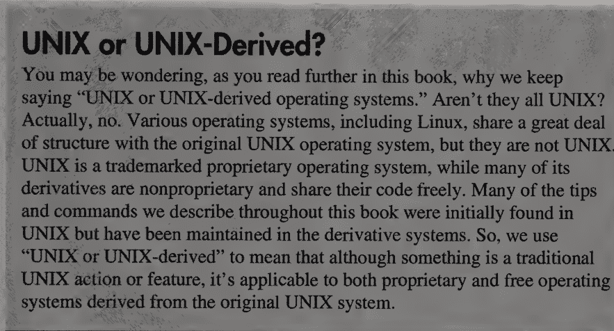

> 我们使用“个人计算机”（personal computer）一词是指指供个人使用的计算机。最初，该术语及其缩写 PC 曾作为 IBM 制造的计算机的商标；现在许多其他公司也制造面向单用户市场的计算机，PC 已经成为一个通用术语。

从非常现实意义上说，Windows 和 MacOS 是单用户操作系统。尽管 Windows 95/98 支持多用户配置，但这些各种配置仅用于视觉外观的个性化设置，而不作为安全措施。更重要的是，运行 Windows 或 MacOS 的机器一次只能由一个用户使用。

然而，UNIX 及其衍生系统最初设计为运行在具有多个用户的大型大型机计算机上，这些用户通过个人终端连接到大型机。与其开端相符，UNIX 是一个真正的多用户操作系统。许多用户可以同时连接到同一台计算机，并可以在执行个人任务，而不会让其他连接的用户察觉或受到困扰。这种大型机遗产体现在其他领域，例如，任务可以通过被称为“脚本”（scripts）的小程序实现自动化，因此脚本可以在预设时间运行。最关重要的操作会记录其活动日志，系统问题通常可以通过读取日志来解决，并在必要时根据其中记录的信息采取行动。

最棒的是，由于它是为计算机专业人员设计的，UNIX 及其衍生系统让你对系统硬件进行精细的控制。其他个人操作系统（如 Windows 95/98）为了“易用性”特性牺牲了这部分功能；我们希望通过 Corel Linux 和本书，能够演示如何在不牺牲易用性的情况下使用 UNIX 的控制力。随着基于 UNIX 的操作系统的发展，大型机的力量已来到桌面。

### Linux 的历史

当计算机首次进入研究领域时（在那个房间大小的大型机时代），所有软件都是免费的。每家计算机制造商设计的机器都各不相同，并且必须提供独特的操作系统以便计算机可以使用。制造商通常会将操作系统的源代码与 UNIX共享，以便为了更有效地使用计算机进行改进或定制。（源代码是开发者编写以制作程序。）

在 20 世纪 70 年代后期，这种不受限制的共享做法开始改变。未来变化的第一个迹象是 1976 年，当时一位年轻的创业者在《自制计算机俱乐部通讯》上发表了一封《给爱好者的开放信》。这位创业者名叫亨利·盖茨三世（Henry Gates III）。盖茨当时是一家名为微软的小公司的合伙人，他有一个抱怨：

去年，保罗·艾伦和我预计爱好市场将扩大，雇佣了蒙特·戴维并开发了 BASIC。尽管最初的工作只花了两个月，但我们三个人在过去的一年里大部分时间都在对 BASIC 进行文档编写、改进和添加功能。现在我们有了 4K、8K、EXTENDED、ROM 和 DISK BASIC。

我们从数百名声称正在使用 BASIC 的用户那里得到的反馈全都是积极的。然而，两个惊讶的问题显而易见：1）大多数这些“用户”从未购买过 BASIC（所有 Alta 用户中少于 10% 买了 BASIC）；2）我们从爱好者中收到的版税使得在 Alta BASIC 上花费的时间每小时价值不足 2 美元。

## 第一章：为什么选择 Linux，为什么选择 Corel？

为什么会这样？正如大多数爱好者所意识到的，你们中的大多数人都在“偷”软件。硬件必须付钱，但软件是可以共享的。谁在乎开发它的人是否得到了报酬？

> Homebrew 计算机俱乐部通讯，第 2 卷第 1 期，1976年1月

无论这封信是主要原因，还是仅仅是未来的预兆，它都预示了软件对待方式的改变。随着计算机变得越来越复杂，个人电脑销量的增长，计算机制造商减少了内部软件的编写，开始外包给微软等专业公司。按照盖茨（Gates）的逻辑，这些专业公司不愿透露其商业秘密。他们开始以可执行二进制文件的形式发布软件，并将源代码保持保密。

在几年之后，大多数通用的软件都变成了专有的：以可执行文件而非源代码发布，通常带有注册商标，并严厉执行版权保护。大多数用户接受了这一点，因为他们对十年前研究科学家之间发生过的自由交流一无所知。个人电脑正在席卷世界，大多数购买者从未接触过大型机。然而，一些研究科学家对软件的“规则”感到被冒并开始抱怨。其中最著名的一位是马萨诸塞理工学院（MIT）的计算机科学家，理查德·斯尔曼（Richard Stallman）。

斯尔曼对专有软件的反对既是实践的，也是哲学的。在实践方面，他感到沮丧，因为除非软件选择修复，否则用户遇到的任何问题都无法解决。用户的修改或改进几乎没有机会被实际实施。在哲学方面，他认为公司告诉个人他们不允许向邻居和其他用户提供帮助或进行共享是错误的。

斯尔曼考虑了自己的各种选择，决定他需要采取一些行动来保护和加强他所所属的社区。他决定，他能做的最好的事情就是创建自由软件。


> 注意：斯尔曼使用“free”一词的方式非常特殊。在这种语境下，free意味着“自由复制、修改和分发”，而不一定意味着“零成本”。自由软件社区的一个常用口号是“自由言论，而不是免费啤酒”。

### 源代码与二进制文件

当一个程序员编写程序时，她是使用编程语言来完成的。这些语言包含了描述要执行的操作的指令和必须满足的各种条件。这些构成特定程序的命令列表被称为源代码。`C`语言中的一段源代码可能看起来如下所示：

```c
/* 丢弃“当前用户”属性 */
free_uid(current);

/* 给 kmod 所有的权限。 */
current->uid = current->euid = fsuid = 0;
cap_set_full(current->cap_inheritable);
cap_set_full(current->cap_effective);
```

作为一名程序员，这种语言是为了人类的需求而存在的。对于程序员来说，这些是有意义的内容；但对于计算机来说，它们没有任何意义。计算机不说英语；它们不说`C`语言。计算机说二进制语言。当你涉及到最基础的概念时，计算机是电气设备，而二进制是一种电气语言。

二进制语言由两个元素组成：数字`0`和数字`1`。电流要么存在（`1`），要么不存在（`0`）。这些`1`和`0`组合成更大的信息单元，无论是指令还是数据。显然，需要某种过程将源代码翻译成二进制文件；这个过程被称为编译。源代码被输入到一个名为编译器的程序中，它将其翻译成二进制文件，然后就可以在计算机上运行。

斯尔曼推理认为，他能写的最重要的东西应该是操作系统，因为没有它，其他程序都无法运行。他决定模仿流行且强大的`UNIX`操作系统来设计他的操作系统，当时的`UNIX`由`AT&T`所有（并且是一个专有系统）。他将系统命名为`GNU`，这是“`GNU's Not Unix`”（`GNU`不是`Unix`）的缩写。这种在自由软件世界很常见的缩写被称为“递归缩写”，因为它指的是它自己。它也是编程中经常使用的递归函数的一种双关。1984年，斯尔曼开始编写`GNU`的第一个作品：文本编辑器`emacs`。

## 第一章：为什么选择 Linux，为什么选择 Corel？

不久后，他开始编写`GCC`，即`GNU C`编译器。有了这两个工具，他能够编写并编译其余的必要软件；他还让这些工具免费供他人作用。为了符合他对自由软件的信念，斯尔曼创建了一个用于分发他作品的许可，即`GNU`通用公共许可证（`GNU General Public License`，简称`GPL`）。`GPL`规定，根据`GPL`发布程序的用户有权复制、修改和分发该程序，只要他反过来也向他人授予同样的权利。因为在无法访问源代码的情况下无法修改程序，任何根据`GPL`分发软件的人都必须提供源代码。

随着`emacs`和`GCC`的发布，其他程序员开始联系斯尔曼，想要加入`GNU`项目。为了方便这一点，自由软件基金会（`Free Software Foundation`，`FSF`）成立了。这是一个非营利慈善组织，`FSF`协调活动、制作文档并分发软件。它开发并维护了大量的自由软件集合，包括`emacs`、`GCC`（`GNU C`库）、`bash`（系统提供的命令行`shell`）。

1991年，林斯·托瓦尔斯（`Linus Torvalds`）是赫尔辛基大学的一名计算机科学学生。他当时正在使用一台基于`386`的新`PC`，想要一个像`Unix`一样的操作系统，但他买不起`Unix`。他一直在使用`Minix`——另一种类`Unix`操作系统，但发现它无法满足他的需求。他决定自己写一个内核。

1991年8月25日，他在新闻组`comp.minix`上发布了一条著名的信息：“我正在编写一个自由系统（只是一个爱好，不会像`gcc`那样大而专业）。”这就是`Linux`的开始。在过去的几年里，来自世界各地的人都开始为内核做出贡献，它变成了一个强大的操作系统。

虽然`Linux`内核是系统的核心，但它需要一套工具才能真正有用。这就是`GNU`项目介入场的地方。`GNU`项目已经开发了许多操作系统所需的各种组件。通过将`Linux`内核与`GNU`工具结合，用户终于拥有了一个完整的、自由的`Unix`操作系统。

1992年，托瓦尔斯根据`GNU`通用公共许可证（`GPL`）发布了`Linux`内核，这允许任何人查看、修改和重新发布代码。这一决定引发了开发和应用的巨大增长。今天，`Linux`是世界上最流行的操作系统之一，从从智能手机到世界上最快的超级计算机无处不在。

# 理解 Linux 社区

`Linux`以及其他自由软件的出现不仅创造了一个技术利基市场；它还创造了一种有趣且活力的文化，通常被称为“`Linux`社区”。对于初学者来说，这个社区最初可能会让他们感到困惑甚至有些望而畏，直到他们开始理解它的历史、神话、共同的笑话，以及其领军人物的个性。（老实说，在社区中呆了很久的人仍然觉得它很费解。）虽然运行`Linux`并不需要成为`Linux`社区的成员——或者完全与之有过多接触——但我们认为，如果你发现自己身处追随者之中，了解关于它的几件事会让你的航行更加顺畅。

许多`Linux`用户对`Linux`和自由软件充满热忱。这种热忱的原因可能与感受到这种热忱的人数一样多，但一个主要因素是，没有任何个人或实体拥有其控制权。

对于那些一生中大部分时间都在电脑电脑前工作的人来说，这意味着没有个人或公司可以控制他们工作时使用的工具。`Linux`用户将其与微软或苹果的做法进行对比；这些操作系统的用户受制于提供系统的公司，由公司决定对其使用的软件进行更改或改进。如果企业的商业计划与消费者的需求相冲突，消费者几乎没有发言权。

> 即使是托瓦兹（`Torvalds`）也不拥有`Linux`，尽管他拥有`Linux`这个词的商标。事实上，他拥有的唯一权威是宣布官方内核发布或升级，他之所以拥有这一权威是因为人们同意在这一特定话题上听从他的。

其他人对`Linux`的热忱是因为这项技术简单优于其他常见的操作系统。根据多次独立的基准测试，`Linux`比`Windows`或`MacOS`更稳定、更灵活、更强大。`Windows NT`和商业`UNIX`发行版是`Linux`的主要技术对手，而且它们比`Linux`贵得多。

无论个人用户对`Linux`热忱的原因是什么，对热忱本身产生一些理解都是一个好主意。这些热忱是`Linux`社区的标识，也是`Linux`飞速演进背后的动力。人们为`Linux`事业全心投入，是因为这是一个拥有共同目标的社区，而不仅仅是从电脑商店购买的一系列软件。

与任何社区一样，遗憾的是，`Linux`社区也存在政治斗争和性格差异。社区中的某些成员可以被称为“自由软件绝对主义者”。这些人认为只有自由软件才是好软件，他们倾向于对任何公司参与`Linux`存怀疑态度。就像他们认同的斯尔曼（`Stallman`）一样，他们对自由软件的兴趣既是哲学性的又是技术性的。

相比之下，还有一些人的观点以埃里克·雷蒙德（`Eric S. Raymond`）为代表，他有时被称为“开源福音主义者”，对自由软件的倡导采取了更务实的方法。他认为最好的软件是那些在其领域表现最好的软件，而自由软件恰好更好是因为在技术上更优。因此，他使用“开源”而不是“自由软件”，因为公司可能不愿意接受听起来像哲学纯洁的东西。

> 埃里克·雷蒙德是极具影响力的著作《大教堂与集市》（`The Cathedral and the Bazaar`）的作者，该书被认为在网景发布其流行的网页浏览器代码方面起了重要作用。书中解释了专有模型和开源开发模型的区别，可以在`http://www.tux.org/writings`查阅。

当然，这种二元对立是对社区意见多样化的一种极度简化，但在短短几段文字内，这已经是最接近事实的描述了。你会发现许多种侧重点不同的观点。不同派系之间的辩论可能看起来很激烈且严谨，但请记住，这两个阵营真正认同自由软件是好的并且应该广泛使用；分歧在于，在多大程度上应该强调自由软件的社会利益而非商业利益。

与这两种观点相反，托瓦兹很少谈论技术本身以外的任何事情。最初激发他工作的是技术上的好奇心，很显然，他的兴趣在于技术。他完全不谈论`Linux`的政治，这其中包含着某种智慧；托瓦兹是`Linux`世界中少数几个每个人都喜欢并尊重的人之一。

## 第1章：为什么选择 Linux，为什么选择 Corel Linux？

我们为什么要对一个你可能不的社区进行这些细节说明？原因有两个：首先，当你在遇到困难或对运行`Linux`有疑问时，我们鼓励使用社区资源；其次，我们希望你发现`Corel Linux`是一个有趣且实用的操作系统，并参与到`Linux`运动中。在这两种，你都会发现自己在与`Linux`社区的成员互动；他们对你的回答很可能受到他们哲学立场的影响。

## Corel Linux


Corel 公司决定通过发布自己的 Linux 发行版来加入 Linux 社区。我们假设你已经购买了该发行版，或者你购买了这本书是因为光盘包含了该发行版。Corel Linux 设计的设计是易于安装和使用，特别是对于熟悉微软 `Windows` 操作系统的人的人来说。Corel Linux 基于 `Debian GNU/Linux` 发行版，Corel 添加了一些独特之处：一个改进的文件管理器、一个易于使用的软件升级代理，以及与微软 `Windows` 平台改进的通信等。Corel 还与 `KDE` 桌面开发人员合作过，`KDE` 是一个与操作系统紧密交织的用户界面，是使用电脑的一种直观且具图形化的方式。

Corel 的 Linux 发行版对于 Linux 新手来说是一个很好的入门，对于熟悉该操作系统的经验用户来说也是一个强大的发行版。在书中，你将找到一些提示和实用的技巧，帮助你将 Corel Linux 发挥到能力的极限。无论你是第一次使用 Linux 还是老手，我们认为你会喜欢运行 Corel Linux，并希望你加入这一社区。

## 第2章：安装 Corel Linux

显然，在对 Corel Linux 进行任何操作之前，必须先安装它。在本章中，我们提供了基本和高级安装的路径。Corel Linux 有有一套清晰且易于遵循的安装程序，所以你不会在准备就绪运行方面遇到问题。一旦安装了操作系统，你就可以自由地使用这本书了。

在本章末尾，我们还提供了创建分区的说明。你可能想使用分区来组织 Corel Linux 的各种文件系统，或者你可能想在电脑上安装两个独立的操作系统。你可以使用 Corel Linux 分区工具来实现。

### Corel Linux 基本安装

要让 Corel Linux 在你的系统中运行，你只需要遵循这个简单的程序。大部分工作由 Corel Linux 自己完成；你只需要回答几个问题并选择用户名，但大部分时间是等待 Corel Linux 安装。按照以下步骤安装 Corel Linux 发行版，然后阅读本书的内容来了解你的新操作系统。

1. 配置你电脑的 `BIOS` 从光驱启动。
2. 将 Corel Linux `CD-ROM` 插入光驱驱动器。如果您由于无法配置 `BIOS` 而需要使用启动盘，请现在将其插入软盘驱动器。
3. 使用当前操作系统要求的任何方法关闭电脑。
4. 稍等片刻后，重启电脑。

计算机从光驱驱动器（或软驱驱动器）启动。出现 Corel Linux 启动界面，如图 2-1 所示，并显示“正在检测硬件...”的消息。

5. 在确定您的硬件配置后，会出现 Corel 许可协议屏幕，如图 2-2 所示。请阅读许可协议；它包含了您在使用此软件时同意遵守的条款。阅读完许可协议后，点击“确定”。

出现 Corel Linux 用户名界面，如图 2-3 所示，要求您输入用户名。这将是您的普通用户帐户名称——即您用于日常活动的账户。

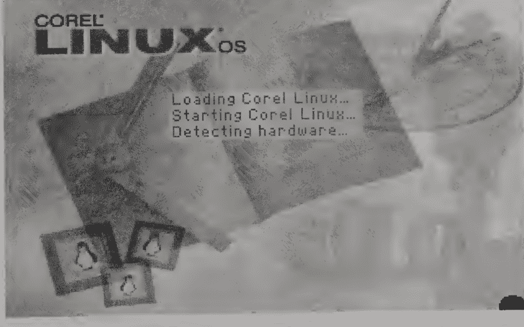

图 2-1 Corel Linux 在确定硬件配置时显示此屏幕

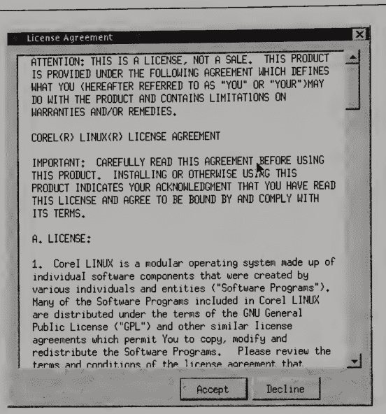

图 2-2 在安装操作系统之前，您必须接受 Corel Linux 许可协议的条款

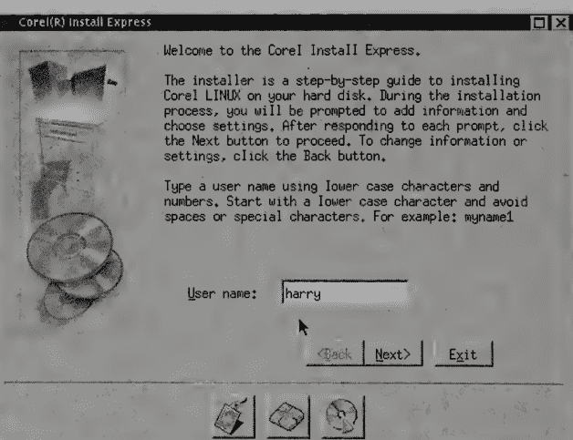

图 2-3 选择一个简单易记的用户名

6. 在框中输入用户名，并点击“下一步”。

出现安装类型屏幕（图 2-4）。

7. 选择“标准桌面”，并点击“下一步”。

出现磁盘分区选项，如图 2-5 所示。磁盘分区用于将信息与其他内容分开。对于本次安装，我们假设您想将 Corel Linux 安装为电脑上的唯一操作系统。如果您想了解更多关于分区的信息，请参阅本章的最后章节。

8. 选择“整个磁盘”，并点击“下一步”。

9. 当出现确认屏幕（如图 2-6 所示）时，请检查用户名拼写是否正确，以及选择的安装选项是否正确。

10. （可选）勾选“扫描坏块”框。

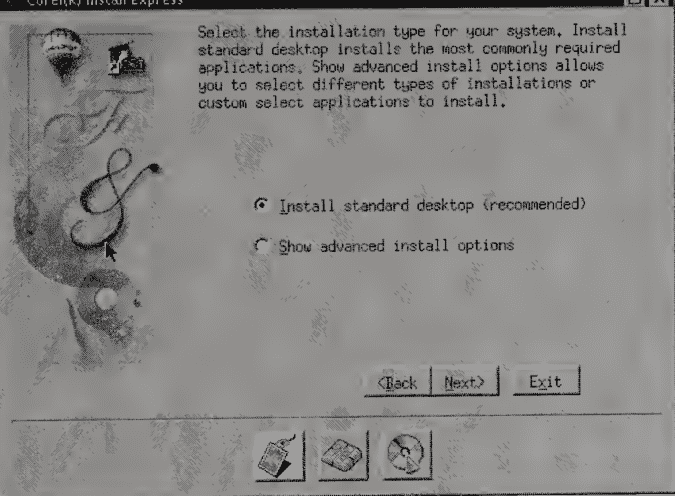

图 2-4 您可以从几种类型的 Corel Linux 安装

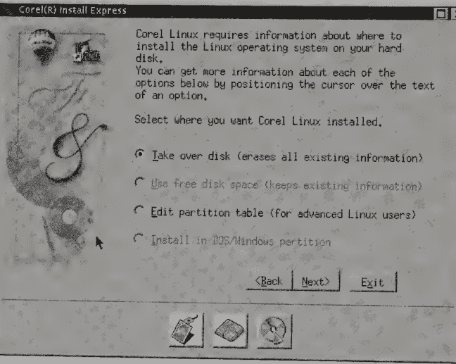

图 2-5 如果您需要对硬盘分区，请使用磁盘分区屏幕

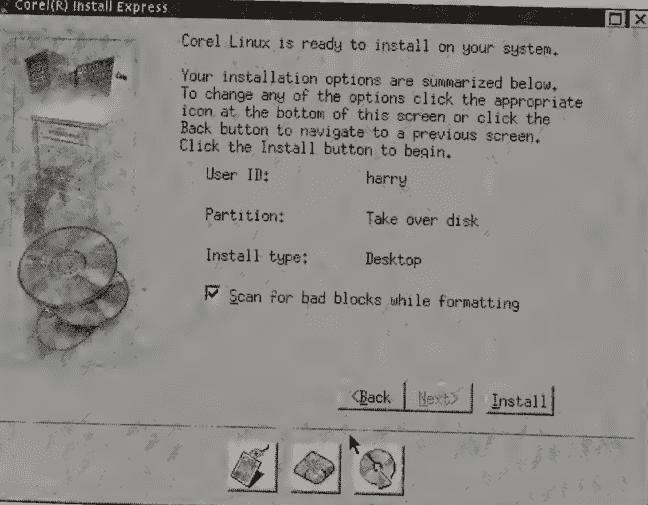

图 2-6 确认屏幕是您纠正用户名或安装选项错误的最后机会

此选项在安装期间验证磁盘表面的完整性，寻找坏道并避开它们。这有助于确保您的磁盘物理结构正常，但会减慢进度。如果您的电脑较慢（`386` 或 `486` 电脑），您可能想将此检查留到以后。

11. 点击“安装”。

屏幕上出现进度条，如图 2-7 所示。该进度条显示磁盘格式化和包安装的完成百分比。

注意：安装所需的时间取决于多个因素：处理器速度、光驱驱动器的速度、硬盘速度、光驱和硬盘如何连接到主板、您的内存大小、您选择的安装类型等。据估计，在速度非常快的机器上，安装可能需要 30–40 分钟，而在较慢的机器上可能需要超过一小时。计划在 Corel Linux 安装期间做些其他事情；放心，即使进度条看起来停滞不动，该过程仍在运行。

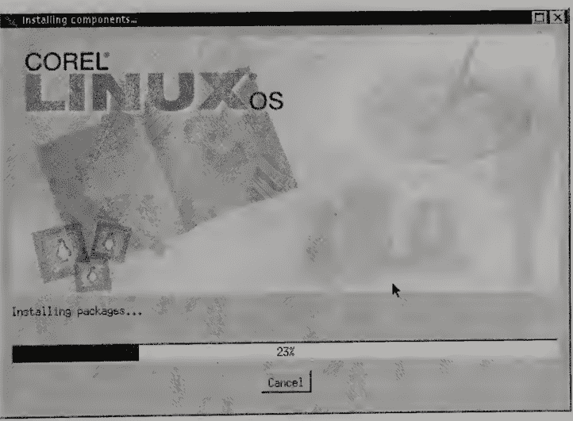

图 2-7 关注进度条以跟踪您的 Corel Linux 安装

12. 安装完成后，会出现一个对话框，询问您是否要重启以使 Corel Linux 生效。点击“确定”。

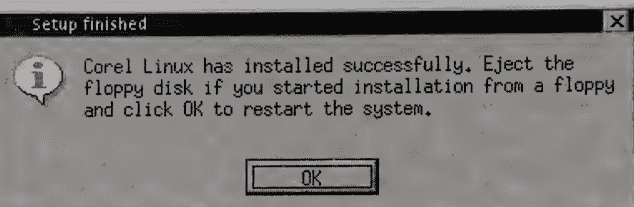

13. 从光驱驱动器中取出光盘，如果您在过程开始时更改了 `BIOS`，请重新配置 `BIOS` 以从主引导记录（`MBR`）启动。

系统重启，出现主 Corel Linux 启动界面，如图 2-8 所示。

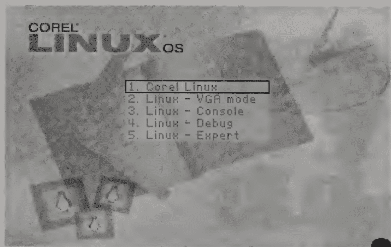

图 2-8 Corel Linux 每次登录时显示启动界面

14. 在框中输入用户名，并按回车。

系统需要几分钟时间进行配置，随后的启动将快得多。配置完成后，出现登录屏幕，如图 2-9 所示。

15. 从框中选择用户名，然后点击“登录”。

现在您已登录 Corel Linux！如果您是从 `Windows` 或 `macOS` 新来到 Linux，您将需要忘记旧习惯并学习新习惯。在开始工作之前，建议您浏览第 5–9 章以了解桌面环境；第 10–14 章将非常有帮助。欢迎来到 Linux 社区！

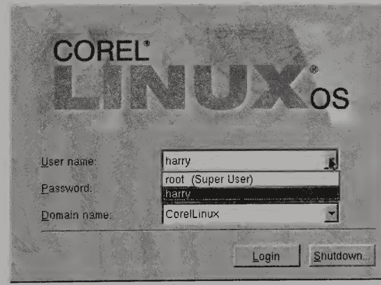

图 2-9 在登录屏幕上选择用户名

### 安装 Corel Linux

要进行自定义安装并仅安装你需要的软件包，请按照以下流程：

1. 配置你的电脑 `BIOS` 以从 `CD-ROM` 启动。
2. 现在将 Corel Linux `CD-ROM` 插入光驱器。
3. 双击“我的电脑”图标。
4. 右键点击 `CD-ROM` 驱动器并从弹出菜单中选择“选项”。
5. 双击“工具”文件夹。
6. 双击 `BOOTFL.BAT` 并按照指示操作。
7. 取出磁盘并将其标记为“Core Linux Boot Disk”。
8. 将启动盘存放在安全的地方。

在开始之前，你需要确保电脑会首先搜索 `CD-ROM` 驱动器。这使得电脑可以使用 Linux 启动，而不是你安装的任何其他操作系统。此更改是在电脑的 `BIOS` 中进行的，`BIOS` 控制着计算机组件在启动期间激活的顺序。有关更改 `BIOS` 设置的更多信息，请参阅本章节前面的“修改 `BIOS`”。

提示：我们将在第 10 章中详细讨论启动程序（包括 `BIOS`）。

注意：如果你无法更改 `BIOS` 以从 `CD-ROM` 启动，则需要使用发行版自带的启动盘。

### LILO：它是什么以及为什么它是必要的

作为操作系统的关键部分，`LILO`（Linux加载程序）会随 Linux 自动安装。`LILO` 是从硬盘提取操作系统内核并将其加载到内存中的程序。默认情况下，`LILO` 安装在硬盘名为主引导记录（`Master Boot Record`）的特殊扇区。主引导记录是电脑启动时读取的内容。


每个操作系统都有某种类型的引导程序，但与专有操作系统的引导程序不同，`LILO` 允许你精确定义要启动的内容并指定多个启动选项。不仅如此，`LILO` 还可以让你在电脑上安装 `Windows 95` 和 `Core Linux`，并使用 `LILO` 控制运行哪个操作系统。如果你对构建此类系统感兴趣，可以在 http://www.linuxdoc.org/HOWTO/INDEX.html 找到一些帮助文档。

1. 查看附录 A“如何编译内核”，获取更多关于 `LILO` 如何配置和运行的信息。

2. 重启电脑。

3. 使用当前操作系统要求的任何方法关闭电脑。

电脑从 CD-ROM（或软盘驱动器）启动。出现 Linux 安装界面（如图 2-1 所示），并显示消息“正在检测硬件”。在确定你的硬件配置后，出现 `Core Linux` 界面（如图 2-2 所示）。阅读许可协议；它包含了在使用此软件时同意遵守的条款。

5. 完成阅读许可后，点击 `OK`。

出现 Linux 用户名界面（如图 2-3 所示），要求你输入用户名。你选择名称将是你的普通用户账户名称，即你用于日常活动的账户。

6. 在框中输入一个用户名。

7. 完成输入用户名后，点击 `OK`。

出现安装类型界面（图 2-4）。

8. 显示高级安装选项。

9. 点击 `OK`。

出现高级安装选项界面（如图 2-10 所示）。

10. 选择四个之一：

- 桌面精简版（Desktop Minimum）：选择此选项仅安装基础 Linux 系统、`KDE` 桌面和最常用的应用程序。安装将从第 11 步正常继续。

- 桌面增强版（Desktop Plus）：选择此选项安装“桌面精简版”中的所有项，以及包括库和额外类型编辑器的开发工具。除非你计划编程，否则可能不需要安装“桌面增强版”。安装将从第 11 步正常继续。

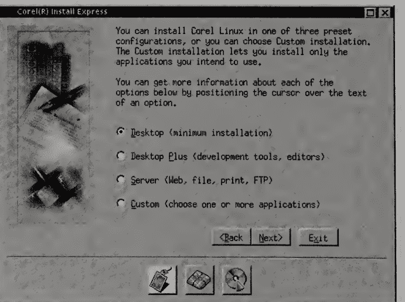

图 2-10 在高级安装选项界面上选择特定的安装选项

服务器（Server）：如果你选择此选项，将看到一个界面（如图 2-11 所示），在其中可以选择安装 Web 服务器、邮件服务器或文件/打印服务器。选择你需要的选项；默认选择是安装所有三个。安装将正常进行，但在第 11 步有一个例外（当时会注明）。

在第四部分学习更多关于这些服务器的信息。Web 服务器 `Apache` 将包含第 26 章“网络服务”；邮件服务器 `exim` 和 `gmail` 将包含第 23 章“邮件服务”；文件和打印服务器包含在第 24 章“文件和打印共享”。如果你以后发现想安装某个特定程序但没有安装，始终可以使用 `Corel Update` 工具安装新包。

自定义（Custom）：如果你选择此选项，将看到一个界面，在其中你可以精确选择要安装哪些软件包。安装将正常进行，但在第 11 步有一个例外（当时会注明）。

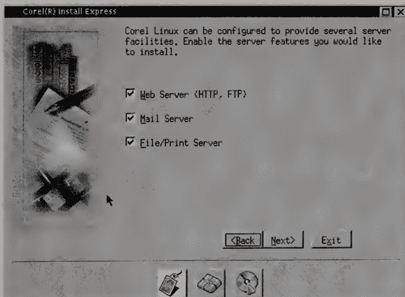

图 2-11 使用服务器选项

注意：安装所需的时间取决于多个因素，例如处理器速度、CD-ROM 驱动器速度、硬盘速度、CD-ROM 和硬盘如何连接到主板、你拥有的内存量以及你选择的安装选项。据估计，在非常快的机器上安装可能需要 30–40 分钟，而在较慢的机器上可能超过一小时。在 `Core Linux` 安装期间计划去做些别的事；放心，进度条看起来停住了。

11. 出现分区选项界面（如图 2-5）。分区用于将某些信息分开。如果你想了解更多关于分区的信息，请参见本章的最后节。

12. 选择分区表（Partition Table）。

13. 点击完成。弹出对话框要求你重启以使 `Core Linux` 生效。点击 `OK`。

检查你的用户名拼写是否正确，以及选择的安装选项是否正确。

14. （可选）在格式化时选择扫描坏块（见图 2-6）。

15. 点击安装。

屏幕上出现进度条（如图 2-7 所示）。该条显示磁盘格式化和软件包安装的完成百分比。

系统重启，出现 `Core Linux` 主启动界面（如图 2-8 所示）。

系统需要几分钟时间来配置使用；随后的启动将快得多。`Core Linux` 配置完成后后，出现登录界面（如图 2-9 所示）。

16. 从下拉框中选择你的用户名，然后点击登录。

# 32 Corel Linux 入门教程：官方指南

你现在已经登录了 `Corel Linux` 计算机！在开始工作之前，我们建议你快速浏览书中的其他章节，以直观了解计算机的功能。

## 磁盘分区

许多人喜欢在硬盘上保留多个磁盘分区。分区是物理硬盘上的一个区域，专门预留给特定的文件系统使用。分区可以包含 Linux 文件系统的各个部分；例如，你可以创建一个包含基础系统的分区，一个用于 `/usr` 目录的分区，一个用于 `/home` 目录的分区，以此此类推。分区也可以用于存放其他操作系统，如 `DOS`、`Windows`、`Solaris`、`OS/2` 等。安装了两个操作系统的计算机被称为“双启动”机器，因为你可以在启动时选择想要运行的哪种操作系统。

> **注意** 在决定分区之前，你应该阅读 http://www.linuxdoc.org/HOWTO/HOWTO-INDEX-3.html#ss.3.1 上的文档。这不是一可以可以轻率对待的事；你可能会丢失数据或需要重新安装其他操作系统。在对已经有数据的磁盘进行分区之前，请务必了解你的操作。

如果你想对磁盘进行分区，必须在安装 `Corel Linux` 期间进行。分区在“磁盘分区选项”（Disk Partition Options）屏幕上控制，在那里你会看到消息“`Corel Linux` 需要关于安装 Linux 操作系统的位置信息”。要设置分区，请遵循以下程序。

> **注意** 编辑你的分区表带有破坏数据性的风险。在决定对磁盘进行分区之前，请确保你已经对磁盘上的任何重要文件进行了备份（无论如何这都是个好主意）。在分区过程中，请保持警惕；除非你完全确定设置符合你的要求，否则不要对分区表中的任何更改更改。修复分区错误的唯一方法是擦除硬盘、重新安装 `Corel Linux` 并重新启动驱动器。如果这样做，你将丢失分区中的所有数据。然而，如果你在安装过程中改变了分区的主意且尚未点击“安装”（Install），你可以撤销决定。

## 第 2 章：安装 Corel Linux 33

- 1. 在“磁盘分区选项”屏幕上，点击“编辑分区表（针对高级用户）”按钮。会出现一个新屏幕，以树形格式显示你的磁盘和任何现有分区（图 2-13）。如果你在主硬盘上安装 `Corel Linux`，你应该能看到标记为 `/dev/hda` 的磁盘。在下方，你将看到两个分区：类型为“Linux”的 `/dev/hda1` 和类型为“Swap”的 `/dev/hda2`。

- 2. 如果你选择一个分区并选中它，然后点击“属性”（Properties）按钮，你将看到该分区的详细描述以及一个显示其占用磁盘比例的饼图。示例描述见图 2-14。点击“确定”关闭此屏幕并返回树形图。（b68ba7a04add7643140fbc35d68.0）

> 你必须至少有一个交换分区（swap partition），当系统内存（RAM）满时，Linux 会将数据从内存中“交换出”此处。你需要多大的交换空间尚有争议：有些人认为应该和你的内存一样大，另人则认为应该是内存的四倍。我们认为答案取决于你拥有多少内存以及运行什么种类的程序。内存相对较小（32MB 左右）的机器需要更多交换空间，因为物理内存的填充速度比 128MB 或更大内存的机器更快。我们建议如果系统内存超过 32MB，则创建一个至少是内存两倍的交换分区；如果内存为 32MB 或更少，则创建内存四倍。

在默认图中，`/dev/hda` 占据所有未显式分配给交换分区的磁盘空间。在缩小 `/dev/hda1` 的尺寸之前，你无法创建另一个分区。遗憾的是，唯一的唯一的方法是删除 `/dev/hda1` 并重新创建它。

- 3. 在树图中，点击 `/dev/hda1` 选中它，然后点击“删除”（Delete）。

- 4. 点击 `/dev/hda` 选中它，然后点击“添加”（Add）。打开“新建分区”（Add New Partition）对话框，如图 2-15 所示，包含你新分区的详情（这类似于图 2-14 所示的属性窗口）。

## 34 Corel Linux OS 入门教程：官方指南

(b68ba7a04add7643140fbc35d68.0)

图 2-13 使用此图引导你的磁盘分区选择。

(b68ba7a04add7643140fbc35d68.1)

图 2-14 使用分区属性屏幕了解更多每个磁盘分区的信息。

## 第 2 章：安装 Corel Linux

> 注意：底部四个字段中的数字可能不同，取决于你的硬盘大小以及你分配了多少交换空间。

此屏幕上的信息解释了正在创建的分区（或*卷*）是一个 Linux 分区；此外，它将是*根*（root）分区，即机器上最基础的分区。该分区也是可启动的，这意味着分区在启动时会被读取。Region(cyl) 字段中的数据解释了分区在硬盘上的物理位置。

最后，该分区将占据硬盘上的 2MB 空间，对于根分区来说空间不足，因此你需要增大此分区。

(b68ba7a04add7643140fbc35d68.0)

图 2-15 你新分区的设置在此对话框中显示。


## 36 Corel Linux OS 入门教程：官方指南

至少，根分区需要包含 `/bin`、`/boot`、`/etc` 和 `/` 目录。如果你将其他文件系统放在自己的分区中，可以将根分区保持在 300MB 左右。如果你计划在根分区中保留其他文件系统，它必须足够大。我们将在第 11 章“Corel Linux 目录结构”中详细讨论。

- 6. 通过两种方式更改分区大小：使用分区字段右侧的箭头按钮设置分区大小，或点击分区字段并使用键盘编辑。几秒钟后，饼图将变化显示新分区的大小。
- 7. 点击“确定”。属性窗口关闭，返回主分区编辑器屏幕（见图 2-13）。你的 `/dev/hda` 分区应该出现在磁盘树中。现在你可以添加新分区。
- 8. 点击 `/dev/hda` 选中它，然后点击“添加”。再次打开“新建分区”窗口（图 2-15）；你现在正在编辑 `/dev/hda3`。
- 9. 取消勾选“可启动”（Bootable）框。如果你运行一个系统，通常只需要一个启动分区。如果你有双启动系统，两个系统分区都需要是启动的。
- 10. 使用下拉框选择要在在此分区上创建的文件系统。在本示例中，选择 `/home`。
- 11. 使用分区字段右侧的箭头按钮设置分区大小。然后点击“确定”。窗口关闭，回到主分区屏幕（见图 2-13）。你的新分区 `/dev/hda3` 应该出现在磁盘树中。
- 12. 为每个你需要的分区重复此过程。按照原则，除非你计划在计算机上安装第二个操作系统，否则不需要创建任何其他启动分区。
- 13. 当创建了所有需要的分区后，点击“下一步”（Next）。你将返回安装序列的第 11 步。

## 第 3 章

### X Window 系统

(b68ba7a04add7643140fbc35d68.0)

### 第 3 章：X Window 系统

#### 41

机器 B。这种级别的网络功能开始被包含在其他操作系统中，例如 Windows NT，但它从一开始就是 X Window 系统的一部分了。

- X 仅提供基础的图形功能。特定用户界面的细节由窗口管理器（window manager）提供，它处理单独的配置并提供用户界面的“外观和感受”（窗口管理器及其后继者——桌面[desktops]将在第 5 章中介绍）。在基础 X Window 系统之上运行许多窗口管理器或桌面是可能的；这为 Linux 操作系统的外观和使用提供了大范围的自定义。

X 是一个包含各种高级功能的系统；这些功能提供了一个对于正在转向 Windows 或 MacOS 用户来说非常友好且熟悉的图形用户界面。

在你安装 Corel Linux 时，X Window 系统的大部分功能将自动正确配置。在本章中，我们将向你展示 X 的基础知识，让你了解它是如何工作的，以及如果你想手动配置 X 的某些独特功能。

> 如果你在配置 X 时犯错，实际上可能会损坏你的电脑硬件。X 非常复杂，你可能不想也不需要直接与其进行交互。尽管如此，对 X 的基本理解以及它如何与 Linux 一起工作对于理解电脑自动完成的各种事情至关重要。

### X Window 系统的基本结构

X Window 系统实际上一个程序；它在你请求时并不产生输出或执行特定的任务。相反，它是一个由 X 联盟（X Consortium）维护的标准（其网站为 http://www.x.org）。该标准是所有图形函数必须遵守的一set规则。X 的当前规范称为 `X11R6`，它是 X 第十一版本的第六修订。

Corel Linux 和其他 Linux 发行版使用名为 `XFree86` 的特定 Window 系统实现。正如名称所示，`XFree86` 是 X 标准的免费实现，设计运行在 Intel x86 系列硬件上：386、486 和 Pentium 芯片。许多其他版本运行在几乎所有的计算机和许多不同的操作系统，包括 Microsoft Windows、Macintosh、IBM 的 OS/2 以及 Amiga。

> 提示：关于 `XFree86` 的更多信息请访问其网站 http://www.xfree86.org。

Window 系统基于客户端/服务器架构。此类架构在今天的网络计算机环境中很常见。例如，当你收到电子邮件时，你通常会将电脑连接到一个远程邮件服务器，这是一个处理许多客户端电子邮件的中央计算机。该架构的图如图 3-1 所示。

X 是这样运行的。尽管情况似乎相反，但实际上并不是——只是看起来像是。当你在工作站上使用 X 时，你实际上是在该机器上运行一个 X 服务器。你的机器提供的服务是基础显示：在屏幕上绘制窗口、解释鼠标和键盘操作等等。你使用的各种程序——文字处理器、网络浏览器、纸牌游戏等——无论是在本地还是在互联网等网络上，都作为连接到 X 服务器并使用其服务的客户端，从而出现在你的屏幕上。一个客户端程序需要连接到同一机器上的服务器可能看起来很奇怪，但并没有逻辑理由将本地机器与网络上的其他机器区别对待。这种客户端/服务器架构允许显示过程与应用程序以及操作系统分离。

有许多不同的 X 服务器程序，每个适用于特定的视频硬件。当你安装 Corel Linux 时，安装程序尝试确定你的电脑使用的视频硬件，以便安装相应的 X 服务器，有关你的视频硬件、显示器、键盘和鼠标的某些信息都记录在 `/etc/X11/Xf86config` 文件中。当 X Window 系统启动时，它会读取此文件以获取系统正常运行所需的信息。

### Core Linux X Window 系统

从历史上来看，安装和配置 X Window 系统一直是运行 Linux 系统最困难的部分之一。然而，得益于过去一两年巨大的努力，现在作为常规安装过程的一部分，自动检测视频硬件并为该硬件恰当配置 X。事实上，Corel Linux 在安装过程中实际上使用了 X！当你启动 Corel Linux 电脑时，X 会自动启动；你不需要手动启动。在初始启动屏幕消失后，你会看到一个图形登录窗口。

Corel Linux 的核心以及负责在屏幕上显示登录界面的程序是 `kdm`（K 显示管理器）。`kdm` 是 `xdm`（X 显示管理器）的替代品，`xdm` 是 `XFree86` 的默认显示管理器。然而，`kdm` 与 KDE 配合得更紧密，并在 X Window 系统与 GUI 之间提供了更好的纽带。

> 注意：如果当你启动电脑时 X 没有启动，很有可能是你拥有一张不支持 `XFree86` 的显卡。这极罕见，因为 `XFree86` 为今天使用的绝大多数流行显卡提供了服务器，但这是可能的。如果情况如此，在不更换显卡的情况下，你做不了什么。你可能可以让当前的显卡与商业 X 服务器配合，但直接买一个支持的显卡可能便宜得多。要确定你的显卡是否兼容，请咨询 Linux 硬件兼容性 FAQ http://www.linuxdoc.org/HOWTO/Hardware-HOWTO-6.html 以及 `XFree86` FAQ http://www.xfree86.org/FAQ/

### 处理基础配置问题

如果你的 Corel Linux 安装过程顺利，那么 `XFree86` 应该已经为你的系统正确配置。通过开启机器来测试安装，确保 X 已启动（你看到图形登录界面了吗？并检查键盘和鼠标是否符合预期。如果一切看起来正常，说明安装成功了。

你可能可能需要做的是调整显示器的设置。如果显示在边缘被截断，或者显示周围有留白，请使用显示器的尺寸和位置控制来调整显示，使填充整个屏幕，且没有显示部分超出屏幕边缘。许多人在显示周围留出厚厚的黑边距（可能是显示器第一次使用时出现的相同边距），我们不理解为什么；显示器的设计是到玻璃边缘都提供清晰的显示。如果你留了边距，还不如省点钱买个较小的显示器。

你可能会遇到 X 偶尔“挂起”或“冻结”的问题。这可能是由多种原因引起的，通常不是严重问题的象。如果这种情况发生在你身上，同时按下 `CTRL`、`ALT` 和 `BACKSPACE` 键。这应该杀死并重启 X。

关于 X 系统的故障排除将在第 4 章“故障排除你的安装”中进行更详细的介绍。

## 第 4 章

### 排除您的安装故障

#### 46 Corel Linux 操作系统入门包：官方指南

#### 46 Corel Linux 操作系统入门包：官方指南 (80)

我们在第 2 章“安装 Corel Linux”中描述的 Corel Linux 安装程序是非常简单易用（不容易出错）的。只要你的硬件受 Linux 支持（请参见第 19 章“处理硬件”），在安装操作系统时通常不会出现太大的问题。

然而，在本章中，我们试图识别那些在安装过程中可能导致问题或困惑的因素。我们还提供了一些可能帮助你避免或解决问题的线索。通常情况下，在安装期间仔细阅读每一个屏幕，并记录你已选择或未选择的内容，将确保你的安装运行顺畅。手边准备一个笔记本和一支笔也很方便，这样你可以在需要时做笔记。

### Corel Linux 初始安装的问题

第一次安装 Corel Linux 时，你可能完全没有问题。在开始之前，请仔细阅读第 2 章，并确保你已经准备好了 Corel CD 和启动盘。如果你是下载的 Corel Linux 而不是购买 CD 版，你需要格外注意；如果发生了某些导致你无法让安装运行，你可能需要重新下载。

> 提示：如果你下载了操作系统，需要先将操作系统刻录到 CD 上才能进行安装。

### 如何在计算机的 BIOS 设置中更改启动设备？


在这种情况下，你应该首先找到电脑随附的主板说明书。寻找一个名为“BIOS Setup”、“Setup Menu”或类似的章节。你的主板说明书是关于你特定计算机信息的权威来源。如果你没有说明书，请查看能否找到制造商的网站；许多硬件制造商现在都在网上提供他们的说明书。

> 警告：主板制造商可能与制造你电脑的厂家不是一家。这意味着，在 Gateway 网站上查找可能无法提供 Gateway PC 所用主板的信息。有时拨打电脑制造商的技术支持电话可以获得正确信息，或者信息会在你 PC 随附的说明书中。

## 第 4 章：排除您的安装故障

然而，如果你无法通过任何其他方式找到厂家，你可能必须打开 PC 外壳直接观察主板。

如果你已经尝试了所有可能的办法，仍然无法获得主板文档副本，你就必须在 BIOS 程序的各种菜单中反复查找，直到找到合适的设置。遗憾的是，BIOS 设置菜单的组织方式没有标准。在我们编写本章时手头的两份主板说明书中，一本在“Advanced CMOS Setup”菜单中定义了启动顺序，另一个则使用“BIOS Features”菜单。情况是，你必须浏览每个菜单，直到找到看起来有希望的内容。不过，启动顺序是一个基本参数，不应该隐藏在菜单中某个奇特的位置。

作为最后的手段，尝试使用第 2 章描述的启动盘。将其插入软驱器并重启机器。大多数主板的设置是软驱器为第一个启动设备；如果软驱器中为空，主板将移动硬盘的启动扇区作为第二个设备。如果机器启动时驱动器中有备用启动盘，它可能会直接从磁盘启动而无需更改任何设置。

## 安装程序运行到一半，我意识到我在上一步骤中犯了错误

在 Corel Linux 安装过程中，每个屏幕都有一个“Back（返回）”按钮。你可以使用该按钮返回上一步，并在需要时进行编辑。如果你需要，你可以通过“Back”按钮一直退回到初始屏幕。当你意识到自己犯了错误，或者对安装的某个方面改变了主意时，回去修复它，然后从该点继续安装。你可以在安装过程的任何阶段点击“Install（安装）”按钮之前执行此操作。> 在点击“Install”之前，系统不会发生任何更改。这包括你对分区表进行的所有修改，尽管 Install Express 没有显示你创建或删除的分区，但在点击“Install”之前，这些更改不会物理应用到硬盘上。

在你点击该按钮并开始安装后，你就无能为力。然而，如果你意识到自己犯了错误，或者对安装的某个方面改变了主意，回去修复它，然后从该点继续安装。

（注：由于原文存在大量重复内容，译文已根据逻辑流进行了对齐并去除了冗余部分。）

## Corel Linux 操作系统入门包：官方指南

O’Reilly 出版了一系列关于 X 的重要丛书，共十多卷。幸运的是，你在使用 X 时遇到问题的概率非常小——除非，你自己手动修改了 X 配置文件。

如果你自己导致了问题，可以通过快速查阅 `http://www.xfree86.org/FAQ/` 上的 XFree86 FAQ，或者在开始胡改配置文件之前，阅读 `http://www.xfree86.org/3.3.5/Config.html` 中的配置 FAQ 来尝试恢复。对于 X，我们强烈建议你听从“官方”解决方案，而不是向那些 X 方面经验仅比你多出那么一点点的人索取建议。

> 注意：你应该格外小心热心人发送给你的 X 配置文件。100 次中有 999 次，一个人的配置文件无法在别人的系统上运行。事实上，如果你在不知道文件内容的情况下使用他人的文件，可能会引发比原先更多的问题。

## 其他问题

你所经历的任何问题都可能是特定进程或程序的问题。如果你尝试从图标或菜单启动程序但它没有启动，请尝试打开一个窗口并从命令行启动程序。你通常可以从屏幕上打印的错误信息中了解一些发生的情况。我们还建议你阅读此书中与该程序相关的章节，它应该是操作系统的一部分。

如果你没有找到所需内容，请查阅附录 C，“互联网上的 Linux 资源”，以获取各种互联网资源的索引。互联网是获取 Linux 问题最新支持的最佳来源。致力于 Linux 及其各种组件的网页、新闻组和邮件列表非常丰富，很有可能已经有人遇到过与你正在经历相同的问题。

## 第二部分

## K 桌面环境


## 第 5 章

## 桌面与窗口管理器


## 54 Corel OS 入门包：官方指南

Corel 发行版之所以如此独特，部分在于它与 K 桌面环境（简称 KDE）的深度集成。KDE 可以运行在几乎任何 UNIX 系统上，但它在 Linux 桌面中找到了最舒适的领域。KDE 与 X 窗口系统协同工作，提供 Windows 和 Macintosh 用户习惯的计算体验。所以，如果你是从 Windows 或 Mac 世界转过来的，KDE 将让你向 Linux 的过渡变得不那么畏惧。

KDE 是 Linux 用户可用的两个主流桌面环境之一。另一个被称为 Gnome。由于 KDE 与 Corel 软件包集成得如此紧，你不太会在 Corel Linux 发行版上运行 Gnome。尽管如此，了解 Gnome 的存在是有用的，特别是当你对 Linux 运动产生兴趣并想要参加在线讨论或加入本地用户组时。

KDE 与 Linux 本身一样，是大量志愿者劳动的产物。正如第 1 章“为什么选择 Linux，为什么选择 Corel Linux？”所描述，开源运动允许成千上万的用户对软件测试，其中许多人的动力是发现缺陷和漏洞（bug）。这使得开源软件更加健壮，而且更新频率比闭源代码更频繁。如果你发现自己喜欢 KDE 并想为该项目贡献力量，请查看 KDE 网页。

想了解更多关于 KDE 的信息吗？我们强烈建议你花时间查看位于 `http://www.kde.org` 的 KDE 网站；如果你在访问位于德国的主站有困难，也可以访问全球各地的镜像站点。KDE 网站包含 FAQ（常见问题解答）、下载程序存档、新应用程序的频繁更新以及 KDE 新闻。

这里总是欢迎新的志愿者，无论是在技术编程方面，还是在更偏向用户的方面，例如翻译或文档编写工作。如果你没有兴趣当志愿者，KDE 网页仍然是一个极佳的资源；它们包含了最新程序和应用程序的文件存档、关于 KDE 的频繁更新新闻以及详尽的 FAQ。然而，Corel Linux 包含了一些并非标准 KDE 分发 `set` 的增强功能，因此某些问题你可能需要咨询 Corel 特定的文档。

## 第 5 章：桌面与窗口管理器

## KDE 的基本功能

为了理解为什么 KDE 桌面与之前的桌面不同，我们首先需要简单谈一下你和电脑是如何协作的。在第 3 章“X 窗口系统”中，我们描述了 X 窗口系统如何为在显示器上创建显示提供基本的图形能力。它为各种视频硬件提供软件驱动程序，并有一个允许你创建图形化应用程序的编程接口。如果你不运行 X，计算机上的软件就无法拥有图形界面。

然而，X 窗口系统并不是你启动 Corel Linux 时看到的那些。X 是一种允许图形用户界面（GUI）存在的机制，X 本身并不控制用户界面的“外观和感受”；那是窗口管理器的工作。X 是 GUI “三明治”的中间部分；底层是运行电脑的 Linux；中间层是控制图形能力的 X；顶层是 GUI（在本例中是 KDE）。

窗口管理器是一组控制窗口如何绘制的软件函数，它控制窗口如何显示在屏幕上、装饰如何显示以及鼠标如何交互。如果你以前用过 Linux，可能尝试过许多窗口管理器：`fwm`、`AfterStep`、`Enlightenment` 等。每个窗口管理器都有自己的样式、可配置级别和菜单系统。有些比其他的要复杂得多，例如 Enlightenment 允许配置的各个方面。KDE 也有自己的窗口管理器，称为 `KWM`（即 K 窗口管理器）。它是高度可配置的，并且设计易于使用，正如大多数 KDE 组件一样。我们在第二部分中介绍 `KWM` 及其用法，并在第 8 章“高级 KDE 技巧”中特别介绍 `KWM`。

> 就像 KDE 代表 K Desktop Environment 一，它的许多组件名称都带有 K 前缀。K 并不代表任何含义；它是程序员用单字母命名项目那个时代的遗留。

## 什么是桌面环境？

欢迎来到令人困惑的环境世界。在本章开始时，我们将 KDE 称为桌面环境，但随后我们描述了窗口管理器并指出 KDE 也有窗口管理器。

## 56 Corel OS 入门包：官方指南

## 桌面包含什么？

桌面环境实际上包含几个部分。桌面环境（我们从现在起简称为桌面）的一个方面是它提供了某些功能：例如从一个窗口拖动文件到另一个窗口或从一个应用程序到另一个应用程序。X 窗口系统不提供这些功能，因此由桌面来提供。

桌面的第二个方面是它提供了一套完整的程序，让用户更容易访问各种数据和应用程序。例如，KDE 的主要功能之一是面板（Panel），所示。KDE 面板运行在屏幕底部（或者如果你喜欢在左侧）。它包含了代表程序的图标、当前打开的应用、菜单链接以及各种其他项目。你只需要点击即可。


如果你用过 Windows 95 或 Windows 98，你已经熟悉了类似的任务栏。严格来说，KDE 面板并不是运行 Linux 或 KDE 的必要部分；你可以通过其他几种方式启动程序，包括从命令行或文件管理器。

> 你可能出于多种原因选择文件管理器或命令行来运行特定的应用程序。许多源自 UNIX 的程序具有可选功能，这些功能只能通过命令行选项访问。正如我们在第 16 章“管理员工具：Shell 和文本编辑器”中所解释的样，可以将 UNIX 命令组合成对操作系统的复合指令。使用文件管理器也是一种选择；特别是当你没有选择将程序放在“开始”菜单中时。

# 第 5 章 桌面与窗口管理器

桌面的这两个方面结合在一起，形成了我们现在所谓的“计算体验”的大部分。屏幕的外观、鼠标的行为、我们如何访问应用程序和其他数据、我们如何导航计算机的文件系统，以及许多其他细节，共同赋予了我们与计算机交互的某种特定“质感”。大多数用户并不会过多考虑这些背景问题，但当某人对特定的操作系统、桌面环境或窗口管理器表现出强烈的忠诚时，往往是这种“质感”为这些强烈情感提供了基础。

## Corel 版本的 KDE 有何不同？

Corel Linux 使用了修改过的 KDE。它做了哪些修改呢？嗯，首先，Corel Linux 默认安装并运行 KDE。现在你不需要在开始 Corel Linux 之前选择和安装桌面或窗口管理器；KDE 从一开始就已那里了。

另一个修改是 Corel 在标准的 KDE 发行版中加入了一些“Corel 风格”的调整。你可以在图形登录界面上看到这些最明显的 Corel 适配，Core Linux 的标志横跨在登录面板本身的顶端。Corel WordPerfect 是 Core Linux 发行版的一部分，Netscape 也是如此，两者都位于默认桌面配置中；但普通的 KDE 发行版并非如此。

> 如果你是从 Corel 网站下载的 Corel Linux，发行版中不包含 WordPerfect。

Corel 重新设计了几个标准的 KDE 应用程序。例如，Corel 文件管理器（Corel File Manager）对于那些用过 Windows 95 Explorer 的人来说会格外熟悉。

> 在本节中，我们将使用 Corel Linux 术语来代替 Corel Linux 中的 KDE元素。有关程序和应用程序名称的更多信息，请参见侧栏“KDE 命名规范”。

### KDE 命名规范

在与 KDE 开发团队合作的过程中，Corel 修改了 KDE 的某些元素，以至于它们需要新的名称。例如，KDE 文件管理器已被替换为 Corel 文件管理器。在本书中，我们对 KDE元素使用 Corel 名称，因为这是一本关于 Corel Linux 的书。不过，我们也鼓励你查阅有关 KDE 的网络资源和其他书籍，在那些地方你可能找不到你正在处理项目的 Corel 术语。如果某个元素的通用 KDE 术语与 Corel 术语显著不同，我们将通过标记为“提醒（Reminder）”的段落告知你。

请记住，如果名称在 Corel Linux 发行版中不同，很可能是该元素本身与标准的 KDE 元素略有不同。如果在通用的 KDE 论坛上查询时，得到的答案对于 Corel 特定的 KDE 素材并不完全适用，请不要惊讶；你仍然可以使用这些答案，尽管你的屏幕看起来可能与回复中描述的不同。

Corel 在基础 Linux 和 KDE 发行版中添加了一些独特的功能。你会发现一些实用的包，如 Corel Update（它让安装和升级软件变得轻而易举）和 Event Viewer（允许轻松直观地访问系统日志）。这两个程序在标准的 KDE 发行版中都不是提供的。通过标准 KDE 特性与 Corel Linux 发行版选择并开发的额外功能的紧密集成，Corel Linux 桌面在轻松访问 Linux 强大的同时，保持了 Macintosh 和 Windows 用户习惯的易用性。

## 桌面的组件

本章的前几页内容有些抽象，我们对此表示歉意。然而，当你在桌面环境中工作时，理解你正在处理什么是非常重要的。KDE 是一种强大且集成的工作方式，但它仍然覆盖在基础 Linux 操作系统之上的叠加层。你不需要 KDE；它只是让事情变得更简单。如果你还没有阅读第 3 章，请阅读它；如果你已经掌握了 X，将更好地理解 KDE 是如何工作的以及如何解决问题。

### 第 5 章：桌面与窗口管理器

在本节中，我们将离开抽象内容，花些时间观察 KDE 桌面。我们在这里描述的是 KDE 的默认安装版本，即你直接从光盘安装 Core Linux 时得到的那个版本。在第二部分的稍后章节中，你将学习如何使用各种主题来配置桌面、更改图标，并将基础 KDE 元素移动到方便的位置。不过，我们建议你在开始动手之前之前读完本章，以便对基础知识有一个良好的了解。

当你首次登录你的 Core Linux 机器时，你会看到一个类似于图 5-1 所示的桌面。桌面就是你在显示器上看到的所有内容：KDE 面板、背景、图标等等。然而，桌面也是作为所有元素底层的彩色区域。

KDE 桌面桌面通常是静态的；它并不做什么。但是，如果你将鼠标光标悬放在桌面的空白区域并点击右键，你将看到一个带有各种选项的上下文菜单，包括注销、帮助、锁定屏幕以及排列你已打开窗口的多种方法。

**图 5-1** KDE 桌面的默认外观中性且直接

## 桌面图标

运行在你桌面左侧的是图标，你可以你可以更快地启动程序或管理文件。

- **TRASH（垃圾桶）**：类似于 Windows 中的回收站，此图标允许你存储想要删除的文件。
- **CAUTION（警告）**：当你准备清理垃圾桶时，请确保你真的想删除。
- **HOME（首页）**：提供指向你家目录的快捷方式。与 MacOS 不同，你可以频繁此图标。
- **NETSCAPE**：启动 Netscape。如果你购买的是零售版，Core Linux 会安装 Netscape。
- **PRINTER（打印机）**：启动打印机实用，允许你配置连接的打印机。
- **WORDPERFECT**：启动 WordPerfect 文字处理器。它在安装 Core Linux 时会自动安装；下载版中不包含它。

## KDE 面板

在屏幕底部（如你在第一幅插图中所示）是 KDE 面板。面板真的是 KDE 体验的核心。默认情况下，它包含常用的程序或命令图标；如果它没有包含你使用的项目，你可以添加你需要的项并删除你不需要的。你还可以移动 KDE 面板的位置，或者仅在需要时将其折叠和打开。

当你阅读这一节时，可能会疑惑为什么你看到了某些按钮而没看到其他。如果是这种情况，请检查 KDE 面板是否处于完整尺寸；如果你的显示器对于你使用的屏幕分辨率太小，面板会自动分层图标。可能最好移除你不使用的图标以保持 KDE 面板整洁。

- **PANEL COLLAPSE BAR（面板折叠栏）**：位于 KDE 面板的左端，这个纹理条允许你折叠面板或重新打开完整长度。点击它；面板会滑到你点击的条后面，直到你再次点击它为止。
- **APPLICATION STARTER（应用程序启动器）**：应用程序启动图标启动开始菜单，其功能类似于 Windows 95 和 Windows 98 的开始菜单。你可以通过开始菜单启动程序、浏览文件或执行命令。在书中描述的许多过程中，我们都从

## 62 Corel Linux 启动包：官方指南

“打开开始菜单。”只需点击启动图标打开菜单，然后从该点继续进行选择。


**文件管理器** 在在本章上一节中，我们描述了“我的主”图标，它可以打开你的主目录。如果你愿意，可以使用此 KDE 面板按钮来启动文件管理器。当你以用户身份登录时，文件管理器将显示你的主目录内容。当你以 root 身份登录时，文件管理器将显示计算机的目录结构。


**终端模拟器** 使用此图标启动桌面上的终端窗口。终端窗口是一个包含命令提示符的小窗口。你可以使用它在纯文本环境或运行非图形 Linux 程序时发布任何命令。终端窗口是一个快捷方式；使用它，你无需退出 KDE 提示符即可进行文本工作。事实上，Corel Linux 使用图形登录，所以你需要使用终端模拟器从命令提示符进行任何工作。


**编辑器** 点击此按钮启动 KDE 编辑器，这是一个类似于简单文字处理器的文本编辑器。你无法在编辑器中进行大量的格式设置，但可以进行基本操作。对于全文字处理，请使用 WordPerfect；对于快速笔记或纯文本文件，编辑器就可以了。我们将在第 16 章介绍其他 UNIX 编辑器。


**帮助** 帮助按钮打开 KDE 丰富的帮助系统。与大多数操作系统一样，KDE 提供系列提供提示和解决方案的页面。帮助页面包含引导你通过帮助系统找到答案。你还会发现，应用程序的帮助页面使用标准的 KDE 格式，因此帮助信息看起来始终相同。不过，KDE 没有索引功能，因此你必须不断点击找到你需要的页面。


**虚拟桌面管理器** 虚拟桌面管理器图标实际上一组堆叠在常规 KDE面板空间中的小图标。虚拟桌面管理器控制 KDE 的虚拟桌面，我们将在本章稍后讨论该概念。屏幕上的该按钮可能是按下状态。你也可以右键点击此图标，快速查看每个桌面的内容。

## 第 5 章：桌面与窗口管理器

**任务栏和系统托** 这两个项目将在本章的后续章节中描述。它们实际上是插件程序（或运行的小程序），它们*停靠*在面板上，但实际上并不是面板的一部分。

**时钟/日期** 面板上的最后一个项目是日期和时间。这在你在使用电脑时没有戴手表非常有用。KDE 从你的系统设置获取日期和时间，如果不正确，你需要配置基础 Linux 设置以显示正确的日期和时间。（无论如何你应该这样做，因为文件和日志的准确时间戳很重要。）


### 任务栏组件

在 KDE 面板中，你会看到任务栏的矩形按钮；图 5-1 显示了两个标记为 Console（控制）和 GIMP 的任务栏按钮。任务栏包含每个当前打开或处于激活状态的窗口图标。*活动窗口*是你当前正在工作的窗口；你也会听到将此窗口称为*拥有焦点*。图标用窗口名称标记——通常是运行在窗口中的应用程序的名称。你可以像配置面板其他部分一样配置任务栏的外观；有关更多关于 KDE 配置的信息，请参阅第 7 章“使用控制中心配置你的桌面”。

左键点击任务栏图标将该窗口带到顶层并使其变为激活。右键点击任务栏图标打开上下文菜单，其中包含可以应用于该窗口的各种选项。任务栏使得同时运行多个应用程序并保持桌面整洁成为可能。你可以通过使用虚拟桌面（在本章稍后描述）来实现相同的目标，但任务栏允许你将所有窗口保持在同一个桌面上。

### 系统托盘插件

如前所述，当我们描述 KDE 面板时，展示了桌面管理器图标，并提到管理器代表了你可以使用的虚拟桌面。此处的插图显示了四个虚拟桌面。

虚拟桌面可能难以可视化；（此处原文存在重复句子，已处理）。

### Windows 95/98 用户

如果你将 Corel Linux 作为你的第一个 Linux 发行版，并且之前的电脑经验是 Windows 95 或 Windows 98，那么你可能已经略过了本章的大部分内容，心里想：“嘿，这些我懂。太你了！”我们建议你查看显示配置选项，以及文件管理器（File Manager）的 Internet 功能；如果你经常使用 Windows 资源管理器，你可能已经习惯了使用基础文件管理器。如果你倾向于使用“我的电脑”桌面图标为每个目录打开独立的窗口，那么你可能会从彻底阅读本章中受益。

如果你直接从 Windows 3.1 跳到 Corel Linux，你可能会觉得文件管理器有些熟悉。如果你是直接从 DOS 跳过的，你可能会发现自己习惯于打开终端窗口以获得命令行界面带来的安全感——但是，如果你直接是从 DOS 跳过来的，这可能不是你的第一台基于 UNIX 的设备了。

### Macintosh 用户

Mac 用户需要学习的内容更多，因为你不仅迁移到了新的操作系统，还迁移到了一种全新的计算机。对你最有好处的是从一开始就把一切看作一种完全全新的体验，而不是去寻找 MacOS 与 KDE/Corel Linux 之间少数的相似之处。

话虽如此，这里有一些小调整，可以让文件管理器看起来更像 Macintosh 的 Finder（访达）。虽然你应该尝试“视图”（View）菜单中的所有选项，但我们建议进行以下两项更改：

- 取消勾选“树”（Tree）选项，使文件管理器窗口变成一个大窗格。
- 选中“大图标”（Large Icons）选项，使文件以水平格式而非垂直格式显示。

将文件管理器看作是 Mac 桌面右上角的硬盘图标。你肯定不会把 KDE 误认为 MacOS，但这些更改可能会让文件管理器变得更友好。

## 68 Corel Linux OS 启动套件：官方指南

点击“我的家”（My Home）桌面图标。


点击应用程序启动（Application Starter）图标，并在开始菜单中选择文件管理器。

### 在文件管理器中导航

现在你已经打开了文件管理器（如图 6-1 所示），你会发现文件管理器被分为两个窗格。在左侧，你的

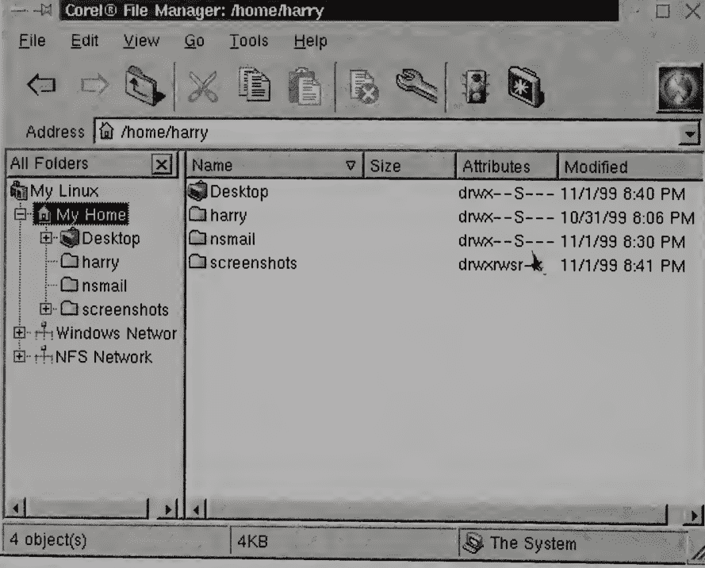

图 6-1 文件管理器的树形结构以简单的视觉方式显示了电脑的内容

## 第 6 章：Corel 文件管理器

## 69

计算机的整个目录结构。这种显示方式通常被称为“树”或“文件树”，因为目录随着变得越来越具体而会相互分支。在右侧，将显示所选目录的内容。

> 注意：如果你是从 Windows 95 或 Windows 98 进入 Linux 的，这些都是熟悉的。如果你过去一直熟练地使用资源管理器，可以随时跳到本章的下一节。

当你打开文件管理器时，左窗格中的一个目录会被高亮。默认情况下，这是你的主目录，标记为“我的家”。因此，右窗格显示了包含在“我的家”目录中的和子目录。如果你在左窗格中选择另一个目录，其内容将显示在右窗格中。换句话说，右窗格包含了左窗格中选定目录的所有数据。如果你想更改目录，找到你想要切换到的目录，并在左窗格中点击它。高亮将移动到新选择上，该目录的内容将出现在右窗格中。

注意，某些目录在目录名称左侧有加号（`+`），而其他目录则没有。加号表示该目录包含子目录；在文件管理器术语中，带有加号的文件夹包含嵌套在内部的其他文件夹。如果你点击加号（小心点，因为它很小），目录树就会展开，在左窗格中显示那些子目录。就像主目录一样，你可以点击一个子目录，并在右窗格中显示其内容。当你以这种方式展开树时，加号会变为减号（`-`）。点击减号可将分支折叠回父目录。

> 提示：虽然让目录保持完全展开状态以便看到所有子目录会更快，但这意味着你必须像图 6-2 所示那样在左窗格中上下滚动查找到你需要的内容。一旦你熟悉了你的目录结构，可以选择几个目录（可能只是你的主目录）保持展开状态，仅在需要时打开其余部分。

再次查看文件管理器窗口。在显示文件树的左右窗格上方，有一个字段标记为“地址”（Address）。该字段包含所选目录的路径名。路径名意味着该目录在硬盘上的特定位置，它包含了当前目录及其上方的所有目录。换句话说，路径 `/home/barney` 意味着目录 `barney` 是

## 70 Corel Linux OS 启动套件：官方指南

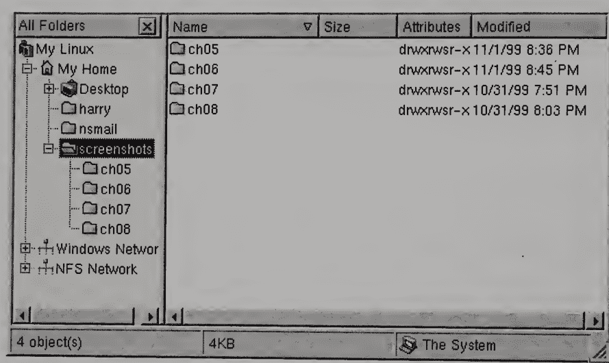

图 6-2 通过点击小的 `+` 和 `-` 框展开和收叠文件树

主目录的子目录，而主目录又是 `/` 目录（也称为根目录）的子目录。

> 提示：如果你已经知道要在文件管理器中查看的目录的完整路径，只需将路径输入到地址字段中。在某些情况下，这比在树中点击多层文件夹要快。

还有其他导航文件管理器的方法。在地址字段上方，有一个综合工具栏。


## 第 6 章：Corel 文件管理器

## 71

向左的箭头带你回到上一个目录，向右的箭头带你进入下一层子目录。（这假设你有更高或更低的目录可用；如果没有，点击箭头将没有任何作用。）指向上的文件夹带你回到父目录；例如，如果你当前位于 `/home/barney`，点击此图标将带你进入 `/` 目录。

无论你选择什么种导航文件管理器的方法，Corel Linux 提供了一种直观的方式。只要你有权限，就可以访问电脑上的任何目录、文件、程序或设备。（某些关键数据保留给 root 用户，而其他内容可以授予某些普通用户。）有关文件权限的更多信息，请参见第 12 章“用户空间和用户账户”。

### 使用文件管理器执行基本任务

除了高效地在文件系统中移动，文件管理器提供了一个对各种文件执行基本操作的位置。特别是你可以可以使用文件管理器将文件从一个目录复制到另一个目录、删除文件、重命名文件以及设置文件权限。本节对每个功能进行了简要描述，并提供了一些高效使用管理器的技巧。

#### 复制文件

你可能希望对一个重要文件进行备份，这样你就可以编辑副本而不影响原始数据。你可能还想将文件从硬盘复制到软磁盘上，以便在主电脑和磁盘上各有一份。无论出于什么原因，复制都是文件管理任务之一。

要在文件管理器中复制文件，请遵循以下流程：

- 1. 在左窗格中选择包含文件的目录。

该目录的内容（包括要复制的文件）显示在右窗格中。

- 2. 使用鼠标将文件从右窗格的位置点击并拖动到左窗格中的新位置。

当你点击的鼠标经过这些目录时，左窗格中的目录会高亮显示。

## 72 Corel Linux 操作系统入门教程：官方指南


当你到达新的目标目录时，释放鼠标按钮。

文件会自动复制到新位置。

你也可以通过右键上下文菜单来复制文件。在文件管理器中找到要复制的文件。右键点击文件名，并在弹出的上下文菜单中选择“复制”。使用文件管理器的导航工具导航到新的目标目录，然后在右侧窗格的空白处点击右键。（无论你点击哪里都没关系；文件管理器都会自动将文件放置在正确的位置。）从弹出的上下文菜单中选择“粘贴”。文件管理器会将文件的副本粘贴到新的目标目录中。

## 删除文件

Corel Linux 和 KDE 都修改了传统的 Linux 行为，使得文件删除的操作比 Windows 和 MacOS 使用的方法更具人性。在传统的基于文本的 UNIX 和 Linux 系统中，你需要输入特定的命令来删除文件；在这些系统中，删除文件意味着它会立即消失且无法找回。当你意识到自己无意中删除了重要文件时，这可能会是一个令人震惊的经历。包括 KDE、Windows 和 MacOS 在内的桌面环境在删除过程中插入了一个中间步骤。当你在 Corel Linux 中使用文件管理器删除文件时，文件会移动到“回收箱”，而不是自动删除。

> 注意：如果你使用描述以外的任何方法或实际上通过将文件拖入回收箱图标，你可能无法找回想要的文件。如果你在命令行提示符处删除文件，你将永久丢失它。在丢弃之前，请确保你是真的要删除；这可能是一个昂贵的错误。

要在文件管理器中删除文件，请使用导航工具找到目标文件，使其出现在文件管理器窗口的右侧窗格中。右键点击你想删除的文件，并在弹出的上下文菜单中选择“移动到回收箱”。会出现一个对话框，要求你确认是否真的想删除此文件。如果是，点击“是”；如果弄错了，请点击“否”。当你点击“是”时，文件管理器将从文件管理器删除该文件。

当你使用这种方法删除文件时，文件管理器实际上是将文件移动到回收箱，而不是从硬盘中删除它。因此，你不会在文件管理器看到该文件，但它仍然留在回收箱文件夹中。只要你不清空回收箱，文件就可以被“删除”——只需点击并将其拖到相应的文件夹，或使用文件管理器将其移回。回收箱中的文件也可以在你的家目录下找到，位于 `$HOME/Desktop/trash` 文件夹中。然而，一旦你清空回收箱，文件就彻底消失了。

> 注意

在其他基于文本的操作系统上有丰富经验的人会发现这很困惑，尤其是当你将项目移动到回收箱后检查磁盘，发现没有新的可用空间时。（不会有可用空间是因为文件只是更改了目录；它并没有被删除。）你仍然可以在终端窗口中使用 `rm`（UNIX 移除命令）继续删除文件，但你将失去从回收箱恢复文件的能力。

## 重命名文件

有时，你可能需要更改文件的名称。也许你最初使用的是基础的命名结构，而现在你需要使用某种特定的名称。例如，你可能将所有的文字处理信件都保存为 Letter1、Letter2、Letter3 等。当你意识到除了编写顺序外，你无法从它们看出任何信息时，你可能想将文件重命名为某些独特的名称：Hennig1 和 Hart1，或者 oct1945-1 和 oct1945-2，或者任何对你你有意义的名称。

要使用文件管理器重命名文件，请通过文件管理器导航，直到相应目录的内容出现在右侧窗格中。右键点击你想重命的文件，并在弹出的上下文菜单中选择“重命名”。在右侧窗格中，你会看到文件名处出现一个闪烁的光标。输入文件的新名称并按回车键。如果你给文件了一个新的起始字母并改变了它的字母排序，在按下回车键后文件将会移动。

> 注意

文件名必须是一段连续的字符字符串。UNIX/Linux 不允许像 Windows 和 Macintosh 那样使用多个单词。如果你想在文件名中使用多个单词，请用下划线将它们连接，例如 `my_file` 或 `cheese.sandwich.recipe`。虽然文件名可以是任意长度，但通常建议将文件名保持在 14 个字符或以内，以便于处理。某些字符不能用于文件名，因为它们是 UNIX 命令语言中的特殊字符：这些字符中的大多数是 `! @ # $ % & * ( ) ' ? \ | ; < > ` + -`。养成只使用字母、数字、下划线和点的习惯，这样就不会在文件名上遇到问题。

如果你想在重命名文件时同时将其移动到不同的目录，先将文件复制到新位置并使用此过程进行重命名会更简单。

如果你习惯在命令行提示符下重命名和移动文件，那么那种方法通常更快。请参阅第 16 章“管理员工具：Shell 和文本编辑器”获取更多关于从管理文件的信息。

## 更改文件权限

文件权限是一个重要的概念。基本上，权限是告诉系统谁有访问权限以及他们可以做什么的代码。有三个级别：用户（单独）、组（已定义）和全局（所有人）。此外，还有三种类型：读（只读）、写（进行更改）和执行（运行程序）。在本章中，我们将如何。如果你使用描述以外的任何方法或实际上通过将文件拖入回收箱，你可能无法找回想要的文件。如果你在命令行提示符处删除文件，你将永久丢失它。在丢弃之前，请确保你是真的要删除；这可能是一个昂贵的错误要在文件管理器中删除文件，使用导航工具找到目标文件，使其出现在文件管理器窗口的右侧窗格中。右键点击你想删除的文件，并在弹出的上下文菜单中选择“移动到回收箱”。会出现一个对话框，要求你确认是否真的想删除此文件。如果是，点击“是”；如果弄错了，请点击“否”。当你点击“是”时，文件管理器将从文件管理器删除该文件。

当你使用这种方法删除文件时，文件管理器实际上是将文件移动到回收箱，而不是从硬盘中删除它。因此，你不会在文件管理器看到该文件，但它仍然留在回收箱文件夹中。只要你不清空回收箱，文件就可以被“删除”——只需点击并将其拖到相应的文件夹，或使用文件管理器将其移回。回收箱中的文件也可以在你的家目录下找到，位于 `$HOME/Desktop/trash` 文件夹中。然而，一旦你清空回收箱，文件就彻底消失了。

> 注意

在其他基于文本的操作系统上有丰富经验的人会发现这很困惑，尤其是当你将项目移动到回收箱后检查磁盘，发现没有新的可用空间时。（不会有可用空间是因为文件只是更改了目录；它并没有被删除。）你仍然可以在终端窗口中使用 `rm`（UNIX 移除命令）继续删除文件，但你将失去从回收箱恢复文件的能力。

## 第6 章：Corel 文件管理器

图 6-3 使用文件管理器配置

...几乎一切都应该支持某种程度的配置性，无论是管理员帐户还是个人用户。虽然像文件管理器这样的基础工具提供的配置可能性有限，但对于更改呈现方式仍然有很大的改进空间。

## 自定义文件管理器

Linux 的一个基本概念之一是，几乎一切都应该支持某种程度的配置性，无论是管理员帐户还是个人用户。这些配置设置位于文件管理器的下拉菜单中。菜单包含了一些功能，我们在在这里对其进行了描述，你可以选择是否显示它们。其中某些功能只是视觉上的，无论是否激活都一样。另一些功能对你使用文件管理器的方式影响更大，因此你可以根据需要将其激活或禁用。

### 工具栏

工具栏是屏幕上方的一组大型图标按钮。由于工具栏的所有功能都可以通过菜单可以使用，因此没有必要显示工具栏。然而，点击按钮比搜索下拉菜单要快几毫秒。除非你倾向于点一下，否则不需要它。

### 地址栏

地址栏包含显示当前选择目录完整路径的地址字段。通常，我们建议保持地址栏可见。在操作 Linux 时，如果你需要使用命令行执行某些任务且没有文件管理器的点点式界面可用，你已经熟悉了传统的 UNIX 文件名策略，因为你一直关注着地址栏。

## 第6 章 Corel 文件管理器

### 状态栏

| 4 个对象 | 4KB | 系统 |

另一个非常有用（尽管不是关键的）的项是状态栏。该栏运行在文件管理器窗口的底部，显示有关所选目录的统计信息。通过状态栏，你可以了解所选目录中的对象数量、目录的总大小，以及该目录是位于本地计算机还是远程计算机（通过本地局域网或互联网）。如果你在右窗格中选择单个文件，状态栏会提供关于该文件的相同信息。

### 树状结构

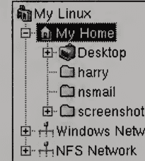

我们不建议你禁用“树状”（Tree）选项。该选项控制是否显示文件管理器窗口的左窗格。如果它未激活，你将只在右窗格中看到树结构。如果你更喜欢单面板文件管理器，这并不是什么大问题，但在目录中搜索特定文件将花费更多时间。我们在编写本章（以及书中其他对文件管理器的引用）时，假设你已激活“树状”选项，并且同时看到了文件管理器窗口的左右两个窗格。

### 大图标


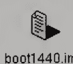

如果你更喜欢使用图像表示而不是文本标签，请在“视图”菜单中选择“大图标”选项。当此选项激活时，右窗格的显示将从按字母垂直排列的文件变为水平显示。指示文件类型的图标也会变大。如果你打算在一个目录中保留多种类型的文件，特别是当它们相似相似，这非常有用。例如，我们的一只狗叫 Miso。如果我们有一个名为 `/home/dogs` 的目录，其中包含一个名为 `miso.jpg` 的照片、一个名为 `miso.txt` 的故事和一个名为 `miso.mp3` 的音乐文件，那么当“大图标”选项激活时，每个文件类型都将有不同的图标。

### 显示隐藏文件


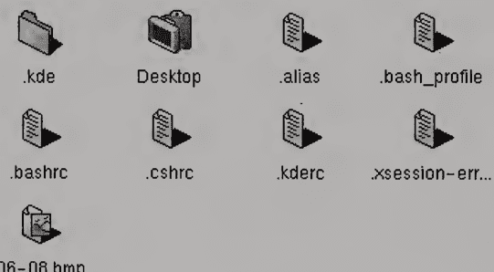

“显示隐藏文件”是一个帮助你处理传统 UNIX 文件名方法的选项，这对于新用户来说可能相当困惑。在像 Linux 等基于 UNIX 的操作系统，配置文件通常以点（`.`）开头并以 `rc` 结尾。例如，新闻阅读器 `trn` 的配置文件名为 `.tmrc`，邮件程序 `pine` 的配置文件名为 `.pinerc`，而在默认情况下，当你打开文件管理器窗口时，它不会显示这些点开头的文件。它假设你只想看到你创建或属于你安装的应用程序的文件。如果你开启“显示隐藏文件”，你就能在这些文件所在的目录中看到这些“点文件”。这很有帮助，我们建议你激活此选项。

使用这六个显示选项应该允许你配置文件管理器，使其以最让你感到快乐（可能）的方式显示文件系统信息。（诚然，那可能并不怎么快乐，但值得一试。）

## 将文件管理器作为互联网工具使用

我们花费了几页的内容来描述文件管理器为你的日常文件维护任务带来的便利。然而，文件管理器还有一个隐藏功能：它是从其他计算机上获取文件的绝佳方式！无论你是在本地局域网还是通过互联网在全球范围内使用文件管理器，你都可以将其作为 Web 浏览器或 FTP 客户端。

显然，如果你没有活跃的互联网连接，就无法将文件管理器作为互联网客户端。在使用文件管理器或任何互联网程序之前，你需要配置你的机器以连接本地互联网服务提供商、电缆调制解调器或 DSL 公司或工作场所以太网连接。参见第 9 章“使用 Corel Linux 使用互联网”，了解如何连接你的新 Linux 机器。

### 使用文件管理器浏览

是的，文件管理器也是 Web 浏览器。然而，它并不是一个高级 Web 浏览器；最重要的是，文件管理器不支持所查看网页中包含的 Java 或 JavaScript。由于 Netscape 是 Corel Linux 安装的一部分，因此对于大多数网页浏览可以使用 Netscape，仅在需要快速替代方案时使用文件管理器。

要将文件管理器作为 Web 浏览器，打开“文件”下拉菜单并选择“打开位置”。“打开位置”对话框出现在屏幕上；只需在输入框中输入你想查看的 URL 并点击确定。当页面加载完成时，它将显示在文件管理器窗口的右窗格中，如图 6-4 所示。你本地机器的目录结构在左窗格中可见。

> 记住，如果你不喜欢 Web 页面挤在文件管理器窗口的右窗格中，可以通过取消勾选“视图”下拉菜单中的“树状”来更改显示。这将右窗格填充整个管理器窗口并隐藏左窗格，直到你重新选择“树状”。

由于文件管理器并非设计为 Web 浏览器，你可能不想在大多数网页浏览中依赖它。请注意，将文件管理器作为浏览器会给系统带来一些负载，因此如果你正在运行几个关键程序，你可能想使用 Netscape。你的交换分区越大或内存 RAM 越多，文件管理器产生的问题就越少。

### 使用文件管理器从互联网传输文件

我们建议在一种特定用途下使用文件管理器而不是 Netscape：文件传输协议（或 FTP）会话。（当然，这是在你选择不运行单独 FTP 程序的情况下。）文件管理器使得从互联网获取文件变得简单，因为文件管理器是图形化的而且你经常使用它。要将文件管理器作为 FTP 客户端，请使用以下方法：

1. 使用以下方法之一打开文件管理器：
   - 点击面板上的文件管理器图标。
   - 点击桌面上的“我的主”图标。
   - 点击“应用程序启动器”图标并从开始菜单选择“文件管理器”。

2. 从文件管理器下拉菜单中，选择“文件 | 打开位置”。

3. 在“打开位置”对话框中，输入你想连接的 FTP 存档的 URL。

FTP 站点的 URL 通常以 `ftp:` 而不是 `http://` 开头。图 6-5 显示了在活跃 FTP 会话中运行 `ftp://ftp.kde.org` 文件管理器，该站点包含了为 KDE 桌面环境专门编写的软件最新版本。

一旦连接到远程站点，该站点的目录结构将出现在文件管理器窗口的右窗格中，而你的本地目录结构在左窗格中可见。

4. 使用你在文件管理器中经常使用的导航工具浏览远程站点的文件。

5. 找到你想要下载的文件，点击并将其拖到本地机器上你想放置该文件的文件夹。

文件管理器将文件从远程位置复制到你选择的计算机文件夹中。你将看到一个衡量下载完成量的进度条；取决于文件的大小和你的互联网连接速度，它可能快速闪烁，也可能是一项通夜的工作。Corel Linux 文件管理器是一个异常出色的 FTP 客户端。现在 Linux 有许多优秀的图形化 FTP 客户端，但如果你习惯于使用文件管理器从远程位置获取文件，可能没必要去下载并编译一个。作为 Linux 用户，你可能会变得非常

# 82 Corel Linux 操作系统入门教程：官方指南

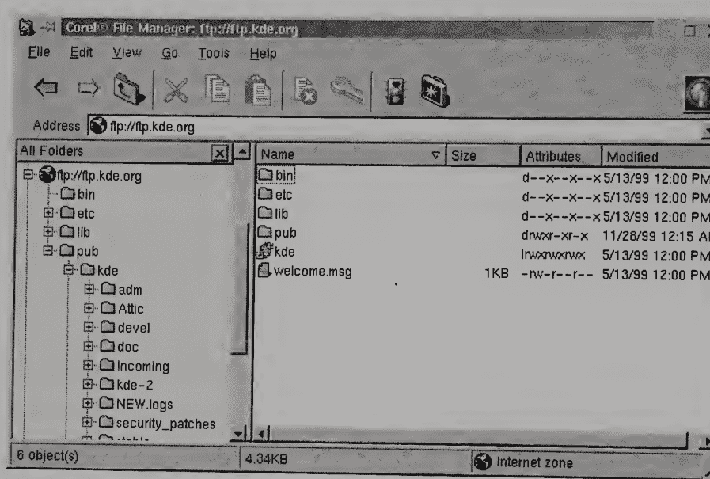

图 6-5 使用文件管理器从各种网络存档下载文件

## 第 7 章

## 使用控制中心配置你的桌面


83

# 84 Corel Linux 操作系统入门教程：官方指南

KDE 的特性之一是其高度的可配置性。在第 5 和第 6 章中，我们描述了 KDE 的基本安装：它的功能和布局。然而，你可能会发现默认的 KDE 安装并不美观，或者不符合你在电脑上的工作习惯。这就是配置选项大显身场；你在屏幕上看到的几乎所有内容都可以被更改、移动、删除或以其他方式修改，以让你的计算体验尽可能舒适。

Corel Linux 通过一个名为“控制中心”（Control Center）的实用程序处理许多配置选择。在控制中心中，你会找到控制 KDE 外观几乎所有层面的工具：

- 桌面
- 个体窗口
- 显示选项
- 字体
- 桌面和面板图标
- 语言
- 屏幕保护
- 键盘快捷键
- 鼠标行为
- 网络设置

在本章中，我们将介绍控制中心并解释每个选项。我们还提供了一些配置技巧，可以提高你的工作，或者仅仅让操作 Corel Linux 和 KDE 变得更容易。即使你喜欢安装 Corel Linux 时出现的默认桌面，我们也建议你花些时间浏览控制中心。即使你不想更改 KDE 桌面的视觉外观，你可能会发现对你有用的选项；其他重要功能，如鼠标行为和键盘技巧，也是通过控制中心控制的。我们在本章中还讨论了另外两个主要的桌面配置问题：根据你的喜好组织 KDE 面板以及为 KDE 应用各种桌面主题。

## 第 7 章：使用控制中心配置你的桌面 85

### 使用控制中心

在继续之前，你应该打开控制中心：

1. 点击应用程序启动图标（KDE 面板中的地球图标）。
2. 从开始菜单中选择控制中心。

控制中心打开了（图 7-1），你已经准备好了。

控制中心由两个窗格组成。左窗格包含树状结构，与文件管理器使用的结构类似（但这棵树不代表你的目录系统）。树由可展开的标题组成；小的加号表示显示的内容下方还有层级。点击加号展开该标题并选择一个子选项。当在左窗格选中某个选项时，右窗格会显示该选项的一系列控件。使用这些控件，你可以操作桌面的外观和行为。

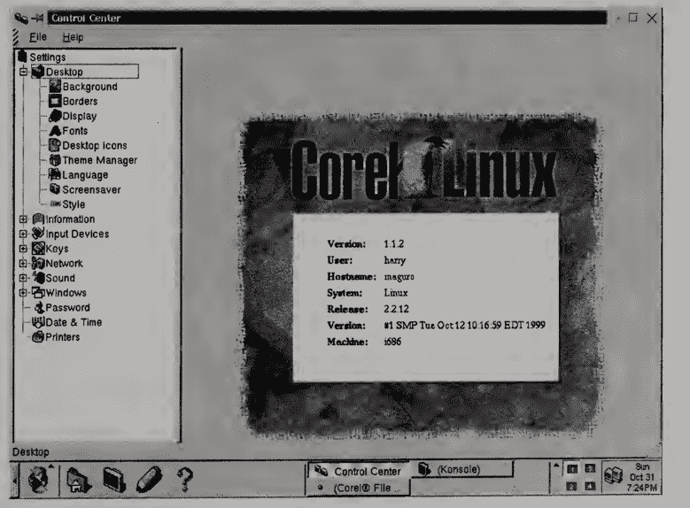

图 7-1 使用控制中心配置 KDE

控制中心中的主要部分标题有：桌面、信息、输入设备、按键、网络、声音、窗口、密码、日期与时间以及打印机。最后三个选项没有子选项，因此当你选择部分标题时，控件组显示在右窗格中。其他部分都有各种子选项，我们将在后的段文中进行描述。

> 注意
>
> 你可能永远不需要使用控制中心中的某些选项。将本章视为当你需要更改某些晦涩设置时的详尽参考资料。了解控制中心的功能是一个很好的主意，即使你不打算对其做很多。通常情况下，如果你想更改 KDE 的外观，将从控制中心开始。

### 桌面

控制中心中的“桌面”部分允许你控制启动 Corel Linux 时在显示器上看到的内容。此部分包含桌面背景、窗口边框、显示选项、字体、桌面图标、语言、屏幕保护和其他桌面样式的控件组。你可能会发现此部分包含了你通过控制中心完成工作所需的大控件。

#### 背景

“背景”选项（图 7-2）控制 KDE 桌面本身的外观。你在该选项中选择的任何内容将作为桌面上所有其他内容的背景：图标、应用程序窗口、KDE 面板等等。

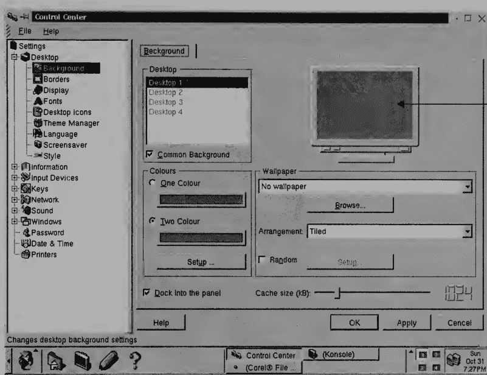

图 7-2 背景选项

#### 边框

“显示”选项允许你设置构成应用程序或窗口的各种组件的颜色。

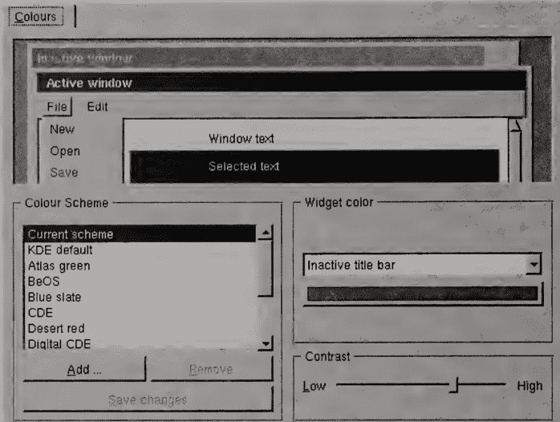

**图 7-3** 控制中心“显示”选项中的“颜色”选项卡

如果您定义了自己的颜色方案，请确保在需要高对比度的地方没有低对比度的情况，例如窗口文本和窗口背景之间。如果您在深蓝色背景上输入深绿色文本，将很难看清自己在做什么！

请在“显示”选项的预览窗口中考虑您所选的效果。一旦您选择了适合您的方案，请点击“应用”按钮将该效果保存到您的常规桌面。当您满意时，点击“确定”按钮以保存更改并退出窗口。

### 字体


使用图 7-4 所示的“字体”选项来定义用于各种桌面元素的字体。您在这里所出的选择不仅会影响窗口内使用的字体，还会影响 KDE 面板按钮、KDE 面板时钟、窗口标题等使用的字体。您还可以使用此工具设置比例字体和/或等宽字体的系统级偏好。

# 第 7 章：使用控制中心配置您的桌面 91

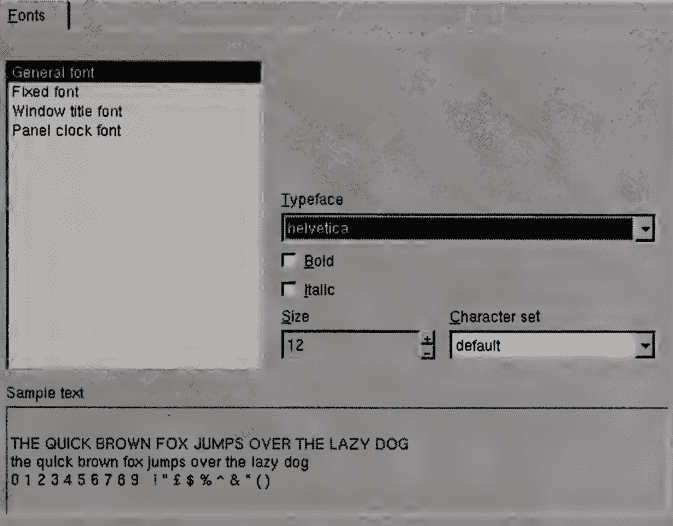

图 7-4 使用“字体”选项定义桌面字体

等宽字体（有时称为单幅字体）是那些无论字母是什么，每个字母都占据相同空间的字体。等宽字体中的 `i` 宽度与 `m` 一样。`Courier` 是经典的等宽字体；它看起来像老式打字机字体。比例字体是那些每个字母宽度略有不同的字体。本书使用比例字体编写；我们对代码示例和其他您需要输入的其他内容使用等宽字体。

要更改字体，请选择您想要更改的类别和您想要使用的字体，然后点击“应用”按钮将更改保存到您的桌面。点击“确定”按钮保存您的更改并退出字体窗口。

## 桌面图标

图 7-5 所示的此选项控制桌面图标的显示方式。KDE 面板不受您在此窗口中做出的选择的影响；相反，此窗口会影响屏幕左侧排列的桌面图标，如第 5 章所述。

# 92 Corel Linux OS 启动器：官方指南

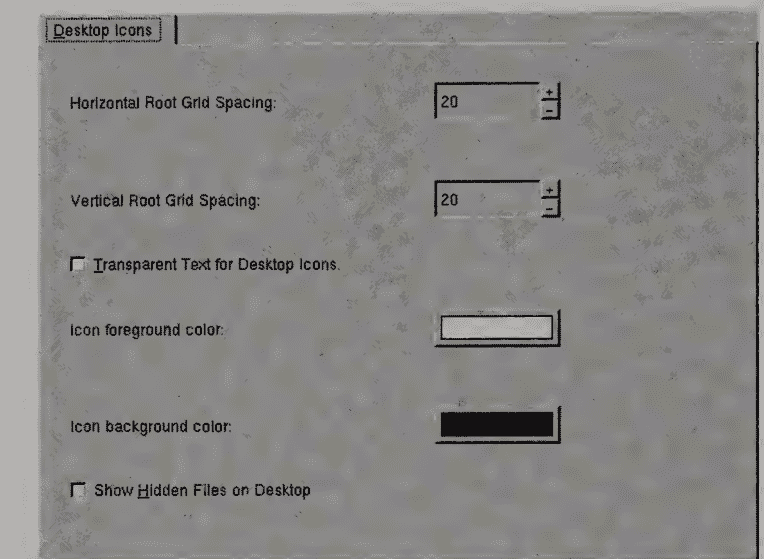

图 7-5 “桌面图标”选项控制桌面图标的显示方式

- 使用“水平网格间距”（`Horizontal Grid Spacing`）和“垂直网格间距”（`Vertical Grid Spacing`）元素来控制图标的位置：您是希望图标聚集在一起，还是倾向于更宽敞的布局？

- 控制图标文本标签的出现方式。通常，标签显示在不透明背景上。您可以更改文本颜色和背景颜色，也可以勾选“桌面图标透明”（`Transparent For Desktop Icons`）复选框并完全移除背景。（如果您选择了“透明文本”，您将需要注销 Corel Linux 并重新登录才能看到更改。）

点击“应用”按钮查看您的选择在桌面上的效果，点击“确定”按钮保存您的更改并退出此窗口。

# 第 7 章：使用控制中心配置您的桌面 93

## 语言

| | | |
|---|---|---|
| 第一 | 英语 - 美国 (`en`) |
| 第二 | 英语 - 英国 (`en_UK`) |
| 第三 | 英语 - 美国 (`en`) |

使用此选项更改 KDE 使用的语言。默认情况下，KDE 使用英语（Core Linux 发行版和本书也是如此）。如果您希望 KDE 以不同的语言运行，请从下拉菜单中选择相应的语言，并点击“确定”查看您的更改并退出窗口。

> 新语言将仅适用于您在点击“确定”后启动的应用程序和程序。如果您希望以所选语言查看桌面上的所有内容，您将必须注销并重新登录。然而，只有当应用程序已提供翻译模块时此方法才有效。目前，Core Linux 仅支持英语；如果您添加其他应用程序，它们可能包含对非英语语言的支持。

## 屏保护

通过此选项，您可以设置想要使用的屏幕保护程序（如果您想使用屏保护程序），如图 7-6 所示。在窗口中查看各种屏保护程序，并在设置区域从几个影响屏保护运行的选项中选择：

- **`Wait For Min.`** 设置计算机在激活屏保护之前必须保持空闲的延迟时间。
- **`Require Password`** 选择您是否要对屏保护设置密码保护。如果您经常离开座位，且不想为了看电脑在做什么而去碰鼠标，但又不想只想去喝杯咖啡时不想费注销的麻烦，那么这特别有用。屏保护程序的密码就是您的密码。
- **`Show As`** 选择屏保护程序的显示方式。
- **`Power Management`** 选择计算机在使用电池供电运行时应关闭屏保护。

# 94 Corel Linux OS 启动器：官方指南

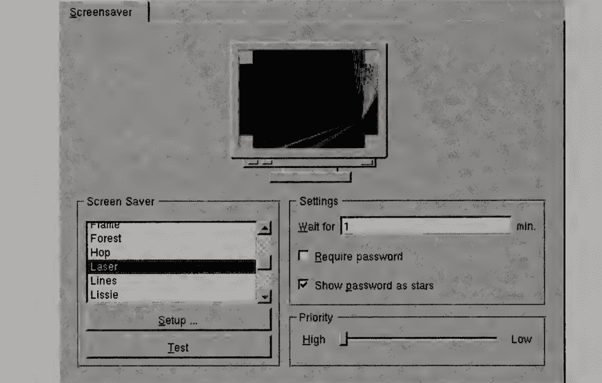

图 7-6 设置屏幕保护程序

# 第 7 章：使用控制中心配置您的桌面 95

## 样式


样式选项控制各种元素的显示方式。有三种选择：

- **`Draw Widgets`** 选择是否带有阴影。
- **`Menubar On Top`** 选择菜单栏的位置。
- **`Apply Fonts And Colors`** 应用于非 KDE 应用程序。

## 信息

尽管位于控制中心中，但您实际上可以在“信息”部分配置任何内容。相反，此部分提供了有关系统的机器级信息。当您在左侧选择一个项目时，控制中心会在右侧显示信息。此标题见表 7-1。

## 输入设备

此节包含键盘和鼠标的控制集。虽然这些设备似乎不需要很多配置，

# 96 Corel Linux OS 启动器：官方指南

| 选项 | 提供的信息 |
|---|---|
| 设备 | 关于安装设备的信息。主要指任何可升级或可移除的设备。 |
| DMA 通道 | 直接内存访问通道数据，DMA 是直接从设备发送到内存而不通过处理器的数据。 |
| 中断 | 中断请求值数据。每个设备都有一个唯一的 IRQ 值，处理器可以控制数据流中的各种信号。 |
| I/O 端口 | 输入/输出端口数据。插入计算机的每个设备都分配了一个 I/O 端口。 |
| 内存 | 关于系统 RAM 的信息。 |
| 分区 | 关于硬盘划分方式的信息。 |
| PCI | 关于计算机 PCI 插槽的信息。这些是接受特定类型板的扩展槽。 |
| 处理器 | 关于微处理器的基本信息。 |
| SCSI | 关于您安装的任何 SCSI 设备的信息。 |
| Samba 状态 | 关于您的 Samba 网络的信息。 |
| 音频 | 关于您的声卡的信息。 |
| X 服务器 | 关于在您的计算机上运行的 X 窗口软件的信息。 |
| 表 7-1 | 来自控制中心的系统信息 |

> 计算机处理从输入设备发送的数据的方式确实会影响您与计算机交互的方式。

## 第 7 章：使用控制中心配置您的桌面

### 国际键盘

如果你曾想过用另一种语言输入字，你可能会好奇计算机是如何处理各种字符集的。有许多种为不同语言设计的键盘：用于亚洲语言的意念字键盘；用于俄语及其他东欧语言的西里字母键盘；用于带有与英语不同字母（如法语或德语）的罗马字母语言的带重音符号键盘（`*accented keyboards*`）。KDE 提供了其中多种键盘的驱动程序；如果你使用的是与英语键盘不同的键盘，请在下拉框中选择相应的驱动程序，并点击确定按钮以保存您的更改。

### 键盘


使用此选项可以设置两个键盘特定的选项：重复和音量。

- **`Keyboard Repeat`**：如果你希望在按住相应按键时，字母持续在屏幕上出现，请选择此选项。例如，当关闭键盘重复时，无论你按住 R 键多长时间，屏幕上只会产生一个 R。如果开启重复，只要你按住按键，你就会看到 RRRRRRR。
- **`Keyclick Volume`**：如果你喜欢听自己的打字声，请选择此选项并设置合适的音量级别。此选项每当 KDE 感应到击键时，会在 KDE 内部切换一个细微的点击声；它不会影响键盘产生的实际物理声音。

点击确定按钮保存您的更改并退出此窗口。

### 鼠标


通过此选项，你可以配置鼠标的行为。鼠标行为是一个极具个人化的选择；你可能喜欢非常快速的鼠标，也可能觉得快速鼠标让你感到不安。不断调整这些设置，直到找到让你感到最舒适的水平。

- **`Acceleration`**：此设置控制当你在鼠标垫上移动鼠标时，屏幕上光标移动的速度。
- **`Threshold`**：此设置控制在点击鼠标时，光标需要距离某个项目多近才能被选中。
- **`Button Mapping`**：此设置控制鼠标按钮，以及你想要使用右手配置（左鼠标键为单单击键）还是左手配置（镜像，即右鼠标键为单单击键）。

点击确定按钮保存您的更改并退出鼠标窗口。

### 快捷键

在此部分中，你可以设置各种键盘快捷键来执行你经常使用的操作。例如，熟悉的键盘快捷键 `CTRL-S` 可以执行“保存”命令，就像你使用菜单系统导航到“保存”命令一样。“快捷键”标题包含两种类型的按键模式：全局快捷键（`Global Keys`，系统命令）和标准快捷键（`Standard Keys`，应用命令）。

## 第 7 章：使用控制中心配置您的桌面

提示

在设置自己的键盘快捷键之前，请先查看 KDE 已经定义的默认快捷键。你可能会发现，创建自己的快捷键实际上是在重复用功。当然，如果你发现自己的按键序列比默认的更容易记忆，可以替换为你自己的。

### 全局快捷键 (`Global Keys`)


全局快捷键快捷是指执行系统功能的快捷键，例如切换桌面或选择桌面图标。默认定义的各种全局快捷键组合显示在右侧面板的滚动框中。如果你想定义一个新的全局快捷键操作，请按照以下步骤操作：

1. 在图 7-7 所示的全局快捷键选项卡中，在左侧面板的操作窗口中选择你想要执行的操作。
2. 在右面板底部的“为所选操作选择按键”窗口中选择一个元键（`metakey`）。
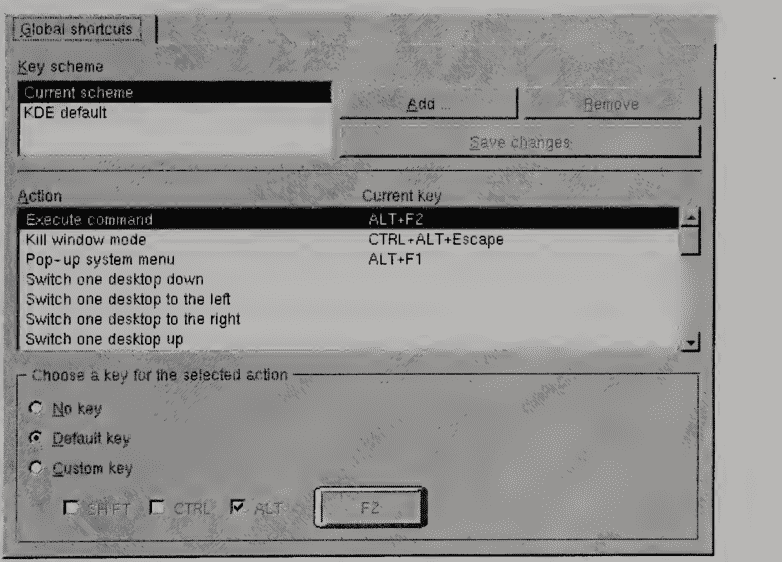
图 7-7 在全局快捷键选项卡中设置快捷键

元键是指需要作为击键组合的一部分被按下的键：元键包括 SHIFT、CTRL 和 ALT。
3. 按下你想要在组合中使用的键（在你的键盘上）。该按键组合将出现在操作窗口中。
4. 点击确定保存你的新击键组合。

### 标准快捷键 (Standard Keys)

标准快捷键快捷键控制处理文本时使用的基本功能。保存、打开、剪切、粘贴等熟悉的函数都有标准快捷键。已定义的各种标准快捷键组合列在右侧面板的滚动窗格中（图 7-8）。
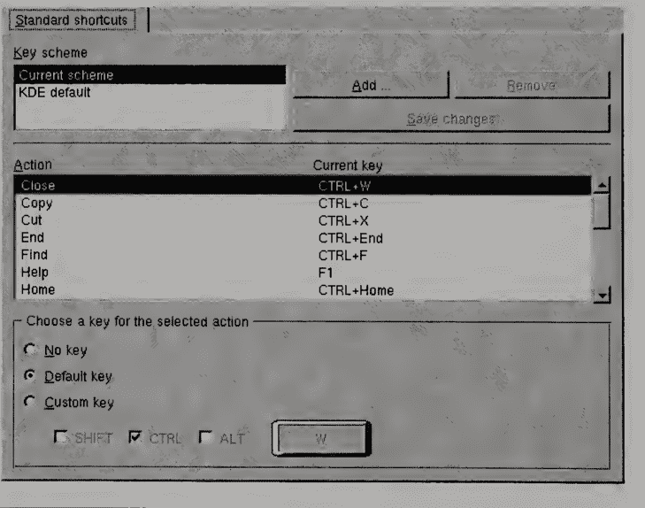
图 7-8 在此处设置标准快捷键

如果你想定义一个新的标准快捷键操作，请按照以下步骤操作：
1. 在图 7-8 所示的右面板的操作窗口中选择你想要执行的操作。
2. 在右面板底部的“为所选操作选择按键”窗口中选择一个元键。
3. 按下你想要在组合中使用的键（在你的键盘上）。该按键组合将出现在操作窗口中。
4. 点击确定保存你的新击键组合。

### 网络 (Network)

使用此部分为系统配置以太网和 Samba 网络。我们将在第 20 章中详细介绍网络。

### 窗口 (Windows)

窗口部分允许你配置桌面窗口的各种元素，例如标题栏按钮的显示方式，以及在特定类型的窗口内点击时每个鼠标键的作用。

### 高级 (Advanced)
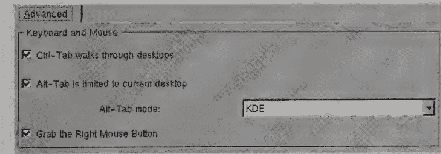
高级选项允许你配置桌面窗口的各种元素，例如标题栏按钮的显示方式，以及在特定类型的窗口内点击时每个鼠标键的作用。此选项显示了影响窗口的的组合。

### 按钮 (Buttons)
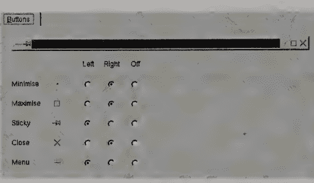
通过图 7-9 所示的按钮选项，可以配置。

### 鼠标 (Mouse)

通过此选项，你可以配置鼠标的行为。鼠标行为是一个极具个人化的选择；你可能喜欢非常快速的鼠标，也可能觉得快速鼠标让你感到不安。不断调整这些设置，直到找到让你感到最舒适的水平。
- **加速性 (Acceleration)**：此设置控制当你在鼠标垫上移动鼠标时，屏幕上光标移动的速度。
- **阈值 (Threshold)**：此设置控制在点击鼠标时，光标需要距离某个项目多近才能被选中。
- **按钮映射 (Button Mapping)**：此设置控制鼠标按钮，以及你想要使用右手配置（左鼠标键为单单击键）还是左手配置（镜像，即右鼠标键为单单击键）。
点击确定按钮保存您的更改并退出鼠标窗口。

## 第 7 章：使用控制中心配置您的桌面
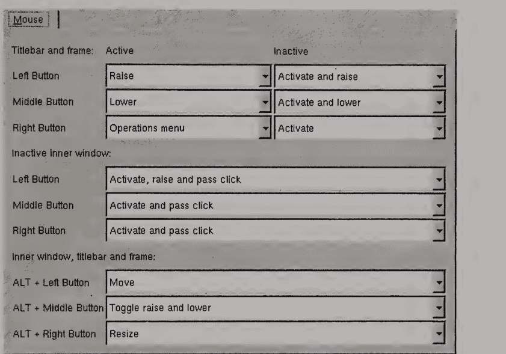
图 7-9 为窗口属性定义最多三个按钮

### 属性 (Properties)
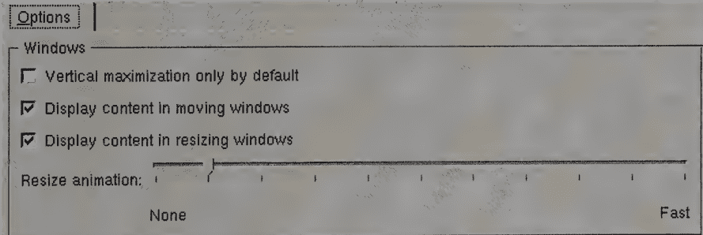
使用属性选项可以定义若干窗口行为：
- **默认仅垂直最大化 (Vertical Maximization Only By Default)**：打开时，窗口从屏幕顶部延伸到底部。如果你不希望它全高显示，必须手动调整窗口大小。
- **在移动窗口中显示内容 (Display Content In Moving Windows)**：选中后，移动窗口将在移动时显示其内容。这会减慢系统速度，因为计算机必须在移动时和停止时重绘窗口内容。
- **在调整大小窗口中显示内容 (Display Content In Resizing Windows)**：选中后，窗口响应你的鼠标操作调整大小时将显示内容。与上一个选项一样这会在窗口调整大小期间减慢速度。
- **放置策略 (Placement Policy)**：允许配置新窗口首次出现时在屏幕上的方式。你有五个选项：
    - **智能 (Smart)**：将新窗口放置在重叠最少的位置。
    - **级联 (Cascade)**：对窗口进行排序，使其左上角向右下方级联。
    - **交互 (Interactive)**：允许窗口重叠达到某个百分比。
    - **随机 (Random)**：随机放置新窗口。
    - **手动 (Manual)**：将新窗口放置在鼠标光标下——你必须点击窗口位置。
**焦点策略 (Focus Policy)**：决定窗口获取焦点或成为活动窗口的方式。你有四个选项：
- **点击获取焦点 (Click To Focus)**：在此情况下，你必须点击窗口来赋予焦点。
- **跟随鼠标 (Focus Follows Mouse)**：在此情况下，活动窗口是拥有鼠标光标的那个窗口。
- **经典跟随鼠标 (Classic Focus Follows Mouse)**：与上述相似，不同在于当鼠标光标离开窗口时窗口会失去焦点。

## 第 7 章：使用控制中心配置您的桌面

经典模糊焦点（Classic Sloppy Focus）通过 ALT-TAB 组合键在打开的窗口之间切换焦点。

### 标题栏

图 7-10 所示的“标题栏”选项提供了一组控制设置，用于确定单个窗口标题栏的外观和行为。该控制组影响四个元素：
- 标题对齐：选择窗口标题是左对齐还是右对齐。
- 外观：影响标题栏颜色、颜色是纯色还是渐变，或者使用图像代替颜色应用于标题栏。
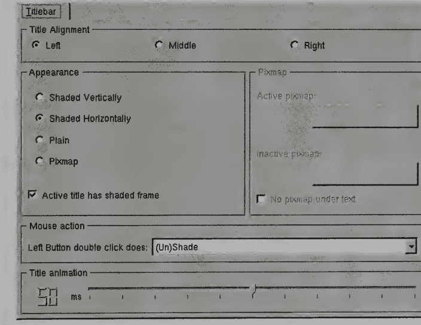
图 7-10 使用此标签控制标题栏
106 Corel Linux 操作系统入门指南：官方指南
注意：在窗口标题栏中使用图像可能会导致标题难以阅读。
- 鼠标操作：配置鼠标按钮，以便在点击标题栏时向上折起或向下展开窗口。您还可以为指定的鼠标按钮分配其他四个操作之一：最大化、图标化、粘性或关闭。
- 标题动画：当窗口标题对于标题栏来说过长时，KDE 会从左向右滚动标题。此选项下的滑块控制滚动速度。

### 密码
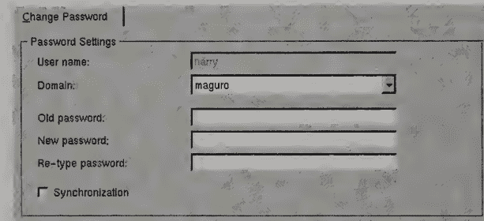
使用“密码”部分更改您的登录密码。“更改密码”屏幕会提示您输入旧密码和新密码，以验证更改密码的人确实是您。

### 日期与时间


## 第 7 章：使用控制中心配置您的桌面

本节显示了一个交互式时钟和日历，可以使用它为计算机设置正确的的时间日期。这将设置实际系统时间，时间显示在 KDE 面板中，并用于内部日志或文档上的任何时间戳。保持时间当前且准确是一个良好的主意，特别是如果您住在时钟随季节变化的地区。

### 打印机

使用“打印机”部分选择并配置连接到计算机的打印机。您无法直接从控制中心的“打印机”部分打印文档，但在从各个应用程序中执行打印命令之前，您可以确保您的打印机工作正常。打印将在第四部分“基础 Linux 系统管理”中进行更详细的讨论。
要使用控制 }的打印机选项连接到本地或网络打印机，您必须拥有 root 密码。在此屏幕上，点击“修改”，并在提示时输入 root 密码。您可以点击“添加”按钮启动“添加打印机向导”，有关配置打印机的更多信息，请参阅第 19 章“处理硬件”。

### 应用桌面主题

KDE 最令人愉快的方面之一是可以为桌面应用主题。主题是一组风格元素，旨在为您的桌面和窗口提供主题性的“外观”。例如，您可以应用一个野生动物主题，该主题包含一张草地照片作为背景以及代表各种昆虫的图标。Core Linux 版本的 KDE 支持主题并提供了内置的主题管理器（如图 7-11 所示），使安装变得又快速。
要安装或更改桌面主题，请使用以下步骤：
1. 点击面板中的应用程序管理器图标。
2. 从开始菜单中，选择“控制中心 | 桌面 | 主题管理器”。
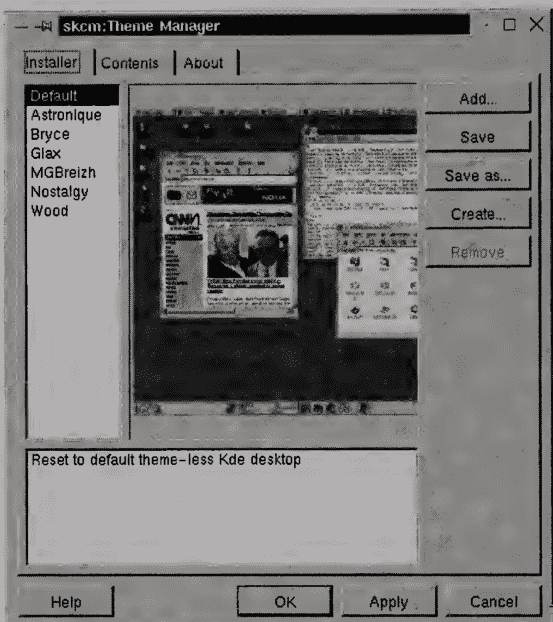
**图 7-11** 使用直观的主题管理器应用桌面主题
出现主题管理器窗口。
3. 从左侧列表中选择一个主题。选中的主题将显示在小预览窗口中。
4. 点击“应用”按钮。主题将应用到您的桌面。
5. 点击“确定”按钮保存您的更改并退出主题管理器。
如果您只想使用特定主题的某些部分，可以通过主题管理器选择这些部分。


# 第 7 章：使用控制面板配置您的桌面

1. 使用之前描述的过程打开主题管理器并点击“内容”标签页。在此标签页上，您将看到构成当前所选主题的所有元素。

2. 勾选您想要使用的元素旁边的复选框，并取消勾选您不想应用到桌面的元素旁边的复选框。

3. 当您做出选择后，点击“确定”按钮保存更改并退出。

您可以从 KDE 主题存档网站 `http://kde.themes.org` 下载大量主题。可以创建自己的主题，但这需要一些图形设计软件的知识来创建单个元素。如果您想构建自己的主题，请查阅在线 KDE 文档以获取该过程的完整解释。您可以在 `http://kde.themes.org/php/docs.phtml?docid=21` 找到正确的页面。

## 组织 KDE 面板

虽然控制中心提供了许多自定义桌面的选项，但控制面板允许您配置 KDE 面板本身。面板是用户体验的重要部分，它和其他部分一样是可以配置的。面板配置分为三类：常规外观、面板图标以及图标的添加或删除。

### KDE 面板外观

许多面板行为可以通过右键点击面板来控制。配置窗口如图 7-12 所示。（注意此窗口有五个标签页。）

- 位置：在顶部、底部、左侧或右侧显示面板。
- 尺寸：选择图标显示为微小、正常或大。
- 栏：在顶部、底部或左侧显示任务栏，或完全隐藏任务栏。

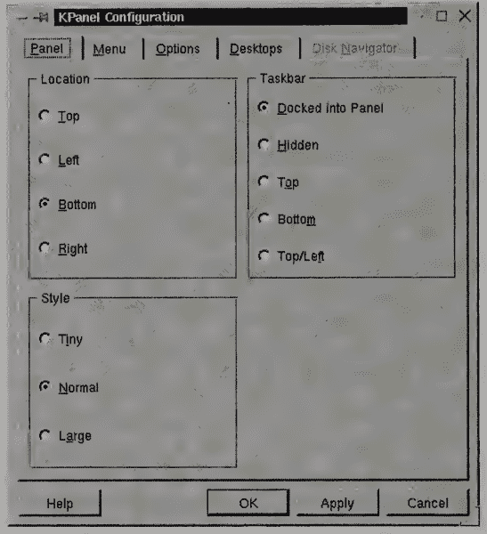

**图 7-12** 使用面板配置

### KDE 面板图标

由于 KDE 面板主要由程序的图标表示组成，因此按照您的喜配置这些图标是合理的。右键点击任何面板图标即可打开包含“移动”、“删除”和“属性”的菜单。

- 移动：选择此选项，然后拖动图标在面板中向左或滑动。
- 删除：选择此选项删除图标。

您始终可以通过应用程序管理器和开始菜单访问任何程序。您不需要为每个安装的程序设置面板图标。

### 属性

属性：打开属性窗口，该窗口包含四个标签页。“常规”标签页显示程序名称和图标的基本信息。“权限”标签页允许您更改文件权限。“执行”标签页允许您更改点击图标时启动的程序信息。“应用程序”标签页显示关联应用程序的信息。

提示 如果您想更改图标上显示的图片，可以在属性窗口的“执行”标签页上进行。

### 向 KDE 面板添加图标

您可能想向 KDE 面板添加图标，以便启动常用的程序，而不仅仅是默认包含的程序。要向面板添加图标，请按照以下步骤操作：

1. 点击面板中的应用程序管理器，从开始菜单中选择“文件管理器”。
2. 导航到想要链接到面板的应用程序。
3. 点击应用程序并拖动到桌面。
4. 松开鼠标按钮。
5. 从出现的上下文菜单中选择“链接”。面上会出现该程序的链接。
6. 将链接拖动到面板。链接出现在面板中，同时也留在桌面上。
7. 右键点击桌面上的链接，从上下文菜单中选择“移动到垃圾桶”。
8. 右键点击面板中的新链接，从上下文菜单中选择“属性”。
9. 在属性窗口中，选择“执行”标签页。
10. 将执行字段中显示的路径替换为要通过此图标启动的应用程序的完整路径名称。

> 你可以在文件管理器的地址栏字段中找到完整路径名。如果你想要启动的文件当前未在文件管理器中选中，请浏览目录结构直到找到它为止。

11. 如果你想更改图标图像，请点击属性窗口中显示的图标。
12. 在出现的选项中选择一个新图标。
13. 点击“确定”关闭属性窗口。
14. 在面板背景上点击右键，从右键菜单中选择“重启”。

面板将重启，现在现在包含了你的新图标。你现在只需通过点击新的面板图标即可启动关联的应用程序。

# 第 8 章：进阶 KDE 技术


# Corel Linux 操作系统启动器：官方指南

虽然你可以愉快地使用 Corel Linux，而无需超越第 5、6、7 章中解释的 KDE 技术，但你可能想要使用更高级的 KDE 技术来完成特定任务或配置系统的某些部分。在本章中，我们将讨论 KDE 窗口管理器（Window Manager），这是一个你在某些情况下可以使用它替代常规 KDE 的工具。我们还详细讨论了分页器（Pager）和虚拟桌面，并提供了一些更有效地使用虚拟桌面的提示，以简化你在 Corel Linux 中的工作方式。最后，我们解决了终端窗口问题，以及为什么你可能倾向于通过命令行提示符而非 KDE 图形管理工具执行某些 Linux（以及桌面）功能。

## KDE 窗口管理器

所有的 UNIX 程序最终都可以简化为一组命令。窗口管理器提供了一组特定的命令，这些命令在编程或对桌面环境进行特定微调时非常有用。窗口管理器命令可以用于你编写的旨在自动化某些过程的脚本，也可以用于你可能想为 KDE 平台编写的文章。

窗口管理器与文件管理器不同，它不是一个图形化工具。这意味着你无法打开一个包含窗口管理器的独立窗口。相反，它是一种将文本命令翻译成影响 KDE“后台”操作的动作的机制。是的，这有点让人困惑；KDE 中几乎每一个其他管理器功能都会打开一个独立的窗口，让你用来管理桌面的某些事情。窗口管理器是规则中的例外。

> 你可能永远不会使用 KDE 的窗口管理器功能；你当然不需要使用窗口管理器来有效使用 KDE。我们包含这一节是为了那些想要编写影响窗口性能的脚本的读者，或者可能想要编写考虑窗口行为的程序的读者。我们建议结合第 17 章“扩展的 Shell：基础脚本编写”使用这些信息。

## 命令行选项

窗口管理器提供了两个命令行选项。我们将在第 17 章更深入地讨论命令行选项。对于本章而言，只需知道可以使用命令行选项来控制窗口管理器的行为即可。

### -version

在命令行提示符处输入 `kwm -version` 以了解你正在使用的窗口管理器版本。随着未来 Corel Linux 版本的发布，这变得越来越重要，因为最新版本的窗口管理器可能有更多功能或更精简的执行某些任务的方法。如果你在在线论坛上寻求帮助，也需要版本号，因为答案取决于你正在使用的窗口管理器版本。


你可以通过点击 KDE 面板上的“终端模拟器”按钮来打开一个包含命令行提示符的终端窗口。

### -nosession

在命令行提示符处输入 `kwm -nosession` 以启动一个新的窗口管理器会话，而不恢复之前的会话。如果你正在测试桌面的新设置或测试脚本，可以使用此功能；恢复之前的会话将导致新设置失效。此命令在文本模式下运行时有效。

## 键盘快捷键

可以通过键盘快捷键访问某些窗口管理器功能

- ALT-ESC 或 CTRL-ESC 打开当前会话管理器，显示所有桌面及其内容。你也可以点击此管理器中的“注销”按钮退出 KDE。
- ALT-TAB (ALT-SHIFT-TAB) 在当前桌面上的所有打开窗口之间循环切换。
- ALT-F3 打开窗口操作菜单，允许你执行基本的窗口管理任务，如调整大小、关闭、最大化等。
- ALT-F4 关闭活动窗口。
- CTRL-F1（以及通过 F2 到 F8 键）切换到使用所选数字的虚拟桌面。即
- CTRL-ALT-ESC 调用“销毁窗口”模式。当你按下此组合键时，光标会变成骷髅标志。用新光标点击窗口以关闭该窗口，并杀死其中运行的任何进程。（Kill 是 UNIX 中手动结束进程的术语。）如果内部进程卡死或无无响应，这会特别有用。

## 微型命令行窗口

使用键盘快捷键 ALT-F2 打开一个小型命令行窗口，如图 8-1 所示。（你也可以通过右键点击桌面并在右键菜单中选择“执行命令”，或点击应用程序启动图标并选择“启动 |运行”）。使用此窗口输入单个 UNIX shell 命令或执行以下命令：

- 输入 URL 以打开显示指定 Web 位置的文件管理器窗口。
- 输入短语 `man` 后跟 UNIX 命令以打开显示该命令帮助页（man page）的文件管理器窗口。

> 页面是由开发该命令的程序员编写的文本文档。它是某种帮助文档；某些帮助页极其详细且有用，而另一些则相当困惑。

- 使用 `SHELL` 环境变量在默认之外的 shell 中执行命令。（有关 shell 使用更多信息请参见第 16 章“管理员工具：Shell 和文本编辑器”。）

在微型命令行窗口中，你可以使用向上箭头调回之前输入的命令，使用 TAB 键补全部分输入的文件名；运行框会自动完整补全路径和可执行名称，但在某些情况下你可能需要使用 TAB。如果你希望 shell 命令的输出在新终端窗口中打开，请勾选“在终端窗口中运行”复框。

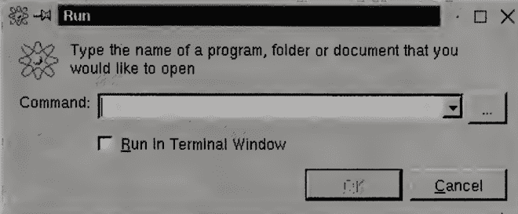

**图 8-1** 使用微型命令行窗口发布单个命令

## 窗口管理器命令

使用微型命令行窗口或普通终端窗口直接向窗口管理器发送文本命令。使用以下语法发送这些命令：

```
kwm [command]
```


在 shell 提示符处输入此并将 `[command]` 替换为你想要发送的命令。窗口管理器识别的命令如表 8-1 所示。你可能不会经常使用这些命令，大多数操作通过菜单、鼠标点击或图形工具执行会更容易。然而，如果你需要使用 shell 命令来控制桌面，你会发现表 8-1 是一个非常有用的参考。如果你计划编写影响桌面的 KDE 程序，你会发现它很有帮助。

# 118 Core Linux 操作系统启动器：官方指南

| 命令 | 功能 |
| --- | --- |
| `refreshScreen` | 刷新屏幕。在更改后使用。 |
| `darkenScreen` | 将屏幕变暗。警告：此命令会让桌面对键盘或鼠标无响应。 |
| `logout` | 显示注销对话框。 |
| `commandLine` | 打开命令行窗口。 |
| `taskManager` | 显示当前会话窗口。 |
| `configure` | 从 `.xwmrc` 文件重新加载屏幕配置。 |
| `winMove` | 移动活动窗口。 |
| `winResize` | 调整活动窗口大小。 |
| `winRestore` | 恢复活动窗口。 |
| `winIconify` | 最小活动窗口。 |
| `winClose` | 关闭活动窗口。 |
| `winShade` | 折叠窗口只显示标题栏。 |
| `winSticky` | 将活动窗口设置为固定（使其出现在所有虚拟桌面上）。 |
| `winOperations` | 显示窗口操作菜单。 |
| `deskUnclutter` | 平铺桌面上的所有打开窗口并显示所有标题栏。 |
| `deskCascade` | 叠放桌面上的所有打开窗口。 |
| `desktop[1-8]` | 切换到指定的桌面（输入你想切换的桌面数字）。 |
| `desktop+1` | 切换到下一个桌面。 |
| `desktop-1` | 切换到上一个桌面。 |
| `desktop+2` | 向上移动桌面列表两个。 |
| `desktop-2` | 向下移动桌面列表两个。 |
| `desktop%2` | 在奇数桌面和下一个偶数桌面之间切换（例如在桌面 1 和 2 之间，或 3 和 4 之间）。 |

**表 8-1** 窗口管理器文本命令

# 使用虚拟桌面

在第 5 章中，我们简要描述虚拟桌面管理器是一个可以在四个虚拟桌面之间切换的工具。虚拟桌面正如它的名字一样——另一个你启动计算机时使用的桌面。

## 第 8 章：高级 KDE 技术

## 119

在 KDE 中，你拥有四个虚拟桌面，可以通过停靠在 KDE 面板右侧的虚拟桌面管理器（Virtual Desktop Manager）图标的按钮进行切换。

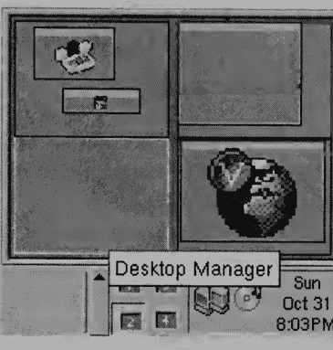

虽然 Corel Linux 使用“虚拟桌面管理器”一词是指控制虚拟桌面的工具，但你可能在 Corel 特定的文档之外不会看到这个术语。使用标准的 KDE 发行版可能会将此称为“分页器”（Pager），你会在通用 KDE 文档中看到这个术语。

这些桌面看起来像是开发者的闲暇之作，没有太大意义或用途。然而，你可以使用虚拟桌面管理器和桌面来协调和组织你在计算机上的工作，将某些类型的任务放在一个桌面，将其他类型的任务放在其他桌面。例如，如果你有几类需要同时保持打开的任务，请为每类任务分配一个桌面。你可能在桌面 1 上打开了系统管理工具，在桌面 2 上打开了办公套件程序，在桌面 3 上打开了 Kron 或 Netscape 等浏览器程序，在桌面 4 上打开了纸牌或推迷宫等解压玩具。

如果你忘记了每个窗口中打开了哪些应用程序，请点击虚拟桌面管理器图标中桌面 1 按钮左侧的小箭头。此箭头会打开桌面的图形化表示，让你看到每个桌面上运行着什么。如果你使用控制中心（Control Center）为每个桌面分配不同的背景，那么跟踪每个桌面上打开的内容将变得更加容易。

## 120 Corel Linux OS入门教程：官方指南

> 提示：如果你想在所有桌面上打开特定的应用程序，请点击应用程序标题栏中的固定（Sticky）按钮。（有关标题栏按钮的更多信息，请参阅第 7 章。）无论该窗口最初是在哪个桌面打开的，所有桌面上都会出现一个固定的窗口。

虚拟桌面对于系统管理任务可能特别有帮助。例如，如果你将一个桌面专门用于系统管理，你最终会养成一种心理习惯：每当你切换到那个桌面时，就会切换到“系统管理员模式”。这是避免在以 `root` 身份登录时养成执行普通任务的坏习惯的好方法。只有当你看到你专门用于管理的桌面时，才按照第 12 章“用户空间和用户账户”中的描述进行训练，这将减少你操作计算机时的错误次数。

> 注意：默认情况下，当你以 `root` 身份登录时，Corel Linux 将窗口标题栏更改为红色。当你以用户身份登录时，它们显示蓝色。如果你在配置 KDE 时更改了标题栏的外观，你可能看不到变化。

## 双倍虚拟桌面的数量

对于某些人来说，四个桌面根本是不够的。Corel Linux 允许你添加最多八个虚拟桌面。要添加最初提供的四个桌面之外的桌面，请使用以下流程：

1. 右键点击 KDE 面板背景。
2. 从上下文菜单中选择配置（Configure）。
3. 点击配置窗口的“桌面”（Desktops）选项卡。

   选择你希望显示的可见桌面数量。你可以选择二、四、六或八个。
4. 点击确定 按钮保存你的选择并退出配置窗口。

   退出配置窗口后，你将在 KDE 面板的虚拟桌面管理器图标中看到新的桌面数量。如果你选择了八个可见桌面，你将在管理器中看到八个按钮；当你点击虚拟桌面按钮旁的小箭头时，在出现的图形桌面指南中，所有八个桌面也是可见的。

## 关闭虚拟桌面

对于那些不喜欢它们的人来说，遗憾的是，你无法在 Corel Linux 中完全关闭虚拟桌面。但是，通过更改接下来两段所需的配置，减少它们对你日常习惯的影响。

首先，使用前一节中的流程将虚拟桌面数量设置为二，这是最低限额。你仍然有一个额外的可用桌面，但你不必使用它。它将保持空闲状态。

接下来，点击 KDE 面板中的应用程序图标，从“桌面”标题下的“边框”订阅中选择“控制中心”，并关闭“活动边界”（Active Borders）。（有关使用控制中心的更多信息，请参阅第 7 章。）禁用活动边界后，当你将鼠标光标移动得靠近屏幕边缘时，就不会有切换到另一个桌面的风险。

一旦你关闭了活动边界并减少了桌面数量，你就将你的计算机配置得尽可能接近单桌面系统。如果需要，你仍然可以通过虚拟桌面管理器使用第二个桌面。

## 终端窗口对比 KDE 的图形化工具

无论你在安装 Corel Linux 之前的背景如何，你可能都会好奇，在 KDE 中执行任何给定的管理任务，使用终端窗口还是图形化工具更好。来自 Linux 背景的人可能会问，既然文本命令运行得很好好的，为什么还需要图形化工具；而来自图形界面背景的人可能会纳闷，如果图形化工具一样简单，为什么有人使用文本命令。这两种观点都不是错的，也不完全正确。相反，文本与图形化工具的问题在很大程度上是一个偏好问题。就像 Linux 设计哲学的许多其他部分一样，完成任何给定任务通常至少有两种方法。

## 22 Corel Linux OS入门教程：官方指南

尽管如此，每种方法都有优缺点。图形化工具允许你快速完成例行任务。它们非常直观，所以你不需要花费大量时间研究语法或其他使用某种命令的原因。你通常可以打开工具并由过程引导你完成。然而，图形化工具通常包含了任何任务中最常用的部分，这意味着如果你选择只使用图形化工具，就会失去一些选项。

命令行工具也有一些优势。主要的优势是 UNIX 及其派生操作系统（如 Linux）拥有丰富的命令行操作历史，以及多年演变的强大语法。这种语法允许同时执行多个任务，并让上一个任务的输出影响下一个任务。例如，你可以要求计算机列出给定文件夹中的文件，将输出放入文本文件中，并按文件大小排序。如果使用图形化工具，你必须对这些任务中的每一个执行单独的操作。

命令行与计算机交互可能最有用的方面可能是，整个系列命令可以由单个脚本引导。Linux 系统在命令行级别支持脚本语法，可以很容易将单个命令组合成复杂的动作链。当然，这需要投入相当的时间来学习脚本语言和让脚本正常运行的正确语法，但随着每次运行脚本节省的时间，这种时间投入通常会产生回报。

使用基于的命令也有显著的缺点；UNIX 命令语法强大且灵活，命令数量如此庞大，以至于没有一个人知道命令行中所有可能的命令。任何五个基于 UNIX 的系统管理员都会以不同的方式执行同一组功能；当你向每位专家寻求建议时，理解命令语法可能会很困难。另一个缺点是，可能会——特别是当你以 `root` 身份登录时——对你的计算机造成严重且不可恢复的损害。图形化工具通常可以防止此类灾难的发生，只要你在点击按钮之前对要执行的操作有一个第二次确认图像。

大多数使用 Linux 和图形界面的用户最终都会结合图形化工具和命令行工具来管理他们的系统。我们属于这一类；虽然我们使用大量的终端窗口来维护和运行计算机，

## 第 8 章：高级 KDE 技术


当图形化工具更方便或者我们习惯使用它们时，我们也会使用它们。对于终端窗口与图形化工具的选择，并没有标准答案；这完全取决于你的舒适度。虽然完全可以仅使用其中一种方式来运行机器，但在你的 Corel Linux 系统上，你不太会这样做，因为这两种方法都非常容易实现。

正如我们在书中其他部分讨论的系统管理其他方面一样，你可以选择使用你熟悉的工具来管理系统。如果你发现自己更倾向于在终端窗口中使用 `passwd` 命令更改密码，而不是使用控制中心中的“密码（Password）”标题，那就尽管操作吧。如果你发现自己面对终端提示符，却却对正确的语法格式完全断无记忆，那么请关闭终端窗口并改用图形化工具。Corel Linux 的灵活性意味着你可以通过几种不同的方式完成相同的任务。

# 第 9 章：在 Corel Linux 上使用互联网


## 126 Corel Linux OS 入门教程：官方指南

如今很难找到不以某种方式连接到互联网的计算机，无论是通过调制解调器还是直接连接。当然，在没有互联网访问的情况下要成为一名 Linux 爱好者是非常困难的；互联网上发布了大量的讨论和软件信息，如果不频繁访问，很难跟上进度。在本节中，我们概述了将 Corel Linux 机器连接到支持 Linux 的互联网服务提供商（`ISP`）的必要步骤。我们还描述了安装 Corel Linux 时已安装的基础互联网软件；其互联网套件包括一个新闻阅读器、一个电子邮件程序和两种聊天。你可以使用文件管理器（`File Manager`）作为 `FTP` 客户端。

你可能已经为现有的 `ISP` 账户建立了 `PPP`（点对点协议）连接。如果是如此，请尽管忽略本节，跳转到本章标题为“使用 `KDE` 集成互联网工具”的章节。

### 使用拨号上网配置互联网连接

要从你的 Corel Linux 机器访问互联网，你需要建立与互联网服务提供商（`ISP`）的连接。在本节中，我们假设你已经拥有支持 Linux 电脑的 `ISP` 账户。如果没有，请参见标题为“兼容 Linux 的 `ISP`”的侧边栏，获取关于寻找和使用为 Linux 用户提供互联网服务的提供商的提示。我们还假设你想设置一个 `PPP` 连接，这允许你查看网页以及互联网上提供的其他资料。最后，我们假设你已经安装了调制解调器（或已为你安装好了），它工作正常并连接到了通用的电话线上。你可能想参考 Linux 文档项目提供的调制解调器设置材料，地址为 `http://www.linuxdoc.org/HOWTO/Modem-HOWTO.html`。

### 设置你的账户信息

在 Corel Linux 中配置 `PPP` 连接非常简单。Corel Linux 提供了一个名为“拨号（`Dial-Up`）”的工具，它可以获取你连接的基本信息并设置建立连接所需的文件。在这个过程中最重要的一点是按照提供的内容准确输入所有内容，包括大小写和标点符号。这将避免在你拼写错误时需要重做一切的麻烦。

## 第 9 章：在 Corel Linux 上使用互联网 127

### 兼容 Linux 的 ISP

要在你的 Corel Linux 机器上获得互联网访问，你需要一个允许使用 Linux 软件进行连接的服务商账户。基本上，这意味着该提供商不需要专有软件即可访问 `ISP` 的计算机；大多数专有的 `ISP` 软件（如 America Online 的软件）仅适用于 Windows 和 Macintosh 计算机。提供 `PPP`（点对点协议）的 `ISP` 是一个很好的选择，因为你将使用 Corel Linux 的拨号工具进行连接。选择至少对 Linux 有一定了解的 `ISP` 更重要的基于现在，你可能偶尔需要拨打帮助热线。如果提供的唯一帮助是针对 Windows 或 Macintosh 的，那么对你来说帮助并不大。

你可能拥有支持 Linux 用户的本地服务提供商，特别是如果你在一个大城市或靠近大学校园的地方。或者，你可能想要国家级 `ISP` 的便利性，特别是当你旅行并需要在许多不同的城市拨入本地服务点时。你可以在 `http://howto.linuxberg.com/isp.html` 查找 Linux 友好型 `ISP` 列表，找到几个位于你本地拨打范围内的 `ISP`，然后询问一些问题。这里是一些基础的查询建议：

- 你们是否要求使用专有软件连接到用户账户？如果是，该软件是否供 Linux 用户使用？
- 你们的技术支持人员熟悉 Linux 吗？你们是否提供培训以便他们能够回答 Linux 用户的问题？
- 你们是否有用户在使用 Linux？有多少人？你们是否有为 Linux 用户编写的支持材料？

你可能无法得到所有这些问题的满意答复；在某些情况下，一个并不完美的 `ISP` 账户成本可能比另一个提供商的技术支持质量对你更关键。只要你选择的账户是普通的 `PPP` 账户，你就应该能够完成任何你需要做的事；只需注意，你可能需要自己解决问题，而不是依靠帮助热线的协助。

## 第 9 章：在 Corel Linux 上使用互联网 129

一旦你掌握了面前的所有信息，就是是时候配置拨号上网了。

- 1. 点击 `KDE` 面板上的应用程序管理器图标，并在开始菜单中选择应用程序 | 网络 | 拨号（`Dial-Up`）。
- 2. 在拨号界面，点击“设置（Setup）”按钮。
- 3. 弹出拨号配置窗口，如图 9-1 所示。
- 4. 点击“新建（New）”按钮打开账户对话框。
- 5. 如果“拨号（Dial）”选项卡不在顶部，请点击它。
- 6. 在此选项卡上输入 `ISP` 的拨号号码、验证类型和连接名称。

连接名称仅供你使用，因此你可以输入任何内容。使用 `ISP` 的名称是最简单的。

注意：你必须选择一种验证类型；如果你的 `ISP` 不使用验证，只需选择“基于脚本（Script Based）”。

- 7. 点击新账户界面的“`IP`”选项卡。

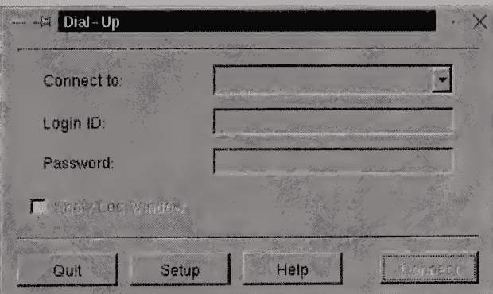

图 9-1 拨号上网用于快速准确地配置你的拨号互联网连接

## 130 Corel Linux 入门套装：官方指南

8. 选择 `DHCP` 按钮。

> 注意
>
> 如果你的 `ISP` 提供静态 `IP` 服务——也就是说，如果你付费让计算机分配单个 `IP` 地址——请选择静态 `IP` 按钮并输入你的 `IP` 地址和子网掩码信息。

9. 点击新账户的 `DNS` 选项卡。
10. 输入 `ISP` 的域名服务器 `IP` 数字。

你的 `ISP` 提供了两个 `DNS` 数字。在有时标记为“primary”（主）的 `DNS` `IP` 地址框中输入第一个，然后点击添加。数字出现在地址列表中。在有时标记为“secondary”（备）的 `DNS` `IP` 地址框中输入第二个，再次点击添加。第二个数字也会出现在列表中。

11. 点击新账户的网关选项卡。

大多数 `ISP` 不提供网关计算机：即处理所有进出站流量的计算机。这使得维护变得更容易。由于某种原因，你的 `ISP` 给了你特定的网关数字，请在此选项卡上输入；否则，跳到下一步。

12. 点击新账户的登录脚本选项卡。

在此选项卡上，你创建并编辑脚本，用于在登录过程中向 `ISP` 提交你的 `ID` 和密码。你可能不需要此；如果你的 `ISP` 不使用文本登录过程，它会在连接过程中获取你的 `ID` 和密码。

如果你的 `ISP` 使用文本登录过程，而你想要自动化该过程，让你无需等待登录窗口出现，你可以如图 9-2 所示编写登录脚本，使该过程更简单。

## 第 9 章：在 Corel Linux 中使用网络 131


图 9-2 编写简短脚本以自动化 `ISP` 登录过程

### 通过登录脚本登录

如果你的 `ISP` 使用文本登录，并且你想创建一个脚本来处理该任务，请按照以下步骤创建基础登录脚本。你可能需要调整此部分，因为不同的 `ISP` 使用不同的登录序列。脚本应该适用于大多数人；如果没有，请向你的（支持 Linux 的）`ISP` 帮助。

登录脚本由两个元素组成：`ISP` 发给你的（你的计算机期望看到的）字以及发送给 `ISP` 的字。在拨号配置的登录脚本选项卡上开始构建登录脚本。

1. 在 `Expect` 旁边的文本框中输入 `login:`。

省略你从 `ISP` 得到的第一个字母；有些 `ISP` 使用大写，有些使用小写，去掉第一个字母可以解决问题。
2. 点击添加。`login:` 项出现在脚本面板中。
3. 点击 `Expect` 并从下拉列表中选择 `Send`。`Expect` 变为 `Send`，将脚本中的下一个输入格式化为计算机发送给 `ISP` 的内容。
4. 在 `Send` 旁边的文本框中输入你的用户名。
5. 点击添加。
6. 点击 `Send` 并从下拉列表中选择 `Expect`。
7. 在 `Expect` 旁边的文本框中输入 `password:`。与 `login:` 一样，删除第一个字母以避免大小写混淆。
8. 点击 `Expect` 并从下拉列表中选择 `Send`。
9. 在 `Send` 旁边的文本框中输入你的密码。
10. 点击添加。


你现在已完成基础登录脚本。用你的 `ISP` 测试它；如果无效，确保你正确输入了用户名和密码，并将 `Send` 和 `Expect` 正确应用于脚本元素。如果仍然无效，请联系你的 `ISP`。

11. （可选）点击新账户的账户选项卡。
`KDE` 提供了一个功能，可以跟踪你通过 `ISP` 连接传输了多少数据。大多数美国 `ISP` 用户不会使用此功能，因为美国 `ISP` 倾向于按时间而非带宽使用控制使用。然而，其他大陆（尤其是欧洲）的许多必须密切关注使用情况以控制 `ISP` 账单。
12. 点击 `OK` 按钮。

# 第 9 章：在 Corel Linux 中使用网络 133

当你提供了拨号所需的所有信息并点击 `OK` 按钮后，新账户屏幕将清空。保持拨号配置窗口打开，因为你将在本章的两个部分继续使用它进行调制器配置和测试。

## 设置你的调制器

在这里，你将使用拨号功能确认你的调制器工作正常。我们假设你已经按照第 19 章“处理硬件”中的描述在操作系统层面设置了调制器。如果没有，或者你在阅读本章时正在安装新调制器，你需要返回该章节并按照说明操作，确保你的调制器和 `Corel Linux` 能够通信。本节仅涵盖建立可用 `PPP` 连接的调制器部分。
拨号调制器配置过程与你完成的新账户过程非常相似。如果你让拨号一直打开在配置窗口，可以立即开始。如果你关闭了拨号，可以通过点击 `KDE` 面板上的应用程序管理器图标并从启动菜单选择“应用程序 | 网络 | 拨号”来重新打开。
1. 点击拨号配置窗口顶部的设备选项卡。
2. 点击调制器设备按钮。
3. 从下拉列表中选择你调制器的设备名称。
设备名称是 Linux 识别你调制器的名称。你在安装调制器或安装 `Corel Linux` 时就知道了调制器的设备名称。
4. 在其他框中，如图 9-3 所示输入关于调制器的信息。
**流控制**：调制器交换信息的方法。倾向于使用硬件控制而非软件控制。选择 `CTS/CTS`。
图 9-3 使用拨号配置你的调制器
- **行结束**：暂时忽略此项。如果你在调制器上遇到持续问题，尝试开启或关闭此选项。
- **连接速度**：选择调制器能处理的最高速度（视实际速度而异）。你可以从框中获取速度信息。
5. 点击拨号配置的调制器选项卡。
6. 在等待框中输入一个数字。这是你的计算机在收到空忙信号前等待的秒数。5 到 10 秒之间是合理的。
7. （可选）点击调制器命令按钮，并在命令框中编辑默认设置。大多数在美国加拿大销售的调制器都是 `Hayes` 兼容设备，使用标准的初始化字符串。初始化字符串是一组告诉设备如何操作的代码。咨询你的调制器手册查看你调制器的初始化字符串；如果手册中的字符串与屏幕上的相同，你不需要进行任何操作。
> 注意 调制器初始化字符串复杂且不直观。如果你需要输入新字符串，确保你按照打印的内容准确输入，包括字母、数字、符号和大小写。如果你输入错误，调制器将无法工作。
8. 点击 `OK` 按钮。编辑窗口关闭，拨号配置窗口重新出现。
9. 点击 `OK` 按钮。拨号配置窗口关闭，主拨号窗口重新出现。
你现在已完成拨号配置。剩下的就是测试了，以确保你在整个过程中都操作无误。

## Corel Linux 系统入门教程：官方指南

一旦建立连接，除非您的 `ISP`（互联网服务提供商）发生变化或更换了新调制调器，否则您无需再次操作拨号配置选项。
如果由于某种原因未能建立连接，这里有一些基本的故障排除提示。连接问题通常是您的设置或 `ISP` 的问题；请测试对话中的每一个环节。如果您的操作完全正确，请联系 `ISP` 并说明问题；也许他们正在遇到导致无法拨号的系统问题。
- 是否有一条工作的电话线连接到调制调器？
- 您是否在该线路上听到拨号音（无论是来自调制调器还是来自插入线线的电话）？如果您从电话中听到拨号音但在调制调器上没有听到，可能是您错误地配置了调制调器。
- 您是否听到了拨号音和拨号声，但没有建立连接？检查您输入的 `ISP` 电话号码；如果号码正确，请联系 `ISP`。他们的调制调器可能存在问题。
- 您是否建立了连接但无法登录？您是否正确输入了用户名和密码，特别是使用使用登录脚本时？密码和用户名是区分大小写的，因此在输入前请检查是否正确。
- 您是否已登录但随后收到有关 `DNS` 查找失败的信息？检查您在 `DNS` 选项卡中输入的 `IP` 数字。如果输入无误，请联系 `ISP`。

## 使用 KDE 集成网络工具

一旦设置好连接，您需要确定想利用该访问的哪些工具。`KDE` 提供了一套基础的互联网程序，用于访问互联网的不同部分；这些程序既强大又直观。您可能还有其他用于这些目的的程序，特别是如果您以前使用过基于 `UNIX` 的操作系统。要使用这些程序，只需找到相应的源包并安装它即可。我们在第 22 章“管理服务”中介绍了如何从 `Debian` 或从源代码安装程序。
在本节中，我们将介绍 `KDE` 提供的主要网络程序程序，并讨论每个工具的配置和使用。这里涵盖了五个 `KDE` 程序：`Kmail`，一个电子邮件客户端；`Kbiff`，一个在有新邮件到达时提醒您的工具；`News`，一个新闻组阅读器；`JabberIM`，一个与流行的 `ICQ` 个人消息程序兼容的 Web 聊天客户端；以及 `Chat`，一个网络聊天（`IRC`）客户端。此外，请参考第 6 章“`Corel` 文件管理器”，在其中我们讨论了如何将文件管理器作为 `FTP` 客户端和 Web 浏览器。

## Kmail：KDE 电子邮件客户端

`Kmail` 是 `KDE` 的电子邮件客户端，一个专门为处理电子邮件设计的程序。通过它，您可以编写新邮件、回复收到的邮件、随邮件发送文件，并有效地组织收到的邮件。在使用 `Kmail` 之前，您需要对其进行配置；一旦配置完成，它的功能直观且易于使用。
> 注意：您在 `Corel Linux` 的任何菜单中都找不到 `Kmail`，尽管在安装 `Corel Linux` 时已经安装了它。要启动 `Kmail`，点击应用程序启动器图标并从开始菜单选择“运行（`Run`）”。当微命令行窗口出现时，输入 `kmail` 并按回车键。

## 配置 Kmail

`Kmail` 的配置界面与拨号界面非常相似。与拨号一样，您需要来自 `ISP` 的基本信息，并且需要在配置窗口的多个选项卡中进行更改，以确保电子邮件连接运行顺畅。不过，一旦配置完成，除非 `ISP` 发生变化，否则您无需更改配置中的任何内容。
1. 点击应用程序启动器图标并从开始菜单选择“运行（`Run`）”。当微命令行窗口出现时，输入 `kmail` 并按回车键。
如果是您第一次打开 `Kmail`，设置对话框将与常规 `Kmail` 窗口一起打开。如果您打开过 `Kmail` 但尚未配置，请通过选择“文件（`File`） | 设置（`Settings`）”打开设置对话框。设置框将打开“身份（`Identity`）”选项卡。
2. 在“身份（`Identity`）”选项卡中输入您的电子邮件地址。
保持“回复地址（`Reply-To Address`）”字段为空，除非您希望人们回复到与您发邮件不同的地址；也许您正在代表他人写邮件，并希望响应直接发送给他们。
3. （可选）在签名字段中输入信息。
如果您在此字段中输入内容，它将出现在您发送的每封邮件的底部。签名文件通常包含您的全名和电子邮件地址，如果您将此账户用于业务，还可能包含公司名称和职称。将家庭电话号码或地址放在签名文件中绝不是一个好主意，因为您无法控制谁看到这些信息。
4. 点击设置界面的“网络（`Network`）”选项卡。
5. 点击屏幕“发送邮件（`Sending Mail`）”区域 `SMTP` 旁边的按钮。
6. 点击位于“接收邮件（`Incoming Mail`）”下方的“添加（`Add`）”按钮。
7. 选择 `POP3`。
8. （可选）如果您已与 `ISP` 安排将电子邮件直接下载到计算机，请选择“本地邮箱（`Local Mailbox`）”。
9. 点击“确定（`OK`）”。
出现 `Kmail` 配置账户界面。
10. 在“主机（`Host`）”字段中输入您的 `ISP` 邮件服务器的识别信息。
这可能是一个机器名称，例如 `mail.yourisp.com` 或 `pop3.yourisp.com`。也可以是一个 `IP` 数字。除非要使用特定端口，否则将“端口（`Port`）”字段留空。
11. 点击“确定（`OK`）”。
设置界面关闭。
12. 点击“确定（`OK`）”。
设置界面关闭。
现在您已经配置好了 `Kmail`，除非 `ISP` 发生变化，否则您无需更改任何配置。
`Kmail` 让编写和发送电子邮件变得简单。要编写新邮件，请按照以下步骤操作：
1. 点击“编写邮件（`Compose Message`）”按钮。
出现新邮件界面。
2. 在“字段（`Field`）”中输入收件人的电子邮件地址。
3. （可选）若要发送邮件抄送，请在“抄送（`Cc`）”字段中输入该人的电子邮件地址。
4. 在大文本框中输入您的信息。
5. 完成后，点击“发送邮件（`Send Message`）”按钮。
由于电子邮件是双向通信，您将需要回复收到的许多邮件。与编写新邮件一样，回复邮件也是简单的过程：
1. 点击“回复作者（`Reply To Author`）”按钮。
如果原始邮件中包含多个收件人且您希望将回复发送给他们，请点击“回复所有收件人（`Reply All Recipients`）”按钮。


出现 Kmail 编写窗口，邮件发送人的电子邮件地址已置于“收人（To）”字段中。您正在回复的完整信息引用在文本输入面板中。

2. 删除不想包含在信息中的引用邮件部分。

3. 在文本输入面板中输入您的回复。

4. 完成邮件后，点击“发送邮件（Send Message）”按钮。

在收到并阅读邮件后，您有多种选择。您可以选择删除邮件、将其保存为文件或将其打印。为保存的邮件创建文件夹以帮助组织这些信息是良好的文件管理习惯；标记为“个人”、“工作”和“Linux”的文件夹可能是一个很好的开始。

# Kbiff：电子邮件通知

虽然电子邮件本身可以节省时间，但您确实可能会花费大量时间在点击“获取新邮件（Get New Mail）”按钮上查看是否有人给您发送了邮件。KDE 提供了一种

# 第9 章：在 Corel Linux 中使用互联网

有一个名为 Kbiff 的小型实用工具可以为你处理该任务。Kbiff 在后台运行，并静静地留在你的系统托盘（System Tray）中，定期检查你的 ISP 邮件服务器查看是否有邮件到达。当你有新邮件时，Kbiff 会通知你。你不需要 Kbiff，但它是一个能够快速证明其用处的小助手。

- 1. 打开文件管理器并导航到 `/usr/X11R6/biff`。双击 `biff` 条目打开 Kbiff。

- 2. 在 `Poll`（轮询）框中设置邮件检查间隔。

  你可以按照喜欢的任何频率让 Kbiff 检查邮件，从几秒钟一次到每天一次或两次不等。

- 3. 点击 Kbiff 屏幕顶部的 `Mailbox`（邮箱）选项卡。

- 4. 输入请求的邮箱信息；这些与你设置 Kmail 时使用的信息相同。你需要你的电子邮箱地址和 ISP 的邮件服务器信息。

- 5. 点击 `OK` 按钮。

Kbiff 图标出现在系统托盘中。当你有新邮件时，该图标将变为一个带有旗帜的邮箱。

# 新闻：KDE 的新闻组客户端

Kmail 处理个人电子邮件消息，而 News 则处理发布在被称为 USENET 的互联网部分新闻组上的消息。新闻组是与单个主题相关的消息集合，由新闻组名称标识。例如，`comp.x-windows.kde` 带有与 KDE 桌面某些相关的帖子，而 `rec.woodworking` 带有与木工爱好相关的帖子。`rec.woodworking` 的消息对于 `comp.x-windows.kde` 来说是不题题，反之亦然。你可以找到几乎你能想象到的任何概念的新闻组。

> 如果你在使用 `nn` 时遇到困难，考虑查找一些专门针对 `nn` 的互联网帮助资源；你可能会在那里找到解决方案。你可能还会找到 KDE 资源，其中提到了 `Kn`，这是一个与 Corel Linux 新闻程序非常类似的程序。

# 使用 News 阅读新闻

News 以树形格式向你展示新闻组帖子，就像文件管理器向你展示计算机的目录结构一样。帖子被分组成线程（即源自同一根根帖子的消息组），并使用帖子的 `Subject`（主题）行来组织树形结构。

- 1. 点击面板上的应用程序启动器图标，并在开始菜单中选择 `Applications`（应用程序）| `Network`（网络）| `News Client`（新闻客户端）。

出现 News 屏幕。如果你第一次在此台电脑上阅读新闻，屏幕将是空白。如果你以前在这台电脑上读过新闻，News 将把你阅读的组列表以折叠的树形格式拉入。

> 提示 News 在你的家目录中查找 `.newssc` 文件。你订阅的组列在 `.newssc` 中，你查看过的消息编号也列在其中。你不需要创建 `.newssc`；一旦你开始阅读新闻，你的新闻客户端会自动创建它。

- 2. 点击小型加号以展开一级新闻组树。

如果你没有显示任何组，News 会询问你是否想要下载你的 ISP 新闻服务器承载的所有新闻组列表。点击 `Yes` 按钮；取决于你的调制调器速度和你的 ISP 承载的组数，此下载可能很短，也可能需要十分钟。

> 注意 你无法阅读一个你的 ISP 本身没有订阅的组。如果你知道某个想要阅读的组，但你的 ISP 没有提供，你通常可以请求添加它。对于那些不根据用户请求添加组的 ISP，请考虑使用基于 Web 的存档或购买第三方基于 Web 的新闻服务，如 `http://www.deja.com` `http://www.newsguy.com` 提供的。

- 3. 点击加号并继续操作，直到你在树中看到新闻组名称，如图 9-4 所示。

- 4. 双击你想阅读的新闻组名称。

出现 News 阅读器窗口，News Confirmation（确认）屏幕也出现了。

- 5. 在 Confirmation 框中输入你想从该新闻组下载的文章数量以及你想要下载它们的顺序。

- 6. 点击 `OK` 按钮。

连接到你的 ISP 新闻服务器并下载请求的消息。下载完成后，文章将出现在 News 阅读器的上半部分。

- 7. 点击你想要首先阅读的文章。

文章文本出现在 News 阅读器窗口的下半部分。

- 8. 对你想阅读的每个组重复此过程。

- 9. 完成阅读新闻后，选择 `File`（文件）| `Exit`（退出）。

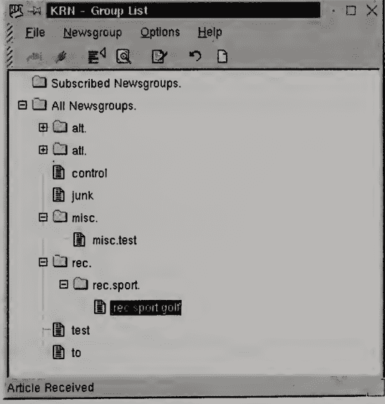

图 9-4 使用 News 的线程化展示阅读 USENET 组非常简单

# 使用 News 发布新闻

对于许多人来说，仅仅阅读各种 USENET 新闻组中的帖子就足够了。这种习惯被称为潜水（lurking），那些只读不发的人被称为潜水者（lurkers）。在开始发帖之前潜水一段时间通常是一个好主意，只需理解不同组中对话是如何进行的。然而，如果你想加入特定组的对话，你需要停止潜水并使用 News 的发布功能参与进来。

- 1. 在 News 打开的状态下，点击 `Post New Article`（发布新文章）按钮。

出现图 9-5 所示的 News Composition窗口。（看起来像 Kmail 编写窗口。）

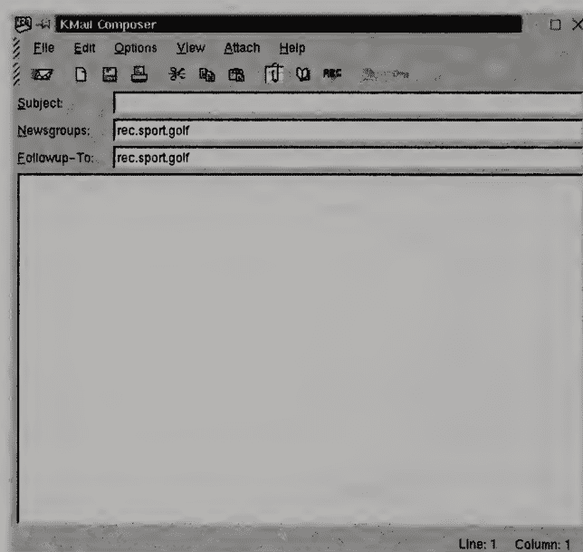

图 9-5 使用 News 发布到新闻组

- 2. 填写 `Subject`（主题）行。

  使用具体且明确的主题，人们可能会阅读它。

- 3. 在输入面板中输入文章正文。

- 4. 完成发布后点击 `Send`（发送）按钮。

News 将你的消息上传到服务器。分发到全球的新服务器。

# 使用 News 回复

就像电子邮件一样，新闻组是一种参与性媒介。线程的产生是因为人们对某条消息做出回应。

- 1. 在窗口中显示你想回复的帖子，点击 `Reply`（回复）按钮。

编写窗口打开，许多字段已填充。你正在回复的文章完整地位于输入面板中。

- 2. 删除你不想处理的文章部分。只修剪你提到的部分是新闻组礼仪。

- 3. 在引用的内容之后添加你的回复。

- 4. 完成发布后点击 `Send`（发送）按钮。

> 提示 如果你倾向于通过电子邮件回复文章，使用相同的步骤，但点击 `Reply Mail` 按钮。

> 警告 虽然 News 允许同时通过电子邮件发送回复并将该回复发布到新闻组，但这通常不是好主意（例如，由于某些原因，发布者的 ISP 没有收到每条消息）。如果你想发布并邮件回复，请确保在消息中提到你这样做了。一句“已发布并邮件回复”就足够了。

# Kvvic 全球群聊

IRC（互联网中继聊天）允许你在任何时间与任意人数聊天，而无需提前计划连接。Kvvic 是一个 IRC 客户端，让你更容易处理在 IRC 上通常令人眼目缭接的聊天事务。

> 提示 如果你以前在 IRC 上聊天过，查看 `http://www.irchel.org` 上的某些帮助文档对你可能会有用。IRC 有它自己的文化，其工作方式或各种频道中的特殊语言可能很难。

- 1. 点击面板上的应用程序启动器图标，并在开始菜单中选择 `Applications`（应用程序）| `Network`（网络）| `Chat Client`（聊天客户端）。

出现 Server Control屏幕。

2. 选择 `Connections`（连接）| `New Server`（新服务器）打开 `Connect To Server`窗口。

3. 点击箭头进入 Next。

4. 从下拉列表中选择一个服务器网络。

> 注意 IRC 服务器并非全互连。相反，它们聚集在几个主网络中，包括 EFnet、DalNet 和 Undernet，以及一些较小且更专业的网络。你可能在多一个网络上找到同一个频道，但它们是两个独立的对话。

- 5. 从 `Server/Quick Connect To`（服务器/快速连接）列表选择一个 IRC 服务器。

  你可以根据名称判断服务器的地理位置。选择一个离你最近的以减少延迟。

## 第9章：在 Corel Linux 中使用互联网

- 6. 点击连接（Connect）按钮。

出现 Kviric 屏幕，文本快速滚动。不要试图一次性读完它们；这些是管理信息，对聊天至关重要。“选择昵称”（Pick A Nick）对话框出现。

- 7. 在“选择昵称”界面中输入你想要使用的昵称。


成千上万的人同时在使用 IRC，你不太可能直接使用自己的名字。继续尝试，直到服务器接受一个昵称。一旦你选择了一个唯一的昵称，你就将连接到服务器。会有更多文本快速闪过；如果你想阅读，可以向上滚动。

- 8. 在输入行中，使用 `/join #channelname` 语法输入你想要加入的频道名称。

在连接之前，先知道你想要加入的频道。任何时候都有成百上千个频道处于开启状态。频道名称始终以井号（`#`）为开头。如果文本再次滚动，说明你已连接到所选频道；请参图 9-6（在下一页）查看 `#linux` 道的示例。查看 Kviric 窗口的右侧面板，查看还有谁加入了该频道。对话填充了窗口的左侧面板。

- 9. 在文本输入框中输入评论并按回车键向频道发送消息。

- 10. 聊天完成后，在文本输入框中输入 `/quit`。

Kviric 屏幕关闭，服务器控制（Server Control）屏幕重新出现。

- 11. 选择文件 |退出（File | Quit）退出 Kviric。

## Corel 在线服务

如果你想尽可能简化你的互联网活动，可以考虑使用 Corel 提供的在线服务。这些基于 Web的服务非常易使用。两个主要服务是电子邮件和个人消息程序，你还会发现新闻和信息资源。

要使用 Corel 在线服务，点击应用程序启动（Application Starter）按钮并从开始菜单选择在线服务（Online Services）。从弹出菜单中选择你喜欢的任何服务；选择后，Netscape 将启动到该服务的首页。可用服务包括

- **商务社区（Business Community）** 为商业用户提供的新闻文章和服务。

- **剪贴和照片（Clip Art and Photos）** 下载数千张剪贴图像，用于文档和网页。

- **Corel 打印服务（Corel Printing Service）** 上传你的设计、艺术、照片或标志，让 Corel 在 T 恤或咖啡杯上打印。

- **Corel VDrive** 注册免费的 VDrive（虚拟驱动器）账户，并在 Corel 服务器上获得 20 兆的免费存储空间。

- **时事（Current Events）** 许多不同主题的感兴趣头条和文章。

- **设计师 F/X（Designer F/X）** 创建和处理图像文件。

- **电子传真（eFax Service）** 允许你创建一个账户，为你设置一个个人电话号码以接收传真。传真将作为电子邮件附件发送给您。高级服务包括免付费传真号码以及通过电子邮件发送和接收传真的能力。

- **电子邮件（E-Mail）** 免费的 Web 电子邮件。

- **图形社区（Graphic Community）** 为图形设计师提供的新闻、下载和服务。

- **JabberIM** 一种与流行的 ICQ 程序类似且与之兼容的即时消息系统。使用此网页注册 JabberIM 账户。注册后，屏幕上会出现一个小小的 Jabber 窗口；输入你的用户名和密码登录。登录 Jabber 后，你就可以与其他 Jabber 用户通信。

如果你有现有的 ICQ 账户（你可以通过 http://www.mirabilis.com 获取，尽管该软件仅兼容 Windows 和 Macintosh），请在 Jabber 账户配置选项中输入你的 ICQ 信息。你将能够使用 JabberIM 与 ICQ 用户通信。

- **Linux 社区（Linux Community）** 为 Corel Linux 提供的新闻、下载和服务。

- **新在线服务（New Online Services）** 使用此网页获取 Corel 提供的最新在线服务。

- **搜索互联网（Search the Internet）** 搜索引擎和 Web 目录。

- **文本 F/X（Text F/X）** 使用各种字体、大小、颜色和效果创建可下载的文本效果。

## 第三部分

## 运行你的 Corel Linux 系统

## 第10章

## 启动与关机

### Corel Linux OS 启动包：官方指南

当你按下电源按钮时到底发生了什么？以下是事件序列：

- 按下电源按钮后，电流流向电源。

- CPU 进行自我测试以确保其完全运行。

- BIOS 初始化并检查 RAM 是否有问题。BIOS（基本输入输出系统）是主板的一个功能。它是计算机上最低级别的可配置软件，向操作系统提供有关计算机中安装的各种设备的信息。在 BIOS 初始化并测试 RAM 后，它触发剩余的。

CPU 运行位于驱动器特殊引导扇区（如果你选择不从硬盘启动，则位于其他位置）的程序。在 Linux 中，该程序被称为 `LILO`；我们稍后会详细介绍。引导扇区是物理驱动器第一个磁道的第一个扇区，计算机在所在处查找决定操作系统将如何启动的程序。

`LILO` 将内核加载到系统内存中。内核是你操作系统的核心；它是计算机用于管理自身的代码。通过将内核加载到 RAM，操作系统确保在任何需要时都能立即访问内核代码。

内核加载到 RAM 后，它会调用 `init` 进程。

`init` 进程控制你计算机的配置并初始化系统以便使用。描述 `init` 的 UNIX 文档将其称为“所有进程的父进程”，因为它创建了所有命令运行的环境。

`init` 读取 `/etc/initt` 文件并确定要使用的默认运行级别（runlevel）。运行级别基本上是一个快捷方式；每个运行级别包含一组操作。当你启动计算机时，你选择的运行级别决定了启动哪些程序。它还提供了一种安全功能；如果你必须手动启动所有这些进程，可能会忘记一两个。使用运行级别，它是自动的，所以你不会忘记启动某些东西。在七个运行级别中，有两个启动时不使用。Core Linux 默认设置为运行级别 2。

一旦确定了运行级别，`init` 将运行 `/etc/rcX.d` 中的所有脚本，其中 X 是运行级别的数字。在 Core Linux 的默认安装中，启动脚本位于 `/etc/rc5.d`。每个条目

`/etc/rcXd` 是指向 `/etc/init.d` 中对应脚本的符号链接，这些脚本中的每一个都会启动一个特定的程序或服务。启动过程的大部分工作涉及运行这些脚本。在启动过程中，当启动的服务列表在屏幕上滚动时，你可以看到脚本的工作。Corel Linux 默认安装包含在 `/etc/init.d` 中的脚本描述如表 10-1 所示。然而，所有脚本都将在你的特定机器上启动。Corel 包含了一组标准脚本，以涵盖大多数可能的配置。

- 当所有服务都启动后，会出现 Corel 登录界面，系统即可就绪使用。

与你计算机的几乎每个其他功能一样，如果你有更多的系统内存，启动过程会快得多。由于内核运行在内存中，计算机上安装的 RAM 意味着内核有更大的操作空间，这意味着处理速度更快。处理器速度也是快速启动的要素之一，但添加 RAM 比升级芯片既便宜又简便。

## 示例 init 脚本

现在我们已经描述了启动过程，并解释了 Core Linux 如何使用 init 脚本来启动维持计算机运行的各种进程，你可能好奇其中一个脚本看起来是什么样的。在本节中，我们为你展示了一个基础脚本并对脚本的每个部分进行了解释。如果你对脚本感兴趣，请阅读第 17 章“扩展 Shell：基础脚本”。

我们选择作为示例的脚本是 `xfs` 脚本，它用于启动和停止 X 字体服务器。该脚本告诉 X Window 系统如何处理各种字体的请求。在下，首先显示脚本，随后是描述。

```
#!/bin/sh
```

这一行是一个字面上的命令。它告诉计算机该脚本应该由 `sh` shell 命令行解释器执行。所有脚本都必须有这样一行，它告诉计算机使用哪个 shell 来执行后续的各种命令；正如第 17 章所述，你可以使用不同的 shell 环境来执行给定的脚本。

```
# /etc/init.d/xfs: start or stop the X font server
```

# 第 10 章：启动与关闭

| 脚本名称 | 脚本功能 |
|---|---|
| README | 指示文件 |
| Xserver_setnormalmode | 以普通模式启动 X 服务 |
| Xserver_setsafemode | 以安全模式启动 X 服务 |
| apache | Web 服务器 |
| apmd | 电源管理守护进程——主要用于笔记本电脑 |
| autofs | 启动文件系统自动挂载器 |
| bootmisc.sh | 杂项启动函数 |
| checkfs.sh | 对 / 外的所有磁盘分区运行 fsck |
| checkroot.sh | 在...运行 fsck |
| cron | 允许执行定时或循环进程 |
| detector | 当添加新网络设备时更新 /etc/modules 文件 |
| dhcpcd | 从 DHCP 服务器获取 IP 号 |
| dsplashFX | 启动时的启动屏特效 |
| exim | 邮件传输代理 |
| halt | 进程停止器 |
| hostname.sh | 设置机器主机名 |
| hwclock.sh | 设置并调整硬件 (CMOS) 时钟 |
| isapnp | 配置 ISA 即插用设备 |


## 表 10-1 Corel Linux 脚本

| 脚本名称 | 脚本功能 |
|---|---|
| `kerneld` | 内核守护进程——动态加载内核模块 |
| `keymaps.sh` | 配置键盘 |
| `logout` | 在指定时间后注销用户 |
| `lprng` | 打印机守护进程（打印池） |
| `mdutils` | 启用或禁用“多设备”（指 RAID 类型的冗余设备） |
| `modutils` | 在启动时加载相应的内核模块 |
| `mountall.sh` | 挂载所有本地文件系统 |
| `mountfs.sh` | 挂载所有网络文件系统 |
| `netbase` | 启动/停止各种网络功能 |
| `netstd_init` | 更多网络功能 |
| `netstd_misc` | 更多网络功能 |
| `netswitch` | 判断网络是静态还是动态 IP |
| `network` | 设置环境变量并引入设备 |

## 10-1 Corel Linux 脚本（续）

| 脚本名称 | 脚本功能 |
|---|---|
| `nvboot` | 崩溃后恢复 vi 会话 |
| `pcmcia` | 加载 PCMCIA 卡（主要用于笔记本电脑） |
| `pcmcia.dpkg-dist` | `pcmcia` 的另一个版本 |
| `ppp` | 启动点点（拨号）网络 |
| `proftp` | 启动 FTP 服务器 |
| `rc` | 级别改变时启动/停止 |
| `rcS` | 确定哪个级别运行哪个脚本 |
| `reboot` | 执行重启命令 |
| `rmnlogin` | 启动过程完成后允许登录 |
| `samba` | Linux/Windows 文件共享守护进程 |
| `sendsigs` | 向所有进程发送 KILL 信号（关闭期间） |
| `single` | 配置级别 1（单用户模式） |
| `skeleton` | 模板 init 脚本——编写新脚本的示例 |
| `syslogd` | 启动系统和内核日志功能 |
| `umountfs` | 卸载所有文件系统（即关闭时） |
| `unloadFX` | 更多 Core 特效 |
| `urandom` | 在重启之间保存“随机种子”（随机数生成器所需） |
| `xdm` | 启动/停止 X 显示管理器 |
| `xfs` | 启动/停止 X 字体服务器 |

这一行是一个字面上的命令。它告诉计算机该脚本应该由 `sh` shell 命令行解释器执行。所有脚本都必须有这样一行，它告诉计算机使用哪个 shell 来执行后续的各种命令；正如第 17 章所述，你可以使用不同的 shell 环境来执行给定的脚本。

```
#!/bin/sh
```

这一行是一个字面上的命令。它告诉计算机该脚本应该由 `sh` shell 命令行解释器执行。所有脚本都必须有这样一行，它告诉计算机使用哪个 shell 来执行后续的各种命令；正如第 17 章所述，你可以使用不同的 shell 环境来执行给定的脚本。

```
# /etc/init.d/xfs: start or stop the X font server
```

这一行是一个字面上的命令。它告诉计算机该脚本应该由 `sh` shell 命令行解释器执行。所有脚本都必须有这样一行，它告诉计算机使用哪个 shell 来执行后续的各种命令；正如第 17 章所述，你可以使用不同的 shell 环境来执行给定的脚本。

```
# /etc/init.d/xfs: start or stop the X font server
```

这一行是一个字面上的命令。它告诉计算机该脚本应该由 `sh` shell 命令行解释器执行。所有脚本都必须有这样一行，它告诉计算机使用哪个 shell 来执行后续的各种命令；正如第 17 章所述，你可以使用不同的 shell 环境来执行给定的脚本。

```
# /etc/init.d/xfs: start or stop the X font server
```

这一行是一个字面上的命令。它告诉计算机该脚本应该由 `sh` shell 命令行解释器执行。所有脚本都必须有这样一行，它告诉计算机使用哪个 shell 来执行后续的各种命令；正如第 17 章所述，你可以使用不同的 shell 环境来执行给定的脚本。

```
# /etc/init.d/xfs: start or stop the X font server
```

这一行是一个字面上的命令。它告诉计算机该脚本应该由 `sh` shell 命令行解释器执行。所有脚本都必须有这样一行，它告诉计算机使用哪个 shell 来执行后续的各种命令；正如第 17 章所述，你可以使用不同的 shell 环境来执行给定的脚本。

```
# /etc/init.d/xfs: start or stop the X font server
```

这一行是一个字面上的命令。它告诉计算机该脚本应该由 `sh` shell 命令行解释器执行。所有脚本都必须有这样一行，它告诉计算机使用哪个 shell 来执行后续的各种命令；正如第 17 章所述，你可以使用不同的 shell 环境来执行给定的脚本。

```
# /etc/init.d/xfs: start or stop the X font server
```

这一行是一个字面上的命令。它告诉计算机该脚本应该由 `sh` shell 命令行解释器执行。所有脚本都必须有这样一行，它告诉计算机使用哪个 shell 来执行后续的各种命令；正如第 17 章所述，你可以使用不同的 shell 环境来执行给定的脚本。

```
# /etc/init.d/xfs: start or stop the X font server
```

这一行是一个字面上的命令。它告诉计算机该脚本应该由 `sh` shell 命令行解释器执行。所有脚本都必须有这样一行，它告诉计算机使用哪个 shell 来执行后续的各种命令；正如第 17 章所述，你可以使用不同的 shell 环境来执行给定的脚本。

```
# /etc/init.d/xfs: start or stop the X font server
```

这一行是一个字面上的命令。它告诉计算机该脚本应该由 `sh` shell 命令行解释器执行。所有脚本都必须有这样一行，它告诉计算机使用哪个 shell 来执行后续的各种命令；正如第 17 章所述，你可以使用不同的 shell 环境来执行给定的脚本。

```
# /etc/init.d/xfs: start or stop the X font server
```

这一行是一个字面上的命令。它告诉计算机该脚本应该由 `sh` shell 命令行解释器执行。所有脚本都必须有这样一行，它告诉计算机使用哪个 shell 来执行后续的各种命令；正如第 17 章所述，你可以使用不同的 shell 环境来执行给定的脚本。

```
# /etc/init.d/xfs: start or stop the X font server
```

这一行是一个字面上的命令。它告诉计算机该脚本应该由 `sh` shell 命令行解释器执行。所有脚本都必须有这样一行，它告诉计算机使用哪个 shell 来执行后续的各种命令；正如第 17 章所述，你可以使用不同的 shell 环境来执行给定的脚本。

```
#!/bin/sh
```

这一行是一个字面上的命令。它告诉计算机该脚本应该由 `sh` shell 命令行解释器执行。所有脚本都必须有这样一行，它告诉计算机使用哪个 shell 来执行后续的各种命令；正如第 17 章所述，你可以使用不同的 shell 环境来执行给定的脚本。

```
#!/bin/sh
```

这一行是一个字面上的命令。它告诉计算机该脚本应该由 `sh` shell 命令行解释器执行。所有脚本都必须有这样一行，它告诉计算机使用哪个 shell 来执行后续的各种命令；正如第 17 章所述，你可以使用不同的 shell 环境来执行给定的脚本。

```
#!/bin/sh
```

这一行是一个字面上的命令。它告诉计算机该脚本应该由 `sh` shell 命令行解释器执行。所有脚本都必须有这样一行，它告诉计算机使用哪个 shell 来执行后续的各种命令；正如第 17 章所述，你可以使用不同的 shell 环境来执行给定的脚本。

```
#!/bin/sh
```

这一行是一个字面上的命令。它告诉计算机该脚本应该由 `sh` shell 命令行解释器执行。所有脚本都必须有这样一行，它告诉计算机使用哪个 shell 来执行后续的各种命令；正如第 17 章所述，你可以使用不同的 shell 环境来执行给定的脚本。

```
#!/bin/sh
```


这一行是一个字面上的命令。它告诉计算机该脚本应该由 `sh` shell 命令行解释器执行。所有脚本都必须有这样一行，它告诉计算机使用哪个 shell 来执行后续的各种命令；正如第 17 章所述，你可以使用不同的 shell 环境来执行给定的脚本。

```
/etc/init.d/xfs: start or stop the X font server
```

这一行是一个字面上的命令。它告诉计算机该脚本应该由 `sh` shell 命令行解释器执行。所有脚本都必须有这样一行，它告诉计算机使用哪个 shell 来执行后续的各种命令；正如第 17 章所述，你可以使用不同的 shell 环境来执行给定的脚本。

```
/etc/init.d/xfs: start or stop the X font server
```

# 第 10 章：启动与关闭

| 脚本名称 | 脚本功能 |
|---|---|
| README | 指示文件 |
| Xserver_setnormalmode | 以普通模式启动 X 服务 |
| Xserver_setsafemode | 以安全模式启动 X 服务 |
| apache | Web 服务器 |
| apmd | 电源管理守护进程——主要用于笔记本电脑 |
| autofs | 启动文件系统自动挂载器 |
| bootmisc.sh | 杂项启动函数 |
| checkfs.sh | 对 / 外的所有磁盘分区运行 fsck |
| checkroot.sh | 运行 fsck |
| cron | 允许执行定时或循环进程 |
| detector | 当添加新网络设备时更新 `/etc/modules` 文件 |
| dhcpcd | 从 DHCP 服务器获取 IP 号 |
| dsplashFX | 启动时的启动屏特效 |
| exim | 邮件传输代理 |
| halt | 进程停止器 |
| hostname.sh | 设置机器主机名 |
| hwclock.sh | 设置并调整硬件 (CMOS) 时钟 |
| isapnp | 配置 ISA 即插用设备 |
| kerneld | 内核守护进程——动态加载内核模块 |
| keymaps.sh | 配置键盘 |
| logout | 在指定时间后注销用户 |
| lprng | 打印机守护进程（打印池） |
| mdutils | 启用或禁用“多设备”（指 RAID 类型的冗余设备） |
| modutils | 在启动时加载相应的内核模块 |
| mountall.sh | 挂载所有本地文件系统 |
| mountfs.sh | 挂载所有网络文件系统 |
| netbase | 启动/停止各种网络功能 |
| netstd_init | 更多网络功能 |
| netstd_misc | 更多网络功能 |
| netswitch | 判断网络是静态还是动态 IP |
| network | 设置环境变量并引入设备 |

表 10-1 Corel Linux 脚本

| 脚本名称 | 脚本功能 |
|---|---|
| nvboot | 崩溃后恢复 vi 会话 |
| pcmcia | 加载 PCMCIA 卡（主要用于笔记本电脑） |
| pcmcia.dpkg-dist | pcmcia 的另一个版本 |
| ppp | 启动点点（拨号）网络 |
| proftp | 启动 FTP 服务器 |
| rc | 级别改变时启动/停止 |
| rcS | 确定哪个级别运行哪个脚本 |
| reboot | 执行重启命令 |
| rmnlogin | 启动过程完成后允许登录 |
| samba | Linux/Windows 文件共享守护进程 |
| sendsigs | 向所有进程发送 KILL 信号（关闭期间） |
| single | 配置级别 1（单用户模式） |
| skeleton | 模板 init 脚本——编写新脚本的示例 |
| syslogd | 启动系统和内核日志功能 |
| umountfs | 卸载所有文件系统（即关闭时） |
| unloadFX | 更多 Core 特效 |
| urandom | 在重启之间保存“随机种子”（随机数生成器所需） |
| xdm | 启动/停止 X 显示管理器 |
| xfs | 启动/停止 X 字体服务器 |

## 示例 init 脚本

| 脚本名称 | 脚本功能 |
|---|---|
| README | 指示文件 |
| Xserver_setnormalmode | 以普通模式启动 X 服务 |
| Xserver_setsafemode | 以安全模式启动 X 服务 |
| apache | Web 服务器 |
| apmd | 电源管理守护进程——主要用于笔记本电脑 |
| autofs | 启动文件系统自动挂载器 |
| bootmisc.sh | 杂项启动函数 |
| checkfs.sh | 对 / 外的所有磁盘分区运行 fsck |
| checkroot.sh | 运行 fsck |
| cron | 允许执行定时或循环进程 |
| detector | 当添加新网络设备时更新 `/etc/modules` 文件 |
| dhcpcd | 从 DHCP 服务器获取 IP 号 |
| dsplashFX | 启动时的启动屏特效 |
| exim | 邮件传输代理 |
| halt | 进程停止器 |
| hostname.sh | 设置机器主机名 |
| hwclock.sh | 设置并调整硬件 (CMOS) 时钟 |
| isapnp | 配置 ISA 即插用设备 |
| kerneld | 内核守护进程——动态加载内核模块 |
| keymaps.sh | 配置键盘 |
| logout | 在指定时间后注销用户 |
| lprng | 打印机守护进程（打印池） |
| mdutils | 启用或禁用“多设备”（指 RAID 类型的冗余设备） |
| modutils | 在启动时加载相应的内核模块 |
| mountall.sh | 挂载所有本地文件系统 |
| mountfs.sh | 挂载所有网络文件系统 |
| netbase | 启动/停止各种网络功能 |
| netstd_init | 更多网络功能 |
| netstd_misc | 更多网络功能 |
| netswitch | 判断网络是静态还是动态 IP |
| network | 设置环境变量并引入设备 |

表 10-1 Corel Linux 脚本

| 脚本名称 | 脚本功能 |
|---|---|
| nvboot | 崩溃后恢复 vi 会话 |
| pcmcia | 加载 PCMCIA 卡（主要用于笔记本电脑） |
| pcmcia.dpkg-dist | pcmcia 的另一个版本 |
| ppp | 启动点点（拨号）网络 |
| proftp | 启动 FTP 服务器 |
| rc | 级别改变时启动/停止 |
| rcS | 确定哪个级别运行哪个脚本 |
| reboot | 执行重启命令 |
| rmnlogin | 启动过程完成后允许登录 |
| samba | Linux/Windows 文件共享守护进程 |
| sendsigs | 向所有进程发送 KILL 信号（关闭期间） |
| single | 配置级别 1（单用户模式） |
| skeleton | 模板 init 脚本——编写新脚本的示例 |
| syslogd | 启动系统和内核日志功能 |
| umountfs | 卸载所有文件系统（即关闭时） |
| unloadFX | 更多 Core 特效 |
| urandom | 在重启之间保存“随机种子”（随机数生成器所需） |
| xdm | 启动/停止 X 显示管理器 |
| xfs | 启动/停止 X 字体服务器 |

区别是因为你没有使用 NFS。如果你位于网络，此运行级别将导致你的机器表现得像一台独立机器，且没有任何可用的网络服务。这是 Core Linux 使用的默认运行级别。

- **运行级别 3**：此级别以多用户模式启动计算机，但不会启动 X Window 系统。因此，你可以在机器的文本模式下操作一切内容。如果你需要任何图形化界面，你需要手动启动 X Window 系统（或切换到运行级别 5）。

- **运行级别 4**：未用于任何用途。

- **运行级别 5**：与运行级别 2 和 3 类似，此级别以多用户模式启动。然而，在运行级别 5 下，X Window 系统会自动启动，你需要使用 KDE 来进入文本界面。如果你使用 KDE 启动，使用的就是这种模式。

- **运行级别 6**：最后一个级别。此级别是“重启”：与运行级别 0一样，调用它会导致所有正在运行的程序关闭；与运行级别 0 不同的是，程序停止后，Linux 会重启。与运行级别 1 一样，你不希望将此运行级别设置为启动过程的一部分；如果你这样做，Core Linux 将陷入无限循环重启。

## 关闭 Core Linux


在 Linux 中，关闭计算机是一件罕见的事。许多人已经养成了在使用后关闭电源的习惯，特别是在办公环境中，规定晚上下班前要关闭所有机器。然而，这并不是人类需要的问题。你的计算机，无论使用什么操作系统，都不需要每天关闭（或一天多次关闭）。让电脑开启会消耗电力，显示器在闲置一段时间后可以自动关闭。在我们编写本章时，我们的一台机器运行时间已超过了一年。

你需要关闭机器的唯一理由是添加新硬件或升级内核。你可能还会遇到本章后面“停电和其他意外危机”中描述的电涌击风险，这会迫使你的系统在未正常工作的情况下关闭，但这与仅仅为了关闭而进行的刻意关机不同。

# 第 10 章：启动与关闭

如果你打算离开家里一天或两天，我们建议你为了安全起见关闭计算机。我们的政策是，如果我们需要因为任何超过三天周末假期的原因而关机，就需要关机。当你想要关闭计算机时，需要使用关程序。不要直接断电——这对你的文件系统可能是毁灭性的。Linux 需要通过关机程序来关闭启动期间启动的所有进程。

要关闭 Core Linux，请注销 KDE 回登录界面，并在登录窗口顶部的选项中选择“关机”。你也可以以 root 登录，或使用文件管理器功能访问 root 账户，并在命令行提示符输入命令 `shutdown -h now`。

当发布关闭命令时，计算机开始反转启动过程。通过 `/etc/init.d` 启动的程序将被关闭，文件系统将被卸载。一旦关机过程停止，即可安全关闭电源。

## 使用启动盘启动计算机

在第二章“安装 Core Linux”中，我们描述了制作启动盘的过程。如果你在安装操作系统时没有制作启动盘，我们强烈建议你现在制作一个。这是一份很好的保险；像大多数保险一样，它现在看起来可能是一个没用的麻烦，但如果你需要它却从没抽心去创建它，那可就不那么乐观了。你可能出于两个原因使用启动盘：你不想将 LILO 放在放在硬盘的引导扇区（也许你可能在不同的硬盘分区上安装了两个操作系统），或者你在紧急情况下使用它，因为出现了一些问题导致 Linux 无法正常启动。

启动盘包含一个极小版本的 Linux 内核，允许你启动机器。你不会从磁盘上运行完整的操作系统；你只是用它来达到可以运行计算机上已安装的操作系统的程度。以下是使用启动盘的方法（（假设计算机已关机）：

1. 将启动盘完全插入软驱器。
2. 开启计算机电源。
3. 计算机应该开始从软盘启动。

> 注意
>
> 如果计算机没有从软盘启动，你将必须打开计算机的 BIOS 设置菜单，并将软驱器设置为第一个启动设备（即在启动过程中第一个启动的设备）。不同的 CPU 和 BIOS 对应的此过程各不相同，因此我们无法提供关于打开 BIOS 的具体说明。请检查你计算机的文档。一旦你将软驱器设置为第一个启动设备，请在启动盘完全插入软驱器的情况下关机并重启。启动过程现在应该会进行。

## 停电和其他意外危机

如你所知，关闭计算机永远不是一个好主意。当你的计算机运行时——无论使用什么操作系统——系统文件都是打开状态，并且各种进程都在后台运行。仅仅因为你不在任务栏或系统托盘中看到它们，并不意味着它们不重要。停电可能会造成破坏，特别是当停电足够长时。避免这些问题的唯一方法无疑是使用不间断电源，或 UPS。UPS 插在墙插座上，它包含一个大电池，可以在交流电停止后让你的计算机运行预设的时间。这段时间的长度取决于你购买的 UPS 型号，从五分钟到二十分钟不等。

我们知道两个 UPS 制造商，APC 和 Best Power，它们为自己的设备提供了兼容 Linux 的软件。这些软件可以配置为：UPS 在激活时在电量耗尽之前向计算机发送信号；这样计算机就可以干净地关闭。你可以在美国和加拿大的电脑商店找到 APC 型；Best Power 型较难找到，但仍然相对容易找到。我们使用 APC Back-UPS 500，没有出现过任何问题。

虽然闪电并不总是会导致完全停电，但它绝不是计算机的朋友。闪电活动经常引起电压波动并导致损坏。再次，使用 UPS 可以减少电涌引起损坏的风险。UPS 设备始终输出恒定电压，它可以在波动电压从插座到达你的计算机之前进行缓冲。如果你不想使用 UPS，至少应该使用防浪涌和电压尖峰保护器。带有防浪涌和尖峰保护功能的电源插板随处可见。虽然如果浪涌或瞬间断电足够长，它们无法阻止计算机关闭，但它们可以

### 146 Corel Linux 操作系统入门教程：官方指南

防止可能干扰你机器的家用电流微小波动。雷击还带来了另一个危险：它们可能让你的调制调器变成一块毫无用的塑料。在夏季，我们已经损失了好几台被雷击损坏的调制调器。问题源于电话线路中的电压浪涌，可能是由远处的雷击引起的。我们建议你使用小型电话线浪涌保护器，它插入电话插座即可；许多带有浪涌保护的电源插以及 UPS 设备也内置了线路电压调节器。

你如何知道自己是否丢失了调制调器呢？你通常会在拿起普通电话时听到大量的杂音，或者普通电话的铃声微弱且断断续续。不要假设是你的电话有问题；拔掉所有调制调器并再次测试电话。如果你给电话公司打电话，预计他们会询问电话线上是否连接了任何调制调器；我们的电话公司表示，这是在强雷雨天气几天后接到报修电话的主要原因。

如果你没有保护措施，应对雷电的最佳方法是完全避开。当发现附近出现雷风暴的第一迹象时，请从墙上拔掉调制调器线路并关闭电脑。你甚至可能想把它拔掉。雷击可以产生数兆瓦特的电压，如果强度足够大，可能会使保护设备失效。我们住在东南部一个易发生闪电的地区，当恶风暴来袭时，我们会关闭并拔掉所有电子设备的插头。

## 系统锁定时

Linux 是一个极其稳定的操作系统。操作系统本身几乎不会“冻结”，即不会锁死到无法接受任何输入。这种稳定性是我们之前描述的长时间运行时间的原因之一。然而，你安装和使用的各种应用程序可能没有那么稳定，特别是当你使用 Beta 版本（可能尚未完全完成的预发布版本）时。即使是 KDE 这样的程序也可能崩溃。当这种情况发生时，看起来你的 Linux 机器崩溃了；最好的办法是识别出故障的程序并将其关闭。

### 第 10 章：启动与关机

### 167

#### 应用程序崩溃

如果某个应用程序崩溃，你仍然可以使用其他应用程序；键盘和鼠标应该仍正常工作。在这种情况下，使用进程管理器（Process Manager）来关闭故障应用程序。

1. 点击 KDE 面板上的应用程序管理器图标，从启动菜单中选择 应用程序 | 系统 | 进程管理（Applications | System | Process Management）打开进程管理器。
2. 查看进程管理器窗口底部面板的进程列表，找到没有响应的那个。
3. 点击该进程进行选中。
4. 从下拉菜单中选择 信号 | 杀死（Signal | Kill）以终止该进程。

> 注意：运行在你计算机上的每一每项操作都分配有一个进程号。某些进程是常驻的，如 KDE，而另一些是临时的。

#### KDE 崩溃

如果 KDE 本身锁定，处理过程会有所不同，你必须通过文本提示符操作。你通常可以使用 `CTRL-ALT-BACKSPACE` 键组合来杀死无响应的 KDE。KDE 将退出并重启，将你带回登录提示界面。

如果不起作用，按下 `CTRL-ALT-F1`。这会将屏幕切换到文本模式登录。以 root 身份登录并执行命令 `init 1`。这会关闭所有功能并将 Linux 进入单用户模式。当进程完成后，输入 `init #`，其中 `#` 是你之前运行的运行级别（可能是 2）。KDE 将重启，你应该能够再次登录并继续你之前正在的工作。

#### Corel Linux 崩溃

在极少数 Linux 实际上发生崩溃的情况下，你唯一真正能做的事情就是：关闭电源并重启电脑。由于我们已经描述的所有原因，虽然这不是最好的做法，但它是你唯一的选择。然而，极大概率是，你永远都不需要这样做。Linux 的稳定性意味着，锁定和冻结可能不是操作系统的错，而是由更接近用户层的进程产生的。

# 第 11 章

# Corel Linux 目录结构


### 170 Corel Linux 操作系统入门教程：官方指南

在 Linux 中，一切皆文件。每个程序、目录和设备——更不用说文本、多媒体——都以文件的形式表示。Linux 目录结构围绕“每个文件都有一个位置”的理念构建，而且这个位置对管理员应该是显而易见的。因此，根目录（root directory）实际上看起来有些空空；如图 11-1 所示。多年年来，形成了一种或多或标准的文件组织方式。我们说“或多或少”，是因为没有系统必须遵循的官方标准；UNIX/Linux 目录结构是共同实践演变来的结果。我们还涉及了环境变量的概念，它们定义了关于你系统的配置设置。

## 目录类型

Linux 目录可以分为两类：管理和用户。管理目录存放操作系统文件、所有用户使用的应用程序、网络信息、设备驱动程序等。用户文件包含每个人的特定配置文件以及用户创建的文件。

> 记住 如果以 root 身份登录，你可以看到所有目录。如果你以用户身份登录，你只能看到自己的目录；你可能可以看到管理目录的内容，但除非登录，否则无法运行这些目录中的任何程序。


在本章中，我们将描述每个主要目录并解释其中存放哪些类型的文件。我们描述的管理目录应该与你安装 Linux 时创建的目录相似。如果你安装了新软件或调整过用户账户，你的用户目录结构可能与此处所示的不同。

# 第 11 章：Corel Linux 目录结构

## 主目录

Linux 目录结构的最顶端是主目录，它包含了文件系统中的所有目录。主目录被称为根目录，因为它位于系统的根部。你可能还会听到它被称为斜杠目录，因为它的路径就是 `/`（单个正斜杠）。结构中的所有其他目录实际上都是该目录的子目录，这就是为什么它们的路径以 `/` 开。

> 不要将 `/` 目录与 `/root` 目录混淆。“根目录”或 `/` 目录与“root 目录”是不同的。当你口头讨论 Linux 目录时，务必明确这一区别。

Linux 目录结构围绕“每个文件都有一个位置”的理念构建，而且这个位置对管理员应该是显而易见的。所以，根目录实际上看起来有些空空；如图 11-1 所示，你可以看到根目录

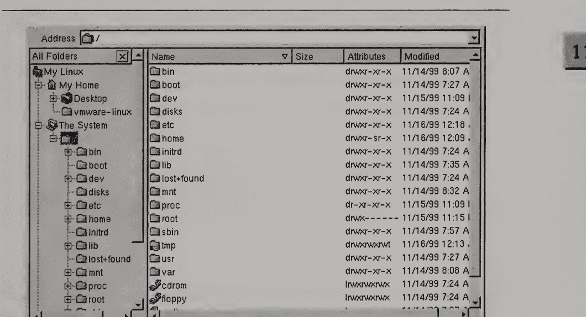

图 11-1 根目录是 Corel Linux 目录结构的基础

# Linux 操作系统入门套件：官方指南

在文件管理器中显示。根目录下的所有内容都是文件夹，这意味着它们是子目录。根目录不存储任何内容，因为每个文件在目录结构的更深处都有更好的存放位置。

## 管理目录

管理目录包含了所有的系统功能、应用程序、设备以及计算机硬件和软件的其他组件。这些目录中的条目数量之多可能会令人生生畏。理解各种管理目录的结构有助于你明确某些文件和程序的位置。对目录布局的通俗理解可以在你需要时快速找到东西。

### `/bin`

最初，`/bin`（binary 的缩写）目录包含操作系统所需的二进制文件。最终，由于二进制文件太多，将每一个都放在 `/bin` 中会变成一片混乱。现在，`/bin` 目录包含了大多数 UNIX 命令以及某些较复杂的程序：

- 基础 UNIX 命令（`cat`, `cp` 等）
- 文件管理工具（`tar`, `gzip`）
- 文本编辑器（`pico`, `vi`, `emacs`）
- Shell（`bash`, `csh`, `tsh` 等）

通常情况下，如果你正在寻找作为操作系统不可缺部分的程序，请首先查看 `/bin`。

### `/usr`

`/usr` 目录最初的功能是包含你可以访问的所有应用程序。与 `/bin` 类似，单一目录的实用性很快就不了，`/usr` 中的各种功能被拆分为几个子目录。图 11-2 显示了文件管理器中的 `/usr` 目录（`/sbin` 目录将在后面讨论，而不是在 `/usr` 章节中）。

| 地址 /usr | 名称 | 大小 | 属性 | 修改时间 |
|---|---|---|---|---|
| 所有文件夹 | bin | | drwxr-xr-x 11/14/99 | 上午 8:12 |
| | dict | | drwxr-xr-x 11/14/99 | 上午 7:27 |
| | doc | | drwxr-xr-x 11/14/99 | 上午 8:12 |
| | games | | drwxr-xr-x 11/14/99 | 上午 5:57 |
| | include | | drwxr-xr-x 11/14/99 | 上午 5:57 |
| | info | | drwxr-xr-x 11/14/99 | 上午 6:06 |
| | lib | | drwxr-xr-x 11/14/99 | 上午 4:40 |
| | local | | drwxr-xr-x 11/14/99 | 上午 7:27 |
| | man | | drwxr-xr-x 11/14/99 | 上午 7:30 |
| | sbin | | drwxr-xr-x 11/14/99 | 上午 5:58 |
| | src | | drwxr-xr-x 11/14/99 | 上午 8:00 |
| | X11R | | drws-sr-x 11/14/99 | 上午 4:40 |

> 图 11-2 `/usr` 目录包含了与系统用户相关的程序和文件。

#### `/usr/bin`

该子目录包含大量用户可访问的软件。它是网络共享软件的默认位置，也是无论特定操作系统如何，在任何 UNIX 或 Linux 系统上都能找到常用程序。

#### `/usr/local/bin`

`/usr/local/bin` 包含了网络共享软件，而 `/usr/local/bin` 是大多数特定于此机器的软件。并不是说 `/usr/local/bin` 中的程序或软件不能被连接到网络的机器使用，而是这些程序旨在用于“本地”。

#### `/usr/bin/X11`

该目录包含了大多数图形程序。在 Corel Linux 系统，此目录持有各种 KDE 程序。

#### `/usr/X11R6`

该目录与 `/usr/bin/X11` 相关，也包含图形软件。虽然这两个目录之间没有明确的区别，但 `/usr/X11R6` 中的文件通常是面向系统的，而 `/usr/bin/X11` 中的文件面向面向用户的。

#### `/usr/doc`

该目录包含系统文档，包括 FAQ（常见问题）、HOWTO 文件以及关于系统中各种程序和软件的其他杂项文档。

#### `/usr/man`

与 `/usr/doc` 类似，该目录包含文档文件。然而，`/usr/man` 仅包含 man 页（帮助页），即程序员为了辅助程序而编写的帮助文档。man 页的内容范围从极其有用到晦涩难懂。

> 提示 你可以在文本提示符处输入 `man <程序名>` 来读取程序的 man 页。例如，要读取 adduser 的 man 页，请输入 `man adduser`。输入 `man man` 读取 man 的 man 页。

#### `/usr/share`

该目录包含需要共享的文件，无论是由多个用户还是多个程序。例如，字体定义文件保存在 `/usr/share` 中，然后供不同的应用程序使用。

#### `/usr/lib`

该目录包含共享库。库是程序员直接使用的函数集合。程序员不是将其包含（include），而是创建一个指向特定库的引用。这节省了时间和精力。如果程序运行需要某个库，文档通常会提到这一点，或者该库将与程序代码一起打包。

#### `/usr/src`

最后，此目录包含各种程序的源代码。最重要的是 Corel Linux 内核的源代码位于 `/usr/` 下。

### `/etc`

另一个重要目录 `/etc` 包含了系统级文件。第 10 章“启动与关机”描述了 `/etc/init.d` 目录中的文件，这些是该目录程序的示例。通常情况下，任何需要为整个系统配置的程序都会放在 `/etc`。此类文件（并不总是）以 `.conf`、`.cfg` 或 `.rc` 结尾。例如，`/etc/syslog.conf` 控制程序处理操作系统生成的日志。

### `/var`

`/var` 是一个大小变化的文件仓库；文件名保持不变，但内容随计算机运行而变化。空文件（spool files）保存在 `/var` 中；如 `/var/mail` 的邮件、新闻队列和打印队列都在这里。见图 11-4 文件管理器中的 `/var` 目录。

| 地址 /var | 名称 | 大小 | 属性 | 修改时间 |
|---|---|---|---|---|
| 所有文件夹 | backups | | drwxr-xr-x 11/14/99 | 上午 7:27 |
| | cache | | drwxr-xr-x 11/14/99 | 上午 4:45 |
| | calman | | drwxr-sr-x 11/14/99 | 上午 6:08 |
| | db | | drwxr-xr-x 11/14/99 | 上午 7:27 |
| | dev | | drwxr-xr-x 11/14/99 | 上午 7:27 |
| | disks | | drwxr-xr-x 11/14/99 | 上午 7:27 |
| | etc | | drwxr-xr-x 11/14/99 | 上午 7:27 |
| | home | | drwxr-xr-x 11/14/99 | 上午 11:11 |
| | mtrid | | drwxr-xr-x 11/14/99 | 上午 8:32 |
| | lib | | drwxr-xr-x 11/14/99 | 上午 11:10 |
| | lock | | drwxr-xr-x 11/14/99 | 上午 11:10 |
| | run | | drwxr-xr-x 11/14/99 | 上午 8:08 |
| | samba | | drwxr-xr-x 11/14/99 | 上午 11:10 |
| | spool | | drwxr-xr-x 11/14/99 | 上午 7:58 |
| | state | | drwxr-xr-x 11/14/99 | 上午 12:14 |
| | tmp | | drwxr-xr-x 11/14/99 | 上午 10:10 |
| | bin | | | |
| | ser | | | |
| | var | | | |


# Corel Linux 操作系统入门指南：官方指南

## 第 11 章：Corel Linux 目录结构

| | Windows Network | | | |

| | NFS Network | | | |

> 图 11-4 `/var` 目录持有内容不断变化的文件

一些系统日志和其他大小变化或临时文件也保存在这里。例如，`/var/lock` 子目录包含锁文件，告诉操作系统某些系统资源正在使用。如果计算机看到 `/var/lock/modem` 文件，它知道有人正在使用调制调器，不允许其他程序访问调制调器。当进程结束，锁文件就会消失。

作为你 Corel 系统的管理员，你应该特别注意 `/var/log` 目录。操作系统使用此存放自动生成的日志文件，描述系统状态、系统问题和其他持续消息。`/var/log` 的内容如图 11-5 所示，每个日志都是简单的文本文件，可以使用普通的文本编辑器查看。

注意 Corel Linux 使用 `/var/log` 来提供重要的系统消息。

| 地址 /var/log | 名称 | 大小 | 属性 | 修改时间 |
|---|---|---|---|---|
| 所有文件夹 | auth.log | 0KB | -rw-r-------- 11/14/99 | 上午 7:27 |
| | Corel.netserv.log | 2KB | -rw-r-------- 11/16/99 | 上午 5:14 |
| | samba | faillog | 24KB | -rw-r-------- 11/18/99 | 凌晨 12:06 |
| | root | daemon | | drwxr-xr-x 11/14/99 | 上午 8:13 |
| | sbin | exax | | drwx---- 5/1/98 | 下午 5:34 |
| | tmp | exim | | drwxr-xr-x 11/14/99 | 上午 8:08 |
| | usr | kern | | drwxr-xr-x 11/14/99 | 上午 8:13 |
| | var | mail | | drwxr-xr-x 11/14/99 | 上午 7:27 |

> 图 11-5 Corel Linux 使用 `/var/log` 来给你提供重要的系统消息

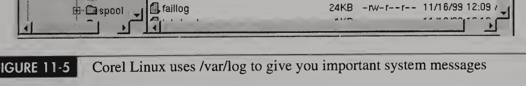

### /mnt

该目录作为一个通用的挂载点。它包含了电脑上安装的特定文件系统设备的子目录：根据你的系统配置，你可能会有软驱器、光驱器、Zip 或 Jaz 驱动器或其他存储设备的子目录。在图 11-10 中，你可以看到一台仅安装了软驱和光驱的机器的 `/mnt`。请注意，并不严格要求使用 `/mnt` 作为挂载点；任何空目录都可以。

| 所有文件夹 | 名称 | 大小 | 属性 | 修改时间 |
|---|---|---|---|--|
| boot0300 | 1KB | -rw-r--r-- | 11/14/99 7:27 |
| | boot0301 | 1KB | -rw-r--r-- | 11/14/99 7:27 |
| | boot.b | 5KB | -rw-r--r-- | 11/14/99 7:27 |
| | boot.preserved | 5KB | -rw-r--r-- | 11/14/99 7:27 |
| | cbootd.b | 1KB | -rw-r--r-- | 11/14/99 7:27 |
| | chain.preserved | 1KB | -rw-r--r-- | 11/14/99 7:27 |
| | kernel-config-v2.12_OCT121999 | 14KB | -rw-r--r-- | 11/14/99 7:27 |
| | map | 12KB | -rw-r--r-- | 11/14/99 7:27 |
| | mmap | 9KB | -rw-r--r-- | 11/14/99 7:27 |
| | mterb | 1KB | -rw-r--r-- | 11/14/99 7:27 |
| | os2_d_b.preserved | 1KB | -rw-r--r-- | 11/14/99 7:27 |
| | splash.ilo | 44KB | -rw-r--r-- | 11/14/99 7:27 |
| | System.map | 254KB | -rw-r--r-- | 11/14/99 7:27 |
| | vmlinux-2.2.12 | 1,008KB | -rw-r--r-- | 11/14/99 7:27 |

**图 11-9** 在 `/boot` 目录中，你会找到 Corel Linux 的核心：内核镜像

| 所有文件夹 | 名称 | 大小 | 属性 | 修改时间 |
|---|---|---|---|--|
| mnt | | drwxr-xr-x | 11/14/99 7:25 AM |
| cdrom | | drwxr-xr-x | 11/14/99 7:25 AM |
| CorelMntDir | | drwxr-xr-x | 11/14/99 8:32 AM |
| floppy | | drwxr-xr-x | 11/14/99 7:25 AM |

**图 11-10** 存储设备的链接保留位于 `/mnt` 目录

### /proc

`/proc` 通常被称为“伪文件系统”，它并不存在于你的硬盘驱动器上。相反，`/proc` 中的文件仅存在于计算机内存中。`/proc` 及其包含的文件目的是包含关于你的计算机以及当前在机器上运行的进程的信息。你的计算机实际上通过 `/proc` 与自身进行通信。

> 如果你想查看 `/proc` 的作用，请打开终端窗口并执行命令 `cat /proc/cpuinfo`。你将看到比你想象中多得关于计算机主处理器的信息。

### /root

这是超级用户的家目录，如图 11-11 所示。它与其他用户目录分开存放，这样如果存放用户目录的磁盘或分区出现问题，不会影响 root 账户。root 账户始终位于 `/` 同一磁盘分区，无论用户目录位于何处。

| 文件夹 | 名称 | 大小 | 属性 | 修改时间 |
|---|---|---|---|---|
| vmware-linux | Desktop | | drwx------ | 11/14/99 8:33 AM |
| The System | vmware-linux-tools | | drwxr-xr-x | 8/26/99 6:04 PM |
| init-scripts | | 1KB | -rw-r--r-- | 11/15/99 10:30 AM |
| vmware-tools-282.tar.gz | | 1,393KB | -rw-r--r-- | 11/14/99 8:27 AM |

### 用户目录

用户目录是每个用户在查看个人账户目录结构时看到的目录。Betty 账户的内容并不一定是 Barney 账户的内容——Betty 可能增加了目录或程序，而 Barney 使用默认结构。对于个人用户所做的更改，账户的基本结构保持不变。

### /home

`/home` 是每个用户会在话开始时登录的目录。例如，当用户 Harry 登录时，他会被放置在 `/home/harry`，如图 11-12 所示。Harry 的所有个人文件（包括个人配置文件）都在此目录或其子目录下。如果 Harry 需要，他可以限制 `/home` 目录的权限，使其只有他自己可以访问。

| 所有文件夹 | 名称 | 大小 | 属性 | 修改时间 |
|---|---|---|---|---|
| linux | ellen | | | drwxr-sr-X- 11/16/99 12:16 AM |
| harry | | | drwxr-sr-X- 11/16/99 12:40 AM |
| jpe | | | drwxr-sr-X- 11/16/99 12:02 AM |

图 11-12 Harry 的 `/home` 目录是他看到时看到的第一个内容

`PATH` 此变量定义了搜索路径，这是一个计算机将自动搜索以查找特定命令的目录列表。如果你没有设置 `PATH`，计算机将不会自动搜索任何目录；你必须为任何想要执行的程序或命令输入完整路径名。如果你不这样做，计算机会返回“FILENAME not found（未找到文件）”的结果，这可能会令人沮丧。

`PATH` 实际上是在几个不同的脚本中设置的，每个脚本都会向 `PATH` 环境变量添加内容，以确保目录列表的健壮性。这减少了你实际上为给定命令输入路径的次数：例如，直接输入 `traceroute` 而不是 `/usr/sbin/traceroute`。

`HOSTNAME` 此变量设置计算机名称。Corel Linux 需要知道主机名，以便正确处理目录。


### `DOMAINNAME`
如果你连接到网络，Corel Linux 需要知道域名以便正确管理网络功能。对于局域网，它的格式类似于普通的 Internet 域名：例如 `corel.com` 或 `linux`。

### `HOME`
此变量设置你的主目录名称。如果 Minerva 正在登录她的用户账户，此环境变量将她的主目录定义为 `/home/minerva`；如果你正在登录 `root` 账户，此变量的值为 `/root`。没有这个变量，你的用户无法访问他们的主目录，因为计算机不知道哪些目录属于哪些用户。

## 用户自定义环境变量

单个用户可以设置仅适用于其账户的环境变量。如果用户正在使用 `bash` shell 环境（Corel Linux 的默认 shell；关于 shell 的更多信息，请参阅第 17 章“扩展的 Shell：基础脚本编写”），则这些变量将将设置在 `$HOME/.bashrc` 中，其中 `$HOME` 是他实际主目录的名称，例如 `/home/fred`。

假设你有一个个人目录 `/home/ellen/programs`，其中包含你经常使用的某些程序。由于该目录不是你搜索路径的一部分，每当你想要运行这些程序之一时，都必须指定完整路径名。也就是说，要运行程序 `zoinks`，你必须在命令行提示符输入 `/home/ellen/programs/zoinks`，而不是简单地输入 `zoinks`。这很费时费力且乏味。

为了节省时间和击键次数，你可以编辑 `PATH` 环境变量（它专门针对你的用户账户），将程序目录包含在内。通过编辑 `/home/ellen/.bashrc` 文件（这是你个人的 `bash` shell 配置）来实现。在文件中添加行：

```
export PATH="$PATH:/home/ellen/programs"
```

到该文件；下次你登录并读取 `.bashrc` 文件时，程序目录将自动添加到你的路径中，你只需要输入程序名称即可调用该程序。以下是该语法的工作原理：

- `export` 命令指定该值在该特定脚本之外可用。也就是说，该值影响你的整个用户账户，而不仅仅是 `.bashrc` 的内容。
- `PATH` 此环境变量名称表示随后的值将应用于此用户账户内的 `PATH` 变量。
- `"$PATH:"` 包含此语句以便包含 `PATH` 的原有值。如果你遗掉了这部分，`PATH` 中已有的其他目录将被删除，除了 `/home/ellen/programs` 中的程序外，你必须为所有程序输入完整路径名。
- `/home/ellen/programs` 将要添加到 `PATH` 的新目录；它通过添加 `"$PATH"` 语句附加到 `PATH` 的旧值之后（参见前一节）。

注意，`PATH` 的新值在下次启动 shell 之前不会生效。实现此点的最简单方法就是注销并重新登录，以调用 `.bashrc` 中的新值。

## 使用 .bashrc 配置你的账户

`.bashrc` 包含了所有必要的配置，使你的 shell 账户按照你的喜运行。你可以在 `.bashrc` 中设置编辑器偏好、新闻服务器以及许多其他外部程序；你还可以配置常规 shell 命令的行为。Core Linux 比其他发行版中的 `.bashrc` 短得多；因此，如果你需要更改某种行为而不是编辑现有行，可能会发现自己需要添加新行。Core Linux 的 `.bashrc` 看起来如下：

```bash
# ~/.bashrc: 由 bash(1) 为非登录 shell 执行
export PS1='\h:\w$ ' umask 022
# 如果你想让 'ls' 显示颜色，可以取消以下行：
# export LS_OPTIONS='--color=auto'
# eval ls 'dircolora'
# alias ls='ls $LS_OPTIONS'
# alias ll='ls $LS_OPTIONS -A'
# 一些为了避免错误的别名：
# alias rm='rm -i'
# alias cp='cp -i'
# alias mv='mv -i'
```

要更改 `.bashrc` 中的现有行，只需取消这些行的注释并根据需要进行更改。如果你计划添加信息，请使用本章描述的环境变量方法或咨询有关 `bash` 的文档。

# 第 12 章

## 用户空间与用户账户

#192 Corel Linux 入门套件：官方指南

当你安装 Corel Linux 时，你创建了 `root` 账户和用户账户以供个人使用。在本章中，我们将涵盖 `root` 账户与用户账户之间的区别、添加新用户、定义文件空间以及设置文件权限。

很久以前，在计算机时代的黎明，并没有个人计算机的概念。计算机是占据整个房间的大型机，供很多人使用。Unix 在这种条件下开发的；多用户是大型机的标准功能。在 20 世纪 80 年代，个人计算机（PC）开始取代大型机——MS-DOS、MacOS 以及最终的 Windows——这些操作系统在设计时假设只有一个人在使用。作为一种 Unix 派操作系统，在个人计算机上运行 Corel Linux 需要这种管理。

随着这种计算机的视角出现，需要某种形式的管理。计算机非常字面，无法良好处理无政府状态。Unix 的方法：独裁制。每个运行 Unix 派操作系统的计算机都有一个对一切拥有绝对权力的用户。这个用户被称为超级用户，超级用户的账户名称总是 `root`。`root` 账户在安装时默认创建。此账户可以读取或修改计算机上的任何文件，执行任何命令并运行任何程序。文件权限和所有权与 `root` 账户无关。

# 第 12 章：用户空间与用户账户

## root 账户

这种计算机的视角带来了对形式政府的需求。超级用户对于管理系统是必要的。如果用户行为不当，超级用户可以撤销对某些函数的访问。在极端情况下，超级用户可以完全阻止对系统的访问。超级用户还可以深入系统配置文件来解决问题或自定义操作。然而，超级用户的权力也伴随着彻底灾难的风险。例如，如果超级用户在文本提示符执行 `rm -rf /` 命令，文件系统的所有内容将被永久删除。（不要这样做！）较轻的是，如果超级用户在编辑配置文件时犯错，关键系统功能可能无法正常运行。

超级用户的权力还带有伦理分量。如果有多个用户访问你的机器，浏览个人文件的诱惑可能是巨大的，“只是看看他们在我的机器上在做什么”。不要这样做。你访问用户的账户是为了让它们运行顺畅，而不是为了让窥探更容易。

我们建议尽可能避免登录 `root`。当你安装 Corel Linux 时，你创建了一个个人用户账户；日常工作使用该账户即可。有几种方法可以获取 `root` 函数访问而无需登录 `root`，尽管如果你希望将 `root` 身份和用户自我完全分开，也可以这样做。

# 194 Corel Linux 入门套件：官方指南

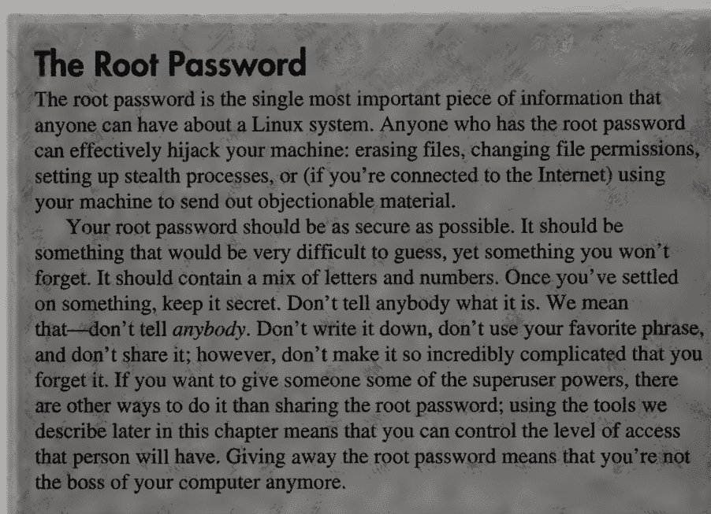

# 根密码 (Root Password)

根密码是任何人关于 Linux 系统所拥有的最重要的信息。任何拥有根密码的人都可以有效地接管你的机器：删除文件、更改文件权限、设置隐身进程，或者（如果你连接了互联网）使用你的机器发送违规材料。

你的根密码应该尽可能安全。它应该是一个非常难以猜到的密码，同时又是一个你不会忘记的内容。它应该包含字母和数字的混合。一旦确定了密码，请务必保持保密。不要告诉任何人。我们的意思是——不要告诉任何人。不要把它写下来，不要使用你最喜欢的短语，不要分享它；也不要让它复杂到让你忘记。如果你想赋予某些用户一些超级权限，除了共享根密码外，还有其他方法可以实现；使用我们在本章稍后描述的工具意味着你可以控制该人员拥有的访问级别。交出根密码意味着你不再是自己电脑的主人了。

> 提示 我们建议你至少以 `root` 身份登录一次，最好在安装 Corel Linux 后尽快，这样你就可以更改根密码和账户。

# 用户账户 (User Accounts)

类似于 UNIX，Linux 使用用户账户系统。当创建一个个人账户时，每个用户会被赋予一组信息：

- 用户名，例如 `maureen`
- 密码
- 用户 ID (`UID`)
- 一个或多个组 ID (`Group ID`)
- `/home` 目录中的某些个人空间

# 第 12 章：用户空间与用户账户 195

这些信息用于在用户账户内构建目录结构，进入用户系统配置文件，并通过密码控制访问。它还可以决定用户可能访问的文件和程序。


“用户 ID”这个术语可能会让人有些困惑。在之前使用的含义中，用户 ID 是分配给特定账户的数字，存储在 `/etc/passwd` 文件中。你很少会用到这个数字用户 ID，除非你想编写调用一组顺序用户的用户管理脚本。该术语的常用用法是用户名或登录 ID 的同义词。你可能会听到有人说“你的用户 ID 是什么？”那个人想知道用户名。为了减少这种困惑，Linux 文档始终将数字用户 ID 称为 `uid`。更多信息请参阅本章稍后的“用户 ID 和组 ID”章节。


当一台机器上有一大群用户时，破坏或混乱的可能性就会非常大。需要保护用户免受另一个用户访问其文件（无论是系统文件还是个人文件）。为了解决这个问题，UNIX（以及 Linux）包含了一套强大的文件权限，允许 `root` 和普通用户决定谁对给定的文件或目录具有权限。我们将在本章稍后详细讨论文件权限。

# 在登录用户账户时使用 root 权限

到这里，你可能感到困惑。首先，我们说 `root` 拥有许多运行系统所需的权限，但我们又告诉你不要以 `root` 身份登录。这是怎么回事？嗯，你有几种方法可以在不直接登录 `root` 账户的情况下获得超级权限。其中某些方法需要你知道根密码；虽然你的用户可以尝试这些选项，但除非他们知道根密码，否则他们无法访问 `root` 权限。其他选项不需要用户知道根密码，但你必须刻意将经过批准的用户添加到可以访问 `root` 的列表中。

## 文件管理器的根模式

Core Linux 通过文件管理器 (`File Manager`) 为 `root` 活动提供了一个图形化工具。要使用此工具，请点击 KDE 面板中的应用程序管理器图标，并选择 Start | Applications | System | File Manager。

会出现一个较小的终端窗口，如图 12-1 所示，并提示你输入根密码。一旦成功输入密码，你就可以以超级状态访问文件和程序，但你仍然可以使用 KDE 的图形化工具来管理你的系统。

如果你想让另一个用户拥有超级权限，使用这种方法必须将根密码给给该用户。这对你来说可能是一个不可接受的安全风险，或者你可能觉得没关系。这取决于你。请查看第 22 章“管理服务”，详细讨论安全风险以及向其他用户授予超级权限的替代方法。

## su 命令

文件管理器的超级模式是一个图形化工具，而 `su` 命令则在文本提示符的终端窗口中使用。如果你知道该用户的密码，可以使用此命令切换到另一个用户目录，或者可以使用它进入 `root` 账户。

> 图 12-1 使用文件管理器快速访问超级用户权限

# 第 12 章：用户空间与用户账户

你可以通过多种方式使用 `su` 命令。使用 `su` 而不是文件管理器超级模式的最好理由之一是在不泄露账户的情况下访问 `root` 账户。该命令的一般形式所示，其中 `<username>` 替换为你想要访问的账户。然而，如果你省略了 `<username>` 部分，Linux 会认为你想访问 `root` 账户。

## 配置 su

`su` 在各种情况下的运行由 `/etc/passwd` 控制。示例 `suauth` 如图 12-2 所示，显示了如何设置文件。如果你想赋予另一个用户访问权限，可以更改 `suauth` 中的这些项。

`suauth` 的语法如下：

| to-id | from-id | action |
| :--- | :--- | :--- |
| 想要切换的账户 | 执行切换的用户名 | DENY, NOPASS 或 OWNPASS |

这些条目的的作用如下：

- `to-id`：你想要切换的账户。
- `from-id`：执行切换的用户名。
- `action`：有三种可能的操作：DENY、NOPASS 或 OWNPASS。

如果你想赋予另一个用户访问权限，可以更改 `suauth` 中的这些项：

```
root:username:OWNPASS
```

这意味着 `username` 将输入自己的密码。

## 使用 su

一旦你在 `suauth` 中完成了所有必要的条目，你就可以使用 `su` 访问 `root` 账户。只需在命令提示符输入 `su`；如果你将自己设置为 `OWNPASS`，系统将提示你输入用户账户密码；如果你将自己设置为 `NOPASS`，你将立即进入 `root` 账户。

> 警告 不要为你的 `root` 账户设置 `NOPASS`！如果你在学习上一节时这样做了，请回去将其改为 `OWNPASS`。`NOPASS` 是一个严重的安全风险。

当你授予了 `root` 账户访问权限后，你可以以超级用户身份执行任何所需的命令。你应该学会如何在测试环境中执行这些命令，因为使用 KDE 图形化管理工具需要额外的步骤。（如果你计划仅使用图形化工具，请使用文件管理器的超级模式。）你还可以访问发送给 `root` 账户的电子邮件，这可能。请定期检查。

当你完成超级用户命令的执行后，在 shell 提示符输入 `exit`。电脑将返回你的普通用户账户，你可以继续在切换到 `root` 账户之前正在的工作。

> 警告 务必在完成后尽快退出 `root` 账户。不要养成在 `root` 账户中执行日常任务的习惯；将 `root` 仅留给管理工作。

如果你需要从 `root` 账户执行单条命令，可以使用 `su` 命令的这种语法，其中 `<command>` 是你想要执行的超级用户命令：

```
su -c "<command>"
```

系统将提示你输入密码；输入密码后，命令将执行，随后你将立即返回标准用户模式。

# 创建新用户账户

虽然你在安装 Corel Linux 时已经为自己创建了一个用户账户，但安装程序会让你有机会创建一个或多个账户。如果你想为机器上的其他用户添加账户，只需创建账户并分配所有适当的标识符和权限。通过 `root` 账户功能，你可以使用图形化工具或文本工具来设置账户。

## 使用用户管理器添加新用户

你可以使用图形化工具，只需几次简单的点击和文本输入创建新的用户账户。要使用图形化的用户管理器，你必须如前以 `root` 身份或超级用户权限登录。

1. 点击应用程序启动图标，选择“开始 | 应用程序 | 系统 | 用户管理器”打开用户管理器。

出现用户管理器主界面。在屏幕下方，你将看到此计算机上所有当前用户的列表。（看起来用户非常多，但其中许多用户实际上是管理账户，用于运行具有自定义文件权限集和用户身份的程序。）

2. 点击用户管理器工具栏上的“添加用户”按钮。

出现“添加用户”界面。

3. 输入用户信息（至少包括用户 ID）。

4. 点击“设置密码”按钮。出现密码对话框。

5. 输入两次密码，然后点击“确定”。对话框关闭，返回返回“添加用户”界面。

6. 如果尚未勾选“创建主目录”和“复制骨架”复选框，请勾选。

7. （可选）如果你想将新用户分配到默认组以外的组，点击“组”选项卡。

“组”选项卡有两个面板：左侧面板显示所有可用组的列表。选择你想要分配给新用户的组，点击中间的右箭头按钮。完成后点击“用户信息”选项卡。

8. 验证所有输入的信息无误，然后点击“确定”。

“添加用户”界面关闭，新用户出现在用户管理器窗口中。

## 在命令行添加新用户

如果你更喜欢在执行超级用户功能时从命令行操作，可以简单地使用 `adduser` 程序在环境中添加新用户。这是一个直接的命令行程序，功能与图形化用户管理器相同；它是后者的文本版本。

1. 点击 KDE 面板上的“控制”按钮启动终端窗口。

2. 在 shell 提示符处输入 `su` 并在提示时输入密码。

你将获得 `root` 身份。

3. 输入 `adduser <username>` 并按回车键。

将 `<username>` 替换为你为新账户持有者选择的登录名。

> 提示 你可能决定为机器上的账户使用标准的用户名格式。你可以将用户名限制在三到八个字符之间，要求人们使用首字母缩写，或任何适合你的方案。如果你实施了任何此类限制，请确保公平地应用。如果你在这台机器上有几个不同的用户，这种一致性会让管理用户账户变得更简单。

Core Linux 将新用户添加到 `/etc/passwd` 文件并为新主目录创建一个目录。`/etc/skel` 目录（骨架目录框架）的内容将被复制到新的主目录。

4. 输入 `passwd <username>` 并按回车键。

5. 在提示处为该用户输入初始密码，然后重新输入一次以确认。Corel Linux 完成账户的创建。

> 注意 `adduser` 使用默认的一组组 ID 以及目录和文件权限创建新账户。如果你想更改权限或将用户添加到额外的组中，你需要手动编辑 `/etc/passwd` 和 `/etc/group`。

通知你的新用户账户已创建。告诉用户你创建账户时使用的密码以及新用户名。用户应该做的第一件事是将密码更改为唯一的密码。这是通过在命令行提示符处执行 `passwd` 命令完成的。Corel Linux 会询问旧密码（以确保确实是用户），并要求输入新密码（一次输入，一次确认）。

# 用户 ID 与组 ID


一旦你添加了新用户，其身份就会描述在`/etc/passwd`文件中。图 12-3 显示了一个示例`/etc/passwd`文件。`/etc/passwd`条目是在`adduser`或用户管理器过程中创建的；你不需要手动添加。

# 第 12 章：用户空间与用户账户

## 203

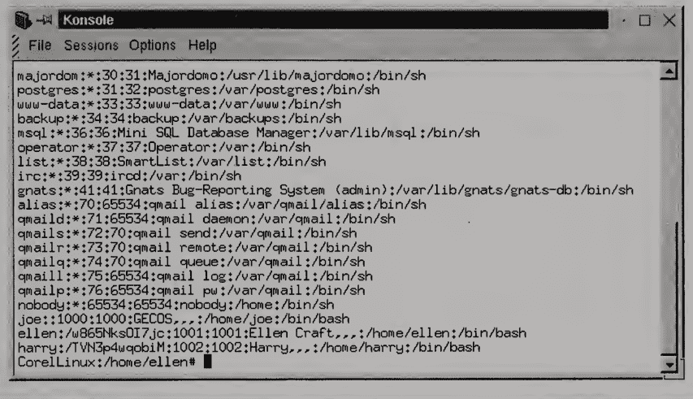

```
majordomo:30:31:majordomo
postgres:31:32:postgres
www-data:33:33:www-data
backup:24:34:backup
mysql:35:36:mysql
operator:37:37:operator
list:38:38:list
irc:39:39:irc
gnats:41:41:gnats
alias:70:70:alias
daemon:71:71:daemon
smail:72:72:smail
smailq:73:73:smailq
smailq:74:74:smailq
smailog:75:75:smailog
nobody:65:65:nobody
joe:1000:1000:joe
ellen:1001:1001:ellen
harry:1002:1002:harry
```

**图 12-3** `/etc/passwd`文件包含了你机器上所有用户的身份。确保`/etc/passwd`安全至关重要。在任何情况下都不应允许`root`以外的人拥有该文件的写入权限。与其他文件一样，`/etc/passwd`使用语法定义用户：

- `harry` 创建账户时使用的用户名。
- `x` 密码在`/etc/passwd`中被加密，以避免他人访问文件时产生明显的安全风险。
- `1002` `harry`的用户 ID（uid）。这是一个标识`harry`的唯一数字。没有其他用户拥有 uid `1002`。

## 设置文件权限

Linux 使用文件权限系统来决定谁可以访问给定文件，以及该个人拥有何种访问权限。有三种权限：

- 读取（Read）具有相应权限的用户可以查看文件。
- 写入（Write）具有相应权限的用户可以修改文件。
- 执行（Execute）具有相应权限的用户可以运行该文件（如果它是脚本或程序）。每种权限都可以在三个级别实施：

- 用户（User）只有文件的所有者对它拥有任何访问权限。
- 组（Group）只有与文件所有者共享组 ID 的用户才能对文件拥有任何访问权限。
- 其他（Others）所有用户都可以访问文件，包括通过互联网来自远程机器的用户。

任何类型的权限都可以与任何层级的访问权限匹配。因此，某些文件可能仅允许所有者读取（限制最严格的访问形式），而另一些文件可能是所有人可执行的（限制最少的形式）。

> 记住
>
> 超级用户（superuser）可以访问系统上的任何文件，无论该文件设置了什么权限。

权限的更改可以通过使用文件管理器（File Manager）的“属性”功能（如图 12-4 所示），或者在命令行提示符中使用`chmod`命令来实现。使用`chmod`需要你理解晦涩的 UNIX 权限分配方法；通常使用文件管理器的“属性”功能更简单，因为图形化界面可以直观地显示分配给文件的各项权限。

> 提示
>
> 如果你查看带有文件权限的目录列表（例如通过在 shell 提示符中输入`ls`命令产生），可能会发现它们的显示方式有点奇怪。请参阅附录 B“常用 Shell 命令汇”中的`ls`条目以获取完整解释。

图 12-4 使用文件管理器的“属性”功能设置单个文件权限

对文件权限采取尽可能严格的限制是好的。将文件变得过于开放会导致巨大的挫败感，特别是当它们是可执行文件且设置了执行权限时。密切关注全局执行权限的文件和程序尤为重要，因为你本质上是在邀请全世界访问你计算机上的材料。这就是 HTML 文档在万维网上发布的方式；它们是用户账户中的普通文档，但被编码为全局可用。当一个并非为 Web 设计的文档仍然处于全局可用时，危险就发生了。

## 特殊情况：单用户系统与多用户系统

在决定如何使用本章中的信息时，一个需要问的问题是“谁将使用这个系统？”如果你是唯一需要在计算机上拥有用户账户的人，那么你的任务就很简单。只需在安装时创建用户账户，并在机器上的大部分工作中使用它即可。使用`root`账户进行系统更改。这里的假设是你是唯一对机器拥有物理访问权限的人（或者对于对你电脑无感的室友来说，你是唯一想要物理访问的人），并且你不会让计算机在无人看的情况下连接互联网。虽然我不建议对系统安全缺乏态度的，但一台真正的单用户机器被破解并用于非法目的的风险并不大。

然而，如果你的机器将被多个人使用，你就需要对安全更加警惕。随着每个新用户的增加，你对安全的担忧就会倍增，特别是当你允许人们通过网络远程使用你的机器时。我们在第 8 章“用户管理”中详细介绍了系统安全，但一些最关键的关注点在这里值得讨论。通常情况下，你应该给予用户尽可能少的对系统的访问权限。也就是说，用户应该拥有他们所需的函数的访问权限，而无法访问任何不需要的内容。这大部分可以通过仔细处理文件和目录权限，并保持这些权限尽可能紧来实现。限制对`/sbin`、`/boot`等系统关键目录的访问，并限制对包含`/etc`的目录的写权限，对保持系统安全大有帮助。你应该遵循的总体原则是：没有超级用户权限的用户应被排除在管理区域之外。这允许你密切监控用户在系统上的所作为；请记住管理系统管理员的原则。

# 第 13 章：磁盘、驱动器与文件系统管理

任何计算机系统最基本的组件之一就是数据存储。数据可以存储在内存中或在物理介质上。最常见的物理介质是磁盘，无论是固定的还是可拆卸的。某些系统使用磁带存储数据；因为磁带对于长期使用来说相当脆弱，所以它们主要用于出于安全目的制作备份。在本章中，我们将描述各种类型的磁盘、Linux 处理这些设备的方式，以及存储数据的有效方法。我们还继续了第 1 章“目录结构”中关于文件系统的讨论，将其扩展到如软盘或 CD-ROM 磁盘等可拆卸文件系统。

### 什么是磁盘？

在最基础的，磁盘是一块涂有磁性介质的圆形塑料。这种涂层实际上与制造磁带（如音频磁带）的物质有些相似，但它更硬。不过，磁盘的工作方式相同。通过记录调制的磁扰动模式，磁盘表面可以用于保留和存储在稍后可以恢复的信息。

### 软盘与硬盘

磁盘分为两大主要类型：软盘（floppy disks，也称为 diskettes）和硬盘（hard disks，也称为固定磁盘）。软盘和硬盘在结构上是类似的。它们的名称像许多计算机术语一样，是历史产物。当硬盘首次开发出来时，它们很大、很厚且非常硬。后来，当小型便携式磁盘开发出来时，它们很薄、很轻且灵活——这就是软盘。随着磁盘技术的演进，磁盘本身的设计开始收敛，但它们的功能仍然是独特的。软盘是可拆卸且易于携带的，而硬盘永久安装在计算机机箱内。

固定磁盘和可拆卸磁盘之间的真实区别在于用于读取和存储其数据的机制。每个磁盘都有一个磁头（有时是多个）。磁头是实际上在磁盘表面制造和读取标记的组件。由于软盘是可拆卸的，读取这些磁盘的磁头精度较低；它们必须受到由于磁盘在磁盘槽中进出而引起的持续磨损和运动的影响。精度的缺乏加上标准制造尺寸的限制，意味着磁盘可以存储的信息较少。

相比之下，硬盘是固定在读取它们的驱动器上的，读/写磁头本身要精确得多。由于这些因素，硬盘可以存储的信息比软盘多，多得多。标准软盘最多可以存储 1.44 MB 的数据，即 1,440,000 字节。然而，发现容量超过 20 GB 数据的硬盘并不少见，即 20,000,000,000 字节——200 亿字节！这几乎是软盘容量的 14,000 倍。

> 你可能会听到 Linux 系统不需要巨大的硬盘驱动器。这从字面上来说是正确的：如果你以纯文本模式运行 Linux，你不需要大量的存储空间。文本文件很小，内核本身也没有多大。然而，当你添加图形界面时，你的存储需求会迅速增长。X Window 系统需要大量空间，用于构建界面的所有图形文件。再加上音频文件、你创建或下载的图形等等——突然之间，8 GB 或 10 GB 的硬盘就足够了。需要的图形越多，需要的空间就越大。

虽然在技术上可以将硬盘从一台计算机取出并连接到另一台机器，但这并不是一个简单的程序；绝对不是常见的做法。硬盘的设计并不是为了便携；软盘则是。

由于这些因素，硬盘可以存储更多，比软盘得多。

### 其他磁盘类型

除了硬盘和软盘，近年来还开发了其他类型的磁盘。无疑，光盘（CD）在数据存储（无论是计算机还是音频领域）是一项重大突破。Jaz 或 Zip 驱动器正变得常见。

### CD-ROM 磁盘

光盘现在在我们生活的许多领域都很。CD 是一种光盘，最初是为音频数据存储和传输而开发的。

## 212 Corel Linux 操作系统入门教程：官方指南

光 CD 通常被称为 CD-ROM，全称为只读光盘内存（Compact Disk—Read Only Memory）。这意味着你无法向 CD 写入数据；它只能播放。我们将在本节稍后讨论可写光盘。


CD 是一种丙烯酸圆盘，在闪闪光的一面上刻有大量的微型棱镜。当激光束聚焦在这些棱镜上，产生的衍射图样可用于编码信息；CD-ROM 驱动器也使用激光来截获衍射光并读取已经编码的数据。CD 是硬盘和软盘之间的折中方案；虽然它们具有软盘的便携性（尽管没有添加新信息的能力），但它们可以存储更多信息：容量约为 650 兆字节。

在过去的一年左右，CD-RW 驱动器已成为家用电脑的热门选择。这种驱动器使用特殊涂层的 CD；只要有合适的 CD 和驱动器，用户就可以使用 CD 格式来存储信息、创建多媒体演示文等。可写光盘和驱动器的价格正在迅速下降，在 200 美元以下找到一个不错的可写驱动器是可能的。

这种方法的缺点是 CD 数据一旦编码就无法删除，而且光盘本身相当昂贵。然而，它是备份大型程序和文件的极佳方式，例如无法存储在软盘上的大型图形或声音文件。它也是与朋友或家人分享这些文件的好方法；大多数人都有 CD 驱动器，但许多人没有快速的互联网连接。对他们来说，从 CD 中查看图片比通过电话线连接从网页下载图片要容易得多。

## Iomega 驱动器

Iomega 公司开发了其他形式的磁盘技术。Iomega 为三种不同类型的拆卸介质制造了磁盘和驱动器：Click!、Zip 和 Jaz。这些驱动器使用的磁盘含有海量数据，远超标准软盘。Iomega 开发了一种文件压缩方法，允许存储如此大量的数据，且不会因压缩产生质量损失。

Iomega 最新的想法是 Click! 光盘和驱动器。Click! 的大小类似于信用卡，而磁盘本身直径仅 2 英寸。Click! 驱动器专为笔记本电脑和笔记本电脑设计，但也可以用于配备了 `PCMCIA` 可交换设备卡的台式电脑。每张 Click! 光盘存储约 40MB 的信息；如果你想在拆卸介质上存储大量信息，最好使用 Zip 或 Jaz 驱动器。然而，如果你需要在台式个人电脑和笔记本电脑之间共享文件，Click! 光盘可能是一个很好的替代方案。

## 第 13 章：磁盘、驱动器和文件系统管理

Zip 磁盘存储 100 或 250 兆字节的数据；100MB 的磁盘相当于约 74 张软盘，而 250MB 的磁盘存储的数据比 160 张软盘还要多。

Zip 磁盘是极佳的组织工具。例如，我们在编写这本书期间创建的文本和图像文件存储在两张 Zip 磁盘上；我们写的每本书都会被下载到 Zip 磁盘并存储。Zip 磁盘还有多种颜色，许多人将颜色作为组织工具。例如，将你的财务软件备份到绿色的 Zip 磁盘，或者使用红色的进行关键备份。

Jaz 磁盘存储更多数据；它们有 1 或 2 兆字节的容量可用。许多 Jaz 用户实际上将 Jaz 驱动器用作第二个硬盘，直接从 Jaz 磁盘存储和运行应用程序。在创意领域工作的人经常发现，250MB 的 Zip 磁盘对于他们的文件或集合太小了；Jaz 磁盘更适合复杂的图形/音频演示。

可以在 `http://www.iemega.com` 了解更多关于各种 Iomega 产品。所有 Iomega 产品都有 Linux 驱动程序，但你必须在 Web 文件存档中查找它们，因为 Iomega 仅在当地提供。

## 磁盘在 Linux 中的表示方式

正如我们在之前的章节中所提到的，由于磁盘是以文件方式表示的，

`Jaz` 磁盘存储更多数据；它们有 1 或 2 兆字节的容量可用。许多 Jaz 用户实际上将 Jaz 驱动器用作第二个硬盘，直接从 Jaz 磁盘存储和运行应用程序。在创意领域工作的人经常发现，他们 250MB Zip 磁盘对于他们的文件或集合太小了；Jaz 磁盘更适合复杂的图形/音频演示。

# Corel Linux OS入门指南：官方教程

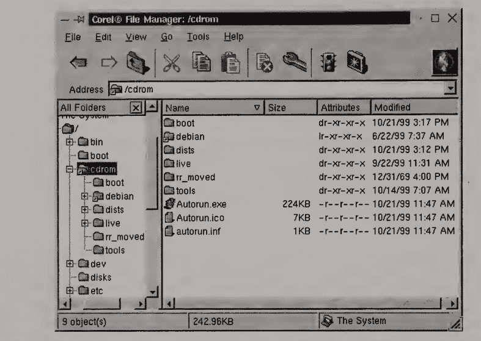

图 13-1 挂载的文件系统内容在文件管理器目录结构中的显示

`/home` 挂载点，或设备要挂载的位置。这必须是一个已经存在且空的目录。如果挂载点不存在或为空，将导致 `mount` 命令失败。

如果在挂载过程中没有出现问题，操作系统会将文件系统挂载到指定的目录中：在本例中，即 `/home` 目录。一旦命令执行，Susan 就可以打开文件管理器，看到 `/dev/hdb1` 分区的内容以 `/cdrom` 目录文件结构的形式呈现，如图 13-1 所示。

## 自动挂载

尽管许多文件系统在机器启动时会自动挂载，但与 Linux 中的其他许多许多行为一样，这种自动挂载的行为是可配置的。你可以设置 Corel Linux 在启动时挂载你需要的任意数量的文件系统。

控制文件系统自动挂载的文件是 `/etc/fstab`。

# 第13章：磁盘、驱动器和文件系统管理 217

**记住** `/etc` 目录包含了你的 Corel Linux 系统的各种配置文件。

一个典型的 `/etc/fstab` 文件可能如下：

```
# /etc/fstab: 静态文件系统信息。

# <file system> <mount point> <type> <options> <dump> <pass>
/dev/hda1       / ext2 defaults,errors=remount-ro 0 1
/dev/hda2       none swap sw 0 0
proc            /proc proc defaults 0 0
```

如你在该脚本中看到的，名为 `/dev/hda1` 的单一主分区被挂载在 `/` 上。一个设备包含了除 `/proc` 外的几乎所有内容。

**记住** `/proc` 目录是一个虚拟目录。它不驻留在磁盘上，因此不能是磁盘文件系统的一部分。

前面的代码显示 `/dev/hda1` 是一个 `ext2` 文件系统，并且它是使用某些选项挂载的：除了默认选项外，如果在挂载期间发现错误，它将以只读 `ro` 模式重新挂载。

对应 `<dump>` 和 `<pass>` 的数字用于系统检查原因。除了 `/dev/hda1` 和 `/proc` 之外，表还显示了一个 `/dev/hda2` 文件系统，它似乎没有挂载到任何地方。这是一个交换分区，供操作系统内核在运行期间临时存储系统内存使用。

一个完整的 `/etc/fstab` 文件可能如下：

```
/dev/hda1       / ext2 defaults 1 1
/dev/hda6       /home ext2 defaults 1 2
/dev/cdrom      /mnt/cdrom iso96660 noauto,owner,ro 0 0
/dev/hda7       /opt ext2 defaults 1 2
/dev/hda9       /tmp ext2 defaults 1 2
/dev/hda5       /usr ext2 defaults 1 2
/dev/hda8       /var ext2 defaults 1 2
/dev/hda10      swap swap defaults 0 0
/dev/fd0        /mnt/floppy ext2 noauto,owner 0 0
none            /proc proc defaults 0 0
```

218 Corel Linux OS 入门指南：官方教程

在该文件中，你可以看到许多使用 `ext2` 文件系统类型的分区。

该系统的所有者决定将许多文件系统组件放在单独的磁盘分区上。这通常被认为是一种良好的做法，如果一个分区出现问题，它可以与系统的其余部分隔离开（可以将其想象为电子隔离）。该文件还显示软盘驱动器和 CD-ROM 驱动器挂载到了该系统上。

通过在 `/etc/fstab` 配置文件中为每个分区和两个额外的驱动器添加条目，系统的所有者已经实现了启动过程的一部分。当机器通电时，驱动器将自动挂载到空目录中，你可以通过文件管理器使用这些目录访问其文件系统。这无疑是处理文件系统最简单的方法，尽管如果你不经常使用这些文件系统，这会有些浪费资源。

> Windows 和 Macintosh 系统在启动时会挂载所有连接的文件系统。如果你熟悉这些操作系统之一，你可能会发现在启动时挂载软盘和 CD-ROM 驱动器让你很安心。如果你喜欢在计算机上插入和拔出软盘或 CD-ROM，你会希望这些驱动器在启动时就挂载；如果它们未挂载，你必须在使用可移动磁盘之前手动挂载它们。Core Linux 自动处理软盘和 CD 驱动器，但在尝试运行某些程序之前检查它们是否已挂载总是好主意。如果它们无意中被卸载，你在使用前记住。

## 挂载网络文件系统


除了挂载硬盘分区、软盘驱动器和 CD-ROM 驱动器外，还可以挂载来自其他计算机的文件系统。这是通过网络文件服务（或 NFS）程序实现的。与许多网络功能一样，NFS 有两个组件：服务器和客户端。服务器是拥有你想要挂载的文件系统的机器，而客户端是你想要挂载文件系统的目标机器。服务器必须运行 NFS 服务器守护进程 `nfsd`，而客户端必须运行挂载守护进程。

文件，你可以添加一个驱动器设备，以便它们在启动时自动挂载。此命令的语法以及关于网络文件系统的详细解释可以在第24章找到。

# 挂载 CD-ROM 和软盘驱动器

CD-ROM 和软盘包含的文件系统是可以挂载的，就像各种硬盘分区的文件系统一样。与 CD-ROM 和软盘驱动器本身一样，移动磁盘的文件系统可以在启动时自动挂载，也可以根据需要挂载。例如，如果你直接从 CD 运行应用程序，你会希望在启动时挂载 CD 文件系统，这样你就不需要每次都手动操作了。

# 手动挂载额外驱动器

如果你喜欢手动挂载 CD-ROM 和软盘，你需要关闭上一节提到的自动挂载器。要关闭它，登录 root 账户并执行以下命令：

```
/etc/init.d/autofs stop
```

停止自动挂载器后，每次想使用 CD-ROM 或软盘时都必须执行挂载命令。挂载命令的格式与我们在本章早期描述的相同，区别取决于挂载的文件系统类型及其挂载的位置。例如，要挂载软盘，你可以执行以下命令：

```
mount -t ext2 /dev/fd0 /mnt/floppy
```

这假设软盘是为 Linux 格式化的。如果软盘是在 DOS 或 Windows 上格式化的（或者你购买了一盒预格式化的软盘），则命令为

```
mount -t msdos /dev/fd0 /mnt/floppy
```

当你使用完软盘后，必须在将其从驱动器中移除之前对其进行卸载。要卸载软盘，请执行以下命令：

```
umount /dev/fd0
```

请注意 `umount` 中只有一个 n。如果你在移除磁盘之前没有卸载，在执行卸载之前将无法使用该驱动器。如果你忘记卸载直接移除了磁盘，只需将磁盘重新插入驱动器并执行 `umount` 命令即可。然后你就可以再次移除磁盘，驱动器已准备好挂载另一块软盘了。

对于 CD-ROM，过程几乎相同，不同之处在于系统类型为 `iso9660`，这是所有 CD-ROM 制造商使用的标准文件系统。因此，

```
mount -t iso9660 /dev/cdrom /mnt/cdrom
```

将挂载光盘，而

```
umount /dev/cdrom
```

将将其卸载。

## 高效文件管理技巧

虽然你可以在不注意文件管理方法的情况下成功运行 Corel Linux 系统，但你并不会很好。管理一台 Linux 机器有许多需要记住的事情，如果还要记住把重要的系统文件留在了哪里，那是对时间和脑空间的浪费。这就像每天早上从两个或三个洗衣篮中取出衣服并有系统地收好；虽然在开始时通过不收衣服节省了一些时间，但从长远来看，你会因为寻找匹配的袜子或熨烫衬衫和裤子而浪费时间。

良好的文件管理技术是那些在基础层面上合理的方法。如果你必须不断提醒自己文件管理方法，那么它们就太复杂了。只要易于查找，请坚持对你来说简单的方法。

### 使用一致的命名方案

你不一定得使用 `/mnt/cdrom` 或 `/mnt/floppy` 目录名称来引用你的挂载点，但你应该选择某种一致的命名方案。你在挂载名称等方面越一致，在急忙中查找某个晦涩的文件或目录时就越容易。一致的命名对于一个组织良好的系统至关重要，而一个组织良好的系统操作起来也是一种享受。我们怀疑，人们停止使用 Linux 的主要原因之一是他们不理解命名和目录结构，因此没有以系统的方式组织他们的文件。

### 了解 `/etc/mtab`

`/etc/mtab` 文件包含了当前挂载在你的机器上的所有文件系统的名称。不要尝试编辑此文件（如果你不小心卸载了文件系统，可能会发生系统故障）。但是如果你不记得挂载了什么，可以在系统提示符下输入 `more /etc/mtab` 来显示文件内容并查看挂载了哪些。图 13-2 显示了 `/etc/mtab` 示例。对于拥有共享文件系统的大网络，这非常有帮助。

| 文件 | 选项 | 错误 |
| :--- | :--- | :--- |
| `/dev/sda1` `/ext2` | `rw,remount-ro` | 0 |
| `/proc` | `rw` | 0 |
| `/mnt/cdrom` | `autofofs,fd=5,pgrp=225,minproto=2,maxproto=3` | 0 |
| `/mnt/floppy` | `autofofs,fd=5,pgrp=236,minproto=2,maxproto=3` | 0 |
| `/dev/hdc` `/mnt/cdrom/cdrom` | `iso9660` | 0 |

### 使用 `/etc/fstab` 自动挂载

在本章前面的部分，我们描述了 `/etc/fstab`，该文件包含所有在启动时自动挂载的文件系统列表。保持此文件的更新可以让你管理文件系统的过程变得简单得多。如果你习惯性地挂载许多文件系统，那么手动挂载每一个将变得非常枯燥。此外，你可能会忘记挂载其中一两个，导致后来的挫败和时间浪费。

使用前面描述的语法在 `/etc/fstab` 中输入每个文件系统，它将在启动时自动挂载。如果你想添加多个文件系统并一次性挂载它们，但不想立即重启机器，也可以使用 `/etc/fstab` 实现此目标。只需将文件系统输入到 `/etc/fstab`，然后执行命令：

```
mount -a
```

这将强制操作系统挂载 `/etc/fstab` 中的所有文件系统。那些已经挂载的文件系统在过程中过程中被忽略，因此不会出现系统不稳定的情况。

### 使用 NFS 浏览器

Corel Linux 作为文件管理器的一部分提供了一个独特且实用的功能——一个允许你查看网络文件系统各个层面的浏览器。该工具对于访问那些你需要查看但不需要长时间挂载的文件系统非常有用。

1. 点击桌面上的文件管理器图标或 KDE 面板上的文件管理器图标打开文件管理器。
2. 点击文件管理器窗口左侧格中显示的“NFS Network”。文件管理器将显示你可以使用的所有网络文件系统列表。
3. 选择一个文件系统进行自动挂载，并显示该文件系统的内容。

# 第 14 章：Corel Linux 的图形化管理工具

如果你主要的计算机使用经验是 Windows 或 Macintosh 等桌面系统，你可能会对 Corel Linux 系统后台运行的各种操作感到有些惊讶。你可能认为配置和维护系统所涉及的工作量令人难以应付。但请放心，情况会很快变得简单。一旦你配置好了基础设置，你就会发现它运行得相当流畅，不需要过多的干预。

此外，Corel Linux 可以帮助你完成这些基础管理活动。Corel Linux 提供了一套图形化管理工具，让你以更简单的方法管理任务，同时以简单直观的视觉界面呈现任务。虽然命令行管理看起来既复杂又困难，但你会发现使用图形化管理工具完成同样的任务是多么容易。

### 使用 KDE 工具简化日常任务

虽然你可以用普通的命令行程序管理软件和文件，但为什么不利用 Corel Linux 提供的图形化工具呢？这些工具的简单性可能意味着你能够保持电脑良好，而不是因为复杂或困难而放弃某些管理任务。

### 更新

维护任何计算机最令人头疼的任务之一就是保持软件更新。对于开源软件来说，这甚至更加令人沮丧，因为开源开发的本质倾向于频繁的更新和发布。

你可以通过多种方式处理这些不断涌入的新软件。你可以获取每个新版本并手动编译和安装每个包。但是，如果你想这样做，可能就不会读这一章了。不；你想要的是放松下来，让 Corel Linux 为你工作，使用 Core Update 工具。Core Update 工具允许你通过 Internet 或 CD-ROM 访问并安装软件。

要打开 Core Update 工具，点击 KDE 面板上的应用程序管理器图标，然后选择应用程序 | 系统 | Core Update。

2. 点击 Corel Update 窗口顶部的“可用软件”（Available Software）选项卡。


顶部窗口包含一个树形结构。如图 14-2 所示，出现的文件是可以安装的软件包。你可以使用任何软件源，只要包格式为 `.deb` 软件包（Debian 标准格式）即可。如果你不设置源，在“可用软件”窗口中将看不到任何包。

注意

如果你想升级计算机上已安装的软件，请选择“当前软件配置”（`Current Software Profile`）选项卡，并继续此过程。

提示

`Corel Update` 默认指向 Corel 的 FTP 站点。在该站点上，你将找到许多格式正确、可供你使用的包。

| 当前软件配置 | 可用软件 | 状态 | 新版本 | 描述 |
| :--- | :--- | :--- | :--- | :--- |
| | + admin | | | |
| | + base | | | |
| | + comm | | | |
| | + contrib/admin | | | |
| | + contrib/devel | | | |
| | + contrib/editors | | | |
| | X | + staroffice3 | 1-9 | Star Office 3.1 安装器 |
| | + contrib/games | | | |
| | + contrib/graphics | | | |
| | + contrib/interpreters | | | |
| | + contrib/mail | | | |

`staroffice3`

Star Office 3.1 是一个办公效率套件，包含以下内容：

- StarWriter 3.1（文字处理器）
- StarCalc 3.1（电子表格）
- StarDraw 3.1（图形和演示文包）
- StarImage 3.1

CorelDRAW 9

适用于 Linux 的传奇图形力量

图 14-2 使用 Update 查看你的机器上是否有已卸载的包

# 第 14 章：Corel Linux 图形化管理工具 229

3. 选择 `Options` | `Set File Sources`。

在图所示的“软件包源”窗口中，你可以看到 Corel Linux 提供的默认站点名称，你可以在那里找到新包并下载并安装到你的机器上。你还会看到包含在 Corel Linux CD-ROM 中的包目录路径。

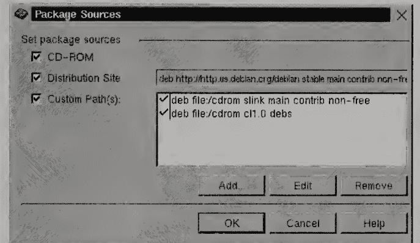

4. （可选）在“软件包源”窗口中输入额外的站点。

如果你有喜欢的归存档，将它们输入在这里，作为以后使用的某种书签。

5. 勾选“分发站点”（`Distribution Site`）复选框，并取消勾选已选的“自定义路径”（`Custom Paths`）。

6. 点击 `OK` 按钮关闭“软件包源”窗口并返回 `Corel Update`。

7. 点击 `Corel Update` 图标栏中的“更新配置”（`Update Profile`）按钮。


下窗格会出现一条连接消息。当与远程站点建立连接后，将检索可用包列表并显示在下窗格中，如图 14-3 所示。

# 230 柯尔 Corel OS 入门指南。官方指南

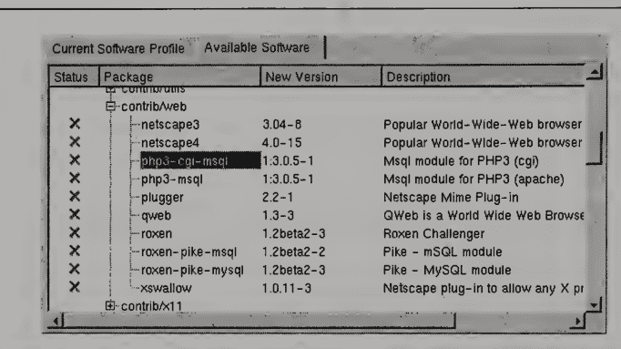

图 14-3 远程站点上的可用包显示在 Update 窗口中

+ 8. 浏览可用包，直到找到你想要安装的包。
+ 9. 点击包以选择它。

注意，包名左侧的红色 X 在包被选中时会变为一对箭头。

> 提示 你可以选择多个包进行下载。每个选中的包（X 变为箭头）将轮顺序下载并安装。如果你更新频率较低，且必须安装许多新版本的软件，这特别有帮助。

+ 10. 点击 `Corel Update` 条中的“升级并安装”（`Upgrade and Install`）图标。

# 第 14 章：Corel Linux 图形化管理工具 231

`Corel Update` 会下载并安装该包，以及你所选程序所需的任何辅助包。如果在安装过程中需要任何信息，`Corel Update` 将提示你输入。

当所有包都下载并安装完成后，`Corel Update` 会显示一条消息。

+ 11. 点击 `OK` 按钮退出 `Corel Update`。

你只需在“软件包源”窗口中设置相应的路径，就可以从 CD-ROM、软盘或任何其他互联网存档或数据存储设备安装包。

你还可以点击“应用程序启动”（`Application Starter`）图标并选择 `File` | `Install Deb File` 来安装单个 `.deb` 包。

> 提示

如果你需要从系统中删除应用程序或包，也可以使用 `Corel Update` 完成此操作。无论使用什么操作系统，`Corel Update` 的软件管理都非常简单。

# MIME Editor

`MIME Editor` 允许你将特定类型的文件与适当的应用程序关联。例如，你可以将以 JPEG 格式保存的文件与 Corel Linux 的查看器（`Image Viewer`）程序关联。这种关联意味着当你在文件管理器中点击 JPEG 文件，查看器就会自动启动显示该文件。`MIME Editor` 根据标准文件扩展名进行这些分配；所有 JPEG 文件的扩展名为 `.jpg`，文本文件的扩展名为 `.txt`，等等。

`MIME` 代表多用途互联网邮件扩展（Multipurpose Internet Mail Extensions），最初是为了发送附件。

要关联文件类型，请遵循以下步骤：

+ 1. 要打开 `MIME Editor`，点击 `KDE` 面板上的应用程序图标，并从开始菜单选择 `Applications` | `System` | `MIME Editor`。

`MIME Editor` 如图所示。在左侧窗格中，你可以看到各种类型。

# 柯尔 Core Linux 入门指南：官方指南

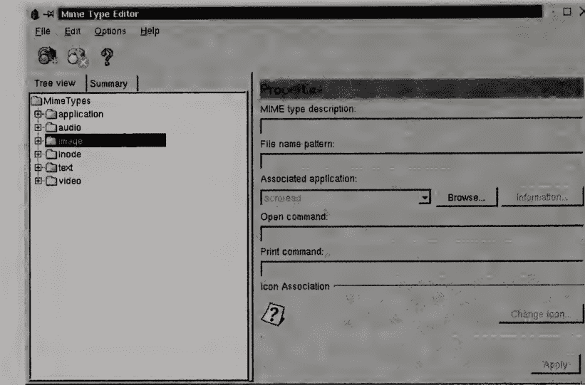

图 14-4 使用 `MIME Editor` 将应用程序关联类型

+ 2. 选择你想关联的文件类型。

右侧窗格显示了一系列字段，如图。第一个字段包含描述，第二个字段包含扩展。

+ 3. 在第三字段设置你想关联的应用程序。
+ 4. （可选）使用第四和第五字段设置打印命令。
+ 5. 在底部窗格中，选择文件管理器将使用的图标。
+ 6. 点击 `OK` 按钮保存设置并退出 `MIME Editor`。

大多数常见文件类型都有预设选项，你不需要对它们进行任何操作。然而，你也可以定义新的 MIME 类型，如果你经常处理不寻常的文件，这将非常有用。

# 234 柯尔 Corel Linux 入门指南：官方指南

# Event Viewer

`Event Viewer`（事件查看器）是你的 Corel Linux 系统日志文件的接口。系统的几乎一切都记录在日志文件中，大多数这些文件存储在 `/var/log` 目录中。在这些文件中查找特定条目，或者仅仅跟踪大量定期生成的日志可能会非常烦恼。幸运的是，Corel `Event Viewer` 提供了一种可配置的浏览和搜索日志的方法。

你必须以 root 身份登录或拥有超级权限才能使用 `Event Viewer`。

通过点击 `KDE` 面板上的应用程序图标并从开始菜单选择 `Applications` | `System` | `Event Viewer` 来打开 `Event Viewer`。`Event Viewer` 窗口如图 14-6 所示。

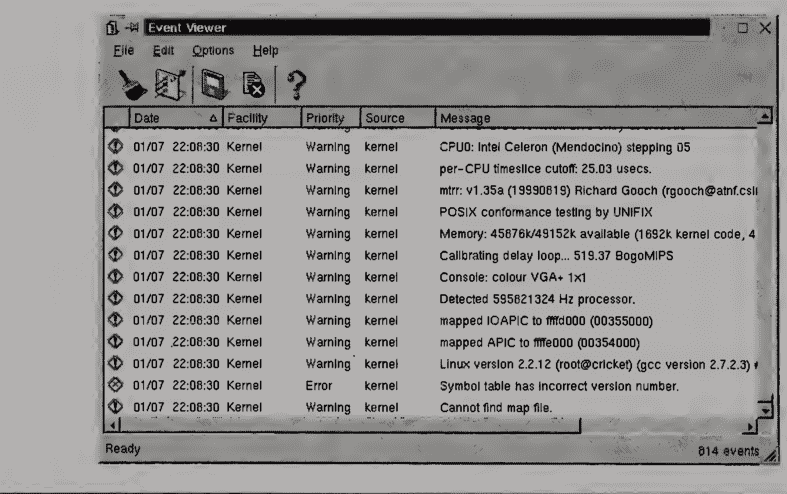

图 14-6 `Event Viewer` 让读取系统日志变得更简单

## 第 14 章：Corel Linux 图形化管理工具

## 235

当你打开事件查看器（`Event Viewer`）时，你会看到一个预选的系统日志交叉部分。这些日志是所有记录日志的子系统中最关键的信息。这是对系统的一个良好的总体概览，对于普通浏览来说可能足够了。然而，如果你对系统日志的兴趣超出了普通范围，你可能想要自定义事件查看器显示的日志和日志条目。

- 1. 点击 `KDE` 面板上的应用程序管理器（`Applications Manager`）图标，并在启动菜单中选择 `应用程序 | 系统 | 事件查看器` 来打开事件查看器。
- 2. 点击工具栏上的图标打开事件查看器过滤器管理器（`Filter Manager`）。


过滤器管理器界面如图 14-7 所示，包含一个复选框网格。顶部的图标表示系统日志消息的各种类别，从简单的调试信息到关键的紧急警告不等。在屏幕左侧列出了各种日志子系统：授权（Authorization）、Cronab、守护进程（Daemon）、内核（Kernel）、打印机（Printer）、邮件（Mail）、新闻（News）、Syslog、用户（User）、UUCP 和 PPP。


网格中的每个复选框都代表特定子系统的特定消息类别。例如，如果你只想查看内核的紧急消息，则应取消第四行最右侧复选框以外的所有复选框；此示例配置如图 14-8 所示。

## 236 Corel Linux OS 入门教程：官方指南

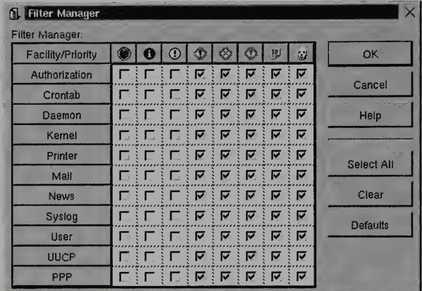

图 14-7 使用过滤器管理器的复选框配置事件查看器


图 14-8 极简的事件查看器配置

## 第 14 章：Corel Linux 的图形化管理工具

- 3. 点击顶行中的图标或左侧的子系统框，以选择该行中的所有框。
例如，如果你想查看内核的所有消息，请点击内核（Kernel）标签。如果你想查看所有子系统的关键消息，请点击右侧最后一个图标。
- 4. 如果你想取消勾选所有框，请点击清除（Clear）按钮；如果你想显示所有消息，请点击全选（Select All）。
- 5. 当你选择了所需的配置后，点击确定（OK）按钮。
事件查看器会重新扫描日志文件（取决于你的机器速度，可能需要一分钟），并使用指定的配置刷新显示。
- 6. 点击清除（Clear）按钮清除屏幕上所有日志消息。


如果你想让日志保持在可管理的范围内，或者你已经解决了发现的所有问题并想删除这些消息，那么从屏幕上清除日志消息是有用的。下次打开事件查看器时，显示将从你清除日志的地方生成。
- 7. 保存事件查看器生成的日志文件有时是有用的；这些文件包含了根据你设置的配置显示的消息。点击保存（Save）图标将日志文件保存到硬盘。


## 238 Core Linux OS 入门教程：官方指南

事件查看器会提示你输入文件名。当出现你不理解的消息时，保存日志文件将特别有帮助。你可以保存文件并通过电子邮件发送或打印它，以便更有知识的人员查看该文件并可能诊断问题。如果你想保留有关系统的记录，你也可以保存日志文件：例如，有人尝试 `su` 进入 root 账户的次数，或者来自邮件日志的记录。

## 归档工具 (Archiver)

Archiver 是 UNIX `tar`（磁带存档）程序的接口。“磁带存档”一词是另一个 UNIX 历史产物：最初，`tar` 程序被用于在磁带上创建备份文件。然而，随着该程序的广泛使用，人们发现 `tar` 在制作备份磁带的简单任务之外还有很多用途。

> 提示 Archiver 可以处理使用 `.tar`、`.tar.z`、`.tar.lz`、`.rar`、`.zoo` 和 `.zip` 方法压缩的文件。你可以通过查看文件扩展名知道使用了哪种压缩方法；如果它与上一句列出的扩展名匹配，你就可以使用 Archiver 打开它。

例如，大多数以源代码形式分发的程序是以 tar 包（tarballs）或压缩的 tar 文件形式分发的，因为这是打包源码的一种方便方法。你可以使用 Archiver 创建自己的 tar 包，归档那些不需要经常访问但又不想删除的文件。Tar 包保留了创建它们时的目录结构；如果我们为这本书创建一个 tar 归档文件，我们首先会在硬盘上创建一个主目录（例如 `core_linux`），并为每个章节创建包含文本和图像的子目录。然后，我们可以在此文件系统运行 Archiver，将所有这些目录和文件转换为一个 tar 文件。该归档文件就成了。

## 第 14 章：Corel Linux 的图形化管理工具

## 239

- 1. 点击 KDE 面板上的应用程序管理器图标，并在启动菜单中选择应用程序 | 系统 | 事件查看器来打开事件查看器。
- 2. 点击工具栏上的图标打开事件查看器过滤器管理器。


图 14-9 使用 Archiver 压缩文件

## 240 Core Linux OS 入门教程：官方指南

- 3. 点击顶行中的图标或左侧的子系统框，以选择该行中的所有框。
- 4. 如果你想取消勾选所有框，请点击清除（Clear）按钮；如果你想显示所有消息，请点击全选（Select All）。
- 5. 点击新建（New）按钮创建一个归档。
- 6. 遍历目录结构选择要包含归档的文件。
- 7. 点击确定（OK）按钮。选中的文件出现在主窗口中。
一旦你制作了一些归档文件，将需要提取它们。
- 1. 点击 KDE 面板上的应用程序管理器图标，并在启动菜单中选择应用程序 | 系统 | 事件查看器来打开事件查看器。
- 2. 点击打开（Open）按钮。浏览器窗口出现。
- 3. 遍历目录结构找到你想要提取的归档文件。
- 4. 点击选择该归档。
- 5. 点击确定（OK）按钮。文件出现在主窗口中。
- 6. 点击提取（Extract）按钮。出现一个包含位置和提取选项的窗口，如图 14-10 所示。
- 7. 选择提取文件的目录，并选择你想使用的提取选项。
- 8. 点击确定（OK）按钮。Archiver 提取文件。这取决于你的机器速度和归档的大小，可能会很快也可能很慢。提取完成后，Archiver 会显示已提取的文件名。


图 14-10 选择要提取归档的位置

> 注意 从归档中提取文件时，归档文件并不会损坏。`tar` 文件仍然位于你发现它的位置，如果你需要，可以再次提取。

## 使用 User Manager 管理用户

在第 12 章“用户空间和用户账户”中，我们描述了使用 User Manager 添加新用户的过程。在本章中，我们解释了如何使用 User Manager 维护你的用户账户。要打开 User Manager，点击应用程序启动图标，并在启动菜单中选择应用程序 | 系统 | User Manager。
- 点击用户名称选择该条目以删除用户。点击工具栏上的删除（Delete）按钮；该按钮显示一个带圈 X 的人像。
- 点击用户名称选择该条目以编辑用户配置。点击工具栏上的编辑用户（Edit User）按钮打开编辑用户对话框，它与添加用户对话框相同。根据需要编辑信息并点击确定。

## 242 Corel Linux 操作系统入门教程：官方指南

你也可以使用用户管理器（User Manager）来编辑组。点击用户管理器中的“组”（Groups）选项卡可显示可用用户组列表。然后你可以从组列表中添加、删除或编辑所选的组。在编辑组时，你可以选择要加入该组的用户，并设置组名和 ID 编号。

## 系统概览

了解当前正在运行哪些进程以及每个进程占用了多少系统资源通常非常有用。Corel Linux 提供了两个提供此类信息的工具：任务管理器（Task Manager）和进程管理器（Process Manager）。我们在这里描述进程管理器；因为任务管理器的工作方式相同，所以在读完进程管理器章节后，你应该能够使用这些工具了。

进程管理器和任务管理器都是 UNIX `top`（进程表）程序的接口。该程序会报告系统上运行的每一个进程、每个进程占用的 CPU 时间和内存量，以及其他各种信息。`top` 程序还允许你向进程发送信号，并提高或降低它们的优先级。`top` 是一个动态程序；也就是说，它会在设定的时间间隔内刷新报告，因此你可以看到进程的启动、停止以及系统使用率的变化。

## 进程管理器

要启动进程管理器，点击 KDE 面板上的应用程序管理器图标，并在开始菜单中选择“应用程序 | 系统 | 进程管理”（Applications | System | Process Management）。大多数进程管理器功能显示如图 14-11 所示，包括系统负载、CPU 使用率、内存使用率和交换分区使用率的图表。这些是对系统信息最常见的请求，因此它们被放在进程管理器窗口的顶部以便于访问。

## 第 14 章：Corel Linux 图形化管理工具


图 14-11 进程管理器提供了更多关于系统进程的信息

图表下方，进程管理器提供了进程表。每个进程都有若干条目：
- `PID` 进程 ID。运行在基于 UNIX 的操作系统上的每个进程都有一个唯一标识符，用于将该进程与其他进程区分开来。
- `USER` 启动进程的用户。可以是实际用户（如 mind 或 bobby），也可以是假设身份的系统进程（如 daemon 或 nobody）。
- `PRI` 进程时间片内剩余的时间。这与 Linux 处理多任务的方式有关；更重要的进程拥有更大的时间片，而低优先级进程的时间片较小。

## 244 Corel Linux 操作系统入门教程：官方指南

- `NICE` 进程的优先级。Nice 值范围在 -20 到 +19 之间。nice 为 -20 的进程在 CPU 进程调度中具有最高优先级，而 nice 为 +19 的进程优先级最低。大多数进程的默认 nice 值为零。


> 注意

> Nice 值之所以这样命名，是因为 nice 值较高的进程对其他进程更“友好”，因为它们占用了较低的调度优先级，从而让较高优先级的进程先使用 CPU 资源。

- **SIZE** 进程的虚拟镜像大小，以千字节为单位。在此语境下，镜像指的是内存中保留二进制文件。它与图形图像无关。

- **RSS** 驻留集合大小，程序当前在系统内存中占用的千字节数。

- **SHARE** 表示进程使用的共享内存量，以千字节为单位。

- **STAT** 进程状态。进程可以是 R（运行）、S（睡眠）、I（空闲）、T（停止）、D（不可中断）或 Z（僵死，或“僵尸”）。

- **%CPU** 进程占用的 CPU 时间估计百分比。

- **%MEM** 进程占用的系统内存估计百分比。

- **TIME** 进程自启动以来使用的总 CPU 时间。

> 提示

> 如果你的 Corel Linux 系统已经运行了几个周或更久，Time 值可能会看起来惊人，特别是对于系统关键进程。不要担心它；这个值仅供娱乐参考。

- **CMD LINE** 启动进程的命令，由 USER 字段中指定的用户或系统进程执行。

点击这些标题中的任意一个即可根据该统计数据对进程表排序；排序可以是数字或字母，取决于变量。再次点击标题可反转排序。

进程管理器和任务管理器也可用于系统管理进程，例如更改 nice 值。我们将在第 22 章“管理服务”中涵盖这些管理器的此类用法。

## 第四部分

## 核心 Linux

系统管理


## 第 15 章：Linux 管理概述


## 248 Corel Linux 操作系统入门教程：官方指南

## 第四部分

## 核心 Linux

系统管理

虽然这整本书的内容似乎是显而易见的，对吧？嗯，是的。不过我们在这里指的是操作系统中一个经常被忽视的组件，它能以一种高效且通常优雅的方式为你提供巨大的力量：操作系统的 接口。

## 249 Corel Linux 操作系统入门教程：官方指南

## 什么是系统管理？

专业的系统管理员拥有一份令人羡慕的工作。正式定义会将系统管理是一项职业，并且没有比称它们为“管理任务”更好的描述了。无论你是否是专业人士，这些任务都需要对系统的基础知识，以及如何更好地管理运行它的程序的知识。安装和配置 Corel Linux 是关键，定期维护和升级、用户管理以及服务的安装和维护也是如此。

话虽如此，我们在书中确实使用了这些术语。许多涉及的任务与执行的。

## Shell 使用与编程

你拥有的最大的 Corel Linux 资产之一就是操作系统本身。

> Shell 接口既是用户界面，也是编程环境。Shell 将你的命令转换为操作系统理解的语言，就像 KDE 中的图形化工具将你的鼠标点击转换为操作系统命令一样。有几种不同的 Shell 环境，我们将在第 16 章“管理员工具：Shell 和文本编辑器”中讨论各种 Shell，并重点介绍 bash Shell，它是 Corel Linux 的默认环境。

# 250 Corel Linux 操作系统入门教程：官方指南

基础脚本编写，我们将向你展示如何利用一些高级特性，这些特性使得 shell 界面成为如此强大的工具。

> 全球仍有千万 Linux 用户尚未切换到图形用户界面。各种基于文本的 shell 界面如此强大，以至于人们还没有发现切换到视觉界的需求。我们并不是主张完全拒绝 KDE——绝非如此。结合 KDE 和 shell 命令会让你的 Corel Linux 变成一个更强大、更有用的工具。

在第 17 章中，我们将向你展示如何编写 shell 脚本，脚本是使用 shell 命令的程序。shell 的内置解释器允许你创建可以自动执行复杂任务的完整程序。我们还描述了如何自动运行这些程序，或者在需要时才启动它们。

# 网络

如果你将一台以上的计算机连接在一起，你就拥有了一个网络。网络是一个大课题，足以独立写成一本书。

> 有关网络的更多详细信息，我们建议参考 Bruce Hallberg 编写、McGraw-Hill 出版的《Networking: A Beginner's Guide》。

在第 20 章“网络”中，我们涵盖了 Linux 网络的一些基础知识。我们解释了如何通过以太网连接或拨号链路连接互联网。（第 9 章“在 Corel Linux 中使用互联网”包含了对拨号网络的详细讨论，而第 20 章仅包含基础知识；解释请参见第 9 章。）

我们还教你如何构建一个本地机器网络，无论它们是否都是 Linux 计算机。对于网络中的那些非 Linux 计算机，我们提供了一个名为 Samba 的非常有用的程序，它允许你在同一网络上的 Linux 和 Windows 计算机之间共享文件。（我们在自己的家庭网络中也使用 Samba，并认为它是多操作系统环境的极佳解决方案。）我们还介绍了 netatalk，它是适用于 MacOS 计算机的 Samba 替代品。

# 第 15 章：Linux 系统管理概览

# 软件管理

大多数人都希望在自己的系统中运行最新、最强大的软件，我们假设你也不例外。此外，你可能出于安全考虑想要升级各种软件包；如果发现了新的漏洞（安全风险），你希望在有人利用该漏洞并危及你的机器安全之前安装补丁（修复问题的细微升级）。

在第 21 章“添加和删除软件”中，我们将向你展示如何从源代码或特定的软件包格式定位、安装、升级和卸载软件。我们讨论了各种软件包管理工具，包括 Debian 的 `.deb` 和 Red Hat 的 `.rpm` 格式，这是最流行的软件包格式，你很可能在那里找到想要安装的软件。我们以对源代码以及如何从源代码安装程序的完整讨论作为本章结束（这听起来并没有那么复杂）。

# 硬件管理

就像处理软件一样，许多人希望让他们的硬件保持在顶尖水平。你可能想安装更大的硬盘或辅助存储单元（如 Zip 驱动器）；你可能想为你的 Core Linux 计算机连接打印机；或者你想添加新的显卡或声卡来提升游戏体验。所有这些硬件组件都由 Core Linux 内的软件驱动程序控制。

在第 19 章“处理硬件”中，我们涵盖了硬件安装和管理。我们讨论了各种驱动程序的获取和配置，并提供了一些提示（对于打印机尤为重要）。

# 服务管理

无论你是在讨论计算机还是在听别人谈论计算机，你可能都会听到“服务器”（server）和“工作站”（workstation）这两个词被随机提到。就像我们使用“系统管理”和“管理员”一样，这些术语经常被使用不当。以下是每个术语的技术定义。

# 服务器

顾如其名，服务器服务涵盖了从托管网站到组织路由、打印管理或协调想象中的任何其他类型的服务的一切。服务器通常是专用机器；也就是说，它们被配置为只做一件事，并且它们只做这一件事。

服务器是组织中最大、最快的硬件，处理着沉重且持续的工作负载。某些服务器非常强大，会产生巨大的热量，必须存放在锁的特殊温度控制房间内，以保持环境凉爽且稳定。服务器主要供其他被称为“客户端机器”的较小计算机访问。

# 工作站

工作站是大多数人日常使用的桌面计算机。工作站上的软件倾向于生产力导向的应用，例如文字处理器、数据库、电子表格、Web 浏览器、电子邮件程序等（也有游戏，但技术上不属于生产力导向）。

从技术意义上说，这些定义实际上仅适用于相当大的组织。在较小的环境中，计算机通常有多个用途。例如，一台家庭 Corel Linux 计算机可能主要作为工作站使用，但也可能托管一个低流量网站并为所有家庭成员处理电子邮件。

Corel Linux 得益于其很大程度上图形化的界面，主要面向工作站实现。这并不意味着你的 Corel Linux 计算机不能作为服务器使用，只是用户界面倾向于桌面端。但请记住，任何 Linux 机器都可以配置为服务器、工作站或两者的混合体。这取决于你选择运行哪些服务。

在第 22 到第 27 章中，我们描述了提供给你的各种服务，并解释了如何配置它们。将每个服务拆分为单独软件包意味着你可以只运行你需要的服务；如果你不想运行 Web 服务器，就不必安装和运行 Apache。

# 邮件服务

第 23 章“邮件服务”提供了 Linux 中可用的各种邮件传输代理（MTA）的概述。我们重点介绍 exim 和 gmail（这是 Corel Linux 提供的默认 MTA）。

# 文件和打印共享

第 24 章“文件和打印共享”涵盖了你共享文件（通过网络）的方法以及 NFS（网络文件系统）的基础。我们还讨论了打印的软件方面，涵盖独立计算机和联网计算机。

# INET 服务

第 25 章“INET 服务”包含了你可能选择运行的各种互联网相关服务的全面介绍：Telnet、FTP、login rsh 以及 ssh（login rsh 的安全替代品）。我们还解释了用于这些服务的守护进程 inetd。

# Web 服务


第 26 章“Web 服务”涵盖了 Apache，即 UNIX/Linux Web 服务器。它与其他互联网服务分开描述，因为它不由 `inetd` 控制。（Apache 不由 `inetd` 控制是因为其复杂性，以及它的功能方式与其他互联网服务不同。）

# 用户管理

一旦你安装了正确的软件包和服务并让它们运行良好，系统管理的下一步是用户管理。你需要决定谁可以使用你的计算机，以及每个用户将获得什么级别的系统权限。我们在第 12 章“用户空间和用户账户”中涵盖了一些用户管理问题；在第 27 章“杂杂网络服务”中，我们对管理员应该关注的问题进行了更详细的讨论。

# 展望

正如我们在本章开头提到的，你不需要学习这本书这部分的全部就能运行你的 Corel Linux 计算机。然而，当你想要为计算机添加某些服务或自动化某些过程时，你可能会发现这些章节可以作为参考。不要被那些看起来“太高级”的内容所吓到；我们为你提供了直观的解释和一些获取详细信息的来源。

## 第 16 章

## 管理员工具：Shell 与文本编辑器

Corel Linux 系统入门教程：官方指南

尽管你可以在 Corel Linux 中使用 KDE 图形化工具完成大量工作，但熟悉 Shell 环境以及在该环境下使用的文本编辑器是一个好主意。有时你可能无法使用图形化环境，或者对于某些任务，你可能倾向于在字符模式下工作。

在本章中，我们将描述 Shell 环境的概念，并提供一些有效使用 `bash`（Corel Linux 的默认 shell）的工具。我们还解释了某些流行文本编辑器之间的区别，并对 `vi` 字符模式文本编辑器和 `KEdit` 图形编辑器给予了更详细的描述。

### 什么是 Shell？

当你打开终端窗口并在文本提示符处输入命令时，可以方便地将这些命令认为是 UNIX 或 Linux 命令。然而，从技术角度来说，事实并非如此（尽管我们确实经常这样使用这些术语）。唯一真正的 Linux 命令是系统调用，它们被程序员用于从给定程序访问系统服务。你在终端提示符处输入的命令更准确的名称应该是 Shell 命令（`shell commands`）。

事实上，Shell 部分是一个命令解释器。它接收你在提示符处输入的命令，并将它们翻译成内核可以理解并执行的语言。Shell 还负责执行其他任务；事实上，如果没有 Shell 环境在运行，将没有可供你使用的命令提示符。因此，除了作为命令解释器外，Shell 还提供了你用于与操作系统进行交互的环境。

通过 KDE 和 Corel Linux 系统的其他部分，你可以根据自己的喜好自定义 Shell 环境。它将是一个基于文本的环境，看起来不会有太大区别，但你可以对 Shell 对你命令的响应方式及其通用行为进行调整。通过其他选项，你可以设置首选的文本编辑器、将各种目录路径包含为默认路径，如果你不喜欢正在使用的，甚至可以切换到不同的 shell。

在各种发行版中最常用的 Shell 是 Bourne Again，通常简称为 `bash`。它之所以这样命名，是因为它是对名为 Bourne shell 的旧版 UNIX shell 的重写；Bourne shell（也称为 `sh`）是一个专有程序，它是 GNU 项目中作为被免费重写并重新实现的程序之一（有关 GNU 和免费软件的更多信息，请参见第 1 章“为什么选择 Corel Linux”）。

`bash` 并不是唯一的可用 Shell。远非如此，有许多 Shell 环境，并且它们都有自己的追随者。`csh` 也作为 Linux 发行版的一部分，如果你想尝试其他 shell，可以在 `http://www.freshmeat.net` 找到它们。

你无法通过观察命令提示符来轻松区分 Shell 环境。如果你在 UNIX 或 Linux 系统上有一个账户，询问你的系统管理员默认使用哪种 shell 是明智的；如果你不喜欢默认 shell，可以更改它。进入一个新环境并发现你习惯的并不好用，这非常令人沮丧；但除非你正在进行大量的编程或编写脚本，否则你可能感觉不出太大区别。若要在启动环境时查看这些差异，请在提示符处输入 `echo SHELL`；如果 shell 是 `bash` 风格的，当前 shell 将打印在屏幕上。如果管理员没有选择运行 `bash`，以下 shell 是你可能在 Linux 系统上找到运行的最流行的：

- `ksh`：Korn Shell 与 `bash` 类似。它的主要区别在于处理变量、数学函数和进程控制的方式。
- `csh` 和 `tcsh`：C Shell 及其 C Shell 的 `tcsh` 版本使用与 C 语言语法相似的命令语法。如果你熟悉 C 语言，你可能会喜欢使用这个 shell（这并不是什么夸张的想法）。
- `zsh`：Z Shell 类似于 `ksh`，但增加了许多功能。事实上，许多人认为 `zsh` 是 `ksh` 和 `csh` 之间的折中方案。这是一个强大且先进的 shell；程序员主要因其与操作系统工作的方式高效而使用它。

除了这四个之外还存在其他 shell。但为了本书，我们将集中在 `bash` 上，因为它是最常用的 shell（也是 Corel Linux 的默认 shell）。很有可能，除非你是一个硬核程序员，或者你的编程背景是 C 或其派生语言，否则你永远不需要使用其他 shell。如果你决定使用其他 shell，请参阅边栏“更改你的 Shell”获取切换帮助，或使用网络获取有关操作新 shell 环境的更多具体信息。

#### 更改你的 Shell

要更改 Shell 环境，只需在命令提示符处输入新 shell 的名称。Corel Linux 会切换 shell，并出现新 shell 环境使用的提示符。在本示例中，通过输入名称切换到 `tcsh`；Corel Linux 提供的 `tcsh` 提示符是一个直角。要退出新 shell 并返回 `bash`，只需在提示符处输入 `exit`。

```
bash$ tcsh
> exit
bash$
```

首选的 shell 环境由 `/etc/passwd` 文件控制。正如我们在其他章节提到的，只有拥有 root 权限的人才能编辑 `/etc/passwd`；如果你想让另一个 shell 成为你的默认环境而不是 `bash`，你需要以 root 身份登录并编辑 `/etc/passwd` 中的用户条目以反映新 shell（只需将用户条目中的 `bash` 替换为新 shell 名称即可）。

### Bourne Again Shell

由于 `bash` 是 Corel Linux 的默认 shell，我们花本章的大部分内容来描述它，并提供一些在 `bash` shell 中轻松操作的基本命令。你会发现这些许多命令与你以前在 shell 环境中工作过的 UNIX 命令很熟悉。对于 UNIX/Linux shell 的初学者来说，命令往往是它们所代表单词的奇特缩写版本或首字母。如果你决定随性行事并输入你认为正确的内容，请小心——你可能会输入你并非本意调用的内容。

### 常用命令

有几十个 `bash` 命令。我们在这里提供了几个；但如果你渴望更多，我们还在附录 B“常用 Shell 命令汇编”中提供了一份可以配合 `bash` 的长命令列表。以下是最实用的命令，也是你可能每天使用几次的：

- `ls`：`ls` 命令列出目录内容。如果你不指定目录，`ls` 返回当前目录的内容。
- `cd <目录路径>`：`cd` 命令将目录更改为指定的目录。如果不提供路径，`cd` 什么都不做。例如，要进入 `/etc/passwd`，你在提示符处输入 `cd /etc/passwd`。
- `pwd`：如果你忘记了在哪里，使用 `pwd`。`pwd` 命令打印当前目录的名称。
- `cat`, `more`, `head` 和 `tail`：这些命令都用于将文件内容一次性打印到屏幕上。区别在于格式：`cat` 滚动整个文件，`more` 和 `less` 每次处理一部分，而 `head` 和 `tail` 显示文件内容的开头或最后几行。
- `mv`：使用 `mv` 将文件从一个目录移动到另一个或重命名文件。该命令的语法是 `mv <filename>`，例如 `mv jimbob.txt /usr/jimbob`。你可以使用语法 `mv <oldfilename> <newfilename>` 来重命名同一目录下的文件，或者 `mv jimbob.txt 지난해.txt`。
- `cp`：使用与 `mv` 相同的语法 `cp`。不是移动文件（并从原始位置删除），`cp` 只是在新位置放置一个副本。
- `grep`：`grep` 命令用于在给定文件中搜索特定的字符字符串或表达式。`grep` 语法灵活；最常用的用法是语法 `grep -e <expression> <filename>`。因此，如果你在 `/etc/passwd` 文件中搜索用户 Beeble，你会输入 `grep -e beeble /etc/passwd`。Core Linux 会扫描文件并返回出现表达式 "beeble" 的行。

# Corel Linux 入门教程：官方指南


**apropos** 如果你不确定在任何特定情况下需要使用什么命令，可以使用 **apropos** 命令。*apropos* 会在内部数据库中搜索你输入的命令中包含的任何文本字符串，并输出在其描述中包含该字符串的 shell 命令。例如，输入命令 **apropos** **copy** 将返回以下内容（我们仅包含输出的set）：

- COPY (1) - 在文件和表之间复制数据
- bcmp, bcopy, bzero, memcmcp, memchr, memmcp, memcopy, memfrob, memmem, memove, memset (3) - 字节字符串操作
- bccopy (3)
- copign (3) - 复制数字的符号
- cp (1) - 复制文件和目录
- cpio (1) - 从归包复制文件
- dd (1) - 转换并复制文件
- dvcopy (1) - 生成 DVI 文件的修改副本
- fcopy (n) - 从一个通道复制数据到另一个通道
- gl_copybox (3) - 复制矩形区域
- gl_ccpyboxfromcontext (3) - 从另一个上下文复制矩形区域
- gl_copybtocontext (3) - 将矩形区域复制到另一个上下文
- gl_copyscreen (3) - 复制上下文的屏幕内容

## 命令语法

由于每个命令实际上都是独立的程序，语法可能会随命令而异。通常情况下，shell 命令的语法如下：

```
<command> <flags> <source> <destination>
```

这在实际命令情况下是如何运作的呢？我们将以 `cp` 命令为例。以下是 `cp` 的一种常见用法：

```
cp -v /home/ellen/program1 /tmp/program1
```

这个命令拆分得很清晰：

- `cp` `<command>` 是 `cp`，它将文件复制到新位置。
- `-v` 表达式 `-v` 是一个 `flag`（标志），也称为 `option`（选项）。在这种情况下，该标志告诉命令应该以 `verbose`（详细模式）运行，报告它所执行的所有操作。

## 第 16 章：管理员工具：Shell 和文本编辑器

标志是操作系统的指示器；它们表示应该运行程序的某部分。某些标志是经常使用的，例如 `grep` 命令中的 `-e` 标志：`-e` 告诉系统要搜索什么表达式。其他标志很少使用，但确实存在，以防有人想将命令用于某些不寻的功能。

- `/home/ellen/program1` `<source>` 是 Ellen 家目录下的文件 `program1`；这是要复制的原始文件。
- `/tmp/program1` `<destination>` 位于 `/tmp` 目录。Ellen 选择了为复制后的文件使用相同文件名；她此时也可以更改复制后的文件名称。

该程序的总操作包括：从 Ellen 的家目录创建该程序的副本，将其命名为 `/tmp/program1`，并向终端打印一条消息显示已完成。如果 Ellen 在命令中省略了 `-v` 标志，`cp` 将以默认方式运行；它将静静地完成工作，并在完成后简单地返回另一个提示符。

如果你想查找任何给定命令的语法，可以使用 `man` 程序来帮助。该程序显示请求的特定命令的 MANUAL 页面（或手册页，man page）。例如，`cp` 的手册页看起来如下：

```
$man cp
CP(1) FSF CP(1)
NAME
 - copy files and directories
SYNOPSIS
 [OPTION] ... SOURCE DEST
 [OPTION] ... SOURCE... DIRECTORY
DESCRIPTION Copy SOURCE to DEST, or multiple SOURCE(s) to DIRECTORY.
-a, --archive
 same as -dpR
-b, --backup
 make backup before removal
-d, --no-deference
 preserve links
```

在 `cp` man 手页的剩余部分中，列出了其余标志选项，并对每个命令的行为给出了一些描述。手册页的内容从极其有用到荒谬地难懂不等，但 Synopsis（摘要）部分始终给出命令的精确语法。

## 输入和输出重定向

单个命令只是 shell 故事的一部分。shell 命令可以被修改以某些方式运行，包括最有用的方法之一——输入和输出重定向。通常，当你向 shell 发出命令时，命令以标准方式处理输入和输出：大多数情况下，输入来自键盘，输出打印到终端窗口。例如，考虑以下命令：

```
ls /etc
```

该命令将打印 `/etc` 目录的内容。命令是 `ls`，`/etc` 是输入，它是在键盘上输入的。输出是目录列表，并将出现在计算机屏幕上；请参图 16-1 中在我们系统上对随机目录运行 `ls` 的输出。输入设备——键盘——被称为命令的输入。同样，计算机屏幕——输出设备——被称为命令的输出。

图 16-1：输入设备——键盘——被称为命令的输入。同样，计算机屏幕——输出设备——被称为命令的输出。

单个命令只是 shell 故事的一部分。shell 命令可以被修改以某些方式运行，包括最有用的方法之一——输入和输出重定向。通常，当你向 shell 发出命令时，命令以标准方式处理输入和输出：大多数情况下，输入来自键盘，输出打印到终端窗口。例如，考虑以下命令：

```
ls /etc
```

该命令将打印 `/etc` 目录的内容。命令是 `ls`，`/etc` 是输入，它是在键盘上输入的。输出是目录列表，并将出现在计算机屏幕上；请参图 16-1 中在我们系统上对随机目录运行 `ls` 的输出。输入设备——键盘——被称为命令的输入。同样，计算机屏幕——输出设备——被称为命令的输出。

单个命令只是 shell 故事的一部分。shell 命令可以被修改以某些方式运行，包括最有用的方法之一——输入和输出重定向。通常，当你向 shell 发出命令时，命令以标准方式处理输入和输出：大多数情况下，输入来自键盘，输出打印到终端窗口。例如，考虑以下命令：

```
ls /etc
```

该命令将打印 `/etc` 目录的内容。命令是 `ls`，`/etc` 是输入，它是在键盘上输入的。输出是目录列表，并将出现在计算机屏幕上；请参图 16-1 中在我们系统上对随机目录运行 `ls` 的输出。输入设备——键盘——被称为命令的输入。同样，计算机屏幕——输出设备——被称为命令的输出。

第 16 章：管理员工具：Shell 和文本编辑器

图 16-2

虽然我们给出了处理输出的示例，但你也可以重定向输入。考虑 shell 命令 `sort`，它接收项目列表并按数字或字母排序。这里是 `sort` 的一个示例：

```
sort
```

（然后输入项目）

```
tom
dick
harry
```

当你完成项目输入时按下 CTRL-D。输入 CTRL-D 告诉 shell 你已完成项目列表并产生输出：

```
dick
harry
tom
```

假设你有一个名为 `input.txt` 的文件，其中包含条目：

```
tom
dick
harry
```

如果你执行命令

```
sort < input.txt
```

将排序 `input.txt` 文件的内容并将 `sort` 的输出放入 `output.txt` 文件（如果 `output.txt` 不存在，则创建它）。

## 管道

管道可以被视为另一种输入和输出重定向的形式。管道获取一个命令的输出并将其交给另一个命令的输入。运行中的管道通常如下：

```
command1 | command2
```

管道指的是竖线字符

如果你想查看某个特定程序是否在 Core Linux 上运行。在提示符处，输入此命令：`ps aux`。

> `aux` 部分是三组命令标志，指示 `ps` 命令显示所有运行的进程、所有用户的进程，甚至包括在后台运行的进程。这是从 `ps` 获取的最完整的进程列表。

## 第 16 章：管理员工具：Shell 与文本编辑器

| PID | CPU | MEM | VSZ | TTY | STAT | START | TIME | COMMAND |
|---|---|---|---|---|---|---|---|---|
| bash-201 | ps wa | | | | | | | |
| daemon | 175 | 0.0 | 0.5 | 780 | 323 | 7 S | 08:35 | 0:00 | /sbin/portmap |
| elen | 373 | 0.0 | 0.6 | 5534 | 4012 | 7 S | 08:26 | 0:00 | /usr/sbin/sshd |
| elen | 373 | 0.0 | 0.6 | 5534 | 4012 | 7 S | 08:26 | 0:09 | kernel |
| elen | 382 | 0.0 | 0.5 | 5316 | 3176 | 7 S | 08:26 | 0:00 | (kaudoperver-zone) |


**图 16-2** `ps` 命令通常可以生成多种特定的信息

也许你想想知道你的服务器是否正在运行，因为你在从本地提取页面时遇到了困难。为了找到这一点，你想在 `ps` 命令的输出中搜索表达式 `httpd`，这是 Web 服务器进程的名称。命令行如下：

```
ps aux | grep httpd
```

这使得 `ps` 命令的输出作为 `grep` 命令的输入。在我们的系统中，最终输出如下：

| PID | CPU | MEM | VSZ | TTY | STAT | START | COMMAND |
|---|---|---|---|---|---|---|---|
| root | 393 | 0.0 | 0.0 | 2560 | 52 ? S | Nov25 | 1:58 | httpd |
| nobody | 397 | 0.0 | 0.0 | 2748 | 0 ? SW | Nov25 | 0:00 | [httpd] |
| nobody | 398 | 0.0 | 0.0 | 2748 | 0 ? SW | Nov25 | 0:00 | [httpd] |
| nobody | 399 | 0.0 | 0.0 | 2748 | 0 ? SW | Nov25 | 0:00 | [httpd] |
| nobody | 400 | 0.0 | 0.0 | 2748 | 0 ? SW | Nov25 | 0:00 | [httpd] |
| nobody | 401 | 0.0 | 0.0 | 2748 | 0 ? SW | Nov25 | 0:00 | [httpd] |
| nobody | 402 | 0.0 | 0.0 | 2748 | 0 ? SW | Nov25 | 0:00 | [httpd] |
| nobody | 403 | 0.0 | 0.0 | 2748 | 0 ? SW | Nov25 | 0:00 | [http] |
| nobody | 404 | 0.0 | 0.0 | 2748 | 0 ? SW | Nov25 | 0:00 | [http] |
| nobody | 405 | 0.0 | 0.0 | 2748 | 0 ? SW | Nov25 | 0:00 | [http] |
| nobody | 406 | 0.0 | 0.0 | 2748 | 0 ? SW | Nov25 | 0:00 | [http] |
| joe | 3323 | 0.0 | 0.4 | 1244 | 512 pcts S | 11:28 | 0:00 | httpd |

此输出显示有一个有一个进程和一个十个子进程。这是标准行为；意味着我们的系统一次可以处理十个请求。你也看到了输入的 `grep` 命令，因为它包含了我们请求的 `http`字符。现在考虑以下命令行：

```
ps aux | grep http > output.txt
```

通过组合管道和重定向，我们创建了一个名为 `output.txt` 的文件，并用 `grep` 过滤后的 `ps` 输出填充它。多个管道也是可能的：

```
ps aux | grep http | mail
```

此命令向用户发送一封包含 `grep` 过滤后的 `ps` 输出的电子邮件。如所示，bash shell 的命令语法提供了巨大的力和灵活性。如果你想知道任何给定命令的具体语法，我们建议你首先在提示符处输入 `man <command>` 来尝试帮助页。即使你认为它们会占用大量空间，安装帮助页也是一个好主意。Corel Linux 默认安装了它们；如果你安装新软件并被提示选择，当你以后需要它们时你会感谢自己这么做的。

## 设置环境变量

我们在前面的章节中讨论过环境变量。由于它们是 shell 函数，因此在讨论中包含一个解释如何设置影响你环境的变量的部分是非常。环境变量是命名值：每个值都与特定的名称关联。这些值告诉操作系统关于你所配置的环境的信息。大多数环境变量是预设的，不应该更改，但你可以根据喜好修改它们。你可以通过执行 `set` 命令生成所有环境变量的完整列表。输出如下：

```
harry@linux$ set
BASH=/bin/bash
BASH_ENV=/home/harry/.bashrc
BASH_VERSION=4.1.7
BOOT_IMAGE=linux
COLUMNS=80
PATH=/usr/bin:/usr/local/bin:/opt/bin:/home/joe
PPID=6276
PREVLEVEL=N
PS1=[\u@h \W]\$
PS2=+
PS4=+
PWD=/home/joe
TDDIR=/usr/lib
RUNLEVEL=5
SESSION_MANAGER=/local/tmp
SHELL=/bin/bash
SHLV=3
TERM=xterm
UID=500
USERNAME=harry
WINDOWID=2097
XAUTHORITY=/home/harry/.Xauthority
CONSOLE=/dev/console
DISPLAY=0
EUID=500
HISTFILE=/home/harry/.bash_history
HISTSIZE=1000
HOME=/home/harry
```

所有这些值对你计算机周围的环境都有影响；如果你更改了它们，环境就会改变。环境变量本身并不是。环境变量是命名值：每个值都与特定的名称关联。这些值告诉操作系统关于你所配置的环境的信息。大多数环境变量是预设的，不应该更改，但你可以根据喜好修改它们。你可以通过执行 `set` 命令生成所有环境变量的完整列表。输出如下：

环境变量是命名值：每个值都与特定的名称关联。这些值告诉操作系统关于你所配置的环境的信息。大多数环境变量是预设的，不应该更改，但你可以根据喜好修改它们。你可以通过执行 `set` 命令生成所有环境变量的完整列表。输出如下：

环境变量是命名值：每个值都与特定的名称关联。这些值告诉操作系统关于你所配置的环境的信息。大多数环境变量是预设的，不应该更改，但你可以根据喜好修改它们。你可以通过执行 `set` 命令生成所有环境变量的完整列表。输出如下：


环境变量是命名值：每个值都与特定的名称关联。这些值告诉操作系统关于你所配置的环境的信息。大多数环境变量是预设的，不应该更改，但你可以根据喜好修改它们。你可以通过执行 `set` 命令生成所有环境变量的完整列表。输出如下：

## 设置环境变量

我们在前面的章节中讨论过环境变量。由于它们是 shell 函数，因此在讨论中包含一个解释如何设置影响你环境的变量的部分是非常重要的。环境变量是命名值：每个值都与特定的名称关联。这些值告诉操作系统关于你所配置的环境的信息。大多数环境变量是预设的，不应该更改，但你可以根据喜好修改它们。你可以通过执行 `set` 命令生成所有环境变量的完整列表。输出如下：

所有这些值对你计算机周围的环境都有影响；如果你更改了它们，环境就会改变。环境变量本身并不是。你可以通过 `export` 命令创建一个任何环境变量。通用形式是：

```
export VARNAME="var-value"
```

其中 `VARNAME` 是变量名，`var-value` 是值。注意环境变量名通常大写。这并不是严格的，但我们建议这样做。`var-value` 必须加引号。如果你想查看某个变量的值而不搜索整个输出，使用 `echo` 命令：

```
echo $SHELL
```

注意变量名前的 `$`。这告诉 `echo` 命令你想看到变量的值而不是变量名。如果你漏掉了 `$`，你会得到变量名。正如我们之前提到的，环境变量可以是任何内容。这个概念在你开始编写脚本时变得更加重要，如第17章，“脚本基础”。假设你想设置一个名为 `CHAMP` 的环境变量，并想给它赋值 `"Hart"`。使用 `export` 来实现：

```
export CHAMP="Hart"
```

如果你随后对 `CHAMP` 执行 `echo` 命令，Corel Linux 将显示值 `Hart`。如果你以后需要更改给定变量的值，只需重复该过程并使用新值：

```
export CHAMP="Goldberg"
```

这更改了 `CHAMP` 的值，并在执行 `echo` 命令时显示出来。

## 文本编辑器

如果你计划对你的 Core 系统进行比表面更复杂的配置，你将需要学习至少一个 UNIX 文本编辑器。对于大多数目的，你可以使用 KDE 默认文本编辑器 `KEdit`；我们在本章中详细介绍 `KEdit`。然而，我们建议你也学习至少一个文本模式编辑器。之所以这样做的原因很简单：如果系统发生影响你运行 X 窗口系统的故障，纠正问题的唯一方法是将机器启动到单用户模式或从救援磁盘启动；你必须使用文本编辑器来编辑配置文件并纠正问题。

# Corel Linux 操作系统入门教程：官方指南

有几种 UNIX 字符模式文本编辑器。占据主的是 `vi`（读音为 ve-eye，而不是 vye）、`GNU emacs` 和 `pico`。其他的还包括 `jed`、`mutt`、`elvis` 和 `ped`。在所有编辑器中，最重要的无疑是 `vi`。我们认为它如此重要，是因为你几乎可以 100% 确定在任何给定的系统或救援光盘上找到它。其他编辑器可能更流行或更易于使用（例如 `pico`），或者在技术上可能更优（`emacs`），但 `vi` 是唯一可以被视为标准的编辑器。它也是 Core Linux 的默认编辑器。

> 嘿，我们说了是“可能”！“唯一真编辑器”概念是 UNIX 和 Linux 人士喜欢无休止争论的话题之一。记录一下，我们从偏好上来说是 `pico` 用户，但在很多系统维护工作中我们使用 `vi`。如果你选择学习一种不是 `vi` 的文本编辑器，你基本上也得学习 `vi`，因为你无法保证你偏好的编辑器在危机时刻或在另一台机器上是否可用。

# vi

`vi` 这个名字实际上是 "`visual editor` 视觉编辑器" 的缩写。`vi` 是第一个可以一次处理多行文本的 UNIX 文本编辑器。在如今桌面出版的时代，这似乎不像是一项巨大的成就，但在 `vi` 最初被设计时，它是一次相当突破。事实上，`vi` 是一个全屏编辑器，这意味着当计算机处于字符模式（或在终端窗口中）使用时，`vi` 使用整个屏幕或窗口区域进行显示。

遗憾的是，`vi` 是一个相当复杂的程序，内容足以写满一本书。我们这一节的目标是为你提供足够的信息来打开程序、进行基础文件编辑、保存文件并退出 `vi`；将此视为 `vi` 的速查表，而不是详尽的手册。

# 启动 vi

与其他 UNIX 命令一样，`vi` 是从命令行启动的。有两种方法启动它；只需在 shell 提示符处输入 `vi` 即可带一个空文件启动 `vi`，如图 16-3 所示。当你保存文件时，可以给它一个文件名，然后你就拥有了一个该命名的新文件。

如果你想启动 `vi` 来处理现有文件，只需在命令提示符处输入 `vi <filename>`，`vi` 就会在屏幕上打开指定的文件。

# 第 16 章 管理员工具：Shell 与文本编辑器 271


图 16-3 当你启动 `vi` 时，它会打开一个空文件


> 提示 如果你输入 `vi <filename>` 但使用一个不存在的文件名替换 `<filename>`，你将打开一个空文件。当你保存文件时，它已经有了你打开它时使用的文件名。所以，如果你输入 `vi schmozz.txt` 但 `schmozz.txt` 文件并不存在，当你执行保存命令或退出 vi 时，vi 将将其保存为 `schmozz.txt`。

# vi 的模式

当你使用 vi 工作时，记住它有两种操作模式：命令模式和插入模式非常重要。当你第一次启动 vi 时，将处于命令模式。在命令模式下，你输入的所有内容都会被 vi 解释为命令。这通常会让初学 vi 的人感到困惑，因为他们期望能够开始输入（就像在文字处理器或文本编辑器中那样）。如果你直接开始输入，vi 会给你返回一串错误命令，因为它没有看到可以执行你刚刚输入的“命令”的文本。

当你打开 vi 时，需要在开始输入文本之前切换到插入模式。你通过在进入编辑器后输入 `i` 来实现这一点。

# 272 Corel Linux 入门教程：官方指南

一旦你输入了 `i`，vi 会将光标放在屏幕第一行的开头。此时，你可以开始输入。输入你任何想要的内容；为了测试目的，你可以输入这段段落。

注意，当你击到第一行末尾时，光标不会换行到下一行。如果你想换行，必须按 ENTER 键。在叙述性文本文件（分成段落的文本块）中，这样做与否没有区别；但如果你正在编写每行必须以回车符结束的 shell 脚本或程序，这就有区别。

要使用 vi 的命令模式，你需要退出文本模式并返回命令模式。通过按下 ESC 键来实现。你可以通过在文本模式下按 ESC，在命令模式下按 `i` 来交替使用模式。

# 模式匹配与替换

一旦你在文件中输入了一些文本，你可能想要移动文本位置以进行编辑。你始终可以使用键盘上的箭头键在屏幕上移动。

> 在大多数基于文本的程序（包括文本编辑器）中你无法使用鼠标，因为鼠标驱动程序在纯文本模式下加载。将鼠标点击替换为命令序列和箭头键——就像在鼠标变得流行之前所做的那样。

你也可以使用模式匹配在文档中移动。这在你从大文件中搜索单个短语时特别有用。假设你正在输入关于你的新 Corel Linux 机器的内容，你想将光标移动到单词“Corel”的下一个出现处。要这样做，只需输入 `/Corel`。如果你想向后查找出现处，请输入 `?Corel`。如果你想查找下一个出现处，按 `n`。如果你想查找上一个出现处，按 `N`。

如果你想替换一个词，输入 `/oldword/newword`。如果你想替换所有的出现处，输入 `/oldword/newword/g`。

# 308

# 第 16 章 管理员工具：Shell 与文本编辑器 273

在很多情况下，退出 vi 的能力是你关于该程序最重要的信息。如果不知道这一点，你可能会发现自己被困在 vi 中，不知道该怎么办。（别笑——这发生在我们每个人身上，尤其是当你使用其他编辑器作为常规编辑器时。）

# 删除字符和字符串

除非你是天才，否则你必须删除字符或部分文本。vi 有许多命令为此。

| 命令 | 动作 |
|---|---|
| `x` | 删除光标下的字符。 |
| `dd` | 删除当前行（光标所在行）。 |
| `D` | 删除从光标到行尾的所有内容。 |
| `:D` | 删除当前行（同 `dd`）。 |
| `:$` | 删除行尾（同 `D`）。 |
| `:U` | 撤销上一次删除。 |

# 在屏幕上移动光标

之前提到，移动光标最简单的方法是使用箭头键。然而，还有其他快速移动光标的方法，包括组合键。

| 命令 | 动作 |
|---|---|
| `0` | 将光标移动到当前行的开头。 |
| `$` | 将光标移动到当前行的末尾 |
| `w` | 将光标移动到下一行的起始字符。 |
| `nG` | 将光标移动到第 n 行开头，其中 n 是数字。 |
| `nl` | 将光标移动到第 n 列开头，其中 n 是数字。 |
| `G` | 将光标移动到文件的最后一行。 |
| `^D` (`CTRL-D`) | 向向前滚动半页。 |
| `^F` (`CTRL-F`) | 向向前滚动一页。 |
| `^U` (`CTRL-U`) | 向后滚动半页。 |
| `^B` (`CTRL-B`) | 向后滚动一页。 |

## 第 16 章：管理员工具：Shell 与文本编辑器 275

退出 vi 最简单的方法是在命令模式下输入 `:q`。（注意前面的开头的冒号。）这样做存在一定危险，因为你还没有保存文件；不过，如果你没有保存文件，vi 通常会拒绝退出。尽管如此，为了起见，请养成先保存后执行退出命令的习惯。要保存文件，无论你是准备退出还是仅仅在工作时进行保存（这总是个好主意）——只需输入 `:w` 即可。你还可以少按几个键，使用 `:wq` 一起执行这些命令。记住这个命令的简单方法是想“w 代表 write（写入），q 代表 quit（退出）”。保存并退出的其他选项见表 16-4。

### 更多关于 vi

正如所承诺的，前面的章节仅提供了 vi 编辑器最基本的功能。我们建议你在 Web 上研究许多 vi 资源，特别是内容详尽的“vi 爱好者主页”：`http://www.gnu.org/software/vi/html`。你可能更偏向书籍；如果是这样，我们推荐这一本完全关于 vi 的书：Linda Lamb 和 Arnold Robins 编写的《Learning vi Editor》（第 6 版，O'Reilly & Associates，1998年）。这本书非常详尽；读完之后，关于 vi 的知识你将无所不知。我们强烈建议你在关键情况下依赖 vi 之前花些时间练习。有些人会发现它的某些行为非常奇特，尤其是如果你习惯了使用其他的编辑器。

| 命令 | 操作 |
| :--- | :--- |
| `:w` | 将文件保存（写入）到指定的文件名。 |
| `:q` | 退出 vi。 |
| `:wq` | 保存文件并退出。 |
| `:q!` | 强制退出 vi。此选项允许你退出未保存的文件，因此如果你想保存对文件的更改，请不要使用它。 |
| `ZZ` | 保存文件并退出（等同于 `:wq`）。 |

表 16-4 保存与退出

276 Corel Linux 入门教程：官方指南

文字处理器或文本编辑器（如 `pico`）其行为在某些方面类似于文字处理器。vi 之所以这样做有很多很好的理由，这些理由对于初学者来说并不显而易见。

### KEdit：KDE 编辑器

如果你没有特殊理由需要处于文本模式来完成任务，那么 KEdit 是一个很不错的替代方案。KEdit 设计在 KDE 界面内运行，具有通常的图形化功能，使得文件编辑更加直观。此外，由于你可以选择 KEdit 使用的颜色和字体，它也比普通的黑底白字编辑器更护眼睛。通过点击 KDE 面板中的“应用程序管理器”（Applications Manager）并在开始菜单中选择“应用程序”（Applications），可以访问它。你也可以通过点击 KDE 面板中的文本编辑器图标来访问。

如图 16-4 所示，KEdit 屏幕包含菜单栏、工具栏和文本区域。要开始使用，只需点击文本区域并开始输入即可。大多数熟悉的文字处理功能都应该出现在这里；尝试你喜欢的键盘快捷键或鼠标点击。图 16-4 KEdit 是一个优秀且功能齐全的图形文本编辑器

第 16 章：管理员工具：Shell 与文本编辑器 312

你可以使用键盘上的方向键在文档中移动光标，或者通过移动鼠标指针并点击将光标设置在新位置。此外，你可以按 HOME 键将光标移动到当前行开头，或按 END 键将光标移动到当前行末尾。PAGE UP 和 PAGE DOWN 键在 KEdit 中同样有效。

### KEdit 文件操作

KEdit 的工作方式类似于你可能使用的许多其他文字处理器。某些高级功能是不可用的，因为 KEdit 旨在作为 WordPerfect 这种强大文字处理器的精简版，但标准功能是可用的。你可以从工具栏或下拉菜单启动文件操作。

来自 KEdit 工具栏的操作：使用工具栏中的图标执行最常见的文件操作：

- 新建（New）：点击“新建”图标打开一个新的未命名的文件。
- 打开（Open）：点击“打开”图标打开文件管理器窗口，从中从中选择现有文件并在 KEdit 中编辑。
- 保存（Save）：点击“保存”图标保存当前文件。如果文件尚未命名，KEdit 会提示你输入文件名和位置。

来自下拉菜单的操作：在 KDE 程序中，你可以使用下拉菜单对文件执行各种操作。表 16-5 显示了 KEdit 的“文件”（File）下拉菜单中提供的各种操作。

278 Corel Linux 入门教程：官方指南

| 文件菜单选择 | 操作 |
| :--- | :--- |
| 插入（Insert） | 将另一个文件的内容插入当前文件 |
| 最近打开（Open Recent） | 提供指向最近编辑文件的链接 |
| 另存为（Save As） | 以不同的文件名或位置保存当前文件 |
| 关闭（Close） | 在不退出 KEdit 的情况下关闭当前文件 |
| 打印（Print） | 将当前文件发送到打印队列（仅在你已连接并配置了打印机时） |
| 新窗口（New Window） | 打开一个包含空文件的新 KEdit 窗口 |


| 新视图（New View） | 打开一个包含当前文件第二个副本的新 KEdit 窗口 |

表 16-5 KEdit 文件菜单选项

### KEdit 中的编辑功能

KEdit 提供了其他文本编辑器和文字处理器中常见的大多数标准编辑功能。与文字处理器一样，KEdit 的许多编辑功能（可通过“编辑”（Edit）下拉菜单可用，见表 16-6）作用于选定文本。选定文本可以通过通过将光标置于所需文本开头、点击并拖动到所需文本末尾来实现的。一旦选中了文本，可以选择编辑功能并在高亮文本上执行。

> **注意** 表 16-6 中的许多描述提到了“粘贴板”（paste buffer）。将粘贴板视为文本的临时存储区域，类似于 Windows 中的剪贴板。当你退出 KEdit 时，粘贴板中的内容将会消失。

### 其他文本编辑器

除了 `vi` 和 `KEdit`，在 UNIX/Linux 世界还有许多其他字符模式和图形文本编辑器。在本节中，我们将向你介绍两个流行的字符模式编辑器：GNU `emacs` 和 `pico`。我们不会详细介绍它们的使用（部分原因是它们没有作为 Corel Linux 默认安装的一部分提供），但它们的使用非常广泛，你至少应该了解。

### GNU emacs

认识 `emacs`。GNU `emacs` 是 Richard Stallman 在构 GNU 项目时创建的首批程序之一，它和 `vi` 一样流行——在某些领域甚至如此。（参见第 1 章有关 GNU 项目和 Richard Stallman 的背景。）

与 `vi` 一样，`emacs` 是一个具有多种模式的全屏文本编辑器；与 `vi` 不同，它拥有海量的其他功能。请看图 16-5 `emacs` 的运行情况。`emacs` 具有内置的邮件读取器和新闻阅读器，还具备同时编辑多个文件以及与 `shell` 交互的能力，并拥有丰富的键盘宏套件以及基于 LISP 编程语言的内置脚本语言。

## 280 页 Corel Linux 操作系统入门教程：官方指南


图 16-5 GNU `emacs` 是一款强大且受欢迎的文本编辑器

`emacs` 拥有大量的内置功能，以至于某些 UNIX 用户将其作为整个操作系统环境！

然而，所有这些功能都随着一个巨大的缺点。GNU `emacs` 是一个非常大的程序。它会占用大量的磁盘空间，而且在运行时，会消耗大量的系统内存。因此，在资源紧缺的系统上，它可能不是最佳选择。此外，像 `vi` 一样，`emacs` 也不是非常直观的环境。（我们怀疑，对 `emacs` 产生如此深厚的情感部分原因之一是因为在学习该程序上花费了的时间。）如果你正在寻找一个简单的单次使用的程序，`emacs` 并不适合你；但是，如果你在那些比普通编辑器功能强大得多的复杂环境中游刃有余，请尝试一下 GNU `emacs`。

GNU `emacs` 并不随 Corel Linux 分发，但可以从 Debian 网站站点获取 `.deb` 格式的包，地址为 http://www.debian.org/distrib/ftplist。

## pico

我们最喜欢的文本编辑器是 `pico`，如图 16-6 所示。这在某些人眼里注定了我们要遭受永恒的“简陋”。但我们不在乎——它简单且直观，我们建议你尝试一下 `pico`。它是一个轻量且直接的

## 第 16 章：管理员工具：Shell 和文本编辑器 281


图 16-6 如果你想要一个直观且简单的字符模式文本编辑器，请使用 `pico`

这种字符模式文本编辑器使用 CTRL 键序列来执行编辑命令和光标移动。与 `vi` 和 `emacs` 不同，它只有一个模式；你可以直接输入文本并对其进行编辑，而无需切换模式。此外，我们发现 `pico` 的界面极其直观。Kate 曾教过从未使用过 Linux 或 UNIX 编辑的人使用 `pico`，她发现他们在不到 15 分钟内学会了。（用 `vi` 或 `emacs` 试试看——这根本是不可能的。）`pico` 在华盛顿大学开发，作为电子邮件程序的一部分；按照良好的 UNIX 传统，`pine` 代表“Pine Is Not Elm”，这是一个嘲笑 elm 读器的笑话。遗憾的是，由于许可限制，`pine`（因此是 `pico`）包无法与 Debian 或 Core Linux 发行版一起分发。

然而，你可以获取相应的包，使你能够构建一个“Debian 化”的 `pine` 版本，使其能够在你的 Core Linux 机器上运行。这些包可以在 Debian FTP 站点上找到。

注意：在尝试安装 `pine` 包之前，请仔细阅读随附的文档。为了让 `pine` 成为一个完全的开源程序，安装过程非常复杂，如果出错，可能会导致你的系统出现一些问题。

## 第 17 章

## Shell 扩展：

基础脚本


## 284 页 Corel Linux 操作系统入门教程：官方指南

在你的计算机上运行 Linux 的优势之一是，你可以使用多年来为 UNIX 衍生操作系统开发的某些技巧和方法。也许你所拥有的最强大工具就是 `shell` 脚本。脚本是小型程序，你可以手动或自动运行它们，并用它们处理频繁重复的操作、构建自定义命令，或执行任何让系统按照你喜好方式运行的任务。

在本章中，我们将深入脚本过程的核心，并提供一些方法让你你可以开始构建你自己的脚本。深入探讨编程本身远超此本书的范围；如果你发现自己痴迷于脚本，而且你已经还不知道如何在 `shell` 环境中进行编程，我们建议你查看更多针对性更强的书籍，或者参加一门入门课程。只需一点编程经验，你就可以写出不错的脚本，但如果你想玩得非常复杂，理解编程语言是如何运作的可能会有所帮助。

> 如果你想读一本关于 `bash` 脚本的完整书籍，我们建议阅读 Cameron Newham 和 Bill Rosenblatt 写的《Learning the BASH Shell》（O'Reilly, 1998），或者由 Ellie Quigley 写的《UNIX Shells by Example》（Prentice Hall, 1999）。

## 什么是 Shell 脚本？

从根本上说，`shell` 脚本无非是一组旨在作为一个单元运行的 `shell` 命令。你在第 16 章“管理员工具：Shell 和文本编辑器”中描述的在 `shell` 环境文本提示符中使用的任何命令都可以在脚本中使用。然而，`shell` 环境本身提供了某些高级功能，可以将简单的命令列表转换为一个功能完备的计算机程序。

`shell` 环境充当了你的命令与操作系统之间的解释器。虽然有几种流行的 `shell` 环境可用，但在本章中（以及整本书中）我们侧重于 `bash shell`，它是 Corel Linux 发行版中的默认 `shell`。

## 第 17 章。Shell 扩展：基础脚本

## 285

## 脚本与程序

如果脚本是一个程序，为什么它叫脚本而不是程序呢？有些人喜欢在像 `shell` 脚本这样的小型程序与像 Netscape 或 WordPerfect 这样大型、复杂的程序之间做出区别。区分的标准取决于你询问谁。

## 脚本

本章是累积性的；也就是说我们从一个极其基本的脚本开始，随着学习构建复杂性不断的脚本。脚本编写非常灵活，其灵活性基于各种命令的组合。

## 基础脚本

通过编写一个简单的单行程序来开始脚本编写吧。为了完成本章，你需要在 `shell` 环境中工作。点击 KDE 面板上的 `KEdit` 按钮启动 `KEdit`，或者点击终端模拟器按钮（如图所示）打开终端窗口并调用你的文本编辑器（如果你还没有偏好，请参考第 16 章获取帮助）。


在你的文本编辑器中输入以下行：

```
echo "Hello world!"
```

保存文件，文件名使用 `hello`。现在，在 `shell` 提示符输入以下：

```
chmod u+x hello
```

这赋予了 `hello` 文件执行权限，这意味着你可以将其作为程序运行，将其查看。（文件权限在第 12 章“用户空间和用户账户”中有介绍。）

> 提示：你需要为你写的每个脚本设置执行权限，否则你无法按预期用途使用它们。

仍在 `shell` 提示符处，输入以下：

```
/hello
```

`/hello` 元素告诉 `shell` 你正在执行当前目录下的脚本。你应该能在显示器上看到“Hello world!”。恭喜！你写了你的第一个 `shell` 脚本。这个特定的脚本是许多、甚至是大多数编程课程中被用作第一个编程作业的；告诉另一个程序员你写了一个“hello world”脚本，你可能会得到一个会心的微笑。

# 第 17 章：扩展的 Shell：基础脚本编写

## 多行示例

现在你已经有了成功的脚本编写经验，可以为脚本添加一些复杂性。在文本编辑器中打开 `hello` 文件，并将其修改如下：

```
echo "Hello world!"
echo "It's good to see you."
```


保存文件并退出文本编辑器。在 shell 提示符下，输入以下命令运行脚本：

```
./hello
```

在显示器上，你将看到以下输出：

Hello world!

It's good to see you.

这个脚本虽然很基础，但展示了 bash 脚本编写的一项主要特性。你可以将多个命令组合到一个由单个命令执行的脚本中。随着你向脚本添加更多命令，这种方法会变得越来越有用。

## 变量

在第 16 章中，我们深入讨论了环境变量。脚本中的变量的行为非常相似。然而，脚本变量不会像环境变量那样导出，因此脚本变量始终特定于创建它们的脚本。若要在多个脚本中使用相同的脚本变量，你必须在每个脚本中定义这些变量。

> 提示：你可以在 shell 环境中创建环境变量，然后在脚本中使用这些变量。这是让脚本与操作系统环境交互更紧密的一种有效方法。然而，如果你想在多个脚本中使用这些环境变量，则你必须在你的 `.bash_profile` 配置文件中设置它们。仅仅导出变量不足以让它持续可用。不过，请不要过度使用；在 `.bash_profile` 中定义的每个额外变量都是额外的系统内存负载。只需包含你确定会频繁使用的变量即可。

作为环境变量，脚本变量（也称为普通变量或局部变量）是命名值：即将一个值赋值给一个名称，如下：

```
CAR="toyota"
```

在这个示例中，值 `toyota` 被赋值给名为 `CAR` 的变量。正如我们在第 16 章中提到的，习惯上将变量名大大写，这样在脚本中就更容易识别。

如果你想更改给定变量的值，只需对其进行重新赋值：

```
CAR="porsche"
```

完成后后，`toyota` 的旧值将被销毁，新值 `porsche` 将取而代之。

变量的值可以在配合 `echo` 等命令使用时，通过在变量名前输入 `$` 字符来确定。因此，如果你想知道 `CAR` 的值，可以在 shell 提示符下输入：

```
echo $CAR
```

变量的值——在这种情况下是 `porsche`——会被打印到屏幕上。你可以利用这个概念对变量的报告进行细微变。在 shell 提示符下，输入

```
echo "My car is a $CAR"
```

Core Linux 在屏幕上打印输出 "My car is a porsche"。

这是一个重要的概念，因为允许你在任何变量值变化的地方包含变量的实际值，而无需重写脚本。例如，打开你的文本编辑器并输入以下脚本：

```
CAR="toyota"
echo "My car is a $CAR"
CAR="porsche"
echo "My car is a $CAR"
```

将脚本保存为名为 `cars` 的文件并退出文本编辑器。在 shell 提示符下输入以下内容运行脚本：

```
./cars
```

输出打印到屏幕上：

My car is a toyota

My car is a porsche

两行输出有所不同，尽管脚本的第二行和第四行是相同的，因为 `CAR` 的值发生了变化。

`$` 字符是这种灵活性的关键；它允许用变量的值代替变量名。如果你不包含 `$` 符号，你的输出将简单地重复变量值中的变量名：即你会得到 "My car is a CAR"。你可以使用这个字符来简化嵌套变量；如果你将某个值设置为

```
TRANSPORTATION="$CAR"
```

当你执行以下命令时，`CAR` 的当前值（无论它是什么）将会在打印到屏幕上：

```
echo $TRANSPORTATION
```

现在，在一个小脚本中尝试一下：

```
MYCAR="saturn"
BRO_CAR="dodge"
echo "My car is a $MYCAR but my brother drives a $BRO_CAR."
```

输出将打印到你的屏幕上：

My car is a saturn but my brother drives a dodge.

每当你更改 `MYCAR` 或 `BRO_CAR` 的任何一个值时，这些新值在你执行 `echo` 语句时都会反映出来。

## 从键盘获取输入

然而，很多时候你并没有定义变量值所需的信息。如果你想写一个提示用户提供更多信息的脚本，可以使用 `read` 脚本命令来获取这些信息。当脚本包含 `read VARIABLE` 时，脚本会暂停，直到在键盘上输入某些内容并按下回车键。然后脚本会将输入的数据赋值为 `VARIABLE` 的值并继续工作。

重写 `cars` 脚本以使用此功能：

```
echo "What kind of car do you drive?"
read MYCAR
echo "What kind of car does your brother drive?"
read BRO_CAR
echo "My car is a $MYCAR but my brother drives a $BRO_CAR."
```

## 流程控制

流程控制一术是指程序对如何执行做出决策的能力。具体来说，流程控制有两种类型：条件和迭代。

### 条件流

流程控制的两个主要命令是 `if-then` 语句和 `case` 语句。`if-then` 语句标记了当特定条件成立时执行的代码段。`if-then` 结构可以使用 `else` 语句进行扩展，`else` 指定了仅当 `if` 条件不成立时执行的代码段。

通过再次修改 `cars` 脚本进行测试：

```
echo "What kind of car do you drive?"
read MYCAR
```

```
if test $MYCAR = "Saturn"
then
echo "The best Saturns are the red ones."
else
echo "That's a very good car."
```

在这个示例中，只有当输入的 `MYCAR` 值为 "Saturn" 时，“The best Saturns are the red ones.”才会打印到屏幕上。如果输入其他内容，脚本将直接跳转到 `if` 之后的命令。

注意我们使用 `test` 命令来评估表达式 `$MYCAR = “Saturn"`。如果输入的 `MYCAR` 数据等于“Saturn”，`test` 命令返回真值（实际上为值 0）；如果不相等，则返回假值（值 1）。`test` 的返回值正是触发 `if` 命令的原因。

你可以使用 `if-then` 结构的另一个扩展 `elif` 语句引入后续条件。例如，再次修改 `cars` 脚本：

```
echo "What kind of car do you drive?"
read MYCAR
```

```
if test $MYCAR = "Saturn"
then
echo "The best Saturns are the red ones."
elif test $MYCAR = "Chevy"
then
echo "Fords are better."
else
echo "That's a very good car."
```

# 第17章：扩展的 Shell：基础脚本编写 293

fi

```
echo "What kind of car does your brother drive?"
read BRO_CAR
echo "You drive a $MYCAR but your brother drives a $BRO_CAR."
```

使用 `elif` 语句在多程度上类似于添加另一个 `if` 语句，不同在于你将所有的 `elif` 语句放在与初始 `if` 语句相同的块中，而无需创建以 `fi` 结尾的新块。你必须在 `elif` 之后使用 `then` 语句，就像使用 `if` 语句一样；在完成所有与 `if` 关联的 `elif` 语句之前，不需要输入 `fi` 语句。

**`case` 语句** 另一种使用流程控制的方法是使用 `case` 语句。该语句设计用于具有多个替代方案的情况；`case` 告诉脚本使用哪些数据，忽略哪些数据。使用 `case` 语句在多程度上类似于使用多个 `elif` 语句，但 `case` 既更优雅又更容易跟踪——特别是当脚本必须从两个或三个以上的替代方案中进行选择时。

要使用 `case` 语句，再次修改 cars 脚本：

```
echo "What kind of car do you drive?"
read MYCAR

case $MYCAR
in
  Saturn)
    echo "The best Saturns are the red ones."
    ;
  Dodge)
    echo "Dodge makes nice trucks."
    ;
  Chevy)
    echo "Fords are better."
    ;
  *)
    echo "That's a very nice car."
    ;
esesac
```


```
echo "What kind of car does your brother drive?"
read BRO_CAR
echo "You drive a $MYCAR but your brother drives a $BRO_CAR."
```

# 294 Corel Linux OS 入门教程：官方指南

正如你所看到的，如果用户在提示时输入 Saturn、Dodge 或 Chevy，她将获得定制化的响应。如果她输入任何其他答案，脚本将选择默认情况（由 `*` 条目标记），并打印通用响应“That’s a very new car.”。每个条目后的双分号表示该特定 case 的结束；在整个 case 块的末尾，使用 `esac` 术语表示条件部分的结束。（与 `fi` 类似，`esac` 只是反过来。）

你可能注意到我们对某些代码行进行了缩进，而其他行保持左对齐。这是编程风格的传统元素，我们建议你在编写脚本时使用。当某行包含依赖于上一行的元素时，对该行进行缩进；也就是说，如果该行包含上一行运行所需的信息，则进行缩进。观察本章中的示例应该让你对这种工作原理有一个良好的理解。

# 迭代流程控制

迭代流程控制也称为循环，在给定条件为真时重复给定的代码段。当条件不再为真时，代码停止重复。实现迭代流程控制有几种不同的方法：`while` 循环、`until` 循环和 `for` 循环。

## WHILE 循环 考虑此脚本：

```
echo "What kind of car do you drive?"
read MYCAR

while test $MYCAR != "Saturn"
do
    echo "Wrong. Try again."
    read MYCAR
done

echo "Saturn is correct."
```

在该脚本中，对初始问题“你开什么车？”的正确答案是 Saturn。如果用户输入 Saturn 以外的任何内容，她会被要求重试。这将持续到她输入 Saturn。

只要 `MYCAR` 的值不等于 Saturn，问题就会重复；`!=` 结构意味着“不等于”。

# 第17章：扩展的 Shell。基础脚本编写

`!` 是否定运算符，它会反转其后任何内容的值。例如，你可以将表达式“二加三不等于四”写为 `2+3=4`。

只要值不相等，`do` 和 `done` 行之间的代码就会重复。一旦条件停止为真——在这种情况下，当 `MYCAR` 最终等于 Saturn 时——脚本将跳到 `done` 后的行并从该点继续。

### UNTIL 循环
`while` 循环可能会有点困惑；真/直到定义对你来说是反的（对我们来说也是如此）。可以使用另一种迭代流程控制来获得结果；`until` 循环重复代码块直到条件为假，而不是为真。使用 `until` 循环的情况如下：

正如此示例所示，语法与之前使用 `while` 循环的脚本几乎相同。唯一的区别在于你将否定条件 `!=` 替换为了肯定条件 `=`。这使得许多人对脚本不再那么困惑。

每当你创建一个循环时，确保你也创建了一个将结束它的条件。如果不这样做，你将得到一个不停循环的无限循环。无限循环在语法上是有效的，因此它们不会导致解释器报错，但它们会导致你的程序行为出现异常。

### FOR 循环
`for` 循环是处理流程控制的一种稍不同的方式。`for` 循环接收值范围作为单个参数，并对每个值进行迭代。这是一个使用 `for` 循环的示例：

# 296 Corel Linux OS 入门教程：官方指南

```
for CAR in "Saturn" "Dodge" "Plymouth" "Ford" "Chevy"
do
echo $CAR
done
```

该脚本的输出将如下：

```
Saturn
Dodge
Plymouth
Ford
Chevy
```

# 整合

使用这些各种控制结构，可以编写具有无限复杂性的程序。控制结构可以出现在程序的任何地方——甚至是其他结构内部——并创建非常复杂的行为。看看这个稍微复杂的 cars 脚本：

```
echo "What kind of car do you drive?"
read CAR
while test $CAR != "Saturn"
do
echo "What color is your ?"
read COLOR
case $COLOR
in
blue)
echo "Blue is a good color for $CAR"
yellow)
if test $CAR = "Dodge"
then
echo "Yellow Dodges are ugly."
else
echo "I've never liked yellow cars"
fi
;
green)
echo "Green looks good on a truck, but not on $CAR"

;
*)
echo "$COLOR certainly is a color for $CAR"
;
esac
fi

echo "$CAR is not the car I'm thinking of. Try another one."
read CAR

echo "Saturns look great in any color."
```

# 第17章：扩展的 Shell：基础脚本编写 297

此示例展示了通过嵌套控制结构实现的某些复杂性。在该脚本中，一个 `if` 块嵌套在一个 `case` 块中，而后者又在一个 `while` 循环中。从良好的良好的角度考虑，尽量将嵌套保持在尽可能少的层级。这并不意味着你应该深度嵌套，但当你选择这样做时，应该确保是绝对必要的。

> 提示 `debug` 是指发现并修复程序中的错误。自计算机时代以来，编程错误就被称为 bug。

# 关于 test 命令的更多

你可能注意到，我们在脚本中使用的几乎每个控制结构都使用了 `test` 命令来确定控制条件是真还是假。虽然这并非严格必要，因为有其他方法可以评估控制条件，但使用 `test` 命令非常常见。

你可以在 `test` 命令中使用许多运算符来获得更大的灵活性；你已经看到了其中两个，比较运算符 `=` 和否定运算符 `!=`。`=` 和它的否定 `!=` 都是字符串测试；也就是说，它们确定文本字符串的相等或不相等。文本字符串是任何字符序列；只有当两个字符串中的字符完全相同时才相等。

如果你比较的是数字字符串而不是字符，就不能使用 `=` 和 `!=`。相反你应该使用数值相等运算符 `-eq`。这

# 298 Corel Linux 操作系统入门指南：官方指南

## Shell 数学

在 shell 环境中进行数学运算是困难的，特别是在 `bash` 中。困难之处在于 shell 变量是字符串而不是实际整数。因此，如果你给变量赋值一个看起来像 `VAR=1` 的值，你实际上给 `VAR` 赋值了字符串 `"1"`，而不是真正的整数。这非常不方便，因为即使在完全不涉及数学运算的脚本中，对某些内容进行计数（例如输入的条目数等）通常也是用的。例如，这样一个非常常见的结构：

```bash
i=0

while test $i -ne 9

do

  <some action>

  i=$((i+1))

done
```

### 17-1 字符串运算符

|  way符 | 格式 | 含义 |
| :--- | :--- | :--- |
| = | `$VAR = "string"` | `VAR` 与 `"string"` 相同 |
| = | `$VAR1=$VAR2` | `VAR1` 和 `VAR2` 的值相同 |
| != | `$VAR != "string"` | `VAR` 与 `"string"` 不同 |
| != | `$VAR1 != $VAR2` | `VAR1` 和 `VAR2` 的值不同 |

### 17-2 整数运算符

| 运算符 | 格式 | 含义 |
| :--- | :--- | :--- |
| -eq | `$VAR -eq <integer>` | `VAR` 等于 `<integer>` 或 `VAR1` 和 `VAR2` 代表相同的值 |
| -ne | `$VAR -ne <integer>` | `VAR` 不等于 `<integer>` |
| -lt | `$VAR -lt <integer>` | `VAR` 小于 `<integer>` |
| -le | `$VAR -le <integer>` | `VAR` 小于等于 `<integer>` |
| -gt | `$VAR -gt <integer>` | `VAR` 大于 `<integer>` |
| -ge | `$VAR -ge <integer>` | `VAR` 大于等于 `<integer>` |

在具有原生函数的编程语言中，这个脚本可以快速轻松地让代码循环十次。遗憾的是，`bash` 并不是以这种方式解释脚本的；它不是在每次重复块时向 `$i` 加 1，而是 `$i` 的值将保持为 0，第二次循环将是 1，第三次将得到值 2，依此类推。我们可以修改条件使其看起来像这样：

```bash
while $i != 10
```


但这将极其繁琐且令人困惑。如果我们能直接处理数值，将会要容易得多。

### 17-3 文件运算符

| 运算符 | 格式 | 含义 |
| :--- | :--- | :--- |
| -e | -e `<filename>` | 文件存在 |
| -s | -s `<filename>` | 文件包含至少一个字符 |
| -f | -f `<filename>` | 你对文件有读取权限 |
| -w | -w `<filename>` | 你对文件有写入权限 |
| -x | -x `<filename>` | 你对文件有执行权限 |

幸运的是，有一种方法可以实现。`expr`命令强制 shell 计算字符串的数值值。因此，为了让前面的代码片段正常工作，我们可以这样重写它：

```bash
i=0

while test $i -ne 9
do
    <some action>
    i=`expr $i + 1`
done
```

包围`expr`表达式的反引号（`` ` ``）字符是使整行代码作为一个单元工作的关键。在这个脚本中以及通常`expr`语句中发生的情况是`expr`被传递给 shell 进行求值，表达式的值返回给当前 shell。除了加法（`+`），`expr`命令还可以用于对任意两个整数进行减法（`*`）、除法（`/`）和取模（`%`）。

> `bash` shell 只能与整数或正数一起。如果你尝试使用不是整数的数字，命令将返回错误。

这显然是一种受限的数学形式，但对于基本的流程控制函数已经足够了。我们假设你只会使用 bash 的数学能力完成这些工作。如果你有迫切需求进行更高级的数学运算，有几个基于行的计算器程序可以使用，你可以将它们整合到脚本中，并将输出作为你所需的给定值。这有点繁琐；如果你想编写数学密集型脚本，我们建议你学习具有强大数学支持的编程语言，如 C 或 C++。

## 通过参数处理输入

除了直接从命令行获取输入外，你还可以以参数的形式传递输入。这是通过一组特殊变量 `$0` 到 `$9` 实现的，它们代表从左到右排列的命令行上的离散项目。`$0`始终代表正在执行的脚本名称。这里有一个示例，使用一个名为`param`的脚本：

```bash
echo $0
echo $1
echo $2
echo $4
```

在你使该脚本变为可执行后（参见本章开头），如果你在 shell 提示符输入以下行：

```bash
./param this is a test
```

你应该会在显示器上看到如下：

```
param
this
is
a
test
```

这种能力非常有用，允许你编写使用命令行参数的脚本，并根据参数的内容执行不同的操作，例如：

```bash
case $1
in
  option1)
    <action 1>
    ;;
  option2)
    <action 2>
    ;;
  *)
    <action 3>
    ;;
esac
```

使用此脚本，如果你在提示符输入 `./param Saturn`，脚本将输出：

You drive a Saturn.

## 注释

`bash`以及大多数编程语言的一个重要特性是在主体主体插入注释。注释只是被命令解释器忽略的文本，但对查看文本的人可见。这看起来可能是多余的，但我们向你保证不是。养成为脚本中的每个函数编写注释的习惯；除非它显而易见，否则使用你的注释解释其作用。

注释是以`#`字符开头的，在通用编程术语中称为井号（hashmark）：

```bash
# 这是一条注释。
# 不是一条注释。
```

注释也可以从一行的中间开始，导致命令解释器忽略井号之后的所有内容：

```bash
这不是一条注释 # 这是一条注释。
```

注释包含了从井号到行尾的所有内容。如果你想让注释跨越脚本的多行，你需要在每一行注释都以井号开头：

```bash
# 这是一个多行
# 注释的示例。
```

这里是我们的老朋友`cars`脚本在添加了适当注释后可能的样子：

+   - CARS - 一个对汽车偏好提供偏见评估的脚本
- 修改于 1999年12月3日

```bash
echo "What kind of car do you drive?"
read CAR
```

```bash
# 如果 CAR 不是 Saturn，评估用户的颜色偏好。
while test $CAR != "Saturn"
do
    echo "What color is your $CAR ?"
    read COLOR
    case $COLOR
        in
        blue)
            echo "Blue is a good color for a $CAR"
            ;
        yellow)
            # 我们特别讨厌黄色的 Dodge。
            if test $CAR = "Dodge"
            then
                echo "Yellow Dodges are丑的。"
            else
                echo "我从来不喜欢黄色的车。"
            fi
            ;
        green)
            echo "绿色在卡车上好看，但在你的 $CAR 上不错"
            ;
        esac
done
```

# 304 Corel Linux 入门教程：官方指南

```bash
echo "$COLOR certainly is a color for a $SCAR"
;;
esac
```

# 魔术般的 bash 调用

我们在本章中开发的脚本是针对`bash` shell 环境的。虽然它们可能在其他类`bash`的 shell 中运行，但无法保证它们一定能工作。由于我们一直在默认的`bash` shell 环境中工作，因此这些脚本一直运行正常。然而，如果你想使用不同的 shell 环境，你可能希望有一种方法，可以确保你为`bash`编写的脚本在新的环境中仍然能够工作，无论当前的 shell 环境是何种。

你可以通过在脚本的开头包含“魔术调用”来确保无论你使用什么 shell，你的脚本都由`bash` shell 执行：

```
#!/bin/bash
```

此命令调用`bash` shell 来执行脚本。虽然开头的井号（`#`）可能会让你认为这是一条注释，但`#`与`!`的组合是 Linux 的一个特定指令，指示使用指定的 shell 来运行此脚本。请将此作为任何打算在`bash`中执行的脚本的第一行（除非你的脚本技巧已经相当高超，否则你所有的脚本大概都应该这样做）。

# 系统编程

那么，这些脚本到底有什么用呢？除了编写关于我们汽车的愚蠢土星中心程序外，shell 脚本还能不能做其他更有用的事情吗？嗯，回想本章的开头。我们当时提到，任何可以在命令行使用的命令都可以在脚本中使用。这不仅包括像`ls`和`pwd`这样的命令，还包括像`ifconfig`（连接网络设备的命令）和`insmod`（加载内核模块的命令）这样的管理命令。

事实上，我们在第 10 章“启动与关闭”中讨论的所有初始化脚本，只不过是复杂的 shell 脚本。例如，`/etc/init.d/apache`文件就是启动 Apache Web 服务器的脚本：

```bash
#! /bin/sh

#
# apache Start the apache HTTP server.
#
NAME=apache
PATH=/bin:/usr/bin:/usr/sbin
DAEMON=/usr/sbin/apache
SUEEXEC=/usr/lib/apache/sueexec
PIDFILE=/var/run/$NAME.pid
CONF=/etc/apache/httpd.conf
APACHECTL=/usr/sbin/apachectl
trap "" 1
trap "" 15
test -f $DAEMON || exit 0
test -f $APACHECTL || exit 0
if egrep -q "^[[:space:]]]*ServerType[[:space:]]+inet>" $CONF
then
  case "$1" in
    start)
      echo -n "Starting web server: $NAME"
      if $APACHECTL start > /dev/null 2>&1
      then
        echo ".*"
      else
        echo "... failed."
      fi
    )
    stop)
      echo -n "Stopping web server: $NAME"
      $APACHECTL stop > /dev/null
```


```bash
echo ".*"
)
esac
fi
```

```bash
reload)
echo -n "Reloading $NAME configuration..."
if $APACHECTL graceful > /dev/null 2>&1
then
    echo " done."
else
    echo " failed."
fi
;;
```

```bash
reload-modules)
echo -n "Restarting $NAME daemon."
if $APACHECTL stop > /dev/null
start-stop-daemon --stop --quiet --oknode --pidfile $PIDFILE /dev/null
echo -n "."
sleep 4
echo -n "."
test -u $SUEEXEC && echo
if $APACHECTL start > /dev/null 2>&1
then
    echo " done."
else
    echo " failed."
fi
;;
```

```bash
force-reload)
$0 reload-modules
;;
*)
echo "Usage: /etc/init.d/$NAME {start|stop|reload|reload-modules|force-reload|restart}"
exit 1
esac
```

花一点时间仔细查看这个脚本。根据你已经学到的知识，脚本的大部分对你来说会有些熟悉。一旦你读完它，就可以逐段开始拆解它：

```bash
#! /bin/sh
```

这一行是魔术调用，它设置了执行脚本的适当 shell 环境。注意它写的是 `/bin/sh` 而不是 `/bin/bash`。在 Linux 系统上，`/bin/sh` 是 `/bin/bash` 的符号链接，但这种写法保留了与其他使用 sh 而非 bash shell 的 UNIX 系统的兼容性。

```bash
#
# apache      Start the apache HTTP server.
#
```

前面是一个注释列表，用于标识和描述该程序。

```bash
NAME=apache
PATH=/bin:/usr/bin:/sbin:/usr/sbin
DAEMON=/usr/sbin/apache
SUEEXEC=/usr/lib/apache/sueexec
PIDFILE=/var/run/$NAME.pid
CONF=/etc/apache/httpd.conf
APACHECTL=/usr/sbin/apachectl
```

前面的部分定义了几个变量。注意这些都是文件和路径名称；这允许方便地修改脚本。如果移动了特定文件，你只需要修改变量定义，而不需要修改脚本文中提到它的地方。

```bash
trap "" 1
trap "" 15
```

前面是信号捕获（signal traps），允许进行特定的系统控制。

```bash
test -f $DAEMON || exit 0
test -f $APACHECTL || exit 0
```

上面的代码是检查 `DAEMON` 或 `APACHECTL` 文件是否存在，如果不存在则退出。

```bash
if egrep -q "^[[:space:]]]*ServerType[[:space:]]+inet>" $CONF
then
  case "$1" in
    start)
      echo -n "Starting web server: $NAME"
      if $APACHECTL start > /dev/null 2>&1
      then
        echo ".*"
      else
        echo "... failed."
      fi
    )
    stop)
      echo -n "Stopping web server: $NAME"
      $APACHECTL stop > /dev/null
      echo ".*"
    )
```

```bash
reload)
echo -n "Reloading $NAME configuration..."
if $APACHECTL graceful > /dev/null 2>&1
then
    echo " done."
else
    echo " failed."
fi
;;
```

```bash
reload-modules)
echo -n "Restarting $NAME daemon."
if $APACHECTL stop > /dev/null
start-stop-daemon --stop --quiet --oknode --pidfile $PIDFILE /dev/null
echo -n "."
sleep 4
echo -n "."
test -u $SUEEXEC && echo
if $APACHECTL start > /dev/null 2>&1
then
    echo " done."
else
    echo " failed."
fi
;;
```

```bash
force-reload)
$0 reload-modules
;;
*)
echo "Usage: /etc/init.d/$NAME {start|stop|reload|reload-modules|force-reload|restart}"
exit 1
esac
```


## 使用脚本

如果你喜欢编写脚本，很快你就会发现自己沉浸在脚本的海洋中，这些脚本自动化了你管理任务的几乎每一个部分。使用多个脚本的人务必检查是否存在冲突；你是否有两个脚本以不同的方式影响同一个文件？这会导致错误吗？虽然编写脚本可能很有趣，节省的时间也很有用，但这些管理脚本最好的用途不是为了娱乐，而是通过 `crontab` 处理持续和重复的任务。罕见的情况应该手动处理；如果自动化得过头，你就会失去对系统的这种熟悉感，而这种熟悉感是 Linux 乐趣的一部分（而且当你遇到严重的系统问题时，它能救你的命）。

# 第18章 运行级别与启动过程


### 314 核心 Linux 系统入门教程：官方指南

当我们在第 10 章“启动与关机”中讨论 Linux 使用的启动过程时，引入了运行级别（`runlevel`）的概念。Linux 使用运行级别作为指定启动时执行的一系列服务和活动的方法；每个运行级别包含一组不同的服务，你可以根据不同的目的配置要使用的运行级别。第 10 章列出了 Linux 中通用的基本运行级别列表。然而，每一个 Linux 发行版（包括 Core Linux）使用的运行级别配置都略有不同。在本章中，我们将讨论 Core Linux 的运行级别，并解释如何为你自己的目的配置这些运行级别。

## 基础运行级别概念

当 Linux 机器开始启动过程时，第一个启动的程序是 `init` 程序。`init` 负责在启动期间启动所有其他进程；事实上，其他进程被称为 `init` 的子进程，因为它们是由 `init` 启动的。以 `/etc/inittab` 为引导，`init` 确定要进入的运行级别并启动与该级别相关的所有进程。

每个运行级别都由名为 `/etc/rcX.d` 的唯一目录中的初始化脚本定义，其中 X 是运行级别的数字：即，`/etc/rc2.d` 包含运行级别 2 的脚本。这些目录中的“脚本”实际上是指向 `/etc/init.d` 目录中脚本的符号链接。

> 提示：符号链接仅仅是指向另一个文件的文件。因此，文件 `/etc/rc2.d/S20amba` 是一个符号链接，指向位于 `/etc/init.d/samba` 文件中的实际 Samba 初始化脚本。

使用这些链接有两个原因：首先，它们避免了不同目录中相同脚本的重复；其次，它们用于控制启动过程中进程启动和停止的顺序。我们在本章稍后的“运行级别目录”部分将详细描述这两个原因。

## 运行级别的内部工作机制

由于 `init` 依赖 `/etc/inittab` 文件的内容来运行，因此了解 `/etc/initab` 的结构及其条目的语法是一个好主意。理解每个运行级别目录（那些命名为 `/etc/rcX.d` 的目录，其中 X 等于运行级别）的构建方式也很重要。最后，我们将描述 `sysV`，这是一个图形化的运行级别编辑器，你可以用它来更轻松地进行运行级别配置。

# 第18章：运行级别与启动过程


## `/etc/inittab`

`inittab` 并不大，小文件的大小与其重要性并不成正比。以下是默认的 Core Linux `/etc/init.tab` 文件：

```
# /etc/inittab: init(8) 配置。

# $Id:inittab,v 1.8 1998/05/10 10:37:50 miquels Exp $

# 默认运行级别。

id:2:initdefault:
```

`id:2:initdefault:` 这一行在第 10 章讨论过。此行识别了默认运行级别。要更改默认运行级别，你只需将 2 改为你你想要默认使用的运行级别即可。

```
# 启动时的系统配置/初始化脚本。

# 除了在紧急模式 (-b) 下启动外，首先运行此。

si::sysinit:/etc/init.d/rcS
```

上一段代码的最后一行描述了启动时运行的第一个脚本。`/etc/init.d/rcS` 是包含基本操作参数的文件，例如主机名、一些环境变量、目录路径等，如果没有这些参数，启动过程将无法继续。

```
# 在单用户模式下做什么。

~:S:wait:/sbin/sulogin
```

上一段代码的第二行告诉机器在启动到单用户模式时该做什么。在这种情况下，它调用了 `sulogin` 程序，该程序只允许超级用户登录。这是一个有效的初级安全措施。

接下来的列表显示了文件的核心。这些行指示 `init` 程序运行脚本 `/etc/init.d/rc`。它们随后将请求的运行级别数字传递给该脚本，用作脚本中的操作参数。`/etc/init.d/rc` 会匹配相应的运行级别（随后的行定义了特殊情况）。

```
# 格式: <id>:<runlevels>:<action>:<process>

# 运行级别 0 是停机。

# 运行级别 1 是单用户。

# 运行级别 2-5 是多用户。

# 运行级别 6 是重启。

10:0:wait:/etc/init.d/rc

11:1:wait:/etc/init.d/rc

12:2:wait:/etc/init.d/rc

13:3:wait:/etc/init.d/rc

14:4:wait:/etc/init.d/rc

15:5:wait:/etc/init.d/rc

16:6:wait:/etc/init.d/rc
```

## 18：运行级别与启动过程

以下行是可选的 `getty` 配置。如果你计划通过串口连接终端，或者允许拨号访问你的机器，你就会使用这些。请查看 `getty` 和 `mgetty` 文档如何使用它们。

```
# 在串口线上放置 getty（示例）

T0:23:respawn:/sbin/getty -L ttyS0 9600 vt100

T1:23:respawn:/sbin/getty -L ttyS1 9600 vt100
```

```
# 在现代设备上放置 getty。

T3:23:respawn:/sbin/mgetty -x0 -s 57600 tty3
```


正如你所见，`/etc/inittab`文件引导`init`开始启动若干子进程的链反应。通常情况下，除非你确切知道要做什么，否则不应该动这个文件，更改默认运行级别是唯一的例外。在各个运行级别目录中进行配置要简单得多，也安全得多。

# 第 18 章：运行级别与启动过程

## 运行级别目录

正如本章开头解释的那样，每个运行级别都有自己的目录，指定为`/etc/rcX`，其中`X`代表运行级别的数字。每个运行级别目录都包含一组指向`/etc/init.d`目录中实际包含脚本的符号链接，每个脚本负责启动或停止特定的服务或一组服务。我们在第 10 章中列出了`/etc/init.d`中包含的所有脚本；如果你好奇某个特定脚本或服务如何被`init`控制，可以参考该章节。

> 注意：初始化脚本始终应该放置在`/etc/init.d`目录中。不要将实际脚本放入数字运行级别目录中；应将脚本放入`/etc/init.d`并在数字运行级别目录中创建符号链接。

为什么要使用符号链接呢？考虑因素之一是它可以避免重复劳动。如果同一个服务被多个运行级别启动，你需要在每个受影响的运行级别目录中放置指向同一脚本的链接；如果你不使用链接，就必须在每个目录中拷贝完全相同的脚本。链接还用于简化 Linux 在启动过程中的工作；如果所有脚本都保存在一个中心位置，操作系统在需要时就不必为了寻找某个脚本而于整个磁盘上忙碌搜索。

然而，在这些目录中使用符号链接的主要原因是由于它们有助于使用特定的命名约定。这种约定使得在启动过程中，对各种服务的启动和停止顺序的操作变得更加容易。要理解这种约定是如何运作的，请考虑控制 Samba 操作的符号链接，Samba 是第 24 章“文件和打印共享”中描述的 Linux/Windows 文件共享程序。

Samba 链接被称为`S2samba`。文件名中的每个部分都至关重要。

- `S`告诉`init`（或更准确地说，告知`/etc/init.d/rc`脚本）这是一个在启动期间运行的脚本。因此，对此文件运行`init`等同于发出命令`/etc/init.d/samba start`。
- 如果这是一个要停止的服务，链接将使用大写`K`来替换`S`。所以，要停止 Samba，链接将命名为`K20Samba`。记住“S 代表 start（启动），K 代表 kill（杀死）”。
- `S`紧跟后面的数字决定了服务在启动期间启动或停止的顺序，使用从`00`到`99`的两位数字范围。Samba 的位置是`20`，它将在进程`S29cron`之前启动。
- 如果两个链接具有相同的优先级数字（例如`S20samba`和`S20ex`），它们将按照字母顺序启动。也就是说，`S20ex`将在`S20samba`之前启动。此外，无论优先级数字如何，`K`链接始终在`S`链接之前执行。
- 链接的最后一个组件是服务名称本身，例如`samba`或`exim`。

如果你想仔细地配置启动过程，这种命名约定提供了极大的活性。你可以通过在编号运行级别目录中恰当地地命名符号链接，来轻松地控制启动。

### 如何创建符号链接

使用`ln`命令创建链接。符号链接是你经常使用的一种特殊链接，它要求在使用`ln`时使用`-s`标志。命令的完整语法为：

```
ln -s <name of linked-to file> <name of link>
```

因此，对于 Samba 链接示例，你可能会执行命令：

```
ln -s /etc/init.d/samba /etc/rc2.d/s20samba
```

下次你查看`/etc/rc2.d`目录时，你将看到启动时启动 Samba 服务的符号链接。

### KsysV

如果你觉得配置自己的运行级别的想法有点令人生畏，请不要担心。你是对的；这可能相当复杂。幸运的是，你的 Corel Linux 发行版的 KDE 组件提供了一个秘密解决方案！Corel Linux 包含的 KDE 工具之一是`KsysV`，它是一个通过鼠标点击配置运行级别的图形化工具。

- 你不会在 Core Linux 菜单中找到`KsysV`。相反，点击 KDE 面板上的应用程序启动器（Application Starter）图标，并在启动菜单中选择 Run 选项。在出现的微命令行窗口中，输入`/usr/X11R6/bin/ksys`来启动`KsysV`。

#### 配置 KsysV

若要在 Corel Linux 中使用`KsysV`，你首先需要正确配置`KsysV`。以下步骤显示了如何操作。不同的发行版安排运行级别目录的方式略有不同，`KsysV`的默认配置与 Corel 构建运行级别的方式并不完全匹配。

1. 点击 KDE 面板上的应用程序启动器图标，并在启动菜单中选择 Run。
2. 在出现的微命令行窗口中，输入`/usr/X11R6/bin/ksysv`。
出现主`KsysV`窗口，如图 18-1 所示。（注意某些`KsysV`窗口如此窗口，标题可能为“SysV Init Editor”）。
3. 使用下拉菜单选择`Options | Configure`。
出现`KsysV Preferences`对话框。


4. 在顶部字段中，输入`/etc/init.d`。
此字段定义了包含你的初始化脚本的目录。
5. 在底部字段中，输入`/etc`。
此字段定义了你的编号运行级别目录所在的目录。
6. 点击 OK 关闭 Preferences 窗口，并返回主`KsysV`窗口。

你现在可以使用`KsysV`配置你的 Corel Linux 机器的运行级别。

#### 使用 KsysV

一旦你配置好`KsysV`与 Corel Linux 工作，它就可以作为一种快速简单的方法来配置运行级别。如图 18-1 所示，`KsysV`窗口分为多个窗格。左侧的 Available Services（可用服务）显示了位于`/etc/init.d`目录get脚本的服务完整列表。


图 18-1 KSysV 配置运行级别

右侧的 Available Services 窗口分为一组窗格，每个运行级别有一个上窗格和一个下窗格。上窗格包含在该运行级别启动的服务，而下窗格包含在该运行级别停止的服务。

- 在开始 VysV 配置之前，研究 Available Services 中列出的服务，以确保不会遗漏某些项或包含你不需要的服务。

要使用 VysV 配置运行级别，请遵循以下步骤：

1. 确定要配置的运行级别。
对于剩余的配置，你只需要该运行级别的上窗格、下窗格以及 Available Services 窗格。
2. 在 Available Services 窗格中，右键点击你想启动或停止的服务。
3. 从弹出菜单中选择 Cut。
4. 在所需的运行级别窗格中右键点击。在上窗格中右点击以在启动时启动服务，在下窗格中右点击以停止服务。
5. 从弹出菜单中选择 Paste。
6. （可选）要从运行级别删除服务，在相应的运行级别窗格中右键点击服务并在弹出菜单中选择 Cut。
7. 完成配置后，选择保存图标。

下次调用`init`时，它将使用新配置。

### 使用多个运行级别？

拥有多个运行级别显而易见的原因是可以在启动过程中分阶段引入不同的服务集或关闭它们。如果你有多个用户，采用多个运行级别通常是有的。例如，关闭某些服务（如新闻和 FTP），而无需关闭其他服务（如邮件和 Web）。你可能需要或想要关闭互联网访问（也许你正在切换服务供应商或你的上游出了问题），但你仍希望用户能够使用本地网络功能。

假设你正在设置一台用于文件和打印共享的服务器，同时允许用户通过互联网通过 telnet 和 FTP 访问机器，并定义一组运行级别，能够在不影响其他服务的情况下关闭某些服务。假设你的基本运行级别方案如下：

- **运行级别 1** 单用户模式。所有服务均关闭，所有文件系统均未挂载。只有 root 可以登录机器。
- **运行级别 2** 多用户模式。允许用户登录，但仅限于本地登录（不通过网络或互联网）。文件系统已挂载，并且可以使用电子邮件。

运行级别 3（Runlevel 3）多用户模式和默认运行级别。文件和打印共享服务已启用。

要完成这组运行级别配置，你需要在每个运行级别中启动以下服务：

- 运行级别 1 单用户模式 (`/etc/init.d/single`)
- 运行级别 2 网络、`netstd_init`, `netstd_misc`, `mountall`, `sh` 以及 `exim`
- 运行级别 3 运行级别 2 的所有服务，外加 `mountnfs.sh` 和 `samba`

在运行级别 2 中，请注意，你应该为 `mountnfs` 和 `samba` 创建符号链接（symbolic links），这样当从运行级别 3 切换到运行级别 2 时，它们将会停止。（请参见本章前面的“运行级别目录”部分以获取符号链接的解释。）

在以 root 用户登录的情况下，可以随时在 shell 提示符下通过以下命令进入这些任何一个运行级别：


`init <number of runlevel>`


使用此命令意味着你可以在不同的运行级别之间切换，而无需在每次想要更改运行或停止的服务组时物理重启机器。

# 第 19 章

## 处理硬件

326 Corel Linux 操作系统入门教程：官方指南

任何操作系统的本质都是硬件与软件之间的交互。操作系统使软件（推此类地——用户）能够使用计算机的硬件——不仅是显示器或打印机，还有芯片本身。操作系统是如何管理硬件的呢？通过使用内核中包含的各种驱动程序。驱动程序是一组过程，用于引导数据在各种硬件设备之间的流动；并以单个设备可以理解的方式格式化数据。每个驱动程序的工作方式略有不同，取决于硬件设备本身的独特特性以及设备解释和处理各种电气信号的方式。

在 Corel Linux 中，与大多数当前的 Linux 发行版一样，驱动程序由模块提供，这些代码集只有在需要时才由内核加载到系统内存中。大多数情况下，这种加载是自动完成，并由内核守护进程（kernel daemon）引导，该进程是一个负责管理模块的服务器进程。

> 也可以加载和卸载模块，并将它们永久地编译到内核代码中。如果你想将它们添加到内核，请参阅附录 A，“如何编译内核”获取有关内核重新编译的信息。

在大多数情况下，你不必去碰设备驱动程序。Corel Linux 能够自动检测大量硬件并配置自己以使用这些硬件。然而，有时你会遇到特别棘手的硬件，需要进行一些手动微调；在这种情况下，掌握驱动程序概念并理解需要做什么是有好处的。

## 选择硬件

作为计算机所有者，有趣的方面之一就是添加新硬件。新玩具不断问世：更快的扫描仪、更便宜的数字摄像机、手持电脑、更好的打印机、更先进的显卡或声卡等。然而，一旦你决定想要一个新硬件，你就需要做一些工作。当你使用 Linux 时，购买硬件并不像在使用 MacOS 或 Windows 时那么简单。

## 表达你的观点

如果你看到一个你极渴望使用的极棒硬件，但又知道它在 Linux 下不受支持，请给制造商写信！提到你希望看到他们对产品提供 Linux 支持，无论是由公司开发的驱动程序，还是仅仅发布产品规格。如果制造商收到了一些关于 Linux 友好型信息或驱动程序的请求，通常会促使他们向开发者发布接口。

## 寻找硬件

由于 Linux 的特性，在大多数情况下，你不必去碰设备驱动程序。Corel Linux 能够自动检测大量硬件并配置自己以使用这些硬件。然而，有时你会遇到特别棘手的硬件，需要进行一些手动微调；在这种情况下，掌握驱动程序概念并理解需要做什么是有好处的。

## 330 Corel Linux 入门套件：官方指南

关于该物品的信息。我们特别喜欢那些提供制造商信息链接以及你正在购买的实际物品信息的卖家：它是翻新的吗？它在保修期内吗？

最后，对于任何拍卖交易，请确定你的个人恐慌阈值：对于一个 15 美元的滚轮鼠标的风险你感到自在吗？一张 75 美元的旧显卡？一台 400 美元的手持电脑？如果你担心在像鼠标这样的低价外设上赔钱，那么拍卖网站可能适合你。不过，如果是这样的话，你通常可以为你从目录或商店中购买的相同物品找到更低的价格。

## 自动检测

在安装完新的硬件设备后，你应该做的第一件事是重启；实际上，由于你永远不应该在通电时添加硬件，因此你需要启动计算机。Corel Linux 通常能够自动检测新的硬件设备并自动配置以加载相应的驱动程序。

然而，Corel Linux 的自动检测功能也有一些例外：

- **显卡**：配置不当的显可能会对你的电脑造成实际的物理损坏。这是因为视频显示器与其他外设不同，使用了相对较高的电压。如果显卡尝试传递错误或时机不正确的信号，这些电压可能会损坏主板或显卡本身。

- **打印机**：打印机在拆箱后并无法直接工作。即使 Corel Linux 识别了打印机，你也必须进行一些额外的配置。这可能是 Linux 最不像 Windows 的方面；在 Windows 下，即插即用在打印机上运行良好。有关在 Linux 上安装打印机的信息，请参阅第 24 章“文件和打印共享”。

- **调制调器**：调制调器在安装后也需要额外的配置，你必须对购买的调制调器类型非常小心。

打印机和调制调器问题将在章稍后的部分解决。

## 配置显卡

正如我们在第 3 章“X Window 系统”中所解释的那样，显卡和显示器设置包含在 `/etc/X11/XF86Config` 文件中。要创建一个具有你新显卡正确设置的新版本此文件，请使用此步骤：

1. 将你的机器启动到单用户模式。要这样做，重启机器并从 `LILO` 菜单中选择 `Linux Console` 选项。

2. 启动现有的配置文件。在 shell 提示符下，执行命令

```


`cp /etc/X11/XF86Config /etc/X11/XF86Config.bak`

- 3. 启动 Corel Linux 硬件探测。在 shell 提示符下，执行命令

```
/usr/X11R6/bin/X86Setup
```

这将导致 Corel Linux 探测视频硬件以确定使用哪些设置。在探测期间你的显示器会闪烁几次，然后开始一个基本的 X 会话，显示器上会出现主 XF86Setup 屏幕，如图 19-1 所示。

- 4. 点击屏幕顶部的 Card（卡）按钮。出现显卡设置屏幕，如图 19-2 所示。

- 5. 点击屏幕右下角的 Card List（卡列表）按钮。出现卡列表屏幕，如图 19-3 所示，列有显卡列表。

- 6. 滚动列表并选择你的显卡。如果你购买了某种求的显卡，它应该在这个列表中。如果没有，选择 Generic VGA Compatible（通用 VGA 兼容）。

- 7. 点击 Done（完成）按钮。

- 8. 当确认屏幕出现时，核实信息并点击 Done。

图 19-1 Corel Linux 使用 XF86Setup 工具确定你的视频硬件设置

图 19-2 在此屏幕上配置你的显卡

## 第 19 章。处理硬件

图 19-3 从卡列表中选择你的显卡

在你点击后，XF86Setup 尝试启动 X 服务器。它将失败，因为它尝试使用 X 显示管理器，而该显示管理器已从 Corel Linux 中移除并被 K 显示管理器（KDM）取代。

- 9. 按 `CTRL-C` 杀死启动 X 服务器尝试。

- 10. 在 shell 提示符下，执行命令 `init 2`。

你的机器重启到运行级别 2（有关运行等级的更多信息，请参阅第 18 章“运行级别和启动过程”）。当机器完成启动时，KDM 应该会带有正确的视频设置启动。

## 配置调制调器

为 Linux 系统购买和配置调制调器比配置其他硬件外设要复杂一点。第一个障碍是找到一个在 Linux 下实际运行的调制调器；如果你尝试在当地的计算机或办公用品巨型商店购物，这可能会困难。然后你需要在实际使用之前对调制调器进行配置和测试。

## 注意 WinModem（软调制调器）！

有些调制调器无论你尝试多少配置，都无法在 Linux 下使用。这些通常被称为“WinModems”或“软件调制调器”。这些调制调器使用部分 Windows 95/98 软件来模拟标准调制调器使用的硬件。由于这些调制调器设计为供 Windows 使用，驱动程序是用 Windows 编程程序编写的；由于微软不公开这些程序，因此无法使用等效程序来编写 Linux 驱动程序。

WinModems 可以通过其较小的尺寸识别；它们大约只有普通调制调器的一半大小，大约是一包长香烟的大小。它们也非常便宜。虽然 Linux 用户无法利用低成本硬件很遗憾，但普通的调制调器更可靠。

## 内置还是外置？

在开始购买调制调器之前，决定你是想要一个放在电脑内部的——内置调制调器，还是一个插在端口上的——外置调制调器。两者都有优缺点且通常相当。最近制造的调制调器通常适合 ISA 插槽。看起来像带有插孔的小盒子；外置调制调器在背面，带有电脑背面的串口端口。

## 第 19 章：处理硬件

注意：如果你购买内置调制调器，检查它是否不是即插即用。即插即用功能并不那么关键，但许多即插即用调制调器允许通过更改调制调器本身的微型开关或跳线帽来禁用该功能。如果你无法从包装判断调制调器是否即插即用，请销售人员打开包装给你看手册。

## 连接调制调器

当你将新的调制调器连接到计算机时，你需要决定使用哪个端口。如果你使用的是外置调制调器，这只需决定接入哪个外部串口端口。然而，如果你使用的是内置调制调器，你需要自己分配端口。再次，检查你的调制调器手册。大多数调制调器要么带有预定义的端口设置，要么有一个你可以设置以确定端口。如果是后者，手册上有一个表格。

注意：确保你选择的端口没有被其他设备占用。例如，如果你将串行鼠标连接到第一个串口端口，你就不能将内置调制调器分配到 `/dev/cua0` 或 `/dev/ttyS0`（第一个串口的 Linux 命名）。

你还需要避免 IRQ（中断请求）冲突。IRQ 号涉及微处理器处理请求的顺序，每个设备都有自己的。你应该能够在调制调器本身上设置 IRQ 号；检查 `/proc/interrupts` 文件查看哪些 IRQ 号已被占用。通常，根据你选择的端口，我们会为调制调器使用 IRQ 3 或 4。认为你需要另一个数字或不同的串口，请检查调制调器的 HOWTO `http://www.linuxdoc.org/HOWTO/Modem-HOWTO.html`。（在添加新的调制调器之前阅读这个通常是个好主意）。

一旦你安装调制调器并连接到正确的串口，就可以按照第 9 章“在 Corel Linux 上使用互联网”中的说明建立与 ISP 的连接。

# 366 Corel OS 入门教程：官方指南

## 内核模块 (Kernel Modules)

新硬件有时不会被内核守护进程识别，如果你安装了它，则可能需要手动加载驱动模块。如果你安装了硬件但在启动时没有检测到它，可能是因为这种情况。你需要做的第一件事是找到合适的驱动程序。内核模块存储在 `/lib/modules/2.12/<type>` 目录下，其中 `<type>` 是驱动程序的类别，例如用于网卡的“net”、用于声卡的“sound”等。图 19-4 显示了 `/lib/modules/2.12/net` 目录的示例列表。

当你找到正确的文件后，可以使用 `insmod` 命令加载它。例如，假设你安装了一块 3c509 以太网卡，但在重启后它没有显示。


**图 19-4** 不同的 `/lib/modules/2.12/` 目录包含特定组件类型的驱动

# 第 19 章：处理硬件

337

在 shell 提示符下执行以下命令加载模块：

```
insmod /lib/modules/2.2.12/net/3c509.o
```

由于模块遵循标准格式，你也可以使用简写命令：

```
insmod 3c509
```

如果此命令让硬件正常工作——它本应该是这样的——你需要确保驱动模块在每次机器启动时都会加载。你可以通过向 `/etc/conf.modules` 文件添加以下条目来实现：

```
alias net 3c509
```

显然，你不能为每一件硬件都使用该行。`/etc/conf.modules` 中的条目使用语法：

`alias <type> <driver>`

因此，对于 Ensoniq 1371 声卡，你将使用以下条目：

```
alias sound es1371
```


> 注意：作为编辑 `/etc/conf.modules` 的替代方案，你可以重新编译内核，并将驱动程序作为静态添加添加到内核代码中，而不是作为模块。请参阅附录 A 获取说明。

# 第 20 章

## 网络


# Corel Linux OS 入门教程：官方指南

如果你通读了这本书，你会记得我们已经在第 9 章“在 Corel Linux 中使用互联网”中讨论过网络。然而，该章节专注于用于连接互联网服务提供商（ISP）的拨号网络，以便可以使用计算机访问互联网。在本章中，我们将涵盖网络的一些更高级的方面，包括如何建立局域网（LAN）。这里没有介绍互联网连接信息；请参阅第 9 章。

本章专门介绍使用 `10/100BaseT` 以太网线进行网络，因为这是目前最常用的网络设备。其他类型的网络硬件要少得多，你可能需要专家的服务才能使用它们。我们假设你想在家中或小型办公室建立局域网；对于这些目的，`10/100BaseT` 是既最快又最经济的。

### 基础网络概念

在开始构建网络之前，了解网络背后的基本概念是一个好主意。基本上，网络是一组连接在一起的计算机，它们可以共享文件和设备（如打印机）。网络通常有一台主服务器，该服务器可能是也可能是连接到网络的用户机器之一。

> 当你使用 Linux 机器作为服务器构建小型网络时，网络是一组连接在一起的计算机，它们可以共享文件和设备（如打印机）。网络通常有一台主服务器，该服务器可能是也可能是连接到网络的用户机器之一。

# Corel Linux OS 入门教程：官方指南

如果你通读了这本书，你会记得我们已经在第 9 章“在 Corel Linux 中使用互联网”中讨论过网络。然而，该章节专注于用于连接互联网服务提供商（ISP）的拨号网络，以便可以使用计算机访问互联网。在本章中，我们将涵盖网络的一些更高级的方面，包括如何建立局域网（LAN）。这里没有介绍互联网连接信息；请参阅第 9 章。

本章专门介绍使用 `10/100BaseT` 以太网线进行网络，因为这是目前最常用的网络设备。其他类型的网络硬件要少得多，你可能需要专家的服务才能使用它们。我们假设你想在家中或小型办公室建立局域网；`10/100BaseT` 是对于这些目的既最快又最经济的。

### 基础网络概念

在开始构建网络之前，了解网络背后的基本概念是一个好主意。基本上，网络是一组连接在一起的计算机，它们可以共享文件和设备（如打印机）。网络通常有一台主服务器，该服务器可能是也可能是连接到网络的用户机器之一。

> 当你使用一台 Linux 机器作为服务器构建小型网络时，网络是一组连接在一起的计算机，它们可以共享文件和设备（如打印机）。网络通常有一台主服务器，该服务器可能是也可能是连接到网络的用户机器之一。

### 拨号网络 (Dial-up)

在拨号网络中，我们在第 9 章讨论过网络。拨号网络在某些情况下通常使用 `PPP`（点对点协议）。

# 第 20 章：网络

341

> 注意：在上下文中，拨号网络影响了网络。1000000

在理论上，使用 `10/100BaseT` 以太网线进行网络比拨号快 100 倍。


### 静态 IP 与动态 IP (Static Versus Dynamic IP)

另一个重要的理解概念是静态 IP 与动态 IP。互联网上的每台计算机都由一个唯一数字来识别，称为互联网协议（IP）地址或数字。它们之所以被称为这样，因为互联网协议（`TCP/IP` 的部分）使用这些数字。每个数字都有如下格式：

`qqq.xxx.yyy.zzz`

其中 `qqq`、`xxx`、`yyy`、`zzz` 是 0 到 255 之间的数字。这个唯一数字可以通过两种方式分配给特定的计算机。如果计算机的 IP 数字被分配一次并与该机器永久关联，则它是静态的。如果计算机每次连接互联网时都分配一个新的不同的 IP 数字，则它是动态的。静态 IP 更容易处理，但动态 IP 更常见。

动态 IP 受互联网提供商的极大欢迎，因为允许他们注册比实际 IP 地址更多的用户。由于并不是每个用户都连接到互联网，动态 IP 池可以根据需要进行分配。如果你的 ISP 使用动态 IP，你的 IP 数字每次登录都会更改；这是通过 `DHCP`（动态主机配置协议）处理的。

为了设置网络之目的，我们关注静态 IP 数字；当我们讨论 `DHCP` 客户端时，将讨论如何处理来自 ISP 的动态 IP 数字。

## IP 地址的结构

它看起来相当任意：四组数字，每组范围从 0 到 255。为什么 IP 地址要采用这种结构？这是因为每个 IP 地址都是一个 32 位数。位（bit）是数字世界信息的基本单位。IP 地址中的每组数字代表 8 位，或一个字节（byte）；在二进制格式中，一个 32 位数看起来如下：

`xxxxxxxx.xxxxxxxx.xxxxxxxx`

每个 `x` 代表 0 或 1（二进制格式只使用 0 和 1）。由于每个段包含 8 位，因此这些单位有时被称为字节组（octets）。由于每个数字都有两个可能的值，32 位数有超过 40 亿种可能的值（用方程 `2³²` 表示）。这个数字非常难以处理，因此通常被拆分成 8 位数。8 位数有 256 种可能的值（`2⁸`）。因为 UNIX 始终从 0 开始，所以可能的值是从 0 到 255。

## 网络设备

在 Linux 下，网络连接由网络设备管理，这是分配给特定类型网络连接的名称。例如，如果你有一个使用 `PPP` 的拨号线和一个以太网连接，那么拨号线被指定为 `pp0`，而以太网连接被指定为 `eth0`。第二个以太网连接命名为 `eth1`，依此类推。

注意，这些并不是传统 UNIX 意义上的设备；也就是说，它们不在 `/dev` 目录中。相反，它们是引导信息流通过 `/dev` 的软件结构构件。物理设备——调制解器或以太网网卡——在 `/dev` 中有条目。例如，调制解器通常位于 `/dev/cua0`。

由于网络设备不包含在 `/dev` 目录中，你可能会奇怪如何查看网络设备的配置。为此，你可以使用 `ifconfig` 命令，它会显示运行的每个设备的当前设置。以下是示例输出：


`Link encap:Ethernet Hwaddr 00:8C:FB:D5:7E`

`et addr:192.168.0.5 Bcast:192.168.0.255 Mask:255.255.255.0`

`UP BROADCAST RUNNING MULTICAST MTU:1500 Metric:1`

`RX packets:638389 errors:261 dropped:0 overruns:263 frame:261`

`TX packets:446938 errors:0 dropped:0 overruns:0 carrier:1`

`collisions:3069 txqueuelen:100`

`Interrupt:9 Base address:0x300`

`lo Link encap:Local Loopback`

`inet addr:127.0.0.1 Mask:255.0.0.0`

`UP LOOPBACK RUNNING MTU:3924 Metric:1`

`RX packets:18 errors:0 dropped:0 overruns:0 frame:0`

`TX packets:18 errors:0 dropped:0 overruns:0 carrier:0`

`collisions:0 txqueuelen:0`

```
```

此示例输出显示当前配置了两个网络设备：一个以太网设备 `eth0` 和一个回环设备 `lo`。回环设备是一种特殊的网络设备，允许 Linux 与自身进行通信；其 IP 地址为 `127.0.0.1`。许多进程使用回环设备进行进程间通信，因此应该一直让它保持。`eth0` 的条目显示了其他信息，包括 IP 地址（`192.168.0.5`）以及接口处于 `UP`（工作）状态。

## 路由

路由是指在网络上引导流量的实践。任何连接到另一个网络（如互联网）的网络都需要一种方法将信息从内部网络传到外部世界。在这种情况下，特定的机器可能被指定为网关或路由器。非常大的网络可能需要两到三台这种专用机器。路由的任务是根据其目的地决定将跨连接接收的每条信息发送到哪里。在非常小的网络上（如你正在构建的网络），路由是一项简单的任务，因为通常只有一个发送外部信息的地方。但对于大型网络，这个过程要复杂得多。

路由可以是一全职工作。有些人的工作生活被配置和维护路由器占据；有几种专业认证可以宣布接收者能够处理各种棘手的路由情况。对于我们的目的，这里只处理非常简单的路由配置。

## 设置网络

记住这些基本概念，准备开始搭建一个简单的网络。我们从 Linux 机器的基础网络开始；一旦设置好，我们将向你展示如何连接到互联网。完成后，我们将解释如何向网络添加 Windows 机器，然后是 Macintosh 机器。

## 准备硬件

对于你想要添加到网络的每台机器，你都需要一个配置适当的 `10BaseT` 网络接口卡（NIC）。请参考第 19 章“处理硬件”获取 Linux 计算机的配置信息；Windows 或 Macintosh 计算机请咨询与网卡附带的相关文档。

此外，你需要一个网络集线器。这些在任何电脑商店都能买到，在办公用品大型超市也能找到。带有四个或五个端口的小集线器可能只需 40 美元；如果你负担得起，就从 `3Com` 或 `Linksys` 等可靠制造商那里买一个集线器。

你还需要为要连接到集线器的每台电脑准备一段电缆。双绞电缆（`10BaseT` 中 `T` 代表的含义）有两个等级：第 3 类和 5 类。3 类电缆更轻、更便宜；虽然它完全足够，但我们建议你狠下心买 5 类。它更贵，但其更厚固的结构意味着每英丢失的数据更少，这意味着你的网络数据传输速度更快。双绞电缆的末端都有一个插头，类似于你电脑网卡上的插座以及另一端集线器上的插座。下图显示了网络配置的原理图。

## Linux 网络

一旦你集齐了所有硬件，就是时候开始设置 Linux 网络了。我们假设你至少有两台运行的计算机组成网络核心。通过构建私有网络，你可以分配任何想要的 IP 地址。然而，IP 协议为私有网络（如你现在构建的）预留了 IP 地址块；当你将来想要扩展网络时，应该使用这些数字。这些数字的范围从 `192.168.0.0` 到 `192.168.0.255`。

# 348 Corel Linux 操作系统入门教程：官方指南

包含一个已知 IP 列表，并将其与计算机给定的主机名关联。在 `homer` 上，使用你喜欢的文本编辑器打开 `/etc/hosts` 并将其修改为如下所示：

```
127.0.0.1 homer localhost

192.168.0.1 homer

192.168.0.2 bart
```

在 `bart` 上进行同样的操作，但请注意 `bart` 上 `/etc/hosts` 的第一行看起来不同，因为 `/etc/hosts` 适用于它所所在的的机器：

```
127.0.0.1 bart localhost

192.168.0.1 homer

192.168.0.2 bart
```

一旦你修改了这些文件，计算机就可以通过 IP 地址和名称相互识别了。这使得你发布网络命令变得更加容易，因为你不需要记住每台机器对应哪个 IP 地址。名称比 IP 地址更容易记忆，也更加友好。

# 将你的网络连接到互联网

此时，你可以将网络连接到互联网。在本节的第一种场景中，我们通过与服务提供者的拨号连接到互联网，而第二种场景描述了通过现有的 TCP/IP 连接连接，无论该连接是由电缆调制解调器、DSL 还是楼业主提供的。

# 使用拨号连接

我们任意指定了 `homer` 为拨号机器，因此请确保你已经按照第 9 章中的描述正确配置了 `homer` 的拨号网络。请注意，当你拨号时，ISP 会为你的 PPP 设备分配一个单独的 IP 地址，以便在互联网上识别你的计算机；这意味着在连接期间，`homer` 将有两个 IP 地址。

但在拨号之前，请先做一些工作，以便两台计算机在连接建立后可以使用。在 `homer` 上，在 shell 提示符下执行以下命令：

```
/sbin/ipchains -P forward DENY
/sbin/ipchains -A forward -s 192.168.0.0/24 -j MASQ
```

继续在 `homer` 上，执行命令

```
route add default ppp0
```

在 `bart` 上，在 shell 提示符下执行此命令：

```
route add default gw 192.168.0.1
```

现在，你网络上的两台计算机都能够访问互联网。`/sbin/ipchains` 命令设置了 IP 伪装（masquerade），在这种情况下，所有从网络发往互联网的信号都通过网关设备发送：在这种情况下，即 `homer` 的 `ppp0` 设备。对于互联网外部世界来说，所有数据似乎都是直接来自 `homer`；`homer` 上的 `ipchains` 程序知道每条数据的来源，并将响应的返回的数据路由到正确的管理机器上。例如，如果你的女儿坐在 `bart` 前并请求一个宝可梦网页，`ipchains` 将将请求和传入的数据都路由到 `bart`，尽管是 `homer` 连接到服务提供商的。

# 使用 TCP/IP 连接

如果你使用的是 TCP/IP 连接而不是拨号连接，配置过程会略有不同。对于你的网关机器（在本例中我们定义为 `homer`），你需要两个以太网设备。你有几种方法可以实现：你可以安装两个以太网卡，一个用于内部网络，一个用于外部网络；或者你可以在已经安装的单个网卡上绑定第二个 IP 地址。如果你选择第二种方案，将使用进程别名（process aliasing）来设置第二个地址。使用 IP 别名就像使用 `ifconfig` 配置网络设备一样简单：

```
ifconfig eth0:0 qqq.xxx.yy.zzz netmask 255.255.255.0 up
```

其中 `qqq.xxx.yy.zzz` 是 `homer` 用于外部网络的 IP 地址。注意以太网设备编号的细微差别，使用的是 `eth0:0` 而不是你在设置网络时使用的 `eth0`。附加的 `:0` 表示它是 `eth0` 设备的第一个别名。（你需要正确配置 `eth0` 才能使其生效。）

一旦你完成了这些操作，可以再次执行 `ifconfig` 命令查看你的网络设备配置情况：

```
lo

Link encap:Loopback

addr:127.0.0.1 Bcast:127.255.255.255 Mask:255.0.0.0

UP BROADCAST RUNNING MTU:3584 Metric:1

RX packets:2554513 errors:0 dropped:0 overruns:0 frame:0

TX packets:2554513 errors:0 dropped:0 overruns:0 carrier:0

collisions:0

0:

Link encap:Ethernet Hwaddr 00:XX:8C:XX:D0:0B

addr:209.167.40.5 Bcast:192.168.0.255 Mask:255.255.255.0

UP BROADCAST MULTICAST
```


## 第 20 章：网络

### 关于 Samba 的话

Samba 是一个非常有用的程序，允许 UNIX/Linux 机器与 Windows 95/98 机器共享文件、目录和打印机。本质上，它自己呈现为一个 Windows NT 文件服务器，并允许你的 Linux 出现在 Windows 的“网络邻域”文件夹中。Samba 让 Linux 和 Windows 之间的文件共享变得简单快捷。Corel Linux 将 Samba 功能集成到文件管理器中，力求让 Samba 与网络之间的连接几乎无缝化。我们将在第 24 章“文件和打印机共享”中详细讨论 Samba。如果你想为 Linux 网络添加一台 Windows 电脑，你应该研究一下 Samba；它会让网络的日常使用变得简单得多。

### 将 Macintosh 添加到网络

将 Macintosh 添加到网络的步骤与添加 Windows 机器的相似：
1. 点击屏幕左上角的苹果图标。
2. 从下拉菜单中选择“控制 (Control) | TCP/IP”。会出现 TCP/IP 对话框，如图 20-2 所示。
3. 选择“编辑 (Edit) | 用户模式 (User Modes)”并切换到“高级 (Advanced)”以获得最大的访问权限。
4. 点击用户对话框顶部的弹出菜单。
5. 网络类型选择“以太网 (Ethernet)”，方法选择“手动 (Manual)”。
6. 根据要求输入适当的信息。

### DNS：域名系统

当你设置网络时，你会使用 `/etc/hosts` 文件将 IP 号与机器名称关联起来。这对于小型局域网是足够的的，但在这种规模下，`/etc/hosts` 显然是不够的。这就是域名系统（DNS）存在的意义。DNS 是一个程序，允许所有计算机向其他计算机查询与给定名称相对应的 IP 号。当你连接到网络时，你需要确保网络上的每台机器都知道去哪里寻找至少一个 DNS 服务器。通常，你会从你的互联网服务提供商（ISP）处获得这些信息；然而，在第 27 章，我们将解释如何设置和运行你自己的 DNS 服务器。每个 DNS 服务器的地址都放在 `/etc/resolv.conf` 文件中。该文件看起来应该这样：

```search <domain name>

nameserver qqq.xxx.yyy

nameserver qqq.xxx.yyy
```

其中 `<domain name>` 是你的域名称（例如，yourisp.com），而 `qqq.xxx.yyy` 是你想使用的每个服务器的 IP 地址。你可以输入任意数量的服务器，但标准配置是两个。在 Windows 和 Macintosh 机器上，你将在相应的网络设置对话框中输入 DNS 信息，以将这些机器添加到网络中。

### DHCP

如前所述，动态主机配置协议（DHCP）用于“即时”分配 IP 号。使用 DHCP 需要同时服务器和客户端；我们将在第 27 章中讨论运行 DHCP 服务器。这里我们讨论运行 DHCP 客户端。DHCP 客户端守护进程 `dhcpd` 是连接到 DHCP 服务器、获取 IP 号并根据该号配置本地网络设备的程序。要运行 `dhcpd`，你只需要发出命令：

```
/sbin/dhcpd
```

可选地，你可以指定想要将获取的 IP 地址绑定的网络设备名称；默认值是 `eth0`。

注意：如果你倾向于使用控制中心（Control Center），可以选择“网络 (Network) | TCP/IP”并指定“动态 (Dynamic)”。你还可以配置 `dhcpd` 在启动时运行。只需将 `/etc/init.d` 链接到你的默认运行级别（runlevel），`dhcpd` 就会在你启动电脑时自动启动。

## 第 21 章：添加和删除软件

无论使用何种操作系统，每台电脑都需要持续管理软件。管理软件可以简单到检查更新，也可以复杂到安装新的操作系统。新软件不断涌入货架和在线存档，而现有软件的更新频率也几乎一样。仅仅跟上你平台上的新品和可用软件有时可能是一项艰巨的任务。

正如我们在第 1 章中讨论过的，“为什么选择 Linux 以及为什么选择 Core Linux”，Linux 电脑的软件通常是免费的——尽管你可能为它付费，就像你为你的 Core Linux 付费一样。还记得我们在章节使用的那句有力的话吗？免费软件人士常说这个概念是“自由言论，而非免费啤酒（not free beer）”。在这种背景下，免费意味着软件根据自由软件基金会（Free Software Foundation）的通用公共许可证（GPL）或类似的协议授权的。根据 GPL 发布的软件代码是开放，任何有天赋的人都可以编写补丁并发布它们。

### Core Linux 许可证

你的 Core Linux 发行版包含了根据各种许可证发布的软件。虽然发行版中包含的大部分软件都是根据 GPL 授权，但某些程序具有更严格的许可证。Core 建议你咨询发行版中每个程序的在线文档，以查看其发布时的许可证。通常情况下，非 Linux 程序（例如 WordPerfect、Netscape 和 Bitstream 字体）可能是在比 Linux 组件更严格的许可证下许可的。在与朋友或同事分享程序之前，请务必检查；在某些许可证下你可能这样做，而另一些许可证可能只允许你进行单人拷贝。

Core Linux 以多种不同的许可证发布。由 Core 编写的代码根据三种许可证之一发布：GPL、LGPL（有限 GPL）或 CPL（Core 公共许可证）。CPL 是 Mozilla 开源项目所用许可证的略微修改版本。KDE 部分根据 GPL 或 QPL（Qt 公共许可证）发布。

许多可用软件是共享软件（shareware）。共享软件是所有者允许你免费下载的软件；如果你使用并喜欢它，就应该向开发者支付一小笔费用。某些共享软件有一个烦人的启动界面，提醒你你的版本未注册；这种类型通常被称为“催促型（nagging）”。其他共享软件有时间限制，在期限过后将不再运行（通常从首次安装起 21 或 30 天）；这种类型的共享软件通常被称为“定时炸弹（time bomb）”。最后，你可能会发现只包含部分功能的共享软件；这被称为演示版（cripple）。当你注册共享软件时，如果它具有其中一种提醒功能，你将收到密钥以关闭该功能并将程序转换为全功能版本。注册你的共享软件；这是应该做的事。

注意：由于 Linux 近年来声气的巨大提升，许多商业软件制造商已经创建或正在创建其软件的 Linux 版本；例如，Corel 将很快发布流行的 WordPerfect Suite 2000 的 Linux 版本。其中一些是其他免费产品的竞争对手；另一些有免费替代品；还有一些在 Windows、Macintosh 或商业 UNIX 格式中是主流软件。

# 360 Corel Linux 操作系统入门指南：官方教程

## 做好功课

软件安装和配置中大多数常见的陷阱可以通过一个简单的程序来避免：阅读软件随附的文档。当你从源代码安装时，这些文档几乎总是包含在一个名为 `README` 的文件中。如果你安装的是二进制软件包（例如 Debian 或 Red Hat 软件包），请在软件的网页上查找文档；通常会有指向该文档的清晰链接。随软件的文档是由编写软件的人编写的，通常被认为是信息和答案的权威来源。

阅读文档的重要性无论如何强调都不为过。事实上，技术文化中有一个专门针对这种情况的缩写词。如果你向某人询问一个文档中已经解答过的问题，可能会被告诉去“RTFM”。这代表“Read The F***ing Manual”（去读那该死的手册）。这不一定应该被视为一种敌意的建议，而是一个提醒，提醒你已经已经有了问题的答案。

在本章中，我们将讨论安装和升级软件的通用步骤。我们将扩展对 Corel Update（Corel Linux 软件包管理工具，在第 14 章“Corel Linux 图形化管理工具”中已简要介绍）以及其基于的 Debian 软件包器的讨论。在本章中，我们还讨论了 Red Hat 软件包管理器 RPM。最后，我们将介绍直接从源代码安装软件的过程——它并没有听起来那么令人生畏。

## Corel 与 Debian 软件包管理

在第 14 章中，我们讨论了 Corel Update 工具，它是 Corel Linux 的软件包管理程序。虽然我们并不打算在本章中重新打印那部分讨论，但我们想稍微讨论一下 Corel Update 所基于的 Debian 软件包管理工具。你可能会发现你想同时使用 Update 和 `dpkg` 来管理你的软件。

## 第 21 章：添加和删除软件

## 361

## 什么是软件包？

在整个章节中，我们使用“软件包”（package）一词来描述你正在安装的软件。一个软件通常不仅仅是一个程序；它可能包含几个协同运行的程序，尽管它们在用户看来是一个单一项目。一个软件还包括文档、配置文件、各种数据文件等。当这些项目被捆在一起时，它们就成了软件包。


手动获取、捆绑、自定义和安装每一个文件是一个极其费力且枯燥的过程。因此，聪明的程序员构思了软件包的概念，以便用户下载一个文件，该文件包含了安装主程序所需的所有辅助程序。软件包管理系统（如 Debian 和 Red Hat 管理器）很快跟进：这些格式的软件包经过配置，软件安装比以前更加自动化。

## Debian 软件包

由于 Corel Linux 基于 Debian Linux 发行版，因此 Debian 软件包通常是在你的计算机上安装新软件最省力的方法。Debian 软件包可以在 `http://www.debian.org` 的 Debian FTP 存档中找到。

## dpkg

Debian 软件包管理程序中最简单、可能最有用的是 `dpkg`。这是一个用于安装、卸载和升级软件软件包的命令行工具。它易于使用，但你必须以 root 身份登录才能使用它。

要使用 `dpkg`，请先以 root 或具有超级用户权限登录（参见第 12 章“用户空间与用户账户”）并打开终端窗口。输入以下命令来安装软件包：

```
dpkg -i <name>_<version>--build>.deb
```

并输入以下命令来删除软件包：

```
dpkg -r <name>
```

你将收到类似于图 21-1 所示的输出。删除软件包时，你只需要提供软件包的名称；不需要提供版本号、构建次数或 `.deb` 后缀。软件包名称在安装后保持不变，只是没有后缀。（这是跟踪你已安装软件包的原因之一。）

如果你使用 `dpkg` 安装已安装程序的较新版本，`dpkg` 只是简单地升级现有的软件包，而不是从头重新安装。如果你使用 `dpkg` 删除一个安装了其他程序所需文件的软件包，除非你像下面所示使用 `--purge` 选项，否则这些跨程序使用的文件不会被删除：

```
dpkg -r --purge <name>
```

> 如果你使用 `--purge` 选项删除跨程序使用的文件，你可能会发现依赖于这些文件的程序将无法正常运行。请谨慎使用 `--purge`。

```
pseudomaki:/home/ellen# ls *.deb
lincity-x_1.10-4.deb
pseudomaki:/home/ellen# dpkg -i lincity-x_1.10-4.deb
Selecting previously deselected dpkg lincity-x.
Reading database ... 25741 files and directories currently installed
packing lincity-x (from lincity-x_1.10-4.deb)
Setting up lincity-x (1.10-4) ...
Update-menus: waiting for dpkg to finish
/var/lib/dpkg/lock
```

图 21-1 使用 `dpkg` 从安装 Debian 软件包

## dselect

`dselect` 程序是 `dpkg` 的前端。像 `dpkg` 一样，它从命令行调用；与 `dpkg` 不同的是，`dselect` 是一个全屏、菜单驱动的程序。图形界面为用户提供了更友好的视觉体验。

使用 `dselect` 中的各种菜单来安装、删除和升级软件包。你还可以使用 `dselect` 浏览可用软件包并查看已安装的内容。事实上，`dselect` 的工作方式与 Update 相似；不同之处 `dselect` 不是基于窗口的。如果你在使用窗口系统遇到问题，这可能非常有用，或者打开 `dselect`。如图 21-2 所示，你将看到一个项目菜单：

- Update
- Select
- Install
- Config
- Remove

每个项目都有说明注释。使用方向键或输入项目编号进行选择，然后按回车。该项目将会；继续选择直到完成安装过程。

你可以使用 `dselect` 从本地介质（如光盘或本地硬盘）、通过网络（通过 FTP 或 HTTP）或其他任何存储设备安装软件包。

使用 "N" 和 "W" 标键，或字母或数字进行选择：

按回车确认选择。按 t 重绘屏幕。

版本 1.4.0.35 (i386 elf)。版权所有 (C) 1994-1996 Ian Jackson.

这是自由软件：GNU 公共许可证 2 或更高版本

复制条件。不提供任何保证。详情见 `dselect --license`。

图 21-2 `dselect` 为 `dpkg` 提供了更友好的界面

## Red Hat 软件包管理

除了 Debian 软件包管理器和 Corel Update 程序外，你的 Corel Linux 安装还包含了 RPM，即 Red Hat 软件包管理器。`RPM` 与 `dpkg` 相似，都为安装二进制软件包提供了简单的接口。然而，`RPM` 提供了一套扩展选项，允许高级的依赖检查、版本跟踪和软件包查询。这些高级选项会扫描已安装的程序，以确定你是否已安装该程序的某个版本，或者你是否安装了与软件包需求冲突的文件。`RPM` 还有允许安装和编译源代码软件包的选项。

由于 Corel Linux 基于 Debian 发行版而非 Red Hat 发行版，安装 Red Hat 软件包时你应该以一点提醒。这并不涉及危险——如果 Red Hat 软件包与你的系统不兼容，安装将简单失败——但你不应该认为 Red Hat 软件包总是 Debian 软件包的完美替代品。

> 我们并不是要暗示 Red Hat 软件包不可靠：事实上，它们恰恰相反。然而，Red Hat 软件包的构建是基于它们将安装在 Red Linux 系统上的假设，而这种假设导致了某些配置，这些配置并不总是与非 Red Hat Linux 发行版兼容。并不是每一个 Red Hat 软件包与 Core Linux 系统都不兼容，也不是每一个包都是兼容的。尝试一下吧；安装 `.rpm` 文件不会损坏你的系统。但是，如果你在 Red Hat 软件包和 Debian 软件包之间进行选择，请先尝试 Debian 软件包。

`RPM` 是一个命令行程序，像 `dpkg` 一样，必须从 root 账户运行或在超级用户权限下运行。要使用 `RPM` 安装 Red Hat 软件包，请在命令行提示符输入以下内容：

```
rpm -i <name>--version number><<build>--<architecture>.rpm
```

要升级 Red Hat 软件包，请在命令行提示符输入以下内容：

```
rpm -U <name>--version number><<build>--<architecture>.rpm
```

`RPM` 命令对大小写敏感，因此请务必按照打印的内容准确输入。

> 对于上述两个命令，在命令行标志后附加 `vh` 通常很有用，例如 `rpm -ivh <etc>`。这会让 `RPM` 在详细模式下运行，从而在屏幕上打印系统消息，并通过在跨屏幕上打印一行 `#` 字符来显示安装进度，如图 21-3 所示。添加 `vh` 可以让你更好地了解软件包安装时正在发生什么；然而，只有在安装失败时你才会看到系统消息（希望你不会经常看到它们）。

要卸载 Red Hat 软件包，请在命令行提示符输入以下内容：

```
rpm -e <name>
```


图 21-3 以详细模式运行 `RPM` 以跟踪安装进度

`RPM` 维护着系统上安装的所有软件包的数据库，并允许你查询该数据库以查看特定软件包是否已安装。你也可以查询未安装的软件包，以查看其中包含哪些文件，以及它是否需要安装其他文件或软件包才能正常运行。你可以通过命令调用这些选项：

```
rpm -q <name>
```

如果该软件包已安装在你的系统上，执行此命令将输出完整的包名。

在在 `q` 后面附加各种选项以获取更具体的信息：

- `-a` 对所有已安装的软件包执行查询操作。输出结果包含你在计算机上安装的每个软件包的完整包名。
- `-f <filename>` 识别包含 `<filename>` 的软件包并对该软件包执行查询操作（对于库和其他非程序本身的其他所需文件有用）。
- `-p <packagename>` 对指定的未安装软件包执行查询操作。执行此操作时，你需要知道该包的完整包名。你还可以使用标志选项告诉 `RPM` 你在查询软件包时希望显示哪些信息。以下标志选项在技术上被称为信息选择选项：
  - `-i` 此标志产生包含基本包信息的输出，例如名称、发行版本号、大小和描述。
  - `-l` 此标志产生包含包内所有文件的完整列表。
  - `-s` 此标志产生描述包内所有文件当前状态的输出。
  - `-d` 此标志产生包内所有作为文档文件的列表，例如手册页或 README 文档。（这在安装软件包之前特别有用。）


- `-c` 此标志产生包内所有作为配置文件的列表，你可能在安装后需要编辑这些文件，以便程序正常运行。

> 注意：在 shell 环境中执行的许多其他命令中，这些标志可以组合使用。在执行 `rpm` 命令时如果使用多个一个标志，只需将所有想要使用的标志放在一起即可，例如 `rpm-qils`。RPM 将一次性返回所有请求的输出；示例请参见图 21-4。

如你所见，RPM 是一个具有许多选项的强大工具。如果你想了解更多信息，请咨询 http://www.linuxdoc.org 上的 RPM HOWTO 文档或 http://www.rpm.org 上的完整文档。你也可以通过在命令行提示符输入 `man rpm` 命令来查看已安装在你的 Core Linux 系统上的手册页。

## 第 21 章：添加和删除软件 369


```
File Save Edit Options Help
pseudomaki@home/allen# rpm -qils gimp-manual | more
Name : gimp-manual            Distribution: (none)
Version : 1.0.0               Vendor: (none)
Release : 2                  Build Date: Thu Feb 18 15:16:24
```

如果你结合几个 RPM 标志，你将获得更多

图 21-4

一个名为 Alien 的程序可以将软件包从 Debian 格式转换，反之亦然。Core Linux 包含了 Alien；使用 `man alien` 查看可用选项。请注意，该程序现在以及将来都是实验性的。

### 从源码安装软件

当其他方法都失败且你找不到所需程序的 Debian 或 Red Hat 软件包时，你可以从源代码直接安装。源代码是程序员编写的原始指令。大多数 Linux 程序使用 C 或 C++ 语言编写，或者两者的结合。这些源代码文件在使用之前必须经过编译或激活。坦率地说，这通常并不困难。创建和发布源码没有固定的程序。做法随软件包而异。我们在这里描述的是常见的做法，至少可以帮助你入门。

源码软件包通常以 tarball 的形式存在，即由归档程序产生的压缩存档。Tarball 包名通常如下：

```
foo-1.0.tar.gz foo-1.0.tgz
```

`tar.gz` 或 `.tgz` 扩展名均表示使用 `gzip` 压缩程序压缩过的源码软件包。类似于 Debian 或 Red Hat 软件包，源码软件包包含代码文件、文档和配置文件。

当你开始处理源码软件包时，你应该在一个有足够磁盘空间的目录下工作。解压 tarball 生成的文件可能很大，你的主目录可能没有足够的空间存放它们。我们喜欢在 `/tmp` 目录下处理源码。

一旦将 tarball 放入适当目录，在命令行提示符输入以下命令：

```
tar xvfz <filename>
```

此命令解压并提取 tarball 中的文件。你会看到文件名列表滚动过屏幕。现在，如果你执行目录列表 `ls`，你将看到一个与你刚刚挖掘出的包名称相似的新子目录。使用命令进入该新目录：

```
cd <directory name>
```

并再次执行目录列表 `ls`。寻找名为 `README` 或 `INSTALL` 或类似的指令性文件。阅读该文件并遵循其包含说明。你将在该文件中找到包作者使用的特定做法；只有该文件中的文档对于该软件包才是真实且完全权威的。

### 第 21 章：添加和删除软件

通常情况下，从源代码安装软件的过程涉及三个步骤：

- 1. 配置软件包。 这通常通过运行一个名为 `configure`、`configure.sh`、`configure.pl` 或类似的脚本来完成。 该脚本会在你的系统上运行若干测试，以确保你已经安装了某些必要的文件、某些目录已经存在等等。它会创建一个名为 `Makefile` 的文件。
- 2. 构建软件包。 在命令行提示符处输入 `make` 来完成此操作。 `make` 是 `gcc` 的标准接口。 使用 `Makefile` 作为蓝图，`make` 在各种源代码文件上运行 `gcc` 并生成的输出链接成一个可执行文件。
- 3. 安装软件包。 当软件包编译完成后，在命令行提示符处输入 `make install`。这会将二进制文件移动到相应的目录，并安装软件包中包含的任何配置或文档文件。

此时，软件包已安装。在运行它之前，你可能需要编辑或创建一个配置文件。要知道是否需要这么做的唯一方法是阅读文档。如果软件包中包含一个名为 `/doc` 的目录，请进入该目录并阅读所有相关文件。

一旦你安装并运行了软件包，除非你决定重新编译软件包，否则就不再需要源代码。此时你可以做任何你想做：删除源代码或保留它。如果你想保留它，可以考虑将其移动到 `/usr/src` 目录。该目录是源代码软件包的 UNIX 默认位置，将源代码保存在 `/usr/src` 中是一个值得养成的好习惯。

### 其他安装类型

某些软件软件包自带自己的安装方法。这相当不常见，但并非完全闻所未闻。在这种情况下，你通常可以运行一个脚本或程序来处理整个安装过程。再次，请阅读可用文档并遵循其中提供的说明。

## 第 22 章

## 服务管理

### Corel Linux OS 启动套装：官方指南

第四部分的剩余章节涉及各种服务的管理。Linux 既可以作为服务器，也可以作为工作站；在这里，我们描述了你可以使用的许多服务器功能之一。我们还提供了一些可能帮助你决定哪些服务适合运行在你自己的系统上的信息。在章节最后，我们讨论了安装服务的通用程序。

广义地说，服务是提供给一个或多个客户端的功能。客户端是利用该服务作为其功能一部分机器或程序。例如，大多数人在桌面计算机上运行的电子邮件程序连接到邮件服务器以实际发送和接收电子邮件。除少数例外外，大多数服务器的业务都是传输和/或分发信息。某些服务，如第 20 章“网络”中涵盖的 X 字体服务器 `xfs` 或 DNS，通常只在规模较大的网络上运行。

服务器可以为小型局域网服务，例如作为 NFS 服务器共享办公室内的可用磁盘；也可以为全世界提供服务，例如为从互联网连接的任何人提供 Web 页面的万维网服务器。尽管如此，大多数服务对可以的服务的对象没有固有限制。访问条件由管理员来定义。

在某种程度上，关于运行哪些服务的决定是个人的决定。你应该根据你需要或希望计算机完成的任务来选择服务；每个人的需求都略有不同。例如，一个使用系统进行工作站型任务的用户可能只需要一套精简的服务就了，而如果她需要为其他计算机提供网络连接，她就需要运行大部分服务。

你可能会仅仅因为可以这样做就想运行很多服务。 除非你是因为想学习系统管理而这样做，否则我们不建议仅仅因为可以就运行服务。每个服务都会持续运行，并在 CPU 时间和内存方面消耗你的系统资源。除非你拥有一台极快且强大的计算机——有时即使是这样——运行某些服务可能会对你计算机的运行速度产生显著影响。我们的建议是只运行对系统顺利运行必需的服务。如果你运行的是精简配置，以后随时添加服务。

### 你是哪种用户？

弄清楚你应该运行哪些服务的最简单方法是确定你属于哪一类用户。这些“类别”并没有以任何形式正式定义——它们仅仅是思考不同类型的人如何使用他们的计算机的一种方法。根据你询问的对象，对这些类型用户的定义可能会略有不同，但这里是 Linux 用户的分类概述。

#### 家庭用户

家庭用户主要使用计算机完成简单的生产力任务：写信、记账、完成学业和访问互联网。如果这描述了你，那么你可能只需要安装精简的服务就能应付。Core Linux 默认会安装一套服务；如果你希望关闭这些服务并找回部分系统资源，你可能关闭 NFS、Apache、C News 和 Samba。

#### 办公用户

办公室用户涵盖了广泛的领域。通常，办公室用户执行家庭用户的任务，但还需要更密集的应用程序，如文档处理、文件共享和打印。办公室可能甚至想要运行自己的 Web 服务器向世界发布 Web 页。

#### 高级用户

高级用户是一个特殊的物种。高级用户是指需要特定服务来完成给定的任务或一系列任务的人。高级用户对计算机有很高要求，并且通常知道自己需要什么。

#### 自学者

自学者是指自我学学的人——一个喜欢新事物并把 Corel Linux 作为学习 UNIX、Linux 或运行在这些平台上任何软件的工具。自学者通常是实验者，应该阅读他们想要运行的章节以了解其配置选项。这为进一步实验提供了良好的起点；只需注意即可。自学者非常擅长从崩溃中恢复——别问我们怎么知道！

### 安装服务

在 Corel Linux 上安装服务的程序与安装软件的程序相似，因为特定的安装因服务而异；但通用程序是相同的。


- 1. 安装软件。你可以从软件包安装服务，也可以从源代码安装。安装新软件的程序在第 21 章“添加和删除软件”中描述。

- 2. 配置软件。这是最困难的部分——配置在程序之间差异巨大，范围从非常简单到极其复杂。通常，它涉及编辑（在某些情况下是编写）一个或多个配置文件。它可能还需要一些系统调整，例如创建或编辑各种环境变量。

> 对于软件包形式的服务软件，许多此类配置要求可能在安装期间自动完成。一如既常，在安装之前请阅读随包的文档。基本的配置选项在与每个类型相关的章节中描述。

## 第 22 章：管理服务

- 3. 配置系统。

你需要将一个初始化脚本存放在 `/etc/init.d`，并在所需的 `/etc/rc.X` 目录（其中 X 是你想要目录的相应数字）中创建相应的符号链接，以便 `init` 启动该服务。更多信息请参阅第 18 章“运行级别与启动过程”。如果该服务更适合由 `inetd` 处理，则你将需要配置 `inetd` 来启动该服务；这在第 25 章“INET 服务”中有详细描述。

注意

许多软件包版本的软件会自动安装初始化脚本。在安装软件包后，在你亲自费力添加脚本之前，先检查 `/etc/init.d` 文件以查看是否已添加了脚本，这是一个好主意。

在大多数情况下，到此时你已经准备好启动服务了。进行几次测试以确定一切是否运行正常是一个好主意；只需向服务器请求某些内容，看它是否返回正确的信息。如果运行正常，你可以让它在后台运行。如果不正常，你可以尝试纠正问题。

### 移除服务

你可能会发现你安装了一个从未使用过的服务，或者你可能只是想移除一些默认安装的服务，以便为你实际运行的程序留出更多系统资源。移除服务比安装它们更为简单。

- 1. 从脚本中删除任何对系统的引用。

如果服务从 `init` 启动，进入 `/etc/init.d` 目录。如果你知道自己将不再使用该服务，可以删除包含执行该服务的脚本的文件。

然而，你可能以后还会想使用该服务；在这种情况下，你不想从 `/etc/init.d` 中删除脚本。你只需要删除 `/etc/rc.X` 目录中指向服务的符号链接，其中 X 是符号链接所在的运行级别目录数字。在这种情况下，`init` 脚本将不会运行，因为它们没有包含在运行级别的启动文件中。你以后随时可以将符号链接重新加回运行级别目录，现有脚本将在启动时被调用。

如果服务从 `inetd` 启动，你将需要从 `/etc/services` 和 `/etc/inetd.conf` 中删除引用该服务的条目。有关配置这些文件的更多信息，请参阅第 25 章。

- 2. 决定是否想要删除该程序。

通常，我们建议你保留已安装的服务，但不运行它们。这样当你最终决定要运行该服务时，操作会变得更容易。如果你知道你将不想运行 Web 服务器（例如），你可以从系统中删除 Apache。但是，一旦你将来想运行它，你就必须重新下载新版本并从头开始安装。

## 第 23 章：邮件服务

电子邮件是过去几年互联网极速极化背后的驱动力。对于某些人来说，电子邮件是访问互联网的唯一理由。他们不在乎网页、新闻组或文件传输；他们只想要方便、即时的邮件服务。

正如我们在书中贯穿解释的模式一样，在处理邮件时，Corel Linux 你提供了选项。大多数 Corel Linux 用户将使用标准的 POP（邮局传输协议）邮件客户端，例如 `Kmail`（我们在第 9 章“在 Corel Linux 上使用互联网”中讨论过）。他们希望设置一个系统，直接在他们的 Corel Linux 计算机上处理入站连接，使用 `exim` 或 `qmail`，这两个是 Corel Linux 发行版包含的两个邮件传输代理。

### 你需要邮件传输代理吗？

与我们在书中这部分讨论的其他许多服务一样，我们在本章的开始部分解释了你可能不想运行邮件服务器的一些原因。我们这样做并不是为了扫你的你的积极性，而是为了为你节省大量时间，避免处理你并不真正需要的复杂软件。此外，当涉及到网络服务时，记住你不是在真空中操作的。一个配置不当的服务器可能会给全球的系统管理员带来巨大的头疼，因为他们必须处理来自你服务器的输出。因此，为了你自己的理智——以及他人的理智，考虑你究竟想如何处理网络服务（如电子邮件）是值得的。如果你已经有一个可用的邮件服务器，就用它吧。既然已经有人为你做好了，就没有理由通过互联网服务提供商（ISP）或你的工作来承担设置和维护邮件服务器的麻烦。此外，ISP 或工作场所邮件服务器可能更可靠，因为它们可能运行在比你在家里负担得起的更快、更稳健的计算机上。如果你将使用他人的邮件服务器，只需按照第 9 章描述的方法配置你的邮件阅读器，并自由使用即可。

你需要运行邮件服务器的唯一理由是你负责为许多其他用户提供邮件服务。在这种情况下，你的 Corel Linux 机器将作为服务器，其他客户端（可能还有其他计算机）连接到这里下载入站邮件并上传出站邮件。

> 注意：如果你运行邮件服务器，你将处理入站邮件连接，而且会有很多。请考虑这些连接（对于每封入站邮件）对你网络可用带宽产生的影响，特别是当你的用户倾向于发送接收大量电子邮件或参与流量巨大的邮件列表时。

### 邮件传输代理如何工作

互联网电子邮件通过一种名为 SMTP（或简单邮件传输协议）的协议处理。查看以下邮件处理过程的插图。当你写一封邮件消息时，你使用的是一个通常称为 MUA（或用户代理）的程序；这可以是 `Kmail` 或类似的程序。你输入消息文本并点击发送按钮；当你发出此发送命令时，你的 MUA 会提醒一个 MTA。MTA 是在你在配置邮件程序的 SMTP 服务器属性时所指定的机器上运行的邮件服务器程序。MUA 将消息交给 MTA（通常将其保存到“已保存的消息”或“已发送邮件”文件夹中）。

MTA 会与接收端计算机上的 MTA 建立 SMTP 连接：也就是说，如果你向 Corel 发送电子邮件，你的 MTA 将连接到 `corel.com` 上的 MTA。两个 MTA 参与对话，在其中建立此类信息，例如发送者是谁、预期接收者是谁，以及接收者是否是接收站有效用户。在验证完所有这些信息后，发送 MTA 将消息交给接收 MTA。接收端 MTA 随后将邮件消息放在收件者的邮箱中。当收件者启动她自己的 MUA 时，她将下载并阅读消息。

### 使用 exim

`exim` 是与 Corel Linux 连接的 MTA 之一。当你安装 Corel 操作系统时，它是默认安装的。`exim` 应该可以开箱即用，但你需要进行一些配置以符合你的个人需求和系统。

`exim` 的主配置文件是 `/etc/exim.conf`。该文件有详细的注释，大多数选项都一目易见。

> 注意：不要更改配置文件元素出现的顺序。`exim` 对此非常挑剔。

你需要设置两个选项让 `exim` 运行。找到 `qualify_domain` 条目并将其修改为：

```
qualify_domain = <your.domain.name>
```

这为本地用户的电子邮件附加你的域名。接下来，找到 `local_domains` 条目并将其修改为：

```
local_domains = <your.domain.name>
```

这指定了哪些域名被认为是“本地的”。当你编辑了这两个条目后，可以通过命令 `/etc/init.d/exim start` 启动 `exim`。

当系统上的用户接收邮件时，`exim` 将消息放在 `/var/spool/mail/<user>`

> > 提示：鼓励你的用户经常清理收件箱。将邮件存在 `/var/spool/mail/<user>` 意味着他们将邮件存储在所有人入站邮件使用的目录。保存到特定文件夹的邮件存储在用户目录下，不会影响别人的电子邮件。

`exim` 支持大量的配置选项。如果你兴趣了解更多关于配置和使用 `exim` 的各种方法，请查看 `/usr/doc/exim` 目录下的文档。你也可以咨询 `exim` 项目的网页：http://www.exim.org。

### 使用 qmail

如果你想尝试 `exim` 的替代方案，我们推荐 `qmail`。（事实上，我们推荐 `qmail` 优于 `exim`，因为它有几个可以极大提升用户体验的功能）。如果你执行的是 Corel Linux 的服务器安装并在安装期间选择了邮件服务，那么 `qmail` 在安装 `exim` 的同时也就被安装了。

## 第 23 章：邮件服务

如果你对安全有顾虑，请运行 `qmail`。它是一个非常安全的程序，以至于有人公开悬赏金奖励任何能找到可验证的 `qmail` 安全漏洞的人——而目前还没有人做到。

`qmail` 是一个健壮的邮件传输代理。它比 `exim` 更具可配置性，并且能够处理比你的 Core Linux 计算机可能产生的任何更高的邮件流量；事实上，`qmail` 被多个基于 Web 的邮件列表或电子邮件网站使用，包括 Hotmail 和 Olist/Groups。使用 `qmail` 在安全和可靠性方面也有优势。这个奇妙程序的缺点是 `qmail` 的正确配置可能会很复杂。幸运的是，Corel 设计了一个 `qmail` 配置向导，简化了这一过程，并将复杂度降低到五个界面的问题。

要配置 `qmail`，你必须以 `root` 身份登录或获得超级用户权限。完成后，点击应用程序启动器图标，并选择应用程序 | 服务器 | 邮件服务器设置助手。


设置助手将出现，如图 23-1 所示。

在此时，你需要决定是否希望配置服务器以通过 POP 或 IMAP 协议提供邮件。我们建议你选择 POP；大多数电子邮件客户端（包括 Kmail）都使用 POP 协议。大多数客户端也支持 IMAP，但 POP 的维护简单简单。

选择你想要使用的协议，并点击“下一步”。在下一个屏幕（如图 23-2 所示）上，输入你服务器的完全限定域名（FQDN）。


图 23-1 使用设置助手配置 qmail


图 23-2 在向导的第二个屏幕输入你的域名

`FQDN` 是你计算机的完整主机名和域名，例如 `mail.cnn.com`。完成后，点击“下一步”。

注意

此机器的完整域名以及与其对应的 IP 码必须列在你域名的 DNS 记录中，作为邮件交换器 (`MX`)。如果并非如此，请联系你的上级 ISP 以正确配置 MX 记录。

设置助手的第三个屏幕提示你输入邮件服务器的联系信息，如图 23-3 所示。这些信息包括接收来自 gmail 的各种状态和错误消息的用户名。你可以在所有字段中输入相同的名称，但你不应该输入“root”（这是一个安全问题）。三个联系字段是：

- 寄往 `postmaster@yourdomain.com` 的邮件将投递给此处指定的用户。
- `MAILER-DAEMON` 邮件（由于任何原因无法投递到目的地的邮件将退回给此处指定的用户。
- 系统状态和错误消息将投递给此处指定的用户。


图 23-3 在向导的第三屏幕输入联系信息

最后，输入联系信息并点击“完成”。

假设一切顺利，你将看到如图 23-4 所示的确认消息。点击“确定”，你就完成了。邮件服务器应该会自动启动；如果你打开终端窗口并使用命令 `ps aux | grep qmail`，你将看到几行代表 qmail 进程的输出。

与其他任何服务一样，你可以通过发布命令停止 qmail：

`/etc/init.d/qmail stop`

使用命令启动 qmail：

`/etc/init.d/qmail start`

使用命令重启它：

`/etc/init.d/qmail restart`

你可以在编辑配置文件后使用命令重新加载它们：

`/etc/init.d/qmail reload`

一旦启动，qmail 会在后台持续运行。你可以配置该包的各种选项；请访问 http://www.qmail.org 查看 qmail 网站获取最新的选项和包。


图 23-4

## 使用 qmail 实现即时邮件列表

qmail 的优秀用户功能之一是，你的用户可以创建自己的小型邮件列表，而无需你安装 majordomo 列表服务器包。要创建邮件列表，在你的主目录下创建一个名为 `.qmail-listname` 的文件，将 listname 替换为列表名称（避免使用点或大写字母）。在该文件中输入你想要添加的人的电子邮件地址，保存文件并退出。现在你可以向 `listname@domain.com` 发送邮件了。

## 设置 POP 服务器

要设置 POP 服务器，你需要安装 `ipopd` 包。你可以在 Corel 下载站点找到此包；使用 Corel Update 工具定位、下载并安装该包。`ipopd` 通过 inet 服务控制；有关 inet 及其如何运作的更多信息，请参见第 25 章“INET 服务”。一旦安装并正确运行了 `ipopd`，你的用户应该能够直接从你的机器下载邮件。

## 其他邮件传输代理

许多其他程序提供与 exim 或 gmail 相同的功能，它们都强调 MTA 功能的不同侧重点。我们在这里提供了一个部分列表，描述了 Linux 社区中使用的常用的 MTA，并提供了如果你对运行 exim 或 gmail 之外的 MTA 感感兴趣的网站地址。

### sendmail

`sendmail` 是互联网 MTA 的“祖师”。尽管它以配置和维护困难而闻名，但 `sendmail` 可能是目前最流行的 MTA。这种流行的部分原因在于，许多客户端程序都专门为与 `sendmail` 协作传输电子邮件而配置。然而，现在许多其他 MTA 模拟 `sendmail` 的行为，`sendmail` 通常是预配置的，一旦运行，通常不需要对其进行许多调整。你可以通过 http://www.sendmail.org 了解更多关于 `sendmail` 的信息。

### smail

`smail` 是第一次替代 `sendmail` 的严肃尝试。它比 `sendmail` 配置简单得多，并且改进了安全功能。`gmail`、`exim` 和 Postfix 等新 MTA 导致 `smail` 的流行程度有所下降，但它仍被许多系统使用。

您可以从 USENET 新闻组 `comp.mail.smail` 的 FAQ 中了解更多关于 `smail` 的信息，地址为 http://www.sbay.org/smail-faq.html。

### Postfix

`Postfix` 追求性能和管理便利，同时保持良好的安全性。作者声称从 Apache 等 Web 服务器中借鉴了一些设计理念，这些理念允许程序在减少系统负载的情况下完成更多工作。

与 `gmail` 一样，`Postfix` 也支持在垃圾邮件到达用户之前进行过滤。您可以在 http://www.postfix.org 了解更多关于 `Postfix` 的信息。

# 第 24 章

## 文件与打印共享


391

## 392 Corel Linux 启动包：官方指南

拥有网络计算机系统的最大优势之一就是通过网络共享资源。Corel Linux 提供了多种共享资源的方法：您可以在不同的计算机之间共享文件，而无需实际上通过电子邮件或传输文档；也可以将文档发送到连接在其他计算机上的打印机。如果你挥购买了一台昂贵的打印机（可能是彩色激光打印机）并需要共享该资源，这就会非常有帮助。在本章中，我们将描述共享磁盘和打印机背后的机制，并解释如何在您自己的网络上设置文件和打印机共享。

### 文件共享

文件共享是一种让多种用户获取文档的方便方法，这些用户位于不同的位置，并在仅通过局域网连接的不同计算机上工作。这也是通过某些机器（网关服务器和数据库服务器）来自定义网络的好方法，而其他机器不那么专门，但像使用本地功能一样使用这些专门功能。

它是如何工作的？考虑我们家庭网络的例子。我们使用一台运行 Linux 的旧 486 PC 作为中心网络服务器，将网络连接到互联网。我们还有一台性能更高的 Linux 工作站和一台中级标准 Windows 98 机器作为主要个人电脑。Linux 和 Windows 计算机使用 486 作为访问互联网的网关，同时也将其作为相互共享文件的方式。当坐在 Linux 电脑前的 Joe 想要让坐在 Windows 机器上的 Kate 使用某个文件时，他将该文件移动到通过网络文件系统 (`NFS`) 挂载自 486 的目录中。

由于该目录通过 `NFS` 挂载到 Linux 工作站，看起来就像文件被简单地移动到了本地目录中。实际上，文件实际上被放置在 486 的硬盘上。486 上的这个目录还通过 SMB 服务（Samba）与 Windows 计算机共享，并显示在 Windows 桌面的“我的电脑”文件夹中，表现为一个本地目录。

> 如果您在 Windows 资源资源管理器中查找共享目录，Windows 将其标记为“网络（虚拟）驱动器”。尽管如此，你可以像处理物理驱动器一样处理它。

最终结果是，一旦文件移动到 486 上的共享目录中，网络上的所有机器都可以使用它，就像它被物理复制到每个硬盘上一样。

由于 486 是中心服务器，它也是接收我们电子邮件的机器。Joe 没有使用 POP 协议从 ISP 逐条下载邮件消息，而是节省了一个步骤。他将自己的邮箱箱从 486 通过 `NFS` 挂载到 Linux 工作站上；当邮件到达 486 时，它会触发“新邮件”图标（正如第 9 章“在 Corel Linux 上使用 Internet”中所描述的 `biff` 程序）。他的邮件程序读取这些消息就像从本地邮箱中读取它们一样。这避免了他必须将邮件从一台机器传输到另一台机器。

即使在像我们这样的小家庭网络中，文件共享也是一种节省资源和精力的有效且高效的方法。想象一下在更大的网络上的收益吧！

### Linux 到 Linux 文件共享


在 Linux 系统之间共享文件非常简单。您只需要通过在 `/etc/exports` 文件中列出文件来导出它们，并执行 `exportfs` 命令，该命令会在客户端机器上挂载这些文件。我们在第 13 章“磁盘、驱动器和文件系统管理”中深入讨论过这一过程，但在讨论文件共享服务时回顾一下是有帮助的。

假设您有一台名为 `zeus` 的机器，希望将其用作文档的文件共享工作空间。如果您的网络配置正确且运行良好，您需要做的第一件事是检查 `nfs-server` 包是否已安装。检查名为 `nfs-server` 的脚本是否存在。如果没有，使用 Corel Update 包管理工具下载并安装该包。一旦安装了 `nfs-server`，就可以按照此程序安装您的目录。

在 Zeus 的硬盘上，创建要共享的目录。

1. 要创建目录并命名为 `/usr/public`，请在 shell 提示符下执行以下命令：

```
mkdir /usr/public
```

2. 修改目录的文件权限。

您需要确保网络上的任何人都可以读写此目录中的文件，因此请使用命令设置权限：

```
chmod +rw /usr/public
```

了解更多关于 `chmod` 主题。

3. 编辑 `/etc/exports` 文件。

要做到这一点，您需要知道将目录导出的机器的名称。用文本编辑器打开 `/etc/exports` 文件并添加条目：

```
/usr/public apollo
```

`rw` 意味着网络客户端可以读写。您可以使用 `ro` 代替，这会授予只读访问。如果您想将目录导出到多一台机器，可以这样列出：

```
/usr/public athena
```

`/exports` 文件包含许多选项，请阅读 `exports` 手页以获取完整说明。如果您不使用任何变量，目录默认是只读的。您还可以将目录导出到整个网络：

```
/usr/public *.local
```

`*` 字符是通配符，匹配该位置的任何项。

4. 在 shell 提示符下输入 `exportfs` 导出目录。

5. 检查 nfs-server 守护进程。执行命令：

```
/init.d/nfs-server start
```

现在目录应该已经导出并可以在客户端上挂载。接下来，您需要配置该客户端（在本例中为 `apollo`）识别共享目录。

### 1. 创建挂载点。

正如我们在第 13 章解释的，挂载点只是用于挂载给定文件系统的空目录。在本例中，将挂载点命名为 `/mnt/zeus`。对于挂载远程目录的最简单方法：

```
mount -t nfs zeus:/usr/public /mnt/zeus
```

执行此命令后，`zeus` 的 `/usr/public` 将在 `apollo` 上可用（作为 `/mnt/zeus`），就像磁盘上的文件系统一样。也就是说，如果您想读取存在于 `zeus` 上 `/usr/public/mythology` 的文件，您需要在 `apollo` 上打开文本编辑器并查看 `/mnt/zeus/mythology`。

### 2. （可选）编辑 `/etc/fstab` 文件。

然而，如果您希望每次启动 `apollo` 时都自动挂载此导出文件系统，您需要在 `apollo` 的 `/etc/fstab` 文件中添加条目：

```
zeus:/usr/public /mnt/zeus  nfs  defaults  0 0
```

虽然您在上面的条目中没有看到它们，但您应该知道每个组件之间是制表符，最后的零之间是单个空格。启动 `apollo` 时，`etc/fstab` 中列出的所有文件系统都将自动挂载。

> 注意：如果启动 `apollo` 时， `zeus` 没有运行或网络断开，`apollo` 的启动过程将由于尝试挂载找不到的文件系统而延迟。这不会损坏 `apollo`，但时间延迟可能会令人厌烦。

# 396 Corel Linux 系统入门包：官方指南

需要注意的一点是，你不能重新导出已挂载的网络文件系统。如果你真的想让 `/usr/public` 目录在第三台机器上可用，你必须在 `zeus` 上处理；你不能直接从 `apollo` 导出它。

## 通过 Samba 实现 Linux 到 Windows 的文件共享

如果我们能仅通过 NFS 在 Linux 和 Windows 机器之间共享文件，生活将简单得多。遗憾的是，事实并非如此；Windows 使用不同的协议来共享文件。该协议被称为会话消息块（SMB），如果不经过一些调整，Linux 是无法理解这种协议的。对于我们这些拥有混合 UNIX 网络的人来说，可能有一个解决方案。

自由软件运动最大的成就之一是一套名为 Samba 的程序。`Samba` 允许 Linux 以及其他派自 UNIX 的操作系统使用 SMB 协议。它可以模拟 Windows NT 文件服务器的某些功能。没有 `Samba`，在混合网络中实现真正的文件共享功能将是困难的。

Corel Linux 广泛使用了 `Samba`，在安装 Corel Linux 时，`Samba` 软件包应该已经安装好了。为了保险起见，请检查脚本 `/etc/init.d/samba` 是否存在。如果不存在，请使用 Corel Update 安装 `Samba` 软件包，可以从你的 Corel CD 或 Corel 或 Debian 发行版网站下载。

一旦安装了 `Samba` 软件包，你需要编辑 `/etc/samba/smb.conf` 配置文件。该文件的结构非常清晰，易于阅读和编辑。以分号开头的行是注释（与通常的注释标记 `#` 不同），程序在运行时会忽略这些行。该文件包含几个部分，每个部分都以方括号括起来的标题开头。至少，你需要一个 `[global]` 部分，以及每个你想要与 Windows 机器共享的目录对应的部分。一个最小的全局配置可能如下：

```
[global]
workgroup = NETWORK
server string = Zeus
encrypt passwords = Yes
update encrypted = Yes
log file = /var/log/samba/log
max size = 50
socket options = TCP_NODELAY SO_RCBUF=8192 SO_SNDBUF=8192
dns proxy = No
```

## 第 24 章节：文件与打印共享

在本示例中，`workgroup` 是出现在 Windows 机器“网络邻域”文件夹中的工作组名称。`server string` 是服务器机器在图标上显示的名称。`log file` 是 `Samba` 记录其活动的文件名。

现在，对于你想要与 Windows 机器共享的每个目录，你需要在 `/etc/samba/smb.conf` 中添加一个如下所示的部分：

```
[public]
comment = public workspace
path = /usr/public
guest ok = yes
writable = yes
printable = no
public = yes
```

该目录将作为 Windows 邻域文件夹中显示为标记为“public”的图标。要更改目录名称，请在条目顶部的方括号内替换新名称。对于想要在 Linux 和 Windows 机器之间共享的每个目录，重复此条目。

此时，你可以重启 `Samba` 服务器以使更改生效。在 shell 提示符下输入以下命令即可重启：

```
/etc/init.d/samba restart
```

在重启 `Samba` 后，为了在 Windows 机器上看到这些共享目录，你需要编辑控制面板中的“网络”。确保你在网络连接的属性设置中具有正确的网关和 DNS IP 地址，并在“标识”选项卡上填写机器名称和网络名称（通常为 `NETWORK`）。

> 注意
>
> Windows 98 及更高版本的 Windows 95 使用了一种密码加密程序，这让 `Samba` 用户的生活变得稍微复杂。事实上，你可能需要稍微修改一下注册表才能让 `Samba` 正常工作。由于我们不方便建议你去动 Windows 注册表，我们建议你阅读位于 `http://www.linuxdoc.org/HOWTO/SMB-HOWTO.html` 的 Samba HOWTO 文。此外，你应该阅读 `Samba` 文档中的 `ENCRYPTION.txt`、`Win95.txt` 和 `WinNT.txt` 文件。`Samba` 确实可以在 Windows 98 上工作；需要更多精力才能使其正常运行。

# 398 Corel Linux 入门包：官方指南

为了对 `Samba` 进行更深入的介绍，`Samba` 开发团队推荐由 O'Reilly & Associates 出版的《Using Samba》。虽然这本书不是由 `Samba` 团队编写的，但其文档如此准确且详尽，团队已将其指定为 `Samba` 软件包的官方文档。

> 注意
>
> `Samba` 可能会在安装过程中自动配置。请检查此处描述的各种文件是否在你的系统中，并在必要时进行编辑。Corel Linux 使用 `Samba` 是为了让 Corel 文件管理器能够访问其他机器上的共享驱动器。即使 `Samba` 从安装开始运行良好，了解它的工作原理并知道相关文件的位置也是一个好主意。


## 使用 netatalk 实现 Linux 到 Macintosh 的文件共享

Macintosh 计算机不使用 SMB 协议共享文件。相反，它们使用一种名为 Appletalk 的协议，其具有相同的作用。Samba 不支持 Appletalk，因此 Mac 用户需要另一个选项。`netatalk` 是一个 Linux 服务器程序，允许你的 Linux 机器使用 Appletalk 协议与 Macintosh 通信。

要让 `netatalk` 工作，你首先需要使用 Corel Update 工具安装 `netatalk` 软件包（确保通过 FTP 更新；先尝试 Debian 网站）。一旦安装完成，你需要编辑 `/etc/netatalk/` 中的配置文件。这些文件有详细的注释，你应该能够判断出需要做什么。

> 提示
>
> 你可能不需要进行任何编辑。阅读该文件，并查看注释是否引导你进行任何更改。

当你完成 `netatalk` 配置文件的编辑后，可以在提示符处通过以下命令启动 `netatalk` 服务器：

```
/etc/init.d/netatalk start
```

服务器启动后，你应该能够在机器之间进行通信。有关如何正确使用 Appletalk 以及你需要对网络进行的更改，请参考你的 Macintosh 文。

## 打印机共享

与磁盘和目录一样，可以在网络上共享打印机。如果你有多台电脑但只想买一台，这会非常方便。如果你有一台很好的打印机（例如高分辨率激光打印机）并想在网络用户之间共享，这也很方便。

### Linux 到 Linux 共享打印机

使用 Linux 可以将连接的打印机与网络上的其他 Linux 机器共享。要实现此功能，你需要按照第 19 节“处理硬件”所述安装打印机。确保打印机工作正常，并且你可以从 Linux 机器打印到本地打印机。

一旦打印机工作正常，通过输入 `/etc/hosts.equiv` 输入共享打印机的 Linux 机器名称。通过以下命令重启打印进程：

```
/etc/init.d/lpd restart
```

现在你可以在远程 Corel Linux 机器上设置打印机。使用第 19 节描述的步骤，唯一的例外是：不要选择“本地计算机”选项，而是选择“网络远程”选项。你将被要求提供若干信息：

- 打印机名称：任你喜欢的名称
- 物理连接打印机的机器主机名
- 网络类型：选择 Unix
- 打印机制造商和型号

当你输入这些信息后，点击完成。只要你的网络正常，你现在就可以使用该打印机了。

如果你需要更多关于 `netatalk` 的信息，我们建议参考 http://thehamptons.com/anders/netatalk/ 的 `netatalk` HOWTO 文。

## 共享打印机：Windows 到 Linux

要从 Windows 电脑打印到连接在 Corel Linux 上的打印机，你需要使用 Samba。为此，你需要像设置 Samba 时一样再次编辑 `/etc/samba/smb.conf` 文件。在配置文件中找到类似下面的的节：

```
[global]
workgroup = NETWORK
server string = Zeus
encrypt passwords = Yes
update encrypted = Yes
log file = /var/log/samba/log
max log size = 50
socket options = TCP_NODELAY SO_RCVBUF=8192 SO_SNDBUF=8192
dns proxy = No
```

在该节中添加此条目：

```
printing = bsd
printcap name = /etc/printcap
load printers = yes
log file = /var/log/samba/log
lock directory = /var/lock/samba
```

接下来，你需要在系统级打印选项中添加一个节：

```
[printers]
comment = All Printers
security = server
path = /var/spool/lpd/lp
browseable = no
printable = yes
public = yes
writable = no
create mode = 0700
```

并为每个打印机添加一个节：

```
[ljet]
security = server
path = /var/spool/lpd/lp
printer name = lp
writable = yes
printable = yes
print command = lpr -r -h -P p %s
```

取决于你拥有的打印机类型，`print command` 条目中的命令可能不同。上面的代码块适用于惠普 LaserJet 打印机。你应该始终可以使用本地的 `lpr` 命令进行打印；要了解配合 `lpr` 使用的各种选项，请在 shell 提示符输入 `man lpr`。此外，你可以随心地为打印机命名；我们将其称为“ljet”是因为它代表 LaserJet，但你也可以将其称为“HP”或“Fred”。

完成这些编辑后，使用命令重启 Samba：

```
/etc/init.d/samba restart
```

使用打印机文件夹（开始 | 设置 | 打印机）在 Windows 机器上将打印机配置为网络打印机，然后你应该能够从 Windows 机器将文件发送到 Linux 机器上的打印机。

## 共享打印机：Linux 到 Windows

如果你想从 Corel Linux 机器向 Windows 电脑打印文件，你需要稍微不同的配置。首先，你需要在 Windows 机器上配置打印机共享。

- 1. 打开控制面板中的网络工具。
- 2. 选择你用于网络的网络组件（很可能是网卡）。
- 3. 点击图 24-1 所示的“文件和打印机共享”按钮。

图 24-1 使用 Windows 网络工具开始配置打印机共享

如插图所示会出现文件和打印机共享对话框。

- 4. 勾选“允许其他人使用我的打印机”（I Want To Be Able To Allow Others To Print To My Printers）复选框。
- 5. 点击“确定”。

对话框关闭并返回网络工具。

- 6. 点击“确定”。

网络工具关闭并保存了你的设置。

回到 Corel Linux 机器，点击 KDE 面板上的图标打开控制中心。

- 1. 在控制中心中选择“打印机”。
出现打印机配置对话框，如图 24-2 所示。
- 2. 将打印机配置为网络打印机。
- 3. 要定义打印机类型，选择 Windows。这将启用“浏览”按钮。

图 24-2 使用控制中心配置网络打印机

- 4. 点击“浏览”按钮。
- 5. 搜索 Windows 网络，并选择你想使用的打印机。
- 6. （可选）如果提示，请提供用户名和密码。

这些应该与你登录 Windows 网络邻域使用的用户名和密码相同。

- 7. 点击“完成”。

打印机配置对话框关闭。

- 8. 点击“确定”。

控制中心关闭并保存了你的更改。

现在，Windows 打印机应该可以在网络上供你使用了。

## INET 服务

如果你计划将计算机连接到互联网并允许他人使用你计算机上的资源，你需要了解 `inet` 守护进程是如何工作的。`inet` 守护进程的工作如下。

### inetd——主守护进程

`inetd` 由两个文件控制。`/etc/services` 文件将端口号与服务关联，`/inetd.conf` 识别将要使用的实际程序、使用的协议以及关于服务的其他信息。在本章中，我们将同时查看 `/etc/services` 和 `inetd.conf`。

### 端口

在网络术语中，端口（也称为 socket）是一种子地址，用于标识由哪个程序处理给定的网络连接。例如，FTP 连接始终由端口 21 处理。当你使用客户端程序连接到 FTP 服务器时，客户端默认被允许向端口 21 建立连接。当服务器机器检测到对端口 21 的连接请求时，它知道入站请求是 FTP 连接，并将该连接交给 FTP 程序进行恰当处理。

虽然可以为服务分配非标准端口号（例如，为 FTP 服务分配端口 5678），但并不是一个好主意；任何尝试连接到你机器的客户端在建立连接之前必须知道该不寻常的端口。继续该示例，大多数 FTP 客户端允许用户指定给定端口——但用户必须先知道该端口是什么。如果用户不知道特殊端口，FTP 客户端将默认使用端口 21。

除了用于 目的外，许多程序还使用 socket 进行内部和内部通信。程序可能会为自己或另一个程序设置 socket，以传递可能影响程序自身运行的信息。这些程序通常使用 `/etc/services` 来查找它们所需的服务以继续工作。

## /etc/services 文件

正如我们之前提到的，`/etc/services` 文件是将端口号与分配给它们的服务关联的文件。`/etc/services` 文件相当长；我们鼓励查看你计算机上的文件，以熟悉你机器上服务的位置。以下是 `/etc/services` 文件的一个片段：


```
tcpmux      1/tcp       # TCP 端口服务复用器
echo        7/tcp
echo        7/udp
discard     9/tcp          sink null
```

# 408 Corel Linux 操作系统入门教程：官方指南

```
discard  9/udp      sink null
systat   11/tcp      users
daytime  13/tcp
daytime  13/udp
netstat 15/tcp
qotd     17/tcp      quote
sp      18/tcp      #消息发送协议
sp      18/udp      #消息发送协议
charger 19/tcp      ttytyst source
charger 19/udp      ttytyst source
ftp-data 20/tcp
ftp       21/tcp
fsp      21/udp      fspd
ssh       22/tcp      # SSH远程登录协议
ssh       22/udp      # SSH远程登录协议
telnet   23/tcp
```

左侧列包含服务的名称。中间列包含调用该服务所需的特定协议：`TCP`（传输控制协议）或 `UDP`（UNIX 数据报文协议）。注意，大多数服务都包含这两种协议的条目，以涵盖所有情况）。最后一列包含关于服务的其他信息，例如别名或注释。

此文件中的某些服务（如 `FTP` 和 `Telnet`）用于与互联网等网络进行交互。其他服务（如 `echo` 和 `discard`）主要供各种内部程序使用。

## /etc/inetd.conf 文件

`inet` 的主配置文件是 `/etc/inetd.conf`。该文件为 `inet` 程序提供信息，使其能够以正确的方式启动其各种子服务器。`/etc/inetd.conf` 文件的片段所示所示：

```
#
ftp      stream  tcp  nowait root      /usr/sbin/tcpd  in.ftpd
telnet   stream  tcp  nowait root      /usr/sbin/tcpd  in.telnetd
#n# Shell, login, exec, comsat and talk 是 BSD 协议。
#
```

## 第 25 章：INET 服务 409

| 服务 | 类型 | 协议 | 标志 | 用户 | 路径 | 服务器 |
| :--- | :--- | :--- | :--- | :--- | :--- | :--- |
| shell | stream | tcp | nowait | root | /usr/sbin/tcpd | in.rshd |
| login | stream | tcp | nowait | root | /usr/sbin/tcpd | in.rlogind |
| #exec | stream | tcp | nowait | root | /usr/sbin/tcpd | in.rexecd |
| #comsat | dgram | udp | wait | root | /usr/sbin/tcpd | in.comsat |
| talk | dgram | udp | wait | nobody.tty | /usr/sbin/tcpd | in.tkalkd |
| ntalk | dgram | udp | wait | nobody.tty | /usr/sbin/tcpd | in.ntalkd |

为了更好地理解 `/etc/inetd.conf` 中条目的结构，请详细考虑以下单行：

- `ftp` `stream` `nowait` `root` `/usr/sbin/tcpd` `in.ftd`

- `ftp` 此条目中正在配置的服务。

- `stream` 此列定义了所使用的 socket 类型。Socket 类型通常对应 `TCP` 和 `UDP` 协议；`/etc/inetd.conf` 中的大多数条目使用 `stream` (`TCP`) 或 `dgram` (`UDP`) 类型（`dgram` 是 *datagram* 的缩写）。`Stream` 意味着该服务处理数据流， `TCP` 协议如此；`tcp` 此列定义了使用的协议；你通常可以从 socket 类型推断协议类型，但 `/etc/inetd.conf` 要求显式说明协议。

- `nowait` *flags* 列，通常仅适用于 `datagram` socket；它涉及 `datagram` socket 如何管理传递单个数据单元的连接。你通常会在该列中看到“wait”或“nowait”。

- `root` 用户列。此处的条目是运行程序的环境的用户名称。例如，如果用户是“root”，程序将以所有超级权限运行。出于安全考虑，某些服务器可能会以普通用户身份运行，权限较低。

- `/usr/sbin/tcp` 实际服务器位置的目录路径。你需要指定此路径，以便 `inetd` 知道在哪里找到被调用的服务。

- `in.ftpd` `inetd` 在收到适当请求时调用的服务器文件名和程序的实际文件名。如果没有它，`inetd` 将不知道该做什么。

## 410 Corel Linux 操作系统入门教程：官方指南

你想要从 `inetd` 的每个服务都必须在 `/etc/inetd.conf` 文件中有一个条目。如果没有条目，该服务将不会运行。假设你决定完全不想处理传入的 `FTP` 连接；你可以从 `/etc/inetd.conf` 中删除 `FTP` 条目（或多个条目），或者简单地通过在行开头放置 `#` 符号将其注释掉。如果你完成了此方法，你需要重启 `inetd` 程序。通过在文本提示符执行此命令来实现（你必须以 `root` 身份登录或已获得超级权限）：

```
/etc/init.d/netbase restart
```

`netbase` 脚本启动许多网络守护进程，包括 `inetd`。

## inet 的子服务

在本节中，我们将更仔细地查看由 `inetd` 控制的一些服务。注意，`inetd` 只处理我们可能称为“互联网服务”的某些选择。`Apache`（万网服务器）和 `INN`（新闻新闻服务器）传统上并不通过 `inetd` 处理。有些人确实通过 `inetd` 运行 `Apache`，但这种权衡在于

### Telnet

`Telnet` 是允许远程用户登录你的计算机的服务。它是 `TCP/stream`，因为它是交互式的。处理传入 `Telnet` 的程序默认运行在 `23` 端口。密码以明文形式通过网络传输。这意味着，如果某些心叵测的人使用被称为嗅探器的程序监控网络连接，那些密码很容易被捕获并用于

### FTP

`FTP` 是允许在机器之间移动文件的服务。与 `Telnet`一样，它是 `TCP` 服务。`FTP` 由文件 `in.ftpd` 控制，其默认端口为 `21`。

### login 和 rsh

`login` 和 `rsh` 是类似于 `Telnet` 的服务。`login` 与 `Telnet` 相同，它允许在远程机器上执行命令。`login` 由文件 `in.rlogind` 处理，其默认端口为 `513`。

### ssh

`ssh` 是 `login`、`rsh` 和 `Telnet` 的替代品。这三个服务的共同问题是密码安全性；在 `login`、`rsh` 或 `Telnet` 下，用户用于验证身份的密码是明文。`ssh` 通过将明文连接替换为加密连接解决了这个问题。由于美国法律禁止国际传播加密软件，未在所有 Linux 发行版中发行。在美国，可以从 `ftp://metalab.unc.edu/pub/packages/security/ssh` 下载包。`ssh` 主页位于 `http://www.ssh.org`；查看网站上的 FAQ 页面以确保下载和使用 `ssh` 是合法的。我们不想让你因非法出口加密软件而被捕。

`sshd`（`ssh` 守护进程）并不总是从 `inetd` 运行。通常，它会在你手动或通过初始化脚本调用时自行运行。但是可以从 `inetd` 运行 `ssh`。在 `/etc/inetd.conf` 中添加此行：

```
ssh stream nowait root /usr/sbin/ssh -i
```

然后向 `/etc/services` 中添加此行：

```
ssh     22/tcp    # SSH远程登录协议
```

为了强制你的远程用户使用这种安全方法，最好禁用 `rlogin`、`rsh` 甚至 `Telnet`。通过删除或注释掉 `/etc/inetd.conf` 中的这些行来实现。

> 注意 我们将在第 28 章“用户管理与安全”中更详细地讨论系统安全。如果你计划经常在互联网上使用计算机，或者你有如电缆调制解调器或 DSL 这样的持续连接，我们强烈建议你使用某种加密登录。

## 第 26 章

## Web 服务


## 414 Corel Linux 系统入门指南：官方指南


在本章中，我们将讨论 Apache，这是一个全球流行的 Web 服务器。除非你网络中的多个用户需要个性化的 Web 服务，否则你可能不会运行此服务器；除非你的 ISP 已经作为账户服务的一部分为你提供了 Web 页面空间，否则你可能会选择使用这些服务。

> 注意：如果你没有通过电缆调制解调器或 DSL 的 24 小时互联网连接，你将不想运行 Apache；它假设有持续连接才能有效运行。

然而，如果你确实想托管自己的 Web 页面，你会发现 Apache 非常实用且合适。即使你不选择运行它，我们也建议阅读本章，以更好地理解 Web 页面如何在你的计算机与组成 Internet 的计算机网络之间往流动。

## Apache：开源 Web 服务器

许多 Web 服务器运行在 Linux 上，其中许多是免费软件。诸如 `boa`、`httpd`、`httpd`、`jigsaw` 等程序都广泛可用，并且许多人都在它们。然而，有一个 Web 服务器傲于所有其他可用服务之上：Apache。

Apache 是世界上最流行的 Web 服务器，无与伦比。Apache 最接近的竞争对手微软 Internet 信息服务器 `IIS` 提供的网站数量仅为 Apache 的一半左右。如果对免费软件与其商业同类竞争的能力有任何怀疑，Apache 的成功应该消除这些疑虑。

Apache 包含在你的 Linux 发行版中，在本节中，我们将讨论让 Web 服务器运行起来的基础知识。但是，你应该意识到 Apache 是一个大型且强大的程序，具有海量的配置选项。对该主题提供完整的处理已超出本书的范围；如果你感兴趣运行的网站用于个人或极少访问之外的用途，你需要阅读 Apache 文档。这些文档详尽且全面，可以在 `/usr/doc/apache` 目录下找到。实际上，任何使用 Apache 的人——即使是小型个人网站——都应该阅读文档。它好得惊人。

## Apache 来自何处？

Apache 最初由 Apache 组产生，这是一个松散的开发者联盟，他们共同兴趣是创建一个可以在自由软件基金会许可下发布的 Web 服务器。1999 年，Apache 的成功促使 Apache 组采用更具结构化的组织，因此他们形成了 Apache 软件基金会。作为美国法律下的非营利组织，ASF 可以作为法律实体进入合同并管理资金。你可以在其主页上了解更多关于 Apache 和 Apache 软件基金会的信息：`http://www.apache.org`。

## Apache 基础配置

Apache 的基本配置文件是 `/etc/apache/httpd.conf` 文件。通过阅读包含在其中的注释，你就可以学很多关于此配置文件的知识；尽管——正如注释所说——这对于真正理解 Apache 配置还不够的。

> `Coref` 将 Apache Web 服务器称为 `apache`。某些 Linux 发行版使用更通用的 `httpd`。我们交替使用这些术语。

`/etc/apache/httpd.conf` 文件包含许多行，每行都配置服务器的某个方面。你可能永远不需要触碰那些条目中的大部分，但在你使用 Apache 之前，你必须至少编辑其中一个：

```
ServerName <new.host.name>
```

将 `<new.host.name>` 替换为你的机器名称。此名称必须是你的网络的有效名称；如果你希望机器可以从整个互联网访问，它也必须是你的在你网络 DNS 服务器中注册的名称。为了测试目的，你可以使用名称 `<localhost>` 来填充此空间。你将能够提供来自你正在操作的机器的 Web 请求，但这是发现 Apache 是否运行良好的良好方法。

## 416 Corel Linux 系统入门指南：官方指南

> > 注意 > 询问你的系统管理员你的机器名称是否位于域名解析服务中。如果你是管理员，请参阅第 27 章“杂杂网络服务”，获取有关配置和运行 DNS 的更多信息，或寻找一个能为你托管 DNS 条目的人。

HTML 文档（即运行 Apache 的机器将提供的 Web 页面）应该放在 `/var/www` 目录。此目录被称为文档根。出于安全考虑，Apache 将此目录视为根目录，你不应该从 Web 或机器完整目录结构中的任何其他上方目录看到父目录 `/var`。

> > 警告 > 你可以通过编辑 `/etc/apache/httpd.conf` 中的 `DocumentRoot` 行来更改文档根的位置，但我们不建议这样做。如果你使用非标准的文档根目录，很容易创建一个意外的安全漏洞。

通过默认提供的最小设置，你将能够启动 Apache 服务器并提供文件 `/var/index.html` 包含默认主页。此页面是在安装期间创建的。如果你想要更个性化的页面，可以使用你喜欢的任何 HTML 编辑器编辑文档。不过，现在为了测试目的，保留默认页面。在 shell 提示符处执行以下命令来启动 Apache 服务器：

```
/etc/init.d/apache start
```

你必须以 root 身份登录或具有超级用户权限才能此工作。注意，你的网络连接必须已建立并正常才能启动 Apache。如果不是，Apache 启动脚本将失败。在使用命令之前，拨入你的调制号。

现在启动 Netscape（点击 Corel 桌面上的 Netscape 图标）并在 Location 字段输入以下内容：

```
http://localhost
```

你应该看到默认的 Apache 主页，如图 26-1 所示；它以“欢迎来到网络世界！”开始。

## 第 26 章：Web 服务

## 417


## 欢迎来到网络世界！

这是一个由 Debian  Apache 服务器软件包安装的占位符页面，因为在他们的那里没有安装页面。你可能想尽快将其替换为你自己的 Web 页面，当然……

除非你更改配置，服务器配置如下：

- 配置可以在 `/etc/apache` 找到

- 文档根（存储你的 HTML 文件的目录）是 `/var/www/html/`

- CGI 脚本将在 `/usr/lib/cgi-bin/` 中查找，这是 Debian 包放置其脚本的地方。

- 日志文件存储在 `/var/log/apache`，并且每天旋转。频率可以通过编辑 `/etc/apache2.conf` 轻松更改。

- 默认索引是 `index.html`，这意味着对目录 `/foo/bar/` 的请求将提供文件 `/var/www/bar/index.html` 的内容（假设 `/var/www` 是你的文档根）。

**图 26-1** Apache 提供此页面作为测试配置的方法

## 其他配置选项

虽然你可以使用前节中的极简配置运行 Apache，但你可能想更多地微调各种配置文件，以满足你自己的 Web 服务器需求。在本节中，我们将处理这些配置文件中的各种条目，展示你可能想如何更改每一行来改变 Apache 的行为。

> 警告

我们提供的各种条目与随你的 Core Linux 发行版提供的默认 Apache 配置完全一致，你以后可能想要下载并安装更高版本的 Apache，这些行可能不再按照此处描述的方式工作。一如既往，在开始开始编辑配置文件之前请阅读文档。

# 418 Corel Linux 操作系统入门包：官方指南

## /etc/apache/httpd.conf

Apache 的主配置文件是 `/etc/apache/httpd.conf`。当你想要更改 Apache 的某些设置时，你可能寻找的条目就包含在这个文件中。以下是 `/etc/apache/httpd.conf` 中的一些主要条目：

- * **ServerType standalone** 此行指定 inetd 将将独立启动，而不是由 inetd 自动启动（如第 25 节“INET 服务”中描述）。如果你想使用 inetd 启动 Apache，请通过将 `standalone` 替换为 `inetd` 来编辑此行；然后编辑 `/etc/inetd.conf` 以控制引用 Apache 的行。

> **注意** Apache 文档警告说，inetd 模式“不再被推荐，且并不总是能正常工作”。我们建议你坚持使用 `standalone` 模式，并在需要时手动启动 Apache。

- * **Port 80** 此条目表示 Apache 将在 80 端口监听 http 请求，这是该服务的默认端口。如果你喜欢，可以将其更改另一个端口，但所有访问你 Web 页面的用户都需要知道新的端口号才能看到你的网站。许多 Web 管理员使用如 8000 或 8080 等端口作为测试端口，他们可以在将新页面发布之前在此查看它们。

- **User www-data and Group www-data** 这些条目指定了运行 Apache 进程的用户 ID 和组 ID。出于安全考虑，让 Apache 以 root 身份运行并不是一个好主意，因为这将赋予 Apache 派生进程 root 权限。`User` 和 `Group` 允许服务器以 root 身份启动，但以具有普通用户权限的用户身份运行。


进入`/path/to/xxx`目录，找到`xxx.json`。

在表达式`cvar = avar + bvar`中，加法运算符（`+`）将`avar`与`bvar`相加，得到它们的和`cvar`

在`List.of(arg0, arg1, arg2)`中，`List`接口的工厂方法`of()`接受一系列的元素，返回包含它们的只读列表。

之后我们这样调用`cmd`命令：`cmd arg0 arg1 arg2`。

```
if (condVar > someVal) {console.log("xxx")}
```


然而，如果你使用的提供商非常慢，并且你想减轻与 ISP 连接的某些负载，或者你到 ISP 的连接很慢（ISP 端小于 33.6 调制解调器），那么你可能想要运行 DNS 服务器。此外，如果你正在为自己的域名设置服务，如果使用 `/etc/hosts` 文件（如第 20 章所述）手动维护和同步本地记录太过于费力，那么 DNS 服务器可能会很有用。

运行你自己的 DNS 服务器不会让你的 ISP 连接神奇地变快，但在你访问常用的 Web 页面时，你可能会注意到轻微的速度提升。

### 设置你自己的 DNS 服务器

在本节中，我们描述了一种名为缓存服务器的简单 DNS 服务器的设置。这种服务器简单地记住它查询的每一个主机名/IP 组合，并将结果保存在缓存文件中。该服务器不会通过定期与其他服务器同步来获取记录；它在需要时请求解析并将结果保存在缓存中。

### 缓存 DNS 服务器

缓存 DNS 服务器是最简单的 DNS 服务器类型。它通常与上游服务器配合使用，例如你 ISP 的 DNS 服务器。

> 记住，当你像第 9 章“使用 Corel Linux 访问 Internet”描述的那样配置 ISP 账户时，你在配置中输入了两个 DNS 服务器 IP 数字。这些由 ISP 提供的数字就是你设置缓存服务器所需的相同的 DNS 服务器。

本地客户端（如 Netscape）会首先检查本地 DNS 服务器；如果未找到所需的主机解析记录，请求将移动到上游服务器。当在上游服务器找到记录时，本地缓存服务器通过将记录置入缓存来记住它。下次当本地客户端请求该域名时，将立即提供 IP 数字，无需联系任何上游服务器。随着时间的推移，缓存文件将发展成相当详的常用域名记录列表，大多数本地请求将在本地处理（减轻了与 ISP 连接的负载）。

### 设置缓存服务器

域名服务由一个名为 `named` 的程序处理。该程序是伯克利互联网域名包（BIND）的一部分，它包含在 Corel Linux 发行版中。如果 BIND 软件包尚未安装在你的计算机上，请现在安装。（参见第 21 章“添加和删除软件”）

一旦安装了 BIND，你需要编辑 `/etc/named.conf` 配置文件。该文件告诉 `named` 去哪里查找信息。对于缓存 DNS 服务器，`/etc/named.conf` 应该如下：

## 428 Corel Linux 操作系统套件：官方指南

```
zone "localhost" {
    type master;
    file "named.local";
}
```

```
zone "127.in-addr.arpa" {
    type master;
    file "named-rev-local";
}
```

```
// 下方为自定义配置（将保留）
```

请注意，`named` 配置文件使用的注释风格与你在其他文件中看到的不同。`named` 使用 C/C++ 编程语言风格的注释。双斜杠（`//`）之后直到行尾的任何内容都是注释（你之前可能在这里看到的是 `#` 或井号标记），在 `/*` 和 `*/` 之间的任何内容也是如此。

这一行

`directory "/var/named"`

告诉服务器后续所有的文件都位于 `/var/named` 目录。因此，当稍后在配置目录中提到 `named.root` 文件时，该文件的完整路径实际上是 `/var/named/named.root`。`named.root` 文件包含了根服务器的地址，这些根服务器是包含主目录副本的服务器。此文件会随时间变化，你应该定期维护它。

现在你已经了解了 `/etc/named.conf` 应该什么样，你需要将本地服务器的 IP 地址添加到 `/etc/resolv.conf` 中。将它们放在第一项。`/etc/resolv.conf` 看起来如下：

```
nameserver 192.168.0.1
search mydomain.com
nameserver 110.2.15.15
nameserver 110.2.15.17
```

在此条目中，`192.168.0.1` 是本地服务器的 IP 数字，另外两个数字是两个上游服务器的 IP 地址。这样，任何请求都会首先在本地服务器上检查，如果本地服务器没有正确的信息，再去上游进行解析。

## 第 27 章：杂项网络服务

## 429

### 维护 named.root

你可以使用 `dig` 命令查看上游 DNS 服务器所使用的当前 `named.root` 文件的副本。执行命令

```
dig @nameserver > named.root.new
```

其中 `nameserver` 是你上游 DNS 服务器的 IP 地址。然后通过执行命令将当前的 `named.root` 文件复制到 `named.root.old`

```
cp named.root named.root.old
```

执行命令将 `named.root.new` 复制到 `named.root`

```
cp named.root.new named.root
```

当你重启本地 DNS 服务器时，它将读取新的 `named.root` 文件。请定期执行此操作（可能每一个月或两个月一次），以保持你的本地 DNS 服务器运行良好。

新条目需要放在列表的开头，因为你希望请求首先检查本地 DNS 服务器。如果你将其放在末尾，你的请求将首先通过远程服务器进行检查，这违背了运行本地服务器的目的。此外，你需要使用以 `192.168.x.x` 开头的 IP 数字，因为前两个数字表示你正在使用私有的 C 类网络。

现在通过运行初始化脚本启动 DNS 服务器：

```
/etc/init.d/named start
```

如果你希望服务器在启动时自动启动，请在相应的运行级别目录下放置一个符号链接。关于运行等级的讨论，请参阅第 18 章“运行级别与启动过程”。

## DHCP：动态主机配置协议

与 DNS 类似，DHCP 在第 20 章中从客户端侧进行了介绍。现在在本章中，我们将讨论如何设置一个简单的 DHCP 服务器。并不是所有人都需要执行此操作，但当你发现自己有大量的计算机而没有足够的 IP 地址为它们提供服务时，手头有这些是有用的。如果你不打算运行 DHCP 服务器，阅读本节也是个好主意；你将学习 ISP 分配 IP 数字的过程，并了解更多信息。

### DHCP 如何工作

动态主机配置协议服务器允许预留一段可以分配给客户端的 IP 数字范围。它还允许定义租用期（lease period），即特定客户端在重新 DHCP 服务器注册之前拥有 IP 数字的时间。当分配 IP 给客户端时，会记录每次分配，并将 IP 数字从池中移除。当客户端的租用期结束时，其 IP 数字返回池并可以分配给其他机器。

### 你需要 DHCP 服务器吗？

根据书中这部分的许多程序，是否需要——或想要——运行 DHCP 服务器取决于判断。如果你只运行一台计算机，就不需要。如果你本地网络中只有几台机器，并且为它们都有了 IP 地址，那么你可能不需要手动分配 IP 数字。最近对家庭或办公室网络的讨论表明，在某些网络中使用 DHCP 有某些好处，特别是当笔记本电脑经常在网络之间移动（例如从工作网络到家庭网络）时，有些人发现使用 DHCP 比每次手动重新分配 IP 数字更容易。

### 设置你的 DHCP 服务器

如果有大量的计算机连接到你的网络，或者你的计算机多于可用 IP 数字，DHCP 可能带来很大的好处。一旦你决定设置 DHCP 服务器，这是一个简单的过程。然而，DHCP 不是 Linux 发行版的一部分；如果你想使用它，必须下载。你可以在任何 Debian 站点找到 DHCP，或者在 `http://www.debian.org/dists/main/` 查找 DHCP 包。使用第 21 章中描述的方法安装 DHCP 包。如果你从其他地方获取包，可能需要从源码安装。安装 DHCP 包后，在 shell 提示符输入 `ifconfig -a`。你应该会在屏幕上看到几行如下的内容：

```
eth0:100Mbps Haddr 00:D9:C4:62
inet addr:183.214.19.43 broadcast:183.217.255 Mask:255.255.255
UP BROADCAST RUNNING MULTICAST MTU:1500 Metric:1
RX packets:287542 errors:0 overruns:0
TX packets:218647 errors:0 overruns:0
Interrupt:1 Base address:0ffff
```

检查该行确保显示为 `MULTICAST`。如果不是，你需要重新编译内核以确保启用多播。不要慌；在很多情况下你不需要这样做。如果需要，请查看附录 A“如何编译内核”获取有关内核以及如何重新编译的信息。

一旦运行了 `ifconfig` 并检查了多播，你需要做一些工作。要配置 DHCP 守护程序 `DHCPd`，你需要编辑 `/etc/dhcpd.conf`。该文件在安装期间可能创建，也可能没有。如果没有看到该文件，用文本编辑器创建一个。


DHCPd 最常用的设置是按照网络上计算机的请求随机分配 IP 地址。最大化 IP 数字可用性，因为没有数字被用于顺序分配过程。要设置 DHCPd 进行随机分配，编辑 `/etc/dhcpd.conf` 使其看起来如下：

```
# Sample /etc/dhcpd.conf
# (在此处添加你的注释)
default-lease-time 600;
max-lease-time 7200;
option subnet-mask 255.255.255.0;
option broadcast-address 192.168.1.255;
option routers 192.168.0.1;
option domain-name-servers 192.168.1.1, 192.168.1.2;
option domain-name "mydomain.org";
subnet 192.168.1.0 netmask 255.255.255.0 {
  range 192.168.0.10 192.168.1.100;
}
```

这些设置使你的 DHCP 服务器为请求的客户端机器分配 192.168.0.10 到 192.168.0.100 范围内的 IP 地址。如果客户端在初始地址请求中没有要求特定范围，DHCP 服务器将每个 IP 地址的租用期设为 600 秒；否则，允许的最大租用时间为 7200 秒。

如果你想设置 DHCP 为你网络上的计算机提供无期租约，将默认租用和最大租用设置都设置为巨大的数字，例如十年内流逝的秒数（如果你好奇的话，是 315,360,000 秒）。DHCP 不允许你使用“无限”设置，但你不太可能十年不重启电脑！

## 第 27 章：其他网络服务

如果你从 Debian DHCP 包安装 DHCP，你会发现该发行版包含的 `/etc/dhcpd.conf` 文件包含了详尽的注释，你任何想要配置的额外选项在这些注释中都有很好的描述。我们鼓励你仔细阅读该文件，看看你可以用 DHCP 做什么。你可能需要删除或注释掉许多你网络中不需要的配置项。

## 运行 DHCP 服务器

在启动 DHCP 服务器之前，在编辑完配置文件之后，你需要创建一个空文件 `/etc/dhcpd.leases`。该文件是服务器存储信息的地方，并且它会被 `dhcpd` 不断重写。通过执行命令创建此空文件：

```
touch /etc/dhcpd.leases
```

> 注意：`touch` 命令用于更新给定文件的时间戳；时间戳是一个告诉你文件最后被访问的小信息。它的副作用是，如果 `touch` 命令中命名的目标文件不存在，则会创建一个空文件。

在启动 DHCP 之前，你需要完成的最后一件事是编辑包含在 `/etc/init.d/dhcp` 文件中的初始化脚本。在该文件中，你会看到这一行：

```
/run_dhcpd=0
```

如果你希望 DHCP 服务器在启动时运行，请将 0 改为 1，并在 `/etc/rcX.d` 中放置指向该脚本的符号链接，其中 X 是你希望 DHCP 自动运行的运行级别数字。

你可以通过执行以下命令调用 DHCP 服务器：

```
/etc/init.d/dhcp start
```

此时，你应该测试你的服务器。配置你网络上的另一台计算机通过 DHCP 获取 IP 地址。如果你正在使用另一台 Corel Linux 机器执行此操作，请遵循第 20 章描述的步骤。如果你在另一台机器上使用不同的操作系统，请遵循该系统从远程服务器获取 IP 地址的正常程序。

如果你成功收到了 IP 地址，说明你正确了 DHCP。

你可以让它一直运行；它将在启动时重启并在后台静默运行。

如果你没有收到 IP 地址，请检查你的请求格式是否正确。

如果格式正确，请使用之前描述的方法重新配置 DHCP。如果你需要更多信息，可能还需要查看 DHCP HOWTO 文件或阅读 DHCP `man` 页面。

## 第 28 章：用户管理与安全

Core Linux OS 入门指南：官方指南

尽管这一章被放在书的末尾，但它涵盖了任何运行 Linux 机器的人来说一个重要的话：计算机安全。安全问题范围从你的青少年下载版权文件，到另一个国家的人将你的电脑作为存储单元或作为非法进入更大系统的基点等不。。计算机可以以许多方式被破解；幸运的是，通过 Linux，你拥有一些简单的方法来阻止大多数此类安全漏洞。

> 提示：在使用 Linux 时，你不太可能收到电子邮件病毒。大多数邮件病毒是为使用 Outlook 或 Eudora 等 Windows 邮件阅读器的人设计的，并旨在攻击 Windows 操作系统。当然，当你面对来源不明的附件时，你应该保持小心，但你不必恐慌。

### 为什么安全对你很重要？

似乎我们每天都能听到关于计算机安全的消息。无论是新的邮件病毒，还是某大公司网站被篡改，没有人能忽视互联网上存在敌对元素这一事实，就像在“物理世界”中一样。就像你不会在睡觉时把家门敞开一样，你也不应该让你的电脑无人看守。

“当然，”我们打赌你可能会这么说，“我可以理解政府和大型公司的安全顾量，但我只是一个拥有电脑的个人。我没有任何敏感数据。”不，你可能没有像中央情报局（CIA）必须处理的那种敏感数据。但你可能使用计算机化的财务管理程序，在互联网上交易股票，或使用你的家用电脑处理工作文档。你的数据可能在全球范围内很有趣，但它对你来说很有意义。

此外，你拥有的数据类型通常不是黑客（cracker）想要进入你系统的原因。黑客通常寻找开放系统（那些易于访问的系统），他们将其作为破解其他更重要系统时的行动基点。这为他们的活动增加了一层 IP 数字的伪装，使其看起来像是你在进行破解，而不是他们。被破解的电脑有时被用作非法获取文件的存储地，例如盗版软件或音乐。而且人们有时仅仅因为他们做到就进入电脑。

> 注意：许多人使用 hacker（黑客）一词来指代闯入计算机系统的人。尽管这种用法很流行，但是不正确的：这样的人被称为 cracker（破解者），或者说是非法破解计算机的人。hacker 仅仅是一个聪明且专注、钻研计算机代码的程序员。真正的黑客反感被与罪犯混为一谈。

不过不要恐慌！只要配置和管理得当，Linux 是一个非常安全的操作系统。在本章中，我们介绍了基本概念并指引你进行进一步探索。

### 你需要多大的安全性？

常识在这里适用。你访问的次数，需要的安全就越多。你电脑上的信息越敏感，需要的安全就越多。如果你不确定，请使用比你认为需要的更多的安全措施。

没有所谓的完美安全，试图达到完美只会浪费时间。例如，如果你在单台电脑上使用 CoreLinux，那可能不是最好的解决方案。但是，你可以做几件事来增加篡改的难度：

- 如果你的电脑可以在 BIOS 设置中分配密码（过去几年销售的机器大多具有此功能），请这样做。启用密码保护后，你将在启动时输入独立的 BIOS 密码。
- 还可以配置 LILO 需要密码。在 `/etc/lilo.conf` 文件中放置以下内容：

```
password=你的密码
```

然后执行 `/sbin/lilo` 命令。你还应该更改 `/etc/lilo.conf` 权限，使其对所有人不可读。

### 物理安全

在考虑任何其他安全措施之前，请考虑最被忽视但至关重要的安全方面：对机器的物理访问。如果有人接触了你的机器，他们就拥有了你的数据。一个极端例子是有人进入你的家或办公室偷走电脑。当然，这缺乏某种技巧，但非常有效。

物理安全的另一个方面是重启。某人可以简单地重启到单用户模式，然后编辑 `/etc/passwd` 文件以创建一个入口。或者，同一个人可以安装特殊的隐藏软件留一个后门。

无论何种情况，考虑你的机器放置在何处以及如何保护它都是重要的。在工作环境中，服务器存放在锁上的房间里并不常见，只有受信任的管理人员才有钥匙。如果你在单台电脑上使用 CoreLinux，那可能不是最好的解决方案。

## 第 28 章：用户管理与安全 439

请记住，任何拥有你机器物理访问权限的人都有可能破坏其安全性，因此请根据情况设置访问权限。

### 基础用户安全

在制定安全程序时，你需要考虑你自己的用户，原因有二。首先，你的一个或多个用户可能正在为了非法或恶意的目的使用你的系统。更有可能的是，你的一个或多个用户由于简单的无知或疏忽，可能会在系统中创建漏洞，这些漏洞可能会被某些外部代理利用。

虽然你不需要——也不应该在没有任何证据支持的情况下像对待罪犯一样对待你的用户——但执行一些适用于任何使用你系统的用户的基本安全规则是一个好主意：

- **要求使用强密码。** 如果密码包含数字和字母、大小写混合，并且不是字典中可以找到的单词，那么它就是“强”密码。`w56ExpP4` 是一个强密码；而 `mommy` 则不是。
- **要求安全的网络连接。** 如果用户从远程位置登录你的机器，考虑要求他们使用 `ssh` 而不是 Telnet 或 rlogin。`ssh` 使用加密连接，因此如果有人在使用数据包嗅探程序“监听”用户的连接，他将无法获得任何有用信息。几乎对所有平台都提供了各种 `ssh` 客户端；Kate 定期使用 Windows `ssh` 程序 SecureCRT 连接到远程 Linux 机器。`http://www.vandyke.com`


# 用户管理与安全

## 减少系统访问权限

**尽可能减少我们对系统的访问权限。** 始终确保关键系统文件对普通用户是不可写的，并且管理命令（例如 `/sbin` 目录中的命令）对普通用户不可执行。（有关文件权限的更多信息，请参阅第 12 章“用户空间与用户账户”。）

**使用配额。** 用户账户可以通过消耗所有可用的系统资源，有效地用来尝试“锁定”系统。编写一个执行以下操作之一的脚本是一项相当简单的任务：

- 填满所有可用磁盘空间。
- 填满所有可用内存。
- 使系统处理的运行进程数量达到“最大”。

通过编辑 `/etc/security/limits.conf` 来设置配额；阅读该文件中包含的注释以获取准确的语法和可用选项。或者，你可以使用 `bash` shell 的 `ulimit` 函数来设置许多相同的限制；在命令提示符处输入 `help limit` 来获取该命令的描述，或查看附录 B“常用 Shell 命令汇编”。

除了执行规则和限制外，监控你的用户也是一个好主意。虽然你永远不应该在无故的情况下袭击他们，但要定期检查日志文件，查看是否有任何用户账户的异常活动。

例如，你应该跟踪带宽使用情况。实现此目的的最简单方法之一是使用 `ipchains` 命令的计数功能（我们在本章稍后的“ipchains”部分中介绍了 `ipchains`）。对大批量数据传输保持警惕，特别是在某些奇怪的时间段。

> 发现此类传输并不自动意味着用户正在做坏事。事实上，一个体贴的用户可能使用了 `cron` 在普通网络使用率较低的时段安排了大型下载，或者你可能有一个在家里工作的用户，她定期向其雇主的计算机传输文档和其他文件。当有疑问时，请询问用户。

如果你怀疑你的某个用户正在干不好的事情，或者某个用户的账户被黑客劫持，在做出指控之前，你可能想更密切地监控该用户。可以使用许多工具来实现此操作，在网络上使用字符串 `+linux +security +tools` 搜索应该快速找到最新版本。

但要小心！“监控”用户具有伦理和法律影响。在对你的系统采取任何异常操作之前，请确保你有正当理由。为了安全起见，我们建议你咨询具有电子问题经验的律师，以确保你处于稳固的法律基础之上。我们还建议你向所有用户提供一份书面政策，解释你的安全关切以及你定期采取的步骤。

### 密码

系统被破坏的最常见方式之一是通过 `/etc/passwd` 文件。由于该文件的使用方式，它必须保持对所有用户可读。因此，任何用户都可以相当容易获取它的副本。

用于编码密码的加密机制并不复杂；可以使用各种解密工具来破解较弱的密码。（最流行的工具之一是将密码列表与完整的字典列表进行比对。不要让用户使用字典单词作为密码，即使它们是不寻常或过时的。你永远不知道黑客是否在使用《牛津英语词典》。）

针对 `/etc/passwd` 文件运行密码破解程序来确定是否存在弱密码问题，通常很有帮助；如果你有大量用户或担心用户的习惯，这是一个特别好的主意。一个用于此目的程序是 `John Ripper`，可以在 `http://www.openwall.com/john/` 获取；如果它发现问题，你可以提醒用户。此外，如果你对影子密码（shadow passwords）感兴趣，请阅读 `http://www.linuxdoc.org/HOWTO/Shadow-Password.html` 的文档。此选项的缺点是，如果用户从不同的机器登录，将无法直接登录你的机器，因为你只允许了他一个特定的 IP 地址。他必须要求你将新机器加入 `/etc/hosts.allow` 以便他访问账户。

### 网络安全

当大多数人考虑计算机安全时，他们通常指的是网络安全；他们想象的是黑客利用系统。虽然这种类型相当罕见，但你应该采取预防措施。

- **关闭不需要的服务。** 你运行的每一个服务都是一个可能的入口。如果你不使用某个服务（如 `Apache`），请确保已关闭该服务。从 `/services` 文件中删除其条目或将其注释掉。

### TCP/IP Wrappers

保护 Linux 机器最基本的方法之一是 TCP/IP Wrappers——这是一个相当简单的系统，它可以根据请求者的主机名或 IP 地址允许或拒绝对特定服务的访问。例如，如果是 ping 攻击（旨在过载你的机器并使其关闭的 ping 请求洪水；它是拒绝服务攻击的一部分），你可以设置封装来阻止来自特定 IP 的请求。

TCP/IP Wrappers 使用 `/etc/hosts.allow` 和 `/etc/hosts.deny` 文件进行配置。这些文件很容易配置。这些文件中条目的通用语法为：

```
daemon list : client list [: shell command]
```

`[ : shell command ]` 部分是可选的。因此，如果你在 `/etc/hosts.deny` 中输入 `ALL : ALL`，除非 `/etc/hosts.allow` 中有这些客户端的特定条目，否则拒绝客户端访问所有守护。

> 如果你担心远程用户访问你的计算机...

- **保持软件更新。** 许多软件包的微版本修订实际上是安全更新，修复了可能被利用进入系统的最新发现漏洞。有关 Linux 软件包安全更新信息的良好来源是 Linux Weekly 杂志，地址为 `http://www.lwn.net`。Weekly News 的人员汇总了每周发布的所有更新，并提供了更新包的链接（包括可以在在 Core Linux 上轻松安装的 Debian 包——如果存在）。Weekly News 每周四发布；每日更新见 `http://www.lwn.net/daily`。

## 第 28 章：用户管理与安全

假设你想要允许 `foobar.com` 域的任何用户访问你的 FTP 服务器。请在 `/etc/hosts.allow` 中加入此条目：

```
in.ftpd : .foobar.com
```

`foobar.com` 前面的点号表示，来自该域的任何人（无论具体的机器名称是什么）都可以访问你的 FTP 服务器。

这是一个简单的例子，但这些文件实际上可以用来创建复杂的访问模式。为了最有效地使用 TCP/IP 封装（wrappers），请阅读 `hosts.allow` 和 `hosts.deny` 的 man pages（它们实际上是同一个 man 页面），以更好地了解封装器到底能为你做什么。

## 其他类型的安全工具

许多其他安全工具可能对你有所帮助。对这些工具进行任何比简要描述更详细的介绍都超本书的范围，但我们在这里提到了它们，以防你想要进行进一步的研究，或者你的安全顾虑尚未得到完全解决。

### ipchains

你在第 20 章“网络连接”中用来设置 IP 伪装（masquerading）的同一个 `ipchains` 程序，也可以用来构建网络防火墙。这些防火墙根据流量中数据包的源和目的来过滤流量。关于如何为了安全目的有效使用 `ipchains`，我们建议你阅读几份文档：

- *The ipchains HOWTO http://www.linuxdoc.org/HOWTO/IPCHAINS-HOWTO.html*
- *The firewall HOWTO http://www.linuxdoc.org/HOWTO/Firewall-HOWTO.html*
- *ipchains 手册页：在命令行提示符输入 `Type man ipchains`*

### 代理 Proxies

有几个程序旨在过滤网络连接中的内容。其中，`socks` 和 `squid` 可能是为人知的。代理通常运行在网络防火墙计算机上，可以根据你的需求配置为允许或拒绝各种连接请求。

- `socks`，一种通用代理，可以在 `http://www.socks.nec.com/` 找到。
- `squid`，一种 Web 代理，可以在 `http://squid.nlarn.net/` 找到。
- 其他代理可以从 Freshmeat 归档在 `http://www.freshmeat.net/appendix/daemons/proxy.html` 找到。

### 入侵检测程序 Intrusion Detection Programs

如果你不擅长阅读日志，并且想运行一个在系统被入侵时提醒你的程序，我们建议你查看这些程序之一。`Tripwire` 可能是最为人知的，但 `PortSentry` 也有很强大的用户群。

- `Tripwire` 可以在 `http://www.tripwiresecurity.com/` 找到。
- `PortSentry` 可以在 `http://www.psionic.com/abacus/portsentryry/` 找到。

### 安全审计工具

让多双眼睛检查你的系统是否存在安全风险是一个好主意。如果你没有精通安全的朋友来帮你——或者即使你有——也可以尝试这些程序之一，它们将执行安全审计并提供一份关于错误或缺失之处的报告。

- `check.pl` 是用 Perl 编程语言编写的脚本，用于审计文件权限。可以在 `http://opop.nols.com` 找到。
- `Nessus` 是一个多功能的安全扫描器，将检查你系统的多个部分。可以在 `http://www.nessus.org` 找到。


## 加密

普通用户帮助执行安全的最常见方法之一是使用加密程序处理他们的电子邮件、USENET 帖子和数据文件。在这些加密程序中最流行的是 PGP（即 Pretty Good Privacy）。然而，PGP 在软件专利方面遇到了一些问题。我们建议你尝试 GNU Privacy Guard (GPG)；正如 GNU 项目发布的所有产品一样（见第 1 章，“为什么选择 Linux，以及为什么选择 Corel Linux？”），它是完全开源且不含专利限制的。GNU Privacy Guard 可以在 http://www.gnupgp.org 找到。

由于出口法，美国和加拿大以外的读者可能无法获得在美国开发的“强加密”软件。虽然我们认为限制使用和分发安全加密软件的法律是适得其反的，但事实这是美国的法律。不要通过撒谎获取加密软件，也不要违反任何法律去获取。如果你从另一个国家订购，请寻找本地的替代方案。

## 延伸阅读

如你所见，安全是一个巨大的课题，随着新技术的出现，许多方面不断演变。与大多数技术话题一样，Web 是获取最新消息以及你所用软件最新版本的最佳资源。我们特别建议你查看这些资源以学习更多安全知识：

- `The Linux Administrator’s Security Guide` 该文档不断修订以跟上变化，正迅速成为 Linux 安全问题的权威资源。在 http://www.securityportal.org/lasg 找到。
- `Linux Security HOWTO` 这个 HOWTO 没有 Security Guide 那么详尽，但它更短且充满了优秀信息。在 http://www.securityportal.org/lasg 找到。

## 第 29 章

## 使用 WordPerfect 8

## 第五部分

## 450 Corel Linux 启动套装：官方指南

WordPerfect 8 是一个强大且强大的文字处理器，免费提供给社区。如果你购买了 Corel Linux 的盒装零售版（标准版或豪华版），CD 中包含了 Corel WordPerfect 8。如果你是从官方网站下载的 Corel Linux，你也可以在那里下载 WordPerfect 8；但是，你必须进行一些预安装工作以确保它正常运行。请参阅“在 Linux 上安装 WordPerfect 8”章节获取更多信息。

由于空间限制，我们无法详细介绍 WordPerfect 8 的许多功能。我们推荐阅读《Word for for Bible》（IDG Books, 1999）以充分利用它。

WordPerfect 在 Linux 上的发布标志着社区的一个真正分水岭。当然，Linux 上还有其他文字处理器，但 Corel 将 WordPerfect 移植到 Linux 平台是第一次让在 Windows 上非常有用的办公应用程序提供了 Linux 版本。这意味着什么？这意味着 Linux 离完全可行的办公桌面解决方案进了一步。如果没有在 Windows 或 Mac 上使用相同的应用程序版本，Linux 将一直处于边缘。Linux 版本的 WordPerfect 8 是我们诚心推荐你尝试的。

为了完全透明，你应该知道我们还合著过《The WordPerfect 2000 for Linux: The Official Guide》——另一本由 Osborne/McGraw-Hill 出版的优秀书籍，而且我们还合著了多本关于 Star Office 的书——这是另一个适用于 Linux 和 Windows 平台的集成办公套件。我们建议你查看这两个套件以及文字套件，并做出自己的决定。我们同时使用 WordPerfect 2000 和 StarOffice 来满足办公需求。

用 WordPerfect 8 可以做什么？反过来的问题是，你需要做什么？你可以处理纯文本、创建表格或分栏、整合图形或声音、绘制新图像或插入复杂的数学方程。你可以使用内置工具检查拼写或语法、将文本转换为超链接，或处理同一个文件的多个版本。我们甚至专门设立了一个单独的章节（第 30 章，“使用 WordPerfect 8 创建网页”）来介绍 WordPerfect 8 附带的 HTML 发布工具。简而言之，你没有丢失任何功能。

## 第 29 章. 使用 WordPerfect 8

451

使用 Linux 版本的 WordPerfect；如果你从未用过 WordPerfect，那么你将会大开惊喜。

### 为 Linux 安装 Corel WordPerfect 8

如果你是在店面柜台购买了盒装版的 Corel Linux，那么在安装 Corel Linux 时，WordPerfect 8 应该已经默认安装好了。（哇——这太简单了，不是吗！）如果你是从 Corel Linux 官网下载的 Corel Linux 和 WordPerfect 8，那么在不进行一些初始工作的情况下，你无法安装 WordPerfect 8 并使其正常运行。

问题在于一组特定的库。Corel Linux 盒装版默认安装的 `xlib6` 软件包在下载版中并没有默认安装。然而，运行 WordPerfect 8 需要 `xlib6`。因此，你需要先安装 `xlib6`。


以下是 Corel 官方提供的操作步骤：

- 1. 点击“应用程序启动器”(`Application Starter`)图标，并选择“应用程序 | 系统 | Corel 更新”。出现 Corel 更新屏幕。
- 2. 选择“选项”(`Options`) | 设置文件源(`Set File Sources`)。
- 3. 选择“发行站点”(`Distribution Site`)，并取消勾选“自定义路径”(`Custom Path(s)`)。
- 4. 点击确定。
- 5. 当文件管理器屏幕出现时，选择“可用软件”(`Available Software`)选项卡。
- 6. 选择“文件”(`File`) | 更新配置(`Update Profile`)。
- 7. 选择“编辑”(`Edit`) | 查找(`Find`)。
- 8. 在搜索框中输入 `lib6`（图 29-1）并点击确定。更新程序应定位到“`xlib6 3.3.5-1.0.1 shared libraries required by lib5 X clients.`”这一软件包。
- 9. 找到软件包后，点击 `lib6` 前方的 `X`，使其变为双向箭头。
- 10. 选择“文件”(`File`) | 升级/安装软件包(`Upgrade/Install Packages`)。

库将自动安装。

452 Corel Linux OS 启动器：官方指南


**图 29-1** 使用更新工具安装所需的库

一旦安装好库，你就可以安装 WordPerfect 8。打开 Netscape 或文件管理器，访问 http://linux.corel.com/products/linuxproducts_wp8_download.htm。点击链接“Click Here To Continue With The Download Process”并按照步骤下载软件包。

> 你必须下载几个文件——如果你想使用非美国英语的语言文件，还需要下载可选模块。

当你下载好软件后（我们建议将所有 WordPerfect 文件下载到单独目录中），打开终端窗口，并对每个文件执行以下命令：

```
gunzip <filename>; tar -xvf <filename>
```

这将打开每个文件并为安装做好准备。

完成后，你只需要发出一个启动安装程序的命令即可。在系统提示符处，输入 `/Runme`。

如果你下载了语言模块，现在是安装它们的时候；模块安装的说明可以在 Corel 网站上找到。如果你不需要语言模块，WordPerfect 8 现在已准备好可以使用。

## 处理 WordPerfect 文档

一旦安装了 WordPerfect 8，你就可以开始处理文档了。WordPerfect 拥有相当直观的界面，这意味着你通常不需要太费力就能看出某个按钮的作用。（你也可以将鼠标指针悬停在任何按钮上片刻，以查看弹出标签。）如图 29-2 所示，WordPerfect 文档主屏幕有一个用于处理文档的大区域，并在菜单栏下方的工具栏配置了各种工具。

> 提示

> 如果你不喜欢 WordPerfect 显示选项的方式，请选择“工具 | 设置 | 自定义”，或“工具 | 设置 | 显示”。在“显示设置”中，你可以根据随心意愿地配置各种工具栏和图标。


图 29-2 WordPerfect 的布局方式易于理解

### 打开 WordPerfect 文档


在开始处理文档之前，你需要打开一个文档。你可以创建一个新文档，也可以打开一个现有文档，但你必须打开一个文档才能使用各种 WordPerfect 工具。如果你连接了网络，只要文件权限设置允许，你就可以在 WordPerfect 窗口中从其他机器打开文件。一旦打开了文件，请继续阅读后续的“处理文本”和“页面格式”章节，以学习如何处理文件本身。

## 打开现有文件

要打开现有的 WordPerfect 文件，请选择“文件”（`File`） | 打开（`Open`）。你也可以点击工具栏上的“打开文件”按钮。选定的文档将在 WordPerfect 窗口的主区域打开，准备供你编辑或添加内容。


> 提示
>
> 如果你不确定某个文件是否是你需要的，可以使用“打开”对话框中的“视图”（`View`）菜单命令。你可以预览给定文件的内容，而无需在文件加载时给系统带来负担。

## 创建新文件

如果你想创建一个新文件，选择“文件”（`File`） | 新建（`New`），或点击工具栏上的“新建”按钮。


新文档出现在窗口中，如图 29-3 所示。

490 第 29 章. 使用 WordPerfect 8


**图 29-3** 新文档已就绪

# 处理文本

在基本上，在 WordPerfect 中输入文本就像打字一样。在本节中，我们将解释如何设置字体、对齐文本、设置制表符以及插入特殊字符。

## 字体

字体是一组设计在一起的特定字符集合。字体可以是等宽的（如 Courier），也可以是比例的（如 Times）。在 WordPerfect 8 中，字体通过左侧的选择工具控制。

```
ITC
```

491

点击选择器的箭头按钮查看显示所有字体选项的下拉菜单。（这些是你安装的字体；如果你没有看到很多选项。）点击选择你想使用的字体。从光标开始，你输入的任何内容将使用该字体。

如果你想更改已内容的字体，通过点击并拖动来选定文本块。然后使用选择器选择不同的字体。当你释放鼠标按钮时，选定内容的字体将发生更改。

在选择工具的右侧，你会发现大小选择工具。


该工具的工作原理与选择器相同，但它控制字体的大小而不是字体本身。点击箭头按钮查看可用字体列表，点击所需的大小将其应用于选定文本或影响新的输入数据。

## 对齐

对齐是使文本与页边对齐的过程。文本可以左对齐、右对齐或居中对齐。左对齐文本的右边缘将不整齐，这意味着句子末尾不会整齐排列。右对齐文本的左边缘将不整齐。在居中对齐文本中，左右边缘都将不整齐。

你还可以选择完全对齐文本，使其与左右边缘都对齐。这是通过改变字母和单词之间的空格来实现，使文本行沿两个边缘对齐。对齐的文本看起来整洁干净；但是，特别是当单词很多时，增加的间距可能会刺眼。

> WordPerfect 提供了两种完全对齐：完全对齐的文本沿两个边缘对齐，但最后一行除外；全对齐的文本沿两个边缘对齐，也包括最后一行。使用全对齐文本时要小心，因为如果最后一行很短，它看起来可能非常糟糕。

## 第 29 章：在 Linux 上使用 WordPerfect 8

左对齐是最常用的选项，也是 WordPerfect 文档的默认选项。如果你想更改所选文本区域的对齐方式，请选中文本，然后点击属性工具栏上的对齐按钮。


会弹出一个带有对齐选项的框；选择你需要的选项，选中的文本将相应地重新格式化。

## 制表符 (Tabs)

制表符为固定空格数缩进文本提供了快捷方法。WordPerfect 中默认的制表间距为五个空格；当你按下键盘上的 `TAB` 键时，光标向右跳五个空格。请注意，制表单位是一个离散单位，而不是五个实际空格；你无法在制表区域的中间输入更多文本。如果你使用 `TAB` 键缩进某行，将光标置于文本开头并按 `BACKSPACE` 键，文本将直接移回左页边距，而不是向左移动一个空格。

大多数情况下，默认的五空格制表符足够了。然而，你可能想为某些文档选择自己的制表间距，特别是当你试图让某些文本格式更具吸引力时。要这样做，选择 `Format | Line | Tab Set`。出现“Tabs”对话框，如图 29-4 所示。


图 29-4 在“Tabs”对话框中定义你自己的制表距离

## 458 Corel Linux OS 启动器套装：官方指南

在“Tabs”对话框中，你可以使用重复功能为制表符指定自定义位置——无论你是想定义单个制表符的位置还是整组制表符。例如，如果你希望制表符前面有一行点，请选择“制点导引”（Dot Leader）选项。在完成所有选择后点击 OK；制表符字符将仅适用于此文档。除非你创建一个带有这些制表间距的模板，否则你必须为每个新文档重新定义制表符。

## 列表 (Lists)

任何从事写作的人（尤其是出于工作原因）对项目符号列表和编号列表都很熟悉。我们在书中使用了这两种列表；我们使用编号列表用于逐步步进的过程，使用项目符号列表用于各种无序信息。WordPerfect 8 使创建这两种列表变得非常简单。

两种列表的基本过程是相同的。选择 `Insert Bullets & Numbering`；出现“Bullets & Numbers”对话框，如图 29-5 所示。在窗口中选择一种编号或项目符号样式。你可以从普通数字或字母、几种大纲格式或罗马数字中进行选择。如果你选择


图 29-5 使用“Bullets & Numbers”对话框设置不同类型的列表

## 第 29 章：在 Linux 上使用 WordPerfect 8

一种编号样式，你可以指定起始数字的值以及每次输入新条目时的增量；你也可以选择继续之前的编号列表或重新开始编号。

返回文档并输入你的第一个项目。每当你按下 `ENTER` 键，下一行开头都会插入一个项目符号或编号。要结束列表，按 `BACKSPACE` 删除最后一个项目符号或编号，并将光标返回左页边距。然后按 `ENTER` 键移动到没有项目符号或编号的新行。

## 快速格式化 (QuickFormat)

如果你认为文档格式化很无聊，你可能想尝试一下 QuickFormat 工具。QuickFormat 是 WordPerfect 的一个功能，允许你快速地将一段文本的格式复制到另一段，包括字体、制表符和其他格式选项。如果你在进行仅影响一个段落的格式更改之前忘记选择整个文档，这会特别有用！

要使用 QuickFormat，请遵循以下过程：

- 1. 将光标置于具有你想复制的格式的段落任意位置。
- 2. 选择 `Format | QuickFormat`。

出现 QuickFormat 屏幕，如图 29-6 所示。


图 29-6 使用 QuickFormat 将一个文本区域的格式复制到另一个

- 3. 在 QuickFormat 屏幕中，选择以下选项之一：
    - `Characters`（字符）：仅复制所选文本的字体和属性
    - `Headings`（标题）：复制所选文本中应用的样式以及字体和属性
- 4. 完成选择后点击 OK。

如果你选择 `Characters` 选项，光标会变成画刷；如果你选择 `Headings`，光标会变成滚筒。

- 5. 使用新光标，选择你想格式化的文本。

当你松开鼠标按钮时，传输的格式将应用到选中的区域。

我们建议你在尝试将其用于任何重要之处之前先实验 QuickFormat 一会儿。虽然它是一个实用的工具，但可能会让人有些困惑。练习一下有助于理解 QuickFormat 的行为。

## 特殊字符 (Special Characters)

普通键盘上找不到特殊字符。某些特殊字符包括非英语语言的变音符号。某些特殊字符包括货币符号、项目符号、装饰符号和数学符号。要插入字符，请使用此过程：

- 1. 选择 `Insert | Symbol`。

出现“Symbols”选择框，如图 29-7 所示。

- 2. 从下拉框中选择你寻找的符号。

> 提示 不要计划使用 Symbols 选择输入另一种语言的长文档。请从 Corel 网站下载语言模块。

- 3. 点击所需的符号，然后点击 OK。

字符将插入到文档中的位置。


图 29-7 使用 Symbol 工具插入特殊字符


图 29-8 在文档中插入数学和科学符号

## 页面格式化 (Page Formatting)

虽然你可以玩转文本格式并改变信息呈现的方式，但页面格式决定了最终产品的外观。Corel Linux 有多种页面选项，包括易于配置的边距和间距、各种类型的页眉和页脚、水印选项、多种页码类型、详细的图表工具以及将文本分为若干列的能力。

## 边距与间距

在 WordPerfect 文档的默认配置中，四周边距设置为 1 英寸。这意味着在 8.5x11 英寸纸张边缘与文本边缘之间有 1 英寸的空间。然而，根据你处理的文档类型，你可能需要更改边距；你可能需要增加内边距以便装订整个文档，或者你想降低顶部边距并提高底部边距以适应公司的信头设计。

在 WordPerfect 档打开时，边距显示为围绕工作区域的灰色线条。你无法点击边距之外的区域，但你始终知道它们在哪里。如果你不想使用默认边距配置，可以使用两种方法之一来控制它们的位置；第一种方法慢但准确得多，第二种方法快速简单但可能会出错。

更改边距最准确的方法是选择 `Format | Page | Page Setup | Margins`。出现“Margin”对话框，如下图所示。在此屏幕上，你可以将四个边距中的每一个设置为距离纸边缘的特定距离。使用对话框意味着边距是准确的，且设置将应用于整个边距。

### 第 29 章 在 Linux 系统下使用 WordPerfect 8 463

提示 如果将页边距设置为小于 1 英寸，打印机在页面右侧时可能会切掉文本。请检查您的打印机手册以查看绝对边距限制；许多打印机在页边距小于半英寸或四分之三时将无法打印完整文档。

更改页边距更快的方法是点击并拖动处理文档时出现的边距线。但请注意，如果你点击工作区域内部的边距，则边距的位置仅会从光标位置向下更改——也就是说，如果你点击位于上边距和下边距之间的右边距段，边距位置将仅受光标插入点的影响。这可能会导致阶梯状的边距，让您的文档看起来非常奇怪。通过仅点击和拖动边距交叉区域之外的边距线可以避免这个问题。

## 页眉和页脚

如果你年纪够大，可能在中学学过打字——不是键盘录入，而是在老式打字机上实际打字？还记得在打字文档中插入页眉和页脚有多痛苦吗？所有的测量、减去行数等等。对大家来说都很幸运（除了 Cobb 小士，除了《Mavis Beacon 教学》光盘之外打字别无事可做），文字处理器消除了页眉和页脚的所有繁琐。

为什么要使用页眉和页脚？因为它们可能是处理页码最简单的方法，特别是当你想在每页都包含文档标题或章节标题时。它们也便于识别文档作者。如果你不装订多页业务信函，使用页眉来识别你自己或你的公司可能会让信件掉落后更容易分类！

### 464 CorelLinux OS 启动器：官方指南

要向文档中插入页眉或页脚，选择 `插入 | 页眉/页脚`。打开页眉/页脚对话框，如图所示。

选择页眉 A 并点击“创建”。对话框关闭，文档页面顶部会出现一个小区域。点击该区域内部并输入您希望在每页显示的信息。您在页眉中输入的任何内容将重复在文档的每一页上。如果您想停止使用页眉，重新打开对话框并点击“取消”。页眉将消失。

创建页脚的过程相同，只需在页眉/页脚对话框中选择页脚 A 即可。

## 水印

水印是打印在文档实际文本背后的浅灰度影子设计。水印用于识别制作文档的作者或公司，标记草稿版本或需要安全许可的文档，或仅作为文档的图形元素。

> 提示 水印在激光打印机上效果最好。如果你使用喷墨打印机打印带水印的文档，文本打印在水印上方时墨水会加倍，页面可能会起皱或污染。激光打印机对灰度的处理要好得多。

如需为文档添加水印，选择 `插入 | 水印`。出现水印对话框，如图所示。

### 第 29 章 在 Linux 系统下使用 WordPerfect 8 465

点击“创建”。打开一个新的 WordPerfect 窗口；在该文档中创建水印，输入您想要用作水印的任何文本或图像文件。当完成水印设计后（保持简单，以免分散对文档实际文本的注意力），选择 `文件 | 关闭`。水印将传输到原始文档中。如需停止在此文档中使用水印，重新打开水印对话框并点击“取消”。

如果您创建了许多需要特定类型水印的文档，例如必须在部门内传阅并带有草稿水印的草稿文档，考虑建立一个包含水印的文档模板。这将为您节省时间，因为您不需要在每次使用时都重新创建水印。

## 页码

除了边距对齐之外，页码可能是最常用的功能。大家都喜欢通过页码来知道自己在哪里，页码会随着您添加或删除内容而更改。

要为文档添加页码，选择 `格式 | 页面 | 编号`。出现编号对话框，如图所示。

### 466 CorelLinux OS 启动器：官方指南

在对话框中，点击下拉菜单查看位置的选项。预览窗口将显示其后的样式。

点击“选项”按钮打开一个屏幕，您可以在其中确定数字的类型。您可以选择样式、是否使用罗马数字或字母等。您还可以选择伴随数字的文本，例如“页码”或“您的姓名”。完成选择后，点击“确定”返回主编号对话框。

点击“字体”按钮设置页码的字体、大小和样式。请注意，如果你将字体从默认值更改，除非在此处设置了字体，否则页码不会改变。在单页上显示不同字体可能并不美观，因此更改字体时要小心。完成选择后，点击“确定”返回主编号对话框。

在完成所有选择并在必要时使用了“选项”和“字体”屏幕后，点击“确定”。页码将按照格式应用到您的文档。如果您决定停止使用页码，重新打开编号对话框并选择“无页码”，然后点击“确定”。页码将消失。

许多人发现大量数据以列的形式呈现时更容易阅读，因为较短的行需要更频繁的眼睛移动，读起来也不那么累。其他人仅仅是喜欢列的灵活性，因为更容易插入小图像或文本框，并使文本呈现更具图形化；对比一下粘贴了文本页面的简报与使用列和图形布局的简报的区别。

如果你对在 WordPerfect 文档中使用列感兴趣，可以选择多种列样式。在输入文本后处理列格式是最容易的，因为您可以立即看到列的样式，而不是在打字时观察它们。（这取决于喜好。我们是即时反馈的成瘾，所以我们倾向于后期处理。）

要对文档文本应用列，选择 `格式 | 列`。这将打开定义列对话框，如图 29-10 所示。

使用定义列对话框设置列的属性。您可以选择列的样式、页面上的列数以及...

### 468 Corel Linux OS 启动套装：官方指南

列之间的间距（在页面上使用更多的留白以使其更易于阅读）。当你做出选择时，你的选择将反映在“定义列”对话框右上角的预览框中。

做出选择并点击“确定”以将列格式应用到你的文档中。你可以通过重新打开“定义列”对话框并点击“取消”来关闭列。如果你希望某些文本块跨越整个页面，而其他文本块分为列，你可以在整个文档中关闭列。

## WordPerfect 8 的其他工具

除了格式功能外，WordPerfect 8 还提供了若干高级助手，它们将帮助你创建尽可能准确和美观文档。在本节中，我们介绍了其中的六种工具；关于这些多个功能的更详细说明，我们建议查阅专门针对 Linux 版本的 WordPerfect 8 教程，以获取尽可能的信息。我们认为最有六种 WordPerfect 工具是：查找和替换、拼写检查、同义词典、大纲、样式以及 WordPerfect 的内置语法检查器 Grammatik。（显然，这个词的拼写错了）。这让我们忍俊不禁。

## 查找和替换

无论你有多聪明，或者打字技巧有多好，总会有你在整个文档中不断犯错的时候。也许你写错了某人的名字，或者提到了错误的产品。别担心！你可以使用“查找和替换”来定位并编辑这些错误。

要进行查找和替换，选择 `编辑 | 查找和替换`。在“查找和替换文本”对话框中（如图 29-11 所示），在“查找”框中输入你想查找的单词或文本字符串。如果你想让 WordPerfect 自动替换文本，在“替换为”框中输入替换内容。点击“查找下一个”找到该单词的首次出现，或点击“替换”自动替换下一次出现。如果你想让 WordPerfect 查找并更改文本的所有出现处，也可以点击“全部替换”。

> 并非总是最佳选项。你可能在某些地方正确使用了该文本字符串，因此不希望那些地方被改为新文本。在完成文本替换后，对文档进行最后的编辑始终是一个好主意，以捕捉那些尴尬的错误。


### 第 29 章：使用 Linux 版 WordPerfect 8 469


图 29-11 查找并替换所有烦人的错误

### 拼写检查

使用“拼写检查”功能。真的。我们是认真的。没有什么比一份充斥着拼写错误的文档更能体现缺乏专业性了。无论你认为自己的拼写能力有多强（例如，Kate 是“我是个拼写高手”之国的女王），你可能还是有一个单词是总是拼错或打错的。为了让你感觉在同类中，Kate 写错的是“publicity”（宣传），而 Joe 写错的是“navigate”（导航）。

要在 WordPerfect 中使用拼写检查功能，请选择 `工具 | 拼写检查`。这会打开“拼写检查”对话框，如图 29-12 所示。


拼写检查会将你文档中的每个单词与你安装 WordPerfect 时安装的字典进行比较。对于程序标记为拼错误的每个单词，你将获得替换它的选项，并获得一个备选拼写或单词列表。如果你知道自己拼写是正确的，可以将其添加到字典，这样它就不会被再次标记；如果你拼写正确但使用不足以将其添加到字典，只需点击“忽略”。

当你检查了所有拼写检查发现的拼错单词或根据需要对它们进行了修正后，系统将提示你关闭“拼写检查”对话框。点击“是”，你将返回主文档窗口，所有的修正都已为你完成。

## 470 Corel Linux OS 启动套装：官方指南


图 29-12 使用拼写检查免除未来的尴尬

### 同义词典

舌头打结？想不起正确的单词，或者在同一个段落中多次使用同一个单词？这种情况发生在每个人身上都会发生；这就是为什么现在大多数文字处理器都包含了同义词典程序。当你想不起 *le mot juste*（完美的词）时，让计算机为你做吧。

要使用 WordPerfect 的同义词功能，请从菜单栏选择“工具 | 同义词典”。出现同义词屏幕，如图 29-13 所示。如果你在打开同义词典之前在文本中选择了一个单词，程序将自动搜索该单词的同义词和反义词并显示它们。如果你没有选择任何内容，可以在“单词”框中输入你需要的单词，并点击“查找”。同义词典会扫描片刻文件并向你提供所输入单词的多个替代方案。你可以一直这样做一整天，但当你感到无聊或找到了需要的单词时，点击“关闭”退出同义词典。

### Grammatik

如果一语法的想法就让你吓得发抖，或者如果你在高中的英语课上睡着了，你可能会发现 Grammatik 对你有所帮助。Grammatik 是 WordPerfect 的语法工具。它扫描你的文档，考虑结构，并为句子提供替代方案。

## 第 29 章：使用 Linux 版 WordPerfect 8 471


图 29-13 使用同义词典查找单词

### Grammatik

要使用 Grammatik，最好你的文档已全部输入。当你准备好时，从菜单栏选择“工具 | Grammatik”。出现 Grammatik屏幕，如图 29-14 所示。

被标记的句子将显示出来，并带有替代方案。接受 Grammatik 的更改，自行修改，或忽略建议。

> 注意 Grammatik 对于概述很有用，但并不总是正确的。语法工具生成的散文通常枯燥且生硬，尽管语法上是完美的。最好结合 Grammatik 和人类的眼睛对文档进行编辑，以确保你的风格留在文档中。

## 大纲

许多人喜欢在写任何内容之前为文档制作详细的大纲。其他人喜欢在阅读东西时有一个大纲，以理解背后的结构。无论你制作大纲的动机是什么，你都可以使用 WordPerfect的大纲工具创建一个清晰的图像。

## 472 Corel Linux OS 启动套装：官方指南


图 29-14 让 Grammatik 编辑你的文档

> 注意 大纲功能在使用样式格式化文档各个层级时效果最好。查看本章的下一节“样式”以了解样式如何工作；大纲将样式应用于你的文档，或从已应用的样式中提取信息。

要为你的文档设置大纲，请从菜单栏选择“工具 | 定义大纲”。出现大纲定义对话框，如图 29-15 所示。

从名称窗口的各种选择中选择你想创建的大纲类型，并点击“创建”。出现编辑大纲，如图 29-16；在此屏幕上填写大纲名称和可选定义。屏幕还会显示你所选大纲的预览，以及该样式中各种标题级别相关的标签。

> 提示 你可以使用自定义数字字段来更改这些标签。

当你完成所有选择后，点击“确定”。窗口关闭，你返回到大纲定义屏幕，大纲名称出现在“搜索/选择”字段中。点击“确定”返回文档，此时第一个标签已经输入。

当你输入想要放入大纲的各个项目时，在每个项目的末尾按回车键。大纲会自动输入下一个标题的标签，然后你可以输入该项目的信息并再次按回车键。如果你按回车

## 第 29 章：在 Linux 473 上使用 Perfect 8


图 29-15 让 WordPerfect 帮助你构建完美的大纲


图 29-16 命名你的大纲并在“编辑大纲定义”屏幕上查看预览

使用 TAB 键而不是 ENTER 键，标签将变为下一级标题的标签，光标会自动缩进。要返回到上一级，请点击工具栏中的左指向箭头按钮。

> 一旦你输入了完整的大纲，就可以可以使用工具栏上的按钮重新排列项目的标题层级。

## 样式

文档样式是“即时”格式化文本的快速方法，无需亲自进行所有调整。您可以通过将光标置于想要格式化的行中，并从工具栏上的“样式属性”工具中选择样式，将预定义的样式插入文档；它就在对齐按钮的右侧。点击样式属性工具中的箭头按钮，从出现的下拉列表中选择样式。光标所在的行将以该样式格式化；如果光标在空行的开头，后续输入的内容将具有该样式。

如果您想定义自己的样式，请选择“格式 | 创建 | 样式”。当“样式列表”对话框出现（图 29-17）时，点击“创建”进入样式编辑器屏幕。为您的样式输入名称，并根据屏幕上“格式”和“插入”菜单包含的各种元素构建格式选项。完成后，点击“确定”。该样式现在将出现在工具栏的“样式属性”工具中，您可以随时需要使用它。


图 29-17 让文档样式为您处理繁琐的格式化任务

## 第 30 章

## 使用 WordPerfect 8 创建网页


## 476 Corel Linux OS 入门套装：官方指南

WordPerfect 8 的优点之一是它既是一个非常好的 HTML 编辑器，也是一个文字处理器。WordPerfect 8 的 HTML 特性让您能够使用在文字处理器中熟悉的命令来轻松构建网页，并自动添加相应的 HTML 标签。您甚至可以使用特殊的 Internet 网页编辑器，这是一种帮助您格式化和构建页向导。

虽然您无法进行那些让最复杂的网页放彩的高强度图形和编程任务，但您可以使用 WordPerfect 8 构建稳固、功能强大的页面，以传达您的信息。（雇人来做网站的图形工作吧；那是项全职工作！）（截至 2000 年初）Linux 上的可用 HTML 编辑器没有其他平台那么许多，WordPerfect 8 是从零学习 HTML 的一个良好替代方案。

> 我们建议您熟悉 HTML 的基础知识，并在随后的“什么是 HTML？”部分提供一个简要介绍和一些关键标签。市面上有大量的 HTML 书籍；与其推荐某一本，我们建议您在书店浏览八或十本，找到最符合您需求的一本。您还可以在网上发现大量的 HTML 教程——在任何搜索引擎中输入 `+HTML +tutorial` 即可获得几页可能的结果。

## 什么是 HTML？

HTML，或超文本标记语言，是用于创建网页上页面的代码。HTML 是一系列围绕某些文本的标签，决定了文本在屏幕上的显示方式。这些标签可能会将文本变为粗或标题。HTML 标准由万维网联盟 (http://www.w3.org) 维护，Netscape 和微软也采纳了各个标签。结果是某些标签并非所有浏览器都支持。

图 29-15 让 WordPerfect 帮助你构建完美的大纲

图 29-16 命名你的大纲并在“编辑大纲定义”屏幕上查看预览

图 29-17 让文档样式为您处理繁琐的格式化任务

30-1 一些基础 HTML 标签

| 标签 | 功能 |
| --- | --- |
| <html> | 告诉浏览器文档包含 HTML。 |
| <title> | 在查看文档时在浏览器标题栏中显示的信息。 |
| <body> | 表示文档的内容。 |
| <p> | 开始新段落。（注意 <p> 不需要闭合标签 </p>）。 |
| <ul> | 带符号的无序列表。 |
| <li> | 列表中的项目。 |
| <ol> | 有序列表。（同样使用 <li> 表示列表项目）。 |
| <pre> | 预格式化文本。当您想显示固定宽的现有文本块时使用此标签。 |
| <blockquote> | 通过更深的边距将长引用与正文分开。 |
| <br> | 插入换行，不会产生 <p> 产生的额外间距。 |
| <hr> | 在文档中插入一条水平规则（或线）。 |
| <em> | 强调，显示为斜体。此标签优于 <i> 标签。 |
| <strong> | 强，显示为粗体。此标签优于 <b> 标签。 |
| <tt> | 打字机字体，显示为固定宽。 |

## 打开 HTML 文档


使用 WordPerfect 8 工具，创建 Web 文档有两种方法。显然，您可以从零创建新文档。但是，您也可以将现有的 WordPerfect 文档转换为 HTML，如果替代方案是重新输入整个文档作为网页，那么这将非常有帮助。

要将现有文档转换为 HTML 文档，首先打开该文档。（我们假设您已经打开了 WordPerfect。）选择`文件 | Internet 发布器`。出现 Internet 发布器屏幕，如图 30-1；点击`作为 Web 文档格式化`。

> 为计划转换的文档保存备份总是个好习惯。使用`文件 | 另存为`创建一个备份；如果您弄乱了 HTML 版本，或者出于某些原因需要 WordPerfect 版本，您将有一个干净的副本可以使用。

# 第 30 章：使用 WordPerfect 8 创建网页


图 30-1 一键将现有文档转换为 HTML

一旦你选择对文档进行格式化，可能会出现警告消息（如图 30-2 所示），提示你在转换过程中可能会丢失某些格式。点击`是`；如果你不想在每次转换文档时都看到此框，请勾选`以后不再显示此消息`复选框。

文档将在 Internet Publisher Web Editor（网络发布器编辑器）中打开，它看起来与普通的 WordPerfect 窗口几乎完全一样。该窗口包含几个用于 Web 特定功能的新图标，并在编辑窗口沿有一个第二个工具栏。如果你已经熟悉 WordPerfect，你会发现使用 Internet Publisher 会非常方便。各种选项和功能将在本章的`Internet Publisher Web 编辑器`部分进行介绍。

要创建一个从创建开始就将格式化为 HTML 的新文档，请选择 `File | Internet Publisher`。当 Internet Publisher 窗口出现时，点击 `New Web Document`。Internet Publisher Web Editor 中将出现一个空白文档并准备好处理，如图 30-3 所示。

一旦你创建了 HTML 文档（通过转换或创建新文件），都可以像打开其他 WordPerfect 文件一样重新打开它们。只需使用 `File | Open`，或点击工具栏中的 `Open` 按钮。将 HTML 文件保存在与普通 WordPerfect 文档分开的目录是一个好习惯。

## Corel Linux DS 启动器：官方指南


图 30-2 你可以安全地忽略关于格式丢失的警告


图 30-3 Internet Publisher 窗口类似于普通的 WordPerfect 窗口

> 注意：在通过 Publish to HTML 工具（在本章`发布你的 HTML 文档`部分描述）实际将文件转换为 HTML 之前，该文件将保持标准的 `*.wpd` 文件格式。

### Internet Publisher Web 编辑器

一旦你在 Internet Publisher Web Editor 中打开了文档，你就可以像处理普通 WordPerfect 文档一样对其进行操作。Web 编辑器界面有一些专用工具，并且不提供你在 WordPerfect 中找到其他功能。为什么呢？因为 Web 文档是一种特殊格式；例如，它们不使用页眉页脚，因此该工具不可用。然而，Web 文档需要检查链接或插入特定操作的工具，因此这些工具可用。

Web 编辑窗口布局清晰，与 WordPerfect 窗口一样。在图 30-4 中，你可以看到打开 Web Editor 工具的各种按钮和图标。工具栏图标是 Help 菜单项下方的四个`蜘蛛网`按钮：

- `Browse the Web`（浏览网络）会打开 Netscape，但不会在浏览器中显示你当前正在工作的文档。（这对于快速检查另一个网站，或从 Web 文件存档中下载图标、背景或图像非常有用。）
- `View in Web Browser`（在 Web 浏览器中查看）会打开 Netscape 并显示你正在处理的页面。这是在添加内容时预览文档的最佳方法，可以查看完成后在其他查看者眼中呈现的样子。


View in Web Browser Publish to HTML

**图 30-4** 使用 Web Editor 功能加速 HTML 页面的创建

**Publish to HTML**（发布到 HTML）将完成后的文档转换为 HTML 编码文档。这应该是你在将文档上传到 Web 之前的最后一步。虽然你可以在 Web Editor 中编辑 HTML 文档，但当你去处理原始文档时，更改不会反映在原始文档中。最好在 WordPerfect 格式下工作，并在最后才转换为 HTML。

**Hyperlink**（超链接）为你的文档添加链接，用户可以在查看你的页面时点击该链接以启动另一个文件。我们将在本节中介绍如何添加超链接。

Web 编辑器还提供其他工具。某些工具可能在你处理 WordPerfect 文档时很熟悉，但由于 Web 文档的性质，选择可能会有所不同。你可以使用工具栏中的字体按钮快速在等宽字体和比例字体、字体计数属性或字体颜色之间切换，或快速对齐文本。你还可以使用下拉菜单，在其中你也会找到 Web 特定的选项。

### 处理 HTML 文档

编辑 HTML 文档就像编辑纸质文档一样简单。你对 HTML 文档的大部分工作都是处理文本，尽管你也会有一些新任务（例如添加超链接或嵌入图像和声音文件）。

> 如果你仍然打开着本章第一节中的 HTML 文件，你就可以开始处理它。如果你关闭了它，现在请重新打开一个 HTML 文件。

Web Editor 中的文本格式选项非常有限，因为你在纸质文档上使用的许多技术在其中根本无法使用。因为你的 Web 文档的最终外观很大程度上取决于他人查看它时使用的浏览器，因此使用 Web Editor 提供的预设样式通常是一个好主意，而不是折腾自己的设置并冒显示效果糟糕的风险。

# 第 30 章：使用 WordPerfect 8 创建网页


图 30-5 使用超链接到其他网页文档或文件

- 5. （可选）如果你希望链接以按钮的形式而非文本出现，请勾选将文本显示为按钮（`Make Text Appear As A Button`）复选框。
- 6. 点击确定。

### 添加图像

大多数人都会希望在网页中使用图像。否则，网页将充斥纯文本页面，这些页面虽然包含信息，但看起来并不有趣！使用 Web Editor 可以轻松添加图像。在光标所在位置插入图像你有两种选择，只需点击工具栏上的`图像`（Image）按钮，就会弹出`插入图像`对话框，如图30-6所示。你也可以选择`插入 | 图形`（Insert | Graphics）来选择特定类型的图像，或绘制一张包含在页面上的图片。

在`插入图像`对话框中选择你想要添加的图像，并点击确定。图像将出现在你的文档中。

> 为你的图像添加 `<ALT>` 标签。此标签提供了图像的文本描述，对于向视觉障碍用户读取页面的 Web 浏览器来说特别有用。它们对于使用纯文本浏览器或关闭了图像加载的人来说也有帮助。可以通过右键点击图像、选择 HTML 属性（HTML Properties）并在备用文本（Alternate text）框中输入文本来添加 `<ALT>` 标签。完成后点击确定，并为让每个人都能访问网页感到自豪。

## 486 Corel Linux OS 启动器包。官方指南


图 30-6 使用插入图像对话框为你的页面添加图形

### 发布你的 HTML 文档

当你完成数据输入并添加了想要包含在网页中的链接和图像后，在将其发布到网上之前需要将文档转换为 HTML。使用 Web Editor，这是一个极其简单的过程！首先，保存你的工作。点击工具栏上的`发布为 HTML`（Publish To HTML）按钮。将弹出`发布为 HTML`对话框。如果你愿意，可以输入一个新的文件名，也可以接受默认值（你保存文档时使用的名称，加上 `*.htm` 扩展名）。完成后点击确定。

这就是你需要做的一切了！现在你可以将文档上传到 Web 服务器，它就可以在网上可用了。

> 提示：如果你想将 HTML 文档转换回 WordPerfect 格式，请在 Web Editor 中打开文档并选择`文件 | Internet 发布 | 格式化 WP 文档`（File | Internet Publisher | Format As WP Document）。

# 第 30 章：使用 WordPerfect 8 创建网页

## 将你的文档上传到网络


一旦将文档转换为 HTML，在通过网络之前之前最后一步。你需要让其他人可以读取文件，无论你是在电脑上运行 Apache 还是使用本地 ISP 的 Web 空间。无论哪种，提供文件都非常简单。

Web Editor 生成的 HTML 文档使用的是 `*.html` 后缀，而不是标准的。对于使用高级浏览器的人来说这不会引起问题，但某些旧浏览器不支持 `*.html` 文件。如果你认为这对你的读者来说是个问题，请在上传文档之前将所有文件名更改为 `*.html` 格式。

当你上传文件时，务必上传所有用于构建文档的图像、声音文件以及背景或图标文件。如果你不将这些文件作为主 HTML 文档上传，当有人尝试查看时，完成的文档将显示损坏。

# 通过 ISP 上传

如果你通过 ISP 有可用的 Web 空间，你在开账户时可能已经收有关文件位置和上传的信息。检查你的初始账户信息，或查看你 ISP 的网站，查看你需要做什么。通常情况下，你需要将文件从电脑上传到 ISP 的 Web 服务器；你可以使用传统的 FTP 完成此操作，有些 ISP 拥有华丽的基于 Web 的上传程序（Yahoo!GeoCities 就是其中之一）。只要你将文件放在 ISP 指定的正确位置，一旦完成上传，它们应该是可见的。每个页面的特定 URL 将由 ISP 决定，但极有可能的形式为 `http://www.yourisp.com/~username/file.html`。

如果你付钱让 ISP 为你托管域名，URL 将是你自己的域名，并且可能不包含 ~username 部分。询问你的域名托管主机他们是如何构建 URL 的。

# 使用 Apache 上传

如果你在 Corel Linux 上运行 Apache Web 服务器，你的上传过程将非常简单。只需将在使用 Web Editor 工作时存储的目录中的 HTML 文件移动到你指定为 Apache 的 WWW 目录中。（有关正确配置 Apache 的信息，请参见第 26 章“Web 服务”）。

# 第六部分

# 附录


# 附录 A

# 如何编译内核


内核是你系统的核心。本附录仅对内核编译进行简要介绍。如果你想了解更多，我们强烈建议你查阅 metalab.pub/docs/KernelTO。

提供的内核是模块化的。这意味着某些内核功能作为独立的二进制文件编译，可以卸载和加载。这使得内核非常灵活，但也增加了内核的大小。有些人喜欢只编译他们使用的功能。（这被称为静态内核。）

## 为什么你想编译内核？

与强制你升级的操作系统不同，只要你的系统运行正常，可能就有编译的原因。除了运行“前沿”版本的酷炫感外，内核管理的准则是“如果没坏，就不要修”。尽管有这些警告，如果你想升级内核，你会发现这是一个复杂但不困难的过程。

## 如何重新编译内核

在开始编译内核之前，你需要确保安装了以下包：

- `make`
- `as86`
- `gcc`
- `g++`

这些包位于 Corel 软件包列表的开发部分。你应该尽可能了解你的硬件配置以及你需要的内核功能。一旦有了这些信息，就可以继续了。

### 1. 获取源码

你可以在 `http://www.kernel.org` 或任何镜像站点找到内核源码。一旦连接 kernel.org，你需要了解内核新版本是如何命名的，以便获取正确的版本。参见侧栏“内核命名基础”获取完整解释。

> 提示：使用离你最近的镜像；这将增加下载速度并减少对带宽的影响。

在你选择了所需的特定内核后，下载它。包的实际文件名看起来像这样：`linux-x.y.z.tgz`——其中 `x.y.z` 是你选择的版本。将此文件放入 `/usr/src` 目录。

### 2. 解压源码

打开终端窗口并使用 `su` 命令切换到 root 账户。进入 `/usr/src` 目录，你应该能在那里找到刚刚下载的包。检查是否存在名为 `/usr/src/linux/` 的子目录；除非你在初始安装时安装了源码，否则不应该有一个。

#### 内核编号基础

一个典型的内核版本号看起来像这样：`2.2.12`。每个数字部分都向你提供了大量关于内核的信息，并帮助你决定这是否是你想要使用的版本。

最左侧的数字是主版本号（major version）。这个数字很少改变，一旦改变，就是件大事。Linux 内核的工作人员（另一项志愿者工作）对内核进行了许多细小的更改，但只有当内核较上一个版本有了重性进展时，主版本号才会改变。

中间的数字是系列号（series number）。如果这个数字是偶数，该系列为生产系列（production series），意味着它是稳定的。生产系列的内核被认为适用于通用。如果这个数字是奇数，该系列为开发系列（development series），意味着它是实验性内核。开发内核包含仍在开发中的功能。因此，它们可能包含错误或不稳定。按照原则，除非你是一个受虐狂或开发者，否则你应该坚持使用生产系列。

请注意，当我们编写这一章时，`2.3.x` 版本是编号最高的内核，但 `2.2.x` 版本是最高的稳定内核。如果你为了仅存在开发系列内核中的某个特定功能而重新编译内核，请意识到你已经同意了系统不稳定的风险。

最右侧的数字是次版本号（minor version number）。新版本的发布相当频繁，通常每三或四周发布一次。只要它来自生产系列，请使用你能找到的最高次版本号。

如果这样一个目录，请将其重命名为 `/usr/src/linux-old`，这样它在重新编译期间就不会干扰你。通过执行命令解压缩并提取源文件：

```bash
tar xvfz linux-x.y.z.tgz
```

你会看到 tar 包的内容在屏幕上滚动。不要费力在它滑过时全部阅读；因为压缩文件里有很多内容。完成后，你应该会有一个名为 `linux` 的新目录。

通过执行命令重命名目录 `linux-x.y.z` 并创建一个名为 `linux` 的目录符号链接：

```bash
ln -s linux-x.y.z linux
```

> 提示：按照建议重命名目录并非绝对必要，但如果你在机器上保留多个不同版本的内核源码，拥有一个清晰的结构是很好的。每个版本的源代码将位于其自己的目录中，`linux` 始终指向当前内核版本目录的符号链接。

通过执行命令进入你的新目录：

```bash
cd linux
```

使用 `ls -la` 命令进行目录列出。你会看到许多新文件和子目录，以及一个名为 `README` 的文件。请认真阅读它。它将解释这个特定内核版本的特殊之处，以及内核中包含的主要功能。你还应该对 `Documentation` 子目录进行列出；如果你需要关于特定内核子系统的特定信息，可以在该目录中找到。

### 3. 配置你的内核

内核包包含三个程序，在你决定编译时想要包含哪些功能后，这些程序可以帮助配置内核。通过输入以下命令之一来运行程序：

```bash
make config
make menuconfig
make xconfig
```

这三个程序的功能相同，但实现方式略有不同。`make config` 是你可以运行的配置功能的最基本的程序。当你执行 `make config` 时，程序会就可以与此特定内核编译的各种组件提一系列问题。`menuconfig` 和 `xconfig` 同样相同，但它们使用的是菜单界面，你可以在其中选择你想要的组件。

我们建议你使用 `make config`。它强迫你处理每个组件，并降低了忘记添加你所需内容的概率。菜单版本让你更容易忽略某些可能重要的东西。

> 提示：`make config` 中的大多数问题都允许你对查询选择“Yes”或“No”；回答“Yes”意味着该特定组件将与新内核一起编译，回答“No”意味着它不会被编译。此外，许多问题还有第三个选项，允许将组件作为模块编译。

为了允许内核使用模块，你将不得不对“loadable module support”（可加载模块支持）选项回答“Yes”。

> 注意：许多问题还有帮助（help）选项，它提供组件的简要描述以帮助你判断是否需要它。由于选项非常多，且它们会随版本而变化，我们无法提供完整的列表。相反，以下是组件主要类别的描述，以便你知道要寻找什么。

#### 内核数学仿真 (Kernel Math Emulation)

为了安全起见，请对此选项回答“Yes”。如果你有一个没有数学协处理器的基础 386 或 486 芯片，你必须启用此选项。如果你的芯片确实有数学协处理器，芯片将简单地忽略内核中的仿真选项。

#### 增强磁盘 (MFM/RLL) 和 IDE 磁盘/CD-ROM 支持 (块设备)

对此选项回答“Yes”；这意味着内核将支持 PC 中使用的标准硬盘。如果你没有这类磁盘，你会知道。（SCSI 驱动器由另一个选项涵盖。）

一旦你选择了“Yes”，将被要求在“old only”（仅旧）和“new IDE”驱动程序之间进行选择。第一个选项仅支持接口上的两个驱动器；第二个提供第二个接口和 ATAPI 驱动器。如果你能接受这些风险，请选择第二个。

#### 网络支持 (通用设置)


对此选项回答“Yes”。即使你运行的是独立机器，你可能也想启用此组件使用 PPP 连接到互联网。（稍后在配置中还需要对 TCP/IP 选项回答“Yes”。）

## System V IPC (通用设置)

选择“Yes”。虽然你不需要了解此组件作用的细节，但必须选择它是以允许各种进程进行通信。

## 处理器家族 (类型和特性)

选择你计算机使用的处理器类型。如果你不记得（尽管你应该自动知道），请选择 386。它将在所有支持的芯片上运行。

## SCSI 支持

你有 SCSI 设备吗，例如 CD-ROM 驱动器、扫描器或 Zip 驱动器？如果是，回答“Yes”。这样做会导致关于 SCSI 配置的进一步问题，包括你使用的设备类型。

## 网络设备支持

回答“Yes”。与“网络”选项一样，你需要启用此组件。

## 文件系统

你将被询问想让此内核支持的文件系统类型。你需要对至少三种类型回答“Yes”：Standard（标准）、Extended（扩展）和 msdos。你还应该对 `/proc`、NFS 和 iso9660 回答“Yes”；这些选项确保可以使用可以使用 shell、网络文件共享和你的 CD-ROM 驱动器。

## 设备设备

对安装在系统上的任何设备回答“Yes”：鼠标、并行打印机、磁带驱动和其他任何需要程序的设备。

> 你可能想回答“Yes”来启用 `gpm` 程序，它可以让你在窗口环境之外使用鼠标。如果你使用的是串口鼠标，这是一个实用的技巧。如果不是，你可能不想进行使用 `gpm` 所需的配置。

## 声音 (Sound)

回答“Yes”。此组件配置你的系统和声卡。如果你回答了“Yes”，配置程序将关于你的特定声卡提出更多问题。

> 如果你想了解更多关于内核组件的当前选项，我们建议查看 `Documentation` 子目录下的 `Configure.help` 文件。该文件包含了选项的列表，并可以为你可能对内核进行的特定调优提供灵感。

# 4. 配置依赖

一旦你完成了配置程序，就准备好开始内核构建过程。你需要做的第一件事是配置依赖，这定位编译器用于辅助编译过程的文件。要执行此操作只需发出命令：

```bash
make dep
```

许多消息将在屏幕上滚动，这需要几秒钟。最后，你会被返回 shell 提示符。此过程中的任何错误将列在滚动消息的末尾；你不需要在它们滚动时阅读整个滚动内容。

## 5. 清理代码

执行命令

```
make clean
```

这将移除大量旧的符号文件和不必要的代码块。（不过，无论你如何尝试，你都无法在你的家里或洗衣机上使用此命令。相信我们，我们尝试过。）

## 6. 编译内核

到此时，如果你没有遇到任何问题，就可以准备好编译内核了。在 shell 提示符下执行此命令：

```
make bimage
```

根据你的配置和电脑的速度，你可能想去喝杯咖啡或带狗散散步。大量的信息将在屏幕上滚动，类似于你在第 4 步中配置依赖项时看到的信息。这一过程将持续一段时间。

> 编译软件是一个 CPU 密集型过程。我们那台 50Mhz 的 486 电脑需要 90 到 120 分钟来编译内核，而我们的双核 Celeron 机器只需要 3 分钟。升级硬件确实有一些优势！

## 7. （可选）编译模块

如果你决定将内核的某些部分作为可加载模块，那么现在需要编译这些模块。在命令提示符处输入以下内容：

```
make modules
```

这将需要一些时间，但不像编译内核本身那么长。当进程完成后，执行命令

```
make modules install
```

此命令将模块移动到 `/lib/modules/x.y.z` 目录，其中 `x.y.z` 是内核版本号。

## 8. 安装内核

当编译器完成新内核的构建后，会将生成的内核作为一个名为 `/usr/src/linux-x.y.z/arch/i386/boot/bzImage` 的二进制文件。将此文件移动到 `/boot` 目录并重命名为 `vmlinuz-x.y.z`（注意拼写）。你可以以下命令完成：

```
mv /usr/src/linux-x.y.z/arch/i386/boot/bzImage /boot/vmlinuz-x.y.z
```

现在编辑 `/etc/lilo.conf`。我们在第 2 章“安装 Corel Linux”中讨论过 LILO。LILO 是负责加载和引导内核的程序，因此你需要让系统意识到新内核的存在并准备就绪。你当前的 `/etc/lilo.conf` 文件应该像这样：

```
boot=/dev/hda

install=/boot/cboot.b
message = /boot/splash.lilo
map=/boot/map
compact
prom
delay=300
timeout=300
image=/vmlinuz
label={}
vga=0xf04
append="no-scroll"
root=/dev/hda1
read-only
image=/vmlinuz
label={}-Console
vga=normal
append="1"
root=/dev/hda
read-only
image=/vmlinuz-debug
label={}-Debug
vga=normal
root=/dev/hda
read-only
other=/dev/hda
label={}~Expert
unsafe
```

你必须在该文件中插入新内核的条目。用文本编辑器打开 `/etc/lilo.conf`；在以 timeout 开头的行与第一个 image 之间添加此段：

```
image=/boot/vmlinuz-x.y.z
label=new-kernel
root=/dev/hda
read-only
```

一旦保存更改并退出文本编辑器，执行命令 `/sbin/lilo`

此命令将让 LILO 感知新内核的存在。

## 9. 重启

升级内核是少数绝对需要重启 Linux 机器的情况之一。退出 root 账户，退出你的用户账户并重启机器。现在，当 CoreL 启动时，你应该在主启动界面的下拉框中看到 new-kernel 选项。

选择 new-kernel 并正常启动你的机器。你现在正在使用新内核。恭喜！

# 附录 B

## 常用 Shell 命令汇

# 504 Corel Linux 入门教程：官方指南

本附录包含了 UNIX 和基于 UNIX 的操作系统中最常用的 shell 命令。本附录并非夸张，它确实是详尽的。我们提供了你可能频繁使用的命令，并描述了它们最常用的选项和用法。你会发现其他方法——存在成千上万条命令，没有人能完全了解。

> 如果你想查阅一本包含大量命令的参考书，我们推荐《UNIX and X Command Compendium》，作者 Alan Sutherton 和 Edwin Perkins, Jr. (John Wiley & Sons)。不要被封面的描述（高级计算的字典）吓到；这本书是一部详尽的作品，包含了超过 2200 条独立的命令和示例。我们经常使用这本书。

在本附录中，条目中使用了以下惯例：

- *方括号中的项，例如 `[option]`，是可选的。*

- *角括号中的项，例如 `<filename>`，应该被替换。*

（注：原文此处大量重复相同的说明，译文已按要求简化处理）

# 508 Corel Linux 操作系统入门指南：官方指南

如果在执行命令时没有包含 `u`、`g` 或 `a` 选项，`chmod` 将默认默认。`chmod` 的选项包括：

- `-u` 仅向文件的所有者（用户）授予权限。

- `g` 向用户所属的各个组授予权限（请参阅第 12 章“用户空间与用户账户”）。

- `a` 向所有有权访问文件的人授予权限，包括通过互联网访问文件的人。

- `+` 告知 `chmod` 你正要为指定的文件添加权限。

- `-` 告知 `chmod` 你正要从指定文件中移除某种权限。

- `r` 分配文件读取权限，赋予只读访问权限。

- `w` 分配文件写入权限，同时赋予读取和编辑权限。

- `x` 分配文件执行权限，如果该文件是可执行二进制文件，则赋予运行该文件的能力，以及读取和编辑权限。

`chmod` 可能有点复杂，你始终可以使用文件管理器（File Manager）来分配文件权限。这里是一些常用的 `chmod` 任务示例：

- `- chmod a+r <filename>` 此命令赋予所有用户对指定文件的读取权限。

- `chmod g+rw <filename>` 此命令赋予用户组对指定文件的读取和写入权限。

- `chmod a-x <filename>` 此命令从所有用户处移除执行权限。（建议在该命令后紧跟一个显式向目标人员授予执行权限的命令。）

# chown

`chown` 用于更改指定文件的所有者，语法如下：

`chown <user> <filename>`

# B 章节：常用 Shell 命令汇 509

此命令必须由 root 账户或指定文件的当前所有者执行。

# cp

`cp` 用于将指定文件复制到新位置。它使用语法：

`cp <file 1> <file 2>`

其中 `<file 1>` 是要复制的文件，`<file 2>` 是新文件的文件名。


> 注意：如果你对 `<file 2>` 使用了已存在，该文件的内容将被 `<file 1>` 的内容替换。

# diff

`diff` 比较两个文件的内容并报告发现的差异。它使用语法：

`diff <file1> <file2>`

> 注意：`diff` 逐字符比较文件。如果它们不是同一份文档的不同版本，`diff` 的输出将很长。

# gzip & gunzip

`gzip` 用于压缩指定文件，而 `gunzip` 用于展开压缩文件。它们通过语法执行：

`gzip <filename>`

`gunzip <filename>`

# head & tail

`head` 列出指定文件的前几行，`tail` 列出指定文件的最后行。它们使用相同的语法：

`head <filename>`

`tail <filename>`

# less

`less` 用于逐页查看指定文件，使用语法：

`less <filename>`

按空格键（SPACEBAR）查看文件的下一页，按 B 键查看上一页。

# ln

`ln` 用于为指定文件创建链接。它可以创建硬链接或符号链接。`ln` 使用语法：

`ln [options] <linked-to-file> <name of link>`

- `ln` 的选项包括：

- 如果使用此标志，创建的链接将符号链接而非硬链接。

- 如果使用此标志，`ln` 会为目标文件创建备份副本。

- 如果使用此标志，`ln` 将产生详细输出（在创建链接之前打印文件名）。

# mkdir

`mkdir` 使用指定的名称创建一个新目录，语法如下：

`mkdir <directory name>`

# more

`more` 逐页显示指定文件，使用语法：

`more <filename>`

按空格键（SPACEBAR）向前移动一页。

# B 章节：常用 Shell 命令汇 511

# mv

`mv` 用于将指定文件移动到新位置，并使用语法：

```
mv <old> <new>
```

其中 `<old>` 是要移动的文件名，`<new>` 是新位置。如果 `<new>` 是文件，则文件会被重命名。如果 `<new>` 是目录名，则文件将移动到具有相同文件名的新目录。

# rm

`rm` 用于删除（移除）指定文件，语法如下：

```
rm [options] <filename>
```

`rm` 的选项包括：

- `-i` 如果使用此标志，`rm` 将以交互模式运行。它将对每个要删除的文件请求确认。

> 提示：我们强烈建议在使用 `rm` 时配合 `-i` 标志。它可以防止文件被意外删除，特别是当你使用通配符 `*` 时。例如，命令 `rm candle*` 将删除所有以“candle”开头的文件，无论你是否打算删除所有这些文件。使用 `-i` 将强制你批准每个文件的删除，你你可以在它们消失之前保存意外删除的文件。

- `-r` 如果使用此标志，`rm` 将以递归模式运行。它将删除当前目录的所有子目录以及其中的文件。

- `-f` 如果使用此标志，`rm` 将以强制模式运行。这意味着 `rm` 将忽略其发的所有警告。

> 注意：`-r` 和 `-f` 标志经常结合使用，例如命令 `rm -rf <filename>`，以便删除整个文件系统。然而，这必须极其谨慎地进行。

# rmdir

`rmdir` 用于删除空目录，语法如下：

`rmdir <directory name>`

# sort

`sort` 用于按字母或数字对文本文件进行排序。它使用语法：

`sort [options] <filename>`

# tar

`tar` 用于创建或提取归包。它使用语法：

`tar [options] <archive> [files...]`

`tar` 的选项包括：

- `-c` 创建新归包。

- `-x` 从归包中提取。

- `-f` 指定归包的文件名。

- `-z` 使用 `gzip` 压缩归包。

- `-v` 提供详细输出。

# touch

`touch <filename>` 更新指定文件的时间戳。如果给出的文件名没有匹配的文件，`touch` 将创建一个空文件。

# wc

`wc` 是“word count”的缩写，用于统计文件的单词数。它使用语法：

`wc [options] <filename>`

# B 章节：常用 Shell 命令汇 547

# 514 Corel Linux 操作系统入门指南：官方指南

# 杂项用户命令

在本节中，你将找到各种用途的命令。这里的命令可以搜索文档、查找进一步信息、检查设置以及监控磁盘或 CPU 使用情况。

# apropos

`apropos` 用于在计算机上（不仅是用户账户）使用关键词搜索给定文件。它通常用于查找特定的帮助页面。它使用语法：

`apropos <keyword>`

# crontab

`crontab` 用于维护单个用户的 cron 文件。它使用语法：

```
crontab [-u <user>] [-l|-r| -e]
```

`crontab` 选项包括：

- `-u` 如果你需要指定特定用户，使用此标志。默认用户是当前执行命令的用户（即你）。

- `-l` 使用此命令将 crontab 文件打印到屏幕上。

- `-r` 使用此标志删除完整的 crontab 文件。

- `-e` 如果你需要编辑 crontab 文件，使用此标志。

# date

`date` 可显示或设置当前的时间日期。通过以下语法执行：

```
date [options]
```

# B 章节：Shell 命令汇 515

如果你想设置日期，请使用 `-s` 选项；你必须以 root 身份登录。要将日期设置为 2000年6月5日上午8:15 之后 15 秒，你可以执行以下命令：

```
date -s 0605000815.15
```

日、月、年用两位数字表示；时间使用 24 小时制。

# dd

`dd` 用于将文件复制到另一个位置。它最常用于将原始数据转储到软磁盘上（例如，你可以使用 `dd` 创建启动盘），而无需对数据进行任何形式的格式化。它使用以下语法：

```
dd if=<输入文件> of=<输出文件>
```

假设你想将目录 `/home/harry/data` 传输到磁盘，以便在另一台计算机上使用。如果你的软磁盘位于 `/dev/fd0`，请执行命令：

```
dd if=/home/harry/data of=/dev/fd0
```

# du

`du` 显示用户或指定文件或目录占用的磁盘空间。它使用以下语法：

```
du [选项] <文件或目录名>
```

`du` 的选项包括：

- `-b` 如果使用此标志，`du` 将以字节（bytes）打印大小。

- `-c` 如果使用此标志，`du` 将打印每个目录及其大小的列表，并以总计结束。

- `-h` 如果使用此标志，`du` 以“人类可读”的大小报告，例如兆字节。

- `-k` 如果使用此标志，`du` 以千字节（kilobytes）为表示大小，即使目录或文件占据的空间超过 1 兆。

# 516 Corel Linux OS入门套装：官方指南

`du` 的选项（继续）：

- `-m` 如果使用此标志，`du` 以兆字节（megabytes）表示大小，即使目录或文件占据的空间小于 1 兆。

- `-S` 如果使用此标志，`du` 将不计算子目录的大小，只计算顶级目录的大小。

- `-s` 如果使用此标志，`du` 将仅显示执行命令所在目录（及子目录）的总大小。

# echo

`echo` 向显示器屏幕打印指定的文本字符串。它使用以下语法：

```
echo [选项] <string>
```

如果你包含 `-n` 选项，`echo` 在完成请求字符串的打印后不会打印尾换行。

# grep

`grep`（发音为 "grep"，而不是 "gee-rep"）在指定的输入源中搜索匹配指定模式（称为字符串）的字符或数字。它使用以下语法：

```
grep [options] <pattern> [filename]
```

`grep` 的选项有很多，我们建议你查看 man 页（帮助手册）。一个实用的选项是 `-i` 标志，它导致 `grep` 忽略大小写（大写字母）。如果你不知道字符串是如何输入的，这可能会很有帮助。

如果没有提供文件名，`grep` 可以将另一个进程的输出作为输入。要做到这一点，你需要构建一个使用字符（称为管道符 `|`）的复杂命令。例如，如果你想在 `ps` 命令的输出中 `grep` 字符串 "http"，你可以执行命令：

```
ps -x | grep -e http
```

管道导致 `ps` 命令的输出在报告到屏幕之前通过 `grep` 进行处理。

# B 章节：常用 Shell 命令汇 517

> 注意：当我们谈论“模式”时，我们说的是正则表达式。正则表达式是一种条件模式，可以匹配一个或多个文本字符串。正则表达式可能非常复杂，对它们的讨论超出了本书的范围。尽管如此，我们鼓励你学习它们。不过，出于实际目的，可以使用简单的字符串作为模式。

# man

`man` 显示给定命令或程序的 UNIX 手册页。它使用以下语法：

```
man [options] <命令或程序的名称>
```

`man` 的选项包括：

- `-p` 使用此选项指定你想要阅读手册页的分页器。默认是 `less`，但如果你喜欢，也可以选择 `more`。


进入`/path/to/xxx`目录，找到`xxx.json`。

在表达式`cvar = avar + bvar`中，加法运算符（`+`）将`avar`与`bvar`相加，得到它们的和`cvar`

在`List.of(arg0, arg1, arg2)`中，`List`接口的工厂方法`of()`接受一系列的元素，返回包含它们的只读列表。

之后我们这样调用`cmd`命令：`cmd arg0 arg1 arg2`。

```
if (condVar > someVal) {console.log("xxx")}
```


Slashdot 是大本营。这几乎是每个人都会的页面；你会在互联网其他地方找到与 Linux 相关的文章合集，以及一些原创文章。Slashdot 的主要“特色”是评论区——一旦你读完一个故事，就可以发布跟进评论。如果你不喜欢这些评论（Kate 不喜欢；Joe 觉得很有趣且有时很有用），你可以忽略它们，只读故事。

## `http://www.linuxjournal.com`
Linux Journal 是一本纸质杂志，同时也维护着一个非常棒的网站。该杂志在网上提供了纸质版中没有的额外内容，以及过去期期的全面存档。Linux Journal 满足了各种 Linux 用户的需求，从初学者到商业决策者，再到硬核程序员。

## `http://www.linuxxtoday.com`
Linux Today 也是文章合集，但该网站针对的是商务界。你会发现关于 Linux 与微软之争的有趣评论，以及关于 Linux 和自由软件哲学如何最契合企业思维的持续讨论。右侧包含 Linux Today 独家内容的侧边栏，值得定期查看。

## `http://www.linuxdoc.org`
在编写本书期间，我们经常引用这个站点。Linux 文档项目（The Linux Documentation Project）是一个志愿者团体，他们不懈工作，为像我们所有人这样的用户提供更好的 Linux 软件文档。你可以在此站点找到详尽的 HOWTO 文档、关于各种主题的长篇指南以及一套手册页（man pages），以及通用信息。

# C 章：互联网上的 Linux 资源

## `http://www.lwn.net/`
尽管名字如此，Linux Weekly News（Linux 周新闻）实际上有一个每日更新页面（位于 `http://www.lwn.net/daily`）。该网站包含许多专门为 LWN 编写的优秀文章、一份重要的 Linux 事件和会议日历、一个 Linux 时间线，甚至还有一个可以追踪所有与 Linux 相关的股票走的页面。

## Corel Linux 资源
如果你正在专门寻找关于 Corel Linux 的信息，没有比直接溯源更好的地方了。Corel 为其用户提供了一个详细的网站，你还会在 Debian 网站上找到有用信息和软件，因为 Corel 的发行版是基于 Debian 的。

## `http://linux.corel.com`
Corel Linux 发行版的所在地。你可以在此站点找到 Bug 修复、软件补丁、实用的提示以及许多其他有用信息。

## `http://www.debian.org`
这是 Debian 组的家园，也是 Corel Linux 基于的发行版。在该站点上，你可以找到可能想要安装的各种软件的 Debian 软件包，以及关于 Debian 相关主题的更新。

## 下载软件
你不太可能只对 Corel Linux 附带的软件就永远感到满意。当你准备好寻找并安装新软件时，查看这些站点看看有什么新颖实用的。

## `http://www.freshmeat.net`
在 Freshmeat，你会找到 Linux 软件的最新发布版本。每个包都附有关于更新内容的说明，人们还可以对任何特定程序发表评论的选项。软件列表每天更新，你可以在存档文件中查看过去的更新。Freshmeat 和 Slashdot 属于同一家母公司。

## `http://www.linuxberg.org`
Linuxberg 由运营极受欢迎的 Windows 软件网站 Tucows (`http://www.tucows.com`) 的同一拨人运营。Linuxberg 的管理员用他们独特的“五牛”评分系统对每个程序进行评分。许多程序是免费软件或共享软件，有些是商业程序的演示版。

## `http://www.linuxapps.com`
与 Freshmeat 类似，linuxapps.com 是开发者上传自己程序的好地方。每个包的条目都有发布说明，软件被很好地组织在各种类别中。该站的格言是：“如果你在这里找不到，很多用户也一样。”

# Linux 历史、活动主义与通用信息
运行 Linux 很难不发现自己被 Linux 社区吸引。无论你只是想获取更多关于操作系统的信息，还是准备好成为一名硬核的 Linux 活动家，这些站点将为你提供所需的信息和支持。

## `http://www.linux.org`
你对 Linux 本身有疑问，或者想向亲友分享 Linux 理念吗？Linux Online 是一个很好的起点；它提供了指向其他站点的大量链接，以及关于 Linux 自己的编辑内容。你甚至可以买一个酷炫的咖啡杯来表示支持！

## `http://www.fsf.org`
自由软件基金会（Free Software Foundation）的家园。FSF 通过讨论和编程来促进开源软件。你可以在此站点订软件、获取文档，甚至获取 T 恤。

## comp.os.linux.announce (moderated)
该小组发布 Linux 社区感兴趣的公告。该小组经过审核的，这意味着帖子在转发之前必须经过批准。在发布之前，你可能想先阅读很久。可以在 `http://www.faqs.org/faqs/by-newsgroup/os.linux.announce` 该组的常见问题（FAQ）。

## LINUX-L
LINUX-L 邮件列表是一个涵盖 Linux 的流量列表。通过发送邮件到 `listserv@greywolf.org` 订阅：

LINUX-L 邮件列表是一个涵盖 Linux 的流量列表。通过发送邮件到 `listserv@greywolf.org` 订阅：

# Corel Linux 系统入门包：官方指南

## `http://linux.corel.com`
Corel Linux 发行版的所在地。你可以在此站点找到 Bug 修复、软件补丁、实用的提示以及许多其他有用信息。

## `http://www.debian.org`
这是 Debian 组的家园，也是 Corel Linux 基于发行版。在该站点，你可以找到可能想要安装的各种软件的 Debian 软件包，以及关于 Debian 相关主题的更新。

# 下载软件
你不太会对 Corel Linux 附带的软件就永远感到满意。当你准备好寻找并安装新软件时，查看这些站点看看有什么新颖实用的。

## `http://www.freshmeat.net`
在 Freshmeat，你会找到 Linux 软件的最新发布版本。每个包都附有关于更新内容的说明，人们还可以对任何特定程序发表评论的选项。软件列表每天更新，你可以在存档文件中查看过去的更新。Freshmeat 和 Slashdot 属于同一家母公司。

## `http://www.linuxberg.org`
Linuxberg 由运营极受欢迎的 Windows 软件网站 Tucows (`http://www.tucows.com`) 的同一拨人运营。Linuxberg 的管理员用他们独特的“五牛”评分系统对每个程序进行评分。许多程序是免费软件或共享软件，有些是商业程序的演示版。

## `http://www.linuxapps.com`


与 Freshmeat 类似，linuxapps.com 是开发者上传自己程序的好地方。每个包的条目都有发布说明，软件被很好地组织在各种类别中。该站的格言是：“如果你在这里找不到，很多用户也一样。”

# Linux 历史、活动主义与通用信息

运行 Linux 很难不发现自己被 Linux 社区吸引。无论你只是想获取更多关于操作系统的信息，还是准备好成为一名硬核的 Linux 活动家，这些站点将为你提供所需的信息和支持。

## http://www.linux.org

你对 Linux 本身有疑问，或者想向亲友分享 Linux 理念吗？Linux Online 是一个很好的起点；它提供了指向其他站点的大量链接，以及关于 Linux 自己的编辑内容。你甚至可以买一个酷炫的咖啡杯来表示支持！

## http://www.fsf.org

自由软件基金会（Free Software Foundation）的家园。FSF 通过讨论和编程来促进开源软件。你可以在此站点订软件、获取文档，甚至获取 T 恤。

## comp.os.linux.announce (moderated)

该小组发布 Linux 社区感兴趣的公告。该小组经过审核的，这意味着帖子在转发之前必须经过批准。在发布之前，你可能想先阅读很久。可以在 http://www.faqs.org/faqs/by-newsgroup/os.linux.announce 该组的常见问题。

## Linux Weekly News

Linux Weekly News（Linux 周新闻）实际上有一个每日更新页面（位于 http://www.lwn.net/daily）。该网站包含许多专门为 LWN 编写的优秀文章、一份重要的 Linux 事件和会议日历、一个 Linux 时间线，甚至还有一个可以追踪所有与 Linux 相关的股票的页面。

## Corel Linux 资源

如果你正在专门寻找关于 Corel Linux 的信息，没有比直接溯源更好的地方了。Corel 为其用户提供了一个详细的网站，你还会在 Debian 网站上找到有用信息和软件，因为 Corel 的发行版是基于 Debian 的。

## http://linux.corel.com

Corel Linux 发行版的所在地。你可以在此站点找到 Bug 修复、软件补丁、实用的提示以及许多其他有用信息。

## http://www.debian.org

这是 Debian 组的家园，也是 Corel Linux 基于发行版。在该站点，你可以找到可能想要安装的各种软件的 Debian 软件包，以及关于 Debian 相关主题的更新。

## X Window System

X Window System 是类 Unix 系统的图形窗口系统框架。它为构建图形界面提供了基础。

## http://www.x.org

x.org 是开发和维护 X Window System 的联盟家园。如果你对 X 有疑问，这里是你可以寻找的开始去处。

## http://www.x86.org

XFree6 是个人电脑上 X Window System 的实现。在 x86.org，你会找到关于使用 386、486 或 Pentium 等特定芯片的文档、FAQ 和信息。

## http://www.rahul.net/kenton/xsites.html

Lee 汇总了与 X Window System 相关的权威网络资源。从基础 FAQ 到极高技术文档应有尽有。如果你有 X 问题，这是一个很好的起点。

## comp.os.linux.x

该小组发布关于在 Linux 下实现的 X Window System 的高技术讨论。在发布之前，你可能想先阅读很久。可以在 http://www.faqs.org/faqs/by-newsgroup/os.linux.x 该组的常见问题。

## KDE

KDE 是 Corel Linux 安装的桌面，非常直观。然而，你可能想下载一个专门为 KDE 环境设计的新程序。我们很确定你也会想尝试很棒的桌面主题。

## http://www.kde.org

KDE 项目的官方站点。在 kde.org，你会找到可下载软件、详尽的 FAQ、志愿者机会以及关于 KDE 桌面的最新消息。如果你对 KDE 有疑问，这里是你应该开始的去处。

## http://kde.themes

对更新桌面主题感兴趣吗？访问此站点从超过 80 种 KDE 特定的桌面主题中进行选择。你会发现从圆滑简单到荒诞有趣的主题。你还会发现创建自己桌面主题的指导说明；当你完成后，可以上传你的主题以与 KDE 世界分享。

## 基础系统管理

一旦你运行起 Corel Linux，你就需要掌握基础的系统管理知识。我们在书中提供了许多信息，但这里还有其他一些网站可以提供不同的视角，或者解释我们未曾深入介绍的项目目。

http://www.linuxdoc.org/LDP/lame/LAME/linux-admin-made-easy/book1.html

《易于上 Linux 系统管理》（Linux System Administration Made Easy）是一本为那些考虑成为 Linux 系统管理员或正处于该职位上的人士编写的指南。它以一种亲切、友好的语气包含了有用的信息。

http://lithos.gat.com/docview/unix-5.html

好了，这并不是一个完全的系统管理页面。但是，“给你妈妈的 Unix 贴士”（Unix Tips for Your Mom）包含了一些可以让你的 Linux 变得更易用的基础命令。你可能想将其打印出来并放在电脑旁，特别是如果你有不熟悉标准 shell 命令的用户的话。

http://www.uwsg.indiana.edu/usail/

这是一个不寻的网站，包含一个自学型的系统管理课程。它是基于 UNIX 的，因此你可能会发现那里列的内容与你的 Corel Linux 设备运行方式之间存在差异；尽管如此，它是获取 UNIX 和 UNIX 派生系统日常管理概览的极佳资源。（如果你想去印第安纳州的布鲁明顿，你可以通过印第安纳大学的教育认证计划参加认证课程！）

http://www.washington.edu/R870/

另一个大学网站，来自华盛顿大学。这些是由 Dave Dittrich 教授的一门系统管理课程（基于 UNIX）的课程笔记。笔记中包含了供你解决的示例题，该课程的总体理念是针对真实的系统管理问题和挑战提供实践解决方案。

## http://www.iu.hios.no/~mark/sysadmin/

SystemAdmin.html

又一个大学网站，来自挪威的奥斯陆大学（但用英语编写）。Mark Burgess 他的课程笔记基于 Debian 分发版的 Linux，因此你可能会发现这门课程比之前列出的两个网站对你的 Corel Linux 计算机更具适用性。

## Shell 与脚本

如果你喜欢第 17 章“扩展的 Shell：基础脚本”，你可能想在这些网站上花些时间。在这里，你将找到有用的提示、示例脚本以及许多其他支持你编写 bash 脚本的优质信息。

## http://www.washington.edu/computing/unix/shell.html

关于 shell 概念以及脚本如何在 shell 环境中运行的简要介绍。如果你想看关于基于文本的 shell 的首页说明，这是一个值得查看的网站。

## http://cnswww.cnswru.edu/~chet/bash/bashtop.html

关于 bash shell 环境（Corel Linux 中的默认 shell）你可能可能需要的所有信息，请参阅 Bash 主页。该页面包含了详细的常见问题解答（FAQ）、参考手册、bash man 手页的副本以及与有效使用 bash 相关的各种文档。

## http://www.oase-shareware.org/shell/

在 Heiner 的 SHELLorado 中，你将找到大量的 shell 脚本、文档以及关于编写自己脚本的良好建议。查看链接页面；Heiner 将其整齐地分为若干类别，包括示例脚本、关于编写 shell 脚本的文章和文档。

## comp.unix.shell

该小组包含了对各种 UNIX shell 的讨论，无论是在 Linux 还是其他 UNIX 及 UNIX 派生操作系统中使用。这里的对话通常具有很强的技术性，并非所有帖子都与 bash shell 相关，所以请仔细阅读。这里经常发布许多 FAQ，你可以在 http://www.faqs.org/faqs/by-newsgroup/comp/comp.unix.shell.html 查看它们。

## 网络

在网络世界，事物变化非常快。如果你管理着多计算机网络，随时关注新闻是一个好主意，而这些网站是很好的起点。

## http://www.linuxdoc.org/HOWTO/

Networking-HOWTO.html

我们在书中向你推荐了许多 HOWTO 文件，这里又是一个。《网络概览》（Networking Overview HOWTO 对 Linux 下的网络概念进行了良好的介绍，并提供了进一步学习的资源。


## `http://www.linuxdoc.org/LDP/nag/nag.html`

《管理员指南》（Administrator's Guide）是一份关于 Linux 网络的全面指南；尽管某些信息已经过时（该文档最后一次编辑于 1996 年），但基本概念仍然准确且有价值。如果你需要纸质版，O'Reilly 出版了这本书，但其内容是以开源许可发布的，或者 Olaf Kirch 已将他的书发布在网上。

## `http://www.btc.gatech.edu/net/management/linux/`

`commands.html`

对 Linux 网络命令的良好介绍，分为几个类别。使用此页面结合你计算机上安装的 man 手页，来掌握执行正确网络所需的各种命令。

## `http://www.cablemodeminfo.com/`

`LinuxCableModem.html`

如果你有一个电缆调制解调器，或者感兴趣获取一个，此页面包含了 Linux 和电缆调制解调器所需的所有资源和参考。

## 上的 Linux 资源

本文面向拥有电缆调制解调器并希望在 Windows 机器和 Linux 机器之间启用打印共享的人。作者专注于 Red Hat Linux，但你应该能够轻松将其转换为 Corel Linux。

## 文件和打印共享

在多操作系统网络上使用 Samba 或 netatalk 的读者应该收藏这些网站。由于该领域变化迅速，跟踪新的公告或程序是一个好主意。

## `http://www.samba.org`

当你访问此 URL 时，系统会要求你选择地理位置上最近的镜像站点。Samba 信息主站 `samba.org` 包含了参考资料、新闻故事和软件下载。如果你对 Linux 和 Windows 机器之间的网络感兴趣，你需要 Samba。

## `http://www.umich.edu/~rsug/netatalk/`

你喜欢的非 Linux 操作系统是 macOS 吗？如果你需要将 Mac 与 Linux 机器联网，你需要 netatalk，这是一个类 Samba 程序，使用 AppleTalk 协议实现 Mac 与 Linux 之间的文件和打印共享。这是 netatalk 的简易首页，包含了 FAQ、良好的 netatalk 链接列表以及可下载软件包。

## `http://www.rit.edu/~pcm6519/linux.html`

本文面向拥有电缆调制解调器并希望在 Windows 机器和 Linux 机器之间启用打印共享的人。作者专注于 Red Hat Linux，但你应该能够轻松将其转换为 Corel Linux。

## 邮件服务

该小组包含了对 Linux 可用的各种邮件传输代理的讨论。这里经常发布 FAQ；你可以在 `http://www.faqs.org/faqs/by-newsgroup/comp/comp.mail.html` 查看它们。

## comp-protocols.smb

对 smb 文件传输协议以及实现 Samba 等程序的的技术讨论。这里不发布 FAQ；可以在 Deja 等存档中阅读过去的帖子，以更好地了解该小组。

## exim MTA

此邮件列表包含了关于邮件传输代理（MTA）的信息。你可以在其网页上阅读公共存档、订阅并了解更多关于该列表的信息：`http://www.egroups.com/list/exim-users/info.html`。

## Web 服务

运行 Apache 来提供 Web 页面？我们建议将这些网站作为 Apache 管理的良好资源。在这里你可以找到从基础到复杂的各种。

## C 章：互联网上的 Linux 资源

## 539

### `http://www.apache.org`

Apache 软件基金会的首页。该网站提供了下载、文档、链接集以及关于 Apache 及其在商业和个人社区应用的新闻。其他网站更针对 Apache 初级用户，但请关注 `apache.org` 以了解这一优秀服务器的最新动态。

### `http://www.irt/articles/js180/index.htm`

如果你已准备好自定义你的 Apache 服务器，请参阅此文章获取更多信息和一些技巧。Apache 是一个模块化服务器，你可以修改每个模块以实现针对你需求定制的行为。

### comp.infosystems.www.servers.unix

在这里，你可以找到关于适用于 UNIX 及其 UNIX 衍生平台的各种 Web 服务器的讨论；从实际角度来说，这里是讨论 Apache 的地方。这里不发布常见问题解答（FAQ）；请使用 Deja 存档查看该群组之前的帖子。

## 网络服务

本节为你可能需要运行的各种网络服务提供了几个链接。（网络的链接已在本章前面给出）。我们提供了提供了 DNS 和 DHCP 的链接。

### `http://www.linuxdoc.org/HOWTO/DNS-HOWTO.html`

我们在 DNS 章节中推荐过这个 HOWTO 文件，但重复一下这一点很重要。使用这个 HOWTO 将帮助你建立一个基础 DNS 服务器，正确编辑你的配置文件，并确保为任何类型的域名返回正确的记录。

### `http://www.acmebw.com/askmrdns/`

有关于 DNS 的问题？“询问 DNS 先生”在这里为你提供帮助！此页面提供了关于在 Linux 家庭网络上运行 DNS 的基本信息。

## 540 核心 Linux OS 启动包：官方指南

### `http://www.linuxplanet.com/linuxplanet/tutorials/894/1/`

这是一个实用的教程，可以帮助你运行自己的 DHCP 服务器。遵循这个编写清晰的在线课程中的四个基本步骤即可。你可能还想浏览 Linux Planet 其他主题的教程；这是学习复杂主题的一种简单方法。

## 安全

良好的安全性能再怎么强调都不为过。如果说任何一个是你应该关注的题，那就是安全。这里是一些关于安全公告和信息的良好资源，可以帮助保护你的系统。

### `http://securityportal.com/lasg/`

与之前提到的《网络管理员指南》类似，《Linux 管理员安全指南》是一本关于安全安装和运行 Linux 的完整指南。它包含了有关加密、日志、安装新补丁以及监控连接到你计算机连接的信息。该文档根据开源许可证发布。

### `http://www.ecst.csuchico.edu/~jtmurphy/`

Linux 安全主页是一个中心网站，收集了新闻报告、可下载的安全补丁以及 Linux 发行版中发现的各种漏洞的文档。这是一个非常有价值的网站，特别是当你通过本地网络或互联网将你的 Corel Linux 连接到其他计算机时。

### `http://www.debian.org/security/`

来自 Debian 团队的最新安全更新，这些适用于你的 Corel Linux 设备。请关注此网站，以确保在安全漏洞被发现时及时进行补丁修复。Debian 补丁应可以直接与 Corel Linux 工作。

### linux-sec-1

`linux-sec-1` 邮件列表涵盖与 Linux 安全相关的问题。通过向 `listproc@bnl.gov` 发送以下消息进行订阅：

- `subscribe linux-sec-1 Your Name`

你将收到一封包含常规列表地址以及关于 `linux-sec-1` 列表特定信息的邮件。

### comp.security.announce (受审核)

如果你将计算机连接到互联网，你需要阅读这个群组。在这里你会找到来自 CERT 协调中心的帖子，CERT 是卡内基·梅隆大学一个致力于计算机安全问题的研究部门。如果 CERT 发布了病毒警告，那么你的病毒是真的。

> **提示**：你可能收到的许多病毒恐慌邮件是假信息；你可以通过 `http://www.cert.org` 的 CERT 网页进行核实。在未检查之前，不要转发病毒警告。

### comp.security.unix

该群组讨论针对 UNIX 及其 UNIX 衍生操作系统的安全问题。你可能会发现关于特定软件包的帖子、潜在漏洞的讨论以及与其他安全相关的话。`comp.security.unix` FAQ 可以在 `http://www.faqs.org/faqs/by-newsgroup/comp/comp.security.unix.html` 找到。

## 趣味一下

绝不要让人说 Linux 社区不会玩耍！这些链接只是冰山一角；你将在 Linux 世界发现很多幽默。这些是几个不错的起点，但我们确信你会发现更多。

### `http://www.userfriendly.org`

我们认识的几乎每个人每天都会阅读这个网络漫画条，它描绘了 ISP 的生活。通常也有 Linux 相关的内容。

### `http://www.copyleft.net`

想向世界展示你喜欢 Linux 吗？考虑从 Copyleft 购买 T 恤、帽子或贴纸。这些人提供 Slashdot、Debian、User Friendly 和 Freshmeat 等其他优秀 Linux 网站的授权服装。

### `http://tunes.org/~do/penguinindex.html`


一个专门致力于网络 Linux 企鹅的网站。你在这里可以找到各种链接，包括游戏、幽默、企鹅周边以及各种。

## 附录 D

### 初始化脚本

此脚本停止、启动并重载 `apache` 服务器。

```bash
#!/bin/sh
# apache    Start the apache server.
#

NAME=apache
PATH=/usr/bin:/usr/sbin:/usr/bin
DAEMON=/usr/sbin/apache
SUEEXEC=/usr/lib/apache/sueexec
PIDFILE=/var/run/$NAME.pid
CONF=/etc/apache/httpd.conf
APACHECTL=/usr/sbin/apache
```

```bash
trap 1
trap 15
```

```bash
test -f $DAEMON || exit 0
test -f $APACHECTL || exit 0
```

```bash
if grep -q -i "^[[:space:]]*ServerType\[[:space:]\]+inet\>" $CONF
then
  exit 0
fi
```

```bash
case "$1" in
```

以下九行是 `start` 情况。如果执行命令 `/etc/init.d/apache start`，这就是执行的代码块

# Corel Linux 操作系统入门指南：官方指南

运行。这组命令运行程序 `/usr/sbin/apachectl`（由变量 `$APACHECTL` 表示）。你不需要看到该程序的任何输出，因此通过将输出重定向到 `/dev/null` 来抑制输出。如果程序执行成功——返回退出状态为 0——脚本将会在屏幕上打印一个点并退出。否则，脚本将指示其执行失败。如果你需要知道失败的原因，可以直接运行 `/usr/sbin/apachectl` 并查看输出。

```bash
start)
echo -n "Starting web server: $NAME"
if $APACHECTL start > /dev/null 2>&1
then
  echo "."
else
  echo "... failed."
fi
;;
```

接下来的五行是停止（`stop`）情况。如果你发布命令 `/etc/init.d/apache stop`，这段代码将被执行。这段代码只需调用 `/usr/sbin/apachectl` 并带有命令行参数 `stop`。

```bash
stop)
echo -n "Stopping web server: $NAME"
$APACHECTL stop > /dev/null
echo "."
;;
```

接下来的九行构成了重加载（`reload`）情况。此情况尝试重新加载 Apache 配置文件；它通过调用命令 `/usr/sbin/apachectl graceful` 实现。该命令关闭并重启 Apache，这种方式能够更紧密地跟踪可能的错误。

```bash
reload)
echo -n "Reloading $NAME configuration..."
if $APACHECTL graceful > /dev/null 2>&1
then
  echo " done."
else
  echo " failed."
fi
;;
```

下一个情况是重加载模块（`reload-modules`）情况。Apache 具有许多可以运行的模块来提供各种扩展功能，例如 `perl` 或 `php` 脚本的解析、信息的安全传输等。此情况使用了

## 附录 D：初始化脚本 547

`start-stop-daemon` 命令带有多个参数来停止和重启 Apache；`start-stop-daemon` 命令是一种更复杂的重启进程的方法，并允许在进程运行时对进程进行精细控制。

```bash
reload-modules)
echo -n "Restarting $NAME daemon.
APACHECTL stop > /dev/null
start-stop-daemon --stop --quiet --oknode--pidfile $PIDFILE > /dev/null
echo -n "*"
sleep 4
echo -n "*"
test -u SUEEXEC && echo
if APACHECTL start > /dev/null 2>&1
then
    echo "done."
else
    echo "failed."
fi
;;
```

接下来两个情况是重启（`restart`）和强制重加载（`force-reload`）。它们所做的无非是调用脚本的另一个实例（该操作由 `$0` 变量指示），并带有 `reload-modules` 选项。没有任何东西阻止脚本（甚至脚本中的某个函数）调用其自身。这种函数被称为递归函数，它们在编程中非常常见。

```bash
restart)
$0 reload-modules
;;
```

```bash
force-reload)
$0 reload-modules
;;
```

最后，我们来看默认（`default`）情况。如果调用 `/etc/init.d/apache` 时不带任何参数，或者带有除之前定义的之外任何其他参数，脚本将打印一条短消息来解释正确的参数，并以状态 1（错误）退出。

```bash
*)
echo "Usage: /etc/init.d/$NAME {start|stop|reload|reload-modules|force-reload|restart}"
    exit 1
fi
;;
```

`esac`

## 548 Corel Linux 操作系统入门指南：官方指南

脚本执行到此处，执行已成功。剩下的就是让进程以状态 0 退出。

`exit 0`

## apmd

高级电源管理守护进程（Advanced Power Management daemon）是一个控制机器电源系统某些方面的程序。高级电源管理主要用于笔记本电脑，但某些桌面型号也使用它。请查阅你的机器手册以确定你是否应该运行此脚本。

```bash
#!/bin/sh
#
# 启动或停止高级电源管理进程。
# 由 Dirk Edelbuettel <edd@debian.org> 编写
# 由 Avery Pennarun <apenarr@debian.org> 大幅修改
# 我认为这个脚本现在已经没有 bash 特性（bashisms）。如果我
# 错了，请指正！
```

对上述注释有必要说明：GNU `bash` 具有某些与普通的 UNIX Bourne shell 不共有的语法特征。此脚本的作者试图移除这些特征，以便脚本可以在使用 `bash` 或 `sh` 的系统上运行。注意调用的 shell 是 `sh`，在 GNU 和 Linux 系统中通常是指向 `bash` 的符号链接。这一切的意义在于，脚本应该在不经过修改的情况下在任何 UNIX 或 UNIX 派生系统上运行。

```bash
PATH=/bin:/usr/bin:/sbin:/usr/sbin
```

上述行设置了一个路径变量。

```bash
test -s /usr/sbin/apmd || exit 0
test -e /proc/apm || exit 0
```

前两行检查两个文件是否存在；对于第一个文件，`-s` 参数确保文件大小大于 0 字节。如果未找到任何一个文件，脚本将退出。

## 附录 D：初始化脚本 549

```bash
[ -f /etc/default/rcS ] && . /etc/default/rcS
```

上一行是另一个测试。`[ ]` 结构用于测试，`&&` 运算符是逻辑与。本质上，它检查 `/etc/default/rcS` 文件是否存在；如果存在，则执行（source）它。使用 `APMD` 变量来存储这些参数，如果 `apmd` 可以带参数调用，那么我们需要这样做。

前面的注释是清晰的。这个 `case` 语句可能的参数是启动、停止、重启和强制重加载（参见 Apache 脚本的详细说明）。


```bash
case "$1" in
start)
  echo -n "Starting power management daemon: "
  start-stop-daemon --start --quiet --exec /usr/sbin/apmd \
  -s 'run-parts /etc/suspend.d'
  -r 'run-parts /etc/resume.d' $APMD
  echo "apmd."
  ;;
stop)
  echo -n "Stopping power management daemon: "
  start-stop-daemon --stop --quiet --exec /usr/sbin/apmd
  echo "apmd."
  ;;
restart|force-reload)
  echo -n "Stopping power management daemon:"
  start-stop-daemon --stop --quiet --exec /usr/sbin/apmd
  echo "apmd."
  echo -n "Starting power management daemon:"
  start-stop-daemon --start --quiet --exec /usr/sbin/apmd \
  -s 'run-parts /etc/suspend.d'
  -r 'run-parts /etc/resume.d' $APMD
  echo "apmd."
  ;;
*)
  echo "Usage: /etc/init.d/apmd {start|stop|restart|force-reload}"
  exit 1
  ;;
esac
```

假设一切顺利，脚本现在可以以状态 0 退出。

`exit 0`

## autofs

此文件控制自动挂载器（automounter），它控制文件系统的自动挂载。注意，此脚本使用了一些本书范围之外的元素。特别是，它使用了网络信息服务（NIS，以 "`yp`" 开头的命令属于该服务）以及 `sed` 程序，它是一个文本字符串处理器。我们在这里给出这里的大致情况，而不深入细节。你可能根本没有在使用 NIS，而且有整本书都在介绍 `sed` 的工作原理。

```bash
#! /bin/sh -e
#
# 使用 Sun 风格“主映射”自动挂载 rc 文件
# 我们首先查找本地 /etc/auto.master，然后查找同名的 YP
# 映射。在大多数发行版中，此文件应名为：
# /etc/rc.d/init.d/autofs 或 /etc/init.d/autofs
#
# NIS 映射中要忽略的选项列表。你可以利用此过滤掉 Linux
# （尚未）理解的选项，如果你的挂载点
# 理解 -s（松散）标志。请用空格分隔选项！
#
PRUNE_OPTIONS="quota"
```

```bash
#
# 我们可以在这里添加本地选项
# 例如：localoptions='rsize=8192,wsize=8192'
#
localoptions='
```

```bash
#
# 传递给 autofs 守护进程命令行参数
daemonargs="--setuser"
```

```bash
#
# 守护进程的名字和位置
DAEMON=/usr/sbin/automount
```

```bash
# 检查 automount 是否存在
test -f $DAEMON || exit 0
```

与之前显示的脚本一样，第一部分通过定义某些变量来打开脚本。然后它测试以确保 `automount` 守护程序确实存在。然而，与之前的脚本不同，此脚本的作者对每个变量进行了注释，这非常有帮助。这些注释并不是严格必要的，你会在大多数脚本中找不到这种对细节的关注，但它确实有助于理解脚本中每个变量的作用。

```bash
# 检查系统上是否可用 autofs
if ! grep -q autofs /proc/filesystems; then
if [ -e /lib/modules/$(uname -r)/fs/autofs.o ]; then
  echo "Error: autofs support not available."
  exit 0
fi
fi
```

前面的部分是一段扩展的检查。脚本检查了两个元素：首先，检查 `autofs` 文件系统在 `/proc/filesystems` 目录中是否有条目；其次，检查内核模块 `calofs` 是否可用。如果不可，脚本将打印错误消息并退出。

```bash
PATH=/sbin:/usr/sbin:/bin:/usr/bin
export PATH
```

在前面的几行中，脚本定义了 `PATH` 变量并将其导出，使其成为一个环境变量。

```bash
# 从 PRUNEOPTIONS 创建一个正则表达式
test ! -z "$PRUNEOPTIONS" && \
PRUNEREGEX=$(echo "\$PRUNEOPTIONS" | \
sed -e 's/\/\\/' -e 's/\/\\#/g' -e 's/\/\\\\\\#')
```

前面的代码块将 `PRUNEOPTIONS` 变量包含的字符串调整为正则表达式。正则表达式是泛化文本字符串的一种方式，使其能够匹配多个可能的特定字符串。

```bash
#
# 此函数将构建一个要执行的 automount 命令列表，
# 以激活所有挂载点。它用于在
# 重载时确定 automount 挂载点的差异
```

```bash
getmounts() {

cat /etc/auto.master | sed -e '^\#/d' -e '^$/d' | (
	while read dir map options
	do
	if [ -z "$dir" -a -z "$map" -a -z "$(echo "$map" | cut -d'=' -f1)" ];
	then
		map=$(echo "/etc/$map" | sed -e 's/:/etc://:')
		# 特殊：处理或 --timeout（或任何合理的变体）
		# 特殊处理，因为不能变成普通的挂载选项。
		mountoptions=""
		if echo $options | grep '-t' >/dev/null 2>&1; then
		mountoptions="--timeout $(echo $options | \"
```

这种结构表示正在定义一个函数。因此，随后的所有代码（直到遇到匹配的右大括号）在此时都不会执行，而是在调用 `getmounts` 函数时才会执行。该函数本身使用 `sed` 从某些系统文件中提取若干参数。这些参数将用于配置挂载点。

```bash
#
# 检查是否有需要加载的本地 map
[ -f /etc/auto.master ]
```

```bash
sed 's/.*-t(timeout)\*[ \t]*(([0-9][0-9]*).*/\2/g'
fi
options=$(echo "options" | sed -e \
s/--t[ \t]*[0-9][0-9]*//g\
s/\([ \t]*)-\1/g')
```

```bash
if [ -x map ]; then
echo "$DAEMON $mountoptions $dir program $map $options"
localoptions
elif [ -f map ]; then
echo "$DAEMON $mountoptions $dir file $map $options"
localoptions
else
echo "$DAEMON $mountoptions $dir `basename $map`"
localoptions
fi
done
) sed 's/ / /g'
```


```bash
#
# 检查是否有需要加载的 YellowPages maps
if [ -e /usr/bin/ypcat ] && [ "$(grep +auto.master /etc/auto.master)" ] && [ \
ypcat -k auto.master 2>/dev/null | wc -1 -gt 0 ]
then
ypcat -k auto.master | \
  while read dir options
do
    if [ -z "$dir" -a -z "$map" \
      -a "$(echo "$map" | cut -c1)" != 'x' ]; \
    then
      map=$(echo "$map" | sed -e 's/^/auto/.')
      # 特殊：处理 -t 或 timeout（或任何合理的变体）
      # 特殊处理，因为不能变成普通的 map 选项。
mountoptions=""
      if echo "$options" >/dev/null 2>&1 ; then
        nountoptions="--timeout $(echo $options | \
        sed 's/.*-t(timeout)\*[ \t]*(([0-9][0-9]*).*/\2/g')"

fi
options=$(echo "options" | sed -e \
s/--t(timeout)\*[ \t]*[0-9][0-9]*//g\
s/\([ \t]*)-\1/g')

options=$(echo "options" | sed -e 's/\([ \t]*)-\1/g')
test -z "$PRUNEREGEX" ] && \
options=$(echo $options | \
sed -e "$PRUNEREGEX" -e 's/,$g')
echo "$DAEMON $mountoptions $dir yp $map $options $localoptions"
fi
done

)
```

# 状态列出器

此函数报告通过 `getmounts` 函数配置的挂载点的状态。

```bash
status()
{
    echo "Configured Mount Points:"
    echo "----------------------"
    getmounts
    echo "Active Mount Points:"
    echo "----------------------"
    # 注意：我们使用了完整的 automount 路径而不是 $DAEMON
    # 因为我们需要使用一个小技巧来防止 grep 本身匹配到
    # Note: we use the full automount path instead of $DAEMON
    # since we need to use trick to prevent the grep itself
    ps -ef | grep $DAEMON | grep -v grep
}
```

## 附录 D：初始化脚本

```bash
#
# 如果 $TMPTIME 被设置为 0，我们完全不使用任何 ctime 表达式
# 这样将来也可以删除带有时间戳的文件！
```

```bash
if [ "$TMPTIME" = 0 ]
then
    TEX__PR=""
else
    TEXPR="! -ctime -$TMPTIME"
fi
```

```bash
cd /tmp && \
    find . -xdev \
    $TEXPR . \
        ! -name lost+found -uid 0 \
        ! -name quota.user -uid 0 \
        ! -name quota.group -uid 0 \
        -depth -exec rm -rf {} \;
rm -f /tmp/.X*-lock
```

```bash
#
# 清理任何过期的锁。
```

```bash
[ "VERBOSE" == no ] && echo -n "/var/lock "
cd /var/lock && find ! -type f -exec rm -f {} \;
```

```bash
#
# 清理 var/run 并创建 /var/run/utmp 以便我们可以登录。
```

```bash
[ "VERBOSE" == no ] && echo -n "/var/run"
cd /var/run && \
    find . -type d ! -name utmp -name in.pid ! -name random-seed \
        -exec rm -f {} \;
> /var/run/utmp
```

```bash
[ "VERBOSE" == no ] && echo ".*"
```

```bash
#
# 设置伪终端访问权限。
```

```bash
chmod 666 /dev/tty[p-za-e][0-9-f]
chown root:tty /dev/tty[p-za-e][0-9-f]
```

```bash
#
# 更新 /etc/motd。
```

```bash
if [ "$EDITMOTD" !== no ]
then
    uname -a > /etc/motd.tmp
    sed id /etc/motd >> /etc/motd.tmp
    mv /etc/motd.tmp /etc/motd
fi
```

### checkfs.sh

此脚本检查所有文件系统，并确定它们是否需要执行 `fsck` 程序。如果是的话，脚本将引导 `fsck` 的执行。`fsck` 是文件系统检查，在 Linux 尝试使用根文件系统之前，为了确保根文件系统的完整性是必要的。

```bash
#
# checkfs.sh    检查所有文件系统。
#
# 版本:      (@)checkfs 1.10 1998年6月22日 miquels@cistron.nl
#
/etc/default/rcs
# 检查其余的文件系统。
#
if [ ! -f /fastboot ]
then
    if [ -f /forcefsck ]
    then
        force="-f"
    else
        force="-"
    fi
    if [ "$FSCKFIX" = yes ]
    then
        fix="-y"
    else
        fix="-a"
    fi
    echo "Checking all file systems..."
    /sbin/splashX say " Checking file systems...\n"
    fsck -R A $fix $force
    if [ $? -gt 1 ]
    then
        /etc/init.d/splashFX
        echo
        echo "fsck failed. Please repair manually."
        echo
        echo "CONTROL-D will exit from this shell and continue system startup."
        echo
        # 在控制台上启动一个单用户 shell
        /sbin/sulugin $CONSOLE
    fi
rm -f /fastboot /forcefsck
```

### checkroot.sh

此脚本与 `checkfs.sh` 脚本非常相似，但对根分区有特殊规定。

```bash
#
# checkroot.sh 检查根系统。
#
# 版本: @checkroot.sh 2.76 1999年1月12日 miquels@cistron.de
#
/etc/default/rcS
/sbin/splashFX say " Mounting filesystem...\n"
/sbin/splashFX 是启动机器时看到的启动屏。此命令在屏幕上打印 "Mounting filesystem..."。
```

```bash
#
# 在 /etc/default/rcS 中设置 SULOGIN 为 yes，如果你想在脚本执行其他其他操作之前启动 sulogin。

[ $SULOGIN = yes ] && sulogin -t 30 CONSOLE
```

此命令允许你在 `/etc/default/rcS` 脚本中设置一个变量，在脚本结果结果之前提供根登录的选项。


# 初始化脚本片段

```bash
#
# 在 /etc/fstab 中激活交换设备(s)。这需要在 fsck 之前完成，因为 fsck 可能非常消耗内存。
#
if [ -x /sbin/swapon ]
then
  [ $VERBOSE != no ] && echo "Activating swap..."
  swapon -a 2>/dev/null
fi
```

前面的注释很好地解释了这一部分。如果 `swapon` 可用（应该是这样的），脚本会激活它。

```bash
#
# 在执行任何主要的 I/O 之前运行 bdflush (update)（以下是一个良好的示例）：
#
```

```bash
#
 在执行任何主要的 I/O 之前运行 bdflush (update)（以下是一个良好的示例）：
```

```bash
#
# 脚本在 /etc/default/rcS 中存在名为 /fastboot 的文件时将跳过系统检查。
#
```

```bash
#
# 检查根系统。
#
if [ -f /fastboot ]
then
    echo "Fast boot, no system check"
fi
```

```bash
#
# 在 fsck 之前确保根是静止且只读的。
#
mount -o remount,ro /
```

这一部分非常重要。在 `fsck` 之前确保根是静止且只读的。

```bash
#
# 脚本在 /etc/default/rcS 中设置 SULOGIN 为 yes，如果你想在脚本执行其他其他操作之前启动 sulogin。
[ $SULOGIN = yes ] && sulogin -t 30 CONSOLE
```

此命令允许你在 `/etc/default/rcS` 脚本中设置一个变量，在脚本结果之前提供根登录的选项。

```bash
#
# 在 /etc/fstab 中激活交换设备(s)。这需要在 fsck 之前完成，因为 fsck 可能非常消耗内存。
#
if [ -x /sbin/swapon ]
then
  [ $VERBOSE != no ] && echo "Activating swap..."
  swapon -a 2>/dev/null
fi
```

前面的注释很好地解释了这一部分。如果 `swapon` 可用（应该是这样的），脚本会激活它。

```bash
# 在执行任何主要的 I/O 之前运行 bdflush (update)（以下是一个良好的示例）：
```

```bash
# 脚本在 /etc/default/rcS 中存在名为 /fastboot 的文件时将跳过系统检查。
```

```bash
# 脚本在 /etc/default/rcS 中设置 SULOGIN 为 yes，如果你想在脚本执行其他其他操作之前启动 sulogin。
[ $SULOGIN = yes ] && sulogin -t 30 CONSOLE
```

此命令允许你在 `/etc/default/rcS` 脚本中设置一个变量，在脚本结果之前提供根登录的选项。

```bash
# 在 /etc/fstab 中激活交换设备(s)。这需要在 fsck 之前完成，因为 fsck 可能非常消耗内存。
#
if [ -x /sbin/swapon ]
then
  [ $VERBOSE != no ] && echo "Activating swap..."
  swapon -a 2>/dev/null
fi
```

前面的注释很好地解释了这一部分。如果 `swapon` 可用（应该是这样的），脚本会激活它。

遵守许可协议。您可以在此处获取许可协议副本：
`# linux.corel.com/linuxproducts/corelinux/license.htm`。
`# 根据许可分发的软件按“原样”分发`，
`# 不提供任何形式的明示或隐含保证。请参见` 
`# 许可中有权利和限制的具体说明。`
`# 原始代码为 detector。`
`# 原始代码的初始开发者是 Corel Corporation。`
`# 由 Corel 创建的部分版权所有 (C) 1999 保留所有。`
`# 贡献者：`

```bash
/sbin/detect probe > /dev/null 2>&1
```

## dhcpcd

以下脚本从动态主机配置协议 `DHCP` 服务器获取网络信息，它是一个长且复杂的脚本。该脚本的大部分内容实际上在任何时候都不会运行，而是一个骨架结构，你可以借此构建自己的自定义脚本。将其包含在此处是因为它展示了可能有趣且实用的 Shell 编程（也因为它的程序员已将其包含 `dhcpcd` 脚本中）。这些命令非常全面，我们的注释将非常有限。

```bash
#!/bin/sh
# /etc/init.d/skeleton: 用于构建 /etc/init.d/ 脚本的示例文件。
# $ID: dhcpcd,v 1.9 1999/11/12 20:01:59 daven Exp $
#
# 此文件应用于构造 /etc/init.d 脚本。
#
# 由 Miquel van Smoorenburg <michael@drink.ow.org> 编写。
# 由 Ian Murdock <imurdock@gnu.ai.mit.edu> 为 Debian GNU/Linux 修改。
# 由 Christopher Lambert <clameter@debian.org> 为 dhcpcd 修改。
# 由 Steve Dunham <dunham.debian.org> 修改以满足 lintian 检查。
# 此程序的修改由 Corel Corporation 完成，
# 1999年11月。
# 所有此类修改版权所有 (C) 1999 Corel Corporation
# 并根据 GNU 通用公共许可证条款授权。
```

以下是常用的变量设置：

```bash
PATH=/bin:/usr/bin:/sbin:/usr/sbin
DAEMON=/usr/bin/dhcpcd
NAME=0
```

## 附录 D：初始化脚本

```bash
SCONDS=35
source /etc/dhpc/config
SUB_WB="*lmhosts host wins b*"
SUB_Ws="*lmhosts host wins*"
SUB_BW="*lmhosts host bcast wins*"
SUB_Bs="*lmhosts host bcast*"
KCM=/etc/kcmSambaConfig.conf
SMB=/etc/samba/smb.conf
TMP_SMB=/tmp/smb.conf
DHCP_INVO=/etc/dhpc/dhcpcd-IFACE.info
RESOLV_FILE=/etc/dhpc/dhcpcd-IFACE.info
HOSTS_FILE=/etc/hosts
HOSTNAME_FILE=/etc/etc/hostname
```

从这里开始，定义了一些函数。在这些脚本中定义函数的通用格式如下：

```bash
function_name ()
{}
```

其中 `function_name` 是你想要赋予该函数的名称。描述函数的代码位于大括号之间。随后，每当你想执行该块代码时，只需调用该函数即可。

################################################################
# 方法：NETBIOSNODE_Update()
#
# 作者：Katerína Tsarouchas 1999年9月14日
#
# 目的：进入 dhpc-$IFACE.info 并查找
#    NETBIOSNODETYPE 的设置值，并将信息写入
#     /etc/samba/smb.conf。
#
################################################################

```bash
NetBiosNode_Update()
{
grep -i "NETBIOSNODETYPE" $DHCP_INFO > /tmp/Node_Found 2>/dev/null
#检查 dhcp-$IFACE.info 中是否存在 NETBIOSNODETYPE
if [ -s /tmp/Node_Found ]
then
#获取节点类型
sed "^.*$" < /tmp/Node_Found > /tmp/letter_type
Node_Type=$(cat /tmp/letter_type)
```


# 在 `smb.conf` 中获取行 `name resolve order` 的值

```bash
grep -i "name resolve order" $SMB > /tmp/file_2 2>/dev/null

sed '^.*$' < /tmp/file_2 > /tmp/sub_file

SUBSTITUTE=$(cat /tmp/sub_file)
```

# 在 `smb.conf` 中将旧值替换为新值，取决于 `dhcpcd-IFACE.info` 中设置的节点类型

```bash
if [ "$Node_Type" = "b" ]
then
    if [ "$SUBSTITUTE" != "$SUB_WB" ]
    then
        sed -e "s/$SUBSTITUTE/ $SUB_WB/" < $SMB > $TMP_SMB
        mv $TMP_SMB $SMB
    else
        exit 1
    fi
else if [ "$Node_Type" = "p" ]
then
    if [ "$SUBSTITUTE" != "$SUB_W" ]
    then
        sed -e "s/$SUBSTITUTE/ $SUB_W/" < $SMB > $TMP_SMB
        mv $TMP_SMB $SMB
    else
        exit 1
    fi
else if [ "$Node_Type" = "m" ]
then
    if [ "$SUBSTITUTE" != "$SUB_BW" ]
    then
        sed -e "s/$SUBSTITUTE/ $SUB_BW/" < $SMB > $TMP_SMB
        mv $TMP_SMB $SMB
    else
        exit 1
    fi
else if [ "$Node_Type" = "b" ]
then
    if [ "$SUBSTITUTE" != "$SUB_B" ]
    then
        sed -e "s/$SUBSTITUTE/ $SUB_B/" < $SMB > $TMP_SMB
        mv $TMP_SMB $SMB
    else
        exit 1
    fi
fi
else
# 如果 dhcp-info 中不存在节点类型
# 则默认将节点类型设置为 "h"
grep -i "name resolve order" $SMB /tmp/tmp_file 2>/dev/null

sed '/^.*' < /tmp/tmp_file > /tmp/sub_file

SUBSTITUTE=$(cat /tmp/sub_file)

sed -e "$SUBSTITUTE/ $SUB_WB/" < $SMB $TMP_SMB

mv $TMP_SMB $SMB

rm -rf /tmp/Node_Found /tmp/sub_file /tmp/letter_type
}
```

`NetBiosName_Update()`

# 方法：`NetBiosName_Update`

# 作者：Katerina Tsarouchas 1999年9月14日

# 目的：检查 `/etc/kcmSambaConfig.conf` 和 `wins` server 是否，如果不存在则进入 `dhcp-$IFACE.info` 获取第一个 `NETBIOSSERVER` IP 地址并将信息写入 `/etc/samba/smb.conf`。

```bash
grep -i "wins server=" $KCM /tmp/foo 2>/dev/null

# 检查 /etc/kcmSambaConfig.conf 和 wins 行
if [ -e "$KCM" ] && [ -s /tmp/foo ]
then
echo "Doesn't need to be updated"
else
# 从 dhcp $IFACE.info 获取 NETBIOSSERVER IP 地址
grep -i "NETBIOSSERVER" $DHCP_INFO > /tmp/Type_Found 2>/dev/null
sed 's/^.*=///' /tmp/Type_Found > /tmp/Serv_IP

if [ -s /tmp/Serv_IP ]
then
# 从 /etc/samba/smb.conf 中的 "wins server" 获取 IP 地址
grep -i "wins server = " $SMB /tmp/SERVER 2>/dev/null
sed 's/.*//*' /tmp/SERVER > /tmp/server_value

if [ -s /tmp/server_value ]
then
# 将值赋值变量
OLD_IP=`cat /tmp/server_value`
NEW_IP=`cat /tmp/Serv_IP`

# 检查这两个值是否相等
if [ "$OLD_IP" != "$NEW_IP" ]
then
    grep -w "wins server = " $SMB > /tmp/old_wins.conf
    grep -w ";" /tmp/old_wins.conf > /tmp/new_wins.conf 2>/dev/null

# 检查 wins server 行是否包含 "*"
if [ -s /tmp/new_wins.conf ]
then
    # 将旧 IP 地址替换为新 IP
    sed -e "s/$OLD_IP/ $NEW_IP/" < $SMB /tmp/new_smb.conf

# 注释行中的 ","
    sed -e 's.*/*/wins server/' < /tmp/new_smb.conf > /tmp/happy.conf
    mv /tmp/happy.conf $SMB
else
    # 将旧 IP 地址替换为新 IP
    sed -e "s/$OLD_IP/ $NEW_IP/" < $SMB /tmp/new_smb.conf

# 将新更改更新 /etc/samba/smb.conf
    mv /tmp/new_smb.conf $SMB
else
    exit 1
fi
else
    exit 1
fi
else
    exit 1
fi

rm -rf /tmp/new_smb.conf /tmp/happy.conf /tmp/foo /tmp/Type_Found
rm -rf /tmp/Serv_IP /tmp/SERVER /tmp/server_value /tmp/old_wins.conf
rm -rf /tmp/new_wins.conf
}
```

####################################################################
#
# 方法：`Date_Update()`
#
# 作者：Katerina Tsarouchas 1999年9月14日
#
# 目的：以 epoch 格式获取当前系统时间和 `dhcp-$IFACE.info` 时间。
#
####################################################################
```bash
Date_Update()
{
# 将当前系统日期转换为 epoch 格式
date +s > /tmp/current_time

# 将 /etc/dhcp-$IFACE.info 转换为 epoch 格式
date -r $DHCP_INFO +s > /tmp/file_time
system_date=`cat /tmp/current_time`
hostinfo_date=`cat /tmp/file_time`
}
```

####################################################################
#
# 方法：`UpDate_Info()`
#
# 作者：Katerina Tsarouchas 1999年9月14日
#
# 目的：更新 IP 地址、域名和主机名并将其写入 `/etc/hosts` 文件。
#
####################################################################
```bash
UpDate_Info()
{
ps ax | grep /usr/sbin/dhcpcd > /tmp/Found_DHCP 2>/dev/null

# 检查 dhcpcd 是否运行
if [ -s /tmp/Found_DHCP ]
then
# 获取两个值的差
Date_Update
let New_Time=$system_date-$hostinfo_date
echo "The file has been update about $New_time sec(s) ago"
}
}
```

# 570 Corel Linux 操作系统入门套件：官方指南

```bash
```


# 如果两个值的之差小于 35，则更新 dhcpc

```bash
if [ $New_time` -lt $SECONDS ]
then
    #在 /etc/dhcpc/dhcpcd-$IFACE.info 中获取 IP 地址
    grep -h 'IPADDR' $DHCP_INFO > /tmp/IP_Found 2>/dev/null
    if [ -s /tmp/IP_Found ]
    then
        sed '/^\*/=//' < /tmp/IP_Found > /tmp/New_IP
        IP_ADDRESS=`cat /tmp/New_IP`
    else
        exit 1
    fi
    #在 /etc/dhcpc/resolv.conf 中获取域名
    grep -i 'DOMAIN' $DHCP_INFO > /tmp/Domain_Found 2>/dev/null
    if [ -s /tmp/Domain_Found ]
    then
        sed 's/DOMAIN=//' < /tmp/Domain_Found > /tmp/New_Domain
        DOMAIN_NAME=`cat /tmp/New_Domain`
    else
        exit 1
    fi
    if [ -e $HOSTNAME_FILE ]
    then
        #在 /etc/hostname 中获取主机名
        HOST_NAME=`cat $HOSTNAME_FILE`
    else
        exit 1
    fi
    #查看 /etc/hosts 文件，如果存在...
    if [ -s $HOSTS_FILE ]
    then
        grep -v $IP_ADDRESS $HOSTS_FILE > /tmp/Host_File 2>/dev/null
        #进入 /etc/hosts 文件，注释掉
        #当前未被使用的 IP 地址
        if [ -v # /tmp/Host_File ]
        then
            grep -v '#' /tmp/Host_File > /tmp/Hosts 2>/dev/null
            if [ -s /tmp/Hosts ]
            then
                sed 's/^\./ # &/' /tmp/Hosts > $HOSTS_FILE
            fi
        fi
    else
        exit 1
    fi
    # 取消 /etc/hosts 文件中显示 "localhost" 的行的注释
    grep -i "localhost" /etc/hosts > /tmp/find_local
    if [ -s /tmp/find_local ]
    then
        grep -i "#*" /tmp/find_local > /tmp/find_host
        if [ -s /tmp/find_host ]
        then
            old_local=$(cat /tmp/find_local)
            sed -e "s/^.*/*/" < /tmp/find_local > /tmp/tmp_local
            sed -e "s/^.*/*/" < /tmp/tmp_local > /tmp/kate3
            new_local=$(cat /tmp/kate3)
            sed -e "s/$old_local/$new_local/*" < /etc/hosts > /tmp/hosts_file
            mv /tmp/hosts_file /etc/hosts
        else
            echo "已经取消注释了!"
        fi
    else
        echo "它不存在"
    fi
    grep -h $IP_ADDRESS $HOSTS_FILE > /tmp/tmp_IP 2>/dev/null
    if [ -s /tmp/tmp_IP ]
    then
        echo "正在检查 IP 地址是否存在..."
    else
        #将新的 IP 地址、主机名和
        #域名写入 /etc/hosts 文件。
        echo $IP_ADDRESS "$HOST_NAME.$DOMAIN_NAME **" $HOST_NAME >> "$HOSTS_FILE"
    fi
    else
        echo $IP_ADDRESS "$HOST_NAME.$DOMAIN_NAME ** $HOST_NAME >> "$HOSTS_FILE"
    fi
    else
        echo "抱歉，dhcpcd-$IFACE.info 文件未更新!"
    fi
    else
        echo "DHCP 目前未在运行..."
        exit 1
    fi
    rm -rf /tmp/Host_File /tmp/IP_Found /tmp/New_IP /tmp/tmp_IP /tmp/tmp_Domain
    rm -rf /tmp/Hosts /tmp/New_Domain /tmp/Found_DHCP /tmp/Domain_Found
    rm -rf /tmp/kate/ /tmp/find_local /tmp/find_host /tmp/tmp_local
}
```

## 附录 D. 初始化脚本

```bash
#################### 主函数 #######################
test -f $DAEMON || exit 0
# 测试是否为 >2.0 内核
case '`uname -r`' in
  2.0.*)
    echo "在 \`uname -r\` 内核上跳过 dhcpcd-sv"
    exit 0
esac
# 加载我们的配置文件，如果存在的话
if [ -f /etc/dhcpcd/config ]
then
  source /etc/dhcpcd/config
fi
case "$1" in
start)
  if [ "$IFACE" = "none" ]; then
    echo "DHCP 客户端守护进程已禁用"
    exit
  fi
  echo ""
  echo "启动 DHCP 客户端守护进程: dhcpcd"
  start-stop-daemon --start --quiet --exec $DAEMON -- $IFACE
  Update_Info
  NetBiosNode_Update
  NetBiosName_Update
  echo "."
  restart)
  echo ""
  echo "正在重启 DHCP 客户端: "
  start-stop-daemon --stop --quiet --exec $DAEMON
  rm -f /var/run/dhcpcd-eth0.pid
  echo -n "停止"
  start-stop-daemon --start --quiet --exec $DAEMON -- $IFACE
  Update_Info
  NetBiosNode_Update
  NetBiosName_Update
  echo "重启完成。"
  force-reload)
  echo "/etc/init.d/$NAME: 重载尚未实现"
  ;;
  stop() {
    echo "停止守护进程: dhcpcd"
    start-stop-daemon --stop --quiet --exec $DAEMON
    rm -f /var/run/dhcpcd-eth0.pid
    echo "."
  }
  echo "用法: /etc/init.d/$NAME (start|stop)"
  exit 1
  ;;
esac
exit 0
```

### dial

此脚本在需要连接外部时启动 `dial` 守护进程。该脚本的之处在于它引用了命名管道。命名管道是一种在进程间传输数据的特殊文件类型。有时使用 FIFO 而不是命名管道；FIFO 代表输入输出。由于 `dial` 需要命名管道才能工作，脚本在尝试启动之前会检查其是否存在。


```bash
#! /bin/sh
# 以下是用户可配置的部分。
dial=/usr/sbin/dial
FIFO=""

./etc/init.d/functions

# 在配置文件中查找 fifo
NEW_FIFO=`egrep '^fifo' /etc.options | sed -e 's/fifo//
# 前一行导致脚本搜索配置文件中描述 FIFO 的正则表达式。如果没有选项文件，我们不会启动它。
test -x /usr/sbin/dial || exit 0
test -f /etc.options || exit 0

# 脚本剩余部分是对命令行参数的处理。
if [ "$NEW_FIFO" != "" ]; then
  # 用户位置存在且是一个命名管道
  FIFO=$NEW_FIFO;
  case "$1" in
  start)
    echo -n "按需启动守护进程: "
    if [ "$FIFO" != "" ]; then
      if test -p $FIFO; then
        rm -f $FIFO
      fi
      mknod --mode=660 $FIFO
      chown root.dialout $FIFO
      if test -p $FIFO; then
        echo -n "fifo 已创建"
      fi
    fi
    start-stop-daemon --start --quiet \
      --pidfile /var/run/dial.pid --exec /usr/sbin/dial
    echo "拨号中..."
    ;;
  stop)
    echo -n "按需停止守护进程: "
    if [ "$FIFO" != "" ]; then
      if test -p $FIFO; then
        rm -f $FIFO
        echo -n "fifo 已移除"
      fi
    fi
    start-stop-daemon --stop --quiet \
      --pidfile /var/run/dial.pid --exec /usr/sbin/dial
    echo "拨号中..."
    ;;
  reload)
    if [ "$FIFO" != "" ]; then
      if test -p $FIFO; then
        echo "reset" > $FIFO
        echo "拨号配置已重载。"
      else
        echo "无法重载拨号配置: 未找到 FIFO。"
        exit 2
      fi
    else
      echo "无法重载 diald 配置: "
      echo "需要在 /etc/diald/diald.options 中添加 fifo 语句。"
      exit 2
    fi
    ;;
  force-reload|restart)
    echo -n "正在停止 diald... "
    pid=`cat /var/run/dial.pid`
    start-stop-daemon --stop --pidfile /var/run/dial.pid \
      --exec /usr/sbin/dial
    while ps $pid >/dev/null 2>/dev/null
    do
      echo -n "等待中... "
      sleep 5
    done
    echo "完成。"
    start-stop-daemon --start --quiet \
      --pidfile /var/run/dial.pid --exec /usr/sbin/dial
    echo "Diald 已重启。"
    ;;
  *)
    echo "用法: /etc/init.d/diald (start|stop|reload|restart|force-reload)"
    exit 1
    ;;
esac
exit 0
```

# dosplashFX

此脚本在启动过程中向启动屏幕上打印不同的消息。

在当前配置下，它只打印“正在初始化....”的消息。

```bash
#!/bin/sh
###########################################
#Name : dosplashFX
#
#Description: 管理启动屏幕
#
#Copyright (C) 1999 Corel Corporation
#
# EXHIBIT A -Corel Public License
#
```

## 附录 D: 初始化脚本

# 576 Corel Linux 操作系统入门套件：官方指南

```bash
#!/bin/sh
###########################################
#Name : dosplashFX
#
#Description: 管理启动屏幕
#
#Copyright (C) 1999 Corel Corporation
#
# EXHIBIT A -Corel Public License:
#
```

此文件的内容受 Corel 公共许可限制。

```bash
Version 1.0 (the "License"); you may not use this file except in
# compliance with the License. You may obtain a copy of the License at
# linux.corel.com/license.
# 根据许可协议分发的软件按“原样”基础分发，
# 不提供任何形式的明示或暗示担保。请查看许可协议
# 以了解规定的权利和限制。
# 原始代码是 splashFX。
# 原始代码开发者是 Corel Corporation。
# Corel 创建的部分版权所有 (C) 1999 保留所有权利。
# 贡献者：
################################

/sbin/splashFX install
/sbin/splashFX say " 正在初始化...\n
```

# halt

`halt` 脚本控制 Linux 系统由管理员停止时各种函数的停止以及函数的停止顺序。

```bash
#! /bin/sh
# halt
# 执行 halt 命令。
# 版本: @(# halt 2.75 19-May-1998 miquels@cistron.nl
#

PATH=/sbin/bin:/usr/sbin:/usr/bin

# 检查是否需要切断。
if [ -x /etc/init.d/ups-monitor ]
then
    /etc/init.d/ups-monitor poweroff
fi

halt -d -f -i -p
```

# hostname.sh

`hostname.sh` 脚本正如其名，用于计算机的主机名。

## 附录 D：初始化脚本

```bash
#
# hostname.sh    设置主机名。
# 版本: @(#)hostname.sh 1.00 22-Jun-1998 miquels@cistron
#
```

```bash
hostname --file /etc/hostname
```

### hwclock.sh

`hwclock.sh` 脚本比较主板上的硬件时钟与操作系统维护的系统时钟，并在必要时更改设置。

```bash
# hwclock.sh    根据 /etc/default/rcS 中的 UTC 设置
# 设置并调整 CMOS 时钟（另见 rcS(5)）。
# 版本: @(#)hwclock.sh 2.00 14-Dec-1998 miquels@cistron
#
```


```bash
. /etc/default/rcS
[ "$GMT = "-u" ] && GMT="--utc"

case "$1" in
start)
  if [ ! -f /etc/adjtime ];
  then
    echo "0.0 0 0.0" > /etc/adjtime
  fi
  hwclock --adjust $GMT
  hwclock --hctos $GMT
  #
  # 此时 /usr/lib/zoneinfo 应该可用了
  #   发布本地时间。
  #
  if [ "$VERBOSE" != no ];
  then
    echo
    echo "Local time: `date`"
    echo
  fi
  ;;
stop|reload)
  [ "$GMT = "-u" ] && GMT="--utc"
  hwclock --systohc $GMT
  if [ "$VERBOSE" != no ]
  then
    echo "CMOS clock已更新至 `date`。"
  fi
  ;;
show)
    hwclock --show $GMT
    ;;
*)
  echo "用法: hwclock.sh (start|stop|reload|show)" >&2
  echo " start 从 CMOS 时钟设置内核时钟" >&2
  echo " stop and reload 从内核时钟恢复 CMOS 时钟" >&2
  exit 1
  ;;
esac
```

### iploger

此脚本管理各种网络功能的日志记录。

```bash
#!/bin/sh
# Written by Miquel van Snoorenburg <miiquel@drinkel.ow.org>.
# Modified for Debian GNU/Linux by Ian Murdock <imurdock@gnu.ai.mit.edu>.
# Modified for Debian by Christoph Lameter <clameter@debian.org>.
# Modified for icplogd by Johnie Ingram <johnie@debian.org>.
# Modified for configuration options by Hugo Haas <hugo@debian.org>.

PATH=/usr/bin:/sbin:/usr/sbin
TCPLOGD=/usr/sbin/tcplogd
ICMPLOGD=/usr/sbin/icmplogd

test -f $ICPLOGD || exit 0
test -f $TCPLOGD || exit 0

# 读取配置文件
#

CONFIG=/etc/iploger.conf

test -f $CONFIG || exit 0

RUN_ICMPLOGD=0
if grep -q ^start-icmplogger $CONFIG
then
  RUN_ICMPLOGD=1
fi

RUN_TCPLOGD=0
if grep -q ^start-tcpllogger $CONFIG
then
  RUN_TCPLOGD=1
fi

if grep -q ^log-in-file $CONFIG
then
  OPTIONS=-f
fi

if grep -q ^no-icmp-unreachable $CONFIG
then
  ICMP_OPTIONS="-d"
fi

#
# 运行守护进程
#
```

```bash
case "$1" in

start)

  echo -n "启动 IP paranoia 守护进程:"

  if [ $RUN_TCPLOGD = 1 ] && [ -x $TCPLOGD ];

  then

    echo -n " tcplogd"

    start-stop-daemon --start --verbose --quiet --exec $TCPLOGD -- $OPTIONS

  fi

  if [ $RUN_ICMPLOGD = 1 ] && [ -x $ICMPLOGD ];

  then

    echo -n " icmplogd"

    start-stop-daemon --start --verbose --quiet --exec $ICMPLOGD -- $OPTIONS $ICMP_OPTIONS

  fi

  echo ""

  ;;

stop)

  echo "停止 IP paranoia 守护进程。"

  start-stop-daemon --stop --quiet --oknodo --exec $TCPLOGD

  start-stop-daemon --stop --quiet --oknodo --exec $ICMPLOGD

  ;;

restart)

  $0 stop

  $0 start

  ;;

force-reload)

  $0 restart

  ;;

*)

  echo "用法: /etc/init.d/$0 {start|stop|restart|force-reload}"

  exit 1

  ;;

esac

exit 0
```

### isapnp

`isapnp` 脚本用于控制 ISA 设备各种即插即用（Plug-n-Play）功能。

```bash
#! /bin/sh

# /etc/init.d/isapnp: 配置即插即用卡

test -x /sbin/isapnp || exit 0

case "$1" in
start)
  if [ -r /etc/isapnp.conf ]; then
    /sbin/isapnp /etc/isapnp.conf
  fi
  ;;
stop|force-reload|restart)
  ;;
*)
  echo "用法: $0 {start|stop|restart|force-reload}"
  exit 1
  ;;
esac

exit 0
```

### kdm

`kdm` 脚本启动并停止 KDE管理器，允许加载 KDE 桌面。

```bash
#!/bin/bash
# /etc/init.d/kdm: 启动或停止 XDM.

test -x /usr/bin/X11/kdm || exit 0

test -f /etc/X11/config || exit 0

grep -q ^configured /etc/X11/config && exit 0

case "$1" in
start)
  echo -n "启动 KDE管理器: kdm"
  start-stop-daemon --start --quiet --exec /usr/bin/X11/kdm
  echo "."
  ;;
stop)
  echo -n "停止 KDE管理器: kdm"
  start-stop-daemon --stop --quiet --pid /etc/X11/config.pid || echo "未运行"
  # 因为 kdm 不删除文件，所以我们手动删除
  test -f /etc/X11/config.pid && rm /etc/X11/config.pid
  echo "."
  ;;
# 最后的选项来自 kerneld
restart)
  $0 stop
  $0 start
  ;;
reload)
  start-stop-daemon --stop --signal 1 --quiet --exec /usr/bin/X11/kdm
  ;;
force-reload)
  $0 reload
  ;;
*)
  echo "用法: /etc/init.d/kdm (start|stop)"
  exit 1
  ;;
esac

exit 0
```

### kerneld

`kerneld` 脚本控制内核模块的动态加载。


# 586 Corel6 Corel Linux OS 启动包：官方指南

```bash
#!/bin/sh
# 启动 kerneld (按需加载模块)
# (见 /doc/modules)
KDOPT="*"

test -f /proc/sys/kernel/modprobe && exit 0
test -f /sbin/kerneld || exit 0

# 检查是否有任何模块。
cd /lib/modules/`uname -r` >/dev/null || exit 0

case "$1" in
start)
  # /proc 和 /sbin 挂载了吗？
  if cd /proc/sys > /dev/null 2>&1 && cd /sbin > /dev/null 2>&1; then
    # 检查是否设置了 noauto
    grep -q ^noauto /etc/modules 2>&1 > /dev/null && exit 0
    start-stop-daemon --stop --quiet --exec /sbin/kerneld "$KDOPT"
    /sbin/kerneld $KDOPT
  fi
  ;;
stop)
  start-stop-daemon --stop --quiet --oknodo --exec /sbin/kerneld "$KDOPT"
  ;;
restart)
  $0 stop
  $0 start
  ;;
reload)
  start-stop-daemon --stop --signal 1 --quiet --exec
  ;;
force-reload)
  $0 reload
  ;;
*)
  echo "用法: /etc/init.d/kerneld (start|stop|restart|reload|force-reload)"
  exit 1
  ;;
esac

exit 0
```

### keymaps.sh

此脚本控制操作系统如何解释和使用来自键盘的输入。

```bash
#!/bin/sh

# *尽快* 加载键映射

test -f /bin/loadkeys || exit 0

PACKAGE=kbd
CONFDIR=/etc/$(PACKAGE)

case $PACKAGE in
kbd) EXT=map ;;
console-tools) EXT=kmap ;;
esac

KERNEL_KEYMAP=/var/lib/$(PACKAGE)/kernel.$(EXT)

case "$1" in
start | restart | force-reload | reload)
  # 保存内核键映射
  if [ -d ${KERNEL_KEYMAP} ] && [ ! -r ${KERNEL_KEYMAP} ]; then
    /usr/bin/dumpkeys > ${KERNEL_KEYMAP}
  fi
# 加载新映射
  if [ -r $(CONFDIR)/default.${EXT} ]; then
    /bin/loadkeys $(CONFDIR)/default.${EXT}
  elif [ -r $(CONFDIR)/default.${EXT}.gz ]; then
    /bin/loadkeys $(CONFDIR)/default.${EXT}.gz
  fi
  ;;
stop)
  # 确保关机/重启之前删除保存的内核键映射
  rm -f ${KERNEL_KEYMAP}
  ;;
*)
  echo "用法: $0 (start|stop|restart|reload|force-reload)"
  exit 1
  ;;
esac

exit 0
```

### logoutd

`logoutd` 脚本管理在注销操作系统时执行的各种功能和进程。

```bash
#! /bin/sh
# start/stop logoutd

-f /usr/sbin/logoutd || exit 0

# 大多数不需要 logoutd，所以我们只运行它
# /etc/porttime 没有注释行
grep -vq '^#|^$' /etc/porttime || exit 0

case "$1" in
start)
  echo -n "启动登录时间和限制执行器: logoutd"
  start-stop-daemon --start --quiet --exec /usr/sbin/logoutd
  echo "."
  ;;
stop)
  echo -n "停止登录时间和限制执行器: logoutd"
  start-stop-daemon --stop --quiet --exec /usr/sbin/logoutd
  echo "."
  ;;
*)
  echo "用法: /etc/init.d/logout start|stop"
  exit 1
  ;;
esac

exit 0
```

### lpd

`lpd` 启动并停止打印守护进程，控制从应用程序发送的打印作业。

```bash
#!/bin/sh

PATH=/bin:/usr/bin:/sbin:/usr/sbin
DAEMON=/usr/sbin/lpd
PIDFILE=/var/spool/lpd.lock

test -x $DAEMON -a -f /usr/sbin/lpd || exit 0

case "$1" in
start)
  echo -n "启动打印守护进程: lpd"
  if start-stop-daemon --stop --signal 0 --pidfile $PIDFILE -name lpd;
  then
    echo " 已经在运行。"
    exit
  fi
  /sbin/start-stop-daemon --start --quiet --exec $DAEMON
  echo "."
  ;;
stop)
  echo -n "停止打印守护进程: lpd"
  if start-stop-daemon --quiet --stop --signal 0 --pidfile $PIDFILE -name lpd;
  then
    PID=`cat $PIDFILE'
    start-stop-daemon --quiet --stop --exec $DAEMON --pidfile -name lpd
    # 现在我们等待它退出
    while kill -0 $PID 2>/dev/null; sleep 1; done
    echo "."
  fi
  ;;
esac
```

```bash
echo " not running.";
fi
;;
force-reload(restart)
$0 stop
$0 start
;;
*) echo "Usage: /etc/init.d/lpd {start|stop|restart|force-reload}"
exit 1
esac

exit 0
```

## mdutils

此脚本控制多个设备。多个设备也称为 RAID 系统，是作为一个单元运行的磁盘组。这是通过在磁盘上进行数据条分层（striping）来实现的，例如，单个文件可能会按照规律模式分布在多个磁盘上。数据分层数据的目的是缩短在大容量设备上查找特定数据所需的时间。通过同时使用多个磁盘和磁头，查找和读取文件的时间被显著缩短。此脚本的意义不在于它的功能，而在于它的用途。

```bash
#! /bin/sh

#

# md

# 启用或禁用多个设备。如果 /etc/mdtab 不存在

# 或为空，我们不予会；同样，如果没有安装 mdadd 或

# mdstop 亦然。

#

#

# 注意，由于这是在启动过程早期调用的，

# 我们无法交换到 MD 设备；但你也不想这样做

# 因为 Linux 内核本身可以对分区进行分层处理

#（参见 swapon 管理）。

#

#

# Version: @#md 2.73 08-Jan-1998 miquels@cistron.nl

#

case "*" in

    start|*)

        if [ -s /etc/mdtab -f /sbin/mdadd ]

        then

            [ "$VERBOSE" != no ] && echo "Adding md devices."

            mdadd -ar

        fi

        ;;

    stop)

        if [ -r /etc/mdtab -a -x /sbin/mdstop ]

        then

            [ "$VERBOSE" != no ] && echo "Stopping md devices."

            mdstop -a

        fi

        ;;

        reload)
```


```bash
echo "Reload not possible, use restart."
;;
restart|force-reload)
 /etc/init.d/mdutils stop
 /etc/init.d/mdutils start
;;
*)
 echo "Usage: mdutils [start] [stop]" >&2
 false
esac
```

## 附录 D：初始化脚本

### modutils

此脚本管理在启动过程中添加到内核的各种模块。

```bash
# /bin/sh
# /etc/init.d/modules：在'boot' 中加载相应的模块。
```

```bash
PATH="/sbin:/bin:/usr/sbin/bin"
echo -n "Calculating module dependencies..."
depmod -a > /dev/null
echo "done."
```

```bash
# 首先测试我们是否拥有带有 kmod 的内核
kernel=0
startkerneld=1
```

```bash
else
startkerneld=0;
fi
```

```bash
# 遍历 /etc/modules 中的每一行。
echo -n 'Loading modules: '
(cat /etc/modules; echo) | # 确保结尾有换行符 LF
while read module args
do
    case "$module" in
        auto) [ "$($startkernel)" -eq 0 -a -x /sbin/kernel ] && \
            echo && /etc/init.d/kernel start & startkernel=1;
            continue;
        noauto) continue;
        ""|"*") continue;
    esac
    echo -n "$module" *
    modprobe $module args
done
```

```bash
# 以万一系统管理员倾向于在 /lib/modules/boot 中
# 为启动模块使用通用符号链接，我们将加载这些模块
if [ -n "modprobe -l -t boot" ]
then
    modprobe -a -t boot *
fi
```

### mountall.sh

`mountall.sh` 挂载所有本地文件系统，而不是要求用户在需要时挂载单独的文件系统。

```bash
# mountall.sh 挂载所有文件。
# Version: @(#)mountall.sh 2.76 10-Dec-1998 miquels@cistron.ml
# /etc/default/rcS
# 挂载 /etc/fstab 中的本地文件系统。
# [ "$VERBOSE" != no ] && echo "Mounting local file systems..."
mount -avt nonfs,nproc
```

```bash
#
# 我们可能在 /dev 上挂载了某些，检查 /dev/initctl 是否存在。
#
if [ ! -p /dev/initctl ]
then
    rm -f /dev/initctl
    mknod -m 600 /dev/initctl
fi
kill -USR 1
```

```bash
#
# 再次执行 swap 命令，以防我们需要在新的挂载
# 文件系统上交换文件。
#
apon -a 2>/dev/null
```

### mountnfs.sh

`mountnfs.sh` 一次挂载所有网络文件系统，而不是让用户在需要时挂载单独的文件系统。

```bash
#
# mountnfs.sh 现在既然 TCP/IP 已经配置好，如果需要
# 挂载 /etc/fstab 中的 NFS 文件系统。如果可能，
# 在挂载之前启动 portmapper（这对 Linux 2.1x 及更高版本是需要的）。
# Version: @(#)mountnfs.sh 05-Oct-1998 miquels@cistron.nl
#
/etc/default/rcS
```

```bash
#
# 在子壳中运行是因为使用了 I/O 重定向。
# test -f /etc/fstab && (
# 逐行读取 fstab。如果是 NFS，则设置挂载
# 文件系统的标志。如果发现任何 NFS 分区
# 且未使用 nolock 选项挂载，则启动 portmapper。
portmap=no
mount_nfs=no
```

```bash
while read device ftype options
do
    if [ "$fstype" = nfs ]
    then
        mount_nfs=yes
        case $options in
            *nolock*)
                ;;
            *)
                portmap=yes
        esac
    fi
    if [ "$portmap" = yes ]
    then
        if [ -x /sbin/portmap ]
        then
            echo -n "Starting portmapper..."
            start-stop --quiet /sbin/portmap
            sleep 2
        fi
    fi
    if [ "$mount_nfs" = yes ]
    then
        echo "Mounting remote filesystems..."
        mount -a -t nfs
    fi
done < /etc/fstab
# netbase 脚本负责设置一些网络功能
# 包括基础安全。该脚本因使用 ipfwadm 程序
# 而很有趣，它很好地说明了这一点。
# 启动/停止守护进程。
test -f /sbin/portmap || exit 0
```

```bash
case "$1" in
  start)
    spoofprotect
    echo -n "Starting base networking daemons:"
    echo -n " portmap"; start-stop-daemon --start --quiet --exec /bin/portmap
    echo -n " inetd"; start-stop-daemon --start --quiet --exec /usr/sbin/inetd
    echo "."
    ;
  stop)
    start-stop-daemon --stop --quiet --okno --pidfile /var/run/inetd.pid ---exec /usr/sbin/inetd
    start-stop-daemon --stop --quiet --okno --exec /sbin/portmap
    ;
  reload)
    start-stop-daemon --stop --quiet --okno --pidfile /var/run/inetd.pid ---signal 1 --exec /usr/sbin/inetd
    ;
  restart)
    start-stop-daemon --stop --quiet --okno --pidfile /var/run/inetd.pid ---exec /usr/sbin/inetd
    pmap_dump >/var/run/portmap.state
    start-stop-daemon --stop --quiet --okno --exec /sbin/portmap
    start-stop-daemon --start --quiet --exec /sbin/portmap
    if [ -f /var/run/portmap.upgrade-state ]; then
      pmap_set < /var/run/portmap.state
    elif [ -f /var/run/portmap.state ]; then
      pmap_set < /var/run/portmap.state
    fi
```


`rm -f /var/run/portmap.upgrade-state /var/run/portmap.state`

`start-stop-daemon --start --quiet --exec /usr/sbin/inetd`

;

*)

  echo "Usage: /etc/init.d/netbase {start|stop|reload|restart}"

  exit 1

  ;

esesac

```
## netstd_init

该脚本启动和停止各种网络守护进程。

```bash
#!/bin/sh

#
# Start networking daemons.
```

```bash
test -f /usr/sbin/routed || exit 0

case "$1" in
  start)
    echo -n "Starting network routing daemon: routed"; start-stop-daemon \
    start --quiet --exec /usr/sbin/routed -q; echo "."\n    ;
  stop)
    start-stop-daemon --stop --quiet --okno --exec /usr/sbin/routed
    ;
  *)
    echo "Usage: /etc/init.d/netstd_init (start|stop)"
    exit 1
esac
```

```bash
exit 0
```

## netstd_misc

`netstd_misc` 启动并停止不受 `netstd_init` 脚本控制的其他网络功能。

```bash
#!/bin/sh

#
# Start additional networking daemons.
test -f /usr/sbin/rwhod || exit 0
case "$1" in
  start)
    echo -n "Starting additional networking services:"
    echo -n " rwhod"; start-stop-daemon --start --quiet --exec \
    /usr/sbin/rwhod --b
    echo -n " bootparam"; start-stop-daemon --start --quiet --exec \
    /usr/sbin/rpc.bootparam
    echo ".*"\n    ;
  stop)
    start-stop-daemon --stop --quiet --okno --exec /usr/sbin/rwhod
    start-stop-daemon --stop --quiet --okno --exec \
    /usr/sbin/rpc.bootparam
    ;
  *)
    echo "Usage: /etc/init.d/netstd_misc (start|stop)"
```

```bash
exit 1
esac
exit 0
```

## netswitch

`netswitch` 脚本允许系统在静态和动态 IP 地址分配之间切换。

```bash
#! /bin/sh
if [ $1 = "dynamic" ]; then
  hostname --file /etc/hostname
  /etc/init.d/dhcpcd restart
  /etc/init.d/samba restart
elif [ $1 = "static" ]; then
  hostname --file /etc/hostname
  /etc/init.d/dhcpcd stop
  /etc/init.d/samba restart
  /etc/init.d/network
else
  echo "dynamic or static please"
fi
```

## network

`network` 脚本设置各种网络环境变量并初始化网络设备和路由。

```bash
#! /bin/sh
/sbin/ifconfig lo 127.0.0.1
/sbin/route add -net 127.0.0.0
NETWORK=192.168.0.0
BROADCAST=192.168.0.255
IPADDR=192.168.0.5
NETMASK=255.255.255.0
GATEWAY=192.168.0.1
DEVICE=eth0
/sbin/ifconfig $(DEVICE) $(IPADDR) netmask $(NETMASK) broadcast $(BROADCAST)
/sbin/route add -net $(NETWORK)
[ "$(GATEWAY)" ] && /sbin/route add default gw $(GATEWAY) metric 1
```

## viboot

`viiboot` 脚本在重启时扫描 vi 会话并尝试恢复，以便挽救信息。

```bash
#!/bin/sh
# Script to recover vi sessions.
RECDIR=/var/tmp/vi.recover
SENDMAIL=/usr/sbin/sendmail
case $1 in
  start)
    echo -n 'Recovering vi sessions...'
    # Check editor backup files.
    viakup=`echo $RECDIR/vi.*`
    if [ "$viakup" != "$RECDIR/**" ]; then
      for i in $viakup; do
        # Only test files that are readable.
        if test -r $i; then
          continue
        fi
        # 未修改的 vi 备份文件为空。删除它们。
        if test -x $i || ! -s $i; then
          rm $i
        fi
      fi
      # 如果编辑器在正确的时间崩溃，可能会获得不完整的恢复。
    vicovery=`echo $RECDIR/recover.*`
    if [ "$vicovery" != "$RECDIR/**" ]; then
      for i in $vicovery; do
        # Only test files that are readable.
        if test -r $i; then
          continue
        fi
        # 删除为空、损坏或没有对应文件的恢复文件。发送给用户。
        recfile=awk '/^vi-recover-path:/{print $2}' < $i
        if test -n "$recfile" -s "$recfile"; then
          $SENDMAIL -t < $i >/dev/null
        else
          rm $i
        fi
      done
      echo "done."
    ;;
  stop|reload
    ;;
esac
exit 0
```

## oss_sound

`oss_sound` 脚本控制音频驱动程序的活动，特别是第三方商业驱动。

```bash
#!/bin/sh
# /etc/init.d/oss_sound: activate/deactivate commercial drivers
test -x /usr/bin/soundon || exit 0
test -x /usr/bin/soundoff || exit 0
case "$1" in
  start|restart)
    /usr/bin/soundon
    /usr/bin/soundoff
    /usr/bin/soundon
    ;;
  stop)
    /usr/bin/soundoff
    ;;
  *)
    echo "Usage: $0 (start|stop)"
    exit 1
esac
```

## pcmcia

`pcmcia` 脚本主要用于运行 Linux 的笔记本电脑，因为 PCMCIA 热插卡的使用主要限于笔记本电脑。如果你的桌面电脑由于某种原因使用了 PCMCIA 卡，则需要此脚本。

```bash
#!/bin/sh
#
```


# rc.pcmcia 1.26 1999/04/15 03:02:41 (David Hinds)

# 设计用于 BSD 以及 SysV 初始化设置。参见 HOWTO 配置说明。

# 由 Brian Mays 修改符合 Debian 标准

# <brian@debian.org>

# 本程序的修改由 Corel Corporation 于 1999 年 11 月完成。所有此类修改所有 (C)

# 1999 Corel Corporation，并根据通用公共许可证授权。

```bash
usage()
{
    echo "Usage: $0 {start|stop|restart|reload}"
}
```

```bash
cleanup()
{
    while read SN CLASS INST DEV EXTRA ; do
        if [ "$SN" = "Socket" ]; then
            /etc/pcmcia/$SN stop $DEV 2> /dev/null
        fi
    done
}
```

# 允许环境变量覆盖所有选项

```bash
if [ "$PCMCIA" ]; then readonly PCMCIA; fi
if [ "$PCIC" ]; then readonly PCIC; fi
if [ "$PCIC_OPTS" ]; then readonly PCIC_OPTS; fi
if [ "$CORE_OPTS" ]; then readonly CORE_OPTS; fi
if [ "$CARDMGR_OPTS" ]; then readonly CARDMGR_OPTS; fi
if [ "$SCHEME" ]; then readonly SCHEME; fi
```

# 如果可用加载 PCMCIAIA

```bash
if [ -f /etc/pcmia.conf ]; then
  /etc/pcmia.conf
elif -f /etc/sysconfig/pcmia ]; then
  /etc/sysconfig/pcmia
else
  # 应该是 182365 或 tcic
  PCIC=182365
  # 在此处放置 驱动定时参数
  PCIC_OPTS=
  # 在此处放置 pcmia_core 选项
  CORE_OPTS=
  # 在此处放置 cardmgr 选项
  CARDMGR_OPTS=
  # 在启动时设置 PCMCIA 方案...
  SCHEME=
fi
```

```bash
if [ "PCMCIA" -a "PCMCIA" != "yes" ]; then exit 0; fi
EXITCODE=1
for x in "*"; do
  if [ "$PCIC" = "$x" ]; then
    echo "PCIC 在 /etc/init.d/pcmcia 中未定义!"
    break
  fi
dn
if [# -lt 1 ]; then usage; break; fi
action=$1
```

```bash
case $action in
  'start')
    echo -n "Starting PCMCIA services:"
    SC=/var/lib/misc/pcmia-scheme
    if [ -L $SC -o ! -o $SC ]; then rm -f $SC; fi
    if [ ! -f $SC ]; then unmask 022; then unmask 022; echo $SCHEME > $SC; fi
    if [ "$SCHEME" -q pcmia /proc/devices ]; then
      if [ -d /lib/modules/preferred ]; then
        PC=/lib/modules/preferred/pcmcia
      else
        PC=/lib/modules/uname -r/pcmcia
      fi
      if [ -d $PC ]; then
        echo -n " modules"
```

## 600 Corel OS 启动包：官方指南

```bash
/sbin/insmod $PC/pcmia.o $CORE_OPTS
/sbin/insmod $PC/$PCIC.o $PCIC_OPTS || ( rmmod pcmia_core ;
/sbin/insmod $PC/$ds.0 2>&1 > /dev/null )
else
  echo "module directory $PC not found."
  break
fi
```

```bash
if [ -s /var/run/cardmgr.pid ] && \
  start-daemon --stop --quiet --signal 0 \
  --pidfile /var/run/cardmgr.pid --exec /sbin/cardmgr ; then
  echo "cardmgr is already running."
else
  if [ -r /var/run/stab ]; then
    cat /var/run/stab | cleanup
  fi
  echo "cardmgr."
  start-daemon --stop --quiet --pidfile /var/run/cardmgr.pid \
    --exec /sbin/cardmgr -- $PCMIA_OPTS
fi
```

```bash
if [ -d /var/lock/subsys ]; then
  touch /var/lock/subsys/pcmia
fi
sleep 5 # to put it to sleep for 5 seconds
/etc/init.d/network # Have network up and running after the pcmia is started.
EXITCODE=0
;;
```

```bash
'stop')
  echo -n "Shutting down PCMIA services:"
  start-daemon --stop --quiet \
    --pidfile /var/run/cardmgr.pid --exec /sbin/cardmgr
  echo -n "cardmgr"
  # Give cardmgr a few seconds to handle the signal
  start-daemon --stop --quiet --signal 0 \
  --pidfile /var/run/cardmgr.pid --exec /sbin/cardmgr && \
  sleep 2 & && 
  start-daemon --stop --quiet --signal 0 \
  --pidfile /var/run/cardmgr.pid --exec /sbin/cardmgr && \
  sleep 2 & && 
  start-daemon --stop --quiet --signal 0 \
  --pidfile /var/run/cardmgr.pid --exec /sbin/cardmgr && \
  sleep 2 & && 
  start-daemon --stop --quiet --signal 0 \
  --pidfile /var/run/cardmgr.pid --exec /sbin/cardmgr
  if fgrep -q "$" /proc/modules ; then
    echo -n " modules"
    /sbin/rmmod ds
    /sbin/rmmod $PCIC
    /sbin/rmmod pcmcia_core
  fi
  echo "."
  rm -f /var/lock/subsys/pcmia
  EXITCODE=0
;;;
```

```bash
'restart')
  $0 stop
  $0 start
  EXITCODE=0
;;
```

```bash
'reload')
  echo "Reloading $DESC configuration files."
  start-stop-daemon --stop --signal 1 --quiet \
    --pidfile /var/run/cardmgr.pid --exec /sbin/cardmgr
  EXITCODE=0
;;
```

```bash
*)
  usage
  ;;
esac
done
```

```bash
# Only exit if we're in our own subshell
if [ "$(basename "$0")" = "pcmcia" ]; then
  exit $EXITCODE
fi
```

# pcmcia.dpkg_dist


# 602 Corel Linux OS 启动包：官方指南

`pcmcia.dpkg_dist` 脚本控制 `pcmcia` 脚本未处理的额外 PCMCIA 卡功能。

```bash
#!/bin/sh
# rc.pcmcia 1.29 1999/10/21 02:26:21 (David Hinds)
```

## 脚本说明

此脚本设计用于在 BSD 以及 SysV init 设置中运行。

请参阅 `HOWTO` 获取自定义说明。

由 Brian Mays 修改以符合 Debian 标准

`<brian@debian.org>`.

```bash
# Red Hat init 配置的标签
#
# chkconfig: 2345 45 96
# processname: cardmgr
# pidfile: /var/run/cardmgr.pid
# config: /etc/pcmia/config
# config: /etc/pcmia/config.opts
# description: PCMCIA 支持通常用于支持笔记本电脑中的以太网
# 和 调制解调器。除非经过配置，
# 否则不会启动，因此在不需要的机器上安装
# 它是安全的。
```

```bash
usage()
{
  echo "Usage: $0 {start|stop|status|restart|reload}"
}

cleanup()
{
  while read SN CLASS MOD INST DEV EXTRA ; do
    if [ "$SN" != "Socket" ]; then
      /etc/pcmia/$CLASS stop $DEV 2>/dev/null
    fi
  done
}
```


```bash
# 允许环境变量覆盖选项
if [ "$PCMCIA" ]; then readonly PCMCIA; fi
if [ "$PCIC" ]; then readonly PCIC; fi
if [ "$PCIC_OPTS" ]; then readonly PCIC_OPTS; fi
if [ "$CORE_OPTS" ]; then readonly CORE_OPTS; fi
if [ "$CARDMGR_OPTS" ]; then readonly CARDMGR_OPTS; fi
if [ "$SCHEME" ]; then readonly SCHEME;

# 加载 PCMCIA 配置，如果可用
if [ -f /etc/pcmia.conf ]; then
  /etc/pcmia.conf
elif [ -f /etc/sysconfig/pcmia ]; then
  /etc/sysconfig/pcmia
else
  # 应该是 i265 或其他
  PCIC=i265
fi
# 放置驱动参数
PCIC_OPTS=
# 放置 pcmcia_core 选项
CORE_OPTS=
# 放置 cardmgr 选项
CARDGR_OPTS=
# 在启动时设置 PCMIA 方案
if [ "$PCMCIA" != "yes" ]; then
  exit 0
fi

EXITCODE=1
for x in "$@"; do
  if [# -lt 1 ]; then
    usage
    break
  fi
  action=$1
  case "$action" in
    start)
      echo -n "Starting PCMIA services:"
      if [ -d /var/state/pcmia ]; then
        SC=/var/state/scheme
        STAB=/var/state/stab
      elif [ -d /var/lib/pcmia ]; then
        SC=/var/lib/pcmia/scheme
        STAB=/var/lib/pcmia/stab
      else
        SC=/var/misc/pcmia-scheme
        STAB=/var/run/stab
      fi
      if [ -L "$SC" ]; then
        rm -f $SC
      fi
      if [ -f $SC ]; then
        umask 02
        touch $SC
      fi
      if [ "$SCHEME" ]; then
        umask 02
        echo $SCHEME > $SC
      fi
      grep -q pcmia /proc/devices
      if [ $? -ne 0 ]; then
        if [ -d /lib/modules/preferred ]; then
          PC=/lib/modules/preferred/pcmia
        else
          PC=/lib/modules/$(uname -r)/pcmia
        fi
        echo "modules"
        /sbin/insmod pcmia_core $CORE_OPTS
        /sbin/insmod $PC/$PCIC.o $PCIC_OPTS
        /sbin/insmod $PC/ds.o
      else
        echo "module directory $PC not found."
        break
      fi
      if [ -s /var/run/cardmgr.pid ] && \
        start-daemon --stop --quiet --signal 0 \
        --pidfile /var/run/cardmgr.pid --exec /sbin/cardmgr ; then
        echo "cardmgr is already running."
      else
        if [ -r $STAB ]; then
          cat $STAB | cleanup
        fi
        echo "cardmgr."
        start-daemon --start --quiet --pidfile /var/run/cardmgr.pid \
          --exec /sbin/cardmgr $CARDGR_OPTS
      fi
      if [ -d /var/lock/subsys ]; then
        touch /var/lock/subsys/pcmia
      fi
      EXITCODE=0
      ;;

    stop)
      echo -n "ting down PCMIA services:"
      start-daemon --stop --quiet \
        --pidfile /var/run/cardmgr.pid --exec /sbin/cardmgr
      echo -n "cardmgr"
      # 给 cardmgr 几秒时间处理信号
      start-daemon --stop --quiet --signal 0 \
        --pidfile /var/run/cardmgr.pid --exec /sbin/cardmgr && \
      sleep 2 && \
      start-daemon --stop --quiet --signal 0 \
        --pidfile /var/run/cardmgr.pid --exec /sbin/cardmgr && \
      sleep 2 && \
      start-daemon --stop --quiet --signal 0 \
        --pidfile /var/run/cardmgr.pid --exec /sbin/cardmgr && \
      sleep 2 & &&
      start-daemon --stop --quiet --signal 0 \
        --pidfile /var/run/cardmgr.pid --exec /sbin/cardmgr
      if grep -q "ds " /proc/modules ; then
        echo -n " modules"
        /sbin/rmmod ds
        /sbin/rmmod $PCIC
        /sbin/rmmod pcmcia_core
      fi
      echo "."
      rm -f /var/lock/subsys/pcmia
      EXITCODE=0
      ;;

    restart|reload)
      $0 stop
      $0 start
      EXITCODE=$?
      ;;

    'reload')
      echo "Reloading DESC configuration files."
      start-stop-daemon --stop --signal 1 --quiet \
        --pidfile /var/run/cardmgr.pid --exec /sbin/cardmgr
      EXITCODE=0
      ;;

    *)
      usage
      ;;
  esac
done

  status)
  pid=$(pidof cardmgr)
  if [ "$pid" != "" ]; then
    echo "cardmgr (pid $pid) is running..."
    EXITCODE=0
  else
    echo "cardmgr is stopped"
    EXITCODE=3
  fi
  ;;
;;
```

# 附录 D：初始化脚本

## ppp

PPP 脚本控制拨号网络功能，通过 PPP 协议建立连接。


```bash
#!/bin/sh
# /etc/init.d/ppd
# 启动或停止 PPPD。
# 如需更详尽的日志，请尝试在 PPP 参数中使用 "d 3"。

FLAGS="defaults 50"

trap "" 1
trap "" 15

test -f $DAEMON || exit 0

if egrep -q "^[:space:]]*ServerType.*standalone" /etc/proftpd.conf
then
  run_proftd=0
fi

case "$1" in
  start)
    if [ $run_proftd = 1 ]
    then
      update-inetd --disable professional proftd daemon: *
      echo -n "Starting professional ftp daemon: " --start --quiet --pidfile /var/run/$NAME.pid \
        --exec $DAEMON -- $proftd_options
      then
        echo "$NAME."
    else
        echo
      fi
    fi
    ;;

  stop)
    if [ $run_proftd = 1 ]
    then
      echo -n "Stopping professional ftp daemon: "
      if killall $NAME > /dev/null 2>&1
      then
        echo "$NAME."
      else
        echo
      fi
    fi
    ;;

  restart|reload)
    $0 stop
    $0 start
    ;;

  *)
    echo "Usage: /etc/init.d/ppd (start|stop|restart|reload)"
    exit 1
    ;;
esac

exit 0
```

### proftpd

`proftpd` 脚本控制 FTP 守护进程活动，同时管理其活动并记录系统日志。

```bash
#!/bin/sh
# /etc/init.d/proftpd
# 启动 proftpd FTP 守护进程。
```

# 608 Corel Linux 操作系统启动包：官方指南

```
fi
fi
;;
reload)
echo -n "正在重新加载 $NAME 配置..."
if killall -1 $NAME > /dev/null 2>&1; then
    echo done.
else
    echo failed.
fi
;;
restart)
$0 force-reload
;;
force-reload)
echo -n "正在重启 $NAME 守护进程。"
/etc/init.d/$NAME stop > /dev/null 2>&1
echo -n "\n"
sleep 2
echo -n "\n"
if start-stop-daemon --start --quiet --pidfile /var/run/$NAME.pid \
--exec $DAEMON --proftpd_options
then
    echo "done."
fi
;;
*)
echo "Usage: /etc/init.d/$NAME (start|stop|reload|restart|force-reload)"
exit 1
;;
esac
exit 0
```

## rc

`rc` 脚本是一个关重要的脚本，因为它负责在运行级别 `runlevel` 改变时启动和停止各种服务。

```bash
#! /bin/bash
#
# rc    此文件负责在运行级别改变时
#      启动/停止服务。
#
#      优化功能：
#      如果服务在之前的运行级别中正在运行，且在
#      运行级别转换过程中没有被停止，则不运行启动脚本
#      （大多数 Debian 服务）这些服务
#      在 rc(1,2,3,4,5) 中没有 K 链接。
#
# 作者: Miquel van Smoreenburg <miquels@cistron.nl>
#      Bruce Perens <Bruce@Pixar.com>
#
# 版本: @(#)rc 2.73 26-Nov-1997 miquels@cistron.nl
#
# 注消以下内容以进行调试。
# debug=echo
#
# 启动脚本或程序。
#
startup() {
  case "$1" in
    *.sh)
      $debug sh "$@"
      ;;
    *)
      $debug "$@"
      ;;
  esac
}

# 仅在此 shell 中忽略 CTRL-C，以便我们可以中断子进程。
trap ":*" QUIT TSTP

# 设置 onclcr 以避免阶梯效应。
stty onclcr 0>2&1

# 现在查找当前运行级别和之前的运行级别。

runlevel=$RUNLEVEL
# 获取第一个参数。将新的运行级别设置为此参数。
[ "$1" != "" ] && runlevel=$1

previous=$PREVLEVEL
export runlevel previous
```

```bash
# 是否存在这个新运行级别的 rc 目录？
if [ -d /etc/rc$runlevel.d ]
then
    # 首先，运行 KILL 脚本。
    if [ $previous != N ]
    then
        for i in /etc/rc$runlevel.d/$K[0-9][0-9]*
        do
            # 检查脚本是否存在。
            [ ! -f $i ] && continue
            # 停止服务。
            startup $i stop
        done
    fi
    # 现在运行此运行级别的 START 脚本。
    for i in /etc/rc$runlevel.d/$S*
    do
        [ ! -f $i ] && continue

        if [ $previous != N ]
        then
            # 在上一个运行级别查找启动脚本，
            # 在当前运行级别查找停止脚本。
            suffix=${i#/etc/rc$runlevel.d/$S[0-9][0-9]}
            stop=/etc/rc$runlevel.d/$K[0-9][0-9]$suffix
            previous_start=/etc/rc$previous.d/$S[0-9][0-9]
            # 如果上一个级别有启动脚本
            # 且当前级别没有停止脚本，我们不需要
            # 重新启动服务。
            [ -f $previous_start ] && [ -f $stop ] && continue
        fi
        case "$runlevel" in
            0)
                startup $i stop
                ;;
            *)
                startup $i start
                ;;
        esac
    done
fi
```

### rcS

当运行级别改变时，`rcS` 脚本会启动由 `/etc/rcS` 文件定义的特定于该运行级别的函数。

```sh
# /bin/sh

# rcS       在 /etc/rcS.d 中按数字/字母顺序调用 S* 脚本。

#

# 版本: @(#)init.d/rcS 2.75 28-Mar-1998 miquels@cistron.nl

#

PATH=/sbin:/bin:/sbin:/usr/bin

runlevel=N

prevlevel=N
```

```sh
#

# 源默认值。

#

./etc/default/rcS

export VERBOSE

#

# 在此 shell 中捕获 CTRL-C，以便我们可以中断子进程。

trap ":" INT QUIT STOP

#

# 调用所有部分。

#

for i in /etc/rcS.d/S*

do

    # 忽略符号链接。

    [ ! -f "$i" ] && continue

    case "$i" in

        *.sh)

            # 源脚本。

            . "$i"

            ;;

        *)


# 无扩展，派生子进程。

`"$i"` &

;;

`esac`

`done`

# 为了兼容性，运行 `/etc/rc.boot`。

`[ -f /etc/rc.boot ] && run-parts /etc/rc.boot`

# reboot

`reboot` 脚本只需重启系统，并在屏幕上打印消息。

```sh
#! /bin/sh
#
# reboot 执行 reboot 命令。
# 版本: @reboot 2.75 22-Jun-1998 miquels@cistron.nl
#
PATH=/sbin:/bin:/usr/sbin:/usr/bin

echo -n "正在重启..."
reboot -f
```

# nologin

`nologin` 脚本在启动完成后停止启动功能。

```sh
#! /bin/sh
#
# rmlogin 在启动过程的最后一步移除 /etc/nologin 文件。
#
# 版本: @rmlogin 1.00 22-Jun-1998 miquels@cistron.nl
#

if [ -f /etc/nologin ]
then
    rm -f /etc/nologin
fi
```

# samba

`samba` 脚本控制网络功能。

```sh
#!/bin/sh
#
# 启动/停止 Samba 守护进程 (nmbd 和 smbd)
#
PATH=/sbin:/bin:/usr:/usr/bin
DEBIAN_CONFIG=/etc/samba/debian_config
NMBPID=/var/samba/nmbd.pid
SMBPID=/var/samba/smbd.pid

# 健全检查：检查系统是否配置了 Samba
if [ ! -f $DEBIAN_CONFIG ]; then
    echo "文件 $DEBIAN_CONFIG 不存在！系统的 Samba 安装"
    echo "有问题。请重新安装"
    echo "Samba无法继续!!"
    exit 1
fi

# 读取 Samba 配置
# 如果 Samba 从 inetd 运行，则无事可做
if [ "$run_mode" = "from_inetd" ]; then
    # 注释以关闭 bug（启动消息很长）。
    # 还没有考虑如何让用户知道如果从 inetd
    # 运行，他们不能通过 "/etc/init.d/samba stop" 来停止
    # 守护进程。
    # echo "警告：Samba 未以守护进程模式运行。守护进程未重启/停止。"
    # echo "守护进程将由 inetd 自动启动（如果你想启动 Samba）。"
    # echo "如果你想停止 Samba，获取所有 nmbd 和 smbd 进程的 PID
    # 并向它们发送 SIGTERM 信号，但请注意 inetd 可能会重启它们。"
    exit 0
fi

# 如果守护进程存在
test -x /usr/sbin/nmbd -x /usr/sbin/smbd || exit 0

case "$1" in
    start)
        echo -n "正在启动 Samba 守护进程:"
        echo -n "nmbd"
        start-stop-daemon --start --quiet --pidfile $NMBPID --exec /usr/sbin/nmbd -D
        echo -n "smbd"
        start-stop-daemon --start --quiet --pidfile $SMBPID --exec /usr/sbin/smbd -D
        echo "."
        ;;
    stop)
        echo -n "正在停止 Samba 守护进程:"
        echo -n "nmbd"
        start-stop-daemon --stop --quiet --pidfile $NMBPID --exec /usr/sbin/nmbd -D
        echo -n "smbd"
        start-stop-daemon --stop --quiet --pidfile $SMBPID --exec /usr/sbin/smbd -D
        echo "."
        ;;
    restart|force-reload)
        echo "."
        echo -n "正在重启 Samba 守护进程:"
        echo -n "nmbd"
        start-stop-daemon --stop --quiet --pidfile $NMBPID --exec /usr/sbin/nmbd -D
        sleep 2
        start-stop-daemon --start --quiet --pidfile $NMBPID --exec /usr/sbin/nmbd -D
        echo -n "smbd"
        start-stop-daemon --stop --quiet --pidfile $SMBPID --exec /usr/sbin/smbd -D
        sleep 2
        start-stop-daemon --start --quiet --pidfile $SMBPID --exec /usr/sbin/smbd -D
        echo "."
        ;;
    *)
        echo "Usage: /etc/init.d/samba {start|stop|restart|force-reload}"
        exit 1
        ;;
esac
exit 0
```

# 附录 D：初始化脚本

# single

`single` 脚本将操作系统切换到单用户模式而无需重启。

```sh
#! /bin/sh
# init(8) 在进入运行级别 1（单用户）时执行 single。
# 版本: @($ 1.10 22-Jun-1998 miquels@cistron.nl

PATH="/sbin:/bin:/usr/sbin:/usr/bin"

# 杀死所有进程。
echo -n "向所有进程发送 TERM 信号..."
killall5 -15
echo "done."
sleep 5
echo -n "向所有进程发送 KILL 信号..."
killall5 -9
echo "done."

# 我们在这里启动 update，因为刚刚杀杀了它。
update

echo "进入单用户模式..."
exec init -t1 S
```

# skeleton

正如讨论 `dhcpcd` 脚本开头提到的，`skeleton` 脚本实际上是其他脚本的基础，它本身不影响任何进程。它不运行，仅仅是未来编程的模板。

```sh
#! /bin/sh

# 用于构建 /etc/init.d/ 脚本的 skeleton示例文件。

此文件应用于为 /etc/init.d 构建脚本。

由 Miquel van Smoreenburg <miquels@cistron.nl> 编写

由 Debian GNU/Linux 的 Ian Murdock <imurdock@gnu.ai.mit.edu> 修改。
```

# 附录 D：初始化脚本 617

# 版本: (@#)skeleton 1.8 1998年3月3日 miquels@cistron.nl

```bash
PATH=/usr/local/sbin:/usr/local/bin:/sbin:/bin:/usr/sbin:/bin

DAEMON=daemon

NAME=daemon

DESC="some daemon"

test -f $DAEMON || exit 0

set -e

case "$1" in

start)

  echo -n "Starting DESC: "

  start-stop-daemon --start --quiet --pidfile /var/run/$NAME.pid \
    --exec $DAEMON

  echo "$NAME."

  ;

stop)

  echo -n "Stopping DESC: "

  start-stop-daemon --stop --quiet --pidfile /var/run/$NAME.pid \
    --exec $DAEMON

  echo "$NAME."

  ;

#reload)

#

# 如果守护进程可以动态重新加载配置文件

# 例如通过发送 SIGHUP，请在此处处理。

#

# 如果守护进程本身就能响应配置文件的更改，

# 请将其作为一个无操作条目。

#

# echo "Reloading DESC configuration files."
```


# start-stop-daemon --stop --signal 1 --quiet --pidfile \
  `/var/run/$NAME.pid` --exec `$DAEMON`

#;

restart|force-reload)

#

# 如果实现了 "reload" 选项，将 "force-reload"
# 选项移动到上面的 "reload" 条目。如果没有，"force-reload"
# 与 "restart" 相同。

#

echo -n "Restarting DESC: "

start-stop-daemon --stop --quiet --pidfile \
  `/var/run/$NAME.pid` --exec `$DAEMON`

sleep 1

start-stop-daemon --start --quiet --pidfile \
`/var/run/$NAME.pid` --exec `$DAEMON`

echo "`$NAME.*`"

;;

*) N=/etc/init.d/`$NAME`

# echo "Usage: $N {start|stop|restart|reload|force-reload}" >&2

echo "Usage: `$N {start|stop|restart|force-reload}`" >&2

exit 1

;;

esac

exit 0

```
# 618 Corel Linux OS 入门包：官方指南

# syslogd

`syslogd` 脚本用于记录来自内核的消息，以便管理员稍后审查，或用于诊断问题。

```bash
#!/bin/sh

# /etc/init.d/syslogd: 启动系统和内核日志守护进程。

test -f /sbin/klogd || exit 0

test -f /sbin/syslogd || exit 0

# 启动/重启守护进程的选项

# 使用 SYSLOGD="-r" 进行远程 UDP 日志

#nSYSLOGD=""

# 使用 KLOGD=-k /boot/System.map$(uname -r) 来指定 System.map

#
KLOGD=""

case "$1" in
start)
echo -n "Starting system log daemon: syslogd"
start-daemon --start --quiet --exec /sbin/syslogd --SYSLOGD
echo -n " klogd"
start-daemon --start --quiet --exec /sbin/klogd $KLOGD
echo -n "."
;;
stop)
echo -n "Stopping system log daemon: klogd"
start-daemon --stop --quiet --pidfile /var/run/klogd.pid
echo -n " syslog"
start-stop-daemon --stop --quiet --pidfile /var/run/syslogd.pid
echo "."
\;
reload|force-reload)
start-stop-daemon --stop --quiet signal 1 --pidfile \
/var/run/syslogd.pid
;;
restart)
echo -n "Stopping system log daemon: klogd"
start-stop-daemon --stop --quiet --pidfile /var/run/klogd.pid
echo ' syslogd'
start-stop-daemon --stop --quiet --pidfile /var/run/syslogd.pid
sleep 1
echo -n "Starting system log daemon: syslogd"
start-stop-daemon --start --quiet --exec /sbin/syslogd -- $SYSLOGD
echo -n " klogd"
start-daemon --start --quiet --exec /sbin/klogd -- KLOGD
echo "."
;;
*)
echo -n "Usage: /etc/init.d/syslogd {start|stop|restart|force-reload}"
exit 1
;;
esac
```

`umountfs` 用于同时卸载所有文件系统，而不是逐个地卸载每个文件系统。

```bash
#!/bin/sh
#
# umountfs 关闭交换分区并卸载所有文件系统。
#
# 版本: (@umountfs 2.73 1997年11月26日 miquels@cistron.nl
#
PATH=/sbin:/bin:/usr/sbin:/usr/bin
# 在卸载前向 /var/log/wtmp 写入重启记录
halt -w
echo -n "Deactivating swap..." *
swapoff -a
echo "done."
echo -n "Unmounting file systems..."
umount -a -r
echo "done."
mount -n -o remount,ro
```

# 620 Corel Linux OS 入门包：官方指南

# splashFX

与 `splashFX` 类似，`splashFX` 脚本在启动过程中管理启动界面。

```bash
#!/bin/sh
############################
#Name: splashFX
#Description: 管理启动界面
#Copyright (C) 1999 Corel Corporation
#Exhibit A -Corel 公共许可
#
# 本文件的内容受
# 版本 1.0 约束；除非符合许可，否则可以使用此文件。您可以在
# http://www.corel.com/products/license.htm 获取副本。
# 根据许可发布的软件“按现状”提供，
# 不提供任何形式的保证。具体权利和限制见许可。
# 原始代码为 splashFX。
# 原始开发者为 Corel Corporation。
# Corel 的贡献者版权 (C) 1999 版权所有。
############################
/sbin/splashFX install
sleep 1
/sbin/splashFX -f remove > /dev/null
```

# upsd

如果您有不间断电源，将使用 `upsd` 脚本，它响应 UPS 设备的各种信号。

```bash
#!/bin/sh
#
# 此文件由 deb 于 1996年12月12日 自动定制
# 由 Michel van Sueenburg <miquels@dinkel.org> 写入
# 由 Debian/Linux 的 Ian Murdock <murdock@gnu.edu> 修改
# 由 Debian 的 Christoph Lam <clameter@debian.org> 修改

# 取消注释并修改以下行以
PORT="/dev/tty3"
# 然后注释掉此行
echo "/etc/init.d/upsd: Port not configured!"
exit 0

PATH=/bin:/usr/bin:/sbin:/usr/sbin
DAEMON=/sbin/upsd
FLAGS="defaults 50"

test -f $DAEMON || exit 0

case "$1" in
start)
  start-stop-daemon --start --verbose --exec $DAEMON
  ;
stop)
  start-stop-daemon --stop --verbose --exec $DAEMON
  ;
restart|force-reload)
  start-stop-daemon --stop --verbose --exec $DAEMON
  start-stop-daemon --start --verbose --exec $DAEMON $PORT
  ;
poweroff)
  upsd -i $PORT
  case "$2" in
    101 | 102)
    sleep 60
    upsd -k $PORT
    ;;
  *)
  ;;
*)
echo "Usage: /etc/init.d/$0 {start|stop|poweroff}"
exit 1
;;
esac
```

# urandom

`urandom` 脚本在内核进程需要时处理随机数生成。


```bash
#!/bin/sh
# urandom 在重启重启之间保存随机种子。
# 它从 boot、halt 和 reboot 脚本调用。
# 版本: @(#)urandom 1.33 1998年6月22日 miquels@cistron.nl
#

[ -c /dev/random ] || exit 0
. /etc/default/rc
case "$1" in
start)
  if [ "$VERBOSE" != no ]; then
    echo -n "Initializing random generator..."
  fi
  # 加载并保存 512 字节，
  # 相当于熵池的大小
  if [ -f /var/run/random-seed ]; then
    cat /var/run/random-seed > /dev/urandom
  fi
  rm -f /var/run/random-seed
  umask 077
  diff if=/dev/random-seed of=/var/run/random-seed count=1 > /dev/null 2>&1 || echo "urandom start: failed."
  umask 022
  [ "$VERBOSE" != no ] && echo "done."
  ;;
stop)
  # 将随机种子从关机传递到启动；
  # 参见 linux/drivers/char/random.c 中的文档
  [ "$VERBOSE" != no ] && echo "Saving random seed.."
  umask 077
  dd if=/dev/urandom of=/var/run/random-seed count=1 > /dev/null 2>&1 || echo "urandom stop: failed."
  [ "$VERBOSE" != no ] && echo "done."
  ;;
*)
  echo "Usage: urandom (start|stop)" >&2
  exit 1
;;
esac

exit 0
```

# xdm

`xdm` 脚本控制 X 显示管理器，它允许使用图形界面。

```bash
#!/bin/sh
# /etc/init.d/xdm: 启动或停止 X 显示管理器

set -e
PATH=/usr/bin:/usr/sbin:/usr/bin
DAEMON=/usr/bin/X11/xdm
PIDFILE=/var/run/xdm.pid
UPGRADEFILE=/var/run/xdm.upgrade

test -x $DAEMON || exit 0

stillrunning () {
if [ "$DAEMON" = "$(cat /proc/$DAEMONPID/cmdline 2>/dev/null)" ]; then
true
else
false
fi;
}

if grep -qs ^check-local-xserver /etc/X11/xdm/xdm.options; then
if head -1 /etc/X11/Xserver 2>/dev/null | grep -q Xsun; then
# Xsun X 服务器不使用 XF86Config
CHECK_LOCAL_XSERVER=
else
```

## 624 Corel Linux 启动入门包。官方指南

```bash
CHECK_LOCAL_SERVER=yes
fi
fi
case "$1" in
start)
  if [ "$CHECK_LOCAL_SERVER" ]; then
    problem=yes
    echo -n "Checking for valid XFree86 server..."
    if [ -e /etc/X11/XFree86config ]; then
      if command -v parse-xf86config /dev/null 2>&1; then
        if parse-xf86config --quiet --nowarning --noadvisory \
        /etc/X11/XF86config; then
          problem=
        else
          echo "error in configuration file."
        fi
      fi
    else
      echo "unable to check."
    fi
  else
    echo "file not found."
  fi
  if [ "$problem" ]; then
    echo "Not starting X display manager."
    exit 1
  else
    echo "done."
  fi
fi
echo -n "Starting X display manager: xdm"
start-stop-daemon --start --quiet --pid $PIDFILE --exec DAEMON || echo \
"already running"
echo "."
;

restart)
  /etc/init.d/xdm stop
  if stillrunning; then
    exit 1
  fi
  /etc/init.d/xdm start
  ;

reload)
  echo -n "Reloading X display manager configuration..."
```

## 附录 D：初始化脚本 625

```bash
if start-stop-daemon --stop --signal 1 --quiet --pid PIDFILE --exec \
$DAEMON; then
  echo "done."
else
  echo "xdm not running."
fi
;
force-reload)
  /etc/init.d/xdm reload
;
stop)
  echo -n "Stopping X display manager: xdm"
  DAEMONPID=$(cat $PIDFILE | tr -d '[:blank:]')
  KILLCOUNT=1
  if [ ! -e $UPGRADEFILE ]; then
    start-stop-daemon --stop --quiet --pid PIDFILE --exec $DAEMON || echo \
    "not running"
  fi
  while [ $KILLCOUNT -le 5 ]; do
    if stillrunning; then
      kill $DAEMONPID
    else
      break
    fi
    sleep 1
    KILLCOUNT=$(expr $KILLCOUNT + 1)
  done
  if stillrunning; then
    echo "not responding to TERM signal (pid $DAEMONPID)"
  else
    if [ -e $UPGRADEFILE ]; then
      rm $UPGRADEFILE
    fi
    echo "."
  fi
;
*)
  echo "Usage: /etc/init.d/xdm {start|stop|restart|reload|force-reload}"
  exit 1
esac
exit 0
```

# xfs

`xfs` 脚本控制 X 字体服务器的活动，该服务器处理各种字体在屏幕上的显示，无论是在应用程序中还是作为系统字体。


# 附录 D：初始化脚本 627

```bash
#!/bin/sh
# /etc/init.d/xfs: start or stop the X font server

set -e

PATH=/bin:/usr/bin:/sbin:/usr/sbin
DAEMON=/usr/bin/X11/xfs
PIDFILE=/var/run/xfs.pid
UPGRADEFILE=/var/run/xfs.upgrade

test -x $DAEMON || exit 0

stillrunning() {
  if [ "$DAEMON" = "$(cat /proc/$DAEMONPID/cmdline 2>/dev/null)" ]; then
    true
  else
    false
  fi
}

case "$1" in
start)
  echo -n "Starting X font server: xfs"
  start-stop-daemon --start --quiet --pid $PIDFILE --exec $DAEMON || echo \
"already running"
  echo "."
  ;

restart)
  /etc/init.d/xfs stop
  if stillrunning; then
    exit 1
  fi
  /etc/init.d/xfs start
  ;
esac

reload()
echo -n "Reloading X font server configuration..."
if start-stop-daemon --stop --signal 1 --quiet --pid $PIDFILE --exec \
```

```bash
$DAEMON; then
    echo "done."
else
    echo "xfs not running."
fi
;
force-reload)
  /etc/init.d/xfs reload
;

stop)
  echo -n "Stopping X font server: xfs"
  DAEMONPID=$(cat $PIDFILE | tr -d '[:blank:]')
  KILLCOUNT=$1
  if [ ! -e $UPGRADEFILE ]; then
    start-stop-daemon --stop --quiet --pidfile $PIDFILE --exec $DAEMON || echo \
    "not running"
  fi
  while [ $KILLCOUNT -le 5 ]; do
    if stillrunning; then
        kill $DAEMONPID
    else
        break
    fi
    sleep 1
    KILLCOUNT=$(expr $KILLCOUNT + 1)
  done
  if stillrunning; then
    echo "not responding to TERM signal (pid $DAEMONPID)"
  else
    if [ ! -e $UPGRADEFILE ]; then
        rm $UPGRADEFILE
    fi
    echo "."
  fi
;
*)
  echo "Usage: /etc/init.d/xfs {start|stop|restart|reload|force-reload}"
  exit 1
esac
exit 0
```

# Xserver_setnormalmode

此脚本将 X Window 服务器切换到正常运行。

```bash
#!/bin/bash
######################################
# Name : Xserver_setnormalmode
# Description: Checks if a normal mode was previously run then
# 版权 (C) 1999 Corel Corporation
# EXHIBIT A -Corel Public License.
# The contents of this file are subject to the Corel License.
# Version 1.0 (the "License"); may not use this file except in
# compliance with the License. You may obtain a copy of the License at
# linux.corel.com/linuxproducts/license.htm.
# Software distributed under the License is on an "AS IS"
# basis, WITHOUT WARRANTY OF KIND, either express or implied. See
# License for the specific language governing rights and limitations
# under the License.
# The Original Code is Xserver_setnormalmode.
# The Initial Developer of the Original Code is Corel Corporation.
# Portions created by Corel are Copyright (C) 1999 All Rights Reserved.
######################################
sleep 5

if test -f /etc/X11/Xserver.normal.saved; then
  mv /etc/X11/Xserver.normal.saved /etc/X11/Xserver
fi
```

# Xserver_setsafem

此脚本将 X Window 服务器设为安全模式。

```bash
#!/bin/bash
######################################
# Name : Xserver_setsafem
# Description: Checks if a normal mode was previously run then
# starts the VGA Xserver.
```

# 附录 D. 初始化脚本 629


```bash
# Copyright (C) 1999 Corel Corporation
# EXHIBIT A -Corel License.
# The contents of this file are subject to Corel License.
# Version 1.0 (the "License"); may not use this file except in
# compliance with the License. You may obtain a copy of the License at
# linux.corel.com/linuxproducts/license.htm.
# Software distributed under the License is on an "AS IS"
# basis, WITHOUT WARRANTY OF KIND, either express or implied. See
# License for the specific language governing rights and limitations
# under the License.
# The Original Code is Xserver_setsafem.
# The Initial Developer of the Original Code is Corel Corporation.
# Portions created by Corel are Copyright (C) 1999 All Rights Reserved.
######################################
if test -f /etc/X11/Xserver.normal.saved; then
  cp /etc/X11/Xserver.normal.saved /etc/X11/Xserver
fi
cp /etc/X11/Xserver.safe /etc/X11/Xserver
```

# 索引

- `<` (角括号), 504
- `{` (大括号), 504
- `[` (方括号), 504
- `*` (星号), 310, 394, 511
- `;` (分号), 396
- `` ` `` (反引号), 300
- `=` (比较运算符), 297
- `$` (美元符号), 268, 289
- `//` (双斜杠), 428
- `#` (井号), 158, 302
- `!` (感叹号), 304
- `|` (竖线), 264, 504, 516
- `\` (逻辑或), 307
- `!` (否定运算符), 295, 297
- `!=` (不等号), 294
- `+` (加号), 69
- `-` (减号), 69
- 10/100Base 以太网, 340
- 10BaseT 连接, 341
- 10BaseT 网络接口卡 (NIC), 345–346
- 管理目录, 170, 172–183
- 高级选项, 控制中心, 101–102
- Alien 程序, 369
- Allen, Paul, 6
- Altair BASIC, 6
- Amazon 网站, 229–330
- America Online, 127
- Amiga 系统, 42
- `<>`, 504
- Apache 软件 (ASF), 41
- Apache Web 服务器, 413–421, 487–488. 另见 httpd; 服务器
- AppleTalk 协议, 398
- 应用, 61, 68
- 另见 软件
- Applixware 标签页, 111
- Applixware 套件, 450
- `apro` 命令, 260, 514
- 归档文件, 238–241
- 归档程序, 238–241
- 参数, 300–302
- 箭头键, 272, 273, 277
- ASF (Apache Software Foundation), 415
- `*` (星号), 310, 394, 511
- 附加按钮, 139
- 网站, 229–330
- 身份验证类型, 129
- 自动检测, 330
- `autod`, 376
- 账户。另见 root 账户
- ICQ 账户, 149
- 账户, 127
- 激活边界, 88, 121
- 激活窗口, 63, 104
- 新建分区对话框, 35
- 用户按钮, 200
- 地址栏, 76
- 地址字段, 69–70, 786
- `adduser` 命令, 202, 519–520
- `bash`, 256–269
- `bash` 语法, 260–262
- `bash` 命令, 258–260, 503–524
- 说明，256–257
- `.bash-profile` 脚本, 269, 287
- `bashrc`, 188, 189
- BASIC, 6–7
- BIND (Berkeley Internet Name Domain) 软件包, 426–427
- `beta` 软件, 166
- 二进制目录, 172
- 二进制文件, 172
- 二进制语言, 8
- BIND (Berkeley Internet Name Domain) 软件包, 426–427
- 修改, 254
- 分配订单, 438
- 更改启动设备, 16, 24, 46–47
- 系统启动和, 155
- `bit-bucketing`, 181
- `bits`, 343
- BlackBox, 55
- 启动设备, 16, 24, 46–47
- 启动磁盘, 25–26
- 编辑启动设备和, 24
- 启动计算机, 163–164
- 启动加载程序, 27
- 启动过程, 313–324
- 启动扇区, 155
- 启动电脑。另见电脑
- 边界, 87–90
- 选项，控制中心, 87–90
- Bourne Again bash
- Bourne shell (`sh`), 256
- 浏览器。另见 Web 浏览器
- `bugs`, 297
- 构建, 362
- 业务社区服务, 148
- 业务新闻, 148
- 按钮选项，控制中心, 102, 103
- 按钮放置, 102
- 字节, 343
- C
- C Shell (`csh`), 257
- 电缆, 340, 345–346
- 缓存文件, 426
- 缓存服务器, 426–429
- 日历, 107
- 调用, 155
- `case` 语句, 291, 293–294
- `cat` 命令, 183, 259, 507
- Category 3 电缆, 345
- Category 5 电缆, 345
- “大教堂与集市”, 12
- `cd` 命令, 259, 505
- CD-ROM 磁盘, 211–212, 220–221
- CD-ROM 驱动器, 218
- CD-RW 驱动器, 212
- CFM。另见 Core 文件管理器
- 修改密码屏幕, 106
- 通道, 147
- 字符设备, 498
- 聊天。另见 IRC
- `check: pl` 脚本, 444
- 子进程, 314
- `chmod` 命令, 205, 507–508
- `chow` 命令, 508–509
- 类网络, 429
- 客户端
- 说明, 374
- DHCP 客户端, 499
- FTP 客户端, 79, 80–82
- IRC 客户端, 146–147
- 新闻组客户端, 141–146
- `nevers` 和, 252
- X Window System 和, 42
- 客户端-服务器架构, 42–43
- Clik, 215
- Clip Art and Photos 服务, 148
- 剪贴图像, 148
- 闹钟, 107
- 钟/日期图标, 63
- 颜色

# 633

- 命令行界面, 40, 62
- 命令行窗口, 116–117
- 命令, shell, 258–260, 503–524。另参见特定命令
- 命令行窗口, 116–118
- 描述, 256
- 文件管理, 507–513
- 文件系统导航, 504–507
- 输入和输出方向, 204–266
- 系统管理, 519–524
- 上键菜单, 63
- 控制中心 (Control Center), 83–112
- 应用桌面主题, 107–109
- 网络工具, 401–404
- 选项, 86–107
- 组织 KDE 面板, 109–112
- 复制文件
- 使用文件管理器, 71–72, 80–82
- 使用 shell 命令, 259
- Corel 文件管理器 (CFM)–68–82
- 基础, 66–68, 71
- 更改文件权限, 74–75
- 复制文件, 71–72
- 自定义, 75–78
- 删除文件, 72–73
- MacOS 用户和 67
- 在其中导航, 68–71
- 打开, 60, 62, 66–68
- 重命名文件, 73–74
- root 模式用于, 195–196
- 从此处运行应用程序, 56
- 从 Internet 传输文件, 80–82
- 使用 FTP 客户端, 79–80
- 使用 Internet 工具, 72–89
- 使用 Web 浏览, 60–79–80
- Windows 95–98 用户和, 67
- 命令, 窗口管理器, 117–118
- 注释的行, 158
- 注释, 158, 302–304
- 比较运算符, 297
- 编译, 8, 491–501
- 编译器, 285
- 编译型型语言, 8, 98, 371
- 压缩文件和目录, 238–240
- 计算机。另参见操作系统
- 数据存储于, 209–223
- 双启动系统, 32, 36
- 网关计算机, 130, 344
- 笔记本电脑, 430
- 登录, 22–23
- PC, 4–5
- 重启, 185, 186, 438, 501
- 路由器命令, 34
- 选择运行级别 (runlevel), 161–162
- 设置名称, 187
- 关, 162–163
- 单用户 vs. 多用户, 206–207
- 启动, 154–161
- 使用引导盘启动, 163–164
- 系统信息, 96, 242–244
- 条件流, 291–294
- 配置文件, 78, 175, 418
- Configure.help, 498
- 配置
- Apache Web 服务器
- 使用 `.bashrc`, 189
- 拨号连接, 126–136
- Kmail, 137–139
- KysV 工具, 320–321
- 调制解调器, 330–335
- PPP 连接, 126–131
- 打印机, 61, 107, 330
- qmal, 383–386
- 级别 (runlevels), 313–324
- sum 命令, 197–199
- 显卡, 330, 331–332
- X Windows 系统, 43–44
- 控制台按钮, 63, 201
- Corel Linux。另参见 Linux
- 崩溃, 167–168
- 为其创建引导盘, 25–26
- 描述, 13
- 目录结构, 169–189
- 磁盘和, 213–214
- 硬件, 325–337
- mit 脚本, 156–161
- 安装, 15–37
- Internet 资源, 529–530
- KDE 版本, 57–58
- 许可证, 359
- 登录, 22–23
- 机器级信息, 95
- 问题, 167–168（另参见故障排除）
- 安装问题, 46–48
- Red Hat 包和, 366
- 运行级别用于, 161–162
- 关, 162–163
- 软件, 357–371
- 启动, 154–161
- 启动问题, 48–49
- 更新, 226–231
- 使用 Internet, 125–149
- X Windows 系统, 43

# 634 Corel Linux OS Starter Kit：官方指南

- Corel Linux 网站, 529
- Corel Online Services, 147–149
- Corel 打印服务, 148
- Corel 公许可证 (CPL), 358
- Corel 更新工具, 58, 226–331
- Corel VDrive 服务, 148
- `cp` 命令, 259, 262–269
- CPL (公共许可证), 358
- 壳层, 436, 337, 440
- 破解软件, 359
- `cron` 程序, 309–310
- `contab` 命令, 514
- `csh`, 257
- `csh` (C 壳), 257
- `cuaX` 标记, 128
- 大括号 `{ }`, 504
- 当前事件, 149
- 自定义选项, 29, 30
- 桌面图标, 59, 60–61, 91–92
- 桌面选项, 控制中心, 91–92
- 桌面最小选项, 28
- 桌面附加选项, 28
- 桌面区域, 控制中心, 86–95
- 桌面主题, 107–109
- 桌面。自定义, 86–95
- 桌面环境, 55–57
- 插图, 59
- 导航
- 虚拟桌面, 53–64
- vs. 窗口模式, 53–64
- 自定义
- 地址栏, 76
- Corel 文件管理器, 75–78
- 桌面, 86–95
- 输入设备, 95–98
- KDE 面板, 109–112
- 快捷键, 98–101
- 状态栏, 77
- 工具栏, 76
- 窗口, 101–106
- WordPerfect, 453
- 破坏窗口模式, 116
- `/dev` 目录, 179–181, 343
- 设备文件, 179–181
- 设备标签页, 133–154
- 设备
- 自动机制, 216–228
- 设备, 498
- 显示信息, 96
- 输入设备, 95–98
- 网络设备, 343–344, 497
- SCSI 设备, 96, 497
- 存储设备, 181
- vs. 文件系统, 214–216

# D

- 守护进程 (daemons), 159–160
- 数据agram套, 409
- 日期, 63–106, 107–514
- 日期时间区域, 控制中心, 106–107
- `date` 命令, 314–515
- `d` 命令, 515
- Debian GNU/Linux 发行版, 10, 13
- Debian 包, 360–364
- Debian 网站, 280, 281, 361, 530
- 调试, 297
- 删除按钮, 140
- 删除
- `/dev/null` 子目录, 181
- `dram` (UDP) 套接, 409
- DHCP 客户端, 499
- DHCP 客户端守护进程 (`dhcpd`), 355, 431
- DHCP (动态主机配置), 49, 342, 355
- DHCP 服务器, 424, 430–434
- DHCP 客户端, 355), 431–433
- 拨号连接
- 配置, 126–135
- 测试, 135–136
- 使用, 348–349
- TCP/IP 连接, 340–341
- 拨号工具, 126–136
- `diff` 命令, 509
- 目录
- 地址字段, 76
- 管理目录, 170, 172–183
- `/bin` 目录, 172
- `/boot` 目录, 181, 182
- 更改, 259
- 压缩, 238–240
- 收缩, 69, 70
- `/dev` 目录, 179–181
- 显示当前, 259
- `/etc` 目录, 175–176
- 电子邮件消息, 140
- 文件, 60, 72–181
- 符号链接, 377
- vi 中的文本, 274
- 用户, 241
- 拒绝服务攻击, 442
- DENY 动作, 158
- Designer/X 服务, 149
- 扩展, 69, 70
- 提取, 240–241
- `home` 目录, 69, 184–189
- Linux 目录类型, 170
- 列出项, 259
- 主目录, 171–172
- `mnt` 目录, 181, 182
- 移动文件到和, 74, 259
- 导航, 68–71
- 路径名称, 76
- `/proc` 目录, 183
- root 目录, 70, 171–182
- 运行级别目录, 318–320
- 统计信息, 77
- 结构, 102–189
- `tmp` 目录, 69
- 用户目录, 170, 184–185
- `/usr/sbin` 目录, 178–180, 181
- `/var` 目录, 176
- NAME 变量, 187
- DOS, 67
- 双斜线 (`//`), 428
- 下载软件, 530
- `dpkg` 命令, 361–363
- 驱动模块, 336–337
- 硬盘磁盘, 496–497
- 输入设备, 96
- Linux 驱动, 96
- TCP/IP 驱动, 351
- 重复程序, 363–364
- 双启动系统, 32
- 动态主机配置 (DHCP), 49, 342, 355
- 动态 IP, 342
- 磁盘属性, 326
- 磁盘。另参见 root；软磁盘
- 磁盘。另参见 root；软磁盘
- 自动挂载, 216–218
- CD-ROM 磁盘, 211–212
- Linux 和, 213–214
- 描述, 210–213
- 固定的可移除磁盘, 210–211
- Jaz 磁盘, 213

# E

- 电子邮件
- 签名文件, 138
- smail, 388–389
- 病毒, 436
- E-Mail 服务, 149
- 加密, 379, 444–445
- ENCRYPTION.txt 文件, 397
- 启蒙, 55
- 环境变量, 185–189
- 描述, 170, 185
- NAME, 187
- HOME, 187
- HOSTNAME, 185, 187
- NTP 服务器, 186
- PATH, 178, 188
- 脚本, 186, 287–289
- SHELL, 116
- shell 环境, 266–269
- 全系统, 186
- 用户定义, 186, 187–188
- eq 运算符, 297
- `/etc` 目录, 175–176
- `/etc profile` 脚本, 269
- `/etc/apache/access.conf` 文件, 421
- `/etc/apache/httpd.conf` 文件, 415, 418–420
- `/etc/srm.conf` 文件, 420
- `/etc/dhcp.conf` 文件, 433
- `/etc/php.leases` 文件, 433
- `/etc/exim.conf` 文件, 381–382
- `/etc/exports` 文件, 394
- `/etc/fstab` 文件, 216, 223
- `/etc/hosts` 文件, 347–348
- `/etc/hosts allow`, 422–443
- `/etc/hosts.deny` 文件, 442
- `/etc/inetd.conf` 文件, 406, 408–410
- `/etc/nittab` 文件, 314, 315–318
- `/etc/lico.conf` 文件, 500–501
- `/etc/mtab` 文件, 222
- `/etc/named.conf` 文件, 427–428
- `/etc/password` 文件, 202–204, 258, 440–441
- `/etc/resolve.conf` 文件, 354–355
- `/etc/samba/smb.conf` 文件, 396
- `/etc/services`, 415, 416–424
- 代理 (MTA), 380–389
- 管理, 140
- 消息通知, 140–141
- POP 服务器, 387–388
- Postfix, 389
- 根根, 416
- 文档属性, 420
- 文档处理。另参见 WordPerfect
- 美元符号 (`$`), 268, 288, 289
- 域名系统服务 (DNS), 355–354, 424–429
- 打印消息, 140
- qmail, 382–387
- 回复消息, 140
- 资源, 537
- 保存消息, 140
- 发送消息, 139
- sendmail, 588

## 索引 637

- 73–74, 259
- 共享， 392–399, 538
- 签名文件, 138
- 打印队列文件, 176
- tar 文件, 240, 240
- 临时文件, 185
- 时间戳开启, 107, 433
- 从互联网传输, 80–82
- 使用 WordPerfect, 447–488
- 过滤器管理器 (Filter Manager), 235–236
- Word 中的查找和替换选项, 468–469
- 防火墙，433
- 固定式硬盘。另阅
- 等宽字体，90, 91
- 标志 (flags)，260–261, 368, 369
- 软磁盘。另阅
- 启动磁盘，25–26, 63–164
- 向其拷贝文件, 71–72
- 描述，210–211
- 挂载，220–221
- 卸挂载，221
- 软磁盘驱动器，147, 164, 218
- 控制，128, 230–297
- 焦点，63, 104–105
- 字体
- 通用公共许可证 (GPL)，9, 10, 358
- 通用标签页 (General)，111
- 获取新邮件按钮，138
- getty 程序，317–318
- gid，202
- GIMP 按钮，63
- GIMP (GNU 图像处理程序)，359
- libc (GNU C 库)，9
- 全局访问，74
- 全局快捷键，98–100
- Gnome，54
- GNU C 编译器 (GCC)，9, 371
- GNU C 库 (libc)，9
- GNU (GNU's UNIX)，8–10
- GNU 图像处理器 (GIMP)，359
- GNU 操作系统，9
- GNU 隐私卫 (GNU Privacy Guard)，445
- GNU's Not UNIX，8–10
- GPL (通用公共许可证)，9, 10, 358
- gmp 程序，498
- WordPerfect 中的 Grammnik 工具，470–471
- 图形社区服务，149
- 图形工具，121, 225–244
- 图形用户界面 (GUI)，250
- 图形。另阅 images
- grep 命令，259, 265–266, 516–517
- 组访问，74
- 组属性，418
- 组 ID (group IDs)，202–204
- 组权限，204, 241–242
- GUI (图形用户界面)，250
- gunzip 命令，509
- gzip 命令，509
- gzip 程序，370
- 定义桌面字体，90–91
- 在 HTML 文档中，482–484
- 非 KDE 应用程序及，95
- Text F/X 服务，149
- usr/share 目录及，174
- 使用 In Editor 操作，482–484
- 使用 WordPerfect 操作，455–456
- 482–484
- 控制中心中的字体选项，90–91
- for 循环，295–296
- 自由软件，72, 358, 359
- 自由软件基金会 (FSF)，9, 415, 531
- 常见问题 (FAQs)，174, 526
- 前端，263
- 冻结系统，166–168
- FSF (自由软件基金会)，9, 415, 531
- 使用文件管理器作为 FTP 客户端，79, 80–82
- FTP 连接，407, 410
- FTP 服务器，407, 433
- FTP 服务，407, 410
- 全屏编辑器，370

## H

- 黑客，437, 445
- 硬盘。另阅
- 自动移动，的，216–218
- 向其拷贝及从其拷贝，71–72
- 描述，210–211
- 驱动程序，496–497
- 内核支持，分区，19, 20–37, 96
- 第二硬盘，213–214
- 身份验证，的19–20, 31
- 硬件，325–337。另阅硬盘
- 自动检测，330
- 选择，326–327
- 输入设备，95–98

## G

- 比尔·盖茨，6–7
- 网关计算机，130, 344
- GCC (GNU C 编译器)，9, 371

## 638 Corel Linux OS：官方指南

- 硬件，继续
- 内核模块，336–337
- 管理，251
- 调制调器，333–335
- 用于网络，345–346
- 研究，329–330
- 支持，327–328
- 视频卡，331–332
- ifconfig 命令
- 分配 IP 号，366
- 配置第二个网络设备，349
- 描述，520–521
- 显示网络设置，343–344, 350
- 硬件兼容性 HOWTO 文档，327, 328
- 哈希 (#)，158, 302
- head 命令，259, 509
- 帮助按钮，62
- 帮助文档，116, 174
- 在线帮助，62, 496
- `/home` 目录，69, 184–187
- HOME 环境变量，187
- hostname 命令，347
- HOSTNAME 环境变量，185, 187
- HOWTO 文档，351
- HTML，476–478
- HTML 文档，475–488
- 添加超链接，482, 484–486
- 转换为 WordPerfect，478–481
- 打开，478–481
- 发布，482, 486
- 上传到 Web，487–488
- 使用 Web 编辑器，481–486
- 在浏览器中查看，481
- 操作，481–486
- HTML 标准，476
- HTML 标签，476–478
- httpd，265–206, 415。另阅 Apache 服务器，335–349
- if-then 语句，291–292
- IIS (Internet 信息服务器)，414
- 添加到 HTML 文档，485–486
- Clip Art 和照片服务，149
- Designer F/X，149
- GNU 图像处理程序，359
- 图形社区，149
- 虚拟图像，243
- IMAP 协议，383
- inet 守护进程 (inetd)，405–412
- inet 服务，405–412
- inet 模式，关于，418
- 无限循环，295
- 信息部分，控制中心，95
- init 命令，521
- init 程序，314–319
- init 脚本，155–166, 318
- init 字符串，媒介，135
- 输入设备，95–98
- 输入设备部分，控制中心，95–98
- inet embed，271–272
- insmod 命令，336–337
- Corel Linux，15–37–50
- 服务，366–377
- 软件，369–371
- WordPerfect，451–452
- 整数运算符，299
- 国际键盘，907
- 图标。另阅特定名称
- 添加到 KDE 面板，111–112
- 颜色，92
- 桌面图标，59, 60–91–92
- KDE 面板选项，61–110
- 大图标选项，67, 77–78
- 在 KDE 面板移动，110
- 位置，92
- 从 KDE 面板移除，110
- 文本标签，92

## I

- 配置 PPP 连接用于，348–351
- 连接网络，80–82
- Corel Linux 资源，529–530
- Corel 在线服务，147–149
- 拨号工具，126–136
- KDE 提供的 Internet 工具，136–147
- Linux 资源，525–542
- Linux 兼容 ISP，127
- 互联网搜索服务，149
- 安全，436–446
- 设置媒介，
- ICQ 服务，149
- 从传输文件，80–82
- 上传 HTML 文档，487–488
- 与 Core Linux 使用，125–149
- 使用文件管理器作为 Internet 工具，79–82
- 虚拟桌面，和64

## K

- K 桌面环境。另阅 KDE
- K 显示管理器 (kdm)，43
- K 窗口管理器 (KWM)，55
- 键盘统一性，140–141
- Web 浏览，70–98
- Internet Explorer，60, 476
- Internet 信息服务器 (IIS)，414
- Internet 协议 (IP)，342, 343
- Internet Publisher Web 编辑器，481–486
- Internet Relay Chat。另阅 IRC
- Internet Service Providers。另阅 ISPs
- KDE，53–64。另阅桌面
- 高级技术，113–123
- 基本功能，55
- 组件，58–63
- 使用控制中心配置，83–112
- Corel 版本，57–58
- 中断，96
- omega 驱动器，211, 212–213
- IP 分阶段，349
- IP (Internet 协议)，342, 343
- 伪装，349, 350
- 崩溃，167
- 桌面环境，55–57
- 桌面图标，60–61
- 文件管理器，65–82
- Internet 工具由，136–147
- 杀死，167
- DHCP 和，49, 355, 424, 330–334
- DNS 和，355–354, 424–429
- 在 etc/hosts 文件中，347–348
- 笔记本电脑，和430
- 静态 vs 动态，342–343
- 命名规范，58
- 关于新闻，54
- 面板，61–63
- 使用问题，167
- 资源，533
- 系统时间显示在，107
- 包，388
- IRC 客户端，146–147, 148
- IRC 服务器，146
- 工具用于，226–241
- Web 网站，54
- ISPs (Internet Service Providers)
- 配置到，126–136
- 连接问题，126
- Linux-config，127
- 登录脚本，131–133
- 上传文档到 Web，487–488
- 窗口管理器，114–118
- KDE 文件管理器。另阅 Core 文件管理器
- KDE 面板，54–64
- 添加图标，111–112
- 任务栏位置，109
- 使用控制中心自定义，109–112
- 描述，56
- JabberIM，149
- Java，70
- JavaScript，79
- Jazz 驱动器，211, 212–213
- John the Ri 程序，441
- JPEG 文件，230
- .jpg 扩展，230
- 图标内，61–63
- 在上面重新排列，110
- 从上面移除，110
- KDE 窗口管理器，114–118
- kdm (K 显示管理器)，43
- KDM (K 窗口管理器)，55
- KEdit 文本，276–278, 279
- 内核
- 启动目录及在，182
- 编译，491–501
- 描述，492
- 开发系列内核，494

## 640 Corel Linux 入手包：官方指南

- 内核，继续
- 兼容 ISP，127
- Linux 社区，11–13, 531–532
- 内存和，155
- Linux 机器网络，346–348
- 所有权，11
- 模块化内核，492
- 即插即用能力和，335
- 打印共享，399–404
- 生产系列内核，494
- 软件调制调器和，334
- 前五个 Web 页面，528–529
- 静态内核，492
- 用户账户用于，192
- 与其他，97
- 升级，491–501
- Web 浏览器和，60
- 与调制调器和，334
- 版本号，494

## Linux 管理员安全指南，445

- 内核模块，336–337
- Linux 社区，149
- 键盘
- 自定义，95–97
- Linux 文档项目 (LDP)，351, 528
- Linux 设备，97
- Linux 网站，528
- 输入自，289–290
- Linux Louder (LILO)，27, 438–501
- 国际，97
- Linux 在线网站，531
- 快捷键，101, 115–116
- Linux 安全 HOWTO 文档，445
- 特殊字符，460–462
- Linux Weekly 网站，442, 529
- Linux Weekly-L 邮件列表，541
- Linux-sec-l 邮件列表，541

## 杀死 KDE

- 监听属性，419–420
- 杀死进程，116
- In 命令，320, 510
- Kmail，137–140
- locate 命令，506
- Korn Shell，257
- 锁文件，419
- Kput 工具，128
- 日志文件，177–238, 440
- ksh (Korn Shell)，257
- 逻辑或 (||)，307
- Kquery，320–323
- 登录 ID，195
- 登录密码，106
- 登录界面，23

## L

- 语言选项，控制中心，93
- 登录脚本，130, 131–136
- 大图标选项，67, 77–78
- 回环设备，344
- LDP (Linux 文档项目)，351, 528
- 循环，294–296
- LILO (Linux 加载)，27, 438–501
- LILO 启动屏，49
- LGPL (有限 GPL)，358
- 行终止符，134
- 另阅 Corel Linux
- 可用的桌面环境，54
- 目录类型在，170
- 发行版，10
- 与 Linux 系统的共享，398–399
- 文件和，170
- 游戏和娱乐，541–542
- 通用信息，531–532
- 历史，–10, 531–532
- 资源，525–542

## M

- MacOS 系统
- 添加到网络，353–354
- 文件管理器和，67
- 与 Linux 系统的共享，398–399
- 模拟桌面外观，95

## 索引 64

vs. Linux 系统, 11
vs. UNIX 系统, 4–6
XFree86 和, 42
魔术调用 (#!), 304
魔法边界, 89

+   邮件交换器 (MX), 385
邮件服务器, 42, 374, 379–385
邮件服务, 379–382. *另需参见 e-mail*
exim, 381–382
邮件传输代理 (MTA), 380–389
POP 服务器, 387–388
Postfix, 389
qmail, 382–387
相关资源, 537
sendmail, 388
sendmail, 388–389

+   邮件传输代理 (MTA), 380–389
邮件用户代理 (MUA), 381
邮件列表
exim MTA, 526
LINUX-L, 532
linux-sec-l1, 389
订阅, 526–527

+   make 命令, 371
make config 命令, 495–496
make menconfig 命令, 495
make scfig 命令, 495
Makefile, 371
man 命令, 174, 517
man 手页, 116, 174, 261–262, 266
主引导记录 (Master Boot Record), 27, 31
主目录, 171–172
数学仿真, 496
数学函数, 298–300

+   MaxClients 属性, 419
MaxSparseServers 属性, 419
内存
显示相关信息, 96
nemacs 和, 280
内核和, 155
交换分区和, 33
组合键 (metakeys), 100
微处理器芯片, 96
微软 (Microsoft), 6–7
微软 Internet Explorer, 60, 476. *另需参见 Web*
浏览器
Microsoft Internet Information Server (IIS), 414
MIME 编辑器, 231–233
Minix, 9–10
MinSparse 属性, 419
减号 (–), 69

+   mkdir 命令, 510
/mnt 目录, 181, 182
调制解调器标签, 134–135
调制解调器 (modems)
配置, 330, 333–335
连接, 335
设备名称, 128, 133
外部调制解调器, 334
流控和, 128, 133
控制字符串, 135
内部调制解调器, 334, 335
雷电击, 166
线路终止, 134
设置, 126, 133–135
软件型号, 334
速度, 124
故障排除, 116
WinModems, 334

+   模块化内核, 492
模块
构建, 499–500
描述, 326
驱动模块, 336, 337
内核模块, 336–337
显示设置, 44
等宽字体, 90, 91
more 命令, 259, 510
主板, 46–47, 155
挂载账户, 181, 215–216, 521
挂载点, 181, 212, 395

+   挂载项
自动挂载, 216–218, 223
CD-ROM, 220–221
软盘, 220–221
手动挂载, 220–221
网络文件, 218–220
相关过程, 214–216

+   鼠标 (mouse)
激活状态, 88
激活窗口, 104
设置到, 102–103
配置, 95–98
定义行为, 102
文本编辑器, 272
窗口焦点, 104–105

+   鼠标选项, 控制中心, 98, 102
移动选项, 110
MTA (邮件传输代理), 380–389
MUA (邮件用户代理), 381

## 64 Corel Linux 入门套装: 官方指南

多用户操作系统, 5, 206
多用户模式, 161–162, 323
mv 命令, 259, 511
MX (邮件交换器), 385
My Home 目录, 69
My Home 图标, 60, 68

Networking HOWTO 文档, 351
Linux Linux, 346–389
概述, 250–251
打印机连接, 107
相关资源, 536–337
路由, 344–345
运行级别 2, 161–162
安全性, 439, 441–442
设置, 335–348

## N

+   流氓软件 (nagware), 359
命名空间, 420
named 值, 267, 288
named.root 文件, 428–404
命名规范
一致性, 222
Debian 包, 362
KDE, 338
RPM 包, 365
Samba 网络, 319
否定运算符, 295, 297
nessus 安全扫描器, 447
netalk, 398–399
"ni", 146, 529
Netscape 浏览器, 60, 79–80, 476. *另需参见 Web*
Netscape 图标, 60
netstat 命令, 522
网络设备, 343–344, 497
网络文件服务. 另需参见 NFS
网络文件系统, 218–220
网络集线器, 345–346
网卡 (NIC), 345–346
网络邻域文件夹, 352, 353
网络部分, 控制中心, 101
网络服务, 425–434, 539–540
网络工具, 351–352, 401–404
Networking: 初学者指南, 250
网络, 335–355. *另需参见 networks*
添加 Macintosh , 353–354
添加 Windows , 351–353
基础概念, 340–345
连接到 Internet, 348–351
连接速度, 341
描述, 340
DHCP 和, 345
拨号连接, 126–136, 340–341
DNS 和, 354
域名, 187, 355–374
net 网络, 101, 339–355
防火墙, 443
笔记本电脑和, 430

TCP/IP 连接, 340–341, 351
X Window 系统, 和 40–41

新在线服务, 149

+   新闻 (news)
业务新闻, 148
时事新闻, 149
Linux Weekly News, 442, 529
发布, 144–145
阅读, 141–143
新闻程序, 141–146
新闻组客户端, 146–447
组. 另需参见 USENET groups
.newsrc 文件, 142
NFS (网络文件服务)
显示 NFS 列表, 223
文件共享, 375, 392–393
挂载, 218–220
运行级别, 161–162
NFS 服务器, 374
nfs-server 包, 393
nice 值, 243
NIC (网卡), 345–346
昵称, IRC, 147
NTPS 变量, 186
OPASS 操作, 198, 399
nosession 命令, 115

## O

+   字节 (octets), 343
在线帮助, 6, 496
开源软件, 12, 54
Opera 浏览器, 477
操作系统. 另需参见 Corel Linux;
macOS 系统; Windows 95/98
系统

+   定义, 4
双启动系统, 32, 36
GNU 操作系统, 9
硬件管理, 326
多用户, 5, 206
单用户, 5, 206, 438
操作符, 295, 297

## 索引 64

OS/2 系统, 42
其他权限, 204
大纲工具, WordPerfect, 471–474
OWNASS 操作, 198, 399

## P

+   软件包 (packages), 361
折叠, 61
面板. 另需参见 Panel
Panel 配置窗口, 110
Panel 标签, 109–110
parent/var 目录, 416
分区属性界面, 33
分区磁盘, 19, 20, 32–37
密码命令, 202, 204, 441, 577
密码部分, 控制中心, 106
密码, 440–
更改, 106
/etc/passwd 文件, 202–204
密码破解程序, 441
root 密码, 194, 196
屏幕保护程序, 93–94
安全性, 438, 439–444
用户设置, 201
影子密码, 441
以星号显示, 94
ssh 和, 411
粘贴加密, 397
PATH 环境变量, 181, 188
路径名, 69–70
模式匹配, 272–273, 517
PCI 插槽, 96, 328
PCs (个人电脑), 4–5
权限文件, 74, 75–204
权限 标签, 74–75, 111
PGP (隐私加密), 444–445
Pick Nick 界面, 147
pio 文本编辑器, 270, 279–281
PID 进程号 (ID), 242
pipe-mail 程序, 281
pip 攻击, 442
pipe 命令, 347, 522
pipe 字符, 264, 516
管道 (pipes), 264–266
即插即用, 335
pip 号, 69
点对点协议. 另需参见 PPP
POP (邮件传输协议), 383

+   POP 服务器, 387–388
端口 80, 418
Port 属性, 318
端口, 407, 418, 437
Portentry 程序, 444
邮件传输协议. 另需参见 POP
Postfix, 389
发布新闻, 144–146
停电, 164–166
PPPoE (通过以太网 PPP), 342
PPP 账户, 127
PPP 连接, 126–131, 348
通过以太网 PPP (PPPoE), 342
优质隐私加密 (PGP), 444–445
打印按钮, 140
打印机图标, 661
打印机部分, 控制中心, 107
打印机, 61, 107, 330
共享, 399–404, 538
水印和, 664

+   打印 Corel 打印服务, 148
电子邮件消息, 140
打印服务, 148
问题. 另需参见故障排除
/proc 目录, 183, 217
进程号 (ID), 242
进程管理器 (Process Manager), 167, 242–244
进程数, 167
进程 (processes)
启动进程, 313–324
子进程, 314
init 进程, 155–156
杀死, 116
管理, 242–244
处理器, 96, 497
编程. 另需参见脚本; 系统
编程 (programming)
编程语言, 8, 249–250
程序. 另需参见软件; 特定程序

+   名称 (names)
关闭进程管理器, 167
冲突, 149
启动, 312
问题, 167
从命令行运行, 56
从文件管理器运行, 56
脚本, 285
挂载项 319

## 64 Corel Linux 入门套装: 官方指南

挂载选项, 控制中心, 98, 102
属性窗口, 74–75, 111
字体, 90, 91
操作系统. 另需参见 Corel Linux;
macOS 系统; Windows 95/98
系统

+   定义, 4
双启动系统, 32, 36
GNU 操作系统, 9
硬件管理, 326
多用户, 5, 206
单用户, 5, 206, 438
操作符, 295, 297

# 索引

## 645

- 脚本。另见特定脚本名称
- 环境变量中的, 18, 287–289
- it 脚本, 155–161, 318
- 键盘输入用于, 289–290
- 登录脚本, 130, 131–136
- shell 脚本, 284–298
- 在 UNIX 系统中, 5
- 服务器
- 管理, 252
- 高级安装选项的, 29
- Apache Web 服务器, 413–427, 487–488
- 缓存服务器, 426–429
- 定义, 252
- DHCP 服务器, 424, 430–434
- DNS 服务器, 415, 416, 424–429
- FTP 服务器, 407, 433
- 函数变量, 373–396
- Internet 信息服务 (IIS), 44
- IRC 服务器, 146
- 邮件服务器, 374, 379–389
- POP 服务器, 387–388
- 根服务器, 428
- 使用, 311
- 对比程序, 285
- Window Manager 和, 114–118
- SCSI 设备, 96, 497
- 搜索路径, 187, 507
- + 使用 grep 搜索字符字符串, 259
- 用于文本中的, 272–273
- 用于 Word 中的文本, 468–469
- SecureFTP 程序, 439
- 安全性, 435–446
- 基础用户安全, 439–440
- rackers, 430, 437, 440
- 拒绝服务攻击, 442
- 加密, 379, 439, 444
- /etc/passwd 文件和, 202–204
- /etc/shadow 文件和, 198
- 文件权限和, 74, 206
- 防火墙, 443
- 黑客, 437, 445
- 入侵检测程序, 444
- niceipsec 程序, 349, 351, 440
- 网络安全, 439, 441–442
- 密码交叉程序, 441
- 密码和, 438, 439, 440–441
- 物理安全, 438–439
- ping 攻击, 442
- 代理, 443–444
- qmail 和, 383
- + web 服务器, 16, 413–421, 487–488
- Windows NT 文件服务器, 353, 396
- X Window 系统和,
- 服务, 373–378。另见特定
- Session Message Block. SMB
- set 命令, 267, 518
- sh (Bourne shell), 256
- 影子密码, 441
- 共享库, 174–175
- 共享共享软件, 359
- 共享文件, 392–399, 538
- 共享打印机, 399–404, 538
- shell 命令, 503–504。另见特定
- 远程用户访问和, 442
- 资源用于, 445–446, 540–541
- root 密码和, 194, 196
- 屏幕保护程序密码和, 94
- 安全审计工具, 444
- 软件更新和, 442
- sh 和, 441
- + 命令行窗口, 116–118, 503–524
- 常用命令, 258–260, 503–524
- 描述, 256
- 用于文件管理, 507–513
- 用于文件系统, 504–507
- 输入和输出方向, 262–266
- 用于系统管理, 519–524
- 用于用户操作, 514–519
- TCP/IP wrappers, 442–443
- 网站用于, 445–446, 540–541
- 分号, 396
- sendmail, 388
- 串口串口, 335
- 服务器选项, 229
- ServerAdmin 属性, 418
- ServerRoot 属性
- + shell 环境变量, 248, 298–300
- SHELL 环境, 116
- shell 脚本, 248–298
- 基础脚本, 283–311
- Bourne Again Shell (bash), 256–269, 304
- Bourne shell (sh), 256
- C Shell (ksh), 257
- 更改, 258
- 描述, 256–257
- Korn Shell (ksh), 257
- 资源用于, 335–536
- 版本, 257
- Z Shell (sh), 257

## 646 Corel Linux 入门指南：官方指南

- 快捷键，键盘, 98–101, 115–116
- 显示隐藏文件选项, 78
- shutdown 命令, 163, 522–523
- 关机模式, 161
- 关闭计算机, 162–163
- 信号捕获, 138
- 签名文件, 138
- Simple Mail Transport Protocol。另见 SMTP
- 单用户模式, 161, 206, 323
- 单用户操作系统, 5, 206
- Slackware 发行版, 10
- 目录。另见根目录
- Slacklot 网站, 328
- smail, 388–389
- SMB 服务, 392
- SMB (Session Message Block), 396
- MPTP 设置, 138
- MPTP (Simple Mail Transport Protocol), 381
- snap 区域, 89
- siffer, 439
- 套接字, 407, 409
- socks 程序, 433–444
- 软件, 357–371。另见程序
- + beta, 166
- 用于下载, 530
- 免费, 7, 12, 359
- 从源码安装, 369–371
- 许可证, 358
- 管理, 251, 357
- 开源, 12, 54
- 专有, 7, 12, 127
- 更新, 226–231, 442
- 软件包, 361
- sort 命令, 263–264, 512
- 音频, 498
- 声卡, 96, 498
- 源码
- 描述, 6
- 目录, 175
- 查找, 493
- 安装软件, 369–371
- 编译, 493–495
- 对比二进制语言, 8
- 拼写检查，WordBook, 469–470
- 打印文件, 176
- 方括号 [], 504
- squid 程序, 434–444
- ssh 进程 (sshd), 411
- ssh 服务, 411–412, 439
- ssh 进程 (sh daemon), 411
- Stall, 7–9, 279
- 标准输入, 262
- 标准键, 98, 100–101
- 标准输出, 262
- Star suite, 450
- 开始菜单, 61–62
- 启动, 48–49, 154–161
- 静态 IP, 130, 342
- 静态内核, 492
- 状态栏, 77
- 存储设备, 181
- 流 (TCP) 套接字, 409
- 字符串操作符, 298
- 字符串测试, 297
- Style 属性，WordBook, 474
- Style 选项，中心, 95
- sum 命令, 196–200, 518–519
- 子目录, 69。另见目录
- + 访问用户目录, 170, 185
- 文件访问, 205
- 目录, 183
- 密码, 194
- 用户访问, 195–200
- 交换分区, 33
- 符号链接, 314, 318–320, 377
- 系统管理
- 管理服务, 251–253, 373–378
- 管理用户, 253–254
- 管理程序, 178–179
- 命令用于, 519–524
- 描述, 248–249
- 显示系统信息, 242–244
- 事件查看器, 233–238
- 文件共享, 253
- 图形工具, 225–244
- 硬件管理, 251
- INET 服务, 253
- KDE 工具, 226–241
- 邮件服务, 253
- MIME 编辑器, 231–333
- 网络, 250–251
- 查看, 247–254
- 打印共享, 253
- 进程, 242–444
- 资源用于, 534–535
- /bin 目录, 178–179
- 服务器, 252
- shell 接口, 249–250

## 647 索引

- 软件管理, 251
- 任务管理器, 242, 244
- top 程序, 242
- Torvalds, Linus, 9–13
- touch 命令, 433, 513
- traceroute 命令, 523
- trackbacks, 96

## T

- tail 命令, 259, 509
- 归档, 238
- 归档程序。另见 tar
- tar 命令, 512–513
- tar 文件, 238
- tar 程序, 238–241, 370
- tarballs, 237
- 任务管理器, 242, 244
- Task Sk, 59, 103
- TCP (传输控制协议), 341, 408, 409
- TCP/IP 连接, 340–341, 399–351
- TCP/IP 驱动, 351
- TCP/IP wrappers, 442–443
- tsch, 257
- Telnet 服务, 410, 439
- 临时文件, 185
- 终端模拟器, 62
- 终端模拟器图标, 62
- 终端窗口, 62, 121–123
- termit 命令, 297–298
- 传输控制协议。另见 TCP
- 垃圾桶, 60, 72–73
- 垃圾桶图标, 60
- Tree 选项, 67, 79
- 树形结构, 669
- tripwire 程序, 444
- 故障排除, 45–50
- 应用程序类, 167
- Linux 连接, 136
- 核心查找失败, 167–168
- 冻结系统, 166–168
- KDE 崩溃, 167
- 闪击, 165–166
- 调制解器问题, 136
- 停电, 164–166
- 启动数组, 48–49
- 系统锁, 166–168
- Word 问题, 451–452
- Windows 系统问题, 40, 49–50
- 双绞线缆, 345–346
- txt 扩展名, 230
- HTML 文档格式, 482–484
- 设置颜色, 89–90, 484
- 在 WordPerfect 中工作, 453–462, 482–484
- 文本编辑器图标, 62
- 文本编辑器, 269–280
- GNU emacs, 275–286
- KEdit, 276–279
- pico, 280–281
- vi 编辑器, 270–276

## U

- UDP (Unix 数据分组协议), 408, 409
- uid, 195
- ulimit.命令, 440, 523–524
- amount 命令, 524
- 不间断电源 (UPS), 164–166
- 通用序列总线 (USB) 接口, 328–329
- UNIX 汇编, 504
- UNIX 数据分组协议 (UDP), 408, 409
- UNIX shell 命令, 116–118
- UNIX 系统, 4–6。另见 shell 命令
- 主题管理器, 107–109
- 桌面主题, 107–110
- 同义词典功能, 470
- 文本编辑器，另见 文本编辑器
- 循环, 295
- 更新工具, 226–231
- 用户管理器, 241–242
- /usr/bin 目录, 178–189
- /var/log 目录, 177
- Web 服务, 253
- 工作站, 252
- 系统管理员 (sysadmins), 248–249
- 系统调用, 256
- 系统环境变量, 186–187
- 系统信息, 224–244
- 系统编程, 304–309
- 系统托盘, 59, 63
- 线程, 142
- 时间, 63, 106–107
- 时间炸弹, 359
- 时间值, 244
- 时间戳, 107, 433
- 标题栏, 105–106
- Title 选项，中心, 105–106
- /tmp 目录, 185
- Tomr 发行版, 110
- 工具栏, 70–71
- top 程序, 242
- Torvalds, Linus, 9–13
- touch 命令, 433, 513
- traceroute 命令, 523
- trackbacks, 96

# 目录

## 649

## W
- 破解交易员 (warez traders), 445–446
- wc 命令, 513
- Web。参见 Internet (Internet)
- Web 浏览器
  - HTML 和，476–477
  - Internet Explorer, 60, 476
  - lynx, 60
  - Netscape, 70–80, 476
  - Opera, 477
  - 使用文件管理器作为，60, 79–80
  - 配合 Web Editor, 481
  - 在其中查看页面, 481
- Web 目录, 149
- Web Editor, 481–486
- Web 页面，创建：参见 HTML 文档
- Web 服务器, 374, 413–421, 487–488
- Web 服务, 413–421, 538–539
- Web 网站
  - Apache 软件基金, 415
  - 配置常见问题 (FAQ), 50
  - 核心 Linux, 529
  - Debian 组, 280, 281, 361, 538
  - DHCP 软件包, 431
  - exim, 382, 537
  - 自由软件基金 (FSF), 531
  - 硬件兼容性 HOWTO, 327
  - 硬件列表, 328
  - HOWTO 文档, 351
- ICQ 账户, 149
- Omegamex, 213
- IRC 帮助文档, 146
- John the Ripper 程序, 441
- KDE, 54, 109
- 内内核, 492
- 《Linux 管理员安全指南》，445
- Linux 文档项目, 351, 528
- Linux 硬件兼容性, 43
- Linux 互联网资源, 522–542
- Linux Journal, 528
- Linux Online, 531
- Linux Today, 528
- Linux Weekly News, 442, 529
- Linux 兼容的 ISP, 127
- modem-HOWTO, 335
  - 用于调制解调器设置, 126
- netatalk HOWTO, 399
- 网络, 351
- 新闻服务, 142
- Opera 浏览器, 477
- Postfix, 389
- 以太网上的 PPP (PPP Over Ethernet), 342
- qmail, 386
- RPM HOWTO, 368
- Samba HOWTO, 397
- SecureCRT 程序, 439
- 安全资源, 443–446, 540–541
- sendmail, 388
- 影子密码, 441
- Shell 环境, 257
- Dshot, 258
- smaly, 389
- ssh, 441
- 《大教堂与大市集》(The Cathedral and the Bazaar)，专著, 12
- 前五大 Linux 网站, 528–529
- 用户友好 (User Friendly), 425, 542
- vi 编辑器, 275
- 世界维联盟 (W3C), 416
- X 联盟, 41, 532
- XFreebe, 82, 43, 50, 532
- 基于 Web 的, 149
- whereis 命令, 506
- which 循环, 294–296
- 小部件, 89, 95
- 通配符字符 (*), 310, 394, 511
- Win5 apt 文件, 397
- 窗口管理器，参见 KDE 窗口管理器
- 窗口管理器, 41, 53–64
- 窗口操作菜单, 115
- 窗口
  - 对齐, 89
  - 为鼠标按钮分配属性, 102–103
  - 命令行窗口, 116–118
  - 控制窗口样式, 95
  - 自定义, 101–106
  - 定义行为, 104–105
  - 激活, 63, 104
  - 面板配置窗口, 110
  - 属性窗口, 111
  - 对应的脚本, 114–118
  - 为其中的项目设置颜色, 89–90
  - 终端窗口, 62, 121–123
- Windows 3.1 系统, 67
- Windows 95/98 系统
  - 添加到网络, 351–353
  - 文件管理器和, 67
  - 与 Linux 系统共享文件, 396–398
  - 密码加密和, 397
  - 与 Linux 系统共享打印机, 400–404
  - 与 Linux 系统相比, 11
  - 与 UNIX 系统相比, 4–6
  - 小部件和, 95
  - 与 XFree8 和, 42
- Windows NT 文件服务器, 353, 396
- Windows NT 系统, 11, 249
- Windows 注册表, 397
- Windows 部分，控制工具, 101–106
- WinModems, 334
- WinT.txt 文件, 397
- 文字处理，*参见文本编辑器图标*；文本编辑器;
- WordPerfect
- WordPerfect, 437–468
  - 列, 467–468
  - 在其中创建新文档, 454–455
  - 使用其创建 Web 页面, 475–488
  - 自定义, 453
  - 查找和替换选项, 468–469
  - 字体, 455–456
  - 页脚, 463–464
  - 页面格式化, 462–468
  - 文本格式化, 453–462
  - 语法检查工具, 470–371
  - 页眉, 463–464
  - 作为 HTML 编辑器（参见 HTML 文档）
  - 安装, 451–452
  - 对齐, 456–457
  - KDE 和, 57, 61
  - 列表, 458–459
  - 边距, 462–463
  - 在其中打开文档, 454
  - 大纲工具, 471–474
  - 页码, 465–466
  - 快速格式化工具, 459–460
  - 特殊字符, 460–462
  - 写检查功能, 469–470
  - 样式属性工具, 474
  - 制选项页, 457–458
  - 同义词典功能, 470
  - 水印, 464–465
  - 使用文字处理, 453–462
  - Linux 版圣经, 450
  - WordPerfect 图标, 61
- WordPerfect Office 2000 for Linux: 官方指南, 450
- WordPerfect Suite 2000, 359
- 工作站, 40, 252
- 世界万网。参见 Internet
- 世界维维联盟 (World Wide Web Consortium), 476
- 写入权限, 74, 204

## X
- X 联盟, 41–42, 532
- 显示管理器 (xdm), 43
- X 窗口系统, 39–44
- 基础结构, 41–43
- 与其他平台相比, 40–41
- 配置, 43–54
- 在 Corel Linux 上, 43
- 显示信息, 96
- KDE 和, 55
- 资源, 532–33
- 重启, 44
- 服务器和, 40
- 故障排除, 49–50
- X11 规范, 42
- 显示管理器 (X Display Manager), 43
- 安装工具, 331–333
- XFree, 42–44, 50, 532
- xfree 脚本, 156–161
- xlib 软件包, 451

## Y
- Yahoo! 拍卖网站, 329–330

## Z
- Z Shell (zsh), 257
- Zip 驱动器, 211–213
- zsh (Z Shell), 257

## Linux 启动包：官方指南

## Corel® 网络培训！

Corel® 学习中心为我们的 Linux 产品创建全面且动态的在线培训。从 Corel LINUX® OS 的基础介绍到 Corel 应用程序的高级培训，我们不断增长的培训库将优质内容与灵活的交付方式相结合。Corel-Based Training for Linux 包含了音频和视频演示、用于练习的交互式桌面，以及用于告知、教育和娱乐的顶级界面。

前往世界万网，连接 Corel-Based Training 网站并获取灵感！

www.corel.com/learning/

## 获取认证！

在 Corel 世界级应用程序中获得认证可以让当前或未来的雇主了解您的水平，并帮助提高市场竞争力。作为 Corel 认证人员，您将享受以下福利：
- Corel 的官方认可
- 特定软件应用的熟练程度验证
- 表明您资质的证书
- Corel 产品折扣
- 使用 Corel 认证标志

如果您的组织使用 WordPerfect 或 CoreDRAW®，请考虑让员工获得这些套件的认证，包括 WordPerfect、Quattro、Corel Presentations™、CoreDRAW 和 Corel PHOTOPAINT®。Corel 通过使用最新技术提供模拟考试增强了其认证计划。这意味着您不需要回答选择题和背诵菜单，而是通过应用程序测试来评估您执行日常任务的能力。每场考试由 40 到 60 个问题组成，建议售价为 50 美元。

这张券让任何级别的认证都极具价值！

- 获得您的 10 美元即时折扣：
- 填写此表并在参加 Corel® 认证考试之前提交参与的 Corel® 测试中心。
- 2000 年 12 月 31 日过期。
- 您的优惠券仅可通过 Corel 批准邮寄法条款（美国法典第 15 卷第 1341 和 1342 条）兑换。
- 每人每个节日限制一个（1）。
- 此优惠在美国和加拿大有效。
- 法律禁止的地方无效。
- 此优惠不能与其他优惠结合使用。
- 此仅以支付时的货币发行。
- 在参与测试中心有效。

请清晰打印：
姓名：
地址：
城市：
州/省：
邮政编码：
邮箱：

## CD 中有什么？

随书的 CD 包含 Corel Linux OS 以及 Corel WordPerfect 8 for Linux。您必须通过两个独立的安装程序来安装这两个元素。

WordPerfect 8 for Linux 副本带有单用户许可，允许您在单台计算机上安装 WordPerfect 8 for Linux。如果您希望在其他计算机上安装 WordPerfect 8 for Linux，必须获得额外的许可证。要阅读 WordPerfect 8 for Linux 的许可条款，请启动 WordPerfect for Linux；点击“帮助”，“关于 WordPerfect”，然后点击“许可”按钮。

关于 Corel LINUX OS 的许可信息请参见：
```


https://linux.corel.com/products/linux_os/licensing

https://linux.corel.com/products/linux_os/trademarking

## 安装 Corel Linux

有关安装 Corel Linux OS，请参见第 2 章“安装 Corel Linux”。

## 安装 Corel WordPerfect 8 for Linux

Corel WordPerfect 8 for Linux 以 `.DEB` 文件的形式包含在此 CD-ROM 中，并在安装 Corel Linux 时时不自动安装。有关 DEB 文件的更多信息，请参见第 14 章“Corel Linux 的图形化管理工具”。从 CD-ROM 安装 WordPerfect 8 for Linux：

1. 将 Corel OS 启动包 CD-ROM 插入驱动器。
2. 点击应用程序启动，应用程序，Corel Update。
3. 提示时，输入系统中 root 用户的密码。默认情况下，如果您更改了密码，将为您分配 root 密码；如果您已以 root 身份登录，则不会提示。
4. 一旦 Core Update 启动，选择文件！安装 DEB 文件。
5. CD-ROM 的确切路径取决于您的系统，因此输入 `/cdl_amnt/` 并按回车查看挂载的 Corel-ROM驱动器。
6. 浏览目录结构直到找到名为 `/cdl_amnt/cdrom1/cdrom1/WP8/wpx_free_8.0-78_i386.deb` 文件。
7. 选择此文件并点击打开。
8. WordPerfect 8 for Linux 程序包现在开始安装。完成后，点击 OK 并退出 Core Update。

# Corel OS 许可协议

重要提示：在使用本产品之前请务必阅读本协议。安装或以其他方式使用本产品表示您确认已阅读本许可，并同意受其条款的约束。

## A. 许可：

1. CorelOS 是一个模块化操作系统，由各种个人和实体创建的独立软件组件（“软件程序”）组成。Corel Linux 中的许多程序是根据 GNU 通用公共许可协议（“GPL”）及其他类似的许可协议分发的，这些协议允许您复制、修改和重新发布软件程序。请审阅 Corel Linux 中每种软件程序随附的协议条款和条件。您也可以在 `http://www.corel.com/products/linux_os.html licensing.htm` 获取更多许可信息。如果您不同意受适用许可协议条款的约束，请勿安装或使用相关软件程序。如果您希望在多台计算机上安装这些软件程序，请联系 Corel 供应商购买额外的许可。

## B. 所有权：

软件程序的所有权利（及其相关权利，包括源代码、文档、架构结构和组织）均由 Corel 公司（版权有限公司）持有，并受版权法和其他法律的保护。

## C. 保证

本产品由 COREL 通过 CD-光盘或其他实体存储介质分发，我们保证介质在您获取之日起九十（90）日内无材料和工艺方面的缺陷。如果发生此类缺陷，请将产品退回至 COREL 客户服务部（CARLETON OTTAWA, ONTARIO, CANADA K1Z 7R7），我们将为您更换或退款。此补救措施是您针对违反本保证的唯一补救措施。您保留某些权利，并可能拥有其他不受您司法管辖区限制的权利。

## D. 责任限制与保证：

除非本协议及适用许可协议对您对 COREL LINUX 的使用另有明确规定，否则 COREL 在不设限制的情况下，向您提供的每个软件程序均按“原样”提供，不提供任何明示或暗示的保证，包括但不限于商品性、质量或特定用途的适用性，无论是根据法律、制定法或其他。您承担 COREL LINUX 性能和结果的全部风险。在任何情况下，我们或我们的代理或供应商均对您提出的任何索赔不承担责任，无论是否为间接、偶然或特殊损害，包括但不限于利润损失或数据丢失，即使我们已被告知此类损害的可能性。本节的限制不受影响。

## E. 分发：

如果您被许可分发软件程序，您有责任遵守出口地的所有出口法律、规则。

## F. 通用：

本协议同 A 段提到的 GPL 及其他许可协议共同构成您使用 Corel Linux 的完整协议，并取代之前的其他协议或讨论，除非书面更改。本协议根据加拿大安大略省法律管辖并据此解释（适用于加拿大产品）；对于加拿大以外购买的产品，适用英国法律。如果本协议的任何条款被有司法管辖权的法院判定为无效、非法或不可执行，则该条款应从协议中删除，其余条款继续有效。

版权所有 1999 Corel 公司。保留所有权利。Corel 是 Corel 的注册商标。Linux 是 Torvalds 的注册商标并获得许可。所有其他商标或注册商标均为相应公司所有。

# Corel LINUX® OS 安装套装

包含 CD-光盘版 Corel LINUX® OS 和 Corel WordPerfect 8 for Linux®

# Corel LINUX® OS 唯一权威指南

上手 Corel LINUX® OS——这是一种专为桌面设计的 Linux 发行版。本套装附带包含 Corel LINUX OS 的 CD-光盘，引导您完成安装和配置；解释如何使用和管理 桌面环境（KDE）；并涵盖互联网访问、网络连接和故障排除。本书带包包含运行 Corel LINUX OS 所需的所有内容，并包含一个即用的文字处理器——Corel® WordPerfect 8 for Linux。

- 在 PC 和网络上安装并配置 Corel LINUX OS
- 掌握 X Windows 系统和拖放操作
- 配置 KDE 集成应用程序
- 创建用户账户并设置权限
- 使用 KDE 任务简化日常管理工作
- 使用 Shell、脚本和文本编辑器
- 使用 Corel 文件管理器访问本地和网络驱动器以及互联网
- 将 Linux 机器与其他机器联网
- 处理安全问题和故障排除
- 与专为 Linux 设计的强大应用程序集成，包括 Corel WordPerfect 8 for Linux 的所有组件

| OSBORNE NEW MEDIA 信息时代必备读物 McGraw-Hill 集团旗下部门 美国售价 49.99 美 www.osborne.com | LINUX/操作系统 | | 书籍产品号 0-07-212457-1 对应 ISBN 0-07-212459-8 90000 | 83254033306 | 780072124590 |
