# 课程培训：Sair 基础/Linux Plus 100 V2.0

## 前言

### 欢迎

欢迎学习 Linux 和 GNU 认证的 Level 0 基础课程。虽然这门课程没有正式考试，但对于想要研究 Linux 的人来说，这是一个很好的入门指南。LCA 中的四门课程分别是：安装与配置 `3x-011`、系统管理 `3x-002`、网络 `3x-003` 和安全 `3x-004`。这四门课程可以按任何顺序学习，但材料的组织是基于 `3x-011` 是第一门课程的假设。`3x-002` 假设接在 `3x-011` 之后，然后是 `3x-003`，最后是 `3x-004`。

通过 `3x-011` 或 `3x-002` 考试将获得 Linux 和 GNU 认证专业人士 `LCP`。完成所有四门考试 `3x-011`、`3x-002`、`3x-003` 和 `3x-004` 将获得 Linux 和 GNU 认证管理员 `LCA`。完成额外的 `LCE` 和 `MLCE` 考试将分别获得 Linux 和 GNU 认证工程师和大师认证工程师。

## 课程目标

课程的总体目标是使学生能够理解 Linux。具体而言，在完成“基础”课程后，学生将能够：

- 定义 Linux。
- 讨论各种 Linux 发行版。
- 设置 Linux 会话。
- 使用基础文件系统功能。
- 使用基础 Shell 命令。
- 使用 X Window 系统。
- 使用应用程序。
- 使用基础网络。
- 执行基础故障排除。

## 候选人最低要求

本课程并非为初学者设计。假设候选人具有一定的计算机经验。例如，候选人应该熟悉 CPU、内存和磁盘等硬件。最后，候选人应该了解基础操作系统概念和文本编辑器。

## 我们的教育理念

被称为 Linux 的软件系统是庞大、复杂且不断变化的。因此，我们的任务是仔细地组织并呈现信息，使每个主题都能被理解。通过这种方式，课程学习将从基础概述引导到各个主题，再回到更宏观的视角。

# 模块 1

## 什么是 Linux？

- 目标
- 定义 Linux。
    - Unix 的影响。
    - 多用户与多任务。
    - 符合 POSIX-1 标准。
    - 自由软件。
- Linux 历史。
    - 伯克利的 Unix。
    - Unix 系统版本 4。
    - 进入 Linux 世界。
    - 开源软件。
- Linux 内核。
    - 开发内核。
    - Linux 内核的优势。
- Linux 发行版。
    - 什么是发行版？
    - 为什么有这么多发行版？
    - 主要 Linux 发行版。
- Linux 的魅力。
    - 稳定性。
    - 可靠发布。
    - ext2 文件系统。
    - 服务器的影响。
    - 灵活性。
    - 定制与配置。
    - 针对不同用户的发行版。
    - 安全性。
    - 所有权与权限。
- 多维度系统。
    - 多用户。
    - 多任务。
    - 多处理器。
    - 负担得起 `GPL`。

## 1-2 模块 I 什么是 Linux?

- Linux 的权衡 ..................................................................................... 1-19
- Linux 学习曲线 ................................................................... 1-19
- 技术支持问题 ................................................................ 1-19
- 配置问题 ....................................................................... 1-19
- 有限的商业软件 ............................................... 1-20
- CLI 与 GUI ................................................................................ 1-20
- 选择 Linux 发行版 ............................................................ 1-21
- 包含了哪些应用程序？.................................................. 1-23
- 组装在一起 ........................................................................ 1-23
- 什么是 Tarball？........................................................................... 1-24
- 专有软件与 GNU/免费软件 ................................ 1-24
- 模块复习题 ................................................... 1-25
- 实验 01 - 在网上定位 Linux 资源 ................................ 1-26
- 目的 ................................................................................................ 1-26
- 实验时长 ....................................................................................... 1-26
- 概述 ................................................................................................ 1-26
- 实验练习 ................................................................................... 1-26

## 模块 1 – 什么是 Linux?

- 定义 Linux
- Linux 历史
- Linux 内核
- Linux 发行版
- Linux 的吸引力
- 多层系统
- Linux 的权衡
- 选择 Linux 发行版
- 包含了哪些应用程序？

### 目标

在完成本模块后，你将能够：

- 定义 Linux、多用户和多任务处理。
- 识别 Linux 的创建者。
- 确定 GNU-GPL 许可证的意义。
- 区分发行版与内核。
- 列出使用 Linux 的优点和缺点。
- 区分专有软件与免费软件。

Unix 的影响

- Unix 中可用的绝大多数标准功能

多用户与多任务处理

- 许多用户可以登录到单个 Linux 系统

POSIX.1 – 标准

- 计算机环境可移植操作系统接口

免费软件

- 可以从互联网下载
- 受 GPL 协议管理

Linux 是一个免费的、类 Unix 的、多用户、多任务且符合 POSIX.1 的操作系统 `OS`。操作系统本质上围绕一个被称为内核的基本软件运行。内核管理计算机的基本操作，并在应用程序和硬件之间提供一种接口。随着近期商业供应商对操作系统开发的激增，操作系统的定义必须包含与内核绑定的若干应用程序的概念。作为一个操作系统，Linux 同时符合这两种定义。

Linux 系统最初设计用于基于 Intel 的系统上运行，并为具有 386 架构的教室机器开发。Linux 运行在 32 位和 64 位的抢占式多任务操作系统上。今天，可以在各种计算机上找到，甚至可以在某些类型的超级计算系统中找到。它可以运行数据库服务器、邮件服务器以及许多其他应用程序。

Linux 被描述为类 Unix 系统，因为它具有 Unix 中提供的绝大多数标准功能。Unix 特有的所有强大功能——如多任务处理、多用户能力、虚拟内存、共享库、TCP/IP 和网络功能——在 Linux 中同样存在。此外，Linux 还拥有许多工具和应用程序，如 shell、编辑器和编译器，它们的概念都是借自 Unix 的。

作为一个类 Unix 操作系统，Linux 支持多用户。这些用户可以同时登录到单个 Linux 系统。多个用户也可以登录到 Linux 应用程序服务器并从服务器运行应用程序。关于 Linux 多用户能力的详细描述将在本手册后后部分给出。

Linux 是多任务的，这意味着它看起来可以同时运行多个应用程序或进程。例如，用户可以在后台复制文件，同时在前景中处理文字处理程序。关于 Linux 多任务能力的详细描述也将在后后给出。

Linux 也是一个符合 POSIX.1 标准的操作系统。POSIX 代表“计算机环境可移植操作系统接口” `Portable Operating System Interface for Computer Environment`，它由电气电子工程师学会 `IEEE` 为美国国家标准协会 `ANSI` 开发的一种类 Unix 系统。IEEE 定义了类 Unix 系统应当如何运行，并规定了此类系统应该实现的某些系统调用和接口。从诞生之初，Linux 的设计目标就是符合 POSIX 标准。

最后，Linux 被认为是一个免费软件软件包。将在本模块的“负担能力 `GPL`”部分进行更详细的讨论。

伯克利时代的 Unix

- 为系统增加了许多新功能
- 在 BSD 下发布新版本

Unix System V Release 4

- AT&T 将 Unix 移至 Unix 系统实验室
- 保持为单内核系统
- 开源软件

Linux 是 Unix 的一种变体；因此，Unix 的创建是 Linux 历史的开端。Unix 由 Ken Thompson 和 Dennis Ritchie 于 1970 年开发。1973 年，Unix 用 C 语言重写。Unix 的一个重要特性是它的可移植性。20 世纪70 年代后期，Unix 在伯克利开发，为系统添加了许多新功能。该版本随后在 BSD 下发布。20 世纪80 年代，AT&T 将 Unix 移至 Unix 系统实验室，它保持为单内核系统。20 世纪90 年代，开发了 Unix System V 4。最后，Linux 作为开源软件问世。

1991 年，来自赫尔辛基大学的 21 岁学生 Linus Torvalds 想要创建一个操作系统。他在 USENET 新闻组 `os.minix` 上发表了想法。1991 年 9 月中旬，Torvalds 发布了 Linux 的第一个版本 0.01。该版本不可执行，仅包含原始内核。1991 年 10 月 5 日，Torvalds 发布了 Linux 的第一个可用版本 0.2。该版本具有运行 `bash` 的能力。在发布 0.03 版本后，随着参与人数的增加，Torvalds 将版本提升到了 0.10。到 0.11 版本，Linux 已经包含了多语言键盘、软磁盘驱动程序、VGA 以及许多其他外部设备。Torvalds 发布了 0.95 版本，作为内核即将准备正式发布的信号。然而，一年半后，内核仍在修订中，并达到了 0.9 patch 14 版本。最后，在 1994 年 3 月，发布了正式的 Linux 1.0。随着 Linux 在互联网上的广泛传播，开发仍在继续。全球数千名程序员进一步完善了 Linux，并添加了标准 Unix 系统中的新功能和应用程序。

从一开始，Linux 就被设计为开源软件。这意味着任何人都可以自由地访问、修改和增强它。开源软件于 20 世纪 70 年代后期由 MIT 员工 Richard Stallman 创立的 GNU 项目和自由软件基金会启动。项目的目标是为公众提供免费的高质量软件。该项目构建了许多工具，这些工具随后被用于构建 Linux 应用程序。Stallman 还设计了一种名为 GNU GPL 的法律工具，用以确保 GNU 生成的软件保持免费。Linux 同样处于 GNU GPL 的保护范围内。

### Linux 内核

- 什么是内核？
- Linux way 系统的核心
- 用 C 语言编写的数千行驱动程序代码
- 开发内核
- Linus Torvalds `林纳·托瓦兹` 于 20 世纪 80 年代开始开发原型
- 于 1991 年 10 月寻求帮助
- 发行版本的含义
- Linux 内核的优势

在关于 Linux 的对话中，人们可能会遇到“内核”这个词。那么什么是内核呢？顾名思义，内核是 Linux 操作系统的核心。内核由数千行用 C 语言编写的代码组成，协调计算机的每项工作。内核建立文件系统、管理内存、控制进程、处理网络任务并控制驱动程序。内核是处理运行的代码。

Linus Torvalds 在 20 世纪 80 年代末和 90 年代初开始开发原始内核。Torvalds 决定在 1991 年 10 月寻求帮助，并很快得到了世界各地计算机专家的加入。内核的发展已经远远超过了 0.02 版本那个特定的例子，现在处于稳定的 2.4 版本。每个版本号都有特定的含义：例如 `2.3.99` 仅显示了内核的开发水平。第二个数字 `2.xx` 表示它是内核的稳定版本还是开发版本。在 Linux 中，如果这个数字是偶数，被认为是稳定的；如果是奇数，则被认为是性的。第三个数字 `2.3.x` 是补丁或修复编号。内核中经常会发现小错误，用户会发布补丁来修复它们。

### Linux 内核的优势

Linux 内核在几个方面是独的。Linux 最引人注目的方面它是开源的。这意味着任何人都可以更改、查看或赠送内核。内核的路径为 `/usr/src/linux/kernel`。关于 Linux 内核的另一个有趣点是功能的方式。由于内核控制着许多功能，人们认为它是巨大的。

尽管 Linux 内核正在增长，但与其他内核相比，它相当小。内核对模块的利用是原因之一。模块是在运行时向内核添加或删除的代码行，通常是设备驱动程序。通过仅在需要时使用模块，内核保持了既小又快。如果需要模块，只需将其添加到内核中；如果不需要模块，则从内核中移除。这与其他操作系统完全不同，后者无论是否需要都包含大量的模块列表。Linux 已经成为学术界和商业界应用广泛的操作系统之一。

什么是发行版？

为什么有这么多发行版？

主要 Linux 发行版

- 红帽 `Red Hat`
- Slackware
- Debian/GNU
- Caldera OpenLinux
- 苏SE `SuSE` Linux

在过去几年，Linux 已由红帽、Caldera、Debian 和 SuSE 等任何实体进行商业化销售。但 GPL 并不阻止公司或任何人出售软件，只要源代码是免费可用的。因此，在互联网上也可以找到下载的 Linux 发行版。这些零售发行版的吸引力在于，购买副本通常会提供技术支持和文档。这些公司实际上出售的是支持和文档，而不是软件本身。

### 什么是发行版？

虽然可以构建 Linux 系统 `包括其最基本的单元`，但用户可能不想这样做。从零开始构建功能完整的 Linux 操作系统所需的所需的知识不仅超出了大多数用户的能力，而且对于最强大的 Linux 用户来说也太耗时了。为了缓解这个问题，Linux 发行版被创建。一个发行版通常包含最新的内核和系统库、一组软件包包和源代码，以及一个安装和设置程序。这些都是免费软件，所有发行版都可以免费下载，无论是完整还是部分，以代码或二进制形式提供。由于其体积较大，Linux 发行版通常以 CD 的形式提供，可以从供应商或网站 `http://linuxcentral.com` 购买。

### 为什么有这么多发行版？

Linux 的独特特征之一是有多个可用的发行版。与其他操作系统不同，Linux 不由单一实体拥有。

- 红帽 `Red Hat`
- Slackware
- Debian/GNU
- Caldera OpenLinux
- 苏SE `SuSE` Linux

在过去几年，Linux 已由红帽、Caldera、Debian 和 SuSE 等任何实体进行商业化销售。但 GPL 并不阻止公司或任何人出售软件，只要源代码是免费可用的。因此，在互联网上也可以找到下载的 Linux 发行版。这些零售发行版的吸引力在于，购买副本通常会提供技术支持和文档。这些公司实际上出售的是支持和文档，而不是软件本身。

### 什么是发行版？

虽然可以构建 Linux 系统 `包括其最基本的单元`，但用户可能不想这样做。从零开始构建功能完整的 Linux 操作系统所需的所需的知识不仅超出了大多数用户的能力，而且对于最强大的 Linux 用户来说也太耗时了。为了缓解这个问题，Linux 发行版被创建。一个发行版通常包含最新的内核和系统库、一组软件包包和源代码，以及一个安装和设置程序。这些都是免费软件，所有发行版都可以免费下载，无论是完整还是部分，以代码或二进制形式提供。由于其体积较大，Linux 发行版通常以 CD 的形式提供，可以从供应商或网站 `http://linuxcentral.com` 购买。

### 为什么有这么多发行版？

Linux 的独特特征之一是有多个可用的发行版。与其他操作系统不同，Linux 不由单一实体拥有。

红帽 Linux 是一个稳定且广泛支持的 Linux 版本。红帽最大的特点之一是与其他发行版相比易于安装。事实上，红帽被认为比 Windows 更容易安装。红帽的管理通过 `COAS` `Caldera Open Administrator` 完成。

红帽包含了许多吸引人的功能，包括常用的办公套件、Star Office、Word Perfect、BRU 以及开源系统。它还包含许多 KDE 应用，如 KOffice。

在红帽形成之前，Slackware 是最流行的发行版之一。Slackware 可以从 `http://cdrom.com` 下载。与其他许多发行版一样，Slackware 提供了一系列工具，包括 X Window、GNU 集合。


Debian/GNU 不是由单一实体或组织产生的，而是由全球志愿者小组产生的。Debian 提供了超过1000 个与红帽功能相同的软件包。Debian 发行版像开源基金会一样致力于开发开源软件。因此， Debian 发行版的所有软件都是开源的。Debian 通常对系统有深入理解，同时为用户提供了增强故障排除和解决问题能力的机会。

Caldera OpenLinux 是一个稳定且广泛支持的 Linux 版本。Caldera 最大的特点之一是与其他发行版相比易于安装。Caldera 的管理通过 `COAS` 完成。Caldera 包含了许多吸引人的功能，包括常用的办公套件、Star Office、Word Perfect、BRU 以及开源系统。它还包含许多 KDE 应用，如 KOffice。

苏SE 是一种适用于从初学者到专家的所有类别用户的 Linux 发行版。该操作系统很容易地安装、配置和运行。苏SE 包含了一系列 X 服务器，能够加速某些类型的显卡。它提供了符合文件系统标准的 System V 启动概念。苏SE 提供 YaST 管理工具用于大多数配置和管理需求。它用于配置打印机、电子邮件、网络、ISDN 和 X Window 系统。它还提供了文件系统、用户、组的简单管理以及多个窗口器的自动配置。苏SE 可以从 `http://ftp.suse.com/pub/SuSE-Linux` 免费下载。许多评论家对苏SE 菜单驱动程序的简单性给予了高度赞誉。

## Linux 的魅力

- 稳定性
- 定制与配置
- 可靠的发布
- 针对不同用户的不同发行版
- ext2 文件系统
- 安全性
- 服务器的影响
- 所有权与权限
- 灵活性

Linux 在操作系统领域取得的进展，在几年前还被认为是不可能的。Linux 拥有在任何操作系统上看到的最佳性能特性。它的开源哲学允许 Linux 在不受受商业化生产限制的情况下持续演进；可以快速开发新软件。Linux 的灵活性安全性正是这种哲学的结果。一旦发现漏洞，程序员可以在几天甚至几小时内识别并修补该问题，这使得 Linux 成为可用最安全的操作系统之一。用户和软件公司都会发现并修复漏洞，这也有助于 Linux 的稳定性。Linux 的设置也类似于服务器；拥有多用户、多任务和多进程处理并不是问题。Linux 用户可以免费获得所有这些功能。

### 稳定性

Linux 的稳定性意味着即使应用程序崩溃，操作系统也会继续运行。应用程序独立运行，并且可以在不对系统产生影响的情况下关闭。在某些操作系统中，应用程序崩溃通常需要重启，因为实际的操作系统受到了影响。当操作系统受到程序崩溃的影响时，损坏数据的碎片会阻止操作系统正常运行。这保护了操作系统免受应用程序错误的影响。Linux 的设计为不会崩溃；只有在内核更改或硬件重新配置后才需要重启。几乎所有的升级都可以在不关机完成，因为大多数更改可以在操作系统运行时实现。

### 可靠的发布

Unix 服务器拥有目前可用最高水平的可靠性。运行 Linux 的服务器最近已被证明其可靠性与大型 Unix 服务器相当。许多 Linux 服务器的运行时间（服务器未崩溃的时间）长达数月甚至几年。由于 Linux 是开源的，且许多开发是由用户完成的，因此没有公司压力在特定日期之前发布新应用程序或升级。许多 Linux 应用程序以 Beta 版本（测试版）的形式发布，这是供用户测试的应用程序早期版本。这在官方正式发布之前提供了极其宝贵的程序测试。如果发现太多漏洞，在漏洞被修复之前将不会发布稳定版本。

### ext2 文件系统

Linux 利用 ext2 文件系统，它比其他常见的文件系统要强大得多。碎片化（或将单个文件拆分到硬盘上的不同位置）在 ext2 文件系统中几乎不存在。高度碎片化的磁盘（文件被拆散成更小的碎片并存储在硬盘周围的多个位置）会大大降低效率。文件的频繁创建和删除经常留下未分组的文件碎片，并强制计算机更努力、更长时间地搜索以找到所需的文件。

文件按块排列，功能类似于文件系统，允许计算机查找和使用数据。Ext2 为根账户预留了一些块；通常保留了百分之五的块。这允许管理员能够从进程填满文件系统的情况中轻松恢复。这防止了系统锁死，并让管理员在系统由于用户数据溢出时具有杀死有害进程的能力。ext2 文件系统还会对自身进行持续检查。当正常挂载时，文件系统会给出“洁（clean）”状态。然而，可能存在不洁的文件系统。例如，如果计算机突然断电，文件系统将被卸载，文件系统检查计数将增加。当存在不洁的文件系统时，内核会运行文件系统检查。当计数器达到最大值时，将强制文件系统检查。不洁的文件系统也会被检查。这防止了只读驱动器上的坏数据绕过系统检查，从而可能强制系统。

### 服务器的影响

Linux 最初是作为服务器构建的，而不是桌面操作系统。由于由于，当给用户帐户时，他们的能力可以被限制。只有 root 账户可以更改系统文件并具有主访问权限。这防止了用户无意中或故意可能造成的损害可能性。Linux 中的帐户通常被分为若干组。这些组根据该组的特定用途设置了特定的限制和许可。root 始终是一个独立组，它没有限制，并且可以读取和写入驱动器的任何部分。在商业氛围中，用户可以访问自己的信息和应用程序，但他们所在的组被拒绝访问其他信息。这是 Linux 的能力之一：指定访问权限的能力。通过仅将 root 账户用于系统管理，可以避免意外。如果不是由 root 账户操作，误打和拼写错误不会导致直接后果。大多数管理员使用普通用户帐户完成所有的日常任务。

### 灵活性

Linux 提供了巨大的灵活性。用户可以在许多 shell（即用户和内核之间建立接口并传递信息的程序）中进行选择。当有人向命令行输入内容时，用户实际上是在与 shell 对话。通常，Linux 发行版至少配备了四种 shell：C shell、Bourne Again Shell (`bash`)、Bash shell 和 Korn shell。shell 定义了输入和使用命令的方式。随时更改 shell 的使得 Linux 成为一个非常通用的操作系统。用户有定制他们环境的能力。无论系统的外观如何。窗口管理器是一个定义界面感觉的程序。桌面屏保程序、可定制的工具栏和大量的应用程序使得 X11 成为 Linux 的极佳补充。

### 定制与配置

编译 Linux 设备是最强大的定制之一。在编译内核时，从文件系统到支持的设备，再到系统运行的方式，一切都是可以配置的。Linux 内核以源码形式提供，必须编译成二进制格式（计算机使用的格式）。在编译期间，可以指定驱动和兼容性问题。如果计算机使用 NFS 服务器，必须在编译内核时进行指定。通过这种方式，硬盘和资源有限的计算机可以通过仅编译所需的函数来高效地使用 Linux。没有必要重新编译计算机永远不会使用的内核。现在提供了一个用于 X Window 的内核编译器，提供了一个易于管理的窗口。

大多数安全投诉源于对 Linux 了解较少的人。理解 Linux 的运行机制使用户根据实际需求妥善地保护其系统。

### 所有权与权限

人们在 Linux 系统上遇到的大多数安全问题源于无法正确地为文件和目录分配所有权和属性。妥善利用系统限制可以解决许多安全问题。为了防止外部用户登录或发送未经授权的信息，Linux 可以利用防火墙。防火墙（通常运行在 TCP 连接和主机之间的计算机）会过滤所有入站数据，并防止不需要的数据到达主机。恶意用户经常使用连续发送的海量数据包来过载服务器的连接，导致服务器离线。这被称为洪水攻击（flooding）。本质上，洪水攻击的效果相当于数百万用户同时向服务器发送大量信息。服务器的可用带宽开始迅速下降，溢出会导致服务器无响应。这种信息洪水可能会导致服务器宕机几分钟或几小时。除了防火墙，Linux 还有许多安全程序可用，可以帮助提供尽可能安全的系统。

Linux 服务器经常受到攻击主要有两个原因：由于许多恶意用户正在运行 Linux（或其他 Unix 派变系统），而且 Linux 比其他操作系统更具挑战性。然而，Linux 社区在保护系统的信息方面非常开放。这使得与 Linux 安全相关的邮件列表和新闻组非常有用。通过这些论坛，人们会讨论系统漏洞并制定实施适当的应对措施。对于大多数发行版，对于用户无法修复的问题也提供支持。总的来说，对 Linux 的正确理解可以使任何 Linux 服务器变得非常高效且安全。

## 多功能系统

- 多用户所有：Linux 是基于作为服务器的理念构建的
- 支持主账户 (`root`) 和许多用户账户
- 多任务处理
- 能够同时处理、调节许多进程
- 多处理器处理
- Linux 兼容对称多处理器 (`SMP`)
- 可负担性 (`GPL`)

### 多用户

作为服务器的 Linux 指的是一台计算机或主机，它为其他计算机或客户端提供服务。Linux 使用账户；主账户是 root，许多用户账户具有自定义的限制和许可。用户可以本地登录也可以远程登录 Linux。所有者为用户设置账户，用户通常通过 `telnet` 连接，并随后被赋予一个 shell 供使用。该系统对于本地多计算机业务环境非常理想。可以存储用户配置，并在登录时加载该用户的所有自定义配置。用户还被赋予一个家目录，其中可以存储个人数据。这提供了一些安全性，因为唯一可以访问该目录的是所有者和 root。

### 多任务处理

多任务处理是同时处理和调节运行许多进程的能力。Linux 处理多任务的能力非常好。无论是一个用户还是多个用户运行几个进程，Linux 在分配内存方面都做得出色，使系统延迟降至最低。Linux 甚至整合了共享文件结构。使用许多所需文件的程序可以共享这些文件的单副本，从而允许程序获得更快的访问速度。这是 Linux 在运行多个进程时性能比其他操作系统更快的原因之一。

### 多处理器处理

Linux 也具备多处理器处理能力；它兼容对称多处理器 (`SMP`)，允许一台机器使用多个处理器。使用当前的内核，可以将 16 个独立的处理器连接起来作为一个工作。这是一项惊叹的扩展性特性。用户可以购买支持多个处理器的主板，但只选择一个。当系统使用率开始变得过高时，可以在主板上添加另一个处理器。这为用户提供了更好的访问并改进了运行时间。尽管，它可以作为购买终端和形成 PC 集群的廉价替代方案，而 PC 集群在 Linux 上也是可行的。PC 集群是许多连接在一起作为一台巨型计算机的计算机。世界上最大的服务器实际上是许多连接在一起的计算机。当多个处理器不再是选项时，这种设置具有其优势。

### 可负担性 (GPL)

Linux 发行版的成本通常取决于物理拷贝数据的实际价格、技术支持和保修费用。这种哲学允许非营利性情况下的用户取得进展。GPL 赋予了用户免费分发、改进和运行程序的自由。

这种哲学被大型企业所批评，他们认为如果没有截止日期和指定方向，Linux 将无目的地地游荡。实际上，相反的似乎是事实。随着用户制作和分发程序，应用程序能够快速、高效地得到改进和添加。企业提供了数百种具有不同功能但功能相似的程序，但要查看它们如何工作，必须先购买它们。大多数 Linux 应用也具有可扩展性，允许应用程序得到改进而不是替换。

像红帽 (`Red Hat`) 和 Debian 这样的 Linux Linux 发行版会对其产品收费，但实际上，人们购买的是物理 CD 和技术支持。例如，红帽可以在互联网的许多站点（包括红帽主页）获取，且用户无需支付费用即可获得无技术支持。GPL 允许用户免费使用和重新分发软件。

Linux 拥有昂贵操作系统的所有功能，但是免费的。扩展性、可靠性和功能对于 Linux 操作系统来说都不是问题。通过一点知识，用户可以使用 Linux 超过许多预期。随着新 Linux 用户的数量快速增长，内核技术的进步和新应用的诞生变得越来越频繁。

## Linux 的权衡

- 学习曲线：必须了解 Unix 命令、文件系统结构
- 技术支持问题：通常不附带手册、技术支持
- 配置问题：用户可能必须配置和编译内核
- 商业软件有限：CLI、GUI；GUI 对初学者更简单，但效率没有 CLI 那么高

### 学习曲线

尽管 Linux 有许多优势，但这种操作系统也固有几种权衡。Linux 的第一个权衡是具有挑战性的学习曲线。Linux 基础知识包括学习 Unix 命令，文件系统结构对于配置和安装至关重要；如果没有库、配置文件和可执行文件，可能性将变得非常。Linux 还需要精确输入命令，而这些命令并不总是一目了然。

### 技术支持问题

另一个缺点是免费的 Linux 既不带纸质说明书，也不提供结构化的技术支持。由于缺乏明确的 Linux 发行版，不同发行版之间的配置可能存在差异。书籍和网上提供了大量的文档和资源；找到个人所需的可能是一个问题。此外，通过新闻组，用户可以获得 Linux 专业专业知识，但建议的质量参差不齐。

### 配置问题

这种学习困难很大一部分在于设置和配置设备涉及的挑战。Linux 要求用户为各种设备配置和编译内核。与 Windows 安装设备只需插入磁盘简单不同，Linux 要求用户重新编译内核以支持该设备。模块可能还需要使用 `insmod` 和 `modprobe` 等命令进行编译和安装，这对于初学者来说可能是一项艰巨的工作。

### 商业软件有限

Linux 提供的商业软件并不多。Windows 特有的软件可能无法使用，例如 Internet Explorer 和 MS Office。然而，大多数此类软件都有替代品；Netscape Navigator 可以替代 Internet Explorer，而 StarOffice 可以替代 MS Office。此外，一些游戏可能会对 Linux 二进制文件中未预装游戏而感到失望。不过，游戏通常很快就会移植到 Linux 上。

## CLI 与 GUI

命令行界面（CLI）或壳（shell）与图形用户界面（GUI）的使用在 Linux 社区中经常被讨论的话题。GUI 为初级用户提供了一个简单的点击操作环境，使其能够掌握 Linux。通常情况下，GUI 的效率和完整性低于 CLI，因为 GUI 只能选择其菜单中列出的命令。而 CLI 允许用户使用强大的命令和选项更快速地完成任务。GUI 的速度也较慢，因为加载图形窗口和对话框需要消耗时间和处理能力。

CLI 的权衡是需要记住命令、选项和文件名。Shell 拥有一套丰富的文本命令，但由于这些是由用户手动输入的，因此错误很常见。为执行同一任务提供不同的选项既提供了灵活性，也增加了复杂性，从而提供了更强大的功能和可用性。

命令行往往是程序员的主要界面。GUI 主要用于编辑。在解释如何在系统周围进行操作时，Shell 是一个更好的工具；诸如 `cat wind.conf` 之类的命令比描述应该点击哪些图标更容易传达。

## 选择 Linux 发行版

- Caldera OpenLinux
- Linux Mandrake
- Red Hat Linux
- SuSE Linux
- Turbo Linux
- Debian GNU/Linux
- Slackware Linux

许多不同的 Linux 发行版供选择。每个发行版在功能和目标上都是独的，但区分它们的在于安装、运行和管理它们所需的专业知识。某些发行版易于安装和配置，而另一些则需要更多的知识和调试才能运行。某些发行版（如 Red Hat）带有一个易于理解的安装程序，并配备先进的硬件检测和图形化安装界面。许多发行版可以在安装时准确地检测并配置硬件设备，大大降低了安装 Linux 的难度。检查每个 Linux 发行版了解其提供的功能是重要的。所有类型的处理器都有相应的发行版，包括 x86 处理器族（由 Intel、AMD 等公司制造）、Macintosh（Motorola 68K 和 PowerPC）、SPARC、ARM 和 Alpha 处理器。表 1-1 是流行的 Linux 发行版及其要求和特征简表：

| 发行版 | 推荐硬件 | 软件包格式 | 难度 |
|---|---|---|---|
| Caldera Open Linux | Pentium/64MB RAM | RPM | 初级 |
| Linux Mandrake | Pentium/64MB RAM | RPM | 初级 |
| Red Hat Linux | Pentium/16MB RAM | RPM | 初级 |
| SuSE Linux | Pentium/32MB RAM | RPM, lz | 初级 |
| Turbo Linux | Pentium/32MB RAM | RPM | 中级 |
| Debian GNU/Linux | Pentium/16MB RAM | deb | 高级 |
| Slackware Linux | Pentium/32MB RAM | lgz | 高级 |

表 1-1. 流行的 Linux 发行版

在安装发行版之前，用户仔细比较各个发行版是重要的。许多发行版包含了辅助配置 X Window 系统的程序。某些发行版自带了辅助系统和网络管理的工具。另一些则设计用于简单的防火墙或路由器机器。根据个人需求选择发行版将确保用户获得最适合且最高效的发行版。对于日常使用，各个发行版之间的区别并不大。只有在安装和维护期间，差异才会明显。

## 包含哪些应用程序？

- 整合整体
- 用户选择下载哪些软件包
- 然而，某些是是必须
- 什么是 Tarball？
- 由其他文件组成的压缩文件
- 专有软件与 GNU/免费应用
- 专有软件可以与昂贵的商业软件一起

所有不同的发行版以软件包的形式提供软件。软件包是一个特殊的归档，包含了软件以及供包管理器使用的安装信息。发行版的大多数可用软件包包含在发行版 CD 中，并且通常可以在互联网上下载。主要发行版通常提供分类的软件包库，以及关于其功能的简要描述。一些示例类别包括网络工具、图形实用程序或开发工具。可以在 Linux 安装过程中或从正在运行的 Linux 系统选择软件包。许多 Linux 用户在需要时安装软件，因此拥有发行版 CD 是很有价值的。在没有互联网连接或连接效率低下时，发行版 CD 可以是一项无价的资源。

### 整合整体

如果用户选择不下载整个发行版或选择不购买 CD 拷贝，那么他或她了解操作系统为了正常运行需要哪些软件包是非常重要的。不同发行版在类别数量和类别名称上差异很大，因此用户应该确保检查每个发行版包含哪些软件包。Red Hat 将其软件包分为 12 类，其中一些类包含必要的数据，另一些包含不那么重要的数据（如游戏）。大多数发行版都提供解包（de-tarball）系统。

### 什么是 Tarball？


在 Linux 早期，软件包是 tarball。Tarball 是由其他文件组成的压缩文件。第一个包管理器是 `dpkg`，随后之后是 `RPM`。这在发行版中非常流行。

## 专有软件与 GNU/免费应用

专有应用程序与商业软件捆绑是非常常见的。

## 模块复习

这些问题的答案位于手册末尾的附录 A。

1. 什么是 Linux？
2. 定义多任务。
3. 什么是 GPL？
4. 某些主要的 Linux 发行版。
5. 列出与操作系统相关的两个权衡。

## 实验 01 - 在网上查找 Linux

### 目的

本实验将让用户熟悉包含 Linux 文档的各种网站。

### 实验时长

5 到 10 分钟。

### 概述

虽然大多数 Linux 发行版不提供太多文档或技术支持，互联网上有大量的 Linux（以及任何与 Linux 相关）的信息。访问特定问题的正确文档的关键在于去哪里寻找。仅在你最喜欢的搜索引擎中输入 Linux 将返回数百万结果，大部分与你的特定问题无关。

### 实验练习

1. 熟悉 `linuxdoc.org` 网站。该网站包含了从基础 Linux 命令到复杂的网络和管理工具的 HOWTO。查看以下地址的 FAQ-HOWTO 可能特别有用：`www.linuxdoc.org/FAQ/Linux-FAQ/`
2. 连接并导航到 `www.elin.com/`。找到支持页面 `www.elin.com/support/` 该页面包含非常有用的 Web 教程，引导用户学习常见和不常见的命令用法
3. 连接并导航到 `www.linuxlookup.com/`。该网站提供了广泛的用户服务，包括各种实用技巧以及指向 Linux 新闻和产品的链接。该网站还为 Linux 新手提供了一些有帮助的文档。

# 安装 Linux 之前需要知道的

- 目标 ..................................................................................... 2-2
- 硬件要求 ................................................................ 2-3
    * 最小系统要求 ................................................... 2-3
    * 最佳系统要求 ....................................................... 2-4
    * 硬盘 .......................................................................................... 2-4
    * 视频系统 ............................................................................ 2-4
    * 输入设备 ............................................................................... 2-4
    * CD-ROM 和 DVD 驱动器 ................................................................ 2-5
    * 可移动媒体 ........................................................................ 2-5
    * 打印机和调制解器 ................................................................. 2-5
    * 网络适配器和多端口卡 ........................................... 2-5
- 检查 BIOS 设置......................................................................... 2-6
    * 类别 ................................................................................ 2-7
    * 子类别与设置 ................................................ 2-7
- X 配置 ............................................................................ 2-8
    * 鼠标选项 ............................................................................ 2-9
    * 键盘 ................................................................................... 2-9
    * 显卡 ................................................................................ 2-9
    * 显示器 ...................................................................................... 2-9
    * 模式选择 ............................................................................ 2-9
    * 其他 ....................................................................... 2-9
- 模块复习题 ................................................................ 2-10
- 实验 02 - 识别硬件 ...................................................... 2-11
    * 目的 ................................................................................ 2-11
    * 实验时长 ............................................................................ 2-11
    * 概述 ................................................................................ 2-11
    * 实验练习 ......................................................................... 2-12
    * 实验 02 问题 ................................................................. 2-12

## 目标

完成本模块后，你将能够：

- 理解 Linux 硬件要求以及如何安装 Linux。
- 理解 BIOS 以及如何进入 BIOS 设置界面来管理设备。
- 使用启动管理器（如 `GRUB` 或 `LILO`）实现双系统启动。
- 使用 `Loadlin` 从 DOS 环境启动 Linux。
- 使用 `XF86Setup` 配置系统运行 X。

- 最小系统要求
- 最佳系统要求
- 硬盘
- 视频系统
- 输入设备
- CD-ROM 和 DVD 驱动器
- 可移动媒体
- 打印机和调制解器
- 网络适配器和多端口卡

在计算机上安装 Linux 之前，有几个必要的步骤需要遵循。其中最关键的步骤之一是识别所有硬件。尽早识别硬件会让安装和配置过程变得简单得多。取决于所使用的 Linux 版本，在配置阶段可能需要所有这些信息。

在安装 Linux 之前识别硬件的另一个优势是有机会发现缺失的驱动。没有驱动程序，硬件将无法工作，因此确保所安装的 Linux 版本具有与硬件匹配的驱动程序至关重要。如果 Linux 版本不支持该硬件，驱动程序可能发布在互联网上。Linux 社区会创建必要的驱动程序并将其免费提供。

本节将概述运行标准 Linux 系统以及优化后的 Linux 系统所需的硬件要求。请记住，在本节中，“优化”并不一定意味着具有最快处理器和最大内存的计算机。

大多数 Linux 发行版至少需要 8 MB 内存和 386SX 处理器，某些特殊发行版仅需 2 MB 即可运行。较旧且较慢的 Linux 系统非常适合小型任务，例如作为小型网络的防火墙或路由器，但大多数任务需要更多内存和更快的处理器。对于带有 Gnome 或 KDE 的典型桌面，如果配置低于 64 MB 内存的 Pentium 处理器，性能将受到影响。

Linux 支持多种类型的硬盘控制器：ATA/IDE（包括 UDMA 和 ATAPI）、ESDI、RLL（运行长度限制）和 SCSI（小型计算机接口）。

通常情况下，IDE 硬盘不会带来问题。Linux 支持 IDE 设备。然而，当使用 SCSI 驱动器时，可能会出现问题。SCSI 的能力取决于主机适配器是否被支持。

在安装 Linux 之前识别硬件的另一个优势是有机会发现缺失的驱动。没有驱动程序，硬件将无法工作，因此确保所安装的 Linux 版本具有与硬件匹配的驱动程序至关重要。如果 Linux 版本不支持该硬件，驱动程序可能发布在互联网上。Linux 社区会创建必要的驱动程序并将其免费提供。

对于像 X 这样的窗口环境，至少配备一个 200 MHz 的 Pentium 会更明智。

较旧的 386 和 486 处理器有两种型号：SX 和 DX。两者之间的区别是 SX 模型不包含协处理器。从 Pentium 开始，协处理器不再是必需的，因为它们已集成到 CPU 中。

如果要运行 X 系统，建议内存至少为 32 MB。对于内存密集型应用程序，建议使用 128 MB。通常，每位用户 16 MB 是标准最低配置。

除了系统内存外，Linux 还需要交换空间（swap space）。未使用的内存会被复制到交换设备（通常是硬盘分区，但也可以是文件），并在需要空内存时从内存中移除。对于旧系统，通常建议分配等于系统内存两倍的交换空间。然而，对于配备大量内存的现代计算机，这种建议通常需要过多的交换空间。系统在 64 到 128 MB 的交换空间下运行良好。

硬盘的大小由用户决定。某些 Linux 发行版可以安装在仅 20 MB 的分区中。如果用户想要安装更大的发行版或更多软件，将需要更多的空间。某些 Linux 版本的大小可达 2 GB，但这包含了所有开发工具和 X 系统。可以添加硬盘的数量取决于类型。IDE 接口支持两个驱动（大多数主板有两个 IDE 接口，总共四个 IDE 硬盘），而 SCSI 支持多达 15 个设备。

Linux 支持多种类型的显卡，如 CGA、EISA、VGA 或 SVGA。典型的总槽包括 ISA、EISA、VLB、PCI 和 AGP。新版本的 X 支持 3D 加速卡，更多的支持正在开发中。务必查看在线 Linux 支持中心（例如 `http://lhd.datapower.com`）获取有关显卡支持的信息。

运行 Linux 时几乎可以使用任何输入设备。轨迹球、鼠标、摇杆、键盘和手笔系统都有 Linux 支持。然而，用户可能需要进行大量的驱动搜索以使设备工作。坚持使用知名设备是明智的。如果一个设备被广泛使用，那么在 Linux 中找到其支持的机会更大。

## CD-ROM 和 DVD 驱动器

Linux 支持几乎所有的 SCSI CD-ROM 和 DVD 驱动器，甚至包括某些依赖专用接口的驱动器。Linux 内核 2.2 版本只能读取 驱动器中的 CD，但 2.4 内核对 DVD 有完全支持。它支持 DVD 电影，但这需要为 2.2 版本安装特殊的补丁。

## 可移动介质

可移动介质设备（例如流行的 lomega Zip 和 Jaz 驱动器）配合特殊驱动程序运行没有问题。由于这些设备被广泛使用，它们将获得支持。如果 Linux 发行版中没有包含这些设备，可能需要在互联网上寻找驱动程序。

某些品牌和制造商可能没有适用于 Linux 的打印机和调制解调器驱动。网站 `http://lhd.datapower.com/` 列出了更新和可用驱动程序。使用新版本的 Linux，调制解调器支持应该没有问题。即使使用新的压缩方案，也应该有软件让调调器在平台上运行。某些调制解调器如 Win Modem 是为 Microsoft Windows 设计。它们无法在 Linux 下工作，因为它们是专门为 Windows 制造的。

Linux 支持大量的网络适配器。这包括由 Intel、3COM、Novell、SMC 等流行制造商制造几乎所有的卡。Linux 还支持大多数多端口设备。

> 注意：建议安装 Linux 的人员熟悉用于安装 Linux 的计算机。安装程序可能会询问一些安装程序需要知道的问题，例如，“调制解调器设置在哪个 com 端口？”


- 类别
  - 主 (Main)
  - 高级 (Advanced)
  - 电源 (Power)
  - 启动 (Boot)
  - 退出 (Exit)
  - 子类别与设置
  - 应仅由经验丰富的用户更改

机器的 BIOS 允许用户更改系统的基本配置。CD-ROM 和软驱器等设备可以在 BIOS 中启用或禁用。系统的和日期也存储在 BIOS 中。在安装 Linux 时，某些设备会被使用多次。因此，熟悉 BIOS 设备设置是一个好主意。

首先，在系统启动时必须访问 BIOS。并不是所有的设置程序都是相同的，启动方式也不同；但大多数设置是相似的。计算机开机或重启后显示的第一个屏幕是启动屏幕。此屏幕将显示有关如何进入设置程序的说明。这通常只需要在系统执行主自检时，按下 `<DELETE>`、`<F2>` 或任何一个功能键。下面是启动屏幕的图像：

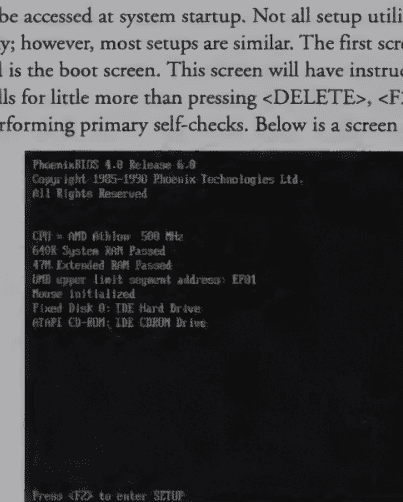

图 2-1. 启动屏幕

BIOS 设置程序的主界面有几个可能的类别。这些类别包括但不限于：主、高级、电源、启动和退出。每个类别都包含系统不同组件的若干项设置。某些类别包含子类别，子类别中又包含更多设置。主类别包含机器的通用设置。其中两个设置是系统时间和日期。如有必要，在此更改机器的时间和日期。由于 BIOS 能够自动检测许多设备和设置，除非有非常特定或必要的理由，否则 真的不需要更改 BIOS。

## 子类别与设置

高级和电源类别包含设备操作和电源管理的设置。这些设置应仅由经验丰富的用户更改。如果某些设置配置不当，可能会对 CPU 和其他系统组件造成损坏。

启动类别包含安装 Linux 时可能需要调整的设置。硬盘、软驱器、CD-ROM 和其他可启动设备的设置位于启动类别中。为了正确安装 Linux，需要正确配置这些设置。更重要的是，应该启用硬盘。如果硬盘被禁用，则将没有可行的地方安装 Linux。下一个重要设备是 CD-ROM，它是最常见的安装方法之一。该设备需要软驱器，这是一种较不常见但可能的安装手段。如果从软盘安装正在安装的发行版，则应启用该设备。最后一个大设备是“其他 (other)”的设置。如果安装过程通过网络连接进行，则需要将此可启动设备设置为网卡。

BIOS 的其余部分应由经验丰富的用户出于特定原因更改。在设置时间并更改了安装所需的设置后，最后应该执行的操作是保存更改并重启系统。

```
LILO boot: <TAB>
linux win98
LILO boot:
```

一个典型的 `/etc/lilo.conf` 看起来像这样：


# 模块 2 — 安装 Linux 之前需要知道的

- 鼠标选项
- 键盘
  - 允许用户选择型号、布局、行为
- 显卡
  - 允许用户选择型号、布局、行为
  - 显示器
    - 水平和和垂直刷新率
  - 取消选择
- 其他

img/b0ea5e4a55ee6767fff087672e71c505_41_0.png)

在安装 Linux 之前，检查以下：

```
/etc/x11/
```

```
/etc/x11/
```

```
/etc/x11/
```

```
/etc/x11/
```

```
/etc/x11/
```

```
/etc/x11/
```

```
/etc/x11/
```


# 模式选择

在模式选择下，用户可以决定系统的分辨率和色彩深度。分辨率范围从 `320x200` 到 `1600x1200` 每英寸点 `dpi`。还可以指定色彩深度 `bpp`。选项有 `8`、`16`、`24` 和 `32` `bpp`。`bpp` 越高，显示的颜色越多；分辨率越高，图像越清晰。

## 显示器

有两种不同的方法配置显示器。水平垂直刷新率的值可以直接指定，也可以从默认选项中选择。大多数显示器都会列出，但某些显示器可能需要指定范围。在决定设置时要小心。如果刷新率设置为无效范围，可能会导致损坏。

在其他菜单中，有一些杂项，包括热键 `<CTRL-ALT-BACKSPACE>`，会杀死 X 服务器、允许视频切换和视频模式。热键和视频模式默认选中。

在配置鼠标时，应选择端口。如果端口是串口，可能是 `/dev/ttyS0`、`/dev/ttyS1`、`/dev/ttyS2` 或 `/dev/ttyS3`。如果端口是 PS/2，端口为 `/dev/tty1-4`。

键盘菜单允许你选择型号、布局和行为。行为的示例包括使用 Shift 键切换组或使用 `<ALT-CTRL>` 切换组。

在卡选项中，使用服务器选项选择安装在系统上的哪种品牌和类型的显卡。提供了一个设置可以识别的列表。对于显卡，可以从列表中选择或自动检测。服务器的示例有 `MONO`、`SVGA` 和 `Mach`。每个服务器还应提供卡上的显存大小。可以探测卡以获取硬件信息，但可能会导致其死机。

这些问题的答案位于本手册末尾的附录 A。

- 什么是双启动系统？
- 什么是 `LILO`？它的配置文件是什么？
- 为什么在设置显示器刷新率时采取谨慎态度很重要？

### 目的

本实验旨在教授用户如何识别硬件，并判断其是否与 Linux 兼容。用户将通过检查硬件文档、目视硬件以及参考在线文档来查找 Linux 是否支持该硬件从而学会这些。一旦用户能够做到这一点，他或她就能判断现有系统是否能够支持 Linux，并对系统硬件进行任何更改以允许系统支持 Linux。

### 实验时长

10 到 15 分钟。

### 概述

有几十种不同类型的硬件和数百个不同的硬件制造商。随着硬件技术的进步，新类型和新版本的硬件不断出现在市场上。操作系统想要支持每一件存在的硬件是不可能的；然而，Linux 支持大量的硬件，且支持的类型范围在不断扩大。在安装 Linux 之前，用户将需要能够识别其硬件，并查看其是否与 Linux 兼容。这是一个简单但必要的步骤。

首先，用户应该检查随相关硬件附带的文档。这些文档将包含识别硬件所需的所有信息。这包括制造商名称、型号名称以及其他特定的硬件信息。如果系统是预制的，但没有随附带特定信息，用户可能希望联系制造商以获取这些信息。

如果没有可用的硬件文档，且制造商无法提供有用信息，则可能需要对硬件进行目视检查。在许多情况下，硬件信息可能会打印在硬件本身上。例如，许多硬盘的顶部印有容量以及扇区数、柱数和磁头数。其他类型的硬件（如声卡）可能稍难识别。在这些情况下，必须检查卡片上用于识别其身份的信息。通常，制造商和型号可以在电路板上找到。有了这些信息，可以联系制造商以获取该型号的规格说明。许多网站提供了用于硬件目视识别的帮助工具。其中一个网站是 `www.plasma-online.de`。

最后，用户应该检查 Linux 是否支持该硬件。这可以在任何 Linux 支持网站上完成。以下网站是获取受支持硬件信息的可靠且实时的来源：
`http://www.ibib.org/pub/docs/HOWTO/Hardware-HOWTO`

如果硬件列在此处，则它受当前版本的 Linux 支持。如果不支持，用户唯一的解决方案是更换硬件或等待更高版本的 Linux。

### 实验练习

完成此实验，你将需要：
- 一台带有显示器和声卡的 PC。
- PC 及其相关硬件附带的文档。
- 互联网访问。

### 第一部分 - 通过文档识别和目视检查

- 在显示器本身上找到制造商和型号信息，例如 `ViewSonic E71`，并记录这些信息。
- 在显示器文档中，找到显示器的水平和垂直同步范围，并记录这些信息。Linux 在安装期间需要这些信息。
- 找到声卡，并寻找电路板上打印的制造商和型号数字。如果存在这些信息，请记录。
- 如果电路板上没有打印制造商和型号信息，请查看芯片上的制造商标志。访问网站 `www.plasma-online.de`，该网站有可能打印在芯片上的标志图片、制造商序列号和 FCC ID。使用这些资源尽多收集有关板的信息。

### 第三部分 - Linux 兼容性检查

- 访问网站 `www.ibib.org/pub/docs/HOWTO/Hardware-HOWTO`，并通过制造商和型号搜索声卡。
- 如果在此列表中找不到每件硬件的制造商和型号，则该硬件不受 Linux 支持。如果存在该信息，则该硬件在当前的 Linux 发行版下应工作。

这些问题的答案位于本手册末尾的附录 A。

- 为什么在安装操作系统之前确保硬件与 Linux 兼容是重要的？
- 用户如何仅凭制造商名称和型号获取硬件信息？

### 高级问题

- 识别硬件（如集成在主板上的调制解调器）的最佳方法是什么？
- 如果某个特定硬件不支持 Linux，用户是否可以自己开发支持？

# SAIR LINUX GNU 认证 模块 3

## 3-2 第 3 章 — 安装

## 第 3 章 - 安装

- 安装选项
- 理解分区
- 管理分区的工具
- 引导加载器
- 双启动配置
- 用户账户
- 配置图形用户界面
- 设置设备

## 目标

在完成本模块后，你将能够：
- 在 Linux 安装期间确定要安装哪些选项。
- 使用 `fdisk`、`cfdisk` 和 Disk Druid 创建磁盘分区。
- 通过编辑 `/etc/password` 和 `/etc/groups` 添加用户。
- 为新用户创建家目录。
- 使用 `pwadd` 和 `userdel`。
- 将登录初始化文件传输到新的家目录。
- 理解配置 X 窗口的各种方法以使用 `Fwm`、`TWM`、`IceWM`、`AfterStep`、`Enlightenment`、`WindowMaker` 和 `Sawfish`。
- 使用并配置 `LILO` 和 `loadlin`。
- 编译并配置设备驱动。
- 理解双启动配置并使用 `LILO` 进行双启动。

## 安装选项

### 选择安装方式

- `GUI` 安装
  - 更简单的软件包安装方式
  - 选择任务而非单个软件包
- 文本模式安装

### 安装什么

- 编译器
  - 用于安装大量软件时
- 服务器
  - 需要适当的文件、邮件服务器或 Web 服务器应用程序

上一节涵盖了安装 Linux 所需的各个步骤。本节讨论了 Linux 的配置以及许多可用选项。

Linux 的一个方面是能够安装适用于个人用户需求的软件包。软件包是工具和实用程序的集合，其大小和功能各异。软件包的示例包括 `GCC`、`C`、`Perl` 和 `Python`。软件包通常是特定的，与计算机的各种用途相关，例如图形设计或网络功能。与其他一次性安装所有可用软件包的操作系统不同，Linux 允许用户在安装时选择要安装哪些软件包。这通过移除不必要的软件包节省了硬盘空间。用户可以选择进行全量安装。然而，不建议这样做，因为这通常会导致安装不必要的软件包并浪费磁盘空间。

#### 选择安装方式

让用户从命令行界面或文本模式安装 Linux 发行版会更好。大多数从文本模式安装开始的用户都学会了在没有 X 环境开销的情况下运行服务器的强大和简单。对于缺乏经验的用户，`GUI` 方法是更优的。

#### GUI 安装

几乎每种 Linux 发行版都提供某种 `GUI` 方法。值得注意的例外是 `Debian` 和 `Slackware`，尽管某些 `Debian` 派生版本提供了最小或扩展的 `GUI` 安装方法，例如 `Librarian` 和 `Progeny`。根据用户的经验和灵活性，安装 Linux 可能会更简单。大多数商业版 Linux 都有基础图形界面，将引导用户完成配置过程。

许多版本使用以任务为导向的功能组，让用户在以下项目之间选择：
- 工作站
- 开发者
- 服务器
- 全量安装
- 自定义安装

#### 文本模式安装

虽然有人说由于提供了 `GUI` 选项，文本模式安装并不是必须的，但事实并非如此。对于那些不安装任何图形环境的人，服务器、设备、防火墙、路由器等来说，文本模式安装至关重要。虽然它不是没有经验的用户的首选方法，但文本模式安装对大多数用户来说都是可以，通常允许提供与 `GUI` 模式安装类似的功能。

文本模式安装的优势是可以在具有不支持的显卡或在加载 `GUI` 安装所需的 X 界面时遇到困难的计算机上配置 Linux。

#### 安装什么

如果用户需要特殊的软件包集，或者有特定的特定任务需要进行安装，请使用该发行版的自定义安装选项。这将允许用户对每个软件包进行精细的控制，在某些发行版例如 `Debian` 中，用户可以选择软件包中的单个文件。

#### 编译器

如果用户计划从源代码安装大量软件，他或她将需要安装相应的编译器。对于 C，需要 `g++`；对于 Ada，需要 `Gnat`；解释器则需要 `Perl` 解释器、`Python` 解释器以及 Scheme 的 `Guide`。除了编译器和解释器外，还需要包含各种开发工具和库。为了方便不使用开发工具和库的个人节省磁盘空间，库被拆分为两个或多个软件包。

#### 服务器

如果用户计划让系统作为功能性服务器运行，他或她将需要安装的文件服务器、邮件或 Web 服务器应用程序。需要在服务器上安装 `NFS` 以供 `NFS` 客户端使用。要设置邮件服务器，用户需要安装邮件传输代理 `MTA`、邮件投递代理 `MDA` 和邮件守护进程。流行的 `MTA` 包括 `Postfix`、`Qmail` 和 `Exim`。`MDA` 的示例包括 `Maildrop` 和 `Procmail`。两个出色的邮件访问守护进程示例是 `cyrus-imap` 和 `cyrus-POP3`。对于 Web 服务器，`Apache` 是目前最流行且功能强大的应用程序。

## 理解分区

- 分区类型
  - Linux 原生分区
  - 交换分区
- 管理分区的工具
- 引导加载器
- 双启动配置
- 用户账户
- 配置图形用户界面
- 设置设备

## 分区管理工具

- 使用 `fdisk`
  - 最受欢迎的磁盘分区工具之一
  - 在 `fdisk` 提示符下输入 `m` 可查看命令及用法
- 使用 `cfdisk`
  - 被认为比 `fdisk` 更容易使用
  - 使用方向键进行导航
- 使用 Disk Druid
  - 易于使用的图形化界面

在 Linux 安装过程中，必须创建必要的 Linux 分区，例如 Linux 内核实际所在的 Linux 原生分区，以及用于创建虚拟内存的 Linux 交换分区 `swap partition`。根据需要添加更多分区。

在计算机上安装多个操作系统时，分区是必要的。创建分区会删除新分区所占空间中的数据。因此，在已包含数据的硬盘上安装 Linux 时要务必小心。所有 Linux 发行版在安装时都提供分区选项。Linux 安装过程可能用于分区硬盘的三种主要工具是 `fdisk`、`cfdisk` 和 Disk Druid。

### 使用 fdisk

`fdisk` 是最流行的磁盘分区工具之一。某些 Linux 发行版如 `TurboLinux` 和 `Slackware` 在安装过程中使用 `fdisk` 版本作为其分区工具。`SuSE Linux` 也通过 `fdisk` 运行分区工具。如需使用 `fdisk` 的帮助，在 `fdisk` 提示符下输入 `m` 可查看可用命令及其用法列表。

为 Linux 设置硬盘的第一步是创建交换分区。选择创建新分区的选项。`fdisk` 然后会提示用户声明新分区是扩展分区还是主分区。

```
# 8 模块 3 — 安装
```


c 切换兼容标志

d 删除分区

l 列出主分区类型

w 添加分区

c 创建一个空的 DOS 分区表

打印分区表

不保存更改退出

使用 disklabel 创建可引导分区

更改分区的系统 ID

验证分区表

将表写入磁盘（只读）

额外功能（仅导出）

命令 (n 帮助)?

命令

扩展

主分区 (1-4)

分区号 (1-4): 1

第一个磁道 (1-1815), 默认: 1

最后一个磁道 或 +size 或 +sizeM 或 +sizeK (1-1-1815, 默认: 1815)

命令 (n 帮助)?

```
图 3-1. 创建交换驱动器后的屏幕输出
```

创建交换分区后，必须将其设置为 Linux Swap。为了实现这一点，用户使用 `t` 来更改分区的系统 ID。由于此交换驱动器被认为是分区 1，用户使用 `t 1` 指定分区号。Linux 交换分区的十六进制代码为 82；但如果需要所有十六进制代码列表，用户只需输入 1。

创建交换驱动器后，用户应输入 `p` 打印分区表。可以在此表中查看所有分区的详细信息，用户可以判断交换分区是否已正确创建。

```
Command (n for help)?
disk /dev/hda 64 heads, 63 sectors, 1815 cylinders
总磁道数 4832 = 512 bytes
设备/启动 起 结束 区 系统
/dev/hda1 1 33 66496 82 Linux swap
Command (n for help)?
```

```
图 3-2. 所有分区的视图
```

设置硬盘的下一步是创建 Linux 原生分区。此过程与创建交换分区的过程非常相似。第一步是输入 `n` 并创建第二个主分区。由于交换分区的最后一个磁道是 33，新分区的第一个磁道应该是 34。为了创建原生分区，使用了剩余的磁道。“最后一个磁道”字段应为最后一个磁道的值。此外，如果分区类型不是 Linux 原生，则必须通过输入 `t` 来更改。以下是用于创建 Linux 原生分区的命令截图。在同一屏幕上，`p` 选项会创建所有分区列表：


# 分区管理工具 3-9

```
Command (m for help): e
命令操作
p 扩展
p 主分区 (1-4) 2
分区号 (1-4) 2
第一个磁道 [34-34]: 默认 34 34
最后一个磁道 或 大小 [size|M|G] [34-1015]: 默认 1015 1015
Command (m for help): p
Device /dev/hda: 64 heads, 63 sectors, 1015 cylinders
大小 4832 = 512 bytes
```

```
图 3-3. 创建原生分区的命令
```

## cfdisk

另一个流行的分区工具是 `cfdisk`。

使用方向键进行导航。

使用 `cfdisk` 被认为比 `fdisk` 更容易使用。

## 第 3 模块 — 安装

点击“添加”（Add）选项后，将出现一个新窗口。在此窗口中，可以定义分区的类型和大小。分区类型应设置为 Linux Swap（Linux 交换分区），分区大小由用户决定。在下图中，正在创建一个 64 兆的交换驱动器：

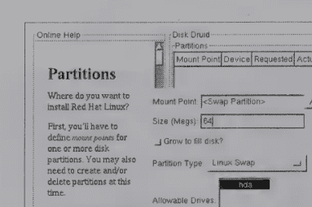

在交换分区之后，应该创建原生分区。要执行操作，点击“添加”（Add）按钮。当配置窗口出现时，将挂载点设置为正斜杠（/），分区类型设置为 Linux Native（Linux 原生），并将分区设置为所需的大小。如果用户希望使用磁盘的剩余部分，应选择“增长填充磁盘”（Grow to Fill Disk）选项。如果分区配置满意，点击如下所示的“确定”按钮：

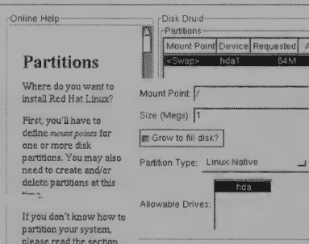

点击“确定”后，将出现类似下图的屏幕。如果所有分区都正确，请继续安装。然而，如果需要更多分区或当前分区错误，可以使用 `<DEL>` 键轻松删除分区，也可以像添加交换分区和原生分区一样添加更多分区。以下是一个示例：

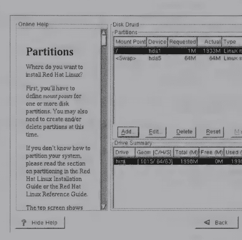

图 3-11. 创建分区后的屏幕截图

## 3-14 第 3 模块 — 安装

## 引导加载程序

- LILO
  - 允许用户选择启动哪个内核或系统
  - 基于 `lilo.conf` 文件中的标签
- loadlin
  - 从 DOS 启动 Linux，而不是在系统启动期间启动
  - 非常适合 LILO 无法访问的笔记本电脑或硬盘

## 引导加载程序

引导加载程序（boot loader），有时称为自引导加载程序（bootstrap loader），是一个引导系统启动过程的软件程序。在启动期间，大多数计算机使用类似的初始化方法。当电源开启时，CPU 开始在系统 ROM 中查找有关下一步操作的指令。通常，这些系统包含启动硬件的信息，以及告诉位于硬件上的软件接管引导过程的信息。在此时，系统会在软盘驱动器、硬盘和其他可启动设备上寻找引导信息。通常首先检查软盘驱动器，以便在硬盘故障时系统可以从这些位置之一进行初始化。在这些硬件上找到并初始化的软件就是引导加载程序。硬盘的 MBR（主引导记录）通常是引导加载程序程序存储的地方。是引导加载程序初始化了如 Linux 或 DOS 之类的操作系统。

正如同 DOS 使用主引导程序进行初始化，Linux 系统也使用诸如 Linux Loader (LILO) 和 `loadlin.exe` 等程序。

## LILO

一旦访问 MBR，就会加载一个主引导程序，该程序会加载一个次级程序来初始化操作系统内核。LILO 的核心目的是允许用户选择启动哪个 Linux 内核或其他操作系统。这是通过给用户提供引导提示符实现的，用户可以根据 `lilo.conf` 文件中定义的标签指定所需的操作系统。在 LILO 提示符处按 `<TAB>` 键可以获取可用选项列表。

`lilo.conf` 文件是 LILO 的配置文件。默认情况下，此文件位于 `/etc/` 目录。可以通过编辑此文件来自定制 LILO 的功能。表 3-2 所示了 `lilo.conf` 文件中的一些示例条目及其它们执行的功能：

| lilo.conf 条目 | 功能 |
|---|---|
| boot=/dev/hda | 指定引导区为 `/dev/hda` |
| prompt | 调用引导提示符 |
| delay=150 | 在自动启动第一个条目前设置 150 秒的延迟 |
| VGA=normal | 指定使用的模式 |
| message=/boot/message | 指定在提示之前显示的文本文件 |
| default=linux | 指定要启动的内核或操作系统；如果没有指定，默认启动第一个条目： |
| image=/boot/vmlinuz | 除非在提示符处另有指定，否则将加载第一个内核 |
| label=linux | |
| image=/boot/vmlinuz-2.14-5-0 | 指定次级内核；标签字段指定初始化它的命令 |
| label=linux2 | |
| other=/dev/hda | 调用另一个操作系统作为 DOS；指示使用的分区；标签指示命令 |
| label=dos | |

表 3-2. LILO 示例条目

`lilo.conf` 文件中最多可以列出 16 个内核。对于 Linux 之外的任何操作系统，使用上述表最后一行的格式。

每当对内核进行更改时，必须运行 `lilo` 以确保系统启动。如果 `lilo.conf` 有更改，必须运行 `lilo`。这是因为每次运行 `lilo` 都会创建一个映射文件，告知内核和其他文件的位置。如果重新构建内核后没有创建此映射，将来将无法启动。

## loadlin

由于 `loadlin` 从 DOS 而不是系统启动 Linux，它的功能与 LILO 不同。对于 LILO 无法访问的笔记本电脑或硬盘，它是很好的替代方案。它的缺点是一旦加载了 Linux 内核，用户无法返回操作系统，因为需要重启。

要使用 `loadlin`，只需将文件放在 DOS 分区中。确保将文件放在 DOS 路径中列出的目录中。Linux 内核也应放在自己的目录中。然后，假设内核位于 `c:\`，内核名为 `vmlinuz`，Linux 分区为 `/dev/hda2`，在 DOS 提示符使用以下语法启动 `loadlin`：

```
load c:\linux\vmlinuz root=/dev/hda2 ro
```

此命令应在 DOS 模式下运行，而不是从 Windows 环境启动。随后，此命令将启动 Linux。


在与另一个操作系统共用同一分区上安装 Linux 基本上有两种方法。这两种方法都需要在硬盘上创建一个第二个主分区。第一种方案是备份硬盘上的所有数据，并重新划分磁盘以创建正确数量的磁盘分区。交换分区（swap partition）可以在此点创建，也可以在安装过程中本身创建。分区完成后，应重新安装另一个操作系统，并恢复备份的数据。

若想在不重新安装原始操作系统的情况下重新划分硬盘，请使用分区大小调整工具。大多数发行行版现在都带有一个名为 `FIPS` 的工具，它可以从另一个分区的未分配空间创建新分区。市面上可用的程序（如 Partition Magic）也可用于相同的目的。使用分区大小调整工具并非完全没有风险；因此，应该对现有分区上的所有数据进行备份。在备份完分区后，应运行碎片整理工具以将所有数据整合到驱动器的开头。碎片整理后，按照说明运行分区大小调整工具以创建正确数量的分区。交换分区可以现在创建，也可以在安装过程中创建。

一旦创建了分区，继续进行 Linux 安装过程。当提示选择目标位置时，将 Linux 安装到新创建的分区中。正常继续安装，如果适用，请使用安装程序为多操作系统配置 LILO。当仅使用一个硬盘时，除非使用其他引导程序，否则应将 LILO 安装到主引导记录（MBR）中。

## 使系统支持多启动

考虑用户需要建立双启动系统的情况。系统目前占据硬盘的单个 FAT32 分区上安装了 Windows。第一步是将硬盘划分为两个或多个分区。

在重新划分磁盘之前，必须将磁盘上的所有数据移动到分区的开头。这通过 Windows 磁盘碎片整理程序完成，这可能需要先运行 Windows 磁盘扫描（ScanDisk）。

使用 Partition Magic 等商业软件可以轻松地调整分区大小，但也有一个免费程序 `fips`，地址位于 `www.igd.flg.de/~aschafe/fips/`。它没有像商业程序那样的图形用户界面（GUI），但并不难使用。

> 注意：`fips` 仅将分区一分为二；它无法创建多个分区。对于这种情况，请使用 `fdisk` 或 `cfdisk`。

假设用户想要以下分区：

- 1. 0-511 磁道内的 Windows 可启动分区。
- 2. 此分区必须是 Windows 支持的文件系统之一。本示例将使用 FAT32。
- 3. 512-1000 磁道内的 Linux 可启动分区。
- 4. 这必须是 Linux 支持的文件系统之一。此分区将使用 Ext2。
- 5. 1001-1009 磁道内的 64M Linux 交换分区。
- 6. 这必须具有使用它的操作系统所支持的文件系统。
- 7. 1010-2048 磁道内的用户目录分区。

现在使用 `fdisk` 或 `cfdisk`，用户检查并修改分区数量。硬盘上只有由 `fips` 创建的两个分区。必须删除第二个分区，然后创建 Linux 的分区。有关 `fdisk` 或 `cfdisk` 的更多信息，请参阅各自的帮助文档页（man pages）。

以下是完成重新划分后 `fdisk -p` 命令的输出：

| 驱动器 | 启动 | 起始 | 结束 | 系统 |
| :--- | :--- | :--- | :--- | :--- |
| `/dev/hda1` | * | 1 | 511 | Win98 FAT32 (LBA) |
| `/dev/hda2` | | 512 | 1000 | Linux Native |
| `/dev/hda3` | | 1001 | 1009 | Linux Swap |
| `/dev/hda4` | | 1010 | 2048 | Linux Native |

现在用户已准备好安装 Linux。当安装程序询问文件系统和交换区的设备名称时，请务必正确指定上述设备。

## 用户账户

- UID 和 GID
- `/etc/passwd`
- 添加用户
  - 设置基本信息
  - 创建主目录
  - 传输登录初始化文件
- 删除用户账户
- Shadow 密码文件

个人用户账户是 Linux 最强大且实用的功能之一；它们也是 Linux 系统管理中最令人厌烦的烦恼来源之一。从账户的个人问题到安全问题，系统管理员通常会认为，维护和管理用户账户可能变得比其他管理职责更耗时间。尽管如此，多用户操作系统所提供的生产力和网络功能是值得投入时间的。

用户账户允许多个人访问机器和文件系统，并允许系统管理员控制每个人的权限大小和访问权限。用户账户的默认权限比 root 低，因为 root 为系统管理员提供了对所有内容的完全访问权限。所有系统管理员都有一个独立的用户账户，这允许他们在不做出潜在有害更改的情况下对系统工作。

## UID 和 GID

用户的主要标识符是其用户标识号（UID）。系统通过此 UID 识别并引用用户。UID 与用户名（登录名）相关，用户名通常是一个不超过八个字符的字符串。用户名是用户输入的标识符。此外，用户会被分配一个组 ID（GID），按组对用户进行分类。与 UID 一样，GID 被系统用于识别主组。

## /etc/passwd

关于用户账户的信息位于 `/etc/passwd` 文件中。以下是 `/etc/passwd` 的示例：

```
bryandeer:x:1003:100:Bryan Deer:/home/bryandeer:/bin/bash
SatokoK:x:1004:100:Satoko Kato:/home/SatokoK:/bin/bash
bluejay:x:1005:100:Jay Quinn:/home/bluejay:/bin/bash
```

`/etc/passwd` 文件包含各种信息，并由冒号分隔。格式如下：

```
username:password:UID:GID:information:home_directory:shell
```

每行包含关于一个用户的信息。第一个字段是用户名。下一个字段（包含 x）是密码字段。通常情况下，密码以加密格式显示；为了安全起见，使用了 shadow 密码。这些将在稍后详细介绍。接下来两个字段显示 UID 和 GID。所有用户都可以关联多个组；这里的 GID 是主组。信息字段显示全名、主目录，最后一个字段指示登录时使用的 shell，在上述情况下是 bash (Bourne-Again)。

用户组存储在 `/etc/group` 文件中。这与 `/etc/passwd` 文件类似，但它不那么复杂，因为它只有四项内容：

```
```
用户名字段可以包含任意数量的用户名。以下是该文件的一个示例：

```
students:x:517:bryandeer,SatokoK,bluejay
```

> 注意：用户名之间用逗号分隔。

## 添加用户

添加新用户通过一系列简单的程序实现，通常由用户配置工具（如 `useradd` 或 `usermod`）执行。本节将讨论手动添加用户的步骤。有关 `useradd` 或 `usermod` 的信息，请查看它们的帮助文档页。

### 设置基本信息

每个新用户都需要一个用户名、UID 和 GID。以 root 身份登录，使用文本编辑器修改 `/etc/passwd` 文件。新用户的信息将按照本节之前指定的格式输入该文件：

```
username:password:UID:GID:information:home_directory:shell
```

所有字段之间都使用冒号而不是空格。此文件通常包含用户的全名。在向 `/etc/passwd` 添加用户时，始终在用户名和 UID 字段之间保留两个冒号以留空密码字段。系统管理员可以在命令行提示符处输入 `passwd username` 来设置用户密码。

# 用户账户 3-21

如果用户无法更改密码，系统之外的人可能会获取它并破坏系统。最好的选项是允许用户设置自己的密码，或者使用 `passwd` 的 `-f` 选项让密码过期。用户的可用 shell 应该在 `/etc/shells` 文件中指定。

## 创建家目录

```
bryander:x:1005:000:Bryan:/mnt/home/bash
```

一个会使用 `mkdir` 命令。

# 传输初始化文件

用户的 shell 初始化文件必须包含在家目录中。用户必须被授予这些文件的所有权。表 3-1 说明了某些 shell 包含的文件：

| Shell | 必需的文件 |
|---|---|
| Bourne Shell | .profile |
| Bash Shell | .login .bashrc |
| C Shell | .login .cshrc |
| Korn Shell | .profile .kshrc |
| Tsh | .login .cshrc or .tcshrc |

表 3-1 某些 shell 的文件

这些文件的约定位置是 `/etc/skeleton` 目录，尽管该位置随不同的 Linux 发行版而异。系统管理员需要使用 `cp` 命令将必要的文件从该目录复制到用户的家目录，然后使用 `chown` 更改文件和家目录的所有权。

```
chown -R bryander /mnt/home
```

一旦完成此步骤，新用户账户就准备好了。为了确保新账户正常，尝试作为新用户登录。如果登录顺利，检查文件以查看初始化文件是否生效。如果一切正常，新用户已成功添加。

Linux 和 GNU 认证基础

## 删除用户账户

删除用户账户是一项简单的任务。删除账户最简单的方法是使用 `userdel` 工具：

```
$ userdel username
```


此应用程序删除 `/etc/passwd` 和 `/etc/shadow` 中适用于指定用户名的所有条目，但如果运行 `userdel` 时带有 `-r` 选项，它还将删除用户的目录和文件，建议在此之前备份这些文件。

如果系统管理员不希望使用此工具进行这些更改，他们可以手动从文件中删除所有条目以及删除用户的文件和目录。

# 影子密码文件

运行在系统上的许多程序使用 `/etc/passwd` 获取密码以外的信息，由于这个原因，它应该保持可读。然而，如果用户能够访问加密后的密码，并且某些密码可能是可能的，这就是影子文件存在的原因。密码从 `/etc/passwd` 分离到 `/etc/shadow` 文件，由 root 可读。创建 `/etc/shadow` 文件的命令是 `passwd`，应在命令行提示符运行。影子密码文件现在包含加密密码条目和关于密码的信息。然而，由于此文件只有 root 可读，其中的信息比在 `/etc/passwd` 文件中更安全。

# 配置图形用户界面

- 窗口管理器
- 模块化设计的X窗口系统
- Fwm, TWM, IceWM, AfterStep 等
- 桌面环境
- 为所有应用程序、桌面提供一致的外观
- 第一个免费桌面是 KDE
- Gnome 在 KDE 许可问题后开发

# 配置图形用户界面

Linux 可用的 GUI 使用X窗口系统构建。用于 Unix 平台的原始 X 窗口系统在 MIT 开发；X 版本 11 发布 6（通常称为 X11R6 或 X11）由于 XFree86 项目可在 Linux 和其他 Unix 类操作系统可用。X 可以配置为运行许多不同的桌面环境，尽管简单的窗口管理器仍然是最常见的。运行 XFree86 的最低推荐系统是 486/66，配备 16MB 内存和不少于 60MB 的可用磁盘空间。取决于打算配合 XFree86 运行的应用程序，可能需要更多空间。

## 窗口管理器

窗口系统以模块化的方式设计。虽然不同组件之间相互作用，但它们是完全分离的，允许通过替换组件来实现高度定制化。窗口管理器是 X 窗口系统的组件，控制窗口的外观以及用户如何与窗口交互。它们基本上控制用户的屏幕布局和环境外观。由于窗口管理器是构成 X 窗口系统的其他部分的独立组件，可以安装或卸载不同的管理器，允许在任何 X 桌面环境中使用这些。

一些可用的管理器有 FVWM、TWM 及其变体、IceWM、AfterStep、Enlightenment、WindowMaker 和 Sawfish（以前称为 Sawmill）。除了 Sawfish 外，所有这些管理器都提供自己的环境，可能会与桌面冲突。

## 桌面环境

传统上，窗口管理器通过编辑文件进行修改。过去几年，GUI 工具已成为编辑文件的替代方案。这一事实在桌面环境、WindowMaker 和 Enlightenment 中显而易见。

桌面环境对于 Linux 来说是新颖的，它们不仅仅是窗口管理器。它们为所有应用程序提供一致的外观和感受。

第一个免费桌面环境是 KDE。它的开发目标是为 Unix 类操作系统带来 GUI。

另一个免费桌面环境是 Gnome，它是为了响应 KDE 而开发的。由于 KDE 的小部件集 Qt 的许可问题，Gnome 不再遵循 KDE。大多数用户运行默认 Sawfish，它是专门为 Gnome 开发的。

## 3 — 安装

### 即插即用设备

即插即用（PnP）是一个添加到 ISA 设备中的组件，使其在自动资源分配方面表现得更像 PCI 设备。虽然 Linux 访问 PCI 设备没有问题，但 ISA PNP 设备带来了挑战。在现代 BIOS 存在的情况下，许多设备（尤其是声卡）会出问题。像 Windows 这样的操作系统内置了 PNP 支持，而即将推出的 Linux 2.4 也将支持 PnP。在此期间，希望使用 PNP 设备的 Linux 用户必须依赖一个名为 `isnaptools` 的软件。

配置 PNP 的第一步是使用 `pnpdump` 命令获取 PNP 设备的列表。超级用户应将 `pnpdump` 的输出重定向到 `/etc/isapnp.conf`。该文件包含系统中每个 PNP 设备的节区，其中所有可能的设置都已注释掉。有时系统中没有列出正确的设置，用户必须手动选择。设备的正确设置可以在设备文档中找到，也可以通过检查在另一个操作系统中的配置来确定。

在正确设置 `/etc/isapnp.conf` 后，管理员应该将命令 `isapnp /etc/isapnp.conf` 放入一个启动文件中，通常存储在 `/etc/rc.d/init.d/` 或 `/etc/init` 中。该命令还应该链接到根级目录，大多数发行版已经处理了这一点。

### 可加载模块

将驱动程序编译进内核不如使用模块灵活。像 IRQ 等信息只能在设备驱动程序编译进内核的启动过程中指定。此外，当设备未未使用时，设备驱动程序仍然占用宝贵的内存。

可加载模块提供了比直接编译进内核更好的 替代方案。根据设备的不同，可能需要指定中断请求（IRQ）或输入/输出（I/O）等参数。声卡需要这些额外信息。在这种情况下，驱动程序应编译为动态加载模块。用户应将信息放在 `/etc/modules.conf` 或 `/etc/conf.modules` 中。可以使用文件名，但应仅使用其中一个。此信息将在每次加载模块时提供给该模块。

### 配置模块的命令

可以使用 `insmod`、`modprobe` 或 `kmod` 命令加载模块。`insmod` 是一个简单的命令，可自动将单个模块加载到内核中。如果该模块依赖于先加载的其他模块，`insmod` 将失败。为了让 `modprobe` 或 `kmod` 工作，必须生成所有模块及其依赖关系的列表。此列表通过执行命令 `depmod -a` 生成。每当安装新模块时必须运行此命令。

`modprobe` 是较为复杂的命令之一；它会加载指定模块所依赖的所有模块。它还会加载指定的模块。使用 `insmod` 是将模块加载到内核的最常用方法。`kmod` 是一个特殊的内核线程，它根据需要自动加载模块并在一段时间后卸载它们。

### 获取信息

许多用户并不使用 Linux 来收集设备信息，而是依靠另一个操作系统。最常见的原因是发行版没有提供获取信息的方法。然而，所有必要的信息都在 Linux 中。用户必须手动在 `/proc` 文件系统中查找信息。

`/proc` 是 Linux 维护的一个特殊文件系统。它完全存在于内存中，不存储在任何磁盘上。它包含了大量的系统信息，包括关于计算机设备的信息。

`/proc` 中的一些有用文件包括 `interrupts`（列出当前正在使用的 IRQ）、`iports`（列出当前正在使用的 I/O 端口）、`dma`（列出当前正在使用的直接内存访问通道）、`pci`（列出正在使用的 PCI 设备）以及 `devices`（列出内核中当前配置的设备驱动程序）。这些文件的内容在配置设备时是宝贵的参考。

## 模块复习题

这些问题的答案在手册末尾的附录 A 中。

- 1. 什么是硬盘分区？
- 2. Linux 需要的两个主分区是什么？
- 3. 定义分区。
- 4. 交换分区（swap partition）是如何工作的？
- 5. 哪个分区是活动分区？
  a) 交换分区
  b) 主分区
  c) 启动分区
  d) 以上均非
- 6. 引导加载程序（boot loader）目的是目的是？
- 7. LILO 和 loadlin.exe 之间有哪些区别？
- 8. 如果编辑 `/etc/lilo.conf` 后没有运行 `/sbin/lilo` 会发生什么？

## 实验 03 - 添加和删除用户

### 目的

本实验将使用户熟悉 `useradd` 和 `userdel` 命令。

### 实验时长

10 分钟。

### 概述

系统管理员必须做的最重要的事情之一是正确地从系统中添加和删除用户。幸运的是，Linux 通过 `useradd` 和 `userdel` 命令让这一过程变得相对轻松。在继续实验之前，请顺序查看这些命令的帮助页（man pages），以熟悉它们的更高级的功能。

### 实验练习

- 1. 为了向文件系统添加用户（在此例中为 tyler），只需在命令提示符以 root 身份输入以下内容：

```
#useradd -d /home/tyler tyler
```

`useradd` 命令的格式包括 `-d` 选项，后面跟着用户的家目录。然后是用户的登录名称，该目录将根据 `/etc/defaults/useradd` 文件中的默认值设置。该目录将仅包含 `/etc/skel` 目录中指定的文件。

- 2. 通过以下操作为我们的新用户设置密码：

```
#passwd tyler
新密码:xxxxxxxxxx
重新输入密码:xxxxxxxxxx
密码已更改
```

管理员在创建账户时应制作或获取用户密码。可以使用 `useradd` 命令配合 `-p` 选项，或者使用 `passwd` 命令完成。密码不会显示在屏幕上，但在此处用 `xxx` 表示。确保你的密码是大写字母、数字和特殊字符（如井号 `#`）的非逻辑组合。

- 3. 删除用户及其目录：

```
#userdel -r tyler
```

## 实验 03 问题

这些问题的答案在手册末尾的附录 A 中。

- 1. `/etc/defaults/useradd` 文件的目的是？
- 2. 创建密码的两种方法是什么？

## 4-2 第 4 章 — Linux 会话

+ 注销或关闭 Linux 系统.................................................. 4-27

系统关机过程.................................................................................... 4-27

如果发生不关机会发生什么？....................................................... 4-28

正确关机的命令...................................................................... 4-28

超级用户手动关机............................................................................... 4-29

使用 <CTRL-ALT-DEL>........................................................................... 4-29

章节复习题............................................................................... 4-30

实验 04 - 登录 Linux 系统 ................................................................ 4-31

目的 ........................................................................................... 4-31

实验时长 ................................................................................................... 4-31

概述 ........................................................................................ 4-31

实验练习 ................................................................................................ 4-31

实验 04 问题............................................................................... 4-32

## 第 4 章 – Linux 会话

- 登录
- 创建密码
- 创建、修改和删除组
- Linux 中的键序列（快捷键）
- 使用图形用户界面
- 什么是 Shell？
- 基础 Shell 函数
- Bash Shell 基础
- 注销或关闭 Linux 系统

## 目标

完成本章后，你将能够：

- 登录到主机计算机。
- 使用 `su` 切换到不同的用户。
- 使用多个终端。
- 创建或更改密码。
- 在命令行编辑中使用键序列。
- 理解各种 shell，包括 sh、bash、csh、ksh、tsh 和 zsh。
- 重定向 shell 输出。
- 执行基础 Shell 函数在命令行中进行导航。
- 注销或关闭 Linux 系统。

## 第 4 章 — Linux 会话

## 登录

- 开始 Linux 会话
  - 登录提示
  - 密码提示
  - 身份验证
- 切换用户
  - 登录图形用户界面 (GUI)
  - 使用多个终端

## 登录

要登录到主机，用户必须在该主机上拥有账户。本节解释了如何登录系统以及切换用户。

## 开始 Linux 会话

大多数 Linux 发行版的安装过程都需要 root 密码，并且通常需要创建至少一个用户账户。这样做是因为安装完成后，所有用户都需要登录，而 root 账户不应该是他们的普通登录账户。系统管理员还应该拥有一个个人用户账户，因为 root 通常保留给管理任务使用。以 root 身份登录的用户可能会意外更改重要文件。以 root 身份登录时犯的错误可能对系统产生破坏性。

## 登录提示

在 Linux 中，登录提示由名为 `getty` 的程序启动。`getty` 命令打开一个 tty 端口，提示登录名称，并调用 `login` 命令来完成登录过程。

典型的登录 shell 会在顶部显示发行版名称以及版本号。下一行包含 Linux 内核的版本号。显示工作站的名称，然后是登录提示。用户应该在此处输入用户名。当用户仅被授予其有权的文件和组的权限时，即视为登录成功。如果已设置了账户，应将其用于登录，除非必须执行管理任务（如创建用户账户）且尚不存在账户。如果账户不存在，则应为该用户创建账户供其访问。

### 密码提示

一旦在登录提示处输入了用户，它将显示：

```
Password:
```

在此处验证用户的身份。这告诉登录 shell 授予该账户的访问权限。虽然所有账户都应该设置密码以验证用户是否允许登录，但并不是强制要求的。在不要求密码的情况下让系统处于状态是一个坏主意。当用户输入密码时，登录 shell 会关闭显示，但密码仍被输入了。这样做是为了安全，以确保在输入密码时没有人能看到它。

如果输入的密码或用户名错误，将显示以下错误信息并出现另一个登录提示：

```
Login incorrect
login:
```

请记住，在登录过程中输入的信息是区分大小写的，在登录前请确保大写写锁定（Caps Lock）处于关闭状态。

## 身份验证

输入登录名和密码后，登录程序会检查 `/etc/passwd` 文件中的信息进行确认。如果系统使用了影子密码（shadow passwords），则登录程序将检查 `/etc/shadow` 文件以查找用户的密码。

接下来，shell 将返回一个类似这样的提示符：

```
[robert@biggs robert]
```

用户 robert 目前正登录到 Linux 会话。如果以 root 身份登录，提示符看起来可能像这样：

```
[root@biggs root]
```

## 切换用户

可以使用 `su` 切换到不同的用户。这不会打开一个登录 shell，而只是打开具有有效 UID 的新用户 shell。在输入 `su` 后，用户将收到提示：

```
[robert@biggs robert]$ su john
Password:
```

如果输入的密码或用户名错误，将显示以下错误信息并出现另一个登录提示：

```
Login incorrect
login:
```

请记住，在登录过程中输入的信息是区分大小写的，在登录前请确保大写写锁定处于关闭状态。

## 创建 4-7 位密码

- 在添加用户时创建密码
- 使用 passwd 修改密码
- 构建安全密码
- 系统密码参数
  - 最小长度
  - 对重复字符的限制
  - 密码字符间的最小差异值
  - 禁止使用字典单词
- 用户密码参数
  - 绝不使用熟悉的术语、写下密码或重复使用

## 创建密码

当多个用户可以访问网络化系统上的信息时，会产生许多安全问题。两个例子是：系统必须免受潜在恶意人员的侵害，并且每个用户都有权保持数据的私密性。在多用户网络操作系统中，Linux 必须实施严格的安全措施。其中之一就是其文件权限系统。然而，防止系统入侵的根本防御是使用密码。密码是一种难以克服的安全措施。它是一段只有用户才知道的信息，其目的是验证用户身份。

## 在添加用户时创建密码

在添加新用户账户时会创建密码，用户或系统管理员可以随时通过 `passwd` 命令更改密码。在添加新用户时创建密码，请以 root 身份执行 `useradd` 命令。系统将要求各种信息，最后一步是设置密码。此序列将类似于以下：

```
Changing password for user
Enter the new password (minimum of 5, maximum of 8 characters)
请使用大小写字母和数字的组合。
New password:
Re-enter password:
Password changed.
```

用户必须输入两次密码，因为密码在输入时是不显的。这确保了两次输入的内容完全一致，且用户没有输错密码。完成此步骤后，用户应该能够访问该账户。

注意：如果使用网络信息系统 (NIS) 在网络内共享信息，则必须使用 `passwd`，其工作方式与 `passwd` 相同。NIS 主服务器还必须运行 `/var/passwd/make` 以用新用户信息更新所有连接计算机上的数据库。

## 使用 passwd 修改密码


系统管理员或普通用户使用 `passwd` 命令更改账户密码。当由用户调用时，`passwd` 将仅更改该用户的密码。作为 root，可以通过输入 `passwd user` 来更改 `passwd` 更改任何用户的密码。

当调用 `passwd` 时，会发生类似所示的序列操作：

- 正在为用户更改密码
- 输入旧密码：
- 输入新密码：
- 重新输入新密码：
- 密码已更改。

此序列与添加新用户相似，用户会被提示输入旧密码。这是另一种防止未经授权用户的安全预防措施。例如，如果不存在此安全措施且终端被无人看管，任何人都可以使用它来更改你的密码，稍后回来并访问系统。当以 root 身份更改他人的密码时，不会提示输入旧密码。

## 创建安全密码

密码是防止入侵者的一大障碍。创建密码的个人决定了屏障的强度。将信息安全地防止他人获取不仅是一个重要的个人考量，也可能是一个重要的公司或法律问题。选择可能被猜到或窃取的密码会使该用户的信息和整个网络面临风险。出于因此，系统管理员和用户都应该遵循某些参数以确保密码的安全。

> 注意：绝不要与任何人共享密码，即使是系统管理员。如果可能，避免将密码写在容易发现和利用的地方。

## 系统参数

以下是系统管理员可以设置的参数，将防止使用某些密码。当用户尝试更改密码时，新密码将通过所选参数进行验证。如果不通过，用户必须选择另一个密码。

- 最小长度：密码必须具有最小数量的字符。密码字符越多，解码就越困难。
- 对重复字符的限制：限制密码中重复字符的数量。
- 密码字符间的最小差异值：密码字符之间必须有足够的差异。
- 禁止使用字典单词：防止使用字典中的单词。


# 第 4 模块 — Linux 会话

## Linux 中的键序列（快捷键）

- 命令行编辑中的键序列
- 修改按键绑定
- 内核键映射
  - 映射语法
  - 将序列重新映射到其他键

## Linux 中的键序列（快捷键）

键序列是键的组合，用作执行命令和执行某些操作的快捷键。它们有时用作切换状态或执行操作的更快速手段。

键序列可以由起始 ASCII 值不在 `0x20` 到 `0x7e` 范围内的按键组成。这意味着序列中第一个字符的 ASCII 值不能是可打印的 ASCII 值。在这种情况下，序列中可能包含多于两个组合。序列中第二个键的 ASCII 值也是不可打印的 ASCII 值。`0x20` 到 `0x7e` 是以十六进制表示的 ASCII 字符可打印范围。表 4-1 显示了一些常用 ASCII 控制字符的 ASCII 值：

| 十进制 | 十六进制 | 字符 | 符号 | 含义 |
|---|---|---|---|---|
| 0 | 0 | ^@ | NULL | 空字符 |
| 1 | 1 | ^A | SOH | 头部开始 |
| 2 | 2 | ^B | STX | 文本开始 |
| 3 | 3 | ^C | ETX | 文本结束 |
| 24 | 18 | ^X | CAN | 取消 |
| 27 | 1B | ^[ | ESC | 转义 |

表 4-1 控制字符的 ASCII 值

许多 Linux 程序使用键序列。不同的应用程序可能使用键序列完成相同的任务。其他组合在所有应用程序中可能是相同的。

### 命令行编辑中的键序列

键序列的一个重要应用是 shell 中的命令行编辑。它们对于快速导航和执行操作非常有用。例如，假设提示符处的用户希望快速重新输入上一次输入的命令，但不想因为命令太长而重新输入整个命令。只需按下 `<CTRL-P>`，最后输入的命令就会显示在提示符处。现在假设用户正在编辑一个文件并希望删除一整行文本。用户无需按退格键或删除键逐个删除字符，而是按 `<CTRL-K>` 删除整行。

Shell 使用 `readline` 库编译，该库处理所有输入编辑。表 4-2 给出了不同类型命令的示例。

| 键序列 | 操作 |
|---|---|
| `<CTRL-A>` | 将光标移动到行首。 |
| `<CTRL-E>` | 将光标移动到行尾。 |
| `<CTRL-P>` | 在命令历史列表中向后循环遍历。 |
| `<CTRL-N>` | 在命令历史列表中向前循环遍历。 |
| `<CTRL-D>` | 删除光标所在处的字符。 |
| `<CTRL-K>` | 删除从光标位置到行尾的文本（剪切）。 |
| `<CTRL-Y>` | 在命令行中粘贴最近剪切的文本。 |
| `<CTRL-X>`, `<CTRL-R>` | 重新读取具有不同按键绑定的初始化文件；执行命令后，按键绑定的更改或新的按键绑定将生效。 |

表 4-2 不同命令的示例

上述示例仅为可用命令中的一小部分。完整列表可以在 `readline` 和 `bash` 的 man 页面中找到。

### 修改按键绑定

可以通过在 `~/.inputrc` 文件中指定新的按键绑定，为单个用户更改默认按键绑定。此文件会覆盖 `/etc/inputrc` 文件中的设置，该文件对所有用户可读。环境变量 `$INPUTRC` 通常设置为 `/etc/inputrc`。如果没有设置，默认值为 `~/.inputrc`。

在初始化文件 `~/.inputrc` 中指定按键绑定的有二种方法。第一种方法是使用以下语法：

```
keyname: function-name
```

例如，`Control-x Control-r: re-read-init-file` 会导致键序列 `<CTRL-X>` 或 `<CTRL-R>` 执行 `re-read-init-file` 函数。

另一种语法如下：

```
"keyseq": function-name
```

使用键序列 `[ESC]-[H]` 跳到行首的条目看起来所示：

```
\e(h": beginning-of-line
```

用户还可以使用 `bind` 命令修改命令行的按键绑定。然而，`bind` 只会影响当前运行的 shell。`bind` 的语法如下：

```
bind -m keymap -q
bind -f filename
bind -m keymap keyseq:function-name
```

例如，`bind -l` 列出所有可以映射的函数。有关 `bind` 用法的更多详细信息，请参见 man 页面。

### 键映射

除了命令行编辑器使用的外，Linux 中还有其他重要的键序列。Linux 响应其他快捷键。正如“使用多个终端”中所述，按下 `<CTRL-ALT>` 和 `<F1>` 到 `<F6>` 之间的任何一个键将在虚拟终端之间切换。每个函数代表一个虚拟终端。从一个虚拟终端切换到另一个虚拟终端时，可能不需要 `<CTRL>` 键，但从 X 切换到虚拟终端时是必要的。因此，为了回到 X，请使用 `<CTRL-ALT-F7>`。`<CTRL-ALT-BACKSPACE>` 键会终止 X 服务。不建议这样做，因为它会杀死 X 服务。

## 映射语法

在 Linux 中，除了命令行编辑器使用的外，还有其他重要的键序列。Linux 响应其他快捷键。正如“使用多个终端”中所述，按下 `<CTRL-ALT>` 和 `<F1>` 到 `<F6>` 之间的任何一个键将在虚拟终端之间切换。每个函数代表一个虚拟终端。从一个虚拟终端切换到另一个虚拟终端时，可能不需要 `<CTRL>` 键，但从 X 切换到虚拟终端时是必要的。因此，为了回到 X，请使用 `<CTRL-ALT-F7>`。`<CTRL-ALT-BACKSPACE>` 键会终止 X 服务。这不建议这样做，因为它会杀死 X 服务。

## 使用图形用户界面

- GUI（图形用户界面）环境
- Xfree 86
- 对话框
- KDE Desktop
- 其他图形组件
- Gnome 桌面
- 启动 KDE 或 Gnome

# 使用图形用户界面

图形用户界面（GUI）已成为个人电脑使用的流行标准。与窗口管理器环境相比，桌面环境提供了额外的功能，它允许在在该桌面环境中运行的所有应用程序之间进行剪切和粘贴等任务。

GUI 环境提供了一个直观且熟悉的平台来执行计算任务，并且通常至少包含以下内容：

- 窗口
- 图标
- 菜单
- 对话框
- 其他图形组件

## Xfree86

Linux 通过 XFree86 项目提供 GUI，该项目是 X 窗口系统的一种实现。两个流行的桌面环境是 GNU K Desktop Environment 和 Gnome。这两个图形桌面环境都提供了可配置、用户友好的界面，并运行在大多数 Linux 发行版上。这些环境都具备拖放支持、多语言支持、常用实用程序、配置机制、详尽文档和开发支持。

## KDE Desktop


桌面环境（KDE）的开发是为了为基于 Unix 的操作系统提供现代界面。它构建在一个名为 `Qt` 的商业库之上。由 Trolltech 维护的 `Qt` 库包含在流行的 Linux 发行版中，可以自由用于运行基于 `Qt` 的程序和开发开源程序。安装 KDE 的需要工作良好的窗口系统和适当的 `Qt` 库。有关 KDE 的最新信息，请访问 KDE 网站 `www.kde.org`。

## Gnome Desktop

GNU 网络对象模型（Gnome）是 X11 另一个流行的桌面环境。它的目标是为开源系统提供免费的优质桌面环境。Gnome 使用 `GTK+` 库构建其图形。GIMP 工具包 (`GTK+`) 最初是为了为 GIMP 图像处理程序创建 GUI 组件。Gnome 和 `GTK+` 均根据 GNU 公许可证授权。Gnome 自述为免费、前沿、国际化、用户友好且开发者友好的。

与 KDE 类似，Gnome 提供了多种安装方法，但最简单的方法是原始的 Linux 安装。Gnome 目前对某些流行的 Linux 发行版支持独特的安装程序。要查看支持的发行版列表，请访问 `www.helixcode.com`，那里可以下载更新的 Gnome 软件包和额外软件。下载页面包含了在基于 RPM 的系统、Debian 和 Solaris 上安装 Gnome 的信息。

## 启动 KDE 或 Gnome

在成功安装 KDE 或 Gnome 后，在使用它们作为默认桌面环境之前只需最后几个步骤。第一步是检查用户主目录下的 `.xinitrc`、`.xclients` 和 `.xsession` 文件，寻找类似于的一行：

```
exec <window_manager>
```

在 `window_manager` 中，这是当前的环境启动脚本。

对于 Gnome，此行应该替换为命令：

```
exec gnome-session
```

对于 KDE，此行应该替换为命令：

```
exec startkde
```

再次强调，系统配置差异很大。安装此软件时，应阅读安装和 README 文件以及其他相关文档。

## 什么是 Shell？

- `sh`
  - 允许复杂的脚本编写
- `csh`
  - 具有命令集、脚本环境
- `ksh`
- `Bash`
  - 默认 shell
- `tsch`
- `zsh`

## 什么是 Shell？

Linux 系统的用户通过 shell 与内核交互。shell 本身是一个运行其他程序的程序。shell 可用于不同的功能。新手 Linux 用户可能只将其作为命令解释器，而专家用户可以进行作业控制和编写复杂的 shell 脚本。

每个 shell 提供的功能也根据 shell 的类型而不同。系统中安装的 shell 位于 `/etc/shells` 目录。下节节给出了一些较流行的 shell。还描述了两种先驱类的 shell：波恩 shell（Bourne shell）和 C shell（C shell）。

### `sh`

Bourne shell 是用户首知的最早 Unix shell 之一。其核心概念之一是管道的使用。

### `csh`

C shell 是一个使用 C 语言语法的 shell 版本。

### `ksh`

Korn shell 衍生自 Bourne shell。

### `Bash`

Bourne Again Shell 是大多数 Linux 发行版的默认 shell。

### `tcsh`

`tcsh` 是 `csh` 的版本。

### `zsh`

`zsh` 是一个提供许多功能的强大 shell。

| 特性/Shell | `sh` | `csh` | `ksh` | `bash` | `tcsh` | `zsh` |
| :--- | :---: | :---: | :---: | :---: | :---: | :---: |
| 作业控制 | N | Y | Y | Y | Y | Y |
| 别名 | N | Y | Y | Y | Y | Y |
| Shell 函数 | N | N | Y | Y | Y | Y |
| 输入 / 输出重定向 | Y | Y | Y | Y | Y | Y |
| 目录栈 | N | N | Y | Y | Y | Y |
| 命令历史 | N | Y | Y | Y | Y | Y |
| 命令行编辑 | N | N | Y | Y | Y | Y |
| 文件名补全 | Y | Y | Y | Y | Y | Y |
| 用户名补全 | N | N | Y | Y | N | Y |
| 主机名补全 | N | N | N | Y | N | Y |
| 免费可用 | N | N | N | Y | Y | Y |
| 有非交互式启动文件 | N | Y | Y | Y | Y | Y |
| 有非登录启动文件 | N | Y | Y | Y | Y | Y |
| 列出变量 | N | Y | Y | Y | Y | Y |
| 检查邮箱箱 | N | Y | Y | Y | Y | Y |
| 本地变量 | N | N | Y | Y | N | Y |

## 第 4 Module — Linux 会话

用户可以使用 `>>` 符号将标准输出追加到文件中，其内容如下所示：

```bash
$ ls >> list_of_files
```

上述命令将输出重定向到名为 `list_of_files` 的文件中，而不会重写 `list_of_files` 中已存在的信息

## Shell 脚本

Shell 脚本是一个包含 shell 命令的可执行文件。用户还可以通过使用 shell 脚本来定制自己的环境，这些脚本支持控制结构命令。这些命令使 shell 成为一个编程工具。它们包括 `if`、`for`、`while`、`until` 和 `case` 语句。例如，将下面所示命令放入名为 `dirinfo` 的文件中：

```bash
#!/bin/sh
echo The Contents of the directory are
ls -al
echo
echo The Hostname is:
hostname
```

通过以下操作使 `dirinfo` 文件变为可执行文件：

```bash
$ chmod u+x dirinfo
```

然后，在 bash shell 中执行该命令：

```bash
$ bash dirinfo
```

或者

```bash
./.dirinfo
```

上述命令执行 shell 脚本 `dirinfo` 中存在的命令。

当 shell 启动时，某些文件（或脚本）可能会被读取到 shell 中。读取的文件取决于调用的 shell 类型。Bash shell 调用的文件与 bash shell 不同。在 Bash 环境中，可以调用不同模式的 shell。shell 可以是交互式登录 shell、交互式非登录 shell 或是非交互式 shell。

## Bash

当用户作为登录 shell 启动 Bash 时，它首先查找 `/etc/profile` 文件。该文件用于设置系统特定的环境变量，并启动某些程序。`/etc/profile` 文件中与启动程序相关的行如下所示：

```bash
USER='id -un' # 设置了变量
export USER # 导出变量使其对其 
# 子进程可用
```


## 基础 Shell 函数 4-23

在系统读取此文件后，它会在用户的家目录中查找。它首先寻找 `.bash_profile` 文件，如果找到则执行它；如果没有找到，则寻找 `.bash_login` 文件，如果找到则执行它。如果上述三个文件均未找到，它将查找 `.profile` 文件并在如果找到时执行它。上述三个文件只会执行其中一个；通常是 `.bash_profile`。当注销时，将从用户想要退出的 shell 执行来自 `.bash_logout` 文件的命令。

如果 Bash 以非登录交互式 shell 启动，则它会读取 `.bashrc` 文件，但其父级 shell 中的环境变量将传递给新 shell。

如果 Bash 在非登录且非交互模式下启动，它会查找环境变量 `BASH_ENV`。如果未找到此变量，它会查找 `ENV`。shell 将执行这两个环境变量之一中指定文件名中的命令。

## 在后台运行程序

Linux 是一个多任务操作系统。它能够同时执行许多程序。一个程序（或作业）完成执行需要时间，在过段时间内会阻阻塞用户运行其他作业。为了利用多任务功能并避免等待，用户可以在后台执行作业。

用户可以通过在命令末尾添加安培符 `&` 来将进程置于后台。例如：

```bash
$ yes > /dev/null &
[1] 123
$
```

`[1]` 是进程号，123 是进程标识符。`yes` 命令将一系列字母发送到标准输出。在上述命令中，这将发送到 `/dev/null`，这意味着用户将看不到 `yes` 的输出。`&` 命令在后台运行进程，并将 shell 提示符带回终端。

## 列出/停止后台程序

如果用户在获取提示符后运行 `jobs` 命令，将显示正在运行的作业列表。

```bash
$ jobs
[1]+ Running      yes > /dev/null &
$
```

此命令将显示在后台运行的进程及其当前状态。用户可以通过如下指定进程号来杀死进程：

```bash
$ kill 1.
```

进程号是 1。如果用户现在执行 `jobs` 命令，将产生如下输出：

```bash
[1]+ Terminated      yes > /dev/null
```

也可以使用以下命令：

```bash
$ kill 123
```

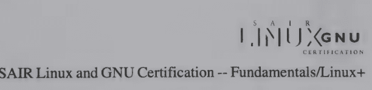

中断进程和暂停进程之间存在区别。可以通过按下 `<CTRL-Z>` 暂停进程，并且可以重启。用户在标准输出中获得以下消息：

+ [1] Stopped yes > /dev/null

## 重启后台程序

要在前台重启该作业，请使用命令：

```bash
$ fg
yes > /dev/null
```

如果 `yes` 程序仍在运行，提示符将再次出现。要杀死 `yes` 程序，请使用 `<CTRL-C>` 序列。该序列将杀死当前程序。

后台作业无法通过使用 `<CTRL-Z>` 暂停。首先使用 `fg` 将作业置于前台，然后用 `<CTRL-Z>` 停止它。

用户可能在后台运行多个作业。可以使用 `fg` 将特定的后台作业置于前台：

```bash
$ fg %1
```

以下命令也可以用于限制终端：

```bash
$ stty
```

## Bash 的基础功能

Bash 的基础 SHELL40

Bash 的基础功能

### 命令行编辑

- 许多 shell 都有缓冲区系统来存储文本
- 命令行编辑功能通常支持

### 命令历史与补全

- 基础导航

## Bash 的基础功能

### 命令行编辑

- 许多 shell 都有缓冲区系统来存储文本

### 命令历史与补全

- Bash 支持命令补全，涉及按下 `<TAB>` 键提供命令或文件的补全

## 第 4 Module — Linux 会话

| 命令 | 使用 |
| --- | --- |
| 上, 下箭头 | 滚动历史记录 |
| 右, 左箭头 | 移动光标向右或向左 |
| <HOME>, <CTRL-A> | 移动到行首 |
| <END>, <CTRL-E> | 移动到行尾 |
| <ALT-B> | 向后移动单词 |
| <ALT-F> | 向前移动单词 |
| <ALT-D> | 用于删除整个单词 |
| <CTRL-K> | 删除从当前到行尾的内容 |
| <CTRL-T> | 交换或反转字符 |
| <ALT-T> | 交换单词 |
| <TAB> | 命令或文件补全 |
| <CTRL-L> | 清除屏幕内容 |
| <CTRL-R> | 在缓冲区中搜索已使用的命令 |

表 4-4. Bash Shell 命令

## 基础导航

Bash shell 有许多选项和命令。表 4-5 显示了许多命令及其部分选项：

| 命令 | 说明 |
| --- | --- |
| `man [command]` | 显示关于命令的在线帮助页 |
| `ls` | 列出当前目录下的文件 |
| `cd [directory]` | 目录 |
| `rm [filename]` | 删除文件名 |
| `rm -f [directory]` | 删除指定的目录及其所有内容 |
| `cp` | 将一个文件复制到另一个 |
| `more` | 逐屏显示文件 |
| `find` | 搜索文件 |

表 4-5. bash shell 命令和选项示例

## 注销或关闭 Linux 系统

- 系统关机过程
- 如果发生不当关机会发生什么？
- 正确关机的命令
- 超用户手动关机
- 使用 <CTRL-ALT-DEL>


## 注销或关闭 Linux 系统

为了让 Linux 系统正常运行，必须正确地关闭它。在不按照正确程序的情况下关闭运行中的 Linux 系统可能会导致各种问题，例如：

- Linux 会保留定期写入磁盘的磁盘缓冲区。如果系统突然关机，缓冲区中的信息可能会丢失。
- 任何打开的文件将不会关闭，这可能导致这些文件丢失或损坏。
- 文件系统在关机前可能没有正确卸载，从而导致数据丢失。
- 系统可能无法正常启动。

有三种方法可以正确关闭 Linux 系统。这些方法分别是：使用 `shutdown` 工具、由超用户手动关机以及使用 <CTRL-ALT-DEL>（前提是系统已设置了该序列）。

## 系统关机过程

执行关机指令时，会发生四个事件：

- 所有当前登录系统的用户都会收到系统即将关机的通知。
- 登录将被阻塞，这意味着在发出关机命令后，系统将不允许用户登录。这是通过创建 `/etc/nlogin` 文件实现的，该文件会在用户尝试登录时显示一条警告消息。只有在系统不会立即关机时，才需要考虑这一点。
- 通过发送 `SIGTERM` 信号通知所有进程系统正在关闭。
- 向 `init` 进程发送信号请求更改系统的运行级别（runlevel）。运行级别 0 用于停止系统，运行级别 6 用于重启系统，运行级别 1 用于将系统置于单用户模式。

## 如果发生不当关机会发生什么？

如果文件系统已正确卸载，`fsck` 将在启动时跳过完整检查。通过运行带有 `-f` 参数的 `shutdown` 命令可以完全跳过 `fsck`。这会导致 `shutdown` 创建 `/boot` 文件，该文件将初始化为运行 `fsck`。跳过根文件系统是不可能的，这是由内核完成的。同样，可以使用 `-F` 参数强制执行 `fsck`。这是通过创建 `/forcefsck` 文件实现的，`init` 会检查该文件。

命令 `shutdown -Rf now` 将立即重启并检查文件系统。同样，`shutdown -rf now` 将现在立即重启并在重新启动时跳过 `fsck`。

管理员可能需要手动运行 `fsck`。如果需要，应仅在文件系统已卸载或以只读模式挂载的情况下对其进行检查。

## 正确关机的命令

`shutdown/shutdown` 命令的概要如下：

```
/sbin/shutdown [-t sec] [-arkhnccf] time [warning-message]
```

表 4-6 解释了其一些重要用途。详细信息请参阅 `shutdown (8)` 手册页。

| 命令 | 用途 |
| :--- | :--- |
| `shutdown -r now` | 这会导致系统重启。`now` 是 `time` 参数的值，指定立即重启。 |
| `shutdown -h now` | 这会导致系统关机或停止，而不重启。同样，`now` 用在 `time` 参数字段中，强制立即关机。 |

表 4-6. shutdown 用途

`reboot` 和 `halt` 命令也用于在系统不在运行级别 0 或 6 时调用 `shutdown`。

用户必须指定关机时间。在上面的示例中使用了 `now`，但也可以输入从发布命令开始的秒数时间来实现此关机。这将允许用户为即将到来的关机或重启做准备。例如，`shutdown -t 300 -r` 将在命令发布后 5 分钟重启系统。

## 示例

当用户从运行级别 5 执行命令 `shutdown -h now` 命令时，会发生以下事件。

`shutdown -h now` 信号 `init` 进程切换到运行级别 0。在新运行级别（在此情况下为 0）目录 `/etc/rc/rc0.d` 中运行的脚本将按字母顺序执行。这将为这些程序的关机做好准备。在完成 K 脚本后，以 S 开头的脚本要求链接名称以 K（内核）或 S（shell）开头。下面给出了这些目录和符号链接的一些示例。在 `/etc/rc.d/rc5.d` 中，切换到运行级别 0 时要杀死的进程之一是：

```
$ K15httpd -> ..init.d/httpd
```


同样，在 `/etc/rc.d/rc0.d` 目录中，启动的一些进程是：

```
$ S0killall -> ../init.d/killall
$ S0halt -> ../init.d/halt
```

## 注销或关闭 Linux 系统 4-29

同样，在 `/etc/rc.d/rc0.d` 目录中，启动的一些进程是：

```
$ S0killall -> ../init.d/killall
$ S0halt -> ../init.d/halt
```

## 注销或关闭 Linux 系统

同样，在 `/etc/rc.d/rc0.d` 目录中，启动的一些进程是：

```
$ S0killall -> ../init.d/killall
$ S0halt -> ../init.d/halt
```

## 超用户手动关机

只有 root 用户可以执行以下操作：


进入`/path/to/xxx`目录，找到`xxx.json`。

在表达式`cvar = avar + bvar`中，加法运算符（`+`）将`avar`与`bvar`相加，得到它们的和`cvar`

在`List.of(arg0, arg1, arg2)`中，`List`接口的工厂方法`of()`接受一系列的元素，返回包含它们的只读列表。

之后我们这样调用`cmd`命令：`cmd arg0 arg1 arg2`。

```
if (condVar > someVal) {console.log("xxx")}
```

用户必须指定关机时间。在上面的示例中使用了 `now`，但也可以输入从发布命令开始的秒数时间来实现此关机。这将允许用户为即将到来的关机或重启做准备。例如，`shutdown -t 300 -r` 将在命令发布后 5 分钟重启系统。

## 使用 <CTRL-ALT-DEL>

`<CTRL-ALT-DEL>` 序列可以启动关机或重启，前提是系统已设置了该序列。这是系统无响应时关闭系统的一种快速方法。

- 2. 输入 `passwd` 命令。

- 3. 机器现在会要求你输入旧密码。输入并按回车。

- 4. 现在输入你想要的新密码。记住，良好的密码应包含大写字母、小写字母和数字。良好的密码长度于 7 个字符。良好密码的示例是 b3n2ther3。输入新密码后按回车。

- 5. 机器现在会再次要求你输入新密码，以确保你在第一次输入新密码时没有错误。输入新密码并按 `<ENTER>`。

- 6. 你的密码已经更改。请记住它，并记得下次登录时使用它。

## 实验 04 题

这些问题的答案在手册末尾的附录 A 中。

- 1. 哪个命令允许用户更改密码？

- 2. `passwd` 命令更新了哪两个文件？

- 3. 给出一个良好密码的示例。

- 4. 登录时可以使用哪两个互换使用的单词？

# SAIR LINUX GNU 认证

# 模块 5

# 使用 Linux 文件系统

| 主题 | 页码 |
| :--- | :--- |
| 目标 | 5-3 |
| 文件属性 | 5-4 |
| 权限 | 5-4 |
| 权限级别 | 5-5 |
| 更改所有者 | 5-7 |
| 使用 umask 设置权限 | 5-7 |
| Linux 文件系统层次结构 | 5-8 |
| 文件系统层次结构标准 | 5-8 |
| 文件系统导航 | 5-9 |
| Linux 文件命令 | 5-10 |
| 导航 | 5-10 |
| 目录修改 | 5-12 |
| 文件修改 | 5-13 |
| 查看文件 | 5-16 |
| 存档工具 | 5-18 |
| 信息工具 | 5-19 |
| 修改权限 | 5-21 |
| 挂载文件系统和设备 | 5-25 |
| 挂载文件系统的配置文件 | 5-25 |
| mount 命令 | 5-26 |
| 挂载 NFS 文件系统 | 5-27 |
| 日志文件 | 5-28 |
| Swatch 和 Logcheck | 5-29 |
| 在 Linux 中查找帮助 | 5-30 |
| man 手页 | 5-30 |
| 邮件列表 | 5-32 |
| 新组 | 5-32 |
| 技术支持 | 5-33 |
| Linux 在线帮助 | 5-33 |
| IRC | 5-33 |
| 书籍 | 5-33 |
| 使用 find 和 locate | 5-34 |
| find 命令 | 5-34 |
| locate 命令 | 5-35 |
| 模块复习题 | 5-36 |

## 5-2 模块 5 — 使用 Linux 文件系统

- 实验 01 — 使用 Linux 文件系统 ........................................ 37
- 目的 .................................................................................... 37
- 持续时间 ................................................................................... 37
- 概述 ....................................................................................... 37
- 练习 ...................................................................................... 37
- 实验 01 题 ........................................................................ 38
- 实验 02 — 导航文件系统 ........................................ 39
- 目的 .................................................................................... 39
- 持续时间 ................................................................................... 39
- 概述 ....................................................................................... 39
- 练习 ...................................................................................... 39
- 实验 02 题 ........................................................................ 40

# 模块 5 – 使用 Linux 文件系统

- 文件属性
- Linux 文件系统层次结构
- Linux 文件命令
- 挂载文件系统和设备
- 日志文件
- 在 Linux 中查找帮助
- 使用 find 和 locate

## 目标

在完成本模块后，你能够：

- 使用 `chmod`、`chown` 和 `umask`。
- 列出权限级别。
- 使用基本命令操作文件和目录。
- 讨论如何挂载和卸载驱动器。
- 列出两个帮助资源。

## 5-4 模块 5 — 使用 Linux 文件系统

## 文件属性

- 权限
- 权限级别
  - 符号模式
  - 绝对模式
  - 权限级别的目的
- 更改所有者
- 使用 umask 设置权限
  - 避免为每个文件设置权限

## 文件属性

文件是系统的基础。系统所做的或执行的所有操作都会访问文件。无论文件是由系统读取、执行、创建还是销毁，系统中发生的一切都是通过文件进行的。

文件的属性决定了可以对其进行什么操作。如果用户希望运行某个应用程序但没有权限或访问权限，他将无法做到这一点。当用户可以访问本应拒绝其访问时，会出现类似或更严重的问题。

## 权限

正确配置文件的权限和所有权是确保系统免受他人攻击同时保持用户可访问的关键。如果系统文件权限或所有权配置不正确，可能会发生两种情况：要么系统限制性过大，导致用户感到沮丧；要么系统由于安全限制而容易被破解。

文件权限决定了如何使用它。Linux 和 Unix 有三种权限：读、写和执行。读权限意味着用户有权查看文件内容。写权限允许用户编辑文件，通常情况下，如果用户可以写入文件，他也可以读取该文件。然而，用户可能拥有写权限但没有读权限。执行权限意味着该文件是一个程序，这赋予了用户运行它的能力。

对于目录，权限的定义略有不同。如果用户拥有读取目录的权限，那么该用户就可以读取该目录中的文件。如果允许写入权限，则可以从目录中添加或删除文件。最后，如果赋予目录执行权限，那么用户就可以列出目录中文件的信息，例如它们的权限、所有者和创建日期。执行权限允许目录成为用户的工作目录。无论用户对目录拥有其他什么权限，如果没有执行权限，用户在其中无法进行任何操作，即使是读取、写入或列出文件也不行。

除了权限含义略有不同外，文件和目录在设置权限和更改所有权方面被视为是同等的。

## 权限级别

每个文件和目录都可以设置三个级别的权限。

- 用户权限适用于文件的所有者。
- 组权限适用于用户组。
- 其他权限包括所有访问该机器的用户。

文件所有权、用户、组和其他分类分类将在稍后进行解释。更改文件的权限是一项简单的任务。虽然有两种方法可以实现这一点，但它们都使用 `chmod` 命令。第一种方法是符号模式（symbolic mode），可能是最容易理解的。第二种方法是绝对模式（absolute mode），它基于文件的位，因此更加复杂。

## 符号模式

每个权限都有一个级别：`u`、`g` 或 `o` 分别代表用户、组或其他。每种类型的权限还对应字母：`r`、`w` 或 `x` 分别代表读取、写入或执行。要添加权限，在 `chmod` 之后跟随权限级别，然后是具体的权限。移除权限以相同的方式进行，但使用 `-` 代替。例如，假设有一个名为 `script` 的文件，系统中的每一个人都需要读取它，但只有当前用户 `root` 拥有它的权限。这种情况的解决方案是：

```
$ chmod a-r script
```

如前所述，读取权限被添加到了所有级别。然而，如果 `script` 应该只允许组读取，那么命令应为：

```
$ chmod g+r script
```

在这里，访问将授予组。需要注意的是，如果文件对所有人都是可读的，则访问会被移除，`chmod -r` 既不会移除这种能力，也不会移除所有者的能力。要移除其他用户的读取访问，应使用以下命令：

```
$ chmod o-r script
```

可以在单条命令中进行多个级别的权限更改：

```
$ chmod ug+rwx script
```

上述命令将授予用户和组对文件的读取、写入和执行权限。


## 绝对模式

在符号模式下，代表相应权限的字母组合使其成为更改权限的一种简单方法。然而，有时确保设置特定的权限反而比像符号模式那样添加或删除更容易。这正是设置权限的绝对模式大显身场之处。

对于每组权限，都有一个数字与之关联。例如，数字 777 将指示系统对指定文件授予用户、组和其他的读取、写入和执行权限，并覆盖该文件之前的任何设置。通过执行 `chmod 754` 命令，权限将如下所示：

```
-rwxr-xr-x root admin script
```

第一个数字将设置用户权限，第二个数字设置组权限，第三个数字将设置其他权限。表 5-1 将更详细描述哪些数字设置了特定的权限。

| 代码 | 权限级别 |
|---|---|
| 0 | -- |
| 1 | -x |
| 2 | -w |
| 3 | -wx |
| 4 | r-- |
| 5 | r-x |
| 6 | rw- |
| 7 | rwx |

表 5-1 权限表

## 权限级别的目的

用户权限的目的是显而易见的：所有所有者必须能够访问其文件。组类别允许一组用户共享文件。每当有多个人共同处理一个文件时，他们都需要拥有该文件的权限，且该权限是组专有的。例如，正在制作 Web 页面的班级或编写手稿的作者应该被放在一个组中。为每个人创建单个文件的多个副本进行工作，在当某些更改发生冲突并尝试合并最终产品时会引入混乱。因此，组级别允许存在单一所有者，同时也向一小部分用户授予扩展权限，而无需向所有访问系统的用户授予权限。

为了增加复杂性，用户还可以以其作为特定程序的所有者或组的身份运行或访问程序。这是通过 SUID 和 SGID 位实现的。下面的示例描述了在寻找 SUID 和 SGID 程序时应该寻找什么。

```
-rws-s-- root admin shutdown
```

这意味着可以以 root 身份或 admin 组身份访问此程序的用户允许运行此程序。系统不是以他们的身份运行此程序，而是将他们解释为 root。

以下是针对目录执行相同操作的情况示例：

| drwxrxr-x john html | 4096 www |

在这种情况下，`www.` 目录由 `john` 所有，并对 `html` 组拥有访问权限。`s` 位允许此目录内的文件和目录具有相同的组。这确保了在该目录下工作的每一个人都有正确的权限来访问一切，即使是新创建的文件。

这些 s 位权限可以通过简单执行以下命令来设置：

```
$ chmod g+s www
```

这将成功为 www 目录的组权限添加 s 位。

s 位既有优点也有缺点。例如，它允许许多人员访问通常需要 root 权限的函数。

## 更改所有权

更改文件的所有权很简单：所选命令之后是将所有该文件的用户名以及文件名。然而，在 Linux 中，这只能由 root 完成。要将文件的所有者更改为用户 `mike`，请输入：

```
$ chmod mike script
```

如果更改文件所属的组（例如更改为 `prog`），则遵循类似的步骤。`chgrp` 命令之后是新组名和文件名。

```
$ chgrp prog script
```

属于组的任何用户都可以更改文件的所有权。这可以使用点表示法一步完成，其中用户名之后跟随的是组名。

```
$ chmod mike:prog script
```

## 使用 umask 设置权限

通常，当用户创建一个文件时，他们希望文件具有某些权限。为了避免为创建的每个新文件设置权限，他们可以在提示时运行 `umask` 命令，或者更方便地将其设置在 shell rc 文件中。`umask` 命令接受的参数与使用 `chmod` 绝对模式更改权限时的参数相似，但使用了一个稍微不同的位系统。在使用 `umask` 命令设置权限时，将它们视为权限的反向是有帮助的。umask 七意味着没有权限，零意味着所有权限。要获得正确的 umask 值，使用应该设置的绝对模式权限并从 777 中减去该值。例如，赋予所有者所有权利而不赋予其他人任何权限的 umask 值将是 077 (777-770=077)。

这使得每个创建的文件在无需用户干预的情况下就相应的权限。当然，如果用户以后决定文件应该具有不同的权限，则需要进行更改。

# 5-8 模块 5 — 使用 Linux 文件系统

# Linux 文件系统层次结构

- 文件系统层次结构标准
- 文件系统导航

# LINUX 文件系统层次结构

Linux 文件系统由许多不同的基础目录组成，每个目录都有其特殊用途。大多数 Linux 发行版都遵循一个标准，可以在 `www.pathname.com/fhs` 找到。该标准包含了大量关于这些目录用途以及应该向其中放入什么类型文件的详细信息。以下是对该文件系统结构的简要介绍。

# 文件系统层次结构标准

文件系统的最底层是根目录，用斜杠（`/`）表示。该目录包含所有其他目录。通常情况下，该目录下不放置任何文件，只有其他主要目录。这些目录中的每一个都有其特殊用途。例如，`/etc` 目录通常用于系统级配置，而 `/bin` 目录存放了系统可执行程序。图 5-1 显示了这些主要目录及其功能的列表。

| | 核心命令；始终挂载的二进制文件 |
|---|---|
| `/bin` | |
| `/boot` | 引导加载程序和内核映像 |
| `/dev` | 设备驱动访问 |
| `/etc` | 主机特定系统配置 |
| `/home` | 用户账户主目录；大分支 |
| `/lib` | 库；运行时加载库和内核模块 |
| `/mnt` | 可移动介质的挂载点 |
| `/opt` | 本地附加软件包包 |
| `/proc` | 内核状态例程 |
| `/root` | root 用户的主目录；始终挂载 |
| `/sbin` | 核心系统管理员命令二进制文件 |
| `/tmp` | 临时文件；应用程序使用 `/tmp` |
| `/var` | 二级层次结构；大分支 |
| | 变量数据；动态日志、池化和状态信息 |

图 5-1. 文件系统层次结构

# 文件系统导航

了解如何进行系统进行导航对每个用户来说都是重要的。

路径有两种类型：绝对路径和相对路径。绝对路径包含遵循的完整路径。例如：

```
/bin/bash
```

或者

```
/home/mark/my_stuff/
```

相对路径不包含完整路径；相反，它们相对于当前目录工作。例如，如果用户位于 `/usr/local` 目录并想要移动到 `/usr/local/bin/`，他或她只需通过以下操作指定 bin/ 目录：

```
bin/
```

任何目录前的正斜杠（`/`）表示从根目录开始。省略它意味着留在当前目录，并在该目录结构查找 bin/。

# 基本 Linux 文件命令

- 导航
  - `cd`, `pwd`, `ls`
- 目录修改
  - `mkdir`, `rmdir`
- 文件修改
  - `cp`, `mv`, `rm`, `touch`
- 文件查看
  - `cat`, `less`, `more`
- 归档工具
  - `zcat`, `tar`
- 信息工具
  - `locate`, `file`, `man`
- 权限修改
  - `chgrp`, `chmod`, `chown`

# 基础 Linux 文件命令

Linux 操作的核心在于命令行。用户只需打开终端窗口，即可使用大量的各种命令和选项。对于熟悉 DOS 的人来说，在非图形环境中输入命令并不陌生；然而，那些来自严格 Windows 环境的人可能在以这种形式探索系统时可能会有些迟疑。不要被经验所阻碍；这种探索和管理的方法并不那么困难。

## 导航

```
cd
```

切换目录命令允许用户通过更改工作目录来导航目录结构。不带参数的 cd 命令将用户带到其主目录。

| 说明 | 更改工作目录 |
|---|---|
| 用法 | `cd [directory]` |
| 选项 | 无 |
| DOS 等效命令 | `cd` |

表 5-2. `cd` 命令

## 示例

```
$ cd /
```

这将把活动目录切换到根目录。

```
$ cd /var/log
```

这将当前目录切换到 `/var/log/` 目录。

```
$ cd
```

这会将目录切换到主目录。

```
$ cd -user/
```

如果权限允许，这将切换到指定用户的主目录。

```
$ cd ..
```

这将在目录树中移动一级。

# pwd

`pwd`，或打印工作目录（print working directory），是一个常用命令，会将当前目录的全名打印到屏幕上。这对于熟悉非图形环境的用户非常有用，并将帮助防止用户在目录结构中迷路。

| 说明 | 打印工作目录 |
|---|---|
| 用法 | `pwd` |


# 表 5-3. `pwd` 命令

| 选项 | 无 |
| 等效 | 输入不带任何参数的命令 |

## 示例

要显示当前绝对路径，请在命令提示符输入以下内容：

```
$ pwd
```

输出应显示目录的绝对路径。对于用户 `jhherren`，它可能像这样：

```
/home/jhherren
```

# `ls`

通过 `ls` 命令可以显示给定目录的内容或关于文件的信息。留空目录或文件名字段将显示当前目录的内容。

# 5-12 模块 5 — 使用 Linux 文件系统

| 说明 | 列出目录内容并显示文件信息 |
| --- | --- |
| 用法 | `ls [options] [directory or files]` |
| 选项 | `-a` | 显示所有文件的列表，包括隐藏文件。 |
|  | `-d` | 显示目录本身的信息，而不是其文件内容。 |
|  | `-l` | 给出文件的详细列表，例如其所有者、用户组、权限、大小、类型、修改日期和名称。 |
|  | `-R` | 递归地列出当前目录下的所有子目录。 |
|  | `-S` | 按大小从大到小对显示的文件进行排序。 |
|  | `-t` | 按修改时间对列表进行排序。 |
| DOS 等效命令 | `dir` |

表 5-4. `ls` 命令

## 示例

```
$ ls -la
```

这将显示所有文件，包括隐藏文件，并提供详细列表。这种方法允许查看所有文件，包括隐藏文件。`ls` 的详细列表对于目录非常有用，例如 `more` 或 `less`。

# 目录修改

# `mkdir`

`mkdir` 命令用于创建目录。只有当用户对要创建的目录具有访问权限时才能使用该命令。

| 说明 | 创建目录 |
| --- | --- |
| 用法 | `mkdir [options] directory-list` |
| 选项 | `-p` | 如果路径中不存在父目录，则创建它们。 |
|  | `-v` | 详细模式，显示确认消息。 |
| DOS 等效命令 | `mkdir` 或 `md` |

表 5-5. `mkdir` 命令

## 示例

假设用户位于 `/tmp` 目录，且没有其他目录。

```
$ mkdir apples
```

这将创建名为 `apples` 的目录。

# 基础 Linux 文件命令 5-13

```
$ mkdir one/2
```

这将由于目录不存在而失败。

```
$ mkdir -p one/2
```

这将通过先创建 `one` 然后在其创建 `two` 来成功执行。

# `rmdir`

`rmdir` 命令用于删除空目录。目录必须为空，命令才能生效。

| 说明 | 删除目录 |
|---|---|
| 用法 | `rmdir [options] directory-list` |
| 选项 | `-p` | 移除初始目录后变为空的父目录。 |
| DOS 等效命令 | `deltree` 或 `rmdir` |

表 5-6. `rmdir` 命令

## 示例

假设用户位于 `/tmp` 目录，并想要删除 `/tmp/one`、`/tmp/two` 和 `/tmp/two/three`。这些目录不包含其他其他文件。

```
$ rmdir one
```

这将删除目录 `one`。

```
$ rmdir two
```

这将因为二 不空而失败。

```
$ rmdir two/three
```

此命令将删除目录三，但二 仍然存在。

```
$ rmdir -p two/three
```

执行此命令将删除二和三。

# 文件修改

# `cp`

使用 `cp` 命令复制文件和目录。当将一个文件复制到另一个文件时，请确保目标文件已存在；如果存在，它将被覆盖。在复制文件到目录的情况下，`cp` 命令将所有文件复制到新目录中；然而，文件将保留其原始名称。

## 5-14 模块 5 — 使用 Linux 文件系统

| 描述 | 复制文件 |
|---|---|
| 用法 | `cp [options] [源文件] [目标文件]`<br>`cp [options] [源文件] [目录]` |
| 选项 | `-b` | 此选项将为将被覆盖的文件创建一个备份。 |
|  | `-i` | 在覆盖文件之前，系统会提示用户。 |
|  | `-p` | 为了保留所有所有者、用户组、权限、时间戳和其他属性，请使用此选项。 |
|  | `-r` | 使用此选项将使 `cp` 命令递归地复制所有目录。 |
|  | `-v` | 此选项启用详细模式。每个文件在复制之前都会打印在屏幕上。 |
| DOS 等效命令 | `copy` |

表 5-7. `cp` 命令

## 示例

```
$ cp file file2
```

这为文件创建一个名为 `file2` 的 `file` 副本。

```
$ cp file /tmp
```

这将在 `/tmp` 目录下创建一个 `file1` 的副本。

# `mv`

`mv` 命令允许用户移动或重命名文件和目录。如果在存在同名文件的目录中移动或重命名文件，新文件将覆盖现有文件。

| 描述 | 移动文件和目录 |
|---|---|
| 用法 | `mv [options] [源文件] [目标文件]`<br>`mv [options] [源文件] [目标目录]`<br>`mv [options] [源目录] [目标目录]` |
| 选项 | `-b` | 使用此选项将在移动文件之前对其进行备份。 |
|  | `-f` | 如果目标文件存在，此选项将强制移动而不进行提示。 |
|  | `-i` | 此选项将用户带入交互模式；在覆盖文件之前会提示用户。 |
|  | `-v` | 激活详细模式。 |
| DOS 等效命令 | `move`, `rename` |

表 5-8. `mv` 命令

## 示例

```
$ mv file file.old
```

这将覆盖 `file.old`。

# `rm`

`rm` 命令用于从目录结构中删除文件。虽然不需要文件的写权限，但用户必须拥有包含要删除文件的目录的写权限。

记住，默认情况下，`rm` 不会删除目录。

| 描述 | 删除文件 |
|---|---|
| 用法 | `rm [options] [文件名]` |
| 选项 | `-f` | 这将允许用户跳过对写保护文件的警告提示。 |
|  | `-i` | 使用此选项将对所有文件进行提示。 |
|  | `-r` | `-r` 选项除了删除目录本身外，还会删除指定目录的所有内容和子目录。应谨慎使用此选项，因为它可能会造成损害。 |
|  | `-v` | 激活详细模式。 |
| DOS 等效命令 | `del` |

表 5-9. `rm` 命令

## 示例

```
$ rm file file2
```

删除了 `file` 和 `file2`。

```
$ rm -r file*
```

这会删除当前目录及其子目录下所有以 `file` 开头的文件。

# `touch`

此命令用于更新或更改文件的修改时间和访问时间。除非指定了其他时间，否则时间将变为当前时间。如果指定的文件不存在，`touch` 命令将创建一个空文件。

## 5-16 模块 5 — 使用 Linux 文件系统

| 描述 | 修改文件时间戳 |
|---|---|
| 用法 | `touch [options] [file]` |
| 选项 | `-a` | 此选项允许用户仅更改访问时间。 |
|  | `-c` | 防止创建新文件。 |
|  | `-m` | 仅更改修改时间。 |
|  | `-t` | 此选项将使用 `[[CC]YYMMDDhhmm,ss` 而不是当前时间。添加 `CC` 是为了让用户输入四位年份而不是两位年份。 |
| DOS 等效命令 | 无 |

## 表 5-10. `touch` 命令

## 示例

假设文件不存在。

```
$ touch file
```

重复此操作将创建 `file`。

```
$ touch file
```

此命令更新访问时间和日期。

```
$ touch -t20000101000
```

将访问时间更改为 2000年1月1日午夜。

# 文件查看

# `cat`

该工具用于合并文件。它将所有指定的文件复制到标准输出。如果没有指定文件，它将标准输入复制到标准输出。

| 描述 | 合并文件 |
|---|---|
| 用法 | `cat [options] [文件]` |
| 选项 | `-n` | 此选项将输出行进行编号。 |
|  | `-E` | 使用此选项时，每行末尾会输出一个 `$` 字符。 |
| DOS 等效命令 | `type` |

## 表 5-11. `cat` 命令

## 示例

```
$ cat input1 input2 > output1
```

在此示例中，`cat` 将 `input1` 的内容以及 `input2` 的内容写入 `output1`。

# `less`

`less` 是 `more` 程序的强大版本，用于分页查看文件。可以通过箭头键、`PageUp` 和 `PageDn` 键或大量的热键列表进行导航。`q` 键将退出 `less` 并使用户返回提示符。通常，`less` 用于查看帮助页。

| 描述 | 文件浏览器 |
|---|---|
| 用法 | `less [options] [文件名]` |
| 选项 | `-E` | 此选项导致 `less` 在到达文件末尾时退出。 |
|  | `-M` | 将显示文件名、文件中的行数、光标所在的行以及终端窗口左角的阅读百分比。 |
|  | `-?` | 调用此选项将打开显示 `less` 内命令的快速窗口。 |
| DOS 等效命令 | 无 |

表 5-12. `less` 命令

## 示例

以下命令将显示 `inetd.conf` 的内容，用于配置网络服务。

```
$ less /etc/inetd.conf
```

# `more`

主要用于分页的查看工具，`more` 命令每次显示屏幕。它提供了修改查看环境的选项。使用空格键向前滚动，使用 `b` 键向后滚动。

| 描述 | 文件浏览器 |
|---|---|
| 用法 | `more [options] [文件]` |
| 选项 | `-d` | 此选项在屏幕底部显示导航命令。 |
|  | `+/-` | 使用此选项在文件中搜索字符串。 |
|  | `+[数字]` | 允许用户通过行数指定 `more` 显示的位置。 |
| DOS 等效命令 | 无 |

表 5-13. `more` 命令

## 5-18 模块 5 — 使用 Linux 文件系统

## 示例

以下命令将显示 `/etc` 目录的内容并管道到 `more` 工具。

```
$ ls /etc | more
```

# 归档工具

# `zcat`

`zcat` 命令的行为类似于 `cat`，但它会先对输入进行解压缩。该工具仅适用于由 `gzip` 或 `compress` 压缩的文件。

| 描述 | 文件浏览器 |
|---|---|
| 用法 | `zcat [options] [文件名]` |
| 选项 | `-h` | 此选项将打开列各种选项的帮助菜单。 |
|  | `-v` | 启动详细模式。 |
| DOS 等效命令 | 无 |

表 5-14. `zcat` 命令

## 示例

```
$ zcat text.gz
```

此命令将显示 `text.gz` 的解压缩内容。

# `tar`

`tar` 命令最初用于在磁带上存储和检索文件，是备份和存储文件的可靠高效的方法。对于大多数用户，它现在是归档操作的默认工具。

## 基础 Linux 文件命令

| 描述 | 文件工具 |
|---|---|
| 用法 | `tar [options] [tar文件名] [files]` |
| 必选选项 | `-c` | 将创建一个新的归档。 |
|  | `-d` | 查找 `tar` 文件与 `[files]` 字段中所有文件之间的差异，并显示文件大小、文件属性和缺失文件的差异。 |
|  | `-r` | 使用此选项时，文件将追加到 `tar` 文件中。 |
|  | `-t` | 通过此选项列出归档中所有文件的名称或 `tar` 文件已存在的 `[files]` 的名称。 |
|  | `-u` | 此选项将添加比 `tar` 文件中相同文件新的 `[files]`。 |
|  | `-x` | 此选项将从归档提取文件。 |
|  | `-A` | 使用此选项可以将第二个 `tar` 文件添加到原始 `tar` 文件中。 |
| 附加选项 | `-f [file]` | 此选项将在归档 `[file]` 中提取或存储文件。 |
|  | `-v` | 开启详细模式。在添加或提取时显示文件名。 |
|  | `-z` | 分别在归档或提取时使用 `zip` 压缩或解压缩。 |

表 5-15. `tar` 命令

## 示例

```
$ tar xzf archive.tar.gz
```

这将 `archive.tar.gz` 的内容提取到当前目录。

# 信息工具

# `locate`

该命令在用户计算机所有文件的数据库搜索字符串，并返回包含该字符串的文件和目录。如果用户有一个包含字符串的目录，将显示该目录下的所有文件。使用 `updatedb` 更新数据库。

| 描述 | 在系统中查找文件 |
|---|---|
| 用法 | `locate [options] [搜索字符串]` |
| 选项 | `-h` | 使用此选项将显示帮助菜单。 |
|  | `-n [数字]` | 此选项将搜索限制为用户定义的条目数量。 |
| DOS 等效命令 | 无 |

## 示例

```
$ locate .bashrc
/home/jimmy/.bashrc
/home/taiga/.bashrc
/home/freward/.bashrc
/home/billiam/.bashrc
/etc/skel/.bashrc
```

此命令可以在数据库中找到所有包含字符串 `.bashrc` 的的文件。

# `file`

`file` 命令可以根据文件所包含的数据类型对文件进行分类。如果用户不确定文件的状态，`ls` 命令不会列出文件类型。

| 描述 | 确定文件类型 |
|---|---|
| 用法 | `file [options] [filenames]` |
| 选项 | `-b` | 这将使用户带简短模式：不会打印文件名。 |
|  | `-f` | 这将在文件列表打印的每一个文件名上运行 `file`。 |
|  | `-z` | 此选项将尝试检查压缩文件内部。 |
| DOS 等效于 | 无 |

表 5-17. `file` 命令

## 示例

此命令将给出 `/etc/passwd` 文件的状态。

```
$ file /etc/passwd
/etc/passwd: ASCII text
```

以下命令将列出当前目录下的所有文件并显示它们的文件类型：

```
$ ls -a | file -f
```

# `man`

Linux 以帮助页的形式提供了各种命令和选项的丰富信息。帮助页分为八个独立的部分，这允许用户对系统上的任何命令选项或命令的基本性描述进行快速参考。默认情况下，使用 `less` 查看页面。这可以通过设置环境变量 `PAGER` 为用户偏好的分页器来更改。

| 描述 | 在线帮助页的格式和显示 |
| --- | --- |
| 用法 | `[options] [section number] [query name]` |
| 选项 | `-a` | 此选项将显示列出该命令的所有章节的帮助页。 |
|  | `-f` | `-f` 命令复制了 `what` 命令的功能。它基本上给出了命令的简短描述。 |
|  | `-w` | 这给出了条目所在的路径名称。 |
| DOS 等效于 | 尝试输入带有 `/h` 或 `/help` 切换开关的 DOS 命令 |

表 5-18. `man` 命令

## 示例

在命令提示符下，输入：

```
$ man ls
```

经过几秒的格式化后，将显示 `ls` 命令的帮助页，用户可以使用上、下箭头或 `<PgUp>` 和 `<PgDn>` 键滚动页面。

# 权限修改

# `chgrp`

此命令用于更改与用户指定的文件关联的组。其使用仅限于被更改文件的所有者或特权用户。

# 5-22 模块 5 — 使用 Linux 文件系统

# 修改文件的组所有权

| 描述 |  |
| --- | --- |
| 用法 | `chgrp [options] [name of group][files or directories to change]`<br>`chgrp [options] [group ID] [files or directories to change]` |
| 选项 | `-c` 此选项将显示每个更改的文件的信息。<br>`-f` 用户在尝试更改他们没有权限更改的文件组时，将调用此选项以防止出现错误消息。<br>`-v` 启动详细模式。将在所有使用 `chgrp` 的文件上显示信息。<br>`-R` 如果在用此选项时指定了目录，则所有子目录和其内部文件的组都将被更改。 |
| DOS 等效于 | 无 |

表 5-19. `chgrp` 命令

## 示例

```
$ chgrp web index.html
```

此命令将把 `index.html` 的组所有权更改为 `web` 组。

# `chmod`

`chmod` 命令用于更改文件和目录的权限。此命令只能由文件所有者或特权用户使用。通过指定对应不同权限的字母或数字来设置权限。

| 描述 | 更改文件和目录的权限 |
| --- | --- |


| 用法 | `chmod [options] [new permissions] [filenames]` <br> `chmod [options] [new permissions] [directory names]` |

| 选项 | `-c` 此选项将显示每个更改的文件的信息。 <br> `-f` 用户在尝试更改无法更改的文件权限时，将调用此选项以防止出现错误消息。 <br> `-v` 启动详细模式。将在所有使用 `chmod` 的文件上显示信息。 <br> `-R` 如果在用此选项时指定了目录，则所有子目录和其内部文件的组都将被更改。 |

| DOS 等效于 | 无 |

表 5-20. `chmod` 命令

# 权限缩写

`chmod` 命令用于通过指定字母或数字来更改文件和目录的权限。

| 描述 | 更改文件和目录的权限 |

| --- | --- |

| 用法 | `chmod [options] [new permissions] [filenames]` <br> `chmod [options] [new permissions] [directory names]` |

| 选项 | `-c` 此选项将显示每个更改的文件的信息。 <br> `-f` 用户在尝试更改无法更改的文件权限时，将调用此选项以防止出现错误消息。 <br> `-v` 启动详细模式。将在所有使用 `chmod` 的文件上显示信息。 <br> `-R` 如果在用此选项时指定了目录，则所有子目录和其内部文件的组都将被更改。 |

| DOS 等效于 | 无 |

# 权限缩写

`chmod` 命令用于通过指定字母或数字来更改文件和目录的权限。

| 描述 | 权限缩写的权限 |

| 权限缩写 | |

|---|---|

| | `u` | 用户所有者 |

| | `g` | 组 |

| | `o` | 其他用户 |

| | `a` | 所有用户 |

| | `=` | 赋予权限 |

| | `+` | 添加权限 |

| | `-` | 移除权限 |

| | `r` | 读权限 |

| | `w` | 写权限 |

| | `x` | 执行权限 |

表 5-21. `chmod` 缩写

在使用 `chmod` 时，缩写包含了用户、组和其他用户。

帮助页显示 `chmod` 命令的用法、选项、所有用户。

| 描述 |  | |

 | --- |

| 用法 | `chmod [options] [new permissions] [filenames]` <br> `chmod [options] [new permissions] [directory names]` |

| 选项 | `-c` 此选项将显示每个更改的文件的信息。 <br> `-f` 用户在尝试更改无法更改的文件权限时，将调用此选项以防止出现错误消息。 <br> `-v` 启动详细模式。将在所有使用 `chmod` 的文件上显示信息。 <br> `-R` 如果在用此选项时指定了目录，则所有子目录和其内部文件的组都将被更改。 |

| DOS 等效于 | 无 |

# 权限缩写

`chmod` 命令用于通过指定字母或数字来更改文件和目录的权限。

| 描述 | 权限缩写的权限 |

| 权限缩写 | |

||---|---|

| | `u` | 用户所有者 |

| | `g` | 组 |

| | `o` | 其他用户 |

| | `a` | 所有用户 |

| | `=` | 赋予权限 |

| | `+` | 添加权限 |

| | `-` | 移除权限 |

| | `r` | 读权限 |

| | `w` | 写权限 |

| | `x` | 执行权限 |

表 5-22. `chmod` 缩写

在使用 `chmod` 时，缩写包含了用户、组和其他用户。

帮助页显示 `chmod` 命令的用法、选项、所有用户。

| 描述 | | |

| | --- | --- | --- |

| 用法 | `chmod [options] [new permissions] [filenames]` <br> `chmod [options] [new permissions] [directory names]` |

| 选项 | `-c` 此选项将显示每个更改的文件的信息。 <br> `-f` 用户在尝试更改无法更改的文件权限时，将调用此选项以防止出现错误消息。 <br> `-v` 启动详细模式。将在所有使用 `chmod` 的文件上显示信息。 <br> `-R` 如果在用此选项时指定了目录，则所有子目录和其内部文件的组都将被更改。 |

| DOS 等效于 | 无 |

# 权限缩写

`chmod` 命令用于通过指定字母或数字来更改文件和目录的权限。

| 描述 | 权限缩写的权限 |

| 权限缩写 | |

||---|---|

| | `u` | 用户所有者 |

| | `g` | 组 |

| | `o` | 其他用户 |

| | `a` | 所有用户 |

| | `=` | 赋予权限 |

| | `+` | 添加权限 |

| | `-` | 移除权限 |

| | `r` | 读权限 |

| | `w` | 写权限 |

| | `x` | 执行权限 |

表 5-23. `chmod` 缩写

在使用 `chmod` 时，缩写包含了用户、组和其他用户。

帮助页显示 `chmod` 命令的用法、选项、所有用户。

## 5-26 模块 5 — 使用 Linux 文件系统

| 选项 | 功能 |

|---|---|

| `(a) sync` | 指定到文件系统的 I/O 命令是以同步模式还是异步模式执行的。 |

| `(no) auto` | 指定是否不自动尝试挂载文件系统。 |

| `default` | 使用所有默认值挂载文件系统：`rw`、`exec` 和 `async`。 |

| `(no) exec` | 指定是否可以在挂载的文件系统上执行二进制文件。 |

| `ro/rw` | 指定文件系统是以只读 `ro` 还是读写 `rw` 模式挂载。 |

表 5-23. `/etc/fstab` 文件的常用选项

`/etc/mtab` 文件显示了系统中已经挂载了哪些文件系统。`/etc/mtab` 文件中的每一行显示与 `/etc/fstab` 相同的信息。然而，`/etc/fstab/mtab` 中的信息由当前已挂载的文件系统组成。由于文件系统同一时间只能挂载一个实例，在尝试挂载文件系统之前进行检查可以为用户节省不必要的工作。

## mount 命令

用于挂载文件系统的命令是 `mount`。根据挂载的文件系统在 `/etc/fstab` 文件是否有条目，使用 `mount` 命令有两种不同的方法。如前一节所述，除非在 `/etc/fstab` 文件中指定，否则 `mount` 命令只能由 `root` 用户使用。

考虑到之前使用 `/etc/fstab` 条目挂载 `/dev/cdrom` 的示例，由于该设备在 `/etc/fstab` 中有一个条目，因此需要的语法只是命令 `mount /dev/cdrom`。然而，如果 `/etc/fstab` 中没有条目，则必须命令行上提供更多选项。确保为文件系统所需的挂载点已经创建是非常重要的。例如，要将 `/dev/cdrom` 挂载到目录 `/mnt/cdrom`，必须使用命令 `mkdir /mnt/cdrom` 创建 `/mnt/cdrom` 目录。然后，在插入 CD-ROM 命令后：

```
$ mount -t iso9660 /dev/cdrom /mnt/cdrom
```

这应该会将 CD-ROM 挂载到 `/mnt/cdrom` 目录，假设其文件系统类型为 ISO-9660。

## mount 命令的选项

`-t` 选项代表 `type`，后面总是跟着文件系统类型。该选项在上述示例中用于挂载类型为 ISO-9660 的文件系统。还有其他与 `mount` 命令一起使用的选项，其中一些在表 5-24 中：


## 挂载文件系统和设备 5-27

| 选项 | 功能 |

| --- | --- |

| `-h` | 获取帮助菜单。 |

| `-a` | 挂载 `/etc/fstab` 中的每一个文件系统。 |

| `-f` | 执行实际挂载以外的所有操作。如果出现问题，可用它发现 `mount` 命令正尝试执行的操作。 |

| `-L [UUID]` | 此命令将使用指定的 UUID 挂载文件系统。 |

| `-o [options]` | 使用特定参数挂载。 |

表 5-24. `mount` 命令的选项

最后一个选项 `-o` 赋予 `mount` 命令传递可能使用的参数的能力，例如用于挂载 NFS 服务器。可以在 `man` 页面中找到 `mount` 命令的完整选项列表。

## 挂载 NFS 文件系统

网络文件系统 `NFS` 文件系统是一项艰巨的任务，因为 NFS 使用了一些其他文件系统没有的选项，而且语法也有细微变化。

这是 `/etc/fstab` 中一个 NFS 文件系统的条目：

```
fileserver:/home /mnt/home nfs rsize=4096,wsize=4096,time=14,intr,auto
```

该条目指定 NFS 服务器有一个目录 `/home`，它将被挂载到 `/mnt/home`。`nfs` 标签指定它是一个 NFS 文件系统。`rsize` 和 `wsize` 指定了在网络上从文件系统写入和读取的数据包大小。`time` 选项指定了 NFS 客户端等待 NFS 服务器完成请求所需的时间。`intr` 选项声明如果系统宕机，请求可以被中断。`auto` 选项指定 NFS 文件系统应该自动挂载。

默认的 `rsize` 和 `wsize` 是 1024 字节。在另一个中，这被更改，以指定读写为 4096 字节。`time` 选项以十分之一秒为单位，默认为 7。这已更改为 14，因此 NFS 客户端将等待 1 秒让请求完成。还有选项指定挂载是硬的还是软的，默认是硬的。硬挂载允许程序在 NFS 服务器崩溃时挂起，但在服务器恢复在线后会自动重新连接。软挂载在服务器连接失败时允许错误，且不会自动重新连接。

如果文件系统有 `/etc/fstab` 条目，用户挂载 NFS 文件系统唯一需要做的（以上述 `/etc/fstab` 条目为例）就是执行命令 `mount fileserver:/home`。如果没有 `/etc/fstab` 条目，则挂载 NFS 文件系统的语法将是：

```
$ mount -t iso9660 /dev/cdrom /mnt/cdrom
```

*(注：此处原文示例代码似乎有误，重复了之前的 cdrom 命令，但已按要求保留并翻译上下文)*

```
$ mount -t iso9660 /dev/cdrom /mnt/cdrom
```

# man(1)

# 属性

`man` - 格式化并显示在线手册页

# 概要

```
[-acdfFhkktW] [-m system] [-p string] [-C
config_file] [-M path] [-P pager]
[-S section_list] [section] name ...
```

# 描述

`man` 能够格式化并显示在线手册页。此版本识别 `MANPATH` 和 `(MAN) PAGER` 环境变量，因此你可以拥有自己的个人 `man` 手册页，并选择你喜欢的任何程序来显示格式化后的页面。如果指定了 `section`，`man` 将只在手册的该章节中查找。你还可以通过命令行选项或环境变量指定搜索章节的条目的顺序，以及在源文件上运行的哪些预处理器。如果 `name` 包含 `/`，它将会首先尝试作为文件名处理，因此你可以执行 `man /.5` 甚至 `man /cd/foo/bar.1.gz`。

# 选项

- `-C config_file`

  指定使用的 `man.conf` 文件；默认值为 `etc/man.conf`。（参见 `man.conf(5)`）。

- `-M path`

  指定搜索 `man` 手册的目录列表。如果没有提供任何选项，则使用环境变量 `MANPATH`。如果没有环境

# 参见

`apropos(1)`, `whatis(1)`, `less(1)`, `groff(1)`。

主题列在每页的顶部，并有相应的顺序页码。`NAME` 字段告诉用户命令的作用。随后是 `SYNOPSIS` 字段，它显示了命令带有所有可能选项的命令行。其中，有一组包含在括号中的数字，后面紧跟字母和单词。第一个括号包含了所有不需要任何额外信息的可能选项。例如，输入 `man -h` 会打印 `man` 命令帮助信息。该选项不需要额外信息，因此它被放在第一个括号中。某些选项需要用户在使用选项的同时指定信息。如果用户使用了 `-M` 选项（它会更改 `man` 查找 `man` 手册的位置），则必须在选项后包含要的目录。这就是为什么它不在第一个括号中，而是有自己的括号，并对该选项工作还需要什么内容进行了说明（`[-M path]`）。


SAIR Linux and GNU Certification -- Fundamentals/Linux

# 5-32 模块 5 — 使用 Linux 文件系统

通过查看，用户可以推断出命令的正确结构：`man -option section`。`OPTIONS` 字段提供了每个选项作用的描述。要了解 `-h` 选项的作用，请在 `OPTIONS` 字段中查找 `-h` 并阅读其描述。`SEE ALSO` 字段包含了与主题相关的关键词。这些关键词对于帮助解决某个主题非常有用。Linux 中的许多过程看起来似乎只有一个程序，但实际上它们正在使用多个程序。例如，Sendmail 的复杂问题可能是由于 Sendmail 为了执行某些任务可能需要的许多其他程序导致的。

# 邮件列表

还建立了大量的邮件列表来解决用户问题。这些列表的主题涵盖了从基础到高级的 Linux 安全问题等内容。这些列表是个人用户之间互相帮助和获取信息的绝佳来源，接收者可以保持新问题和新解决方案的更新。保持灵通是防止问题的最佳方法。

邮件列表中讨论的问题在以后会有很大帮助。有时，用户的问题与命令完全无关，导致手册页变得毫无用处。因此，邮件列表可以作为昂贵技术支持的一个极好的、免费替代方案。

邮件列表唯一的缺点是问题与答案之间的时间间隔。在繁忙的列表中，回复可能在几天后到达，更多时候是几天之后。这对于需要即时答案的用户来说是一个问题。联系邮件列表中的人员是有优势的。从知识丰富的的朋友那里获得回复，比从无名的昵称那里获得要容易得多。

# 新闻组

新闻组与邮件列表类似。新闻组是用户发布到远程服务器的帖子，但不会通过电子邮件发送给服务器上的所有人。相反，帖子会留在服务器上，供用户查找和阅读。新闻组是查找某个主题特定信息的绝佳方法。有几个新闻组存档，例如 `www.deque.com` 和 `www.remarq.com`，用户可以在这些处搜索针对问题的归档答案。一个简单的 Sendmail 问题可以通过在新闻组中搜索关键词 `sendmail` 来快速解决。使用布尔搜索变量来缩小搜索范围是非常重要的。大多数搜索引擎不支持如 `*` 和 `?` 等字符。通过在关键词前面添加 `+`，搜索将返回精确的关键词以及与之共享部分字符的单词。例如，不带 `+` 的关键词 `sendmail` 将允许服务器返回包含 `send`、`mail` 和 `sendmail` 以及任何相关主题的文档。在短语周围加上引号，服务器将只返回包含该短语的文档。通过输入 ""+sendmail help"，服务器将只返回包含 "sendmail help" 短语的文档。在搜索可能包含数千条信息的存档时，这非常重要。通过广泛搜索，新闻组可以成为信息的绝佳来源。


# 技术支持


# Linux 在线帮助

有很多为初学者提供免费帮助的网站。如 `www.linuxdoc.org`（文档项目首页）和 `www.linux.org` 提供了大量的 Linux 信息归档。`HOWTO` 是特定程序的解释。这些由 `LDP` 提供。这些网站对于持续更新和大量信息非常有价值。每当新程序发布，很可能在几天内就能找到相关的帮助。

关于某个主题最好的信息通常来自源头。新程序通常有自己的网页提供下载、信息和关于该程序的帮助。不过，找到程序的首页有时是个问题。`www.freshmeat.net` 是一个查找程序信息的有用地方，特别是该网站每天更新，并且每个新的 Linux 程序都列在那里。

# IRC

互联网实时聊天 (`IRC`) 也可以是 Linux 用户的优质资源。如 `#Linux` 或 `#LinuxHelp` 等频道对于问题的即时解答和对长期问题的讨论非常有帮助。`IRC` 是全球 Linux 用户以及其他操作系统用户的聚集地。它是与许多人实时共享信息的完美媒介。`IRC` 上的许多人愿意并能够帮助 Linux 用户解决系统问题。

# 书籍

最后的资源是书籍。现在提供的 Linux 书籍比任何时候都适用于解决特定问题。例如，在 `www.amazon.com` 上搜索 Linux 返回了 413 种不同的书籍。关于网络或硬件等宽泛主题的书与处理内核或 `TCP/IP` 协议的特定书籍一样常见。针对特定发行版的书籍是存在的，并且通常包含在付费的刻盘中。

# 使用 find 和 locate

## find 命令

- 查找文件或目录
- 按名称或通配符搜索

## locate 命令

- 执行搜索
- 对搜索方法的控制控制力较小

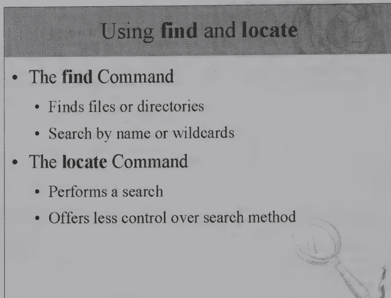

# 使用 FIND 和 LOCATE

当用户想要寻找某个文件但又不太确定它存储在何处时，`find` 和 `locate` 命令非常有用。每条命令都有其查找文件和目录的方法。用户需要能够决定使用哪种工具。


# find 命令

`find` 命令是一个非常强大的工具，用于查找文件或目录。命令的格式如表 5-26 所示。

| `<directory>` | `<expression>` | `<action>` |
|---|---|---|
| 搜索开始的目录。 | 程序搜索的数据。 | 如何报告查找结果。 |

表 5-26. `find` 命令

指定的搜索起始目录看起来可能只搜索该目录，但它也会搜索该目录包含的子目录。要搜索的目录可以是具体的，也可以是通用的（如整个系统）。无论如何，搜索将以类似的方式进行。

搜索文件有两种方法。搜索可以针对特定的名称（如 `file.txt`），也可以使用通配符（如 `*.txt`、`file*` 或 `?use`）。搜索示例文件 `file.txt` 的命令格式如下：

```
$ find -name file.txt -print
```

或者

```
$ find -name "*.txt" -print
```

`<expression>` 指定了正在搜索的准则，在本例中为 `-name`。不过，也可以使用 `-atime`、`-user` 和 `-group` 选项。因此，上一个命令的 `<expression>` 是 `-name file.txt`。`-name` 选项是最常用的选项，因为它允许用户按名称搜索文件或目录。然而，也可以使用其他选项处理其他数据，使用户能够根据其搜索需求配置程序；这使其成为一个非常有用的工具。

命令结构的最后一部分是程序在找到数据后应采取的操作（action）。通常，用户通过名称执行搜索并在屏幕上显示结果。可以使用 `-print` 动作显示数据；然而，这里可以使用任何有效的 Linux 命令来代替 `-print`。其格式为：

```
$ find -name file -exec command \;
```

命令末尾的反斜杠 `\` 是必不可少的。如果要在刚刚找到的文件上运行命令，可以使用右大括号 `{}` 来表示该文件。

```
$ find -name file -exec command {} \
```

对数据进行特定搜索的能力以及对数据进行操作的能力使得 `find` 程序对于初学者和高级用户都是一个非常多功能且强大的工具。

# locate 命令

`locate` 命令像 `find` 一样也会执行搜索。与 `find` 不同，`locate` 用户提供的对搜寻数据方法的控制权较少。`locate` 程序通过搜索匹配并包含搜索参数的所有文件和目录来工作。搜索单词

```
$ locate text
```

将产生任何包含字符串 `text` 的文件或目录。如果某个目录匹配参数，由于路径名匹配，程序将返回该目录中的每个文件。例如，

```
$ locate usr
```

将返回 `/usr/` 目录下的每个文件和子目录。程序的不准确性也是它的主要优点。虽然 `find` 执行特定的搜索，但 `locate` 看的是通用性。这一特性被证明是有用的。当 `find` 执行特定搜索时，`locate` 寻找的是通用性。与 `find` 不同，`locate` 查找的是通用性。如果目录匹配参数，程序将返回目录中的每个文件。`locate` 查找的是通用性。`find` 允许按名称搜索文件或目录，*难以遗忘*；这使其成为了一个非常有用的工具。

# REVIEW（复习）

这些答案位于附录末尾。

- 1. 这里的三个权限类型是什么？
- 2. `locate` 命令包含什么信息？
- 3. 在磁盘上，哪个命令可以找到这些文件？
- 4. `find` 命令在什么情况下可以使用？
- 5. 星号 `*` 在文件中具有什么影响？

# 实验 05-DOT ANDDOT

## 目的

本实验旨在提供 `.` 和 `..` 的经验。

## 时长

10 分钟。

## 概述

在 Linux 环境中，新创建的目录通常包含 `.` 和 `..`。本实验的目的是探索 `.` 和 `..`。最后，`find` 和 `locate` 使得搜索变得更容易。使用 `ls` 命令得到的输出如下：

共 5

| 权限 | 链接数 | 所有者 | 组 | 大小 | 日期 |
|---|---|---|---|---|---|
| drwxrxr-x | 2 | root | root | 4096 | 3月30 13:36 | .. |
| 471425 drwxrxr-x | 2 | root | root | 1024 | 4月24 16:14 | . |
| --rw-r-- | 1 | root | root | 0 | 4月24 16:14 | file01 |
| -rw-r-- | 1 | root | root | 0 | 4月24 16:14 | file02 |
| --rw-r-- | 1 | root | root | 0 | 4月24 16:14 | file03 |
| -rw-r-- | 1 | root | root | 0 | 4月24 16:14 | file04 |
| --rw-r-- | 1 | root | root | 0 | 4月24 16:14 | file05 |
| -rw-r-- | 1 | root | root | 0 | 4月24 16:14 | file06 |

第三行提供了 `..` 目录的信息。列表中的第一个数字是该目录的 inode 号，后面是文件的类型和权限。列表中的 6 是该目录的链接数，接下来的两个是所有者和组。4096 代表文件的大小（字节），对于它是 4K。

关于该软磁盘文件系统的一个有趣事实是，它只创建了 16 个 inode。对于 `.` 的 inode 号为 471425 似乎很奇怪，而且 `..` 目录有 6 个链接。链接数和 inode 数的原因可以通过检查上一级目录找到。通过比较此目录的内容和软磁盘的内容，可以明显地看出 `.` 目录的 inode 和链接计数与软磁盘中的 `..` 目录相同。几次练习有助于发现为什么如此。

# 实验练习

- 1. 进入一个包含某些文件的小目录，并执行以下命令：

```
ls -lai
```

- 2. 检查输出结果并记录指向点点 (.) 和双点 (..) 的链接数。记录相同目录的 inode 节点号。
- 3. 创建一个名为 `test` 的目录。
- 4. 切换到 `test` 目录并检查其内容，记录点点 (.) 和双点 (..) 的信息。
- 5. 现在切换回第一个目录并检查其内容。这次，也要记录 `test` 目录的 inode 节点号和链接数。
- 6. 比较你做的笔记。什么发生了变化，什么没有变化？为什么？

# 实验 05-01 问题

这些问题的答案位于本手册末尾的附录 A。

- 1. 为什么当你创建 `test` 目录时，点点 (.) 目录的链接数会增加 1？
- 2. 如果你创建任何新目录并对其进行检查，你可以看到点点 (.) 和双点 (..) 目录。如果这个新创建的目录没有子目录，为什么点点 (.) 目录的链接数是 2？为什么对于每个创建的目录都是如此？

# 高级问题

- 1. 点点 (.) 和双点 (..) 目录是真实的目录吗？解释你的答案。

# 实验 05-02 - 导航文件系统

# 目的

本实验目的是让用户获得导航文件系统并在其中查找文件的体验。

# 实验时长

20 到 30 分钟。

# 概述

导航 Linux 文件系统主要通过切换目录 (`cd`) 命令完成。使用 `cd` 有两种基本方法。用户可以指定目标目录的绝对路径，也可以使用相对路径。可以通过以下场景说明绝对路径。

假设用户当前的工作目录是 `/home/user`。在 `/home/user` 中，有一个名为 `stuff` 的子目录。要进入 `stuff` 目录，用户可以输入 `cd /home/user/stuff`。这指定了目标目录的路径。

完成相同任务的更快方法是使用相对导航。为此，用户只需输入 `cd stuff` 即可切换到 `stuff` 目录。下面提供了使用相对导航的其他示例。

```
cd ~/stuff
```

波浪号 (`~`) 代表用户的家目录；此命令切换到 `/home/user/stuff`。

```
cd ..
```

此命令在目录树中向上移动一级。例如，如果用户当前的工作目录是 `/home/user/stuff` 并执行此命令，他将移动到 `/home/user`。

# 查找文件

在 Linux 系统上，通过简单的进入目录并使用 `ls` 命令列出内容来查找文件可能是一项耗时的任务。幸运的是，有工具可以加速这个过程。Linux 系统上的两个搜索工具是 `find` 和 `locate`。其中，`locate` 更快且更容易使用。使用 `locate` 需要系统中所有文件的数据库。该数据库通过 `updateddb` 创建并维护。通常，只有 `root` 用户可以执行 `updateddb`，因此数据库经常过期。运行 `updateddb` 可能需要很长时间，因此最好在系统未使用时自动运行它。如果 `locate` 未能找到请求的文件，`find` 可能会找到。`find` 通过逐个搜索文件系统，直到遇到它正在寻找的文件为止。因此，取决于目录大小或硬盘速度等因素，它有时可能会很慢。下面是这两个命令的示例。

```
find -name foo.txt -print
```

这告诉机器从根目录（在此处用斜杠 `/` 表示）开始搜索名为 `foo.txt` 的文件，并将结果打印到控制台。结果看起来如下：

```
find / -name foo.txt -print
/home/user/foo.txt
```

# 5-40 模块 5 — 使用 Linux 文件系统

现在，对 `foo.txt` 使用 `locate` 命令：

```
locate foo.txt
```

此命令告诉计算机在其 `locate` 数据库中搜索 `foo.txt`，并将结果打印到控制台。结果看起来如下：

```
locate foo.txt /home/user1/foo.txt
```

注意，`locate` 将返回任何包含 `foo.txt` 的文件或目录名称，因此如果搜索在系统的多个地方发生，结果可能会很快变得混乱。

# 实验练习

在本实验中，我们将执行一些基本的文件导航和搜索。本实验假设系统最近运行过 `updateddb`。

- 1. 以普通用户身份登录机器并打开终端。
- 2. 执行命令 `cd /etc` 进入 `/etc` 目录。
- 3. 使用命令 `cd ~` 回到你的家目录。
- 4. 使用 `ls` 命令列出你的家目录的内容。
- 5. 执行命令 `touch foo.txt`。这会在当前工作目录下创建一个名为 `foo.txt` 的文件。
- 6. 使用 `locate` 命令尝试查找 `foo.txt`。除非你在创建文件后执行了 `updateddb`，否则这会失败。


- 7. 现在使用 `find` 查找 foo.txt。命令看起来应该是 `find -name foo.txt -print`。

- 8. 显示你当前的目录。这可以通过 `pwd` 完成。

# 05-02 问题

这些问题的答案位于本手册末尾的附录 A。

- 1. 用什么命令列出目录内容？
- 2. 为什么 locate 未能找到 foo.txt？
- 3. 如何显示你当前的目录？

# 第 6 模块 – X Window系统

- 与 X相关的概念（客户端/服务器模型）
- 安装与配置 X
- 运行 X
- 自定义 X 窗口
- 在 X 显示器中操作
- GNU Midnight Commander
- 桌面环境
- GUI 管理工具

## 目标

在完成本模块后，你将能够：

- 安装 X 窗口系统。
- 使用 `xf86config`、`XF86Setup`、`Xconfigurator`、`SaX` 或 `Turboboxcfg` 配置 X。
- 识别六种 init 运行级别（run levels）。
- 使用虚拟桌面。
- 使用 GMC 管理和导航文件目录。
- 使用 Gnome 或 KDE 自定义桌面环境。
- 理解窗口管理器的功能，包括 Gnome、KDE、Sawfish、Enlightenment、Window Maker、KWM。
- 使用 Linuxconf、Turbo Tools、YaST 或 YaST2 执行管理功能。

## 与 X相关的概念（客户端/服务器模型）

### X 窗口客户端服务器模型

- 使用应用程序管理的客户端/服务器模型
- 用户可以运行应用程序
- X 服务器不执行任何实际计算
- 直接通过键盘、鼠标、显示器控制输入输出
- X 客户端使用 X 服务器提供的应用程序
- 客户端和服务器通过 X 协议通信

X 窗口系统（有时称为 X）是一种用于 Unix 和类 Unix 系统（包括 Linux）的启用网络的窗口系统，于 20 世纪 80 年代在 MIT 开发。X 有几个使其独特的特性。其中一个特点是，与 Mac OS 或 Windows 9x 等操作系统的窗口系统不同，它不是操作系统的组成部分。相反，它是层在操作系统之上的一个应用程序。换句话说，完全不使用 X 窗口系统也可以拥有一个功能完整的 Linux 系统。然而，对于从 Windows 迁移过来的用户来说，GUI 会更容易。

### X 窗口客户端/服务器模型

X 窗口使用客户端/服务器模型进行应用程序管理。客户端/服务器模型的优势是用户可以运行远程应用程序，并将这些应用程序显示在显示器上。X 服务器并不像传统服务器那样执行任何实际计算。相反，它负责直接控制显示器并通过键盘、鼠标或显示器管理所有输入和输出。相反，X 客户端是使用 X 服务器提供的服务来显示其输出的应用程序。客户端和服务器使用 X 协议进行通信。

图 6-1 本地和远程客户端

X 客户端既可以在本地运行远程运行。本地客户端在与 X 服务器相同的机器上运行，而远程客户端运行在服务器以外的机器上。假设用户决定远程运行一个程序。他在网络上的另一个系统上启动程序，并告诉它使用他系统中运行的 X 服务器作为控制台。通过这样做，X 客户端将其输出发送到运行在该机器上的 X 服务器，反之，它从服务器获取鼠标和键盘输入。当本地机器没有足够的计算能力时，在远程系统运行应用程序是有优势的。在这种情况下，本地系统运行 X 服务器，客户端可以运行在大型机等强大的机器上，而仍然可以在本地机器上查看输出。

## 安装与配置 X

- 安装 X 窗口系统
- 使用 `xf86config`
- `XF86Setup` 及其它 `Xconfigurator`
- `SaX`
- `boxcfg`

X 窗口系统（也简单称为 X）是 Linux 的标准图形界面。大多数 Linux 发行版默认安装 X；没有必要手动安装。尽管如此，在运行的 Linux 系统上安装 X 也是完全可能的。

建议使用发行版介质并通过适当选项进行安装。理想情况下，发行商在 CD-ROM 上提供了 X 窗口系统的完整安装包以备方便。如果没有，另一个选项是从 XFree86 网站 `www.xf86.org` 下载最新版本。下载最新版本可以帮助支持最新的显卡。

X 窗口系统正在使用的 XFree86 版本可以通过以下命令检查：

```
$ X --showconfig
```

要确定选择哪个版本的 XFree86，请下载 `Xinstall.sh` 脚本，并使用命令运行它：

```
$ sh Xinstall.sh -check
```

这将精确确定要下载哪种发行版的 XFree86。

在下载所有必要文件后，必须再次使用 Xinstall 脚本来提取并放入正确的属性。这次，不带任何选项运行脚本：

```
$ sh Xinstall.sh
```

安装脚本随后将进入交互模式，并显示图 6-2 所示的欢迎界面：

图 6-2. Xinstall 欢迎界面

所示，建议用户备份来自之前安装的文件，以便在出现问题时进行恢复。这些文件位于 `/etc/X11` 和 `/usr/X11`。脚本随后会提一系列问题以正确安装文件。

## 配置 X

设置 X 的下一步是配置程序。为了配置 X，必须对 `X86Config` 文件进行编辑以符合正确的规范。有多个程序可以完成此任务。XFree86 默认提供了两个配置工具；它们是 `xf86config` 和 `X86setup`。此外还有特定发行版的工具。`Xconfig` 是 Red Hat 提供的程序。SU Linux 带有 `Sax` 程序；TurboX 是随 TurboLinux 附带程序。为了正确配置，必须以 root 身份运行这些程序。

### 运行 X 需要配置什么？

在描述每个配置工具之前，有必要讨论需要配置的项目。每个程序都期望获得鼠标、键盘、显示器、显卡、分辨率和色彩的信息。鼠标和键盘是标准设备，它们的配置不会太困难。此外，如果已经配置了控制台鼠标，鼠标配置将简化。对于分辨率和色彩，它们取决于显卡和显示器。显示器的配置需要最多的关注。提供错误的值可能会严重损坏硬件。配置显示器时，必须提供水平和垂直频率。如果显示器制造商提供了这些值，某些程序可以从数据库中确定。要配置显卡，必须知道制造商和型号。

### 分辨率和色彩

分辨率和色彩取决于显卡和显示器的规格。每个深度的第一个列表分辨率将被使用，因此首选分辨率应该是第一个。例如，`640x480`、`800x600`、`1024x768` 和 `1280x1024`。色彩深度代表色彩的数量。

### X 配置工具

最基础的配置是 `xf86config`。虽然它缺少高级功能，`xf86config` 提供了灵活性。

## X86Setup

在 Free提供的两个配置程序中，`X86Setup` 更先进。该程序提供了一个易于使用的图形界面，允许用户从菜单和对话框中进行选择。为了提供图形显示，`X86Setup` 打开一个 X 会话并启动配置程序。使用 `X86Setup` 的另一个特点是它不是顺序的；每个部分都可以按任何顺序进行配置。要启动此程序，使用以下命令：

```
$ X86Setup
```

此将启动 XF86 程序，显示图 6-3 所示的欢迎界面。屏幕顶部有若干个按钮，代表不同的配置部分：鼠标、键盘、显卡、显示器、模式选择（Modeselection）和其它（Other）。要配置某个部分，请使用鼠标或键盘选择相应的按钮，然后提供所需的信息。

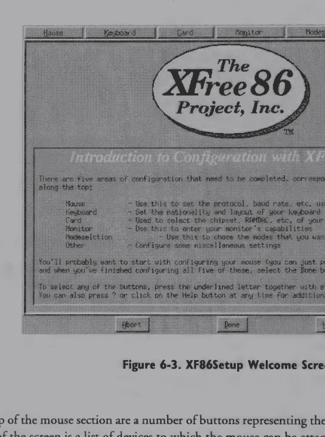

## 鼠标

在鼠标部分的顶部，有若干个按钮代表不同的鼠标协议。屏幕左侧是鼠标可以连接的设备列表。屏幕中间部分包含设置波特率、采样率以及一些杂项选项（如模拟 3 键，Emulate 3 Buttons）的高级选项。从每个选项中选择合适的设置，然后继续下一个部分。

## 键盘

要开始配置键盘，请从顶部列表中选择键盘类型，并从第二个列表中选择布局。屏幕右侧是一些用于为某些键组合分配特殊功能的选项。

## 显卡

对于标准显卡，从列表中选择显卡并继续到下一个部分。如果列表中没有该显卡，可以使用“详细设置”（Detailed Setup）选项。这允许选择服务器并手动指定一些额外的硬件选项。

## 显示器

显示器部分有两个可用选项。如果已知水平和垂直同步率，可以在屏幕顶部指定。对于未知的同步率，提供了一个列表供您选择合适的值。

## 模式选择 (Modeselection)

使用 XF86Setup 指定显示模式非常简单。首先，从列表中选择分辨率，然后从底部列表中选择颜色深度。

## 其它

“其它”允许设置一些杂项选项。这些选项决定了服务器的默认行为。

## Xconfigurator

随 Red Hat 分发的 `Xconfigurator` 程序是一个用于配置 X 的简单易程序。`Xconfigurator` 的工作方式与 `x86config` 类似。然而，`Xconfigurator` 提出的问题比 `x86config` 提出的更简单。要启动 `Xconfigurator`，执行命令：

```
$ Xconfigurator
```

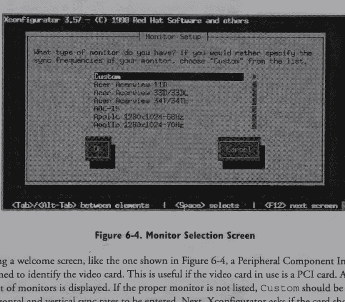

图 6-4。显示器选择屏幕

显示欢迎界面（如图 6-4 所示）后，将进行外围组件接口（PCI）扫描以识别显卡。如果显卡位于 PCI 卡中，这将非常有用。扫描完成后，将显示显示器列表。如果没有列出合适的显示器，应选择“自定义”（Custom）以允许输入水平和垂直同步率。接下来，`Xconfigurator` 会询问是否应该探测显卡以寻找最佳分辨率和颜色深度。该探测可以执行也可以跳过。程序询问显卡上视频显示器的数量，然后询问任何时钟信息。如果没有探测分辨率，下一步是手动设置分辨率和颜色深度，然后测试配置以查看是否正常工作。最后，将写入配置文件。

## SaX

`SaX` 高级 Xconfigurator（SaX）是一个用户友好的 X 配置程序。它可以自动检测大多数鼠标和 PCI 显卡。与 `XF86Setup` 类似，SaX 会显示而启动 X 会话。事实上，SaX 的结构与 `XF86Setup` 非常相似。要启动 SaX，输入命令：

```
$ sax
```


SAIR Linux 和 GNU 认证 -- 基础/Linux

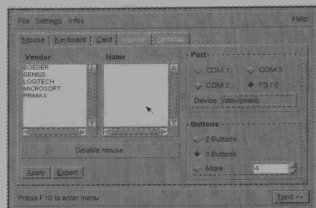

### 图 6-5。SaX 配置界面

使用 SaX，选择屏幕顶部的标签（如图 6-5 所示）。下一步是为每个部分提供所需的信息。SaX 需要的信息与 XF8Setup 相同，并应该以相同的方式处理。

## TurboXcfg

TurboLinux Xcfg 为 TurboLinux 发行版的用户提供了一种配置 X 的简单方法。该程序是基于控制台的，但提供了图形化配置程序的功能。用于启动 TurboXcfg 的命令是：

```
$ turboxcfg
```

尽管 TurboXcfg 是一个控制台程序，但可以按任何顺序配置部分。主屏幕包含键盘、鼠标、显卡、显示器和字体路径部分。

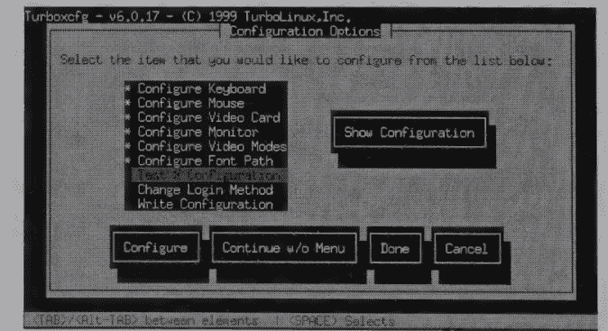

### 图 6-6。TurboXcfg 配置选项

## 定制 X Window

- 桌面管理器
- 登录管理器
- 桌面配置
- 窗口管理器
- 应用程序

## 定制 X Window

X Window 系统继承了 Linux 终端的多功能性，并将其扩展到图形界面。更改 X 窗口环境的外观有无限可能。从壁纸到窗口管理器，任何内容都可以更改以适应用户的规范。桌面管理器和窗口管理器控制着 X 窗口的外观。桌面管理器控制菜单、图标和壁纸，而窗口管理器控制所有的窗口功能，从它们的外观到对鼠标的反应。

## 桌面管理器

互联网上可以下载许多桌面管理器和窗口管理器。定制化一直是 Linux 社区的关注焦点，随着 X 近期的进展，定制化正成为一个快速发展的开发领域。桌面管理器现在配备了新功能和应用程序；窗口管理器现在支持主题和桌面管理。由于有许多可用的管理器，用户应该不难找到适合自己的管理器。表 6-1 和 6-2 列出了部分可用的管理器及其描述：

| 桌面管理器 | 描述 |
|------|---|
| Gnome | 配备了 Gnome 办公软件和 Gnome 开发平台；与大多数窗口管理器以及 KDE 应用程序和菜单轻松协作 |
| KDE | 全功能 IDE（集成桌面环境）；包括它自己的窗口管理器、文件管理器和许多新的 KDE 应用程序 |

表 6-1. 桌面管理器及其功能

## 定制 X Window

| 窗口管理器 | 描述 |
|------|---|
| Sawfish | 提供最丰富的功能且易于使用；与 Gnome 配合得良好 |
| Enlightenment | 提供了许多视觉效果，但在与某些桌面管理器协作方面存在困难 |
| Window Maker | 基础窗口管理器；易于使用，且是大多数 Linux 发行版的标准配置 |
| KWM | 标准的 KDE 窗口管理器；集成良好 |

表 6-2. 窗口管理器及其功能

桌面管理器允许用户从所有安装的管理器中进行选择，因此可以轻松尝试每个窗口管理器，直到找到理想的设置。然而，管理器之间存在一些兼容性问题。例如，某些用户发现 Enlightenment 与 Gnome 的主题和壁纸功能冲突。这主要是因为 Enlightenment 在提供窗口管理的同时，还提供了一些桌面管理器。在 Gnome 上设置壁纸可能会被 Enlightenment 设置的壁纸覆盖。这就是为什么在使用所选的桌面管理器测试窗口管理器是非常重要的原因。

## 登录管理器

X 的定制在 X 初始化之前就开始。`XDM`（X 登录管理器）允许用户以图形化方式登录 X 并从安装的桌面管理器中进行选择。这还允许 X 控制终端登录。当电脑启动时，可以跳过初始终端登录，系统将启动，然后 XDM 可以请求登录。Linux 用户如果他们选择，不需要查看终端。Gnome 还发布了一个版本的 X 登录管理器 `GDM`。这是 XDM 的一个更新且更用户友好的版本。许多新增功能包括精美的图形化登录、制表符补全和欢迎屏幕登录。图 6-7 显示了典型的 GDM 登录界面：


图 6-7. GDM 登录界面

## 桌面配置


桌面管理器允许用户从所有安装的管理器中进行选择，因此可以轻松尝试每个窗口管理器，直到找到理想的设置。然而，管理器之间存在一些兼容性问题。例如，某些用户发现 `Enlightenment` 与 `Gnome` 的主题和壁纸功能冲突。这主要是因为 `Enlightenment` 在提供窗口管理的同时，还提供了一些桌面管理器。在 `Gnome` 上设置壁纸可能会被 `Enlightenment` 设置的壁纸覆盖。这就是为什么在使用所选的桌面管理器测试窗口管理器是非常重要的原因。

# 在 X 显示器中操作 (6-19)

任务列表中的两个选项可能会引起困惑：关闭窗口（Close Window）和杀死应用程序（Kill Application）。“关闭”请求客户端关闭窗口，但保留同一应用程序的其他窗口运行。在像 `Netscape` 这样可能同时打开多个窗口的程序中，这对于关闭程序的一个窗口同时让 `Netscape` 继续运行非常有用。“杀死应用程序”选项可用于杀死程序的所有实例。如果程序卡死或崩溃，此选项将非常有用。

## 虚拟屏幕

`X` 窗口系统的另一个有用（有时令人厌恼）的方面是虚拟屏幕。虚拟屏幕允许用户设置比可用显示尺寸更大的屏幕，为显示窗口提供更多空间而不会显得杂乱。导航时，用户只需将鼠标移动到屏幕的任何侧，屏幕就会向该方向滚动。然而，虚拟桌面和虚拟屏幕的交互可能会出现一些问题，因此在选择设置虚拟屏幕之前应该考虑这一点。

虚拟桌面是由窗口管理器实现的。当应用程序不在当前桌面上时，`X` 服务器不需要对它进行绘图，它就不会浪费视频内存。然而，虚拟屏幕是由 `X` 服务器实现的。屏幕中视之外的部分仍然由 `X` 服务器进行绘图，尽管它对用户是不可见的。这可能会浪费 CPU 时间和视频内存。由于原因，大多数用户倾向于虚拟桌面。

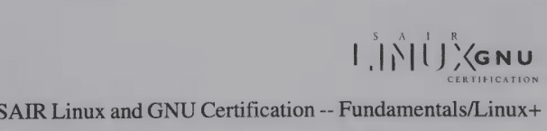

## GNU Midnight Commander

- Midnight Commander 文本界面
  - 主界面
  - 目录导航
  - 文件选择
  - 基础文件操作
- Midnight Commander Gnome 界面
  - 目录浏览
  - 文件选择
  - 基础文件操作
- 其他文件管理器

### GNU MIDNIGHT COMMANDER


市场上有多种基于 `X` 的文件管理器。这些文件管理器允许用户在 `X` 中执行文件操作命令。文件管理器的一个主要优势是用户不需要记忆所有的文件处理和目录浏览命令，因为文件管理器提供了图标或菜单来帮助在系统中进行导航。

本节将介绍使用 `GNU Midnight Commander (MC)` 操作文件和目录。`MC` 有两个界面：文本模式界面和 `Gnome` 界面。

#### Midnight Commander 文本界面

以下是 `MC` 中基础文件操作的介绍。如需了解更多信息，请参考 `MC` 的帮助部分，该部分对其功能提供了详细说明。

`MC` 是 `Norton Commander` 的克隆版本，后者是一个基于 `DOS` 的文件管理器，提供目录浏览和文件管理功能。`MC` 因其简单性、灵活性和稳定性而被广泛使用。用户可以在控制台或在 `X` 环境下的 `xterm` 中运行此程序。程序还提供了一个内置的虚拟文件系统，允许用户浏览诸如 `tar`、`rpm`、`deb`、`zip`、`cpio`、`lha`、`rar` 和 `zoo` 等归档文件。

### GNU Midnight Commander 6-2

| 名称 | 大小 | 修改时间 | 名称 | 大小 | 修改时间 |
|---|---|---|---|---|---|
| `/.AbiSuite` | 4096 | 7月17日 07:28 |  | 4096 | 7月17日 07:28 |
| `/.autosave` | 4096 | 7月31日 13:14 | `/.autosave` | 4096 | 7月31日 13:14 |
| `/.cedit` | 4096 | 7月11日 16:49 | `/.cedit` | 4096 | 7月11日 16:49 |
| `/.Desktop` | 4096 | 7月31日 13:14 | `/.Desktop` | 4096 | 7月31日 13:14 |
| `/.dia` | 4096 | 7月17日 09:13 | `/.dia` | 4096 | 7月17日 09:13 |
| `/.en` | 4096 | 5月18日 15:43 | `/.en` | 4096 | 5月18日 15:43 |
| `/.enlightenment` | 4096 | 5月18日 15:43 | `/.enlightenment` | 4096 | 5月18日 15:43 |
| `/.cache` | 4096 | 8月04日 14:02 | `/.cache` | 4096 | 8月04日 14:02 |
| `/.emacs` | 4096 | 6月23日 15:37 | `/.emacs` | 4096 | 6月23日 15:37 |
| `/.fdb10050_0f7` |  |  | `/.fdb10050_0f7` |  |  |
| `/.gimp-1` | 4096 | 7月12日 16:13 | `/.gimp-1` | 4096 | 7月12日 16:13 |
| `/.gnome` | 4096 | 7月31日 13:14 | `/.gnome` | 4096 | 7月31日 13:14 |
| `/.gnome-desktop` | 4096 | 6月23日 13:14 | `/.gnome-desktop` | 4096 | 6月23日 13:14 |

#### Midnight Commander 文本界面

以下是 `MC` 中基础文件操作的介绍。如需了解更多信息，请参考 `MC` 的帮助部分，该部分对其功能提供了详细说明。

`MC` 是 `Norton Commander` 的克隆版本，后者是一个基于 `DOS` 的文件管理器，提供目录浏览和文件管理功能。`MC` 因其简单性、灵活性和稳定性而被广泛使用。用户可以在控制台或在 `X` 环境下的 `xterm` 中运行此程序。程序还提供了一个内置的虚拟文件系统，允许用户浏览诸如 `tar`、`rpm`、`deb`、`zip`、`cpio`、`lha`、`rar` 和 `zoo` 等归档文件。


任务列表中的两个选项可能会引起困惑：`Close Window` 和 `Kill Application`。“关闭”请求客户端关闭窗口，但保留同一应用程序的其他窗口运行。在像 Netscape 这样可能同时打开多个窗口的程序中，这对于关闭程序的一个窗口同时让 Netscape 继续运行非常有用。“杀死应用程序”选项可用于杀死程序1111111111111111111111111111111111111111111111111111111111111111111111111111111111111111111111111111111111111111111111111111111111111111111111111111111111111111111111111111111111111111111111111111111111111111111111111111111111111111111111111111111111111111111111111111111111111111111111111111111111111111111111111111111111111111111111111111111111111111111111111111111111111111111111111111111111111111111111111111111111111111111111111111111111111111111111111111111111111111111111111111111111111111111111111111111111111111111111111111111111111111111111111111111111111111111111111111111111111111111111111111111111111111111111111111111111111111111111111111111111111111111111111111111111111111111111111111111111111111111111111111111111111111111111111111111111111111111111111111111111111111111111111111111111111111111111111111111111111111111111111111111111111111111111111111111111111111111111111111111111111111111111111111111111111111111111111111111111111111111111111111111111111111111111111111111111111111111111111111111111111111111111111111111111111111111111111111111111111111111111111111111111111111111111111111111111111111111111111111111111111111111111111111111111111111111111111111111111111111111111111111111111111111111111111111111111111111111111111111111111111111111111111111111111111111111111111111111111111111111111111111111111111111111111111111111111111111111111111111111111111111111111111111111111111111111111111111111111111111111111111111111111111111111111111111111111111111111111111111111111111111111111111111111111111111111111111111111111111111111111111111111111111111111111111111111111111111111111111111111111111111111111111111111111111111111111111111111111111111111111111111111111111111111111111111111111111111111111111111111111111111111111111111111111111111111111111111111111111111111111111111111111111111111111111111111111111111111111111111111111111111111111111111111111111111111111111111111111111111111111111111111111111111111111111111111111111111111111111111111111111111111111111111111111111111111111111111111111111111111111111111111111111111111111111111111111)

## 创建新目录
要创建一个新目录，点击菜单栏上的“文件（File)”选项，然后点击“新建（New）”。将弹出一个对话框。在对话框中选择“目录（Directory)”并输入新目录名称。新目录将显示在目录树窗口中。

## 复制文件
将文件从一个位置到另一个位置最简单的方法是对要复制的文件点击右键。将显示选项列表。选择“复制（Copy）”，然后指定文件所需的位置。

## 移动文件
遵循与复制操作相同的步骤，但这次选择“移动（Move)”而不是“复制（Copy）”。

## 重命名文件
遵循复制或移动文件时相同步骤，但这次选择“属性（Properties）”。将弹出一个对话框，可以在其中更改文件名。

## 删除文件
要删除文件，选择该文件并按 `<DEL>`。GMC 将要求确认删除，如果确认了操作，文件将被删除。要删除多个文件，请在按 `<DEL>` 之前使用多文件选择方法。

## 更改所有权或权限
要更改文件或目录的所有权，选择所需的文件或目录并点击鼠标右键。这将打开一个选项列表。从该列表中选择“属性（Properties）”。将打开另一个对话框，可以在其中使用“权限（Permission）”选项更改所有所需的权限。

## 其他文件管理器
如本节开头所示，有许多其他文件管理器可用。表 6-3 是文件管理器及其所在网站列表。

| FileRunner | URL |
| :--- | :--- |
| FileRunner | www.cd.chalmers.se/~bch/filerunner.html |
| X-Files | www.neosoft.com/td/ftparchive/sorted/file |
| TkDesk | http://sd.znet.com/~jchris/tkdesk/ |

表 6-3 文件管理器列表

## 桌面环境

- Gnome
  - Gnome 面板
    - 菜单、小组件、启动器、抽屉、其他应用程序
  - Gnome 桌面
  - Gnome 应用
- KDE
  - KDE 面板
  - KDE 桌面
  - KDE 软件
    - KDE 控制中心、库

### Gnome 和 KDE 概述
Gnome 和 KDE 是两个最流行的桌面环境。桌面环境不仅仅是 X 窗口的外精外观。一个环境包含许多预包实用程序，如文件管理器、组织工具、Internet 工具、配置工具、文字处理器等。桌面环境试图让 X 窗口环境成为用户易型的工作空间。

另一方面，窗口管理器仅仅是一个 GUI 界面，是桌面环境的一个子集。X 窗口用户有许多窗口管理器可选。其中一些窗口管理器是：Afterstep、Enlightenment、FVVM、ICEWM、Sawfish 和 gwm。某些用户倾向于使用窗口管理器而不是完整的桌面环境。

Gnome 和 KDE 将在后续章节中详细介绍。用户应该访问 `www.gnome.org` 或 `www.kde.org`（Gnome 和 KDE 的官方网站），以获取每个窗口器的外观和感受。

## Gnome
Gnome 是一个完全可配置的桌面环境。它允许符合 Gnome 标准的应用程序集成到一个稳定的、交互式环境中，用于运行和开发程序。

Gnome 是多面的；它为用户提供了一个可配置的面板、桌面以及许多应用程序。控制中心可以配置 Gnome 会话的所有方面。组成 Gnome 的软件库供开发者用于创建 Gnome 应用程序。这使得桌面环境能够与其他软件完全集成。

图 6-12 是 Gnome 会话的截图。它将为 Gnome 不同部分的说明提供图形化指南：

### 6-26 模块 6 — X 窗口系统
图 6-12. Gnome 桌面截图

### Gnome 面板
Gnome 面板是（默认情况下）位于屏幕底部的条。Gnome 面板有六个部分：菜单、小组件、启动器、抽屉、特殊对象和隐藏区域。菜单位于左侧，以 Gnome 的脚印作为图标。菜单旁边有一个小组件，用于从面板内部的命令行启动应用程序。在该小组件右侧有三个启动器，随后是一个用于在 Gnome 的不同屏幕之间导航的特殊对象。面板右侧是一个时钟小组件和两个娱乐小组件：生命游戏（Game of Life）和 Wanda Fish。

要配置面板，请在面板上的任何空隙处点击右键。将出现一个菜单，其中包含配置和/或向面板添加不同应用程序的选项。

#### 菜单
Gnome 面板中的菜单链接到应用程序和文件夹。Gnome 中的主菜单无法删除，但可以添加其他菜单随后将其删除。主菜单传统上位于面板左侧，可以通过 Gnome 控制中心进行配置。

#### 小组件
小组件是完全运行在面板内部的程序。时钟小组件是一个时钟。在 Gnome 中，有一个默认的时钟小组件，显示时间（12 小时、24 小时或 Unix 格式）和日期。Gnome 附带了可以安装的预配置小组件。

#### 启动器
启动器类似于面板上的小组件，提供指向应用程序或目录的链接。要添加启动器，用户必须具有执行应用程序的权限。启动应用程序时传递给程序的选项可以配置到启动器中。启动器的其他选项包括用哪个图标代表它、可以在哪里找到文档、名称和注释。

#### 抽屉
抽屉是面板的扩展。抽屉最好被描述为在原始面板上的另一个面板。抽屉可以执行面板的所有功能，例如包含小组件和启动器。它们主要用于扩展受尺寸限制的面板。

#### 其他应用程序
特殊对象是指不属于任何组别的应用程序。它们通常是专门的，执行小组件无法执行的操作。例如，注销特殊对象用于注销 X 窗口系统。还有运行程序、在 Gnome 的不同桌面之间移动以及锁定屏幕的特殊对象。

隐藏箭头会将整个面板滑到屏幕一侧，将其隐藏在视图。这提供了更多的桌面空间。再次按下箭头会将面板扩展整个屏幕。

### Gnome 桌面
在 Gnome 下运行的程序将位于桌面。在 Gnome 会话图中，桌面显示了 Gnome 控制中心和 GIMP（GNU 图像处理程序）。桌面可以通过控制中心进行配置。不同的配置指定桌面的各种属性，例如背景如何显示以及环境有多少个虚拟桌面。

Gnome 桌面还可以包含指向程序和目录的链接。这些链接属于用户并在不同的虚拟桌面之间移动。因此，如果用户的桌面上有一个 Gnome 文件管理器的链接，该链接将出现在用户所有的虚拟桌面上，该链接启动的程序不会在虚拟桌面之间移动。

### Gnome 应用
有各种 Gnome 应用可用，从文本编辑器、文字处理器到 Web 浏览器和即时消息客户端。其中一些仍在开发中，几乎都可以可以使用。大多数 Linux 应用都可以在 Gnome 下运行，甚至是 KDE 应用，尽管这些程序没有 Gnome 程序的集成功能。

Gnome 控制中心是一个非常有价值的工具。通过这个图形驱动的程序，可以配置 Gnome 会话的所有方面。这是控制中心的截图。

### 6-28 模块 6 — X Window 系统
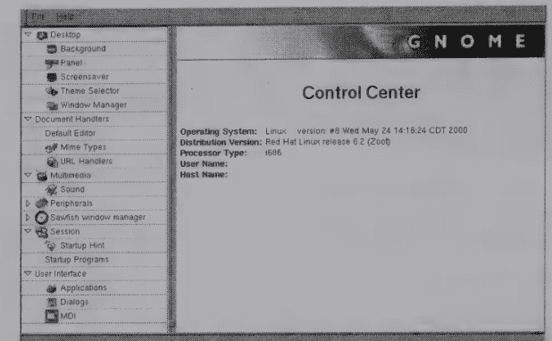
图 6-13. Gnome 控制中心

如图 6-13 所示，控制中心可以配置桌面，以及所有控制文件类型、多媒体、系统外设、会话和用户界面的应用程序。

Gnome 附带的其他应用程序还包括文件管理器、音频文件程序、字符映射以及用于监控系统、娱乐和实用工具的大型小程序（applets）。

## KDE
KDE 是另一个免费提供的桌面环境。它具有许多与 Gnome 相似的功能，例如桌面面板和控制中心，以及它自己的软件集。KDE 将自己描述为网络透明的、现代桌面环境。

KDE 环境由三部分组成：KDE 面板、桌面，以及作为 K Desktop 环境一部分的软件库和应用程序。

### KDE 面板
KDE 面板默认位于屏幕底部，具有启动应用程序的能力，为用户保留菜单，并运行如时钟和虚拟桌面导航器等小程序。图 6-14 是 KDE 面板的屏幕：


图 6-14. KDE 面板

主菜单是一个样式化的图标，默认出现在底部面板的最左侧。它包含许多用于配置 KDE 的链接，以及指向大多数预装应用程序的链接。这些菜单包含用于其他应用程序的启动器，称为 `kdelinks`。KDE 中使用的所有链接都是用户 KDE 目录中出现的文本文件的前端。这些链接可以配置为包含将要加载的程序或设备名称、注释、程序或设备的路径以及其他选项，例如程序出现窗口的图标和大小。


也可以通过从 KDE 文件管理器将图标拖动到面板来添加应用程序的 `kdelinks`。所有链接都可以配置为启动时向应用程序传递选项和注释。

### KDE 桌面
KDE 桌面包含指向程序和设备的链接。要向桌面添加程序链接，请右键点击桌面并选择“新建（New）”然后“程序（Program）”。另一种方法是从文件管理器将应用程序拖到桌面，在桌上创建一个链接。

KDE 支持虚拟桌面。这些是用户可以切换的额外控制台，但每次只能查看一个。这为用户在只有一个桌面时提供了更多的桌面空间。

桌面还支持 KDE 任务栏。该任务栏显示当前运行的应用程序图标，无论其是否被最小化。当打开多个应用程序时，这是一个跟踪应用程序状态的有用工具。

### KDE 软件
KDE 软件由几部分组成：用于用户生产力的 KDE 自带应用程序、用于配置系统的应用程序，以及用于构建 KDE 和为 KDE 构建软件的底层软件库。

KDE 应用程序种类多样。有 KOffice，它是一个用于生成文档和演示文稿的办公套件。与 KDE 发布的其他软件还包括图形处理软件、游戏和玩具、文件管理软件以及 KDE 控制中心。

### KDE 控制中心
KDE 控制中心是用于配置 KDE 的主程序。通过此应用程序，用户可以更改系统设置和 KDE 会话的外观。在此处也可以获取系统信息。图 6-15 是 KDE 控制中心的截图：

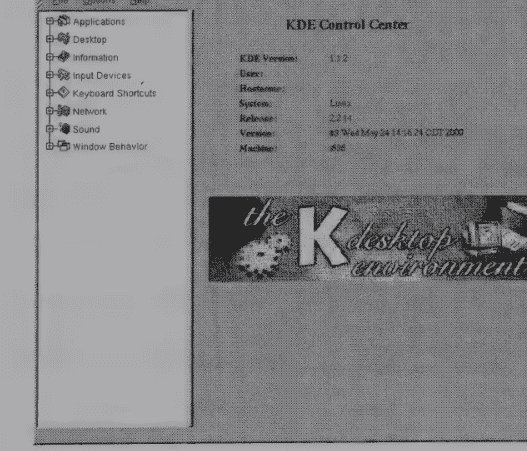
图 6-15. KDE 控制中心

SAIR Linux 和 GNU 认证 -- 基础/Linux

控制中心配置应用程序、输入设备和键盘绑定，以及系统与网络的交互。还可以从 KDE 控制中心配置窗口行为、声音和桌面。

### 库
KDE 的底层库是 Qt 库。这些库是由来自挪威的 Troll Tech 公司发布的。由于 KDE 是基于这些库构建的，因此安装 KDE 需要 Qt。所需的 Qt 版本取决于正在安装的 KDE 版本。请访问 KDE 网站 `www.kde.org` 查看有关安装需要哪个版本 Qt 的规范。

## GUI 管理工具
- Linuxconf
- 模块 (Modules)
- 接口 (Interfaces)
- Turbo Tools
- YaST 和 YaST2

### GUI 管理工具概述
F.6.80 使用命令行界面 (CLI) 执行管理任务可能是繁琐的。图形用户界面 (GUI) 通过提供易于理解的格式简化了基本的系统使用。系统管理也可以同样简化。管理员每天面临着许多耗时的任务。在过去，大多数管理员被迫手动添加用户并编辑配置文件。现在这些任务可以使用某些形式的 GUI 工具完成，例如 Linuxconf、TurboLinux 工具和 YaST。

### Linuxconf
Linuxconf 是一个很棒的管理工具，兼容 Red Hat、Slackware、SuSE、Caldera 和 Debian。控制中心配置应用程序、输入设备和键盘绑定，以及系统与网络的交互。窗口行为、声音和桌面也可以从 KDE 控制中心配置。图 6-15 是 KDE 控制中心的截图：


图 6-15. KDE 控制中心

## 模块 6 — X Window 系统
Linuxconf 是一个很棒的管理工具，兼容 Red Hat、Slackware、SuSE、Caldera 和 Debian。控制中心配置应用程序、输入设备和键盘绑定，以及系统与网络的交互。窗口行为、声音和桌面也可以从 KDE 控制中心配置。图 6-15 是 KDE 控制中心的截图：


- 模块 (Modules)
- 接口 (Interfaces)
- Turbo Tools
- YaST 和 YaST2

### 模块 (Modules)
KDE 的底层库是 Qt 库。这些库是由来自挪威的 Troll Tech 公司发布的。由于 KDE 是基于这些库构建的，安装 KDE 需要 Qt。所需的 Qt 版本取决于正在安装的 KDE 版本。请访问 KDE 网站 `www.kde.org` 查看有关安装需要哪个版本 Qt 的规范。

### 接口 (Interfaces)
Linuxconf 提供四种接口：命令行（使用 Ncurses）、图形界面（使用 GTK+）以及 Web 工具（使用 Java）。基于文本。

### Turbo Tools


TurboLinux 配备了一套统称为 Turbo Tools 的系统管理实用程序。`Linuxconf` 使用许多连接到中心程序的模块，但 Turbo Tools 没有连接到某个特定的应用程序。13 个标准的 TurboTools 位于 `/usr/sbin`。KDE 支持虚拟桌面。这些是用户可以切换的额外控制台，但每次只能查看一个。这为用户在只有一个桌面时提供了更多的桌面空间。

桌面还支持 KDE 任务栏。该任务栏显示当前运行的应用程序图标，无论其是否被最小化。当打开多个应用程序时，这是一个跟踪应用程序状态的有用工具。

# 模块 6 — 窗口系统

## YaST 和 YaST2

Yet一个设置工具（YaST）是 SuSE 管理的一部分。它结合了 Turbo Tools 界面的外观风格与 `Linuxconf` 的集中化管理。YaST 程序本身控制系统管理的所有方面。图 6-18 是 YaST 界面的截图。

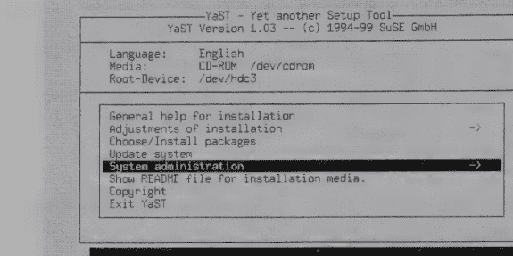

图 6-18。YaST 界面

随着 `Linuxconf` 和 X 系统管理工具的出现，SuSE 被迫更新 YaST。许多用户发现命令行或 X 界面更容易。

YaST2 与其前身不同，依赖于 X。它的窗口系统易于导航，并提供了一个优秀的检测器/安装程序。在通用 SuSE 系统上，YaST2 看起来有点像图 6-19：

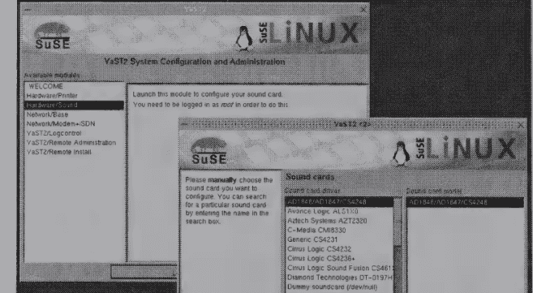

图 6-19。YaST2 界面

## 模块复习题

这些问题的答案位于手册末尾的附录 A。

- 1. X 系统的两个组件是什么
- 2. 哪种 X 分发通常用于 Linux ？
- 3. 如何使用窗口管理器来自定义 X 环境？
- 4. XDM 和 GDM 是什么？
- 5. 什么是桌面环境，哪两个主要的桌面环境是在 GPL 下发布的？

# SAIR LINUX GNU 认证模块 7

## LINUX 应用

| 主题 | 页码 |
| :--- | :--- |
| 目标 ........................................................................ | 7-3 |
| 文本编辑器 ....................................................................... | 7-4 |
| Vi 和 Vim ........................................................................ | 7-4 |
| Emacs .............................................................................. | 7-7 |
| Pico ............................................................................... | 7-10 |
| Joe ................................................................................... | 7-11 |
| Cool Edit ............................................................................ | 7-12 |
| 浏览器 ............................................................................ | 7-13 |
| Netscape Communicator ...................................................... | 7-13 |
| Lynx ................................................................................ | 7-16 |
| 其他浏览器 ................................................................. | 7-17 |
| Xterm ............................................................................... | 7-21 |
| 使用 Xterm ............................................................................ | 7-21 |
| GNU 应用 ................................................................ | 7-23 |
| 什么是 GNU? ................................................................ | 7-23 |
| 有什么可用? ............................................................ | 7-24 |
| 如何获取 .................................................................... | 7-24 |
| 非 GNU 应用 ....................................................... | 7-25 |
| BSD 应用 ............................................................ | 7-25 |
| 艺术许可证 (Artistic License) ............................................................ | 7-26 |
| 共享软件许可 ........................................................ | 7-26 |
| 多重许可 .......................................................... | 7-27 |
| 商业软件 .......................................................... | 7-27 |
| 公有领域软件 ................................................... | 7-27 |
| 打印过程 ................................................................ | 7-28 |
| 打印概述 ................................................ | 7-28 |
| 应用 ................................................................. | 7-28 |
| 打印机控制 ................................................................ | 7-28 |
| 过滤器 ......................................................................... | 7-30 |
| 打印守护进程 (Print Daemon) ............................................ | 7-30 |
| 存档与包 ........................................................ | 7-31 |
| Tarballs ........................................................................ | 7-31 |
| RPM ................................................................................ | 7-32 |
| Deb 包 ................................................................ | 7-34 |
| 使用 Deb, RPM 和 Tarballs ................................ | 7-34 |
| 备份 ............................................................................ | 7-35 |
| 备份类型 ........................................................ | 7-35 |
| 备份工具 ............................................................. | 7-36 |
| 模块复习题 ........................................ | 7-38 |
| 实验 07 - 创建与打印 ............................................ | 39 |
| 目的 ..................................................... | 39 |
| 实验时长 ................................................................ | 39 |
| 概述 ...................................................... | 39 |
| 实验练习 .............................................. | 39 |
| 实验 07 问题 ............................................... | 39 |

# 模块 7 — Linux 应用

## 目标

- 文本编辑器
- 浏览器
- Xterm
- GNU 应用
- 非 GNU 应用
- 打印过程
- 存档与包
- 备份

完成本模块后，你将能够：

- 使用文本编辑中的基本功能。
- 识别并使用图形化文本浏览器。
- 定义 `Xterm`。
- 定义 GNU 以及项目的目的。
- 识别各种许可证。
- 识别打印过程中的步骤。
- 创建并提取 tarballs。
- 识别 RPM。

### 文本编辑器

- Vi 和 Vim
- Vi 中的输入模式
- Vi 中的命令模式
- Vi 的配置
- Emacs
- 打开、保存、关闭文件
- 窗口
- 移动
- 主要模式
- 搜索
- 剪切和粘贴文本
- 选项
- 区域
- Pico
- Joe
- Cool Edit

Linux 有许多可用的文本编辑器。它们从行编辑器（如 `Ed`）到文字处理程序（如 `Emacs`）。它们也可以充当浏览器。在本节中，将介绍 Vi、Emacs、Joe 和 Cool Edit。掌握了这些程序后，用户应该能够自如在任何 Linux 安装上编辑文本。(img/b0ea5e4a55ee6767fff087672e71c505_189_0.png)

### Vi 和 Vim

该程序首次出现在 BSD 中，并包含在几乎每一个发行版中。程序的更新版本 `Vim` 已经在大多数发行版中取代了 `Vi`。基本功能仍然保留，但增加了许多特性。`Vi` 是一个模态程序，这使其与其他文本编辑器不同；用户在输入模式或命令模式下操作。在输入模式下，所有按键都被记录为文本。在命令模式下，几乎每个键都绑定了一个特定的命令。要从命令模式切换到输入模式，按下 `i` 或 `a`。

### Vi 中的输入模式

要启动程序，输入 `vi`。程序从命令模式开始，显示帮助屏幕。要输入文本，按下 `i` 键。用户将进入输入模式，所有按键都会随着它们在屏幕上的输入而出现。在输入模式下的移动可以使用箭头键完成。在输入模式下的移动可以使用箭头键和 `<PgUp>`、 `<PgDn>` 键。按下 `<ENTER>` 键将创建新行。

在命令模式下，几乎每个键都绑定了一个特定的命令。要从命令模式切换到输入模式，按下 `i` 或 `a`。在输入模式下，所有按键都被记录为文本。在命令模式下，几乎每个键都绑定了一个特定的命令。按下 `<ESC>` 键切换到命令模式。在命令模式下，几乎每个键都绑定了一个特定的命令。要从命令模式切换到输入模式，按下 `i` 或 `a`。

要启动程序，输入 `vi`。程序从命令模式开始，显示帮助屏幕。要输入文本，按下 `i` 键。用户将进入输入模式，所有按键都会随着它们在屏幕上的输入而出现。在输入模式下的移动可以使用箭头键和 `<PgUp>`、 `<PgDn>` 键。按下 `<ENTER>` 键将创建新行。

### Vi 中的命令模式

在命令模式下，几乎每个键都绑定了一个特定的命令。要从命令模式切换到输入模式，按下 `i` 或 `a`。在命令模式下，冒号 `:` 用于移动到行编辑模式。在这里，在屏幕底部输入组合键，直到按下 `<ENTER>` 键。

#### 读取 (Read)

打开名为 star 的文件，输入：

```
:r star
```

`<R>` 键将调用读取命令并打开文件。要保存名为 textfile 的文件，输入：

```
:w textfile
```

#### 新文件

`:w` 命令组合也可以用于创建新文件并保存写入该文件的文本。

#### 关闭 (Close)

关闭 `Vi` 使用 `:q` 命令。然而，如果文件自上次保存以来发生了更改，`:q` 命令不会立即关闭，而是提示用户保存文件。如果用户不想保存对文件所做的更改，`:q` 将退出而不保存。

这些命令也可以组合以同时执行多次操作。例如，输入 `:wq` 将保存当前文件并退出 `Vi`。

#### 导航 (Navigation)

用户可以使用特定的按键在命令模式下移动文本。`<h>`、`<j>`、`<k>` 和 `<l>` 键分别向左、向上、向下向右。要在屏幕之间移动，`<CTRL-F>` 和 `<CTRL-B>` 键将分别向前向后移动屏幕。向前向后移动一个单词，输入 `<SHIFT-E>` 或 `<SHIFT-B>`。

#### 编辑 (Editing)

`Vi` 中的复制、剪切和粘贴是按行的。要剪切一行，输入 `dd`；复制一行，输入 `yy`。粘贴命令是 `p`；它会将最近剪切或复制的信息粘贴到文本中。

#### 搜索 (Searching)

在 `Vi` 中使用命令模式搜索特定文本。输入斜杠 `/` 打开搜索对话框。例如，输入 `/pattern` 将光标移动到文件中字符串 `pattern` 的首次出现处。要重复搜索，`<n>` 键将移动到 `pattern` 的下一次出现处。要搜索并替换所有文本 `search` 为文本 `replace`，此命令为：

```
: 1,$ s/search/replace/g
```

# 模块 7 — Linux 应用程序

上述命令中的 `1` 和 `$` 告诉计算机从文件的第一行 `1` 运行到最后一行 `$`。通过输入 `s`，调用了替换命令。该语法指定了 `s` 之后的第一个字段是待查找的文本，第二个字段将是替换文本。命令末尾的 `g` 通知程序替换整行中的文本。

## Vi 的配置

在程序启动时，可以向 `Vi` 传递选项。表 7-1 列出了更常用命令的简要描述。可以在 `vim (1)` 的 man 页面中找到完整列表。

| 选项 | 功能 |
|---|---|
| `-g` | 如果安装 Vi 时带有 GUI 支持，则此选项将启用该 GUI 支持。 |
| `-m` | 以只读模式打开 Vi，禁用任何文件的保存。 |
| `-x` | 写入文件时使用加密。此选项将提示输入加密密钥。 |
| `--` | 在此选项后输入的内容将告诉 Vi 之后的任何文本都将被视为文件名。 |

表 7-1. Vi 可用的选项

`Vi` 程序允许用户在 `.exrc` 文件中保存配置。通过将此文件放在用户目录下，`Vi` 将读取它来配置 `Vi` 会话。每个目录都可以有自己的 `Vi` 配置。要配置 `Vi`，可以使用 `set` 命令。该命令既可以在整个 `.exrc` 文件中使用，也可以在 `Vi` 会话期间使用。通过输入 `set [option]` 使用此命令。这些选项通常具有缩写行为，可以代替完整的选项名称（在表 7-2 中用括号表示）。常用的 `set` 选项描述在表 7-2 中：

| 选项 | 功能 |
|---|---|
| autointent (ai) | 启用文本的自动缩进。要删除缩进，输入 `<CTRL-d>`。 |
| ignorecase (ic) | 搜索时忽略文本的大小写。 |
| number (nu) | 每行显示行号。 |
| tapstop (ts) [NN] | 设置 Tab 长度。要设置 Tab 长度为八空格，使用 `set tabstop=8` 或 `set ts=8`。 |
| window=[NN] | 设置同时显示的总行数。`set window=30` 将屏幕限制为 30 行。 |
| wrapscan (ws) | 搜索会在文件开头循环，而不是在到达文件结尾时停止。 |

表 7-2. 常用的 set 选项

下文显示了一个 `.exrc` 文件示例：

- set number
- ignorecase

此 `.exrc` 文件配置 `Vi` 显示行号并在搜索时忽略大小写。


# Emacs


Emacs 程序是一个可扩展的文本编辑器，也是一个 Lisp 解释器。要运行 Emacs，在命令行提示符输入命令 `emacs`。这可以配合选项或文件名作为参数使用。例如，`emacs filename.txt` 将打开 Emacs 程序并从磁盘加载 `filename.txt` 文件，或者在一个命名的 `filename.txt` 中打开。

Emacs 命令由 `<CTRL>` 和 `<META>` 的组合组成，`<META>` 由 `<ALT>` 或 `<ESC>` 表示。如果用户的键盘支持 `<ALT>` 键，那么 `<META>` 将指代 `<ALT>`。否则，`<ESC>` 将充当 `<META>` 键。按键方式存在差异。例如，如果 `<META-H>` 作为 `<ALT>` 和 `h` 键，则通过同时按下 `<ALT>` 和 `h` 来执行命令。如果 `<META>` 由 `<ESC>` 表示，则可以通过按下并释放 `<ESC>` 然后按 `h` 来执行命令。

Emacs 屏幕由三部分组成：文本缓冲区 `text buffer`、模式行 `mode line` 和命令行 `command line`。文本缓冲区是文件所在的地方。模式行提供有关文件的信息，例如光标所在的行、当前缓冲区的模式以及正在使用的文件名。命令行是允许向命令传递参数的区域。

# 打开、保存和关闭文件

`<CTRL-X>` 是 Emacs 中许多操作的基础。在 Emacs 下打开文件，使用 `<CTRL-X> <CTRL-F>` 命令。当发出此命令时，命令行会提示输入要打开的文件名。此外，Emacs 会执行文件补全，并在按下 `<TAB>` 键时可能会显示可用选项列表。

要保存文件，使用 `<CTRL-X> <CTRL-S>` 命令。这会自动保存文件，除非它是新文件。如果是新文件，程序将提示用户在命令行输入文件名。要保存到当前文件以外的文件，使用 `<CTRL-X> <CTRL-W>` 命令。例如，如果用户正在处理一个命名文件 `filename.txt`，则使用命令 `<CTRL-X> <CTRL-W> filetwo.txt` 将信息写入一个命名的文件中。

通过按下 `<CTRL-X> <CTRL-C>` 命令关闭 Emacs。如果缓冲区未保存，用户无需保存文件，但必须由用户通过输入 `yes` 或 `no` 来指定。

# 移动

在 Emacs 中移动可以通过字符、单词、行或屏幕完成。向上、向下或向右移动一个字符，分别使用 `<CTRL-P>`、`<CTRL-N>`、`<CTRL-B>` 和 `<CTRL-F>` 命令。

`<META>` 键用于将光标移动到单词的开头和结尾。`<META-B>` 将光标移动到单词开头，而 `<META-F>` 将移动到单词结尾。

可以跳转到行的开头或结尾。移动到行首，按下 `<CTRL-A>`。移动到行尾，按下 `<CTRL-E>`。

移动屏幕，使用 `<META-V>` 向后移动一屏，`<CTRL-V>` 向前移动一屏。

# 搜索

Emacs 有两种搜索方法：正则表达式和增量搜索。正则表达式搜索是一种一次性搜索整个表达式的方法。根据搜索标准查找匹配表达式。

# 模块 7 — Linux 应用程序

上述命令中的 `1` 和 `$` 告诉计算机从文件的第一行 `1` 运行到最后一行 `$`。通过输入 `s`，调用了替换命令。语法指定了 `s` 之后的第一个字段是待查找的文本，第二个字段将是替换文本。命令末尾的 `g` 通知程序替换整行中的文本。

## Vi 的配置

在程序启动时，可以向 Vi 传递选项。表 7-1 列出了更常用命令的简要描述。可以在 `vim (1)` 的 man 页面中找到完整列表。

| 选项 | 功能 |
|---|---|
| `-g` | 如果安装 Vi 时带有 GUI 支持，则此选项将启用该 GUI 支持。 |
| `-m` | 以只读模式打开 Vi，禁用任何文件的保存。 |
| `-x` | 写入文件时使用加密。此选项将提示输入加密密钥。 |
| `--` | 在此选项后输入的内容将告诉 Vi 之后的任何文本都将被视为文件名。 |

表 7-1. Vi 可用的选项

Vi 程序允许用户在 `.exrc` 文件中保存配置。通过将此文件放在用户目录下，Vi 将读取它来配置 Vi 会话。每个目录都可以有自己的 Vi 配置。要配置 Vi，使用 `set` 命令。该命令既可以在整个 `.exrc` 文件中使用，也可以在 Vi 会话期间使用。通过输入 `set [option]` 使用此命令。这些选项通常具有缩写行为，可以代替完整的选项名称。常用的 `set` 选项描述在表 7-2 中：

| 选项 | 功能 |
|---|---|
| `autointent (ai)` | 启用文本的自动缩进。要删除缩进，输入 `<CTRL-d>`。 |
| `ignorecase (ic)` | 搜索时忽略文本的大小写。 |
| `number (nu)` | 每行显示行号。 |
| `tapstop (ts) [NN]` | 设置 Tab 长度。要设置 Tab 长度为八空格，使用 `set tabstop=8` 或 `set ts=8`。 |
| `window=[NN]` | 设置同时显示的总行数。`set window=30` 将屏幕限制为 30 行。 |
| `wrapscan (ws)` | 搜索会在文件开头循环，而不是在到达文件结尾时停止。 |

表 7-2. 常用的 set 选项

下文显示了一个 `.exrc` 文件示例：

- `set number`
- `ignorecase`

此 `.exrc` 文件配置 Vi 显示行号并在搜索时忽略大小写。

# Emacs

Emacs 程序是一个可扩展的文本编辑器，也是一个 Lisp 解释器。要运行 Emacs，在命令行提示符输入命令 `emacs`。这可以配合选项或文件名作为参数使用。例如，`emacs filename.txt` 将打开 Emacs 程序并从磁盘加载 `filename.txt` 文件。

Emacs 命令由 `<CTRL>` 和 `<META>` 的组合组成，`<META>` 由 `<ALT>` 或 `<ESC>` 表示。

Emacs 屏幕由三部分组成：文本缓冲区、模式行和命令行。

# 打开、保存和关闭文件

`<CTRL-X>` 是 Emacs 中许多操作的基础。在 Emacs 下打开文件，使用 `<CTRL-X> <CTRL-F>` 命令。

要保存文件，使用 `<CTRL-X> <CTRL-S>` 命令。要保存到当前文件以外的文件，使用 `<CTRL-X> <CTRL-W>` 命令。

通过按下 `<CTRL-X> <CTRL-C>` 命令关闭 Emacs。

# 移动

在 Emacs 中移动可以通过字符、单词、行或屏幕完成。向上、向下或向右移动一个字符，分别使用 `<CTRL-P>`、`<CTRL-N>`、`<CTRL-B>` 和 `<CTRL-F>` 命令。

`<META>` 键用于将光标移动到单词的开头和结尾。`<META-B>` 将光标移动到单词开头，而 `<META-F>` 将移动到单词结尾。

可以跳转到行的开头或结尾。移动到行首，按下 `<CTRL-A>`。移动到行尾，按下 `<CTRL-E>`。

移动屏幕，使用 `<META-V>` 向后移动一屏，`<CTRL-V>` 向前移动一屏。

# 搜索

Emacs 有两种搜索方法：正则表达式和增量搜索。

Emacs 的默认模式是基础模式 `fundamental mode`。该模式没有按键或变量的重新定义，这使得该模式成为学习 Emacs 命令和函数的理想通用模式。要切换到其他模式，请按 `<META-X>`。

预配置了用于编辑 Lisp、C 和 Fortran 程序的模式。还提供了用于 Tex 编辑、英语文本编辑以及 Noft 配置文件的模式。此外，还有将 Emacs 用作 Shell、邮件程序和目录浏览器的模式。

## Emacs 杂项

要多次重复某条命令，请使用 `<CTRL-U> nn` 命令，其中 `nn` 是要执行 COMMAND 的次数。例如，要从剪贴板环 `kill ring` 中复制三次文本，请按 `<CTRL-U>`，输入 `<3>`，然后按 `<CTRL-Y>`。

Emacs 帮助文件是离线的，可以在运行 Emacs 时使用。按 `<CTRL-H>` 将打开帮助对话框。对于特定命令，按 `<CTRL-H> <a>`。这将打开命令行并允许用户输入字符串。程序将返回所有包含输入字符串的命令。`<CTRL-H> <i>` 命令将在 Emacs 内部打开交互式帮助对话框；`<CTRL-H> <html>o` 则打开教程课程。

## 选项

Emacs 中可以使用许多选项，取决于 Emacs 运行的环境。例如，如果 Emacs 运行在 X Window 系统下，可以使用参数来定义使用何种大小的窗口，或确定是否需要鼠标支持。

表 7-3 和 7-4 列出了 Emacs 的其他选项。可以在 `emacs(1)` 手页中找到完整的选项列表。

| 表 7-3. Emacs 通用选项 |
|------|
| `file` | 打开已加载该文件的 Emacs。 |
| `+nn` | 在 Emacs 启动后将光标置于第 nn 行。 |
| `-q` | 不使用 Emacs 的初始化文件。 |
| `-u user` | 加载用户的初始化文件。 |

| 表 7-4. 在 X Window 下运行 Emacs 的选项 |
|------|
| `-font` | 将 Emacs 使用的字体更改为 font。 |
| `-geometry geometry` | 设置 Emacs 的宽度、高度和位置。 |
| `-fg color` | 设置前景颜色。 |
| `-bg color` | 设置背景颜色。 |
| `-r` | 反转显示颜色。 |

## Pico

Pine Composer `Pico` 是一个简单的文本编辑器，作为 Pine 邮件程序的一部分或独立程序分发。

通过在系统提示符输入 `pico` 来调用 Pico。启动 Pico 可以带有选项以及一个开始编辑的文件。例如，要打开程序并编辑 `file.txt`，请输入命令 `pico file.txt`。

Pico 的工作原理是一次加载一个文件，并在屏幕底部显示命令。可以启用鼠标支持，将 Pico 变成一个适用于快速任务的图形化文本编辑器。

## 命令

Pico 屏幕底部出现的 12 个选项：

| 选项 | 击键组合 |
|---|---|
| 帮助 `Help` | `<CTRL-G>` |
| 输出 `WriteOut` | `<CTRL-O>` |
| 读取文件 `ReadFile` | `<CTRL-R>` |
| 上一页 `Previous Page` | `<CTRL-Y>` |
| 剪切文本 `Cut Text` | `<CTRL-K>` |
| 光标位置 `Cursor Position` | `<CTRL-C>` |
| 退出 `Exit` | `<CTRL-X>` |
| 对齐 `Justify` | `<CTRL-J>` |
| 所在 `Where Is` | `<CTRL-W>` |
| 下一页 `Next Page` | `<CTRL-U>` |
| 粘贴文本 `Uncut Text` | `<CTRL-Y>` |
| 拼写检查 `Spelling` | `<CTRL-T>` |

表 7-5. Pico 中的选项

按下这些键中的任何一个都会打开一个对话框以完成命令。

例如，如果执行了读取文件选项 `<CTRL-R>`，系统会向用户提供四个选项。有一个帮助选项 `<CTRL-G>`、取消选项 `<CTRL-C>` 以及到文件选项 `To Files, <CTRL-T>`，后者将打开当前目录以选择文件名。

## 导航

在 Pico 中移动光标可以按字符、行或屏幕进行。光标的上、下、左、右移动分别通过 `<CTRL-P>`、`<CTRL-N>`、`<CTRL-B>` 和 `<CTRL-F>`。`<CTRL-A>` 将到行首，`<CTRL-E>` 将到行尾。要移动整个屏幕，输入 `<CTRL-V>`，向上移动一屏，输入 `<CTRL-Y>`。

## 搜索

Pico 中的搜索通过 `<CTRL-W>` 键序列执行。当搜索对话框打开时，会提供选项允许用户前往特定行号、文件的第一行或最后一行、当前段落开头，或搜索某个表达式。

## 保存文件

在 Pico 中保存文件使用 `<CTRL-O>` 键序列。这将打开一个对话框以写入当前文件。当前文件名已在就绪状态，因此按 `<ENTER>` 即可保存文件。如果用户想写入另一个文件，`<CTRL-T>` 命令将移动到目录列表以便选择文件。按 `<TAB>` 将尝试补全文件名。

可以使用 `<CTRL-X>` 命令退出 Pico，这将提示用户保存任何未保存的文件并退出程序。

## 选项

Pico 可以在命令行中使用选项。表 7-6 是常用选项列表。完整列表可以在 `emacs(1)` 手页中找到。

表 7-6. 命令行选项

## Joe

Joe 是一个简单的文本编辑器。它不支持任何格式设置；它为初学者提供了一种比 Vi 和 Emacs 更简单的文本编辑方法。

## Cool Edit

Cool Edit 是一个基于 Windows 的文本编辑器。Cool Edit 可以执行许多与文本编辑的功能，如格式化、打印和编辑。它在外观和用法上高度可配置。从 X 终端命令行启动 Cool Edit 的方法是输入：

```
$ coedit [options] [filename]
```

## 浏览器

- Netscape Communicator
  - Navigator
  - 邮件与新闻
  - 通讯录
  - HTML 编辑器
- Lynx
  - 选项与打印
- 其他浏览器
  - Mosaic
  - Mozilla
  - Opera
  - w3m

## 浏览器

浏览器是一种设计用于访问互联网数据的程序。一些较小、更简单的浏览器只能访问和 FTP 数据。然而，诸如 Netscape Communicator 及其继者 Mozilla 这样的浏览器可以访问许多互联网资源，包括邮件和新闻。

## Netscape Communicator

Netscape Communicator 由四个程序组成：Navigator、Messenger、Address Book 和 Composer。Communicator 的关键在于这四个程序之间的互通性。

## Navigator

Netscape 是 Linux 系统最常用的互联网浏览器，尽管还有其他可用浏览器，如 Lynx 或 Mosaic。

可以通过 Netscape 网站 `www.netscape.com` 免费获取 Netscape。

## 模块 7 — Linux 应用

图 7-1. Netscape Navigator

## 邮件与新闻


在 Netscape Communicator 软件软件包中，一个名为 `Messenger` 的图形化程序允许用户发送和接收电子邮件，并查看发布到新闻组的文章。`Messenger` 与通讯录和 `Navigator` 互通的能力允许用户共享信息，例如超链接、书签和电子邮件地址。当用户收到电子邮件或新闻文章时，如果消息中包含链接或电子邮件地址，只需简单点击链接即可自动打开 `Navigator`（如果尚未打开）并显示该链接。此外，如果点击了电子邮件地址，该地址将成为新邮件的发件人地址。也可以在右键菜单中选择“添加到通讯录”将地址存入通讯录。由于不需要在不同的不兼容程序之间进行信息的复制和粘贴，使用该软件包使得邮件和新闻管理变得简单。

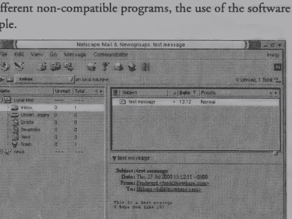

图 7-2. Netscape Communicator

## 通讯录 7-15

Netscape Communicator 内部的通讯录程序允许用户组织积累的电子邮件地址。通过该程序，用户可以用几种不同的方式管理电子邮件地址。可以根据地址所属组（如家庭成员或同事）分类到不同的文件夹中。除了人员分类外，通讯录与邮件程序之间的互通性允许传输电子邮件地址，而无需在两个程序之间进行复制和粘贴操作。

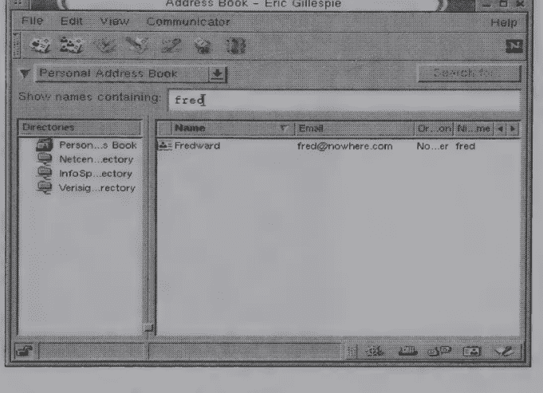

图 7-3. Netscape 通讯录

## HTML 编辑器

Netscape Communicator 内部集成了一个用于创建和修改网页的简单程序。`Composer` 为编辑网页提供了图形化界面，并类似于文字处理器。此外，`Composer` 允许用户直接将网页发布到服务器，而无需通过 FTP 客户端等其他程序。

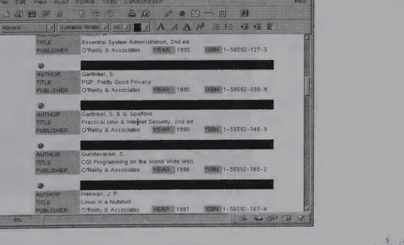

图 7-4. 网页编辑器

SAIR Linux 和 GNU 认证 --- 基础/Linux+

## Lynx

`Lynx` 是一款强大的基于文本 Web 浏览器。它根据 GPL 发布并可以自由分发。`Lynx` 的优势在于其占用空间小，适用于大多数 Linux 发行版。

与某些替代浏览器不同，`Mozilla` 包含了一个 Web 浏览器、电子邮件客户端、HTML 编辑器和通讯录。`Mozilla` 还具有许多其他独特功能，例如使用皮肤（skins）更改界面外观以及高级搜索选项。

目前，`Mozilla` 仍在开发中，还需要一段时间才能供所有人使用；目前的开发发布版供那些不需要完整版所有功能的用户使用。

## Opera

另一个流行的替代浏览器是 `Opera`。它已经在 Windows 平台上可用了一段时间，吸引了一小群但忠实的用户群体。

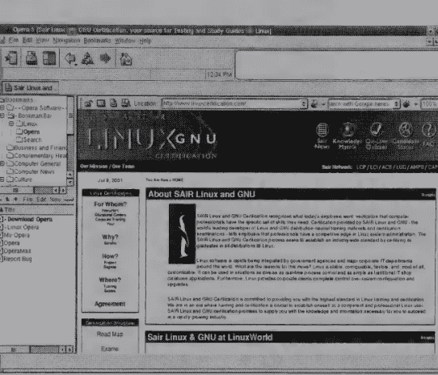

图 7-9. Opera 浏览器

`Opera` 是一个简单的 Web 浏览器，不具备 Netscape 和 `Mozilla` 的许多高级功能。然而，它提供了成为高效 Web 浏览器所需的功能。由于 `Opera` 是从 Windows 移植的，它具有 Windows 应用程序的外观和感受。这在用于某些功能（如保存文件）的对话框中最为明显。

`Opera` 的缺点是它是商业软件。因此，`Opera` 不是开源的，在试用期之后必须购买才能使用。

## w3m

`w3m` 是一种基于文本的浏览器，类似于 `Lynx`，但与 `Lynx` 不同，`w3m` 能够像图形 Web 浏览器一样显示表格和框架。对于希望保留 页面格式但不需要图形的用户来说，`w3m` 是一个非常有用的替代方案。

以下是 `w3m` 相比 `Lynx` 的几个优势：

- `w3m` 的按键绑定更直观。
- `w3m` 支持 `Lynx` 风格的按键绑定。
- 对于熟悉 `Lynx` 用户，`w3m` 有一定的学习曲线。
- `w3m` 对文本应用了更灵活的颜色编码方案，以区分不同的文本。


总来说，`w3m` 是一个实用的文本型 Web 浏览器，但它无法执行其他 Web 浏览器的高级功能。`w3m` 适用于性能有限的系统。

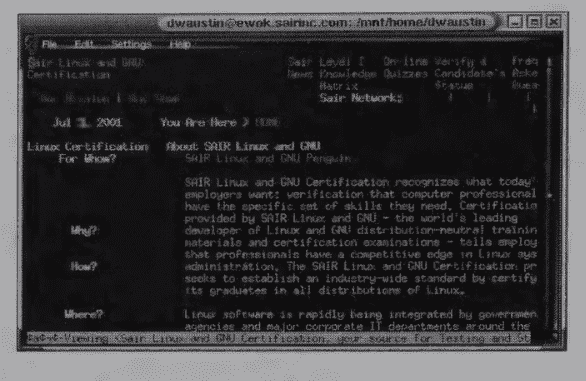

图 7-10. w3m 文本型浏览器

## Xterm

- 使用 `Xterm`
  - `-leftbar`
    - 在屏幕左侧显示滚动条
  - `-sl var`
    - 保存滚出屏幕的行数
  - `-f`
    - 强制 `Xterm` 以 Tektronix 模式启动
  - `-title [name]`
    - 指定 `Xterm` 窗口的标题

## XTERM

`Xterm` 是在 X11 环境中使用的终端模拟器。`Xterm` 模拟器能够模拟 DEC VT102、VT220 和 Tektronix 4014 终端。`Xterm` 为用户提供标准的命令行界面，允许用户运行那些在 X11 环境中通常无法运行的程序和应用程序。某些并非为 X11 设计的程序如果没有 `Xterm` 创建的模拟环境将无法工作。

如果用户选择在 Windows 系统下工作，则需要一个终端模拟器来使用 Linux 操作系统提供的许多命令和实用程序。尽管 X11 提供了一个高效且用户友计算环境，但命令行仍然是操作系统最频繁使用的界面。`Xterm` 是 X Windows 最广泛使用的实用程序之一。

## 使用 Xterm

使用多个虚拟终端可以创建一个类似于多个同时登录会话的工作环境，只不过所有它们都显示在一个显示器上。要开始使用 `Xterm`，在运行程序框（或另一个 `Xterm` 窗口）中输入 `xterm` 并按 `<ENTER>`。

`Xterm` 使用标准的命令行语法：

```
$ xtterm [-option]
```

`Xterm` 环境的功能几乎与标准命令行完全相同。用户可以在 `Xterm` 提示符处输入命令，命令可能产生的任何输出都会显示在同一个 `Xterm` 窗口内。

大多数 `Xterm` 选项都是通过命令行调用的。表 7-9 所示的常用选项通常用于配置模拟器的行为：

| 选项 | 功能 |
|---|---|
| `-left` | 使用此选项时，`Xterm` 将在屏幕左侧显示滚动条。 |
| `-sl var` | 保存滚出屏幕的行数。 |
| `-f` | 强制 `Xterm` 以 Tektronix 模式启动。 |
| `-title [name]` | 指定 `Xterm` 窗口的标题。 |

## 非 GNU 应用

- BSD 应用程序
- 艺术许可 (The Artistic License)
- 共享软件许可
  - 共享软件的问题
- 多重许可
- 商业软件
- 公有领域软件

GNU 应用程序是 Linux 可用软件的一部分。商业软件、共享软件、修改后的 BSD 应用以及公有领域软件均属于 GPL 范围之外。它们受多种不同许可或许可组合的管辖。了解程序的许可可以让你深入了解该程序可以进行哪些操作。许可基本上涉及分发、所有权、修改和产生的利润。许可允许程序被免费复制和分发，但不能出售，而某些许可则带有限制条件。

## BSD 应用程序

从表面上看，BSD 应用程序似乎与 Linux 操作系统无关。BSD 拥有一种独特的许可方法，这种方法帮助了今天许多 Linux 应用程序的形成。在 GPL 之后，BSD 许可是开源世界中第二常见的许可。它在受保护软件的分发和使用方面非常慷慨。实际上，BSD 许可仅确保程序的原始副本受到保护。例如，所有源自 BSD 代码的派生程序都必须包含以下行：*Copyright (c) The Regents of the University of California. All rights reserved.* 这基本上是使用 BSD 许可软件的唯一限制。

该许可已提供了许多 GNU 应用程序。由于 BSD 许可仅适用于原始 BSD 软件，从其派生的任何内容都可以以用户选择的任何方式进行许可。许多受 GPL 许可的程序曾获得过 BSD 许可。其他平台可能会吸收 BSD 应用程序并将其变为自己的。Microsoft Windows 通过修改 Ping 和 Traceroute BSD 程序实现了这一点。在 BSD 许可下，只要保持原始版权，创建现有程序、对其进行修改并以获利为目的进行出售是合法的。严格 GPL 的支持者通常认为 BSD 许可对从现有软件中派生代码的程序员更为友好。

## 艺术许可 (The Artistic License)

艺术许可的开发是为了在 GPL 和 BSD 许可之间寻求一个折中点。许多用户认为 GPL 对派生代码具有限制性，而他们认为 BSD 许可没有为所有者提供艺术控制。艺术许可将两者的优点结合成一种强大的许可方法。该许可防止在未经所有者同意的情况下，除微小的错误修复或补丁外对软件进行任何更改。此外，对原始代码的更改必须记录以供公众评估。软件可以公开分发，并以二进制或源码形式提供，不收取合理的传输介质费用。

许可软件可以包含在商业发行版中，因为该许可软件不是主应用程序，且未对其进行任何更改。Perl 是艺术许可的坚定支持者，并建议所有 Perl 程序员使用它。因此如此，许多 Perl 程序受此许可的管辖，并包含在 Linux 发行版中。目前尚不清楚这种许可是如何保护软件的。如果艺术许可成为主流软件许可，某些方面可能会留下漏洞问题。

## 共享软件许可

共享软件（Shareware）涵盖了大部分可下载的软件。它在 Linux 中的作用比其他操作系统要小，但在许多 Linux 网站上仍然可以找到。共享软件不受通用许可的管辖。对于大多数用途，共享软件基本上是闭源软件，通常以二进制形式免费分发。只有所有者被允许对产品收费。每个程序的许可可能存在巨大差异。每个所有者都会为产品制作自己的许可，这些许可始终可以下载。

想要降低高昂生产和分发成本的公司通常使用共享软件销售其产品。用户在 Web 上为所有者分发软件。软件通常是试用版，是完全注册版的示例，用户需要在安装后的一定时间内进行免费注册，以接收程序的所有功能。例如，流行的平台模拟器 VMware 可作为试用版免费提供。30 天后，程序必须注册，否则它将停止运行。通过这种方法，软件公司可以自由分发无需包装、传输介质或纸质文档的软件，而且他们仍然可以获得资金。

共享软件

共享软件涵盖了大部分可下载的软件。它在 Linux 中的作用比其他操作系统要小，但在许多 Linux 网站上仍然可以找到。共享软件不受通用许可的管辖。对于大多数用途，共享软件基本上是闭源软件，通常以二进制形式免费分发。只有所有者被允许对产品收费。每个程序的许可可能存在巨大差异。每个所有者都会为产品制作自己的许可，这些许可始终可以下载。

想要降低高昂生产和分发成本的公司通常使用共享软件销售其产品。用户在 Web 上为所有者分发软件。软件通常是试用版，是完全注册版的示例，用户需要在安装后的一定时间内进行免费注册，以接收程序的所有功能。例如，流行的平台模拟器 VMware 可作为试用版免费提供。30 天后，程序必须注册，否则它将停止运行。通过这种方法，软件公司可以自由分发无需包装、传输介质或纸质文档的软件，而且他们仍然可以获得资金。

## 共享软件的问题

共享软件（Shareware）的这种方法存在问题。许多程序注册涉及一个简单的密钥，该密钥可以解锁软件的完整版本。许多密钥已被破解，它们在各种网站上提供。这些对许可的违背行为是不可避免且无法追踪的，导致许多软件公司退出了共享软件业务。共享软件在 Windows 世界仍然占重要地位，因为大多数软件以二进制形式发布；然而，在 Linux 社区，共享软件几乎完全减少为游戏演示和广告。

多重许可

所有者有权决定其作品适用哪些许可。某些所有者会将未注册软件作为共享软件，并以小额费用发布源代码。通过这种方式，程序同时适用于共享软件和艺术许可，这由所有者决定。用户实际上是在为新许可付费。多重许可可能导致相同的程序受不同许可的管辖。许多包包含受不同许可管辖的组件。

## 商业软件

商业软件构成了 Windows 世界的大部分，但在 Linux 社区中，它是可用软件中较小的一部分。商业软件通常具有最严格的许可。软件以二进制格式购买（几乎总是闭源的），不允许分发或转售。程序按创建方式使用，作者对开发和分发拥有控制权。在所有许可中，商业许可是最僵化的且执行最严格的。

商业软件可以对操作系统有益，如果与免费保持平衡，开源软件将失去其开发能力。由于大多数开源软件是由用户免费编写的，开发以恒定的速度进行。商业软件公司间歇性开发。一家公司发布软件，另一家公司进行重大改进并发布新版本，以此此类推。本质上，商业技术和开源编程保持大致平衡，但速度不同。有时用户会被带有大量广告的新商业产品所吸引，从而忘记提供相同功能的免费软件。

## 公有领域软件

公有领域软件是不受任何许可管辖的软件。用户可以操纵、分发或销售软件。公有领域软件没有所有者，没有任何用户或小组对其任何部分具有控制权。检索公有领域软件是不可能的。一旦程序进入公有领域，它对世界将永远免费。由于这个原因，必须始终检查公有领域软件。可疑的免费软件可能不是公有软件，而是非法提供的盗版软件。

# 打印过程

- 打印概述
- 应用程序
- 打印机控制程序
    - `lpr`, `lpq`, `lprm`, `lpc`
- 过滤器
    - `PostScript`
    - `Magicfilter`
    - 纯文本
- 打印机守护进程

# 打印过程

Linux 中的打印是通过守护进程（daemon）实现的。大多数应用程序并不直接处理守护进程，而是使用用户与守护进程交互时所使用的程序。大多数应用程序生成一个 `PostScript` 文件，然后通过 `lpr` 命令将其发送到打印机。

# 打印概述

打印过程是一个由程序、脚本和过滤器组成的链，它始于应用程序，结束于打印机控制守护进程 `lpd`。用户可以在该链的任何级别打印文件，尽管访问最低级别需要 root 权限。

# 应用程序

大多数打印任务始于应用程序。打印纯文本（例如 Pine 或 Vi 等基于文本的应用程序生成的内容）是简单的。应用程序只需将其输出发送到 `lpr` 即可。

从 GUI 应用程序打印要困难得多。这些程序的的输出通常涉及多种字体大小、类型和图形。由于大多数打印机都有专用的页面描述语言，因此必须有一种通用语言，打印过滤器可以将其转换为该语言以便每台打印机理解。这种语言就是 `PostScript`，下文的“过滤器”部分将进行详细描述。

# 打印机控制程序

打印过程的下一级涉及打印机控制程序，这些程序用于从打印队列中添加和删除文件，并检查和操作打印机状态。重要的是，这些程序本身并不执行任何这些任务。相反，它们请求打印守护进程（`lpd`）执行每项任务。

所有打印机控制程序都接受 `-P` 选项，用于指定默认打印机以外的打印机。例如，命令 `lpq -Plj` 将显示名为 lj 的打印机的状态。

# lpr

`lpr` 是最常用的控制程序。它用于将文件添加到打印队列。如果在命令行上指定了文件，`lpr` 将对这些文件进行排队；否则它将对标准输入进行排队。

# lpq

使用 `lpq` 命令列出当前队列的任务。默认情况下，`lpq` 会显示队列中每个作业的打印机、主机和作业号。如果给出 `-l` 选项，`lpq` 将使用长格式，显示每个作业的标识符（由作业所有者的用户名和主机生成）、当前排名、作业号、描述和总大小。

# lprm

`lprm` 命令用于从队列中删除打印作业。用户只能删除自己的打印作业，但 root 可以从队列中删除任何作业。不带参数的 `lprm` 将删除用户拥有的第一个作业。root 用户有一个普通用户无法使用的额外选项：`all` 选项。如果 root 执行命令 `lprm all`，所有作业将从队列中删除。

# lpc

`lpc` 是打印机控制命令中最复杂的一个。它可以执行许多功能，例如启用和禁用打印机、重新排序、启用和禁用打印机队列，以及检查打印机及其状态。这些功能通过作为 `lpc` 参数参数的命令来指定。如果在不带参数的情况下调用它，则将由 `lpc` 在命令行上输入命令。

| 命令 | 功能 |
| :--- | :--- |
| help [command] | 如果未给出参数，此命令将打印命令列表；否则它将显示指定命令的帮助信息。 |
| abort | 立即终止守护进程并防止生成新的守护进程来替换它。 |
| clean | 从指定的队列中删除临时文件和无法打印的文件。 |
| disable | 禁用队列，以便不再接受新作业。 |
| down printer [message] | 禁用队列并停止打印机打印。如果指定了消息，它将在 `lpq` 运行时显示，以便用户知道打印机停机的原因。 |
| enable | 启用队列，以便接受新作业。 |
| exit | 退出 `lpc`。 |
| restart | 尝试启动指定打印机的守护进程。如果已经运行了守护进程，则先停止它。 |
| start | 为指定打印机启用打印。 |
| status | 显示指定打印机及其作业队列的状态。 |
| stop | 使指定打印机的守护进程在作业完成后停止。 |
| top printer [jobnums] [users] | 重新排列指定打印机的队列。可以指定作业号或用户。命令行上的作业将移动到队列头部。 |
| up | 为指定打印机启用守护进程。 |

表 7-10. `lpc` 命令

# 模块 — Linux 应用程序

`abort`, `clean`, `disable`, `down`, `enable`, `restart`, `start`, `stop`, `up` 命令都识别打印机名称的特殊参数，这将影响所有打印机。

# 过滤器

由于打印机无法理解所有文件类型，因此需要过滤器将程序的输出转换为打印机可以理解的内容。这是通过守护进程调用的过滤器实现的。过滤器的输出实际上会被队列。

# PostScript

大多数应用程序生成 `PostScript`，因为大多数 Unix 系统拥有理解 `PostScript` 的高端打印机。在这些系统中，不需要过滤器；`PostScript` 文件可以直接发送到打印机。

`PostScript` 由 Adobe 在 1982 年引入，以响应页面描述语言（PDL）的兴起。`PostScript` 设计与打印机无关；无论使用什么打印机，`PostScript` 文件看起来应该是一样的，尽管质量可能不同。


许多用户没有 Postscript 打印机。对于这些用户，打印系统最重要的组件是 Ghostscript，这是一个 Postscript 解释器。它用于将 PostScript 转换为打印机的控制语言。Ghostscript 是 Adobe 开发的免费软件。

大多数 Linux 系统安装了 Magifier 等软件，它可以透明打印 Postscript 文件（如图形）。如果 Magifier 被指定为 `lpd` 调用的过滤器，它会将文件转换为 PostScript。然后将其交给 Ghostscript，输出打印机控制语言的文件。Magifier 将拒绝它不识别的文件。

# 纯文本

打印纯文本没有那么复杂，与其转换为 PostScript，不如将其直接交给 `lpr`。过滤器只需要在输出发送到打印机之前进行最小限的转换。这种转换是必要的，因为 Unix 文本使用 ASCII 换行符分隔行，但打印机需要 ASCII 回车符和换行符序列来结束一行。当打印机看到换行符时，它会滚动一行，但在看到回车符之前不会将头部返回到行首。如果不将换行转换为回车/换行序列，输出将产生阶梯效应，无论有多少行文本看起来都会像阶梯。

# 打印守护进程

守护进程 `lpd` 位于链的最底层。某些应用程序与守护进程直接对应，但大多数应用程序依赖打印机控制程序。当打印守护进程启动时，它从 `/etc/printcap` 文件读取配置。该文件列出了守护进程负责的所有打印机，以及每台打印机的属性，如最大队列大小。守护进程为它控制的每台打印机维护一个队列。这些队列实际上是 `/var/spool/lpd` 中的目录。

用户仅通过应用程序或打印机控制程序与守护进程进行交互。

# 存档与软件包

- Tarballs（归档包）

  - 解压 tarballs

  - 构建 tarballs

- RPM

  - 解压 RPM

  - 构建 RPM

- Deb 包

  - 解压 Debs

  - 构建 Deb

- 使用 Deb、RPM 和 Tarballs

# 存档与软件包

在传输大量文件时，压缩和编译至关重要。这是通过将许多文件编译成一个大文件，并将其压缩到易于管理的尺寸来实现。Debian、Red Hat 和 GNU 都开发了实现此目的的程序。每个程序都有其优缺点，并且都有自己的方法来使文件传输更快、更方便。

# Tarballs（归档包）

### 解压 tarballs

tarball、RPM 和 Deb 的解压方式差异很大。tarball 使用的步骤是讨论的三个程序中最简单的。tarball 由许多压缩过的文件（压缩文件）组成，这些文件被 `tar`（合并）成一个包。tarball 使用 GNU 工具 `gzip` 和 `tar` 进行构建和解压。`tar` 可以解压文件并通过 `gzip` 过滤文件进行解压缩。`tar` 使用非常基础的命令行，不需要安装或软件包管理，仅需数据存取。解压 tarball 的典型命令是：

```
$ tar xvfz filename.gz.tar
```

每个选项都对 tarball 执行特定的功能：

- `x` 告诉 `tar` 提取压缩后的文件。

- `v` 告诉 `tar` 在提取时显示文件名。

- `f` 指定要放置在本地的未压缩文件。

- `z` 通过 `gzip` 过滤压缩文件以进行解压缩。

Tarballs 是计算机之间简单数据传输的理想选择。一系列文本文件不需要安装脚本、守护进程和软件包管理，以及压缩和合并。`tar` 是处理小型任务和各种不会被安装的文件的完美压缩方法。

### 构建 tarballs

tarball、RPM 和 Deb 的构建过程差异巨大。普通用户可能会发现构建 Debs 很困难，但其动态过程很容易理解。Tarballs 是三者中最容易构建的。RPM 并没有比它容易，因为没有安装或准备脚本，文件只需要被归档。`tar` 可以像提取文件一样使用 `gzip`。要让 tarball 经过 `gzip` 然后通过 `tar` 运行，可以使用命令

```
tar cvf newtarball.tar.gz filostobearchived
```

其中 `filostobearchived` 可以是一个逗号分隔的文件列表或一个目录。`tar` 假设所有子目录都是目录的一部分。如果目录带有星号，其子目录也会带有星号。还可以使用 `-r` 将文件追加到归档中。然而，在成功将任何文件添加到归档之前，你必须先解压缩归档。例如：

```
gzip newtarball.tar.gz
tar -rvf newtarball.tar filostobearchadded
gzip newtarball.tar.gz
```

`tar` 在软件包管理的用途有限，但不需要安装传输的文件时，tarball 是最佳选择。

# RPM

### 解压 RPMs

Red Hat 软件包管理器 (`RPM`) 是 Red Hat 开发的一种程序，用于轻松地解压和安装正法的软件包。虽然 RPM 首次出现在 Red Hat 发行版中，但所有 Linux 发行版都能够利用它。某些非 Linux 系统也开始使用 RPM，Sun OS 和 Solaris 的 RPM（由 RPM 创建的文件）像 tarballs 一样被压缩和合并，但 RPM 包含的信息比压缩数据更多。软件包中的文件信息存储在 `.spec` 文件中。它包含了适用于处理器的正确包、包含的文件，以及一个在系统上安装该包的小型脚本。Red Hat 开发此工具是为了方便下载和安装单个发行版包。RPM 可以在本地安装或通过互联网安装，并且 RPM 程序可以远程在本地机器上安装软件包。此操作的命令是：

```
$ rpm -i ftp://ftp.redhat.com/pub/redhat/rh-2.0-beta/RPM/foobar-1.0-1.i386.rpm
```

这将 RPM v2.0 安装到本地驱动器上。安装 RPM 的方法也类似：

```
$ rpm -i foobar-1.0-1.i386.rpm
```

`i` 告诉 RPM 安装该包。RPM 中包含的安装脚本会将 RPM 安装到驱动器。所有已安装的 RPM 都可以随时验证。通过使用命令 `-Va`，可以验证所有已安装的 RPM 软件包以确保所有文件存在且运行正常。要读取包含的信息文件，使用命令 `rpm -qpi somefile-1.2-2.i386.rpm`。这将显示包含构建日期、软件包描述和程序大小的说明文件。RPM 的构建原理与 tarball 相同，但增加了管理软件包和高效分发的能力。

### 构建 RPMs

RPM 需要比 tarball 多得多的准备工作和信息。测试 RPM 并确保程序源码正确构建非常重要。这有时会被忽略，因为人们假设 RPM 本身是唯一的问题。这会导致 RPM 安装错误的代码。构建 RPM 的第一步是编写一个 `.spec` 文件，即 RPM 的头部。它包含了所有在解压时运行的命令。`.spec` 文件是构建过程中最复杂的部分，它包含一个指定程序信息的头部，例如版本、摘要和源码。

大多数 RPM 的 `.spec` 文件中包含七个主要字段：

- description（描述）

- prep（准备）

- build（构建）

- install（安装）

- clean（清理）

- files（文件）

- changelog（变更日志）

一个良好的程序用法摘要位于 `description` 字段中，随后是 `prep` 字段，该字段包含了准备内容。`install` 字段包含了在系统上安装包的脚本。`clean` 字段用于清理。`files` 字段包含了软件包的文件。`changelog` 字段包含了变更记录。

RPM 需要比 tarball 多得多的准备工作和信息。测试 RPM 并确保程序源码正确构建非常重要。这有时会被忽略，因为人们假设 RPM 本身是唯一的问题。这会导致 RPM 安装错误的代码。

RPM 构建许多程序需要使用以下命令：

```
rpm -ba foobar-1.0.spec
```

将使用 `.spec` 文件构建 RPM 软件包。

# 备份

- 备份类型

  - 全量备份 (Epoch)

  - 差分备份 (Differential)

  - 增量备份 (Incremental)

- 备份工具

  - dump 和 restore（恢复）

  - tar 和 gzip

  - cpio

备份是对现有系统制作一个或多个副本的过程，以防止系统可能发生故障。在生产环境中，备份非常重要。如果系统丢失数据，就需要备份来恢复数据。为了做到这一点，用户需要了解各种备份类型以及如何使用常用的免费可用工具。

## 备份类型

三种不同的备份策略是全量备份、差分备份和增量备份。每种策略都有优缺点，在此进行讨论。

## 全量备份 (Epoch)

全量备份本质上是系统中所有内容的副本。然而，它需要消耗的时间和资源。其他所有备份都需要全量备份，因为它是其他备份的基础。

## 差分备份 (Differential)

通过执行差异备份，用户正在复制自当前全量备份以来发生更改的所有内容。初几次备份通常不会很大，因为系统上的变化很少。然而，随着时间的推移，由于更改的文件越来越多，它们的大小会增长。这迫使更频繁地进行全量备份，以确保差异备份不会过大。但这使得恢复变得更容易，因为用户只需要关注全量备份和最近的差异备份即可。

## 7-36 模块 7 — Linux 应用程序

## 增量备份 (Incremental)

增量备份相互构建，以提供系统的可靠备份。全量备份和第一次备份与差异备份相同。第一次备份复制了自全量备份以来的更改。然而，区别到此为止，因为随后的备份将确定与最近一次备份（而非全量备份）之间的差异，并备份这些更改。这具有节省时间的明显优势；然而，它增加了复杂性，反过来可能会创建一个糟糕的存档。这可能迫使用用户备份该错误备份之前的最近一次增量备份。完全恢复通过使用全量备份完成，然后从第一个增量备份开始一直到所有的增量备份。

## 备份工具

有许多任何人都可以使用的免费工具。最常用的包括 dump/restore 组合、tar 和 cpio。

## dump and restore

`dump` 命令允许用户备份整个挂载的文件系统。用户执行的第一次 dump 将执行一次全量备份。随后的备份通常是增量的，除非指定了另一个全量备份。可以通过以下选项完成：

```
dump -0f /dev/st0 /user/local/
```

`0` 表示这是最低级别的备份，并将作为全量备份。对于高于全量备份（即 0）的每个数字，都会创建一个增量备份。例如，如果在 0 级创建了备份，则会在 1 级创建增量备份，然后是 2 级和 3 级。之后，如果用户指定再次执行 2 级备份，那么自 1 级备份以来更改的所有信息将将被发送进行备份，覆盖当前的 2 级和 3 级数据。这个数字可以一直到到 9。

`u` `dump` 用于更新 `/etc/dump` 文件，以显示哪些文件系统以及在何时执行了备份。`f` 选项指示 `dump` 将 `/usr/local/` 的备份写入 `/dev/st0`。

`restore` 命令允许用户从备份中恢复。如果用户不确定自己在备份中放置了什么，或者希望选择某些特定文件，请使用以下命令：

```
restore -if /dev/st0
```

此命令将运行一个交互式提示来浏览备份。将使用 `ls` 命令列出目录内容，并使用 `cd` 更改备份内的目录。这些命令没有相应 shell 命令的完整功能；但是它们允许用户查看备份内容并决定恢复什么内容。`extract` 命令允许用户从备份中提取所有内容，`help` 命令列出了交互式界面中的更多命令。

## tar and gzip

`tar` 命令是一个归档工具，而 `gzip` 是一个压缩工具。将两者结合使用可以得到一个压缩的文件存档，便于为了备份目的存储或传输这些文件。以下示例显示了创建 tar 包（tar 文件，即存档包含一个或多个文件的 tar 文件）的常用用法。


```
tar cvf filename.tar /usr/local/www/
```

此命令将为 `/usr/local/www/` 目录创建一个存档，用于备份或分发。`c` 选项指示 `tar` 创建存档。`v` 选项强制 `tar` 显示详细信息，这意味着它会在备份时显示文件，因此用户可以确保一切运行正常。`f` 选项要求用户输入文件名来为存档命名，在此例中为 `filename.tar`。

如果用户希望将此作为备份，那么这被认为是全量备份。若要在某天之后创建增量备份，你必须执行以下命令：

```
tar cNvf 2001-05-31 filename.backup1.tar /usr/local/www/
```

`N` 选项允许你在特定日期之后备份文件。这里的日期是 2001/05/30。自 2001/05/30 以来编辑过的每个文件将包含在此备份中。如果用户想在此日期之后创建另一个增量备份，请输入以下命令：

```
tar cNvf 2001-05-31 filename.backup2.tar /usr/local/www/
```

## cpio

`cpio` 允许创建多种类型的存档，包括 tar 存档。要创建存档，需要一个要创建的文件列表，包括这些文件的路径。要么创建一个列表，要么使用 `find` 命令创建一个要备份内容的列表。一旦创建了列表，你可以使用以下命令：

```
cpio -o -H backuplist.txt > backupfile.tar
```

由于 `cpio` 没有文件命名规范，请确保使用 `H` 选项，这将允许用户使用 `tar` 命令以及 `cpio` 提取文件。

使用 `cpio` 恢复 tar 文件，请使用以下命令：

```
cpio -i < backupfile.tar
```

为了创建差异或增量备份，请修改备份列表，仅包含自上次备份以来修改过的文件。在这种情况下，`find` 命令是最好的。


## 模块回顾问题

这些问题的答案在手册最后的附录 A 中。

- 1. 什么是 Pico？

................................................................................................................................................................

- 2. Netscape Communicator 包含四个不同的程序？


### 3. 什么是 Lynx？

### 4. 什么是 GNU 项目？

### 5. 描述打印过程。

# 实验 07 - 创建与打印文件

## 目的

本实验将引导读者熟悉常用文本编辑器的基本用法。

## 实验时长

5 到 10 分钟。

## 概述

在 Linux 用户可用的众多应用程序中，熟悉 Vi 和 Emacs 对于几乎任何 Linux 用户来说都是必要的。

## 实验练习

### 使用 Vi 编辑器

1. 要创建一个新文本文件，请在命令提示符输入以下内容：

   `vi <filename>`

2. 输入 `i` 然后输入你的文本。输入 `:wq` 保存并退出。

### 使用 Emacs 编辑器

1. 要创建一个新文件，在 `emacs` 命令后输入文件名：

   `emacs <filename>`

2. 输入你的文本。按住 `<CTRL-X> <CTRL-S>` 保存，然后按 `<CTRL-X> <CTRL-C>` 退出。

## 打印你的文本：

要打印你的文本，请在命令提示符输入以下内容。

```
$lpr -P <printer> <filename>
```

可用打印机列在你的 `/etc/printcap` 文件中，格式如下。

```
#Xerox DocPrint N40
lp1|xerox:\
```

`lp1` 可用作指定的打印机。

## 实验 07 问题

这些问题的答案位于本手册末尾的附录 A。

- 1. 如何保存并关闭 Vi 和 Emacs？
- 2. 使用 `lpr` 命令时的默认打印机名称是什么？

# SAIR LINUX GNU 认证

# 8

# 模块

## 网络

| 主题 | 页码 |
| :--- | :--- |
| 目标 | 8-3 |
| 局域网上的网络 | 8-4 |
| 硬件要求 | 8-5 |
| 网络文件 | 8-5 |
| IP 地址 | 8-6 |
| IP 地址分类 | 8-6 |
| 传输控制协议/网协议 | 8-8 |
| 架构 | 8-8 |
| 网络层协议 | 8-10 |
| 传输层协议 | 8-11 |
| 应用层协议 | 8-11 |
| 点对点协议 | 8-13 |
| 封装 | 8-13 |
| 链路控制协议 | 8-13 |
| 网络控制协议 | 8-13 |
| 选项 | 8-14 |
| 启动 `pppd` 的其他方法 | 8-15 |
| PAP/CHAP | 8-15 |
| 网络基础命令 | 8-16 |
| `ping` | 8-16 |
| `traceroute` | 8-18 |
| 网络工具 | 8-22 |
| Telnet | 8-22 |
| FTP | 8-23 |
| 电子邮件配置与使用 | 8-24 |
| Elm | 8-24 |
| Pine | 8-26 |
| Sendmail | 8-28 |
| Samba | 8-29 |
| 协议 | 8-29 |
| 守护进程 | 8-29 |
| 工具程序 | 8-30 |
| SWAT | 8-30 |
| Samba 优势 | 8-30 |
| Apache | 8-31 |
| 查找 Apache | 8-31 |
| 配置 | 8-32 |
| 运行 Apache | 8-32 |
| 数据库管理系统 | 8-34 |
| 数据库管理系统概述 | 8-34 |
| 关系型数据库管理系统 | 8-34 |
| DBMS 的常见应用 | 8-35 |
| 使用哪种数据库管理系统？ | 8-35 |
| 防火墙与代理服务器 | 8-37 |
| 使用 `iptables` | 8-37 |
| 定义防火墙 | 8-39 |
| 防火墙类型 | 8-39 |
| Squid 代理服务器 | 8-39 |
| 私有网络 | 8-41 |
| 安全性 | 8-41 |
| 隧道技术 | 8-42 |
| IPSEC | 8-42 |
| 模块复习题 | 8-45 |
| 实验 08-1 - 系统性能 | 8-46 |
| 目的 | 8-46 |
| 实验时长 | 8-46 |
| 概述 | 8-46 |
| 实验练习 | 8-46 |
| 实验 08-1 问题 | 8-50 |


| 实验 08-2 - Ipchains ................................................................................ 8-52 |

| 目的 ............................................................................................................... 8-52 |

| 实验时长 ................................................................................................ 8-52 |

| 概述 ............................................................................................................... 8-52 |

| 实验练习 ............................................................................................ 8-52 |

| 实验 08-2 问题 ................................................................................................ 8-54 |

# 第 8 模块 - 网络

- 局域网 (LAN) 上的网络
- Samba
- IP 地址
- Apache
- 传输控制协议协议 (TCP)
- 数据库管理系统
- 点对点协议 (PPP)
- 防火墙与代理服务器
- 网络基础命令
- 私有网络
- 网络工具
- 电子邮件配置与使用

## 目标

完成本模块后，你将能够：
- 识别局域网的六种硬件组件。
- 识别五种 IP 地址分类。
- 识别 OSI 模型的七层结构及每层的作用。
- 识别 TCP/IP 模型的四层结构及每层的作用。
- 识别互联网层协议。
- 识别两种传输层协议。
- 识别四种应用层协议。
- 定义 PPP。
- 配置电子邮件客户端。
- 定义防火墙。

8-4 第 8 模块 — 网络

## 局域网 (LAN) 上的网络

### 硬件需求

- 中继器
- 路由器
- 交换机
- 跳线线
- 集线器
- 网卡

### 网络文件

- `/etc/hosts`
- `/etc/resolv.conf`

## 局域网 (LAN) 上的网络

F0.8.10 在局域网（LAN）中，两或多台计算机相互连接。连接到局域网的每台计算机被称为工作站。每台计算机都使用了网卡，计算机通过连接到集线器的网线接入网络。

当局域网连接到互联网时，可以使用防火墙提供安全保护。防火墙限制了连接两端的哪些计算机可以访问另一侧。通常，防火墙后的计算机可以访问互联网上的所有内容，但外部无法访问防火墙后的任何内容。图 8-1 展示了局域网布局。

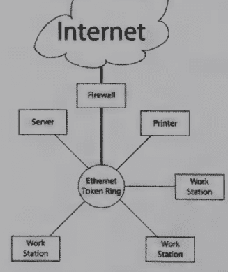

图 8-1. 局域网配置

# 硬件需求

建立局域网时常用的各种硬件组件如表 8-1 所示：

| 组件 | 功能 |
|---|---|
| 中继器 | 中继器是一种用于放大信号并将其传输到目的地的设备。 |
| 交换机 | 交换机是一种将不同组件连接到网络并选择路径将数据传输到目的地的设备。 |
| 集线器 | 集线器是将计算机、服务器、打印机和其他外围设备连接在一起形成网络的设备。 |
| 路由器 | 路由器决定数据必须发送到哪里。 |
| 跳线 | 跳线常用于连接网卡到集线器等。 |
| 网卡 | 网卡用于将计算机连接到网络的设备。 |

表 8-1. 局域网组件

# 网络文件

配置局域网时需要编辑的文件为 `/etc/hosts` 和 `/etc/resolv.conf`。可以使用 `Pico`、`Vi` 或 `Emacs` 等文本编辑器进行编辑。

## /etc/hosts

在小型局域网中，DNS 可能会出现问题。相反，可以将所有连接系统的名称、IP 地址和别名输入到 `/etc/hosts` 文件中。该文件用于将系统名称解析为其 IP 地址。默认情况下，该文件包含本地主机的名称和地址：

```
127.0.0.1         localhost
192.168.1.2       example.com
10.0.0.12        example.com
172.16.0.34      example.com
```

`gethostbyname()` 函数用于通过名称搜索主机，而 `gethostbyaddr()` 函数用于通过地址搜索主机。

### /etc/resolv.conf

此文件列出了用于解析主机的 DNS 服务器。它包含了主机名称、其服务器地址以及要搜索的名称列表。以下是 `/etc/resolv.conf` 的节：

```
search example.com
nameserver 64.41.207.52
nameserver 64.41.207.52
```


# IP 地址

- A 类：0.0.0.0 到 127.255.255
- B 类：128.0.0.0 到 191.255.255
- C 类：192.0.0.0 到 223.255.255
- D 类：224.0.0.0 到 239.255.255
- E 类：24.0.0.0 到 255.255.255

# IP 地址

建立局域网最重要的部分是分配 IP 地址，它是分配给网络上各种主机的 32 位数字。它们被分为四个 8 位数字，称为字节（octets），以便于阅读并区分网络号和主机号。前导字节代表网络号，剩余的三个字节代表主机号。

# IP 地址分类

IP 地址分为五类，以满足不同的目的。下面解释了这些分类：

### A 类

A 类地址范围从 0.0.0.0 到 127.255.255。在此，第一个字节代表网络号，剩余的三个字节代表主机号。在局域网中，这些地址用于连接主机之间。

### B 类

B 类地址范围从 128.0.0.0 到 191.255.255。在此，前两个字节代表网络号，后两个字节代表主机号。在局域网中，这些地址用于连接不同的网络。

### C 类

C 类地址范围从 192.0.0.0 到 223.255.255。在此，前三个字节代表网络号，最后一个字节代表主机号。在局域网中，这些地址用于连接到不同的网络。

### D 类

D 类地址范围从 224.0.0.0 到 239.255.255。这些地址用于多播传输。

### E 类

E 类地址范围从 240.0.0.0 到 255.255.255。这些地址被留作未来使用。

*(注：原文中 E 类范围描述处为 24.0.0.0 疑似为笔误，应为 240.0.0.0)*

## 表示层

表示层接收需要呈现给应用层的消息，并根据消息的内容将其转换为适当的格式。

## 应用层

应用层充当应用程序与用户之间的接口。

## TCP/IP 模型

TCP/IP 模型包含四层。

## 网络接入层

网络接入层是负责在网络物理链路上移动数据的层；它提供了可靠的数据传输。该层充当连接介质的作用，其协议包括以太网、FDDI、令牌环、X.25、ATM 等。

## IP 层

IP 层的作用是在不同网络之间传输数据。该层负责从发送主机的传输层获取数据，并将其发送到接收主机传输层。在网络层，数据包的传输是不可靠的，且可能不会按照发送的顺序到达。上层会将数据包排列成正确的顺序。该层的协议包括 IP、ICMP、ARP 和 RARP。

## 传输层

该层的功能与 OSI 传输层相同。它为面向连接和无连接的网络提供端到端的通信服务。该层最常用的协议是 TCP 和 UDP。

## 应用层

TCP/IP 模型中的应用层承担了 OSI 模型中表示层、会话层和应用层的工作。应用层充当主机上的应用程序与用户之间的接口。

## IP 层协议

数据的交付及其布局由特定协议控制。每个协议执行其显式任务，并将数据传递给下一个层进行进一步处理。每个协议都是相互独立的。任何通过互联网发送的数据（包括电子邮件、网站、图片和文件）都遵循以下步骤。

## 网协议

网协议 (IP) 是一种无连接协议，用于在没有直接连接的网络上从一个主机传输数据到另一个主机。IP 以数据报的形式传输数据；每个数据报都是单独传输的并可以沿着不同的路由发送。因此，数据报在接收端可能不会按相同的顺序到达，可能会重复。IP 是不可靠的，因为它不跟踪路由情况，且在接收包时不将数据包重新排列成正确的顺序。IP 最常用的版本是网协议第 4 版 (IPv4)。最新版本是 IPv6，它相比 IPv4 有许多改进，例如支持更大的 IP 地址。

## 互联网控制报文协议

互联网控制报文协议 (ICMP) 主要用于通过发送有关 IP 连接状态的消息来克服 IP 的不可靠性。ICMP 消息有两种基本类型：错误消息和查询消息。当连接出现问题时（例如数据报丢失），会发送错误消息。查询消息（如 ICMP 回显）被用于确定另一台机器的状态。

## 地址解析协议

网络上的每条消息都有一个关联的硬件地址。该地址不能用于发送数据，因为数据链路层无法识别它。因此使用 IP 地址传输数据。地址解析协议 (ARP) 将 IP 地址与机器的物理地址关联。

## 反向地址解析协议

反向地址解析协议 (RARP) 用于已知机器物理地址时查找其 IP 地址。机器的 IP 地址通常存储在其本地磁盘；在无盘工作站中，没有这种设施。在这种情况下，可以使用 RARP 查找 IP 地址。

## 传输层协议

传输层的协议主要关注从一个主机发送数据到另一个主机。该层的两个协议是传输控制协议和用户数据报协议。尽管两者都具有相同的责任，但它们执行职责的方式不同。

## 传输控制协议

传输控制协议 (TCP) 是一种可靠的、面向连接的协议，用于跨网络从一个主机传输消息到另一个主机。它将数据包分解为更小的片段，并为每个片段关联一个数字。在目的地，TCP 根据关联的数字重新排列数据包片段，以保持数据的连续流。TCP 会跟踪它正在发送的数据包，如果丢失了包，则会重传。TCP 还可以双向发送，这被称为全工操作。

## 用户数据报协议

与 TCP 不同，用户数据报协议 (UDP) 是一种不可靠的、无连接协议。UDP 在传输数据前不对数据分分。因此，接收端无法保证连续的数据流。UDP 的优势是如果网络不拥塞，它的传输速度比 TCP 快；因为它不跟踪发送的数据包，所以网络开销更小。

## 应用层协议

应用层负责将数据传输到运行在主机上的程序。一些重要的应用协议包括：

## 超文本传输协议

超文本传输协议 (HTTP) 是一种无状态协议。它被浏览器用于在万维网上交换数据。使用 HTTP 可以交换文本、语音和图像等数据。

## 简单邮件传输协议

简单邮件传输协议 (SMTP) 是一种用于在互联网上发送和检索电子邮件的协议。当邮件请求到达 SMTP 时，它与接收主机建立连接。在网络层，数据包的传输是不可靠的，且可能不会按照发送的顺序到达。上层会将数据包排列成正确的顺序。

## 文件传输协议

顾如其名，文件传输协议 (FTP) 用于跨网络传输文件。在执行身份验证后，用户可以在网络上复制文件。为了效率，FTP 使用了单独连接：一个用于控制，一个用于数据。

## Telnet

`telnet` 协议用于从另一台计算机执行远程登录。要使用 `telnet`，远程计算机上必须存在有效的用户 ID。在验证用户身份后，`telnet` 允许用户访问系统，就像在本地登录一样。

## 点对点协议

- 封装
- 链路控制协议
- 网络控制协议
  - domain.com
  - auth
  - username
  - lock
- 选项
  - 启动 `pppd` 的其他方法
  - PAP/CHAP

## 点对点协议（大写）

点对点协议 (PPP) 用于通过串行连接介质传输数据报。尽管 PPP 在主机之间提供了简的连接，但它最常见的用途之一是通过拨号调制解调器连接互联网。它类似于串行链路协议 (SLIP)，但增加了错误纠正和自动登录等功能。除了 TCP/IP，它还支持许多其他协议，如 Novel 的 IPX/SPX 套件和 AppleTalk。

PPP 由三个主要部分组成：封装、链路控制协议和网络控制协议。

### 封装

PPP 封装可以在同一连接上同时复用各种网络层协议。它与大多数常用的硬件兼容。

### 链路控制协议

链路控制协议用于控制链路的功能，例如封装以及检查数据包大小限制或配置错误。它还可以判断链路是否正常工作，并在需要时终止链路。此外，链路控制协议可用于身份验证数据压缩。

### 网络控制协议

网络控制协议处理网络层的问题，例如分配和管理 IP 地址。虽然 PPP 可以同时使用多个网络层协议，但每个网络层协议都有对应的网络控制协议。

Linux 通过名为 `pppd` 的守护进程提供 PPP 服务，该守护进程通常位于 `/usr/sbin` 目录。

`pppd` 的配置文件存储在 `/etc/ppp/options` 中，该文件中的默认设置如表 8-2 所示：

| 设置 | 功能 |
| :--- | :--- |
| domaindomain.com | 域名 |
| auth | 需要对用户进行身份验证 |
| hostname | 使用本地主机名验证 |
| lock | 以 UUCP 方式锁定文件 |

表 8-2. `pppd` 配置的默认设置

根据连接需求，可以向配置文件中添加若干个 `pppd` 选项。

`pppd` 用于建立 PPP 连接并控制大部分 PPP 功能。如果连接是静态的，可以通过命令行启动 `pppd`：

```bash
$ pppd /dev/tty0 38400 crtsacts default
```

如果连接是动态的，则使用以下命令：

```bash
$ pppd /dev/tty0 38400 crtsacts IP_address
```

执行此命令时，`pppd` 会接受远程主机分配给它的任何 IP 地址。

## 选项

表 8-3 中的选项同样重要：

| 选项 | 功能 |
| :--- | :--- |
| /dev/tty0 | `pppd` 使用的串口 |
| 38400 | 以 bps 为单位的速率 |
| crtsacts | 连接上必须使用硬件流握手 |
| defaultroute | 连接必须使用本地 IP 地址 |

表 8-3. `pppd` 的其他重要选项

`crtsacts` 和 `defaultroute` 不能用于动态连接，但 `/dev/tty0` 和 `38400` 可用于任何类型的连接。


## 启动 pppd 的其他方法

pp使用一个名为 `dip`（拨号协议驱动）的程序。另一种方法是使用 `chat` 或拨号程序启动守护进程并自动连接。`chat` 建立连接，而 pp 配置细节……在启动连接时，应指定细节，如电话号码、用户名和密码。这些信息可以在命令行输入，但可能会导致命令行过于复杂。所有这些信息都存储在名为 `chat` 的文件中，可以通过使用 `-f` 选项和名为 `chat` 的文件来检索。

用户登录 shell 后可以启动 PPP 程序。要从用户账户启动它，必须将 `/usr/sbin/pppd` 文件设置为 `setuid-root`，因为需要 root 权限。可以使用命令 `chmod u+s/usr/sbin/pppd` 完成。

## PAP/CHAP

两种身份验证协议之一：密码认证协议（PAP）和挑战握手身份验证协议（CHAP）可自动启动 PPP。

使用 PAP，通过双向握手建立远程机器的身份。连接建立后，用户向主机发送一对用户名/密码并等待确认信息。这只在连接开始时进行一次，之后不再进行。主机评估用户发送的用户名/密码，如果正确，则发送确认信息；如果错误，则终止连接。PAP 的缺点是密码以明文形式在链路上传输，无法提供防止重放攻击或穷举法攻击的保护。

使用 CHAP，通过三次握手建立远程机器的身份。连接建立后，主机向用户发送挑战消息，用户通过发送一个用单向哈希函数计算的值来响应。主机随后将此值与预期值进行比较。如果它们匹配，则发送确认信息；如果不匹配，则终止连接。这在连接开始时进行，然后定期进行，以提供防止重放或穷举法攻击的保护。通过这种方式，暴露时间受到限制。CHAP 的缺点是，由于身份验证是根据双方和主机已知的值进行的，这些值存储在两个位置，且密码必须以明文形式存在。


## 网络基础命令

- `ping`
  - 用于故障排除或检查另一台计算机的输出
  - 解析输出
- `traceroute`
  - 用于跟踪从计算机到主机的路径
  - 解析输出


根据网络的协议设置，需要某些工具和命令来执行系统检查。像 `ping` 和 `traceroute` 这样的简单命令非常有用，因为它们可以分析网络。它们对于本地设置内的系统或全球范围内的网络都有效。

## ping

最常用的网络命令之一 `ping` 用于故障排除或检查互联网上其他计算机的状态。`ping` 命令向被测试主机发送互联网控制消息协议（ICMP）`ECHO_REQUEST` 包，并等待主机返回 `ICMP_RESPONSE` 数据包。尽管某些数据包在网络中丢失，但如果主机处于激活状态，`ping` 的输出将显示至少收到了一些响应。如果主机离线，`ping` 的输出将显示主机不可访问。执行命令时，输出将显示互联网控制消息协议（ICMP）数据包的以下统计信息：


```bash
ping www.example.com
64 bytes of data from 93.184.216.34: icmp_seq=0 ttl=54 time 8.2 ms
64 bytes of data from 93.184.216.34: icmp_seq=1 ttl=54 time 7.5 ms
64 bytes of data from 93.184.216.34: icmp_seq=2 ttl=54 time 8.1 ms
64 bytes of data from 93.184.216.34: icmp_seq=3 ttl=54 time 7.9 ms
64 bytes of data from 93.184.216.34: icmp_seq=4 ttl=54 time 8.0 ms

--- www.example.com ping statistics ---
5 packets sent, 5 received, 0% packet loss, time 4005ms
round-trip min/avg/max/mdev = 7.5/7.94/8.2/ms
```

`ping` 命令使用 DNS 将主机名 `www.example.com` 解析为 IP 地址 `93.184.216.34`。`icmp_seq` 字段用于对发送的数据包编号。`TTL` 字段用于确定传输过程中应经过的最大跳数。给出的毫秒数是数据包到达主机并返回的时间。这被称为往返时间（RTT）。

以下选项可以使用 `ping` 命令：

- `-t`: 设置每个数据包的超时
- `-c`: 设置发送的数据包数量
- `-i`: 设置数据包之间的间隔
- `-s`: 设置数据包大小
- `-W`: 设置等待响应的超时
- `-u`: 不解析主机名
- `-a`: 解析 IP 地址

例如，以下命令：

```bash
ping -c 4 www.example.com
64 bytes of data from 93.184.216.34: icmp_seq=0 ttl=54 time 8.2 ms
64 bytes of data from 93.184.216.34: icmp_seq=1 ttl=54 time 7.5 ms
64 bytes of data from 93.184.216.34: icmp_seq=2 ttl=54 time 8.1 ms
64 bytes of data from 93.184.216.34: icmp_seq=3 ttl=54 time 7.9 ms

--- www.example.com ping statistics ---
4 packets sent, 4 received, 0% packet loss, time 4005ms
round-trip min/avg/max/mdev = 7.5/7.94/8.2/ms
```

## 解析输出

`ping` 命令使用 DNS 将主机名 `www.example.com` 解析为 IP 地址 `93.184.216.34`。`icmp_seq` 字段用于对发送的数据包编号。`TTL` 字段用于确定传输过程中应经过的最大跳数。给出的毫秒数是数据包到达主机并返回的时间。这被称为往返时间（RTT）。

以下示例显示了主机不可访问时的 `ping` 输出：

```bash
ping 192.168.1.200
Request timeout for 192.168.1.200
Request timeout for 192.168.1.200
Request timeout for 192.168.1.200
Request timeout for 192.168.1.200

--- 192.168.1.200 ping statistics ---
4 packets sent, 0 received, 100% packet loss, time 3005ms
```

## traceroute

`traceroute` 命令用于跟踪数据包从计算机到主机的路径。它通过增加数据包的 `TTL`（生存时间）值，直到它们到达目的地。路径上的每个路由器都会递减 `TTL`，并在 `TTL` 达到 0 时返回 ICMP 超时消息。这允许你看到路径上的每一个跳数。

```bash
traceroute www.example.com
1  192.168.1.1 (192.168.1.1)  0.523 0.456 0.410 ms
2  10.0.0.1 (10.0.0.1)  2.150 2.200 2.300 ms
3  172.16.0.1 (172.16.0.1)  10.500 10.600 10.700 ms
4  93.184.216.34 (93.184.216.34)  12.100 12.200 12.300 ms
```

`traceroute` 命令显示路径上每个路由器的 IP 地址以及数据包到达那里的时间。

## 网络基础命令

根据网络的协议设置，需要某些工具和命令来执行系统检查。像 `ping` 和 `traceroute` 这样的简单命令非常有用，因为它们可以分析网络。它们对于本地设置内的系统或全球范围内的网络都有效。

## ping

用于故障排除或检查互联网上其他计算机的状态。`ping` 命令向被测试主机发送互联网控制消息协议（ICMP）`ECHO_REQUEST` 包，并等待主机返回 `ICMP_RESPONSE` 包。尽管某些数据包在网络中丢失，但如果主机处于激活状态，`ping` 的输出将显示至少收到了一些响应。如果主机离线，`ping` 的输出将显示主机不可访问。执行命令时，输出将显示互联网控制消息协议（ICMP）数据包的以下统计信息：

```bash
ping www.example.com
64 bytes of data from 93.184.216.34: icmp_seq=0 ttl=54 time 8.2 ms
64 bytes of data from 93.184.216.34: icmp_seq=1 ttl=54 time 7.5 ms
64 bytes of data from 93.184.216.34: icmp_seq=2 ttl=54 time 8.1 ms
64 bytes of data from 93.184.216.34: icmp_seq=3 ttl=54 time 7.9 ms
64 bytes of data from 93.184.216.34: icmp_seq=4 ttl=54 time 8.0 ms

--- www.example.com ping statistics ---
5 packets sent, 5 received, 0% packet loss, time 4005ms
round-trip min/avg/max/mdev = 7.5/7.94/8.2/0.285 ms
```

`ping` 命令使用 DNS 将主机名 `www.example.com` 解析为 IP 地址 `93.184.216.34`。`icmp_seq` 字段用于对发送的数据包编号。`TTL` 字段用于确定传输过程中应经过的最大跳数。以下选项可以使用 `ping` 命令：

- `-t`: 设置每个数据包的超时
- `-c`: 设置发送的数据包数量
- `-i`: 设置数据包之间的间隔
- `-s`: 设置数据包大小
- `-W`: 设置等待响应的超时
- `-u`: 不解析主机名
- `-a`: 解析 IP 地址

例如，以下命令：

```bash
ping -c 4 www.example.com
64 bytes of data from 93.184.216.34: icmp_seq=0 ttl=54 time 8.2 ms
64 bytes of data from 93.184.216.34: icmp_seq=1 ttl=54 time 7.5 ms
64 bytes of data from 93.184.216.34: icmp_seq=2 ttl=54 time 8.1 ms
64 bytes of data from 93.184.216.34: icmp_seq=3 ttl=54 time 7.9 ms

--- www.example.com ping statistics ---
4 packets sent, 4 received, 0% packet loss, time 4005ms
round-trip min/avg/max/mdev = 7.5/7.94/8.2/0.285 ms
```

## 解析输出

`ping` 命令使用 DNS 将主机名 `www.example.com` 解析为 IP 地址 `93.184.216.34`。`icmp_seq` 字段用于对发送的数据包编号。`TTL` 字段用于确定传输过程中应经过的最大跳数。给出的毫秒数是数据包到达主机并返回的时间。这被称为往返时间（RTT）。

以下示例显示了主机不可访问时的 `ping` 输出：

```bash
ping 192.168.1.200

Request timeout for 192.168.1.200

Request timeout for 192.168.1.200

Request timeout for 192.168.1.200

Request timeout for 192.168.1.200

--- 192.168.1.200 ping statistics ---

4 packets sent, 0 received, 100% packet loss, time 3005ms
```

## traceroute

`traceroute` 命令用于跟踪数据包从计算机到主机的路径。它通过增加数据包的 `TTL`（生存时间）值，直到它们到达目的地。路径上的每个路由器都会递减 `TTL`，并在 `TTL` 达到 0 时返回 ICMP 超时消息。这允许你看到路径上的每一个跳数。

```bash
traceroute www.example.com

1  192.168.1.1 (192.168.1.1)  0.523 0.456 0.410 ms

2  10.0.0.1 (10.0.0.1)  2.150 2.200 2.300 ms

3  172.16.0.1 (172.16.0.1)  10.500 10.600 10.700 ms

4  93.184.216.34 (93.184.216.34)  12.100 12.200 12.300 ms
```

`traceroute` 命令显示路径上每个路由器的 IP 地址以及数据包到达那里的时间。

```bash
$ ping -c 10 www.phantommemory.com

PING from phantommemory.com (64.41.207.50): icmp_seq=0 ttl=51 time=77.6 ms

64 bytes from 64.41.207.50: icmp_seq=1 ttl=51 time=77.8 ms

64 bytes from 64.41.207.50: icmp_seq=2 ttl=51 time=77.1 ms

64 bytes from 64.41.207.50: icmp_seq=3 ttl=51 time=77.3 ms

64 bytes from 64.41.207.50: icmp_seq=4 ttl=51 time=76.9 ms

64 bytes from 64.41.207.50: icmp_seq=5 ttl=51 time=76.9 ms

64 bytes from 64.41.207.50: icmp_seq=6 ttl=51 time=77.3 ms

64 bytes from 64.41.207.50: icmp_seq=7 ttl=51 time=77.7 ms

64 bytes from 64.41.207.50: icmp_seq=8 ttl=51 time=77.0 ms

64 bytes from 64.41.207.50: icmp_seq=9 ttl=51 time=77.1 ms

---

www.phantommemory.com ping statistics

10 packets transmitted, 10 packets received, 0% packet loss

round-trip min/avg/max = 76.9/77.2/77.8 ms
```

在上面的示例中，用户不需要输入任何键序列即可退出 `ping`：`-c` 选项会在发送 10 个数据包后关闭 `ping` 并显示统计信息。在这种情况下，用户收到了 0% 的丢包率。如果主机极其繁忙，或者用户计算机与主机之间出现问题，使用 `ping` 命令时可能会遇到问题，数据包可能会被丢弃或丢失。

### traceroute

`traceroute` 是一种网络实用，用于追踪从一台计算机到另一台计算机的路径，这在尝试确定路径是否存在中断时非常有帮助。`traceroute` 命令通过发送数据并附加存活时间（TTL）值来跟踪每个路由器。对于第一个路由器，TTL 字段被设置为 0，因此路由器会生成一个 ICMP 错误消息；`traceroute` 会判断往返时间（RTT）并确定源计算机。一旦发送了第一批包且 `traceroute` 接收到 ICMP 错误消息，它会将 TTL 字段加一并重新发送数据包。通过这种方式，`traceroute` 会接收路径上下一个路由器的输出，直到达到最大跳数（默认值为 30）。在 `traceroute` 发送包并增加 TTL 字段的同时，它还将信息输出到屏幕上，以便路径可见。

## 解析输出

`traceroute` 的输出包含路由器的 IP 地址和屏幕上显示的 TTL 值。每个 IP 地址都有三个 TTL 值，表示发送到该特定路由器的数据包。这些参数表示数据包回到发送者处往返所需的时间，即 RTT。如果 TTL 值处出现星号，则表示数据包未能到达目的地。使用 `traceroute` 命令的示例为：

```
traceroute [URL or IP address of host] [-d] [-f] [-g] [-iface] [-m max_ttl] [-p port] [-q] [-s src_addr] [-t tos] [-w waitime] [packetlen]
```

URL 或 IP 地址指向目标主机，括号中的字母是 `traceroute` 命令可用的标志。可以在手册找到选项列表。以下演示了使用 `traceroute` 确定从用户计算机到 `www.com` 的路径。

注意：带有星号的行包含与上下行相同的星号。

traceroute to www.starwars.com (64.21.207.50), 30 hops max, 38 byte packets

| 跳数 | IP 地址 | RTT | RTT | RTT |
| :--- | :--- | :--- | :--- | :--- |
| 1 | 192.168.1.1 | 0.195 ms | 0.129 ms | 0.64 ms |
| 2 | rtr165.rtr165.com | 64.89.172.160 | 0.399 ms | 0.380 ms | 0.354 ms |
| 3 | rtr192.rtr149.com | 64.89.172.490 | 3.765 ms | 3.239 ms | 3.44 ms |
| 4 | 172.16.1.238 | 17.658 ms | 17.162.238 ms | 34.40 ms |
| 5 | 202.226.105.101 | 22.229 ms | 26.501 ms | 18.073 ms |
| 6 | fortwo-tx-1-ad12-0-6.esper.net | 206.222.100.129 | 39.971 ms | |
| 7 | 202.226.105.777 | 47.004 ms | 33.502 ms | 37.798 ms |
| 8 | el-chi-ad-12-0.esper.net | 206.222.97.133 | 59.522 ms | 57.663 ms |
| 9 | 202.226.103.264 | 118.556 ms | 98.908 ms | 96.431 ms |
| 10 | ltr03-s83-1-0.esper.net | 209.185.249.117 | 169.192 ms | |
| 11 | btr01-g6-0.esper.net | 216.33.147.35 | 104.793 ms | 99.849 ms |
| 12 | btr01-p1-0.esper.net | 209.185.249.182 | 112.852 ms | |
| 13 | dcr01-g2-0.esper.net | 216.34.23.33 | 109.022 ms | 95.6 ms |
| 14 | csr23-ve243-0.esper.net | 216.34.23.114 | 119.190 ms | 110.6 ms |
| 15 | 64.211.211.142 | 121.782 ms | 127.829 ms | 139.883 ms |
| 16 | * | * | * |
| 17 | * | * | * |
| 29 | * | * | * |
| 30 | * | * | * |

## 网络基础命令

该示例还显示了路由器在不同时间的性能特征。为了说明这一点，可以观察第 13 和 14 点：

```
13 dcr01-g2-0.esper.net (216.34.23.3) 109.022 ms 95.6 ms 99.83 ms

14 csr23-ve243-0.esper.net (216.34.23.114) 119.190 ms 110.6 ms 102.97 ms
```


注意，对于跳 13，第一个包的 RTT 为 109.022 ms；但在跳 14，第一个包的 RTT 为 99.190 ms。这个示例表明，连接到第 13 跳的路由器处理的流量可能大于通过第 13 跳到第 14 跳的流量。跳 13 和跳 14 的第二、三个包的 RTT 值显示，跳 13 的往返时间比跳 14 短。

该示例还说明并不是所有路由器都有用户可以直接访问的名称。这一概念通过跳 9 进一步显示：

```
9 206.222.106.234 (206.222.106.234) 118.556 ms 96.431 ms
```

这只是重复了 IP 地址作为计算机的主机名。尽管 traceroute 遵循从一台计算机到另一台计算机的路径，但路径在每次 traceroute 发送额外的数据包时可能会发生变化。你可以在下面的示例跳 4 中看到：

```
4 172.16.1.238 (172.16.1.238) 17.658 ms 16.047 ms 172.16.2.238 (172.16.2.238) ms
```

注意，前两个包响应 IP 地址为 `172.16.1.238` 的路由器，但第三个包响应 IP 地址为 `172.16.2.238` 的路由器。这表明前两个包被发送到一个路由器，而第三个包被指向另一个独立的路由器。

在上一页的示例中，跳 16 到 30 都包含三个星号（*）。这表示要么无法到达下一跳，要么所生成的错误包没有返回到原始计算机。

`ping` 和 `traceroute` 都对诊断网络问题很有帮助。`ping` 用于确定一个主机的平均 RTT 以及该主机是否在线。如果 DNS 正常工作，它还可以用于查找主机的 IP 地址。`traceroute` 有助于确定数据包到达主机的路径、主机是否工作正常，以及通往主机路径上的路由器是否存在问题。

# 网络工具

- Telnet
  - 终端网络
  - 允许用户从终端远程登录到主机
- FTP
  - 文件传输协议
  - 用于从一台机器将文件发送到另一台机器

# 网络工具

工具是与用户交互以执行特定任务的应用程序。虽然有很多与 Linux 操作系统配合实用程序和工具，但本节将仅讨论 Telnet 和 FTP。这两个是互联网上用于连接远程服务器的常用工具。它们最频繁地使用 TCP/IP 协议从一台机器连接到另一台机器。Telnet 和 FTP 通常位于 `/usr/bin` 中。

# Telnet

Telnet（终端网络）允许用户从接入网络的其他计算机或其他机器远程登录到主机；两台计算机都必须连接在网络上，并且必须提供正确的用户标识和密码。远程机器通过域名或 IP 地址进行识别，而 telnet 将网络虚拟终端定义为远程机器的标准接口。它通常允许客户端和服务器之间进行通信并建立选项，例如数据将在两台机器之间传输。该程序被动地运行，不会强制任何一方输入，并允许程序作为客户端运行。

在 Unix 系统的服务器端，telnet 由名为 `telnetd` 的守护进程或进程处理，它在服务器上运行并通常等待 TCP 端口 23。`telnetd` 进程相互关联并通过终端驱动程序通信控制代码。从 Unix 命令行提示符开始，用户可以通过输入命令 `telnet` 后跟主机或 IP 地址来启动会话并开始远程连接。如果地址有效且用户能够连接到机器，系统将提示输入用户名和密码。一旦正确输入这些内容，用户就可以像直接使用它一样与远程机器通信。

# FTP

文件传输协议也可以从某些带有界面的应用程序启动。与 Telnet 不同，它需要连接。简单来说，FTP 用于从一台机器发送文件到另一台机器，与 Telnet 相比，它需要登录、密码和主机地址。在命令行提示符输入 `ftp` 即可启动。一旦启动，用户可以输入 `help` 来查看可用命令的列表。端口 21 留给 FTP 连接。FTP 允许以二进制格式进行传输，例如美国标准交换码 (ASCII) 或扩展二进制十进制码 (EBCDIC)。

# 邮件配置与使用

- Elm
  - 配置
  - 编辑器
  - 用户级别
  - 使用
  - 常用选项
- Pine
  - 配置
  - 使用
- Sendmail
  - 配置
  - 使用

# 邮件配置与使用

虽然 Linux 环境中存在图形邮件查看器和传输代理，本节将讨论主要用于非图形界面的邮件程序。这些邮件程序具有与其 GUI 版本相当的功能灵活性。

# Elm

Elm（电子邮件）最早的电子邮件客户端之一。与 Pine一起，它是目前最流行的电子邮件客户端之一。虽然有很多基于图形的邮件应用程序，但 Elm 因其易于使用和普及而在大学中被广泛使用，学生可以在中央服务器上检查电子邮件。

# 配置

如果是第一次打开 Elm 邮件程序，用户将被提示创建两个目录：`.elm`（用于自定义文件）和 `Mail`（用于存储消息）。对两者都选择 yes，将显示下面的屏幕（此示例使用 2.5 版本）。

| 邮箱箱 '/var/sp/mail/username' 有 3 条消息 [ELM 2.5 PL1] | | | | |
|---|---|---|---|---|
| 1 | 5月13日 * | Johnny | (551) | 回复: 帮助 |
| 2 | 5月14日 * | Mom | (38) | 家庭新闻 |
| 3 | 5月14日 * | Reginald | (750) | [路径: Linux 应用 |

你可以通过按下第一个字符使用以下任何命令；d) 删除或 u) 删除，m) 邮件，r) 回复或 f) 转发邮件，q) 退出。阅读消息请按回键。j=向下，k=向上，? = 帮助

按下 `<o>` 将弹出选项菜单，允许用户进行配置选项。这里的任何更改将更改位于用户主目录下的 `.elm/elmrc` 文件；但在保存设置之前，该文件不存在。按下选项更改的首字母，输入新更改并按下 `<ENTER>`。在关闭 Elm 之前，记得使用 > 字符保存更改。

# 编辑器

Elm 默认使用 Vi，它是为更高级的用户设计的，新的 Linux 用户可能会考虑更改为他们更熟悉的编辑器。另一个编辑器对学者来说可能更容易上手。请查看编辑器部分。

# 用户级别

Elm 默认使用 Vi，它是为更高级的用户设计的，新的 Linux 用户可能会考虑更改为他们更熟悉的编辑器。另一个编辑器对学者来说可能更容易上手。请查看编辑器部分。

# 使用

Elm 默认使用 Vi，它是为更高级的用户设计的，新的 Linux 用户可能会考虑更改为他们更熟悉的编辑器。另一个编辑器对学者来说可能更容易上手。请查看编辑器部分。

# 电子邮件配置与使用

版权所有1989-1998。PINE 是华盛顿大学的商标。

- 帮助 P 上一个命令 R 释放说明
- 其他命令 [索引]N 下一个命令 K 块

主菜单的每个部分都可以通过方向键高亮标题或按下相应的键（每个部分左侧的字母）来选择。注意用户可用的底部两个命令。这些选项将贯穿用户的整个 Pine 使用过程（尽管不同部分中的可用选项会有所变化），可以通过按下相应的键进行选择。按下 `<o>` 键可以更多命令。

## 发送邮件

要发送消息，请从主菜单中选择“编写消息”（Compose Message）。屏幕上将显示四个头部字段、一个放置消息正文的地方以及一些常用命令。发送消息时填写字段（仅需要收件人 To 字段），输入实际文本并按下 `<CTRL-X>`。

在编写消息正文时，用户实际上是在使用 Pico 的集成版本。表 8-6 列出了一些较常用的 Pico 命令：

| 命令 | 功能 |
|---|---|
| `<CTRL-A>` | 移动到行首 |
| `<CTRL-E>` | 移动到行尾 |
| `<CTRL-U>` | 粘贴之前剪切的文本 |
| `<CTRL-V>` | 向下翻页 |
| `<CTRL-Y>` | 向上翻页 |

### 表 8-6 常用 Pico 命令

头部的另一个字段是“附件”（Attach）。Pine 支持多用途互联网邮件扩展（MIME），允许用户通过电子邮件发送声音、图形、电影和其他文件。在此字段中，输入要发送的文件位置，或按 `<CTRL-J>` 后按 `<CTRL-T>` 来查看目录结构并查找文件。

## 接收邮件

在主菜单顶部，头部显示 Pico 的版本、当前文件夹以及文件夹中的消息数量。Pine 默认将新消息存储在 INBOX 文件夹中，因此请检查头部确认文件夹。如果该文件夹是 INBOX，用户可以进入“消息索引”（Message Index）检查新消息；否则，必须将文件夹更改到 INBOX。

从主菜单中选择“文件夹列表”（Folder List），屏幕将显示文件夹列表。Pine 上设置了新闻组功能，用户可能需要额外的步骤来选择阅读新闻或邮件。选择 INBOX 文件夹，将显示消息列表，新消息数字左侧标有 N，而 D 代表已删除的消息。

要读取消息，请高亮该消息并按下 `<ENTER>` 键。可以使用方向键或 `<PgUp>` 和 `<PgDn>` 键滚动消息。表 8-7 列出了一些 Pine 的常用选项。

## 8-28 模块 8 — 网络

| 选项 | 功能 |
|---|---|
| `[address]` | 在“编写消息”中打开 pin，其中 To: 字段已填充为 (address)。 |
| `-attach [filename]` | 发送一条将 (filename) 作为附件的消息。 |
| `-F [filename]` | 在 Pine 消息查看器中打开 (filename)。 |
| `-h` | 将用户带到列出常用选项的帮助屏幕。 |
| `-i` | 在默认文件夹（INBOX）中打开 Pine。 |
| `-k` | 使用功能键运行命令而非序列和单键。 |

### 表 8-7 Pine 常用选项

## Sendmail

Sendmail 与之前的两个工具不同，因为它是一个邮件传输代理；因此，它负责发送邮件而不读取邮件。然而，Sendmail 在其领域非常多功能且强大。这里仅介绍该软件包最基本的功能。

## 配置

通常，用户不会直接使用 Sendmail 工具，而是通过 Elm 等邮件客户端使用它。然而，正确配置 Sendmail 对于大多数 Linux 发行版至关重要，大多数系统默认运行 Sendmail 作为默认邮件守护进程。

配置文件通常位于 `/etc/sendmail.cf`。如果那里没有，请使用 `locate` 命令。配置此工具非常困难（专门介绍此配置的书籍多达一千页，甚至更多），新用户不应尝试。错误地配置此文件可能会导致未来出现复杂问题。大多数 Linux 发行版都已为用户配置好此文件，除非用户负责处理大量邮件的系统，否则可能没有必要修改此文件。

## 使用

Sendmail 可以在没有用户代理的情况下发送邮件。这对于新用户（或任何为个人用途运行机器的用户）来说不是常见做法，但在某些情况下，了解 sendmail 命令的基本功能会很有帮助。使用以下语法发送消息：

```
$ /usr/lib/sendmail [-options] user@example
```

在运行此命令后，sendmail 将从标准输入读取所有内容作为消息的一部分。要指示文件结束，在单独的一行放置一个句号。sendmail 将发送该消息。在地址后放置文件名将发送文件名中的文本，而不是从标准输入读取。

## Samba 29 Samba

- 服务器消息块 (SMB)
- 通用互联网文件系统 (CIFS)

## 守护进程
- `smbd`
- `nmbd`

## 协议

- 服务器消息块 (SMB)
- 通用互联网文件系统 (CIFS)
- `smbd`
- `nmbd`

## 工具

- `smbclient`
- `Smstatus`
- `Sambassword`
- `Sambabrowser`

## SWAT

Samba 现在也分发了一个集成管理工具。Samba Web 管理工具 (SWAT) 可运行在任何运行 Samba 的系统上，并为资源提供友好的图形界面。该程序允许具有 root 权限的用户设置服务器并修改配置，而无需直接访问文本配置文件。

## Samba 优势

Samba 对小型和大型企业用户都有许多优势。优势之一是它是免费的，但仍然提供了 Windows NT 服务器的功能。它还为用户目录提供了公共区域，允许在服务器之间迁移。Samba 的重要特性是可以看到哪些用户已连接、锁定文件以及与源码控制软件配合使用。这减少了覆盖文件或文件损坏的概率，并允许多个用户访问单个文件。分包中还包含在同一台机器上具有多个 Samba 别名并伪装成不同服务器的功能（类似于现代 Web 服务器中的虚拟主机功能）。这允许主机为多个组提供服务或提供常规用户 ID 和密码安全的磁盘共享，同时在没有任何安全顾虑的情况下向所有人提供打印机服务。

# Apache

- 查找 Apache
  - CD-ROM
  - http://www.apache.org
- 配置
  - `httpd.conf`
- 运行 Apache
  - `-f` 选项

# APACHE

v2.8.0 Apache 是互联网上最常用的 Web 服务器之一，因为它极具多功能、免费且安全。与其他 Web 服务器不同，Apache 非常稳定、可定制，并被用于所有的 Linux、Unix 和 Windows 操作系统。

尽管 Apache 非常灵活且相对易于使用和设置，但在在使用过程中仍可能出现错误。理解获取、编译、安装和配置 Apache 所需的步骤是至关重要的。

## 查找 Apache

可以从多个地方获取 Apache。其中一个来源是包含该程序的 CD-ROM。然而，Apache 的最新版本始终可以通过 Apache 软件基金会网站 (www.apache.org) 获取。如果程序是二进制格式，则它已经编译完成并可以绪安装。如果程序是源代码格式，则它处于压缩格式，必须进行解压。以 Apache 为例，可以使用 `compress` 命令结合 `-d` 选项进行解压：

```bash
$ compress -d apache_X.X.XX.tar.Z
```

也可以使用 `uncompress` 命令：

```bash
$ uncompress apache_X.X.XX.tar.Z
```

## 8-32 模块 8 — 网络

同时解压 gzip 和 tar 扩展的最简单方法是使用 `tar` 命令配合以下选项：

```bash
$ tar -xzf apache_X.X.XX.tar.gz
```

这将创建一个目录和若干子目录，可以在其中找到 Apache 的结果。进入新目录，其名称类似于 `/apache_X.X.XX/`。现在 Apache 已经完全获取，下一步是编译程序。

较新版本的 Apache 会检测操作系统并自动调整 Apache 以适应计算机。Apache 通过 `Makefile.tmpl` 文件提供了开箱即用的安装程序。关于将 Apache 移植到 Linux 的最新信息包含在最新的下载中，位于 `/src` 子目录下的 `PORTING`。运行配置以生成 Makefile 的命令位于 `/src` 目录。当运行命令

```bash
$ ./Configure
```

时，提示符将返回许多声明。如果没有修改配置文件，这些声明将告诉用户不要使用默认设置。经验丰富的的用户可能想要更改它们，但初学者应该忽略此信息。有关进行更改和添加自定义模块的更多信息，请使用 Vi 或 Pico 等编辑器打开配置文件。编译程序很容易，通过在 Apache 上使用 `make` 命令完成。

```bash
$ make
```

提示符将响应几行描述 Apache 编译情况的内容。当此过程完成后，`/src` 目录下将创建可执行文件 `httpd`。`httpd` 的生成标志着程序的编译。

从这里开始，Apache Web 服务器的安装无非移动配置文件。配置文件 `srm.conf-dist`、`access.conf-dist` 和 `httpd.conf-dist` 必须分别重命名为 `srm.conf`、`access.conf` 和 `httpd.conf`。这些文件都位于顶层 `conf` 目录。这本质上是最后一步。剩下的工作就是配置服务器并运行它。

## 配置

服务器的配置只能用通术语描述，因为每个人在某些方面都不同。配置 Apache 所需的所有信息对于每个服务器都是唯一的。通用属性的配置存储在 `httpd.conf` 文件中。首先要做的是编辑 `httpd.conf` 文件并设置服务器特性，例如端口号、服务器名称、服务器根、服务器管理员和用户交互。下一个要编辑的文件设置了文档树的根和特殊函数。最后一个要编辑的文件是 `access.conf` 文件，它为 Apache 服务器提供了所有的安全设置。

## 运行 Apache

`.conf` 文件的配置完成后，剩下的工作就是执行二进制文件 `httpd`。这可以通过 `-f` 选项指定 `httpd.conf` 文件的路径。在本例中，命令为：

```bash
$ /usr/local/apache_X.X.XX/httpd -f /usr/local/apache_X.X.XX/conf/httpd.conf
```

此路径可能不同，取决于用户将 Apache 安装在哪里。在上面的示例中不需要 `-f` 选项，但如果需要使用不同的 `httpd.conf` 文件，则是必要的。一旦完成，Apache Web 服务器就应该启动并运行。

在上述过程中还编译了更多文件，有助于 Apache 服务器的启动和停止。创建的重要文件包括 `apachectl`、`httppasswd` 和 `rotatelogs`，在上述情况下，它们位于 `/usr/local/apache_X.X.XX/src/support/`。这些文件必须复制到 `/usr/local/apache_X.X.XX/bin/`，并通过提供以下内容来启动服务器：

```bash
$ /usr/local/apache_X.X.XX/bin/apachectl start
```

可以使用相同的脚本停止 Web 服务器：

```bash
$ /usr/local/apache_X.X.XX/bin/apachectl stop
```

可以使用相同的脚本重启 Web 服务器：

```bash
$ /usr/local/apache_X.X.XX/bin/apachectl restart
```


现在可以通过访问 `http://localhost` 来测试 Web 服务器。这样 Apache 的安装和配置就完成了。

## 数据库管理系统

- 数据库管理系统概述
- PostgreSQL
- MySQL 和 PostgreSQL 事务
- 关系型数据库系统
- DBMS 的常见应用
  - 批处理应用
  - 决策支持应用
  - 联处理
- 使用哪种管理系统？
- MySQL

## 数据库管理系统

目前常用的数据库管理系统 `DBMS` 是 `MySQL` 和 `PostgreSQL`。`MySQL` 是一个小型、快速且高效的数据库管理系统，它对速度的重视超过数据完整性，而 `PostgreSQL` 则专注于保持数据的安全和可靠。尽管每种系统都有优点，但用户有必要了解哪种最适合自己。

### 数据库管理系统概述

`DBMS` 的功能基于对管理中、大型数据库或数据库集合的需求。与默认文件管理器相比，`DBMS` 为用户提供了更广泛的多功能、活性以及更多的控制。除了存储数据外，`DBMS` 还通过质量控制、整合共享使用以及控制授权用户的访问来维护数据的完整性。在实施时，`DBMS` 用于创建和定义数据库，并包含许多功能，包括数据检索、更新、性能监控以及用于自定义设施的开发选项。在需要时，`DBMS` 还可以协助整个数据库的修订和重构。

### DBMS 的常见应用

大多数使用 `DBMS` 的应用程序可以分为三类：批处理应用程序、决策支持应用程序和在线事务处理应用程序。

#### 批处理应用程序

批处理应用程序（或作业）根据用户定义的标准进行优先级排序，并被搁置，直到系统资源更易于可用。批处理应用程序最常用于大型集中计算环境，通常与数据读取或更新相关联。

#### 决策支持应用程序

决策支持应用程序用于帮助发现趋势、识别问题来源并根据现有数据做出决策。通常，这类应用程序是读取密集型的，并且在决策制定方面可能具有不可预测性。然而，对于希望获得竞争优势的企业来说，决策支持应用程序仍然是一个重要的工具。

#### 在线事务处理应用程序

这些应用程序最常与 Web 商业相关。在线事务的工作往往涉及随着新数据的到达而对现有数据进行更新。

## 应该使用哪种数据库管理系统？

由于选择很多，决定使用哪种数据库管理系统可能很困难。选择错误的数据库管理器可能意味着牺牲效率、功能或数据库的安全性。对于系统、Web 流量和安全性的需求已有相对成熟的认知，研究 `DBMS` 是一个非常好的主意。不同的数据库管理系统之间，`MySQL` 和 `PostgreSQL` 的角色。对于数据库可能提出的各种需求，两者都是很好的选择。

## MySQL

`MySQL` 可以是 Web 管理者的极选择，因为它对于读取密集型和低用户流量的应用来说很小且运行非常快。它适用于处理数据，例如用户账户和其他琐碎信息。然而，`MySQL` 缺乏一些关键功能，当预期大量多用户流量或数据完整性至关重要时，这些功能本可以使其成为良好的 `DBMS`。

### 功能

`MySQL` 是一个关系型 `DBMS`。这意味着数据存储在通过定义关系链接的单独表中，允许单独访问或共同访问它们。此外，数据库中的表和列之间允许使用别名 `alias`。`MySQL` 支持许多操作系统，包括 Windows 98、Windows NT、Windows 2000、Linux 和 Unix 系统。有许多客户端工具用于编程，如 `C++`、`Java`、`PHP` 和 `Python`。它具有灵活性，包括允许主机验证的加密密码系统。

`MySQL` 对于包含非常重要信息（如财务数据）的数据库来说不是一个好的选择。`MySQL` 不支持事务，事务可以确保在发生断电或磁盘故障时数据库是正确的并保持维护。此外，`MySQL` 在处理多用户流量时往往会出问题。`MySQL` 中的表锁系统如果一个用户写入该表，将锁定整个表，迫使可以读取的其他用户等待写入完成。`MySQL` 还缺乏通常包含在 `SQL` 语言中的功能，包括子查询 `subselects`、服务器端游标和存储过程。

> SAIR Linux 和 GNU 认证 -- Fundamentals+

`MySQL` 快速、可靠且易于使用，但它主要是一个特定特定的数据库管理器。要查看完整的功能和选项列表，请访问 `www.mysql.com` 的 `MySQL` 网页。

## PostgreSQL

对于需要高端多用户性能以及处理大量重要数据时所需的安全选项的企业和公司，`PostgreSQL` 是更好的选择。然而，由于事务支持的开销，`DBMS` 比 `MySQL` 慢。

`PostgreSQL` 和 `MySQL` 的另一个区别是 `PostgreSQL` 是对象关系型 `DBMS`，而不仅仅是关系型的。据对象关系型 `DBMS` 通过增加类 `classes` 和继承等面向对象的特征比其关系型对应品更强大。

### 功能

通常情况下，`PostgreSQL` 提供了 `MySQL` 缺乏的其他 `DBMS` 功能。它和 `MySQL` 一样具有在多个平台上运行的能力，并有许多不同的代码语言选项，包括 `PHP`、`Perl`、`Java` 和 `C++`。

`PostgreSQL` 提供了 `MySQL` 不具备的扩展 `SQL` 语言选项，如子查询、视图和服务器端游标。`PostgreSQL` 还提供了事务支持。事务支持确保在 Web 上发生的所有操作将通过所谓的 `ACID` 测试。原子性 `Atomic`、一致性 `Consistent`、独立性 `Independent` 和持久性 `Durable` 即 `ACID` 确保数据库的所有更改都将正确发生。事务支持还保证这些更改将受到名为回滚 `rollback` 的功能保护以防止故障，该功能会将中断写入任务的部分写入替换为旧数据。此外，虽然 `MySQL` 使用表级锁可能会产生一些多用户问题，但 `PostgreSQL` 使用多版本模型 `multivers model`。该模型的工作方式使得读取用户所需的锁不会与写入用户所需的锁发生冲突。有关关于 `PostgreSQL` 功能的更多信息，请访问 `www.postgresql.org` 页面。

## 关于 MySQL 和 PostgreSQL 的结论

`PostgreSQL` 和 `MySQL` 的用户之间对于哪种是更好的 `DBMS` 存在一些争议。`MySQL` 更适合 Web 管理，并且对于那些需要精简、快速、易用的 `DBMS` 且以相对有限的灵活性为代价的用户来说是很好的。`PostgreSQL` 更偏于业务，适用于那些在处理多用户和处理重要数据时需要灵活性以及安全性的人。无论如何，这两个 `DBMS` 都在不断开发中，并提供其网页用于提交错误报告、评论和支持。

## 防火墙和代理服务器

- 使用 `ipchains`
- 选项
- 定义防火墙
- 防火墙类型
  - 堡垒防火墙
  - 子网防火墙
- Squid 服务器

## 防火墙与代理服务器

防火墙是一个根据某些标准配置允许或拒绝连接的机器。代理服务器有许多形式，例如缓存和 `SOCKS`。

## 使用 ipchains

默认情况下，`ipchains` 包含三个链：`*input*`、`*output*` 和 `*forward*`。虽然可以定义新链，但这三个链始终存在。`input` 链定义了适用于系统的包。`output` 链定义了离开系统的包。`forward` 链用于发送到其他系统的包。

在使用 `ipchains` 时，重要的是知道可以采取的操作。`ipchains` 命令支持表 8-8 所示的选项：

|  | Function |
| --- | --- |
| ACCEPT | 匹配此规则的包将被接受 |
| DENY | 匹配此规则的包将被丢弃 |
| REJECT | 匹配此规则的包将向源返回错误消息 |
| MASQ | 匹配此规则的包将被伪装 |

表 8-8. `ipchains` 选项

在选项中指定 IP 地址时，重要的概念是掩码 `mask`。它是附加在地址末尾的，用于指定地址左侧的位数。16 掩码匹配所有地址，而 `/32` 掩码匹配精确的 IP 地址。例如，地址 `192.168.56/16` 将匹配从 `192.168.0.0` 到 `192.168.255.255` 的所有私有 C 类 IP 地址。

在使用 `ipchains` 时，注意的是添加的规则不是永久的；它们每次重启系统都会丢失。建议将防火墙命令放在一个脚本中，并在每次系统重启时执行。这确保了始终应用相同的规则并防止了重复工作。

### 选项

与 `ipchains` 使用的一些常用选项列在表 8-9。查阅手册页获取更多选项。

| 选项 | Function |
| --- | --- |
| -A chain | 将给规则添加到指定的链中 |
| -I chain | 将给规则插入链的开头 |
| -F | 清空所有链中的规则 |
| -P policy | 定义默认策略 |
| -i interface | 规则适用于指定的接口 |
| -p protocol | 规则适用于协议类型的包 |
| -s address port | 选项适用于来自指定地址的包 |
| -d address port | 适用于发往指定地址的包 |
| -j policy | 定义规则匹配时采取的操作 |

表 8-9. 常用 `ipchains` 选项

## 定义防火墙

在设置防火墙之前，应该定义一个默认策略。这决定了对于不匹配链中任何规则的数据包将如何如何处理。有两种默认策略：`ACCEPT` 接受和 `DENY` 拒绝。`ACCEPT` 策略允许数据包通过，除非有特定的规则将其丢弃或拒绝。`DENY` 策略会导致所有数据包被丢弃，除非有特定的规则允许其通过。设置一个默认拒绝 `deny-by-default` 的防火墙需要花费更多工作，但通常更安全。默认接受则较简单，但必须更多地关注需要定义的流量类型以及它们可能如何损害系统。可以使用以下命令：

```
$ iptables -P INPUT
```

一旦定义了默认策略，就需要添加许多规则来指定防火墙的工作方式。命令的输入方式将根据默认策略而不同。`ACCEPT` 语句将覆盖默认拒绝的策略，而 `DENY` 或 `REJECT` 语句将覆盖默认接受的策略。例如，以下命令将拒绝来自第一个接口 IP 地址 `192.168.0.100` 的所有入站数据包。

```
$ iptables -A input -i eth0 -s 192.168.0.100 -j DENY
```

## 防火墙类型

存在多种不同类型的防火墙，它们根据与连接网络交互的方式进行定义。最简单的类型是堡垒防火墙 `bastion firewall`，它是一个保护一个或多个局域网 `LAN` 免受较大网络通常是互联网攻击的单机。这种防火墙充当网关，但它限制了网络流量。堡垒防火墙适用于安全性不重要的情况，例如家庭和小型企业网络。当使用局域网上的机器向较大的网络发送数据时，数据会被传递到防火墙。当发送回复时，防火墙会将源 IP 地址替换为防火墙的 IP 地址。这一过程被称为伪装 `masquerading`，需要特殊的内核支持，并在规则规范中指定掩码选项 `mask`。

筛选主机防火墙 `screened host firewall` 的工作方式与堡垒防火墙类似，但它不会自动将连接转发到本地网络上的相应主机。这最大限度地减少了通过防火墙的连接自动获得本地访问权限的风险。

子网防火墙 `subnet firewall` 通过建立一个提供公共网络服务如 Web 和 FTP 的参数网络来工作。通过这种方式，堡垒防火墙可以将参数网络与互联网隔离开，参数网络可以确保提供的公共服务不在私有网络上。这防止了它们被用来攻击局域网的手段。在子网配置中，参数网络被视为防火墙的一部分。这种防火墙对于提供许多公共服务的站点有用

## Squid 代理服务器

`SOCKS` 服务器将过滤所有通过服务器的信息，并对其进行缓存。仅缓存的服务器会存储信息，但不会过滤任何内容。如果唯一关心的是限制网络流量，那么这样做很好；然而，如果网络需要对任何不当使用进行过滤，则有必要使用 `SOCKS` 服务器。

`Squid` 是一个适用于 Linux 的流行的仅缓存代理服务器。缓存意味着服务器会保留一份通过它的任何内容的副本以供他人使用。例如，如果有人访问某个互联网 网站，`Squid` 会在服务器上保留其或她访问内容的副本。下次当有人想要访问该特定网站时，`Squid` 服务器将提供服务器所持有的副本。这样做的好处是可以将通往互联网的网络流量降至最低。但缺点是，如果网站更新频繁例如新闻网站，这些信息将不会在每次访问尝试时进行传输。所有这些内容都可以通过编辑 `squid.conf` 文件进行配置，允许直接访问特定网站，或比其他网站频繁地更新特定网站的内容。大多数浏览器也必须进行此类配置才能正常工作。

## 私有网络

- 安全性
- 隧道
- IPSEC
  - `pluto`
  - `leftfirewall/rightfirewall`
  - `conn`
  - `leftid/rightid`
  - `left/right`
  - `leftrsasigkey/rightrsasigkey`
  - `leftsubnet/rightsubnet`
  - `auto`
  - `leftnextop/rightnextop`

## 私有网络

如今，有更多信息通过互联网发送。这些数据中的大部分没有经过加密，使得外部人员很容易访问。随着越来越多的企业将其内部网络连接到互联网，黑客获得访问并破坏数据的机会也随之增加。随着世界变得更加互联通，对安全通信手段的需求也日益增长。

从历史上看，需要与远程办公室连接的企业面临两个选择。企业要么建立一个由自己布设线路的私有网络，要么租赁专用线路。通过拥有或租赁网络线路，企业可以访问网络，这确保了可靠性，最重要的是安全性。然而，互联网的兴起提供了一个相对廉价的媒介来远程传输信息。虽然互联网成本较低，但权衡是互联网的结构使其。

## 安全

传输控制协议 `TCP` 和网协议 `IP` 是互联网的基础。`TCP` 提供面向连接的通信，确保数据按顺序且无误地交付。`IP` 处理跨网络的数据包路由和寻址。它们共同允许信息的全球交换。然而，这些协议的开放性质意味着它们容易受到各种威胁。安全措施对于保护传输过程中的数据完整性和机密性至关重要。

随着威胁格局的演变，强效的加密和认证的重要性日益增加。现代技术被用于保护敏感信息免受未经授权的访问。组织必须不断更新安全策略以领先于潜在攻击者。

## 隧道

隧道是指利用公共网络如互联网来携带私有网络流量的做法。它在两点之间创建一个加密路径，允许数据像在私有线路上一样传输。隧道涉及四个关键问题：

- 身份验证：确保源确实是发送者，而不是站在中间的人。
- 访问权限：只有授权的系统才能连接。
- 完整性：确保数据未被篡改。
- 机密性：没有不受邀请的人在数据传输时读取数据。

## IPSEC

在 `www.freeswan.org` 下载 FreeSwan。该文件也可以直接通过 `ftp.xs4all.nl/pub/crypto/freeswan` 获取。解压文件并进入 `/freeswan` 子目录。FreeSwan 在 `/usr/src/linux` 目录下查找内核。如果内核镜像在其他位置，请将其移动到此位置。

在运行 FreeSwan 之前，应该有一个现有的内核正在工作，并应创建一个备份。进入新创建的 FreeSwan 子目录并运行以下命令之一：

- `make menuconfig`：对应于编译内核的 `make menuconfig` 命令。
- `make xconfig`：使用 Xcurses。
- `make config`：运行基于文本的配置。
- `make oldconfig`：使用旧内核的设置。

必须保存新编译的内核。即使没有任何修改，也必须保存内核镜像以使 `KLIPS` 扩展生效。然而，当脚本完成后，`LILO` 会处理剩余的内核编译模块和安装。重启运行以加载内核。重启机器并选择带有 `IPSEC` 扩展的内核。

下一步是配置 `IPSEC` 内核进行隧道传输。使用文本编辑器修改 `/etc/ipsec.conf`。最简单的连接类型为其他连接奠定了基础。创建隧道涉及指定 IP 地址加密密钥生成。

指定哪个网络或计算机为左 `left` 并确定哪个为右 `right`；但这些指定在每个站点必须匹配。例如，当将网络 A 连接到网络 B 时，网络 A 可以标记为左或右，只要网络 B 不发生冲突即可。如果网络 A 是左侧，则在 `ipsec.conf` 文件中必须写入其所有参数，从而使网络 B 变为左侧。启动时，两个网络必须对哪个是左哪个是右达成一致。对于每个左选项，必须有一个对应的右选项。要查看完整列表，请在安装后参考 `man IPSEC` 页面。常见的配置参数如表8-10 所示：

| 参数 |  |
|---|---|
| `pluto` | 启动时运行 IKE `IPSec` 密钥交换守护进程，处理大部分连接系统的手动密钥交换。可以使用它加载或激活连接。 |
| `conn` | 为连接标记标签 |
| `left/right` | 用于与互联网通信的设备 |
| `leftsubnet/rightsubnet` | 受左/右设备保护的设备或地址 |
| `leftnextop/rightnextop` | 通常用于访问互联网的路由器 |
| `leftfirewall/rightfirewall` | 表示该位置存在的防火墙 |
| `leftid/rightid` | 提供已连接计算机的名称可选 |
| `leftasikey/rightkeys` | 使用此参数指定加密密钥。两个连接必须具有相同的密钥 |
| `auto` | 所有标记为 "auto-add" 的连接在守护进程启动时加载。`Pluto` 是启动时初始化的 `IPSEC` 守护进程。同样，包括自动启动在内的连接也会启动。因此，加密连接在启动时开始 |

表 8-10. `IPSEC` 常见配置参数

最简单的配置涉及两台直接连接到互联网的计算机。

```
compA----------------(Internet)----------------compB

123.456.78.90 123.904.56.78
```

`/etc/ipsec.conf` 文件写入如下：

```
config setup
interfaces=%defaultroute
plutoload=%search
tipostart=%search
conn compA-compB
leftid=compA.companyA
rightid=compB.companyB
left=123.456.78.90
right=123.904.56.78
auto=add
leftrasigikey=0x123456789abcde
rightrasigikey=0x123456789abcde
```


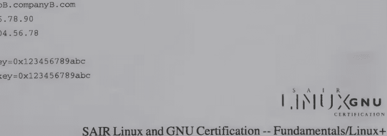

数据进入或退出互联网时经过的每个设备都必须指定。下一个示例显示了一个位于连接外部路由器的代理或防火墙旁的网络。另一端是一台连接到路由器的计算机。

```
network A----------proxyA----routerA----(Internet)--router----compB
```

```
123.156.78.90  123.156.78.1  12.34.56.78  112.223.123.1  112.223.123.80
```

配置文件包含以下：

```
config setup

interfaces="ipsec0%eth0"

plutload=%search

plutostart=%search

conn network-compB

leftsubnet=123.156.78.0/90

left=123.156.78.1

leftnextop=12.34.56.78

rightsubnet=112.223.123.80

right=112.223.123.1

auto=start

leftrsasigkey=0x123456789abcde

rightrsasigkey=0x123456789abcde
```

一旦配置文件完成，可以使用 `/usr/sbin/ipsec manual-up <连接名称>` 手动启动 IPSEC。

IPSEC 命令已添加到路径中。假设 `/sbin` 是路径的一部分，因此可以在 `/sbin/ipsec` 找到 IPSEC 命令。不带任何选项输入此命令将给出命令列表。在 IPSEC 命令中添加 `look` 选项（`/sbin/ipsec look`）可以显示任何当前激活的隧道。有关每个选项的更多信息，请参考 IPSEC man 页面。

# 模块复习题

这些问题的答案位于手册末尾附录 A。

- 1. 将 IP 地址拆分为四个字节目的是目的是？
- 2. 什么是 TCP/IP？
- 3. 什么是 PPP？
- 4. 什么是 FTP？
- 5. 什么是防火墙？

# 实验 08-I — 系统性能

## 目的

本实验的目的是让用户熟悉在 Unix 系统上识别、监控和终止进程。

## 实验时长

20 分钟。

## 概述

在 Linux 中，有很多命令允许管理员和用户监控系统上正在发生的情况。其中一些命令是 `ps`、`pstree` 和 `top` 命令。这些命令可以显示各种进程：`ps` 显示进程状态报告，`pstree` 显示进程树，而 `top` 显示系统上需求最高的进程实时列表。

在监控性能时，有一些与之相关的术语。你应该熟悉：swap space（交换空间）：一个磁盘区域（例如交换文件），用于存储被交换出的进程状态。virtual memory（虚拟内存）：交换空间和物理内存之和决定了单个进程的最大大小，通常以 Random Access Memory（随机存取内存）的可读格式表示。system load（系统负载）：进程在给定时间周期内使用的系统资源量。Linux 必须跟踪进程本身以及系统资源，以便管理它们；如果一个进程占用了系统大部分物理内存，将是不公平的。

## 实验练习

在实验中你将完成以下操作：

- 使用 `ps` 命令识别进程。
- 使用 `pstree` 命令显示进程树。
- 使用 `top` 命令查看处理器活动。
- 使用 `kill` 和 `killall` 命令终止正在运行的进程。注意：这里使用的是 Red Hat，某些选项在不同发行版中略有不同。1. 首先，带有 `-u` 选项运行 `ps` 命令：

```
$ -u
```

输出如下：

| USER PID %CPU VSZ RSS TTY STAT TIME COMMAND |
|---|---|---|---|---|---|---|---|
| seagar 8579 | 2.0 | 1.6 | 1760 | 1028 | pts/0 S | 12:41 |0:00 | bash |
| seagar 8580 | 0.0 | 1.5 | 2684 | 1000 | pts/0 R | 12:41 |0:00 | ps -u |

 2. 这显示了在 tty0 上运行的进程，比 `ps` 有更多信息。要查看所有进程，输入以下：

```
ps -aux
```

在大多数系统中，`ps -aux` 命令产生的列表很长。因此，只显示部分：

| | | | S | TTY | TIME | COMMAND |
|---|---|---|---|---|---|---|
| seagar 8610 | 0.1 | 1.6 | 1760 | 1028 | S | 12:53:00 | bash |
| seagar 8619 | 0.4 | 1.0 | 1308 | 632 | S | 12:55:00 | ps |
| seagar 8620 | 0.1 | 1.2 | 1680 | 812 | S | 12:55:00 | sh -c |
| seagar 8621 | 0.0 | 0.6 | 1440 | 432 | S | 12:55:00 | gunzip -c |
| seagar 8622 | 0.1 | 1.0 | 1484 | 688 | S | 12:55:00 | less |
| seagar 8624 | 7.6 | 5.3 | 5668 | 3404 | S | 12:55:00 | gnome-term |
| seagar 8625 | 0.0 | 0.9 | 1320 | 628 | ? | 12:55:00 | gnome-pty-h |
| seagar 8626 | 1.3 | 1.6 | 1760 | 1028 | S | 12:55:00 | bash |
| seagar 8627 | 0.0 | 1.6 | 2700 | 1012 | R | 12:55:00 | ps -aux |

3. 现在你已经有了可用的运行进程列表，使用 `killall` 命令终止其中一个。注意：在本示例中，`ps` 命令已经在运行。建议杀死一个无害的进程。

```
$ killall man
```

在这里，运行 `ps -aux` 显示列表的相同部分：

| | | | | | S | TTY | TIME | COMMAND |
|---|---|---|---|---|---|---|---|---|
| seagar 8610 | 0.1 | 1.6 | 1760 | 1028 | S | 12:53:00 | bash |
| seagar 8620 | 0.1 | 1.2 | 1680 | 812 | S | 12:55:00 | sh -c |
| seagar 8621 | 0.0 | 0.6 | 1440 | 432 | S | 12:55:00 | gunzip -c |
| seagar 8622 | 0.1 | 1.0 | 1484 | 688 | S | 12:55:00 | less |
| seagar 8624 | 7.6 | 5.3 | 5668 | 3404 | S | 12:55:00 | gnome-term |
| seagar 8625 | 0.0 | 0.9 | 1320 | 628 | ? | 12:55:00 | gnome-pty-h |
| seagar 8626 | 1.3 | 1.6 | 1760 | 1028 | S | 12:55:00 | bash |
| seagar 8631 | 0.0 | 1.6 | 2700 | 1012 | R | 13:00:00 | ps -aux |

4. 现在你已经学会了如何通过 `ps` 命令查看当前进程，请使用 `pstree` 命令：

```
$ pstree
```

以下是进程状态树：


```
init+-appmd
```
|-asclock_applet
|-atd
|-cpumusage_app
|-crond
      |-enlightenment
  |-gdm-X
      -gdm-gnome-session
  |-gmc
|-gnome-name-serv
|-gnome-smproxy
|-gnome-terminal-bash-man-sh-less
      |-gnome-pty-helper
  |-gnome-terminal-bash-pstree
      -gnome-pty-helper
  |-gnome-applet
|-gpm
|-httpd-10*[httpd]
|-inetd-in.in.identd-9*[in.identd]
|-kflushd
|-klogd
|-kpiod
|-kswapd
|-update
|-lpd
|-magicdev
|-mdrecovery
|-6*[mingetty]
|-panel
|-portmap
|-pump
|-rpciod
|-sendmail
|-soffice.bin-soffice.bin
|-2*[soffice.bin]
|-soffice.bin-soffice.bin-5*[soffice.bin]
|-syslogd
|-xfs
|-xscreensaver
|-ypbind-ypbind
```

+ 5. 下一步，使用 `top` 命令显示系统中运行的 CPU 占用最高的任务，并执行以下命令：
  $ top

输出应该类似于所示：

```
1:55pm up 1 day, 18:44, 3 users, load average: 0.01, 0.06, 0.07

88 processes: 84 sleeping, 2 running, 2 zombie, 0 stopped

CPU states: 1.7% user, 1.3% system, 0.0% nice, 96.8% idle

Mem: 63064ka, 57366k used, 5428k free, 37296k buff 1308k buff

Swap: 131504ka, 30912k used, 10059k free 24472k cached

PID USER PRI NI SIZE RSS SHARE %CPU %MEM TIME COMMAND

5144 seagar 16 0 1168 928 R 0 1.1 1.8 0:02 top

4227 root 16 0 14496 1104 N 0 0.9 1.8 0:27 X

5086 seagar 11 0 17420 988 S 0 0.2 2.1 0:00 gnome-term

1 root 0 0 0 124 72 S 0 0.0 0:01 init

2 root 0 0 0 0 SW 0 0.0 0:00 k kflushd

3 root 0 0 0 0 SW 0 0.0 0:00 0:09 kupdate

4 root 0 0 0 0 SW 0 0.0 0:00 kpid

5 root 0 0 0 0 SW 0 0.0 0:49 kwawpd

6 root -20 -20 0 0 SW< 0 0.0 0:00 mdrecoveryd

249 root 0 0 300 220 S 0 0.3 0:00 pump

295 bin 0 0 0 0 SW 0 0.0 0:00 portmap

311 root 0 0 68 0 SW 0 0.0 0:00 apmd

328 root 0 0 92 0 SW 0 0.0 0:00 ypbind

334 root 0 0 204 112 S 0 0.2 0:00 rpcbind

378 root 0 0 0 0 SW 0 0.0 0:05

397 root 0 0 208 156 S 0 0.2 0:00 syslog

408 root 0 0 468 164 112 S 0 0.2 0:00 klogd
```

在这个示例中，`top` 是当前系统中运行的资源消耗最高的进程。使用交互式命令来杀死它。在 `top` 运行时，输入 `k`；这是 `kill` 的交互式命令。它随后会询问你想要杀掉的 PID；在该系统中，`top` 命令的进程 ID 是 5144，因此在对应的 PID 处输入。现在它会询问你想要发送的 kill 命令；15 是默认值，通常有效，否则可以使用信号 9。执行此操作后，该进程将被杀死，你应该会回到 shell 提示符。

+ 6. 在提示符处（即执行以下操作）：
- 创建一个 shell（打开一个终端）。
- 切换用户到你自己（使用 `su` 命令）。
- 根据需要执行任意次数的 `su`。
- 运行 `ps` 和 `ptree` 查看发生了什么。
- 使用 `kill` 命令杀死父 shell。
- 运行 `ps` 和 `ptree` 观察子进程发生了什么变化。

(img/b0ea5e4a5ee6767fff08762e71c505_274.png)

在本示例中，`ipchains` 命令已由特定于发行版的初始化脚本运行，因此每个链的策略均为 `ACCEPT`（接受）。这意味着没有使用任何规则来过滤任何数据包。

- 3. 在 input 链中添加一条规则，拒绝所有源自 127.0.0.1（回环设备的 IP 地址）的封包。这对于本实验很有用，因为你不需要使用回环设备。首先，尝试以计数 1 的次数测试回环设备：

```
# ping -c 1 127.0.0.1

PING 127.0.0.1 (127.0.0.1) : 56(84) bytes of data.

64 bytes from 127.0.0.1 : icmp_seq=1 ttl=255 time=0.754 us
```

```
--- 127.0.0.1 ping statistics

1 packets transmitted, 1 packets received, 0% packet loss

round-trip min/avg/max/dev = 0.574/0.574/0.574/0.000 ms
```

- 4. 现在，使用 `-A` 选项将规则追加到 input 链，使用 `-s` 指定数据包源，使用 `-p` 指定协议类型（为了实验目的，使用 `all` 表示所有数据包），并使用 `-j` 指定要执行的操作（在此情况下为 `DENY` 拒绝）。列出 input 链的规则：

```
# ipchains -A -s 127.0.0.1 -p all -j DENY

# ipchains -L input
```

链 input（策略 ACCEPT）：

| 目标 (target) | 协议 (prot) | 目的地 (destination) | 端口 (ports) | |
| :--- | :--- | :--- | :--- | :--- |
| ACCEPT | all | localhost | anywhere | | |

再次对 127.0.0.1 尝试该命令。

```
# ping -c 1 127.0.0.1

PING 127.0.0.1 (127.0.0.1) from 127.0.0.1 : 56(84) bytes of data.

--- 127.0.0.1 ping statistics ---

1 packets transmitted, 0 packets received, 100% packet loss
```

所有源自 127.0.0.1 的包均被拒绝。

- 5. 下一步你将使用 `-D` 选项从 input 链中删除此规则。然后再次列出 input 链的规则。

```
# ipchains -D input 127.0.0.1 -p all -j DENY

# ipchains -L input
```

链 input（策略 ACCEPT）：

规则已删除。执行此操作的其他方法是使用数字选项并清空链。由于你创建的规则是链中的唯一规则，它是第一条，因此：

```
# ipchains -D 1 input
```

这也是有效的。此外，如果你想从特定链中移除所有规则，可以使用清空选项 `-F`。如果你未指定链，则所有链将被清空。

```
# ipchains -F input
```

- 6. 创建一个名为 `lab` 的新链，使用 `-N` 选项，并列出规则。

```
# ipchains -N lab

# ipchains -L lab
```


链 lab（策略 ACCEPT）：

# 安装

## 发行版

选择合适的 Linux 发行版是安装过程中最重要的一步。Linux 操作系统有多种发行版，提供不同的功能和支持。有基础 Linux 发行版，设计用于低端设备或网络环境。有初级用户发行版，它们包含了图形化安装程序。最后是专家级发行版，它们需要大量的计算机经验，但允许对操作系统进行最细微细节的自定义。

## 创建启动盘

在安装过程中，建议创建一个启动盘，这对于诊断和恢复故障系统将证明自己是不可或缺的。如果在初始启动过程中发生问题，除非使用可启动的 CD-ROM 或硬盘上的 Linux 系统，否则启动盘将是修复问题的唯一方法。通常，Linux 发行版会在安装过程中提供创建启动盘的方法。

## 系统要求

与其他操作系统一样，Linux 有几项用户应该注意的运行。其中一些要求是：

- `4MB RAM`（安装 X Window 至少需要 `16MB RAM`）

## 多系统引导

Linux 可以与许多其他操作系统（包括 DOS 和 Windows）共存，尽管使用多个操作系统可能需要重新分区（调整大小）或添加另一块硬盘。Linux 和 DOS 中都有可用工具对磁盘重新分区。在 Linux 中，使用 `GNU Parted` 完成此操作，而在 DOS 中可以使用 `FIPS` 实用程序。还有商业调整大小软件包，如 `Partition Magic`。磁盘分区完成后，从硬盘启动操作系统需要配置和使用引导加载器，即 `LILO`。

- 用于制作启动盘的 3.5 英制软驱
- 至少 `100 MB` 的硬盘空间

## LILO

Linux 加载器 `LILO` 是一种内核引导加载器，它依赖计算机 BIOS 的数据来工作。它位于硬盘 MBR、实际的磁盘分区或软盘上。基本输入/输出系统 `BIOS` 是计算机微处理器用于控制计算机功能的程序，包括键盘、显示器、磁盘驱动器或串行通信。`BIOS` 还负责管理操作系统与连接硬件设备（如硬盘）之间的初始数据流。在 `BIOS` 完成任务后，`LILO` 程序将接管并为启动实际操作系统提供中间人。`LILO` 可以作为系统的主管理器，因为它能够轻而易举地加载 Linux、Win98、OS/2 以及其他几种操作系统。

当尝试使用 `LILO` 从硬盘启动 Linux 时，可能会出现问题；某些安装程序可能会对磁盘分区布局做出错误假设。在这种情况下，需要重新安装 `LILO`。如果在安装期间创建了启动盘，请编辑 `/etc/lilo.conf`，让 `LILO` 指向正确的内核以启动系统。

> 注意：记住，每当更改镜像和每次编辑配置文件时，必须手动重新运行 `lilo.conf` 程序。如果没有重新运行 `LILO`，系统可能会不稳定并可能无法正常启动。

在安装 `LILO` 之后可能会出现另一个问题，即系统可能启动了 Linux 以外的操作系统。通过在 `LILO` 提示符处按 `<TAB>` 键，将显示已配置的启动系统的标签名称。输入要启动的系统名称并按 `<ENTER>`。示例 `/etc/lilo.conf` 包含 Linux 和 DOS 的条目。与 Linux 中的大多数脚本和配置文件一样，任何符号 `#` 之后的文本都会被视为注释，不会被 `LILO` 解析。

```
boot = /dev/hda           # 主引导记录或根分区

delay = 10              # 设置交互延迟（以秒分为单位）

vga = 0                # 这是可选的。例如，vga=1 将提供 80x50 控制台

# linear                 # 取消注释解决某些几何问题

# 默认启动的操作系统镜像，在此情况下是 Linux

image = /dev/mlinux # 指定 Linux 内核文件的位置

root = /dev/hda1        # 指定根分区

label = Linux            # 这是镜像的标签（可以使用任何文本字符串）

read-only               # 初始，根文件系统应挂载为只读
```

```
# 此处定义从 LILO 启动的 DOS 系统

other = /dev/hda4 # 这指定第四分区上的 DOS 系统

table = /dev/hda4 # 分区表

label = dos
```

作为 Linux 和 GNU 认证 -- 基础/Linux+

Linux 操作系统是补丁的集合。

## 分区

安装 Linux 时，可以使用 `fdisk` 或 `cdisk` 创建分区。这些工具用于管理磁盘布局，并且在 RAM 耗尽的情况下用于……（此处原文重复乱码）。

## SCSI

在安装过程中也可能出现 SCSI 问题。以下是可能的错误：

- 感应错误 `Sense Errors`
此错误通常是电缆连接不良导致的。如果是这种情况，应该正确检查电缆。
- 超时错误 `Timeout Errors`
此错误最常见是由 IRQ、DMA 引起的。如果是这种情况，应该正确检查中断。

## 硬件

硬件问题可能出现在配置中。这些包括 USB 设备或音频设备。如果是这种情况，应该正确检查驱动程序。通过使用在线文档，安装 Linux 应该是相当简单的。互联网通过常见问题 `FAQ` 和 `HOWTO` 提供许多信息。`HOWTO` 是 Linux 用户提交的文档，涵盖了有关运行 Linux 的许多主题。如果用户需要额外帮助，可以访问 `linuxdoc.org` 等网站。

## 安装后

### 核心转储

当程序执行期间发生错误时，会产生核心转储。核心转储通过提供错误发生时的内存快照来识别程序中的错误。

### 核心转储的原因

如果程序安装不完整或不当，或者软件需要补丁，就会发生核心转储。如果是这种情况，应该重新安装软件或联系供应商查看是否有需要下载并应用的补丁。

如果某些必要的库缺失或过时，也可能发生核心转储。保持库（如 `lib5`、`QT` 或 `GTK`）更新以减少遇到核心转储的机会。

资源冲突有时会导致核心转储。即使系统硬件看起来运行正常，可能仍存在冲突的基地址。要解决这个问题，应尝试为硬件分配不同的基地址以消除冲突。

### 使用转储

如果用户没有计划使用核心转储中的信息，可以将其删除。如果希望防止核心转储保存到硬盘上，可以使用 `/etc/profile` 文件中的 `ulimit` 命令。应将 `ulimit` 命令放在文件中如下：

```
ulimit -c 0
```

此命令将将上的核心转储数量限制为零，从而有效防止核心转储保存到磁盘。

## 模块 9 — 故障排除

简单地忽略问题不会让它消失。核心转储 `Core dumps` 是问题的指示，不应被完全忽略。人们应该仔细检查系统，找出转储的来源以及如何停止它们。如果找不到来源，则应将问题报告给软件或硬件供应商或系统管理员。还应该保存并转发核心转储，以便这些权威部门进行检查。

## 进程控制

当程序似乎产生了问题时，或者资源似乎有所减少时，用户可能需要哪些程序正在运行以及它们在做什么的信息。在某些情况下，需要停止或重启进程。为了确定程序正在做什么并收集这些进程的信息（如 PID 号），用户可以使用 `top` 工具或 `ps` 工具。

### top 命令

`top` 工具提供了一个按降序排列的自更新运行中进程列表，从使用最多系统资源的进程开始。`top` 的输出如下：

```
2:49pm up 8 days, 22:48, 2 users, load average:0.01,0.03, 0.00

62 processes: 60 sleeping, 2 running, 0 zombie, 0 stopped

CPU states: 4.5% user, 0.7% system, 0.0% nice, 94.6% idle

Mem: 126866 av, 125228 used, 1636k free, 0k kd, 800k buff

Swap: 136544 av, 39492k used, 97052k free, 58668 cached

PID USER SIZE RSH SHARE STATE %CPU %MEM TIME COMMAND

29484 bcbrm 14 0 01960 15M 6164 S 3.1 12.5 0:44 marker

766 root 12 0 04056 37M 10024 S 1.1 29.9 119:07 X

29339 root 9 0 05580 5580 401 S 0.4 0.3 0:01 panel

29409 bcbrm 9 0 04156 4156 3412 S 0.1 3.2 0:00 descguide_apple

29861 root 9 0 05088 5088 3648 R 0.1 4.0 0:00 gnome-terminal

29884 bcbrm 10 0 01204 1204 968 R 0.1 0.9 0:00 top

1 root 8 0 0 0168 116 S 0.0 0.1 0:04 init

2 root 9 0 0 0 S 0.0 0.0 0:00 keventd

3 root 9 0 0 0 S 0.0 0.0 0:00 kawpd

4 root 9 0 0 0 S 0.0 0.0 0:00 increlaimd

5 root 9 0 0 0 S 0.0 0.0 0:01 bdflush

6 root 9 0 0 0 S 0.0 0.0 0:00 updated

7 root 9 0 0 0 S 0.0 0.0 0:00 root

343 root 8 0 388 324 308 S 0.0 0.2 0:00 pump

403 root 9 0 288 176 176 S 0.1 0.1 0:00 syslog

408 root 9 0 692 116 116 S 0.0 0.0 0:00 klogd

422 rpc 9 0 288 252 252 S 0.0 0.1 0:01 portmap
```
`top` 屏幕报告系统统计，例如当前进程数量、CPU 使用率和交换空间使用情况

### ps 命令

为了查看所有进程的列表，应该使用带选项的 `ps` 命令。这将提供运行进程的完整列表，包括 PID、所有者和进程名。以下是 `ps` 命令的部分输出：

| USER | PID | CPU %MEM | VSZ | RSS | TTY | STAT | START | TIME |
|---|---|---|---|---|---|---|---|---|
| root | 1 | 0.0 0.1 | 1368 | 128 | S | Jul23 | 0:04 | [init] |
| root | 2 | 0.0 0.0 | | | S | Jul23 | 0:00 | [keventd] |
| root | 3 | 0.0 0.0 | | | S | Jul23 | 0:07 | [kawpd] |
| root | 4 | 0.0 0.0 | | | S | Jul23 | 0:00 | [increlaimd] |
| root | 5 | 0.0 0.0 | | | S | Jul23 | 0:01 | [bdflush] |
| root | 6 | 0.0 0.0 | | | S | Jul23 | 0:00 | [updated] |
| root | 7 | 0.0 0.0 | | | S | Jul23 | 0:00 | [root] |
| root | 343 | 0.0 0.2 | 1740 | 324 | S | Jul23 | 0:00 | [pump] |
| root | 403 | 0.0 0.1 | 1748 | 176 | S | Jul23 | 0:00 | [syslog] |
| root | 408 | 0.0 0.0 | 1952 | 116 | S | Jul23 | 0:00 | [klogd] |
| rpc | 422 | 0.0 0.0 | 1520 | 252 | S | Jul23 | 0:01 | [portmap] |
| rpc | 437 | 0.0 0.0 | 1608 | | S | Jul23 | 0:00 | [rpc.stat] |
| root | 510 | 0.0 0.0 | | | S | Jul23 | 0:18 | [keventd] |
| root | 511 | 0.0 0.0 | | | S | Jul23 | 0:00 | [lockd] |
| root | 531 | 0.0 0.2 | 1812 | 320 | S | Jul23 | 0:00 | [ypbind] |
| root | 532 | 0.0 0.2 | 1812 | 320 | S | Jul23 | 0:00 | [ypbind] |
| root | 533 | 0.0 0.2 | 1812 | 320 | S | Jul23 | 0:00 | [ypbind] |
| root | 536 | 0.0 0.2 | 1812 | 320 | S | Jul23 | 0:00 | [ypbind] |

在这里，我们可以看到每一列包含不同的进程信息。这些信息可以用于确定问题的来源。

### kill 命令

例如，假设用户注意到系统性能极其缓慢。用户可能会发现某个程序由于早些时候占用大量内存一直在运行。用户可能发现他们以为已经关闭了程序。为了释放系统资源，用户需要杀死该进程。这是通过 `kill` 命令完成的。对进程使用 `kill` 命令，用户必须知道 PID 并拥有该进程的所有权。在用 `top` 或 `ps` 获取故障进程的 PID 后，用户会将 PID 作为参数执行 `kill` 命令。例如，杀死 PID 为 3744 的进程，用户输入：

```
kill 3744
```

如果由于某种原因进程没有被杀死并且仍在运行，用户将使用 `-9` 信号。它会立即杀死进程，而不是发送 `kill` 命令的默认信号 `TERM`。

```
kill -9 3744
```

如果用户只想停止运行中的进程而不是杀死它，他们可以使用 `STOP` 信号，如下所示：

```
kill -STOP 3744
```

要让进程继续运行，应该使用 `CONT` 信号：

```
kill -CONT 3744
```

这将导致停止的进程恢复运行。

### killall 命令

另一个有用的命令是 `killall` 命令。与其逐个杀死运行多个进程的程序的每个进程，你可以执行 `killall` 命令。
例如：

```
killall netscape
```

在这种情况下，如果你在桌面上打开了多个 Netscape 窗口，你只需要执行此命令，就会结束所有标记为 netscape 的进程。

## 常见网络问题

对于 Linux 网络管理员来说，很少有任务像正确识别和预防系统问题那样重要。无论网络大小如何，其正常运行通常是管理员的唯一责任。因此，管理员应该意识到硬件问题。

### 硬件问题

网络问题通常由故障或安装不当的硬件引起。表 9-1 列出了可以帮助的工具。

| 工具 | 功能 |
|---|---|
| 数字电压表 `DVM` | 用于寻找短路 |
| 协议分析仪 | 分析并报告带宽 |
| 示波器 | 单位电压 |
| 发生器 | 发单个电缆 |
| 时域反射仪 `TDR` | 分析通过电缆的脉冲 |

表 9-1. 帮助硬件问题的工具

### 故障排除

除了预防错误，许多问题也可以被解决。表 9-2 列出了一些命令。

| 命令 | 定义 |
|---|---|
| `traceroute <host>` | 显示数据包的路径 |
| `tcpdump` | 允许用户转储或打印数据 |
| `netstat` | 列出连接状态 |
| `ip` | 防火墙管理 |
| `ping <host>` | 显示可用主机信息 |
| `arp` | 允许用户清除表 |

表 9-2. 网络问题的命令

### 示例 3 - 这是路由的。

如果 Linux 机器上的路由配置错误，主机可能无法连接局域网或网络外的计算机。检查当前路由表最简单的方法是在命令提示符处输入 `route`。这将显示路由表。环回接口（接口列在 `Interface` 下方）的路由应配置目标为 `127.0.0.0`，以太网接口应配置地址 `192.168.1.0`。如果缺少这些目标中的任何一个，在命令提示符处输入

```
$ route add -net address
```

将添加它们。如果路由配置错误，通过在提示符处键输入

```
$ route del address
```


来删除它，然后使用 `route add` 命令读取它。要检查适配器是否配置正确，请 `ping` 回环地址（`127.0.0.1`）。如果有响应，说明以太网适配器正常。

### 9-14 第 9 节 — 故障排除

## 基础内核编译

- 获取内核源码
- 配置内核
- 编译并安装内核
- 配置 LILO
- 内核包
- 模块
  - 加载模块
  - 模块

## 基础内核编译


如果用户想要从内核中删除不必要的特性，或添加对新设备或硬件的支持，他们需要编译一个自定义内核。这不是一项困难的任务，但如果处理不当，可能会导致系统无法启动。

### 获取内核源码

在编译自定义内核时，通常最好是获取最新的稳定版本。内核源码可以从 www.kernel.org 下载。下载压缩包和签名文件后，用户应使用 PGP 或 GnuPG 验证压缩包未被篡改。接下来，根据用户下载的是较小的 `bzip2` 压缩包还是较大的 `gzip` 压缩包，将压缩包解压到 `/usr/src`：

```
$ tar xzf linux-x.x.xx.tar.gz

$ tar xif linux-x.x.xx.tar.bz2
```

### 配置内核

一旦所有文件都处于正确的属性状态，就必须配置内核源码。有三种方法可以实现。第一种方法是使用命令 `config`。这种方法将运行一个配置脚本，并在命令行逐个询问。`make config` 非常繁琐，因为没有办法跳过给定的配置问题。

另一种配置内核源码的方法是使用 `make menuconfig`。这种方法将显示一个基于控制台的图形界面。它提供了一种导航内核配置的简单方法，并且不需要回答每一个问题。此外，使用 `menuconfig` 方法不需要 X Window。菜单配置的主界面如图 9-1 所示：

## 基础内核编译 9-15

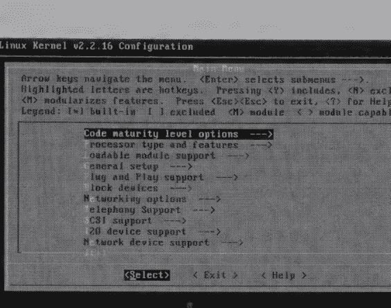

图 9-1. 内核配置

配置内核源码的最后一种方法是使用 `xconfig`，`xconfig` 与 `menuconfig` 类似，不同之处在于在 X-Window 环境中显示。内核窗口配置的主界面如图 9-2 所示：

| 代码成熟度级别选项 | 以太网 (100 Mbp) | Flap，软带驱动程序 |
| --- | --- | --- |
| 处理器类型和特性 | Apple 设备 | 文件系统 |
| 可加载模块支持 | 令牌环形设备 | 网络文件系统 |
| 通用设置 | War 接口 | 分区表 |
| 即插即用支持 | 另一种无线支持 | 原生语言支持 |
| 砖设备 | MSM 系统支持 | 控制台驱动程序 |
| 网络设备 | Linux 端口设备驱动程序 | 速度 |
| 代码选项去模糊 | | 额外的低级驱动程序 |
| 电话支持 | 旧 CD-ROM 驱动程序 (非 SCSI, 非 IDE) | 内核黑客行为 |
| SCSI 支持 | Chartrucit 设备 | 保存并退出 |
| SCSI 低级驱动程序 | 鼠标 | 不保存退出 |
| 网络设备支持 | 摇杆 | 从文件加载配置 |
| ArcNet 设备 | 以太网 (10 或 100Mb) | Linux 视频 / 存储配置到文件 |

图 9-2. X Window 配置

一旦选择了该方法，就必须执行实际配置。无论使用哪种方法，配置过程都是相同的。每个部分都有两个可能的选项：`yes (y)` 或 `no (n)`。某些部分有第三种选项：可加载模块 (`m`)。选择 `yes` 会将该特性构建到内核中，而选择 `no` 则将导致新内核排除指定的特性。模块选项将为内核创建一个模块，可以根据需要加载或移除。

根据对某些配置选项的回答，其他选项可能会发生变化。例如，如果未启用支持，则所有声音选项都将不可用。


SAIR Linux 和 GNU 认证 --- 基础/Linux+

### 编译并安装内核

配置完成后，仅剩最后几个步骤。首先，使用命令 `make dep` 来解析配置依赖。一旦解决了依赖关系，就可以编译内核。使用命令 `makeImage` 开始编译。如果使用了模块选项，则必须执行 `make modules` 命令。

### LILO

编译内核的下一步是在 `/etc/lilo.conf` 中添加新条目。首先，将 `/usr/src/linux/arch/i86/boot/bzImage` 移动到 `/boot/`，假设是 x86 架构。接下来，编辑 `/etc/lilo.conf` 为新内核添加一个分段。它看起来如下：

```
image=/boot/bzImage

label=test

root=/dev/hda
```

编辑完成后，运行 `/sbin/lilo` 以激活更改。接下来重启机器，并在 LILO 提示符处启动新内核。

### 内核包

应该注意到Debian 提供了一个名为 `kernel-package` 的工具来自动化这些工作。在配置内核后，用户只需执行以下两个命令：

```
$ make-kpkg clean

$ make-kpkg --revision REVISION
```

`REVISION` 应替换为用户选择的版本号。例如，如果用户为名为 hostname 的计算机构建内核，应使用 hostname.build。这会在 `/usr/src` 生成一个 Debian 包，可以像任何其他包一样安装它。安装此包将安装内核及其模块，并配置 LILO 启动新内核。系统应当重启。

## 模块

### 加载模块

如果创建了任何模块，可以在重启后安装它们。要安装模块，使用 `insmod` 命令，后跟模块对象的绝对路径。在大多数情况下，这将位于 `/lib/modules/x.x.xx` 子目录下。例如：

```
$ insmod /lib/modules/2.2.16/net/3c501.0
```

此外，另一种加载模块的方法是 `modprobe`。该程序将尝试加载用户指定的模块。如果因为依赖关系失败（模块加载前需要加载其他模块），它将也会加载这些模块。


### 移除模块

如果用户安装的任何模块出现问题，输入 `lsmod` 命令查看已加载的模块。要移除导致问题的模块，输入以下命令：

```
$ rmmod 3e501
```

模块后面的 `.o` 是不需要的，因为这是加载模块的名称，而不是加载它的文件。

## 模块复习题

这些问题的答案位于本文末尾的附录 A。

- 如果机器上有多个操作系统，如何使用 LILO 指定默认启动哪个系统？
- 大多数网络问题是哪种类型的？
- 重编译内核的原因有哪些？
- 在重新编译内核时，如果特定特性不需要构建到内核中，有哪些可用选项？

## LAB 09 - 内核下载与重新编译

### 目的

本实验的目标是成功下载并重新编译 Linux 内核。完成此实验后，你将能够根据特定需求升级当前内核，从而提高系统性能。

### 时长

30 分钟。

### 概述

Linux 由四个核心部分组成：内核、shell、文件结构和实用程序。Linux 操作系统的核心是内核。内核的作用是协调系统的硬件和软件。模块化概念（即使用可以在任何系统中运行的小程序）是 Linux 的核心，它们可以独立运行，也可以与其他模块协同工作。这种做法将内核的大小保持到最小，并允许进行定制以满足特定系统的需求。

### 练习 - 第一部分

可以从多个来源获取 Linux 内核。最好的来源之一是 kernel.org。你也可以通过 ftp.kernel.org/pub 访问。。选择 Linux 目录，然后进入 kernel 目录。下一个屏幕显示内核主版本号和次版本号列表。选择后，后续屏幕将显示该版本可选的待安装补丁。内核是压缩的，但大小为 1MB，并以 gz 和 bz2 两种版本进行压缩。.bz2 文件提供更好的压缩率，但并非所有系统都支持 bzip2。因此，bzip2 适用于对 bzip2 有问题的系统。检查你的系统是否支持 bzip2 并下载适合你的一个。

将 tar 包下载到 `/usr/src` 目录。在安装内核之前，使用以下命令检查文件以获取要安装的文件结构的概述：

```
tar -tzf linux-X.X.XX.tar.gz
```

复制有的 linux/ 目录以防错误。使用 mv 命令快速复制旧目录的方法：

```bash
mv /usr/src/linux/ /usr/src/linux-old/
```

然而，大多数发行版会创建一个从 `/usr/src/linux-X.X.XX` 到 `/usr/src/linux/` 的符号链接。在这种情况下，不需要移动目录，只需输入以下命令删除 `/usr/src/linux/` 目录：

```bash
rm /usr/src/linux/ /usr/src/linux-old/
```

当内核被解压时，它会在 `/usr/src/` 下重新创建 `/usr/src/linux/` 子目录。要开始解压内核，输入：

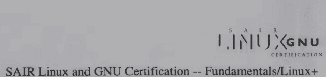

使用命令切换到新创建的 `/usr/src/linux/` 目录：

```bash
cd /usr/src/linux/
```

从此新目录开始，创建返回 `/usr/src/linux/` 的符号链接：

```bash
ln -s /usr/src/linux-X.X.XX /usr/src/linux/
```

以下命令将检查 `.o` 文件和依赖关系的稳定性：

```bash
make mrproper
```

现在依赖项已检查，内核已下载并放在正确的位置，是时候配置它了。Makefile 提供了几种设置内核的选项。这些选项取决于用户想要如何与配置程序交互。make config 使用命令行程序，make menuconfig 使用基于 curses 的控制台程序，make xconfig 使用基于 tk/tcl 的 X11 程序，而 make oldconfig 利用自动更新程序。

```bash
make menuconfig
```

内核具有极高的定制性。为了减小内核体积并提高速度，仅选择需要的选项。大多数功能可以作为模块加载。事实上，模块是 CD-ROM、磁带备份等许多其他设备的首选方法。

Oldconfig 用于将设置从旧内核传输到新内核。Menuconfig、config 和 xconfig 用于更改内核设置。

Makefile 可用于将更新后的内核和系统镜像放置在另一个位置。默认设置将内核放置在 `/` 目录下。将内核放置在其他目录需要你使用编辑器并修改以下行：

```makefile
#INSTALL_PATH=/boot
```

你必须首先删除井号 (`#`)，因为它表示注释，且在编译时不会被读取。其次，你必须修改目录，将其放置在你希望内核存放的任何目录中。在这里，我们使用 `/boot` 目录。

依赖项是软件包或代码模块的一部分，包含了构建程序所需的系统信息，可能被其他多个程序共享。make 命令决定哪些部分需要重新编译或链接到模块。make clean 命令会从之前的内核编译中删除旧文件。你接下来应该运行的下一个命令是 make modules，它将编译你在内核配置中选择的模块。在紧接着 make 命令 之后，输入 make modules_install，这将安装这些模块。

```bash
make dep

make clean

make modules

make modules_install
```


- LCD、PC 卡和指向设备 ................................................ 10-40
- LCD 液晶面板 ................................................................................................. 10-40
- PC 卡 ....................................................................................... 10-41
- 指向设备 ........................................................................ 10-41
- 电源设备 ....................................................................... 10-43
- 电源 .......................................................................... 10-43
- 浪涌保护器 ....................................................................... 10-44
- UPS（不间电源） ................................................ 10-44
- 网络设备 ................................................................... 10-46
- 网卡的安装与配置 ................. 10-46
- 全双工与半双工 ................................................ 10-47
- 布线 ....................................................................................... 10-47
- 物理网络拓扑结构 ................................................ 10-48
- 增加带宽 ..................................................... 10-50
- 红外 ................................................................................ 10-51
- 外围设备 .......................................................... 10-52
- 调制解调器 ........................................................ 10-52
- USB 外围设备与总线 ........................................ 10-53
- IEEE 1284 ................................................................... 10-53
- IEEE 1394 ................................................ 10-53
- 外部存储 ....................................................... 10-54
- 模块复习题 ........................................ 10-55

# 第 10 模块 - 硬件

- 硬件基础
- LCD、PC 卡和指向设备
- 系统板
- 电源设备
- Intel 与 AMD：CPU 比较
- 网络设备
- 内存
- 外围设备
- 存储设备
- SCSI
- 视觉设备

## 学习目标

在完成本模块的学习后，你将能够：

- 识别系统板的关键特性。
- 识别系统板上的关键内存槽、处理器槽和外围设备槽。
- 解释 Intel 和 AMD 芯片之间的主要区别。
- 列出三种类型的 RAM 和三种类型的 ROM。
- 识别 IDE 通道中断和基地址。
- 识别各种 SCSI 连接和功能。
- 设置显示器、分辨率和刷新率。
- 描述电源和 UPS 系统的功能。
- 识别各种布线方式和网络拓扑结构。
- 识别外围设备及其相应的 IEEE 标准。

## 硬件基础

- 系统板
- CPU
- 内存
- 存储设备
- I/O 设备
  - 鼠标、调制解调器、打印机等外围设备
- 整合所有部分

## 硬件基础

## 系统板

系统板，也称为主板，是容纳计算机运行所需的电子组件和芯片的电路板。它通常包含：

- CPU（中央处理单元）
- RAM（随机存存储器）
- 总线
  - 通信端口
- IDE 控制器
- 用于各种设备的扩展卡

系统板将所有这些部分连接在一起，允许它们相互作用以完成不同的任务。来自设备的输入信号通过总线发送到目标地，并在那里被相应解释和执行。

## CPU

CPU 或微处理器通过逻辑上地解释指令并控制数据流来控制计算机的动作。任何指令都通过 CPU 进行正确的处理和执行。软件使用 CPU 来处理其指令。

有许多种处理器。PC 可以拥有基于 CISC（复杂指令集）架构的处理器，如 Intel、Cyrix、AMD 等。Alpha、PowerPC 和 MIPS 采用的是 RISC（精简指令集）架构。

## 内存

随机存存储器（RAM）作为计算机的主要内存源，并在短期存储数据以便于访问；这减少了应用程序访问数据或程序的时间。然而，如果数据没有保存，一旦计算机关闭（无论是故意还是意外），数据将会丢失。RAM 通过插槽（用于 SIMM 或 DIMM RAM）连接到系统板。

## 存储设备

数据可以直接存储在设备中，或写入可移动介质上。一些典型的二级存储设备包括：

- 硬盘
- 磁带
- CD-R/CD-RW
- DVD-R/DVD-RAM
- 软磁盘
- Zip 磁盘

硬盘是主要的本地存储设备；它们有各种尺寸以满足存储需求。它们可以是内部的 (IDE) 或外部的 (SCSI)。系统可以定期进行备份。备份可以存储在各种介质上。磁带可以存储最多的数据，而 CD-R 和 CD-RW 变得越来越流行。可以使用多张 CD 以最低成本备份系统，因为每张 CD 可以存储高达 700 Mb。DVD-R 可以存储 4 GB 以上的材料，而 DVD-RAM 可以存储几乎两倍；DVD RAM 也是可写的。软磁盘存储容量较小（仅约 1.44 到 2.88 Mb，但对于小型程序和文件仍然有用）。Zip 磁盘介于软磁盘和 CD-R 之间——它们可以存储 100 到 250 Mb 的数据。

## I/O 设备

I/O（输入输出）设备接收和发送数据。显示器是输出设备的良好示例；键盘是输入设备。打印机的外围设备。其他 I/O 设备包括：

- 鼠标
- 调制解调器
- 打印机

## 外围设备

外围设备是任何连接到计算机但不是内部组件（如打印机和扫描仪）或执行辅助功能（如外部硬盘）的设备。


## 整合所有部分

计算机的组件必须共同工作，即使是为了完成如在文本编辑器中打字这样琐碎的任务。键盘是主要的输入设备；当输入内容时，数据被发送到操作系统，操作系统随后将数据路由到显卡。显示器同步工作更新屏幕。程序获取这些信息并将其放入 RAM 中，在其中等待 CPU 的进一步指令。一旦输入被保存，它就会从 RAM 中取出并写入相应的存储设备（硬盘或软磁盘等可移动存储设备）。

## 系统板

- **系统板的软件组件**
  - 固件
  - BIOS
  - CMOS
- **系统板的硬件组件**
  - 外围槽
  - 内存槽
  - 处理器槽
  - 系统板规格

## 固件

系统板或主板是任何计算机的心脏。它尺寸相当大，通常为 6 英寸乘以 12 英寸或更大，并包含许多用于卡、内存或电源连接器的插槽。系统板有许多变体，可以通过检查电路板的物理尺寸、电源连接器或布局来确定类型。

系统板的固件是包含在 EPROM 中的一组软件指令。EPROM 全称为可擦除可编程只读存储器。在早期的计算机中，固件包含在 PROM 中，它类似于 EPROM，但只能写入一次。今天，固件的主要用途是存储 BIOS。

## BIOS

BIOS 是一个控制系统板本身运行的简单操作系统。BIOS 全称为基本输入输出系统。BIOS 执行 POST（开机自检）和其他诊断任务。通常情况下，BIOS 是不可修改的。然而，在某些情况下数据可以修改；当需要升级 BIOS 时，它是非易失的，这意味着即使丢失电源，BIOS 中的数据也是安全的。BIOS 还允许用户对计算机进行更改，如设置硬件级密码或更改启动设备。这些用户定义的参数存储在 CMOS 中。

## CMOS

CMOS（互补金属氧化物半导体）存储 BIOS 在启动和运行期间使用的信息。CMOS 是易失性存储器。它需要在主板上安装一个电池，这样即使断电或拔掉电脑插头，存储在其中的任何信息都是安全的。虽然这是一种粗糙的解决方案，但它允许在修改 BIOS 时发生的任何错误通过简单地从主板上移除电池来撤销。CM 电池在主板上很容易识别，因为它只有一个且看起来像一个大手表电池。

# 主板硬件组件

以下章节将列出并描述处理 PC 时遇到的大多数总线和插槽

## 外设插槽

这些通常用于将调制解调器和声卡等设备连接到主板。

| 外设插槽 | 功能 |
| --- | --- |
| ISA | 标准架构。ISA 插槽的设计是为了为所有外设提供通用架构。ISA 为系统总线提供 16 位、8MHz 的连接，最大带宽为 6MB/s |
| EISA | 扩展标准架构。EISA 是 ISA 的升级版，但在 PC 市场上从未获得强势地位。它的速度是 ISA 的两倍。ISA 卡可以在 EISA 插槽中工作。EISA 的类型与 ISA 相同 |
| VESA 本总线或 USB | 视频电子标准协会。VLB 设计旨在为 PC 显卡提供优势，尽管通常不再使用。USB 为系统总线提供了 32 位、33 MHz 的连接。 |
| MCA | 微通道架构。MCA 提供全功能集，包括 32 位总线和即插即用性。MCA 和 PCI 是为了取代 ISA 而开发的。IBM 是 MCA 开发的主要力量，并得到了 Intel 的支持。直到最近，MCA 的采用率在任何 PC 中都不是 |
| PCI | 外设组件互连。PCI 是目前最常用的外设插槽。PCI 运行频率为 32MHz，与系统总线有 32 位连接，最大传输率为 132 MB/s。PCI 设备用于从显卡到磁盘和控制器的一切 |
| 64 Bit PCI | 如名所示，这是 PCI 的 64 位版本。随着 64 位 PCI 插槽变得越来越普遍，特别是在高端服务器中。该插槽的运行频率为 32 或 66MHz，最大传输率为 528MB/s。64 位 PCI 的类型包括 Ultra/100 PCI 和其他高带宽设备 |
| AGP | 加速图形端口。AGP 是目前的视频适配器标准；它为卡提供了显著的速度优势，AGP 卡可以直接访问系统 RAM 或其自身 RAM 的扩展。AGP 与其他总线动态共享系统总线，允许整体性能最大，同时防止 AGP 消耗整个 RAM。AGP 有许多版本，从 AGP 1x 到 AGP 6x，宽度为 32 位，运行频率至少 64MHz。目前的 AGP 最快，最大传输率为 1.06GB/s。AGP 专门用于图形设备 |
| AMR | 音频调制解调器路由器。AMR 设计用于提供廉价的方法将音频设备和调制解调器连接到主板。这是一个较新的标准，尚未普及。其典型用途包括调制解调器和声卡 |
| IDE | 代表集成驱动器电子。IDE 总线只是 PCI 总线的扩展，用于连接 CD-ROM 或硬盘等设备。IDE 有几种速度等级；最快的是 ATA100，它可以以 100Mbps 的速度向系统总线发送数据。其他 IDE 模式包括 ATA33 和 ATA66。经常发现将 IDE 模式引用 UDMA；例如 UDMA3 等同于 ATA33 |

表 10-1. 外设插槽

# 主板 10-9

图 10-1. 典型 ISA 卡

# 内存插槽

如名所示，内存插槽是插入内存的地方。目前使用的五种内存插槽，它们分为三种内存模块类型：DIMM、SIMM 和 RIMM。表 10-2 列出并描述了常见的内存插槽类型。

| 内存插槽 | 功能 |
| --- | --- |
| DIMM | 双内内存模块。这是现代 PC 中常用的内存类型。 |
| SIMM | 单内内存模块。这是旧式 PC 使用的旧内存模块类型。 |
| RIMM | 阶梯内存模块。这是某些 Pentium II 系统使用的内存模块类型。 |

表 10-2. 内存插槽

## Intel vs AMD：CPU 比较

- CPU
- 通用定义
- 插槽与插座
  - Slot 1
  - Socket 7
  - Slot A
  - Socket 423
  - Socket 370
  - Socket 478
- 可识别的处理器标记
  - AMD 处理器标记
  - Intel 处理器标记

## Intel 对阵 AMD：CPU 比较

Intel 和超威微设计（AMD）已证明自己是 PC 微处理器的领导者。本节将让读者熟悉这两家公司各种处理器之间的一些主要差异。

## 通用定义

1. CPU 时钟
这是处理器执行指令的速度。时钟频率以 MHz 为单位测量，1MHz = 每秒百万次循环。处理器的架构对整体速度的影响与频率频率一样大。可能存在两个运行在 1000MHz 的处理器，它们的性能并不相等。

2. 系统总线
系统总线将计算机的所有内部组件连接到 CPU 和内存。总线由地址总线（负责确定信息的位置）和数据总线（负责实际传输数据）组成。总线的宽度非常重要，因为它决定了一次可以传输的数据量。例如，32 位总线（常见于桌面 PC）一次可以传输 32 位信息，而 64 位总线（常见于高端工作站和服务器）一次可以传输 64 位数据。与 CPU 一样，总线与速度有关；测得的速度决定了数据通过总线的传输快慢。

3. 倍频
倍频是总线速度的倍，用于推导出 CPU 速度。制造商通常会在 CPU 上设置倍频锁，防止终端用户对其超频。

## 硬件

4. 核心电压
处理器的核心电压与功耗直接相关。数值越低意味着消耗的功率越少。

5. 缓存
系统缓存比内存快。大多数现代计算机至少有一级（L1）缓存（通常存储在 CPU 上）和二级（L2）缓存。L2 缓存通常比位于主板上的 L1 缓存大。

6. 缓存频率
缓存频率决定了从缓存访问信息的速度。缓存频率同样以 MHz 为单位测量。越高越好。

7. 架构
架构是指处理器家族。例如，Intel 拥有 Pentium Pro、Pentium II、Pentium III 和 Pentium 4 家族。

8. 微米工艺
制造工艺决定了实现所需性能所需的芯片（die）尺寸。更小的工艺可以产生更廉价、更快的处理器。

## 插槽与插座

现代处理器以两种方式连接到主板：插槽和插座。这些包括 slot 1、slot A、socket 370、socket 7、socket 423 和 socket 478。Intel 处理器使用 slot 1、socket 370、socket 7 和 socket 423。AMD 处理器使用 slot A 和 socket 7，而 Intel 引入了 slot 1 来取代 Pentium II/III 以及较旧的赛扬（Celeron）处理器。Slot 1 可以有三种封装方式：
- 单边封装 (SEPP)
- 单边卡封装 (SECC)
- 单边卡封装 (SECC2)

Slot A 是一个 242 针连接器，类似于 slot 1 连接器；然而，slot A 用于 AMD Athlon 处理器，并接受封装为卡模块（CM）的处理器，其外观与 Intel 的 SECC2 封装相似。Slot A 和 slot 1 在机械结构上相同，但由于 AMD 和 Intel 使用不同的协议和信号，它们是不兼容的。

## Socket 370
Socket 370 是一个 370 针连接器。它接受封装为陶瓷针阵列（CPGA）、盖板式栅阵列（FC-PGA）和塑料栅阵列（PPGA）的处理器。Socket 370 支持 Pentium III 和赛扬处理器。

## Socket 7
Socket 7 连接器是 321 针连接器，接受 Pentium、Intel MMX、AMD K5 和 AMD K6 处理器。Socket 7 和 socket 370 外观相同；但引脚数量不同。

## Socket 423
某些 Pentium 4 处理器使用 socket 423。socket 423 是一个 423 针连接器。

## Socket 478
较新的 Pentium 4 处理器将使用 socket 478。socket 478 比之前的 socket 423 小得多。比 423 小之外，它还具有 478 个引脚而不是 423 个。

## 可识别的处理器标记

处理器的另一个重要方面是其标记。处理器标记允许用户通过视觉检查处理器来确定工作电压、速度、总线和缓存大小等信息。Intel Pentium II 和 III 处理器的标记通常比 AMD 的标记更容易读。AMD 标记需要将各种符号与含义对应。

## AMD 处理器标记

本节将使用 AMD-K6 处理器的示例标记：
AMD-K7 800PRS52A

该示例分为九部分：
1. 处理器家族或架构。在示例中，家族是 K7 系列处理器。
2. CPU 时钟频率。此部分的所有数字都以 MHz 为单位。此外，速度标记 100 代表 1000MHz。
3. 封装类型。M 代表卡模块，P 代表 PGA。
4. 工作（或核心）电压。T 为 1.6V，P 为 1.7V，N 为 1.8V。
5. 最大外壳温度。R 为 70 摄度。
6. L2 缓存大小。5 代表 512KB，1 代表 1MB，2 代表 2MB。
7. 缓存除数。1 代表 1/2，2 代表 2/5，3 代表 1/3。
8. 最大前端总线。B 代表 100MHz（如果使用 DDR 内存则倍增）。
9. 微米设计规则。A 为 188 微米，C 为 25 微米。

## Intel 处理器标记

典型的 Intel Pentium II 处理器会有如下标记：
350/512E/100/2,2 ST
SL28R FFFFFFFF-NNNN
date country

第一行分别指定速度、缓存、总线速度电压。第二行指定序列号，第三行指定日期国家。Pentium III 和 Pentium 4 的标记类似。

## 内存

- RAM
- DDR RAM
- 内存模块
- SGRAM
- SIMM
- VRAM
- DIMM
- WRAM
- SO DIMM
- RIMM
- 内存带
- ROM
- SRAM
- PROM
- DRAM
- EPROM
- SDRAM
- EEPROM
- RDRAM
- SLRAM

## 内存模块

### SIMM

最初，30 针内式内存模块（SIMM）是为 8 位数据流设计的，并以四个一组的形式放置以提供 32 位数据流。这意味着 32 位操作需要同时使用四个 30 针 SIMM。因此，72 针 SIMM 是为 32 位操作设计的。它减少了执行 32 位操作所需的内存插槽数量。然而，72 针 SIMM 导致内存模块的物理长度增加了 50%。为了处理 64 位操作，至少需要两个 72 针的 SIMM。这再次导致了问题。解决该问题的简单方案是 DIMM（双内式内存模块）。

### DIMM

双内式内存模块（DIMM）是一种带有内存芯片的小型电路板。单内式内存模块（SIMM）到内存芯片之间具有 32 位数据路径，而 DIMM 具有 64 位数据路径。这意味着计算机若要实现 64 位数据路径，SIMM 必须以二的倍数安装，而 DIMM 每次只需要安装一个即可。

大多数 Pentium 和兼容 Pentium 的主板包含两个或多个用于 168 针 DIMM 的插槽。DIMM 与 SIMM 相似，但在长度、系统要求和功能上有所不同。DIMM 模块使用芯片的双侧，168 针版本每侧有 84 针。

### SO DIMM

小外形 DIMM（SO DIMM）是 DIMM 的较小版本，主要用于笔记本电脑。全尺寸的 DIMM 有 168 针并支持 64 位传输；然而，SO DIMM 仅有 72 针并支持 32 位传输，或者有 144 针支持全 64 位传输。

## 内存类型

### SRAM

同步随机存存储器（SRAM）在存储数据时不需要自动刷新。刷新只发生在执行写入命令时。如果没有发生写入命令，SRAM 内部的内容就不会改变，这就是为什么它被称为静态存储器。SRAM 的优点是它比 DRAM 快得多，速度可以达到 2 纳秒。缺点是 SRAM 比 DRAM 贵。SRAM 在 PC 中最大的用途是二级缓存，也称为 L2 缓存。

### DRAM

动态随机存存储器（DRAM）是今天计算机的标准内存类型。信息以电容器中一系列电的形式存储在 DRAM 中。在电电后的几毫秒内，电容器会放电并需要刷新以保留其数值。这种持续刷新就是使用“动态”一词的原因。

### EDO

扩展数据输出动态随机存储器（EDO DRAM）是一种比传统 DRAM 更快的 DRAM。与传统 DRAM 每次只能访问一个数据块不同，EDO DRAM 可以在向 CPU 发送上一个数据块的同时，开始获取下一块内存。

### FPM

快速页模式内存（FPM DRAM）是一种允许快速访问同一行或同一页中数据的 DRAM 类型。页模式内存的工作原理是，如果数据位于之前访问的行中，则消除了对行地址的需求。FPM DRAM 正在被 SDRAM 等内存类型取代。

> 注意：FPM RAM 也称为页模式内存。

### BEDO

突发式 EDO DRAM（Burst EDO DRAM）是 EDO DRAM 的一种，可以在一次突发中处理四个内存地址。然而，与 SDRAM 不同，BEDO DRAM 只能与 CPU 时钟保持短时间的同步（突发）。此外，它无法跟运行速度超过 66 MHz 的处理器。

### SDRAM

同步动态随机存储器（SDRAM）是一种以比传统内存快得的时钟频率运行的 DRAM。SDRAM 实际上与 CPU 总线同步，能够以 133 MHz 运行，约为传统 FPM RAM 的三倍，是 EDO DRAM 和 BEDO DRAM 的两倍，为消除 EDO DRAM 奠定了基础。

今天最快的 Pentium 系统使用速度超过 100 MHz 的 CPU 总线，因此 SDRAM 难以维持其速度。预计未来的 PC 将拥有运行在 200 MHz 或更快的 CPU 总线。SDRAM 预计无法支持这些速度，这就是为什么正在开发如 RDRAM、SDRAM 和 DDR RAM 等新内存技术。

### RDRAM

Rambus DRAM 由 Rambus 公司开发。SDRAM 提供的数据最高速度为 100 MHz，而 RDRAM 的数据传输速度高达 600 MHz。

1997 年，英特尔宣布它将许可 Rambus 技术以用于其未来的主板，使其成为内存架构的事实标准。然而，一个计算机供应商组成的联盟正在开发一种名为 SyncLink DRAM (SDRAM) 的替代内存架构。

RDRAM 已经开始用于取代图形加速板中的 VRAM。截至 1999 年底，英特尔在其 Pentium III Xeon 处理器中使用了 RDRAM，最近在其 Pentium 4 处理器中使用了。英特尔和 Rambus 还在制作新版本的 RDRAM，称为 DDR DRAM，它将支持……

### SDRAM (SyncLink)

SyncLink DRAM (SDRAM) 正由一个计算机制造商联盟开发。SyncLink DRAM (SDRAM) 是一种用于视频适配器的内存（RAM）。SDRAM 正在与昂贵的 RDRAM 竞争。

### DDR RAM

双倍数据速率同步动态随机存储器是一种 SDRAM，它在每个周期的两个边沿都支持数据传输，有效地将内存芯片的吞吐量提高了一倍。DDR-SDRAM 也称为 SDRAM II。

### SGRAM

同步图形内存（SGRAM）是一种用于视频适配器的 DRAM。与 SDRAM 一样，SGRAM 可以将自己与 CPU 时钟同步到达到 100 MHz 的速度。在图形处理中，SGRAM 使用了多种技术（如掩码写入和块写入）来增加带宽。

> 注意：与 VRAM 和 WRAM 不同，SGRAM 是单口的。然而，它可以同时打开两个内存页，模拟了其他内存技术的双端口特性。

### VRAM

视频内存（Video RAM）是视频适配器使用的特殊用途内存。与传统 RAM 不同，VRAM 可以被两个设备同时访问。这使得 RAMDAC 在视频处理器提供数据的同时，访问 VRAM 进行屏幕更新。VRAM 提供了更好的图形性能，但比普通 RAM 贵。

### RAMDAC

随机存存储器数字模拟转换器（RAMDAC）是放置在视频适配器上的单个芯片，用于将数字编码的图像转换为显示器可以显示的模拟信号。一个 RAMDAC 由四个部分组成：用于存储颜色映射的 SRAM 和三个数字模拟转换器（DAC），分别用于显示器的红、绿、蓝电子信号。

### WRAM

WRAM 在操作上与 VRAM 类似，但它提供了高约 25% 的带宽，此外还有开发者可以利用的若干图形功能。这些包括比 VRAM 缓冲区更快的双缓冲数据系统，它提供了相当快的刷新率。

### RIMM

RIMM 经常与 Rambus 内式内存模块相关联，然而 RIMM 并不是一个缩写。它是 Rambus 公司的商标。RIMM 技术基于用于 RDRAM 芯片的技术。它类似于 DIMM 封装，但使用了不同的引脚设置。Rambus 将 RIMM 一词作为一个整体注册了商标。

### ROM

只读存储器（ROM）几乎总是用于计算机以保存计算机引导/启动过程的指令。与 RAM 不同，ROM 是不可写入的（它是非易失性的）。

### PROM

可编程只读存储器（PROM）是一种可以在其存储程序的内存芯片。但一旦 PROM 被使用，就无法被擦除并用于存储其他内容。像 ROM 一样，PROM 是非易失性的。

## EPROM

可擦除可编程只读存储器（EPROM）是一种 PROM，可以通过暴露在紫外线下进行擦除。

## EEPROM

电可擦除可编程只读存储器（EEPROM）是一种 PROM，可以通过施加电荷进行擦除。

## 硬盘

集成驱动器电子设备（IDE）是一种将磁盘驱动器控制器与硬盘驱动器结合在硬盘本身上的方法。这种实现也称为 ATA（AT 接口）。硬盘驱动器与控制器的集成降低了成本，并使其更容易升级。

## IDE 的改进

这种实现方法的改进之一是增强型 IDE（EIDE），它由西部数据（Western Digital）创建，构建于 ATA-2（ATA 的改进版）和 ATAPI 标准。还有许多其他类似的实现方式，例如 Fast-ATA 和 ATA-3 等，但它们都是对原始 IDE/ATA 标准的改进。

## ATA-100

一个著名的实现方案是 ATA-100，它是 ATA 标准的一种非常快速的实现。然而，为了利用这种速度，必须设置内核标志。实现这一目标的方法之一将其作为附加内容放在 `lilo.conf` 中。例如：

```


`image`=`/mlinuz`
`label`=`Linux-2.4.0`
`root`=`/dev/hde3`
`read-only`
`append`=`"x86_serial_nr=1 ide2=0x9400,0x9002 ide3=0x08800,0x08402"`


## IDE

使用 IDE 硬盘（或其变体）需要用数据排线将硬盘连接到主板。这种数据排线称为 IDE 通道，该通道允许 CPU 和硬盘之间传输信息。该通道实际上可以与硬盘以外的设备通信，但这超出了讨论的范围。它还允许 IDE 以外的实现，但 IDE（或其变体）是最常用的。某些通道对硬盘只有一个连接，而另一些则有两个硬盘连接。无论何种情况，如果一个硬盘连接到排线上，则该硬盘被称为主盘（master drive），并且必须配置为主盘。

如果排线上只连接了一个硬盘，则它应该连接在末端接口上。这时，要将硬盘配置为主盘，必须设置跳线。通常，这些跳线可以在每个硬盘的背面找到。跳线可以设置为主模式（master）或电缆选择（Cable Select, CS）。如果排线上连接了两个硬盘，必须将一个配置为主盘，另一个配置为从盘（slave）。或者，可以将两组跳线都配置为 CS，但并不建议这样做。

大多数计算机现在在主板上支持两个 IDE 通道。其中一个是主 IDE 通道，另一个是从级 IDE 通道。如前所述，每个通道可以支持两个设备，总共四个设备。每个通道使用一个中断和一个基址地址。虽然不同计算机之间的中断可能不同，但主 IDE 通道最常用的中断是 14，从级通道最常用的中断是 15。主通道使用的基址地址为 `03F6h`，从级通道使用 `0376h`。

10-22 模块 10 — 硬件

## SCSI

- SCSI 与 IDE/ATA
- 不同类型的 SCSI
- SCSI 信号方法
- SCSI 线缆和连接器
- SCSI 主机适配器
- SCSI 总线配置

## SCSI

小型计算机系统接口（SCSI，发音为 skuzzy）是一种通过标准硬件接口将外围设备连接到计算机的标准。SCSI 在 1986 年成为 ANSI 标准，但在那之前的很多年就已经存在了。1979 年，一家名为 Shugart 的硬盘制造商开发了一种名为 Shugart Associates Systems Interface（SASI）的新型驱动器接口，它使用逻辑寻址代替传统的物理寻址方式。为了利用这种速度，必须设置内核标志。实现这一目标的方法之一将其作为附加内容放在 `lilo.conf` 中。在多次尝试将标准化 SCSI 后，SASI 出现了 SCSI-2。X3.2 1982 委员会将 ATN 信号添加到总线并创建了消息协议。在 SCSI 的第二代中，出现了 SCSI-2。那一年，SASI 被称为 SCSI。X3.1-1986。在几年的工作后，SCSI-2 成为正式 ANSI 标准。

SCSI 支持多种设备，包括硬盘、光驱驱动器、刻录光驱动器、扫描器、磁带驱动器。

### SCSI 与 IDE/ATA

如所示，除了速度之外，使用 SCSI 的其他理由。带有 SCSI 的计算机可以容纳更多设备。SCSI 支持比当前 IDE/ATA 大得多的驱动器。此外，最大的容量几乎总是 SCSI（最大的 SCSI 驱动器为 18 GB，而最大的 IDE/ATA 驱动器为 100 GB）。

### SCSI 与 ATA 表

| 特性 | SCSI | IDE/ATA |
| :--- | :--- | :--- |
| 每个电缆设备数 | 7 或 15（取决于版本） | 2 |
| 最大容量 | 2048 GB | 128 GB |
| 驱动器速度 | 当前为 15000 rpm | 7200 rpm |
| 最大总线吞吐量 | Ultra160 为 160 MB/s；Ultra320 为 320 MB/s | ATA100 为 100 MB/s |
| 最大电缆长度 | 使用 LVD 时 12 米 | 45 厘米 |
| 设备成本 | 相同空间更贵 | 相同空间便宜 |
| 安装便利性 | 由于需要终端而较为复杂 | 相对简单；只需一两个跳线 |
| 出厂支持 | 通常需要安装主机适配器 | 每个 BIOS 和主板均支持 |

### 不同类型的 SCSI

自 SCSI-1 标准引入以来，SCSI 有许多改进。SCSI-2 引入了对几种可选改进的支持，包括使用多根电缆进行数据传输（16 位而非正常的 8 位）以及快速 SCSI-2，后者将总线频率从 5 MHz 翻倍到 10 MHz。同时，SCSI-2 包含了与旧 SCSI 设备的大量后兼容性。最近，设备一直在实现 SCSI-3 的增强。由于 SCSI 多年来增长如此巨大，不会为 SCSI-3 发布单一规范。已经发布了多份处理 SCSI 特定方面的文档。SCSI-3/SPI、SCSI-3/SPI-2 和 SCSI-3/SPI-3 是目前针对 SCSI-3 标准确定的文档。最新的 SCSI 设备 Ultra 160+ SCSI 运行在 40 MHz 的总线上，最大吞吐量为 160 MB/s，并符合 SPI-3 标准。即将发布的 SPI-4 标准将引入总线吞吐量为 320 MB/s 的 Ultra320 SCSI。

## 不同的 SCSI 模式

市面上的大多数 SCSI 设备会被描述为兼容 SCSI-2 或兼容 SCSI-3 的设备。这并不是判断设备能力的最佳指标，因为这两个标准涵盖了许多不同类型的设备，且后者尚未经过正式标准化。衡量 SCSI 设备性能和兼容性的最佳指标是它所支持的模式。大多数 SCSI 设备支持多种不同的模式以确保兼容性。这些模式通常列在设备的包装上或设备制造商的网站上。将这些模式作为不同设备之间的兼容性依据是安全的。

表 10-6 列出了许多不同的 SCSI 模式，以及每种模式的简要描述和它们定义的标准：

| 模式 | 描述 | 定义标准 |
|---|---|---|
| 常规或 SCSI-1 | 原始的 SCSI。这种类型的 SCSI 没有官方名称，通常被称为 SCSI-1 或常规 SCSI。 | SCSI-1 |
| 宽 SCSI (Wide SCSI) | 宽 SCSI 支持 16 位总线。它也被称为。 | SCSI-2 |
| 快速 SCSI (Fast SCSI) | 快速 SCSI 使用 10 MHz 信号。它也被称为称为。 | SCSI-2 |
| 快速宽 SCSI (Fast Wide SCSI) | 包含了快速 SCSI 和宽 SCSI 的功能。它也被称为 Fast Wide SCSI-2。 | SCSI-2 |
| 超极 SCSI (Ultra SCSI) | Ultra SCSI 使用 20 MHz 信号。 | SCSI-3 |
| 宽 Ultra SCSI (Wide Ultra SCSI) | 宽 Ultra SCSI 在总线路上使用 20 MHz 信号。也被称为。 | SCSI-3 / SPI |
| Ultra2 SCSI | Ultra2 SCSI 使用 40 MHz 信号。它也（但不常用）称为 Fast-40 SCSI。 | SCSI-2 |
| 宽 Ultra2 SCSI (Wide Ultra2 SCSI) | 包含了 Ultra2 SCSI 和宽 SCSI 的功能。它也被称为。 | SCSI-3 / SPI |
| Ultra3 SCSI | 使用双倍时钟实现 160 MB/s 的总线吞吐量。随着 Ultra2 SCSI 的引入，8 位总线的支持被取消。Ultra3 设备仅要求。 | SCSI-3 / SPI |
| Ultra160 (Ultra160) | 与 Ultra 基本相同，但由于 Ultra 设备支持 160 MB/s 的吞吐量，通常使用 Ultra160 名称以避免混淆。Ultra160 设备要求。 | SPI-3 |
| Ultra160+ SCSI | 与 Ultra160 基本相同，但 Ultra160+ 的功能都是强制性的。 | SCSI-3 / SPI |
| Ultra320 SCSI | Ultra320 设备使用 80 位总线支持 320 MB/s 的最大吞吐量。在本书编写时，SPI-4 尚未定型，市场上还没有 Ultra320 设备。 | SCSI-3 / SPI-4 |

表 10-6 不同的 SCSI 模式

## 快速和宽 SCSI

“快速”和“宽”这两个形容词出现在许多 SCSI 模式的名称中。快速 SCSI 并不是模式，而是指使用某种技术实现高于 5 MHz（原始 SCSI 速度）的设备。由于所有 SCSI 模式的都都增加，“快”一词已从新模式的名称中删除。宽 SCSI 也不是模式，它是指在 16 位总线之外运行的设备。由于 Ultra2 运行在 8 位总线上，“宽”一词也从新模式的名称中删除。

虽然这些不同类型的 SCSI 看起来很困惑，但实际上并不是。随着时间的推移，对性能影响最大的两个数字——总线速度和宽度一直在增加。这些模式的总线宽度、最大吞吐量以及信号类型列在表 10-7 中：

| 模式 | 总线宽度 | 信号 | 总线吞吐量 |
|---|---|---|---|
| 常规 SCSI | 8 位 | SE 或 HVD | 5 MHz (5 MB/s) |
| 宽 SCSI | 16 位 | SE 或 HVD | 5 MHz (10 MB/s) |
| 快速 SCSI | 8 位 | SE 或 HVD | 10 MHz (10 MB/s) |
| 快速宽 SCSI | 16 位 | SE 或 HVD | 10 MHz (20 MB/s) |
| Ultra SCSI | 8 位 | SE 或 HVD | 20 MHz (20 MB/s) |
| 宽 Ultra SCSI | 16 位 | SE 或 HVD | 20 MHz (40 MB/s) |
| Ultra2 SCSI | 8 位 | LVD 或 HVD | 40 MHz (40 MB/s) |
| 宽 Ultra2 SCSI | 16 位 | LVD 或 HVD | 40 MHz (80 MB/s) |
| Ultra3 SCSI | 16 位 | LVD | 40 MHz (160 MB/s) |
| Ultra160 SCSI | 16 位 | LVD | 40 MHz (160 MB/s) |
| Ultra160+ SCSI | 16 位 | LVD | 40 MHz (160 MB/s) |
| Ultra320 SCSI | 16 位 | LVD | 80 MHz (320 MB/s) |

表 10-7 SCSI 速度比较

## SCSI 信号方法

信号方法是数据在电缆上传输的物理方式。虽然很容易将数据认为总是二进制数字，但在数据传输时，它们实际上存储为电荷。由于这些电荷容易受到各种磁干扰的影响，不同的信号方法在不同条件下工作效果更好。多年来，SCSI 支持三种不同的信号方法：SE、HVD 和 LVD。最新的 LVD 是新设备支持的唯一信号方法，识别所有三种信号方法对于使用正确的布线并正确连接到较新的总线至关重要。

### 单端 (SE) 信号

单端 (SE) 信号是用于 SCSI 设备之间数据传输的最旧信号类型。SE 是第一个标准信号方法，因为它廉价且相对容易实现。SE 信号使用单根线传输信号。线上的正电压表示逻辑 1，零电压表示 0。SE 非常容易受到干扰。如果总线速度增加，干扰就会增加。如果电缆长度增加，干扰量也会增加。由于这些物理限制，SE 无法以今天设备所需的速度运行。

### 高电压差分 (HVD) 信号

开发高电压差分 (HVD) 信号是为了克服 SE 信号的物理限制。HVD 使用一对线传输信号。两根线传输零电压以表示零。其中一根线传输正电压，而另一根线传输相反电压。通过取这两个电压之间的差值，接收端更容易受到干扰。然而，由于成本高昂且与 SE 物理不兼容，HVD 并没有普及。

### 低电压差分 (LVD) 信号

LVD 信号是一种新信号方法，它结合了 SE 和 HVD 的最佳属性并在物理上与 SE 兼容。低电压差分 (LVD) 定义在 SPI-2 中，是目前 SCSI 信号的标准。LVD 从未出现过困扰 HVD 的高成本问题，在同一总线上混合 SE 和 LVD 设备是安全的。此外，大多数新的 LVD 设备都支持 SE 模式以向下兼容，并作为 LVD/SE 或 LVD/MSE（m 代表多模式）设备销售。

## SCSI 布线和连接器

不同的 SCSI 配置需要几种类型的电缆。宽和窄配置需要不同的电缆，内部和外部 SCSI 总线需要不同的电缆。此外，尽管 SE 和 LVD 在物理上兼容，但 SE 电缆的质量无法满足 LVD 的。因此，LVD 电缆通常标记为 LVD 或 LVD Compliant。

本节将讨论各种类型的电缆和连接器。此外，还将为不同类型的连接器提供插图。

## 外部电缆

外部电缆的结构与内部电缆非常不同。由于电脑机箱屏蔽了内部电缆免受大多数干扰，外部电缆暴露在更多可能导致损坏的因素之中。外部电缆必须自带屏蔽以防止数据损坏。因此，外部电缆是屏蔽过的。额外的屏蔽成本使得外部 SCSI 电缆比内部电缆贵得多。

外部电缆使用类似于 10base 的双绞线。

## 内部电缆

内部 SCSI 电缆类似于 ATA/IDE 宽带线。然而，由于最新的 SCSI 设备速度更快（如 Ultra2 或 LVD），内部电缆使用了扭绞线，或类似于标准平带线的宽带电缆。

## 窄型 SE 电缆或 A 缆

有五种用于连接 SE 信号的窄型电缆。这些用于连接窄型 SCSI 设备的 68 针电缆被称为 A 缆。其中三种用于内部连接，两种用于外部连接。这些电缆及其使用的连接器列举如下：

- 外部 Centronics A 缆：这种电缆是在 SCSI-1 规范中引入的。这种电缆使用平带线连接器（在打印机和电缆之间使用的相同类型），用于连接窄型 SE 设备。使用 Alternative-2 Centronics 外部连接器： 图10-3. 50针 Alternate-2 连接器
- 外部高密度 A 缆：这种电缆是在 SCSI-2 规范中引入的。它用于具有高密度 (HD) 的更新外部 SE 设备，使用 Alternative-1 外部连接器： 图10-4. 50针 Alternate-1 A 连接器
- 内部常规密度 A 缆：这种 50 针平带线用于不需要大量带宽的旧磁盘和设备。内部常规密度 A 缆使用 Alternative-2 内部连接器。这些连接器是两排 25 针的矩形连接器，类似于 ATA/IDE 电缆上的连接器。
- 内部高密度 A 缆：高密度平带线使用 Alternative-1 内部连接器，用于支持窄总线的设备。然而，大多数新设备不支持窄总线。

## 宽型 SE 电缆或 P 缆及连接器

有两种用于外部连接的宽型 SE 电缆和一种用于内部连接。用于连接 SE 信号宽型 SCSI 设备的 68 针电缆被称为 P 缆。这些电缆及其使用的连接器列举如下：

- 外部高密度 P 缆：这种电缆是在 SCSI-3 SPI-2 规范中引入的。它是使用较大的 Alternative-3 外部 HD 连接器的 68 针高密度电缆： 图10-6. External Alternate-3 P 连接器
- 外部超高密度 P 缆 (VHDCI)：这种电缆是在 SCSI-3 SPI-2 规范中引入的。它是用于连接更新 SCSI 设备的超高密度电缆。这种电缆使用 Alternative-4 微 Centronics 连接器。然而，最新的设备仅在 LVD 信号上运行：
- 内部高密度电缆：这种电缆是在 SCSI-2 规范中引入的。它是 68 针高密度平带线。这种电缆与矩形 68 针 Alternate-3 连接器连接。它是最流行的

## LVD 电缆

LVD 电缆是最新的技术。然而，大多数新设备不支持窄总线。显然，在假设 SCSI 总线上连接了足够设备的情况下，LVD 总线将成为瓶颈。

## 单接头 (SCA)

单接 (SCA) 是一种用于连接 SCSI 设备的连接器。额外的屏蔽成本使得外部 SCSI 电缆比内部电缆贵得多。

## SCSI 适配器

如今大多数计算机均不内置 SCSI 支持。消费者应该检查哪种 PCI 支持购买 Ultra3 SCSI、Ultra160 SCSI 或任何总线速度超过 100 MB/s 的控制器卡。

# SCSI 总线配置

幸运的是，只要使用兼容的设备、电缆和连接器，SCSI 的实际配置非常简单。之前提供的材料已足以确保硬件兼容性。本节将详细介绍配置带有多个设备的 SCSI 总线所需的步骤。

# 支持的设备数量

尽管大多数配置只有少数设备，但 SCSI 除主机适配器外，最多可支持 7 或 15 个设备。窄（8位）总线可以支持 7 个额外设备，宽总线可以支持最多 15 个额外设备。由于 SCSI 设备不再在名称中添加单词，且 SE 配置对某些数量的设备可能有长度要求，因此表 10-8 列出了在不同情况下 SCSI 模式下的最大设备数：

| 模式 | 最大设备数量 |
|---|---|
| 普通 SCSI | 8 |
| 宽 SCSI | 16 |
| Fast SCSI | 8 |
| 宽 Ultra SCSI | 16 |
| Ultra SCSI | 使用 HVD 或配合长度小于 1.5m 的电缆使用 SE 时为 8；配合长度超过 1.5m 的电缆使用 SE 时为 4 |
| 宽 Ultra SCSI | 使用 HVD 或配合长度最多 1.5m 的电缆使用 SE 时为 8；配合长度超过 1.5m 的电缆使用 SE 时为 4 |
| Ultra2 SCSI | 使用 HVD 或配合长度最多 12m 的电缆使用 LVD 时为 8；配合超过 12m 的电缆使用 LVD 时为 2 |
| 宽 Ultra2 SCSI | 使用 HVD 或配合长度最多 12m 的电缆使用 LVD 时为 16；配合超过 12m 的电缆使用 LVD 时为 2 |
| Ultra3 SCSI | 长度 12m 以内的电缆为 16，超过 12m 的电缆为 2 |
| Ultra160 SCSI | 长度 12m 以内的电缆为 16，超过 12m 的电缆为 2 |
| Ultra60+ SCSI | 长度 12m 以内的电缆为 16，超过 12m 的电缆为 2 |
| Ultra320 SCSI | 长度 12m 以内的电缆为 16，超过 12m 的电缆为 2 |

表 10-8. 不同 SCSI 模式支持的设备数量

# 最大电缆长度

不同的信号方法在不同条件下支持各种长度。虽然配置中实际使用的电缆可能比支持的最长电缆短得多，但在所有情况下并非如此。表 10-9 列出了使用不同信号方法和不同设备数量的 SCSI 电缆的最大长度：

| 模式 | 电缆最大长度 |
|---|---|
| 普通 SCSI | SE 为 6m，HVD 为 25m |
| 宽 SCSI | SE 为 6m，HVD 为 25m |
| Fast SCSI | SE 为 3m，HVD 为 25m |
| Fast Wide SCSI | SE 为 6m，HVD 为 25m |
| Ultra SCSI | 不超过 4 个设备时 SE 为 3m、1.5m；HVD 为 25m |
| 宽 Ultra SCSI | 不超过 4 个设备时 SE 为 3m、1.5m；HVD 为 25m |
| Ultra2 SCSI | 不超过 2 个设备时 LVD 为 25m，否则为 12m；HVD 为 25m |
| 宽 Ultra2 SCSI | 不超过 2 个设备时 LVD 为 25m，否则为 12m；HVD 为 25m |
| Ultra3 SCSI | 不超过 2 个设备为 25m，否则为 12m |
| Ultra160 SCSI | 不超过 2 个设备为 25m，否则为 12m |
| Ultra160+ SCSI | 不超过 2 个设备为 25m，否则为 12m |
| Ultra320 SCSI | 不超过 2 个设备为 25m，否则为 12m |

表 10-9. SCSI 布线的最大长度

# 总线拓扑与终端

SCSI 设备必须以直链方式连接（称为总线拓扑）才能正常工作。链不能在任何一点分支，并且在 SCSI 链的两个端都必须有一个终止器来吸收通过电缆发送的信号。如果电缆的末端没有终止器，信号将在电缆上来回反射，干扰下一个信号。如果将终止器放在最后一个设备之后但在电缆的最末端，则会发生信号反射。

配置适当的 SCSI 总线看起来像这样：

```
[Terminator]-[Device_1]-[Device_2]-[Host_Adapter]-[Device_3]-[Terminator]
```

# 自终止设备

市场上的许多设备如果配置正确，会自动终止 SCSI 总线。通常有一个跳线或开关可以开启或关闭终止。如果使用设备代替终止器，则必须将设备放置在电缆的最末端。配置适当的自终止设备总线看起来如下：

```
[Device_1_with_termination_enabled]-[Host_Adapter]-[Device_2]-[Terminator]
```

# 主机适配器终止

市场上大多数主机适配器如果配置正确，会自动终止。这通常是因为主机适配器位于内外部设备的 SCSI 总线中间。如果主机适配器不在 SCSI 电缆的末端，必须禁用终止。

# 终止类型

不同的信号方法需要不同类型的终止。LVD 和 HVD 信号需要特殊的终止器；然而 SE 信号可以使用被动、活动或强制终止。前者最便宜，但在快速配置中效果不好。后者是 SE 信号的最佳终止类型。表 10-10 列出了不同类型的 SCSI 类型所需的终止：

| 模式 | 终止类型 |
|---|---|
| 普通 SCSI | 可以使用 SE、活动或强制终止。HVD 必须使用 HVD |
| 宽 SCSI | 可以使用 SE、活动或强制终止。HVD 必须使用 HVD |
| Fast SCSI | 可以使用 SE、活动或强制终止。HVD 必须使用 HVD |
| Fast Wide SCSI | 可以使用 SE、活动或强制终止。HVD 必须使用 HVD |
| Ultra SCSI | 可以使用 SE、活动或强制终止。HVD 必须使用 HVD |
| 宽 Ultra SCSI | 可以使用 SE、活动或强制终止。HVD 必须使用 HVD |
| Ultra2 SCSI | LVD 必须使用 LVD。HVD 必须使用 HVD |
| 宽 Ultra2 SCSI | LVD 必须使用 LVD。HVD 必须使用 HVD |
| Ultra3 SCSI | 必须使用 LVD |
| Ultra160 SCSI | 必须使用 LVD |
| Ultra160+ SCSI | 必须使用 LVD |
| Ultra320 SCSI | 必须使用 LVD |

表 10-10. 终止要求

# ID 配置

SCSI 使用 ID 唯一标识每个设备。总线上的每个设备根据分配的 ID 获得特定的优先级。如果总线饱和，优先级最高的设备将控制总线。

在窄总线上，最高优先级是7，最低是0。在宽总线上，编号靠前的设备具有优先级。宽总线上从高到低的优先级 ID 为 7, 6, 5, 4, 3, 2, 1, 15, 14, 13, 12, 11, 10。

# Linux SCSI 配置

要配置 SCSI 与 Linux 协同工作，主机适配器必须与 Linux 兼容。安装适配器后，必须重新编译内核以启用 SCSI 支持。最后，需要使用 `insmod` 工具安装主机适配器的驱动程序模块，或将其单体地编译到内核中。这些步骤没有问题，可以使用 `fdisk` 或或其他分区工具对磁盘进行分区。第一个 SCSI 设备将显示为 `/dev/sda`，第二个显示为 `/dev/sdb`，依此类推。

## 视觉设备

- 图形适配器
- 图形标准
- 图形适配器组件
  - 总线连接
  - 图形处理器
  - 视频显存
- 显示器
  - 显示器辨率
  - 像素点间距和条纹间距
  - 刷新率

## 图形适配器

“图形适配器”一词通常与显卡、视频卡、视频适配器、视频板、视频加速器和图形加速器等术语通用使用。本节将涵盖图形适配器的标准和组件。

## 图形标准

显示质量由三个标准衡量：它可以显示的颜色数量（色深）、支持的分辨率和刷新率。屏幕分辨率通过水平像素数和垂直像素数的计数来衡量。因此，800x600 的屏幕分辨率意味着水平有 800 个像素，垂直有 600 个像素。

| 图形标准 | 描述 |
| :--- | :--- |
| 单色显示适配器 (MDA) | 黑背景上的绿色或白色文本 |
| 赫拉克利斯显卡 (HGC) | 四色显示 |
| 彩色图形适配器 (CGA) | 八色显示 |
| 增强图形适配器 (EGA) | 16 色显示 |
| 视频图形适配器 (VGA) | 320x200 分辨率下的 256 色显示（640x480 下为 16 色） |
| 超视频图形阵列 (SVGA) | 高达 1680 万色和 1280x1024 分辨率能力 |
| 扩展视频图形适配器 (SVGA) | 高达 1880 万色和 1600x1200 分辨率能力 |

表 10-11. 图形适配器标准

## 总线连接

| 总线类型 | 特性 |
| :--- | :--- |
| ISA/EISA (工业标准架构/扩展工业标准架构) | 用于 Intel 架构；廉价；在较新的系统中性能差；已过时。 |
| VLB (视频本地总线) | 用于 4886；吞吐量达 132MB/s；已过时。 |
| PCI (外围组件互连) | Pentium 和 Pentium Pro 的标准 |
| AGP (加速图形端口) | 显卡的标准 |

表 10-12. 总线类型

## 视频显存

视频随机存存储器（VRAM、Video RAM 或帧缓冲区）是专为视频和图形应用程序设计的内存。VRAM充当处理器和显示器之间的缓冲区，图像首先被处理器作为数据读取，然后传递到内存。数据进入内存后，会被从数字转换为模拟信号并发送到实际显示设备。

## 显示器分辨率

分辨率指的是图像看起来的敏锐度和清晰度。如前所述，可以假设分辨率为 800x600 的显示器看起来比分辨率 640x480 的显示器更好，因为有更多的像素来渲染显示图像的更精细细节。除了像素数量外，显示器的点间距或条间距以及刷新率在决定其分辨率方面也起着重要作用。

## 刷新率

显示器的刷新率取决于电子枪重新绘制屏幕的次数，并以赫兹测量，赫兹是每秒一次循环频率频率。通常情况下，屏幕分辨率越高，电子枪工作越辛苦，赫兹值越低，屏幕刷新越慢。

## 电源设备

- 电源
- 浪涌保护器
- UPS（不间断电源）

## 电源

电源将交流电（AC）转换为直流电（DC），为电脑的所有部分供电。电源根据输出电平和和平外形尺寸（形状和大小）进行分类。

| 电源外形 | 尺寸 (宽x深x高) | 机箱匹配 | 主板匹配 |
| :--- | :--- | :--- | :--- |
| PC/XT | 222 mm x 142 mm x 120 mm | PC/XT | PC/XT |
| AT/Desk | 213 mm x 150 mm x 150 mm | AT | AT |
| AT/lower | 213 mm x 150 mm x 150 mm | AT | AT |
| Baby AT | 165 mm x 150 mm x 150 mm | Baby AT, AT/ATX 组合 | LPX, Baby AT, AT/ATX 组合 |
| LPX | 150 mm x 140 mm x 86 mm | LPX, Baby AT, AT/ATX 组合 | - |
| ATX/NLX | 150 mm x 140 mm x 86 mm | AT (包括 Mini-Extended-, 和 micro), ATX/ATX 组合 | ATX (包括 Mini-Extended-, micro-, 和 Flex- NLX) |
| SFX | 100 mm x 125 mm x 63.5 mm | ATX (包括 micro-, Flex-, 和 Mini) | - |
| WTX(单风扇) | 150 mm x 230 mm x 86 mm | WTX | WTX |
| WTX(双风扇) | 150 mm x 230 mm x 86 mm | WTX | WTX |

表 10-14. 电源特性

## 外设设备

外设设备被所有计算机使用，并且对于任何每一个计算机任务都至关重要。“外设”一词在计算机世界中描述所有基本的 I/O 设备和通信设备，例如调制解调器。

## USB 外设和总线

通用串行总线（USB）是一种外部总线，支持 12 Mbps（每秒 1200 万位）的数据传输速率。通过使用 USB 集线器，单个 USB 端口可以连接多达 12 个外设设备。USB 还支持插入即用安装和热插拔。

## IEEE 1394

IEEE 1394 定义了适用于传输数字多媒体的高性能串行总线。早期的串行通信需要多次模拟数字转换，这会导致质量下降。IEEE 1394 标准也称为 FireWire。

## 外部存储

外部存储设备与内部存储设备没有区别，外它们是外设。它们提供与内部存储设备相同的存储能力和缺点。然而，外部存储设备比内部存储设备具有更多优势。作为外设，它们可以通过以下接口连接：

- USB
- FireWire
- 并行线
- 串口线
- SCSI 线
- 无线数据链路

## 物理网络拓扑

拓扑结构是用于网络中使用的任何网络设备的物理布局。

## 总线拓扑

在总线拓扑结构中，每个节点直接连接到公共主干网或传输介质上。

## 环形拓扑

环形拓扑（也称为令牌环）将所有网络计算机连接在一个圆形环路中。

## 星型拓扑

星型拓扑由连接到集线器的几个主机组成。

## 第一模块 - 什么是 Linux？

## 模块回顾问题与解答

- 1. 什么是 Linux？
Linux 是一个免费、开源、类 Unix、多用户、多任务且符合 POSIX.1 标准的操作系统。
- 2. 定义“多任务处理”这一术语。
可以同时运行多个应用程序或进程，而不会导致系统不稳定。
- 3. 什么是 GPL？
GPL（即通用公共许可协议）是一种法律工具，用于确保 GNU 生成的软件是免费的。
- 4. 列出 Linux 的一些主要发行版。
一些主要的 Linux 发行版包括 Red Hat、Slack、Debian/GNU、CalderaLinux 和 SuSE Linux。
- 5. 列出两个与 Linux 操作系统相关的权衡。
Linux 的两个权衡包括配置某些设备的困难性以及缺乏可用的商业软件。

## 第 2 模块 - 在安装 Linux 之前需要知道的

- 1. 什么是双启动系统？
双启动系统是指允许用户选择加载不同操作系统的系统。
- 2. 什么是 LILO？它的配置文件是什么？
LILO 是一个 Linux 引导加载器。它的配置文件是 `/etc/lilo.conf`。
- 3. 为什么在设置显示器刷新率时要格外小心？
如果刷新率设置得太高，可能会物理损坏显示器。

## 第 3 模块 - 安装

## 模块回顾问题与解答

- 1. 什么是磁盘分区？
磁盘分区是对硬盘的逻辑划分，每个分区可以包含一个不同的操作系统或操作系统的组成部分。
- 2. 哪些是 Linux 的主要分区？
Linux 的主要分区包括根分区和交换分区。
- 3. 什么是交换分区？
交换分区是用于存储临时数据的逻辑区域。
- 4. 交换分区是如何工作的？
当物理内存不足时，系统会将数据移动到交换分区。
- 5. 下列哪个分区是活动分区？
  a) 交换分区
  b) 根分区
  c) 引导分区
  d) 以上都不是
  答案：c
- 6. 什么是引导加载程序？
引导加载程序是用于启动操作系统的。
- 7. 如果 Linux 不支持某种硬件，会发生什么？
系统可能无法启动。
- 8. 引导加载程序在什么时候运行？
引导加载程序在系统启动过程中运行。

## 第 4 模块 - Linux 会话

## 模块回顾问题与解答

- 1. 什么是脚本？
脚本是包含一系列指令的文件，可以由系统执行。
- 2. 脚本的格式是什么？
脚本通常是文本格式的。
- 3. 什么是 bash 脚本？
bash 脚本是使用 bash 环境编写的脚本。
- 4. 运行脚本的好处是什么？
可以自动化执行复杂的任务。
- 5. 什么是后台运行？
在后台运行一个程序或脚本，而不阻塞当前的终端会。

## 第 5 模块 - 定义文件系统

## 模块回顾问题与解答

- 1. 文件的三个权限类型和三个级别是什么？
权限类型是读、写和执行；三个级别是用户、组和其他。
- 2. 哪个文件包含文件系统的配置信息？
`/etc/fstab` 和 `/etc/mtab`
- 3. 有一个 NFS 服务器拥有 `/home` 目录，你想挂载到 `/mnt/home`。你会使用什么命令？
`mount -t nfs server:/home /mnt/home`
- 4. 在哪里可以找到特定的 Linux 帮助？
可以在 man 手、网站、技术支持列表、IRC、邮件列表和各种书籍中找到。
- 5. 在搜索时，星号 (*) 的意义是什么？
* 是一个匹配任意数量字符通配符。

## 第 6 章 - X 窗口系统

## 模块回顾问题与答案

- 1. X 窗口系统的两个组件是什么？
X 窗口系统有两个不同的组件：X 服务端（server）和 X 客户端（client）。
- 2. Linux 机器通常使用哪种 X 发行版？
所有 Linux 发行版都提供了 XFree86。
- 3. 如何使用窗口管理器（window manager）自定义 X 环境？
可以使用窗口管理器改变窗口的外观以及窗口对用户的响应。窗口管理器还控制 X 使用的虚拟桌面系统。
- 4. xdm 和 gdm 是什么？
xdm 和 gdm 是图形化的 X 窗口登录程序。它们还允许用户选择他们想要使用的桌面管理器。
- 5. 什么是桌面环境？在 GPL 下发布了哪两个主要的桌面环境？
桌面环境是一个为 X 窗口系统提供界面程序。目前领先的桌面环境是 Gnome 和 KDE。

## 第 7 章 - LINUX 应用

## 模块回顾问题与答案

- 1. 什么是 Pico？
Pico 是一个简单的文本编辑器，作为 Pine 邮件程序的一部分或单独的独立程序存在。
- 2. Netscape Communicator 包含哪四个不同的程序？
Netscape Communicator 由四个程序组成：Netscape Navigator（浏览器）、Messenger（即时通讯）、Address Book（地址录）和 Composer（编辑器）。
- 3. 什么是 Lynx？
Lynx 是一个强大的、多平台的基于文本的 Web 浏览器。
- 4. 什么是 GNU 项目？
该项目由 Richard Stallman 于 1984 年发起，旨在创建一个免费操作系统。
- 5. 描述打印过程。
待打印的数据要么由应用程序直接提供给打印守护进程（print daemon），要么提供给 `lpr` 命令。打印守护进程将文件发送到过滤器，过滤器输出一个打印机可以理解的文件。然后，该文件由打印守护进程进行缓存（spooled）。当打印机准备好时，打印守护进程将文件复制到打印机并将其从缓存中删除。

## 第 8 章 - 网络连接

## 模块回顾问题与答案

- 1. 将 IP 地址拆分为四个字节（octets）的目的是什么？
IP 地址被拆分为四个 8 位数字，以便于阅读并区分网络号和主机号。
- 2. 什么是 TCP/IP？
TCP/IP 是一组协议，主要用于将各种网络集成到单一网络中。
- 3. 什么是 PPP？
点点协议（PPP）是计算机用于通过调制解调器等串行介质创建连接的协议。
- 4. 什么是 FTP？
FTP 用于主机和客户端之间文件传输。
- 5. 什么是防火墙？
防火墙是一种用于安全目的限制两个网络之间流量的设备。

## 术语表

`$PATH` 变量。一个内部 shell 变量，包含一个目录列表。

`$PATH` 变量，作用。shell 在目录列表中查找命令中指定的可执行文件名。

`/proc` 目录。允许访问提供内核状态信息的路由（路径）。

`/` 字符。表示硬接线或构建在内核映像中的根目录卷（驱动器），因此内核在启动时就已知道它。它还用作路径中目录名称的边界符。

`cd` 命令。将当前工作目录切换到指定的目录，并使用新目录查找相对文件名。

`adduser`。编辑密码文件，为账户创建家目录，并从 `/etc/skel` 将默认文件复制到新目录。

`insmod`。在运行时加载驱动程序。

`lpr` 命令。查询打印服务器关于一个或多个打印机的信息。

`ls` 命令。显示指定目录内文件的文件名和权限。

`mount -t nfs server:/home /mnt/home`

`fdisk`

`/dev/sda`

`/dev/sdb`

`/etc/lilo.conf`

`/etc/fstab`

`/etc/mtab`

`/etc/passwd`

`/etc/shadow`

`passwd`

`pwd`

`ls`

`pstree -p`

`top`

`killall`

`nice`

`init 0`

`halt`

`reboot`

`shutdown`

`lilo.conf`

`lilo`

`XFree86`

`xdm`

`gdm`

`Gnome`

`KDE`

`Pico`

`Netscape Navigator`

`Messenger`

`Address Book`

`Composer`

`Lynx`

`lpr`

`TCP/IP`

`PPP`

`FTP`

`USB`

`FireWire`

`IEEE 1394`

`SCSI`

`IDE`

`ATA`

`LVD`

`SE`

`HVD`

`SCA`

`VGA`

`DVI`

`CRT`

`LCD`

`PCI`

`AGP`

`ISA`

`EISA`

`VLB`

`ATX`

`SFX`

`WTX`

`UPS`

`AC`

`DC`

`BIOS`

`CMOS`

`GPL`

`POSIX.1`

`Red Hat`

`Slack`

`Debian/GNU`

`CalderaLinux`

`SuSE Linux`

`LILO`

`bash`

`sh`

`vi`

`:wq`

`<CTRL-X> <CTRL-S>`

`<CTRL-X> <CTRL-C>`

`lp`

`ps`

`pstree`

`top`

`nice`

`kill`

`exit`

`logout`

`mount`

`umount`

`fdisk`

`mkfs`

`mkswap`

`swapon`

`swapoff`

`ifconfig`

`route`

`ping`

`ssh`

`telnet`

`ftp`

`scp`

`rsync`

`cron`

`at`

`systemctl`

`service`

`init`

`runlevel`

`chroot`

`su`

`sudo`

`chmod`

`chown`

`chgrp`

`tar`

`gzip`

`bzip2`

`zip`

`unzip`

`cp`

`mv`

`rm`

`mkdir`

`rmdir`

`touch`

`cat`

`head`

`tail`

`less`

`more`

`grep`

`sed`

`awk`

`find`

`locate`

`updatedb`

`man`

`info`

`apropos`

`whatis`

`which`

`whereis`

`echo`

`printf`

`test`

`[` 

`]` 

`&&`

`||`

`;`

`$?`

`$0`

`$1`

`$*`

`$@`

`$#`

`$$`

`$PATH`

`$HOME`

`$USER`

`$SHELL`

`$PWD`

`$OLDPWD`

`$TERM`

`$LANG`

`$LC_ALL`

`$EDITOR`

`$VISUAL`

`$MAIL`

`$LOGNAME`

`$HOSTNAME`

`$HOST`

`$DISPLAY`

`$XAUTHORITY`

`$XDG_DATA_HOME`

`$XDG_CONFIG_HOME`

`$XDG_CACHE_HOME`

`$XDG_RUNTIME_DIR`

`$XDG_SESSION_TYPE`

`$XDG_SESSION_ID`

`$XDG_VTNR`

`$XDG_CURRENT_DESKTOP`

`$XDG_SESSION_DESKTOP`

`$XDG_SESSION_CLASS`

`$XDG_SESSION_TYPE`

`$XDG_SESSION_ID`

`$XDG_VTNR`

`$XDG_CURRENT_DESKTOP`

`$XDG_SESSION_DESKTOP`

`$XDG_SESSION_CLASS`


Config --> User accounts --> Normal -->User accounts,


用户可能会迷失方向，对自己在菜单层次结构中的位置感到混乱。

消息方向（message direction）。`Syslog` 根据 `/etc/syslog.conf` 中的方向对消息进行排序，并在要求将其复制到各种文件中。

日志文件（log file）。包含一段时间内在网络中处理的消息字符串的文件。

模块化，分层化（modularity, hierarchical）。系统程序通常通过低级模块（程序）中的常用函数提供分层功能，以便高层程序在需要可以使用并共享低级模块。

模块化，Linux（modularity, Linux）。Linux 由许多相互关联的类型程序组成。虽然每个程序都可以独立运行，但直到它与其他系统程序交互时，其真实价值才能体现出来。

显示器损坏（monitor damage）。刷新率以每秒特定的速率在 CRT 上绘制像素。通常情况下，较快的刷新率有利于视觉舒适度，但频率过高会损坏显示器中的光栅扫描电路。

显示器刷新率差异（monitor refresh rates, differences）。`XF86Setup` 工具仅在可以从显示器文件中获取精确且最佳刷新频率时，提供一系列近似的刷新频率。

显示器部分（monitor section）。列出可能的图形模式以及每个图形的刷新率。

挂载点（mount point）。文件管理器从根文件系统（硬盘）切换到另一个设备（如 CD-ROM 或软盘）的目录。

已挂载的 CD-ROM（mounted CD-ROMs）。挂载的 CD-ROM 无法从驱动器移除，因为在 CD 挂载时弹出按钮会被禁用。CD-ROM 以只读卷挂载，这意味着尝试向 CD-ROM 写入的程序将返回权限拒绝的错误（而不是设备错误）。

已挂载的磁盘（mounted disks）。磁盘应被挂载，以便任何应用程序（如 WordPerfect）都能直接访问设备上的文件。通过 Mtools 程序可以对未挂载的磁盘进行读写。使用 mtools 访问磁盘可以避免使用 `mount` 和 `unmount` 命令。

已挂载的卷（mounted volumes）。对物理卷的访问通过将给定磁盘或其分区之一与逻辑目录名关联来控制。切换到该目录即可访问卷内的文件。

鼠标接口（mouse interfaces）。最常见的两种接口是 PS/2 和串口。

鼠标协议（mouse protocols）。最常见的两种协议是 Microsoft 双键协议和 MouseSystems 三键协议。

多任务处理（multitasking）。保存程序状态、选择另一个程序运行、恢复状态并从之前挂起点运行所选程序的能力。

多卷（multivolumes）。管理员配置多个卷，以便在磁盘溢出时，其他关键系统程序能够继续运行。

已命名和未命名的卷（named and unnamed volumes）。大多数操作系统为每块硬盘或硬盘分区命名，且用户必须知道该名称才能访问文件。然而，在 Unix 类操作系统上，特定的卷没有名称。

nenccript 过滤器（nenccript filter）。将 ASCII 输出翻译为多页 PostScript 格式。

`newusers`。在一个其他程序不会添加密码的地方添加密码的程序，但它鼓励系统管理员在系统中留存明文密码列表。

nice 命令（nice command）。通过将指定程序的优先级数字从 0 增加到 20 来降低其优先级。

数字锁定（num lock）。基于键盘的驱动程序，用于切换数字键盘的使用。

奇特控制器（odd controllers）。早期 CD-ROM 驱动器最初连接到各种声卡上。这种类型的控制器需要一种驱动程序可以通过特定类型的声卡访问特定的 CD-ROM 模型。

一次一次配置（one-at-a-time configuration）。需要这种配置方法，是因为如果安装了具有冲突值的显卡，CPU 将无法与任何一个卡通信。应关闭电源以防损坏显卡。一旦将其中一个配置为不同的参数，就可以安装另一个。

在线文档（online documentation）。互联网提供了三类型的在线文档。第一种由 Linux 存储库组成，包含 HOWTO、FAQs 和一些关于 Linux 组件的手手册。第二种类型由企业、个人和新闻组的输出端组成。最后一种文档涵盖了从 Altavista、Hotbot、Yahoo 和 Deja 等搜索引擎获得的信息。

SAIR Linux 和 GNU 认证 -- 安装与配置

# B-10 附录 B — 术语表

开源（open source）。开源软件通常指包含二进制和源代码的软件包，这些代码可能被使用、研究和修改。开源软件由许可持有者控制。该术语用于描述分发。开源软件限制了代码的查看。历史上，许多公司依靠供应商支持其产品。通常，供应商提供免费的支持。Linux 没有这种支持。

P 开（P switch）。允许选择默认打印机以外的其他打印机。许多远程打印机可用，但访问它需要使用 P 开。

密码（password）。用于验证账户所有者的字母数字组合。

PC 100 内存。新的主板使用比传统缓存（20 ns）快的内存（10 ns），因此提供了系统内存的高速访问。

权限（permissions）。每个文件及其目录都有基于所有者、组的权限。权限为读、写、执行。如果是目录，执行权限解释为对所有者、组的搜索权限。

端口切换（port switching）。指的是使用控制台虚拟终端、窗口系统、硬件 TTY 或网络来切换逻辑终端。用户可以使用相同的账户或新账户建立多个登录会话。

PostScript 打印机（PostScript printers）。PostScript 是一种描述要在打印机上显示的图形图像的中级语言；然而，打印机必须能够将 PostScript 描述转换为像素。

抢占式调度（preemptive scheduling）。内核停止一个程序并降低其优先级以便另一个程序立即运行的能力。

主分区和扩展分区（primary and extended partitions）。BIOS 仅允许四个主分区。如果需要更多，则将一个主分区转换为扩展分区，并包含额外的逻辑分区。

打印过滤器（print filters）。在两种格式类型之间转换文件内容。

打印文件，四个关键定义（print file, four key definitions）。每个 `printcap` 条目至少描述打印机的逻辑名称、其池化目录、错误报告文件以及如果需要，打印过滤器。

打印文件的角色（print file, role）。`printcap` 文件描述直接连接到本地机器或网络的各种打印机。

`printcap` 服务（printcap serving）。一个服务器上的远程机器字段 `[rm]` 可以引用另一台机器上的类似 `[rm]` 条目，允许链中的每台机器将打印作业传递给下一个。

优先级（priorities）。消息使用设施标签进行定向，指示进程消息类型（mail、telnet、lpr 等）和消息的优先级（紧急、警告、调试等）。

私有协议（private protocols）。某些硬件供应商不会发布 CPU 与外设之间的私有数据通信协议，从而防止他人为这些设备编写设备驱动程序。这些较新的设备往往硬件部分较少，且需要 CPU 执行更详细的操作。

探测权衡（probing tradeoff）。探测非常简单；然而，并非所有特征都能在探测中捕获。因此，在 `XF86Config` 文件中手动指定将覆盖探测值并启用额外功能。

程序辅助（program assistance）。与 Unix 类程序不同，后者通过响应一个或多种类型的查询提供帮助信息：`-?`、`-h` 或 `--help`。

`ps` 命令。显示由用户激活的进程数。

伪文件系统（pseudo file system）。一种看起来像目录的实体，但它直接访问另一个内核例程。

读取错误（read error）。当系统无法正确读取特定介质类型上的数据时会发生错误。

`rc.d` 目录。各种发行版用此目录来存放运行级别（run level）脚本。

红帽属性（Red Hat attributes）。最广泛使用的发行版，具有安装程序和 X Window 配置工具。

刷新率（refresh rate）。分辨率越高， CRT 刷新的频率就越高。然而，刷新率与刷新率无关。

刷新率权衡（refresh rate, tradeoff）。显示的图形信息越多，显示器的刷新率越慢。每秒 60 次或更低的刷新率往往会对 CRT 造成伤害。

受限账户（restricted account）。登录过程通常以一个等待命令的 shell 副本结束，且账户可以配置为仅运行一个程序。程序的终止也将导致用户从系统注销。

运行级别（run levels）。由 `init` 程序运行的一组程序（shell 脚本），用于确定操作系统的运行模式（例如：单用户、多用户等）。在各种发行版中运行的两个运行级别是运行级别 0（系统关机）和运行级别 6（启动系统）。

运行类别的类型（run levels, types of）。(1) 控制台上的单用户 (shell)；(2) 带有网络的多用户环境；(3) 带有网络和 GUI 的多用户环境。

`screen` 部分（screen section）。列出 X 服务器应该尝试支持的图形类型（假设视频适配器具有该能力）以及虚拟桌面的大小。

脚本（scripts）。由文件中的一个或多个 shell 命令组成。不同 shell 之间的语法有所不同，但所有脚本都有流控制结构。

shell 交互性（shell interactivity）。shell 提供命令历史和命令补全。命令历史显示并重放之前的命令。命令补全在按下 `<TAB>` 键时指定之前使用过的目录名、文件名或命令。

牧养软件（shepherding software）。GPL 通过将软件从保护主义视角转变为牧养视角，彻底改变了软件的思维。软件在没有控制机制的情况下分发，但软件创建者将关注新闻组以协调和其他方式指导软件，同时有许多人协助开发。

SAIR Linux 和 GNU 认证 —— 安装与配置

## 附录 B — 术语表

`spool` 目录（spool directory）。将请求与动作隔离开；它允许用户在打印请求发出后、打印发生前删除文件。

理查·斯托尔曼（Stallman, Richard）。使用版权概念来保护软件免受任何个人、团体或公司的控制。

STAT 列（STAT column）。显示每个进程的状态。进程可能处于睡眠、交换或运行状态。

超级用户（superuser）。任何值为 0 或具有 UID 的用户账户。当用户账户 UID 为 0 时，用户管理器在执行请求的操作之前不会强制执行权限。

SuSE 属性（SuSE attributes）。是最完整的发行版，在六张光盘上提供所有软件，并有一个强大且易用的配置工具，称为 YaST。

交换驱动（swap drives）。Linux 用户使用单独分区作为交换设备，以提高程序在硬盘和主内存（RAM）之间移动的速度。交换设备的缺点是，一旦分配，交换存储无法用于文件。

`syslog` 守护进程（syslog daemon）。由于后台程序不向控制终端报告，它们将状态消息发送到名为 `syslog` 的中心化守护进程。

文本打印（text printing）。打印机负责形成每个字符的形状。

`tkman` 工具（tkman utility）。为页面提供了真实的 GUI 前端。它通过显示每个 man 章节的目录，相比许多工具有了显著改进。它还提供了在手册页内进行详细正则表达式搜索的功能。

TTY 列（TTY column）。显示用户登录哪个控制台、直接终端或网络连接。

UID。在查找账户名称时使用第一个匹配的 UID。这意味着如果两个用户具有相同的 UID，系统程序将显示 `passwd` 文件中列出的第一个名称拥有该文件。

用户账户（user account）。定义用户拥有的文件以及用户对其他文件可能拥有的访问。对于 Linux，用户必须通过系统管理员设置的现有用户账户进入。当由超级用户设置时，用户账户会将 ID 与文件所有权相关联，并建立访问其他账户所有文件的权限。

`useradd`。创建新账户并需要超级用户权限；`useradd` 有一个配套程序 `userderdel`，且其使用的配置文件与 `adduser` 不同。

供应商软盘（vendor floppy）。包含一个带有诊断程序和配置程序的软盘。只需用带有 MS-DOS 的软盘启动机器，并直接从供应商软盘运行配置程序来配置适配器。

视频控制器（video controller）。从显存中读取数据，并根据其模式为数字模模拟转换器（DAC）提供扫描率，以便在显示器上进行显示。

显存（video memory）。接受来自 CPU 的数据并提供对视频控制器的访问。数据根据当前的图形模式在内存中排列。

虚拟桌面（virtual desktop）。X11 通过在桌面和屏幕上提供多个窗口提供了额外的控制层级。

卷（volumes）。从操作系统看到的分区。一个卷可以是整个硬盘、一个硬盘分区或逻辑分区。

`w` 命令（w command）。提供系统摘要、用户所在的终端信息，以及他们从哪个网络主机登录。

`who` 命令（who command）。显示登录用户列表以及他们所在的终端。

WYSIWYG（所见即所得）。在文字处理中，文本以其输入时的形式进行显示。

X 文件（X file）。指向匹配视频适配器的 X 服务实例的符号链接。

X 服务（X server）。X11 系统的视频驱动程序。它接受窗口管理器的逻辑命令并将这些请求转换为显示。

X11 架构（X11 architecture），包含五个组件：X 服务、显示管理器、组件库、窗口管理器和 GUI 应用。

X11 配置（X11 configuration files）。在较新的发行版中位于 `/etc/X11`；否则位于 `/usr/local/X11`。

X11 程序（X11 programs）。通常位于 `/usr/X11R/bin`。

X配置（Xconfigurator）。仅用于红帽系统，且它不包含鼠标配置。必须使用独立的工具 `mouseconfig` 来设置鼠标。

`xdm`。提供图形登录界面，运行登录过程并启动 X 服务和窗口管理器。

X86_VGA16（X86_VGA16）。最低标准的视频驱动。虽然它兼容所有适配器，但其 640x480 16 色分辨率对于 GUI 应用是不可接受的。

X86config（X86config）。通常，用户不使用这个命令行版本进行 X 配置。它有大量的文本、读取列表以及通过列表中的位置标识的项目。然而，此程序读取外部文件获取可用 X 服务器的列表，因此往往比任何 GUI 配置工具都更及时。

X86config.eg 文件（X86config.eg file）。提供了可用于系统特定选项的章节模板，包括鼠标、视频适配器和显示器。

`xinfo` 工具（xinfo utility）。info 的 X 版本；本质上与 info 程序相同。`xinfo` 添加了菜单栏，但其按钮根据程序访问的层次层级而改变。

`xman` 工具（xman utility）。man 的窗口。它通过显示每个 man 章节的目录，相比 man 有显著改进。

X Window 系统（X Window system）。由 X 服务和客户端应用程序组成的图形用户界面。

# Mandrake 8.0 安装

# 介绍

虽然本文对各种安装选项提供了一些见解，但在本教程中我们假设：

- 没有硬盘分区（即 Linux 仅作为操作系统）
- 不从之前的 Linux 版本升级（初始安装）
- 没有共享硬盘
- 有一张可启动的 CD-ROM
- 有网络连接
- 有一张以太网卡

# 安装准备

- **系统要求：**
这些是成功运行 Mandrake 8.0 所需的最低系统规范

- **硬件和网络信息：**
这是安装和运行 Linux 所需的硬件列表，以及关于您的硬件和网络的信息列表（如果是为网络计算机安装）

# 系统要求

- 奔特尔或兼容处理器
- CD-ROM 驱动器
- 文本安装需要 32MB RAM（图形安装需要 64MB）
- 约 500 MB 的空闲硬盘空间（建议 800MB）

# 硬件和网络信息

- 显卡制造商及显存大小（MB）
- 显示器扫描频率（垂直/水平）
- **可选网络信息：**
- 计算机主机名
- 网络域名

# 第 1 步 开始

- 插入安装 CD 并启动计算机
- 选择您偏好的语言

# 第 2 步许可协议

- 阅读许可协议并点击接受

# 第 3 步 安装类型

- 选择您喜欢的安装类型：推荐（Recommended）或专家（Expert）
- 在本次演示中我们选择了专家

# 第 4 步 硬盘检测

- 定义您的 SCSI 设备，如果有

# 第 5 步 鼠标选择

- 定义您正在使用的鼠标类型

# 第 6 步 键盘选择

- 定义您的键盘

# 第 7 步 安全级别

- 定义您想要使用的安全级别

# 第 8 步 创建分区

- 为硬盘定义分区
- 确定您想要创建的分区类型
- 完成点击完成
- 所有分区定义，Mandrake 安装程序将配置硬盘
- 格式化定义的分区

# 第 9 步选择软件包

- 识别哪些安装 CD 可用
- 根据这些信息，安装程序将确定哪些软件包可以安装
- 选择您想要安装的软件包套
- 点击加号 (+) 识别单个软件包
- 选择或取消选择所需安装的单个软件包

# 第 10 步 安装软件包

- 选择完成后，安装程序将开始安装
- 在安装过程中，可能会提示您插入第二张 CD-ROM

# 第 11 步 设置 root 密码

- 不要使用字典中的单词
- 字母和数字的组合最佳

# 第 12 步 创建用户账户

- 即使您是唯一用户，也应该为自己创建一个用户账户
- Mandrake 将根据账户的名称建议用户名
- 如果有多人使用这台机器，请创建额外的账户

# 第 13 步 配置网络

- 安装程序尝试自动检测计算机的设置
- 确认您的连接类型
- 选择您的网卡 (NIC) 并指示是否有其他网卡可用
- 如果适用，输入您的 IP 地址
- 对于我们的系统，使用 DHCP
- 如果适用，输入您的主机名
- 配置您的代理服务器
- 完成后，安装程序将配置系统网络

# 第 14 步 系统摘要

- 如果一切看起来正常，请点击确定

# 第 15 步 配置服务

选择在启动时加载哪些服务

# 第 16 步 创建启动盘

创建启动盘（可选）

# 第 17 步 引导加载程序选项

按照您的偏好配置引导加载程序

# 第 18 步 选择操作系统

- 选择您想要启动的操作系统

# 第 19 步 定义显卡

- 识别计算机上安装的显卡

# 第 20 步 选择 X 版本

- 选择您想要安装的 XFree 版本

## 系统要求

### 最低配置
- 386处理器或更高版本
- CD-ROM 光驱
- 16 Mbyte RAM
- 约 500 MB 空闲硬盘空间

## 硬件和网络信息

- 显卡制造商及内存大小（Mbytes）
- 显示器扫描频率（垂直/水平）
- 可选网络信息：
- 计算机主机名
- 网络域名

## 第 1 步：开始安装

- 按回车键开始安装
- 系统将提示您选择键盘布局。默认为标准美国键盘，因此在提示处按回车。


## 第 2 步：登录

- 输入 `root` 并按回车


## 第 3.1 步：分区硬盘

- 接下来的一系列幻灯片将引导您完成硬盘分区过程
- 输入 `fdisk /dev/hda` 格式化硬盘并按回车


## 第 3.2 步：分区硬盘

- 在 `fdisk` 中，输入 `m` 并按回车查看命令菜单
- 输入 `n` 并按回车创建新分区


## 第 3.3 步：分区硬盘

- 输入 `p` 并按回车创建一个主分区
- 输入 `1` 并按回车表示第一个分区。这是我们的交换分区（swap）


## 第 3.4 步：分区硬盘

- 从第一个磁道开始开始分区
- 设置分区大小为 +1M

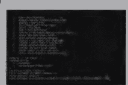

## 第 3.5 步：划分硬盘剩余部分

- 使用硬盘剩余空间创建第二个主分区来存放操作系统
- 输入 `n` 并按回车
- 这是第二个分区，因此输入 `2` 并按回车


## 第 3.6 步：分区硬盘

- 按回车开始对默认选项分区
- 按回车结束默认选项分区


## 第 3.7 步：分区硬盘

- 输入 `p` 查看分区信息


## 第 3.8 步：分区硬盘

- 您必须指定第一个分区为交换分区
- 输入 `t` 并按回车
- 输入 `1` 并按回车选择第一个分区


## 第 3.9 步：分区硬盘

- 为交换分区输入十六进制代码（Hex Code）
- 查看十六进制代码，输入字母 `l` 并按回车
- Linux交换分区的十六进制代码为 82
- 输入 `82` 并按回车

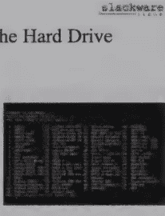

## 第 3.10 步：分区硬盘

- 输入 `p` 并按回车确认交换分区
- 输入 `w` 并按回车将更改写入分区表


## 第 4 步：运行设置

- 输入 `setup` 并按回车运行设置程序，该程序将允许您配置系统


## 第 5.1 步：添加交换空间

- 假设键盘配置满意，我们首先希望设置交换分区
- 选择 `ADDSWAP` 然后按回车


## 第 5.2 步：添加交换空间

- 程序成功检测到使用 `fdisk` 创建的交换分区，因此选择 `Yes` 然后按回车


## 第 5.3 步：添加交换空间

- 选择 `Exit` 并回车确认配置


## 第 6 步：继续安装

- 选择 `Yes` 然后按回车继续安装


## 第 7.1 步：根分区

- 应该自动检测根分区
- 选择 `OK` 然后按回车


## 第 7.2 步：根分区

- 选择 `Check` 检查坏块
- 选择 `OK` 并按回车


## 第 7.3 步：根分区

- 默认 inode 已被选中
- 选择 `OK` 然后按回车


## 第 7.4 步：根分区

- 选择 `Exit` 并回车确认配置


## 第 8 步：继续安装

- 选中 `Yes` 然后按回车继续


## 第 9 步：选择介质

- 因为我们是从 CD-ROM 安装，所以选择 `1`
- 选择 `OK` 然后按回车


## 第 10 步：继续安装

- 选中 `Yes` 然后按回车继续


## 第 11 步：选择软件包

- 对于预选软件进行全量安装，选中 `OK` 然后按回车


## 第 12 步：继续安装

- 选中 `Yes` 然后按回车继续


## 第 13 步：选择提示模式

- 全量安装请选择 `full`
- 选择 `OK` 然后按回车


## 第 14 步：制作启动盘

- 您可以选择制作可选启动盘
- 对于本次安装我们选择不制作启动盘，因此选中 `Continue` 并按回车


## 第 15 步：调制解调器配置

- 选择与您的调制解调器对应的设备
- 此系统没有调制解调器，因此选择该选项并按回车


## 第 16 步：屏幕字体

- 如果您想尝试字体，选中 `Yes` 然后按回车
- 安装后您可以随时更改字体，因此我们现在不安装


## 第 17 步：LILO 安装

- 选择 `simple` 进行自动 LILO 安装
- 选择 `OK` 然后按回车


## 第 18 步：帧缓冲区（Frame Buffer）

- 为了获得 X 性能，选择 `1024x768`
- 选择 `OK` 然后按回车

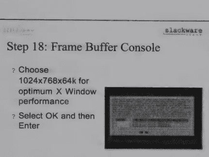

## 第 19 步：选择 LILO 目标

- 选择 `MBR` 安装主引导记录
- 选择 `OK` 然后按回车

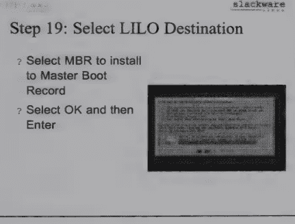

## 第 20 步：鼠标配置

- 选择您的鼠标类型

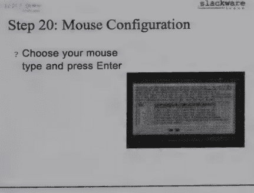

## 第 21 步：安装 gpm

- 您可以选择安装 `gpm`


## 第 22 步：继续安装

- 选择 `Yes` 然后按回车配置网络设置


## 第 23.1 步：网络配置

- 安装程序尝试自动配置邮件和 TCP/IP 设置
- 按回车继续


## 第 23.2 步：网络配置

- 输入您的主机名并按回车


## 第 23.3 步：网络配置

- 输入您的域名并按回车


## 第 23.4 步：网络配置

- 设置您的 IP 地址
- 对于本次安装我们选择了 DHCP，因此无需进一步设置 IP


## 第 23.5 步：网络配置

- 识别网络接口卡（NIC）
- 选择 `Probe` 并按回车


## 第 23.6 步：网络配置

- 自动检测到 NIC
- 按回车


## 第 23.7 步：网络配置

- 完成网络配置并继续


## 第 24 ：配置 Sendmail

- 选择适当设置并按回车

## 第 25.1 ：设置硬件时钟

- 选择如何设置硬件时钟并按回车
- 在本次安装中我们选择了“否”

## 第 25.2 设置硬件时钟

- 选择您的时区并按回车

## 第 26 ：X 窗口管理器

- 我们选择了 GNOME 桌面
- 选择 OK 然后按回车

## 第 27.1 ：Root 密码

- 在此处选择 Yes 设置 root 密码并按回车

## 第 27.2 ：Root 密码

- 输入新密码并按回车
- 再次输入密码并按回车
- 按回车继续

## 第 28 ：安装完成

- 按回车完成设置

## 第 29 ：退出并重启

- 选择 Exit 退出安装程序
- 选择 OK 然后按回车
- 在提示符处输入 `reboot` 并按回车

## 第 30 ：登录

- 系统重启后，您将进入登录提示界面
- 以 `root` 登录

## 第 31 ：创建用户账户

- 输入 `useradd -m aaron`
- 输入 `passwd aaron`
- 为 `aaron` 输入密码并确认
- 退出 `root` 登录并使用您的用户账户登录

课程标题：基础/Linux+
课程编号：100
课件版本：2.0
部件编号：SLFN-STMN-0094A

SAIR Linux 和 GNU 认证计划致力于提供最高标准的 Linux 和 GNU 培训与认证。SAIR Linux 和 GNU 的培训与认证将帮助信息技术 (IT) 专业人员促进职业发展。随着我们的行业进入培训和认证成为常态的时代，SAIR Linux 和 GNU 对 IT 社区的承诺显得尤为重要。成为一名胜任的 IT 专业人员需要实践经验以及用于验证技能的证书。SAIR Linux 和 GNU 认证承诺为您提供在这个快速增长的行业领域中成为成功的 Linux 和 GNU 开源专业人士所需的所有知识和信息。

## 基础

本课程独立于 SAIR Linux 和 GNU 培训与认证计划。它涵盖了 Linux 操作系统背后的概念，如 Linux 历史、权衡、安装前说明、基础安装、通用 Linux 会话、文件系统、XWindow 系统、网络工具、故障排除以及基础内核编译。

Sair Linux and GNU Certification 
400 South Lamar Boulevard
Oxford, Mississippi 38655
USA

免费热线 800.821.4373
电话 662.236.2484
传真 662.236.2428

邮箱 questions@linuxcertification.com

www.linuxcertification.com
