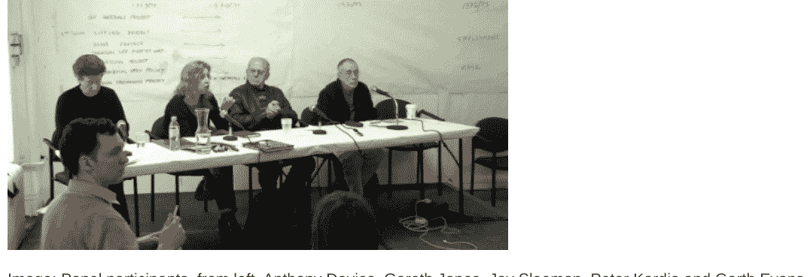
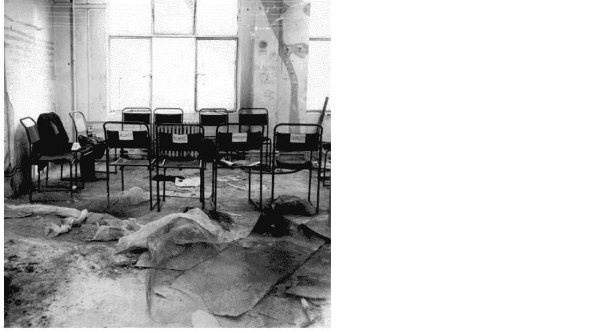
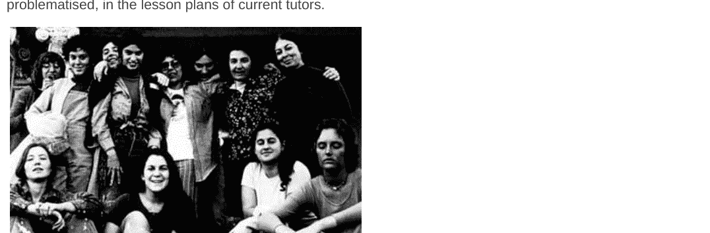
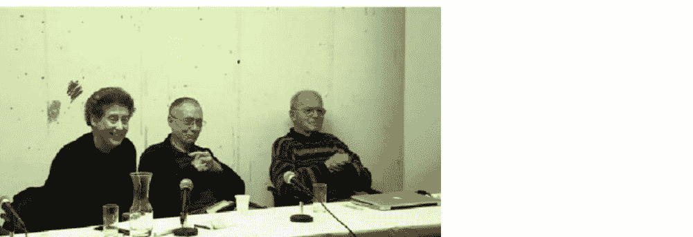

# 静音

文章

## 创世神话

作者：Marina Vismisht，2010年7月28日

今年3月，在中央圣马丁艺术学院（Central Saint Martins），来自60/70年代艺术教育领域开创性实验的师生们聚在一起，对照当今充满危机的学术环境重新审视过去。旨在培养自主主体的“A”课程，其极端的再教育方法与当代被收编的参与模式形成了鲜明对比，后者也预示了如今普遍的自主性与异化。Marina Vismisht 报道

近期，关于艺术领域教育政治属性的辩论引起了极大关注。“教育转向”的热潮标志着某些里程碑，例如2006年在范·阿伯贝根博物馆（Van Abbemuseum）等地举办的 A.C.A.D.E.M.Y.，2008在新博物馆（New Museum）的拍摄活动，或是2007年卡塞尔文献展（Documenta）策展核心中“审美教育”的地位。这种趋势现在已扩展到许多专门读者（《策展与教育转向》，2010年）和活动（在塞尔派画廊和海德华美术馆举办的“去学校化”、在特隆赫姆的“今日制造业”、在柏林的“Home Works”，所有这些活动还包括一系列自组织的艺术展，挑战了基于画廊的政治收编参与，以及去机构化的行动主义文化，如 16Beaver 或已故的哥本哈根自由联盟（Free Unity）。2006年尚未发布的《宣言6》（Manifesto 6）本应以“艺术学校”的形式出现，它是许多以“教育”为核心的艺术和策展项目的形成性创伤和起源。作为过去十年中艺术实践中保持政治性的多种冲动和疑虑的凝结，“教育”已成为艺术史的核心。在今天，艺术只能通过参考“教育”或“教化”的角色来书写。教育也往往侧重于“基础设施”作为一种学习-教育的模式，而非传统上理解的艺术能动性的理论或创作侧面。这与社交网络和自由软件产生了共鸣，并可能从捐赠的塞浦路斯“艺术学校”双年展中出现的最知名倡议之一——扩展设计与出版项目 Dexter Sinister 中得到体现。

图片：“A”课程的原始工作室空间，同时也兼顾了“A课程——一项调查”的研讨会空间

教育作为一种通过学习实现集体主体化的过程，作为艺术田园式和参与式特质的过往而变得非常有趣，这些特质曾希望在不丢失灵魂的情况下找到一条工具性的出路。在激进和自由的教育理想中发现的人文主义开放性，完美契合了定义艺术生产现状的现代主义怀旧情绪，以及所有贯穿其中的中间形式。但这种冲动也促进了一种面临着可能牺牲信誉、并可能牺牲过去几十年“社会实践”风险的博弈状态。每一个教育过程中对不确定性或自决的承诺都是诱人的，尽管它深陷许多陷阱：当教育被许多人体验为——作为工业化的或任何非导向的实验——通向军事计划或任何并非由解放修辞与领域教育之遇所要求的冒险行为时，教育就被贬值了，正如艺术机构和教育机构列出每一种生活的确定性历史所所示。

一场关于艺术教育矛盾的公共反思近期在中央圣马丁艺术设计学院（CSM）举行。为期两天的论坛“A课程——一项调查”于3月26日至27日在原始工作室举行。

## 创作神话

这里该课程在1969-73年间设于圣马丁雕塑系（当时的课程主任 Peter Kardia 在1973年转入皇家艺术学院）。该课程位于10层，并首次将“A”课程的三位幸存创始人聚集在一起，核心是在探讨扩展领域中可能产生项目的问题。在这里对这一学科（雕塑）或（学生，一项政策）进行了详细探讨，并对背景坐标进行了初步草拟——这有助于定位今日教育的一些关键问题。

欧洲波洛进程（Bologna Process）的实际执行和即将推出让人们意识到，它是艺术研究框架内激进政治的凝结或位移，由接触了资本逻辑时代“教养”（Bildung）的人们塑造。欧洲教育的新自由主义协调化带来了过去两个世纪的国家主义情绪，这种情绪在20世纪冷战的加速下，推广了一种基于公共利益的、大学-启蒙堡垒式的国家文化高等教育方法（这种利益往往与国家、企业和军事机构勾结，仅就美国而言，即艺术的西方堡垒）。学校反映了艺术与未被认为具有经验价值的事物之间既定的区别。随着过去20年新自由主义和新自由主义治理产生了均衡的影响，创造力变得具有经济属性，突然之间识别和量化艺术教育表面上产生的“知识”变得非常紧迫，尤其是艺术教育的专业化和学术化已经在某些地方改变了这一领域。康德式的“无目的之目的”氛围，在创造力进入市场商品形式后，已不再能作为隐形的斗篷，这使其变得更加可见。波洛进程是对“差异化包容”、可移植标准和能力导向方法论等趋势的简化，这些趋势已在许多欧洲大学中有所不同，在英国最为显著

高等教育“合理化”的需求在英国变得非常独特；英国学生与欧洲乃至美国学生的展望之间的差异，可以通过注意一个细微的语义差别来更简洁地总结：即我们的大学属于业务、创新与技能部，而他们属于教育部门。这是我们

## 创世神话

关于英国大学治理的某种事物，另一种是意识到那些作为离散实体的实体

自认知自由的揭示以来一直存在，以及艺术中的“教育性”。然而

但随后问题再次回到了艺术教育，以及

广义的人文科学教育可以被描述为极大地促进了批判性学科，其自身

作为消费者日益增加，而且在艺术教育中——从知识的自主性到

作为代理和操作者的法理性——成为一个发达的创造性主体的标志。主体的

自主性，或去机构化，或者艺术，艺术本身在情感中，作为自主性的

反思特质将自己区别开来。这种自主性在任何情况下都是相对于构成“场”的

控制和分工体系来表达的。只有在这些条件下，它才能存在，即便与这些体系对立。那么，可能是这种教育——以及艺术和前卫的

揭示与验证——记录了最多的批判性主体也是顺从的，而且这种叠加（正如阿多诺在艺术意义上所言，激进者脖子上的信鹅鸟）不仅是沉思性张力的来源，而且根据理性的本性，可以认为通过机构化的方法对顺从

主体进行了某种变体，但它在历史和政治上是

可变的。当去机构化可能被体验为机构对其主体的真实威胁时，由于他们

依附于日益货币化的中央控制，对机构的渴望可以具有双重性质。去机构化的

版本汲取于其主体对一个集体（尽管是原子化的）

半避难所空间的渴望，以及他们对同时在外部之外自由行动的自主主体的捍卫。此外，

对机构残存部分的渴望，在普遍不确定的氛围下被强化，可能是面对机构

矛盾和机构化“他者性”的最大障碍。

在“艺术教育的这一侧”，这一过程也公理地由当时非艺术所采取的形式

（劳动、主导的交换类型、生产、剥削）决定。在一个艺术

不再需要获得任何形式的自由的历史时代，艺术变成了政治国家手工劳动

性倾向生产的谱系。这种“国家”被

许多评论者称为“艺术主体”的原型：单子性的、裸死的、创业性的灵活性、“创造性阶级”的尊重，但这种“国家”阻止了方便的虚构，使社会学的

形式视觉显现，这种视觉追踪了任何“艺术批判”

（鲍尔斯基和布尔迪厄）自其黄金时代以后在十年代中期的“艺术不稳定劳动”辩论中，神秘了

布尔迪厄式机构批判在文化社会学领域的头部？今天在我们周围产生的

意识形态在很大程度上行使文化盲点，使其能够对艺术与资本主义工作之间的

区分进行任何意识形态批判。这种理解忽略了当前的趋势如何

侵蚀艺术，以及它们之间的阶级关系（客观上）；也没有捕捉到

由此可能产生的“艺术批判”所具有的绝对的社会特征。

作为任何时代超越机构化的艺术教学模型，反映了现存的治理模式

手，即使在反转中，被预设并捕获在“自主性”和“顺从”不断变化的的光谱中的

主体类型。自主性变成了通过控制结构获得自主性的顺从，

而无所事事的顺从似乎是最大的反抗。拥有个人主义的侵入

作为一种意识形态出现，通过怪异和创业性的创造力来反抗，通过回收

批判模式，这些模式变得更加不安和焦虑，缺乏一个机构之外的政治出口，

一个居住在每个人身上的机构，目标已驱动进入了它的结构边界。

被鼓励通过批判实践提升其关系资本并为机构挽回研究点的学生，被要求执行一种自主性，这种自主性类似于但不同于进取的

1970年“A 课程”的学生，他们对自己的工作被评估提出了异议，他们是通过展示几只在工作室里漫走的鸡作为期末项目来完成的。

“A 课程”是一门由激进教育工作者彼特·卡迪亚（Peter Kardia）在雕塑系发起的本科课程，并与艺术家和教育工作者加斯·埃文斯（Garth Evans）、加雷斯·琼斯（Gareth Jones）合作——在语言学、信息论和行为心理学的共同兴趣，以及当时新兴的极简主义和概念性雕塑实践的引导下，他与一群志同道合的艺术家导师（其中一人加斯·埃文斯曾在 APG 做过早期实习）合作，设计了一门能够直接干预学生习惯、能力和既往训练的课程，以便让他们放弃他们的“概念索引”，并以更直接的方式再次面对挑战。

课程围绕带有一系列指令的项目构建，并摒弃了所有的评估或指导，因为导师主要履行看管人的职能，签到并确保规则被遵守。第一个项目是“锁闭房间”（Locked Room）——在课程的第一天，学生被分发相同的包裹，里面有泡沫塑料块，他们不能互相说话，不能使用除现有材料以外的材料，并被引导通过一扇身后被锁上的门。锁闭房间成了整个课程理论的缩影：一个受监管的空间或“封闭系统”，它试图将学生与外部影响隔离开，瓦解他们，然后将他们重建为自主的、具有批判性思维的个体。锁闭房间实际上是卡迪亚对课程的首选标题，被历史化为“A 课程”，因为圣马丁学院（Saint Martin's）雕塑系坚持要实施它，这样他们就不得让学生从锁闭房间里出来。这种分裂在很大程度上也是由于学生对常规课程的拒绝，以及要求继续他们在第一年所经历的种种模式的结果。

图片：1971 年“A 课程”，“项目”。感谢彼特·文恩（Peter Venn）提供。

完美自由与强制异见之间的辩证法强化了课程的体验及其背后的思考，这在演示和评述中得到了体现。与斯林·兰格（Slim Lang）的酷刑实验以及真实酷刑的类比随处可见，并回想起学生在“密闭房间”（Locked Room）中带入测试的场景。一位观众对“密闭房间”的制作评价道，这是一个不像真实机构空间（如军事或监狱）的项目；它是一个被抽空的空间，对于主体及其自由而言，无论何种辩论方式都几乎没有自由。演讲者指出，“怀疑的实践”假设了一个拥有放弃其保障特权的主权主体，即笛卡尔式怀疑的主体；而另一位成员指出这一点，其中的女性主义内涵被浮出水面：她指出，那个时代末期的女性艺术家在整个教育和社会生活中一直被条件化为产生自我怀疑，并且没有一个稳定的主体位置可以被“瓦解”，这一点课程可以延伸到精英艺术教育中的非白种人和移民。她还强调了 20 年 60 年代 70 年代初艺术学院提出的教学替代方案，与“A 课程”形成对比，后者将非层次的社会互动视为一种激进的存在形式，并在扩展的背景下进行实践。这些实例包括“艺术与语言”（Art and Language）在考文河的课程或朱迪（Judy）在弗雷斯诺的课程，学生和教师在那里共同领导。然而，人们承认，正如福柯（Foucault）所言，从那时起，一直是强制性的；交流并不是艺术教育规律装置不可或缺的一部分，更不用说那些在学生生活世界中占据越来越大部分生活的社交网络——这一事实在当前导师的教学计划中是被整合的而非被问题化的。

许多被误认为激化的辩论试图通过时间的政治学来检查“A 课程”的现象，例如学生的特殊场合，这与今天非常盛行的趋势并无二。引导者尽力将这种辩论引回“A 课程”的特定取向，并取得了有限的成功。焦点反复转回到课程的权威主义上。Kardia 等人认为学生存在挑衅行为，且“A 课程”的方法是建设性的而非竞争性的：Kardia 坚持认为“从来没有你”，“只有‘可能不可以’”；Kardia 提到他的方法被比作斯大林，一位老校学生选择将他的方法与智利组织在智利的方法进行比较，并指责他是英国政府的智能特工，暗示他的任务是遏制聚集群体的困惑。另一位老校学生则认为，A 课程作为一个社区空间发挥作用，促进了创造力，以至于课程的“白板”（tabula rasa）目标与实施这些目标的系统产生了冲突，以及学生之间所谓的怀疑和疏离感。其他前学生谈到了课程的教养性氛围，认为它是一个反思的空间而非泡泡；并回答了早期关于“怀疑的实践”的评论，即其公开且编码的规则在某种程度上让女性艺术学生能够评判在此之前所经历的艺术教学中那种内含的枯竭和不透明的权力动态。

一个有力的论点（并在历史上通过归纳法推导出这一事件）是：“A 课程”的方法论最终导致了终结——即使从目前的观点来看，它也终结了当下的情感架构，其一方面是对承诺和对角色遵循行为的功能进行自我反思；另一方面，那种过于勤勉、或许带有某种形式主义的做法，无论如何处于“A 课程”的权威主义与这种防御指令（而不只是艺术）及其他教育的权威主义之间。某一天，针对反机构和非专业的约束划定了界限；这些也划定了边界约束，这些约束拥有教育和专业世界的完全权力，能够有效引导资产阶级理性和独立，正如关于米德尔塞克斯（Middlesex）现代欧洲哲学研究中心关闭的辩论所证证的那样。然而，在重点的聚焦中可能存在更相似的情况：抵抗对立位置的规则可能会忽视民主；在“A 课程”和“人类”概念中，都认为教育的交付是对对抗的消除。自由是免于权威认同的自由，利益被现实地抑制了。压迫和约束被表现为主体发展的至关重要，负面结果是个人性的而非系统性的现实，而游戏规则的设定方式是为了优化他们对这些规则的反抗。这种平行性在关于行为心理学的投资评论中最为明显，可以证明，通过征求主体的欲望并为他们创造感兴趣的“空间”，可以培养出一种中和拒绝的创造力。然而，这种类比的公信力和局限性在以下内容中得到了说明：

## 创造神话

可能是“A 课程”最臭名昭著且最后的/项目，“面具或兜帽项目”（Mask or Hood Project）。由于它通过惊喜元素运作，该项目只进行过一次。

“面具项目”的设计是为了应对“A 课程”学生接受最终评估的制度性要求。在课程的哲学和过程面前抓住机会，并导致了导师和学生之间的不满情绪，也由于之前提到的“鸡肉起义”。随后，最终项目将是对评估行为的表演：它是在艺术与现实的边界上、以及在驱魔游行的的展望与愿景上进行的一种仪式：导师们戴上面具和袋子以切断沉默，并在明显的时间出现在学生；被隔离开的他们有权不让他们进入。一旦进入空间，戴着兜帽的导师伪装自己的身体，将执行持续学生及其工作约半小时的任务，并与巡的专业建议交替进行。这种建议本应模仿学生在“A 课程”边界之外面临的敌意。

## 你如何将世界隔绝在外？你如何离开被锁的房间？

另一组严峻的问题是围绕“背景”展开的，特别是当时的政治背景。这种脱离感最初显现为：“A课程”组织者所发起的减法过程的激进目标，与其参与者对当时学生运动（如霍恩西学院 Hornsey 和伦敦政治经济学院 LSE 的占领活动）的脱节。这里关乎似乎是诉讼中不同方对理想的迥异观念，每一方都将对方所持的视为一种弱化的版本。有人建议，尽管圣马丁艺术学院（Saint Martins）在“A课程”之外，在自己的其他领地上可能并不激进，但他们确实参与了当时的斗争，例如越南战争、劳工运动以及科文特加花园的反绅士化策略。在多个点上，人们提出，“A课程”的标志——其为了追求“原生经验”而对语言和意义指涉的贬低——不可避免地导致了某种碎片化。更激进的是一种理论（或神话），它认为教学活动之间的联系是课程组织者直接且刻意的行为。政治控制的内在性正是控制论中“人使用人”的核心枢纽，彼得·卡达辛基恩（Peter Kardashian）对控制论以及作为反馈系统的人类行为有着持久的兴趣，这种兴趣与罗斯科特（Royscott）等志同道合的同事共有，深受当时进步精神的影响。

但更根本的是，“背景”的概念在“A课程”中是如何运作的。讨论中对背景的框架被证明是极具争议的，课程的前任导师反对他们认为被不公平强加在他们必须完成的任务之上的概括和“历史幻想”。根据加斯·埃文斯（Garth Evans）一个关于背景重要性的生动故事，我们争论了背景的地位。在一个为期三年的课程中彻底改革关于艺术、自我和教育的既观念，这无疑是政治性的，无论其内部或外部产生什么后果。在物理和制度上确保自决活动的条件，是他们认为自己的价值所在和终极目标。门被锁上是为了“把极端分子和问题隔绝在外”，无论机构的其他部分是怎样的。这是否也在锁住他人？同样，辩论似乎取决于不可理解的自由概念——尽管那扇锁着的门被描绘为动荡、混乱且侵入性的社会环境中自由的物质条件。卡达辛基对被指为“间谍”的指控做出了政治意义上的承认：“没有所谓的自由空间”，这表明这一方面的实验设计将永远是多孔的。

https://www.metamute.org/editorial/articles/creation-myth

## 创作神话

在对“A课程”准则中“物质性”和“材料”含义的拆解中，同样对“背景”进行了一场生动的解剖（“密闭房间计划”的正式名称为“材料计划”，前任导师试图纠正这一命名）。这里本身就是一种有趣的交汇，即艺术安置小组（Art Placement Group, PGS）与“A课程”所代表的不同矢量之间的汇合，仿佛每一者对当时构成艺术活动的内涵都有着一种极大广得多的解读，正如芭芭拉·斯蒂文尼（Barbara Steven）其中其中证明的那样。尽管 PGS 通过将艺术植入组织和社区场所线性地推进这一路线，而“A课程”局限于艺术学院的范畴，但两者都痴迷于对艺术与实践对象的研究，消解艺术本身（尽管在某些情况下，矛盾地是为了在“更高”的层面拯救它）以及在忙碌的去机构化文化中的劳动分工。

“A课程”第二、第三年的许多项目也可以被认为损害了艺术家的角色的特殊性，以及当时盛行的艺术“教学性”通用概念：

- 《邮寄指令》（The Instructions by Post）：由匿名邮寄给学生的指令组成；
- 《报告项目》（The Report Project）：反向操作，让学生向工作人员插入针对未知事件的会议或地点；
- 《代理人项目》（The Agent Project）：每位学生对应另一位学生，由该学生在与外界的一切交来中代表另一位；
- 《转化项目》（The Transformation Project）：旨在记录分配给每个学生的等额资金（通过活动或物品）的状态转化；
- 《就业项目》（The Employment Project）：简单地假设让他们找份工作或从事其他类型的赚钱活动，其收益本应汇集。

然而，学生们似乎对这种行为产生抵触，暗示艺术毕业生可能被迫从事艺术之外的赚钱活动，而如果这可以被视为对“艺术”的一种自大表现，那么这对于他们年轻的肩上来说是更有可能发生的。考虑到近期在对“服务部门”和“行政美学”的同步分析中提到的广泛分析，“A课程”的作品项目似乎具有象征意义，即使从另一个角度可以辩论，这些“隐形”实践更多关乎调解、编辑，最后对“材料”的调查（由于它们是课程的主题）保持不变，以其动不安且壮观的形式呈现，作为“关系美学”，或正如批评家斯蒂芬·莱特（Stephen Wright）那些艺术可见性系数极低的实践，这可能指的是除了策展人之外无人承认的实践。

然而，作为先任的“A课程”认为，这些实践再次涉及机构内与外的界限问题。这似乎回到了背景的问题，而该问题将不可避免地令人困扰。加雷·琼斯（Gareth Jones）一方面回忆起巴舍尔（Bachelard）的社会学家来感谢他的教学，构建了“阴险意义”（由“在场者”推导出）的练习（由“不在场者”进行解读），为这项实验重建一份遗产。彼得·卡达辛基（Peter Kardia）仍然认为，在艺术教育的背景下产生创造性行为比在课程讨论中引入政治问题更有礼貌，教学与政治之间的区别在这种图中是可以安排的。这可以用不同的方式表述为教育与政治教育之间的关系/区别。这种立场将体现在现在教职员工的身体中。卡达辛基详尽地回应说，教育者的工作是反其趋势而行，而不是并将其变为现实。将这种分歧解释为政治性的就足够了——但它似乎只是处于一个独特的认识论的、甚至是伦理的鸿沟。

## 改变你想改变的，或者至少，留下一个空洞

追溯“A课程”的“情感结构”的尝试揭示了其教学上的风险承担既表明了动荡气候下对艺术教育目的的困惑，也延长了处于状态状态的教育创新。这种在教育背景下应对异化的尝试，正面临着现代主义主体与主观性、客观性与自我意识艺术家定义之间的威胁，而这后来可能演变成了该时期艺术教育的发展模式，前提是当代现代主义学生已被话语权力相当抛弃。需要补充的是，“A课程”是如此碎片化且界定清晰，通过任意规则变得具有塑性，它本应在三年结束时是坚毅的，且对艺术机构和市场的刻板指令不为所动。

## 创世神话

尽管“A”课程中出现了一些创业者，但教育的新自由主义主体性已经在很大程度上使社会激进主义转向了社会激进主义。认同不再是那种在艺术创作深处甚至作为测试场而进行的游戏的一部分；它是唯一的游戏，被刻入机构与再生产关系的每一个齿轮和传动装置，并由其主体所定义。正是在教育领域，这一目标最强烈地被*主观地*体验为他者。对于马克思来说，异化的进步的一面，意味着作为现状的动力，它变成了一种支持该现状的某种手段。个人化的反抗是义务性的，强制性的自由被机构所禁止，但作为一种机构，它未能构成一个阶级——一个在阶级意义上被要求保持自身的阶级。正如“A”课程随着学生加入的现任 CSM 艺术学院而共同呼吸一样。剩下的几轮展示和讨论集中在：这种异化在多大程度上正在破坏，或者它是否确实具有马克思所说的战术特性。学生们对后者的关注多于他们的老师，老师们试图对这一切普遍的改进或自组织的创造力涂上一层亮色。这种关于集体权威的思想，在没有英国式方法辞藻修饰的情况下，被重新品牌为对独立小组（Independent Group）勇敢精神的回归——实际上构成了 ICA 联盟政府碎片公共部门放血的核心论题。过去几年也显而可见，Feeblade 在“衰退美学”的名义下显现了它的真相。

最后讨论中的其他触角包括英国高度官僚化的教育体系，与德语国家仍占据主导地位的“大师班”或“工作坊”模式并。前者的“管理主义”与后者的“精英主义”之间这种无益的极立，使对话者汇聚了更多元的武器库。然而，大家达成了一个共识，艺术教育“水桶”中的“洞”，以及学生对太空时代异化需求的奇妙认同和对批判性反思，正被集权化的管理模式无情地封堵；或者正如马克思可能指出的那样，工作日的“孔隙”在工厂资本主义劳动形式和机械化的真实隶属中正在关闭。学术与其他劳动形式之间也是如此，尽管在场的老一代学生、教职员工和当前学生共同粉饰的现实，被现任 CSM 教职员工坚决拒绝，正如前面讨论过的，他们为受到他们注视目光威胁的现状站出来，尽管带着波动的热情。意乎不用的是，对现状的这种转变和行政信任都未能培养出那种让教育主体获得深刻解放的存在，也未能克服在承载了“A课程”的、大众化、前撒切尔时代占据统治地位的另一种精英主义。20 世纪 70 年代国际学生的涌入（当时基于英国的录取制度正给大学财务造成这样（巨大的漏洞）曾被誉为一种后殖民主义的胜利，是经典盲点（例如官方多元文化主义对阶级的盲视）的一种近乎痉挛状态的繁荣。但在这种颓废的主张之外，对作为部门的“机构”之“实现”吸引力日益增加。现在的学生指出，CSM 的部门与时尚等行业联系得更紧密，获得了学院内的大部分资源；一位首席管理人员的回应仅仅是当学院从政府资助中获得的不到一半收入时必须所做的反应。其含义是：“你们选择做艺术家而不是时尚/新闻设计类学生是一个错误的选择。抱歉。”

“A”课程——调查（An Inquiry）的最后阶段将过去两天关于主体性/潜伏的所有对立统一汇聚成一个破碎的当下。讨论既是不可思议的新颖（提高声音是其中的公开方面之一，并且被彻底气坏，主要是由我们这些上方被染上“工业”政治色彩的“精英”们发出的）。显而易见的是对异化规则的糟糕的欣赏和全盘否认——异化是什么，以及为什么它在这里将教育的幽灵带入艺术世界，直到它面对其无法忍受的双重性：艺术教育：它是所有与当今新自由主义控制和资产剥离机制（包括在《危机》中新系统艺术工厂下集中所有活动）相矛盾的，这种矛盾在于取消了任何认同可以为了市场而松弛的空间，这是一种迷信的驱动力，认为后者的——机构——是所有集体权力的源泉，这激起了马克思关于生产模式美学的粗略想法，那里没有想象空间，水桶没有洞，所有的异化都是一种稍微好一点的方式。

异化通过集体收集得以维持，这也是先发剥夺权利权和拒绝承认失败（想象力的失败）的结果，因为当人们尝试集体解决方案时（正如正在进行的拯救教育的运动那样，说明英国有多大的左翼政治）。与此同时，它被不断肯定，我们发生的臣服过程（尤其是在直接行动中）无法还原为任何运动或结果，并将继续变异并扩张到各个角落。

这也许可以沿着“职业主义”学生运动的思想进行更清晰的阐述：对衡量的拒绝可以看作是巴迪欧术语中来自“斗争之真空”的政治主体性的结果：作为在资本主义逻辑这一历史阶段，在其条件内部并对其条件通过辩证法产生的实践性否定，非常黑格尔式；基于对“崩溃”关系的坚持。

《泰特论文》中的二十1世纪，第13期，2010年春季。Cuter 是泰特学院的学习主管。

`http://www.tate.org/research/tateresearch/tatepapers/1059/cutter.shm`

在公共领域，几乎没有任何资料能对“A课程”提供全面的描述，并将其置于当代或历史辩论之中。“A课程——一次调查事件”（An Inquest event）是一次旨在实现此点的突破性尝试。详细描述这一事件的出版叙述极具批判性，经常引发争议，或者非常难以获取。作者在撰写期间所能获取的此类叙述之一是 Hester Wesley 的《伦敦艺术学院的知识分子 Kardia》，AC & Black 出版，伦敦，2010年。该叙述的一个显著特征是，它很大程度上依赖于 Kardia 的证词，并淡忽略了其他实践者和学生对“A课程”及其理论化的贡献。“A课程”的唯一全职成员同时也负责了该课程在行政层面的启动和发展。这种对 Kardia 证词的依赖描述，倾向于将“A课程”置于他的传记轨迹中，而非关注其共鸣。

Wesley 与 Kardia 讨论了当时艺术中所谓的“生产”，以及与他交织的主体性生产兴趣，这种兴趣（正如“A课程”导师们一样）通过他的艺术教学引入了“A课程”：对于 Kardia 来说，学校变成了一种研讨室，雕塑辩论扩展到了此前被视为事后之谈的来源；讨论小组变成了强制性，并且要求阅读哲学。在这里，关于艺术课程地位的新理论辩论的汇合变成了一个完全的生产地；Kardia 解构了学生们对世界的认知，并借此实际上鼓励他们对学生的主体性和创造性诠释负责。

BW 可能是某种暗示名为“f”的指示，即《每日邮报》关于“保姆国家”的报道，但也不少关于“激进教学法”参数的声明，DCM 院长坦言感到羞愧，由于现行的健康安全政策，“A课程”在今天永远不会被允许。晚期的另一位高级管理人员有义务指出，在圣马丁艺术学院（CSM）中确实有“激进教学法”的空间——这在前景中是一个选择。DCM 员工出现了两次极端自满的实例，他们聚集在小组中并谈论活动的最后部分，这在很大程度上根据教育系统中激进的繁荣作为激进学生运动的基础而具有合理性：推翻精英主义！反对 RAE（研究评估体系）！读者对这种话语表示认同，这种话语在《激进者：借来的水壶》中通常被称为齐泽克的弗洛伊德式骨架：我们从未借过你的水壶，它已经归还了；当你把它借给他们时，它就已经坏了。这对于某人来说尤为真实，此人曾一度能够同时辩护这样一个命题：他所制定的那些像水桶一样的评估标准对学生的教育没有帮助，而且这一事实正让让们自己感到厌倦。

请参阅《世纪》第3部分，了解20世纪70年代初大型集体运动对社会变革的影响如何恰恰发生了一个向“内部”的奥秘艺术形式、灵性和“生活方式政策”的转折。对 Esalen（人类政治运动）的讨论似乎非常引人注目，尽管它自1961年以来一直在运营，并且在其“政治化”阶段在该国非常有名，这在某种程度上削弱了 Cuter 的论文，但部分是因为它处理了他的许多追随者的极极化特征，例如提摩西·莱昂的《自我的世纪》系列以及 Adam Cuter 的其他电影可以在 `http://archive.org` 查看。

10 Gregory Bates, 《Metologues: '关于存在与停留'》收录于《心智生态学：人类学、精神病学、本体论和认识论论文集》，芝加哥大学出版社，2000年（1972年），第19页；重印自《ETC：通用语义学评论》，第9卷，1953年。

11 Hester Wesley 关于 Peter Cardiff 教学的文本似乎证实了由他以及随后的“A课程”导师提倡的大多数严谨且具有实验性的教学法让学生投入了过度精力，并导致他们对机构产生了敌意，从而转向了更具“生产性的生产”。同时，根据 Wesley 的说法，Kardia 认为，从商品生产到审美生产的转变，意味着实践者必然成为一个活跃的生产者；或者她必须通过对机构的批判来夺回在政治决策过程中进行干预的权利。

12 将这段关于 Ascott 和 Kardia 教育方法的陈述，与1970年一部典型的赛博文本 Gene Youngblood 的《扩张电影》进行比较。对于 Ascott 来说，人与环境之间的互动最初是基于行为构想的：“Ascott 加入行为模型是为了让学生意识到他们对自己的身份以及反过来对他们的环境负责。此外，执行的练习要求学生关注其特定环境的偶然性，这反过来导致他们将其转化为对象研究（Objects Studies）的领域[..]。Kardia 将行为提升为一个指定的研究领域；经常让学生调查关于机构对学科边界定义的课题。行为研究是

# 创建

关注重新定义。”Bid, p. 15），以及“我们现在正在进入网络时代，人类学会了控制他必须与之合作的环境；不仅是政治，现实也重塑了他的物理环境，反之亦然。”（Youngblood, p. 55）。注意，在后一种实例中，操作的不可逃性使得任何可能超过平均值的突破成为可能。
