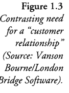
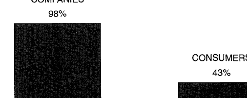
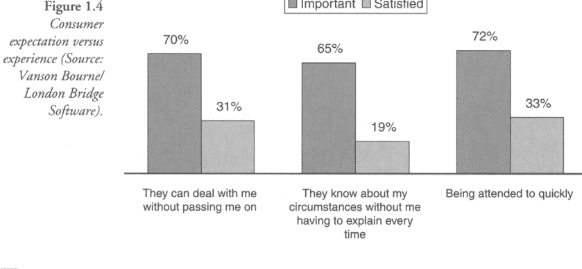
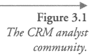
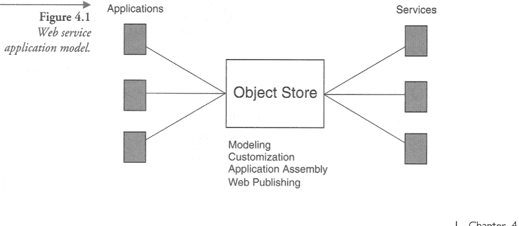
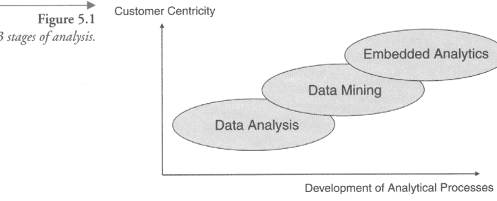
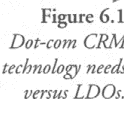
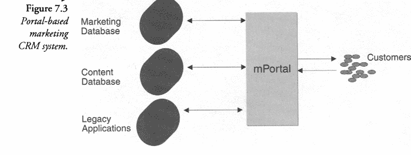
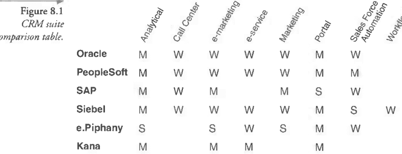
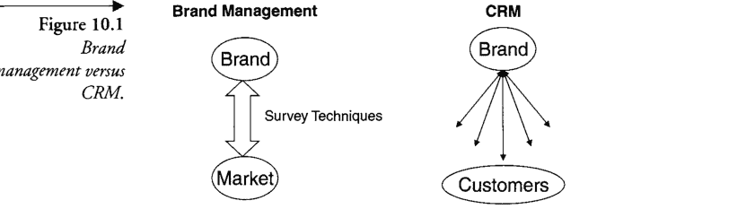

# CRM：重新定义客户关系管理（企业级计算）

## 前言

客户关系管理（CRM）在一些愤世嫉俗者看来，仅仅是另一个缩写，代表了又另一组技术，为硬件和软件供应商代表了一个巨大的技术市场。几乎每一家软件供应商都在追逐 CRM 的热潮。每一项组件技术都被推销为不可或缺的 CRM“解决方案”。从呼叫中心耳机到深奥的战略咨询，以及其间一切，全都是 CRM！然而，尽管如此，CRM 正在作为一门学科开始独立立足。

本书试图提供一种看待 CRM 的新方法。它结合了我在 CRM 前线、市场研究、咨询行业，以及我最近在一家 CRM 软件供应商处工作的经验。因此，它呈现了关于 CRM 应该是什么样的个人观点。如果这本书能够鼓励负责实施 CRM 解决方案的人员考虑如何应用技术以实现一个首要的企业愿景：创建一个拥有品牌拥护者客户群的组织，那么这本书就是成功的。

很少有组织能实现这一目标。很多时候，对良好的 CRM 实践也只是流于形式。

我们都是消费者。我们都能立刻判断出什么是好服务，什么是坏服务。我们都知道什么会让我们与一家希望向我们推销产品的业务互动，也都知道什么会让我们离去并确保我们永不再回来。我们所有人对什么有效、什么无效都有一种隐含的理解。

我们掌握主动权。我们只接触我们感兴趣的组织。通常，不受请求的冷启动电话会让我们反感。日益地，我们对垃圾邮件感到厌顶了，看电视广告仅仅是为了娱乐价值。我们了解所有的营销术语。我们能看穿这些炒作。

在经历了糟糕的服务、低劣的质量或可怕的交付后，尽管供应商做出了承诺，我们仍然拒绝继续做客户时，我们都会产生一种奇怪的满足感。我们享受将业务转到他处。如果转移业务存在障碍，我们就会愤恨成仇，并通过说坏话和挑剔来报复。

我们更倾向于与我们认识、信任且过去有过良好体验的组织，或向我们推荐的组织进行对话。

所以，尽管这种情况很少发生，但当我们发现一个组织以不同的方式做事时——一个倾听我们的意见、承担我们的问题并提供完全适合我们需求的解决方案————是多么令人欣慰啊。它会回访以确保我们保持愉快。然后，在与我们建立关系后，它会联系我们并建议省钱或把事情做得更好的方法。或者可能，是我们自己联系此类组织——完全预期他们会了解之前的沟通或交易，并因此为我们提供额外服务。多么彻底的宽慰，这种情况太罕见了。

事实上，我想不出几家与我有业务往来的组织拥有真正卓越的客户关怀流程。其中一家名为 First Direct Bank。我听过这么多演讲者提到 First Direct Bank，以至于我发现在这里提到它几乎很丢脸：我完全可以想出一个，比如某家玻利维亚保险公司破解了 CRM。但不是，又是 First Direct 的例子！在英国，First Direct 几乎定义了直销银行的模式，许多其他银行也模仿了他们并达到了可以实现的客户服务标准。在美国，几家直销（电话）银行也实现了更高水平的客户关怀和客户参与流程，超过了那些拥有分行网络的传统银行。

做好 CRM 的组织很容易识别。寻找一致且具有理解力的品牌建设、清晰的沟通、对电话和互联网技术的运用以及客户参与流程。在公司内部，客户关怀和营销流程是同一的。

本书认为，CRM 作为一种技术和企业概念正在发生变化。客户日益定义了这种关系的本质。因此，CMR（代表“客户管理的关系”，customer managed relationships）将是一个更好的缩写。然而，由于 CRM 是供应商、顾问和分析师的选择，它将是书中统一使用的术语。

CRM 正在发生的变化是由多种原因引起的，这些原因将在接后的章节中阐述。大公司正在推动 CRM 向新的方向发展，使中央系统支持如网站和分布式客户支持运营等无处不在的系统。现在，更开放的应用连接标准使得顶级（best-of-breed）的 CRM 工具更具吸引力。随着大众营销和直销营销失去对营销预算的控制，营销概念正被 CRM 采纳。而 CRM 作为一门学科，其影响力已延伸到客户关怀之外的前台和后台。

在开发 CRM 流程、程序和信息系统时，是否能够恰当地重新建立那四项原则？我希望这本书能够成功地给出一个论据，用一个简单、坚定且响亮的“是”来作为回应。

这里存在着一个关于 CRM 的统一理论。这一统一理论的核心是“服务与品牌相结合”的简单概念。这将在书的后续章节中进行更详细的讨论。然而，我理解为什么这样一个想法可能会让典型的 IT 经理以及其他负责定义 CRM 流程的人员感到有些不适。

潜在地，这也会让机构内部的其他群体也感到有些不适。如果一个品牌属于 CRM 的范畴，那么在典型的业务功能方面所要求的调整将是剧烈的，甚至是革命性的。在前端，客户支持、销售、营销以及所有所谓的“前台”功能都需要整合在一起。学科之间不能有任何界限，因为这些政治结构中的划分和界限会阻碍有效的 CRM 流程。

与此相反的实实是，CRM 功能本身将变成一个具有多个层面的“超级功能”。某些方面可能像营销，另一些则像支持。但 CRM 提供的统一胶合剂越多，客户流程就会变得越合适。

从技术的角度来看，有两个主要的后果。一方面，所谓的 CRM 套件重要性将会降低，因为它们没有提供所需的统一方法。目前，没有任何单一软件供应商可以提供所有的关键 CRM 组件。未来也绝不会任何供应商能够做到。特别是在大型公司中，遗留数据至关重要。随着我们的发展，即时（just-in-time）应用程序或信息的提供将导致单体和内部化 CRM 策略的诞生。CRM 中间商——流程外包商——重要性将日益增加。关系聚合器——那些知道如何建立强大、持久客户关系的营销渠道。

统一胶合剂将越来越多地通过 Web 服务模型提供，尽管传统的运营系统将继续以只有 Web 服务模型才能允许的方式发挥作用。在第 4 章中，针对这一点提出了一个论点。“集成”是新的准则。硬编码应用程序将越来越多地被统一的 CRM 连接性所取代。从技术角度来看，XML 和其他开放连接架构和工具包在短期内重要性将会增加。XML 和 SOAP（XML 的子集以及 Web 服务交付的标准）背后的厂商力量现在已经大到让这种情况不会发生。

分析将变得越来越自动化，以驱动行动，并使客户互动过程更加精简，更少受到企业失误的影响。最重要的是，在掌握了这种方法的组织中，面向客户的流程将渗透整个组织。这不会以某种欢快的、像使命宣言一样的方式发生。相反，真正卓越的公司将思考并呼吸于让他们的客户成为品牌拥护者。让一个客户成为倡导者、冠军或传教士，你将拥有许多高盈利的客户，并拥有最低的客户获取成本。简而言之，你将找到了企业的圣杯。

## 致谢

这本书最初在大约一年前与 Digital Press 的 Theron Shreve 讨论过。在那段时间里，我一直断断续续地在写它，并在过去的三个月里经历了一阵频繁的活动。在好几个点上，我曾深信它永远无法完成，但我对它的最终完成感到高兴。当我陷入与书籍毫无相关的停滞状态时，Theron 那种非常微妙的劝导对我重新开始动笔来说是无价的！

在写这本书的过程中，我得到了一些同事和朋友的极大帮助。Erik Hille 在研究和编写三个章节的大部分内容方面至关重要。他在努力在 Amasic 的产品营销角色中表现优异的同时，几乎完全利用自己的休息时间工作，这真是一项成就。但我非常感谢他的投入和支持。

我必须感谢 Amasic 的高级管理人员，他们为我提供了 Erik 的帮助，并在我在公司工作期间给我了一些时间写书。我还要感谢 Bob Mann 博士，他为第 2 章关于客户互动管理的章节提供了大量内容。他的帮助是无价的。

还要感谢 Eyetrel 的 Roger Keenan 评审了相关章节并提供了非常有用的意见。此外，感谢 MORI 的 Peter Hutton 对书的最后章节提出的慷慨意见。

## 客户的新挑战

客户正在改变。他们变得越来越难以捉摸。如果一个品牌属于 CRM 的范畴，那么在典型的业务功能方面所要求的调整将是剧烈的，甚至是革命性的。在前端，客户支持、销售、营销以及所有所谓的“前台”功能都需要整合在一起。学科之间不能有任何界限，因为这些政治结构中的划分和界限会阻碍有效的 CRM 流程。

与此相反的事是，CRM 功能本身将变成一个具有多个层面的“超级功能”。某些方面可能像营销，另一些则像支持。但 CRM 提供的统一胶合剂越多，客户流程就会变得越合适。

从技术的角度来看，有两个主要的后果。一方面，所谓的 CRM 套件重要性将会降低，因为它们没有提供所需的统一方法。目前，没有任何单一软件供应商可以提供所有的关键 CRM 组件。未来也绝不会任何供应商能够做到。特别是在大型公司中，遗留数据至关重要。随着我们的发展，即时应用程序或信息的提供将导致单体和内部化 CRM 策略的诞生。CRM 中间商——流程外包商——重要性将日益增加。关系聚合器——那些知道如何建立强大、持久客户关系的营销渠道。

统一胶合剂将越来越多地通过 Web 服务模型提供，尽管传统的运营系统将继续以只有 Web 服务模型才能允许的方式发挥作用。在第 4 章中，针对这一点提出了一个论点。“集成”是新的准则。硬编码应用程序将越来越多地被统一的 CRM 连接性所取代。从技术角度来看，XML 和其他开放连接架构和工具包在短期内重要性将会增加。XML 和 SOAP（XML 的子集以及 Web 服务交付的标准）背后的厂商力量现在已经大到让这种情况不会发生。


分析将变得越来越自动化，以驱动行动，并使客户互动过程更加精简，更少受到企业失误的影响。最重要的是，在掌握了这种方法的组织中，面向客户的流程将渗透整个组织。这不会以某种欢快的、像使命宣言一样的方式发生。相反，真正卓越的公司将思考并呼吸于让他们的客户成为品牌拥护者。让一个客户成为倡导者、冠军或传教士，你将拥有许多高盈利的客户，并拥有最低的客户获取成本。简而言之，你将找到了企业的圣杯。

## 致谢

这本书最初在大约一年前与 Digital Press 的 Theron Shreve 讨论过。在那段时间里，我一直断断续续地在写它，并在过去的三个月里经历了一阵频繁的活动。在好几个点上，我曾深信它永远无法完成，但我对它的最终完成感到高兴。Theron 那种非常微妙的劝导当我陷入与书籍毫无相关的停滞状态时，对我重新开始动笔来说是无价的！

在写这本书的过程中，我得到了一些同事和朋友的极大帮助。Erik Hille 在研究和编写三个章节的大部分内容方面至关重要。他在努力在 Amasic 的产品营销角色中表现优异的同时，几乎完全利用自己的休息时间工作，这真是一项成就。但我非常感谢他的投入和支持。

我必须感谢 Amasic 的高级管理人员，他们为我提供了 Erik 的帮助，并在我在公司工作期间给我了一些时间写书。我还要感谢 Bob Mann 博士，他为第 2 章关于客户互动管理的章节提供了大量内容。他的帮助是无价的。

还要感谢 Eyetrel 的 Roger Keenan 评审了相关章节并提供了非常有用的意见。此外，感谢 MORI 的 Peter Hutton 对书的最后章节提出的慷慨意见。

## 客户的新挑战

客户正在改变。他们变得越来越难以捉摸。如果一个品牌属于 CRM 的范畴，那么在典型的业务功能方面所要求的调整将是剧烈的，甚至是革命性的。在前端，客户支持、销售、营销以及所有所谓的“前台”功能都需要整合在一起。学科之间不能有任何界限，因为这些政治结构中的划分和界限会阻碍有效的 CRM 流程。

与此相反的事实是，CRM 功能本身将变成一个具有多个层面的“超级功能”。某些方面可能像营销，另一些则像支持。但 CRM 提供的统一胶合剂越多，客户流程就会变得越合适。

从技术的角度来看，有两个主要的后果。一方面，所谓的 CRM 套件重要性将会降低，因为它们没有提供所需的统一方法。目前，没有任何单一软件供应商可以提供所有的关键 CRM 组件。未来也绝不会任何供应商能够做到。特别是在大型公司中，遗留数据至关重要。随着我们的发展，即时应用程序或信息的提供将导致单体和内部化 CRM 策略的诞生。CRM 中间商——流程外包商——重要性将日益增加。关系聚合器——那些知道如何建立强大、持久客户关系的营销渠道。

统一胶合剂将越来越多地通过 Web 服务模型提供，尽管传统的运营系统将继续以只有 Web 服务模型才能允许的方式发挥作用。在第 4 章中，针对这一点提出了一个论点。“集成”是新的准则。硬编码应用程序将越来越多地被统一的 CRM 连接性所取代。从技术角度来看，XML 和其他开放连接架构和工具包在短期内重要性将会增加。XML 和 SOAP（XML 的子集以及 Web 服务交付的标准）背后的厂商力量现在已经大到让这种情况不会发生。

分析将变得越来越自动化，以驱动行动，并使客户互动过程更加精简，更少受到企业失误的影响。最重要的是，在掌握了这种方法的组织中，面向客户的流程将渗透整个组织。这不会以某种欢快的、像使命宣言一样的方式发生。相反，真正卓越的公司将思考并呼吸于让他们的客户成为品牌拥护者。让一个客户成为倡导者、冠军或传教士，你将拥有许多高盈利的客户，并拥有最低的客户获取成本。简而言之，你将找到了企业的圣杯。

在本章接下来的部分，我们将通过市场研究数据证明，相比其他类型的组织，客户更有倾向于与其建立更丰富、更满的关系。我们所说的“更丰富、更满”是指具有更复杂的通信系统以及双方的通力参与。然而，这并不意味着那些希望客户建立更复杂关系的组织就必须担心 CRM（客户关系管理）。相反，所有组织都必须考虑他们安装何种因素的 CRM 系统，以及信息技术需要如何参与。他们不仅需要考虑自己的产品或服务主张，还需要考虑他们想要服务的客户的本质——即能为双方带来回报的关系。

在我看来，CRM 是关乎交易双方的相互理解。用经济学的话说，它也关乎从这种交易中获得某种形式的效用或满足感。对于任何供应商组织而言，挑战在于使客户获得的效用最大化；如果效用得到了最大化，客户更有可能重复购买。（然而，必须应用某些限制。在任何 CRM 过程中，对客户进行价值判断都是隐含其中的。）

效用最大化可能取决于方法的细微之处，即知道何时停止对话，或在第一阶段不进入对话。然而，它也取决于供应商组织拥抱多种通信渠道的能力，全天候开放并始终主动联系。或者它也介于这两个极端之间。在开始时，引入一个定义可能是合适的。如果我们能突出定义中的关键词，并论证包含这些词的合理性，对读者可能也会帮助。

客户关系管理（CRM）关乎理解客户与供应商之间交换的本质并对其进行适当管理。交换不仅包含供应商与客户之间的金钱考虑，还包含了通信。所有供应商组织面临的挑战是优化双方之间的通信，以确保长期的关系。

鉴于品牌相关问题的重要性（在后面的章节中将详细阐述），读者可能会对品牌和忠诚度没有进入定义中而感到惊讶。然而，在特定的语境下理解品牌以及客户与品牌之间关系的本质，有助于定义通信交换的本质。然而，从有机的层面来看，CRM 是关乎与客户的通信，它应该是贯穿整个组织的普遍理念。

让我们审视定义中的每个关键词并对其进行更深入的探讨。首先，考虑买家（客户）与供应商之间的交换。正如我们的定义所明确，交换包含了金钱考虑和通信。然而，金钱考虑并非仅仅是客户同意支付的价格。销售人员经常忽略了应收部门可能并不喜欢某些优秀客户这一事实。对于组织中的某个人（销售人员）来说，好客户可能是那个总是按原价付款的客户。但对于另另一个人（信贷控制员）来说，坏客户可能是那个经常逾期 10 天付款的客户。但这两位客户可能是同一个人。对任何组织而言，挑战在于拥有一种一致的方法来将客户评为“好”或“坏”。必须承认，这种评级可能取决于一系列相互作用的指标。第 10 章详细讨论了确定如何利用这些指标来定义品牌战略和识别理想客户的各种方法。

理想的（或完美的）客户可能值得更多的通信交换。因为与客户的通信可能是高昂的，任何组织参与通信（无论是主动请求的还是未受请求的）的程度取决于客户的感知价值。与客户关联的价值评级显然取决于某种关系的建立。在关系的早期，打这些电话——并恰当地推销通信——是困难的。因此，适当定义和结构化的数据对于建立客户价值评级和客户通信的本质至关重要。这些概念在书的其他地方有更详细的讨论。

对双方间交换的管理需要协调交换的两个方面：对价和通信。请记住，对价不仅包括金钱支付，还包括与支付商品价格相关的其他问题，如信誉状况和付款速度。同样，通信涵盖了各种不同的通信渠道，并可能源自供应商组织的各个部分。确保通信的正确，在很大程度上取决于组织各个部分都拥有关于客户的完整信息。

一个例子可以更好地解释这一点。许多专业机构和慈善机构提供“联名”信用卡。这些信用卡由多家银行发行，银行在印卡时使用了慈善机构的品牌和配色方案。慈善机构从获得这些联名卡的客户（或无论动机如何，只想让自己感觉良好的人）所产生的每笔交易中获得一小比例的费用。然而，联名卡持有人很快就会发现，他们与发行银行之间的关系是有限的。银行提供月单并从持卡者处收款。

此外，银行可能会向持有该银行联名卡的客户直接邮寄一份低利率信用卡优惠。。这种低成本的卡对于联名卡持有人来说可能看起来是一个更具吸引力的提议，他们可能会选择关闭联名卡账户，转而选择同一家银行的低利率信用卡。慈善机构损失了。银行也损失了，因为它将客户通信和营销视为孤立的活动。但讽刺的是，客户在个人层面获益了，但在伦理层面并没有。客户与品牌参与和纽带的程度也被削弱了，银行是基于成本节省而非更高层次的品牌价值来说服客户换卡的。客户可能会更满意，但其与该品牌的潜在终身价值将会减少。这种品牌参与的概念在书中也进行了详细讨论。

理解组织内部面向客户的部门与各部门之间的相互作用，是现代业务面临的最大挑战之一。它是关系管理的核心，并统一了各种 CRM 学科。该过程将进行详细讨论。

目前的共识是，客户留存的本质在于建立关系并借助技术手段进行管理。对于那些致力于构建既有盈利能力又能让满意的客户关系的人物来说，新科技承诺了什么？

这里展示的数据基于对大型商业机构、点点公司、金融机构、下一代技术支持者以及消费者的访谈。这些数据展示了公司在现在和未来如何采用技术，并分析了 B2C 关系的动态变化，这也是本书的核心关注点。

尽管公司意识到创建统一的客户管理流程所涉及的陷阱和困难，但这些公司仍然忙于采取那些将帮助他们实现这一目标的步骤。为什么他们认为这种统一性如此重要呢？在接下来的两年里，客户服务部门预计所有主要的直连渠道的使用量都将增加。正如道路网的增长导致了交通拥堵，除非公司能找到方法连接这些“烟囱式”部门并获得所谓的客户 360 度视图，否则这些预期的增长将导致客户的沮丧（尽管在 CRM 圈内这是一个过度使用的术语，已变得有些毫无意义）。即使这些额外的互动中有很大比例将通过自动管理，公司也将准备好他们认为至关重要的复杂客户流程系统。


# 面向消费领域的行业与新渠道

面向消费领域的行业已经吸收了近期的新渠道。电话呼叫中心、网站和电子邮件是如今开展业务所需的全部内容。下一次飞跃是移动数据通信，为无线消费者提供了“随时、随地”的体验。为了加强已引用的看涨观点，英国研究咨询公司 Vanson Bourne 为 CRM 专家 London Bridge Software 进行的一项最新调查显示，92% 的电子商务和客户服务总监表示，无论新渠道是什么，他们都会尽可能为客户提供所有可用渠道。

在最近代表 CSC 进行的一项针对电信经理的调查中，Vanson Bourne 发现，只有三分之一的大型商业公司建立了移动通信策略。因此，尽管电子商务和客户服务主管对叠加任何新出现的渠道持积极态度，但他们显然需要在内部向那些拥有和运营公司通信技术的人员进行一些说服。

## 3G 许可与内部辩论

对于那些最近投入了数十亿美元购买第三代移动（3G）许可的公司来说，还可以增加哪些鼓励的话来推动这种内部辩论呢？3G 技术会影响企业与消费者沟通的流程吗？为本书开展的关于业务客户如何利用第三代移动技术改进客户管理的研究，揭示了在欧洲获得 3G 许可（代价巨大）的移动服务提供商高管的以下评论：

- 如果公司想做，3G 将让[移动设备上]实现目前互联网上发生的一切。你可以在网站上构建的任何应用程序都可以通过某种手持设备访问。
- 预测到 2004 年，60-65% 的接入互联网的设备将是无线式的。它将彻底改变人们移动消费某些类型信息的能力。
- 它是移动商务的关键推动者。我们已经看到人们在视觉世界中寻找的信息比在语言世界更多。
- 公司将接收并需要应对更多的通信——我们谈论的是距离的消亡。
- 看看银行。要求客户在午休时间去网点已是不可接受的。现在他们使用电话或网上银行，因为这很方便。用户无论在何地都会要求这种访问权限。任何通过互联网提供客户访问的业务都必须把这种体验复制到新的手持设备上。
- 企业将实现与供应链其他部分以及移动员工之间的通信自动化。这将既提高给客户的速度和效率，又能降低成本。
- 如果企业在使用某种服务或供应客户的 Web 应用程序，那么他们必须假设消费者将想要访问它。

## 客户留存与技术承诺

目前的共识是，客户留存的本质在于建立关系并借助技术手段进行管理。对于那些致力于构建既有盈利能力又能让满意的客户关系的人物来说，新科技承诺了什么？

这里展示的数据基于对大型商业机构、点点公司、金融机构、下一代技术支持者以及消费者的访谈。这些数据展示了公司在现在和未来如何采用技术，并分析了 B2C 关系的动态变化，这也是本书的核心关注点。

尽管公司意识到创建统一的客户管理流程所涉及的陷阱和困难，但这些公司仍然忙于采取那些将帮助他们实现这一目标的步骤。为什么他们认为这种统一性如此重要呢？在接下来的两年里，客户服务部门预计所有主要的直连渠道的使用量都将增加。正如道路网的增长导致了交通拥堵，除非公司能找到方法连接这些“烟囱式”部门并获得所谓的客户 360 度视图，否则这些预期的增长将导致客户的沮丧（尽管在 CRM 圈内这是一个过度使用的术语，已变得有些毫无意义）。即使这些额外的互动中有很大比例将通过自动管理，公司也将准备好他们认为至关重要的复杂客户流程系统。

## 认知差距与服务满意度

证据表明鸵鸟症？尽管 75% 的公司在统计上可以在客户流程上优于平均水平，但这并不可能。更糟糕的是认为客户对客户服务满意的比例，如图 1.2 所示。

同一调查显示，公司的认知与消费者体验之间存在显著分歧，强化了对乐观情绪的担忧，即目前在服务客户方面的投资并未带来预期的改进。在为 CSC 进行另一项调查中，研究人员发现 70% 的消费者经历过并能描述糟糕服务的性质。“员工表现出缺乏知识”是最常见的投诉。只有在客户界面引入适当的系统后，该问题才可能解决。

Vanson Bourne 代表 London Bridge Software（一家 CRM 软件供应商）进行的调查显示，公司对自己在客户管理表现持乐观态度，如图 1.1 所示。

图 1.1 公司客户服务表现的评估（来源：Vanson Bourne/London Bridge Software）。

![img/c2cab6cd95c1b2569aa5220991578b1b_16_0.png]

| 公司 (70%) | 客户 (32%) |
| :--- | :--- |
| 我们的客户忠诚度优于行业平均水平 | 我们的客户流程优于行业平均水平 |
| 客户对我们的服务满意 | 客户服务比以往任何时候都好 |

……远离。此前讨论过的新渠道和界面可能会加剧而非缓解这种状况。

另一个需要戳破的迷言是：公司为提供优质服务和产品所做的一切努力工作，总体上都是为了与客户建立“关系”。正如我们在本章开头暗示的那样，并非所有客户都想要建立关系——或者说不是公司预想的那种关系。如图 1.3 所示，获得良好的服务和体验优质的产品自然会让消费者在有需求时回来，但仅限于此。

消费者真正想要建立关系的组织类型（当他们被问及时）包括银行、其他金融服务机构，以及如医疗诊所之类的“社区”机构。公司需要重新定义“关系”一词，否则将注定会陷入“得求而不得”的失望之中。无论他们决定做什么，关键在于要找出自己的客户服务表现中哪些方面导致了消费者对他们的情感表达反应如此冷淡。

消费者非常清楚他们感知到的技术在他们与服务公司之间产生的干预。在两项针对不同社会阶层各 1,000 人的独立消费者调查中，不到三分之一的人对技术使用的增加持积极态度，而几乎一半的人认为技术实际上正让他们变得更加疏远。将这些统计数据与“复杂的电话系统”（交互式语音响应）的首要投诉相结合，我们看到，那种让消费者能够专注于卓越服务的透明技术梦想仍然仅仅是一个梦想。





- 我们希望与我们的客户建立并发展关系
- 我们希望与我们的常规供应商建立并发展关系

在宏观层面，以下是大多数消费者认为良好的客户服务基础的三个方面，以及他们认为公司在这些领域的表现如何（见图 1.4）。对于客户服务总监来说，无论他们拥有或计划使用哪些渠道，这都是难以接受的。

研究显示，年轻人对公司使用技术的接受程度通常比长辈高。因此，公司可以等待人口结构的钟摆向有利于他们的倾斜，也可以开始研究他们需要做什么来让技术变得透明且具有支持。

MORI 对银行的一项调查显示，零售银行面临的最重要问题是“新渠道的开发”；38% 的银行提到了这一点，其次是“降低成本/提高生产力”（新渠道也是实现这一目标的潜在关键因素）。他们还认为电子邮件是增长最快的渠道。然而，在毕马威（KPMG）和许多银行进行的“神秘购物”电子邮件测试中，其他金融服务机构在响应选择电子邮件或 Web 表单作为沟通方式的客户时表现糟糕。回复内容过于笼统，没有任何价值，而且在许多情况下，根本没有收到任何回复。美国软件公司 Amac 在 2000 年底开展的调查显示，在美 100 家领先银行中，有超过 25% 的银行对潜在客户的电子邮件查询完全不予回复。2001 年进行的类似研究证实了这种状况并没有好转。




# Amac/Roper Starch 调查，2000 年 11 月

无论公司是否意识到（大多数公司似乎已经意识到），又一波变革的浪潮即将席卷面向消费者的组织的客户服务和渠道管理职能。从电子商务的角度来看，在当今这个竞争愈发激烈、商品化日趋严重的时代，这些变化提供了差异化和交叉销售的新方法，而且正如我们在本章开头看到的，一些人正热切地期待这些变化。

然而，当我们审视客户对他们所体验的显然并不完全无缝的技术时，在客户满意度层面存在问题。随着其他直接渠道的使用增加，对客户的统一视图将变得更加复杂，除非采取行动，否则客户可能会更加被边缘化。行动的性质将在本书后后部分进行讨论。

大多数公司都在努力与时俱进，对此应当予以赞。但正如我们所看到的，客户的预期增长得很快，大公司根本跟不上。如果他们跟不上，这可能会导致它们的灭亡。

## 消费者与公司感知的差异

本章强调了消费者与公司感知之间某些差异所在之处。意图并不是为了刁难你，而是为了鼓励和激励改进客户服务。客户需要留下的理由，但更多时候，他们是离开的充分理由。良好客户服务的现实是，它是可以实现的。客户服务总监需要摘下玫瑰色眼镜，看清描述其客户群的真实彩色光谱。

回到我们的定义，`CRM` 策略在今天的公司中失败，是因为它们在最基础的层面——沟通层面失败了。`CRM` 策略成功的地方，在那个层面也是如此。反映客户需求的恰当沟通是一个很容易的概念。但对于拥有巨大客户负担的公司来说，这是一个巨大的挑战。对于许多公司来说，他们选择的用于改进客户沟通的技术完全是错误的。他们投资了错误的领域。

## 客户关系管理的现状

客户关系管理（`CRM`）如今被广泛讨论。所有类型的组织都希望与客户建立有意义的关系。婚姻的语言已进入商业生活。人们不再仅仅购买东西，而是与供应商建立关系。从供应商的角度来看，这为交叉销售、目标定位和聚集提供了强大的机会。

问题在于，大多数人并不选择与开展业务的组织建立关系。他们只想购买产品或服务，然后转向更重要的事情。这对于互联网来说尤其如此。根据领先 IT 服务提供商 `CSC` 最近委托的一项英国调查，某些类型的组织是人们想要建立关系的。他们询问了 1,000 名手机用户他们可能通过互联网和手机技术与什么类型的组织交流。首选答案是银行（53%）；其次是电话或电力公司（36%）。

零售银行看重关系。讽刺的是，从客户服务的角度来看，最成功的银行实际上是直电银行。直电银行对电话员工效率的帮助赞不绝口。

## Amac 银行互联网研究

软件公司 `Amac` 进行的研究侧重于银行利用互联网培养客户关系的能力。研究有两个方面：第一方面是神秘考察活动，涉及向各种银行发送 Web 表单和电子邮件，并跟踪它们处理沟通的成功情况。第二方面是由研究机构 `MORI`（英国）和 `Roper Starch`（美国）开展的调查，对英国银行、建筑合作社（一种主要提供住房抵押贷款的银行）和纯网络银行的银行策略师进行了调查。美国领先银行也进行了类似的研究，但结果与英国的研究相比没有显著差异。

在神秘考察研究中，我们发送了一个包含一个简单问题和一个较复杂问题的标准化信息请求。我们在多个层面评估了银行处理沟通时的表现：

- 1. 是否生成了自动回复？
- 2. 是否分配了查询号或案件号？
- 3. 最后是否生成了经过考虑且有帮助的回复？
- 4. 所有问题是否都得到了？
- 5. 回复的及时性如何？

在许多情况下，我们没有收到回复。英国几家领先银行都处于“从不回复”类别。这真是一种讽刺。尽管在互联网基础设施上投入了数百万英镑，但他们未能对客户的几个简单查询做出回应。表现最好的银行在其他领域以客户服务著称。纯在线银行表现中等，但不如地区性银行或“精品”银行。然而，在极少数显著例外的情况下，大多数银行和建筑合作信贷协会在通过互联网与客户交流方面表现平平无奇，最糟糕时甚至是不予回复。

## 调查结果与渠道预测

`MORI` 调查结果为这种现象背后提供了一些线索。根据受访者的说法，只有 8% 的美国银行客户通过电子邮件与银行进行交流。这可能低估了情况。银行受访者预测，三年后将有 22% 的客户通过这种方式进行交流。这可能也低估了。因此，很快必须实施业务流程，以应对如啸而来的互联网通信。

而且这确实是一场洪流。大约三分二的受访者认为，互联网将成为三大银行渠道之一，与网点和电话银行并列。在这些渠道的客户百分比方面，受访者认为，虽然网点银行客户数量将下降（从 57% 降至 50%），但互联网银行客户将占总数的 31%，电话银行客户群将维持38%。这意味着未来的银行模式将拥有更少的分支，并需要新的基础设施来支持额外的电子和移动通信渠道。

多渠道通信使得客户关系管理任务变得更加复杂。许多银行承认，他们没有正式的方法来管理通过互联网与客户交流的过程。

在接受调查的互联网策略家中，有54% 的人同意或非常同意“将互联网银行与现有系统整合是我们面临的最大挑战”这一说法。还有 58% 的人认为，提供互联网银行服务的主要好处是降低成本。这意味着互联网策略家认为，在互联网银行开始产生效益之前，需要投入巨额资金来克服一个巨大的短期障碍。

这种认知产生似乎是，为互联网银行建立的系统不支持对客户的全局视图。实施纯在线解决方案绝不能促进与客户建立更好的关系；他们将继续使用多个通信渠道。目标必须是统一多种渠道。

很少有零售银行似乎致力于这种方法，但某些银行似乎已准备好跨出这一步。汇丰银行（`HSBC Bank`）拥有成功的 PC 银行和直销银行经验，已明确表示其意图是全面拥抱互联网作为核心渠道，并投入必要的 `CRM` 应用。其他银行也在发出类似的信号。

我们 42% 的受访者表示，他们正在寻找一种允许他们管理电子邮件和移动短信，并将其与业务的其他部分整合的解决方案。因此，我们可以希望很快所有银行都能回复客户或潜在客户的电子邮件，这些客户可能实际上希望建立基于良好沟通标准的关系。看来在银行业，而且推测在每一个所谓的“以客户为中心”的服务类别中，客户电子邮件都被忽视了。

## CRM 执行的病态现象

我们之所以关注电子邮件，是因为它揭示了一种病态现象。`CRM` 策略往往在执行时仅停留在建立内部流程。对于太多的组织来说，`CRM` 等同于销售力量自动化系统或呼叫中心应用程序。电子邮件很有趣，因为它已经变成了一种非常流行的通信媒介，一种可以被轻松接受的媒介。然而，尽管如此关注 `CRM`，在许多组织中，并没有足够的时间与客户交流。

在上一章中，我论证了供应商（即向消费者销售产品或服务的组织）需要更好地理解消费者的购买动机。他们还需要确定他们希望与供应商建立（或不想建立）的关系性质。我还提出了一个定义，将沟通置于关系建立的核心。本章将更详细地讨论客户沟通管理在 `CRM` 组合中应扮演的角色。它建议将客户管理移到舞台中心。

我如何能做出如此大胆的断言？嗯，看看组织在过去十年里做的事情就能证明。正如下一章所讨论，市场分析师认为，如果 `CRM` 本质上是端到端的企业级基础设施，那么从 `CRM` 中可以获得丰厚的回。企业资源计划（`ERP`）停止的地方，在许多组织中就是新的 `ERP`。这意味着它的触角从供应链管理延伸到面向客户的协作门户（或无论 `Meta Group` 最新、最酷的术语是什么）。

事实上，`Meta Group` 对 `CRM` 的以下定义很好地说明了这一点：

`CRM`（客户关系管理）——通过多个连接的交付渠道（电话、电子邮件、网络、直接交互）实现涉及“前台”客户点的水平整合业务流程自动化，包括销售（联系人管理、产品配置）、营销（活动管理、营销）和客户服务（呼叫中心、现场服务）。`CRM` 应用架构必须同时结合运营型（以交易为导的业务流程管理）技术和分析型（以数据中心为中心的业务性能管理）技术。

只有通过各种技术才能实现这些野心。对于许多首席信息官（`CIO`）来说，面对实施基础设施要求的简单方法是安装一套完成所有功能的软件。这是 `Siebel Systems` 取得巨大成功的关键原因之一。正如大型全球组织实施 `SAP` 的 `ERP` 解决方案一样，组织实施 `Siebel` 进行 `CRM`。`SAP` 关注内部流程和运作——确保制造和库存正确；而 `Siebel` 关注客户，而这必须是好的。关注客户总是好的，并且总能获得董事会的批准。因此，`Siebel` 迅速崛起。

这家公司捕捉了这种狂热的脉搏，并通过非常精明的广告加剧了恐慌，广告重点是实施 `Siebel` 软件的公司在客户满意度评分方面更好。它还强烈暗示，此类公司在股票增长和产生整体股东价值方面表现更好。（第 7 章讨论了依赖客户满意度指标作为 `CRM` 成功标准的谬误。）

然而，最近，各大商业媒体报道称，公司在 `Siebel` 和其他 `CRM` 套件上花费了数百万，但并未获得预期的回报。一些重大项目被终止，许多公司认为，通过实施能产生切实改进的战术性 `CRM` 计划，或许可以获得更大的客户满意度增长。

这听起来非常熟悉。我记得大约五年前，我参加过 `CIO`（首席信息官）焦点小组，最常见的抱怨是实施 `SAP ERP` 的成本，以及难以展示出投资资金的实际回报率（`ROI`）。

我们每个人心中都有一个“尼波拉斯拉斯”，特别是当我们管理巨额资金时，总希望看到自己从一个标有“预算”的帽子里变出一只大兔子。如果必要的回报确实出现了，人们往往很有倾向于说项目尚未结束，还需要几个连接的模块来使整个系统滴水不漏且端到端。与此同时，来自软件公司或系统集成商的客户经理可能正在给我们提供 `PowerPoint` 演示文稿，让这一切变得更容易卖给董事会。

业务部门要求采取措施来帮助应对客户支持请求的海量增长，但这些请求被置之高外——因为今年没有指定或资助该模块。无论如何。


大型系统的实施会让 CIO 们变得有些疯狂。他们开始以一种最奇怪的方式变成“公司人”。他们说话的方式以前没有人听过。他们变得痴迷于数据表术语，并不断受到他们喜爱的市场分析师的安抚，因为他们做出了正确的决策并坚持下去，尽管他们正面临来自前线的各种批评。

并不是所有人都会采取这种方法，我的夸张是为了说明一个观点。然而，值得注意的一点是，许多 CRM 系统的实施并没有参考组织的最优需求。更糟糕的是，这些系统在实施时没有充分考虑两个基础的客户性能指标：满意度和品牌参与度（这些概念在第 6 章及后续章节中会有更详细的讨论）。

CRM 并不关乎技术；它关乎通过适当的沟通与客户建立适当的关系以创造长期利润。因此，终极目标是利润，而不是系统。而长期利润认为可以说是通过适当且经过衡量的关系管理过程来实现长期客户价值的最大化。

## CRM：呼叫中心，对吧？

当然，并不是所有的 CRM 系统的实施都是为了技术而不是为了客户。我并不是在说所有实施过 Siebel 解决方案的公司都没有获得过积极的收益成果。我相信很多公司已经获得了，但我认为有更好的方法。让我们关注与 CRM 技术相关的另一个问题。我可以断言，对于许多组织来说，CRM 是关于实施呼叫中心应用程序。即使是 Siebel 也会对此表示异议（生活不仅仅有呼叫中心——还有许多其他模块要实施）！然而，对许多人来说，CRM 的开始和结束都止于呼叫中心。

为什么不呢？呼叫中心是许多公司面向客户运营的枢纽。呼叫中心是客户参与的地方。

但让我们来看一下呼叫中心并考虑几点。首先，呼叫中心通常位于距离客户所在地几英里的地方。呼叫中心的操作人员几乎没有可能与客户建立任何日常关系。即使客户每天打电话，客户也很可能与同一个呼叫中心坐席交谈。即使由于某些奇怪的离奇情况，客户通过定期接触认识了某个呼叫中心坐席，很有可能是该坐席在那个时候已经离职去另一份工作了。薪水通常非常低——往往是州最低工资。员工将呼叫中心视为权宜之计。在呼叫中心能看到职业前景吗？

在许多组织中，呼叫中心恰恰就是这样一个人们拨入其中或从那里拨出的中心。拨打、回答和记录是所执行的活动。无论聪明的系统销售人员说什么，呼叫中心就是呼叫中心。呼叫中心的好坏取决于坐席在接电话时表现出的兴趣程度。这种兴趣程度完全取决于雇用人员的质量、接受的培训程度，以及薪资和激励水平。受到激励并获得公平对待的人会与客户建立良好的关系。薪低且缺乏激励的呼叫中心会激怒客户，导致他们转向竞争对手。

这种缺乏动力是一个大问题。根据 Response Design 股份公司的调查研究，基于对美国 140 个呼叫中心的信息（每个中心平均有 154 个呼叫中心操作席），呼叫中心操作人员的年流失率（或离职率）为 26%。平均招聘成本超过 4,000 美元，此外培训成本接近 5,000 美元。因此，对于呼叫中心操作人员，每年流失 26% 是一个巨大的问题。

在许多组织中，呼叫中心与销售团队并存。高消费客户可能有他们自己的客户经理，或者销售人员也可能是产生需求并通过呼叫中心下订单的手段。然而，联系中心往往与销售流程是完全分离的。就像产品经理忽视一线员工一样，联络中心的操作员可能无法通过主管以外的传递客户查询，而这些主管可能并没有与销售人员沟通的正式方法。

在目前这一章中，我一直交替使用“联系中心”（contact center）和“呼叫中心”（call center）这两个术语。然而，现实中的一个事实是，在许多组织中，呼叫中心实际上并不是一个“中心”。相反，它是一个被隔离和划分出来的中心——对业务至关重要，却与业务隔绝。此外，当它尝试管理新的通信时，其方式是碎片化的。如果呼叫中心的应用程序与其他关键运营系统孤立，那么几乎可以，负责处理电子邮件或聊天会的操作资源将处于更加匮乏的程度。

我在这里描绘了一幅阴暗的画面。但事实依然是：如果 CRM 关乎客户通信，那么在许多组织中，对于以适当且集成的方式处理源自客户查询的关键流程，其关注少寥其微。

在书的后后部分，我将讨论集成的重要性——以及 Web 服务、门户技术和中间件在将异构数据传递给关键 CRM 知识工作者方面的潜力。然而，在讨论的背景下，关键点在于 CRM 技术在促进客户与供应商之间的通信方面关注不足，因为它在组织内部的信息共享上仅仅是流于形式。为什么会这样呢？

我之前暗示的一些原因——呼叫中心员工的流动性以及他们相对较低的地位——解释了这一点。然而，还有其他原因。呼叫中心经理就是之一。

呼叫中心经理与整个组织的隔离程度超乎寻常。甚至其职位名称就暗示了这个问题。我们拥有一个经理，其全部职责就是管理一个呼叫中心。不是客户通信流程，仅仅是呼叫中心。排班、招聘、解雇和系统都是呼叫中心经理的职责，而且这些人总是对系统非常熟悉——ACD 系统、交换机和 CTI 系统。呼叫中心经理既像魔术师，又是资源经理，与管理团队的其他部分隔离开，并与涉及客户服务的决策隔离开。

是的，这也很极不公平。但在许多组织中，事实确实如此；为什么当人们拨打呼叫中心时，得到的是一个焦虑、士气低落且薪资低的操作员，他们机械地执行客户服务流程，并用不诚意的、由 CTI 生成的套话开始和结束对话。

讽刺的是，尽管呼叫中心在完全不需要人工参与的情况下可能极其有效，但我认为，在优化客户关系的背景下，ACD 和人机交互起着至关重要的作用，但在许多组织中，它们扮演的角色是不恰当的。如果人们能够某种方式增加价值，他们就能为客户关系增加价值。如果 ACD 能够促进客户交易，它们就能为客户关系增加价值。这一基本观察指向了未来“接触”（contacts）（而非呼叫中心）的定义方式。

问题的核心在于路由技术。ACD 系统通常用于根据关键流程将客户来电路由到一系列菜单，根据客户的需求引导至相应的部门。如果电话被路由到特定的呼叫中心员工组，菜单将把电话路由到具有相应技能的坐席人员。例如，第一个菜单可能会为拨电者提供与销售、客户支持或“其他”相关的选项。路由可能会持续，直到拨电者到达一个处理该查询所需技能的呼叫中心坐席。一个常见的抱怨是此类系统太笨了——菜单选项可能与客户查询无关，这使得通话过程变得非常沮丧。然而，这仅仅是设置不当的结果——组织未能预判客户查询的性质（或仅仅将 ACD 当作了障碍）。

坦率地说，对呼叫中心资源的关注是不恰当的。虽然呼叫中心软件可能会找到更好的方法将电话路由给坐席、优先处理电话或处理客户交易，但事实是，正在发生变化的是，越来越多的客户想要使用异步通信。最重要的形式是电子邮件。

业务对电子邮件的依赖在最近“我爱你”（I Love You）病毒危机期间，全球大量网站陷入瘫痪时，这种依赖得到了证明。如果没有这种通信手段，业务就无法高效运行。随着具备 PC 知识的人口日益增加，电子邮件提供商激增，消费者生成的电子邮件量现在正在上升。例如，虽然美国只有大约 40% 的公众可以定期访问电子邮件服务，但哈里斯（Harris）最近的一项调查发现，25% 的人口每天使用电子邮件。商业消费者事务专业协会（SOCAP）对其成员的调查显示，对于 57% 的成员公司来说，他们认为积极鼓励通过电子邮件与客户接触，电子邮件的平均每周增长率为 148%。对于那 36% 提供电子邮件但不鼓励使用的的公司，该数字增长了 61%。迹象表明，消费者既准备也愿意使用电子邮件进行企业对用户的通信，无论互动是与他们的银行、公用事业公司、潜在的航空公司合作伙伴，还是任何其他类型的公司。

首先，我们将讨论“同步”（synchronous）与“异步”（asynchronous）通信的区别。所谓同步，是指实时执行这些交易，而异步通信（例如电子邮件）中的信息可能已发送，但回复通常在稍后且往往不确定的时间收到。从客户的角度来看，这些形式有何区别？

拨打呼叫中心是同步通信的一个例子。客户愿意投入自己的时间在队列中等待呼叫中心坐席，是基于一旦连接，他们的请求将被实时处理。

相比之下，异步通信（如电子邮件、信件或传真）最适用于紧急性较低（尽管没有紧急性）的请求，在这种情况下开发请求的前期投入可以很小，但对时间的预期是非即时的（邮寄物品的时间会延伸到几天）。电子邮件的预期响应时间是多少？这个问题是作为 SOCAP 研究的一部分提出的：90% 的人期望在初始请求后 24 小时内获得“合乎逻辑的回复”，且最晚不超过初始请求后的 48 小时。正如第 1 章在银行案例研究所示，这种期望并没有被完全满足。

另一个需要考虑的因素是每种情况下回复的质量。同步通信提供了迭代以得出客户问题正确定义并最终推向最终解决方案的能力。对于异步通信，除非相关的答案在第一次就是正确的，否则当客户意识到至少需要一个周期时，他们的满意度评分可能会大幅下降。如果企业未能履行 24 小时响应测试的承诺，这一点尤为如此。

几乎每个客户都触及过电子邮件回复糟糕的现实。我最近的经历是与英国领先的保险公司之一进行电子邮件互动。这涉及到对报价信息的请求，这对该公司来说是一个直接的销售机会。该电子邮件（作为“报价”网页上的一个自由格式文本）似乎落入了公司的黑洞。当回复在十天后出现时，仅由一行回答：“目前我们无法为您提供报价，因为该车是进口的”——这个回复并不晚，但也是 100% 错误的！

1. 引用自 "You've Got Mail: Managing Customer E-mail," Stephen R. Nelson, 1999年12月, InfoWorld Group.


情况正日益恶化。Forrester 预测，邮件联系将在 2001 年前发生爆炸式增长，占全球所有联系的 10%。另一家公司 Datamonitor 表示，到 2003 年，邮件联系率将增长四倍以上，占所有联系的 20%。Gartner 在其 1999 年 12 月的报告中态度更为激进，甚至将其作为一项战略规划假设指出：“到 2001 年底，企业超过 25% 的查询将通过 Web 和其他基于的的接收。”

目前市场上有多种电子邮件管理解决方案。许多 IT 或客户服务经理正在选择电子管理（e-management）产品来解决目前邮件处理方面的“痛点”。但这是一个 IT 决策，通常需要做出战略性而非战术性的决策。这部分部分是因为大型企业在管理呈指数级增长的邮件量时，需要考虑扩展性和安全性问题；更主要的原因是，电子邮件仅仅是通用客户关系管理（CRM）策略中可以利用的渠道之一。这个问题将在后续章节中重新讨论。

虽然电子邮件是目前最普及的异步消息形式，但其他形式也可以支持它——特别是在“移动商务”被通用行业采用的背景下，短信服务（SMS）和无线接入协议（WAP）通信。Ovum³ 预测，到 2006 年，全球将有 15 亿移动用户，其中 6.84 亿将基于 WAP 或其他新兴的服务。

尽管通过手机设备访问这些服务的接口通常不适用于文本输入，但嵌入语音技术的进步（来自 IBM 的 Voicebox 和 Philips 的 FreeSpeech 等供应商）最终将决定通过蜂窝网络向企业发送高质量的语音信息。随后，客户可以向银行发送短信，例如“请向我发送账户号为 123456 的银行对单”，这类似于客户向呼叫中心进行账户查询，而查询可以通过 ACD 处理。

这引入了一个通用问题，随着客户希望进行交易的渠道不断增加，大多数企业开始面临这个问题。在前面的示例中，同一个请求可以通过以下方式发送到企业：

- 通过 Web 应用
- 通过自由格式的邮件
- 通过完成 Web 表单（Webform）
- 通过电话，通过人工呼叫中心坐席
- 通过互联网电话 (VoIP)，通过人工呼叫中心坐席
- 与人工呼叫中心坐席进行“文本聊天”
- 通过电话，通过银行的交互式语音响应 (IVR) 系统
- 通过互联网电话，到支持 H.232 的 IVR 系统
- 通过传真
- 通过 WAP 手机应用程序
- 通过 ATM 应用程序
- 通过购物中心或机场的视频自助机应用程序
- 通过客户进入网点

此外，尽管这与请求声明的元素无关，但将泛在计算设备作为白电器和机动嵌入到消费品中，将看到此类设备开始代表所有者向企业主动发布交易。

随着这些渠道随时间推逐渐出现，企业通常以碎片化的方式管理它们，即简单地增加专门管理该特定渠道的资源（见图 2.2）。

虽然这种做法有集中精力的优点，但缺点是创建了资源孤岛，这些孤岛无法将其能力或技能与其他渠道组轻松融合。这些渠道组可能连接到同一个企业业务流程，但通常它们被硬连接到各自的底层系统和客户数据库中。这在制定客户关系管理策略时可能会产生重大问题。

供应商的客户希望通过他们想要（或被允许）使用的任何渠道，在任何方便的时间接收良好且个性化的服务。这种客户交互管理是更广泛 CRM 策略的一部分。CRM 是从基于交易的业务模式向基于关系的模式的转变，专注于盈利客户的获取、开发和留存。

² 2. “E-mail Response Management System Market Analysis,” Gartner Group.

3. “WAP Market Strategies,” Ovum, 2000.


² 4. "Handling E-mail in a Customer-Centric Organization," The CommWeb Network.

5. American Productivity & Quality Center (APQC) and Response Design Corporation (RDC), 1999.

- 一个通用连接管理（UCM）组件，能够理解入站通道请求的技能和资源需求，并将其与企业内部可用资源（代理、IVR 端口等）的知识进行匹配。
- 一个案例管理组件，能够智能地整理历史信息，并为客户互动开发交叉销售或向上销售机会。
- 一个个性化引擎，根据客户或客户群的喜好量身定制渠道体验。
- 一个事务引擎，提供与遗留事务和数据的连接，通常与某种业务工作流相关联。
- 一组协作功能或流程，允许呼叫中心的人员与组织内的外部社区进行互动。

本章讨论了与异步消息集成到呼叫中心环境相关的某些技术和业务因素。尽管目前有许多战术性的点解决方案，且尚未出现明确的战略领军者，但在该领域的任何实施都需要考虑向企业客户关系管理（CRM）策略（以及相关的客户互动管理架构）收敛的更广泛的战略影响。本章还明确了，需要超越“大爆炸式”的 CRM，转而关注客户互动、有效的沟通和参与。

### 3.1 为什么分析师很重要？

有些公司既反映又影响了公司和个人对技术使用的思考方式。它们提供研究服务，就公司的 IT 战略提供建议，帮助进行供应商选择，并影响 IT 子分市场的方向。出于许多原因，它们非常重要。通过其影响力，它们可以定义新市场，导致某些供应商主导这些市场。它们在 CRM 市场中的影响尤为明显。正如我们在本章中所讨论的，对许多分析师来说，CRM 是新的企业资源计划（ERP）。从逻辑上讲，CRM 可以从所有客户触点一直延伸到供应系统。它的触角延伸到企业的每一个角落；因此，分析师可能会有丰富的领域可供。

然而，就 CRM 而言，分析师的角色更加复杂。在市场研究公司的案例中，他们定义了自己所属的类别；他们本身就在提供 CRM 服务——通过客户满意度研究以及日益外包的 CRM 服务。雇市场研究人员、技术分析师、股票分析师和管理顾问的人员在公司之间流动，并完善他们对该类别的知识（或证实他们的偏见）。分析师对 CRM 的喜爱就像他们喜爱其他任何类型的软件一样。

当我们仔细观察这些关键影响者时，我们发现（为了论证）有六类公司可以并正在产生这种影响：IT 分析和研究公司、管理咨询公司、研究咨询公司（包括市场研究）、行业 IT 分析师公司、股票分析师和学术机构。图 3.1 显示了它们的定位。

### 3.2 给我你的表，我来告诉你时间



| 技术关注者（例如） | IT 市场分析师（例如） |
| :--- | :--- |
| Aberdeen Group | Gartner Group |
| IDC | Meta Group |

### 关注技术供应商的

### 关注技术用户的

| 专家型研究人员（例如） | 客户满意度/品牌机构（例如） |
| :--- | :--- |
| Intelligest | JD Power |
| Prognostics | Millward Brown |

| 市场研究机构（例如） |  |
| :--- |  |
| Research International |  |
| Yankelovich |  |

本章简要讨论了这些各种分析师扮演的角色，并研究了分析师社区近期关注的几个 CRM 领域。这并不是对分析师如何定义或界定 CRM 的详尽批判。相反，它认为分析师在 CRM 辩论中发挥着积极作用。有时他们会固执于自己的见解且拒绝改变；而在其他时候，他们的判断往往非常准确。

IT 分析师和研究公司是我们传统上认为的市场分析师。该领域的各大公司包括 Gartner、Meta Group 和 Aberdeen Group 等知名机构。在这些组织内部，研究人员调查并分析关于主要软件类别（CRM、ERP 等）的专家人士见解，并解读技术对其客户运营可能产生的影响。

分析师通过多种方式收集有关软件的知识。他们是来自供应商和最终用户的经验丰富的从业者（尽管一些较新的“精通互联网”的分析师可能会选择得更聪明一些）。供应商提供频繁简报（除非供应商提前订阅了分析师公司的服务，否则分析师通常不愿意参加），以确保分析师了解当前的产品。市场分析师经常采访公司了解其经验和愿望。许多分析师公司还通过其公司的独立部门进行初级研究。

通常，这些分析师公司为供应商和最终用户公司提供组合咨询服务，这是一个难以管理的棘手局面。此外，他们通过在适合特定公司实施项目的供应商“长名单”中引用单体公司，在供应商选择中起着工具性作用。

管理咨询公司为其客户提供许多相同的服务。他们不仅经常受托进行供应商选择，而且其中许多公司是其业务领域的先驱。例如，埃森哲在 20 世纪 90 年领先了“最佳实践”咨询。这些咨询公司许多具有初级研究能力，无论是通过内部还是通过研究咨询公司来实现。


# CRM 发展历史与分析师视角

## 市场研究的早期种子

在某些方面可以认为市场研究为 `CRM` 运动种下了最早的种子。市场研究人员自 20 世纪 70 年代后期以来一直在客户满意度研究——事实上，可能早得多（尽管那时还不被称为客户满意度调查）。这些研究再次建立在“客户永远是对的”这一基础上，代表了系统衡量客户体验的首次尝试；因此，它们开始揭示一些大型公司的缺陷。今天，这些研究的使用已增长到成为研究人员销售的最畅销类别的程度。许多研究公司还开发了分析模型（通常基于 `CRM` 分析），允许客户公司实际上外包其大部分分析过程。

## 行业专业化趋势

近年来，显然某些行业（例如银行或石油天然气）非常专业，以至于如果不深入了解行业特定的趋势、法规和要求，就无法进行研究。为了满足这些特定群体的需求，出现了一些大趋势。许多主流 IT 分析师公司（如 `Gartner`）在其横向业务部门（例如 `ERP` 或 `CRM`）之外，还增加了纵向特定的业务部门（例如金融服务）。此外，还出现了一些专注于特定目标垂直领域的小型精品 IT 分析师公司。继续以金融服务为例，`Celent`、`Tower Group` 和 `Meridian Research` 都专门针对这一市场提供研究和咨询服务。

## 股票分析师的影响

最后一种类型的“分析师”是最常见的，但在其对 IT 市场发展的重要性方面，往往被忽视了。通过对金融市场的预测和公司股票评级的预测，股票分析师极大地影响了公众对 IT 领域的心理。他们不仅是公众的影响力者，而且大多数分析师对他们所涵盖的领域和公司非常了解，他们不仅理解底层技术，还从成本核算的角度理解公司。

## 学术界的影响

需要注意的是，上述提到的所有主要影响力群体都受到过学术界的影响，并起源于学术界。事实上，在学术堂内发明的物料需求计划（`MRP`）是第一个在大型企业中实施的企业级软件软件包。它不仅引发了对主流分析师的需求，也引发了对管理顾问的需求。同样，市场研究继续从学术领域汲取营养。该领域使用的所有技术并非都首创于世界各大大学的营销部门。因此，学术界确实影响了 `CRM` 的发展。

## CRM 术语的起源争议

事实上，`CRM` 的起源各异。虽然 `Siebel` 和 `Brock Control Systems` 都曾让世界相信他们发明了这项行业，但“客户至上”的概念早于软件业的出现。`CRM` 作为一个术语和一个应用类别，其根源是多样化的。

你是否想过“`CRM`”这个词究竟源自哪里？毕竟，在某种层面上，“可以管理一种关系”的想法有点笨拙。当我和妻子闹闹矛盾时，我会送给她花。如果我将这描述为关系管理，我可能会发现自己又在花店的路上了。

无论个人对这个术语的感受如何，某个行业分析师可能对自己创造这个短语感到非常自豪——真的如此吗？事实上，这个术语本身的历史相当模糊。根据 `Aberdeen Group`，`Hugh Bishop` “创造了 `CRM` 概念，它描述了一类新型软件，通过建立更有效的客户供应商关系来增强前瞻性组织的竞争地位。”¹ 他的母亲一定很自豪。`Gartner` 分析师的母亲也确实如此自豪，他们被广泛认为是该术语的创造者⁵；`Dick Lee` 声称他在他的书《销售自动化生存指南》中使用“关系管理”一词赢得了 1988 年 `DCI` 展的一项竞赛；³ 以及 `Innovative Systems` 的人员，他们表面上已经使用了该术语十年了⁴。虽然许多专家都声称拥有这个短语，但对其最早且最可靠的引用之一归功于埃里大学的 `Jagdish N. Sheth` 教授，他在 20 世纪 80 年代初开始使用这个短语⁵。为什么术语的来源会有这么多争议？`Intelligent Corporation` 的 `Fred Berkamp` 说得最到位：

“虽然 `CRM` 术语相当新，但它是从帮助台、客户支持、`ERP`、数据挖掘等术语结合而成的。它的演变是因为之前的任何术语都不能很好地涵盖这个主题，而且某些术语（`ERP`）在商业界口中已变得令人非常反感。我读过并听过冲突的说法，关于谁是第一个将‘关系管理’这个短语包装成现在的形式并使其听起来具有吸引力的人。我不确定我们是否知道谁是第一个。我可以说，这个术语源于通过试错方法来更地接受客户的需求。我们还没有完全完成为世界构建完美答案的任务，但我们正在努力。”⁶

## CRM 软件类别发展时间线

无论该术语本身的起源如何，人们通常接受以下关于 `CRM` 作为一种软件类别的发展时间线（尽管正如第 1 节提到的，`CRM` 并不完全关乎技术）：

- 20世纪70年代末期：市场研究公司开始将客户满意度作为一个子学科进行研究。
- 20世纪80年代中期：物料需求计划（`MRP`）首次引入。`MRP` 通过将消费者需求投影到满足需求所需的材料数量，使公司能够做出更准确的采购预测。公司开始建立广泛使用的客户数据库，用易于访问的数据取代纸。
- 1988年：电话销售和电话营销技术首次引入呼叫中心，使消费者满意度调查变得容易得多。
- 1990年：客户服务支持应用引入呼叫中心。
- 1992年：`SAP` 发布了 `R/3`，将传统的 `MRP` 框架与会计模块整合。`MRP` 演变为企业资源计划（`ERP`）。`ERP` 实施者的主要益处之一是对数据进行更集中的控制。分散的数据库被更少数的主数据库所取代。其中一个主要的数据库是主客户数据库。大多数管理咨询公司都发展了大型 `ERP` 实践。现有的分析师公司和新的分析师公司相继（例如 `Benchmarking Partners` 和 `Advanced Manufacturing Research`，现为 `AMR Research`），专门处理 `ERP` 和供应链问题。
- 1993年：`Siebel Systems` 成立并发布了一个销售自动化软件包以与市场领导者竞争。
- 1994年：万维网引入，有效地改变了交互规则。
- 1996年：电子商务首次引入。
- 1998年：“`CRM`”术语开始流行流行。
- 1999年：最后一个 `ERP` 2000 年漏洞被修复，导致市场增长放缓。
- 2000年：`CRM` 被视为下一个增长领域。

## 历史观察主题

快速浏览这段历史，可以发现我们在观察分析师对 `CRM` 的开发时，必须记住的几个重要主题：

| # | 参考文献 |
| :--- | :--- |
| 1. | `www.aberdeen.com/ab_company/bios/bishop.htm` |
| 2. | `Bob Thompson`, `CRMGuru.com` |
| 3. | `Dick Lee`, `High Yield Marketing` |
| 4. | `Jim Wilson`, `MarkIT Information Services, Ltd` |
| 5. | `Chris Davies`, `Chairman`, `Relationship Marketing International` |
| 6. | `Fred Oberkamp`, `Intelligent Corporation`, `posting on CRM Guru`, `www.crmguru.com.` |

- 许多 `CRM` 经验源于分析师之外。
- 从 `MRP` 到 `ERP` 的演变是一个里程碑式的转变，彻底改变了分析行业。此外，管理咨询行业也受益丰丰。这种经验影响了许多分析师看待 `CRM` 领域的观点。
- `CRM` 作为应用的起源比 `ERP` 更多元，涉及领域也更多。

正如之前提到的，分析师来自各种背景。结合他们他们带主主见的性质，这使得对 `CRM` 有许多不同的观点。然而，在涉及技术的定义和描述上是有共识的。

## 套件方案 vs 最佳实践方案

今天 `CRM` 领域最主要的争议之一是，是套件方案还是最佳实践方案更优。在套件方案中，安装单一供应商的系统来解决实施公司的全部 `CRM` 特定业务需求。相比之下，在最佳实践方案中，使用来自多个供应商的多个应用程序以更好地适应业务需求。此类应用程序可能包括呼叫中心应用、销售自动化和分析。

公司正在重新设计其业务流程，整合各种来源的信息，并在顺天应人之时，使他们更精简的公司运行更高效。简而言之，这项工作非常有趣。

因此，当面对 `CRM` 困境时，许多具有深厚 `ERP` 背景的 same也认为基于套件（suite-based）的方法最终将胜过最佳实践（best-of-breed），这也不奇怪。例如，`Forrester Research`研究报告显示出对 `CRM` 套件的强力偏好，甚至可以说许多最佳实践供应商将（很快）消失了。

随着企业寻求少数几个供应商……并实施、集成和持续升级其呼叫中心，点解决方案供应商要么会被收购，要么会被时代抛弃。⁸

`Gartner` 目前对将“最佳实践”作为一种应用策略的哲学更为平衡，从长远来看它倾向于基于套件的方法。例如，考虑 `Gartner` 演示文稿中的这段引言：

“在销售、服务和营销领域构建和维护最佳实践的前台解决方案比看起来要困难得多。由于维护不同前台系统的复杂性和高昂成本，以及无法在所有客户交互中提供透明的业务流程，最佳实践方法在长期来看可行性正在降低。高程度的工作流和业务流程透明度通常只在套集中存在。应用套件通常比最佳实践的部门解决方案更容易实施；它们提供了统一的视觉和感受，并减少了支持开销。然而，现实是，到 2004 年，大多数实施 `CRM` 策略的企业将需要集成来自多个供应商的应用（概率为 0.8）。这是由于前台套件的整体不成熟（例如，缺乏行业特定功能，且在一个或多个 `CRM` 领域存在空白）、经济因素（例如已安装的点解决方案）以及文化习惯（例如，需要本地支持）。以套件为核心，并以最佳实践应用和技术为补充将是一个可能的场景。⁹


- 8. “Kick-Starting Contact Centers,” Forrester Research, Mark Zohar, Bob Chattam, Gregory Scaffidi, and Theo Dolan.

- 9. “CRM Vendor Analysis and Evaluation,” Gartner Spring Symposium, ITXPO 2001.

这段引言由于两个原因尤为贴切。它正确地识别了基于套件的方法的问题之一（“前台套件的不成熟”）。但通过指出 CRM 供应商可以在 2004 年前增加其产品的深度，Gartner 也揭示了其对这种方法的偏见。这又何妨呢？毕竟它在 ERP 上是有效的，不是吗？

事实对不对。毫无疑问，ERP 系统的骨干是基于套件的方法。尽管如此，许多公司在这些实施的同时销售最佳实践解决方案。例如，PeopleSoft 拥有自己的 ERP 解决方案；然而，该公司大部分收入来自与 SAP 实施一同销售的人资源解决方案的实施和集成。同样，Manugistics 和 I2 是最佳实践的供应链公司。虽然 ERP 系统最初尝试提供竞争性产品，但它们缺乏在供应链领域竞争的核心专业知识。

管理多个 CRM 比管理一个 CRM 要困难得多。相对于供应商，客户的数量呈指数级增长；环绕这些客户的独立流程（数据挖掘和分析型 CRM、销售自动化、客户交互管理等）需要高度专业化的知识，并且通常还需要支持更多的触点。若要让基于套件的方法变得真正可行，我们实际上是在要求 IT 供应商等同于一个拥有统计学、物理学、化学和英语文学博士学学位的人——这也许可能，但不太可能。

此外，基于套件的 CRM 软件包提供集成的概念是虚伪的。为了增加不同领域的功能，许多 CRM 供应商主要通过收购来增强能力。例如，意识到自己的应用分析功能很差，Kara 与 Broadbase 合并，而后者的电子服务能力也很差。这些公司被迫在数据库层面集成它们的产品。虽然这些产品可能具有类似的视觉和感受，但它们被迫在数据库层面集成产品。

随着门户网站和 Web 服务作为集的主要手段变得日益常见，最佳实践解决方案的集成将不再那么重要。通用骨干（也许是 IT 世界的圣杯）可以通过 XML 等集成技术来实现。

这一主题将在第 4 章中进行详细讨论。

Gartner 在一个关键领域上是正确的，即在某些实施中，基于套件的最佳实践方法是可行的；在需要更多深度的情况下，最佳实践供应商将继续存在。

软件并非在真空中运行。虽然点解决方案供应商通常不告诉客户如何进行集成，但事实是所有系统都需要集成。通常，如果我们接受最佳实践和套件系统的混合环境是事实，那么将所有部分组合在一起就是一个核心问题。

虽然分析师公司通常不擅长说明如何进行集成，但他们似乎都意识到这是一个迫切的需求。例如，根据福莱斯特研究，公司将跨渠道集成识别为首要挑战之一.¹⁰Seybolt Group 同并认为：“当我们进行电子商务时，我们利用今天的技术来简化我们的业务交互。这些技术包括互联网，以及先进的电话系统、交互式电视、自助终端、智能卡以及一系列新兴技术。所有面向客户的技术在背后都有集成的客户数据库、呼叫中心、精简的工作流和安全交易系统的支持。它们要求系统跨地理边界和时区进行无缝、可靠的通信。”¹¹

- 10. Forrester Research, Mark Zohar, Bob Chattam, Gregory Scaffidi, Theo Dolan.

- 11. Customers.com Handbook, Patricia Seybolt Group.

遗憾的是，任何分析师公司都没有提供关于集成策略的建议。只有 Ovum 提供了真正的指导。事实上，软件如何集成是企业软件实施的主要成本驱动因素之一。因此，它值得更多的关注。图 3.2 显示了 webMethods 等集成供应商建议如何进行。历史上，CRM 软件包提供了两种类型的点对点集成：开放 API 集成（允许编写程序进行编程）以及定制集成（在过去两个软件供应商一同实施时对 API 进行自定义，以便未来更快地集成）。这些基本的集成形式是权宜之计，在应用数量有限的情况下，它们提供了拼凑在一起的最佳手段。然而，显然它们并没有为当前的集成需求提供整体解决方案。正如 Ovum 所言：这种传统的手工方法存在许多问题，其中两个是：

- 1. 连接是硬编码的，因此每当应用程序或业务发生变化时，就必须重写代码。

- 2. 点点对点方法（类似于点对点 CRM 集成架构，但是是自定义的）没有考虑到可能需要集成的其他应用。随着时间的推移，应用及其之间的连接数量

随着这些系统的激增，组织最终将拥有一堆难以管理的混乱代码来维持业务系统的运行。${12}

集成的下一个层次是中间件集成，它使用如 IBM MQSeries 和 BEA Tuxedo 等产品来创建在应用程序之间传递数据的流水线（见图3.2）。从本质上说，它创建了一条公共数据公路。应用程序沿着这条路旅行只需要一个入口和对最终终点的一些基本判断。需要注意的是，中间件已被广泛采用，以便遗留系统（运行在有25年历史的老主机上）能够与较新的应用程序进行通信。尽管在许多方面并不完美，但它允许 CRM 应用与海量的遗留数据进行更紧密（且更快）的接口交互。目前，很少有 CRM 应用在其核心产品中嵌入了中间件集成，尽管在这一“最佳实践”的世界中存在显著的例外。

在分析方面，Ovum 建议将企业应用集成 (EAI) 作为集成技术的下一个逻辑必然步骤。EAI 不仅允许中间件中发现的数据级集成，还促进了对象级集成和流程级集成。${13} 从本质上说，它了 CRM 集成的终极目标：通用骨干网。目前有许多供应商正在开发满足部分需求的应用程序（例如 Vitria、Active）；然而，通用骨干网的论点在概念化上一直比在利用上更容易。如果这种架构得到改进，毫无疑问将会出现此类基础设施的应用程序。然而，这些应用程序必须包含遗留数据并满足中间件用户的当前需求才能成功。

分析师社区似乎关注的较有趣的集成解决方案之一，是使用所谓的“门户环境”（portal environment）作为在代理人员桌面设备上将分散的 CRM 系统粘合在一起的手段。门户应用起源于 1998 年左右，当时的大型搜索引擎（如 Yahoo 和 Google）开始提供内容作为改善客户体验的手段，从而获得更好的留存率。很快，这些出版门户遭到了电子商务门户（例如 Amazon）的加入，企业门户应运而生，个人门户也随之出现。它们所有的共同点是，为个人提供了一个跨越互联网/内网个性化信息的单一访问点。

> 12. 《CRM 策略：以客户为中心型业务的技术选择》，Ovum Ltd., Cassandra Millhouse, David Wells, David Bradshaw, Laurent Lachal, Katy Ring, Colin Brass.

> 13. 同上。

不久后，分析师公司开始赞美门户的益处。门户正风流行，在一个互联网市场不断增长的时代，成为门户公司通常意味着瞬时服务。Delphi Research 在该领域做了大量工作，作为一家分析师公司，无疑处于领先地位。例如，考虑以下引言：

“企业门户似乎在 1988 年凭空出现，它的兴起是因为在互联网技术和企业内网采纳模式方面都具有易于理解的动态机制。Delphi Research 证实，组织的就绪状态和当前基础设施使得企业门户的快速增长成为 1999 年和 2000 年的首要任务。”

Delphi 是完全正确的。只要互联网经济繁荣，企业门户就会蓬勃。遗憾的是，当互联网经济崩盘时，门户也失去了它们的吸引力（这让许多分析师公司感到懊恼）。在那段时间里，许多 CRM 公司已经开发了门户作为客户交互点。即使在经济萎缩的情况下，也有少数公司将这一概念扩展到了服务/销售代理的桌面。正如 Meta Group 所指出的，“尽管门户传统上是一个被动环境，但我们相信用户将越来越多地将其作为一种主动媒介，将被动内容与企业应用程序集成起来。”*14

当我们把这一概念扩展到包括多个企业应用程序的集成时，CRM 门户就变成了一项有前景的发展。CRM 应用供应商正越来越多地创建其应用程序的 HTML 版本。因此，可以使用门户在单一交互点提供多个 CRM 应用。当我们将其与 XML 等这样的新一代互联网语言（其能够在应用程序之间传递元数据）结合起来时，你可以发现，一旦建立了公认的标准，这实际上可能会成为主要的集成点。虽然点对点、数据库和中间件集成不太可能过时，但 XML 可能让 EAI 成为现实。门户和 Web 服务应用程序的概念将在第 4 章中进行更详细的讨论。

+ 14. Meta Group 客户关系管理会议，分小组会议笔记，“构建客户门户：超越华而不实的装饰。”

分析师机构的另一个新兴共识是，关于客户的知识将在 CRM 中发挥越来越大的作用。这一天将会到来，公司将能够对现有客户进行画像，理解重要的特征（例如，盈利能力），并将这些信息整合到他们的销售和客户服务交互中。普普渡大学的 Jon Anton 所说：“这种获取客户的便利性正迅速成为全球业务战略的关键要素。在不遥远的未来，客户将优先与那些被认为在关键任务信息方面且已无缝集成到所有客户触点中是最容易获取的公司打交道。”15


今天，大多数公司已经包含了识别并对其“金级”客户给予优待的能力。同样，最新一代的客户门户为特定的客户人口统计群体提供针对性的广告。

社区中提出的较有趣的建议之一是，公司应该利用这种分析知识来“辞退”部分客户群。根据 Meta Group 的数据，公司应该根据客户盈利能力（金额）、客户忠诚度（频率）和客户延迟（数量）对客户进行分层。16 从本质上说，公司应该分析过去的行为，以确定该客户的价值。虽然这种交易型方法既符合逻辑又常见，但缺乏对我所说的“病毒式营销”效应的基本理解。

病毒式营销效应的作用是这样的：你是通过互联网提供的产品服务的消费者，但没有耐心去研究新网站。另一方面，通过分析，你可以发现无所事事。他经常向你（以及你的朋友）转发你可能感兴趣的营销机会。

+ 15. 普渡大学 Jon Anton，“呼中心报告”。

+ 16. Meta Group 客户关系管理会议，分小组会议笔记，“客户行为建模：亲近客户。”

鉴于分析数据的整合变得越来越常见，需要注意的是，我们确实处于这一趋势的起始阶段。例如，行为数据的整合仍然存在很大问题，43% 的公司表示他们无法进入客户画像。同样，45% 的公司声称他们收集的数据超过了他们可能分析的数据。17 不仅正确存储和挖掘大量数据需要大量的专业知识，客户数据存储（如主客户文件）必须接收来自分析的元数据。不要期望套解决方案具有提供分析的专业知识。

近年来，分析师（例如 Forrester Research）提出的最具说服力的理论之一是通用队列的概念。从本质上说，通用队列假设将出现一种新一代应用程序软件，使公司能够通过电话、电子邮件或 Web 表单将所有入站服务电话管理在一个入站队列中。公司随后获得了使用单一基于技能的路由结构来管理所有形式的入站流量的能力。他们能够在不同媒体类型之间主动平衡代理，并在一个报告工具内报告所有呼叫中心统计将变得更容易且更有意义。

这一切听起来是如此美妙、完美。唯一的问题是，作为一个初始概念，它假设了客户交互过程中的四个步骤

+ 17. Jupiter Media Metrix，“客户留存的转折点”，David Daniels

+ 18. 同上。

（通用入站队列、通用技能路由、通用坐席、通用报告）都是足够统一，以至于将它们全部包含在端到端队列中是有意义的。

现实情况却大然不同。终端客户产生的异步通信——如电子邮件、信函、传真等——其对响应时间的容忍度与其对同步通信的预期不同。此外，确定每项通信分类所需的分类也大相同。

通用技能路由是唯一确实显示出某些前景的领域。然而，电子通信的技能管理迄目前为止已如此不同，以至于呼叫中心很少承担维护独立的基于技能的路由系统的负担。同样，虽然通用坐席的概念广受欢迎，但它太不切实际了。大多数呼叫中心发现，擅长打字和在线交流的坐席很少成为优秀的电话坐席，反之亦然。

通用队列的想法一直都在分析师机构的脑海中休眠，但实际上，它是不切实际且不恰当的。它忽略了不同类型的人员拥有不同技能处理多样化通信的人性维度。虽然通用消息管理的终点值得赞誉——即一个通用的客户交互历史文件——但这可以通过使用中间件和集成技术以更务实的方式来实现。

分析师思维中的一个新兴趋势是相当讽刺的。在最近几个月，Gartner Group 和 AMR Research 分别探索将客户满意度调查包含在电子服务和服务交易中的概念。一些电子商务软件包已开始整合这种技术，电子服务公司可能在不久的将来效仿。

关于包含这种“研究”能力的一个有趣点是，严格来说，在销售或服务交易中交付研究测量工具，从本质上破坏了营销研究的一个重要原则——选择具有代表性的抽样框。通常情况下，这种技术的替代方案是让研究机构随机向销售或服务交易的样本拨电话。这些客户将随机代表在该期间进行过交易的所有客户。从表面上看，如果客户有正面或负面的体验，参与上不应该有偏见。虽然在在线范式下仍然可以随机选择交易，但研究邀请与交易交付之间的接近可能会导致对负面答案的偏见。假设不涉及任何额外的激励（如中奖机会），那些刚刚获得负面体验的人比那些尚可体验的人更有可能做出回应。

尽管如此，这种研究的纳入应被视为大多数 CRM 公司的巨大机会。尽管最终结果可能无法投影客户群体，但它们将准确地指向需要关注的问题领域。从根本上说，它们将作为服务级参数，产生客户服务的改进。

正如 Forrester Research 的 Bob Chatham 在他的文章《客户连接》中所说：

> 我们与安永信 CRM 业务务负责人 Paul Cole 进行了一次非常棒的交谈……在电话开始阶段，Paul 幽默地观察到，“大多数 CRM 计划中没有多少‘C’——客户从未被考虑在内。”根据我们在报告中的观察，那里也没有‘R’，这让我们只剩下“M”，而大多数公司似乎对此非常充裕。”^{19}

第 10 章讨论了市场研究在定义 CRM 流程可能可能的角色，并讨论了如何纳入客户满意度和品牌参与度指标。

+ 19. Forrester Research, “The Customer Conversation,” Bob Chatham with Laurie M. Orlov, Eroica Howard, Ben Worthen, and Alexandra Coutts.

# 应用革命及其对 CRM 的影响

## 4.1 背景

几年前，我为一个 B2B 客户承担一项研究项目，并作为数据收集工作的一部分，采访了一家大型电子公司的一位资深业务战略家。我提出的观点之一是，未来最成功的公司将是那些专注于开发旨在增强其品牌流程的公司。他认为此类流程是他认为公司应该感兴趣的唯一核心竞争力。

业务流程与品牌发展密不可分的概念，并不是大多数品牌经理能够脱口而出的话语。然而，这是一个非常有趣的概念。在书的后半部分，我将介绍 CRM 与品牌相关的方面。事实上，CRM 将从营销学科中夺取大量阵地。

本章讨论了一些较新的技术，这些技术可能会改变 CRM 应用交付给用户的方式。然而，它表明，整合异构应用以创建完全适合不同社区的新型 CRM 应用，是 CRM 从业人员需要关注的重点。

本章还预测了构建在门户环境中的新型运营前台系统的发展。此类门户将让面向客户的知识工作者能够越来越接触信息，从而确保客户在联系他们可能寻求业务的组织时能够获得更好的体验。

在书的后面章节，我将讨论 CRM 的营销方面。然而，在这里值得指出，集成技术将允许开发更强大的闭环系统，使客户和供应商能够清楚地看到对方行动的结果。关系变得更加开放和透明，每方随后可以更精确地定义他们所需的关系性质。

因此，此类系统与品牌管理流程紧密相关，因为品牌的成功或失败取决于它们在多大程度上能够与客户建立长期盈利的关系。如果 CRM 应用是碎片化且不互通的，客户完全可能经历一系列不协调和不一致的品牌体验，从而减少或维持持续的忠诚度。

## 4.2 多重定义

第 9 章引入了动态电子流程的概念，并从惠普公司的一份白皮书中提出的观点，认为此类流程代表了向公司间应用集成进化的第三阶段。在我看来，它们仅仅是公司为了创建一致且统一的客户体验需要建立的各种集成过程的子集。

应用集成只有当存在进入这些集成应用的公共访问点或接口时才有用。许多供应商正在竞争这一领域，包括一系列企业门户平台供应商（即软件

然而，这些门户参与者中的几位也积极提议允许新兴标准参与过程中。这让事情变得有点复杂。其逻辑是，如果电子流程（e-processes）开发的第一阶段是将信息传输到公司内部所需的地方，那么采用能够让企业参与外部交易以及基础架构（plumbing）的技术就是合理的。因此，在应用技术、门户和 Web 服务之间发生了类别界限的模糊现象。

Web 服务（Web services）是一个新兴概念，尚未被国际标准完全描述，它允许不同的应用程序之间进行无缝连接，这对于希望定义电子流程（由一组 Web 服务组成）的组织来说可能有用。这并不是最纯粹的定义，但目前足够够用。这里是来自 Crossgain 公司 Adam Bosworth 的另一个例子：¹

> “Web 服务”一词描述了特定的功能，即通过 Internet 协议交付价值，其目的是为另一个服务或用途提供机制。

Web 服务实现了传统 Web 应用程序的组件化和重用。例如，用于计算销售税的 Web 服务。作为 Web 服务，应用程序能够嵌入税收功能（或 Web 服务），以创建在线消费者销售体验。

通过将应用程序组件暴露为 Web 服务，并允许企业调用这些组件，企业从根本上改变其与当前及潜在客户和伙伴进行交互和参与的能力。Web 服务将通过使其更广泛地作为集成组件参与电子业务解决方案，从根本上改变基于 Web 的应用程序。

然而，需要说明关于 Web 服务的一点。许多分析师和软件公司认为 Web 服务将本质上取代所有的内部系统和流程。这完全是胡说道道……应用程序源供应商（ASPs）并不提供所有的业务应用程序

> 取自《开发 Web 服务》，Crossgain 公司 Adam Bosworth 写的立场文件。

今天，同样，Web 服务提供者（WSPs）未来也不会取代所有的内部应用程序。它们将发挥作用，但不是排他性的作用。因此，集成、中间件和组件技术以及 Web 服务，每种都将发挥其作用。然而，考虑到门户技术在关键服务的交付方面将变得更加重要——内部服务（其本身可能使用 Web 服务标准作为集成协议）以及真正的、永恒的 Web 服务。


目前，让我们关注当下。有一系列技术在浮动，争夺门户或集成领域的各个方面。期间还有一些有趣的初创公司，他们以作为 Web 服务先驱为借口来产生一些收入。因此，他们抓住了门户技术和集成并视为自己的（如 Clear Cape、Bowstreet 和 Tibco 等公司就属于这一类）。

在此刻，让我们提醒自己为什么在 `CRM` 背景下所有这些内容都是重要的。我们将看看一些正在出现的技术，它们声称在解决问题方面提供某些帮助。（记住，这些并不是过度的 `CRM` 技术，而是可能让客户流程变得更好的基础架构。）

使用 `CRM` 系统的人——销售、营销和客户支持人员，以及客户本身——通常对这种体验感到沮丧。例如，销售人员的一个常见抱怨是，他们无法及时跟上产品营销的动态。如果他们早早知道新功能将在 `Release 7.2` 中发布，他们就能促成那笔交易了。或者他们可能在辩护中声称（由于关键客户流向竞争对手），他们对客户的任何不满都一无所知。他们只是没有收到通知。

呼叫中心的工作经常抱怨，客户询问了一些他们作为公司前线代表并不所知的事情。客户可能在新闻中听过警告，但呼叫中心的工作对此事无话可说；他们对进展完全不知情。

在互联网上访问电子商店的客户可能想要下单，但没有被告知订购的五个产品中有三个缺货。或者他们想要发送客户支持电子邮件，但网站不允许发送与支持相关的电子邮件。

这一切的简而言之，关键信息或服务没有提供给需要它们的人。论点是，通过集成和中间件工具包以及协作前端，`CRM` 数据和服务可以到达它们需要去往的地方。

有各种所谓的前端在竞争成为进入任务关键型客户数据的确定性访问点。随着时间的推移，这些接口不断演变，某些将在前办公室运营需求方面作为最佳方案（best-of-breed）而胜出。

数字仪表板（Digital dashboards），一个主要由微软使用的术语，是协作前端，允许（使用微软的术语）“知识工作者”指尖访问关键信息。微软的数字仪表板前端环境在实际意义上等同于 `Outlook`——微软的电子邮件客户端和组织工具。这是数字仪表板和企业门户之间的根本区别（即前端是专有的协作界面，而不是 Web 浏览器）。

然而，使用基于电子邮件的前端是有意义的。对于许多所谓的知识工作者（在 `CRM` 领域，这类员工可能是客户支持人员、销售人员或营销人员）来说，电子邮件是他们早上上班时打开的第一个应用程序。今天的 `Outlook` 查看电子邮件文件夹、日历、任务列表和……数字仪表板显示其他信息，这些信息可以由公司定义为包含大量的额外信息。

让我们以为一个拥有数百名直接销售人员的保险公司开发的应用程序为例。仪表板的设计将显示以下内容：

- 来自客户的电子邮件
- 内部电子邮件
- 最新产品警报
- 销售预算对比
- 销售联系数据库
- 销售培训演示
- 最新保险新闻
- 团队聊天

## 新的集成范式

微软将仪表板中的门户组件描述为 `Web parts`；其中一些可以从微软获得，另一些复杂的可以从第三方软件供应商获得——例如销售自动化产品或自动联系响应工具。

企业门户与数字仪表板的区别在于，它们使用浏览器作为整个数据集成工作的前端。不同的社区可以被赋予不同的数据视图。plum 和 Tibco 等组织在该领域非常活跃，通常与 `WebMethods` 和 `IBM` 等企业应用和集成供应商协同工作。此外，门户可以扩展到企业之外，允许客户或渠道定义自己的视图。

然而，门户技术仍然是相对硬化的且针对特定公司的。它们可能允许双方之间进行更强大的通信，但仍然需要大量的集成工作，并在应用程序之间构建许多单独适配器。

对于那些开发和销售所谓的硬化应用程序或集成适配器的 `CRM` 应用程序供应商来说，阴影中潜伏着威胁。根据 Gartner 集团和其他其他市场分析师的说法，随着企业越来越多地使用以 Web 为中心的应用程序，传统应用程序的市场将会消失。Bowstreet 正在开创一个概念，即 Web 服务只需要少少的集成工作即可为各个特定的兴趣社区创建特定的应用程序环境。这并非纯粹的 Web 服务，而是一种更灵活的实时重组应用程序组件的方式。

## 流程导向的集成

相反，只需定义流程，然后寻找相关的服务来提供它。

Siebel 同样建议门户化方法是未来的发展趋势。`Siebel 7` 是一种以 Web 为中心的 `CRM` 方案。根据 Siebel 的说法，其 `zero-footprint` 方法使得 Siebel 应用的访问无处不在（即：如果用户可以使用浏览器并拥有必要的访问权限，他们就可以使用 Siebel 应用的力量）。然而，也有其他替代方法，它们对 Siebel 专有软件的依赖相对较低。

例如，`SAP` 已投入了一个名为 `SAP Portals` 的全新部门（第 8 章侧重于供应商策略和 `SAP` 的门户方向）。在这一领域还有其他参与者，例如 Plumtree。根据总部位于英国的行业分析机构 Ovum 的说法：

“软件供应商正在新兴门户市场中争夺关注。似乎他们所有的公司都在声称其解决方案包含门户元素。门户软件可能在某个特定月份最受宠儿，但在炒作背后，是来自‘纯粹型’门户供应商的真正创新的软件，这些软件可以解决组织内部紧迫的信息需求——甚至挤压 Windows 作为主要用户体验的生存空间。”

通过 Web 浏览器交付应用程序功能意味着更容易在各种设备上交付内容以及 Web 服务，包括运行 Netscape 的 UNIX 工作站在内的非微软平台。

从假设上讲，门户可能会取代微软桌面成为标准的应用程序平台。在职能部门的背景下，门户将为无数面向客户的员工提供客户相关信息的汇集、客户互动环境以及相关服务。可以确定，`SAP` 的意图是让其门户运行在成千上万用户的桌面上，而不是现在的几千（或几万）名 `SAP` 用户。

同样，根据 Ovum 的说法：

“最好的技术提供了显著的‘在屏幕上’（即屏幕上）数据集成功能。它可以从多个数据源提取内容并将其集成到你的屏幕上，而不是像企业应用集成（`EAI`）那样在后端系统中进行。”到目前为止，受 Ovum 调查的组织对实施门户产品的体验感到非常满意。对于某些公司来说，这为用户提供了访问数据的简单方法，意味着他们可以对用户界面进行‘品牌化’——如果他们正在沿着供应链提供信息，这一点尤为重要。另一些人将门户视为提升内网水平的一种。某些企业在公司内部分布着数百个内网，坦率地说已经是一团糟。多个内网违背了公司级系统的目标。

在编写本文时，`SAP` 可能最有可能在门户领域赢得领先地位。它收购了 Top Tier（一家以其强大的集成能力而闻名的以色列公司），这为它带来了一些技术上的竞争优势。然而，目前看来，在 `CRM` 语境下，门户技术是向关键员工、渠道和客户集成并交付内容及服务的整洁且有效的方法。

因此，在某种程度上，集成技术正在适应它们所处的新环境。在短期内，通过统一的专有接口，可以使不同的前端应用具有某种凝聚力。这种方法的逻辑扩展是利用已经开发好的集成适配器和门户类型的接口。下一个逻辑阶段是减少对硬接线式集成和集成的依赖，转而仅仅关注流程和服务包（这将需要使用从外部开发的 Web 服务和互联网应用程序组件）。

思维方式的转变反映在中段范围设备中。在计算的早期，事情相对简单。计算能力有限且昂贵，由于需要，在中心位置很容易管理。主机计算机为数量较少的‘哑终端’设备提供服务。用户没有太多机会定义自己的做事方式。但只要有足够的开发者团队来承担应用程序的维护和支持，系统就是安全的且（相对）易于维护的。

随着计算成本的下降和 PC 的出现，一切都改变了。大型、关键任务的应用程序仍留在主机或 UNIX 机器上（因为它们提供了数据完整性和安全优势），而通用和管理类应用移动到了客户端/服务器领域。然而，随着时间的推移，基于服务器的网络变得和主机一样强大，不可避免地，某些业务部门决定从主机中独立出来。销售部门各搞其是。呼叫中心应用程序是孤立开发的。

Web 再次改变了一切。当企业（特别是大型企业）开始将部分流程迁移到 Web 并开始建立店面时，他们很快意识到，这些存在于其孤立网络岛屿或关键任务系统中的所有独立应用程序，都需要以某种方式连接起来。

应用程序连接的秘密显然在于中间件。中间件允许应用程序之间进行通信。它允许应用程序与客户端/服务器应用程序通信，并允许前端应用程序（例如呼叫中心应用程序）与后端应用程序（例如库存或供应链系统）通信。

也许可以这样地说，而且我最近交谈的大多数 CIO 都同意：对于负责业务系统的人来说，系统集成是新的格言。如果《太空迷航》是现实，那么那个机器人会有一个恼人的习惯，即说‘无法集成’而不是‘无法计算’。这也有助于解释为什么过去十年中一些最快的软件公司是中间件公司：`BEA`、`Computer Associates`、`WebMethods` 以及他们——`IBM`。

`IBM` 的重新定义并不是通过构建应用程序，而是通过开创应用程序集成和中间件来实现的。它不再开发自己的应用程序，而是做一些具有战略意义的事情：它开发并销售开发者一直信赖的工具包、组件和方法论。


IBM 的 WebSphere 重新定义了 IBM 和企业计算的意义。当然，它在自己的领域并不独特。IBM 有许多竞争对手，中间件产品在它们遵循的国际标准方面正变得越来越‘开放’，但它 WebSphere 上创造了一些非常激进的东西。WebSphere 代表了一种理念。WebSphere 是源于 IBM 内部一个名为 `San Francisco` 开发项目的商业化产品包（事实上，`San Francisco` 仍然存在于 WebSphere 家族中）。1997 年，Chuck Gauthier 和 Dave Truxal 写了一篇名为《IBM San Francisco 应用程序开发环境》的白皮书。以下是该论文的摘：

- `CBP` 是应用特定的，通常是高层商业业务流程框架，如总账、仓库和订单管理。
- `CBO` 支持多个应用分段，它们主要是商业对象或微框架‘模式’。`CBO` 的示例是客户名称和地址以及货币。
- `Foundation` 层支持所有行业的应用分段。它包含由基础对象构建块组成的应用程序基础设施，这些构建块通常是协作对象和服务。`Foundation` 内容包括：实体、依赖和命令对象；一组提供会话管理、同步和冲突控制的工具；一组查询、事务和事件/通知服务。

现在让我们关注对 `SanFrancisco` 的某些声明，并考虑它们对 `CRM` 的影响。

业务流程、业务对象和基础架构之间的相互关系在多个意义上都是未来的定义。流程、对象和‘胶水’协同工作创建应用程序的概念现在已经扩展到互联网。

`SanFrancisco` 是对象和方法论结合以创建应用程序的首次知名商业化。

与其说应用是硬编码的，不如说它仅仅是组件的组合——正如交响乐是音符的组合一样。

通过能够根据可用改进型组件进行解构、重构或改进，应用程序的提升程度会比硬编码要显著得多（汽车之所以比以前好得多的原因就在于，因为它们是基于组装组件的）。

### 4.10 集成对 CRM 的意义

正如本书其他部分讨论过的，`CRM`（客户关系管理）很大程度上取决于交互——卖方与买方之间的交互——以及跨各种触点的交互。在销售端，不同的个人可能会与客户进行对话——销售代表、呼叫中心代理，可能还有专门的客户经理。日益，客户也要求在 Web 上进行业务活动，而无需其他人工参与（但预期销售组织对之前可能有人类参与的交易交易有理解和了解）。

图 4.1 展示了通用的 Web 服务应用（`WSA`）模型。该模型假设已经存在多种应用程序并可以进行集成。集成过程利用来自 IBM、`Web Methods` 或 `BEA` 等公司的集成技术，将由遗留应用程序表示的业务流程传输到存储器（图中称为对象存储 `Object Store`）。这些流程或对象随后为特定小组重新组装——例如呼叫中心操作人员、销售人员，甚至使用商店应用程序的客户。这意味着，实际上面向客户的员工不再局限于使用单点产品应用或在不同应用程序之间切换。



第 4 章

在组织（特别是大型组织）从以应用程序为主的计算模型转向 Web 服务模型之前，构建 Web 服务应用的集成工作是巨大的。像 `WSA` 领域的先驱 `Bowstreet` 等公司承认需要与 `Web Methods` 等公司合作——这些公司在集成旧的硬编码遗留应用程序方面赢得了誉。

集成的冲刺不仅仅是为了方便构建 `WSA` 的过程。还有其他关键原因。`CRM` 应用向个人提供信息，由这些人向客户提供信息并从中获取信息。如果员工在与客户互动时手头没有适当的信息——例如最近的交易交互历史（跨所有渠道），那么可能会错过交叉销售等机会。同样，如果员工没有从客户那里获取适当的信息且没有进行适当的记录，客户交互可能会被白浪费。

为工作在客户触点的员工提供适当的信息是一项巨大的挑战。客户账户历史、产品库存信息等通常包含在所谓的办公数据库或 `ERP` 应用程序中。事实上，非常讽刺的是（比比）典型制造公司内部的部门越平凡，他们所持有的关于客户的信息就越关键越有用。通常，信贷控制员比销售人员拥有更好、更具体的客户信息。

前台和后台的集成是一个问题，另一个问题是前台应用程序不共享信息。一个简单的例子说明了这一问题的根本性。客户日益选择通过电子邮件进行通信。为了管理如潮水般的邮件通信，一些公司投资了电子邮件管理应用程序——这些应用程序可以确定邮件内容的类别、建议回复，并将入站消息和建议的回复路由到电子邮件处理代理。

现在，让我们考虑这样一个场景：客户发送了电子邮件，收到回复，然后就同一主题给公司打电话。很有可能大多数公司的呼叫中心操作人员对之前的电子邮件通信一无所知，并且无法从存储在客户历史文件中的电子邮件应用程序中检索它。

这是一个重大问题。这只是公司如何构建互不相通的数据孤岛的一个例子。从客户的角度来看，这给出了一个适应了粗糙管理流程且不重视客户关系的组织印象。

根据软件集成公司 `webMethods` 的说法，从集成的前台应用中可以实现的四个关键收益如下：

- 缩短收入时间——将前台应用与订单处理和计费系统集成，允许立即订购、发货和开发生票。
- 增加销售额——因为前台员工可以获取其所需的客户账户、订单和合同的所有信息。拥有这些信息允许员工做出更好的决策，为客户提供良好的建议，并利用向客户销售其他产品的机会。
- 提高客户留存率——让客户一次又一次回来，因为他们看重开展业务的体验。
- 更高效的运营——消除了在异构系统中重复输入信息或进行对账系统的需求。在集成环境中，所有异构系统相互更新。

当然，在一个理想的世界里，集成努力将导致这些变化一夜之间完成，且集成练习将是简单直接的。这种情况很少。即使是 Meta Group 的市场分析师也承认，`CRM` 生态系统的建立仍然是一个不确定的灵药。此外，在前台环境中，要集成由不同人员和部门使用且需要根本不同流程的应用程序将永远不是易事。

让我们再次考虑电子邮件管理的例子。在大多数情况下，如果公司实施了电子邮件响应管理和语音接触的点解决方案，这些应用程序是完全分离的。电话通常通过自动呼叫分配系统路由，并由具有处理电话所需技能的操作人员处理，这些技能基于呼叫中心应用程序持有的技能配置。电子邮件或 Web 交互通常通过互联网服务提供商到邮件服务器，使用 `POP3` 等标准互联网协议——然后到电子邮件响应

集成如何以列出的方式提供帮助？这种方法的有效性取决于对数据提供的充分理解。例如，在电子邮件管理案例中，如果消息属于某个类别，应用程序应该能够启动适当的数据请求——或者至少在屏幕上为客户代表提示消息请求。换句话说，应用程序之间的交互性需要是主动的，以促进 `webMethods` 概述的一些优势。因此，问题在于计划良好的集成以及对前台应用的人机工程的理解。这更根本的要求是采购具备集成就绪并内置连接服务的应用程序。

## 4.1 定义组织的集成方法

不可避免需要组织在选择单点应用之前，对它可能使用的哪种集成产品有一个想法。

这里值得提到，某些 `CRM` 软件供应商声称他们提供现成的集成套件，不需要中间件。这种论点的有效性有限。套件组件很少提供顶尖的性能和功能。此外，如之前所示，组件可能会被不同的人员在不同的情况下使用，在这些情况下很难预先知道什么信息来满足客户。最后，即使是套件也需要与遗留应用程序集成；因此，定义集成方法仍然是（日益，首选集成方法将是使用 `XML` 或 `SOAP` 等开放集成标准，本章将进一步讨论）。

但让我们回到应该选择的前台集成解决方案。有一些常识性的规则。但由于未来某个阶段不可避免需要将 Web 服务加入其中，需要一个“观察机制”，以确保在未来的某一天集成路线可以用于帮助部分填充 Web 服务“对象存储”。

正如应用程序应该是集成就绪的一样，企业集成工具也应该与各种应用程序配合，即使该组织尚未使用这些技术。日益，即使目前尚未考虑门户或 Web 服务策略，但检查应用程序集成供应商是否与拥有良好声的门户工具供应商或 Web 服务提供商建立了战略合作伙伴关系，也将将是明智之举。

另一个首要的考虑因素是，无论采用何种集成或交付方法，确定策略的方法论至关重要。很多时候，集成项目在没有参考信息需求的情况下就实施了。特别是在 `CRM` 领域，这种做法是极其错误的。

一套系统性的客户和员工满意度研究计划可以很容易地识别性能差距。例如，销售人员随时准备发泄他们的挫折；通常，这些挫折源于沟通不畅、在产品更新方面被忽视，或者不知道另一个销售人员何时分配了客户。数字仪表板解决方案或企业门户可以弥补这些性能差距，但必须先识别出差距。

同样，必须对老客户或流失客户调查他们在处理电子商店、呼叫中心或客户支持人员服务时的满意度；否则，如何利用数据集成、门户或 Web 服务来提高客户满意度指标呢？研究考虑因素将在第 10 章中更详细地讨论。然而，在这里说明可能足够了：`CRM` 系统开发计划应基于经验性的员工或客户数据收集，但识别试点实施和全系统推广的可能规范至关重要。因此，在制定 `CRM` 方法之前，员工和客户研究必须成为常态。

如果首席信息官（`CIO`）的格言完全关于集成，那么 `XML` 应该单独用一两节。`XML` 之于集成，正如梵文之于格言。本文讨论的目的不是提供关于 `XML` 的所有知识。相反，接下来的内容将是远非详尽的讨论，介绍 `XML` 和基于 `XML` 的协议如何支持开发理想适用于 Web 交付的胶水结合型 `CRM` 应用。


# 第 4 章

XML.com 是获取 XML 和 SOAP 信息的极佳来源，以下内容摘自该网站优秀的“XML 常见问题”。

XML 是可扩展标记语言（Extensible Markup Language）。它的设计目的是通过提供更灵活、自适应性的信息识别来改进 Web 的功能。

它被称为可扩展，是因为它不是像 HTML（一种单一的预定义标记语言）那样的固定格式。相反，XML 实际上是一种“元语言”——用于描述其他语言的语言——它让你为无限种类型的文档设计自定义的标记语言。XML 可以做到这一点是因为它是用 SGML 编写的，SGML 是文本标记系统的国际标准元语言（ISO 8879）。

这个定义中隐含的事实是 XML 具有广泛的范围。它并不是应用程序互操作的显性事实标准；相反，它是一种面向 Web 的标记语言。

SOAP 是一种基于 XML 的协议，它允许以互联网所需的序列格式跨越互联网发送过程。这些过程存在于基于 Web 的服务中，并且其行为方式与本地服务相同。SOAP 的关键在于，无论过程从哪个平台发送以及发送到哪个平台，Web 服务都能对其进行解释。

SOAP 消息是基于 XML 的消息。因此，它们是开发 Web 服务应用的理想选择。SOAP 的意义在于，主要的软件和平台供应商——微软、IBM 和太阳公司——已经接受了这项技术，并发布了基于 SOAP 的工具包，旨在简化构建 WSA（Web 服务应用程序）的过程。

SOAP 的传输协议（通过互联网发送远程过程调用的方式）是 HTTP，它目前用于网站到 Web 服务器。因此，该技术已经过证明并有效运行。SOAP 仅使用相同的协议通过标准 URL 从远程应用程序调用一个过程。就像我可以浏览网站并请求（通过点击链接）新的信息页面一样，SOAP 将请求在远程应用程序中执行某个过程以支持基于 Web 的应用程序。SOAP 消息/响应的往返时间与填充动态 Web 页面的时间相似。

随着时间的推移，SOAP 消息还将传输到其他传输协议上，包括 IBM MQSeries，这是大型企业中使用无处不在的消息标准。

## 4.13 Web 服务与 CRM

这对 CRM 将产生什么影响？会有几个后果。首先，这些协议的到来允许 Web 服务嵌入到 CRM 过程中。Web 服务可以作为简单销售演示的一部分，或者可以使用 Web 服务组装成完全全新的应用程序。（包含 Web 服务的动态过程将在第 9 章中进行更详细的讨论）。

之前的讨论很大程度上集中在集成如何增加对组件技术的使用。IBM WebSphere 代表一个中间件平台，包含业务对象或组件，这些组件可以被重新组装以创建适用于不同兴趣社区的新应用程序。Web 服务将此模型扩展到企业之外，并允许 Web 应用程序转换为可以重复使用的业务对象。

第 9 章讨论了旨在采用 Web 服务的流程。此类流程最终可能会取代目前依赖内部开发的应用或服务（内部和外部）流程或工作流。随着时间的推移，我们将看到内部和外部服务融合的发展。Web 服务将发挥更大的作用，但不会取代对集成技术和硬连接应用程序的需求。

然而，需要适当承认一个事实：在所谓的遗留过程的开发上已经投入了大量投资。随着 Web 服务的到来，此类过程可以被重新包装，并作为 Web 服务提供给渠道合作伙伴、供应商甚至客户。随着这种情况日益增多，公司将发现自己正在构建（基于服务而非数据）独特的增值企业间服务，从而丰富客户体验。

# 分析型 CRM

## 5.1 增强关系

之前的章节已经讨论了适当的沟通如何构成 CRM 策略的骨干。然而，正如第 1 章暗示的，沟通需要是适当且经过深考虑的，而不是平庸的。为什么？

## 5.2 数据聚合



当然，他们还会分析受访者数据，因为通常他们必须对客户群体进行抽样，以获取分析模型所需的数据。这些数据不太可能存在客户数据库中，从整个客户群中收集又太困难且昂贵。

事实上，在大多数发达国家，专业的市场研究人员根据严格的专业准则运营——有时是自我要求的，有时是数据隐私法律规定的。这些准则规定，调查受访者数据不应与受访者关联，且不应向客户披露。此外，研究人员只能描述类型而非个体消费者。在分析型 CRM 的背景下，我们后来所谓的“第一阶段分析型 CRM 工具”仅在这一聚合层级上运行。此外，这种聚合思维仍然存在，但它只是分析型 CRM 内容的一极小部分。而且目前许多优秀的分析软件工具都应该能够实现这种转变。

本章还讨论了可能无法直接识别为分析型 CRM 的组件的出现。相反，这些组件将执行背景分析任务，旨在增强客户体验。

企业通常拥有关于专业研究人员更丰富、更细粒度的数据。通常，他们几乎或完全不知道如何使用这些数据。精通分析的组织可能会尝试解释这些数据，但通常，他们也在聚合层级对其进行分析，因为去聚合可能非常复杂。查看每一个客户并考虑其结果（即一对一营销）超出了许多组织的参考范围。即使在今天，尽管许多公司已经拥有了以数兆字节计的计算能力，但收到保险公司寄来的生日快乐信函，或者收到银行建议提供低利率透支额度以应对这些每月发薪前支付担忧的信，难道不是普遍现象吗？

对许多公司来说，主动的、个性化的一对一通信似乎工作量太大了。然而，这是建立有效关系的精髓。有效的一对一通信需要更具主动性，并且完全基于结果预测。客户喜欢主动性，这让他们觉得自己很特别。而且除非客户有问题或需求，否则他们很少主动发起沟通——尽管这应该是 CRM 的目标之一。

另一点是，沟通的结果可能不会带来短期收入的最大化，但它们几乎肯定会导致与客户建立终身关系。成功的关键在于分析和应用想象力——这些都很棘手。

二战期间，英国赫特福郡郡的布莱切利公园（Bletchley Park）建立了一个团队，被分配了破解德国武装部队与总部之间（或希特勒与他的野战将之间）通信中密码的任务。天才的英国数学家艾兰·图灵（Alan Turing）将和平时期发展的概念应用于这项任务。具体来说，他开发了一种机器，这种机器不是为某项任务硬编码的，而是适用于多种不同的任务——通过接收计算指令得出结果。这些早期机器让数学家能够通过更改提供给这些计算机器的指令，来快速测试假设。

简而言之，分析允许我们做出更好的推测。例如，我们可以利用统计技术猜测哪些消费者具有共同点，并测试它们之间的相似程度。我们还可以对行为做出假设，并确定这种行为是否重复或是否在多个主体中常见。在某种层面上，分析是演绎性的，可以反驳被怀疑的事情。

然后它们可以更进一步。在 CRM 背景下，它们可以允许我们识别特定的个体，这些个体可能表现出与其他高消费客户相似的行为。它们可以用于定义营销活动。它们可以用于增强供应商与客户之间特定的一对一通信。如果从主动而非被动的层级使用，它们可以积极地改变客户满意度水平。

通常，当分析师、新闻文章或 CRM 大师开始谈论 CRM 时，话题会转向利用客户信息来在战术性的收入生成层面提高客户体验。也许他或她会谈论个性化，也许重点在营销，或者有时在服务。然而，最后我们听到的是以下故事的变体：

安东尼·罗宾森（Anthony Robinson）想买一台笔记本电脑。他去了 XYZ 电脑网站，在那里能够配置一台基础机器。他选择局域网连接而不是内置调制解调器，选择触摸板而不是鼠标。配置完成后，安东尼对笔记本电脑很满意并开始结账。网站识别出安东尼既没有购买电脑包也没有购买内存升级，并推荐这两者。安东尼立即意识到自己忘记买电脑包，并将其加入购物车。他对内存升级并不感兴趣，而是选择了提供安东尼额外信息的链接。通过点击链接，安东尼看到该产品以“促销价”出售，并决定也购买内存升级。

在这个“分析型 CRM”示例中，公司通过应用笔记本电脑购买经常与内存升级和电脑配件购买相关的知识，通过销售笔记本电脑增加了数百美元的收入。从计算的角度来看，发生的情况是中等复杂的。使用存档数据，运行了如回归分析等分析技术来识别通常销售的产品。当触发事件（例如购买笔记本电脑）发生时，就会调用关联性，对可能产生的额外产品做出主动建议。

无疑，这种分析为公司增加了明显的价值。考虑到笔记本电脑2000美元，配件300美元，投资回报可见。总之，所谓的分析型 CRM 并非演绎人类推理；它仅仅是一种为了增强的策略。

## 5.3 历史课

到为止，我们讨论了许多类型的 CRM，但我希望核心有一点是显而易见的：CRM 的核心应该是分析技术，通过更有针对性、更个性化的通信来更好地服务客户。在某些情况下，这可能意味着赋予公司响应电子查询的能力。在其他情况下，这可能意味着个性化互联网体验以提高“品牌粘性”（一个营销咨询术语，描述消费者由于品牌忠诚度而继续从特定公司购买的倾向）。


再来一段历史。许多 CRM 概念源于学术界，这在分析型 CRM 中没有哪里哪里更如此了。可以认为，分析型 CRM 可以追溯到没有全球信息网、没有电子邮件、没有呼中心应用、事实上没有个人电脑的时代。20世纪60年代后期，三位斯坦福大学的博士生 Norman. Nie、C. Hadlai (Tex) Hull 和 Dale Bent 在斯坦福大学开发了一个软件系统。1968年，他们成立了一家名为 SPSS, Inc. 的公司，分析型 CRM 诞生了。可以肯定，当时他们对 CRM 一无所知。作为一个专注领域，客户关系管理还有几十年的距离。

SPSS（原意为“社会科学统计软件包”）正如其名称所示，是一种为对社会科学进行统计分析设计的应用。经济学、心理学和社会学研究受益匪浅，因为研究人员（或更有可能的研究助理）在大型机卡片上保留数据（直到今天，“卡片”仍然是市场研究中经常使用的术语，用于描述数据集中总列数），并使用大型机分析数据。世界各地的学术机构开始安装该软件。

1976年，SPSS 遭到了第一个主要竞争对手 SAS（原意为“统计分析系统”）。SAS 和 SPSS 一样，用于科学和医学研究。与 SPSS 一样，它是一种基于卡片的机机解决方案。到20世纪80年代初，很少大学没有安装其中一种或两种产品。

- I. SPSS 网站，`www.spss.com`。

## 5.3 一堂历史课

在20世纪80年代初，这些产品开始了蜕变，最终导致它们成为第一批 CRM 应用。这种蜕变是为了应对两大主要趋势而开始的：PC革命，以及若干私营但具有学术影响的行业的建立，其中包括快速消费品行业和制药行业。

当苹果公司首次引入个人电脑且 IBM 对其进行标准化时，统计分析软件行业发生了三个重要的影响：

- 1. 数据录入不再需要物理卡片。
- 2. 导致了对更便携的统计分析解决方案的需求。
- 3. 这种需求导致了一批竞争者（例如 Minitab、MYSTAT 和 STRGRAPHICS）的出现。现有者也通过发布其产品的 PC 版本作为回应。

关于苹果公司有一个与本章略微相关的有趣逸闻：据传，该公司的命名和其 Logo 的设计是为了纪念艾兰·图灵（Alan Turing）。图灵通过吃入一个注射了氰化物的苹果而自杀。

另一个同样重要且相互依赖的趋势也是从商业考虑开始的。在20世纪70年代，先驱使用分析软件的学者（当然，还有那些承担大部分工作的助理们）从他们封闭的学术走廊迁移到了私营行业。他们在许多不同的行业中开创了该软件的使用，包括市场研究、制药公司和智库。他们将自己在学术界所熟悉的统计学和分析工具知识带入。结合 PC 相比大型机更低的计算成本，统计分析解决方案随他们一起迁移。

这些解决方案被用于无数行业；然而，软件行业的根源仍然显而易。数据收集倾向于遵循一种方法，准确来说是一种科学方法。传统的数据测量有五个离散步骤：设计、实施、分析、结论和修订。每一步都是离散的，科学方法是循环的（而不是永久的）。通常，数据源和结论倾向于留在数据收集模型内部。随后，两个大趋势席卷了计算世界：条码成为控制零售库存的主要手段，客户端/服务器架构扩展了统计解决方案的能力。

### 5.4 第一波分析型 CRM

也许你还记得这第一次发生时。你当时在杂货店，结账员不再为你的牛奶和鸡蛋输入价格，而是使用条码扫描仪来处理你的购买。你可能猜到了背后正在发生的数据革命。零售环境中使用条码是为了减少与库存管理相关的开销而强烈驱动的。通过电子跟踪入库库存和出销售，零售商能够实现几项关键效益（例如：降低库存水平、释放流动资金和减少与库存管理相关的行政开销）。当加入自动重新订程序后，效益进一步增强。此外，还有一个显著的副作用。海量信息开始被收集。这些信息不仅涉及产品，还记录了关于一天时间的信息。

与此同时，客户端/服务器架构进一步扩展了 PC 的计算能力。计算密集型任务现在可以归于服务器，而增强的界面使得 PC 上的软件易于操作。统计软件包受益良浅。通过分析海量数据，领先的公司能够对客户的行为做出推断。他们开始将这些信息与外部信息（例如天气、产品陈列）相结合，创建“数据仓库”，并用分析工具进行分析。结果是反映了周围社区人口结构的服装选择、反映了天气预报的商店产品陈列，以及将购买率高度相关的商品摆放在一起。

当然，最近的计算革命——即互联网的到来——深刻地影响了我们看待客户的方式。新的数据源淹没了公司的数据库。关于点击模式、购物车遗弃、页面浏览和唯一访问者的信息随处可见，公司正承受着巨大的压力。根据 Jupiter Media Metrix 的高管调查：

- 1. Jupiter 高管调查，2000年3月。45% 的公司收集的信息超过了它们能有效处理的信息。Gartner 集团认为 CRM 失败的首要原因是“被忽视”。3 到目前，我们主要从企业中看到的是 CRM 分析的初步尝试，重点在聚合数据上。

那么，第一波有什么问题呢？在许多方面，这对你来说应该已经熟悉。随着我们完成了通用互联网的初始阶段（初创公司占据主导地位，寻找该技术的新应用），第一波 CRM 的表现影响着我们所有人。以我在电子邮件中收到的例子（图 5.2）为例：

#### 图 5.2

对冲基金邮件。

```
Original Message------
From: Hedge Funds World
Sent: Saturday, September 22, 2001 11:08 AM
To: XXXXXXXX
Subject: 如何：如何从最热门的替代投资中获利

Dear XXXXXXX
对冲基金非常火热。在紧张的投资环境中，2001年第一季度流入对冲基金的资金几乎相当于2000全年的总和。

你从这种令人兴奋的增长中获利的机会巨大的！
Hedge Funds World Europe 2001
2001年11月12-14日，苏黎世
http://www.altinvest.org/hedgefundseuro2001
在 Hedge Funds World Europe 2001，你将学习如何成功地吸引机构、养老金、基金和高净值投资，并交付绝对回报。

发现如何成功地：
* 选择由合适的人经营对冲基金
* 将对冲基金纳入你的投资组合以获得持续收益
* 从行业同行的那里学习。这才是业务所在！

立即预留您的位置，
http://www.altinvest.org/hedgefundseuro2001 - 成为专属行业

如果您不想通过电子邮件接收更多更新，请将此邮件转发并在主题行中注明“Unsubscribe”（取消），至：database@terrapinn.com（请预留10个工作日处理）。
```

3 Gartner Commentary, "Seven Key Reasons Why CRM Fails," COM-13728, S. Nelson and J. Kirkby, 2001年8月20日。

### 5.4 第一波分析型 CRM

现在，像你一样，我对欧洲（基金）感兴趣。我从未请求过上述基金的信息，也不会参加这次会议。无论如何，我每天都会收到来自 Hedge World 的推销邮件（并且对“取消订阅”指令是否有效不抱任何幻想）。据我所能判断的，我被列在了某份为某些公司工作的高管名单上。由于我的电子邮件没有退回，我“必须”仍在任职，因此准备好并愿意将我的收入投入到这个机会中。我相信，无论你信不信，这是第一波 CRM 运作的典型范例。

这是一个在第一波期间演变的简单在线营销活动的极佳例子。显然，确实进行了一些简单的分析。事实上，我确实在一家欧洲公司工作，而且至少目前，我是获益的。

很大程度上由于底层数据的简单性，值得注意的是，第一波内的分析通常非常简单（算术平均值、外发营销的简单标准筛选）。Hedge Funds World 有效地划分了目标受众，它可能会注意到两个重要的因素，这些因素会将我从这些推销目标中排除在外：我有两个孩子（因此有更好的花钱方式）并且是

（浪费掉我辛苦挣来的钱），而且我的在线购买行为并不包括通过这种媒介购买复杂的金融产品。显而易见，在创建目标列表时，没有任何采用的分群技术（例如，聚类分析、回归分析、K-NN/CBR）。基金世界（Hedge Funds World）为什么要关注这些？它需要的是战术销售最大化，而不是关系维护。

需要注意的是，分析型 CRM（analytical CRM）并非专注于营销活动管理。Web 内容的报告和个性化也已被引入。在报告方面，当 CRM 仅仅是应用于 CRM 数据进行数据挖掘时，统计基准已经非常普遍了。这些报告被用作诊断工具或作为向管理层汇报绩效的手段。其重点与其所支持的应用各不相同。点击流分析、弃购分析、交叉销售和向上销售（正如本章开头的 Anthony Robinson 示例所示）都是常见领域。例如，客户互动管理应用中的报告使用自制或嵌入工具来报告坐席利用率、响应分类准确性等。这些报告处于链条的末端。在“第一波浪”中，它们通常不会触发额外的系统响应。

同样，个性化在分析型 CRM 的第一波中被引入并完善。最初的重点是数据过滤（例如，我偏好“奇闻妙事”新闻类别，因此选择将这些新闻文章转发到我的门户网站）和画像描述（例如，我的门户网站记录了我的邮政编码，因此显示我的当地天气预报）。虽然这些是迈向分析型 CRM 的重要步骤，但在其嵌入的分析应用方面，并不先进。那将在“第二波浪”中开始。

## 第二波浪分析型 CRM


随着实体公司在过去几年中增加对互联网的使用和存在感，它们也带来了数据挖掘和客户画像描述的知识。因此，并不意外，对分析型 CRM 供应商的需求变得更大。“分析型”这一修饰词的使用有些模糊，因为分析已更深入地嵌入到所有的 CRM 应用中。事实上，随着时间的推移，很明显分析型 CRM 将不再仅仅是一个 CRM 软件类别，而是一套嵌入的流程。这将在随后进行讨论（当我们讨论第三波浪时）。

使第二波浪得以发生的可能是，曾经存储在多个位置和系统中的客户数据正处于整合的初期。正如条形码促进了第一波数据挖掘一样，通过 Web 增加的实时客户互动正在推动这一领域。虽然管理这一新数据存储的术语从客户数据仓库到 CRM 数据市不一，但领先的 CRM 供应商已经意识到，对 CRM 市场的统治取决于对客户数据的控制。像 Siebel、Kanas 和 Oracle 等公司想要“拥有”客户文件，以控制这一战略性资源。然而需要注意的是，目前尚清楚是少数 CRM 供应商将主导这一领域，还是客户数据将通过 IBM Data Miner、SAS 或 SPSS 等索引数据挖掘解决方案而发生变革。可以确定的是，客户数据允许在业务流程中“即时”得出分析结论。

### 什么是客户数据仓库

那么，什么是客户数据仓库？简单来说，客户数据仓库是一个区域，在该区域可以对现有的客户交易、客户服务事件、人口统计数据和宏观分析进行访问、清洗和协调，以确保相关、及时且适当的客户沟通，这些沟通可能会以某种方式增强客户体验。存储其中的大部分信息可能来自内部来源，这些信息也可能与外部信息结合（例如，信贷报告、信用卡数据）。

不要将这个客户数据仓库视为现有客户数据的替代品。随着数据挖掘专家及其应用的演变，他们变得擅长整合来自不同系统的信息。这种趋势不仅将继续，而且由于互联网媒体通道与传统通道一同增加，整合将继续被追求。正如我们在第3章中概述的那样，整合有多种实现方法。中间件集成是连接不同领域和遗留系统最干净、最少费力的方法，显然在未来几年内将发挥更突出的作用。然而，随着客户数据仓库标准的出现，各种 CRM 应用将运行以实现尽可能紧密的集成。这个仓库实际上将成为某种骨干。

### 分析应用与客户互动

客户数据仓库对客户与公司间互动最直接的影响是，它能够采用更复杂的技巧来分析客户数据、互动和行为。可以将网站互动信息与财务人口统计数据和地理信息相结合。尽管如此，我们不应将复杂的分析误认为良好的分析。来看以下示例：

一家公司注意到购物车流失率很高，决定推出“销售点”促销以鼓励购物车转化。公司正在考虑几种礼物作为促销的一部分：迷你播放器、飞行里程和免费邮运。它尝试对有限客户对这三种方案分别进行试验。公司发现，总体而言，迷你播放器额外转化了 2.5% 的客户；飞行里程额外转化了 3.5%；免费邮运额外转化了 3.0%。

根据信息，营销副总裁准备提供飞行里程作为激励，此时，他信赖的数据挖掘专家 Vanessa Sheltonton 冲进了房间。她指出，尽管从总体上来说飞行里程受欢迎，但通过对客户群进行细分，她确定年轻客户更偏于迷你播放器，而免费邮运是家家人士最受欢迎的选择。“通过针对性激励，我们能够将整体转化率提高到 4.3%，整整提高了 1.3%。”

虽然这个例子有点简单，但它凸显了两个神话：

- 神话 1：分析必须是复杂的。需要的是大量的常识。尽管如此，通过细致的分析，Sheltonton 能够识别出重要信息。
- 神话 2：分析和报告是同一回事。基于一系列分析，Sheltonton 建议进行针对性营销。本质上，她建议将她完成的分析被捕获，并以形式化的基础上继续产生价值。

客户数据仓库的益处不仅限于外向营销。客户服务应用能够更好地服务其最有价值的客户，因为它们可以轻松识别他们；销售自动化程序能够结合该目标群的实时潜在客户数据和聚合级分析；所有面向客户的员工都对客户有一个完整的 360 度视图。

需要注意的是，随着分析的进步，将会出现具有专门关注点的领域。例如，搜索引擎已经从其核心的简单单词匹配演变为允许用户使用自然语言提问（例如 Google 或 Ask Jeeves）。用户和实施者都不理解使搜索引擎运行的人工智能的细节。同样，用于入站电子客户服务互动的文本分类已发展到这种程度：该领域的少数供应商使用人工智能来训练和分类入站消息，重点是减轻行政负担。

除了上述提到的高级分析外，值得注意的是，市场对特定分析应用的需求将增加，这些应用将驱动整个 CRM 工程的部分工作。然而，两者之间存在一些重要的区别。主要是，嵌入式智能需要以近乎无形的方式运行。先进的启发式方法和技术旨在减轻实施公司的负担；因此，我们将继续开发功能强大且易于使用的培训工具和用户界面。这将尤为重要，因为统计和数据挖掘专业人士在未来几年可能非常炙若渴。生成实用的分析需要非常复杂的知识。

要真正精通数据挖掘，专业人士需要许多许多领域的技能。他/她不仅需要熟悉统计技术和工具，数据挖掘者还必须能够将行业逻辑、业务敏锐度以及适量的常识应用到我们所面临的分析中。顺便提一下，这种知识储备很难在一个人身上维持，如果这个人是一个熟练的沟通者，它将具有极高的价值。虽然其他技能可能很容易获得，但要找到符合常识标准的专家往往是一项挑战；因此，很容易看出，随着第二波浪潮的继续推进，具备这种技能组合的人将产生巨大的需求。

还需要指出的是，在第二波浪潮期间，个性化正在从数据过滤和画像分析演变为包括我们的偏好匹配。对于偏好匹配，会记录个人的偏好。这些偏好集合就可以与其他人的偏好进行比较。建议和推荐将比以前更加准确。

关于这种个性化技术的绝佳例子可以参考 Amazon.com。Amazon 让书籍和唱片购买者能够输入他们的书籍和/或 CD 收藏并对其进行评分。结果，公司会推荐其他人也评价过的你的书籍或 CD 的书目。它让 Amazon 客户能够与朋友讨论书籍或音乐。此外，Amazon 还为个人提供了发布喜好列表的能力。当用户浏览书籍和 CD 时，他们可以看到包含该标题的其他人的十强榜。我意识到选择 Amazon 作为例子有些冒险。这家公司曾因从未盈利而受到批评；然而，我相信在客户互动管理方面，这家公司一直处于领先地位。

## 第三波：分析型 CRM

现在问问自己：我喜欢被沟通吗？我愿意在与公司沟通上花费多少精力，我愿意忍受多少未经请求的、无关的沟通？客户数据仓库的出现只是第一步。它会减少无关沟通，但不会消除它。它将有助于客户服务，但不会在问题发生之前主动解决问题。为了让公司从客户数据仓库进化到真正的以客户为中心的建模，必须建立一套新的服务级参数。呼叫中心将需要根据在没有入站电话或电子邮件的情况下解决的问题数量进行衡量。衡量的客户满意度将整合到大多数客户互动中。

我邀请你参加客户体验测试。

场景：你在网上订了一台电脑。作为订单的一部分，你请求了一块图形加速卡，以便你的孩子玩视频游戏。当你某晚熟睡时，台北发生了一场火灾，摧掉了加速卡的制造工厂。

问题 1：你更倾向于

- a. 由购买电脑的在线商店联系你，并提供一种替代型号，该型号仍可以让你的孩子玩《毁灭战士》（Doom），或
- b. 在电脑预计到货日期三周后查询你的电脑，并被告知你有权选择再等两周、退还信用卡，或者接受仍能让你的孩子玩《毁灭战士》的替代型号？

问题 2：哪种选项更有可能被？

问题 3：上一次有人问你在线客户体验是什么时候？

为了真正让客户感到惊喜，公司需要改变他们处理客户沟通的方式，特别是通过互联网媒体进行的沟通。客户数据仓库将不再仅仅作为信息库，而是将承担更主动的角色。数据建模将使公司能够理解客户行为，实时将单个客户在细分类别之间移动，并针对针对适当的客户。

随着时间的推移，分析型 CRM 本身将会消失，但分析不会。归根结底所有的所有的只有两类：你作为实施公司需要了解的那类，以及你不需要的那类。公司需要理解什么让客户变得有价值，他们需要对他们正在沟通（或未沟通）的受众有知识，并且他们需要主动管理这些关系。

随着 CRM 的发展，事实上，旧的数据挖掘技能仍然是最相关的——但是以不同的、更相关的方式被使用。这些技能让孩子们的谷物片出现在你孩子总能找到它们，而且这些技能也可以应用于这些新形式的数据中，使公司能够彻底理解他们的在线客户——每一个，每一个人。

相比之下，我们今天的许多分析应用在未来将面临困扎。特别是基于套件的 CRM 应用，在维护分析能力方面将面临困难，它们将越来越多地支持特定功能（例如，营销）。如前所述，数据挖掘需要专业知识的融合。不仅需要深厚的统计知识，行业知识和坚实的业务敏锐度也必须发挥作用。那些根于数据挖掘的“顶级”分析应用将再次用于该目的。然而，应该指出，这条规则有一个可能的例外。SAS 学院最近通过在其分析能力的基础上，在 CRM 门户领域取得了长足进展。SAS 对客户行为的深度理解可能使这家公司比基于套件的获得更广泛的成功。

相反，目前被认为是分析的内容将越来越多以一种用户感知不到的方式嵌入。像语言翻译和文本分类之类的应用对人们来说太复杂了。然而，它们在客户管理方面具有实用价值。我们可能对如何实现不感兴趣，但对结果的易用性和质量非常感兴趣。软件供应商将进化出便于设置和管理的高性能产品。底层分析的质量将决定每个 CRM 类别的成功，并持续嵌入分析应用。


随着 CRM 系统通过分析增加功能，应用程序的互操作性将继续为客户提供附加值。在 CRM 的早期阶段，集成主要关注侧对侧集成（不同的 CRM 系统和遗留系统之间），增值客户体验也由端到端的集成驱动。这种端到端的集成将这些相同的 CRM 系统连接到 ERP、供应链和工作流系统。

想象从 Amazon 订购一本书。目前，你找到了想要的书，网站给出书籍的状态（例如，“此书通常有货”），并在订单完成后，你收到一个模糊的服务级参数（“这本书通常在七到十天内发货”）。端到端的集成将从客户的角度收紧这类交易。不再估算库存，供应链和库存系统将报告书籍的状态（“这本书将于 10 月 31 日周二送达”）。

这一点非常明确——分析型 CRM 处于婴儿阶段。目前数据集成太少，不足以对供应商或更重要的客户产生实际作用。在供应商正在解决这些缺点时，还有很长一段路要走。只有当分析的概念被视为一种赋能和嵌入技术，而不是其本身时，CRM 整体才能实现其真正的潜力。

# 互联网公司的 CRM 误区与 CMR（及 DCM）的引入

## 6.1 互联网公司与 LDO

尽管互联网公司——表面上为了在互联网上且仅在互联网上进行交易而成立的公司——影响了 CRM 的方向，但这种影响可能并不符合 CRM 的最佳利益。本章认为，CRM 目前所采取的方向（以及 CRM 供应商所追求的策略）可能并不适用于那些通过实施适当 CRM 策略能获得最大收益的组织——即那些具有跨国业务和复杂层级结构的成熟实体实体机构。我选择将它们称为 LDOs（大型分布式组织）。

之前的章节是从大型机构的视角编写的，并试图概述 CRM 技术必须采取的方向，以更符合此类公司的需求。我们必须认识到，这些公司为世界上很大比例的消费者群体提供食物、衣物和。。简而言之，CRM 如果要发挥作用，就必须将有效、相关且及时的通信置于组织的核心。

第 1 章以通信为中心的方式定义了 CRM。它讨论了客户如何认为需要与某些类型的机构建立关系而非其他机构。第 2 章讨论了呼叫中心的作用——通过与组织内部的关键利益相关者联系，以最好地满足客户需求。第 3 章讨论了分析师对 CRM 的观点，并反对以技术为中心的定义以及 CRM 被赋予的替代 ERP 的角色。第 4 章详尽地讨论了集成对于追求有效关系发展的重要性。该章还为基于门户的工具奠定了基础。第 5 章继续深化了这一讨论，重点关注了分析型 CRM 以及其在增强通信过程中发挥的关键作用。

本章的目的是更深入地讨论大型分布式面向消费者的组织如果想要真正拥抱前几章中讨论的某些原则，它们将面临的特殊挑战。本章还强调了我们认为在这一背景下不恰的软件供应商策略（在第 8 章将进行更全面的供应商分析）。但值得注意的是，迄为止，CRM 软件供应商策略很大程度上是由互联网公司的需求定义的。

图 6.1 是一张比较表，显示了 CRM 技术各个方面或属性对于互联网公司相对于 LDO 的相对重要性。



| 互联网公司的 CRM 需求 | LDO 需求 |
| :--- | :--- |
| 单平台 | 多平台 |
| 套件式 CRM 方法 | 最佳的 CRM 工具 |
| 最小化集成 | 点产品集成 |
| 对平台可移植性需求有限 | 跨操作系统和数据库的平台移植性 |
| 对后台钩子需求有限 | 后台与遗留系统集成 |
| 以 Web 为中心的 CRM 方法 | 多渠道方法 |
| 单一分区 | 支持部门、品牌和跨国运营的多个分区 |

## 6.2 由互联网公司定义的 CRM 软件

当全球性公司尝试采用一对一关系管理软件时，他们很快发现，这对于全球分布的组织来说远不符合需求。

仅仅从业务角度观察互联网公司的多元化集团就能清楚地看到，企业级软件供应商面临的挑战要大得多。互联网公司最初至少位于地点。相比之下，LDO 通常位于许多国家的多个地点，拥有多个业务部门、部门和品牌。这些公司单元中的一些将作为统一实体进行管理，另一些将自主，而全球总部可能希望拥有所有事务的运营视图。

互联网公司可能只有一个 IT 负责人。LDO 可能有一个每年开两次会的全球 IT 战略委员会。组织周围可能还分布着额外的 30 成员 IT 委员会——而且，当然每家公司都有自己的。

但这并没有触及互联网公司将 CRM 引向错误方向的真正原因。相反，互联网公司开创了软件供应商 Blarc 所说的 CRM “大众市场时期”。让我们看看“大众市场 CRM”到底是指什么，然后看看 CRM 可能会如何演变，以便使其对更传统的公司和更传统的业务模式更具相关性。

我喜欢将大众市场时期描述为由“告知推销（tell-sell）”营销方法定义的时期。互联网公司非常擅长“告知推销”，如果不是非常擅长实际销售产品和服务的话。“告知推销”模式完全是非咨询性的。

讽刺的是，互联网公司本身也拥抱了大众市场通信方法来推广它们的服务。1999–2000 年美国的广告热潮在很大程度上是由初创互联网公司投入巨额广告费用所资助的。这些许多支出仅仅是为了在嘈杂声中被听到。LDO 也跟了这一潮流，建立了了自己的交易网站——这些网站通常与组织的其他部分分离。

突然，分析师们开始关注这一活动，并从他们的万米高空视角定义了新的 CRM 生态系统——定义 CRM 的新组件技术。“当然，CRM 不仅仅关乎中心，它关乎更多，”他们宣称道。他们能够看到可以识别和描述的与 Web 相关的特定过程。当消费者参与互联网网站时，他们与网站互动。“嘿，那是协作——那是协作式 CRM，”他们说。而当他们从网站购买商品时，互联网公司就可以建立购买行为模式，允许交叉销售：分析型 CRM。

事实并非如此。因为画面中缺失的往往是客户对与互联网公司建立“关系”的任何渴望。毕竟，人们只能接受有限的“告知推销”、交叉销售信息以及笨拙、去人性化的 Web 购物环境。

这些 CRM 扩展，这些 CRM 的新维度，就如它们定义所源的 Web 网站一样虚弱。它们应该消失。战术性的、以 Web 为中心的 CRM 定义应该被取代。我在这里重复这个观点，但 CRM 本质上是合适的，并被认为是与客户的通信，以促进客户交易，并希望建立长期关系以获得利润。

如果说互联网公司是关于“告知推销”（即：摆出一摊货物，希望某地的某人想要买），那么“观察推销（observe）”又是什么？咨询式销售是在提供产品之前引导客户的需求（或欲望）。疑问的是，大公司在满足客户定制需求方面远好于小型互联网公司。想象一家大型超市，成千上万件商品被方便地分组在不同的类别中。然而，类别中的行项目是根据历史客户行为仔细挑选的。不成功的线路会被舍弃。市场在上架新商品或给予重点关注之前，期望获得某些营销支持。因此，超市的产品线组合根据消费者的实际行为不断地完善和更新。

## CRM 还是 CMR？

提供咨询式服务——根据识别出的客户需求以及对客户过去关系历史的充分理解，为其提供产品或服务。这带来了行业领先的客户留存和满意度。

然而，First Direct 成功的真正关键不仅在于数据，更在于员工赋能。这在于赋予一线员工提供即时答案的能力——例如在电话中批准贷款或抵押贷款延期。这在于让这些员工保持连接、具备知识支持并拥有决策能力。对于特定的大型银行而言，这很大程度上取决于这些员工能够访问必要的信息系统。可能比任何其他行业，金融服务公司在技术方面的投入都更多，以促进真正的客户关系管理。并非所有公司都展示出这种可能性以及 CRM 应该如何定义——这并非从点点时代（最低公约数）的角度，而是从拥有大型且复杂客户群的传统业务的角度。

我们稍后将进一步讨论大型公司的典型技术基础设施，但现在让我们考虑另一个问题。让我们看看这个缩写本身。这本书谈到了 CRM 和 CMR 的定义。如果我不再使用这个缩写（因为我一直以来都在使用它，至少到第 6 章），情况将会变得异常复杂。所以我现阶段并不倾向于使用其他术语。然而，我越来越倾向于 CRM——**客户管理的关系 (customer-managed relationships)**。这个缩写更接近客户体验的现实，并且弱化了那种所谓的“关系建立”中的“推销式”方法。它明确了一个事实：客户才是说了算算的人，因此供应商需要建立适当的系统，以根据客户的术语来增强和促进关系的建立。

客户管理的关系在本质上、隐含地以及从定义上都是咨询式的。而不是协作式的（因为协作意味着地位平等，而事实并非如此——客户拥有他们可以选择的支出的资金，他们要求在关系中拥有受尊重的地位）。它们在哪些方面是咨询式的？让我们来看一个现实世界的例子（由客户定义关系），并将其与点点时代的关系建立案例进行比较。

让我们来看一个典型的现实世界 CMR 案例。我走进一家汽车展厅。通过此举，我明确了我花了时间前往汽车展厅，并且几乎对展厅车辆范围中的一个或多个型号感兴趣。仅仅通过进入展厅，我就至少部分地定义了我的需求。至少，我期望销售人员在我进入展厅后（比如）三分钟内向我走来。如果没有人来找我，我会在前台询问是否可以就 Model X 进行咨询。在与销售人员交谈的时点，我将非常准确地定义我对新车的需求。这与进入一个支持电子商务的网站的行为是类比的。


现在让我们关注技术。一个被事实证明的事实是，大型公司已经投入了许多、许多不同的信息技术平台。收购通常会引入更多系统。客户端/服务器的部门级解决方案似乎从未与业务的其余部分完全整合。我最近遇到一个大公司的案例，该公司正要定义全球软件策略，结果发现环太平洋地区的一家子公司为了……怎么说呢，为了与众，做了自己的一套。事实是，公司出于各种原因投资了一系列信息系统。

其中一个围绕资产管理和控制问题的解决方案是实施单一的系统管理平台，让组织能够获得整个企业计算资源的概览——至少在物理层面。系统和资源管理应用程序会通过警报通知 IT 人人员系统性能不佳、连接中断等问题。

然而，在点点环境中，通常整个运营系统都是基于一个平台。运行在这些系统上的 `CMR` 应用通常是为一种操作系统和一个物理位置设计的。许多应用程序是用 `C++` 硬编码的，适用于 `Windows NT` 或 `Windows 2000` 环境。

通过大量的服务工作可以为其他运营系统提供钩子（`hooks`），但并没有为标准消息平台提供适配器，因为这些并不需要。在较大的公司中，这些消息和中间件服务对于允许应用程序共享数据至关重要。

平台独立性对于大型公司是关键，这解释了为什么用 100% `Java` 构建的 `CRM` 应用可能更适合大型企业。`Java` 对平台的依赖往往低得多，因为它们可以在平台的 `Java` 虚拟机之间进行迁移。虚拟机的使用允许支持大多数操作系统。

使用逻辑服务器组件构建的应用程序（使用标准消息协议相互连接）也更符合传统的分布式计算环境。关键架构组件可以被复制以增强韧性和容错能力。简而言之，应用程序的分布程度越高，系统全盘故障的可能性就越低。

在 `CRM` 语境下，这种思维的逻辑延伸是将应用功能分发到需要的地方，而不是传统所在的地方。在数据中心语境下，操作人员应该能够从标准的 `Web` 浏览器（也许是从家里）访问应用程序功能。然而，要做到这一点，他们还需要能够指尖即可访问所有相关的客户服务，以便提供能够提高客户满意度的增值交互。

让我们回到之前提到的观点，关于大众市场 `CRM` 与这种新新兴的咨询式 `CRM`（即为了适应个人需求而即时塑造的 `CRM`）。大型公司内部正在发生哪些其他指向这一结果的转变？

最显而易见的是从大众营销转向微营销。大型公司，即那些投入大量资金使用大众营销技术进行品牌建设的公司，一直在改变其支出资金的方式。随着媒体的碎片化，出现了一种强烈的远离传统媒体的趋势。过去，媒体是一致且可预测的，而现在媒体是不一致且难以预测的。从技术角度来看这意味着什么？这无疑意味着企业（特别是大型企业）将开始构建自己的系统。这将对 `CRM` 的相对重要产生巨大影响。销售系统将比过去在很大程度上定义 `CRM`。具有强大营销背景的 `CRM` 供应商将在市场上发挥更强作用。

## 6.5 从大众营销的转变？

`Gartner` 组织在这一领域进行了一些有趣的工作；描述了大型公司正从大众营销转向直接营销，并最终转向与 `CRM` 大幅重叠的流程。这正是讽刺之处。大量点点公司试图利用大众媒体来加强其服务的徒劳尝试，是大众媒体终结的症状。大型公司越来越少地使用营销，越来越多地使用鼓励客户交互的媒体。因此，在未来，促进有效的、增值的交互的流程将更多地定义 `CRM`。

让我用一个例子来说明这一点。我最近遇到这样一种情况：一家主要的全球性营销服务公司受托代表一家大型消费技术集团撰写一份传播策略文件。该客户公司在地球上几乎每一个经济体都有业务，并且是一个主要的广告商。该公司在广告支持上的花费相当于一个小国家的 `GDP`。然而，该公司通过自我承认，它在客户满意度和品牌性能指标方面未能达到预期。

一项市场研究计划证实了该公司的猜想——即他们未能对一系列社区进行适当的沟通。员工没有及时获得产品发布的信息。客户支持部门无法有效工作，因为他们根本没有跟上进度，且获取关键信息的不足。从大量的公司杂志、手册和网站中获取关键信息几乎是不可能的。该公司本身就是一家大型出版商——但也是一个非常糟糕的沟通者。这家公司的高层看到，海量的“告知”并不对应于大量的“倾听”。因此，该公司接受了一项旨在将单向通信（告知）替换为双向通信的计划。对于一家在全球范围内拥有数十万员工的公司来说，这是一项艰巨工程。

渠道。员工应获得机会通过电子邮件提问，并通过电子邮件获得答案。因此，改进沟通的第一阶段是利用员工日益青睐的沟通方式，将公司自身的知识向其内部人员开放。这只是第一步——但考虑到企业数据领地的中心化本质以及拥有电子邮箱或 `Web` 浏览器的员工的全球分布，这一步是完全可行的。

这种中心化与无处不在的结合是大型公司开始显现 `CRM` 的关键特征。它承认，交易并非仅仅涉及两个方以及支持该交易的 `CRM` 流程，而是有许多参与方以异步的方式扮演着多个角色。换句话说，情况可能是复杂的。参与方始终是人类，他们需要通过有效的沟通和信息流汇聚。

### 新型营销？

现有的 `CRM` 定义忽略了一个事实：信息流与流程之间的联系如此紧密，以至于最终会影响客户满意度，因此在逻辑上属于营销领域。我们定义中的考量因素使得 `CRM` 变成了“新营销”。

一种新的营销文化确实在大公司中出现，正如文中提到的消费者技术公司所证明。为全球公司提供营销和通信服务的大型营销服务公司已经意识到，`CRM` 或增强版的 `CRM` 定义将取代以前的东西。`CRM` 不仅仅是分析、销售自动化以及呼叫中心和协作工具的集合，它完全可能取代传统的大众营销以及所有当前以客户为系统的定义。

`CRM` 供应商社区也将发生变化。第 5 章讨论了我们如何看到 `CRM` 门户技术的发展。前端门户将出现，并提供目前与产品解决方案相关的功能。第三方营销服务机构在活动策划和响应管理方面的传统领域将受到侵蚀。我们将看到越来越多的闭环营销 `CRM` 工具包，它们集成了分发和监控直接营销活动以及电子通信渠道活动表现的能力。远程 `Web` 更新工具将出现，允许各种类型的活动响应者参与。活动将进行测试，并引入抽样技术来测试优惠，分析工具将变得越来越强大，实现智能的活动规划和即时响应指标。

第 7 章论证了这种拥抱大众媒体并取代 `CRM` 的新 `CRM` 不会止于此。规划和控制功能将占据更大的权重。传统的品牌管理功能也将吸收到 `CRM` 的参考框架中。然而，在本节的背景下，值得指出，对于大公司来说，`CRM` 正在日益扩展到营销领域。结果是，`CRM` 可能在组织内部获得更大的预算分配和更高的战略地位。

## 6.7 技术后果？

这种全能型 `CRM` 的技术后果可能是什么？大公司将如何重新定义自己来应对？

第一个后果将是“客户支持”这一功能的终结。`CRM` 过于关注与客户的沟通，并在确保这些客户后获取其最大的生命价值。因此，支持客户并确保高水平的客户体验是客户留存（以及 `CRM`）的关键要求。因此，支持功能不能作为一个与业务其他关键学科隔离开的岛屿。同样，针对留存客户的营销信息不能在不知道客户当前状态、满意度或忠诚度水平的情况下孤立地产生（稍后我会回来讨论满意度和忠诚度之间的区别）。营销信息的内容和时机必须恰当。交叉销售辅助商品或服务可能被视为客户支持流程的一个元素；毕竟，任何一方都不应怀疑关系的存在仅仅是为了金钱的交易——从而对双方产生效用。换句话说，有效的 `CRM` 策略需要跨业务部门的客户导向和客户管理的整体性方法。

但让我们回到客户满意度的概念，并讨论它及其衡量方式在最佳实践 `CRM` 中扮演的角色。市场研究机构开展的客户满意度研究通常会产生这样的结果：在客户样本中，只有极小比例——可能只有 4% 或 5%——不满意。然而，客户流失率往往高于此数字。当客户群体在未来的某个日期产生购买需求时，可能有 20% 或 30% 的人决定去其他地方。

我们可以得出的结论是，客户满意度（或不满意）是判断客户对品牌忠诚度的一种相对粗浅的工具。

根据市场研究机构 `Millward Brand` 的说法，所谓的客户满意度和品牌忠诚度之间的相关性往往是假的。相反，品牌忠诚度更多与关系本身的性质和强度有关。不参与、疏远的客户会比那些感觉关系紧密且具体的客户更不参与且不忠诚。

`Millward Brand` 使用客户与品牌“纽带”的概念（通常被称为品牌资产）。因此，在尝试衡量客户群的强度时，考虑关系的性质和品牌本身的性质也同样重要。这些概念也使得 `CRM` 的领域越来越向传统的品牌管理和营销管理角色靠拢。

通过衡量两个关键因素——满意度和品牌对客户的资产强度——可以建立关于客户群体状态的更完整图景。我认为，在 `CRM` 系统的开发中，需要考虑并监控此类指标。（这也回到了本章的标题。）这一概念在第 10 章有更详尽的讨论。

大多数互联网公司并没有建立起品牌，因此品牌资产微乎其微。因此，他们要求的、为他们开发的 `CRM` 流程仅运行在客户满意度的水平。相反，大公司确实拥有品牌，并需要考虑品牌的性质及其在客户忠诚度中扮演的角色。

因此，我们如何把品牌相关属性置于 `CRM` 系统中？一个起点是根据与品牌的关系进行客户细分。

## 6.8 那么 DCM？

最新流行的、试图动摇 `CRM` 领先地位的缩写是 `DCM`（需求链管理）。虽然这个缩写很烦人，但它不太可能流行，这至少是一种慰藉。然而，我认为在本节的背景下，这个概念值得提及，因为它对整合给予了关注。

`CRM` 作为一个缩写和学科面临挑战的原因之一，是因为它在许多组织中未能交付。这在书中之前讨论过。

需求链管理被 `Pivotal` 等公司和 `Gary Lemke` 等市场专家定义为，类似于供应链管理（`SCM`）。这意味着什么？


供应链管理（`SCM`）是组织产品或组件的流动，涵盖材料控制、库存和物流等领域。`SCM` 系统和流程的建立是为了减少浪费和提高企业效率。对于大多数追求 `SCM` 的组织来说，结果是良好的。供应链管理的最佳实践已得到很好的理解，许多制造公司已从中获益。

正如 Gary Lemke 所问，“所以 `DCM` 和 `CRM` 之间的区别是什么？”我个人更喜欢需求链管理这个术语，因为它强调了两个 `CRM` 忽视了的元素：与整体业务（后台/前台）的整合，以及对客户需求更广泛、更具业务导向的强调。我必须说，我同意。我不确定这个新缩写是否有帮助，也不确定 `CRM` 是否不应该是他所提议的一切。`DCM`

## 6.8 什么是 DCM（需求链管理）？

要让 `CRM` 成功，它必须涵盖组织的所有部分和所有业务流程。集成是绝对的关键。但需求链管理并不是 `CRM` 需要关注的全部。一个组织可能拥有持续且相关的需求待满足，但它仍然可能失败。这是因为它雇用了面对客户的员工，这些员工对客户需求的响应不足，无法确保以适当且及时的方式满足需求。

然而，`DCM` 的定义中蕴含了一个我非常喜欢的点点，即关于需求持续性的观点。正如我们所知，通过传统的大众营销获取新客户往往非常棘手且昂贵。`DCM` 定义中蕴含了这样一个理念：通过确保客户留存并持续关系来维持需求。也许 `CRM` 作为一个缩写，在维持需求这方面略显欠缺，因为它没有明确提到维持需求的需求。毫无疑问，需求链管理是任何已实施的 `CRM` 流程的关键要求。

在本书的其他地方，我们讨论了引入某些流程，让 `CRM` 从业人员对客户群拥有独特的洞察，从而创建所谓的“客户巢”（`customer nests`）。这些客户巢的创建（见第 10 章）将使客户流失率（将很低）以及公司投资组合中其他客户巢的影响具有更强的预测性。对于非常大的公司来说，以这种方式保持客户关系的高度细粒度，可以使跨组织的客户追踪过程变得更加尽早。

事实上，需求链管理在某种程度上只是描述将品牌忠诚度措施加入 `CRM` 组合的另一种方式。同样，这将在随后的章节中讨论。

第 6 章

## LDO 与 CRM——核心结论

本章从大型分布式组织的角度出发，说了很多关于 `CRM` 不应该是什么。让我来说说明它应该是什么。首先，`CRM` 越发关注集成，关注系统之间的相互喂养（`feeding`），这种数据传输增强了组织更好地了解客户或以更合适的方式服务其需求的能力。在某种程度上，这要求 `LDO`（本地运营领导者）理解互补品牌之间的相互作用，并建立相应的流程（和平台）以确保机会最大化。

未来，连接运营系统的清晰胶水将将是 `SOAP`、`XML` 和标准消息平台。如果应用程序能够根据不同的兴趣群体及时组装，并共享共同运营系统，客户就能获得更丰富的体验。然而，应不惜一切代价避免为了集成而集成。圣杯在于客户从其品牌中想要，并建立集成程序以确保他们在所有触点都能获得支持。在涉及人工触点——呼叫中心或支持中心——的客户流程中，门户技术也可以发挥关键作用。

当然，情况不仅于此。然而，我在这里想表达的唯一观点是，`LDO` 在实施有效的 `CRM` 时面临的是流程挑战，而非技术挑战。`CRM` 套件很可能不会丰富客户体验。但是，如果是在流程审查的背景下实施，作为更广泛的 `CRM` 计划中的一个单点产品，它可能会有所帮助。同样，其他关键的单点解决方案也能发挥作用。然而，它们需要处于语境中并在适当的地方进行集成——即在符合业务和客户逻辑的地方集成。

## 营销导向型 CRM 技术的角色

### 7.1 控权的转移？

第 6 章给出了一些强烈的暗示，`CRM` 需要接纳某些传统上属于营销部门的功能。这并不意味着营销人员将失去控制权；但到目前，营销职尚未对 `CRM` 战略行使控制。英国特许营销学会（`CIM`）在英国进行的近期研究强调，除非营销专业人士改变工作方式，否则他们可能没有在未来主导 `CRM` 任务的资质。

由西英格兰大学商学院发布的英国特许营销学会报告《互联经济——电子商务对营销人员的影响》得出结论：“新技术的各种与现代营销经理的现实生活之间存在着巨大的鸿沟。”报告继续写道：

十年前还只是幻梦的，许多新媒体现在已成为消费者日常体验的一部分。但研究中的许多资深营销人员担心，新技术并没有从根本上改变业务实践。业务变革理论在很大程度上落后于正在发生的情况，而现在如此容易获取的大量数据很少被利用。

那么变化将如何发生？哪些发展可能导致 `CRM` 与营销学科之间的合并？

### 7.2 大众营销的消亡——事实还是虚构？

业务的本质正在发生变化。新的信息技术让客户能够获取更多信息。客户和潜在客户可以自己进行大量的信息收集。同样，在公司内部，随着信息流打破了传统的界限，部门职能之间的边界正在模糊。营销、销售和客户支持都是同一个功能的简单侧面——参与和留住客户。事实上，可以认为实施 `CRM` 策略的一个后果是各部门变成了不同“口味”的客户互动。（随后，我指出营销职能目前尚未得到 `CRM` 技术的充分服务，因为 `CRM` 传统主要侧重于支持职能。）

权力向客户转移意味着营销部门必须保持敏捷以保持领先，尤其是在预测客户需求方面（这方面没有疑问）。客户流失（完全没有客户）是许多许多网公司未能生存的原因之一。营销人员需要开发相关技术，通过建立构建品牌资产的切实流程（以及客户群中的品牌拥护者）来确保品牌资产的建立。然而，在日益依赖互联网或受互联网促进的经济中，营销人员需要学习新技能。

根据 `Gartner` 集团的数据，`CRM` 的支出将在本世纪中期超过传统的大众营销。我不确定是否同意。如果成群的人群继续涌入纽约的时代广场或伦敦的牛津路街，广告商仍然有机会利用最简单、最基础的技术推广他们的品牌——即使那些广告牌有 10,000 英尺宽。

然而，`Gartner` 的观点很有道理。随着媒体变得越来越碎片化，大众营销的角色无疑会改变。有线电视确实减少了美国地面电视网络的特许经营。在欧洲，数字地面电视对商业电视寡头的历史统治地位产生了类似的影响。数字电视还让大量无法负担个人电脑成本的家庭接入了互联网。

媒体碎片化是媒体巨头收购互联网内容提供者，或投资新技术的关键原因，这些技术在大众营销最终崩盘（如果它没有灭亡的话）时可能提供持续的收入来源。

`Gartner` 有一个有趣的矩阵，比较并对比了大众媒体、直销营销和 `CRM`。

图 7.1 显示了 `CRM` 在多个属性上与大众营销和直销营销的区别。在某种程度上，可以认为 `CRM` 作为一种理念应该接纳直销营销。毕竟，直销营销是一种用于参与潜在客户和客户的工具。因此，它是一种鼓励互动和参与的通信机制。

| | 大众营销 | 直销营销 | `CRM` |
| --- | --- | --- | --- |
| | 业务目标 | 客户获取 | 公司或产品/服务定位 | 拓展开发 价值最大化 留存 | 客户满意度 价值最大化 留存 |
| | 优势 | 触达高效 适合大众消费 | 针对性强 具有个性化 可衡量 | 有效触达 语境化个性化（并与客户活动整合）可衡量 |
| | 劣势 | 缺乏针对性 难以衡量 缺乏互动 | 互动深度低 客户满意度低 | 组织要求高 参与度高 |
| | 基础设施需求 | 几乎没有 | 分析、细分和测量 某些自动化 | 分析/协调的企业级交互能力 自动化且日益实时 |
| | 成本 | 运营成本增量大 | 可控的 运营成本增量 | 运营成本的大补充性投入 |
| | 益处 | 提高意识和尝试 基于形象的培训 | 尝试、扩张和续约 基于联系的品牌化 基于体验的品牌化 关系和盈利能力 |

> 来源：`Gartner Dataquest`

第 7 章

### 7.3 流失的终结

……管理甚至交易。然而，如表所示，`CRM` 的角色与直接营销的角色有所不同。直接营销的目标是创造潜在客户。根据 `Gartner` 的说法，`CRM` 的运营层面是在提高客户满意度上。

由于在前一章中阐述的原因，我不同意最后一点。我认为 `CRM` 既承担着客户满意度，也承担着品牌资产的责任。只有当客户感到满意并对品牌产生高度参与时，`CRM` 才是有效的。

然而，我完全赞同 `Gartner` 的观点，即我们正在见证从营销的“4P”向 `CRM` 的“4C”转变：内容（`content`）、情境（`context`）、协作（`collaboration`）和社区（`community`）。但我倾向于将“协作”一词替换为“冠军”（`championing`）或类似的词，以传达 `CRM` 组合中一个强大且定位恰当的品牌的重要性。

所以，大众营销正在消失，它将被什么取代呢？在我看来，它不会完全消失。广告在建立意识方面必须有其作用，这样关系才能开始建立（然后通过通过 `CRM` 过程进行强化）。口碑传播和病毒式营销技术可能是传播关于拥有卓越 `CRM` 流程的优质信息的主要方法——谁知道呢？然而，只有在存在意识的情况下，客户才有机会体验新品牌，并（希望）成为这些品牌的“冠军”。

### 7.3 流失的终结

`CRM` 的目标和业务必然要求是近乎完全消除客户流失。在某些行业中，客户之所以留下来仅仅是因为退出这种关系太困难了。然而，监管正在逐渐消除退出的障碍。大多数欧洲国家的法律现在已让消费者比过去更容易地切换银行。在此之前，客户留在原银行是因为转账需要将自动账单支付指令手动从旧银行移动到新银行。然而，银行已被迫合作，在共享数据库中提供此类自动账单支付细节，使客户能够自由移动，而无需担心其中的逻辑问题。这确保了切换银行的心理障碍已几乎完全消除。


同样，未来，如果（例如）一家新的克莱斯勒维修厂维修了克莱斯勒车辆，汽车保修不应失效。现在，在许多司法管辖区，将保修作为抑制汽车维修开放竞争的手段是违法的。这意味着客户可以选择在特许店或独立维修厂进行汽车维修。

随着监管环境增加竞争程度，人为的品牌忠诚度将会减少。因此，忠诚度只有在产生与品牌产生某种纽带或参与的服务的基础上才能获得。这也会导致大众营销的侵蚀，因为公司被迫投资于支持良好客户体验和与品牌长期参与的系统——而这是以广告牌和电视活动为代价的。

CRM 将演变为一套与品牌参与相关的流程，而不仅仅是服务。正如其他章节中提到的，这些系统将允许客户在更大程度上定义关系的性质。主动性将从所有者转移到客户手中。记住，这是完全恰当的，因为做好了 CRM 的公司将拥有了解品牌的客户，他们将乐意主动与品牌所有者建立联系。联系可以通过多种渠道——专职客户代表、客户支持组织或普通销售办公室。每个渠道都应该能够同等地处理、或至少路由电话。每个渠道都应该对客户的历史关系有自己的见解，并根据这些知识提供相应水平的服务。

## 7.4 一个勇敢的新世界？

可以肯定的是，通信渠道将成倍数增加。第三代移动技术由于许可证招标的灾难性结果起步缓慢——特别是 20 世纪 90 年代后期的欧洲。然而，服务已开始涌现。3G 技术的视频电话服务最近在日本推出。手手机支持新的基于数据的服务，如短信和视频聊天。3G 设备的“始终在线”功能意味着，移动手机技术凭借其普及性以及支持移动工作模式的能力，将取代固定电话和个人电脑，成为业务服务主要的通信接入手段。3G 极有可能引发人们对联系中心的增强兴趣，从而投资于 IP 语音（VoIP）技术。

这种异步消息和基于 IP 的语音消息技术的日益增加将改变我们经营业务的方式。我们的生活将变得更加异步调度。我们期望自己的汽车在适合我们的时间预约好维修——最好是自动的。但我们又希望能够控制并覆盖一切。一些中介将会消失，另一些则将变得更重要。超市的重要性将增加，因为它们负责组织我们的饮食偏好组合（购物清单）。此外，超市将变得越来越像银行。事实上，超市可能会变成银行。

品牌所有者将利用这些中介来影响品牌选择。超市将成为包装商品的新型大众媒体。但它们将在微观层与我们沟通；由于没有其他办法了，考虑到他们进货的种类以及其客户群中可能的偏好组合数量。

超市和银行对我们的帮助将比过去多得多。那些证明能为我们省钱的机构将拥有我们越来越多的服务，从而最大化它们与我们之间的关系。然而，毫无疑问，某些银行品牌将成为生活方式品牌。一些将成为向往品牌，仅对那些经理认为合适的客户开放。

门户网站将变得越来越重要，作为我们开展业务的机构的接口。中介将开发其中一些，而也会由我们开展业务的可信组织进行开发。我们可能会定期与四个五个不同的门户建立界面——频率较低的可能是三个或四个。我们可以通过移动计算设备或电脑使用门户网站。我们可能仍然倾向于在家庭机器上打字，但我们的手机将允许我们进行语音消息交流。同步和异步通信将比我们习惯的更加混合和融合。

## 7.5 现在的 CRM

说了这么多未来的愿景，但现在的情况呢？现在需要什么样的系统来确保 CRM 系统是具有整体性的，并解决客户参与以及通过品牌参与进行留存的问题？

嗯，直接营销行业的情况显示我们还有很多路要走，但进展将会是快速。在工作过程中，我接触到许多营销服务公司。它们都表明，在过去的 12 个月左右，客户几乎开始询问他们是否有通过电子邮件开展活动的能力。

营销向电子渠道的转型已经开始，这将引发营销服务行业自我们以来未见的最大震荡。

直到最近，用于派遣活动和监控这些活动成功的工具一直是开环的。很快，作为理所当然趋势，我们将看到闭环电子渠道营销系统的使用得越来越频繁，这些系统旨在提供与活动成功或失败相关的即时指标。然而，它们将不再是传统意义上的“活动”。相反，我们将看到更多旨在增强品牌参与的分析工具的使用。与其说这些活动将采取战术和销售促销，不如说沟通将越来越多地在情感层面进行——更具信息量，旨在揭示愿望、情感脱节或改变的动机。活动将受到限制，以减少客户流失，并鼓励对话和参与。

未经请求的离线式电子邮件活动的终结已几近完全完成。未经请求的电子邮件（或至少是来自不熟悉的组织或个人的邮件）几乎会被我们大多数人即刻丢弃。它们很少被打开。越来越多，它们在进入我们的收件箱之前就已经被清理软件删除了。

来自与我们有关系的组织，或者我们主动提供过电子邮件地址的组织的邮件是受重视的。我们总是带着兴趣去反复阅读它们。它们的个性化程度越高，我们阅读的可能性就越大。我们收到的回复个性化程度越高，我们就越可能进入对话。

### 进入“定性直接营销”时代

长久以来，直接营销在本质上是定量的。电话营销就是一个很好的例子。首先选择一个列表，可能使用分析型 CRM 工具。来自 SAS 或 Business Objects 等供应商的工具将识别出一组关联性极强且可能更有购买产品的客户。该列表将被发送到离线电话营销设施。随后，客户将作为活动的一部分接到电话。客户对活动的兴趣程度将通过对客户反应进行分类和更新客户历史来记录。

因此，此类活动仅在定量水平上有效，而在定性水平上无效。定性直接营销是情境化的，因此更具相关性。传统的直接营销是基于点对产品的。活动建立在一个假设之上：与给定客户相似的客户过去买过此产品。因此，该客户也会对此感兴趣。这种做法并没有考虑拨打电话的时间是否合适、客户在接电话时的具体情况，或者客户是否对另一个相关的优惠更感兴趣。因此，在直接营销中，定性考量被忽略了，理由是活动在定量水平上是有效的。

最佳实践 CRM 并非如此运作。请记住，所有客户都是现有客户或潜在客户。不允许出现流失。活动中 20% 的成功率意味着 80% 的失败率，导致 80% 的客户群体未获得应有的服务。在这种背景下，直接营销必须在定性水平上运作。毫无疑问，使用电子渠道进行的活动在定性水平上效果更好，因为它们允许客户处于更大的

在真正的 CRM 环境中直接营销具有显著的深思性，并在本质上是完全革命性的。其目标是进行战术性销售，但始终是使客户生命价值最大化。因此，“活动”的概念被一系列互动机会取代，以增强客户与品牌之间的纽带。互动机会可以由客户发起，也可以由供应商发起。随着时间的推移，随着信任的建立，互动通常仅由客户发起——为了设计以某种方式增强客户关系的接触除外。最终结果是，客户不会将供应商的参与视为侵扰和恼火。相反，它变成了客户所重视并积极鼓励的事情。

毫无争议的是，如果供应商仅在识别出可以节省客户费用或增强关系价值的机会时才发起接触，那么这就是一种良好的工作方法。优秀的 CRM 从业者并不销售；他们与客户进行咨询，并始终将接触作为增强客户对关系感知价值的机会——前提是，他们认为与客户的关系是有价值的。

与客户的电子通信是有价值的，因为它的侵入性较小，并允许客户有异步响应的机会（即在他或她选择的时间）。当客户可以选择何时以及如何做出回复时，他们的回复将更加深熟和周全。

同样，通过电子渠道由客户发起的接触也有明显的优势。客户可以从供应商处选择他或她想要的参与程度。客户可能简单地选择进行某些事实收集或填写 Web 表单以发起通话、发起聊天会话，或点击“回电我”按钮。因此，互动的定性维度是互动本身的性质，由客户定义了需求的本质。

支持这些渠道需要在一个相互关联的系统时代进行投资。自助功能必须由支持简单、通俗语言查询的知识系统驱动。为什么要强迫客户理解布尔逻辑等概念呢？通过不断允许互动和完善信息请求，让客户指示建议答案的合适程度，是一种良好的做法。值得注意的是，支持这些基本原则的知识系统通常是顶级技术（best-of-breed）。在该领域的运营者包括 Primus 和 Autonomy 等公司。

这里还应提到一点。CRM 教科书暗示，对昂贵的客户渠道造成负担的客户，在计算生命价值时应被标记为困难或昂贵。他们代表的呼叫中心或管理人员可能不适合长远。

毫无疑问，客户可能会很难付。我记得几年前英国报纸引用过一个案例，伦敦火车站的一名票务员（出于关怀）留下来为客户整理领带。该客户感到非常受冒犯，竟然对英国铁路提起诉讼（并输了）。因此，一个人对客户服务的定义可能是另一个人的。

对昂贵服务形式造成负担的客户可以使用一些简单技术进行分类。事件驱动监控可以有所帮助。如果客户拨打电话超过一定次数，就会发出警告。呼叫中心代理还可以根据他们认为客户投诉的真实性和公平程度对客户进行分类。

在许多情况下，解决问题可以将一个抱怨多且高维护的客户转变为盈利且低维护的客户。然而，关键在于监控和评估——而不是简单地假设沟通能力强的客户不值得拥有。

过度使用的渠道也预示着存在不受需要的渠道。通常，直接营销沟通在信息层面完全偏离了目标，例如营销部门对创意的渴求。信息类电子邮件也是如此，它们可能信息量过多，而创造性不足。对活动的简洁性和易理解性进行测试是一种良好的做法，因为有助于缓解负担过重的呼叫中心渠道的压力。

书中的其他章节还详细阐述了参与对话的重要性，即客户有机会与人交流，或者互动具有“人情味”。

值得讨论的是为什么客户要求直接与人交谈。通常，是因为只有人能够处理超出预设问答范围的特定需求。

由机器辅助时

图 7.2 展示了一种安排，其中营销活动可以在闭环环境中派遣和管理。营销 CRM 系统已经开始出现以支持这些过程。

过程的关键在于营销数据库的存在。对于复杂或分散的组织，这不太可能存在于位置。如何-

### 7.7 人性化互动


拥有一个集中的营销数据库始终是有意义的，即使它是以聚合数据仓库的形式存在的。营销数据库除了现有客户，可能还包含潜在客户和怀疑对象。然而，从所有角度来看，所有客户、潜在客户和怀疑对象都有一个共同特征，即他们与品牌有较高的互动度。他们都已允许品牌所有者与其联系。

营销数据库将配有一系列工具。数据的结构化方式使得可以使用许多不同的参数对记录进行过滤。客户记录应使用 `XML` 描述符进行标记。记录描述符可能包括客户的生活方式特征、品牌忠诚度水平、客户的承诺程度，以及标准的人口统计学特征。当然，描述符的详细程度取决于供应商所提供的商品或服务。但是，为了获取填充这些描述符所需的数据，需要具备主动性，几乎所有的营销活动都将由这个营销数据库驱动。

文档或记录的“开放”描述符的重要性无论如何强调都不为过。`XML`（这一主题在第 4 章中会有更详细的讨论）越来越多地描述点 `CRM` 应用之间的所有文档和交互。客户电子邮件或 `VoIP` 会话使用 `XML` 进行描述。因此，所有的交互单元和聚合单元（如客户记录）都需要用这种通用格式或新出现的其他开放标准进行描述。

随着时间的推移，客户数据库将根据客户对话得到补充。不响应或不参与对话的客户将由数据库突出显示。分析工具也将用于挖掘数据库以产生对话机会，所有这些设计都是为了增强数据库中客户知识的深度。

对话机会（而非营销活动，因为对话的显性理由不太与销售有关）将由分发器管理。分发器将向客户交付设计用于诱发响应的内容。响应可能是通过电子邮件直接响应，也可以通过供应商主网站上的微型网站或着陆页响应。客户在网站上的浏览行为将受到监控，并根据客户的需求交付特定内容。客户的显性行为和内容请求将更新并增强营销数据库中的客户画像。

此类系统越复杂，它们就越能为特定客户提供特定内容，并根据特定的客户请求定制内容。它们越能鼓励客户的直接互动，就越能满足客户和供应商的需求。然而，对于许多组织来说，让内容具有相关性、价值和个性化是一项重大挑战。

当供应商充分理解目标群体以及目标群体中特定成员的性质时，此类系统运行得良好。这使得客户记录具有高度结构化和高度相关性。双方都将重视对话机会。当客户认为对话既不相关也不及时时，此类系统对任何人都没有多大益处。

此外，支持所有通信渠道——确保该闭环完全封闭——是一项重大的挑战。客户即使收到了电子邮件，也可能会打电话。或者在他们接到电话时，他们可能会发送电子邮件。确保所有相关人员都能访问营销数据库是一项挑战。

图 7.3 显示了采用门户环境来创建对话机会并向客户提供适当内容如何增强图 7.2 所示的系统。随着时间的推，我们将看到前台或营销 `CRM` 门户变得越来越重要，成为“客户知识工作者”与客户沟通的主要手段。盖特集团（`Gartner Group`）更进一步指出，我们将看到一种新类型软件的出现，这种软件跨越了营销系统和 `CRM` 系统的部分功能。这种软件不仅具有与客户进行对话的能力，还将作为战略规划和管理工具。盖特将此类软件称为营销资源管理（`MRM`）。



# 第 7 章

## 门户（再次）

与 `MRM` 的发展同步，我们还看到了企业门户和 Web 服务的出现。客户知识工作者将越来越依赖客户数据的聚合。有关客户的信息可能会渗透整个组织。营销数据库将需要轮询分散的数据库。同时，第三方数据源将变得越来越重要，例如新闻推送以及来自产品营销团队、客户管理人员和呼叫中心的内容。前台门户将为客户知识工作者提供对这些资源的指尖级控制，并允许使用所有必要的信息源构建机会。所有需要与客户接洽或对客户关系做出决策的人员都将使用此类门户。

需要记住的关键是，前台门户是操作性的，而不是信息性的。过去某些 `CRM` 应用仅由某些指定的群体使用，而现在前台门户、`MRM` 系统或营销 `CRM` 系统（无论我们选择如何称呼它）将驱动业务。`MRM` 系统将触达销售点，无论销售点是在零售店还是在网上。除了支持多种销售渠道外，它还将支持多种通信渠道以及组织内的各种类型人员，这些人员可能需要以某种形式支持客户。

如果这听起来大材小用，请允许我向你保证并不是这样的。组织内所有需要通过浏览器界面访问权限的集中系统是有意义的。与其建立分散的客户系统并面临无数集成问题，相反，我们将看到互联网被用作集成和信息通道，将客户与供应商组织内的所有关键利益相关者结合。

因此，客户和供应商都将越来越依赖门户。门户将是供应商理解和与客户及潜在客户沟通的操作和信息工具。客户也将访问这些门户，以定义自己的信息需求或发起对话。视图是不同的，但数据集是相同的。

门户执行的关键功能包括：

- 双向互动：发出与响应
- 发出通信规划
- 数据库分析
- 响应分析
- 内容管理
- 个性化
- 协作
- 战略规划和管理的输入

这些功能的相对重要性取决于供应商的业务性质和渠道策略。通过创建专门为支持合作伙伴需求设计的门户网，也可以将渠道纳入其中。

# 选择供应商解决方案

## 8.1 流程困境

本章将更详细地讨论 `CRM` 流程，以及增强客户的流程如何在建立品牌亲诚度中起着如此重要的作用。本章查看了 `CRM` 方案，并对最适合 `CRM` 的解决方案类型得出了结论。它还讨论了 `CRM` 的的一些大类。

关注流程很重要，因为 `CRM` 的核心不在于软件，而在于流程，某些流程可以通过审慎使用适当工具来增强。作为补丁以加速无效流程而实施的软件将产生加剧客户问题并导致不满满的影响。内部流程分析的结果应该让公司关注客户体验。公司在其企业目标中设定了一个目标——例如提高现有的客户体验。建立了指标来跟踪客户体验，并分配了分析人员测量体验的任务。分析人员希望通过一系列

追踪行为模式、客户参与度和盈利能力。当然，采取补救措施是通过沟通来实现的——通过适当的沟通来增强关系。我们永远不要忘记，沟通是我们 `CRM` 定义的核心。

从 `CRM` 的角度来看，乌托邦的大概是这样的：在研究客户数据时，一位分析师注意到，当客户处于生命周期早期而非后期时，其满意度和情感纽带通常要高得多。这位分析师的脑海中响起了警钟。她决定查看客户数据市，检查那些互动意愿较低的成熟客户的流失率。她注意到该小组的流失率特别高。她联系了营销部门的同事。

她的营销同事意识到了这个问题，并注意到解决方案与他的目标一致。他策划了一项针对分析师识别出的小组的营销活动，为这些客户提供“感谢”服务包。通过快速的号召，活动启动，该小组的流失率降低，客户小组的估值和生命周期价值都得到了提升。

很棒的故事，对吧？现在让我们想象同样的情景，但去掉我们的分析师可以使用的分析工具。换句话说，我们将 `CRM` 场景带回到大多数公司目前所处的大致点。任何公司都可以设定目标，但分析师可能没有必要的系统来确定与目标的对照情况。这里，问题不在于缺乏分析工具，而是缺乏能够让分析工具识别问题的适当流程——缺乏从初就让分析师能够使用工具的流程。

这种对软件工具的关注必然会审视某些产品并呈现出偏颇的观点。然而，它应该为读者提供对一系列不同类别的 `CRM` 产品进行有用的背景批判。通过选择关键工具，组织可以创建一种属于自己的 `CRM`——或者是一场无法挽救的、低效的 `CRM` 灾难。接下来的目的是建议进一步研究某些类型的 `CRM` 工具，我们认为这些工具对定义 `CRM` 策略有帮助，或者应该谨慎对待。此外，`CRM` 软件市场正在以极快的速度变化。建议读者寻找此处提到的所有公司和产品的最新信息。

## 8.2 部门解决方案和套件解决方案

在购买“部门解决方案”的赞助下，许多公司购买软件解决方案来加速而非改变内部流程。从表面上看，这种 `CRM` 方法极具吸引力。部门规模往往会产生一种幻觉，即对于我们所看到的战术性的、即时性的解决方案，票价较低。随着时间的推移，使用我所谓的“部门方法”购买解决方案的成本变得非常高。最终结果将是企业维持着许多相互独立、通常难以集成且可能得不到支持的解决方案。

让我们明确一点。尽管我希望拥有一个理想化的世界，在那个世界里，所有软件选择不仅考虑公司的战略目标，还将品牌资产的提升视为首要目标，但当前紧缩的经济形势施加了某些现实。正如我在分析师社区的朋友们所很快指出的那样，经济低迷导致公司日益关注财务指标——特别是投资回报率（`ROI`）。部门经理需要为他们的购买决策提供快速的财务理由，并寻找低价位和运营成本节省来证明这些购买。在某些方面，这种方法有利于部门方法。解决方案的个人单价通常较低；因此，更容易找到财务理由。

然而，追求 `ROI` 是现实。如果操作正确，它也可以是一个很好的练习；尽管如此；我们必须记住品牌也具有经济价值。高层管理人员应该坚持所有的 `ROI` 都能证明品牌参与度的提高是可以实证衡量的。部门经理是如何做到的？或者他们将性能改进与客户参与度或价值联系起来。总的来说，满足或超过客户预期始终应该是 `CRM` 的目标。它是唯一能为公司增加价值并让 `CRM` 发挥作用的东西。

`Siebel`、`Oracle` 和 `ePiphany` 等套件解决方案的供应商最近利用这一论点向潜在客户推销他们的解决方案，称尽管解决方案的实施成本较高，但随着时间的推移，组件易于集成带来的成本节省将抵消初始支出。这是一个非常有诱惑力的论据，可以肯定的，但在进一步调查之前，应该被视为是伪装的。


一些公司在使用套件方法时遇到的第一个主要问题是，购买通常是由高层管理强制要求作为解决方案的。公平地说，团队通常是对对一整块 CRM 的感知需求做出反应；然而，重点应该放在流程上而不是软件上。在没有必要工作的情况下实施的套件解决方案要么加速了糟糕的流程，更有可能实际上并不符合实施组织的需求。因此，为了让这个巨单体能够适应组织的特定需求而产生的“软成本”往往会超过任何潜在的集成节省。我也听过分析师表示，仅仅因为这个原因，十个套件解决方案中就有一个被购买但未实施。

公司遇到的第二个主要问题是，功能在单个模块层面的深度不足以满足公司的需求。回到我们之前的例子，如果分析工具不够深入，无法揭示富裕的现有客户群中的流失问题，那么通过营销活动主动解决问题的机会就会丧失。

最后一个问题实际上带点讽刺：功能模块的易用性通常是一个核心卖点。虽然在糟糕拼凑的部门解决方案或单点产品上确实可以实现集成上的节省，但实施公司在与遗留应用程序集成方面往往面临巨大挑战。正如我在整本书中指出的那样，所谓的运营系统通常是大型企业的命脉。鉴于大多数组织无法也不愿意替换它们，有效的 CRM 需要对交易和总价值的了解。简而言之，套件解决方案无法成为整体骨干。

## 8.3 适用性方法

如果我们既不选择部门解决方案，也不选择套件解决方案，我们选择什么？通常情况下，企业（特别是大型企业）将从企业级解决方案中获得最大的价值。这些解决方案在它们所属类别内表现卓越。例如，Pegasus 提供了一项优秀的工作流工具，在适当的情况下为组织提供了巨大的利益。同样，RiskClick 为保险中介提供了一个强大的工具，确保了双方之间的无缝衔接和交互审计追踪。尽管其他供应商提供的功能有限

关于适用性方法的一个重要的警告是，在某些情况下，套件软件解决方案是合适的。再次，的是企业对面向客户的流程有良好的理解。如果调查显示公司的客户目标需要广泛的底层赋能而非功能深度，那么套件解决方案将适用于实现这些目标。此外，目前所有的套件解决方案都源于最佳实践遗产，或者在 SAP 的情况下，增加的最佳实践组件（例如 Siebel 的销售自动化解决方案或 SAP 的门户功能）仍然很强大，值得考虑——但并不一定足以为所有面向客户的系统提供基础设施。

- 企业已经预见到所有部分将相互集成。
- 企业还制定了必要时集成遗留数据的计划。
- 软件选择是为了满足整个部门的需求。虽然会考虑特定的地区或部门，但这不是首要考虑的问题。
- 软件解决方案能够随着企业共同增长（它是可扩展的，并且具有适当的故障转移例程序）。

## 8.4 企业套件方法

目前主要的套件 CRM 解决方案来自 Siebel、Oracle、SAP 和 PeopleSoft。此外，还有几个专注于 CRM 的“e”侧的供应商，但在该领域也采取套件方法。这些供应商包括 Kana 和 e:Piphany。简短且不率的

### 8.4 基于企业套件的方法

关于这些软件套件功能能力的主观观点，请参考图 8.1。

毫无疑问，从市场存在感市值来看，最大的基于套件的解决方案供应商是 Siebel。从本质上说，该公司已经从 20 世纪 90 年代初的销售人员自动化公司成长为提供多个领域功能的广泛 CRM 供应商。毫无疑问，Siebel 拥有最广泛的功能；此外，尽管大多数功能都弱于每个功能领域的顶级产品（best-of-breed），但 Gartner 认为从整体来看，Siebel 的功能深度是最强的。尽管如此，重要的是，Gartner 的结论主要由于这样一个事实：Siebel 更广泛的功能使该公司在更多领域比竞争对手拥有更多的边缘功能——换句话说，就是可以在清单上勾选的更多选项。

Siebel 套件有几个优点。销售人员自动化和配置套件达到了顶级水平，且功能强大。分析套件虽然不是出色，但至少达到了标准。此外，Siebel 套件的实施通常会产生单一的数据市。公司所获得的某种无处不在的质量数据市，从某个角度看，可以算作 CRM 骨干。



|  | 分析 | 叫中心 | 电子营销 | 电子服务 | 营销 | 门户 | 销售人员自动化 | 工作流 |
|---|---|---|---|---|---|---|---|---|
| Oracle | M | W | W |  | W | M |  |  |
| PeopleSoft | M | W | W |  | W | M | M |  |
| SAP | M | W |  | M | S |  |  |  |
| Siebel | M | W | W | W | M | S | W |  |
| e.Piphany | S |  | S |  | S | M |  |  |
| Kana | M |  | M |  |  | M |  |  |

S = 功能强 (Strong Functionality)

M = 功能中等 (Moderate Functionality)

W = 功能弱 (Weak Functionality)

1. 功能比较：大型企业 CRM 套件，Gartner 出版物 R-14-8300，2001 年11 月 6 日。

许多公司（特别是在经济困难时期）选择购买 Siebel 的解决方案，是因为：

- 1. 它似乎提供了所有必要的 CRM 功能。
- 2. 供应商的规模保证了解决方案将继续获得支持。

几家竞争对手，尤其是 SAP，曾因 Siebel 软件包的集成能力差而对其攻击。在一次竞争实例中，SAP 声称其解决方案所需的集成点大约是 Siebel 解决方案的三分之一。虽然 Siebel 解决方案存在客户数据市，但很难将其与作为供应链的后端应用连接起来。

此外，Siebel 解决方案以实施困难而闻名。Siebel 的内部集成通常发生在数据层面，且实施通常由“五强”咨询机构完成。这些因素的结合可能会导致昂贵的咨询账单。

Siebel 确实面临竞争。在过去的一年里，之前提到的剩余五家供应商中，有人表示他们将取代 Siebel 成为第一供应商。

PeopleSoft 和 Oracle 也宣布了它们成为顶山之王的愿望。它们都源自 ERP 遗产，在该市场与 SAP 的竞争中取得了适度成功。PeopleSoft 在利用其 HR 组件方面的经验特别相当有效。该公司使用门户网站来组织信息，并在最近重写了大部分代码以更符合 XML/HTML。考虑到 Siebel 也在致力于这个问题，PeopleSoft 在媒体和分析师中就“谁的 Web 应用程序或客户端更好”这一问题取得了进展。坦率地说，这种争论不仅有些深奥，而且通常忽略了 PeopleSoft 的 CRM 功能明显不那么完整的事实。虽然该供应商提供了尚可的销售自动化能力（远不如 Siebel 的功能丰富）以及与其 HR 功能的结合，但相比之下，该解决方案是薄弱的。

PeopleSoft 拥有的 Siebel 所缺乏的灵活和易于合作的声誉。我还应该指出，PeopleSoft 的产品套件在过去几年里有了巨大的改进。虽然它的功能还需要更多深度，但公司主导市场的愿望无疑将推动它迈向未来几年。

Larry Ellison 过去也对 Siebel 发表过具有挑战性的言论（尽管他最近的一系列挑战更多针对 SAP 的 CRM 套件）。无论挑战指向谁，Oracle 都非常想成为 CRM 领域的“500 磅大猩猩”。Oracle 过去为了争夺市场，对其 CRM 套件进行了大幅折扣。虽然该公司拥有一些大型参考客户，但社区的普遍反应是“一分钱一分货”。与 SAP 和 PeopleSoft 一，Oracle 在企业软件领域的遗产源自 ERP 端（因此，供应商对 B2B 市场的理解比 B2C 市场更透彻）。惊讶的是，Oracle 最好的模块是其销售人员自动化套件的产品配置集和它的现场服务模块。

SAP 是似乎正在学习 ERP 和 CRM 之间基本差异的 ERP 遗产参与者。对于 PeopleSoft 和 Oracle，SAP 主席 Lasso Platter 表示，将是 SAP 而非 Siebel 统治 CRM 市场。SAP 早期进入该市场的尝试充其量是笨拙的。

例如 eGain。同样，对于电子营销，e.Piphany 套件提供了更深层次的功能。

虽然 Kana 的 CRM 套件是源于电子服务套件 Kana Response，但 e.Piphany 是源于对电子营销的关注。讽刺的是，它面临的问题恰恰是 Kana 的镜像：它正面临盈利困难，且销售额一直在下滑。然而，应该指出，在所有基于套件的解决方案中，e.Piphany 在分析和营销套件方面显示出最深的功能，并且至少在分析师社区中被视为电子营销领域的领导者。遗憾的是，该公司未能在此其他领域提供这种深度的功能。该套件在销售力量自动化和客户服务方面缺乏显著的功能。

## 8.5 分析型 CRM 供应商

正如前面的章节中所示，分析型 CRM 实际上是多种方法的论集合。高级分析的应用范围广泛，从网站分析到客户盈利分析不一而。讽刺的是，尽管在许多应用程序中分析功能为了运营目的而被整合，但它们通常在公司最需要的领域中缺失了——客户满意度和品牌参与度衡量。还记得我们说过真正的 CRM 关乎品牌参与度，而估值主要是通过超越客户预期实现的吗？现在问问自己，上一次有人问你作为客户的期望是否得到是什么时候？这种情况并不常见，不是吗？


在某种程度上，在 CRM 本身包含客户参与分析是前所未有的。CustomerSat.com 和 MarketTools 等供应商赋予了公司进行低成本调查（包括客户满意度调查）的能力；此外，通过 SPSS 对传统研究包进行“网络化”，允许公司内部创建并运行调查。遗憾的是，市场研究科学过程的本质可能会干扰其在 CRM 中的有效使用。适当的抽样假设匿名性。虽然这对于客观报告汇总结果很重要，但对于一对一的互动来说是不恰当的。

让我们明确一点。正如第 10 章将详细讨论的那样，市场研究在 CRM 中起着至关重要的作用。它需要驱动关键客户相关指标持续测量的策略。然而，它必须与分析型 CRM 流程并行工作。

虽然基于网络的调查公司占据了分析型 CRM 拼图的一部分，另一个重要的组成部分也属于传统的数据挖掘公司。鉴于统计软件包与数据挖掘软件包之间的界限充其量是模糊的，两家供应商显然主导了数据挖掘市场的高端：SAS 和 IBM。虽然每家公司的市场份额相似，但 IBM 倾向于在某些垂直领域（例如银行和保险行业）占据主导地位，其大型机实现也在这些领域得到了广泛实施。SAS 同样在其他垂直领域（例如零售行业）拥有稳固的地位。

正如专注于分析的第 5 章所讨论的那样，在客户数据中正确实施数据挖掘技术是有效 CRM 的关键要素。毕竟，如果我的信用卡公司不识别出与我特征相似的客户，如何为我提供利息假期呢？虽然两家公司都保持着数据挖掘领域的地位，但只有 SAS 同样激活了一个 CRM 套件。在过去的一年里，该公司在其能力的前端增加了一个门户，并增加了一些基础的营销和服务功能。这些功能中的大部分还有很长的路要走。虽然 SAP 可以说是 B2B 客户数据最大的持有者，但 SAS 在 B2C 领域的最大装机意味着这家公司非常有利于利用 B2C 领域拥抱 CRM 工具的趋势。

该领域另一个值得提及的供应商是 SPSS。尽管该供应商缺乏 SAS 那种强大的数据挖掘背景（诚然，SPSS 也用于此类目的），但该公司通过作为统计工作台和网络分析工具（后者通过收购实现）保持了在 CRM 领域的地位。2001 年 12 月，SPSS 利用这一地位，成为 Siebel 的顶尖业务伙伴。虽然与 Siebel 的合作远不能保证成功，但每家公司在宣布时都伴随着一些强有力的声明。

在分析领域，另一类大类供应商是网络分析供应商。这一领域绝不独立于前两类。正如之前提到的，SPSS 购买了该领域的功能。尽管如此，该领域的许多供应商一直保持着相对独立性。短期内，分析领域这一细分市场的收购和整合可能会发生。

# 第 8 章

## 营销 CRM 系统

确定营销系统从哪里开始以及分析系统在何处结束是困难的。正如提到的，e.Piphany 提供了一种强大的解决方案，能够通过强大的客户画像和分析来产生外发营销机会。那么，这是一个分析解决方案还是营销解决方案呢？随着时间的推移，这种区分将变得越来越困难，不仅对于营销，对于其他类型的 CRM 软件也是如此。日益复杂的启发式程序和常规将取代复杂的人工操作。

尽管如此，很清楚，CRM 的出现带来了许多新供应商，他们的主要关注点是识别和吸引潜在客户，并更好地服务现有客户。广义地说，这些供应商提供的产品可以分为活动管理解决方案和营销资源管理系统。

活动管理系统是那些允许公司向潜在客户制定并交付营销及销售活动的系统。虽然像 Responys 和 Annuncie 等供应商允许公司制定电子营销活动，但像 DoubleClick 和 Engage 等其他供应商提供了网络服务的规模营销工具。

## 客户服务部门

在客户互动中，投入最多却最未受到重视的领域之一是客户服务。组织内部这个孤岛通常被视为成本中心而非潜在的利润中心，因此为了满足这些业务流程而安装的软件往往倾向于降低成本和提高生产力。

客户服务应用程序倾向于分为三个不同的类别：如 ACD 等电话系统、自助服务应用程序和电子渠道管理系统 `ERMS`。需要注意的是，每个类别的供应商都在积极尝试（在很大程度上是失败的）模糊这些类别之间的界限。以电话部门为例。该领域的技术的目标是处理客户与服务机构之间的同步（或实时）通信，并尽可能快地通过系统路由。由于通话内容无法预知，解决方案侧重于快速评估信息并将其用于分配通话给正确的代理人员。Nortel Networks、Gensys 和 Avaya 是电话领域中良好处理电话基础设施的三家供应商。讽刺的是，这三家供应商都涉足了其他领域试图覆盖其他渠道。Nortel 最终在选择将其投资卖给 Amdocs 时放弃了这一尝试。Gensys 和 Avaya 在提供通用排队能力的背景下，也试图将其基于电话的解决方案扩展到网络领域。这些系统既简单又远逊于可用的最稳健的 ERMS 产品。

同样，大多数 ERMS 供应商都提供一些自助能力。例如，Banter 依赖于同一个引擎来处理两种类型的电子服务。由于升级可以直接从自助通道发生到 ERMS，这种方法具有很大的吸引力。然而，仔细检查后，人们发现供应商在这些领域中的某一个非常强大。一些最先进的自助供应商（如 Astronomy 或 Jeeves）依赖贝叶斯或其他先进技术来使它们能够与网络内容材料建立联系。然而，此类算法在 ERMS 领域是不恰当的，因此使用分类组件的供应商产品相对较弱且缺乏活性。

在 ERMS 内部，最出名的名称是 Kana、Egan 和 Firepond（收购了 Brightwater 套件）。Kana Response 是最早提供的 ERMS 产品之一，它保持着主导份额。通常来说，这些 ERMS 产品最初是为网络生态系统构建的。每家公司在解决多语言能力问题方面都采取了进展，在不共享全部信息的情况下在一个系统中运行多个业务部门，至少可以说是非常困难的。此外，大多数 ERMS 供应商依赖于手动编写规则。该领域的佼佼者是总部位于英国的 Amacis，它使用 IBM 强大的文本分析器（一个 WebSphere 业务组件）进行

### 8.8 销售力量自动化领域

传入消息的分类，而不是使用贝叶斯规则引擎（如 Autonomy 的引擎，后者在其他应用领域更有用）。

如前所述，从历史上看，销售力量自动化一直由 Siebel Systems 主导。虽然 Siebel 套件的其他模块缺乏小型“最佳品类”（best-of-breed）供应商所提供的功能，但 Siebel 的销售力量自动化提供了最广泛、最深的功能。除了支持联系人、沟通、日程和预测管理的工具外，该工具还可以适应多种销售环境。例如，需要高度配置的销售环境可以依靠健壮的配置模块。需要明确的是，事实是 PeopleSoft 和 Oracle 也想在该领域投入巨额资金。近年来，PeopleSoft 的销售力量方法正稳步地取得 Siebel 的市场。

尽管在功能深度方面，Siebel 可能是行业金标准，但它并不是最普及的。虽然这要归功于 ACT!，它专注于中小型企业市场，但该套件的功能较为有限，仅关注联系人管理、调度和某些有限的预测。大多数销售人员在职业生涯的某个阶段都会对其感到熟悉。此外，其他几个 Web 交付（ASP）销售力量自动化工具（如 Salesforce.com）一直在进入中小型企业市场。Salesforce 解决方案提供了比中端标准更健壮的预测能力，而且由于采取了 ASP 模型，其实施也要简单得多。

### 8.9 工作流供应商和其他后端系统

工作流（Workflow）是一种软件类别，很少被视为 CRM 的一部分。与供应链解决方案和会计系统一样，分析师、顾问和公司通常将工作流视为后端系统。在某些方面，这确实是事实。工作流早于 CRM，在历史上一直被用作一种确保文档在组织内部流动的手段。

尽管如此，但 CRM 的未来不能沿着传统的路线来规划。虽然今天的 CRM 可能源于呼叫中心和互联网，但 CRM 真正的未来在于重新调整业务流程以满足客户需求。因此，工作流系统在构建以客户为中心的流程方面可以发挥重要作用。将将更详细地讨论这一点。

Accenture、Pricehouse Coopers 和 Deloitte & Touche 等管理咨询公司很早就提出了“可承诺”（ATP）和“可制造”（ATM）的概念。这些概念由少数制造商实施，以减少为了满足客户需求而必须持有的库存（以及运营开支）。为了执行 ATP 和 ATM，制造商必须整合其订单接收系统、供应链系统和后端库存系统。

然而，次要收益是，“准时交付”——一个在 B2B 业务中常见但对普通消费者也同样重要的指标——得到了得到了大幅提高。此外，实施“最佳实践”的制造商能够更好地预测何时会交付。

想象一个对于我们这些“互联网买家”来说常见的场景。几个互联网网站出售书籍、CD、电子设备和家用用品。有些网站具有出色的营销功能，可以推荐书籍并建议有关某些主题（包括 CRM）的最新精彩论述。有些网站会指示所选书籍“通常在 24 小时内发货”且“最可能在五到十天内到达”。

好了，这个场景有什么问题呢？事实是，一些开发的互联网零售门户拥有出色的工具帮助选择产品，拥有潜在客户可以加入的绝佳社区，但它们实际上无法告诉你是否有货或何时何时发货。因为前端客户系统没有与库存和供应链系统集成。然而，支持互联网的 ATP 是未来几年内一个可能的发展方向。

今天，很难在互联网上找到 ATP 运行的实例。原因是这些异构系统之间的集成太困难，而且客户的期望并不支持在该领域进行投资——尽管这是一个 Web 服务几乎可以解决的领域。


- ATP——履行订单的公司对可用于订单的成品具有完全可视。因此，公司能够精确指定这些材料的交付时间。
- ATM——履行订单的公司对库存中的成品和在制品具有完全可视，且这些产品将在及时发货前可用以完成订单。

增强品牌 CRM 的目标是让客户在这些方面获得超出体验。这在某种程度上通过最佳实践组织不断设定比现状更高的标准来实现。如果几家公司采纳 ATP 的概念，预计将看到主要的供应链（i2, Manugistics）、ERP（Oracle, Sap 和 Baan）以及库存管理解决方案（Pinnacle Automation）采取措施创建需求管理系统。这些将成为我们认为是传统 CRM 应用的补充。结果将是产品交付方式的革命——为了客户的。

同样，工作流代表了 CRM 背景下具有开发潜力的最有趣的领域之一。许多组织现在使用工作流工具。例如，一家汽车保险公司可能已经部署了一些工作流系统，以确保稳定性并减少与处理理赔相关的行政成本。系统确保了从系统和流程的角度来看，纸质文件流过完成流程所需的个人或部门。工作流工具通常分为低端（例如 Visio，可以在其中绘制流程图）或企业级解决方案（例如 Pegasystems，其基于规则的引擎决定了工作流）。

但什么是启动工作流的呢？在某些情况下，例如人力资源（如离职），工作流是由内部行动启动的。许多供应商开始意识到这一点并提供工作流系统。虽然从产品包装的方式来看不属于“CRM”，但工作流功能与遗留数据的完全整合有自己的 CRM 应用。

最后，一个有趣的工作流供应商来自集成领域本身。IBM MQ Series 除了是企业空间中间件的事实标准外，在过去的几年里，还探索了如何扩展消息解决方案以提供更高层次的功能。该供应商创建了几个行业标准包（例如 MQ Series Financial Edition）以及几个“水平”的专业化领域（例如 MQ Workflow）。遗憾的是，ERMS 模块的功能尚缺，与其他渠道的集成尚未开发。

## 中间件部分

虽然这些材料在第 3 章关于分析师对 CRM 观点中已经涵盖，但这里对中间件集成进行简单的回顾。鉴于我们假设采用最佳品类方法来从 CRM 计划中获得最大收益，公司可能面临的最大问题是面对众多部分的集成。大多数 CRM 软件支持 API 和有限的预设集成点，通常连接到 Siebel 等大型 CRM 供应商或 Nortel 或 Avaya 等主要呼叫中心。这种集成是标准的，公司日益寻找额外的集成层以使集成工作变得更容易——并减少对复杂编程的需求。

中间件允许异构遗留系统和 CRM 系统之间相互通信。本质上，中间件为这些异构系统之间的数据创建了一个公共通信层。Vitria 和 Active 等公司正试图将中间件应用升级，包含除数据级集成之外的对象级集成，从而将中间件提升为事实上的骨干。

并不是说中间件市场没有威胁。事实上，讽刺的是，中间件面临的巨大威胁并非来自软件市场，而是来自整个行业。驱动个别公司实施中间件集成的相同因素，当从行业层面来看时，就代表了海量的落地成本。为了应对这些成本，多个行业已开始努力实现互操作标准化。例如，在2002年1月，英特尔在美国国家零售联合会年度盛会上宣布成立了一个由供应商和零售商组成的财团，将尝试对整个零售行业的硬件和软件规范进行标准化。如果这些愿景是可信的，这种标准化不仅包括库存管理和供应链等传统软件类别，还将很好地拥抱 CRM 集成。换句话之，中间件集成的需求将会减少，因为所有的部分预计都将完美契合。

Web 服务标准一旦出现并获得完全批准，也将产生影响——通常而言如此，并且在特定行业中的影响日益增加。

CRM 软件市场正以飞快的速度演进。其组成部分的相对重要性正在发生变化，地位的竞争从未停止。但无论发生什么，选择软件解决方案绝不能死记硬背。

## 定义 CRM 流程

### 9.1 劣质的标准与 CRM

本章重点关注对于实现真正、统一的 CRM 至关重要的特定流程。CRM 经常受到负面评价，是因为它在实施时没有对这些流程给予应关注。这并不意外。我的观点是，大多数 CRM 实施并不是为了改善客户体验，更多的是为了对以客户为中心的流程进行口头承诺。这就是当我与呼叫中心等机构联系或被联系时，对我遇到的劣质标准所得出的结论。在得出这些结论方面，我并不孤单。

“轰炸式 CRM”（Big-blast CRM）总是包裹在 CRM “套件”的实施之上，不太可能满足批准该支出的高层管理人员或客户的期望。《行业标准》（*Industry Standard*）和《财富》（*Fortune*）等杂志曾刊登专题报道，质疑大型 CRM 项目是否提供了足够的投资回报，因为这些项目在硬件和服务务上的投入往往高达数千万美元。

分析师们并没有让情况变得更好。他们中的许多人谈论 CRM 生态系统的失败，却没有讨论实施系统带来的真实切实利益，例如允许所有客户通过电子邮件通信（并获得适当回复），或允许投资了营销数据库的供应商通过参与闭环营销（在线和线下）来最大限度地利用该数据库。他们用 CRM 术语来迷惑他们的客户。

CRM 关乎的不是轰炸式扩张；它关乎通过实施能够快速大幅提升客户参与度（而不仅仅是满意度）的流程，从而实现可衡量的投资回报。它显然绝不仅仅关乎互联网，但它承认互联网是应用集成的关键渠道，并且是异步通信（以及自包含的电子商务通信）中日益重要的渠道。

Gartner（在涉及 CRM 领域属于较合常识的分析师之一——它最近才纠正了立场，从推荐套件方案改为小规模的“最佳类型”（best-of-breed）实施方案）已经发布了数据，预测到 2006 年，50% 的 CRM 实施将从客户的角度被视为失败。目前尚不确定这一预测将如何被证实或反驳，但它支持了我的观点。在 Gartner 看来，失败的 CRM 实施的关键弱点包括缺乏渠道集成、流程设计不当，或者缺乏真实的客户利益（推测是前两者导致）。

情况可能是，从实施公司的角度来看，无论如何都会建立真实的指标来衡量成功（或失败）。基于技术的项目是臭名昭著的，在衡量接受度或客户满意度方面，实施时往往没有任何正式的方法来确定净结果。当然，敏锐的组织无疑会实施客户满意度调查。但由于上一章概述的原因，这仍然是不够的。

CRM 为满意度和品牌参与在微观层面和整体层面进行实证测量提供了真实机会。这使得从内部衡量 CRM 计划的净结果成为可能。但在某种程度上，这需要管理层具有某种把握能力。在某些管理圈内仍然存在一种“我不知道的不会伤害我”的感觉。这种态度比任何其他态度都会给 CRM 带来灾难。老格言适用：不可衡量的就不可管理。

良好的市场研究在决定指标应该是什么方面可以起到关键作用。定性和定量研究可以识别有助于参与的关键品牌属性，而且客户满意度研究和跟踪有许多经过证明的技术。将这些指标建立到客户数据库中并承诺对持续反馈进行正式流程是非常重要的。在这方面，营销数据库和客户数据库需要合并。

### 9.2 流程与外包的角色

必须提出许多问题。大多数组织是否具备必要的技能来迈出这一步？他们能够实施重新定义组织的 CRM 吗？他们是否具备彻底改变业务实践的技能组合？大多数组织的 CRM 从业人员和 IT人员在营销方面是否足够敏锐，能够考虑将“品牌参与指标”构建到他们的数据库架构中？他们的呼叫中心、产品营销部门和技术支持领域是否具有以客户为中心的理念？高层管理人员是否愿意投入一个涉及多个点和无数触点集成的 CRM 迭代过程？

对于大型公司来说，实施全方位（wall-to-wall）CRM 是一项重大挑战，这也是 CRM 外包将变得越来越重要的原因之一。而且这种外包提供的服务可能会变得更加多样化。

随着 CRM 市场自身的演进，外包服务市场也在发生变化。一个有趣且近期的发展（这一演进市场的典型）是 Solectron 收购了 Stream International。Solectron 负责为惠尔士普等等公司制造电子产品。最近，它决定通过收购 Stream International 进入 CRM 外包市场。Stream 通过全球各地的呼叫中心提供专业的技术支持服务。

Solectron 意识到，对于许多组织而言，CRM 流程（实际上制造流程）最好交给专业机构处理。Solectron 能否成功将 Stream 整合到其服务组合中还有待观察。然而，这说明了 CRM 流程——最好由具有专业知识、财力和关注的组织来管理。

业务流程外包（即由第三方执行而非仅仅是咨询）正获得动力。某些客户管理外专注于特定的垂直市场。Vertex 是公用事业巨头德克萨斯电力（TXU）的分拆，为其英国母公司提供大规模的客户支持服务。

Vertex 将其业务从传统的呼叫中心运营扩展到账单处理、回复电子邮件，甚至通过手机短信提供信息。Vertex 意识到自己在通信和邮件服务方面具有实质性的竞争力，并负担得起支持这些服务的先进技术。它为大型且高度分散的组织服务，这些组织可能正确地认为中心化的客户管理并非核心活动。

那么什么是核心呢？品牌管理无疑是核心。任何清醒的组织如何可以将与客户的通信外包？

事实上没有什么比品牌更重要。在许多组织的情况下，品牌管理是将非运营业务外包给专业机构，以增强品牌价值的方式进行。这类比于将家族画交给美术馆进行修复并供成千上万的人欣赏。

为了了解可能外包的运营规模，只需查看 Vertex 与 IX 的协议。这份客户支持外包合同价值约 6.5 亿英镑（约 10 亿美元），涉及多个专门的呼叫中心和数百员工。

## 关注四大原则


以这种方式将 ASP（应用服务提供）与外包结合在一起是不遗憾的。它们的商业模式大相同，目标市场也从根本上不同。对于大型公司而言，外包流程和通过表外融资进行主要的 CRM 计划是有逻辑的。这种决策可以带来切实的客户利益。

ASP 模式仅仅消除了对内部软件投资的需求。通常，选择 ASP 路线是出于战术考虑而非战略考虑。换句话说，业务流程外包与使用 ASP 解决方案之间存在本质区别。前者涉及业务组织，后者涉及应用软件的位置。

是否外包的决策必须基于对业务合理的考虑，以及企业的知识资本需要关注哪些领域。在某种程度上，我赞同外包 CRM 流程的决策应该由最初实施 CRM 的相同业务目标驱动。也就是说，必须问：“外包我的 CRM 流程是否会导致业务流程的根本性改进，从而为客户带来最终利益？”当然，下一个问题是：“成本基础同步增加是否会被客户生命价值的提升所抵消？”外包方需要提供确定客户价值和盈利能力的标准化方法。

幸运的是，许多外包公司对客户满意度和品牌参与感的衡量概念比最终拥有这些业务的公司更熟悉。客户外包组织通常是各种管理学科的混合体。然而，下文将讨论一些需要考虑的关键 CRM 流程。我建议读者可以考虑，在这些领域中，外包方还是内部包方更有可能具备更好的能力。

## 关注四大原则

让我们从引言中讨论过的良好服务的四大原则——知识、互惠、易于沟通和本地背景开始；然后我们将通过添加其他良好流程必须发挥关键作用的领域来扩展这一列表。此前，我建议在本地化、以客户为中心的业务背景下，这些客户关怀原则可能适用于拥有数千、数百甚至数百万客户的大型企业。

# 第 9 章

### 9.4.1 知识

在本地层面，了解客户相对容易。客户数量较少，关系可以随着时间的推移而建立。这存在试错元素；供应商不断重新评估关系的性质——如何挖掘交叉销售机会，销售关系在损坏之前可以拉伸到什么程度。简之，对于企业来说，客户知识的建立完全建立在日常的人际关系建立之上。

旨在复制这种人际关系建立的流程，很大程度上依赖于近似这种迭代关系建立过程的信息系统。了解客户始于基础——始于具有上下文敏感性的对话。

现在人们广泛认识到，知识管理流程必须扩展到 CRM 组合的各个方面。然而，知识系统并不是随着客户参与的任何单一方面而开始或结束。某些供应商似乎认为知识系统仅仅是为了开发个性化应用，或作为技术支持中心的助手。

然而，知识管理的各个方面需要包含在工作流应用程序中。工作流系统确保在客户参与时遵守流程，或者确保参与的结果（特别是当其具有交易性质时）波及到所有相关系统。然而，就像交易会导致库存系统更新一样，补充客户知识的客户互动也需要反映在更新的客户记录和客户画像中。

简而言之，知识流程是双向的。它们不仅仅是信息性的；它们不仅是在告知，也在倾听。它们提高了在个人层面对客户的理解，以及在整体层面对客户的理解。

### 9.4.2 互惠

在小社区中，供应商往往无法负担损害客户关系的，因为消息传得很快。当客户群体较大时，一次糟糕的客户体验对整个群体的影响较小。在许多情况下，我打电话注销信用卡账户，账户以一种非常草率的方式关闭，呼叫中心操作人员没有询问我为什么要注销。

根据 Gartner 集团的数据，获取新客户的成本是留住现有客户的 12 倍。然而，每天都有成千上万的客户注销信用卡、银行账户或与公用公司或电话公司的关系。他们的行为几乎没有被他们曾经业务过的组织察觉。事后很少与他们联系。几乎没有说服他们留下。

一个核心 CRM 流程是管理失败的后果。首先，这意味着要尽可能减少损失，使盈利客户的流失率几乎为零。此外，这意味着要在合理范围内尽所努力以确定流失的原因；从经验中学习；并减少互惠性损失。

由于留住现有客户的成本是获取新客户的 12 倍，这意味着即使是低流失率也需要大量的营销费用来维持年度收入。对于每个客户来说，对成本基础的积极影响是巨大的。然而，我们总是奖励获取客户的人，但很少奖励留住现有客户的人。

在本地业务背景下的互惠“流程”等同于“说辞”。在大型组织的背景下，互惠是关于通过提供激励措施，让客户扩大其关系变得非常值得。换句话说，“如果你为我这样做，我会为你做什么。”

让我提供一个银行示例。假设我有一个信用卡账户，已经用了五年了。通常我每月的信用卡余额为 1000 美元，支付的年化利率为 19.5%。然后我开始收到来自其他信用卡公司（甚至可能是我们自己）的报价，给我提供一张在六个月内零售消费 0% 之后年化利率为 12.5% 的信用卡。我还可以转移目前的信用卡余额，并在六个月内仅支付 4.9%。很有可能我会切换过去。

现在，假设我的信用卡公司在没有我要求的情况下，给我发了一封信，说因为我是一个好客户，他们决定作为答谢，为我提供六个月的利息优惠期。他们在期间对我的余额和所有零售购物提供 3.9% 的利率。很有可能我会留在他们那里，以避免更换的麻烦。他们将留住我这个客户，获得六个月的收益，并在短短六个月后将我恢复到标准利率。因此，我的潜在生命价值将得到大幅提高。

这种主动性取决于分析如何以这种方式识别“有风险”的客户——那些一直忠诚但可能认为继续关系是在被宰羊的客户。因此，在建立基于分析的沟通流程时，充分考虑互惠性是一个关键考虑。分析将在本章后面进行讨论，并在第 5 章中详细讨论。

### 9.4.3 易于沟通

如果买卖双方调一致、能够读懂对方的肢体语言，并对什么有效什么无效产生感觉，沟通将变得容易得多。如果双方距离较远或被技术隔绝，这种沟通的便利就会变得更加困难。

然而，多种通信渠道——而是客户使用多种渠道（甚至是同时使用）——可以让沟通过程更像真实的（即直接的人接触）。另一个需要记住的点是，CRM 市场爆发的原因之一是去中间化导致了面对面机会的减少。因此，逻辑上，需要 CRM 系统来丰富客户体验。

我记得，作为一个商业银行客户，当我被告知所有账户相关的查询将由呼叫中心处理时，我感到非常失望。我无法要求寻找分行行的 Paul 或 Rita；我所有的查询将由一个中央设施处理。那种失望的感觉从未消失，因为坦率地说，中央设施缺乏沟通的灵活性和流动性，而且对我和我的账户缺乏任何价值的了解。

价值可以通过重新引入那些让我与银行分行建立纽带的服务来找回——一种感觉我的问题会被处理，并且有人在乎并会为我提供便利的感觉。这种价值的实现取决于使界面完全灵活，进行必要的准备工作以使新安排看起来像改进，并让呼叫中心代表能够指触获取关键，

### 9.4.4 本地语境

为汇总和个人通信提供本地语境，取决于对客户群内部关键社区的深入理解。通过采用 CRM 流程，根据市场研究和分析的结合有条理地定义和完善这些社区，CRM 流程可以模拟由关注社区的本地业务所提供的服务。

## 9.5 多渠道方法

提供相关且及时的信息，最好跨越多个渠道。后文将讨论处理这些多个渠道的流程。一个关键点是，如果这些渠道被视为一个整体，而不是通向各个数据孤岛的互不连接的字符串，那么通信将被认为是简单且具有重大价值的。

这就是为什么米德兰银行（Midland Bank）成功建立了 First Direct。这是一家没有银行分行的新型银行。客户（最初）只能通过电话或邮件进行联系。因此，他们意识到字面上所有的系统、所有数据、所有决策支持以及所有银行部门都需要供客户服务代表使用。这是一个从零开始构建的由 CRM 驱动的银行。对于其他企业来说，要做到这一点关键在于聚合数据，并在正确的触点处恰时地提供这些数据。

那些声称能够管理客户关系的组织，只有当它们能够在各种触点上管理客户参与时，才具有真正的价值。这是一个重大问题。新电子渠道的角色在本书其他地方已讨论过，但值得重复的是，CRM 运营（内部或外包）通常只管理语音通信，并对如何管理这些通信有了解。外包客户通信过程需要考虑到多个渠道的整合以及来自这些渠道的数据聚合。

这引发了一个关键问题：供应商或外包商是否应该共享渠道，以及应该就由其中一个拥有所有渠道的决定做出战略性决策。然而，需要注意的关键点是，必须进行讨论，并且需要考虑客户数据结构，以便建立数据交换的流程。

## 描述客户

正如前章所论的，一个关键考量是营销数据库是如何构成的，以及其中构建了哪些客户描述符，以便评估客户生命周期价值、满意度和品牌忠诚度指标。客户数据库将从持续的客户互动和活动中获取馈源，这些活动旨在激发客户参与并增强客户数据。处理这些行为数据（其量是巨大的）的流程必须预先定义。此外，必须考虑联系中心与组织其他部分的连接，正如本书早期章节中所讨论的那样。

描述和记录客户参与流程并确保技术符合用途，很大程度上取决于充分的视野。充分理解品牌价值只是要求的一部分。CRM 流程需要比以前定义得更广泛，并包括客户获取的考虑，以及持续的客户参与和生命价值的最大化。

流程越往上游下游，CRM 对销售和营销（上游）以及客户支持（下游）传统领域的影响就越大。这一点已经讨论过。但在许多组织中，让所有方参与有关如何定义客户流程的讨论是完全革命性的。将这些讨论转化为理性且连贯的客户参与方法绝非简单。外包商可能在这里发挥关键作用，特别是在从客户组织中提取大块流程并应用最佳实践方面。

## 定义不同的画像并关闭闭环

客户希望能够通过他们选择的方式来定义不同的供应商“画像”（personas）——有时客户可能想谈谈销售话术；在其他时候，客户可能希望供应商采用最具有信息性的的画像。因此，CRM 系统需要足够的逻辑以最合适的方式服务客户的互动需求。


困难之处在于，由于存在多个渠道以及客户和供应商发起的接触，系统处理可能会变得非常复杂。如果从客户的角度定义了流程和服务水平，它们就不必如此复杂。

例如，如果客户通过门户网站请求产品信息，这应该生成一条附带模板响应的消息，并传递给联系中心代理（这一过程可以通过电子邮件管理应用程序辅助）。模板可能会要求客户提供反馈（即：它具有足够的价值/利润空间）。对反馈表单的响应可能会导致外发活动系统生成一封电子邮件，要求渠道伙伴与客户联系。如果渠道未响应，代理将收到警报。同时，客户互动历史档案将得到更新，并供联系中心代理使用。

这就是前章中描述的闭环营销系统的工作方式。换句话说，事件并不是在系统中是孤立存在的，而是行动或不作为的后果将留在系统中，直到以某种方式得到解决，或者在数据库中以适当的方式被推迟或归档，以便根据未来的某个特定日期采取行动。

另一种情况是，CRM 流程的关键侧方面是脱节且互不连接的。客户可能会收到一份针对其已经购买的产品直邮邮件。客户可能在网站上填写了另一个 Web 表单，但随后接到了中心代理的电话，而对方对客户感兴趣的产品领域一无所知。此类实例会让客户感到不满，并对品牌产生负面感知。

### 9.8 分析的关键作用

与这些流程相关的决策部分涉及准确定义系统将如何从监控系统的员工中承担大量的常规性工作。假设我们有一个关于客户和潜在客户的关系型营销数据库，其中使用数百个字段来描述他们。随着时间的推移，这些客户将自发地互动，并对供应商发起的互动做出反应。在很短的时间内，营销数据库将由杂乱的互动数据组成。即使是最优秀的统计学家也难以理解它。所有系统必须提示分析程序或建议行动，以确保最佳实践或遵守服务水平协议。

## 9.9 渠道开发的策略

在构建 CRM 系统之前，需要定义“分析场景”。需要定义标准的交互系统“事件”，以确保管理员不需要在现场临时想出分析运行，也不需要预测所有的分析场景。例如，如果供应商开始与特定的客户细分建立联系，系统必须具有足够的处理逻辑来提醒操作人员，所选子组中的某些客户对之前的“活动”没有反应。它还应该自动与抑制列表进行交叉检查——例如具有可疑记录或处于纠纷中的客户列表。许多这些是参与直接营销的组织的常见做法，但 CRM 的流程需要定义得更严密、更复杂，并且必须根据持续的客户参与不断更新。

### 9.9.1 渠道开发策略

……，但从实际角度而言，电子渠道管理应用和语音渠道是完全分离的。

从流程的角度来看，什么构成了最佳实践？哪些技术将会出现？

首先需要说明的一点是，无论开发什么样的系统来支持呼叫中心员工，使用多种通信渠道的代理人员将比当今所有呼叫中心的典型代理人员更具能力。真正的“多渠道代理”将需要不断适应不同的媒体以及需要不同互动方式的客户。为了支持此类员工而出现的系统，实际上将是高度发达的“专家系统”。

目前倾向于使用传统电话的客户往往具有渠道忠诚度。而使用电子渠道的客户往往倾向于渠道不忠诚。然而，电子渠道粉丝使用电话的倾向在很大程度上是由目前电子渠道的局限性驱动的。正是在这一点，我要给出一个非常惊人的言论，这个言论初看之下可能与我之前关于跨渠道客户体验一致性的论点相悖。

在我看来，随着电子渠道变得越来越稳健，客户通过传统电话渠道参与的需求将会减少。使用电话的客户将倾向于强烈支持该渠道。在某个时刻，对于电子渠道客户来说，让电话的使用变得不再实际可行。换句话说，创建两类客户：一个针对电话客户，一个针对电子渠道客户（拥抱 VoIP）。

这种方法存在一种奇怪的逻辑。全 IP 呼叫中心的开发将支持一个随时间显著增长的客户群。支持此类客户的系统和流程开发将相对简单。例如，基于 IP 的呼叫系统可以支持语音互动、电子邮件、Web 表单以及同步语音和聊天。联系的分类和路由设施可以保持一致，并且可以使用基于门户的应用程序环境使呼叫中心的用户界面高度灵活。

我们还将看到呼叫中心出现基于 IP 的智能路由交换机。这些交换机将允许根据渠道、互动性质以及所需的响应性质来路由客户互动。如果需要代理参与，代理将获得充分的简报，并可能对所提供响应的性质和语气得到提示。连接性将确保代理人员也有可用的服务来提供针对特定客户的响应。使用传统的语音，这一切都是无法实现的。

客户将很快看到这种通信方式的带来的优势，考虑到他们可以预期的增值服务。随着 IP 通信变得无处不在，传统的语音接触“孤岛”将变得越来越小并逐渐消失。因此，CRM 导向型组织（外包商或内部部门）的核心竞争力在于拥抱并最大化基于互联网协议的通信和中心流程的能力。

此外，捕捉语音互动性质（以便所有客户互动都能记录在公共数据库或仓库中）的唯一方法是让代理手动对客户通话的性质进行分类，或者对通话进行数字录音并标记分类描述符。因此，数字语音录音和语音消息流程将像文本消息一样被采纳（至少以类似的方式）。

这种类型开发的一个障碍是，与固定电话应用程序相比，VoIP 呼叫中心应用程序的功能相对有限。然而，我的观点是双方在使用互联网协议进行业务时拥有的巨大优势将导致功能改进，并使 IP 呼叫中心在本世纪中期成为常态。因此，我的建议是拥抱 IP 渠道来处理所有形式的客户接触——语音和文本、同步和异步——并投资技术和流程，以认识互联网作为通信媒介的长期重要性。

# 9.10 建立电子流程

建立客户关系管理的正式流程不能再完全内部化了。正如本章和第 4 章所暗示的，新的集成标准正在出现，允许不同的以客户为导的应用程序进行集成。向客户和内部面向客户的代表传递数据将越来越多成为将信息放在需要地方的问题。然而，流程也必须虚拟化，以便在互联网上提供服务。

互联网服务的提供需要开发支持电子流程的标准。然而，此类服务的开发更令人兴奋，因为正如第 4 章讨论的，Web 服务可以将公司的内部服务与外部组织的服务相结合。然而，流程或工作流的定义必须由公司本身来。

其重要性是巨大的。这再次证实了在提供卓越消费者服务方面，聚合和合作的重要性正在减小。然而，它为组织提供了一个独特的机会，可以不断定义和精炼服务，使业务处理过程变得极其简单、无缝且高价值。

提供提供增值 Web 服务要求定义流程，以便所有服务能够粘合在一起。在 W3C 关于 Web 服务研讨会的一次演讲中，惠尔-莱普（HP）关于业务组合的白皮书简洁地指出了：

“业务流程的有效性和效率直接影响公司的盈利能力。对于电子服务提供者和电子服务消费者来说，理解合作的运营需求都是符合利益的。电子流程定义了拥有流程的公司与参与实施的电子服务提供者之间的互动。特别是，电子流程定义了实现电子服务提供者之间协作所需的编排活动。由于传统流程是围绕定制业务应用程序的运营模型设计的，因此电子流程应该围绕电子服务设计。清晰理解电子服务的业务互动模型是至关重要的。”^2

> “业务组合框架”，惠尔-莱普。为 W3C Web 服务研讨会准备，2001 年 4 月 11 日–12 日，加利福尼亚州圣何何塞。

# 10 建立电子流程

（注：此处对应原文标题重复）

……并与应用程序分离进行管理和演进。在第 2 阶段，外部资源是根据具体情况利用的。简而言之，流程可以利用业务伙伴提供的电子服务。在 CRM 背景下，这可能意味着将前端功能与供应商的系统进行垂直整合。然而，合作双方的安排仍需谈判。

第三阶段是真正的动态集成。作者是这样说的：

除了静态使用外部服务，完全动态的电子流程每次执行时都会做出决策，以调用满足需求的最佳服务。阶段 1 和阶段 2 的传统设计-部署周期已经转变为每实例的决策……为了保持竞争力，服务提供者应该在任何时刻为特定客户提供最佳可用服务。

服务的标准化对于提供设计灵活性至关重要。标准正在开发中——某些已经在第 4 章中讨论过。为了允许真正的电子流程和服务的开发，有许多关键领域需要标准来解决。

在第 4 章中，我们关注了 XML 如何成为描述 Web 服务的标准。然而，更通泛地说，如果服务要被恰当纳入电子流程，它们就需要被描述。在惠尔-莱普的论文中，作者指出他们并不一定在提议一种“通用的全局本体论”，而是定义和发现本体论的方法。

标准机构还需要检查的其他领域包括：服务接口需要规范。事务处理流程需要定义，以及服务之间交互的安全、合同问题以及发现服务的机制。

……能力。当互联网接入真正变得无处不在时，互联网将真正成为 CRM 的渠道，并成为所谓传统业务流程的促进者。

下一章详细讨论了研究在帮助定义这些动态电子流程（e-processes）方面应的重要性。事实是，除非技术人员做到一些尚未成为本能的事情——理解他们的客户，否则永远无法正确处理流程。简而言之，客户研究——一些人认为问卷调查人员是 CRM 的早期先驱——即将再次发挥其重要作用。

## 驱动的 CRM 方法

### 10.1 有效且协调的研究

在本书的整个过程中，已经有多次暗示了研究在定义和完善 CRM 策略方面起着重要作用。本章对研究过程的形式提出了一些建议。我认为，在组织中成功建立 CRM 文化取决于是否有一种有效且协调的研究方法。

正如营销流程需要被 CRM 视为一门学科来拥抱一样（这在前面的章节中讨论过），客户研究也是 CRM 流程应该拥抱的核心学科。不言说，我不认为这种研究应该采取的形式仅仅是管理“满意度”。满意度只是客户或潜在客户与品牌之间复杂关系（或缺乏关系）中极小的一部分。在本章中，我想更详细地关注宏观和微观层面的研究。前者用于定义策略；后者则减少客户流失的可能性，并确保客户关系保持长期且盈利。


然而，问题在于，问卷研究的水平还不足以提供帮助。一些专业的客户调查公司倾向于以狭隘的观点来看世界。他们倾向于将客户满意度研究看作是完全不同部门开展的工作，而且预算通常与品牌研究分开。在我看来，客户研究和品牌研究必须密不可分。问卷调查公司内部也表现出日益增长的意识，即研究在定义 CRM 策略方面正发挥着重要作用。

### 10.2 流失之争

我想通过从几个不同的视角来看研究过程来构建本章的结构：品牌资产、定义一种衡量客户生命价值的方法、为特定目的制定品牌指标、识别识别服务缺口并采取补救措施，以及为分析定义恰当的角色。

这看起来可能是一个奇怪的顺序（尽管后面的内容并不严格按照这个顺序）。原因之一是，如果我们不完全理解自己在品牌方面试图实现什么目标，那么从监控和控制的角度来看，是不可能确定什么是重要的。我早些引入了品牌忠从（brand adherence）的概念，在某种程度上，我们需要寻找尝试以某种方式衡量忠从或忠诚度的研究技术。这些技术在定义指标方面可能是很有用的。

然而，我们面临的另一个困难是，许多研究技术（特别是在品牌研究中）是针对某些类型的业务定义的。品牌衡量源于包装商品行业。然而，衡量一家银行品牌的品牌忠从度是一个完全不同的命题。决策过程非常不同。在超市购物时，我可以轻松地切换，这种“决策剧场”经常出现。然而，就我主要的零售银行关系关系而言，决策剧场出现的频率很低（当然，这取决于我与现任银行关系的性质）。

然而，理解决策的本质、品牌切换场景以及它们如何呈现给客户，其本身就是一门实用的学科。

在第 7 章中，我引入了最佳实践 CRM 的概念，其工作水平是确保流失是不可接受的。我讨论了例如使用定性指标而非定量指标来判断直接营销的成功与否的想法。因此，品牌资产也需要在这种定性或情感层面运作。那些仅仅根据购物篮份额或汇总态度得分对品牌做出断言的品牌衡量方法，从根本上说是有缺陷的。

对于有效的 CRM，品牌资产在微观层面运作。每一个消费者都会有他们自己的品牌资产评分，而且这种资产评分几乎每天都会变化。如果 CRM 系统要在任何层面上发挥作用，它们需要在微观层面评估每一位客户的品牌资产。

在品牌和品牌资产主题上，最受推崇的研究从业者之一是 Research International 的 Rory Morgan，该公司是全球最大的定制市场研究公司之一。他从传统角度看待品牌，并对品牌衡量的重要性阐述如下：

如果品牌是公司最有价值且最持久的资产，那么营销人员确切知道他们拥有什么至关重要，令人惊讶的是，只有极少数的人对让他们的品牌运作的要素有非常清晰的想法。这正是正确研究用武之地。通过理解品牌的各种组成部分——如情感吸引力、功能性能、服务满意度、品牌资产、性价比——是如何结合在一起的，品牌就可以得到良好的管理。

想象一下，如果一个组织能够在这种宏观层面和特定客户的微观层面评估品牌表现，它将是多么有效。我敢打赌，大多数被赋予 CRM 责任的经理从未想过他们最终可能会承担品牌管理的责任！

### 10.3 品牌与 CRM

让我们看看 Research International 提供的品牌衡量的关键组件，然后讨论将此类衡量整合到 CRM 流程中可能具有实际意义。

对客户如何参与以及他们对品牌的感知获得定性的理解可能是极其有力的。对于一直在实施 CRM 流程的技术类和非技术类经理来说，这可能是启发性的。挑战在于能够定义品牌。某些金融服务公司拥有许多品牌、部门和画像（persona）。有些客户会与所有品牌建立关系，有些则只与一个。

然而，为了定义适当的 CRM 流程，需要根据客户参与来定义品牌。客户参与的完全定义的单位（无论需要什么样的内部结构）都应该被单独评估。因此，对于一个拥有许多子品牌的高度多元化组织来说，试图在母公司层面评估品牌资产的性质是没有意义的。这种工作在评估沟通活动的效能方面可能很有趣，但对 CRM 流程的作用不大。

基于一对一访谈或焦点小组的定性研究，试图确定使某品牌优于其他品牌的品牌特征。通过在客户和非客户中进行研究，可以评估品牌参与程度、关系的潜在寿命以及导致长寿的因素。

导致品牌关系持久的因素与导致生命价值的因素并不完全相同。有时客户认为他们可能会与某个品牌互动很长时间，但这种关系的价值非常有限。例如，我可能一直买大众汽车并喜欢这个品牌，但我每 15 年换一次车，并且在保修期结束后不再去大众那里进行保养。因此，定性研究应该试图识别导致品牌偏好的因素，以及导致长期、实际且盈利的品牌参与的因素。

在这一类定性工作的基础上，定量研究可以允许 CRM 从业者理解对整体品牌偏好和（盈利的）品牌忠从的因素或属性的权重。

这种研究对于对比竞争对手或被认为在该类别中最好的组织非常有有用。然而，其他研究技术对于可能考虑将监控构建到标准 CRM 流程中的 CRM 从业者来说，可能提供更有用的提示。

再次，参考 Research International 的品牌诊断工具列表可能会提供一些思考（读者应该意识到，许多其他调查公司提供了相同主题的变体）。这是 Morgan 对 Research International Equity Engine 的描述：

Equity Engine 汇总了决定消费者眼中产品或服务整体资产的关键因素。它展示了品牌的情感特征（通过其产生的吸引力来衡量）。

- I. Equity Engine 是 Research International Ltd. 的注册商标。

### 10.4 品牌管理还是 CRM？

- ……（通过其唤起权威性、认同感和社会认可的能力，以及性能的功能性方面），此外，我们还可以展示如何通过与其他报价的比较，为消费者创造“价值”，以及这种比较如何导致了对“价值吸引力”的感知。

因此，通过将品牌与其他品牌或“报价”进行比较，可以定量地确定我们在竞争性背景下的表现如何。

这在微观层面是尤为难以完成的。我们不能简单地选择一个随机生成的客户样本，询问他们与这些其他品牌相比对我们的品牌如何看（每个品牌都有其相关的产品、服务和定价组合）。因此，独立的调查研究将发挥作用，帮助在竞争格局中对品牌及子品牌进行定位。这种研究是诊断性的；它允许对品牌的属性篮子（情感属性和物理属性）进行调整，以确保品牌得到优化。

### 10.4 品牌管理还是 CRM？

到目前为止，还没有新新意。定性和定量研究在帮助我们理解品牌的运作方式方面起着关键作用，并有助于我们理解品牌如何在客户心目中创造价值。它还可以将我们的品牌置于竞争背景中。这难道不是老式的品牌管理吗，本应该属于传统的品牌管理领域吗？

不，不是。正如图 10.1 所示的原因，我断言，在整个组织中采用高度以客户为中心的流程（即涵盖了传统营销流程的流程），对于闭环是至关重要的。现在我们作为客户体验的守护者，这让我们



### 10.5 忠诚度的新视角

理解进展情况如何——我们的流程如何加强——正在购买我们的品牌定位。因此，品牌管理和 CRM 流程现在是合一的。

然而，在忠诚度衡量领域，事情需要发生根本性的变化。我们目前为止讨论的是经过测试的研究流程，这些流程可以帮助我们理解和跟踪品牌表现。在组织内部，谁“拥有”这些流程可能会引发争议。在那里，毫无疑问，品牌表现必须让负责 CRM 策略的经理感兴趣。越来越多，人们意识到这意味着组织中的每个人。

根据 Rory Morgan（Rory Morgan）的说法，忠诚度衡量是消费者购买行为的“圣杯”。我持不同意见。我认为忠诚度衡量是有效 CRM 流程的圣杯。如果一个组织无法从其客户群感知忠诚度的角度来看自己的状况，说明它还没有建立有效的 CRM 流程。

忠诚度衡量是最基本、核心的 CRM 流程。如果我们没有忠诚度衡量流程，我们就无法很有把握地判断业务（与品牌相关）的表现如何。

正如 Morgan 所说，理解忠诚度是关乎理解消费者为什么要切换品牌。如果作为 CRM 流程的一部分，我们在客户数据中加入忠诚度维度，我们需要稍微修改对忠诚度的定义。提醒一下——抱歉我重复了这一点——忠诚度不是关于客户满意度或对客户满意度的衡量。

为客户创建独特的忠诚度评分必须是各种属性的结合（调查研究在这里可能非常粗放，因为调查公司不具备历史客户数据的优势）。感知数据、购买历史、互动模式以及与决策点的接近程度，在描述客户的品牌参与度和忠诚度评分方面都起着作用。混合和方法论将取决于每个品牌、子品牌以及产品或服务的性质（以及中介程度）。让我们逐一查看这些。

#### 10.5.1 感知数据

很少有面向客户的员工被要求对客户关系或变动程度提供意见。CTI 脚本只能在非常机械的水平上非常有系统地记录互动——通话时长、通话性质、给出的响应，以及其他代理人员。代理人员很少被要求对互动进行质量检查，或者根据他们对客户关系状态的感知来更新客户历史。

这将如何实现呢？一种方法是让面向客户的员工（如直销销售人员或联系中心人员）完成由他们发起的一系列对话。这些对话的完成可能会触发一个事件或简单地更新客户简介。例如，客户致电或发送电子邮件表示对交付不满。代理人员将选择一个不满对话框，这会同时为物流部门创建一个警报，由该部门负责解决查询。同时，联络人员有义务通过结果来解决不满——给客户打电话以核实满意的事件，或者写一封详细说明所采取的行动和解决方案的信。然而，这种互动和随后的对话将改变客户在与客户相关的其他属性或评分语境下的评分。


### 10.5.2 购买历史

活跃的购买或不断改进的购买行为表明客户是快乐的，但如果购买强度没有得到认可，他们可能会感到被低估。当客户支出减少时，采取补救措施是不够的，也不是最佳实践。在这一点，需要为分析系统设置阈值，以识别高性能或正在改进的模式。

挑战在于识别此类客户并及时给予奖励。奖励往往仅仅是说几句话，让客户知道他们的业务有多价值，以及他们对业务有多重要。它可能还需要客户拥有特殊的服务团队、特殊的支付安排或增强的服务计划或奖励。然而，互动的性质本身就是一种诊断工具，是忠诚度的强有力指标。

### 10.5.3 互动模式与决策点的接近程度

互动模式在揭示客户参与的意愿和参与性质方面非常有参考价值。参与模式将揭示关系中的某种失调，可能意味着维护该关系的成本过高。例如，一个在发生事件后不断投诉的客户可能意味着需要分手，或者更有可能需要深入调查客户寻求的关系性质以及建立关系的潜在回报。

收集互动历史对于许多组织来说可能是困难的；但正如书其他地方讨论的，随着客户可使用的基于 IP 的接触渠道，获取互动历史的便利性大大增强。如果使用集成应用程序组件采用标准表格记录互动性质和分类，跨渠道的互动就可以轻松实现。

低参与度与低支出活动相关，可能意味着关系正在流失；如果与高支出活动相关，则可能意味着客户一直在讨价还价，暗示存在某种程度的波动。分析应用程序应该足够敏感，能够根据客户行为和支出对关系状态做出预测。与具有消费者行为模式评估技能的研究机构合作可能是定义关系评估方案和诊断工具的良好起点。

### 10.7 生命周期价值的计算

客户群比任何事情都重要。此外，建立减少流失点发生概率的流程至关重要——对于那些预期与客户建立长期关系的供应商而言，尤其是零售银行或经纪公司。不言而喻，拥有完善的流程来跨时间维持盈利的客户关系同样重要。

此时，讨论评估客户可能价值的方法也是值得的，以便优先考虑那些需要培养的关系——其目标是让客户尽可能地远离流失点。

衡量某些客户（或扩展的客户关系）价值的概念，直到近期才变得具有操作性。然而，这些方法论仍然面临重重困难。在无法决定关系何时结束的情况下，如何能为客户分配生命周期价值呢？

一些顾问建议将成本数据与购买历史对齐，并叠加客户的预期留存时间，以得出生命周期价值评分。在此基础上，可以对客户进行排名或以其他方式进行评分（或估值）。这使得客户管理流程可以采取一种分层方法。与巨大利润池相关的客户会被分配特定的“伙伴人”，而利润表现较低的客户则成为 CRM 的底层阶级。

有人认为，可以使用数据仓库来汇总分散的数据源，这样就可以基于一组共同的数据对利润或生命周期价值进行计算，并一致地应用于所有客户。然而，在我看来，某些方法在根本上是有缺陷的，原因如下：

由于之前提到的某些原因，无法根据预期生命周期价值对客户群进行快照评估。某些客户在特定时间点的盈利指标上表现不佳，仅仅是因为客户所生交易的机构未能履行其义务。这种关系可能仅仅因为缺乏互动——缺乏沟通而正在枯萎。

### 10.8 定义最优客户

同样，借用经纪界那句陈词滥调的话，“过去的表现并不能保证未来的表现”，这在两个方向上都是双刃剑。过去花花得好的客户，未来可能就花得不好了。

在我看来，确保长期盈利客户的更好方法不是建立试图定义长期客户价值的复杂数据仓库解决方案。相反，更让我们定义理想客户关系的本质，然后通过本章和前一章概述的有效 CRM 流程来培养这种关系。

让我更详细地解释一下我的意思。在书中，我们强调沟通是 CRM 的核心焦点。传统上，沟通过程属于营销职能领域。然而，正如在其他地方讨论的那样，我们正看到从营销向更正式的客户获取和留存流程的转变。因此，获取那些低于所提供产品或服务定义的“最优客户类型”的客户是毫无意义的。

让我们再次以银行业为例。大多数银行（零售银行）都试图使用大众化营销技术来吸引客户。他们使用直邮。我认为，他们很少能有意识地吸引他们真正想要的那些类型的客户。默认情况下，他们吸引的是净值较低的客户。另一些则吸引了广泛的中端市场群体。某些私人客户银行则完全聚焦于可能被视为高净值的客户。

然而，所有这些银行可能都在向其客户群销售相似的产品（尽管价格点不同）。他们会提供账户、抵押贷款、贷款和退休计划。他们根据其目标市场恰当地推广产品。然而，他们很少去描述自己的“最优客户”。

研究可以帮助描述最优客户。如果这些银行已经与客户建立了关系，那么识别代表理想关系类型的客户应该是相对容易的。他们可能是那些接受了低成本沟通渠道的客户。他们可能是那些对营销活动反应最灵敏，并且看起来与银行品牌价值契合最紧密、参与度最高的客户。

在这些客户细分领域进行定性和定量研究可以帮助银行利用之前概述的一些技术，将其针对这些目标群体的服务拆解为各个组成部分。它还可以定义银行如何构建其客户数据管理，以便培养这些最优关系。

一旦定义了最优客户关系，就可以应用会计原则让银行理解这些关系在成本和利润水平上的本质。管理会计使用一种称为“基于作业的成本法”（activity-based costing）的技术，通过参考工作流来确定产品层面的吸收成本以及归属于每个产品的预期利润（假设某些特定的价格点）。这种方法可以通过观察一个定义的最优客户，然后根据经验证据查看服务每个客户所需的投入成本，从而为 CRM 进行微调。因此，如果最优客户关系的本质可以这样进行成本核算，并且已知收入，就可以确定不同客户类型的利润。如果根据过去的经验假设关系的长久性，那么在未来的总体水平上，投入成本将取决于银行获取最优客户和流失次优客户的成功程度。随着客户数量的增加，服务他们的支持成本也将随之增加。不可避免，支持成本会在某些水平阶梯式上升——例如为了建设新的接触中心。银行需要根据基础设施成本的程度，定义何时需要达到何种客户获取水平，以及服务特定的最优客户负载需要多少支持成本。

不言说，这在大多数组织中并不是常见的业务规划方法。大多数组织的客户支持规划处于泛泛粗线条的投入成本水平。然而，这种规划方式——从最优客户获取和维护的角度——正变得流行。在定义了最优客户数量和用于培养它们的 CRM 流程后，确保本章之前概述的所有关键指标（微观层面）随着时间的推移得到追踪变得非常重要。然而，当然，我们假设获取最优客户并阻止次优客户是容易的。事实并非如此。因为最优客户的问题在于他们倾向于留存——挑战在于增加那些具有流失倾向的客户池。

### 10.9 引入“客户巢”

我们需要识别客户巢（我正在克制自己陷入营销术语并称为客户细分的冲动，因为这是一个不同的概念）。最优客户巢实际上是产生回报的不同群体，但方式不同。每个巢可能需要不同的品牌体验，品牌参与的性质也会随巢而异。定义不同的品牌体验取决于理解客户的流失，并在发生时鼓励巢与巢之间进行转换。有些巢是宽敞的，有些是温馨舒适的。客户在不同的巢之间适应得很好。

因此，无论归因还是未归因、战略性还是战性的研究，在定义 CRM 策略方面都起着关键作用。它有助于定义品牌的本质，帮助 CRM 从业者理解客户与品牌互动的本质，帮助他们定义最佳的客户细分，并定义客户互动的性质。

## 结论

本书试图通过将通信过程置于定义的中心来重新定义 CRM。这种对 CRM 的定义融合了营销和技术原则，并尝试从 Web 交易者或点点公司以外的通信视角来看待 CRM。大多数企业使用各种通信渠道来触达客户。因此，CRM 的定义应该不再仅仅将 Web 作为与客户沟通的主要手段。互联网代表了一种通信媒介，其重要性随着时间的推移而不断增加，并允许客户使用日益多样化的通信方法进行同步和异步通信，其中消息传递的作用变得越来越重要。

本书的开头始于对 CRM 的定义，该定义非常关注通信以及通信在有效的 CRM 流程中的重要性。不可避免的是，这意味着 CRM 影响了传统的营销领域。人们越来越多地认识，营销部门与 IT 部门之间沟通的失败，可能是 CRM 倡议失败的原因。

软件公司 ATG 最近进行的一项调查提供了这一点的确凿证据。这项研究的结果于 2002 年 1 月发布，发现营销部门与 IT 部门之间的差距正在扩大，这往往导致了 CRM 和电子商务倡议的失败。营销人员经常发现所谓的 CRM 实施几乎没有用处或相关性。这可能与第 7 章中讨论过的问题有关——即营销人员不具备必要的 IT 技能，或者对 IT 在品牌管理和忠诚度计划方面的潜力缺乏理解。

在 ATG 的研究中，三分之一的营销人员表示，技术对于帮助他们更好地服务客户并不重要。而在剩下的二之二中，占绝大多数的人认为技术对他们是有用的。关键问题是，以什么方式？

我在这里采取了立场，并指出前台从 CRM 技术中受益最大的方式与交付、集成和智能分析过程有关。定义前台应该长什么样，而这些社区日益依赖于门户技术和开放集成标准的使用。对于未来将依赖这些界面的各种社区，其界面的外观和感受应该通过有效利用研究、客户态度数据以及对哪些流程最有利于最大化客户生命周期价值的深入理解来定义。因此，如果任何 CRM 倡议要成功，营销和 IT 必须加强合作。

然而，仅仅这些此是不够的。有效的 CRM 实施并不取决于两个部门的齐力合作。它需要整个组织恰当的推动，而不仅仅是某种说口号式的使命声明。相反，这关乎于意识到有效的客户沟通代表了组织的生命线，每一位员工都应该认为提供卓越的服务和留住客户比组织扮演的任何其他角色都更重要。


在本书的引言中，我建议让客户成为品牌拥护者实际上是“圣杯”。营销成本可以减少，品牌管理可以回归本源。然而，这比其他组织更适用。可口可乐、耐克和贝奈登（Benetton）不太可能放弃对媒体的控制并转而拥抱这些流程——这根本行不通。毫无疑问，在写这本书时，我是从服务组织的角度——实际上是国际化多元化服务组织的角度来写的。

在某种程度上，此类组织未能做到耐克和可口可乐等全球品牌所有者多年来所做的事情。他们未能跨越客户群中的每个市场提供单一的客户体验。糟糕的是，他们往往提供了一种糟糕且不一致的“体验”。当只需要低制造成本和大量的所谓增值元素（通常由标志表示）时，建立品牌参与度和忠诚度是相对容易的。然而，当需要人为人提供服务时，情况会变得复杂；变得更容易出现失败和不一致。

然而，标志所有者不能掉以轻心。正如我建议的，我们正在看到日益强大的服务聚合器的出现（例如美国的沃尔玛和英国的特易）。这些组织开始蚕食在技术采用和面向客户流程采用方面较慢的机构的服务——例如银行和保险公司。像维珍（Virgin）这样的大品牌所有者开始对金融服务、交通和电信感兴趣。

但是，当面对服务模式的复杂性时，他们出错的代价是巨大的。维珍在英国的业务正为“做对”而挣扎。在准国家垄断提供的轨道和信号上运行火车业务，使得客户互动过程受到完全超出维珍控制的因素的影响。如果流程不可控，那么品牌参与过程就微乎其微。然而，对于一个大品牌持有者进入服务领域并采用草率流程来说，是不可原谅的。这会非常迅速降低品牌的感知质量。

本书提到了卓越应用（best-of-breed applications）是 CRM 领域的未来方向。在几个章节中，我们详细讨论了对客户服务和客户体验带来明显改进的稳健点解决方案——特别是第 2 章中的电子渠道和客户互动管理应用，以及第 5 章中的分析应用。然而，正如第 8 章所讨论的，这并不意味着所谓的 CRM 套件都是坏的——产品应该根据用途进行选择。比这种“适用性”论点更重要的，是反复提到的关于集成的论点。对于跨国运营并拥有复杂产品集的复杂组织……[OCR 文本在此处截断]。

# CRM 相关术语表

## ACD

自动语音分发系统（Automatic call distribution）。ACD 系统用于通过呼叫中心将语音电话路由到能够处理客户查询的资源。它们通常与交互式语音响应（IVR）系统配合。ACD 系统经常受到批评，因为它们被认为阻碍了人与人之间的交流。对于资源不足的机构，ACD 提供了一种将通话路由到低成本响应资源的方法，例如录制的语音公告或语音信箱。

然而，如果实施得当，ACD 可以是一项价值巨大的工具。当客户电话得到更准确的路由时，客户将联系到能够回答其查询的资源。使用 ACD 根据坐席技能将通话路由给代理（基于技能的路由），可以减少客户在解释通话性质上花费的时间。实际上，通话可以进行预审，从而提高效率并减少坐席和拨打者的挫败感。

Genesys 和 Avaya 等公司提供 ACD 系统。

随着 ERMS（企业关系管理系统）工具在大公司中的广泛采用，基于技能的路由方案应在跨渠道保持一致。

## Analytical CRM

分析型 CRM（Analytical CRM）是一套 CRM 流程，允许 CRM 执业人员更好地理解客户需求或客户行为。在某种程度上，分析型 CRM 可临时用于识别客户群中的机会或潜在的流失。在另一个层面上，分析过程可以进行预编程，以确保沟通是适当且及时的。分析过程越来越多地被嵌入其中，使得某些由客户发起的“事件”产生相应的响应。

## API

应用程序编程接口（Application program interface）。这是应用程序（如 CRM 应用程序）访问操作系统和其他服务使用的接口。API 还可以在编程语言与低级工具及服务之间提供接口，而这些工具和服务在编写时并未考虑编译语言所支持的规范。

拥有“开放 API”的应用程序供应商允许其他应用程序或服务与其应用程序集成或共享信息。在某些情况下，应用程序供应商可能会更进一步，编写简单的集成工具，从而消除了在 API 级别进行集成的需求。

## Asynchronous communications

异步通信（Asynchronous communications）描述对话迭代之间存在时间延迟的通信形式。电子邮件可能是最常用的异步通信形式。事实上，大多数通信形式都可以被视为一个连续体，处于同步通信和异步通信之间。拨打呼叫中心的电话是最同步的；Web 表单通常是最异步的。

在 CRM 体系下，客户日益增长的预期是异步通信将变得更加同步（例如，电子邮件能得到回复）。因此，我们看到一些工具的出现，允许将同步世界中的某些 CRM 原则应用于异步通信——例如基于技能的路由技术和案例管理。

## Case management

案例管理（Case management）允许对客户互动“案例”进行审计跟踪、适当归档，并以某种方式与客户互动历史相关。案例管理通常用于呼叫中心背景，在该背景下，客户电话（或至少是通话摘要或通话结果）以一致的方式进行归档和编号，以便于检索。

然而，随着更多的电子客户互动通过多渠道接触中心进行，更迫切需要为 ERMS（或电子渠道管理）应用程序提供案例管理工具。

## Categorization

分类（Categorization）。

客户在有特定类型的问题或某些信息需求时，通常会联系客户中心。随着时间的推移，客户查询的性质可以被分类。以零售银行为例，客户查询通常会属于 400 个类别中的一个或多个。通常，一个客户会带着多个查询联系（例如，“我需要查看银行余额”和“我想了解你们最高息储蓄账户的信息”）。对语音通话进行分类相对容易，因为 ACD 菜单应该允许客户电话被分类并路由。然而，大多数分类引擎都失败了，因为它们无法处理多个授权。在本文中，基于文本的分类可能更强大。客户可以在对话框中输入多个查询，文本分类器可以对客户查询应用多个类别，每个类别在案例关闭之前都必须得到解决。

## Churn

流失（Churn）。流失是指一年内客户周转或流失的术语。5% 的流失率意味着总客户群中有 5% 的人在一年内离开。最小化客户流失是许多 CRM 实现的关键目标。然而，必须承认，某种程度的自然流失是可以预期的（例如，客户去世或离开国家）。但是，高价值客户的流失需要降到最低。分析工具可以确定客户流失的性质，初级研究对于确定流失的可能原因以及减少流失策略的指导非常有帮助。

## CIM

客户互动管理（Customer Interaction Management）。CIM 策略越来越多地拥抱客户传统的语音互动和电子渠道通信。专注于基于 IP（网协议）的 CIM 方法的新型软件供应商正在取代传统的呼叫中心软件供应商。在某些市场——例如移动电话领域（最终将是全 IP 的网络和客户群）——全 IP 的 CIM 应用已在使用。

客户互动管理中有趣的技术包括所谓的“通用队列”（universal queue），通过该队列，无论渠道或来源如何，所有的消息都可以路由到最适合处理客户查询的资源。

## Closed-loop marketing

闭环营销（Closed-loop marketing）。随着营销过程被 CRM 吸收，越来越需要确保营销过程是闭环的（即：与客户的沟通被传达，且客户做出了响应或未做出响应，客户数据库或仓库随得到更新）。这使得分析工具能够识别无响应的客户、高度参与的客户或可能需要特殊处理的客户。在许多组织中，客户与客户支持之间完全脱节。

## Collaborative CRM

协作型 CRM（Collaborative CRM）。某些市场分析公司青睐的另一个术语。不同公司对协作 CRM 的定义不同，协作 CRM 与业务型 CRM 之间似乎存在重叠。然而，协作 CRM 指的是涉及客户在某种程度上与供应商协作的流程——也许是自助应用程序或用于获取定制信息的 Web 工具。

## CORBA

由 OMG 创建的对象代理架构（Object broker architecture），允许应用程序无论位置如何都能相互通信。CRM 应用通常被构建为一系列跨 CORBA 骨干连接的独立服务器。这些服务器本身可以使用 Java 构建，但 CORBA 架构为它们提供了连接。作为独立应用程序构建的 CRM 应用缺乏灵活性扩展性。然而，企业应用程序越来越多使用全 Java 环境和所谓的 J2EE（Java 2 企业版）构建。CORBA “服务器”正在被企业 Java Bean（EJBs）取代。

## Contact center

接触中心（Contact center）最终将取代呼叫中心。这些是能够通过一系列触点或渠道处理各种类型客户互动的支持或销售中心。越来越多的实践认为，接触中心应该与组织内部的关键资源连接，以便接触人员可以获取组织内任何地方支持客户的知识。

## CRM

客户关系管理（CRM）关于理解客户与供应商之间交换的性质并进行适当管理。这种交换包含了货币考虑——还有沟通。所有供应商组织的挑战都是优化双方之间的沟通，以确保盈利的长期关系。对于许多组织来说，CRM 现在是关键，因为从获取客户向客户留存和减少流失策略的转变了对最佳实践 CRM 流程的需求。

## CTI


计算机电话集成（Computer and telephone integration）。CTI 应用是驱动呼叫中心的动力。通常，CTI 应用位于 ACD 和 IVR 系统之上，允许接触中心坐席回答客户查询，并访问相关的客户导向数据资源。CTI 系统提示坐席并允许他们记录和归档客户互动。

# CRM 相关术语表（Glossary of CRM-Related Terms）

## DCM

需求管理（Demand management）。这是 CRM “上游”的逻辑扩展。它确保当客户需要商品或服务时，提供这些需求的能力已经到位。事实上，DCM 是供应链管理与 CRM 之间的桥梁。

## 去中介化（Disintermediation）

这个词相当难听，它描述了通过移除中间商或代理，为供应商与客户之间的直接关系让路的过程。互联网——更准确地说是 Web——让许多组织能够与终端客户建立直接接触，这在过去要困难得多。然而，去中介化的影响之一是客户交易和交互量的爆炸式增长。因此，对于任何寻求与客户进行此类直接业务的组织来说，有效的沟通方法是一个关键需求。在过去，呼叫中心是首选方法。然而，自助服务和电子渠道通信流程的重要性日益增加。

## EAI

企业级应用集成（Enterprise application integration）。各种技术正在汇聚，为 EAI 成为现实带来了希望。过去，真正的 EAI 仅仅是一个海的洛谭。然而，随着开放标准的采用、更加模块化且基于组件的软件设计以及标准集成平台的出现，EAI 是可以实现的。

EAI 供应商很大程度上拥抱基于 Web服务的 EAI 方法，门户市场中的许多参与者现在也活跃于 EAI 领域。事实上，企业门户的发展可能是推动新 EAI 倡议的主要动力。

## 电子渠道（E-channel）

电子渠道（E-channel）是赋予客户与供应商之间、或供应商与供应商伙伴之间任何电子通信渠道的通用名称。然而，在另一个层面上，“电子渠道”还是一个双关语。随着去中介化（即移除多级分销渠道），电子渠道也被视为一种进行直接业务和绕过中间商的新方式（就像电话渠道和呼叫中心在 20 世纪 80 年代开启去中介化的第一步一样）。因此，随着公司旨在与其客户群体建立直接关系，支持电子渠道通信变得越来越重要。另参阅 ERMS。

## 嵌入式分析（Embedded analytics）

参见 分析型 CRM（Analytical CRM）

## ERMS

电子响应管理系统（Electronic response management systems）。这些系统管理跨电子渠道的多种客户通信（参见电子渠道）。电子邮件管理应用程序现在正在扩展，成为功能更全响应管理资源，管理语音、聊天、Web 和移动文本交互。许多 CRM 套件也涵盖了 ERMS 功能，但很少达到顶尖供应商（best-of-breed vendors）所提供的功能深度。另参阅电子渠道。

## 集成适配器（Integration adapter）

集成适配器是应用程序（例如遗留应用或 SAP）与 Tibco 或 webMethods 等公司提供的集成骨干之间的专用接口。

观点认为，随着 Web 服务模型的采用，对这些适配器的需求将减少。然而，只要遗留数据存在，适配器技术就有一之地。

## IVR

交互式语音响应（Interactive voice response）。IVR 系统与 ACD 技术配合以管理客户电话。IVR 系统可以接受客户的语音或键盘响应，以提供增值服务，或（带有 ACD 功能）基于技能的路由表将通话路由到呼叫中心人员。

## Java

Java 正日益成为企业应用程序的首选编程语言。Java 的核心吸引力之一是平台无关的，因此为（例如）Sun/UNIX 环境编写可以在 IBM/AIX 环境中同样运行良好。然而，该语言经常因缓慢而受到批评，因此不符合编写关键任务应用的开发者的需求。但是，随着越来越多的应用程序功能开始存在于互联网上，CRM 应用供应商越来越多地使用 Java 重写他们的代码库。

## J2EE

Sun 的 Java 2 平台企业版（Java 2 Platform Enterprise Edition）允许使用模块组件创建企业级应用程序，这些组件可以跨企业分布并相互连接。J2EE 自带一系列“服务”，允许组件协同工作。J2EE 还为在 J2EE 中构建的应用定义了一个安全层。

微软的 .NET 架构是 J2EE 的竞争性架构。微软渴望在 Web 服务和企业应用开发领域获胜。然而，Sun 是一个强大的既得者。

## J2ME

Java 2 微型版（Java 2 Micro Edition）。随着 GPRS 和 3G 移动电话服务的推出，不同的操作系统将在移动手机市场竞争空间。然而，在日本等更先进的“移动”经济体，支持 Java 的手机渗透率正在增加。支持 Java 的手机将运行从网络下载的基于 Java 的应用程序，或者手机可以作为“瘦客户端”运行，访问如移动商务和消费者游戏等强大的基于网络的应用程序。Sun 热衷于传播这样一个理念：正如 J2EE 渗透企业空间一样，J2ME 是该架构扩展到消费者设备——特别是连接的消费者设备（如手机和数字机顶盒）的逻辑延伸。

## .NET

然而，微软是否能够通过 J2EE 将 Sun 从其在企业应用开发领域日益强大的地位中赶下还不。

## OLAP

在线分析处理（On-line analytical processing）。所谓的 OLAP 工具（例如来自 SAS 和 Business Objects 的工具）允许用户或应用程序做出决策。OLAP 工具有时被称为决策支持工具，广泛应用于分析型 CRM 领域。

## 运营 CRM（Operational CRM）

运营 CRM 是几家市场分析师使用的术语，用于描述那些持续的、日常的支持和参与过程。通常，运营 CRM 指的是呼叫中心提供的服务。

## 门户（Portal）

在 CRM 领域下，“门户”一词的精确含义在过去几年发生了变化。在互联网世界，门户曾指一个作为多个数据源单一入口的网站。例如，Yahoo 就是一个门户，因为 Yahoo 网站本身包含了丰富的信息和信息馈送，无需离开门户。然而，“门户”一词现在被用于更广泛的意义，描述任何通过 Web 浏览器访问的整合服务集。这些可以是内部（基于内域网）的服务或外部（基于互联网）的服务或两者兼有。此外，“服务”一词涵盖了数据和应用组件。

因此，在普通术语中，“门户”现在简单意味着一个基于浏览器的整合环境，客户、员工或伙伴组织可以在其中访问关键数据和服务。此类通信可能使用不同类型的门户样式——但都源自共同的数据或应用源。

## 自助（Self-help）

客户可以使用自助系统获取信息、企业知识，甚至是基于个人账户的信息。自助可以通过 IVR 技术或使用网站或外地网上的自助功能来实现。门户技术正越来越多地被允许客户直接访问企业应用程序。

## 基于技能的路由（Skills-based routing）

基于技能的路由允许传统的语音交互（使用 IVR/ACD）和文本消息（使用文本分析）路由到适当的资源，例如接触中心代理。每位代理都有关联的技能配置文件，客户查询将根据通话或消息分类映射到代理。

在大型消费者组织中，分类方案和技能配置文件可能非常复杂，特别是当组织拥有许多部门或品牌，且每个品牌都有自己的分类方案时。因此，如果客户响应是在中心处理的，可能需要一个基于公司部门、语言或其他因素的层级方案。

## SLA

服务水平协议（Service level agreement）。面向客户的组织通常定义他们（内部）同意应定义给客户的最低服务标准的服务水平。越来越多，组织为电话被接听前的响铃次数或客户在与呼叫中心人员通话之前预期忍受的平均“等待”时间设定 SLA。越来越多，面向客户的组织正将 SLA 扩展到电子邮件等领域。

响应能力。基于客户需求设置的 SLA（服务水平协议）尤为合适。例如，一家服务机构可能会将平均等待时间定义为 10 分钟为一个价值的目标。然而，从客户的角度来看，现实情况是在通话高峰期，10 分钟的平均性能可能转化为 40 分钟的等待时间，这是完全无法接受的。

## SMS

短信息服务（通常简单称为移动短信）。跨移动网络的短信服务在欧洲尤为活跃，导致移动电话运营商的收入中很大比例由数据服务组成。SMS 是一种潜在的 CRM 媒介，允许客户通过短信服务访问其账户历史或获取警报。许多欧洲银行现在提供通过出站短信警报访问银行账户数据。

## SOAP

SOAP 是一种所谓的用于在去中心化、分布式环境（即跨越互联网或广泛分布的企业内网）中交换信息的轻量级协议。它是一种基于 XML 的协议，由三部分组成：一个用于描述消息内容及如何处理内容的框架的封封（envelope）、一组用于表示应用程序定义数据类型实例的规则，以及一种表示过程调用和响应的约定。SOAP 正在成为 Web 服务模型的标准协议（另见 UDDI 和 Web 服务）。

## 同步通信

参见 异步通信

## 故障工单 (Trouble ticketing)

如果服务机构（如电信服务公司）面向客户的员工没有意识到服务故障，CRM 和支持计划可能会受到影响。故障工单可以通过客户服务人员获取服务故障报告以及有关受影响客户的信息来提供帮助。

## UDDI


以下是来自 UDDI 社区的定义，该社区是运行 `UDDI.org` 并正在为服务注册表（`www.UDDI.org`）开发一套开放标准的机构。

通用描述、发现与集成（UDDI）项目是一项影响深广的行业倡议。该项目创建了一个与平台无关开放框架，用于通过互联网描述服务、发现业务以及集成业务服务，并提供目前可用的运营注册表。

UDDI 是所有主要平台和软件供应商、市场运营者以及电子商务领军者首次真正跨行业的共同努力。这些技术和业务领域的同仁正作为催化剂，快速开发 UDDI 及相关技术。

UDDI 项目利用了世界维网联盟 (`W3C`) 和互联网工程任务组 (`IETF`) 的标准，如可扩展标记语言 (`XML`)、`HTTP` 和域名系统 (`DNS`) 协议。此外，通过采用拟议的简单对象访问协议 (`SOAP`) 的早期版本（在 `W3C` 网站上的 XML 协议消息规范），解决了跨平台编程功能的问题。UDDI 协议是基石，使企业能够使用其首选应用程序快速、方便和动态地找到彼此并进行交易。超过220 家公司是 UDDI 社区的成员。

# VoIP

IP 语音（即通过互联网进行的同步语音通信）。目前大多数语音通话通过基于 IP 的电话网络传输。VoIP 指通过互联网协议在互联网上进行的同步语音通话。随着时间的推移，越来越多的互联网设备将允许在互联网上进行人员语音通信，特别是越来越多的移动设备采用基于 IP 的 GPRS 和 3G 技术。因此，在 CRM 背景下，我们可能会看到支持语音和文本 IP 通信通道的接触中心的出现。

# CRM 相关术语表

## Web 服务

Web 服务是居住在互联网上的应用程序，可以作为 Web 应用程序中的对象或组件被调用。Web 服务的标准正在形成，描述了 Web 服务在互联网上传输的方法以及如何通过目录服务发现它们。许多分析师认为，Web 服务模型最终将取代所谓的“硬连接”应用程序，成为未来提供企业级 CRM 服务的标准手段。见 UDDI。

## WML

无线标记语言——手机世界中 HTML 的等物。WML 允许 WAP（基于无线应用协议）手机手机接收基于互联网的信息。

## WSDL

以下是 Ariba/IBM/微软的定义。“WSDL 是一种 XML 格式，用于将网络服务描述为一组运行在消息上的端点，这些消息包含面向文档的或面向过程的信息。操作和消息是以抽象方式进行描述的，然后绑定到具体的网络协议和消息格式以定义端点。相关的端点组合成抽象端点（服务）。WSDL 具有扩展性，无论使用何种消息格式或网络协议进行通信，都可以描述端点及其消息。”

## XML

这是 Norman Walsh 来自 `XML.com` 的定义

- `XML` 是一种用于包含结构化信息的文档的标记语言。

结构化信息包含内容（文字、图片等）以及关于该内容所占角色的某些指示（例如，章节标题中的内容与脚注中的内容含义不同，而脚注内容与图注内容或数据库表中的内容含义又不同，等等）。几乎所有文档都有某种结构。

标记语言是识别文档中识别的机制。`XML` 规范定义了向文档添加标记的标准方法。

`XML`，或者准确说是 `SOAP`（`XML` 的子集），是新兴 Web 服务标准的骨干或定义协议。许多 CRM 软件供应商正在基于符合 Web 服务的合组件开发应用程序。

## 供应商目录

此处提供此目录旨在为读者提供 CRM 市场空间内一些较有趣的软件供应商的概述。它的目的并非详尽或完整，但它确实尝试列出开发了有趣技术或闯入某些 CRM 市场细分领域的公司。我知晓有很多专家专业知识，但只能为某些垂直市场的读者提供信息。我有数百家软件供应商本进入此列表。我唯一的辩护是，我可能没有听过他们，或者我认为他们的解决方案过于“小众”，对于对于寻求 CRM 技术和供应商广泛概述的读者感兴趣。

我还刻意排除了那些声称拥有明确 CRM 解决方案知识但只能被视为系统集成商或特定垂直市场 CRM 解决方案专家的公司。我排除了那些声称拥有设计支持关系管理的产品但实际上只是数据库平台或设计工具的公司。然而，我包含了一些可以描述为营销解决方案的参与者，以及一些定位为中间件或知识管理的参与者。我坚信，那些开发了更多针对客户支持环境产品的公司将接受这种技术。

`Amacis` (`www.amic.com`)

`Amacis` 成功地在 CRM 市场中开发了一个针对大型中心环境中任务关键型高端渠道解决方案的新领域。其客户交互管理架构（`Amacis Visibility`）是考虑到大型组织的需求而设计的。一些评论人士指出，`Amacis Visibility` 解决方案

其宣布可能稍微早了些（即：在大型公司尚未感知到管理电子通信的需求之前。在许多大型公司中，人们对开启电子通信的大门持抵触态度）。有些公司未能解决如何无缝管理客户语音通信以及将前端应用程序与遗留应用程序集成的难题。因此，`Amasic` 的解决方案通过开箱即用的 IBM MQ Series 提供到后端系统的无缝连接，这具有某种新颖性。

`Amasic` 面临的挑战与其他开发出所谓“品类终结者”的软件供应商面临的挑战相似。他们只是没有足够的营销力量来说服客户投资尚未经过 Stibel 品牌化的解决方案。尽管如此，`Amasic` 已成功与汇丰银行等公司签署了多国许可协议。

### `[Amd]` (`www.amdocs.com`)

`Amdocs` 于 2001 年 11 月完成了对北电网络公司（Nortel Networks）旗下 Clarify 的收购。Clarify 本身在客户互动管理领域已建立了一套强大的功能。在收购之前，`Amdocs` 主要关联于过度面向固定电话和移动电话运营商的 CRM 解决方案。然而，这种垂直定位使得公司拥有由 Clarify 提供的全集成客户互动解决方案是有意义。电话服务公司在整合订单管理、配置和计费系统方面往往缓慢。`Amdocs` 凭借其垂直化的产品结合 Clarify，现在在电信领域拥有一系列极具说服力的产品——这在 CRM 市场上将变得日益重要。

### `[ATG]` (`www.atg.com`)

与 Blue Martini 类似，`ATG` 经历了一些收入下降，且在金融市场上的股价也出现了波动。虽然 `ATG` 在开发“门户”产品方面一直是先驱，但其技术重点一直是 Web 零售商，而不是更有利润的企业门户市场。然而，`ATG` 正在通过采用更多企业级平台定位来重新定位其产品，并与 BEA 和 IBM (`Webphere`) 建立了技术合作伙伴关系。不过，`ATG` 会发现要跟上那些巨头将会困难。

### `[Avaya]` (`www.avaya.com`)

`Avaya` 是自动呼叫分配（ACD）和交互式响应（IVR）系统的全球领导者，是从光讯公司（AT&T 的拆分公司）拆分出来的。通过收购 Quintus，`Avaya` 现在是多渠道客户互动管理领域的有力竞争者。Quintus 是电子邮件管理类别的早期参与者之一。然而，它被视为一家纯粹的呼叫中心公司，如果不能迅速转型，可能会发现市场正在流失。

### `[BEA Systems]` (`www.bea.com`)

`BEA` 是、也将是集成产品的领先者，它将定义未来的 CRM 流程。`BEA Weblogic` 架构允许公司构建企业级应用程序并拥抱 Web 服务模型。然而，`BEA` 的重点一直放在拥有更多分布式应用程序的大型组织。因此，该公司的重点是向希望拥抱 Web 服务模型并将其这些新的混合应用程序暴露给遗留系统的大型公司提供中间件解决方案。

### `[Blue Martini]` (`www.bluemartini.com`)

`Blue Martini` 最近遇到了一些困扰，未能维持收入增长。其产品允许 Web 零售商利用分析和交叉销售/向上销售技术来实现销售最大化。在整个 2001 年期间，该公司一直不懈地建立并宣布转销商和技术合作伙伴关系。然而，当互联网零售投资开始收缩时，其收入不可避免地遭受了重大打击。

`Blue Martini` 的单一维度销售可以使用自动化分析来实现，，但这引起那些在 CRM 上花费最多的组织的共鸣——即具有复杂且多维度客户关系的服务型组织。`Blue Martini` 代表的产品类别在通过电子渠道实现销售最大化方面起着作用，但它需要被利用和驯服——变得更加温和。如果最终目标只是战术性的收入最大化，客户关系往往无法得到增强。客户并没有那么简单。

### `[Bowstreet]` (`www.bowstreet.com`)

`Bowstreet` 是一家不掩饰的 Web 服务公司，声称采用其 Web 应用程序开发的公司将大幅缩短上市时间。

`Bowstreet` 提供了一种应用程序开发基础设施，允许通过 Web 交付协议“即时”组装服务。这些服务不必存在于“外部”。相反，它们可以由内部 Web 服务、遗留应用程序或第三方提供。关键在于，`Bowstreet` 所倡导的模型是 Web 服务；它是这种应用程序开发方法的传教士。

因此，`Bowstreet` 未来无疑将是 CRM 应用开发中的关键参与者。该公司最近与 Sun 达成了一项交易，`Bowstreet` 将其应用程序开发平台移植到 Sun ONE 平台，允许 Java 开发人员构建 Web 服务。微软也与 Avionon 签署了类似的交易，使用微软的 `.NET` 应用程序服务器开发 Web 服务。


Bowstreet 在获得大量 VC 资金后有一个良好的开始，并帮助开创了 Web 服务的概念。采用速度仍然缓慢，但很少有人怀疑 Web 服务模型最终将对 CRM 应用的发展产生重大影响。

## [Business Objects](www.businessobjects.com)

Business Objects 字面上的撰写了关于商业智能（Business Intelligence）的书。其首席执行官 Bernard Liautaud 编写了一本畅销书《电子商业智能：将信息转化为知识利润》。该公司是第一家在纳斯达克交易所上市的法国公司，其财务表现是典范。

Business Objects 自成立以来一直保持专注。其分析工具和应用程序允许公司根据业务经验并使用相对易于实现的工具集，以预定义的方式专门化 ERP 信息。这些数据随后交付给员工和客户，以增强客户体验（或者换句话说，如果客户询问其账户状态，他们会得到答案）。

苏黎世保险使用 Business Objects 技术来增强与星巴克等客户的关系。通过使用外网设施，星巴克能够实时获取有关其物业的关键保险信息。这一设施帮助苏黎世减少了客户群的流失。Business Objects 还在开发应用程序的手机版本，允许移动工作人员在现场时查询公司数据库。

Business Objects 处理业务的方法中有一种令人安心的常识，这似乎也反映在公司自身的财务表现中。例如，Epiphany 强调它如何能为其分析引擎带来自学习功能，而 Business Objects 则更早地让业务经理在定义分析过程中掌握决策权——并给他们所需的工具包。

## [Chordiant](www.chordiant.com)

Chordiant 与 Business Objects 一样表现相当良好，并做了一些明智的收购决策，从而增强了公司在客户互动管理方面的产品组合。它似乎还选择了在 CRM 谱图中热门领域的收购目标——例如，通过收购 Prime Response 进入电子营销领域。它目前的流行术语是“动态驱动”CRM——无论什么意思。

然而，事实是 Chordiant 确实拥有一个连贯且合理的产品策略。该公司已经了大型公司的需求，其套件的最新版本对集不再仅仅是口号。该产品使用 J2EE 开发，公司声称广泛使用了 XML 和 SOAP 接口。

这种方法是值得赞的。Chordiant 想要成为杰出的 CRM 架构玩家，并意识到存在遗留问题且 SOAP 可能成为定义性的服务集成标准。

## [Documentum](www.documentum.com)

随着内容在 CRM 背景下的重要性增加，受益者将是像 Documentum 这样的公司——允许 Web 分发和管理大量内容的公司。随着组织目标是通过呼叫中心和自助门户提供即时的高度相关且个性化的信息，此类解决方案将变得越来越重要。CRM 的下波整合可能会发生在知识管理和内容管理功能发生时被接受。因此，Documentum 的财务表现可能会继续超出预测，直到分析师意识到内容管理现在是 CRM 的另一个扩展。

## Egain (www.epiphany.com)

Egain 是电子渠道管理领域的另一个早期参与者。与 Kana 类似，它是首批进行 IPO 的邮件管理公司之一。从市值来看，它在某种程度上有所回落，但近期一直恢复良好，并成功地补充了其产品组合。然而，市场对该公司的认知可能是它是一个点对点类的邮件管理供应商。

如果公司被认为是其市场领域的“同类领先者（of breed）”，它们就能成功。然而，Egain 从未在建立“高端”声誉或成为企业用户的理想平台方面取得过成功。相反，它在向较小公司（包括点公司）销售托管解决方案方面更为成功。

对于这种业务模式，当然存在关于可扩展性以及客户从低端产品迁移到企业级解决方案的难易程度等问题。由于这些及其他原因，Egain 成为 CRM 股票表现低迷的牺牲品。

## e.Piphany (www.epiphany.com)

e.Piphany 同样针对 CRM 套件市场，但其背景是分析型而非客户交互。然而，它通过收购向套件中添加了客户交互功能。该公司声称，产品现在大部分是“Web 原生的”——使用 J2EE 开发，并具有到掌上电脑、WAP 手机等的接口。e.Piphany 还声称拥有完整的 CRM 足迹，涵盖营销、预测工具、知识管理、智能销售和分析，并使用 OLAP 工具。

然而，与 Siebel 和 Peoplesoft 相比，e.Piphany 在维持收入方面面临困难，几乎不断地输给这些强大的竞争对手的投标。

## Eretel (www.eyretel.com)

总部位于欧洲的 Eretel 是一家伦敦证券交易所上市的公司，活跃在 CRM 市场呼叫应用分领域的数字语音录音子领域。该公司几年前接受了思科（Cisco）的少数投资；作为结果，它投入了大量的 VoIP 研发工作。Eretel 在语音录音市场已经很强大，它将在未来的全 IP 呼叫中心中发挥关键作用，因为那里需要跨所有语音通道（同步语音、聊天、语音消息等）归档客户交互。

Eretel 的客户包括许多大型银行、经纪行、保险和技术公司。

Eretel 的收入表现良好，该公司传统上被投资分析师社区持好态度。

## Genesys

Genesys 是阿尔卡塞尔（Alcatel）的全子公司，与 Avaya 一样，它是 ACD 和 CTI 技术的领导者。Genesys 在 2001 年 5 月收购了 IBM 的 Callpath 技术，导致了 CTI 市场的进一步整合。

Genesys 也是所谓通用队列技术的领导者。这允许所有的客户交互（无论交互的性质或所选通道如何）都通过一个通用交互队列路由到最合适的呼叫中心资源。

虽然通用队列技术作为一个目标是很好的，但它在营销层面是失败的，因为它没有为每个通道提供优化的路由。这可能解释了为什么其采用率低于预期。大多数接受电子渠道管理的组织都选择了与 CTI 应用并运行的独立电子渠道管理解决方案——也许在两者之间有基于消息的集成。

基于门户的呼叫中心前端的采用可能会抑制对通用队列技术的兴趣。门户将允许由门户和集成适配器统一的同类领先组件实现优化的通道路由。此外，随着时间的推移，全 IP 呼叫中心的重要性将增加。

除非这些公司适应，否则可能会下降。

## IBM Webphere (www.ibm.com)

IBM 的 Webphere 产品家族——中间件、数据库平台和应用程序组件——在此列出，是因为 IBM 是应用集成和门户市场的重要参与者——这些市场正日益推动 CRM 市场。这里值得提到的是 IBM MQSeries，即 IBM 的消息和队列架构，它广泛用于某些垂直市场，作为主要的集成层，特别是在金融服务领域。

## Kana Communications (www.kana.com)

Kana 是电子渠道管理领域的另一个早期启动者，现在与 eGain 是邮件管理解决方案的代名词。然而，多年来，它在其产品线中添加了其他软件组件，这很大程度上是因为 Broadbase 和 Silknet 的收购。Kana 对 Silknet 的收购对 Siebel 的建议很大，以至于双方建立了合作伙伴关系（在收购 Silknet 之前，Kana 是 Siebel 的合作伙伴）。然而，IBM 在 2001 年宣布与该公司建立了战略合作伙伴关系，且 IBM 也是 Siebel 的战略合作伙伴。CRM 软件的世界确实是一个很小的圈子。

Kana 在通过 Broadbase 收购获得一笔现金后，让许多财务分析师大跌眼镜；公司似乎已经稳定下来，并从营销角度来看变得更有凝聚力。它在采用以门户为中心的方法开发 CRM 应用套件方面发出了良好的营销信号，以此与 Siebel 竞争。然而，从长期来看，它将继续与一些主要的集成问题作斗争。管理层的缩减和人员流动以及明显缺乏整体方向也困扰着它。不过，谁知道呢，它可能会像 Peoplesoft 一样让我们所有人大惊喜。

## Oracle

Oracle 通过其 eBusiness Suite 提供 CRM 解决方案。以其傲慢的风格，它还提供了 Siebel/Clarify 迁移。Oracle 声称其套件通过开箱即用的全流程 CRM 优于 Siebel，自动化了所有接触客户的过程——例如，通过发票和信用控制，并纳入其自身的营销分析。

然而，Oracle 在 CRM 领域的表现并不成功，仅仅是因为缺乏专注。它的产品组合非常广泛，其在 CRM 投放方面的功能在与同类领先解决方案的对比表中根本没有特色。

Oracle 激进的营销和定价将确保该公司在 CRM 领域有一席之地。然而，它的 CRM 愿景似乎有所缺失，长期来看不太达到关键规模（或思想领导地位）。

## Pegasus (www.pegasystems.com)

Systems 在业务规则市场运营，其解决方案直指 CRM 领域。Pegasus 成功地定义了一系列垂直解决方案，用于定义此类医疗保健和零售银行等业务的规则。随着时间的推移，希望实现全方位 CRM 生态系统的企业可能会在 Pegasus 迈出第一步，并用其他领先解决方案填补空白。

## Peoplesoft (www.peoplesoft.com)


Peoplesoft 看起来非常坚决要提供与 Siebel 具竞争力的替代方案。它最近对 Annuncio（电子营销领域的领先参与者）的收购是在宣布 Peoplesoft CRM 8 之后立即进行的。其 CRM 套件的最新版本被市场分析师认为在功能和架构方面是领先的。互联网产品不需要客户端代码，这意味着它可以轻松地为不同的社区进行发布和个性化。增加了 Annuncio 的电子营销功能后，Peoplesoft 正在成为一个极具信力的 Siebel 对手。

然而，考虑到其在（门户市场中）令人印象的装机量，它有望更频繁地在基于 Web 服务的 CRM 实施招标中与 SAP 面对面竞争。

正如该公司所说：“未来的业务桌面将来自 Web 端，将应用程序、文档和 Web 服务集成到一种简单到每个人都能随随随地使用的体验中。Plumtree 开发了我们所谓的企业门户，以驱动这一互联网业务桌面。凭借超过 300 多家客户和 500 万名广泛授权的用户，Plumtree 企业门户是市场上扩展性最强、部署最广的门户软件。”

因此，毫无疑问，Plumtree 意图瓜分门户及新兴 Web 服务市场的大份额。讽刺的是，在 SAP 公开进军门户领域的同时，怡力收购水（Cadbury Schweppes）近期实施了一套基于 Plumtree 的门户解决方案，让员工能够在公司范围内访问 SAP ERP 数据。

## Primus (www.primus.com)

Primus 专注于其所谓的知识管理解决方案的呼叫中心市场。与前台应用程序集成后，Primus 产品可以使技术支持人员或客户服务人员及时获取关键客户信息。此类产品与客户交互管理解决方案并列使用时，可以积极增强客户体验并赋能接触中心操作人员。

Primus 解决方案也可以部署在客户自身需要访问信息的场景中——例如自助服务门户或自助机环境中。事实上，CRM 的知识管理维度往往被忽视。

## Remedy (www.remedy.com)

Remedy 最近被 Peregrine Systems 收购。Remedy 的 CRM 应用程序现在被 Peregrine 的企业电子商务套件所接纳。Remedy 在客户支持领域一直很强劲，这代表了 Peregrine 完善其整体企业产品线的尝试。然而，市场似乎认为 Peregrine 在企业领域某种程度上是一个二线玩家，且完全整合 Remedy 的产品可能会面临一定挑战。

## Responsys (www.responsys.com)

Responsys 自称为交互式 CRM 解决方案的领导者——这暗示大多数其他 CRM 解决方案都不是交互式的。然而，这家公司可能是对的。

我非常喜欢 Responsys 的企业愿景（尽管它有点老套）。Responsys 是否是唯一需要实现这一愿景的公司尚有待争议。但这一愿景是值得赞的。

> “[Responsys] 旨在成为领先的交互式客户关系管理（iCRM）解决方案提供者——为全球 2000 强企业提供个性化体验的标准平台。
>
> [Responsys 希望] 帮助我们的客户将客户画像置于其业务的核心，以便他们能够自动与客户进行个性化且相关的在线对话。
>
> 我们深信这些对话将为客户带来更高的忠诚度、利润和投资回报率（ROI）。
>
> 我们相信许可制（opt-in）是神圣的。
>
> 每个人都应该作为一个个体被对待。
>
> 并且在 21 世纪，品牌不是形象。它不是信息传递。也不是定位。
>
> 在当今的市场中，品牌就是技术。
>
> 我们的愿景是成为创造未来获胜品牌的平台。”

## Market Tools (www.markettools.com)

随着时间的推移，CRM 和电子营销套件将增长并涵盖市场研究工具。Market Tools 是在线研究技术市场的领导者，也是该领域的先驱。虽然该公司仍为私有，但已收到了大量的风险投资和合作伙伴资金。WPP 集团和通用磨坊（General Mills）近期成为了股权支持者。该公司还与 SAS 建立了合作伙伴关系。

## 外包商 (Outsourcers)

Outsourcers 并不是一家公司。相反，它是许多参与者，但在这种背景下值得提及。过去几年出现了一些外包商的建立和增长，他们致力于为采用多种渠道进行客户对话的公司提供更好的客户管理流程。

这些公司中，一些是为了管理多渠道而成立的创业公司，使用来自 Kana 和 Amacis 等公司的新型接触中心软件。另一些则是更具“传统”的呼叫中心运营转入呼叫中心领域。在后一类中，我包含了 Stream International（现属于 Selectron）和英国的 Vertex 等公司。典型的、可能更关注电子客户参与的新型块状级公司包括：总部位于北爱尔兰的 GEM (www.the-gem.com)，其客户群包括亚马逊和微软；以及美国的 Brigade (brigade.com)，其客户名单包括康柏。

## SAP (www.sap.com)

SAP 是 ERP 市场的领先者，并有充分意图夺取企业 CRM 市场的大份额。凭借其 mySAP CRM 套件和新兴的门户产品解决方案，SAP 出几个原因是 CRM 市场中潜在的巨头。

SAP 已经意识到，集成中间件、门户功能和企业级应用程序整合在一起时，可能会为硬连接的 CRM 应用程序带来灾难。SAP 收购了总部位于以色列的门户软件公司 Top Tier，这为其提供了丰富的、技术领先的软件。凭借其庞大的 ERP 装机量、对大量“小组件（portlet）”应用程序的访问权限以及大量的全球人力资源，毫无疑问，SAP 将使企业软件市场变为己有。

然而，它在公开对门户的热热信念方面承担了风险。首席信息官（CIOs）仍然不愿跨出开发完全集成的企业应用一步。因此，SAP 面临着巨大的市场开发挑战。然而，如果说任何软件公司能够实现这一目标，那就是 SAP。

## SAS (www.sas.com)

SAS，或者以前的 SAS Institute，是分析领域的领导者。鉴于对 CRM 的青睐，SAS 重新定位自己，不仅仅是一家电子商务公司。SAS 的产品范围包括接入遗留应用程序的适配器、企业骨干解决方案和门户技术。这使得组织内涉及客户交易和通信的所有关键方都能获得最新的运营信息。SAS 还拥有强大的集成管理应用程序，用于监控流程并使用 EDI、XML 和其他数据集成技术将门户扩展到企业之外。

SAS 是全球最大的私有软件公司，其合作伙伴遍布全球。它的分析产品意义重大。

## Siebel Systems (www.siebel.com)

Siebel 之于 CRM 就像 Hoover 之于吸尘器。事实是，如今戴森（Dyson）的吸尘器比 Hoover 好得多。Siebel 试图通过 XML 方法在其客户群中强制推行其组件。尽管我怎么想，Siebel 仍然直直前行，特别是在销售力量自动化和接触中心领域，其营收数字持续令华尔街感到困惑。然而，随着基于门户的应用程序在外观和感受上变得越来越像硬连接应用程序——Siebel 在保持 CRM 市场领先地位方面面临着艰的任务。

## Tibco (www.tibto.com)

像 Plumtree 和 Top Tier（现为 SAP）一样，Tibco 是一家门户公司，正在快速转型为 Web 服务基础设施参与者，并积极将面向客户的领域作为增长点。Tibco 的产品范围包括接入遗留应用程序的适配器、企业骨干解决方案和门户技术。Tibco 与说是 CRM 玩家，不如说是 CRM 实现中至关重要的技术。随着时间的推移，我们将看到使用 Tibco 架构构建的“软性”CRM 应用程序增长。公司的营收和利润表现出色，并很好地度过了低谷。

## webMethods (www.webmethods.com)

webMethods 是另一家企业集成公司，但在开发全面的企业集成平台方面可能没有 Tibco 成功。由于 webMethods 来自应用集成背景且与门户技术的关联较少，其产品在某些领域可能被认为不够全面。

然而，webMethods 在应用集成方面声誉良好，其适配器技术使其成为集成软件的领导者。它还与 Siebel 建立了紧密的合作关系，这从装机量营销的角度来看非常有价值。

# 关于作者

Jeffrey Peel 在英国经营着他自己的 CRM 和营销咨询公司——Quadriga Consulting (www.quadrigaconsulting.com)。他在 CRM、市场研究和技术营销领域拥有丰富且多元职业生涯。他曾担任一家欧洲 CRM 软件初创公司（Amacis Ltd.）的全球营销副总裁，并担任过 3Com 公司某分部门的营销传播主管。他还曾在新泽西州普林斯顿的 Roper Starch（现为 NOP 的一部分）以及伦敦的 Research International（营销服务巨头 WPP 集团的一部分）担任过高级 IT 研究职位。他的妻子是 Liz，他们有两个孩子 Jessica 和 James。

# 索引

A

- 阿伯丁集团 (Aberdeen Group), 39

- 学术机构

  - CRM 的根源, 39–40, 75

  - 对 CRM 的影响, 35–36

  - 另见分析师 (Analysts)

- 责任制 (Accountability), 104

- ACD 系统


- 适用于, 25
- 呼叫中心, 以及 24–25
- 定义, 173
- 管理, 24–25
- 活跃应用 (Active applications), 135
- ACT! 销售应用, 132
- 亲和小组 (Affinity groups), 4–5
- Amasic, Inc., 14, 131
- Amazon.com, 84, 87
- AMR 研究, 51
- 分析师 (Analysts)
  - 学术机构以及, 35–36, 39
  - 社区评论, 35–39
  - CRM 视角, 由 35–52
  - 客户满意度以及, 36, 51–52
  - 数据收集技术, 36
  - 对 ERP 的影响, 42–44
  - 图解说明, 36
  - 在 IT 领域, 35–36
  - 影响, 35–36
  - IT 市场, 35–38
  - 管理咨询公司, 35–36, 37
  - 市场研究机构, 36
  - 研究咨询公司, 35–36, 37
  - 专家研究员, 36
  - 股票, 35
  - 技术观察者, 36
  - 对 CRM 的观点, 42–45
- 分析型 CRM (Analytical CRM), 71–87
  - 3 个阶段, 72
  - 定义, 173–74
  - 示例, 74
  - 历史, 75–77
  - 迷思, 82–83
  - 起源, 75
  - 流程, 2, 50, 147–48
  - 目的, 73
  - 供应商, 128–29
  - 第一波浪, 72, 77–80
  - 第二波浪, 80–84
  - 第三波浪, 71, 85–87
- Anton, Jon, 49
- 苹果计算机 (Apple Computer), 75–76
- 应用程序接口 (API), 174
- 应用
  - 访问, 95
  - HTML, 48
  - 准备就绪, 66–67
  - 革命与 CRM, 53–69
  - 系统管理以及, 94–95
  - Web 服务模型, 63–64
  - Workflow, 132–35
  - XML: 见 XML
  - 另见 软件 (Software); 基于套件的解决方案 (Suite-based solutions):
  - 供应商解决方案
- 应用供应商 (ASPs), 55–56, 140–41
- 资产市场 (Asset market), 94–95
- 异步通信 (Asynchronous communication)
  - 定义, 26, 174
  - 增加中, 107–08
  - 响应质量, 26
  - 响应时间, 26
  - 同步, 25–33, 174
  - 通用队列以及, 51
  - 客户价值, 111–22
- 自主性 (Autonomy), 112
- 制造可用 (ATM), 133
  - 调查调查, 12
  - 条形码, 75–76
- Berkamp, Fred, 40
- 最佳组合 (Best-of-breed solutions), 122–23, 171
  - Pegasystems, 122
  - RiskClick, 122–23
  - 基于套件, 42–45
- 最佳实践 CRM (Best-practice CRM), 111, 19–21
- Bishop, Hugh, 39–40
- Bowstreet, 58
- 品牌 (Brand), 107, 170–71
  - CRM 冠军以及, 99, 170–71
  - 定义挑战, 157–59
  - 诊断工具, 158–59
  - 权益以及, 158–59
  - 接近性, 161–62
  - 终身价值, 163–64
  - 大众市场 CRM 以及, 95
  - 微观级, 157
  - 微观营销以及, 95
  - 最佳客户以及, 164–66
  - 感知数据以及, 160
  - 购买历史以及, 161
  - 另见 研究 (Research)
- Brock Control Systems, 39, 41
- 业务演变 (Business evolution)
  - 变化变化, 104
  - 部门边界以及, 104
  - 整合策略, 148–50
  - IVR, 28–29
  - 扩散, 28–29
  - 文本聊天, 28–29
  - 文本消息, 28–29
  - 视频应用, 28–29
  - WAP 功能, 28–29
  - Web 应用/表单, 28–29

## C

- 呼叫中心 (Call-centers)
  - 应用, 20
  - 流失, 20–21
  - 通信, 28
  - 连接, 23–25
  - 客户服务以及, 20–21
  - 员工交叉培训, 31–32
  - 员工质量/动力, 20–21
  - 未来, 9
- 客户端/服务器架构 (Client/server architectures), 75–76
- 闭环营销 (Closed-loop marketing), 101
  - 定义, 176
  - 电子渠道, 110
  - 即时指标以及, 110
  - 流程, 46–47
  - 支持所有渠道, 115
  - 多渠道开发以及, 27–33, 148–50
- 案例管理 (Case management), 32, 174–75
- 分类 (Categorization), 175
- Chatham, Bob, 52
- 流失 (Churn)
  - 品牌权益以及, 156–57
  - 呼叫中心员工, 20–21
  - 客户服务控制, 9
  - 定义, 175
  - 互联网公司以及, 104
  - 消除, 111
  - 结束, 106–7
  - 研究, 156–57
- 协作功能/流程 (Collaboration functions/processes), 32, 117
- 协作 CRM (Collaborative CRM), 176
- 通信 (Communications), 27–73, 169–70
  - 分析以及, 75
  - 异步如：同步, 26–63
  - 呼叫中心以及, 20–21
  - 考量以及, 4–5
  - CRM 管道以及, 21–23
  - CRM 核心, 3–4, 6–17, 169
  - 客户服务以及, 44–45
- CIM 渠道 (CIM channels)
  - ATM 应用, 28–29
  - 呼叫中心, 28–29
  - 整合策略, 148–50
  - 电子邮件, 28–29
  - 图解说明, 29
  - 僵锁, 101
  - 移动如：见 移动通信 (Mobile communication)
  - 多渠道的, 27–33, 148–50
  - 门户作为, 17
- 通信（续）
  - 主动性, 73
  - 流程，渠道, 145
  - 盈利相关, 5
  - 策略愿景, 97–98
  - 技术对比, 17
  - 通用队列, 50–51
- 顾问式销售 (Consultative selling), 92–95
  - CRM 作为, 93–95
  - 协作对比, 93
  - 定义, 92
  - 质量直接营销，以及 111
- 咨询 (Consulting). 见 管理咨询公司 (Management consulting companies)
- 消费者 (Consumers). 见 客户 (Customer)
- 接触中心 (Contact-centers)
  - CIM 架构，以及 30–35
  - 连接, 23–25
  - CRM 管道以及, 21–23
  - 客户数据以及, 21–23
  - 定义, 177
  - 外部专家以及, 21–22
  - 图解说明, 21
  - 多渠道开发以及, 27–33, 148–50
  - 产品营销以及, 21–22
  - 销售力量以及, 21, 23
  - 第三波浪分析型 CRM 以及, 85
- CORBA, 176–777
- CRM
  - 责任制以及, 104
  - 分析师视角, 35–52
  - 分析型。见 分析型 CRM (Analytical CRM)
  - 应用以及, 53–69
  - CRM比, 93–95
  - 通信中心, 3–4, 6–17, 169
  - 留成本, 144
  - 失败/成功原因, 13
  - 焦点, 104
  - 焦点以及, 35–50
  - 历史, 39
  - 起源, 75
  - 流程, 2, 50, 147–48
  - 盈利, 5
  - 策略愿景, 97–98
  - 战术对比战略, 24
  - 主题, 39
  - 理解, 34
客户满意度（续）


作为性能指标，19, 138–39

交易质量和，21, 49

研究/调查，51–52

客户服务

应用，130–132

困难客户和，112

扩展视野，98

期望 vs. 体验，12–13

未来，98, 109

IP 消息，和 949–950

第一大投诉，11

鸵鸟症，9

性能研究，9–12

交易质量，21, 49

作为必要条件（sine qua non），9

另参见 客户交互管理 (CIM)

客户交易

ACD 系统和

定制化集成，46

## D

数据

聚合，72–75

分析研究，72

收集与科学方法，75

客户，以及第 2 波，81–82

整合，50

挖掘，72, 81, 84, 86, 129

感知，160–161

受访者，72

数据集成。另参见 集成

Datamonitor，6, 27

数据仓库，81–83

主动沟通和，83

DCM, 178

决策点，62–63

Delphi 研究，48

需求链管理 (DCM)

作为 CRM 需求，101

定义，99

LDOs 和，101

SCM 和，100

需求的持续性以及，101

人口统计学

客户期望和，12

有针对广告和，49

部门解决方案，121–122

描述符，开放客户，114–115

数字仪表板，57–58, 67

定义，57

企业门户 vs.，58

示例，57–58

直接营销

CRM 与营销对比，105–106

定性，41, 110–113

定量，110–111

去中间环节化，178

分发器，113–114

分布式计算环境，95

Dot.com

品牌价值和，99

CRM 需求 vs. LDOs，90–92

作为 CRM 的红��鱼，89–92

已定义的 CRM 软件，90–92

LDOs 和，89–92

大众市场 CRM 和，91

DoubleClick，130

## E

E 渠道，178–179

电子邮件

优势，111–112

作为异步通信，25–33

未请求的营销活动，110

作为通信渠道，28

客户不满意，和 6

有效性研究，12

作为员工增强工具，96–97

作为增长最快的渠道，12

集成和，64–66

管理解决方案，27

市场趋势，110

非性能研究，13–16

速率预测，27

宇宙队列和，50–51

WSAs 和，64–65

PeopleSoft 和，126

SAP 和，18–19, 126–127

基于套件的解决方案和，126–127

e.Piphany，121, 123–128, 130

Equity Engine，158–159

Exchange，以及 CRM 基础，3–4

外部专家，21–22

## F

失败管理，143–144

Firepond 应用，131

辞退客户，49–50

Forrester 研究

- 关于最佳类型供应商，43

- 关于 CRM，52

- 关于集成策略，45

前台应用，53, 64–66, 170

前端，57

## G

另参见 互联网

E-服务套件，31

Eain 应用，131

电子商务，41

电子化流程，150–152

电子响应管理系统 (ERMS)，130–132

供应商，131, 134–135

Ellison, Larry，126

员工

流失，20

开发，96–97

质量/激励，20–21

Engage，130

参与行为，50

企业应用集成 (EAI)

定义，178

由 Ovum 推荐，47

企业级解决方案。最佳类型解决方案

Gallup，37–38

Gartner Group，38, 40

- 关于 CRM，1

- 关于客户成本，143

- 客户满意度调查，81

- E 服务套件，31

- 关于大众营销，96–97, 104–106

- 媒体矩阵，105

- 关于 MRM，115, 130

- 关于流程设计，138

- 关于传统应用市场，58

- Gauthier, Chuck，61–62

企业资源计划 (ERP)

演变，41

新的，17–19

Oracle 和，126

Gensys，131

## H

手持设备。另参见 移动通信

Harris Black，37–38

Hewlett Packard，151–152

历史 (CRM)

真正的动态，152

分析型 CRM，和 80–82

模型，46

WSAs 和，63–64

Inteliant Corporation，40

索引 (CRM)

交互模式/决策点，161–62

交互式响应 (IVR)

作为数据传输通道，28

定义，179

时间线，40–41

根源，39–42

主题，41–42

圣杯，70

HTML，48

## I

Data Miner，32, 47, 68, 134–37

个人电脑，76

Innovative Systems，40

集成

时间线，60–61

客户需求，45–48

定制化，46

DCM 和，100–101

定义方法，66–67

电子邮件和，64–66

电子流程，150–152

前台应用，64–66

前端，57–58

对 CRM 的影响，63–66

IP 消息和，149–50

中间件，47, 135–36

多个通信通道，15–26

开放 API，46

范式，58–60

点对点，46

门户和，47–48, 116–17

准备就应用，66–67

通道开发，48–50

3G 技术调查，和，8–9

业务兴趣，16

查询，27

市场展望，14–16

移动访问，8–9

门户，54–56, 116–17

主机，6

另参见 电子邮件；Web 服务

互联网协议 (IP) 消息，149–50

互联网电话 (VoIP)

作为数据传输通道，22

定义，184–85

DCM 和，100–101

SCM 和，100

IT 分析公司

分析师，35–36

与供应商的相互依赖，38

垂直关注，38

J2EE，180

J2ME，180

Jackson, Dr. Kathryn，31

Java，94–95, 180

Jupiter Metrix，50

感知数据和，160–161

购买历史和，161

监管环境，107

满意度，和 99

知识

客户关怀准则，142，员工，57

大型机集成，60–61

管理咨询公司

分析师，35–36

实践/影响，37

管理，作为 CRM 基础，3, 4–5

营销

- CRM 和，2

部门角色，103–104

机会，114

直接，41, 105–106, 110–111

未来关注，106–109, 110

IT 之间的差距，169–170

人性化，113–115

大众，96–97, 104–106

微级，95

新的，97–98

产品，21–22

资源管理系统，130

-面向的 CRM 技术，

CRM 策略控制和，103–104

当前需求，109–110

大众营销的死亡，104–106

流失，106–107

未来愿景，106–107

定性直接营销，110–113

营销渠道

- 行业，14–16

- 开发，22

另参见 电子邮件；Web 服务

营销数据库（续）

客户描述符，114–115

工具，114–115

营销管理 (MRM)，130

市场研究，参见 研究

市场 CRM，91

大众营销，96–97, 104–106

大众营销的死亡，104–106

物料计划 (MRP)

开发，40–41

到，41

学术起源，39

媒体

碎片化，105–106

矩阵，105

Meta Group

CRM 定义，18

关于客户分层，45

关于门户，48

指标，115, 130

119, 20

微级，138–139

满意度和品牌价值，99

微型营销，95

Microsoft，57–58

中间件集成，47

Active 和，135–136

应用，135–136

BEA Tuxededo，47

编年史，60–61

公司，61

IBM MQseries，47

Vitria 和，135

第 2 波分析型 CRM，和 80–82

Millward Brown，99

移动通信，171–172

3G 技术调查，和，8–9

互联网访问调查，14

预测，8–9, 27

策略准备，7–8

UMTS，9

VoIP 和，107–8

Morgan, Rory，157–158

MORI，关于银行调查

N

客户巢，101, 166–177

.NET，181

NFO，37–38

Nortel Networks，131, 135

O

对象存储，63

OLAP，181

开放 API，46, 74

运营型 CRM，181

Oracle

Ellison, Larry，和 126

销售力量应用，132

基于套件的解决方案，121, 123–186

鸵鸟症，9

外包流程，139–141, 146

ASPs 和，140–141

品牌管理和，140

Vertex 和，139–140

Ovum

关于新兴门户市场，59–60

关于集成策略，45


关于关于集成策略/EAI，47

P

Patricia Seybold Group，45

PDAs。另参见 移动通信

# 索引

## P

Pegasystems, 122, 134–35

PeopleSoft
- 销售力应用, 132
- 基于套件的解决方案, 123–66

感知数据, 160–61

性能指标, 19

个性化
- Amazon.com CRM 和, 84
- 电子邮件和, 110
- 引擎, 32
- 示例, 84
- 人性化服务和, 113–15
- 门户和, 117
- 第一波分析型 CRM 和, 80
- 第二波分析型 CRM 和, 84

电话系统
- ACD，定义, 173
- 自动，作为客户困扰源, 11, 24–25
- 作为 CIM 标识, 28–29
- IVR, 179
- 通用队列和, 50–51

另见移动通信 (Mobile communication)

平台独立性
- Java 应用和, 94–95
- 作为 LDO 的关键, 94–95
- Plumtree, 58, 59

点对点集成
- 定制化的, 46
- 开源 API, 46
- 问题, 46–47

门户, 54–56, 116–17
- 基于营销的 CRM 系统, 115
- 内容潜力, 108–99
- 作为 CRM 集成器, 47–48, 54–56
- 客户定义的视图, 58
- 定义, 181–82
- 数字化仪表盘对比, 57–58
- 重要性增加, 108
- 核心功能, 116–17
- MRM 和, 116
- 运营型 vs 信息型, 116
- 针对性广告和, 49
- Web 服务和, 55–56

Primus, 112

主动通信
- 客户关系和, 54, 73, 107
- 数据仓库和, 83
- 第二波分析型 CRM 和, 83
- 第三波分析型 CRM 和, 85–87

流程, 137–53
- 适应客户需求, 146–47
- 分析学, 2, 50
- 数据分析和, 147–48
- 闭环营销, 146–47
- 作为 Web 服务的集合, 58–60
- 困难题, 119–21
- 以客户为中心, 31
- 客户服务原则和, 141–45
- 易于沟通, 144–45
- 电子标准, 150–52
- 失败管理, 143–44
- 内部分析, 119–21
- 知识管理, 142
- 本地语境, 144–45
- 微观测量, 138–39
- 导向, 119
- 外包和, 139–41
- 互惠, 122–44
- 粗糙的标准, 137–38
- 软件重点对比, 22

另见 软件 (Software); 供应商解决方案 (Vendor solutions)

能力
- 通信相关性, 5
- 作为 CRM 基础, 3
- 作为 CRM 目标, 19
- 客户, 49–50
- 系统对比, 19

购买历史, 161

## Q

定性直接营销, 41, 110–13

定性直接营销（续）
- 消除客户流失和, 111
- 咨询式销售, 和, 111
- 定量对比, 110–11

定量直接营销, 110–11
- 咨询式, 92–95
- 联系中心, 和, 21, 23
- 销售力自动化, 16, 132
- 告知式 vs. 咨询式, 92–93
- SalesForce.com 应用, 132

旧金山 61–63

## R

SAP
- 企业资源计划 (ERP) 和, 18–19, 126–27
- 门户, 59
- R/3 版本, 41
- 基于套件的解决方案, 123–27

SAS, 75, 81
- + 客户流失, 156–57
- CRM 和, 2
- 客户满意度, 51–52
- 有效且协调, 155–156
- 定性的, 157–59
- 软件。见 软件 (Software)
- 统一品牌与客户, 155–56

另见 分析师 (Analysts); 品牌资产 (Brand equity)

研究/开发

研究咨询公司
- 作为分析师, 35–36
- 市场趋势, 37–38
- 专业指南, 72
- 传统的, 37

满意度。见 客户满意度 (Customer satisfaction)

科学方法与数据收集, 75

自助, 182

Sheth, Jagdish, N., 40

短信服务 (SMS), 27, 183

Siebel Systems, 81, 134
- CRM 软件, 18, 20
- 创立, 41
- 作为最大的套件供应商, 124
- 门户和, 59
- 销售力应用, 132
- Siebel 7, 59
- 基于套件的解决方案, 121, 123–27

基于技能的路由, 182
- + Research International, 157–59

Response Design Corporation, 20

投资回报率 (ROI), 121

风险, 122–23

Research Starch, 14–16, 38

路由技术
- ACD 系统, 24–25
- 通用队列和, 50–51
- 基于通用的, 51

SLA, 182–83

SOAP
- 定义, 68, 183
- HTTP 和, 68
- 集成和, 67–69
- 作为统一元素, 102
- XML 和, 67–69, 102
- 最佳单品对比. 套件, 42–45
- Sat.com, 128
- 客户服务, 41, 130–32
- .com 定义, 90–92
- e.Piphany, 121, 130

## S

销售
- 作为万灵药, 18
- 营销系统, 130

MarketTools, 128

Outlook, 57

PeopleSoft, 123–26
- 销售力自动化, 132

SalesForce.com, 132

SAP, 18–19, 49, 51, 123–27

Siebel, 7, 59

Siebel Systems, 18, 81, 121–27

SPSS 营销研究, 81, 128–29
- 基于套件的解决方案, 124
- 与微营销, 95
- 工作流/后端, 132–35

Soft, 139

解决方案。见 软件 (Software); 基于套件的解决方案 (Suite-based solutions); 供应商解决方案 (Vendor solutions)

语音技术, 27

SPSS 研究, 75, 81, 128–29

股票分析, 35–36, 39

战略规划
- 门户和, 117
- 流程和, 119–21
- 解决方案和, 121

基于套件的解决方案, 121–22, 123–28
- 分析师偏好, 43–44
- 最佳单品对比., 42–45
- 挑战, 44
- 对比表, 124
- e.Piphany, 121, 123–28, 130
- ERP 和, 42–43
- 集成, 122
- Kana, 81, 123–28, 131
- 遗留应用, 66, 122
- 主要问题, 122
- Oracle, 81, 123–26, 132
PeopleSoft, 123–26
SAP, 23–27
Siebel Systems, 121, 123–27

供应链管理 (SCM), 100

调查/调查
- 客户满意度, 51–52

同步通信
- 异步对比., 25–33, 174
- 响应质量, 26
- 通用队列和, 51

系统管理, 94–95

## T

技术
- 3G, 8–9, 107–8
- 疏远客户, 6
- 后果, 88–99
- 消费者调查, 11
- CRM 和, 2–3
- 客户留存和, 7
- 作为完整的 CRM 解决方案, 17–19
- 集成, 54
- .com 对比. LDO, 90–92
- 平台, 94–95
- 语音, 27

电话营销, 41

电话供应商, 131

告知式销售, 91–92

德克萨斯公用事业 (TXU), 139–40

短信
- 作为异步通信, 27
- 通信通道和, 28
- SMS, 27
- 第三代 (3G) 技术
- 许可方调查, 8–9
- VoIP 和, 107–8

Avaya, 131

CustomerSat.com, 128
- 定义, 1–2

Tibco, 58

时间线, CRM, 40–42

EGain, 131

e.Piphany, 121, 123–230

Firepond, 131

Genesys, 131

顶层, 60

流量管理, 50–51

基于交易的模型, 28

交易引擎, 32

故障排除, 183–84

IBM, 131

Kana, 81, 123–28

新营销和, 97–98

Oracle, 81, 123–26, 132

Turing, 71

Pegasystems, 122, 134–35

PeopleSoft, 123–26


- 门户和, 116–17

SAP, 23–27

Siebel Systems, 121, 123–27

UDDI, 184

通用

- 代理, 51

- 骨干, 47–48

- 连接 (UCM), 35

- 部门, 121

- 队列, 50–51

- 报告, 138–39

- 基于技能的, 51

- 企业, 122, 23

营销资源系统

- 作为, 119

- 中间, 135

- 基于套件的, 121, 123–27

- 实用, 5

Vanson, 12, 20

工作流/后端, 132–35

电信调查, 39

Vertex, 134

视频应用, 28

语音技术。见 语音 (Speech)

供应商

- Active, 135

- 作为, 14

分析型 CRM, 28–29

## W

WAP 手机应用, 28

第一波分析型 CRM, 72, 77–80

- 定义, 77–78

- 示例, 77–80

- 个性化和, 80

- 报告和, 80

第二波分析型 CRM, 80–84

- + 客户仓库, 和, 81–83

- 数据集成和, 80–82

- 定义, 80–81

- 示例, 82–83

- 神话, 82–83

- 个性化和, 84

- 主动通信和, 83

第三波分析型 CRM, 71, 85–87

Web 表单

- 通信通道和, 28

- 通用队列和, 50–51

webMethods, 46, 65

Web 服务

- 通过...交付应用, 59

- 应用 (WSA) 模型, 63–64

- 深入审视, 62–63

- CRM 和, 69

- 作为新兴概念, 55–56

- 流程形式的, 58–60

- 提供商 (WSPs), 56

- WebSphere, 61–62, 69

- 无线接入协议 (WAC), 27

- 无线通信。见 移动通信 (Mobile)

WML, 185

工作流应用, 132–35

世界维网, 41。另见 互联网 (Internet); XML

WSDL, 185

## X

XML

- 定义, 68, 185–86

- 作为 EAI 推动器, 48

- 集成和, 67–69

- 作为主要集成点, 48

- SOAP 和, 67–69, 102

- 作为统一元素, 102, 114

XML.com 和, 67–68

## Y

2000 年虫, 37, 41
