# Windows、Mac OS X与Linux平台的Delphi 10.2及FireMonkey跨平台开发

## 前言

本书并非面向编程初学者，而是面向两类有经验的VCL开发者：一是希望近期开始使用FireMonkey的开发者，二是已经在使用FireMonkey、正在寻找问题解决方案的开发者。

此前仅开发过Windows应用的资深用户，在迁移至FireMonkey时往往会遇到一系列问题，其中部分问题的答案较难检索获取。

首先，用户需要摸索Windows电脑与macOS或Linux电脑的连接配置方法，以及各类设置选项的用途。

FireMonkey组件与VCL组件之间往往仅存在细微差异，却可能导致开发工作出错。查找这些差异会耗费大量时间，这也是我编写本书的原因：本书详细说明了常用VCL组件与FireMonkey对应组件之间的大小差异。

若用于跨平台开发场景，使用FireMonkey组件更具优势。但在Windows和macOS等系统上，部分功能逻辑完全不同，例如程序启动时的参数传递方式就存在差异。

为减少您检索信息的时间成本，本书为您提供了部分所需问题的答案。

如果您对macOS或Linux系统尚不熟悉，或是缺乏文件操作、可用存储位置、必备开发工具等基础认知，您可以在本书中找到全部相关内容（至少是最关键的信息）。

本书新增了一章关于3D编程的内容，您可以在其中学到基础概念，并获取一些简易的示例应用。

如果您对本书内容有任何建议，请发送邮件联系作者。

特别说明：本书不涉及“数据库”相关主题。这是由于作者个人不使用Delphi数据库工具导致的。

组件，而是一套针对“数据库”操作的专属解决方案。2017年9月，波恩

## 引言

互联网是一把双刃剑。你可以在上面找到所有信息，但同时也容易迷失在信息海洋中。除了检索网络资料外，我还深入研究了Delphi的源码、Mac API以及Linux库的原始资料，才得以将本书介绍的解决方案呈现给大家。

## 关于本书

本书目前仅推出纸质版。阅读指引：如果你尚未搭建好用于Delphi开发的Mac或Linux-PC环境，可从对应章节入手（Mac环境对应第4章，Linux环境对应第5章）。如果已经完成环境配置，可直接从开篇阅读。

## 关于作者

我从事软件开发已有多年。从上世纪80年代的Turbo Pascal 3.0版本入门，后来我花了700德国马克买了`Turbo Pascal 5.0`，这在当时对我来说是一笔不小的开销。除了短暂接触过`Visual Basic`外，我从`Delphi 1.0`到当前的`Delphi Tokyo（10.2）`版本都一直使用，从未更换。至今我已经用Delphi编写了数十款程序。用Delphi可以开发出健壮且功能完善的程序，这一点得到了我超过5000名客户、覆盖10000名用户的验证。

## 联系方式

你可以访问我的个人主页[www.hastasoft.de](www.hastasoft.de)，以及面向开发者的专属站点[www.devpage.de](www.devpage.de)，站点上还简要介绍了几款可辅助程序开发的工具。你也可以通过电子邮件info@hastasoft.de联系我。

## 第1章：什么是FireMonkey？

FireMonkey通常简称为“FMX”，是一款软件组件库或基于矢量的框架，支持使用同一套源代码为Windows、macOS（或“macOS”）、Linux、iOS和Android开发跨平台应用。首个FMX版本随Delphi XE2一同发布，随后的XE3版本推出了扩展版FMX，通常被称为“FireMonkey 2”。此后，每个新版本的Delphi都对FMX进行了大幅重构，因此开发者在升级到最新FMX版本时，往往需要进行多项调整。幸运的是，随着每个新Delphi版本的发布，FMX的功能也在不断丰富，如今它已经是一款非常强大的框架，不仅能实现VCL框架的所有功能，还能实现更多样化的需求。所有组件都可以自由旋转、独立缩放。此外还有大量3D组件，可用于开发3D程序。最后要提到的是特效与动画功能，这是FMX的另一大特色。组件渲染由GPU（图形处理单元）提供支持，不仅输出速度更快，流畅度也更高。在Windows系统下通过`DirectX`调用GPU，在macOS系统下通过`OpenGL`调用，在iOS/Android系统下则通过`OpenGL/ES`调用。

### 发展历程

FireMonkey最初由俄罗斯乌里扬诺夫斯克的KSDEV公司的Eugene Kryukov开发，当时的成品名为VGScene。2011年，`Embarcadero`公司收购了该框架，并将其作为VCL之外的新框架集成到了Delphi XE2中。从XE3版本开始，FMX仅在Delphi企业版中作为内置组件提供，专业版用户需要单独购买所谓的移动端功能包（mobile pack）才能使用。自Delphi 10 Berlin版本起，用户已经可以为Windows和iOS开发64位应用，但Mac和Android平台至今仍仅支持32位版本。从Delphi 10.2 Tokyo版本开始，Linux平台（64位）也获得了支持，但仅支持开发控制台应用。

### 未来展望

相较于VCL平台，当前FMX是Delphi主要创新和功能增强的聚焦点，不断有新的组件和功能被添加到FMX中。基于此，我认为FMX是Delphi软件开发领域的未来。自2017年5月起，随着“FMXLinux”插件的发布，我们也可以使用Delphi开发桌面端Linux应用（更多关于`fmxlinux`的信息可访问[http://www.fmxlinux.com](http://www.fmxlinux.com)）。因此，如果你在本书中已经看到部分Linux桌面程序的截图，也不用感到奇怪——这些截图均使用Delphi和FMXLinux插件生成，显示效果远好于控制台窗口的结果展示。

## 第2章：如何使用FireMonkey组件

我此前针对XE7及更早版本编写的书籍，主要聚焦于帮助读者扫清将已开发好的VCL组件迁移到FireMonkey程序、或使用FireMonkey启动新项目时遇到的障碍。这部分内容在本书中仍有所涉及，但同时对FMX框架的新组件和新功能进行了更详尽的介绍，例如3D编程相关的内容。想要快速入门的话，可以查看随书附带的程序示例，它们能让你对FMX有整体的认知。比如可以打开附带的演示程序`ControlsDemo`。

### 第1节：入门指南

你可以在Delphi Tokyo的启动页面中找到FireMonkey演示程序：

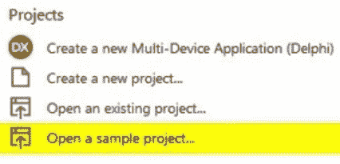

点击“Object Pascal”文件夹即可进入“多设备示例”子文件夹。在该子文件夹下的“用户界面”目录中，共包含28个示例项目，能够帮助你快速了解FMX的基础功能。

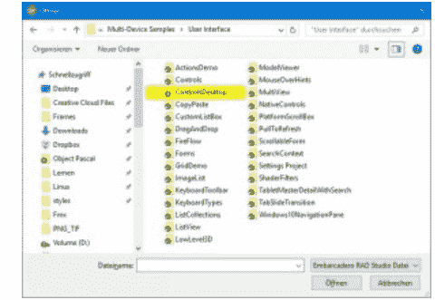

如果需要获取将现有VCL应用迁移到FireMonkey的编程辅助，你可以使用Mida转换器。

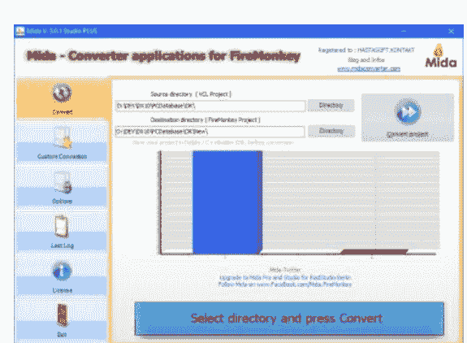

在`Embarcadero`开发者网络的下载板块，可以免费下载MIDA-BASIC版本。付费的Pro版本（售价约90欧元）还支持转换第三方组件（例如TMS组件），同时会尽可能适配源代码（更多信息可访问[http://www.midaconverter.com](http://www.midaconverter.com)）。

注意：在我此前编写的Delphi XE7开发相关书籍中，曾专门详细介绍了`Mida`转换器的使用方法。受篇幅限制、为避免内容重复，本书未收录该部分内容，如有需要，可低价在亚马逊购买我编写的Delphi XE7相关电子书，其中包含对应的使用说明。

### 第2节：新建FireMonkey项目

当然，我们还需要讨论何时、如何梳理VCL与FireMonkey之间的差异。最好的方式大概是直接描述常规的程序开发流程，并在相应环节重点说明常用VCL组件与FireMonkey组件之间的区别。

#### FireMonkey桌面应用（多设备应用）

和创建任何Windows项目一样，你可以通过“文件”菜单中的“新建多设备应用”命令，启动用于开发可在Windows、macOS或Linux系统上运行的FireMonkey程序，也可以直接从启动页面快速创建：

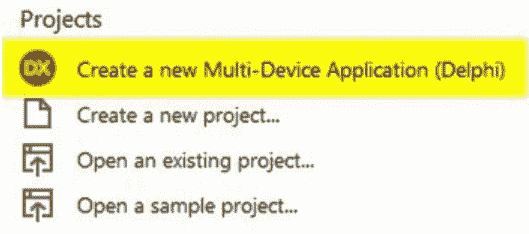

此时会弹出模板选择对话框，你可以选择生成“空白应用”“3D应用”，或是已经包含部分控件的预制应用：

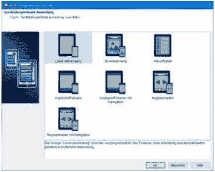

#### 操作结果：

如果不需要特殊的3D功能，通常选择“空白应用”模板即可。其他模板一般用于移动端应用（即iOS和Android应用）。但我们这里要开发的是常规桌面应用，因此请选择“空白应用”模板，之后点击“确定”。

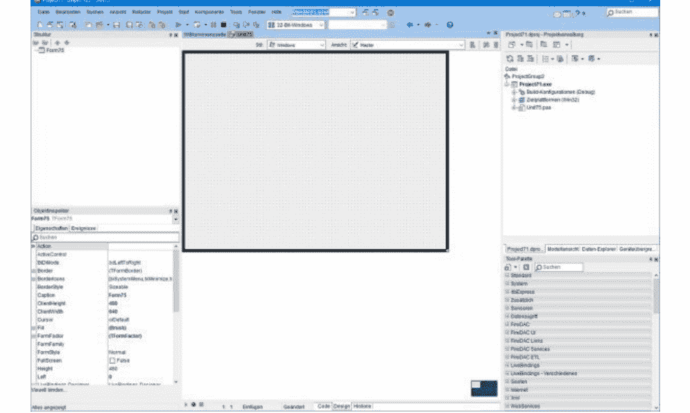

节点右侧的“目标平台”列表默认处于折叠状态，展开后如下图所示：

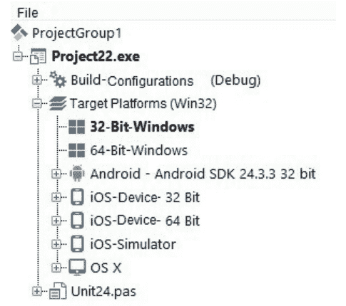

默认情况下，32位Windows平台处于启用状态。如果此时编译程序，你将得到一款可运行的32位Windows程序。Delphi还会自动添加macOS平台以及iOS、Android移动平台（如果不需要移动端支持，可以忽略这两个平台）。你只需双击列表中的目标平台即可选中该平台，之后进行编译，就能得到对应平台专属的应用程序。该程序可以在Mac或移动设备上实际运行，但你需要按照Delphi的要求完成对应环境的配置。本书后续章节会介绍如何配置macOS和Linux的开发环境。如果没有额外的`FmxLinux`框架，你无法为桌面应用添加Linux平台；如果你创建的是控制台应用，则可以开发Linux应用，相关说明可参阅下文的第5章。

#### 使用多设备设计器（Fire UI）

使用多设备设计器，你可以快速上手添加组件、设置组件属性、编写事件处理程序以和用户进行交互。如果你要开发跨平台项目，一般建议在初期就添加macOS平台的视图，方便你随时编译macOS版本的应用程序，验证运行效果。

不过，你应尽可能使用“主视图（Master）”，仅用其他视图针对对应操作系统进行特定设置。通过左侧的下拉列表，你还可以使用不同风格的主视图。

在已创建的各平台视图（如OS X、Windows等）中，你可以添加组件、修改其属性，但无法删除组件。若要移除某个组件，必须先激活主视图再执行删除操作，这样该组件就会从所有其他视图中一并移除。

修改组件名称的操作流程也相同：由于组件名称必须唯一，因此你只能在主视图中修改名称。

使用多设备设计器可以大幅简化跨编译应用的开发。例如，Windows系统的对话框按钮位于底部左侧，而macOS（及Linux）系统的对话框按钮则位于底部右侧。此外，macOS系统的按钮通常不配图标。

以下是我的会计程序中一个对话框的视图，该程序支持Windows、macOS X，如今借助FMXLinux也支持Linux：底部左侧是带图标的按钮。

接下来查看macOS X的视图：

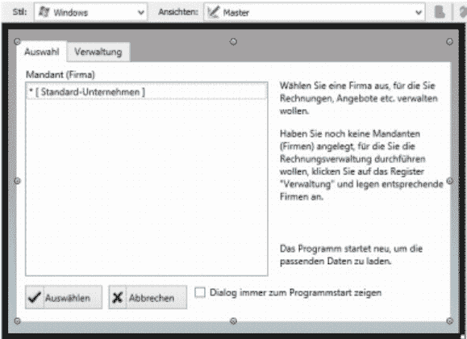

这里按钮被移到了右侧，对象检查器中的图片属性被设置为`visible = false`，复选框则被移到了左侧。

这样做的好处是，你可以直接在设计器中调整，无需在运行时对对话框进行任何代码层面的修改。过去通常采用这种耗时较长的工作方式。

#### 多设备设计器中的表单继承

此外，这种方法还能节省存储空间，因为Delphi会为每个视图创建独立的表单文件，编译时仅打包对应平台的表单文件。

文件生成后，在文件管理器中会呈现如下效果：

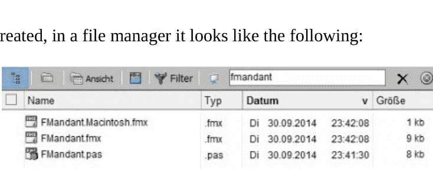

`FMandant.fmx`是主表单文件，该文件作为各生成平台对应表单的模板。如果我们只有这个主表单，需要开发macOS X程序的话，直接使用这个主表单即可。

而我们现在需要同时开发Windows程序和macOS X版本，因此在右侧下拉列表中选择了“OS X Desktop”，让Delphi为该平台生成独立表单，也就是这个名为`FMandant.Macintosh.fmx`的文件。

特定平台的表单基于表单继承原理运行（和`TFrame`类似）。

当我们用文本编辑器打开MAC表单时，内容如下：

```pascal
inherited F_Mandant_Macintosh: TF_Mandant_Macintosh
  DesignerMasterStyle = 0
  inherited Panel1: TRectangle
  inherited pc1: TTabControl
    inherited TabSheet1: TTabItem
      Size.Width = 68.0000000000000000
      inherited Label1: TLabel
        Size.Width = 99.0000000000000000
        Size.Height = 18.0000000000000000
      end
    end
    inherited bnOK: TButton
      Position.X = 436.0000000000000000
      inherited Image2: TImage
        Visible = False
      end
    end
  end
end
```

主表单文件有250行，而生成的MAC表单文件仅有42行，原因是这里仅保存与主表单存在差异的内容。

现在按钮从左侧移到了右侧，因此它的水平位置发生了变化，这个差异值（图中绿色标注部分）会被识别记录。按钮上的图片图标在Windows系统下需要显示，但在macOS X下需要隐藏，这部分也会被相应标注（蓝色背景）。

因此你可以针对特定平台简单修改组件的坐标、颜色、尺寸或其他内容（比如标签、按钮的文本）。

#### 恢复继承的初始设置

如果你在其他平台视图中对某个控件做了修改，可以单独或批量将设置恢复为主视图中的初始值。

示例如下：

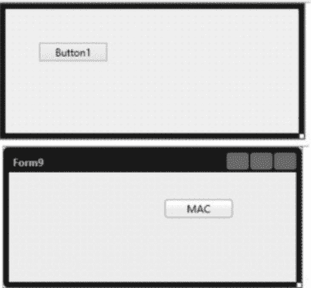

MAC视图中的按钮被移到了右侧，文本也被改为了“MAC”。

如果要恢复按钮的所有设置为初始状态，右键点击该按钮，选择“恢复继承设置”命令即可：

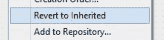

执行后，MAC视图中的按钮会回到左侧，文本也恢复为“Button1”。

如果仅需要恢复按钮的原始文本，先左键点击选中该按钮，然后在对象检查器中右键点击“Text”选项（左侧的属性名，而非右侧的编辑框），选择“恢复继承设置”命令即可。

#### 使用多设备设计器创建平台专属事件处理程序

不过，多设备设计器还提供了更便捷的方式：此前你需要将适配不同平台的代码都写在`OnClick`事件中，通常通过事件过程来兼容多平台，一般会用`IFDEF`指令让代码可以分别编译为Windows或Mac版本。

如果代码中只有少量平台专属语句，这种方式确实可行。但如果各平台的代码差异很大，事件处理程序中就会塞入大量代码，变得难以维护。

这时你可以直接为MAC平台创建独立的事件处理程序：如果已经在主视图中创建了`OnClick`事件，切换到“MAC OS Desktop”视图：

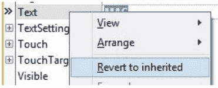

然后选中按钮，在`OnClick`事件中仅输入上图中所示的“Mac”字样，按下回车键，Delphi会立即生成一个空的事件处理程序，你就可以在其中编写MAC平台专属的源代码了。

小缺陷：如果源代码中包含平台专属调用，还是需要使用`IFDEF`指令，但现在操作更简便了，你可以把整个过程内层代码用`{$IFDEF MACOS}` ... `{$ENDIF}`包裹起来即可。

总的来说，哪种方式更好需要根据具体场景判断。

此外还有一项新功能（自**XE7**版本起支持）：对于一批组件，你可以为某些属性设置初始值——比如`TabControl`中`TTabPosition`属性的“PlatformDefault”选项，可替代原本的“Top”或“Bottom”选项。

即使你只使用主视图，不生成平台专属视图，所有组件也会因为“平台默认”设置，在各平台上处于正确的位置。

本示例提到的功能对**iOS**和**Android**平台更具实用性，因为这两个平台的标签栏通常需要设置在顶部或底部。

## 第3节：首个FMX程序（模拟时钟）

这里我们将从一个简单的程序入手，它同时也能证明仅用极少量代码就能写出功能完整的程序。这是一个模拟时钟，最终效果如下：

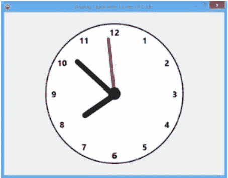

这个应用甚至仅用3行代码就能实现（这也是程序窗口标题的由来），你可以在YouTube上看到相关演示（德语视频）：https://youtu.be/QL5SdJAiWGE

本章我们需要编写更多代码，但这样可以减少设计工作量，同时我们也会学习如何使用样式名称，以及如何直接复制已有的FireMonkey对象。

1. 创建一个新的FireMonkey多设备应用。

2. 将`TCircle`组件拖拽到表单中，将其宽度和高度的属性值分别设置为400像素，将“Fill”和“Color”属性设置为“White”。

3. 将`TLayout`组件插入到`TCircle`组件中，将高度设置为400像素，宽度设置为50像素。“Align（对齐）”选项选择“center（居中）”。将“StyleName（样式名称）”属性命名为“clocknumber”。

| 初步效果如下： | 结构列表如下： |
| :--- | :--- |
| [带有数字12的圆形图片] | 显示Form24 > Circle1、LayoutZiffer、Text1的结构树 |


如果在你的电脑上显示效果不同，你可以通过拖拽操作将元素移动到正确位置。我们也可以继续复制这个 `TLayout`（“LayoutZiffer”）11 次，每次将 `RotationAngle`（旋转角度）属性的值增加 30 度，同时每次将 `TText` 元素的 `RotationAngle` 值减少 30 度（就像我在上述提到的视频中演示的那样）。但我们可以用几行代码实现同样的效果：

- 4. 将 `TText` 组件插入到 `TLayout` 组件中，将“Text（文本）”属性的值设置为“12”，在“TextSettings（文本设置）”下选择“Bold（加粗）”，并将文本大小设置为 24 磅。
- 5. 将以下代码放入窗体的 `OnCreate` 事件中：

```pascal
procedure TForm24.FormCreate(Sender: TObject);
var
  L: Integer;
  LA: TLayout;
  T: TText;
begin
  for L := 1 to 11 do
  begin
    // 创建包含所有子对象的布局副本
    LA := TLayout(circle1.FindStyleResource('clocknumber', true));
    if LA <> NIL then
    begin
      LA.Parent := circle1;
      LA.RotationAngle := L * 30;
      // 该布局只有一个子对象，即 TText 组件
      T := TText(LA.Children[0]);
      if T <> NIL then
      begin
        T.Text := L.ToString;
        T.RotationAngle := (L * 30) * -1;
      end;
    end;
  end;
end;
```

下面这行代码非常重要：

```pascal
LA := TLayout(circle1.FindStyleResource('clocknumber', true));
```

这行代码会返回具有“clocknumber”样式名称的布局，这个名称是我们之前在 `TLayout` 组件的“StyleName（样式名称）”属性下设置的。该函数调用的第二个参数决定了我们获取的是原始对象的引用（传入参数为“False”时），还是创建该对象的副本并返回副本的引用（传入参数为 True 时）。我们传入参数“True”进行调用，因此最终返回的是新创建的副本对象的引用。和原始对象相比，副本还没有父级，因此我们需要为其指定父级：

```pascal
LA.Parent := circle1;
```

之后，我们为新创建的 `TLayout` 设置所需的 `RotationAngle`（旋转角度）值。那如何访问 `TText` 元素呢？我们无需手动创建它，因为它是原始 `TLayout` 的子元素，而复制 `TLayout` 时会同时复制其中包含的所有子对象。由于这个布局只有一个元素，我们可以通过以下方式访问它：

```pascal
T := TText(LA.Children[0]);
```

然后就可以进行所需的属性赋值了。

启动程序后，运行时的效果如下：

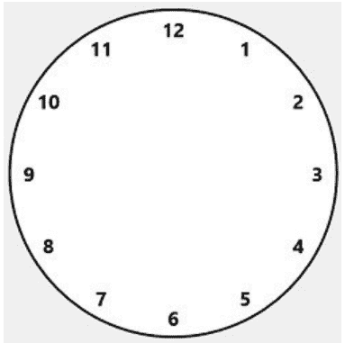

因此你可以直观地看到 `RotationAngle`（旋转角度）属性非常实用。

- 6. 现在插入 3 个 `TRoundRect` 组件，使它们呈竖直状态，且末端恰好居中。
  - a. 将第一个 `RoundRect` 命名为“rrHour”，并输入以下参数值：`Position.x`（X 轴位置）：191；`Position.y`（Y 轴位置）：94；`Height`（高度）：110；`Width`（宽度）：18。
  - b. 将第二个 `RoundRect` 命名为“rrMin”，并输入以下参数值：`Position.x`：193；`Position.y`：55；`Height`：151；`Width`：14。
  - c. 最后将第三个 `RoundRect` 命名为“rrSec”，并输入以下参数值：`Position.x`：196；`Position.y`：40；`Height`：164；`Width`：8。

秒针对应的“Fill（填充）”“Color（颜色）”选择“红色”，其余两个 `RoundRect` 选择“黑色”。另外请确保所有 `RoundRect` 都在圆形范围内，分针位于时针上方，秒针位于分针上方（如有需要，可进入 Delphi 的编辑菜单选择“Bring to Front（置于顶层）”来调整层级顺序）。

- 7. 为所有 `RoundRect` 输入以下参数值：`RotationCenter.x`（旋转中心 X 轴坐标）：0,5；`RotationCenter.y`（旋转中心 Y 轴坐标）：1。
- 8. 最后在圆形内部再添加一个圆形（颜色为“黑色”），并设置以下参数值：

```pascal
Position.x: 183;
Position.y: 183;
Height: 34;
Width: 34;
```

结构列表中显示效果如下：

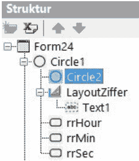

窗体视图如下：

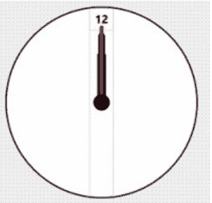

- 9. 现在添加一个 `TTimer` 组件（间隔设置为 1000，启用状态为 True），并在 `OnTimer` 事件中输入以下代码：

```pascal
procedure TForm24.Timer1Timer(Sender: TObject);
begin
  rrHour.RotationAngle := HourOf(Now) + MinuteOf(Now) / 2;
  rrMin.RotationAngle := 6 * MinuteOf(Now);
  rrSec.RotationAngle := 6 * SecondOf(Now);
end;
```

这里会根据当前的小时、分钟、秒数值，计算对应组件的角度值。现在程序已经编写完成，你可以运行并查看效果。在 Mac 上运行应用时，效果如下：

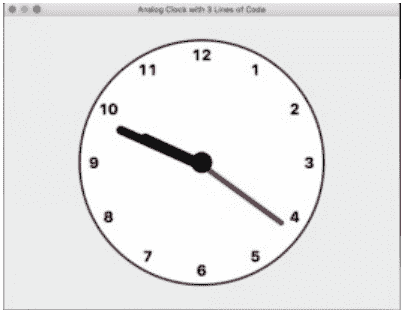

尽管本书并非介绍移动端编程，但如果你在项目管理器中选择“Android”作为目标平台，并将应用运行在通过 USB 连接的安卓设备上，它也能完美运行：

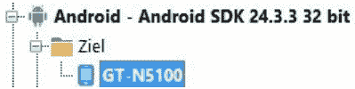


注意：若要时钟始终在窗体中居中显示，需要在窗体中再插入一个 `TLayout` 组件。之后你需要将 `TCircle` 组件相对于该布局居中对齐（不使用“Align”属性），再通过“Align”属性将该布局设置为“Center（居中）”。你可以在此下载演示项目：[点击下载演示项目](http://www.devpage.de/download/fmbook4/AnalogClock.zip)

## 第 4 章：选定的 FireMonkey 组件

接下来我们将逐一介绍你日常会使用到的各个 FireMonkey 组件及其特性。

### `TButton` 组件（支持文本截断）

遗憾的是，FireMonkey 的 `TButton` 组件功能不如 VCL 的 `TButton` 丰富，后者在过去几年中获得了极大的功能扩展。但 VCL 的按钮不具备 FireMonkey `TButton` 独有的一个特性：即“Trimming（文本截断）”属性，该属性可以指定文本过长无法完全显示时的处理方式。

默认设置为“ttCharacter（按字符截断）”，当文本过长时，会只显示首字母加 3 个点，超出部分被隐藏。例如“Repetition”会显示为“Repet ...”。如果选择“ttNone（不截断）”，它的行为和 VCL 中描述的一致，即文本会显示到按钮边框，超出部分被直接截断。如果选择“ttWord（按单词截断）”，若文本包含单词，则会以完整单词为边界进行截断，因此如果“Close”无法放入按钮的显示区域，“Print and Close”就会被截断为“Print and ...”。

最后，`TButton` 还可以设置为持续按下状态：你可以通过设置“IsPressed（按下状态）”属性实现，同时需要启用“StayPressed（保持按下）”属性。自 Delphi 10.1 Berlin 版本起，还新增了“Hint（提示文本）”属性，默认通过“ShowHint（显示提示）”属性启用。

### `TEdit` 组件（无 `PasswordChar` 属性）

如果需要对编辑框的内容进行隐藏处理，在 VCL 中你会使用以下代码实现：

```pascal
Edit.PasswordChar := '#';
```

但在 FireMonkey 中则需要使用：

```pascal
Edit.Password := True;
```

**XE7 起新增特性：**

新增了“ControlType（控件类型）”属性，默认值为“Styled（样式化）”。如果将属性值设置为“Platform（平台原生）”，则会使用对应平台的原生控件，目前仅支持 iOS 和 Windows 平台。该特性在使用屏幕阅读器等场景下非常实用，你也可以用它让应用获得 100% 符合平台原生的外观。选择该选项后，你会看到控件在设计阶段就会发生外观变化：

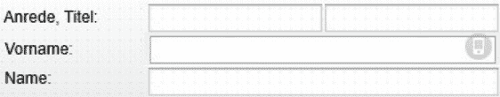

除了 `TEdit` 之外，“ControlType”属性也适用于 `TMemo` 或 `TCalendar` 控件（其中 `TCalendar` 仅支持 iOS 平台）。我推测后续会有更多控件支持该属性。因此，如果你除了 macOS 平台外还使用 iOS 和 Android 平台，这可能是一条重要信息。

### `TExpander` 组件

`TExpander` 组件可以类比为 VCL 中的 `TCategoryPanel` 组件。同样，你可以在展开器中插入不同的组件，通过设置“IsExpanded（是否展开）”属性来打开或关闭组件。

### `TForm` 组件（仍保留 `caption` 标题属性）

虽然几乎所有 FireMonkey 组件都使用“Text（文本）”属性而非“caption（标题）”属性，但 `TForm` 组件仍然保留了“caption”属性。

FireMonkey 窗体目前没有 VCL 窗体中的“KeyPreview（键盘预览）”属性。不过即使其他控件获得了焦点，`TForm` 依然可以接收 `FormKeyDown`（窗体按键按下）事件信息。如果你编写的程序需要集中处理键盘输入，你可以使用当前获得焦点的控件的按键事件例程，再将事件转发给窗体。

通过“FullScreen（全屏）”属性，你可以让窗体启动时直接进入全屏模式。注意不要将该属性和“WindowState（窗口状态）”属性混淆，“WindowState”属性可以将窗口设置为占据桌面可用区域的最大尺寸，和传统用法一致。

### `TFrame`

从 XE 4 版本起，帧（Frame）组件已提供支持，基本操作逻辑与 Windows 平台一致。在“文件”“新建”“其他”菜单下，你可以先创建 `TFrame` 组件。之后点击组件面板中的帧图标，在窗体上框选需要插入帧的区域即可。此时会弹出对话框，你可以在其中选择可用的帧（如果此前未添加过，需要先将现有帧添加到项目中）。

### `TPanel`（无标题/文本属性，对齐需使用限定符）

`TPanel` 组件的特性是它既没有“Caption”属性，也没有“Text”属性。想要实现 Windows 平台下的显示效果，你需要往其中嵌入一个 `TLabel` 组件。

如果需要运行时对齐 `TPanel` 对象，仅像 VCL 窗体那样将 `Align` 属性设置为例如“alClient”是不够的，还必须提前使用 `TAlignLayout` 这个限定符。

```pascal
Panel.Align := TAlignLayout.alClient;
```

### `TRectangle`

`TRectangle` 的使用逻辑和 `TPanel` 类似，但你需要通过 `Fill` 属性设置背景色，通过 `Stroke` 属性指定边框样式。

### `TCheckBox`、`TRadioButton`（对应属性为 `IsChecked`）

使用 `TCheckBox` 或 `TRadioButton` 组件时，你不需要查找“Checked”属性，对应属性为 `IsChecked` 即可。

和（较新的）VCL 组件类似，带有文本元素的 FireMonkey 组件也支持“WordWrap”属性，实用性很强。和所有 FireMonkey 组件一样，本文介绍的控件也支持多种外观配置特性（即“Styles”，例如“StyledSettings”“StyleLookup”和“StyleName”，后续会详细说明）。

### `TGroupBox` 搭配单选按钮使用

在 VCL 中，你可以使用 `TRadioGroup` 组件，通过其 `RadioGroup.ItemIndex` 属性判断当前选中的单选按钮。该组件在 FMX 中并不存在，但你可以使用 `TGroupBox` 组件，在其中放置需要的 `TRadioButton` 即可。

若要让单选按钮形成分组，需要将 `GroupBox` 内所有单选按钮的“GroupName”属性设置为相同的值：

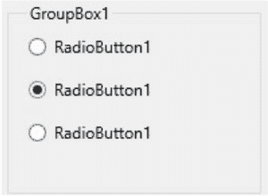

### `TSwitch`（`TCheckBox` 的替代组件）

该组件在 VCL 中没有对应组件。在 FireMonkey 中，你可以使用 `TSwitch` 作为 `TCheckBox` 的替代组件，用于表示开启/关闭状态。这类开关组件在移动端应用中非常常见，现在也在桌面端应用中广泛使用。该组件的样式如下：


### `TImage`（`WrapMode` 显示模式相关）

VCL 的 `TImage` 组件支持通过“Picture”属性加载图片，你可以通过“Stretch”和“Proportional”属性调整图片的显示效果。

FireMonkey 平台同样提供了 `TImage` 组件，该组件支持通过“MultiResBitmap”属性加载图片资源：

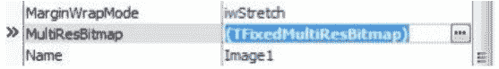

这意味着你可以为不同分辨率保存所需的任意数量的位图资源。如果调用编辑向导，会弹出如下对话框：

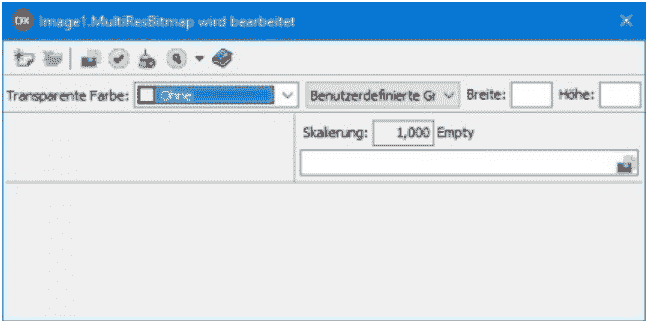

你可以点击左上角的第一个图标添加单个位图资源，接着点击输入栏右侧的打开图标，选择需要导入的图片文件。默认情况下，对话框右侧不会显示预览图，点击工具栏上的放大镜图标即可开启预览功能。

注意：如果点击绿色的确认勾选箭头，会弹出询问是否删除设计时可用信息的提示。如果点击“是”确认，位图资源的源目录名称将不再在此处显示。如果你仍需要保留该信息，请点击红色的关闭按钮关闭对话框。

运行时你可以通过 `Items` 属性访问单个位图资源，示例如下：

```pascal
MyBitmap.Assign(Image1.MultiResBitmap.Items[0].Bitmap);
```

该组件并非强制要求保存多分辨率的位图资源，你也可以保存相同分辨率的不同图片，以此替代 VCL 的 `ImageList`。不过不允许输入重复的缩放比例值。

你还可以直接从 Windows 资源管理器或任意其他文件管理器中拖拽文件到该图片编辑器中，十分便捷。你可以通过“WrapMode”属性调整图片的呈现模式，可选模式如下：

### `WrapMode`

| 模式 | 说明 |
| --- | --- |
| `iwFit` | （默认）调整图片大小以适配组件的方形区域，同时保持图片的宽高比例不变。 |
| `iwOriginal` | 以图片原始尺寸显示图片。 |
| `iwStretch` | 放大图片直至填满整个组件的矩形区域。 |
| `iwTile` | 平铺图片直至填满整个组件的矩形区域。 |
| `iwCenter` | 将图片水平、垂直居中显示在组件区域内。 |
| `iwPlace` | 将图片适配到 `TImage` 的矩形区域内。如果图片的宽度或高度大于 `TImage` 矩形区域的对应尺寸，则按比例缩放图片以适配 `TImage` 区域，最终图片居中对齐。该模式仅支持缩小图片，不会放大图片。 |

### `TImageControl`（自动缩放）

通过“bitmap”属性加载的图形会自动缩放。运行时点击已加载的图片，会弹出文件选择对话框，你可以借此向组件加载新图片。

如果你不需要 `TImageControl` 的默认行为，可以通过以下赋值关闭该功能：

```pascal
ImageControl1.EnableOpenDialog := False;
```


### TImageViewer（用户可缩放图片）

`TImageViewer`是非常实用的组件。同样，你可以通过「bitmap」属性向该组件加载图形资源。默认情况下，该组件的「`MouseScaling`」和「`MouseTracking`」属性处于启用状态，因此当鼠标悬停在显示的图形上时，用户可以通过鼠标滚轮缩放图形大小。如果需要禁用该功能，只需关闭上述两个属性即可。

### TImageViewer（结合实时绑定设计器使用）

`TImageViewer`非常适合通过「实时绑定（Live Bindings）」功能与其他组件建立动态关联。下面我们以轨迹条组件为例演示具体操作：

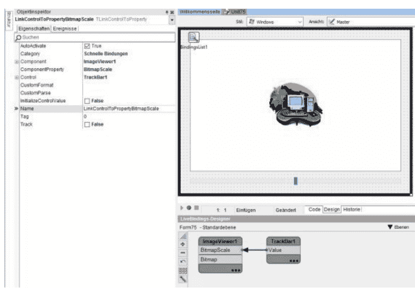

在对象检查器中，我们点击「`LiveBindings`」属性下的「可视化绑定」选项，系统会自动弹出「实时绑定设计器」。接下来我们可以将`ImageViewer1`组件的「`BitmapScale`」属性，与`Trackbar1`组件的「`Value`」属性进行关联。只需点击`ImageViewer1`条目右侧的三个点，会弹出「可绑定成员」对话框，在其中选择「`BitmapScale`」属性后点击「确定」即可：

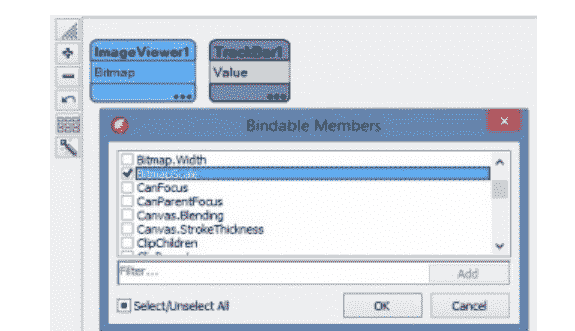

之后用鼠标选中`Trackbar1`的「`Value`」属性，将其拖拽到`ImageViewer1`的「`BitmapScale`」属性上后松开鼠标即可。

### 最终效果

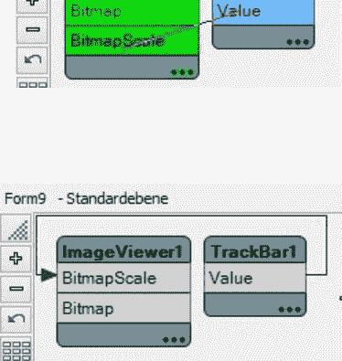

如果是首次操作，你也可以使用「实时绑定向导」完成配置。具体操作：在实时绑定设计器中点击「`ImageViewer1`」条目，再点击带有魔术棒图标的按钮，此时会弹出配置对话框：

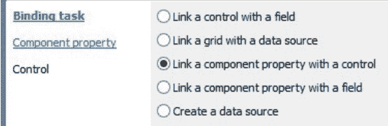

选择「将组件属性与控件关联」，然后点击「下一步」。在下拉列表中选择「`ImageViewer1`」组件，再选择其「`BitmapScale`」属性：

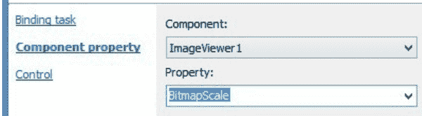

点击「下一步」，在下一页选择「`Trackbar1`」控件，最后点击「完成」即可。

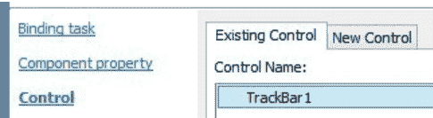

在当前设计器中，你可以看到`ImageViewer1`组件的`BitmapScale`属性已与`Trackbar1`组件的`Value`属性关联。

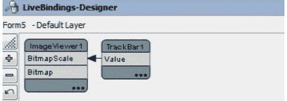

属性`BitmapScale`的值为1时代表100%的图片尺寸。因此请将`Trackbar1`组件的`Max`属性也设置为"1"。如果需要支持放大功能，可将其设置为2或3等数值。运行时，你可以通过拖动滑块调整图形的显示尺寸，该操作非常简单，无需编写任何源代码。以下是运行时的效果：

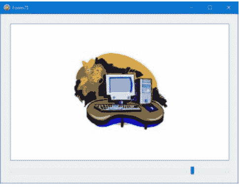

### TLabel（新增属性FontColor）

如果想要修改`TLabel`组件的字体颜色，在FireMonkey首个版本中，你需要先创建自定义样式，再将文本元素的`Fill`属性设置为目标颜色。从FireMonkey 2开始，这一操作变得非常简单：只需在对象检查器中使用`TextSettings`属性，接着选择`FontColor`并选取需要的颜色即可。

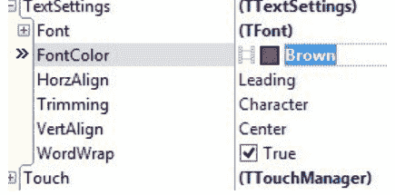

注意：只有当`StyledSettings`选项中禁用了`FontColor`相关配置时，`FontColor`的选色才会生效。

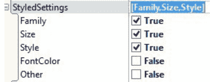

我不会去讨论这种多设置混合是否合理，但你必须了解这一点，否则你可能会花费很长时间排查为什么在`FontColor`中选中的颜色没有显示出来。`StyledSettings`属性指向当前使用的样式，可以是默认样式，也可以是用户自定义样式。当样式设置在`StyledSettings`中处于启用状态时，会覆盖其他所有相关配置。

### TPathLabel

该组件在VCL中没有对应组件，它不显示文本，而是显示“路径数据”，也就是矢量数据，和`TPath`组件类似。

### TPath

该组件同样用于显示矢量数据，但它额外提供了`Fill`属性，这意味着填充区域可以设置为统一的纯色背景。

### TImageList

功能非常实用的`TImageList`是图形容器，支持在设计时通过对话框进行编辑，自XE8起已在FireMonkey中提供。和VCL版本的`TImageList`相比，FMX版本的功能要强大得多。以下是添加和编辑`TImageList`的对话框截图：

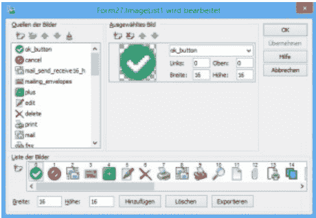

左侧显示“图像源”，这些图像源可以在运行时通过`ImageList1.Source`访问。

### 示例

```delphi
procedure TForm27.Grid1GetValue(Sender: TObject; const ACol, ARow: Integer; var Value: TValue);

var SizeF: TSizeF;

begin

SizeF.cx := 16;

SizeF.cy := 16;

case ACol of

0: if ImageList1.BitmapExists(ARow) then

begin

Value := ImageList1.Bitmap(SizeF, ARow);

end;

1: Value := ARow.ToString;

end;

end;
```

效果如下：

#### 设计时：

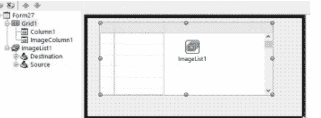

#### 运行时：

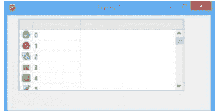

你还可以在运行时修改`TImageList`，比如添加位图。以下是一个演示示例。注意你需要同时设置“源”和“目标”的相关属性：

```delphi
procedure AddImageToImgList(ImageList1: TImageList; AFile: string);

var bm: TBitmap;

ASource: TCustomSourceItem;

cd, dItem: TCustomDestinationItem;

Item: TCustomBitmapItem;

Layer: TLayer;

sizew, sizeh: Integer;

begin

if FileExists(AFile) then

begin

ImageList1.BeginUpdate;

bm := TBitmap.Create;

bm.LoadFromFile(AFile);

sizew := bm.Width;

sizeh := bm.Height;

ASource := ImageList1.Source.Add;

ASource.Name := ChangeFileExt(ExtractFileName(AFile), '');

Item := ASource.MultiResBitmap.Add;

if sizew <> 16 then

begin

item.MultiResBitmap.Width := sizew;

item.MultiResBitmap.Height := sizeh;

end;

item.Bitmap.Assign(bm);

bm.Free;

cd := ImageList1.Destination.Add;

Layer := cd.Layers.Add;

Layer.Name := ASource.Name;

if sizew <> 16 then

begin

Layer.SourceRect.Right := sizew;

Layer.SourceRect.Bottom := sizeh;

end;

ImageList1.EndUpdate;

end;

end;
```

如果你希望程序在高分辨率屏幕上显示更高清的图片，`TImageList`也非常重要。你可以为每个（多分辨率）位图存储多个分辨率的版本，FMX会自动选用适配当前分辨率的版本。双击中间的图标：

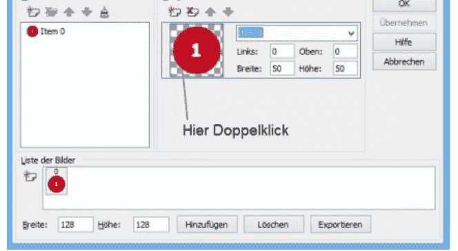

可以直接打开多分辨率位图对话框，你也可以双击左侧的列表来打开该对话框：

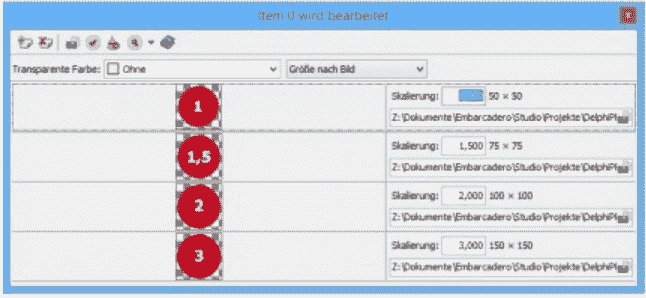

这里的“缩放”数值对于在运行时选取正确的图标非常重要。

### TListBox（无TCheckListBox，请使用ShowCheckboxes属性）

不要浪费时间寻找`TCheckListBox`组件，FireMonkey中并不存在该组件。如果需要显示带复选框的`TListBox`，请勾选`ShowCheckboxes`选项即可。

`ListStyle`属性非常实用：通过该属性可以将列表框中的条目横向排列（对应`lsHorizontal`值）。示例如下：

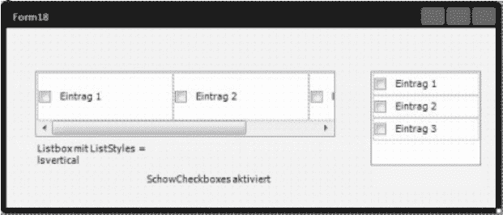

虽然列表框的整体使用逻辑和VCL组件类似（例如支持`Items.LoadFromFile`等方法），但你需要区分在设计时和运行时使用的是`Items`属性还是`ListItems`属性：

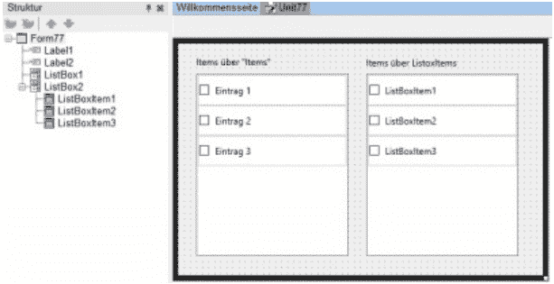

左侧的列表框中，条目是通过列表框的`Strings`属性添加的；右侧的列表框中，我通过鼠标右键点击，选择了“Add ListBoxItem”命令。从结构概览中可以看到，只有第二个列表框中的每个ListBoxItem都有独立的条目。因此，只有第二个列表框中的ListBoxItem可以通过鼠标点击选中，并在对象检查器中修改其对应属性。

警告：如果你通过`Strings`属性编辑第二个列表框的条目并确认修改，所有ListBoxItem都会被转换为普通字符串，此前为单个ListBoxItem设置的所有属性都会丢失。因此操作时需要注意区分场景。

以下是访问列表框条目的示例。设计时：

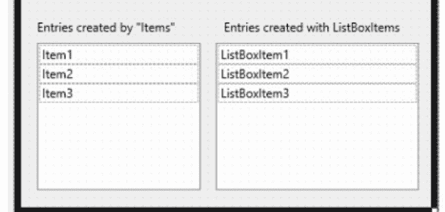

运行时，你可以通过`Items`属性（字符串列表）和`ListItems`属性（TListBoxItem列表）两种方式访问TListBox的单个条目。以下是示例源代码及其运行结果：

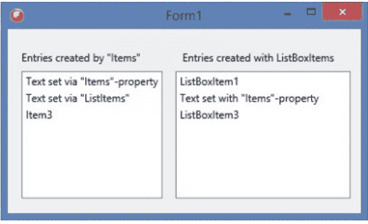

```delphi
procedure TForm19.FormCreate(Sender: TObject);

begin

ListBox1.Items[0] := 'Text set via "Items"-property';

ListBox1.ListItems[1].Text := 'Text set via "ListItems"';

ListBox2.Items[1] := 'Text set with "Items"-property';

end;
```

要判断ListBoxItem的`IsChecked`属性是否被设置，可参考以下代码：

```delphi
if ListBox1.Items[0].IsChecked then ...

ListBox1.Items[0].IsChecked := True;
```

#### 自Delphi XE4起新增的列表框条目增强功能

自Delphi XE4起，右键点击列表框时，除了可以添加纯文本条目外，还支持更多类型的条目。从弹出的菜单中可以看到，你拥有多个可选操作：

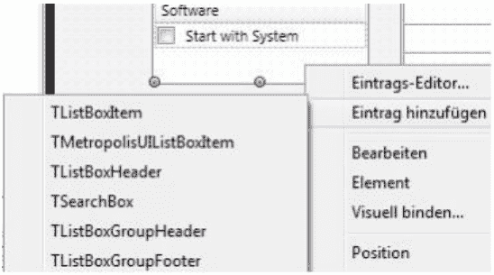

通过`TListBoxGroupHeader`可以为列表框添加子标题。`TSearchBox`非常实用：在搜索框中输入文本后，列表框会自动过滤条目，仅显示匹配的内容。例如当列表框提供大量选项时，用户输入关键词即可快速找到对应的设置项，这是VCL列表框不具备的便捷功能！

以下是带有组标题和搜索框的列表框：

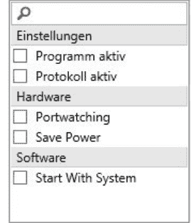

以下是用户在搜索框中输入文本后的列表框效果：

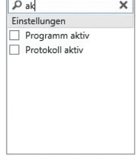

点击搜索框中的清除按钮即可清空搜索框内容。由于过滤功能是全自动的，你无需编写任何源代码即可实现该效果。

#### 列表框不支持自定义绘制

由于列表框没有`OnDrawItem`事件，你需要通过调整`ListBoxItem`的相关属性来实现不同的显示效果（注：特殊场景下可以使用列表框和每个`ListBoxItem`提供的`OnPaint`、`OnPainting`等事件）。

大多数情况下，仅使用`TListItem`的预置属性就足够了，除了文本属性外，它还支持很多其他用法：

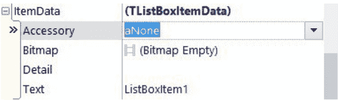

在Bitmap（位图）分类下，你可以在设计时或运行时分配位图。从Delphi XE8开始，`ListBox`新增了“Images”属性，你可以在此关联`TImageList`（该组件从XE8版本才开始提供）。相应地，每个`TListBoxItem`都有“ImageIndex”属性，你也可以在设计时或运行时在此设置与`ImageList`中图片的关联。

“Detail”属性是另一项文本内容，它的显示位置随“itemstyle”所选为“leftdetail”还是“rightdetail”而变化，可显示在`TListItem`的不同位置。

在Accessory（附件）分类下，你可以进行如下选择：

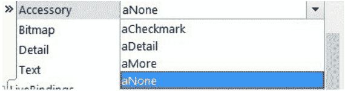

如果需要显示“Detail”属性的文本，请在“Accessory”中选择“aDetail”；同时“ItemStyle”要选择包含“detail”关键词的样式：

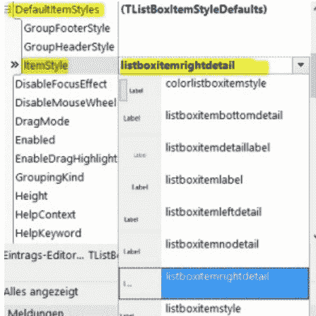

通过以上方法，你可以使用内置功能完成绝大多数常规需求。而在VCL框架下，你需要通过“OwnerDraw”自行绘制想要呈现的效果。下面是一个分步示例，演示如何向`ListBox`输出带不同颜色、图标和详细信息的文本：

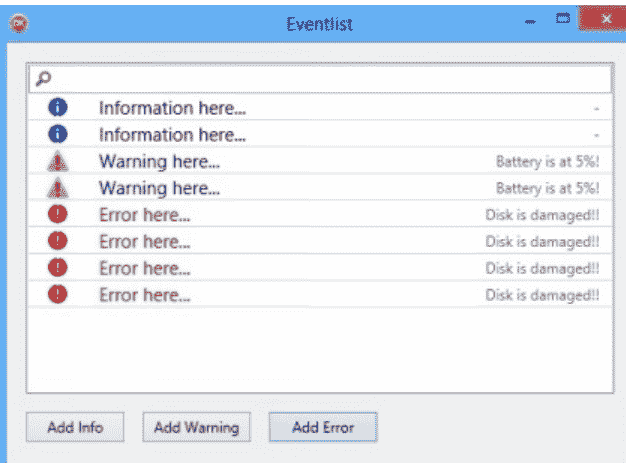

这是完成后的程序效果。在搜索框中输入文本时，`ListBox`的内容会随之自动过滤。该功能在FMX下可以快速实现，而在VCL下要达成同样的效果需要付出更多精力。

1. 新建一个多设备项目。
2. 添加一个`TListBox`，命名为`lbEvents`，在“DefaultItemStyles”下将“Itemstyle”设置为“`ListBoxItemRightDetail`”。
3. 添加一个`TImageList`，并加入3个图标：

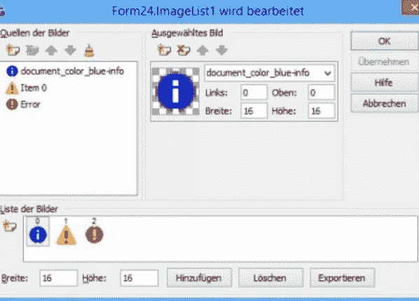

4. 将`ListBox`的“Images”属性值设置为“`ImageList1`”。
5. 添加3个按钮，分别设置它们的文本属性为“添加信息”、“添加警告”和“添加错误”。
6. 右键点击`ListBox`，为其添加搜索框：

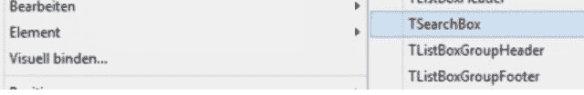

此时你的窗体效果如下：


7. 创建如下过程，并为各个按钮的`OnClick`事件添加以下事件处理：

```delphi
procedure AddInfoItem(lb: TListBox; imgidx: Integer; txt: string; AColor: TAlphaColor; ADetail: string = '');

var

  lbi: TListBoxItem;

begin

  lbi := TListBoxItem.Create(lb);

  //lbi.StyleLookup := 'ListBoxItem1Style1';

  lbi.ItemData.Text := txt;

  lbi.ItemData.Detail := ADetail;

  lbi.ImageIndex := imgidx;

  lbi.StyledSettings := lbi.StyledSettings - [TStyledSetting.FontColor];

  lbi.TextSettings.FontColor := AColor;

  lb.AddObject(lbi);

end;

procedure TForm24.Button1Click(Sender: TObject);

begin

  AddInfoItem(lbEvents, 0, 'Information here...', TAlphaColorRec.Black);

end;

procedure TForm24.Button2Click(Sender: TObject);

begin

  AddInfoItem(lbEvents, 1, 'Warning here...', TAlphaColorRec.Blue, 'Battery is at 5%!');

end;

procedure TForm24.Button3Click(Sender: TObject);

begin

```


```pascal
AddInfoItem(lbEvents, 2, 'Error here...', TAlphaColorRec.Red, 'Disk is damaged!!');

end;
```

至此程序就搭建完成了，你可以直接运行。

#### 关于 `AddInfoItem` 过程的两个注意事项

1. 为了让文本能显示为彩色，需要从 `StyledSettings` 中移除 `FontColor` 属性。
2. 关于被注释掉的那行代码：你也可以调整 `TListBoxItem` 现有元素的显示布局，比如让详细文本显示在常规文本下方，同时让文本更靠近图标。操作步骤如下：
   1. 将 `ItemHeight` 的值设置为 40。
   2. 临时向 `ListBox` 中添加一个 `TListBoxItem`，右键点击它并选择“Add custom style”。
   3. 在 `ListBoxItemStyle1` 下的结构列表中，将 `Height` 的值设置为 40，把 `detail` 元素移到第一个布局中，将 `Align` 设置为“Bottom”，并将其 `Height` 设置为 16。

   

如果你启用上面被注释掉的那行代码并重新运行程序，效果如下：


你可以[在此处下载示例程序](http://www.devpage.de/download/fmbook4/Eventlist.zip)。不过以上并不是全部用法，你还可以为 `ListBoxItem` 的“Style”添加额外的文本、图片或其他元素。你可以参考 Delphi 自带的示例“CustomListBox”了解具体做法，该示例通常位于以下路径：

```text
C:\Users\Ihr AnwenderName\Documents\Embarcadero\Studio\19.0\Samples\Object Pascal\Multi-Device Samples\User Interface\CustomListBox
```

编译后的示例效果如下：


### 所有组件（窗体除外）

`TForm` 包含“Left”“Top”等属性，而其他所有组件都没有这些属性。你可以使用带 X、Y 值的“Position”属性来设置组件的左上角位置。需要注意这些值都不是整数，而是“extended”类型。

### 部分组件（需要额外类型限定的属性）

很多 FMX 组件的属性用法和 VCL 组件一致，比如 `TMemo` 的“Align”属性可以赋值为 `alClient`。但在运行时需要额外加上类型限定符。

```delphi
// 错误写法：

// memo1.Align := alClient;

// 正确写法：

memo1.Align := TAlignLayout.alClient;

// 错误写法：

// memo1.FontColor := clRed;

// 正确写法：

memo1.FontColor := TAlphaColors.Red;
```

VCL 组件中常用的“cl+颜色名”格式在 FireMonkey 中不再适用，需要去掉“cl”前缀，改为在前面加上“`TAlphaColors`”。如果你在进行常规赋值时程序报错，可以检查是否需要额外添加类型限定符。`TAlphaColors` 在“System.UITypes”单元中声明：

```delphi
Type

  TAlphaColors = TAlphaColorRec;
```

只要了解了这一点操作就很方便了。还有一个技巧可以跳过这个限定符：只需引入“System.UIConsts”单元，就可以直接使用“claRed”“claBlack”这类颜色值。

```delphi
Uses System.UIConsts;

...

memo1.FontColor := claRed; // 替代写法
```

### TMenuItem（菜单项）

从 Delphi XE8 开始，`TMenuItem` 的“Bitmap”属性新增了“ImageIndex”属性，你可以为关联的 `TImageList` 设置对应的图标。如果你要开发跨平台应用，需要注意除 Windows 外，其他平台（如 macOS、Linux）通常不会在菜单中使用位图。你可以通过多设备设计器添加“OS X Desktop”视图，并移除该视图下菜单的“Items”项；也可以在运行时移除菜单中的图标。另外需要注意，FireMonkey 组件中使用 `IsChecked` 属性代替了原来的 `Checked` 属性。

### TMainMenu（处理 macOS 菜单）

编译程序后，Windows 版本的软件通常会有“File”菜单；而 macOS 版本的软件中，程序名称（即去除扩展名的 `.exe` 文件名）会作为第一个菜单的名称。这个菜单中通常只包含退出程序、打开设置对话框或“关于……”这类命令。因此建议将第一个菜单项设置为和程序同名的菜单：


Windows 版本中需要将 `TEditor` 设置为不可见，macOS 版本中则需要将其设为可见，并隐藏“File”菜单下的“Exit TEditor”选项。以下是源码实现：

```delphi
procedure TF_Main.FormCreate(Sender: TObject);

begin

  {$IFDEF MACOS}

  mTEditor.Visible := True;

  mFileExit.Visible := false; // 来自File菜单

  {$ENDIF}

  //...

end;
```

在 macOS 上的效果如下：


如果你只有主视图、没有专门针对 macOS 平台的视图，可以使用上述解决方案。如果为 macOS 做了专属窗体，也可以通过对象查看器直接编辑菜单属性：在“OS X Desktop”视图中将“TEditor”菜单的文本设置为可见，并隐藏“File”菜单下的“Exit”项。在 macOS 系统中，第一个可见菜单项的名称总会被替换为程序的可执行文件名称，因此建议谨慎设置项目名称。

### TMemo（光标位置、无 Modified 属性、FindNext 替代方案）

在 Windows 系统下，你可以通过以下方式获取 Memo 中的当前行号和列号：

```delphi
Line := SendMessage(memo.Handle, EM_LINEFROMCHAR, Memo.SelStart, 0);

column := Memo.SelStart - SendMessage(memo.Handle, EM_LINEINDEX, Line, 0);
```

在 FireMonkey 下，获取方式如下（使用“caret position”属性）：

```delphi
line := Memo.CaretPosition.Line + 1;

column := Memo.CaretPosition.Pos + 1;
```

VCL 组件中的“Modified”属性在 FireMonkey 中不存在，你需要自行在 `OnChange` 或 `OnChangeTracking` 事件中管理该状态。你可以设置一个变量（例如 `TMemo` 的“Tag”变量）来记录 Memo 内容是否被修改，在将 Memo 内容保存到文件后再重置该变量。

#### `Clipboard.HasFormat(CF_Text)` 替代方案

#### 拼写检查

在 VCL 框架中存在“剪贴板”功能，但 FireMonkey 框架没有。FireMonkey 的备忘录组件提供了 `Memo.CopyToClipboard`、`Memo.CutToClipboard` 和 `Memo.PasteFromClipboard` 这类函数。但若要判断剪贴板是否包含文本（例如用于控制按钮是否启用），就需要使用平台服务（`PlatformService`）。

示例（需要引用 `FMX.Platform` 单元）：

```pascal
procedure TF_Main.Timer1Timer(Sender: TObject);

var

  s: String;

  ClipService: IFMXClipboardService;

begin

  try

    if TPlatformServices.Current.SupportsPlatformService(IFMXClipboardService, IInterface(ClipService)) then

    begin

      try

        s := ClipService.GetClipboard.ToString;

        bnPaste.Enabled := (s <> '') and (s <> '(empty)');

      finally

      end;

    end;

  finally

  end;

end;
```

从 XE5 版本起，新增了输入文本拼写检查的能力，该功能依赖的服务在 macOS 下会自动提供。你可以通过布尔类型变量 `CheckSpelling` 来启用或禁用拼写检查器（既可以在对象检查器中设置，也可以在运行时修改）。

拼写检查会调用平台服务，建议先查询当前使用的平台是否支持该服务。要执行查询，需要引用 `FMX.Platform` 和 `FMX.SpellChecker` 这两个单元，查询代码如下：

```pascal
if TPlatformServices.Current.SupportsPlatformService(IFMXSpellCheckerService) then

begin

  memo1.CheckSpelling := True;

end;
```


Windows 下没有可用的拼写检查服务，但原则上自行实现一个并不困难，你可以参考 macOS 平台的实现，稍作修改即可适配 Windows。

#### 查找下一项替换

遗憾的是，FireMonkey 的备忘录组件并不像 VCL 那样提供 `Memo.FindNext(Memo.Text, StartPos, EndPos, SearchOptions)` 这类实用的函数，甚至标准操作中也没有对应的功能，因此你需要自行实现相关方案。

接下来我将介绍一种我在 macOS 和 Windows 平台的 `TEditor` 程序中使用过的简单方案，以下是 FindReplaceDemo 对应的简化版 `TEditor` 程序：


当你点击搜索图标（放大镜）时，会执行以下例程：

```pascal
procedure TF_MainFindReplace.SearchEditButton1Click(Sender: TObject);

var

  P, L: Integer;

  cp: TCaretPosition;

begin

  for L := 0 to Memo1.Lines.Count - 1 do

  begin

    if cbCase.IsChecked then

    begin

      P := Pos(edFind.Text, Memo1.Lines[L]);

    end

    else

    begin

      P := Pos(AnsiUpperCase(edFind.Text), AnsiUpperCase(Memo1.Lines[L]));

    end;

    if P <> 0 then

    begin

      cp.Line := L;

      cp.Pos := P - 1;

      break;

    end;

  end;

  if P <> 0 then

  begin

    Memo1.SetFocus;

    Memo1.CaretPosition := cp;

    Memo1.SelStart := Memo1.PosToTextPos(cp);

    Memo1.SelLength := Length(edFind.Text);

    if cbReplace.IsChecked then

    begin

      bnReplace.Enabled := True;

      bnReplaceAll.Enabled := True;

    end;

  end

  else

  begin

    if cbReplace.IsChecked then

    begin

      bnReplace.Enabled := False;

      bnReplaceAll.Enabled := False;

    end;

  end;

end;
```

以上是首次搜索的功能函数，如果要搜索下一个匹配项，需要从当前光标位置、选中内容的后续位置开始搜索，相关源码如下：

```pascal
procedure TF_MainFindReplace.bnFindNextClick(Sender: TObject);

var

  P, L: Integer;

  cp: TCaretPosition;

  part: String;

begin

  for L := Memo1.CaretPosition.Line to Memo1.Lines.Count - 1 do

  begin

    if cbCase.IsChecked then

    begin

      if L = Memo1.CaretPosition.Line then

      begin

        P := InStr(Memo1.CaretPosition.Pos + Memo1.SelLength, Memo1.Lines[L], edFind.Text);

      end

      else

      begin

        P := Pos(edFind.Text, Memo1.Lines[L]);

      end;

    end

    else

    begin

      if L = Memo1.CaretPosition.Line then

      begin

        P := InStr(Memo1.CaretPosition.Pos + Memo1.SelLength, AnsiUpperCase(Memo1.Lines[L]), AnsiUpperCase(edFind.Text));

      end

      else

      begin

        P := Pos(AnsiUpperCase(edFind.Text), AnsiUpperCase(Memo1.Lines[L]));

      end;

    end;

    if P <> 0 then

    begin

      cp.Line := L;

      cp.Pos := P - 1;

      break;

    end;

  end;

end;
```

// 注：`InStr` 函数中用到的示例是自定义辅助函数，代码如下：

```pascal
function InStr(AtPos: Integer; S: String; toFind: String): Integer;

var

  R: Integer;

begin

  S := Copy(S, AtPos, (Length(S) - AtPos) + 1);

  R := Pos(toFind, S);

  if R <> 0 then

    Result := R + AtPos - 1

  else

    Result := 0;

end;
```

如果要替换选中的文本，点击“确定”按钮后，会执行以下例程：

```pascal
procedure TF_MainFindReplace.bnReplaceClick(Sender: TObject);

begin

  if Memo1 <> NIL then

  begin

    if AnsiUpperCase(Memo1.SelText) = AnsiUpperCase(edFind.Text) then

    begin

      Memo1.DeleteSelection;

      Memo1.InsertAfter(Memo1.CaretPosition, edReplace.Text, [TInsertOption.ioSelected]);

    end;

  end;

end;
```

这里还有一个常见的易错点：此处需要将 `TInsertOption` 作为限定符使用。你可以从我的主页下载简化版 FindReplaceDemo，其中还包含“全部替换”按钮点击事件的源码，该流程中有 3 处调用了 `Application.ProcessMessages`，当需要与宿主系统进行交互（例如设置光标位置）时，应当始终考虑调用该函数。演示程序的下载链接如下：

```text
http://www.devpage.de/download/fmbook3/FindReplaceDemo.zip
```

当然，该程序在 macOS 下也能正常运行。另外，它不像 VCL 那样提供了 REDO（重做）功能。

#### 打印 `TMemo` 组件

在 FireMonkey 下打印备忘录组件要相对复杂一些。VCL 组件提供了 `Canvas.TextOut(x, y, 'Text')` 这类函数，还支持长文本自动换行，而 FireMonkey 下需要手动计算换行，FireMonkey 中用于打印的函数是 `Canvas.FillText()`。

需要注意的是，macOS 下的页面宽高数据是 Windows 的 1/10，相关计算会通过对应的 `IFDEF` 条件编译指令来处理。

以下是一个在 Windows 和 macOS 下都能运行的简单示例（需要引用 `FMX.Printer` 单元）：

```pascal


`procedure TF_Main.mPrintClick(Sender: TObject);`

```pascal
var
  r, rPage: TRectF;
  i: Integer;
  tf: TFillTextFlags;
  a: TTextAlign;
  T, th: Extended;
  sl: TStringList;
  z: Integer;

  function GetFormattedLines(s: string): TStringList;
  var
    x, L, P: Integer;
    pw: Extended;
    label StartAgain;
  begin
    sl.Clear;
    if S = '' then
    begin
      sl.Text := #13#10;
      Result := sl;
      Exit;
    end;

    {$IFDEF Win32 or Win64}
    pw := (rPage.Right - rPage.Left) - 100;
    {$ENDIF}

    {$IFDEF MACOS}
    pw := (rPage.Right - rPage.Left) - 10;
    {$ENDIF}

  StartAgain:
    for L := 1 to Length(S) do
    begin
      if Printer.Canvas.TextWidth(Copy(S, 1, L)) > pw then
      begin
        for P := L downto 1 do
        begin
          if S[P] = ' ' then
            sl.Add(Copy(S, 1, P - 1));
          S := Copy(S, P + 1, Length(S));
          Goto StartAgain;
        end;
        sl.Add(Copy(S, 1, L - 1));
        S := Copy(S, L, Length(S));
        Goto StartAgain;
      end;
    end;

    if S <> '' then
    begin
      sl.Add(S);
    end;

    Result := sl;
  end;

begin
  if ActiveMemo <> NIL then
  begin
    if PrintDialog1.Execute then
    begin
      tf := [];
      a := TTextAlign.taLeading;
      sl := TStringList.Create;

      with Printer do
      begin
        {$IFDEF Win32 or Win64}
        r := RectF(200, 200, (PageWidth - 200), (PageHeight - 200));
        rPage := RectF(200, 200, (PageWidth - 200), (PageHeight - 200));
        {$ENDIF}

        {$IFDEF MACOS}
        r := RectF(20, 20, (PageWidth - 20), (PageHeight - 20));
        rPage := RectF(20, 20, (PageWidth - 20), (PageHeight - 20));
        {$ENDIF}

        BeginDoc;
        th := Canvas.TextHeight('Test');
        T := 0;

        for i := 0 to ActiveMemo.Lines.Count - 1 do
        begin
          sl := GetFormattedLines(ActiveMemo.Lines.Strings[i]);
```

```delphi
          for z := 0 to sl.Count-1 do
          begin
            T := T + Th;
            if T+th+th >= rpage.Bottom-rpage.Top then
            begin
              T := 0;
              r.top := rPage.top;
              Printer.NewPage;
            end;
            r.top := r.top + th;
            Canvas.FillText(r, sl[z], True, 1, tf, a, a);
          end;
        end;

        Canvas.Font.Family := ActiveMemo.Font.Family;
        Printer.ActivePrinter;
        EndDoc;
      end;
    end;
  end;
end;
```

### TDropTarget（FireMonkey 中拖放的工作原理）

那些使用 Windows 和 VCL 组件进行编程的人可能知道，过去需要调用 `DragAcceptFiles` 函数来激活“拖放”功能，从而从 Windows 资源管理器中获取文件。之后还需要确保在表单中处理 `WM_DROPFILES` 消息，并为其编写事件处理程序。说实话，这有点复杂。接下来我们看看我之前提到的“ControlsDemo”示例。通常大家认为，会在应用程序中使用 `TDropTarget` 组件，放置在用户可以“拖放”一个或多个文件的位置（当然你也可以使用普通组件，在上面可以“拖放”任何内容）。运行时，将矩形或圆形移动到放置目标图标上方，然后释放鼠标按钮，此时编辑框中会显示被拖拽元素的类名作为结果。

#### 让我们看看放置目标的 DragOver 事件：

```delphi
procedure TfrmCtrlsDemo.DropTarget1DragOver(Sender: TObject; const Data: TDragObject; const Point: TPointF; var Operation: TDragOperation);
begin
  Operation := TDragOperation.Link;
end;
```

通过这样做，我们告诉程序该放置操作是**允许**的。默认情况下，`Operation` 的默认值是“None”，表示不允许操作。此外还有“Move”和“Copy”两种操作。你只有在 Windows 上从资源管理器拖拽文件到目标上方时，才会看到特殊的视觉反馈：在 Mac 上，即使只是拖拽表单内的组件，也会出现对应的图标。另外，该示例仅适用于 XE7 及更高版本。在之前的所有示例版本中，父组件的`HitTest`属性是禁用的，因此不会处理对应鼠标操作的评估。当`Filter`属性为空时，会接受所有拖拽的文件。如果你只允许特定类型的文件拖拽到放置目标，可以输入合适的筛选器。如果只允许拖拽文本文件，在 Windows 或 Mac 下可以将筛选器设置为 `*.txt`。要确保筛选器正常工作，你需要按如下格式设置筛选器对象的字符串：

```delphi
'<first filter name>|<first filter value>|<second filter name>|<second filter value>|...|<n-th filter name>|<n-th filter value>'
```

示例：仅允许 ".exe" 和 `*.txt` 文件：

```delphi
'Applications (*.exe)|*.EXE|Text files (*.txt)|*.TXT'
```

此时会出现动画箭头和“Link”（或“Copy”或“Move”）标识，表示放置目标会接受这些文件。现在的问题是，当用户释放鼠标按钮时如何评估这个操作。下面是一个示例：

```delphi
procedure TfrmCtrlsDemo.DropTarget1DragDrop(Sender: TObject; const Data: TDragObject; const Point: TPointF);
var
  I: Integer;
begin
  if Data.Source <> nil then
    Edit1.Text := Data.Source.ClassName
  else
    Edit1.Text := Data.Files[0];
end;
```

拖拽到目标上的文件包含在 `Data.Files` 中，其中 `Files` 是一个字符串数组。上面的过程中我已经向你展示了如何访问它。当然，它在 Mac 上也同样适用：如果 `Data.Source` 不是 NIL，说明它是程序内部被拖拽到目标上的组件。当然，你也可以将一些文件拖拽到普通的编辑框中。第 11 章的“Tip12”介绍了具体操作方法。

### TRichEdit（暂不可用 - 但可通过第三方组件替换）

FireMonkey 目前还没有可用的 `TRichEdit` 组件，因此你需要使用第三方的组件。从 2015 年初开始，TMS 软件提供了一个非常优秀的 RichEdit 组件：`TTMSFMXRichEditor`：<http://www.tmssoftware.com/site/tmsfmxpack.asp?s=fmxricheditor#features> 该组件甚至还提供了拼写检查功能，非常实用。

### TPageControl（暂不可用 - 但有可用替换组件）

这种在 Windows 下非常有用的组件在 FireMonkey 中找不到。不过 `TTabControl` 组件提供了合理的替代方案（见下文）。

### TStringGrid（工作方式不同）

该组件在 VCL 程序中非常常用。和 FireMonkey 的列表框类似，FireMonkey 的 `TStringGrid` 也没有 `OwnerDraw` 事件（但有 `OnPainting` 事件，后续会详细介绍）。当你在表单中插入新的 `TStringGrid` 时，会出现以下情况：你可以通过右键点击 `StringGrid` 组件来添加列，在上下文菜单中可以选择“Items Editor”选项或“Add TStringColumn”命令。如下方所示，我们通过条目编辑器添加了两列。现在你可以点击某个“StringColumn”并设置不同的属性，例如“Header”属性。注意：表头实际上不是网格的第 0 行，而是独立的元素。在将 VCL 源代码转换为 FMX 时要记住这一点。你可以通过“ShowHeader”属性显示或隐藏表头。FireMonkey 的 `StringGrid` 中也有“RowCount”属性。默认情况下，网格初始有 100 行，因此“FormCreate”事件中的以下赋值可以正常工作：如果没有先添加列就进行赋值则无法生效。必要时当然也可以在运行时生成列。但是如何修改字体设置（例如加粗或字体颜色）呢？`StringColumn` 组件没有字体属性，但 `StringGrid` 组件在“TextSettings”下有该属性。不过你在这里做的所有设置都会应用于整个网格。如果你想为一个或多个列或单元格设置不同的样式，可以使用“OnDrawColumnCell”事件。示例：

```delphi
canvas.FillText(bounds, Value.ToString, True, 1, flags, TTextAlign.taTrailing, TTextAlign.taCenter);
canvas.EndScene;
```

效果如下：文本输出为**加粗**的红色。注意：绘制列表头有单独的事件：“OnDrawColumnHeader”。我们现在还有新可用的“OnDrawColumnCell”和“OnDrawColumnBackground”事件。你可以根据程序逻辑将列表文本设置为左对齐、右对齐或居中对齐，可以通过不同的 `TTextAlign` 参数来设置，例如使用 `TTextAlign.taCenter` 设置居中对齐。区分一下：“OnDrawColumnBackground”仅在网格处于编辑模式时调用；否则输出使用“OnDrawColumnCell”。如果启用了“DefaultDrawing”设置（默认），网格会首先自行绘制内容。如果禁用该选项，则不会有输出（只要在选项设置中启用了“ColLines”或“RowLines”，网格线始终会被绘制）。这里同样可以根据程序逻辑，通过指定 `TTextAlign` 参数（例如 `TTextAlign.taCenter`）将对应列的文本输出为右对齐或居中对齐。注意：在 Delphi Seattle 中，`StringGrid` 发布了约 36 个事件（在对象检查器中可见）；在 Delphi Berlin 中只有 13 个，到 Delphi Tokyo 时又恢复为 22 个。这很可能是一个 bug，现在已经修复。您需要知道的是，除了今天提到的22个事件外，还有诸多事件可供网格组件使用，但您需要在运行阶段自行分配它们。例如“OnEnter”、“OnExit”或“OnViewPortPositionChanged”这类事件。`StringGrid` 组件总共约有44个“On类事件”。只需在编辑器中输入一次`StringGrid1.On`，然后按下Strg+空格键即可显示所有可用事件（当然，您需要先在窗体上放置`StringGrid`组件，或者声明过对应的变量）。其中“OnCreateCustomEditor”事件也值得特别说明（同样和VCL的`StringGrid`相关）。通过该事件您可以创建自定义的单元格编辑器，或者为编辑操作指定对应编辑器。例如您可以使用`TComboEdit`，它会提供便捷的文本选择选项。

```pascal
procedure TForm1.FormCreate(Sender: TObject);
begin
  StringGrid1.Cells[0,0] := 'Toyota';
end;

procedure TForm1.StringGrid1CreateCustomEditor(Sender: TObject; const Column: TColumn; var Control: TStyledControl);
begin
  Control := TComboEdit.Create(self);
  TComboEdit(Control).Items.Add('Mercedes');
  TComboEdit(Control).Items.Add('BMW');
end;
```


### TGrid（网格中的图片及其他元素）

在 VCL（String-）Grid 组件中需要借助“OwnerDraw”事件实现的诸多功能——例如显示图片、复选框等——用 `TGrid` 就能轻松完成。除了 `TStringColumns` 之外，您还可以使用“TImageColumns”或“TCheckColumns”。右键点击 `TGrid`，然后选择需要的选项即可：


网格的列类型数量还在不断增加，XE7版本中仅有8种，如今的Delphi Tokyo版本已经增加到12种。部分列类型有特殊功能，例如“TDateColumn”和“TTimeColumn”会提供专属编辑器（对应为`TDateEdit`和`TTimeEdit`）。如需显示文本，需要用到“GridGetValue”事件。第一张图是设计时状态的窗体，第二张是运行时状态：


以下是所用到的源码：

```pascal
procedure TForm2.Grid1GetValue(Sender: TObject; const Col, Row: Integer; var Value: TValue);
var
  aCol: TColumn;
begin
  aCol := Grid1.ColumnByIndex(Col);
  if aCol = StringColumnText then
    Value := IntToStr(Row+1)
  else if aCol = ImageColumn1 then
  begin
    if odd(Row) then
      Value := Image1.Bitmap
    else
      Value := Image2.Bitmap;
  end;
end;
```


如果涉及图片显示，使用`TGlyphColumn`会更加简便：您需要给`StringGrid`关联一个`TImageList`组件（设置其`Images`属性），之后就可以在`OnGetImageIndex`事件中，直接从图像列表里指定需要的条目。根据程序逻辑，您可以灵活展示图片、文本或复选框。综上，`TGrid`是非常灵活的组件，整体功能远强于VCL的`TStringGrid`。

#### TStringGrid替代方案（TMSFMXGrid）

作为TMS组件的长期用户，我很乐意向大家推荐一个替代方案，能够更轻松地实现从VCL `StringGrid`到FireMonkey网格的迁移：`TMSFMXGrid`除了具备VCL组件常见的属性（如`ColCount`、`DefaultRowHeight`等）之外，还有很多额外功能（例如将内容导出为Excel文件）。更多详情可访问：`http://www.tmssoftware.com/site/tmsfmxpath.asp`。

#### THeader（不是区块，而是条目）

该组件在FMX中同样存在。VCL中对应的是“区块（sections）”，而在FireMonkey中对应的是“条目（Items）”，即`THeaderItems`。

#### THeaderControl（FireMonkey中无此组件）

该组件在FireMonkey中并不存在，请使用`THeader`替代。由于`THeader`的各个条目可作为容器使用，您可以轻松在其中插入所需元素，例如复选框或位图。

### TProgressBar（使用`value`而非`position`属性）

`TProgressBar`的工作方式和VCL组件基本一致。但在FireMonkey组件中，不使用`Position`属性设置进度值，而是使用`Value`属性。`Position`属性用于通过`Position.x`和`Position.y`设置组件的水平和垂直偏移量。

### TTabControl（无OwnerDraw功能）

该组件的工作方式和VCL版本类似。您可以创建单独的`TTabItem`元素，再将自定义组件插入其中。当然，您也可以在运行阶段动态创建`TTabItem`，再将其添加到`TTabControl`中。该组件没有`OwnerDraw`属性和`OnDrawTab`事件，但提供了`OnPaint`和`OnPainting`事件，您可以在事件中使用画布绘制文本。此外，还提供了`TabControlStyle`和`TabItemStyle`两种样式，您可以通过`OnApplyStyleLookup`事件实现对应的视觉调整。

### TTrackbar（实用的`Tracking`属性）

和VCL组件不同，FireMonkey的`TTrackbar`组件拥有`Tracking`属性。如果将属性值设置为`False`，那么只有当拖动滑块的操作完成（即用户松开鼠标按键）后，才会触发`OnChange`事件。

### TSpeedButton（无Bitmap属性）

在VCL的`TSpeedButton`中，可以通过`Glyph`属性指定图片。FMX中也支持该功能，但实现方式不同，且操作更便捷：您可以通过关联的`TImageList`组件，使用`ImageIndex`属性直接选择图片。

### TStatusbar（弥补缺失的`Panels`属性的方案）

在VCL的`TStatusbar`中，可以通过`Panels`属性或`SimpleText`属性显示文本。而FireMonkey的状态栏既没有这类属性，也没有专门的文本属性。不过您可以把状态栏当作容器，在其中插入`Label`组件来实现文本显示。

### MessageDlg（例如无法直接使用`mtWarning`参数）

如果您尝试像VCL中那样使用该对话框，会遇到一个问题。在Windows下原本可正常运行的代码如下：

```pascal
if MessageDlg('Info', TMsgDlgType.mtWarning, [TMsgDlgBtn.mbYes, TMsgDlgBtn.mbNo], 0) = mrYes then
begin
  // do something or not
end;
```

但在FireMonkey中无法正常运行。正确的写法如下：

```pascal
if MessageDlg('Info', TMsgDlgType.mtWarning, [TMsgDlgBtn.mbYes, TMsgDlgBtn.mbNo], 0) = mrYes then
begin
  // do something or not
end;
```

因此，需要添加这些类型限定符……我也花费了不少时间才弄明白这个机制。

## 第5部分：FireMonkey样式设计器

#### a) 使用样式编辑器

双击已存在的`StyleBook`组件，或者右键点击任意控件，选择以下选项：

- `Edit Custom Style`：如果只需要修改单个组件的样式，选择该选项
- `Edit Default Style`：如果需要修改当前项目中所有同类型组件的默认样式，选择该选项


随后会看到如下界面：


在左侧的树形视图中，您可以选中单个样式，在对象检查器中为其设置对应属性。树形视图上方有一个按钮，可用于删除树形视图中的布局元素，仅能通过该按钮删除元素，删除键在此处无效。`StyleBook`和样式对于FireMonkey开发非常重要。通常我们会使用样式来实现和VCL中通过`OwnerDraw`事件达到的相同视觉效果。在Delphi XE2中调用样式编辑器时，控件会在树形视图中被选中，IDE窗口中间会直接渲染该控件的实际样式。但遗憾的是，从XE3版本开始不再支持该功能。如今左侧仅显示树形视图，且不会有任何条目被自动选中。如果结构列表较长，就难以快速找到目标条目，很多用户根本不知道在这个界面可以完成哪些操作。

**因此：** 首先点击屏幕中央显示的元素，该元素就会在结构视图中被同步选中。从Delphi 10 Berlin版本开始，还支持直接输入文本进行搜索：选中结构列表，输入你要查找的对象名称即可（没有输入框，需要盲打输入）。

以下是对样式编辑器工具栏中部分图标的说明：

| 图标 | 说明 |
|:------:|:------------|
|  | 创建一个新的空白[FireMonkey样式](#)。 |
|  | 打开对话框，你可以在此选择要加载的FireMonkey样式。RAD Studio自带若干FireMonkey样式，你可以从`C:\Program Files (x86)\Embarcadero\Studio\19.0\Redist\styles\Fmx`路径下找到它们。 |
|  | 打开一个对话框，你可以在此选择一个FireMonkey样式，将其所有样式对象添加到当前样式中。 |


将当前FireMonkey样式保存到`.style`文件。


您可以使用`-`和`+`按钮调整对象设计区域的缩放比例。支持的缩放级别为100%到1000%之间100%的倍数。


选择要编辑的目标平台。


打开一个对话框，选择要添加到平台组合框的平台：


| 图标 | 描述 |
|:---|:---|
| [UI 元素] | 从**平台**组合框中移除当前选定的平台。 |
| [UI 元素] | 使用透明网格作为对象设计区域的背景。 |
| [UI 元素] | 使用白色背景作为对象设计区域的背景。 |
| [UI 元素] | 使用黑色背景作为对象设计区域的背景。 |
| [UI 元素] | 此按钮的箭头头列出当前样式中存在但在所选**平台**中不存在的样式项，但对于当前样式的其他平台是可用的。单击列表中的样式项，可将其副本添加到样式的当前平台。 |

#### b) FireMonkey 中的样式 - 概述

“样式”描述了控件、窗体或整个应用程序的一种特定表示类型。这种样式在VCL中也为人所知。从XE2开始，在VCL应用程序中，能够为Windows应用程序（在“项目、选项、应用程序外观”下）选择应用程序样式。随着后续的XE版本，VCL方面对此进行了进一步完善，因为每个控件都获得了`StyleElements`属性。这允许您指定元素（客户区、边框、字体）如何显示，以及是否应用样式。在FireMonkey中，对于许多组件，也存在一个具有类似含义的属性`StyledSettings`。到目前为止，FireMonkey和VCL已经越来越接近。从XE3开始，位图样式设计器可用于编辑VCL样式。您也可以将这些VCL样式另存为FireMonkey样式。首先，让我们看看FireMonkey样式的基础。FireMonkey样式包含在Delphi中，并作为样式文件分发。例如，您可以在Delphi Tokyo的以下位置找到它们：

```text
C:\Program Files (x86)\Embarcadero\Studio\19.0\Redist\styles\Fmx
```

这些是文本文件，您可以将其加载到文本编辑器中。加载一次，以便您可以了解此类文件。在您的程序中，您可以在设计时将这些样式文件加载到`StyleBook`组件中，也可以在运行时加载。此外，标准样式已经集成在Delphi中。即使您没有在窗体上放置`StyleBook`，也已经有一个标准样式，当您不加载其他样式时，它总是会被使用。这个标准样式确保您的程序在Windows下呈现为典型的Windows程序，在Mac下呈现为典型的Mac OS X程序。那么，`TButton`如何利用样式进行绘制以反映正常、聚焦或按下状态呢？嗯，在我给出答案之前，我想指出，FireMonkey框架开发的高度动态性在这里得以体现。从XE2到XE4，总是有不同的技术解决方案。我将省略细节，仅展示在Delphi 10.2下的流程：


`TButton`的背景在`background`中定义，其中背景是一个`TButtonStyleObject`。此对象包含对位图某一部分的引用。如果您单击`background`，您可以在对象检查器中找到`NormalLink`、`FocusedLink`、`HotLink`和`PressedLink`项，它们都被定义为`TBitmapLinks`：


如果您单击这样一个`TBitmapLink`，您将看到以下视图：


在这里，您可以看到为选定的Windows 10样式（“链接”框）设置的`FocusedLink`。无需手动输入任何值，您可以根据需要简单地移动选择框。位图在Delphi 10中以1、1.5和2倍分辨率（物理分辨率400x600、600x900和800x1200像素）提供。根据程序稍后运行的分辨率（DPI），此处会选择可用的最合适的分辨率。但是，如有必要，您可以添加额外的分辨率，只需单击带有加号符号的按钮即可。如果您加载Windows 10 ModernStyle，您也会找到一个3倍分辨率。

您也可以将您自己的位图添加到样式中，并使用您自己的位图样式。顺便说一句，您也可以为`TSpeedButton`找到一个`FocusedLink`，但它的源位置与`NormalLink`相同，因为`TSpeedButton`不存在“聚焦”状态。如前所述，在`XE2`的样式中没有位图链接。它从`XE3`开始。这使得可以更快地绘制组件的表示。因为使用现有的位图进行绘制比在运行时绘制复杂的外观更容易。如果您想为组件（例如`TButton`）创建自定义样式，了解标准样式非常重要。使用随附的FireMonkey样式时，按钮样式的结构仍然不同。如果您在此处将“深色样式”加载到`StyleBook`中，您将获得`TButton`


在树视图中呈现的以下结构：


背景由包含两个`TColorAnimations`、一个`TGlowEffect`和一个`TGlyphStyle`的`TRectangle`组成。该文件**不**包含样式位图。如您所见，最终有多种方法可以定义组件的外观。总的来说，值得在样式编辑器中查看各个组件的基本样式，这将增加我们对FireMonkey组件使用的理解。

#### c) 如何将VCL样式转换为FireMonkey样式

您可以将VCL样式转换为FireMonkey样式，然后在FireMonkey应用程序中使用，这非常有用。请按以下步骤操作：在Delphi中，调用“工具”菜单中的“位图样式设计器”命令。然后打开它，例如，在`C:\Program Files (x86)\Embarcadero\Studio\19.0\Redist\styles\vcl\Luna.vsf`下。在“文件”菜单中，调用“另存为”命令。在出现的对话框中，选择文件类型“FireMonkey样式”：


将文件保存到您选择的文件夹（最好是当您卸载Delphi时不会被删除的文件夹）。在FireMonkey项目中，您可以在样式书（style-book）中加载和使用此样式文件。它将如下所示：


#### d) 使用FireMonkey样式

您的应用程序如何获得所需的样式？有几种可能性。您可以在设计时将随附的样式文件之一加载到您放在窗体上的`StyleBook`组件中（不要忘记将窗体属性`StyleBook`分配给您的`StyleBook`组件的名称）。


或者您随应用程序提供一个或多个样式文件，然后在运行时将所需的样式加载到`StyleBook`中。这样，例如，用户可以选择他喜欢的样式。您可以这样做，例如，如以下所示（路径必须根据您的程序环境进行调整）：

```pascal
StyleBook1.Resource.LoadFromFile('D:\LunaStyle.style');
```

如果您想为整个应用程序分配样式，可以使用`TStyleManager`，例如，在主窗体的创建事件中：

```pascal
TStyleManager.SetStyleFromFile('D:\LunaStyle.style');
```

即使是稍后在运行时生成的窗体，也将具有此样式。为了使其工作，您必须在单元列表中包含单元`FMX.Styles`。

#### e) 理解FireMonkey样式

FireMonkey中的可见组件基本上不知道如何表示自己。为此，它们需要样式信息。所谓的FireMonkey图元派生自`TControl`，只能以其基本形式表示自身。只有同样派生自`TControl`的`TStyledControl`才能使用样式绘制自身。以下是概述：

## 第3章：跨平台开发技巧与窍门

### 第1节：启动其他程序

`TControl3D`及其后续类均继承自`TControl`。这些3D组件与样式无关。

此处组件的呈现方式按照选定的“材质源”执行，相关内容我们会在后续的3D编程章节中再做介绍。

组件是如何查找对应样式的呢？这取决于组件是否在`StyleLookUp`属性中分配了值。

如果已分配值，且存在`StyleBook`（样式簿），组件会查找同名的样式元素。如果找到该元素，就会使用对应的样式描述来绘制组件。

如果不存在`StyleBook`，或者在`StyleLookUp`属性中找不到对应值，系统会构造一个`StyleName`（样式名称）进行查找。构造规则为：去掉类名最开头的“T”（例如从`TEdit`得到`edit`），再拼接上“style”字样。

如果没有特殊的`StyleLookUp`赋值，系统会查找名为`editstyle`的样式。首先会在可能存在的`StyleBook`中查找。*(RubyGraphite样式中的`editstyle`)*

如果组件在`StyleBook`中找不到目标样式，就会去“默认样式”池中查找。默认样式是Delphi内置的样式，哪怕你的程序中没有引入`StyleBook`，这些样式也始终可用。根据操作系统（Windows 7、Windows 8、Windows 10、macOS等）的不同，此处会匹配对应系统的专属默认样式。

如果在这里依然找不到，组件会基于父类，使用相同的查找逻辑来匹配样式名称。如果最终仍找不到，该组件将不会显示。

不过这种情况仅会出现在你开发了准专有组件，且该无命名样式的组件的父类也不存在可分配样式时才会发生。因此如果你不是组件开发人员，完全不需要考虑这个问题，它永远不会对你造成影响。

另外，你可以在程序运行时按需修改样式，修改后会基于之前描述的规则重新绘制组件。

由于很多人容易混淆`StyleName`和`StyleLookUp`，下面我来明确二者的区别：

**样式名称（StyleName）** 用于描述样式本身，几乎等同于样式的定义描述；

**样式查找属性（StyleLookUp）** 用于告诉组件要使用哪个样式进行绘制。


通常你在样式设计器中使用`StyleName`，在对象检查器中使用`StyleLookUp`（在对象检查器中一般不需要输入`StyleName`）。

通常样式元素的基础是`TLayout`，它可以包含更多图元或其他样式元素。不过也存在一些特殊的样式对象，可以作为其他样式元素的容器，例如`TButtonStyleObject`。

从Delphi 10 Berlin版本开始，你可以直接从工具面板中选择这些特殊样式对象（更早的版本中你需要将整个样式导出为文件，手动编辑后再重新导入到`StyleBook`中）。

不过你也可以在窗体中基于`TLayout`对多个组件进行分组，然后给`TLayout`分配一个样式名称。如果你将该样式名称赋值给其他组件的`StyleLookUp`属性，那么该组件就会基于你在窗体中用`Layout`元素创建的“样式”来生成。

如果你想要在Windows、macOS或Linux系统上启动其他程序（或者用默认查看器打开文件），不同系统需要用到不同的例程。这一般通过引入不同的单元，以及使用`IFDEF`编译指令来实现。

在`uses`子句中，你需要引入以下单元：

```delphi
{$IF DEFINED(LINUX) or DEFINED(MACOS)}
POSIX.Stdlib,
{$ENDIF}
{$IFDEF MSWINDOWS}
ShellApi,
{$ENDIF}
```

在实现部分的代码如下：

```delphi
procedure RunProg(prog: string);
begin
{$IFDEF MSWINDOWS}
  ShellExecute(0, 'open', PChar(prog), nil, nil, 0);
{$ENDIF}
{$IFDEF MACOS}
  _system(PAnsiChar('open ' + AnsiString(prog)));
{$ENDIF}
{$IFDEF LINUX}
  _System(MarshaledAString(UTF8String(prog)));
{$ENDIF}
end;
```

如果你需要查询macOS或Linux对应的函数、过程位于哪个文件中，可以查看以下目录下的对应文件：

```delphi
C:\Program Files (x86)\Embarcadero\Studio\19.0\source\rtl\osx
C:\Program Files (x86)\Embarcadero\Studio\19.0\source\rtl\linux
C:\Program Files (x86)\Embarcadero\Studio\19.0\source\rtl\posix
```

### 第2节：获取程序目录与程序数据目录

在Windows和macOS系统中，你都可以通过`ParamStr(0)`获取可执行文件的程序目录。实际上这里存储的是可执行文件的完整路径，我们只需简单处理即可提取出程序目录。

最佳实践是新建一个单元，在单元的初始化节中定义对应的变量。示例如下：

```delphi
unit MyData;
interface
uses System.SysUtils;
var
  AppPath: String;
  AppName: String;
  AppExeName: string;
  AppIniName: String;
  ProgDataPath: String;
implementation
begin
  AppExeName := ParamStr(0);
  AppPath := ExtractFileDir(ParamStr(0));
  AppName := ChangeFileExt(ExtractFileName(ParamStr(0)), '');
  // Ohne Endung
  {$IF DEFINED(LINUX) or DEFINED(MACOS)}
    ProgDataPath := IncludeTrailingPathDelimiter(GetHomePath) + '.config/' + AppName;
    AppIniName := ProgDataPath + PathDelim + AppName + '.cfg';
  {$ENDIF}
  {$IFDEF MSWINDOWS}
    ProgDataPath := IncludeTrailingPathDelimiter(GetHomePath) + 'hastasoft' + PathDelim + AppName;
    AppIniName := IncludeTrailingPathDelimiter(GetHomePath) + 'hastasoft' + PathDelim + AppName + PathDelim + AppName + '.ini';
  {$ENDIF}
  if not DirectoryExists(ProgDataPath) then
  begin
    ForceDirectories(ProgDataPath);
  end;
end.
```

请将示例中的“Hastasoft”替换为你自己的公司名称，也可以直接留空这部分内容。如果你开发了多款程序，且你的客户会同时使用多款你的产品，那么强烈建议你修改这部分内容。

“Config”文件夹是macOS上用于存储程序配置文件的专属文件夹，该文件夹在访达（Finder）中默认是隐藏的。当然你也可以使用支持显示隐藏文件夹的第三方文件管理器（例如macOS上的File IO）。

你可以通过以下命令切换访达中隐藏文件夹的显示状态：

```bash
defaults write com.apple.finder AppleShowAllFiles YES // invisible with NO
```

如果你运行以下源码，就能在不同操作系统的运行时看到对应结果（当然你需要将编译后的程序安装到常规目录下）：

```delphi
ShowMessage('AppName: ' + #13 + AppName + #13#13 + 'AppPath: ' + #13 +
  AppPath + #13#13 + 'AppExeName: ' + #13 + AppExeName + #13#13 +
  'ProgDataPath: ' + #13 + ProgDataPath + #13#13 +
  'AppIniName: ' + #13 + AppIniName);
```

#### Windows系统：

#### macOS系统：

#### Linux系统：

### 第3节：捕获程序传入的启动参数

在Windows系统中，你可以通过`StartParam := ParamStr(1)`轻松实现启动参数捕获，但在macOS上实现起来要复杂得多，因为它的运行机制完全不同。

如果你在macOS访达中右键点击一个文件，选择菜单中的“打开方式”选项，系统会启动对应程序，同时向程序发送消息，告知其需要打开选中的文件。因此你需要搭建一套机制，确保你的程序可以接收系统发送的消息。

在`MACAPI.AppKit`中提供了`NSApplicationDelegate`，它默认负责处理macOS系统发送的“打开文件”消息。遗憾的是，这一特性尚未被集成到Delphi的FireMonkey框架实现中，因此目前没有其他办法，只能自行实现该功能。

以下是实现该功能的单元源码：

在主程序中你需要实现“打开事件”处理过程，并在自定义代理生成时将其传递，代码如下：

```delphi
unit hs_NSApplicationDelegate;
// Will implement an own NSApplication delegate to handle
// application:openFile: messages from the macOS system.
interface
uses Macapi.ObjectiveC, Macapi.CoreFoundation, Macapi.AppKit, Macapi.Foundation,
  Macapi.CocoaTypes;
type
  // Although we only need the OpenFile function here, we must also
  // still implement DidFinishLaunching and WillTerminate, without
  // these I cannot compile
```

```pascal
// 来自 Macapi.AppKit
NSApplicationDelegateExtended = interface(NSApplicationDelegate)
// 使用 Ctrl+Shift+G 生成专属 GUID
// 不要在你自己的程序中使用下方的GUID
['{2F5BD639-88DE-46F7-950A-D4469A125229}']
function application(theApplication: Pointer; openFile: CFStringRef): Boolean; cdecl;
end;
TOpenFileEvent = reference to procedure (const AFileName: string);
TNSApplicationDelegateExtended = class(TOCLocal, NSApplicationDelegateExtended)
private
FOnOpenFile: TOpenFileEvent;
public
constructor Create(const AOnOpenFile: TOpenFileEvent);
function application(theApplication: Pointer; openFile: CFStringRef): Boolean; cdecl;
function applicationShouldTerminate(Notification: NSNotification): NSInteger; cdecl;
procedure applicationWillTerminate(Notification: NSNotification); cdecl;
procedure applicationDidFinishLaunching(Notification: NSNotification); cdecl;
function applicationDockMenu(sender: NSApplication): NSMenu; cdecl;
end;
procedure StartExtendedApplicationDelegate(const AOnOpenFile: TOpenFileEvent);
var
ExtendedDelegate: NSApplicationDelegateExtended;
implementation
uses FMX.Forms;
constructor TNSApplicationDelegateExtended.Create(const AOnOpenFile: TOpenFileEvent);
begin
inherited Create;
FOnOpenFile := AOnOpenFile;
end;
procedure TNSApplicationDelegateExtended.applicationDidFinishLaunching(Notification: NSNotification);
begin
// 占位实现
end;
function TNSApplicationDelegateExtended.applicationDockMenu(sender: NSApplication): NSMenu;
begin
// 占位实现
end;
function TNSApplicationDelegateExtended.applicationShouldTerminate(Notification: NSNotification): NSInteger;
begin
inherited;
// 占位实现
end;
procedure TNSApplicationDelegateExtended.applicationWillTerminate(Notification: NSNotification);
begin
// 不要使用 FreeAndNil，否则会出现错误！！
FMX.Forms.Application.Free;
FMX.Forms.Application := NIL;
end;
function TNSApplicationDelegateExtended.application(theApplication: Pointer; openFile: CFStringRef): Boolean;
var
Range: CFRange;
S: string;
begin
Result := True;
Range.location := 0;
Range.length := CFStringGetLength(openFile);
SetLength(S, Range.length);
CFStringGetCharacters(openFile, Range, PChar(S));
try
FOnOpenFile(S);
except
FMX.Forms.Application.HandleException(ExceptObject);
Result := False;
end;
end;
procedure StartExtendedApplicationDelegate(const AOnOpenFile: TOpenFileEvent);
var
NSApp: NSApplication;
begin
Assert(ExtendedDelegate = nil);
NSApp := TNSApplication.Wrap(TNSApplication.OCCClass.sharedApplication);
if Assigned(NSApp) then
begin
ExtendedDelegate := TNSApplicationDelegateExtended.Create(AOnOpenFile);
NSApp.setDelegate(ExtendedDelegate);
end;
end;
end.
```

```pascal
// 在主窗体中添加以下代码
procedure TF_Main.FormCreate(Sender: TObject);
begin
{$IFDEF MACOS}
StartExtendedApplicationDelegate(OnOpenParaFile);
{$ENDIF}
end;
// 窗体声明部分的私有段
private
{ 私有声明 }
procedure OnOpenParaFile(const S: String);
// 实现部分
procedure TF_Main.OnOpenParaFile(const S: String);
begin
if (S <> "") and FileExists(S) then
begin
Memo.Lines.LoadFromFile(S);
end;
end;
```

需要注意的是，必须在`info.plist`文件中添加程序支持打开的文件类型配置，以下是为macOS配置程序可打开纯文本、源代码和XML文件的补充示例：

```xml
<key>CFBundleDocumentTypes</key>
<array>
<dict>
<key>CFBundleTypeRole</key>
<string>Editor</string>
<key>LSItemContentTypes</key>
<array>
<string>public.plain-text</string>
<string>public.source-code</string>
<string>public.xml</string>
</array>
</dict>
</array>
```

如果不添加该配置，Finder不会在“打开方式”菜单中显示你的程序选项，但这不会阻止其他程序（例如文件管理器）通过系统后台传递打开文件的参数给你的程序。比如笔者的Mac文件管理器“File IO for MAC”会启动程序并同时传递启动参数（该过程由macOS系统在后台管理）。

## 第4节：“Hello World” - 多语言程序与新市场

Apple App Store是销售国际化程序、开拓新市场的理想平台，因此除了提供母语版本（笔者使用的是德语）之外，还需要提供英语版本。FireMonkey通过`TLang`组件可以非常简便地实现跨平台多语言支持。

应用开发完成后，按照以下步骤操作：

- 在主窗体中添加`TLang`组件，添加后的组件示例如下：


- 双击`TLang`组件打开语言设计器对话框，打开的对话框示例如下：


- 你可能会注意到对话框中出现了来自OS X Desktop视图的“Öffne mich Mac”条目，该条目仅在点击“扫描字符串”按钮后才会显示。每次向窗体添加新控件并需要在语言设计器中编辑文本时，都需要执行该扫描操作。

- 在“两位语言代码”输入框中输入“en”，点击“添加”按钮，对话框会更新为每个识别到的文本条目右侧新增对应语言的输入框，在此填入英文翻译即可，填写后的对话框示例如下：


- 关闭对话框后，更改会直接生效。

要通过代码切换语言，可以在程序启动的`FormCreate`事件中添加如下代码：

```pascal
procedure TForm13.FormCreate(Sender: TObject);
begin
Lang1.Lang := 'EN';
end
```

> 警告：如果语言代码使用小写“en”则不会生效，必须使用如上所示的大写格式。

程序启动后的窗体效果如下：


可以看到窗体的`Caption`（标题）不会被`TLang`组件自动覆盖，即使通过语言设计器右侧的“添加”按钮手动添加“Form13”的翻译条目也不会生效，因此需要手动在源码中设置窗体标题，示例如下：

```pascal
procedure TForm13.FormCreate(Sender: TObject);
begin
// 设置默认语言
Lang1.Lang := 'EN';
// 根据语言设置窗体标题
if Lang1.Lang = 'EN' then
begin
Caption := 'Title';
end;
if Lang1.Lang = 'DE' then
begin
Caption := 'Überschrift';
end;
end;
```

菜单文本也不会被自动翻译，语言设计器中会显示主菜单条目且可编辑，但运行时不会生效，需要单独编写过程为每个菜单项设置对应文本（例如`mnu_Optionen.Text := 'Options'`），等待后续Delphi版本修复该问题。

如果某个组件不需要被翻译，可以在`Object Inspector`中关闭“AutoTranslate”选项。

如果项目包含多个窗体，语言设计器也会扫描这些窗体的字符串，但可能需要点击“扫描字符串”按钮才会加载，每次向项目添加新窗体后都需要重新点击该按钮。

整个项目仅需要一个`TLang`组件，多余的`TLang`组件会重复扫描整个项目的字符串并重复添加，导致内容翻倍。

对于运行时动态创建的窗体，需要在窗体创建事件中指定`TLang`组件的语言，建议编写独立的过程实现运行时的语言切换功能。需要注意的是，仅支持从默认语言切换到其他语言，若要回到默认语言，要么重启程序并将默认语言设为初始值，要么在添加语言时同时添加默认语言的语言代码（例如默认语言为德语时添加“de”代码），这样即可在运行时切回默认语言。

`TLang`组件的数据默认以不可读的编码格式存储在窗体文件中，也可以在`Object Inspector`中取消勾选“StoreInForm”选项，将文本存储在外部。

> **警告：如果已经完成文本翻译后再取消勾选“StoreInForm”选项，**

你将会丢失之前的所有工作内容，且没有确认提示弹窗。因此，在取消勾选该选项前，请在语言设计器对话框中点击"Save File"保存语言文件。该文件会存储所有已应用的语言，且会自动添加".lng"扩展名。运行时，你可以通过`Lang.LoadFromFile(文件名)`将该文件加载到组件中。本次演示中的所有功能均能正常运行。而在包含`TLang`组件的更大型应用中，该组件不会自动记录所有翻译内容。因此，我会将翻译内容保存为文本文件（通过点击"Create txt-file template"按钮导出），之后再重新加载进行修订。添加语言时，你可以通过点击"From txt-file"按钮将该文件重新载入设计器。总之，最终所有功能都运行良好。

## 第5节：正确应用沙盒与权限

如果你希望将应用上架至`App Store`，就必须支持沙盒模式。自2012年7月1日起，这是强制要求。因此，我们先来简单介绍下沙盒模式。

如果没有沙盒限制，你的应用将拥有操作系统中所有文件和文件夹的完全访问权限（部分操作可能需要以管理员权限运行程序）。你可以随时访问文档、图片或音乐文件夹。此外，你的应用还能向其他应用的安装包内写入内容，这会对操作系统安全造成威胁。

如果你的应用仅在沙盒内运行，它无法感知沙盒外其他运行的程序，也无法访问沙盒外的数据。部分应用仅需在沙盒内运行即可满足需求。但很多时候，你可能需要将应用的运行结果传递给其他应用，或是访问其他应用输出的数据。这时就需要用到“Entitlements（权限配置）”。如果你的应用需要突破沙盒限制运行，就必须申请对应权限。

你可以在Delphi的“Project > Options > Entitlement List”中配置基础权限（注意：仅当目标平台设置为macOS时，才会显示该选项）：

多数应用通常需要的是通过“打开”和“保存”对话框读写文件的权限，该权限在`App Store`注册时无需说明申请理由即可通过。

但如果你需要直接读写上文提到的其他文件夹（图片、音乐等），就必须在`iTunes Connect`中准确说明申请这些权限的原因。若未说明，你的应用很可能会被驳回（我就遇到过这种情况）。

在`iTunes Connect`的应用详情页点击"View Details"按钮，即可编辑应用的元数据，你可以描述应用功能，也可上传若干应用截图。在“App Review Information”板块下，有一个"Add Entitlement"按钮：

点击该按钮后，选择所需权限，随后用英文简要说明你的应用需要该权限的原因。描述内容需真实合理，至少要让审核人员能够理解。

需要特别说明的是，你可以申请的权限远多于Delphi权限列表中提供的选项。例如，你可以申请访问特定文件夹（比如桌面文件夹）的读写权限。**然而，Apple通常不会批准这类申请，据我目前的经验，这类扩展权限仅有理论层面的意义。**

因此，此处不再赘述相关内容。旧版图书（针对XE7版本）中附有图文说明，介绍如何将这些扩展权限添加至Delphi权限列表，以及如何修改预配管理器以避免覆盖手动配置的信息。该书还专门有一章讲解App作用域书签的使用，该功能可实现对沙盒外已打开文件夹或文件的持久访问，附录中还附有沙盒相关单元。如果你需要这些内容，旧版图书的电子版仍可在Amazon以较低价格购买：https://www.amazon.de/dp/B00VPC7V86

## 第6节：在Delphi中使用macOS API（POSIX、Core及Cocoa）

macOS操作系统本质上是三层架构的系统：

- POSIX层
- CORE API层
- COCOA框架层

前两层通过常规C接口调用，而COCOA层需通过专属的Objective-C接口访问。部分功能在多个甚至所有层中都有对应实现。例如，你可以通过POSIX接口的`gethostname`函数，或是COCOA接口的`NSHost`（`Host.Name`）查询计算机名称。接下来我们将逐一介绍各层：

#### POSIX层

POSIX接口提供典型的底层操作系统功能，这些功能在其他Unix或Linux系统中也能找到。例如，你可以通过POSIX函数`gethostname`获取当前运行程序的计算机名称。该函数在`Posix.Unistd.pas`中声明，更准确地说，函数实现位于`UnistdApi.inc`文件中。这里有必要介绍一下Embarcadero实现这些API函数的结构：

在`C:\Program Files (x86)\Embarcadero\Studio\15.0\source\rtl\posix`路径下可以找到POSIX文件夹，其中有一个名为“OSX”的子目录，具体的函数实现位于以.INC为后缀的文件中（.INC是include的缩写）。打开POSIX文件夹下的各个单元文件，例如`Posix.Stdlib.pas`，你会看到如下方式的IFDEF声明：

```pascal
{$IFDEF MACOS}
{$I osx/StdlibTypes.inc}
{$ENDIF MACOS}

{$IFDEF LINUX}
{$I linux/StdlibTypes.inc}
{$ENDIF LINUX}
```

目前该路径下还没有Linux文件夹，不过可以确定Embarcadero正在开发Linux平台的实现。`UnistdApi.inc`中的`gethostname`函数实现如下：

```pascal
function gethostname(name: MarshaledAString; namelen: size_t): Integer; cdecl; external libc name _PU + 'gethostname';
{$EXTERNALSYM gethostname}
```

为了让该函数适配Delphi，我们可以按如下方式封装：

```pascal
uses Posix.unistd.pas;

function mac_GetComputerName: string;

implementation

function mac_GetComputerName: string;
var buf: Array[0..255] of AnsiChar;
begin
if gethostname(buf, sizeof(buf)) <> -1 then
begin
Result := UTF8ToUnicodeString(buf);
if pos('.local', Result) <> 0 then
begin
Result := copy(Result, 1, pos('.local', Result) - 1);
end;
end;
end;
```

Unix系统的计算机名称通常远短于我预留的256个字符，但为了保险起见我还是做了这样的处理，毕竟我不确定实际返回的名称长度。在macOS系统中，返回的名称通常会附带“.local”后缀，这是该Mac在网络中全局访问的地址。但对于我们的使用场景，只需要系统默认显示的名称即可。

你还可以通过`Posix.unistd`实现另一个实用功能：`getLogin`函数，用于查询当前用户名。由于该函数无需额外缓冲区存储名称，我们可以直接按如下方式调用：

```pascal
strUsername := UTF8ToUnicodeString(GetLogin);
```

#### 核心API

你可以在`MacApi.CoreFoundation.pas`单元中找到大部分核心API。此外，请参考Delphi的文件夹结构。`MacApi.CoreFoundation.pas`位于以下路径：

```path
C:\Program Files (x86)\Embarcadero\Studio\15.0\source\rtl\osx
```

另外请查看这个简短的单元，它整合了多个包含文件，比如`CFString.inc`文件，该文件实现了Delphi中与CFString相关的函数，我们需要用这些函数来处理CFString对象。

核心API通过C调用约定进行访问，它与POSIX函数的主要区别在于，所谓核心API对引用计数对象进行了封装。这意味着对象（有时甚至是COCOA对象）被封装在函数或数据结构之后。如果你想在这里传递字符串作为参数，不能使用Delphi字符串，而必须使用CFStrings，也就是引用计数字符串对象。

下面是一个演示CFStrings用法的示例：

```pascal
procedure mac_ShowMessageNative(aHead, AMsg: string);
var
  CFHead, CFMsg: CFStringRef;
  AResult: CFOptionFlags;
begin
  CFHead := CFStringCreateWithCharactersNoCopy(nil, PChar(AHead), Length(AMsg), kCFAllocatorNull);
  CFMsg := CFStringCreateWithCharactersNoCopy(nil, PChar(AMsg), Length(AMsg), kCFAllocatorNull);
  try
    CFUserNotificationDisplayAlert(0, 1, nil, nil, nil, CFHead, CFMsg, nil, nil, nil, AResult);
  finally
    CFRelease(CFHead);
    CFRelease(CFMsg);
  end;
end;
```

这里实现了核心框架函数`CFUserNotificationDisplayAlert`，我们这里只用了非常简单的实现。如果需要，该弹窗函数甚至可以设置超时时间、额外按钮以及用户自定义的按钮文本。该函数的全部功能可在MAC开发者库的以下页面找到：
http://developer.apple.com/library/mac/#documentation/CoreFoundation/Referen

`CFStringCreateWithCharactersNoCopy`函数来自`MacApi.CoreFoundation.pas`（或`CFString.inc`），用于创建字符串对象。所有名称中包含“Create”或“Copy”的函数，在调用时会将对象的引用计数器加1。使用完对象后，必须使用`CFRelease`释放它们，使引用计数器再次减1。当引用计数器归零时，对象就会被完全释放。如果不这样做，内存中会残留对象，在程序结束后依然存在。我不知道MAC App Store的应用是否会审核这类问题，但我建议你谨慎处理这类对象。

关于名称中包含“Get”的函数，有一条重要注意事项：它们返回的对象不会被复制或重新创建，你直接使用的是原始对象。在使用“Getxxx”函数后，如果要继续处理返回的字符串对象，必须立刻调用`CFRetain`。`CFRetain`同样会增加引用计数器，确保你可以继续使用该对象。处理完对象后，使用`CFRelease`释放它，使引用计数器减1。

#### COCOA API

COCOA框架的API是专门为Objective-C使用而设计的。你可以在`MacApi.Foundation.pas`单元中找到许多已实现的对象和函数，比如我在`HSW.FMXSandbox.pas`单元中用到的那整套URL函数。你可以在以下文件夹中找到这个MacApi文件：
`C:\Program Files (x86)\Embarcadero\Studio\15.0\source\rtl\osx`

COCOA“对象”（即Objective-C类、元类和协议）通常被实现为接口。因此，你会看到`NSString`对象/类有两套接口实现：

```pascal
NSString = interface(NSObject)
```

以及

```pascal
NSStringClass = interface(NSObjectClass)
```

例如`NSURL`和`NSURLClass`也是如此。这一点非常重要，因为有时你需要同时使用这两个接口中的函数。顺便一提，这里实现了很多内容，但并非全部。有时你需要通过自行重新实现来添加单个函数，比如我在`HSW.FMXSandbox.pas`单元中就做过这类操作。

现在我们来看一个如何使用COCOA对象的示例。这里我们使用`NSWorkspace`对象（需要包含`MacApi.Appkit.pas`单元）。不过，我会先展示它**不**能正常运行的方式，因为这是你通常会尝试的写法（也经常出现在论坛上大家询问为什么无法运行的情况中）：

```pascal
var
  URL: NSURL;
  Workspace: NSWorkspace;
begin
  URL := TNSURL.Create;
  URL.initWithString(NSSTR('http://www.hastasoft.de'));
  Workspace := TNSWorkspace.Create;
  Workspace.openURL(URL);
  URL.release;
  Workspace.release;
end.
```

它无法运行，是因为通过Delphi的Objective-C桥接后，只会返回一个原始对象，这种情况下无法直接使用。对于`Workspace`对象，需要注意每个程序只有一个共享的workspace对象，必须通过`sharedWorkspace`来访问它。关于这个非常有用的对象的详细信息可在以下地址找到：
https://developer.apple.com/library/mac/#documentation/Cocoa/Reference/Appli...

正确的使用方式如下：

```pascal
var
  URL: NSURL;
  Workspace: NSWorkspace;
begin
  URL := TNSURL.Wrap(TNSURL.OCClass.URLWithString(NSSTR('http://www.hastasoft.de')));
  Workspace := TNSWorkspace.Wrap(TNSWorkspace.OCClass.sharedWorkspace);
  Workspace.openURL(URL);
end.
```


不需要释放任何对象，因为没有创建新对象，只是给变量分配了现有对象的引用。虽然大多数 COCOA 对象都是引用计数的，但大多数情况下这一过程是自动处理的。在本例中，使用对象后不需要调用 `retain` 或 `release`。对于 COCOA 对象，只有在特殊情况下才需要调用 `release` 函数，这大大简化了这类对象的使用。

## 第 4 章：跨平台开发要求

### 第 1 节：搭建 Windows PC 和 MAC PC

你需要一台 Windows PC 和一台 MAC，二者需通过网络（无线或有线网络）连接。或者，你也可以在 MAC 上通过虚拟机运行 Windows。我不推荐使用后一种方案，因为我已经根据自己的需求在 MAC 上分区安装了不同版本的 MAC OS X，所以拥有一台预装 Delphi 的独立 Windows PC 更有优势。

#### 准备工作

你可以在 Windows PC 的以下目录中找到 `PAServer19.0.pkg` 文件：

`C:\Program Files (x86)\Embarcadero\Studio\19.0\PAServer`

将该文件复制到 MAC 上（例如复制到桌面）。`Setup_paserver.exe` 文件不需要（只有在其他 Windows 机器上进行远程调试时才需要使用它）。

小插曲：如何从你的 MAC 连接到 PC 的驱动器：

打开访达（Finder），在“前往”菜单中选择“连接服务器”命令：


点击“连接”。如果是首次建立连接，会弹出以下对话框：


在下方输入 Windows PC 的用户名和服务器密码（不是 MAC 的登录密码）。如果连接成功，MAC 上就会出现一个新的卷（驱动器），你可以通过这个驱动器共享文件。

然后在 MAC 上双击 `.PKG` 文件，它会自动被解压。接着双击解压后的 `Setup_paserver` 文件，就会启动以下安装程序，在 MAC 上安装 PAServer：


PAServer 程序是一个接口程序，Delphi 需要通过它，借助 TCP/IP 连接将文件从你的 Windows PC 传输到 MAC，并在 MAC 上启动这些文件。安装完成后，可以在 MAC 的应用程序文件夹中找到 PAServer：

`/Applications/PAServer19.0.app`

互联网上还有一个 docwiki 文档，介绍了服务器的安装和运行方法：

`http://docwiki.embarcadero.com/RADStudio/Tokyo/en/Installing_the_`

要启动服务器，请进入“应用程序”文件夹，启动“PAServer 19.0”应用。随后会打开一个控制台窗口。如果你不想设置密码，只需按下回车键确认启动即可（我认为完全没必要设置密码）。之后系统会要求你输入管理员密码。输入完成后，服务器程序就会就绪，等待连接。

之后 Delphi 会通过 PAServer 将在 Windows PC 上编译好的 MAC 应用传输到 MAC 上的所谓“Scratch Dir”目录中，该目录通常位于：

`/Users/YourUserName/PAServer/Scratch-Dir.`

## 第 2 部分：启用 macOS 平台

默认情况下，项目管理器中的“多设备应用程序”会将 MAC 平台自动作为目标平台提供。如果你之前删除过该平台，或在从 XE6 及更早版本承接的项目中找不到该平台，可以在项目管理器的“目标平台”上右键单击，在弹出的菜单中选择“添加平台”命令，将其添加到你的项目中。

如果你第一次执行此操作，需要先建立该平台。


你可能还需要配置 SDK。为此，MAC 上的 PAServer 必须已启动。右键单击平台名称，选择“编辑 SDK”命令：


注意：在显示下方的对话框之前，你可能需要输入配置文件名称。

接下来是对话框的内容：


对于“主机名”，建议你使用 MAC 在网络中的 IP 地址，而非 MAC 电脑的名称（你可以在 MAC 的“控制面板 > 网络”中找到 MAC 的 IP 地址）。使用 IP 地址连接速度更快，而在同时包含有线、无线网络的环境中，有时候只有使用 IP 地址才能连接成功。

注意：如果 IP 地址是由路由器动态分配的，下次你使用该连接时，IP 地址可能会发生变化。

如果向 MAC 传输文件失败（此时只会弹出“错误”提示，无更多说明），这应该是你首先需要排查的问题。

提示：你也可以调整 MAC 的系统设置，让此处始终使用固定的 IP 地址。这样你以后就再也不用修改这里的设置（我就是这么做的，效果非常好！）。

此处使用指定的端口号。密码栏留空即可，如果你为 PAServer 设置了密码，也可以输入（通常没有必要，只会让操作更复杂）。

现在回到“编辑 SDK”对话框。你可以在此选择适用的 SDK，通常会有 1 个或多个可选，一般选择最新的即可。如果最新版 SDK 存在问题，可以选择旧版本。SDK 版本与对应的操作系统版本直接相关。

- SDK 版本：
  - 64 位 Linux：Ubuntu 16.04.2 LTS
  - macOS：MacOSX 10.12.4、MacOSX 10.11.2、MacOSX 10.8.5、MacOSX 10.9.2
  - Android：Android SDK 24.3.3 32 位

本地根目录：`$(BDSPLATFORMSDKSDIR)\MacOSX10.12.4.sdk`

| 目录 | 文件过滤器/框架名称 | 子目录 |
| ------------------------- | -------------------------- | ------------------ |
| 包含路径 | | |
| `$(SDKROOT)/usr/include` | `*` | 否 |
| `$(SDKROOT)/usr/include/mach_debug` | `*` | 否 |
| `$(SDKROOT)/usr/include/pthread` | `*` | 否 |
| `$(SDKROOT)/usr/include/os` | `*` | 否 |
| `$(SDKROOT)/usr/include/xpc` | `*` | 否 |
| 库路径 | | |

如果已添加平台，项目窗口中可能会显示如下内容：

- 文件 - ProjectGroup1 - `Project1.exe`
- 构建配置（Debug）
- 目标平台
- （Win32）- 32 位 Windows
- 64 位 Windows
- Android
- Android SDK 22.3 32 位
- iOS 设备
- EW2Win8 配置文件
- iOS 模拟器
- OS X - MacOSX 10.9.2 - EW2Win8 配置文件
- 配置
- 常规
- 应用商店
- `Unit1.pas`

重要提示：根据你选择的目标平台是 Windows 还是 MAC OSX，项目选项对话框的显示内容也会不同。

请特别注意“版本信息”选项，后续会根据该设置生成 `info.plist` 文件，该文件必须伴随每个 MAC 程序。

项目选项中的“授权列表”也很重要，你可以在该列表中指定程序可使用的权限。如果你打算在 Apple App Store 分发程序，需要在此处谨慎选择相关设置。

Delphi 会根据授权列表生成与程序一同分发的 `.Entitlements` 文件（该文件对于沙盒模型尤为重要）。

#### 授权列表


#### 版本信息


如果需要，你可以在此处添加新键。右键单击表头“键”（图中以黄色标注）：


选择“添加键”后，会弹出下方的对话框，你可以在其中输入新的键名称：


遗憾的是，你只能在网格列表中输入单个值。如果你添加数组结构，乍一看似乎没有问题：

```xml
<CFBundleDocumentTypes><array><dict><key>CFBundleTypeRole</key><string>Editor</string><key>
```

但编辑器会在此处额外插入一个 `<String>` 条目，导致最终的键组无法被使用。

因此（在 Delphi 修复该问题之前），你必须自行在文本编辑器中编辑 `info.plist` 文件，才能让这些条目生效。

## 第 3 部分：配置与部署（MAC）

在“项目”菜单下选择“部署”命令，就会显示“部署”选项卡。你可以在此为项目添加更多文件，例如 HTML 帮助文件、纯文本文件或程序所需的图形。这是一个非常实用的功能：


`.rsm` 文件是仅调试器需要的文件。

如果你之后需要手动创建 `.dmg` 文件（磁盘映像），用于应用商店之外的分发，需要提前删除 MacOS 文件夹中暂存目录下的该文件。下方将介绍如何创建 `.dmg` 文件。

在 MAC App Store 分发时也不需要 `.rsm` 文件。因此，对于所有已完成的项目，如果 Delphi 尚未自动删除该文件，你需要手动从应用程序包中删除它。

如果程序由 Delphi 创建，Delphi 会将其传输到 MAC 的 Scratch-Dir 目录，该目录通常位于以下路径：

`/Users/YourUserName/PAServer/Scratch-Dir`

可执行文件通常位于“MacOS”文件夹中。

在“Contents”文件夹中，你可以找到 `info.plist` 和 `Entitlements.plist` 文件。

程序的交付版本需要包含 `libgcc_s_unwind.1.0.dylib` 文件，否则程序无法运行。

### 1. 提交至 Apple App Store

要完成提交，需要在 MAC OS X 目标平台条目下，将配置从“常规”切换为“应用商店”：


在“项目 > 选项 > 配置”菜单下，检查“构建类型”是否已选择“OS X 应用商店”。当然，你还需要选择“发布配置”。在两个编辑框中输入如下内容：


安装配置文件“第三方 Mac 开发者安装程序”是用于给安装程序签名的证书。“第三方 MAC 开发者应用程序”证书用于给你的应用程序进行代码签名。

首先在你的 Mac 上打开“钥匙串访问”，检查是否已经安装所需的证书：


如果你还没有此类证书，可以向 Apple 申请获取，但你必须拥有 Apple 开发者 ID（见下方 3a 部分）。

如果你在 Delphi 的“项目”菜单中执行了 `Deploy <Projectname>` 命令，Delphi 会将所需文件传输到你的 MAC，并调用代码签名工具对可执行文件进行初始签名（期间会提示你允许该操作）。

紧接着，Delphi 会调用 `Product Build Tool` 生成所谓的“包”，最终会创建一个后缀为 `.pkg` 的文件。这个“包”就是安装文件，因此它也会使用“安装程序证书”进行签名。

之后你可以使用 Apple 的 `Application Loader` 程序，将制作完成的包上传至 Apple。

不过在此之前，你需要通过 iTunes Connect 为你的程序创建数据条目，并在其中完成输入，将状态设置为 `"Ready to upload binary"`。

完成两次数据安全确认后，你就可以使用 Application Loader 上传你的应用程序（即包文件）：


如果由 Apple 员工审核你的程序，通常需要 3–7 天才会完成评估。

想要及时了解审核进度，你可以使用 Apple 推出的免费应用 ITC-Mobile。下图是我 iPhone 上的截图。通过这款应用，你可以一定程度上管理你的应用，并查看销售数据。

带绿色圆点的程序已经在商店中上架。带橙色圆点的程序要么正在等待审核，要么正处于审核流程中。在灰色信息框中，你可以看到“OS X”或“iOS”标签，它会标注该程序适用于 Mac 还是 iPhone/iPad。在“销售/趋势”板块下，你可以查看单日或单周的产品销量。此外，你还能看到你销售程序的国家/地区。令人惊讶的是，即使我只上线了德语程序，依然在美国、俄罗斯、泰国、日本、意大利、墨西哥和斯洛伐克找到了买家。一个月后，你会收到苹果通过电子邮件发送的一份或多份“财务报告”，你可以在 iTunes Connect 中通过网页查看这些报告。在那里，你可以看到各个国家的产品销量，以及你应得的收益金额。你还可以看到下一次付款日期，以及苹果何时会打款给你。但只有当你的应得金额超过 150 美元时，才会进行打款。首次常规付款日期在 1–2 个月之间。

- 小提示：在将程序上传到苹果商店前，请查看苹果的 [App Store 审核指南](https://developer.apple.com/app-store/review/guidelines)。

## 2. 如何创建用于苹果 App Store 外部分发的 `.dmg` 文件

我即使不在 App Store 也销售我的程序。你也可以按照以下步骤操作：用 Delphi 创建 macOS 发布版本后（项目设置选择“Normal”而非“App Store”），在 Mac 上运行“磁盘工具”（位于应用程序文件夹的“实用工具”中）。选择“文件”菜单，再选择“新建”→“来自文件夹的磁盘映像”：


此时会显示访达对话框，你可以导航到程序所在的目录：


选择程序文件，点击“映像”按钮，会弹出如下对话框：


我建议删除 `.app` 扩展名，并选择桌面作为存储位置。这样生成的 `TEditor.dmg` 文件现在可以通过网络分发给客户。用户下载后，双击 `.dmg` 文件，将程序拖入应用程序文件夹即可完成安装。


## 3. 如何使用应用程序开发者 ID/安装程序创建自定义安装包

另一种方案是使用“开发者应用程序 ID”证书对程序进行签名，再用“开发者 ID 安装程序”证书为自定义安装包签名。这样做有什么优势呢？从 macOS 10.7.5 开始，苹果使用了名为“Gatekeeper（门禁）”的功能，该功能可在系统设置的“安全性与隐私”板块的“通用”选项卡中开启：


即使该处显示“允许下载的应用”，实际含义也应为“允许运行”。因为你可以从互联网下载存储在 `.dmg` 文件中的程序，甚至可以将应用程序拖拽至应用程序文件夹中。如果用户开启了上述设置，现在尝试运行你前面第 2 点中描述的已售程序，会弹出如下对话框：


因此如果你想稳妥运行程序，就需要使用上述证书对程序进行签名。在钥匙串访问中，你必须持有以下（彩色）证书：


如果你已经持有这些证书，可以跳过下一小节，直接阅读第 3 点 b 小节中的《使用 CodeSign 工具和打包工具》相关内容。

### a) 如何申请开发者 ID 证书和应用程序开发者安装程序 ID

如果你还没有这类证书，请登录 `https://developer.apple.com`，点击右上角的“会员中心”。然后点击下方链接，会跳转到可管理你证书的页面：


接着点击表格中的“Mac 应用证书”，这会带你进入 Mac 证书管理页面。点击顶部右侧的加号按钮，即可进入根据需求选择证书的页面：


最终，如果你还想通过 App Store 分发应用，就需要申请这里提供的所有证书。就我们的需求而言，你只需申请下方的“开发者 ID”证书即可（上图中未显示）。将证书下载到你的 Mac 后，双击文件即可将其安装到钥匙串访问中（也可以从下载文件夹将文件拖拽到钥匙串访问窗口中）。我不想在此描述所有操作步骤，但可以提供两个小提示：

- 提示 1：安装证书前，你需要“WWDR 中间证书”和“开发者 ID 中间证书”。向上滚动上述页面，也会显示这一提示。
- 提示 2：创建证书通常需要 `CertificateSigningRequest`（证书签名请求）文件。这个文件如何获取呢？使用“钥匙串访问”程序，点击菜单栏的“钥匙串访问”→“证书助理”→“向证书颁发机构请求证书”：

  

此时会显示如下对话框：


完成该对话框的操作后，你就能获得所需的文件。就我而言，由于不同证书需要不同的请求文件，我不得不多次创建这个文件。

提示：我拿到开发者 ID 并导入钥匙串访问后，一开始显示证书无效，因为其由“未知证书颁发机构”签发。解决办法是等待 24 小时，之后我再次从证书区域下载证书并重新安装，之后就一切正常了。

### b) 使用代码签名工具和打包工具


如果你已经用 macOS X 配置文件运行 Delphi 并创建了 Mac 程序，那么现在需要对它进行签名。由于程序不是用于 App Store 的，你需要在项目选项中选择 `OS X - Normal` 作为“构建类型”：


运行程序并将其传输到 Mac 后，你需要手动使用代码签名工具对安装包进行签名。你可以通过命令行调用该工具。为此，打开另一个终端窗口，切换到应用程序所在的目录：


然后在终端窗口中输入：

```bash
codesign -s "Developer ID Application" TEditor.App
```

这里当然要将 `TEditor.App` 替换为你的应用程序名称。你会再次被提示允许签名操作：


现在你已经完成了程序签名，那如何创建安装包呢？你可以使用“打包工具（Package Maker）”来实现，不过较新版本的 macOS 默认不再提供这个工具，因此你需要从苹果官网下载。下载后，在下载区域搜索“Xcode 辅助工具（Auxiliary Tools for Xcode）”。然后安装下载的程序包，打开并启动打包工具。

对于 OS X 10.9 Mavericks 或更高版本的系统，该程序无法使用，因为会持续崩溃。我就直接安装在较旧的 OS X 10.8 Mountain Lion（美洲狮）版本上，并在该系统上使用它。你会发现拥有旧版 Mac OS 系统有时也很有用（我在好几台我的 Mac 上的分区）。如果这太麻烦，你必须使用其中一个商业程序，通过它们你可以为 Mac 创建安装包。

如果你可以使用 Package Maker，请按照以下步骤操作：


在“Certificate”处，点击箭头，输入你的“Developer ID Installer”证书。此外，你可以进行基本设置，例如安装程序的标题、程序可以安装的位置等。

下一个截图：只需将你的程序从 Finder 拖到窗口左侧，或点击“Install”那一行旁边的按钮，导航到你编译并已签名的程序所在的文件夹：


这样你就可以轻松地通过此对话框为安装包进行必要的设置。

如果你点击右上角的“Edit Interface”，将出现一个对话框，你可以在其中详细选择各个安装步骤：


在这里，你可以直接插入合同文本或引用一个文件。许可信息必须由用户接受，否则程序无法安装。然后点击“Build”或“Build and Run”按钮，你的安装包就会被创建。你将再次被提示允许签名，然后你的安装包就准备好了。

如果用户设置了本节开头描述的安装限制，它也能与 Gatekeeper 良好配合。对我来说，这无疑是现在首选的分发方式（我也用它来分发之前用 Lazarus 创建的 Mac 程序）。

**注意**：在我的 Mac 上运行安装程序时，PackageMaker 安装程序一次又一次地将程序安装到开发程序的目录中。我无法阻止这一点，但最终它没有负面影响，因为在其他 Mac 电脑上它运行正常。

## 第 5 章：使用 Linux 进行跨平台开发

为 Linux 设置和开发程序比 Mac OS X 容易得多。需要注意的是，开发 Linux 程序需要企业版。另一个限制是你只能开发控制台程序，无法开发具有桌面用户界面的应用程序。

Delphi 现在能够开发 Linux 程序，这确实令人高兴。据说它能实现很多功能。但遗憾的是，Delphi 没有为 Linux 开发桌面程序的可能性。不过，这里已经提到你可以使用 KSDEV-Software 的 FMXLinux 插件，通过它你也可以为 Linux 开发桌面程序。

Embarcadero 告诉我们，支持的 Linux 操作系统是 Ubuntu 和 Red Hat，但据推测 `PAServer` 程序也可以在 Suse Linux 或其他 Linux 衍生版本上运行。不过，你需要一个 64 位的 Linux 操作系统，但这应该不是问题。

在 Linux64 平台上一般需要注意的是不支持 AnsiStrings。此外，与移动平台一样，Linux 也使用自动引用计数（ARC）进行内存管理。在 Linux 中所有指针都是 64 位的，但整数仍然是 32 位的。

### 第 1 节：设置 Windows 和 Linux 电脑

你需要一台 Windows 电脑和一台 Linux 电脑，通过网络（WLAN 或有线网络）连接。或者，你可以在 Linux 机器上设置虚拟机运行 Windows，也可以在 Windows 电脑上设置虚拟机运行 Linux。我个人现在使用 Linux（Ubuntu 16.04 LTS）作为主计算机，所以在 VirtualBox 中运行 Windows 10。

#### 准备工作

在你的 Windows 电脑上，找到以下目录：

```text
C:\Program Files (x86)\Embarcadero\Studio\19.0\PAServer
```

将文件 `LinuxPAServer19.0.tar.gz` 复制到 Linux 电脑（例如复制到桌面）。

简要说明如何设置 Linux 电脑到 Windows 电脑的驱动器连接：

在 Linux 上，启动文件管理器，在左侧选择“Connect to server”。然后将出现以下对话框，允许你连接到 Windows 驱动器：


点击“Connect”。注意：计算机名称有时不起作用。这时你需要输入计算机的 IP 地址来代替计算机名称（此处为 `ew1`），我就是这样成功的。

如果你是第一次设置连接，会出现此对话框：


你可以先尝试设置“anonymous connection”（匿名连接）。你在 Windows 电脑上有哪些访问选项取决于你如何设置网络共享。

如果这不起作用，尝试“registered user”（注册用户）。在“User name”下，你需要输入 Windows 电脑的当前用户名，在“Password”下输入相应的密码（不是 Linux 电脑的密码）。

如果连接成功，Linux 上会出现一个新的介质（驱动器）：


你可以使用此驱动器来交换文件。然后，在 Linux 电脑上双击 `.tar.gz` 文件，将启动 Linux 归档管理器：


在这里你可以点击“unpack”按钮来解压包含的文件。目标路径选择你的主目录（或其他你有完全写入权限的目录）。

然后在 Linux 电脑上打开终端，切换到 `PAServer` 程序所在的目录，使用以下命令启动它：

```bash
./paserver
```


将打开一个控制台窗口（“终端”），如果你不想设置密码，只需按回车键确认即可（我认为没有必要）。

这是在我的 Linux 电脑上显示的结果（我没有将其安装在主目录中，而是安装在外接硬盘上，挂载在 `/media` 下）。完成后，服务器程序就已就绪并等待连接。

在 Linux 下，`PAServer` 程序同样是一个接口程序，Delphi 需要它来将生成的文件从 Windows 电脑传输到 Linux 计算机的所谓“Scratch-Dir”目录中，然后在那里启动程序。通常路径如下，其中 `UserName` 替换为你的当前用户名：

```bash
/home/UserName/PAServer/Scratch-Dir
```

如有必要，你也可以在新终端中切换到此目录并手动启动程序（不要忘记在程序名前输入 `./`）。

`PAServer` 程序的查询选项也很有用，例如可以用来显示 Linux 机器的可用 IP 地址或 `Scratch-Dir` 目录的位置：

```text
Platform Assistant Server Version 10.0.1.23

Copyright (c) 2009-2017 Embarcadero Technologies, Inc.

Connection Profile password <press Enter for no password>:

Starting Platform Assistant Server on port 64211

Type ? for available commands

>?

q - stop the server

c - print all clients

p - print port number

i - print available IP addresses

s - print scratch directory

g - generate login passfile

v - toggle verbose mode

r - reset, terminate all child processes

x - disable console mode

>s

/home/harry/PAServer/scratch-dir

>i

169.254.200.110

192.168.2.114

>
```

### 第 2 节：启用 Linux 平台

如前所述，默认情况下你只能为 Linux 创建控制台应用程序：


同样，选择此应用程序后，Linux 平台不会自动激活。通过右键点击项目管理中的“Target Platforms”条目并从弹出菜单中选择“Add Platform”来将 Linux 平台添加到你的项目中。

如果这是你第一次操作，平台必须先进行设置。


你可能还需要对 SDK 进行设置。为此，`PAServer` 必须已经在 Linux 机器上启动。右键点击平台名称并选择“Edit SDK”。

### 第 3 节：配置与部署（Linux）

在项目子菜单中，使用部署命令进入部署选项卡，你可以在其中为项目添加额外文件（例如程序所需的简单文本文件或图形）。

这是一项非常实用的功能，你可以在概览中查看所有相关内容：


此处仅包含应用程序本身，用于传输到已提供的 Linux 计算机。

### 第 4 节：首个 Linux 控制台应用程序

如果你在 Delphi 中选择「文件」>「新建」>「更多」>「控制台应用程序」，会得到如下程序（我已经在其中补充了 `Writeln ('Hello World!')` 语句）：


我已按照上述步骤在此处激活了 Linux 平台。

启动程序后，你会在 Delphi 事件日志窗口中看到如下输出：


**注意**：仅当应用程序以调试模式运行时，输出才会显示在事件日志窗口中。你可以通过菜单「视图」>「调试窗口」>「事件日志」来打开事件日志窗口。

如果未以调试模式启动程序，输出会显示在 `PAServer` 的终端窗口中。有些场景下你必须直接在 Linux 机器上启动 Linux 程序，例如程序需要等待用户输入（比如通过 `ReadLn`）时，`PAServer` 终端窗口无法支持这种输入操作。我们可以在下一个项目中直接查看这种情况的处理方式。

### 第 5 节：Linux 服务器控制台应用程序与客户端应用程序

接下来，我们将使用 Indy 组件创建一个非常简单的服务器-客户端应用。客户端程序会连接到服务器程序，可向服务器提交文本，内容会显示在服务器的终端窗口中；也可以查询服务器正在运行的操作系统，将结果展示在备注窗口中。

为此，我们创建一个控制台应用程序，并按如下方式添加代码：

```pascal
program ServerApp;

{$APPTYPE CONSOLE}

{$R *.res}

uses

  System.SysUtils,

  DMUnit in 'DMUnit.pas' {DataModule1: TDataModule};

var

  s: string;

begin

  try

    Writeln('Serverprogramm V0.091 gestartet.');

    Writeln('Exit Prog by "stopserver" command.');

    DataModule1.idserv.Active := True;

    if DataModule1.idserv.Active then

    begin

      writeln('Server active on Port:' + DataModule1.idserv.DefaultPort.ToString);

      repeat

        Readln(s);

      until s = 'stopserver';

      writeln('Programm beendet');

    end;

  except

    on E: Exception do

      Writeln(E.ClassName, ': ', E.Message);

  end;

end.
```

接着我们在程序中添加一个数据模块（DataModule）。该应用不允许使用窗体，但可以使用数据模块。在此我们可以添加一个 Indy-TIdTCPServer 组件：


在对象检查器中，将「DefaultPort（默认端口）」的值设置为「24600」。然后依次点击对象检查器中的「OnConnect」、「OnDisconnect」和「OnExecute」事件：


并添加如下源代码：

```pascal
unit DMUnit;

interface

uses

  System.SysUtils,

  System.Classes,

  // Indy

  IdBaseComponent, IdComponent, IDGlobal, IdCustomTCPServer, IdTCPServer, IdContext;

type

  TDataModule1 = class(TDataModule)

    idserv: TIdTCPServer;

    procedure idservConnect(AContext: TIdContext);

    procedure idservDisconnect(AContext: TIdContext);

    procedure idservExecute(AContext: TIdContext);

  private

    { Private-Deklarationen }

  public

    { Public-Deklarationen }

  end;

var

  DataModule1: TDataModule1;

implementation

{%CLASSGROUP 'System.Classes.TPersistent'}

{$R *.dfm}

procedure TDataModule1.idservConnect(AContext: TIdContext);

begin

  Writeln('Server connected');

end;

procedure TDataModule1.idservDisconnect(AContext: TIdContext);

begin

  Writeln('Server disconnected');

end;

procedure TDataModule1.idservExecute(AContext: TIdContext);

var

  cmd, txt: string;

begin

  with AContext.Connection do

  begin

    IOHandler.DefStringEncoding := IndyTextEncoding_UTF8;

    cmd := IOHandler.ReadLn;

    if cmd = 'cmd:displaytext' then

    begin

      txt := IOHandler.ReadLine;

      Writeln(txt);

    end;

    if cmd = 'cmd:getos' then

    begin

      IOHandler.WriteLine(TOSVersion.ToString);

    end;

  end;

end;

initialization

  DataModule1 := TDataModule1.Create(NIL);

end.
```


创建好服务器程序后启动它，终端窗口会显示如下输出：


如果要退出程序，只需在终端窗口中按一次`Enter`键，输入`stopserver`并按`Enter`键确认，此时会显示「程序已终止」提示。我们先让服务器程序静默运行，同时创建一个可与服务器程序通信的客户端应用。

设计阶段的程序界面如下所示：


对应的程序代码如下：
```pascal
unit Main;

interface

uses

  System.SysUtils,

  System.Types,

  System.UITypes,

  System.Classes,

  System.Variants,

  FMX.Types,

  FMX.Controls,

  FMX.Forms,

  FMX.Graphics,

  FMX.Dialogs,

  FMX.StdCtrls,

  FMX.ScrollBox,

  FMX.Memo,

  FMX.Edit,

  FMX.Controls.Presentation,

  // Indy

  IdBaseComponent, IdComponent, IdGlobal, IdTCPConnection, IdTCPClient;

type

  TFMain = class(TForm)

    bnConnect: TButton;

    bnDisconnect: TButton;

    cl1: TIdTCPClient;

    edSend: TEdit;

    bnSendText: TButton;

    bnRequestOS: TButton;

    Label1: TLabel;

    Panel1: TPanel;

    mOSInfo: TMemo;

    Label2: TLabel;

    procedure bnConnectClick(Sender: TObject);

    procedure bnDisconnectClick(Sender: TObject);

    procedure bnSendTextClick(Sender: TObject);

    procedure bnRequestOSClick(Sender: TObject);

  private

    { Private-Deklarationen }

  public

    { Public-Deklarationen }

  end;

var

  FMain: TFMain;

implementation

{$R *.fmx}

procedure TFMain.bnConnectClick(Sender: TObject);

begin

  cl1.Connect;

end;

procedure TFMain.bnRequestOSClick(Sender: TObject);

begin

  if cl1.Connected then

  begin

    cl1.IOHandler.DefStringEncoding := IndyTextEncoding_UTF8;

    cl1.IOHandler.WriteLine('cmd:getos');

    mOSInfo.Lines.Text := cl1.IOHandler.ReadLn;

  end

  else

  begin

    ShowMessage('Connect first');

  end;

end;

procedure TFMain.bnDisconnectClick(Sender: TObject);

begin

  cl1.Disconnect;

end;

procedure TFMain.bnSendTextClick(Sender: TObject);

begin

  if cl1.Connected then

  begin

    cl1.IOHandler.DefStringEncoding := IndyTextEncoding_UTF8;

    cl1.IOHandler.WriteLine('cmd:displaytext');

    cl1.IOHandler.WriteLine(edSend.Text);

  end

  else

  begin

    ShowMessage('Connect first');

  end;

end;

end.
```

运行时你会看到如下输出：
终端窗口中：


Windows-FMX程序（也可以创建为Mac OS X应用程序）界面如下：


你可以在此下载演示程序：
- http://www.devpage.de/download/fmbook4/ServerApp.zip
- http://www.devpage.de/download/fmbook4/ClientApp.zip

### 第6节：创建作为服务（守护进程）的应用程序

如果你用过Windows系统，应该已经知道“服务”了：它是一种在后台运行的隐形程序，不接受任何输入，也不会在屏幕上产生任何输出。Linux下有类似的概念，被称为“守护进程”。

因此如果你希望服务器应用程序在后台运行，无需通过终端进行输入输出（例如因为通信仅由第三方程序控制），就可以创建一个“守护进程”。这只需要对主程序做少量修改即可。

以下是非常简单的实现示例：
```pascal
program Daemon;
{$APPTYPE CONSOLE}
{$R *.res}
uses
  System.SysUtils,
  Posix.Unistd,
  Main in 'Main.pas';
begin
  try
    if fork()<>0 then
    begin
      exit;
    end;
    while Working do
    begin
      sleep(100);
    end;
  except
    on E: Exception do
      Writeln(E.ClassName, ': ', E.Message);
  end;
end.
```

这里用到的是`Posix.Unistd`单元中的`fork`函数。调用该函数会创建一份你的程序的精确副本，仅会忽略标准输入和标准输出。你可以在此查看`fork`的说明：[https://linux.die.net/man/3/fork](https://linux.die.net/man/3/fork)

如果`fork`的返回值等于0，说明当前处于生成的副本进程中，这正是我们需要使用的进程，因此程序会继续运行。如果返回值不等于0，说明当前处于原始进程中，这个进程我们需要终止，因为实际工作应该由后台进程运行。通过`Exit`语句，原始进程会在此时终止。

为了能够终止生成的副本进程（即守护进程），这里用到了一个布尔型变量`Working`。该变量默认被设为`True`，以此保证程序持续运行。如果你后续将该变量设为`False`，守护进程就会终止。但如果没有可用的控制台输入，要如何实现这一操作呢？最简单的方式是通过TCP/IP通信。你的客户端应用程序可以向服务器程序发送约定好的信号，将工作变量设置为`False`。

在第5节的示例中，这一操作可以在Indy服务器组件的`OnExecute`事件中实现。

### 第7节：适用于Linux的Delphi单元

以下是2017年4月时可在Linux平台下使用的单元列表：

#### 系统单元

- `SysInit.pas`
- `System.Bindings.Consts.pas`：该单元及后续列出的单元支持实时绑定（Live Bindings）
- `System.Bindings.CustomScope.pas`
- `System.Bindings.CustomWrapper.pas`
- `System.Bindings.EvalProtocol.pas`
- `System.Bindings.EvalSys.pas`
- `System.Bindings.Evaluator.pas`
- `System.Bindings.Expression.pas`
- `System.Bindings.ExpressionDefaults.pas`
- `System.Bindings.Factories.pas`
- `System.Bindings.Graph.pas`
- `System.Bindings.Helper.pas`
- `System.Bindings.Manager.pas`
- `System.Bindings.ManagerDefaults.pas`
- `System.Bindings.Methods.pas`
- `System.Bindings.NotifierContracts.pas`
- `System.Bindings.NotifierDefaults.pas`
- `System.Bindings.ObjEval.pas`
- `System.Bindings.Outputs.pas`
- `System.Bindings.Search.pas`
- `System.Bluetooth.Components.pas`
- `System.Bluetooth.pas`
- `System.Character.pas`：该单元提供了码点级别的Unicode支持
- `System.Classes.pas`：提供`TComponent`等基础类
- `System.ConvUtils.pas`：用于转换计量单位
- `System.DateUtils.pas`：用于日期处理
- `System.pas`：核心单元
- `System.Diagnostics.pas`
- `System.Generics.Collections.pas`：顾名思义，用于提供泛型集合
- `System.Generics.Defaults.pas`
- `System.Hash.pas`：哈希支持已扩展为包含文件哈希功能
- `System.HelpIntfs.pas`
- `System.IniFiles.pas`：该单元克隆了Windows的INI文件功能
- `System.Internal.DebugUtils.pas`
- `System.Internal.ExcUtils.pas`
- `System.Internal.JSONHlpr.pas`
- `System.Internal.StrHlpr.pas`
- `System.Internal.VarHlpr.pas`
- `System.IOUtils.pas`：提供现代文件系统访问（输入/输出工具）支持
- `System.JSON.BSON.pas`：该单元及后续单元支持JSON和BSON流式处理
- `System.JSON.Builders.pas`
- `System.JSON.Converters.pas`
- `System.JSON.pas`
- `System.JSON.Readers.pas`
- `System.JSON.Serializers.pas`
- `System.JSON.Types.pas`
- `System.JSON.Utils.pas`
- `System.JSON.Writers.pas`
- `System.JSONConsts.pas`
- `System.Linux.Bluetooth.pas`
- `System.Masks.pas`
- `System.MaskUtils.pas`
- `System.Math.pas`：核心数学函数库
- `System.Math.Vectors.pas`
- `System.Messaging.pas`
- `System.Net.FileClient.pas`：“Net”系列单元实现了HTTP客户端库
- `System.Net.HttpClient.pas`
- `System.Net.HttpClient.Linux.pas`
- `System.Net.HttpClientComponent.pas`
- `System.Net.Mime.pas`
- `System.Net.Socket.pas`
- `System.Net.URLClient.pas`
- `System.NetConsts.pas`
- `System.NetEncoding.pas`
- `System.RegularExpressions.pas`：该单元及后续单元支持正则表达式（RegEx）
- `System.RegularExpressionsAPI.pas`
- `System.RegularExpressionsConsts.pas`
- `System.RegularExpressionsCore.pas`
- `System.RTLConsts.pas`
- `System.Rtti.pas`：核心RTTI访问单元，提供反射支持
- `System.Sqlite.pas`
- `System.StartUpCopy.pas`
- `System.StdConvs.pas`
- `System.StrUtils.pas`：核心字符串处理工具库
- `System.SyncObjs.pas`：用于线程同步
- `System.SysConst.pas`
- `System.SysUtils.pas`：最经典的系统工具单元
- `System.Tether.AppProfile.pas`：提供应用关联（AppTethering）支持
- `System.Tether.Comm.pas`
- `System.Tether.Consts.pas`
- `System.Tether.Manager.pas`
- `System.Tether.NetworkAdapter.pas`
- `System.Tether.TCPProtocol.pas`
- `System.Threading.pas`：该单元定义了并行编程库（PPL）
- `System.TimeSpan.pas`
- `System.Types.pas`
- `System.TypInfo.pas`：更传统的RTTI访问单元
- `System.UIConsts.pas`
- `System.UITypes.pas`
- `System.VarCmplx.pas`：该单元及后续单元提供有限的变体类型（variants）支持
- `System.VarConv.pas`
- `System.Variants.pas`
- `System.VarUtils.pas`
- `System.Zip.pas`：提供压缩支持
- `System.ZLib.pas`
- `System.ZLibConsts.pas`

#### Linux与Posix单元

- `Posix.ArpaInet.pas`
- `Posix.Base.pas`
- `Posix.Dirent.pas`
- `Posix.Dlfcn.pas`
- `Posix.Errno.pas`
- `Posix.Fcntl.pas`
- `Posix.Fnmatch.pas`
- `Posix.Grp.pas`
- `Posix.Iconv.pas`
- `Posix.Langinfo.pas`
- `Posix.Limits.pas`
- `Posix.Locale.pas`
- `Posix.NetDB.pas`
- `Posix.NetIf.pas`
- `Posix.NetinetIcmp6.pas`
- `Posix.NetinetIn.pas`
- `Posix.NetinetIp6.pas`
- `Posix.NetinetTCP.pas`
- `Posix.NetinetUDP.pas`
- `Posix.Pthread.pas`
- `Posix.Pwd.pas`
- `Posix.Sched.pas`
- `Posix.Semaphore.pas`
- `Posix.Signal.pas`
- `Posix.StdDef.pas`
- `Posix.Stdio.pas`
- `Posix.Stdlib.pas`
- `Posix.String_.pas`
- `Posix.StrOpts.pas`
- `Posix.SysMman.pas`
- `Posix.SysSelect.pas`
- `Posix.SysSocket.pas`
- `Posix.SysStat.pas`
- `Posix.SysStatvfs.pas`
- `Posix.SysSysctl.pas`
- `Posix.SysTime.pas`
- `Posix.SysTimes.pas`
- `Posix.SysTypes.pas`
- `Posix.SysUio.pas`
- `Posix.SysUn.pas`
- `Posix.SysWait.pas`
- `Posix.Termios.pas`
- `Posix.Time.pas`
- `Posix.Unistd.pas`
- `Posix.Utime.pas`
- `Posix.Wchar.pas`
- `Posix.Wctype.pas`
- `Posix.Wordexp.pas`

#### 其他单元

你还可以使用Indy组件、FireDAC、Dataspan、EMS、WebBroker和DunitX。总体来说，这是一个相当丰富的工具集，可供你用于开发。

提示：使用FmXLinux（可访问www.fmxlinux.com了解详情）时，几乎所有常规单元都可正常使用，你也可以用它开发桌面程序，例如`FMX.Forms`、`FMX.Dialogs`等。

## 第6章：在FireMonkey中处理图形

#### 1. FireMonkey的TBitmap与Windows的TBitmap对比


Windows 位图与 FireMonkey 位图存在差异，这一点在像素格式上尤为明显。Windows 位图除了 24 位位图格式外，还支持其他多种位图格式，而 FireMonkey 缺少部分输出格式支持。

尤其是当你要将位图保存为 `.bmp` 扩展名格式时，FireMonkey 不支持 1 位、4 位、8 位、16 位和 24 位的输出格式。在 Windows 的 `TBitmap` 中，你可以读写 `PixelFormat` 属性，但在 FireMonkey 中该属性仅可作为读取属性使用。

`TBitmap` 类中有一个私有的 `SetPixelFormat` 过程。你可以尝试通过类辅助函数将其公开，但这可能没有太大意义，因为 FireMonkey 内部始终以 32 位位图进行操作。

不过，当使用通常包含 alpha 通道的格式（例如 PNG、TIF 格式）时，这些相关信息也会被写入图像文件。

加载 8 位 BMP 格式的位图文件时，颜色信息会被正确传入 FireMonkey 位图，但保存该位图文件后，它会变成 32 位位图文件。更遗憾的是，如果将带有 alpha 通道的 Windows 32 位位图文件加载到 FireMonkey 位图中，这些信息会丢失，alpha 通道的值不会被保留，所有值都会变成 255（代表完全可见）。我不太确定这是否是一个缺陷。

## 2. 使用 `TBitmapData` 替代 `ScanLine` 进行位图操作

在 VCL 中你可以使用 `ScanLine` 函数处理位图，而在 FireMonkey 中（从 Delphi XE3 开始），该函数会被 `TBitmapData` 记录类型替代。

在此，该记录定义如下：

```pascal
TBitmapData = record
private
  FPixelFormat: TPixelFormat;
public
  Data: Pointer;
  Pitch: Integer;
  property PixelFormat: TPixelFormat read FPixelFormat;
  function GetPixel(const X, Y: Integer): TAlphaColor;
  procedure SetPixel(const X, Y: Integer; const AColor: TAlphaColor);
end;
```

在你访问像素之前，必须通过函数 `MAP` 请求对位图的访问权限。根据访问类型的不同，此位图在此期间将对其他进程不可用。这有助于确保位图编辑的线程安全。完成位图编辑后，你可以通过 `UNMAP` 释放访问权限。访问类型由 `TMapAccess` 决定，其定义如下：

```pascal
TMapAccess = (maRead, maWrite, maReadWrite);
```

例如，要操作位图中的某个特定像素，整体操作大致如下（假设 `myBitmap` 是一个全局位图变量）：

```pascal
procedure TF_Main.Image1MouseMove(Sender: TObject; Shift: TShiftState; X, Y: Single);
var
  vBitmapData : TBitmapData;
  vPixelColor : TAlphaColor;
begin
  if MyBitmap.Map(TMapAccess.maWrite, vBitmapData) then
  begin
    vBitmapData.SetPixel(Round(x), Round(y), TAlphaColors.Red);
    MyBitmap.Unmap(vBitmapData);
  end;
end;
```

如果你还需要读取访问权限，必须使用 `maReadWrite`。如果只需要读取访问权限，请使用 `maRead`。

上述示例很简单，因而更容易理解。但在你自己的项目中，当然应该使用 `TRY ... FINALLY` 结构来确保在发生错误时能取消对位图的锁定。

## 3. 如何更改 `TBitmap` 的 Alpha 通道

如果你只想更改像素的 Alpha 值，需要使用一个小技巧。使用 `TAlphaColorRec` 可以直接访问负责 Alpha 通道值的字节。具体方法如下：

```pascal
procedure TF_Main.SetAlpha(X, Y: Integer; AVal: Byte);
var
  vBitmapData : TBitmapData;
  vPixelColor : TAlphaColor;
begin
  if MyBitmap.Map(TMapAccess.maReadWrite, vBitmapData) then
  begin
    vPixelColor := vBitmapData.GetPixel(x, y);
    TAlphaColorRec(vPixelColor).A := AVal;
    vBitmapData.SetPixel(x, y, vPixelColor);
    MyBitmap.Unmap(vBitmapData);
  end;
end;
```

## 4. 如何在位图画布上绘图

众所周知，在 Windows 位图中可以在画布上绘图。在 FireMonkey 位图中同样可以。你可以使用 `Bitmap.Canvas.FillRect`、`Bitmap.Canvas.FillEllipse` 等方法。Windows 下常用的 `Canvas.TextOut` 函数在此不可用，请改用 `Canvas.FillText`。最后特别提醒：在所有画布绘制操作之前，必须调用 `Canvas.BeginScene`；操作完成后，必须调用 `Canvas.EndScene`。因此，示例大致如下：

```pascal
if Bitmap.Canvas.BeginScene then
begin
  try
    Bitmap.Canvas.FillText(...);
  finally
    Bitmap.Canvas.EndScene;
  end;
end;
```

从 Delphi 10.2 开始，`TBitmap`、`TCanvas` 和 `TContext 3D` 已具备线程安全性。这意味着位图可以被多个线程“同时”生成和使用。其原理是在内部对访问进行串行化处理（加入队列）。实际上，同一时间只有一个线程可以访问资源，但你无需担心，因为 Delphi 会处理这些工作。因此，不再需要像以前那样进行显式同步！

当然，“逻辑同步”仍然是必要的。因此，你必须确保对象在被某个线程删除时，没有其他线程正在读取或写入它们。作为这一新特性的结果，你应该在循环中尽可能缩短对画布的访问时间，以免访问被长时间阻塞。

### 以前的做法是：

```pascal
Canvas.BeginScene;
try
  for I := 0 to 10000 do
  begin
    // 线程代码
    // 绘图代码
  end;
finally
  Canvas.EndScene;
end;
```

### 现在应该这样写：

```pascal
for I := 0 to 10000 do
begin
  // 执行“常规”线程工作
  Canvas.BeginScene;
  try
    // 执行绘图代码
  finally
    Canvas.EndScene;
  end;
end;
```

## 5. 如何旋转、翻转、反转或灰度化图形

FireMonkey 默认提供了一系列图形处理函数。想将图像左转或右转吗？没什么比这更容易的了：

```pascal
Bitmap.Rotate(270); // 将位图左转
Bitmap.Rotate(90); // 将位图右转
```

要水平或垂直镜像图形：

```pascal
Bitmap.FlipHorizontal; // 水平镜像图片
Bitmap.FlipVertical; // 垂直镜像图片
```

要反转图像或转换为灰度，你可以使用 FireMonkey 中提供的丰富滤镜函数之一。FireMonkey 演示中的一个好例子就展示了可用的滤镜。你可以在示例文件夹的子文件夹 “shader filter” 中找到它。虽然该演示展示了大量功能，但遗憾的是其编写方式导致许多函数是在运行时或动态生成的。如果我们查看源代码，帮助并不大。因此，我创建了一个简单的函数来演示滤镜的使用。例如，要反转现有的位图，只需按如下方式调用该函数即可：

```pascal
MyBitmap.Assign(ImgByFilter(MyBitmap, 'Invert'));
```

该函数如下所示（需要引用单元 `FMX.Filter`）：

```pascal
function ImgByFilter(bm: TBitmap; FilterName: string): TBitmap;
var
  bmOld: TBitmap;
  Filter: FMX.Filter.TFilter;
begin
  Filter := TFilterManager.FilterByName(FilterName);
  bmOld := TBitmap.Create(0, 0);
  bmOld.Assign(bm);
  if Filter <> nil then
  begin
    // 设置输入
    Filter.ValuesAsBitmap['Input'] := bmOld;
    // 设置目标（仅用于过渡）
    Filter.ValuesAsBitmap['Target'] := bm;
    // 应用滤镜并获取结果
    Result := TBitmap(Filter.ValuesAsBitmap['output']);
    Filter.Free;
  end;
  bmOld.Free;
end;
```

要将位图转换为灰度，请按如下方式调用滤镜函数：

```pascal
MyBitmap.Assign(ImgByFilter(MyBitmap, 'Monochrome'));
```

当然，使用此函数只能应用无需额外设置的滤镜。在上述提到的 FireMonkey 演示中，需要设置的滤镜使用是这样解决的：在运行时填充一个包含可能属性名称和滤镜设置值的滤镜属性记录。这些信息用于动态生成 `TTrackBar`，其范围根据滤镜属性的最小值和最大值进行设置。这些 `TTrackBar` 也关联了一个事件处理程序，以响应 `TTrackBar` 的变化，然后相应地将滤镜应用于位图。这也是为什么当你查看演示的源代码时，它不太容易理解的原因。

你可以扩展 `ImgByFilter` 函数，例如集成以下设置：

- `Filter.ValuesAsPoint`
- `Filter.ValuesAsColor`
- `Filter.ValuesAsFloat`
- `Filter.ValuesAsTexture`

例如，要应用特定值的棕褐色滤镜，你需要在上述函数中调用 `ValuesAsBitmap` 的 `output` 选项之前，使用以下行：

```pascal
Filter.ValuesAsFloat['Amount'] := 0.2;
```

这里你将获得位图的 20% 棕褐色着色。但需要注意的是，并非所有设置都使用 `Amount`。有些使用，例如 `Levels`、`Length` 或 `Opacity`，并且设置值并不总是在 0 到 1 之间，它们也可以有其他最小值和最大值。

要获得此信息，前面提到的着色器滤镜演示可以帮到你。在那里，你只需点击滤镜名称，就会显示各个设置名称及其值范围。

以下是“锐化”功能的示例：


以下是“浮雕”功能的示例，它同时使用两个设置属性。

总的来说，我认为 FireMonkey 的图形功能非常出色。

## 6. 如何绘制缩放后的位图

用过 VCL 的话你应该知道，比如 `StretchDraw` 函数，它可以用来绘制缩放后的图形。

在 FireMonkey 中，你可以使用 `DrawBitmap` 函数。

比如我在 App Store 上架的程序 `MultiScreenCopy` 里就用到了这个功能：


现在假设你在名为 `Bild` 的 `TImage` 组件中有一个尺寸为 1680×1050 像素的位图。

它可以按如图所示的方式缩放，例如等比缩放到 1024×640 像素：

```pascal
if ShowModal = mrOK then
begin
  bm := TBitmap.Create(StrToInt(ceNewWidth.Text), StrToInt(ceNewHeight.Text));
  bm.Canvas.BeginScene;
  bm.Canvas.DrawBitmap(Bild.Bitmap, RectF(0, 0, Bild.Bitmap.Width, Bild.Bitmap.Height), RectF(0, 0, StrToInt(ceNewWidth.Text), StrToInt(ceNewHeight.Text)), 1, False);
  bm.Canvas.EndScene;
end;
```

因此你需要先创建出目标尺寸的新位图，再用 `DrawBitmap` 在画布上绘制。你可以传入原始位图、原始尺寸以及新的目标输出尺寸作为参数。要设置透明度的话，将其设为 `1` 即可完全可见，插值模式（`HighSpeed`）则设为 `False`。

# 第 7 章：3D 编程

## 第 1 节：概述

### 1. 3D 对象

使用 3D 元素可以在三维空间中展示对象。实现方式是在 3D 对象（如 `TSphere`、`TCube`、`TCone` 等）的 `Width`（宽度）和 `Height`（高度）属性之外，新增 `Depth`（深度）属性值。

三维空间中的（通常为平面的）2D 对象有特殊设置，例如 `TImage3D` 和 `TText3D`。它们的深度值是写死的 0.01，因此没有可调节的 `Depth` 属性。

此外，除 `Position.x`（X 轴位置）和 `Position.y`（Y 轴位置）外，还有 `Position.z`（Z 轴位置）属性，用于标识对象在空间中的前后位置：

- Z 轴数值越大的正数，表示对象越往空间深处移动，从正面看时对象的尺寸会越小。
- Z 轴数值越小的负数，表示对象越靠近前景，从正面看时尺寸会越大。

空间感还可以通过调整视角方向来实现。你可以借助 `TCamera` 组件实现这一效果，在表单上添加一个或多个该组件，即可切换观察视角。

### 2. 相机

三维空间的每一个视角都由相机控制，相机的位置和朝向（3D 旋转）决定了你能看到的内容。

每个 3D 表单都默认内置了一款相机（设计相机），由 `UsingDesignCamera` 属性激活，在表单设计器和默认运行时都会生效。

2D 表单没有这个属性，因此也没有默认的标准相机。

在 2D 表单中，你需要将 3D 元素放置在 `3D ViewPort` 组件内展示，该组件同样拥有 `UsingDesignCamera` 属性。

无论哪种情况，你都可以禁用该选项，再添加一个或多个自定义相机组件。

### 3. 屏幕投影

默认情况下，所有 3D 对象的投影设置都为 `Camera`（相机模式），因此如果相机位置发生变化，3D 对象可能会移出视野。

如果将投影设置为 `Screen`（屏幕模式），就能确保对象始终处于视野内，不受相机视角变化的影响（比如用于展示位置信息或其他状态信息）。

**注意：** 如果将此设置改为 `Screen`，单位值会切换为像素。此时左上角重新变为原点，但 3D 位置仍然以对象的中心为基准，而非像 3D 模式中一样以左上角为基准：


如图所示：尽管对象位于左上角，X 和 Y 的数值却不是 0，正如前文所说，X 和 Y 的数值仍然由对象的中心决定。

### 4. 旋转

旋转对象也能营造出空间感，你可以分别调整 `RotationAngle.x` 和 `RotationAngle.Y` 属性值来实现。

比如你有一个立方体（`TCube`），调整 `RotationAngle.Y` 的数值就可以让它绕自身轴水平旋转：

上下视角不会发生变化，如果你用 `TrackBar` 把数值从 0 调到 360，就能看到它完成一整圈从右到左的旋转。

调整 `RotationAngle.X` 也能实现类似效果，此时立方体会向前翻滚，完成从上到下的旋转。

### 5. 光照

当然，光照也是营造特殊视觉效果的重要一环。通过 `TLight` 组件，你可以为连接到 `TLight MaterialSource` 的对象设置不同的光照效果。

光照默认发出白光，你也可以通过 `Color` 属性修改光照颜色。

共有 3 种不同的光照类型。要直观感受不同光照类型（`LightType` 属性）的效果，最好的方式就是在场景中放置多个对象。

以下是不同光照类型的说明及对应效果截图：

#### 定向光

定向光从固定角度发射，光照方向很重要，它由自身的 `RotationAngle` 和父对象的 `RotationAngle` 共同决定。

下图展示了所有对象从同一方向、相同距离被照射的效果：


#### 点光源

点光源的光线效果和灯泡类似，会向所有方向辐射，且强度随距离增加而衰减。`RotationAngle` 的数值对它没有影响，它的位置受父对象的位置和旋转影响，这才是关键。对象离点光源越近，照射范围越集中；距离越远，效果越分散：


#### 聚光灯

聚光灯的效果受位置和旋转影响，且强度随距离增加而衰减，因此光源的朝向是最重要的影响因素。处于光束锥范围外的对象不会被照射，如图所示右侧的立方体：


使用聚光灯设置时，`SpotCutOff`和`SpotExponent`两个属性也会影响光照效果，你可以尝试修改默认数值来观察变化。

提示：将`Enabled`属性设为`False`即可关闭光照，你马上就能看到区别。

### 6. 材质

3D对象的表面由它的材质决定，你可以通过`MaterialSource`属性为3D对象指定不同的表面类型：

#### 颜色材质源

最简单的「材质」就是单一颜色，无法实现颜色过渡。

#### 纹理材质源

你可以给任意3D对象添加纹理，也就是用图像覆盖对象表面。根据所用3D对象的不同，纹理是否「无缝」（即没有可见的拼接痕迹）非常重要。市面上有一些图像处理软件可以自动生成这类无缝图形，比如FilterForge软件。

除了使用固定图形外，纹理还可以生成为位图动画，实现多张图形之间的过渡效果。

#### 光照材质源

这种材质同样会给表面赋予颜色，但表面的视觉效果取决于照射它的光照，相关设置有以下三种：

- **环境光：** 用于设置表面的可见基础色。在现实世界中，光线会从多个方向反射到物体表面，但在3D场景中，要定义所有反射光线难度极大。因此环境色会被场景中的所有光照激活（没有光照时该设置无效），表面会完全均匀地显示为该颜色。如果使用定向光（不需要直接照射到表面），所有对象看起来都会很扁平；使用聚光灯时，颜色会随距离增加变淡。
- **自发光：** 该颜色决定了表面是自行发光还是被光照亮。默认值为零（不可见）：正常状态下对象不会自行发光，需要借助光照才能被看见。设置颜色后，表面即使没有光照也会显示为对应的颜色。
- **漫反射：** 该颜色会直接与光照、光线入射角度产生交互，没有光照时该设置无效。通常我们会将环境光和漫反射设置为相同的颜色。
- **高光：** 该颜色会通过特定角度反射入射光来模拟光滑表面的效果，而非向多个方向散射光线。没有光照时高光设置无效，默认值为白色，可以反射光照且不改变光线颜色。

**注意：** 挤压类对象（如`TText3D`）还有额外的`MaterialShaftSource`和`MaterialBackSource`属性。

#### 材质库

你可以将多种材质加载到`TMaterialBook`中，将其作为材质库使用。示例如下：

```
var
  Form26: TForm26;
  mabook: TMaterialBook;
implementation
{$R *.fmx}
```

```
procedure TForm26.Button1Click(Sender: TObject);
begin
  cube1.MaterialSource := maBook.Materials[1];
  Viewport3D1.Repaint;
end;
```

```
procedure TForm26.FormCreate(Sender: TObject);
begin
  maBook := TMaterialBook.Create(self);
  // Material 0
  maBook.AddObject(ColorMaterialSource1);
  // Material 1
  maBook.AddObject(LightMaterialSource1);
end;
```

### 第2部分：三维坐标系

`FireMonkey`中引入3D编程的难点之一在于，你需要适应一套不同且扩展的坐标系。在2D程序中，原点位于表单的左上角（与VCL系统一致）；而在3D表单或投影设置为`Camera`的`Viewport3D`中，原点恰好位于水平、垂直和深度方向的正中间。以下是我在2D表单中插入`Viewport3D`后的截图：`Viewport3D`内包含一个3D对象（`TCube`），同时我还插入了2D对象`TRectangle`，它不在`Viewport3D`内部，而是叠加在`Viewport3D`元素上方（即`TRectangle`的父对象是表单）。两个对象——`TRectangle`和`TCube`的坐标值均为0,0（或0,0,0）：


在2D世界中，需要用像素指定高度和宽度，而在3D世界（投影为`camera`）中则使用单位。从视觉上看，两个对象的宽度相同：`Rectangle`的`Width`和`Height`均为63像素，而`TCube`对象的`Width`、`Height`和`Depth`值均为4。还有一个有趣的现象：当你分别调整位于2D世界表面或3D世界空间中的对象的宽和高时：在2D世界中，对象会向右下方扩展；而在3D世界中，尺寸变化会均匀作用于所有方向。下一张图中我放大了对象的宽度，你可以对比初始位置和最终位置：


如你所见，3D对象会均匀向左右扩展，而2D对象只会向右扩展。旋转中心属性在2D和3D中的含义也各不相同：对于2D对象，`X`和`Y`变量的取值范围是0到1，因此旋转中心点的`X`和`Y`值均为0.5。下图中的水平线下方单个`x`表示旋转中心：


当「旋转中心」的值为0,0时，旋转的圆心会位于组件的左上角。对于3D对象，初始值设置为0,0,0，你无法在设计时修改该值，只能在运行时修改（!）。下图可以清晰看到旋转中心正好位于3D对象的中心：


这里也值得查看我开发的对应演示程序，以便了解3D空间中的各项特性。设计时程序界面如下：


运行时，你可以移除或添加立方体的单个表面，在空间中旋转整个对象，并从不同视角查看。这个程序非常出色，因为它完全通过可视化实时绑定（`LiveBindings`）创建，没有编写一行程序代码。注意：如果你在虚拟机中运行该程序（本文中宿主系统为Linux，客户端为Windows 10，使用`VirtualBox`），`TText3D`元素将无法正常显示。这不是程序错误，而是虚拟机运行环境导致的结果。你可以在此下载该程序：http://www.devpage.de/download/fmbook4/StrokeCube.zip

### 第3部分：3D应用「原子模型」

当你创建新的多设备应用时，只有一个选项可以创建「真正」的3D应用：


只有选择「3D Application」选项，才会创建使用`TForm3D`表单（而非普通`TForm`）的应用。虽然你的程序中容纳3D元素基本有两种方式：

- **真正的3D应用**

  你可以直接将所需的3D对象（例如`TCube`、`TLight`等）插入到表单中。如果程序界面需要2D控件（比如按钮），请使用投影设置为`Screen`的`TLayer3D`，这样还可以使用`TLayer3D`的`Align`属性。

- **带3D元素的普通应用**

  在普通应用（以前称为HD应用）中，你可以通过`TViewport3D`组件向程序添加3D元素。不过这两种方式的性能差异显著。如果你的程序中包含带照明对象移动的复杂动画，使用带3D元素的HD应用会很快触碰性能瓶颈，出现显示卡顿的问题。因此你需要提前考虑好程序的功能需求。本书中讨论的「太阳系模型」演示程序中，多个行星在太阳系中旋转，在真正的3D应用中运行速度流畅，而使用带3D元素的HD应用则会出现明显卡顿。

#### 演示程序「原子模型」

在这里，我们将仅使用3D对象和`LiveBindings`创建一个动画水分子，最终效果如下，可以绕不同轴旋转：


现在我们来逐步创建这个程序：

1. 创建新的3D应用
2. 插入`TLayer3D`元素，在`Projection`属性中选择`Screen`，将宽度设置为150像素，`Align`设置为`Right`
3. 插入`TDummy`对象
4. 在`TDummy`对象中插入`TSphere`（`Sphere1`），将`Position.X`设置为-3.5，`Position.Y`设置为3
5. 向`TDummy`对象中添加另一个`TSphere`对象（`Sphere2`），将`Position.X`和`Position.Y`分别设置为3.5和3
6. 粘贴最后一个`TSphere`对象（`Sphere3`），保持在插入位置（0,0,0）
7. 将所有`TSphere`对象的`Width`、`Height`和`Depth`值都设置为`3`，得到更大的球形
8. 现在向`TDummy`对象中插入`TCylinder`对象，将`Position.X`设置为-1.5，`Position.Y`设置为1.5。将`Depth`设置为0.2，`Width`设置为0.2，`Height`设置为6。最后将`RotationAngle`设置为52（两个氢原子之间的夹角约为104度，设置52可获得左侧的化学键）
9. 现在向`TDummy`中插入另一个`TCylinder`对象，将`Position.X`和`Position.Y`都设置为1.5。`Width`、`Height`和`Depth`的设置和第8步相同，仅需将`RotationAngle`设置为308
10. 现在添加3个`TLightMaterialSource`，将`Ambient`值分别设置为`Red`、`Darkblue`和`Gray`，`Diffuse`值设置为`WhiteSmoke`
11. `Sphere3`的`MaterialSource`属性分配`LightMaterialSource1`（红色），`Sphere1`和`Sphere2`的`MaterialSource`属性分配`LightMaterialSource2`（深蓝色）
12. 为了让对象被正常照亮，我们添加一个`TLight`对象，并将其放置在左上角。现在运行程序，你会看到原子模型，但还无法移动
13. 我们通过4个浮点动画为项目添加运动效果。按照下图设置`FloatAnimation1`的参数值：


`FloatAnimation2`的设置与前者完全一致，仅需将`PropertyName`设置为`RotationAngle.Y`，`Enabled`设置为`True`。`FloatAnimation3`的设置也类似，仅需将`PropertyName`设置为`RotationAngle.Z`，`Enabled`设置为`False`。按照下图设置`FloatAnimation4`的参数值：


14. 现在向`TLayer3D`中添加4个`TSwitch`和4个`TLabel`，按照上方第一张截图所示设置文本属性
15. 现在右键点击`TDummy`对象，选择`Visually Binding`命令，此时将打开实时绑定设计器，按照以下方式创建连接：


注意：如果部分对象未在此显示，请在结构视图中点击该对象，选择`Visually Binding ...`命令。你可以点击框内的3个小点，在弹出的对话框中选择需要的属性，即可在此处查看单个属性。之后使用鼠标左键点击目标值（例如`IsChecked`），按住鼠标将其拖动连接到`Enabled`属性，即可完成程序编写，现在就可以运行了。注意整个程序不需要编写一行源代码。

#### 现在它是如何工作的？

`LightMaterialSources`会为3D对象赋予表面材质，使其根据光照效果反射光线。

`FloatAnimation`中的`StartValue`和`StopValue`值可确保`TDummy`对象携带其包含的所有对象绕自身轴旋转（X轴或Y轴，取值0到360），或沿前后方向（Z轴，取值30到0）旋转。对应的动画由开关（`TSwitch`）激活，具体取决于`enabled`参数为`True`还是`False`。

另外一个小提示：如果将球体的`SubdivisionsAxes`或`SubdivisionsHeight`值设为45，球体在曲线上的效果会更平滑，放大图形时这一效果会尤为明显。

你可以在此下载演示程序：http://www.devpage.de/download/fmbook4/AtomicModel.zip

### 第4节：3D应用程序“太阳系模型”

接下来的3D应用程序是太阳系模型，可模拟行星围绕太阳的运行轨迹。同时这也是`FireMonkey`在不编写一行代码的情况下实现特效的惊艳示例。

以下是该应用的运行截图：


运行时，各个行星会按照其真实的公转周期，以不同速度围绕太阳旋转。

我不会在此给出分步操作指南，仅讲解一些基础内容。YouTube上近日也会上线一段配套小视频，可供大家额外参考。

以下程序结构概览展示了该应用的设计架构：


太阳位于中心位置且保持静止，由3D对象`TSphere`以及各行星组成。

阳光源（`TLight`）被直接放置在太阳的正中心，其光源类型为“点光源”，因此光线会向所有方向均匀辐射。

`DummySpace`是一个`TDummy`对象，包含了其余所有3D对象。该`DummySpace`对象还可以通过两个滑块调整大小和位置。

其中最重要的部分是各个行星：每个行星都由一个虚拟对象构成，该对象包含一个`TSphere`、一个`TFloatAnimation`以及一个`Path3D`对象：


`Path3D`对象代表路径数据（即对象需要遵循的运行轨迹），本示例中对应`DummyEarth`对象（可见子对象为`sEarth`）。

`FloatAnimation`通过`PropertyName`属性与`DummyEarth`对象的`RotationAngle.Y`值绑定，其中`StartValue`值为0，`StopValue`值为360，对象会沿圆形轨迹运动。

动画的`duration`（持续时间）设置为36.5秒，对应公转一周的365天。

金星绕太阳一周仅需225天，因此金星的`FloatAnimation`对应值为22.5，其余数值则对应各行星的相对公转周期。

以下是供天文爱好者参考的精确公转周期：

- 水星：88天
- 金星：225天
- 地球：365天
- 火星：687天
- 木星：4329天
- 土星：10751天
- 天王星：30664天
- 海王星：60148天

由于天王星和海王星的公转周期过长，需要等待很久才能观察到动画效果，因此我没有将这两颗行星加入动画中。

行星的大小、行星之间以及行星与太阳之间的距离并未严格按照真实比例设置，否则内容会无法清晰展示。

我使用`TPath3D`对象创建了行星的运行轨道（圆形），将其居中放置，并为每个轨道设置了不同的宽度和深度，以呈现不同的尺寸和距离。

轨道数据是通过我的图像处理程序`PixPower`生成的，该程序可以从绘制好的对象生成SVG数据：


在`PixPower`中复制生成的SVG数据，再通过`Path, PathData`属性将其粘贴到`TPath3D`对象中即可。

你可以在此下载演示程序：[http://www.devpage.de/download/fmbook4/SolarModell.zip](http://www.devpage.de/download/fmbook4/SolarModell.zip)

### 第8章：动画、过渡与特效

本书之前的多个演示（《原子模型》和《太阳系模型》）中已经用到了`FloatAnimation`。

除了`FloatAnimation`之外，`TColorAnimation`也很有意思，它可以在设定的时间范围内将一种颜色平滑过渡为另一种颜色。

以下是一个小型演示，模拟了一个实验室实验场景：试管中的蓝色液体逐渐变为黄色。

这个演示项目同时展示了仅需极少的代码量就能实现惊艳的效果。

以下是该项目在设计模式下的外观：


以下结构概览展示了各对象的构造方式：


试管由矩形和椭圆的简单组合构成。

彩色液体由2个椭圆和1个矩形构成，该矩形的不透明度值为0.9，因此略带透明效果，几乎可以看到底部的后侧边缘。

通过向两个下方的椭圆中插入2个`TShadowEffect`组件，试管会在地面投下淡淡的阴影。

这些构造非常简单，但效果却十分惊艳。只要稍加想象力和创造力，你就能实现近乎无限的可能。

该程序的代码非常简洁：

```
procedure TForm11.bnStartAnimationClick(Sender: TObject);
begin
  ColorAnimation1.Enabled := False;
  ColorAnimation1.Enabled := True;
end;

procedure TForm11.ColorAnimation1Process(Sender: TObject);
begin
  EllipseTop.Fill.Color := Rectangle2.Fill.Color;
  EllipseBottom.Fill.Color := Rectangle2.Fill.Color;
end;
```

当设置`ColorAnimation.Enabled = True`时会启动动画（设置为`False`可重置动画）。


由于`ColorAnimation`仅能绑定到一个对象上，因此我们通过`ColorAnimation1Process`事件，用矩形元素同步调整颜色液体的上下椭圆颜色。

运行时点击启动按钮后，经过2秒（`ColorAnimation`的`duration`（持续时间）设置为该值），效果如下图所示，可以看到平滑的颜色过渡：


`TGradientAnimation`与`TColorAnimation`类似，区别在于它不是让整个区域同时改变颜色，而是改变颜色的渐变效果。

我们需要使用的是`Fill.Gradient`属性而非`Fill.Color`属性。

例如，如果你要使用`TRectangle`实现脉冲变色效果，首先需要将`Fill`的`Kind`属性设置为`Gradient`，因为默认值为`Color`。

还有其他动画类型：


逐一详细介绍所有动画类型会超出本书的篇幅范围，因此我仅简要说明尚未介绍过的动画类型，并给出更多信息的查找方向：

### `TRectAnimation`

该动画用于动态修改对象的边缘（例如`TRectangle`的边缘），此类对象通常通过`Align = client`属性嵌入在其他对象中。

更多信息：http://docwiki.embarcadero.com/Libraries/Tokyo/de/FMX.Ani.TRectAnimation

### `TBitmapAnimation`

将该动画插入`TImage`后，可以实现两张图片之间的过渡效果，需要将`PropertyName`属性设置为`Bitmap`。

更多信息：http://docwiki.embarcadero.com/Libraries/Tokyo/de/FMX.Ani.TBitmapAnimation

### `TBitmapListAnimation`

将单张位图拆分为若干帧，按顺序逐帧播放即可实现动画效果，类似定时播放的剪辑片段。

更多信息：http://docwiki.embarcadero.com/Libraries/Tokyo/de/FMX.Ani.TBitmapListAnimation

### `TColorKeyAnimation`

该动画可在一系列颜色之间实现过渡，与`TColorAnimation`类似，但支持创建多个`ColorKeys`（通过`Keys`属性设置），用于实现不同的过渡效果。

### `TPathAnimation`

可根据指定的`TPath`路径改变对象的2D位置，支持沿路径旋转的可选设置。

## 第9章：使用`TMessageManager`收发消息

在Windows开发中，你可能已经了解过API函数`SendMessage`和`PostMessage`，这两个函数可用于在程序范围内或系统范围内发送消息。在Windows平台下使用FireMonkey时也可以用这两个函数，但在macOS或其他平台上它们无法生效。因此Delphi在RTL中自带了一套消息解决方案，即来自`System.Messaging`单元的`TMessageManager`。如果要使用`MessageManager`，就必须始终引入该单元。

首先你需要决定是使用自定义的`MessageManager`（继承自`TMessageManager`），还是使用默认的`MessageManager`（即`TMessageManager.DefaultManager`）。默认的`MessageManager`始终可用，因此不需要单独创建，也不需要等到程序结束时手动释放。

不过，你可以声明一个类型为`TMessageManager`的全局变量`MessageManager`，在程序启动时为其赋予`DefaultManager`的值，这样可以减少一些重复输入：

```pascal
var MessageManager: TMessageManager;
begin
  MessageManager := TMessageManager.DefaultManager;
end
```

多数情况下，最好在程序启动时就指定希望接收通知的消息类型。这就好比互联网上的新闻订阅，你可以选择订阅或取消订阅。下面通过两个示例演示其实际用法。

### 第1节：简单消息传递示例

程序运行时的最终效果如下所示：


你可以看到，文本“Eine Textinfo”已被发送到程序中，存在一个实例（即“监听器”）响应该消息，并展示接收到的文本。由于这里同时使用了标准`MessageManager`和标准消息类型，因此程序源码非常简短：

```pascal
procedure TF_Main.bnSendClick(Sender: TObject);
begin
  With TMessageManager.DefaultManager do
  begin
    SendMessage(Sender, TMessage<UnicodeString>.Create(Edit1.Text));
  end;
end;

procedure TF_Main.FormCreate(Sender: TObject);
begin
  With TMessageManager.DefaultManager do
  begin
    SubscribeToMessage(TMessage<UnicodeString>, procedure(const Sender: TObject; const M: TMessage)
    begin
      ShowMessage('Message of kind "TMessage<UnicodeString>" received: ' + #13#13 + (M as TMessage<UnicodeString>).Value);
    end);
  end;
end;
```

我们先来看`SubscribeToMessage`函数，它来自`System.Messaging`单元，声明形式如下：

```pascal
function TMessageManager.SubscribeToMessage(
  const AMessageClass: TClass;
  const AListenerMethod: TMessageListenerMethod): Integer;
```

该函数的第一个参数需要传入一个`TMessage`类，这个类可以是你自行创建、继承自`TMessage`的类（我将在第二个示例中详细介绍），也可以是已有的类，本示例中用的是`TMessage<UnicodeString>`。

第二个参数需要传入一个“监听器方法”，它的类型是`TMessageListenerMethod`，本质上是一个对象过程：

```pascal
TMessageListenerMethod = procedure(const Sender: TObject; const M: TMessage) of object;
```

因此第二个参数的写法如下：

```pascal
procedure(const Sender: TObject; const M: TMessage)
begin
  // 你可以在此处对(M as TMessage<UnicodeString>).Value执行任意操作
end;
```

当`MessageManager`收到该类型的消息时，就会始终调用这个监听器方法。在监听器方法内部，你可以对消息信息执行任意操作，同时还可以完全访问当前表单及其组件。因此你可以将这段文本添加到列表框中，或者执行你希望的任何其他操作。

发送文本消息的流程非常简单，始终遵循以下模式：

```pascal
MessageManager.SendMessage(Sender: TObject, Message: TMessage);
```

具体写法如下：

```pascal
SendMessage(Sender, TMessage<UnicodeString>.Create(Edit1.Text));
```

本示例中，“Sender”就是被点击的按钮，我们会将`Edit1.Text`控件的内容作为Unicode字符串，封装为`TMessage`对象。

如果我们传递的不只是字符串，而是组件（例如列表框、`StringGrid`或其他任意组件），事情就会更有意思——此时你可以完全访问这些组件的属性，消息接收方可以评估这些状态，并在需要时对特定状态做出响应。我们将在第二个示例中介绍这种扩展用法。

### 第2节：增强版消息传递示例

本示例中我们将使用自定义的`MessageManager`和自定义的`TMessage`类。程序运行完成后，你可以发送文本，不同的监听器会接收并处理该文本（将文本添加到各自的列表框中）。此外，还可以发送列表框选项变更（`ItemIndex`改变）的通知信息。监听器由用户在运行时设置（即订阅），必要时后续还可以从`MessageManager`中取消订阅。

程序运行时的界面如下所示（按下上下两个订阅按钮后，两次发送文本，并点击了上方列表框的不同条目）：


首先我们来看看按下“Subscribe 1 Msg”按钮时会发生什么：

```pascal
procedure TF_Main.bnSubscribeToTxtMsgClick(Sender: TObject);
var
  TextMessageListener: TMessageListener;
begin
  TextMessageListener := procedure(const Sender: TObject; const M: TMessage)
  begin
    ListBox1.Items.Add('TTextMessage Received. Text = ' + (M as TTextMessage).Text);
  end;
  fSubscriberID1 := MessageManager.SubscribeToMessage(TTextMessage, TextMessageListener);
end;
```

这里首先声明了一个监听器方法，随后将其作为`SubscribeToMessage`函数的第二个参数传入。我特意将这个方法单独拆分出来以提升可读性，当然你也可以像下面这样，在声明其他监听器方法时直接一步完成传递。

不过我们首先简单说明一下用到的`TMessage`对象，它的类型是`TTextMessage`，是我们自行声明的类：

```pascal
TTextMessage = class(TMessage)
private
  fText: string;
public
  property Text: string read fText;
  constructor Create(const Text: string); virtual;
end;
```

变量`fSubscriberID1`在私有区域声明为整数类型，后续需要使用取消订阅函数时会用到它（通过该ID即可完成标识）。下面是另外两个监听器方法的设置：

```pascal
procedure TF_Main.bnSubscribeMsg2Click(Sender: TObject);
begin
  fSubscriberID2 := MessageManager.SubscribeToMessage(TTextMessage, procedure(const Sender: TObject; const M: TMessage)
  begin
    ListBox2.Items.Add('TTextMessage Received. Text = ' + (M as TTextMessage).Text);
  end);
  fSubscriberID3 := MessageManager.SubscribeToMessage(TListBoxIndexChangedMessage, procedure(const Sender: TObject; const M: TMessage)
  begin
    ListBox2.Items.Add('TListboxIndexChangedMessage Received. Item = ' + IntToStr((M as TListboxIndexChangedMessage).ListBox.Selected.Index));
  end);
end;
```

这里同样创建了一个响应发送文本的监听器方法，此外还创建了一个监听器方法，用于响应对`ListBox1`的`ItemIndex`值的变更。这个消息类型是我们自行定义的，代码如下：

```pascal
TListBoxIndexChangedMessage = class(TMessage)
private
  fListBox: TListBox;
public
  property ListBox: TListBox read fListBox;
  constructor Create(const ListBox: TListBox); virtual;
end;
```

那么相关的消息发送逻辑在哪里呢？首先来看文本消息的发送：

```pascal
procedure TF_Main.bnSendTextClick(Sender: TObject);
begin
  MessageManager.SendMessage(Self, TTextMessage.Create(EdTxtToSend.Text));
end;
```

接下来是发送`ListBox1`的`ItemIndex`变更信息的逻辑：

```pascal
procedure TF_Main.ListBox1Change(Sender: TObject);
begin
  if cbPublishSelChange.IsChecked then
    MessageManager.SendMessage(Self, TListBoxIndexChangedMessage.Create(ListBox1));
end;
```

我们在`TListBoxIndexChangedMessage.Create`方法中将“ListBox1”作为参数传入，因此该信息的接收方可以完全访问`ListBox1`，获取所有需要的信息。

如果我们之后想要移除通知中的监听方法，需要使用之前记录的ID配合`Unsubscribe`函数：

```delphi
procedure TF_Main.bnUnsubscribeFromTxtMsgClick(Sender: TObject);
begin
  MessageManager.Unsubscribe(TTextMessage, fSubscriberID1);
end;

procedure TF_Main.bnUnsubscribeMsg2Click(Sender: TObject);
begin
  MessageManager.Unsubscribe(TTextMessage, fSubscriberID2);
  MessageManager.Unsubscribe(
    TListboxIndexChangedMessage, fSubscriberID3);
end;
```

这种方式能够非常灵活地发送消息，且适用于Delphi支持的所有平台。例如，如果你的程序有多个打开的窗体需要响应主窗体的某些变更，只需发送一条消息，所有之前订阅了该消息的窗体都会收到相关信息并做出对应响应。该技术在应用中的使用场景非常多样。此外，在减少单元之间必要引用的场景下，消息机制也能发挥作用。举个例子，如果不同数据库查询的结果需要显示在多个不同的非模态窗口中，当数据库关闭时，我们希望所有对应的信息窗口也能随之关闭。要实现这一需求，只需发送一条内容为“CloseQueryDisplayWindow”的文本消息，所有订阅了文本消息的窗体如果与该消息相关，就可以做出响应。你可以在`DisplayForm`的`FormCreate`事件中添加如下代码：

```delphi
with TMessageManager.DefaultManager do
begin
  SubscribeToMessage(TMessage<UnicodeString>, procedure(const Sender: TObject; const M: TMessage)
  begin
    if (M as TMessage<UnicodeString>).Value = 'CloseQueryDisplayWindow' then
      self.Close;
  end);
end;
```

然后你在程序的合适位置发送如下内容：

```delphi
with TMessageManager.DefaultManager do
begin
  SendMessage(sender, TMessage<UnicodeString>.Create('CloseQueryDisplayWindow'));
end;
```

所有已生成的显示窗体实例都会被关闭。这种方式非常实用，你不需要将生成的显示窗体放在列表中管理，而且订阅该消息的可以是不同类型的窗体。

## 第5章：FireMonkey实用第三方组件

### 1. TMS组件


`TTMSFMXGrid`提供了许多实用功能，例如可以将表格内容导出为Excel、RTF或PDF文件的配套组件（`TTMSFMXGridExcelIO`、`TTMSFMXGridRTFIO`、`TTMSFMXGridPDFIO`）。其中还简要提到了`TTMSFMXRichEditor`，它是VCL RichEdit组件的绝佳替代品。`TTMSFMXRichEditorFormatToolbar`组件和`TTMSFMXRichEditorEditToolbar`是两个开箱即用的工具栏组件，你可以将它们搭配编辑器一起使用。TMS富文本编辑器在需要时可以将文本保存为RTF或HTML文件。关于这款富文本编辑器，我在YouTube上发布了一段短视频，你可以点击这里观看：https://www.youtube.com/watch?v=_BjlRX_CjX4

好消息：从TMS FireMonkey Pack 2.9.0.0版本开始，你甚至可以为富文本编辑器添加完整的拼写检查功能。所支持的词典包括德语、英语、法语、西班牙语和意大利语等。以下是TMS FireMonkey Pack的链接：http://www.tmssoftware.com/site/tmsfmxpack.asp

最后介绍一下TMS FireMonkey Cloud Pack：通过它你可以在Windows、Mac、iOS和Android平台上访问这些平台提供的各类云服务。例如Dropbox、Google云端硬盘、Windows OneDrive、Box以及iOS平台的各类服务。以下是TMS FireMonkey Cloud Pack的链接：[http://www.tmssoftware.com/site/tmsfmxcloudpack.asp](http://www.tmssoftware.com/site/tmsfmxcloudpack.asp)

如果你需要为Mac（或iOS）使用某些原生组件，TMS的mCL组件（iOS上为iCL）可以满足需求。不过，在跨平台编译项目中使用这些组件会稍繁琐一些，因为原生macOS组件无法在Windows桌面上运行。但有时这是实现Mac平台项目的唯一途径。例如，在我的Mac版发票程序中，要在单独窗体中显示PDF文件，我使用了TMS的`TMSFMXNativeNSView`组件（Windows下使用的是Gnostice的Hydra模块集成组件）。在Mac上直接生成PDF发票文件我会使用`TMSFMXNativeMacPDFLib`组件。以下是TMS mCL组件的链接：[http://www.tmssoftware.com/site/tmsmcl.asp](http://www.tmssoftware.com/site/tmsmcl.asp)

此外，TMS还提供了更多FireMonkey组件。你可以在此查看TMS FireMonkey组件的完整概览：[http://www.tmssoftware.com/site/products.asp?t=fm](http://www.tmssoftware.com/site/products.asp?t=fm)

### 2. 报表生成工具：FastReport FMX

使用FastReport FMX，你可以像在Windows VCL下一样创建报表。Delphi 10自带了标准版的FastReport FMX，但其中的报表设计器不可随产品分发。你需要购买FastReport商业版才能获得该设计器。这是FastReport设计器的设计时界面：


这些组件提供了大量报表创建选项（包括PDF输出）。相关链接如下：[https://www.fast-report.com/en/product/fast-report-fmx](https://www.fast-report.com/en/product/fast-report-fmx)

### 3. RemObjects应用框架（Hydra）

Hydra不是单个组件，而是一个框架，支持你在同一个窗体中混合使用VCL和FMX组件。例如，你可以直接在VCL窗体中集成FMX组件，反之亦可。这种方式当然不应成为你FireMonkey开发工作的重点。但它提供了额外的途径和机会，让你能够充分利用VCL和FMX世界的所有可能性。直接链接如下：[http://www.hydra4.com/hydra/default.aspx](http://www.hydra4.com/hydra/default.aspx)

我也在这里上传了一段YouTube短视频，感兴趣可以看看：[https://www.youtube.com/watch?v=0K8mEzDmlaM](https://www.youtube.com/watch?v=0K8mEzDmlaM)

### 4. 其他组件

其他组件厂商要么已宣布支持FireMonkey（例如Gnostice），要么决定暂缓观望再做决定（如DevExpress、ImageEn、TRichView）。但也有不少开发者和FireMonkey支持者开发了一套组件，主要免费提供给用户使用。我建议你访问[http://www.fmxexpress.com](http://www.fmxexpress.com)查看是否有你需要的组件（大部分组件主要面向iOS或Android开发）。你也可以点击Delphi启动页中的“从GetIt获取附加组件”选项，在此搜索FMX相关内容：


## 第11章：操作指南——FireMonkey使用技巧与窍门

本章包含多个不同的问题与解答。谨以此章向我钟爱的“菜谱书”——Walter Doberenz和Thomas Kowalski所著的Delphi系列致敬，我沿用了这些书中的“菜谱”（在德语中指一类用于说明如何处理某事的书面描述）编号方式，采用R开头编号。

### R1... 如何获取屏幕分辨率？

实现该功能需要使用平台服务。示例：

```delphi
procedure Tfrm_Main.FormCreate(Sender: TObject);
var
  ScreenSvc: IFMXScreenService;
  Size: TPointF;
begin
  if TPlatformServices.Current.SupportsPlatformService(IFMXScreenService, IInterface(ScreenSvc)) then
  begin
    Size := ScreenSvc.GetScreenSize;
  end;
end;
```

`Size.x`代表宽度，高度存储在`Size.y`中。如今该操作变得更简单了，因为Delphi 10 Seattle版本支持多显示器功能，可通过全局屏幕变量（`TScreen`）访问。`Screen.DisplayCount`可以获取显示器数量，你可以通过`Screen.Displays[x]`查询单个显示器的各项属性（宽度、高度、工作区矩形等）。更多详情可参考：

[多显示器支持](http://docwiki.embarcadero.com/RADStudio/Seattle/en/Multiple_Display_Suppo)

### R2 ... 检测Escape、Ctrl或Alt键是否被按下

有时你需要一种方式来中断或取消正在进行的进程。在Windows平台的VCL中，实现方式如下：

```pascal
if (GetKeyState(VK_CONTROL) < 0) then
begin
  // Is the Shift-key pressed?
  // yes --> exit;
end;
```

而在FireMonkey中，实现方式如下：

```pascal
{$IFDEF MACOS}
Uses MacApi.AppKit, MacApi.Foundation, Macapi.CocoaTypes;
{$ENDIF}
function IsControlKeyPressed: Boolean;
begin
  Result := NSControlKeyMask and TNSEvent.OCClass.modifierFlags = NSControlKeyMask;
end;
```

跨平台实现的最佳方案如下：

```pascal
function IsControlKeyPressed: Boolean;
begin
  {$IFDEF MSWINDOWS}
  Result := GetKeyState(VK_CONTROL) < 0;
  {$ELSE}
  Result := NSControlKeyMask and TNSEvent.OCClass.modifierFlags = NSControlKeyMask;
  {$ENDIF}
end;

function IsShiftKeyPressed: Boolean;
begin
  {$IFDEF MSWINDOWS}
  Result := GetKeyState(VK_SHIFT) < 0;
  {$ELSE}
  Result := NSShiftKeyMask and TNSEvent.OCClass.modifierFlags = NSShiftKeyMask;
  {$ENDIF}
end;

function IsESCKeyPressed: Boolean;
begin
  {$IFDEF MSWINDOWS}
  Result := GetKeyState(VK_ESCAPE) < 0;
  {$ELSE}
  // Result := NSEscapeKeyMask and
  // TNSEvent.OCClass.modifierFlags =
  // NSEscapeKeyMask;
  // (so it does not work)
  {$ENDIF}
end;
```

我目前还不知如何在macOS上检测ESC键。若有读者知晓解决方案，欢迎分享。

### R3 ... 在Windows和macOS中正确使用路径分隔符

在Windows中，文件路径使用“\”字符指定目录与文件，示例如下：

```pascal
"D:\Data\Forms\File.doc".
```

在macOS中，需要使用“/”字符。示例如下：

```pascal
"/Users/harrystahl/Documents/Datei.doc".
```

为了确保始终使用正确的分隔符，可使用预定义常量“`PathDelim`”。该常量会根据编译平台是Windows还是macOS，自动选用正确的值。下方是来自“`System.SysUtils`”单元的代码片段，从中还可以看到“`DriveDelim`”与“`PathSep`”两个常量可用：

```pascal
const
  PathDelim = {$IFDEF MSWINDOWS} '\'; {$ELSE} '/'; {$ENDIF}
  DriveDelim = {$IFDEF MSWINDOWS} ':'; {$ELSE} ''; {$ENDIF}
  PathSep = {$IFDEF MSWINDOWS} ';'; {$ELSE} ':'; {$ENDIF}
```

因此，在macOS中，根目录始终以“/”开头。若要在macOS中查找关联的驱动器卷，需要查询“`/Volumes`”目录下的第一级条目。以下源代码可读取我macOS上现有的驱动器卷（在Windows下显然无法这样运行）：

```pascal
// Units System.IOUtils und System.Types will be needed
procedure TForm9.FormCreate(Sender: TObject);
var
  sdaDrives: TStringDynArray;
  sDrive: string;
begin
  sdaDrives := TDirectory.GetDirectories('/Volumes');
  for sDrive in sdaDrives do
  begin
    Listbox1.Items.Add(sDrive);
  end;
end;
```

运行结果如下：

(img/18b48e9d4dcdbe965d2c7f7ed1d1b534_214_0.png)

注意：如果使用“`Add (copy (sDrive, 10, 255))`”，则只会获取驱动器名称。

在Linux中，驱动器通常会挂载到“media”目录下当前用户的主目录中。此处使用以下查询即可获取结果：

```pascal
procedure TForm1.Button1Click(Sender: TObject);
var
  sdaDrives: TStringDynArray;
  sDrive: string;
begin
  sdaDrives := TDirectory.GetDirectories('/media/' + ExtractFileName(GetHomePath));
  for sDrive in sdaDrives do
  begin
    Listbox1.Items.Add(sDrive);
  end;
end;
```

运行结果如下：

(img/18b48e9d4dcdbe965d2c7f7ed1d1b534_215_0.png)

### R4 ... 在Windows和macOS中正确使用“所有文件”的搜索掩码

在Windows中进行文件搜索时，若要查看“所有文件”，需要使用掩码“`*.*`”。在macOS中，该掩码似乎也能正常生效。但正确的掩码是“`*`”，“`*.*`”不会显示没有扩展名的文件。因此，我采用以下方案，通过一个常量来始终返回对应场景下的正确值：

```pascal
{$IFDEF MSWINDOWS}
const
  AllMask = '*.*';
{$ENDIF}

{$IFDEF MACOS}
const
  AllMask = '*';
{$ENDIF}
```

### R5 ... 避免循环遍历符号链接文件夹（别名）

在macOS中，你可以为文件夹和文件创建“别名”。别名文件夹仅是硬盘上其他位置对应文件夹的引用。若对文件夹及其子文件夹执行递归文件搜索，可能会陷入无限循环。如果文件夹“A”中的别名指向文件夹“C”，且在该文件夹中又存在指向文件夹“A”的引用，搜索就会无限进行下去。因此，执行递归文件搜索时，需要过滤掉“`faSymlink`”属性。以下示例演示了如何搜索“`D:\Delphi`”文件夹中的所有“`.pas`”文件，并将结果存入`TStringList`：

```pascal
// Finds all files that match the specified criteria
procedure FindThisFiles(pa: String; subDirs: Boolean; sl: TStringList);
var
  Search: TSearchRec;
begin
  if FindFirst(pa, faAnyFile - faDirectory, Search) = 0 then
  begin
    repeat
      sl.Add(ExtractFilePath(pa) + Search.Name);
    until FindNext(Search) <> 0;
    FindClose(Search);
  end;

  if SubDirs then
  begin
    if FindFirst(ExtractFilePath(pa) + '*', faDirectory - faSymlink, Search) = 0 then
    begin
      repeat
        if ((Search.Attr and faDirectory) = faDirectory) and (Search.Name[1] <> '.') then
        begin
          FindThisFiles(ExtractFilePath(pa) + Search.Name + PathDelim + ExtractFileName(pa), SubDirs, sl);
        end;
      until FindNext(Search) <> 0;
    end;
    FindClose(Search);
  end;
end;
```

```pascal
procedure TForm11.Button1Click(Sender: TObject);
var
  sl: TStringList;
begin
  sl := TStringList.Create;
  FindThisFiles('D:\Delphi\*.pas', true, sl);
end;
```

### R6 ... 文件符号链接功能的其他应用场景

若要获取文件属性，可使用“`TFile.GetAttributes`”方法：

```pascal
Attributes := TFile.GetAttributes('MyFileName');
```

但该文件可能是别名文件。默认情况下，你获取到的不是别名文件本身的属性，而是别名所指目标文件的属性。因此，你可以为“`TFile.GetAttributes`”方法添加另一个参数来避免获取目标文件的属性，若未指定该参数，默认值为true：

```pascal
Attributes := TFile.GetAttributes('MyFileName', false);
```

该函数在“`System.Ioutils`”单元中的声明如下：

```pascal
class function GetAttributes(const Path: string; FollowLink: Boolean = true): TFileAttributes; inline; static;
```


“FollowLink”参数还存在于其他多个文件函数中，例如`TFile.Exists`、`TDirectory.Exists`等。使用文件函数时，你应当留意所有可用参数，因为其数量可能远超你的预期。未检查符号链接属性可能导致非预期的结果。例如，你要复制一个文件。如果该文件是别名，那么你复制的就不是可能仅占30字节的别名文件本身，而是可能高达数GB的目标文件。比如当你备份目录中的文件时，这种情况甚至可能造成意外。因此，你应当始终检查文件，判断其是否为别名文件，并根据需要做相应处理。通常情况下，检查文件属性中的“faSymlink”属性就足够了。但我发现，在macOS中，部分文件（原因不明）会被标记该属性，尽管它们显然不是别名文件。为了稳妥起见，你可以使用以下示例进行校验：

```pascal
function IsASymlinkfile(Filename: string): Boolean;
var
  SymlinkRec: TSymLinkRec;
  attr: TFileAttributes;
begin
  Result := False;
  TFile.GetAttributes(Filename, false);
  if faSymlink in Attr then
  begin
    TFile.GetSymLinkTarget(Filename, SymlinkRec);
    if SymlinkRec.TargetName <> '' then
    begin
      Result := True;
    end;
  end;
end;
```

## R7 ... 获取鼠标位置对应的控件

若要获取当前鼠标位置对应的控件，可以使用“ObjectAtPoint”函数实现。以下示例演示了如何获取鼠标指针下方对象的类名：

```pascal
procedure TForm9.Timer1Timer(Sender: TObject);
var
  obj: IControl;
begin
  obj := ObjectAtPoint(Screen.MousePos);
  if obj <> nil then
  begin
    Label2.Text := TControl(obj).ClassName;
  end;
end;
```

## R8 … 找出程序运行在哪个 MAC OS X 操作系统上

记录`TOSVersion`位于`System.SysUtils`单元中，你可以用它查询 Windows 和 MAC OS X 下的操作系统。通过`TOSVersion.ToString`，你可以获取到汇总的几个相关参数。

在 Windows 7 下，示例如下：


在 MAC OS X 下，则如下：


在 Linux 下，则如下：


如果你查看一次该记录的结构，就会知道有哪些可用的功能和数据：

```pascal
TOSVersion = record
public
  type
    TArchitecture = (arIntelX86, arIntelX64);
    TPlatform = (pfWindows, pfMacOS);
private
  class var FArchitecture: TArchitecture;
  class var FBuild: Integer;
  class var FMajor: Integer;
  class var FMinor: Integer;
  class var FName: string;
  class var FPlatform: TPlatform;
  class var FServicePackMajor: Integer;
  class var FServicePackMinor: Integer;
  class constructor Create;
public
  class function Check(AMajor: Integer): Boolean; overload; static; inline;
  class function Check(AMajor, AMinor: Integer): Boolean; overload; static; inline;
  class function Check(AMajor, AMinor, AServicePackMajor: Integer): Boolean; overload; static; inline;
  class function ToString: string; static;
  class property Architecture: TArchitecture read FArchitecture;
  class property Build: Integer read FBuild;
  class property Major: Integer read FMajor;
  class property Minor: Integer read FMinor;
  class property Name: string read FName;
  class property Platform: TPlatform read FPlatform;
  class property ServicePackMajor: Integer read FServicePackMajor;
  class property ServicePackMinor: Integer read FServicePackMinor;
end;
```

## R9 … 在 Mac OS X / Linux / Windows 下获取当前用户名

在 MAC OS 和 Linux 下，直接从`GetHomePath`命令的第二个条目获取即可，在 Windows 下则是第三个：

```pascal
function GetComputerUserName: string;
begin
  {$IF DEFINED (MACOS) or DEFINED (Linux)}
  result := ExtractFileName (GetHomePath);
  {$ENDIF}
  {$IFDEF MSWindows}
  result := ExtractFileName (ExtractFileDir (ExtractFileDir (GetHomePath)));
  {$ENDIF}
end;
```

## R10 … 使用系统邮件程序将文件作为电子邮件附件发送

一个常用的功能是发送由你自己的程序创建的文件。最简单的解决方案是将文件传输给操作系统使用的邮件程序。

在 Windows 下，你可以使用 Microsoft MAPI。我假设你可能已经知道如何在 Windows 下通过 MAPI 接口实现这个功能。如果不知道，你可以从我的开发页面网站下载我的[uSendMail.pas 单元](http://www.devpage.de/download/fmbook/uSendMail.pas)，其中包含此处使用的「发送文件」功能。

适用于 Windows 和 MAC 的跨平台解决方案如下（以带有列表框的表单为例，你可以在其中选择一个或多个文件，然后点击「发送邮件」按钮）：

```pascal
Uses
{$IFDEF MACOS}
  POSIX.Stdlib,
{$ENDIF}
{$IFDEF MACOS}
  uSendMail.pas,
{$ENDIF}
...
procedure Tf_Main.SendMailClick(Sender: TObject);
var
  L: Integer;
  app, s: String;
  sl: TStringList;
begin
  sl := TStringList.create;
  {$IFDEF MSWINDOWS}
  for L := 0 to lbBilder.count - 1 do
  begin
    if lbBilder.listitems[L].isSelected then
    begin
      sl.add (lbBilder.Items[L]);
    end;
  end;
  // 此处通过 MAPI 发送邮件文件
  SendFiles (sl);
  {$ENDIF}
  {$IFDEF MACOS}
  for L := 0 to lbBilder.count - 1 do
  begin
    if lbBilder.listitems[L].isSelected then
    begin
      sl.add('"' + lbBilder.Items[L] + '"');
    end;
  end;
  s := StringReplace (Trim (sl.text), #10, ' ', [rfReplaceAll]);
  app := '/Applications/Mail.app';
  _system(PAnsiChar ('open -a ' + AnsiString (app + ' ' + s)));
  {$ENDIF}
  sl.free;
end;
```

在 MAC OS X 的解决方案中，会生成一个包含待发送文件的字符串。它将文件名放在引号中，并以空格分隔。这里使用 Apple Mail 程序作为邮件程序。参数`open -a`的含义是，函数`_system`应该启动一个应用程序，之后以空格分隔传入要发送的文件。

在 Linux 下，只需要将数据作为参数传入即可，首先是程序名，然后是以空格分隔的文件名。

注意：如果你想给用户提供使用其他邮件程序的选项，可以在自定义设置对话框中提供相应的选项。用户可以简单地从「应用程序」文件夹中选择他使用的邮件程序。你可以用以下代码：

```pascal
app := '/Applications/UserMailprog.app';
```

代替

```pascal
app := '/Applications/Mail.app';
```

其中`UserMailprog`是用户选择的邮件程序。当然，一个必要前提是，该邮件程序也必须支持读取传入的文件名参数。

## R11 … 在 Win、MAC、Linux 下为用户提供帮助文件

在 Windows 下，你可以使用 Microsoft HTML Help Workshop 创建`.chm`帮助文件，或其他可以生成此类文件的专业程序。Help Workshop 以 HTML 文件作为源文件。其他专业程序要么使用 HTML 文件工作，要么至少可以输出这种格式的帮助文本。

解决方案如下：在 Windows 和 MAC OSX 下都使用 HTML 文件。这样就可以从你的程序中调用并查看帮助，这些文件会在浏览器中显示。

在 Delphi 中，你可以通过部署功能将所需的 HTML 文件包含到你的应用程序包中，并将文件传输到 MAC OS 文件夹中。


这里可以看到`index-en.htm`的示例，它包含英文语言版本的帮助文本，`index.htm`则是德文语言版本的。对于更大型的程序，你还可以创建多个 HTML 帮助文本并将其包含到你的程序中。

在你的程序中，通过`pf_ShowHelp`函数调用 HTML 文件（`AktLang`是程序管理的全局变量，用于保存当前使用的语言信息）：

```pascal
procedure Tf_Main.mnu_ContentClick(Sender: TObject);
var
  fn: string;
begin
  if AktLang = 'DE' then
  begin
    fn := IncludeTrailingPathDelimiter(AppPath) + 'index.htm';
  end;
  if AktLang = 'EN' then
  begin
    fn := IncludeTrailingPathDelimiter(AppPath) + 'index-en.htm';
  end;
  pf_ShowHelp(fn);
end;
```

其中过程`pf_ShowHelp`的定义如下：

```pascal
Uses
{$IFDEF MSWindows}
  Windows, ShellApi, Classes;
{$ENDIF}
{$IFDEF MACOS}
  System.Classes, POSIX.Stdlib;
{$ENDIF}
...
procedure pf_ShowHelp (HTMLFile: string);
begin
  {$IFDEF MSWINDOWS}
  ShellExecute (0,'open',PChar (HTMLFile),nil,nil,0);
  {$ELSE}
  _system(PAnsiChar ('open ' + AnsiString (HTMLFile)));
  {$ENDIF}
end;
```

顺便说一下，我建议你不要在存放程序逻辑的单元中直接调用 Windows 函数。最好将其放在独立的单元中，例如`WinOnly.pas`和`Shared.platform.pas`。在`WinOnly.pas`中，你存放仅 Windows 下可用的功能，在`Shared.platform.pas`中存放多平台可用的功能。这种方法还有一个优点：你不需要在程序中一直使用`IFDEF`。之后如果要为其他平台（例如 Linux）扩展程序，也会简单得多。

## R12 ... 从外部源（例如浏览器）拖放文本到 TEdit 控件

应客户要求，我在我的会计程序中集成了一个扩展功能，支持将浏览器中选中的文本拖拽到程序的编辑字段中。当用户释放鼠标按钮时，文本就会被放置到该位置。

为此，你只需要完成相关的事件代码如下：

```pascal
procedure Tf_Bill.Edit1DragOver(Sender: TObject; const Data: TDragObject; const Point: TPointF; var Operation: TDragOperation);
begin
  Operation := TDragOperation.Copy;
end;
procedure Tf_Bill.Edit1DragDrop(Sender: TObject; const Data: TDragObject; const Point: TPointF);
begin
  if (Data.Data.TypeInfo <> NIL) and (Data.Data.TypeData <> NIL) then
  begin
    TEdit (Sender).Text := Data.Data.ToString;
  end;
end;
```

除了 Windows 的 Internet Explorer 之外，大多数浏览器都支持该功能，同时也支持跨平台（例如 MAC 上的 Safari）。很多文字处理程序也支持文本的拖放操作。

## R13 ... 在标准对象中存储附加信息

你可能了解 VCL 中的`Tag`属性，几乎每个对象都有这个属性，它代表一个整数值。在 FireMonkey 中，你也可以设置这样的 Tag 值，例如，在对象检查器中设置。不过，对象或控件（`TFMXObject`）还拥有“TagString”、“TagFloat”和“TagObject”属性。如果需要向特定控件存储额外数据、信息或对象，这些属性会非常有用。不过这些值只能在运行时读写，无法通过对象检查器操作。总体而言，这是FMX框架下非常实用的扩展功能。

## R14 … 使用ActiveControl属性

如果你在表单中放置了多个控件，查询“ActiveControl”变量的结果会发现——和 VCL 不同——该值始终为 `NIL`。目前还不清楚这是有意设计还是程序缺陷。不过无论如何，在程序运行过程中，有时需要知晓当前哪个是活动控件（即拥有焦点的控件）。此时可以直接使用表单的“Focused”属性，它对应的就是当前拥有焦点的控件。但如果你想设置`ActiveControl`变量，可以在表单的“OnFocusChanged”事件中执行如下操作：

```pascal
procedure TForm9.FormFocusChanged(Sender: TObject);
begin
  ActiveControl := TControl(Focused.GetObject);
  //if ActiveControl <> NIL then
  //begin
  // Label1.Text := 'Aktives Control: ' +
  // ActiveControl.ClassName + ' (' +
  // ActiveControl.Name + ')';
  //end;
end;
```

你可以启用上述源代码中被注释的行，观察将焦点切换到单个控件（例如在网格中按F2进入编辑模式）时，会显示什么内容。

## R15 … 用TListBoxItems的OnPainting事件替换VCL中ListBox的OnDrawItem事件

事实上，FireMonkey的ListBox没有VCL ListBox那样的“OnDrawItem”事件，但ListBoxItem拥有“OnPaint”或“OnPainting”事件。你可以像过去在VCL中的做法一样，在这个事件中自定义绘制任意内容。例如，如果你有存储在内部对象中的数据，这些对象已经关联到ListBoxItems（或是存放在列表、数据库的某处），这个功能就非常有用。为了简化演示，下面的例子没有关联数据对象。这些ListBoxItems本身不包含任何文本（也不应该包含，否则会和FireMonkey默认的绘制内容重叠），我会从ListBoxItems的Name属性中获取文本，因此这里仅演示绘制过程。


```pascal
procedure TForm22.ListBoxItem1Painting(Sender: TObject; Canvas: TCanvas; const ARect: TRectF);
var
  Flags: TFillTextFlags;
begin
  With TListBoxItem(Sender) do
  begin
    canvas.BeginScene;
    canvas.Fill.Kind := TBrushKind.bkSolid;
    Flags := [TFillTextFlag.ftRightToLeft];
    if Name = 'ListBoxItem3' then
    begin
      if ListBox1.ListItems[ListBox1.ItemIndex] <> TListBoxItem(Sender) then
      begin
        Canvas.ClearRect(ARect, TAlphaColorRec.Yellow);
      end;
    end;
    if Name = 'ListboxItem2' then
      Canvas.Fill.Color := TAlphaColorRec.red
    else
      Canvas.Fill.Color := TAlphaColorRec.black;
    Canvas.FillText(ARect, name, true, 1, flags, TTextAlign.taTrailing, TTextAlign.taCenter);
    canvas.EndScene;
  end;
end;
```

再次注意：`TListBoxItems`的“Text”属性本身没有任何内容，否则会导致重复绘制（文本叠加）。如果你想在`ListBoxItem`中存储数据，可以使用“TagString”属性替代`ListBoxItem`的“Text”属性。效果如下：

## R16 … 从资源文件加载位图（适配视网膜显示屏）

从Delphi XE5开始，你可以轻松为程序添加资源，后续可将这些资源加载到组件中。需要区分的是：这里说的是程序资源，而非`MultiResBitmap`——后者可以在设计时加载多张不同分辨率的位图，因此本技巧是另一种替代方案。在MAC OS X上运行程序时，用户可能会使用双倍分辨率的屏幕，也就是所谓的视网膜显示屏。如果你的程序需要让某些位图以双倍分辨率显示，你可以先制作一张普通分辨率的位图，再把双倍分辨率的版本额外存入程序资源。运行时先检测当前屏幕分辨率，再在图像组件中加载对应位图。

首先，如何将位图存入程序资源？你可以使用“项目”菜单下的“资源和图像”命令。添加一张普通尺寸的图片，文件名末尾加“1”；双倍分辨率的图片文件名末尾加“2”，同时将标识符重命名为“Dia1”。注意：资源标识符区分大小写！如果你输入的是“Dia1”，却在源代码中使用“dia1”，就无法找到对应资源。此外，你还必须将资源类型从“BITMAP”改为“RCDATA”，否则无法正常运行。

运行时，例如在`OnCreate`事件中，可以这样实现：

```pascal
// Unit FMX.Platform is required
procedure TForm1.FormCreate(Sender: TObject);
var
  RS: TResourceStream;
  ScreenSrv: IFMXScreenService;
  scale: single;
begin
  if TPlatformServices.Current.SupportsPlatformService(IFMXScreenService, IInterface(ScreenSrv)) then
    Scale := ScreenSrv.GetScreenScale
  else
    Scale := 1.0;
  if Scale < 2.0 then
  begin
    RS := TResourceStream.Create(HInstance, 'dia1', RT_RCDATA);
    Image1.MultiResBitmap.LoadItemFromStream(RS, 1.0);
  end
  else
  begin
    RS := TResourceStream.Create(HInstance, 'dia2', RT_RCDATA);
    Image1.MultiResBitmap.LoadItemFromStream(RS, 2.0);
  end;
  FreeAndNil(RS);
end;
```

因此首先要通过`ScreenService`检测当前屏幕分辨率，“1.0”代表普通分辨率，其他数值代表更高分辨率。之后创建资源流，将位图加载到流中，再从流中把位图加载到图像组件。之所以需要经过资源流这一步，是因为图像组件无法直接从程序资源中加载图片。

## R17 … 交换`ListBox`中的条目

在VCL中，你可以使用`ListBox1.Items.Exchange();`函数，交换两个条目时可以像下面这样编写源代码（假设`ListBox`中有10个条目）：

```pascal
procedure TForm38.Button1Click(Sender: TObject);
begin
  Listbox1.Items.BeginUpdate;
  Listbox1.Items.Exchange(2,1);
  Listbox1.Items.EndUpdate;
end;
```

在FireMonkey中，你需要这样实现：

```pascal
procedure TForm4.btExchangeClick(Sender: TObject);
begin
  lb.ItemsExchange(lb.ListItems[2], lb.ListItems[1]);
end;
```

和VCL不同，这里不需要使用`BeginUpdate`和`EndUpdate`。原因如下：内部的“Items.Exchange”函数本身会自动调用“`ListBox.BeginUpdate`”和“`ListBox.EndUpdate`”。如果你提前手动调用了“`BeginUpdate`”，内部例程会认为列表框正在更新，就不会执行变更操作。虽然这一点没有任何文档说明，但知晓原理即可。

## R18 … 通过拖放操作交换`ListBox`中的条目

需要将`ListBox`的“AllowDrag”属性设置为“True”，并在“OnDragDrop”事件中对投放操作做出响应：

```pascal
procedure TForm1.ListBox1DragDrop(Sender: TObject; const Data: TDragObject; const Point: TPointF);
var
  LI: TListBoxItem;
begin
  if Data.Source is TListBoxItem then
  begin
    LI := ListBox1.ItemByPoint(Point.X, Point.Y);
    Listbox1.ItemsExchange(LI, TListBoxItem(Data.Source));
  end;
end;
```

## R19 … 通过DLL在VCL应用中使用FMX函数

将现有VCL应用转换为FireMonkey应用可以采用激进方案，也就是一次性转换所有内容。缺点是对于较大的VCL项目，这会花费很长时间，期间你几乎无法对当前应用进行修改。另一种选择是渐进式迁移：例如你可以逐步将对话框及相关功能迁移到FireMonkey DLL中，这样还能用到FireMonkey的扩展功能（图形、GPS功能等），让现有应用直接受益。或许你并不想把整个项目都转为FireMonkey，只想为某些特定功能使用FireMonkey，以上两种情况都可以通过FireMonkey DLL来实现所需功能。

这并不难实现，和VCL下的做法差别不大。下面我举例说明，我是如何给VCL图像编辑程序“PixPower Photo & Draw”添加新滤镜效果的，这个功能是通过FireMonkey DLL实现的。虽然这个DLL的大小约为4MB，但最终安装包仅增大了1.3MB。在VCL应用中，我会把位图保存为位图流，传递给FMX DLL。由于VCL和FireMonkey的位图不兼容，无法直接将“`TBitmap`”类型的位图传递给DLL。在DLL中，位图会显示在我添加了“PaperSketch”效果的`TImageViewer`组件对话框中，效果强度通过滑块调整。如果用户点击“OK”确认结果，就会将该效果应用到位图上，并写回流中。这里用到了一个小技巧：因为FireMonkey默认会将位图保存为PNG格式的流，因此我自定义了继承自`TBitmap`的“`TMyBitmap`”类，重写了保存流的过程，调整后可以将流保存为位图流。实现方式如下：通过“文件”菜单选择“新建”，创建一个新的动态链接库：

```delphi
library FMFilters;

uses
  FMX.Forms, System.SysUtils, System.Classes,
  FrmFilter in 'FrmFilter.pas' {F_Filters};

{R *.res}

exports ShowBitmapFromStream;

begin
end.
```

如果你创建了这个库，这里加粗标记的元素不会自动可用。你需要手动添加单元 **FMX.Forms**，以明确这是一个 FireMonkey DLL。根据你是在已打开的 VCL 项目中创建库还是单独创建，Delphi 可能会提示此处的 DLL 被视为 FireMonkey 项目。你可以正面确认这个查询。

单元 **FrmFilter** 是我在「文件」→「新建」→「FireMonkey 表单」下创建的表单单元：


> **注意**：此命令仅当你在项目资源管理器中激活了 DLL 项目时才会显示。

表单如下所示：


结构视图中如下所示：


`implementation` 部分之前，我定义了以下函数：

```delphi
Function ShowBitmapFromStream(ms: TMemoryStream): Boolean; export;
```

该函数是通过 library 文件中的 `exports` 语句提供的、可作为外部调用的函数。

> **注意 1**：如果要传递字符串而非位图到 DLL，你应该使用 `ShortString`、`PChar` 或 `WideString` 之一。这样你不需要将 `ShareMem` 单元加入 `uses` 子句，也不需要随应用程序分发 `BORLNDMM.DLL`。

> **注意 2**：如果要确保生成的 DLL 不仅可被 Delphi 程序调用，还可被其他开发环境创建的程序调用，你应该使用 `IStream` 而非内存流。

以下是在表单文件中该函数的实现（`uses` 子句需要包含单元 `FMX.Filter`、`FMX.Effects`、`FMX.Filter.Effects` 和 `FMX.Surfaces`）：

```delphi
function ShowBitmapFromStream(ms: TMemoryStream): Boolean;
var
  Filter: FMX.Filter.TFilter;
begin
  Filter := TFilterManager.FilterByName('PaperSketch');
  try
    F_Filters := TF_Filters.Create(Application);
    F_Filters.ImageViewer1.bitmap.LoadFromStream(ms);
    if F_Filters.ShowModal = mrOK then
    begin
      Filter.ValuesAsBitmap['Input'] := F_Filters.ImageViewer1.bitmap;
      Filter.ValuesAsFloat['BrushSize'] := F_Filters.TrackBar1.Value;
      F_Filters.ImageViewer1.bitmap := TBitmap(Filter.ValuesAsBitmap['Output']);
      TMyBitmap(F_Filters.ImageViewer1.bitmap).SaveToStream(ms);
      Result := True;
    end
    else
    begin
      Result := False;
    end;
  finally
    F_Filters.Free;
  end;
end;
```

以下是存储位图流所需的调整：

```delphi
type
  TMyBitmap = class(TBitmap)
    procedure SaveToStream(Stream: TStream);
  end;

implementation

procedure TMyBitmap.SaveToStream(Stream: TStream);
var
  Surf: TBitmapSurface;
begin
  Surf := TBitmapSurface.Create;
  try
    Surf.Assign(Self);
    TBitmapCodecManager.SaveToStream(Stream, Surf, '.bmp');
  finally
    Surf.Free;
  end;
end;

end.
```

通过 `Filter-Manager` 和过滤器函数名称，我们选择了想要的效果 "PaperSketch"。随后创建 FMX 对话框，将位图流加载到 `TImageViewer` 的位图中。如果用户通过跟踪条设置了期望的效果强度并点击「OK」确认，则会应用跟踪条值的设置。随后，修改后的位图通过派生类存储为 BMP 格式的位图流（即 RGB 格式的位图）。

在 VCL 应用程序中，现在需要添加以下单元：

```delphi
unit uFMXLink;

interface

uses
  Windows, Dialogs, Classes;

type
  TShowBitmapFromStream = function(ms: TMemoryStream): Boolean;

var
  ShowBitmapFromStream: TShowBitmapFromStream = nil;
  DllHandle: THandle;
```

```delphi
implementation

initialization
  if DllHandle = 0 then
  begin
    DllHandle := LoadLibrary('FMFilters.dll');
    if DllHandle > 0 then
    begin
      @ShowBitmapFromStream := GetProcAddress(DllHandle, 'ShowBitmapFromStream');
    end
    else
    begin
      MessageDlg('函数 "ShowBitmapFromStream" / DLL 文件 "FMFilters.dll" 不可用', mtInformation, [mbOK], 0);
    end;
  end;

finalization
  if DllHandle <> 0 then
    FreeLibrary(DllHandle);
end.
```

`Type` 部分定义了与 DLL 导出函数对应的函数。`Var` 部分将 `ShowBitMapFromStream` 声明为过程变量。在 `initialization` 节中加载 DLL，从而将我们之前声明的过程分配给 DLL 中函数的内存地址。如果在 VCL 应用中包含此 VCL 单元，就可以从这里调用 `ShowBitmapFromStream` 函数。例如：

```delphi
var
  MemStream: TMemoryStream;
  TempFileName: String;
begin
  TempFileName := ... // 指定一个临时文件名
  ABitmap.SaveToStream(MemStream); // 将位图保存为内存流
  MemStream.Position := 0;
  if ShowBitmapFromStream(MemStream) then
  begin
    MemStream.Position := 0;
    ABitmap.LoadFromStream(MemStream); // 加载位图
  end;
end;
```

**注意**：要使其正常工作，你需要在 VCL 应用程序的**主窗体**接口部分的 `uses` 子句中（而不是实现部分的 `uses` 子句，后者是不够的）包含单元 `Winapi.GDIPOBJ`。该单元是必需的，以便为 VCL 应用程序初始化 GDI 功能。这只能通过主窗体完成。

如果你感兴趣，可以通过这里的程序（www.Pixpower.info）查看其功能，或者在我的 PixPower YouTube 频道中的视频里查看我演示的该滤镜：http://youtu.be/W21uxyPsJvc。

注意：我在某些情况下发现 `finalization` 节中调用 `FreeLibrary` 会导致程序挂起。如果你遇到问题，只需移除该调用，Windows 会在程序结束时自动从内存中卸载 DLL。

## R20 … 在 `TGrid` 中正确或居中绘制文本


从 XE6 开始，`TGrid` 在 `TextSettings` 下提供了选择水平对齐方式的选项。通过 `HorzAlign`，你可以将文本设置为左对齐、居中或右对齐。但是，该设置适用于**所有**显示文本的列。你放置在 `TGrid` 中的 `TColumns` 或 `TStringColumns` 没有类似 `TGrid` 的属性。但在某些情况下这是必要的，例如某一列的文本需要左对齐，而另一列需要右对齐（如金额）。在这里，首先将需要右对齐的 `TStringColumns` 的 `Tag` 值设置为 `1`。对于所有 `Tag` 值为 `1` 的列，我们在 `Grid.GetValue` 中返回空值，这样网格本身不会在此处执行绘制操作：

```delphi
procedure TForm9.Grid1GetValue(Sender: TObject; const Col, Row: Integer; var Value: TValue);
begin
  if TGrid(Sender).ColumnByIndex(Col).Tag = 1 then
  begin
    Exit;
  end;
  // ... 其他代码
end;
```

在 `TGrid` 的 `OnDrawColumnCell` 事件中，我们为所有列调用 `DrawCellRight` 函数：

```delphi
procedure TForm9.Grid1DrawColumnCell(Sender: TObject; const Canvas: TCanvas; const Column: TColumn; const Bounds: TRectF; const Row: Integer; const Value: TValue; const State: TGridDrawStates);
begin
  DrawCellRight(Sender, Column, Canvas, Bounds, Row, Value);
end;
```

接下来是用于绘制文本的用户自定义函数。在这里，我们也使用 `TGrid` 的 `OnGetValue` 事件来获取单元格的值。我们临时将 `TColumn` 的 `Tag` 值设置为 `0`，以便将值返回给我们（记住：我们上面安装了补充代码，只有当列的 `Tag` 值为 `0` 时才会返回值）。代码如下：

```delphi
procedure DrawCellRight(Sender: TObject; Column: TColumn; Canvas: TCanvas; Bounds: TRectF; Row: Integer; Value: TValue);
var
  B: TRectF;
  V: TValue;
begin
  if Column.Tag = 1 then
  begin
    Column.Tag := 0;
    V := Value;
    TGrid(Sender).OnGetValue(Sender, Column.Index, Row, V);
    B := Bounds;
    B.Right := B.Right - 1;
    DrawTextEx(Canvas, B, TAlphaColorRec.Black, V.ToString, TTextAlign.Trailing);
    Column.Tag := 1;
  end;
end;
```

以下是用于为我们绘制文本的辅助函数：

```delphi
procedure DrawTextEx(Z: TCanvas; aRec: TRectF; ATextColor: TAlphaColor; S: String; a: TTextAlign);
```

## R21 … 在TStringGrid中右对齐或居中绘制文本

```delphi
var r: TRectF;
tf: TFillTextFlags;
h: TTextAlign;
begin
  h := TTextAlign.taCenter;
  Z.Fill.Color := ATextColor;
  Z.BeginScene;
  Z.FillText(arec, S, false, 1, tf, a, h);
  Z.EndScene;
end;
```

效果是：所有标签值为 `0` 的列，绘制从左边距开始（由 `TGrid` 自身完成）；所有标签值为 `1` 的列，文本右对齐（由我们的绘制函数完成）：


即使在 `TStringGrid` 中，你也只能为所有列设置相同的文本对齐方式。我们还需要在 `OnDrawColumnCell` 事件中自行绘制文本。该方案假设字符串网格不存储数据，仅展示相关内容（本就应当如此）。我们将左对齐文本设为默认输出，需要右对齐的列 `Tag` 值设为 `1`，需要居中的列 `Tag` 值设为 `2`。那么在绘制事件中的代码如下：

```delphi
procedure TForm9.StringGrid1DrawColumnCell(Sender: TObject; const Canvas: TCanvas; const Column: TColumn; const Bounds: TRectF; const Row: Integer; const Value: TValue; const State: TGridDrawStates);
var
  Flags: TFillTextFlags;
  ar: TRectF;
  S: string;
begin
  Flags := [TFillTextFlag.ftRightToLeft];
  Canvas.BeginScene;
  ar := bounds;
  ar.Inflate(-1,-1);
  Canvas.ClearRect(ar);
  Canvas.Fill.Color := TAlphaColor.Black;
  S := Row.ToString;
  case column.Tag of
    0: Canvas.FillText(bounds, S, True, 1, flags, TTextAlign.taTrailing, TTextAlign.Center);
    1: Canvas.FillText(bounds, S, True, 1, flags, TTextAlign.taLeading, TTextAlign.Center);
    2: Canvas.FillText(bounds, S, True, 1, flags, TTextAlign.taCenter, TTextAlign.Center);
  end;
  Canvas.EndScene;
end;
```

效果如下：


## R22 … 处理控件的 `visible` 属性

从 XE7 开始，`Visible` 属性旁的 `DesignVisible` 属性已被移除。如今如果在设计时将控件的 `Visible` 设为 `False`，该控件在设计时也不会显示。这就导致选择该控件（比如在对象检查器中进行设置时）变得有些困难。这种情况下可以使用结构视图，你可以在其中轻松选中并激活不可见的控件。如果你从旧版本 Delphi 升级项目，发现某个控件找不到了，可以检查一下结构视图里是否存在它，以及它的 `Visible` 属性是否被设为了 `False`。

## R23 … 防止 TLabel 文本被意外截断

从 XE6 开始，`TextSettings` 下的 `Trimming` 默认设置为 `character`，用于展示标签文本，同时 `AutoSize` 处于关闭状态。这有时会导致运行时显示宽度不足时文本被 `...` 截断的情况。你应该要么将 `AutoSize` 设为 `True`，要么关闭 `AutoSize` 和文本截断功能，提前为文本展示预留更多空间。这一点需要特别注意：比如在 Windows 下显示宽度足够，但在 MAC OS 下可能不足，因为不同系统的字体有时会有细微差异。因此建议在所有平台下都运行时检查对话框效果。目前我更建议关闭 `AutoSize`，因为我发现很多时候文本在高度上展示不正确（比如 `g` 和 `p` 的上下部分会被截断），在 MAC OS X 上尤其明显。此时你还需要适当调高 `Label` 组件的高度。

## R24 ... 在指定位置显示弹出菜单

你可能遇到过这样的场景：用户点击某个特定元素后，需要在它的上方或下方显示弹出菜单。下面是一个示例：用户点击面板后，弹出菜单会显示在面板下方：


你可以按如下方式实现：

```delphi
procedure Tfrm_Main.pnMahnungRangeMouseUp(Sender: TObject; Button: TMouseButton; Shift: TShiftState; X, Y: Single);
begin
  hs_ShowPopup(self, pnMahnungRange, popMahnung, unten);
end;
```

`hs_ShowPopup` 函数的定义如下：

```delphi
procedure hs_ShowPopup(frm: TForm; bn: TControl; pop: TPopupMenu; ObenUnten: Integer);
var
  FP: TPointF;
begin
  FP.X := 0;
  FP.Y := 0;
  // Transposes the coordinates in the context of the form.
  FP := bn.LocalToAbsolute(FP);
  // Transposes the coordinates in the context of the screen.
  FP := frm.ClientToScreen(FP);
  // Display the popup menu at the calculated coordinates.
  pop.Popup(FP.X, FP.Y + bn.Height);
end;
```

该功能在多显示器系统上同样适用。

## R25 ... 获取文档目录

所有平台都可以使用 `System.IOUtils` 单元中的 `TPath` 记录来获取路径。它包含大量目录相关信息，可以通过对应的函数访问：

```delphi
procedure TForm2.FormCreate(Sender: TObject);
var
  DocPath: String;
begin
  DocPath := TPath.GetDocumentsPath;
end;
```

以下是我在 MAC 和 Windows 电脑上获取 `DocPath` 的结果：

| 操作系统 | 路径 |
| --- | --- |
| MAC OS X | `../Users/harrystal/Documents` |
| Windows | `C:\Users\Harry-Dev\Documents` |
| Linux | `/home/harry/Dokumente` |

提示：按住 `Ctrl` 键单击 `TPath`，Delphi 会展示 `TPath` 记录的详情。你可以浏览其中可用的各个变量和函数（公有部分），非常实用，其中一些你之后肯定能再用到。比如你还可以使用图片目录（`TPath.GetPicturesPath`）或视频目录（`TPath.GetMoviesPath`）。

## R26 ... 优化字体显示质量（尤其在 Windows 平台）

在 Windows 平台上，FireMonkey 下的字体显示质量并不理想。我通过在项目文件初始化前关闭 Direct2D 功能来优化显示效果：

```delphi
begin
  FMX.Types.GlobalUseDirect2D := False;
  Application.Initialize;
  Application.CreateForm(TF_Main, F_Main);
  Application.Run;
end.
```

提示：需要引用 `FMX.Types` 单元。

## R27 … 通过对话框选择文件夹

现在可以通过 `SelectDirectory` 来选择文件夹：

```delphi
procedure TForm2.Button1Click(Sender: TObject);
var
  dir, root: string;
begin
  root := "";
  // root := System.IOUtils.TPath.GetPicturesPath;
  if SelectDirectory('Bitte wählen Sie ein Verzeichnis', root, dir) then
  begin
    ShowMessage('You have selected: ' + dir);
  end;
end;
```

需要引用 `FMX.Dialogs` 单元（用于 `ShowMessage`）。第一个参数用于指定显示在对话框标题栏的描述，第二个参数可以指定对话框初始打开的目录（默认为文档目录），第三个是 VAR 型参数，返回选中的目录名称。

## R28 ... 让字符串网格中的某一列占据剩余空间

如果你有一个多列的字符串网格，希望在调整网格大小时，某一特定列能响应尺寸变化、占据网格的剩余空间。需要注意：只有当网格至少显示过一次（也就是表单的 `OnShow` 事件被完整执行过一次）后，计算才能正常生效。因此你需要在 `OnShow` 事件中启用一个间隔为 25ms 的定时器，当定时器第一次触发时，禁用定时器并完成所需的计算（后续可以在表单或网格的 `OnResize` 事件中进行计算）。完整代码如下：

```delphi
var
  Form9: TForm9;
  VarCol: Integer;
implementation
{$R *.fmx}
procedure TForm9.FormCreate(Sender: TObject);
begin
  VarCol := 0; // für die Erste
  // VarCol := StringGrid1.ColumnCount - 1; // z.B. für die letzte Spalte
end;
function AColWidth(Grid: TStringGrid; VarCol: Integer): Extended;
var
  i: integer;
  aWidth: Extended;
  add: Single;
begin
  aWidth := 0;
  for i := 0 to Grid.ColumnCount - 1 do
    if i <> VarCol then
      aWidth := aWidth + Grid.Columns[i].Width + 1;
  if (Grid.VScrollBar <> NIL) and (Grid.VScrollBar.Visible) then
    add := Grid.VScrollBar.Width
  else
    add := 0;
  Result := Grid.ClientWidth - aWidth - add - Grid.ColumnCount;
end;
procedure TForm9.FormResize(Sender: TObject);
begin
  TStringColumn(StringGrid1.ColumnByIndex(VarCol)).Width := AColWidth(StringGrid9, VarCol);
end;
```

## R29 ... 使用框架创建缺失的组件

你可能需要为 FMX 或特定平台暂不支持的组件寻找替代方案。如果你需要一个简单的图表组件，可以用框架来实现简易方案。

下面是在运行时提供简易条形图解决方案的框架截图：


之后使用该框架时的唯一任务，就是向 `StringGrid` 填充一些有意义的数据，然后调用框架的 `UpdateChart` 方法。

`StringGrid` 可通过运行时的 `显示数据列表` 复选框来控制显隐，也可以在首次展示时直接设置。

代码如下：

```pascal
procedure TForm71.bnMakeChartClick(Sender: TObject);
var
  L: Integer;
begin
  With FrBarchart1 do
  begin
    ChartHeader.Text := 'Jahresumsätze von 2007 bis 2016';
    scTxt.Header := 'Jahr';
    scVal.Header := 'Umsatz';
    sgData.RowCount := 10;
    for L := 0 to sgData.RowCount-1 do
    begin
      sgData.Cells[0,L] := (2007 + L).ToString;
      sgData.Cells[1,L] := (8000 + Random(12000)).ToString;
    end;
    UpdateChart;
  end;
end;
```

你可以通过 `ChartHeader.Text` 设置图表的标题。通过 `scTxt` 和 `scVal` 可以访问 `TStringColumns` 的表头，为数据设置有意义的标题。随后我们生成了 10 年周期的年份数据，以及若干随机销售额数值。因此 `FrameBarChart` 的使用也非常简便。

开发 `FrameBarChart` 并未花费太多时间，设计阶段的框架样式如下：


查看结构列表可以看到，图表框架由 `TLayouts`、矩形、`TText` 组件和 `TPlotGrid` 组成。


所有内容均为FireMonkey的标准组件，你可以基于这些组件轻松开发新功能。最后我们通过`TLayout`“`LayBar`”创建了一种模板，只需复制该模板并设置对应数值即可。复制出的模板会被放入初始为空的`TLayout`“`LayChartInner`”中。重复使用或更新图表时，你可以通过`LayChartInner.DeleteChildren`删除这些复制出的模板。

该单元的功能源码不超过80行。除了生成图表外，该系统还能响应缩放事件，并提供将生成的图表图像复制到剪贴板的功能。“`UpdateChart`”函数的代码如下：

```pascal
procedure TFrBarChart.UpdateChart;
var
  barcourt, L: Integer;
  lay: TLayout;
  barwidth, barspace, barHeightMax, barval, barvalMax: Single;
  T: TText;
  bartxt: string;
begin
  LayChartInner.DeleteChildren;
  PlotGrid1.Frequency := rtInner.Height / 12;
  barspace := 20;
  barcourt := sgData.RowCount;
  barwidth := (LayChartInner.Width - (barspace * barcourt)) / (barcourt+1);
  barHeightMax := LayChartInner.Height-30;
  for L := 1 to barcourt do
  begin
    barvalMax := Max(barvalMax, sgData.Cells[1,L-1].ToSingle);
  end;
  for L := 1 to barcourt do
  begin
    Lay := TLayout(rtInner.FindStyleResource('layoutbarprototype', true));
    Lay.Width := barwidth;
    bartxt := sgData.Cells[0,L-1];
    barval := sgData.Cells[1,L-1].ToSingle;
    if lay <> NIL then
    begin
      lay.Parent := LayChartInner;
      lay.Position.X := ((L * BarSpace) + (L * barwidth)) - barwidth;
      lay.Height := (barheightmax / (barvalmax / barval));
      lay.Visible := True;
      lay.Position.Y := LayChartInner.Height - lay.Height;
      T := TText(lay.FindStyleResource('bartext', false));
      if T <> NIL then
      begin
        T.Width := Barwidth + BarSpace;
        T.Text := bartxt;
        T.Position.Y := Lay.Height;
        T.Position.X := -(BarSpace / 2);
      end;
      T := TText(lay.FindStyleResource('barval', false));
      if T <> NIL then
      begin
        T.Text := barval.ToString;
        T.Width := Barwidth + BarSpace;
        T.Position.X := -(BarSpace / 2);
      end;
    end;
  end;
  LayBar.Visible := False;
end;
```

需要说明的是，这只是一个简易演示，你仍可以对其进行优化和扩展。比如添加带对应数值的Y轴、可选的图例等，也可以在右对齐网格中显示数值（参见提示R20）。

你可以在此下载包含框架的演示程序，并将其用于个人用途：`http://www.devpage.de/download/fmbook4/FMXBarChart.zip`

## R30... 运行时在窗体中移动控件

你可能希望在自己的程序中提供这样的功能：允许用户移动窗体中的元素（编辑框、备忘录、列表框等任意控件），以自定义数据录入界面。`TSelection`组件非常适合完成这个任务。它通常被设计为可以在窗体表面移动，还能通过选择点调整大小。

因此，你只需将要移动的元素临时放入`TSelection`中，关闭待移动元素的`HitTest`属性，再通过下一次点击移动该元素（实际移动的是`TSelection`）即可。完成后，将移动后的组件的原父级设回去就完成了整个操作。

以下是设计阶段演示程序的截图及源码：

``

```pascal
procedure TForm10.FormCreate(Sender: TObject);
begin
  Selection1.Visible := False;
  Switch1.IsChecked := False;
end;

procedure TForm10.Rectangle2MouseDown(Sender: TObject; Button: TMouseButton; Shift: TShiftState; X, Y: Single);
begin
  if Switch1.IsChecked = False then Exit;
  Selection1.Visible := True;
  if Selection1.ChildrenCount > 0 then
  begin
    with TControl(Selection1.Children[0]) do
    begin
      Align := TAlignLayout.None;
      SetBounds(Selection1.Position.X, Selection1.Position.Y, Selection1.Width, Selection1.Height);
      HitTest := True;
      Parent := Self;
    end;
  end;
  with TControl(Sender) do
  begin
    Selection1.SetBounds(Position.X, Position.Y, Width, Height);
    Align := TAlignLayout.Client;
    Parent := Selection1;
    HitTest := False;
  end;
end;

procedure TForm10.Switch1Switch(Sender: TObject);
begin
  if Switch1.IsChecked = False then
  begin
    if Selection1.ChildrenCount > 0 then
    begin
      with TControl(Selection1.Children[0]) do
      begin
        Align := TAlignLayout.None;
        SetBounds(Selection1.Position.X, Selection1.Position.Y, Selection1.Width, Selection1.Height);
        HitTest := True;
        Parent := Self;
      end;
    end;
    Selection1.Visible := False;
  end;
end;
```

演示程序的下载链接如下：`http://www.devpage.de/download/fmbook4/MoveElements.zip`

## 第12章：展望

### 其他主题

`Delphi XE3-XE7`版本的教材最初旨在帮助`VCL`开发者向`FMX`开发者转型，而我想在这部分重点介绍`FireMonkey`的专属能力，例如3D编程领域的相关功能。此外`Linux`开发主题也完全可以进一步拓展。你有哪些想要了解的内容或建议？如果有的话，请给我发邮件。

### 书籍评价

最后有个小请求：如果这本书曾对你有过帮助，欢迎你在亚马逊上给出正面评价。撰写这样一本书是非常艰苦的工作。遗憾的是，相比那些喝完后觉得满意的人，在汤里发现头发的人往往更有动力给出评分。因此非常感谢你的支持，这会成为我继续创作的最大动力。
