# 跨平台游戏开发：Windows、Linux 和 Mac PC 游戏构建指南 (Wordware 游戏开发者库)


本书献给 Alfie Stokes, Emma Gibson 和 Lauren Stitt。


## 致谢

这是我与 Wordware 合作的第四本书，每本书的写作过程都令人愉快。我想借此机会感谢那些帮助本书完成并确保内容质量的人们。我的感谢献给：

- Wordware Publishing 的 Tim McEvoy 和 Beth Kohler，他们不仅专业而且是非常愉快的合作伙伴。
- Marlies Maalderink，感谢她为本书创作的精美且色彩丰富的封面。对 Marlies 其他作品感兴趣的读者可以访问她的网站 http://marlies.m3is.nl。
- 我的家人和朋友，感谢他们的支持、鼓励与理解。
- 最后，我要感谢花时间阅读和学习本书的读者。我希望本书能为您提供帮助。

Alan Thorn (http://www.alanthorn.net)

## 引言

在撰写本书的一个寒冷夜晚，我在浏览网页时进入了一个技术网站，其中有一段出自 Herbert Mayer 的话：

> “没有完美的编程语言。甚至不存在单一的‘最佳’语言；只有针对特定目的而言非常适用或可能不太适用的语言。”

这种语境哲学——即一切都由语境定义，语言本身没有好坏之分，也没有绝对的某种类别之分——并不应仅适用于编程语言。事实上，它同样适用于计算的许多其他方面，从图形设计应用的选取到是否选择一个开源 Web 浏览器。但也许这种哲学最适用于计算概念中的“平台”，即 Windows、Mac 和 Linux 等操作系统。或许平台同样是由语境定义的，而非由其自身决定。

在当前的计算环境下，开源软件与私有软件的争议、专利、DRM 以及版权保护丑闻将人们分成了不同阵营，人们很容易在其中选择立场并为某一方辩护——认为对方完全错误或自己完全正确——从而忽视了语境。但如果平台确实是由语境定义的（取决于人们如何使用它们、在该平台上能做什么，以及平台发展的环境），那么忽视语境就意味着完全失去了方向。

在游戏展会上，人们很容易随口声称 PC 游戏已经过时，被 Wii、Xbox 或 PlayStation 等主机取代；但现实情况显然并非如此绝对。这种简单化的观点忽视了在 Reflexive Arcade 或 Big Fish Games 中蓬勃发展的休闲游戏市场；它们也忽视了在 GameTunnel 等网站上独立游戏（或共享软件）的“复兴”，其中包含了像 Teenage 等游戏

Lawnmower、Samorost、Darwina、Jets'n'Guns 或 Gish；而且他们进一步忽略了游戏日益增强的“跨平台”特性，即游戏可以运行在包括 Windows、Mac、Linux 以及游戏机在内的多个平台之上。

同样地，随着 Mac 的日益普及、Windows 的面貌更迭，以及随着 Ubuntu 和 PCLinuxOS 等版本的发布，全球 Linux 用户群体的壮大，整个 PC 平台领域也成为了许多游戏开发者和玩家之间冲突与分歧的场所，各方都持有极其绝对的观点。哪个平台最好？哪个最快？最安全？最简单？可定制性最强？同样，玩数字游戏是非常简单的，通过声称“统计数据表明，该平台拥有 X 数量的用户，而另一个平台仅有 Y 个”来嘲讽其中一个平台。请注意，这是一个关于平台本身的陈述，而不是关于语境的。因为现实情况远没有数字所暗示的那么简单明了，仅仅是因为并非每个人都只使用一种操作系统；有些人会在不同的机器上使用多种操作系统，或者在同一台机器上安装双系统，以便在同一个家庭或办公室中，在不同时间用于不同的目的。

简而言之，本书试图避开诸如“哪个最好？”、“我应该选择哪个平台？”以及“这个难道没有过时吗？”之类的问题。相反，本书认可不同的人使用不同的平台，且每个平台都有其优缺点，其中许多是由具体语境决定的。那么，跨平台游戏开发者不仅仅是指在任何给定时间寻找“最好”或最时尚的平台，然后简单地在那里安家，仅为该平台开发游戏的人；相反，目标应该是制作一款能够在所有平台上运行的游戏。然而，本书的标题是 *Cross-Platform Game Development*（跨平台游戏开发），这意味着这里的“跨平台”具有双重含义。

在这里，“跨平台游戏开发”是指使用跨平台工具来开发跨平台游戏，且其中大多数工具是免费的。因此，本书不仅探讨如何制作跨平台游戏，还探讨如何使用本身就是跨平台的编程编辑器、图形套件和 3D 软件来制作跨平台游戏。

## 谁应该阅读本书？

书籍在编写时都会考虑到目标受众，以下是本书针对的一些典型读者：

- Joe 在学校学习计算机，但在业余时间和其他时间在家里使用 C++ 编程，并希望制作电脑游戏。他熟悉 Windows 但不熟悉其他操作系统，他能分清 iPod 和 MySpace 个人资料，也能区分 YouTube 和蓝牙，尽管他并不一定全部使用它们。
- Anita 是一名网页设计师，希望转型为独立游戏开发者，通过自己的网站以在线下载的形式销售游戏。她花了两年的时间学习 JavaScript 和 PHP 编程，并且会使用 Flash。她经常使用 Mac 且熟悉 Windows，但对 Linux 一窍不通。
- Kurt 已经是一名专业游戏开发者，在市中心一个享有盛誉的成熟软件公司工作，但他们只制作游戏机游戏。他正考虑离开那里，创办自己的游戏开发业务，在家里制作跨平台游戏。他熟悉 Windows 和游戏机，精通 C++、Java、JavaScript 和 Lua。

## 谁不应该阅读本书？

有些人可能不适合阅读本书，尽管我并不希望阻止任何决心并愿意跟随阅读并看看结果的人。这些典型的角色剖析仅作为指导参考。

- Alexis 是一名游戏爱好者。她热爱在 PC 和游戏机上玩游戏，但她从未尝试过编程，而且她非常讨厌数学。
- Douglas 认为电脑游戏还可以，但可能有点太“宅”了。他在学校学过一些编程，了解基础知识，但并不真正喜欢它。他将游戏开发视为快速致富的简单途径。

## 随书文件包含什么？

随书文件可以从 www.wordware.com/files/gamedev056X 下载。文件包括：

- 各章节的代码示例和项目
- 额外的游戏算法和例程
- 小型游戏项目

## 本书详细探讨了哪些游戏开发技术？

- Windows
- Mac
- Linux
- Code::Blocks
- GIMP
- Blender 3D
- STL
- SDL
- SDL_mixer
- Lua
- Adobe Director
- Novashell
- OGRE 3D
- YaBB（简要介绍）
- Inno Setup（简要介绍）
- ClanLib（Linux 设置与安装）

## 第一章：跨平台游戏

路易斯·卡罗尔在 *Through the Looking Glass*（镜中奇遇记）中的汉普蒂·达姆普蒂曾对爱丽丝说：“当我使用一个词时，它的意思就是我选择让它代表的意思，不多也不少。”对于可怜的爱丽丝，或者任何希望在对话中能完全确定说话者意图的人来说，汉普蒂的回答一定令人颇为沮丧。在一个词语可以代表说话者选择的任何含义的世界里，一切皆有可能。“现代（modern）”这个词就是这样一个例子。人们可以说 *现代历史*（modern history），大约从 16 世纪开始；*现代艺术*（modern art）和 *现代家具*（modern furniture），大约在 20 世纪之交；*现代语言*（modern languages）指法语、德语和英语；而 *现代*（modern day）则指现在这个时刻。自计算机出现以来，可以肯定地说，漂浮在空中的词汇比以前更多了，而且词语的含义随语境而改变。

计算机本身就是现代发明，并创造了一整套全新的术语和语言，例如 C++ 和 Leet（一种包含 LOL 和 ROFL 等术语的互联网语言）。还有很多新术语，从 bit 和 byte 到 RAM 和 ROM。甚至在更近期，计算语言被染上了友好和协作的底层色调。软件是“交互式”的且“易于访问”的，硬件是“兼容”且“适配”的，用户与计算机之间的关系是“响应迅速”且“高效”的。

“跨平台（Cross-platform）”是软件开发者中最常见且最时尚的计算术语之一，尽管它绝非新词。有跨平台游戏、办公应用、3D 渲染软件，以及无数其他产品在商店货架上堆积如山，或者只需按下按钮即可在线下载。然而——尽管它在整个计算领域如此普遍——“跨平台”这个词却遭遇了汉普蒂·达姆普蒂词汇的命运，即它具有歧义，对不同的开发者、不同的消费者以及在不同的时间点意味着不同的东西。对于那些花费辛苦赚来的钱购买自称是跨平台的最新软件的消费者来说，如果他们认为自己知道该期待什么，那是可以原谅的。

因此，“跨平台”是一个需要人们读懂字里行间之意才能触及其实质含义的术语。跨平台软件最基本的定义是：能够在多个平台上运行的软件。“平台（platform）”这个词本身是另一个通常与“操作系统”可以互换的术语；因此，平台的例子包括 Windows、Mac、Linux 等。因此，跨平台软件似乎是指运行在 Windows、Mac、Linux 等平台上的软件。但这并不总是如此。有些软件比其他软件更或更少地具有“跨平台性”；有些支持多达十个不同的操作系统，而有些仅支持两个，且特定产品所支持的操作系统通常反映了开发者的一种政治选择。一些较旧的产品声称自己是跨平台的，但仅支持 Windows 98 和 Windows 2000（声称每个都是一个独立的平台）；而最近，跨平台被认为是运行在 Mac 和 Windows 上的软件。不过，应当指出的是，跨平台通常并不意味着 *同一个* 应用程序（同一个可执行文件）在每个平台上运行。相反，同一个应用程序（源代码）被编译成不同的可执行文件（称为 *发行版/distributions*），每个平台对应一个可执行文件。此外，开发者倾向于分别销售每个发行版，这意味着如果用户想要 Windows 和 Linux 两个版本，必须购买两次。综上所述，如今通常公认的跨平台软件，尤其是跨平台游戏，其区分如下：

- 运行在至少两种 *不同类别* 操作系统上的游戏。这可能是 Windows 和 Mac；Mac 和 Linux；或者 Windows、Linux 和 Mac。但同一类别的不同版本不被视为多个平台，例如：Windows 98、Windows Me、Windows XP 和 Windows Vista。这些共同构成一个平台。当然，大多数跨平台软件仅兼容某类操作系统中的选定版本。


编译成不同发行版（每个平台一个可执行文件）的游戏通常是分开销售的。然而，这与其说是跨平台软件的一项要求，不如说是一种“常态”，也是平台之间差异所带来的必然结果。正如我们将看到的，这一规则存在例外，而且这些例外正变得越来越普遍。

## 1.1 平台

跨平台游戏是指那些能够运行在至少两种（理想情况下是更多）不同类型平台上的游戏：Windows、Mac 和 Linux。让我们详细探讨每一个平台。

> **注意。** 当然，除了 Windows、Mac 和 Linux 之外还有其他平台，但本书仅关注这三个。

### 1.1.1 Microsoft Windows

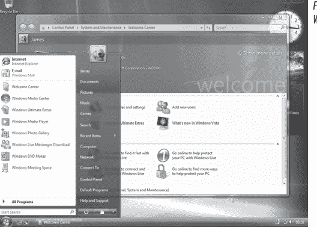
图 1-1：Windows Vista 桌面

Windows 无需过多介绍，其在商业游戏中的重要性也无需证明。在本书探讨的三个平台中，它是最知名且最普及的。作为一个类别，它由一系列版本组成，据 2004 年估计，全球约 90% 的客户端市场在使用它，而 2007 年这一比例达到了 92.86%。尽管这些统计数据可能具有误导性，并且可能会高估 Windows 的主导地位（正如我们将看到的），但它仍然是目前大众消费者可用平台中占据绝对主导地位的一个。Windows 的第一个版本（Windows 1）于 1985 年问世，其后代可以追溯到 Windows 95、98、Me、XP（在撰写本书时仍是最广泛使用的版本）以及较近的（且具有争议的）Windows Vista。毋庸置疑，由于 Windows 以显著优势成为最广泛使用的平台，大多数开发的电脑游戏都会优先确保 Windows 在其支持的平台之列。

> **注意。** 本书假设读者已熟悉 Microsoft Windows。因此，本书不讨论如何安装和使用 Windows 的基础知识。

### 1.1.2 Mac OS X

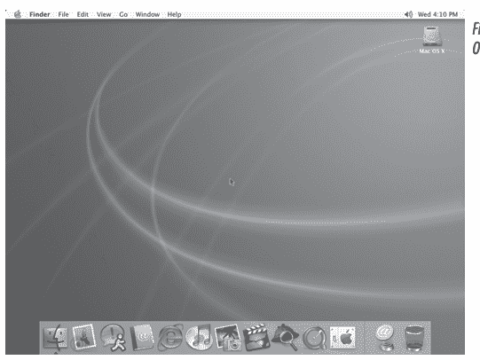
图 1-2：Mac OS X 桌面

*Mac* 一词现在是指一系列计算机，如 MacBook 和 iMac，其中许多配备了 Mac OS X（读作 Mac OS 10）操作系统。每个版本的 Mac OS X 都以大猫命名，包括 Jaguar、Panther、Tiger 以及现在的 Leopard（2008 年发布）。Mac OS 通常预装在 Mac 电脑中，其日益增长的普及率使 Mac 成为游戏的一个重要平台。本书随后的章节将更详细地讨论 Mac 游戏。

### 1.1.3 Linux

近年来，Linux 以几乎前所未有的速度增长，并吸引了来自不同用户和开发群体的浓厚兴趣，预计用户群已超过 2500 万。Linux 是一个受 Unix 启发、开源且免费的操作系统，因此被认为是自由软件。然而，“Linux”现在是一个统称，用于指代一系列基于 Linux 源代码改编的不同操作系统，这些改编版本被分别称为 *Linux 发行版*（Linux distributions 或 distros）。不过，首先需要澄清一些术语，这些将在下面的侧边栏中讨论。

Linux 是一个基础操作系统，是开源且自由的软件，被用作许多其他衍生（发行版）操作系统的起点，这些衍生系统通常也同样是开源且自由的软件。这意味着许多基于 Linux 的发行版是完整的操作系统，可免费下载，并具备媒体播放功能、互联网浏览器软件、办公套件应用等。因此，对于开发者和用户来说，Linux 是一个令人兴奋的平台，因为大多数发行版由社区运行、免费且在不断演进；此外，大多数 Linux 发行版可以与 Microsoft Windows *并存*（alongside）安装。在本章稍后部分将详细讨论如何安装和配置多个操作系统。

接下来，让我们讨论几个 Linux 发行版，特别是那些吸引了日益增长的游戏玩家和开发者社区的发行版。

### 开源与自由软件

Linux —— 以及其他一些软件 —— 被称为 *开源*（open-source），这指的是软件设计的开放性，或者说开发者和用户同样能够访问软件的源代码，从中学习并对其进行修改的能力。因此，开源软件是指公开其源代码的软件，像一本打开的书一样揭示其内部运作机制，并允许审查和调查。

Linux 也被说是 *自由软件*（free software），这与免费软件（free of price）不同。免费软件是指在使用时不需要支付金钱费用。免费软件（但不是“自由软件”）的例子包括：Internet Explorer、avast! Anti-Virus 家庭版以及 Opera 浏览器。另一方面，自由软件通常也是免费的，但其含义远不止于此。根据自由软件基金会 ([http://www.fsf.org](http://www.fsf.org)) 的定义，软件要成为自由软件，必须向用户提供以下四项“自由”：

- 1. 为任何目的运行该软件的自由。也就是说，用户可以自由选择如何使用他们的软件。
- 2. 研究软件并将其改编以适应用户需求的自由。这实际上意味着软件必须是开源的。
- 3. 将软件副本重新分发给其他用户的自由，无论是否收费。
- 4. “改进”程序并将更改发布回社区供他人使用的自由。这一条件依赖于前三个条件的满足。

自由软件的例子包括 GIMP（照片编辑程序）、Firefox 浏览器和 Blender 3D。其他自由软件列在 [http://directory.fsf.org/](http://directory.fsf.org/) 中，该网站由自由软件基金会和联合国教科文组织（UNESCO）维护。

#### 1.1.3.1 Ubuntu

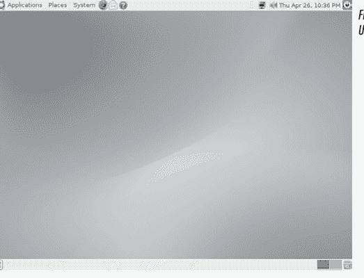
图 1-3：Ubuntu 桌面

Ubuntu 通常被认为是增长最快的面向桌面的 Linux 发行版，其名称源自撒哈拉以南的人文主义思想，倡导开放、平等和人与人之间的关系。Ubuntu 发行版由 Canonical Ltd. 所有并由社区开发，是开源且自由的软件，具备媒体播放器、浏览器、办公套件、照片编辑软件、电子邮件功能以及一个全面的其他自由软件下载数据库。2007 年，Linux DistroWatch ([http://www.distrowatch.com](http://www.distrowatch.com)) 将 Ubuntu 列为网上“搜索量”最高的 Linux 发行版，它在用户中的普及反映了 Ubuntu 开发者为确保其易于使用且兼容多种硬件而做出的努力。Ubuntu 的网站是 [http://www.ubuntu.com](http://www.ubuntu.com)，可以在那里免费下载 CD 安装镜像。

Ubuntu 在吸引大量游戏玩家方面或许在所有发行版中是独一无二的；因此，与其他 Linux 发行版相比，Ubuntu 社区中可用游戏的数量呈现出令人兴奋且相对快速的增长。本章随后的部分将讨论目前可用的一些热门跨平台游戏。总体而言，Ubuntu 在过去几年中证明了自己是一个受欢迎的发行版，也是 Linux 游戏平台的一个重要竞争者。因此，在本书随后的章节和部分中将对其进行更详细的讨论。

### 下载并刻录 Ubuntu ISO 文件

Linux Ubuntu —— 就像许多应用程序一样 —— 可以下载为 ISO（光盘镜像文件）CD/DVD，这是一个包含光盘全部内容的存档文件，类似于 ZIP 文件包含其他文件。ISO 的内容可以使用大多数 CD 刻录软件直接刻录到光盘上，例如专门用于刻录 ISO 的 InfraRecorder 应用程序。InfraRecorder 可以从 [http://infra-recorder.sourceforge.net/](http://infra-recorder.sourceforge.net/) 免费下载。刻录 Ubuntu ISO 的步骤如下：

- 1. 从 Ubuntu 官方主页下载 Ubuntu ISO 镜像。
- 2. 从 [http://infrarecorder.sourceforge.net/](http://infrarecorder.sourceforge.net/) 下载并安装 InfraRecorder。
- 3. 插入一张空白 CD/DVD，从 InfraRecorder 的主菜单中选择 **Actions | Burn Image**。然后选择 Ubuntu 镜像文件。

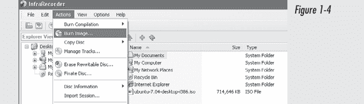
图 1-4

- 4. 选择较低的 CD 写入速度（以降低刻录错误的风险）并点击 **OK**。

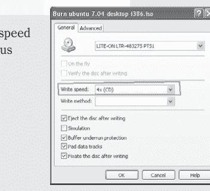
图 1-5


#### 1.3.3.2 SLAX

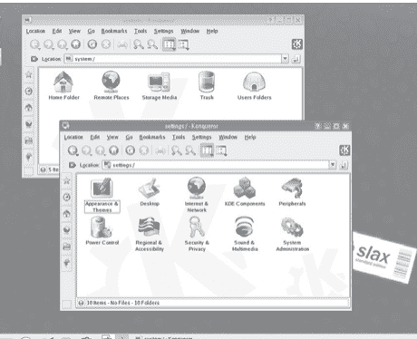
图 1-6：SLAX

SLAX 就像是一个微型操作系统，它之所以重要且有别于其他基于 Linux 的发行版以及其他操作系统，是因为它将自己定位为一个便携的、口袋大小的操作系统，既强大到足以作为桌面环境，又小到足以装入一个 USB 闪存盘中。它是一个流畅的操作系统，用户可以随身携带，在任何地方插入任何计算机并启动使用，无需永久安装，且仅在 USB 盘留在端口时有效。

虽然 SLAX 不像 Ubuntu 或 Freespire 等发行版那样普及，也没有成为大量游戏玩家迁移的焦点，但由于其独特性和简洁性，它仍然是一个日益受欢迎的发行版。因此，SLAX 具有成为“随行玩家”平台的有趣潜力——即那些随身携带游戏并希望在任何机会出现时、无论可用计算机是什么，都能恢复游戏的人。可以在 http://www.slax.org/ 免费下载多个 SLAX 版本。

#### 1.3.3.3 Freespire

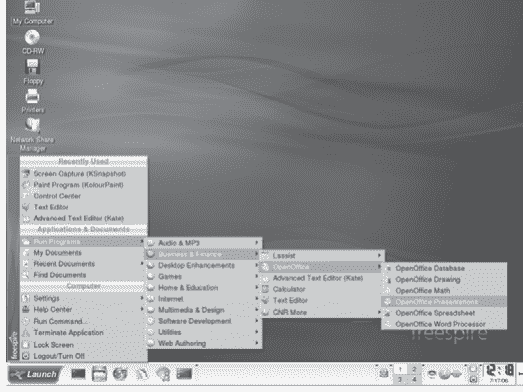
图 1-7：Freespire

Freespire 基于 Ubuntu，是开源的且由自由软件组成，尽管它也向用户提供了一系列非自由软件（这一点存在争议）。一些人认为 Freespire 是 Linux 发行版中最像“Windows”的一个，并被誉为那些从 Windows 平台迁移的用户进入 Linux 的第一步。

但 Freespire 也是一个完整且令人兴奋的发行版，提供无线网络、办公套件、浏览器和媒体播放功能，并拥有一个不断增长的游戏玩家和游戏开发人员社区。本书将不再进一步讨论它，但建议读者进一步研究该发行版。它可以从 http://www.freespire.org 下载。

## 1.2 跨平台游戏

跨平台游戏潜在地可以在 Windows、Linux 和 Mac 上运行。本节将探讨一些完整版本、开源且可免费下载和游玩的跨平台游戏。

### 1.2.1 韦诺之战 (The Battle for Wesnoth)

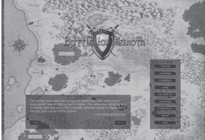
图 1-8：韦诺之战

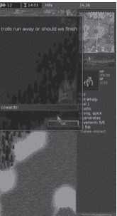
图 1-9

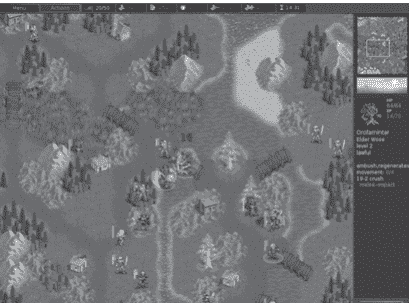
图 1-10

《韦诺之战》支持 Windows、Linux 和 Mac，是一款基于六角格地图的跨平台开源免费回合制策略游戏。多名玩家，或单名玩家与计算机 AI，轮流在森林和沙漠等幻想环境中战术性地部署神话生物和单位，通过相互战斗来完成战役。

该游戏使用 C++ 开发，并使用了一系列跨平台游戏开发工具包（包括稍后解释的 SDL）以确保与多个操作系统的兼容性。除了支持 Windows、Linux 和 Mac 之外，它还声称支持其他操作系统，包括 AmigaOS 4, BeOS, FreeBSD, NetBSD, OpenBSD, Solaris, RISC OS 和 GP2X。《韦诺之战》可以从 http://www.wesnoth.org/ 下载。

### 1.2.2 OpenArena

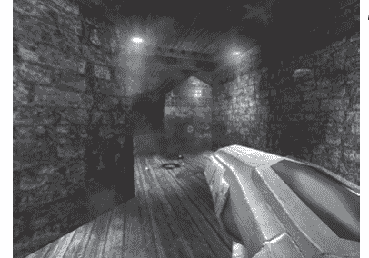
图 1-11：OpenArena

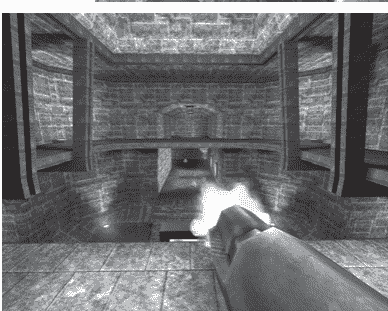
图 1-12

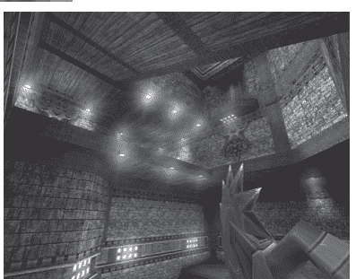
图 1-13

《雷神之锤竞技场》(Quake Arena) 和《虚幻竞技场》(Unreal Tournament) 的粉丝可能会很高兴地知道，有一款名为 OpenArena 的免费、开源且跨平台的 FPS 竞技游戏。OpenArena 基于 Quake III 引擎，以巨炮和大场景为特色，一名或多名玩家与 AI 对手在其中激烈战斗，直到成为最后的幸存者。OpenArena 支持包括 Windows、Linux 和 Mac 在内的多种平台，可从 http://www.openarena.ws/?about 下载。

### 1.2.3 UFO: Alien Invasion

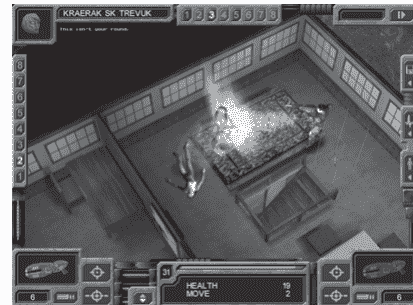
图 1-14：UFO: Alien Invasion

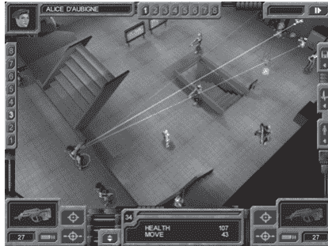
图 1-15

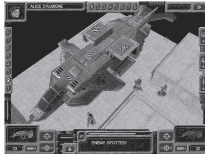
图 1-16

这款免费、开源的游戏 $\text{UFO: Alien Invasion}$ 受到旧的 X-COM 策略游戏系列以及后来的 $\text{UFO: Aftermath}$ 等游戏的启发，讲述的是保护地球免受外星人入侵的故事。玩家指挥一支旨在拯救星球的准军事救援部队，必须建立总部，部署特工队伍以拦截 UFO，并帮助科学家团队对捕获的外星技术进行逆向工程。

$\text{UFO: Alien Invasion}$ 是一款庞大且复杂的回合制策略游戏，支持 Windows、Linux 和 Mac OS X。它主要使用 OpenGL 开发，OpenGL 是一个用于创建快节奏、前沿 3D 游戏的 SDK（软件开发工具包）。本书稍后将详细解释 OpenGL。$\text{UFO: Alien Invasion}$ 可从 http://ufoai.ninex.info/ 下载。

### 1.2.4 Shockwave 和 Flash 游戏

网络上充斥着 Shockwave 和 Flash，这是 Adobe 开发的两种跨平台技术，用于在网页中嵌入多媒体内容（从图形到声音），也可以作为独立的执行文件分发。Shockwave 和 Flash 为开发者提供了一套易于使用的工具，用于制作*动画*和*交互式*内容，因此成为了新一代在线游戏开发者创建游戏的流行选择。

$\text{Diner Dash}$、$\text{Home Run Rally}$、$\text{The 13th Doll}$ 和 $\text{Samorost}$ 只是使用 Shockwave 或 Flash 开发的数千款在线游戏中的一小部分，更多此类游戏可以在 http://www.shock-wave.com 找到。本书稍后将重点讨论 Shockwave，并解释 Shockwave 游戏与使用其他技术开发的游戏有何不同，以及这种差异给游戏开发者和玩家带来了哪些优势和局限。关于 Flash 和 Shockwave 的更多信息可以在 Adobe 官网 http://www.adobe.com 找到。

## 1.3 准备进行跨平台开发

总而言之，游戏所设计的操作系统被称为目标平台；而“跨平台”游戏是指可以在*两个或多个不同*种类的目标平台（如 Windows、Linux 或 Mac OS X）上执行的游戏。跨平台游戏的例子包括《韦诺之战》、$\text{Diner Dash}$ 和 OpenArena 等数以千计的游戏。

对于希望开发跨平台游戏的开发者来说，这意味着每位开发者在将最终产品发布给该平台用户之前，必须拥有在每个目标平台上测试游戏 Bug 的设施（硬件和软件）。换句话说，如果开发者为 Windows 和 Linux (Ubuntu) 创建了一款跨平台游戏，那么该开发者必须同时具备在这些平台上测试游戏的设施。

跨平台游戏开发——即在多个平台上开发和运行同一个游戏的能力——主要可以根据开发者的预算和偏好通过三种方案来实现。我们将快速浏览每一种方案，然后进一步详细讨论。

- **多台计算机** —— 最明显但最昂贵的设置可能是购买多台计算机，每个平台一台，并在每台机器上安装相应的操作系统。这通常被认为是一种“保持简单”的方法，它在操作系统和硬件之间提供了一种简单直接的 1 对 1 对应关系（一台机器，一个操作系统），每个操作系统完全控制一台机器。在这种设置下测试游戏意味着在每台机器上安装、编译并运行游戏。

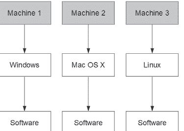
图 1-17：*多机方案图*

- **多重启动 (Multiple booting)** —— 普遍被认为是最便宜但最复杂的方法是在一台机器上创建一系列硬盘分区，并将每个操作系统安装在不同的分区上，在系统上电时从菜单中选择要启动的操作系统。简而言之，计算机开启后，用户选择本次会话要使用的操作系统。这意味着每次需要更换操作系统时都必须重启机器。

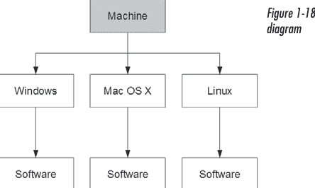
图 1-18：多重启动方案图

- **虚拟化 (Virtualization)** —— 在线百科全书 Wikipedia 将“虚拟化”定义为“计算机资源的抽象”以及“隐藏计算资源物理特性的技术”。然而，就跨平台游戏而言，虚拟化可以被认为是一种允许在单台机器和单个操作系统内部模拟（或仿真）其他机器和平台的软件形式。因此，虚拟化可以说是最简单、最便捷的跨平台解决方案，因为只需在单台机器上点击一个按钮，就可以运行和模拟多个机器和操作系统（包括在不同窗口中同时运行多个平台），而无需在更换操作系统之间重启。


**图 1-19：** 虚拟化示意图

### 1.3.1 多重启动

在多重启动设置中，两套或多套操作系统共存于同一台机器上。更准确地说，每个操作系统都被安装在同一台机器的不同硬盘分区中，用户在开机时仅选择其中一个操作系统用于单次会话。本书重点讨论在机器上安装 Windows 和 Linux 的双启动；即安装 Windows XP 或 Windows Vista 以及 Linux (Ubuntu)。本逐步指南进一步假设，用于配置多重启动的计算机在开始时拥有一个干净的硬盘（即未安装任何操作系统），并且用户拥有 Windows (XP 或 Vista) 和 Ubuntu 的可启动 CD/DVD 或可启动 USB 版本。关于如何清理计算机（如何格式化硬盘）的说明，请参阅以下侧栏。

### 格式化硬盘

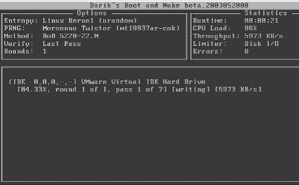
图 1-20：Boot and Nuke

从一台空白机器（空硬盘）开始意味着要清除现有数据，这通过格式化来实现。然而，在格式化之前，建议读者注意 *格式化前硬盘上存在的所有数据可能会不可恢复地丢失*。因此，强烈建议将所有数据存档并备份到安全的存储设备中。例如，可以将数据刻录到 CD/DVD 或复制到 USB 闪存盘中。

格式化过程会删除硬盘上的所有数据，使其处于空白且新鲜的状态，以接收新的操作系统和信息。要执行格式化过程，可以使用免费且可启动的 Darik's Boot and Nuke 应用程序。Darik's Boot and Nuke 足够小，可以装在一张旧的 1.44 MB 软盘上，它是许多专门用于格式化磁盘的应用程序之一，可以通过 http://dbnan.sourceforge.net/ 下载，形式为 EXE 文件或可直接刻录到 CD/DVD 的 ISO 镜像。（有关刻录 ISO 文件的更多详细信息，请参阅第 1.1.3.1 节。）

使用此 CD/DVD 启动计算机（换句话说，在将此 CD 插入驱动器的情况下启动计算机）并按照屏幕上的指示操作。在 Boot and Nuke 的命令提示符处，用户可以输入 `autonuke` 命令来格式化连接到计算机的所有可写磁盘。

#### 1.3.2 第 1 步 —— 准备多重启动

对于一台拥有已格式化硬盘（即没有任何信息）的计算机，以下步骤阐述了将多个操作系统安装到硬盘不同分区的过程。这里我们将讨论一种双启动配置，其中包含 Windows XP 和 Ubuntu，或 Windows Vista 和 Ubuntu。安装 Windows XP 的用户应继续执行第 2 步，安装 Vista 的用户可以跳至第 3 步。第 4 步讨论 Linux Ubuntu 的安装，第 5 步讨论双启动配置的最终细节。

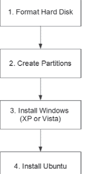
图 1-21：安装示意图

#### 1.3.3 第 2 步 —— 安装 Windows XP

以下步骤阐述了 Windows XP 的安装过程。

- 1. 将 Windows XP CD/DVD 插入 CD 驱动器并重启计算机。
- 2. 根据计算机的配置，引导加载程序可能会自动从 Windows XP CD 启动，或者可能需要提示。如果是后者，请从 CD 启动，Windows XP 安装程序将自动启动。

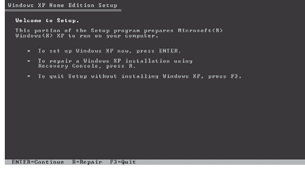
图 1-22：Windows XP 安装设置界面

- 3. 按 **F8** 接受 EULA（最终用户许可协议）。

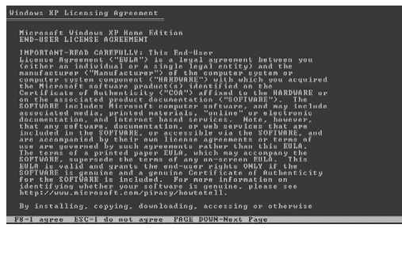
图 1-23：Windows XP 许可协议界面

- 4. 将出现 Windows XP 分区界面，允许用户将硬盘划分为多个分区；也就是说，将磁盘空间划分为独立的驱动器。格式化后的硬盘在安装程序中显示为一段连续的未分区字节序列。按 C 键创建分区。

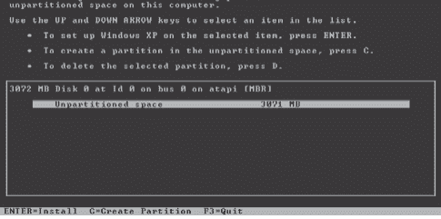
图 1-24：Windows XP 分区界面

- 5. 输入由安装程序创建的分区的兆字节 (MB) 大小。记住，每个分区分配一个操作系统。因此，建议此 Windows XP 分区的大小为可用总容量的一半，因为稍后必须创建另一个分区用于托管 Linux Ubuntu。按 Enter 键完成。

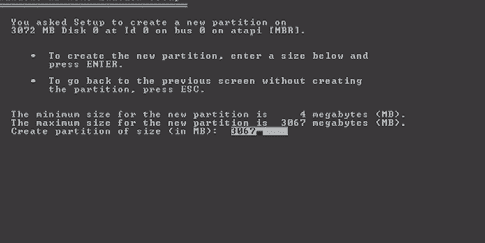
图 1-25：Windows XP 分区确认界面

- 6. 选择该分区，安装程序准备将其格式化为两种文件系统之一：FAT 或 NTFS。选择 FAT（而非 NTFS），以及标准格式（而非快速格式）。选择 FAT 是因为 Ubuntu 能够读写 FAT 分区上的文件，而 Linux 对 NTFS 文件系统的支持较为有限。

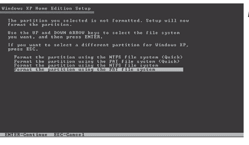
图 1-26

- 7. 当安装程序确认您的选择时，按 **Enter**。

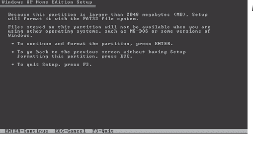
图 1-27

- 8. 安装开始，进度条将显示进度。

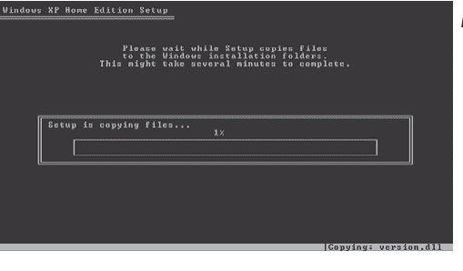
图 1-28

- 9. 在此过程期间和之后，计算机可能会重启一次或多次，但最终会出现 GUI 安装程序。

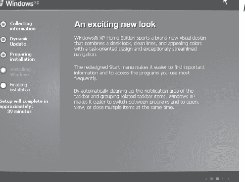
图 1-29

- 10. 出现本地化对话框，提示用户选择本地语言。此选择将影响键盘布局以及 Windows XP 的其他语言风格。点击 **Customize**（自定义）按钮来更改系统语言。默认语言为英语（美国）。

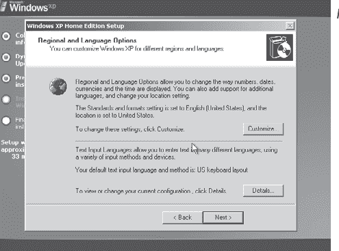
图 1-30

- 11. 根据实际情况输入您的姓名和组织。

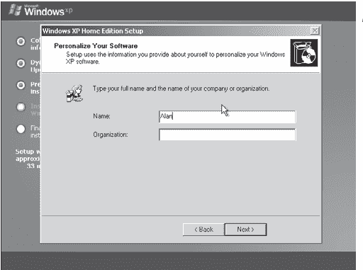
图 1-31

- 12. 输入 Windows XP 产品密钥。

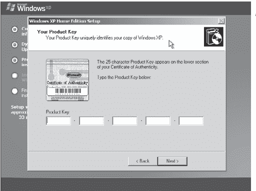
图 1-32

- 13. 选择日期和时间。

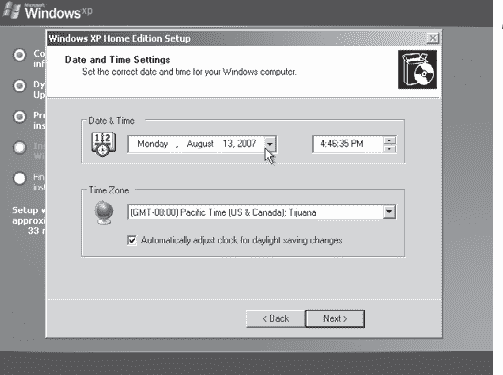

- 14. 除非计算机有特殊要求，否则网络设置选择 **Typical settings**（典型设置）选项。

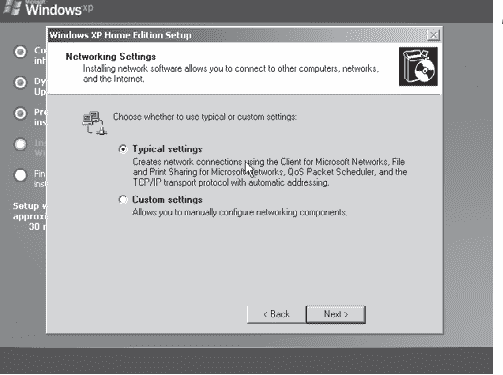

- 15. 计算机可能会重启，然后出现配置向导。点击 **Next**（下一步）。

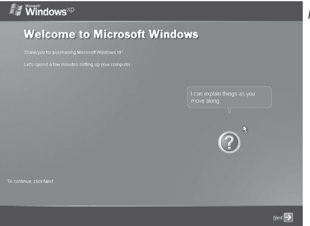
图 1-35

- 16. Windows XP 安装完成。请转到第 4 步。

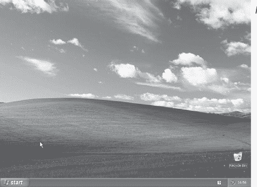
图 1-36

#### 1.3.4 第 3 步 —— 安装 Windows Vista

以下阶段阐述了 Windows Vista 的安装过程。

- 1. 将 Windows Vista DVD 插入 DVD 驱动器并重启计算机。
- 2. 根据计算机的引导加载程序和配置，Windows Vista 安装程序可能会自动开始，或者可能需要提示。如果是后者，请从 DVD 启动，安装随即开始。

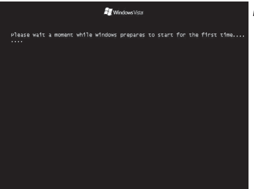
图 1-37

- 3. 设置语言设置（默认：英语（美国）），然后点击 **Next**（下一步）。

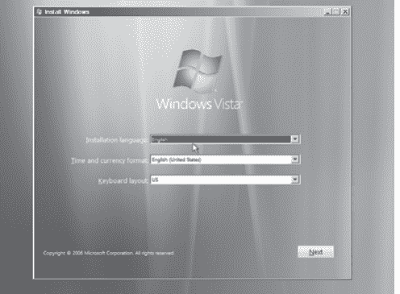
图 1-38

- 4. 点击 **Install now**（现在安装）。

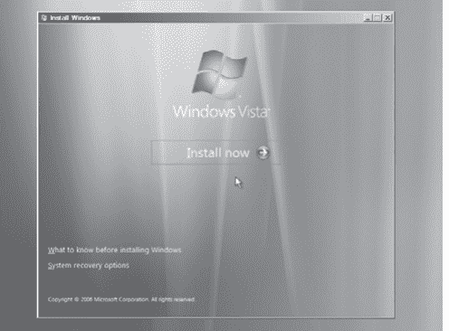
图 1-39

- 5. 输入产品密钥并点击 **Next**（下一步）。

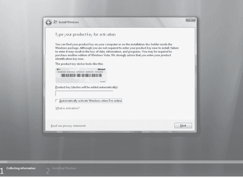
图 1-40

- 6. 勾选复选框以接受 EULA（最终用户许可协议），然后点击 **Next**（下一步）。

- 7. 将出现 Windows Vista 分区界面，允许用户将硬盘划分为多个分区；也就是说，将磁盘空间划分为独立的驱动器。格式化后的硬盘在安装程序中显示为一段连续的未分区字节序列。点击 **New**（新建）按钮创建新分区，并输入由安装程序创建的分区的兆字节 (MB) 大小。记住，每个分区分配一个操作系统。因此，建议此 Windows Vista 分区的大小为可用总容量的一半，因为稍后必须创建另一个分区用于托管 Linux Ubuntu。点击 **OK**。如果需要，安装程序将格式化该分区。


8. 验证安装设置后，点击**Next**（下一步）。

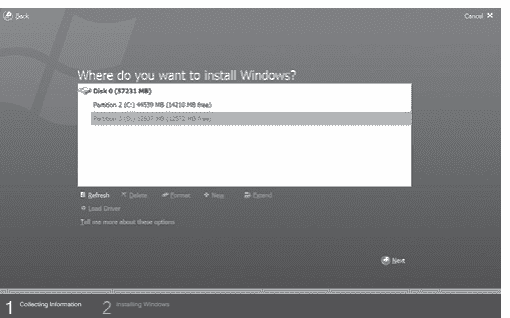
图 1-41

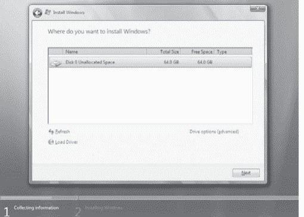
图 1-42

9. 安装进度窗口出现，概述安装步骤。


图 1-43

10. 安装完成后，计算机可能会重启一次或多次，最后出现用户详情对话框。输入用户名和密码，并选择一个个人资料图像。点击**Next**（下一步）。

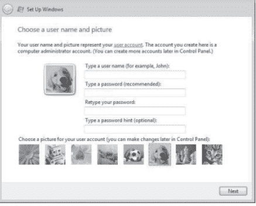
图 1-44

11. 输入计算机名称，点击**Next**（下一步）。

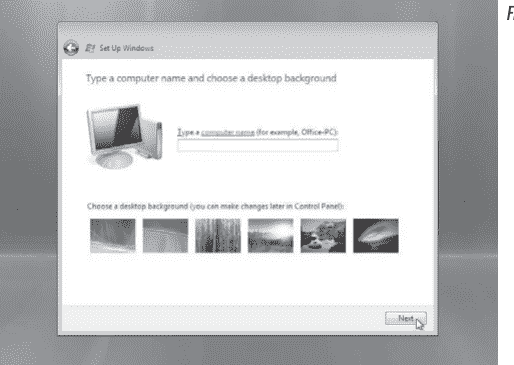
图 1-45

12. 为 Internet 和保护配置选择**Use recommended settings**（使用推荐设置）选项。

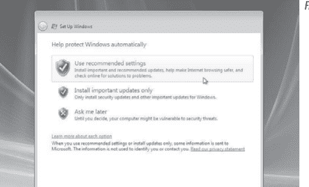
图 1-46

13. 输入时间和日期详情，点击**Next**（下一步）。

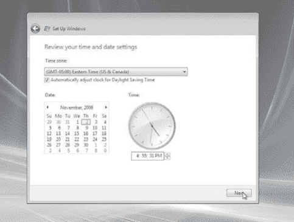
图 1-47

14. 点击**Start**（开始），安装完成。请转至步骤 4。

#### 1.3.5 步骤 4 — 安装 Linux Ubuntu

以下步骤演示了 Linux Ubuntu 的安装过程。

> **注意。** 下载的 Ubuntu ISO 通常通过 CD/DVD 刻录并安装；不过，也可以使用 WUBI（一种专门为 Ubuntu 设计的基于 Windows 的 ISO 安装程序）直接从 ISO 文件安装 Ubuntu。WUBI 可在 http://wubi-installer.org/ 免费下载。

- 1. 将 Ubuntu CD（在 1.1.3.1 节中创建）插入 CD-ROM 驱动器并重启计算机。
- 2. 从菜单中选择**Start or install Ubuntu**（启动或安装 Ubuntu）选项，Ubuntu 将在 Live 模式下启动。

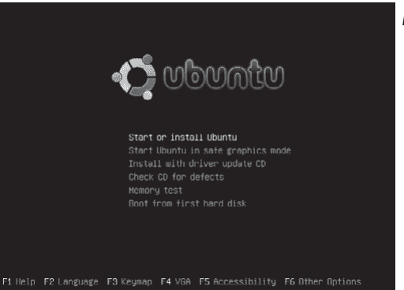
图 1-48

- 3. Ubuntu Live 模式旨在作为一种“试驾”或“无义务，安装前试用”模式，允许用户检查、预览和使用 Ubuntu 的功能而无需承担安装义务。由于 Live 模式不会在计算机上安装任何内容，用户可以安全地重启，而不会发生任何配置更改。要永久安装 Ubuntu，双击桌面上的**Install**（安装）图标并选择一种语言。然后点击**Forward**（前进）。

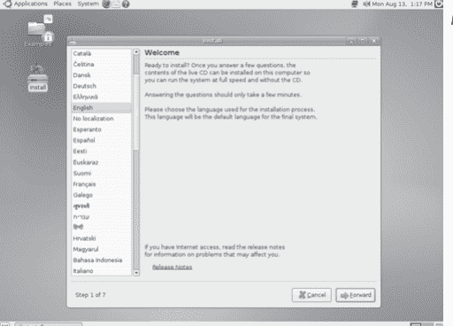
图 1-49

4. 从下拉列表中选择一个位置，或在世界地图上点击选择，然后点击 Forward（前进）。

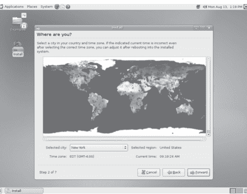
图 1-50

5. 为该操作系统设置本地化，其中包含键盘布局和其他语言样式等功能，然后点击 Forward（前进）。

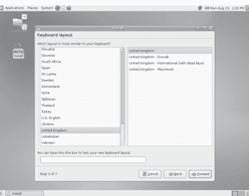
图 1-51

6. 分区设置选择**Manual**（手动）。点击**Forward**（前进）。

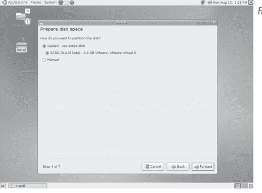
图 1-52

7. 分区管理器允许用户创建、删除和编辑分区。点击**New partition**（新建分区）以创建用于安装 Ubuntu 的新分区。


图 1-53

8. 指定要创建分区的兆字节大小和文件系统格式，并将分区关联到“挂载点”（类似于 Windows 中的驱动器）。点击**OK**（确定）。Linux Ubuntu 的主挂载点是 "/"。下一章将进一步详细讨论 Ubuntu 操作系统。


图 1-54

- 9. Ubuntu 分区管理器还可以用于从任何可用空间创建额外分区（如 Swap 分区）以提高 Ubuntu 的性能。如果需要，请添加额外分区，然后点击**Forward**（前进）。


图 1-55

10. 迁移向导可用于从 Windows 系统导入电子邮件、消息、地址簿和其他信息及设置。通过勾选框选择需要导入的任何信息（如果有），然后点击**Forward**（前进）。


图 1-56

11. 输入您的用户名和密码。点击**Forward**（前进）。


图 1-57

12. 确认安装详情并点击**Install**（安装）。


图 1-58

13. Ubuntu 将进行安装并在完成后重启。请转至步骤 5。


图 1-59

#### 1.3.6 步骤 5 — 多重启动总结


图 1-60

多重启动系统是指在不同分区上安装了两个或更多操作系统的系统，本章中的示例演示了如何配置一台具有 Windows XP 和 Ubuntu 或 Windows Vista 和 Ubuntu 的双启动计算机。重启计算机以测试配置，在启动时会出现 GRUB 引导加载程序菜单，提供启动到 Windows 或 Linux 操作系统的选择。双启动配置现已完成。

### 1.4 虚拟化 — 模拟操作系统

著名的俄罗斯套娃（Matryoshka dolls）内部包含较小版本的自身，而那些较小的娃娃内部又包含更小的副本，以此类推，形成一个逐渐变小的序列。简而言之，俄罗斯人对娃娃所做的，虚拟化对操作系统所做的亦然。通过对计算机硬件进行抽象，虚拟化软件使得宿主操作系统（host OS）能够在自身内部“包含”一个或多个其他客户操作系统（client OS），将每个客户机操作系统（guest OS）模拟为安装并在不同计算机上执行。在现有的各种虚拟化软件中，最著名的两个是 Microsoft Virtual PC 和 VMWare Workstation。

> **注意。** 宿主（Host）是指在用户机器上运行的主操作系统。客户机（Guests）是指使用虚拟化软件在宿主中运行的模拟操作系统。

- **Virtual PC 2007** — Virtual PC 是微软开发的一款虚拟化产品，可供特定版本的 Windows 免费使用，旨在模拟其他操作系统，主要是其他版本的 Microsoft Windows，不过也支持 DOS 和 OS/2 等其他操作系统。Virtual PC 2007 可在以下宿主操作系统上运行：Windows Vista Business, Windows Vista Enterprise, Windows Vista Ultimate, Windows Server 2003 Standard Edition, Windows Server 2003 Standard x64 Edition, Windows XP Professional, 和 Windows XP Tablet PC Edition。

- **VMWare Workstation 6** — VMWare Workstation 是一款虚拟化产品，它不像 Virtual PC 那样以微软为中心，因此它支持更多样化的宿主和客户机操作系统，包括 Windows 和 Linux。然而，与 Virtual PC 不同，VMWare 是一款商业产品，可以通过多种不同的方案购买。VMWare 的评估版本以及关于 VMWare 的更多通用信息可以在 VMWare 网站 http://www.vmware.com/ 找到。本书重点讨论使用 VMWare 的虚拟化。

#### 1.4.1 使用 VMWare


VMWare 桌面是虚拟化的起点。它是创建用于包含客户机操作系统的“虚拟机”的控制中心。为了模拟一个操作系统，VMWare 要求用户创建一个虚拟机（一台模拟计算机），并且通常必须有与客户机操作系统数量相同的虚拟机——每个客户机 OS 对应一台虚拟机。接下来的部分演示了如何使用运行在宿主 OS Windows Vista 上的 VMWare 来模拟 Linux Ubuntu（客户机 OS），不过这些步骤同样适用于以 Windows XP 为宿主的情况。

- 1. 启动 VMWare Workstation。
- 2. 选择 **File | New | Virtual Machine**（文件 | 新建 | 虚拟机）。
- 3. 出现虚拟机向导。点击 **Next**（下一步）。


图 1-62

- 4. 选择 **Typical**（典型）并点击 **Next**（下一步）。


图 1-63


5. 选择要在此虚拟机上运行的客户操作系统（在本示例中为 Linux），并从下拉列表中选择 Ubuntu。点击 **Next**。


图 1-64

6. 输入虚拟机的名称，并选择主机硬盘上的一个文件夹，用于“存放”虚拟机和客户操作系统。这将作为客户操作系统的硬盘（或虚拟磁盘）被“虚拟化”。点击 **Next**。


图 1-65

7. 选择所需的网络选项；这里我们选择了“使用网络地址转换 (NAT)”，它允许客户操作系统通过主机的连接访问互联网。点击 Next。


图 1-66

8. 指定从主机硬盘中扣除并用作该虚拟机虚拟磁盘总容量的兆字节（MB）空间总量。对于运行 Ubuntu 的虚拟机，此容量必须大于 2 GB (2,000 MB)。点击 Finish。


图 1-67

- 19. 虚拟机已成功创建，拥有一个总容量如上一步所述的干净且格式化的硬盘，现在准备安装客户操作系统 Ubuntu。点击 **Close**。

- 20. 从 Ubuntu 网站 (http://www.ubuntu.com/) 下载 Linux Ubuntu ISO 镜像，然后返回 VMware 桌面。

- 21. VMware 桌面列出了新创建的虚拟机，“设备”面板列出了虚拟机的硬件（可进行自定义）。双击 CD-ROM 设备。


图 1-68

- 22. 客户操作系统的 CD-ROM 设备目前默认映射到主机操作系统的 CD-ROM，这意味着每个操作系统将共享该 CD-ROM。此 CD-ROM 也可以分配给 ISO 镜像。要在此虚拟机中安装 Ubuntu，请选择 **Use ISO image**，并使用 Browse 按钮选择下载的 Ubuntu ISO。点击 **OK**。


图 1-69

- 13. 从侧边栏选择 Ubuntu 虚拟机，然后点击 Play 按钮，或者在 Ubuntu 图标上点击鼠标右键并点击 Power-On 来启动虚拟机，它将自动从 Ubuntu ISO 启动。


图 1-70

- 14. 根据 1.3.5 节的说明安装 Ubuntu。

- 15. 客户操作系统现在已安装在虚拟机上。像平时一样关闭客户操作系统以关闭虚拟机，并将 CD-ROM 映射设置从 Ubuntu ISO 还原回本地机器的硬件（如步骤 12 中所述）。现在可以启动虚拟机，将 Ubuntu 作为客户操作系统运行。


图 1-71

## 1.5 结论

本章将跨平台游戏定义为运行在两个或多个不同平台（或类型的操作系统）上的游戏。跨平台游戏的示例包括《Diner Dash》、《The Battle for Wesnoth》、《OpenArena》以及其他数以千计的游戏。游戏可能运行的一些潜在操作系统包括 Windows、Mac OS X 和 Linux；特别是 Linux Ubuntu，与其它 Linux 发行版相比，它吸引了越来越多游戏玩家和开发者的关注。为了开发跨平台游戏，开发者在发布最终产品之前，必须在每个目标平台上编译并测试其游戏。因此，跨平台开发需要一个跨平台环境，开发者必须拥有运行多个平台的设施，可以通过为每个平台维护一台机器、使用多重启动，或使用像 VMware 这样的虚拟化软件在主机操作系统内部模拟客户操作系统来实现。本书假设读者具有 Windows 或 Mac OS X 背景，因此，下一章将更详细地讨论 Linux Ubuntu 以及 Linux 的通用使用方法。

## 第 2 章：Linux Ubuntu 与 Linux 游戏

在上一章中，我们讨论了游戏中常用的各种操作系统平台，以及跨平台游戏及其编程背后的理论。我们还讨论了编程和测试这些游戏所需的各种机器配置，包括多重启动系统和操作系统虚拟化。

本章在跨平台游戏开发领域更进一步，通过进一步探讨 Linux 发行版 Ubuntu 的特性，特别是 Linux 与当代游戏之间的关系，我们将机器设置、多重启动和虚拟化的技术细节留在身后。简而言之，本章主要是 Ubuntu 及其游戏的快速入门指南，主要面向那些只有 Windows 或 Mac 背景并希望了解更多关于 Linux 和 Linux 游戏的用户。

### 2.1 Ubuntu 安装与故障排除

在上一章中，我们讨论了 Linux 发行版 Linux Ubuntu，详细介绍了它是什么、如何下载，以及如何使用从 Canonical, Ltd. (http://www.ubuntu.com) 免费获取的 Ubuntu Live CD 将其安装到系统。Ubuntu 和日益普及的 PCLinuxOS 一样，是一个旨在用于通用家庭和多媒体用途的桌面 Linux 发行版，例如浏览网络、观看电影、听音乐和玩游戏。凭借定期的软件更新和补丁、每半年一次的新版本发布、与 Windows 分区和网络的集成、多媒体编解码器、不断增长的在线社区、对各种硬件和驱动程序日益增加的支持，以及与许多常见 Windows 文件格式（从 Microsoft Office 到 Adobe Photoshop）的兼容性，Ubuntu 有望成为主流的 Linux 游戏平台之一。

上一章解释了标准 Ubuntu 安装的细节。无论此安装是用于单操作系统机器、多重启动机器还是虚拟化配置，安装过程对每种情况都是相同的。本节将更详细地探讨用户在安装 Ubuntu 过程中遇到的一些问题，并以典型的 Q&A（问答）格式提供一些潜在的解决方案和建议。

**问.** 我插入了 Ubuntu CD/DVD，然后在光驱中保留 CD/DVD 的情况下重启计算机，但在系统启动时没有任何反应。系统要么启动到机器上已经安装的操作系统（Windows XP, Vista 等），要么机器除了显示提示符或空白屏幕外什么也没做，可能是因为根本没有安装操作系统。它的表现与 CD/DVD 光驱为空时没有任何不同。

**答.** 这个问题最可能是因为系统的 BIOS（基本输入/输出系统）未配置为在系统启动时从 CD/DVD 启动，或者因为系统连接了多个 CD/DVD 光驱，而它被配置为从其他光驱（而非这一个）启动。如果是后者，通常只需将 Ubuntu CD/DVD 插入不同的光驱然后重启系统即可解决；但如果是前者（或者“更换光驱”方案不起作用），则可能需要重新配置 BIOS，使其首先从 CD/DVD 启动，随后再从其他可启动系统设备（如硬盘、USB 闪存盘等）启动。不同的 BIOS 菜单和选项有所不同，建议读者在编辑 BIOS 设置之前咨询其 BIOS 手册、计算机供应商或硬件制造商。

**问.** 我已经安装了 Windows Vista，现在准备安装 Ubuntu 以实现双启动安排。然而，Windows Vista 安装在系统的主要分区上，且只有一个分区，或者仅存在 NTFS 格式的分区。有什么办法可以在不需要格式化整个硬盘（包括 Vista）并重新开始的情况下，将 Ubuntu 安装到系统吗？我想保留现有的 Windows 安装，只需“添加”一个新分区来安装 Ubuntu。

**答.** 是的，Windows Vista 自带了一个磁盘管理实用程序（可通过“我的电脑 | 管理 | 磁盘管理”访问），该程序旨在动态地将现有或预格式化驱动器的部分空间“压缩”（或切除）为一个单独的分区。只需选择一个可以扣除空间以提供给新分区的驱动器，然后点击“压缩”即可。

**问.** 在 Ubuntu 安装过程中，分区向导向我显示了一个可安装 Ubuntu 的所有磁盘和分区的列表；然而，出现了一些较小尺寸的磁盘，大约 256 MB 或 512 MB 等，这些设备通常被赋予像 /dev/sdb1 或 /dev/sda3 这样的类系统名称。这些是什么？

**答.** 这些设备可能是 USB 内存棒、电视调谐器 USB 设备或照片存储卡；如果是这种情况，那么每一个都可以安全地忽略。

**问.** 在 Ubuntu 安装过程中，分区向导没有显示任何可安装 Ubuntu 的可用硬盘或分区。


**A.** 这个问题可能与软件 RAID 设备有关；或许可以通过使用 Ubuntu 备用安装光盘（Ubuntu Alternate Installation CD）来解决，该光盘可从 Ubuntu 官方网站下载。此光盘不包含 Ubuntu 的 Live 版本，而是提供一个文本界面安装程序，并包含许多额外的实用工具，旨在使“有问题”的机器安装起来更简单。

**Q.** 安装 Ubuntu 后，我无法再启动进入 Windows Vista，可能是因为在系统启动时的启动菜单中不再能选择 Vista 选项。

**A.** 将 Windows Vista DVD 插入驱动器并重启计算机。从 DVD 启动，进入 Vista 设置并选择“修复安装”。突出显示 Vista 分区并运行命令提示符。然后输入以下命令以运行 Microsoft Chkdsk 应用程序并修复错误：

```
chkdsk c: /R
```

### 2.2 了解 Ubuntu

Ubuntu 是一款完全免费、开源且基于 Linux 的操作系统（发行版），用于桌面计算（家庭使用）。因此，它自带了一套捆绑软件，可用于播放电影、聆听音乐、浏览互联网、编辑照片、执行文字处理等办公任务，当然还包括玩游戏。本节对 Ubuntu 预装的许多应用程序进行广泛概述，但无法希望提供一份完整且详尽的 Ubuntu 指南。本章应被视为一个“入门”工具包。

### 2.2.1 Ubuntu 登录


图 2-1：Ubuntu 登录界面

Ubuntu —— 就像某些 Windows 和 Mac 系统一样 —— 从登录界面开始，用户可以在此处输入用户名和密码以进入他们在系统上各自的“区域”。其设计目的是验证用户对计算机的访问权限，并按用户基础将用户创建的文档（如个人照片、电子邮件、文档等）在空间上进行划分。

### 2.2.2 Ubuntu 桌面


图 2-2：Ubuntu 桌面

用户从登录界面登录 Ubuntu 后，操作系统随后启动到“桌面”（类似于 Windows 或 Mac 桌面）。用户可以在此处启动应用程序来浏览网页、检查电子邮件、创建文档、玩游戏等。在 Ubuntu 中，默认情况下，主菜单（启动应用程序的地方）显示为一条横跨屏幕顶部的灰色条，它包含三个菜单项：应用程序 (Applications)、位置 (Places) 和系统 (System)。“应用程序”是已安装且可执行应用程序的菜单，“位置”是通往常见系统位置（如桌面、文档和系统设备）的快捷方式菜单，而“系统”则是包含类似控制面板的应用程序和其他系统管理实用工具的菜单。

### 2.2.3 系统监视器


图 2-3：Ubuntu 系统监视器

系统监视器（System Monitor）类似于 Windows 的任务管理器，是一个实用程序，旨在显示当前运行的所有系统进程列表（从应用程序到库以及其他不可见的例程）。可以通过在系统菜单中选择“系统 | 系统监视器” (System | System Monitor) 来启动。

### 2.2.4 更新管理器


图 2-4：Ubuntu 更新管理器

Windows 和 Mac 都有各自固有的自动化补丁或更新服务，旨在更新已安装的应用程序并修复已知的软件缺陷，范围从琐碎的小问题到安全更新（例如 Windows Update）。Ubuntu 同样提供了一种自动化的在线补丁服务，它首先扫描本地计算机上所有已安装的应用程序，然后在有适当的更新或修复可用时通知用户下载。可以通过双击屏幕右上角的图标访问更新管理器。

### 2.2.5 屏幕和图形首选项与受限驱动管理器


图 2-5：Ubuntu 屏幕和图形首选项

“屏幕和图形首选项”实用工具允许您更改系统分辨率、显示器类型以及安装显卡设备驱动程序。可以通过 Ubuntu 菜单栏选择“系统 | 管理 | 屏幕和图形” (System | Administration | Screens and Graphics) 来访问此实用工具。“受限驱动管理器” (Restricted Drivers Manager) 也可以通过“系统 | 管理”菜单访问，它旨在自动检测图形硬件（如 Nvidia 和 ATI 硬件加速显卡）并为它们安装合适的驱动程序。

### 2.2.6 添加/删除应用程序


图 2-6：Ubuntu 添加/删除应用程序

在 Windows 中，“添加/删除”控制面板实用程序主要用于从系统中删除（或卸载）软件，安装软件则是次要功能，因为大多数软件自带安装程序（通常是安装向导）。但在 Ubuntu 中并非如此。在 Ubuntu 中，“添加/删除”实用工具（可通过菜单栏选择“应用程序 | 添加/删除” (Applications | Add/Remove) 访问）是一个全面且积极维护的、可免费安装的应用程序数据库。使用此实用工具还可以从系统中删除已安装的应用程序。

### 2.2.7 Synaptic 软件包管理器


图 2-7：使用 Synaptic 软件包管理器下载文件

作为高级的“添加/删除”实用工具，Synaptic 软件包管理器可以完成“添加/删除”能做的所有事情，并且功能更多。通过选择“系统 | 管理 | Synaptic 软件包管理器” (System | Administration | Synaptic Package Manager) 即可访问，它是一个包含应用程序和非可执行软件（如库和软件开发工具包 SDK）的综合数据库。正如我们将看到的，这个实用工具对于 Ubuntu 游戏开发人员来说非常重要。

### 2.2.8 Ubuntu 终端/控制台/Shell


图 2-8：Ubuntu 终端

Ubuntu 被称为一个 Linux 发行版，而且像所有发行版一样，Ubuntu 基于 Linux 内核，它是操作系统的核心和灵魂，包含了使事物真正运行的核心基础原语。在这一层级没有图形用户界面 (GUI)；在这一层，操作系统通过 Linux 命令进行通信，这通常在用户眼中是隐藏的。然而，Ubuntu 终端/控制台/Shell 是一个门户，用户可以通过它直接输入命令，并通过一种称为 BASH (Born Again Shell) 的基于键盘的 Shell 语言来控制操作系统。本章将介绍一些基本的 Shell 命令，虽然 Shell 是 Linux 不可或缺的一部分，但本书不会深入探讨 Shell。在本书需要用到 Shell 的情况下，将使用分步指南来突出显示需要输入终端的准确命令。建议希望精通 Linux 的读者熟悉 Linux 终端。

### 2.2.9 位置 | 计算机


图 2-9

可以通过主菜单选择“位置 | 计算机” (Places | Computer) 来访问 Ubuntu 中等同于“我的电脑”的功能。在这里，用户可以浏览所有连接的设备，包括内部和外设，从硬盘和 CD/DVD 驱动器到 USB 闪存盘和数码相机。

### 2.2.10 Firefox 网页浏览器


图 2-10：Firefox

Ubuntu 默认配备了开源、跨平台且免费的网页浏览器 Mozilla Firefox。与 Internet Explorer 类似，该应用程序用于浏览网页、检查电子邮件以及浏览 FTP 服务器。Firefox 既可以通过快捷方式图标启动，也可以通过菜单系统本身通过“应用程序 | 互联网 | Firefox” (Applications | Internet | Firefox) 启动。

### 2.2.11 OpenOffice.org


图 2-11：OpenOffice.org

Ubuntu 配备了免费、开源且跨平台的办公软件套装 OpenOffice.org，它被设计为 Microsoft Office 的替代品，用于创建文档、电子表格、动画演示和基于矢量的图形。OpenOffice.org 还具有极高的 Microsoft Office 兼容性，这意味着许多文档和文件可以轻松地从 Microsoft Office 迁移到 OpenOffice.org。


#### 2.2.12 照片编辑


图 2-12：GIMP

GIMP 是一个著名的 Adobe Photoshop 开源替代品，它也随 Ubuntu 一起发行，为开发者提供了多种照片编辑工具，包括画笔、印章、裁剪、切割、填充和滤镜。在下一章中，GIMP 将被进一步讨论作为一种跨平台游戏开发工具。

#### 2.2.13 在 Ubuntu 上安装并运行游戏


图 2-13：Frozen Bubble

Ubuntu 是一个极具前景的游戏平台，可以通过“添加/删除”应用程序数据库选择大量可用游戏。本节将提供一个逐步指南，介绍如何通过 Ubuntu 终端控制台向系统安装名为 Frozen Bubble 的开源游戏，并在过程中演示一些 shell 命令和系统工具。

> **注意。** Frozen Bubble 提供 Web 版 Java 游戏（网址为 http://glenn.sanson.fre.fr/v2/?select=fb:play），但本教程侧重于可下载的平台特定二进制发行版。

- 1. 从 Ubuntu 桌面开始，通过选择 **系统 | 管理 | 软件源** 启动“软件源”实用程序。该应用程序可以扩展软件数据库以包含额外的软件源。


图 2-14

- 2. 勾选所有软件源，然后点击 **关闭**。
- 3. 从 Ubuntu 主菜单中，通过选择 **应用程序 | 附件 | 终端** 打开一个终端。
- 4. 输入以下命令将 Frozen Bubble 安装到本地机器，每行后按下 Return（回车）键：

```bash
sudo apt-get update
sudo apt-get install frozen-bubble
```


图 2-15

- 5. 下载完成后，关闭终端。现在可以通过 Ubuntu 主菜单选择 **应用程序 | 游戏 | Frozen Bubble** 来运行游戏。


图 2-16

### 2.3 Linux 与 “Transgaming” 技术

针对 Linux 作为游戏平台最常见的抱怨之一是：“我的整个游戏库都是基于 Windows 的，由于我的大多数 Windows 游戏都不是跨平台的，Linux 无法运行我的游戏。” 几年前，这种观点对于大多数 Linux 游戏爱好者来说可能是无可争辩的。问题的核心在于 Linux 无法运行 Windows 游戏，这对于玩家和开发者都很重要。对玩家而言，想要迁移到 Linux 的玩家只有在能继续运行旧的 Windows 游戏或运行 Linux 原生不支持的新游戏时才会这样做。对 Linux 游戏开发者而言，如果 Linux 不支持 Windows 游戏，将很难吸引大量游戏人口迁移到 Linux 平台。因此，Transgaming 应用程序（如 Cedega 和 Wine）被许多人视为一种试图解决 Linux 玩家所面临的平台边界问题的尝试；它们是允许 Windows 游戏在包括 Linux 在内的其他平台上运行的应用程序。

然而，Transgaming 应用程序 *并非* 跨平台游戏。为什么？因为跨平台游戏是指那些能够 *原生* 运行在两种或多种不同操作系统上的游戏，而 Transgaming 技术是一种支持 *平台特定游戏* 的跨平台兼容层，允许这些游戏通过兼容层在其他操作系统上运行（因此在术语上有所区别）。虽然本书主要讨论跨平台游戏，但本节将探讨一些支持 Linux 上 Transgaming 的兼容层（应用程序）。这些应用程序允许 Windows 游戏在 Linux 上运行，特别是 Ubuntu 上。

### 2.3.1 Cedega

Cedega 是一款商业跨平台 Transgaming 应用程序，适用于 Linux 和 Mac，旨在让玩家在这些平台上运行 Windows 游戏。Cedega 支持的部分游戏包括《半衰期 2》(Half-Life 2)、《生化危机 4》(Resident Evil 4)、《极品飞车 ProStreet》(Need for Speed ProStreet) 和《上古卷轴 IV：湮灭》(Elder Scrolls IV: Oblivion)。关于 Cedega 的更多详情可以在其官方网站 http://www.transgaming.com/ 找到。

> **注意。** 有关 Cedega 兼容游戏列表，请访问 Cedega 在线游戏数据库 http://games.cedega.com/gamesdb/。

### 2.3.2 CrossOver


图 2-17：CrossOver

CrossOver 是一款商业兼容层，其目的与其说是专门在 Linux 上支持 Windows 游戏，不如说是通用地在 Linux 和 Mac 上支持 Windows 应用程序（如 Microsoft Office、Photoshop、Director 等）。不过，CrossOver 官方支持 Shockwave Director，用于运行基于 Shockwave 的 Web 游戏和独立游戏。CrossOver 在 Linux 上支持的其他应用程序和游戏包括 Microsoft Office 2003、Photoshop 7.0、《EVE Online》等。关于 CrossOver 的更多详情，请访问其网站 http://www.codeweavers.com/products/。

> **注意。** 有关 CrossOver 兼容应用程序和游戏列表，请访问 CrossOver 在线游戏和应用程序数据库 http://www.codeweavers.com/compatibility/browse/name/。

### 2.3.3 Wine


图 2-18：Wine

Wine 是一款免费、开源且跨平台的流行兼容层，旨在将选定的 Microsoft Windows 应用程序和游戏无缝地运行在其他平台（如 Mac 和 Linux）上（使 Windows 应用程序运行起来就像原生应用一样）。Wine 支持的部分 Windows 应用程序和游戏包括《半衰期 2》(Half-Life 2)、.NET Framework 2.0 和《魔兽世界》(World of Warcraft)。更多信息可以在 Wine 网站 http://www.winehq.org/ 找到。

> **注意。** 有关 Wine 兼容应用程序和游戏列表，请访问 Wine 在线游戏和应用程序数据库 http://appdb.winehq.org/。

#### 2.3.3.1 在 Linux Ubuntu 上安装 Wine

- 1. 从 Ubuntu 桌面开始，通过从 Ubuntu 主菜单选择 **系统 | 管理 | Synaptic 软件包管理器** 启动 Synaptic 软件包管理器。
- 2. 点击搜索按钮并搜索 `wine`。


- 3. 点击列表中出现的 wine 选项以将该软件标记为安装，然后点击“应用”来安装 Wine。安装需要互联网连接。


- 4. Wine 应用程序安装后，可以通过 Ubuntu 主菜单选择 **应用程序 | Wine** 来运行。


图 2-21

### 2.4 使用 Automatix 自动化 Ubuntu

Ubuntu —— 像许多 Linux 发行版一样 —— 是自由软件（免费）且符合 FSF（自由软件基金会）定义的“自由”；因此，它在发行时并不包含某些媒体编解码器和应用程序，特别是那些不符合 FSF “自由”标准的软件。因此，Ubuntu 无法 *原生* 播放某些可能用于游戏的特定媒体编解码器，例如 WMA 或 MP3。不过，有一个可以免费下载的 Ubuntu 应用程序，可用于安装各种流行的媒体编解码器和应用程序。使用 Automatix 下载特定编解码器的法律状态在美国各地区及全球范围内可能有所不同。因此，建议读者查阅 Automatix 关于特定地区状态的文档。

> **注意。** 读者对其下载的内容承担全部责任。

#### 2.4.1 在 Linux Ubuntu 上安装和使用 Automatix

- 1. 从 Ubuntu 桌面开始，使用 Firefox 浏览器访问 Automatix 网站 http://www.getautomatix.com。


- 2. 在 Automatix 主页上，点击 **Installation** 链接以显示安装页面，并下载适用于您 Ubuntu 版本的 `.deb` 安装包。


- 3. 下载完成后，双击 .deb Automatix 安装包，将 Automatix 安装到本地机器。


图 2-24

- 4. 从 Ubuntu 主菜单中选择 **Applications | System Tools | Automatix** 来启动 Automatix。


图 2-25

- 5. Automatix 启动后，可以使用其菜单选择要安装到系统的不同产品。点击 **Start** 按钮开始安装已勾选的项目。


图 2-26

### 2.5 Linux Shell

Ubuntu 作为一个 Linux 发行版是基于 Linux 内核的，内核包含了所有 Linux 发行版共有的 OS 组件，如基础库和底层硬件编程。内核本身并不是一个独立运行的 OS，因为用户不会像使用发行版那样直接下载并将 Linux 内核作为 OS 使用；相反，用户下载并使用基于 Linux 的发行版（如 Ubuntu），它们是与内核在“底层”协同工作的高层封装。Linux 内核和 OS 通常在 GUI 之下通过一系列发送和接收命令来运行。用户可以通过 Ubuntu 终端（Terminal）向 OS 发送命令。本节将进一步探讨 Ubuntu 终端以及一些常用的 BASH shell 命令。

> **注意。** 此时，请从主菜单中选择 Applications | Accessories | Terminal 打开一个 Ubuntu 终端。

### 2.5.1 常用 Shell 命令

- `ls` (list) 命令可能是所有 Linux BASH shell 命令中最常用的。在*终端*窗口的命令提示符下输入后，`ls` 将按行和列以字母顺序返回当前目录下的文件列表，如下图所示。


图 2-27

- `clear` (clear screen) 命令用于清除（擦除）终端窗口中的所有内容。


图 2-28

用户还可以为 Linux 命令添加参数。例如，“--help”会在屏幕上显示详细的帮助信息，包括该命令的详细介绍、用法以及所有可能的参数。请注意，传递给命令的参数前带有连字符 (-) 或双连字符 (--)。--help 参数适用于大多数 Linux 命令。


图 2-29

`cp` (copy) 命令将一个或多个指定的文件或文件夹复制到指定的目标文件夹。该命令接受两个字符串参数：第一个指定要复制的源文件或文件夹的路径或文件名，第二个指定接收复制文件或文件夹的目标位置。


图 2-30

**注意。** 若要以管理员（超级用户）身份运行命令，需要在 `cp` 等通用系统命令前加上“`sudo`”前缀。

- `cd` (change directory) 命令用于将当前目录更改为指定的子目录，而 `rm` (remove) 命令用于从当前目录中删除指定的文件。


图 2-31

**注意。** 包含空格字符的文件名（例如 hello world.bmp）在命令行中应由引号括起来（“`hello world.bmp`”）。

- `mkdir` (make directory) 命令用于在当前目录下创建一个指定名称的新目录。


图 2-32

下表列出了一系列常用的 Linux BASH shell 命令，概括了每个命令的作用，并将其与对应的 DOS 命令联系起来（供熟悉 DOS 命令的读者参考）。

| DOS 命令 | Linux BASH 命令 | 描述 |
|---|---|---|
| ASSIGN | ln | 创建文件或目录的快捷方式链接 |
| CD | cd | 更改目录 |
| CHDISK | du -s | 使用汇总参数检查磁盘使用情况 |
| CLS | clear | 清屏 |
| COMP | diff 或 cmp | 列出任意两个文件内容之间的差异 |
| COPY | cp | 复制文件或目录 |
| DATE | date | 显示系统日期 |
| DEL | rm | 删除文件 |
| DIR | ls | 列出目录内容 |
| DIR \*.\* /o-d | ls -tr | 按修改/创建时间的逆序列出目录内容 |
| DIR \*.\* /v /os | ls -ls | 列出文件及其大小 |
| ECHO | echo | 将变量打印到终端窗口 |
| EXIT | exit | 退出终端 |
| HOSTNAME | hostname | 将计算机的主机名打印到终端窗口 |
| MD | mkdir | 创建目录 |
| MORE | more | 将文件内容分页输出到终端以适应显示 |
| MOVE | mv | 移动文件 |
| MSD | lsdev | 显示系统信息 |
| PING | ping | 检查网络连接 |
| PRINT | lpr | 打印文本文件 |
| RD | rmdir | 删除目录 |
| REBOOT | shutdown -r now | 立即关机并重启机器 |
| SCANDISK | fsck | 检查并修复文件系统 |
| SORT | sort | 按字母或数字顺序对数据进行排序 |
| TIME | time | 显示系统时间 |
| TREE | ls -r | 逆序列出文件 |
| TYPE | cat | 将文件内容输出到终端 |
| WIN | startx | 启动 X server |
| XCOPY | cp -R | 递归复制目录及其所有文件和子目录 |

**提示。** 网上有大量免费的 Linux shell 综合指南和教程，可以通过以下网站找到：

- http://www.usd.edu/~sweidner/lsst/
- http://www.linuxcommand.org/learning_the_shell.php
- http://www.gnu.org/software/bash/manual/bashref.html

#### 2.5.2 使用 Ubuntu 终端和 BASH Shell 命令创建并编译 C 程序

无论游戏是在 Linux、Windows 还是 Mac 上运行，计算机游戏通常使用 C 和 C++ 等语言编写。在 Ubuntu 以及更广泛的 Linux 中，可以通过 shell 完全创建并编译 C 程序。然而，如今大多数游戏开发人员使用 IDE（集成开发环境）而不是终端。一些 IDE 是外观精美的编辑器，配备了编译器、调试器、代码编辑器以及一系列其他功能，使编程更加简单。下一章将介绍跨平台代码编辑器 Code::Blocks。以下步骤演示了如何仅使用键盘和 BASH shell 命令通过 Ubuntu 终端创建、编译并运行一个程序。

- 1. 从 Ubuntu 桌面开始，通过选择 **Applications | Accessories | Terminal** 从 Ubuntu 主菜单启动终端窗口。

- 2. 在终端窗口中输入以下命令进入桌面文件夹：

```bash
cd desktop
```

- 3. 在桌面文件夹中，使用 BASH shell 命令创建一个名为 test.c 的源文件（一个包含简单 C 程序源代码的文本文件），如下所示：

```bash
sudo gedit test.c
```

- 4. 文本编辑器应用程序启动。在文本编辑器中输入以下简单的 C 程序，每当它从终端执行时，都会在终端窗口中打印 “hello world”：

```c
#include <stdio.h>
int main()
{
    int i;
    for (i = 0; i < 10; i++);
    printf("hello world\n");
    return 0;
}
```

- 5. 在*编辑器*中输入完成后，选择 **File | Save** 将文件保存在本地。然后退出 gedit 程序并返回终端。

- 6. 在提示符处输入以下内容，将 C 文件的内容“转储”到终端，以确保内容正确。

`cat test.c`

- 7. 使用以下终端命令编译 C 文件：

`gcc -ggdb test.c -o test`

- 8. 编译成功后，使用以下终端命令运行新编译的程序：

`./test`

## 2.6 结论

本章重点介绍了 Ubuntu 作为操作系统的复杂性，以及 Ubuntu 凭借其轻量、免费和多功能的特点，如何可能成为游戏玩家和游戏开发人员的重要 Linux 发行版。

下一步是研究一些跨平台游戏开发工具，例如 C++ 编程 IDE 和几个图形套件。具体而言，下一章将探讨 Code::Blocks、GIMP、Blender 3D 和 Audacity，由于它们都能在 Windows、Mac 和 Linux 上运行，且均可用于为这三个平台创建游戏，因此可以被视为跨平台工具。


## 第 3 章
## 跨平台开发工具

本书的第一章探讨了“跨平台”的定义，并考察了从 Windows 到 Linux 的各种当代操作系统。第二章为 Linux Ubuntu 提供了初学者概览，特别是侧重于 Ubuntu 游戏和游戏开发。本章秉持“工欲善其事，必先利其器”的理念，因此在开发跨平台游戏这条曲折的道路上迈出第一步：选择（并安装）所有必要的跨平台工具和软件。开发者可以使用数百款开源应用程序来制作跨平台游戏，任何拥有互联网连接的人都可以免费下载。在本章中，我们将讨论其中的四款应用程序：Code::Blocks、GIMP、Blender 3D 和 Audacity。

- **Code::Blocks** —— Code::Blocks 于 2004 年首次发布，是一款开源且免费的 C++ IDE（集成开发环境），支持包括 Windows、Linux、FreeBSD 和 Mac OS X 在内的多种平台。Code::Blocks 具备项目管理、语法高亮和代码补全等大量功能，允许程序员在所有支持的平台上编译 C++ 应用程序。本章将探讨如何在 Windows 和 Linux 上下载、安装和使用 Code::Blocks，但它假设读者已经熟悉 C++ 语言。


图 3-1: Code::Blocks

- **GIMP** —— GIMP 是 Adobe Photoshop 的替代方案，是一款开源且开源免费的图像编辑套件，其功能列表几乎与其开发历史一样长。GIMP 为用户提供了多样化的工具选择，从画笔到高亮工具，专门用于修饰、扫描以及编辑照片和纹理。


图 3-2: GIMP

- **Blender 3D** —— Blender 3D 这一应用程序诞生于 1998 年，自 2002 年起在 Ton Roosendaal 的指导下发展，成为了全球下载量最高的 3D 动画程序，在线百科全书 Wikipedia 估计 Blender 在全球的用户基数超过 80 万。Blender 3D 为电影和游戏制作 3D 动画、模型及其他特效提供了一套极具竞争力的工具集。与 3ds Max、Maya 和 SoftImage 等商业竞争对手不同，Blender 3D 是免费且开源的，并且因参与制作《*蜘蛛侠 2*》、短片《*大象之梦*》以及阿根廷 CG 电影《*Plumíferos*》而进一步声名大噪。Blender 3D 支持 Windows、Mac OS X、Linux、SGI、Irix 6.5 和 Sun Solaris 2.8 平台。


图 3-3: 来自 Blender 3D 的渲染图

- **Audacity** —— 数字音频编辑器 Audacity 旨在用于记录、编辑和导出从不足一秒到完整原声带的音频。Audacity 曾获得 SourceForge.net 颁发的 2007 年度社区选择最佳多媒体项目奖，并且在 2007 年 8 月被 SourceForge.net 排为第 11 个最受欢迎的应用，下载量达 2400 万次。此外，与本章介绍的其他软件一样，Audacity 是开源、免费且跨平台的，支持 Mac OS X、Microsoft Windows 和 Linux。Audacity 将在第 6 章中进行更详细的讨论。


图 3-4: Audacity

### 3.1 Code::Blocks

游戏只是软件的一种形式，就像文字处理器、电子表格、数据库以及像 Internet Explorer 或 Firefox 这样的互联网浏览器一样。然而，无论何种类型的软件，所有软件只有在程序员使用 C++ 等编程语言开发之后才会存在。在开发软件时，大多数程序员会利用其他类型的软件来减轻工作负担。Code::Blocks 就是这样一个软件包。作为一种 IDE（集成开发环境），C++ 程序员使用 Code::Blocks 将源文件管理和整理成有组织的工程，并将源代码编辑并编译成最终的可执行格式，以便用户可以将其作为应用程序独立运行。虽然有多种替代开发环境，包括 Microsoft Visual Studio .NET 和 Dev C++，但本章的重点是 Code::Blocks，并且在讨论本书随后的所有 C++ 代码示例时，均假设读者使用的是该开发环境。原因如下：

- Code::Blocks 具有简洁、易上手且平台无关的界面，可在各平台间映射，因此在每个支持的平台上都同样易于使用。
- Code::Blocks 提供了一套全面的应用程序向导和项目模板，可用于每个新创建的项目。这些模板专门针对在 Code::Blocks 中开始新项目的游戏程序员，这意味着跨平台游戏的源代码和基础架构可以通过几次鼠标点击即可完成生成、配置，并处于可执行和可调整状态。
- Code::Blocks 是开源的，免费且可由任何支持平台且能访问互联网的用户自由下载。
- 跨平台意味着 Code::Blocks 可用于多个平台。Code::Blocks 针对特定平台的每个构建版本被称为一个*发行版* (distribution 或 distro)，例如 Windows 有一个发行版，Linux 有一个发行版，依此类推。因此，使用一个 Code::Blocks 发行版创建和编译的项目通常可以迁移到任何其他发行版并进行编译（交叉编译）。
- Code::Blocks 是一个社区驱动的开源项目，就像许多开源项目一样，它拥有一个繁荣且互助的在线社区。Code::Blocks 定期更新且文档详尽，在线论坛为来自各平台的 Code::Blocks 爱好者提供了一个社交环境。

### 3.2 在 Ubuntu 中下载并安装 Code::Blocks

Code::Blocks 是一款免费的 C++ IDE，可通过 Code::Blocks 官方网站或通过 Ubuntu 终端下载安装在 Linux Ubuntu 上，但不能像许多其他 Ubuntu 应用程序那样通过 Synaptic 软件包管理器安装。以下步骤详细介绍了在 Ubuntu 上安装 Code::Blocks 的过程。

> **提示。** 开发者通常将开源应用程序视为“开发中的作品”，Code::Blocks 也不例外。开发者经常通过添加新功能和修复现有 Bug 来改进它们，有时还会通过新方式提供应用程序。以下 Ubuntu 上的 Code::Blocks 安装指令在编写本书时是有效的，但读者可能更倾向于先检查 Code::Blocks wiki (http://wiki.codeblocks.org/) 上的在线文档。

1. 在一台可以访问互联网的机器上，从 Ubuntu 桌面开始，通过选择 **Applications | Accessories | Terminal** 打开 Ubuntu 终端。

2. 输入以下内容，每行之后按下 **Return**（回车键）：

```bash
sudo apt-get install build-essential
sudo apt-get install gdb
sudo apt-get install libwxgtk2.6-0
sudo apt-get install libwxgtk2.6-dev wx2.6-headers wx-common
sudo apt-get install wx2.6-doc
```

3. 使用以下命令备份软件包源文件，然后按下 **Return**：

```bash
sudo cp /etc/apt/sources.list /etc/apt/sources.list.bak
```

4. 如下编辑源文件：

```bash
gksudo gedit /etc/apt/sources.list
```

根据特定的 Ubuntu 发行版，添加以下相应行，然后保存文档并返回终端：

(edgy main)
```
deb http://apt.tt-solutions.com/ubuntu/
```
或
(feisty main)
```
deb http://apt.tt-solutions.com/ubuntu/
```

5. 输入以下内容，每行之后按下 **Return**：

```bash
wget http://www.tt-solutions.com/vz/key.asc
sudo apt-key add key.asc
sudo apt-get update
sudo apt-get dist-upgrade
sudo apt-get install libwxgtk2.8-0 libwxgtk2.8-dev wx2.8-headers wx-common
sudo update-alternatives --config wx-config
```

6. 退出终端，使用 Ubuntu 浏览器导航至 Code::Blocks 网站 http://www.codeblocks.org/。


图 3-5: Code::Blocks 主页

7. 点击 **Download** 跳转到 Code::Blocks 下载页面，然后从中选择最新的 Nightly Build 选项。Code::Blocks 作为一款应用程序，可以从其官方网站下载两个版本之一：一个是在 2005 年（编写本书时）发布的标准冻结版本，或者是实验性的 nightly “build”（夜间构建版），通常是在过去 24 小时内发布的。在这种语境下，“build”一词是指一个完整且重新编译的 Code::Blocks 版本，其中包含了由...编写的任何修正和 Bug 修复。

开发团队甚至在过去的 24 小时内也在更新。因此，鼓励用户下载最新版本的 Code::Blocks nightly build（每夜构建版）而非冻结发布版，因为前者拥有更多样的功能和错误修复。从网站选择 nightly build 会将用户引导至 Nightly Build 论坛，该论坛的每日主题按日期顺序排列，最新的日期位于顶部，每个主题都提供了一个指向发布当天 Code::Blocks 构建版本的链接。


图 3-6：Code::Blocks 下载页面

- 8. 从论坛中选择可用的最新 nightly build，并将相应的 Ubuntu .deb 软件包文件下载到 Ubuntu 桌面。


图 3-7

- 9. 下载已选的 Code::Blocks 存档集并将所有存档解压到桌面，然后将每个存档安装到系统中。此时 Code::Blocks 已安装完毕，可通过 Ubuntu 应用程序菜单访问。


图 3-8

- 10. 从 Ubuntu 主菜单中选择 应用程序 | 编程 | Code::Blocks 来启动 Code::Blocks。


图 3-9

### 3.3 在 Windows 中下载并安装 Code::Blocks

以下分步指令详细说明了在 Windows 上下载和安装 Code::Blocks 的步骤。

> **提示。** 开源应用程序通常被开发人员视为“进行中”的作品，Code::Blocks 也不例外。开发人员经常通过添加新功能和修复现有漏洞来对其进行更改，有时还会以新的方式提供其应用程序。以下针对 Windows 的 Code::Blocks 安装指令在编写本文时是有效的，但读者可能更倾向于先查看 Code::Blocks wiki (http://wiki.codeblocks.org/) 上的在线文档。

- 1. 从 Windows 桌面开始，启动浏览器并导航至 7-Zip 免费存档主页 http://www.7-zip.org/。选择下载并点击相应链接。7-Zip 是一款免费的开源文件存档应用程序（类似于 WinZip），用于打包和解压缩以下格式的压缩存档：**7Z, ZIP, GZIP, BZIP2, 和 TAR**。由于 Code::Blocks 是以一系列 7Z 存档的形式打包并分发给用户的，因此需要此应用程序。


图 3-10：7-Zip 主页

- 2. 7-Zip 从网络成功下载后，执行其自动安装程序将其安装到本地计算机。

- 3. 启动浏览器并导航至 MinGW C++ 编译器网站 http://www.mingw.org/。Code::Blocks 兼容多种流行的 C++ 编译器，但作为一款应用程序，它在分发时是独立运行的，不含编译器，因此需要单独下载独立的编译器。MinGW 是几个与 Code::Blocks 兼容的软件包之一，它提供了一套免费可用的开源 C++ 编译器和其他工具，用于从标准 C++ 源代码和头文件构建 C++ 应用程序。要从其官方网站下载 MinGW 软件包，请选择 **Download | Installing MinGW**，然后选择自动安装程序。


图 3-11：MinGW 主页

- 4. 运行下载的 MinGW 自动安装程序，点击 **Next** 开始。


图 3-12：*MinGW 下载对话框*

- 5. 选择 **Download and install** 并点击 **Next** 开始在线 MinGW 安装过程，将 MinGW 从网络安装到本地计算机。

- 6. MinGW 安装到本地计算机后，启动浏览器并导航至 Code::Blocks 网站 http://www.codeblocks.org。


图 3-13

- 7. **点击 Download 导航至 Code::Blocks 下载页面，然后从中选择最新的 Nightly Build 选项。有关 Nightly Build 的更多通用信息，请参阅 3.2 节“在 Ubuntu 中下载并安装 Code::Blocks”的步骤 7。**


图 3-14

- 8. 对于每个 Code::Blocks nightly build，应将总共三个文件（均为 7-Zip 格式）下载到本地计算机，具体如下：
    - **wxmsw28u_gcc_cb_wx284.7z** — 包含 Code::Blocks DLL 依赖项 wxWidgets 界面库的 7-Zip 存档。
    - **mingw10.7z** — 包含另一个用于与 MinGW 编译器协作的 Code::Blocks DLL 依赖项的 7-Zip 存档。
    - **CB_rev2_win32.7z file** — 包含 Code::Blocks C++ IDE、文档、应用程序及其它相关文件的 7-Zip 存档。


图 3-15：下载 Code::Blocks nightly build 文件。

- 9. 使用 7-Zip（在步骤 1 中下载），将每个 7-Zip 存档的所有内容提取到本地计算机的同一个文件夹中（例如 C:\CodeBlocks）。


图 3-16：提取存档文件。

- 10. Code::Blocks 现在已安装完毕并准备运行，可以从 Code::Blocks 文件夹中执行，随后 Code::Blocks 应能成功检测到 MinGW 编译器。为了方便起见，用户可以进一步将 Code::Blocks 可执行文件的快捷方式添加到 Windows 开始菜单中。


图 3-17：Code::Blocks 在 Windows 中安装完成

### 3.4 Code::Blocks 入门

总而言之，Code::Blocks 是一款开源、跨平台且免费的 C++ IDE，用于开发 C++ 程序。它包含一个用于创建和修改 C++ 源文件以及将源文件管理至项目中的编辑器；一个用于检测和修复使用 Code::Blocks 创建的应用程序中编译时和运行时错误的调试器；以及一个用于将 C++ 源代码构建为 Code::Blocks 支持的任何目标平台可执行形式的编译器 (MinGW)。此外，Code::Blocks 使用的跨平台 wxWidgets 库来生成其 GUI，这意味着所有 Code::Blocks 的菜单、按钮、对话框和功能在所有支持的平台之间都是映射（对应）的，这使得每个开发人员在不同平台使用 Code::Blocks 的体验在总体上是相同的（至少在理论上如此）。现在让我们来看看开发人员如何使用 Code::Blocks 向导生成新的 C++ 项目。

### 3.4.1 Code::Blocks 项目


图 3-18：Code::Blocks 向导选项

与 Visual Studio .NET 项目类似，Code::Blocks 项目广义上是指 C++ 源文件和头文件的有序集合以及一系列编译器设置（例如使用哪个编译器），它们共同编译成适用于任何受支持 Code::Blocks 平台的可执行应用程序。简而言之，一个 Code::Blocks 项目等于一个应用程序，尽管其他配置也是可能的。使用 Code::Blocks，项目可以从零开始创建为空项目，由开发人员根据需求添加源文件并手动定义编译器设置；或者可以使用 Code::Blocks 向导从一系列预制模板创建指定类型的项目。在这种情况下，每个模板会自动生成包含适当编译器设置和骨架源代码的项目，这些代码是启动该模板旨在构建的任何类型项目（如计算机游戏项目）所必需的。空白项目和基于模板的项目都使用项目向导创建，可以通过 Code::Blocks 菜单的 文件 | 新建 | 项目 访问。以下列出了部分可用的项目模板，特别是与游戏开发相关的模板。

- **Empty project（空项目）** — 通常用于创建没有可用 Code::Blocks 模板的 C++ 项目，该向导创建的是一个不含初始源文件或头文件、采用默认编译器设置的空白命名项目。
- **SDL project（SDL 项目）** — SDL 是 Simple DirectMedia Layer 的缩写，是一个免费、开源的软件开发工具包（或库），用于创建跨平台游戏。Code::Blocks SDL 应用程序向导会生成并配置用于 SDL 的 Code::Blocks 项目（假设 SDL 库已安装在本地机器上）。第 5 章将探讨在 Code::Blocks 中使用 SDL 创建游戏。
- **OGRE project（OGRE 项目）** — OGRE (Object-oriented Graphics Rendering Engine) 是一个免费、开源且强大的 3D 软件开发工具包，主要（但不仅限于）设计用于制作带有着色器和类似效果的实时 3D 游戏。与 SDL 向导类似，Code::Blocks OGRE 向导生成已配置且准备好使用 OGRE 库运行的 C++ 项目，但它假设 OGRE 库（其源文件等）已安装在本地计算机上。第 10 章将探讨在 Code::Blocks 中使用 OGRE 创建游戏。
- **OpenGL project（OpenGL 项目）** — OpenGL (Open Graphics Library) 最初由 Silicon Graphics, Inc. 于 1992 年开发，是行业标准的、跨语言且跨平台的图形渲染架构之一，用于开发具有实时 3D 图形的应用程序，包括游戏、虚拟现实软件和模拟系统。Code::Blocks 提供了 OpenGL 项目向导用于创建 OpenGL 游戏，不过本书不会更详细地讨论 OpenGL 项目向导或 OpenGL。


### 3.5 跨平台 "Hello World" 应用程序

著名的 “Hello World” 应用程序的功能仅仅是在屏幕上打印出其标题所暗示的内容，这通常是新手程序员创建的第一个程序。因此，出于某种习惯，我们将使用 Code::Blocks 为 Ubuntu 和 Windows 创建一个跨平台的 “Hello World” 应用程序。那些更具反叛精神的读者可能会选择打破传统，打印一些不同的内容！Hello World 项目最初可以在 Windows 或 Ubuntu 版本的 Code::Blocks 中创建并编译，随后迁移到另一个版本中编译，从而从同一源代码创建两个二进制分发版本，每个平台一个。本书将首先在 Windows 的 Code::Blocks 中启动 Hello World 项目，随后迁移到 Ubuntu，具体步骤如下所示。

- 1. 从 Windows 桌面开始，启动 Code::Blocks，并从应用程序向导（Application Wizard）中创建一个新的 **Console project**（控制台项目）。然后选择 **Create a new project**（创建新项目）链接。


图 3-19：选择

- 2. 输入项目详细信息，包括项目名称以及保存相关源文件的有效本地路径。点击 **Next**（下一步）。


图 3-20

- 3. 点击 **Next**（下一步）接受默认的编译器设置。


图 3-21

现在生成了一个包含源代码的 Hello World 项目，如下所示：

```cpp
#include <iostream>

using namespace std;

int main()
{
    cout << "Hello world!" << endl;
    return 0;
}
```

- 4. 从 Code::Blocks 主菜单中选择 **Build | Run**（构建 | 运行），或点击 Code::Blocks 工具栏上的 **Build**（构建）图标，以编译并执行 Hello World 项目。


图 3-22：Windows 中的 Hello World! 项目


图 3-23：Ubuntu 中的 Hello World! 项目

### 3.6 图形与 GIMP

GIMP (GNU Image Manipulation Program) 最初由 Spencer Kimball 和 Peter Mattis 于 1995 年创建，随后在基于 UNIX/Linux 的系统上发布。它通常被认为是流行的 Adobe Photoshop 的免费、跨平台且开源的等价软件，是一款用于编辑、修饰和重新制作照片或 2D 图像（位图、.png、.jpeg 等）的应用程序。GIMP 的跨平台性体现在它支持 Windows、Linux、Mac、FreeBSD 和 Solaris。GIMP 迅速成为最受欢迎且广泛使用的图像编辑工具之一，成为了包括 Ubuntu、Mandriva、SUSE 和 Fedora 在内的多种 Linux 发行版的标准（默认）图像编辑器。GIMP 对于跨平台游戏开发非常有用，因为开发人员可以使用它来执行至少以下任务：

- 使用 GIMP 的画笔、墨水、印章和其他编辑工具修饰纹理和其他游戏内图像。它不仅可以用于照片，还可以用于来自 Blender 3D 等 3D 软件的 2D 渲染图（在 3.7 节中详细讨论）。
- 与 3D 渲染软件或实时 3D 游戏协作，开发人员经常使用 GIMP 创建可以纹理映射到 3D 对象上的“无缝”可平铺纹理。无缝纹理是指其相对边缘（左与右，上与下）完全相同，从而使得纹理可以在 3D 表面（如立方体面或墙壁）上重复（或平铺，或并列）而不会在任何两个平铺块或两次重复的边缘连接处出现线条或断裂。随机纹理则是其像素由亮度、对比度和颜色的随机组合而成的纹理。


图 3-24：精选的可平铺纹理

- 定义图像 Alpha 通道和透明度。具有透明或半透明区域的图像通常使用 Alpha 通道。*Alpha 通道* 是隐藏在图像内部的一个独立画布（或图像），其像素宽度和高度与图像可见的标准层相等。Alpha 通道的像素只能是灰度，范围从黑色到白色或其间的任何色调。Alpha 通道的像素与主图像中的像素 1:1 映射，每个像素的颜色决定了主图像中对应像素的透明度：黑色 = 透明，白色 = 不透明，灰色 = 50% 透明，依此类推。


图 3-25：带有 Alpha 通道的图像

### 3.6.1 在 Windows 或 Mac 上安装 GIMP

GIMP 在 Ubuntu 中是预装的，可以通过主菜单的 Applications | Accessories | Graphics | GIMP 访问。本节说明如何在 Windows 或 Mac 平台上安装 GIMP。

- 1. 从桌面开始，使用浏览器导航到 GIMP 主页。
    - Windows 版：http://www.gimp.org/
    - Mac 版：http://wilber-loves-apple.org/
- 2. 从主页将 GIMP 安装包下载到本地计算机。
- 3. 下载完成后，运行 GIMP 安装程序。

### 3.6.2 使用 GIMP

本节将提供 GIMP 的概述，并演示如何执行游戏开发中遇到的一些常见任务。关于 GIMP 的更详细教程和指南可以在以下网址找到：

- http://docs.gimp.org/
- http://wiki.gimp.org/gimp/
- http://www.gimp.org/tutorials/
- http://www.gimp-tutorials.com/

#### 3.6.2.1 使用 GIMP 创建可平铺纹理

可平铺纹理是指那些可以无缝重复的图像，就像浴室或厨房的瓷砖一样，在平面上按行和列一个接一个地排列。为了让任何瓷砖都能“无缝”重复（在任何两个并排的瓷砖连接处没有可见的边缘），瓷砖边缘的像素必须与其相对边缘（左与右，上与下）的像素相同或“可连接”。以下分步步骤详细说明了如何使用 GIMP 创建无缝图像。

- 1. 启动 GIMP 应用程序，创建一个新的空白图像，宽度 300 像素，高度 300 像素。


图 3-26：创建新图像。

- 2. 使用画笔、填充或画笔工具用随机像素填充图像。图 3-27 中的示例图像仅用于演示目的；大多数开发人员将处理从磁盘文件中加载的有意义的图像。


图 3-27：用随机像素填充图像。

- 3. 从主菜单中选择 **Filters | Map | Make Seamless**（滤镜 | 映射 | 使之无缝）使图像无缝。


- 4. 通过创建一个宽度和高度为原图数倍的新图像，然后将较小的原图复制并粘贴三次到大图像中，将瓷砖排列成网格，来测试无缝平铺效果。


#### 3.6.2.2 使用 GIMP 编辑图像透明度

本节重点介绍如何使用 GIMP 的图像 Alpha 通道（或图层掩码）使 GIMP 图像的某些区域变为透明或半透明。

- 1. 启动 GIMP，从主菜单选择 **File | New**（文件 | 新建），创建一张宽度 600 像素、高度 600 像素的新图像。


- 2. 导入一张图像，或绘制一个带有后续将变为透明区域的设计或图案（如图 3-31 所示）。


- 3. 要为当前图像添加 Alpha 通道，请从主菜单选择 **Layer | Mask | Add Layer Mask**（图层 | 掩码 | 添加图层掩码）。


图 3-32：选择添加图层掩码。

- 4. 在 **Add Layer Mask**（添加图层掩码）对话框中，选择 **White (full opacity)**（白色-全不透明）使图像层完全不透明。


图 3-33：选择白色（全不透明）。


5. 通过点击图层面板中的白色缩略图来选择新的图层蒙版。


图 3-34：选择白色图层蒙版。

6. 之后，使用标准的 GIMP 绘画工具将透明度数据绘制到图像中。请记住，黑色像素将变为透明，白色像素将是不透明的，而 50% 的灰色像素将是 50% 的透明度。


图 3-35：开始绘制你想要透明的区域。

7. 最后，将图像保存为支持透明度的图像格式，例如 .bmp、.tga 或 .png。

### 3.7 Blender 3D

与 GIMP 一样，Blender 3D 也是免费、跨平台且开源的。Blender 3D 经常被拿来与商业 3D 渲染和动画软件（如 Autodesk 的 3ds Max、LightWave 和 Maya）进行有利地比较，这些软件在游戏开发人员中都很受欢迎。Blender 3D 支持多种不同的平台，包括 Windows、Mac、Linux、FreeBSD、Solaris 和 IRIX，是一个综合性的 3D 渲染套件，旨在创建预渲染的 3D 静止图像和动画。以下章节将介绍如何在 Windows/Mac 和 Linux Ubuntu 上安装 Blender。使用 Blender 3D 的复杂细节超出了本书的范围，因为本书主要关注编程而非图形学，但关于 Blender 3D 的更多信息可以在以下网站找到：

- Blender 3D 电子书：http://en.wikibooks.org/wiki/Blender_3D:_Noob_to_Pro
- Blender 教程：http://www.blender.org/education-help/tutorials/
- Blender 视频教程：http://www.blender.org/education-help/video-tutorials/
- Blender 3D 手册：http://wiki.blender.org/index.php/Manual

### 3.7.1 在 Linux Ubuntu 上安装 Blender 3D

1. 从 Ubuntu 桌面开始，通过选择 **System | Administration | Synaptic Package Manager**，从 Ubuntu 主菜单启动 Synaptic 软件包管理器。

2. 搜索 “Blender” 并标记 Ubuntu 应用程序存储库中列出的 Blender 项目。然后点击 **Apply** 将 Blender 3D 安装到系统中。


图 3-36

非常快速且多功能的 3D 建模师/渲染器：
Blender 是一个集 3D 建模、动画、渲染、后期制作、图像创建以及交互式创建和播放（游戏玩法）于一体的综合套件。Blender 拥有其独特的用户界面、脚本语言和动画系统。此外，它在设计时考虑了速度；提供了 Python 绑定用于脚本编写。建模、雕刻、绑定、动画、模拟、渲染（UI）等全面功能是由社区通过社区脚本实现的。除了独立二进制文件和/或 Web 插件外，静止图像、特效（SFX）、动画、游戏模型、其他 3D 应用程序以及交互式内容是 Blender 用户群的常见产出。

| 章节 | 状态 | 自定义过滤器 | 搜索结果 |
| :--- | :--- | :--- | :--- |
| 主页：http://blender.org/ | | | |

3. 安装完成后，可以通过在 Ubuntu 主菜单中选择 Applications | Graphics | Blender 3D 来启动 Blender。


图 3-37

Blender 3D 现在已安装并准备就绪。


图 3-38

### 3.7.2 在 Windows/Mac 上安装 Blender 3D

1. 从桌面开始，使用 Web 浏览器导航到 Blender 主页 http://www.blender.org/。


图 3-39

2. 在 Blender 网站上，点击顶部菜单栏的 Download 按钮。


图 3-40

3. 进入下载页面后，为您的操作系统选择合适的 Blender 发行版，并将安装包从网络下载到本地机器。

4. 下载完成后，运行安装程序将 Blender 安装到系统中。


图 3-41

Blender 3D 现在已安装并准备运行。


图 3-42

### 3.8 结论

总而言之，本章详细介绍了如何使用三种免费、开源且跨平台的游戏开发工具：Code::Blocks C++ IDE、GIMP 图像编辑器和 Blender 3D。GIMP 和 Blender 3D 是对于游戏图形至关重要的产品，但本书的主要重点是从编程角度进行游戏开发，因此在这本书中不会进一步详细讨论这两个图形应用程序。不过，Code::Blocks 将在后面的章节中进一步探讨。

在接下来的章节中，我们将讨论跨平台游戏开发的基础知识。

本页特意留白。

## 第 4 章：游戏编程基础

到目前为止，读者可能已经配置好了用于制作和调试跨平台游戏的跨平台开发软件和硬件环境。第 1 章阐述了配置跨平台环境的至少三种方法：在*不同*的机器上运行数台搭载不同操作系统的机器；通过双启动在单台机器上运行多个操作系统；以及通过虚拟化在单个宿主操作系统上运行多个客户操作系统。除了这种跨平台基础设施（无论选择哪一种）之外，开源且免费的 C++ IDE —— Code::Blocks 被选为编译跨平台游戏的主要开发套件。在选择了这个 IDE，并由此选择 C++ 作为主要开发语言之后，本章将探讨接下来的步骤。具体而言，本章将详细讨论以下关键开发问题：

- 游戏编程的基础知识以及如何开始制作游戏。我们需要知道从哪里开始，了解所有平台上所有游戏共有的特性、常见的游戏算法以及对游戏有用的数据结构。
- 选择合适的游戏库。除了 C++ 语言本身，开发人员还会使用第三方游戏库，这些库可以“插件式”地接入语言，使编程生活变得更轻松。这些库是由其他程序员为程序员使用而创建的类和函数的集合，旨在满足特定的开发需求。因此，游戏开发人员使用图形库将像素和图像渲染到窗口，使用声音库通过扬声器播放声音和音乐，使用物理库来模拟物理反应，以及其他库。本章将探讨可供开发人员选择的不同库，并主要根据它们提供的功能和支持的平台，确定每个库在开发跨平台游戏时的适用性。

### 4.1 游戏编程 —— 入门

在开发人员真正坐下来根据他最新的奇思妙想编写游戏代码之前，他通常会先在纸上以游戏设计文档的形式构思一个“设计”，这至少有助于整理思路。问题在于这份文档应该详细到什么程度。过度规划是可能的（事实上经常发生），在绘图板前花费过多时间规划所有微小细节和每一种可能性，以至于很容易且危险地迷失在计划的大山之中，而要从中逃脱，无论在时间还是金钱上成本都非常高。但当然，规划不足对项目的危险程度并不低；因此，解决方案是在“计划好的事情”和“允许计划外发生的事情”之间找到正确的平衡，两者同样重要，因为游戏很少能 100% 按照计划进行。当然，开发人员不会像写信一样在编码时自发地创造游戏，而是旨在遵循一个精心规划的路线图，预先设定一个定向且简洁的策略，定义游戏目标、敌人、地图、角色、时间范围、预算，甚至最终产品要支持的平台等细节。让我们进一步考虑这些细节。


### 4.1.1 类型与目标

每款游戏都被认为至少属于一种*类型（genre）*，因为任何游戏的内容都可以被描述为解谜、动作、冒险、体育、第一人称射击等。同样，游戏的*目标（objective）*是指其目的，即玩家在游戏中力求实现的最终目标，例如“在每个关卡中，玩家必须收集一件古代文物的碎片，以便在最终将所有碎片重新组装在一起”。因此，为了构建开发背景，游戏设计文档（GDD）应清晰地阐明游戏的类型（市场定位）以及从玩家角度出发的游戏目标（目的）。

### 4.1.2 时间范围与预算

在商业游戏开发中，“时间就是金钱”这一表达强调了时间（开发时间线）与成本（时间成本和资源成本）之间的紧密关系。具体而言，像游戏开发这样的工作需要“资源”（如软件和人力投入）以及“时间”（如完成时间）；因此，工作量代表了一项资金投资。

因此，游戏设计文档首先且最重要的是要指定预算——即分配给单个游戏开发的最高资金总额。基于该预算，时间成本和资源成本可以被计算入一个完整的时间线或工作流图中，用以规划游戏的开发过程。举几个典型的（且仅为近似的！）例子：一个由 30 人组成、每周工作五天的团队，开发一款完整的大预算 AAA 级游戏从始至终需要 18 个月是很常见的。而对于预算较低、由两到七人组成且兼职工作的独立团队，制作一款中型解谜冒险游戏（例如 《Teenage Lawnmower》、《Dr. Lunatic Supreme with Cheese》、《Zombie Smashers》等）则需要 18 到 24 个月。

### 4.1.3 游戏创意

寻求关于计划开发的游戏应遵循何种类型的创意和灵感的开发者，可以考虑以下一些最常见的游戏类型：

- **RPG（角色扮演游戏）** — $\text{Daimonin}$、$\text{Oblivion}$、$\text{Final Fantasy}$ 和 $\text{Might \& Magic}$ 只是广阔的 RPG 领域（有时也被称为 CRPG，即计算机角色扮演游戏）中的一部分。在这些游戏中，玩家创建并控制一个或一组角色，他们在沉浸式的虚拟世界中生活和行动，该世界通常以巫师、地精、巨龙和其他幻想生物为特色。每个角色在世界中的能力和成功在很大程度上取决于其属性和技能——例如力量、智力和生命值——这些属性以统计数据的形式呈现在角色属性表上。在整个游戏中，角色在应对游戏世界挑战（完成任务等）时的成功通常会获得积分奖励。随后，玩家可以仔细地将这些积分分配（花费）在角色的技能组中，通过权衡每项技能来提升角色的整体能力。因此，RPG 更多是由通过累积积分实现的角色成长驱动的，而非由从开始到结束的定向线性进展驱动；因此，许多 RPG 被称为“开放式”的，因为它们无法被完全“通关”。


图 4-1：来自 $\text{Daimonin}$ 的截图，这是一个免费、跨平台且开源的 RPG，可在 http://www.daimonin.net/ 获取。

- **FPS（第一人称射击游戏）** — $\text{Doom}$、$\text{Quake}$、$\text{Unreal Tournament}$、$\text{Half-Life}$ 和 $\text{Halo}$ 仅仅是最受欢迎的 FPS 游戏中的几个，而该类型的游戏是行业内最畅销的产品之列。在线百科全书 $\text{Wikipedia}$ 对 FPS 的定义或许最恰当：“一种从玩家角色的视觉视角渲染游戏世界，并测试玩家在瞄准枪械或其他投射武器 [攻击敌方目标] 方面技能的视频游戏。”简而言之，大多数 FPS 游戏的核心是射击人类或怪物。正是由于其典型的暴力色彩，许多此类游戏引起了争议，招致了反游戏游说团体和心理学家的批评。


图 4-2：来自 $\text{OpenArena}$ 的截图，这是一个免费、跨平台且开源的第一人称射击游戏，可在 http://www.open-arena.ws/ 获取。

- **平台游戏（Platformers）** — “平台游戏”一词描述了一种充满动作感的类型，之所以如此命名，是因为大多数平台游戏都具有一个由玩家控制的角色，该角色必须小心地穿过充满敌意的环境，从起点到达终点且不受伤害。这通常涉及在不同地点之间奔跑和跳跃，同时与敌人战斗、避开陷阱并收集强化道具。根据标准的视频游戏惯例（在玩家面临陷阱和危险的平台游戏中尤为如此），玩家通常配备有三条或更多“生命”，每条生命代表一次在不失败（即不死亡）的情况下成功完成关卡的机会。那么，一次死亡就对应于失去一条生命，而通过连续失败失去所有生命将导致“游戏结束（game over）”。然而，近年来，大多数开发者几乎已经放弃了游戏的传统“三命”结构，转而采用“无限尝试”模型，希望能让更多不同类型的玩家能够接触到这些游戏。一些老派的平台游戏包括 $\text{Super Mario Bros.}$、$\text{Sonic the Hedgehog}$、$\text{Zool}$、$\text{Fire and Ice}$、$\text{Earthworm Jim}$ 和 $\text{Jazz Jackrabbit}$。较新的平台游戏包括 $\text{Psychonauts}$、$\text{Supercow}$ 和 $\text{Crash Bandicoot}$。


图 4-3：来自 *SuperTux* 的截图，这是一个免费软件平台游戏，可在 http://supertux.lethargik.org/ 获取。

- **RTS（实时战略）和 TBS（回合制战略）** — 军事后勤和战略规划是战略类游戏的核心。RTS 游戏包括 $\text{Command \& Conquer}$、$\text{StarCraft II}$ 和 $\text{Darwinia}$ 等，而 TBS 游戏则包括 $\text{Heroes of Might and Magic}$、$\text{The Battle for Wesnoth}$ 和 $\text{UFO: Alien Invasion}$ 等标题。战略类游戏的实时和回合制变体通常让玩家担任一个派系（或军队）的军事指挥官，在游戏世界中与其他 AI 派系对抗，每个派系都力求对共同的领土和资源实现完全统治。在战略游戏的回合制变体中，派系之间的战斗是通过一系列交错的回合进行的，每个派系的指挥官（玩家或 AI）仅在分配给他们的回合周期内向其单位下达命令并对敌方行动做出反应。

这导致了冷静且经过计算的游戏玩法；也就是说，在开始每个新回合之前，玩家必须首先等待其他每个派系完成相应的回合，而敌方派系则依次等待玩家和其他人完成。相比之下，在实时变体中，每个派系在充满动作的实时状态下同时计划和行动，这需要快速的反应能力和敏捷的思维。


图 4-4：来自 $\text{Gled}$ 的截图，这是一个免费且跨平台的 RTS 游戏，可在 http://www.glest.org/ 获取。

- **休闲游戏（Casual Games）** — 从统计数据来看，休闲游戏代表了一个不断增长的市场，随着宽带和更快的家庭互联网接入的普及，独立开发者和低预算团队（主要来自欧洲、拉丁美洲和日本）在该市场中蓬勃发展。“休闲游戏”是一个概括性术语，指的是多种类型的游戏。这些游戏范围从 $\text{Tetris}$ 到 $\text{Diner Dash}$，其中许多是通过 $\text{Reflexive Arcade}$ 和 $\text{Big Fish Games}$ 等在线游戏门户网站以下载方式销售和分发给玩家的。虽然任何一款休闲游戏可能与市场上的其他休闲游戏几乎没有共同特征，但大多数休闲游戏的共同点在于它们被设计为“轻量级”、旨在吸引大众且意图具有原创性。如果一款游戏能够让玩家快速从网上下载（MB 大小较小），并且在玩家的计算机上成功运行所需的系统资源较少，那么通常被认为是轻量级的。当一款游戏带有诱人的价格标签时，它就具有大众吸引力。

并且在人口统计学上将市场定位在最大的玩家群体（男性、女性、年轻人、老年人），而不是像第一人称射击游戏那样定位在分众市场（niche market）。


图 4-5：休闲游戏 Pingus 的截图，其灵感来自 Lemmings；该游戏免费且跨平台，可在 http://pingus.seul.org/ 获取。

### 4.2 准备制作游戏

在启动 Code::Blocks 根据设计文档编写游戏代码之前，任何开发者如果先坐下来仔细思考脑海中闪现的任何游戏的基石或基本构建块，可能都会注意到它们之间存在许多共同特征。其中一些特征值得进一步考虑，尽管它们的存在和实现乍一看可能显得琐碎或显而易见。

- 首先，任何类型的游戏（从 FPS 到 RPG）都必须处理数据；即字符串、整数、浮点数等。例如，游戏可能会在屏幕的 X,Y 坐标处显示文本，计算玩家得分之间的差值，从键盘读取玩家输入，从保存的游戏文件中读取数值和文本数据以恢复玩家之前保存的会话，以及处理许多其他情况。因此，与大多数软件一样，游戏在最基础的层面上是一个数据处理机。它接收输入数据，进行处理，并输出结果。因此，开发者通常发现，为任何给定的游戏在整个源代码中标准化所使用的数据类型是非常有用的。例如，他们可能会为所有字符串仅使用一种数据类型，如跨平台的 STL 类 `std::string`，而不是为不同的字符串变量使用多种字符串数据类型，如 `char`、`CString`、`std::string` 等。`std::string` 类以及更广泛的 STL 将在 4.3 节中详细讨论。

- 其次，由于所有游戏都在运行时收集和处理数据（无论是来自磁盘文件、用户输入，还是额外计算的结果，如前一章所述），开发者在制作游戏时需要展现出前瞻性，通过设计算法来优化内存中数据的结构化和处理方式。例如，在像《星际争霸》（StarCraft）或《命令与征服》（Command & Conquer）这样的典型 RTS 游戏中，每个阵营（包括玩家的阵营）必须消灭所有竞争阵营以统治给定领土。在发展军队的过程中，每个阵营首先要采集附近资源（如木材、矿石和黄金），以支持建筑和技术的建设，并以此最终招募更多单位，招募并部署更多生物和战士，随后将他们派遣到地图各处以消灭敌方目标。那么在这里，每个阵营在游戏开发过程中至少会收集三种类型的项：资源、建筑和单位。随后，开发者面临的问题是如何在内存中最好地编写（创建）三个独立的列表，每个列表旨在运行时跟踪一个阵营的资源、建筑和单位。例如，开发者最初可能会为每个阵营创建一个固定大小的数组，用于持有指向其单位的指针集合，其中数组中的每个元素都是指向单个军事单位（法师、地精、坦克等）的指针。然而，当开发者考虑到玩家在运行时会创建新单位时，问题就出现了：这些单位必须被添加到单位数组的最后一个空元素中；而当单位被（例如）敌方火力摧毁时，它们应该从数组中移除且不影响任何其他活动元素。简而言之，开发者需要一个可以在内存中随项的添加和删除而动态增长或缩小的数组类，这意味着数组的大小在任何时候都恰好能够容纳内存中项的数量，不多也不少。这种列表排列可以使用 STL 类 `std::vector` 实现，该类将在本章随后的章节中讨论。

- 接下来，大多数游戏由一个“消息泵”（或生命线）驱动，这在性质上与非游戏软件中使用的事件驱动编程截然不同，因此它被赋予了“游戏循环”（game loop）这个名称。几乎所有非游戏软件（如文字处理器、数据库应用程序或图形编辑器）的工作方式都是在运行时监听并响应用户输入（如击键和鼠标移动），这些输入通过标准 Win API 消息发送到应用程序窗口。例如，文字处理器只有在用户点击“打印”按钮时才打印文档，只有在用户按下键盘按键时才向活动文档中插入字符；如果用户什么都不做，那么除了等待用户输入，程序什么也不做。然而，游戏的运作方式不同，可以用一个例子来说明。在像《雷神之锤》（Quake）、《毁灭战士》（Doom）或《虚幻》（Unreal）这样的典型第一人称射击游戏中，玩家装备武器并被投入一个竞技场，与其他竞争者竞争，他们必须运用瞄准技巧和潜行战术互相较量，成为最后的生存者。在这里，与非游戏软件一样，当用户按下“开火”按钮时，玩家角色开火；当用户按下“跳跃”按钮时，玩家角色跳跃。但是，与事件驱动软件不同，敌方战斗人员和其他游戏事件与所有其他事件同步发生，因此，如果玩家站在原地且用户什么都不做，游戏也不会停止，对手也不会冻结等待用户按下按键。相反，游戏照常继续，NPC（非玩家角色）会像“真实”人类一样继续参与，无论玩家是否参与（除非用户按下“暂停”按钮）。出于这个原因，游戏通常由“消息循环”机制驱动，而不是由事件驱动框架驱动，因为游戏动作发生在实时状态，且在任何情况下都不依赖于用户输入来维持运行。游戏循环将在本章随后的章节中详细讨论。

### 4.3 使用 STL：字符串和列表

总结前一节关于游戏开发基础的内容：对于程序员来说，游戏开发始于一个库，或者一个由数据结构、算法和函数组成的通用框架。特别是对于跨平台的 C++ 游戏，STL（标准模板库）提供了这样一个全面的工具集，尤其是像 `std::string`（用于字符串）和 `std::vector`（用于对象列表和对象指针列表）这样的类。现在我们将更详细地探讨这两个类在游戏开发中的重要性。

### 4.3.1 std::string

字符串是内存中顺序排列的字符线性数组；例如，单词 “hello” 是一个字符字符串，其中每个字符是该单词中的一个字母。通常，C++ 字符串被字面地声明为 `char` 数组（例如 `char mystring[50]`），但 STL 字符串类使这个过程变得更简单。以下关于使用 `std::string` 类的逐步教程展示了如何以一种新方式处理 C++ 字符串，旨在作为对使用 Code::Blocks 和 C++ 编程的温和引导，同时也是一份用户友好的指南，使字符串操作变得简单。我们将创建字符串、复制字符串、操纵字符串等等。

> **注意。** 处理字符串及其字符的练习（如接下来的示例）对于以后选择使用 XML 在磁盘上（游戏外部）存储数据的开发者可能会有所帮助。XML 文件本质上是有组织的文本文件，因此 XML 字符串（如文件中用于 XML 属性和标签的字符串）需要像任何其他字符串一样进行处理。这意味着 `std::string` 类对于处理保存的游戏文件和数据文件等任务可能会非常重要。

### 4.3.1.1 在 Code::Blocks 中配置项目以使用 STL 和 std::string

- 1. 从桌面开始，启动 Code::Blocks IDE，并使用“新项目向导”创建一个准备好编译的新控制台（shell/命令行）项目。如果需要，请参阅第 3 章以了解更多关于使用 Code::Blocks 的详细信息。
- 2. 打开主项目源文件 (.cpp)，并在现有预处理器指令的末尾添加**粗体显示**的字符串头文件。该指令包含了 STL `std::string` 类头文件，以便在整个项目中使用 `std::string`。

```cpp
#include <iostream>
#include <string>

using namespace std;

int main()
{
    cout << "Hello world!" << endl;
    return 0;
}
```

- 3. 通过选择 **File | Save** 保存 Code::Blocks 项目；然后点击工具栏上的齿轮图标或选择 **Build | Compile** 来编译活动项目。

现在项目已配置为使用 `std::string` 类。

### 4.3.1.2 使用 std::string 声明、创建和赋值字符串

`std::string` 的实例可以按如下方式创建：

```cpp
//Empty
std::string MyString1;

//Set to hello
std::string MyString2 = "hello";

//Set to hello
std::string MyString3 = MyString2;
```


任何两个或更多 `std::string` 实例都可以使用标准加法 (+) 运算符连接（合并）在一起，从而形成一个更大的单一字符串：

```cpp
std::string MyString1 = "hello ";
std::string MyString2 = "world";

//MyString3 = "hello world"
std::string MyString3 = MyString1 + MyString2;
```

任何 `std::string` 实例的值（内容）都可以使用 C++ 等于运算符 (==) 来查询或判定：

```cpp
std::string MyString1 = "hello world";

if(MyString1=="hello world")
{
    //Do something here
}
```

### 4.3.1.3 使用 std::string 遍历字符串的字符

`std::string` 单个实例中的每个字符（字母）都可以使用标准数组下标运算符 ([]) 配合数组索引来单独读取。数组索引指定了字符串中的字符偏移量，从左到右计数，第一个字符的索引为 (0)，如下所示：

```cpp
std::string MyString1 = "hello world";
cout<<MyString1[3];
```

`std::string` 的 length 方法返回字符串的长度（即组成该字符串的字符总数）。该方法与使用数组下标运算符访问字符串中单个字符相结合，意味着任何 `std::string` 都可以逐个字符地进行迭代：

```cpp
std::string MyString1 = "hello world";

for(int i = 0; i < MyString1.length(); i++)
{
    cout<<MyString1[i] << "\n";
}
```

字符串中的每个字符也可以使用 STL 迭代器而非数组索引来迭代，其中 begin 方法返回指向第一个字符的指针，end 方法返回指向最后一个字符的指针，如下所示：

```cpp
std::string MyString1 = "hello world";
string::iterator my_iter;
for(my_iter = MyString1.begin(); my_iter != MyString1.end(); my_iter++)
{
    cout<<*my_iter;
}
```

### 4.3.1.4 在指定的 std::string 实例中搜索字符

在字符串内容未知，或者必须密切分析字符串结构和格式的情况下，`std::string` 类提供了 find 方法，用于在给定字符串中搜索指定的字符或字符序列，并返回字符串中找到匹配项的第一个字符的指针。该方法的调用方式如下：

```cpp
/*统计指定 std::string 实例中单词 hello 出现的所有次数*/

string input;
int word_count = 0;

cout<<"Please enter a string now:";
getline(cin, input, '\n');

for(int i = input.find("hello", 0); i != string::npos; i = input.find("hello", i))
{
    word_count++;
    i++;
}
cout<<word_count;
```

#### 4.3.1.5 从指定的 std::string 实例中提取和插入子字符串

字符串是一个字符数组，而子字符串是该数组中较小的字符子集：例如 “ello”、“lo” 和 “o” 都是 “hello” 的子字符串。为了从指定的较大字符串 (source) 中提取子字符串 (dest)，`std::string` 类提供了 substr 方法。该方法返回一个作为请求子字符串的新字符串，它接受两个整数参数：一个指定源字符串中的偏移量，标记子字符串 (dest) 的第一个字符；另一个指定从该偏移量起向右计算的子字符串字符长度。示例如下：

```cpp
std::string MyString1 = "hello world";
//string is "o wo"
std::string substr = MyString1.substr(3, 7);
```

除了使用 substr 方法提取子字符串外，还可以使用 insert 方法将任意长度的字符串插入到任何 `std::string` 实例中。同样，可以使用 erase 方法从任何 `std::string` 实例中删除字符串。以下代码示例演示了 insert 和 erase 的实际运作情况：

```cpp
std::string MyString1 = "hello world";
//Now is "helthis is a substringlo world"
MyString1.insert(3, "this is a substring");
//Now is "hthis is a substringlo world"
MyString1.erase(1, 3);
```

#### 4.3.1.6 将 std::string 实例转换为标准 char* 指针

尽管 `std::string` 提供了从子字符串提取到字符插入等多种便利功能，但开发人员无疑会遇到某些第三方库函数（例如 Win API 调用），这些函数要求字符串参数的类型为 `char*` 而非 `std::string`。因此，为了使 `std::string` 实例能够与要求 `char*` 类型参数的函数类型兼容，提供了 c_str 方法将 `std::string` 类型的字符串转换为 `char*` 类型。示例如下：

```cpp
std::string MyString1 = "hello world";
const char* MyString2 = MyString1.c_str();
```

### 4.3.2 std::vector

大多数电脑游戏都需要跟踪项目列表。例如，RTS 游戏（阵营之间为了争夺地图统治权而战斗）在后台为每个参战阵营维护至少三个列表：一个用于阵营资源（木材、矿石、黄金等），一个用于建筑（精炼厂、兵营等），以及一个用于单位（巫师、战士、地精等）。同样，在像《猴岛小英雄》（Monkey Island）、《格林法登戈》（Grim Fandango）或《失忆症》（Syberia）这样的冒险游戏中，玩家控制一个角色，通过收集并使用在游戏世界中发现的物品来解开谜团。玩家收集的物品被添加到他们的背包（口袋）中，直到可以使用或丢弃以推进游戏进度；在这里，背包再次证明它是一个收集项目的列表，就像字符串是收集字符的列表一样。

列表的主要特点是：项目可以在运行时添加到列表中或从列表中移除；且列表在内存中的大小会随着项目的添加或移除而变化，以恰好容纳其当前持有的项目数量，不多也不少（这被称为*动态*）。由于满足这一标准，STL `std::vector` 类为游戏开发人员提供了一个模板类，用于在内存中维护一个动态的项目列表（可以是任何数据类型）。简而言之，`std::vector` 是一个用于在内存中保存列表的类，可以在运行时向其中添加或删除项目。让我们来看看这个类是如何使用的。


图 4-6

#### 4.3.2.1 使用 std::vector 创建列表

- 1. 从桌面开始，启动 Code::Blocks IDE，使用新建项目向导（New Project Wizard）创建一个准备好编译的新控制台（shell/命令行）项目。（有关使用 Code::Blocks 的更多详细信息，请参阅第 3 章。）
- 2. 打开主项目源文件 (.cpp)，将下面加粗显示的 vector 头文件添加到现有预处理器指令的末尾。该指令包含了 STL `std::vector` 类头文件，以便在整个项目中需要列表的地方都可以使用 `std::vector`。

```cpp
#include <iostream>
#include <vector>

using namespace std;

int main()
{
    cout << "Hello world!" << endl;
    return 0;
}
```

#### 4.3.2.2 声明 std::vector 实例

STL 类 `std::vector` 是一个模板类，每个实例代表内存中一个唯一的对象列表（属于任何一种数据类型）。这意味着 `std::vector` 的任何单个实例都是相同类型对象的列表：整数列表、字符串列表、指针列表等。`std::vector` 被称为模板类，是因为每个实例（每个列表）在声明时必须被声明为属于特定的数据类型。请参考以下代码：

```cpp
//List of integers
std::vector<int> ListOfIntegers;

//List of strings
std::vector<std::string> ListOfStrings;

//List of pointers
std::vector<CMyClass*> ListOfPointers;
```

#### 4.3.2.3 使用 std::vector 向列表添加项目

`std::vector` 维护一个项目列表，项目在运行时使用 `push_back` 方法添加到列表中。该方法接受一个模板对象作为参数，该对象将被添加到声明为匹配类型的列表中。以下代码演示了添加过程：

```cpp
//List of strings
std::vector<std::string> ListOfStrings;

//Add strings to vector list
ListOfStrings.push_back("hello");
ListOfStrings.push_back("alan");
ListOfStrings.push_back("list");
```

#### 4.3.2.4 使用 std::vector 循环遍历列表中的项目

与数组中的元素、`std::string` 实例中的字符，或任何其他元素在内存中顺序排列的数据结构一样，`std::list` 实例中的项目可以通过使用下标 ([]) 运算符（例如 `MyList[5]`）或使用标准 STL 迭代器来单独访问，如下所示：

```cpp
//List of strings
std::vector<std::string> ListOfStrings;

//Add strings to vector list
ListOfStrings.push_back("hello");
ListOfStrings.push_back("alan");
ListOfStrings.push_back("list");

for(int i=0; i < ListOfStrings.size(); i++)
cout<<ListOfStrings[i]<<"\n";
```

或者：

```cpp
//List of strings
std::vector<std::string> ListOfStrings;
std::vector<std::string>::iterator myStringVectorIterator;

//Add strings to vector list
ListOfStrings.push_back("hello");
ListOfStrings.push_back("alan");
ListOfStrings.push_back("list");

for(myStringVectorIterator = ListOfStrings.begin();
    myStringVectorIterator != ListOfStrings.end();
    myStringVectorIterator++)
{
    cout<<(*myStringVectorIterator)<<"\n";
}
```

#### 4.3.2.5 使用 std::vector 从列表中删除项目

`std::vector` 类既支持向列表中添加新项目，也支持从列表中删除现有项目。可以使用 `std::vector` 的 `erase` 方法从列表中删除一个项目（或一组项目）；该方法接受两个 STL 迭代器参数，用于指定要删除项目的起始和结束范围。第一个参数是标记要删除范围中第一个项目的迭代器，第二个参数是标记要删除范围中最后一个项目的迭代器。以下代码演示了使用 `std::vector` 的 `erase` 方法从列表中删除项目的典型用法。

```cpp
//List of strings
std::vector<std::string> ListOfStrings;

//[...] add stuff to the list here

//Remove items 3-5
ListOfStrings.erase(ListOfStrings.begin()+3,
ListOfStrings.begin()+5);
```

### 4.4 游戏循环


从编程角度来看，将游戏与非游戏软件区分开的分水岭在于是否存在游戏循环（game loop）；游戏软件由游戏循环驱动，而非游戏软件则是事件驱动的。游戏循环是游戏所特有的“心跳”（或称为消息泵）。如前所述，像文字处理软件这样的非游戏软件是事件驱动的。也就是说，应用程序在执行操作之前会等待用户的输入。例如，用户点击“打印”按钮，文档随即打印。

然而，游戏与这种事件驱动的机制不同。当然，游戏 *确实* 会响应事件。例如，在一个侧向滚动平台游戏中，玩家必须通过在充满风险的平台上奔跑和跳跃来引导角色安全通过关卡，玩家可能会按下“跳跃”按钮，角色随之跳跃；或者按下“开火”按钮，角色随即攻击附近的敌人。但除此之外，即使在用户无操作时，游戏依然在运行；敌人会继续移动，游戏世界依然在运转，即使玩家没有提供任何输入。换句话说，当用户输入停止时，游戏不会冻结。无论用户是否参与，游戏都将继续运行；而这正是游戏循环旨在提供的“自我驱动”行为。以下代码是一个 C++ 源文件示例，其中包含一个设置好的游戏循环，开发者可在此基础上开发游戏。

```cpp
MSG mmsg;

// prime the message structure
PeekMessage(&mmsg, NULL, 0, 0, PM_NOREMOVE);

// run until completed
while (mmsg.message!=WM_QUIT) {

    // is there a message to process?
    if (PeekMessage(&mmsg, NULL, 0, 0, PM_REMOVE)) {

        // dispatch the message
        TranslateMessage(&mmsg);
        DispatchMessage(&mmsg);

    } else {

        //FRAME BEGINS HERE
        ReadInput();
        UpdatePhysics();
        UpdateSound();
        DrawFrame();
    }
}
```

如前所述，游戏循环是游戏特有的心跳（或消息泵）；循环在游戏执行后开始，退出循环则意味着游戏的终止。简而言之，游戏循环是一个 C++ `while` 循环，其每次迭代（周期）对应于一个单帧；也就是说，它是游戏时间线上的一个快照时刻。在每次循环迭代（每一帧）中，游戏应当：

- 1. **从键盘和鼠标读取用户输入**，以确定用户是否移动了游戏角色、点击了菜单项、执行了任何其他操作或请求退出游戏（此时应终止循环）。
- 2. **更新游戏物理状态**，基于用户输入和世界中其他游戏对象的位置。这可能包括对空中的物体应用重力，使玩家角色在屏幕上向与方向键按键对应的方向移动等。
- 3. **更新声音**，播放游戏该时刻相应的声音，例如与玩家移动相对应的行走噪音。
- 4. **绘制帧**，根据游戏世界中游戏摄像机的位置和视角进行绘制。这是该帧的最后阶段，此时所有游戏图形都会被刷新并重新绘制到窗口中。我们将在下一章中使用一个名为 SDL 的第三方游戏开发库来讨论将游戏图形绘制到应用程序窗口的操作。

> **注。** 下一章将更详细地探讨游戏循环。

### 4.5 本章小结

综上所述，本章从三个关键的开发问题探讨了游戏编程的基础：

- 数据类型的标准化，以便同一开发人员制作的每款游戏在不同平台上处理数据（整数、浮点数，尤其是字符串）时具有一致性。
- 类的通用框架和函数，为构建游戏提供跨平台基础。
- 游戏循环，使游戏应用程序保持“活跃运行”，并使游戏采用基于帧的配置，而非大多数非游戏应用程序的基于事件的配置，从而使游戏在没有收到或处理用户输入时也能继续运行。

下一章将探讨使用 SDL 进行跨平台游戏图形编程。

## 第 5 章：SDL 图形

本章重点介绍如何使用一个名为 Simple DirectMedia Layer (SDL) 的免费开源软件开发工具包 (SDK) 来开发具有 2D 图形的跨平台游戏。软件开发工具包是一个包含大量现成工具、库、源代码和其他实用程序的软件包，程序员在制作软件时需要这些工具，而 SDL 正是这样一个专为创建跨平台游戏而设计的软件包。SDL 由 Sam Lantinga 在 1998 年就职于加州软件公司 Loki Software（该公司于 2002 年关闭）期间创建。Lantinga 现在就职于游戏开发商暴雪软件（Blizzard Software），该公司开发了 RPG 游戏《魔兽世界》。由于被用于创建《雷神之锤 4》(Quake 4)、《永恒之夜》(Neverwinter Nights) 和《Wesnoth 之战》(The Battle for Wesnoth) 等游戏，SDL 可以说与 ClanLib 一起成为了在多个平台上创建 2D 游戏的首选 SDK。

SDL 使用 C 语言开发，但也能原生支持 C++ 以及多种其他语言，包括 Ada, C#, Eiffel, Erlang, Euphoria, Guile, Haskell, Java, Lisp, Lua, ML, Objective C, Pascal, Perl, PHP, Pike, Plint, Python, Ruby 和 Smalltalk。此外，截至 2007 年，SDL 开发工具包官方声称支持以下平台（即 SDL 游戏可以编译并在以下操作系统上运行）：Linux, Windows, Windows CE, BeOS, Mac OS, Mac OS X, FreeBSD, NetBSD, OpenBSD, BSD/OS, Solaris, IRIX 和 QNX；据称它也可以在以下平台上非官方编译：AmigaOS, Dreamcast, Atari, AIX, OSF/Tru64, RISC OS, SymbianOS 和 OS/2。现在我们将详细探讨 SDL。

### 5.1 SDL 详解


SDL 是一个免费且开源的基于 C 语言的跨平台游戏开发工具包，支持从 Windows 到 Linux 的多种目标平台。虽然大多数开发人员仅将其用于游戏图形编程，但它是一个多功能库，由总共八个子系统组成，共同涵盖了游戏图形之外的领域，每个子系统都提供了开发游戏特定方面的工具。SDL 的八个子系统不需要单独下载，而是全部包含在一个软件包中，具体如下：

- **Audio（音频）** —— 用于播放 WAV 格式声音和音乐的子系统；支持 8 位和 16 位、有符号和无符号样本。本书稍后将讨论 SDL 的音频支持。另一种开源且免费的软件 SDK OpenAL (Open Audio Library) 也是一个热门选择。
- **CD-ROM（光盘）** —— 用于管理连接到目标 PC 的 CD-ROM/DVD 驱动器的子系统。它包括统计连接的光驱数量、播放 CD 音轨以及打开和关闭光盘托盘的功能。
- **Event Handling（事件处理）** —— 用于处理并在运行时响应常见游戏事件的子系统。这包括窗口事件（关闭、最小化）、输入事件（鼠标按下、按键按下）等。


- **文件 I/O** — 用于在持久存储（包括硬盘和 USB 闪存盘）上读取和写入文件的子系统。可用于保存和加载游戏状态及设置。

- **摇杆处理** — 用于读取除键盘和鼠标之外的游戏输入设备（如摇杆、游戏手柄及其他类似设备）输入数据的子系统，尽管目前尚不支持力反馈。该子系统可以统计连接到系统的可用摇杆数量，读取轴和按钮数据，以及读取相对轨迹球运动。

- **多线程** — 使用线程同时执行单个游戏进程（如 AI、玩家输入和音频）的子系统。本书不再详细讨论该子系统。

- **定时器** — 用于设置周期性函数调用和时间延迟的子系统，在到期后会触发一个事件；换句话说，这是一个在定时的时间间隔内周期性运行函数，或者在指定时间流逝后仅运行一次函数的子系统。在数千个潜在用途中，其中一个可以是游戏中的时间延迟炸弹，它在 60 秒后爆炸，且在该时间之前的每秒钟，一个可见的秒数计数器都会递减，从 60 倒数到 0。

- **视频** — 用于在显示器上绘制 2D 图形（如 BMP 和其他动画）的子系统。这里的“视频”并非特指 MPEG 或 DVD 等动态电影，而更广泛地指任何可以通过系统图形适配器呈现到屏幕上的视觉图像。该子系统包含将图像从磁盘文件加载到系统内存，以及将图像从系统内存绘制（*blit*）到屏幕的功能。SDL 的视频子系统是本章的主要关注点，但并非唯一关注点。

### 5.2 下载和配置 SDL

SDL 是一款开源且免费的软件，根据 GNU LGPL 2.0 版本许可证分发，可免费用于商业和非商业目的。此外，正如前一章所述，它与 Code::Blocks C++ IDE 环境兼容。本节将介绍如何在 Windows 和 Linux Ubuntu 上下载和配置 SDL。

### 5.2.1 Ubuntu 上的 SDL

在 Ubuntu 上，可以通过 Synaptic 软件包管理器从软件仓库以一个流程下载并安装 SDL，安装后即可使用。以下说明将逐步演示安装过程。

#### 5.2.1.1 使用 Synaptic 软件包管理器在 Ubuntu 上下载并安装 SDL

1. 从 Ubuntu 桌面开始，选择 **System | Administration | Synaptic Package Manager**。


图 5-2

2. 点击 **Search**，输入 `SDL` 以搜索所有可用的 SDL 相关软件包，然后点击 **Search**。


图 5-3

3. 至少将 `libsdl-dev` 软件包标记为安装，然后点击 **Apply**。SDL 安装完成后，在有更新可用时也可以自动更新。


图 5-4

#### 5.2.1.2 从网络下载 SDL 文档

1. 访问 SDL 网站 http://www.libsdl.org/。


图 5-5

2. 在 Documentation 标题下，点击 Downloadable。选择 HTML 格式的 SDL 文档并点击 OK。此软件包包含 SDL 程序员可能需要的 SDL 参考资料。


图 5-6

#### 5.2.1.3 在 Linux Ubuntu 中使用 Code::Blocks 创建 SDL 项目

1. 启动 Code::Blocks，在启动屏幕上点击 **Create New Project** 选项。随后会出现一个向导。

2. 从类别列表视图中选择 **SDL project** 图标，然后点击 **Go**。


3. 如果出现欢迎屏幕，请点击 **Next**。


4. 输入项目详细信息，指定 SDL 项目名称以及创建源文件的完整路径。点击 Next。


图 5-9

5. 从下拉列表中选择 GNU GCC Compiler，然后点击 Next。项目现在已创建，源文件位于指定的目标位置，且项目已配置为使用所选的编译器和链接器设置。


图 5-10

6. Code::Blocks IDE 将显示源文件。点击 **Compile and Run** 图标来执行项目。


图 5-11

编译后的项目现在在 Linux Ubuntu 的 SDL 窗口中运行。


图 5-12

### 5.2.2 Windows 上的 SDL

SDL 可以在几乎所有可用版本的 Windows 上下载并配置，以便使用 Code::Blocks 编译。以下说明将逐步演示安装过程。

**提示。** 在下载和安装 SDL 之前，用户应具备解压 TAR 和 7Z 压缩归档文件的手段，例如使用第 3 章中讨论过的 WinRAR 或 7-Zip 应用程序。

#### 5.2.2.1 在 Windows 上下载并安装 SDL

1. 访问 SDL 网站 http://www.libsdl.org/。


图 5-13

2. 在 Download 标题下，点击最新的 SDL 版本（编写本文时为 SDL 1.2）。下载 Windows SDL 运行时库 SDL-1.2.12-win32.zip。此压缩包包含重要的运行时文件 SDL.dll，应将其解压到运行编译后的 EXE 文件的文件夹中。该 DLL 文件是 SDL 的依赖项，由于它是一个“运行时”库，因此 SDL EXE 在运行时需要它才能成功执行。此外，该文件必须存在于所有最终用户机器上。换句话说，此文件在 SDL 文件中很特殊，因为它应该随由 SDL 驱动的游戏一起分发给用户。


图 5-14

3. 除了 SDL.dll 运行时库外，SDL 开发人员还需要 SDL 开发库才能编译 SDL 应用程序。点击 SDL-devel-1.2.12-mingw32.tar.gz (Mingw32) 库。此压缩包包含开发所需的头文件、源文件和库，这些文件与 Code::Blocks 和 GCC 编译器兼容。该压缩包可以解压到开发系统上的任何本地文件夹中。


图 5-15

**注意。** 可以为其他 IDE（如 Visual Studio .NET）下载替代的开发库。不过，本书不探讨该 IDE。

4. 向下滚动列表到 SDL Documentation Project 部分，点击 SDLRef.chm 链接下载 Windows SDL 程序员参考指南，其中列出了 SDL 的所有类、函数和结构。


图 5-16

#### 5.2.2.2 在 Windows 中使用 Code::Blocks 创建 SDL 项目

1. 启动 Code::Blocks，并在启动屏幕上点击 Create New Project。随后会出现一个向导。

2. 从项目类别列表框中选择 SDL project 模板。点击 Go。


图 5-17

3. 当 SDL 项目向导欢迎屏幕出现时，点击 **Next**。（可以通过勾选 Skip this page next time 复选框来禁用此欢迎屏幕。）


图 5-18

4. 为 SDL 项目分配一个名称，并指定生成 Code::Blocks 项目和源文件的完整路径。点击 Next。


图 5-19

5. 指定解压 SDL 开发文件的完整路径（根文件夹）。点击 Next。


图 5-20


6. 从下拉列表中选择 GNU GCC Compiler，然后点击 **Finish** 以接受默认的编译器设置。


图 5-21

7. Code::Blocks 会在步骤 4 指定的路径下生成一个 SDL 项目和相应的源文件，并根据步骤 6 中的设置配置编译器。点击 **Compile and Run** 来测试该 SDL 项目。


图 5-22

SDL 项目将在一个新创建的 SDL 窗口中编译并执行。


图 5-23

> **提示（TIP）。** 请记住，如果 SDL 项目编译成功但因缺少 SDL.dll 而运行失败，请确保运行时库 SDL.dll 位于可执行文件运行的同一个文件夹中。或者，它也可以位于 Windows 的 System32 文件夹中。

### 5.3 SDL 入门

使用 Code::Blocks 应用程序向导生成的 SDL 项目包含完整的代码和注释，并且已预配置为可立即编译和运行。通过此模板编译的 SDL 应用程序具有一个窗口，在游戏循环期间，每帧都会在该窗口内绘制一个位图，因此该模板 SDL 项目清晰地展示了任何 SDL 应用程序图形子系统的基本结构和最常用的函数调用。本节将通过检查创建和维持窗口的关键 SDL 函数调用，然后解释图像如何从文件加载到内存以及如何从内存绘制到窗口，来探讨模板项目中包含的代码。

### 5.3.1 初始化和关闭 SDL

初始化 SDL 是一个一次性过程（每个应用程序一次），用于准备一个或多个 SDL 子系统（音频、视频、输入等）以供使用，此过程通过单个函数调用 —— `SDL_Init` 实现。因此，初始化是任何 SDL 应用程序的第一步且至关重要，必须在所有其他 SDL 函数调用之前执行。*初始化（initialization）* 过程与 SDL 的 *反初始化（uninitialization）* 或关闭调用 —— `SDL_Quit` 相对应 —— 后者通常（但并非总是）发生在 SDL 应用程序的末尾，并且是确认该实例不再使用 SDL 的最后一个关键函数调用。因此，对于每次调用 `SDL_Init`，必须有相应的 `SDL_Quit` 调用，一个标志着 SDL 应用程序的开始，另一个标志着结束，所有其他 SDL 调用必须发生在这两者之间才能成功。

`SDL_Init` 是用于初始化一个或多个 SDL 子系统的函数，其形式如下：

```cpp
int SDL_Init(Uint32 flags);
```

- **Uint32 flags** — 无符号 32 位整数标志，对要初始化的 SDL 子系统组合进行编码。此标志应指定至少一个子系统，或者可以包含以下七个 SDL 子系统的任何组合（有关 SDL 子系统的更详细描述，请参阅第 5.1 节）：

```cpp
SDL_INIT_TIMER
SDL_INIT_AUDIO
SDL_INIT_VIDEO
SDL_INIT_CDROM
SDL_INIT_JOYSTICK
SDL_INIT_EVENTTHREAD
SDL_INIT_EVERYTHING
```

> **注意（NOTE）。SDL 头文件和库。** 通过应用程序向导从 Code::Blocks SDL 模板生成的 SDL 项目配置为自动运行，但手动创建的 SDL 项目应包含 SDL 头文件，如下所示：
> 
> `#include <SDL.h>`
> `//或 #include "MyPath/SDL.h"`
> 
> 项目还应包含 SDLMain 库文件。

#### 初始化和反初始化的 SDL 应用程序示例

```cpp
//Initialize all SDL subsystems
if( SDL_Init( SDL_INIT_EVERYTHING ) == -1 )
{
    return 1; //Error occurred;
}
else
{
    //Success
    SDL_Quit();
}
```

### 5.3.2 创建窗口和游戏循环

SDL 游戏在一个窗口（SDL 窗口）内执行，其生命周期不超过窗口本身，而窗口则持续到应用程序结束。正如第 4 章所述，游戏循环通过重复来维持应用程序的生命，通过循环推迟应用程序的结束，直到用户最终选择退出以终止循环。循环的每次迭代对应一个唯一的帧，在游戏执行过程中，帧以毫秒为间隔连续出现。在每一帧中，程序员通常会更新游戏数据（玩家位置、读取输入等），并在 SDL 窗口内重新绘制场景图形，覆盖前一帧绘制的像素。有关游戏循环及其与游戏生命周期具体关系的更多信息，请参阅第 4 章。

窗口是 SDL 游戏在每帧绘制图形的画布和带边框区域。然而，除此之外，窗口还是接收用户输入以及接收操作系统一般消息的焦点。SDL 库向开发者提供了 `SetVideoMode` 函数来创建指定大小的 SDL 窗口，而窗口的生命周期由游戏循环维持。如果 `SetVideoMode` 成功，该函数将返回一个指向 `SDL_Surface` 实例的指针，这是一个封装了活动窗口的类，具有设置窗口标题和大小等属性及方法。`SetVideoMode` 的详细信息如下。

```cpp
SDL_Surface *SDL_SetVideoMode(int width, int height, int bpp,
                                 Uint32 flags);
```

- **int width, int height** — 整数参数，用于指定要创建的窗口的宽度和高度（像素）。
- **int bpp** — 指定要创建的窗口的每像素位数（bits per pixel）；通常为 16。
- **Uint32 flags** — 无符号 32 位整数标志，指定要创建窗口的附加属性。此标志可以是以下一个或多个值的组合：
    - **SDL_SWSURFACE** — SDL 窗口及其内容被分配到系统内存，而非视频硬件内存。通常具有更好的系统兼容性，但性能较差。
    - **SDL_HWSURFACE** — SDL 窗口及其内容被分配到硬件视频内存，而非系统内存。通常系统兼容性较低，但性能更好。
    - **SDL_FULLSCREEN** — 此标志创建全屏 SDL 窗口。

**注意。** 以粗体列出的代码是指特别重要或关键的函数。

#### SDL 应用程序示例

在此示例代码中，我们创建一个窗口并使用游戏循环维持其生命周期。

```cpp
// create a new window
SDL_Surface* screen = SDL_SetVideoMode(640, 480, 16,
                                       SDL_HWSURFACE|SDL_DOUBLEBUF);

if ( !screen )
{
    printf("Unable to set 640x480 video: %s\n", SDL_GetError());
    return 1;
}

bool done = false;
while (!done)
{
    // message processing loop
    SDL_Event event;
    while ( SDL_PollEvent(&event))
    {
        // check for messages
        switch (event.type)
        {
            // exit if the window is closed
            case SDL_QUIT:
                done = true;
                break;

            // check for keypresses
            case SDL_KEYDOWN:
            {
                // exit if ESCAPE is pressed
                if (event.key.keysym.sym == SDLK_ESCAPE)
                    done = true;
                break;
            }
        } // end switch
    } // end of message processing

    // DRAWING STARTS HERE

    // clear screen
    SDL_FillRect(NULL, 0, SDL_MapRGB(screen->format, 0, 0, 0));

    // GAME UPDATE AND DRAWING OCCURS HERE
    // Do stuff
    // DRAWING ENDS HERE

    // Update the screen
    SDL_Flip(screen);

} // end main loop
```

上述 SDL 代码示例是一个典型的 SDL 应用程序示例，因为它使用游戏循环创建并维护了一个 640 x 480 的窗口，该循环还读取并处理用户输入，以确定何时按下键盘上的 Esc 键以发出结束循环的信号。简而言之，上述代码示例阐明了 SDL 中运行的至少三个至关重要的组件和子系统：表面（surfaces）、事件轮询（event polling）和页面翻转（page flipping）。

- **表面（Surfaces）** — SDL 视频子系统在运行时内存中可能包含许多表面，其中至少一个由 `SetVideoMode` 函数返回，代表 SDL 窗口的像素内容。SDL 表面代表内存中一个可读写的像素画布；也就是说，它是一个字节的矩形区域，可以通过复制和粘贴从磁盘文件或其他表面加载图像数据。`SDL_Surface` 的单个实例对应内存中的一个表面，提供了访问和编辑表面像素的方法和属性。稍后将详细讨论表面处理。

- **事件轮询（Event polling）** — SDL 事件子系统处理所有系统事件。术语“事件”是指当重要情况（如按键、鼠标移动或系统错误）发生时发送给应用程序的运行时通知。因此，SDL 事件子系统在所有事件发生时，通过将它们发布（或添加）到事件队列（或事件栈）中来自动处理。事件队列中的事件一个接一个地堆积，直到 SDL 应用程序使用 `SDL_PollEvent` 函数请求或 *轮询（polls）* 事件，并对每个事件做出适当响应。在每一帧（或游戏循环的每次迭代）中，应用程序使用 `SDL_PollEvent` 函数轮询所有待处理事件。该函数仅移除并返回栈顶的事件，因此必须调用与待处理事件次数相同次数的函数，才能在每帧中清空队列。返回的事件编码在 `SDL_Event` 结构中，如下所示：

```c
typedef union{
  Uint8 type;
  SDL_ActiveEvent active;
  SDL_KeyboardEvent key;
  SDL_MouseMotionEvent motion;
  SDL_MouseButtonEvent button;
  SDL_JoyAxisEvent jaxis;
  SDL_JoyBallEvent jball;
  SDL_JoyHatEvent jhat;
  SDL_JoyButtonEvent jbutton;
} SDL_Event;
```


```cpp
SDL_ResizeEvent resize;
SDL_ExposeEvent expose;
SDL_QuitEvent quit;
SDL_UserEvent user;
SDL_SysWMEvent syswm;
} SDL_Event;
```

**提示。** 如果事件队列为空，`SDL_PollEvent` 将返回 0；换句话说，就是没有待处理的事件需要处理。

#### SDL 事件循环示例

```cpp
while (SDL_PollEvent(&event))
{
    // check for messages
    switch (event.type)
    {
        // exit if the window is closed
        case SDL_QUIT:
            done = true;
            break;
    }
}
```

**注意。** 本书末尾的附录 G 包含一个列出所有 SDL 键码常量的表格。

- **页面翻转（Page flipping）** — SDL 应用程序通常在每一帧刷新或重绘窗口的图形内容。由于一帧对应于游戏循环的一次迭代，因此应用程序必须在每次迭代时重绘窗口。每当调用 `SDL_Flip` 时，SDL 会立即重绘主窗口，而重绘是通过一个称为 *页面翻转* 的过程在此函数中完成的。在这种情况下，重绘意味着更新主窗口内部的像素数据，从而显示自上次调用 `SDL_Flip` 以来绘制在其中的所有内容。

#### 页面翻转

*页面翻转*（Page flipping）一词，也称为 *双缓冲*（double buffering），是指一种类似于翻页书的技巧，用于快速且高效地将计算机图形绘制到显示器上。使用页面翻转的软件传统上会维持至少两个画布（或称为 *表面/Surface*；即内存中用于绘制像素数据的区域），其中一个表面是只读且可见的（屏幕上），另一个是可读写且隐藏的（屏幕外）。也就是说，屏幕上表面是最终的合成结果，而屏幕外表面是一个可以自由编辑和绘画的进行中作品。页面翻转发生在每一帧结束时，此时对屏幕外表面的绘画已完成。这是一个翻转或交换屏幕上表面和屏幕外表面的过程，使得之前的屏幕外进行中作品现在变成了屏幕上且只读的表面，而之前的屏幕上表面现在变成了屏幕外的进行中作品。因此，表面被切换，屏幕外表面变得可见，以此类推，每一帧如此循环。通过这种方式，游戏指定一个表面用于工作，另一个表面用于呈现每一帧绘制的最新内容。

## 5.3.3 SDL 表面 (SDL Surfaces)

如前所述，SDL 视频子系统主要负责 SDL 应用程序的图形处理，并在运行时可能包含许多 *表面*，其中至少有一个是由 `SetVideoMode` 函数返回的，它代表了 SDL 窗口的像素内容（画布）。然而，程序员除了 SDL 窗口之外，还可以通过使用各种 SDL 函数（如 `SDL_LoadBMP` 函数）手动创建其他表面。为了澄清，SDL 表面是指内存中一个可读写的像素画布。SDL 函数 `SDL_LoadBMP` 在内存中创建一个 SDL 表面，并从中加载磁盘上有效位图文件的像素数据。`SDL_LoadBMP` 的形式如下：

```cpp
SDL_Surface *SDL_LoadBMP(const char *file);
```

- **const char *file** — 文件的完整路径，该文件的像素数据将被加载到由 `SDL_LoadBMP` 函数返回的新创建的表面中。

**注意。** `SDL_LoadBMP` 在系统内存或硬件内存中创建一个新的 SDL 表面，并从中加载位图文件的像素数据。因此，每次调用 `SDL_LoadBMP` 之后，应当在应用程序不再需要该表面时，调用相应的 `SDL_FreeSurface` 以将创建的表面从内存中删除。

**从文件加载 SDL 表面的示例**
```cpp
SDL_Surface* loadedImage = NULL;
loadedImage = SDL_LoadBMP(filename.c_str());
```

### 5.3.3.1 表面 Blitting (Blitting Surfaces)

将像素从一个表面复制到另一个表面的过程称为 *Blitting*。SDL 视频子系统提供了 `SDL_BlitSurface` 函数，用于在内存中加载的表面之间 Blit 像素，就像在 Photoshop 等照片编辑软件中可以在表面之间复制和粘贴像素一样。简而言之，Blitting 意味着将一个像素矩形从源表面复制并粘贴到目标表面。请注意，由 `SetVideoMode` 创建的主窗口表面在所有 SDL 表面中是唯一的，因为它唯一地代表了页面翻转链中的屏幕外缓冲区。也就是说，当在每一帧结束时调用 `SDL_Flip` 函数时，窗口表面的像素内容才会变得可见。因此，SDL 应用程序可以通过在游戏循环的每次迭代中将从文件加载的屏幕外表面 Blit 到主窗口表面，从而将它们呈现到显示器上。换句话说，表面在 Blit 到窗口表面时变得可见。用于将一个表面 Blit 到另一个表面的 `SDL_BlitSurface` 函数形式如下：

```cpp
int SDL_BlitSurface(SDL_Surface *src, SDL_Rect *srcrect,
SDL_Surface *dst, SDL_Rect *dstrect);
```

- **SDL_Surface *src** — 指向 `SDL_Surface` 有效实例的指针，该实例是 Blit 操作的源。
- **SDL_Rect *srcrect** — 指向有效 `SDL_Rect` 结构的指针，用于指定要从由 src 指定的源表面复制的像素矩形子集。NULL 表示选择整个表面。
- **SDL_Surface *dst** — 指向 `SDL_Surface` 有效实例的指针，该实例是 Blit 操作的目标。
- **SDL_Rect *dstrect** — 指向有效 `SDL_Rect` 结构的指针，用于指定源表面的源像素应粘贴到的像素矩形子集。

**将 SDL 表面 Blit 到窗口的示例**
```cpp
// 将位图表面 Blit 到主窗口画布上
SDL_BlitSurface(source, NULL, screen, NULL);
```

### 5.3.3.2 优化 SDL 表面

当表面的像素格式（每像素位数）与应用程序主窗口（也称为“主表面”或“帧缓冲区”）的像素格式相匹配时，该表面被认为是 *优化过* 的。由视频子系统从磁盘位图文件创建的 SDL 表面通常使用与其加载文件相匹配的像素格式创建，例如从 16 位文件创建 16 位表面。然而，由于表面可能来自众多不同的图像文件，其格式可能与每一帧最终用于显示而复制（*Blit*）的大多数表面的帧缓冲区格式不匹配。（可以使用前一节解释的 `SDL_BlitSurface` 函数将一个表面的像素复制并粘贴到另一个表面上。）

这意味着每次将表面复制到像素格式不同的目标时，SDL 必须将源像素转换为目标的格式。这种转换在每次发生时都会不可避免地给应用程序带来性能损失。为了解决这个问题，SDL 视频子系统提供了 `SDL_DisplayFormat` 函数，它接受一个指向从磁盘文件加载的任何标准表面的指针作为参数，并在内存中返回一个像素级复制的表面，其像素格式与帧缓冲区相匹配。`SDL_DisplayFormat` 函数旨在为每个创建的非帧缓冲区表面仅调用一次。`SDL_DisplayFormat` 的原型如下：

```cpp
SDL_Surface *SDL_DisplayFormat(SDL_Surface *surface);
```

- **SDL_Surface *surface** — 指定 `SDL_Surface` 类的有效实例，`SDL_DisplayFormat` 将返回其一个修改了像素格式以匹配帧缓冲区的副本。

**从文件加载并优化 SDL 表面的示例**
```cpp
// Load the image
SDL_Surface* loadedImage = NULL;
SDL_Surface* optimizedImage = NULL;
loadedImage = SDL_LoadBMP(filename.c_str());

if(loadedImage != NULL)
{
    // Create optimized image
    optimizedImage = SDL_DisplayFormat(loadedImage);

    // Free old image
    SDL_FreeSurface(loadedImage);

    loadedImage = NULL;
}
```

**注意。** 优化 SDL 表面会创建一个像素格式与帧缓冲区匹配的副本表面。因此，如上面的代码示例所示，原始的未优化表面可以使用 `SDL_FreeSurface` 函数安全地从内存中删除。

### 5.3.4 其他文件格式 (JPEG, PNG, TGA 等)

目前我们熟悉的 SDL 视频子系统的 `SDL_LoadBMP` 函数仅允许程序员创建从位图文件 (.bmp) 加载像素的内存表面。此函数以及更广泛的 SDL 默认不支持从位图以外的图像文件（如 JPEG、PNG 或 TGA 文件）加载表面。

从这些替代格式创建表面的能力仅由可从 SDL 网站或 Ubuntu 存储库获取的附加开发库包提供。这些库在 SDL 开发工具包的覆盖下免费提供，因此遵循相同的 GNU 许可条款。本节将探讨下载 SDL Image 开发库的分步过程，并进一步研究如何在 Windows 和 Linux Ubuntu 上为 Code::Blocks 创建的 SDL 项目配置这些库。


### 5.3.4.1 在 Ubuntu 上为 Code::Blocks 下载并配置 SDL Image 开发库

- 1. 从 Ubuntu 桌面开始，在主菜单中选择 **系统 | 管理 | Synaptic 软件包管理器**。
- 2. 点击 **搜索** 并输入 **SDL**，以过滤出 SDL 相关开发文件的软件包列表。勾选 libsdl-image-dev 文件进行安装，然后点击 **应用**。

![](img/08878dec8da63616d53467309976633b_181_0.png
图 5-24

- 3. SDL Image 开发库安装完成后，启动 Code::Blocks。
- 4. 加载现有的 SDL 项目，或按照 5.2.1.3 节中的步骤创建一个新的 SDL 项目。
- 5. 从 Code::Blocks 编辑器的主菜单中，选择 项目 | 构建选项。

img/08878dec8da63616d53467309976633b_182_0.png
图 5-25

- 6. 点击链接器设置（Linker settings）选项卡，并在链接库列表框中输入 SDL_image。点击确定。

img/08878dec8da63616d53467309976633b_182_1.png
图 5-26

- 7. 在所有 SDL 项目中，除了现有指令外，还需包含 `<SDL_image.h>` 预处理器指令，以使用 SDL 图像开发函数。项目现在已配置完成。

下一节将详细介绍 SDL Image 开发库在 Windows 上的安装，随后的章节将解释如何从 BMP 以外格式的图像中加载 SDL surface。

### 5.3.4.2 在 Windows 上为 Code::Blocks 下载并配置 SDL Image 开发库

- 1. 从 Windows 桌面开始，使用浏览器访问 SDL 开发库网站 http://www.libsdl.org/projects/SDL_image/。

> **注意。** 或者，也可以前往 SDL 主页 http://www.libsdl.org/。在左侧的下载（Download）标题下，点击库（Libraries），然后在编辑框中输入搜索关键字 Image。在结果中查找 SDL Image Library。

- 2. 下载 SDL Image 开发包 `SDL_image-devel`。

img/08878dec8da63616d53467309976633b_183_0.png
图 5-27

- 3. 下载后，将 zip 包中的头文件、源文件、库文件和 DLL 文件解压到本地机器上的当前 SDL 文件夹中。然后启动 Code::Blocks。
- 4. 打开现有的 SDL 项目，或按照 5.2.2.2 节所述，通过 Code::Blocks SDL 模板向导创建新的 SDL 项目。
- 5. 从 Code::Blocks 编辑器的主菜单中，选择 **项目 | 构建选项**。
- 6. 点击 **链接器设置** 选项卡，并将 SDL Image 开发库 (SDL_Image) 添加到链接图像库列表框中。点击 **确定**。

img/08878dec8da63616d53467309976633b_184_0.png
图 5-28

- 7. 在所有 SDL 项目中，除了现有指令外，还需包含 `#include <SDL_image.h>` 预处理器指令，以使用 SDL 图像开发函数。项目现在已配置完成。

### 5.3.4.3 SDL：进一步的图像格式

现在让我们看看如何从 BMP 以外格式的图像中加载 SDL surface。以下代码加载了一个 PNG 文件。

> **注意。** 该代码示例与本章前面介绍的示例相似（之前使用 `SDL_LoadBMP` 从位图文件中加载 surface），不同之处在于用 `IMG_Load` 函数替换了对 `SDL_LoadBMP` 的调用。与 `SDL_LoadBMP` 一样，`IMG_Load` 函数在内存中创建一个标准的 SDL_Surface，但除了 BMP 之外，它还可以从磁盘上的任何有效图像文件中加载 surface 像素，支持格式包括：GIF, JPEG, LBM, PCX, PNG, PNM, TGA, TIFF, XCF, XPM 和 XV。

### 5.4 使用 Surface 进行颜色键控

**从 PNG 文件加载并优化的 SDL Surface 示例**

```cpp
//Load the image
SDL_Surface* loadedImage = NULL;
SDL_Surface* optimizedImage = NULL;
loadedImage = IMG_Load("myfile.png");

if(loadedImage != NULL)
{
    //Create optimized image
    optimizedImage = SDL_DisplayFormat(loadedImage);
    //Free old image
    SDL_FreeSurface(loadedImage);

    loadedImage = NULL;
}
```

在本章之前的章节中已经证明，SDL 视频子系统至少提供了两个函数 `SDL_LoadBMP` 和 `IMG_Load`，用于在内存中创建称为 surface 的字节矩形画布；这些函数进一步允许 surface 立即加载来自磁盘上各种格式（从 BMP 到 TGA）图像文件的像素。此外，可以使用 `SDL_BlitSurface` 函数将指定的像素矩形从内存中的 surface 复制并粘贴（blit）到另一个 surface；而复制到主窗口（主 surface 或帧缓冲）的像素将被绘制到游戏窗口显示屏上，从而在每一帧被 blit 过去时对玩家可见。

到目前为止，`SDL_BlitSurface` 函数被用于在内存中的源 surface 和目标 surface 之间复制像素，程序员通过指定源 surface 上一个有限大小的像素矩形，将其复制到目标 surface 的指定位置来实现这一点。这意味着指定源矩形内的所有像素都会不加区分地 blit 到目标矩形中，无论其内容如何。然而，在许多情况下，SDL 应用程序必须仅 blit 某些像素（例如特定颜色的像素），而不是矩形内的所有像素。请参考图 5-29 中加载到 SDL surface 上的两个图像示例——城市景观背景和笑脸。

img/08878dec8da63616d53467309976633b_186_0.png
图 5-29

第一个 surface 可以完全 blit 到帧缓冲中，作为场景的背景呈现给显示屏；但第二个 surface（笑脸）在脸部外部具有多余的像素，这些像素在 blit 到背景时应当被移除。因此，当 surface 被 blit 到目标位置时，必须忽略脸部周围的多余像素，因此 SDL 视频子系统必须根据这些像素共有的特性（即它们的颜色）来区分它们。这种在 blit 到目标 surface 时，根据颜色过滤或忽略源 surface 上指定像素的过程被称为 *颜色键控*（color keying）。SDL 视频子系统提供了 `SDL_SetColorKey` 函数，用于为内存中任何有效的 surface 专门设置颜色键。一个 surface 在同一时间只能应用一个颜色键，并且为了使颜色键控成功运行，`SDL_SetColorKey` 函数应当在任何涉及该 surface 的 blit 操作 *之前* 调用。`SDL_SetColorKey` 函数的形式如下：

```c
int SDL_SetColorKey(SDL_Surface *surface, Uint32 flag, Uint32 key);
```

- **SDL_Surface *surface** —— 指向内存中有效 SDL_Surface 实例的指针，表示要应用颜色键的 surface。
- **Uint32 flag** — 指定 SDL_SRCCOLORKEY。
- **Uint32 key** — 无符号 32 位整数，指定用作参数 surface 颜色键的颜色本身。该颜色值可以使用 RGB（红、绿、蓝）颜色合成宏 `SDL_MapRGB` 生成，如下面的代码示例所示。

```c
//Load the image
SDL_Surface* loadedImage = NULL;
SDL_Surface* optimizedImage = NULL;
loadedImage = IMG_Load("myfile.png");

if(loadedImage != NULL)
{
    //Create optimized image
    optimizedImage = SDL_DisplayFormat(loadedImage);

    //Free old image
    SDL_FreeSurface(loadedImage);
    loadedImage = NULL;

    Uint32 colorkey = SDL_MapRGB(optimizedImage->format, 0, 0xFF, 0xFF);

    SDL_SetColorKey(optimizedImage, SDL_SRCOLORKEY, colorkey);
}
```

### 5.5 结论

综上所述，SDL (Simple DirectMedia Layer) 成立于 1998 年，可能是程序员在创建视频游戏（更常见的是处理视频游戏图形）时使用的开源、跨平台且免费的 SDK 中最领先的一个。SDL 是一个由八个概念子系统组成的单一库：音频、CD-ROM、事件处理、文件 I/O、操纵杆处理、线程、定时器和视频。本章重点探讨了 SDL 视频子系统的一些基本细节，这是一个涵盖了页面翻转（page flipping）、surfaces、blit 和颜色键控等大量主题的统称。最后，提供了以下 SDL 源代码示例，构成了一个完整的 SDL 程序

使用 Code::Blocks，并重点讲解本章涵盖的主题——从配置 SDL 应用程序到使用颜色键（color keying）在表面（surfaces）之间进行图像块传输（blitting）。下一章将更详细地探讨这里解释的大部分 SDL 相关主题，以便将 SDL 应用于实际的游戏开发技术。（以下代码也提供在本书的配套文件中，可通过 www.wordare.com/files/gamedev056X 获取）

#### SDL 应用程序示例

```cpp
#ifdef __cplusplus
#include <cstdlib>
#else
#include <stdlib.h>
#endif

#ifdef __APPLE__
#include <SDL/SDL.h>
#else
#include <SDL.h>
#include <SDL_image.h>
#endif

int main (int argc, char** argv)
{
    // initialize SDL video
    if (SDL_Init(SDL_INIT_VIDEO) < 0)
    {
        printf("Unable to init SDL: %s\n", SDL_GetError());
        return 1;
    }

    // make sure SDL cleans up before exit
    atexit(SDL_Quit);

    // create a new window
    SDL_Surface* screen = SDL_SetVideoMode(800, 600, 16, 
                                            SDL_HWSURFACE|SDL_DOUBLEBUF);
    if (! screen)
    {
        printf("Unable to set 640x480 video: %s\n", 
               SDL_GetError());
        return 1;
    }

    // load an image
    SDL_Surface* bmp = IMG_Load("/home/alan/Desktop/Test.bmp");
    SDL_Surface* optimizedImage = NULL;
    if (!bmp)
    {
        printf("Unable to load bitmap: %s\n", SDL_GetError());
        return 1;
    }
    else
    {
        optimizedImage = SDL_DisplayFormat(bmp);
        SDL_FreeSurface(bmp);

        bmp = NULL;

        Uint32 colorkey = SDL_MapRGB(optimizedImage->format, 0,
            0xFF, 0xFF);

        SDL_SetColorKey(optimizedImage, SDL_SRCOLORKEY, colorkey);
    }

    // center the bitmap on screen
    SDL_Rect dstrect;
    dstrect.x = (screen->w - optimizedImage->w) / 2;
    dstrect.y = (screen->h - optimizedImage->h) / 2;

    // program main loop
    bool done = false;
    while (!done)
    {
        // message processing loop
        SDL_Event event;
        while (SDL_PollEvent(&event))
        {
            // check for messages
            switch (event.type)
            {
                // exit if the window is closed
                case SDL_QUIT:
                    done = true;
                    break;

                // check for keypresses
                case SDL_KEYDOWN:
                {
                    // exit if ESCAPE is pressed
                    if (event.key.keysym.sym == SDLK_ESCAPE)
                        done = true;
                    break;
                }
            } // end switch
        } // end of message processing

        // DRAWING STARTS HERE

        // clear screen
        SDL_FillRect(screen, 0, SDL_MapRGB(screen->format, 0, 0, 0));

        // draw bitmap
        SDL_BlitSurface(optimizedImage, 0, screen, &dstrect);

        // DRAWING ENDS HERE

        // finally, update the screen :)
        SDL_Flip(screen);
    } // end main loop

    // free loaded bitmap
    SDL_FreeSurface(optimizedImage);

    // all is well :)
    printf("Exited cleanly\n");
    return 0;
}
```

## 第 6 章：游戏音频

“声音可以成就一个游戏，也可以毁掉一个游戏”这句格言无疑与带声音的游戏一样古老，它用简洁的措辞地表达了一层双刃剑般的含义。首先，它暗示了声音对于游戏体验的普遍重要性；但其次，更令人不安的是，它还表明“没有声音”可能比“糟糕的”声音更好，因为糟糕的声音会毁掉一个游戏。因此，对于游戏开发者来说，为游戏创建声音主要是在静默与声音之间进行平衡：即在游戏的什么时间播放音频，在什么时间不播放。这在很大程度上是本章的主题，本章重点介绍如何使用 SDL 库为跨平台游戏编程音频。

在游戏开发领域，声音（或更广泛地称为音频）的概念在逻辑上被分为两个子类别：音效（Sound）和音乐（Music）。这两类音频的区分是基于它们在特定视频游戏中的用途。被归类为音效（或 SFX）的音频包括在游戏世界中随着事件发生而播放的声音，例如游戏角色行走时播放的脚步声，两名对手在枪战期间播放的枪声和玻璃破碎声，对话期间播放的语音，以及在按下按钮和出现“您要退出吗？”等确认对话框时播放的游戏菜单声音。被归类为背景音乐（BGM）或伴随音乐（incidental music）的音频通常比音效持续时间更长；音效可能持续不到 30 秒，而音乐可能会播放两分钟以上。

游戏通常在指定事件（枪击、出拳声、尖叫）发生时的每一个场合重复且有意识地播放音效，以强化“发生了某些事情”而非“什么都没发生”的效果，或者在没有视觉效果的情况下代表某种动作。相比之下，音乐是以潜意识地且持续长时间播放的，用以传达一种氛围、一种感觉或一种情绪。

背景音乐通常指一种不显眼的乐谱，其开始方式与结束方式相同，以便在背景中无缝循环，只要玩家仍处于游戏的当前场景中，就能传达出一种平滑的、潜意识的情绪。当一段背景音乐不过分响亮、节奏不过快，且没有充斥着人声或其他吸引注意力的特性（以免将玩家的注意力从游戏转移到纯音乐上）时，这段单轨背景音乐就被认为是“不显眼”的。

单轨背景音乐被设计为潜意识的，通常被设定为在一个游戏场景（一栋建筑、一个房间、一个关卡等）中重复且连续地播放，而不管那里发生了什么事件。

相比之下，伴随音乐是指一种可变的音乐过程；这种音乐不是恒定的，而是随着当前游戏场景中“此时此刻”发生的事件而改变。例如，在一个第一人称射击（FPS）游戏的随机死斗关卡中，玩家在一次冲突中可能被对手攻击而受伤，随后逃入关卡中空旷室内区域的黑暗之中，寻找掩护、医疗包、能量增强道具或更好的武器，或者进行游击战。玩家从战斗中撤退得到了回报，因为他的角色找到了一个可以从伤势中恢复的安全避风港；此时音乐是宁静的，是一段短小的、循环的“放松”类背景音轨，且偶尔会播放一段“叹息”或“喘息”的 SFX 来代表玩家的恢复过程。然后突然间，砰！敌人开火闯入玩家的据点，玩家瞬间再次被卷入战斗的激烈之中；此时音乐发生变化，迸发出随着敌人突然袭击而开始的强烈节拍。这是一个伴随音乐发挥作用的经典例子。因此，伴随音乐描述了一个动态过程，游戏通过该过程选择最适合当前游戏场景中展开事件的背景音乐。

### 6.1 录制与编辑游戏 SFX

对于不熟悉游戏开发复杂细节的人来说，那些为视频游戏创建和编辑音效的人可能看起来很古怪，甚至有些精神不稳定。音效创作者经常出现在房间的阴暗角落里，蜷缩在麦克风前，用最出人意料的物品发出最奇怪的声音；录制低吼、喷鼻息、办公室的空调机、马桶冲水系统、通过软管打嗝的声音，以及地板的吱吱声，这些仅仅是他们听觉奇境中的一小部分声音。对他们而言，似乎没有什么是禁区，每一种声音存在就是为了被录制。这就是音效创作的哲学，大多数游戏开发者正是通过使用麦克风录制声音来收集游戏中使用的声音，并将它们整理到一个名为“声音库（sound bank）”的数据库中。然而，手动录制声音并不是开发者获取音效的唯一方法；开发者也可以购买包含数百或数千个可用于游戏的音效库的合辑 CD 和 DVD。

**免费声音**

最近，自由软件和开源运动也催生了多种无需专利的编解码器（如 Ogg Vorbis）和“知识共享（creative commons）”媒体。例如，Freesound 项目（http://freesound.iua.up.edu/）是一个在线声音库，其中的声音采用 Creative Commons Sampling Plus 许可，这意味着任何用户都可以下载那里列出的音效并将其用于自己的产品中。知识共享许可授予以下权利（详见 http://creativecommons.org/licenses/sampling+/1.0/）：

“您可以自由地：
- 为商业或非商业目的对本作品进行采样、混编或以其他方式进行创造性转换。”


2. 出于非商业目的以外的目的（例如：文件共享或非商业网络广播），执行、展示和分发本作品的副本。

在满足以下条件的情况下：

- 您必须按照作者或许可方指定的方式对作品进行署名（但不得以任何暗示其认可您或您使用该作品的方式进行）。
- 您不得将本作品用于宣传或推广除您基于本作品所创作的内容以外的任何事物。
- 对于任何重复利用或重新分发，您必须向他人明确本作品的许可条款。最好的方法是提供指向本网页的链接。

注：参考起见，知识共享许可协议（Creative Commons License）的全文可在本书末尾的附录 C 中找到。

### 6.2 SFX 软件


音效（Sound effects）是游戏中用于表示动作的短时（通常少于一分钟）声音；也就是说，它们在游戏世界中发生事件时播放（例如，角色行走时播放的脚步声，或关门时播放的关门声等）。音效通常是小型文件，通过麦克风录制到磁盘或从 DVD 或在线音库下载，并且通常以 WAV (wave) 格式编码，并由播放它们的视频游戏完整地加载到内存中（与音乐不同，音乐是流式传输而非完整加载；这一点将在稍后解释）。

开发人员使用音效软件为他们的游戏录制和编辑音效。跨平台游戏开发人员尤其倾向于使用跨平台音效编辑器，这样在一个平台（例如 Windows）上创建的 SFX 可以使用另一个平台（例如 Linux）上的同一个编辑器打开并编辑。或许正是因为跨平台游戏开发人员的需求，跨平台音效编辑器 Audacity 近来大受欢迎。Audacity 免费提供并支持 Windows、Linux 和 Mac，据称它是 SourceForge.net 上第 11 个“最受欢迎”的下载项目，下载量超过 2400 万次，并获得了 SourceForge.net 社区选择奖的最佳多媒体项目奖。

Audacity 可以从麦克风录制音频、编辑音频文件，并将音频编码为多种流行文件格式（如 WAV、OGG 和 MP3）。具体而言，Audacity 具有以下功能：

- 从麦克风、线路输入或其他源录制；支持 16 位、24 位和 32 位（浮点）采样
- 一次最多录制 16 个通道（需要多通道硬件）
- 使用剪切、复制、粘贴和删除来编辑声音
- 导入和导出 WAV、AIFF、AU 和 Ogg Vorbis 文件

### 6.2.1 在 Linux Ubuntu 上下载和安装 Audacity

1. 从 Ubuntu 桌面开始，选择 **System | Administration | Synaptic Package Manager**。


图 6-2

2. 在应用程序仓库中搜索 Audacity，并在 Audacity 出现为安装选项的应用程序列表视图中使用复选框标记该应用程序。点击 **Apply** 按钮将其安装到系统。


图 6-3

3. Audacity 安装到系统后，可以通过 Ubuntu 主菜单的 **Applications | Sound & Video | Audacity Sound Editor** 启动。


图 6-4

Audacity 现在可以准备使用了。


图 6-5

### 6.2.2 在 Windows 或 Mac 上下载和安装 Audacity

1. 从桌面开始，使用浏览器导航至 Audacity 网站 http://audacity.sourceforge.net/。
2. 点击网页上的 Download Audacity 进入下载区域。


图 6-6

3. 为您的操作系统下载相应的安装程序；Windows 使用 Windows 安装程序，Mac 使用 Mac OS X 等。此下载页面还提供了适用于除 Ubuntu 以外的其他 Linux 发行版的 Audacity。


图 6-7

4. 按照下载的安装向导将 Audacity 安装到系统。


图 6-8

> **提示。** 本章主要关注游戏的音频编程，因此不会深入探讨 Audacity 作为应用程序在录制、编辑和导出声音方面的具体用法。有关 Audacity 的更多信息（包括入门教程）可以在 Audacity Wiki 文档网站 http://www.audacityteam.org/wiki/ 上找到。

### 6.3 录制/创建和编辑音乐

与时长较短且旨在无视觉辅助地代表动作的音效不同，游戏音乐的持续时间通常较长（超过 60 秒），并且通常被设计为不突兀且“可循环”的（也就是说，曲子的开头和结尾听起来一样），这样只要玩家留在游戏的当前场景（关卡、地图、房间）中，单条轨道就可以在背景中无缝播放。

游戏开发人员通常通过以下至少一种方式为他们的游戏获取音乐：

- **购买音乐** —— 这包括音效合辑 CD 或 DVD；也可以从“音乐库”CD 中购买音乐，例如来自 Royalty Free Music (http://www.royaltyfreemusic.com/) 的资源。
- **自制音乐** —— 一些具有音乐才华的游戏开发人员在内部制作自己的音乐，可以使用商业化的（且通常不是跨平台的）音乐创作软件，如 eJay、Fruity Loops 或 Cubase，或者录制现场演奏，然后稍后使用音效编辑软件编辑录制的轨道。本章将介绍一个名为 Schism Tracker (http://sovietrussia.org/wiki/Schism_Tracker) 的跨平台且免费的音乐创作软件包。
- **外包音乐** —— 许多（也许是大多数）开发人员（尤其是独立开发人员）会寻找乐队或音乐家将音乐开发外包给他们。许多乐队及其音乐（大多数在知识共享许可协议下可用）可以在免费音乐网站 Jamendo (http://www.jamendo.com/) 上找到。

### 6.4 音乐创作软件

旨在为游戏创建自己音乐的开发人员，在当前专利编解码器和其他数字版权管理 (DRM) “启用”媒体的计算环境下，可能会发现很难找到一个完全免费且跨平台的音乐创作解决方案。目前有许多商业选项，从 Cubase 到 Fruity Loops，每个选项都设计有精致的 GUI，旨在为开发人员简化电子音乐创作过程。然而，在免费且跨平台软件（Windows, Linux 和 Mac）的世界中，有用于制作音乐的 Schism Tracker。

### 6.4.1 在 Linux Ubuntu 上下载和安装 Schism Tracker

1. 从 Ubuntu 桌面开始，通过选择 **System | Administration | Synaptic Package Manager** 从主菜单启动 Synaptic 软件包管理器。


图 6-9

2. 在 Synaptic 软件包管理器中，在 Ubuntu 应用程序仓库中搜索 Schism Tracker，然后在结果应用程序列表中勾选复选框将其标记为安装。点击 **Apply**，Schism Tracker 将被安装。


图 6-10

3. 通过 Ubuntu 主菜单点击 **Applications | Terminal** 从 Ubuntu 终端启动 Schism Tracker，并在终端中输入：

`schismtracker`


图 6-11

### 6.4.2 在 Windows 和 Mac 上下载和安装 Schism Tracker

1. 从桌面开始，使用浏览器导航至 Schism Tracker 网站 http://sovietrussia.org/wiki/Schism_Tracker。

2. 为您的操作系统下载相应的软件包；此外还提供适用于除 Ubuntu 以外的其他 Linux 发行版的软件包。


图 6-12

3. 解压 zip 压缩存档（适用于 Windows）或运行 DMG 存档（适用于 Mac）将 Schism Tracker 安装到系统。


图 6-13


### 6.5 使用 SDL_mixer 进行音频编程

最简单来说，游戏的音频编程就是关于在游戏执行的适当时刻播放声音（脚步声、雨滴声）和音乐（背景音乐和插曲）。播放音乐是为了营造场景氛围，而播放声音则是为了响应用户在游戏世界中的操作，例如开门或打破窗户。在本节中，我们将探讨一个名为 SDL 的跨平台 API，它对商业和非商业用途均免费。

在上一章中，SDL（Simple DirectMedia Layer）主要被视为一个跨平台图形 API，该 API 旨在将图像从磁盘文件加载到内存中的表面（surfaces），然后在运行时将表面像素逐帧呈现到游戏窗口中。默认情况下，SDL 只能从标准 Windows BMP（位图）格式的图像中加载像素，除非下载并安装了诸如 SDL Image 之类的插件模块。该插件为开发者提供了 `Image_Load` 函数，将 SDL 支持的图像文件格式扩展到了 PNG、TGA、JPEG 等多种格式。基于这种模块化插件的概念（即从互联网下载额外库以扩展 SDL 的默认功能），SDL 还可以通过一个名为 `SDL_mixer` 的可下载插件库来播放和混合音频文件（如 MP3 和 OGG）。该插件为开发者提供了一组在 SDL 应用程序中播放音频的函数和数据类型。`SDL_mixer` 将声音从磁盘文件加载到内存中的缓冲区或流中，并据此同时播放和混合系统音频硬件所能支持的任意数量的声音。`SDL_mixer` 支持以下文件格式的声音：

- WAVE/RIFF (.wav)
- AIFF (.aiff)
- VOC (.voc)
- MOD (.mod, .xm, .s3m, .669, .it, .med 等)
- MIDI (.mid；使用 timidity 或原生 midi 硬件)
- Ogg Vorbis (.ogg)
- MP3 (.mp3)

以下的分步过程阐述了如何在 Linux (Ubuntu) 和 Windows 平台上下载、安装并配置 `SDL_mixer` 以使其在 Code::Blocks IDE 中“准备就绪”。

> **提示。** 安装 Code::Blocks 和 SDL 的过程在本书之前的章节中已经讲解过。

### 6.5.1 在 Linux Ubuntu 上安装和配置 SDL_mixer

1. 从 Ubuntu 桌面开始，通过选择 **System | Administration | Synaptic Package Manager** 从 Ubuntu 主菜单启动 Synaptic 软件包管理器。


图 6-14

2. 搜索 SDL Mixer 并点击 **OK** 按钮，在列表视图中返回可从 Ubuntu 软件源安装的匹配应用程序列表。同时选择 SDL Mixer 和 SDL Mixer 开发文件，然后点击 **Apply** 按钮将它们安装到系统中。


图 6-15

3. 关闭 Synaptic 软件包管理器，通过选择 **Applications | Programming | Code::Blocks IDE** 从 Ubuntu 主菜单启动 Code::Blocks。

4. 启动一个新的 SDL Code::Blocks 项目或打开现有项目。为了配置 SDL Code::Blocks 项目以使用 `SDL_mixer` 库，选择 **Project | Build Options** 以查看当前项目的编译设置。点击 Linker settings（链接器设置）选项卡，将 SDL Mixer 添加到项目编译器链接的库列表中。同时在主源文件中添加以下预处理器指令，以便将 `SDL_mixer` 头文件及其类型包含在项目中：

```cpp
#include <SDL_mixer.h>
```


图 6-16

### 6.5.2 在 Windows 上安装和配置 SDL_mixer

1. 从 Windows 桌面开始，使用浏览器访问 `SDL_mixer` 网站 http://www.libsdl.org/projects/SDL_mixer/ 或访问 SDL 主页 http://www.libsdl.org/，并在 SDL 插件的可搜索数据库中查找 `SDL_mixer` 插件。

2. 在 `SDL_mixer` 网站上，将 Win32 二进制文件和 Win32 开发库下载到桌面，然后将下载的 ZIP 压缩包内容解压到硬盘上现有的 SDL 开发文件夹中（即包含 SDL 头文件和 lib 文件的文件夹）。


图 6-17

3. 启动 Code::Blocks，使用 Code::Blocks SDL 向导创建新 SDL 项目或加载之前保存的项目。然后从 Code::Blocks 主菜单选择 **Project | Build Options** 以查看当前项目的编译设置。点击 **Linker settings** 选项卡，将 `SDL_mixer` 添加到项目编译器链接的库列表中。同时在主源文件中添加以下预处理器指令，以便将 `SDL_mixer` 头文件及其类型包含在项目中：

```cpp
#include <SDL_mixer.h>
```


图 6-18

> **注意。** 从 SDL_mixer 网站下载的 `SDL_mixer` 包（二进制文件和开发库）共同包含了一组运行时 DLL，具体包括 `SDL_Mixer.dll`、`smpeg.dll`、`libogg-0.dll`、`libvorbis-0.dll` 和 `libvorbisfile-3.dll`。如果应用程序要成功运行，所有这些 DLL 必须与编译后的 `SDL_mixer` 应用程序一起分发给最终用户；也就是说，每个 DLL 都应放在最终用户系统中运行编译后可执行文件的同一个文件夹中。

### 6.5.3 初始化 SDL_mixer 库

`SDL_mixer` 库是 SDL 的一个插件（虽然它可以独立于 SDL 本身使用），它为游戏开发者提供了一组在游戏中播放和混合音乐及音效的函数。在编程上，初始化 `SDL_mixer` 库的第一步应该是调用 `Mix_OpenAudio` 函数，且该函数应在调用 `SDL_mixer` 库中的任何其他函数之前调用。`Mix_OpenAudio` 函数的形式如下：

```cpp
int Mix_OpenAudio(int frequency, Uint16 format, int channels, int chunksize)
```

- **int frequency** — 通过扬声器播放的声音的输出采样频率，单位为 Hz。对于许多游戏，此值为 22050 (`MIX_DEFAULT_FREQUENCY`)。

- **Uint16 format** — 指定由硬件处理的音频格式（以每采样位数表示）。该值通常为 `MIX_DEFAULT_FORMAT`，等同于 `AUDIO_S16SYS`。该参数的可能取值如下：
    - **AUDIO_U8** — 无符号 8 位采样
    - **AUDIO_S8** — 有符号 8 位采样
    - **AUDIO_U16LSB** — 无符号 16 位采样，小端字节序
    - **AUDIO_S16LSB** — 有符号 16 位采样，小端字节序
    - **AUDIO_U16MSB** — 无符号 16 位采样，大端字节序
    - **AUDIO_S16MSB** — 有符号 16 位采样，大端字节序
    - **AUDIO_U16** — 与 `AUDIO_U16LSB` 相同（为了向后兼容）
    - **AUDIO_S16** — 与 `AUDIO_S16LSB` 相同（为了向后兼容）
    - **AUDIO_U16SYS** — 无符号 16 位采样，系统字节序
    - **AUDIO_S16SYS** — 有符号 16 位采样，系统字节序

- **int channels** — API 用于播放声音的通道数；通常指游戏音频设计的扬声器数量：单声道为 1，立体声为 2，依此类推。

- **int chunksize** — 每个输出采样的字节数。可以是 4096。

示例代码：

```cpp
if(Mix_OpenAudio(22050, MIX_DEFAULT_FORMAT, 2, 4096) == -1)
{
    return 1;
}
```

### 6.6 使用 SDL_mixer 处理声音和音乐


图 6-19

`SDL_mixer` 插件将音频分为两种类型：采样（samples）或音乐（music）（即声音或音乐）。“采样”一词是指时长较短（长度小于一分钟）的声音，包括脚步声、枪声、尖叫声以及游戏中可能出现的数百万种其他音效。相比之下，“音乐”是指较长的器乐配乐，旨在潜意识中或偶然地（在背景中）播放，为游戏中任何给定场景在任何时间营造氛围。因此，音频可以从磁盘文件加载到 `SDL_mixer` 中，并作为采样或音乐加载，这取决于开发者打算如何在游戏中播放该音频。


作为样本（而非音乐）加载到 SDL_mixer 中的音频是从文件中逐字节完整地加载到内存缓冲区中的，以便随后根据需求播放。它甚至可以与同样通过声音硬件音频通道播放的其他样本同时播放。换句话说，SDL_mixer 可以同时播放一个或多个样本。另一方面，SDL_mixer 在任何时间只能播放一首歌曲（音乐）。此外，由于音乐的时长通常比样本长，因此在磁盘上占用更多内存，SDL_mixer 不会像加载样本那样将歌曲完整地加载到内存中；相反，歌曲在播放过程中，歌曲被认为是从文件逐字节流式传输到内存中的。因此，对于 SDL_mixer 而言，音乐播放的过程就是智能地从文件中仅加载当前与立即播放相关的歌曲片段，同时从内存中丢弃所有之前加载但已与播放无关的片段。通过这种方式，歌曲在播放时会被动态地加载和卸载，使得歌曲永远不会全部存在于内存中，但也不会完全脱离内存。现在将进一步详细讨论 SDL_mixer 的样本和音乐数据类型。

### 6.6.1 加载音乐

在程序上，音乐首先由 `Mix_LoadMUS` 函数从磁盘文件（如 MP3 或 OGG）加载到内存缓冲区（并非全部加载），以为随后的播放做准备。该函数接受一个指向磁盘上音乐文件的有效文件名称作为参数，并返回一个 `Mix_Music` 句柄；也就是说，它返回一个指向包含从文件部分加载的音乐的内存缓冲区的指针。`Mix_LoadMUS` 函数的形式如下：

```c
Mix_Music *Mix_LoadMUS(const char *file)
```

示例代码：

```c
music = Mix_LoadMUS( "Music.ogg" );
```

> **注意。** 有效的文件格式包括 WAV、MOD、MIDI、OGG 和 MP3。

### 6.6.2 播放音乐

使用 SDL_mixer，音乐由 `Mix_LoadMUS` 函数从磁盘文件加载到 `Mix_Music` 内存缓冲区中，以为随后的播放做准备。SDL_mixer 为开发人员提供了至少三种不同的函数来选择开始播放内存缓冲区，每个函数以不同的方式开始播放歌曲：

- **Mix_PlayMusic** — 该函数以全音量从歌曲开头开始播放。
- **Mix_FadeInMusic** — 该函数同样从开头开始播放歌曲，但歌曲开始时为静音，其音量在指定的淡入时间内（以毫秒为单位）逐渐增加到全音量。
- **Mix_FadeInMusicPos** — 该函数从除开头以外的点（从歌曲开头起计的指定毫秒时间偏移量）开始播放歌曲，且播放同样从静音音量开始，在指定的淡入时间内逐渐增加到全音量。请参考以下代码。

> 注意。请记住，1 秒等于 1000 毫秒。因此 2000ms = 2s；7500ms = 7.5 秒。

**标准播放音乐函数**

```cpp
// Mix_Music *music;
// 已加载

//原型是：int Mix_PlayMusic(Mix_Music *music, int loops)
//Loop = 重复声音播放的次数；-1 表示无限循环
if(Mix_PlayMusic(music, -1) == -1)
{
    //此处发生了错误
}
```

**使用 SDL_mixer 淡入函数播放音乐**

```cpp
// Mix_Music *music;
// 已加载

//原型是：int Mix_FadeInMusic(Mix_Music *music, int loops, int ms)
//Loop = 重复声音播放的次数；-1 表示无限循环
//ms = 音乐从静音淡入到全音量的毫秒数
if(Mix_FadeInMusic(music, -1, 2000) == -1)
{
    //此处发生了错误
}
```

**使用淡入函数从指定时间偏移量播放音乐**

```cpp
// Mix_Music *music;
// 已加载

//原型是：
//int Mix_FadeInMusicPos(Mix_Music *music, int loops, int ms, double position)
//Loop = 重复声音播放的次数；-1 表示无限循环
//ms = 音乐从静音淡入到全音量的毫秒数
//position = 从歌曲开头起计的开始播放的毫秒偏移量
if(Mix_FadeInMusicPos(music, -1, 2000, 0.0) == -1)
{
    //此处发生了错误
}
```

### 6.6.3 控制音乐

除了使用三个播放函数流式传输音乐外，SDL_mixer 还为开发人员提供了控制或停止音乐播放的函数，就像媒体播放器或立体声系统提供开始、停止、回卷、暂停和快进媒体流内容的按钮一样。这些媒体控制函数包括以下内容：

- `int Mix_VolumeMusic(int volume)` — 根据整数参数 (`volume`) 设置当前由 `SDL_mixer` 播放的音乐音量。该参数可以是 0（静音）到 128（全音量）之间的任何整数。

示例：
```cpp
//设置音量
Mix_VolumeMusic(128);
```

- `void Mix_PauseMusic()` 和 `void Mix_ResumeMusic()` — 分别用于暂停和恢复音乐播放。

示例：
```cpp
//暂停
Mix_PauseMusic();

//恢复
Mix_ResumeMusic();
```

- `int Mix_SetMusicPosition(double position)` — 将当前由 `SDL_mixer` 播放的音乐寻道至指定的播放位置，由参数 (`position`) 指定为从歌曲开头起计的毫秒偏移量。

示例：
```cpp
//从特定点播放
Mix_SetMusicPosition(50);
```

- `int Mix_HaltMusic()` — 停止当前由 `SDL_mixer` 播放的歌曲。

示例：
```cpp
//停止音乐播放
Mix_HaltMusic();
```

- `int Mix_FadeOutMusic(int ms)` — 首先淡出然后停止当前由 `SDL_mixer` 播放的音乐。

示例：
```cpp
//停止音乐播放
Mix_FadeOutMusic(5000);
```

- `void Mix_FreeMusic(Mix_Music *music)` — 删除内存中持有的歌曲。该函数应在不再需要使用 SDL_mixer 进一步播放该歌曲后调用。

示例：
```cpp
//释放内存缓冲区
Mix_FreeMusic(music);
```

### 6.6.4 通过 SDL_mixer 的通道播放样本

在 SDL_mixer 中，“样本”是指时长通常小于一分钟的声音。样本从磁盘文件（.wav, .ogg 等）加载到系统内存的内存缓冲区中，并在原地等待根据需要播放任意次数。存储在系统内存中的样本例如可以是 NPC 在游戏世界中走动时打算播放的脚步声，或者是每当武器开火时产生的枪击声。但在任何情况下，样本都由 SDL_mixer 保存在内存中，且如果玩家要通过系统扬声器听到它，则必须通过声音硬件上至少一个可用的音频通道发送。每个样本在其通道上传输的速度与任何其他轨道上的任何其他样本相同，且每个音频通道在任何时间只能容纳一个样本，这意味着如果玩家要通过扬声器同时听到不同的样本，则不同的样本必须在不同的通道上传输。因此，扬声器上可同时播放的样本总数对应于系统声音硬件支持的音频通道总数。

以下章节描述了如何使用 SDL_mixer 进行样本和通道的编程，包括如何将磁盘文件加载到内存缓冲区作为样本；如何将样本分配给音频通道进行播放；如何通过定位、回卷和暂停来控制通道中单个样本的播放；以及在不再需要进一步播放样本时如何将其从内存中删除。

### 6.6.5 将声音作为样本加载到 SDL_mixer 中

声音首先通过 `Mix_LoadWAV` 函数从磁盘文件（.wav, .ogg 等）加载到 SDL_mixer 中作为内存样本，然后准备好通过音频通道播放。该函数接受一个字符串参数，即磁盘上要加载为样本的声音文件的有效文件名称。`Mix_LoadWAV` 的形式如下：

```cpp
Mix_Chunk *Mix_LoadWAV(char *file)
```

示例代码：

```cpp
// 将 sample.wav 加载到 sample 中
Mix_Chunk *sample;
sample = Mix_LoadWAV("sample.wav");
if(!sample)
{
    //错误
}
```

> **注意。** 每个使用 `Mix_LoadWAV` 加载到 SDL_mixer 的样本随后必须通过调用 `Mix_FreeChunk` 函数来销毁（从内存中释放）。在游戏中不再需要进一步播放该样本后，每个加载的样本必须调用一次此函数。

### 6.6.6 使用 SDL_mixer 处理通道

在程序上，声音从文件加载到 SDL_mixer 中作为样本，且样本通过音频通道播放；任何音频通道在任何时间只能播放一个声音。因此，使用 SDL_mixer 可同时播放的样本总数必然受限于玩家系统声音硬件支持的音频通道数；16 个通道支持最多 16 个同步声音，8 个通道 = 8 个声音，依此类推。开发人员可以使用 `Mix_AllocateChannels` 函数为任何给定的游戏手动设置 SDL_mixer 使用的音频通道总数。该函数的形式如下，并且可以被调用

可在 SDL_mixer 应用程序的任何位置使用（即使当前音频通道正在播放声音）：

```cpp
int Mix_AllocateChannels(int numchans)
```

示例代码：

```cpp
// 分配 16 个混合通道
Mix_AllocateChannels(16);
```

SDL_mixer 提供了多种用于在通道中播放样本的函数可供选择，与对应的音乐播放函数一样，每个函数在样本播放方式上有所不同。以下是可用的样本播放函数：

- **Mix_PlayChannel** — 该函数立即在指定通道中以全音量从样本开头（时间 0）播放指定的样本（例如，打击声或枪击声）。

```cpp
int Mix_PlayChannel(int channel, Mix_Chunk *chunk, int loops)
```

示例代码：

```cpp
// channel = 在第一个空闲且未预留的通道上播放样本 (-1)
// loops = 仅播放一次
// Mix_Chunk *sample; // 之前已加载
if(Mix_PlayChannel(-1, sample, 0)==-1)
{
    // 此处发生了错误
}
```

- **Mix_PlayChannelTimed** — 该函数立即在指定通道中以全音量从样本开头播放指定的样本，并在播放指定时间后停止。

```cpp
int Mix_PlayChannelTimed(int channel, Mix_Chunk *chunk, int loops, int ticks)
```

示例代码：

```cpp
// 在第一个空闲且未预留的通道上播放样本
// 播放半秒钟
// Mix_Chunk *sample; // 之前已加载
if(Mix_PlayChannelTimed(-1, sample, -1 , 500)==-1)
{
    // 此处发生了错误
}
```

**注意。** 其他通道播放函数包括：

- void Mix_Pause(int channel)
- void Mix_Resume(int channel)
- int Mix_HaltChannel(int channel)
- int Mix_FadeOutChannel(int channel, int ms)

### 6.7 结论

本章探讨了 SDL_mixer 库的基础知识，该库是 SDL API 的一个插件，旨在以样本（音效）和音乐（背景或插曲）的形式播放游戏音频。音效和样本均从磁盘文件（如 .mp3）逐个加载到由 SDL_mixer 库管理的内存缓冲区中。样本被完整地从磁盘加载，并通过音频通道播放到扬声器，每个通道播放一个样本；只要有可用通道，就可以同时播放相应数量的样本。与样本不同，音乐对内存的占用更高，它是根据当前播放的播放区域或歌曲部分从文件中*流式传输*的（即分区域实时加载和卸载）。该区域仅通过一个音频通道播放到扬声器，因此一次只能播放一首歌。播放新歌曲将停止并替换当前正在播放的任何之前的歌曲。在第 11 章中，对于希望使用 SDL_mixer 跨平台替代方案的人，我们将简要介绍其他音频 API（即 FMOD 和 BASS）。

## 第 7 章：游戏机制

到目前为止，本书已经解释了如何在单机上通过双启动配置跨平台环境，或者在每台运行不同操作系统的多台机器上配置，或者通过虚拟化在单个宿主机上运行从属客户操作系统。我们还介绍了一个名为 Code::Blocks 的跨平台 C++ IDE，它可以用于创建和编译 C++ 跨平台游戏。此外，我们还涵盖了使用两个免费、开源且跨平台的游戏库进行编程：SDL (Simple DirectMedia Layer) 和 SDL_mixer。SDL 是一个旨在将快节奏的图形和动画实时绘制到显示屏上的库，而 SDL_mixer 是一个用于从 WAV 和 OGG 等文件流式传输和播放音频的库。

然而，计算机游戏并不止于此。在某种程度上，游戏是整体性的创作，因为它们大于其组成部分之和，超越了构建它们的 IDE 和游戏库（如 SDL）。游戏不能仅仅被简化为必要的核组件（如图形、声音、输入等）；它们是将核组件协同工作的想象力合成，将图形、声音、物理、人工智能、故事和类型融合成一个连贯的整体。总的来说，一个游戏的具体成分（库、IDE 等）可能与任何其他游戏所使用的完全相同，但正是这些成分组合成整体的特定配置（奇特的配方）使得每个游戏都独一无二，至少在理论上如此。本章讨论的是“配方”；讨论的是如何让各种元素协同工作，而这正是游戏与毫无意义的图形和声音集合之间的区别。

### 7.1 游戏世界的入门

> **注意。** 鉴于此处涵盖的主题范围广泛，本章采用问答 (Q&A) 格式排列，以便读者能够快速浏览并跳转到感兴趣的特定主题。

问：我想制作一个游戏。我已经学会了使用 Code::Blocks 用 C++ 编程。我知道如何使用 SDL 将图像绘制到窗口中，也知道如何使用 OpenAL 播放声音。假设我现在想制作一个顶视角（摄像机向下看，直接对着玩家和游戏世界的其余部分）的 2D RPG 游戏。我该如何开始开发这个游戏？

答：第一阶段可以是创建游戏世界或地图。*地图* 是一个单一的类图坐标空间，其中所有游戏对象——从玩家到 NPC、墙壁、椅子等——都作为物理实体存在，每个对象在地图中都有一个相对于原点的指定 X 和 Y 坐标，以及指定的宽度和高度。这意味着每个游戏对象在地图中都有一个可测量、可定义的坐标，每个对象既可以相对于坐标空间的原点测量，也可以相对于任何其他对象测量。这就引入了将游戏对象作为*基类*的概念；也就是说，作为一组所有游戏对象（无论是玩家还是 NPC，无论是否可移动）共有的属性，所有游戏对象都*派生*自这个基类，因为地图中的所有对象都将具有位置和尺寸。对象还将有一个唯一的*标识符*，即一个名称或数字，以便通过人类可读的标签将其与其他对象区分开。以下代码是一个基类示例；代码后附有一张说明几何结构的图表。

```cpp
#include <iostream>

using namespace std;

//Vector class for storing (X,Y) position
class cVector
{
    private:
    protected:
    public:
        long x;
        long y;
};

//Base game object
class CGameObject
{
    private:
    protected:
    public:
        cVector m_Position;
        long m_Width;
        long m_Height;
        std::string m_Name;
        bool m_Visible;

        CGameObject(std::string Name)
        {
            m_Name = Name;
            m_Position.x = m_Position.y = m_Width = m_Height = 0;
            m_Visible = true;
        }
};
```


图 7-1：游戏世界地图和对象位置

### 7.2 创建派生对象

问：好的；我已经创建了如上所示的基对象，具有位置、宽度、高度和名称属性。但这本身非常基础，几乎没什么用处；它仅代表一个位置和一个尺寸。例如，我该如何向关卡中添加一个玩家角色？或者更广泛地说，我该如何向地图中添加超出基类提供功能的障碍物和其他对象？

答：基类仅仅是基础类，或者说所有其他类（每个类都是一个游戏对象）开始的起点。它不是一个旨在被直接实例化的类，而仅代表所有游戏对象固有的一组最小属性和方法；也就是说，所有对象都将继承的属性。因此，虽然每种类型的游戏对象在实现上可能大相径庭（有些对象是墙壁，有些是地板，有些是 NPC 等），但基类包含所有对象共有的某些属性，以至于如果从这些对象中移除这些属性，它们将不再是游戏对象。简而言之，单个地图中的每种游戏对象都实现为一个类，但首先必须派生自“游戏对象”类。以下代码是一个派生类的示例，随后是派生游戏对象的模型图。

```cpp
class cPlayer : public CGameObject
{
    private:
    protected:
    public:

        long m_Health;
        cVector m_FacingDirection;
        long m_Speed;

        cPlayer(std::string Name) : CGameObject(Name)
        {
            m_Speed = 0;
            m_Health = 100;
        }
};
```


图 7-2：派生的游戏对象层级结构

### 7.3 维护游戏对象

**问。** 我明白了；也就是说一个关卡可能包含数百个游戏对象，从墙壁、地板到道具、桌子、椅子、敌人、玩家，以及太多无法一一列举的其他对象。如果所有这些对象及其指针都散落在内存的各个角落，管理起来可能会变得相当臃肿且困难。我该如何维护所有这些对象？

**答。** 这里最简单的解决方案可能是通过在内存中维护一个游戏对象指针的链表（一个 `std::vector`）。`std::vector` 列表类是 STL（标准模板库）的一部分，并随 Code::Blocks 一起提供。STL 提供了多种处理内存和指针的类，而 `std::vector` 专门设计用于管理指针列表，就像一个可以动态调整大小的数组，能够精确地适应所需指针的数量。以下示例代码演示了如何保存游戏对象列表，并包含了添加项目、删除项目以及从列表中清除所有项目的方法。

```cpp
#include <vector>

std::vector<CGameObject*> m_GameObjects;

void AddObjectToList(CGameObject *Obj)
{
    if(Obj)
    {
        m_GameObjects.push_back(Obj);
    }
}

void ClearList()
{
    for(unsigned int i=0; i < m_GameObjects.size(); i++)
    {
        if(m_GameObjects[i])
            delete m_GameObjects[i];
    }

    m_GameObjects.clear();
}

void DelItem(std::string Name)
{
    for(unsigned int i=0; i < m_GameObjects.size(); i++)
    {
        if(!m_GameObjects[i])
            continue;

        if(m_GameObjects[i]->m_Name==Name)
        {
            delete m_GameObjects[i];
            m_GameObjects.erase(m_GameObjects.begin()+i);
            return;
        }
    }
}
```

图 7-3：游戏对象指针的链表

### 7.4 基于图块的关卡

**问。** 好的；那么游戏地图中的每个对象都作为超类（SuperClass）派生自基类 `CGameObject`。这意味着地图中的每个对象——如玩家、敌人、墙壁和门——至少都有一个 X,Y 坐标、一个名称和一个尺寸。那么，地图仅仅是游戏对象的结构化排列（一个集合）；一个由游戏对象共同构成墙壁、房屋、城镇、世界以及其他游戏角色生活和行动的结构的地方。现在问题来了：我想开始创建我的俯视角 RPG 游戏。我应该使用什么软件来实际构建地图，以定义地图中每个对象的 X,Y 位置，并安置门、墙、窗户和道具？大多数游戏似乎都有关卡编辑器，开发人员可以在其中直观地设计总体布局，但我没有这样的编辑器可用。这是否意味着我必须用硬编码（hard-code）来编写地图？我希望不是这样。如果必须在 Code::Blocks 编辑器中使用 C++ 逐行硬编码地图，不仅会因为每个对象都必须声明（至少得声明每个对象的宽、高、位置和名称）而显得枯燥且耗时，而且还意味着每次修改地图我都要重新编译 Code::Blocks 项目。这简直无法接受。

**答。** 你说得对；许多开发人员使用关卡编辑器来构建游戏的地图。虽然除非你自己编写一个，否则你的新游戏没有现成的关卡编辑器可用，但地图 *并不* 必须硬编码。对于像原版《塞尔达传说》、Dink Smallwood 或 Dr. Lunatic Supreme with Cheese 这样的俯视角游戏，地图可以被看作是游戏对象的集合，或者更准确地说，是 *图块*（tiles）的集合。图块是微小的、可重复的图像（比如一块草地、一种砖块图案或一棵树）。因此，地图可以被更具体地概念化为等尺寸图块的横截面或网格（或二维数组）；每个图块在列和行中并排排列，从而形成一个完整的地图。在最基础的层面上，这种网格状的地图排列通常由开发人员在游戏中按以下方式实现：

- 1. 在为任何基于图块的游戏创建地图之前，美术师会首先创建一个 *图块集*（tile set）或图块调色板。这是一个单一的图像文件（PNG、BMP 等），其中包含了单个地图中每个唯一图块的副本，它们按列和行排列，一个接一个。其目的是将所有相关图块组合到一个单一的位图（调色板）中，而不是将每个图块保存在不同的文件中。
- 2. 从程序角度来看，图块集图像是一个图块的索引文件。由于文件中的所有图块在像素上的宽度和高度都相同，且图块在列和行中并排排列，因此每个图块可以通过它在网格中的索引被单独识别。也就是说，图块根据它在文件中的顺序位置进行编号，读取顺序是从左到右，逐行逐块。
- 3. 因此，地图（作为一个由图块组成的关卡集合）与调色板或图块集之间存在一种关系。首先，任何单个地图仅由调色板中出现的图块组成，而不是由从其他地方加载的对象组成。其次，地图与调色板相似，因为它也是一个图块网格，但地图可以包含任意数量的图块以及任意数量的图块副本，且所有这些副本以各种配置排列以创建有意义的地图（例如，墙壁图块组合成墙，墙与门、窗图块并列形成房屋等）。简而言之，地图不是一个包含图块本身像素的调色板，因为它可能会重复许多图块（存储图块的任务交给调色板，因为调色板中每个图块仅有一份副本）。相反，地图仅仅是内存中的一个数字矩阵，一个指向调色板的引用数组，它仅定义了来自调色板的每个图块副本在地图中应采取的排列（或位置）。在这个意义上，地图是一个有限状态机（一个瞬间的快照），因为地图数组中每个元素的数值指定了在任何给定时间哪个图块占据该空间。这意味着地图不需要硬编码。为什么？因为它们是数字网格，因此可以同样轻松地从文本文件或 XML 文件中加载，也可以由自定义的地图编辑器输出到此类文件中，甚至可以以数字形式复制到剪贴板。

图 7-4：一个基于图块的地图

以下示例从图像文件中加载一个示例图块集，然后在地图中排列图块，最后使用 SDL 图形库将地图绘制到显示屏上。

```cpp
void createLevels()
{
    //Load SDL tiles
    g_LevelTiles = SDL_LoadBMP("Tiles.bmp");

    //Level 1
    //Example of hard-coded level, but most would be defined in a text file

    cLevel* Level1 = new cLevel();
    Level1->m_LevelNumber = 0;

    Level1->m_Level[0][2] = OBJECT_WALL; //1
    Level1->m_Level[0][3] = OBJECT_WALL; //1
    Level1->m_Level[0][4] = OBJECT_WALL; //1
    Level1->m_Level[1][2] = OBJECT_DOOR; //0
    Level1->m_Level[1][4] = OBJECT_WINDOW; //3
    Level1->m_Level[2][2] = OBJECT_FENCE; //4
    Level1->m_Level[2][4] = OBJECT_GRASS; //2
    Level1->m_Level[2][5] = OBJECT_GRASS; //2
    Level1->m_Level[2][6] = OBJECT_GRASS; //2
    Level1->m_Level[2][7] = OBJECT_CAR; //5

    //More stuff defined[...]

    AddToLevelList(Level1);
}

//---

//Update level; argument is SDL back buffer; draws map to the
//display
void update(SDL_Surface *Screen)
{
    if(g_LevelTiles)
    {
        for(int indx1 = 0; indx1 < 20; indx1++)
        for(int indx2 = 0; indx2 < 20; indx2++)
        {
            //Get current tile
            GAME_TYPE_OBJECT Index = m_Level1[indx1][indx2];

            SDL_Rect SourceRct;
            SourceRct.x = Index * m_TileSize; 
            SourceRct.w = m_TileSize;
            SourceRct.y = 0; 
            SourceRct.h = m_TileSize;

            SDL_Rect DestRct;
            DestRct.x = indx2 * m_TileSize; 
            DestRct.w = m_TileSize;
            DestRct.y = indx1 * m_TileSize; 
            DestRct.h = m_TileSize;
        }
    }
}
```


```cpp
SDL_BlitSurface(g_LevelTiles, &SourceRct, Screen, &DestRct);

//Draw player object
Player->update(Screen);
}
}
}
```

### 7.5 动画与状态

**问.** 既然如此，基于图块（tile-based）的关卡似乎是设计复杂地图的一种可接受方案，因为每个图块都可以排列在一个由数字组成的网格系统中，其中网格中的每个单元格都引用图块集调色板中的一个索引/偏移量。但还有一个进一步的问题。地图中的某些图块——例如玩家图块、敌人、门或窗户图块——可能会产生动画或改变状态。例如，一个门图块可能处于两种不同的状态之一：开启或关闭。或者玩家图块可能会进入更多状态（尽管一次只能处于一种状态），如“奔跑”状态、“攻击”状态或“空闲”状态，并且在每种状态下，玩家图块的外观都会相应地改变。换句话说，某些图块并非保持静态，而是可以通过某种基于状态的动画形式进行改变。针对这种情况，最好的解决方案是什么？

**答.** 基于图块的地图系统（一个引用调色板中图块的索引网格）本身就已经解决了动画问题的一半。扩展这个框架，使每个调色板包含动画的每一帧（图块）（例如，玩家在行走、奔跑和跳跃每种状态下的图块），那么动画图块的概念就简单地意味着在运行时通过动画化（*改变*）地图网格中的索引，以引用调色板中不同的图块（帧）。

### 7.6 移动

**问.** 我明白这个意思了；地图中的图块根据它们在地图网格中的调色板索引来改变外观。这是因为每个地图单元格的索引都指向调色板中一个唯一的图块。我甚至意识到这个索引概念可以扩展到创建可移动图块（可以在地图中从一个单元格移动到另一个单元格的图块），比如玩家图块。例如，假设玩家图块索引是 5，标准空草地图块是 4；那么给定的地图将只有一个单元格被设置为 5（因为地图中只有一个玩家角色），但可以有许多单元格为 4，因为玩家可能站在一个开阔的空间（如原野）中。现在假设玩家按下右箭头键，将玩家图块向右移动一个单元格。其效果是将数字 5 从当前单元格移至右侧的相邻单元格，而原单元格现在被设置为 4（草地）而不是 5（玩家）。这听起来很好，但以这种方式在单元格之间移动在屏幕上看起来很难流畅。对于任何观看者来说，玩家在跳过一个空间的宽度到另一个边缘时的僵硬动作会使网格排列变得非常明显。此外，就目前而言，玩家只能向左、右、上或下移动，因为网格是由排列在行和列中的等大正方形图块组成的；因此玩家无法沿对角线或任何其他角度移动。简而言之，我想要一个移动流畅、自由漫游的玩家，而不是被“锁”在网格中的玩家。

**答.** 尽管基于图块的网格排列（地图简化为数字网格）非常精妙且简单，但正如你所提到的，关于移动图块（如玩家角色）确实存在局限性。为了解决这个问题，必须做出区分，将图块分为两类：静态图块和可移动图块。静态图块是墙壁、地板和窗户。可移动图块是玩家、NPC 和汽车。静态图块被锁定在网格中，而可移动图块可以从网格中释放，存在于不受限制的空间中，不受单元格宽度或高度的限制。

然而，这种自由也带来了一些值得考虑的后果。首先，自由移动意味着可移动图块在任何时间点都有可能同时存在于网格中的多个单元格内。这是因为当一个图块平滑地穿过连接两个单元格的边界时，该图块（在通过时）将部分处于进入的单元格中，部分处于离开的单元格中。其次，自由移动涉及使用 *向量（vectors）* 来执行变换，从而将图块从起点移动到终点。那么我们快速回顾一下向量。关于向量及其与游戏编程相关性的更详细信息，可以在我的前一本书 *Introduction to Game Programming with C++* 中找到。

### 7.6.1 使用向量移动

向量的示例类可能如下所示：

```cpp
class CVector
{
    private:
    protected:
    public:
        long x;
        long y;
};
```

如你所见，向量是一个代表方向的数学结构。向量类类似于坐标类和点类，具有 X 和 Y 纵坐标对；然而，向量与坐标的不同之处在于它们表达的是 *方向* 而 *非位置*。坐标用于回答“在哪里？”的问题；向量用于回答“向哪个方向？”的问题。坐标指定一个相对于原点测量的绝对位置；相反，向量可以表达相对于任何点（而不仅仅是原点）的方向。向量 (1,1) 将指定一个向右上方 45 度角的方向；而其相反方向将是 (−1,−1)。


图 7-5：向量的模（magnitude）

向量 (8,8) 与 (1,1) 以及 (2,2) 代表相同的方向，但每个向量更简单地表达了一个方向；它还表达了一个需要移动的距离，称为向量的模。模是沿对角线的距离，也就是斜边的长度。

向量可以乘以正数和负数，以缩放其模，有时也可以改变其方向。例如，(2, 2) * 2 产生一个模不同但方向相同（4, 4）的向量。然而，(2, 2) * –3 产生一个模和方向均不同 (–6, –6) 的向量。

有时，向量的模大于 1 是很有用的，但开发人员通常只想表达方向；这可以通过一个模为 1 的特殊向量来表达，称为归一化向量（normalized vector）或单位向量（unit vector）。将单位向量乘以任何数就像任何数乘以 1 一样；这种乘法的结果是一个模与被乘数相同的向量。因此，任何给定模的向量（例如 5, 5）可以通过归一化变成单位向量，从而去掉其模并简化为仅表达其方向。向量的归一化方法是将它的每个坐标除以其模，如 (x/mag)(y/mag)。


图 7-6：向量缩放

此外，向量的方向可以绕其原点按指定的角度（度）旋转。也就是说，向量可以沿着一个弧线，绕着一个不可见圆的圆周，按指定角度旋转。以下代码提供了一个用于本章目的的完整向量类。

```cpp
#ifndef VECTOR_H_INCLUDED
#define VECTOR_H_INCLUDED

#include <math.h>

class CVector
{
  private:
  protected:
  public:

    float x;
    float y;

    CVector()
    {
      x = y = 0.0f;
    }

    CVector(float px, float py)
    {
      x = px;
      y = py;
    }

    //Returns vector magnitude
    float length()
    {
      return sqrt((x * x) + (y * y));
    }

    void normalize()
    {
      float veclength = length();

      x=x/veclength;
      y=y/veclength;
    }

    void scale(float scalar)
    {
      x=x*scalar;
      y=y*scalar;
    }

    void rotate(float angle)
    {
        float veclength = length();

        float tmpx = cos(angle);
        float tmpy = sin(angle);

        x = tmpx * veclength;
        y = tmpy * veclength;
    }
};

#endif // VECTOR_H_INCLUDED
```

利用向量，可以采取以下策略来创建适用于玩家、NPC 等的可自由移动图块。这些图块可以独立于地图网格自由移动，或许会跨越任意两个单元格之间的边界，然后停止在那里，此时其区域部分与一个单元格相交，部分与另一个单元格相交。让我们假设要制作一个俯视角 RPG 中的自由漫游玩家角色。按下上箭头使角色向当前面对的方向向前行走，按下下箭头使角色向面对方向的相反方向后退，左箭头和右箭头则分别使角色逆时针或顺时针旋转，以面向新方向。

玩家的移动（前进和后退）主要基于其 LookAt 向量；也就是说，玩家的移动在很大程度上由玩家看向的 *方向* 决定。因此，将玩家向前或向后移动意味着沿着其面对的方向正向或负向移动；而向左或向右转则是指当玩家旋转以面对新方向时，方向向量本身的改变或 *旋转*。因此，作为 CGameObject 派生类的玩家图块（或任何自由移动图块）应该将一个 *归一化* 的方向向量作为类的属性来维护，该向量在数学上表达了玩家图块当前面对的方向。


接下来，按下上箭头或下箭头会分别使玩家沿其面对的方向向前或向后移动。在移动过程中，玩家以每秒以一定的速度（例如每秒 5 像素）从当前位置沿其面对的方向移动到目标位置，这意味着任何一名玩家在任何给定时间间隔内，在相同方向上覆盖的距离是相同的。目前的计算忽略了玩家路径上可能直接或间接影响旅行速度的任何环境权重，例如地形类型（岩石、雪地、湿滑等）。目前假设所有地形对玩家速度的影响都是相同的。

总的来说，一个玩家图块类（如果它需要在地图上自由移动）除了维护一个 LookAt 向量外，还必须记录在地图上的 X,Y 位置和速度（每秒移动的距离）。基于这些属性，并假设玩家按下上箭头，图块地图将计算出移动的距离和方向（对于下箭头，此过程相反）。


**图 7-7**

在游戏循环的每一帧中，判断键盘上的上箭头是否被按下。如果为真，玩家应以指定速度从当前位置沿其面对的方向向前移动到新位置。玩家面对的方向由 LookAt 向量表示，而其在任何时间间隔内应移动的距离（对角线长度）由玩家的每秒速度决定，因为 距离 = 速度 * 时间。换句话说，玩家的*归一化（normalized）* LookAt 向量（移动方向）应当与移动距离进行缩放（相乘），所得的结果向量即为玩家应移动到的目标位置，该位置是以玩家当前位置为基准的偏移量。实现此功能的代码如下：

```cpp
//Called once per frame to redraw tile to display
void update()
{
    //m_Speed = 5 pixels per second
    //m_TimeInt = milliseconds elapsed since last frame
    //m_DirVec = direction vector

    float scalar = (m_TimeInt/1000) * m_Speed;
    CVector TmpVec = m_DirVec;
    TmpVec.scale(scalar);
    m_Position+=TmpVec;
}
```

### 7.7 层级变换 (Hierarchical Transformations)

**问：** 明白了；所以现在玩家（或其他可移动图块）可以使用向量来表示方向和偏移，从而摆脱地图网格的僵化，在地图上自由移动，这些移动统称为*变换（transformations）*。我按下左箭头或右箭头，玩家旋转以面对新方向；我按下上箭头或下箭头，玩家沿由 LookAt 向量（或方向向量）表示的无形对角线向前或向后移动。

但出现了一个新问题：即集体移动，或*依赖变换（dependent transformation）*。本章此前讨论的图块都是地图上单一的、独立的单元，例如玩家、NPC 或汽车，每个单元都有独立的位置，并且能够独立于彼此在地图上移动。只要这种独立性保持不变，变换对每个图块都将正常工作。

但请考虑这个例子：有一张包含三个实体（*图块*）的地图，每个实体之间相互独立，因为每个图块在地图中都有自己的位置、LookAt 向量和速度。其中有一个汽车图块，坐在车内的是玩家图块和一个 NPC 图块。现在，由于每个图块（汽车和乘客）在位置上相互独立，这意味着当汽车移动时，乘客都不会随之移动，因为每个图块都有自己的位置。汽车将直接向前行驶，字面意义上地将乘客留在身后。我该如何解决这个问题？

**答：** 到目前为止，地图上的每个图块都被概念化为一个自治实体，其位置、方向和移动在很大程度上独立于任何其他图块；这意味着当一个图块移动时，另一个图块不会必然随之移动，因为假设图块之间不存在任何关系。然而，大多数游戏地图的需求并非如此简单，不能忽略图块之间的关系。

当一个图块的位置（或朝向）取决于（*受影响于*）另一个图块的位置时，就称这两个图块之间存在关系，尽管这种关系不必是互惠的。例如，图块 X 的位置可能会反映图块 Y 的位置变化，但图块 Y 可能并不依赖于图块 X。因此，在任何由许多图块组成的游戏地图中，都会发现一个完整的关系网络（或*层级/hierarchy*），使得没有一个图块是完全独立于另一个的。

例如，所有站在地面上的图块都依赖于地面；如果地面移动，站在上面的图块也会随之移动，但地面不会随着在其上行走的人移动。同样，汽车运送乘客，但乘客不运送汽车；汽车和乘客都依赖于地面，因为汽车在地面上行驶，而乘客坐在（位于地面上的）汽车里。这种关系可以用下面的层级图来表示，这种关系结构可以在所有地图中找到。


**图 7-8：关系层级**

层级关系是指依赖关系，因此人们习惯使用“父（parent）”和“子（child）”这两个词来分别指代影响方和依赖方。位置受另一个节点影响的节点是子节点，而影响所有子节点位置的独立方是父节点。以汽车类比：汽车是所有乘客（子节点）的父节点，但汽车反过来又是它行驶地面的子节点。

可以通过修改 `CGameObject`（所有图块派生的基类）来在地图图块中实现对层级关系的支持，使其包含一个 `<vector>` 类型的子节点指针列表，列出其所有子节点。这样，如果每个节点都是一个整体父子关系层级树的一部分（一个叶子），并且所有节点最终都追溯到地图原点的根父节点，那么每个节点就可以将其 X,Y 位置定义为相对于其父节点位置的偏移量，而不是相对于地图原点的绝对偏移量。结果是，一旦任何节点在地图中的位置发生变化，它必然会累加地影响其所有子节点以及层级树中之下的任何一代子节点。以下代码演示了这种层级累加变换。

```cpp
//Base game object
class CGameObject
{
    private:
    protected:
    public:
        CVector m_Position;
        long m_Width;
        long m_Height;
        std::string m_Name;
        bool m_Visible;
        std::vector<CGameObject*> m_ChildObjects;
        CGameObject* m_Parent;

    CGameObject(std::string Name)
    {
        m_Name = Name;
        m_Position.x = m_Position.y = m_Width = m_Height = 0;
        m_Visible = true;
        m_Parent = NULL;
    }

    virtual ~CGameObject()
    {
        m_ChildObjects.clear();
    }

    //[...] other functions here

    //Adds a child object to this tile
    void AddChild(CGameObject* Child)
    {
        m_ChildObjects.push_back(Child);
    }

    void update()
    {
        for(unsigned int i=0; i<m_ChildObjects.size(); i++)
        {
            //Recursively update through hierarchy
            m_ChildObjects[i]->update();
        }
    }
};
```

### 7.8 Z 序与深度排序 (Z-Order and Depth Sorting)

**问：** 层级图块排列轻松解决了我想到的几乎所有图块关系问题。图块可以是子节点、父节点、子节点的子节点，以此类推，遍布地图的整个图块层级中。

但我还有一个尴尬的问题要问你，这与图块在地图中位置顺序的关系无关，而与图块在屏幕窗口中出现顺序的关系有关。具体来说，游戏窗口是玩家在每一帧看到游戏内容的门户，就像电影爱好者从摄影机的视角看到投影在屏幕上的电影一样。这意味着在任何给定的地图中，某些游戏图块不可避免地会比其他图块更接近摄像机，一个...

前景与背景之间的区别。因此，距离摄像机较近的图块看起来比较远的图块更大，且较近的图块还会遮挡其正后方的任何图块；例如，树木可能会部分遮挡其后方正在落下的太阳，或者玩家角色可能会遮挡站在他身后的 NPC。我们将这个问题称为“深度排序（depth sorting）”。如何才能最好地处理这个问题？

A. 这个问题突出了图块在地图中通常按 X,Y 位置排列的物理位置，与图块被绘制到屏幕上的*顺序*之间的区别。事实上，“深度排序”这个名称本身就描述了一个过程，而这个名称也为解决方案提供了线索。深度是指地图中的任何图块相对于所有其他图块以及摄像机所占据的深度顺序（例如，这棵树位于这座山的*前面*，位于玩家的*后面*）。排序是指根据图块与摄像机的距离来安排或排序图块的过程。简而言之，深度排序问题可以使用*画家算法（painter's algorithm）*来解决，该算法的工作方式是首先为地图中的每个图块分配一个整数（称为其 z-order），以反映图块与摄像机的距离。z-order 较低的图块比 z-order 较高的图块更靠近摄像机，而后者则更远。然后，在每一帧中，算法按照 z-order 从最高到最低的顺序绘制（渲染到窗口）每个图块。因此，最远的图块先绘制，然后是较近的图块，依此类推，离摄像机最近的图块最后绘制（覆盖在更远的图块之上）。因此，任何图块都可以通过降低其 z-order 来被移到其他图块的前面，或者通过提高其 z-order 来被移到其他图块的后面（其后方）。


图 7-9：画家算法

以下代码根据 z-order 对每个图块进行排序并渲染：

```cpp
void update()
{
    //Bubble sort order
    //Add property int mZOrder to CGameObject for index
    SortByZOrder(m_ChildObjects);

    for(unsigned int i=0; i<m_ChildObjects.size(); i++)
    {
        //Recursively update through hierarchy
        m_ChildObjects[i]->update();
    }
}
```

### 7.9 结论

本章探讨了一些最基本的游戏机制，这些机制不仅适用于从 Linux 到 Windows 的几乎所有平台上的所有游戏，而且通常适用于 2D 和 3D 游戏。其他游戏算法（如路径寻找、二叉空间分割和八叉树）的出发点是：游戏世界已经表示为一个欧几里得空间，其中对象（图块）通过空间关系相互连接，且每个图块都有一个指定的 z-order，反映其相对于其他图块是靠近还是远离摄像机。

这些算法可能会引发另一个，或许更合理的问题：在这个即时通信、操作系统易于使用以及 DIY/自制软件的技术时代，肯定有某个地方的某个人设计了一套易于使用的游戏制作软件包来创建跨平台游戏。是否有一个软件包可以让开发人员无需通过从零开始编写新的路径寻找系统、深度排序算法和其他类似过程来“重新发明轮子”？开源软件世界中肯定有一个简单、易用且强大的解决方案，可以制作无需过多麻烦地“直接运行”的跨平台游戏。这个主题将是下一章的重点。

## 第 8 章：Novashell 与 2D 游戏

在 3D 游戏诞生之初，许多玩家和评论家认为被分类为 2D（二维）的游戏已经“死而无僵”，但鉴于当代游戏中繁荣的 2D 景象，那些预测已加入到一系列幸好未曾实现的行业预测之列。2D 游戏依然充满活力，各游戏时代的知名作品便是其健康状态的证明，例如《超级马里奥兄弟》、《刺猬索尼克》、《俄罗斯方块》、《Dr. Lunatic Supreme with Cheese》、《Steam Brigade》以及数以千计的其他作品。被分类为 2D 的游戏是指动作仅在两个维度中发生的场景；也就是说，玩家无法在 3D 游戏世界中移动对象或摄像机以从其他视角观察对象。因此，2D 游戏的视角通常是固定的，这使得它们特别适合于平台跳跃游戏、益智游戏、横向卷轴清版动作游戏和冒险游戏，以及俯视角射击游戏。

本章重点介绍如何使用一个名为 Novashell 的免费、开源且易于使用的游戏开发系统来开发跨平台 2D 游戏（Windows, Linux 和 Mac），该系统由独立游戏开发人员 Seth Robinson 创建。简而言之：Novashell 是一款点击拖拽式的游戏开发应用程序，用于制作跨平台 2D 游戏。Novashell 网站 (www.rtsoft.com/novashell) 将该系统描述为“一个高级 2D 游戏制作工具，旨在处理后台所有艰苦的工作，允许你使用路径寻找、对话、具有构建/解构功能的持久动态尺寸地图、任意位置保存，以及特别是冒险和 RPG 类型游戏会用到的功能，快速打造出出色的游戏”。

### 8.1 Novashell 概述

Novashell 免费提供并基于游戏 API ClanLib，是一个完全集成、自包含且基于 GUI 的游戏开发环境，用于创建跨平台 2D 游戏。与大多数依赖于 Code::Blocks 等 C++ IDE 的游戏软件套件不同，Novashell 可以独立运行，是用户开始制作能在 Windows、Linux 和 Mac 上无缝运行的专业标准游戏所需的一切。具体而言，Novashell 为游戏开发人员提供了以下关键优势：

- **剪切和粘贴 GUI** —— Novashell 主要由鼠标驱动，其工作方式非常像一个开放且可扩展的地图编辑器，允许开发人员导入艺术素材、动画、音乐、声音、脚本数据等，并通过复制和粘贴，将这些数据组装成一个完整且可运行的游戏中的连贯关卡。
- **开源且免费创建和分发游戏** —— Novashell 作为一个应用程序是免费提供且开源的，这意味着它可以根据开发人员的需求进行编辑和扩展。此外，开发人员可以自由地将使用 Novashell 制作的游戏作为免费产品或商业产品进行分发。
- **可脚本化** —— Novashell 允许开发人员通过其集成脚本系统，使用行业标准脚本语言 Lua 5.1 来编程和控制游戏。Lua 是一种通用的、轻量级的、类似 C++ 的脚本语言，用于在无需重新编译的情况下编辑和编程游戏。Lua 最初由来自巴西里约热内卢教皇大学的 Roberto Ierusalimsch、Luiz Henrique de Figueiredo 和 Waldemar Celes 于 1993 年创建，已被用于许多商业游戏，包括《魔兽世界》、《格里姆·法丹戈》、《最高指挥官》和《极地战嚎》。
- **在线文档和社区支持** —— 尽管 Novashell 是一个相对较新的 GDK（游戏开发套件），于 2007 年初首次发布，但它已经拥有了一个相当规模的在线论坛游戏制作社区，并且还拥有全面的在线文档，包含脚本参考（类、函数和对象）以及让用户快速上手运行 Novashell 的“快速启动”指南。

**注意。** 以下是 Novashell 一些其他功能的简要列表：

- 对 Windows, Mac OS X 和 Linux 的多平台支持
- 在 zlib/libpng 许可证下开源
- 基于目标的层级 AI 系统
- 基于 A* (A-star) 的路径寻找，用于在无限数量的连接地图、传送点和门之间导航
- 自由形式的像素精确精灵补丁编辑，以及模拟的传统图块编辑
- 地图尺寸可在游戏过程中灵活更改，且随时可以在任何地方添加新区域
- 强大的自动保存/加载功能，可实现完全持久化的世界
- 内置世界编辑器，具有无限的笔刷大小、多次撤销以及任意大小的剪切和粘贴
- 视差滚动
- 强大的粒子系统
- 实时“智能阴影”
- 能够创建独立运行的游戏


### 8.2 下载 Novashell (Windows, Linux 和 Mac)

总而言之，Novashell 是一款免费、开源且实验性的工具，允许开发人员通过所见即所得（WYSIWYG）界面轻松创建跨平台 2D 游戏。Novashell 的源代码以及适用于 Windows、Linux (Ubuntu) 和 Mac 的二进制可执行文件均可在 Novashell 官方网站 http://www.rtsoft.com/novashell/ 免费获取。下载和安装 Novashell 的步骤在所有支持的平台上均相同，具体步骤如下。

> **注意：** 与许多开源项目（尤其是处于起步阶段的项目）一样，Novashell 网站将 Novashell 定义为“功能未完备”或是一款实验性应用程序。它应被视为一个开源的在研作品，随着时间的推移而不断地被完善和增强。

- 1. 从（Windows、Mac 或 Ubuntu）桌面开始，打开浏览器并访问以下地址：http://www.rtsoft.com/novashell/。


图 8-1

- 2. 点击适用于当前主机操作系统的下载链接，并将压缩包保存到本地计算机的任何目录下。仅限 Windows 用户，应运行随附的 Novashell 安装程序将 Novashell 安装到系统中。


图 8-2


图 8-3

下载并解压后的安装包（或 Windows 上的安装文件）包含以下重要文件和文件夹：

- **Game.exe** — Novashell 的主可执行文件；包含用于设计和创建游戏的集成游戏编辑器，同时兼作运行 Novashell 游戏的解释器（或虚拟机）。
- **History.txt** — 记录了 Novashell 从首次发布到当前下载版本的开发进展，详细列出了早期版本的错误修复以及仅在当前版本中存在的新增功能。
- **Base directory (基础目录)** — 包含 Novashell 及其编辑器以及所有由 Novashell 开发的游戏所使用的全局数据（图形、声音、脚本）。基础目录中的数据全局应用于所有游戏，而非针对某个特定游戏。
- **Worlds Directory (世界目录)** — 针对单个 Novashell 游戏的特定游戏世界数据（图形、声音、脚本）。每个游戏将其特定的数据存放在 Worlds 目录下的任何适当嵌套子目录中；稍后将详细讨论。

### 8.3 探索 Novashell 游戏

Novashell 随附了一些半完成的示例游戏可供试玩，每个游戏旨在演示 Novashell 各种功能的丰富性以及它所支持的 2D 类型多样性 —— 从 2D 横向卷轴游戏到俯视角 RPG 以及太空侵略者风格的射击游戏。这些游戏包括 Tree World、Beer Invaders、Dink RPG 和 Tanks，下面将对它们进行简要介绍。

#### Tree World


图 8-4: Tree World

其中一个重点示例游戏是一款名为 Tree World 的横向卷轴平台游戏，它演示了使用 Novashell 实现视差滚动的简单性，并展示了其粒子系统和基于碰撞的物理效果。该游戏的大部分脚本可以在 Novashell 根目录下的 Worlds 子文件夹中一个名为 `ent_player.lua` 的 Lua 文本文件中找到。Tree World 的目标是探索关卡，战斗或避开敌人，并收集尽可能多的金币。

#### Beer Invaders


图 8-5: Beer Invaders

基于著名的街机经典游戏《太空侵略者》，Novashell 的衍生作品 Beer Invaders 用啤酒罐代替了宇宙飞船。每个啤酒罐敌人出现在屏幕顶部，并可以向下发射较小的啤酒罐作为子弹。目标是沿屏幕底部水平移动一把手枪，在不被子弹击中的情况下射击所有靠近的敌人罐子。这个巧妙的游戏主要演示了子弹与目标之间的碰撞检测，同时也演示了音乐、声音、精灵动画和基于目标的关卡。

#### Dink RPG


图 8-6: Dink

这个基于 Seth Robinson 的 Dink Smallwood 游戏的 Dink 风格 RPG（角色扮演游戏）示例，在一个完整的样本中清晰地演示了（可能比其他任何示例游戏都更清晰地）Novashell 为开发人员创建 2D 游戏所提供的广泛功能子集。这款 RPG 允许角色在游戏世界的不同地图之间跳转，进行智能对话和回应，并与散布在世界各地的敌人进行战斗。

#### Tanks


图 8-7: Tanks

Tanks 是一个虽小但重要的示例游戏，玩家在其中控制一辆军用坦克。玩家可以射击或推动附近的物体，而这些物体会根据脚本化的物理效果做出反应并移动。

### 8.4 了解 Novashell

Novashell 的设计目标既是创建 2D 游戏，也是运行（或执行）它创建的 2D 游戏，就像 Java 虚拟机运行 Java 应用程序或 Flash Player 播放 Flash 演示一样。因此，Novashell 与 Flash 非常相似，但 Flash 将播放器和编辑器视为独立实体，而 Novashell 将它们整合为一个集成的播放器和编辑器。

因此，Novashell 最显著的特点是它一个既是游戏播放器（或执行器）又是游戏编辑器的应用程序 —— 它是游戏播放器，因为 Novashell 游戏可以用 Novashell 应用程序打开并运行；它又是游戏编辑器，因为加载的游戏可以被暂停并编辑。然而，编译成独立运行的游戏（独立于编辑器运行的游戏，主要是为了防止玩家轻易作弊）是 Novashell 开发路线图中计划实现但尚未实施的众多功能之一。现在我们将详细研究 Novashell 作为播放器和编辑器的功能，从运行 Novashell（在任何平台上）后立即出现的启动屏幕开始。

### 8.4.1 游戏选择菜单

Novashell 从“游戏选择”菜单开始，这是一个可以让玩家和开发人员从本地安装的可用 Novashell 游戏中选择要运行和/或编辑的游戏的屏幕。默认情况下，该菜单至少包含前一节列出的示例游戏，玩家可以双击列表中的任何游戏来运行或编辑它们。（随时按下 Esc 键可退出当前运行的游戏并返回此菜单。）

广义上讲，游戏选择菜单中列出的每个游戏都对应于 Novashell 根安装目录下的 Worlds 子目录中的一个独立配置文件。每个文件列出了特定 Novashell 游戏的详细信息，例如游戏名称、图形、声音、脚本等的有效目录路径。我们将在后面的章节中讨论这些文件。


图 8-8

> **注意：** Ctrl + Alt + Enter 可在 Novashell 的全屏模式和窗口模式之间切换。

### 8.4.2 编辑器与播放器模式

Novashell 在任何时间点只能在两种模式之一下工作：编辑器模式或播放器模式。这两种模式分别面向开发人员和玩家。按下 F1 键可在两种模式之间切换。

编辑器模式下的 Novashell 提供了在游戏暂停时更改和编辑现有游戏所需的工具和设施；开发人员甚至可以彻底废弃游戏，从零开始重新构建。播放器模式下的 Novashell 则隐藏其编辑设施，恢复暂停的游戏，并允许玩家和开发人员实时运行和/或调试其 Novashell 游戏，就像游戏被编译为独立运行一样。

> **注意：** 随时可以通过按下 F1 在播放器和编辑器模式之间切换。


### 8.4.3 入门 – 加载、运行和编辑游戏

Novashell 提供了加载、运行和编辑游戏的功能，本节将探讨如何加载并运行游戏。Novashell 世界编辑器将在接下来的章节中讨论。

1. 启动 Novashell，从游戏选择菜单中双击游戏 **Dink Style Test**。
2. 随后游戏菜单会提供三个选项：新建（New）、继续（Continue）和编辑（Edit）。点击 **New**。这些选项适用于所有默认的 Novashell 游戏，并且至关重要，具体分析如下。


图 8-9

- **New** — 此选项将从开发者定义的起点开始运行所选游戏。在通过 New 选项运行的任何游戏中，按下 F1 启动编辑器，仅允许开发者对*当前运行中*的游戏实例进行更改（这些更改在退出游戏后会丢失），而不会对以后通过 New 运行的所有游戏实例产生全局性的永久更改（如需永久更改，请选择 Edit）。
- **Continue** — 此选项从上次游戏结束的位置恢复运行所选游戏。
- **Edit** — Edit 选项以全局方式打开游戏进行编辑。也就是说，在 Edit 模式下对游戏应用的任何更改都将永久生效，而不是临时生效，并应用于该游戏的所有未来实例。在这种模式下进行编辑，就像是在编辑一张原始照片而不是副本，或者编辑信函的模板而不是信函本身。

3. 点击 New 开始游戏后，按下 **F1** 暂停游戏并显示 Novashell 游戏编辑器，具体内容将在下一节中介绍。

### 8.5 Novashell 编辑器

Novashell 编辑器提供了一套丰富的工具（调色板、分层、碰撞检测、脚本编写、复制和粘贴），几乎可以对 Novashell 游戏进行任何可以想象到的修改。这些工具涵盖了从图形导入设施到诸如图块编辑之类的地图设计设施。


图 8-10

独立于游戏本身且作为游戏数据基础的原材料，如图像文件、声音文件和脚本文件，统称为*资源（resources）*。正是通过这些资源的综合，将它们组合成一个连贯的整体，才构成了游戏（包括 Novashell 游戏）。从概念上讲，资源被导入 Novashell 游戏后，根据其在游戏中承担的作用，被定义为*图块（tile）*或*实体（entity）*。

### 8.5.1 图块资源

图形学术语“纹理（texture）”是指任何图形资源（从 PNG 到 BMP 的任何图像；包括透明度信息）。纹理通常从文件加载并以图块（Novashell 游戏中最简单的图形实体）的形式进入 Novashell。图块即纹理，且通常被设计得体积小且轻量，因为它们很可能会被多次复制粘贴，以各种组合和排列方式构建单个 Novashell 关卡（例如树木、地面图块、墙壁、门、窗户等）。

通常，图块并不是从单个纹理（每个图块一个文件）单独导入 Novashell 的。相反，开发者会导入一张较大的单一纹理，其中单个关卡的所有图块都按行和列集中排列（称为*纹理图块集 texture tile set*），然后随后使用 Novashell 编辑器将这些图块从图块集中切割成独立的图块。相比于实体，图块具有使用简单、通用且“轻量”（意味着计算效率高且内存成本低）的明显优势。具体而言，图块具有以下特点：

- **翻转与 Alpha 通道** — Novashell 中的每个图块都可以具有 Alpha 透明度；也就是说，图块的部分像素可以是完全透明、半透明或完全不透明的。图块的透明度数据由其纹理信息定义（对于支持透明度的文件格式）。每个图块还可以由 Novashell 编辑器进行翻转；也就是说，图块的像素数据可以关于其中心 x 轴或 y 轴进行镜像反射，从而对称地反转图像。对于在单个关卡中频繁重复出现的图块（如地面图块），这是一种增加多样性的有用技巧。
- **多实例，全局类型** — 任何单个图块都可以从原件复制并多次粘贴到 Novashell 关卡中，每个新副本本身成为一个独立的图块。例如，一个初始的树木图块可以在关卡中复制多次，从而创建一个拥有许多树木的关卡，而每个粘贴的树木随后都成为属于“树”类型的独立图块。对图块类型的特定更改（如碰撞检测的更改、图形外观的更改等）将全局应用于关卡中的所有该类图块。

### 8.5.2 实体资源

实体是扩展的或高级的图块。简而言之，实体具备图块的所有特性，但拥有更多功能，通常用于更复杂的关卡对象，例如可移动的游戏角色和 NPC（非玩家角色）、可移动平台等交互式游戏场景，或可收集的强化道具。

Novashell 的基本经验法则可能是：“如果它是可移动或可交互的对象，那么它就是实体；如果它不移动且不可交互，那么它就不是实体；如果它不是实体，那么它就是图块。”在 Novashell 中（正如在大多数游戏中一样），大多数事物是图块而非实体。除了图块的属性外，实体还具有以下特点：

- **可脚本化** — 任何实体都可以附加一个 Lua 脚本来控制其行为并接收事件通知。事件通知是指每当实体发生重要事件时（例如，实体在关卡中与另一个实体或图块碰撞，或者玩家按下键盘上的按钮），Lua 脚本接收到的函数调用。
- **唯一性** — 图块中，任何单个图块类型（如“树”）在关卡中的所有该类图块实例之间共享碰撞数据，而相同类型的实体则可以各自拥有唯一的碰撞数据。
- **视觉配置文件** — 实体可以为特定的“状态”分配一系列不同的基于帧的动画。例如，像玩家角色和 NPC 这样的实体，在行走状态下需要一种特定动画，在战斗状态下需要另一种动画。Novashell 提供了外部编写的 XML 文件（稍后讨论），称为视觉配置文件（visual profiles），这些文件可以分配给实体，每个配置文件详细定义了在不同实体状态下要播放的基于帧的动画。

### 8.6 Novashell 工具

Novashell 关卡是图块和实体的集合，而 Novashell 编辑器则是开发者创建该集合的地方，在其中图块和实体（玩家、墙壁、门、地板等）被排列以形成一个游戏世界。此时，读者应该已经从 Novashell 游戏选择菜单中启动了一个新的 Dink Style Test 游戏，然后按下 F1 暂停游戏并切换到 Novashell 游戏编辑器模式。让我们来看看编辑器的工具和窗口。

> **提示。** 为了从本章中获得最大收益，建议读者在阅读每一页的同时配合使用 Novashell 进行实践。

- **主菜单（Main Menu）** — Novashell 主菜单提供了许多核心功能的入口，从退出 Novashell 到暂停/恢复游戏，以及保存对每个游戏所做的编辑。这些菜单还提供了显示和隐藏隐藏游戏数据（如碰撞和寻路信息）的选项。


图 8-11：主菜单

- **地图切换器（Map Switcher）** — 每个 Novashell 游戏都包含一组地图，而每张地图反过来又是组成一个关卡的图块集合。Map Switcher 窗口列出了当前激活游戏中所有的地图。


图 8-12：Map Switcher 窗口

- **图块编辑器（Tile Editor）** — Tile Edit 窗口允许开发者执行多种功能。通过此窗口，您可以将游戏艺术资源导入为图块和实体；编辑单个图块和实体（例如碰撞信息和脚本）。


图 8-13：Tile Edit 浮动调色板窗口

data；以及编辑 Novashell 地图，更改其网格布局和其他选项。

- **图层编辑器 (Layer Editor)** — Novashell 中的图层工作方式类似于 Photoshop 和 GIMP 等照片编辑应用程序中的图层。就像动画师用来制作卡通片、叠放在一起的透明塑料片一样，图层的目的是定义关卡中图块 (tiles) 和实体 (entities) 绘制到窗口的顺序，以创造深度感。排列图块深度顺序的过程被称为 *z-ordering*（z-轴排序），其中关卡中的每个图块或实体必须仅被分配到一个图层，每个图层决定了图块绘制到窗口的顺序。分配给前景色图层（最顶层）的图块将在分配给背景色图层的图块 *之后* 绘制。因此，前景图块显示在背景图块之前，而背景图块则被占用相同 X,Y 屏幕空间的其前方图块所遮挡。此规则有三个例外：实体图层和两个隐藏图层。*实体图层 (entity layer)* 用于存放实体而非图块，因为实体与图块不同，它们可以动态地移动和改变位置（例如 NPC），因此它们彼此之间的 z-order 随时可能发生变化。因此，实体图层被设计为“智能”的，它会根据 X,Y 位置自动计算哪些实体在其他实体之前或之后，并在每一帧中按适当顺序绘制它们。*隐藏图层 (hidden layers)* 旨在存放不可见的关卡数据，例如音乐和其他资源。


图 8-14：图层控制窗口

### 8.7 编辑 Novashell 关卡

本节将探讨 Novashell 编辑器用于创建和编辑游戏地图的一些常用功能。

### 8.7.1 选择、复制、粘贴、移动和填充图块

在 Novashell 中编辑地图是基于 GUI 的，因此可以通过使用标准 Ctrl+C（复制）和 Ctrl+V（粘贴）键盘组合，或者通过选择任何图块或一系列图块并右键单击鼠标以显示提供复制和粘贴选项的上下文菜单，来通过复制和粘贴图块及实体来创建关卡。其他一些选项描述如下：

- **复制和粘贴** — 选择一个图块，按下 Ctrl+C 将图块复制到剪贴板，然后按下 Ctrl+V 粘贴新图块，新图块将出现在鼠标光标的 X,Y 位置。图块和实体也可以在 *不同地图之间* 进行复制和粘贴。
- **填充 (Flood Fill)** — 要用特定图块填充一个区域，首先将图块复制到剪贴板，然后按住 Shift 键，同时使用鼠标在地图区域上绘制选择框。按下 F 键即可用复制的图块填充所选区域，填充数量取决于该区域能容纳的实例数。
- **剪切、撤销和取消选择** — Ctrl+X 用于剪切而非复制图块，Ctrl+D 取消选择地图中的所有内容（不选择任何内容），标准的 Ctrl+Z（撤销）组合可撤销对地图进行的最后一次编辑（如果有）。
- **缩放** — 左方括号键 ([) 和右方括号键 (]) 可缩放选中的图块。[ 在按下期间会减小缩放比例，使选中的图块变小，而 ] 则增加缩放比例，使它们变大。
- **选择同类、叠加选择、减法选择** — 选择一个图块并按下 Ctrl+R 可选择当前地图中所有其他相同种类的图块，即所有从同一原始图块复制粘贴而来的图块。在选择时按住 Ctrl 键可将更多图块添加到现有选择中，按住 Alt 键则可从现有选择中取消选择图块。

### 8.7.2 浏览地图和编辑图块

本节将探讨如何使用图层编辑器窗口进行关卡导航，以及图块属性窗口的基础知识。

- **关卡导航** — 按下 Ctrl+(0-9) 可跳转到前 10 张地图；您也可以使用标准的地图选择窗口在地图之间切换。+ 和 – 键（或鼠标滚轮）可放大和缩小关卡，以便近距离或远距离观察。空格键 + (点击并拖动) 可在关卡中滚动。
- **图块属性** — 右键单击图块并从上下文菜单中选择“属性 (Properties)”以打开图块属性窗口。图块属性窗口显示了地图中当前选中图块的一系列可编辑的常用属性。


图 8-15：图块属性窗口

图块属性窗口显示了 Novashell 地图中当前选中图块或实体的绝大多数可编辑属性。Flip X 和 Flip Y 的复选框可使任何图块或实体围绕其对称轴镜像（或反射）。Cast Shadow（投射阴影）复选框使 Novashell 根据其碰撞和像素数据，计算并生成选中图块在周围地图上投射的阴影形状。您还可以将选中的图块分配到指定图层以控制其 z-order。点击 “Convert to entity”（转换为实体）按钮可将选中的图块转换为实体（不可逆）。LUA Script 字段允许您附加一个有效的 LUA 脚本来定义实体的行为。

### 8.8 创建新游戏和地图

一个 Novashell 游戏是关卡的集合，或者更准确地说，是地图的集合。本章之前的所有章节仅讨论如何使用 Novashell 编辑器编辑现有的游戏和地图。在接下来的步骤中，我们将探讨如何从一个空项目开始从零创建新的 Novashell 游戏。

1. 从桌面开始，打开 Novashell 解压或安装的本地文件夹。该文件夹包含一个 Worlds 子文件夹，其中包含多个子文件夹，每个子文件夹对应一个唯一的 Novashell 游戏，并包含该游戏特有的游戏资源（图形、声音、数据、脚本文件等）。Worlds 文件夹还包含每个独立游戏的 .novashell 配置文件。每个 .novashell 配置文件都以简单的逐行文本格式详细列出了唯一 Novashell 游戏的核心属性，例如游戏名称、作者姓名、分辨率等。
2. 新创建的 Novashell 游戏通常从名为 RT_EmptySkeleton 的空骨架项目模板创建，该模板位于 Novashell Worlds 文件夹中。其 .novashell 文件为 RT_EmptySkeleton.novashell。要创建新项目，请复制此文件夹和此文件，并分别重命名以反映新游戏的名称。
3. 使用标准文本编辑器应用程序打开新创建的 .novashell 配置文件，并根据新游戏的需要编辑文件中的每个字段。输入游戏标题名称、所需分辨率等，如下面的 .novashell 示例文件所示：

```
//this file contains important data about the world that the
//engine checks before it loads anything

//world will fail if the engine is older than this. Newer
//versions will attempt to emulate this version
engine_version_requested|0.22
world_version|0.1
world_name|My Test Game
world_description|This is my first game
world_author|Me
world_website|www.alanthorn.net
desired_resolution|1024|768|32

//must be 200X200 jpg
world_thumbnail|

//if this is a mod of a mod(s), add its dependencies here (dir
//name|version required) (base is assumed, don't need to add
//that)
//add_world_requirement|SomeModA|0.0
//add_world_requirement|SomeModB|0.0
```

4. 在复制了 RT_EmptySkeleton 项目文件夹及其相应的 .novashell 配置文件并对其进行调整以准备成为新 Novashell 游戏后，启动 Novashell 编辑器。新创建的游戏将出现在“游戏选择 (Game Selection)”菜单中。选择该游戏并切换到“编辑 (Edit)”模式以播放和编辑主文件。

> **注意。** 在从游戏选择菜单选中后，Novashell 游戏会开始在所有地图中搜索名为 “player” 的实体，该实体由玩家控制，并且在游戏开始时游戏摄像机首先聚焦于此处。玩家实体代表游戏开始的拓扑点。然而，由 Novashell 骨架项目创建的游戏默认不包含玩家实体，因为并非所有游戏都需要玩家实体。在这种情况下，启动时可能会出现错误消息，通知开发人员此游戏的所有地图中都不存在名为 “player” 的实体。可以通过点击 OK 忽略此错误，并在稍后的阶段添加玩家实体，如下文所示。

现在游戏已准备好进行编辑。

本章的接下来的部分将解释如何导入美术资源、选择玩家实体、实现 Lua 脚本、添加碰撞检测以及创建一些基础的 AI（人工智能）。

### 8.9 将美术资源导入 Novashell

基于骨架项目新创建的 Novashell 游戏在开始时是一个完全的空壳 —— 每个地图都没有图形和声音。本节探讨如何使用 Novashell 编辑器从磁盘文件导入图形图块集，并将其作为图块或实体导入到 Novashell 中。

> **注意。** 在启动游戏之前，应将所有必需的图像文件复制到当前游戏的文件夹中，该文件夹是 Novashell Worlds 文件夹的一个子文件夹。


### 8.9.1 导入文件


图 8-16：导入图像文件

将图像文件导入 Novashell 意味着将文件中的所有像素数据流式传输并加载到 Novashell 的内存缓冲区中。这一过程可以通过 Tile Edit（图块编辑）窗口按以下步骤实现：

- 1. 点击 Tile Edit 窗口中的 **Grid Snap**（网格对齐）复选框，并将网格大小设置为 40 x 40 到 100 x 100 之间。网格对齐将图块的移动锁定在地图中预定义的网格间距上，是关卡编辑的有用工具。
- 2. 从主菜单中选择 **Utilities | Import Image(s)**（实用工具 | 导入图像）。
- 3. 出现 Import Image（导入图像）窗口，显示可用作导入的有效图形文件列表。点击选择列表中的一个文件，其像素将从磁盘传输到 Novashell 的复制缓冲区，准备将其作为单个独立图块粘贴到当前地图中。
- 4. 按 **Ctrl+V** 将复制的像素作为图块粘贴到地图上。对每个要粘贴的图像重复步骤 1-3。

#### 8.9.2 设置玩家实体


图 8-17：创建玩家实体

实体（Entity）是高级图块。对于玩家控制角色的游戏，在 Novashell 中的标准做法是创建 *player entity*（玩家实体），即代表玩家控制角色的图块。要使用 Novashell 编辑器创建实体，请右键单击某个图块以显示所选图块的上下文菜单，然后点击 Properties（属性）选项以显示 Tile Properties（图块属性）窗口。点击 Convert to entity（转换为实体）按钮将图块转换为实体。要将此实体设为玩家实体，请在实体名称中输入 Player。

#### 8.9.3 从大图块创建较小图块

每个图形资源首先是通过 Tile Edit 窗口从磁盘文件导入 Novashell 的，并作为一个完整的、独立的图块（而非实体）。即使该文件是以行或列排列的图块集（tile set），旨在代表一组独立的图块（例如包含 40 x 40 像素矩形的地面图块、墙壁图块、NPC 图块等的文件），情况也是如此。对于此类图块，Novashell 编辑器提供了一系列裁剪工具，可以将一个较大的完整图块在视觉上“裁剪”或细分出一组独立于大图块的较小组成图块。以下步骤更详细地解释了 Novashell 的图块裁剪过程。

- 1. 在 Novashell 编辑器中选中一个完整的导入图块，按住 **Ctrl** 键并在大图块内部拖动选择要“裁剪”的矩形区域。
- 2. 在释放鼠标按钮之前，按 **Ctrl+C** 将选中的像素矩形复制到复制缓冲区。
- 3. 现在可以使用标准粘贴快捷键 **Ctrl+V** 将复制到缓冲区的选定像素粘贴为独立图块。

### 8.9.4 设置碰撞信息


图 8-18：设置碰撞检测

传统上，计算机游戏被设计为模拟现实世界的环境，例如游戏角色不能穿墙，也不能在不受到伤害的情况下轻而易举地穿过障碍物和敌人。因此，任何两个在某一时刻边界相互交叠的游戏对象（实体）都被认为发生了 *collide*（碰撞），即它们相互接触。在游戏中确定对象何时发生碰撞的过程称为 *collision detection*（碰撞检测）。Novashell 会自动检测碰撞，开发者的角色仅在于标注图块的边界，以便 Novashell 确定一个图块的边界何时与另一个图块的边界相交。以下步骤说明了如何在 Novashell 编辑器中为任何选定的图块创建碰撞边界。

- 1. 从 Novashell 游戏编辑器开始，选择一个需要附加碰撞信息的图块或实体。
- 2. 从 Novashell 主菜单中选择 **File | Modify Selected | Edit Collision Data**（文件 | 修改所选 | 编辑碰撞数据）。随后出现 Collision Edit Palette（碰撞编辑调色板）。
- 3. 在 Collision Edit Palette 中选择 **Add Verts**（添加顶点）。
- 4. 通过点击鼠标添加新顶点，在图块周围绘制一个形状（碰撞边界）。
- 5. 完成后，点击 Collision Edit Palette 中的 **Save Changes**（保存更改）。根据需要重复这些步骤，为每个图块设置碰撞信息。

> **注意。** 为了在地图中发生图块碰撞时接收来自 Novashell 的运行时通知，应在参与碰撞的每个实体中添加脚本。本章稍后将详细讨论脚本。

### 8.10 Novashell 系统调色板


图 8-19：系统调色板

本章到目前为止创建的 Novashell 关卡仅包含可见图块可见的图块；也就是说，这些图块实际出现在游戏窗口中。除了导入可见图块并基于这些图块创建实体（如玩家实体）外，Novashell 关卡还可以包含特殊的不可见图块，旨在指定和控制关卡特定的行为。这些图块位于隐藏层，在空间上与关卡中所有其他图块（无论可见还是不可见）共存。此类特殊图块可以指定，例如，当玩家在图块边界内移动时应播放哪首音乐，或者它们可以启动一个 Lua 脚本，该脚本在指定时间、玩家进入房间或跨越门槛时运行。Novashell 编辑器提供了一个特殊的调色板，将此类图块汇总在 System Palette（系统调色板）中。开发者可以前往此处复制可用图块并像普通图块一样将它们粘贴到标准地图上，并根据需要编辑每个图块实例的属性。系统调色板包含许多特殊图块，包括音频（audio）、颜色（color）、隐形墙（invisible wall）、传送点（warp）、路标点（waypoint）、路径（path）和脚本（script）。

### 8.10.1 音频图块


图 8-20：放置音频图块

Novashell 系统调色板提供了五种音频图块类型，可复制并粘贴到任何标准 Novashell 地图的隐藏层中。每当玩家角色进入音频图块圆形区域的半径范围内（即玩家在关卡中的 X,Y 位置距离圆心的距离小于其半径）时，音频图块就会播放（或停止播放）指定的音效或歌曲。音频图块在关卡中保持休眠状态，直到玩家进入其圆形区域。Ambience Loop (crossfade)（环境循环-交叉淡入淡出）图块将任何之前播放的歌曲合并或混合到指定的歌曲中。Music (instant)（音乐-立即）图块会立即切断之前所有歌曲的播放并开始播放指定的歌曲。Music (fade out)（音乐-淡出）图块则将当前播放的任何歌曲的音量降低至静音。

> **注意。** 与普通图块一样，可以使用 `[` 和 `]` 键将音频图块缩放为较小或较大的尺寸。

要创建音乐图块、设置其半径并播放歌曲，请执行以下步骤：

- 1. 从 Novashell 系统调色板开始，选择一个 Ambience Loop (crossfade) 音频图块并将其复制到剪贴板。
- 2. 将音频图块粘贴到游戏的任何地图中，然后从右键上下文菜单中打开 Tile Properties（图块属性）窗口。
- 3. 双击对象列表中附加的 Custom data（自定义数据）的 Name（名称）字段，随后出现 Edit Data Dialog（编辑数据对话框）窗口。在 Value（值）字段中输入音频文件的有效路径。支持的格式包括 MP3、OGG、WAV、ASF、S3M 等。完成后点击 **OK**。
- 4. 要更改音频图块的半径，请选中该图块并使用 `[` 键或 `]` 键根据需要缩小或扩大图块。

### 8.10.2 颜色图块

颜色图块是系统调色板中唯一在游戏地图中可见的图块，而不会像音频或 AI 图块那样保持隐藏。颜色图块在游戏地图上显示为由程序员定义的醒目颜色，在缺乏成品美术资源的情况下，对于快速构建初步原型非常有用。

### 8.10.3 隐形墙图块

顾名思义，Invisible Wall（隐形墙）图块首先被用作阻挡或障碍物，以防止玩家穿过它们。它们也可以用来模拟不可见的屏障和力场。


#### 8.10.4 Warp、Waypoint 和 Path 节点

Warp、Waypoint 和 Path 节点共同构成了 Novashell 的“寻路”框架——这是一个由不可见的地图标记和连接图节点组成的系统，允许 NPC 和其他“智能”角色在地图中寻找方向、规划路线并避开障碍物。Warp 文件标记了 Novashell 地图上入口或出口点的 X,Y 位置，这样不同地图上的 Warp 就可以允许游戏角色在这些地图之间移动，通过一个地图的出口点离开，并到达指定地图的入口点。Waypoint 和 Path 节点协同工作，旨在帮助 NPC 在任何地图中从 X 点合理地移动到 Y 点，同时避开障碍物和其他问题。Path 和 Waypoint 节点是由开发人员在整个关卡中放置的不可见 X,Y 标记，用于构建一个连接网络。利用这个连接点网络，NPC 在需要于地图上行进任何距离时，会计算并规划路线。

#### 8.10.5 脚本图块（Script Tiles）

Novashell 支持 Lua 脚本。任何 Novashell 地图都可以包含附加在地图实体或系统调色板图块上的脚本。下一节将详细探讨脚本编写。

### 8.11 Novashell 脚本编写

虽然 Novashell 没有集成文本编辑器，但它主要是一个脚本驱动的引擎，所有 Novashell 游戏都使用 Lua 脚本编码。Lua 是一种轻量级且可扩展的脚本语言，其语法与 C++ 有一些相似之处；这使得学习并开始使用 Lua 创建 Novashell 游戏变得非常简单。脚本与 C++ 等编译语言不同，后者的源代码需要先编写然后编译成可执行形式。相反，脚本语言是一种解释型语言，其源代码（脚本）从文本文件中加载，然后在运行时由 Novashell 逐行编译或执行。编译语言和脚本语言在方法上的这种区别意味着脚本可以用标准的文本编辑器打开并进行修改，从而在无需重新编译的情况下对游戏做出更改。Novashell 游戏中的脚本附加在实体上。这些实体可以是玩家或 NPC 等标准实体，也可以是地图隐藏层上的系统调色板（System Palette）实体。脚本也可以通过 Novashell 控制台交互式地执行，我们将在下一节讨论。

### 8.11.1 Novashell 控制台

正如 Quake 3 和 Unreal 中那样，Novashell 控制台是一个交互式面板，用于显示系统消息并在运行时执行 Lua 脚本命令。在这里，脚本可以输出调试消息、打印错误通知并返回确认信息，开发人员可以运行命令、以编程方式编辑游戏并执行指定的脚本函数。按下单引号 (`'`) 键可切换控制台的开启和关闭。以下是使用控制台可以完成的一些简单任务。

- 要使用控制台通过名称选择地图上的实体，请输入以下内容然后按 Enter 键（本示例使用了 `GetEntityByName` 函数）：
`GetEntityByName("Player");`

- 每个附加了脚本的实体都可以被视为一个面向对象的类。这些实体拥有一组脚本方法和属性，例如 `Run()` 和 `Walk()` 方法以及 `Health` 和 `Speed` 属性。要列出所选实体的脚本数据（包括其附加的属性和方法），请在 Novashell 控制台中输入以下内容然后按 Enter 键：
`this:DumpScriptInfo();`

- 要运行 `DumpScriptInfo` 命令为任何所选实体列出的任何脚本函数，请按以下形式输入命令并按 Enter 键：
`this:RunFunction("FunctionName");`
其中 `RunFunction` 是所选实体的指定方法，而 `FunctionName` 是要运行的方法名称。

### 8.11.2 将脚本附加到实体

Novashell 控制台具有交互性，因为它允许开发人员从命令行手动启动函数，并允许启动的函数将调试消息打印回窗口以作响应。除了命令行之外，脚本文件还可以附加到特定实体，以处理实体的事件和行为。实体事件包括鼠标点击、按键按下、碰撞事件、`OnMapBegin` 和 `OnMapEnd`。通常，脚本的编写是为了处理和控制实体对这些事件的响应，其中一个事件通常对应 Lua 脚本文件中的一个方法（事件处理器），每当该实体发生相应事件时，该处理器就会在运行时被启动。以下示例演示了创建新 Lua 脚本文件并将其分配给名为 "Player" 的实体的逐步过程。

- 1. 从桌面开始，使用标准文本编辑器或 Lua 编辑器（如 LuaEdit [http://luaedit.luaforge.net/]）创建一个新文本文件。

- 2. 输入以下基础脚本，处理任何实体的三种最简单事件。这些事件处理函数在这些步骤之后有详细说明。

```lua
RunScript("system/player_utils.lua");

function OnInit() //在游戏执行且实体创建时运行
    this:GetBrainManager():Add("StandardBase","");
    this:SetIsCreature(true);
end

function OnPostInit() //在实体出现在地图上时运行一次
    LogMsg("The entity name is " .. this:GetName());
end

function OnKill() //在实体从内存中移除时运行
    RemoveActivePlayerIfNeeded(this);
end
```

- 3. 将 Lua 文件以唯一名称（例如 “newplayer.lua”）保存到游戏中相应的 Worlds 子文件夹中。

- 4. 启动 Novashell 并编辑游戏。向地图中添加一个玩家实体，并右键单击该实体以显示其上下文菜单。点击 **Properties** 打开图块属性窗口，并在 Lua Script 编辑框中输入新创建的 Lua 脚本文件的全路径。脚本分配现已完成。

此示例代码包含了一个 Novashell 脚本为实体提供的三个最基础的事件处理器：`OnInit`、`OnPostInit` 和 `OnKill`。`OnInit` 处理器在每局游戏实体在内存中创建的瞬间执行一次。`OnPostInit` 在 `OnInit` 之后发生；每当实体被放置在地图上时就会执行。`OnKill` 在每局游戏中运行一次，每当玩家被计划从内存中删除时发生；这通常发生在玩家终止游戏时。现在详细分析这三个函数。

```lua
function OnInit() //在游戏执行且实体创建时运行
    this:GetBrainManager():Add("StandardBase", "");
    this:SetCreature(true);
end
```

- **GetBrainManager** — 一个标准的 Novashell 函数，在脚本文件中应为地图上的每个智能实体调用一次。*智能实体* 是指能够根据其在地图上的 X,Y 位置进行移动的实体。此函数允许实体表现出基础智能，配置实体能够真实地对碰撞做出反应，并在收到指令时通过一系列规划的路径节点在地图中寻找道路。
- **SetCreature** — 此函数将实体标记为 Novashell 地图中的可移动智能实体；寻路系统在执行寻路计算时，不会将此实体视为其他实体的静态障碍物。

```lua
function OnPostInit() //在实体出现在地图上时运行一次
    LogMsg("The entity name is " .. this:GetName());
end
```

- **LogMsg** — 此函数将指定的调试字符串打印到控制台窗口。

```lua
function OnKill() //在实体从内存中移除时运行
    RemoveActivePlayerIfNeeded(this);
end
```

- **RemoveActivePlayerIfNeeded** — 此函数向 Novashell 发出标记，表明指定实体可以安全地从内存中删除，因为它不再被游戏需要。

### 8.11.3 视觉配置文件（Visual Profiles）

地图上的任何单个实体（如玩家实体）在任何时间点都可能处于多种不同状态（如行走、跑步、跳跃）之一。例如，根据玩家按下的按键，玩家实体可能处于静止状态，或者处于行走或跑步状态。因此，实体的视觉外观可能会根据其状态而改变，需要不同的图形或动画来表示每个状态下的实体。Novashell 使用其视觉配置文件功能来解决这个问题。Novashell 中的 *视觉配置文件* 是分配给实体的 XML 文件，它按名称列出每个实体状态（“walk”、“run”、“jump”等），并将视觉样式（外观）与每个状态相关联。一旦开发人员为实体关联了一个完整的 XML 配置文件并列出了该实体可能采取的所有状态，他就可以在运行时使用 Lua 编程，从配置文件可用的状态列表中选择实体当前激活的状态。这有点像洗衣机上的旋钮或开关，用于选择工作模式。下面是一个视觉配置文件的示例。

```xml
<resources>
    <profile name="main_character">
        <anim state="idle_left" spritename="idle_left" mirrorx="no" />
        <anim state="idle_right" spritename="idle_left" mirrorx="yes" />
        <anim state="walk_right" spritename="walk_right" mirrorx="yes" />
        <anim state="walk_up" spritename="idle_down" mirrorx="no" />
    </profile>
    <sprite name="idle_left">
        <image fileseq="idle/idle_left_.png" leading_zeroes="3" />
    </sprite>
</resources>
```


```xml
<translation origin="center" />
<animation pingpong="no" loop="yes" speed="150" />
</sprite>
<sprite name="idle_right">
<image fileseq="idle/idle_right_.png" leading_zeroes="3" />
<translation origin="center" />
<animation pingpong="no" loop="yes" speed="150" />
</sprite>
<sprite name="walk_right">
<image fileseq="idle/walk_right_.png" leading_zeroes="3" />
<translation origin="center" />
<animation pingpong="no" loop="yes" speed="150" />
</sprite>
<sprite name="walk_up">
<image fileseq="idle/walk_up_.png" leading_zeroes="3" />
<translation origin="center" />
<animation pingpong="no" loop="yes" speed="150" />
</sprite>
</resources>
```

上述视觉配置文件（visual profile）适用于一个示例玩家角色，并定义了四种不同的状态，尽管通常此类文件会定义更多其他状态。这些状态分别是：`idle_left`、`idle_right`、`walk_right`、`walk_up` 和 `walk_up`。前两个状态是“空闲（idle）”状态，即玩家静止不动。两个行走状态分别用于向右行走和向上行走（适用于顶视图游戏）。让我们详细分析一下视觉配置文件 XML 文件中的配置文件状态（profile states）和精灵实体（sprite entities）。

```xml
<anim state="idle_left" spritename="idle_left" mirrorx="no" />
```

- Anim state 节点定义单个实体状态。每个 anim state 包含一个名称标签用于指定状态名称；一个精灵名称（sprite name），它对应于 XML 文件下方定义的精灵节点，该节点是对实体在此状态下所使用的图像资源的引用；以及一个镜像标签（mirror tag），其值可以是 “yes” 或 “no”，用于决定相关的视觉样式（由精灵名称指定）是否被翻转或反转。最后一个属性对于诸如 `walk_left` 和 `walk_right` 之类的方向性状态非常有用，因为相同的图像可以通过翻转来面向每个状态对应的方向。

```xml
<sprite name="walk_up">
    <image fileseq="idle/walk_up_.png" leading_zeroes="3" />
    <translation origin="center" />
    <animation pingpong="no" loop="yes" speed="150" />
</sprite>
```

- Sprite XML 节点定义单个视觉样式（无论是图像还是动画），它独立于任何状态节点，因此单个精灵节点可以被多个状态引用。精灵节点有一个名称（例如 “walk_up”），该名称应与任何引用此精灵的状态的 `spritename` 节点相对应。`image fileseq` 标签定义了一组图像文件名的模板形式或结构，这些文件名共同构成该视觉样式的完整动画。例如，`<image fileseq="walk/walk_up_.png" leading_zeroes="3" />` 指定了一系列格式为 walk_up_000.png, walk_up_001.png, walk_up_002.png 等的文件，具体取决于在 Worlds 文件夹的子文件夹中能找到多少个此类文件。`translation origin` 决定了衡量变换（如移动图像）的原点；本例将图像的中心指定为原点。最后，`animation pingpong` 节点指定动画播放的速度（每帧毫秒数），`loop` 定义动画在完成一个帧循环后是否应循环播放。如果 `loop` 设置为 true，则 `pingpong` 标签决定循环的性质：“no” 表示动画从头开始重新播放，“yes” 表示动画正向播放（或往复播放），然后反向，然后再正向，以此类推。

### 8.11.4 使用键盘移动角色

像玩家或 NPC 这样的地图实体都附带了一个视觉配置文件，该配置文件处理实体在进入不同状态（行走、跳跃、奔跑等）时的外观。除了外观变化外，像玩家角色这样的实体应该是可控制的；也就是说，用户应该能够使用键盘或鼠标将它们移动到地图上的不同位置。以下是一个响应键盘输入（如按下上方向键）并相应地将玩家移动到新 X,Y 位置的 Lua 脚本。

```lua
RunScript("system/player_utils.lua");

//------------------------------------------------------------

function OnInit()
    this:GetBrainManager():Add("StandardBase","");
    this:SetIsCreature(true);
end

//------------------------------------------------------------

function OnPostInit()
    this:SetTurnSpeed(6);
end

//Create an event link between keypresses and functions in
//script.
//On each keypress for directional arrows, corresponding function
//is called

GetInputManager:AddBinding("left,always", "OnLeft",
    this:GetID());
GetInputManager:AddBinding("right,always", "OnRight",
    this:GetID());
GetInputManager:AddBinding("up,always", "OnUp", this:GetID());
GetInputManager:AddBinding("down,always", "OnDown",
    this:GetID());

ResetKeys(); //Reset keys back to original states
this:SetRunUpdateEveryFrame(true);
end

//------------------------------------------------------------

function OnKill()
    RemoveActivePlayerIfNeeded(this);
end

//------------------------------------------------------------

function Update(step)
    //Make camera follow the player entity as it moves around
    //the map
    AssignPlayerToCameraIfNeeded(this);
    local facing = ConvertKeysToFacing(m_bLeft, m_bRight, m_bUp,
        m_bDown);

    //Determine where the entity is facing and set state from the
    //visual profile
    if (facing != C_FACING_NONE) then
        this:SetFacingTarget(facing);
        this:GetBrainManager():SetStateByName("Walk");
    else
        this:GetBrainManager():SetStateByName("Idle");
    end
end

//------------------------------------------------------------------

function ResetKeys()
    m_bLeft = false;
    m_bRight = false;
    m_bUp = false;
    m_bDown = false;
end

//------------------------------------------------------------------

function OnLeft(bKeyDown)
    m_bLeft = bKeyDown;
    return true; //continue to process key callbacks for this
                 //keystroke
end

//------------------------------------------------------------------

function OnRight(bKeyDown)
    m_bRight = bKeyDown;
    return true;
end

//------------------------------------------------------------------

function OnUp(bKeyDown)
    m_bUp = bKeyDown;
    return true;
end

//--------------------------------------------------------------------------

function OnDown(bKeyDown)
    m_bDown = bKeyDown;
    return true;
end

//--------------------------------------------------------------------------
```

上述脚本包含一系列事件处理程序 —— `OnUp`、`OnDown`、`OnLeft`、`OnRight` 等 —— 每当玩家按下相应按键时就会被调用，每个处理程序根据按键是被按下还是释放，将一个布尔变量设置为 true 或 false。`update` 函数在游戏循环的每一帧（迭代）中运行，每个布尔值（分别表示哪个按键被按下）结合角色速度，决定了玩家实体移动的距离和方向。

#### 8.11.5 利用寻路进行智能导航


图 8-21：寻路节点

人工智能术语“寻路（pathfinding）”是指计算机在给定连接节点的图上，寻找或计算从 X 点到 Y 点有效路径的能力。更具体地说，良好的寻路能确保敌人或其他生物等 NPC 在游戏地图上智能地从 X 寻找路径到 Y，而不会迷路、卡住，也不会撞到障碍物或穿过固体对象。Novashell 具有一个集成寻路系统，可自动执行 NPC 在地图上任意两点之间寻找有效路径所需的所有计算，从 NPC 开始行走的起点一直到目的地。Novashell 开发者只需将点（或节点）绘制在地图上，形成一个执行寻路计算的图网络。简而言之，开发者使用 Novashell 编辑器在地图周围经济地布置节点（对玩家不可见），使得每个节点通过一条线与网络中 *至少一个* 其他节点相连，并且无论 NPC 站在关卡的哪个位置，至少有一个节点是可以直接到达的。“直接可达”意味着在 NPC 和节点之间没有障碍物（如桌子、墙壁、椅子等）阻断这条隐形线。在 Novashell 中，寻路网络是通过从系统调色板（System Palette）复制节点图块并在关卡的不同位置粘贴新实例来创建的。只要新节点与现有节点之间有直接视线，每个新绘制的节点将自动连接到地图上的其他节点。以下步骤演示了如何使用 Novashell 编辑器创建路径节点网络。

- 1. 从 Novashell 地图编辑器开始，选择系统调色板（System Palette）。
- 2. 选择 **Path Finding Node** 图块并将其复制到剪贴板。
- 3. 选择一个不同的游戏地图，并从主菜单选择 **Display | Show Path Finding Data** 以显示任何现有的路径节点及其连接。
- 4. 将路径节点粘贴在地图周围，样式类似于图 8-21 所示。

除了寻路节点外，系统调色板还提供路标点（waypoints）；路标点之于路径节点，就像实体之于图块。*路标点* 是一种高级路径节点，它可以连接到节点

网络，但此外每个路点（waypoint）都可以被赋予唯一名称，以便将一个路点与其它路点以及大量无名路径节点的节点区分开来。为路点命名对于识别特定路点非常有用，这样 Lua 脚本在需要时可以指令特定实体前往地图上的特定路点，而不是前往一个匿名的 X,Y 坐标。接下来的脚本演示了这一点。

```lua
RunScript("system/player_utils.lua");

//------------------------------------------------------------------

function OnInit()
    this:GetBrainManager():Add("StandardBase", "");
    this:SetIsCreature(true);
end

//------------------------------------------------------------------

function OnPostInit()
    //Add a random waypoint by name to the queue of places to which
    //the entity should travel
    AddPaths();
end

//------------------------------------------------------------------

function OnKill() //run when removed
    RemoveActivePlayerIfNeeded(this);
end

//------------------------------------------------------------------

function AddPaths()

    //Build waypoint name string and append a random number
    local pointName = "Waypoint" .. random(1, 4);

    //Add instruction to queue for this entity; travel to specified
    //position
    this:GetGoalManager():AddApproach(GetEntityByName(pointName):
        GetID(), C_DISTANCE_CLOSE);

    //Add instruction to end of queue (after travel) to repeat
    //travel process
    this:GetGoalManager():AddRunScriptString("AddPaths()");

end
```

### 8.12 结论

在本章中，我们研究了 Novashell，这是一个由 Seth Robinson 开发的免费、开源的 2D 游戏制作工具，用于在 Windows、Linux 和 Mac 上开发跨平台游戏。与许多 GDK（游戏开发工具包）一样，Novashell 是一项持续演进的工作。因此，得益于初创的开发者和游戏玩家社区，Novashell 可能会不断扩展并吸收越来越多的功能和奇特创新来制作游戏。本书末尾的附录 H 列出了可用于 Novashell 瓦片（tiles）和实体（entities）脚本编写的完整 Novashell 函数列表。

## 第 9 章：Director 与网页游戏

到目前为止，本书主要考虑了两种风格的跨平台游戏开发。一种是在 Code::Blocks C++ 中编写并进行交叉编译，以便在每个目标平台（Linux, Mac, Windows 等）上原生运行的游戏。这类游戏通常结合开源游戏 SDK（如 SDL，即简单直接媒体层）创建，SDL 专门设计用于在游戏窗口中绘制图形，并通过扬声器播放声音和音乐以增加氛围感和真实感。以此风格制作的游戏包括《战锤之战》（The Battle for Wesnoth）、《德克冲刺》（Dirk Dashing）和《开放竞技场》（Open Arena）。另一种是在 GUI 游戏编辑器（如 Novashell）中创建的游戏，开发者通过设计地图并引用外部 Lua 脚本来构建游戏世界，随后设计方案和脚本都被编译成在跨平台引擎上运行的完整游戏。我们将这两类跨平台游戏分别称为“原生编译型”和“基于引擎型”。

本章将探讨第三种在 Windows 和 Mac 上尤为流行的跨平台游戏，即“网页游戏”（或基于虚拟机的游戏）。这是一个繁荣的产业，深受全球玩家喜爱。网页游戏之所以如此命名，是因为它们通常通过 Web 浏览器运行并嵌入在网页中，大多数（但非全部）可以访问互联网的游戏玩家都能玩到。一些较为知名的网页游戏包括《餐厅故事》（Diner Dash）、《本垒打》（Home Run）、《萨莫罗斯特》（Samorost）和《宝石之谜》（Bejeweled）。通常，网页游戏是人们在雨天的下午居家时随手玩来消磨时间的游戏，或是父母为了让孩子安静一两个小时而给他们玩的游戏，亦或是人们在工作中为了填补空虚时刻或清空大脑而玩的游戏。

从技术层面来说，与基于引擎的游戏（如使用 Novashell 制作的游戏）不同，网页游戏被认为是通过*虚拟机*（VM）在网页中运行的。也就是说，开发者通常首先使用专门为创建网页游戏设计的 GUI 编辑器（或内容创建工具）来创建网页游戏，而不是使用像 Code::Blocks 这样的 IDE。这些编辑器通常提供定制的脚本设施、关卡设计工具、声音播放功能等。一旦游戏开发完成且准备好运行，整个项目可以从 GUI 编辑器导出为一个*平台无关*的镜像文件（对象文件）。然后，该游戏文件可以加载到虚拟机中，在虚拟机中，文件会被解释并针对目标平台实时运行，无论是由独立虚拟机单独运行，还是由浏览器嵌入的虚拟机在网页中运行。

因此，任何给定网页游戏的跨平台兼容性，与其说是取决于开发者创建的游戏镜像文件的特异性，不如说取决于能够运行这些游戏的跨平台虚拟机的可用性。简单来说，只要某个平台上存在兼容的虚拟机，游戏镜像文件就可以在该平台上被解释和运行，因此它是平台无关的。因此，任何网页游戏所支持的平台完全取决于虚拟机所支持的平台；支持 Windows 的虚拟机意味着网页游戏可以在 Windows 上运行，支持 Mac 的虚拟机意味着网页游戏可以在 Mac 上运行，依此类推。总的来说，运行网页游戏（无论是独立运行还是在浏览器中）的过程发生在两个截然不同的实体之间：由游戏开发者创建的游戏镜像本身，以及虚拟机（游戏镜像的播放器，即其执行的基础设施）。简而言之，游戏与虚拟机之间的关系类似于软件与硬件之间，以及 MP3 文件与播放该文件的 MP3 播放器之间的关系。

在虚拟机和游戏之间存在这种区分的同时，虚拟机软件本身与用于创建网页游戏的 IDE 之间也存在区分；一个用于制作游戏，另一个用于运行游戏。在当代的网页游戏开发领域，有两种主导的虚拟机以及分别用于在每个虚拟机中开发网页游戏的两种互补游戏编辑器（目前全部由 Adobe Software 制作）。这些虚拟机与编辑器的配对如下：

- **Flash 和 Flash Player** —— Flash 最初由 Macromedia Software 在 1996 年作为矢量图形解决方案发布，现在由 Adobe 所有。Flash 既是用于制作网页游戏的 GUI 编辑器的名称，也是在 Web 浏览器中运行并将游戏作为 Web 嵌入式应用程序播放的虚拟机（Flash Player）的名称。Web 开发者通常认为 Flash 是一种简单易用的“轻量级”解决方案，可用于创建从网页游戏到内容丰富的网站等紧凑的动画多媒体内容。Flash 编辑器被 Web 开发者广泛使用，且 Flash Player 支持许多平台（从 Windows 到 Linux 和 Mac）。

- **Director 和 Shockwave** —— Director 是一款商业（非免费或开源）的“内容创建工具”，用于制作在 Web 浏览器中运行（通过 Shockwave 浏览器插件）以及独立运行（其中 Shockwave 虚拟机和游戏被共同编译成单个可执行文件）的网页游戏和其他多媒体演示。简而言之，Shockwave 游戏可以在网页中运行，也可以作为独立可执行文件运行。本章接下来的部分将在创建跨平台游戏的背景下讨论 Director。

### 9.1 Director

（图 9-1）

总而言之，Adobe Director（原名 Macromedia Director）是一款基于 GUI 的“内容创建工具”，是 Adobe Flash 在制作跨平台多媒体产品方面的补充（虽然运行 Director 或 Shockwave 虚拟机不需要 Flash）。作为 IDE 的 Director 将多媒体应用程序比作剧院中的一出戏或一部电影，其中开发者扮演导演或编排者的角色。Director 之所以如此命名，是因为它在很大程度上基于电影隐喻：在这种隐喻中，开发者（导演）是负责将制作元素（演员、道具、特技团队）综合成一个协调整体的管理人员，通过这种综合，最终产品（游戏或电影）将变得大于其部分之和。

总的来说，Director 是一套集成在单个应用程序中的完整工具集，专门用于制作具有基于帧的动画、矢量图形编辑、媒体导入（来自 `.mp3`、`.mov`、`.avi`、`.mpg` 和 `.bmp` 等文件）以及使用广为人知的 JavaScript 语言或 Director 专用私有语言 Lingo 进行脚本编写和基于事件编程的多媒体作品。Director 的最新版本（在撰写本文时）是 Director MX 2004。虽然这是一个商业产品，但提供一个免费试用（30天）版本。

可以使用并直接从 Adobe 网站 http://www.adobe.com/ 下载。

### 9.2 Director 游戏

Adobe Director 拥有悠久且多样的历史，从早期的 Videoworks 开始，经过多次更名和升级，演变成了现在的形态。由于其历史悠久，许多开发者专门选择 Director 来创建他们的游戏，而这些 Director 游戏反过来也取得了成功。因此，粗略浏览一下当代市场上的游戏，不难发现用 Adobe Director 创建的游戏。以下是一些现有的（或即将推出的）Director 游戏示例：

- **Barrow Hill** —— 由 Shadow Tor Studios 于 2006 年发布，Barrow Hill 是一款用 Director 制作的第一人称冒险游戏（采用了类似于 Zork、Myst 或 Shivers 的经典风格）。Barrow Hill 以恐怖阴森为主题，玩家在车辆莫名地在路边故障后，被困在英国 Barrow Hill 小镇的一个废弃加油站，随后卷入了一场幽灵谜团。关于 Barrow Hill 的更多信息可以在 Shadow Tor 网站 http://www.shadowtorstudios.co.uk/ 找到。


图 9-2：Barrow Hill: Curse of the Ancient Circle, Shadow Tor Studios, 2006

- **Diner Dash** (就餐高峰) —— Diner Dash 最初于 2004 年由纽约开发商 Gamelab 作为一款 Director 制作的网页游戏发布，此后它成为了最受欢迎且最著名的休闲游戏之一，现在已经衍生出了许多续作，并被移植到手机和主机平台。在 Diner Dash 中，游戏发生在一家餐厅内，玩家必须扮演一名女服务员 Flo。在这里，她必须在疯狂的忙碌中，为那些来餐厅用餐和社交的不耐烦的顾客提供服务。在每一关中，Flo 必须将要求日益增多的顾客引导至餐桌，记录订单，递送餐点和账单，然后清理凌乱的桌面以便迎接下一波顾客，鼠标点击的狂潮就这样持续下去。Diner Dash 可以在 PlayFirst 网站 http://www.playfirst.com/game/dinerdash 上通过浏览器免费在线游玩（需要免费的 Shockwave VM）。

> **注意。** 适用于大多数流行浏览器的 Shockwave 插件可以从 http://www.adobe.com 下载。

- **The 13th Doll** —— The 13th Doll 是 Trilobyte 在 90 年代中期发布的解谜游戏 7th Guest 和 11th Hour 的非官方续作。更准确地说，它是由 Attic Door Productions 旗下的一个小型独立志愿者团队制作的，是 11th Hour 的前传和 7th Guest 的续作。在这款解谜游戏中，玩家可以扮演一名医生或他的病人，当他们进入一座曾由邪恶玩具制造者 Henry Stauf 拥有的诡异废弃豪宅时，两人的生活产生了交集。在这里，玩家必须在房间之间移动，寻找线索并解决复杂的脑筋急转弯网络，以解锁 Stauf 豪宅的秘密。The 13th Doll 目前正在制作中，并计划进行跨平台发布（Windows, Linux 和 Mac）。更多信息可以在 The 13th Doll 网站 http://www.t7g3.com/ 找到。


图 9-3：The 13th Doll

### 9.3 Director 和 Shockwave 的兼容性

本书前几章探讨的许多开发软件和工具（Code::Blocks, GIMP, Blender, Audacity 等）在某种意义上是跨平台的，因为每个应用程序都支持 Windows, Mac 和 Linux；这意味着开发者可以在任何或所有这些平台上开发游戏，并将其跨平台编译以在每个平台上运行，从而原生支持每个平台的所有用户。

然而，Director（游戏编辑器）和 Shockwave（运行 Director 制作的游戏的虚拟机）所具备的跨平台“兼容性”主要基于盈利能力，因此比之前考虑的其他开发软件的跨平台兼容性更为有限且覆盖面较窄。具体而言，Director 和 Shockwave 仅*原生*支持 Windows 和 Mac；两者均未正式将 Linux 作为支持平台。

因此，由于 Shockwave 不支持 Linux，且网页游戏（如 Shockwave 游戏）只能在有兼容 VM 的平台上运行，由此看来 Shockwave 游戏无法在 Linux 上运行，只能在 Windows 或 Mac 上运行。从官方渠道来看，目前情况确实如此；然而，在 Linux 上成功运行 Shockwave 游戏仍有替代策略。在第 2 章中，我们探讨了通过 Wine 和 CrossOver 等模拟器以及 Cedega 等转译游戏（transgaming）技术在 Linux Ubuntu 中运行 Windows 应用程序。只需在 Linux 上安装这些工具，大多数 Shockwave 游戏应该能够成功执行，但在游戏开发过程中，建议进行彻底且定期的跨平台测试，以确保不会出现导致 Linux 转译模拟器兼容性“崩溃”的问题（例如不兼容的媒体格式 .mov 或某些函数调用）。

### 9.4 Director 入门

Adobe Director 是一款商业内容创建工具，它由“电影制作”隐喻驱动，将游戏开发者置于导演的位置。在这种角色下，开发者利用其功能创建独立运行或基于 Web 的跨平台游戏，这些游戏通过 Shockwave 虚拟机运行（支持 Windows 和 Mac，以及通过转译模拟支持 Linux）。这种电影隐喻塑造了开发者在 Director 中操作的功能风格。以下步骤提供了一个简单的“入门”指南，介绍如何安装 Director 并创建简单的应用程序。本章随后的章节将更详细地探讨 Director 及其功能。

> **注意。** 这些步骤适用于 Windows 版的 Director MX 2004。

### 9.4.1 下载并安装 Director

- 1. 从桌面开始，使用浏览器导航到 Adobe 网站 http://www.adobe.com 下载 Director（或直接访问 http://www.adobe.com/products/director/）。在那里，在产品列表中搜索 Director，然后点击 **Download Free Trial**。将安装程序从网站保存到本地计算机的位置。


图 9-4：Director 下载页面

- 2. 运行安装程序并按照安装向导将 Director 安装到本地计算机。安装完成后，从 Windows 开始菜单运行 Director。


图 9-5：安装 Director

> **注意。** Windows Vista 用户可能需要以管理员模式运行 Director。


图 9-6：配置 Director 在 Vista 上运行

### 9.4.2 在 Director 中创建动画“Hello World”应用程序

- 1. Director 启动于项目向导（或欢迎）菜单，开发者在此创建新项目或打开之前保存的项目。点击 Create New 标题下的 **Director File** 以开始一个新的空白 Director 项目。


图 9-7：开始新的 Director 项目

- 2. 编辑器中呈现一个空白的新项目。这包括 Stage 窗口，它对应于游戏窗口（游戏运行时显示给玩家的输出界面）；Score 窗口，以图形方式展示游戏的运行时间轴，游戏运行时从第 0 帧开始，以每秒若干帧的速度逐帧递增移动；以及 Property Inspector 面板（通常停靠在编辑器的右侧），用于显示当前选中对象的属性（如 X Pos, Height, Visible）。


图 9-8：Property Inspector 面板

点击 Property Inspector 面板上的 **Movie** 选项卡，将 Stage 窗口（渲染输出）的大小调整为 640 x 480 分辨率。这将改变游戏窗口的大小。

- 3. 项目现在准备好接收导入的图像数据（如 BMP 或 JPEG 文件），以便在输出窗口的屏幕上显示。随后该图像将通过动画在 30 帧的时间内从 Stage 的左侧移动到右侧。图像、电影和声音文件在磁盘上时统称为“资源”（resources），资源从磁盘文件加载到 Director 中后被称为“演员成员”（cast members）。演员成员不会直接添加到 Stage 上，而必须稍后手动添加。


图 9-9：导入图像数据

要将预先准备好的图像文件从磁盘导入 Director 并作为演职人员（cast member），请激活时间轴（Time-Line）窗口（或演职员 Cast 窗口），然后在空白的列表视图中右键单击。当上下文菜单出现时，点击 **Import** 以显示“导入文件（Import Files）”对话框，从中您可以选择文件。

- 4. 在“导入文件”对话框中，通过文件和文件夹的列表视图，选择硬盘上的本地图像文件，将其作为演职人员导入 Director。选择完毕后，激活对话框底部的 Media 下拉列表，选择 **Link to External File**（链接到外部文件）而非 Standard Import（标准导入）。标准导入会指示 Director 在内存中创建所选文件的副本，此后 Director 将一直引用该副本而非磁盘上的原文件。链接到外部文件则意味着 Director 直接引用磁盘上的文件。后者的含义是，磁盘上图像发生的任何更改（例如开发人员希望完全更改图像但保留相同的文件名）都会实时反映在 Director 在舞台（Stage）上绘制的图像中。点击 **Import** 继续。

图 9-10：“导入文件”对话框

- 5. 出现“图像选项（Image Options）”对话框。取消勾选 Trim White Space（修剪空白）复选框，然后点击 **OK** 继续。该图像将作为本项目的演职人员被导入，并准备添加到舞台上。Trim White Space 选项会删除导入图像中的任何白色像素并将其替换为透明度。

图 9-11：“图像选项”对话框

- 6. 图像现在已添加到 Cast 窗口中，成为项目的一个演职人员。演职人员在被导入 Director 项目后，本身不会直接出现在舞台上。相反，成为演职人员意味着 Director 将导入的图像作为潜在资源保留引用以备后用；该图像要么在磁盘上被外部引用（通过 Link to External File），要么被完全加载到 Director 中（通过 Standard Import）。一旦作为演职人员加载到 Director 中，就可以将其拖到舞台上，此时它将作为一个 *sprite*（该演职人员在舞台上的一个实例）出现，并被绘制到游戏窗口中，对玩家可见。任何单个演职人员都可以被多次拖到舞台上，每次都会根据内存中的同一个演职人员创建一个新的舞台精灵，就像一个 C++ 类可以被多次实例化为不同的对象一样。因此，许多精灵可以基于同一个演职人员，从而共享内存中的同一个资源（也就是说，复制并粘贴一个精灵并不会在内存中重复创建其基于的资源本身）。例如，许多基于同一个树木演职人员的舞台树木精灵可以通过在舞台上复制粘贴来创建一片茂密青翠的森林，而无需在内存中重复其关联的演职人员。

**图 9-12：将演职人员拖到舞台上**

- 7. 一旦演职人员作为精灵被拖到舞台上，舞台上的精灵和分镜（Score）窗口可以共同用于对精灵进行动画处理，例如，在 30 帧的时间内将其从舞台的一个角移动到对角线的另一角。为此，首先激活分镜窗口，将时间轴滑块在时间轴标题栏上拖动到第 30 帧；这将当前编辑帧设置为第 30 帧。随后，激活舞台窗口并点击选择舞台上的精灵。在所选精灵的中心会出现一个红色小标记，可以将其拖动到舞台角落的目的点，即精灵在第 30 帧时应到达的位置。这随后就标记了精灵的移动路径（或向量），即从起点（精灵当前所在位置）沿一条不可见的直线穿过舞台，到达由红色标记指出的目的点。

图 9-13：设置移动路径

- 8. Director 影片几乎准备好播放了，因为现在舞台上的精灵将在 30 帧内从起点平滑地滑动到终点。然而，一旦 30 帧结束，影片就会停止且演示结束。若要配置影片连续运行直到玩家按下停止键，则需要编写脚本。双击分镜窗口中 30 帧标题上方的空白单元格，以打开脚本（Scripting）窗口，开发人员可以在此处编辑当前帧的脚本。从下拉菜单中选择脚本语言 JavaScript，然后将以下代码输入到代码编辑器中。这段代码指示 Director 影片在时间轴到达第 30 帧结束时，将播放位置移回影片的第一帧。

```javascript
function exitFrame(me)
{
    _movie.go(0);
}
```

- 9. “Hello World” Director 影片现在已完成。点击工具栏上的 Play 按钮开始播放影片。

### 9.5 Director 详解

图 9-14：添加 JavaScript 代码控制播放

图 9-15：Director 工作流

总而言之，Adobe Director 是一款商业内容创作工具，其功能专为开发跨平台游戏和其他交互式演示（从动画菜单到实时 3D 游戏）的开发人员而设计。作为一个 IDE（集成开发环境），Director 将游戏开发概念化为类似于电影制作，并为开发人员提供了几个核心组件。让我们详细查看这些组件。

### 9.5.1 演职人员（Cast Members）

图 9-16：包含演职人员的 Cast 窗口

人们常说游戏大于其组成部分的简单相加，就像电影不仅仅是演职人员的简单相加一样。游戏不仅仅是一个毫无灵魂的图形、声音和音乐列表。相反，游戏是通过其配方的特殊性，通过其资源或演职人员的独特融合与配置，从而呈现为一个功能丰富的整体。因此，在 Director 制作的游戏语境中，演职人员是指一个资源（图像、声音、影片、文本文件或任何其他被引入游戏的外部加载文件），而整个游戏则是通过将这些演职人员在舞台上拼凑成原始构图，逐步组装而成的。因此，Director 的 Cast 窗口是一个资源数据库，即一组作为演职人员导入 Director 的文件集合。

更准确地说，一些演职人员是导入的，而另一些则是链接的。导入的演职人员作为静态的、逐字节的副本加载到内存中，无论随后加载它们的文件内容发生什么变化，它们都保持不变。导入的演职人员独立于资源文件。例如，一个亮黄色笑脸的位图可以作为图像演职人员导入 Director。在这种情况下，Director 会创建导入文件的副本，并且 Director 将一直引用这个副本而非原文件。因此，即使原文件被删除或更改，导入的克隆体仍保持不变。相比之下，链接的演职人员则与其被加载到 Director 的外部文件相连；因此，文件中的更改会反映在演职人员中。

演职人员具有多种属性，可以使用属性检查器（Property Inspector）面板进行更改。其中两个属性包括：

- **Name**（名称）—— 该名称是一个由程序员定义的字符串，用于标识该演职人员。此属性是可选的，但对于脚本编写非常有用，我们稍后会看到。
- **Number**（编号）—— 在任何单个 Director 项目中，每个演职人员都会被自动分配一个编号，且每个编号必须在单个演职人员中唯一。不过，为了脚本编写的目的，此属性可以手动更改。

### 9.5.2 舞台（The Stage）

舞台对应于游戏窗口，即玩家的最终观看区域。继续电影类比，在舞台上（on-stage）意味着可见，而“在舞台外”（off-stage）则意味着不可见，处于侧幕之中。总的来说，舞台是演员或演职人员所在的地方；因此，Cast 窗口和舞台窗口密切相关，就像目录与被目录化的对象之间的关系一样。演职人员从 Cast 窗口被拖入舞台窗口，在舞台上以精灵（sprites）的形式出现，准备进行表演。演职人员与精灵之间的关系可以是一对一或一对多，即一个演职人员可以被拖到舞台一次或多次，以创建一个或多个精灵。每个精灵都基于同一个演职人员，就像一个 C++ 类定义可以产生该类型的多个实例，或者一个

图 9-17：舞台（Stage）上显示的文件

文字处理器的信函模板可以基于单个模板生成许多封信件。在这里，在舞台上，开发者通过从 Cast 窗口点击并将其拖入舞台或时间线（Time-Line）窗口，来对精灵（sprite）精灵进行位置排列。Director 中的大多数编程都将围绕精灵展开，例如定义精灵在舞台上的移动位置和方式、确定精灵何时彼此碰撞（碰撞检测）、确定精灵的 z 轴顺序（显示排列顺序）等等。

舞台有许多属性可以使用对象检查器（Object Inspector）面板进行编辑。这些属性包括：

- **Stage Size（舞台尺寸）** —— 以像素为单位指定的舞台宽度和高度；更改这些属性将调整运行游戏时的屏幕分辨率（或窗口大小）。
- **Title（标题）** —— 由程序员定义的一个字符串，指定游戏运行时所使用的游戏窗口标题。
- **Color（颜色）** —— 指定舞台背景颜色的 32 位颜色值；默认设置为黑色。

### 9.5.3 分数窗口的时间线

图 9-18：分数窗口中显示的时间线。

时间线（Time-Line）窗口显示了整个 Director 项目的时间顺序图，记录了在演示期间精灵在舞台上的出现和消失。它详细列出了精灵进入舞台的时间点、离开的时刻，以及在任何一帧中精灵的位置和变换。当按下工具栏的播放按钮开始播放时，一个时间滑块会在地图的页眉轴上水平运行，随着演示从开始到结束、从左到右逐帧展开，记录其线性进度，就像媒体播放器的进度滑块一样。在移动播放过程中，时间滑块在分数窗口的帧之间水平移动（从左到右），跨过其相关通道中的每个精灵。这些通道逐行排列，一个通道对应一行。

一个 Director 演示可能包含许多通道，每个通道对演示都有重要作用。首先，精灵通过占据一个通道来进入舞台。如果精灵要在舞台上存在，它*必须占据*一个通道，且在任何一帧中，每个通道*只能*容纳一个精灵。如果通道数多于精灵数，则某些通道可能为空。这意味着在任何时间点，舞台上存在的精灵数量最多与可用通道的数量相同。其次，通道默认代表精灵的 z 轴顺序，即精灵被绘制到舞台上的顺序。具体来说，通道中的精灵按照通道顺序被绘制到舞台上；也就是说，根据时间线中通道的垂直排列，从上到下、逐行、逐通道地绘制。这意味着高阶通道中的精灵绘制在低阶通道精灵之上。因此，`channel 0` 通道是背景，而最高通道则代表最靠近摄像机（或观众）的精灵。

**提示。** 尝试将一个 cast 成员作为精灵拖到舞台上，观察时间线窗口和通道的呈现方式，然后检查该精灵在时间线中的通道占用情况。被精灵占据的通道会用彩色块着色，而不是显示为空白，且块的长度可以调整，以确定精灵在舞台上的生存时间。也就是说，只有当其对应块（位于时间线通道之一）的长度处于时间滑块下方时，精灵才会留在舞台上，而时间滑块在演示逐帧回放时在图表页眉上线性移动。这些块可以在整个时间线中调整大小并拖动。

### 9.6 使用 JavaScript 进行 Director 脚本编写

Director 为开发者提供了一套集成在编辑器中的全面脚本系统，以便通过编程来自定义和控制游戏。通过脚本，开发者可以对演示的几乎每个方面进行编程——从精灵在舞台上的运行时位置和变换，到通道的排序以及声音和音乐的播放。作为 IDE，Director 提供了两种不同的脚本语言来创建脚本：Director 专用的 Lingo 语言和更广为人知的 JavaScript。不过，在本章中，我们仅专注于使用 JavaScript 编写脚本。为什么选择 JavaScript 而不是 Lingo？部分原因是 JavaScript 作为一种通用语言，被 Adobe Director 内部和外部的开发者广泛使用；部分原因是 JavaScript 拥有海量的在线文档、图书教程作为补充，触手可及。

图 9-19：全局事件脚本

在 Director 中主要有三种类型的脚本，每种脚本通过其被调用的方式（即导致脚本运行的代理或事件）来区分。这三种类型是帧脚本（frame scripts）、全局事件脚本（global event scripts）和本地事件脚本（local event scripts）；现在我们对其进行详细探讨。

### 9.6.1 帧脚本

帧脚本是具有特定时间点的脚本。它们在播放期间电影的指定场合，或在以帧为单位的指定延迟之后触发。帧脚本通过时间线窗口创建，点击时间滑块页眉区域上方的任何空白单元格即可打开脚本窗口。开发者在编辑器中输入要在所选帧执行的脚本。简而言之，帧脚本附加在演示的指定帧上，每当播放期间时间滑块进入该帧时，脚本就会执行。例如，在 9.4.2 节的示例“Hello World”应用程序中创建的“帧循环”脚本。该脚本在滑块到达第 30 帧时执行，并将滑块送回第 0 帧，从而再次从头开始重复演示。

创建基于帧的脚本步骤：

1. 在 Director 编辑器中激活时间线（Time-Line）窗口，以查看电影的时间顺序图，该视图记录了电影从开始到结束、从左到右的进度。
2. 在时间线顶部的水平边距中找到时间滑块，并在时间滑块上方的空白单元格内双击。
3. 现在可以使用脚本编辑器为该帧编写 JavaScript 帧脚本。

### 9.6.2 全局事件脚本

全局事件脚本是具有特定名称的 JavaScript 函数，每当电影播放期间发生相关的全局事件时，Director 就会搜索并运行它们（如果存在）。简单来说，全局事件是在播放期间发生重要事件时运行的脚本。例如，电影播放一开始，Director 就会在所有脚本函数中搜索名为 `startMovie` 的函数；如果找到，则运行该函数。同样，Director 会搜索名为 `stepFrame` 的函数，以便在播放期间每过一帧执行一次。（在某种程度上，`stepFrame` 全局事件类似于本书之前在 SDL 应用程序中使用的游戏循环中的 Update 函数。）

创建全局事件脚本步骤：

1. 点击 Director 工具栏上的 **Script Window** 按钮打开脚本窗口。点击 **+** 按钮创建新的脚本文件。
2. 创建一个具有特定名称的函数作为全局事件的处理程序。这些函数必须具有相应的名称。全局事件处理程序列在附录 I“Director 事件”中，也可以在 Director 官方文档中找到。以下是一个示例函数：

```javascript
function startMovie()
{
    //Insert code here
}
```

3. 为脚本分配全局作用域，以便 Director 能在内存中定位事件处理程序。为此，激活属性检查器（Property Inspector）面板，在 Script 选项卡下，从类型下拉框中选择 **Movie** 以将脚本分配为电影作用域，即全局作用域。

### 9.6.3 本地事件脚本

本地事件脚本是微观层面（精灵级别）的脚本，附加在舞台上的特定精灵上，用于处理该精灵接收到的事件。它们处理鼠标点击事件、按键事件、鼠标进入事件以及电影播放期间可能发生在舞台精灵上的所有其他类型的事件。

创建本地事件脚本步骤：

1. 在 Director 编辑器中，选择一个需要为其创建脚本事件处理程序的舞台精灵。
2. 右键点击该精灵以显示上下文菜单，从菜单中选择 **Script** 以显示脚本编辑器窗口。
3. 为相应的事件处理程序创建脚本。精灵事件列在附录 I“Director 事件”中。以下是一个示例处理程序：

```javascript
function mouseDown()
{
    //Insert code here
}
```


### 9.7 实用脚本编写

在 Director 中使用 JavaScript 进行脚本编写，使开发人员能够在运行时自定义 Director 电影的大部分元素，从舞台上精灵（sprite）的方向到舞台本身的背景颜色。因此，动画是通过在整个电影中逐帧对这些属性进行时间插值而创建的。通常，Director 中的脚本编写采用面向对象的方法。Director 提供了许多重要的类（核心对象）用于处理电影中的元素，涵盖了从精灵和电影播放到通道（channel）和演员成员（cast member）的方方面面。开发人员在编写脚本时经常会遇到的一些常见 Director 类包括：

- **Movie** —— Movie 类是类层次结构中电影的最高层控制器。该类公开了用于在电影中动态添加和删除帧、在帧之间循环以及手动刷新舞台内容（尽管这通常是自动发生的）的方法和属性。
- **Player** —— Director 电影与 Player 类之间的关系类似于媒体播放器中播放的歌曲与播放器控件（快进、快退、暂停等）之间的关系。简而言之，Player 类允许开发人员在运行时控制电影的播放。
- **Sprite** —— 精灵是舞台上演员成员的一个实例，每个 Director 电影在脚本中为舞台上的每个精灵都包含一个 Sprite 类的实例。通过这个类，可以控制任何单个精灵。使用 Sprite 类，开发人员可以设置精灵的位置、大小和方向；更改精灵通道；以及隐藏和显示精灵。
- **Channel** —— 通道是指时间线（Time-Line）窗口中的轨道或槽位，通道的作用是在任何时间点容纳一个舞台上的精灵。可以通过 Channel 类以编程方式访问和控制通道，并且与精灵一样，内存中为 Director 电影中的每个通道都有一个 Channel 类实例，无论该通道是否为空。
- **Member** —— Member 类是指演员成员（即从磁盘文件导入的资源），电影中每个现有的演员成员都有一个 Member 实例。

让我们来看看 Director 程序员经常面临的一些实用脚本任务。许多示例将使用此处讨论的上述“核心类”。

### 9.7.1 编程：形状、线条和原语

除了从磁盘资源文件导入并作为演员成员进入 Director 的预制艺术、音乐和声音之外，Director 脚本还允许开发人员以点、线和形状的形式以编程方式将像素绘制到舞台上。请考虑以下 JavaScript 代码。这段代码假设一个位图已经作为名为“test”的演员成员导入到 Director 中，并且基于该成员的精灵实例已在舞台上创建。示例代码随后在舞台精灵上绘制一条从精灵的一个 X,Y 角开始并向另一角对角线移动的直线。

```javascript
function startMovie()
{
    //Create array variable holding information about primitive
    //to draw

    var c = propList(symbol("shapeType"), symbol("line"),
              symbol("lineSize"), 3, symbol("color"), color(100, 0, 0));

    //Draw
    member("test").image.draw(0, 0, 300, 200, c);
}
```

这段代码位于 `startMovie` 全局事件处理程序中，该处理程序在 Director 开始播放电影时自动调用。

变量 `var c` 被声明为一种 Director 特有的数据类型，称为属性列表（PropList），它是在内存中顺序排列的属性数组。属性列表类型类似于 STL 的 `std::vector` 类。在这种情况下，属性列表 `var c` 是描述要绘制的原语几何属性的元素集合。

`draw` 方法是 Bitmap 类的成员，而 Bitmap 类反过来又是 Member 类（演员成员的实例）的成员属性。`draw` 方法将像素绘制到设备上下文中，该方法的形式如下：

```java
draw(x1, y1, x2, y2, colorObjorParamList);
```

### 9.7.2 打印舞台上所有精灵的列表

资源作为演员成员被导入 Director，然后演员成员被拖到舞台上作为精灵，并占用可用通道。精灵要在舞台上显示必须占用一个通道，且任何时间点只能有一个精灵占用一个通道；这意味着任何时间点能同时出现在舞台上的精灵数量被限制在 Director 项目中可用通道的数量内（此限制默认值为 65）。因此，Director 项目可以被概念化为一个数组集合，因为它包含一个从文件导入的演员成员列表、一个供舞台精灵占用的通道列表，以及一个可被视为精灵聚集地的舞台。Director 将所有这些元素（精灵、成员和通道）存储在三个全局可用列表中，每种类型一个列表。请考虑以下代码，它会循环遍历舞台上的所有精灵，并在弹出消息框中打印每个精灵的名称。

```javascript
function mouseUp(me)
{
    var TotalChannels = 65;
    for (var i=1; i <TotalChannels; i++)
    {
        if(sprite(i).Name!= "")
            _player.alert(sprite(i).Name);
    }
}
```

全局函数 `sprite` 返回一个指向指定精灵的指针，由参数索引选择。

`alert` 函数是 Player 类的一个方法，它在屏幕上呈现一个包含指定字符串的消息框。

**注意。** 精灵也可以通过名称而不是编号来选择：

```javascript
//Example to make invisible a sprite selected by name
var tmpSprite = sprite("name");
tmpSprite.visible=false;
```

### 9.7.3 使用演员成员为精灵制作动画

舞台上的每个精灵都占用一个通道，并且是一个演员成员的实例。在这方面，演员成员与精灵的关系是一对多的；也就是说，任何一个演员成员都可以被多次拖到舞台上以创建一个或多个精灵。这些精灵在内存中都基于同一个演员成员，因此从同一成员创建的每个精灵看起来都完全相同。由于几何属性并未编码在演员成员中，因此舞台上的精灵可能具有不同的位置、大小、方向和透明度值，但每个精灵的底层外观（像素数据本身）将反映从磁盘资源文件导入或引用的演员成员的外观。这意味着，当演员成员发生变化时（无论是像素数据还是整个文件引用），舞台上所有依赖它的精灵也会随之改变，每个精灵都会更新以反映演员成员的状态，因为每个精灵都是由该演员成员创建的。

那么，演员成员与精灵之间的这种依赖关系为在舞台上创建动画精灵提供了一种解决方案。这里的“动画”不是指变换（transformation）——即精灵从舞台上的一个位置移动到另一个位置；也不是指方向或旋转——即改变精灵的几何位置（这些已经可以通过 Sprite 类的 `width`、`height` 以及 `locX` 和 `locY` 属性来实现）。而是指精灵像素数据本身的改变，即基于帧的动画，例如一个人在行走、NPC 在出拳或爆炸序列。具体来说，在电影播放期间，可以通过逐帧更改其底层演员成员的文件引用来使任何精灵产生动画效果，这样舞台上的精灵在每一帧经过时就能反映出不同的成员变化。

一个例子是横向卷轴平台射击游戏，其中包含一个 NPC 开火的动画。该动画由十帧组成，每一帧描述了 NPC 从枪套中拔枪直到最后开火且枪口冒出火光的动作。在这里，第 1 帧最初将作为链接（而非标准导入）导入到 Director 中，然后演员成员被拖到舞台上，显示为第 1 帧。然后，在每一帧中，演员成员的文件引用递增地设置为下一帧，这样舞台上的精灵看起来就像是在循环播放这些帧，从而完成了拔枪和开火的动作。请参考以下代码：

```javascript
//Movie begin event
function startMovie()
{
    //Create a new global array to hold a list of file names
    //for each frame of animation
    _global.g_fileNameArray = new Array();
    _global.g_CurrentFrame = 0;

    //Add file names
    _global.g_fileNameArray[0] = "frame1.bmp";
    _global.g_fileNameArray[1] = "frame2.bmp";
    _global.g_fileNameArray[2] = "frame3.bmp";
    /...
}

//Called each frame
function stepFrame()
{
    _global.g_CurrentFrame = _global.g_CurrentFrame + 1;

    member("mytestmember").filename="@"+_global.g_fileNameArray[
        _global.g_CurrentFrame];
}
```


#### 9.7.4 查询鼠标事件

标准的 OnMouseDown、OnMouseUp、OnMouseEnter 和 OnMouseLeave 事件是基于精灵（sprite）的事件处理器，用于在运行时检测并响应鼠标光标在舞台上特定精灵上的移动。然而，开发人员可能希望出于更广泛的目的来查询光标的移动，例如检测光标是否悬停在舞台的某个区域或一组精灵之上，或者在不依赖于精灵的情况下，逐帧跟踪光标在舞台上任何位置的移动。为此，Director 提供了一个 Mouse 类的全局实例。请参考以下代码：

```
//Determine if mouse intersects sprite("test")
if(_mouse.mouseLoc.inside(sprite("test").rect)==true)
{
    // mouse.mouseLoc.locH; XPOS
    // mouse.mouseLoc.locV; YPOS
    //Do stuff here
    return;
}
```

### 9.8 将 Projector 用于基于 Web 的游戏和独立游戏


图 9-20

Adobe Director 主要是一个带有脚本功能的 GUI IDE，这两者共同构成了开发 Windows 和 Mac 平台 Web 游戏及独立游戏的工具。到目前为止，Director 游戏是通过点击编辑器工具栏上的 Play 按钮来测试和运行的；点击该按钮即可开始电影播放。在这里，开发人员可以在编辑器窗口内的舞台（Stage）上预览他们的电影/游戏。然而，开发人员通常要求他们完成的游戏能够独立于 Director 编辑器运行 —— 无论是作为 Shockwave 演示形式在网页中运行，还是作为将 Shockwave 播放器和游戏镜像编译进同一个包中的可执行文件运行。以下章节将解释如何使用 Director 构建 Web 游戏和独立可执行文件。

### 9.8.1 构建 Web 游戏


图 9-21

- 4. 点击 **OK**。
- 5. 从 Director 主菜单中，选择 **File | Publish**。

一旦发布，项目将被编译成一个 Web 游戏，并保存为嵌入在 HTML 网页中的 Shockwave 对象。这些文件保存在项目目录的本地路径下。

### 9.8.2 构建独立游戏（Windows 的 EXE，Mac 的 OSX）

- 1. 从 Director 主菜单中，选择 **File | Publish Settings**。
- 2. 取消选择所有复选框，然后勾选 **Windows Projector** 复选框以针对 Windows 进行编译，或勾选 **Mac Projector** 复选框以针对 Mac 进行编译。
- 3. 点击 **OK**。
- 4. 从 Director 主菜单中，选择 **File | Publish**。

一旦发布，项目现在将被编译为一个可执行文件形式的独立游戏。该文件保存在项目目录的本地路径下。

### 9.9 结论

总之，Adobe Director 是一款商业内容创作工具，用于官方制作跨平台（Windows 和 Mac）游戏，并通过 Wine 等模拟器非官方地支持 Linux。本章结束了对 2D 跨平台游戏的探讨，在此，本书将改变方向，通过使用开源且免费的 OGRE 3D API 来考察跨平台 3D 游戏开发的世界。接下来的内容将讨论这一主题。

## 第 10 章：使用 OGRE 3D 开发 3D 游戏

总结一下本书目前的内容：第 1 章通过强调“跨平台”一词的含义，并探讨如何通过多重启动和虚拟化运行多个平台（Linux, Mac 和 Windows），探讨了跨平台游戏开发的起步。第 2 章从基础知识以及命令行执行和 GCC 编译器等可用功能方面详细考察了 Linux 平台。第 3 章随后探讨了开发跨平台游戏可用的多种开发工具，即 C++ IDE Code::Blocks、照片编辑套件 GIMP 和 3D 渲染软件 Blender 3D。此后，本书主要讨论了由 SDL (Simple DirectMedia Layer)、Novashell 游戏编辑器（一个跨平台游戏引擎）以及专门为由 Shockwave 虚拟机运行的 Web 游戏设计的 Adobe Director 所创建的 2D 游戏。本章将重点从制作 2D 游戏转移到制作 3D 游戏，通过探讨免费且跨平台的 OGRE 3D API（兼容 Code::Blocks C++ IDE）来实现。

任何被定义为 “3D” 的游戏通常分为两个子类别：较为常见的实时 3D 或较为罕见的预渲染 3D。

- **实时 3D (Real-time 3D)** —— 在实时 3D 游戏中，事件可以同时发生（例如枪战、爆炸和战术行动）；也就是说，事件在“实时”中发生。诸如 Doom、Unreal、Quake、Gears of War 和 Carnival（Wii 平台）等游戏都被认为是实时的。在实时 3D 中，玩家可以在游戏世界中流畅移动，根据需要旋转视角，从正面、背面、底部以及任何 3D 空间物理允许的不同角度查看游戏对象（墙壁、门、敌人等）。在这个 3D 世界中，游戏对象通常由多边形组成。书籍、门、人物等都是由数百个、甚至数千个以特定方式倾斜并连接的小三角形组成的集合。为了增强真实感，每个对象随后会被*贴图 (textured)*，这意味着其 3D 表面被 2D 图像包裹或像贴壁纸一样覆盖。2D 图像可以是砖墙上的砖块，也可以是投影在木柜模型 3D 表面上的木纹等等。


图 10-1：免费的跨平台 3D 飞行模拟器 FlightGear，可在 http://www.flightgear.org/ 获取。


图 10-2：免费、跨平台且开源的 3D 射击游戏 Nexuiz，可在 http://alientrap.org/nexuiz/ 获取。

#### 预渲染 3D

诸如 Myst、The 7th Guest、Shivers、Mortimer Beckett 和 Post Mortem 等游戏被游戏评论家定义为预渲染 3D。它们之所以被称为预渲染，是因为游戏世界中的对象首先由艺术家使用 3ds Max 或 Blender 3D 等软件进行 3D 建模和渲染，然后以不可变静态图像或预配置电影的形式导入游戏，而不是作为可在“实时”中从所有角度查看的多边形模型导入。例如，第一人称游戏 The 7th Guest 让玩家在老房子的房间里徘徊，逐个房间地解决烧脑谜题（国际象棋谜题、文字游戏等）。在这里，玩家点击 Forward 按钮向前走，播放预定的“向前走”动画直到角色到达目的地，然后玩家可以再次获得控制权并导航到其他地方。本章不再进一步探讨预渲染 3D。相反，这里将使用 OGRE 3D 来创建实时 3D 游戏。


图 10-3：The Battle for Wesnoth 预渲染 3D 游戏是免费、开源且跨平台的；可在 http://www.wesnoth.org/ 获取。

### 10.1 OGRE 3D


图 10-4：来自预渲染游戏 Lincity 的截图，该游戏免费且跨平台；可在 http://lincity.sourceforge.net/ 获取。

**注意。** 本章只能被视为使用 OGRE 3D 开发跨平台 3D 游戏的入门介绍，而非完整指南。本章涵盖了 3D 游戏的许多多样且有趣的方面，因此相关材料以问答形式浓缩为简明阅读内容。

**问。** 那么 OGRE 3D 究竟是什么，为什么我想使用它？

**答。** OGRE 3D 是跨平台、开源且免费的，它是 Object-oriented Graphics Rendering Engine（面向对象图形渲染引擎）的缩写，是一个用于在游戏窗口中实时（即时）绘制硬件加速 3D 图形的 API。换句话说，OGRE 3D 可以制作实时 3D 游戏。用 OGRE 3D 网站的话来说：

> “OGRE (Object-Oriented Graphics Rendering Engine) 是一个用 C++ 编写的面向场景的灵活 3D 引擎，旨在让开发人员更轻松、更直观地制作利用硬件加速 3D 图形的应用程序。该类库抽象了使用底层系统库（如 Direct3D 和 OpenGL）的所有细节，并提供了一个基于世界对象和其他直观类的接口。”


> (引用自 OGRE 3D 官方网站 http://www.ogre3d.org/index.php?option=com_content&task=view&id=19&Itemid=79)

**注意。** “硬件加速”一词是指软件（如游戏）通过专用硬件来加速运行的过程。例如，由 ATI 或 NVidia 制造的显卡就是专门用于处理此类任务的硬件。

**注意。** 在撰写本书时，OGRE 3D 以 GNU LGPL（较宽松通用公共许可证）下的动态链接库形式分发给开发人员，具体详情请参阅本书末尾的附录 A。更多详情也可在 http://www.ogre3d.org/ 找到。

OGRE 3D API 对游戏开发人员具有吸引力的原因有很多，其中包括：

- **免费、开源且跨平台** — OGRE 3D 与 Code::Blocks C++ IDE 和 GCC 编译器兼容，可用于制作 3D 游戏，因此由 OGRE 驱动的游戏可以通过交叉编译在 Linux、Mac 和 Windows 平台上原生运行。此外，根据上述网址提供的 OGRE 3D 开源许可证定义，OGRE 3D 允许免费下载，且无论商业用途还是非商业用途均免费。
- **完善的文档和繁荣的社区** — 作为 API，OGRE 3D 配备了详尽的帮助文件，并随样本应用程序一起包含在完整的可下载 SDK 包中。OGRE 网站包含全面的在线文档，包括一个由社区编辑的 wiki 数据库。此外，还有一个多元且繁荣的开发者在线社区，他们在 OGRE 论坛上参与技术讨论和社会交流。
- **功能丰富的 SDK** — OGRE API 拥有专门为开发实时 3D 游戏而设计的完整功能结构。这些功能包括以下内容（其中部分将在本章后续部分讨论）：
    - 面向对象的场景层次结构，用于以编程方式在实时 3D 场景中创建和管理对象。
    - 即插即用的骨骼动画系统，通过单一骨骼层次结构的连接骨骼网络来驱动 3D 模型。 (例如，要驱动 NPC 敌方机器人的手臂动画，你只需旋转肩关节，所有依赖骨骼（前臂等）都会随之进行相对变换)。
    - 通过 Compositor 实现的后期处理特效，如缎带拖尾、粒子系统、全屏泛光（bloom）、动态模糊等。

### 10.2 OGRE 3D 游戏

**问。** 好了。我现在更准确地理解了 OGRE 的本质——它是什么，以及开发人员选择它来创建跨平台 3D 游戏的某些原因。但是，现在是否有任何可运行的 OGRE 示例，或者目前可以购买或下载的由 OGRE 驱动的游戏？

**答。** 是的。目前有许多由 OGRE 驱动的游戏，有些是免费的，有些是商业的。下面介绍其中一些由 OGRE 驱动的游戏。

### 10.2.1 Ankh


图 10-5：Deck13 Interactive 开发的 Ankh 截图

Ankh 最初由 Deck13 Interactive 在 2005 年开发，是一款跨平台 3D 冒险游戏，风格类似于 LucasArts 的经典《猴岛小雇佣兵》系列。Ankh 本身现在已经推出了续作 ——《Ankh: The Heart of Osiris》。这两款游戏均使用 OGRE 3D 开发。在 Ankh 中，玩家控制 Assril，他是一位住在开罗的古埃及建筑师之子，他卷入了一场神秘的探险，旨在解除一个木乃伊对他下的诅咒，因为他曾在吉萨大金字塔内玩耍时干扰了木乃伊的睡眠。关于 Ankh 的更多详情可见 http://www.ankh-game.com/。

### 10.2.2 其他游戏

OGRE 驱动了种类繁多的游戏，包括以下图片中所示的 Jetracer 和 Billiards Complete。


图 10-6：Winnerone 开发的 OGRE 驱动游戏 Jetracer 截图


图 10-7：Billiards Complete 截图

### 10.3 安装 OGRE 3D

**问。** 明白了；所以 OGRE 是 Object-oriented Graphics Rendering Engine（面向对象图形渲染引擎）的缩写，总而言之，它是一个跨平台的开源 SDK，主要由游戏开发人员用于制作跨平台的实时 3D 游戏。它拥有一系列功能，从分层场景管理、粒子系统到骨骼动画和图像合成。此外，OGRE 作为 SDK 已经被许多开发人员部署，用于驱动一系列跨平台 3D 游戏，包括 Ankh 和 Jetracer。既然我已经阅读了 OGRE 的基础知识，那么 OGRE 可以在哪里下载？如何将其安装到系统中，以便在 Code::Blocks 中创建和编译 OGRE 应用程序？

**答。** OGRE 在 Windows 和 Linux 平台上的下载和安装过程有所不同。下面将详细介绍这两个操作系统的 OGRE 安装步骤。

> **注意。** 安装 OGRE 及其相关库和依赖项需要互联网连接。

### 10.3.1 在 Ubuntu 上下载并安装 OGRE 3D

- 1. 从 Ubuntu 桌面开始，通过选择 **System | Administration | Synaptic Package Manager** 从 Ubuntu 开始菜单启动 Synaptic 软件包管理器。


图 10-8：安装 OGRE 3D

- 2. 在 Synaptic 软件包管理器中，搜索并安装以下软件包：
    - alien
    - autoconf
    - automake1.9
    - automake1.6
    - build-essential
    - libcppunit-1.12-0
    - libcppunit-dev
    - libmng-dev
    - libsdl1.2-dev
    - libtool
    - libxaw-header
    - libxaw7-dev
    - libfreetype6
    - libfreetype6-dev
    - libpcre3
    - libpcre3-dev
    - libzzip-dev
    - libxrandr-dev
    - libxxf86vm-dev
    - freeglut3-dev

**提示。** 更多安装详情可在 OGRE 3D wiki 和 http://www.ogre3d.org 的 OGRE 在线社区中找到。

- 3. 在步骤 2 中将所有列出的库安装到系统后，关闭 Synaptic 软件包管理器。然后从 Ubuntu 桌面使用浏览器导航到 http://sourceforge.net/projects/wgois 下载 OIS 源代码（面向对象输入系统）。OGRE 使用此库从外围设备（如鼠标、键盘等）读取用户输入。


图 10-9：下载 OIS 源代码

- 4. 使用浏览器导航到 FreeImage 主页，从中下载其跨平台图像库的源码分发包。这是一个轻量级的函数库，用于打开和管理常见的图像文件类型，从 JPEG 和 BMP 到 PNG 和 TGA。FreeImage 库的源代码可在 http://freeimage.sourceforge.net/ 找到。


图 10-10：下载 FreeImage 开源库

- 5. 使用浏览器导航到 http://www.cegui.org.uk/wiki/index.php/CEGUI_Downloads_0.5.0，从中下载 Crazy Eddie’s GUI 的最新源码分发包，这是一个由 OGRE 使用的跨平台库，旨在为开发人员提供游戏 GUI 功能。


图 10-11：下载 Crazy Eddie’s GUI 系统

- 6. 使用浏览器导航到 http://developer.nvidia.com/object/cg_toolkit.html，从中下载用于跨平台 3D 游戏的最新 CG 像素和顶点着色器工具包。


图 10-12：下载最新的 NVidia 工具包

- 7. 然后在 Ubuntu 终端中输入以下命令，每行之后按下 **Enter**：
    `sudo alien Cg-1.5.i386.rpm`
    `sudo dpkg -i cg_1.5.0-15_i386.deb`

- 8. 使用浏览器导航到 OGRE 3D 官方网站 http://www.ogre3d.org，从中下载适用于 Linux 的最新 OGRE 源码分发包。

- 9. 构建在步骤 3、4 和 5 中下载的 OIS、FreeImage 和 Crazy Eddie's GUI 包。将每个包解压到本地目录，并在每个目录的终端窗口中运行以下命令，每行之后按下 **Enter**：
    `./bootstrap`
    `./configure`
    `./make`
    `./install`

- 10. 将 OGRE 3D 源码存档（从 OGRE 3D 网站下载）的内容解压到本地目录，然后在此目录的 Ubuntu 终端中运行以下命令，以编译并将 OGRE 库安装到系统，以便在 Code::Blocks 中使用：
    `aclocal ./bootstrap ./configure make sudo make checkinstall`


- 11. OGRE 3D 安装到系统后，从 Ubuntu 主菜单中选择 **Application | Programming | Code::Blocks** 来启动 Code::Blocks C++ IDE。

- 12. 在 Code::Blocks 欢迎界面中，从 Code::Blocks 主菜单选择 **File | New | Project** 开始一个新项目。选择一个 **OGRE project**。点击 **Next** 并按照向导操作。


图 10-13：通过向导开始一个新的 OGRE 项目

- 13. 一个新的 OGRE Code::Blocks 项目已准备好编译和运行。

> **注意。** 在编译和构建新的 OGRE Code::Blocks 项目时，某些用户可能需要根据情况修改编译器使用的默认库和头文件搜索路径。可以通过从 Code::Blocks 主菜单选择 **Project | Build Options** 进入项目选项菜单来访问这些设置。

#### 10.3.2 在 Windows 上下载并安装 OGRE 3D

- 1. 从 Windows 桌面开始，使用浏览器访问 OGRE 3D 官方网页 http://www.ogre3d.org。


图 10-14

- 2. 点击页面左侧的 **Download** 按钮，选择 **Download a prebuilt SDK**，然后选择预编译二进制 SDK 分发版本 **MinGW Code::Blocks**，将 OGRE SDK 的自安装程序 (EXE) 从网页下载到本地计算机。


图 10-15：下载 MinGW 预编译 SDK

- 3. 完成后，使用浏览器访问 Microsoft DirectX SDK 主页 http://www.microsoft.com/directx/ 并下载最新的 DirectX 9 SDK 分发版本（如果尚未安装）。下载完成后，运行 DirectX SDK 安装程序。

- 4. 运行在本节步骤 2 中下载的 OGRE 3D SDK 安装程序，然后按照安装向导将 OGRE 3D 安装到本地计算机上的选定目录。安装完成后，重启计算机。


图 10-16：安装 OGRE

- 5. 重启计算机后，从 Windows 开始菜单启动 Code::Blocks (Nightly Build)，然后打开并编译 OGRE 示例项目。选择 **File | Open** 并导航至 **OGRE 3D SDK** 文件夹，然后打开 **Samples** 子文件夹。在此打开 Samples Code::Blocks 工作空间，并使用工具栏上的 Code::Blocks 构建按钮来编译新加载的示例工作空间中的每个示例项目。这些项目的 Debug 和 Release 版本都已在 OGRE 3D SDK 文件夹的独立子文件夹中构建并编译完成，可直接运行。


图 10-17：编译每个示例项目

- 6. 要创建新的 OGRE 项目，启动 Code::Blocks 并从 Code::Blocks 屏幕的主菜单选择 **File | New | Project**。当“新建项目”对话框出现时，从项目模板列表视图中选择 **OGRE Project**。点击 **OK** 然后按照向导操作，之后一个新的 OGRE 项目即可准备编译和运行。


图 10-18：创建新的 OGRE 项目

### 10.4 OGRE 3D 入门

**问：** OGRE SDK 现在已安装到系统并配置在 Code::Blocks 中，准备好通过编译来制作 OGRE 应用程序。Code::Blocks OGRE 应用程序向导可以创建新的 OGRE 项目，其源文件中已生成所有必要的源代码，可直接构建和运行；这是构建 OGRE 应用程序的基础结构。关于这个 OGRE 框架，您还能告诉我更多信息吗？生成的代码起什么作用？OGRE 应用程序在结构上具体是如何工作的？

**答：** 请参考以下 OGRE 源代码，这是最简单的 OGRE 应用程序。源代码包含注释和高亮部分，将在代码之后进行讨论。

```cpp
//Links to libs: ogre_d, ogre, ois, ois_d
#if OGRE_PLATFORM == OGRE_PLATFORM_WIN32
#define WIN32_LEAN_AND_MEAN
#include "windows.h"
#endif

#include "ExampleApplication.h"

#ifdef __cplusplus
extern "C" {
#endif

//----------------------------------------------------------------------------
//Main application singleton object created at app startup
class MyFirstOGREApplication : public ExampleApplication
{
public:
    MyFirstOGREApplication() {}

protected:

    //Just override the mandatory create scene method
    //OnAppStart event
    //Do initialization here
    void createScene(void)
    {
        //\{...\}
    }

    void createFrameListener(void)
    {
        //Create an event listener object
        //That is, an object to receive an event on each frame

        //\{...\}
    }
};
//----------------------------------------------------------------------------

#if OGRE_PLATFORM == OGRE_PLATFORM_WIN32
INT WINAPI WinMain(HINSTANCE hInst, HINSTANCE, LPSTR strCmdLine,
    INT)
#else
int main(int argc, char **argv)
#endif
{
    // Create application object
    MyFirstOGREApplication app;

    try {
        app.go(); //Start OGRE application
    } catch(Exception& e) {
        #if OGRE_PLATFORM == OGRE_PLATFORM_WIN32
        MessageBox(NULL, e.getFullDescription().c_str(), "An exception has occurred!", MB_OK | MB_ICONERROR | MB_TASKMODAL);
        #else
        std::cerr << "An exception has occurred: " << e.getFullDescription();
        #endif
    }

    return 0;
}
```

通常，应用程序的执行从 main（或 WinMain）函数开始，这里创建了 `MyFirstOGREApplication` 的实例，它是一个派生自 `ExampleApplication` 类的用户定义 OGRE 类。`MyFirstOGREApplication` 类在 main 函数中实例化，代表了 OGRE 应用程序从开始到结束的“游戏循环”、“消息泵”或生命周期。实例化后，调用 `app.go()` 方法启动游戏循环以逐帧执行，该方法仅在应用程序结束（由用户终止或因错误终止）时才会返回。

`MyFirstOGREApplication` 中用户定义的 `createScene` 方法是加载、初始化和配置游戏对象（场景、敌人、类和文件）的地方，以便随后在游戏中直接使用。该方法在第一个游戏帧出现之前由继承自基类 `ExampleApplication` 的后台其他方法自动调用。

### 10.5 接收帧事件


图 10-19：应用程序启动时显示的 OGRE 设置界面

**问：** 因此，`MyFirstOGREApplication` 类是一个应用程序控制器。它在应用程序启动时创建，其 `go` 方法标志着自维持游戏循环的开始，该方法的返回标志着循环的结束，随后应用程序可以进行清理并退出。`MyFirstOGREApplication` 类在某种程度上是自维持且自包含的，因为游戏循环在“幕后”（通过祖先类中定义的方法）保持运行。该类在游戏循环的关键事件（如场景启动和应用程序结束时）调用其自身方法（许多定义在派生类中）。如果该类是自维持的，那么它如何通知开发者关于帧事件的信息？例如，开发者如何接收每帧的通知，以运行典型的游戏循环代码，如读取用户输入、更新碰撞检测或在关卡中移动对象？

**答：** 开发者通过 `FrameListener` 类接收帧事件通知；也就是说，通过派生自 `FrameListener` 的类，其方法（如 `frameStarted` 和 `frameEnded`）在后代类中被重写和重新定义，每个方法在每帧中被多态地调用一次。参考以下代码，该代码在之前的示例基础上进行了修改，增加了一个 `FrameListener`：

```cpp
#if OGRE_PLATFORM == OGRE_PLATFORM_WIN32
#define WIN32_LEAN_AND_MEAN
#include "windows.h"
#endif

#include "ExampleApplication.h"

#ifdef __cplusplus
extern "C" {
#endif

//----------------------------------------------------------------------

//OGRE frame listener class, called once per frame
class MyFirstListener : public ExampleFrameListener
{
protected:
public:
    MyFirstListener(RenderWindow* win, Camera* cam, const std::string &debugText)
        : ExampleFrameListener(win, cam)
    {
        mDebugTest = debugText;
    }

    //Called once per frame
    bool frameStarted(const FrameEvent& evt)
    {
        if(ExampleFrameListener::frameStarted(evt) == false)
            return false;

        //Do stuff here {...}

        //Return 'false' to exit application, and 'true' to keep
        //alive game loop

        return true;
    }
};

//----------------------------------------------------------------------

//Main application singleton object created at app startup
```


```cpp
class MyFirstOGREApplication : public ExampleApplication
{
    public:
        std::string mDebugTest;

        MyFirstOGREApplication() {}

    protected:

        //Just override the mandatory create scene method
        //OnAppState start event
        //Do initialization here
        void createScene(void)
        {
            //{...}
        }

        void createFrameListener(void)
        {
            //Create an event listener object
            //That is, an object to receive an event on each frame

            mFrameListener= new MyFirstListener(mWindow, mCamera, mDebugTest);

            //Add to list of listeners, each called once per frame
            //Can add more listeners if required
            //Though one listener is often more than enough
            mRoot->addFrameListener(mFrameListener);
        }
};
```

```cpp
//----------------------------------------------------------------------

#if OGRE_PLATFORM == OGRE_PLATFORM_WIN32
INT WINAPI WinMain(HINSTANCE hInst, HINSTANCE, LPSTR strCmdLine, INT)
#else
int main(int argc, char **argv)
#endif
{
    // Create application object
    MyFirstOGREApplication app;

    try {
        app.go();//Start OGRE Application
    } catch(Exception& e) {
        #if OGRE_PLATFORM == OGRE_PLATFORM_WIN32
        MessageBox(NULL, e.getFullDescription().c_str(), "An exception has occurred!", MB_OK | MB_ICONERROR | MB_TASKMODAL);
        #else
        std::cerr << "An exception has occurred: " << e.getFullDescription();
        #endif
    }

    return 0;
}

#ifdef __cplusplus
}
#endif
```

### 10.6 向场景中添加对象


图 10-20：包含一个网格的 OGRE 场景

**问.** 好的。我已经使用 Code::Blocks OGRE 向导创建了一个新的 OGRE 应用程序，然后添加了一个事件监听器类，用于在运行时逐帧接收游戏循环的每帧事件通知，直到用户按下键盘上的 Esc 键退出应用程序。然而，新创建的应用程序呈现的是一个空场景；没有对象，没有灯光，没有材质，没有动画——只有一片漆黑。我该如何向游戏世界中添加对象（比如门、窗户、汽车或 NPC），以及如何将这些对象组合起来形成游戏世界中的一个关卡？

- **答.** 在 OGRE 以及更广泛的 3D 编程中，3D 对象（墙壁、门、NPC 等）通常被称为“网格”（mesh），因此一个 OGRE 场景（或关卡、世界）在技术上是网格的几何集合。它是一个单一的笛卡尔空间，包含一组网格，类似于 2D 关卡包含一组按 z 轴顺序分层排列的游戏对象。第 7 章“游戏机制”进一步强调了场景中的对象在几何属性上是如何层级化相互连接的。每个子对象都受其在游戏世界中父对象的位置、方向和缩放的影响。移动父对象，子对象会相对于其父对象相应地移动。

因此，OGRE 中的场景是指一个包含*几何相关网格层级结构*的笛卡尔空间；在这个空间中，每个网格通过父-子-兄弟关系与另一个网格相关联。用 OGRE 的术语来说：一个*场景*在结构上是一个*节点*（一个空间锚点，或者是 2D 层的 3D 等效物）的层级结构，其中一个或多个网格可以附加到单个节点上。附加到给定节点的所有网格在位置、旋转和方向上都依赖于该节点。也就是说，网格的位置是相对于节点确定的，节点的坐标会影响任何附加网格的位置。附加到不同节点的不同网格之间的结构关系反映了节点本身之间的关系。请参考以下截取自 OGRE 应用程序对象 `CreateScene` 方法的代码。在这里，代码创建了一个场景，其中一个网格从磁盘文件加载，附加到场景中的一个节点上，然后相对于原点（*根节点*）的节点在 3D 空间中进行定位。


图 10-21：节点层级结构

```cpp
//[...]
Other code here

class MyFirstOGREApplication : public ExampleApplication
{
    public:
        std::string mDebugText;

        MyFirstOGREApplication() {}

    protected:

        //Just override the mandatory create scene method
        //OnAppStart event
        //Do initialization here
        void createScene(void)
        {
            mSceneMgr->setShadowTechnique(SHADOWTYPE_TEXTURE_MODULATIVE);
            mSceneMgr->setShadowTextureSize(512);
            mSceneMgr->setShadowColour(ColourValue(0.6, 0.6, 0.6));

            // Set ambient light
            mSceneMgr->setAmbientLight(ColourValue(0.5, 0.5, 0.5));

            Entity *ent = mSceneMgr->createEntity("head", "ogrehead.mesh");

            // Add entity to the root scene node
            mSceneMgr->getRootSceneNode()->createChildSceneNode()->attachObject(ent);
        }

        void createFrameListener(void)
        {
            //Create an event listener object
            //That is, an object to receive an event on each frame

            mFrameListener = new MyFirstListener(mWindow, mCamera, mDebugText);

            //Add to list of listeners, each called once per frame
            //Can add more listeners if required
            //Though one listener is often more than enough
            mRoot->addFrameListener(mFrameListener);
        }
};

//[...] Other code here
```

`mSceneMgr` 继承自 `ExampleApplication`，是在 `MyFirstOGREApplication` 类中可以访问的 OGRE 成员。`mSceneMgr` 是访问和编辑 OGRE 3D 场景中对象的主要手段，从创建场景节点到在 3D 空间中定位对象均通过它实现。

> **注意.** 网格从磁盘文件加载并作为实体（entities）进入 OGRE。当加载网格时，OGRE 会在媒体路径中搜索指定文件。给定 OGRE 应用程序的媒体路径列在 `resources.cfg` 文件中，该文件位于与应用程序可执行文件相同的目录下。

> **技巧：在 Blender 3D 中创建 OGRE 网格** 3D 网格通常在 3D 渲染软件（如 3ds Max、Maya 或 Blender 3D）中建模，然后从建模应用程序导出到磁盘文件。OGRE 接受 `.mesh` 文件格式的网格。虽然大多数应用程序不能*原生*导出为此格式，但有许多可用插件可以扩展现有建模软件的功能集，以将网格导出为 OGRE 格式，包括用于导出 Blender 网格的 OGRE 插件。可在 OGRE wiki 找到可用的 OGRE 导出工具：http://www.ogre3d.org/wiki/index.php/OGRE_Exporters。

### 10.7 添加灯光和粒子系统

**问.** 是的，我现在可以使用节点和实体层级向 OGRE 场景中添加网格，但场景通常包含的不止是网格。场景还具有灯光、阴影、粒子系统（雨、雪、雾）以及许多其他效果。我该如何将这些也添加到场景中？

**答.** 灯光和粒子系统都是通过场景节点添加到场景中的，方式与网格附加到场景节点相同。这是因为网格、灯光、粒子系统以及所有其他场景对象都派生自同一个基类。请参考以下代码，向 OGRE 场景中同时添加粒子系统和灯光：

```cpp
//Main application singleton object created at app startup

class MyFirstOGREApplication : public ExampleApplication
{
    public:
        std::string mDebugText;

        MyFirstOGREApplication() {}

    protected:

        //Just override the mandatory create scene method
        //OnAppStart event
        //Do initialization here
        void createScene(void)
        {
            ColourValue mMinLightColour(0.5, 0.1, 0.0);
            ColourValue mMaxLightColour(1.0, 0.6, 0.0);

            mSceneMgr->setShadowTechnique(SHADOWTYPE_TEXTURE_MODULATIVE);
            mSceneMgr->setShadowTextureSize(512);
            mSceneMgr->setShadowColour(ColourValue(0.6, 0.6, 0.6));

            // Set ambient light
            mSceneMgr->setAmbientLight(ColourValue(0.5, 0.5, 0.5));

            Entity *ent = mSceneMgr->createEntity("head", "ogrehead.mesh");

            // Add entity to the root scene node
            mSceneMgr->getRootSceneNode()->createChildSceneNode()->attachObject(ent);

            mSceneMgr->getRootSceneNode()->createChildSceneNode()->attachObject(
            mSceneMgr->createParticleSystem("Fireworks", "Examples/Fireworks"));

            Light* mLight = mSceneMgr->createLight("Light2");
            mLight->setDiffuseColour(mMinLightColour);
            mLight->setSpecularColour(1, 1, 1);
            mLight->setAttenuation(8000, 1.0, 0.0005, 0);

            // Create Light scene node
            SceneNode *mLightNode = mSceneMgr->getRootSceneNode()->createChildSceneNode("MovingLightNode");
            mLightNode->attachObject(mLight);
        }

        void createFrameListener(void)
        {
            //Create an event listener object
            //That is, an object to receive an event on each frame

            mFrameListener = new MyFirstListener(mWindow, mCamera, mDebugText);
        }
};
```


```cpp
//Add to list of listeners, each called once per frame
//Can add more listeners if required
//Though one listener is often more often enough
mRoot->addFrameListener(mFrameListener);
}
};
```

**注意。** 粒子系统（例如上述代码示例中提到的 Examples/Fireworks）是在 OGRE 脚本中定义的，这些脚本可以在 OGRE Samples/Scripts 子目录下找到。下面是一个粒子系统脚本示例：

```
// Exudes greeny particles that float upwards
Examples/GreenyNimbus
{
    material    Examples/FlarePointSprite
    point_rendering true
    // point rendering means size is controlled by material
    // provide fallback sizes for hardware that doesn't support
    // point sprite
    particle_width 30
    particle_height 30
    cull_each    false
    cull_each    false
    quota        10000
    billboard_type point

    // Area emitter
    emitter Box
    {
        angle            30
        emission_rate    30
        time_to_live     5
        direction        0 1 0
        velocity         0
        colour_range_start 1 1 0
        colour_range_end   0.3 1 0.3
        width            60
        height           60
        depth            60
    }

    // Make them float upwards
    affector LinearForce
    {
        force_vector    0 100 0
        force_application    add
    }

    // Fader
    affector ColourFader
    {
        red -0.25
        green -0.25
        blue -0.25
    }
}
```

### 10.8 使用 OGRE 和 OIS 读取用户输入

**问。** 到目前为止，我已经了解了如何从磁盘文件中加载像网格（mesh）这样的对象并将其作为实体（entity）放入 OGRE 场景中，如何相对于场景节点对这些对象进行定位，以及如何为雨、雪和体积雾等特殊效果创建光照和粒子系统。但除非我能通过读取来自外围设备（如键盘或鼠标）的输入来整合用户的指令，否则这一切对于开发常规计算机游戏来说都没有太大用处。那么，我该如何确定键盘上哪个键被按下了？例如，用户是否正按住下方向键或上方向键？或者我该如何确定鼠标光标在屏幕上的 X,Y 坐标？

**答。** 要通过 OGRE 读取用户输入（包括键盘和鼠标），OGRE 应用程序类应当继承自多个类（而不仅仅是 ExampleApplication），以支持一组新的继承方法（事件处理器），每当输入事件发生时，这些方法就会被调用。以下代码展示了一个完整的 OGRE 应用程序示例，它既总结了本章涵盖的代码，又详细地强调了 OGRE 如何处理用户输入。

> **注意。** OGRE 输入键码可以在附录 J 中找到。

```cpp
#if OGRE_PLATFORM == OGRE_PLATFORM_WIN32
#define WIN32_LEAN_AND_MEAN
#include "windows.h"
#endif

#include "ExampleApplication.h"

#ifdef __cplusplus
extern "C" {
#endif

//------------------------------------------------------------------------------

//OGRE frame listener class, called once per frame
class MyFirstListener : public ExampleFrameListener, public OIS::KeyListener, public OIS::MouseListener
{
    protected:
    public:
//----------------------------------------------------------------------------------//

MyFirstListener(RenderWindow* win, Camera* cam, const std::string &debugText)
    : ExampleFrameListener(win, cam)
    {
        mDebugText = debugText;
    }

mMouse->setEventCallback(this);
mKeyboard->setEventCallback(this);
}

//----------------------------------------------------------------------------------//

//Called once per frame
bool frameStarted(const FrameEvent& evt)
{
    if(ExampleFrameListener::frameStarted(evt) == false)
        return false;

    //Exits application when down arrow key is pressed
    if(mKeyboard->isKeyDown(OIS::KC_DOWN))
        return false;

    //Do stuff here {...}

    //Return "false" to exit application, and "true" to keep
    // alive game loop

    return true;
}

bool mouseMoved(const OIS::MouseEvent &arg)
{
    return true;
}

//------------------------------------------------------------------/

bool mousePressed(const OIS::MouseEvent &arg, OIS::MouseButtonID id)
{
    return true;
}

//------------------------------------------------------------------/

bool mouseReleased(const OIS::MouseEvent &arg, OIS::MouseButtonID id)
{
    //If left button pressed
    //0 = left
    //1 = right
    //2 = middle
    if(id == 0)
    {
        //Do stuff here
    }

    //If mouse X pos has not moved
    if(arg.state.X.rel==0)
    {
        //Do stuff here
    }

    return true;
}

//------------------------------------------------------------------//
bool keyPressed(const OIS::KeyEvent &arg)
{
    //If Escape key pressed
    if(arg.key == OIS::KC_ESCAPE)
    {
        //Do stuff here
    }

    return true;
}

//------------------------------------------------------------------//
bool keyReleased(const OIS::KeyEvent &arg)
{
    return true;
}
};

//------------------------------------------------------------------//
//Main application singleton object created at app startup

class MyFirstOGREApplication : public ExampleApplication
{
    public:
        std::string mDebugTest;

    //------------------------------------------------------------------//

    MyFirstOGREApplication() {}

    protected:

        //Just override the mandatory create scene method
        //OnAppStart event
        //Do initialization here

    //------------------------------------------------------------------//

    void createScene(void)
    {
        //{...}
    }

    //------------------------------------------------------------------//

    void createFrameListener(void)
    {
        //Create an event listener object
        //That is, an object to receive an event on each frame

        mFrameListener= new MyFirstListener(mWindow, mCamera, mDebugText);

        //Add to list of listeners, each called once per frame
        //Can add more listeners if required
        //Though one listener is often more than enough
        mRoot->addFrameListener(mFrameListener);
    }
};

//------------------------------------------------------------------

#if OGRE_PLATFORM == OGRE_PLATFORM_WIN32
INT WINAPI WinMain(HINSTANCE hInst, HINSTANCE, LPSTR strCmdLine, INT)
#else
    int main(int argc, char **argv)
#endif
{
    // Create application object
    MyFirstOGREApplication app;

    try {
        app.go(); //Start OGRE Application
    } catch(Exception& e) {
#if OGRE_PLATFORM == OGRE_PLATFORM_WIN32
        MessageBox(NULL, e.getFullDescription().c_str(), "An exception has occurred!", MB_OK | MB_ICONERROR | MB_TASKMODAL);
#else
        std::cerr << "An exception has occurred: " <<
                    e.getFullDescription();
#endif
    }

    return 0;
}

#ifdef __cplusplus
}
#endif
```

### 10.9 总结

OGRE（面向对象图形渲染引擎）可能是目前可用且规模最大、最全面的开源 3D SDK 之一。因此，本章只能被视为 OGRE 的入门介绍；OGRE 的功能远比这里涵盖的内容要多。因此，或许最好的策略是现在去研究随 OGRE SDK 提供的示例应用程序，检查每个应用程序及其代码和脚本，并进行修改以观察其效果。不断增长的 OGRE wiki 也是一个全面的 OGRE 信息源，由 OGRE 用户为 OGRE 用户编写。

## 第 11 章：其他跨平台 SDK 和工具

从在 Code::Blocks 中编译的 C++ 游戏到在 Adobe Director 中创建的 Shockwave 游戏，以及通过 SDL 和 Novashell 开发的 2D 游戏到通过 OGRE 开发的 3D 游戏，本书通常考虑了三种主要的*跨平台游戏*类型。

第一种，我们考虑了那些首先由开发人员通过 Code::Blocks IDE 使用 C++ 编写，然后随后交叉编译以在每个目标平台（无论是 Linux、Mac 还是 Windows）上*原生*运行的跨平台游戏。

第二种，我们考虑了基于引擎的跨平台游戏，其中使用跨平台 GUI 编辑器（如 Novashell）来创建与平台无关的游戏镜像（包含关卡、NPC 和脚本）；整体上，该游戏镜像最终由原生编译的跨平台引擎解释和执行，从而使游戏运行得“像原生一样”流畅。

与第二种类似，第三种包括 VM 镜像合作伙伴关系的游戏（如 Shockwave 游戏），这类游戏通常通过 GUI 编辑器（如 Director）编译成游戏镜像，然后通过虚拟机运行，作为 Web 游戏在浏览器中运行或作为独立的可执行文件运行。

本书的最后一章现在简要讨论一系列可用于游戏开发的替代跨平台 SDK 和工具，对于有特定开发需求或希望使用本书之前介绍之外的 SDK 的开发人员来说，每一个都值得进一步研究。具体而言，我们查看了一系列可分为以下几类的 SDK：

- **图形 SDK** —— 像 SDL (Simple DirectMedia Layer) 和 OGRE (Object-oriented Graphics Rendering Engine) 这样的图形 SDK 主要关注于向...呈现实时图形。

游戏窗口，无论是 2D 还是 3D 图形。正如本书所希望展示的那样，此类 API 提供了专门设计的工具和类，用于将图像从磁盘文件加载到系统（或其他硬件）内存中作为资源，以便在游戏窗口中进行显示或动画处理。

- **音频 SDK (Audio SDK)** — 音频 SDK（如 SDL_mixer、FMOD 和 BASS）是包含类和工具的库，开发人员使用它们通过音频硬件将音频（音乐和音效）播放到扬声器。

- **物理 SDK (Physics SDK)** — 像 Novashell 和 Adobe Director 这样的 GUI 编辑器为游戏开发人员提供了游戏编辑和关卡设计的完整子集，用于创建包含建筑物、NPC 以及各种其他对象和现象的综合游戏世界，其中许多元素可以在“现实”世界中找到。物理 SDK 的目的是为开发人员提供一个由函数和类组成的数学框架，旨在模拟“现实生活”中的物理效果，使游戏对象和游戏世界的行为像现实世界一样。它会自动为你完成所有繁重的计算工作。

- **网络 SDK (Network SDK)** — 被描述为多玩家（如《虚幻竞技场》、《雷神之锤》和《魔兽世界》）的游戏，是指将来自全球许多不同地区的数千名玩家聚集在同一个在线社交空间中，每位玩家可以与他人相遇，以竞争性（例如：死斗模式）或协作性（例如：团队死斗模式）的方式进行游戏。网络 SDK 包含一些库和工具，使游戏开发人员能够创建能够通过互联网相互通信的游戏。这些游戏建立相互的套接字 (socket) 连接，并通过这些连接相互传输数据，以同步多玩家设施。

- **人工智能 SDK (Artificial Intelligence SDK)** — 人工智能 (AI) 指的是使计算机能够独立思考，或表现得像在独立思考的一系列过程（函数和算法的集合）。通过 AI，计算机可以下棋、控制 NPC，通过避开障碍物并选择地图上任意两点之间的最短路径来智能地引导 NPC 穿梭于关卡中，并在实时战略游戏和回合制战略游戏中与玩家进行战斗。因此，跨平台 AI SDK 为开发人员提供了思考、计算和认知装置（函数、类和工具集），以便将 AI 实现到其跨平台游戏中，使游戏能够思考、推理和响应。

- **输入 SDK (Input SDK)** — 跨平台输入 SDK（如 OGRE 使用的 OIS）提供了一组独立于平台的函数和类，允许开发人员从键盘、鼠标和操纵杆等输入外设读取用户输入。

- **脚本 SDK (Scripting SDK)** — 像 Novashell 这样的游戏引擎、像 OGRE 这样的图形引擎以及在 Director 中制作的 Shockwave 游戏都利用了脚本设施；也就是说，开发人员使用 Lua、Python 或 JavaScript 等脚本语言来编写和编辑游戏的行为，而无需从头开始重新编译整个源代码。因此，脚本 SDK 提供了桥接工具（函数和类），以消除二进制可执行文件与文件中的脚本之间的技术隔阂。

- **游戏引擎 (Game Engine)** — 像 Novashell（一种独立于平台的游戏图像解释器）这样的游戏引擎通常被设计为“一站式”完整的游戏开发解决方案。也就是说，游戏引擎通常将自己宣传为库的综合体，是一个“功能完备”的整体，因为它们提供了图形渲染、音频播放、物理和 AI、用于自定义的脚本设施、文件输入/输出、关卡编辑器，有时还包含网络多玩家功能集。

- **GUI SDK** — GUI（图形用户界面）一词是指在游戏屏幕上看到的组件、小部件和控件（如按钮、列表视图、编辑框和其他界面组件）。因此，GUI SDK 为创建跨平台游戏的内置 GUI 提供了一套易于使用的工具和类。

- **Web SDK** — Web SDK 是一个广义术语，用于指代所有促进在线游戏的 SDK。本章将讨论 YABB，这是一个在线论坛套件，游戏开发人员可以用它为玩家创建在线社区，玩家可以在那里闲逛，与志同道合（或志不同道不合）的其他玩家社交，讨论游戏特定部分的提示和技巧，争吵和争论，报告游戏 Bug 和潜在问题，最后向开发人员表达赞赏或鼓励。

- **分发 SDK (Distribution SDK)** — 通常，现代游戏开发人员通过商业销售的 CD/DVD 发布版或自发布的在线下载（直接从开发者的网站或通过 Reflexive Arcade 或 Big Fish Games 等在线游戏门户）将游戏分发给用户。但无论游戏是以装盒的 CD/DVD 形式还是在线下载形式提供，游戏通常都通过自动化安装程序安装到用户的计算机上。本章将探讨使用分发 SDK 创建游戏安装程序的某些方法。

### 11.1 图形 SDK

### 11.1.1 OpenGL

OpenGL (Open Graphics Library) 是一个跨语言、跨平台的 SDK，用于快速（硬件加速）的 2D 和 3D 计算机图形。该库拥有 250 多个不同的函数调用，用于绘制复杂的三维对象和场景，范围从简单的原语到复杂的动画几何体。OpenGL 由 Silicon Graphics, Inc. (SGI) 于 1992 年开发，广泛应用于 CAD、虚拟现实、科学可视化、信息可视化和飞行模拟以及视频游戏。

- **支持平台：** Windows, Linux, 和 Mac
- **网站：** http://www.opengl.org/
- **许可证：** 商业和非商业使用均免费。

### 11.1.2 PTK

PTK 网站将 PTK 描述为“一个基于 OpenGL 或 Direct 3D 加速硬件构建的具有 3D 能力的多平台 2D 游戏引擎，不过，使用 OpenGL 创建 3D 多平台游戏也是可能的 [...] PTK 可被广泛的用户使用：从经验最丰富的程序员到渴望成为游戏程序员的新手。”

- **支持平台：** Mac 和 Windows
- **网站：** http://www.phelios.com/ptk/
- **许可证：** 仅非商业使用免费；更多许可证详情请见其网站。

### 11.1.3 ClanLib

ClanLib 是一个免费、高级且跨平台的、由 OpenGL 驱动的开源 SDK，用于使用 C++ 语言创建跨平台 2D 游戏。ClanLib 拥有多种特性，其中包括 XML/DOM 支持、2D 碰撞检测、网络库、支持 WAV、tracker 格式 (mod/s3m/xm/... ) 和 ogg-vorbis 的混音器，以及支持 OpenGL 和 SDL 作为渲染目标的高级 2D 图形 API。

- **支持平台：** Windows, Mac, 和 Linux
- **网站：** http://www.clanlib.org/
- **许可证：** BSD 风格；商业和非商业使用均免费。更多信息请参阅网站。

#### 11.1.3.1 安装 ClanLib

有时人们会说，ClanLib 是一个安装和配置较为麻烦的 SDK，无论是从网络下载 SDK、解压下载的 SDK 包，还是为了在 Code::Blocks 等 C++ IDE 中编写并成功编译 ClanLib 应用程序而进行设置，都比较麻烦，尤其是在 Linux 上。以下分步安装指南详细介绍了如何在 Linux Ubuntu 上安装和编译 ClanLib 应用程序。

1. 从 Ubuntu 桌面开始，通过选择 **Applications | Accessories | Terminal** 打开一个终端窗口。
2. 通过输入以下终端命令下载所需的 ClanLib 库：

```bash
sudo apt-get install zlib1g-dev libjpeg62-dev libpng12-dev libmikmod2-dev libogg-dev libvorbis-dev libxxf86vm-dev
```

3. 关闭终端窗口，使用浏览器访问 ClanLib 网站 http://www.clanlib.org/。在此处，将适用于 Linux 的 ClanLib 源代码包 ClanLib-0.8.0.tgz 下载到本地计算机。将此包的内容解压到本地机器的一个目录中。

4. 在该本地目录中，打开一个终端窗口，输入每行命令后按下 **Enter** 键运行：

```bash
tar xzvf ClanLib-0.8.0.tgz
cd ClanLib-0.8.0
./configure
make
sudo make install
```

5. 以管理员权限（写入权限）打开本地系统文件 `/etc/ld.so.conf`，并在该文件末尾添加以下行，然后选择 **File | Save**。

`include /usr/local/lib/`

6. 返回终端并输入以下命令，每行后按下 **Enter**：

```bash
sudo ldconfig
export PKG_CONFIG_PATH=/usr/local/lib/pkgconfig
```

7. ClanLib 现在已安装到本地机器，准备好与 Code::Blocks 配合使用，以编译并运行新创建的 ClanLib 应用程序。启动 Code::Blocks 并创建一个新的空白项目。在主源文件中粘贴以下 ClanLib 代码：

```cpp
#include <ClanLib/gl.h>
#include <ClanLib/core.h>
#include <ClanLib/application.h>
#include <ClanLib/display.h>

class MyApp : public CL_ClanApplication
{
public:
    virtual int main(int argc, char **argv)
    {
        // Create a console window for text output if not available
        // Use printf or cout to display some text in your program
        CL_ConsoleWindow console("Console");
```


```cpp
console.redirect_stdio();

try
{
    // Initialize ClanLib base components
    CL_SetupCore setup_core;

    // Initialize the ClanLib display component
    CL_SetupDisplay setup_display;

    // Initialize the ClanLib GL component
    CL_SetupGL setup_gl;

    // Create a display window
    CL_DisplayWindow window("ClanLib application", 640, 480);

    // Run until someone presses Escape
    while (!CL_Keyboard::get_keycode(CL_KEY_ESCAPE))
    {
        // Clear the display in a dark blue shade
        // The four arguments are red, green, blue and alpha
        // (defaults to 255)
        // All color shades in ClanLib are measured in the
        // range 0-255
        CL_Display::clear(CL_Color(0, 0, 0, 50));

        // Flip the display (using a double buffer),
        // showing on the screen what we have drawn
        // since last call to flip()
        CL_Display::flip();

        // This call updates input and performs other
        // "housekeeping"
        // Call this each frame
        // Also, gives the CPU a rest for 10 milliseconds
        // to catch up
        CL_System::keep_alive(10);
    }
}
// Catch any errors from ClanLib
catch (CL_Error err)
{
    // Display the error message
    std::cout << err.message.c_str() << std::endl;
}

// Display console close message and wait for a key
console.display_close_message();

return 0;
}
} app;
```

- 8. 编译并运行 ClanLib 代码。

### 11.2 音频 SDK

### 11.2.1 FMOD

FMOD 是由 Firelight Technologies 开发的一款跨平台商业音频库，支持播放以下格式的音频文件：AIFF, ASF, ASX, DLS, FLAC, FSB, IT, M3U, MID, MOD, MP2, MP3, OGG, PLS, RAW, S3M, VAG, WAV, WAX, WMA, XM 和 XMA。

- 支持平台：Windows, Mac, Linux, Nintendo GameCube, Wii, Solaris, Xbox, Xbox 360, PlayStation 2, PlayStation Portable 和 PlayStation 3
- 网站：http://www.fmod.org/
- 许可证：仅限非商业用途免费；更多许可证详情可见其网站。

### 11.2.2 BASS

BASS 是由 Un4seen Developments 开发的一款商业跨平台音频 SDK，支持以下格式的音频文件：WAV, AIFF, MP3, MP2, MP1, OGG, XM, IT, S3M, MOD, MTM 和 UMX。

- 支持平台：Windows 和 Mac
- 网站：http://www.un4seen.com/
- 许可证：仅限非商业用途免费；更多许可证详情可见其网站。

### 11.2.3 irrKlang

irrKlang 是由 Ambiera 开发的一款商业跨平台音频 SDK，支持以下格式的音频文件：WAV, MP3, OGG, XM, IT, S3D 和 MOD。

- 支持平台：Windows, Linux 和 Mac
- 网站：http://ambiera.com/irrklang/
- 许可证：仅限非商业用途免费；更多许可证详情可见其网站。

### 11.2.4 Audiere

Audiere 是一款免费、开源且跨平台的音频 SDK，支持以下格式的音频文件：WAV, AIFF, MP3, MP2, MP1, OGG, XM, IT, S3M, MOD, MTM 和 UMX。

- 支持平台：Windows, Mac 和 Linux
- 网站：http://audiere.sourceforge.net/
- 许可证：LGPL；商业和非商业用途均免费。

### 11.2.5 OpenAL

OpenAL 是一款通常免费、开源且跨平台的音频 SDK。

- 支持平台：Windows, Mac, Linux, BSD, Solaris, IRIX, Xbox 和 Xbox 360
- 网站：http://www.openal.org/
- 许可证：LGPL；商业和非商业用途均免费。

### 11.3 物理 SDK

### 11.3.1 ODE

ODE (Open Dynamics Engine) 是一款免费、开源且跨平台的物理 SDK，用于模拟刚体物理和碰撞检测。它为许多游戏提供了动力，包括《血腥射线 2》(BloodRayne 2)、《穿越朱意》(Call of Juarez) 和《潜行者》(S.T.A.L.K.E.R.)。

- 支持平台：Linux, Windows 和 Mac
- 网站：http://www.ode.org/
- 许可证：BSD 风格；商业和非商业用途均免费。

### 11.3.2 Newton Game Dynamics

Newton Game Dynamics 是一款跨平台物理 SDK，根据其网站描述，它被定义为“一套用于物理环境实时模拟的集成解决方案。该 API 提供了场景管理、碰撞检测 [以及] 动态行为，同时它体积小巧、速度快、稳定且易于使用”。

- 支持平台：Windows, Mac 和 Linux
- 网站：http://www.newtondynamics.com/
- 许可证：有限制的免费。详情请参阅网站。

### 11.3.3 True Axis Physics

True Axis 是一款跨平台物理 SDK，具有碰撞检测、场景管理、关节与刚体动力学以及接触力计算等功能。

- 支持平台：Windows 和 Linux
- 网站：http://www.trueaxis.com/
- 许可证：仅限非商业用途免费；更多许可证详情可见其网站。

### 11.3.4 OPAL

OPAL (Open Physics Abstraction Layer) 是一款免费、开源且跨平台的物理 SDK，具有线性和角运动阻尼、碰撞检测、传感器、关节等功能。

- 支持平台：Windows, Mac 和 Linux
- 网站：http://opal.sourceforge.net/
- 许可证：LGPL；商业和非商业用途均免费。

### 11.3.5 Bullet

Bullet 是一款免费、开源且跨平台的物理 SDK，具有线性和角运动阻尼、碰撞检测、传感器、关节等功能。

- 支持平台：Mac, Windows, Linux 和 PlayStation 3
- 网站：http://www.continuousphysics.com/Bullet/
- 许可证：ZLib；商业和非商业用途均免费。

### 11.3.6 PhysX

PhysX 是一款商业跨平台物理 SDK，被许多游戏（包括 Unreal）所使用。

- 支持平台：Mac, Windows, Linux 和 游戏机
- 网站：http://www.ageia.com/
- 许可证：仅限非商业用途免费；更多许可证详情可见其网站。

#### 11.4.1 RakNet

根据 RakNet 网站的描述，“RakNet 是一个网络 API，它是 Windows, Linux 和 Unix 上可靠 UDP 和更高级功能的封装。它允许任何应用程序与同一台计算机上的其他应用程序、通过局域网或通过互联网进行通信。虽然它可以用于任何网络应用程序，但它是专门为在线游戏的快速开发以及为单机游戏添加多人模式而开发的”。

- 支持平台：Windows 和 Linux
- 网站：http://freshmeat.net/projects/raknet
- 许可证：有限制的免费；更多许可证详情可见其网站。

#### 11.4.2 HawkNL

HawkNL 是一款免费、跨平台、开源的“游戏导向”网络 API，很大程度上被设计为 Berkeley/Unix Sockets 和 Winsock 的封装。HawkNL 还提供了其他功能，包括对多个套接字组的支持、套接字统计、高精度计时器、CRC 函数、用于在具有字节序转换的数据包中读写数据的宏，以及对多种网络传输协议的支持。

- 支持平台：Windows, Linux, Mac, IRIX, AIX, BSD 和 Solaris
- 网站：http://www.hawksoft.com/hawknl/
- 许可证：LGPL；商业和非商业用途均免费。

#### 11.4.3 SDL_net

SDL_net 是一款为 SDL 库提供的免费、开源、跨平台的 SDL 网络扩展库。

- 支持平台：Linux, Windows, BeOS, Mac OS, Mac OS X, FreeBSD, NetBSD, OpenBSD, BSD/OS, Solaris, IRIX 和 QNX
- 网站：http://www.libsdl.org/projects/SDL_net/
- 许可证：LGPL；商业和非商业用途均免费。

### 11.5 人工智能 SDK

### 11.5.1 Boost Graph Library

Boost 是一系列开源、跨平台且经过同行评审的 C++ 库，其中包括许多人用于寻路和其他 AI 游戏开发目的的图库 (Graph Library)。

- 支持平台：Windows, Linux, Mac 和 游戏机
- 网站：http://boost.org/libs/graph/doc/table_of_contents.html
- 许可证：免费；更多许可证详情可见其网站。

### 11.5.2 OpenSteer

根据其网站，“OpenSteer 是一个 C++ 库，用于帮助构建游戏和动画中自主角色的转向行为。除了该库之外，OpenSteer 还提供了一个基于 OpenGL 的应用程序 OpenSteerDemo，它可以展示预定义的转向行为演示。用户可以通过为 OpenSteerDemo 编写插件来快速原型化、可视化、标注和调试新的转向行为”。

- 支持平台：Linux, Windows, BeOS, Mac OS, Mac OS X, FreeBSD, NetBSD, OpenBSD, BSD/OS, Solaris, IRIX 和 QNX
- 网站：http://opensteer.sourceforge.net/
- 许可证：MIT；商业和非商业用途均免费。


### 11.5.3 FANN

FANN (Fast Artificial Neural Network) 是一个开源的、跨平台的 AI 库，它“使用 C 语言实现了多层人工神经网络，并支持全连接网络和稀疏连接网络”。

- 支持平台：Windows, Mac, 和 Linux
- 网站：http://leenissen.dk/fann/
- 许可证：LGPL；商业和非商业用途均免费。

### 11.5.4 Garfixia AI Repository

这是一个免费的、跨平台的开源 AI 常用函数、类和算法集合。

- 支持平台：Linux, Windows, BeOS, Mac OS, Mac OS X, FreeBSD, NetBSD, OpenBSD, BSD/OS, Solaris, IRIX, 和 QNX
- 网站：http://www.dossier-andreas.net/ai/index.html
- 许可证：仅非商业用途免费；更多许可证详情请参阅其网站。

### 11.6 输入 SDK

### 11.6.1 LibGII

LibGII 是一个免费的、跨平台的开源输入管理库，它提供了用于从外围输入设备（包括鼠标、键盘、操纵杆等）读取用户输入的函数和类。

- 支持平台：Linux, Windows, Mac OS, Mac OS X, FreeBSD, 和 OpenBSD
- 网站：http://www.ggi-project.org/packages/libgii.html
- 许可证：MIT；商业和非商业用途均免费。

### 11.6.2 OpenInput

根据其网站介绍，OpenInput “是一个用 C 语言编写的免费、开源、跨平台且可移植的输入处理库。该库可以接收来自鼠标、操纵杆和键盘等多种设备的输入，并通过一个简单、平台无关且易于使用的 API 提供给用户”。

- **支持平台：** Windows 和 Linux
- **网站：** http://home.gna.org/openinput/
- **许可证：** LGPL；商业和非商业用途均免费。

### 11.7 脚本 SDK

### 11.7.1 Lua

Lua（发音为 Loo-ah）由 Roberto Ierusalimschy 于 1993 年创建，是一种免费、跨平台的开源命令式过程脚本语言，被许多游戏采用，包括《魔兽世界》(World of Warcraft)、《模拟城市 4》(SimCity 4)、《孤岛危机》(Crysis) 和《最高指挥官》(Supreme Commander)。它也被 Novashell 以及其他游戏引擎和游戏编辑器所使用。

- **支持平台：** Windows, Linux, Mac, BREW, Symbian, 和 PocketPC
- **网站：** http://www.lua.org/
- **许可证：** MIT；商业和非商业用途均免费。

### 11.7.2 Python

根据 Python 官网的描述，“Python 是一种动态的面向对象编程语言，可用于许多种类的软件开发。它为与其他语言和工具的集成提供了强有力的支持，配备了广泛的标准库，并且在几天内即可学会。许多 Python 程序员报告称生产力有了显著提高，并认为该语言鼓励开发更高质量、更易维护的代码”。

- 支持平台：Windows, Mac, Linux, Amiga, Palm 掌上电脑, 和诺基亚手机
- 网站：http://www.python.org/
- 许可证：商业和非商业用途均免费。

### 11.7.3 Ruby

Ruby 是一种免费、开源、跨平台的面向对象脚本语言。

- 支持平台：Windows, Linux, 和 Mac
- 网站：http://www.ruby-lang.org/
- 许可证：商业和非商业用途均免费。

### 11.7.4 Squirrel

Squirrel 是一种免费、开源、跨平台的面向对象脚本语言，其特性包括动态类型、异常处理、类和继承、尾递归以及自动内存管理。

- 支持平台：Windows, Mac, 和 Linux
- 网站：http://squirrel-lang.org/
- 许可证：商业和非商业用途均免费。

### 11.7.5 AngelCode

AngelCode 是一种免费、开源、跨平台的面向对象脚本语言。

- 支持平台：Windows, Linux, Mac OS X, XBox, XBox 360, PlayStation 2, PlayStation Portable, PlayStation 3, Dreamcast, Nintendo DS, 和 Windows mobile
- 网站：http://www.angelcode.com/angelscript/
- 许可证：商业和非商业用途均免费。

### 11.7.6 GameMonkey

根据其网站介绍，GameMonkey “是一种旨在用于游戏和工具应用程序的嵌入式脚本语言。不过，GameMonkey 也适用于任何需要简单脚本支持的项目。GameMonkey 借鉴了 Lua (www.lua.org) 的概念，但使用了类似于 C 的语法，使其对于游戏程序员来说更容易上手。GameMonkey 还原生支持多线程和状态概念”。

- 支持平台：Windows, Mac, 和 Linux
- 网站：http://www.somedude.net/gamemonkey/
- 许可证：MIT 许可证；商业和非商业用途均免费。

### 11.8 游戏引擎

### 11.8.1 Torque

Torque 是一款商业游戏引擎，配备了关卡编辑器、声音、输入、图形渲染器等完整功能。

- 支持平台：Windows, Mac, 和 Linux
- 网站：http://www.garagegames.com/
- 许可证：商业

### 11.8.2 Irrlicht

Irrlicht Engine 是一个用 C++ 编写的免费、开源的实时 3D 引擎。Irrlicht 具有跨平台特性（使用 D3D, OpenGL 及其自身的软件渲染器），并拥有一个巨大的活跃社区，你可以在其中找到地形渲染器、门户渲染器、导出器、世界图层、教程、编辑器以及 Java, Perl, Ruby, Basic, Python, Lua 等语言的绑定。

- 支持平台：Windows, Mac, 和 Linux
- 网站：http://irrlicht.sourceforge.net/
- 许可证：Zlib；商业和非商业用途均免费。

### 11.8.3 Game Editor

Game Editor 旨在面向游戏编程新手。使用 Game Editor，开发人员可以为 PC 和手机平台构建 2D 游戏。

- 支持平台：Windows, Mac, 和 Linux
- 网站：http://game-editor.com/
- 许可证：商业

### 11.9 GUI SDK

### 11.9.1 OpenGUI

OpenGUI 是一个开源、跨平台且免费提供的 C++ GUI 框架，适用于游戏和其他跨平台应用程序。

- 支持平台：Windows, Mac, 和 Linux
- 网站：http://opengui.rightbracket.com/index.php
- 许可证：BSD；商业和非商业用途均免费。

### 11.10 Web SDK

### 11.10.1 YaBB

YaBB 是一个免费、开源的论坛软件套装，还为您的网站访客提供实时聊天和支持系统。通过使用 YaBB，游戏开发人员可以为他们的玩家构建技术支持和社会社区。

- 支持平台：Windows, Mac, 和 Linux
- 网站：http://www.yabbforum.com/
- 许可证：商业和非商业用途均免费。

#### 11.10.1.1 下载、安装和创建在线论坛

以下分步指南演示了如何下载、安装和创建在线论坛，可用于构建游戏社区。论坛为玩家提供了一个可以登录并与其他玩家交流、报告 Bug、寻求帮助以及与开发人员沟通的场所。

1. 从桌面（Win, Mac 或 Linux）开始，使用浏览器导航到 YaBB 主页 http://www.yabbforum/。
2. 在 YaBB 主页上，点击 **Downloads** 菜单项以显示下载页面。从中选择列出的两个 YaBB 包之一：`YaBB_2.2.zip` 或 `YaBB_2.2.tar.gz`。将压缩包从网络下载到本地机器，然后将其解压到本地目录。
3. 然后，通过浏览器导航到 FileZilla 主页 http://filezilla-project.org/，下载免费、跨平台且开源的 FTP 客户端 FileZilla。
4. 在 FileZilla 网站上，将 FileZilla FTP 客户端应用程序从网站下载并安装到本地计算机。
5. 返回包含解压后的 YaBB 包内容的目录。该目录包含以下文件和文件夹：

- **cgi-bin** — 该目录包含论坛的核心脚本文件。这些文件最终将被上传到 Web 服务器。
- **public_html** — 该目录包含 HTML 页面。这些是论坛的默认页面。它们不需要编辑，但如果您想更改论坛的外观，可以对其进行编辑。
- **Quick-Guide** — 帮助文档。


- 6. 使用 FileZilla FTP 软件，通过 FTP 服务器（例如 ftp.mywebsite.com）登录 Web 主机。根据需要提供用户名和密码。请记住，YaBB 只能在支持 Perl 脚本的 Web 主机上使用。大多数商业主机都支持，但许多免费主机不支持。

- 7. 在 Web 空间中，找到一个名为 `cgi-bin` 的目录。如果该目录不存在，则应创建一个以此命名的目录。从本地计算机，将 `cgi-bin` 的所有内容（位于 YaBB 解压目录内）复制到 Web 主机的 `cgi-bin` 目录中。

- 8. 在 Web 主机的 `cgi-bin` 目录之外，应创建一个新文件夹，通常位于 `public_html` 中。该文件夹应与网站其余的标准 HTML 页面和文件放在一起。理想情况下，该文件夹应命名为 “yabbfiles”，但名称可以随心定义。从本地计算机，复制 `yabbfiles` 目录（位于 YaBB 解压后的 `public_html` 内部）。应将其复制到 Web 主机新创建的 `yabbfiles 目录中。

- 9. 一旦所需文件被复制到 Web 主机，必须更改这些文件和目录的访问权限。这些设置会影响文件是否可以被写入和读取。

此时，所有论坛文件已上传到服务器。服务器上的每个文件都有一系列读取和写入权限，以及文件是否可以被访问的权限。YaBB 要求将论坛文件更改为特定设置才能正常工作。每个设置（如读取或写入）都有一个整数值，任何文件的总值反映了适用于该文件的设置范围。这有时被称为 `chmod`。设置权限最快的方法是使用 FileZilla FTP，它可以让你选择文件，输入特定的整数，然后点击“应用”。

    - a. 在浏览器中右键单击一个或多个文件和/或目录。
    - b. 点击 **文件属性 (File Attributes)**。
    - c. 这将显示一个可以输入值的菜单。该值反映了要应用于文件(s)的访问权限组合。

下表列出了需要更改的 YaBB 文件和目录及其相应的权限值。

#### CGI-BIN 文件：

| 权限 | 文件路径 |
| :--- | :--- |
| chmod 755 | cgi-bin/yabb2 |
| chmod 755 | cgi-bin/yabb2/AdminIndex.pl |
| chmod 755 | cgi-bin/yabb2/FixFile.pl |
| chmod 666 | cgi-bin/yabb2/Paths.pl |
| chmod 755 | cgi-bin/yabb2/Setup.pl |
| chmod 755 | cgi-bin/yabb2/YaBB.pl |
| chmod 777 | cgi-bin/yabb2/Admin |
| chmod 666 | cgi-bin/yabb2/Admin/* (所有文件) |
| chmod 777 | cgi-bin/yabb2/Boards |
| chmod 666 | cgi-bin/yabb2/Boards/* (所有文件) |
| chmod 777 | cgi-bin/yabb2/Convert |
| chmod 777 | cgi-bin/yabb2/Convert/Boards |
| chmod 777 | cgi-bin/yabb2/Convert/Members |
| chmod 777 | cgi-bin/yabb2/Convert/Messages |
| chmod 777 | cgi-bin/yabb2/Convert/Variables |
| chmod 777 | cgi-bin/yabb2/Help/English/Admin |
| chmod 777 | cgi-bin/yabb2/Help/English/Admin/* (所有文件) |
| chmod 777 | cgi-bin/yabb2/Help/English/Gmod |
| chmod 777 | cgi-bin/yabb2/Help/English/Gmod/* (所有文件) |
| chmod 777 | cgi-bin/yabb2/Help/English/Moderator |
| chmod 777 | cgi-bin/yabb2/Help/English/Moderator/* (所有文件) |
| chmod 777 | cgi-bin/yabb2/Help/English/User |
| chmod 777 | cgi-bin/yabb2/Help/English/User/* (所有文件) |
| chmod 777 | cgi-bin/yabb2/Languages/English |
| chmod 666 | cgi-bin/yabb2/Languages/English/agreement.txt |
| chmod 666 | cgi-bin/yabb2/Languages/English/censor.txt |
| chmod 777 | cgi-bin/yabb2/Languages/English/* (所有文件) |
| chmod 777 | cgi-bin/yabb2/Members |
| chmod 666 | cgi-bin/yabb2/Members/* (所有文件) |
| chmod 777 | cgi-bin/yabb2/Messages |
| chmod 666 | cgi-bin/yabb2/Messages/* (所有文件) |
| chmod 777 | cgi-bin/yabb2/Modules/Digest |
| chmod 777 | cgi-bin/yabb2/Modules/Digest/HMAC_MD5.pm |
| chmod 777 | cgi-bin/yabb2/Modules/Digest/MD5.pm |
| chmod 777 | cgi-bin/yabb2/Modules/Time |
| chmod 777 | cgi-bin/yabb2/Modules/Time/HiRes.pm |
| chmod 777 | cgi-bin/yabb2/Modules/Upload |
| chmod 777 | cgi-bin/yabb2/Modules/Upload/CGI.pm |
| chmod 777 | cgi-bin/yabb2/Modules/Upload/CGI |
| chmod 777 | cgi-bin/yabb2/Modules/Upload/CGI/Util.pm |
| chmod 766 | cgi-bin/yabb2/Sources |
| chmod 755 | cgi-bin/yabb2/Sources/* (所有文件) |
| chmod 766 | cgi-bin/yabb2/Templates |
| chmod 766 | cgi-bin/yabb2/Templates/default |
| chmod 666 | cgi-bin/yabb2/Templates/default/* (所有文件) |
| chmod 766 | cgi-bin/yabb2/Variables |
| chmod 666 | cgi-bin/yabb2/Variables/* (所有文件) |
| chmod 777 | public_html/yabbfiles |
| chmod 666 | public_html/yabbfiles/*.js |
| chmod 777 | public_html/yabbfiles/Attachments |
| chmod 777 | public_html/yabbfiles/avatars |
| chmod 666 | public_html/yabbfiles/avatars/* (所有文件) |
| chmod 777 | public_html/yabbfiles/Buttons |
| chmod 666 | public_html/yabbfiles/Buttons/English/* (所有文件) |
| chmod 777 | public_html/yabbfiles/ModImages |
| chmod 777 | public_html/yabbfiles/Smilies |
| chmod 666 | public_html/yabbfiles/Smilies/* (所有文件) |
| chmod 777 | public_html/yabbfiles/Templates/Admin |
| chmod 666 | public_html/yabbfiles/Templates/Admin/default/* (所有文件) |
| chmod 666 | public_html/yabbfiles/Templates/Admin/default.css |
| chmod 777 | public_html/yabbfiles/Templates/Forum |
| chmod 666 | public_html/yabbfiles/Templates/Forum/default/* (所有文件) |
| chmod 666 | public_html/yabbfiles/Templates/Forum/default.css |

10. 上传文件和设置文件权限可能是一个漫长而枯燥的过程。然而一旦完成，论坛就几乎准备好试用了。你可以通过在浏览器中导航到 `cgi-bin` 中的 `setup.pl` 来访问论坛。地址类似于 http://www.example.com/cgi-bin/yabb2/setup.pl。

(图 11-1)

该页面提供了配置和接受论坛设置的选项。在此部分，执行以下操作至关重要：

    - a. 如果被要求，请输入用户名和密码。你将以管理员用户身份开始。你的默认用户名为 `admin`，密码为 `admin`。这些设置应尽快更改。
    - b. 路径屏幕显示了 YaBB HTML 和数据文件的存放位置。默认设置会被修改，且通常这些设置是正确的。在特定情况下，可能需要对其进行调整。
    - c. 接下来，本地化屏幕允许管理员为论坛设置时区。现在论坛已准备好使用。

(图 11-2)

### 11.11 分发 SDK

### 11.11.1 NSIS

NSIS (Nullsoft Scriptable Install System) 是一个开源库，旨在为希望向 Windows 用户分发游戏的开发人员创建 Windows 安装包。

- **支持平台：** Windows
- **网站：** http://nsis.sourceforge.net/
- **许可证：** 商业和非商业用途均免费；详情请参阅网站。

### 11.11.2 Inno Setup

Inno Setup 创建于 1997 年，是一个可免费使用的创建 Windows 安装包的库。

- **支持平台：** Windows
- **网站：** http://www.jrsoftware.org/isinfo.php
- **许可证：** 商业和非商业用途均免费；详情请参阅网站。

#### 11.11.2.1 在 Inno Setup 中下载、安装和创建安装程序

Inno Setup 是许多游戏开发人员用于创建安装包（向导）的免费库，以便将他们的游戏安装到本地机器。它将游戏文件从 CD 上的压缩存档或下载包传输到本地机器，并以能够成功执行的形式呈现。以下分步指南重点介绍了如何下载、安装并使用 Inno Setup 为你自己的游戏创建安装程序。

1. 从 Windows 桌面开始，使用浏览器导航到 Inno Setup 主页 http://www.jrsoftware.org/isinfo.php。
2. 在 Inno Setup 主页上，点击页面左侧的 **Downloads** 链接或页面上的 **Download Inno Setup** 链接以显示下载页面。在那里，将最新的 Inno Setup 版本和 Inno Setup 快速入门包从网络下载到本地机器，并将每个包安装到本地计算机。
3. 从 Windows 开始菜单中，启动新安装的 Inno Setup IS Tool（用于创建安装包的脚本编辑器）。然后从 IS Tool 主菜单中，选择 **File | New** 来创建一个新的安装项目（该项目很快将被编译成一个完整的安装程序，准备运行）。


4. 在编辑器窗格中输入以下脚本：

```
[Setup]
; This is a comment. The setup section describes the basic
; properties of the installer; such as program title, version number,
; default installation (destination) directory
AppName=My Program
AppVerName=My Program version 1.4
DefaultDirName={pf}\My Program
DefaultGroupName=My Program
OutputDir=C:\Ouput

[Files]
; Here list all files to be compiled into installation package;
; files to be installed to the system by the installer at run-time
Source: c:\mystestpic.jpg; DestDir: (app)
```


*图 11-3*

5. 然后从 Inno Setup 主菜单中选择 **Project | Compile Project** 来生成一个自执行安装包。安装程序现在已编译完成，准备运行。


*图 11-4*

### 11.12 结论

本章概括介绍了多种 SDK（从 ClanLib 和 ODE 到 NSIS 和 YaBB），其中许多是免费且开源的，且每个 SDK 都可以被寻求创建跨平台游戏的开发人员使用。

本页特意留白。

## 附录 A
# GNU 宽通用公共许可证 (GNU Lesser General Public License)

版本 3，2007 年 6 月 29 日

版权所有 (C) 2007 Free Software Foundation, Inc. <http://fsf.org/>

任何人都可以复制并分发本许可证文档的逐字副本，但不允许对其进行修改。

此版本的 GNU 宽通用公共许可证包含 GNU 通用公共许可证 (GNU GPL) 第 3 版的条款和条件，并由下面列出的附加权限补充。

#### 0. 附加定义。

本文中所指的“本许可证”是指 GNU 宽通用公共许可证第 3 版，“GNU GPL”是指 GNU 通用公共许可证第 3 版。

“库 (The Library)”是指受本许可证管辖的涵盖作品，但不包括下文定义的应用程序 (Application) 或结合作品 (Combined Work)。

“应用程序 (Application)”是指任何利用库提供的接口但并非基于该库的任何作品。定义一个由库定义的类的子类被视为使用库所提供接口的一种模式。

“结合作品 (Combined Work)”是指通过将应用程序与库结合或链接而产生的作品。结合作品所使用的特定版本的库也被称为“链接版本 (Linked Version)”。

结合作品的“最小对应源代码 (Minimal Corresponding Source)”是指结合作品的对应源代码，但不包括结合作品中如果单独考虑是基于应用程序而非基于链接版本的部分的任何源代码。

结合作品的“对应应用程序代码 (Corresponding Application Code)”是指应用程序的目标代码和/或源代码，包括从应用程序重现结合作品所需的任何数据和实用程序，但不包括结合作品的系统库。

#### 1. GNU GPL 第 3 条的例外。

您可以根据本许可证的第 3 条和第 4 条传播涵盖作品，而无需受 GNU GPL 第 3 条的约束。

#### 2. 传播修改版本。

如果您修改了库的副本，并且在您的修改中，某个设施引用了由使用该设施的应用程序提供的函数或数据（而非在调用设施时传递的参数），那么您可以传播修改版本的副本：

- a) 根据本许可证传播，前提是您应尽诚实信用之努力确保，在应用程序未提供该函数或数据的情况下，该设施仍能运行，并执行其目的中仍有意义的任何部分，或者
- b) 根据 GNU GPL 传播，此时本许可证的任何附加权限均不适用于该副本。

#### 3. 包含库头文件材料的目标代码。

应用程序的目标代码形式可以包含来自库头文件的材料。您可以根据您选择的条款传播此类目标代码，前提是，如果包含的材料不仅限于数值参数、数据结构布局和访问器，或小型宏、内联函数和模板（长度在十行或以下），您必须同时执行以下操作：

- a) 在每个目标代码副本中给出显著通知，说明其中使用了该库，且该库及其使用受本许可证管辖。
- b) 在目标代码随附一份 GNU GPL 和本许可证文档的副本。

#### 4. 结合作品。

如果您同时执行以下每项操作，则可以根据您选择的条款传播结合作品，且这些条款整体上不得限制对结合作品中所含库部分的修改，以及为了调试此类修改而进行的逆向工程：

- a) 在每个结合作品的副本中给出显著通知，说明其中使用了该库，且该库及其使用受本许可证管辖。
- b) 在结合作品随附一份 GNU GPL 和本许可证文档的副本。
- c) 对于在执行期间显示版权通知的结合作品，在这些通知中包含该库的版权通知，以及引导用户查看 GNU GPL 和本许可证文档副本的引用。
- d) 执行以下操作之一：
    - 0) 根据本许可证的条款传播最小对应源代码，并以适合且允许用户将应用程序与链接版本的修改版本重新结合或重新链接以产生修改后的结合作品的形式和条款传播对应应用程序代码，其方式依照 GNU GPL 第 6 条关于传播对应源代码的规定。
    - 1) 使用合适的共享库机制与库进行链接。合适的机制是指 (a) 在运行时使用已存在于用户计算机系统上的库副本，并且 (b) 能够与在接口上与链接版本兼容的库的修改版本正常运行。
- e) 提供安装信息，但仅在您根据 GNU GPL 第 6 条 otherwise 被要求提供此类信息的情况下，且仅在为了安装和执行通过将应用程序与链接版本的修改版本重新结合或重新链接而产生的结合作品的修改版本而必须提供此类信息的范围内。（如果您使用选项 4d0，安装信息必须随附于最小对应源代码和对应应用程序代码。如果您使用选项 4d1，您必须按照 GNU GPL 第 6 条关于传播对应源代码规定的方式提供安装信息。）

#### 5. 结合库。

如果您同时执行以下两项操作，可以将基于该库的库设施与非应用程序且不受本许可证管辖的其他库设施并列放置在单个库中，并根据您选择的条款传播此类结合库：

- a) 在结合库随附一份基于该库的相同作品的副本，该副本不与任何其他库设施结合，并根据本许可证的条款传播。
- b) 在结合库中给出显著通知，说明其一部分是基于该库的作品，并解释在哪里可以找到随附的相同作品的非结合形式。

#### 6. GNU 宽通用公共许可证的修订版本。

自由软件基金会 (Free Software Foundation) 可能会不时发布 GNU 宽通用公共许可证的修订版和/或新版本。此类新版本在精神上将与当前版本相似，但在细节上可能会有所不同，以解决新的问题或顾虑。

每个版本都被赋予一个区分版本号。如果您接收到的库指定了某个编号版本的 GNU 宽通用公共许可证“或任何后续版本”适用于它，您可以选择遵守该发布版本的条款和条件，或者由自由软件基金会发布的任何后续版本的条款和条件。如果您接收到的库未指定 GNU 宽通用公共许可证的版本号，您可以选择自由软件基金会发布过的任何版本的 GNU 宽通用公共许可证。


如果您收到的库规定代理人可以决定未来的 GNU 宽通用公共许可证版本是否适用，那么该代理人对任何版本的公开接受声明，即为您选择该版本用于该库的永久授权。

## 附录 B
## BSD 许可证

版权所有 (c) <year>, <copyright holder>
保留所有权利。

在满足以下条件的前提下，允许以源代码和二进制形式重新分发和使用（无论是否修改）：源代码的重新分发必须保留上述版权声明、本条件列表以及以下免责声明。二进制形式的重新分发必须在随分发提供的文档和/或其他材料中重现上述版权声明、本条件列表以及以下免责声明。未经事先明确书面许可，不得使用 <organization> 的名称或其贡献者的姓名来认可或推广基于此软件的衍生产品。

本软件由 <copyright holder> “按“原样”提供，不提供任何明示或暗示的保证，包括但不限于关于适销性和针对特定用途适用性的暗示保证。在任何情况下，无论出于何种原因，且无论基于何种责任理论（无论是合同责任、严格责任还是侵权行为（包括过失或其他原因）），<copyright holder> 均不对因使用本软件而引起的任何直接、间接、偶然、特殊、惩戒性或后果性损害（包括但不限于采购替代商品或服务；使用、数据或利润损失；或业务中断）承担责任，即使已被告知发生此类损害的可能性。

## 附录 C
## 知识共享许可证 (Creative Commons License)

CREATIVE COMMONS CORPORATION 不是律师事务所，不提供法律服务。分发本许可证并不建立律师-客户关系。CREATIVE COMMONS 按“原样”提供此信息。CREATIVE COMMONS 对提供的信息不作任何保证，并对因使用该信息而导致的损害免除责任。

#### 许可证

本作品（定义如下）根据本知识共享公共许可证（简称“CCPL”或“许可证”）的条款提供。本作品受版权法和/或其他适用法律的保护。除本许可证或版权法授权的任何使用外，禁止对本作品进行任何使用。

通过行使此处提供的对作品的任何权利，您接受并同意受本许可证条款的约束。许可方在您接受此类条款和条件的情况下，授予您此处包含的权利。

#### 1. 定义

- 1. “集体作品 (Collective Work)” 指的是一项作品，例如期刊期号、选集或百科全书，其中未经修改的完整作品与许多其他本身构成独立作品的贡献共同被汇编成一个集体整体。为了本许可证之目的，构成集体作品的作品将不被视为衍生作品（定义如下）。
- 2. “衍生作品 (Derivative Work)” 指的是基于本作品或基于本作品及其他预先存在作品而创作的作品，例如翻译、音乐改编、戏剧化、小说化、电影版本、录音、艺术复制、节录、浓缩，或本作品可能被重新塑造、转换或改编的任何其他形式，但构成集体作品的作品在本许可证之目的下不被视为衍生作品。
- 3. “许可方 (Licensor)” 指的是根据本许可证条款提供作品的个人或实体。
- 4. “原作者 (Original Author)” 指的是创作该作品的个人或实体。
- 5. “作品 (Work)” 指的是根据本许可证条款提供的具有版权的作者作品。
- 6. “您 (You)” 指的是行使本许可证项下权利的个人或实体，且此前未曾就本作品违反本许可证条款，或者尽管此前有违规行为但已获得许可方明确许可行使本许可证项下权利的人。

#### 2. 合理使用权利

本许可证中的任何内容均不旨在减少、限制或约束版权法或其他适用法律下由合理使用、首次销售或对版权所有者专属权利的其他限制而产生的任何权利。

#### 3. 许可授予与限制

在遵守本许可证条款和条件的前提下，许可方特此授予您一项全球性的、免版税的、非排他的、永久的（在适用版权有效期内）许可证，在下述条件下行使下述作品权利：

- 1. 允许重新创作。您可以创建并复制衍生作品，前提是：
    a. 衍生作品构成了一次诚实的局部或重组使用，采用了“采样 (sampling)”、“拼贴 (collage)”、“混剪 (mash-up)”或其他可比的艺术技巧（无论是目前已知还是此后发明的），并且根据媒介、流派和市场定位，对原作品具有高度的转换性；且
    b. 您的衍生作品必须仅部分使用原作品；或者如果您选择整体使用原作品，则您必须将该作品作为衍生作品中不重要的组成部分，或者将其转换为与原作品实质上不同的东西。对于音乐作品和/或音频录制，简单地将作品与动态图像同步（“同步”）不应被视为将作品转换为实质上不同的东西。

- 2. 您可以分发在本许可证下授权的任何衍生作品的副本或录音，公开展示，公开表演，以及通过数字音频传输方式公开表演。

- 3. 禁止用于广告。所有广告和推广用途均被排除在上述权利之外，但您基于本作品创建的衍生作品及其作者（您本人）的广告和推广除外。

- 4. 允许非商业性分发逐字副本。
    a. 您可以复制本作品，将本作品合并到一项或多项集体作品中，并复制合并在集体作品中的本作品。您可以分发包含在集体作品中或合并在集体作品中的作品的副本或录音，公开展示，公开表演，以及通过数字音频传输方式公开表演。
    b. 您不得以主要旨在获得商业利益或私人货币补偿的方式，行使上述段落授予您的任何权利。通过数字文件共享或其他方式用本作品交换其他版权作品，只要在交换版权作品的过程中没有支付任何货币补偿，则不应被视为旨在获得商业利益或私人货币补偿。

- 5. 署名与通知。
    a. 如果您分发、公开展示、公开表演或通过数字方式公开表演本作品或任何衍生作品或集体作品，您必须保留本作品的所有版权通知，并根据您所使用的媒介或手段，通过传达原作者的姓名（如适用则为化名）（如果提供）；作品的标题（如果提供）；在合理可行的情况下，提供许可方指定与本作品或衍生作品相关联的统一资源标识符（URI）（如果提供），除非该统一资源标识符不指向本作品的版权通知或许可信息；并且在衍生作品的情况下，提供一项信用说明，识别衍生作品中对本作品的使用（例如，“由原作者作品的混音”或“在拼贴中包含原作者作品的一部分”）。此类信用说明可以用任何合理的方式实现；但是，在衍生作品或集体作品的情况下，此类信用说明至少应出现在任何其他可比的作者信用说明出现的地方，且其显著程度至少与此类其他可比的作者信用说明相当。


- b. 您仅可在本许可协议的条款下分发、公开展示、公开表演或公开数字化表演本作品，并且在您分发、公开展示、公开表演或公开数字化表演本作品或衍生作品的每一个副本或录音制品中，必须包含本许可协议的副本或其统一资源标识符（URI）。您不得对本作品提出或强加任何更改或限制本许可协议条款或接收者行使本协议授予权利的条款。您不得对本作品授予分许可。您必须保留所有提及本许可协议及免责声明的通知。您不得采取任何与本许可协议条款不一致的、旨在控制本作品访问或使用的技术措施来分发、公开展示、公开表演或公开数字化表演本作品。上述规定适用于作为集体作品一部分的本作品，但这并不要求除本作品本身之外的集体作品也必须遵守本许可协议的条款。在收到任何许可方的通知后，您必须在可行范围内，按要求从衍生作品或集体作品中删除任何提及该许可方或原作者的内容。

上述权利可在所有目前已知或此后设计的媒体和格式中行使。上述权利包括为了在其他媒体和格式中行使权利而进行技术上必要的修改权。许可方未明确授予的所有权利均在此保留。

#### 4. 免责声明

除非双方在单独的书面文件中另有规定，否则许可方按“原样”提供本作品，不作任何明示或暗示的陈述或保证，包括但不限于关于所有权、适销性、特定用途的适用性、非侵权性，或不存在潜在或其他缺陷、准确性，以及是否存在错误（无论是否可被发现）的保证。

#### 5. 责任限制

在任何情况下，无论基于何种法律理论，许可方均不对因本许可协议或使用本作品而产生的任何特殊、偶然、后果性、惩罚性或惩戒性损害承担责任，即使许可方已被告知发生此类损害的可能性。

#### 6. 终止

- 1. 一旦您违反本许可协议的任何条款，本许可协议及其授予的权利将自动终止。然而，根据本许可协议从您处收到衍生作品或集体作品的个人或实体，只要其继续完全遵守相关许可，其许可将不会被终止。第 1, 2, 4, 5, 6 和 7 节在本许可协议终止后依然有效。

- 2. 在符合上述条款和条件的前提下，此处授予的许可是永久性的（在作品适用版权的有效期内）。尽管有上述规定，许可方保留随时在不同许可条款下发布本作品或停止分发本作品的权利；但任何此类选择均不得用于撤销本许可协议（或根据本许可协议条款已授予的任何其他许可），且除非按上述规定终止，否则本许可协议将继续完全有效。

#### 7. 其他事项

- 1. 每当您分发或公开数字化表演本作品或集体作品时，许可方向接收者提供与本许可协议授予您的相同条款和条件的本作品许可。

- 2. 每当您分发或公开数字化表演衍生作品时，许可方向接收者提供与本许可协议授予您的相同条款和条件的原始作品许可。

- 3. 如果本许可协议的任何条款在适用法律下无效或不可执行，则不影响本许可协议其余条款的有效性或可执行性。在协议双方无需采取进一步行动的情况下，该条款应在使其有效且可执行的最小必要范围内进行修改。

- 4. 除非放弃方或同意方以书面形式签署放弃书或同意书，否则本许可协议的任何条款或规定均不应被视为放弃，任何违约也不应被视为同意。

- 5. 本许可协议构成了双方之间关于此处许可作品的完整协议。除上述规定外，不存在关于本作品及其主题的任何谅解、协议或陈述。许可方不受您在任何通信中可能出现的任何额外条款的约束。未经许可方与您的共同书面同意，本许可协议不得修改。

本页特意留白。

## 附录 D

#### zlib/libpng 许可协议

版权所有 (c) \<year\> \<copyright holders\>

本软件按“原样”提供，不提供任何明示或暗示的保证。在任何情况下，作者均不对因使用本软件而产生的任何损害承担责任。

任何人均被授予出于任何目的（包括商业应用）使用本软件，以及在遵守以下限制条件的前提下自由修改并重新分发本软件的权限：

- 1. 不得误导本软件的来源；您不得声称原软件是由您编写的。如果您在产品中使用本软件，如果能在产品文档中予以致谢将不胜感激，但并非强制要求。
- 2. 修改后的源代码版本必须清楚地标记为修改版，且不得被误认为原软件。
- 3. 本通知不得从任何源代码分发版本中删除或修改。

本页特意留白。

## 附录 E

#### MIT 许可协议模板

版权所有 (c) \<year\> \<copyright holders\>

特此免费授予任何获得本软件及其相关文档文件（以下简称“软件”）副本的人员无需限制地处理本软件的权限，包括但不限于使用、复制、修改、合并、发布、分发、分许可和/或销售本软件副本的权利，并允许向其提供本软件的人员在遵守以下条件的前提下这样做：

上述版权声明和本许可声明应包含在软件的所有副本或实质性部分中。

本软件按“原样”提供，不提供任何形式的明示或暗示保证，包括但不限于对适销性、特定用途适用性和非侵权性的保证。在任何情况下，作者或版权持有人均不对因本软件或本软件的使用或其他交易而引起的任何索赔、损害或其他责任承担责任，无论是在合同之诉、侵权之诉或其他诉讼中。

本页特意留白。

## 附录 F

#### STL 公开成员方法参考

##### STD::STRING

```cpp
const_iterator begin () const
iterator begin ()
const _CharT * c_str () const
size_type capacity () const
void clear ()

int compare (size_type __pos, size_type __n1, const _CharT * __s,
    size_type __n2) const
int compare (size_type __pos, size_type __n1, const _CharT * __s)
    const
int compare (const _CharT * __s) const
int compare (size_type __pos1, size_type __n1, const basic_string
    & __str, size_type __pos2, size_type __n2) const
int compare (size_type __pos, size_type __n, const basic_string
    & __str) const
int compare (const basic_string & __str) const
size_type copy (_CharT * __s, size_type __n, size_type __pos=0)
    const
const _CharT * data () const
bool empty () const
const_iterator end () const
iterator end ()
iterator erase (iterator __first, iterator __last)
iterator erase (iterator __position)
basic_string & erase(size_type __pos=0, size_type __n=npos)
size_type find ( _CharT __c, size_type __pos=0) const
size_type find (const _CharT * __s, size_type __pos=0) const
size_type find (const basic_string & __str, size_type __pos=0) const
size_type find (const _CharT * __s, size_type __pos, size_type __n) const
size_type find_first_not_of ( _CharT __c, size_type __pos=0) const
size_type find_first_not_of (const _CharT * __s, size_type __pos=0) const
size_type find_first_not_of (const _CharT * __s, size_type __pos, size_type __n) const
size_type find_first_not_of (const basic_string & __str, size_type __pos=0) const
size_type find_first_of ( _CharT __c, size_type __pos=0) const
size_type find_first_of (const _CharT * __s, size_type __pos=0) const
size_type find_first_of (const _CharT * __s, size_type __pos, size_type __n) const
size_type find_first_of (const basic_string & __str, size_type __pos=0) const
size_type find_last_not_of ( _CharT __c, size_type __pos=npos) const
size_type find_last_not_of (const _CharT * __s, size_type __pos=npos) const
size_type find_last_not_of (const _CharT * __s, size_type __pos, size_type __n) const
size_type find_last_not_of (const basic_string & __str, size_type __pos=npos) const
size_type find_last_of ( _CharT __c, size_type __pos=npos) const
size_type find_last_of (const _CharT * __s, size_type __pos=npos) const
```


- size_type find_last_of (const _CharT * __s, size_type __pos, size_type __n) const
- size_type find_last_of (const basic_string & __str, size_type __pos=npos) const
- allocator_type get_allocator () const
- iterator insert (iterator __p, CharT __c)
- basic_string & insert (size_type __pos, size_type __n, _CharT __c)
- basic_string & insert (size_type __pos, const _CharT * __s)
- basic_string & insert (size_type __pos, const _CharT * __s, size_type __n)
- basic_string & insert (size_type __pos1, const basic_string & __str, size_type __pos2, size_type __n)
- basic_string & insert (size_type __pos1, const basic_string & __str)
- template<class _InputIterator> void insert (iterator __p, _InputIterator __beg, _InputIterator __end)
- void insert (iterator __p, size_type __n, _CharT __c)
- size_type length () const
- size_type max_size () const
- basic_string & operator+= ( _CharT __c)
- basic_string & operator+= (const _CharT * __s)
- basic_string & operator+= ( const basic_string & __str)
- basic_string & operator= ( _CharT __c)
- basic_string & operator= (const _CharT * __s)
- basic_string & operator= (const basic_string & __str)
- reference operator[] (size_type __pos)
- const_reference operator[] (size_type __pos) const
- void push_back ( _CharT __c)
- const_reverse_iterator rbegin () const
- reverse_iterator rbegin ()
- const_reverse_iterator rend () const
- reverse_iterator rend ()
- basic_string & replace (iterator __i1, iterator __i2, const_iterator __k1, const_iterator __k2)
- basic_string & replace (iterator __i1, iterator __i2, iterator __k1, iterator __k2)
- basic_string & replace (iterator __i1, iterator __i2, const_CharT * __k1, const_CharT * __k2)
- basic_string & replace (iterator __i1, iterator __i2, CharT * __k1, CharT * __k2)
- template<class _InputIterator> basic_string & replace (iterator __i1, iterator __i2, _InputIterator __k1, _InputIterator __k2)
- basic_string & replace (iterator __i1, iterator __i2, size_type __n, CharT __c)
- basic_string & replace (iterator __i1, iterator __i2, const_CharT * __s)
- basic_string & replace (iterator __i1, iterator __i2, const_CharT * __s, size_type __n)
- basic_string & replace (iterator __i1, iterator __i2, const basic_string & __str)
- basic_string & replace (size_type __pos, size_type __n1, size_type __n2, CharT __c)
- basic_string & replace (size_type __pos, size_type __n1, const_CharT * __s)
- basic_string & replace (size_type __pos, size_type __n1, const_CharT * __s, size_type __n2)
- basic_string & replace (size_type __pos1, size_type __n1, const basic_string & __str, size_type __pos2, size_type __n2)
- basic_string & replace (size_type __pos, size_type __n, const basic_string & __str)
- void reserve (size_type __res_arg=0)
- void resize (size_type __n)
- void resize (size_type __n, CharT __c)
- size_type rfind (CharT __c, size_type __pos=npos) const
- size_type rfind (const_CharT * __s, size_type __pos=npos) const
- size_type rfind (const _CharT * __s, size_type __pos, size_type __n) const
- size_type rfind (const basic_string & __str, size_type __pos=npos) const
- size_type size () const
- basic_string substr (size_type __pos=0, size_type __n=npos) const
- void swap (basic_string & __s)

#### STD::VECTOR

- void assign (size_type __n, const value_type & __val)
- const_reference at (size_type __n) const
- reference at (size_type __n)
- const_reference back () const
- reference back ()
- const_iterator begin () const
- iterator begin ()
- size_type capacity () const
- void clear ()
- const_pointer data () const
- pointer data ()
- bool empty () const
- const_iterator end () const
- iterator end ()
- iterator erase (iterator __first, iterator __last)
- iterator erase (iterator __position)
- const_reference front () const
- reference front ()
- template<typename _InputIterator> void insert (iterator __position, _InputIterator __first, _InputIterator __last)
- void insert (iterator __position, size_type __n, const value_type & __x)
- iterator insert (iterator __position, const value_type & __x)
- size_type max_size () const
- vector & operator= (const vector & __x)
- const_reference operator[] (size_type __n) const
- reference operator[] (size_type __n)
- void pop_back ()
- void push_back (const value_type & __x)
- const_reverse_iterator rbegin () const
- reverse_iterator rbegin ()
- const_reverse_iterator rend () const
- reverse_iterator rend ()
- void reserve (size_type __n)
- void resize (size_type __new_size, value_type __x=value_type())
- size_type size () const
- void swap (vector & __x)
- template <typename _InputIterator> vector ( _InputIterator __first, _InputIterator __last, const allocator_type & __a=allocator_type())
- vector (const vector & __x)
- vector (size_type __n, const value_type & __value=value_type(), const allocator_type & __a=allocator_type())
- vector (const allocator_type & __a)
- vector ()
- ~vector ()

## 附录 G

#### SDL 键码 (Key Codes)

| SDL 键 | ASCII 值 | 常用名称 |
| :--- | :--- | :--- |
| SDLK_BACKSPACE | \b | 退格键 |
| SDLK_TAB | \t | 制表键 |
| SDLK_CLEAR | | 清除键 |
| SDLK_RETURN | \r | 回车键 |
| SDLK_PAUSE | | 暂停键 |
| SDLK_ESCAPE | ^[ | 退出键 |
| SDLK_SPACE | | 空格键 |
| SDLK_EXCLAIM | ! | 感叹号 |
| SDLK_QUOTEDBL | " | 双引号 |
| SDLK_HASH | # | 井号 |
| SDLK_DOLLAR | $ | 美元符号 |
| SDLK_AMPERSAND | & | 和符号 |
| SDLK_QUOTE | ' | 单引号 |
| SDLK_LEFTPAREN | ( | 左圆括号 |
| SDLK_RIGHTPAREN | ) | 右圆括号 |
| SDLK_ASTERISK | * | 星号 |
| SDLK_PLUS | + | 加号 |
| SDLK_COMMA | , | 逗号 |
| SDLK_MINUS | - | 减号 |
| SDLK_PERIOD | . | 句点 |
| SDLK_SLASH | / | 斜杠 |
| SDLK_0 | 0 | 0 |
| SDLK_1 | 1 | 1 |
| SDLK_2 | 2 | 2 |
| SDLK_3 | 3 | 3 |
| SDLK_4 | 4 | 4 |
| SDLK_5 | 5 | 5 |
| SDLK_6 | 6 | 6 |
| SDLK_7 | 7 | 7 |
| SDLK_8 | 8 | 8 |
| SDLK_9 | 9 | 9 |
| SDLK_COLON | : | 冒号 |
| SDLK_SEMICOLON | ; | 分号 |
| SDLK_LESS | < | 小于号 |
| SDLK_EQUALS | = | 等号 |
| SDLK_GREATER | > | 大于号 |
| SDLK_QUESTION | ? | 问号 |
| SDLK_AT | @ | At 符号 |
| SDLK_LEFTBRACKET | [ | 左方括号 |
| SDLK_BACKSLASH | \\ | 反斜杠 |
| SDLK_RIGHTBRACKET | ] | 右方括号 |
| SDLK_CARET | ^ | 脱字符 |
| SDLK_UNDERSCORE | _ | 下划线 |
| SDLK_BACKQUOTE | ` | 反引号 |
| SDLK_a | a | a |
| SDLK_b | b | b |
| SDLK_c | c | c |
| SDLK_d | d | d |
| SDLK_e | e | e |
| SDLK_f | f | f |
| SDLK_g | g | g |
| SDLK_h | h | h |
| SDLK_i | i | i |
| SDLK_j | j | j |
| SDLK_k | k | k |
| SDLK_l | l | l |
| SDLK_m | m | m |
| SDLK_n | n | n |
| SDLK_o | o | o |
| SDLK_p | p | p |
| SDLK_q | q | q |
| SDLK_r | r | r |
| SDLK_s | s | s |
| SDLK_t | t | t |
| SDLK_u | u | u |
| SDLK_v | v | v |
| SDLK_w | w | w |
| SDLK_x | x | x |
| SDLK_y | y | y |
| SDLK_z | z | z |
| SDLK_DELETE | ^ ? | 删除键 |
| SDLK_KP0 | | 数字键盘 0 |
| SDLK_KP1 | | 数字键盘 1 |
| SDLK_KP2 | | 数字键盘 2 |
| SDLK_KP3 | | 数字键盘 3 |
| SDLK_KP4 | | 数字键盘 4 |
| SDLK_KP5 | | 数字键盘 5 |
| SDLK_KP6 | | 数字键盘 6 |
| SDLK_KP7 | | 数字键盘 7 |
| SDLK_KP8 | | 数字键盘 8 |
| SDLK_KP9 | | 数字键盘 9 |
| SDLK_KP_PERIOD | . | 数字键盘句点 |
| SDLK_KP_DIVIDE | / | 数字键盘除法 |
| SDLK_KP_MULTIPLY | * | 数字键盘乘法 |
| SDLK_KP_MINUS | _ | 数字键盘减法 |
| SDLK_KP_PLUS | + | 数字键盘加法 |
| SDLK_KP_ENTER | \r | 数字键盘回车 |
| SDLK_KP_EQUALS | = | 数字键盘等号 |
| SDLK_UP | | 上方向键 |
| SDLK_DOWN | | 下方向键 |
| SDLK_RIGHT | | 右方向键 |
| SDLK_LEFT | | 左方向键 |
| SDLK_INSERT | | 插入键 |
| SDLK_HOME | | Home 键 |
| SDLK_END | | End 键 |
| SDLK_PAGEUP | | Page Up 键 |
| SDLK_PAGEDOWN | | Page Down 键 |
| SDLK_F1 | | F1 |
| SDLK_F2 | | F2 |
| SDLK_F3 | | F3 |
| SDLK_F4 | | F4 |
| SDLK_F5 | | F5 |
| SDLK_F6 | | F6 |
| SDLK_F7 | | F7 |
| SDLK_F8 | | F8 |
| SDLK_F9 | | F9 |
| SDLK_F10 | | F10 |
| SDLK_F11 | | F11 |
| SDLK_F12 | | F12 |
| SDLK_F13 | | F13 |
| SDLK_F14 | | F14 |
| SDLK_F15 | | F15 |
| SDLK_NUMLOCK | | Num Lock 键 |
| SDLK_CAPSLOCK | | Caps Lock 键 |
| SDLK_SCROLLLOCK | | Scroll Lock 键 |
| SDLK_RSHIFT | | 右 Shift 键 |
| SDLK_LSHIFT | | 左 Shift 键 |
| SDLK_RCTRL | | 右 Ctrl 键 |
| SDLK_LCTRL | | 左 Ctrl 键 |
| SDLK_RALT | | 右 Alt 键 |


| SDL 按键 | ASCII 值 | 常用名称 |
| :--- | :--- | :--- |
| SDLK_LALT | | 左 Alt |
| SDLK_RMETA | | 右 Meta |
| SDLK_LMETA | | 左 Meta |
| SDLK_LSUPER | | 左 Windows 键 |
| SDLK_RSUPER | | 右 Windows 键 |
| SDLK_MODE | | 模式切换 |
| SDLK_HELP | | 帮助 |
| SDLK_PRINT | | 打印屏幕 |
| SDLK_SYSREQ | | SysRq |
| SDLK_BREAK | | Break |
| SDLK_MENU | | 菜单 |
| SDLK_POWER | | 电源 |
| SDLK_EURO | | 欧元 |

## 附录 H
#### Novashell 函数

##### A
- Add (添加)
    - BrainManager (大脑管理器)
    - LayerList (图层列表)
    - TextManager (文本管理器)
    - WatchManager (监听管理器)
- AddApproach (添加方法), GoalManager (目标管理器)
- AddApproachAndSay (添加方法并说话), GoalManager (目标管理器)
- AddBinding (添加绑定), InputManager (输入管理器)
- AddCustom (添加自定义), TextManager (文本管理器)
- AddCustomScreen (添加自定义屏幕), TextManager (文本管理器)
- AddDelay (添加延迟), GoalManager (目标管理器)
- AddForce (添加力), Entity (实体)
- AddForceAndTorque (添加力与扭矩), Entity (实体)
- AddForceAndTorqueConstant (添加恒定力与扭矩), Entity (实体)
- AddForceConstant (添加恒定力), Entity (实体)
- AddImageToMapCache (将图像添加到地图缓存), Entity (实体)
- Addition Operator (加法运算符)
    - Rect (矩形)
    - Rectf (浮点矩形)
    - Vector2 (二维向量)
- AddMaterial (添加材质), MaterialManager (材质管理器)
- AddModPath (添加 Mod 路径), GameLogic (游戏逻辑)
- AddMoveToMapAndPosition (添加移动到地图和位置), GoalManager (目标管理器)
- AddMoveToPosition (添加移动到位置), GoalManager (目标管理器)
- AddNewGoal (添加新目标), GoalManager (目标管理器)
- AddParticle (添加粒子), EffectBase (特效基类)
- AddRunScriptString (添加运行脚本字符串), GoalManager (目标管理器)
- AddSay (添加对话), GoalManager (目标管理器)
- AddSayByID (通过 ID 添加对话), GoalManager (目标管理器)
- AskBrainByName (通过名称询问大脑), BrainManager (大脑管理器)
- Assignment Operator (赋值运算符), Vector2 (二维向量)

##### B
- BuildLocalNavGraph (构建本地导航图), Map (地图)

##### C
- CalculateUnion (计算并集)
    - Rect (矩形)
    - Rectf (浮点矩形)
- CanWalkBetween (能否在两者之间行走), Entity (实体)
- CanWalkTo (能否行走至), Entity (实体)
- Clear (清除), DataManager (数据管理器)
- ClearModPaths (清除 Mod 路径), GameLogic (游戏逻辑)
- Clone (克隆), Entity (实体)
- Color (颜色), Color (颜色)
- Color(r,g,b,a) (颜色构造), Color (颜色)
- ColorToString (颜色转字符串)
- CreateEffectExplosion (创建爆炸特效), EffectManager (特效管理器)
- CreateEntity (创建实体)
    - GlobalEntity (全局实体)
- CreateEntitySpecial (创建特殊实体)
- CreateParticle (创建粒子), EffectManager (特效管理器)
- Cross (叉积), Vector2 (二维向量)

##### D
- Data (数据)
    - Entity (实体)
    - GameLogic (游戏逻辑)
- Delete (删除), DataManager (数据管理器)
- Division Operator (除法运算符), Vector2 (二维向量)
- Dot (点积), Vector2 (二维向量)
- DumpScriptInfo (导出脚本信息), Entity (实体)

##### E
- Equality Operator (等同运算符), Vector2 (二维向量)
- Exists (是否存在)
    - GlobalDataManager (全局数据管理器)

##### F
- FacingToVector (面向方向转向量)
- FunctionExists (函数是否存在)
- GlobalEntity (全局实体)

##### G
- Get (获取)
    - DataManager (数据管理器)
    - LayerList (图层列表)
- GetAcceleration (获取加速度), Entity (实体)
- GetActiveMap (获取当前激活地图), MapManager (地图管理器)
- GetActiveStateName (获取当前激活状态名), BrainManager (大脑管理器)
- GetActiveZoneByMaterialType (通过材质类型获取激活区域), Entity (实体)
- GetAllLayers (获取所有图层), LayerManager (图层管理器)
- GetAlpha (获取透明度), Color (颜色)
- GetAnimFrame (获取动画帧), Entity (实体)
- GetAnimPause (获取动画暂停状态), Entity (实体)
- GetAsEntity (作为实体获取), Tile (图块)
- GetAttach (获取附着对象), Entity (实体)
- GetAttachOffset (获取附着偏移), Entity (实体)
- GetAutoSave (获取自动保存状态), Map (地图)
- GetBaseColor (获取基础颜色)
    - Entity (实体)
    - Tile (图块)
- GetBlendMode (获取混合模式), Entity (实体)
- GetBlue (获取蓝色分量), Color (颜色)
- GetBrainManager (获取大脑管理器), Entity (实体)
- GetCameraSettings (获取相机设置), Camera (相机)
- GetCollisionByRay (通过射线获取碰撞), Map (地图)
- GetCollisionLayers (获取碰撞图层), LayerManager (图层管理器)
- GetCollisionRect (获取碰撞矩形), Entity (实体)
- GetCollisionScale (获取碰撞缩放), Entity (实体)
- GetCount (获取数量)
    - LayerList (图层列表)
    - TileList (图块列表)
- GetCursorVisible (获取光标是否可见), App (应用)
- GetDistanceFromEntityByID (通过 ID 获取与实体的距离), Entity (实体)
- GetDistanceFromPosition (获取与位置的距离), Entity (实体)
- GetEnableRotationPhysics (获取是否启用旋转物理), Entity (实体)
- GetEngineVersion (获取引擎版本), App (应用)
- GetEngineVersionAsString (以字符串形式获取引擎版本), App (应用)
- GetEntityByID (通过 ID 获取实体)
- GetEntityByName (通过名称获取实体)
- GetEntityByWorldPos (通过世界坐标获取实体)
- GetEntityIDByName (通过名称获取实体 ID)
- GetEntityTrackingByID (通过 ID 获取相机追踪的实体), Camera (相机)
- GetFacing (获取面向方向), Entity (实体)
- GetFacingTarget (获取面向目标), Entity (实体)
- GetFromString (从字符串获取), TagManager (标签管理器)
- GetGameTick (获取游戏刻/Tick), App (应用)
- GetGoalCount (获取目标数量), GoalManager (目标管理器)
- GetGoalCountByName (通过名称获取目标数量), GoalManager (目标管理器)
- GetGoalManager (获取目标管理器), Entity (实体)
- GetGravityOverride (获取重力覆盖), Entity (实体)
- GetGreen (获取绿色分量), Color (颜色)
- GetHeight (获取高度)
    - Rect (矩形)
    - Rectf (浮点矩形)
- GetID (获取 ID)
    - Entity (实体)
    - Tag (标签)
- GetImageByID (通过 ID 获取图像), Entity (实体)
- GetImageClipRect (获取图像裁剪矩形), Entity (实体)
- GetIsCreature (获取是否为生物), Entity (实体)
- GetLayerID (获取图层 ID)
    - Entity (实体)
    - Tile (图块)
- GetLayerIDByName (通过名称获取图层 ID), LayerManager (图层管理器)
- GetLayerManager (获取图层管理器), Map (地图)
- GetLinearVelocity (获取线速度), Entity (实体)
- GetListenCollision (获取碰撞监听状态), Entity (实体)
- GetListenCollisionStatic (获取静态碰撞监听状态), Entity (实体)
- GetLockedScale (获取锁定缩放), Entity (实体)
- GetMap (获取地图), Entity (实体)
- GetMapName (获取地图名称), Tag (标签)
- GetMass (获取质量), Entity (实体)
- GetMaterial (获取材质), MaterialManager (材质管理器)
- GetMousePos (获取鼠标位置), InputManager (输入管理器)
- GetName (获取名称)
    - Entity (实体)
    - Map (地图)
- GetNearbyZoneByMaterialType (通过材质类型获取附近区域), Entity (实体)
- GetNext (获取下一个), TileList (图块列表)
- GetNum (获取数值), DataManager (数据管理器)
- GetNumWithDefault (获取数值，含默认值), DataManager (数据管理器)
- GetOnGround (获取是否在地面), Entity (实体)
- GetOnGroundAccurate (精确获取是否在地面), Entity (实体)
- GetParticleByName (通过名称获取粒子), EffectManager (特效管理器)
- GetPersistent (获取持久化状态)
    - Entity (实体)
    - Map (地图)
- GetPlatform (获取平台), App (应用)
- GetPos (获取位置)
    - Camera (相机)
    - Entity (实体)
    - Tag (标签)
    - Tile (图块)
- GetPosCentered (获取中心位置), Camera (相机)
- GetPosFromName (通过名称获取位置), TagManager (标签管理器)
- GetRed (获取红色分量), Color (颜色)
- GetRotation (获取旋转角度), Entity (实体)
- GetRunUpdateEveryFrame (获取是否每帧运行更新), Entity (实体)
- GetScale (获取缩放)
    - Camera (相机)
    - Entity (实体)
- GetSimulationSpeedMod (获取模拟速度倍率), App (应用)
- GetSizeX (获取 X 轴尺寸), Entity (实体)
- GetSizeY (获取 Y 轴尺寸), Entity (实体)
- GetSpecial (获取特殊属性), Material (材质)
- GetSpecialEntityByName (通过名称获取特殊实体)
- GetText (获取文本), Entity (实体)
- GetTextBounds (获取文本边界), Entity (实体)
- GetTextColor (获取文本颜色), Entity (实体)
- GetTextScale (获取文本缩放), Entity (实体)
- GetTick (获取刻/Tick), App (应用)
- GetTilesByRect (通过矩形区域获取图块), Map (地图)
- GetTurnSpeed (获取转向速度), Entity (实体)
- GetType (获取类型)
    - Material (材质)
    - Tile (图块)
- GetUserProfileName (获取用户配置文件名), GameLogic (游戏逻辑)
- GetVectorFacing (获取面向方向向量), Entity (实体)
- GetVectorFacingTarget (获取面向目标的向量), Entity (实体)
- GetVectorToEntity (获取指向实体的向量), Entity (实体)
- GetVectorToEntityID (获取指向实体 ID 的向量), Entity (实体)
- GetVectorToPosition (获取指向位置的向量), Entity (实体)
- GetVisibleLayers (获取可见图层), LayerManager (图层管理器)
- GetWatchCount (获取监听数量), WatchManager (监听管理器)
- GetWidth (获取宽度)
    - Rect (矩形)
    - Rectf (浮点矩形)
- GetWithDefault (获取值，含默认值), DataManager (数据管理器)
- GetWorldCollisionRect (获取世界碰撞矩形), Entity (实体)

##### H
- HasLineOfSightToPosition (是否能看到该位置), Entity (实体)

#### I
- Inequality Operator (不等运算符), Vector2 (二维向量)
- InitCollisionDataBySize (根据尺寸初始化碰撞数据), Entity (实体)
- InitGameGUI (初始化游戏 GUI), GameLogic (游戏逻辑)
- InNearbyZoneByMaterialType (是否在某种材质类型的附近区域内), Entity (实体)
- InstantUpdate (立即更新), Camera (相机)
- InState (处于某种状态), BrainManager (大脑管理器)
- InZoneByMaterialType (是否在某种材质类型的区域内), Entity (实体)
- IsCloseToEntity (是否靠近实体), Entity (实体)
- IsCloseToEntityByID (是否靠近指定 ID 的实体), Entity (实体)
- IsFacingTarget (是否面向目标), Entity (实体)
- IsGoalActiveByName (通过名称判断目标是否激活), GoalManager (目标管理器)
- IsOnSameMapAsEntityByID (是否与指定 ID 的实体在同一地图), Entity (实体)
- IsOverlapped (是否重叠)
    - Rect (矩形)
    - Rectf (浮点矩形)
- IsPlaced (是否已放置), Entity (实体)
- IsPlaying (是否正在播放), SoundManager (声音管理器)
- IsShuttingDown (是否正在关闭), GameLogic (游戏逻辑)
- IsValidPosition (是否为有效位置), Entity (实体)

#### K
- Kill (停止/杀死), SoundManager (声音管理器)

#### L
- LastStateWas (上一个状态是否为), BrainManager (大脑管理器)
- Length (长度), Vector2 (二维向量)
- Lerp (线性插值)
- LoadCollisionInfo (加载碰撞信息), Entity (实体)
- LoadMapByName (通过名称加载地图), MapManager (地图管理器)
- LogError (记录错误日志)
- LogMsg (记录消息日志)

#### M
- ModNum (修改数值), DataManager (数据管理器)
- Multiply Operator (乘法运算符), Vector2 (二维向量)
- MuteAll (全部静音), SoundManager (声音管理器)

#### N
- Normalize (归一化), Vector2 (二维向量)

#### P
- ParmExists (参数是否存在), App (应用)
- PlaceHolder (占位符), SpecialEntity (特殊实体)
- Play (播放), SoundManager (声音管理器)
- PlayLooping (循环播放), SoundManager (声音管理器)
- PlaySound (播放声音), Entity (实体)
- PlaySoundPositioned (在指定位置播放声音), Entity (实体)

##### Q
- Quit (退出), GameLogic (游戏逻辑)

#### R
- Rect (矩形), Rect (矩形)
- Rect(left,top,right,bottom) (矩形构造), Rect (矩形)
- Rect(Rect) (矩形拷贝构造), Rect (矩形)
- Rectf (浮点矩形), Rectf (浮点矩形)
- Rectf(left,top,right,bottom) (浮点矩形构造), Rectf (浮点矩形)
- Rectf(Rectf) (浮点矩形拷贝构造), Rectf (浮点矩形)
- RectToString (矩形转字符串)
- RegisterAsWarp (注册为传送点), TagManager (标签管理器)
- Remove (移除)
    - BrainManager (大脑管理器)
    - WatchManager (监听管理器)
- RemoveAllSubgoals (移除所有子目标), GoalManager (目标管理器)
- RemoveBinding (移除绑定), InputManager (输入管理器)
- RemoveBindingByEntity (通过实体移除绑定), InputManager (输入管理器)
- Reset (重置), Camera (相机)
- ResetNext (重置下一个), TileList (图块列表)
- ResetUserProfile (重置用户配置文件), GameLogic (游戏逻辑)
- RunFunction (运行函数), Entity (实体)
- RunFunctionIfExists (如果函数存在则运行), Entity (实体)
- RunScript (运行脚本)

#### S
- Schedule (调度)
- ScheduleSystem (系统调度)
- ScreenToWorld (屏幕坐标转世界坐标)
- SendToBrainBase (发送至大脑基类), BrainManager (大脑管理器)
- SendToBrainByName (通过名称发送至大脑), BrainManager (大脑管理器)
- Set (设置)
    - Color (颜色)
    - DataManager (数据管理器)
- Set1DAcceleration (设置一维加速度), MotionController (运动控制器)
- SetAcceleration (设置加速度), Entity (实体)
- SetActiveMapByName (通过名称设置激活地图), MapManager (地图管理器)
- SetAdditionalVector (设置附加向量), EffectBase (特效基类)
- SetAlpha (设置透明度), Color (颜色)
- SetAnimByName (通过名称设置动画), Entity (实体)
- SetAnimFrame (设置动画帧), Entity (实体)
- SetAnimPause (设置动画暂停), Entity (实体)
- SetAttach (设置附着对象), Entity (实体)
- SetAttachOffset (设置附着偏移), Entity (实体)
- SetAutoSave (设置自动保存), Map (地图)
- SetBaseColor (设置基础颜色)
    - Entity (实体)
    - Tile (图块)
- SetBlendMode (设置混合模式), Entity (实体)
- SetBlue (设置蓝色分量), Color (颜色)
- SetCameraSettings (设置相机设置), Camera (相机)
- SetCollisionMode (设置碰撞模式), Entity (实体)
- SetCollisionScale (设置碰撞缩放), Entity (实体)
- SetColor (设置颜色), Particle (粒子)
- SetCursorVisible (设置光标可见性), App (应用)
- SetDampening (设置阻尼), Entity (实体)
- SetDefaultTalkColor (设置默认对话颜色), Entity (实体)
- SetDeleteFlag (设置删除标记), Entity (实体)
- SetDensity (设置密度), Entity (实体)
- SetDesiredSpeed (设置期望速度), Entity (实体)
- SetEnableRotationPhysics (设置是否启用旋转物理), Entity (实体)
- SetEntityTrackingByID (通过 ID 设置相机追踪实体), Camera (相机)
- SetFacing (设置面向方向), Entity (实体)
- SetFacingTarget (设置面向目标), Entity (实体)
- SetGravityOverride (设置重力覆盖), Entity (实体)
- SetGreen (设置绿色分量), Color (颜色)
- SetHasPathNode (设置是否具有路径节点), Entity (实体)
- SetIfNull (若为空则设置), DataManager (数据管理器)
- SetImage (设置图像), Entity (实体)
- SetImageByID (通过 ID 设置图像), Entity (实体)
- SetIsCreature (设置是否为生物), Entity (实体)
- SetLayerID (设置图层 ID)
    - Entity (实体)
    - Tile (图块)
- SetLayerIDByName (通过名称设置图层 ID), Entity (实体)
- SetListenCollision (设置碰撞监听), Entity (实体)
- SetListenCollisionStatic (设置静态碰撞监听), Entity (实体)
- SetLockedScale (设置锁定缩放), Entity (实体)
- SetMass (设置质量), Entity (实体)
- SetMaxMovementSpeed (设置最大移动速度), Entity (实体)
- SetMousePos (设置鼠标位置), InputManager (输入管理器)
- SetMoveLerp (设置移动线性插值), Camera (相机)
- SetName (设置名称), Entity (实体)
- SetNavNodeType (设置导航节点类型), Entity (实体)
- SetNum (设置数值), DataManager (数据管理器)
- SetNumIfNull (若为空则设置数值), DataManager (数据管理器)
- SetOffset (设置偏移), EffectBase (特效基类)
- SetOnGround (设置是否在地面), Entity (实体)
- SetPan (设置声相), SoundManager (声音管理器)
- SetPaused (设置暂停), SoundManager (声音管理器)
- SetPersistent (设置持久化状态)
    - Entity (实体)
    - Map (地图)
- SetPos (设置位置)
    - Camera (相机)
    - Entity (实体)
    - Tile (图块)
- SetPosAndMap (设置位置和地图), Entity (实体)
- SetPosAndMapByTagName (通过标签名设置位置和地图), Entity (实体)
- SetPosCentered (设置中心位置), Camera (相机)
- SetPosCenteredTarget (设置中心位置目标), Camera (相机)
- SetPosTarget (设置位置目标), Camera (相机)
- SetPriority (设置优先级), SoundManager (声音管理器)
- SetRed (设置红色分量), Color (颜色)
- SetRestartEngineFlag (设置重启引擎标记), GameLogic (游戏逻辑)
- SetRotation (设置旋转角度), Entity (实体)
- SetRunUpdateEveryFrame (设置是否每帧运行更新), Entity (实体)
- SetScale (设置缩放)
    - Camera (相机)
    - Entity (实体)
- SetScaleLerp (设置缩放线性插值), Camera (相机)
- SetScaleTarget (设置缩放目标), Camera (相机)
- SetScreenSize (设置屏幕尺寸), App (应用)
- SetSimulationSpeedMod (设置模拟速度倍率), App (应用)
- SetSpecial (设置特殊属性), Material (材质)
- SetSpeedDistortion (设置速度畸变), EffectExplosion (爆炸特效)
- SetSpeedFactor (设置速度系数), SoundManager (声音管理器)
- SetSpriteByVisualStateAndFacing (通过视觉状态和面向方向设置精灵), Entity (实体)
- SetStateByName (通过名称设置状态), BrainManager (大脑管理器)

SetText, Entity
SetTextAlignment, Entity
SetTextColor, Entity
SetTextRect, Entity
SetTextScale, Entity
SetTrigger, Entity
SetTurnSpeed, Entity
SetType, Material
SetUserProfileName, GameLogic
SetVectorFacing, Entity
SetVectorFacingTarget, Entity
SetVisibilityNotifications, Entity
SetVisualProfile, Entity
SetVolume, SoundManager
SetWindowTitle, App
ShowMessage
Stop, Entity
StopX, Entity
StopY, Entity
StringToColor
StringToRect
StringToVector
Subtraction Operator (减法运算符)
Rect
Rectf
Vector2

T
T
ToggleEditMode, GameLogic

U
UnloadMapByName, MapManager
UserProfileActive, GameLogic
UserProfileExists, GameLogic

V
VariableExists
Global
Entity
Vector2, Vector2
- Vector2(Vector2), Vector2
- Vector2(x,y), Vector2
- VectorToFacing
- VectorToString
- WorldToScreen

## 附录 I

#### 导演事件 (Director Events)

- on activateApplication (应用程序激活时)
- on activateWindow (窗口激活时)
- on beginSprite (精灵开始时)
- on closeWindow (关闭窗口时)
- on cuePassed (提示点经过时)
- on deactivateApplication (应用程序停用时)
- on deactivateWindow (窗口停用时)
- on DVDeventNotification (DVD 事件通知)
- on endSprite (精灵结束时)
- on enterFrame (进入帧时)
- on EvalScript (执行脚本时)
- on exitFrame (退出帧时)
- on getBehaviorDescription (获取行为描述)
- on getBehaviorTooltip (获取行为工具提示)
- on getPropertyDescriptionList (获取属性描述列表)
- on hyperlinkClicked (超链接被点击时)
- on idle (空闲时)
- on isOKToAttach (确认可附加时)
- on keyDown (按键按下时)
- on keyUp (按键松开时)
- on mouseDown (鼠标按下时)
- on mouseEnter (鼠标进入时)
- on mouseLeave (鼠标离开时)
- on mouseUp (鼠标松开时)
- on mouseUpOutside (在外部松开鼠标时)
- on mouseWithin (鼠标在范围内时)
- on moveWindow (移动窗口时)
- on openWindow (打开窗口时)
- on prepareFrame (准备帧时)
- on prepareMovie (准备影片时)
- on resizeWindow (调整窗口大小时)
- on rightMouseDown (鼠标右键按下时)
- on rightMouseUp (鼠标右键松开时)
- on runPropertyDialog (运行属性对话框时)
- on savedLocal (本地保存时)
- on sendXML (发送 XML 时)
- on startMovie (开始影片时)
- on stepFrame (步进帧时)
- on stopMovie (停止影片时)
- on streamStatus (流状态更新时)
- on timeOut (超时时)
- on zoomWindow (缩放窗口时)
- trayIconMouseDoubleClick (托盘图标鼠标双击)
- trayIconMouseDown (托盘图标鼠标按下)
- trayIconRightMouseDown (托盘图标鼠标右键按下)

## 附录 J

#### OGRE OIS 键码

```
KC_UNASSIGNED = 0x00
KC_ESCAPE = 0x01
KC_1 = 0x02
KC_2 = 0x03
KC_3 = 0x04
KC_4 = 0x05
KC_5 = 0x06
KC_6 = 0x07
KC_7 = 0x08
KC_8 = 0x09
KC_9 = 0x0A
KC_0 = 0x0B
KC_MINUS = 0x0C // 主键盘上的 -
KC_EQUALS = 0x0D
KC_BACK = 0x0E // 退格键
KC_TAB = 0x0F
KC_Q = 0x10
KC_W = 0x11
KC_E = 0x12
KC_R = 0x13
KC_T = 0x14
KC_Y = 0x15
KC_U = 0x16
KC_I            = 0x17
KC_O            = 0x18
KC_P            = 0x19
KC_LBRACKET     = 0x1A
KC_RBRACKET     = 0x1B
KC_RETURN       = 0x1C    // 主键盘上的 Enter
KC_LCONTROL     = 0x1D
KC_A            = 0x1E
KC_S            = 0x1F
KC_D            = 0x20
KC_F            = 0x21
KC_G            = 0x22
KC_H            = 0x23
KC_J            = 0x24
KC_K            = 0x25
KC_L            = 0x26
KC_SEMICOLON    = 0x27
KC_APOSTROPHE   = 0x28
KC_GRAVE        = 0x29    // 重音符
KC_LSHIFT       = 0x2A
KC_BACKSLASH    = 0x2B
KC_Z            = 0x2C
KC_X            = 0x2D
KC_C            = 0x2E
KC_V            = 0x2F
KC_B            = 0x30
KC_N            = 0x31
KC_M            = 0x32
KC_COMMA        = 0x33
KC_PERIOD       = 0x34    // 主键盘上的 .
KC_SLASH        = 0x35    // 主键盘上的 /
KC_RSHIFT = 0x36
KC_MULTIPLY = 0x37 // 数字键盘上的 *
KC_LMENU = 0x38 // 左 Alt
KC_SPACE = 0x39
KC_CAPITAL = 0x3A
KC_F1 = 0x3B
KC_F2 = 0x3C
KC_F3 = 0x3D
KC_F4 = 0x3E
KC_F5 = 0x3F
KC_F6 = 0x40
KC_F7 = 0x41
KC_F8 = 0x42
KC_F9 = 0x43
KC_F10 = 0x44
KC_NUMLOCK = 0x45
KC_SCROLL = 0x46 // 滚动锁定 (Scroll Lock)
KC_NUMPAD7 = 0x47
KC_NUMPAD8 = 0x48
KC_NUMPAD9 = 0x49
KC_SUBTRACT = 0x4A // 数字键盘上的 -
KC_NUMPAD4 = 0x4B
KC_NUMPAD5 = 0x4C
KC_NUMPAD6 = 0x4D
KC_ADD = 0x4E // 数字键盘上的 +
KC_NUMPAD1 = 0x4F
KC_NUMPAD2 = 0x50
KC_NUMPAD3 = 0x51
KC_NUMPAD0 = 0x52
KC_DECIMAL = 0x53 // 数字键盘上的 .
KC_OEM_102 = 0x56 // 英国/德国键盘上的 < > |
KC_F11 = 0x57
KC_F12 = 0x58
KC_F13 = 0x64 // (NEC PC98)
KC_F14 = 0x65 // (NEC PC98)
KC_F15 = 0x66 // (NEC PC98)
KC_KANA = 0x70 // (日语键盘)
KC_ABNT_C1 = 0x73 // 葡萄牙(巴西)键盘上的 / ?
KC_CONVERT = 0x79 // (日语键盘)
KC_NOCONVERT = 0x7B // (日语键盘)
KC_YEN = 0x7D // (日语键盘)
KC_ABNT_C2 = 0x7E // 葡萄牙(巴西)键盘上的数字键盘 .
KC_NUMPADEQUALS = 0x8D // 数字键盘上的 = (NEC PC98)
KC_PREVTRACK = 0x90
KC_AT = 0x91 // (NEC PC98)
KC_COLON = 0x92 // (NEC PC98)
KC_UNDERLINE = 0x93 // (NEC PC98)
KC_KANJI = 0x94 // (日语键盘)
KC_STOP = 0x95 // (NEC PC98)
KC_AX = 0x96 // (Japan AX)
KC_UNLABELED = 0x97 // (J3100)
KC_NEXTTRACK = 0x99 // 下一曲
KC_NUMPADENTER = 0x9C // 数字键盘上的 Enter
KC_RCONTROL = 0x9D
KC_MUTE = 0xA0 // 静音
KC_CALCULATOR = 0xA1 // 计算器
KC_PLAYPAUSE = 0xA2 // 播放/暂停
KC_MEDIASTOP    = 0xA4    // 媒体停止
KC_VOLUMEDOWN   = 0xAE    // 音量 -
KC_VOLUMEUP     = 0xB0    // 音量 +
KC_WEBHOME      = 0xB2    // 网页主页
KC_NUMPADCOMMA  = 0xB3    // 数字键盘上 (NEC PC98)
KC_DIVIDE       = 0xB5    // 数字键盘上的除号
KC_SYSRQ        = 0xB7
KC_RMENU        = 0xB8    // 右 Alt
KC_PAUSE        = 0xC5    // 暂停
KC_HOME         = 0xC7    // 方向键区 Home
KC_UP           = 0xC8    // 方向键区 上
KC_PGUP         = 0xC9    // 方向键区 PageUp
KC_LEFT         = 0xCB    // 方向键区 左
KC_RIGHT        = 0xCD    // 方向键区 右
KC_END          = 0xCF    // 方向键区 End
KC_DOWN         = 0xD0    // 方向键区 下
KC_PGDOWN       = 0xD1    // 方向键区 PageDown
KC_INSERT       = 0xD2    // 方向键区 Insert
KC_DELETE       = 0xD3    // 方向键区 Delete
KC_LWIN         = 0xDB    // 左 Windows 键
KC_RWIN         = 0xDC    // 右 Windows 键
KC_APPS         = 0xDD    // 应用菜单键
KC_POWER        = 0xDE    // 系统电源
KC_SLEEP        = 0xDF    // 系统睡眠
KC_WAKE         = 0xE3    // 系统唤醒
KC_WEBSEARCH    = 0xE5    // 网页搜索
KC_WEBFAVORITES = 0xE6    // 网页收藏
KC_WEBREFRESH   = 0xE7    // 网页刷新
KC_WEBSTOP	 = 0xE8	// 网页停止
KC_WEBFORWARD	 = 0xE9	// 网页前进
KC_WEBBACK	 = 0xEA	// 网页后退
KC_MYCOMPUTER	 = 0xEB	// 我的电脑
KC_MAIL	 = 0xEC	// 邮件
KC_MEDIASELECT	 = 0xED	// 媒体选择
```

## 索引

2D 游戏, 225
3D 游戏, 225, 299-302

**A**
- alpha 通道 (alpha channel), 102
- alpha 透明度 (alpha transparency), 237
- AngelCode, 350
- 数组 (arrays), 123-124
- 人工智能 SDK, 336-337, 347-348
- Audacity, 83-84, 176-177
    - 在 Mac 上下载和安装, 180-181
    - 在 Ubuntu 上下载和安装, 178-179
    - 在 Windows 上下载和安装, 180-181
- Audiere, 343
- 音频 (audio), 173
    - 使用 SDL_mixer 进行编程, 186-187
    - SDK, 336, 342-343
- 瓷砖/瓦片 (tiles), 250-251
- Automatix, 70
    - 在 Ubuntu 上安装和使用, 71-73

**B**
- 背景音乐 (background music), 173-174
- 基类 (base class), 202
- BASH 壳命令, 74-78
    - 使用其创建和编译 C 程序, 79-80
- BASS, 342
- Blender 3D, 83, 109
    - 在其中创建网格, 325
    - 在 Mac 上安装, 111-113
    - 在 Ubuntu 上安装, 109-111
    - 在 Windows 上安装, 111-113
- 图像块传输 (blitting), 160
- Boost, 347
- BSD 许可证, 369
- 预算 (budget), 117
- Bullet, 345

**C**
- 角色成员 (cast members), 281-282
    - 使用其为精灵制作动画, 292-293
- 休闲游戏 (casual games), 121-122
- Cedega, 66
- 通道 (channels), 289
- char*, 将字符串转换为, 129-130
- 角色, 使用键盘输入移动, 258-261
- ClanLib, 339
    - 安装, 339-342
- 类, 脚本编写, 289-290
- Code::Blocks, 81-82, 84-85
    - 配置项目以使用 STL, 126
    - 在其中下载并配置 SDL Image 开发库, 163-167
    - 在 Ubuntu 中下载和安装, 86-89
    - 在 Windows 中下载和安装, 90-95
    - Hello World 应用程序, 98-100
    - 使用, 95-97
    - 在 Ubuntu 中使用其创建 SDL 项目, 143-145
    - 在 Windows 中使用其创建 SDL 项目, 148-152
- 碰撞检测 (collision detection), 248
- 颜色键 (color keying), 168
- 颜色瓷砖 (color tiles), 251
- 坐标 (coordinates), 213
- 知识共享许可证 (Creative Commons License), 371-377
- CrossOver, 67
- 跨平台, 1-2
    - 游戏开发, 15-17
    - 游戏, 2-3, 11-14
    - SDK, 335-338
    - 软件, 2
    - 工具, 81-84

**D**
- 数据类型 (data types), 122-123
- 深度排序 (depth sorting), 222
- Director, 267, 268, 295
    - 在其中构建独立游戏, 297
    - 在其中构建网页游戏, 296
    - 角色成员, 281-282
    - 脚本编写类, 289-290
    - 组件, 281-285
    - 跨兼容性, 271-272
    - 下载和安装, 272-274
    - 事件, 407-408
    - 游戏, 269-271
    - Hello World 应用程序, 274-280
    - 使用 JavaScript 编写脚本, 285-288
    - Stage, 282-283
    - 时间线窗口 (Time-Line window), 284-285
- 分发 SDK, 338, 358-361
- 发行版 (distributions), 2
- 双缓冲 (double buffering), 159

**E**
- 实体 (entity), 237
    - 将脚本附加到实体, 254-256
    - 智能实体, 255
    - 层, 240
    - 资源, 238
- 事件 (event), 157
    - 轮询, 157-158

**F**
- FANN, 348
- Firefox, 60-61
- 第一人称射击游戏, 见 FPS
- Flash, 267
- Flash Player, 267
- FMOD, 342
- FPS, 119
- 帧事件, 接收, 318-321
- 帧脚本 (frame scripts), 286-287
- FreeSound 项目, 175-176
- Freespire, 10

**G**
- 游戏编辑器 (Game Editor), 352
    - 游戏引擎, 337, 351-352
    - 游戏循环 (game loop), 124, 134-136, 154
    - 游戏对象,
        - 创建, 202-203
        - 创建派生对象, 204
        - 维护, 205-206
    - 游戏编程, 116
    - 游戏世界, 202
- GameMonkey, 351
- 游戏, 201
    - 2D, 225
    - 3D, 225, 299-302
    - 组件, 117
    - 创建时的注意事项, 122-124
    - 使用 Novashell 创建, 243-245
    - 跨平台, 2-3, 11-14
    - 在 Ubuntu 上安装和运行, 63-65
    - OGRE 3D, 304-306
- Garfixia AI 仓库, 348
- 类型/体裁 (genres), 117, 118-122
- GIMP, 62, 82, 101-102
    - 安装, 102-103
    - 使用其创建可平铺纹理, 103-105
    - 使用其编辑图像透明度, 106-108
- 全局事件脚本 (global event scripts), 287-288
- GNU 宽通用公共许可证, 363-367
- 图形 SDK, 335-336, 338-342
- 访客 (guest), 41
- GUI SDK, 337, 352

**H**
- 硬盘, 格式化, 18
- 硬件加速 (hardware acceleration), 303


#### 索引 417

- HawkNL, 346
- Hello World 应用程序,
    - 在 Code::Blocks 中, 98-100
    - 在 Director 中, 274-280
- 隐藏层, 240
- 层级关系, 219-220
- 宿主, 41

#### I

- 标识符, 202
- 图像文件，导入至 Novashell, 246
- 图像透明度，使用 GIMP 编辑, 106-108
- 背景音乐, 173-174
- Inno Setup, 359
    - 使用其创建安装程序, 359-361
- 输入 SDK, 337, 348-349
- 安装程序，使用 Inno Setup 创建, 359-361
- 不可见墙壁图块, 251
- irrKlang, 343
- Irrlicht, 351
- ISO，刻录 Ubuntu, 8

#### J

- JavaScript，与 Director 配合使用, 285-288

#### K

- 按键代码,
    - OGRE OIS, 409-414
    - SDL, 389-393
- 键盘输入，用于移动角色, 258-261

#### L

- 关卡，使用 Novashell 编辑, 241-243
- LibGLL, 348
- 许可证,
    - BSD 许可证, 369
    - 知识共享 (Creative Commons) 许可证, 371-377
    - GNU 宽通用公共许可证 (LGPL), 363-367
    - MIT 许可证模板, 381
    - zlib/libpng 许可证, 379
- 灯光，添加, 325-328
- Linux, 5-6
    - 发行版, 7-10
    - 为其下载 Novashell, 228-230
    - Shell, 73
    - Ubuntu，参见 Ubuntu
- 列表, 124
    - 创建, 131
    - 打印, 291-292
    - 操作, 132-134
- 局部事件脚本, 288
- LookAt 向量, 216-217
- Lua, 349

#### M

- Mac,
    - 在其上下载并安装 Audacity, 180-181
    - 在其上下载并安装 Schism Tracker, 185
    - 为其下载 Novashell, 228-230
    - 在其上安装 Blender 3D, 111-113
    - 在其上安装 GIMP, 102-103
- Mac OS X, 4-5
- 幅度, 214
- 地图, 202, 207-208
    - 实现, 208-209
    - 使用 Novashell 编辑, 241-243
    - 网格, 322
        - 在 Blender 3D 中创建, 325
- 消息泵, 124
- Microsoft Windows，参见 Windows
- Microsoft Windows Vista，参见 Windows Vista
- Microsoft Windows XP，参见 Windows XP
- MIT 许可证模板, 381
- 鼠标事件，查询, 294
- 多重启动设置, 16, 17, 19-40
- 多机设置, 15
- 音乐, 173-174, 192
    - 控制播放, 195-197
    - 加载, 193
    - 播放, 194-195
    - 软件, 183
    - 来源, 182

#### N

- 网络 SDK, 336, 346-347
- Newton Game Dynamics, 344
- 节点, 322
- Novashell, 225-227
    - 使用其创建路径节点网络, 262-264
    - 使用其创建玩家实体, 247
    - 使用其检测碰撞, 248-249
    - 下载, 228-230
    - 函数, 395-406
    - 游戏, 230-233
    - 将图像文件导入至其中, 246
    - 模式, 234
    - 其中的脚本编写, 252-253
    - 系统调色板, 249-250
    - 图块类型, 249-250
    - 使用, 233-236
    - 使用其创建游戏, 243-245
- Novashell 控制台, 253
- Novashell 编辑器, 236-237
    - 工具, 239-240
    - 使用, 241-243
- NSIS, 358

#### O

- 目标, 117
- 对象，添加到场景, 321-324
- ODE, 97, 344
- OGRE 3D, 302-304
    - 在 Ubuntu 上下载并安装, 307-311
    - 在 Windows 上下载并安装, 312-315
    - 游戏, 304-306
    - 安装, 306
    - 使用其读取用户输入, 328-333
    - 示例应用程序, 315-317
- OGRE OIS 按键代码, 409-414
- 在线论坛，创建, 353-358
- OPAL, 345
- OpenAL, 343
- OpenGL, 97, 338
- OpenGUI, 352
- OpenInput, 349
- OpenOffice.org, 61
- OpenSteer, 347

#### P

- 翻页 (Page Flipping), 158-159
- 画家算法, 222
- 粒子系统，添加, 325-328
- 路径节点网络，使用 Novashell 创建, 262-264
- 路径节点, 252
- 寻路, 252, 262
- 物理 SDK, 336, 344-345
- PhysX, 345
    - 像素，绘制, 290-291
    - 平台游戏, 119-120
    - 平台, 2
        - Linux, 5-6
        - Mac OS X, 4-5
        - Microsoft Windows, 3-4
- 玩家实体，使用 Novashell 创建, 247
- PNG 文件，从中加载 SDL 表面, 166-167, 169
- 预渲染 3D 游戏, 301-302
- PTK, 338-339
- Python, 339-350

#### R

- RakNet, 346
- 实时 3D 游戏, 299-301
- 实时战略, 参见 RTS
- 关系层级, 219-220
    - 支持, 220-221
- 资源, 237
- 角色扮演游戏, 参见 RPG
- 根节点, 322
- RPG, 118
- RTS, 120-121
- Ruby, 350

#### S

- 采样, 192
    - 加载, 198
    - 播放, 197-198
- 场景, 322
    - 将对象添加到其中, 321-324
- Schism Tracker,
    - 在 Mac 上下载并安装, 185
    - 在 Ubuntu 上下载并安装, 183-184
    - 在 Windows 上下载并安装, 185
- 脚本图块, 252
- 脚本编写,
    - 相关类, 289-290
    - 在 Novashell 中, 252-253
    - SDK, 337, 349-351
- 脚本,
    - 附加到实体, 254-256
    - 类型, 286-288
- SDK,
    - 人工智能, 336-337, 347-348
    - 音频, 336, 342-343
    - 跨平台, 335-338
    - 分发, 338, 358-361
    - 图形, 335-338, 339-342
    - GUI, 337, 352
    - 输入, 337, 348-349
    - 网络, 336, 346-347
    - 物理, 336, 344-345
    - 脚本, 337, 349-351
    - Web, 337, 352-358
- SDL, 97, 137
    - 在 Ubuntu 上下载并安装, 140-141
    - 在 Windows 上下载并安装, 146-148
    - 下载其文档, 142
    - 示例应用程序, 169-172
    - 初始化, 153
    - 按键代码, 389-393
    - 子系统, 138-139
    - 反初始化, 153
- SDL 图像开发库,
    - 在 Ubuntu 上下载并配置, 163-165
    - 在 Windows 上下载并配置, 165-167
- SDL 项目,
    - 在 Ubuntu 中使用 Code::Blocks 创建, 143-145
    - 在 Windows 中使用 Code::Blocks 创建, 148-152
- SDL_mixer,
    - 使用其处理音频, 192-200
    - 初始化, 190-192
    - 在 Ubuntu 上安装并配置, 187-189
    - 在 Windows 上安装并配置, 189-190
    - 使用其进行音频编程, 186-187
- SDL_net, 347
- Shockwave, 14, 267
    - 跨兼容性, 271-272
- Simple DirectMedia Layer, 参见 SDL
- SLAX, 9
- 软件,
    - 跨平台, 2
    - 免费, 6
    - 音乐, 183
    - 开源, 6
    - 音效, 176-177
    - 声音, 173
        - 作为采样加载, 198
    - 音效, 175, 177
    - 软件, 176-177
    - 精灵 (Sprites), 289
        - 动画化, 292-293
        - 打印列表, 291-292
- Squirrel, 350
- Stage, 282-283
- 独立游戏，在 Director 中构建, 297
- 标准模板库, 参见 STL
- `std::string`, 125
    - 公有成员方法, 383-387
    - 操作, 126-130
- `std::vector`, 130-131
    - 公有成员方法, 387-388
    - 操作, 131-134
- STL, 125
    - 配置项目以使用 STL, 126
    - 公有成员方法, 383-388
    - 字符串, 125
    - 操作, 126-130
- 表面 (Surfaces), 157, 159-160
    - 块传输 (Blitting), 160-161
    - 颜色键 (Color Keying), 168-169
    - 加载, 166-167
    - 从 PNG 文件加载, 166-167, 169
    - 优化, 161-162

#### T

- TBS, 120-121
- 纹理图块集, 237
- 纹理, 237
    - 使用 GIMP 创建可平铺纹理, 103-105
    - 无缝, 101
    - 随机, 101
    - 可平铺, 103
- 图块资源, 237-238
- 图块集, 208
    - 加载, 209-211
- 图块, 208, 237
    - 动画化, 211
    - 可移动, 212
    - 静态, 212
    - 细分, 247-248
    - 使用向量移动, 215-218
- 时间线窗口, 284-285
- 工具，跨平台, 81-84
- Torque, 351
- 变换, 218
- transgaming, 65-66
- True Axis, 344
- 回合制战略, 参见 TBS

#### U

- Ubuntu, 7
    - 添加/删除应用程序面板, 57
    - 自动化, 70
    - 组件, 52-62
    - 在其中使用 Code::Blocks 创建 SDL 项目, 143-145
    - 为其创建虚拟机, 43-47
    - 桌面, 54
    - 下载并刻录为 ISO, 8
    - 在其上下载并配置 SDL 图像开发库, 163-165
    - 在其上下载并安装 Audacity, 178-179
    - 在其上下载并安装 Code::Blocks, 86-89
    - 在其上下载并安装 OGRE 3D, 307-311
    - 在其上下载并安装 Schism Tracker, 183-184
    - 在其上下载并安装 SDL, 140-141
    - 为其下载 SDL 文档, 142
    - 安装, 33-39
    - 在其上安装并配置 SDL_mixer, 187-189
    - 在其上安装并运行游戏, 63-65
    - 在其上安装并使用 Automatix, 71-73
    - 在其上安装 Blender 3D, 109-111
    - 在其上安装 Wine, 68-70
    - 受限驱动程序管理器, 56
    - Synaptic 软件包管理器, 58
    - 系统监视器, 55
    - 故障排除, 50-52
    - 更新管理器, 55-56
    - 使用 VMWare Workstation 配合使用, 43-47
- Ubuntu 终端, 59
    - 使用其创建并编译 C 程序, 69-80
- 单位向量, 214
- 用户输入，使用 OGRE 读取, 328-333

#### V

- 向量, 213
    - 归一化, 214
    - 单位, 214
    - 使用向量移动图块, 215-218
- 虚拟机, 266
    - 为 Ubuntu 创建, 43-47
    - 软件, 267
- Virtual PC, 41
- 虚拟化, 16-17, 40-41
- Vista, 参见 Windows Vista
- 视觉配置文件, 256-258


VMWare Workstation, 41-42
与 Ubuntu 配合使用, 43-47

#### W

- Warp 节点, 252
- 航点 (waypoint), 262-263
- Waypoint 节点, 252
- 网页游戏, 265-266
    - 在 Director 中构建, 296
- Web SDK, 337, 352-358
- 窗口 (windows), 154
    - 创建, 155-156
- Windows, 3-4
    - 在 Windows 中使用 Code::Blocks 创建 SDL 项目, 148-152
    - 在 Windows 上下载并配置 SDL Image 开发库, 165-167
    - 在 Windows 上下载并安装 Audacity, 180-181
    - 在 Windows 中下载并安装 Code::Blocks, 90-95
    - 在 Windows 上下载并安装 Director, 272-274
    - 在 Windows 上下载并安装 OGRE 3D, 312-315
    - 在 Windows 上下载并安装 Schism Tracker, 185
    - 在 Windows 上下载并安装 SDL, 146-148
    - 为 Windows 下载 Novashell, 228-230
    - 在 Windows 上安装并配置 SDL_mixer, 189-190
    - 在 Windows 上安装 Blender 3D, 111-113
    - 在 Windows 上安装 GIMP, 102-103
    - Windows Vista,
        - 安装, 27-33
        - 在 Ubuntu 中的故障排除, 51-52
    - Windows XP, 安装, 20-26
- Wine, 68
    - 在 Ubuntu 上安装, 68-70

#### X

- XML 实体配置文件 (XML entity profile), 256-258

#### Y

- YaBB, 352
    - 使用 YaBB 创建在线论坛, 353-358

#### Z

- zlib/libpng 许可证, 379
- Z 轴顺序 (z-order), 222-223
- Z 轴排序 (z-ordering), 240
