# 小型网络网络安全：给适度偏执者的实用指南


献给我亲爱的妻子，没有她，我绝无法完成这一切。

# 关于作者

Seth Enoka 是一位 IT 和网络安全老兵，曾在全球范围内处理过大型复杂的网络安全事件和调查。当他没有帮助组织将攻击者踢出并留在网络时，你可以发现他正在教授数字取证和事件响应、在安全社区中指导他人并接受指导、攻读某个学位或认证，或者为他的下一次力量举比赛做准备（无论那是什么时候的话……）。

# 关于技术审核员

Kyle Rankin 是 Purism 的首席安全官，也是《Linux Hardening in Hostile Networks》和《DevOps Troubleshooting》等书籍的作者。Rankin 曾是《Linux Journal》的获奖专栏作家。他经常演讲开源软件，并在 SCALE 和 FOSDEM 上发表主旨演讲。

致谢

## 引言

- 如何使用本书：预期内容
- 建议（但并非必须）知识
- 推荐硬件
- 总结

# 1：从基础 Linux 系统和网络地图开始

- Linux 操作系统
- #1：创建一个 Ubuntu 虚拟机
- 虚拟机程序选择
- Windows 版 VMware Workstation 和 VMware Player
- macOS 版 VMware Fusion 和 VMware Fusion Player
- #2：创建一个物理 Linux 系统
- 在 Windows 上制作可启动 USB 盘
- 在 macOS 上制作可启动 USB 盘
- 使用可启动 USB
- #3：创建一个云端 Linux 系统
- 完成 Linux 安装
- 加固你的 Ubuntu 系统
- #4：安装系统包
- #5：管理 Linux 用户
- #6：远程访问安全
- 生成 SSH Key
- 使用 SSH 远程登录
- #7：捕虚拟机配置
- 在 VMware 中拍摄快照
- 在 VirtualBox 中拍摄快照
- 网络拓扑结构
- #8：检查你的 IP 地址
  - 在 Windows 上
  - 在 Mac 上
  - 在 Linux 上
- #9：创建网络地图
- #10：传输文件
- 总结

## 2：网络架构设计与分段

网络设备
- 集线器
- 交换机
- 路由器

创建信任区域
- 物理分段
- 逻辑分段

## #11：分段网络

- 以太网分段
- 总结

## 3：使用防火墙过滤网络流量

防火墙类型
- iptables

## #12：安装 iptables

- iptables 防墙
- 配置 iptables
- iptables 日
- pfSense

## #13：安装 pfSense

- 加固 pfSense
- pfSense 防墙规则

## #14：测试防火墙

- 总结

## 4：无线网络安全

## #15：禁用 IPv6

## #16：限制网络设备

- 创建资产列表
- 静态 IP 地址
- MAC 过滤

## #17：分段网络

## #18：无线认证

- WEP
- WPA/WPA2
- WPA3
- 总结

## 5：创建虚拟专用网络

第三方 VPN 的缺点和远程访问服务
- OpenVPN
- EasyRSA
- Wireguard

## #19：使用 OpenVPN 创建 VPN

- 建立证书权威
- 创建 OpenVPN 证书和密钥
- 配置 OpenVPN

## #20：使用 Wireguard 创建 VPN

- 安装 Wireguard
- 设置密钥对
- 配置 Wireguard
- 测试 VPN
- 总结

## 6：使用 Squid 代理改进浏览和隐私

为什么要使用代理？

## #21：设置 Squid

- 配置 Squid
- 配置使用 Squid
- 测试 Squid
- 拦截和允许域名
- 使用 Squid 保护个人信息
- 为特定禁用缓存
- Squid 报告
- 总结

# 7：拦截互联网广告

浏览器级拦截
- #22：在 Google Chrome 中拦截广告
- #23：在 Mozilla Firefox 中拦截广告
- #24：控制 Brave 的隐私设置
- #25：使用 Pi-hole 拦截广告
- 配置 Pi-hole
- 使用 Pi-hole

在端点配置 DNS
- 总结

# 8：检测、移除和预防恶意软件

Windows Defender

选择恶意软件检测和杀病毒工具
- 病毒农
- 特征和启发式算法
- #26：在 macOS 上安装 Avast
- #27：在 Linux 上安装 ClamAV
- #28：使用 VirusTotal
- #29：管理补丁和更新
- Windows 更新
- macOS 软件更新
- 使用 apt 更新 Linux
- #30：安装 Automox
- 安装 Automox

使用 Automox
- 总结

# 9：备份数据

备份类型
制定备份计划
本地和异地备份
备份什么以及使用什么存储介质
- #31：使用 Windows 备份
- #32：使用 Windows 备份和还原
- #33：使用 macOS Time Machine
- #34：使用 Linux duplicity
- 使用 duplicity 创建本地备份
- 使用 duplicity 创建网络备份

## 恢复 duplicity 备份

### duplicity 的额外注意事项

## 云备份解决方案

- Backblaze
- Carbonite

## 虚拟机快照

## 备份的测试与恢复

## 总结

## 10: 使用检测与告警监控网络

### 网络监控方法

- 网络流量接入点
- 交换机端口分析器

## 35: 配置 SPAN 端口

## 36: 构建 Security Onion 系统

- 安装 Security Onion

## 37: 安装 Wazuh

- 在 Windows 上安装 Wazuh
- 在 macOS 上安装 Wazuh
- 在 Linux 上安装 Wazuh

## 38: 安装 osquery

- 在 Windows 上安装 osquery
- 在 macOS 上安装 osquery
- 在 Linux 上安装 osquery

## 网络安全监控快速入门课程

- 使用 osquery
- 使用 Wazuh
- 将 Security Onion 作为 SIEM 工具

## 总结

## 11: 管理网络用户安全的提示

### 密码

- 密码管理器
- 密码泄露检测

### 多因素身份认证

### 浏览器插件

- Adblock Plus
- Ghostery
- HTTPS Everywhere

### 物联网考虑因素

### 额外资源

## 总结

## 致谢

我需要感谢的人实在太多了，我极有可能遗掉一或两个重要的名字，因此我想向整个网络安全社区表示感谢。感谢你们能够像我向往的那样，在时间和专业知识上表现得开放且慷慨。

## 引言


本书是关于网络安全的入门介绍，旨在帮助系统和网络管理员以及所有理解网络安全的基础知识。你的个人网络安全对于保护自己免受欺诈以及攻击者尝试的其他有害事件至关重要。你很容易告诉自己你不会成为目标，或者你手中没有任何攻击者想要使用或利用的资产。然而，你的个人身份识别信息 (PII)、受保护的健康信息 (PHI)、知识产权以及政府事务和身份证明都有价值。未能保护这些内容可能会导致身份盗用等后果，这对你的生活会产生严重影响。

对于我们而言，一个小型网络由 100 个或更少的端点组成。端点（或*主机*）是任何连接到网络或作为网络部分的系统或设备，例如桌面电脑、笔记本电脑或手机、平板电脑等移动设备。接近企业网络规模的较类型网络使用书中涵盖的类似工具和技术来为其用户和系统提供安全，只是规模大得多，而且成本通常高得多。

保护小型网络的缺点是，你必须自己维护和管理一切，且支持有限，预算可能也受限。保护你的网络需要持续的关注，我们将在需要时涵盖一些你可以低廉价实现的方法。最终，本书的目标是让你掌握工具和知识，无论在时间和金钱方面如何，都能利用你拥有的任何资源来保护你的网络。

## 如何使用本书：预期收获


本书的编写方式使得你如果按照逻辑从一章到另一章进行阅读，你将跨越几个安全成熟度级别，最终获得一个具有深度防御架构的网络。深度防御是网络安全的一种方法，通过分层部署多个防御解决方案来保护宝贵的数据和信息。第 1 到第 4 章涵盖了如何设计和构建你的网络，以更好地启用你的防御和网络监控能力。然后，第 5 到第 8 章讨论了低成本、高影响的被动防御策略，以防止攻击者访问你的网络或端点。最后，第 9 到第 11 章侧重于定期备份和主动防御的价值，通过你对网络中的可疑或恶意活动做出响应，实现网络事件响应。

大多数章节包含独立项目。你可以选择顺序完成每个项目，也可以挑选你感兴趣的项目。

该设备将为你提供非常实用的功能，例如将易受攻击设备和重要设备隔离。我们将主要讨论并使用 `Netgear GS308E`。

# 网络分接器 (Network TAP)

网络 TAP 是一种监控设备，通过镜像通过网络上两点之间的流量，允许你在流量在设备和网络之间传输时对其采集。你可以分析捕获的流量以识别可疑或恶意行为，然后定制你的防御措施以防止或警报此类活动，为防止网络安全事件提供最佳机会。`Dualcomb` 提供了多种功能、容量和价格范围的 TAP。对于大多数小型网络，`ETAP-2003` 就足够了；这是我们将关注的设备。

# 替代方案

虽然分步骤说明将针对这些推荐设备进行定制，但这些过程具有足够的通用性，你应该能够在任何其他类似设备上遵循这些操作。本介绍中推荐的所有设备的替代方案都是 `Ubiquiti` 提供的设备。虽然 `Ubiquiti` 设备价格更贵，但它们提供了更强大的功能和更简单的管理，并提供商业支持。

## 总结

如果你想以最具效益的方式开始安全之旅，请完成第 1 至 4 章关于创建可防御网络架构的内容。如果你的兴趣更多在于网络监控、检测和事件预防领域，请深入研究第 5 至 8 章，学习高影响防御策略，以缓解网络漏洞并防止攻击者访问你的终端。如果你的网络和防御能力已经相当成熟，请研究第 9 至 11 章，以通过更主动的策略保护你的网络、终端和用户免受可能针对你的个人信息或业务数据的攻击者的侵害。

# 1 从基础 Linux 系统和网络地图开始


本章介绍了两个基础项目：设置一个你将在整书中都会使用的基础 `Ubuntu` 系统，以及创建一个网络地图。你将使用该系统作为基础，在其之上安装和运行各种安全工具，而网络地图将提供你网络中所有设备及其如何相互关联和通信的视觉概览。

我们将从常见 Linux 操作系统的定义和概述开始，然后介绍在虚拟机 `VM`、物理计算机和云端中安装 Linux 版本（特别是 `Ubuntu`）的步骤。无论安装在何处，我将教你如何让 `Ubuntu` 更安全，然后将其添加到你的网络地图中。每当网络中添加新终端时，你必须更新你的网络地图以确保其始终更新。过时的网络地图对任何人都没有用。

## Linux 操作系统

`Linux` 是首选的操作系统，因为 `Linux` 系统是开源的，因此具有很好的扩展性，特别是与 Windows 或 macOS 相比。你对操作系统以及运行在其上的应用程序的控制程度是非常细的，这使你能够对你的终端和网络安全获得更好的控制。

有多种 Linux 操作系统（或发行版）可用。每个发行版都使用不同的基本实用程序和图形用户界面 `GUI`，每个版本的外观和功能也略有不同。例如，`Kali Linux` 是一个面向攻击性操作的发行版，通常用于渗透测试人员进行网络评估。`Red Hat` 可能是最常用的企业发行版，其他几个发行版也基于 `Red Hat`，例如 `Fedora` 和 `CentOS`。如果你对 Linux 感兴趣，请尝试不同的发行版以找到你最喜欢的一个。

在本书中，我们将主要使用 `Ubuntu`，它是对初学者或 Linux 新手来说最友好、最易使用的系统之一。`Ubuntu` 有三个版本：`Desktop`（桌面版）、`Server`（服务器版）和 `Core`（核心版）。对于我们的目的，`Desktop` 版本就足够了。如果你计划将 `Ubuntu` 服务器用于额外的网络服务，例如文件或动态主机配置协议 `DHCP` 服务器，那么 `Server` 版本将合适的。`Ubuntu Core` 专门用于资源受限的应用，例如物联网 `IoT` 实现。

`Ubuntu` 操作系统的最新版本可以从 `https://ubuntu.com/download/` 获取。这些下载将是 `ISO` 格式，这意味着文件扩展名为 `.iso`。`ISO` 文件是逻辑镜像或容器，可以用于模拟 CD 或 DVD 等物理介质。

接下来的章节将详细介绍如何安装 `Ubuntu`，可以是作为物理设备，可以是 macOS 或 Windows 上的虚拟机，也可以在云端安装。使用物理设备允许你利用系统的所有资源（如 `CPU` 和 `RAM`），但它要求你有一个可供安装 `Ubuntu` 的物理系统。使用虚拟机提供了几项实用的功能，例如拍摄快照的能力（将在本章稍后的部分讨论）。在云端创建虚拟机提供了额外功能，例如从任何地方轻松访问你的系统，但通常会伴随着额外的安全考量。一旦你完成了针对特定平台的设置说明，请跳转到第 8 页的“完成 Linux 安装”。

## #1：创建 Ubuntu 虚拟机

在整书中，你将为各种目的创建 `Ubuntu` 系统。其中每一个都将基于我们现在创建的系统，该系统将作为一个标准基础操作系统，你可以在其之上添加安全网络所需的工具和应用程序。

### 虚拟机管理程序选项

虚拟机程序是一种允许你使用客户操作系统创建和运行虚拟机的软件。对于这个初始项目，你可以使用廉价的商业虚拟机程序创建一个 `Ubuntu` 虚拟机。`https://www.vmware.com/` 提供多个 `Workstation` 版本。`Player`（适用于 Windows）和 `Fusion`（适用于 Mac）对个人用户免费，但它们不具备我们之后想要使用的某些高级功能。另一个选项是使用 `VirtualBox`，由 Oracle 维护的创建和管理虚拟机的免费解决方案。`VirtualBox` 适用于所有操作系统，你可以从 `https://www.virtualbox.org/wiki/Downloads/` 下载。

### Windows 版 VMware Workstation 和 VMware Player

要在 `Workstation` 或 `Player` 中创建虚拟机，请按照以下步骤操作：

- 点击 `文件►新建虚拟机`。
- 在打开的新虚拟机屏幕上，选择典型（推荐）。
- 选择 `安装程序映像 (iso)`。
- 使用浏览按钮导航并选择你下载的 `Ubuntu ISO`；然后点击下一步。
- 易于安装向导会询问虚拟机的用户详细；填写全名、用户名和密码字段，并点击下一步。
- 在要求时为你的虚拟机赋予有意义的名字，表示其在网络中的角色。
- 将虚拟机保存到默认位置（或你想要的地方），并点击下一步。
- 如果你的主机有磁盘空间，将虚拟磁盘大小保存为 `40GB`；否则接受默认的 `20GB`。
- 将虚拟磁盘存储为单个文件，而不是拆分为多个文件，并点击下一步。
- 点击定义定义。
- 如果你的主机内存足够，将虚拟机的内存从 `2GB` 增加到 `4GB`。
- 将处理器设置为 `1`。
- 在网络适配器下，选择桥接模式，为你的虚拟机提供独立的 `IP` 地址和网络连接。
- 点击 `声卡►移除`。
- 点击 `打印机►移除`。
- 点击 `完成`。

你的虚拟机将被创建，操作系统将开始安装。

### macOS 版 VMware Fusion 和 VMware Fusion Player

一旦安装了 `VMware Fusion` 或 `VMware Fusion Player`，请按照以下步骤创建你的第一个虚拟机：

- 点击 `文件►新建►在 VMware 中运行`。
- 将您的 `ISO` 文件拖入 `VMware Fusion` 窗口，或点击“使用其他光盘或光盘映像”按钮在您的文件系统中定位该文件；然后点击“继续”。
- 快速安装向导会要求您输入虚拟机的用户信息；填写显示名称（Display Name）、账户名称（Account Name）和密码（Password）字段。
- 确保“将我的主文件夹供虚拟机访问”复选框未勾选，并点击“继续”。
- 点击“自定义设置”。
- 将虚拟机保存到默认位置（您喜欢的任何位置）。
- 如果您的主机有足够的磁盘空间，将虚拟磁盘大小设置为 `40GB`；否则，接受默认的 `20GB`。
- 在“处理器和内存”菜单中，如果您的主机有足够的内存，将虚拟机的内存从 `2GB` 增加到 `4GB`，并将处理器设置为 `1`。
- 取消勾选“连接”复选框，以便在各自的键菜单中添加或断开以下外设：声卡、软驱、打印机和摄像头。（从虚拟机中移除未使用或多余的外设可以消除潜在的攻击向量。）

点击“播放”按钮启动您的虚拟机，操作系统安装将开始。

### VirtualBox

无论您是使用 Windows PC 还是 Mac 作为主机系统，在 `VirtualBox` 中创建虚拟机的步骤都是相同的。下载并安装 `VirtualBox` 后，请按照以下步骤创建虚拟机：

- 点击 `VirtualBox` 窗口顶部的“新建”按钮。


## 为虚拟机创建磁盘

- 2. 为您的虚拟机提供一个相关的名称，指定保存文件的位置（通常使用默认文件夹即可），并从下拉菜单中选择正确的操作系统：`Linux►Ubuntu (64位)`；然后点击“继续”。
- 3. 如果您的主机有足够的内存，将虚拟机的内存从 `2GB` 增加到 `4GB`，并点击“继续”。
- 4. 选择“现在创建硬盘”，然后点击“创建”。
- 5. 选择 `VMDK` 作为硬盘格式，并点击“继续”。
- 6. 选择“动态分配内存”，并点击“继续”或“下一步”（取决于您的操作系统）。
- 7. 如果您的主机有足够的磁盘空间，将虚拟磁盘大小设置为 `40GB`；否则，接受默认的 `32GB` 并点击“创建”。
- 8. 在 `VirtualBox` 中选择虚拟机并点击“设置”。
- 9. 进入“设置►系统►主板”。
- 10. 在“启动顺序”下，点击勾选“软驱”复选框。
- 11. 进入“设置►系统►存储”。
- 12. 选择 CD 驱动器（它将列出为“控制器: IDE”，且旁边有一个 CD 图标）。
- 13. 在属性面板中，点击 CD 图标选择磁盘文件，并指向您的 `Ubuntu ISO` 文件。
- 14. 在“设置►音频”下，勾选“启用音频”复选框。
- 15. 在“设置►网络►适配器 1”下，将“连接到”下拉菜单切换为“桥接器”，这样您的虚拟机将分配自己的 IP 地址，并在逻辑上与主机的网络设置隔离。
- 16. 点击“确定”。

> **注意** 硬盘格式的选项有 `VDI`、`VHD` 或 `VMDK`。`VirtualBox` 的专有格式。`VHD` 由微软开发，兼容 Windows，并可以作为虚拟磁盘在 Windows 操作系统下挂载。`VMware` 最初开发了 `VMDK`，但它现在是一个开放格式。`VMware` 同时兼容 `VirtualBox` 和 `VMware`，因此如果您从一个切换到另一个，您的虚拟硬盘不会带来任何挑战。

## 2：创建物理 Linux 系统

您可能想使用物理计算机并像直接在硬件上安装 Windows 或 macOS 那样安装 Ubuntu。使用物理系统具有优点，例如提高性能，或在内存和处理能力方面减少资源需求。主要的缺点是物理系统通常没有虚拟机那么灵活。随着本书的进行，您将被要求创建多个 Linux 系统，因此我们假设您将使用大多数虚拟机。但是，即使您为这些项目的每一个选择使用物理系统，您仍然能够跟上操作。

要创建一个物理 Ubuntu 系统，您需要一个可启动的 USB 驱动，这意味着您将 Ubuntu 安装在一个 USB 盘上，您可以将其插入任何计算机并从那里进行安装。

### Windows 上的可启动 USB

在 Windows 计算机上，创建可启动 Ubuntu USB 盘最简单的方法是使用 `Rufus`，这是一个专门用于创建启动介质的小型工具。从 `https://rufus.ie/` 下载最新版本。`Rufus` 是一个便携型执行文件，这意味着您不需要安装它；只需下载并运行。下载完成后，按照以下步骤操作：

- 1. 插入一个至少 `16GB` 的 USB 闪盘。`Rufus` 将格式化此 USB 盘，因此请确保它不包含您想要保留的内容。
- 2. 运行 `Rufus` 执行文件。
- 3. `Rufus` 打开后，确保“设备”下拉菜单显示选择了正确的 USB 驱动器。插入目标 USB 设备并拔掉其他设备是最简单的。
- 4. 在“启动选择”下，选择“磁盘或 ISO 映像”。
- 5. 点击“选择”。
- 6. 浏览到您的 Ubuntu ISO 文件并选择它。
- 7. 等 `Rufus` 为可启动 USB 加载一组默认设置；接受它们并点击“开始”。
- 8. `Rufus` 可能会弹出一个窗口，询问您想以 ISO 还是 DD 映像写入介质；选择 ISO 模式并点击“确定”。以后安装 Ubuntu 时，如果无法启动，请尝试并选择 DD 模式。
- 9. `Rufus` 可能会显示弹出窗口，询问您是否要写入介质；点击确定。

### macOS 上的可启动 USB

`Etcher` 是 macOS 上一个用于向 USB 盘和 SD 卡写入映像的开源工具。从 `https://www.balena.io/etcher/` 下载。下载完成后，按照以下步骤操作：

- 1. 插入一个至少 `16GB` 的 USB 闪盘。`Etcher` 将格式化此 USB 盘，请确保它不包含您想要保留的内容。
- 2. 运行 `Etcher`。
- 3. 打开 `Etcher` 后，点击“选择文件”，选择您的 ISO 文件。
- 4. 点击“选择目标”，选择您的 USB 盘。
- 5. 点击“刻录”(`Etcher` 可能会要求输入计算机密码以允许更改)。
- 6. 刻录过程将开始，并显示进度条。完成后，您可能会看到“插入的磁盘此计算机无法读取”。如果是这样，请拔掉 USB。

## 使用可启动 USB

完成后，您将拥有一个可启动的 USB 驱动器。将其插入要安装 Ubuntu 的计算机并启动。您可能需要更改系统的启动顺序，使其从 USB 而不是硬盘启动。要这样做，您需要中断启动，通常通过按下 `ESC`、`F8`、`F10` 或 `F12`。搜索互联网查找适用于计算机的中断键，直到进入计算机的基本输入输出系统 (`BIOS`)。

> 注意 技术上，大多数现代计算机使用可扩展固件接口 (`UEFI`)，它比 `BIOS` 有改进。我们交叉使用 `BIOS` 和 `UEFI`。

从 `BIOS` 更改启动顺序，使计算机从 USB 启动。重启计算机，它将进入 Ubuntu 安装环境。在 Mac 上，只需启动时按住 `OPTION` 键并选择 USB。

为了我们的目的。

- 4. 为您的服务器选择位置。选择地理位置上距离您近的位置可以提高对虚拟机(`VM`)的访问速度；但是，如果您想隐藏自己的位置，请选择另一个国家的位置。
- 5. 对于服务器类型，请选择最新可 Ubuntu 版本。
- 6. 选择一个服务器规格。最便宜的选项是一个很好的开始点；如有必要，您以后可以随时升级虚拟机。
- 7. 为您的服务器提供主机名。
- 8. 点击“部署”(`Deploy`)。

服务提供商现在将实例化您的 Ubuntu 虚拟机，这与在 `VMware` 或 `VirtualBox` 中创建虚拟机相同。此过程可能需要一些时间。一旦确认您的虚拟机已启动，服务提供商将为您提供访问虚拟机的 IP 地址、用户名和密码。您将能够按照后续章节中的步骤来设置您的虚拟机。

## 完成 Linux 安装

如果您在云端或使用 `VMware` 的“简易安装”(`Easy Install`)创建了 Linux 系统，启动虚拟机将自动安装 Ubuntu、创建您的用户账户并向您展示 Ubuntu 桌面环境，该界面类似于 Windows 或 Mac 桌面。如果您使用的是 `VirtualBox` 或正在创建物理 Linux 系统，则需要完成一些额外步骤才能达到该阶段。

在 `VirtualBox` 中，请遵循以下步骤：

- 1. 点击“启动”按钮启动虚拟机。
- 2. 使用 Ubuntu 安装向导选择您所需的语言并点击“安装 Ubuntu”。
- 3. 选择您的键盘布局并点击“继续”。
- 4. 在“更新和软件”屏幕上，选择“最小安装”(`Minimal Installation`)，因为您不需要随操作系统一起安装的许多额外软件。
- 5. 勾选两个复选框，允许从各种源安装软件更新。
- 6. 点击“继续”。
- 7. 在下一个屏幕上，向导会询问您是否想擦除磁盘并安装 Ubuntu，如图 1-1 所示。点击“高级功能”按钮并选择“在新的 Ubuntu 安装中使用 LVM”(`Use LVM with the New Ubuntu Installation`)。使用 `LVM` 可以对磁盘及其分区提供更大的灵活性和控制力。`LVM` 允许高级功能，例如命名逻辑卷以及在需要时动态调整分区和虚拟硬盘的大小。

| 选项 | 说明 |
| :--- | :--- |
| 擦除磁盘并安装 Ubuntu | 警告：这将删除您所有操作系统中的程序、文档、照片、音乐和任何其他文件。 |
| 高级功能... | 未选择 |

图 1-1：Ubuntu 安装类型提示

请记住，此安装向导仅指虚拟机和连接到上面的虚拟硬盘（即我们之前创建的）。它不会影响您宿主系统的物理硬盘。在虚拟机内部进行安装没有丢失文件或数据的风险。

- 8. 点击“确定”(`OK`) -> “现在安装”(`Install Now`)。
- 9. 系统将要求将更改写入磁盘（即虚拟机的虚拟硬盘）。点击“继续”以接受您刚刚为此虚拟机设置的配置。

在 Ubuntu 安装期间，您将会被要求设置某些某些设置，例如您的位置（用于时区设置）、您的姓名、计算机或主机名以及用户详细信息（如用户名和密码）。根据情况进行设置并继续安装。最终，操作系统安装将完成，您将看到 Ubuntu 桌面环境。

> **警告** 不要设置或允许用户自动登录，因为该配置对于任何计算机都是不安全的。始终使用**需要我的密码登录**（`Require my Password to log`）。


第一次登录时，Ubuntu 会要求您配置在线账户以及您是否愿意与开发者共享匿名统计数据。此系统需要是一个安全的系统，因此不应连接到 Google 或微软云服务。跳过所有这些配置选项并尽可能禁用数据共享。这一建议对生活大有益（如果您关心隐私），而不仅仅适用于 Ubuntu 虚拟机的配置。

您将按照相同的步骤在物理系统上完成 Ubuntu 安装，唯一的区别是磁盘分区将影响计算机内的物理硬盘，而不是虚拟硬盘。一旦安装了 Ubuntu，请像之前做的那样在 BIOS 中重置启动顺序，使计算机从内部硬盘而非 USB 启动，并从计算机上移除可启动的 USB。

# 加固您的 Ubuntu 系统

现在您已经创建了基础虚拟机或物理机，您将进行一些初始配置更改以确保您的系统安全。这一过程被称为加固（hardening），广义是指保持系统使用最新的操作系统和软件补丁，安装一些额外的管理软件并更改配置文件以使系统更安全。

## 4：安装系统包

在 Ubuntu 中，您将使用高级软件包工具（`APT`）来确保系统拥有所有最新的补丁。在 Linux 中，人们使用“包”（packages）一词指软件，而 `APT` 是一种包管理实用，用于安装、卸载、更新或管理您系统上的工具和软件。

`APT` 是一种命令行界面（`CLI`）实用程序，这意味着您将使用 Linux 终端与其交互，而不是像 Windows Update 那样的 GUI 工具。

> 注意 大多数操作系统都有 CLI；Windows 有命令提示符和 PowerShell，macOS 有它自己的终端。本质上，CLI 是一种使用文本命令与操作系统交互的更直接的方式。CLI 看起来像一个带有输入提示符的简单文本编辑器。命令提示符、Linux 终端和 macOS 终端默认都是黑底白字的。PowerShell。

在云部署中，您默认可能只能访问 Linux 终端，如果是这样，您将看到 Linux 终端。

再次输入你的密码，并在提示时输入 y。安装了 SSH 后，你将能够配置对你的系统进行远程访问。

## 5: 管理 Linux 用户

管理网络安全的工作之一是管理网络内的用户帐户和主机。你可能需要向 Ubuntu 机器上添加新用户，例如为新服务或应用程序添加新用户账户，或者允许他人管理你的系统。添加新用户是一项管理功能，需要使用 `sudo` 命令。使用该命令添加新用户：

```bash
$ sudo adduser username
```

系统会要求为用户指定密码，但使用密码短（passphrases）更好，因为它们更容易记忆、长度通常更长，且更难破解。（我们将在第 11 章详细讨论密码短和创建强密码。）

如果你需要，你还可以为用户设置姓名、电话号码和其他信息；否则，按回 键留空这些字段。删除用户同样简单：

```bash
$ sudo deluser username
```

此外，你可能想给你的新用户 `sudo` 权限以允许他们管理你的系统，你可以通过 `usermod` 命令来实现：

```bash
$ sudo usermod -ag sudo username
```

`-ag` (add group) 参数将用户用户添加到 `sudo` 组。Linux 中的用户组是用户帐户的集合，用于向特定用户帐户分配权限和许可，例如读取和写入某些文件的能力。但请记住，拥有 `sudo` 权限的用户越少越好。务要遵循最小权限原则，只允许用户拥有日常工作所需的控制权限。向比需要更多的人提供管理员凭据和权限将导致网络配置的安全性大大降低。

最后，你可以使用 `passwd` 命令重置指定用户的密码：

```bash
$ sudo passwd username
```

管理网络中的用户是保持网络安全的重要部分。拥有多余的用户帐户，特别是当它们拥有的权限超过其需求时，会为攻击者渗透并在你的网络内部立足提供简便的方法。这很容易避免，因此请务必注意额外或不必要的用户帐户带来的风险。

除了管理环境中的用户外，你的每个终端都有一个主机名（hostname），这是一个用于标识主机的友好名称或人类可读名称。通常，当操作系统安装时，它会被配置为某个默认值（例如 Ubuntu 系统配置为 `ubuntu`）。为你的主机选择一种命名方案并确保每个主机都有不同的名称是有益的。例如，在 Windows 网络中，多个主机不能具有相同的主机名，因为会导致冲突并在网络内产生管理问题。

你可以使用 `hostname` 命令检查 Linux 系统的的主机名：

```bash
$ hostname
ubuntu
```

要更改主机名，再次使用 `hostname` 命令，但这次要使用 `sudo` 并指定所需的主机名：

```bash
$ sudo hostname your_hostname
```

再次运行 `hostname` 命令以确认更改已发生。重启服务器以使更改永久生效。

## 6: 保护远程访问

现在你已经实现了通过 SSH 远程访问系统，你需要锁定该功能，以确保只有授权用户才能登录到此主机。这一过程涉及几个设置。你将禁用密码登录而改用 SSH 密钥，并禁止 root 帐户直接通过 SSH 登录。允许超级用户 (root) 使用 SSH 等工具进行交互式登录是一个坏习惯，因为这允许攻击者执行诸如暴力破解（不断猜测可能的密码，直到找到有效的密码）的攻击，然后能够以对你系统的完全访问权限进行登录。同样，对于你的其他用户帐户，使用 SSH 密钥登录可以消除针对你系统的整类潜在攻击（用户名和密码猜测）。

### 生成 SSH 密钥

SSH 密钥通常认为比密码或密码短更安全。SSH 密钥是加密安全的密钥，可用于验证客户端计算机（你的本地主机）到 SSH 服务器（你的 Ubuntu 系统）的身份。密钥对的第一部分是私钥，由你持有并必须绝对保密，就像密码一样。另一半是公钥，可以自由共享。公钥提供给你的 SSH 服务器并能够解密你的私钥，从而允许两个端点之间进行验证。你想要登录到 Ubuntu 系统的每个本地用户帐户都需要它自己的公钥和私钥。

要创建密钥对，请在你计划使用的计算机上打开终端。该文件的默认位置将：

- Windows: `C:\Users\<user>\.ssh\id_rsa`

- macOS: `<user>/.ssh/id_rsa`

- Linux: `/home/<user>/.ssh/id_rsa`

接下来，系统会要求你输入密码短（passphrase），这是可选的。如果你设置了，在 Ubuntu 系统上将会提示你输入密码短。一旦输入，通过输入以下命令将公钥提供给服务器：

```bash
$ ssh-copy-id user@your_ip
```

主机 'your_ip' 的真实性无法建立。确定要继续连接吗 (yes/no)? yes

ECDSA 指纹为 aa。主机密钥无法添加到 'known_hosts' 文件，因为无法识别该密钥。这是因为设置未启用到 the.. the the the the the the the the the,,,, you you to the the for the the user on the system。输入密码，过程完成。

### 禁用密码验证

接下来，更改你 Ubuntu 系统上的 SSH 配置以禁用密码身份验证，强制使用 SSH 密钥。以非 root 用户登录你的 Ubuntu 系统，使用 Nano（许多 Linux 发行版默认安装的文本编辑器）通过以下命令打开配置文件：

```bash
sudo nano /etc/ssh/sshd_config
```

找到行 `#Authentication yes`。在 Nano 中搜索文本，按 `CTRL-W` 然后输入你的词并按 Enter。该设置目前被注释掉了（行头的 `#` 告诉 SSH 忽略该行），因为 yes 是默认配置，不需要显式指定。删除行开头的 `#`，并将 `yes` 改为 `no`。对于你创建的每个系统（以及启用了 SSH 的系统），都必须更改此设置。

### 禁用 Root 登录

禁用 root 用户登录的能力也是明智的。如前提到的，在 Linux 中，root 用户拥有系统上最高级别的权限或许可。通过禁用其登录能力，你消除了攻击者获取系统特权访问的可能性。从技术上讲，最新版本的 Ubuntu 的 root 帐户因为默认锁定状态而无法登录，但最好确保它确实无法登录。找到行：

```text
PermitRootLogin prohibit-password
```

并将 `prohibit-password` 改为 `no`。完成后，保存对文件所做的更改。按 `CTRL-O` 然后按 Enter 覆盖正在编辑的文件。按 `CTRL-X` 退出文件并返回终端。

重启 SSH 服务以重新加载新配置，使用以下命令：

```bash
sudo systemctl restart ssh
```

还有最后一项工作需要测试。之前，你通过修改 `/etc/ssh/sshd_config` 配置文件，禁用了通过密码身份验证登录 SSH 的。从网络中的任何计算机，尝试使用该计算机上的帐户以及你配置的密码（而不是你提供 SSH 密钥时的用户帐户）SSH 到你的 Ubuntu 系统：

```bash
$ ssh user@your_ubuntu_ip
```


`user@your_ubuntu_ip`: Permission denied (publickey).

在这里，`user` 是你登录系统时使用的用户名，`your_ubuntu_ip` 是你的 Linux 系统的 IP 地址。如果你能够成功登录，请返回“禁用密码认证”部分并确保你的配置正确，或者重启 Ubuntu。保持访问开放状态会在你的网络中创建一个漏洞，或者虽然易于修复但如果如果不加检查，可能会变成一个大问题。

# 使用 SSH 远程登录

macOS 和 Windows 都内置了 SSH。使用你生成 SSH 密钥并将其复制到 Ubuntu 系统的电脑，输入以下命令连接到你的新 Linux 系统：

```
$ ssh user@your_ubuntu_ip
```

`enter passphrase for key '/Users/user/.ssh/id_rsa':`

Welcome to Ubuntu (GNU/Linux 5.8.0-generic x86_64)

* 文档：https://help.ubuntu.com
* 管理：https://landscape.canonical.com
* 支持：https://ubuntu.com/advantage

可以立即安装 6 个更新。

其中 5 个是安全更新。

要查看这些额外更新，请运行：`apt list --upgradable`

你的硬件启用栈 (HWE) 支持到 ● 2025年4月。

最后登录：周一 3月8日 17:02:46，来自 192.168.1.12

当你通过 SSH 登录 Ubuntu 时，Ubuntu 会显示你的操作系统支持何时到期，届时你需要使用 `sudo apt upgrade` 命令升级你的发行版，或者使用最新的操作系统构建新系统。最后，系统会显示最后一次成功登录，这对于识别可疑活动很有用。如果上次登录发生在凌晨 3 点或来自陌生的 IP 地址，你可能需要调查该活动。

## 7：捕获虚拟机配置

此时，如果你正在使用虚拟机，你的虚拟机处于良好状态；你已经完成了配置并加固了它，准备好在网络中使用。保存此状态是一个好主意，这样如果发生故障，你无需重新构建系统即可返回它。使用虚拟机的好处之一是可以拍摄快照。快照保存虚拟机的当前状态（包括电源状态：开启、关闭、挂起等），以便在必要时你可以快速返回该状态。在传统的物理系统中是无法做到点的。你可能会选择在安装新程序之前、更改虚拟机网络设置之前或添加新用户之前拍摄快照。

### 在 VMware 中拍摄快照

无论你使用哪个版本的 VMware，只需右键点击想要创建快照的虚拟机，点击 Snapshots（快照），命名你的快照并等待过程完成。现在，如果你的虚拟机发生了什么情况，右键点击虚拟机并点击 Snapshots►Restore（恢复）即可返回到良好状态。这很简单。

### 在 VirtualBox 中拍摄快照

在 VirtualBox 中，点击左侧面板上的菜单按钮（三个点和线），然后点击 Snapshots（快照）。要创建快照，点击 Take（拍摄）。命名你的快照，点击 OK 并等待过程完成。要恢复快照，点击快照并点击 Restore（恢复）。

> **注意** 你创建的每一个快照实际上都会成为虚拟机的副本。多个快照会占用主机计算机的大空间。在创建快照时记住这一点，并在不再需要时删除旧快照。某些云提供商还会对快照存储收费，快照并不是良好的备份方法。（我们将在第9章详细讨论备份。）

## 网络拓扑

在涉及网络安全时，了解你的系统和设备如何连接以及相互通信至关重要。有了这一点，让我们简单学习一下互联网协议 (IP) 和 IP 寻。IP 是一种定义网络传输数据格式的标准协议，允许计算机和其他网络连接设备相互通信。

你的每台计算机和其他网络连接设备都需要一个 IP 地址。IP 地址类比街道地址或邮政邮箱；计算机 A 通过在其发送的数据中嵌入 IP 地址向计算机 B 发送流量。这就像在信封上写地址一样。两台计算机之间的任何中间设备都可以解释数据中的此地址并向下传递，直到它到达目的地。

目前存在两个常用的互联网协议版本，这意味着我们有两种类型的 IP 地址：IPv4 和 IPv6。虽然 IPv6 自 90 年代一直存在，但今天并不常用。我们不会在后面的章节中详细介绍它，因为它很大程度上超出了本书的范围，但了解它以及它为什么存在很重要。IPv4 地址使用所谓的“点四位法”（dotted quad notation）编写，这种说法是指它们由四个点分隔的数字组成，例如 `192.168.1.1`。四个数字中的每个数字范围从 0 到 255，这意味着 IPv4 地址范围从 `0.0.0.0` 到 `255.255.255.255`，总共有 4,294,967,296 个可能的地址。

现在世界上存在这么多网络连接设备，以至于 IPv4 地址不够用，这就是创建 IPv6 的原因之一。IPv6 拥有更大的地址空间，总计超过 340 万亿亿地址。从角度来看，这个数量比地球表面的原子数量还要多 100 倍，随着越来越多的互联网连接设备上线，这非常方便。最终，IPv6 将成为通用，每个设备都将拥有自己的公 IPv6 地址，直到我们用完这些地址（可能在我有生之内不会）。

由于 IPv4 地址不够所有人用，我们不得不想出聪明的变通方法将所有设备连接到互联网。这些解决方案之一是网络地址转换 (NAT)。使用 NAT，多个设备可以通过一个 IP 地址连接。当你通过路由器将家庭或办公室连接到互联网时，你的服务提供商会分配一个公共地址。你可以使用 https://whatismyip.com/ 等服务查找你的 IP 地址。你的路由器负责将流量从内部网络路由到公共互联网，反之亦然。从高层上说，NAT 获取分配给路由器的公 IP 地址并翻译它接收到的特定设备的流量。它也反向工作；从你的计算机到互联网的传出流量在转发到目的地（如网页）之前，必须从路由器的内部 IP 地址进行翻译。

不同的 IP 地址被预留供公共互联网和你的私有网络使用。可用于私有网络的私地址范围：

- `10.0.0.0` 到 `10.255.255.255`
- `172.16.0.0` 到 `172.31.255.255`
- `192.168.0.0` 到 `192.168.255.255`

所有其他 IP 地址构成公用 IP 范围或尚未分配。

## 检查你的 IP 地址

地址通常由路由器或服务器处理。如果你有无线路由器，可以登录该设备，查看客户端列表或 DHCP 设置，并找到使用的地址范围。或者，你也可以检查你电脑的地址。在维护资产清单和网络地图的同时，了解网络中的地址也意味着你可以记录分配给特定设备的地址、负责或分配给特定硬件的用户，以及特定设备的物理位置等其他元数据。（我们将在第8章进一步讨论资产管理。）

### 在 Windows 上

在 Windows 上，点击开始菜单，输入 `cmd` 并按回打开命令提示符。接下来，输入 `ipconfig` 并按回：

```
C:\Users\user>ipconfig
```

```
Windows IP 配置
以太网适配器以太网: . . . . . . . . 
   IPv4 地址.. . . . . . . . . . . . . . . : 192.168.1.126
```

子网掩码. . . . . . . . . . . : 255.255.255.0

默认网关. . . . . . . . . . . : 192.168.1.1

`C:\Users\user>`

输出将显示当前的 IP 地址、相关的子网掩码以及计算机正在使用的默认网关。子网掩码指示你的计算机所属的网络分段，而默认网关是计算机用于访问其他网络（如互联网）的设备地址。该网关可能是你的路由器。

### 在 Mac 上

查找 Mac 的 IP 地址的方法类似。打开终端窗口，输入 `ifconfig` 并按回车键：

```
$ ifconfig
--snip-
en0: flags=8863<UP, BROADCAST, SMART, RUNNING, MULTICAST>
mtu 1500
	options=400<CHANNEL_IO>
	ther 78:8d:43:a4:ce:29
	inet 192.168.1.120 netmask 0xffffff broadcast
	192.168.1.255
	media: autoselect
	status: active
```

在 macOS 上，`ifconfig` 的输出略有不同：`inet` 是互联网或 IP 地址，`netmask` 是子网掩码，`broadcast` 是网络地址。这里的子网掩码以十六进制（hex）而不是十进制显示。十六进制是计算机使用的另一种表示法，与点分四位表示法不同。广播地址是网络中的保留地址，用于向该网络段中的所有设备发送流量（我们将在第 10 章中详细讨论，该章节将介绍安全监控）。

### 在 Linux 上

在 Linux 系统上，打开终端窗口并输入以下内容：


```
$ ip addr
--snip----
2: ens32:<BROADCAST,MULTICAST,UP,LOWER_UP> mtu 1500 qdisc
    fq_codel state UP default qlen 1000
    link 00:0c:29:db:ee:7c brd ff:ff:ff:ff:ff
    alname enp2s0
    inet 192.168.1.30/24 192.168.1.255 scope global
        dynamic noprefroute
        valid_lft 416sec preferred_lft 416sec
        inet6 fe80::66e:1ae7:861f:9224/64 scope link
            noprefroute
            valid_lft forever preferred_lft forever
```

IP 地址再次列在 `inet` 下；广播地址以 CIDR 法显示为 `/24`。CIDR 是用更短格式表示相同子网掩码信息的另一种方法。

## 9: 创建网络地图

为了更好地了解网络并查看更细粒度的细节（例如入站和出口点，即流量进入和离开网络的地方），创建网络地图或网络拓图是有益的。网络拓图是网络的图形化表示，让你一目了然地看到整体架构，并在保护网络时更容易识别潜在问题。

`[draw.io](https://www.draw.io/)` 是一个免费且易于使用的云编辑器，允许用户创建各种类型的图表，包括网络拓图。此外，Microsoft Visio 是一个实现相同目标的商业解决方案。如果你选择使用 draw.io，加载该网站并从左侧菜单打开 Citrix 下拉菜单。然后，你可以从左侧菜单将相关的表示形式（如图 1-2 所示）拖放到右侧的画布上。

### 未命名图表.drawio


**图 1-2**: draw.io 绘图工具

简单来说，小型网络通常由调制解调器/路由器组成（通常由互联网服务供应商提供），它连接了你的网络和所有设备：计算机、笔记本电脑、移动设备、打印机等外设。跟踪网络上的所有设备可以让你更好地哪些应该连接并允许通信（无论是在网络内部还是到互联网）。始终保持你的网络拓图更新。每当你向网络添加新的计算机、笔记本、移动设备、交换机或其他系统（以及删除它们）时，都应该更新你的网络拓图。即使设备并不总是连接到你的网络，也值得为该设备分配静态 IP 地址（见第 4 章）以实施额外的安全控制。


图 1-3: 小型网络布局是大多数家庭网络的典型特征，调制解调器/路由器将网络连接到互联网，所有端点

这种架构的问题在于，它也允许攻击者使用相同的基础设施访问私有网络，而几乎没有障碍。在书的后面，你将学习如何在路由器和互联网之间添加防火墙来提高此网络的安全性，以更好地管理入站和出口流量并阻塞可疑流量（详情请见第 3 章）。

在绘制网络地图时，尽可能收集其包含的所有设备的信息，例如其 IP 地址、MAC 地址、主机名、用途、所有者、位置、序列号。

## 10: 传输文件

你可能需要从系统到另一个系统传输文件。`rsync` 工具可以同步系统之间的文件和文件夹。要从计算机传输特定文件，请使用：

```bash
rsync -rp --remove-source-files "/path/to/source/"
user@computer_ip:/path/to/destination/
```

紧随 `rsync` 命令的是四个参数。`r` 表示递归，意味着源中的所有内容都将复制到目标。`u` 参数表示更新，指示 `rsync` 如果目标中发现比源更新的文件，则跳过它。接下来 `h` 是用于人类可读输出的参数：任何数字（日期、文件大小等）将以更易读的格式显示。`P` 参数用于进度，它告诉 `rsync` 输出传输的进度，以便你可以看到传输了多少数据、还剩多少以及还需要多长时间。

在第一组参数之后，`--remove-source-files` 参数告诉 `rsync` 在成功复制后删除源文件，而 `--protect-args` 告诉 `rsync` 将随后的参数（源和目标）分别视为一个连续的字符串，即使它们之间有空格分隔，这通常会让终端将空格两边的每个部分视为独立的路径。对于目标路径也是如此。如果你不想在复制后删除源文件，或者你的源和/目标路径没有空格，可以排除这两个参数中的一个。

在实践中，下面显示了在两个 Linux 服务器之间可能使用的命令（我们将在第 5 章中详细介绍）：

```bash
$ rsync -ruP --remove-source-files --protect-args test.txt
user@192.168.1.130:/tmp
```

输入 '/Users/user/.ssh/id_rsa' 的密码：

正在发送增量文件列表

test.txt

```
0 100% 0.00kB/s 0:00:00 (xfr#1, to-chk=0/1)
```

正如“安全远程访问”部分提到的，请输入你之前创建的 SSH 密钥的密码，以及用于文件传输的用户账户的密码。列表的底部包含进度百分比、当前传输速度、预计剩余时间以及传输中剩余的文件数。

**注意** `rsync` 最强大的功能是在中断后可以恢复传输。安全文件传输协议 `SFTP` 和安全复制协议 `SCP` 是你可以用于系统间传输文件的替代方案，但它们都无法停止传输并从相同点继续，导致你在传输传输大文件或目录时丢失进度。由于这些原因，`rsync` 优于 `SFTP` 和 `SCP`，我们在本书的剩余部分将主要使用 `rsync`。

### 总结

在本章中，你构建并保护了自己的第一台 Linux 机器，你将在本书的多个章节中需要用到它。你还学习了如何加固你的 Linux 系统以提高其安全性和整体安全态势，包括利用 SSH 密钥对创建安全的 SSH 配置，以及网络中用户管理的基础知识。你学习了映射你的网络拓扑、计算机与其他设备如何相互关联，以及它们如何相互通信。在第 2 章中，你将学习如何布局网络以被动地提高你的整体安全性。

# 2 网络的架构与分段


你架构和分段网络的方式可以以最小的时间、精力和金钱提供最显著的安全性提升。一个良好的网络分段计划允许你将高、低风险的设备及用户类型分开，这能指导你在环境中实施其他安全控制。

例如，你的物联网（IoT）设备可能比你的 Windows 操作系统更少经过测试、更新和维护，这仅仅是因为该技术较新且采用率较低。这一事实使得它们天生比其他更广泛使用的技术更脆弱、更不安全。通过将这些脆弱的端点置于逻辑或物理上独立的网络中，你降低了攻击者利用它们并在你的网络中横向移动到你计算机的风险。一旦你分离了设备，就可以考虑额外的控制——例如入侵检测或防御系统——或其他网络安全监控和告警解决方案，我们将在第 10 章中介绍这些。

在本章中，我们将讨论用于分段网络的网络硬件类型、它们的优缺点，以及为了物理或逻辑上分段你的网络并利用以太网和无线网络设备及设置分离设备的一些建议解决方案和配置。

## 网络设备

集线器、交换机和路由器可用于分段网络。其中一些设备提供了更多功能，或者在设计上本质更强大、更安全。根据你的需求，你可能选择使用其中一种、一些或全部设备。

### 集线器

网络集线器是允许多台计算机相互通信的最基本设备类型。集线器可以在小型网络中相对安全使用，但在较大的网络中它们可能会导致严重问题。当连接到集线器的主机 A 与主机 B 通信时，数据（用以太网帧表示的数据包）从主机 A 传输到集线器的端口，集线器会将该数据广播到它的所有其他端口。这意味着网络上的每个其他端点都会接收目标为主机 B 的数据，这是不安全的。此外，由于集线器是不智能的，所有端口都处于同一个冲突域。这意味着如果两个或多个设备尝试同时通信，流量就会冲突，导致网络性能问题。当发生冲突时，设备必须停止通信并等待随机的时间，然后再次尝试通信，理想情况下不会引发第二次冲突，否则会导致进一步的延迟。

由于功能有限，集线器的购买和部署成本通常很廉，但它们不具可扩展性。如果你有许多设备需要通信，你买一个交换机会更好。

### 交换机

与集线器不同，交换机通过连接到其上的端点的物理硬件（MAC）地址在网络中转发数据流量。当连接到交换机的主机与网络中的另一台主机通信时，数据从发送者传输到交换机的一个端口，然后交换机根据数据目标所在的 MAC 地址来确定应该通过哪个端口转发该数据。交换机在内存中保存 MAC 地址表，因此它们知道每个端点在网络上的位置。交换机上的每个端口都有自己独特的冲突域，这意味着如果两台主机同时通信，就不会发生冲突——数据包在传输过程中不会相遇。这意味着数据不会被广播到网络上的每个设备，这使得比集线器更安全。

交换机适用于任何规模的网络。由于每个端口都有自己的独立的冲突域，这意味着如果两台主机同时通信，就不会发生冲突。

### 路由器


路由器主要用于在网络或网络分段之间传输数据。例如，你的局域网（所有端点连接此处）是一个私有网络。互联网（一个公共访问的大型网络）与你的私有网络分开。路由器是这两个网络之间的通道。在小型网络中，连接互联网的边界路由器可能是你唯一的路由器。

## 创建信任区域

网络分段是将网络划分为较小部分（称为子网）以提高网络的整体性能和安全性。你可以通过物理或逻辑上分离设备来分段网络。

## 物理分段

分段网络最简单的方法是使用物理离散的硬件（物理分段）。例如，你可以使用一个无线路由器用于计算机，使用另一个用于移动设备。或者你可能使用第一台路由器用于所有的个人设备，第二台路由器用于所有的物联网设备。

将你的设备和用户分为类或类别会将它们放入信任区域，将你最关键的数据和资产与更脆弱的设备分开。将需要更多安全和监控的设备与不需要那么多安全（因此维护开销较小）的设备分开，让你能够花更多精力关注重要的资产，花更少精力管理次资产。

通过将不同类型的设备隔离，你的安全性会提高，因为对某种类型漏洞的攻击不会允许攻击者移动到网络的其他分段。随着家用电器逐渐变为智能设备，这一点变得越来越重要。

物理网络分段比逻辑分段更难被攻击者克服。物理分段的缺点是管理开销、硬件成本和其他基础设施成本，因为你可能需要为每个物理网络提供独立的互联网连接。

## 逻辑分段

逻辑分段比物理分段更常见，且实施通常更便宜，因为不需要为每个网络分段准备独立的物理硬件。逻辑分段通常通过虚拟局域网（`VLAN`）实现：即位于同一局域网内，但在逻辑上与其他 `VLAN` 的系统隔离的系统组。能够创建和管理 `VLAN` 的交换机。每个 `VLAN` 就像是物理交换机内部存在的一个虚拟交换机。将交换机上的物理端口分配给特定的 `VLAN` 等同于将电缆插入特定的交换机。

例如，你可以将一个交换机（如八端口 `Netgear GS308E`）放置在宽带路由器之后，允许连接到交换机的端点访问互联网。然后，在交换机上，你可以创建具有不同用途的 `VLAN`，例如用于管理或管理的 `VLAN`，用于业务或个人的 `VLAN` 用于你的主要的端点，以及用于安全性较低的设备类型（如移动设备和物联网设备）的访客 `VLAN`。

创建 `VLAN` 后，你可以指定交换机上的八个端口中的哪些可以在这些 `VLAN` 每一个上进行通信，从而使每个 `VLAN` 及其相应的设备仅通过一个物理设备就能实现逻辑隔离。当然，这种方法对于以太网设备或硬线设备多于无线设备的网络效果最好，除非你计划使用多个无线接入点。

## 网络分段

小型网络中网络分段的建议方法是根据访问类型以及你对监控所需的安全性要求，将你的端点分类到不同的信任区域。

例如，你的主网络段应该包含你的主要设备，这些设备包含或可以访问你的私有数据，例如电子邮件、联系人、消息以及存储在 `Google Drive` 或 `Dropbox` 等云服务中的数据。该网络段的设计目标是最安全的，具有最严格的安全要求以及最密集的监控和检测措施。

你的次要网络段用于那些不需要与你的主要设备通信或访问相同数据的端点，例如你的物联网设备和其他连接设备——智能灯、打印机、诸如 `Google Chromecast` 的投屏设备等。所有这些设备都应该隔离在自己的网段中，因为它们从本质上说安全性低于你的主要设备；这可以降低攻击者利用它们作为进入你网络的跳板的风险。该网络段可以减少安全控制，因为它不包含任何关键数据或信息。

接下来，你可能还会有一个或多个三级网络段，所有其他端点都位于那里，例如你的访客网络。再次，该网段的安全控制和监控可以比你的主网络段更宽松。

最后，根据你网络中拥有的（或计划拥有的）设备类型，你可能想要一个具有严格访问规则的网络段。这个网络可以用于那些在任何情况下都不希望连接互联网的设备，包括 `CCTV` 或安全摄像头。通过这种严格的网络分段，还需要考虑其他因素，例如此网段内的设备如何接收更新。

分段网络有多种方法。让我们详细介绍如何实现有效的网络分段，首先是通过使用独立的无线网络，然后是通过带有 `VLAN` 的以太网分段。如果你的网络需要，可以将这些方法结合。

## 以太网分段

你可以使用能够将特定以太网端口分配给 `VLAN` 的以太网交换机在逻辑上划分你的网络及其设备。一个像 `Netgear GS308E` 这样的廉价网管交换机提供了此功能，将其安装到你的小型网络中既快速又简单。这是我们将用于后续示例网络配置的设备。你可以直接从 `Netgear` 或其他零售商购买 `GS308E`，或者从 `eBay` 等市场购买二手的。或者，我建议研究 `Ubiquiti` 系列网络设备，它虽然价格更贵，但对用户友好且功能非常强大。

`VLAN` 用于隔离信任区域。理想情况下，这是在较大的网络中使用两个不同的物理交换机完成的。如果你的交换机配置不当，高、低安全性的网络和设备可能会相互通信。但在小型网络中，我们通常没有购买多个设备的奢侈；成本太高了。因此，我们采取次优方案，使用 `VLAN` 保持你的网络在虚拟上分离。

> 注意：购买两个不具备 `VLAN` 等高级功能的非网管交换机可能比一个带 `VLAN` 功能的网管交换机更便宜。这种方法将导致两个或多个物理隔离的网络，每个网络各有一个交换机。如果两个网络都需要访问互联网，则你需要为每个网络准备独立的互联网连接，或者使用一个能够保持交换网络在逻辑上分离的网关设备。在这种情况下，你最好先投资购买稍贵一点的网管交换机。本书中未涵盖非网管交换机的使用，因为它们即插即用，几乎不需要额外的设置，而且其架构的安全性比网管交换机低。

一旦你有了交换机，初始配置通常非常直观：

1. 开箱并为交换机通电。
2. 从你的调制解器/路由器（或任何提供互联网连接的设备，如我们将在第 3 章介绍的 `pfSense` 设备）连接一条以太网线。
3. 你可以通过三种方式找到交换机的 IP 地址：
   a. 交换机将接受来自网络中提供 `DHCP` 的任何设备的 IP 地址。你可以按照第 1 章中的步骤在路由器或其他 `DHCP` 提供程序中找到它的 IP 地址。
   b. `Netgear`（以及大多数网络设备制造商）提供了一个应用程序来发现网络上的交换机。你可以从 `https://www.netgear.com/support/product/netgear-switch-discovery-tool.aspx` 下载 `Netgear Switch Discovery Tool`。下载、安装并运行该工具以识别网络中的交换机。
   c. 交换机默认配置的 IP 地址为 `192.168.0.239`。如果上述任一方法不起，可以使用此默认 IP 地址连接到交换机的 Web 界面进行配置。
4. 一旦你发现或配置了交换机的 IP 地址，在网络浏览器中输入该 IP 地址，并使用默认密码（交换机说明书中提供）登录。
5. 系统将提示你更改管理员密码。我建议你这样做，因为默认密码是不安全的。

此时，你将看到一个摘要页面，其中提供了交换机信息，如名称、序列号、`MAC` 地址等。将这些信息添加到你的资产列表和网络地图中。

完成后，你就可以配置 `VLAN` 了。交换机将接受并透传你连接的设备。在 `Netgear` 交换机上配置和使用 `VLAN` 是一项简单的操作，方法大同：

6. 以管理员身份登录交换机。
7. 在 Web 界面的顶部点击 `VLAN` 标签，如图 2-1 所示。
8. 在左侧菜单中点击 `Advanced`（高级）。
9. 将 `Advanced Port Status` 从 `Disable` 切换为 `Enable`，如图 2-1 所示。


图 2-1: `VLAN` 配置

接下来，你需要将交换机上的物理端口分配给特定的 `VLAN`。为你网络中的每个信任区域配置一个 `VLAN`。如果你想为安全设备创建一个主网络、为访客设备创建一个次要网络以及为物联网设备创建一个三级网络，你应该配置三个独立的 `VLAN`。如果配置一个新的 `VLAN` 等同于创建一个物理交换机或路由器，将端口分配给 `VLAN` 相当于将设备插入该物理交换机。如果你将 `VLAN` 视为独立的网络，将端口分配给 `VLAN` 会告诉交换机该端口属于哪个逻辑网络，只有同一 `VLAN` 内的端口和端点才能通信。

10. 在 `VLAN Identifier` 下拉菜单中选择要配置的 `VLAN ID`。
11. 对于你想添加到此 `VLAN` 的每个物理端口，确保端口已勾选。这些将不允许在此 `VLAN` 上通信的端口。点击 `Apply`。
12. 要将这些端口从 `VLAN 1`（默认 `VLAN`）中删除，从下拉菜单中选择 `VLAN 1`。点击相关端口直到显示为空。点击 `Apply`。

要测试你的 `VLAN` 配置，将一个端点连接到交换机上分配的端口之一，并将另一个端点连接到任何具有默认配置或配置了其他 `VLAN` 的端口。如果你无法在这些设备之间进行 `ping` 通，说明你的 `VLAN` 配置正确。

## 总结

在本章中，你识别并为设备创建了信任区域。通过这种方式，你能够对网络进行分段，将高信任高安全的设备与低信任设备隔离开。通过这种方式使用交换机，你可以根据需要创建任意数量的网络网段，从而提高你的网络和用户的安全性。

# 3 使用防火墙过滤网络流量


防火墙监控并过滤入站和出站的网络流量。普遍的误区认为防火墙始终是最后一道防线；而实际上，边界防火墙应该是对手在试图渗透任何网络（无论大小）时遇到的首个障碍。每当网页浏览器访问网站、即时通讯程序发送消息或你的电子邮件客户端发送和接收邮件时，生成的流量在整个传输过程中都应该至少通过过一个防火墙。

在本章中，你将探索两种防火墙解决方案：`iptables` 和 `pfSense`。在 Linux 中，`iptables` 是一种常见的防火墙，通常被用作主机防火墙（即允许或拒绝特定终端流量的防火墙）。`pfSense` 既可以作为开源防火墙实现，也可以使用 Netgate 销售的设备作为硬件防火墙，它用于边界防火墙，负责过滤整个网络或网段的流量。

## 防火墙的类型

硬件防火墙可以在物理和逻辑上放置在网络中。安装在终端应用程序上的软件防火墙则需要对防火墙及其连接设备进行大量配置，才能有效过滤流量。通过使用其中一种或两者，你能够有效减少你的攻击面，攻击面包含了对手可能尝试渗透、破坏或利用你网络的点。理想情况下，攻击面应该越小越好。

边界防火墙安装在你的私有网络与互联网等其他网络之间，可以是基于软件或硬件的。边界防火墙放置在网络的物理和逻辑边界，使其成为从公共互联网发往你内部网络流量的首个通信设备，同时也是网络发往互联网流量通过的最后一个设备，如图 3-1 所示。

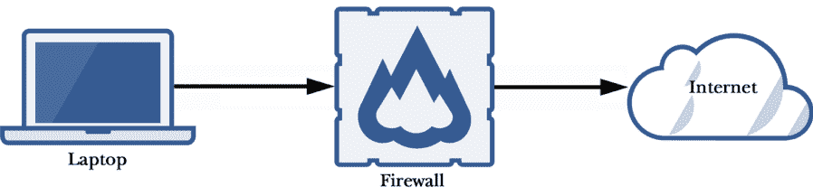

**图 3-1：**边界防火墙

防火墙根据包含配置规则列表的规则集允许或拒绝（拦截）流量。这些规则应用于流量的方式取决于你所使用的防火墙类型。最常见的类型是数据包过滤防火墙，它检查每个尝试进入（或离开）你内部网络的数据包，然后根据规则集对该数据包进行检查。如果数据包内容匹配防火墙规则集中的某条规则，防火墙将允许或拒绝该流量，取决于该规则的指示。

还有状态检测防火墙和无状态防火墙。状态检测防火墙跟踪所有入站和出站连接，并将每个连接视为两个终端之间唯一的对话。这种方法为防火墙提供了关于任何给定连接的上下文，并允许对流量进行更细粒度的控制。相比之下，无状态防火墙不记录每个连接的信息。`iptables` 和 `pfSense` 都是状态检测防火墙。

几乎所有的操作系统都自带软件防火墙，称为主机防火墙，它用于过滤特定于该主机的流量。大多数 Windows 和 Mac 设备都出厂自带即插用的主机防火墙，其基本规则集具有功能性，但不详尽。根据设计，这种防火墙按普通用途直接工作；用户不需要配置自己的防火墙，这减少了困扰以及对计算机制造商技术支持的需求。在 Linux 设备上，你必须配置防火墙——你将在下一节中学习如何操作。

最好的做法是同时使用防火墙和边界防火墙，并为你的网络进行正确配置，以增加多层防御。

## iptables

Linux 的 `iptables` 工具在过滤进入、穿越或离开网络的流量方面提供了惊人的灵活性。防火墙将其规则组织在策略链（policy chains）中，即根据内容分析并匹配数据包的规则列表。每条规则都决定了防火墙将如何处理匹配其定义的数据包——它可能会允许、拒绝或丢弃数据包。当数据包被允许时，它将无阻地通过防火墙。被丢弃时，防火墙会丢弃数据包且不对发送者发送响应。当数据包被拒绝时，防火墙会丢弃数据包并向发送者发送拒绝消息，提供关于你的网络和正在使用的防火墙的上下文。

策略链主要有类型：输入链（input chains）、输出链（output chains）和转发链（forward chains）。输入链决定是否允许流量从外部源（例如来自远程的虚拟专用网络 VPN 连接）进入网络。VPN 是一种逻辑而非物理上连接不同网络的方法，通常用于从一个网络到另一个网络的远程访问。VPN 在第 5 章中详细介绍。

输出链指示防火墙是否应该允许某些出站到外部网络的流量。例如，网控制消息协议（ICMP）主要用于诊断网络通信问题。ICMP ping 包是通过输出链的出站流量。ping 是从一个设备到另一个设备的查询，通常用于判断两个设备之间是否可以建立连接。你需要允许来自你设备的 ping 包通过你的防火墙并跨越公共互联网上的其他几个设备，最终到达其目的地。如果你的输出链拦截了 ICMP 流量，你的设备将无法 ping任何内容，因为防火墙会拦截或丢弃这些数据包。

在大多数情况下，你的状态检测防火墙规则应该允许新连接和已建立的连接。例如，如果你创建一个输出链允许你的设备 ping Google，你需要告诉防火墙允许与已建立连接相关的入站流量。转发链决定防火墙是否应该允许通过它流向另一个网络的流量。通过使用这些策略链，你将能够非常细粒度的水平控制穿越网络的流量。

> 注意 `iptables` 不支持 IPv6。如果你计划在网络中使用 IPv6，除了 `iptables` 还需要使用 `iptables`。除非你有 IPv6 的强烈使用场景，否则我禁用禁用。禁用 IPv6 在第 4 章介绍。

## 安装 iptables

如果你已经按照第 1 章的步骤构建了标准的 Ubuntu 服务器，现在就可以配置你的 `iptables` 了。一旦掌握了基础知识，请使用这些知识在你所有的 Linux 终端上配置 `iptables`。否则，请先创建你的 Ubuntu 系统。

最近的 Ubuntu 版本默认安装了 `iptables`，因此以非 root 用户身份登录 SSH，运行版本检查来确认 `iptables`：

```bash
sudo iptables -V
```

如果已安装 `iptables`，服务器应返回版本信息，如所示。你的版本可能不同。如果未安装 `iptables`，你将收到错误，在这种情况下请安装 `iptables`：

```bash
sudo apt install iptables
```

安装完成后，再次运行版本检查以确认安装成功。接下来安装 `iptables-persistent`，这是一个允许你保存防火墙配置并在重启服务器后自动加载的工具：

```bash
sudo apt install iptables-persistent
```

安装向导将接管你的终端窗口。你将被告知服务器保存防火墙规则的文件（默认是 `/etc/iptables/rules.v4`），并告知系统启动将加载该文件。此外，你需要手动保存任何当前的防火墙规则。选择 Yes 以保存当前的防火墙规则。如果不安装此组件，每次重启服务器时都必须重新配置防火墙。

你现在可以使用以下命令检查当前的策略链：

```bash
sudo iptables -L
```

```
target prot opt source destination
Chain FORWARD (policy ACCEPT)
target      prot opt source destination
Chain OUTPUT (policy ACCEPT)
target      prot opt source destination
```

在输出中，`policy ACCEPT` 表示默认情况下，`iptables` 接受所有的输入、输出和转发流量。这种默认行为是符合我们理想的，因为它不需要任何用户配置即可工作。然而，这不是一个安全的解决方案，让我们来修改它。

## iptables 防火墙

在创建 `iptables` 规则时，请记住顺序至关重要。当流量到达你的防火墙时，`iptables` 会按照规则出现的顺序逐一检查规则。如果流量匹配了某条规则，`iptables` 将不再检查后续的规则——如果你 50 条规则列表中的第一条规则拒绝了所有流量，防火墙将解释该规则、拒绝流量并停止处理，从而完全隔离了你的设备。或者，如果你有 50 条规则但第一条规则允许所有流量，那么所有流量都将通过防火墙。你应该避免这两种情况。

要理解如何构建 `iptables` 规则，请看这个示例：

```
sudo iptables -A INPUT -p tcp --dport 22 -m conntrack \
  --ctstate NEW,ESTABLISHED -j ACCEPT
```

在 `sudo` 之后，`iptables` 被调用以开始定义规则。下一个参数决定了规则是将追加到 (`-A`)、删除 (`-D`) 还是插入 (`-I`) 到指定的策略链（policy chain）中。在替换或更新现有规则时，你也可以在此位置指定 `-R`。`INPUT` 表示正在修改输入链中的规则。你也可以指定 `OUTPUT`、`FORWARD` 或其他策略链。

在大多数情况下，`iptables` 需要知道与规则相关的协议和端口。在这个例示例中，`-p tcp` 表示该规则将仅适用于 TCP 流量，而 `--dport 22` 告诉 `iptables` 该规则适用于目标端口为 22 的数据包。这两个设置都是可选的。你可以使用以下语法指定多个端口：`--match multiport --dports port1,port2,port3`。


**注意** 传输控制协议（`TCP`）是一种可靠的传输协议，其设计目标是确保数据包在网络上的成功交付。如果计算机在在使用 `TCP` 的通信期间预计会出现数据包丢失，那些丢失的数据包将重新重传，以确保发送的所有数据最终被目标主机接收。用户数据报协议（`UDP`）是一种不可靠的协议，它不保证数据的成功传输或重传丢失的数据包。当某些数据包丢失是可以接受的时，可以使用 `UDP`，这通常会带来更快的连接。当可靠性至关重要且每个数据包都必须成功传输时，则使用 `TCP`。

`iptables` 防火墙提供了多个匹配模块，你可以通过 `-m` 参数指定要使用的模块。在这个示例中，使用了 `conntrack`，这是一个允许状态数据包检查的工具（也是可选的）。其他工具包括 `conbytes`（根据传输流量流量创建规则）和 `connrate`（根据流量的传输速率进行匹配）。更多细节请参阅 `iptables` man 页面：https://linux.die.net/man8/iptables。

接下来，`--ctstate` 告诉 `iptables` 允许并跟踪后续连接类型的流量——在这种情况下，是 `NEW` 和 `ESTABLISHED`。连接状态有很多可用值，但最常用的是 `NEW`、`ESTABLISHED`、`RELATED` 和 `INVALID`。`NEW`（新建）和 `ESTABLISHED`（已建立）状态自言自义；这些数据包属于新建或已建立的流。`RELATED`（相关）数据包不匹配已建立的连接，但防火墙预期它们，因为现有的连接使其成为必要（也就是说，基于防火墙现有的上下文预期）。`INVALID`（无效）数据包是指任何不符合其他状态标准的数据包。

最后，`iptables` 将解释 `-j` 并将其作为匹配到该规则时的跳转（执行）动作。最常见的是，它将是 `ACCEPT` 以允许匹配此规则的流量；要么是 `DROP` 或 `REJECT` 以拒绝或阻塞流量；或者是 `LOG` 以将流量记录到日志文件中（更多细节稍后将介绍）。

```
$ sudo iptables -L
Chain INPUT (policy ACCEPT) destination
target prot source state
DROP -- anywhere anywhere state
INVALID all -- anywhere state
ACCEPT all -- anywhere anywhere
RELATED, ACCEPT all -- anywhere anywhere
Chain FORWARD (policy ACCEPT)
target prot opt source destination
Chain OUTPUT (policy ACCEPT)
target prot opt source destination
DROP all -- anywhere state
INVALID
ACCEPT all -- anywhere state
RELATED, ESTABLISHED
```

注意规则已添加到 `INPUT` 和 `OUTPUT` 链下。`FORWARD` 链保持为空。

接下来，确保你的防火墙允许 `SSH` 流量。你可以通过两种方式实现：宽泛地允许 `SSH`，或仅允许来自网络子集中设备的 `SSH`。要允许源自网络中所有设备的 `SSH` 流量，请使用以下命令：

```
$ sudo iptables -A INPUT -p tcp --dport 22 -m conntrack --ctctstate NEW -j ACCEPT
```

在网络内部使用 `SSH` 连接到或从你的设备时，创建宽泛的规则可能会很有用。然而，允许无限制地使用程序并让协议完全开放并不是最安全的解决方案。你应该只允许 `SSH` 等服务从特定的 IP 地址或范围进入和离开设备，因为在你的端点与任何其他设备之间允许远程访问或文件传输是有风险的。

你可以通过在输入链中使用 `-s source` 选项指定源 IP 地址或范围（例如，`192.168.1.25`）来缩小攻击面，因此如果你在虚拟虚拟机上配置 `iptables`，你可能会为了管理目的允许来自单个主机的连接，并拒绝访问网络中的所有端点：

```
$ sudo iptables -A INPUT -p tcp -s 192.168.1.25 --dport 22 -m conntrack --ctstate NEW,ESTABLISHED -j ACCEPT
```

通过从网络中的另一个设备尝试 `ping` 服务器来测试你的防火墙；你应该收到一个错误，因为 `ICMP` 不允许通过防火墙。同样，如果你尝试从服务器本身 `ping` 任何内容，你也应该收到类似的错误：

```
$ ping google.com -c 5
PING google.com (<ip_address>): 56(84) bytes of data.
ping: sendmsg: Operation not permitted
ping: sendmsg: Operation not permitted
ping: sendmsg: Operation not permitted
ping: sendmsg: Operation not permitted
ping: sendmsg: Operation not permitted
--- google.com statistics ---
5 packets transmitted, 0 received, 100% packet loss, time
400ms
```

`ICMP` 是一个非常实用的排障工具，你可能决定允许通过防火墙进行 `ping`。要做到这一点，请添加以下规则：

```
$ sudo iptables -A INPUT -p icmp -j ACCEPT
$ sudo iptables -A OUTPUT -p icmp -j ACCEPT
```

你可能会发现你需要在防火墙中打开额外的端口。例如，如果你安装了代理，或者在阅读完第 6 章后构建了一个代理，你需要在防火墙中打开代理端口 `3128`：

```
$ sudo iptables -A OUTPUT -p tcp --dport 3128 -m conntrack
--ctstate NEW -j ACCEPT
```

在大多数情况下，你应该阻止从服务器进行通用的浏览——很少有（甚至没有）正当的理由让服务器进行此类活动。理想情况下，从管理和安全的角度来看，服务器应该是单一用途的。在服务器上允许任何额外的服务（尤其是浏览互联网）会导致攻击面增大，并在你的网络中产生潜在的漏洞。

如果你决定允许来自你服务器的这些流量以便服务器能够获取软件更新，请为端口 `80` 和 `443` 创建输出规则，这两个端口分别是 `HTTP` 和 `HTTPS` 流量的默认端口：

```
$ sudo iptables -A OUTPUT -p tcp --dport 80 -m conntrack --
--ctstate NEW,ESTABLISHED -j ACCEPT
$ sudo iptables -A OUTPUT -p tcp --dport 443 -m conntrack --
-ctstate NEW, ESTABLISHED -j ACCEPT
```

`HTTP` 和 `HTTPS` 规则之间唯一的区别是端口号。

每当你添加一条规则时，都应该对其进行测试。在这种情况下，最简单的方法是首先通过在服务器使用网络浏览器（如果你安装了 `GUI`）或在 `bash` 终端中使用 `curl` 来测试你浏览互联网的能力。从安装 `curl` 开始：

```
$ sudo apt install curl
```

如果你没有允许 `HTTP` 和 `HTTPS` 的规则，安装命令将失败，因为更新通常通过 `HTTP` 进行。然而，如果你已经设置了这些规则，`curl` 应该能够成功安装，因此你可以确保端口 `80` 和 `443` 是打开的：

```
$ curl http://icanhazip.com
ipipaddress
```

地址 `http://icanhazip.com/` 是一个公共服务提供商，当使用 `curl` 查询时，它会返回你当前的公网 IP 地址。如果你显示了当前的公网 IP 地址，说明防火墙配置是正确的。

如果你收到错误，你的某个规则可能存在问题。检查是否有拼写错误，如果其他尝试都失败，请删除规则并使用之前讨论过的 `-D` 或 `-F` 参数重新开始。防火墙配置是正确的，可以根据需要添加更多规则。

需要添加的一组特定规则是阻止到特定 IP 地址的流量。然而，由于大多数公共网站可能有多个 IP 地址，因此使用 `iptables` 阻止网站并不是最佳选择，因为你必须为每个唯一的 IP 地址创建规则。在大多数情况下...


为了简单起见（出于安全考虑），我们将讨论使用预构建的设备。本书将不再涵盖从零开始构建设备，因为配置错误的风险太高，特别是当已经有廉价且安全的解决方案可用时。在本书时，Netgate 2100 Base `pfSense+` 的价格约为 400 美元。它足够强大，能够应对你提出的绝大多数需求，除了全企业级网络之外。`SG-3100` 比入门级的 1100 `pfSense+` 进了一阶，功能更全。它还具有更高的带宽和更大的吞吐量能力，因此是小型网络的理想选择。

## #13：安装 pfSense 防火墙

收到 `pfSense` 设备后，将其从箱中取出并插上电源。将以太网线连接到设备的 `WAN` 端口和你的电缆、`DSL` 调制解调器或网络边界设备上的任何端口。将另一根以太网线连接到 `LAN1` 端口和电脑的太网口。

要从电脑访问 `pfSense` 配置页面，请在浏览器中输入 `192.168.1.1`，这是 `SG-3100` 的默认 IP 地址。如果不起作用，你可能需要断开电脑与常规网络的连接，并按照以下说明手动将其 IP 地址设置为 `192.168.1.2`（或 `192.168.1.x` 范围内的任何其他地址，但 `pfSense` 的 IP `192.168.1.1` 除外）。此操作仅在设备的初始配置时是必要的，且应在用于设置 `pfSense` 设备的电脑上执行一次。

### macOS

1. 打开“系统偏好设置”。
2. 点击“网络”。
3. 选择 `pfSense` 设备与电脑之间的以太网连接，并将“配置 IPv4”下拉菜单“手动”。
4. 在“IP 地址”字段中输入 `192.168.1.2`，将“子网掩码”设置为 `255.255.255.0`，并在“路由器”字段中输入 `192.168.1.1`。
5. 点击“应用”。
6. 打开浏览器并访问 `192.168.1.1`。你应该看到 `pfSense` 登录页面。

### Windows

1. 打开“网络和 Internet 设置”。
2. 点击“更改适配器选项”。
3. 打开 `pfSense` 设备与电脑之间的以太网连接，然后点击“属性”►“Internet 协议 (TCP/IP)”►“属性”。
4. 选择“使用此 IP 地址”单选按钮。
5. 在“IP 地址”字段中输入 `192.168.1.2`，将“子网掩码”设置为 `255.255.255.0`，并在“默认网关”字段中输入 `192.168.1.1`。
6. 点击“确定”并关闭剩余窗口。
7. 打开浏览器并访问 `192.168.1.1`。你应该看到 `pfSense` 登录页面。

### Linux

1. 打开“设置”。
2. 点击“网络”。
3. 在 `pfSense` 设备与电脑之间的以太网连接上，点击齿轮配置图标。
4. 选择“IPv4”选项卡。
5. 选择“手动”单选按钮。
6. 在“IP 地址”字段中输入 `192.168.1.2`，将“网络掩码”设置为 `255.255.255.0`，并在“网关”字段中输入 `192.168.1.1`。
7. 点击“应用”并关闭“设置”。
8. 打开浏览器并访问 `192.168.1.1`。你应该看到 `pfSense` 登录页面。

> 注意：如果收到显示网站不私密或不安全的警告信息，请点击进入登录页面。出现此警告是因为没有配置 SSL 证书，你现在可以忽略它。但是，要警惕其他地方此类错误；通常，SSL 证书错误（尤其是在互联网上）是一个严重警告，表示你尝试访问的页面是不安全的。

在 `pfSense` 登录页面上，使用收到设备时提供的凭据登录。登录后，如果显示了用户许可协议 (`EULA`)，请接受它。花一点时间检查系统信息，然后点击页面顶部的“`System`”菜单并启动设置向导。按照以下步骤完成 `pfSense` 的设置：

1. 在欢迎屏幕上，点击“下一步”。
2. 如果显示“支持”屏幕，点击“下一步”。
3. 在“常规信息”屏幕上，为设备选择主机名，或保持默认值 `pfSense`。
4. 如果你在环境中配置了域名，请在此输入。
5. 暂时忽略 DNS 设置并点击“下一步”。
6. 在“服务器信息”屏幕上，如果你的环境中主机服务器，在此输入。
7. 确保选择正确的时区，然后点击“下一步”。你现在可以看到“配置 WAN 接口”页面。你可以借此配置 `pfSense` 连接 ISP。
8. 在“选择类型”框中选择 `PPPoE`。
9. 在“常规配置”选项卡中输入。
10. 在“静态配置”选项卡中设置 IP 设置。
11. 在“WAN 认证”选项卡中输入用户名和密码。
12. 在“DNS 服务器”选项卡中设置你的服务器。
13. 在“LAN 配置”选项卡中检查 IP 设置。
14. 点击“完成”。

你的初始配置已完成。假设设备能够连接到互联网，你现在应该可以浏览。如果没有，你可能需要在“`Status`”菜单下的“`System Logs`”页面中进行故障排除。完成后。

## 加固 pfSense

你的防火墙现在已配置并运行，它应该能够很好地拒绝进入你网络的未知流量。但是，你可以采取额外的步骤确保你的设备和网络更加安全。

登录 `pfSense` 设备后，点击 `System`►`Advanced`。


图 3-2：Advanced 菜单

在 `Advanced` 选项卡中，你可以更改 `pfSense` 使用的协议、端口和代理设置等。离开选项卡前请点击 `Save`。

在图 3-2 所示的 `Admin Access` 选项卡中，将 `webConfigurator Protocol` 设置为 `HTTPS`，以确保到设备的加密加密连接。使用 `HTTPS` 比使用未加密的 `HTTP` 协议更好，因为增加的加密确保了即使网络流量被对手截获，对手也无法解密。

在 `Admin Access` 页面的后续部分（图 3-2 未显示）中，你可以更改 `SSH` 选项。我不建议一直允许访问设备——这就像在晚上敞开大门。如果你只在活跃使用时才允许 `SSH` 访问，对手只有在服务可用时才能访问你的网络。将服务关闭 99% 的时间意味着攻击者只有 1% 的时间尝试入侵网络。除非你正在通过 `SSH` 连接设备，否则禁用此选项。更新这些设置后，点击 `Save`。

在 `Networking` 选项卡中，你可以启用或禁用 `IPv6` 流量。如果你没有活跃使用 `IPv6`，请禁用它以减小攻击面。这将使页面上的剩余设置变得毫无意义。

如果你为网络流量使用代理，请在 `Miscellaneous` 选项卡中输入你的代理详情。如果你计划按照第 6 章中的详细步骤构建自己的代理服务器，请返回本章并在该阶段输入代理详情。

## pfSense 防火墙规则

默认的 `pfSense` 防火墙规则将阻止来自 `RFC1918` 私有网络连接和 `bogon` 网络（非法地址网络）的流量从互联网进入你的网络。第 1 章中讨论的 `RFC1918` 地址是仅供私有、内部网络使用的 IP 地址，这意味着这些范围内的地址不应该出现在公网网上。它们包括以下范围：`192.168.0.0/16`、`100.0.0.0/8` 和 `172.16.0.0/12`。如果这些地址中的任何一个恰好出现在互联网上，你的防火墙应该认为这可疑并丢弃该流量。同样，`bogon` 网络或 `bogon` 地址是指那些公开的但尚未被 `IANA` 分配给任何人的地址。如果一个尚未分配的地址或地址范围正在向你的网络发送流量，这同样是可疑的，防火墙应该将其丢弃。

虽然默认防火墙规则是一个良好的开始，但你仍然应该手动添加一些规则以提供更高级别的安全性。例如，你不应该允许诸如服务器消息块（`SMB`，允许 Windows 家庭版计算机在网络上共享文件的服务）从你的网络向互联网发送出站或入站流量，或从互联网接收入站流量。

> 注意：2017 年 5 月的 `WannaCry` 勒索软件利用名为 `EternalBlue` 的 `SMB` 漏洞传播；在你的边界防火墙上阻止 `SMB` 将显著降低你暴露于该漏洞的风险以及此类漏洞被用于入侵你网络的风险。

要添加一条阻止 `SMB` 流量的规则，请遵循以下步骤：

1. 在 `pfSense` 页面顶部点击 `Firewall`（防火墙）► `Rules`（规则）。
2. 点击 `LAN`，点击 `Add`（添加）开始添加规则。
3. 将 `action`（动作）设置为 `block`（阻止/丢弃数据包）或 `reject`（拒绝/丢弃包并通知发送者）。
4. 将 `Address Family`（地址族）设置为 `IPv4`，`Protocol`（协议）设置为 `TCP`。
5. 将 `Source`（源）设置为 `Any`（任意），`Destination`（目的）设置为 `Any`（任意），`Destination Port Range`（目标端口范围）设置为（other/其他）`445`。
6. 确保 `Log`（日志）框已勾选以记录任何被丢弃的数据包，然后点击 `Save`（保存）。

一旦完成，你的防火墙将不再允许 `SMB` 流量通过你的网络边界。请对端口 `137`、`138` 和 `139` 遵循相同的流程，因为这些服务（NetBIOS 名称解析、NetBIOS 数据报服务和 NetBIOS 会话服务）也不应该被允许跨越网络边界，因为所有这些协议都用于本地网络内部的进程。

## 应该阻止的常用协议


某些网络协议永远不应该跨越网络或边界，例如：

- NetBIOS 名称解析，TCP 和 UDP 端口 137：DNS 的前身，将主机名解析为 IP 地址
- NetBIOS 数据报服务，UDP 端口 138：允许网络内的单播、多组播和广播消息
- NetBIOS 会话服务，TCP 端口 139：促进网络上两台计算机之间的通信
- MS RPC，TCP 和 UDP 端口 135：促进客户端/服务器应用程序之间的通信
- Telnet，TCP 端口 23：一种不安全的明文协议，用于系统的远程访问和维护
- SMB，TCP 端口 445：允许 Windows 计算机在网络上共享文件
- SNMP，UDP 端口 161 和 162：用于远程系统管理和监控
- TFTP，TCP 和 UDP 端口 69：允许网络上计算机之间的文件传输

## #14：测试你的防火墙

部署其中一条或多条规则后，测试防火墙以确保被阻止的流量确实被拦截了。此目的的最佳工具是 `Nmap`，它用于网络扫描或网络映射。它以 GUI 形式提供于 Windows、Linux 和 Mac（称为 `Zenmap`），也可以作为命令行工具使用。安装 GUI 版本后，它将在命令行可用，因此请从 `https://www.nmap.org/` 下载并安装最新版本。

否则，你可以在 Ubuntu 上使用命令行安装它：

```
$ sudo apt install nmap
```

一旦安装了 `Nmap`，请使用以下命令从命令行扫描 445 端口（这是我们已告诉防火墙阻止的端口）：

```
$ sudo nmap -p 445 -A scanme.nmap.org
--snip -
```

针对 `scanme.nmap.org` (45.33.32.156) 的 Nmap 扫描报告

Host is up (0.20s latency).

Other addresses for `scanme.nmap.org` (not scanned):

2600:30c1::f03c:fe18:bb2f

PORT STATE VERSION

445/tcp filtered microsoft-ds

Service detection performed. Please向 `https://nmap.org/submit/` 报告任何错误结果。

Nmap done: 1 IP address (1 host) scanned in 2.54 seconds.

你可以在 `Zenmap` GUI 中使用相同的命令——只需加 `sudo`。此命令将从你的设备（位于你的防火墙 之后）对 `http://scanme.nmap.org/` 网站进行端口扫描，该网站是 Nmap 创建者提供的用于测试的公共网页。

该命令拆解如下：`nmap` 是程序名称。`-p 445` 参数指定要扫描的端口或端口，可以使用逗号分隔的列表（例如 `-p 445, 137, 138, 22`），也可以是特定的。

| Action (动作) | Time (时间) | Interface (接口) | Source (源) | Destination (目的) |
| :--- | :--- | :--- | :--- | :--- |
| | | | | |
| block | May 31 10:09 | LAN | 2600:30c1::f03c:fe18:bb2f | 445 |
| block | May 31 10:09 | LAN | 2600:30c1::f03c:fe18:bb2f | 137 |
| block | May 31 10:09 | LAN | 2600:30c1::f03c:fe18:bb2f | 138 |
| block | May 31 10:09 | LAN | 2600:30c1::f03c:fe18:bb2f | 139 |
| block | May 31 10:09 | WAN | 92.63.197.97:17175 | |
| block | May 31 10:09 | WAN | 92.63.197.97:17175 | |
| block | May 31 10:09 | WAN | 92.63.197.97:17175 | |
| block | May 31 10:09 | WAN | 92.63.197.97:17175 | |

*(注：表格内容根据示例逻辑处理，由于原文存在重复占位，此处保持格式并翻译)*

# 4 保护无线网络


无线网络已经无处不在，并成为在线的同义词。大多数连接互联网的地方都有一个无线调制解调器或路由器为许多设备提供服务，从台式电脑到手机，再到电视、灯泡和冰箱等物联网（IoT）设备。如果没有无线技术，现代生活将变得不方便得多，但便利性往往迫使我们放弃一些在线安全。

无线网络使我们的网络扩展到了最初作为物理边界的电缆之外。它们甚至越过了我们认为理所当然的其他物理屏障：墙壁。随着无线技术的演进，我们无线网络的有效距离不断提高，以至于我们现在在场域内看到了更大的局域网（LAN），甚至一直延伸到邻居家里。这在连接性方面是极好的，但在安安全性方面可能是灾难性的。

本章将介绍与更广泛无线网络相关的一些陷阱。你将学习通过禁用 IPv6 和限制无线网络上允许的设备数量来减少攻击面。本章还将深入探讨 MAC 地址过滤（它仅允许已知设备进入内部网络）；在不使用时禁用功能；使用安全的身份验证方法；以及根据设备在网络中的必要权限级别对设备或用户进行分组。

## 升级你的硬件

如果你是从互联网服务提供商那里获得的无线网络设备，它很可能是一个入门级设备。通常，这意味着它的功能较少，或者可配置性低于高端产品。如果你在阅读本章的过程中，发现你的设备不支持所需的管理级别，请考虑购买更高规格的型号。例如，Netgear 的 Nighthawk 系列路由器价格合理，即使是中端机型也功能完备。

## #15: 禁用 IPv6

IPv6 是互联网协议的新版本，设计用于应对我们最终将耗尽公可寻址 IPv4 地址空间的问题。IPv6 将可用地址空间扩大了几个数量级，但它并不像另一种缓解措施——网络地址翻译（NAT）那么常见（我们在第 1 章中描述过 NAT）。如果你在网络中未使用 IPv6 但让其保持开启状态，你就为攻击者提供了另一个潜在的入侵向量（即另一个进入或以方式破坏你网络的途径）。作为一条通用规则，你应该禁用或卸载所有未活动使用的协议和应用程序，以防止攻击者利用这些工具（或工具的漏洞）针对你。禁用未使用的协议可以减少环境的攻击面，攻击面应该越小越好。

如果你没有在网络中主动使用 IPv6，请尽可能禁用它，包括在 Wi-Fi 配置中。要禁用 IPv6，请遵循以下步骤：

### Windows

1. 打开网络和 Internet 设置。
2. 点击“更改适配器选项”。
3. 对于结果窗口中的每个适配器，双击适配器然后点击“属性”。

   a. 找到“Internet Protocol 版本 6 (TCP/IPv6)”复选框并取消勾选。
   b. 点击“确定”并关闭剩余窗口。

### macOS

1. 打开“系统设置”。
2. 点击“网络”。
3. 对列表中的每个适配器点击“高级”。

   a. 打开 TCP/IP 选项卡。
   b. 确保“配置 IPv6”设置为“关闭（Off）”。

### Linux

1. 打开“设置”。
2. 从左侧列表选择“网络”。
3. 点击每个适配器旁的配置齿轮。

   a. 在 IPv6 选项卡中，点击“禁用”单选按钮然后点击“应用”。

### 你的调制解调器或路由器

配置你的调制解调器或路由器可能会更复杂，因为每个设备都有自己的配置菜单和选项。某些设备将有一个 IPv6 部分；如果是这种情况，访问并在菜单中完全禁用 IPv6。或者，你可能会在 DHCP 设置中找到 IPv6 选项。其他设备可能隐藏在 DHCP 设置中。在第 3 章讨论的 `pfSense` 设备中，IPv6 设置位于 DHCP & RA 下。除非你配置了静态 IPv6 地址，否则默认是禁用的。

如果你无法在设备上找到 IPv6 设置，可以在互联网上查找型号。一旦你禁用了 IPv6，你就离安全更近了一步。

## #16: 限制网络设备

大多数小型网络很少指定或以其他方式限制网络设备，并由于允许所有设备连接而遭受安全问题。虽然这种设置提供了便利（特别是当你购买新设备或朋友来访访时），但这是一种不安全的做法，会为有针对性或机会主义的攻击者留下漏洞。

通过识别允许连接到网络的设备并仅限制这些设备，你可以避免这种安全风险。创建资产清单——一个包含设备信息的表格，例如类型（电脑、笔记本电脑、手机等）、位置、主机名、MAC 地址（硬件地址）和 IP 地址——将与你的网络地图互为补充。

一旦你收集了网络中所有终端的信息，就可以为已知设备分配静态 IP 地址，并缩小 DHCP 服务器内的可分配 IP 地址范围。使范围小到足以包含资产清单和网络地图中的设备。通过减少可用地址的数量，降低攻击者添加新设备的风险。

MAC 过滤允许根据设备的 MAC 地址允许或拒绝访问网络。如果你知道允许设备的 MAC 地址，就可以让未经的设备难以添加。


# 创建资产清单

与大型企业不同，在小型网络中创建资产清单非常简单。首先，使用纸笔、Excel 或其他工具创建一个表 4-1 所示的表格。

| 表 4-1：资产清单模板 | 设备 | IP 地址 | MAC 地址 | 主机名（可选） | 位置（可选） |
| :--- | :--- | :--- | :--- | :--- | :--- |
| 我的笔记本电脑 | | | | | |
| 他们的笔记本电脑 | | | | | |
| 我的手机 | | | | | |
| 他们的手机 | | | | | |
| 电视 | | | | | |
| 平板电脑 | | | | | |
| Xbox | | | | | |

你可以选择省略主机名和位置，但请确保包含每个设备的 IP 和 MAC 地址。

你应该已经成功识别了网络中的所有已知设备。如果有任何未知设备连接，你按照接下来的“MAC 地址过滤”章节中的步骤对其进行阻止。接下来，你将为每个设备分配静态 IP 地址。

## 静态 IP 地址分配

IP 地址可以是静态的或动态的。默认情况下，大多数路由器使用动态主机配置协议（DHCP）服务器在终端设备连接到网络时为其分配 IP 地址。这些分配被称为 DHCP 租约，并且带有时间限制；租约通常在 24 小时后过期。动态 IP 地址在终端每次连接或租约过期时可能会发生变化。然而，你也可以为每个终端分配一个自己的静态 IP 地址，使其在每次连接到你的网络时都能保留该地址。这有助于你了解对应的终端 IP 地址，并通过限制可避免的地址来防止未知设备连接。

你可以在 Wi-Fi 路由器的 DHCP 菜单中找到静态 IP 地址设置。在本示例中，我们将使用第 3 章介绍的 Netgate SG-3100 的 DHCP 租约，但无论你使用什么设备，过程都是相似的。要进入 SG-3100 的 DHCP 租约菜单，点击 `Status→DHCP Leases`。在类似的设备中，它可能出现在 LAN 或高级设置中。你可以看到一个类似于图 4-1 的表格。

| IP 地址 | MAC 地址 | 客户端 ID | 主机名 | 开始 | 结束 |在线 | 租约类型 | 操作 |
| :--- | :--- | :--- | :--- | :--- | :--- | :--- | :--- | :--- |
| 192.168.1.42 | ab:bb:cc:de:ee:ff | | Host_One | 2021/06/09 02:05:30 | 2021/06/09 02:05:30 | online | active | ✏️ 🗑️ |
| 192.168.1.41 | ff:ee:cc:bb:aa | | Host_Two | 2021/06/09 02:05:29 | 2021/06/09 02:05:29 | online | active | ✏️ 🗑️ |

图 4-1：Netgate SG-3100 pfSense 防火墙上的 DHCP 租约

要创建 IP 地址（也称为静态租约），点击 `Add` 按钮（左侧未填充的 + 按钮）。生成的页面允许你为所选的主机指定 IP 地址。只要它在你的地址方案范围内，可以指定任何地址，然后点击 `Save`。例如，如果你的地址方案是 `192.168.1.x`，你可能会选择 `192.168.1.100`。你选择的 IP 地址不需要是连续的；你可以为此主机使用 `192.168.1.100`，为下一个主机使用 `192.168.1.54`。在分配主机的静态地址后，它可能需要连接到网络以获取该地址；通过循环设备电源（关闭再开启）来强制其执行。

一旦你为授权的设备分配了静态 IP 地址，请更新你的资产列表和网络地图。然后，为了有效防止额外设备未经授权加入，请缩小 DHCP 服务器可能分配的地址范围。

默认情况下，DHCP 服务器为设备连接到网络提供整个 IP 地址范围。如果你的 IP 地址方案是 `192.168.0.0/16`，你的网络可以有多达 65,536 个主机连接。没有小型网络需要许多主机，将此完全开放是一个安全风险。

要查看 SG-3100 中的 DHCP 地址范围，点击 `Services>DHCP Server`。你的设备应该有一个与**图 4-2** 类似的 IP 地址范围。

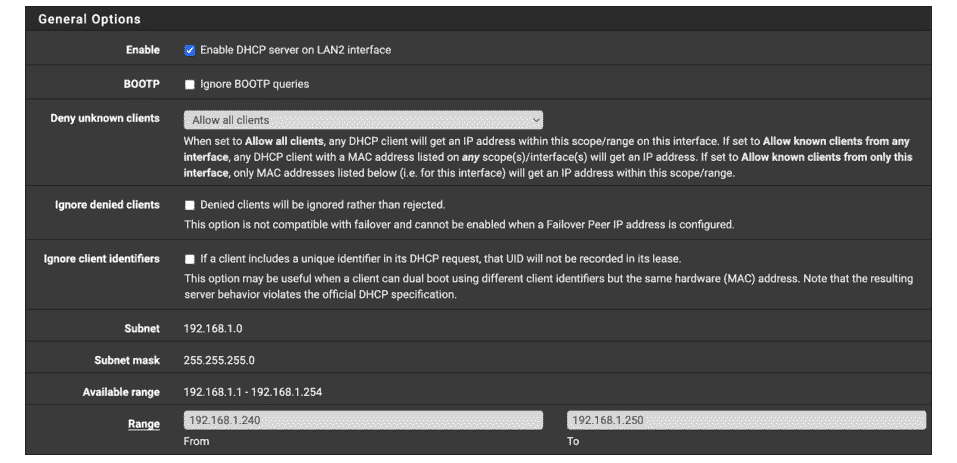

**图 4-2**：DHCP 地址范围

数字可能不同，但总体配置应该是相似的。要手动授权连接到你网络的每个设备，请禁用 DHCP 服务器并为每个终端添加新的静态地址。另一种方法是缩短可用的 DHCP 地址范围。与其允许范围从 `192.168.1.100` 到 `192.168.1.245` 开放，不如指定一个从 `192.168.1.100` 到 `192.168.1.105` 的范围，将可以分配 DHCP 地址的设备数量限制为六。当这些 IP 地址被静态分配给网络内的设备后，除非其中某些设备离线或从网络中移除，否则额外的设备将无法从 DHCP 服务器获取 IP 地址。减少可用的地址空间可以减少未经授权设备连接到你网络的能力，从而最大限度地减少你的攻击面。

你可能会想这些步骤是否有必要，因为想要连接到你的无线网络的人需要在附近，而且你可能不会让陌生人进入你的家或办公室。但请考虑，“近距离”可能意味着尽可能远的地方。

## MAC 过滤

MAC 过滤可以实现为黑名单（denylist）或白名单（allowlist）。另一方面，白名单是允许访问的终端列表。当你知道想要拒绝某个设备的 MAC 地址时，请使用黑名单。大多数情况下，你会使用 Accept，即白名单模式。选择 `Enable Filter` 和 `Accept`，然后输入你资产列表中的 MAC 地址。一旦你添加了所有地址并保存配置，除了指定的设备外没有设备可以连接到网络。你可以通过从 Accept 列表中删除一个设备并尝试连接来测试。如果它拒绝连接，说明你的 MAC 过滤工作正常。

### 2.4 GHz 和 5 GHz 波段

这两个频率有许多不同。一个是波长：2.4 GHz 波段提供更远的距离，而 5 GHz 波段提供更快的。2.4 GHz 也更容易受到干扰（包括微波），而 5 GHz 受影响较小。

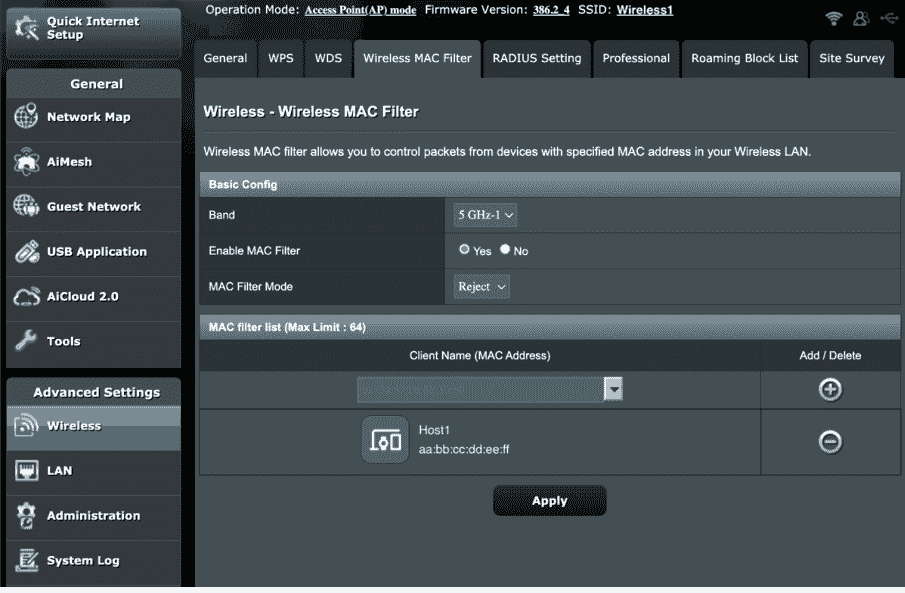

图 4-3：无线过滤选项

在图 4-3 中，5 GHz 的过滤已启用（Enabled），且模式（Mode）被设置为拒绝（Reject）。

| 设置 | 值 |
| :--- | :--- |
| MAC Filter | Enabled / Disabled |
| Mode | Accept / Reject |

## #17：划分你的网络

无线网络允许你通过使用独立的访客网络与客人共享互联网连接，而不会损害你的安全性。大多数中端路由器都提供此功能。例如，ASUS RT-AC500 允许在 2.4 GHz 和 5 GHz 无线频率上开启多个访客网络，如图 4-4 所示。

| 设置 | 值 |
| :--- | :--- |
| Operation Mode | Access Point/AP mode |
| Firmware Version | 386.2.4 |
| SSID | Wireless1 |

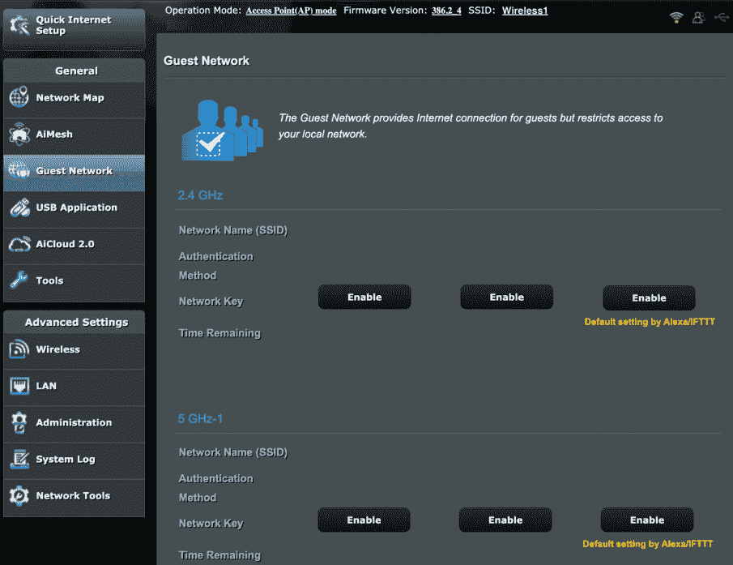

图 4-4：多无线网络能力

如图 4-4 所示，你可以允许访客设备在网络上无限期，或者你指定的特定时段，这对于可能只需要访问几小时的访客非常有用。通过配置路由器允许访客无限访问，你实际上是用安全性换取便利性。相反，限制访客在需要重新授权之前的连接时间则需要更多的操作。尽管如此，这仍然是一种安全得多的访问控制方式。

无线路由器和接入点（AP）提供的最后一个功能是允许或拒绝对你内网的访问选项，内网是你私有设备连接的内部网络。允许访客访问你网络的这部分区域会降低你的安全性，因为这为他们提供了访问计算机和移动设备的权限。如果你让访客访问你的整个网络，那么还不如给他们这种能力；我在之前的章节中讨论过这一点；如果你配置了访客网络，你可以选择允许连接到无线路由器的终端访问你的内网，或者仅允许它们访问互联网网关。路由器通过允许或禁止连接到访客网络的设备访问主网络来处理这种访问。禁止从访客网络访问你的内网是更安全的选项，也是你应该实施的方案。如果你的路由器具有此功能，在路由器网络设置中应该会有一个非常明显的复选框。如果你找不到它，很可能是你的路由器不支持该功能（尽管你可以通过阅读说明书或进行快速网络搜索来确认）。

## #18: 配置无线认证

你应该通过创建一个访问网络的通行密码（passphrase）来加密来保护你的 Wi-Fi 网络。一个开放的无线网络——没有任何保护或加密——为攻击者提供了首要目标。今天，大多数网络使用三种安全算法之一来保护其通信：`WEP`、`WPA/WPA2` 或 `WPA3`。

### WEP


有线等效隐私（WEP）是这三种安全协议中最老老的，到目前为止是最不安全的。WEP 使用 40 位或 104 位加密密钥，与后来的协议相比，这两者都非常短。WEP 将此加密密钥与 24 位的初始化向量（IVs）结合，旨在增强安全性，但由于这些 IV 的长度较短，算法可能会重用密钥，从而使加密更容易被破解。不需要了解细节；只需知道 WEP 是一项不安全的技术且不应被使用即可。事实上，供应商已在 2001 年淘汰了 WEP；它在大多数硬件上已不再可用。

## WPA/WPA2

无线保护接入（WPA）是 WEP 的继任者，改进了 WEP 的保护。尽管它依赖相同的 RC4 加密算法，但它引入了临时密钥完整性协议（TKIP）。TKIP 使用 256 位密钥并实现消息完整性检查、更大的 48 位 IV 以及尽可能减少 IV 重用的机制，从而加强了无线安全。

反之，WPA2 改进了原始的 WPA 协议。WPA 和 WPA2 都允许用户在个人模式和企业模式之间进行选择。个人模式（称为 WPA-PSK）使用预共享密钥（PSK）或通行密码来授予访问，而企业模式需要一个认证服务器。WPA2 替换了 RC4 加密算法和 TKIP，转而采用更安全的算法和加密协议。此外，它实现了计数模式协议（CCMP），这是一种更安全的加密机制。这一切使得 WPA2 比早期的加密协议安全得多，并促进了接入点之间的漫游，提供了更流畅的用户体验。如果可能，在你的无线网络中选择 WPA2 或更高版本。

话虽如此，攻击者仍然可以捕获你的无线流量并暴力破解你的网络密码。虽然 WPA2 很好，但并没有所谓的完美安全。因此，请确保你使用强通行密码来保护你的无线网络。通行密码将在第 11 节中详细讨论。

## WPA3

无线保护接入第三 3（WPA3）是最新的无线安全技术。它非常新，尚未被广泛采用。WPA3 通过防止连接到同一网络的用户相互监听其无线通信来提高安全性——即使该无线网络是开放的且不需要密码身份验证。

WPA3 通过将 WPA2 中使用的预共享密钥认证替换为新协议来实现这一点：等等同步认证（SAE）。这一变化意味着攻击者无法捕获破解网络密码所需的流量，使得他们获取未经授权的网络访问变得更加困难。

目前，WPA3 还处于婴儿阶段，因此很少设备与之兼容。新的无线路由器和接入点将把 WPA3 作为标准配置。即便如此，在你的手机和电脑能够连接到它之前，拥有一个 WPA3 路由器也意义不大。一旦这种情况发生变化，你应该使用 WPA3 而非任何其他无线安全标准。

要配置我们一直在讨论的 ASUS 路由器，在无线设置中，`高级设置►无线►一般`下，你需要通过指定网络名称（`SSID`）和安全密钥或通行密码来创建你的主内部网络，如图 4-5 所示。然后，在`一般►访客网络►启用`中，创建一个或多个访客网络，通过指定网络名称和安全密钥来连接你所有的其他设备，就像你对主无线网络这样做一样。


图 4-5：主网络设置

示例使用的 ASUS 路由器将你的主网络和访客网络隔离。连接到主网络的终端无法与访客网络通信，反之亦然。然而，如果你创建了多个访客网络，其中任何一个网络上的设备都可以相互看到并通信。某些无线路由器可能提供将你的网络完全隔离的能力。如果你想要这种功能，在购买无线路由器之前请做好研究。

务必遵循安全操作规范并利用所有可用选项，如前所述。例如，ASUS 路由器具有多种用于保护你网络的功能，如图 4-6 所示。

| 访客网络索引 | 2 |

|---|---|

| 隐藏 SSID | 是 |

| 网络名称 (SSID) | |

| 认证方法 | WPA2-个人 |

| WPA 加密 | AES |

| WPA 预共享密钥 | |

| 访问时间 | 0 天 0 小时 0 分 无限访问 |

| 启用 MAC 过滤 | 禁用 |

**图 4-6：** 无线网络设置

即使使用网络分析器仍然可以识别出它。更糟糕的是，隐藏的无线网络实际上比非隐藏网络产生更多噪声，且更容易被发现。这是因为连接到隐藏网络的设备必须不断广播信标包（beacons）以确定网络是否可用，这产生的流量可以被攻击者捕获并尝试破解网络。隐藏网络对于保护你的网络免受那些技术不太精通的邻居非常有帮助，但对于潜在的攻击者来说却可能适得其反。

考虑在不使用时关闭 Wi-Fi，例如当家里每个人都在睡觉时，或者你的办公室今晚下班后。如果关闭了无线网络，攻击者将无法检测到它，更不用破解它了。你的客网络也是如此；如果没有使用，请将其关闭以减小你的攻击面。

## 总结

在本章中，我们讨论了常见的无线网络安全风险，以及通过实施某些措施（如 IP 和 MAC 地址过滤以及减少 DHCP 服务器中的可用地址空间）来缓解网络风险的方法。创建和维护资产列表和网络拓扑有助于确保没有未授权的设备连接到你的网络。窃听是最容易缓解的风险。通过 WPA 安全性（理想情况下是 WPA3，因为它正变得越来越常见）为你的网络添加加密，并使用短口令而非简单密码进行网络访问。

## 5 创建虚拟专用网络


虚拟专用网络（VPN）是为公共互联网通信提供隐私和安全的手段。如果你不希望恶意第三方在你的 Google 搜索流量从本地笔记本传输到 Google 经过互联网时进行拦截，你应该使用 VPN 对两个端点之间的流量进行加密。如果你频繁传输敏感文件或数据（例如个人身份信息或银行信息），那么使用加密来保护这些信息是明智的。

VPN 的另一个主要功能是将私有网络（如家庭和办公室的网络）从一个地理位置扩展到另一个位置。VPN 在互联网上创建一个从一个网络到第二个网络的隧道。这意味着，如果一个通常驻在澳大利亚的用户正在欧洲旅行，他们可以从欧洲连接到他们的家庭网络，就像他们物理上位于澳大利亚一样。反之，如果位于澳大利亚的用户希望看起来物理上位于欧洲，可以通过某些第三方服务将 VPN 端点置于欧洲。

本章概述了创建私有 VPN 的方法，其出口节点（即 VPN 隧道的终点）位于你本地网络之外，位于世界某个不同的地理位置，以使你的物理位置保持私密。我们将讨论如何使用 `OpenVPN` 或 `Wireguard` 实现这一目标。

## 第三方 VPN 和远程访问服务的缺点

虽然你可以订阅如 `NordVPN` 或 `ExpressVPN` 这样的 VPN 服务，但运行自己的 VPN 更有益处，因为你可以控制它的所有方面，包括连接和流量日志级别以及服务成本。此外，虽然第三方服务提供了一些优势（例如在不同位置使用多个出口节点的可能），但它们通常不提供远程连接到你自己网络的能力。使用第三方 VPN 服务的最后一个挑战是，它们通常会对你同时连接的设备数量设置限制。私有管理的 VPN 则没有这种限制。

最近，旨在允许从更广泛的互联网远程访问端点的应用程序激增。这包括了 `Teamviewer` 和 `AnyDesk` 等软件和供应商。尽管这些解决方案方便且准门槛低，但它们通过开放从你的计算机到互联网的远程访问，增加了你私有网络的攻击面，而你通常很少、甚至从这样做。这些解决方案也发生过几次著名的泄露事件，表明它们容易受到攻击。VPN 提供了一个要得安全的解决方案。

## OpenVPN

`OpenVPN` 是目前最常用的 VPN 解决方案之一。由于其历史悠久且无处不在，与那些对漏洞和缺陷测试得不够严谨的较新解决方案相比，你可以对它的安全性充满信心。`OpenVPN` 内置在各种网络硬件中，这在很多情况下是有益的，你的路由器可以作为你网络内部的 VPN 端点（即 VPN 服务器）。这意味着你的路由器还可以作为 VPN 客户端，连接到云端的 VPN 服务器，然后连接到内部网络中路由器上的所有设备都可以通过你的 VPN 隧道发送和接收流量。通过这种方式加密你的互联网流量比不使用 VPN 直接使用互联网提供更大的隐私性。理想情况下，你希望对 VPN 出口节点有比这允许更多的控制权；大多数路由器使用精简版 Linux 或专有操作系统，因此你将学习如何使用 `Ubuntu` 创建 VPN 服务器以获得更大的灵活性。

## EasyRSA

`EasyRSA` 是一个用于创建和管理证书权威的命令行工具。为了加密和保护流量，`OpenVPN` 需要一个证书权威机构（CA）来颁发证书。数字证书用于在不同主体（通常是网络和计算机）之间建立信任。公钥基础设施（PKI）负责公钥证书的分发、身份验证和撤销，这些证书用于验证数字证书的所有权。这些证书包含实体作为公钥/私钥对一部分公钥，用于加密数据，然后这些数据只能由匹配密钥的公钥所有者解密。这种方法保护了今天互联网上大部分的通信。


你创建的 CA 将生成、签名、验证并撤销（如有必要）保护 VPN 服务器和 VPN 客户端之间通信所需的所有证书。从技术上讲，你可以将 OpenVPN 和 CA 安装在同一台服务器上，但这样做比将它们安装在单独服务器上不安全。任何获得服务器访问权的攻击者都将获得服务器使用的证书和私钥，并具备生成新证书的能力。因此，你需要两个 Ubuntu 服务器：一个作为 OpenVPN 服务器，另一个作为证书服务器。你将使用证书服务器对 OpenVPN 服务器上生成的请求进行签名，涵盖了 VPN 服务器以及任何连接到 VPN 的客户端设备，无论它们是笔记本电脑、工作站、移动设备或其他任何类型的设备。

## Wireguard

Wireguard 是 OpenVPN 的一个较新的替代方案，它简单且速度极快。较新的的缺点是，尽管 Wireguard 是开源的，但它受到漏洞和缺陷的测试时间较短。然而，它在安全社区中聚集了大量的支持者，并以可靠和安全闻誉。

> **注意** 如果你计划远程连接到私有网络，请记住你需要一个静态 IP 地址，以及在你的边界路由器上进行端口转发。大多数互联网服务提供商根据请求提供静态 IP 地址，通常需要少量费用。

## #19：使用 OpenVPN 创建 VPN

在第一个项目中，你将首先创建一个 OpenVPN 服务器和证书权威以保护通信。接下来，你将生成相关证书、创建 OpenVPN 配置文件、配置防火墙并启动 VPN。最后，你将配置使用此 VPN 发送和接收流量的每个客户端，并连接进行测试。

在云端 OpenVPN 服务器并连接到它的整个过程不应超过两个小时。添加后续客户端每个端点大约需要 30 分钟。

在第 1 章中，使用你选择的云服务供应商在云端创建两个基础 Ubuntu 服务器。

一旦你的 Ubuntu 服务器启动运行，请通过 SSH 以标准非 root 用户身份登录你计划用作 OpenVPN 服务器的服务器（而不是证书颁发机构所在的服务器）：

```bash
$ ssh user@your_server_IP
```

登录到 OpenVPN 服务器后，在 bash 终端中，使用 `apt` 安装 OpenVPN：

```bash
$ sudo apt install openvpn -y
```

你还需要在 OpenVPN 服务器和证书服务器上安装 EasyRSA。同样使用 `apt` 安装最新版本：

```bash
$ sudo apt install easy-rsa -y
```

请确保在两台 Ubuntu 服务器上都安装了该软件。EasyRSA 默认将安装到 `/usr/share/easy-rsa/` 目录。

## 建立证书颁发机构 (Certificate Authority)

接下来，你必须配置并构建证书服务器以作为 CA。实现此点的最简单方法是复制 EasyRSA 提供的模板，然后修改其配置以符合你的需求。然后你可以初始化 PKI、CA，并生成其公证书和私钥。

在证书服务器上导航到 `easy-rsa` 文件夹，并创建一个 `vars.example` 文件的。将其重命名为 `vars`：

```bash
$ cd /usr/share/easy-rsa/
$ sudo cp vars.example vars
```

请记住，大多数 bash 命令执行成功时，屏幕上不会输出内容，并将直接返回提示符。

使用文本编辑器打开生成的 `vars` 文件：

```bash
$ sudo nano vars
```

在文件中，找到组织字段，这些字段包含了该服务器将为哪个组织生成证书，例如：

```bash
--snip--
#set_var EASYRSA_REQ_COUNTRY "US"
#set_var EASYRSA_REQ_PROVINCE "California"
#set_var EASYRSA_REQ_CITY "San Francisco"
#set_var EASYRSA_REQ_ORG "Copyleft Certificate Co"
#set_var EASYRSA_REQ_EMAIL "me@example.net"
#set_var EASYRSA_REQ_OU "My Organizational Unit"
--snip--
```

文件中这些行默认都是注释，因此在运行文件时不会被读取或解释；它们会被忽略或抑制。删除每行开头的井号 (`#`) 以确保在调用时它们被读取。修改右引号中的值以匹配你的组织或个人网络。值可以是你选择的任何内容，但不能为空。这里有一个示例：

```bash
--snip--
set_var EASYRSA_REQ_COUNTRY "AU"
set_var EASYRSA_REQ_PROVINCE "Queensland"
set_var EASYRSA_REQ_CITY "Brisbane"
set_var EASYRSA_REQ_ORG "Smithco"
set_var EASYRSA_REQ_EMAIL "john@smithco.net"
set_var EASYRSA_REQ_OU "Cyber Unit"
--snip--
```

保存并关闭文件。在 `easy-rsa` 文件夹内执行 `easyrsa` 脚本（这应该是你的当前工作目录）来初始化 PKI，然后使用相同的 `easyrsa` 脚本构建 CA，这将生成 CA 公证书 (`ca.crt`) 和私钥 (`ca.key`)：

```bash
$ sudo ./easyrsa init-pki
--snip--
```

你新创建的 PKI 目录是：`/usr/share/easy-rsa/pki`

```bash
$ sudo ./easyrsa build-ca nopass
--snip--
```

CA 创建完成，你现在可以导入并签名证书请求了。
在提示输入服务器通用名称 (Common Name) 时，你可以输入任何想要的字符字符串，但使用服务器的主机名或按回车接受默认通用名称会更容易。输出将包含你的 PKI 目录和 `ca.crt` 文件的路径；`ca.key` 文件将位于相同位置的 `private` 文件夹内。`nopass` 选项防止你在在此过程中每次查询 CA 时都被提示输入密码。

CA 服务器的配置到此结束。下一组配置步骤将在 OpenVPN 服务器上进行。

## 创建 OpenVPN 服务器证书和密钥

你计划连接到 VPN 的每个客户端都需要它们自己的公证书和私钥。这些文件允许证书服务器、VPN 服务器以及 VPN 上的任何其他客户端验证身份，并启用 VPN 内所有设备之间的通信。出于相同的原因，VPN 服务器也需要它自己的证书和密钥。项目的这部分描述了如何为 OpenVPN 服务器签名证书并生成密钥。在连接客户端到 OpenVPN 服务器时将遵循类似的过程。

在 OpenVPN 服务器上，导航到 `easy-rsa` 文件夹，并按照之前的方法为此服务器初始化 PKI：

```bash
$ cd /usr/share/easy-rsa
$ sudo ./easy-rsa init-pki
```

正如每个连接到 VPN 的客户端都需要密钥一样，OpenVPN 服务器本身也需要由 CA 签名的证书。为此，从 OpenVPN 服务器生成证书请求：

```bash
$ sudo ./easy-rsa gen-req server nopass
```

Using SSL: openssl OpenSSL 1.1.1

...

`rsa/ta.key` 和 `/usr/share/easy-rsa/pki/dh.pem` 文件。将它们每一个复制到 OpenVPN 服务器的配置目录 `/etc/openvpn/`：

```bash
$ sudo cp /usr/share/easy-rsa/ta.key /etc/openvpn/
$ sudo cp /usr/share/easy-rsa/pki/dh.pem /etc/openvpn/
```

此时，你已经为服务器创建了所有必要的证书和密钥。

## 创建客户端证书

接下来，你需要创建客户端证书和密钥，以允许客户端连接到 VPN。这些证书与服务器证书相同，但与每个特定的客户端设备相关。此此最有效的方法是在服务器上创建必要的文件，而不是在客户端上创建，这样可以避免在设备之间进行不必要的文件传输。在 OpenVPN 服务器上，为文件创建一个安全的位置：

```bash
$ sudo mkdir -p /etc/openvpn/client-configs/keys/
```

进入 `easy-rsa` 目录，为客户端生成一个新的证书请求，将密钥复制到你刚刚创建的目录，并如所示将请求文件安全地复制到 CA 服务器：

```bash
$ cd /usr/share/easy-rsa/
$ sudo ./easyrsa gen-req myclient nopass
$ sudo cp /usr/share/easy-rsa/pki/private/myclient.key /etc/openvpn/client-configs/keys/
```


$ sudo rsync -ruhP /usr/share/easy-rsa/pki/reqs/myclient.key user@CA_ip:tmp/

系统会要求你为请求输入密码；请输入密码并确保保存它以备后用。系统还会要求为你的 VPN 客户端指定通用名称（Common Name）。对于每个提供 VPN 访问的客户端，此名称需要不同，因此请考虑使用客户端主机名（示例中为 `myclient`；将 `myclient` 更改为你选择的客户端名称）。

在你的证书服务器上，进入 `easy-rsa` 目录：

```
$ cd /usr/share/easy-rsa/
```

使用客户端的通用名称（示例中为 `myclient`）导入请求，并使用客户端指令（client directive）对其签名，而不是你之前使用的服务器指令（server directive）。

```
$ sudo ./easyrsa import-req /tmp/myclient.req myclient
$ sudo ./easyrsa sign-req client myclient
```

确认通用名称正确，输入 `yes` 并按回车完成命令。

最后，将新生成的证书安全地复制回 OpenVPN 服务器：

```
$ sudo rsync -ruhP /usr/share/easy-rsa/pki/issued/myclient.crt user@vpn_ip:/tmp/
```

为了让 VPN 正常运行，你之前创建的 `ta.key` 和 `ca.crt` 文件以及 `myclient.crt` 文件需要位于 OpenVPN 服务器上的客户端配置目录中。在你的 VPN 服务器上，将这些文件复制到 `/etc/openvpn/client-configs/keys/` 目录：

```
$ sudo cp /usr/share/easy-rsa/ta.key /etc/openvpn/client-configs/keys/
$ sudo mv /tmp/myclient.crt /etc/openvpn/client-configs/keys/
$ sudo cp /usr/share/easy-rsa/ca.crt /etc/openvpn/client-configs/keys/
```

到此，你已经创建了连接客户端到 OpenVPN 服务器所需的文件。你可以根据需要重复此过程。只需确保在每次为新客户端生成文件时，将客户端名称从 `myclient` 更改为其他名称即可。

## 配置 OpenVPN

现在证书服务器已经设置完毕，你可以配置 OpenVPN 服务器了。为此，你将复制 OpenVPN 配置模板并对其进行修改。在你的 VPN 服务器上，复制 OpenVPN 配置模板并根据需要进行修改：

```bash
$ sudo cp /usr/share/openvpn/examples/openvpn-serverconf /etc/openvpn/
```

使用编辑器打开 `server.conf` 文件：

```bash
sudo nano /etc/openvpn/server.conf
```

在 `server.conf` 文件中，根据你的需求修改配置。当你对配置感到满意后，可以更改端口或协议：

```bash
port 1194
proto udp
```

OpenVPN 可以运行在 UDP 或 TCP 上，但默认使用 UDP。

```bash
$ sudo nano /etc/openvpn/server.conf
```

在 `server.conf` 文件中，确保 `cert` 和 `key` 指令指向你之前创建的文件：

```bash
cert ca.crt
key server.key
dh dh.pem
```

确保 `dh` 文件的路径正确：

```bash
dh /usr/share/easy-rsa/pki/dh.pem
```

在 `server.conf` 文件中，配置 `server` 指令以定义网络范围：

```bash
server 10.8.0.0 255.255.255.0
```

配置 `push` 指令以将路由推送到客户端：

```bash
push "redirect-gateway def1 bypass-dhcp"
```

配置 `push option-dhcp-option` 以设置 DNS 服务器，可以使用你指定的 DNS 服务器：

```bash
push "option-dhcp-option 8.8.8.8"
push "option-dhcp-option 8.8.4.4"
```

配置 `status` 文件的路径：

```bash
status /var/log/openvpn/openvpn-status.log
```

配置 `log` 指令以记录详细信息：

```bash
log 3
```

```bash
user nobody
group nobody
```

保存并退出编辑器后，启动 OpenVPN 服务：

```bash
sudo systemctl start openvpn@server
sudo systemctl enable openvpn@server
```

网络 `10.8.0.0/24` 表示连接到你 VPN 的客户端将获得分配的地址。这些地址应该与你网络中使用的地址不同。如果你在网络中使用了 `192.168.1.x` 地址，请勿在 VPN 网络地址划分中使用 `192.168.1.x` 地址。只要你的网络使用的是 `10.8.0.x` 以外的地址，之前的配置就可以是安全的。

保存并关闭文件。UFW 还需要接受而不是丢弃（drop）转发的数据包。你可以通过更改 UFW 配置文件来允许这一点：

```
$ sudo ufw default allow FORWARD
```

最后，防火墙需要允许 VPN 使用的端口和协议以发送和接收流量，同时允许用于服务器管理的 SSH 流量。输入以下命令，根据你在 `etc/openvpn/server.conf` 中设置的配置允许正确的端口和协议：

```
$ sudo ufw allow 1194/udp
```

接下来，允许 OpenSSH：

```
$ sudo ufw allow OpenSSH
```

重启防火墙以使更改永久生效：

```
$ sudo ufw disable
$ sudo ufw enable
```

当防火墙重启时，你的 SSH 连接可能会中断，你可能需要重新登录。

## 启动 VPN

此时，你已经准备好启动 VPN 了。使用 `systemctl`（Ubuntu 中用于控制服务的工具）启动它，并传入服务器的通用名称（Common Name）：

```
$ sudo systemctl start openvpn@server
```

检查 VPN 的状态：

```
$ sudo systemctl status openvpn@server
```

如果它运行正常，输出应该显示 `active (running)`。
按 `Q` 返回终端，然后设置 VPN 在服务器启动时自动启动：

```
$ sudo systemctl enable openvpn@server
```

现在你的 VPN 应该已经运行，并准备好接受客户端连接了。

## 配置 VPN 客户端

客户端必须配置 `.ovpn` 文件以连接到 VPN 服务器并跨越安全隧道发送和接收流量。如果你有多个客户端需要连接，创建这些配置可能会非常麻烦，因此我们将使用一个易于重复的程序来为我们完成。我们将在 OpenVPN 服务器上生成配置文件，然后将这些配置文件传输到相关的客户端。

在你的 OpenVPN 服务器上，为客户端配置文件创建一个安全位置（例如 `/etc/openvpn/client-configs/files/`），复制 OpenVPN 提供的任何其他模板，用文本编辑器打开生成的 `base.conf` 文件：

```
$ sudo mkdir -p /etc/openvpn/client-configs/files/
$ sudo cp /usr/share/doc/openvpn/examples/sample-config-files/client.conf \
/etc/openvpn/client-configs/base.conf
$ nano /etc/openvpn/client-configs/base.conf
```

熟悉该文件的内容。如果你在之前的步骤中更改了端口或协议，请在该文件中进行相同的更改。

```
--snip---
;proto tcp
proto udp
--snip---
remote vpn_ip 1194
;remote vpn_ip 1194
--snip---
```

此外，取消用户和组指令的注释：

```
--snip---
user nobody
group nogroup
--snip---
```


注释掉 SSL/TLS 参数：

```
--snip---
#ca ca.crt
#cert client.crt
#key client.crt
--snip---
```

注释掉 `tls-auth` 指令：

```
--snip---
#tls-auth ta.key 1
--snip---
```

将加密（`cipher`）和认证（`auth`）指令设置为在其他配置文件找到的值：

```
--snip--
cipher AES-256-CBC
auth SHA256
--snip--
```

最后，在文件末尾添加以下行：

```
--snip--
key-direction 1
```

`key-direction` 指令告诉客户端客户端-服务器对中的哪个设备将提供密钥，从而为 VPN 隧道提供加密。它可以设置为 0 或 1，但此配置应设置为 1，因为通过强制客户端-服务器和服务器-客户端通信使用不同的密钥，可以提供更好的整体安全性。保存并关闭文件。

你可以通过编写并执行脚本将所有这些元素整合在一起，轻松地创建客户端配置。创建一个存放脚本的 `.sh` 文件，使其具有可执行权限，然后用文本编辑器打开它（本例中使用的是 `nano`）：

```
$ sudo touch /etc/openvpn/client-configs/client_config.sh
$ sudo chmod +x /etc/openvpn/client-configs/client_config.sh
$ sudo nano /etc/openvpn/client-configs/client_config.sh
```

将列表 5-1 中的脚本复制到文件中。

```
#!/bin/bash \
KEY_DIR=/etc/openvpn/client-configs/keys
OUTPUT_DIR=/etc/openvpn/client-configs/files
BASE_CONFIG=/etc/openvpn/client-configs/base.conf
cat ${BASE_CONFIG} \
  <(echo -e '<ca>') ${KEY_DIR}/ca.crt \
  <(echo -e '<ca>\n<cert>') ${KEY_DIR}/client.crt \
  <(echo -e '<ca>\n<cert>\n<key>') ${KEY_DIR}/client.key \
  <(echo -e '<ca>\n<cert>\n<key>\ntls-auth>') ${KEY_DIR}/ta.key 
```

**列表 5-1: 生成配置的脚本**（注：由于原文脚本内容不完整，此处根据常见的 OpenVPN 逻辑进行了推断）。

# #20: 使用 Wireguard 创建 VPN

现代版本的 Ubuntu（2020 年及之后的版本）内核内置了 Wireguard，因此安装和运行非常简单。Wireguard 目前尚未内置许多网络硬件中，因此你需要手动配置每个端点连接它，而不是简单地配置路由器并将所有流量通过 VPN 隧道。在这个项目中，你将使用云虚拟机说明创建一个 Wireguard 服务器，然后安装并配置 Wireguard。我们将为服务器和任何客户端创建相关的公私密钥对，根据需要配置服务器防火墙，连接客户端并测试 VPN 以确保其运行正常。这样，只要你连接到 Wireguard VPN，你的互联网流量就是安全的。

## 安装 Wireguard

使用第 1 章第 3 项目提供的说明创建一个新的 Ubuntu 服务器。通过 SSH 以标准非 root 用户身份登录服务器：

```
$ ssh user@your_server_IP
```

然后，使用 `apt` 安装 Wireguard，并指定 `-y` 以跳过确认提示符：

```
$ sudo apt install wireguard -y
```

## 设置密钥对

由于你即将创建的文件或文件夹具有敏感性，执行比通常更严格的权限是明智的。你可以运行以下命令，确保只有所有者可以对该文件进行读写：

```bash
$ umask 077
```

此 `umask` 命令在在你退出终端会话后不会持续，但只有所有者允许读写你在会话期间创建的文件夹和文件。

现在，使用 `wg genkey` 命令创建 Wireguard 密钥：

```bash
$ wg genkey | sudo tee /etc/wireguard/private.key
```

终端中显示的输出是你的私钥，它将存储在命令指定的 `private.key` 文件中。不要共享此密钥。像对待密码一样对待它——它是你 VPN 安全的保障。

创建私钥后，你需要一个相应的公钥提供给客户端，以便它们向服务器进行验证：

```bash
$ sudo cat /etc/wireguard/private.key | wg pubkey | sudo tee /etc/wireguard/public.key
```

第一条命令使用 `cat` 读取 `private.key` 文件的内容。然后，`wg pubkey` 命令使用私钥生成公钥。随后，公钥输出到终端并保存到 `public.key` 文件中。

现在你已经有了公钥/私钥对，可以配置你的 VPN 服务器和客户端了。

## 配置 Wireguard

Wireguard 需要一个配置文件才能运行。该文件在安装 Wireguard 时并不会创建，因此你需要从头开始。使用文本编辑器创建并打开 `/etc/wireguard/wg0.conf` 文件：

```bash
$ sudo nano /etc/wireguard/wg0.conf
```

向文件中添加以下内容：

```ini
[Interface]
PrivateKey = your_private_key
Address = 10.8.0.1/24
ListenPort = 26535
SaveConfig = true
```

将 `your_private_key` 替换为你之前创建的私钥。你的密钥将是 `/etc/wireguard/private.key` 文件的内容。`Address` 是当 VPN 客户端连接到服务器时将被分配的子网内的服务器地址；确保该子网与你的私有网络不同。如果你在网络中使用了 `192.168.1.x` 地址，请避免在 VPN 中使用 `192.168.1.x` 地址。监听端口应该是 1025 到 65535 之间的任意端口，并随机选择。该端口是服务器和客户端用于通信的端口。完成后，保存并退出配置文件。

此时，服务器的网络设置需要一些修改。使用以下命令配置 IP 转发以便 VPN 转发接收到的流量，并重启 `sysctl` 使更改生效：

```bash
$ sudo sysctl -w net.ipv4.ip_forward=1
$ sudo sysctl -p
```

接下来，你需要配置防火墙允许 VPN 流量进出服务器。

## 配置防火墙

在本节中我们将讨论 Uncomplicated Firewall (`UFW`)，它是 Ubuntu 内置的防火墙，旨在降低防火墙配置的复杂性。要配置防火墙，首先识别 VPN 正确的网络接口。指定错误的接口会导致 VPN 无法工作。输入以下命令定位服务器的默认网络接口：

```bash
$ ip route | grep -i default
```

`default via 172.16.90.1 dev ens33 proto dhcp metric 100`

在此输出中，网络接口名为 `ens33`（y 可能会不同）。`ip route` 显示的默认路由将是你主机的公网接口。你需要它来正确配置防火墙。

接下来，再次使用文本编辑器打开 `/etc/wireguard/wg0.conf`，将以下规则添加到 Wireguard 配置文件的底部，并将 `ens33` 替换为你的网络接口名称：

```bash
sudo nano /etc/wireguard/wg0.conf
-- snip --
SaveConfig = true
PostUp = ufw route allow in wg0 out on ens33
PostUp = iptables -t nat -I POSTROUTING -o ens33 -j MASQUERADE
PreDown = ufw route delete allow in wg0 out on ens33
PreDown = iptables -t nat -D POSTROUTING -o ens33 -j MASQUERADE
```

保存并关闭文件。这允许 Wireguard 在启动后和停止前修改防火墙配置，以正确启用 VPN 功能。

此外，你还需要通过你在本章之前配置的监听端口（示例中的端口 `26535`）允许流量：

```bash
sudo ufw allow 26535/udp
```

接下来，允许 OpenSSH：

```bash
sudo ufw allow ssh
```


最后，更新此规则后，你需要禁用并重新启用 UFW 以重新加载规则（你的 SSH 会话可能会中断，你可能需要重新登录）：

```bash
sudo ufw disable

sudo ufw enable
```

至此，你的防火墙配置已完成。

## 识别 DNS 服务器

为了保护你的网络流量，你的 VPN 需要正确配置 DNS 以防止 DNS 泄露，泄露可能会损害你的安全。为了解决这个问题，你将强制 Wireguard VPN 使用 Wireguard 服务器本身使用的 DNS。使用以下命令识别该 DNS 服务器：

```bash
$ resolvectl dns ens33
```

输出结果是将你在稍后项目的配置中提供给客户端的 DNS 地址——请记住它。

## 启动 VPN

理想情况下，VPN 应该在服务器启动时自动启动并准备好接受连接。你可以通过使用 `systemctl` 创建并启动 Wireguard 系统服务来实现这一点：

```bash
$ sudo systemctl enable wg-quick@wg0.service

$ sudo systemctl start wg-quick@wg0.service
```

> 检查状态以确保 Wireguard 正在运行。

```bash
$ sudo systemctl status wg-quick@wg0.service
```

如果运行正常，输出应显示 `active`。如果服务未激活或处于失败状态，请双检查你的配置文件和防火墙状态，以确保配置没有拼写错误或其他错误。

## 配置 VPN 客户端

Wireguard 为 Windows、macOS、Android 和 iOS 提供了官方应用程序——其设置在各个平台上相当相似。Linux 客户端的设置稍微复杂，但如果你已经成功配置了 Wireguard 服务器，配置 Linux 客户端会觉得非常熟悉。

### Windows, macOS, Android 或 iOS 客户端配置

要在这些任何一种操作系统上配置客户端，请遵循以下步骤：

- 1. 从 https://www.wireguard.com/install/ 下载并安装相关的客户端程序。
- 2. 在客户端界面中，点击 `+` 或 `Add Tunnel→Add Empty Tunnel` 从头创建一个新的 VPN 配置文件。
- 3. 注意显示客户端的公钥和私钥。
- 4. 在 `Name` 字段中提供一个友好的名称。
- 5. 忽略任何 `On Demand`（按需）设置或复选框。
- 6. 在客户端自动生成的 `PrivateKey` 下方添加以下详细信息：

```ini
--snip---
Address = 10.8.0.2

DNS = 108.61.10.10

[Peer]
PublicKey = server_public_key

AllowedIPs = 0.0.0.0/0

Endpoint = server_public_ip:listening_port
```

`Address` 是你希望客户端在 VPN 子网内拥有的 IP 地址，每个 VPN 客户端应该是不同的。`DNS` 应该是你在“识别 DNS 服务器”中识别的 DNS 服务器的 IP 地址。`PublicKey` 是你之前为 Wireguard 服务器创建的公钥。`AllowedIPs` 是用于分流的的设置；此指令列出的网络或地址的流量将通过 VPN 隧道发送，而所有其他流量将绕过 VPN。将其设置为 `0.0.0.0/0` 将从客户端的所有流量通过 VPN 发送。`Endpoint` 是你 VPN 服务器的公 IP 地址，后面跟着指定的端口（示例中为 26535）。

- 7. 保存配置。
- 8. 在 Wireguard 服务器上停止 Wireguard 服务，注意任何当前连接的用户将会中断，使用以下命令：

```bash
$ systemctl stop wg-quick@wg0.service
```

- 9. 使用文本编辑器打开 `/etc/wireguard/wg0.conf` 配置文件：

```bash
$ sudo nano /etc/wireguard/wg0.conf
```

- 10. 在配置文件底部添加客户端详细信息，记住你添加的每个 peer 都需要在此文件中添加自己的 `[Peer]` 部分：

```ini
-- snip --
[Peer]
PublicKey = client_public_key

AllowedIPs = 10.8.0.2
```

此处的 `PublicKey` 是客户端应用程序为你的 Wireguard 客户端创建的公钥。在文件的 `[Peer]` 部分，`AllowedIPs` 指允许通过 VPN 隧道发送流量的 IP 地址。将其设置为你希望客户端在 VPN 网络上的特定主机，这必须与你在客户端配置中为该 peer 配置的 IP 匹配。

- 11. 保存并关闭文件。
- 12. 启动 Wireguard 服务并双检状态是否显示为 `active`（活跃）：

```
$ sudo systemctl start wg-quick@wg0.service

$ sudo systemctl status wg-quick@wg0.service
```

回到你的客户端，激活 VPN 连接。连接成功后，ping 你的 Wireguard 服务器的 VPN 地址（例如 `10.8.0.1`）：

```
$ ping 10.8.0.1
PING 10.8.0.1 (10.8.0.1): 56 data bytes
64 bytes from 10.8.0.1: icmp_seq=0 ttl=57 time=43.969 ms
64 bytes from 10.8.0.1: icmp_seq=0 ttl=57 time=43.969 ms
64 bytes from 10.8.0.1: icmp_seq=0 ttl=57 time=43.969 ms
64 bytes from 10.8.0.1: icmp_seq=0 ttl=57 time=43.969 ms
--- 10.8.0.1 ping statistics ---
4 packets transmitted, 4 packets received, 0.0% packet loss
round-trip min/avg/max/stddev = 43.969/43.969/43.969/0 ms
```

`get`成功的结果表明你的 VPN 连接在客户端和服务器之间工作正常。对任何额外的客户端重复此过程。

## Linux 客户端

若要配置 Linux 客户端，请遵循以下步骤：

- 1. 安装 Wireguard 和 `resolvconf`（用于 DNS 配置）：

```
$ sudo apt install wireguard resolvconf -y
```

- 2. 为客户端生成客户端的公钥/私钥对：

```
$ wg genkey | sudo tee /etc/wireguard/private.key
$ sudo cat /etc/wireguard/private.key | wg pubkey |
sudo tee \
/etc/wireguard/public.key
```

- 3. 创建 Wireguard 客户端配置文件：

```
$ sudo nano /etc/wireguard/wg0.conf
[Interface]
PrivateKey = client_private_key

Address = 10.8.0.3

DNS = 108.61.10.10

[Peer]
PublicKey = server_public_key

AllowedIPs = 0.0.0.0/0

Endpoint = server_public_ip:listening_port
```

- 4. 保存并关闭文件。
- 5. 在 Wireguard 服务器上，停止 Wireguard 服务：

```
$ sudo systemctl stop wg-quick@wg0.service
```

- 6. 使用文本编辑器打开 `/etc/wireguard/wg0.conf` 配置文件：

```
$ sudo nano /etc/wireguard/wg0.conf
```

- 7. 将客户端详情添加到配置文件的末尾：

```
--snip--
[Peer]
PublicKey = client_public_key

AllowedIPs = 10.8.0.3
```

此处的 `PublicKey` 是客户端应用程序为你的 Wireguard 客户端创建的公钥。在文件的 `[Peer]` 部分中，`AllowedIPs` 指允许通过 VPN 隧道发送流量的 IP 地址。将其设置为你希望客户端在 VPN 网络中使用的特定主机 IP。

- 8. 保存并关闭文件。
- 9. 启动 Wireguard 服务并双检状态是否为 `active`：

```
$ sudo systemctl start wg-quick@wg0.service
```


$ sudo systemctl status wg-quick@wg0.service

回到你的客户端，使用以下命令激活 VPN 连接：

```
$ wg-quick up wg0
```

连接成功后，ping 你的 Wireguard 服务器的 VPN 地址（例如 `10.8.0.1`）。成功的结果表明你的 VPN 连接在客户端和服务器之间工作正常。若要从 VPN 服务器断开 Linux 客户端，请使用以下命令：

```
$ wg-quick down wg0
```

对任何想要添加的额外客户端重复此过程。

## 测试你的 VPN

无论你选择哪种 VPN，请在未连接 VPN 的情况下通过如 `https://www.whatismyip.com/` 等网站查找你的公网 IP。完成后，连接到你的 VPN 并刷新页面。你的公网 IP 现在应该是你 VPN 服务器的 IP 地址。测试 VPN 的另一种方法是使用如 `https://dnsleaktest.com/` 上的 DNS 泄露服务。执行标准测试应该清晰地显示你的 VPN 配置是否存在任何问题。如果你的实际公网 IP 被掩盖，且 DNS 泄露测试仅显示你配置 VPN 使用的 DNS 服务器，那么你已经成功搭建了自己的私有 VPN 服务器。

## 总结

将多个客户端连接到你的 OpenVPN 或 Wireguard 服务器将允许流量在它们之间通过，就像它们在同一个网络上一样。这意味着只需让所有设备同时连接到你的 VPN，就可以轻松地远程管理多个设备。本章涵盖了建立你自己的私有 VPN，使用 OpenVPN 或更轻量、更快的 Wireguard 提供完全控制权。当你连接到 VPN 时，你的私有互联网流量现在是真正的私密且安全的。

# 6

## 使用 SQUID 代理改进浏览和隐私


代理服务器充当你与互联网之间的中介。当你请求网页时，代理服务器接收请求并将其转发到 Web 服务器（如果需要）。代理通过混淆通常可以获取的元数据来保护你的隐私。代理还允许管理员阻止某些内容，如社交媒体或博彩。

本章将向你展示如何安装、配置和使用 Squid 代理，这是一个运行在大多数操作系统上的解决方案。通过 Squid，你能够加速网站访问、增强安全性并允许阻止特定域名或网站。第七章介绍了另一种代理解决方案 Pi-Hole，它提供了与 Squid 类似的优点，并额外的广告和其他隐私问题。选择合适的代理取决于你认为哪种更容易使用以及哪种提供更好的用户体验。

### 为什么要使用代理？

每次访问网站时，你的电脑都会向 Web 服务器发送请求，服务器通过向你发送所需信息来响应。元数据允许服务器对你和你的设备做出判断，例如你的位置、当地时间以及浏览习惯。出于许多原因，你可能希望保持这些信息的隐私。此外，加载网页及其内容会消耗带宽，随着越来越多的人使用连接，连接可能会变慢，影响每一个人。

代理的一个特点是它们会缓存通过它们的流量。这意味着每次检索页面时，代理都会保留一份本地副本。下次有人尝试访问站点时，代理会首先检查缓存中是否有副本，如果有，它将将其呈现给用户，而不是向 Web 服务器请求新副本。默认情况下，Squid 会缓存网站一段时间，然后不再认为缓存是“新鲜”的，随后将检索最新版本，无论内容是否变化。这减轻了网络负载，缩短了经常访问站点的时间，并减少了总带宽消耗，为所有参与者带来更好的体验。

# 21: 设置 Squid

Squid Web 代理提供了你刚刚学到的所有优势：它减少了带宽占用，让用户户上网速度更快。如果配置得当，它还能匿名化你的个人信息；关于你身份的信息（例如你的网络请求来自何处或你正在使用的浏览器）可以在流量发送到互联网之前被剥离或更改。许多企业级设备都使用 Squid。虽然你可以使用许多其他代理解决方案，例如 NGINX、Apache Traffic Server 或 Forcepoint，但 Squid 是免费开源的，因此与商业解决方案相比，它提供了对底层配置和数据的更大访问权限。

网上有大量关于使用 Squid 保护和增强你的网络的信息。你可以在 Squid wiki `https://wiki.squid-cache.org/SquidFaq/` 中找到更多关于 Squid 代理配置的资讯。

本项目将涵盖 Squid 的初始安装和配置、配置网络中的客户端使用该代理、配置完成后测试代理，以及执行一些额外步骤以在使用代理允许或拒绝对某些互联网资源的访问。

## 配置 Squid

按照第 1 章中的步骤创建一个基础 Ubuntu 服务器。如果你想隐藏自己的位置，或者倾向于不暴露你的互联网服务提供商（除了防止你的元数据被记录之外），请在与你所在地不同的国家云端创建代理服务器。否则，将代理服务器位于你的网络内部。不要忘记将你的新服务器添加到之前章节中创建的网络映射和资产列表中。完成后后，通过 SSH 以标准非 root 用户登录服务器。要安装代理，请使用以下命令：

```bash
$ sudo apt install squid
```

安装应该在一分钟内完成。默认情况下，你会发现配置文件位于 `/etc/squid/squid.conf`，日志文件位于 `/var/log/squid/`，缓存数据（即缓存的网站信息）位于 `/var/spool/squid/`。

使用文本编辑器打开 `squid.conf` 配置文件以熟悉这些设置：

```bash
$ sudo nano /etc/squid/squid.conf
```

Squid 有许多可能的配置，因此很容易让人无所适从。不过，请注意，许多设置默认是注释掉的，并没有处于激活状态。让我们从关注激活的设置开始。当你的代理服务器按照你预期的方式运行时后，你可以探索其他更改。

按 `CTRL-W` 搜索；然后输入搜索词并按回车键找到 `Recommended minimum configuration:` 部分：

```bash
--snip--

## Recommended minimum configuration:

## 允许从本地网络访问的示例规则。

## 根据需要列出你的（内部）IP 网络，

## 这些网络应允许浏览

acl localnet src 0.0.0.1-0.255.255.255 # RFC 1122 "this"

network (LAN)

acl localnet 10.0.0.0/8 # RFC 1918 local

private network (LAN)

--snip--
```


# 访问控制列表 (ACL)

此部分详细说明了访问控制列表 (`ACL`)，它告诉 `Squid` 哪些端点有权限通过代理服务器访问互联网资源。`ACL` 是一个列表，包含了你专门允许或禁止在网络内通信的端口、地址或资源。

一个 `ACL` 由多个元素组成。首先是唯一名称（例如 `localnet`），它用于标识特定的 `ACL`。每个名称随后都包含一个 `ACL` 类型（例如 `src`），后面跟着一个值或多个值的列表，例如 IP 地址或端口号。这些值可以跨行输入，`Squid` 会将它们合并为一个列表。

像 `src` 这样的关键字告诉 `Squid` 流量流的方向；例如 `src 10.0.0.0/8` 表示任何来自 `10.0.0.0/8` IP 范围内的地址并流向任何范围内任何 IP 地址的流量。

注释掉不适用的行。

## 示例规则

```bash
## 允许从本地网络访问的示例规则。

## 根据需要列出你的（内部）IP 网络，

## 这些网络应允许浏览

acl localnet src 0.0.0.1-0.255.255.255 # RFC 1122 "this"
network (LAN)

acl localnet 10.0.0.0/8 # RFC 1918 local
private network (LAN)

--snip--
```


## 本地网络配置

`acl localnet 10.0.0.0/8` # RFC 1918 local

private network (LAN)

--snip--

## 允许从本地网络访问的示例规则

根据需要列出你的（内部）IP 网络，这些网络应允许浏览

```bash
acl localnet src 0.0.0.1-0.255.255.255 # RFC 1122 "this"
network (LAN)
acl localnet 10.0.0.0/8 # RFC 1918 local
private network (LAN)
--snip--
```

The next section of the configuration file relates to your local network as opposed to the internet:

```bash
--snip--
## 允许从本地网络访问的示例规则。
# 根据需要在 ACL 部分中列出你的（内部）IP 网络，
## 这些网络应允许浏览
#http_access allow localnet
http_access allow localhost
# 最后拒绝对此代理的所有其他访问
http_access deny all
--snip--
```

## 监听端口配置

If you want to change the port on which Squid listens for requests, modify the following line in your configuration file:

```bash
--snip--
# Squid 正常监听端口 3128
http_port 3128
--snip--
```

Your devices will use this port to connect to the proxy server so they can send requests, receive traffic, and generally browse the internet.

Once you've finished your edits, save and close the configuration file. Reload the updated Squid configuration using the following command so the changes take effect (be aware, though, reloading the configuration can interrupt any open connections):

```bash
$ sudo systemctl reload squid
```

You can now make sure that Squid was able to start successfully and is running with the following command:

```bash
$ sudo systemctl status squid
squid.service - Squid Web Proxy Server
Loaded: loaded (/lib/systemd/system/squid.service)
enabled; vendor preset: enabled
Active: active (running); 2min 5s ago
--snip--
```

`squid.service` 前面有一个绿点且状态为 `active (running)` 表示 Squid 正在按预期运行。如果 Squid 由于错误未能正常启动，你将看到 `squid.service` 前有一个红点并显示 `failed` 消息：

```bash
$ sudo systemctl status squid
squid.service - Squid Web Proxy Server
Loaded: loaded (/lib/systemd/system/squid.service)
enabled; vendor preset: enabled
Active: failed (Result: exit-code); 2min 5s ago
--snip--
```

返回并检查您的配置，或使用此命令验证您的配置文件：

```bash
$ squid -k parse
2024/05/06 00:44:06| Processing: acl denylist dstdomain 
.twitter.com
2024/05/06 00:44:06| Processing: http_deny denylist
2024/05/06 00:44:06| /etc/squid/squid.conf:1406
unrecognized: 'http_deny'
2024/05/06 00:44:06| Processing: anonymous_headers deny 
From Referrer Server
2024/05/06 00:44:06| /etc/squid/squid.conf:1408
unrecognized: 'anonymize_headers'
2024/05/06 00:44:06| Processing: anonymous_headers deny 
User-Agent Ww-Authenticate
2024/05/06 00:44:06| /etc/squid/squid.conf:1409
unrecognized: 'anonymize_headers'
2024/05/06 00:44:06| Processing: http_access allow localnet
--snip--
```


此输出显示了如果你使用了无法识别的指令 `http_deny` 和 `anonymize_headers` 时会看到的内容。当你解决配置中的任何错误后，使用启动命令启动 Squid：

```
$ sudo systemctl start squid
```

你现在完成了基础的 Squid 代理配置。

## 配置设备使用 Squid

接下来，你需要为每个使用该代理的设备配置代理设置。我们将解释如何配置 Windows、macOS 和 Linux 设备。

### Windows

1. 在你的 Windows 主机上，打开 Windows 设置对话框。
2. 在“查找设置”框中，搜索“代理设置”。
3. 在“代理”窗口中打开“使用代理服务器”开关。
4. 输入你的代理服务器的 IP 地址和端口——例如 `192.168.1.50:3128`。
5. 确保勾选“对于本地(内网)地址不使用代理服务器”复选框。

### macOS

1. 打开系统偏好设置。
2. 选择“网络”，选择你的无线或以太网适配器。
3. 点击“高级”-“代理”。
4. 勾选“Web 代理(HTTP)”。输入你的代理服务器的 IP 地址和端口号——例如 `192.168.1.50:3128`。对之前在 `/etc/squid/squid.conf` 文件中配置的每个协议执行此操作。
5. 将你的本地网络输入到“这些主机和域的代理设置”（Bypass Proxy Settings for these Hosts & Domains）框中。
6. 点击“确定”，然后点击“应用”。

### Linux

1. 在你的 Linux 终端上，打开设置对话框。
2. 转到“网络” ► “网络代理”。
3. 将代理设置为“手动”，并输入 HTTP 代理 IP 地址和端口号——例如 `192.168.1.50:3128`。
4. 确保在“忽略主机”框中输入你的本地网络，然后关闭任何打开的设置窗口。

## 测试 Squid

在配置好 Squid 服务器和至少一台设备后，请确保该设备确实在使用代理，并且代理功能符合预期。在 Squid 服务器上，使用以下命令来查看正在填充的 Squid 代理日志文件：

```
$ sudo tail -f /var/log/squid/access.log
```

```
--snip----
1619747519519 54 172.168.90.1 TCP_TUNNEL/200 39 CONNECT
play.google.com:443 HIER_DIRECT/172.217.25.174 -
1619747519755 54 172.168.90.1 TCP_TUNNEL/200 39 CONNECT
mail.google.com:443 HIER_DIRECT/216.58.200.101 -
1619747519776 55 172.168.90.1 TCP_TUNNEL/200 39 CONNECT
mail.google.com:443 HIER_DIRECT/216.58.200.101 -
1619747520190 161 172.168.90.1 TCP_MISS/200 98 GET
--snip--
```

你的输出将取决于你在网络中使用的应用程序。如果没有看到任何输出（且主机无法浏览），请使用步骤更新 iptables 或防火墙规则，允许流量进入 3128 端口的 Squid：

如果在运行 `tail` 命令期间从配置了代理的主机访问 Facebook，你应该会在日志中看到此请求：

```
--snip
1584414232.470 3 172.168.1.51 NONE/503 0 CONNECT
pixel.facebook.com:443 HIER_NONE/-
1584414237.647 0 172.168.1.51 NONE/503 0 CONNECT
pixel.facebook.com:443 HIER_NONE/-
1584414242.652 0 172.168.1.51 NONE/503 0 CONNECT
pixel.facebook.com:443 HIER_NONE/-
1584414247.864 23 172.168.1.51 TCP_TUNNEL/200 642 CONNECT
static.fbcdn.com:443 HIER_DIRECT/-
1584414248.566 0 172.168.1.51 NONE/503 0 CONNECT
pixel.facebook.com:443 HIER_NONE/-
1584414254.535 0 172.168.1.51 NONE/503 0 CONNECT
pixel.facebook.com:443 HIER_NONE/-
--snip--
```

如果无效，请尝试重启代理服务器、主机或两者。

## 阻止和允许域名

现在你的代理已经工作了，你可能想要阻止（黑名单）或允许（白名单）某些域名。例如，如果你有孩子，你可能想防止他们访问分心或不适当的网站。要这样做，请使用文本编辑器编辑 `squid.conf` 文件：

```
$ sudo nano /etc/squid/squid.conf
```

现在，找到显示 `INSERT OWN RULE(S) HERE` 的注释。在该部分中，你可以定义自己的规则（即 ACL）。如所述，一个 ACL 由 ACL 名称、ACL 类型（如允许或拒绝）以及元素列表（如 IP 地址或域名）组成。你的配置将由一个或多个此类规则组成，识别哪些允许通过代理。（之前你启用了 `http_access allow localnet` 和 `http_access deny !Safe_ports` 等推荐最小配置规则。）

例如，要阻止 Facebook，在 `include` 指令后输入以下行：

```
--snip
include /etc/squid/conf.d/*
acl denylist .facebook.com
http_access deny denylist
--snip--
```

列表开头的 `acl` 指令告诉 Squid 将后续内容视为允许或拒绝的项目列表。接下来，`denylist` 是列表的唯一名称；只要由字母数字组成，你可以选择任何名称。`dstdomain` 指令指示后续是目标域名列表。域名开头的点表示 Squid 应该阻止整个域名，包括子域名。例如，`www.facebook.com` 是一个顶级域名，可能有子域名 `campus.facebook.com` 或 `her.facebook.com`。如果你掉了前面的点，Squid 将阻塞父域名（facebook.com）。最后，`http_access` 指令禁止代理连接 ACL 中指定的域名或 URL。

保存配置文件并重载 Squid 使更改生效：

```
$ sudo systemctl reload squid
```

现在，从配置了使用代理服务器的主机访问 `www.facebook.com`。你应该看到如图 6-1 所示的错误页面。

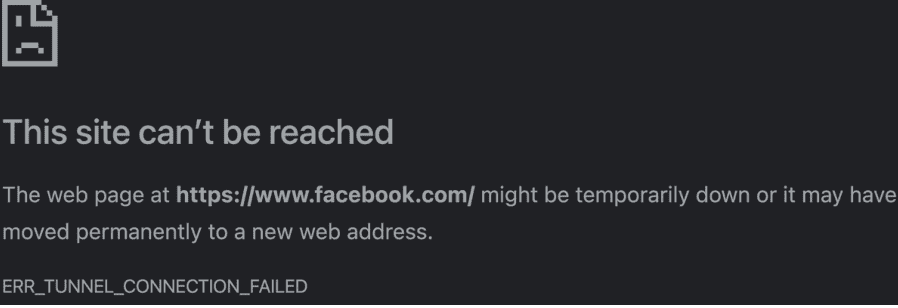

**图 6-1:** Squid 引起的浏览器错误

要再次允许 Facebook，请删除或注释你添加的行，保存配置文件并重载 Squid。
你可以通过将额外的域名添加到同一个 `denylist` ACL 中重复此过程：

```
acl denylist .facebook.com .twitter.com .linkedin.com
```

或者，你可以根据需要为每个网站或网站组/类别创建单独的 ACL。
白名单的工作方式几乎相同；任何添加到白名单的域名都将允许访问，但仅针对对代理进行身份验证的用户：

```
--snip
include /etc/squid/conf.d/*
allowlist dstdomain .facebook.com .twitter.com .linkedin.com
http_access allow CONNECT allowlist
--snip--
```

如果你添加了新的 ACL 规则，请注意它们在配置文件中的相对位置。Squid 将按照它们出现的顺序解释 ACL 规则，就像防火墙一样。如果 ACL 规则列表开头有一个 `deny all` 规则，Squid 将首先解释此规则并

然后忽略文件中的任何后续规则。这意味着您应该将任何自定义规则放在以下行之前：

```
--snip---
# 最后最后拒绝对此代理的所有其他访问
http_access deny all
--snip--
```

# 使用 Squid 保护个人信息

Squid 高度可配置，允许您作为管理员设置希望向互联网暴露的关于用户及其设备的多少信息。默认情况下，从客户端设备通过代理传输到互联网的流量不会经过匿名化处理。

为了防止网络外部人员获知您流量的来源（即服务器信息，或者您可能引用了哪个网站或资源，如 Amazon 或博客），请使用 `request_header_access` 指令来拒绝这些信息：

```
--snip---


`include /etc/squid/conf.d/*`

`request_header_access From deny all`

`request_header_access Referer deny all`

`request_header_access Server deny all`

--snip--

为了进一步匿名化您的流量，拒绝 `User-Agent`、`MW-Authenticate` 和 `Link` 请求头值可能是明智的，因为这些值可能会泄露关于您的浏览器或浏览活动的额外信息：

--snip---

`include /etc/squid/conf.d/*`

`request_header_access From deny all`

`request_header_access Referer deny all`

`request_header_access Server deny all`

```
request_header_access User-Agent deny all

request_header_access WWW-Authenticate deny all

request_header_access Link deny all
```
--snip--

通过这些选项匿名化您的流量将减少您向互联网发送的 PII（个人身份信息）数量，使您更难被追踪，并在某种程度上保护您的浏览历史和习惯。

> 注意：某些网站和服务使用用户代理（user agents）来决定向用户显示内容，请注意通过移除头部信息，您可能会获得不同的内容体验。

# 为特定网站禁用缓存

某些网站您可能不希望 Squid 缓存，因为您始终希望获取 Web 服务器的最新版本，而不是来自代理的缓存版本。这可以通过拒绝缓存该网站或多个网站来实现：

--snip--

`include /etc/squid/conf.d/*`

`acl deny_cache dstdomain .facebook.com`

`no_cache deny deny_cache`

--snip--

记得为每个想要防止 Squid 创建并保留缓存副本的网站添加 ACL 条目。

# Squid 代理报告

您可能已经注意到 Squid 日志很难阅读且需要一些时间来适应。有第三方解决方案可以使活动报告和日志查看变得更容易。更简单的解决方案之一是 Squid 分析报告生成器（SARG）。SARG 是一个基于 Web 的报告生成器和查看器，允许您在浏览器窗口中查看 Squid 日志，而不是通过终端。

在您的 Squid 服务器上安装 SARG：

```
$ sudo apt install sarg
```

SARG 报告文件将通过 Web 浏览器访问，因此您还需要安装一个 Web 服务器。安装 Apache：

```
$ sudo apt install apache2
```

接下来，打开 SARG 配置文件，该文件应该位于 `/etc/sarg/sarg.conf`：

```
$ sudo nano /etc/sarg/sarg.conf
```

找到以 `access_log` 开头的行，该行指定了 Squid 访问日志的位置：

--snip--

`access_log /var/log/squid/access.log`

--snip--

然后，关闭文件并使用 `find` 命令确保它与日志文件的实际位置匹配：

```
$ sudo find -name access.log
/var/log/squid/access.log
```

在文本编辑器中打开文件并找到输出目录标签（以 `output_dir` 开头的行），注释掉包含 `/var/lib/sarg` 的行，并将其替换为设置目录到 Apache Web 位置 `/var/www/html/squid-reports/` 的行：

--snip---

`#output_dir /var/lib/sarg`

`output_dir /var/www/html/squid-reports`

--snip--

保存并关闭文件。如果您愿意，可以随意浏览其他设置。要生成 SARG 报告，请在您的 Squid 服务器上运行以下命令：

`$ sudo sarg -x`

在您的 Web 浏览器中，导航到代理服务器上的报告位置：`http://<proxy_ip_address>//squid-reports`。您应该能看到一个基础网站，如图 6-2 所示。


| FILE/PERIOD | CREATION DATE | USERS | BYTES | AVERAGE |
| :--- | :--- | :--- | :--- | :--- |
| 2021Oct31-2021Oct31 | Sun 31 Oct 2021 07:43:27 PM PDT | 1 | 8,68M | 8,68M |

Generated by sarg-2.4.0 Jan-16-2020 on Oct/31/2021 19:43

**图 6-2:** SARG 报告摘要

点击显示页面上的相关报告，您应该看到一个基础网站，如图 6-2 所示。


| FILE/PERIOD | CREATION DATE | USERS | BYTES | AVERAGE |
| :--- | :--- | :--- | :--- | :--- |
| 2021Oct31-2021Oct31 | Sun 31 Oct 2021 07:43:27 PM PDT | 1 | 8,68M | 8,68M |

Generated by sarg-2.4.0 Jan-16-2020 on Oct/31/2021 19:43

**图 6-2:** SARG 报告摘要

点击显示页面上的相关报告，您应该看到一个基础网站，如图 6-2 所示。


| NUM | USERID | CONNECT | BYTES | IN-CACHE | ELAPSED | TIME |
| :--- | :--- | :--- | :--- | :--- | :--- | :--- |
| 1 | 172.16.90 | 225 | 8,68M | 100.00% | 100.00% | 0.00% |
| TOTAL | | 225 | 8,68M | 100.00% | 100.00% | 0.00% |
| AVERAGE | | 225 | 8,68M | | | |

Generated by sarg-2.4.0 Jan-16-2020 on Oct/31/2021 19:43

**图 6-2:** SARG 报告摘要

点击显示页面上的相关报告，您应该看到一个基础网站，如图 6-2 所示。

## 安装与配置

您可能已经注意到 Squid 日志很难阅读且需要一些时间来适应。有第三方解决方案可以活动报告和日志查看变得更容易。更简单的解决方案之一是 Squid 分析报告生成器（SARG）。SARG 是一个基于 Web 的报告生成器和查看器，允许您在浏览器窗口中查看 Squid 日志，而不是通过终端。

在您的 Squid 服务器上安装 SARG：

```
$ sudo apt install sarg
```

SARG 报告文件将通过 Web 浏览器访问，因此您还需要安装一个 Web 服务器。安装 Apache：

```
$ sudo apt install apache2
```

接下来，打开 SARG 配置文件，该文件应该位于 `/etc/sarg/sarg.conf`：

```
$ sudo nano /etc/sarg/sarg.conf
```

找到以 `access_log` 开头的行，该行指定了 Squid 访问日志的位置：

--snip--

`access_log /var/log/squid/access.log`

--snip--

然后，关闭文件并使用 `find` 命令确保它与日志文件的实际位置匹配：

```
$ sudo find -name access.log
/var/log/squid/access.log
```

在文本编辑器中打开文件并找到输出目录标签（以 `output_dir` 开头的行），注释掉包含 `/var/lib/sarg` 的行，并将其替换为设置目录到 Apache Web 位置 `/var/www/html/squid-reports/` 的行：

--snip---

`#output_dir /var/lib/sarg`

`output_dir /var/www/html/squid-reports`

--snip--


保存并关闭文件。如果您愿意，可以随意浏览其他设置。要生成 SARG 报告，请在您的 Squid 服务器上运行以下命令：

`sudo sarg -x`

在您的 Web 浏览器中，导航到代理服务器上的报告位置：`http://<proxy_ip_address>//squid-reports`。您应该能看到一个基础网站，如图 6-2 所示。


| FILE/PERIOD | CREATION DATE | USERS | BYTES | AVERAGE |
| :--- | :--- | :--- | :--- | :--- |
| 2021Oct31-2021Oct31 | Sun 31 Oct 2021 07:43:27 PM PDT | 1 | 8,68M | 8,68M |

Generated by sarg-2.4.0 Jan-16-2020 on Oct/31/2021 19:43

**图 6-2:** SARG 报告摘要

点击显示页面上的相关报告，您应该看到一个基础网站，如图 6-2 所示。


| NUM | USERID | CONNECT | BYTES | IN-CACHE | ELAPSED | TIME |
| :--- | :--- | :--- | :--- | :--- | :--- | :--- |
| 1 | 172.16.90 | 225 | 8,68M | 100.00% | 100.00% | 0.00% |
| TOTAL | | 225 | 8,68M | 100.00% | 100.00% | 0.00% |
| AVERAGE | | 225 | 8,68M | | | |

Generated by sarg-2.4.0 Jan-16-2020 on Oct/31/2021 19:43

**图 6-2:** SARG 报告摘要

# 7 拦截互联网广告


公司通过广告实现互联网变现，这导致在线广告数量激增（更准确地说，是爆炸式增长）。这些广告时间的推移变得越来越有害，因为网站跟踪您的活动以显示最可能导致购买的促销。更糟糕的是，广告由于网站充斥着自动播放广告导致互联网连接变慢。

您可以通过多种方式从网络中拦截广告。本章将首先讨论各种浏览器拦截解决方案。然后，我们将使用 Pi-hole 构建广告拦截 DNS 代理服务器，为用户提供更好的浏览体验，同时提高数据安全和隐私保护。

# 浏览器级广告拦截

大多数现代浏览器本身就已内置了某种形式的广告拦截技术。默认情况下，某些浏览器会阻止各种跟踪器和脚本按设计运行。这些包括社交媒体跟踪器、Cookie、指纹和加密货币矿器。拦截社交媒体跟踪将阻止 Facebook、Twitter 和 LinkedIn 在您浏览了社交媒体按钮或即时分享链接的网站时跟踪您。Cookie 是网站用于在访问之间跟踪信息和用户偏好的的文件；这可能会泄露您的

将私人信息从一个网站传输到另一个。指纹的相似之处在于，它们通过从浏览习惯中收集的多项指标来识别特定用户，这允许广告商在浏览期间跟踪你的活动。最后，加密货币矿程序是一些应用程序（有些可能是恶意软件），它们使用你的计算机硬件来挖掘加密货币，例如比特币。这是一个高资源消耗的过程，可能会导致系统不稳定。所有这些内容都会负面影响你的浏览体验，并应该被拦截。

除了某些浏览器提供的内置功能外，最流行的浏览器广告拦截器是浏览器扩展，也称为插件（add-ons）——你可以添加到浏览器中以改进其功能或添加能力的软件。例如，Adblock Plus（安装在大多数浏览器中——其工作原理是在广告显示给用户之前拦截它们，尽管广告仍然会被下载到你的计算机上。

许多网站可以识别浏览器扩展是否已启用，并修改其内容或完全阻止用户查看页面，直到禁用扩展或将该网站加入白名单以播放广告。第 11 章将进一步讨论浏览器扩展。以下项目将介绍如何为 Google Chrome、Mozilla Firefox 和 Brave 浏览器设置浏览器拦截。

## 22：在 Google Chrome 中拦截广告

Chrome 的广告拦截器（https://www.google.com/chrome/）旨在隐藏广告过多或会损害用户体验（如闪烁或发出噪音）的网站上的广告。Chrome 还会拦截包含付费墙的网站上的广告，付费墙会完全遮挡网站，直到用户允许广告显示或支付费用查看内容。此行为适用于 Chrome 的桌面版本，也适用于 Android 版本。你可以激活或禁用内置广告拦截器，还可以将特定网站加入白名单：

- 在 Chrome 浏览器右上角，点击**更多**（三条横线）。
- 点击 **设置 ► 高级 ► 网站设置 ► 广告**。
- 3. 如果显示文本“倾向于显示侵入性广告的网站（推荐）”，说明 Chrome 目前正在为你拦截广告。
- 4. 如果你想关闭广告拦截，按下开关将设置切换为“允许”。

在线保护隐私的另一种方法是使用隐私浏览窗口。Chrome 的无痕模式会在关闭浏览器时要么不保存你的个人信息，要么立即将其删除（包括 cookie 等跟踪信息）。你的浏览记录和互联网搜索将不会被保存。要打开无痕窗口，请遵循以下步骤：

- 5. 在 Chrome 浏览器右上角，点击“更多”图标（三条横线）。
- 6. 点击“新无痕窗口”。

将打开一个新的浏览器，其外观与普通 Chrome 窗口不同——通常会显示“您已进入无痕模式”等文字。这就是你知道自己正在隐私浏览的方式。

## 23：在 Mozilla Firefox 中拦截广告

Firefox 的隐私（https://www.mozilla.org/）窗口不仅拦截广告，还拦截跟踪内容，包括在网页上显示的视频和其他媒体。要打开新的隐私窗口，请遵循以下步骤：

- 1. 在 Firefox 浏览器右上角，点击“更多”图标（三条横线）。
- 2. 点击“新隐私窗口”。

你可以更改 Firefox 的默认行为，禁用所有 Firefox 窗口中的跟踪内容，而不仅仅是隐私窗口。要修改这些设置，请遵循以下步骤：

- 1. 点击 Firefox 窗口右上角的“更多”。
- 2. 点击“设置 ► 隐私与安全”。
- 3. 将你的“增强跟踪保护”设置为标准（默认）、严格（提供更高的隐私但可能会破坏某些网站）或自定义。
- 4. 配置你的 Cookie 设置，通过勾选“在 Firefox 关闭时删除 Cookie 和网站数据”在浏览器退出时删除 Cookie。
- 5. 通过将“历史”下拉菜单设置为“从不记录”，让 Firefox 忘记你的浏览记录。
- 6. 为摄像头和麦克风等设备设置权限，使 Firefox 无法未经授权进行观看或监听。

你可以在 Mozilla 知识库中找到更多关于禁用跟踪器和其他安全及隐私设置的信息：https://support.mozilla.org/en-US/kb/enhanced-tracking-protection-firefox-desktop/

## 控制 Brave 的隐私设置

Brave（https://brave.com/）是一个基于 Google Chrome 的较新网络浏览器（因此它与 Chrome 共享许多功能）；所有与 Chrome 兼容的扩展也兼容 Brave。与其他浏览器相比，Brave 的伟大之处在于它的目标是为用户提供私私的、无跟踪器且无广告的体验。通过在浏览器中采取激进的广告拦截方法，Brave 声称不仅在使用互联网时节省了时间和带宽，还减少了用户的电量。

Brave 对你的安全和隐私设置提供了更细粒度的控制，并且让这些设置比其他浏览器更容易获取：

- 1. 在 Brave 浏览器右上角，点击“更多”图标（三条横线）。
- 2. 点击“设置 ► 盾牌”。
- 3. 将“跟踪程序与广告拦截”设置为“标准”或“激进”。
- 4. 打开“升级连接到 HTTPS”。
- 5. 将“Cookie 拦截”设置为“仅跨站”或“所有”（浏览器关闭后将不再记住你的会话信息）。
- 6. 将“指纹拦截”设置为“标准”或“严格”（可能会破坏某些网站）。

尝试这些设置以及社交媒体拦截，直到你找到适合自己的组合。

## 25：使用 Pi-Hole 拦截广告

使用浏览器扩展或内置工具拦截广告是增强你浏览体验的良好开始。然而，这些选项一次仅适用于一个设备，且管理多个设备的设置会变得非常困难。

域名系统（DNS）允许你的计算机与互联网上的网站进行通信。所有网站都有分配 IP 地址，与 IP 地址相比，URL 是易读的且易于记忆的。DNS 就像邮政服务，IP 地址相当于物理地址，而 URL 就像街道名。DNS 允许你访问网站（例如 `www.facebook.com`）而无需记住具体的地址。

Pi-Hole 类似于第 6 章讨论的 Squid 代理；它位于你和想要浏览的网站之间，观察流量，通过精选的已知域名列表在 DNS 层面识别广告，并允许合法的非广告流量通过。由于广告域名也使用 DNS 来投放广告，让我们构建 Pi-Hole 服务器将这些请求发送到黑洞，为用户提供更好的体验。

在本地网络中设置 Ubuntu 服务器（如第 1 章所述），并将其加入你的网络地图和资产列表。可以使用云端服务器，但正确的缓解措施可以解决这些问题，因此如果你选择使用云服务器，请谨慎操作并研究如何降低这些风险。如果你已按照第 3 章安装了边界防火墙，并使用虚拟机创建了 Pi-Hole 服务器，该服务器应该位于防火墙之后（即在防火墙的网络侧，而不是互联网侧）。

可以将 Pi-Hole 与 Squid（第 6 章讨论）结合使用，通过 Pi-Hole 处理 DNS 请求并通过 Squid 处理 HTTP 流量。然而，默认情况下 Squid 使用内部 DNS 客户端——这在重新构建 Squid 之前是无法更改的。如果你选择同时使用 Squid 和 Pi-Hole，可以按照每个解决方案的说明分别在终端上进行配置并获得相同的结果。

- 2. 在此阶段，自动化安装程序将接管你的终端窗口。阅读出现的各种信息屏幕，按 ENTER 键移动到下一个界面。
- 3. 当提示选择上游 DNS 服务器时（如图 7-1 所示），请选择任何你熟悉的上游（权威）DNS 服务商。Google 或 Quad9 都是不错的选择。

**注意** 使用方向键或 TAB 键在选项之间进行导航，使用空格键选择选项，并按 ENTER 键接受设置。

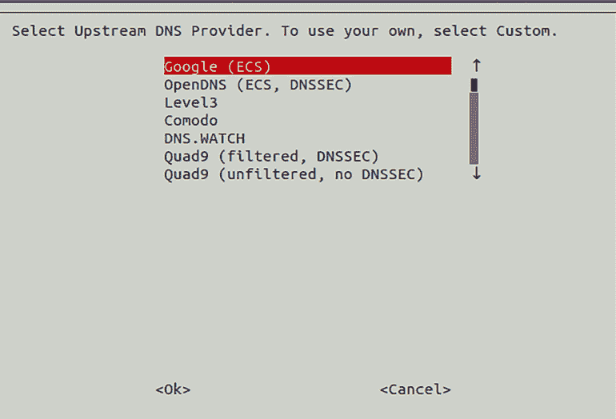

**图 7-1：** 上游 DNS 服务商

为了执行 DNS 查找，你的 Pi-Hole 服务器需要一个权威 DNS 服务器，以便在它尝试解析尚未被代理服务器缓存的域名时进行查询。权威 DNS 服务器是持有特定域名或地址实际 DNS 记录的服务器，例如 `www.google.com`。相比之下，你的服务器是递归的，它是你与宿主机以及一个或多个权威 DNS 服务器之间的中间介。当你请求一个网站时，你的设备会将此请求传递给 Pi-Hole 服务器，然后由 Pi-Hole 服务器将此请求转发到权威服务器，以找到你想查看的网站地址。

- 4. 提示时选择所有可用的拦截列表。
  Pi-Hole 使用拦截列表（由第三方维护的广告域名列表）来识别和拦截互联网上的广告。所选列表以后可以更改。

- 5. 如果你在网络中使用 IPv6，请在协议屏幕上除 IPv4 之外也选择 IPv6。

在大多数情况下，IPv6 并不是必要的。IPv6 为端点提供可寻的 IP 地址空间，而这种情况下不需要这样做。除非你有正用途，否则最好禁用 IPv6 以减少攻击面。

- 6. 下一个屏幕显示你服务器的静态 IP 地址和网关。如果页面列出的地址详情正确，按 ENTER 接受。否则，选择 No 并按 ENTER；然后手动设置你所需的静态 IP。

Pi-Hole 的网关可能是你的防火墙或路由器。一旦你配置或接受了服务器的 IP 设置，自动化安装程序将警告你配置路由器或 DHCP 服务器为该服务器保留 IP 地址。如果你不这样做，你的网络可能会遇到地址冲突，但大多数路由器能够在无需输入的情况下避免这种冲突。（请参见第 4 章“静态 IP 地址”配置如何在路由器上配置静态 IP 地址。）按 ENTER 确认警告。

- 7. 选择 On 安装 Web 界面，使得服务器配置更容易管理（即使对于高级管理员也是如此），然后按 ENTER。

- 8. 选择 On 安装自动化安装程序提供的 Web 服务器，除非你计划安装自己的（这超出了本书的讨论范围）。

- 9. 选择 On 记录通过你 Pi-Hole 服务器的 DNS 查询。

由于 Pi-Hole 是一个代理，它将记录并缓存所有通过它的 Web 请求。这意味着任何配置为使用 Pi-Hole 服务器作为 DNS 的端点，其浏览历史都将被记录。如果这给你的用户带来困扰，请获得他们的许可或关闭日志记录。使用 Pi-Hole 的广告拦截功能不需要日志，但启用它可以帮助排排除任何问题。

- 10. 选择一个在你网络内可以接受的隐私级别。

Pi-Hole 使用 Faster Than Light (FTL) DNS，它提供有关 Pi-Hole 活动的统计数据并以图形方式显示。你将能够此类信息，例如在范围内拦截了多少广告以及针对哪些端点。FTL 通过解析 Pi-Hole 文本日志获取这些数据。与日志记录一样，这对用户来说并非必须。务必提前获得他们的许可，或将隐私级别设置为隐藏域名和客户端（Hide Domains and Clients），如图 7-2 所示。这样做将提示 FTL 收集匿名数据，从而在保护用户隐私的同时允许统计和图形显示正常工作。你也可以通过在上一步中关闭日志记录来完全禁用统计。

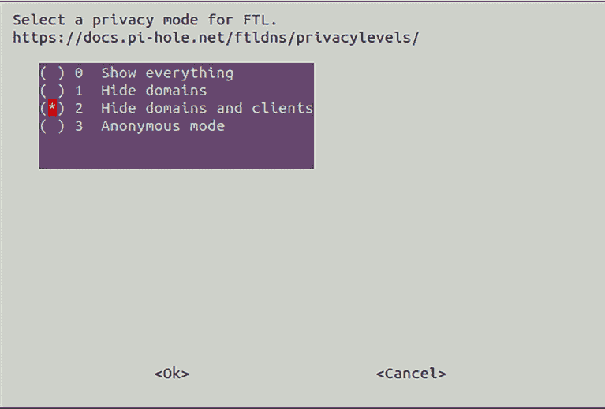

**图 7-2：** FTL DNS 设置

11. 安装完成后，你将看到一个显示你的配置以及 Web 界面的 URL 和管理员密码的屏幕，如图 7-3 所示。务必记录这些值，理想情况下存储在密码库中（第 11 章讨论过）以确保安全；按 ENTER 返回终端。

# 安装完成！

使用以下设置配置你的设备使用 Pi-hole 作为 DNS 服务器：

| IPv4 | 172.16.90.11 |
| IPv6 | 未配置 |

如果你设置了新的 IP 地址，你应该重启 Pi。

安装日志位于 `/etc/pihole`。

在 `http://pi.hole/admin` 或 `http://172.16.90.11/admin` 查看 Web 界面。

你的管理员 Web 页面登录密码为 `rOHpBpI3`

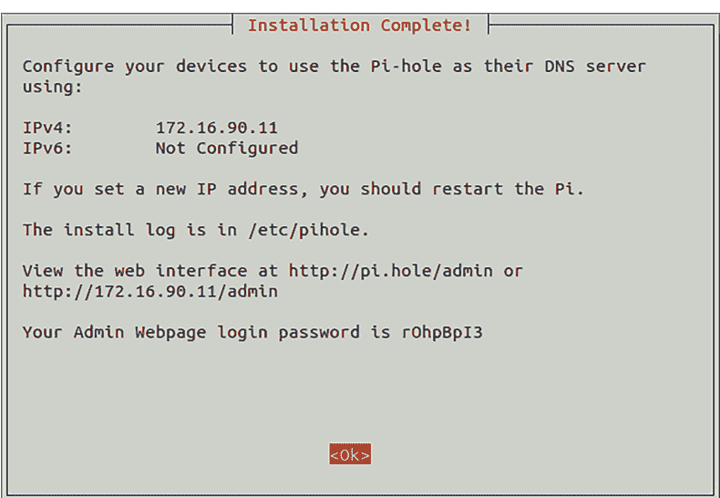

要更改管理员密码，请使用以下命令：

```bash


`sudo pihole -a -p`

为了保持最新状态，定期运行以下命令：

```bash
sudo pihole -up
```


确保 Pi-hole 及其组件是最新的至关重要。访问管理员 URL (`http://<server_ip>/admin`)，你应该看到仪表板。当有可用更新时，会在屏幕底部通知。

如果你觉得有帮助，请捐赠。

### Pi-hole v5.2.4 · 有可用更新
### Web Interface v5.4 · 有可用更新
### FTL v5.7 · 有可用更新

**图 7-4：** 需要更新

点击屏幕左侧的 **Login** 并使用你的管理员用户名和密码进行验证。仪表板将显示

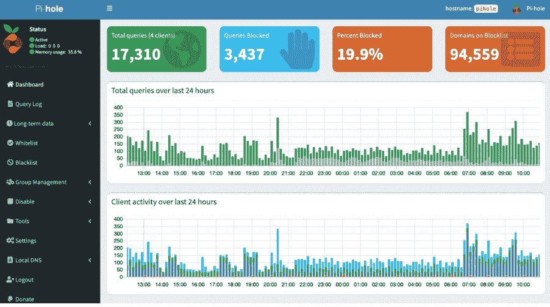

**图 7-5：** 管理员仪表板

导航中重要选项的简要描述如下：

**Query Log (查询日志)**：代理服务器的所有请求历史。

**Long-term Data (长期数据)**：代理服务器更详尽的历史，可以根据日期范围进行过滤。

**Whitelist (白名单)**：Pi-Hole 默认拦截但你想访问的网站。

**Blacklist (黑名单)**：代理可能不会拦截但你希望明确拦截的域名。

> **注意** 我们一直使用 allowlist/denylist，但 Pi-hole 在菜单选项中使用 whitelist/blacklist。在讨论 Pi-hole 时，我们将遵循这一术语。

**Disable (禁用)**：一段时间内禁用代理。

**Tools (工具)**：用于调试或更新拦截列表，并查看后端日志。日志提供有关 Pi-Hole 本身的调试信息，而不是 Web 流量。

**Tools➤Network (工具➤网络)**：显示连接到 Pi-Hole 服务器的所有客户端，以识别哪些端点正在使用代理，哪些可能绕过了代理。

**Settings➤System (设置➤系统)**：包含代理设置（包括安装期间配置的设置）；允许禁用、重启和关闭服务器，并允许清除 DNS代理日志。

**Settings➤DNS (设置➤DNS)**：更改用于域名翻译的权威 DNS 服务器，并修改接收和通过代理过滤的网络接口（默认设置通常是最安全的）。

**Settings➤DHCP (设置➤DHCP)**：如果需要，允许 Pi-Hole 服务器担任 DHCP 服务器。

**Settings➤Privacy (设置➤隐私)**：增加或降低报告时使用的隐私级别，将端点与其浏览活动关联或对捕获的数据进行匿名。

**Settings➤Teleporter (设置➤传送器)**：从另一个服务器导入或导出 Pi-Hole 设置。

**Logout (注销)**：退出管理员仪表板。

探索各种菜单和选项，以熟悉 Pi-Hole 的设置和配置。考虑也阅读手册，以更好地了解 Pi-Hole 的工作原理以及互联网到底有多强大。

## 在您的终端上配置 DNS

到此时，只剩下一件事要做：让你的客户端使用 Pi-Hole 服务器作为它们的 DNS 服务器。你需要配置 DHCP 服务器或路由器，将 DNS 设置推送到访问互联网的设备。或者，你也可以使用每个终端的内部网络设置对其单独进行配置。如果你只想让网络上的特定设备通过代理连接，而让其他设备直接连接到互联网，那么你可能希望这样做。尽管如此，让所有设备都通过 Pi-Hole 服务器将为用户提供最佳体验，并让你能够更好地控制网络流量并更早地发现问题。随着用户的浏览，服务器还将缓存更多网站，这将使得所有人访问频繁访问网站的速度都变得更快。

> 注意：您的路由器能够指定端点访问互联网时使用的 DNS 服务器。在我们作为示例的 ASUS 路由器中，它位于高级设置►LAN DNS 服务器。在 DNS 服务器 1 框中输入您的 Pi-Hole 服务器的 IP 地址，然后点击应用。连接的客户端将使用该 DNS 服务器。

如果你只想让部分终端使用 Pi-Hole 服务器，你可以使用这些客户端的本地 DNS 设置进行配置，或者使用 pfSense 防火墙中的 DNS 设置（如果你像第 3 章讨论的那样实现了 pfSense）。

### Windows DNS 设置

若要在 Windows 客户端上配置 DNS 设置，请按照以下步骤操作：

- 打开设置►网络和互联网►更改适配器选项。
- 右键点击以太网适配器。
- 3. 点击属性。
- 4. 点击 Internet 协议版本 4 (TCP/IPv4)►属性。
- 5. 选择“使用指定的 DNS 服务器地址”。
- 6. 在首选 DNS 服务器框中输入您的 Pi-Hole 服务器的 IP 地址。
- 7. 点击确定并关闭所有剩余窗口。

### macOS DNS 设置

若配置 Mac 使用 Pi-Hole 服务器作为 DNS，请按照以下步骤操作：

- 1. 打开系统设置►网络。
- 2. 在左侧连接列表中选择您的网络适配器（以太网或 Wi-Fi）。
- 3. 点击高级►DNS。
- 4. 在左侧的 DNS 服务器列表中添加您的 Pi-Hole 服务器的 IP 地址。
- 5. 点击确定►应用。

### Linux DNS 设置

若要在 Linux 终端上将 DNS 请求通过您的 Pi-Hole 服务器，请按照以下步骤操作：

- 1. 打开设置►网络。
- 2. 点击有线或无线连接右侧的齿轮图标。
- 3. 选择 IPv4 标签页。
- 4. 在 DNS 框中输入您的 Pi-Hole 服务器的 IP 地址。
- 5. 点击应用。

### pfSense DNS 设置

使用 pfSense，你可以在之前的静态 IP 地址设置中按客户端配置 DNS 设置，或者通过将您的 pfSense 设备指向 Pi-Hole 服务器来批量配置。要将所有 DNS 请求发送到 Pi-Hole 服务器，请在服务►DHCP 服务器页面上的 DNS 服务器框中输入您的 Pi-Hole IP 地址。如果你想指定哪些终端使用 Pi-Hole 服务器进行 DNS，请按照以下步骤操作：

- 1. 浏览到您的 pfSense 设备的服务►DHCP 服务器页面。
- 2. 在页面底部的 DHCP 静态映射表中找到相关终端的静态映射选项。
- 3. 点击终端的编辑铅笔图标。
- 4. 在 DNS 框中输入您的 Pi-Hole 服务器的 IP 地址。
- 5. 点击保存►应用更改。

一旦你使用上述任何选项配置了终端，你就可以使用 `https://canyyoublock.com/` 等网站测试广告拦截功能。这些网站为测试您的广告拦截器提供了多种选项，无论是浏览器插件还是像 Pi-Hole 这样的大型工具，从简单到高级测试方法。如果你运行这些测试且没有广告，说明你的广告拦截器正在工作。如果你仍然看到广告，请检查本章之前的章节并确保你的设置正确。登录您的 Pi-Hole 服务器并检查仪表板，查看您的 DNS 查询是否被服务器看到并因此通过了服务器。

## 总结

无论你选择如何使用 Pi-Hole，你现在都有了监控和控制网络互联网使用的方法，每个人都应该获得更好的浏览体验。你可以选择在第 6 章中可能实现的 Squid 代理之外使用 Pi-Hole，或者只使用 Squid 或 Pi-Hole 而不使用另一个。无论你选择哪种方案，你都会体验到与该技术相关的益处。或者，如果你倾向于使用浏览器扩展进行基于浏览器的拦截，也可以放弃 DNS 级别的广告拦截；选择权交在你手中。

## 检测、删除和预防恶意软件


病毒、木马和勒索软件等恶意软件是对互联网用户的重大的威胁，并且在可预见的未来很可能也是。因此，为你和你的用户配备能够检测和删除恶意软件的杀毒解决方案是重要的。此外，保持终端更新可以防止恶意软件感染你的网络，并且在某些情况下也是如此。

杀毒解决方案可能难以管理，因为它们通常只适用于一个系统。如果你有多个操作系统，你需要为每个系统寻找有效的杀毒程序。尽管本章讨论了特定产品的安装、配置和扫描，但设置的名称和选项可能会有所不同。我们将考虑恶意软件签名和启发式扫描的区别、每种方法的优缺点，以及保持终端更新的最佳方法。

### Windows Defender

内置杀毒解决方案的最新版本是 Microsoft Defender。Defender 会自动更新病毒定义并按计划扫描威胁，因此 Windows 电脑开箱即用保护。

Defender 的自动扫描是仅检查常见威胁所在文件夹的快速扫描。虽然快速扫描速度快且消耗系统资源少，但它不太可能发现这些文件夹之外的恶意软件。全扫描会扫描所有文件和运行程序，对恶意软件进行彻底搜索。建议每周到每月运行一次全扫描。全扫描之间的间隔越长，攻击者破坏你系统的时间就越长。

你还可以选择自定义和离线扫描。自定义扫描让你选择要扫描的文件夹和文件。离线扫描类似于早期 Windows 版本中的进入安全模式删除恶意软件。Windows 现在能够自动重启到一个状态，允许 Microsoft Defender 通过离线扫描删除恶意软件。此选项是最后的手段，而不是你经常运行的扫描。如果你认为电脑被感染但无法通过全扫描发现感染，请运行离线扫描以确定。如果仍然失败，你唯一的选择就是抹除硬盘并从头重新安装 Windows。

运行扫描，打开设置►更新和安全►Windows 安全►病毒和防护。点击扫描选项，选择要扫描的类型，然后点击立即扫描。

在病毒和防护菜单中，确保实时防护已启用，以便 Defender 持续保护你的计算机。你可以从此菜单添加文件和文件夹排除项。当你拥有合法且对系统无风险的文件或程序，但 Defender 将其归类恶意软件并尝试隔离时，你可以添加排除项。

有一个特定的设置被认为对隐私存在风险，自动样本提交，它允许 Microsoft Defender 将你的文件上传到 Microsoft 云端服务器进行分析。

并进行恶意软件扫描。这种做法存在风险：您的隐私或机密数据可能会在您不知情的情况下泄露给第三方，因为 Defender 不会询问或提示您文件正上传到 Microsoft。要关闭此设置，请切换“自动样本提交”（Automatic Sample Submissions）。

与此设置相关的是“云端保护”（Cloud-Delivered Protection）设置。后者的风险较小，因为它只向 Microsoft 传输文件元数据而不是整个文件内容。即使关闭了自动样本提交，“云端保护”仍然可以工作，尽管性能可能不是很好。

Windows 会保持 Microsoft Defender 更新为最新版本，但偶尔手动更新也无益。若要更新，请在“病毒和威胁防护”主页点击“检查更新”（Check for Updates）。

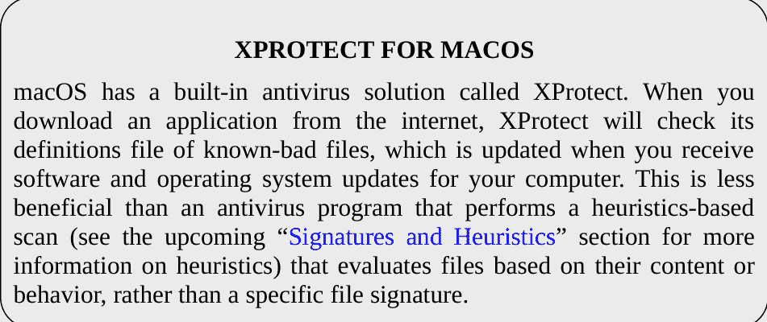

## 选择恶意软件检测和杀毒工具

在决定您想要使用的杀毒和恶意软件检测工具时，请考虑购买商业工具（或免费工具的高级版本）是否值得，以及该工具是使用特征码（signatures）还是启发式算法（heuristics）来检测恶意软件。

总的来说，您只需要一个简单的恶意软件扫描工具，很少有理由为商业产品付费。通常，您支付的费用是为了高级功能，例如内置在恶意文件扫描器中的电子邮件或网络浏览器扫描器。

许多，付费解决方案允许某种形式的集中化管理。无论是通过网络门户、管理服务器还是代理，您都可以在一个地方获得可见性并管理所有设备的能力。如果您拥有较大的网络，这种能力是有价值的；如果您的网络少于 30 台设备，您可能不需要它。

## 杀毒农场 (Antivirus Farm)

在较小的网络中，放弃单一解决方案而转而使用多种杀毒产品也有其好处。杀毒农场使用多个产品，旨在捕获比单一解决方案更多的恶意软件。这也让攻击者的工作变得更加困难；他们不需要规避单一杀毒产品，而需要在后期在网络中移动时进行规避。

杀毒农场非常有帮助，因为每家杀毒厂商都维护着自己的恶意软件特征数据库——可执行文件中的字节序列可用于识别特定的恶意软件样本。这些数据库必须经常进行优化，否则您随软件下载的病毒定义将变得过于庞大且难以使用。因此，旧的病毒定义可能会随着推移从这些数据库中移除，这意味着来自多个厂商的产品可能会对已知威胁提供更大的覆盖。

## 特征与启发式算法 (Signatures and Heuristics)

您还应该追求同时执行基于特征的检测和启发式检测的杀毒产品。特征通过可执行文件或其他文件的内容识别已知的恶意软件，攻击者只需稍微更改内容即可改变其恶意软件的特征。这是恶意软件检测软件的一个主要弱点。相反，启发式算法通过分析文件的行为和它发出的指令来判断其是否具有恶意。这是检测已知和未知威胁的一种更可靠的方法。您如何判断特定的杀毒程序是执行基于特征的检测还是启发式扫描？如果其网站上没有列出，最好的办法是联系厂商并询问。他们的网站上总会列出联系方式。

### #26：在 macOS 上安装 Avast

Apple 设备通常被认为较不容易受到恶意软件侵害，但其感染频率日益增加，这意味着您应该在网络中的任何 Mac 上安装杀毒软件。在 Apple 计算机上安装基于启发式的第三方杀毒解决方案时，有很多免费和商业的选择。在这些中，Avast 多年来一直位居多个榜首。要安装和配置 Avast，请使用以下步骤：

- 1. 从 `http://www.avast.com/` 下载 Avast 并安装软件。安装完成后，您将看到 Avast 安全窗口（图 8-1）。

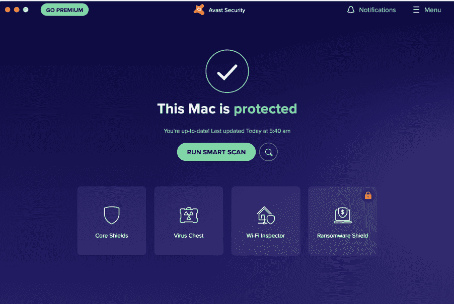

图 8-1：Avast 安全窗口

- 2. 点击菜单（Menu）► 选项（Preferences）进入 Avast 设置页面。
- 3. 在常规（General）选项卡中，确保勾选“自动更新”（Turn on Automatic Updates）。
- 4. 在隐私（Privacy）选项卡中，取消勾选允许与 Avast 共享数据。与 Windows Defender 类似，最好保护您的隐私。
- 5. 在核心防护（Core Shields）选项卡中，启用各项安全检查，Avast 将运行文件扫描以及网络和电子邮件防护。
- 6. 点击防护下的“添加排除项”（Add Exceptions）按钮以指定任何排除项。如果您有已知是合法的或低风险但被杀毒软件分类为潜在恶意的文件或程序，请添加排除项。
- 7. 在扫描选项卡中，确保勾选“整个文件”（Scan Whole Files）、外部驱动器（Scan External Drives）、挂载卷（Scan Mounted Volumes）、Time Machine 备份（Scan All Time Machine Backups）以及存档（Scan Archives）。通过这样做，您可以确保杀毒软件尽可能地识别威胁并保护您免受侵害。

智能扫描（Smart Scan）旨在快速扫描计算机最脆弱的区域。虽然这种方式消耗资源较少且耗时较短，但它无法捕获计算机所有的威胁，因为它没有扫描硬盘的所有区域。深度扫描（Deep Scan）更全面，包含了设备上的所有存储区域，可选包括外部存储、网络位置、Time Machine 备份以及根内核检测。

## #27：在 Linux 上安装 ClamAV

# 要定义时间，你可以为分钟 (m)、小时 (h)、每月第几天 (dom)、月份 (mon)
# 以及星期中的第几天 (dow) 提供具体值，或在这些字段中使用 '*'（表示“任意”）。
#

# 注意，任务将根据 cron 系统守护进程的时间
# 概念和时区来启动。
#

# crontab 任务的输出（包括错误）将通过邮件发送给
# crontab 文件所属的用户（除非经过了重定向）。
#

# 例如，你可以运行以下命令在每周一凌晨 5 点对所有用户账户
# 进行备份：
# 0 5 * * 1 tar -zcf /var/backups/home.tgz /home/

# 欲更多信息，请参阅 crontab(5) 和
# cron(8) 的手册页。
#

`m h dom mon dow` 命令

文件开头的巨大注释通过示例解释了如何指定任务。注释的最后一行提供了调度脚本和应用程序执行的语法。顺序是：分钟、小时、日期、月份、星期以及要执行的命令。分钟和小时必须是数字，分别为 0 到 59 和 0 到 23，你可以通过逗号分隔值来指定分钟或小时列表（也就是说，通过指定 1, 2, 3，你可以在凌晨 1 点、2 点和3 点运行命令）。你可以使用数字指定星期（1 到 7，其中 1 是星期日），或使用 Sun, Mon, Tue 等单词。月份为 1 到 12（其中 1 是一月）。星号代表该字段的所有可能值；如果你想让命令每月运行一次，请在月份 (`mon`) 的位置放置星号。

假设你想在每周日的凌晨 1 点对整个文件系统运行 `clamscan`，包括扫描潜在的不受欢迎应用程序。在 Crontab 文件的底部添加新行并输入以下内容：

```
```


`0 1 * * sun clamscan -r / --detect-pua=yes -i/path_to_logfile/clamav.log`

默认情况下，除非你使用 `-i` 参数指定日志文件，否则你无法看到扫描结果。如果你想在进行全系统扫描的同时，每天扫描特定的文件夹（例如用户主目录 `/home/`），请参考上一个示例，在 `Crontab` 中添加另一个条目。

在 `Crontab` 中添加另一行以确保 `ClamAV` 保持更新：

```
@ @ * * systemctl stop clamav-freshclam && freshclam && systemctl start clamav-freshclam
```

你可以将多个命令连接在一起并将它们串联分开。使用 `man` 函数查找有关 `Crontab`（或任何其他终端命令）的更多信息。在命令行中输入 `man crontab` 即可打开该应用程序的手册。

## #28: VirusTotal

`VirusTotal` (`VT`) 通过借鉴杀毒服务的概念并大规模实施来测试文件，以判断它们是否具有恶意（https://www.virustotal.com/）。这是一个公共可用的服务，你可以在其中上传任何文件以检测恶意软件，`VT` 将使用 60 多种杀毒程序对其进行扫描。然后它会生成一份报告，让你知道它是否包含恶意软件，或者其行为可能会对你的终端、安全或隐私产生不利影响。如果你认为某个文件是恶意的但你的杀毒软件未检测到，这种功能特别有用。

请注意，任何上传到 `VT` 的内容都是公开的，因此任何人都可以搜索并下载你上传的文件。为了在不公开隐私信息的情况下使用 `VT`，请在 `VT` 中搜索你想要检查的文件哈希值。哈希处理是一个根据文件内容计算固定长度字符串的过程。哈希预期是一个单向过程，这意味着你无法通过文件的哈希值反向获取原始文件内容。通过创建文件的哈希值，你应该得到一个标识文件的唯一字符字符串。某些哈希算法可能会导致冲突，即两个文件产生相同的哈希值，尽管大多数现代哈希函数发生这种情况的概率微乎其微。你可以使用任何操作系统内置的工具来获取文件的哈希值。

### Windows PowerShell
在 Windows 中，打开 PowerShell 窗口并输入以下命令获取任何文件的 MD5 哈希值：

```
$ Get-FileHash path_to_file -Algorithm MD5
```

你可以直接在 VirusTotal 网页门户中搜索哈希值。

### Linux 和 macOS 终端
你可以在 Linux 和 macOS 中使用以下命令获取文件的 MD5 哈希值：

```
$ md5sum path_to_file
```

然后在 `VT` 网页门户中搜索该哈希值。
如果过去任何时候向 `VT` 上传过具有相同哈希的文件，你将看到该文件的公共报告，详细列出了 `VT` 中所有提供者的恶意软件扫描结果。如果之前没有上传过，那么该文件很不是恶意的。

## #29: 管理补丁和更新

除了杀毒工具外，补丁管理是一项重要的防御，因为恶意软件利用是为了攻击网络、应用程序、协议或操作系统中的特定漏洞而编写的。攻击者密切关注 Windows 更新和其他操作系统的补丁，因为补丁说明中指出了它旨在修复的漏洞。攻击者利用漏洞信息编写专门针对该安全缺陷的恶意软件，而任何没有下载更新的人都会中招。这就是。

包括关于需要和推荐更新的信息：

```
--snip--
* 文档：https://help.ubuntu.com
* 管理：https://landscape.canonical.com
* 支持：https://ubuntu.com/advantage
```

可以立即安装 105 个更新。
其中 68 个更新是安全更新。
要查看这些额外的更新，请运行：`apt list --upgradable`
--snip--

为了确保更新列表完整，请运行 `apt update` 命令：

```
$ sudo apt update
```

一旦列表已更新，请运行 `upgrade` 命令来更新所有的软件包：

```bash
$ sudo apt upgrade
```

命令输出将显示要更新的软件包数量、它们将占用的磁盘空间以及各种状态消息。在提示时，输入 `Y` 并按 `ENTER` 键继续。

与 Windows 和 macOS 一样，某些更新需要你重启系统。如果是这样，你将看到类似的内容：

需要重启以替换正在运行的 `dbus-daemon`。
请在方便时重启系统。

要让 Ubuntu 自动更新系统和安装的软件包，请使用以下命令：

```bash
$ sudo dpkg-reconfigure -plow unattended-upgrades
```

该命令将产生图 8-3 所示的提示。

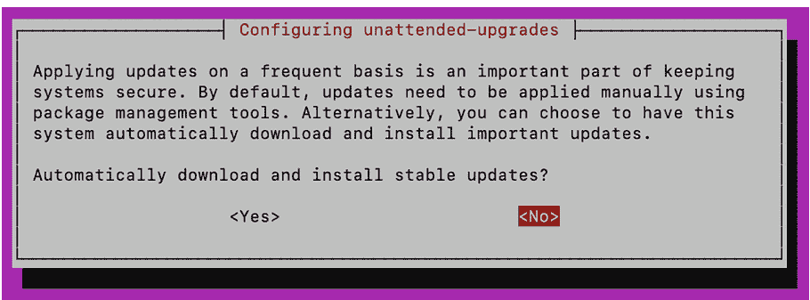

**图 8-3：** Ubuntu 自动更新

通过选择 `Yes` 并按 `ENTER`，你可以确保你的服务器保持最新状态，从而从根本上提高它们的安全性。然而，你仍然应该手动检查更新，并每月重启一次服务器。

### #30: 安装 Automox

根据你的网络规模，手动甚至半手动地保持所有端点处于最新状态可能会感到乏味或难以从心。像 `Automox` 这样的集中补丁管理解决方案允许你在一个地方轻松地管理所有这些事项。`Automox` 采用端点订阅模式：你可以支付少量的月费开始管理一个或多个 Windows、macOS 或 Linux 系统（工作站或服务器），这允许你从一个仪表板为所有端点打补丁（包括系统和第三方软件补丁）。`Automox` 还维护资产和软件清单，这是任何人在保持网络安全时应该采取的第一步。

#### 安装 Automox

访问 `Automox` 网站 (https://www.automox.com/) 注册账户（或免费试用）。然后登录到你的账户仪表板 https://console.automox.com/。仪表板是你查看受管理的端点摘要以及它们所需的更新的地方。当然，在你向账户中添加一些端点之前，此仪表板将是空空的。在接下来的章节中，你需要一个用户密钥（`user key`）将你的端点连接到 `Automox`。你可以通过进入 `Automox` Web UI 中的个人设置页面，并在 `Keys` 选项卡下找到你的密钥。

#### Windows

要在 Windows 端点上安装 `Automox` 代理，请从 `Automox` 控制台访问 **Devices**（设备）选项卡，然后点击页面顶部的 **Add Devices**（添加设备）链接。你将看到操作系统选择弹出窗口。选择 Windows 并下载代理。

一旦下载了代理，以管理员身份运行安装程序（`.msi` 文件）。按照安装向导操作，在提示时输入来自控制的 `Automox` 用户密钥。安装完成后，刷新你的 `Automox` 仪表板以查看新添加的端点（图 8-4）。

| 操作系统 | 设备名称 | 最后断开 | 组组成 | 标签 | IP 地址 | 操作系统版本 | 计划补丁 | 补丁总量 | 状态 |
|---|---|---|---|---|---|---|---|---|---|
| IE | Story | | | Default | Security Admin | 17.23.14.58 | 10.10.1.1041 | | 安装中 |

**图 8-4：** Automox 资产列表

#### macOS 和 Linux

在 Mac 或 Linux 电脑的终端窗口中，运行以下命令，将 `yourkey` 替换为你的用户密钥：

```bash
curl -sS "https://console.automox.com/downloadInstaller?accesskey=yourkey" | sudo bash
```


再次刷新你的控制台以查看新添加的端点。

## 使用 Automox

现在你已经在端点上安装了 Automox，你将从中央控制台管理操作系统和第三方软件补丁了。通过 `Devices` 选项卡，你可以查看所有受管理的端点并将它们添加到组中——如果你想那样管理它们的话。你还可以扫描端点以识别硬件更改并检查它们需要的新更新、远程重启你的端点，或从账户中删除端点。通过点击端点，你可以查看它的硬件配置、IP 和 MAC 地址、设备类型、操作系统、CPU 和内存详情以及其他关键信息，如图 8-5 所示。你也可以强制立即对端点应用更新，而不是等待端点根据 `System Management`（系统管理）选项卡中指定的更新策略进行更新。

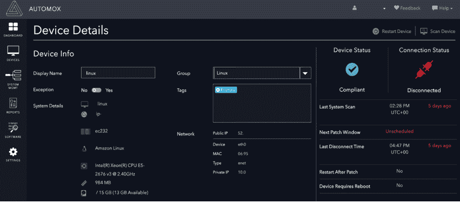

`System Management` 选项卡允许你创建并分配补丁策略，如果你想调度补丁安装，这将非常。例如，你可能决定每天下午 5 点自动安装任何关键补丁。或者，你可能想在每周六凌晨 12 点强制安装所有所需的补丁，因为那时人们不太可能在使用电脑。你需要定义自己的需求，并决定什么时间表最适合你。

在 `Reports`（报告）选项卡中，你可以生成 Automox 为保持端点更新而采取的行动报告、关于任何或所有端点的报告，或识别不合规的端点。根据你的网络规模，在仪表板中查看这些信息可能比运行这些报告更容易。

Automox 在 `Software` 选项卡为你提供受管理端点安装的所有软件清单及其版本。这允许你识别需要更新的软件并进行更新。你还可以使用此列表识别你不希望环境中出现的软件，例如游戏或其他违反策略的软件。

最后，`Settings`（设置）选项卡允许你创建新用户以允许其他管理员访问你的 Automox。你也可以在此处查找并添加代理密钥。你绝对应该利用的是双因子认证设置。通过启用双因子认证，你的账户将更加安全，从而使未经授权访问你的设备和补丁管理变得更加困难（将详细讨论）。

## 总结

保持系统最新对于维护网络安全至关重要。无论你选择操作系统内置的防病毒和补丁选项，还是像 Automox 这样的托管补丁解决方案，都应该定期调度更新并运行病毒扫描；否则，你的网络将面临各种攻击者和不必要的风险。

# 9 备份你的数据


拥有一个可靠、定义良好且执行良好的备份策略，是任何网络应对恶意或意外数据丢失的最佳防御之一。无论是你误删了重要文件夹、攻击者在你的网络内部执行了勒索软件，还是自然灾害摧毁了设备，备份都能让你免于灾难。

本章介绍了各种备份考虑因素，包括不同的备份类型、创建备份计划、本地和远程备份的价值、备份内容以及备份存储选项。最后，我们将如何在你的网络中实现不同的解决方案。

## 备份类型

在实施备份计划时，你应该考虑三种备份类型：全量、增量备份和差异备份。

### 全量备份

全量备份包含从特定主机或位置备份的所有内容（称为备份集）的完整副本。例如，你可能决定定期为你用户配置文件中的所有内容创建备份副本，在你的计算机。或者，你可能想要整个磁盘或卷的副本，包括操作系统文件。这两个选项中的任何一个都是可行的，并且可以被视为不同的备份集。

全备份提供了从备份集中快速、方便地恢复所有文件的功能。由于所有数据都包含在单份备份中，恢复过程将比其他备份选项更快。然而，全备份需要更多的存储空间，特别是当你保留多一个备份时，而且它们创建所需的时间最长。

### 差异备份

差异备份仅包含自上一次全备份以来发生更改的数据副本，因此比全备份更适合频繁使用。如果你决定每月进行一次全备份，那么每周安排一次差异备份将是一个好主意。建议定期创建全备份，以控制你的差异备份的大小（而不是仅对你的备份集进行一次全备份，然后从那时起只创建差异备份）。

差异备份会占用大量的存储空间，因为第一次备份包含了自上一次全备份以来修改的所有文件的副本，而接下来的差异备份则包含所有这些数据，加上在第一次和第二次差异备份之间的所有额外修改的文件。如果链条中的某个点没有全备份，差异备份将随时间推移呈指数级增长。此外，如果一个或多个差异备份不完整，你将无法从部分差异备份和数据的全备份中实现完全恢复。

### 增量备份

增量备份创建自上一次任何备份（无论是之前的全备份、差异备份还是增量备份）以来发生变化的任何数据的副本。这种类型的备份占用的空间最少，创建所需的时间也最短。如果你每月创建一次全备份，每周创建一次差异备份，那么最好每天创建一次增量备份，以确保对数据进行的任何更改都能被捕获。

增量备份的困难之处在于，跨多个备份恢复所有文件可能具有挑战性，因为每个备份都必须单独打开，并从所需的备份点恢复特定的文件。这意味着需要使用所有可用的恢复点来完成完全恢复，而差异备份只需要最近的差异备份和最近的的全备份即可完成完全恢复。

## 制定备份计划

如果不定期进行备份，备份的价值就很低。你最关键的数据可能每天都在变化，所以如果一个文档损坏或以其他方式永久无法使用，拥有两个月前的备份将无于事。因此，决定多久创建一次备份至关重要。你的备份策略将是高度个性化的，并适用于你的特定情况和需求，尽管也有一些可以遵循的最佳实践。

通常情况下，创建全备份的频率应低于差异或增量备份，因为它们占据了大量的空间和时间。进行差异或增量备份允许更频繁地备份被修改的数据，而且这些备份类型由于时间限制而失败的概率比全备份低。作为一条一般规则，每月对你的主系统或关键数据进行一次全备份是一个很好的开始，你可以根据需要调整你的备份策略。

取决于你选择的备份软件，你可能可以使用这些特定调度选项中的某些、全部或完全没有。例如，某些软件在技术上拥有所有这些功能，并允许你从不同时间点的备份中恢复数据，但差异/增量/全备份和恢复选项不会直接显示给你。大多数集成了备份解决方案的操作系统都是如此（后文将讨论）。取决于你的需求，内置选项可能已经足够。否则，你可以考虑各种付费解决方案。

## 本地备份与离地备份

取决于你选择备份的数据的关键性，在本地备份之外，保留离地备份可能是一个好主意。本地备份存储在与你的原始数据相同的物理位置，例如你的家或办公室。离地备份存储在你的主要位置之外。将备份存储在多个位置提供了数据冗余；如果你的本地备份和原始数据被销毁，离地备份可能是你恢复的唯一选择。通常，离地备份将离线存储，不连接到你的网络，并且理想情况下存储在类似防盗保险箱的东西中。或者，你可能选择使用云解决方案，但这带有其自身的安全风险。

拥有离地备份可能会产生额外的管理开销。在大多数情况下，你会本地创建备份，要么使用备份应用程序，要么通过完整复制本地备份，并将该备份物理地从该场所移除。这应该按照与本地备份相同的定期计划进行，因为在发生紧急情况下，它可以为你提供更多选择。

## 备份什么以及使用何种存储

起初，准确地选择你想备份什么可能是一个挑战。你需要能够从之前的检查点恢复整个设备，还是只需要特定的文件？如果你不需要恢复整个操作系统系统，最好是确定哪些文件和文件夹是关键的，或者对于恢复来说是有用的。考虑一下在数据真正开始影响你、你的用户或你的业务之前，你可以多长时间没有这些数据。从备份中恢复数据的时间完全取决于你需要恢复的数据量。

在确定备份策略中包含哪些内容时，另一个考虑因素是你有多少种类型的存储以及可用空间来存储你的备份。你可以选择创建设备本身文件的备份，但如果设备丢失、被盗、损坏或以其他方式不可用，这样做就没用了。更好的选择是使用外部硬盘，你可以从任何本地电脑商店获得任何适合你需求的容量。这是一个廉价、方便的选项，允许你创建本地备份和可以方便离地的二级备份。最后，你可以以网络附属存储（NAS）设备的形式为你的备份购买专用存储。NAS 连接到你的网络，具有大容量，并通常包含冗余和自动化等功能。它提供了比独立外部硬盘更好的性能和可靠性，但通常更贵且需要一些管理。

无论你选择何种存储解决方案，它应该符合你计划备份内容的需求。设备全盘备份将占用大量的空间，因为计算机的内部存储通常为 1TB 或更大。如果你计划只备份关键文件，那么你的备份不需要那么大的存储空间。你可能会从外部硬盘开始，然后随着时间增加需求的增加而升级你的存储。如果你想维护自己的备份，大多数操作系统都有内置的备份解决方案，其中一些功能更全，另一些则。

### #31: 使用 Windows 备份

要访问 Windows 内置的备份解决方案，打开 `Windows 设置>更新和安全>备份`。你需要连接一个用于存储备份数据的驱动器到计算机上。连接后，点击 `添加驱动器` 并选择它，如图 9-1 所示。注意，在 Windows 11 中，备份位于 `Windows 设置>账户>Windows`。

之前的项目中讨论过的 Windows 备份非常适合备份特定的文件和文件夹，但并不适用于进行全系统备份。幸运的是，自 Windows 7 之后的所有版本的 Windows 都包含了一个“备份和恢复”，这对于创建全系统备份非常有用，包括可以完全恢复系统的系统映像（例如，如果系统被勒索软件损坏了）。它还可以创建备份到外部驱动器或网络驱动器，尽管它不会保留您的文件的旧版本或文件历史。

在 Windows 10 中，你可以通过进入 `Windows 设置►更新和安全►备份►转到备份和恢复 (Windows 7)` 来进入备份和恢复。在 Windows 11 中，可以在 `控制面板►系统和安全►备份和恢复 (Windows 7)` 找到备份和恢复。你将看到如图 9-2 所示的屏幕。

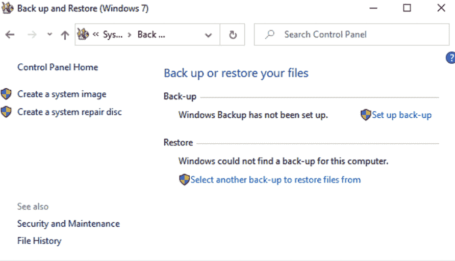

**图 9-2：** Windows 备份和恢复窗口

在左侧，你有创建系统映像或系统修复盘的选项。如果由于硬件或操作系统问题导致你的计算机无法访问，你可以使用这些选项中的任一个将计算机恢复到当前的已知良好配置，且你的所有文件都将保持当前状态完好。

- 1. 点击右侧的“设置备份”按钮，创建你的个人文件和系统文件的常规备份。
- 2. 接入外部驱动器并点击“刷新”将其选择为备份位置，或通过点击“保存到网络”并指定网络位置以及必要的用户名和密码（如果有）来指定网络驱动器或位置；然后点击“下一步”。

此时，Windows 将询问你想在备份中包含什么。默认情况下，你可以让 Windows 选择包含的内容，这将是来自来自 `C:\Users\<username>` 的个人文件和文件夹。

- 3. 选择“我来选择”单选按钮，然后点击“下一步”。
- 4. 选择要备份的内容。
    - a. 启用或禁用新用户文件的备份（假设此计算机上将创建新的用户账户）。
    - b. 包含和排除任何个人库（如“文档”或“图片”）以及位置（如你的“桌面”和“下载”文件夹）。
    - c. 从计算机上的驱动器中选择任何文件夹。
    - d. 如果你想定期备份整个系统，请确保勾选包含你的设备系统映像的复选框。当你对设置满意后，点击“下一步”。
- 5. 此时，你可以选择希望备份运行的时间表，可以是每天、每周或每月。
- 6. 点击“保存设置并运行备份”以对你的数据进行首次全备份。

你现在你的 Windows 系统上对你的文件夹有了一个到外部驱动器或网络驱动器上的常规备份。

### #33: 使用 macOS Time Machine

Apple 设备自带了用于备份数据的内置解决方案，称为 `Time Machine`（时间机器），通过 `系统设置►Time Machine` 访问（见图 9-3）。

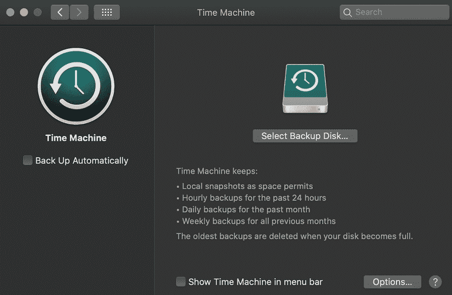

**图 9-3：** macOS Time Machine

`Time Machine` 可以将你的数据备份到直接连接到计算机的外部驱动器或网络附属存储（NAS）。这种网络存储可以是 Apple AirPort Capsule 的形式（专为 Time Machine 备份设计）、连接到 Apple Extreme 基站的驱动器、另一台共享作为 Time Machine 备份目的地的 Mac，或者支持通过 SMB 使用 Time Machine 的专用 NAS 设备。如果你在网络中已经有了其中任何一个设备，我建议使用该解决方案。如果你没有任何可用设备，备份 Mac 最简单且廉价的解决方案是使用外部驱动器而不是网络位置。通常，当你插入一个大容量驱动器时，会弹出一个提示，询问你是否想使用该驱动器进行 Time Machine 备份。或者，你可以使用图 9-3 所示的“选择备份磁盘”选项选择特定的备份磁盘。

这样做将强制 `duplicity` 创建数据的完整备份而非增量备份。

## 使用 duplicity 创建网络备份

出于几个原因，将备份保存到网络位置比保存到本地文件夹更优。将备份保存到本地是有风险 risk的，因为如果你失去了对端点的访问权限或该终端变得不可用，你就没有备份可以从其他位置恢复。此外，如果攻击者获得了系统的访问权限，他们也获得了你的（加密的）备份。因此，将备份保存到文件服务器等远程位置更安全。这可以通过 `duplicity` 内置的 `rsync` 功能实现。以下命令假设你已经按照第 1 章中的说明创建了 SSH 密钥，并使用 SSH 密钥认证代替密码验证。如果情况并非如此，请返回并进行操作。SSH 密钥认证要求在本地和远程终端之间共享公/私密钥对，使它们能够执行加密安全的通信，提供比密码或密码短验证更高的安全性。

```
$ duplicity /home/user rsync://user/server_ip//path/to/folder/
```

一旦你决定了想要备份哪些文件和文件夹以及备份位置，就可以使用 `Crontab` 调度 `duplicity` 定期创建你的文件备份。`Crontab` 是 Linux 内置的一种作业，在第 122 页的 Project 27 中进行了详细讨论：


`$ sudo crontab -e`

--snip--

`# m h dom dow command`

`0 0 * * 1 duplicity /home/user`

`rsync://user@server_ip//path/to/folder/`

`0 2 1 * * duplicity full /home/user`

`rsync://user@server_ip//path/to/folder/`

```
Crontab 程序的 `-e` 选项表示你将编辑 cron 文件和由 cron 维护的调度作业。此示例 Crontab 中显示的命令调度 `duplicity` 在每天午夜运行，创建一个增量备份，并在每月的第一天凌晨 2 点强制创建一个完整备份。
```

## 恢复 duplicity 备份

使用命令行来恢复用 `duplicity` 创建的备份：

```
$ duplicity restore:///tmp/ /home/user/backup_folder_name/
```

输入带有源路径和目标路径的恢复命令，将从文件从备份集中恢复到指定位置。

如果需要，有多种选项可以从备份集中恢复特定的文件和文件夹。这里有一个示例：

```
$ duplicity -t 3D --file-to-restore \
home/user/Documents/test.txt \
file:///tmp/ /home/user/Documents/restored_file
```

在此命令中，我们调用了 `duplicity`，告诉它使用 `-t 3d` 参数从我们在本地系统 `/tmp/` 中创建的备份中恢复三天前的 `test.txt` 文件版本（紧跟 `--file-to-restore` 参数），并将结果文件保存到 `/home/user/Documents/` 文件夹。有关恢复文件和可用选项的更多信息，请查看 `duplicity` 的 man page。

## 其他 duplicity 注意事项

`duplicity` 工具具有许多其他强大的选项。你可能想从备份中排除某些文件或文件夹；例如，在创建用户数据备份时，你通常想要排除系统文件夹。使用 `--exclude` 参数排除文件和文件夹：

`# $ duplicity --exclude /proc --exclude /mnt/ file:///tmp/`

一旦备份运行完成，使用 `verify` 参数并交换原始备份命令中的源和目标位置，以确认它们已成功创建：

`$ duplicity verify file:///tmp/ /home/user/`
本地和远程元数据已同步，无需同步。
--snip--

验证完成：比较了 325 个文件，发现 0 个差异。

如果输出显示没有错误，说明你的备份成功了。
有时你想要删除旧的备份，是因为它们不再需要，或者为了给新的备份腾出空间。首先，使用 `collection-status` 参数查看备份集中的可用备份：

`$ duplicity collection-status file:///tmp/`
--snip--
集合状态

正在连接后端：BackendWrapper
存档目录: `/home/user/.cache/duplicity/c2731c0788339744944161fd8fab74dd`

找到 1 个辅助备份链。
辅助链 1 个 1：

```
链开始时间: Wed Oct 20 19:53:02

链结束时间: Wed Oct 29 20:11:39

包含的备份集数量: 2

包含的卷总量: 2

备份集类型:

Time: Num

volumes:

Full Wed Oct 20 19:53:02 2022

Incremental Wed Oct 29 20:11:39 1 2022
```


找到具有匹配签名链的主备份链：
链开始时间: Wed Oct 20 20:11:53 2022
链结束时间: Wed Oct 20 20:11:53 2022
包含的备份集数量: 1
包含的备份卷总量: 1
备份集类型: Time: Num

| volumes: | Full | Wed Oct 20 20:11:53 |
| :--- | :--- | :--- |
| 2022 | 1 | |

未找到孤立或不完整的备份集。

一旦你知道备份集中有多少备份，你可以根据时间删除旧备份：

```
$ duplicity remove-older-than 3d file:///tmp/
```

这里的 `3` 表示三天以前。
你还可以根据数量删除所有完整备份：

```
$ duplicity remove-all-but-full 1 file:///tmp/
```

这里的 `1` 表示保留最近的一个完整备份。

## 云备份解决方案

虽然像 Google Drive 和 Dropbox 这样的服务并不是真正的备份，但它们提供某种程度的免费存储。通常，要寻找在静态和传输过程中都会加密数据的服务。Backblaze 和 Carbonite 目前支持 Mac、Windows 和 Linux。

将你的计算机恢复到包括操作系统设置和配置在内的状态（以及关键文件）是有益的，因为你可能会发现整个操作系统已损坏或无法使用。Carbonite 提供了多个不同价格档的方案，你可以根据自己的特定需求选择保护级别。与 Backblaze 类似，Carbonite 会对其备份的所有数据进行本地加密，这些数据通过 SSL 传输到云端，并在 Carbonite 服务器上进行加密。根据你选择的方案，它能够备份外接硬盘并提供无限云存储（在某些情况下）。Carbonite 将无限期保留你的备份文件，且不会删除超过 30 天的文件。

一旦你下载并安装了该应用程序（如图 9-6 所示），它将自动启动你数据的首次备份。你可以告诉它包含或排除哪些文件。

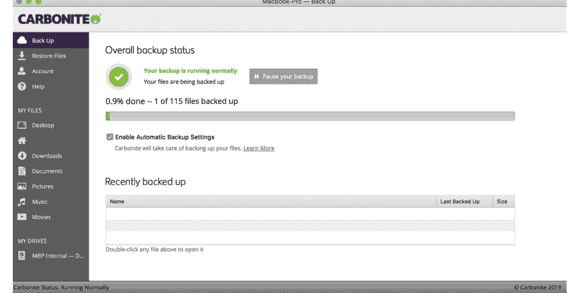

图 9-6：Carbonite GUI，像 Backblaze 一样，它将在后台运行，持续备份你的数据。当你想从备份中恢复文件时，可以通过该应用程序进行操作。它没有提供 Web 界面或移动应用。

## 虚拟机快照

虚拟机提供了物理计算机不具备的许多优势。它们能够共享硬件（处理器和内存），启动或重启速度快，并且可以根据特定用途创建恰好数量的资源。它们最强大的功能之一就是创建快照的能力。

虚拟机快照是虚拟机在特定时间点的副本。快照通常包含了拍摄快照时与该虚拟机相关的所有信息，包括其电源状态（开启、关闭或暂停/挂起）、虚拟内存的内容以及虚拟硬盘的内容。

每当你对虚拟机进行重大重大更改时，预先为该机器创建一个快照是明智的，以防止由于修改导致虚拟机损坏的意外发生。在导致虚拟机无法使用的更改之前拥有一个快照，可以让你回溯到已知的良好配置，就像这些更改从未发生过一样。这就像现实世界的“撤销”按钮。

所有主流虚拟机软件（如 VMware、VirtualBox 和 Hyper-V）都能够为它们所管理的虚拟机创建快照。图 9-7 显示了 VMware 快照器的示例。

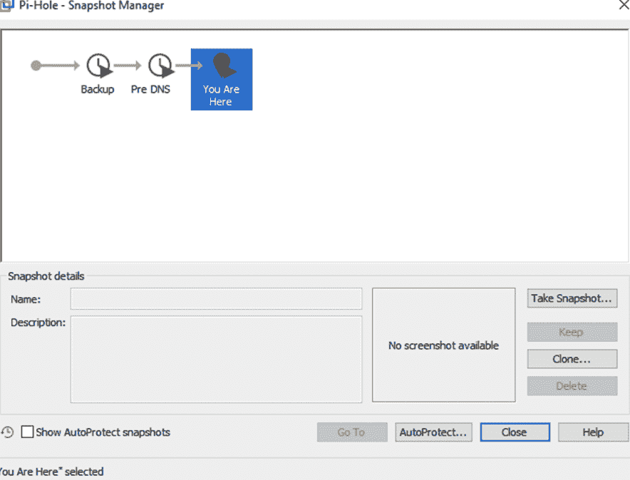

图 9-7：VMware 快照器

在快照器内部，你可以通过“拍摄快照”按钮创建新快照，转到特定的快照（即将虚拟机恢复到拍摄该快照的时间点），删除或克隆快照，或者启用自动保护（AutoProtect），该功能会根据预定义的计划创建快照，允许你恢复到过去多个时间点的快照。大多数虚拟化程序都提供快照功能，但设置和选项可能略有不同。

虽然快照字面意义上不是备份，但它们对于恢复运行正常的虚拟机配置非常有用。你不应该将快照作为唯一的备份手段，但将其作为策略策略的一部分通常非常方便。一个明智的解决方案是将所有虚拟机文件包含在常规备份策略中。

## 测试与恢复备份

一旦你创建了备份策略，并且最重要的数据正在定期进行本地和异地备份，定期测试这些备份就至关重要。如果你遭遇数据丢失并尝试从备份中恢复，却发现备份已损坏，那么你的备份策略就没有提供任何价值。

在 Windows 上恢复文件，请打开“备份和恢复”菜单。点击“恢复我的文件”或“恢复所有用户文件”。你可以使用“浏览文件”或“浏览文件夹”选项来查看备份内容。你还可以通过此菜单搜索备份内容。

在 Mac 上使用 Time Machine 恢复文件，请浏览到你想要恢复的源文件夹，例如“文档”文件夹或“下载”文件夹。打开 Time Machine，然后使用箭头和时间轴浏览可用的本地快照和备份。选择一个或多个你想要恢复的项目，然后点击“恢复”。这可以包括文件、文件夹或你的整个磁盘。恢复的项目将返回到计算机上的原始位置。

使用 Carbonite、Backblaze 或任何解决方案恢复文件，请打开 Web 门户或应用程序 GUI。然后，找到你想要恢复的文件或文件夹，并按照提供的说明进行操作。

当任何系统的首次备份完成后，请测试恢复几个文件或文件夹。找一些较大的文件作为此测试的一部分可能是值得的，因为文件越大，备份路径出现故障的就越高。如果你成功恢复了一份数据样本且一切正常，请设置一个提醒，在周后和一个月后再次执行相同操作。如果所有恢复工作都进展顺利，你可以从那时起根据需要决定测试备份的频率。在一到六个月之间一次是稳妥的。

完成这些后，你的备份策略应该是完整且健壮的，足以从任何数据丢失事件或灾难中恢复。

## 总结

本章讨论的解决方案将适用于大多数情况，但它们不能保证符合你的需求。在寻找备份解决方案时，确保你选择的方案适用于你的操作系统，能够创建你想要创建的备份，并允许你在合理的时间范围内恢复数据。

## 通过检测和告警监控你的网络


网络监控提供了实时的可见性，让你能够走在威胁前面。监控网络是一项巨大的工程，因此告警通常是调查的起点。

如果没有有效的告警，网络监控就像在大海中捞针——试图在大型数据集中识别恶意活动。

你的防火墙、代理、反病毒软件和其他解决方案应运行至少一个月，然后才开始主动监控主机和网络，在此之前，一切都是被动的；一旦设置完成，除非你需要更新或更改，否则不需要你的进一步输入。由于其性质，主动监控和告警可能需要大量的时间和精力——不仅是在实施上，在维护上也是。你不仅需要定期检查网络监控软件是否识别出威胁或异常行为，还需要调查这些行为并可能采取缓解措施。根据网络的大小，监控它可能是一个或多个人的全职工作。

本章将为你提供监控网络并告警可疑行为所需的知识和工具。我们将讨论在何时、何处如何实施网络流量访问点（TAP）和交换端口分析（SPAN），以实现网络流量采集、监控和分析。最后，我们将使用 Security Onion（一个免费的网络安全监控套件）构建一个网络监控设备，并讨论如何最好利用其内置功能。

### 网络监控方法

你可以使用多种方法来监控和捕获网络流量，以便进行实时或后期分析和告警。你选择的方法主要取决于你的网络硬件，因为每个设备的能力不同。我们将在下节中讨论两种最常用的方法。

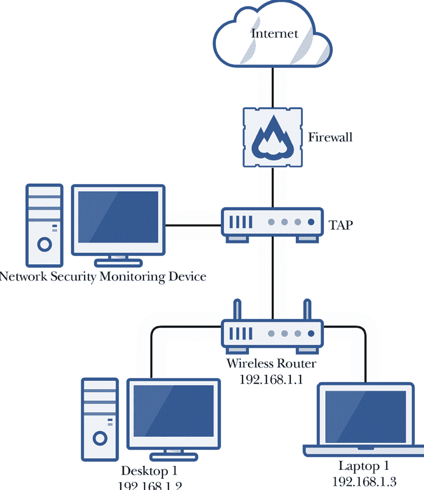

**图 10-1：** 网络 TAP 的放置

在此配置中，所有通过路由器和防火墙的流量都会由 TAP 发送到监控设备，并在那里进行存储以供分析。

### TAP 与入侵检测系统

将 TAP 与入侵检测系统 (IDS) 结合，允许管理员识别发生在此入站和出口点的可疑活动。IDS 是一种软件或硬件工具，它使用一组规则或签名来识别已知的恶意行为。当 IDS 在你的网络流量中识别出可疑内容时，它会生成警报，你可以对警报进行调查，以判断其是否恶意的（真阳性）还是良性的（假阳性）。然后你可以忽略该警报，或者采取行动来缓解和修复问题，我们将在稍后详细讨论这一点。

在放置 TAP 时，请考虑你实际想要看到和调查的内容。在像图 10-1 所示的配置中，你将捕获终端与防火墙（网络边界）之间的所有流量。监控主要的出口点可以调查数据外泄等问题，即攻击者试图通过将数据发送到网络之外来窃取你的数据。然而，通过这种配置，你无法看到终端设备之间的流量，因为这些流量是由无线路由器处理的，永远不会到达 TAP。

如果你将 TAP 放置在防火墙后面（而不是互联网侧），你将无法看到任何尝试访问内部网络但被防火墙拦截的互联网流量。如果 TAP 位于防火墙前面，你将看到被防火墙拦截的出站流量；安全监控系统也将失去该防火墙的保护，并成为进入你网络的简单路径。决定你习惯于哪种场景，并据此放置你的 TAP。在大多数情况下，最好将 TAP 放置在防火墙后面（网络内部），并查看防火墙日志以获取 TAP 看不到的内容。

TAP 是一个线路设备。请注意，如果 TAP 不可用或离线——如果其有限的网络端口发生任何一个故障——你的整个网络将失去对互联网的访问。你的终端设备仍然能够通过路由器相互通信，但流量将不再通过 TAP。

市上有多种价格合理的 TAP 设备。其中最简单的之一是 Dualcomm ETAP。此类 TAP 的一种可能配置是将图 10-1 中的防火墙连接到 A 线路端口，将 B 线路端口连接到无线路由器，并连接一根单独的光缆到网络安全监控设备（将在下一节中讨论）。这种配置允许流量流过 TAP 就像它不存在一样，但它会被网络安全监控系统拦截、监控和分析。

### 交换端口分析器

网络 TAP 的替代方案是交换机提供的交换端口分析器 (SPAN) 或镜像端口（术语互换）。SPAN 的与 TAP 相同；它将镜像（或复制）通过源端口的所有数据，传输到交换机上的目标 SPAN 端口。然后，你的网络安全监控系统连接到 SPAN 端口，以捕获网络流量进行分析和告警。在大多数现代交换机，可以创建一个具有多个源端口的 SPAN 配置，因此你可以捕获交换机上任何端口的数据。

小型网络中的 SPAN 配置可能像图 10-2 所示，其中防火墙或其他系统为终端提供 IP 地址。每个主机都通过以太网连接到交换机上的一个端口，然后网络安全监控设备连接到交换机上配置的 SPAN。与 TAP 不同，如果交换机上的某个端口故障，网络的其余部分将继续运行，但如果整个交换机由于断电离线，整个网络将随之崩溃。

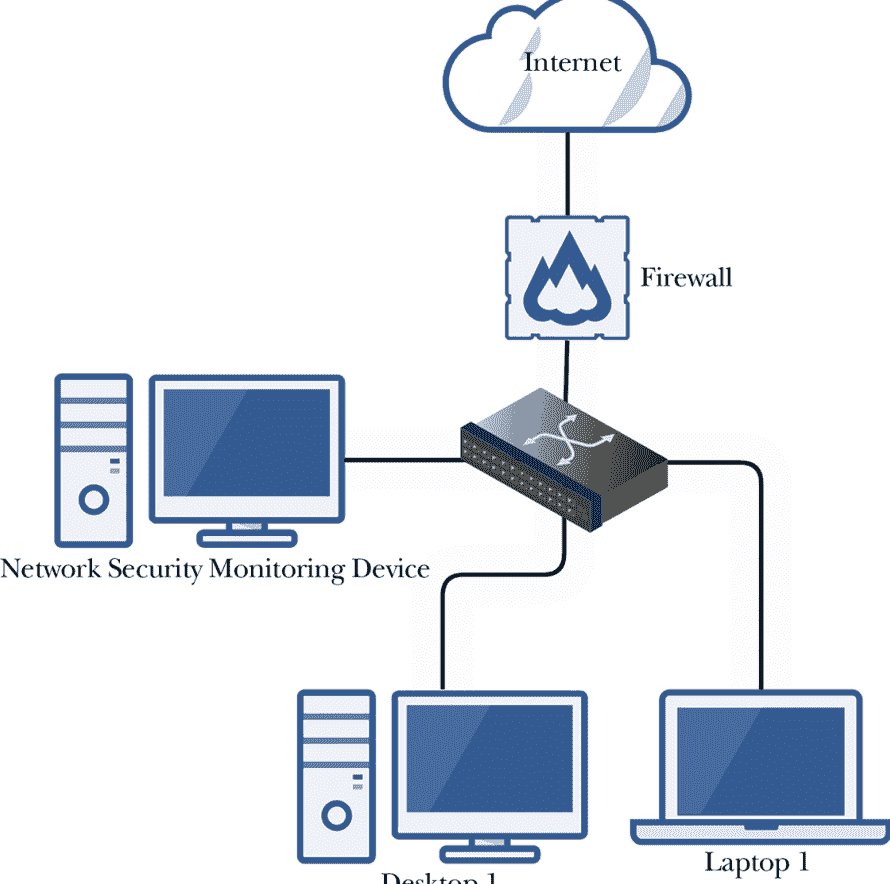

图 10-2：带有交换机和 SP 端口的小网络

与 TAP 配置不同，在交换机上设置 SPAN，除了入站和出站数据外，你还能捕获和分析计算机之间的流量。不过你仍然面临放置问题；当交换机位于防火墙内部时（它应该是那样的），你的安全监控系统将无法看到防火墙拦截的流量。

### #35：配置 SPAN 端口

要在管理型交换机（如我们在第 2 章使用的 Netgear 交换机）上配置 SPAN 端口，请按照以下步骤操作：

- 1. 使用管理员凭据登录交换机。
- 2. 选择 系统(System)►监控(Monitoring)►镜像(Mirroring)。
- 3. 在端口镜像配置表中，点击想要捕获网络流量的源端口进行选择。选中的端口将有一个复选标记。
- 4. 在目标端口下拉框中，输入将用作 SPAN 端口的端口以连接你的安全监控系统。
- 5. 最后，在镜像下拉菜单中，选择 启用(Enable)►应用(Apply)。

无论你选择设置 TAP 还是带有 SPAN 端口的交换机，你需要一个能够聚合收集数据的网络监控解决方案。目前适用于小型网络的最佳解决方案是 Security Onion，它包含了各种用于捕获和聚合网络数据的组件，并让你能够快速分析这些数据。

## Security Onion

Security Onion 是一个用于威胁狩寻、网络监控和日志管理的开源平台。它是一个类似于 Ubuntu 的操作系统，包含了多种用于捕获和聚合网络数据的组件，并让你快速分析这些数据。

Security Onion 的工具包括 `suricata`（入侵检测系统）和 `zeek`（用于分析网络流量的软件框架）。`Grafana` 是一个用于监控 Security Onion 系统健康的可视化和仪表板，`osquery` 收集终端及其运行的操作系统的数据进行分析。`Wazuh` 类似于 `osquery`；它是一个基于代理的工具，用于终端检测和响应（在发生安全事件时）。最后，`Strelka` 是一种实时文件扫描程序，用于分析网络流量并扫描遍历网络的文件；对于识别恶意软件或数据外泄非常有用。

### 适用于大型网络的 Security Onion 工具

Security Onion 使用 ELK 栈（包括 Elastic、Logstash 和 Kibana）来创建可视化界面和仪表板。ELK 类似于 Grafana，区别在于 Grafana 用于显示系统本身的信息，而 ELK 用于显示被捕获的网络数据，允许用户轻松查看和分析。ELK 是一个强大的工具，但由于它比 Security Onion 内的工具更高级，因此超出了本书的范围。然而，许多在线资源都详细讨论了 ELK 及其用法。

Security Onion 设计为可扩展，能够监控非常大的网络，因此它包含了一些小型网络并不需要的工具，例如 TheHive（事件管理系统）和 Playbook（用于创建事件处理流程的工具）；这些工具主要用于大型网络，因此本文将不再涉及。

在接下来的章节中，我们将讨论如何使用 Security Onion 及其内置工具创建你的网络安全监控系统。我们将探索如何利用这些工具开始监控网络，以及在出现问题时如何分级和调查。这取决于你想购买还是构建自己的 Security Onion 设备。Security Onion Solutions 预先配置了开箱即用的设备。

### #36：构建 Security Onion 系统

要构建 Security Onion 系统，你需要一个具有两个网络接口的设备：一个管理接口和一个捕获接口（连接到 TAP 或 SPAN）。我们将使用带有两个以太网端口的 Intel NUC（一种小型规格计算单元），它具有高度定制性，并根据你的预算有不同的价格选择。

需求。Security Onion 文档详细列出了以下最低硬件规格：

- 12GB 内存
- 四核 CPU 处理器
- 200GB 存储空间
- 两个网络接口

另一个需要考虑的因素是你需要的存储空间。作为参考，一个内部存储空间为 2TB 的 NUC 可能能够存储大约三周的数据，这取决于你网络中的设备数量、用户数量以及网络流量的大小。超过此点后，数据将以循环周期的方式保留，即删除旧数据以留给新数据。为了在你的网络中实现更强的事件响应能力，保留的数据越多越好。如果你在网络中发现了一个那里已经潜伏了 12 个月的对手，但你只有一个月月的数据，那么你将永远无法确定根源，这将导致你很难将其驱出去并防止问题再次发生。

一旦你拥有了 NUC（或类似的设备），你就可以安装 Security Onion。在此阶段，最好将你计划用于管理的网络端口（不是用于捕获网络流量的端口）连接到网络，以便你可以设置其配置。使用两个网络端口中的哪一个用于管理和流量采集并不重要。该设备需要一个静态 IP 地址，虽然你可以在设备本身上进行设置，但最好在路由器或环境中负责 IP 地址租约的任何设备（例如你的无线路由器或 pfSense 设备）上配置静态地址。在你的 NUC 上设置管理端口（且仅设置此端口）将有助于在安装和配置其余软件时进行识别。在完成此过程后，你就可以独立地配置采集端口。你现在就应该为管理接口配置静态 IP 地址，因为我们将之后安装的某些代理对该地址有要求和依赖关系，因此以后更改它可能会带来挑战。

## 安装 Security Onion

你可以从 ISO 文件安装 Security Onion（可直接从 Security Onion Solutions 官网 https://securityonionsolutions.com/software/ 获取），或者手动使用 CentOS 7 作为基础操作系统进行安装，然后像在 Linux 环境中安装其他应用程序一样安装 Security Onion 软件包（注意，CentOS 7 是 Security Onion 支持的唯一操作系统）。使用 ISO 文件创建 Security Onion 系统的一种更简单、更快速的方法，而手动安装则允许你对磁盘分区等项目进行更细粒度的控制。如果你对对此感兴趣，请选择手动安装方法。如果没有兴趣，请使用 ISO 文件安装 Security Onion。

### 从 ISO 文件安装 Security Onion

开始从 Security Onion Solutions 下载最新的 ISO，并遵循第 1 章“创建物理 Linux 系统”中概述的步骤，从 ISO 文件创建一个可启动的 USB 闪盘。将你的可启动 USB 闪盘插入 NUC，并打开 NUC，你将看到 Security Onion 安装向导。按照以下步骤完成安装：

1. 向导将提示你安装 Security Onion，这将销毁所有数据和分区。输入 yes 并按 ENTER 接受并开始安装过程。
2. 在提示提示时输入管理员用户名；然后按 ENTER。
3. 为用户输入一个强密码短；然后按 ENTER。
4. 重复密码短以进行确认；然后按 ENTER 启动安装。
5. 安装完成后，计算机将重启。使用你新创建的凭据登录，Security Onion 设置向导将弹出。按 ENTER 继续。
6. 使用方向键选择 Install 以运行标准的 Security Onion 安装；然后按 ENTER。

此时，完成 Security Onion 安装的过程对于 ISO 文件安装路径和手动安装路径来说是相同的。请跳转到第 157 页的“完成 Security Onion 安装”章节。

### 手动安装 Security Onion

你可以通过在 NUC 上安装 CentOS 7 并在其安装 Security Onion 软件包和工具，完全从零安装 Security Onion。执行此操作，请遵循以下步骤：

1. 从 https://www.centos.org/ 下载最新的 CentOS 7 ISO（正确的格式为 x86_64）。
2. 遵循第 1 章“创建物理 Linux 系统”章节中概述的步骤，从 ISO 文件创建一个可启动的 USB 闪盘。
3. 将你的可启动 USB 闪盘插入 NUC 并从 USB 启动。你将看到几个选项；选择 Test this Mission & Install CentOS 7。
4. 此时，将出现一个图形化安装向导。选择你期望的语言并点击 Continue。
5. 设置正确的时区和键盘布局。
6. 在 Software Selection（软件选择）下，建议选择 Server with GUI 以于管理。
7. 在 System Destination（系统目标）下，选择你计划安装 Security Onion 的内部磁盘并选择 I Will Configure Partitioning（我将配置分区）。点击 Done 进入分区向导。分区定义了硬盘存储如何在系统用户和应用程序之间进行划分。
8. 选择 LVM 分区并创建以下分区：
   a. `/boot`：CentOS 将从此分区启动；它应该至少有 500MB 的可用空间。
   b. `/boot/efi`：启动分区的一部分；它至少应该是 500MB。
   c. `/`：文件系统的根；应为 300GB。
   d. `/tmp`：用于临时文件；应为 2GB。
   e. `swap`：用于交换文件；应为 8GB。
   f. `/home`：任何用户文件的空间；应为 40GB。
   g. `/nsm`：用于所有安全工具和捕获的数据；应分配驱动器的剩余空间。
9. 点击 **Done Accept Changes**（完成并接受更改）将更改写入磁盘。
10. 点击 **Begin Installation**（开始安装）安装操作系统。
11. 设置你的 root 密码并创建一个非 root账户。
12. 安装完成后，重启机器并移除安装 USB。然后，启动到操作系统。
13. 接受许可信息。
14. 点击 **Network & Host Name**（网络与主机名），将网络按钮切换到 **On**（开启），并点击 **Done**。
15. 点击 **Finish Configuration**（完成配置）。

安装 CentOS 后，接下来安装 Security Onion。首先，通过 SSH 连接到你的服务器或直接登录。切换到设置期间创建的 `/nsm` 分区：


进入 `/nsm` 目录。

使用 `sudo yum install` 安装 Git（用于软件包管理的应用程序），然后使用 `git clone` 下载 Security Onion：

```bash
sudo yum install git -y
```

（由于 Ubuntu 基于 Debian 并使用 `apt` 工具管理软件包，而 CentOS 基于 Red Hat 并使用 `yum`。）

```bash
sudo git clone https://github.com/Security-Onion-Solutions/securityonion
```

导航到新创建的 `securityonion` 目录并运行脚本：

```bash
cd /nsm/securityonion/
sudo bash-setup-network
```

运行此脚本将启动一个交互式安装向导，引导你完成 Security Onion 服务器的初始设置和配置。

# 完成 Security Onion 安装

操作系统的基础配置完成后，你将开始安装和配置用于监控和分析流量的工具。`Zeek` 是一个安全监控平台，它使你能够更高效地分析网络流量并对网络中的可疑活动自动警报。它通过利用包含可疑或恶意活动、软件和网络流量信息的规则集（例如我们在此使用的 `ETOPEN` 规则集）来实现这一点。

无论你如何安装 Security Onion，请按照以下步骤完成该过程：

- 按 ENTER 跳过欢迎屏幕（并继续到所有屏幕）。
- 在 Installation Type（安装类型）页面，使用方向键选择 `STANDALONE`，并按空格键选择该选项。
- 如果你使用 Security Onion ISO，在下一页选择 `Standard`（标准）以表示此机器具有互联网访问权限。

4. 如果您是手动安装的 Security Onion，请在下一页输入 `AGREE` 以接受 Elastic 许可。

5. 在下一页，为了简单起见，请保留默认主机名，或根据需要进行更改（在拥有超过一台服务器的大型安装中，更改主机名是有益的）。如果提示更改主机名，请选择继续。

6. 在下一页，为此计算机输入一个简短描述，或者留空。

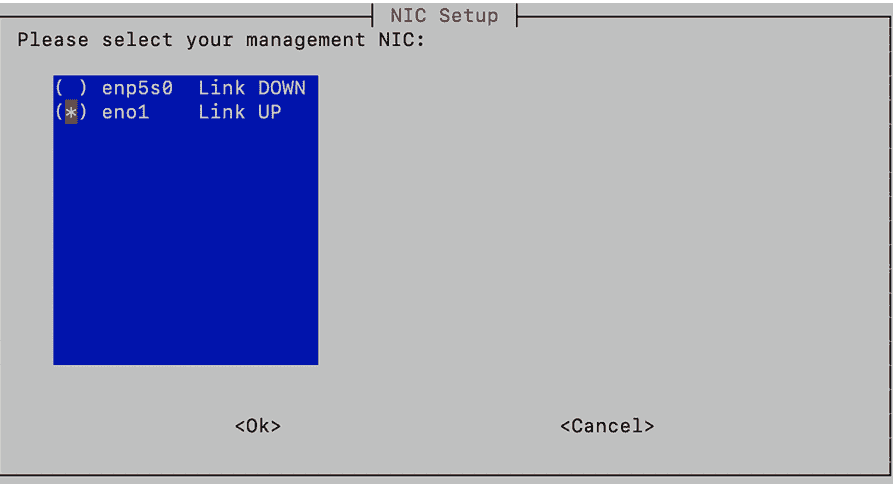

图 10-3：NIC 设置向导

8. 按空格键设置监控接口。

在管理界面页面，您可能会收到一个关于使用 DHCP 的信息错误，只要您为此设备配置了静态地址，就可以忽略此消息。

9. 当被问及此计算机如何连接到互联网时，选择 `Direct`（直接）。

10. 在 OS 补丁计划页面上选择 `Automatic`（自动），以保持您的操作系统自动更新。

11. 指定您在第 1 章中识别的家庭网络地址范围。如果您的网络使用 `10.0.0.0/8` 地址，请将其留在方框中并删除另外两个子网。如果您的网络使用 `192.168.0.0/16` 地址，请将其留在框中并删除另外两个，依此类推。

12. 当被问及安装哪种管理器时，选择 `BASIC`。

13. 选择 `ZEEK` 作为生成元数据的工具。

14. 选择 `ETOPEN` 作为生成警报的 IDS 规则。

> 注意：`ETOPEN` 是一个开源规则集，根据新的新兴威胁和警报进行更新。`ETPRO` 和 `TALOS` 与 `ETOPEN` 类似，但它们需要订阅。对于小型网络，`ETOPEN` 就足够了。

15. 向导接着询问您想要安装 Security Onion 工具套件的哪些组件。选择 `Osquery`、`Wazuh` 和 `Stretchka`。

16. 如果询问是否想要保留默认的 Docker IP 范围，选择 `Yes`（是）。

17. 为 Security Onion 管理员输入电子邮件地址。

18. 输入并重新输入您的账户密码。

19. 当被问及如何访问 Web 界面时，选择 `IP`。

20. 为 `soremote` 用户账户设置强密码语（用于执行某些管理操作）。

21. 选择 `BASIC` 以推荐设置安装网络安全监控组件。

22. 输入 `2` 作为 `Zeek` 和 `Suricata` 进程的数量。

进程的数量决定了您的系统可以处理多少网络流量。对于小型网络，两个进程应该足够了；如有可以在以后更改。

23. 如果被问及想要配置 NTP 服务器，选择 `Yes`。网络时间协议 (`NTP`) 用于保持终端同步。最好让您的监控服务器与时间服务器同步，以防止时间偏移，时间偏移在排查警报时会导致问题。访问 `https://www.ntppool.org/` 并选择您所在地区的 NTP 服务器，以保持您的 Security Onion 时间同步。

24. 选择 `NODEBASIC`。

25. 当被要求正确配置系统防火墙以允许访问所有安装的工具时，按回车键运行 `so-allow`。

当被要求输入允许访问您的网络监控系统的 IP 地址时，您可以选择允许从单台计算机或设备或从网络中的任何主机访问 Security Onion Web 界面。出于安全考虑，您仅允许从单个 IP 地址访问。

26. 输入您计划使用的 IP 地址；然后按回车键。

27. 最后，按 Tab 键选择 `Yes` 以接受刚刚创建的配置；然后按回车键完成设置向导并提交更改。

> **注意** Security Onion 及其某些工具（如 `Zeek`）可以在集群配置中运行，其中代理安装在多个系统上以增强数据收集和处理。对于小型网络，独立系统就足够了。对于具有多个网段和交换机的大型网络，集群配置可能更有意义。

安装结束，屏幕将显示访问 Security Onion Web 界面的 URL；记下它（它应该是 `http://<your_server_ip>`）。系统将重启。一旦恢复，您将可以使用之前输入的电子邮件地址和密码语通过 URL 登录。要测试 Security Onion 配置，请运行以下命令：

```bash
$ sudo so-status
```

此命令列出了 Security Onion 运行的工具及其状态，如果一切运行正常，这些状态应显示为 `ok`。

如果任何服务未启动，请等待几分钟再次运行状态命令。如果它们仍然无法启动，请尝试使用这些命令手动启动服务：

```bash
$ sudo so-servicename-stop
$ sudo so-servicename-start
$ sudo so-servicename-restart
```

如果仍然无法启动服务，请重启计算机。如果所有尝试都失败，请重新安装 Security Onion。

一旦您可以访问 Security Onion 控制台，将会在左侧看到一个菜单，列出您可使用的所有工具（见图 10-4）。

## 概述

- Alerts（警报）
- Hunt（狩猎）
- PCAP
- Grid（网）
- Downloads（下载）
- Administration（管理）
- Tools（工具）
- Kibana
- Grafana
- CyberChef
- Playbook（剧本）
- Fleet
- TheHive
- Navigator

图 10-4：Security Onion 工具

此时，点击 `Kibana`，将启动新标签页。

### 安装 Wazuh

`Wazuh` 是一个开源检测和响应 (`EDR`) 平台，用于监控终端、警报并提供事件响应。

### 在 Windows 上安装 Wazuh

要在您的 Windows 终端上安装 Wazuh 代理，请按照以下步骤操作：

1. 登录您的 Security Onion 控制台，并点击左菜单中的 `Downloads`（下载）。
2. 点击 MSI 代理安装程序下载正确的安装程序；然后在 Windows 计算机上运行下载的可执行文件。
3. 接受许可协议并点击 `Install`（安装）。
4. 安装完成后，勾选 `Run Agent Configuration`（运行代理配置）复框并点击 `Finish`（完成）。
5. 要将此新系统添加到 Security Onion，请通过 SSH 登录 Security Onion 并运行 `manage_agents` 脚本。

可用代理程序：
ID: 001, Name: securityyonion, IP: 192.168.1.49
ID: 002, Name: Test, IP: 192.168.1.50
提供代理 ID 以提取密钥（或输入 '\q' ）：`002`
'002' 的代理密钥信息为：

- - MDAYJFVcnkGMMTyLje20C4XL ..
- **按回车键**返回主菜单。
- --snip-
选择您的操作：A,E,L,R 或 Q：`Q`
manage_agents: Exiting.

在添加代理时，您必须提供名称和 IP 地址❶。对于名称，请使用要添加计算机的主机名。运行 `hostname` 命令来查找名称：

```
$ hostname
Test
```


找到您的 IP 地址（参见第 1 章第 8 节）或查阅您维护的资产列表或网络拓扑。当列出代理时，请验证是否存在名称和 IP 地址匹配的代理❷。使用代理的 ID 数字获取其身份验证密钥❸。按 ENTER 返回主菜单，并使用 `Q` 退出。

6. 在您的 Windows 计算机上打开 **Wazuh Agent Manager**（见图 10-5），输入您的 Security Onion 系统的 IP 地址和代理验证密钥；点击 **Save**。

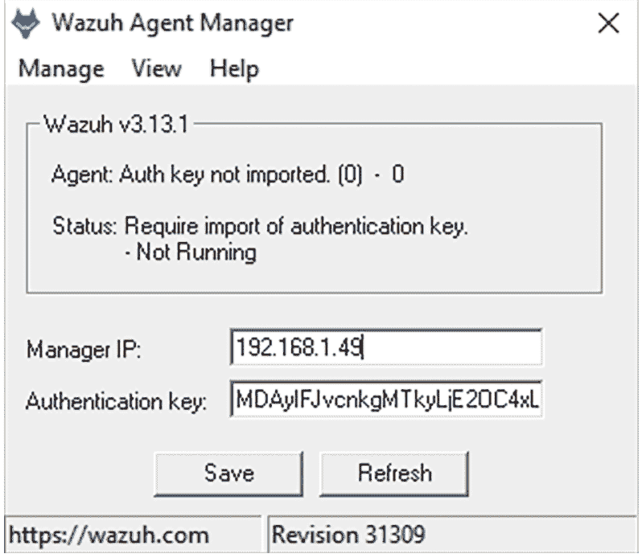

**图 10-5：** Wazuh 代理配置

7. 点击 **Manage > Start** 启动代理。

8. 每当添加代理或更改 Security Onion 或与其通信的系统时，运行 `so-allow` 脚本以启用设备之间的通信（否则 Security Onion 上的主机防火墙将拦截它）。您应该在 SSH 登录 Security Onion 终端执行此操作：

```
$ sudo so-allow
```

9. 提示时，输入 `w` 为 Wazuh 代理添加防火墙规则；然后输入代理的 IP 地址。

Wazuh 现在将管理此 PC。对网络中所有您想以此方式管理的其他设备（计算机、笔记本电脑、虚拟机等）重复此过程。系统事件日志将开始出现在您的 Kibana 仪表板中，因此预计会在 Security Onion 中看到新的数据和告警。

# 在 macOS 上安装 Wazuh

要在您的 macOS 终端上安装 Wazuh 代理，请按照以下步骤操作：

1. 登录您的 Security Onion 控制台，点击 Downloads 并下载 macOS 软件包。
2. 在您的 Mac 上运行安装向导。
3. 完成后，登录您的 Security Onion 系统并运行 `sudo so-allow` 以允许您的 Mac 通过防火墙（这必须在代理注册之前完成；否则代理将无法连接到管理服务器）。
4. 按照提示，使用 `r` 选择 Wazuh 注册服务并输入您的终端的 IP 地址。
5. 现在，向 Security Onion 服务器注册代理：

| 命令 | 参数 |
| :--- | :--- |
| `sudo / /Library/Ossec/bin/agent-auth -m` | |
| `security_onion_IP` | |

接下来，您将 Security Onion 的 IP 地址添加到 Mac 上的代理配置文件中，以便代理能够与 Security Onion 服务器通信。

6. 使用文本编辑器打开 `/Library/Ossec/etc/ossec.conf`。
7. 找到以下行并将 `MANAGER_IP` 更改为您的 Security Onion 服务器的 IP 地址：

```
<client>
<server>
  <address>MANAGER_IP</address>
```

8. 重启 Wazuh 代理：

```
$ sudo /Library/Ossec/bin/ossec-control restart
```

9. 通过在 Security Onion 服务器上列出代理来确认代理已成功配置；运行 `manage_agents` 脚本并在提示操作时输入 `L`：

```
$ sudo docker exec -it so-wazuh
/var/ossec/bin/manage_agents
--snip-
选择您的操作：A,E,L,R 或 Q: L
可用代理程序：
ID: 001, Name: securityonion, IP: 192.168.1.49
ID: 002, Name: Computer1, IP: 192.168.1.50
ID: 003, Name: MacBook-Pro.local, IP: 192.168.1.51
```

** 按 ENTER 返回主菜单。
--snip-
选择您的操作：A,E,L,R 或 Q: Q
manage_agents: Exiting.

如果您看到 Mac 的主机名和 IP 地址，则说明代理已处于激活状态。按 ENTER 返回主菜单并使用 `Q` 选项退出。

# 在 Linux 上安装 Wazuh

要在您的 Linux 终端上安装 Wazuh 代理，请按照以下步骤操作：

1. 登录您的 Security Onion 控制台，点击 Downloads 并下载相关软件包。对于 Ubuntu，这将是 DEB 软件包（对于 CentOS 和 Fedora 则是 RPM 软件包）。
您可以直接从您的 Ubuntu 系统下载软件包，也可以查阅资产列表或网络拓扑。

4. 登录 Fleet Manager 控制板并点击“Add New Host”（添加新主机）以查找您的 Fleet Secret（Fleet密钥）。

5. 使用任何文本编辑器将您的 Fleet Secret 添加到 `/etc/so-launcher/secret` 文件。

6. 更新 `/etc/so-launcher/launcher.flags`，使 `hostname` 值为 `security_onion_IP:8090`，`root_directory` 值为 `/var/so-launcher/security_onion_IP:8090`：

```
autoupdate 192.168.1.200:8090
root_directory /var/so-launcher/192.168.1.200:8090
osqueryd_path /usr/local/so-launcher/bin/osqueryd
enroll_secret_path /etc/so-launcher/secret
update_channel stable
root_pem /etc/so-launcher/roots.pem
```

7. 将您的 Security Onion 服务器上 `/etc/ssl/certs/intca.crt` 文件的内容复制到 Mac 上的 `/etc/so-launcher/roots.pem` 文件中。

几分钟后，您的 Mac 应该会作为 Fleet Manager 控制板中的一个新卡片显示。

## 在 Linux 上安装 osquery

要在您的 Linux 终端上安装 osquery 代理，请按照以下步骤操作：

1. 登录您的 Security Onion 控制台，点击“Downloads”（下载），下载 Linux 版 osquery 软件包（Ubuntu 的 DEB 文件、CentOS 的 RPM 文件等）。

2. 在您的 Security Onion 服务器上运行 `sudo so-allow`，将您的 Linux 系统添加到 osquery 允许的代理列表中。在提示时输入 `o`（代表 osquery）和您的 Linux 系统的 IP 地址。

3. 在您的 Linux 系统上安装下载的文件；这里是一个在 Ubuntu 上使用 `dpkg` 的示例：

```
$ sudo dpkg -i deb-launcher.deb
```


您的 Linux 系统应该自动在 Fleet Manager 控制板中显示为新卡片。

## 网络安全监控快速课程

现在您已经安装了必要的硬件和软件，用于监控网络中的可疑活动和恶意活动。您需要能够识别问题、在事件发生时做出响应，并保持您的网络、用户和数据安全。在本节中，我们将涵盖如何配置和使用 `osquery`、`Wazuh` 以及 Security Onion Alerts Dashboard 的基础知识。

## 使用 osquery

如果您熟悉关系型数据库和结构化查询语言 `SQL`，使用 `osquery` 对您来说将非常容易。如果不熟悉，这里是基础知识。您可以在 Fleet Manager 控制板中查看 `osquery` 管理的网络中所有设备的数据。要进入控制板，请登录 `https://<security_onion_IP>/` 上的您的 Security Onion 控制台，并在管理员菜单中点击“Fleet”。

数据存储在系列数据表中，每个表包含两个或多个列，也称为元组，其中每个表包含每个设备的信息，例如主机名、IP 地址、MAC 地址、运行时间、最后关机时间等。表中的每行都对应一个特定的实体，例如计算机或笔记本电脑，或者更原子的东西，例如设备上的特定用户账户。例如，`users` 表看起来类似于表 10-1。

表 10-1：osquery 用户表

| UID | GID | UID_Signed | GID_Signed | Username | Description |
|---|---|---|---|---|---|
| 0 | 0 | 0 | 0 | testuser | 一个测试用户账户 |

`Username` 列的第一行数据属于设备上的 `testuser` 账户。这些表中的每一个都与数据库中的其他一个或多个表，共 200 多个相关。这些表及其关系允许您对每个受管理设备的详情和状态执行强大的查询。

我们可以使用名为 `SQL` 的查询语言对这些数据提问，`SQL` 是一种用于访问和操作数据库的高级语言。`SQL` 查询如下所示：

```
SELECT c1, c2 FROM tablename
```

在此查询中，大写的命令 `SELECT` 和 `FROM` 表示您想要执行的操作——在这种情况下，是从表 `tablename` 中请求列第 1 列和第 2 列的数据，由 `c1` 和 `c2` 参数表示。

在实践中，该查询看起来如下：

```
SELECT username FROM users

SELECT * FROM users
```

第一条命令返回显示给运行查询的用户 `users` 表中存在的所有用户名，而不包含其他列。第二条命令返回 `users` 表中所有 `*` 的列和行。

> **注意** 有多种 `SQL` 命令可以不同的方式检索数据；详情请参阅 `https://www.sqtutorial.org/sql-cheheet/` 上的 `SQL` 速查表。另见 `https://osquery.io/` 上的 `osquery` 文档获取所有可用表及其数据。

Fleet 在您的 Fleet 控制板中存储了许多查询。点击页面左侧的 **Query** 菜单，见图 10-6。

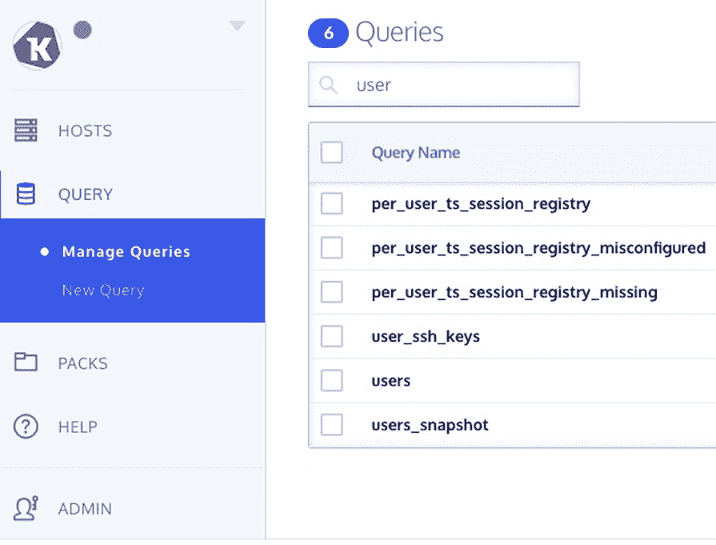

**图 10-6：** Fleet Manager 中存储的 SQL 查询

从此菜单，您可以浏览可用查询，或使用页面顶部的搜索栏搜索特定查询。一旦确定了想要运行的查询，点击选择它，然后点击右侧的 **RUN** 按钮。在执行查询之前，您需要从下拉菜单中选择设备。查询完成后，Fleet 将底部向您展示结果。

这些是一些很好的开始点：

- **users**：有助于识别不应存在的用户账户
- **browser**：显示所有浏览器插件
- **chrome_extension**：专门查找 Chrome 插件
- **crontab**：识别 Linux 上的计划任务
- **disk_free_pct**：识别磁盘空间低的设备
- **installed_applications**：识别潜在的恶意应用程序

Hosts 控制板一目了然显示每个设备的详情，见图 10-7。


10-7：Fleet 视图

您可以查看主机名、操作系统、`osquery` 版本、处理器详情、内存量、运行时间、MAC 地址以及此主机的 IP 地址。点击顶部的蓝色按钮可以轻松查询此设备。花时间熟悉可用查询，并在网上研究其他查询。尝试查看某些保存的查询并进行编辑以获取您需要的查询。

## 使用 Wazuh

我们在项目 35 中安装了 Wazuh 代理，本节将对其进行配置。`Wazuh` 允许我们查看 Security Onion 中的日志和告警，我们下一节探讨。

主要的 Wazuh 配置文件位于 Security Onion 系统上的 `/opt/so/conf/wazuh/ossec.conf`。此配置文件的每个部分都是独立的，并用如下行进行标识：

```
<!-- 忽略的文件/目录 -->
```

您可以通过查看此文件中的设置来更改 `Wazuh` 的行为，如果 `Wazuh` 对误报做出响应并阻止了您的某些良操作，这将非常有用。查看此文件以了解 `Wazuh` 监控的类型。

以下片段指定了根据已知攻击者行为已知或预期恶意的文件列表，随后是预期包含木马的一种病毒的文件，然后是要审计各种漏洞的文件和文件夹：

```
--snip--

<rootkit_files>//var/ossec/etc/shared/rootkit_files.txt</rootkit_files>

<rootkit_trojans>//var/ossec/etc/shared/rootkit_trojans.txt</rootkit_trojans>

<system_audit>//var/ossec/etc/shared/system_audit_rcl.txt</system_audit>

<system_audit>//var/ossec/etc/shared/system_audit_ssh.txt</system_audit>

<system_audit>//var/ossec/etc/shared/cis_rhel7_linux.txt</system_audit>

--snip--
```

这些文件中的每一个都包含 `Wazuh` 将监控的项列表。如果代理在设备上发现与 `rootkit_files.txt` 文件中的行为或设置匹配的文件或配置，它将采取行动修复该威胁。

如果你不想让执行该操作，请在配置文件中使用 `#` 注释或删除该行。

当你为了持续更新和补丁 Security Onion 或其他系统而更新 `Wazuh` 时，如 `rootkit_files.txt` 等配置文件也可能会收到更新。这确保了当新威胁被识别并公开失陷指标 `IOC` 时，你的网络能够保持保护。为了避免丢失对这些文件所做的任何更改，请考虑创建新的自定义配置文件，例如 `my_custom_trojans.txt`，并在 `ossec.conf` 文件中添加对此文件的引用，如下所示：

```
--snip--

<rootkit_files>//var/ossec/etc/shared/rootkit_files.txt</rootkit_files>

<rootkit_trojans>//var/ossec/etc/shared/rootkit_trojans.txt</rootkit_trojans>

<rootkit_trojans>//var/ossec/etc/shared/my_custom_trojans.txt</rootkit_trojans>

--snip--
```


进入`/ossec.conf`文件中添加文件将导致 Wazuh 在除了默认配置文件之外，还引用这些文件进行配置和设置。使用自定义文件是添加你可能需要的自定义配置的好方法。

如果你想让 Wazuh 忽略安装在任何端点上的某个目录或目录列表，请在相关部分添加该信息。你还可以告诉代理忽略特定文件或文件类型，将某些设备排除在主动响应之外（如果你希望代理永远阻止可能影响你网络的特定设备上的活动），并设置其他各种选项。熟悉这些配置文件，以便根据你的环境对其进行定制。

# 使用 Security Onion 作为 SIEM 工具

Security Onion 除了提供的其他有用功能外，还充当安全信息和事件管理（SIEM）工具。市场上上有多种 SIEM 可用，包括 Splunk、SolarWinds 或 ManageEngine，它们都是商业解决方案且可能非常昂贵。相比之下，Security Onion 是开源且免费的。

SIEM 旨在聚合来自网络设备和其他的数据。实施像 Security Onion 这样的 SIEM 可以使你的日志集中，使得对手更难通过删除任何一个系统上的日志来隐藏踪迹。它还允许你在一个位置查询日志和其他系统数据，而无需逐个检查每个系统或设备，从而简化了流程。随后，Security Onion 会分析这些数据并向你报警潜在的恶意活动。图 10-8 显示了登录 Security Onion 控制台并点击左侧菜单中的 Alerts（警报）选项时的警报列表。

| Count | rule-name | event_module | event_server_latency |
|---|---|---||-|
| 102 | Windows Login Success | windows_event | low |
| 9,769 | ET POLICY GNU/Linux APT User-Agent Outbound likely related to package management | sunicata | low |
| 8,281 | Listed ports (status) changed (new port opened or closed) | sunicata | low |
| 5,889 | ET POLICY Outgoing Basic Auth HTTP Password detected | sunicata | high |
| 4,169 | Service startup type changed | windows_event | low |
| 3,614 | ET INFO [archive] Possible Kali Linux Updates | sunicata | high |
| 2,360 | ET USER, AGENTS Steam HTTP Client User-Agent | sunicata | high |
| 1,812 | Integrity checksum changed | sunicata | low |
| 1,563 | ET INFO TLS Handshake Failure | sunicata | medium |
| 1,420 | ET JAV Hash (Java.exe) Possible Adware | sunicata | low |
| 1,346 | ET POLICY cut User-Agent Outbound | sunicata | medium |
| 707 | ET WEB Possible CVE-2014-6271 Attempt in Headers | sunicata | high |

图 10-8：Security Onion 警报

当你点击警报时，会显示带有过滤选项的菜单；你可以包含、排除、仅显示或根据你选择的警报进行分组。你还可以深入查看警报，以在所过滤的时间范围内显示该警报的所有实例。通过展开任何警报，你可以看到它的所有信息，包括元数据（见图 10-9），例如警报的时间戳、网络流量的源和目的 IP 地址、与警报相关的完整消息、导致警报或过滤的实际解码网络数据、规则，以及通常还有引用，让你了解更多关于该警报的信息，包括潜在的修复步骤或其他解决方案。

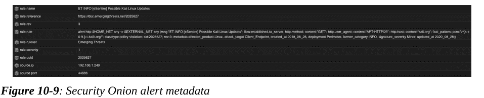

在实践中，警报仪表板将显示许多不同类别和类型的活动；你几乎总是看到需要进一步调查的警报。让我们再讨论几个来帮助你开始。

表 10-2：环境中的可能不受欢迎软件示例
| Rule name | Event module | Severity |
| --- | --- | --- |
| ET INFO [eSentinel] Possible Kali Linux Updates | suricata | high |
| ET USER_AGENTS Steam HTTP Client User-Agent | suricata | high |
| ET POLICY curl User-Agent Outbound | suricata | medium |
| ET POLICY Dropbox.com Offsite | suricata | high |
| ET SCAN Nmap User-Agent | suricata | high |
| ET TFTP Read Request | suricata | high |

其他关注的警报包括与账户登录或注销以及权限提升相关的操作，如表 10-4 所示的执行了成功的 sudo 到 ROOT。

| 表 10-4：Security Onion 中的成功与失败登录警报 |
| 规则名称 | 事件模块 | 严重程度 |
| :--- | :--- | :--- |
| Windows 登录成功 | windows_eventlog | 低 |
| PAM: 会话已关闭 | ossec | 低 |
| PAM: 会话已打开 | ossec | 低 |
| 执行了成功的 sudo 到 ROOT。 | ossec | 低 |
| 登录失败 - 用户用户或密码错误 | windows_eventlog | 低 |

成功的登录尝试会向你发出可能已被破解的账户，而失败的登录尝试则可以提醒你攻击者正试图破入。在这两种情况下，都要调查这些警报以确定其是否为合法活动。例如，如果你看到 Linux 系统上的某个账户正在将其权限提升到 root，请确定这是你本人还是你网络中的其他受信任用户。如果不是你或网络中的其他管理员，请更改密码并调查同一时间段发生的任何相关活动。

## 总结

Security Onion 的警报为你识别和追踪可疑活动提供了起点；在保障网络安全时，要充分利用这些工具。利用你手头所有的工具，因为你完全确定对手也在同样这样做。简单地增加网络上活动的可见性就能让你能够更好地保护它。通过本章描述的指令和工具，你很快就会发现许多潜在的活动待调查和修复。预计这种调查活动将持续进行，并在你的网络随时间推移不断增长和演变时尽可能跟上 Security Onion 中的警报。

## 管理网络中用户安全的提示


负责一个包含多个用户的网络是具有挑战性的。你可以合理地预期管理网络内其他用户的活动，特别是当他们使用自己的设备时。然而，你可以使用一些策略来缓解与多个用户相关的风险。

本章讨论了强密码短语与密码的价值、密码管理器、多因素身份验证以及保护隐私的浏览器插件。它应该能提供你与用户进行高效安全讨论时所需的信息。

### 密码

拥有强密码并为每个网站使用不同的凭据是保持在线安全的最佳步骤。密码短语和密码管理器会让对手更难猜到你的密码，并让你更容易管理。密码短语由几个单词组成，例如 `libertyextremeclucostydjerky`。你可以通过添加大写字母、数字和特殊字符来使其更具挑战性，但易于记忆的长密码短语比难以记忆的复杂密码要好。典型密码安全的规则仍然适用。不要使用个人身份信息，如生日、宠物或亲属的名字，或你就读过的学校。避免包含与当前月份或季节相关的单词，或你所在公司的名称。基本上，要避免从易猜的元素中构建密码短语。

密码短语比密码长，这使得它们更能抵御对手用于破解的暴力攻击。在暴力攻击中，攻击者会尝试每种可能的字符组合，直到找到正确的那个。他们可以通过程序实现这一点，每秒可以进行数百万（或数十亿）次密码猜测。密码越短、密钥空间（可用字符类型——字母、数字和符号的数量）越小，破解所需的时间就越短。例如，一个由小写字母和数字组成的八字符密码，在今天的计算硬件上破解需要不到两个小时。每增加一个字符，破解密码的时间就会指数级增长——在现有计算能力下，一个 30 字符密码短语的破解时间趋于无限大。

**注意**：务必更改你账户和设备的任何默认密码。路由器和交换机等设备的密码（例如 `username: admin`, `password: admin`）是为人知且有记录的，所以如果你不在你的网络中更改它们，就是为对手渗透你的环境敞开了大门。即使这些密码不为人知，也很容易。

## 密码管理器

使用密码管理器（也称为密码箱或保险库）安全地存储你的密码。密码管理器可以存储数百个唯一的密码短语，并通过一个主短语访问。这种做法消除了写下密码短语的诱惑，而这绝不是好主意。有多种密码可用，可用 1Password (`https://1password.com/`) 或 LastPass (`https://www.lastpass.com/`)。

传达密码管理器价值的最佳方法是讨论撞库攻击（credential stuffing），这是一种利用大多数人在多个服务中使用相同密码这一事实的攻击。当对手在数据泄露期间或之后获得密码和电子邮件地址列表时，他们尝试在各种知名网站和服务上使用这些凭据登录，并且通常会成功，因为很大比例的密码和邮箱地址组合在其他网站上重复使用。用户可以通过为每个账户使用不同的短语并将其存储在密码管理器中防止撞库攻击。

## 密码泄露检测

免费服务 Have I Been Pwned (`https://haveibeenpwned.com/`) 允许你输入电子邮件地址，并立即发现它是否出现在任何泄露或破解中。图 11-1 显示了报告的示例。

“泄露”（breach）是指数据暴露的事件。使用密码管理器可以确保你的密码安全，不会给其他服务带来风险。

- **2844 次独立泄露（未证实）**：2018 年 2 月，发现包含近 8000 万电子邮件地址的大型集合。
- **Adobe**：2019 年 10 月，1530 万个账户泄露，每个账户包含内部 ID、用户名、加密密码和密码提示。密码加密做得很糟糕，很多很快被破解为明文。
- **Canva**：2019 年 5 月，设计工具 Canva 遭受数据泄露，影响了 1370 万用户。暴露的数据包括电子邮件地址、用户名、姓名、居住城市和以哈希形式存储的密码。数据由来源提供给 HIBP，属于 JimScott.Sec@proton.com。
- **Chegg**：2018 年 4 月，教科租赁服务 Chegg 遭受数据泄露，影响了 4000 万用户。暴露的数据包括电子邮件地址、用户名和以 MD5 哈希形式存储的密码。数据由来源提供给 HIBP，属于 JimScott.Sec@proton.com。

图 11-1：受影响电子邮件账户报告示例

该服务还提供持续的更新和监控；如果你的电子邮件地址在未来的数据泄露中被识别，你可以选择接收更改密码的通知。

## 多因素身份验证

一旦创建了强密码短语，你应该在所有提供此类功能的账户和服务上实施多因素身份验证（有时称为双因素身份验证 2FA 或 MFA）。虽然单因素身份验证通常只需要两项组合——你的电子邮件地址或用户名加上你的密码短语，而 MFA 要求两个或更多因素。

身份验证。通常，第一种要素是你*知道*的，第二种要素是你*拥有*的（比如硬件或软件令牌），或者是你*所具有*的特征（比如指纹或其他生物识别）。通过要求第二或第三种身份验证因素，攻击者在尝试访问你的账户和系统时，其任务难度将呈指数级增长。增加第二个因素可能会带你或你的用户带来轻微的不便，但安全性会提高得多。

最常见的多因素身份验证（MFA）解决方案之一是将短信作为第二个因素，向你发送包含代码或一次性密码的文本信息；然后他们使用此代码登录其账户或执行某些类型的交易，特别是当其来自新或未知的设备或位置时。无论手机型号或服务提供商如何，每个人都可以接收短信，它是免费或廉价的，几乎是实时的，而且在你没有尝试登录时，它会提醒你注意可疑活动。主要的缺点是短信并不是一种安全技术，攻击者获取某人的手机号码和短信相对容易。

接下来，是软件解决方案，包括 Google Authenticator、Authy、Microsoft Authenticator，甚至像 Password 这样的提供 MFA 令牌的密码库。通常情况下，你会将应用下载到智能手机上，并扫描或输入来自服务提供商（如你的银行或社交媒体）的代码进行设置。当你想要登录时，你会检查应用获取一个身份验证令牌，并将其与你的密码配合使用。令牌每 60 秒更改一次。与将短信作为第二个因素相比，这是一个重大的改进，因为攻击者必须物理接触并解锁你的移动设备才能获取令牌。滚动令牌还意味着访问窗口极小，而不同于短信的访问窗口可能持续几分钟。对于许多用户来说，此类软件令牌是最方便且最安全的 MFA 选项。

最后，是硬件令牌，如 Yubikey 和 Titan Key。如果密钥没有插入你的电脑，你就无法访问加密或受保护的数据。硬件令牌被认为是 MFA 解决方案中最“硬核”的方案，因为丢失硬件密钥意味着你无法访问自己的数据。它们提供的保护与软件令牌相同甚至更优越，因为攻击者需要物理接触，但它们是最不方便的；大多数人都会随身携带手机，但在办公室需要硬件令牌时，你很容易把它忘在家里。此外，硬件令牌无法被网络钓鱼；虽然短信和其他类似的 MFA 令牌可以通过社会工程和网络钓鱼攻击从潜在受害者处获取，但攻击者无法远程访问你的硬件密钥。

# 摄像头罩

在讨论计算机安全时，一个重要的补充是摄像头罩的必要性。攻击者可以访问你笔记本电脑或电脑上的摄像头，并在不提醒你摄像头已开启的情况下，秘密地监控摄像头前可能发生的任何情况。为了保护你自己以及周围人的隐私，请购买一些低技术、不透明的胶带或摄像头罩（在许多在线商店可以廉价地买到）。

### 浏览器插件

所有主流浏览器浏览器（如 Google Chrome、Mozilla Firefox 和 Microsoft Edge）都有多个浏览器插件或加载项，用于拦截广告和跟踪器（更多跟踪器信息请参阅第 7 章），并更广泛地提高用户隐私。这里提到的插件经过了审核，并且已知是合法的，或由知名且信赖的来源创建或维护。浏览器插件旨在为标准浏览器提供额外功能，用户可以从广泛的插件中进行选择以改进浏览体验。与你的用户讨论这些浏览器加载项的优是有益的，使他们能够就使用哪些插件以及避免哪些插件做出明智的选择。

# Adblock Plus

Adblock Plus 从网站上移除“不可接受”或干扰性的广告。要安装此插件，请访问 `https://adblockplus.org/en/download` 并下载适用于你的浏览器或设备的相应版本。安装完成后，进入设置页面即可。

最后，SANS 是一个专注于网络安全的研究与培训机构。在 `https://www.sans.org/`，你可以找到关于其培训课程的更多，以及许多与网络和端点安全工具及技术的资源和论文，涵盖了防御和进攻视角。

## 总结

根结底，你的在线隐私和安全可以根据你的意愿获得尽的保护。在互联网上保持安全是以牺牲隐私、安全或两者的便利为代价的。以稍微减少便利性为代价，你将在网上获得更好的整体体验，并享受更高水平的安全性和隐私，无论这些是仅供你个人使用还是与用户共享。确保安全的益处远大于实施这些解决方案带来的不便。

# 索引

# 符号

- prompt, 11
- $ prompt, 11

# A

- 访问控制列表 (ACLs), 94–95, 98–101
- accl 指令, 99
- 广告拦截, 105–116
  - 在 Brave 中, 108
  - 浏览器插件, 181–182
  - 在 Google Chrome 中, 106–107
  - 在 Mozilla Firefox 中, 107–108
  - 配合 Pi-Hole, 108–116
  - 配置, 109–113
  - 在端点上配置 DNS, 115–116
  - 使用, 113–114
- Adblock Plus, 106, 181–182
- 插件 (扩展), 106
- adduser 命令, 11
- 高级包工具 (APT), 10–11, 127
  - -a- 6 (添加组) 参数, 12
- Airport Extreme 基站, 137
- Airport Time Capsule, 137
- allallows, 60, 98, 100
- Amazon Alexa, 183
- Amazon Web Services, 7
- anonymize_headers 指令, 97
- 杀毒农场, 120
- AnyDesk, 68
- Apache Traffic Server, 93
  - - A 参数, 37, 39–40, 50
- APT (Advanced Package Tool), 10–11, 127
- 资产列表
  - 创建, 56–57
  - 定义, 55
  - MAC 地址过滤, 60
  - 网络分段, 30
  - Squid 代理, 93
  - 静态 IP 地址, 58
  - 模板, 56
- ASUS RT-AC5300 无线路由器, xxii, 59, 59, 60, 61, 62–64
- 减少攻击的 iptables, 39, 41
  - 定义, 34
  - 禁用 IPv6, 48, 54, 111
  - 访客网络, 65
  - Squid 代理, 95
  - 静态 IP 地址, 59
  - 第三方 VPN, 68
- auth 指令, 77, 80
- Authy, 180
- Automov, 128–130
- Avast, 120–122

# B

- Backblaze, 143–144, 146
- 备份策略, 131–147
  - 云端备份解决方案, 142–144
- Backblaze, 143–144, 146
- Carbonite, 144, 146
- duplicity, 138–142
  - 考虑, 141–142
  - 创建本地备份, 139–140
  - 创建网络备份, 138
  - 恢复备份, 141
  - 本地 vs 远程, 133–134
  - 恢复备份, 146
  - 计划, 133
  - 存储, 134
  - 测试备份, 146
  - Time Machine, 137–138, 146
  - 备份类型, 132–133
  - 虚拟机快照, 145–146
  - 如何备份, 134
  - Windows 备份, 134–135
  - Windows 备份与恢复, 135–137
  - 基础输入输出系统 (BIOS)
    - 可启动 USB, 7
    - UEFI vs., 7
    - 黑名单, 114
    - 封锁列表, 110
  - 冲突网络, 48
  - 可启动 USB
    - 创建物理系统
    - 在 macOS 上, 6–7
    - 在 Windows 上, 6
    - 定义, 6
    - 使用, 7
  - Brave, 108
  - 广播地址, 19
  - 浏览器插件, 181–183
    - Adblock Plus, 181–182
    - Ghostery, 182
    - HTTPS Everywhere, 182–183
  - 暴力破解攻击, 178

# C

- C.A. 参见证书授权
- 缓存
  - 定义, 92
  - 禁用特定站点, 101
  - Squid 代理, 93, 101
- Can You Block It, 116
- Carbonite, 143, 144, 146
- CCMP (计数器模式MAC 协议), 63
- CentOS Linux, 2
- 证书授权 (CA)
  - 概述, 69
  - 设置, 71–73
- CIDR 记法, 19
- cipher 指令, 77, 80
- ClamAV, 122–124
- CLI (命令行界面) 实用程序, 10
- 客户端指令, 73, 75
- 云备份解决方案, 142–144
  - Backblaze, 143–144, 146
  - Carbonite, 144, 146
- collection-status 参数, 141
- 冲突域, 26
- 命令行界面 (CLI) 实用程序, 10
- Command Prompt, 10
- Common Name, 72–73, 75, 79
- connybeats 工具, 38
- CONNECT 参数, 95, 99
- connrate 工具, 38
- cookies, 106
- 计数器模式MAC 协议 (CCMP), 63
- Crontab 实用程序, 123, 140
- 挖矿, 106
- state 参数, 38
- curl 工具, 42

# D

- 数据泄露, 151
- 数据表, 169
- 默认网关, 19
- 默认路由, 78, 84
- 深度防御架构, xx, 44
- 用户命令, 12
- 拒绝列表, 60, 98–100
- deny 参数, 99
- DHCP。参见动态主机配置
- dhcp-option 指令, 77
- 增量备份, 132–133, 135
- Diffie-Hellman 密钥交换, 74
- 数字证书, 69
- 创建客户端证书, 74–75
- 创建服务器证书和密钥, 72–75
- 设置授权机构, 71–72
- 发行版, 定义, 2, 127
- dist-upgrade 命令, 15
- 域名系统系统 (DNS)
  - 广告拦截, 108–110, 114–116
  - 配置 OpenVPN, 77
  - 配置 Wireguard, 85–86
  - 定义, 108
- Faster Than Light (光速), 111, 112
  - 墙, 41
  - 识别 DNS 服务器, 85
  - 测试 VPN, 89
- 点状引号, 17
- dpkg 实用程序, 165
- draw.io, 20
- Dropbox, 28, 142, 174
- 域指令, 99
- 动态主机配置 (DHCP), 2
- duplicity, 138–142
  - 考虑, 141–142
  - 创建本地备份, 139–140
  - 创建网络备份, 138
  - 恢复备份, 141
- 检查 IP 地址, 18, 30
- 创建资产列表, 56
- 禁用 IPv6, 55
- 静态 IP 地址, 57–59

# E

- EasyRSA
  - 安装, 70
  - 概述, 69
- eayrsa import-re, 73
- ECDSA 密钥, 14
- 端点检测与响应 (EDR) 平台, 162
- 端点 (hosts)。参见隐私网络
  - 定义, xx
  - 墙, 33–34, 49
  - 网络设备, 26–27
  - 网络分段, 28, 31
  - 静态 IP 地址, 57, 59
  - 无线认证, 64–65
- ETAP-2003, xx
- Etcher 实用程序, 6–7
- EternalBlue 漏洞, 48
- 规则集, 158–159
- exclude VPN, 141
- ExpressVPN, 68
- 插件 (扩展), 106
- 外部硬盘, 134–138, 144

# F

- Faster Than Light (FTL) DNS, 111, 112
- Fedora Linux, 2
- 文件传输, 22–23
- find 命令, 102
- 指纹, 106
  - 墙, xx, 33–51
  - 封锁协议, 49
  - 配置 OpenVPN, 78–79
  - 配置 Wireguard, 84–85
  - 定义, 33
- iptables, 33, 35–44
  - 配置, 38–42
  - 创建规则, 37–38
  - 安装, 36–44
  - 日志行为, 43–44
- pfSense, 33–34, 44–49
  - 创建规则, 48–49
  - 加固, 47–48
  - 安装, 44–47
  - 测试, 48–49
  - 备份类型, 34–35
- 硬件防火墙, 34
- 主机防火墙, 33, 34–35
- 数据包过滤防火墙, 34
- 边界防火墙, 34
- 软件防火墙, 34
- 状态检测防火墙, 34
- 无状态防火墙, 34
- Uncomplicated Firewall, 70, 84–85
  - flush 参数, 40
- Forcepoint, 93
- 前向链, 35–36, 37, 39, 40
- F 参数, 40, 42
- FreeBSD Unix, 44
- FROM 命令, 169
- FTL (Faster Than Light) DNS, 111, 112
- 完整备份, 132–135
- duplicity, 138–140
  - 存储, 134
  - 测试, 146
- Windows 备份, 135
- Windows 备份与恢复, 135–137

# G

- gen-dh 参数, 74
- Ghostery, 182
- Google Authenticator, 180
- Google Chrome
  - 广告拦截, 106–107
  - 隐身模式, 107
- GoogleChrome, 28
- Google Drive, 28, 142
- Google Home, 183
- Google Titan Key, 180
- 政府信息与识别, xix
- Grafana, 153–154
- group 指令, 77, 80
- 访客网络, 28, 60–65

# H

- 硬件防火墙, 34
- 哈希处理, 124–125
- Have I Been Pwned 服务, 179
- 启发算法, 120
- 十进制 (hex), 19
- h 标记, 22
- 主机防火墙, 33, 34–36
- hostname 命令, 12–13, 163
- 主机
  - 资产列表, 56
  - 更改, 12–13
  - 检查, 12
  - 定义, 12
  - hosts。参见端点；虚拟专用网络
- HTTP
  - 防火墙, 42, 47
  - Squid 代理, 109
  - http_access allow localnet 指令, 95
  - http_access deny, 95–96
  - http_access 指令, 99
- http_deny 指令, 97
- HTTPS
  - 防火墙, 42, 47
  - Squid 代理, 95
- HTTPS Everywhere, 182–183
- 集纽器, 26
- 虚拟机管理器
  - 创建 Ubuntu 虚拟机, 3–5
  - 定义, 3
  - VirtualBox, 4–5
- VMware Fusion, 4
- VMware Fusion Player for macOS, 4
- VMware Player for Windows, 3–4
- VMware Workstation, 3–4

# I

- icanhazip, 42
- ICMP。参见互联网消息报协议
- IDS (入侵检测系统), 151, 153
- include 指令, 99
- 增量备份, 132–133, 138, 140
- 输入链, 35, 37, 39, 40, 42–43
- 知识产权, xix
- Intel 下一代计算单元 (NUC), 44, 154–155
- 互联网消息报协议 (ICMP)
  - 防火墙, 41
  - 输出链, 35
  - 物联网 (IoT), 2, 183
  - 网络地图, 22
  - 网络分段, 25, 27–28, 31, 61
  - 无线网络安全, 53, 61
- 互联网协议 (IP)。参见 IP 地址
  - 定义, 17
  - 版本, 24
- 互联网协议第6版 (IPv6)。参见 IP 地址
  - 禁用, 48, 54–55, 111
  - iptables, 36
  - 概述, 17
  - 侵入者, 27, 62
  - 入侵检测系统 (IDSs), 151, 153
- 检查, 18–19
- 在 Linux 上, 19
- 在 Mac 上, 19
- 在 Windows 上, 18–19
- 定义, 17
- 动态, 57
- 概述, 17–18
- RFC1918 地址, 48
- 路由器, 27
- 静态, 56–59, 69
- I 参数, 37
- iptables 防火墙, 33, 35–44
  配置 配置 38–42
- 创建规则, 37–38
- 安装, 36–44
- 日志行为, 43–44
- 策略链, 35–37, 39–43
- 测试, 49–51
- VPNs, 70
- iptables-persistent 工具, 36, 43
- IPv6. 参见 Internet Protocol version 6

# J
- j 参数, 38

# K
- Kali Linux, 22
- key-direction 指令, 80
- 密钥空间, 178
- Kibana, 161

# L
- LAN (局域网), 47, 53–55, 58
- Linux, 1–23
- 配置选项, 9
- 创建云端系统, 7–8
- 创建物理系统, 5–7
- 创建虚拟机, 2–5
- 虚拟机监控程序, 3
- VirtualBox, 4–5
- VMware Fusion, 4
- macOS 版 VMware Fusion, 4
- Windows 版 VMW Player, 3–4
- VMware Workstation, 3–4
- 完成安装, 8–9
- 系统加固, 9–16
- 捕获虚拟机配置, 16
- 定义, 9–10
- 安装系统包, 10–11
- 安全远程访问, 13–16
- 用户管理, 11–13
- 操作系统, 2–8
- 概述, 2
- 补丁与更新, 126–127
- 局域网 (LANs), 47, 53–55, 58
- 回环地址, 38

# M
- MAC 地址
- 资产列表, 56–57
- 过滤, 56, 59–60, 59
- 网络设备, 26–27, 55–56
- 网络拓, 21
- 恶意软件, 117–130
- Automux, 128–130, 129, 130
- Avast, 120–122, 121
- ClamAV, 122–124
- Microsoft Defender, 118–119
- 补丁与更新, 125–128
- Linux, 126–127
- macOS, 126–127
- Windows, 126
- 工具, 119
- 杀毒农场, 120
- 启发式算法, 120
- 特征码, 120
- VirusTotal, 124–125
- manage_agentsget, 162, 165–166
- 管理交换机, xxii, 28–29
- -m 参数, 38
- 元数据, 92–93
- MFA (多因素身份认证), 179–180
- Microsoft Authenticator, 180
- Microsoft Azure, 7
- Microsoft Visio, 20
- 镜像端口. 参见交换端口分析器
- 调制调器
- 禁用 IPv6, 55
- 网络拓扑, 20–21
- Mozilla Firefox, 107–108
- 多因素认证, 180

# N
- Nano, 14
- NAS (网络附属存储), xxi, 134, 137
- NAT (网络地址转换), 17–18, 36, 54
- netfilter 命令, 43
- Netgear 1100 pfSense+, 44
- Netgear 2100 Base pfSense+, 44
- Netgear GS308E 交换机, xii, 28–29
- Netgear Nighthawk 系列, 54
- Netate SG-3100, xii, 44, 57, 58
- Netgear Switch Discovery Tool (NSDT), 30
- 网络地址转换 (NAT), 17–18, 36, 54
- 网络附属存储 (NAS), xxi, 134, 137
- 网络设备, 26
- 集线器, 26
- 限制, 54–60
- 创建资产列表, 56–57
- MAC 地址过滤, 59–60
- 静态 IP 地址, 57–59
- 路由器, 27
- 交换机, 26–27
- 网络拓扑
- 创建, 20–22
- 保持最新, 21
- 网络监控与检测, 149–175
- Security Onion, 153–175
- 安装, 155–161
- osquery, 166–172
- 使用 SIEM 工具, 172–175
- Wazuh, 161–166, 171–172
- 交换端口分析器, 152–153
- 接入点, 150–151
- 网络隔离, 25–31
- 定义, 27
- 以太网隔离, 29–31
- 逻辑分段, 28
- 网络设备, 26
- 集线器, 26
- 路由器, 26–27
- 交换机, 物理隔离, 27
- 信任区域, 27–29, 31
- 无线网络, 60–62
- 网络时间协议 (NTP), 159
- 检查 IP 地址, 18
- 在 Linux 上, 19
- 在 Mac 上, 19
- 在 Windows 上, 18–19
- 创建网络拓扑, xx–xi, 20–22
- 定义, xx
- 传输文件, 22–23
- NGINX, 93
- Nmap 工具, 49–50
- NordVPN, 68
- -N 参数, 43
- NSDT (Netgear Switch Discovery Tool), 30
- NTP (网络时间协议), 159
- NUC (Intel Next Unit of Computing), 44, 154–155

# O
- 离线备份, 133–134
- 1Password, 180
- OpenSSH, 79, 85
- OpenVPN
- 配置, 76–82
- 防火墙, 78–79
- 启动 VPN, 79
- VPN 客户端, 79–82
- 创建客户端证书, 74–75
- 创建服务器证书和密钥, 72–75
- 使用创建 VPNs, 70–82
- EasyRSA, 69–70
- 概述, 68–69
- 设置证书机构, 71–72
- --gen-key 命令, 74
- 组织字段, 159, 166–172
- osquery, 定义, 153
- Fleet, 167–171
- 在 Linux 上安装, 168
- 在 macOS 上安装, 167
- 在 Windows 上安装, 167
- 使用, 168–171
- 输出链, 35, 37, 39, 40–43

# P
- p 参数, 50
- 包过滤防火墙, 34
- password 命令, 12
- 密码和密码, 177–179
- 修改默认, 30, 178
- 不允许密码认证, 14
- 密码检测, 179
- 密码管理器, 178
- 远程访问安全, 13–14
- 强密码, 47, 177–178
- 用户管理, 11–12
- 无线认证, 62–63, 65
- 补丁与更新, 125–128
- Linux, 126–127
- macOS, 126–127
- Windows, 126
- 边界防火墙, 34
- 个人身份信息 (PII), xx, 92, 100–101
- -pf 标记, 22
- pfSense 防火墙, xxii, 44–49
- 创建规则, 48–49
- DNS 设置, 116
- 加固, 47–48
- 安装, 44–47
- 在 Linux 上安装, 45–46
- 在 Mac 上安装, 45
- 在 Windows 上安装, 45
- 测试, 49–51
- VPNs, 70
- PHI (保护健康信息), xx
- Pi-Hole, 77, 91
- 拦截, 108–116
- 配置, 109–113
- 配置端点, 115–116
- 使用, 113–114
- PII (个人身份信息), xx, 92, 100–101
- PKI (公钥基础架构), 69, 71–72
- 策略链, 35–37, 39–43
- 潜在不良应用程序 (PUAs), 123
- PowerShell, 10
- -P 参数, 39, 40
- PPPoE, 46
- --protect-args, 22
- 保护健康信息 (PHI), xx
- 代理, 91–104
- 概述, 91–92
- Squid 代理
- 拦截和允许域名, 98–100
- 配置, 93–97
- 配置要使用的设备, 37
- 定义, 91
- 禁用特定站点缓存, 101
- Pi-Hole 和, 109
- 保护个人信息, 100–101
- 报告, 101–104
- 测试, 98
- 潜在不良应用程序 (PUAs), 123
- PKI (公钥基础架构), 69, 71–72

# R
- -R 参数, 37
- Red Hat Linux, 2
- 直接网关指令, 77
- 关系型数据库, 168
- --remove-source-files 参数, 22
- request_header_access 指令, 100
- store 命令, 141
- RFC1918 地址, 48
- -r 标记, 22
- root 用户. 参见 superusers
- 禁用 IPv6, 55
- 概述, 27
- sync 命令, 22–23, 73
- Rufus 工具, 6
- 规则, 34

# S
- SAE (等等身份认证), 63
- 安全端口, 95
- Sanders, Chris, 184
- SARG (Squid 分析报告生成), 101–104
- 安全拷贝协议 (SCP), 23
- 安全传输协议 (SFTP), 23
- ssh (shell), 13–16
- 防火墙, 39–40, 48, 78
- 安装, 11
- SSH 密钥对, 13–16
- 创建, 13–14
- 禁用密码登录, 14–15
- 不允许密码认证, 14
- 重复备份, 140
- 登录信息, 15–16
- 公钥文件, 13–34
- 安全与事件管理 (SIEM) 工具
- 定义, 173
- 在 Security 上, 172–175
- Security Onion, 153, 155–161
- 来自 ISO 文件, 155–156
- 手动地, 155–156
- Kibana, 161
- 最低规格, 154
- osquery, 159, 166–172
- 定义, 153
- 在 Linux 上安装, 168
- 在 macOS 上安装, 167–168
- 在 Windows 上安装, 167
- 使用, 168–171
- Wazuh, 159, 161–166
- suricata, 153, 159
- 使用 SIEM 工具, 172–175
- zeek, 153, 158–160
- SELECT 命令, 169
- 服务器参数, 73, 75
- 消息块 (SMB), 48–49
- SFTP (安全传输协议), 23
- SIEM 工具. 参见安全信息与管理工具
- 特征码, 120
- 等等身份认证 (SAE), 63
- 小规模网络, 定义, xx
- SMB (消息块), 48–49
- 快照
- 定义, 16
- 删除旧的, 16
- 在 VirtualBox 中捕获, 16
- 在 VMware 中捕获, 16, 145–146
- so-allowget, 164–165, 167–168
- 社交媒体跟踪器, 106
- 软件防火墙, 34
- SPANs. 参见交换端口分析器
- -s 参数, 39
- 分流隧道, 86
- SQL (结构化查询语言), 168–169
- Squid 分析报告生成器 (SARG), 101–104
- Squid 代理, 91–104
- 拦截和允许域名, 98–100
- 配置, 93–97
- 配置要使用的设备, 37
- 定义, 91
- 禁用特定站点缓存, 101
- Pi-Hole 和, 109
- 保护个人信息, 100–101
- 报告, 101–104
- 测试, 98

# T
- tail 命令, 98
- TAPs. 参见流量接入点
- TCP. 参见传输控制协议
- Timeviewer, 68
- 临时密钥性协议 (TKIP), 62
- 终端, 10
- TFTP (简单文件传输协议), 174
- Time Machine, 137–138, 146
- is-auth 指令, 77, 80
- 流量接入点 (TAPs), 150–151
- 定义, xxii, 150
- 入侵检测系统和, 151
- 部署, 150, 151
- 传输控制协议 (TCP)
- 常见的拦截的协议, 49
- 防火墙, 37–39, 41
- VPNs, 76
- 简易文件传输协议 (TFTP), 174
- 信任区域, 27–29, 31
- 元组 (tuples), 169
- 双因子认证 (2FA), 179–180

# U

+ Ubiquiti, xxii
Ubuntu Linux
- 配置选项, 9
- 创建云端系统, 7–8
- 创建物理系统, 5–7
- 创建虚拟机, 2–5
- 虚拟机管理器 (hypervisor), 3
- VirtualBox, 4–5
- VMWare Fusion, 4
- macOS 版 VMWare Player, 4
- Windows 版 VMWare Player, 3–4
- VMWare Workstation, 3–4
- 下载, 2
- 版本, 2
- 完成安装, 8–9
- 系统加固, 9–16
- 捕获虚拟机配置, 16
- 定义, 9–10
- 安装系统包, 10–11
- 保护远程访问, 13–16
- 用户管理, 11–13
- 视图, 2
- 补丁与更新, 126–127
- 简单防火墙 (UFW), 70, 78, 84–85
- Wireguard, 82
- umask 命令, 83
- 简单防火墙 (UFW), 70, 78, 84–85
- 统一扩展固件接口 (UEFI), 6
- update 命令, 127
- upgrade 命令, 127
- 用户数据报协议 (UDP)
- 需封锁的常用协议, 49
- 定义, 38
- 输出链, 41
- VPNs, 76
- 用户指令, 77, 80
- 用户管理与安全, 11–12, 177–183
- 添加用户, 11–12
- 将用户添加到 sudo 组, 12
- 浏览器插件, 181–183
- 删除用户, 12
- 物物联网, 183
- 多因子认证, 179–180
- 密码与短语, 11–12, 177–179
- 重置, 12
- sudo 权限, 12
- Ubuntu Linux, 11–13
- usermod 命令, 12

# V

VDI 格式, 5
verify 参数, 141
VHD 格式, 5
VirtualBox
- 创建 Ubuntu 虚拟机, 4–5
- 完成安装, 8
- 拍摄快照, 16
- 虚拟局域网 (VLANs)
- 定义, 28
- 网络分段, 28–31, 30
- 虚拟机 (VMs)
- 捕获配置, 16
- 在 VirtualBox 中拍摄快照, 16
- 在 VMware 中拍摄快照, 16, 145–146
- 创建, 2–5
- 虚拟机管理器 (hypervisor), 3
- VirtualBox, 4–5
- VMware Fusion, 4
- macOS 版 VMware Fusion Player, 4
- Windows 版 VMware Player, 3–4
- VMware Workstation, 3–4
- xxi
- 完成安装, 8
- 宿主机系统, xxi
- 虚拟专用网络 (VPNs), 67–89
- 第三方 VPN 和远程访问服务的缺点, 68
- 功能, 67–68
- 输入链, 35
- OpenVPN
- 使用 OpenVPN 创建 VPN, 70–82
- EasyRSA, 69
- 概述, 68–69
- 测试, 89
- Wireguard
- 使用 Wireguard 创建 VPN, 82–89
- 概述, 69
- VirusTotal (VT), 124–125
- VLANs. 参见虚拟局域网
- VMDK 格式, 5
- VMs. 参见虚拟机
- VMware Fusion, 4
- macOS 版 VMware Fusion Player, 4
- Windows 版 VMware Player, 3–4
- VMware 快照管理器, 16, 145–146
- VMware Workstation, 3–4
- VPNs. 参见虚拟专用网络
- VT (VirusTotal), 124–125

# W
WannaCry 勒索软件, 48
Wazuh, 159, 161–166
- 定义, 153
- 在 Linux 上安装, 165–166
- 在 macOS 上安装, 164–165
- 在 Windows 上安装, 162–164
- 使用, 171–172
- 摄像头, 180, 183
- WEP (无线等效加密), 62
- wg public 命令, 83
- WhatIsIP.com, 89
- 白名单, 114
- Wi-Fi 保护 (WPA), 62–63
- Wi-Fi 保护预共享密钥 (WPA-PSK), 63
- Wi-Fi 保护版本 2 (WPA2), 63
- Wi-Fi 保护版本 3 (WPA3), 63
- Windows 备份, 134–135
- Windows 备份与恢复, 135–137, 146
无线等效加密 (WEP), 62

Wireguard
- 配置, 83–89
- 防火墙, 84–85
- 识别服务器, 85
- 启动 VPN, 85
- 使用 Wireguard 创建 VPN, 82–89
- 概述, 69
- 设置配对, 83
- 无线认证, 62
- WEP, 62
- WPA/WPA2, 63
- WPA3, 63
- 无线安全, 65
- 2.4 GHz 和 5 GHz 频段, 60
- 无线认证, 65
- 禁用 IPv6, 54
- 隐藏 SSID, 55
- 限制设备, 54
- 创建访问列表, 56
- MAC 过滤, 57
- 静态 IP 地址, 59
- 网络分段, 60
- 硬件升级, 54
- WPA (Wi-Fi 保护), 62
- WPA2 (Wi-Fi 保护), 63
- WPA3 (Wi-Fi 保护), 63
```
