# Dan Gookin 教授 Microsoft Windows Millennium Edition


**副出版人**
Greg Wiegand

**收购编辑**
Stephanie J. McComb

**开发编辑**
Nicholas J. Goetz

**执行编辑**
Thomas F. Hayes

**项目编辑**
Tonya Simpson

**文字编辑**
Geneil Breeze
Cheri Clark
Krista Hansing
Linda Safiert

**索引员**
Chris Barrick

**校对员**
Jeanne Clark
Juli Cook

**技术编辑**
Kyle Bryant

**团队协调员**
Sharry Lee Gregory

**内页设计师**
Ruth Lewis

**封面设计师**
Anne Jones

**制作**
Brandon Allen
Cheryl Lynch

## DAN GOOKIN 教你 Windows Millennium Edition

### 13 使用剪切与粘贴共享 161
- 剪切与粘贴基础复习 161
- “无法粘贴！” 163
- 窥视剪贴板 165
- 复制拖拽与剪切拖拽 166
- 在 WordPad 中拖拽与复制 166
- 拖拽到桌面 169

### 14 安装与卸载软件 173
- 向 PC 安装新程序的概述 174
- 使用控制面板中的“添加/删除程序”图标 175
- 安装从互联网下载的内容 177
- 卸载程序 179
- 绝对 100% 错误的程序卸载方法 179
- 正确的卸载方法 179
- 最佳的卸载方法 181

### 15 添加更多 Windows 组件 183
- 添加 Windows 遗漏的内容 183
- 移除部分 Windows 组件 185
- 使用在线 Windows 更新 187

## III 打印与传真

### 16 打印及相关操作 193
- 打印之道 194
- 所有内容所在的位置 195
- 即将到来的打印预览 195
- 单独或分组打印页面 197
- 更改方向 199
- 更改纸张大小 201
- 选择其他打印机 203

### 17 打印屏幕内容 207
- 打印桌面快照 208
- 仅打印某个窗口 209
- 打印文件夹中的文件列表 211

### 18 你好，打印机文件夹！ 217
- 介绍你的打印机文件夹 218
- 更改打印机名称 219
- 选择你最喜欢的打印机 220
- 检查打印队列 221
- 取消打印作业 224
- 为你最爱的 PC 安装新打印机 225
- 添加直接连接到 PC 的打印机 225
- 添加网络打印机 229

### 19 发送传真（类似于打印） 233
- 计算机传真工作原理概述 234
- 接收传真 235
- 使用互联网发送传真 235

## IV 磁盘、文件夹与文件

### 20 磁盘驱动器入门 239
- 磁盘驱动器名称与盘符 240
- A 到 Z 驱动器 240
- 基础磁盘驱动器图标识别 242
- 不同的视角 243
- 为磁盘命名或更改旧名称 244

### 21 关于硬盘驱动器的一切 247
- 检查你的硬盘 248
- 清理硬盘 248
- 磁盘优化时间 252
- 修复你的硬盘 254
- 在你不在时安排磁盘维护 258
- 一些备份建议 260

### 22 可移动磁盘与驱动器 263
- 经典且可靠的软盘驱动器 264
    - 找到你的软盘驱动器 264
    - 格式化软盘 266
- CD-ROM 和 DVD 驱动器 267
    - 磁盘插入与取出 268
    - 自动运行磁盘 269
    - 在计算机上播放音乐 CD 272
    - 播放电影 273
- Zip 驱动器 274
- 更改可移动磁盘的盘符 276

### 23 探索文件夹 277
- 探索你的文件夹 277
    - 前往特定文件夹 279
    - 在知道名称时查找文件夹 282
- 解析路径名 285

### 24 组织文件夹 287
- 创建新文件夹 288
- 重命名文件夹 291
- 移动文件夹 292
- 将文件夹彻底删除 294
- 创建文件夹快捷方式 296
- 使用压缩（好吧，就是 Zip 文件）文件夹 298
    - 创建压缩文件夹 298
    - 压缩文件夹中的文件 300
    - 一些压缩文件夹技巧 300
    - 删除压缩文件夹 302

### 25 文件趣玩 303
- 万种复制文件的方法 304
    - 基础文件复制 304
    - 复制与粘贴 306
    - 通过 Ctrl+拖拽复制 307
    - 复制文件 308
    - 创建文件快捷方式 309
    - 复制警告 310
    - 总计 311
- 将文件到处移动 311
    - 移动到哪里？ 311
    - 移动文件可能很麻烦 312
    - 使用剪切与粘贴移动文件 312
- 给文件起新名字 314
- 群众控制（处理文件组） 316
    - 使用 Ctrl+点击选择零散的文件组 316
    - 批量选取文件 317
    - 使用 Shift+点击选择一行文件 318
    - 选择所有内容 319
- 取消选择已选文件 320

### 26 使用“发送到”命令 323
- 你好，“发送到”菜单 323
- 使用“发送到”菜单 324
    - 向“发送到”菜单添加自定义命令 325
- 微调“发送到”菜单中的命令 328

### 27 文件的本质 331
- 这是什么文件？ 331
- 识别图标 332
- 打开已知图标查看内部内容 335
- 有趣的“播放”菜单选项 335
- 检查文件属性 336
- 文件类型与文件名扩展名的精彩世界 338

### 28 搜寻文件 341
- 你好，搜索命令！ 341
- 在知道名称时查找文件 343
- 在知道部分名称时查找文件 346
- 根据文件内容查找文件 347
- 查找特定类型的文件 348
- 查找在，呃，大约过去几天内创建的文件 349

### 29 删除、还原与回收 351
- 杀死一两个文件 352
    - 删除文件 352
    - 批量删除文件 353
    - 彻底删除文件 354
- 还原文件 356
- 管理回收站 357
    - 微调回收站 357
    - 关闭删除警告 359
    - 清空回收站 359

## V 互联网星球

### 30 Internet Explorer 导览与复习 363
- 你好，网络！ 364
- “哦，哦，给我一个主页……” 365
- 浏览万维网 367
- 在网上寻找东西 369
    - 寻找网页的地方 369
    - 搜索新闻组 371
    - 寻找你的车钥匙或眼镜 372
- 退出 IE 372

### 31 Internet Explorer 及更多 373
- 你最喜欢的网络内容 373
    - 查看收藏夹菜单 374
    - 添加到收藏夹（放置书签） 375
    - 组织你的收藏夹列表 377
    - 在文件夹面板中组织 379
    - 移除不需要的书签 379
- 噢，那些你去过的地方！ 380
    - 访问很久以前的内容 380
    - 控制历史记录列表 381
- 激活桌面 382

### 32 Outlook Express 快速上手 383
- Outlook Express 入门与出路 384
    - 查看收件箱 385
    - 回复邮件 387
    - 将邮件转发给他人 389
    - 删除邮件 389
    - 将邮件移动到另一个文件夹 390
- 撰写新电子邮件 391
- 退出 Outlook Express 393

### 33 Outlook Express 的更多乐趣 395
- 使用地址簿 395
    - 手动添加姓名 396
    - 创建昵称 398
    - 召唤联系人 398
- 为新邮件进行精美格式化 400
- 关于电子邮件附件（通过邮件发送文件）的一切 402
    - 发送邮件附件 402
    - 接收邮件附件 403
    - 处理未知附件 404
- 额外的 OE 选项 405

### 34 AOL 章节 407
- 进入 AOL 408
    - 检查邮件 408
    - 发送新消息 411
    - 附加文件 412
- 访问网络 413
- 退出 AOL 414

### 35 更多互联网疯狂操作 415
- 从互联网下载东西 415
    - 抓取网页 416
    - 保存图像 417
    - 获取软件 419
- 玩在线游戏 422
- 在线购物：福祉还是诅咒？ 424

## VI 微调大师

### 36 控制面板 427
- 控制面板你在哪里？ 428
- 一些快速的小修小补 430
    - 调整日期和时间 430
    - 它们不是操纵杆——它们是科学仪器！ 433
    - 进行键盘调整 434
    - 一台 PC，多人使用 437

### 37 界面新面貌 439
- 根据心情更换新背景 440
    - 使用桌面图案作为壁纸 441
    - 使用图形图像作为壁纸 443
- 新颜色、字体等 444
    - 更改主图标 447
    - 使用桌面主题 448

### 38 捣鼓“开始”那个东西 451
- 基础的“开始”操作 451
- 哪些保留，哪些离开 453
    - 显示或隐藏各种选项 454
    - 扩展项目 455
    - 旧的滚动菜单技巧 456
- 清理系统托盘 457

### 39 无穷尽的工具栏 461
- 与任务栏搏斗 462
    - 再见，任务栏 462
    - 允许更多操作 464
    - 更改任务栏大小 465
    - 移动任务栏 466
    - 恢复丢失的任务栏 467
- 添加更多工具栏 468
    - 排列工具栏 470
    - 使工具栏浮动 471


## DAN GOOKIN 教你 Windows Millennium Edition

### 10 文件夹视图 473
- 调整文件夹外观 473
- 应用文件夹模板 474
- 选择背景图片 475
- 输入注释 476
- 查看结果 476
- 更改设置 477
- 撤销自定义文件夹 478

设置其他各种文件夹选项 478

### 11 调整显示器 481
更改屏幕尺寸和颜色 481

- 屏幕需要拯救 484
- 选择屏幕保护程序 485
- 为屏幕保护程序设置密码保护 487

睡眠，显示器，睡眠... 488

### 12 声音建议 491
- 在烦人的临界点添加声音 492
- 打造一个更嘈杂的 PC 492
- 使用声音方案 493

- 调整声音的大小（响度） 494
- 更改主音量 495
- 更改单个声音设备的音量 496

### 13 字体乐趣 499
你好，字体！你好，文件夹！ 499

字体抢先看 501

预览所有字体 502

向字体文件夹添加新字体 502

删除不常用的字体 504

使用字符映射表程序截取字符 506

### 14 摆弄鼠标 509
- 让光标更容易被看见 509
- 让鼠标更容易被定位 510
- 让鼠标光标变得更大 511

左手鼠标？ 512

### 15 安装新硬件 513
向 PC 添加硬件 513

- 软件设置 514
- 一切运转正常 514
- 事与愿违 515

## VII 问题解决

### 16 辅助工具 521
你的帮助主页 522

- 使用神奇的工具菜单 523
- 系统还原 523
- 注册表检查器 525
- 所谓的跳过驱动程序到底是什么？ 526
- 系统配置实用程序 526

病毒扫描 528

创建紧急启动盘 529

### 17 硬件故障排除 531
- 设备管理器 531
- 检查某些设备 532
- 检查错误 534
- 替换驱动程序 535

运行故障排除程序 536

安全模式 538

## 目录

### 18 令人烦恼的事情 539
- 通用建议 540
    - 不要重新安装 Windows 540
    - 永远不要升级你的操作系统 541
    - 重置！ 541
- 系统运行缓慢 541
- “我（不知怎么地）更改了屏幕，现在什么都看不见也操作不了” 542
- 糟糕！驱动器里有软盘 542
- ScanDisk 露出了它丑陋的面孔 542
- 寻找丢失的窗口 543
- “我无法在窗口中拖动项目！” 544
- 关闭死机程序 544

## 附录

### A 使用本书的网页 547
- 进入网页 547
- 使用关键词 548

## 致谢

我想再次感谢本书第一个 Windows 98 版本的所有参与者：Grace, Becky, Katie, Craig，以及 Pearson Education 的所有其他同事。再次感谢 Angie 招募了我！

感谢 Paul McFedries，他在我拿到 Winny Me 磁盘前几年就有了最终版，并且回答了甚至连微软都不知道答案的问题！

感谢 Stephanie, Nick, Tonya, Krista, Linda, Cheri, Geneil 和 Juli。

特别感谢并感激我的“妻子单元”Sandy，感谢她所有的支持、热情和反馈，没有她，这本书不会像现在这样完美。

谢谢你，Matt，感谢你担任我的经纪人，以及，没错，就像那样。

最后，感谢所有为我提供宝贵反馈的读者。我采纳了你们所有的建议和改进想法，并将它们融入到了这个最新版本中。请继续支持！

## 告诉我们你的想法！

作为本书的读者，您是我们最重要的批评者和评论员。我们非常重视您的意见，想知道我们做得对的地方，可以改进的地方，您希望我们出版的领域，以及您愿意分享给我们的任何其他睿见。

作为 Que 的副出版人，我欢迎您的评论。您可以直接通过传真、电子邮件或写信告诉我您对本书喜欢或不喜欢的地方，以及我们可以如何让我们的书籍更强大。

*请注意，我无法帮您解决与本书主题相关的技术问题，并且由于我收到的邮件量巨大，可能无法回复每一条消息。*

写信时，请务必包含本书的标题和作者，以及您的姓名和电话或传真号码。我会仔细审阅您的评论，并与参与本书工作的作者和编辑分享。

- 传真：317-581-4666
- 电子邮件：consumer@mcp.com
- 邮寄：Associate Publisher
  Que
  201 West 103rd Street
  Indianapolis, IN 46290 USA

## 引言

早上好，学生！

欢迎阅读 *Dan Gookin 教你 Windows Millennium Edition*，这本书旨在让你掌握关于电脑及其操作系统 Windows Millennium Edition（也称为 Windows Me）的知识。

通过一个非常巧妙且有趣的过程，本书将教会你如何成为一名聪明且富有洞察力的电脑用户。在你发现 Windows 如何运作之后，你会发现自己很快就能独立地用 PC 大胆地完成惊人的事情。这个过程轻松且有趣。

你准备好进入下一步了吗？

### 关于本书

本书将向你展示如何利用自己的大脑来理解 Windows Me。如果你之前一直在通过其他书籍、参考资料和在线帮助在 Windows 中艰难前行，你会发现本书的课程和实战案例是一种令人愉悦且有益的解脱。它是一本教程，是一本训练指南，既具有娱乐性又具有教育性。

在本书的章节和课程中，你学习 Windows 的方式不是通过模糊的、脱离上下文的参考，而是通过实用、真实的生活案例。每个章节包含几个教程，向你展示 Windows 的运作方式。最终，你将能够预判 Windows 的行为，并牢牢掌握主动权。

如果你一直被困在“电脑幼儿园”里，欢迎进入下一个级别！我相信你会发现这段文字是一种令人愉悦的解脱。

### 组织结构

本书分为七个主要部分：

- 第一部分，“Windows 定向与回顾”
- 第二部分，“在 Windows 中工作”
- 第三部分，“打印与传真”
- 第四部分，“磁盘、文件夹和文件”
- 第五部分，“互联网星球”
- 第六部分，“调优大师”
- 第七部分，“问题解决”

第一部分对 Windows 进行了温和的介绍——一次刷知识点和快速回顾。它专为那些需要额外帮助的 Windows Me 新手设计。

第二至第七部分则加快了节奏。这不是什么高深科学——我只是假设你和我一样，当一本书意识到你“懂了”的时候，你会觉得很舒服。这些章节不会一遍又一遍地告诉你如何点击鼠标，它们假设你作为一个聪明人，最终能理解 Windows 的运作方式。（如果你对这种方法感到新奇，我相信你会喜欢它的。）

每个部分都包含与该部分标题相关的特定主题章节。例如，打印在第三部分涵盖，互联网在第五部分涵盖，以此类推。

### 从哪里开始

你可以随时以任何顺序阅读任何部分的任何章节。本书设有交叉引用，因此你可以按照喜欢的顺序阅读相关信息。大多数人可能会从头到尾阅读本书，这完全没有问题。

重要的一点是，一旦你开始了一个章节，你应该将其完整地学习完。每个章节中的许多课程是层层递进的。此外，在第一部分创建的一些文件将在本书的其余部分中被使用。

### 约定

当教程要求你执行某个操作时，它会出现在一个像这样的操作步骤中：

- ▶ **关闭“我的文档”窗口。**

这是一个要求你执行操作的指令。在这里，你被要求关闭屏幕上的一个窗口。请注意，这里告诉你要做什么，但没有告诉你怎么做。第一部分会告诉你怎么做；本书的其他部分仅告诉你做什么，而略过了枯燥的细节（尽管偶尔会有细节，主要是为了向你展示替代方案）。

以下操作步骤要求你从“文件”菜单中选择“另存为”命令：

- ▶ **选择 文件 ▶ 另存为。**

▶ 符号表示菜单项、命令或子菜单。

当你看到带有下划线字母的指令（如此处所示）时，你可以按下 Alt 键和该下划线字母作为快捷键：例如，文件菜单中的 Alt+F。


如果要求你输入某些内容，它将像这样显示：

- **在地址栏中输入** My Computer。

纯文本 My Computer 即为你需要输入的内容。

如果输入指令在正文中有所解释，则你输入的内容将以粗体显示，例如“**输入 My Icon File** 并按下 Enter 键”即是如此。

请务必阅读全部内容。事实上，预先浏览所有步骤是个好主意，这样你就能知道本教程的走向。

## 必须拥有图标

本书使用以下图标来标记文本中的某些项目：


> 绝妙的“提示 (Tip)”图标用于标记快捷方式或值得注意的实用信息。与其它作者不同，我不会过度使用这个图标。当你看到提示图标时，可以确定附近提到的内容确实是一个实用的技巧。


> 当你看到“注意 (Watch Out)”图标时，意味着接下来的内容需要你站起来并集中注意力。这是一个警告——提醒你要保持警觉。


> “重要点 (Important Point)”图标用于标记需要记住的内容，或者影响范围比你想象的要广的有趣注释。

> 我偶尔忍不住地陷入极客谈话，或者必须就某个历史意义发表一段演讲，比如红色硬盘灯与绿色硬盘灯的区别。我想我会很友好地用一个“打哈欠 (Yawn)”图标为你标记这些内容。


> 书中散布着许多我曾通过电子邮件传递给读者的智慧之言。我从列表中筛选并将在最受欢迎的许多内容放入由“Dan 说 (Dan Says)”图标标记的特殊侧边栏中。这些是来自作者的智慧之珠！

## 以及一个网页

有很多我想*真正*写写的信息，但遗憾的是，这本书里没有空间放它们。此外，有些信息过于冷门。例如，Windows Me 非常强调家庭网络——*打哈欠*。抱歉。

因此，我将原计划为本书准备的大量信息放在了一个配套网页上：

http://www.wambooli.com/help/WinnyMe/

该网页列出了本书的奖赏内容和补充材料。它还有一个特殊的关键词文本框，你可以用它来获取特殊的奖赏材料。附录 A “使用本书的网页”包含关于其运作方式的更多信息。

## 假设：愚蠢的与理性的

在不做出一些假设的情况下，很难写一本计算机书籍，更不用说*教授*某些内容了。首先，假设你使用的是运行 Windows Me 的计算机。你可能购买了一台预装了 Windows Me 的新 PC，或者你可能从较早版本的 Windows 升级而来的。无论如何，Windows Me 现在就在你的计算机上。

本书不涵盖安装 Windows Me 的内容。

本书不涵盖任何其他 Windows 附加程序、工具或实用软件。它不涵盖使用 Windows Me 制作家庭电影（你需要一台摄像机，单是这个话题就会给本书增加 30 页内容）。它不涵盖使用扫描仪或数字相机，以及任何其他与基础计算机使用无关的边缘话题。

我假设你的计算机拥有 CD-ROM 或 DVD 驱动器、声卡、调制解调器以及互联网连接。过去几年销售的任何计算机上，这些大多是标准配置。互联网连接是可选的，尽管 Windows Me 假设你拥有互联网连接。（别责怪我，责怪微软吧。）

本书假设你了解一些基本的 Windows 概念。对此，本书对你表示尊重。你知道如何使用软件。你知道窗口如何工作。你知道鼠标是什么，以及如何使用它进行指向、点击、拖拽和选择菜单项。

最后，本书假设你愿意*学习*。Windows 并没有那么难。你只需要被教会如何像 Windows 一样思考。本书在这一方面做得很好，即使是最胆怯的计算机用户也能被转化为能够真正充分利用计算机及其操作系统的人。

## 关于我，温文尔雅的作者

你好！我是 Dan。请取下前方座椅上的指示卡，在我讲解本书的安全特性时请跟读……

等等！不，我不是乘务员。我不能是！我不真的相信即使气囊不充气，氧气也会流出。我想要个能充气的气囊，该死！我很想去破坏洗手间里的烟雾探测器。我想坐在出口排，这样在紧急撤离时，我可以决定谁能活下来。而且我认为根本不存在所谓的“水上迫降”。即便有，我也不会费劲去抓我的座椅靠垫把它当成漂浮装置。不，我写书，谢谢。

我再次感谢 Pearson Ed. 制作这样一个由作者驱动的计算机书籍系列。感谢他们给我自由去选择写什么以及怎么写。相信我，这种灵活性对于一名计算机书作者来说简直就是天堂。我很高兴能更新那本书，即这里的 *Dan Goodkin 教你 Windows Millennium Edition*。

我的想法很简单：很多用户已经超过了初学者水平。他们渴望更多、更好的信息。他们想要*学习*和成长。目前市面上没有哪本书是为了让你学习或向你展示如何独立思考而写的。所以，与其让你买一些质量欠缺的东西，我写了这本书来帮助你提升到下一个水平。

最后，我很乐意回答你关于 Windows 或本书的任何问题。我的电子邮件地址列在这里。我会亲自回答收到的每一个电子邮件问题，尽管我承认我不是天才，无法帮助所有人。或者，如果你只想写信说声“嗨！”，我也会回复这些信件。

玩得开心！

Dan Gookin, 2000
dan@wambooli.com

# 第一部分：Windows 入门与复习

## 本部分章节

- 1 **Windows 开关机**：是的，开机和关机是有正确方法的。
- 2 **运行程序**：如何开始操作，因为完成工作才是你拥有计算机的原因。
- 3 **保存你的文件**：基础的文件保存技术。
- 4 **打开文档**：使用流行的“打开”对话框寻找你创建的文档。
- 5 **打印章节**：其他书籍忽略但在这里详细解释的基础打印技术。
- 6 **挖掘你的计算机**：基础磁盘和文件操作入门。
- 7 **互联网入门章节**：如何为互联网或 AOL 配置你的系统。
- 8 **帮帮我！**：如何从 Windows 获取帮助，它可能会，也可能不会给你想要的答案。

### 视觉主题参考 A

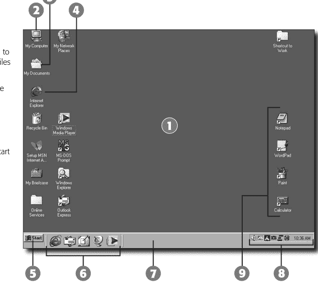

- 1. 桌面。
- 2. 我的电脑，访问你的磁盘驱动器和文件（第 6 章）。
- 3. 我的文档，存储你的创作成果的地方（第 6 章）。
- 4. 上网（第 7 章）。
- 5. 开始按钮，用于启动程序和其他项目（第 2 章）。
- 6. 快速启动栏。
- 7. 任务栏，用于切换程序。
- 8. 系统托盘。
- 9. 桌面上的快捷方式图标。

### 视觉主题参考 B

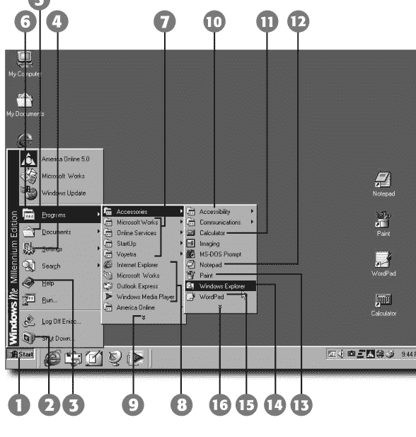

- 1. 开始菜单（第 2 章）。
- 2. 退出 Windows（第 1 章）。
- 3. 获取帮助（第 8 章）。
- 4. 更改或微调 Windows。
- 5. 打开最近的文档（第 2 章）。
- 6. 主程序菜单（第 2 章）。
- 7. 子菜单。
- 8. 要运行的程序。
- 9. 显示更多；点击以显示较少使用的菜单项。
- 10. 子子菜单。
- 11. 计算器（第 2 章）。
- 12. 记事本。
- 13. 画图（第 5 章）。
- 14. Windows 资源管理器（第 6 章）。
- 15. 写字板（第 3 章）。
- 16. 更多的“显示更多”按钮。

# Windows 开关机

### 已解答的问题与启发思考

- 启动计算机的不同方式
- 桌面的重要组成部分
- 如何以及何时关闭计算机

在计算机上所有你能想象到的按钮中，只有一个能控制开关。哦，要是真那么简单就好了。事实上，开启计算机，以及知道何时以及如何将其关闭，是一件大事。这就是本书第一章要涵盖的内容。

#### 女士们先生们，启动你们的计算机

虽然你的计算机很友好，但不要试图用情诗或鲜花去诱惑它。要真正地启动它，你必须为其提供电力。

你可以通过三种方式开启计算机及其所有外设。选择哪种方式取决于你是否拥有电源插排、不间断电源 (UPS)，或者两者都没有。


#### “我没有任何电源插线板之类的东西——我的所有设备都直接插在墙上”

当所有设备都直接插在墙上时，请遵循以下步骤来开启电脑：

- 除电脑主机外的所有设备全部开启。
- 开启电脑主机。

务必最后开启电脑主机（控制台）。这样，它才能识别出所有插入其中的外设。

- 大多数电脑设备都有一个按钮式的开关。它被标记为页边栏所示的“直线和圆圈”符号。
- 某些电脑上的开关则被标记为一个新月符号。

#### “我很聪明，所以我买了一个电源插线板”

我几乎可以肯定，你的电脑房里没有足够的墙壁插座来连接电脑系统的各个部件。为了方便起见，请买一个电源插线板。

- 将所有设备都插入电源插线板。

电源插线板有多个插孔，你可以将电脑系统的各个部件插入其中。将插线板插入墙壁插座，你就准备就绪了。

- 通过开启电源插线板来启动电脑。

我知道我在（前一节）中说过要最后开启电脑主机；然而，一次性全部开启效果同样好。

- 尽量选择具有线路过滤或噪声抑制功能的电源插线板。如果插线板还提供尖峰或浪涌保护，那就更好了。这项功能可确保流入电脑的电能纯净，并防止电力损坏电脑的任何电子元件。

> **提示**
>
> 我推荐 Kensington SmartSockets 电源插线板。其插孔的布局方式使得大多数电脑插头末端的大块变压器不会互相干扰。此外，插孔采用了颜色编码并配有相应的颜色贴纸，因此你可以轻松识别哪个插头插在哪个孔里。

#### “我花了大钱，买了一个 UPS”

本书中的缩写 UPS 代表“不间断电源（uninterruptible power supply）”，而不是那家快递公司的名字。UPS 是一种特殊的电源插线板，即使在停电时也能继续为你的电脑供电。如果你有一个 UPS（我建议你买一个），请执行以下操作：

- 将显示器和电脑主机插入 UPS。
- 将其他所有设备插入普通电源插线板。

你不需要将所有设备都插入 UPS。你的主要目标是在停电期间保持显示器和控制台（电脑主机）运行。其他所有设备——尤其是打印机——可以等到电来后再处理。

使用 UPS 开启电脑的操作步骤如下：

- 开启电源插线板。
- 开启显示器和电脑主机。

同样地，你要最后开启电脑，以便它能“看到”所有连接到它的设备。

无需开启 UPS 的开关；请让它一直处于开启状态，以确保其内部电池始终充满电。

如果你有 UPS 且突然停电，请立即保存你的工作！然后按照本章末尾的说明关闭 Windows。不要尝试继续工作，因为 UPS 电池最终会耗尽——而且它的耗电速度通常比制造商声称的快得多。

> 如果你的 UPS 有额外的插孔，你也可以插入外部调制解调器，这样如果你在上网时发生停电，也不会被断开连接。

> 不要将激光打印机插入 UPS。激光打印机的功耗太高，不值得这么做。此外，你总是可以在电来之后再打印。

- 大多数电脑和办公用品店都销售 UPS。如果没有，你可以通过许多互联网电脑经销商订购，例如 www.warehouse.com 和 www.zones.com。
- 一个典型的 UPS 有两个插孔：一个用于显示器，另一个用于电脑主机。
- 如果你花更多钱买 UPS，你会得到更多插孔。但请注意，某些插孔可能没有电池备份。例如，有些可能仅是浪涌抑制插孔。

#### 表 1.1 到底要不要用 UPS，这里有一些建议

| 插入 UPS | 原因 | 不要插入 UPS | 原因 |
| :--- | :--- | :--- | :--- |
| 电脑主机 | 保持整体运行；首要任务 | 激光打印机 | 功耗太高；打印可以稍后 |
| 显示器 | 让你看到发生了什么 | 其他打印机 | 打印可以稍后 |
| 外部调制解调器 | 在短暂掉电期间保持在线 | 扫描仪 | 扫描可以稍后 |
| 外部驱动器 | 允许在关闭前访问驱动器以保存数据 | 扬声器 | 没必要在停电时听到电脑的“惨叫” |
| | | 第二台显示器 | 只要主显示器就能完成关闭操作 |
| 电话线 | 防止电涌通过电话线进入电脑 | | |

#### 启动序列，或“来自彼岸的信息”

当你的电脑启动时，屏幕上会弹出的一系列信息。首先，你会看到一些文本消息，然后听到一声嘀响，接着 Windows 就会闪现其图形化的辉煌。

- 坐好，观察即可。

当 Windows 完成加载后，你会看到桌面，或者被要求登录。

- 如果你看到关于“非系统磁盘”或其他莫名其妙的消息，这意味着你在 PC 的 A 驱动器中留了一张软盘。取出磁盘，按下 Enter 键，然后继续盯着你的 PC。
- 启动过程中可能会出现其他消息。如果你对此感到担忧，请参阅第 48 章“烦心事”，了解有关启动故障排除程序的详细信息。

#### 登录，神秘客

有时，当 Windows 启动时，它需要知道你是谁。Windows 会要求你输入用户名和密码，这些信息可能是在你第一次使用 Windows 时设置的。

你可以在登录对话框中登录（或者 log on——我不知道这两者有什么区别），如图 1.1 所示。

- **如果你看到登录对话框，请输入你的密码。**
- **点击 OK 开始使用 Windows。**

**图 1.1**
登录对话框。

1. 你是谁。
2. 在此处输入你的密码。
3. 开始使用 Windows。
4. 开始使用 Windows。

- 如果你没看到登录框，你就不需要登录！
- 如果你在联网电脑上输入了错误的密码，Windows 会显示一个次级登录对话框。如果你再次输入错误的密码，直接放弃输入密码并点击 Cancel 按钮开始使用 Windows 即可。安全性就这样了。（如果你在乎安全性，微软希望你使用 Windows 2000。）

> 有一种方法可以让你永远不必登录 Windows Millennium。如果你宁愿跳过登录，可以永久禁用登录对话框。访问 `www.wambooli.com/help/Windows/logon/` 查看详情。

#### 桌面

图 1.2 显示了 Windows 的主屏幕，即 *桌面*。为了方便你观看，几个重要的功能点已标记出来。

*桌面* 被认为是使用 Windows 的主层级。几乎所有你在电脑上能看到或能做的操作都可以从桌面进入。

**图 1.2**
桌面。

1. 壁纸（或背景图案）。
2. 图标。
3. 我的电脑。
4. 回收站。
5. 我的文档文件夹。
6. 一个文件夹。
7. 开始按钮。
8. 任务栏。
9. 任务栏上的按钮。
10. 快速启动栏。
11. 系统托盘。
12. 鼠标指针。

桌面上的其他项将在本书的不同位置进行讨论。使用索引或目录来寻找你好奇的内容。

在 Windows 中，有很多值得好奇的地方。

> **重要观点**
>
> 请务必找到那个我称之为 *开始按钮* 的按钮。它是执行 Windows 中几乎所有操作的关键。
>
> 开始按钮位于 *任务栏* 上，这也是另一个重要的玩意儿。

#### 退出 Windows

你没有真正的办法直接“退出” Windows。因为 Windows 是你电脑的操作系统，退出 Windows 就等同于关闭电脑。根据你在使用电脑后打算做什么，你可以通过几种不同的方式来实现。

> 绝对不要直接关闭 PC 电源！


## 第 1 章 Windows 的开启与关闭

> **重要提示**
> 请务必始终遵循正确的步骤来退出程序、退出 Windows 以及关闭计算机。

您可以通过多种方式关闭 Windows，而所有这些方法都集中在一个地方——“关闭 Windows”对话框中，如图 1.3 所示。

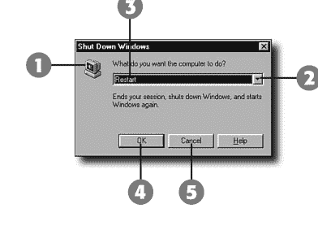
**图 1.3 关闭 Windows 对话框。**

- 1. 啊嚏！
- 2. 选择一个关闭选项。
- 3. 显示“重启”选项。
- 4. 开始执行。
- 5. 返回 Windows。

接下来的章节将为您详细介绍“关闭 Windows”对话框中的各项选项，例如如何使用以及何时使用。

#### 让您的 PC 休眠 (待机)

大多数 PC 都具有“休眠”能力。也就是说，它们可以进入一种特殊的低功耗模式，从技术上讲，它们仍然处于开启状态，尽管计算机的所有电子元件都在，嗯，睡觉。休眠与关闭计算机不同，因为虽然它看起来像关闭了，但实际上它仍然处于开启状态。

作为让计算机休眠的替代方案，可以考虑关闭显示器，或者仅将显示器设为休眠模式，而不是让整个计算机休眠。这在第 41 章“微调您的显示器”中有所涵盖。

> **注意！**
> 我从不建议选择“待机”选项。我收到过太多读者的电子邮件，他们让 PC 休眠，结果发现休眠变成了“昏迷”。重新获得 PC 控制权的唯一方法是将其关闭并重新开启。因此，我认为您最好永远不要使用休眠或待机模式。

- 如果您的计算机在进入休眠或唤醒时似乎没有问题，那么没问题！请在“关闭 Windows”对话框中使用该选项。但如果它突然无法正常工作，或者该选项消失了，请记住我已经警告过您。
- 一个能明显表明您的 PC 可以休眠的标志是计算机机箱上的“月亮”按钮。按下该键也可以让计算机休眠——并在系统休眠后将其唤醒。
- 要将计算机从休眠中唤醒，请晃动鼠标或按下键盘上的 Enter 键。如果这不起作用，说明计算机处于“昏迷”状态，您必须将其关闭，等待约 10 秒，然后重新开启以重新获得控制权。
- 如果计算机在休眠模式下电源开关似乎失效，请将计算机的电源插头从墙上（或 UPS，如果适用）拔掉。这确实是一个绝望的举措，但在休眠模式出故障时通常是必要的。

#### 重新开始 (重置，或“热启动”)

Windows 需要重启的次数可能比您想象的要频繁。在添加程序或安装帮助 Windows 与硬件协作的新软件之后，或者当您的计算机开始运行异常且（坦白说）您没有其他办法让它恢复正常时，您必须重启它。

要重启或重置您的计算机，请执行以下步骤：

- 弹出“开始”菜单。
- 选择“关闭”命令。

出现“关闭 Windows”对话框（参考图 1.3）。

- 从下拉列表中选择“重启”项。
- 点击“确定”。

Windows 将关闭并退出打开的程序和窗口。

如果您有任何未保存的文档处于打开状态，Windows 会要求您保存它们。

如果您运行了任何 DOS 程序或游戏，Windows 会停止操作并要求您正确关闭它们。然后您必须重新重复上述所有步骤。

在关闭所有内容后，Windows 会重新启动您的计算机，就像您第一次将其开启一样。

- 在安装新硬件或软件时，通常需要进行重置。计算机会提示您重置，或者它会自动执行。
- 重置也被称为“热启动”。

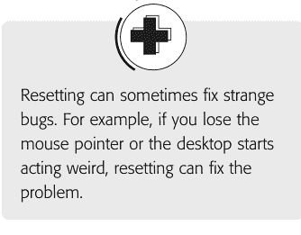

将计算机关闭，等待，然后再次开启被称为 *冷启动*。为了修复某些问题，您可能需要这样做而不是选择重置。

#### 关闭计算机

要关闭您的计算机，请执行以下步骤：

- 调出“开始”菜单。
- 选择“关闭”命令。

出现“关闭 Windows”对话框。

- 从下拉列表中选择“关闭”项。
- 点击“确定”。

与重置一样，Windows 会要求您保存任何未保存的文档；如果您打开了 DOS 程序，关闭操作将停止，并要求您退出 DOS 程序。

最终，您将看到屏幕上显示 *现在可以安全地关闭计算机*。所以……把计算机关掉吧！或者在某些情况下，您可能看不到消息，计算机会自动关闭。嗯，这对计算机来说太棒了！


> 永远不要通过按下计算机机箱上的 Reset 按钮来重置您的计算机。请始终先尝试使用“关闭 Windows”命令。只有在您无法移动鼠标且情况看似绝望时，才应考虑按下计算机的 Reset 按钮。否则，您可能会丢失信息或损坏重要文件。


> 亲爱的 Dan：我的计算机无法正常关闭。它停在 Windows 的拜拜界面，显示正在关闭，但就是没关掉。可能出什么问题了？！
>
> Dan 说：原因有很多。有时计算机只是“挂起”了，所以您需要按下 Reset 按钮，或者将计算机关闭，等待，然后再次开启以重新获得控制权。这就是 Reset 按钮存在的原因，但在诉诸该按钮之前，请确保给计算机一点等待时间。此外，如果您必须关闭计算机，请在重新开启前等待片刻。

请注意，当您在不正常关闭后重启计算机时，Windows 将运行 ScanDisk 程序。这完全正常且是一件好事。不要把它当成一种惩罚！

#### 关闭您的计算机。

切断电源。关闭您所有的计算机外设。

如果您使用了电源插排，请将其关闭，以便一次性关闭所有设备。

如果您有 UPS，您可以只关闭显示器和计算机机箱。建议保持 UPS 开启，以免其电池放电。

#### 您完成了。

现在离开电脑吧。去做一些体力活动。享受美好的天气。呼吸新鲜空气。抬头看看美丽的天空。

- 只有当您看到 *现在可以安全地关闭计算机* 的消息时，才应关闭您的 PC。
- 某些计算机可能会自动关闭。对于这些计算机，您永远看不到 *现在可以安全地关闭计算机* 的消息，因为计算机已经关闭了。这没关系。

> **重要提示**
> 请耐心等待。有时 Windows 关闭需要一段时间，比如两三分钟。

## 运行您的程序

### 问题解答与灵感启迪

- 无痛地启动程序
- 操作窗口
- 退出您的程序
- 使用便捷的方法获取最近保存的内容

Windows 不是您使用计算机的原因。真的，谁会为了 Windows 而用电脑？不，您购买计算机是为了执行某些任务，为此您还购买了相关程序。当计算机开启时，您真正想使用的是这些程序。本章将向您展示如何实现这一点。

#### 启动任何程序

您运行的大多数程序都在“开始”主菜单的“程序”菜单中。从该菜单中挑选一个程序，就是您在 Windows 中启动几乎任何程序的方式。

▶ 点击“开始”按钮以调出“开始”菜单。

图 2.1 向您展示了哪些是重要的，哪些是不重要的。

**图 2.1 “开始”菜单。**

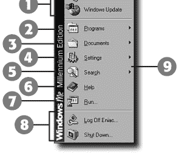

- 1. 程序有时会出现在这里。
- 2. 查看程序的子菜单。
- 3. 最近打开的文档。
- 4. 更改设置之类的内容。
- 5. 查找文件、程序或丢失的键值。
- 6. 获取帮助（有时）。
- 7. 一种无聊的运行程序方式。
- 8. 退出选项。
- 9. 这里可能会出现更多项目；见第 38 章。

▶ 选择“程序”。

将鼠标指向菜单顶部的“程序”。您不需要点击鼠标——只需指向即可。一个子菜单会出现！图 2.2 展示了子菜单的情况。

**图 2.2 子菜单。**

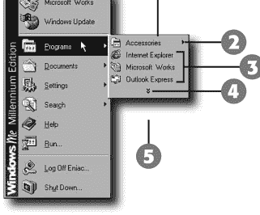

- 1. “程序”子菜单。
- 2. 子子菜单。
- 3. 程序。
- 4. “显示更多”箭头。
- 5. 额外的“隐藏”项目。


## 第 2 章 运行程序

#### 寻找你的程序

子菜单中有两种类型的内容。第一项是额外的子菜单（如果有的话，见图 2.2）。第二项是程序本身。如果你想运行的程序就在“程序”子菜单中，点击该程序的名称即可启动。

如果你没有立即看到你的程序，有两种选择。首先，你可以点击菜单底部的“显示更多”箭头。这将显示不常用的其他程序和子菜单（这是 Windows 的“个性化”功能之一）。

图 2.3 显示了“程序”菜单中的其他程序和子菜单。较少使用的项目显示为较浅的灰色。这除了表示这些项目不经常被使用之外没有任何其他含义；你可以像选择任何其他程序或子菜单一样选择它。

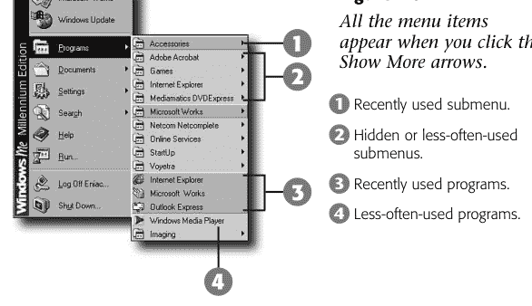
**图 2.3**
点击“显示更多”箭头时，所有菜单项都会出现。

- 1. 最近使用的子菜单。
- 2. 隐藏或较少使用的子菜单。
- 3. 最近使用的程序。
- 4. 较少使用的程序。

如果你仍然没有看到你的程序，你就得在子菜单中仔细搜寻觅。幸运的是，大多数子菜单的命名都具有描述性。

当你选择一个程序运行后，“开始”菜单及其子菜单就会消失，就像餐厅的服务员在接过你的订单后一样。最终，你的程序将以自己的窗口形式出现在桌面上。

- 大多数你喜爱的程序应该在主“程序”菜单中。如果没有，你可以通过编辑“开始”菜单将它们移动到那里。第 10 章《开始菜单颂》会告诉你如何操作。
- 如果你不喜欢隐藏的程序、子菜单或“显示更多”按钮，你可以告诉 Windows 始终显示所有内容（就像 Windows 95/98 那样）。这在第 38 章中也有解释。
- 如果你在菜单中停留较长时间，隐藏的菜单项会自动显示。
- 如果你没有立即看到你的程序，请在其中一个子菜单中寻找。
- 按 `Esc` 键返回到前一个子菜单。

> “我要 4 号餐，配隐藏的炒面。”

#### 浏览子菜单以寻找计算器程序

假设你想启动计算器程序。你今天早上买了一些股票，它上涨了 7/16 点！你坐在那里看着 CNBC 赚了多少钱？利用电脑的力量，用这个重要的财务数据让你的朋友们印象深刻吧！

- 弹出“开始”菜单。
- 选择“程序”。
- 选择“附件”。

“附件”子菜单出现，显示出更多的子菜单和程序。其中一个是计算器——但如果你没看到它（相信我，它就在那里），点击“显示更多”箭头，你就会看到它。

- 选择“计算器”。

用鼠标点击“计算器”。计算器程序启动并显示在屏幕上，如图 2.4 所示。

**提示**
小心使用鼠标！那些子菜单很“滑”；任何细微的鼠标移动都会导致它们快速地闪现或消失。


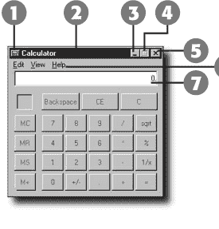
**图 2.4**
计算器。

- 1 控制菜单。
- 2 标题栏。
- 3 最小化按钮。
- 4 最大化按钮。
- 5 关闭按钮。
- 6 菜单栏。
- 7 计算器窗口。

现在假设你今天早上买了 125 股股票。它上涨了 7/16，所以第一步是算出 7/16 到底意味着什么。

**输入 7。**
使用鼠标点击数字 7 按钮。

**点击 /。**
`/` 是除法符号（你的键盘上没有 $\div$ 符号）。

**输入 16。**
使用鼠标点击数字 1 按钮，然后点击数字 6 按钮。

**点击 =。**
计算器报告 7/16 等于 .4375，但因为你有 125 股，所以你必须将 .4375 乘以 125 才能算出你赚了多少钱。（不必担心理解这些胡言乱语；只要心领神会地点点头然后继续即可。）

**点击 *。**
`*` 是乘法符号。在计算机键盘上，X 代表字母 X，而不是乘法符号。

> **提示**
> 如果你屏幕上的计算器看起来与图中的不同，请从菜单中选择“查看” $\rightarrow$ “标准”。

> **打哈欠（琐碎知识）**
> 要想知道股票价值多少钱，你需要知道它的*收盘价*，这会在第二天的报纸上公布，或者你可以在 Internet 的 Yahoo! 或其他各种网站上找到。将收盘价乘以你拥有的股份数量，即可计算出你的股票价值。

- **输入** `125`。
这是针对 125 股股票的。如果 125 股股票价格上涨了 7/16（即 1 美元的 7/16），你赚了多少钱？

- **点击** `=`。
计算器显示结果为 54.6875，这意味着这只股票今天让你赚了将近 55 美元。看到了吗？在股市赚钱很简单！

在本章接下来的部分中，请将计算器保留在屏幕上。

- 你也可以通过键盘输入数字到计算器中。

#### 程序窗口中什么重要，什么不重要

图 2.5 描述了任何 Windows 程序的组成部分。所有程序都出现在类似的窗口中，这意味着一旦你弄清楚一个窗口如何工作，你就可以操作所有窗口。

- *标题栏*——使用标题栏将窗口拖动到桌面上的新位置。
- *关闭按钮*——点击此按钮关闭窗口。
- *菜单栏*——程序的命令列在此处。点击菜单标题以显示命令。
- *窗口内容*——程序的主体。在文字处理软件中，那是你打字的地方。在图形程序中，那是你绘图的地方。


- **移动计算器窗口。**
记得将鼠标指向计算器窗口的标题栏，然后将窗口拖动到屏幕上的另一个位置。窗口会像一只想家的幼犬一样跟随鼠标移动。松开鼠标，将窗口保留在新位置。

在 Windows 中，你可以同时打开很多窗口。通常你会移动一个窗口来查看它下面的内容。

#### 窗口操作练习教程

你无法用计算器程序做太多事情；它的窗口大小是固定的，内容仅仅是按钮。一个更典型的程序是记事本，那是 Windows 中一个极小的文本编辑器。

按照以下步骤启动记事本：

- 弹出“开始”菜单。
- 选择“程序” $\rightarrow$ “附件” $\rightarrow$ “记事本”。

（同样，如果你在“附件”菜单中没有找到记事本，点击“显示更多”箭头，它就在那里。）

记事本窗口出现在屏幕上，如图 2.5 所示。你输入的任何文本都会出现在插入光标闪烁的地方。

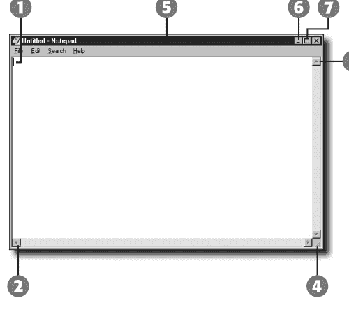

- 1. 插入光标。
- 2. 水平滚动条。
- 3. 垂直滚动条。
- 4. 在此处拖动以调整窗口大小。
- 5. 在此处拖动以移动窗口。
- 6. 最小化按钮。
- 7. 最大化（及还原）按钮。

- 输入 `Today was a boon day on the market. I made $` (**以美元符号结束，不要加句号**)。

使用键盘输入文本 **Today was a boon day on the market. I made $.** 句子末尾不要输入句号。只输入 $，我一会儿会向你展示一个完成这个句子的巧妙方法。

现在你需要将记事本窗口调整为一个极小的方框。

- 将鼠标指向窗口的右下角。
- 向左上方拖动。

完成后，窗口的大小应与图 2.6 所示大致相同。如果有更多文本，滚动条将可用，允许你向上、下或向左、右滚动以查看更多文本。

**图 2.6**
调整窗口大小。

- 1. 从这里开始拖动到...
- 2. ...这里。
- 3. “无标题”意味着文件尚未保存。

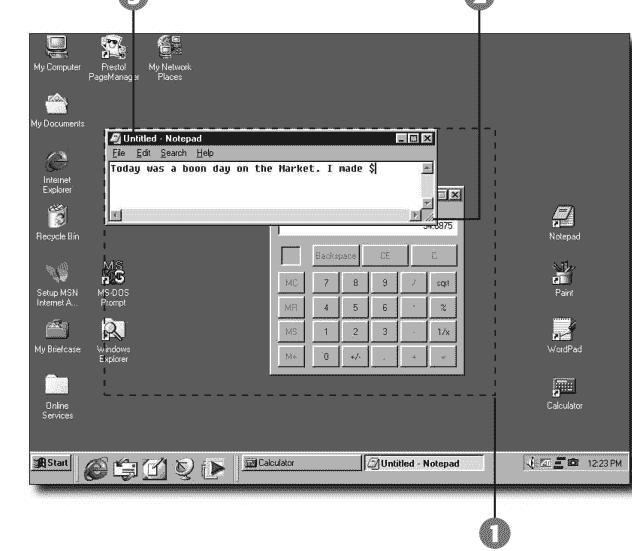

- **点击最大化按钮。**
这一步使窗口充满整个屏幕。你应该以最大化状态运行大多数应用程序，因为这样可以给你更多空间来查看你的操作。

- **点击还原按钮。**
窗口恢复到之前的尺寸和位置。

现在你要最小化窗口。

- **点击最小化按钮。**
这会将窗口缩小为任务栏上的一个按钮。记事本现在被收了起来，不再可见。你并没有退出它。程序仍然在“运行”，你的文本仍然完整。你将在接下来的几个步骤中再次访问该程序。


## 第 2 章 运行你的程序

在你完成程序之前，你并不真的需要退出它。

在将记事本移开后，你现在应该能看到计算器。

- 从计算器的菜单中选择 **编辑 (Edit)**。
- 用鼠标点击 **复制 (Copy)** 字样。

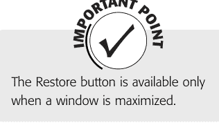

存储在计算器中的数值 (54.6875) 被复制到了 Windows 剪贴板中。（剪贴板是内存中一个存储信息的特殊区域。从剪贴板开始，信息可以被 *粘贴* 到另一个程序或回贴到同一个程序中。）

是的，这就是基础的复制和粘贴。

你可以将剪贴板中复制的数值粘贴到记事本中。

- 通过点击任务栏上的按钮恢复 **记事本 (Notepad)**。

记事本窗口恢复其在屏幕上的大小和位置。

- 从菜单中选择 **编辑 (Edit)** $\rightarrow$ **粘贴 (Paste)**。

这一步将粘贴进你刚刚从计算器中复制的数值 54.6875。

- 按三次 **退格键 (Backspace)**。

你正在删除数字中的 875 部分，这部分对大多数美国人来说在文化上令人困惑。

- 输入 *9! I am a financial genius!*（9！我是个金融天才！）。
- 按 **回车键 (Enter)**。

这样就完成了你的简短笔记。

虽然你无法看到所有输入的内容，但你可以用鼠标拖动底部的（水平）滚动条来查看所有文本。

- 将底部滚动条向左向右拖动。

一个更好的解决方法是这样做：

- 选择 **编辑 (Edit)** $\rightarrow$ **自动换行 (Word Wrap)**。

自动换行会重新调整所有文本的大小，以匹配记事本窗口的宽度。现在一切都整洁了。

是时候保存你的工作了，这样你以后就有备份可以欣赏。

- 选择 **文件 (File)** $\rightarrow$ **另存为 (Save As)**。

“另存为”对话框出现。文件名输入框中的文本被高亮显示。它显示为 *无标题 (Untitled)*，所以你需要给你的文档起另一个名字。

- 在文件名框中输入 **Today's Profit**（今日利润）。
- 按 **回车键 (Enter)**。

这一步将你的文本保存到磁盘并结束本教程。

- 文件保存后，你会看到它的名称 Today's Profit 出现在窗口的标题栏上。
- 关于“另存为”对话框的更多信息将在第 3 章“保存你的东西”中给出。
- 有关剪贴板的更多信息，请参阅第 13 章“通过剪切和粘贴共享”。
- 保存到磁盘的文件以后可以被打开进行编辑、打印或执行任何操作。

#### 退出程序

关闭 Windows 程序的方法不止一种……

实际上，有两种常用方法：关闭按钮和“文件 $\rightarrow$ 退出”命令。

退出任何程序最一致的方法是点击关闭按钮——那个位于几乎每个窗口右上角的小 X。这个方法每次都有效。

现在按照以下步骤关闭计算器窗口：

- 切换到计算器窗口。

如果你能在桌面上看到该窗口，请用鼠标点击该窗口。如果它还没有在前台，这个操作会将其带到最前面并准备好进行操作。

如果你看不到计算器窗口，请点击任务栏上的计算器按钮。

> **重要一点**
> 当你想让程序暂时移开但不想退出时，请使用最小化按钮。你可以使用任务栏在同一时间使用的任意数量的程序之间进行切换。

点击关闭按钮。

砰！窗口消失了。

现在按照以下步骤关闭记事本：

- 切换到记事本窗口。
- 选择 **文件 (File)** $\rightarrow$ **退出 (Exit)**。

“文件 $\rightarrow$ 退出”命令可以关闭大多数主要应用程序。（不过，它不能关闭所有程序；例如计算器程序没有“文件”菜单。）

如果你在前一个章节中没有保存你的工作，会出现一个警告对话框，提示你保存。否则，记事本窗口将从屏幕上消失。你完成了。

#### 使用文档菜单

假设在完成本章教程后，你意识到想在 Today’s Profit 文件中再添加一行。像所有最近创建或修改的文件一样，该文件会出现在“文档”菜单中。以下是快速返回该文件的方法：

- 从“开始”按钮中，选择 **文档 (Documents)** $\rightarrow$ **Today’s Profit**。

（在菜单中它可能会显示为 Today’s Profit.txt。这是同一个文件。）

记事本程序再次启动，这次加载了 Today’s Profit 文件并准备好进行编辑。

- 处理你的文档。
- 或者，如果你没有要添加的内容，请执行下一步。
- 关闭记事本。

现在你真的完成了。

- “文档”菜单保存了你打开的最后 15 个文件。
- 某些程序不会将其文件放在“文档”菜单中。当发生这种情况，或者无论何时你在菜单中找不到文档时，你必须从“开始”菜单启动程序，然后用传统的方式打开文档，这将在第 4 章“打开文档”中介绍。

> **提示**
> 你可以使用“文档”菜单立即访问你最近处理的任何文件。如果你正沉浸在某个庞大的项目中，这种技巧是开启 Windows 之日的一种绝佳方式。

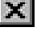


## 保存你的东西

### 已解答的问题与启发思考

- 基础文件保存
- 使用“另存为”对话框
- 使用不同的名称保存
- 将文件保存为不同类型
- 为你的东西创建新文件夹

在使用 Windows 时，你会经常看到一些对话框。不，我说的不是错误消息。这些常见的对话框与你在任何程序中执行的常用操作相关：打开文档、打印、保存你的东西等等。其中最重要的是“另存为”对话框，你应该经常使用它来保存你的东西。本章将介绍其基本操作。

#### 你好，保存对话框

永远要保存你的东西。当然，除了那些愚蠢的东西，你不需要保存。然而，考虑到创造愚蠢东西的时间越来越少，你可能会用电脑创建有用的文档之类的东西。而且你想保留它们。为此，你需要保存。

- 在计算机中，保存是创作过程的核心部分。
- 你将文档作为文件保存到磁盘上。这样，你以后就可以访问该文档进行审阅、编辑或执行任何操作。
- 你使用 **文件 (File)** $\rightarrow$ **保存 (Save)** 命令来保存你的东西。
- **Ctrl+S** 组合键通常也能保存东西。
- 许多程序都有一个 **保存 (Save)** 按钮，你可以点击它来保存你的东西。

#### 保存教程

写作是大多数人用电脑做的主要事情。在 Windows 中，你可能会使用功能强大的文字处理器，比如 Microsoft Word 或 WordPerfect。Windows 自带了一个轻量级的文字处理器，名为 WordPad。

- **打开 WordPad。**

从“开始”菜单中，选择 **程序 (Programs)** $\rightarrow$ **附件 (Accessories)** $\rightarrow$ **WordPad**。（你可能需要点击“显示更多”按钮才能看到 WordPad；请参阅第 2 章“运行你的程序”。）WordPad 窗口出现在屏幕上，如图 3.1 所示。

> 永远要保存你的东西。大多数人只有在认为某样东西值得保存时才保存。错了！每隔几分钟左右就保存一次；你永远不知道电脑什么时候会突然死机，或者小杰西什么时候会绊到电源插排。

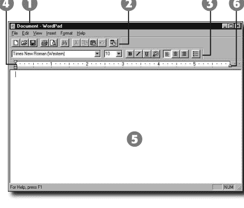
**图 3.1** WordPad。

1. “Document”表示还没有任何内容被保存。
2. 工具栏，包含新建、打开、保存、打印和其他命令的按钮。
3. 格式栏（格式化命令）。
4. 标尺。
5. 文档窗口。
6. 调整窗口大小，以便你在标尺上看到右边距。

- **输入一些散文。**

除非你有值得保存的东西，否则尝试“保存”命令是没有意义的。如果你没灵感，可以输入这段文字：

> It's not as tough as it was in the early days. Back then, just getting from point A to point B involved lots of planning, provisions, supplies and a huge effort for all involved. But now, thanks to teleportation, taking a trip is as easy as plunking a coin into a vending machine. This is a wonderful scientific advancement—a boon to mankind. Alas, it opened the door for many a prank. Beaming someone into or out of a shower is illegal in several states. And you need a zoo license to beam large animals anywhere. Still, it's surprising there are no laws against beaming hornet's nests. Give it time.

你不需要输入全部内容——你可以输入你自己编的内容。只要确保在文档窗口中输入了内容即可。

- **选择 文件 (File) $\rightarrow$ 另存为 (Save As)。**

“另存为”对话框出现。

Windows 使用几种微妙不同的“另存为”对话框。它们都具有相同的基本功能，但有些比其他的更华丽。你可以参考图 3.2 来帮助理清思路；WordPad 使用的是第一个。

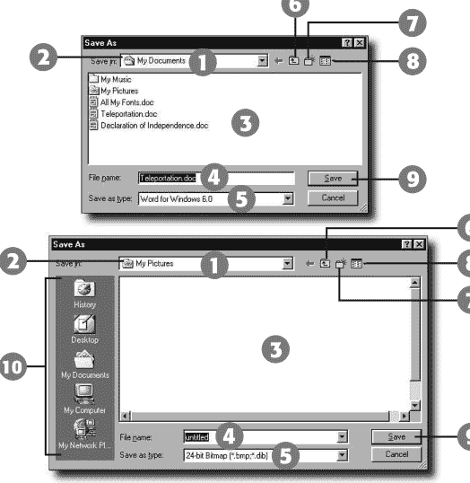
**图 3.2** “另存为”对话框的变体。

- 1 在此处选择另一个文件夹或磁盘驱动器。
- 2 你正在保存此文档的文件夹。
- 3 当前文件夹的内容。
- 4 你的文件名。
- 5 你正在保存的文件类型。
- 6 “向上”移动一级目录。
- 7 创建新文件夹。
- 8 设置图标的查看方式。
- 9 点击以保存。
- 10 热门文件保存位置。


你在“另存为”对话框（无论出现哪一个）中的职责是为你的文档指定一个名称以及在磁盘上的存储位置。

##### ▶ 为你的文档找一个文件夹。

“另存为”对话框向你展示的是“我的文档”文件夹，除非另有指示，否则 WordPad 倾向于将文档保存在这里。对于本教程来说这样就足够了。对于其他项目，你无疑希望将你的东西保存在其他地方，即一个特定的文件夹中。

如果在“保存到”下拉列表中看到了其他文件夹，请改为从列表中选择“我的文档”。

文件夹有助于你保持条理。

##### ▶ 在“文件名”输入框中找到 Document。

在“文件名”输入框中，输入文件的名称。现在显示的是 Document。这是 WordPad 给所有未保存文档的默认名称。（记事本和画图程序则使用 Untitled。）

你需要给你的文档起一个专属名称——希望是一个比 Document 更聪明、更具描述性的名称。

##### ▶ 在“文件名”框中输入 Teleportation。

Document 这个名称被高亮显示了，所以你的文本将替换它。

如果 Document 没有被高亮显示，请按 Alt+N。该快捷键会将 Windows 的焦点集中在“文件名”输入框中。

如果你输入错误，请按 Backspace 键回退并擦除。

##### ▶ 用鼠标点击“保存”按钮。

或者你也可以直接按 Enter 键。这一步将文档保存到磁盘。

##### ▶ 注意标题栏上的文件名。

这就是文件已保存的线索。

在本书本章剩余的教程中，请保持 WordPad 和此文档处于打开状态。

- 保存文档后，你可以继续工作并保存、打印、打开或创建另一个文档，或者退出程序。
- 在工作过程中请继续保存你的文档。接下来的章节将告诉你如何操作。

较旧的 Windows 程序可能会使用类似的“另存为”对话框，但缺少左侧的“保存到”功能列。如果你遇到这种“古董”，请不要惊慌。

#### 文件名的好、坏与丑

Windows 允许你几乎随意命名文件。你可以使用数字、字母、空格和少量的符号，创意性地为你的文档（或图形图像或任何其他内容）赋予一个合适的名称。即便如此，最好的文件名应该是简短且具有描述性的。

以下是一些良好的文件名：

- Report 5-99
- Cancellation notice
- Umberto's - restaurant review (yuck)
- More useless charts for the meeting
- Personal

文件名可以使用大写或小写字母，可以以数字或字母开头，长度可达 255 个字符（尽管越短越好）。

你几乎可以使用键盘上的任何符号作为文件名，但不能使用以下字符：
`" > * ? / : \ | <`

如果你尝试使用这些字符之一，Windows 将不允许你保存文件；你要么会看到一条告诉你出错原因的错误消息，要么 Windows 就会变得固执，在不告诉你错在哪里的情况下直接不保存文件。

#### 再次保存，萨姆

习惯于反复保存文档。我大约每 10 分钟保存一次。这样一来，如果发生任何意外，我在磁盘上都有一份最近的工作副本。再次保存很简单；Windows 为你在工作过程中保存内容提供了几种可选方案：

- **选择 文件 $\rightarrow$ 保存 以再次保存你的文档。**
- 或者 **按下 Ctrl+S 组合键。**
- 或者 **点击工具栏上的保存按钮。**

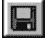

#### 时刻保存！保存！保存！保存！

▶ **回到你的 WordPad 文档。**

当你继续前一节的教程时，你会发现 Teleportation 文档需要一个新段落。这次你不需要写任何东西；你只需要将现有的段落分成两部分。

▶ **将插入光标置于第三句的开头。**

在 *machine* 这个词和句号之后点击鼠标。光标应该在第四句之前的空格开头闪烁。

▶ **按下 Delete 键。**

此操作将删除两句话之间的空格。

▶ **按下 Enter 键。**

此操作将创建一个新段落，以“This is a wonderful....”开头。

▶ **按下 Ctrl+S 保存。**

文档中的更改已保存到磁盘。

- 再次保存时无需重新命名文档；Windows 会将更改保存到已在磁盘上的文档中。
- 如果你还没有保存文档，则会出现“另存为”对话框。但因为你已经给文档起了名字，所以不需要使用“另存为”命令。

#### 以新名称保存同一个文件

有些人习惯反复使用同一个名称来保存文档。而另一些人则觉得有必要将文档保存为多个草稿。例如，他们可能会将第一次尝试保存为 First Draft 或 DOC01；第二次草稿保存为 Second Draft 或 DOC02，以此类推。这样做很简单：

▶ **选择 文件 $\rightarrow$ 另存为。**

出现“另存为”对话框，允许你用新名称将任何文档重新保存到磁盘。图 3.3 显示了“另存为”对话框应有的样子。

## 第 3 章 保存你的内容

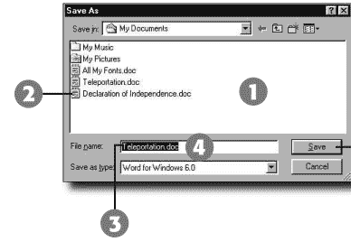

**图 3.3**
以新名称保存文档。

- 1. 这里列出了其他 WordPad 文档。
- 2. 这里是已经保存在磁盘上的文件。
- 3. 在此处输入新名称。
- 4. 高亮显示的文本可以编辑。
- 5. 点击此处以新名称保存。

如果你正在跟随 WordPad 教程，你会在“另存为”对话框中看到文件的当前名称 Teleportation。

▶ **输入一个新的文件名。**

使用名称 Beam Me Up。

▶ **点击 保存。**

文档以新名称保存到磁盘。

现在磁盘上有两个文档：第一个是原始草稿 Teleportation，第二个是副本或第二稿 Beam Me Up。

> **提示**
> 你可以直接覆盖原名，也可以编辑“文件名”文本框中的文本。例如，要将 Chapter 1 更改为 Chapter 1A，请按 End 键然后输入 A。或者如果你想将 Chapter 1 更改为 Chap1，只需使用方向键和 Delete 键。

#### 将文件保存为另一种类型

不同的程序创建不同类型的文件。除非另有指示，否则 WordPad 以 Microsoft Word 6.0 文件格式保存文件。然而，假设你正与一个在 Macintosh 上使用 AppleWorks 的人交换文件。你必须将文档保存为一种通用的文件格式，这样 WordPad 和对方的程序都能解析。

大多数 Windows 应用程序允许你将文档保存为另一种文件类型。你可以使用“另存为”对话框将格式更改为其他格式。

继续本章的 WordPad 教程：

- **再次调用“另存为”对话框。**
从菜单中选择 **文件 $\rightarrow$ 另存为**。你正试图将文件“作为”其他东西保存；此时选择 **文件 $\rightarrow$ 保存** 仅仅是保留当前的 Beam Me Up 文档。

- **展开“保存类型”列表。**
你会看到 WordPad 允许你用于保存文档的几种文件格式，如图 3.4 所示。

**图 3.4**
*WordPad 的文件类型。*

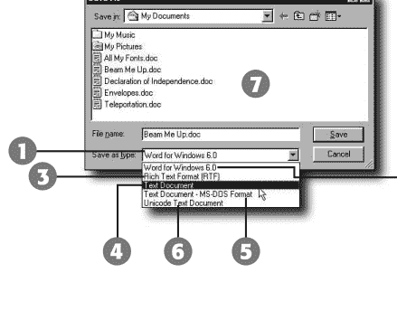

- 1. 选择保存文件的格式。
- 2. 所有 WordPad 文档的标准格式。
- 3. 包含格式信息的文本格式。
- 4. 纯文本。
- 5. 纯文本（重复）。
- 6. 没人使用的格式。
- 7. 此窗口仅显示与所选文件类型匹配的文件。

假设互联网上的某人想让你发送一份文件的副本，但要求是文本消息：

- **选择“文本文档 (Text Document)”。**
在“另存为”对话框中，Word for Windows 6.0 被替换为“文本文档”。

在文本文档文件格式中，WordPad 仅保存文档的文本；不保存任何格式信息（粗体、斜体、两端对齐、彩色文本）。

- **点击 保存。**
出现一个警告对话框，解释该文档将覆盖你已经在磁盘上拥有的文档。哎呀！最好更改名称。

- **点击 否。**

更改文件类型时，输入一个新的文件名总是个好主意。

- **输入** `My Story` 作为文件名。
- **点击** `保存`。

更多警告！这次你被告知保存文本文件会删除所有格式。这正是你想要的，所以：

- **点击** `是`。

文件被保存为仅文本格式到磁盘，世界上几乎任何计算机都能解析。

注意到文本在 WordPad 窗口中显示为一两行很长的线。这没关系；文本文件是没有格式的，这意味着它们缺乏右页边距。

- **关闭** `WordPad`。
从菜单中选择 `文件` $\rightarrow$ `退出`。

- 唯一需要以特定格式保存文件的情况是当你被要求这样做时，无论是通过手册、潜意识强迫，还是在其他情况下（例如与他人共享文件）。这种情况在图形程序中最为常见。例如，大多数扫描软件以 TIFF 文件格式保存文件，但如果你计划将图像通过电子邮件发送给朋友，你应该将图像保存为 GIF 文件格式。
- 程序通常使用的 *文件格式* 或 *类型* 被称为原生格式或 *默认* 格式。对于 WordPad，它是 Microsoft Word for Windows 6.0 文件格式。
- Microsoft Word 格式也被称为“doc”文件格式。
- RTF 文件格式非常通用。它是一种纯文本格式，这意味着任何计算机都可以读取这些文件，且 RTF 文档保留了格式信息。如果你想与使用另一种字处理软件的人交换文件，RTF 格式是最佳选择。


> Unicode 格式用于一些拥有特殊字母表的国家，例如日本的 Kanji (汉字) 字母表。


- 文本格式将文件仅以文本形式保存；字母、数字和其他字符会被保存，但不会保存任何格式信息。
- 老实说，我分不出文本格式和 MS-DOS 格式之间的任何区别。我直接选择文本格式。

#### 在新位置保存文件

一台典型的 PC 上存储着数以万计的文件。其中一些是你的文件。虽然找到它们可能是一项挑战，但 Windows 设置了文件夹，幸运的是，你可以在其中保存对自己重要的东西。（所有这些内容都在本书的第四部分中涵盖。）

通常，如果没有另行指定，Windows 将你的文档存储在一个名为“我的文档”（My Documents）的文件夹中。这很合理。

工作一段时间后，你可能会注意到“我的文档”文件夹变得非常拥挤。为了减少混乱，你应该开始将文档保存到其他地方，例如为特定项目创建新文件夹。所有这些都可以在任何“另存为”对话框中完成。

假设在你从寿司店回家的路上，突然想到了一个关于飞行汽车的点子。你赶紧回家记录下你的想法：

- **启动 WordPad。**
- **写下你的想法。**

或者随便输入几句话，因为本节是一个教程，在这里浪费时间发挥创意没有意义（不过，如果你真的有一些精妙的飞行汽车点子，欢迎发给我）。

- **选择 文件 $\rightarrow$ 另存为。**

“另存为”对话框出现，允许你保存你的内容。因为这个项目很大——将包含文本文档、图形、计算和拨款申请——最好将所有这些内容保存到一个新文件夹中。没有必要用一些真正优秀的东西把“我的文档”文件夹搞得乱七八糟。

- **点击“创建新文件夹”按钮。**

> **重要一点**
> 注意到“新建文件夹”名称被高亮显示了，这提示你可以对其进行编辑。事实上，你现在输入的任何内容都会成为新文件夹的名称。这是一个好主意，因为“新建文件夹”这个名字并没有太大的描述性（除了显而易见的一点）。

“另存为”对话框的窗口中出现了一个新文件夹（见图 3.5）。新文件夹被命名为“新建文件夹”。这就像给你的狗起名叫“狗”一样，但我不会在这上面纠结。

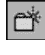

##### 图 3.5：在新文件夹中保存文件。

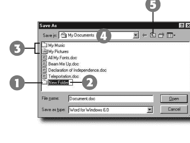

- 1. 新文件夹出现在这里。
- 2. 将名称更改为更具描述性的名称。
- 3. 其他文件夹。
- 4. 搜索其他保存文档的位置。
- 5. 返回“上一级”文件夹。

**给文件夹起一个新名字，例如 Flying Car。**

输入 `Flying Car` 来替换“新建文件夹”文本，作为新文件夹的名称。如果你写错了，按 Backspace 键回退并删除。完成后按 Enter 键确定更改。

文件夹现在名为 Flying Car。

**打开 Flying Car 文件夹。**

“另存为”对话框显示该文件夹的内容。现在你准备好将文件保存在这个新位置了。

**输入 Thoughts 8-01 作为文件名。**

按下 Alt+N 将焦点切换到“文件名”文本框，或按下 Tab 键。输入文档的名称：`Thoughts`（具有描述性）和 `8-01`（代表日期）。注意日期使用了连字符，因为 / 字符是被禁止的（verboten）。

**点击保存。**

文件被保存到磁盘上的一个新文件夹中。

**退出 WordPad**

是时候站起来伸个懒腰休息一下了。

- 将相关文件放在同一个文件夹中是一个极好的主意。
- 本书的第四部分将深入讨论文件夹和文件组织。
- 命名文件夹的规则与命名文件的规则相同。请参阅本章前面关于“文件名之好、坏、丑”的侧边栏。
- 你可以使用“另存为”对话框中的其他按钮和控件，将文档保存到计算机上的任何位置、任何硬盘、网络计算机或桌面上。

## 打开文档

### 解决的问题与激发的思考

- 操作“打开”对话框教程
- 打开另一种类型的文件
- 使用“打开”对话框进行浏览
- 使用“文档”菜单
- 打开图标
- 利用最近文件列表“走捷径”

当你将文档或文件保存到磁盘时，Windows 会对其进行精心布局，给文件起个名字并配一个漂亮的图标，以便你记住它。当你想要再次使用该文件——无论是为了查看、编辑、修改、打印或其他操作——你就打开它。这个动作将文件从磁盘重新加载到程序中，以便进行查看、编辑、修改、打印或其他操作。

> “打开”（从磁盘检索）与“保存”（放置到磁盘）相反。“关闭”与“打开”相反，“挥霍”（squander）与“节省”（save）相反，但请尽量避免陷入计算机语义的非逻辑迷宫中。

一个真正的极客冷知识：早期的 Microsoft Word 程序（用于 DOS）使用 `Transfer File Load` 命令来打开磁盘上的文档。微软已经走了很远。

> 打开磁盘文档的另一个术语是 *加载*（loading）。虽然不存在 Load 命令，但你可能会在计算机手册和极客书籍中看到这个词。

#### 打开你曾经熟悉的文件

只要你小心地将内容保存到磁盘，你就能再次找回它。

（本章中提到的文件是在第 3 章“保存你的内容”的教程中创建的。）

- 启动 WordPad。
- 选择 文件 $\rightarrow$ 打开。

“打开”对话框出现，如图 4.1 顶部所示。Windows 还使用第二种类型的“打开”对话框，如图 4.1 底部所示。两者功能相同。

##### 图 4.1：打开对话框。

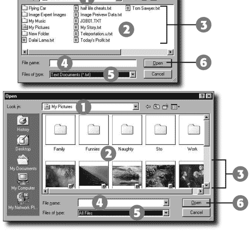

- 1. 当前文件夹。
- 2. 当前文件夹的内容。
- 3. 双击任何文件可快速打开。
- 4. 在这里输入文件名简直是疯了。
- 5. 要显示或打开的文件类型。
- 6. 点击以打开高亮显示的文件。

WordPad 自动选择“我的文档”文件夹，并在“打开”对话框中显示该文件夹中可能存在的所有 WordPad 文件。

**选择你想打开的文件。**

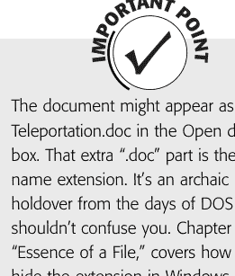

例如，点击 Teleportation 文档。用鼠标点击该文档名称一次。它会被高亮显示，准备好进行操作。

如果所有文档无法全部容纳在“打开”对话框窗口中，请使用滚动条查看更多文档。

**点击打开。**

文档出现在 WordPad 中，准备好进行查看、编辑、打印或任何操作。瞧，你打开了一个文档！哒哒！这是 Windows 确实将你的内容保存到磁盘的活生生的证明。

- 请注意，打开文档比保存文档需要的思考更少。
- 打开文件的常用键盘快捷键是 Ctrl+O。这个按键组合在大多数 Windows 应用程序中有效——但并非所有都有效。
- 一个更好的快捷方式是点击工具栏上的“打开”按钮（如果可用）。


#### 打开一个陌生且异类类型的文件

假设你有一个文本文件，你只需要在 WordPad 中打开它。（请配合我的演示。）虽然 WordPad 可以轻松打开文本文件，但你必须使用“打开”对话框来寻找该类型的文件。操作步骤如下：

**在 WordPad 中召唤“打开”对话框。**

**从“文件类型”下拉列表中选择 文本文档 (*.txt)。**

“打开”对话框仅显示文本文件，如图 4.2 所示。

**找到你想打开的文件。**

假设你找到了图 4.2 中显示的名为 Tom Sawyer 的文件。（我是从互联网上下载的那个文件，这在第 35 章“更多互联网疯狂”中涵盖。对于这个示例，直接使用你在对话框中能找到的任何文本文件即可。）

##### 图 4.2：打开特定类型的文件。

- 1. 选择了“文本文档”文件类型。
- 2. 仅显示文本文档。

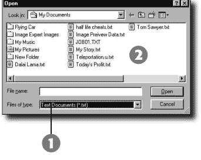

双击该文档以打开它。

双击文件名比先点击文件选择它然后再点击“打开”按钮要快。

然后文本文档出现在 WordPad 中，准备好进行……任何操作！

关闭 WordPad。

除非你修改了该文本文档，否则 WordPad 在你退出前不会要求你保存。所以，当你退出程序且它没有要求你保存时，不要担心。所有内容都已经保存好了。

> 大多数 Windows 程序会记住打开的文件类型，并自动将文件再次保存为该类型。如果你想将文件保存为另一种类型（例如，将文本文档保存为 WordPad 文档），记得从“另存为”对话框中选择该类型。

- Windows 在 `C:\Windows` 文件夹中保留了一些信息文本文件，虽然没有 Tom Sawyer 文件那么有趣。
- 并非每个程序都能读取每种文件格式。如果你想要的格式没有出现在“文件类型”下拉列表中，那么你要么运气不佳，要么必须使用其他应用程序来读取该文件。
- 当你编辑或创建纯文本文档时，WordPad 的格式栏和标尺不会出现。不过，如果你从“视图”菜单中选择它们，仍然可以看到这些项。
- Notepad（记事本）程序是 Windows 中用于创建、编辑、查看和打印文本文件的标准程序。
- 你可以通过使用 文件 $\rightarrow$ 另存为 并从“保存类型”下拉列表中选择 Word for Windows 6.0，将文本文件转换为 WordPad 文件。


#### 浏览文件

您可以使用“打开”对话框访问计算机上的各种磁盘驱动器或文件夹，甚至是网络计算机。这个过程被称为*浏览*（browsing）。实际上，“浏览”对话框与“打开”对话框基本相同，不同之处在于“浏览”对话框用于查找程序文件。

#### 寻找提示文件

Microsoft 在其销售的每个 Windows Me 版本中都包含一个名为 TIPS 的 TIPS 文件。该文件位于计算机 C 盘的 Windows 文件夹中。以下是如何使用 WordPad 读取该文件的方法：

- 启动 WordPad。
- 选择 文件 $\rightarrow$ 打开。

此时出现“打开”对话框。

- 从“文件类型”列表中选择 文本文档 (*.txt)。
- 从“在文件夹中查找”下拉列表中选择 我的电脑。

“我的电脑”文件夹的内容将显示在“打开”对话框中。

- 打开 C 盘。

无论其名称是什么，C 盘后面都有 (C:)。在大多数 PC 上，它是列表中的第二个项目（见图 4.3）。

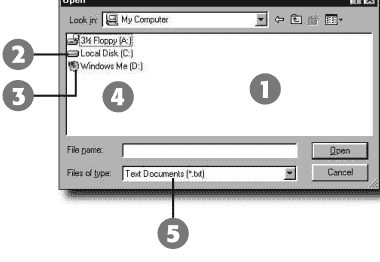
**图 4.3 寻找 C 盘。**
1. 我的电脑的内容。
2. 这里是 C 盘。
3. DVD 或 CD-ROM 驱动器。
4. 额外的硬盘驱动器或其他驱动器也会显示在这里。
5. 仅显示文本文档。

双击 C 盘图标即可打开 C 盘。

- 打开 Windows 文件夹。

Windows 文件夹中有很多文件。使用滚动条查看隐藏在右侧的文件。

- 打开 TIPS 文档。

最终，您应该能找到 TIPS 文档（可能显示为 TIPS.TXT）。双击将其打开。

- 阅读提示。

有些很有用，有些很奇怪，有些可能会让您感到惊讶。

- 完成后关闭 WordPad。

- 在“打开”对话框中打开任何文件夹都会显示该文件夹的内容。
- 要查看前一个（“父”）文件夹的内容，请单击“上一级”按钮。

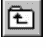

> **提示**
> 寻找文件的更快捷方法是在“文件名”文本框中直接输入 **TIPS**。这种方法很快，因为您知道文件名且易于输入。不过大多数时候，在“打开”对话框的窗口中寻找文件更简单。

#### 更快捷的方法（“在文件夹中查找”列表）

使用“打开”对话框查找文档被称为浏览。当您不知道文件位置时，浏览是可以的。但是，当您确切知道文件所在位置时，使用“在文件夹中查找”列表会更好。

举个例子，Windows 将大量图形文件存储在它自己的 Windows 文件夹中。以下是您浏览这些文件的方法：

- 打开 画图（Paint）。

您可以在“开始”菜单中找到 Windows 画图程序，选择 程序 $\rightarrow$ 附件 $\rightarrow$ 画图。（如果画图没有立即显示在附件菜单中，请记得点击“显示更多”按钮来查找。）

- 最大化 画图。

点击窗口右上角的“最大化”按钮。当画图扩展到全屏大小时，更容易查看图像。


- 选择 文件 $\rightarrow$ 打开。

出现“打开”对话框，如图 4.4 所示。与 WordPad 不同，画图显示文件的第一个位置不是“我的文档”文件夹，而是“我的图片”文件夹。此外，画图使用“缩略图”视图在“打开”对话框中显示信息。

> **注意！**
> 并非所有提示都适用于所有人。有些是为高级 Windows 用户或拥有特定硬件的人准备的。事实上，这里列出的所有内容都应该出现在手册中——如果 Microsoft 决定再次印刷手册的话。

## 第 4 章 打开文档

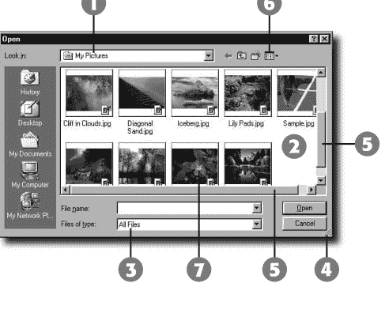
**图 4.4**
“打开”对话框中的缩略图视图。
1. 画图自动在“我的图片”文件夹中查找。
2. 缩略图视图中的图片预览。
3. 在此处选择“所有文件”以显示所有图片文件。
4. 您可以通过在此拖动来调整“打开”对话框的大小。
5. 帮助您查看内容的滚动条。
6. 用于选择不同视图的“查看”菜单。
7. 将鼠标悬停在图像上以获取更多信息。

- **从“文件类型”下拉列表中选择 所有文件。**

这将显示“我的图片”文件夹中包含的一些样本图像。使用滚动条查看预览；如果您将鼠标悬停在图像上，Windows 将显示图像类型（JPEG、GIF 或 Bitmap）和文件大小。

实际上，任何“打开”对话框都可以通过“缩略图”视图向您展示文件。秘诀在于位于对话框右上角的“查看”菜单。

- **从“查看”菜单中选择 大图标。**

点击“查看”菜单按钮以显示菜单，然后选择第一个项目“大图标”。这将使“打开”对话框恢复到您习惯看到的样式。

- **从“查看”菜单中选择 缩略图。**

现在您回到了“缩略图”视图，这在浏览图像时非常有用，而这正是您接下来要做的。

- **从“在文件夹中查找”列表中选择 C 盘。**

点击“在文件夹中查找”下拉列表的向下箭头以显示其内容（见图 4.5）。从列表中选择 C: 盘。

您会注意到“打开”对话框切换回了“列表”视图，像您在 WordPad 中使用“打开”对话框时那样显示图标。这是正常的；“缩略图”视图是“我的图片”文件夹特有的。

**图 4.5**
使用“在文件夹中查找”下拉列表。

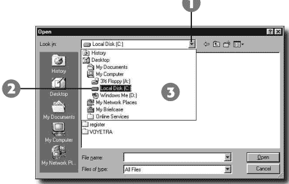
1. 点击此处查看列表。
2. C 盘，Windows 文件夹所在的位置。
3. 其他“主”文件夹、磁盘驱动器等显示在这里。

- **打开 Windows 文件夹。**

双击“打开”对话框中的 Windows 文件夹图标。瞧，此时“打开”对话框显示了大量文件。现在需要筛选一下：

- **从“文件类型”下拉列表中选择 所有图片文件。**

请记住，画图目前显示的是“所有文件”，这是您之前选择的，但不是您现在想要的。

- **从“查看”菜单中选择 缩略图。**

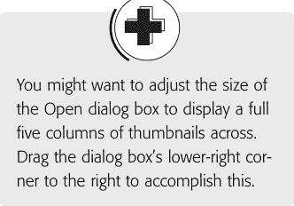

您希望在打开文件之前先看到它是什么样子。

您必须使用滚动条才能看到文件；Windows 文件夹中包含许多子文件夹。最终您将看到列出并带有缩略图的图形文件。

- **打开 Clouds 文件。**

在列表中找到 Clouds，双击其图标打开文件。您将看到 Windows 桌面壁纸图像之一，即蓝天白云的那张——如果您住在地球上，这很正常。

- **退出 画图。**

关闭画图程序窗口，或从菜单中选择 文件 $\rightarrow$ 退出。

- 当您确切知道文件位置时，使用“在文件夹中查找”下拉列表速度更快。
- “在文件夹中查找”下拉列表中仅显示主要项目：磁盘驱动器、桌面、“我的文档”文件夹、网络邻居以及桌面上的任何文件夹。
- 使用“在文件夹中查找”下拉列表的最佳时机之一是当您处于某个硬盘深处某个文件夹中时。它可以免去您点击无数次“向上”按钮的麻烦。

#### 不使用“打开”对话框打开文件

“打开”对话框并不是在 Windows 中打开文件或文档的唯一方法。事实上，如果您还没有启动程序，获取工作内容更快捷的方法是直接打开文档图标。这种方法可行是因为 Windows 记得哪些图标属于哪些程序。打开图标与启动程序并打开该文件进行编辑的效果是一样的。

当然，打开文档图标并不总是获取文档最快或最方便的方法，但有时确实如此。以下章节详细介绍了一些很少有人费心记忆的快捷方式。

（以下示例假设您一直在学习本章及前几章的教程。）

> **重要提示**
> 不要随意改动 Windows 文件夹中的任何内容。打开那里的图形文件随便看看是可以的，但除非您将它们保存到硬盘的其他地方（例如“我的图片”文件夹），否则不要修改这些图形文件。

##### 使用“文档”菜单

如果您像我一样，无法一次性完成工作。我太坐不住了，无法那么快地把事情做完。幸运的是，Windows 会记录您最近处理的几个文档。得益于“文档”菜单，重新找回它们非常简单。

例如，要重新打开本章前面提到的 TIPS 文件，请执行以下步骤：

- 从**开始**菜单中选择**文档**菜单。
- 从**文档菜单**中选择 **TIPS**。

记事本程序启动并自动加载该文档。此时，如果您在做其他事情而非本教程，就可以开始处理工作了。


- 关闭 Notepad。
- 从“开始”菜单的“文档”中选择 Beam Me Up 文档。

哒哒！它已经在 WordPad 中打开了，随时可以编辑。（这里也有可能由 Microsoft Word 或另一个文字处理软件打开该文档。当你打开 "doc" 文件时，这些程序比 WordPad 具有更高的优先级。）

- 关闭 WordPad。

或者，如果打开的是文字处理软件，请关闭它。

那么 Clouds 文件怎么处理呢？

- 从“开始”菜单的“文档”中选择 Clouds 文档。

你可能以为 Paint 会启动，但实际上运行的是 Windows 图像预览程序，将图像显示在屏幕上。真遗憾。

- 关闭图像预览。

该怎么办，该怎么办？假设你真的很想重新编辑 Clouds 文件，但显然你无法通过“文档”菜单来实现。或者你可以？

- 再次从“开始”菜单中选择“文档”。
- 右键单击 Clouds 文档。

这一次，使用鼠标右键点击（右键单击）Clouds 文档。会出现一个便捷的子菜单，如图 4.6 所示。

- 选择 打开方式 $\rightarrow$ Paint

这将使用 Paint 程序而非图像预览打开 Clouds 文档。现在你可以准备修复、打印，或者：

- 退出 Paint。

教程结束。

- “文档”菜单仅记得你打开的最后 15 个文档。
- 一些较旧的 Windows 和 DOS 程序不会将最近打开的文件放入“文档”菜单。

> **重要一点**
>
> TIPS 被加载到 Notepad 中，是因为 Notepad 是 Windows 用于纯文本文档的程序。要在 WordPad 中打开 TIPS，你必须先启动 WordPad，然后使用 文件 $\rightarrow$ 打开 命令来查找并打开 TIPS。

## 第 4 章 打开文档

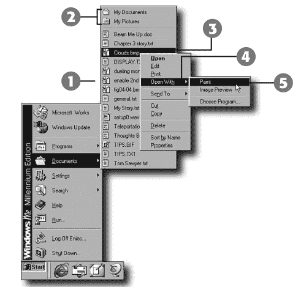

**图 4.6**
*选择如何运行 Paint 程序。*

- 1 文档菜单。
- 2 到“我的文档”和“我的图片”文件夹的快捷方式。
- 3 右键单击文件名。
- 4 选择“打开方式”以使用特定应用程序打开文件。
- 5 选择 Paint。

#### 查找要打开的文档

在 Windows 中打开文档与启动一个程序然后在该程序中打开文档是一样的。这种方法可以节省时间：

- **打开桌面上的“我的文档”文件夹。**
- **找到 Beam Me Up 图标。**

你在第 3 章中使用 WordPad 创建了这个文件。

- **打开 Beam Me Up 图标。**

双击该图标以打开它。WordPad（或 Microsoft Word）将启动，自动打开该文件并将其显示出来以便审阅或编辑。

- **选择 文件 $\rightarrow$ 退出 以退出。**
- **关闭“我的文档”窗口。**

> 注意！
>
> 对图形文档使用右键单击/“打开方式”技巧是可以的，但对其他任何文件使用时请谨慎！

点击窗口右上角的 X（关闭）按钮，或选择 文件 $\rightarrow$ 关闭 来关闭窗口。

#### 使用最近文件列表

大多数程序（至少是较好的那些）会记录你处理过的最后几个文档。重新打开文件就像从列表中选择一样简单。

- 打开 **WordPad**。
- 下拉 **文件** 菜单。

你会看到一个命令列表，在列表底部你会看到项目 1 到 4——即你最近打开或保存的文件（见图 4.7）。

> **提示**
>
> 每当我处理一个项目时，我会创建一个新文件夹，然后在桌面上粘贴该文件夹的快捷方式。（第 9 章“在桌面上潜伏与工作”解释了具体操作方法。）打开该文件夹会显示一个充满我正在处理的文件窗口。这样启动任何东西都轻而易举；我只需双击任何图标来打开文件并开始工作。

**图 4.7**
最近文件列表。

- 1. 文件菜单。
- 2. WordPad 中最后打开或保存的四个文件。

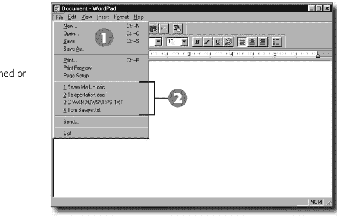

- 从列表中选择 **Teleportation**。

Teleportation 文件被打开以进行编辑。不需要“打开”对话框，无需浏览或寻找文件。

- 关闭 WordPad。

教程至此结束。

- 一个程序的最近文件列表记得你在该程序中打开的最后四个项目，而不像“开始”菜单的 `Documents` 菜单那样记得你在*任何*程序中打开的内容。

> **提示**
>
> 一些程序（如 Microsoft Word）允许你设置最近文件列表的项目数量。在 Word 中，选择 `Tools` $\rightarrow$ `Options`，点击“常规”选项卡，然后使用 `Recently Used File List entries` 框进行设置。


> 亲爱的 Dan：我删除了一些不再需要的文件，但我注意到它们仍然出现在文件菜单的最近文件列表中。我该如何去掉它们？
>
> Dan 说：你无法轻易地去掉它们。虽然有一种技术手段可以做到，但除此之外，你只能忍受这些项目，直到你打开足够多的其他文档，将旧项目挤出列表。

## 第 5 章 打印章节

### 解决的问题与启发思考

- 在任何旧的 Windows 程序中进行打印
- 打印多份副本
- 在 Windows 中制作信封

计算机据称开启了无纸化办公时代。既然一切都在屏幕上，就没人有理由打印任何东西。当然，这个预测大错特错。（我仍然在电脑旁放着笔记本、卡片索引文件和计算器，至少向我自己证明了传统办公时代还没有完全结束。）

每个人都需要打印，且每个应用程序——甚至是那些做 3D 动画的程序——都具备打印能力。在 Windows 中，所有这些打印操作都很简单，因为基础的“打印”对话框在不同程序之间是不变的。本章将向你展示“打印”对话框的基础知识，以及一些其他的打印技巧。这就是你为未来的无纸化办公所需要的一切。

#### 打印某个东西

打印几乎和保存一样重要。好吧，其实不然。保存应该时刻进行。而打印应该仅在你拥有值得打印的东西时才进行。这种哲学对大多数人来说是新鲜的。（我有一个老电脑伙伴，他仍然会打印论文的初稿。）

- 启动 Paint。

（如果你需要温习如何运行程序，请参考第 2 章“运行你的程序”。）

Paint 程序的窗口出现，如图 5.1 所示。

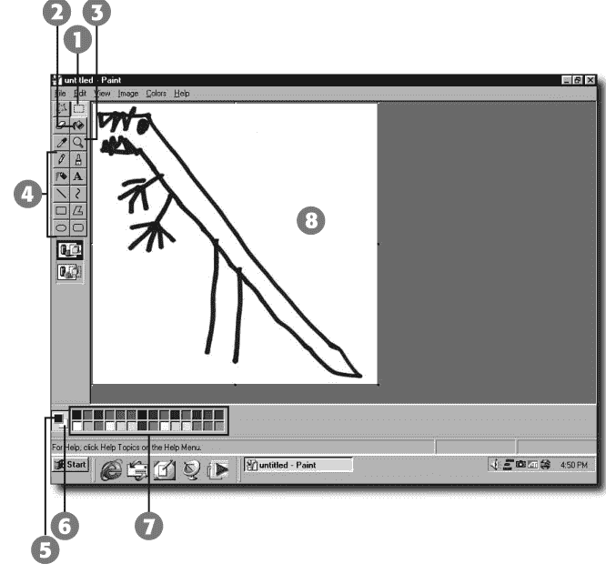

**图 5.1**
*Paint 程序。*

- 1. 选择工具。
- 2. 橡皮擦和填充工具。
- 3. 颜色选取和放大镜工具。
- 4. 其他绘图工具。
- 5. 当前前景色。
- 6. 当前背景色。
- 7. 调色板。
- 8. 在此绘制图像。

- 创建一幅傻画。

图 5.1 显示了我 6 岁的儿子 Jonah 绘制的一只极其恐怖的恐龙。请——千万！——不要惊慌。

你可以尝试使用铅笔或画笔工具在 Paint 中创建一些粗糙或有趣的图案。祝你玩得开心。

彩色图像在非彩色打印机上也可以打印，但当然不是彩色的。

- 保存这幅傻画。

在“另存为”对话框中将其命名为 **Silly Picture**。

现在你准备好打印了。

- 确保你的打印机已开启并准备好打印。

如果打印机还没开，请将其开启。确保它有充足的纸张，并且有足够的打印墨水或碳粉。（如果不足，打印机会提醒你。）

- 选择 文件 $\rightarrow$ 打印。

标准“打印”对话框出现，如图 5.2 所示。虽然不同程序使用的“打印”对话框可能略有不同，但整体主题是一致的。

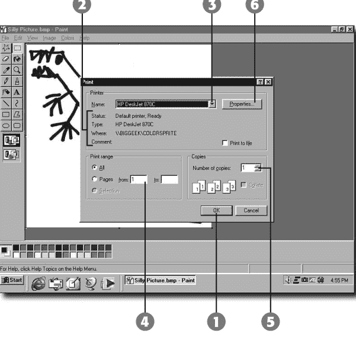

**图 5.2**
**打印对话框。**

- 1. 点击此处打印。
- 2. 可忽略的随机信息。
- 3. 你可以在这里选择其他打印机。
- 4. 告诉 Windows 打印哪些页码。
- 5. 告诉 Windows 打印多少份副本。
- 6. 更改打印机设置。

打印对话框中的信息实在太多了。当你需要这些设置时它们很有用，但现在你不需要。

- 点击 确定。

出现一个“正在打印”的对话框，尽管它可能会消失得太快以至于你来不及阅读。

打印机开始轰鸣，吸入一张纸，并打印出你的杰作。

你完成了，但请保留 Silly Picture 文档并让 Paint 处于可用状态，以便进行下一节的教程。

- 打印对话框的键盘快捷键是 Ctrl+P。
- 如果你的应用程序在工具栏上有“打印”按钮，你可以点击它立即打印文档；此时不会显示打印对话框。
- 不，Paint 程序的工具栏上没有打印按钮。
- 我一直让打印机开着。较新的打印机具有特殊的节能模式，允许你在不浪费大量电能的情况下保持开启。


#### 打印多份副本

你的杰作太辉煌了，不能不分享。既然你已经有了自己的副本，为什么不再加上两份寄给你妈妈和最好的朋友呢？

接续前一节的教程：

- 按 Ctrl+P。

打印对话框出现。

- 将副本数量设置为 2。

在对话框的右下角找到“副本”区域。在“副本数”框中输入 **2**。你想打印两份副本。

- 点击 确定。

另外两份傻画从打印机中吐出，适合装裱。

- 退出 Paint。

> **重要一点**
>
> 一般来说，先打印一份副本，仅为了确认一切看起来都正常。当你满意后，再按照本节所述打印多份。这样一来，当你发现打印机正喷出 120 封把配偶名字拼错的圣诞信件时，你才不会崩溃。


现在，当你准备好分发精美的艺术作品后，你需要打印一个用于邮寄的信封。接下来的章节将告诉你这个神奇的秘诀。

- 你不需要使用“打印”对话框来打印多份副本。天哪，大多数时候我都会忘记那个选项！相反，只需再次选择“打印”命令即可打印第二份副本。没什么大不了的。
- 哦，顺便说一句：关于如何停止打印机失控运行的主题将在第 18 章“你好，打印机文件夹！”中讨论。

#### 打印信封

回到 20 世纪 80 年代中期，当计算机打印机进入鼎盛时期时，人们经常这样说：“现在唯一还需要打字机的事情就是给信封写地址了。”幸运的是，情况已经发生了变化。

现在有许多信封打印程序可用，大多数主流文字处理软件也内置了信封打印功能。此外，大多数打印机都有信封槽或进纸器。这些功能的结合使得打印信封变得轻而易举。接下来的教程实际上是关于如何更改打印机的纸张大小和方向的，尽管它向你演示了如何使用 WordPad 打印一个简单的信封。

► **启动 WordPad。**

WordPad 窗口出现在屏幕上，空白地等待着被写入内容。

► **输入地址。**

例如，使用我出版商的地址：

Pearson Education
201 W. 103rd Street
Indianapolis, IN 46290-1097

或者你可以输入你自己的或任何其他地址。

不要担心格式或字体大小；只需像上面那样输入三行文本即可。

► **选择 文件 $\rightarrow$ 页面设置。**

“页面设置”对话框出现（见图 5.3）。虽然这个对话框看起来不像打印对话框，但它与文本在页面上的打印位置和方式密切相关。

##### 图 5.3
页面设置对话框。

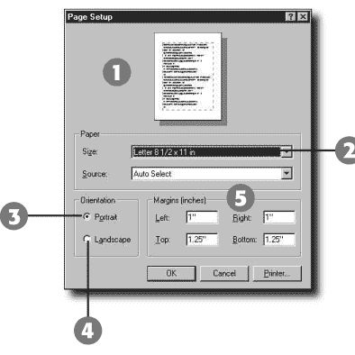

- 1. 打印页面外观的预览，大致如此。
- 2. 在此处选择纸张大小。
- 3. 纵向打印（正常）。
- 4. 横向打印（侧向）。
- 5. 设置距离纸张边缘的页边距。

你必须配置 WordPad 以在信封上打印地址。
**从“大小”下拉列表中选择 Envelope #10 4 1/8 $\times$ 9 1/2 in。**

#10 信封是美国最常用的尺寸。预览图会变为信封的样子，尽管它的方向不对。

- $\blacktriangleright$ 选择 横向。

啊，好多了。不过，地址仍然不在正确的位置。

- $\blacktriangleright$ 左边距输入 3。
- $\blacktriangleright$ 上边距输入 1.75。

新的边距值将地址设置在邮局工作人员希望看到的位置。

- $\blacktriangleright$ 点击 确定。

现在 WordPad 知道你正在打印信封了。然而，“页面设置”对话框中的预览窗口并不能*真正*向你展示你即将打印的内容。要查看效果，你必须使用“打印预览”命令。

- $\blacktriangleright$ 点击 打印预览 按钮。

图 5.4 显示了你可能会看到的内容。虽然信封快完工了，但文本需要进行格式化，使其看起来不那么简陋。

**图 5.4**
**打印预览窗口。**

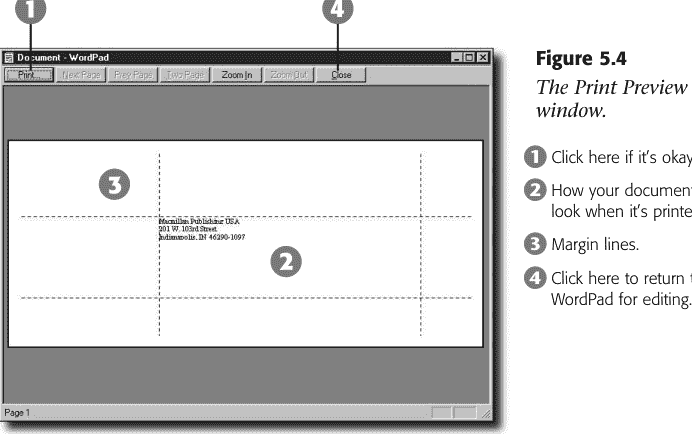

- 1. 如果打印效果可以，点击这里。
- 2. 文档打印后的预期外观。
- 3. 边距线。
- 4. 点击这里返回 WordPad 进行编辑。

$\blacktriangleright$ **点击 关闭。**

回到 WordPad，调整文本的大小和样式。

$\blacktriangleright$ **选择 编辑 $\rightarrow$ 全选。**

文档中的所有文本（好吧，就是那个地址）都被选中了。

$\blacktriangleright$ **从“字体大小”下拉列表中选择 14。**

变大了。

$\blacktriangleright$ **选择第一行文本。**

用鼠标拖动选中该文本。

$\blacktriangleright$ **将其加粗。**

点击格式工具栏上的“加粗”按钮或按下 Ctrl+B。

$\blacktriangleright$ **点击 打印预览 按钮。**

现在看起来好多了——可以准备打印了。

$\blacktriangleright$ **确保你手边有一个信封。**

虽然这一步看起来很显而易见，但如果你没有准备好要打印的信封，你的打印机可能会一直（一直一直）等待你放入信封。

► **找到信封进入打印机的位置。**

信封应该有一个特定的放置位置。在某些打印机上，你可能需要打开前盖才能找到信封槽或进纸托盘。

► **注意信封在托盘中的放置方式。**

你可以用八种方式之一将信封放入打印机：信封的四个边 $\times$ 正反面。

► **将信封放入托盘。**

► **点击 打印 按钮。**

出现“打印”对话框。

► **点击 确定。**

有些打印机会立即打印你的信封，整洁美观，正如你所期待的那样。

有些打印机可能要求你按下 On-line、Select 或 Go 按钮才能打印信封。

有些打印机可能根本无法正确打印信封。

如果打印机没有抓取信封，或者打印在了普通纸上，那么你还没有找到打印机“吃”信封的地方；请参阅打印机文档以获取正确位置。

如果地址打印正常，但打印在了信封的背面或方向错误，请尝试重新打印。但这一次，请尝试以不同的方式将信封放入打印机：正面朝上，或任何能解决问题的方向。

如果地址打印在信封的错误位置，请在“页面设置”对话框中调整边距。

如果地址在横向信封上纵向打印（或反之），请尝试将信封反向放入打印机。

最后，如果信封始终无法正确打印，请接受你的打印机无法打印信封的事实。（这并不是我在推卸责任：有些打印机确实无法在信封上打印出好效果。你已经尽力了，只是你的打印机能力不足。）

► **保存你的文件。**

当然，这一步是可选的。你不必保存该文档；但是，如果你计划一直用这种方式打印信封，这一步会很有用。将文档命名为 **Envelopes**。

> **提示**
> 大多数打印机上都有一个小图示，告诉你就如何将信封放入槽或托盘。信封的顶盖朝上或朝下，且向左或向右。如果小图示中的信封顶盖显示为虚线，意味着要正面朝上插入信封；否则，请背面朝上放入。


每当你想要打印信封时，只需打开 Envelopes 文档，输入正确的地址，然后打印信封即可。大功告成。

##### 关闭 WordPad。

- 大多数具有“打印”命令的应用程序也具有“页面设置”命令。有时“页面设置”是以按钮形式出现在“打印”对话框中的。
- 如果没有“页面设置”命令，你可以通过点击“打印”对话框中的“属性”按钮来选择纸张大小。
- 在打印文档之前，使用 文件 $\rightarrow$ 打印预览 命令查看效果会很有帮助——尤其是当你尝试调整页面大小和边距时。
- 另一种打印信封的方法是先打印邮寄标签，然后将标签撕下并贴在信封上。大多数主流文字处理软件都具有打印邮寄标签的功能。或者，如果你想要一个专门的邮寄标签打印程序（这通常效果更好），我推荐 Avery Label Pro。

> **提示**
> 在你掌握信封方向后，将正确的信封插入指南贴在打印机上。例如，写上“信封背面朝上，顶盖向右”。我所有的打印机上都有这样的指南。

## 深入探索你的计算机

### 已解答的问题和启发思考

- 使用“我的电脑”浏览
- 读取计算机的磁盘存储统计数据
- 访问磁盘驱动器上的文件夹
- 使用 Windows 资源管理器
- 预览图形文件的内容
- 打开项目窗口

存储在计算机上的信息量（文件、程序、文件夹、文档等）是非常巨大的。Windows 的主要工作之一就是确保所有这些信息易于获取并保持有序。桌面上的“我的电脑”图标就承担着这个角色。本章将告诉你这个程序是如何工作的。

- 我的*电脑*就是你的电脑。它在桌面上由一个图标表示，向你展示存储在计算机内部的一些基础资源。
- 每当你需要处理文件或文件夹时，就会用到“我的电脑”。它是一个组织管理工具。
- 不，你不需要整理你的文件和文件夹。但话又说回来，你也不需要打扫房子或洗澡。


- Gallant 有组织地管理他的硬盘；而 Goofus 则没有。
- “我的电脑”实际上是进入 Windows 资源管理器程序的一种方式，而资源管理器是 Windows 中主要的的文件组织程序。

#### 基础的“我的电脑”

“我的电脑”以图标的形式存在于桌面上，与回收站、“我的文档”以及其他标准桌面图标在一起。

**打开“我的电脑”。**

双击“我的电脑”图标即可将其打开，显示您的计算机拥有的硬盘驱动器和一些特殊文件夹。图 6.1 显示了详细内容。

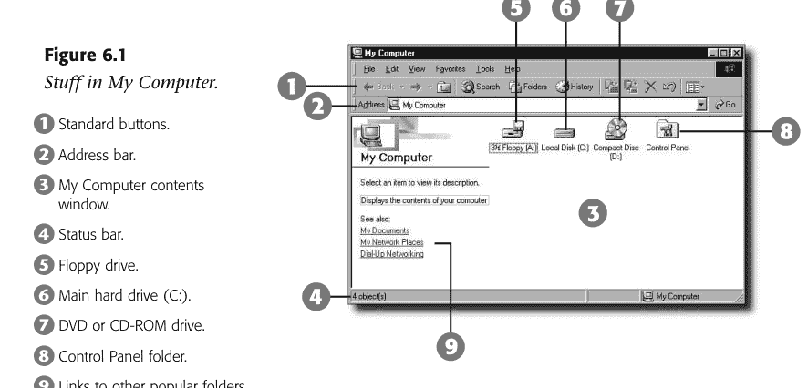

- 1. 标准按钮。
- 2. 地址栏。
- 3. “我的电脑”内容窗口。
- 4. 状态栏。
- 5. 软盘驱动器。
- 6. 主硬盘 (C:)。
- 7. DVD 或 CD-ROM 驱动器。
- 8. 控制面板文件夹。
- 9. 指向其他常用文件夹的链接。

您的“我的电脑”窗口中的内容可能与您在图 6.1 中看到的有所不同。例如，您可能同时拥有 C: 和 D: 两个硬盘，而图 6.1 中仅列出了一个硬盘（C 盘）。您可能还拥有一个 Zip 驱动器，或者第二个 CD-ROM 驱动器。每台 PC 都是不同的。

- 您在“我的电脑”中看到的控制面板文件夹，也可以在“开始”菜单的“设置”子菜单中找到。
- 窗口左侧显示的信息会随着您在窗口内选择项目而改变。稍后将详细介绍。
- 地址栏类似于“打开”和“另存为”对话框中的“查看位置”下拉列表。不过，除了使用地址栏来查看某个磁盘驱动器或网络计算机外，您还可以在其中输入网页地址。（在第 7 章“您的互联网入门章节”中阅读更多关于此主题的内容。）

#### 恰到好处的设置

与其说“这就是 Windows 希望你操作的方式”，不如说您有多种选项来决定“我的电脑”窗口中内容的显示方式。这听起来很棒，但可能会令人困惑。例如，“我的电脑”窗口（即图 6.1 所示的窗口）也可以呈现为图 6.2 所示的样子。

> 微软在设计 Windows 时，似乎总是犹豫不决。

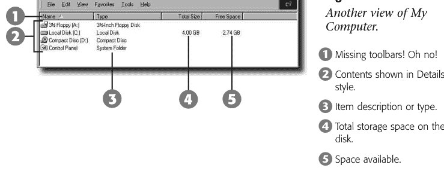

微软提供这些选项很好。尽管如此，我发现某些查看“我的电脑”内容的方式比其他方式更好。为了配置您的系统以匹配我的工作方式（我认为这是最有效的方式，且在本书中贯穿始终），请执行以下步骤：

- 在“我的电脑”窗口中，从菜单中选择“查看” $\rightarrow$ “大图标”。

除了使用大图标外，将窗口内容视为网页显示，并显示标准按钮、地址栏和状态栏也会有所帮助。您可以通过“查看”菜单选择大多数这些项目；而“以网页形式查看”是通过“工具”菜单完成的。

如果某个项目已被选中，它旁边会有一个勾选标记或黑点；再次选择该项目将其从屏幕上取消。因此，如果已经有勾选标记，请不要再次选择该项目。如果没有勾选标记，请选择该项目。

- 检查 **View $\rightarrow$ Toolbars**（查看 $\rightarrow$ 工具栏）子菜单中的 **Standard Buttons**（标准按钮）是否被选中。
- 检查 **View $\rightarrow$ Toolbars**（查看 $\rightarrow$ 工具栏）子菜单中的 **Address Bar**（地址栏）是否被选中。
- 检查 **View**（查看）菜单中的 **Status Bar**（状态栏）是否被选中。
- 调整窗口大小，使标准按钮栏上的 **Views**（视图）按钮可见。

将窗口右边缘向右拖动，直到您能看到“视图”按钮（参考图 6.1）。如果窗口中出现了任何滚动条，您可能也想这样做；调整窗口大小，使其足够大，从而不需要滚动条。

- 选择 **Tools $\rightarrow$ Folder Options**（工具 $\rightarrow$ 文件夹选项）以显示“文件夹选项”对话框。

“文件夹选项”对话框出现。

- 确保选中了 **Enable Web Content in Folders**（在文件夹中启用 Web 内容）（在 **Web View** 区域）。

这就是在窗口左侧显示精美图形和信息的功能。

- 确保选中了 **Open Each Folder in the Same Window**（在同一窗口中打开每个文件夹）。
- 确保同时选中了 **Double-Click to Open an Item (Single-Click to Select)**（双击打开项目（单击选择））。

选中这些项目后，您的“我的电脑”窗口的行为将与我在本书中一直使用的一模一样。

- 点击 **OK**（确定）。

最后一件事：

- 选择 **View $\rightarrow$ Arrange Icons $\rightarrow$ By Drive Letter**（查看 $\rightarrow$ 排列图标 $\rightarrow$ 按驱动器盘符）。

现在窗口看起来应该与图 6.1 基本一致。

以后当您对这些选项感到更习惯（或不习惯）时，随时可以更改它们。不过，从现在起，您的“我的电脑”窗口的行为将与本章以及本书大部分内容中描述的一样。

> **提示**：选择 **View $\rightarrow$ Arrange Icons $\rightarrow$ By Drive Letter**（查看 $\rightarrow$ 排列图标 $\rightarrow$ 按驱动器盘符）命令总是会重新排列窗口中的图标，以匹配您调整后的窗口大小。（这适用于“我的电脑”中的任何窗口。）

- 一般来说，任何 Windows 程序中的“查看”菜单都控制着您在窗口中看到的内容。如果您发现丢失了任何工具栏或按钮，请检查“查看”菜单，您将能够重新开启它们。
- 工具栏可以重新排列，可以堆叠在彼此之上，也可以并排排列。更多信息请参考第 39 章“来自无穷之外的工具栏”。

#### 获取磁盘信息

按照前一节所述设置“我的电脑”的一个优点是，您只需点击一个图标即可获得关于该图标的大量信息。

- **单击一次 C: 盘图标。**

如果该图标有名称，名称后面会带有 (C:)。 （第 20 章“磁盘驱动器入门”涵盖了磁盘驱动器及其名称。）

您看到的内容类似于图 6.3 所示（您可能需要调整窗口大小）。Windows 会显示关于该驱动器磁盘的有用信息。

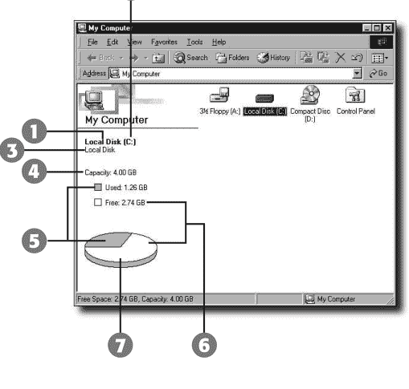

**图 6.3 关于您的 C 盘的信息。**
- 1. 磁盘名称。
- 2. 驱动器盘符。
- 3. 磁盘类型（例如：本地、网络、可移动或 CD-ROM）。
- 4. 磁盘总容量（例如：4 GB）。
- 5. 已用磁盘空间。
- 6. 可用磁盘空间。
- 7. 便捷的磁盘使用饼图（非实际尺寸）。

- **单击一次控制面板文件夹。**

Windows 在窗口左侧显示关于该文件夹的一些信息。

您可以点击窗口中的任何项目，Windows 都会显示关于该项目是什么或如何工作的信息。虽然这些信息对您来说可能并不完全好理解，但它肯定比一个带有简短描述的傻小图标要明显得多。

#### 查看磁盘驱动器中潜藏的内容

要查看磁盘驱动器的内容，必须将其打开。

- **双击 C 盘。**

打开 C 盘后，您可以看到哪些文件和文件夹存储在那里。

首先您应该注意到，窗口左侧显示了关于 C 盘的信息。找到蓝色下划线文本 *Hide the Contents of This Drive*（隐藏此驱动器的内容）。

- **点击 Hide the Contents of This Drive。**

糟糕！所有内容都消失了。Windows 中的各种文件夹在“我的电脑”窗口左侧显示信息，告诉您接下来可以做什么。在这种情况下，您可以取消隐藏 C 盘的内容：

- **点击 View the Entire Contents of This Drive（查看此驱动器的全部内容）。**

在 C 盘上，您会发现大约二十个文件和文件夹，如图 6.4 所示。当然，您看到的文件和文件夹并不与图 6.4 中显示的完全相同。

**图 6.4 潜藏在 C 盘上的文件和文件夹。**

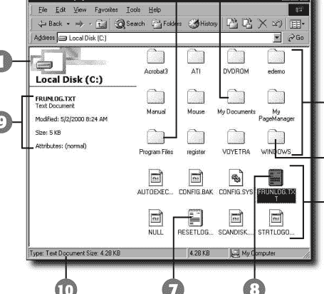

- 1. 您正在查看 C 盘的内容。
- 2. C 盘上的文件夹。
- 3. 嘿！这里又是“我的文档”文件夹。
- 4. 特殊的 Program Files 文件夹，程序存储在这里。
- 5. 神圣的 Windows 文件夹，Windows 自身的家。
- 6. 文件由不同的图标表示。
- 7. 文本文件图标。
- 8. 该文件已被选中；它被点击了一次，呈现出高亮状态。
- 9. 关于所选文件的信息。
- 10. 状态栏显示附加信息。

- **点击一个图标以选中它。**

关于该图标的信息出现在窗口左侧。列出的内容包括图标名称、类型（文件文件夹、文本文档、系统文件、LOG 文件等）以及其日期、大小和属性。这些是很有趣的琐碎信息，但仅通过观察图标是无法直接发现的。


任何硬盘上的第一个文件夹——即您在“我的电脑”中打开磁盘驱动器时看到的内容——被称为根文件夹，或者通常称为根目录。

- **取消选中该图标。**

要取消选中图标，请点击“我的电脑”窗口中的空白处，但不要点击图标。注意状态栏（在窗口底部）如何显示关于文件和文件夹的信息。这里显示了对象的总数（文件和文件夹）。因为“隐藏”的文件基本上是您不应该乱动的程序和其他文件，所以它们不会在窗口中显示。

状态栏（中间区域）显示的大小值告诉您窗口中所有文件的总大小。该值不包括未显示的任何文件夹中文件的尺寸。

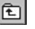

- **点击“上一步”按钮。**

这一步将您在“我的电脑”中“向上”移动一级，回到主窗口。

#### 打开文件夹

打开文件夹就像打开磁盘驱动器一样：要打开文件夹，请双击它。该文件夹的内容随后将出现在“我的电脑”窗口中。

- **打开 C 盘。**
- **打开“我的文档”文件夹。**

“我的文档”文件夹的内容显示在窗口中。图 6.5 显示了我 PC 上的“我的文档”内容。

假设您想返回到“我的电脑”窗口。虽然您可以点击几次“上一步”按钮，但使用地址下拉列表会更快：

- **从地址下拉列表中选择“我的电脑”。**

“我的电脑”的内容再次显示在窗口中。

要返回到“我的文档”文件夹，您可以再次打开 C 盘然后打开“我的文档”文件夹——但有一种更快的方法：


- **点击“后退”按钮。**

“后退”按钮将您带回到之前查看的文件夹，即“我的文档”。


##### 图 6.5
“我的文档”文件夹的内容。

- 1. “我的文档”文件夹的内容。
- 2. 更多文件夹！
- 3. 在文件夹中创建或保存的文件。
- 4. 图形文档。
- 5. 文本文档
- 6. WordPad 或 Microsoft Word 文档
- 7. 网页文档

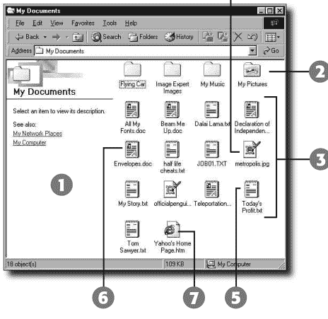

“后退”按钮与“上级”按钮不同。“上级”会将您带到父文件夹（向“我的电脑”方向更高一级别的文件夹）。“后退”会将您带到之前浏览过的文件夹，无论它位于何处。

关闭“我的电脑”窗口。

教程结束了——是时候思考一下了。

- “我的电脑”窗口的左侧还列出了其他常用文件夹：我的文档、我的电脑、我的网络位置，以及您将在本书后面学习的其他链接。
- 如果您点击“后退”按钮右侧的向下三角形，会出现一个最近访问过的文件夹列表。从该列表中选择任何文件夹即可显示其内容。

> **提示**
> 进入主文件夹（磁盘驱动器、“我的电脑”甚至“我的文档”）最简单的方法是从“地址”下拉列表中选择该文件夹。

## 第 6 章 挖掘您的计算机

#### 给有时间尝试者的额外技巧

既然您已经尝试了单窗口模式下的“我的电脑”，请尝试使用多窗口模式再次操作。回到本章前面“就这样设置”的部分，这次访问“文件夹选项”对话框，配置“我的电脑”，使“在新窗口中打开每个文件夹”选项被选中，而不是“在同一窗口中打开每个文件夹”。

当您重新练习教程时，请注意，打开磁盘驱动器或文件夹会显示一个新窗口。此外，“上级”按钮的行为也发生了变化，它会将您移动到父窗口而不会关闭当前窗口。唯一保持不变的是“地址”栏。

完成后，您的屏幕上将打开许多窗口。请确保在完成最后一个教程后关闭所有残留窗口。

在重新练习教程后，请自己做一个决定：哪种模式更好用？就个人而言，我更喜欢单窗口方法，因为它更整洁，不过您可以根据个人口味，以任何您想要的方式设置 Windows。

#### 探索文件、文件夹及其他玩意

“我的电脑”图标为您提供了一种便捷的方式来浏览计算机的磁盘系统，查看文件、定位程序或执行其他操作。然而，一旦您习惯了 Windows 在磁盘上存储文件的方式，您可能会改用 Windows 资源管理器。

不，Windows 资源管理器 *不是* Internet Explorer。它是 Windows 资源管理器（Windows Explorer），这是在计算机上查看文件的 *另一种方式*，尤其是当您准确知道文件所在位置时。


> 如果您知道文件夹的确切名称——即它的 *路径名*——您可以将其输入在“地址”栏中。当然，虽然这看起来是一件极其极客（nerdy）的事情，但某些程序可能会要求您显示特定文件夹的内容。如果您读到“前往 C:\Windows\Fonts 文件夹”，您就知道可以在“地址”栏输入 `c:\windows\fonts` 来立即访问该文件夹。

如果您在“地址”栏输入文件夹的路径名，请注意 Windows 喜欢猜测您正在输入的内容，甚至会自动为您完成输入。

#### 启动 Windows 资源管理器

您可以通过几种方式启动 Windows 资源管理器。（事实上方法太多了，但这正是微软做事的方式。）

从“开始”菜单选择 程序 $\rightarrow$ 附件 $\rightarrow$ Windows 资源管理器。

它就在那里；如果您在“附件”菜单中没看到它，请点击“显示更多”箭头。最终，Windows 资源管理器将填满屏幕，如图 6.6 所示。

##### 图 6.6
Windows 资源管理器。

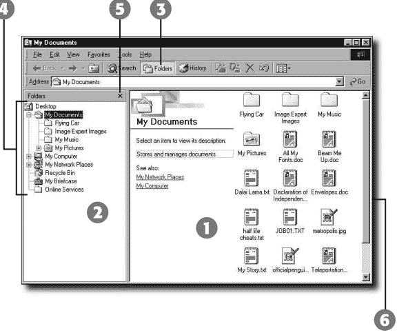

- 1. 文件夹列表。
- 2. 显示/隐藏文件夹列表。
- 3. 那个树形结构玩意。
- 4. 您也可以通过点击此处来关闭文件夹列表。
- 5. 在此处拖动窗口使其变大，以便显示有趣的图形。

Windows 资源管理器的运行方式与“我的电脑”窗口完全一样：您打开文件夹、访问磁盘驱动器、向上移动、后退，以及处理文件（本书后面会介绍）。唯一的区别是在窗口左侧增加了“文件夹列表”，您可以使用它以我称之为 *树形结构玩意* 的方式查看磁盘驱动器和文件夹。但即使是这个也是临时的：

点击“文件夹”按钮。

它消失了！事实上，文件夹列表消失后，屏幕看起来与“我的电脑”窗口完全一样。

再次点击“文件夹”按钮召唤出该列表。

恢复正常。

关闭 Windows 资源管理器窗口。

还有许多其他方法可以启动 Windows 资源管理器：

右击“我的电脑”。

显示快捷菜单。

- 选择“资源管理器”。

出现 Windows 资源管理器窗口，如图 6.6 所示。如果您没有看到华丽的“我的电脑”图形，请将窗口右边缘向右拖动，使窗口变宽，以便显示这些图形。

- 关闭窗口。

如果您愿意，甚至不需要使用快捷菜单：

- 打开“我的电脑”。
- 点击“文件夹”按钮。

哒哒！这就是 Windows 资源管理器！您可以在任何“我的电脑”或 Windows 资源管理器窗口中点击“文件夹”按钮，在两种格式之间切换。这很方便。

- 关闭您可能打开的所有窗口。

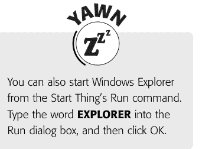

- Windows 资源管理器与“我的电脑”相同，但增加了文件夹列表。
- 您还可以通过按下 Win+E 组合键启动 Windows 资源管理器，其中 Win 是键盘上的 Windows 键。（它位于 Ctrl 和 Alt 键之间，顶部有一个小 Windows 旗标图标。）
- 您还可以通过右击“开始”按钮并从弹出菜单中选择“资源管理器”来启动 Windows 资源管理器。（这种技巧是编辑“开始”菜单项的快捷方式，详见第 10 章“开始菜单颂”。）
- 您的计算机桌面上可能有一个 Windows 资源管理器的快捷方式图标。打开该图标也可以启动 Windows 资源管理器。

#### 使用 Windows 资源管理器定位特定文件

Windows 资源管理器相对于“我的电脑”的一个优势是，它能让您以概览样式查看磁盘驱动器和文件夹的排列方式。这样，您可以快速深入挖掘硬盘上的文件夹，尤其是当您确切知道它们在何处时。

- 按下 Win+E。

使用键盘上的 Windows 键和 E 键（代表 Explorer，懂了吧）来启动 Windows 资源管理器。（如果您的键盘缺少 Windows 键，请尝试前一节中描述的其他技术。）

- **点击 C 盘旁边的加号 (+)。**

点击文件夹列表中的加号会打开树形结构玩意的一个分支。对于 C 盘，它会显示该驱动器上所有可用的文件夹。请注意，窗口右侧的内容没有改变。

- **点击 Program Files 文件夹旁边的 + 号。**

此步骤打开 Program Files 文件夹，显示更多文件夹——非常多。

Program Files 文件夹旁的 + 号变为 – (减号)，这意味着该文件夹已打开。

- **点击 Accessories 文件夹。**

选择该文件夹后，其内容将显示在窗口右侧，类似于图 6.7 中看到的内容。同时，请注意 Accessories 旁的小文件夹图标现在变成了打开状态。真可爱。

##### 图 6.7
Accessories 文件夹的内容。

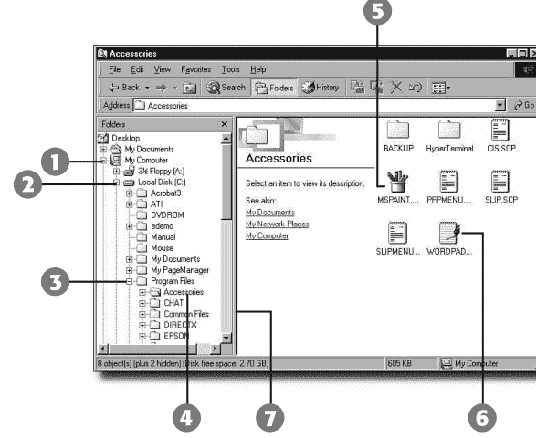

- 1. 您正在浏览“我的电脑”。
- 2. 您正在浏览 C 盘。
- 3. 您正在浏览 Program Files 文件夹。
- 4. 您正在查看的文件夹。
- 5. 画图程序；双击运行。
- 6. WordPad；双击运行。
- 7. 如有必要，在此拖动以扩大文件夹列表。

您可以随时通过 Windows 资源管理器窗口的右侧访问文件、打开文件夹或运行程序。请记住，资源管理器的运行方式与“我的电脑”完全一样，您在其中一个中能做的任何事情在另一个中也能做。唯一的区别——也是优势——在于您能看到那个树形结构玩意。


## 第 6 章 探索你的计算机

- 点击 C 盘旁边的减号 (-)。

（你可能需要向上滚动文件夹列表才能看到 C 盘。点击 C 盘图标旁边的减号会关闭该驱动器的树形结构视图。窗口的内容区域将显示 C 盘的根文件夹。）

现在访问“我的文档”文件夹：

- 从树形结构视图中选择“我的文档”。

该文件夹的内容将显示在窗口的右侧。

- 点击“我的文档”旁边的 + 号以显示其子文件夹。
- 选择“我的图片”文件夹。

“我的图片”文件夹的内容显示在窗口右侧。因为这是一个特殊窗口，它包含一些特殊且有趣的项目。

- 最大化窗口。

全屏查看这些内容效果最好。参考图 6.8 来帮你寻找有趣的东西。

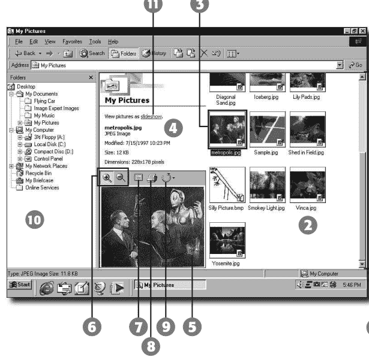

#### 图 6.8
查看特殊的“我的图片”文件夹。

1. 缩略图视图。
2. 图像。
3. 选中的图像。
4. 选中图像的信息。
5. 图像预览。
6. 放大/缩小按钮。
7. 运行图像预览程序以显示图像。
8. 打印图像。
9. 旋转图片下拉菜单。
10. 文件夹列表。
11. 开始幻灯片放映！

**选择一张图像。**

点击 Windows 提供的任何示例图像，或者使用你在之前课程中创建的“傻瓜图片”图标。点击一次进行选择。

#### 在“我的图片”窗口中识别文件夹图标

当文件以缩略图视图显示时（如图 6.8 所示），文件夹的外观与其他缩略图非常相似。

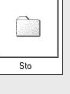

这不是一个图像文件！不，它只是一个文件夹，这就是它们在“我的图片”窗口中，或者当你从菜单中选择“查看 $\rightarrow$ 缩略图”时显示的样子。

双击即可打开文件夹，就像你在 Windows 任何地方打开文件夹一样。

你应该能在图像信息下方看到该图像的预览，类似于图 6.8 中显示的内容。这种预览是 Windows 中图像文件和其他选定类型文件的特殊功能；如果并非所有文件都能像图形图像那样显示预览，请不要失望。

现在来点有趣的。

**点击幻灯片链接。**

Windows 会将文件夹中的每一张图像依次显示出来。这是查看文件夹中所有图像的绝佳方式。

**按下 Esc 键取消幻灯片放映。**

保持 Windows 资源管理器窗口开启，以便进行接下来的教程。

- 点击加号可在树形结构中打开一个文件夹“分支”。
- 点击减号可关闭一个文件夹分支。
- 从树形结构中选择文件夹可在窗口右侧显示该文件夹的内容。
- 你仍然可以通过双击窗口右侧的图标来打开文件夹——尽管如果你可以使用树形结构，那么频繁点击就显得太繁琐了。
- 图像预览区域仅在自定义文件夹（基本上是指示 Windows 让该项目出现）时才会显示。更多信息请参考第 22 章“可移动磁盘和驱动器”。
- 如果你对图像预览程序、幻灯片放映等感兴趣，请访问本书的网页并输入 **IP** 作为关键词。（更多信息请参阅附录 A “使用本书网页”。）

#### 在另一个窗口中打开文件夹

每当我处理大型项目时，我喜欢保持一个项目文件夹窗口处于打开状态以便随时使用。本章所述的通过“我的电脑”浏览对我来说速度不够快。对于简单的浏览这没问题，尽管 Windows 在必要时有更好的方法来保持窗口开启。

从之前的教程继续（假设你正在 Windows 资源管理器中查看“我的图片”文件夹的内容）：

- **点击“向上”按钮。**

这将把你带回到“我的文档”文件夹。

- **右键点击“Flying Car”文件夹。**

你在第 3 章“保存你的资料”中创建了这个文件夹。将鼠标指向该文件夹并点击鼠标右键——就是那个你通常不按的按钮。此时会出现一个快捷菜单。

- **选择“打开”。**

一个新窗口会出现。这是一个“我的电脑”窗口（没有文件夹列表），它显示了“Flying Car”文件夹的内容。（最好回头看看，确保敌方特工此刻没有在窥视飞行汽车的细节！）

因为你现在没有在处理飞行汽车的计划，请通过最小化将该文件夹窗口隐藏起来。

- **点击任务栏上的“Flying Car”按钮。**

这一步将最小化窗口，暂时将其移开。

> **提示**
> 这就是我通常在 Windows 中工作的方式。例如，如果我在写一部伟大的美国小说，我会将该文件夹保持在桌面上，以便快速访问其中的文件。这不是一种“必须如此”的强制指令，而仅仅是一个关于在工作时如何组织自己的建议。

- **退出 Windows 资源管理器。**

点击右上角的 X 按钮关闭“我的文档”窗口。你也可以关闭“Flying Car”窗口：

- **右键点击任务栏上的“Flying Car”按钮。**

会出现一个弹出菜单。（实际上，这是窗口的“控制”菜单，可以通过点击标题栏左侧的控制图标访问。是同一个菜单。）

- **选择“关闭”。**

就这样。你甚至在没有完全展开它之前就关闭了窗口，以免信息落入敌手。

## 你的互联网入门章节

### 已解答的问题与启发思考

- 理解基础的互联网设置信息
- 了解在选择互联网服务提供商 (ISP) 时应关注什么
- 使用互联网连接向导
- 连接到互联网
- 连接到 AOL
- 断开互联网连接

哦，就随大流吧。加入互联网！这就是未来。毕竟，现在是*通讯时代*。（“信息时代”在 1993 年的一次硬盘崩溃中结束了。）本章是你的互联网入门指南。它涵盖了背景和设置，并让你简要地窥见互联网，以帮助你起步。

#### 上网需要准备什么

互联网不是一台计算机，也不是一个软件。不，互联网是由分布在世界各地的成千上万台计算机组成的。这些计算机发送、接收并存储信息。互联网的吸引力就在于所有这些你可以瞬间访问的信息。哦，还有在线购物。关于这一点，本书后面会详细介绍。

上网需要五样东西：

- 一台*计算机*——你应该已经有了一台。
- 一个*调制解调器 (modem)*——你的计算机必须通过电话线向互联网“尖叫”。调制解调器让这一切成为可能。越快越好。
- *特殊的互联网软件*——你应该已经拥有这个项目了，它就叫 Windows Millennium。不需要其他软件。（如果需要，你可以使用 Windows 自带的软件从互联网上抓取更多软件。真酷。）
- 一个*互联网服务提供商* (ISP)—ISP 是一家为你提供互联网访问权限的公司。它为你提供计算机拨号连接互联网所需的电话号码。
- *资金*——除非你可以通过公司或学校访问，否则使用互联网需要付费。费用从“免费”（意味着你得忍受大量广告）到每月数百美元不等。这完全取决于你获取的服务。平均费用大约每月 20 美元。

在这五项中，你可能只需要两项：ISP 和资金。寻找 ISP 很容易，而资金你得自己想办法。

- 现在设置计算机连接互联网不像早期那样痛苦。由于互联网连接向导，Windows 使其变得非常简单。
- 你的 PC 很可能已经配置好可以使用互联网；Windows 在首次安装时就会要求你进行设置。
- 你也可以使用在线服务上网，例如 America Online (AOL)、Prodigy Internet 或许多其他互联网替代方案。桌面上的一个特殊的“在线服务”文件夹可帮助你开始使用这些服务。
- 或者，如果你买了那些“免费”计算机，可能在不知不觉中被诱导签署了互联网服务协议。既然如此，最好利用起来；反正你已经付过钱了！
- *ISP* 是众多互联网缩写之一。它代表 Internet service provider，即你的计算机拨号连接互联网的机构。

#### 为互联网配置你的 PC

你有一台计算机，并且安装了 Windows Me。现在你需要确认你的 PC 有调制解调器，然后找到一个 ISP 并配置 Windows 以连接到该 ISP。

如果你认为你的 PC 已经配置好可以使用互联网，请跳至本章后面的“确认一切正常 (Okee-Doke)”部分。


#### 检查您的 PC 是否拥有调制解调器

调制解调器并非所有计算机的标配，尽管如今销售的几乎每台 PC 都已经预装了调制解调器。如果您不确定，可以使用以下两种方法之一来查看您的 PC 是否安装了调制解调器。

- 查看 PC 的背面。
- 在扩展槽区域寻找两个电话插孔。

如果您的计算机安装了内置调制解调器，那么计算机背面会有两个电话插孔（插头）。其中一个插头甚至可能已经连接了电话线并插在墙上。如果是这样，那么您就准备就绪了。

第二种判断方法（无需查看 PC 背面）是通过控制面板：

- 打开控制面板。

从“开始”菜单中选择 设置 $\rightarrow$ 控制面板。

控制面板在第六部分“优化大师”中会有详细介绍，但现在您需要找到“调制解调器”图标。如果您没有看到它，请点击“查看所有控制面板选项”链接。随后“调制解调器”图标应该会出现。

- 打开“调制解调器”图标。

此时将显示“调制解调器属性”对话框（见图 7.1）。如果您在列表中没有看到任何调制解调器，则您的 PC 没有安装调制解调器。

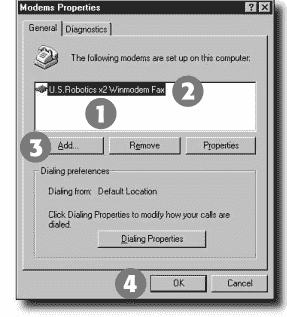

**图 7.1**
*调制解调器属性对话框。*

1. 您拥有的任何调制解调器都列在此处。
2. 我的 PC 的 U.S. Robotics 调制解调器已准备就绪。
3. 如果您添加了外部调制解调器，请点击此处。
4. 确定！

如果您在那里看到了调制解调器，那么您就准备就绪了。请确保电话线已连接到您的 PC 并插入墙上的电话插孔。

- 关闭“调制解调器属性”对话框。
- 关闭控制面板。

#### 如果您没有调制解调器，请买一个！

#### 寻找 ISP（互联网服务提供商）

虽然 Windows  Internet 连接向导可以为您寻找 ISP，但它很可能没有列出您本地地区所有可用的供应商。例如，我的家乡（人口 3 万）有 9 家 ISP（整整 9 家！），但当我使用 Internet 连接向导寻找 ISP 时，其中任何一家都没有出现在列表中。

我的建议是首先查阅黄页，或者在当地的计算机商店或 Radio Shack 询问 ISP 列表。然后挑选最优惠的方案。

寻找一家能以最优价格提供最多服务的 ISP。以下项目是必须的：

- 个人电子邮件账户
- Web 访问权限
- 新闻组 (Newsgroups)
- 电话支持（以便您可以获得帮助）
- 大量的可用电话线路（大多数 ISP 拥有数百条）
- 一本安装或“入门”手册

以下项目如果能有更好：

- Web 空间（用于创建您自己的网页）
- 教您如何使用 Internet 的课程
- 无限制访问

请记住，在选择 ISP 时您是有选择权的。找一家友好的！避开那些名字以字母 V 开头的、冷冰冰的全国性 ISP。寻找最优价格。最重要的是，寻找您可以顺畅沟通的人员。如果那里工作的员工显得匆忙、粗鲁或自我中心，或者除了电子邮件以外您无法通过任何其他方式联系到他们，请选择其他供应商。

> **提示**
> 尽量办理月费固定套餐。这样一来，如果第一家供应商不能满足您的需求，您可以更换供应商，而不会被一年（或更久）的合同所束缚。

- 我更倾向于提供“入门”手册的 ISP。
- 免费课程是非常棒的。

#### 运行 Internet 连接向导

Internet 连接向导负责配置 Windows 和您的调制解调器以连接 Internet。如果您计划使用 AOL 作为您的 ISP，则不需要完成这些步骤。请直接跳至“为 AOL 进行配置”部分了解更多信息。

要运行 Internet 连接向导，您需要一些信息碎片。您的 ISP 应该会为您提供以下大部分（如果不是全部）信息：

- 您的计算机连接 Internet 所需的电话号码
- 您的 Internet 登录名
- 您的 Internet 密码
- 您的电子邮件地址（如果与 Internet 登录名不同）
- 您的电子邮件密码（如果与 Internet 密码不同）
- 电子邮件服务器类型（POP3 或 IMAP）
- 接收和发送 (SMTP) 电子邮件服务器（或服务器组）的名称
- 新闻 (NNTP) 服务器的名称
- 您的新闻服务器登录名和密码
- Internet 目录服务 (LDAP) 名称、登录名和密码（可选）


> 在设置 Internet 连接时，会涉及到许多奇怪的名称、数字和缩写。您只需要进行一次这样的设置，所以现在没必要为此纠结。在这个过程中，只需默默接受，点头并保持微笑即可。在 Internet 连接向导要求时，输入相应的名称和数字。

最后两项（新闻服务器和 Internet 目录服务信息）完全是可选的，基础的 Internet 设置并不需要它们。如果您对它们感到困惑，或者没有相关信息，暂时将其留空即可。

- 无限制访问意味着您可以在一周中的任何一天、一天的任何时间拨号。它还可能包括无限制的连接时间。
- 尽量避免选择按分钟或小时计费，或者每月限制访问 20 小时（或类似限制）的 ISP。
- 如果您在当地找不到 ISP，请在居住地周边寻找。例如，附近的城镇或大城市可能有一家 ISP，提供您当地地区的号码甚至免费电话号码的接入。
- 如果您仍然找不到 ISP 或厌恶支付长途电话费用，您需要使用在线服务，例如 AOL。

您可能还需要其他信息，请将所有这些信息保存在方便查阅的地方。

**选择 程序 $\rightarrow$ 附件 $\rightarrow$ 通信 $\rightarrow$ Internet 连接向导。**

向导将出现，如图 7.2 所示。

**图 7.2**
*Internet 连接向导。*

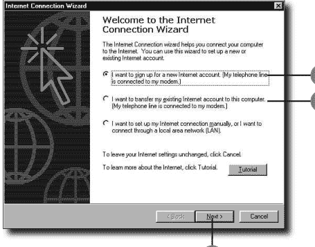

1. 注册新账户。
2. 如果您已经有了 ISP 并且所有信息已准备就绪，请选择此项。
3. 继续使用向导。

如果您已经选择了一家 ISP，请选择中间的选项。第一个选项是让 Microsoft 为您寻找 ISP，我发现这很冗长、不准确且令人沮丧。因此，只要您遵循我的建议，选择第二个选项然后运行向导就足够了。

这里有一些经验之谈和建议：

- 在做出选择并填写向导要求的信息后，点击“下一步”按钮。
- 注意关于“是否需要拨打区号”的问题。如果您在拨打本地电话时需要拨打区号，请确保向导已知晓此事。
- 仅在必须拨打国家代码和区号才能连接时才勾选该框。如果您按照我的指示操作，您应该拥有一家本地 ISP，而无需拨打区号。

> **注意！**
> 您的 Internet 用户名和密码可能与您的电子邮件用户名和密码不同。有时它们是相同的。请仔细检查 ISP 提供给您的信息。

对于连接名称，请使用您的 ISP 名称，例如 Imbris、CompuTech、CTS 或无论他们如何自称。您输入的名称将在每次连接 Internet 时使用。例如，Windows 会询问：“您想断开与 CTS 的连接吗？”如果您将 ISP 连接命名为“生命维持系统”，Windows 则会说：“您想断开与生命维持系统的连接吗？”

完成后点击“完成”按钮。

如果您需要更改任何信息，只需再次运行 Internet 连接向导即可。例如，我最近通过再次运行向导并跳过不需要更改的部分，添加了另一个新闻 (NNTP) 服务器。

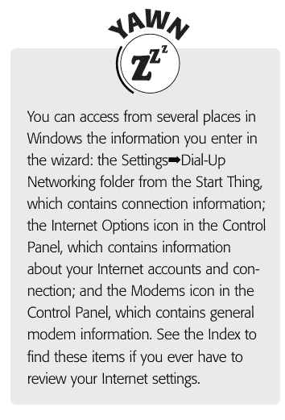

#### 确认一切正常

您的计算机会给您一个明确的信号，表明 Internet 连接向导已完成工作，您可以准备好通过电子方式访问世界了：

- 从“开始”菜单选择 设置 $\rightarrow$ 拨号网络。
- 选择您的连接图标。

点击一次该图标将其选中，如图 7.3 所示。有关 Internet 连接的信息将显示在窗口的左侧。

如果您没有看到连接图标（参考图 7.3），那么您要么将通过某种其他或特殊方式连接到 Internet，要么必须运行 Internet 连接向导来进行设置。（在本书中，我假设您通过调制解调器连接到 Internet，这是通过“拨号网络”文件夹完成的。）


##### 图 7.3

连接图标准备好拨号连接“互联网先生”了。

- 1. 拨号网络文件夹。
 2. 连接图标。
 3. 你的调制解调器。
 4. 要拨打的电话号码。
 5. 在此处创建新连接。
 6. 点击此处连接。
 7. 在此处打开也可以连接。

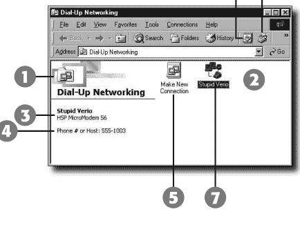

#### 为 AOL 进行配置

大多数 Windows 配置在桌面上都有一个名为“联机服务”（Online Services）的文件夹。在该文件夹中，你会发现使用主流联机服务（如 AOL）向系统添加互联网连接的快捷方式。

**打开“联机服务”文件夹。**

你看到的内容应如图 7.4 所示。如果桌面上没有“联机服务”文件夹，你将需要联系联机服务商获取免费的安装光盘。

##### 图 7.4

“联机服务”文件夹的内容。

- 1. “联机服务”文件夹。
- 2. “注册 AOL”（Sign-Up-With-AOL）快捷方式图标。
- 3. 其他向微软“低头”并将其图标列在此文件夹中的联机服务。
- 4. 拒绝“低头”因此未列在此处的联机服务。

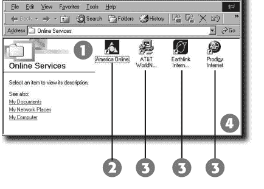

## 第 7 章 你的互联网入门指南

要注册 AOL 或为你的新 Windows Me 电脑配置 AOL，你必须打开 AOL 图标并完成其注册流程。

- 打开 America Online 图标。

记住，只有当你希望在电脑上使用 AOL 服务时才执行此操作。它是要花钱的！有些人不喜欢它！我并不推荐它！我只是向想要 AOL 的读者演示如何操作。谢谢。

- 完成 AOL 设置程序。

按照屏幕上的指示操作，它会将你连接到 AOL 并最终为你设置一个账户。如果你已经拥有账户，该程序将为你激活电脑上的 AOL 服务。

你可能会被要求插入原始的 Windows CD，所以请将其放在手边！

同时要注意，在安装 AOL 软件后，你可能会被要求重启电脑。没关系；告知 AOL 设置程序可以重启，它会为你重启电脑。重启后，它可能会自动运行以完成安装。请耐心等待。

最终你将连接到 AOL 并圆满完成安装。

你可以留在 AOL 中玩耍，或者直接退出：

- 选择 文件 $\rightarrow$ 退出。

这将关闭 AOL 窗口，并断开与他们庞大计算机的连接（传闻这些计算机位于俄亥俄州）。

- 如果你之前打开了“联机服务”窗口且一直没关，现在可以将其关闭。事实上，既然 AOL 已经安装在你的电脑上，你现在可以删除那个文件夹了。

- AOL 应该已经在桌面上安装了一个快捷方式图标，可能在快速启动栏上也有一个图标（见第 11 章“启动软件的其他方法”），以及在“开始”菜单的 程序 $\rightarrow$ America Online 下有一个图标。

> **提示**
> 如果你不打算使用任何联机服务，可以随意从桌面删除“联机服务”文件夹。有关删除内容的详细信息，请参考第 29 章“删除、取消删除和回收”。


#### 在 AOL 中浏览网页

亲爱的 Dan：我有 AOL。这意味着我拥有一个 Web 浏览器，还是我仍然需要一个？到底什么是“浏览器”？

Dan 说：浏览器是一种用于查看万维网（World Wide Web）信息的特殊程序。AOL 自带了一个你可以用来查看网页的浏览器。第五部分“互联网星球”中有更多信息。

#### 连接到互联网

电信连接曾经是使用电脑时最难跨越的障碍。现在不再如此了！得益于 Windows 本身以及像 AOL 这样的联机服务，访问互联网变得非常、非常简单。

如果你拥有多个 ISP（互联网服务提供商），或者同时拥有 ISP 和 AOL，你应该访问本书的网页并输入 **ISPBattle** 关键字以获取更多信息。

#### 让 Windows 为你拨号连接互联网

在 Windows 中连接互联网很简单：只需运行一个互联网程序，或在地址栏中输入一个互联网地址即可。轻而易举。

- 打开桌面上的 Internet Explorer 图标。

随后会出现“连接到”对话框，如图 7.5 所示。

必要时输入你的登录 ID 和密码。

勾选“自动连接”选项意味着每当你或某个程序请求联机信息时，Windows 都会连接到互联网。这是一个很好的选项，并没有听起来那么阴险。Windows 绝不会在你不知情的情况下拨号上网；“连接到”对话框总是会出现。

- 点击 连接。

Windows 尝试连接到你的 ISP 和互联网。如果成功，你将在任务栏的系统托盘中看到联机图标（见图 7.6）。如果 Windows 无法连接，它会在放弃前重新拨号几次。稍后再试即可。


> 勾选“保存密码”选项意味着你每次连接互联网时无需输入密码。但不幸的是，这也意味着任何能接触到你电脑的人都可以登录互联网并冒充你。对此请务必小心。

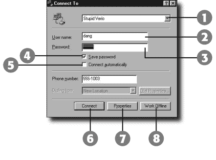

##### 图 7.5
“连接到”对话框。

- 1. 你的 ISP 名称（如果你有多个，则会出现列表）。
- 2. 你的用户名。
- 3. 你的密码（由星号隐藏）。
- 4. 确保勾选此框。
- 5. 点击此处以避免下次连接时出现此对话框。
- 6. 连接到互联网。
- 7. 忽略。
- 8. 使用你的互联网软件但不连接（也可以是“取消”按钮）。


##### 图 7.6
任务栏上的联机图标。

- 1. 音量控制。
- 2. 其他小玩意。
- 3. 联机图标（双击以访问）。
- 4. 该午睡了。

现在你已经进入了互联网，可能正在万维网上查看 MSN 主页。天呐，我敢打赌他们付给了微软很多钱才获得这个地位。（好吧，也许没有。）

- **关闭 Internet Explorer 窗口。**

你现在可能会看到一个对话框，询问你是想断开连接还是关闭连接。不要点击“是”！在现实生活中你可能会这么做，但这次请点击“否”或 `Stay Connected`（保持连接）。我想向你展示如何使用任务栏上的联机图标：

- **双击任务栏上的联机图标。**

随后会出现“已连接到您的 ISP”对话框，其中充满了琐碎信息，如图 7.7 所示。


##### 图 7.7
从互联网断开连接。

- 1. 调制解调器正以 46,000bps 的速度通信（运气不错的一天）。
- 2. 我已经在线 6 分钟了。
- 3. 琐碎信息！
- 4. 点击以关闭对话框并保持在线。
- 5. 点击以断开连接。
- 6. 更多琐碎信息！

- **点击 断开连接。**

你已离线，不再连接到互联网。

- **点击 确定。**

你也 OK 了。

- 请记住，你的互联网登录 ID 和密码可能与你在 Windows 和网络中使用的其他登录名和密码不同。
- 如果你使用的是笔记本电脑或由多人共用的电脑，拨号连接对话框中的“保存密码”选项可能不可用。
- 你也可以通过打开“拨号网络”文件夹中的 ISP 图标来连接互联网。这里的唯一优势是当你拥有多个 ISP 且想要连接到其中特定的一个时。

> **注意！**
> 留意任务栏上的联机图标。如果它在，说明你的电脑已连接到互联网。如果这不是你想要的，请按照上述步骤断开连接。

> **提示**
> 如果你想使用互联网软件但不想上线（例如为了阅读旧邮件），请从程序的“文件”菜单中选择“离线工作”命令。该操作（理论上）可以防止你被连接。

#### 连接到 AOL 及其后的互联网

连接 AOL 最好的、也是传统的方法是找到并打开桌面上的 AOL 图标。

- **打开 AOL 图标。**

AOL 可能会要求输入你的屏幕名称和密码，如图 7.8 所示。


##### 图 7.8
连接到 AOL。

- 1. 在此处选择或输入你的名称。
- 2. 输入你的密码。
- 3. 点击以连接到 AOL。

- **输入你的屏幕名称、密码或两者都输入。**

AOL 允许你拥有最多七个不同的屏幕名称（在 5.0 版本中），每个家庭成员一个。

- **点击 登录 按钮。**

AOL 将执行其多步骤流程：寻找调制解调器、拨号、连接，以此类推。

最终你会听到那个“你有新邮件！”（You’ve Got Mail!）的家伙的声音（前提是你确实有邮件，也就是说人们足够喜欢你以至于给你发邮件）。否则，你得在广告中艰难跋涉，最终才能进入 AOL。

现在的 AOL 内容就到此为止吧！


选择 **文件—退出以注销并退出 AOL**（File—Exit to log off and quit AOL）。

这将同时让你断开与互联网和 AOL 的连接，并挂断调制解调器。

- 使用互联网与使用 AOL 并不完全是一回事。因为 AOL 本身就是一个独立的系统。你可以通过 AOL 访问互联网，但除此之外，AOL 还提供了一套普通互联网用户无法使用的自有服务和功能。
- 我的 AOL 账户名是 Dang6755，但如果你确实需要给我发送电子邮件，请使用 dan@wambooli.com。谢谢。

#### 探索互联网的其他部分

人们在互联网上主要进行两项活动：阅读电子邮件和浏览网页。虽然这并非你能做的全部，但确实是大多数人在网络上漫游的原因。

> 有些人完全是为了电子邮件而生活。

在 Windows 中，你可以使用 Microsoft Outlook Express 程序阅读和撰写电子邮件。你可以使用 Internet Explorer 程序浏览网页，尽管你也可以从任何“我的电脑”窗口浏览，或者将桌面用作 Web 浏览器。（天哪，如果鼠标上有一个微型视频屏幕，微软肯定也会让你用它来浏览。）

关于 Outlook Express 和 Internet Explorer 的更多细节将在本书第五部分中提供，该部分将详细介绍互联网以及你在那里可以获得的所有乐趣。

对于 AOL 用户，一切几乎都在 AOL 程序本身中处理。你将在那里阅读和撰写电子邮件，如果你愿意，还可以浏览网页，或者执行各种 AOL 特有的操作。

- 你可以使用 Outlook Express 和 Internet Explorer 以外的程序来处理你的互联网事务。遗憾的是，使用 AOL 时，你只能在 AOL 自身中进行所有在线活动。
- 你还可以使用 Outlook Express 阅读新闻组。
- Windows 自带了可以让你在互联网上创建自己的网页的软件，这在第五部分中有所涵盖。
- Windows 唯一没有自带的是互联网聊天软件。还是有吗？我不确定。最好查看第五部分。

## 第 8 章：帮帮我！

### 回答的问题与触发的思考

- 获取 Windows 帮助
- 理解帮助系统
- 在线获取“辅助帮助”
- 理解旧类型的帮助系统
- 使用 F1 键
- 在菜单中寻找帮助
- 在对话框中使用 ? 按钮
- 体验“点选式”帮助的乐趣

信不信由你，Windows 其实可以非常有帮助。众所周知，计算机程序通常晦涩难懂、令人困惑，而且，嗯，很不友好。你应该感激任何形式的帮助，即使它是模糊的、毫无意义的，而且是由外国人或机器人写的。呃……

本章将讨论 Windows 帮助系统，你在陷入困境时可以求助于它。虽然它提供的帮助不如朋友安抚的声音那样温馨，也不如计算机大牛的智慧那样恰当，但总比没有好。

#### Windows 想要帮助你

Windows 不再附带纸质手册。相反，手册的残余部分现在被集成到了一个我称之为 Windows 帮助系统的程序中。它不仅是一个程序，还是一套完整的规则和方法，用于在你感到困扰和沮丧时获取协助。

##### 令人兴奋的新 Windows 帮助系统

亲爱的读者，请舒展你忧心忡忡的眉头。Windows 渴望以一种友好的方式帮助你。它比可怕的手册更好，比枯燥的命令列表更令人愉快，这是一个全新的（至少对 Windows Me 来说是全新的）帮助系统。

- **从“开始”菜单中，选择“帮助”。**

瞧，“帮助和支持”窗口出现了，如图 8.1 所示。在这里，你应该提出你的 Windows 问题，并且（祈祷）得到解答。


**图 8.1**
*Windows 帮助系统。*

1. 搜索主题、话题或关键字。
2. 在帮助屏幕之间前后翻页。
3. 返回主帮助屏幕。
4. 显示所有话题的索引。
5. 使用在线帮助论坛。
6. 了解各种功能。
7. 常规话题和新的 Windows Me 功能。
8. 故障排除辅助。
9. 本页其他位置项的重复。
10. 你最近研究过的话题列表。

如果你习惯于旧版 Windows 的帮助方式，这个较新的 Windows Me 帮助系统可能会让你觉得是一种令人耳目一新的改变。虽然帮助内容本身仍然是，嗯，*手册*，但其呈现方式却令人愉悦地不同。

现在假设你对计算机每次启动时发出的声音感到厌烦：

- **在搜索框中输入** sounds。
- **点击** Go。

屏幕上会出现一个长长的列表，涵盖了 Windows 中几乎所有与 *声音* 相关的操作。

- **点击“将声音分配给程序事件”（Assigning sounds to Program Events）链接。**

帮助系统窗口的右侧会显示你需要知道的信息。

如果你点击“声音和多媒体属性”链接，则会出现“声音属性”对话框，你可以在其中更改声音（顺便说一句，这就是你正在寻找的解决方案）。

- **点击绿色下划线单词 *event*。**

与引导你至其他窗口或程序的蓝色下划线文本不同，绿色下划线文本提供一个弹出定义窗口。在这种情况下，它解释了 *event*（事件）这个词是指什么。

- **在弹出窗口中点击鼠标以将其从屏幕上移除。**

另一种搜索方法是使用索引。

- **点击“索引”（Index）。**

“索引”项位于窗口顶部的“主页”和“辅助支持”之间。

如果你还没有使用过 Windows 帮助系统，你会看到“首次准备使用索引”对话框。一支神奇的铅笔正在书本上写秘密信息。

完整的索引列出了 Windows 认为重要的所有帮助系统词汇。这很方便，因为通常你不知道要找的确切词汇，但可以在索引中找到类似的词条。

来一些真正有用的信息如何：

- **在“输入要查找的关键字”文本框中输入** shortcut keys。

你可能不需要输入完整的 **shortcut keys**；Windows 会迅速找到该条目。在其下方，你会看到与快捷键相关的各种话题：辅助功能、桌面等等。

- 点击 **general**。
- 点击 **Display** 按钮。

一个话题列表随即显示。

- 选择 **Using shortcut keys in Windows**。
- 点击 **Display**。

嗯，这是一个值得保存的有趣列表。为什么不把它打印出来呢？

- 点击 **Print** 按钮。
- 在 **Print** 对话框中点击 **OK**。

现在你就有了一份精美的打印列表，涵盖了所有 Windows 独特、怪异且丑陋的键盘快捷键。好吧，并不是全部……

- 在索引列表中点击 **Windows Explorer**。
- 点击 **Display**。

更多有用的键盘快捷键！把这个也打印了。

> **打印所有的快捷键列表。这些组合实在太怪异了，无法记住。**

- 关闭 **帮助和支持** 窗口。

每当你看到桌面，或者在使用“我的电脑”或 Windows 资源管理器时，按下 F1 键也可以获取 Windows 帮助。


“帮助”就像你计算机上的任何其他程序一样。阅读完帮助信息后，记得关闭其窗口。

#### 揭秘“辅助支持”

帮助系统（图 8.1）中最令人好奇的项目之一就是“辅助支持”（Assisted Support）。这个名字起得很巧妙，它暗示也许有一种方法可以联系到真实的自然人，获得某种巧妙、舒适的一对一支持。啊……那该多好啊？

然而，冷酷的现实是，“辅助支持”只是另一种将你重新引导至互联网的方式。在那里，你可能会像一条被扔进沸水锅里的鱼一样，被抛进一个在线抱怨论坛，或者向微软发送一封绝望的电子邮件，而微软庞大军团中的某个人可能会（或者可能不会）满足你寻求救赎的渴望。

- 从“开始”菜单中选择 **帮助**。
- 点击 **辅助支持（Assisted Support）链接**。

另一个屏幕出现，列出了各种支持途径。有电子邮件选项、论坛和留言板。如果你点击其中一个，帮助系统就会变成一个微型版本的 Internet Explorer 浏览器，首先将你连接到互联网，把你注册为一名快乐的微软帮助客户（或类似身份），其次给你一个机会窥视（发送）你的投诉。

真的有真人吗？没有。好吧，不会立即出现。

如果你确实注册了，请点击链接并填写所需信息以获取帮助。最终可能会有人回复你。

- 关闭 **帮助和支持窗口**。

这也会让你注销互联网，以防你担心在线时间过长。


请注意，呈现在你面前的一些选项是为了引导你注册在线服务。*这不是强制要求的。* 你不需要向微软或任何其他在线服务支付 *任何费用* 才能使用 Windows。

- 辅助支持页面上的“检查状态”（Check Status）链接用于查看你的请求处理进度。
- 由于在本书付梓时，“辅助支持”是 Windows 的一项新功能且尚未经过充分测试，我将在本书的网页上根据需要提供更新信息。例如，未来可能会出现将你连接到经销商或计算机制造商以寻求帮助的链接。我将在网站上涵盖这些内容以及任何其他可能发生的更改。
- 在本书付梓时，已经过了 8 周，我仍然没有收到关于一个基本 Windows 帮助问题的“辅助”回复。好吧。

#### 其他旧版帮助系统

一些 Windows 应用程序使用旧形式的帮助系统，不像上面描述的那么华丽或花哨。

- 运行 **计算器**。

（有关启动计算器的说明，请参阅第 2 章“运行你的程序”。）

- 选择 **帮助 $\rightarrow$ 帮助主题**。

另一个类型的帮助窗口会出现，如图 8.2 所示。这更像是一种在线手册类型的帮助窗口，手册本身在“内容”选项卡中，但带有索引和搜索选项，以帮助你快速定位信息。


图 8.2.
旧版帮助窗口。


- 1 内容目录，在此您可以打开章节并阅读“手册”
- 2 所有关键字和主题的索引。
- 3 搜索关键字。
- 4 输入关键字以搜索索引。
- 5 索引本身。
- 6 点击以显示信息。
- 7 信息在此显示！
- 8 选项菜单；点击以显示实用功能，包括打印。

▶ **点击 Performing Calculations（执行计算）。**

该“章节”打开后将显示一个主题列表。

▶ **点击 Perform a simple calculation（执行简单计算）。**

该手册页面将出现在窗口的右侧。

好了，目前的帮助就到此为止。

▶ **关闭计算器帮助窗口。**

▶ **关闭计算器。**

您会发现许多 Windows 微型程序（“applets”）和其他较旧的 Windows 程序使用这种帮助系统，而不是更花哨的帮助系统。不要让它让您感到困惑（throw you grey）。

- “选项”按钮用于显示一个方便的菜单。例如，如果您想打印有用的信息，请点击“选项”，然后从菜单中选择“打印”。

#### 几乎在任何地方获取帮助

所有 Windows 程序都提供某种类型的帮助。虽然帮助的质量参差不齐，但获取帮助的方法相当一致。

##### 键盘上的帮助键

在任何地方获取帮助的最佳方法是按下 F1 键，它会显示关于您在 Windows 中当前正在执行的操作的信息，如本节示例所示。

- 启动写字板 (WordPad)。

等待写字板屏幕出现在您面前。

- 按下 F1 键。

写字板帮助系统将显示。

- 关闭帮助窗口。

在本书接下来的几个章节中保持写字板处于打开状态。

##### 来自菜单的通用帮助

大多数 Windows 应用程序都有一个“帮助”菜单，位于最右侧。（有时帮助菜单位于极右侧，远离菜单栏上的其他项目。）

- 从菜单中选择“帮助”。

帮助菜单会下拉显示，如图 8.3 所示。


**图 8.3**
*写字板中的帮助菜单。*

- 1 帮助菜单。
- 2 与按下 F1 相同；显示帮助系统。
- 3 显示关于写字板的琐碎信息。

某些程序的帮助系统中包含大量项目。图 8.4 显示了 Microsoft Word 的帮助菜单。

图 8.4
Microsoft Word 的帮助菜单。


- 1. 显示 Office 助手帮助，您可以在此处输入问题。
- 2. 普通帮助系统风格的帮助。
- 3. 点选式帮助。
- 4. 您可以在互联网上访问的帮助。
- 5. 为刚切换到 Word 的 WordPerfect 用户提供的帮助。
- 6. 琐碎信息。

帮助菜单上的最后一项通常是“关于”，它显示关于该程序的信息——尽管这几乎没什么用处。在我看来，“关于”对话框应该准确地解释一个程序是做什么的。例如，写字板的“关于”对话框应该说类似这样的话：“这是一个没人使用的微型文字处理器。”

▶ **关闭菜单。**

按下两次 Esc 键以关闭写字板帮助菜单。在下一节的教程中保持写字板打开。

#### ? 按钮帮助

在某些对话框中，您可以通过点击对话框右上角的 ? 按钮来获取帮助。写字板就具有这种功能。

▶ **选择 格式 $\rightarrow$ 字体。**

字体对话框出现。

▶ **点击 ? 按钮。**

光标变为一个指针/问号。现在您可以指向对话框中的任何项目以获取描述或有用信息。

▶ **点击示例区域。**

出现一个弹出窗口，为您提供更多信息。

- 在弹出窗口中点击鼠标使窗口消失。
- 点击“取消”以关闭字体对话框。

在这次激动人心的帮助教程的最后一个部分之前，请保持写字板打开。

#### 点选式帮助

您在 Windows 中遇到的最后一类帮助是我所称的“点选式（point and shoot）”，尽管有时您不需要“射击”。

- 将鼠标指向写字板工具栏上的“保存”按钮。

只需将鼠标指向——不要点击。最终会出现“保存”字样。这就是我所说的点选式帮助（正式名称：工具提示 ToolTip）。大多数工具栏按钮或几乎任何微小图标都支持此功能。即使它不起作用，也值得尝试一下。

- 将鼠标指向任务栏上的时间。

只需将鼠标指向，最终将显示完整的日期和时间。您必须将鼠标保持不动足够长的时间，直到日期和时间弹出。

- 退出写字板。

在一些更复杂的程序（如 Microsoft Word）中，可以使用另一种点选式帮助。您可以按下 `Shift+F1` 组合键来获得鼠标指针/问号。然后您可以点击窗口中的任何项目以获取帮助。

帮助菜单中也存在类似的点选选项。名为“这是什么（What’s This）”，它允许您在窗口中的任何项目上右键点击鼠标以显示弹出描述。

当然，并非所有内容都提供帮助。如果您点击某个东西但没有看到消息，或者看到“无可用帮助”的消息，那么要么这件事不值得担心，要么坦白说，是 Windows 也不清楚是怎么回事。

# 第二部分：在 Windows 中工作

## 本部分的章节

- **9 在桌面上潜伏与工作**
  充分利用您的“本垒”。
- **10 开始菜单之颂**
  发现什么是必要的，什么是不必要的，以及如何自定义开始菜单使其成为您自己的。
- **11 启动程序的其他方式**
  为那些您想要立即启动的任务介绍“快速启动”工具栏。
- **12 同时处理多项任务**
  多任务处理的艺术，以及任务栏的使用。
- **13 通过剪切和粘贴共享**
  如何将信息在各处之间传递。
- **14 安装和删除软件**
  如何以安全的方式添加并最终删除您的程序。
- **15 添加更多 Windows 组件**
  如何添加和删除 Windows 本身的一些零碎组件！

### 视觉主题参考 A.

- 1. 桌面。
- 2. 粘贴在桌面上的快捷方式图标（第 9 章）。
- 3. 排列桌面上的图标（第 9 章）。
- 4. 开始菜单（第 10 章）。
- 5. 快速启动栏（第 11 章）。
- 6. 单击这些程序图标以启动它们。
- 7. 复制到桌面上的片段（第 13 章）。


### 视觉主题参考 B.


- 1. 同时处理多项任务（第 12 章）。
- 2. 在程序之间复制（第 13 章）。
- 3. 运行程序（第 11 章）。
- 4. 在互联网上更新 Windows（第 15 章）。

## 在桌面上潜伏与工作

### 已解答的问题与启发思考

- 确定哪些图标应该放在桌面上
- 将一个常用的程序图标放在桌面上
- 在桌面上拖放
- 将文档快捷方式放在桌面上
- 向桌面添加文件夹
- 排列桌面

如果 Windows 有一张脸，那一定是桌面。而且，天哪，那张脸真需要化点妆……

您在 Windows 中执行的几乎所有操作都始于*桌面*，它就像 Windows 的“大堂”。有很多东西可以放在桌面上，其中一些在您浏览 Windows 时会非常方便。本章将详细介绍桌面的情况。

- 事实上，您*可以*给桌面化妆。第 37 章“接口的新面貌”将向您展示如何操作。
- 因为桌面也是存储东西的地方，所以它与磁盘-文件-文件夹的体系结构相联系。本书的第四部分将详细阐述这一切。

#### 什么是属于桌面的？

当 Windows 完成启动且您准备好工作时，桌面是您首先看到的东西。桌面也是您的基地；在任何 Windows 程序退出后，Windows 会关闭该程序的窗口并再次显示桌面。

> 桌面是一个起点。

显然，桌面是将您常用图标的理想之选。虽然您可以从开始菜单启动拥有的每个程序，但通过在桌面上放置图标，您可以快速访问几乎任何程序甚至文档。

- 快捷方式是一种引用计算机其他位置的图标、程序或文件夹的方法。这一主题在第 24 章“组织文件夹”中涵盖。目前，请记住删除快捷方式是安全的，因为这样做不会删除主程序，而仅删除快捷方式引用。

Microsoft 已经为您在桌面上放置了几个图标。图 9.1 显示了一个基础的 Windows 设置，您可能会在新计算机或刚安装 Windows Me 的计算机上看到。表 9.1 告诉您这些图标的作用。

**图 9.1**
桌面。


## 第 9 章 在桌面上潜伏与操作

#### 表 9.1 微软为你放置在桌面上的项目

| 图标 | 功能 |
|---|---|
| ![我的电脑] | 提供对磁盘驱动器、文件以及计算机其他重要方面的访问。你无法从桌面删除此图标。 |
| ![我的网络位置] | 允许你访问网络上的其他计算机。你无法从桌面删除此图标。（以前被称为“网络邻居”。） |
| ![我的文档] | 一个指向“我的文档”文件夹的快捷方式图标（尽管它看起来不像）。建议保留。 |
| ![Internet Explorer] | 另一个快捷方式图标；它启动 Internet Explorer，让你浏览万维网。请保留此图标。 |
| ![回收站] | 系统垃圾桶，删除（丢弃）的文件存放于此。你无法从桌面删除此图标。 |
| ![Windows 更新] | 一个蹩脚的微软在线服务广告。它应该在“在线服务”文件夹中，但你懂的，某些人很有影响力。可以删除。 |
| ![我的传真] | 一个只有蒙大拿州一个人在使用的程序。可以删除。 |
| ![Internet 设置] | 提供 America Online (AOL)、CompuServe、Prodigy 等服务的注册信息。除非你想注册，否则可以删除。 |
| ![资源管理器] | 指向 Windows 资源管理器程序的快捷方式，用于在计算机磁盘驱动器的丛林中导航。很有用，但可以删除。 |
| ![电子邮件] | 指向电子邮件程序的快捷方式。你可以删除它，因为它也出现在“快速启动”栏中（见第 11 章，“启动内容的其它方法”）。 |
| ![MS-DOS 提示符] | 指向命令行或“DOS 提示符”的快捷方式。绝对可以删除。 |
| ![Windows Media Player] | 用于查看视频和播放声音的程序，但可以删除，因为快速启动栏中也有一份副本。 |

- 虽然 Windows 允许你删除桌面上的 Internet Explorer 图标，但该图标其实并不是一个快捷方式。因此，最好不要动它。
- 除了那些无法删除的图标外，在桌面上放置什么完全取决于你。

**提示**
你无法删除“我的电脑”、“我的网络位置”或“回收站”图标。

#### 桌面上一些好用的东西

正如你所料，Windows 并没有自动将你最需要的最便捷的工具放置在桌面上。最终，你会将自己最喜欢的图标放在桌面上以便快速访问。本节将向你展示在桌面上放置图标的最佳方法。我还会给你一些关于放置什么的建议。

##### 在桌面上放置程序图标

任何你每月至少启动一次的程序可能都应该在桌面上占个位置。为什么？因为从桌面启动比从“开始”菜单启动要方便得多。天哪，我知道有些人把桌面*填满*了图标。也许那样有点过头，但你明白我的意思。

一个适合放在桌面上的好用项目是 WordPad，这个 Windows 自带的小型文字处理器：

- 打开“我的电脑”。
- 打开 C 盘，然后进入 `Program Files` 文件夹。

如果你没有看到任何显示内容，请点击名为“查看此文件夹的全部内容”的链接。

- 打开 `Accessories` 文件夹。

`Accessories` 文件夹是 WordPad 程序的所在地。你应该在窗口中看到标记为 `WORDPAD` 的图标。

- 将 WordPad 图标拖到桌面。

图 9.2 显示了详细步骤。松开鼠标按钮会创建一个快捷方式——一种指向真实 WordPad 程序的微小副本或*别名*。

- 按下 `F2` 键。

`F2` 键是任何被高亮图标的“重命名”命令。你和我一样，可能讨厌“WordPad 的快捷方式”这个名字。将其更改为简单的“WordPad”可以消除冗余。（图标上的小箭头已经表明它是一个快捷方式了。）

- 输入 `WordPad` 并按 `Enter` 键。

现在你的桌面上就有了 WordPad 程序的快捷方式。启动 WordPad 非常简单：

- 打开 WordPad。

双击桌面上的 WordPad 图标即可启动 WordPad——不再需要“开始”菜单了。

**重要观点**
将任何图标拖到桌面都会创建该原始图标的快捷方式。拖拽操作并不会复制整个程序。

如果你有灵感就写点东西；否则：

- 关闭 WordPad。
- 关闭 `Accessories` 窗口。


**图 9.2 将图标拖到桌面。**
1. 从这里拖动 WordPad 程序图标...
2. ...到这里。
3. 快捷方式图标的快捷方式标志。
4. 桌面。

- 关于快捷方式的更多信息，请参阅第 25 章。
- Windows 可能不会将桌面上的图标重命名为“快捷方式到...”。如果是这样，那么你很幸运。
- 有关 `F2` 重命名命令的信息，请参阅第 24 章。

**提示**
你可能想将图标移到桌面的右侧。这样，即使打开了“我的电脑”或“Windows 资源管理器”窗口，你仍然能看到桌面上的程序图标。在下一节中，你会看到这种技巧如何发挥作用。

##### 将程序从“开始”菜单复制到桌面

与其在“我的电脑”中潜水寻找要粘贴到桌面的程序图标，你可以直接从“开始”菜单中“偷”走它们。虽然这个技巧有点狡猾，但它很有效：

- 从“开始”菜单中，选择 **程序 → 附件**。
- 按住 **Ctrl (Control) 键**。
- **将计算器项或其他所需程序从子菜单拖到桌面**。
- 松开 **Ctrl 键**。

> 如果 Windows 不允许你在桌面上拖动图标，你可能设置了“自动排列”选项：右键点击桌面，从菜单中选择“排列图标” $\rightarrow$ “自动排列”，取消勾选，以便你的图标可以在桌面上自由移动。

在拖动时按住 Ctrl 键会强制 Windows 复制图标。然而，因为你是复制到桌面，所以会创建一个快捷方式图标。

如果你不按 Ctrl 键，图标将从“开始”菜单移动到桌面。图 9.3 描述了此过程。

**图 9.3 从“开始”菜单中“偷”程序。**
1. 在“开始”菜单中找到一个程序。
2. 选中计算器。
3. 在按下 Ctrl 键的同时，将计算器图标拖放到桌面。
4. 快捷方式图标被放置在你松开鼠标的位置。


使用上述技巧将你喜欢的程序放置在桌面上。以下是一些你可能会觉得放在那里很方便的文件：

Notepad（记事本）——虽然 WordPad 是个不错的微型文字处理器，但有时你可能只需要一个纯文本编辑器。最好把 Notepad 和 WordPad 一起放在桌面上。

Paint（画图）——我可能拥有价值数千美元的图形程序，但 Paint 是一个总是能出现在我桌面上的图标。它很方便，尤其是用于拖放各种图形文件。

备份程序——虽然我不会一直运行备份程序，但桌面上的图标能提醒我需要备份硬盘了。尽快备份。

Microsoft Works——如果你的计算机自带 Works 并且你一直在使用它，那么在桌面上放置一个快捷方式图标会让使用 Works 变得更加便捷。


> 在这种情况下，你不需要重命名快捷方式图标；该图标保留了它在“开始”菜单中的原始名称。唯一的区别是，你现在可以直接从桌面启动计算器，而无需在各种菜单和子菜单中穿梭。


> 启动任何程序的另一种快捷方式是使用“快速启动”栏，这在第 11 章中有所介绍。但与桌面不同，快速启动栏能容纳的图标数量有限。而桌面你可以随心所欲地填满。

#### 使用文档进行拖放操作

在桌面上放置少量程序图标的一个实用原因是练习拖放。

- 打开“我的文档”文件夹。
- 调整文件夹窗口的位置，以便你能看到桌面上的 Notepad 快捷方式。

在那里面，你应该能找到你在第 2 章“运行你的程序”中创建的 `Today’s Profit` 文本文档。

- 将 `Today’s Profit` 文档拖到桌面上的 Notepad 图标上。

Notepad 图标将显示为高亮状态，这意味着你已击中目标。


- **松开鼠标按钮。**

文档将“掉入”记事本”中，随后记事本打开并显示该文档。

- **关闭记事本。**

- **关闭“我的文档”窗口。**

你可以将一整盘文档拖放到大多数应用程序中。在很多情况下，这种技巧有点傻；将 WordPad 文档拖到 WordPad 图标上花费的时间比直接打开文档（从而打开 WordPad）还要长。然而，有时你确实需要进行拖放操作。例如，将文档拖到 WinZIP 程序会启动创建新压缩包的过程。或者，你可能想将一张图像拖到 Microsoft Imaging 程序中，而如果直接打开，该图像可能会在另一个程序中打开。


##### 我想把图标拖回“开始”那个东西里！

亲爱的 Dan：我按照你的指示操作，但不小心把一个程序从“开始”菜单*移动*到了桌面。有什么办法能把它移回去吗？

Dan 说：当然可以。反向操作几乎一样：将桌面上的快捷方式图标（这次不要按 Ctrl 键）拖到“开始”按钮上。“开始”菜单会弹出！使用鼠标将图标拖回它所属的子菜单中。你会看到一条长的“插入条”，它显示当你松开鼠标时图标将被放置的位置。然后松开鼠标按钮，将图标放回“开始”菜单中。

#### 在桌面上放置文档快捷方式

除了在桌面上放置程序，你可能还会考虑将特殊的数据文件放在那里。例如，我的 Rolodex 数据库文件就保存在桌面上，这样我总能快速找到它。

以下教程将向你展示如何将文档图标放置在桌面上，使用的是你在本书第一部分创建的 Envelopes 文档：

- **打开“我的文档”文件夹。**

找到你在第 7 章“你的互联网入门章节”中创建的 Envelopes 文档。

▶ **将 Envelopes 文档拖到桌面。**

在桌面上移动甚至创建文件没有问题。不过，我更倾向于在桌面上放置快捷方式而不是原始文件。（这只是我的个人习惯；你可以随心所欲地操作。记住这只是一个教程。）

▶ **按下 Ctrl+Z。**

Ctrl+Z 组合键是 Windows 的撤销键。在这个例子中，它撤销了你刚才执行的最后一个文件命令，即把 Envelopes 图标从“我的文档”移动到桌面的操作。如果你看屏幕，你会发现 Envelopes 回到了“我的文档”文件夹中。

▶ **右键拖动 Envelopes 图标到桌面。**

当你进行*右键拖动*时，你是使用鼠标右键而非左键来拖动图标。当你松开鼠标按钮时，会弹出一个弹出菜单，如图 9.4 所示。

右键拖动总是会显示一个弹出菜单，让你选择如何复制图标。


**图 9.4**
右键拖动后的弹出菜单。

| 步骤 | 操作 |
| :--- | :--- |
| 1 | 从这里拖动... |
| 2 | ...到这里，使用鼠标右键。 |
| 3 | 右键拖动时出现弹出菜单。 |
| 4 | 选择创建文件的副本。 |
| 5 | 选择移动文件。 |
| 6 | 选择创建快捷方式（这正是你想要的）。 |
| 7 | “糟糕！我不想做任何操作！” |

> **重要一点**
> 当你直接拖动 Envelopes 文档时，你是将其从“我的文档”文件夹移动到桌面。注意到图标左下角缺少那个小小的弯曲箭头了吗？

► **选择“在此创建快捷方式”。**

砰！一个指向 Envelopes 文档的快捷方式被放置在了桌面上。每当你需要快速打印信封时，它就非常方便。

那个文件名太糟糕了！

► **按下 F2。**

► **输入** Create an Envelope **然后按下 Enter。**

这比“Envelopes 的快捷方式”更具描述性，你觉得呢？

► **关闭“我的文档”窗口。**

- 在桌面上放置快捷方式可以将原始文件保留在硬盘的任何位置。例如，如果 Envelopes 文档保存在一个包含你想统一管理的相关资料文件夹中，那么在桌面上创建快捷方式比将文件移走更有意义。
- 快捷方式不会像原始文件的副本那样占用空间。例如，Envelopes 文档的大小接近 5KB（在“我的文档”窗口中点击 Envelopes 图标，查看窗口左侧的大小）。然而，快捷方式副本的大小仅约 300 字节——小了 90%。快捷方式节省磁盘空间。


> 鼠标右键是你通常不按的那个键。对于所有通常点击鼠标左键的右撇子来说，右键就是右键。但如果你将鼠标配置为左手使用，那么右击则涉及左键。困惑吗？别担心。

#### 在桌面上放置项目文件夹快捷方式

我通过将个人项目放在“我的文档”主文件夹下的文件夹中来进行组织。事实上，根据我当时的组织状态，我经常为各种项目创建嵌套文件夹。在桌面上拥有这些文件夹（尤其是深层嵌套文件夹）的快捷方式是非常方便的。

以下教程使用你在第 3 章“保存你的东西”中创建的 Flying Car 文件夹。

► **打开“我的文档”文件夹。**

► **右键拖动 Flying Car 文件夹到桌面。**

► **选择“在此创建快捷方式”。**

搞定了！如果你愿意，可以给它重命名。

► **关闭“我的文档”窗口。**

要快速访问项目，只需打开桌面上的快捷方式图标。该操作将显示项目窗口，简单得像吃派一样。（这就是我开启 Windows 一天工作的方式。）从那里，你可以打开任何文档并立即开始工作。

#### 在桌面上创建项目文件夹

项目文件夹是个好主意。如果你愿意，可以直接在桌面上创建项目文件夹。这并不是什么出格的行为，也不会浪费空间。只不过这个文件夹直接在桌面上，而不是在“我的文档”或硬盘的其他位置。

► **右击桌面。**

桌面的快捷菜单会出现，如图 9.5 所示。


**图 9.5**
*桌面的快捷菜单。*

| 项目 | 描述 |
| :--- | :--- |
| 1 | 右击桌面以查看此菜单。 |
| 2 | 本书其他部分涵盖的各种命令。 |
| 3 | 创建一个某种新的东西。 |
| 4 | 新的各种东西。 |
| 5 | 创建一个新文件夹。 |
| 6 | 没人真的会用这些。 |

► **选择 新建 $\rightarrow$ 文件夹。**

► **输入** Take Over Wall Street **然后按下 Enter。**

你无需按下 F2 来重命名文件夹。Windows 很可能知道“新建文件夹”是个愚蠢的名字，你无疑想将其更改为更能描述其内容的名称。

#### 排列桌面图标

我将文件夹放在桌面的右上边缘，程序快捷方式放在右下角，而 Windows 最初放在桌面上的东西则放在左侧。久而久之，你会习惯将桌面图标放在某个特定位置。在那之前，你可以根据自己的喜好在桌面上移动它们。

- 将你的新图标拖到桌面的合适位置。

图标的位置由你决定。你可以模仿我的做法，也可以创建自己的布局。或者你以后也可以改变主意。

- 右击桌面。
- 选择“对齐图标”。

Windows 会排列你的图标，将它们对齐到预定义的网格上。如果你是个追求整洁的人，讨厌看到某个图标脱离队列，这个过程能让一切变得井然有序。

如果你在移动桌面图标时遇到困难，可能是因为设置了“自动排列”选项。右击桌面，选择“排列图标” $\rightarrow$ “自动排列”以取消该项的勾选。


> 弹出菜单中还有其他你可能不想乱动命令。 “排列图标”子菜单中的任何选项都会将桌面图标由上至下、由左至右地有序排列。


> 删除快捷方式并不会删除原始文件。事实上，你可能并不真的想删除记事本。

#### 从桌面删除图标

这是你的电脑。如果你在桌面上看到一个认为永远不会用到的图标，就把它删掉。你可以通过两种方式来实现。

首先，对于你创建的大多数图标以及所有快捷方式，将图标拖到回收站：

- 将 Take Over Wall Street 文件夹拖到回收站。

你可能会看到一个要求确认删除的对话框。如果是这样，点击“是”。

其次，你可以按下 Delete 键。

- 单击记事本快捷方式图标以选中它。
- 按下键盘上的 Delete 键。

你可能会被要求确认。如果是这样，点击“是”。


## 第 9 章 在桌面上潜伏与工作

▶ **按下 Ctrl+Z。**

记事本回来了。虽然它在屏幕上的位置可能发生了变化（请在周围找找），但它回来了。

如果 Windows 将其还原到了另一个位置，请将记事本图标移回你想要的地方。然后从桌面的弹出菜单中选择“排列图标”，将一切理顺。

你可以删除一些微软的图标，尽管你会看到一个*令人不快*的警告：

▶ **将“MSN”图标拖到回收站。**

可能会显示一个极其令人不快的对话框，如图 9.6 所示。


**图 9.6：令人不快的警告对话框！**
- 1 该文件将被彻底销毁！
- 2 双重警告。
- 3 销毁！
- 4 胆怯退缩。

这条消息的意图有两个：首先，微软希望你在删除图标时感到一阵愧疚，即便你可能永远不会注册该服务。其次，这是事实：如果你删除了该图标，你将无法将其找回。

思考片刻。

▶ **点击“是”。**

说正经的，像第 7 章中描述的那样使用 ISP 上网，比使用微软网络（Microsoft Network）要强得多。天哪！

你也可以删除“我的随身携带文件夹”（My Briefcase），因为老实说，没人用它。好吧，有个家伙给我发邮件说他在用。好吧，所以*有一个家伙*在用。如果你需要同步笔记本电脑和台式机之间的数据，市面上有很多更好的程序可以完成这项工作。此外，现在所有的文件夹窗口都有“工具 $\rightarrow$ 同步”命令，效果要好得多。


有关使用回收站的更多信息，请参考第 29 章“删除、还原与回收”。

通常你可以稍后还原任何删除到回收站的内容。然而，某些图标（例如 Internet Explorer 和 MSN）无法恢复。这时 Windows 就会给你如图 9.6 所示的那个令人不快的警告。

## 第 10 章 “开始”之颂

### 已解答的问题与启发思考

- 将程序添加到“开始”菜单
- 在“开始”菜单上进行拖放
- 编辑“开始”菜单
- 探索“开始”菜单
- 创建子菜单

“开始”菜单是你应该存放电脑上所有可运行程序的地方。*全部存放。* 这样，你就可以通过方便的“开始”菜单启动你想启动的**任何**程序。你无需寻找程序、在窗口中翻找或猜测它在哪里。你 PC 上的每个程序都应该在“开始”菜单中。

另一个重点：这个“开始”菜单是*你的*。按照你的喜好对其进行自定义，将你常用的程序放在触手可及的地方。你可以将从不使用的东西移到菜单的其他部分，以免碍事。

本章全部关于“开始”菜单，告诉你如何将程序放入其“程序”子菜单以及如何组织这一切。

#### 向“开始”菜单添加内容

在你安装程序时，程序会被添加到“开始”菜单中。这个过程是自动完成的：你安装 Microsoft Office，它就会在菜单上放置一堆图标。搞定。

不幸的是，并非所有内容都会被放入“开始”菜单。因此，Windows 提供了手动向菜单添加程序的方法。第一种方法，即“官方方法”，将在本节中演示。非官方的拖放方法将在本章稍后介绍。

##### 添加内容的官方方法

我称这种方法为“官方”方法，因为它是有意为之且缓慢的，一点也不狡猾。接下来的教程将 WINVER 程序添加到“开始”菜单中。WINVER 是一个简单的小程序，用于显示 Windows 版本号。

- 从 **“开始”菜单** 中，选择 **设置 $\rightarrow$ 任务栏和“开始”菜单**。随后会出现“任务栏和‘开始’菜单属性”对话框。
- 点击 **“高级”选项卡**。

如图 10.1 所示。


**图 10.1：“任务栏和‘开始’菜单属性”对话框。**
- 1. “高级”选项卡。
- 2. 点击以向“开始”菜单添加新程序。
- 3. 点击以显示文件列表，在此你可以点击以删除。
- 4. 打开 Windows 资源管理器窗口以帮助编辑“开始”菜单。
- 5. 对所有菜单中的项目进行排序，使子菜单优先且所有内容按字母顺序排列。
- 6. 清除所有历史列表、“文档”菜单以及 Windows 保存的其他可能令人尴尬的列表。
- 7. 一个微调“开始”菜单的有趣地方（见第 38 章）。

▶ **点击“添加”按钮。**

出现“创建快捷方式”对话框。（这很枯燥，所以我这里不显示图表。）

▶ **点击“浏览”按钮。**

使用“浏览/打开”对话框在磁盘上查找你的程序。在本例中，WINVER 程序存储在 C 盘的 Windows 文件夹中：

▶ **打开 C 盘（如果尚未打开）。**

▶ **打开 Windows 文件夹。**

▶ **选择 WINVER 程序。**

你必须向下滚动窗口才能找到该程序；它在最右侧。（程序按字母顺序排列。）

▶ **点击“打开”。**

点击“打开”按钮会将文本 `C:\WINDOWS\WINVER.EXE` 放入“命令行”框中。如果你知道准确的文件名和位置，你也可以自己输入。（虽然没人会这么做……）

▶ **点击“下一步”。**

现在你可以选择程序在菜单中的存放位置。图 10.2 向你展示如何操作该对话框。

▶ **选择“系统工具”。**

在列表中找到“系统工具”文件夹（在 `Programs\Accessories` 中）并点击一次以选中它。

▶ **点击“下一步”。**

▶ **在框中输入“Windows 版本”。**

这是你想在菜单上显示的名称。如果不指定，Windows 会使用程序名 `WINVER`，这太呆板了。“Windows 版本”要直观得多。

> **重要重点**
> 快捷方式？“开始”菜单上的所有项目都是快捷方式，或称为*别名*，指向存储在计算机磁盘驱动器其他位置的真实程序。这样，删除或移动菜单上的快捷方式不会改变原始程序。

> **提示**
> 你可以将程序命名为任何名称，但保持名称简短可以使菜单保持窄小且易于阅读。（你甚至可以在以后更改名称，使 Microsoft Word 变成简单的 Word。）

**图 10.2：为你的程序选择菜单。**


- 1 “开始”菜单中的菜单。
- 2 向下滚动以查看更多菜单。
- 3 点击菜单名称以选择它；新程序将放在那里。
- 4 菜单本质上是特殊的文件夹。
- 5 点击此处在突出显示的菜单上创建新的子菜单。
- 6 继续前进。
- 7 也许是我见过的最丑陋且最毫无意义的图形。

▶ **点击“完成”。**

▶ **点击“确定”以关闭“任务栏属性”对话框。**

完成了。为了确保一切顺利，请检查“开始”菜单。

▶ **从“开始”菜单中，选择 程序 $\rightarrow$ 附件 $\rightarrow$ 系统工具。**

你可能需要点击 *显示更多* 按钮才能看到“系统工具”子菜单的显示。在那里你会看到你刚刚添加的 *Windows 版本* 程序。

▶ **选择“Windows 版本”。**

啊！程序运行了。令人印象深刻，不是吗？

▶ **点击“确定”。**

● 你正在使用 Windows Millennium Edition，或者简称为“Me”，但我称它为 Winny Me。这证明你买对了书。呼！


要向“开始”菜单添加文件夹，请访问本书的网页并输入关键词 **AddFolder**。

##### 向“开始”菜单添加程序的狡猾方法

噢，以下用于向“开始”菜单添加内容的技巧并没有什么“狡猾”的。只是与“官方”的“添加”按钮相比，其他一切看起来都有点诡计多端——尽管我相信你会发现这些技巧比使用“添加”按钮更快。

秘诀是什么？就是你的老朋友“拖放”，它几乎可以将任何东西添加到“开始”菜单。操作如下：

1. **使用“我的电脑”、Windows 资源管理器或“搜索”命令找到一个程序。**
2. **将程序的图标拖到“开始”菜单。**
3. **将程序图标释放到相应的子菜单上。**

接下来的教程将旧的 Windows 文件管理器添加到“开始”菜单的“附件”中。第一步是找到旧的文件管理器程序，名为 `WINFILE`。要找到该文件，请使用 Windows 搜索命令。

> 只要你知道关于文件的任何小细节，搜索命令就可以定位磁盘上的任何文件。

▶ **从“开始”菜单中，选择 搜索 $\rightarrow$ 文件或文件夹。**

会出现一个特殊版本的 Windows 资源管理器窗口，这次专门用于搜索失踪已久的文件。图 10.3 解释了所有内容。

▶ **在“名称”框中输入 `winfile`。**

你想找的程序名称是 `WINFILE`。一点也不浪漫。

只要窗口中的其他内容看起来像图 10.3，就没问题。确保在“查找范围”下拉列表中选择了“本地硬盘”，那就没问题了。

▶ **点击“立即搜索”。**


##### 图 10.3
寻找“开始按钮”的程序。


- 1 一个典型的 Windows 资源管理器窗口。
- 2 等等！搜索按钮被按下了！这是一个搜索窗口！
- 3 在此处输入程序名称。
- 4 这些选项在第 28 章中有所解释。
- 5 找到那个文件！
- 6 任何结果都将显示在这里。

搜索结果显示在窗口的右侧。

在我的屏幕上，Windows 找到了四个类 WINFILE 的文件。其中那个是程序的，在“类型”列中显示为“应用程序”。（如果您没有看到显示的列，请选择“查看” $\rightarrow$ “详细信息”。）

既然您已经找到了该文件，请将其放入“开始按钮”菜单中。顺便说一下，您也可以通过打开任何“我的电脑”或“Windows 资源管理器”窗口并浏览直到找到该文件。通过使用“搜索”命令（并在事先知道文件名的情况下），我为您节省了一些时间。

您将图标放在“开始按钮”菜单的*哪个位置*并不重要。通常最好将您最常用的程序直接放在主“程序”菜单中，以便快速访问。任何其他程序都可以放在您想要的任何其他位置。这里没有固定规则；“开始按钮”是您可以随意折腾的。

在本教程中，请将 WINFILE 程序放在“程序” $\rightarrow$ “附件”菜单中。

► **将 WinFILE 应用程序图标拖动到“开始按钮”上（此时先不要松开鼠标按钮！）。**

“开始按钮”弹出。（虽然您可能需要等待片刻它才会弹出，但它最终会弹出的。）

## 第 10 章 “开始按钮”颂

► **继续拖动到“程序” $\rightarrow$ “附件”菜单。**

当您将图标拖过菜单时，菜单上会出现一条水平插入线。它向您展示当您松开鼠标按钮时，图标将被添加到菜单的哪个位置。

继续按住鼠标按钮！

► **继续拖动，直到 WINFILE 图标位于“附件”子菜单的底部附近。**

图 10.4 解释了具体情况。


**图 10.4**
**将新项目拖动到“开始按钮”菜单。**

- 1. 插入线显示菜单项将被放置的位置。
- 2. 将鼠标指向某个菜单项以打开该菜单。
- 3. 松开鼠标按钮将新菜单项放置在此处。

► **松开鼠标按钮将图标放置在菜单上。**

您将在菜单上看到“Shortcut to WINFILE”（WINFILE 的快捷方式）。别担心！在本章稍后部分，我会教您如何更改名称。

► **选择“开始” $\rightarrow$ “程序” $\rightarrow$ “附件” $\rightarrow$ “Shortcut to WINFILE”。**

旧的 Windows 文件管理器启动了。乏味。

► **关闭文件管理器窗口。**

► **关闭搜索结果窗口。**

- 您可以通过从“查找”窗口或任何“我的电脑”或“Windows 资源管理器”窗口中拖动程序图标，将任何程序添加到“开始按钮”菜单。
- 请记住，您也可以使用这种技术将文档和文件夹添加到“开始”菜单。
- 您甚至可以为您的程序创建新的子菜单。关于该任务的教程将在本章稍后出现。
- 将项目拖动到“开始按钮”菜单始终会创建快捷方式。它并不会将整个程序“移动”到菜单中。

#### 折腾“开始按钮”

您已经拥有一个折腾“开始按钮”的便捷工具，那就是您电脑的鼠标。通过使用它，您可以随意拖动菜单和菜单项，将它们放置在新位置，或者将它们完全从菜单中拖出。

虽然这种技术非常简单且合乎逻辑，但操作起来可能会比较粗糙。请小心！

#### 在“开始按钮”菜单中移动程序

就像您可以将程序拖动到“开始按钮”菜单一样，您也可以将菜单项从菜单拖动到其他地方。假设之前添加的“Shortcut to WINFILE”菜单项如果放在主“程序”菜单中对您来说会更方便。

- **从“开始按钮”菜单中，选择“程序” $\rightarrow$ “附件”。**

此操作将显示“附件”子菜单。

- **将“Shortcut to WINFILE”项从“附件”子菜单拖动到“程序”菜单。**

正如图 10.4 所示，无论您将菜单项拖到哪里，都会出现一条插入线。

- **将“Shortcut to WINFILE”项放置在“程序”菜单的底部附近。**

通过松开鼠标按钮，您将该项放置在菜单上。

#### 重命名菜单项

要重命名菜单项，请右键单击该项，并从出现的弹出菜单中选择“重命名”。

- **打开“开始按钮”的“程序”菜单。**
- **右键单击“Shortcut to WINFILE.EXE”项。**

这就是您想要更改的项目。一个弹出菜单会出现，如图 10.5 所示。


##### 图 10.5
将新项目拖动到“开始按钮”菜单。

- 1. 右键单击菜单项以查看弹出菜单。
- 2. 弹出菜单。
- 3. 运行程序。
- 4. 剪切以将此菜单项移动到其他地方。
- 5. 复制以创建副本。
- 6. 删除菜单项。
- 7. 重命名菜单项。
- 8. 按字母顺序重新排列此菜单。

▶ **选择“重命名”。**

一个精巧的“重命名”对话框会出现，这很讽刺，因为这是旧版 WINFILE 允许您重命名图标的*唯一*方式。

▶ **输入名称** Old File Manager。

▶ **点击“确定”。**

现在它看起来比那个让我开始感到厌烦的糟糕的“shortcut to”（快捷方式至...）要好多了。

#### 从“开始按钮”中移除程序

这是您的*“开始按钮”*菜单。如果您看到一个从未使用的项目，请将其删除！此操作不会删除程序，但它确实可以通过精简使“开始按钮”菜单变得高效而干净。

▶ **从“开始按钮”菜单中，选择“程序”。**

▶ **右键单击“Old File Manager”项。**

这就是之前在图 10.4 中显示的弹出菜单。

▶ **选择“删除”。**

可能会出现一个警告对话框。点击“是”以丢弃该菜单项。

它消失了！

- 您也可以通过将项目拖动到“回收站”来将其从“开始按钮”菜单中删除。不幸的是，由于“开始按钮”通常覆盖在“回收站”之上，您无法看到它来拖动图标。
- 从“开始按钮”菜单中删除项目仅删除该项目的快捷方式；程序仍然存在于您的硬盘上，并且以后随时可以再次添加到“开始按钮”中。
- 许多应用程序会在“开始按钮”菜单中安装“readme”（自述）文件。在阅读这些文件后，您完全可以将它们移除。

> **提示**
> 我还建议从“开始按钮”菜单中移除任何“卸载”命令。例如，鼠标一次失误就可能运行卸载命令，这意味着您必须从头开始重新安装程序。

#### 使用 Windows 资源管理器编辑“开始按钮”菜单

菜单组织（本章前面演示的）的拖放方法可能会失控。特别是如果您将菜单项从一个子菜单移动到另一个子菜单，非常容易出错并令人沮丧。因此，我建议在对“开始按钮”进行重大更新或大修时使用 Windows 资源管理器。

> **打哈欠（冷知识）**
> 嘘！“开始按钮”实际上是您硬盘上的一个文件夹。其中的项目是快捷方式图标，而子菜单则是文件夹中的文件夹。如果您擅长操作文件夹和图标，您可能会更喜欢使用 Windows 资源管理器来处理“开始按钮”。

探索“开始按钮”也是创建新子菜单的唯一方法。

- **右键单击“开始”按钮。**
- **从菜单中选择“资源管理器”。**

> **提示**
> 使用资源管理器操作文件夹和图标在本书的第四部分有详细介绍。

一个 Windows 资源管理器窗口会出现，“开始按钮”的文件夹和子菜单展开排列，以便于编辑文件，如图 10.6 所示。

在本章接下来的几个章节中，请保持资源管理器窗口开启。


##### 图 10.6
探索“开始按钮”。

- 1. “开始”菜单以 C 盘 Windows 文件夹内的 Start Menu 文件夹形式存在。
- 2. 子菜单实际上就是文件夹。
- 3. “程序”子菜单。
- 4. 选择一个文件夹会在窗口右侧显示其内容。
- 5. “开始按钮”顶层的项目。
- 6. 您可以将此分隔线向左或向右拖动，以查看更多树状结构。

#### 创建新子菜单

因为子菜单就是文件夹，反之亦然，所以要在“开始按钮”上创建新子菜单，您只需创建一个新文件夹。

▶ **打开“程序”子菜单/文件夹。**

点击资源管理器窗口左侧的“程序”图标，以便在窗口右侧显示其内容。您应该能看到列出的一系列子菜单和文件夹，以及一些程序项和快捷方式。

▶ **选择 `文件` $\rightarrow$ `新建` $\rightarrow$ `文件夹`。**

“新建文件夹”图标出现在窗口右侧，等待您为其起一个体面的名字。

▶ **输入 DOS Applications 并按 Enter 键。**

如果您输入错误，请按 Backspace 键退回。

您已经创建了“DOS Applications”子菜单。证明它确实存在：

▶ **从“开始按钮”菜单中，选择 `程序` $\rightarrow$ `DOS Applications`。**

这个新菜单是“空”的，因为里面还没有程序项。但它确实存在！


1. 点击“程序”窗口。

此操作会在“开始”菜单仍铺满桌面时将其关闭，并将焦点返回到资源管理器窗口，以便进行接下来的步骤。

2. 向上滚动以找到 COMMAND 文件夹。

COMMAND 是 Windows 文件夹中的一个文件夹。您可以通过向上滚动窗口左侧的“文件夹”列表来找到它。

3. 选择 COMMAND 文件夹。

选择该文件夹（单击一次）会在窗口右侧显示其内容。

4. 选择 EDIT 程序。


EDIT 图标是 DOS 文本编辑器程序，您可能永远不会用到它，但请记住这只是一个教程。

5. 选择 编辑 $\rightarrow$ 复制。

6. 将窗口的“文件夹”列表侧向下滚动回“开始菜单”文件夹。

7. 点击“DOS 应用程序”文件夹。

8. 选择 编辑 $\rightarrow$ 粘贴快捷方式。

MS-DOS 编辑器快捷方式图标出现了。太棒了！

> **提示**
> Windows 通常将新的子菜单放在列表底部。这很糟糕，但您可以通过将子菜单拖动到新位置，或者右键单击子菜单并在弹出菜单中选择“按名称排序”来更改它。

9. 按 F2 重命名该快捷方式。

10. 将名称编辑为 MS-DOS Editor。

11. 按 Enter 键。

验证成果：

12. 从“开始”菜单中，选择 程序 $\rightarrow$ DOS 应用程序 $\rightarrow$ MS-DOS Editor。

MS-DOS 编辑器在屏幕窗口中出现。（DOS 程序运行在它们自己的基于文本的窗口中。）

13. 按 Alt+F 然后按 X 退出 MS-DOS 编辑器。

此步骤将退出编辑器并关闭 MS-DOS 窗口。就到此为止。您可能会使用这个编辑器一两次，但——让我们面对现实吧——它太原始了。

请保持资源管理器窗口开启，以便进行下一节的教程。

#### 移动或重新排列菜单

重新排列“开始”菜单中的菜单和子菜单，就像在计算机硬盘上的任何位置重新排列文件夹一样。因此，请参阅第 24 章“组织文件夹”，其中涵盖了移动文件夹的主题。对于“开始”菜单中的菜单，其规则和方法是相同的，因此没有必要在这里重复所有内容。

#### 一些特殊的“开始”菜单位置

在“开始”菜单中有两种值得提到的特殊文件夹/菜单类型。第一种是菜单顶端，第二种是特殊的 StartUp（启动）菜单。先说顶端。

在使用 Windows 一段时间后，您会发现相当多的程序喜欢将图标放在“开始”菜单的顶部。怎么做到的？很简单！

接上一节的教程：

- **在文件夹列表中点击“开始菜单”文件夹。**

“开始菜单”文件夹的内容等同于您在“开始”菜单顶端看到的项目。在那里您会发现“程序”文件夹，可能还有其他菜单项，如图 10.6 所示。

要在此处添加项目，请复制它。要删除此处的项目，请将其拖动到另一个菜单或直接删除。

关于菜单顶端没有强制规则；有些程序会强行占据那里，有些则不在意。我建议将 Windows Update 图标保留在那里，因为本书和其他文档将其定义在那个位置。

第二个特殊文件夹名为 StartUp。该文件夹包含每次启动 Windows 时自动启动的程序。这个文件夹中可能已经有几个程序，它们在您每次启动计算机或重置 Windows 时都会启动。

- **点击 StartUp 文件夹/菜单。**

其内容显示在资源管理器窗口的右侧。如果您在那里看到任何程序，它们会在 Windows 启动时自动启动。嗯，听起来很方便！

例如，如果您每天启动 Windows 后的第一件事就是运行 Outlook Express 检查邮件，请将该程序的快捷方式放入 StartUp 文件夹。同样，如果您不希望某个程序自动启动，请将其从 StartUp 文件夹中移除。

- **关闭 StartUp（资源管理器）窗口。**

如果您想了解更多关于 Windows 如何启动“开始”菜单中程序的细节，请参考本书的网页 (www.wambooli.com/help/WinnyMe) 并输入 **StartUp** 作为关键字。

#### 其他启动程序的方法

### 问题解答与启发思考

- 使用快速启动栏
- 向快速启动栏添加程序快捷方式
- 编辑快速启动栏
- 使用“运行”命令

“开始”菜单应该包含您计算机上的每一个程序，直接放在菜单上以便快速访问。不过，有些程序您运行的次数比其他程序多。由于微软在 Windows 中启动程序的方式上犹豫不决，您可以使用除“开始”菜单以外的其他方式来启动您的程序。更快捷的方式。更快速的方式。更简单的方式。比如使用快速启动栏。

#### 方便的快速启动栏

就像大城市市中心那些混乱的地段一样，Windows 也有很多“栏”（Bars）。其中最主要的是任务栏，就是那条像窗台一样排列在桌面底部的灰色条带。

除了“开始”按钮和系统托盘，任务栏还配备了其他工具栏，其中最主要的是快速启动栏。图 11.1 能帮您识别这些内容。


**图 11.1**
任务栏上的重要项目。

| 项目 | 描述 |
| :--- | :--- |
| 1 | “开始”按钮 |
| 2 | 快速启动栏 |
| 3 | “显示更多”箭头；快速启动栏上还有更多项目 |
| 4 | 任务栏 |
| 5 | 系统托盘 |
| 6 | Internet Explorer |
| 7 | Outlook Express |
| 8 | 查看桌面 |
| 9 | 频道 |
| 10 | Windows Media Player |
| 11 | 任务栏上的按钮 |
| 12 | “把手”；抓取以调整大小或移动，右键单击弹出菜单 |

- 请特别注意任务栏和快速启动栏的“把手”部分。您可以用它做一些特殊操作，我稍后会向您演示。
- 实际上，您可以向任务栏添加四种工具栏：快速启动栏、地址栏、链接栏和桌面栏。
- 第 39 章“来自无穷之外的工具栏”深入涵盖了所有工具栏的内容。

#### 我的快速启动栏不见了！

Windows Me 会自动配置为在任务栏旁边显示快速启动栏，如图 11.1 所示。如果您看不到快速启动栏，请按照以下步骤使其出现：

**右键单击任务栏以显示任务栏弹出菜单。**

> **提示**
> 您始终可以在任务栏的“把手”处右键单击。参考图 11.1 查看把手的具体位置。

右键单击任务栏的空白部分，而不是按钮。如果您无法做到，请右键单击系统托盘中的时间。虽然该操作会显示一个不同的菜单（多一个选项），但它也能带您到达目的地。

右键单击任务栏会显示一个弹出菜单，如图 11.2 所示。


| 项目 | 描述 |
| :--- | :--- |
| 1 | 在此处右键单击以查看菜单 |
| 2 | 工具栏子菜单 |
| 3 | 各种不同的工具栏 |
| 4 | 此处的勾选标记表示快速启动栏可见 |

**如果该项目旁边还没有勾选标记，请选择 工具栏 $\rightarrow$ 快速启动。**

快速启动栏出现了。

要隐藏快速启动栏，只需重复上述步骤并*取消*勾选标记。不过，我的建议是保持它可见，因为它非常方便。

#### 更大、更好的快速启动栏

是的，快速启动栏在您的屏幕上可能太小了。以下步骤将向您展示如何将其放大以及如何重新定位以方便访问。

**右键单击快速启动栏的把手。**

*把手* 是工具栏左侧的那个垂直“凸起”（见图 11.3）。右键单击把手会显示弹出菜单，如图所示。

**选择 查看 $\rightarrow$ 大图标（如果“大图标”旁边还没有勾选标记）。**

瞧！漂亮且丰满的图标。它们与桌面上的其他图标大小相同，这意味着（取决于您的屏幕设置）您可能看不到明显的区别。

如果您看到了区别，请注意任务栏现在的高度是之前的两倍。（不过，更改快速启动栏上的图标大小不会改变任务栏上按钮的大小。）


##### 图 11.3
快速启动栏的弹出菜单。

- 1. 在此处右键单击。
- 2. 关闭（移除）快速启动栏。
- 3. 标准任务栏弹出菜单项。
- 4. 在快速启动栏上显示文本“快速启动”。
- 5. 打开包含快速启动栏快捷方式项的文件夹。
- 6. 编辑后更新快速启动栏。
- 7. 在每个图标旁显示文本。
- 8. 设置图标大小。


#### 延长快速启动栏

我个人的偏好是在快速启动栏上仅放置大约六或七个项目——最方便的项目是我一直使用的程序图标：Internet Explorer、电子邮件、Word 等。但我不会在快速启动栏上放置太多按钮，因为这样会导致它变得太长。

针对按钮过多且快速启动栏过短的问题，微软的解决方案是使用常见的“显示更多”箭头，如图 11.1 所示。

遗憾的是，你无法延长快速启动栏本身，但你可以缩短任务栏：

- 抓住任务栏的句柄。
    它是任务栏左侧的一个“凸起”，位于任务栏和快速启动栏之间。
- 将任务栏句柄向右（或向左）拖动，直到所有快速启动栏图标都可见。

你可以尝试将句柄向左向右滑动。不过，不要在这个上面浪费太多时间。

## 第 11 章 启动程序的其他方法

第 39 章有更多关于重新排列工具栏的信息。

#### 从快速启动栏运行程序

> 但是，如果你开始随意摆弄快速启动栏句柄，可能会导致任务栏和快速启动栏变得乱七八糟。只需使用抓手小心地将任务栏或快速启动栏拖回到你想要的位置即可。

从快速启动栏运行程序非常简单——这是 Windows 中少有的简单操作之一。点击快速启动栏上的程序图标即可运行该程序。只需点击一次！如果你点击两次（这是通常的操作方式），可能会启动两个程序的副本。

- **点击快速启动栏上的 Windows Media Player 图标。**


你甚至可能会有幸听到 Windows Media Player 为你演奏曲调，并伴有类似 Radio Shack 那种迷幻的图形效果。太酷了。

- **点击快速启动栏上的显示桌面按钮。**


桌面按钮会迅速为你显示桌面，将所有打开的程序或窗口缩减为任务栏上的图标。如果你需要访问桌面上的某些内容，这是一个非常方便的重新显示桌面的方法。

- **点击任务栏上的 Windows Media Player 按钮。**

这将重新显示该窗口。

- **关闭 Windows Media Player。**

是不是很方便？想象一下，如果你把最喜欢的五个程序放在快速启动栏上，启动它们会多么简单……嗯。

#### 快速回顾 Windows 在快速启动栏上放置的内容

在 Windows Me 中，快速启动工具栏默认有五个按钮：


- 如果你想启动 Internet Explorer 程序，请点击此按钮。在我看来，这个应该保留。


- 如果你想启动互联网电子邮件程序 Outlook Express，请点击此按钮。另一个建议保留的项目。


- 如果你想查看桌面并隐藏所有打开的程序和窗口，请点击此按钮。绝对要保留这个。

- 如果你想启动 Internet Explorer 程序并访问 Channels 网页，请点击此按钮。我通常会删除这个。
- 点击此按钮启动 Windows Media Player 程序。这个我也删除了。

我注意到在安装 AOL 后，它也会在快速启动栏上放置自己的图标。这样我的快速启动栏上就有六个图标了，这是一个不错的数量。但其中有三个图标我不打算使用，所以我将删除它们。这将在本章后面介绍。

我的理论是这样的：将你每天运行的程序放在快速启动栏上。将你可能经常运行的程序放在桌面上。而将所有其他内容放在“开始”菜单中。但这只是我的理论。

如果你想快速访问某个程序，就把它图标放在快速启动栏上。例如：Microsoft Word、Excel、某个游戏，以及任何你 *一直* 在使用的程序。在我看来，在那儿放太多东西会违背其初衷，使快速启动栏变成桌面或“开始”菜单的副本。

接下来的教程将演示如何将 Spider Solitaire（蜘蛛纸牌）游戏放入快速启动栏，不过你可以将任何你喜欢的游戏放在那里（包括让人上瘾的 FreeCell）：

- **从“开始”菜单中选择 程序 $\rightarrow$ 游戏。**
    你可能需要点击“显示更多”箭头才能找到“游戏”菜单。此操作会显示“游戏”子菜单，在该菜单中你可以找到 Spider Solitaire 的快捷方式。

- **按下并持有 Ctrl 键。**
    你即将进行一次 *Control+拖动*，这意味着你在按住键盘上的 Control 键 (Ctrl) 的同时拖动鼠标。

- **将 Spider Solitaire 菜单项从“开始”菜单拖动到快速启动栏。**
    注意到你在拖动图标时，鼠标指针上出现了一个 +（加号）吗（见图 11.4）？这标志着图标正在被复制而不是被移动；Ctrl+拖动是一个复制操作。

    当你将鼠标指向快速启动栏时，你会看到一个插入指针，显示新图标将在快速启动栏上的确切位置出现，如图 11.4 所示。


##### 图 11.4
将菜单项复制到快速启动栏。

- 1. 从此处将任何菜单项向下拖动到快速启动栏。
- 2. 从此处 Ctrl+拖动以将 Spider Solitaire 向下移动。
- 3. 插入条。
- 4. + 表示你正在复制图标（且 Ctrl 键处于按下状态）。
- 5. 任务栏的句柄；用于调整任务栏大小。

- **松开鼠标按钮。**
    Spider Solitaire 游戏图标的副本被放置在快速启动栏上。

- **松开 Ctrl 键。**

- **在桌面上点击鼠标以隐藏“开始”菜单。**
    当你将图标放置在快速启动栏上后，“开始”菜单不会自动消失；在桌面上点击鼠标可以使菜单消失。

看看快速启动栏！你的图标就在那里，可以轻松快速地访问。

- 玩 Spider Solitaire 吧——如果你敢的话！它很上瘾。提示：按 M 键查看下一步该怎么走。
- 你可能需要更改任务栏的大小以显示所有按钮。请参考本章前面“延长快速启动栏”部分的说明。
- 在用鼠标拖动时按下 Ctrl (Control) 键可以将图标从一个地方复制到另一个地方。这被称为 *Ctrl+拖动*。
- 你可以通过拖放将任何图标添加到快速启动栏。而且你可以从任何窗口拖动它，而不仅仅是“开始”菜单。
- 你可以通过向左或向右拖动快速启动栏上的任何图标来移动它。

#### 从快速启动栏移除程序

你可以用几种极其简单的方法将图标从快速启动栏中剔除。最明显的方法就是拖放到回收站：

- **点击“显示桌面”图标。**
    这将隐藏所有打开的窗口，将它们缩减为任务栏上的按钮。回收站图标现在清晰可见。

- **将 Spider Solitaire 图标从快速启动栏拖动到桌面上的回收站。**
    如果出现警告对话框，点击“是”以丢弃该图标。

请记住，你在这里并没有删除任何程序；你只是移除了一个快捷方式图标。

想要找回 Spider Solitaire 游戏？

- **按下 Ctrl+Z。**
    通用的 Windows 撤销命令可以撤销删除操作！

> 任何粘贴到快速启动栏窗口的快捷方式图标都会成为快速启动栏的一部分。（与“开始”菜单一样，请仅将快捷方式粘贴到该栏中。）

##### 图标被删除了，但也被保存了！

说认真的，尽管随意删除快速启动栏上的图标。删除那些你不经常使用的程序，以保持快速启动栏的狭窄和整洁。在我的系统中，我从快速启动栏中删除了 Channels、Media Player 和 AOL 图标。

- 你还可以通过右键单击图标并在弹出菜单中选择“删除”命令来删除图标。

> 我建议不要移除“显示桌面”图标。它不是一个真正的程序，一旦移除可能很难找回来。


#### 启动程序的其他方式

你应该使用“开始”菜单来启动电脑上的*每一个*程序。快速启动栏应该用于你每天都会使用到的项。那么其他的图标怎么用呢？

##### 使用桌面快捷方式

如果你不想让快速启动栏显得太臃肿，可以考虑在桌面上创建快捷方式图标。事实上，我的个人桌面就堆满了几乎所有我拥有的主要程序的图标。我的桌面还包含指向项目文件夹的快捷方式，甚至还有一些我经常使用的文档快捷方式。

有关在桌面上放置快捷方式图标的更多信息，请参阅第 9 章“在桌面上潜伏与工作”。

##### 使用“文档”菜单

另一种快速启动程序的方法是使用“开始”菜单中的“文档”菜单。“文档”菜单包含你最近打开的 15 个文档。从该菜单中选择一个文档会立即将其加载到创建该文档的相应程序中。

##### 使用“运行”命令

在“开始”菜单中还潜伏着“运行”命令。这个命令并不是一种方便的图形化运行程序方式。不，它是为了让你输入程序名称而设计的。简陋。原始。但有效。

- **从“开始”菜单中选择“运行”。**

如图 11.5 所示，运行对话框会出现，这让许多人想起了在 DOS 时代的老日子。

其原理是输入你想运行的程序名称——通常是安装程序或设置程序。通常你会被告知*准确地*在这个对话框中输入什么。（神秘感就这么消失了！）

- **输入 “c:\windows\media\Debussy's Claire de Lune”。**

请完全按照此处显示的文本输入，包括双引号。那些是反斜杠，而不是正斜杠。仔细检查你输入的所有内容是否正确。

- **点击“确定”。**

**图 11.5**
运行对话框。


1. 此处输入程序名称（可能会显示之前运行过的程序）。
2. 点击查看之前输入过的程序名称（一个完整的列表！）。
3. 在硬盘中浏览程序。
4. 运行该程序！

哎哟！糟糕。一个警告对话框指出找不到该程序。

我是故意这样操作的，因为我想向你展示当你无意中忘记输入某些内容或出现常见拼写错误时会看到的那个讨厌的警告。这就是 Windows 被创建的原因：拼写错误和无心之失让 DOS 用户们快要疯了。

▶ **点击“确定”关闭警告对话框。**

回到运行对话框，你必须编辑命令，以便 Windows 知道如何处理它。

▶ **按下 End 键。**
▶ **按下 Backspace（退格）键。**

插入光标移动到命令的末尾。

▶ **输入 ".rmi"。**

输入一个点，然后输入 **rmi**（将 **Lune** 替换为 **Lune.rmi**）。

▶ **按下 Enter 键。**

如果你再次看到警告对话框（这次不是故意的），请重新检查你的输入。以下是你必须输入完整命令：

`c:\windows\media\Debussy's Claire de Lune.rmi`

如果一切顺利，你应该能用一段轻松的旋律来舒缓疲惫的一天。啊...！

▶ **关闭媒体播放器窗口以停止歌曲。**

或者就让歌曲播放完，在歌曲结束后关闭窗口。这段音乐大约播放四分钟。

- 使用运行对话框时，必须*准确地*输入程序名称。
- Claire de Lune 不是一个程序——它是一个 MIDI 文档。当你运行它时，Windows 会自动加载媒体播放器并为你播放这首歌。
- 如果你的电脑没有 Claire de Lune 文件，请不要担心。第 28 章“寻找文件”讨论了如何使用“查找”命令在电脑上定位许多其他 MIDI 音乐文档。

## 同时执行多项任务

### 问题的解答与灵感的启发

- 如何一次使用多个程序
- 如何使用任务栏切换程序
- 如何使用 Alt+Tab 切换程序
- 如何在桌面上排列窗口

我曾经看过一个电视购物广告，里面有个家伙竟然在睡觉时还能赚钱。事实上，在那个半小时的广告运行期间，他获得了大约 12,000 美元的累计利息。令人惊讶——其实不是钱的部分，而是那个家伙能一次做两件事。

现在你也可以一次做两件事了（如果你采纳那个家伙的房地产建议，甚至能做三件事）。Windows 赐予了你同时运行多个程序的能力。这被称为`multitasking`（多任务处理），如果你知道它是如何工作的（这就是本章的主题），它确实能为你节省时间。

- 不要不必要地关闭！
- 不要不必要地退出！
- 不要掉进房地产快钱的陷阱！

#### 多任务处理演示

多任务处理背后的理念并不是说你可以同时使用两个或更多程序。你做不到！因为你只有一个脑袋和一套手，一次只能操作一个程序。多任务处理的理念是，你不需要为了使用另一个程序而退出当前程序。你可以让它们全部运行，然后在它们之间切换。

▶ **从“开始”菜单中选择 程序 $\rightarrow$ 附件 $\rightarrow$ 系统工具 $\rightarrow$ 系统监视器。**

系统监视器是一个简单的小程序，用于显示你的电脑工作得有多辛苦（见图 12.1）。它将电脑的各个方面绘制成图表——例如微处理器使用率和内存使用率——观察起来很有趣，但无关紧要，因为没有什么是糟糕的或者值得记住的。我在这里使用它的唯一原因是展示你的电脑如何能同时做多件事。


**图 12.1**
*系统监视器。*

1. 使用“添加”按钮在显示区域添加新项目。
2. “删除”按钮允许你从显示区域删除项目。
3. 折线图模式。
4. 柱状图模式。
5. 数字图表模式。
6. 琐碎信息。
7. 更多琐碎信息。

▶ **确保“内核处理器使用率”和“内存管理器：已分配内存”项目可见。**

如果这些项目不可见（如图 12.1 所示），请从菜单中选择 编辑 $\rightarrow$ 添加项目。在“添加项目”对话框中，点击“内核”，然后点击“处理器使用率 (%)”，最后点击“确定”。然后重复这些步骤，在“添加项目”对话框中，点击“内存管理器”，点击“已分配内存”，然后点击“确定”。

系统监视器中可见的其他项目也可以添加；我只是希望你在本次演示期间能在窗口中看到一些变化。

▶ **启动 WordPad。**

看到了吗？你没有理由退出另一个程序；只需启动你想接下来工作的任何程序即可。

> 在你彻底完成工作之前，不要退出程序。

▶ **调整 WordPad 窗口的大小，以便你能看到系统监视器窗口。**

图 12.2 展示了我想表达的意思。你可以将 WordPad 窗口放置在桌面的任何位置；只要确保你仍然能在背景中看到系统监视器即可。


**图 12.2**
两个程序正在进行多任务处理。

1. 系统监视器在后台运行。
2. WordPad 是前台窗口。
3. 任务栏上的系统监视器按钮。
4. 任务栏上的 WordPad 按钮。

在接下来的几个章节中，请保持 WordPad 和系统监视器都处于打开状态。

- 你正在操作的程序处于*前台*。
- 你打开的程序在*后台*运行。这就像是“后灶”一样：后台程序继续运行，就像炉子后灶上的锅继续煮汤一样。
- 并非所有程序都能在后台运行。大多数程序需要你的输入；当你将这类程序切换到后台时，它就只是静静地等待你。

#### 在程序之间切换

同时运行两个程序很简单。学会技巧之后，在它们之间切换也很简单：

- 点击任何窗口将其带到前台。
- 点击窗口的任务栏按钮将该窗口带到前台。
- 按下 Alt+Tab 组合键切换窗口。

要将任何窗口带到前台，请用鼠标点击它。

► **点击系统监视器窗口。**

这一步将该窗口带到前台。WordPad 移至后台。

► **点击 WordPad 窗口。**

现在你回到了 WordPad。

► **在 WordPad 窗口中输入一些文本。**

输入这一行：
**System Monitor Report. At 12:40 PM, my System Monitor has shown the following:**

► **点击任务栏上的系统监视器按钮。**

► **按下 Alt+Print Screen。**

按下 Alt+Print Screen 组合键会对前台窗口进行截图。（如果你想对整个屏幕进行截图，请单独按下 Print Screen 键，详见第 17 章“打印屏幕内容”。）

► **点击任务栏上的 WordPad 按钮。**

► **按下 Ctrl+V。**

图形图像被粘贴到 WordPad 窗口中。（Ctrl+V 是“粘贴”命令的快捷键。）


## 第 12 章 同时处理多项任务

▶ **最大化 **WordPad**。

这里有一个快捷方法：双击标题栏即可最大化窗口。

如果需要，请向上或向下滚动以查看完整图像。

大多数情况下，你会以最大化状态运行程序，这是最佳选择。然而，你无法通过点击窗口将其带到前台。你有两种选择：要么使用任务栏上的程序按钮，或者：

▶ **按下 Alt+Tab。**

系统监视器（System Monitor）窗口现在处于前台。

▶ **按下并按住 Alt 键。**

▶ **轻按 Tab 键。**

你应该能看到 Alt+Tab 任务窗口，如图 12.3 所示。请继续按住 Alt 键！


**图 12.3**
*Alt+Tab 任务窗口。*

- 1 此方框突出显示你正在切换到的程序。
- 2 按 Tab 键突出显示下一个方框。
- 3 WordPad。
- 4 其他正在运行的程序。

▶ **再次轻按 Tab 键。**

请继续按住 Alt 键！

注意突出显示方框移到了列表中的下一个程序。每当你按下 Tab 键，你就会选择另一个程序运行。

▶ **持续按下 Tab 键，直到 WordPad 图标被突出显示。**

▶ **释放 Alt 键。**

你回到了 WordPad。

> **提示**
> Alt+Tab 组合键可将你切换到之前查看的窗口。

在接下来的章节教程中，请保持 WordPad 和系统监视器处于打开状态。

- 要切换到另一个程序，只需点击该程序的窗口或任务栏上的程序按钮。
- 按下 Alt+Tab 可返回到之前查看的窗口或程序。
- 在按住 Alt 键的同时按下 Tab 键可显示任务窗口，从中你可以选择一个程序。按 Tab 键选择图标；释放 Alt 键以切换到该窗口。
- 当打开两个或更多程序或窗口时，Alt+Tab 组合键效果最好。
- 是的，Alt+Tab 甚至可以将窗口切换到已最小化为任务栏按钮的程序。

#### 排列程序窗口

我建议你将所有程序都最大化运行。遗憾的是，这样你会失去与其他屏幕窗口的一点交互性。即使在小型显示器上，重叠窗口也有其优势。

排列窗口是交给任务栏处理的工作——具体来说，是通过任务栏的快捷菜单。

▸ **右键单击任务栏的空白部分。**

如果你找不到任务栏的空白部分，请右键单击系统托盘中的当前时间。

任务栏的快捷菜单会出现，如图 12.4 所示。


**图 12.4**
任务栏的快捷菜单。

- 1 在此处右键单击以查看弹出菜单。
- 2 或者你可以右键单击时间。
- 3 以层叠模式排列打开的窗口。
- 4 将窗口从上到下平铺排列。
- 5 将窗口从左到右平铺排列。
- 6 将所有内容缩减为任务栏上的按钮。

- 选择 **最小化所有窗口 (Minimize All Windows)**。

砰！桌面出现了。

- 打开 **我的文档 (My Documents) 窗口**。

你可以在桌面上找到我的文档图标。

- 还原 **系统监视器 (System Monitor) 窗口**。

点击任务栏上的系统监视器按钮。

- 右键单击任务栏并选择 **水平平铺窗口 (Tile Windows Horizontally)**。

每个窗口依次显示在另一个窗口上方。我发现这种排列方式在比较两个类似文档时非常有用。

注意 WordPad 窗口并没有干扰。只有打开的窗口会受到窗口排列命令的影响。

- 还原 **WordPad 窗口**。

- 右键单击任务栏并选择 **水平平铺窗口 (Tile Windows Horizontally)**。

这个方法其实并不太管用，对吧？除非你有一个大显示器且窗口很小，否则它没什么用。

- 右键单击任务栏并选择 **垂直平铺窗口 (Tile Windows Vertically)**。

好多了。不过，没多少人会一次使用三个窗口。试试这个：

- 右键单击任务栏并选择 **层叠窗口 (Cascade Windows)**。

每个窗口都可见，哪怕只能看到标题栏。

- 最小化 **系统监视器 (System Monitor)**。

- 右键单击任务栏并选择 **垂直平铺窗口 (Tile Windows Vertically)**。

现在你可以清晰地看到并排的两个窗口；如果你需要第三个窗口，点击任务栏上的按钮即可。

- 关闭所有窗口。

> **提示**
> 你其实不需要一次性看到所有打开的窗口。但在两个程序之间工作时，请最小化所有其他窗口，并通过从任务栏弹出菜单中选择“垂直平铺窗口”来排列这两个窗口。

你不需要保存你在 WordPad 中创建的文档；在询问时点击“否”。

- 为什么要这样折腾窗口？因为你可以同时运行多个程序。
- 只有可见的窗口会受到任务栏弹出菜单中命令的影响。缩减为任务栏按钮的窗口不受影响。

## 第 13 章 使用剪切与粘贴进行共享

### 回答的问题与启发思考

- 理解剪切、复制和粘贴
- 无法粘贴的情况
- 在剪贴板中查看剪切或复制的内容
- 通过拖拽进行复制或剪切
- 拖拽到桌面

复制、剪切和粘贴对你来说应该是老生常谈了。除了幼稚园阶段学到的东西外，你还有其他方法将信息从一个程序放入另一个程序。本章将涵盖所有内容。

#### 基础剪切与粘贴复习

大多数 *生产力* 应用程序（执行具体任务的程序）都允许你进行剪切和粘贴。关于剪切和粘贴的所有内容都保留在基础的“编辑”菜单中，如图 13.1 所示。

**图 13.1**
编辑菜单中的基础剪切和粘贴。


- 1 标准的剪切、复制和粘贴命令，以及撤销。
- 2 编辑菜单包含其他非剪切与粘贴的命令。
- 3 所有 Windows 程序中剪切、复制和粘贴的标准快捷键。

所有这些命令对你来说应该是基础知识，在表 13.1 中进行了复习。哦——通常与剪切、复制和粘贴命令一起包含的还有“撤销”和“删除”。

**表 13.1 编辑菜单中的基础命令**

| 命令 | 快捷键 | 功能 |
| :--- | :--- | :--- |
| 剪切 | Ctrl+X | 剪切所选项目，将其删除但同时将其复制到剪贴板 |
| 复制 | Ctrl+C | 将所选项目复制到剪贴板 |
| 粘贴 | Ctrl+V | 将项目从剪贴板复制到你的文档中 |
| 撤销 | Ctrl+Z | 撤销上一次编辑或命令 |
| 删除 | Del | 删除所选项目 |

- 所选项目可以是文本或图形图像。
- 要选择文本，请将鼠标拖过你想选择的部分。
- 要选择图形，请点击图像或使用选择工具圈出你想要的部分。
- 选中的内容在屏幕上会高亮显示。
- 你可以在一个文档内部、两个文档之间，或不同程序的文档之间进行复制、剪切和粘贴。

#### “无法粘贴！”

剪切和复制很简单：你选择想要剪切或复制的文本或图形，然后将其剪切或复制。就这样！但粘贴可能会很麻烦，主要是因为很多人忘记了这个基础常识：

> 你不能将文本粘贴到不接受文本的程序中，也不能将图形粘贴到纯文本文档中。（此主题将在下一节讨论。）

- 启动记事本 (Notepad)。
- 在记事本中输入一些文本。

输入这一行：

**Here is what a red square looks like:**

按两次 Enter 键以结束该行。

注意你输入的是 *red square*（红色正方形），而不是 *Red Square*（红场）。一个是给俄罗斯人看的，另一个是给 4 岁孩子学习形状和颜色的基础工具。分清区别。

- 启动画图 (Paint)。
- 画一个红色正方形。

图 13.2 显示了具体操作方法。


**图 13.2**
*在画图中绘制红色正方形。*

- 1. 在此处右键单击以选择红色填充色。
- 2. 在此处点击以选择黑色线条颜色。
- 3. 在此处点击以选择矩形工具。
- 4. 在此处点击以选择填充矩形。
- 5. 从这里开始拖动...
- 6. ...到这里。
- 7. 选择工具。

► **选择红色正方形。**

使用选择工具在正方形周围拖出一个矩形。

► **按下 Ctrl+C。**

正方形被复制到剪贴板。

► **切换回记事本。**

你可以按下 Alt+Tab 或者直接点击工具栏上的记事本按钮。

► **按下 Ctrl+V 进行粘贴。**

呃。什么也没发生，对吧？

#### 如果无法粘贴，那就无法粘贴！

不要一直按下 Ctrl+V 并假设计算机会改变主意。请确保你 *能够* 粘贴。检查编辑菜单：

► **下拉编辑菜单。**

“粘贴”选项不可用，对吧？原因是记事本是一个纯文本应用程序。它不能接受图形。你无法将红色正方形（一个图形）粘贴到纯文本应用程序中。

反之亦然：

► **选择记事本中的文本。**

将鼠标拖过文本 *Here is what a red square looks like:* 以将其选中。

► **按下 Ctrl+C。**

复制命令的快捷键是 Ctrl+C。

► **切换回画图。**

► **选择 编辑 $\rightarrow$ 粘贴。**

粘贴命令是 *灰色* 的；它是不可用的。为什么？因为画图是一个图形程序。你不能将文本粘贴到其中。

在下一节的教程中，请保持画图和记事本都处于打开状态。

- 不要担心提前了解哪些程序不允许粘贴文本或图形。当你尝试粘贴却没有任何内容被粘贴时，你自然就会知道。


## 第 13 章 使用剪切和粘贴进行共享

- 相当一部分高级图形程序不允许你粘贴图形或文本——除非这些图形或文本是在该程序中创建的。
- 核心结论：如果“粘贴”菜单选项是灰色的，那么无论你多么确定，都无法进行粘贴。这就是在 Windows 中生活的方式。


> 你可以查看剪贴板的内容，但前提是你必须安装“剪贴板查看器”程序。该程序通常不随 Windows 一起安装，你必须自行添加。如需继续，请参阅第 15 章“添加更多 Windows 功能”，阅读如何添加剪贴板查看器。

#### 窥视剪贴板

在 Windows 中剪切或复制的所有内容都存储在剪贴板中。它会一直呆在那里，直到有其他内容被复制或剪切。

- 从“开始”菜单中，选择 程序 $\rightarrow$ 附件 $\rightarrow$ 系统工具 $\rightarrow$ 剪贴板查看器。

像往常一样，如果有任何内容缺失，请点击“显示更多”按钮。

剪贴板查看器出现。如果你一直跟随本章的教程操作，查看器的样子应该类似于图 13.3。


**图 13.3：剪贴板查看器。**

1. 之前复制或剪切的项目。
2. 从记事本复制的文本。

- 切回到画图程序。

如果你能调整画图程序的窗口位置，以便仍然能看到剪贴板查看器，那会很有帮助。

▶ **再次选择红色正方形（如果需要）。**

▶ **选择 编辑 $\rightarrow$ 复制。**

瞧，红色正方形出现在剪贴板查看器窗口中。

虽然你仍然无法将该正方形粘贴到记事本中，但红色正方形可以粘贴到任何支持图形的程序中。

在接下来的教程中，请保持记事本、画图和剪贴板查看器处于打开状态。


> 剪贴板查看器证明了 Windows 剪贴板一次只能保存一个项目。许多人在进行剪切和粘贴时会忘记这个事实。

#### 复制拖拽与剪切拖拽


与使用菜单或键盘命令相比，通过鼠标拖拽进行复制和剪切要简单得多。以下是一些通用规则：

- 拖拽一个选定项目是“剪切并粘贴”（移动）操作。
- 按住 Ctrl 键拖拽一个选定项目是“复制并粘贴”操作。

> 你可以使用剪贴板查看器中的“显示”菜单，查看剪切或复制的项目在不同程序中是如何显示的。这或许能解释为什么从一个应用程序复制的内容在粘贴到另一个应用程序时看起来会有所不同。

并非每个程序都具有拖放功能。在 Windows 自带的所有免费软件中，写字板（WordPad）是少数几个允许你进行复制拖拽或剪切拖拽的程序之一。

#### 在写字板中拖拽和复制

写字板允许你仅使用鼠标（可能还需要 Ctrl 键）在文档内复制和剪切文本：

▶ **启动写字板。**

▶ **切回到记事本。**

点击任务栏上的记事本按钮。

▶ **选择 编辑 $\rightarrow$ 全选。**

▶ **选择 编辑 $\rightarrow$ 剪切。**

记事本文档中的所有文本已被选中并剪切。

- 关闭记事本窗口。

如果系统要求保存文档，请选择“否”。

最好检查一下文本是否已正确剪切并保存到剪贴板中：

- 切换到剪贴板查看器。

没错。（通常你不需要执行此步骤；Windows 在防止丢失复制内容方面做得非常好。我在这里只是为了演示教程。）

- 切换到写字板。

- 按 Ctrl+V。

现在文本已进入写字板。

- 选中文字 `red square`。

用鼠标在 `red square` 这几个字上拖动以选中它们。

- 将选定的文本向下拖动（但不要松开鼠标按钮！）。

将鼠标指向文本，然后拖拽。图 13.4 详细展示了你应该看到的内容。


**图 13.4：在写字板内拖拽文本。**

1. 选定的文本。
2. 从这里开始拖拽。
3. 这个鼠标指针意味着你正在移动某些内容。
4. 如果你是在复制（Ctrl+拖拽），这里会出现一个 +（加号）。

- 按下并松开 Ctrl 键（同时保持鼠标按钮按下）。

鼠标指针旁边会出现一个加号 (+)。当你按下 Ctrl 键时，拖拽操作变成了`复制`，而不是移动。

> **注意！**
这里必须小心；如果你在选中文本后过快地点击，会导致文本取消选中，从而必须重新开始。

鼠标指针旁的 + 号意味着你正在进行复制（按住了 Ctrl 键）。

- 保持 Ctrl 键按下，将文本向下拖动两行。
- 松开鼠标按钮，然后松开 Ctrl 键。

*text red square* 被复制到了写字板的第三行。

- 切换到剪贴板查看器。

文本没有出现，因为在同一文档内进行的复制拖拽或移动拖拽操作不涉及剪贴板。事实上，你在剪贴板中应该还能看到最初从记事本复制的文本。

- 关闭剪贴板查看器窗口。

暂时不需要它了。

- 从任务栏的快捷菜单中，选择“纵向排列窗口”。

此命令在第 12 章“同时处理多项任务”中有所介绍。写字板和画图现在应该并排显示在屏幕上。

- 切换到画图。
- 选中红色正方形。
- 按 Ctrl+C。
- 切换到写字板。
- 按 Ctrl+V。

红色正方形出现在写字板中。为什么？因为写字板允许在粘贴文本的同时粘贴图形。

图形出现时带有*控制点*（handles）——总共八个：正方形的四个角和四条边各一个。你可以使用这些控制点来调整正方形的大小，或者像之前拖拽文本那样，将该图形在文档中上下拖动。

如果你之前选中了复制拖拽的文本（*red square*），那么你刚刚粘贴的图形将替换掉该选定文本。

- 关闭画图。

你不需要保存这个红色正方形。

保持写字板开启。

#### 拖拽到桌面

除了在内部拖拽文本和图形外，写字板还支持接收复制的文本和图形。事实上，你可以将项目从写字板窗口拖出并存储在桌面上。

**将红色正方形拖到桌面。**

图 13.5 展示了如何将文本项目或图形图像从写字板拖到桌面。


**图 13.5：拖拽到桌面。**

1. 图形在写字板中被选中。
2. 从这里开始拖拽...
3. ...到这里。
4. 拖拽到桌面时总是会出现加号；所有拖向桌面的操作都是复制。

复制到桌面的项目显示名称为“Scrap”（碎片）。这个名字很蠢，就像把所有文件都命名为“File”一样。如果你愿意，可以按 F2 键将 Scrap 图标重命名为更合理的内容。

**按下 F2 键并将 Scrap 图标重命名为** Red square graphic。

输入新名称，然后按 Enter 键确认名称更改。

- 点击写字板窗口以重新激活它。
- 选择 编辑 $\rightarrow$ 全选。
- 按 Delete 键。

现在你有一个干净的页面可以操作了。

- 将桌面上的 red-square graphic 碎片拖回写字板。

图形再次出现了。注意，这种技巧是自动的复制拖拽；任何你从桌面拖入的碎片都会被复制到文档中。

不幸的是，你可能很少需要一个红色正方形图形（除非你在“红广场”餐厅工作）。你可以用更有趣的内容替换它，比如你的姓名和地址，可以用在信件末尾：

- 按 Delete 键删除写字板中的红色正方形图形。
- 输入你的姓名和地址，如本例所示：

> Julius Caesar
> 3570 Las Vegas Blvd. S.
> Las Vegas, NV 89109

- 选中你的姓名和地址。

用鼠标在文本上拖动以选中它。

- 将其拖到桌面。

啊！这次名称不同了。来自写字板的文本项目被赋予了比 Scrap 更详细的名称。不过，这个名称依然令人困惑。

- 按 F2 将 Scrap 图标重命名为 My Address。

现在你在桌面上拥有了一个有用的项目。每当你在写字板（或 Microsoft Word 或 WordPerfect）中写信时，只需将 My Address 碎片拖入文档即可署名。再也不用打字了！

- 关闭写字板。

无需保存文档，如果系统询问，请选择“否”。


如果你愿意，可以删除那个红方块图形图标。

哦，如果那个红方块图形碎片对你有某种意义，你也可以保留它。不过，用它来弄乱桌面没什么意义。保留“我的地址”图标；你可能会经常用到它。

- 并非所有应用程序都允许你将其拖动到桌面，你也不能将任何东西拖入任何应用程序中。WordPad 是 Windows 自带的少数允许你这样操作的程序之一（记事本和画图则不行）。所有 Microsoft Office 程序以及许多其他主要应用程序都允许你拖放至桌面。
- 如果你将“我的地址”图标拖入记事本，它看起来有点糟糕。（你看到的是 Scrap 文件数据格式，WordPad 能理解它，但记事本不能。）
- 如果你不最大化程序窗口，向桌面拖动和从桌面拖动效果最好。

## 第 14 章：安装与卸载软件

### 已解答的问题与启发思考

- 在 Windows 中安装程序
- 使用控制面板安装程序
- 以传统方式安装程序
- 移除陈旧、糟糕的程序
- 使用第三方卸载程序

Windows 仅仅是你 PC 的操作系统；它并不是解决你所有计算机问题的方案。（也许它才是问题的根源，不过我扯远了。）为了完成工作，你会使用应用程序——真正的程序，而不是像 WordPad 或画图那样。将这些程序复制到 PC 硬盘上的过程就是安装。本章除了介绍软件安装，还涵盖了当你不再需要软件时的卸载过程。

#### 向 PC 添加新程序

软件装在盒子里，在软件商店里被整齐地用收缩膜包装好。盒子内部有一些有趣和不那么有趣的物品：

- 包含软件的磁盘（或多个磁盘）
- 手册或“入门”指南
- 注册卡
- 你可以直接扔掉的赠品

最重要的物品是存放软件的磁盘。你的安装任务就是将文件从该磁盘复制到 PC 的硬盘上。一个特殊的 *Install* 或 *Setup* 程序会为你完成这项工作，确保一切都处理得恰到好处。

- 磁盘极有可能是 CD-ROM，尽管一些程序仍然使用软盘提供。
- 计算机手册在大多数情况下都很糟糕。而且在许多软件包中，它们要么很薄，要么根本不存在。别担心：你可以在帮助系统中找到大部分文档（参考第 8 章，“帮帮我！”）。
- 你最终可能会买一本关于该软件的书，以补充盒子里自带的任何信息。
- 寄回注册卡是可选的。对于某些程序，你必须寄回它才能获得“免费”支持。大多数时候，寄回卡片只是让你进入了垃圾邮件列表。
- 你也可以通过互联网注册许多应用程序。或者你可以打印信息，然后根据需要通过传真发送。
- 我？我从不寄回注册卡。我已经收到足够的垃圾邮件了。无论公司如何承诺，在我注册过的所有软件产品中，我从未收到过关于更新或下一版本的消息。（微软不喜欢我写这段话，但事实就是如此。）
- 有时你被要求注册以激活产品。在这种情况下，遗憾的是，你必须注册。没办法。
- 你得到的“赠品”通常包括附加产品的优惠、杂志订阅、加入 AOL 的邀请或其他浪费钱的方式。粗略浏览这些优惠即可。

#### 安装概述

我无法准确地告诉你世界上每一个程序的安装过程中发生了什么。过程通常如下：

1. **你将 CD 放入 CD-ROM 驱动器。**
2. **Windows 识别出新软件并询问你是否要安装。**
3. **你运行安装程序，它通常是一个向你询问一堆问题的向导：例如，询问你希望如何安装程序、选择选项以及输入你的姓名。**
4. **文件被复制到你的硬盘。**
5. **可选步骤，你可能需要重启 PC。**
6. **你开始使用该程序。**
7. **因为不会操作该程序而感到沮丧。**
8. **你尝试阅读手册或买本书。**
9. **你终于理解了该程序并开始使用它。**

以下要点强调了上述步骤的一些例外情况，以及我多年来给人们提供的一些技巧和建议。

**技巧 (TIP)**
在开始安装之前，退出所有其他程序通常是个好主意。这样做并非必须——只是因为安装程序可能会重启你的计算机，如果你没有保存另一个窗口中打开的文档，这会拖慢进度。

- 你经常被要求禁用运行中的任何杀毒程序。这是因为某些杀毒程序拒绝让新程序安装自己。但在这种情况下，这是没问题的。在系统托盘中找到杀毒程序的图标并右键单击。在弹出菜单中寻找“禁用”或“退出”命令。或者参考杀毒程序的文档以获取具体的禁用指令。
- 如果插入 CD 时安装 (Install) 或设置 (Setup) 程序没有自动启动，或者你是通过软盘安装，则必须使用控制面板中的“添加/删除程序”图标。这一主题将在下一节中讨论。
- 安装 (Install) 或设置 (Setup) 程序通常会为你提供选择，并建议一个选项。选择建议的选项即可。只有在你真正了解其含义时才更改某些设置。
- 当计算机要求你重启时，请重启。
- 安装完成后，将 CD 或其他磁盘放回盒子中，并将盒子存储在安全的地方。如果你将程序自带的所有好东西都留在盒子里，以后会更容易找到它们。
- 如果程序附带教程或练习册，请完成相关练习。

#### 使用控制面板中的“添加/删除程序”图标

你把光盘放入了 CD-ROM 驱动器。没反应。你把软盘插入了 A 驱动器。没反应。但你知道程序总得通过某种方式安装。

是时候尝试“添加/删除程序”图标了：

- 退出所有 Windows 程序。
- 关闭所有打开的窗口。
- 确保你的安装磁盘在软盘或 CD-ROM 驱动器中。

如果计算机能长出手臂，帮你打开软件，插入磁盘，然后安装所有东西，那太好了——但可惜，这不会发生。

- 打开控制面板。
- 打开“添加/删除程序”图标。

此时显示“添加/删除程序属性”对话框，如图 14.1 所示。

（图 14.1：“添加/删除程序属性”对话框）

1. 点击此处让 Windows 寻找你的安装 (Install) 或设置 (Setup) 程序。
2. 之前安装的程序列表。

- 点击“安装”按钮。

一个向导出现了。哦，太棒了。

- 点击“下一步”。

Windows 在 A 驱动器，然后是在 CD-ROM 驱动器中寻找设置或安装程序。

如果 Windows 找到了程序，你会在“安装程序命令行”输入框中看到显示的复杂 DOS 路径名。如果看起来没问题，那么你已经完成了——至少这部分完成了。

如果没有找到程序，要么是没有可安装的内容，要么是 Windows 再次失败了并让你感到愧疚。请参阅下一节。

点击“完成”按钮来安装程序（如果有的话）。

或者点击“取消”以摆脱“添加/删除程序属性”对话框。

此时，你的安装程序接管了操作。请注意。请遵循我在本章早些时候“安装概述”部分充满爱心地给你的建议。

#### 安装从互联网下载的内容

互联网上有海量的软件（大多数是免费的），任何人都可以方便地下载并使用。虽然第 30 章“Internet Explorer 导向与回顾”涵盖了从互联网下载，但本章涵盖的是第二步，即安装你下载的软件。

安装从互联网下载的程序的第一个步骤是找到该程序。我将所有内容下载到嵌套在“我的文档”文件夹中的“Download”文件夹里（你将在第 30 章中读到相关内容）。

打开你下载的文件。

如果你运气好，该文件是一个自解压存档，这意味着它会自动解压并运行 Setup 程序。太棒了！请继续操作。

如果该程序不是自解压存档，那么你的 Zip 文件实用程序 (`WinZip`) 将运行，允许你查看文件存档并继续安装程序。

寻找“安装”按钮，如图 14.2 所示。如果你打开的存档包含 SETUP 或 INSTALL 程序，它就会出现。

如果可用，点击“安装”按钮。

另一个对话框出现，告诉你即将发生什么。

点击“确定”。

存档文件从 Zip 文件中提取，软件随即安装。

**技巧 (TIP)**
拥有一个 Zip 存档文件实用程序对于处理你经常从互联网下载的 Zip 文件非常有帮助。我最喜欢的是 `WinZip`，可通过 www.winzip.com 获取。你也可以使用“压缩文件夹”工具，尽管它不如 `WinZip` 那么好；请参阅第 15 章，“添加更多 Windows 功能”。

**注意 (WATCH OUT!)**
如果你没有安装 Zip 实用程序（记住 Windows 并不自带这个），那么打开 Zip 文件存档会导致显示可怕的“打开方式”对话框！哦不！点击“取消”按钮，然后赶紧去给自己弄一个 Zip 实用程序。


如果未出现“安装”按钮，那么您下载的存档可能不是需要安装的程序。在这种情况下，只需将文件解压到自定义命名的独立新文件夹中即可开始使用。


**图 14.2：使用 WinZip 安装 Zip 文件存档。**

- 1. 存档名称。
- 2. 存档中的文件。
- 3. 实际文件大小。
- 4. 压缩后大小。
- 5. 点击以安装此程序。

另一个原因可能是存档包含非标准的安装程序，例如名为 `GO.EXE` 而不是 `SETUP.EXE` 或 `INSTALL.EXE` 的文件。在这种情况下，请按照以下步骤操作：

- 将所有文件解压到一个临时文件夹。
点击“解压”按钮并选择临时文件夹。我在“我的文档”文件夹中专门为此目的创建了一个名为 Sto 的文件夹。
- 解压文件后关闭 WinZip。
- 打开临时文件夹。
- 运行相应的安装程序。

或者，如果有一个 README 文件，也请打开它以查看接下来的操作步骤。

- 安装完成后，删除临时文件夹中的文件。

这是基础的磁盘清理；您已经安装了程序，因此存档中的文件以及存档本身都可以安全地从计算机中删除。有关删除文件的信息，请参阅第 24 章“组织文件夹”。

#### 卸载程序


删除不使用的程序是一个好习惯。为什么？因为这样做可以释放磁盘空间。程序会占用磁盘存储。我的硬盘上曾有一个 28MB 的庞然大物，我可能只用过一两次就再也没碰过。将其删除为我赢回了所有这些磁盘空间。

卸载程序并不会造成毁灭性影响。只要您还保留着原始磁盘、CD-ROM 或 Zip 文件存档，以后需要时随时可以重新安装。然而，如果您不再使用该程序，就没有理由继续保留它。

千万不要通过删除图标来卸载程序。您绝不应该删除任何非您本人创建的图标或文件。此外，计算机程序仅由单个文件组成的时代早已过去。现在的典型程序由分布在硬盘各处的数十个文件组成。

##### 绝对 100% 错误的卸载程序方法

我并不是告诉您 *永远* 不要卸载软件。显然，如果您不使用该软件（比如经销商安装在您硬盘上的所有垃圾软件），请随意将其清除。但请确保您是 *卸载* 它，而不仅仅是删除文件、图标和文件夹。

人们容易犯的另一个错误是：从“开始”菜单中删除程序的菜单项并不能将整个程序从硬盘中删除。同样，从桌面或快速启动栏删除快捷方式也无法杀掉该程序。请使用控制面板中的“添加/删除程序”图标，或运行相应的卸载程序。

> **永远不要直接删除程序文件。务必通过卸载方式将其移除。**

##### 正确的卸载方法

几乎任何您安装的程序都可以通过控制面板的“添加/删除程序”图标来删除。虽然存在一些例外，但大多数安装的主 Windows 应用程序都可以以几乎与安装时相同的方式被剔除。

- 打开控制面板。
- 打开“添加/删除程序”图标。


此时将显示“添加/删除程序属性”对话框，您在图 14.1 中已经见过它。然而，图 14.3 详细展示了该对话框的下半部分，这里全部关于删除程序。

**图 14.3：“添加/删除程序属性”对话框。**


- 1. 窗口的下半部分处理程序的删除。
- 2. 已安装程序的列表。
- 3. 使用滚动条查看更多程序。
- 4. 选择一个程序，然后点击此按钮将其删除。

如果您的程序没有出现在列表中，您必须使用第三方删除程序。我推荐的程序将在接下来的章节中介绍。

> **选择您想要卸载的程序。**


并非所有您安装的程序都会出现在列表中。事实上，列表中甚至可能包含您已经删除的程序。

如果您愿意，可以选择“删除 Windows Millennium 卸载信息”项（如果您是从其他操作系统升级到 Windows Me，则会出现此项）。

> **点击“添加/删除”。**

接下来会发生什么取决于您选择的程序。Windows 的操作是运行该程序的卸载程序，或者运行带有“卸载”选项的安装程序。您接下来看到的屏幕可能是应用程序本身的卸载程序，而不是 Windows 界面。

> **继续执行卸载程序所需的任何必要步骤。**

同样，这些步骤因软件而异。

## 第 14 章 安装与删除软件

如果系统要求您重启计算机，请照做。

- 您还可以使用“添加/删除”按钮来添加或删除程序的单个组件。例如，您可以通过上述步骤为 Microsoft Office 添加或删除程序。如果您从不使用 Excel，可以将其删除而保留 Office 的其他部分。
- 如果某些顽固程序无法卸载——且您已尝试了所有方法——请考虑使用“系统还原”实用程序，该内容在第 46 章“帮助您的工具”中介绍。
- 如果您愿意，可以编辑“添加/删除程序属性”对话框中的程序列表。这仅适用于大胆尝试的人，相关信息存储在该程序的网站上。请使用关键词 **ByeBye**。


> 如果您不想使用控制面板中的“添加/删除程序”图标也可以。许多应用程序在首次设置时会安装一个“移除”或“卸载”图标。如果您愿意，可以直接打开该图标并手动运行卸载程序。


> 如果您使用“安装监视器 (Install Monitor)”，CleanSweep 的效果最好。如果不使用，CleanSweep 也可以猜测如何卸载程序，尽管它可能无法将整个程序从硬盘中清除。因此，我建议在 PC 上安装任何其他软件之前，先购买并安装 CleanSweep。

#### 最好的卸载方式

在卸载程序时，我使用 Norton CleanSweep。它不是 Windows 的一部分（所以不要在硬盘上寻找它）。CleanSweep 是由开发 Norton Utilities 的团队制作的第三方实用程序。您需要购买它。虽然您也可以获得其他 Windows 卸载实用程序（我相信它们都运行良好），但 Norton CleanSweep 是我唯一熟悉的。

CleanSweep 由两部分组成：安装监视器 (Install Monitor) 和 CleanSweep 程序。

安装监视器在程序安装时对其进行跟踪。它会检查安装程序在系统中做的每一个细微改动，记录所有内容。所有这些信息都保存在您的硬盘上。

如果您需要卸载程序，请运行 CleanSweep 主实用程序。它会找到任何已安装程序的所有碎片（特别是那些被安装监视器跟踪的碎片），然后将程序保存到一个特殊的备份文件中。这样，如果出现问题，您可以“撤销卸载”该程序以使计算机恢复正常工作。否则，一段时间后您只需删除备份文件即可。

## 添加更多 Windows 组件

### 问题解答与启发思考

- 添加新的 Windows 组件
- 删除 Windows 组件
- 从互联网更新 Windows

Windows 本身就是一个程序的星系。其中心是控制计算机的操作系统。许多其他程序在其周围运行——有些有用，有些有趣，有些则是完全浪费时间。

相当一部分这些小程序是随 Windows 一起安装的，而有些则不是。如果您想安装其他程序，本章将告诉您如何操作。如果您想删除 Windows 程序星系中的某些程序，本章也会告诉您如何操作。

#### 添加 Windows 遗漏的内容

Windows Me 并不会将所有内容都安装在您的计算机上。一些程序始终留在 CD 中。大多数情况下，您不需要这些程序。然而，偶尔您可能会遇到需要从 CD 添加某个特定程序的情况。这就是我所说的“添加 Windows 的剩余部分”。


## 第 15 章 添加更多 Windows 组件

例如，您可能需要剪贴板查看器程序，该程序在第 133 章“通过剪切和粘贴共享”中有所介绍。另一项更有用的添加项，特别是如果您还没有像 WinZip 这样的 Zip 文件实用程序，就是 Windows 自带的“压缩文件夹”工具。接下来的教程将详细介绍如何添加该程序，不过您也可以按照此步骤添加几乎任何被 Windows 遗漏的组件：

- **将 Windows Me CD 插入 PC 的 CD-ROM 驱动器中。**
如果您看到（并听到！）Windows Me 的启动横幅，直接关闭该窗口即可。

- **启动“控制面板”。**
- **打开“添加/删除程序”图标。**
- **点击“Windows 设置”选项卡。**

您将看到一个按类别排列的 Windows 组件列表，如图 15.1 所示。

**图 15.1 添加 Windows 组件。**


- 1. 组件类别列表。
- 2. 勾选标记意味着该类别中的所有项目都已被选中。
- 3. 阴影勾选标记意味着该类别中的某些项目尚未被选中。
- 4. 向下滚动以查看更多类别。
- 5. 点击此处查看类别中的单个项目。

- **向下滚动并选择“系统工具”类别。**
或者，如果您要添加其他组件，可以选择其对应的类别。

- **点击“详细信息”。**
出现“系统工具”对话框。

- **点击“压缩文件夹”旁边的方框。**
此步骤将在方框中打上勾。

> **提示**
> 您完全可以浏览不同的类别，检查您拥有哪些组件以及安装（或未安装）在何处。点击接下来的步骤中描述的“详细信息”按钮，即可查看每个类别中包含哪些程序。

如果方框中已经有勾选标记，则无需进行任何操作；“压缩文件夹”工具已经安装在您的系统中了。

- **点击“确定”以关闭“系统工具”对话框。**
- **点击“确定”以关闭“添加/删除程序属性”对话框。**

随后，程序将从 Windows CD 复制到您的硬盘驱动器中，此时 CD 应该已经在计算机的 CD-ROM 驱动器中。

- **如果系统要求重启计算机，请点击“是”。**
计算机重启后，不要忘记关闭“控制面板”窗口（如有必要）。

现在，如果您愿意，可以尽情地将 Windows 的每一个琐碎部件都安装到您的 PC 上。

- 有关如何将“压缩文件夹”工具与 Zip 文件配合使用的更多信息，请参阅第 23 章“探索文件夹”。
- 安装 *所有* 或 *更多* 的 Windows 组件会占用更多的磁盘空间。
- 许多未安装的程序是为特殊情况设计的，例如在双语环境下使用 Windows，或为残障人士配置便捷访问的 PC。如果您不会使用这些程序，就没必要用它们来占用 PC 空间。
- 有些程序不在列表中。例如，即使我的 PC 有 DVD 驱动器，我也无法手动安装 DVD 播放器。不幸的是，这是 Windows 无法识别的 DVD 驱动器，所以我必须使用另一个 DVD 播放器。

#### 移除 Windows 组件

移除 Windows 的一部分其实相当简单：如果您发现自己 *没有* 使用 Windows 的某个部分，您可以轻松地将该程序从 PC 硬盘中移除，从而节省大量空间。好吧，也许不是“大量”。

为了了解 Windows 每个部分占用多少空间，请查看“添加/删除程序属性”对话框：

- **启动“控制面板”。**
- **打开“添加/删除程序”图标。**
- **点击“Windows 设置”选项卡。**

在滚动窗口的右侧，您会看到一个以兆字节 (MB) 为单位的文件大小列表（参见图 15.1）。例如，在我的屏幕上，“桌面主题”项目就占用了高达 31.1 兆字节的磁盘空间。天哪！我的第一台 PC 硬盘总共只有 20 兆字节。

就像您可以添加组件一样，您也可以移除组件。原因是什么？主要是为了节省磁盘空间。如果您犹豫不决，那么没必要移除任何东西。不过，那些 Windows 主题和声音方案确实占用了不少磁盘空间。

要移除程序组件，请点击其方框以取消勾选。或者您可以选择该组件，点击“详细信息”，然后剔除单个项目。

- **选择“系统工具”。**
向下滚动找到该项目，点击一次以选中。

- **点击“详细信息”。**
在我的列表中，我认为永远不会用到的两个项目是 Net Watcher 和 WinPopup。我不知道 Net Watcher 是什么，但您可以查出来：

- **点击 Net Watcher。**
查看对话框的“说明”部分以了解其功能。明白了。

- **点击 WinPopup。**
同样查看其说明。

- **点击项目旁的方框以取消勾选。**
看到窗口中新出现的“释放空间”项目了吗？该项目会告诉您点击“确定”后将释放多少磁盘空间。

- **点击“确定”。**
此时还没有任何内容被删除，因此您可以随意浏览其他组件并删除可能不需要的项目。如果您不知道哪些不需要，就不要删除任何东西！我的建议是先使用一段时间 Windows，然后稍后再查看组件列表。如果您一直没有使用列表中的某个程序，就将其移除。

> **提示**
> 您随时可以重新安装任何被删除的 Windows 组件；每个程序的副本都保存在 Windows CD-ROM 中。

随着您剔除更多不需要的东西，请观察“释放空间”条目的数值增加。

当您最终决定执行时，点击“确定”；或者点击“取消”退出。如果您点击“取消”，请关闭“添加/删除程序属性”对话框和“控制面板”。

如果您点击“确定”，系统可能会要求您重启计算机。请执行重启。

- 如果您没有配置网络，您的计算机上可能没有安装 Net Watcher 或 WinPopup。
- 我曾经是 WinPopup 的忠实粉丝，但后来改用了 3M 提供的 Post-it Notes（便签）软件。
- 如果您恰好耗尽了磁盘存储空间，移除一些 Windows 程序会有所帮助。另一个技巧是移除“删除 Windows Millennium 卸载信息”程序，这在第 14 章“安装和移除软件”中有所介绍。另请参阅第 21 章“关于硬盘驱动器的一切”，阅读关于释放磁盘空间的几种方法。

#### 使用在线 Windows 更新

除了 Windows CD-ROM 中附带的 Windows 副本外，您还可以通过 Microsoft Windows Update 网站更新 Windows。这样做与其说是为了添加新程序，不如说是为了调整和优化 Windows Me，使其在您的 PC 上运行得更好。

- 从“开始”菜单中，选择“Windows 更新”。

如果您在“开始”菜单中找不到该项，请在“运行”命令的对话框中输入 `WUPDMGR.EXE`。（有关“运行”命令的更多信息，请参阅第 11 章“启动程序的其他方法”。）

Windows 更新程序将为您连接到互联网。Internet Explorer 浏览器启动，将您带到赛博空间中的更新页面。

Windows 更新网页看起来如图 15.2 所示。


**图 15.2 Microsoft Windows Update 网页。**

- 1. 该网页的内容和布局会随时间而变化。
- 2. 点击此处进入产品更新菜单。
- 3. 点击此处获取在线帮助（大致如此）。

- **点击“产品更新”项目。**
“产品更新”项目是网页上的一个链接，如图 15.2 所示。

点击“产品更新”会显示一个用于更新 Windows 的附加项目菜单。它还可能会提示从互联网上的微软计算机向您的计算机发送一个程序。

- **如果您看到“安全警告”对话框，请点击“是”。**
您的计算机可能需要一个特殊的在线程序才能与微软更新程序配合工作。点击“是”会将该程序从微软发送给您。

片刻之后，您将看到一份为您计算机建议的项目列表。图 15.3 显示了一个示例。

**图 15.3 微软发现您的 Windows 系统所缺失的内容结果。**

- 1. 微软“建议”的各种文件和程序。
- 2. 点击此处阅读更多信息。
- 3. 如果您选择下载文件，请点击此处。
- 4. 文件大小。
- 5. 将文件发送到您的计算机大约所需的时间。
- 6. 点击此处下载您勾选的文件。


浏览这些建议。


##### 请密切注意文件大小和下载时间。

我不会让你在教程中下载任何内容，因为下载需要时间。无论如何，请滚动浏览列表，查找你可能想要或需要的内容。

如果你发现了某些内容，请点击“Read This First”链接以获取更多信息。

要选择某项内容，请在该项目旁边的方框中打勾。你可以选择多个项目。

要继续，请点击“Download”按钮。随后会出现一个多步骤的下载检查清单。请检查列表中的项目。

点击“Start Download”按钮，并按照显示的任何附加指令、对话框或提示进行操作。最终，微软会开始向你发送文件，此时你可以坐下来观看，或者在互联网的其他地方浏览以消磨时间。

最后，下载完成！

不要忘记关闭 Microsoft Windows Update 窗口并断开互联网连接。

- 有关互联网的更多信息，请参考第 7 章“你的互联网导向章节”和第五部分“互联网星球”。
- 在使用 Windows Update 服务之前，你可能需要注册你的 Windows 副本。如果需要，当你尝试使用该服务时，系统会提示你进行注册。


如果有关键更新，请务必下载。在该类别中选择所有适用于你系统的文件。


如果你想打印屏幕上显示的信息，请点击 Internet Explorer 工具栏上的“Print”按钮，或者如果你看不到工具栏或按钮，请选择“File—Print”。我建议打印这些信息，特别是当程序安装涉及详细指令时。


每隔几个月至少检查一次 Windows Update 页面，看看是否有适用于你的 PC 和 Windows 的新文件或更新。

# 第三部分：打印与传真

## 本部分包含的章节

- 16 打印及相关内容：如何使用打印机和“Print”对话框。
- 17 打印屏幕内容：打印屏幕副本、窗口以及文件夹中文件列表的秘密技巧。
- 18 你好，打印机文件夹！：添加、删除和调整你的打印机。
- 19 发送传真（类似于打印）：Windows 不再附带传真软件，因此本章简要概述如何使用第三方传真程序进行传真。

### 视觉主题参考 A.

- 1. Print Screen 键可截取桌面快照（第 17 章）。
- 2. Alt+Print Screen 可截取窗口快照（第 17 章）。
- 3. Printers 文件夹（第 18 章）。
- 4. 添加新打印机（第 18 章）。
- 5. 默认打印机（第 18 章）。
- 6. Print 对话框（第 16 章）。
- 7. 选择另一台打印机（第 16 章）。
- 8. 打印指定页码范围（第 16 章）。


## 打印及相关内容

### 答疑与启发

- 使用页面预览
- 一次打印一页
- 横向打印而非纵向打印
- 在不同尺寸的纸张上打印
- 使用另一台打印机（如果你有的话）

一台没有打印机的电脑就像一座没有前廊的房子。我的房产经纪人说，房子的前廊就像一个微笑。所以，从某种迂回的方式来看，我认为一台配有打印机的电脑一定是在微笑的。

虽然我通常不会写一整章——更不用说书中的一整个部分——来专门讲打印，但我收到了很多关于打印的电子邮件和问题。幸运的是，在 Windows 中，每个程序的打印过程完全相同。一旦你熟练掌握了该流程，打印就会变得轻而易举。

#### 打印之道

我想打印是一件“大事”，因为它涉及两种不同的硬件：电脑和打印机。它还涉及纸张。通常情况下，因为你是在标准的打字纸或复印纸上打印，所以打印没什么大不了的。然而，如果你需要更改任何内容——纸张大小、方向、页边距等——打印就会变得很麻烦。这就是本节试图帮你避免的问题。

要完成本节的教程，你需要在 WordPad 中创建或打开一个文档：

- 打开 WordPad。

你创建的文档应该是好几页长。除非你脑子里现在有很多想要打出来的随机想法，否则你最好打开一个已经存储在磁盘上的文档——一个你可以随意操作的文档。

- 如果你现在不想打三页文本，请选择 File $\rightarrow$ Open。

随后出现“Open”对话框。

- 使用“Look In”列表找到 C 盘。
- 打开 Windows 文件夹。
- 从“Files of Type”下拉列表中选择 Text Documents (*.txt)。

向左滚动，你应该能在 Windows 文件夹中发现一大堆文本文件。

如果你有 FAQ 文件，请打开它。其中包含很多有用的信息。否则，请选择 GENERAL 文件或任何长度超过两三页（约六屏内容）的文件。

- 从列表中选择一个文件，然后点击“Open”将其打开。

现在你有了接下来的几个章节教程需要打印的内容。

- 确保你的打印机已开启并准备好打印。

你现在准备好了。

- 在此教程中使用 FAQ 文件是个好主意。如果你知道另一个可以在 WordPad 中打开的大文件，请使用它。
- WordPad 不支持页码。如果你需要页码，微软希望你购买一个“真正的”文字处理器，最好是他们的 Microsoft Word 产品。

#### 资源所在位置

所有 Windows 程序都从“File”菜单进行打印。它通常包含三个与打印相关的命令，如图 16.1 所示。


- 1. 显示 Print 对话框。
- 2. Print 对话框的键盘快捷键。
- 3. 在打印前查看打印文档的外观。
- 4. 设置纸张、页边距和方向选项。
- 5. Print 按钮在不显示 Print 对话框的情况下直接打印。
- 6. Print Preview 按钮。

表 16.1 中的所有命令在大多数 Windows 程序的“File”菜单中都有（某些程序可能不包含全部命令）。

##### 表 16.1 File 菜单中的命令

| 命令 | 快捷键 | 功能 |
| :--- | :--- | :--- |
| Print | Ctrl+P | 显示 Print 对话框 |
| Print Preview | 无 | 显示文档打印后的样子 |
| Page Setup | 无 | 设置页边距、纸张大小及其他打印选项 |

#### 即将到来的打印看点预览

Print Preview 命令被严重低估了。虽然屏幕可能会向你展示字体、布局等，但只有 Print Preview 命令能让你看到整个页面的样子。使用此命令比打印样稿更能节省时间。

选择 **File $\rightarrow$ Print Preview**。

随后出现 Print Preview 窗口，如图 16.2 所示。（如果页边距看起来很奇怪，那可能是你在第 5 章打印信封时留下的设置。我稍后会告诉你如何修复它。）


**图 16.2**
Print Preview 窗口。

- 1. 文档打印后的样子。
- 2. 页边距。
- 3. 点击以关闭此窗口并打印。
- 4. 点击以查看下一页或前一页。
- 5. 同时查看两页。
- 6. 放大或缩小。
- 7. 点击鼠标指针以放大。
- 8. 返回文档。
- 9. 你正在查看的页码。

不同程序在显示 Print Preview 窗口的方式上存在细微差别。但大多数情况下，图 16.2 中显示的关键元素始终存在。

点击 **Close** 按钮。

Print Preview 窗口被关闭，你回到了 WordPad。

- 你也可以点击工具栏上的 Print Preview 按钮来查看文档预览。
- 某些应用程序允许你在 Print Preview 窗口中编辑文本。但在大多数应用程序中，Print Preview 窗口仅供查看。


#### 单独或分组打印页面

FAQ 文档与你将要处理的许多文档一样，有好几页长。有时你可能不需要打印文档中的所有页面。例如，如果打印机卡住了第 3 页，与其重新打印整个文档，不如只打印第 3 页：

▶ **选择 文件 $\Rightarrow$ 打印。**

打印对话框会出现，如图 16.3 所示。


##### 图 16.3
*打印对话框。*

- 1. 页面范围区域。
- 2. 打印整个文档。
- 3. 打印一页或多页。
- 4. 仅打印你选中的文本。

▶ **点击“页面”按钮。**

你想告诉 Windows 仅打印第 3 页。

乍一看，“页面”按钮看起来像是打印一个页面范围，从 1 到某个数值。然而，你可以使用此项来仅打印一页。

▶ **在“从”框中输入 3。**

▶ **在“到”框中输入 3。**

打印 `from page 3 to page 3`（从第 3 页到第 3 页）将仅打印第 3 页。

▶ **点击“确定”进行打印。**

嗡，嗡，嗡。第 3 页从打印机中滑出。

有两件事你可能没注意到：第一，一个对话框显示“正在某某打印机上打印某某文档”。第二，任务栏的系统托盘区域出现了一个小打印机图标（或者现在还在）。那个图标仅在打印时出现，它允许你访问打印机窗口。不幸的是，在文档打印完成后（有时甚至在完成前），它就会消失。

本章稍后将讨论打印机窗口。

#### 检查打印内容

确保打印了正确的页面，尽管在本教程中你无法真正判断，因为页面没有页码。（这就是为什么 WordPad 是免费的；当你花钱购买文字处理器时，你会获得自动页码功能。）


#### 选择文档中的前七行文本

使用鼠标选择前七行文本。在 FAQ 文档中，这包括直到版权声明的所有信息。

- 按 Ctrl+P 召唤打印对话框。
- 点击“选定区域”。
- 点击“确定”。

只有文档的前七行——即选中的文本——被打印。

保持 WordPad 开启，以便进行下一节的教程。

- 页面范围可以包含任何页码，从第一页到最后一页。

> 打印选定文本是打印文档部分内容的一种方法，适用于内容少于一页或非整页数量（例如一页半）的情况。

#### 在 Microsoft Word 中打印页码范围

Microsoft Word（以及可能其他程序）打印页面范围的方法不同。它的“页面”项没有“从”和“到”框，而只有一个文本框。你可以使用连字符输入想要打印的范围：

- **2-5** 打印第 2 页到第 5 页
- **9-10** 打印第 9 页和第 10 页

你可以通过指定每一页并用逗号分隔来打印单独的页面：

- **3** 打印第 3 页
- **3,5,7** 打印第 3、5 和 7 页

或者你可以结合这些方法，以各种碎片形式打印文档：

**1,5,9-12** 表示打印第 1 页、第 5 页以及第 9 到 12 页。

为什么这一步会有所不同，我永远不会知道。这是唯一真正古怪的例外（我还没看到当前版本的 WordPerfect 是如何处理的）。Excel 和其他 Microsoft 程序倾向于在很大程度上沿用标准的打印对话框。无论如何，只要留意你可能会遇到的任何异常情况即可。

#### 更改方向

*方向（orientation）*是指纸张的方向（纵向与横向），还是指文字在纸上的出现方式？人类可能永远无法得知答案。但你在完成本教程后至少可以尝试猜测。

继续使用前一节中的 WordPad，以横向方向打印文档的第一页。

> 横向（Landscape）方向是“长边”，即从左到右。纵向（Portrait）方向是上下，就像你平时打印那样。

- 选择 **文件** $\Rightarrow$ **打印**。

嘿！打印对话框里没有方向选项。糟糕！

嗯，也许有。这取决于程序。有些程序将方向项放在打印对话框中；大多数程序没有。WordPad 就没有。事实上，页面方向选项甚至不应该在打印对话框中。为什么？因为它不是一个打印操作，而是一个*格式化*操作。

- 点击 **取消** 关闭打印对话框。
- 选择 **文件** $\Rightarrow$ **页面设置**。

页面设置对话框弹出，如图 16.4 所示。

- 选择 **横向**。

##### 图 16.4
页面设置对话框。

- 1. 打印文档布局的预览。
- 2. 页边距。
- 3. 在此处选择纸张大小。
- 4. 在此处选择方向。
- 5. 在此处设置页边距。


注意到对话框顶部的预览发生了变化吗？它反映了文档中的典型页面将如何被打印。嘿！事实上，那些页边距看起来很糟糕。最好把它们全部改为 1 英寸：

- 在左、上、右、下输入框中分别输入 1。

这一步的一个便捷快捷方式是首先双击“左”输入框：输入 1 并按 Tab 键；在“右”框中输入 1 并按 Tab 键；在“上”框中输入 1 并按 Tab 键；然后在“下”框中输入 1。

注意你的更改是如何影响预览的。

- 点击确定。

> 不要担心更换打印机里的纸张！是由打印机来以横向模式打印的。你不需要做任何操作！

回到 WordPad，很难看出横向打印模式已激活；屏幕看起来几乎一样。但是，因为你调整了页边距，你应该会注意到 WordPad 中的标尺现在长得多了。这是一个很好的提示。（如果标尺当前不可见，请选择 查看 $\Rightarrow$ 标尺 以显示标尺。）

现在你准备好打印了：

- 选择 文件 $\Rightarrow$ 打印。
- 选择 页面。
- 在“从”框中输入 1。
- 在“到”框中输入 1。
- 点击确定。

文档以横向方向从打印机中打印出来。

如果你打印的是像 FAQ 这样的文本文档，页边距不会受到影响；与文字处理文档不同，文本文档是“硬格式化”的。

保持 WordPad 开启，以便进行下一节的教程。

- 你在页面设置对话框中做的更改会影响*整个*文档，而不仅仅是一页。
- 如果我在三孔打孔纸（用于放入活页夹）上打印，我总是将左页边距设置为 2 1/2 英寸。这样可以为装订或打孔留出足够的空间。
- 一些喷墨打印机的上页边距比下页边距大。
- 横向模式最适合从左到右展示的内容；例如，嗯——风景画！在计算机上，你最经常以横向模式打印电子表格和图表之类的内容。事实上，我经常在 Excel 中使用“打印预览”命令，看看通过横向打印是否能节省一张纸。

#### 更改纸张大小

切换到不同尺寸的纸张并不是经常做的事情。事实上，这更多取决于你的打印机，而不是打印对话框能为你做的事情。

大多数打印机都有能力接受任何*适配*的尺寸的纸张。例如，大多数激光打印机的纸盘可以容纳美国信纸（8.5 x 11 英寸）或欧洲 A4 纸（8.27 x 11.69 英寸）。但对于其他尺寸，你需要另一个纸盒或某种昂贵的适配器。

喷墨和其他类型的打印机可能允许你手动喂入不同尺寸的纸张。尽管如此，它们仍有局限性，这主要取决于打印对话框。

为这个主题编写教程很困难，因为我不知道你可以使用什么样的纸盒。不过，我可以向你展示纸张大小的决定是在哪里做出的。

> **注意！**
> 你的打印机只能打印到接近纸张边缘的位置。在大多数激光打印机上，距离纸张边缘约半英寸。不要将页边距设置得比这更宽，否则你的文本将无法打印。


假设你仍在 WordPad 中：

- **选择 文件 $\text{File} \rightarrow \text{打印 Print}$。**
- **点击“属性”按钮。**

随后会出现打印机属性对话框，而市面上每台打印机的该对话框都*各不相同*。你在图 16.5 中看到的那个适用于我的 Hewlett-Packard DeskJet 870C。

- **点击“纸张”面板将其置顶（如果尚未置顶）。**

“纸张”面板是用于为打印机选择各种纸张选项的地方。


**图 16.5**
*打印机属性对话框中的“纸张”面板。*

1. 纸张面板。
2. 在此处选择纸张尺寸（在某些对话框中可能是下拉列表）。
3. 选择方向。
4. 其他选项（因打印机而异）。
5. 如果你有其他纸盒，纸张来源就非常重要。

> 注意纸张方向区域。它的功能与“页面设置”对话框中的纸张方向区域相同。你在那里所做的更改会反映在这里，反之亦然。

你看到的纸张尺寸列表是针对你的打印机的。例如，我的其中一台打印机配备了一个用于打印大报纸尺寸（tabloid-size，宽度是信纸尺寸的两倍）的纸盒。

显然，许多纸张尺寸没有自己的专用纸盒。当你选择其中一个时，必须从“纸张来源”列表中选择“手动进纸”。然后，你的打印机将处于等待状态，直到你为其喂入合适的纸张。

> **提示**
> 如果你的打印机有单独的法律纸（legal paper）打印纸盒，请务必在选择法律尺寸纸张时，同时从“纸张来源”列表中选择相应的纸盒。如果在打印时合适的纸盒未就位，打印机将提示你更换纸盒。

## 第 16 章 打印及相关操作

- 点击**取消**以关闭打印机属性对话框。
- 点击**取消**以关闭打印对话框。
- 退出 WordPad。

本教程结束！

- 打印机属性对话框中的纸张选项在“页面设置”对话框中也有重复。在任一处所做的更改都会反映在另一个对话框中。
- 不要忘记更改纸张来源！如果你在打印明信片，可能需要使用手动进纸。

#### 选择其他打印机

如果你的 PC 幸运地拥有不止一台打印机，或者你可以访问网络上的打印机，Windows 允许你迅速决定将文档打印到哪里。

通常，所有打印的内容都会发送到你 PC 最喜欢的打印机（用那个难听的*术语“默认打印机”*来称呼）。这你应该很熟悉。然而，如果你有另一台打印机，你也可以在上面打印。

接下来的教程假设你的 PC 安装了一台以上的打印机：

- 打开 WordPad。
- 输入 Hello alien printer!

好吧，这不会赢得雨果奖。但如果你觉得更有创意，或者有*真正*想要打印的东西，请输入它或打开该文档。我这里只是在进行教程演示。

- 选择 $\text{文件 File} \rightarrow \text{打印 Print}$。

出现打印对话框。注意“名称”下拉列表。从该列表中，你可以选择另一台要进行打印的打印机：

> **提示**
> 一些程序具有设置纸张尺寸的高级选项。例如，在 Microsoft Word 的“页面设置”对话框中，你可以指定精确的纸张尺寸。这个过程非常适合打印邀请函或其他奇特尺寸的物品。只要纸张能放入打印机的手动进纸槽，你就可以打印。当然，为了让效果看起来正确，通常需要不断尝试和修正。

> **注意**
> 请确保你选择的是一台打印机，而不是某个特殊的打印机实用程序。例如，在图 16.6 中，Hilaak Print Capture 是一个旨在将打印文件保存为图形图像的程序。我不知道 Rendering Subsystem 打印机是什么，所以我直接不选它。

- **展开“名称”列表。**
按下 Alt+N 然后按 Alt↓（下方向键），或点击列表旁的下箭头。你将看到计算机上所有可用的打印机。图 16.6 显示了我的 PC 上可用的打印机。

- **选择另一台打印机。**
通过点击列表中的名称来选择打印机。

> Windows 会*记住*你选择的打印机。如果你再次在 WordPad 中打印，文档将在你最后一次选择的打印机上打印。


**图 16.6**
*选择另一台打印机。*

1. 点击此处查看列表。
2. 自动选择了这台计算机最喜欢的打印机。
3. 其他打印机。
4. 这台打印机是唯一另一台；其余的是特殊程序。

我无法告诉你选择哪台打印机，因为我没有你的电脑。随便选一台即可。在图 16.6 中，我选择了 Canon 打印机。

- **点击“确定”进行打印。**
文档被打印在另一台打印机上。如果是网络打印机，你可能得挪动你那庞大的身躯走到打印机旁去取回文档。

- **选择 文件—打印。**
瞧，那台另一台打印机*仍然*被选中。它会一直被选中，直到你做以下两件事之一：选择另一台打印机并*打印某些内容*，或者退出该程序。

> **在打印之前，检查你正在使用哪台打印机始终是一个好习惯。**

## 第 16 章 打印及相关操作

在你退出一个已更改打印机的程序后，Windows 会忘记另一台打印机，并继续使用你最喜欢的打印机。证明一下：

- 关闭打印对话框。
点击“取消”以完成此步骤。

- 关闭 WordPad。
如果你不想保存那个傻傻的文档，不必保存。

- 启动 WordPad。
- 选择 文件—打印。

啊。宇宙恢复了平衡。最喜欢的打印机被还原了。

- 点击“取消”。
- 关闭 WordPad。

唵——（Ommmm....）

- 有关安装更多打印机的信息，请参阅第 18 章“你好，打印机文件夹！”。
- 将某台打印机设置为最爱打印机的内容也在第 18 章中涵盖。
- 雨果奖是科幻文学中最负盛名的荣誉。
- 选择传真“打印机”就是你在 Windows 中发送传真的方式。Windows Me 不再配备传真程序（这是好事，因为旧的 Microsoft Fax 是个糟糕的程序）。你的调制解调器可能随附了一个传真程序，你可以用它发送传真。见第 19 章“发送传真（类似于打印）”。

> **提示**
> 我办公室里的彩色打印机在网络上是“公开可用”的。这样，如果其他人（我的妻子或者有时是我的儿子）想彩色打印文档，她只需要切换到那台彩色打印机即可。以这种方式共享一台高级打印机，可以让每个人都使用其高级功能。

> **提示**
> 一个大提示：看到你的打印机名称有多重要了吗？图 16.6 显示了一些奇怪的名字。给你的打印机起一个好的、具有描述性的名称，可以帮助你从一堆晦涩难懂、像象形文字一样的名称列表中将其选出。如果你给打印机起的名字太糟糕，请参阅第 18 章中的“更改打印机名称”章节。

## 在屏幕上打印内容

### 问题解答与灵感启发

- 打印桌面图像
- 保存桌面图像
- 使用 Alt+Print Screen 打印窗口
- 打印文件列表

你是否曾盯着键盘，思考一些比较古怪的按键的功能？SysRq？Scroll Lock？Break？（为什么是 Break 而不是 Brake？）还有 Print Screen 键。

不要害怕 Print Screen 键！在 Windows 中，Print Screen 键与你的打印机无关。嗯，不是直接相关。本章将向你展示如何使用 Print Screen 键对桌面或窗口进行快照。此外还将介绍在文件夹中打印文件列表的神秘方法。

- 在 Windows 之前是 DOS。在 DOS 中，Print Screen 键确实会将文本屏幕的副本发送到打印机。
- SysRq (System Request) 键在 Windows 中没有功能。（SysRq 与 Print Screen 共用一个键帽。）
- Scroll Lock 键主要用于电子表格中，用于在光标控制和屏幕控制之间切换，不管那意味着什么。

Break 键在 Windows 中没有功能，但在 DOS 中，Ctrl+Break 被用于停止运行失控的 DOS 程序。

#### 打印桌面快照

Print Screen 按钮并不会直接打印屏幕，但它会将屏幕图像复制到剪贴板。从那里，你可以将屏幕上的任何内容粘贴到任何接受图形的程序中——甚至将其保存到磁盘或打印出来，以获得桌面的永久副本。

无论屏幕上显示什么都不重要；Print Screen 都会对其拍照。

- **按下键盘上的 Print Screen 键。**
没有任何反应！实际上，Print Screen 键已经对桌面进行了快照，并将其保存在 Windows 剪贴板中。

- **启动 Paint（画图）程序。**
- **最大化 Paint。**
- **按下 Ctrl+V 粘贴桌面图像。**

如果你看到一个警告对话框，解释剪贴板中的图像大于位图，请点击“是”。

桌面图片出现在 Paint 程序的文档窗口中。你可以向下或向左滚动以查看完整内容。所有内容应该都在那里。

如果你想打印，我建议更改图像大小；你的桌面宽度可能两倍于打印机的打印宽度。

- **选择 图像 $\rightarrow$ “拉伸/倾斜 (Stretch/Skew)”。**
出现“拉伸与倾斜”对话框。因为你想将图像缩小一半，请将水平和垂直尺寸更改为 50%（顶部的方框）：

- **在“水平%”文本框中输入 50。**
- **在“垂直%”文本框中输入 50。**

确保你在正确的方框中输入了数值。

- **点击“确定”。**

嗯....

虽然图像变小了，但它可能不是你预期的那样。我认为这样也可以，因为你只是想要一张关于东西在哪里的位置图，而且不幸的是，在 Paint 中缩小图像无法保留很多细节。


## 第 17 章 在屏幕上打印内容

如果你比较挑剔，可以按 Ctrl+Z 撤销缩放。然后回到“拉伸和倾斜”对话框，选择 75 而不是 50——并记住，你的整个图像仍然可能无法完全放入一张纸中。

- ▶ **选择 文件 → 打印。**

确保你的打印机已开启并准备好打印。

- ▶ **点击 确定。**

（你可能对结果不满意。请记住，画图（Paint）并不是世界上最好的图形程序。）

你也可以保存桌面图像。不过，你可能不想保留那个缩小版本。

- ▶ **按下 Ctrl+V。**

是的，这仅仅是将原始图像重新粘贴回画图。这是一个值得记住的实用技巧，但如果你复制粘贴的内容非常多，这个方法就没用了。

- ▶ **选择 文件 → 另存为。**

出现“另存为”对话框。它应该被设置为显示“我的文档”文件夹。如果不是，请浏览到该文件夹。

- ▶ **在** `文件名` **框中输入** `Desktop Map`。
- ▶ **点击 保存。**。
- ▶ **退出画图**。

> **提示**
> 我在我所有的 Windows 电脑上都会保存一张桌面图像。（不过，我通常会先最小化所有窗口。）原因是一段时间以前，Windows 曾随机地为我重新排列过桌面。虽然这种情况已经很久没发生了，但如果再次发生，或者孩子们决定重新排列我的桌面，我就有“桌面地图”文件来帮我将它们恢复原样。

#### 打印窗口及其内容（仅限该窗口）

Print Screen 键有两种操作模式。第一种是单独按下 Print Screen，这在前面的章节中已经演示过了。那是全屏模式。第二种模式是顶层窗口模式，它仅将当前顶层窗口的图像复制到剪贴板。

- ▶ **双击系统托盘上的时间。**

系统托盘位于任务栏上，显示着一堆小图标以及当前时间。双击时间会打开“日期/时间属性”对话框，如图 17.1 所示。

**图 17.1**
日期/时间属性对话框。

- 1. 当前月份/更改当前月份。
- 2. 当前年份/更改当前年份。
- 3. 当前日历日期/更改日期。


假设你为一个*要求*知道你何时停止使用电脑的老板工作。以一种有格调的方式向他展示：

- ▶ **按下 Alt+Print Screen。**

Alt+Print Screen 组合键仅截取屏幕上最顶层的窗口，并将其作为图像保存到剪贴板中。

- ▶ **点击 取消 以关闭“日期/时间属性”窗口。**

现在你可以给那个霸道老板写备忘录了：

- ▶ **启动 WordPad。**
- ▶ **最大化 WordPad。**
- ▶ **输入** `Here is when I quit work today:`。
- ▶ **连续按下两次 Enter 键。**
- ▶ **按下 Ctrl+V 粘贴图形图像。**

你会看到“日期/时间属性”对话框的图像被粘贴到了窗口中。瞧！这就让他见识到了！

图 17.2 显示了我在屏幕上看到的内容。

- ▶ **点击工具栏上的打印按钮。**

当你点击工具栏上的打印按钮时，图像会立即打印，但你不会看到打印对话框。

如果你没有看到工具栏，请从 WordPad 菜单中选择 查看 $\rightarrow$ 工具栏。


**图 17.2**
给老板的一封信。

- 1 你输入的文本。
- 2 通过按下 Alt+Print Screen 截取并粘贴的图形图像。
- 3 点击此处打印此页。

- ▶ **关闭 WordPad。**

此时你可以选择是否保存文件。如果对你有意义，就保存它。（我没存！）

#### 打印文件夹中的文件列表是可以实现的

请注意，按下 Alt+Print Screen 仅截取窗口的可见部分。为了证明这一点，请尝试这个测试：

- ▶ **打开 我的电脑。**
- ▶ **打开 C 盘。**
- ▶ **打开 Windows 文件夹。**


> 我本可以用 Alt+Print Screen 创建这本书中的每一个图像。事实上，我写过一些书，其中所有图像都是通过 Alt+Print Screen 或单独使用 Print Screen 键截取的。不过对于这本书，出版商希望所有图像都是全屏“屏幕截图”，所以我仅使用了 Print Screen 键。

如果在打开 Windows 文件夹时没有显示文件，请点击“查看此文件夹的所有内容”链接（位于窗口左侧）。

Windows 文件夹包含海量的文件和文件夹，但 Alt+Print Screen 能向你展示整个列表吗？

- ▶ **按下 Alt+Print Screen。**

顶层窗口被截取，并作为图像保存到剪贴板。

- **启动 画图。**
- **按下 Ctrl+V 粘贴图像。**

如果系统提示图像大于位图（或类似提示），请点击“是”。审视一下图像。如有必要，请使用滚动条。

请注意，只有窗口被截取了。Windows 文件夹中大约有 300 个（左右）文件。我现在就告诉你：在 Windows 中没有办法一次性获得*所有*文件的图片。

当然，你可以每次向下滚动一段距离，然后按下 Alt+Print Screen 粘贴到画图并打印。然而，这种苦差事正是计算机应该帮我们避免的。

唉。

> **Windows 没有打印目录文件列表的解决方案。不过，你可以“作弊”。**

准备作弊吧！

每当你想要打印文件夹中的文件列表时，你必须“作弊”并使用 DOS。文件列表可能在比较两台电脑之间的文件、打印项目所需的文件摘要或进行其他类型的记录保存时非常必要。（我想你不会经常这样做，这可能就是为什么没有 `文件` $\rightarrow$ `打印` 命令的原因——虽然这是一个很烂的理由。）

与其进入 DOS 窗口打印文件列表，你可以使用这个快捷方式：

- **关闭 画图。**

你不必保存文件；点击“否”。

- **使用地址栏浏览到“我的文档”文件夹。**

该文件夹中应该有少量文件，但不要太多。（如果你看到超过 50 个，请自行浏览到另一个包含 50 个或更少文件的文件夹。）

要打印文件列表，你必须使用 DOS——不是 DOS 提示符本身（虽然那个方法可行），而是一个巧妙的 DOS 命令。看到了吗？即使 DOS 已经过时，它在某些方面依然能完胜 Windows。

- **选择 `文件` $\rightarrow$ `新建` $\rightarrow$ `快捷方式`。**

出现“创建快捷方式”对话框。

- **在“命令行”文本框中，输入** `command /c dir /o > prn`。

你输入这一行：
`command /c dir /o > prn`

那是 *command*，一个空格，斜杠 C，一个空格，*dir*，一个空格，斜杠 O（字母 O），一个空格，一个大于号，一个空格，以及 *prn*。

这些全部是正斜杠；/ 字符在键盘的 ? 键上。

确保该命令与上一步中的内容*完全*一致。（这种强制性的精确度正是许多人在使用 DOS 时感到沮丧的原因。）

- **点击 下一步。**
- **输入** `Print a List of Files`。

快捷方式图标的名称为“Print a List of Files”。

- **点击 完成。**

图标出现在你的“我的文档”窗口中，如图 17.3 所示。


**图 17.3**
**新的“Print a List of Files”图标。**

- 1 标准 MS-DOS 快捷方式图标。
- 2 “我的文档”文件夹中的其他文件。
- 3 http://www.msn.com 永远是深夜。

现在先不要尝试裁剪图标！

- **右键点击“Print a List of Files”图标。**
- **从弹出菜单中选择 属性。**

出现“Print a List of Files”属性对话框。

- 点击 **程序 选项卡** 将该面板移至前台。

在运行程序之前，你需要做几件事，以确保一切运行正常：

- 清除 **起始位置 (Working box)** 中的任何文本。

那里现在可能写着 `C:\Windows`。把它删掉！如果你不删，程序将只打印 `C:\Windows` 目录中的文件——这不是你想要的。

- 在 **退出时关闭 (Close on Exit)** 旁边打勾（如果还没有勾选的话）。

这就是你需要的全部修改。

- 点击 **确定**。

“Print a List of Files”属性对话框消失。

你现在可以测试这个步骤了。确保你的打印机在线并准备好打印。

- 打开 **Print a List of Files 图标**。

*嗖的一声！* 你可能会看到一个 DOS 窗口出现然后迅速消失，也可能看不到。

“我的文档”文件夹中的文件列表将在你的打印机上打印出来。

你可能需要先按下“在线 (Online)”或“选择 (Select)”按钮，然后按下“换页 (Form Feed)”键来弹出页面。在某些打印机上，你可能需要按下“菜单 (Menu)”按钮，然后从菜单中选择“弹出 (Eject)”或“换页 (Form Feed)”。（请查阅打印机手册或寻求办公室电脑专家的帮助。）

很快，一份清晰的文件列表就到了你急切的手中。你可能会感到困惑，因为列表看起来像这样：

```
Volume in drive C has no label
Volume Serial Number is 036B-1104
Directory of C:\My Documents

.
<DIR> 01-20-99 9:53a ..
..
<DIR> 01-20-99 9:53a ..
MYMUSI-1 <DIR> 06-01-00 2:19p My Music
```

> **提示**
> 删除文本的快速方法是在文本框中双击并按下 Delete 键。

> **重要一点**
> 某些打印机不会立即打印列表；你必须按下“换页 (Form Feed)”或“弹出 (Eject)”按钮。


## 第 17 章 在屏幕上打印内容

```
MYPICT-1    <DIR>        05-02-000  5:13p My Pictures
IMAGEE-1    <DIR>        05-25-00 12:23p Image Expert Images
JOB01       TXT           692 06-21-00 11:04p JOB01.TXT
TODAY-1     TXT            77 06-27-00 12:58p Today's Profit.txt
TELEPO-1    DOC          5,120 07-02-00  8:51p Teleportation.doc
BEAMME-1    DOC          5,120 07-02-00  8:52p Beam Me Up.doc
MYSTOR-1    TXT            606 07-02-00  8:56p My Story.txt
ENVELO-1    DOC          4,606 07-02-00  5:17p Envelopes.doc
FLYING-1    <DIR>         07-02-00  6:53p Flying Car
TOMSAW-1    TXT         13,368 07-03-00  1:27p Tom Sawyer.txt
YAHOO-1     HTM          10,558 08-01-98  2:59p Yahoo's Home Page.htm
DALALAI-1   TXT          1,823 04-07-00 10:43a Dalai Lama.txt
DECLAR-1    DOC         14,336 05-26-98 11:52a Declaration of Independence.doc
HALFLI-1    TXT            660 06-21-00 11:21a half life cheats.txt
METROT-1    JPG         12,153 07-15-97 10:23p metropolis.jpg
OFFICI-1    GIF         10,968 07-31-98 11:01p officialpenguin.gif
ALLMYF-1    DOC         31,744 08-09-98 12:58p All My Fonts.doc
IMAGEP-1    TXT           168 08-06-00 12:15p Image Preview Data.txt
TELEPO-1    TXT          1,214 07-14-00  2:30p Teleportation.u.txt
NEWFDL-1    <DIR>         07-14-00  3:22p New Folder
SPIDER      SAV            468 07-15-00  9:02p spider.sav
TEST       ZIP             16 07-16-00 10:24p test.zip
DOWNLO-1    <DIR>         07-16-00 11:10p Downloads
MARTHA      DOC         455,168 07-17-00 12:10a martha.doc
PRINTA-1    PIF            967 07-17-00  1:15p Print a List of Files.pif
            20 file(s)     569,452 bytes
            8 dir(s)       2,886.00 MB free
```

DOS 以纯文本形式显示文件、图标和文件夹。所有内容都分列排列：

- 第一列——描述文件的 DOS 名称，这通常很晦涩
- 第二列——以三个字母的扩展名显示文件类型
- 第三列——显示 "dir" 以标记目录或文件夹
- 第四列——以字节为单位显示文件大小
- 第五列——显示文件的日期
- 第六列——显示文件的具体时间
- 最后一列——显示文件的长文件名——即赋予图标或文件夹的名称

诚然，这个过程很晦涩，但它是查看文件夹中所有文件列表的少数几种方法之一。将它们进行对比，看看你是否能在第二秒钟获胜。

▶ **关闭“我的文档”窗口。**

如果你打算研究一下，也可以保持窗口开启。

- 要为另一个文件夹打印文件列表，你必须将“打印文件列表”快捷方式复制到该文件夹中。
- 如果列表文件的输出内容对你来说太长且太晦涩，请编辑 DOS 命令。右键单击“打印文件列表”图标，选择“属性”，然后在“程序”面板的“命令行”处输入以下行：

`command /c dir /o/b > prn`

新命令（即 `DIR /O/B`）仅显示长文件名列表，这通常就是你所需的所有内容。

- 你始终可以使用 DOS 来打印文件夹中的文件列表。当然，我在此不详细阐述该主题。

#### DOS 命令是如何工作的？

以下是用于打印文件列表的 DOS 命令的工作原理：

`command /c`——命令的这一部分运行 MS-DOS 提示符程序，但 `/C` 选项告诉 DOS 仅运行随后的命令然后退出。

`dir /o`——`DIR` 命令显示文件列表，`/O` 选项将文件按字母顺序排序。

`prn`——这个加密字符将 DOS 命令的输出发送到打印机而不是屏幕。它在完成后不会自动从打印机中弹出页面，这就是为什么你必须按下换页（Form Feed）按钮的原因。

## 你好，打印机文件夹！

### 解决的问题与启发思考

- 查看“打印机”文件夹中的打印机
- 为打印机命名
- 选择默认打印机
- 查看并更改打印机队列
- 删除队列中的文档
- 安装打印机
- 安装网络打印机

你可能认为打印机在计算机之外，放在你的办公桌旁。物理上确实如此。然而，在 Windows 看来，你的打印机住在“打印机”文件夹中。它是 Windows 中的那些特殊文件夹之一，向你展示有关打印机等信息。本章将带你进行一次廉价的一日游，参观 Windows 认为你的打印机居住的地方。

#### 介绍你的打印机文件夹

“打印机”文件夹是你可以在 Windows 各处找到的魔法文件夹之一。最简单的进入方法是通过“开始”按钮：

▶ **从“开始”菜单中，选择 设置 $\rightarrow$ 打印机。**

瞧，“打印机”文件夹出现了，它看起来像图 18.1 那样，只不过它拥有的是你的计算机打印机而不是我的。


**图 18.1**
打印机文件夹。

1. 嘿！这是很有用的信息。
2. 这不是有用的信息。
3. 当你添加新打印机时运行这个程序。
4. 这台计算机的默认打印机，也就是我正在使用的那台。
5. 小小的默认勾选标记，告诉我就这台打印机是我的最爱。
6. 我可以使用的其他打印机。
7. 网络管线图标表示这是一个网络打印机。

在接下来的几个章节中，请保持“打印机”文件夹处于打开状态。

- 所有连接到计算机的打印机以及你在网络上使用的打印机都会出现在此窗口中。
- 窗口中还会出现其他图标。例如，如果你有传真调制解调器，你应该能在窗口中看到它的图标。发送传真就像打印一样（参见第 19 章，“发送传真 [就像打印一样]”）。
- 窗口提示右键单击打印机以获取更多信息。错了！如果你右键单击打印机，你会看到一个快捷菜单。不过，如果你从快捷菜单中选择“属性”命令，就可以看到更多信息（但不要期待 *具有启发性* 的信息；它更像原始数据）。
- 你也可以在“控制面板”中找到“打印机”文件夹。
- 无论你如何进入，所有的“打印机”文件夹都是一样的。

#### 更改打印机名称

为打印机命名很重要，但前提是你拥有多台打印机或者在网络上共享打印机。毕竟，如果你是唯一使用这台计算机的人，你可以把打印机命名为 Wandnolstalpian，也没人会在意。

如果你有两台或更多打印机，或者在网络上共享打印机，你可能想要一个比 Wandnolstalpian 更具描述性的名称。也许“彩色喷墨”或“带有商务信头纸的激光打印机”会更好？嗯？

在“打印机”文件夹中更改打印机名称的方法与在 Windows 中重命名任何图标的方法相同：

- **单击打印机图标一次以选中它。**

如果显示了多台打印机，请选择`默认`（最爱）的打印机。寻找带有勾选标记的黑圈来找到你最爱的打印机（参考图 18.1）。

- **按下 F2 键。**

F2 是“重命名”命令的快捷键。我发现它比其他调用重命名命令的方法更容易，主要是因为你的手指已经在键盘上了，可以直接输入新名称。

- **输入** Honey Bun。

你可以按下 Backspace 键回退并擦除，或按下方向键编辑文本。

- **按下 Enter 键确定新名称。**

好了——你已经将打印机重命名为 Honey Bun，这完全没有任何描述性。

请尝试独立重复上述步骤，将打印机恢复为原名——或者趁现在有机会，起一个更具描述性的名字。

- 更改打印机名称绝不会影响打印机的性能或其他统计数据。它仅仅是一个名称。
- 在选中文件后，重命名文件的其他方法（除按下 F2 键外）是从菜单中选择`文件` $\rightarrow$ `重命名`，或从图标的快捷菜单中选择`重命名`命令。
- 打印机名称是在安装打印机时最初分配的。（Windows 建议使用打印机的出厂名称。太糟糕了。）本章末尾将介绍如何安装打印机。

#### 选择你最爱的打印机

大多数 PC 仅配备一个打印机端口，但现在并非所有打印机都使用打印机端口。不，现在有 USB 打印机，你可以将数十台连接到一台计算机上。此外还有网络打印机。打印机越来越多！

安装在计算机上的任何打印机在你想打印时都可以“被选用”。但在所有打印机中，必须选择一台作为你的最爱，除非你另行指定，否则计算机将使用这一台。

我称之为你的**“最爱打印机”**，尽管 Windows 使用了一个丑陋的术语**“默认打印机”**。真恶心。

你可以将“打印机”文件夹中的任何打印机设为默认。你可能只有一台打印机，但如果你有更多，那么将另一台设置为最爱（呃，默认）是非常简单的。

假设你的 PC 连接了一台彩色打印机，但为了打印你的小说，你决定使用速度更快的激光打印机：

- **右键单击你想设为最爱的打印机图标。**

例如，我可以右键单击你在图 18.1 中看到的 HP LaserJet 5P。

右键单击打印机图标会显示一个快捷菜单。

- **选择“设为默认值”。**

小勾选标记图标会从你当前的最爱转移到新的打印机上（图 18.1 显示了该勾选标记）。现在 Windows 将新的默认打印机作为你的最爱。

- 哦，而且你随时可以切换回另一台打印机。
- 最终，新 PC 将完全不再配备打印机端口；一切都将变成 USB。因此，如果你计划投资购买新打印机，请考虑 USB 型号。


请记住，你始终可以在“打印”对话框中随时切换打印机。请参阅第 16 章“打印及其相关操作”中的“选择其他打印机”部分。


#### 检查打印队列

让我来解释一下打印队列的概念：大约 15 年前，每当你打印任何东西时，你都必须在电脑前等待。无论你打印的是单页文档还是像《战争与和平》那样篇幅巨大的作品，在所有打印工作完成之前，你都无法使用电脑。为什么？因为当时的电脑和打印机都很 *慢*。

欢迎来到现代。现在的打印机速度很快。不仅如此——Windows 不会等到打印机完成打印才允许你执行其他操作。打印待打印的文档并不会占用电脑的所有注意力，而是像在医生的候诊室一样等待打印机准备就绪。这种候诊室就被称为**打印队列**（print queue）。

- ▶ **打开你的默认（最常用）打印机。**

换句话说，在“打印机”文件夹中，双击打印机图标将其打开。此时会显示一个窗口，类似于图 18.2 所示。


**图 18.2**
*打印机窗口，队列所在之处。*

- 1. 打印机名称。
- 2. 等待打印的文档在此列出，即队列。
- 3. 文档名称显示在此。
- 4. 状态：是正在打印，还是等待中……还是什么？
- 5. “拥有”该文档的计算机或用户名可能会出现在这里。
- 6. 文档已打印的页数显示在此。
- 7. 发出打印命令的时间。
- 8. 要查看此信息，请确保菜单中的“查看 $\rightarrow$ 状态栏”选项旁边有勾选标记。

如果你刚刚打印了东西，你会看到该文档列在打印机窗口中。如果你刚刚打印了一堆文档，你会看到它们全部列在窗口中等待打印。如果你的打印机在网络上共享，你甚至可能会看到其他人的文档在等待打印。

只要你的文档在队列中，它最终就会被打印。如果发生打印机错误，Windows 会通知你。

接下来的实验可能会成功，也可能不会，这取决于你打印机的速度：

- 打开画图 (Paint)。
- 选择 文件 $\rightarrow$ 打开。
- 查看 C:\Windows 文件夹。

从“查看”列表中选择 C 盘，然后打开 Windows 文件夹。

- 打开 Forest 文件，FOREST.BMP。

你可能需要向右滚动才能找到它。Forest 文件简单来说就是一堆松叶的图形图像，或者像我妻子那样称之为“针叶”。我在这里使用图形图像，是因为大多数打印机打印它需要一段时间，这样你就能看到图像在队列中等待。

> **提示**
> 有时，查看队列会非常有用。例如，你可能发送了一个包含大量图形的巨型文档进行打印，并好奇为什么它还没有打印出来。没关系：检查打印机窗口并查看队列。文档可能只是在等待。（在等什么，谁知道呢？）至少队列告诉你打印命令已成功发送。

- 选择 文件 $\rightarrow$ 打印。
- 点击 确定。
- 切换回你的打印机窗口。

按下 Alt+Tab 组合键可以快速完成此步骤。你应该看到该文件正在等待打印，如图 18.3 所示。

你可能捕捉不到打印机工作的瞬间。事实上，有些打印机速度太快，你可能在队列中永远看不到 *任何东西*。

- 关闭画图。

按下 Alt+Tab 切换回画图窗口，然后关闭该窗口。

除了查看队列，你还可以对等待打印的文档执行其他操作。你可以取消队列中的打印任务，这将在下一节中介绍。你还可以移动打印任务，将其在列表中向上拖动，以便在其他任务之前打印。同样，这个技巧仅在你打印多个文档并在窗口中能看到它们时才有效。

## 第 18 章 你好，打印机文件夹！


**图 18.3**
*瞧，一个在队列中的文档。*

- 1. 正在打印的文档。
- 2. 此处的 `Printing` 字样意味着该文档正处于，嗯，打印状态。
- 3. 每个文档被称为一个打印“作业”（job）。

图 18.4 显示了一堆在队列中等待打印的作业。如果你想让其中一个在其他作业之前打印，只需将其在列表中向上拖动并放置在顶部附近。我这辈子只做过几次——有一次是我在打印几个包含大量图形的长章节，而我需要快速打印一封简短的小信件。


**图 18.4**
*移动打印作业。*

- 1. 大量等待打印的文档（一定发生了某种紧急情况）。
- 2. 当前文档（正在打印的那个）。
- 3. 其他文档将按此顺序打印。
- 4. 将要打印的最后一个文档。
- 5. 将这些文件在列表中向上或向下拖动，以放置在新的打印位置。

- ► 关闭你的打印机窗口。
- ► 关闭打印机文件夹窗口。

没必要浪费眼球分子去盯着一个空的队列。

Queue（发音同 "Q"）就是队列（排队）。在英国，他们把排队称为 queue（这实际上比 line 更正式）。例如，数百万英国人在排队（queue up）观看《星球大战》。

- 本书出版商的名字就采用了 *print queue*（打印队列）这个词，不过去掉了结尾的 *ue*，以防止美国人把这家公司叫做 “Q-Q-E 出版社”。
- 有时候，你是不是会莫名其妙地喜欢疯狂输入 *queueueueueueue*？

#### 取消打印作业

有时，如果你动作足够快，你可以取消那些看似“不可取消”的操作。虽然选择“文件—打印”看起来像是最终行为，但事实并非如此！你可以通过几种方式停止打印作业。

假设因为你认为电脑坏了，你按了几十次 Ctrl+P。然后你查看打印机窗口，发现几十份相同的文档在队列中排队。当这种情况发生时，请采取以下紧急步骤：

- 从“开始”菜单中，选择 设置—打印机。
- 右键单击默认打印机的图标。

快捷菜单会出现。快！

- 选择 清除打印文档 (Purge Print Documents)。

砰！它们消失了。所有文档都从队列中被移除，并从窗口中消失。

尽管文档已经消失，但如果你的打印机继续打印，请不要沮丧。就像电脑一样，打印机也有内存。它可能已经将最后几个文档存储在内存中，现在正在打印它们。

- 关闭打印机文件夹窗口。

停止打印机是另一个步骤；每个打印机的方法都不同。

对于点阵式或喷墨打印机，直接将其关闭即可。在重新开启打印机之前，你可能需要手动移除或重置进纸。

对于激光打印机，你可能可以取消，也可能不行。如果你的打印机有 Reset（重置）按钮，该方法有效：按下 Online（在线）按钮使打印机离线，然后按下 Reset 按钮。如果你的打印机无法实现这一点，你将不得不参考其手册，以获取关于重置打印机或取消打印机中积压任务的详细说明。

#### 为你的爱机安装新打印机

你可以通过两种方式将打印机添加到计算机系统中，这两种方式都不涉及散弹枪或动物祭祀：你可以为电脑配备一台自己的打印机并将其直接连接到 PC 的后端。或者，如果你有计算机网络，可以使用网络上的计算机。

接下来的两个章节将详细介绍这两种方法。祝好运！

##### 添加直接连接到 PC 的打印机

向电脑添加打印机大约 20% 是体力活，90% 是脑力活。*体力部分*：这部分可能已经完成了。如果你的打印机已经安装好、接通电源并准备就绪，请跳过后面几段，直接阅读关于脑力部分的内容。

- **将打印机放置在电脑附近。**

标准的 PC 打印机电缆最长可达 15 英尺；USB 打印机的电缆限制约为 10 英尺。即便如此，你仍希望将打印机保持在触手可及的范围内。

拆开打印机包装，或者诱骗别人帮你拆。记住，打印机内部通常有很多胶带和塑料小玩意。一份通常名为 *入门指南* (Getting Started) 的说明书会告诉你需要移除哪些东西以及在什么位置。

按照打印机手册中的设置指令操作。它们会告诉你哪些接口接在哪里，以及按什么顺序连接。有时电脑应该处于关闭状态，有时应该开启。说明书会告诉你。

- **为打印机填充纸张。**

为你的打印机购买合适的纸张。不要购买打字纸或债券纸 (bond paper)。

对于激光打印机，请购买复印纸。建议按箱购买便宜的。虽然有更贵、质量更好的厚纸，但要避免购买过厚导致激光打印机无法“咀嚼”的纸张。

对于喷墨或彩色打印机，你有许多纸张选择，从标准的复印纸到能更好地承墨的特种纸——甚至是照片级质量的纸张。像往常一样，更好的材质需要支付更高昂的价格。（我刚刚花 15 美元买了 10 张高质量照片纸。）

点阵打印机可以使用连续页纸（fanfold paper），这种纸有各种厚度。这种打印机是唯一仍能打印多联单的打印机——如果你的业务需要这种单据的话。


##### 打开打印机。

哒哒！

心理建设部分：集中精神面对打印机。“你会工作的。你一定会工作的。” 好了，心理建设完毕。

在确保打印机已接通电源、开启并装好纸张后，你就可以告诉 Windows 关于它的信息了。这个过程应该是令人兴奋的，尤其是如果这是一台彩色打印机而且是别人出钱买的话。

##### 将 Windows CD-ROM 光盘放入电脑的 CD-ROM 驱动器中。

因为 Windows 需要将打印机文件从 CD-ROM 复制到电脑的硬盘中，所以你最好提前准备好光盘。


##### 从“开始”菜单中，选择 设置 $
ightarrow$ 打印机。

此时将显示“打印机”对话框。

##### 打开“添加打印机”图标。

“添加打印机向导”启动。

与添加其他硬件不同，添加打印机不涉及“即插即用”（Plug and Play）。在未来，Windows 也许能在你插上打印机的一瞬间就识别并安装它。但今天，你必须手动告诉 Windows 关于你打印机的所有信息，呃，或者用心理暗示的方式：

##### 点击“下一步”。

“本地打印机”和“网络打印机”是些令人困惑的术语。显然，你办公室里的任何打印机都是本地的，而且所有打印机都可以在网络上使用。

##### 选择“本地打印机”。

你要添加的打印机是直接连接到电脑的。我想把它命名为“打开这台电脑的打印机”，但我太笨了，没资格在微软工作。

##### 点击“下一步”。

你可能会短暂地看到一个窗口，描述 Windows 如何构建数据库驱动程序“什么的”信息。好吧，没关系，耐心等待。

最终，“添加打印机向导”将显示一个 Windows 已知的制造商和打印机列表，如图 18.5 所示。

##### 从左侧列表中选择你的打印机制造商。

例如，我使用的是一台 Canon Bubble Jet 打印机，令人惊讶的是，它是由 Canon 制造的。

点击制造商名称后，右侧列表将显示该品牌的打印机型号。

## 第 18 章 你好，打印机文件夹！


**图 18.5 从此窗口中选择打印机。**

- 1 在此列表中找到你的打印机制造商。
- 2 从此列表中选择打印机型号名称和编号。
- 3 如果你的打印机没有出现，或者它自带了光盘，请点击这里。

▶ **从右侧列表中选择你的打印机品牌和型号。**

你应该能在打印机的某个地方找到这个名称和编号。它非常明显。例如，我的办公室里有五台打印机，每一台的正面都标有名称和编号：

- Canon Bubble Jet BJC-70
- Hewlett-Packard Deskjet 870Cse
- Hewlett-Packard Laserjet 4V
- Epson Stylus Color 900
- Hewlett-Packard Laserjet 4

请注意数字和名称。例如，我的 Laserjet 4 和 Laserjet 4V 之间存在明显的区别。Windows 需要知道这个区别。

▶ **点击“下一步”。**

Windows 需要知道打印机是如何连接到电脑的。屏幕上可能会默认猜测是 LPT1，这是大多数打印机连接电脑的方式。只有在你*确定*不是这种情况时，才选择其他选项。

▶ **点击“下一步”。**

你可以为打印机起一个新名字，也可以不起，如图 18.6 所示。我总是给我的打印机起名，所以在方框中输入了 *Color Bubble*。这比 Canon Bubble Jet BJC-70（顺便说一下，我是打折买的）更具描述性且更有趣。

> **提示**
> 如果你的打印机名称和编号不在列表中，你的打印机可能附带了一张或多张软盘或 CD。将软盘或 CD 放入相应的驱动器，然后点击“具有磁盘”按钮。在“从磁盘安装”对话框中点击“确定”以继续。

**图 18.6 给你的打印机起个名字。**


- 1 打印机那丑陋的制造商名称。
- 2 如果你想一直使用这台打印机，请点击这里。
- 3 如果你计划使用另一台打印机作为主打印机，请点击这里。

▶ **点击“是”，将此打印机设为主打印机（如果尚未选择“是”）。**

只有在你的电脑连接了多台打印机时，这一步才有意义。这并不是什么大问题，因为你可以随时更改首选打印机，本章之前的“选择你的首选打印机”部分已经讨论过这个主题。

▶ **点击“下一步”。**

打印测试页是个好主意。它可以确认你完成了一切正确操作，而且，嗯，很有趣。

▶ **选择“是 (推荐)”。**

▶ **点击“完成”。**

文件将从 Windows CD-ROM 复制到电脑的硬盘中。

测试页被打印出来，随后显示一个对话框，询问你该页面看起来是否，嗯，还可以。

▶ **如果页面看起来，嗯，还可以，请点击“是”。**

如果你点击“否”，意味着页面没有打印出来或者外观很糟糕，Windows 将为你运行“打印机故障排除程序”，帮助确定具体出了什么问题。

> “打印机名称”文本框中的名称将出现在 Windows 的“打印机”文件夹以及每个程序的所有“打印”对话框中。

#### 添加网络打印机

如果你的办公室有网络，添加打印机就不需要体力劳动了。本质上，你是偷——呃，我是说*借用*一台已经安装在另一台电脑上的打印机。不需要光盘，不需要电缆，你只需要一台联网的电脑即可。

- 从“开始”菜单中，选择 设置 $\rightarrow$ 打印机。
- 此时将显示“打印机”对话框。
- 打开“添加打印机”图标。
- “添加打印机向导”启动。此处省略重复步骤。
- 点击“下一步”。
- 选择“网络打印机”。
- 点击“下一步”。

在下一个面板中，选择你要使用其打印机的电脑。图 18.7 进行了说明。

> **重点**
> 许多打印机都有可以调整的设置，以提高打印质量或微调其他方面。例如，Canon Bubble Jet BJC-70 需要安装彩色墨盒才能打印彩色。你的彩色打印机可能也是如此，所以如果它没能打印彩色，不要以为出错了。


**图 18.7 在网络上定位打印机。**

- 1. 点击这里在网络上查找打印机。
- 2. 我认识的人里没人能记住网络打印机的完整路径名称。
- 3. 仅当你使用 MS-DOS 程序（例如旧版 WordPerfect 或 dBASE）打印文档时才选择。
- 4. 如果你选择此选项，则无法从任何 MS-DOS 程序通过网络打印机打印。
- 5. 诱导你使用网络打印机的图形。


▶ **点击“浏览”按钮。**

“浏览打印机”对话框将显示网络上可供使用的打印机所在的电脑。图 18.8 详细解释了各项内容。

**图 18.8 “浏览打印机”对话框。**


- 1. 你可能需要在这里浏览以查找网络打印机。
- 2. 这里仅列出正在共享打印机的电脑。
- 3. 电脑。
- 4. 打印机。
- 5. 直接连接到网络的打印机会出现在这里的某个地方。

▶ **选择你想要使用的打印机。**

通过点击加号打开列表中的一台电脑。该步骤将显示该电脑上可用的所有网络打印机。

有些打印机直接连接到网络，它们会直接与电脑一起出现在列表中。

点击你想要使用的打印机图标。

▶ **点击“确定”。**

你将返回“添加打印机向导”，此时你的打印机那复杂且无趣的路径名将显示在 *Network Path* 或 *Queue Name* 文本框中。

▶ **点击“下一步”。**

如果你愿意，可以给打印机起个名字。这不是必须的；“打印机名称”文本框中出现的名称是共享该打印机的电脑所使用的名称。

▶ **如果这台打印机是你唯一的一台，请选择“是”。**

在“添加打印机向导”对话框的底部，系统会询问你是否要将此网络打印机用作*默认*打印机（即除非另有指定，否则所有内容都将通过该打印机打印）。如果这台打印机是你唯一的一台，答案就是“是”。

## 第 18 章 你好，打印机文件夹！

选择“否”的一个例子是：如果你添加了一台专用打印机，且该打印机仅在网络上可用（例如彩色打印机或高速打印机）。在这种情况下，你可能想使用另一台打印机作为默认打印机。

- **点击“下一步”。**

你想打印一份测试页，以确保网络运行正常，因此选择“是 (推荐)”。

- **点击“完成”。**

Windows 正忙于将必要的打印机文件从网络复制到你的电脑中。嗡嗡嗡。

如果你看到“版本冲突”对话框，请选择“是”以保留电脑上的当前文件；尽量不要用网络上其他地方的旧文件覆盖你 PC 上的文件。

Windows 将显示一个对话框，询问你测试页是否正确打印。

- **去拿测试页。**

如果看起来还可以，点击“是”。你现在可以开始工作了。

如果文档没有打印出来或者看起来很丑（这里的丑是指“完全错误”），点击“否”以运行“打印机故障排除程序”。

- 添加打印机后，打印机图标将出现在“打印机”文件夹窗口中。
- 默认打印机（除非你另有说明，否则电脑将使用该打印机）旁边有一个勾选标记。（那是一个勾号，不是耐克的那个钩标志。）
- 注意所有网络打印机都有“管道”；打印机下方的管道表示它在网络上（要么是这样，要么它就是一台液压打印机）。


## 发送传真（就像打印一样）

### 答疑与灵感

- 使用 PC 发送传真
- 接收传真
- 使用互联网发送传真

想一想：传真机其实就是一台打印机。不过，它并不是连接到你 PC 上的打印机。相反，你必须使用电话线拨打远程传真机的号码，然后以正确的音调“尖叫”，让那台传真机进行打印。如果你从这个角度来看待传真机，就能轻松理解如何使用电脑发送传真。

遗憾的是，Windows 不再自带传真程序。这实际上是一种解脱；多年来我一直在写关于微软那糟糕的传真程序（每个 Windows 新版本都会变动），而且多年来我一直在告诉读者使用其他软件。现在你必须这么做了。但不用担心，本章仍然提供关于通过电脑发送传真的概览。

- 要发送或接收传真，你的 PC 必须安装有传真调制解调器（fax modem）。如今销售的几乎所有调制解调器都具备发送和接收传真的能力。
- 你的调制解调器还必须配备传真软件，或者你可以购买第三方解决方案，例如 Symantec 的 WinFax Pro。
- 你也可以使用互联网发送传真，本章将对此进行简要介绍。

#### 电脑传真工作原理概览

坦白说：我有一台真正的传真机。我用它来发送和接收传真，因为，嗯，我*理解*它的工作原理。我很少用电脑传真，尽管有时它比打印后再传真更方便；在电脑上，传真就是打印。

> **传真就像打印一样工作。**

要传真一份文档，请遵循以下一般步骤：

1. **编写你想要传真的文档。**
2. **选择 文件 $\rightarrow$ 打印，并选择你的传真调制解调器或传真程序作为打印机。**
3. **输入接收者的信息，选择封面页，并执行其他任务。**
4. **发送（“打印”）传真。**

传真与打印之间唯一的重大区别是在“打印”对话框中选择传真调制解调器或传真软件。

步骤 3 涉及填写接收传真的电话号码；如果传真程序拥有姓名数据库，则选择联系人姓名。

你可以选择编写封面页，它将在正文传真之前发送。

你还可以安排发送传真的时间，尽管在大多数情况下，你可能希望立即发送。

使用一些高端的传真软件，你可以广播传真，一次发送给多个接收者。

- 不，你不能给自己发送传真，除非你在另一条电话线上有另一台独立的传真机。
- 尽管能够用电脑发送传真很方便，但一台真正的传真机可能仍然有用。例如，传真机适用于发送签署的合同、采购订单以及其他在传真前必须重新输入或扫描的文件——否则会非常麻烦。

#### 接收传真

为了让你的电脑准备好接听调制解调器的“音调”并等待传真，你必须确保你的传真软件已设置为接收模式。在这种模式下，传真软件会监控电话线，检查是否有来电。当电话响起时，传真调制解调器接听线路，传真软件接管，解析传入的传真并最终将其存储在你的电脑上。

然后，你只需坐等传真电话打进来。

顺便说一句，为接收传真准备一条专用电话线是个好主意。

> 啊哈！传真来了！

此时，你的传真软件应当接管并接收传入的传真。图像以图形文件的形式存储在磁盘上，而不是文本文件。一些高级传真软件可能具备将图像解析为纯文本的能力，但在大多数情况下，你得到的是一张传入传真的大图。你可以根据需要存储、打印或删除这些传真图像。

你的电脑可能会发出提示音，表明已收到传真。

#### 使用互联网发送传真

如果你在 Windows Me 帮助系统中查询传真，它会建议你查看众多互联网传真网页之一。显然，你可以将电子邮件发送到各种地址，通过免费或支付注册费的方式，一台电脑会神奇地将你的邮件转换为传真。

现在，我自己从未尝试过，但据说它是可行的。只需使用 Yahoo! 或任何 Web 搜索引擎找到一个电子邮件传真网站并尝试一下即可。如果我偶然发现了任何可以推荐的东西，我会在本书的网页（www.wambooli.com/help/WinnyMe/0）上提到。

# 第 IV 部分：磁盘、文件夹和文件

## 本部分章节

- **20 磁盘驱动器基础**：关于磁盘驱动器、名称和盘符的基本信息。
- **21 硬盘驱动器详解**：保持硬盘健康运行的工具。
- **22 可移动磁盘与驱动器**：使用软盘、CD-ROM 驱动器和其他可移动磁盘驱动器。
- **23 探索文件夹**：使用 Windows 资源管理器操作文件夹树。
- **24 组织文件夹**：如何组织你的文件夹。
- **25 文件乐趣**：基本的文件操作：复制、移动、重命名等。
- **26 使用“发送到”命令**：不仅是使用“发送到”，还包括自定义该菜单。
- **27 文件的本质**：如何通过图标判断文件内容；以及文件关联。
- **28 搜寻文件**：即使只知道文件的“气息”也能找到文件。
- **29 删除、还原与回收**：删除不需要的文件并将其找回。此外还有自定义回收站。

### 视觉主题参考 A.

1. 操作这些设备（第 20 章）。
2. 维护你的硬盘驱动器（第 21 章）。
3. 格式化软盘（第 22 章）。
4. 使用 CD-ROM 驱动器（第 22 章）。
5. 让文件夹为你服务（第 23 章）。
6. 操作文件（第 24 章）。
7. 使用“发送到”命令（第 25 章）。
8. 发现此图标的含义（第 26 章）。
9. 寻找丢失的文件（第 27 章）。
10. 清空回收站（第 28 章）。

## 磁盘驱动器基础

### 答疑与灵感

- 理解磁盘驱动器、盘符和名称
- 识别磁盘图标
- 以不同视角查看你的磁盘驱动器
- 更改磁盘名称

如果电脑只有一种长期存储方式，就没人需要处理磁盘驱动器的名称、盘符和类型了。但事情并没有那么简单。

你的 PC 很可能有几种类型的长期存储设备——称为*磁盘驱动器*。你可能有一个软驱，一个或多个硬盘，一个 CD-ROM 或 DVD 驱动器，甚至可能还有一个 Zip 驱动器。你的电脑需要区分这些类型的驱动器，你也一样。这就是为什么本章是你的磁盘驱动器入门章节，“磁盘驱动器基础”。

- *长期*（或永久）存储是由磁盘驱动器提供的。
- *短期*（或临时）存储由 PC 的内存（RAM）提供。
- 你需要这两种存储：短期存储用于创建或处理你的内容，长期存储用于保存内容以便日后使用。

#### 磁盘驱动器名称与盘符

电脑内部的磁盘驱动器使用字母表中的著名字母 A 到 Z 来命名。你也可以给驱动器起自己的名字，称为*卷标*（volume labels）。“卷”（volume）指的是磁盘，“标”（label）指的是它的名称。即便如此，Windows 和你的软件仍然通过盘符而非卷标来引用驱动器。

- *卷标*是磁盘的另一个名称，你可以为磁盘命名并随时更改。
- 是的，我也讨厌“卷标”这个词，但我只能接受它。
- 你不能更改分配给磁盘的盘符。嗯，你不能在很大程度上更改它。（详情见第 22 章“可移动磁盘与驱动器”）。

#### A 到 Z 驱动器

有没有想过为什么给磁盘驱动器分配字母？我没想过。我只是很高兴它们没有奇怪的名字。在电脑行业中，其他所有东西都以随机的著名数字命名，所以当你使用磁盘驱动器时，能够只处理字母表，就应该心存感激。对我来说，每个驱动器一个字母就足够了，谢谢。

**打开桌面上的“我的电脑”图标。**

“我的电脑”列出了 PC 上的所有磁盘驱动器。图 20.1 显示了我的测试电脑的磁盘驱动器，它们与你看到的类似，但并非完全相同。

**图 20.1 电脑上的磁盘驱动器。**

1. 软驱 A。
2. 磁盘名称。
3. 磁盘盘符（在括号中）。
4. 硬盘 C，第一个（主）硬盘。
5. CD-ROM 驱动器。
6. 额外的硬盘、CD 和可移动驱动器将显示在这里。
7. 无处不在的控制面板。


## 第 20 章 磁盘驱动器基础

**驱动器 A。** 你的 PC 上的第一个软盘驱动器被称为驱动器 A。对于目前销售的大多数 PC，驱动器 A 是一个能够使用 1.44MB 软盘的 3.5 英寸软盘驱动器。偶尔你可能会发现一台使用 LS-120 或 “SuperDisk” 作为驱动器 A 的计算机。（详见第 22 章。）

**驱动器 B。** 驱动器 B 在哪里？大多数 PC 在销售时没有驱动器 B，但如果你有一个，它将是第二个软盘驱动器。在过去（大约 1982 年），拥有两个软盘驱动器是非常令人羡慕的（the cat’s pajamas）。那是硬盘在 PC 上成为标准配置之前的事情。

**驱动器 C。** 你的 PC 上的第一个硬盘被称为 *驱动器 C*。无论你是否有驱动器 B，这一点都成立。请注意图 20.1，硬盘有一个字母和一个名称。名称是可选的，并且你可以更改它，我将在接下来的几个段落中向你展示如何操作。

**驱动器 D 及以上。** 如果你有任何额外的硬盘，它们会被赋予字母 D 及以上的字母。例如，我拥有的一台计算机有 D 到 F 的硬盘。这就像拥有额外的壁橱空间：你拥有的硬盘越多，用于存储东西的空间就越大。

**CD-ROM 或 DVD 驱动器。** 你的 PC 很可能有一个 CD-ROM 或 DVD 驱动器。该驱动器通常被赋予最后一个硬盘之后的下一个可用驱动器盘符。在大多数系统中，CD-ROM/DVD 是驱动器 D，尽管它也可以是驱动器 E，甚至是 F、G 及以上。你甚至可以将盘符更改为更合适的字母，这在第 22 章中有所解释。

**可移动驱动器。** 如果你有任何可移动磁盘驱动器，它们也可能会与它们的驱动器名称和盘符一起出现在“我的电脑”窗口中。你可能会发现以下设备中的一个、没有或多个：

**Zip 驱动器。** Zip 选项在许多计算机上是一项配置。它基本上是一个超级软盘驱动器，能够在单张磁盘上存储 100 或 250 兆字节。

**Jaz 驱动器。** 作为 Zip 驱动器的“大哥”，Jaz 驱动器可以在单张磁盘上存储一到两个千兆字节的信息。这是一个巨大的存储空间。

**磁光 (MO) 驱动器。** 这种混合 CD-ROM 磁盘/软盘存储 130 到 600 多兆字节的信息。它主要被图形艺术家类型的人用来存放他们巨大的图形艺术家类型文件。

这种类型的可移动驱动器（Zip、Jaz、MO 或其他任何设备）会被赋予最后一个硬盘或 CD-ROM 驱动器之后的盘符。

除非驱动器中有软盘，否则你无法打开驱动器 A。不仅如此，软盘还必须经过 *格式化*。关于这个主题的更多内容请见第 22 章。

最后一个硬盘之后的磁盘驱动器盘符顺序各不相同。下一个字母可能代表 Zip 驱动器或 CD-ROM 驱动器或其他设备。顺序取决于 Windows 启动时首先识别哪些驱动器。

**网络驱动器。** 图 20.1 中未显示，但在许多系统上可见的是网络驱动器。这种类型的驱动器代表网络中其他计算机上的磁盘存储。

- 如果愿意，你可以向 PC 添加更多硬盘。事实上，大多数 PC 都有安装第二个硬盘的空间。添加硬盘是获得更多存储空间的绝佳方式。
- 特殊驱动器（如 Zip 驱动器）通常有自己的特殊图标。
- CD-ROM 驱动器显示的图标各不相同。例如，如果你有音乐 CD，会出现一个特殊的 Audio CD-ROM 图标。DVD 也有它们独特的图标。
- 目前还没有特殊图标能显示 DVD 和 CD-ROM 驱动器之间的区别——至少现在还没有。

> 亲爱的 Dan：我的唯一一个硬盘 2GB 中已经使用了 672MB。我是个新手，我的朋友说一切正常，不用担心。但其他人告诉我出问题了，我的硬盘应该剩下更多空间。你怎么看？

Dan 说：不用担心。Windows 实际上有一个名为“低磁盘空间通知”的程序，如果你的磁盘存储空间过低，它就会出现。当你看到这样的通知时，就是考虑购买第二个更大硬盘的时候了。那才是最好的解决方案。

#### 基础磁盘驱动器图标识别

表 20.1 描述了潜伏在“我的电脑”主窗口中的一些图标类型，以及它们可能代表的内容。

##### 表 20.1 “我的电脑”窗口中的图标

| 图标 | 代表含义 |
|---|---|
| ![icon1] | 3.5 英寸软盘驱动器，可能是驱动器 A 或驱动器 B。 |
| ![icon2] | 5.25 英寸软盘驱动器，极有可能是驱动器 B。一些计算机保留这种较旧的驱动器格式以保持与其他系统的兼容性。 |
| ![icon3] | 典型的硬盘，驱动器 C（以及驱动器 D、E 及以上，取决于你的 PC）。 |
| ![icon4] | CD-ROM 或 DVD 驱动器（两者使用相同的图标）。分配的盘符取决于你的 PC。某些 PC 可能会有多个，在这种情况下，“我的电脑”窗口中会出现多个图标。 |
| ![icon5] | 当你在驱动器中插入音频 CD 时，它会替换 CD-ROM 或 DVD 图标（见前一项）。你可以播放 CD（见第 22 章），从而将你 1,000 美元的计算机变成一个 200 美元的收录机。 |

#### 另一种查看方式

如果你对“我的电脑”窗口的内容感到困惑，可以更改查看方式：

- **调整“我的电脑”窗口，以便你可以看到“视图”按钮。**
将窗口右侧向右拖动，直到“视图”按钮出现。（如果你在“我的电脑”窗口中看不到按钮，请选择 查看 $\rightarrow$ 工具栏 $\rightarrow$ 标准按钮。）

- **点击“视图”按钮旁的向下三角形。**
出现一个下拉菜单。

- **选择“小图标”。**
现在你看到的是“小图标”视图。我想如果你有几百个硬盘，这种视图将是查看事物的好方法。

- **从“视图”按钮菜单中选择“列表”。**
我主要使用“列表”视图来整理文件，这在第 24 章“组织文件夹”中有所涵盖。

**从“视图”按钮菜单中选择“详细信息”。**
啊哈！“详细信息”视图看起来像“列表”视图，但在每个磁盘驱动器（以及文件夹）之后增加了一个描述。图 20.2 显示了你可能会看到的内容。

**图 20.2**
PC 硬盘的“详细信息”视图。

- 1 这里列出了磁盘驱动器。
- 2 磁盘驱动器类型。
- 3 总存储空间。
- 4 可用空间量。
- 5 因为驱动器中没有磁盘，所以这里不显示数值。
- 6 CD 或 DVD 磁盘的可可用空间始终为零字节。

**从“视图”按钮菜单中选择“大图标”。**
窗口恢复到最初的样子。

- 使用 查看 $\rightarrow$ 详细信息 命令是查看你拥有哪些类型的磁盘以及可用存储空间多少的绝佳方式。
- 你也可以通过在窗口中右键单击并从出现的弹出菜单中选择“查看”子菜单来直接选择视图。

#### 给你的磁盘命名或更改旧名称

系统上的所有磁盘都有一个驱动器盘符。这才是重要的。不重要的是磁盘的名称——即卷标。你可以添加名称、更改名称或删除名称。这没关系。名称仅出现在少数几个地方，而且你的软件并不关心你是否为磁盘命名。

▶ 打开桌面上的“我的电脑”图标（如果尚未打开）。

主窗口显示计算机上的所有磁盘驱动器。在我的屏幕上（参考图 20.1），我的硬盘 C 被命名为“本地磁盘”。真无趣。在我拥有的另一台计算机上，驱动器 C 被命名为“Micron”，可能是因为我是从 Micron Electronics 购买的计算机，尽管我对此仍持怀疑态度。

▶ 右键单击驱动器 C。

出现一个弹出菜单。

▶ 选择“属性”。

出现磁盘的“属性”对话框，如图 20.3 所示。这里显示了各种零碎信息，以及一个显示磁盘名称的文本框。

**图 20.3**
驱动器 C 的“属性”对话框。

- 1 “常规”选项卡显示随机统计数据。
- 2 磁盘驱动器图标。
- 3 在此处输入新名称。
- 4 各种琐碎信息。
- 5 此主题在第 21 章中涵盖。
- 6 完成后点击此处。

啊哈！这是一个文本框。你可以更改名称。

▶ 在“卷标”框中输入新名称。

输入新名称会擦除旧名称。或者你可以将现有名称编辑为更个性化的名称（例如，Micron 变成 Mike Ron）。


如果你擦除名称后，Windows 会将磁盘标记为“本地磁盘”，这很傻。如果你希望磁盘看起来没有名称，请在“卷标”文本框中输入一个下划线字符。

你可以给磁盘起什么名字？几乎任何名字都可以。你最多只能输入 11 个字符，包括字母、数字和空格。不过，你不能仅使用空格来命名磁盘，这在旧版本的 Windows 中可行，但现在不行了。

如果操作失误，请按 Backspace 键回退并擦除。

▶ **点击“确定”以分配新名称。**

每当你引用该磁盘时，新名称都会出现。不过，磁盘仍然保留其原始驱动器盘符。

▶ **关闭“我的电脑”窗口。**

本教程到此结束。

- 你不能更改 CD-ROM 或其他写保护磁盘的名称。
- 要为软盘驱动器分配名称，驱动器中必须插入一张软盘。Zip 驱动器同理；在右键点击其图标之前，请先将磁盘放入驱动器。
- 你以后随时可以回去更改磁盘的卷标。这真的没什么大不了的。

## 关于硬盘的一切

### 已解答的问题与启发思考

- 使用磁盘清理释放磁盘空间
- 使用磁盘碎片整理优化磁盘
- 使用 ScanDisk 修复硬盘
- 规划磁盘维护计划
- 备份（仅提供建议）

硬盘对你来说应该非常重要——事实上，应该是极其珍贵的。你所有的数据都存储在那里，所有的程序也是。你的电源可能会烧毁，内存可能会爆裂滋滋响，微处理器可能会把数学题算错，显示器可能会融化，但你的数据在硬盘上得以幸存。你应该利用一切可用工具来保证数据的安全与完好。这就是本章将教你的内容。

- 就个人而言，我觉得硬盘令人印象深刻：它们以每分钟数千转的速度旋转，存储数十亿字节的数据，并且通常可以在不丢失信息的情况下运行五年或更长时间。哇。
- 雷击可能会让你的电脑死掉、变傻或失明，但只要数据在硬盘上幸存，你就能找回一切。
- 我第一本（署名为我）的计算机书籍就是关于硬盘的：《使用 MS-DOS 和 PC-DOS 进行硬盘管理》，出版于 1986 年。我和硬盘的关系非常悠久。

#### 检查你的硬盘

Windows 自带了一系列工具来帮助你管理硬盘，并确保它始终处于最佳状态。定期运行这些程序是使用电脑的常规部分，就像给汽车定期更换机油一样。

> 你确实会定期给汽车换机油，对吧？

别管这个。本节作为 Windows 提供的各种硬盘工具的介绍。在本章后面的“在你不在时规划磁盘维护”一节中，你将学习如何将这些琐事自动化，这样执行起来就不会那么麻烦了。

##### 清理硬盘

垃圾文件在硬盘上的堆积，就像巧克力粘在 4 岁小孩的脸上一样。即使是最细心的磁盘管理员，也总能发现一些占用宝贵磁盘空间的流氓文件。

你最不需要做的就是随意删除文件来清理空间。事实上，千万不要那样做。只删除你自己创建的文件。永远不要删除程序文件（而应*卸载*它们）。其他文件怎么办？对于这些文件，请使用“磁盘清理”程序：

- 打开桌面上的**我的电脑**图标。
- **右键点击 C 盘。**
- 从快捷菜单中**选择“属性”**。

在 C 盘属性窗口中，你会看到关于硬盘的各种繁杂信息。啰里啰嗦，此处省略。如果需要了解具体含义，请参考图 20.3。

- **点击“磁盘清理”。**

Windows 将花一点时间检查你的磁盘驱动器。

（此处无目的地吹声口哨。）

最后，会出现 C 盘的“磁盘清理”对话框，如图 21.1 所示。

## 第 21 章 关于硬盘的一切

##### 图 21.1
磁盘清理对话框。

1. 该驱动器上你可以清理的潜在空间。
2. 在此处选择一项，然后...
3. ...在下方查看其描述。
4. 在此复选框中打勾以清理建议的项目。
5. 每个项目占用的空间量。
6. 移除软件（参考第 14 章）、Windows 组件（参考第 15 章）以及系统还原实用程序保留的信息（参考第 46 章）的选项。
7. 不要费心查看文件；你对此无能为力。

要决定是否删除某个文件，请阅读其描述。

- **选择“临时文件”。**

只需点击该项目；现在还不需要在方框中打勾。

阅读描述区域中的描述。看到了吧？创建临时文件的目的就是为了被销毁。为什么它们会堆积？谁知道呢？

- **选择“临时 Internet 文件”。**

阅读描述。嗯哼。

- **选择“已下载的程序文件”。**
- **点击“查看文件”。**

你会看到一个列表，其中包含 Internet Explorer 从外界抓取的程序文件。只要所有文件都被标记为“已安装”，你就无需担心并可以删除它们。但如果某个文件被标记为其他状态，请不要选择此选项。

- **关闭资源管理器窗口。**

注意，“磁盘清理”程序已经将“临时 Internet 文件”和“已下载的程序文件”标记为待删除。这没问题。

▶ **选择其他要删除的文件。**

我的建议？全部勾选。在所有的小方框中打勾：

- 临时 Internet 文件——这就是你可能听说过的臭名昭著的“缓存”。Internet Explorer 会保存你浏览的所有图像和大部分网页文本的副本，这会消耗大量空间。把它释放出来！
- 已下载的程序文件——这是一个具有误导性的名称，这些实际上是 Windows 或 Internet Explorer 为自身下载的程序。例如，有些是 Java 程序。这些不是你可以下载的程序（详见第 35 章“更多的互联网疯狂”）。
- 回收站——清空回收站，删除其中的所有文件并防止其被还原。（有关回收站的更多信息，请参阅第 29 章“删除、还原和回收”）。
- 临时文件——这些可以删除，没问题。
- 删除 Windows 卸载信息——如果出现此项，你可以将其移除。不过，如果你使用 Windows Me 不到两个月，我建议保留此项。（如果你的某个应用程序与 Windows Me 不兼容，这些信息是必要的。否则，你可以删除这些信息。）
- 临时 PC 健康文件——Windows 保存的一组备份文件，你无法控制。如果你最近遇到了问题，我建议不要勾选这一项——尤其是它没占用太多存储空间时。
- 其他类型的文件——选择其他类型的文件，并查看描述或文件列表。如果不确定，你不必删除它们。只需记住它们占用了多少磁盘空间。

▶ **点击方框，在你想要清除的文件旁打勾。**

▶ **点击“确定”。**

Windows 会警告你：“您确定要删除这些文件吗？”

当然确定！这个过程就是磁盘清理！那些讨厌的文件正在吸干你的真实程序和数据所渴望的珍贵字节！

▶ **大胆地点击“是”。**

磁盘清理将移除文件。你可能会看到一个显示 Windows 进度的微小对话框。然后它会消失。

## 第 21 章 关于硬盘的一切

▶ **点击“取消”以关闭 C 盘属性对话框。**

保持“我的电脑”窗口打开，以便进行下一节的教程。

- 如果你想清理另一个硬盘，请右键点击该驱动器并从快捷菜单中选择“属性”。点击“磁盘清理”按钮，即可开始。
- 你应该每月至少运行一次磁盘清理程序。
- 并非每个驱动器都有需要清理的内容。
- 你可以使用磁盘清理来清理任何硬盘或可移动磁盘（如 Zip 驱动器）。你不能清理 CD-ROM 驱动器；它们是只读的。你不能清理网络上其他计算机的驱动器。
- 如果你在清理窗口中点击“查看文件”按钮，会出现一个资源管理器窗口，列出所有计划执行的文件。即便如此，就算你能看出文件里有什么，你也没有办法从这一堆文件中单独拯救出某一个文件。你只能看。（诚实地说，文件夹里的所有东西都可以删除，这能为你节省磁盘空间。）
- 移除程序文件的内容在第 14 章“安装和移除软件”中涵盖。
- 移除 Windows 零碎组件的内容在第 15 章“添加更多 Windows 功能”中涵盖。（不要被章节标题给骗了。）
- 你也可以从“开始”菜单运行磁盘清理程序：选择“程序” $\rightarrow$ “附件” $\rightarrow$ “系统工具” $\rightarrow$ “磁盘清理”。从驱动器下拉列表中选择要清理的磁盘。点击“确定”。

> 亲爱的 Dan：运行磁盘清理也会从我的硬盘中删除所有那些 Internet Cookie 吗？我应该手动进去删除它们吗？那样做会有什么问题吗？
>
> Dan 说：遗憾的是，磁盘清理不会删除 Cookie，而且我觉得你无论如何都不需要删除它们。Cookie 实际上是小文件，虽然它们确实占用空间。如果你急于删除它们，我会进入 `C:\Windows\Cookies` 文件夹并以“详细信息”模式查看文件。点击“修改日期”列的顶部按日期对 Cookie 进行排序，然后选择并删除任何超过一个月的文件。我并不是说这是最好的方法，也不是微软建议你这样做，但对我有效。


#### 磁盘调优时间

磁盘调优程序在官方上的名称叫作“磁盘碎片整理程序”（Disk Defragmenter）。

真糟糕，多么可怕的术语。虽然我更喜欢用“调优”这个词，但我必须使用“碎片整理”，因为 Windows 就是这么叫的。我能接受。

如果你想听听关于为什么碎片整理是必要的、那些陈旧的解释，请阅读本章后面名为“关于碎片整理为何必要的陈旧解释”的侧边栏。否则，你只需要知道这是你应该时不时做一次的事情，以提高硬盘性能。

- **打开桌面上的“我的电脑”图标（如果尚未打开）。**
- **右击 C 盘。**
- **从快捷菜单中选择“属性”。**
- **点击“工具”选项卡以将该面板置顶。**

你会看到列出的两个或更多工具，以及快速访问它们的按钮。你需要的是“碎片整理”，它会运行磁盘碎片整理程序。

注意“工具”面板中的每个项目都会注明你上次执行该磁盘维护任务的日期。如果任何数值超过一个月，你就太不称职了。如果它显示“Windows 无法确定您上次...”，那你简直是太不称职了。天呐！

- **点击“立即碎片整理”。**

Windows 开始工作了。

虽然你可以坐在那里观看，但“正在碎片整理 C 盘”的对话框非常枯燥。

- **点击“显示详情”。**

你会看到一个存储在硬盘上的文件的图形化“地图”。看起来像是一张“地狱之城”的地图，对吧？

你会看到一排方块变绿、闪烁、变红、闪烁，然后重新出现。那是 Windows 在移动文件，将它们以更逻辑、更高效的方式排列在磁盘上。

##### 注意！
在开始之前：请注意，根据硬盘碎片的程度，此操作可能需要长达一小时才能完成。

##### 重要一点
是的，在碎片整理操作进行时，你可以做其他事情。然而，这样做会减慢碎片整理的过程。最好就是坐着观看。为了获得真实的视觉效果，你可以点击“显示详情”按钮。

- **点击“图例”。**

弹出一个窗口，告诉你每个颜色方块代表什么。阅读图例，然后观察屏幕上的动作，看看 Windows 是如何优化事物的。

- **看完碎片整理图例后，点击“关闭”。**

哒-嘀-哒。等待。等待。等待。

有时你的驱动器碎片整理速度比其他时候快。这取决于你运行碎片整理程序的频率以及你在硬盘中添加了多少新文件。

最终你会看到一个对话框告诉你操作已完成。

- **点击“是”以退出磁盘碎片整理程序。**

完成了。

你可以让“C 盘属性”对话框保持打开状态，以便进行下一节的教程。否则，点击“取消”以关闭“C 盘属性”对话框并关闭“我的电脑”窗口。

- 要对任何硬盘进行碎片整理，请右击该驱动器，从快捷菜单中选择“属性”，然后按照上述步骤操作。
- 你应该至少每周运行一次磁盘碎片整理程序。
- 如果没有文件需要碎片整理，或者你使用的是相对较新的电脑，你仍然可以运行碎片整理程序。虽然它不像在较旧、碎片较多的硬盘上那样耗时，但它依然有效。
- 偶尔碎片整理程序可能会停止，或突然以关于它或 Windows 繁忙的错误消息结束。别担心。这只是微软告诉你它无法写出一个像样的碎片整理工具的方式。我的建议是：去买个 Norton Utilities，它的工具箱里有一个精巧的碎片整理程序，不会出差错也不会卡顿。
- 你也可以从“开始”菜单运行磁盘调优程序：选择“程序” $\rightarrow$ “附件” $\rightarrow$ “系统工具” $\rightarrow$ “磁盘碎片整理程序”。从下拉列表中选择要清理的磁盘，然后点击“确定”。

**提示**
尽量在碎片整理程序运行时不要使用电脑。如果你使用了，它会停止并需要更长时间才能完成。只需坐下来等待，或者去户外走走。

#### 关于碎片整理为何必要的陈旧解释

假设你要去旅行，正在收拾行李箱。你快收拾好了，唯一剩下要装的是你儿子的泰迪熊。但就是没有空间了。

行李箱的一边有一个微小的空间，而且外侧口袋里还剩一点空间。为了最大限度地利用行李箱空间，你撕掉了泰迪熊的头。你把身体放进行李箱，把头放在外侧口袋里。你通过把泰迪分成两半，实现了空间最大化。

在计算机上，你会说泰迪被*碎片化*了。这就是 Windows 在尝试最大限度利用磁盘存储空间时所做的事情。如果一个大文件无法完整地放入磁盘的一个区域，Windows 会将其撕成微小的碎片，并将其存储在任何有空间的地方。

你不会注意到你的文件被碎片化了。当你加载或打开文件时，Windows 会为你将其重新组装成一个整体——就像你会为儿子把泰迪重新缝好一样。然而，跟踪所有这些碎片会导致额外开销，从而降低速度。

通过运行磁盘碎片整理工具，你将碎片化的文件重新组合在一起，使 Windows 能够更高效地访问它们。在某些情况下，对碎片严重的驱动器进行碎片整理能显著提高磁盘性能。

#### 修复你的硬盘

除了其他硬盘故障外，还有文件损坏这一类问题。只要你遵循本书中的建议，你就永远不会遇到任何文件异常。但如果你遇到了，你必须修复这些文件，或者至少让 Windows 在它们让你抓狂之前发现它们是什么。

要修复文件，请运行 ScanDisk 程序：

- **打开桌面上的“我的电脑”图标。**（仅在“我的电脑”窗口尚未打开时执行此步骤。）
- **右击 C 盘。**
- **从快捷菜单中选择“属性”。**如果尚未显示，此步骤将显示“C 盘属性”对话框。
- 点击“工具”选项卡，确保该面板被置顶。
- 点击“立即检查”。

ScanDisk 启动（见图 21.2）。

**图 21.2 ScanDisk**

- 1 选择你要扫描的驱动器。
- 2 你可以使用 Shift+点击 来选择多个驱动器。
- 3 选择“标准”进行快速测试。
- 4 “彻底”扫描耗时较长，但能发现更多潜在问题。
- 5 “选项”按钮用于“彻底”测试。
- 6 在此处打勾。

列表中应该已经选中了 C 盘。如果你想扫描系统中的其他硬盘，请在列表中 Shift+点击 它们。ScanDisk 会检查每一个你 Shift+点击 的驱动器。

- 如果尚未选择，请选择“标准”。

“标准”测试会对你的系统进行快速检查。目前这已经足够了。

“彻底”测试会检查硬盘上的每一个信息分子，运行起来需要一段时间。你可以在完成之后重新运行此教程并执行“彻底”测试。

- 点击并在“自动修复错误”旁边打勾。

你不想在检测到错误时不想被干扰。毕竟，ScanDisk 比你更懂得如何处理它。

为了确保 ScanDisk 设置正确，尤其是如果你是第一次使用，请参阅下面的侧边栏“设置‘高级’ ScanDisk 选项”。如果你已经设置过了，就没有理由在这里再次操作。

#### 设置“高级” ScanDisk 选项

ScanDisk 中的“高级”按钮并不包含复杂或令人不知所措的选项。其中的某些选择可以让 ScanDisk 更易于使用。

- 在 ScanDisk 中点击“高级”，以查看“ScanDisk 高级选项”对话框。

“ScanDisk 高级选项”对话框有几个区域和许多需要浏览的选项。本侧边栏列出了我认为值得设置的选项。如果某个项目未列出，那么无论如何设置都无所谓。

- 将“显示摘要”设置为“总是”。你需要确认 ScanDisk 完成了工作。
- 将“丢失的文件碎片”设置为“释放”。如果你不这样做，你的驱动器将填满名为 `FILE????.CHK` 的文件（问号由数字代替）。这些文件毫无用处，如果你勾选了“释放”选项，你永远不会看到它们。

- 将“交叉链接文件”设置为“删除”。交叉链接文件已遭到无法修复的损坏，应当被删除。不删除它会令人沮丧。事实上，如果你的硬盘经常出现这种类型的错误，请购买 Norton Utilities 程序，它修复交叉链接文件的效果比 ScanDisk 更好。

所有其他复选框项目都可以选中。（如果你对某个项目感到好奇，请使用鼠标点击对话框右上角的问号，然后点击其中一个项目以获取其功能的说明。）

- 点击“确定”以关闭“ScanDisk 高级选项”对话框。

ScanDisk 会记住这些设置，因此你无需以后再次返回此对话框重新设置。

- **点击“开始”。**

ScanDisk 检查你的文件夹。
ScanDisk 检查文件分配表（FATs）。
它再次检查文件夹。
ScanDisk 再次检查文件分配表。


## 第 21 章 关于硬盘的一切

它会对文件夹进行第三次检查。

它会寻找丢失的碎片、琐碎数据以及混乱的磁性片段。

如果发现错误，它会自动进行修复。由于你在这里选择了所有正确的选项，因此在 ScanDisk 忙于修复问题时，你不会受到干扰。

最后，系统会显示一个摘要，如图 21.3 所示。


##### 图 21.3
ScanDisk 摘要。

1. ScanDisk 报告它发现并修复了错误。你注意到了吗？如果你正确设置了选项，就会注意到这一点。
2. 琐碎信息的摘要。
3. 不要为坏扇区而烦恼。如果 Windows 发现了它们，它会将其标记并不再干扰。这是一件好事（尽管有太多坏扇区是一件坏事）。

► **点击“关闭”以关闭结果对话框。**

如果你愿意，可以扫描更多磁盘（如果你在开始时没有选择所有硬盘的话）。如果没有，那么你就完成了。

► **点击“关闭”以关闭 ScanDisk 窗口。**

► **点击“取消”以关闭 C 盘属性对话框。**

► **关闭“我的电脑”窗口。**

你的磁盘现在已经达标了。

- 你应该每周至少运行一次 ScanDisk。
- ScanDisk 不是魔法。有些人过去运行 CHKDSK 就像在念咒语一样，但它不是那样运作的。如果出了问题，ScanDisk 会修复它；如果没有问题，ScanDisk 会告知你。
- ScanDisk 会生成一个日志文件，记录它对你的硬盘执行的所有操作。该文件名为 `SCANDISK.LOG`，保存在 C 盘的根文件夹中。如果你在 Windows 资源管理器中打开 C 盘，将 `SCANDISK.LOG` 文件拖到桌面上的 WordPad 快捷方式图标上即可查看。（有关在桌面上使用 WordPad 的更多信息，请参阅第 9 章“在桌面上潜伏与工作”。）
- 如果你在使用 ScanDisk 时遇到任何问题，不要烦恼！Norton Utilities 有一个更好的磁盘扫描和修复程序供你使用。我强烈推荐它，尤其是当你遇到磁盘故障或实在无法忍受 ScanDisk 时。
- 也可以从“开始”菜单运行 ScanDisk：选择 程序 $\rightarrow$ 附件 $\rightarrow$ 系统工具 $\rightarrow$ ScanDisk。选择一个或多个要扫描的驱动器。点击“开始”。


ScanDisk 是 DOS 中旧版 CHKDSK (Check-Disk) 程序的后继者。ScanDisk 在 MS-DOS 6.0 版本中取代了 CHKDSK，并从 Windows 95 开始成为 Windows 程序。

#### 为你不在电脑前的时间调度磁盘维护


本章目前涵盖的程序——磁盘清理 (Clean Up)、磁盘碎片整理 (Defrag) 和 ScanDisk——运行起来并不费劲。当然，你可能会偶尔忘记运行它们。毕竟，你买电脑是为了工作，而不是为了当一名硬盘维护操作员。而且，计算机难道不应该是为了让生活更轻松吗？

向维护向导 (Maintenance Wizard) 问好吧。这个程序会自动调度常规的磁盘操作。它是一个节省时间的工具。

ScanDisk 执行的“彻底”测试会检查硬盘上的每个簇。虽然这个过程需要时间，但每隔一段时间进行一次是很好的。只需在你知道自己将离开电脑几分钟时启动它即可。

- **从“开始”菜单中，选择 程序 $\rightarrow$ 附件 $\rightarrow$ 系统工具 $\rightarrow$ 维护向导。**

维护向导出现。

- **选择“快速 (Express)”。**

“快速”选项会按照你的需要设置所有内容。（“自定义 (Custom)”选项除了自动为你选择的快速设置之外，没有任何其他作用。）

- **点击“下一步”。**

选择你希望进行常规磁盘维护的时间。

你最好选择一个你没在做其他事情的时间。那样效果最好。

电脑必须处于开启状态，该程序才能运行。如果你习惯在工作结束后关闭电脑（我在第 1 章中已经建议不要这样做），那么这些任务将永远无法完成。

- **选择“夜晚 - 午夜到凌晨 3:00”。**

我希望这对每个人都适用。如果不行，请选择其他时间。

► **点击“下一步”。**

最后一个屏幕列出了你的电脑将执行的任务。图 21.4 解释了那些小图标的含义。如果你已经直接完成了本章的教程，那么你已经运行过所有这些程序了。


##### 图 21.4
*维护向导的最后一个界面。*

1. 磁盘碎片整理程序。
2. ScanDisk。
3. 磁盘清理。

如果你已经完成了本章的教程，则无需在“当我点击完成时”旁边打勾。

► **点击“完成”。**

磁盘维护任务已调度。你无需再做任何事情。

- 嘘！维护向导将某些磁盘工具放入一个名为“任务计划程序 (Task Scheduler)”的程序中。这样，工具就会在特定时间运行。你可以在“计划任务”窗口中查看或调整维护向导所做的工作。
- 即使你的电脑在晚上“进入睡眠状态”，计划任务也会执行。如果不行，你可以配置任务来唤醒电脑；这一主题在第 44 章中涵盖。
- 你还可以使用任务计划程序来调整任务开始的时间。例如，我通常在午夜到凌晨 3:00 之间起床，所以我将我的任务设置为凌晨 4:00 开始。（关于如何进行此更改，请参阅第 44 章。）
- 你可以确认磁盘维护向导已经完成了它的工作。几天后，打开 C 盘属性对话框。点击“工具”选项卡查看该面板。查看自上次检查驱动器错误或进行碎片整理以来经过的天数。随着向导的运行，这个天数应该始终很小。

#### 一些备份建议

我不想骗你：没有人会给自己的电脑做备份。我们应该做，但我们没做。只有在企业环境下我才见过执行备份，那是因为各种管理威胁和承诺的奖金支票。

我不会去深究人们为什么不备份自己的东西，我也不会费力告诉你拥有数据的安全副本有多重要。虽然你会同意我的观点，但你还是不会备份你的电脑，所以我不会在这个章节浪费时间详细解释如何操作。

我不再提供繁琐的细节，而是为你提供以下一系列要点。如果你决定备份，这份列表中的信息会对你有用，同时也履行了我写关于备份内容的合同义务。我将从你需要什么样的备份驱动器或磁盘开始：

- 最好的备份方法是购买磁带备份驱动器。磁带驱动器自带备份软件。使用该软件而不是 Windows 备份程序来备份你的电脑。
- 最好的磁带备份类型是 DAT 磁带驱动器。不过它很贵，所以我建议使用任何支持 Travan 磁带的设备。它们可以存储几个 GB 的数据，且兼容 Travan 的磁带驱动器价格合理。
- 你可以将数据备份到 CD-R 或 CD-RW 光盘，但备份整个电脑需要好几张光盘。DVD-RAM 光盘也是如此，不过需要的数量会更少（但它们更贵）。
- Zip 磁盘可用于备份特定文件或文件夹，但对于完整的硬盘备份来说不经济；与其购买所有需要的 Zip 磁盘，你不如买一个像样的磁带备份驱动器。
- 如果你的电脑有 USB 或 FireWire 接口，请购买 USB 或 FireWire 备份驱动器。

实际的备份过程应该是常规化的。你将使用随购买的备份设备附带的任何程序。（Windows Me 不再自带备份软件，尽管你可能会在磁盘驱动器的快捷菜单中看到“备份”命令。如果是这样，那它可能是来自之前 Windows 版本的旧版备份程序。）

- 每月至少备份一次所有硬盘上的所有信息。这被称为“全量备份”。
- 仅备份自上次备份以来更改、添加或修改的文件，这被称为“增量备份”。如果你的数据很有价值，请每天至少执行一次；否则每周执行一次。


- 至少使用三盘备份。将它们标记为 A、B 和 C。向磁带 A 进行全量备份。将磁带 A 放入防火保险箱或其他安全地点妥善保管。使用备份软件擦除磁带 B。向磁带 B 进行增量备份。然后向磁带 B 进行全量备份并将其存储在异地。擦除磁带 C 并重新开始该过程。轮换使用每盘磁带，以确保您始终有至少两个全量备份在手边。
- 如果您的数据发生了糟糕的情况，请使用备份程序的“还原”（Restore）选项将备份磁带上的文件恢复到硬盘中。
- 没能备份让我损失了三个月的工作量。有一次在半秒钟的停电期间，硬盘崩溃了。我之前的备份（幸好我有一个）已经是三个月前的了。虽然我从中恢复了数据，但我再也没能找回那三个月缺失的数据。
- 通常，只有那些丢失过一整个硬盘重要文件的人，才会虔诚地进行备份。

> **提示**
>
> 最好的备份程序拥有特殊的“紧急启动盘”（Emergency Boot Disks），可以帮助您启动磁带驱动器并允许您恢复所有数据。

##### 磁盘压缩去哪了？

Windows Me 没有自带磁盘压缩软件。耶！这是个好消息！我一直反对磁盘压缩，很高兴看到微软终于将这样一个糟糕且落后的程序从 Windows 的产品线中剔除了。太棒了！

磁盘压缩是什么？没关系！它是 DOS 最终日期的噩梦。一个针对不再存在的问题而提出的解决方案！如果您没有磁盘压缩，不要担心——您永远也不会需要的。

您唯一能看到磁盘压缩的情况，就是如果您使用过旧版本的 Windows 压缩了硬盘。在这种情况下，Windows Me 将支持该压缩驱动器，但您无法再压缩新驱动器。谢天谢地。

## 可移动磁盘与驱动器

### 问题解答与灵感启发

- 使用您的软盘驱动器
- 格式化软盘
- 插入和取出 CD 或 DVD
- 设置 CD 或 DVD 驱动器的自动播放
- 播放音乐 CD
- 播放电影
- 使用 Zip 驱动器
- 更改磁盘驱动器盘符

除了硬盘之外，计算机还使用几种其他类型的磁盘来存储资料：软盘、CD-ROM、DVD、Zip、Jaz、MO——把它们全部收集起来吧！

严肃地说，每种不同的磁盘都有其特殊的用途。本章将引导您以最佳方式使用每种类型的磁盘。

- 磁盘是插入驱动器的设备：软盘插入软盘驱动器；CD 插入 CD-ROM 驱动器；DVD 或 CD 插入 DVD 驱动器；其他类型的磁盘则插入各自的驱动器。

#### 经典且坚挺的软盘驱动器

所有 PC 至少都有一个软盘驱动器。这是 1981 年最初销售的 IBM PC 的配置，配备了一个 5 1/4 英寸的软盘驱动器。我呢？我曾经有一台配有两个软盘驱动器的 PC。那时我觉得自己掌控了世界。呜呼！呜呼！

在很长一段时间里，所有的计算机软件都通过软盘分发。如果您购买 WordPerfect 4.1，您会得到一个装有真实手册和四张软盘的盒子。您甚至可以用一张软盘运行整个计算机——包括 DOS 和 WordPerfect。虽然这并不容易，但它是可能的。

软盘现在仍被用于安装软件，尽管大多数程序现在都使用 CD 分发。您可以使用软盘在两台计算机之间传输文件——只要文件不超过 1.4Mb。虽然软盘看起来可能不重要，但它确实有一些方便的用途。事实上，对于大多数 PC 来说，软盘是从该 PC 向另一台计算机传输信息的唯一途径。

- 虽然软盘在计算机之间移动文件很方便，但我并不建议将其作为永久存储文件的场所。相反，请使用硬盘或 CD-R 驱动器进行永久存储。
- 第一台 IBM PC 还提供了一个可以使用磁带盒作为文件存储的选项。我在 1984 年确实用过一个。我想我是唯一一个这么做的人。

##### 寻找您的软盘驱动器

您的 PC 正面应该有一个用于插入软盘的槽口。在 Windows 中，软盘驱动器与所有其他磁盘驱动器一起列在“我的电脑”（My Computer）中。

**打开桌面上的“我的电脑”图标。**

您的软盘驱动器将与系统中的其他驱动器和精美的文件夹一起出现在列表中，类似于图 22.1 所示（它显示的是我的电脑，而不是您的）。

双击驱动器图标将其打开。

啊-哦-嘎！不仅驱动器无法访问，而且它还没有准备好。喔。

- 硬盘永久固定在硬盘驱动器内部；该磁盘无法移除。对大多数人来说，“硬盘”（hard disk）和“硬盘驱动器”（hard drive）这两个术语可以互换使用。
- 本章仅涵盖最常用的可移动磁盘和驱动器类型。

##### 图 22.1
**我的电脑中的驱动器。**

1. 软盘驱动器 A。
2. 系统中的其他磁盘驱动器。
3. 您也可以从地址下拉列表中选择驱动器 A。

- **打开您的软盘驱动器 A。**

别担心——这种情况经常发生。除非驱动器中插入了磁盘，否则您无法使用该驱动器。

- **将一张软盘插入驱动器 A。**

啊！现在可以运行了。计算机从驱动器 A 读取信息，很快该磁盘的内容就会显示在屏幕上。

- **关闭“我的电脑”窗口。**

- **从驱动器 A 中取出磁盘。**

大多数磁盘驱动器都有一个弹出按钮，按下即可弹出磁盘。与 CD-ROM 和其他驱动器不同，所有软盘必须手动弹出。（不过，LS-120 磁盘的弹出方式类似于 CD 或 Zip 磁盘。）

- **驱动器 A 中的磁盘在使用前还必须经过格式化。格式化将在接下来的章节中介绍。**

> **重要观点**
>
> 只有在插入磁盘后，您才能访问驱动器 A。

> **Dan 说**
>
> 亲爱的 Dan：我非常喜欢您的写作风格。我一直在寻找如何将文件（如信件）复制到软盘上的指南，但没找到。我原以为会在第 22 章讨论软盘的部分找到，但没有。我遗漏了什么吗？
>
> Dan 说：第 24 章“组织文件夹”专门讲解复制文件。在那里您会找到复制任何文件的指令，您唯一需要做的就是选择驱动器 A 作为存放新副本的地方。

#### 格式化软盘

所有软盘都必须经过格式化。大多数情况下，您购买的盒装软盘已经格式化好了。不过，一些极廉价的软盘没有预格式化，您必须自己动手。格式化软盘是擦除该磁盘上所有信息的一种快速方法。

- 将一张软盘插入驱动器 A。

确保它要么是一张新盘，要么是一张不包含任何必要数据的旧盘。（格式化过程会擦除磁盘数据。）即使您只有预格式化的磁盘，也可以使用一张来完成本教程。

- 打开桌面上的“我的电脑”图标。
- 右键单击驱动器 A。

出现一个弹出快捷菜单。

- 选择“格式化”（Format）。

出现“格式化”对话框，如图 22.2 所示。通常，您需要的所有选项都已为您预先选好。

**图 22.2**
格式化对话框。

| 项目 | 描述 |
| :--- | :--- |
| 1 | 此处显示磁盘大小。不要随意更改。 |
| 2 | 重新格式化磁盘。 |
| 3 | 格式化新磁盘。 |
| 4 | 您可以在此处输入磁盘标签。 |
| 5 | 开始格式化过程。 |

- 点击“开始”（Start）。

Windows 开始格式化磁盘。大约需要几秒钟。

如果出现任何问题，Windows 会显示一个对话框告知您问题所在。

请注意，大多数磁盘采用的是快速格式化。快速格式化之所以快，是因为磁盘已经格式化过了；Windows 基本上只是在擦除旧磁盘的内容。而*全量格式化*（full format）则需要更长时间，因为磁盘的每个部分都必须经过格式化。

如果磁盘无法进行快速格式化，您会看到一个警告对话框。点击“确定”并在格式化对话框中选择“完整”（Full）。再次尝试。

格式化成功后，会显示一个充满琐碎信息的摘要屏幕。随便它吧。

- **点击“关闭”。**

格式化对话框仍保持在屏幕上，以防您想格式化另一张磁盘。

- **从驱动器中取出软盘。**

如果您想格式化另一张磁盘，将其插入驱动器 A 并再次点击“开始”按钮。否则，您就完成了。

- **点击“关闭”以关闭格式化对话框。**
- **关闭“我的电脑”窗口。**

> **提示**
>
> 如果 Windows 无法格式化磁盘，会弹出对话框。没关系——点击“确定”然后把那张盘扔掉，我是认真的！它是垃圾。尝试另一张磁盘。

- 这是我能给出的最好建议：购买预格式化的软盘。
- Windows Me 不再允许您使用“格式化”命令（甚至在 DOS 中使用 `SYS` 命令）来制作可引导软盘。您只能制作紧急启动盘，这在第 46 章“帮助您的工具”中有所介绍。

#### CD-ROM 和 DVD 驱动器

CD-ROM 或 DVD 驱动器曾是时髦的多媒体设备，现在已成为所有 PC 的标配。CD-ROM 先出现，但正逐渐被容量更高的 DVD 驱动器所取代。它们的工作方式相同，存储的信息可以像访问硬盘信息一样被访问。这里的优势在于，您可以像使用软盘驱动器一样移除并插入新光盘。非常方便。

您可能已经非常擅长使用 CD-ROM 驱动器了。即便如此，我想在本节中提供一些提示。有些内容您可能已经知道，有些可能是您的新技巧：

- 几乎所有新软件都通过 CD 分发。
- 我还没见过通过 DVD 磁盘分发的软件，所以如果您的 PC 只有 CD-ROM 驱动器，也没问题。
- DVD 驱动器也可能被称为 DVD-ROM 驱动器。随它怎么叫吧。
- DVD 代表数字多用途磁盘（Digital Versatile Disk）。
- 所有 DVD 驱动器都可以毫无问题地读取 CD。然而，CD-ROM 驱动器无法读取 DVD 磁盘。


#### 光盘的放入与弹出

与软盘驱动器不同，你可以让 Windows 帮你弹出 CD 或 DVD 光盘。

- **在桌面上打开“我的电脑”图标。**
- **右键单击你的 CD-ROM 驱动器图标。**

无论它是 CD-ROM 还是 DVD 驱动器，显示的图标都是一样的。

与软盘不同，驱动器中是否有盘并不重要。右键单击驱动器图标会显示一个弹出快捷菜单。

- **选择“弹出”（Eject）。**

你的驱动器会将光盘吐出。有些光盘在托盘中滑出；有些则可能直接弹出，就像驱动器在吐舌头一样。

要将光盘放入驱动器，根据你拥有的是哪种类型的驱动器，需要执行以下两种操作之一：

- **托盘式驱动器**——将光盘放入托盘。轻轻地将托盘推入计算机一点点。随后机构应该会接管并将托盘完全滑入计算机。你也可以按下一个小按钮来插入光盘；这与用于弹出光盘的按钮是同一个（虽然在某些 PC 上，当托盘弹出时很难触及该按钮）。


一些较旧的 CD-ROM 驱动器使用 CD 托架（caddy）将光盘固定在驱动器内部。在这种情况下，弹出光盘会弹出托架，你必须打开托架才能取出光盘。要将光盘放入驱动器，必须先将其放入托架，然后将托架插入驱动器。

- 从视觉上看，CD 和 DVD 驱动器的外观和操作完全相同。但是，DVD 驱动器上会有 DVD 标志。DVD 光盘也是如此——它们通常带有 DVD 标志，以此标识其为仅限 DVD 的光盘。
- 你不能向 CD-ROM 驱动器写入数据。ROM 部分代表 **只读存储器（Read-Only Memory）**，它是不可更改的。DVD 也是如此。
- 某些 CD-ROM 和 DVD 驱动器确实具有写入能力。CD-R 或 CD-RW 驱动器可以创建 CD，而 DVD-RAM 驱动器可以创建 DVD 光盘。无需多言，这些驱动器比普通的 CD-ROM 或 DVD 驱动器更贵。

- **无托盘或“插槽”式驱动器**——这种类型的工作方式就像许多汽车中的单盘 CD 播放机。你只需将光盘插入计算机的一个狭缝中。驱动器会“抓住”光盘并将其完全拉入。你使用“弹出”按钮将光盘扫回外面。


插入 CD 后，Windows 可能会“自动播放”。如果打开了一个窗口或启动了一个程序，现在可以随意将其关闭。

▶ **关闭“我的电脑”窗口。**

- 你也可以通过按下 CD-ROM 或 DVD 驱动器上的弹出按钮来弹出 CD。
- 请记住，托盘式驱动器是向外滑出的，这需要桌面上有足够的空间。尽量不要挡住托盘或在需要时妨碍其打开。

#### 自动运行光盘

Windows 具有在插入光盘时自动播放 CD 或 DVD 的能力。如果是音乐 CD，你会开始听到音乐。对于数据盘，你会看到一个启动屏幕。对于 DVD，电影会开始播放。这个过程被称为 *自动播放（autoplaying）*。

你可以告诉 Windows 你是否希望它自动播放。为什么？因为在更换 CD 时，Windows 弹出一些令人讨厌的启动横幅可能会干扰你的工作。

你可以将禁用自动播放设置为永久性或一次性的。

对于一次性禁用，在插入光盘时按下 Shift 键。这将禁用自动播放。不要太快松开 Shift 键，否则那该死的东西还是会播放。天哪！

> 在插入 CD 或 DVD 光盘时按下 Shift 键可防止自动播放。

要告诉 Windows 永久禁用所有插入 CD（数据、音乐等）的自动播放，请遵循以下步骤：

- ▶ **右键单击桌面上的“我的电脑”图标。**
- ▶ **选择“属性”（Properties）。**
- ▶ **点击“设备管理器”（Device Manager）选项卡。**

设备管理器面板会出现，如图 22.3 所示。

##### 图 22.3
系统属性对话框中的设备管理器面板。

- 1. 点击此处以展开你的 CD-ROM 类型。
- 2. 点击一次以选择你的 CD-ROM 类型。
- 3. 计算机中的其他硬件设备。最好不要动它们。
- 4. 点击这里的“属性”按钮。


▶ **点击列表内 CDROM 旁边的“+”号，打开 CD-ROM 类型。**

请注意，即使是 DVD，Windows 也会称其为 CD-ROM 驱动器。不要被它骗了；Windows 只是比较笨。

▶ **点击你的 CD-ROM 或 DVD 驱动器以选中它。**

你的 CD-ROM 出现在主 CDROM 标题下方的树形结构中。我的设备是 Toshiba DVD-ROM SD-M1202。通常我不知道这个，但屏幕上（以及图 22.3 中）就是这么写的。

▶ **点击“属性”（Properties）。**

你的驱动器属性对话框会出现。

▶ **点击“设置”（Settings）选项卡以将该面板带到前面。**

设置面板会出现，你也可以在图 22.4 中看到。

▶ **取消勾选“自动插入通知”（Auto Insert Notification）。**

好了。现在 CD 或 DVD 在你工作时将不再打扰你。或者，如果你希望它们打扰你（例如，因为你的孩子依赖自动播放功能来启动他们的 Elmo 游戏），请保持此设置不变。

▶ **点击“确定”（OK）关闭 CD-ROM 的属性对话框。**

##### 图 22.4
CD-ROM 的设置面板。

- 1. 取消此勾选以禁用自动播放。
- 2. 不要动其他任何内容。
- 3. 在此区域，你可以设置 CD-ROM 的驱动器盘符。

▶ **点击“关闭”（Close）以关闭系统属性对话框。**

如果你进行了更改，Windows 会建议你重启计算机。点击“是”来重启。当系统重启后，自动播放将被禁用。插入几张 CD 确认一下。

- 我不知道为什么对话框中把它叫作“自动插入通知”而不是“自动播放”。
- 并不是每张 CD 都有自动播放能力。音乐 CD 有。数据 CD 只有在其根文件夹中有一个名为 `AUTORUN.INF` 的文件时才有自动播放。
- 如果你厌倦了 CD 不自动播放，请重复本节中的步骤，在 CD-ROM 驱动器的属性对话框中再次勾选“自动插入通知”。
- 我保持自动播放开启，但经常使用 Shift 键。


> 系统属性对话框中有很多奇怪的东西。尽量不要触碰你不理解的内容。


> 即使你关闭了自动运行，你仍然可以通过在“我的电脑”窗口中右键单击 CD-ROM 图标并选择“自动播放”（AutoPlay）命令来手动自动运行数据 CD。无论你是否关闭了“自动插入通知”，此命令都有效。

#### 在计算机上播放音乐 CD

播放音乐 CD 是一个简单的任务：

- **将音乐 CD 放入你的 CD-ROM 或 DVD 驱动器中。**

关于移除驱动器中已有的任何 CD 并插入音乐 CD 的信息，请参考本章前面的“光盘的放入与弹出”部分。是的，这在 DVD 驱动器上同样有效。

如果你开启了自动播放（也就是说，如果你没有在前一节中禁用它），CD 就会直接开始播放。太棒了！

如果你没有开启自动播放，在插入音乐盘后右键单击 CD-ROM 图标，然后从弹出菜单中选择“播放”（Play）。

Windows Media Player 负责为你播放音乐。它的窗口可能看起来像图 22.5，不过它可以被更改为几乎任何样子。


##### 图 22.5
*CD 播放器。*

- 1. 播放/暂停。
- 2. 停止。
- 3. 音量控制。
- 4. 上一曲、后退、快进和下一曲按钮。
- 5. 进度滑块。
- 6. 在此处选择要播放的曲目。
- 7. 可视化按钮。
- 8. 就像是，哇，太神奇了，伙计。
- 9. 随机播放曲目。
- 10. 更改整个程序的外观（“皮肤选择器”）。
- 11. 连接到 Internet——我觉得没必要！
- 12. 如果你迷路了就点击这里。

你可以使用 Media Player 窗口中的按钮来控制 CD 的播放，就像使用收录机上的类似按钮一样。其他按钮也会执行其他奇怪的操作。在点击不熟悉的内容之前，最好将鼠标悬停在按钮上，查看弹出的气泡帮助。

听一会儿，尝试使用可视化按钮来自娱自乐。

▶ **完成之后，通过关闭窗口退出 Media Player。**

- Media Player 不需要可见即可运行。如果你想在听音乐的同时工作，可以将其最小化到任务栏上的一个按钮。
- 不要忘记查看 Media Player 的菜单项，以便以常用（且合理）的方式访问其功能。这可以防止你被 Media Player 潜在的奇怪外观彻底搞糊涂。
- 皮肤选择器按钮玩起来很有趣。
- 请记住，Media Player 中的某些选项与 Internet 相关。选择这些选项会导致你的 PC 连接到 Internet。请注意！

#### 播放电影

播放 DVD 电影的工作方式与播放音乐 CD 完全一样：

▶ **将 DVD 视频放入你的 DVD 驱动器中。**

唉，Windows 不识别我的 DVD，所以当我把视频插入 DVD 驱动器时，没有显示 Windows DVD Player。（因为 Windows 不识别我的 DVD 播放器，我甚至无法安装那个程序。好吧。）

图 22.6 显示了我 DVD 驱动器自带的播放器。我的经销商安装了这个程序，运行效果还可以。我不知道它与 Windows DVD Player 有多像，尽管两者的概念是相同的。

是的，播放 DVD 是一种极佳的分心方式。我是说，在计算机屏幕上观看电影——还有什么能比这更高效呢？（别让我开始谈论 Web TV。）

观看电影大约两小时后，关闭 DVD 播放器。然后回到工作中。

从 DVD 驱动器中取出 DVD 视频，将其放回盒子中妥善保存。（或者把它藏起来，不让办公室里的其他人看到。）

> **重要一点**
>
> 你不能使用 Print Screen 键来捕获 DVD 电影的图像。这不是一个 Bug——这是为了防止电影被非法复制而特意设计的。有关使用 Print Screen 键的更多信息，请参阅第 17 章“打印屏幕内容”。


图 � # 图 22.6
DVD 播放机（非 Windows）。

- 1 标准播放、停止、暂停、快进和快退按钮。
- 2 额外按钮，用于利用 DVD 功能，如多音频轨道、字幕等。
- 3 选择音频轨道（部分轨道包含导演评论）。
- 4 字幕控制。

#### Zip 驱动器

当然，还有其他类型的可移动驱动器。然而，最近我注意到计算机制造商之间出现了一种趋势：他们似乎在各种 PC 上安装了大量的 Zip 驱动器。或者，我应该说大量的 PC 都配备了 Zip 驱动器？（我的意思是，在一台 PC 中安装 200 个 Zip 驱动器会很有趣，但——噢，我扯远了。）

Zip 驱动器就像是强力版的软盘驱动器。它们读取 Zip 磁盘，这种磁盘在约 4 英寸见方、四分之一英寸厚的硬塑料壳中可存储高达 250MB 的数据。由于这些驱动器可以存储大量信息（相当于 200 张“软盘”的容量）且可移动，因此它们是备份数据、通过邮件发送文件（只要对方也有 Zip 驱动器）或在两个不同地点的计算机之间移动文件的理想选择。

你的计算机很有可能配备了 Zip 驱动器。自然地，我应该写写关于它的内容。

- 打开“我的电脑”。
- 右键单击你的 Zip 驱动器图标。

你会看到一个与 Zip 驱动器相关的专门弹出菜单，如图 22.7 所示。这些额外的菜单项来自 Iomega，而非来自 Microsoft。你的经销商将它们安装在你的 PC 上，它们不属于 Windows 的一部分。

- 选择“打开”。

Zip 磁盘的内容将在窗口中显示。该磁盘的工作方式与任何其他硬盘一样，同时它像软盘一样可移动。

## 第 22 章 可移动磁盘与驱动器

##### 图 22.7
特殊的 Zip 驱动器菜单。

- 1 复制 Zip 磁盘，将一个 Zip 磁盘的完全相同副本创建到另一个 Zip 磁盘上。
- 2 格式化 Zip 磁盘。
- 3 为 Zip 磁盘增加数据安全级别。
- 4 防止 Zip 磁盘被弹出。
- 5 显示关于 Zip 磁盘的信息（琐碎内容！）。
- 6 弹出 Zip 磁盘。
- 7 创建磁盘上的文件目录，然后弹出磁盘。

► 关闭 Zip 磁盘窗口。

► 关闭“我的电脑”窗口。

我使用我的 Zip 磁盘来备份文件。我不在上面进行全量备份，因为那需要大量的 Zip 磁盘，而且它们比备份磁带更贵。不过，对于备份一天的工作成果或我想放入防火保险箱的重要资料来说，它们非常理想。

> Zip 驱动器本质上是一个伯努利盒（Bernoulli box），经过更新以适应更紧凑便捷的外壳。什么是伯努利盒？它是一种早期的可移动硬盘，基本上就是一个巨大、笨重且昂贵的 Zip 驱动器。它的工作原理基于 18 世纪瑞士数学家丹尼尔·伯努利发现的空气动力学原理。现在你知道那个价值 500 美元的《危险游戏》（Jeopardy）答案了。

- Zip 驱动器与 ZIP 格式的文件无关，你以后可能会从互联网下载此类文件。两者完全是不同的东西。例如，你不需要将 ZIP 文件放在 Zip 驱动器上。
- 不要因为拥有 Zip 驱动器却不使用它而感到内疚。有一天，当你需要把一个巨大的图形文件带到 Kinkos 打印店打印时，你会感谢它的。
- 将可移动磁盘远离磁铁。不要弄湿它们。也不要把它们放进烤面包机。
- Zip 磁盘非常适合在两台都配备 Zip 驱动器的 PC 之间移动大文件。
- 缺点是，Zip 磁盘很贵。虽然它们比一盒 200 张软盘（存储量大致相同）便宜，但价格依然不菲。

#### 更改可移动磁盘的驱动器盘符

Windows 根据你系统中硬盘的数量以及在计算机识别到特定驱动器之前可能“出现”的其他驱动器数量，为你的 PC 可移动驱动器（CD-ROM、DVD、Zip 等）分配盘符。

通常情况下，盘符不是问题。但是，如果你计划向 PC 添加更多磁盘驱动器（任何类型），你应该考虑现在就更改 CD-ROM、DVD 或 Zip 驱动器的盘符，以免以后带来麻烦。

其工作原理如下：假设你向计算机添加了一个可移动磁盘（可能是 CD-R 盘）。你之前有 C 盘，CD-ROM 是 D 盘。然而，在你添加 Zip 磁盘后，它变成了 D 盘，而 CD-ROM 则被挤到了 E 盘。之后你的所有软件都找不到 CD-ROM 驱动器，你必须重新配置。这很麻烦。

这种情况可能永远不会发生。大多数人不需要费心更改磁盘驱动器的盘符。但这件事在我身上发生过足够多次，以至于我觉得有必要分享这个信息。

关键是在磁盘驱动器的“属性”对话框（如图 22.4 所示）中更改分配的盘符。将下拉盘符更改为你想要的任何一个（只要可用）。如果你需要详细说明，请参阅本书的网页 `http://www.wambooli.com/help/WinnyMe/` 并输入 **NewLetter** 作为关键词。

## 探索文件夹

### 已解答的问题与启发思考

- 使用 Windows 资源管理器
- 浏览到特定文件夹
- 使用“查找”命令寻找文件夹
- 处理路径名

在磁盘驱动器“国家”之下一个级别就是文件夹“领地”。如果说磁盘驱动器是国家，那么文件夹就是存储在硬盘上的信息的城市、村庄和社区。文件夹将拥有 10,000 个文件的混乱磁盘驱动器变成了一个组织严密的信息架。深入文件夹层级是你探索计算机存储信息的下一步。

- 第 40 章“文件夹视图”包含额外的文件夹信息——特别是关于更改查看文件夹及其内容方式的内容。
- 在许多方面，你可以像处理文件一样处理文件夹。第 24 章“组织文件夹”涵盖了基本的文件操作，每项操作同样适用于文件夹。

#### 探索你的文件夹

如果你要处理文件夹，你会想要运行 Windows 资源管理器程序，它会自动在窗口左侧显示文件夹列表。（你也可以点击任何文件窗口中的“文件夹”按钮。）

**DAN GOOKIN 教你 Windows Millennium Edition**

▶ **从“开始”菜单中，选择“程序” $\rightarrow$ “附件” $\rightarrow$ “Windows 资源管理器”。**

Windows 资源管理器窗口出现，如图 23.1 所示。（为了避免严重的打字损伤，从现在起我将其简称为 *Explorer*；另一个 Explorer，即 Internet Explorer，我将其简称为 *IE*，但直到第五部分“互联网星球”才会这么叫。）

##### 图 23.1
Windows 资源管理器窗口。

- 1. 选择“查看” $\rightarrow$ “工具栏” $\rightarrow$ “标准工具栏”以查看此工具栏。
- 2. 选择“查看” $\rightarrow$ “工具栏” $\rightarrow$ “地址栏”以查看此项。
- 3. 文件夹列表。
- 4. 点击此处显示或隐藏文件夹列表。
- 5. 点击加号以打开磁盘或文件夹并显示其他文件夹。
- 6. 减号表示磁盘或文件夹已打开。
- 7. 其他内容（也位于地址下拉列表中）。
- 8. 选择“查看” $\rightarrow$ “状态栏”以在此处查看状态栏。
- 9. 文件和文件夹出现在这里。
- 10. 附加信息。
- 11. 点击此处更改下方窗口中文件的显示方式。

▶ **最大化窗口。**

执行此步骤，使窗口看起来像图 23.1 中的那样。

注意，窗口的文件夹（左）半部分选中了“我的文档”文件夹。该文件夹的内容显示在窗口的文件（右）侧。

## 第 23 章 探索文件夹

> 文件夹侧是指 Explorer 窗口的左侧，文件侧是指右侧。

在文件夹侧选择一个文件夹，会在右侧显示该文件夹的文件。

- 选择“我的文档”文件夹。

在窗口左侧单击一次“我的文档”文件夹。其内容出现在右侧——包括“我的文档”文件夹内部的任何文件夹。

保持 Explorer 窗口打开，以便进行下一个教程。

> 显示文件夹列表的一个优点是它能让你保持全局视角。除了看到显示的文件图标外，你还能看到当前查看的文件夹在整体结构中的位置。

#### 前往特定文件夹

Explorer 使前往任何特定文件夹变得简单，主要是因为你可以一次看到更多文件夹。

继续上一节的教程：

- 从“我的电脑”下方的列表中选择 C 盘。

在文件夹列表中点击任何文件夹、磁盘驱动器或任何项；其内容将显示在窗口右侧。现在你正在查看 C 盘的根文件夹。

- 打开 C 盘分支。

点击文件夹列表中 C 盘项目旁的 + 号。该步骤将打开该部分的“树”，显示“我的电脑”的内容。

+ 号打开文件夹“分支”。

– 号关闭文件夹“分支”。

显示了一个新的文件夹分支。

注意窗口右侧的内容没有发生变化。

- 打开 Program Files 分支。

应该会出现大量文件夹，在文件夹列表中展开。你可以使用文件夹列表中的滚动条来查看无法直接看到的文件夹。

- 选择 Accessories 文件夹。

Accessories 文件夹的内容出现在窗口右侧。


# DAN GOOKIN 教你使用 Windows Millennium Edition

假设你正在工作——啦，啦，啦——这时你需要进入 Windows 文件夹。操作方法如下：

- 向下滚动“文件夹”列表，直到看到 Windows 文件夹。
- 点击 Windows 文件夹以选中它。

Windows 文件夹的内容将出现在窗口的文件侧。

（取决于你是否设置 Windows 显示该信息，内容可能会被隐藏。如果内容被隐藏，请点击“查看此文件夹的全部内容”链接来显示它们。）

要返回到上一个文件夹（Accessories），你可以通过滚动寻找，但为什么不利用 Windows 的功能呢？

- 点击“后退”按钮。

哒哒！你到了。

假设你渴望查看“我的文档”（My Documents）文件夹的内容。

- 在地址栏上点击鼠标。

这一步会选中已经存在于那里的文本：Accessories。

- 输入 My Documents。

在输入 M 之后，你会看到一个下拉列表，列出了所有包含“M”的你曾访问过的地方。继续输入，列表将缩小到包含“My”所在的地方。最终你将只看到两项：My Documents 和 Searching for “My doc”（或者取决于你输入了多少个 “My Documents” 的字母）。

- 双击下拉列表中的 My Documents。

你到了！

要前往最近访问过的地方，你可以使用“后退”按钮的下拉“后退列表”，如图 23.2 所示。

- 点击小三角形以查看“后退”按钮的后退列表。
- 从后退列表中选择 C 盘。

你回到了 C 盘。

请注意，Windows 文件夹不在列表中。原因是你使用了“后退”按钮从 Windows 文件夹返回到了 Accessories 文件夹。

## 第 23 章 探索文件夹


##### 图 23.2
**后退列表。**

- 1. 点击这个小三角形以查看“后退”按钮的列表。
- 2. 你最近浏览过的文件夹。
- 3. Windows 文件夹不出现在这里，因为你进入该文件夹后又回到了 Accessories 文件夹。
- 4. 选择一个文件夹以重新访问。

> **当你使用“后退”按钮时，它会将之前浏览的文件夹从列表中移除。**

▶ **持续点击“后退”按钮，直到它显示为灰色。**

灰色文本意味着“后退”按钮不再可用。基本上，你已经回到了能回去的最远地方！“后退”按钮的列表已空。

▶ **点击“前进”按钮。**


瞧。现在你回到了之前点击后退离开的地方。不，等等。我的意思是……好吧，行了。我现在结束这部分教程。

与此同时……

▶ **选择 Program Files 文件夹。**

使用你在本章中学到的许多聪明技巧来定位该特定文件夹。确保点击它，以便在窗口右侧显示其内容。

▶ **点击“上级”按钮。**

“上级”按钮总是将你移至*父*文件夹——即包含当前文件夹的那个文件夹。对于 Program Files 文件夹，父文件夹就是 C 盘本身，或者 C 盘根文件夹。

▶ **点击“上级”按钮。**

C 盘的父文件夹是“我的电脑”（My Computer）。你是否注意到当你移动时，“文件夹”列表中的项目会随之被选中？

▶ **点击“上级”按钮。**

“我的电脑”的父文件夹是桌面，其内容显示在窗口的右侧。顺便说一下，这些与你在桌面上看到的图标完全一样。

目前的导航训练就到这里！但请保持资源管理器窗口开启，以便进行下一节的教程。

- 你可以通过从资源管理器窗口左侧选择文件夹来查看任何文件夹的内容。
- 点击 + 以展开文件夹分支。
- 点击 – 以关闭文件夹分支。
- 使用“后退”按钮返回到之前浏览过的文件夹。
- 使用“后退”按钮的列表选择最近访问过的文件夹。
- 使用“上级”按钮移动到父文件夹。
- 不要忘记使用地址下拉列表来访问地点！

#### 当你知道名称时如何寻找文件夹

没有必要通过点击没完没了的 + 号并在资源管理器左侧搜索来寻找文件夹。你总能找到比显而易见的方法更高效的方式。

假设你急于找到 Fonts 文件夹，Windows 将所有字体都保存在那里。（我在本教程中使用 Fonts 文件夹，是因为我知道你的硬盘上一定有一个 Fonts 文件夹。大多数经验丰富的 Windows 用户都知道 Fonts 文件夹位于 Windows 文件夹中。）

假设你已经打开了一个资源管理器窗口：

▶ **点击“搜索”按钮。**

这会神奇地将资源管理器窗口转换为文件搜索窗口；“文件夹”列表消失，取而代之的是“搜索”面板（见图 23.3）。窗口的右侧保持不变。

（你也可以通过从“开始”菜单中选择 搜索 $\rightarrow$ 文件或文件夹 来激活搜索窗口。）

## 第 23 章 探索文件夹


##### 图 23.3
**寻找文件夹。**

- 1. 在此处输入文件夹名称。
- 2. 在此处选择“我的电脑”。
- 3. 点击此处查看“搜索选项”（如果未显示）。
- 4. 勾选“类型”以使下拉列表出现。
- 5. 选择“文件夹”作为类型。
- 6. 点击以寻找你的文件夹。

▶ **在顶部的文本框中输入 Fonts。**

或者，输入你正在寻找的文件夹的名称。

▶ **从“在……中查找”下拉列表中选择“我的电脑”。**

或者，如果你知道文件位于哪个磁盘驱动器上，你可以选择该特定驱动器。甚至还有一个“本地硬盘”选项可以搜索你所有的硬盘（如果你运气好拥有不止一块硬盘的话）。

▶ **确保“搜索选项”框可见。**

点击“搜索选项”文本以显示图 23.3 中的方框（如果必要）。你需要这些选项，这样 Windows 才会只搜索文件夹，而不是任何名为 Fonts 的东西。

▶ **勾选“类型”框。**

点击鼠标在该框中打勾会显示一个下拉列表（见图 23.3）。在这里你可以告诉 Windows 要寻找什么类型的文件。

▶ **从列表中选择“文件夹”。**

向下滚动直到找到“文件夹”文件类型，然后点击它。

**提示**
如果你只知道名称的第一部分，请输入该部分然后加一个星号，例如 **Fon***。如果你只知道名称的最后一部分，请先输入星号然后输入你知道的部分，例如 ***.onts**。如果你只知道中间部分，像书立一样使用星号：***on***。

进行搜索时，请尽可能填写尽可能详细的信息。

现在 Windows 仅搜索文件夹。

- 点击 **立即搜索**。

Windows 开始搜索。最终会找到一个或多个与你的搜索匹配的文件夹。它们显示在窗口的右侧，如图 23.4 所示。


##### 图 23.4
*查找对话框中的文件夹。*

- 1. 找到的匹配文件夹（你可能拥有或不拥有这些）。
- 2. 你正在寻找的那一个。
- 3. 拖动列之间以更改其大小，或双击以自动调整大小。
- 4. 搜索面板。
- 5. 如果必要，点击此处开始新搜索。

如果没有找到文件夹，不要哭！你可能在之前的步骤中输入错误或选择了错误的选项。回顾你的操作，然后再次尝试。

你想要的文件夹位于 C:\WINDOWS 文件夹内。

- 双击 **Fonts 文件夹**。

该文件夹的内容显示在窗口的右侧。
找错文件夹了？

- 点击“后退”按钮。

现在你可以从列表中选择另一个文件夹。

- 点击“前进”按钮。
- 点击“文件夹”按钮。

这将关闭搜索面板，并用“文件夹”列表取而代之。现在你准备好工作了！

关闭 Fonts 窗口，或者将其保持开启以便进行下一节的教程。

（我在这里将寻找 Fonts 文件夹作为一项练习；在控制面板中可以找到 Fonts 文件夹的快捷方式。）

#### 解构路径名

文件夹名称经常以*路径名格式*显示。*路径名*是一个 DOS 术语（实际上是 UNIX 术语）。它是一个词——一个长而复杂的词——准确地描述了文件或文件夹在计算机中的位置。

通常我不会提及路径名，但包括 Windows 在内的许多程序仍然使用这个术语。理解路径名的秘诀在于正确地“解构”它们。

假设你被告知前往这个文件夹：

`C:\WINDOWS\SYSTEM\VIEWERS`

当你忽略所有符号，而专注于文本时，这个文件夹并不难找：

C
WINDOWS
SYSTEM
VIEWERS

第一个字母是磁盘驱动器，C 盘。其余的名称是文件夹，一个套在一个里面。

- 启动资源管理器。
- 打开 C 盘。

如果 C 盘尚未打开，点击 C 盘旁的 + 号将其打开。

- 打开 Windows 文件夹。
- 打开 System 文件夹。

你可能需要向下滚动才能找到 System 文件夹。


- 打开 Viewers 文件夹。

只需单击 Viewers 文件夹即可显示其内容；文件夹旁边没有 + 号，因为它不包含其他文件夹。

注意地址栏。它显示 `C:\WINDOWS\SYSTEM\VIEWERS`。这就是路径名。

现在你的地址栏可能只显示 VIEWERS。这没关系，但它提供的信息不够多：

- 选择 工具 (Tools) $\rightarrow$ 文件夹选项 (Folder Options)。
- 点击 查看 (View) 选项卡。
- 在“在地址栏中显示完整路径” (Display the Full Path in the Address Bar) 处打勾。

如果已经打勾了，那就太好了。

- 点击 确定 (OK)

现在看地址栏。

> 只要你将路径名分解成单词，你就能找到那个文件夹。

现在进行测试。假设有人告诉你要进入这个文件夹：

```
C:\PROGRAM FILES\INTERNET EXPLORER
```

你能做到吗？

## 组织文件夹

### 已解答的问题和启发思考

- 创建新文件夹并对其进行组织
- 重命名文件夹
- 移动文件夹
- 将文件夹快捷方式放在桌面上
- 创建压缩文件夹 (Zip 文件)
- 操作压缩文件夹
- 对压缩文件夹进行加密
- 删除压缩文件夹

文件夹是必要的。它们能帮你组织你的东西。Windows 正是以这种方式使用它们的，将字体放在自己的文件夹中，将其他特定类型的文件也放在各自的文件夹中。

为你自己的东西创建文件夹是使用任何计算机的必要部分。你创建文件夹，把你的东西放进去，然后可能为了更多东西创建更多文件夹。这比尝试组装那些加州衣橱 (California Closet) 整理柜要简单得多。

#### 创建一个新文件夹

Windows Me 为你提供了一个存储东西的绝佳位置。那就是“我的文档” (My Documents) 文件夹，可以通过桌面、任何地址下拉列表或 Windows 中的几乎任何地方轻松访问。它是你存储文档的地方。

当然，你不会想把所有东西都只放在“我的文档”文件夹中。为了能够精细地组织，你想创建更多文件夹——文件夹中的文件夹。相信我，这真的很有帮助。

例如，每个人都需要一个“垃圾” (Junk) 文件夹。这里存放临时文件或你随手把玩的东西。它可以叫 Junk 或 STO 或 Temp 或 Blake——随便什么——只要是用垃圾填满的就行。把它放在你的“我的文档”文件夹中：

- **打开桌面上的“我的文档”图标。**

“我的文档”文件夹的内容将显示在窗口中供你浏览。

- **选择 文件 (File) $\rightarrow$ 新建 (New) $\rightarrow$ 文件夹 (Folder)。**

新文件夹出现在窗口中，名为“新文件夹” (New Folder)。太傻了。给它起个新名字：

- **输入** Junk。
- **按下回车键 (Enter)。**

名字 Junk 被应用于新文件夹。现在你有一个 Junk 文件夹，你可以把不需要长期保存的丢弃文件或临时文件放进去。

事实上，你在第一部分“Windows 入门与复习”中创建的所有小临时文件都可以放在那里。

- **将 Teleportation 文档移动到 Junk 文件夹。**

将 Teleportation 文档拖到 Junk 文件夹中，如图 24.1 所示。这一步将 Teleportation 文档移动到了 Junk 文件夹。


##### 图 24.1
将文件移动到 Junk 文件夹。

1. 从这里拖动文档...
2. ...到这个文件夹。
3. 松开鼠标按钮将文档放入文件夹。

## 第 24 章 组织文件夹

- **将 Today’s Profit 文档移动到 Junk 文件夹。**

如果你没有 Teleportation 或 Today’s Profit 文档，就随便拖一些其他没有意义的文本文档到 Junk 文件夹里。(你肯定有一些没用的文本文件；为什么不把它们放在合适的地方呢？)

最终，你的“我的文档”文件夹应该包含许多文件夹，整齐地组织你的工作。作为一个你可以实现的示例，我提供图 24.2，它展示了组织可以深入到什么程度。


##### 图 24.2
一种有组织的文件夹策略。

1. “我的文档”下的主类别。
2. 针对特定类型音频文件的特定文件夹。
3. 用于业务事务的一般工作 (Work) 文件夹。
4. 存档文件夹，适合存储旧数据。
5. 不同类型的图形文件，组织在各自的文件夹中。

作为一个组织示例，请拿出放大镜，在图 24.2 的 Letters 下找到 2000 文件夹。如果你沿着从“我的文档”开始的路径，阅读每个连续的文件夹名称，它会准确地告诉你那里能找到什么：

我的文档, 工作, 信件, 2000 (My Documents, Work, Letters, 2000)

那个文件夹很可能包含 2000 年写的与工作相关的信件。事实上，前面的文本就是一个路径名（在第 23 章“探索文件夹”中讨论过）：

```
C:\My Documents\Work\Letters\2000
```

很巧妙。

开始你的组织主题吧！在“我的文档”文件夹内创建一个 Work 文件夹：

- **在“我的文档”窗口中右键单击。**

在窗口右侧文件所在的位置右键单击。会出现一个弹出菜单。

- **选择 新建 (New) $\rightarrow$ 文件夹 (Folder)。**

这种方法是创建文件夹的另一种方式。

- **将新文件夹重命名为** Work。

在文件夹创建后立即输入 **Work** 以给它命名。你现在准备好在其中放置（和创建）重要物品了。

如果你已经有一个 Work 文件夹，Windows 不允许你创建第二个。将“新文件夹”重命名为 Working，或者直接删除“新文件夹”，这将在本章后面介绍。

我只能**演示**如何组织——我不能替你组织。你需要自行创建存放特定文件的文件夹。

保持“我的文档”窗口打开，以便进行下一节的教程。

- 不要指望一次性构建整个文件夹结构；这行不通。你必须在需要时，一次构建一小部分。不用急。
- 文件夹没有最小文件要求。一个文件夹可以包含零个文件、一个文件或数千个文件。
- 当然，一个包含数千个文件的文件夹可能需要一些子文件夹来进一步组织。
- 说实话，应该有一个创建新文件夹的键盘快捷键。我投票给 Ctrl+N。（在 Macintosh 上是 $\text{⌘} + N$，我并不是在做比较。）
- 我偶尔会在“我的文档”文件夹以外的地方创建新文件夹。例如，我在 Program Files 文件夹中创建了一个 DOS Utilities 文件夹，用来存放所有我喜欢的旧 DOS 实用程序。这种方法没有问题，但我所有的文档和图形文件仍然存储在“我的文档”主文件夹下精心组织的方案中。

> **提示**
> 你可能会注意到 Windows 将新文件夹直接放置在你点击的位置，这可能不美观。要解决此问题，请选择 查看 (View) $\rightarrow$ 按名称排列图标 (Arrange Icons by Name)。这将为你理顺布局，并填补因移动图标而留下的“孔洞”。

> **提示**
> 一个好的开始方法就是看看你的“我的文档”文件夹中已经有了什么。你是否有一堆文本文件？如果是这样，为它们创建一个 Text 文件夹。

#### 重命名文件夹

最终你可能会发现某个文件夹包含的内容与文件夹名称无关。当这种情况发生时，你可以重命名该文件夹。

例如，你在本章前面创建的 Junk 文件夹现在包含了一些你制作的文本文档。这个文件夹不再真的是“垃圾”了。

- 单击一次 Junk 文件夹以选中它。
- 按下 F2 键。

F2 键是重命名命令的键盘快捷键。

- 输入 Sample Text Files。

Files 这个词可能会“折行”到图标下方的下一行，显示为：
Sample Text
Files

没关系；名称仍然可读且具有信息化。虽然你可以使用多达 255 个字符来重命名文件夹，但简短且具有描述性的名称总是更好。

- 按下回车键 (Enter) 确认新名称。

重命名文件夹经常发生。例如，你可能正在计划一次山地旅行。关于这次旅行的所有内容都在 Vacations 文件夹的 Mountain 文件夹中。然后你收到了一张巨额奖金支票。是时候将 Mountain 文件夹重命名为 Disney World 文件夹了。

虽然重命名文件夹很简单，但我有一个警告：

Windows 会记住包含程序的文件夹名称，如果你重命名它们，寻找并启动程序所需的时间会更长。它不会“丢失”程序，但在你尝试再次运行程序时，Windows 需要更长的时间来找到它。


> 如果文件夹包含程序，请不要重命名它！无论是什么类型的程序：DOS、Windows、游戏或任何其他程序。

“我的文档”文件夹以及你在其中创建的所有文件夹的目的是存放文档，而不是程序。因此，在“我的文档”中重命名文件夹总是没问题的。


#### 切勿重命名包含程序的文件夹。天呐！

- 你不能将文件夹命名为同一窗口中已存在的另一个文件夹名称。例如，如果你在“我的文档”中已经有一个名为 Sample Text Files 的文件夹，Windows 会向你弹出一个讨厌的错误消息。
- 文件夹的名称最长可达 215 个字符，不过简短且具有描述性的名称始终是最佳选择。
- 你可以使用字母、数字和空格的任意组合来为文件夹命名。你还可以使用句点和其他符号，但不能使用以下任何字符：`" * / : ? \ | < >`
- 你也可以通过选择 `File` $\rightarrow$ `Rename` 命令来重命名选定的文件夹。
- 右键单击文件夹并从快捷菜单中选择“重命名”命令也可以重命名该文件夹。
- 切勿重命名 Program Files 文件夹内部的任何文件夹，也不要重命名 Program Files 文件夹本身。


> 切勿重命名 Windows 文件夹或该文件夹中的任何文件夹。否则，你的计算机可能无法启动。

#### 移动文件夹

组织工作不仅包括将正确的文件放入正确的文件夹中，还包括保持这些文件夹的井然有序。例如，因为你的 MIDI 文件集杂乱无章地存储在“我的文档”文件夹中，你会明智地听从我的建议，创建一个 MIDI 文件夹，并将你的 MIDI 文件移动到其中。

接着你会注意到，你还有一个存放音频文件的 Audio 文件夹。嘿！MIDI 文件夹应该放在那里面！最终，你会形成一个类似于图 24.2 左上部分所示的方案。哎呀，真是太整洁了。

因为这本书是工作内容，所以 Sample Text Files 文件夹应该放入你的 Work 文件夹中。

- **将 Sample Text Files 文件夹拖入你的 Work 文件夹中。**

这一步的操作与移动文件完全一样；请参考图 24.1 作为指南，只不过你拖动的是文件夹而不是文件。


> 请确保在“我的文档”窗口中能同时看到 Sample Text Files 文件夹和 Work 文件夹。

## 第 24 章 组织文件夹

一些建议：

- 移动文件夹会*移动所有*文件夹的内容，包括该文件夹内部的任何其他文件夹及其所有内容。这是一个大规模的操作。
- 移动文件夹不是一件随意的事情。请确保你这样做主要是出于组织目的。这个过程意味着需要经过思考，而不是随口说，“好吧，我先把它拖到这里吧。”

**按下 Ctrl+Z，即“撤销”命令。**

Sample Text Files 文件夹被移回原处。

- **单击一次 Sample Text Files 文件夹以选中它。**

- **点击“移动到 (Move To)”按钮。**

“移动到 (Move To)”和“复制到 (Copy To)”按钮并排显示在窗口的工具栏上。“移动到”在左侧。点击该按钮将显示“浏览文件夹”对话框，如图 24.3 所示。在这里你可以为文件夹选择目标位置。


##### 图 24.3
**寻找移动文件夹的位置。**

1. 从此列表中选择目标位置。
2. 选中的文件夹是当前目标。
3. 如果你疯了，就在这里输入路径名。
4. 滚动查找文件夹。
5. 在选定的文件夹中创建新文件夹。
6. 移动文件。

- **滚动查找并打开“我的文档”文件夹。**

- **选择 Work 文件夹。**

- **点击确定 (OK)。**

> **提示**
移动文件夹更好的方法是使用“移动到 (Move To)”按钮，因为通常你在窗口中看不到目标文件夹，这使得用鼠标拖动文件夹变得很不方便。

文件夹已被移动到 Work 文件夹中。

与拖放法相比，“移动到”按钮看起来可能有点繁琐，步骤过多。但如果要将文件夹复制到一个既不在这里也不在那边，而是在远方的地方，它确实非常方便。

- **按下 Ctrl+Z，即“撤销”命令。**

Sample Text Files 文件夹再次被移回原处。不用为此烦恼；文件夹不会因此变得精神错乱或困惑。

移动文件夹的最后一种方法是使用“剪切”和“粘贴”，这两个命令位于“编辑 (Edit)”菜单中。

- **选择 Sample Text Files 文件夹。**

这就是你要移动的文件夹。

- **选择 Edit—Cut (编辑—剪切)。**

或者，你可以按下键盘上的 Ctrl+X。文件夹图标在屏幕上呈现半透明状态；它已被选中准备剪切，但还不知道将要粘贴到哪里。期待感在增加。

- **打开 Work 文件夹。**

双击文件夹以显示其内容。这就是你要移动文件夹的目标位置。

- **选择 Edit—Paste (编辑—粘贴)。**

或者，你可以按下 Ctrl+V，这是粘贴命令的键盘快捷键。无论哪种方式，文件夹都被粘贴到了 Work 文件夹中。

保持资源管理器窗口打开，准备迎接下一个精彩的教程。

- 移动文件夹被称为“修剪与嫁接 (pruning and grafting)”。这是一个双关语，因为硬盘上的文件夹结构被称为“树形结构”。如果你把图 24.2 倒过来，它看起来有点像一棵树。差不多吧。
- 你可以像移动文件夹一样复制文件夹，但这会复制文件夹的所有内容，从而占用磁盘空间。与其复制，我建议创建文件夹快捷方式，这将在本章后面介绍。

#### 将文件夹彻底抹除

删除文件夹不仅会删除文件夹本身，还会删除其所有内容。这是一件可怕的事情。

继续之前的教程（在资源管理器的 Work 文件夹中）：

- **将 Sample Text Files 文件夹拖到回收站。**

## 第 24 章 组织文件夹


你可能需要最小化、调整大小或将资源管理器窗口稍微向右移动，才能在桌面上看到回收站图标。

可能会出现一个警告对话框，询问你是否要将该文件夹及其所有内容丢进垃圾桶。因为本节是一个教程，你真的不想这么做。

- **点击“否 (No)”。**

如果消息没有出现且文件夹已被丢弃，请按下 Ctrl+Z 将其找回。

> **请记住，删除文件夹不仅会删除该文件夹，还会删除其所有内容。那可能是大量的数据。**

为什么要删除文件夹？因为你可能不再需要它们。例如，你可能从互联网上收集了一堆关于 *X-files* 的理论，它们占用了数兆字节的磁盘空间，所以你直接删除该文件夹以节省空间。

现在是警告：

请记住，你应该*卸载*程序，而不是删除它们。有关卸载程序的详细信息，请参阅第 14 章“安装和删除软件”。


另一个警告：

切勿删除以下文件夹或其中的任何文件夹：

- C:\Windows
- C:\Program Files

不要删除主“我的文档”文件夹。如果你这么做了，它会删除你所有的东西，而且 Windows 和某些应用程序期望将你的新文档放入该文件夹中。


一般来说，不要删除任何非由你自己创建的文件夹。

- 你也可以通过选中文件夹并从菜单中选择 File $\rightarrow$ Delete，或者右键单击文件夹并从快捷菜单中选择“删除 (Delete)”来删除文件夹。
- 工具栏上的“删除 (Delete)”按钮也可以删除选定的文件夹。
- 你可以按下键盘上的 Delete 键来删除文件夹。
- 神奇的克雷斯金 (The Amazing Kreskin) 仅凭心念就能删除文件夹。
- 参阅第 29 章“删除、还原和回收”，其中详细讨论了回收站。

#### 创建文件夹快捷方式

你可能不想制作一个文件夹的副本。当你这样做时，你会复制该文件夹及其所有内容——这可能会占用相当大的磁盘空间。不，与其复制文件夹，你更希望创建一个文件夹快捷方式。

文件夹快捷方式大多放在桌面上。例如，你可以将当前的项目文件夹作为快捷方式放在桌面上，这样在需要访问文件时可以节省时间。

继续之前的教程（在资源管理器窗口的 Work 文件夹中）：

- **右键拖动 Sample Text Files 文件夹到桌面。**

使用鼠标右键将文件拖到桌面。当你释放鼠标按钮时，会弹出一个快捷菜单，如图 24.4 所示。

##### 图 24.4
在桌面上创建快捷方式。


1. 从这里右键拖动...
2. ...拖到这里。
3. 释放鼠标按钮以查看快捷菜单。
4. 选择此选项以创建快捷方式。

- **选择“在此创建快捷方式 (Create Shortcut(s) Here)”。**
- **按下 F2 键重命名文件。**
- **删除名称的第一部分：“快捷方式至 (Shortcut To)”。**

使用键盘上的光标键向上移动到文件夹名称的开头。然后按下 Delete 键删掉“快捷方式至 (Shortcut To)”。

- **按下回车键 (Enter)。**


## 第 24 章 组织文件夹

快捷方式代表原文件夹，但它不是副本。这样你可以节省磁盘空间，同时在桌面上保留一个方便的快捷方式。

- **打开 Sample Text Files 文件夹快捷方式。**

你会看到一个包含文本文件的窗口，这个窗口与你直接打开 Work 文件夹中的该文件夹时看到的窗口完全一样。

- **关闭 Sample Text Files 窗口。**

因为本节只是一个教程，你不需要在桌面上保留 Sample Text Files 快捷方式。

- **单击一次桌面上的 Sample Text Files 快捷方式以选中它。**
- **按下 Delete 键。**

如果 Windows 询问你是否在情感上已准备好删除该快捷方式，请点击“是”。你准备好了。

虽然快捷方式消失了，但原文件夹依然存在。Work 文件夹中的 Sample Text Files 文件夹依然完好。事实上，它从未改变；被彻底删除的只是指向它的快捷方式。

> 删除快捷方式图标不会删除原文件。

- **关闭 Work 窗口。**

本教程到此结束，不过你可以为你的项目文件夹创建快捷方式并将它们放在桌面上以便快速访问。我发现这种方法比浏览文件夹甚至使用“开始”菜单的“文档”菜单更快。

- 文件夹快捷方式并不一定非要放在桌面上。例如，参考图 24.2，你可以为 Writing 文件夹中的 Letters 文件夹创建快捷方式。这样如果你需要该文件夹，访问速度会更快。
- 尽管快捷方式文件夹不是原件，但其内容是原件。因此，如果你打开一个文件夹快捷方式并删除一些图标，你实际上是在删除真实的图标，而不是删除某种虚幻的代表。

#### 使用压缩（好吧，就是 Zip 文件）文件夹

Windows Me 是第一个积极支持 Zip 文件格式的 Windows 版本。虽然这看起来会让第三方 Zip 文件实用程序（如 WinZip）变得毫无用处，但那些程序仍然能做很多事情——而且比 Windows 做得更好。因此，如果你安装了 WinZip 或其他 Zip 文件管理器，请继续使用它。如果没有，你可以调用 Windows 来管理你的 Zip 文件存档。

> **在微软的地盘上，Zip 文件存档被称为“压缩文件夹”。**

Zip 文件（也称为存档）源于使用调制解调器在 PC 之间传输程序和文件的需求。这远在互联网普及之前。在早期的日子里，传输文件需要很长时间，而且通常需要分组传输许多文件。

解决方案是创建文件存档：一个包含许多其他文件的单个文件。此外，文件经过了数字压缩；它们占用的空间更小！这意味着许多文件可以作为一个单一文件快速传输。

收到存档文件后，使用解档实用程序提取单个文件，将其解压回原始大小。

Zip 文件（Windows Me 称之为压缩文件夹）仅仅是最新且最流行的文件存档类型。你会发现 Zip 文件在互联网上被广泛用于下载程序，你也可以用它们将大文件存储在更紧凑的空间中。

##### 创建压缩文件夹

压缩文件夹实际上就是 Zip 文件。所以，它们并不是真正的文件夹，而实际上是为你不常使用的文件或占用巨大空间的文件准备的特殊存储地。创建压缩文件夹非常简单。

- 打开桌面上的“我的文档”图标。
- 打开“我的图片”文件夹。

“我的图片”文件夹是 Windows 建议你存储所有创建或扫描的图形图像的地方。在本书的第一部分中，你创建了一个名为 Silly Picture 的文件。

- **选中 Silly Picture 文件。**

图像的预览出现在“我的图片”窗口的左侧。就在上方，你会找到关于该文件的信息。注意它的大小。在我的屏幕上，我看到 Silly Picture 的大小为 500KB，即半个兆字节。哇。

- **选择 文件 $\rightarrow$ 新建 $\rightarrow$ 压缩文件夹。**

新建的压缩文件夹出现了。嗯，它上面有个拉链。嗯。

- **将压缩文件夹重命名为 Sample Stow。**

输入名称 **Sample Stow**，然后按 Enter 键重命名图标。如果你看到关于更改扩展名的警告对话框，请点击“否”；改为使用 **Sample Stow.zip** 作为新文件名。

- **将 Silly Picture 图标拖到 Sample Stow 压缩文件夹中。**

噗通！这会将文件复制到压缩文件夹中。（从技术上讲，它是将文件添加到 Zip 存档中。）

- **单击 Sample Stow 图标并检查文件大小。**

在我的屏幕上，该文件夹仅占用 33KB 的磁盘空间——比原文件少了整整 467KB！这就是压缩文件的优势。

想象一下，从互联网下载 500KB 的原图 Silly Picture 和下载 33KB 的压缩文件夹存档之间的区别。原文件的下载时间将长 15 倍——这就是发明存档文件的原因。

在你的硬盘上，存档文件允许你存储大文件（如图形图像），而不会占用大量的磁盘空间。如果你不想占用太多空间，压缩文件夹是存放任何你希望随手可得的文件类型的理想长期存储方式。

请保持“我的图片”窗口打开，以便进行下一节的教程。

- 将文件添加到压缩文件夹（Zip 存档）就像将它们的图标拖到文件夹中一样简单。
- 你不能将文件“移动”到压缩文件夹中。如果你想移动文件，请先将其复制到文件夹中，然后删除原件。
- “移动到”和“复制到”按钮不会显示压缩文件夹。同样，“另存为”和“打开”对话框也不行；你无法浏览到压缩文件夹。
- 你不能在压缩文件夹内部创建文件夹（无论是压缩的还是普通的）。但是，你可以将文件夹复制到压缩文件夹中。
- 你也不能从压缩文件夹中运行程序。请将其视为存储工具，而不是存放经常使用的程序或文档的永久方法。

如果你安装了 Zip 文件管理器，那么压缩文件夹的图标可能不会像本书中显示的那样。事实上，如果你正在使用 Zip 文件管理器，我建议完全不要去碰 Windows 版本的压缩文件夹；直接使用 Zip 文件管理器即可。

##### 压缩文件夹中的文件

接上一节的教程...

- **打开 Sample Stow 压缩文件夹。**

双击它以打开。它像任何其他窗口一样打开，外观也一样。当然，它并不一样，因为文件夹内部的文件是它们未压缩版本的“苗条亲戚”。

要从存档中提取一个或多个文件，你首先选中它们，然后将它们复制到其他地方。这是基础的文件复制操作（在第 25 章“文件乐趣”中涵盖），但为了练习，你可以提取 Silly Picture 文件并将其放入“我的文档”文件夹中：

- **选中 Silly Picture 图标。**
- **单击工具栏上的“复制到”按钮。**

出现“浏览文件夹”对话框。

- **从滚动文件夹列表中选择“我的文档”。**
- **点击“确定”。**

文件已被复制，但由于它来自压缩文件夹，它实际上先被解压然后才被复制。一个小细节。

- **关闭 Sample Stow 窗口。**
- **点击“向上”按钮。**

这将带你从“我的图片”文件夹回到“我的文档”文件夹，在那里你可以找到刚才提取的 Silly Picture 图标。

- **点击“后退”按钮返回到“我的图片”文件夹。**

本教程在下一节继续。

##### 一些压缩文件夹技巧

使用压缩文件夹没有固定规则。这里有一些建议的操作：

- 创建一个装满图像的压缩文件夹，然后将其作为附件发送电子邮件给朋友或亲戚。


## 第 24 章 组织文件夹

- 在 Zip 磁盘上创建一个压缩文件夹，并将今天所有的工作内容复制到该文件夹中进行存储。
- 创建一个压缩文件夹，用于存储去年的所有资料。
- 将你在家中完成的工作复制到一个压缩文件夹中，以便发送到办公室电脑。
- 创建一个压缩文件夹，用于存储临时文件或垃圾文件。

使用压缩文件夹的方法可能还有很多。如果你想到了什么好主意，请通过电子邮件 dan@wambooli.com 联系我，我会将它们发布在这本书的网页上。

在压缩文件夹的弹出菜单中还可以找到两个有趣且实用的技巧。

▶ **右键单击 Sample Stow 压缩文件夹。**

随即会出现一个快捷菜单，其中有两个项目可能会引起你的注意，如图 24.5 所示。


**图 24.5** *压缩文件夹的弹出菜单。*

1. 查看压缩文件夹的内容。
2. 解压缩并保存所有存储的文件。
3. 为压缩文件夹设置密码。
4. 不要动这个。
5. 其他在本节以外章节涵盖的标准弹出菜单项。
6. 右键单击压缩文件夹图标以查看弹出菜单。

“全部提取”命令会运行提取向导，让你选择一个文件夹，所有压缩文件将解压缩到该文件夹中。这是一个理想的选择，例如在从互联网下载文件时。对于程序文件，请将文件提取到临时文件夹中，然后运行任何 Setup 或 Install 程序。对于其他文件，请将它们提取到各自的专用文件夹中。

“加密”命令允许你为存档中的文件设置密码保护。加密后，除非知道密码，否则其他人无法从压缩文件夹中提取文件。（不过，其他人仍然可以打开压缩文件夹并查看其中的图标。）

加密压缩文件夹是 Windows Me 中对文件进行密码保护的唯一方法。

如果压缩文件夹已经加密，弹出菜单中会出现“解密”命令。它用于移除压缩文件夹的密码。

每当你想要访问加密压缩文件夹中的文件时，系统都会要求你输入密码。如果你不知道密码，或者忘记了密码，那么你基本上就没救了。

请保持“我的图片”窗口打开，以便进行本章最后一个教程。

- 你不能对压缩文件夹中的单个文件进行加密或解密。加密和密码适用于文件夹中的所有内容。
- 不要忘记密码！如果你丢失了密码，没有秘密方法可以进入加密的压缩文件夹。
- 请记住，你不能使用“打开”对话框来查找并打开保存在压缩文件夹中的文件。如果你使用加密压缩文件夹来隐藏你的东西，你必须在运行文件之前先将其提取并解密。
- 是的，我知道这看起来很傻——文件被加密了，但你仍然可以看到压缩文件夹中的所有图标。然而，你无法提取或预览图标的内容。这仍然比完全没有文件加密要好。

#### 删除压缩文件夹

随着本教程接近尾声，现在是时候删除你创建的压缩文件夹了。

- 选择 Sample Stow 压缩文件夹。
- 选择 文件 $\rightarrow$ 删除。

可能会出现一个警告框，让你在将文件发送到回收站时感到恐惧。点击“是”。

- 关闭“我的图片”窗口。

搞定。

## 第 25 章 文件乐趣

### 回答的问题与启发思考

- 复制文件
- 创建文件快捷方式
- 移动文件
- 重命名文件和图标
- 处理文件组

像兔八哥准备演奏《匈牙利狂想曲》那样活动一下手指关节吧。当你学习一些基础的文件操作技巧时，你的手指即将在这键盘上翩翩起舞：创建快捷方式、复制、复制副本、移动、重命名以及处理文件组。本章将涵盖所有这些内容。

- 本章中所有的文件操作命令同样适用于文件夹。请参阅第 24 章“组织文件夹”。
- 本章唯一缺失的命令是“删除”，它用于移除不需要的文件。该命令在第 29 章“删除、取消删除和回收”中介绍。

#### 一万种复制文件的方法

我想，制作文件的副本是很重要的。DOS 曾有 `COPY` 命令，随后出现了 `XCOPY` 和 `XCOPY32` 命令。在 Windows 中也是如此：你大概有半打种保存文件的方法。选择如何复制文件取决于你将其复制到哪里。本节将详细讲解。


- 打开桌面上的“我的文档”文件夹。

每当你处理文件（尤其是复制文件）时，最好在可见的“文件夹”列表中操作：

- 点击“文件夹”按钮。

如果文件夹列表尚未显示，这将显示该列表。（如果你刚刚隐藏了文件夹列表，请再次点击该按钮。）

如果文件全部滑到了窗口的东侧，请选择 查看 $\rightarrow$ 排列图标 $\rightarrow$ 按名称，它们将再次整齐排列。

同时，确保工具栏可见。如果不可见，请选择 查看 $\rightarrow$ 工具栏 $\rightarrow$ 标准按钮。

现在你准备好开始复制了。

##### 基础文件复制

Windows Me 引入了一种便捷的新方法（我们可以称之为第 10,001 种方法）来复制文件。那就是神奇的“复制到”按钮。

> **小心不要将“复制到”按钮与“移动到”按钮混淆。**

请注意，“复制到”按钮在右侧。如果心中有疑，将鼠标悬停在按钮上（不要点击），稍后会出现按钮的标签。它应该显示为“复制到”。

- 选择 Envelopes 文档。

该文档在第一部分“Windows 导向与回顾”中创建。如果你没有它，请通过单击鼠标选择另一个文档。

- ▶ 点击“复制到”按钮。

精巧的“浏览文件夹”对话框会出现（见图 25.1）。在这里，你选择目标位置，即你要将文件复制到的地方。你可以通过这个界面访问 PC 的所有磁盘驱动器以及这些驱动器上的文件夹。


**图 25.1** *选择要复制文件到的位置。*

1. 标准的树状结构。
2. 你可以在这里复制到软盘。
3. 高亮显示的文件夹，文件将被复制到此处。
4. 如果你疯了，可以在这里输入路径名。
5. 点击在高亮文件夹中创建新文件夹。
6. 点击进行复制。

- ▶ 点击 + 号打开“我的文档”文件夹。
- ▶ 选择 Work 文件夹。

（如果 Work 文件夹不存在，请选择另一个文件夹。）

- ▶ 点击“确定”。

文件已复制。证明一下：

- ▶ 打开 Work 文件夹。

双击打开 Work 文件夹，或者直接从窗口左侧的文件夹列表中选择它。瞧，Envelopes 文件的副本就在那里。

- ▶ 点击“返回”按钮。

返回“我的文档”文件夹，准备进入下一节的教程。

- ● 文件复制操作始终是“源到目标”的。在 Windows 中，你先找到源，即你想要复制的文件。然后点击“复制到”按钮并定位目标，即你希望创建副本的位置。

- 复制文件会在磁盘上创建两个完全相同的文件。
- 有时你真正需要的是一个快捷方式副本而不是副本文件。创建快捷方式将在本章稍后部分介绍。
- 如果工具栏不可见，你也可以从菜单中选择 编辑 $\rightarrow$ 复制到文件夹。
- 要将文件复制到软盘，只需从“浏览文件夹”对话框中选择该磁盘。（在点击“确定”之前，请确保磁盘驱动器中已插入磁盘。）

##### 复制与粘贴

在 Windows 中复制文件的第二种方法是使用“复制”和“粘贴”命令。它的操作流程如下：

1. **选择一个图标并将其复制。**
2. **导航到你想要放置副本的文件夹。**
3. **粘贴副本。**

当然，对于微软来说，这太简单了；你很快就会发现，其中一定加入了一些*多样性*。

以下是将 Teleportation（纯文本）图标从“我的文档”文件夹复制到 Work\Sample Text Files 文件夹的一种方法：

- **点击 Teleportation 图标以选中它。**
- **复制该文件。**

你有以下选择：

**选择 编辑 $\rightarrow$ 复制。** 如果你习惯使用鼠标快速操作，此选项效果最佳。

**按下 Ctrl+C，键盘快捷键。** 这种方法仅适用于你的左手粘在键盘上，而右手操作鼠标的情况。

Teleportation 文件已被选中准备复制。它现在处于剪贴板中，等待被粘贴的时刻。

- **打开 Work\Sample Text Files 文件夹。**

在窗口左侧，点击 Work 文件夹旁的 + 号，然后单击 Sample Text Files 文件夹以将其打开。

- **粘贴该文件。**


更多选项：

**选择“编辑”—“粘贴”**。记住，你的鼠标点击次数越多，制造的噪音就越大，周围的人就会认为你工作量越大。

**按下 Ctrl+V，这是键盘快捷键**。只有当你能想明白 V 是如何与 *paste*（粘贴）这个词关联起来时，才使用这个选项。

文件被复制到了新目录中。它具有与原文件相同的名称和相同的内容。一切都一样；复制的文件是原文件的副本。

- 如果粘贴的文件没有对齐，请从菜单中选择 `View`（视图）—`Line Up Icons`（对齐图标）。
- 如果上述技巧不起作用，请选择 `View`（视图）—`Arrange Icons`（排列图标）—`by Name`（按名称）。这样就搞定了。
- 总计，有三种复制文件的方法和三种粘贴的方法。这意味着有九种可能的复制-粘贴组合。此外，还有右键快捷菜单中的“复制”和“粘贴”命令，使得总数达到 11 种，再加上“复制到”按钮和 `Edit`（编辑）—`Copy To Folder`（复制到文件夹）命令。到目前为止，共有 13 种复制文件的方法。

> **提示**
> 如果你擅长使用鼠标的两个按钮，你可以大大简化操作：要复制，请右键单击图标并选择“复制”命令”。在文件的目标新位置，在窗口中右键右键单击并选择“粘贴”命令。


#### 通过 Ctrl+拖拽进行复制

用鼠标拖拽图标在两个文件夹或两个可见的打开窗口之间复制文件是可以的。除此之外，我建议使用前几节讨论的命令进行复制。

继续前一节的教程：

- **点击“后退”按钮返回到“我的文档”文件夹。**
- **Ctrl+拖拽 Silly Picture 图标到 Work 文件夹。**

先按下 Ctrl 键。然后将 Silly Picture 图标拖到 Work 文件夹的图标上。在松开鼠标按钮*之后*再松开 Ctrl 键。

> **要用鼠标复制图标，请按住 Ctrl 键。否则，你将会移动该文件。**

- Ctrl 指的是键盘上的 Ctrl 键，全称是 Control 键，所以 “Ctrl+drag” 指的是控制拖拽。
- 当你在同一块硬盘的两个文件夹之间拖拽图标时，Windows 认为你想移动文件。在这种情况下，你必须按下 Ctrl 键才能复制文件。
- 当你将文件拖到另一块硬盘时，Windows 认为你是想复制它；你不需要按下 Ctrl 键。事实上，当你将图标拖到另一块硬盘时，会自动出现 + 号。
- 这样就有 14 种复制文件的方法了。当然，你始终可以使用鼠标右键拖放文件，然后从弹出的菜单中选择“复制到此处”。这样就变成了 15 种。

> **重点**
> 在 Ctrl+拖拽时注意到那个 + 号了吗？它在提醒你，你正在复制图标，而不仅仅是移动它。

#### 复制文件（Duplicating a File）

每当你复制文件时，你都在创建一个副本。不过，我将“复制文件（duplicating a file）”这个短语专门用于指在同一个文件夹中创建文件的副本。这部分内容可能会有点复杂。

假设你创作了一件艺术品，想在保持原件完好的同时对其进行修改：

- 打开 Work 文件夹。

你应该能找到从之前的课程中复制过来的 Silly Picture 文件。

- 右键单击 Silly Picture 文件。
- 选择“复制”。
- 右键单击窗口。

点击 Silly Picture 文件旁边以显示窗口的弹出菜单。

- 选择“粘贴”。

嘿！它被命名为“Copy of Silly Picture”，它是同一个文件夹中同一个文件的副本。Windows 必须重命名该副本文件，因为文件夹中的两个文件不能共享同一个名称。

> **提示**
> 如果你在处理真实的文件，你可能会将副本重命名为其他名称。例如，我最近使用这个技巧编辑一个名为 a-sort 的编程文件时，我聪明地将副本重命名为 b-sort。然后我开始修改 b-sort 文件，而原始的 a-sort 保持原样。

#### 创建文件快捷方式

有时你只需要一个文件的副本以便于快速访问。例如，假设你总是要在 Windows 文件夹中费力地寻找 FAQ 文件。如果你需要更方便地访问该文件，为什么不在方便的地方（例如“我的文档”或桌面上）为其创建一个快捷方式呢？

继续本章的教程：

- **浏览到 C 盘的 Windows 文件夹。**

打开“我的电脑”，进入 C 盘，然后进入 Windows 文件夹。Windows 文件夹的内容显示在右侧。如果没有显示，请点击“查看此文件夹的全部内容”链接。

- **按下 Tab 键。**

这一步将焦点切换到窗口右侧的文件区域。

- **滚动直到找到 FAQ 文件。**
- **选择 FAQ 文件。**
- **按下 Ctrl+C 复制 FAQ 文件。**
- **返回到“我的文档”文件夹。**

如果你一直在完成本章的教程，可以通过点击几次“后退”按钮到达那里。

- **选择“编辑”—“粘贴快捷方式”。**

新文件“Shortcut to FAQ”出现在“我的文档”窗口中。现在你可以轻松访问该文件了。

> **重点**
> 创建快捷方式的操作与复制文件完全一样。唯一的区别是你将文件粘贴为快捷方式，而不是一个完整的副本。

- 快捷方式可以通过图标左下角的小弯箭头轻松识别（参见页边栏的图标）。
- 打开快捷方式与打开原件的效果相同。
- 快捷方式大多被粘贴到桌面。
- “开始”菜单中充满了程序快捷方式（参考第 10 章，“开始菜单颂”）。
- 大多数人会重命名快捷方式图标，去掉名称开头部分的“Shortcut To”。重命名快捷方式不会以任何方式改变原件。


> **注意！**
> 打开快捷方式图标并编辑该文件*会*改变原件。记住它是一个快捷方式，而不是副本。

- 删除快捷方式图标不会以任何方式改变原件。
- 移动快捷方式图标不会改变原件。（没错：以任何方式都不会。）

**不要用这种方式创建快捷方式！**

创建快捷方式最糟糕的方法是从 Windows 的几个菜单之一选择 `New` $\rightarrow$ `Shortcut`。当你这样做时，你会面对一个对话框，强制你手动输入原文件的路径名（太糟糕了！）或者使用“浏览”对话框去寻找原文件。这简直是极大的时间浪费！

#### 复制警告

两个类型相同且名称相同的文件不能存在于同一个文件夹中。当你尝试将文件复制或移动到一个文件夹，而该文件夹中已经存在同名文件时，你会看到一个警告。请小心。

- **Ctrl+拖拽 Silly Picture 图标从“我的文档”窗口到 Work 文件夹。**

这一步尝试将 Silly Picture 图标复制到该文件夹——尽管那里已经有一个名为 Silly Picture 的文件。因为 Windows 认为你想用正在粘贴的文件替换旧文件，所以会出现一个警告对话框，如图 25.2 所示。

**图 25.2**
*一个文件即将被替换。糟糕！*

1. 即将被替换的文件。
2. 你用来替换它的文件。
3. 检查这些日期！
4. 如果这个日期更新，替换文件*可能*是可以的。


检查“确认文件替换”窗口中的文件日期和时间。如果你粘贴的文件（在底部）更新，你可能想要替换旧文件。如果这不是你的预期，请点击“否”。

## 第 25 章 文件乐趣

▶ 点击“否”。

如果你在复制一组文件，系统会要求你确认每一个，或者你可以点击“全部是”来替换所有文件。

- “确认文件替换”实际上是一个“粘贴”命令警告。无论你是复制还是移动文件，它都会出现。
- 除了文件名，文件还有类型。例如，Silly Picture 是一个画图程序文件，被称为*位图图形*。第 27 章“文件的本质”涵盖了文件类型。

#### 总计

那么，复制文件有多少种方法？当然，并不是真的有 10,000 种。但如果你把所有的变体、选项、鼠标左/右键、拖拽，*加上* 也可以用来复制文件的三个 DOS 命令全部算进去，就非常接近了！

> **提示**
> 例如，我习惯将正在处理的文件副本发送到 Zip 磁盘作为备份。当我准备粘贴这些文件时，Windows 会显示一个与图 25.2 类似的警告。我会点击“是”（或在一次复制多个文件时出现的“全部是”），用当前的工作文件替换软盘上的旧备份文件。

> **提示**
> 如果你真的想复制文件而不是删除原件，请重命名其中一个。重命名已经在文件夹中的文件，或者重命名你要粘贴的文件。

#### 文件的此处彼彼移动

大多数时候，你可能是移动文件而不是复制它们。理想情况下，这发生在整理磁盘的过程中。你意识到你的 Junk 文件夹里有一堆你在打电话时随手画的涂鸦。将它们移动到一个专门的 Doodle 文件夹中，在那里保存它们，直到有一天它们被出版，而你出名了（不过那是死后才发生的事，所以你永远拿不到钱）。

> 移动文件的核心在于组织。

##### 移动到哪里？

“复制到”按钮的孪生姐妹是“移动到”，它的工作方式与“复制到”完全一样，但原文件会被删除；只保留复制后的文件，这意味着（用比较啰嗦的方式来说）该文件已被移动。


我不会在这里用教程来烦你。基本上请参考本章前面关于“复制到 (Copy To)”按钮的部分，并了解“移动到 (Move To)”的操作方式与之相同，唯一的区别是原文件会被删除（因为它已被移动）。

#### 移动文件可以通过拖拽完成

与复制文件一样，移动文件最简单的方法就是拖拽，只要目标文件夹可见即可。只要你打开了一个可见文件夹列表的资源管理器窗口，操作就会非常简单。

接续本章之前的教程：

- **将 Today’s Profit 图标拖入 Work 文件夹。**

在 Graphics 文件夹上松开鼠标即可将文件“丢入”该文件夹。确认你已完成操作：

- **打开 Work 文件夹。**

Today’s Profit 文件就在这里。太棒了。

- 请记住，只要你能看到目标文件夹，这个技巧就非常有效。看不到文件夹？那么你必须选择另一种方式来移动图标。
- Windows 在同一磁盘的文件夹之间始终执行移动操作。当你拖拽到另一个磁盘时，Windows 会自动执行复制操作。
- 要覆盖自动复制行为，请按下 Shift 键。Shift + 拖拽图标无论在任何情况下都会执行移动操作。

#### 使用剪切和粘贴移动文件

移动文件也可以通过“剪切”和“粘贴”来完成。你选择一个图标，将其剪切，然后导航到想要移动到的文件夹，最后进行粘贴。

接续前一节的教程：

- **选择 Silly Picture 图标。**
- **剪切该文件。**

这一步并不是删除操作。因为你是为了将文件粘贴到其他地方而进行剪切，所以选择文件并剪切并不会删除该文件。

> **重要观点**
>
> Silly Picture 文件现在处于“被剪切”状态，在屏幕上显示为半透明（变暗）。它没有被删除，而仅仅是被标记为已剪切。事实上，如果你现在转身去做其他事情（除了粘贴），Windows 并不会移动该文件。

以下是“剪切”命令的编辑选项：

- **选择 编辑(Edit)–剪切(Cut)。** 谁能不爱菜单命令呢，尽管我承认对于大多数人来说，这种方法比较繁琐。
- **按下 Ctrl+X 快捷键。** 如果你是快捷键爱好者，这才是你会使用的方法。

- **打开 Flying Car 文件夹。**

这个文件夹是在本书第一部分创建的。在文件夹列表中找到 Flying Car 文件夹。点击一次以打开该文件夹并显示其内容。

- **粘贴该文件。**

现在你可以使用标准粘贴选项，与复制粘贴的选项相同：

- **选择 编辑(Edit)–粘贴(Paste)。** 啊，菜单。永远在那里。可靠。但枯燥。
- **按下 Ctrl+V 快捷键。** 全世界键盘用户最爱的方法（在某些语言中，*粘贴*这个词可能恰好以 V 开头）。

文件已被移动到新目录下。它是同一个文件，只是换了个地方。

> **提示**
>
> 你也可以通过右键点击图标并在快捷菜单中选择“剪切”命令来选择要剪切的文件。当你到达想要粘贴的文件夹时，在窗口中右键点击并选择“粘贴”命令。

##### 随用随定

另一种复制或移动文件的方法是使用 `right mouse`（鼠标右键）拖拽。正如我所说，如果你能看到目标文件夹，这种方法效果最好。如果是这样，右键拖拽非常出色，因为它让你在一次操作中就能选择复制、移动或创建快捷方式。

在右键拖拽并松开鼠标后，会出现一个弹出菜单。在该菜单中，你可以选择以下选项之一：

- **复制到此处 (Copy Here)**——将文件复制到新位置
- **移动到此处 (Move Here)**——将文件移动到新位置
- **在此创建快捷方式 (Create Shortcut(s) Here)**——在新位置创建快捷方式图标

或者，你可以选择“取消 (Cancel)”来跳过整个操作。

（我将这个提示写在侧栏的原因是它比较微妙：你必须能看到目标文件夹，且必须使用鼠标右键，这会让很多人感到困惑。）

#### 给文件起个新名字

如果我们给孩子起名的方式像我们在 Windows 中给文件起名那样，那么今天的孩子们走在街上，名字可能叫作“有创意”、“倔强”、“可爱”、“独立”、“经常惹麻烦”或者“告状精”。给人类孩子起名这样太傻了，但给文件起名则完全合适。

文件名在文件创建时被指定。之后，你可以使用各种 Windows 重命名命令来重命名文件。

- **打开 Sample Text Files 文件夹。**

如果你没有打开资源管理器窗口，它位于 My Documents\Work 文件夹中。

- **将 Teleportation 文件重命名为 My First Document。**

以下是你的选择：

- **选择文件并按下 F2 键**——这是我重命名文件的方式：你必须用鼠标选择文件，但 F2 键很方便，因为你的手本来就在键盘上准备重新输入文件名。
- **右键点击文件并选择“重命名 (Rename)”**——这是我的第二选择，因为它将选择文件与选择重命名命令结合在了一起。很方便。
- **选择文件并在菜单中选择 文件(File) → 重命名(Rename)**——我一直认为这种方法多了一个步骤，所以它是我最不喜欢的重命名选项。

最后，是我不推荐的选项，你可能已经不小心尝试过了：

- **点击一次文件以选择它，然后再点击一次以重命名**——这一步不是双击，而是较慢的操作。你点击一次文件以选择它。停顿。然后再次点击文件，文件名被选中，准备被替换或编辑。（你经常会不小心这么做。只需按下键盘上的 Esc 键即可取消。）

- **输入图标的新名称。**

将文件命名为 **My First Document**。

- **按下 Enter 键锁定新名称。**

如果你看到一个对话框告诉你文件无法重命名，请阅读消息。它通常会告诉你违反了 72 种文件重命名错误中的哪一种。（数量不是 72——我随口编的。）尝试重新命名。

如果你收到关于更改文件扩展名的警告，请点击“否 (No)”并将文件重命名为 **My First Document.doc**。第 27 章将详细介绍文件名扩展名以及如何避免此类错误。

请参阅本章后面的侧栏“基本文件命名规则和条例”，以获取更多关于文件可以和不可以如何命名的信息。

- 不要重命名任何非你自己创建的文件、图标或文件夹。
- 不要重命名 Windows 或 Program Files 文件夹中的任何文件。
- 你不能将文件重命名为与同一文件夹中另一个文件相同的名称。如果你尝试这样做，Windows 会显示一个丑陋的警告对话框。关闭对话框，然后再次尝试重命名文件。
- 你一次只能重命名一个图标。你不能选择一组文件并一次性重命名它们（在 DOS 中可以，但在 Windows 中不行）。请参阅“人群控制（处理文件组）”章节。
- 你可以给两种不同类型的文件起相同的名字。例如，在一个文件夹中可以同时拥有一个名为 Airplane Food 的 WordPad 文件和一个 Paint 文件。但两个同名的 WordPad 文件？没门。

如果你在“视图 (View)”菜单中使用了“作为网页 (As Web Page)”选项，重命名某些文件可能会遇到困难。例如，图形文件会在窗口左侧（网页）显示预览。如果你尝试重命名文件，Windows 总是会切换到预览该文件。在这种情况下，请关闭“作为网页”选项。

不要重命名程序。当然，把 WordPerfect 重命名为 DoodleWriter 可能会很有趣。不幸的是，当 Windows 声称无法再找到 WordPerfect（因为它被重命名了）时，这可能会给你带来一些麻烦。

#### 基本文件命名规则和条例

文件名可以包含字母、数字和空格。

文件名不能包含以下任何字符：
`* / : ? \ | < >`

文件名的长度可以是 1 到 215 个字符。216 个字符的文件名就多了一个字符，而且可能太离谱了。

虽然大写字母和小写字母在屏幕上看起来不同，但 Windows 并不区分大小写。你可以将文件保存为 May Schedule，当你输入 **may schedule** 甚至 **MAY SCHEDULE** 时，Windows 依然能找到它。


#### 群组控制（处理文件组）

你可以像处理单个文件一样复制或移动一组文件。唯一的区别是，你在第一步中必须选择多个文件。这样，你就可以将这些文件作为一个组进行“批量复制”或“批量剪切”。显而易见，这种技巧比一个一个文件地操作要高效得多。

本章剩余的教程仅涉及如何选择文件组。若要复制或移动该组，请参阅本章之前的章节。那些章节中涵盖的“复制”和“剪切”命令同样适用于文件组以及单个文件。

##### 使用 Ctrl+点击 选择杂乱的文件组

若要一次选择多个文件，请在点击每个文件时按下 Ctrl 键。这个过程被称为 *Ctrl+click*（Ctrl+点击）：

- 在资源管理器中打开“我的文档”窗口（如果尚未打开）。

该文件夹中应该有几个文件。如果没有，请前往包含大量文件的其他文件夹。请仅前往你创建的文件夹；不要使用任何 Windows 或 Program Files 文件夹。

- 按住 Ctrl 键。

只要按住 Ctrl 键，Windows 就会记住你点击了哪些文件。

- 点击一个图标以选中它。
- 点击另一个图标以选中它。

两个图标都被选中了——这就是一个组！

- 继续 Ctrl+点击 图标以选择一个组。

例如，你可以 Ctrl+点击 所有的图形图标来选中它们，然后将它们移动到 Graphics 文件夹中。图 25.3 阐明了这一概念。

此时，你可以对该图标组执行文件命令：复制、剪切（或删除）它们，这将在本章后面部分介绍。

> 你可以切换到其他窗口做其他事情，文件依然处于选中状态。但点击时要小心！如果你点击资源管理器右侧窗口中除已选文件以外的任何地方，都会取消该组的选择，并且必须重新开始。


- 你一次只能选择一个文件夹中的文件。如果你想处理多个文件夹中的文件，必须在每个文件夹中分别选择每个组，处理完文件后，再移动到下一个文件夹。


**图 25.3**
三个文件被选中。

1. Ctrl+点击 多个文件以选择一个组。
2. 选中的图标（对象）数量。
3. 使用的磁盘空间量。
4. 文件列表。
5. 如果文件夹包含大量文件，请使用滚动条查看更多文件以进行选择。
6. 你也可以更改视图以在文件夹中看到更多图标。
7. 或者，选择 查看 $\blacktriangleright$ 排列图标 $\blacktriangleright$ 按类型，以查看按类型排序的图标。
8. 任何文件命令（例如复制、剪切或删除）都会对该组所有文件生效。

- 你可以将文件组作为一个整体拖动。请注意点击一个已选中的图标来开始拖动。

##### 像套索一样圈选文件

一种完全图形化的将一堆文件圈选成组的方法是像套索一样在它们周围拖动鼠标，如图 25.4 所示。这种技巧适用于文件聚集在一起时的选择。

- 要选择一组文件，请在它们周围拖动鼠标。

图 25.4 解释了如何执行此步骤。所有位于“蚂蚁线”内部的文件都会被选中。

> **提示**
> 通常你运气没那么好，无法在屏幕上将所有文件图标排列成一个整齐漂亮的矩形。如果是这样，你可以先圈选尽可能多的文件，然后仍然可以通过 Ctrl+点击 其他散落的图标使它们成为该组的一部分。

**图 25.4**
拖动以选择一组文件。


1. 从这里开始。
2. 向下拖动到这里。
3. 一条“蚂蚁线”圈住了文件。
4. 被选中的文件。

这里还有一个技巧：拖动以选择一组文件。然后，要选择另一组文件，请按住 Ctrl 键。该技巧可以在第一组的基础上选中第二组。图 25.5 展示了如何操作。


> 在拖动选择一组文件时使用 Ctrl 键要小心。如果时机把握不对，你可能会执行复制选中文件的操作，而不是选中它们。因为 Ctrl+拖动 是一个影响选中文件的复制操作，请确保先按下 Ctrl 键，暂停，然后拖动以圈选一堆文件。

##### 使用 Shift+点击 选择连续文件

假设你想选择窗口中某种特定类型的所有文件。例如，你想移动所有的 WordPad 文档。你可以逐一 Ctrl+点击 选中，但这太麻烦了。更简单的方法是将窗口排列为将纯文本文档放在一起：

- 选择 查看 $\rightarrow$ 排列图标 $\rightarrow$ 按类型。

图标将出现在窗口中，并根据其文件类型（或创建它们的程序）进行排序。

**图 25.5**
选择两组文件。


1. 该组已被选中，如图 25.4 所示。
2. 在拖动鼠标选择该组时按下了 Ctrl 键。
3. 你可以通过 Ctrl+点击 选中额外的散落文件。

如果你使用的是“大图标”视图，可能无法看清排列情况。最好选择“列表”视图：

- 选择 查看 $\rightarrow$ 列表。
- 点击列表中的第一个文件。
- Shift+点击 列表中的最后一个文件。

它们之间所有的文件（同类型）都会被选中。

无论文件如何显示，这种技巧都可以用来顺序选择文件。如果文件按字母顺序排列，你可以选择从 A 到 Z，或从 1 到 9，或从 M 到 X，依此类推。

（要将窗口恢复原样，选择 查看 $\rightarrow$ 排列图标 $\rightarrow$ 按类型，然后选择 查看 $\rightarrow$ 列表。）

##### 选择全部内容

如果你不需要筛选选择哪些文件，你可以全部选中（整个摊子）——即文件夹中的所有文件。这比听起来要简单：

- 选择 编辑 $\rightarrow$ 全选。

或者，你可以按下便捷的 Ctrl+A 快捷键组合。不管用哪个——该窗口中的所有内容都会被选中。

**图 25.6**
通过 Shift+点击 选择文件。

1. 点击此处以选择组中的第一项。
2. Shift+点击 此处以选择组中的最后一项。
3. 两项之间的所有项都被选中。
4. 你可以在此处选择“列表”视图。


如果窗口包含隐藏文件或文件夹，你会看到一个对话框，询问你是否也要选择隐藏文件或文件夹。选择“确定”。因为隐藏文件通常与文件夹中的其他文件有某种关联，你可能也应该移动或复制它们。

保持所有文件被选中，以便进行下一节的教程。

##### 取消选中文件

假设你使用本章提到的其中一种技巧（如全选）选择了文件组；除了窗口中的所有文件外，一些文件夹和其他杂物也被选中了。别担心，取消选择很简单：

**Ctrl+点击 文件以取消选中。**

> 当你 Ctrl+点击 一个已选项目时，你会取消选中它。

取消选中“我的文档”窗口中的文件夹。Ctrl+点击 每一个，直到该窗口中仅剩下文档被选中。

在拖动文件时，你也可以使用 Ctrl 键来取消选中。

- 选择 编辑 $\rightarrow$ 全选。

再次，所有文件都被选中。然而，你不希望文件夹被选中。

- 按住 Ctrl 键。
- 圈选文件夹。

像选择它们一样在文件夹周围拖动鼠标。瞧！因为你按住了 Ctrl 键，你正在取消选中这些文件夹。

- 松开 Ctrl 键。

你也可以反向操作：假设你现在想选中“我的文档”窗口中所有的 *文件夹图标*。

什么都不用做！虽然你可以通过多种方式选择文件夹，但你现在应该已经选中了 *除文件夹以外* 的所有文件。你可以轻松反转这种情况：

- 选择 编辑 $\rightarrow$ 反选。

哇！所有未选中的文件现在都被选中了，反之亦然。每当我想要选择文件夹中除单个文件以外的所有文件时，我都会使用这个技巧：我选中那个文件，然后选择 `编辑 $\rightarrow$ 反选`。这样很省时间。

你现在可以关闭“我的文档”窗口了。

- Ctrl+点击 一个已选文件不会影响窗口中选中的其他文件。它仅仅是取消选中你 Ctrl+点击 的那个文件。
- 你也可以在拖动经过已选文件时使用 Ctrl 键来取消选中它们。


## 使用“发送到”命令

### 已解答的问题与启发思考

- 寻找“发送到”菜单
- 使用“发送到”菜单
- 向“发送到”菜单添加项
- 从“发送到”菜单删除命令

如果你在 Windows 中发现了“发送到”（Send To）菜单，那么你就像是在垃圾堆里发现了一颗宝石（并不是在做直接类比）。Windows 并不是垃圾，它只是乱糟糟且随意的。然而，偶尔会有个绝妙的点子闪现。本章就讨论这类点子：“发送到”菜单，它能提供极大的便利。

#### 你好，“发送到”菜单

在 Windows 中，每个文件和文件夹都附带一个弹出菜单。这个弹出菜单，或者叫*快捷*菜单，包含了许多用于执行操作的常用命令，具体取决于你右击的是哪个图标。

所有文件夹和文件图标共有的就是“发送到”子菜单。它提供了一种快速将图标发送（复制）到另一个位置或发送到某个程序的方法。图 26.1 将详细说明。

**图 26.1**
风光无限的“发送到”菜单。

1. 将文件复制到 A 盘。
2. 创建一个包含所选文件的新压缩文件夹（Zip 文件）。
3. 在桌面上粘贴一个文件的副本作为快捷方式。
4. 创建一封以所选文件为附件的新电子邮件。
5. 没有人用“我的随身携带”（My Briefcase）。
6. 将图标移动到“我的文档”文件夹。
7. 将文件的副本发送到 Web 发布向导程序。


你在电脑上看到的“发送到”菜单可能有所不同。原因是它是完全可自定义的。你的程序可能会在其中添加自己的项目，你也可以在其中添加和删除项目。本章将向你展示如何操作。

- “发送到”菜单中的项目根据项的不同而有不同的工作方式。例如，将文件发送到另一个驱动器会*复制*该文件。然而，将文件发送到同一驱动器上的文件夹（如“我的文档”）则会*移动*该文件。
- “发送到”菜单上的每个项目对所选文件执行的操作不同。例如，某些项目可能会复制文件，某些可能会运行程序并加载文件，某些可能会创建新文件或电子邮件。其本质上都是拖放操作。

#### 使用“发送到”菜单

“发送到”菜单并没有什么魔力。它只是一个快捷方式，一种将文件传输或放置到其他地方的简便方法。

假设你正在启动一个新项目，并想为该项目的文件夹创建桌面快捷方式：

- 打开桌面上的“我的文档”图标。
- 打开 Work 文件夹。

你之前在本书的教程中创建了这个文件夹以及随后的 Sample Text Files 文件夹：

- **右击 Sample Text Files 文件夹以显示其快捷菜单。**
- **选择 发送到 $\rightarrow$ 桌面 (创建快捷方式)。**

该文件夹的快捷方式图标已被放置在桌面上。不过，你可能需要关闭 Work 窗口才能看到它。

- **关闭 Work 窗口。**

现在，桌面上就有了指向 Sample Text Files 文件夹的快捷方式。

如有必要，将该文件夹重命名为 Sample Text Files。或者，你也可以直接通过将其拖入回收站来删除该快捷方式文件夹。

> **提示**
> 我使用“发送到”菜单最频繁的操作就是将文件复制到 A 盘。在工作日结束时，我会进入项目文件夹，选择所有文件，然后选择 `文件` $\rightarrow$ `发送到` $\rightarrow$ `3 1/2 软盘 (A)`。这比使用复制和粘贴快得多。

- 每当选择一个或多个图标时，“发送到”命令也会出现在“文件”菜单中。
- 你可以向“发送到”菜单添加自己的项目，或者删除你永远不使用的项目。

#### 向“发送到”菜单添加自定义命令

在我看来，微软设置“发送到”菜单的方式仅仅是一个建议。你可以在这个菜单上放置比目前那些傻傻的一堆项目有趣且有用得多的东西。

例如，我一直放在“发送到”菜单中的一项就是记事本（Notepad）。这样，如果我发现一个文件且不知道里面是什么，我可以将其发送到记事本中快速预览。

> **嘘！“发送到”菜单的项目位于 C:\Windows\SendTo 文件夹中。**

- **右击“我的电脑”。**
- **从快捷菜单中选择“资源管理器”（Explore）。**
- **打开 C 盘。**
- 打开 Windows 文件夹。
- 选择 SendTo 文件夹。

你可能需要向下滚动几英寸才能找到该菜单。在里面你会看到“发送到”菜单上的所有项目，尽管在这里它们显示为窗口中的图标——事实上，它们本质上就是图标。图 26.2 描述了情况。


**图 26.2**
风光无限的“发送到”菜单。

1. 快捷方式项目已被粘贴在这里。
2. 某些项目不是快捷方式；请勿删除它们。
3. 还有很多空间放其他东西！

要将记事本程序添加到“发送到”菜单的项目列表中，你只需粘贴一个快捷方式。记事本位于 Windows 文件夹中。

- 点击“上级”按钮。


在 Windows 文件夹的文件列表中滚动查找记事本（Notepad）图标。提示：它以“N”开头。

- 右击记事本图标。
- 从快捷菜单中选择“复制”。
- 点击“后退”按钮。
- 选择 编辑 $\rightarrow$ 粘贴快捷方式。

你最好重命名这个快捷方式。因为“发送到 $\rightarrow$ 记事本的快捷方式”这个命令透着一股“业余”味！

- 按 F2。
- 将图标重命名为“记事本”。

现在菜单显示为“发送到 $\rightarrow$ 记事本”，在我看来这像个正规的 Windows 命令了。为了证明这一点，右击记事本图标，选择“发送到”，并查看菜单。

它现在应该只显示“记事本”。很巧妙。

现在，试用你的快捷方式。

你的电脑上遍布着许多神秘文件。第 27 章“文件的本质”会给你一些提示，告诉你如何发现这些文件到底是干什么的。然而，有些文件你必须得预览一下，看看它们是否有价值。

- **选择 C 盘。**

在窗口左侧，向上滚动并选择 C 盘。你将在窗口右侧看到根文件夹中的文件。


在你看到的文件中，应该有一些“日志”文件：SCANDISK.LOG 或 STRTLOGO.OEM。这些文件具有通用图标，如边栏所示。

- **右击 SCANDISK.LOG。**

如果你没有 SCANDISK.LOG，可以选择另一个文件。

- **选择 发送到 $\rightarrow$ 记事本。**

文件出现在记事本中供查看。（或者，如果文件很大，WordPad 会将其打开。）这意味着什么？我不知道。但“发送到”命令起作用了。

> **只看不动！不要乱动你用记事本打开的未知文件！**

- **关闭记事本。**

记事本只有部分用途。我用它来快速查看 C 语言源代码文件，并在必要时对其进行编辑。（记事本的加载速度比我的 C 编程软件快得多。）

保持资源管理器窗口打开，以便进行下一节的教程。

- 如果你有大量图形文件，请将图形文件查看器的快捷方式放入“发送到”菜单。这样，你就可以将文件发送到那里，而不用去使用创建这些文件的程序来打开它们。
- 你可以将文件夹添加到“发送到”菜单：选择该文件夹并复制，然后在 SendTo 文件夹中粘贴快捷方式。例如，在“我的文档”中创建一个新文件夹并命名为 Hell。然后将该文件夹的快捷方式放入 SendTo 文件夹。这样，每个快捷菜单都会拥有一个“发送到 $\rightarrow$ Hell”的命令。
- 要将磁盘驱动器放入“发送到”菜单，请右击“我的电脑”中的驱动器图标，并从弹出菜单中选择“创建快捷方式”。虽然驱动器的快捷方式图标必须先放置在桌面上（Windows 强制要求），但你可以将其从那里拖入 SendTo 文件夹窗口。
- 如果你想查看的文件对于记事本来说太大，Windows 会提示你改用 WordPad 打开。这个切换没问题；“发送到 $\rightarrow$ 记事本”命令仍然完成了它的工作，你依然可以预览文件。
- 是的，我知道我告诉过你永远不要动 Windows 文件夹及其任何子文件夹。对于这个特定的文件夹（以及我明确告诉你的其他文件夹），在有限度的情况下是可以的。

#### 微调“发送到”菜单中的命令

重命名“发送到”菜单中的任何命令，就像重命名 SendTo 文件夹中的图标一样简单。或者，你只需删除那里的图标即可移除某个命令。这不仅方便，而且我极力推荐这样做，尤其是如果你的“发送到”菜单中有些你明知永远不会用到的命令（比如那个“我的随身携带”图标）。

继续前一节的教程：

- **点击“后退”按钮，直到回到 SendTo 文件夹。**

该文件夹有四个你不应该删除的图标（至少在我的系统图 26.2 中是这样）：

- **压缩文件夹 (Compressed Folder)**——将所选文件复制到新的压缩文件夹（Zip 文件）中。
- **桌面 (创建快捷方式) (Desktop (create shortcut))**——将文件（或多个文件）作为快捷方式复制到桌面。
- **邮件接收者 (Mail Recipient)**——将文件作为附件添加到电子邮件中。
- **我的文档 (My Documents)**——将文件移动或复制到“我的文档”文件夹。

请注意，这些图标都不是快捷方式。它们是通过某种其他神秘手段存在于文件夹中的，这意味着替换它们会非常困难，所以请不要动它们。（如果你不小心删除了它们，请不要发邮件问我怎么恢复。我真的不知道！）

其他所有内容——SendTo 文件夹中所有的快捷方式图标，都可以被删除。

- **选择你想要移除的图标。**

没有人用“我的随身携带”。一个都没有！我是认真的。你不需要它。删除它的图标吧。


## 第 26 章 使用“发送到”命令

▶ **按下键盘上的 Delete 键。**

如果系统要求确认删除文件，请按下 **Y** 表示“是”。

无用的“我的暂存匣”项目已从菜单中移除。（或者，你现在可以按下 Ctrl+Z 将其还原。）

如果你觉得某些图标或菜单项永远不会用到，可以随意将它们从文件夹中删除。如果你对这个建议感到不安，那么先尝试使用 Windows 大约六个月。之后，如果你发现确实从未用到过这些命令，再将它们删除。

> 没有人希望“发送到”子菜单里充斥着各种乱七八糟的东西。

你可以关闭资源管理器窗口。本教程到此结束。

## 文件的本质

### 已解答的问题与启发思考

- 确定文件包含的内容
- 避免未知的文件类型
- 打开图标并窥视内部
- 播放图标
- 查看图标属性
- 理解文件类型与扩展名

一个文件不仅仅在于它的名称，就像你不仅仅在于你的名字一样。文件有图标，就像你有脸一样。除此之外……谁知道呢！

人们可以通过交流或观察，或者（奇怪的是）通过血缘关系来了解你。对于文件来说，则需要一点“潜入工作”，而这正是本章的主题。

#### 那是什么文件？

谁知道文件的内心深处潜伏着什么样的邪恶？Windows 可能知道。你也应该知道。

理想情况下，文件的名称及其图标应该能告诉你很多信息。名称应当描述文件的内容。图标应当告诉你它是什么类型的文件，以及它是一个程序、由特定程序创建的文档、一个文件夹，还是其他什么。

如果你对某个文件的内容感到好奇，可以使用几种技巧来推断该文件的具体情况：

- 尝试通过其名称或图标来识别文件。
- 利用文件的扩展名来确定文件类型。
- 使用文件的“播放”命令来查看或听其内容。
- 使用文件的“打开”命令尝试运行它。

虽然这些方法可能会满足你的好奇心，但你绝不应该删除或移动任何你不熟悉的文件——即便它只是一个看似无害的 20KB 文本文件。

- 如果不是你创建的，就不要乱动。
- 这里要学习的教训是：你应该妥善为文件命名：简短、清晰且切中要害。
- 不幸的是，对于图标以及它们如何标识文件，你无能为力。Windows 随意创建图标并按其认为合适的方式分配。唉，它在这方面并不太擅长。

#### 识别图标

除了文件名，Windows 还使用小图片或图标来帮助你识别常见的文件类型。一段时间后，你就能认出常见的图标及其关联的程序。


其中有一个特殊的图标。那就是边栏中显示的“未知文件类型”图标。千万不要乱动这种类型的文件！

仅仅因为图标是“未知”的，并不意味着它对 Windows 来说是一个多余的、随机的或毫无意义的文件。它是重要的！只是目前没有可用的程序来打开该文件。

为什么不能打开这种类型的文件？因为它就不是设计用来被打开的。请离未知文件类型远一点——因为如果你不这样做，你将不得不面对那个令人厌恶的“打开方式”对话框所带来的确定危险。我想到就打冷颤。

用一个教程来解释这一切如何？

- 打开桌面上的“我的电脑”图标。
- 打开 C 盘。

## 第 27 章 文件的本质

你现在看到的是 C 盘的根文件夹，其中包含几个文件，其中一些被贴上了“未知文件类型”的图标。

- 选择一个“未知文件类型”图标。

在我的屏幕上，我看到了 CONFIG.BAK、NULL、SCANDISK.LOG 和 STRTLOGO.OEM 等文件。我选择 STRTLOGO.OEM，你可以见图 27.1。

> “未知文件类型”并不意味着该文件是无用的。


**图 27.1**
关于未知文件的信息。

1. 所选文件。
2. 关于文件的信息（Web 视图信息请参考第 6 章）。
3. 这是一个 OEM 文件（这仅仅是文件名扩展名）。
4. 又一个“未知文件类型”图标。

Windows 对该文件了解得相当多：它的名称、修改日期、大小和属性。Windows 可能非常清楚该如何处理这个文件，但它的类型是未知的。就这样吧。但这是一个教程，所以：

- 打开该图标。

我这样做是为了证明一个观点：当你打开一个“未知文件类型”图标时（这意味着 Windows 不知道哪个程序创建了该文件），你会面对那个令人厌恶的“打开方式”对话框（图 27.2）。

**图 27.2**
*令人恐惧的“打开方式”对话框。*


1. 你尝试打开的文件。
2. 忽略所有这些。
3. 点击这里。

▶ **什么都不要做！**

每当你看到“打开方式”对话框时，请点击“取消”按钮。不要尝试将该文件关联到列表中的任何程序。千万不要这么做！

▶ **点击“取消”。**

我对“打开方式”对话框颇有微词。基本上，我认为它应该直接说：“这个文件肯定得有什么用处，但我不知道是什么。好吧。” 太多人因为这个对话框而陷入麻烦，所以这里的教训是：忽视并避开未知类型的文件。

- 另一种你可能会遇到“打开方式”对话框的情况是，有人给你发送了电子邮件附件。你的计算机可能无法识别该文件类型，因此在你尝试打开文件时会显示“打开方式”对话框。点击“取消”。然后回复发件人，解释你无法打开该文件；让对方以你的计算机可以理解的格式重新发送。
- 记住，尽管文件类型被 Windows 分类为未知，但它仍然很重要。不要仅仅因为一个文件具有未知类型的图标就删除一个非你创建的文件。
- 文件类型（以及因此显示的图标）与文件名扩展名有很大关系。本章稍后会详细讨论。
- 关于“打开方式”对话框的更多信息可以在我的 Bew 网站 www.wambooli.com 上找到。

#### 打开已知图标查看内容

一般来说，你总是可以打开一个图标来查看内部内容。我不建议这样做，尤其是当你只是在 Windows 文件夹中闲逛并想看看那些漂亮的图标都是做什么的时候。为什么？因为其中一些图标运行的程序会消耗内存，或者可能会造成破坏。

尽管如此，打开文件是人们经常做的事，而我关于不要这么做的所有文字似乎并没有阻止任何人。

一个警告：Windows 不希望你打开某些文件，例如 DLL 文件。这是一种特殊的程序文件，Windows 使用它并与其他程序共享。如果你尝试打开它，会出现一条令人厌恶的消息——基本上，Windows 在对你摇手指警告。有些东西天生就不是用来乱动的。

> **提示**
如果你有冲动想要随意打开一个文件，记得先保存其他窗口中的工作。

- 如果你打开的文件导致计算机行为异常（或死机），请重启 PC。第 1 章“Windows 的开关机”会告诉你如何操作。
- 如果你看到“打开方式”对话框，点击“取消”。这样你就安全了。

#### 有趣的“播放”菜单选项

虽然仅凭外观无法看出，但某些文件是 Windows 媒体文件。这意味着你可以播放它们，聆听其中的音乐或观看视频。太有趣了！

- 打开 C 盘上的 Windows\Media 文件夹。

如果你没有 Media 文件夹，可以使用“搜索”面板在 PC 上定位各种 Windows 媒体文件（此主题在第 28 章“寻找文件”中涵盖）。

Windows 媒体文件具有独特的图标，如边栏所示。


- 选择一个 MIDI 文件。
- 右键点击该文件。
- 选择“播放”。

点击图标以确定它是否为 MIDI 序列。选择文件后，查看窗口右侧的描述（参考图 27.1）。文件名称下方应显示“MIDI Sequence”。继续点击，直到你找到一个 MIDI 序列文件。


你太棒了！

如果你愿意，可以停止播放歌曲，或者等它播放完。

- 返回到 MEDIA 窗口。
- 选择一个 WAV 声音文件。

点击一个图标并查看其描述。你现在寻找的是 Wave 声音文件。

- 右键点击该声音文件。
- 选择播放 (Play)。

声音文件开始播放。瞧，现在你知道里面是什么内容了。

声音（或“波形”）文件包含录制的音频片段——就像在磁带录音机上一样。其中一些是搞笑的声音，一些是音乐片段，还有一些是电视节目或电影的录制片段。在我的电脑上，我找到了 Robotz Close 文件。

现在你可以花大约 15 分钟的时间，右键点击并播放文件夹中的所有声音文件。尽管去做吧——你有时间。

完成后请务必关闭 Windows Media Player。

保持资源管理器 (Explorer) 窗口打开，以便进行下一个教程。

- 动画和视频文件在它们的快捷菜单中也有播放 (Play) 命令。虽然你的系统中可能没有这类文件，但 Windows Me 发行版光盘中确实包含一些示例视频。
- 你可以使用查找 (Find) 命令在整个硬盘中定位音频和视频文件（参见第 28 章）。
- 有关设置电脑音量的信息，请参阅第 42 章“声音建议”。

#### 检查文件的属性

另一种收集图标信息的方法是检查其属性页。有时这个页面能告诉你关于该文件的很多信息；而有时它只显示一堆琐碎的细节，没什么实质内容。

在 Windows\Media 文件夹中接续前一节的教程：

- 右键点击一个 MIDI 文件图标。

例如，选择 Brandenburg Concerto 图标。

- 选择属性 (Properties)。

图标的“属性”对话框出现，如图 27.3 所示。


**图 27.3**
MIDI 文件的属性。

- 1 文件名（你可以在此处重命名）。
- 2 文件类型——很有用的信息。
- 3 打开此文件的程序。
- 4 文件的路径名。
- 5 文件的实际大小。
- 6 文件的创建、修改和访问日期。
- 7 设置/重置文件的“只读”属性。
- 8 应用你所做的任何更改。

文件的“属性”对话框可以告诉你很多（或几乎没有）关于该文件的信息。

“常规”选项卡中的基本信息会告诉你文件的名称、类型、打开它的程序以及日期和时间；它还允许你设置和重置文件属性（参见随附的侧边栏）。

其他选项卡显示更详细的信息，尽管这些信息可能并不适用于所有文件。此外，对于多媒体和某些其他类型的文件，会出现一个“预览”面板，让你能够播放或查看文件中的信息。非常方便。

**点击取消 (Cancel) 以关闭属性对话框。**

保持资源管理器窗口打开，以便进行下一个教程。

- 并非每个文件的“属性”对话框都能像 MIDI 文件那样提供丰富的信息。事实上，C 盘根文件夹中的“神秘文件”具有极其简陋且毫无特征的属性对话框。
- 声音文件、MIDI 音乐文件、视频剪辑和其他多媒体文件会出现“预览”选项卡。它使你能够查看文件的内容。
- 某些文档（如 Microsoft Word 文档）会出现“摘要”和“统计”选项卡。它们提供有关文档的更多信息，例如作者是谁、文档有多长，以及是否值得阅读。

> **提示**
> 属性命令的快捷键是按下 Alt+Enter 组合键。这个命令在整个 Windows 中非常通用，用于查看各种属性对话框。

- 如果你检查快捷方式图标的属性，会出现一个特殊的“快捷方式”选项卡。在该面板中，你可以了解原始文件并更改快捷方式文件的图标。
- 除了“常规”选项卡外，其他文件还会出现其他选项卡，包括在 DOS 程序属性对话框中出现的整整六个选项卡。


##### 关于文件属性的内幕

文件具有许多属性：名称、图标类型、文件类型、位置、大小、日期等等。这些都是描述文件并使其与磁盘上其他文件区分开来的文件属性或项目。

有一种文件属性就简单地被称为*属性 (attributes)*。这些是标识文件属于某种特殊类型的标志。这类属性有三种，你可以在文件的“属性”对话框中更改它们：

- **只读 (Read-only)**——此属性锁定文件，允许你读取它，但不能将任何修改保存到磁盘。文件也不能被覆盖或删除。
- **隐藏 (Hidden)**——此属性使文件在窗口中不显示，或无法通过文件搜索找到。（不过，你可以告诉 Windows 显示隐藏文件。本章稍后会详细介绍。）
- **存档 (Archive)**——此属性被备份程序使用。它决定自上次备份以来文件是否被修改。

你可以使用文件的“属性”对话框来设置或重置这些属性，如图 27.3 所示。

#### 激动人心的文件类型与文件名扩展名世界

Windows 根据文件的类型为文件分配图标。例如，MIDI 文件是 MIDI 类型，文本文件是文本类型。这就是 Windows 在你打开文件时知道运行哪个程序以及为其显示哪个图标的方法。但这有时也会引起困惑。

这两个图标显然共享同一个名称——这在技术上是不允许的。然而，它们是两种不同类型的图标。一个是 WordPad 图标，另一个是画图 (Paint) 图标。这种情况是被允许的，因为这些图标的名称在秘密地*并不*相同。嘘！


- 如果还没有打开，请打开 Windows 资源管理器。
- 浏览到“我的文档” (My Documents) 文件夹。

文件名由两部分组成。一个是名称，然后是文件名扩展名，你可能会在屏幕上看到它。例如，你可能会看到列出的文件 `Silly Picture.bmp`。这个 `BMP` 部分将该图标标识为位图图形，由画图程序打开。

你可以根据自己的喜好指示 Windows 显示或隐藏扩展名。就我个人而言，我更喜欢隐藏它们，这样可以避免重命名文件的麻烦，并保持屏幕整洁，没有文件名扩展名的干扰。

- 选择 工具 (Tools) $\rightarrow$ 文件夹选项 (Folder Options)。

“文件夹选项”对话框出现。

- 点击“查看” (View) 选项卡。
- 点击在“隐藏已知文件类型的扩展名” (Hide File Extensions for Known File Types) 旁打勾。

如果该项已经勾选，那就很好。

- 点击确定 (OK)。

“我的文档”文件夹中的变化很细微，但请注意现在只出现了名称。如果你更喜欢另一种方式（显示扩展名），请反转上述步骤取消勾选。

查看文件名中的扩展名并不是必要的。事实上，它可能会令人困惑，这就是为什么你应该配置 Windows 不显示扩展名。

- 浏览到 C 盘的根文件夹。

你还可以设置的一件事是 Windows 如何显示隐藏文件。我更喜欢不显示它们，但如果你好奇，可以这样查看：

- 选择 工具 (Tools) $\rightarrow$ 文件夹选项 (Folder Options)。
- 点击“查看” (View) 选项卡。
- 点击在“显示隐藏的文件和文件夹” (Show Hidden Files and Folders) 旁打勾。
- 点击确定 (OK)。

你会注意到窗口中出现了更多文件。那些就是隐藏文件，它们具有一种幽灵般的外观，以提醒你它们是特殊的。

坦白说，Windows 不希望你乱动隐藏文件。我将我的系统配置为*不*显示它们，但有时当我怀疑某个隐藏文件在捣鬼时，我会暂时开启该选项。（别问为什么。）

配置资源管理器重新隐藏隐藏文件：

- 选择 **工具 (Tools)** $\rightarrow$ **文件夹选项 (Folder Options)**。
- 点击 **查看 (View) 选项卡**。
- 取消 **显示隐藏的文件和文件夹 (Show Hidden Files and Folders)** 的勾选。
- 点击 **确定 (OK)**。

你可以关闭资源管理器窗口。


- 你注意到那个选项说的是“隐藏已知文件类型的扩展名”吗？这意味着未知文件类型*实际上*会显示它们的扩展名。别被这个搞糊涂了。
- 当程序安装时，它们会将自己的图标和文件类型注册到 Windows 中。这样，Windows 就能为你的程序及其数据文件显示图标。
- Windows 通过检查文件名——更具体地说，是检查扩展名——来识别文件类型。
- 扩展名仅仅是文件名的最后一部分，以点号开头，包含一到三个字母。
- 嘿！记得在 WordPad 中保存文档时选择文件类型吗？这里也是一样：文件的格式与 Windows 已知的某个三字母扩展名相关联。很巧妙，对吧？
- 你可以在第 40 章“文件夹视图”中找到更多关于自定义文件夹的信息。
- 很抱歉一直提起这个话题，但不要乱动未知文件，即使你有这种冲动（这种冲动可能像你想要吃饭的欲望一样强烈）。如果你真的想钻研文件，你应该学习 UNIX 操作系统，在那里，研究文件会成为一种热情。

> 存在一些四字母扩展名。我能想到的一种是 HTML，用于标识网页文档。


## 
## 寻找文件

### 解决的问题与启发思考

- 寻找“搜索”命令
- 通过文件名搜索文件
- 仅通过部分文件名搜索文件
- 通过文件内容搜索文件
- 通过文件类型搜索文件
- 通过日期搜索文件

> 噢，我的小文件去哪儿了？噢，它究竟在哪个角落？

你不应该丢失文件。绝对不能。按照第 24 章“组织文件”中所讨论的正确文件夹组织方法，意味着你应该为每样东西都准备一个位置——即使是垃圾文件。

没错，但每个人偶尔都会丢失文件。你在“另存为”对话框中操作失误，结果文件被存储到了其他地方。为了找到它，赶紧调用“搜索”命令。本章将告诉您如何最好地利用这个强大的工具。努力学习，也许你脑海中那首“噢，去哪儿了”的歌曲就会停止播放。

#### 你好，搜索命令！

有几种方法可以调用搜索命令，其中大部分我将在本章中向您展示。最直接的方法是使用“开始”菜单中的搜索命令。

图 28.1 显示了搜索子菜单中的项目，不过你最经常使用的应该是“搜索文件或文件夹”命令。

**图 28.1**
搜索子菜单。

1. 搜索命令。
2. 在您的 PC 上搜索文件、文件夹和图标。
3. 搜索互联网（我在第 31 章中推荐另一种方法）。
4. 在互联网上搜索人员（见第 30 章）。
5. 第三方应用程序可能会在此放置其他搜索命令。


> 从“开始”菜单中，选择 搜索 $\rightarrow$ 文件或文件夹。

随后会出现一个显示搜索面板的资源管理器窗口，如图 28.2 所示。请仔细查看。

**图 28.2**
Windows 资源管理器的搜索变体。

1. 显示/隐藏搜索面板。
2. 找到的文件显示在此处。
3. 点击以清除所有选择并开始新搜索。
4. 在此输入或猜测图标或文件夹的名称。
5. 在此输入要搜索的文本。
6. 在哪个驱动器中搜索（磁盘驱动器）。
7. 显示/隐藏额外的搜索选项。
8. 精炼搜索结果。


- 点击“文件夹”按钮。

啊哈！资源管理器窗口恢复到了它原本的样子。

- 点击“搜索”按钮。

现在你回到了“搜索之地”。本章的剩余部分将告诉您如何使用搜索面板在计算机的磁盘驱动器上寻找各种内容。

请保持搜索面板和搜索结果窗口处于打开状态。

- 召唤搜索面板的另一种方法是按下 `Win+F` 组合键。（Win 是 Windows 键。）你可能会认为应该是 `Win+S`，但事实并非如此。顺便说一句，F 代表 "find"（寻找）。
- 如果你想用更冷门的方法，按下 `F3` 键也可以开启和关闭搜索面板。
- 每当你使用搜索命令时，所有选项都会被重置。与文字处理软件中的“查找”命令（会记得你上次找到了什么）不同，Windows 中的搜索命令每次都从零开始。

> 您可以使用各种选项来调用搜索命令，如下文所述。例如，您可以将日期信息与部分文件名结合使用来定位特定文件。不要以为我在本章中将信息分成了不同的章节，就意味着你一次只能使用一种搜索技术。

#### 在已知文件名时寻找文件

只要你知道丢失文件的准确名称，找到它就很简单。（你甚至不需要知道全部名称，这将在下一节中讨论。）以下是快速找到任何已知名称的丢失文件的步骤：

1. 召唤搜索面板。
2. 在“搜索名为文件或文件夹”的文本框中输入文件名。
3. 从“在何处查找”列表中选择“我的电脑”。
4. 点击“立即搜索”。

如果文件存在，它将被找到并显示在窗口的右侧。在那里你可以看到文件所在的位置，或者直接打开它。

> 遗憾的是，搜索命令无法定位你的车钥匙或眼镜——除非它们被存储在磁盘驱动器的一个文件里。

在接下来的教程中，我使用了 `README` 作为文件名。`README` 是通常随软件或硬件产品一起提供的文件，包含有关该产品的额外说明和信息。你的硬盘上肯定散落着一些 `README` 文件。

- 召唤搜索面板。
- 在“搜索名为文件和文件夹”框中输入 `readme`。

你正在寻找名为 `readme` 的文件。你不需要输入大写或小写；Windows 会找到任何匹配的字母。

- 从“在何处查找”下拉列表中选择“我的电脑”。

如果你只在 C 盘查找，可以选择 C 盘。或者，如果你想将搜索范围限制在 PC 的所有硬盘驱动器中，请从列表中选择“本地硬盘”。

- 点击“立即搜索”。

Windows 搜索 `readme` 并显示任何匹配的文件——以及文件夹。图 28.3 显示了在我电脑上找到的结果。

如果没有找到文件，Windows 将显示消息“此视图中没有项目”，并在对话框底部显示“找到 0 个文件”。真遗憾。

通常情况下，你看到的匹配项可能会比你寻找的更多。这时你就需要使用“在文件夹”和“类型”列来确认你要找的是哪个文件。

> **提示**
> 窗口右侧搜索结果中的图标行为与任何资源管理器窗口中的图标完全一样：你可以打开显示在那里的文件，将它们拖到其他窗口，以及复制和移动它们。重命名图标。删除它们。随你便。

> **提示**
> 这里还有另一个提示，我打赌你以前不知道：你也可以将“保存”和“打开”对话框中的文件列表像资源管理器程序的微缩版一样使用。你几乎可以在 Windows 的任何地方对列出的文件进行重命名、剪切、复制或删除。


**图 28.3.**
*找到的文件。*

1. 最大化窗口以更好地查看结果。
2. 找到的匹配文件。
3. 点击标题按该列对列表进行排序。
4. 在列之间拖动以调整大小。
5. 在列之间双击以自动调整宽度。
6. 此列告诉您在哪里可以找到该文件。
7. 此列显示文件类型。

好了，关于 `README` 文件的内容就先到这里。

**点击“新建”按钮。**

它位于搜索面板的顶部附近。点击“新建”按钮会重置搜索面板，允许你开始一次新搜索，你将在下一节的教程中执行此操作。

- 你注意到这速度有多快了吗？搜索命令几乎不需要时间就能在你的计算机各处定位到几十个文件。
- 要打开包含已找到文件的文件夹，请右键单击该文件并从弹出菜单中选择“打开包含文件夹”。
- 注意到搜索命令不仅找到了 `README` 文件，还找到了名称较长且包含 `README` 字母的文件吗？这真是太方便了。
- 如果搜索特定名称的文件对你很重要（例如 `ReadMe` 而不是 `README` 或 `readme`），请在面板的搜索选项部分选择 高级选项 $\rightarrow$ 区分大小写。
- 如果你正在进行多次搜索，别忘了在每次搜索之间点击“新建”按钮。搜索面板会保留你之前的选择，如果你在不需要某些设置时它们仍然处于开启状态，可能会让你感到困扰。

#### 在已知部分文件名时寻找文件

我建议使用简短的描述性名称来保存文件和文档。例如，“Grocery List for You”（给你的购物清单）和“Please Don't Forget to Pick Up Junior at the Soccer Rally”（请不要忘记去足球集会接小朱尼尔）都是完全合法的 Windows 名称。（不，使用这样的文件名不会让你坐牢。）但如果你忘记了把它放在哪里，或者忘记了具体的写法，可能需要花一些时间才能找到它……

别急！

“查找”命令允许你在仅知道文件名一小部分的情况下找到文件。你可以使用名为 *通配符* 的特殊字符来替代任何或所有你不确定的字符。

Windows 使用两种通配符：

- `*` 替代文件名中的一组任意字母、数字或字符。
- `?` 替代文件名中的单个字母、数字或字符。

##### 表 28.1 使用通配符

| 文件名 | 匹配这些文件 |
| :--- | :--- |
| win* | 任何以 win 开头的文件：例如 wince, windbag, Windsor, windsurfing, wine cellar, wingding, wink, Winnebago, 和 winter。 |
| *data* | 任何包含 data 单词的文件：例如 data, database, databank, view-data, 和 rawdatafile。 |
| *up | 任何以 up 结尾的文件：例如 group, backup, checkup, cover-up, 和 go belly up。 |
| p?p | 任何以 p 开头、以 p 结尾的三字母文件：例如 pip, pop, 和 pup。 |
| *.?t | 任何文件名及其以 t 结尾的三字母扩展名：例如 README.TXT, RunDOS.BAT, 以及其他太多无法一一列举的文件。 |

只要你知道至少一部分文件名，你使用 `*` 通配符的概率可能比使用 `?` 通配符更高。

如果你不是接着上一节的教程继续，请召唤搜索面板。

- **在“搜索名为文件和文件夹”框中输入 "the"。**

你想找到任何包含 "the" 字母的文件，无论是在文件名的开头、中间还是结尾。

- **从“在何处查找”下拉列表中选择“我的电脑”。**
- **点击“立即搜索”。**


## 第 28 章 搜寻文件

天呐！我没猜到 Windows 能搜出这么多。我的电脑里竟然有 214 个包含“the”的文件。真是一大堆。

如果你愿意，可以关闭搜索面板，或者为了接下来的教程将其保持打开。如果你保持窗口打开，请点击“新建”按钮，以便重新开始。

> **提示**
> 寻找包含 *the* 的文件名仅仅是一个教程。就在前几天，我用这个技巧搜索包含 *loan* 的文件名。我知道它的名称是“something-loan”。我搜索了 *loan*，并很快定位到了该文件。

#### 当你知道文件内容时如何寻找文件

有时文件的名称就像飞窗外的鸟一样地消失了，即便窗户关着，它也被冻在了外面。文件名就是这样。不过，只要你记得文件内部的一些文本片段，Windows 应该就能定位到该文件——或者至少能帮你缩小范围，让你从中挑选。

搜索面板中的“包含文本”框旨在命令搜索指令在所有被搜索的文件中定位特定的文本片段。虽然这类搜索可能比仅搜索文件名的搜索花费更多时间，但如果你只有这些信息可用，那也比什么都没有好。

- 唤出搜索面板。

因为你不知道文件名，所以必须将“搜索名为...的文件和文件夹”框留空。

#### 天哪！这样还能行吗？

- 在“包含文本”框中输入你的名字。

这一步被称为*自我搜索（ego search）*。例如，我在框中输入 **Dan Gookin** 来寻找任何包含我名字的文件。你也这样做，但输入你自己的名字。（我本来想在这个段落里写你的名字，但出于法律原因，出版商告诉我不要这么做。）

- 从“在...中查找”下拉列表中选择“我的电脑”。
- 点击“立即搜索”。

这次搜索可能需要一段时间。Windows 必须打开每个文件并检查内部是否有匹配的文本，而不是通过文件名查找。根据你硬盘上文件的数量和大小，这可能需要几分钟。

嘀-滴-嘀。

这次搜索最神奇的地方在于，你的名字会出现在一些奇怪的地方。别恐慌！电脑并不“了解”关于你的事情。记得你第一次启动 Windows 时输入了名字吗？你看到的只是硬盘上所有编码了你名字的古怪角落。

我的测试系统的硬盘有 11 个包含我名字的文件，其中大部分在我的电子邮箱中。在我的主要写作电脑上，有 290 个包含我名字的文件，其中大部分包含文本 *By Dan Gookin*。我的主要邮件电脑上有 1,719 个与我名字匹配的结果——邮件非常多。这很合理。并没有什么阴谋……

如果你需要休息，可以关闭搜索结果窗口。否则，请为下一个教程重置它：点击“新建”按钮。

#### 寻找特定类型的文件

是否好奇 Windows 把声音文件存放在哪里？MIDI 音乐文件呢？Windows 自带了很多这类文件。视频文件呢？嗯，你的硬盘上可能也有一些。为什么不用“查找”命令把它们搜出来呢？

- 召唤出搜索面板。
- 点击“类型”框。

“类型”框下方会出现一个新项目。这是一个包含 Windows 认知的各种不同文件类型的下拉列表。目前，(所有文件和文件夹) 被选中，这就是 Windows 目前搜索内容的方式。从列表中选择特定的文件类型可以缩小搜索范围。

- 从列表中选择 “MIDI Sequence”。
- 从“在...中查找”下拉列表中选择“我的电脑”。
- 点击“立即搜索”。

你应该能在 Windows\Media 文件夹以及电脑声卡文件夹，甚至某些游戏文件夹中看到一些 MIDI 文件。如果你安装了 MIDI 作曲软件，在它的文件夹中也能看到一些 MIDI 样本。

要播放列表中的 MIDI 文件，右键点击它并选择“播放”。

你可以继续摆弄这些文件，或者再次搜索其他多媒体文件类型：wave 声音、视频、音频和电影剪辑。

现在关闭搜索结果窗口，或者为了继续本章的最后一个教程，点击“新建”按钮。

- 关于文件类型的信息，请参考第 27 章《文件的本质》。
- 你可以选择“文件夹”类型来仅查找文件夹而非文件。
- “所有文件和文件夹”选项用于匹配电脑上的任何文件或任何文件夹。

我使用“大小”项来帮我寻找电脑上的超大文件——主要用于磁盘清理操作。例如，我点击“大小”，选择“至少”，然后输入 1000KB（即 1MB）。查找命令随后会定位我硬盘上所有 1MB（或更重）的文件。如果它找到了我创建的、尤其是那些我不再需要的文件，它们将被放逐到回收站。

#### 寻找在，嗯，大概过去几天内创建的文件

你不知道文件名。你不知道文件类型。你甚至不记得你在里面写了什么文本——或者它可能是一个不含文本的图形文件。那么“查找”命令没用了吗？你卡住了吗？绝非如此。

只要你大概知道上次保存文件的时间，Windows 仍然能帮你找到它。你甚至不需要知道具体日期或时间——只需要大概记得在多少天或多少个月前保存的文件即可。

- 用某种方式凑出搜索面板。
- 点击“日期”框。

如图 28.4 所示，“日期”面板包含几个选项，用于缩小文件被修改、创建或最后访问的日期范围。

- 从下拉列表中选择“创建日期”。
- 选择“在过去几天内”。
- 输入 2 作为天数。

Windows 即将寻找在过去两天内创建的任何文件。不要忘记名称和位置信息：

- 点击“立即搜索”。

找到的文件列表在某种程度上告诉了你过去两天有多忙。我？我在赶截止日期。我的屏幕显示找到了 100 个文件！（当然，我只认出其中几个是我做的；其他的来自各种在我没留意时一直在运行的 Windows 程序。）

##### 图 28.4
通过日期寻找文件。

- 1. 显示/隐藏此特殊面板。
- 2. 通过日期信息搜索文件。
- 3. 选择文件被修改、创建或最后访问的日期。
- 4. 寻找最近的文件。
- 5. 在特定日期范围内寻找文件。
- 6. 文件类型选项。
- 7. 文件大小选项。
- 8. 其他项。

如果你尝试在该列表中寻找某样东西，只需向下滚动并检查文件名即可。列表中包含你创建的每一个文件，所以如果你在电脑上丢失了东西，它一定会出现在那里。如果没有，请调整天数并重新搜索。

► **关闭搜索结果窗口。**

啊。教程终于结束了！

> **重要观点**
> 不要忘记你可以混合使用搜索面板中的设置。你提供给 Windows 的信息越多，它找到你正在寻找的文件就越准确。

## 删除、取消删除与回收

### 问题解答与灵感启发

- 删除文件
- 使用致命的“删除”命令
- 恢复误删的文件
- 对回收站进行调整
- 清空回收站

虽然删除文件看起来像是个可怕的主意，但它是电脑生活的一部分。你删除文件是因为你不再需要它们，或者你需要释放磁盘空间，或者它们太旧且没用了。这都是常规的文件维护，就像扫地一样，可能是你宁愿让别人代劳的事情。

本章将讨论关于删除文件和文件夹的所有需要了解的内容。它还涵盖了回收站——那是文件被删除后前往的“地狱”。别担心：你可以通过从回收站地狱中营救文件来取消删除。本章将向你展示如何操作。

- 切勿删除程序或将其拖入回收站！程序必须通过卸载来删除（参考第 14 章《安装和删除软件》）。
- 不要忘记“撤销”！“撤销”命令可以立即恢复被你误删到九霄云外的文件（或多个文件）！操作是“编辑 $\rightarrow$ 撤销”或使用快捷键 Ctrl+Z。


## 第 29 章 删除、删除、撤销删除与回收

#### 消灭一两个文件

刚开始时，删除文件可能会让人感到恐惧。我第一次使用计算机时，从来不删除任何东西。结果我把人生中第一块也是唯一的一块软盘填满了。我的选择很简单：要么删除几个文件，要么买一块新盘。在 180KB 的 5 1/2 英寸软盘售价 8 美元的时代，我开始了删除文件的尝试。从那时起，我就没停下来过。

文件之死！

删除哪些文件由你决定。随着计算机的使用，临时文件或垃圾文件会不断累积。因为我敦促你保存所有内容（你也应该这样做），所以最终你会发现，许多保存的文件不再需要了。那时你就应该删除它们。或者，如果你已经将文件复制到 Zip 盘或 CD-RW 等设备进行长期存储，你可以删除重复的文件。

> **永远不要删除任何非你本人创建的文件！**

##### 删除一个文件

在电影《*阿甘正传*》中，角色巴巴·布鲁喋喋不休地讲述有多少种烹饪虾的方法：“虾是大海的果实。”

就像那几十种烹饪虾的方法一样，Windows 肯定有半打种删除文件的方法。即便如此，涉及的步骤只有两步：

1. **选择你要删除的图标。**
2. **消灭。**

多样性体现在“消灭”的方法上：

- **打开“我的文档”文件夹。**
- **删除一个文件。**

删除哪个文件并不重要。随便找一个旧的随机文件，然后选择以下执行方法之一：


- 将图标拖到“回收站”——如果你能在桌面上看到回收站图标，这是最好的方法。
- 右键点击图标并选择“删除”——我的最爱。
- 选择图标，然后点击工具栏上的“删除”按钮——不是我的风格，但如果你是工具栏爱好者，这非常符合工具栏的习惯。
- 选择图标，然后选择“文件”$\rightarrow$“删除”——对我来说太繁琐的方法。事实上，我不记得我曾用这种方式删除过文件。
- 选择图标，然后按下键盘上的 `Delete` 键——很别扭。


Windows 可能会显示一个警告对话框，询问你是否要删除该文件。我觉得这个问题是对我的侮辱：我不至于笨到在完成了上述任何操作后——哎呀！——犯了个错误。除此之外，你可以轻松地撤销删除任何被删除的文件，我将在本章结束前向你展示如何操作。

▶ **如果 Windows 警告你，请点击“是”以删除文件。**

文件消失了。

不，它没有消失；文件并没有真正消失。它被暂时移到了“回收站”中。这样，如果你需要它，就可以把它找回来。关于这一点，在接下来的几段中会详细介绍。

#### 批量删除文件

删除一组文件非常简单：将图标作为一组选中，然后选择本章前面“删除一个文件”章节中提到的各种删除命令之一。

另一种批量删除文件的方法是删除文件所在的文件夹。此操作会删除该文件夹、文件夹中的所有文件以及任何子文件夹中的所有文件。这是大规模灭绝！

- ▶ **打开桌面上的“我的文档”图标。**
- ▶ **右键点击“Flying Car”文件夹并选择“删除”。**

> 注意！删除文件夹可能是一次大规模操作。在删除之前，你可能想要检查一下文件夹的内容。

你是在本书的第一部分创建这个文件夹的。如果你没有这个文件夹，请选择另一个。

Windows 可能会警告你，删除文件夹不仅会删除文件夹本身，还会删除文件夹中每一个该死的小文件。点击“是”。

文件夹及其所有珍贵文档都消失了。（别担心：你很快就会恢复它们。）

- 永远不要删除任何非你本人创建的文件夹。
- 有关批量选择文件的信息，请参阅第 25 章“文件乐趣”。

#### 彻底删除文件

还存在另一种删除命令。它是致命的。这个删除命令不会随随便便地将你的图标移到回收站中妥善保存。不，这个命令会抹除你的文件，将其直接发送到“比特天堂”。

- 在“我的文档”窗口中，选择“文件”$\rightarrow$“新建”$\rightarrow$“位图图像”。

这个命令是我在本书前面建议避免使用的方法之一。“新建”菜单适合创建新文件夹，但其他用途不多；直接打开应用程序并在其中创建东西会更容易。不过，对于这个示例，你已经用一种简单粗暴的方式创建了一个空白的画图文档。

- 按 `Enter` 键以保留名称。

既然你无论如何都要删除这个文件，那么“New Bitmap Image”这个名字就足够了。

- 选择“New Bitmap Image”文档。

你通过按下 `Enter` 键已经完成了这一步。但如果这不是一个教程，你必须选择你要抹除的文件；因此，我必须写下这一步。这是为了遵守操作规范（OSHA rules）。

- 按 `Shift+Delete`。

这一步就像按下 `Shift+S` 来产生大写 S 一样；按住 `Shift` 键并轻点 `Delete` 键。然后松开这两个键。

> **`Shift+Delete` 是致命的删除命令。请谨慎使用！**

此时会显示一个相当阴森的对话框，如图 29.1 所示。


**图 29.1**
*真的，严肃地，删除一个文件。*

1. 文件被分解的视觉图像。
2. 点击将文件从现实中抹除。
3. 点击退出，也许改用正常的删除命令。

▶ **点击“是”。**

文件被永久销毁。你无法将其找回。

▶ **关闭“我的文档”窗口。**

显然，`Shift+Delete` 命令不是随随便便使用的。但在某些情况下，你应该考虑使用它。

请谨慎、小心地使用 `Shift+Delete`。例如，你可能会认为，如果你是为了增加磁盘空间而清理硬盘，`Shift+Delete` 会更好。即便如此，我仍然建议使用标准的删除命令进行磁盘清理。然后打开回收站完成操作，在其中永久删除文件。（删除回收站中的任何文件与使用 `Shift+Delete` 效果相同。）

另一种使用 `Shift+Delete` 命令的情况是你不想让任何人恢复某个文件。假设你在 PC 上画了一张老板的画像，并把他的牙齿全部涂黑。这太好笑了，所以你把它保存了起来。但到一天结束时，你应该使用 `Shift+Delete` 将其除掉，以防你被解雇后有人翻看你的回收站。（在这种情况下，谁还在乎？但我必须为那些有安全意识的人想一个例子。）

> **重要要点**
你唯一能看出文件正在被“致命删除”的视觉线索，就是“确认删除文件”对话框中逐渐消失的图标。留意那个图标。即使你关闭了常规删除命令的“确认删除文件”对话框（本章后面会介绍），这个对话框仍然会出现。谢天谢地。

> **重要要点**
一些工具软件可能能够救回被你用 `Shift+Delete` 消灭的文件。我个人不知道有哪个工具能做到，但我知道 FBI 和 IRS（美国国税局）一直能成功从罪犯的硬盘中恢复删除的文件信息。所以这是可能的。（不过得先买工具；FBI 和 IRS 并不把恢复删除数据作为一项公共服务。）

#### 撤销删除文件

删除文件并不意味着它被无限期地消灭了。这就是为什么 Windows 将死文件接收容器命名为“回收站”（Recycle Bin）而不是“垃圾桶”（Trash Can）的原因。你可以回收那些可能被意外丢弃的文件。我经常这么做。

要恢复被删除的文件，请执行以下步骤：

1. **打开桌面上的“回收站”图标。**
2. **选择你想要恢复的文件。**
3. **从菜单中选择“文件”$\rightarrow$“还原”。**
4. **关闭“回收站”。**

下面的教程将救回你在本章之前教程中删除的文件和文件夹：

▶ **打开“回收站”。**

回收站图标位于桌面上。打开它会显示一个窗口，其中你可以看到处于“中间状态”的文件，如图 29.2 所示。

> **注意！**
你在可移动磁盘（例如软盘和 Zip 盘）上删除的所有文件都会被自动“致命删除”。警告对话框会提醒你这一点。在 Windows 下，你无法以任何其他方式配置可移动磁盘。

> **提示**
请注意，你不能在回收站中打开文件或对其进行“预览”；你必须在操作文件之前先将其还原。

##### 图 29.2
*回收站内的已删除文件。*


1. 之前删除的文件和文件夹。
2. 清空回收站，擦除其中保存的所有文件。
3. 还原所有删除的文件。
4. 当选中单个文件时，此处显示该文件的信息。


## 第 29 章 删除、还原与回收站

要恢复最近删除的文件，您应该根据这些“逝者”离开的日期进行排序：

- **选择 查看 $\rightarrow$ 排列图标 $\rightarrow$ 按删除日期。**

窗口中的图标现在已按删除日期排序，最旧的在前（顶部）。最近的文件位于列表底部。

- **滚动到列表底部（如果需要）。**

列表中的最后一项应该是您在本章早些时候删除的文件夹。

- **单击您删除的文件夹以选中它。**

注意到窗口左侧的变化了吗？此处显示了被删除文件的信息：它原本的位置、删除日期以及其他琐碎信息。此外，还有一个方便的“还原”按钮。很酷。

- **单击还原按钮。**

或者您可以选择 文件 $\rightarrow$ 还原。该文件（好吧，是文件夹）将从回收站中“复活”，并被放回其原始文件夹“我的文档”中。

- **关闭回收站窗口。**

> **重要观点**
>
> 您能找到那个“新建位图图像”文档吗？不能！它被致命的删除命令 Shift+Delete 移除了。您无法从回收站中恢复它。

> **注意！**
>
> 虽然从回收站还原文件很简单，但千万不要把这当作删除文件时偷懒的理由！

#### 管理回收站

Windows 将回收站设计得易于使用且易于维护。您实际上无需对其进行任何操作。不过，本节将介绍您可能会不时进行的一些常见回收站操作以及一些自定义建议。

##### 调整回收站设置

要让回收站按照您想要的方式运行，您必须进入其“属性”对话框进行调整。

- **右键单击桌面上的回收站图标。**
- **选择 属性。**

此时将显示回收站属性对话框，如图 29.3 所示。

**图 29.3**
回收站属性对话框。

| 编号 | 描述 |
| :--- | :--- |
| 1 | 系统中的每个硬盘驱动器都有相同的面板。 |
| 2 | 单击此处可分别为每个硬盘驱动器进行设置。 |
| 3 | 我推荐的选项。 |
| 4 | 单击此处可使所有文件被致命删除（通过 Shift+Delete），而不是存储在回收站中（不推荐）。 |
| 5 | 磁盘空间滑块。 |
| 6 | 调整回收站可以占据的磁盘空间量。 |
| 7 | 取消勾选此项以禁用文件删除警告（推荐）。 |


您可以在回收站属性对话框中为系统中的每个硬盘驱动器单独设置或全局设置。我推荐全局设置：

- 如果尚未选择，请选择“所有驱动器使用同一设置”。

您没有理由不使用此设置。唯一能我想到的情况是，例如 D 盘是一个 30GB 的巨无霸。在这种情况下，您可能希望将该面板上的“最大大小”滑块调整到 1% 左右。这样，回收站就不会占用过多磁盘空间。

说到磁盘空间：

- 如果尚未设置，请将磁盘空间滑块调整为 10%。

此步骤设置了回收站中文件的最大存储空间。例如，如果您有一个 8GB 的驱动器，您就预留了 800MB 用于回收站存储。考虑到当今程序的庞大体积，这是一个尚可的容量。

如果您有一个 30GB 的驱动器，10% 就是 3GB。我的看法？那太大了。如果您将滑块向下拖到 1%，它会为您提供 300MB 的回收站存储空间，这是一个更合理的数值。

#### 关闭删除警告

您应该关闭删除警告吗？这取决于您犯错的频率。例如，如果您是个笨手笨脚的人，您可能会觉得开启警告更安心。但如果您像我一样，您可能会厌倦那个警告对话框，它在说：“您确定要删除此文件吗？我的意思是，你这个大笨蛋，可能是不小心选了删除命令。”

如果您觉得不需要显示警告消息，请执行以下操作：

- **单击取消勾选“显示删除确认对话框”项目旁边的复选标记。**


诚实地说，考虑到您随时可以从回收站中抢救文件，这个警告是不必要的。

然而，致命删除警告仍然会出现（参考图 29.2）。

- **单击 确定 以关闭回收站属性对话框。**

如果您希望所有文件都被致命删除而不是仅仅移动到回收站，请选择“不将文件移至回收站”选项。虽然此操作可以节省磁盘空间，但如果您犯了错，它将彻底消除任何恢复文件的可能性。我不推荐这个选项。

您所做的任何更改或新设置将在关闭对话框后生效。或者，如果您改变主意，请选择 取消。

- 虽然您可能为回收站存储预留了硬盘的 10%，但回收站可能永远不会填满。如果其大小让您担心，您可以向下调整数值。在 10GB 的硬盘上，5% 的值仍有 500MB 的潜在存储空间。


当回收站填满时，它会开始删除文件（永久删除），从最旧的文件开始。

#### 清空回收站

您应该时不时地冲洗一次回收站，将存储在那里的所有文件抛入遗忘之海。您冲洗它主要是为了释放磁盘空间，尽管有时您可能只是想摆脱所有那些旧文件。这是春季大扫除的好活。

- **打开回收站图标。**
- **检查其中存储的文件。**

花点时间滚动浏览文件列表并审视它们。如果您看到任何想要保留的文件，现在就把它们挑出来：选中文件并从菜单中选择 文件 $\rightarrow$ 还原。不过，很有可能您找不到任何值得抢救的东西。

- **单击 清空回收站 按钮。**

或者选择 文件 $\rightarrow$ 清空回收站。致命删除对话框会询问您是否认真。

是的，您很认真。您即将节省一些磁盘空间。

- **单击 是。**

回收站现在空了。暂时如此。

- **关闭回收站窗口。**

别担心，它很快就会再次填满的。

- 如果您在删除前难以查看文件，您可以随时右键单击桌面上的回收站图标。从菜单中选择 清空回收站。就这样完成了。无需追忆，无需迟到的告别。
- 没错——您在回收站窗口中删除的任何文件都会被永久删除。
- “磁盘清理”工具程序中的选项之一就是清空回收站（参考第 21 章“关于硬盘驱动器的一切”）。

> **提示**
>
> 如果您不想删除所有文件，请选中您想要保留的文件（按住 Ctrl 键点击选中）。然后选择 编辑 $\rightarrow$ 反选 以选中您不想保留的文件。选择 文件 $\rightarrow$ 删除 将选定文件从回收站中永久移除。

# 第五部分：互联网星球

## 本部分章节

- **30 Internet Explorer 入门与回顾**
  关于在 Windows Me 中浏览 Web 的见解和提示。
- **31 Internet Explorer 及其延伸**
  除常规点击和输入之外的 Web 浏览各个方面，包括那个极其好用的“历史记录”列表。
- **32 Outlook Express 快速上手**
  对基础电子邮件的快速介绍和导览。
- **33 玩转 Outlook Express**
  附件文件、使用信纸以及摆弄地址簿。
- **34 AOL 章节**
  使用流行的 America Online 服务回顾基础互联网活动。
- **35 更多互联网疯狂体验**
  最后一章，关于保存网页、下载文件、玩网络游戏以及，呃，购物。

# 第五部分：视觉主题参考 A.


1. 使用 IE 浏览互联网（第 30 章）。
2. 使用 Outlook Express 阅读邮件（第 32 章）。
3. 使用 AOL（第 34 章）。
4. 搜索 Web 资源（第 30 章）。
5. 使用历史记录（第 31 章）。
6. 收藏夹列表（第 31 章）。
7. 收藏夹面板。
8. 添加和组织收藏夹（第 31 章）。


## Internet Explorer 入门与回顾

### 已解答的问题与启发思考

- 使用 Internet Explorer (IE)
- 设置主页
- 浏览与链接
- 网络搜索
- 退出 IE

由于这本书不是那种幼儿园读物，我基本默认你已经了解互联网以及如何操作。但假设过多并不总是明智之举。因此，我将本章作为一次快速的引导和回顾，献给即将成为互联网专家的你。

将这里的内容视为对一些基础 Web 浏览知识的快速复习，外加一些技巧和观察——如果你阅读本书的时间足够长，你可能已经开始察觉到这些东西。

- 有关互联网的通用介绍，请参阅第 7 章“你的互联网入门章节”。
- 虽然存在其他 Web 浏览器，但我发现 Windows 与 Internet Explorer 配合得最好，所以这里仅涵盖该浏览器。
- Internet Explorer 不能读取你的电子邮件。你需要使用 Outlook Express 来完成，详见第 32 章“Outlook Express 快速上手”。
- 如果你使用的是 AOL，请参阅第 34 章“AOL 章节”，了解如何访问 Web、阅读电子邮件以及执行其他 AOL 相关操作。
- 本章使用缩写 IE 代表 Internet Explorer。请原谅，因为时间不早了，我的手指已经打字打累了。

#### 你好，Web！

当你产生浏览万维网（World Wide Web）的冲动时，你需要启动你的 Web 浏览器。这就是你用来查看存储在连接到互联网的各种计算机上的信息的工具。

**打开 IE 图标。**

桌面上的有一个，或者你也可以在快速启动栏中找到一个。或者，在“开始”菜单的“程序”子菜单中。

如果出现“拨号连接”对话框，可根据需要输入你的用户名和密码。点击“连接”让调制解调器进行拨号。

等待。

最终 IE 窗口会出现，如图 30.1 所示。该图中突出显示的大多数项目将在本章稍后部分介绍。


**图 30.1**
Internet Explorer 界面。

1. 返回前一个 Web 页面视图。
2. 显示先前访问过的页面列表。
3. 停止加载 Web 页面。
4. 重新加载或“刷新”当前 Web 页面。
5. 前往主页。
6. 在第 31 章中介绍。
7. 此处显示或输入 Web 页面地址。
8. Web 页面本身。

**最大化 IE 窗口。**

无论你的显示器有多大，在全屏状态下查看万维网总是最好的。

保持 IE 窗口打开，以便进行下一节的教程。

- 每当 Windows 请求来自互联网的信息时，Internet Explorer 就会启动。这可能会在奇怪且出乎意料的时间发生，例如当你使用 Windows 帮助或在 Microsoft Word 中创建 Web 页面地址时。
- 你不必每次访问互联网都启动 IE。例如，你可以启动你的电子邮件程序（见第 33 章“玩转 Outlook Express”）。
- 当你在系统托盘看到那个小连接图标时，就知道你已经连接到互联网了。留意它。
- 即使你点击了“保存密码”框，Windows 可能仍会不断询问你的互联网密码。这可能是因为你使用的是笔记本电脑，或者你的计算机配置了多个用户。此外，你的互联网服务提供商 (ISP) 的计算机出现问题也可能导致 Windows 再次要求输入密码。


#### “噢，给我一个主页……”

你在 IE 窗口中看到的第一个 Web 页面被称为*主页*（home page）。它仅仅是万维网上一个位置（页面），每当你首次启动 IE 时，它就会跳转到那里——就像某些酒店房间里的电视在你开机时总是显示付费电影预告频道一样。

IE 预设打开 MSN Web 页面，这可能与微软拥有 MSN 有关，但我对此持怀疑态度。

Web 页面的名称显示在窗口的标题栏上。Web 页面地址列在地址栏中。在图 30.1 中，显示为 `http://home.msn.com/`

当然，你启动 IE 时看到的第一个页面可以是*任何*你想要的东西，从你在互联网上的个人 Web 页面，到像 Yahoo! 或 Excite 这样的“门户”，甚至是一个空白的启动页。随你喜欢。以下是更改主页的方法：

**点击地址栏。**

地址栏中的文本——即 Web 页面地址——会被选中。

**按下键盘上的 Delete 键。**

文本消失了！

**输入** yahoo.com。

或者输入任何你想要作为主页的 Web 页面名称：`cnn.com`，`excite.com`，`zamba.com`，`wambooli.com` 或 `whatever.com`。

**按下 Enter 键。**

最终，Web 页面会出现。

**选择 工具 $\rightarrow$ 互联网选项。**

“互联网选项”对话框出现。

**点击“常规”选项卡以将其面板置顶（如果尚未置顶）。**

“常规”选项卡在图 30.2 中描述。你的关注点在顶部，写着“主页”的地方。

**图 30.2**
*互联网选项对话框。*


1. 你当前的主页（真糟糕！）。
2. 点击此处将当前页面设为主页。
3. “默认”是微软主页。
4. 启动 IE 时不显示主页；屏幕在输入地址或从“收藏夹”中选择主页之前是空白的。
5. 其他内容。

**点击“使用当前页面”。**

当前 Web 页面——即 IE 现在正在查看的页面——成为了主页。当前 Web 页面的地址将取代旧的主页地址。

或者，如果你想启动一个空白主页，请点击 `使用空白页`。

**点击确定。**

新主页已设置。试一下：

- **点击“后退”按钮。**
你返回到前一个 Web 页面，这应该是那个无聊的、旧的微软“主页”。打个哈欠。

- **点击“主页”按钮。**
哒哒！这就是你的新主页。

现在，你不仅在每次点击“主页”按钮时都会返回主页，而且每当你启动 IE 时，它也会出现。

- 主页仅仅是你首次启动 IE（或任何 Web 浏览器）时看到的 Web 页面。它没什么特殊的，不过任何优秀的主页都应该包含大量链接以及更新的信息或新闻。
- 如果你选择了空白主页，那么当你点击“主页”按钮时出现的就是：一个空白页面。
- Yahoo! 是一个不错的主页选择，因为它提供了几十种功能且无需订阅或付费。Yahoo! 还提供了一个极佳的 Web 其他页面目录。
- 你可以通过点击 IE 工具栏上的“主页”按钮随时返回主页。

> **提示**
> IE 偶尔可能会打开“升级 Internet Explorer” Web 页面，你可以在那里下载最新版本的 IE。我的建议是：别费那个劲。要关闭此功能，请选择 **工具** $\rightarrow$ **互联网选项**，在“高级”选项卡中，取消勾选“自动检查 Internet Explorer 更新”。点击确定。

#### 浏览万维网

它之所以被称为 Web（网），是因为各种页面相互*链接*（linked）。访问“辣椒烹饪大赛”页面，你可能会看到一个指向“Pepto-Bismol（胃药）”页面的链接。如果你将此想象出来（是指链接，而不是辣椒比赛），你就能明白它是如何构成信息之网的。好了，描述到此为止！

你可以通过以下两种方式之一访问互联网上的另一个 Web 页面：

- 点击链接跳转到另一个 Web 页面
- 输入 Web 页面的地址

访问另一个 Web 页面最简单的方法是点击链接，这就是为什么拥有一个充满链接的主页是最理想的。输入 Web 页面地址比较麻烦，因为你必须非常准确。不能出错！如果你输入错误，Web 页面将无法加载。这很令人沮丧。

- **在地址栏输入** www.nasa.gov。
你必须输入完整的地址，**www.nasa.gov**。

- **按下 Enter 键。**
你可能需要等待一会儿。

> **等待被称为“第四个 W”。**
> **（前三个是 World Wide Web。）**

瞧，NASA 主页出现在屏幕上了。

现在，假设你很喜欢 NASA 主页，但又渴望了解当日新闻。

- **按下 Ctrl+N。**
这将启动一个新的 IE 窗口。（查看任务栏，会发现另一个 IE 按钮。）

出于某种原因，新窗口总是你当前查看页面的副本。（我个人认为它应该是你的主页。）但这可以解决：

- **点击“主页”按钮。**
或者输入地址 **www.yahoo.com** 前往 Yahoo!（如果它不是你的主页）。

是的，你现在开了两个 Web 窗口。通过查看任务栏可以确认这一点。一个按钮是 NASA 主页，另一个是 Yahoo!

现在假设你想阅读新闻，但仍想保持 Yahoo! 窗口打开。你可以通过再次按下 Ctrl+N 来实现，但我有一个巧妙的快捷方式：

- **右键点击“新闻”链接。**
该链接位于页面顶部附近。它也可能被称为“今日新闻”。（我想给你看一张图片，但 Yahoo! 改变外观太频繁了。）

出现一个快捷菜单。

- **选择“在新窗口中打开”。**


## 第 30 章 Internet Explorer 导向与复习

你链接到的网页在另一个新窗口中打开。现在你同时在操作三个 IE 窗口，这是一个节省时间的好方法；当你阅读一个窗口的内容时，另一个窗口可以加载信息。

- 关闭 NASA 窗口。
右键单击任务栏上的 NASA 主页按钮。从快捷菜单中选择“关闭”。

- 关闭 Yahoo! News 窗口。
这样就只剩下 Yahoo! 主页处于打开状态。现在关闭这个窗口将退出 IE，但我还没准备好这么做。

#### 在 Web 上寻找东西

> **重要观点**
你可能注意到了 IE 工具栏上的“搜索”按钮。请忽略它。搜索按钮会将你引导至微软选择的某个网页。那个位置可能是个不错的搜索地点，但我更倾向于由自己决定如何搜索 Web。

Web 就像一个没有管理员的图书馆。虽然这很好，因为没人会要求你安静，但它并不方便，因为很难定位到你想要的信息。

幸运的是，有寻找东西的解决方案，这些将在接下来的章节中涵盖。这些是我为了寻找感兴趣的事物而访问的地方。这不是一个完整的列表，但是一个很好的开始。

有两种类型的网页可以帮助你寻找东西：目录（catalogs）和搜索引擎（search engines）。

*目录* 就像旧时的图书馆卡片索引。它根据类别和子类别列出网页。

*搜索引擎* 利用计算机的搜索能力，搜寻包含你所寻找的特定信息的网页。

在目录和搜索引擎之间做出选择，实际上取决于你是知道自己想要什么，还是仅仅在随意浏览。幸运的是，大多数作为目录的网页恰好也是搜索引擎。

#### 寻找 Web 站点的地方

Web 目录和搜索引擎的列表时刻在变化。三年前我编写了一份列表，而今天其中一半的目录已经消失了！幸运的是，剩下的那些似乎相当稳定。表 30.1 列出了部分示例。

##### 表 30.1 Web 搜索引擎和目录

| 站点 | 地址 |
| :--- | :--- |
| Ask Jeeves | www.ask.com |
| Dogpile | www.dogpile.com |
| Excite | www.excite.com |
| Go | www.go.com |
| Google | www.google.com |
| GoTo | www.goto.com |
| Lycos | www.lycos.com |
| Metacrawler | www.metacrawler.com |
| Search.com | www.search.com |
| Yahoo! | www.yahoo.com |

> **Yahoo! 实际上是某个短语的缩写：Yet Another Hierarchical Officious Oracle（又一个分层且爱管闲事的先知）。**

你的作业：访问表中显示的其中一个搜索引擎或目录。在地址栏中输入其名称并按 Enter 键。进入后，尝试搜索 "fabulous Las Vegas" 并看看会出现什么结果。

- Ask Jeeves 是互动性最强的搜索引擎。你可以在那里输入“爱达荷州的州花是什么？”，然后会出现可能包含答案的各种网页。
- Dogpile 是当我真正想要在 Web 上搜寻信息时最想进入的站点。
- Google 也许拥有最优雅的界面。
- 如果 IE 询问你关于“自动完成（AutoComplete）”的问题，请点击“否”以禁用它。自动完成是一项猜测你正在输入哪个网页并尝试为你填写剩余地址的功能。我觉得这很烦人。如果你真的想开启它，请选择“工具” $\rightarrow$ “Internet 选项”，然后点击“高级”选项卡。向下滚动并勾选“使用内联自动完成”。点击“确定”。
- 忽略关于“他人”可能会看到你在 Internet 上发送信息的警告。点击勾选复选框，这样以后你就不会被这条消息困扰了。

#### 在 Internet 上寻找人

这里有一件令人不安的事：你在 Internet 上吗？你被列在名单里了吗？你的姓名、地址和电话号码？很可能在。如果你在电话簿中，那么很有可能你也出现在某个 Internet 人员搜索引擎中。

不要惊慌！大多数人员搜索引擎允许你在感到不安时将你的名字从其数据库中删除。如果发生这种情况，请做好心理准备。

表 30.2 列出了几个人员搜索引擎。访问其中一个，看看你能否在 Internet 上找到你自己！

##### 表 30.2 寻找人员的地方

| 站点 | 地址 |
| :--- | :--- |
| Switchboard | www.switchboard.com |
| WhitePages.com | www.whitepages.com |
| Yahoo! | people.yahoo.com |

- 在地址栏中输入 `people.yahoo.com`。
- 填写该页面上的表格来寻找你自己。
输入你的名（first name）、姓（last name）、城市和州。
- 点击“搜索”。
如果没有结果，请删除城市和州，看看有多少其他的人与你同名。

> **重要观点**
关注你的隐私！大多数人员搜索站点都有一个功能，允许你屏蔽自己的名字不被列出。这些 Internet 站点和你一样关注个人信息的敏感性。

#### 搜索新闻组

新闻组（Newsgroups）其实并不是新闻。但它们是群体——讨论特定话题的人群，类似于一个开放的电子邮件论坛。它们非常受欢迎，你可以使用 Outlook Express 来查看它们（尽管我在这里不涵盖它们，因为我认为对于一本 Windows 书来说，这个话题太偏离主线了）。

如果你有兴趣搜索新闻组讨论，我推荐 `deja.com/usenet`。关于该主题以及搜索著名的股票报价留言板的更多信息，可以在本书的网页（www.bambooli.com）上找到。请使用关键字 `usenet`。

#### 寻找你的车钥匙或眼镜

我开玩笑的。有些东西在 Web 上是找不到的。

#### 退出 IE

当需要退出，并且你已经结束了浪费时间——呃，*研究* Internet 的时候，只需关闭 IE 窗口即可。

- 关闭 IE 窗口。
- 如果弹出“断开连接”对话框，点击“是”。

如果你没有看到“断开连接”对话框，请双击系统托盘上的连接图标。然后从出现的对话框中选择“断开连接”。

> **DAN 说**
亲爱的 Dan：我该如何设置，使我的计算机在一定时间后不会自动断开连接？我正尝试发送一封带有文件附件的电子邮件，但当邮件发送到 80% 左右时，计算机就断开连接了。

Dan 说：要更改断开连接的时间，请打开控制面板的“调制解调器”图标。突出显示你的调制解调器并点击“属性”按钮。点击“连接”选项卡。取消勾选“如果闲置超过...分钟则断开连接”。现在你再也不会被断开连接了！

## Internet Explorer 及更多

### 已解答的问题与启发思考

- 使用“收藏夹”菜单
- 添加书签
- 组织“收藏夹”菜单
- 编辑书签
- 使用“历史记录”列表

Internet Explorer 拥有几项功能来帮助你应对广阔的 Web。例如，“历史记录”列表用于跟踪你最近访问过的每个地方。对于你希望 IE 记住的地方，你可以创建一个书签，将页面的地址保存在“收藏夹”列表中。所有这些有趣的内容及更多都涵盖在这个精巧的小章节中。

#### 你最喜欢的 Web 东西

当你发现一个你喜欢的网页时，将其添加到你的收藏夹列表中。这个过程被称为 *书签（bookmarking）*。就像在喜欢的书里放一个书签一样，你可以为网页创建书签，以便以后轻松返回。

#### 始终创建书签！

对于任何让你沉思（即使是短时间）的网页，你都应该“drop”一个书签。这样，以后你可以轻松地返回该网页。不要担心书签过多：你可以随时编辑它们，删除那些你不再使用的旧书签。

- 我使用 *drop* (放置) 书签这个词，是因为执行此操作的命令是 Ctrl+D。
- 微软不称其为 bookmarking，因为那是 Netscape 的叫法。微软制造了世界上唯一一个不使用 bookmarking 术语的 Web 浏览器。不，在微软这里，它叫作“收藏夹（favorites）”。

#### 查看收藏夹菜单

Windows 将其书签存储在一个名为 *收藏夹（Favorites）* 的 IE 菜单中。它还将其存储在一个名为“收藏夹”的面板中，你可以通过 IE 中的“收藏夹”按钮激活该面板。

- **启动 IE 并连接到 Internet。**
你需要运行 IE 才能访问“收藏夹”按钮。（在旧版本的 Windows 中，你可以从“开始”菜单访问它。在 Windows Me 中仍然可以这样做；请参考第 38 章“摆弄开始菜单”。）

- **点击“收藏夹”按钮。**
你会看到“收藏夹”面板，它是“收藏夹”菜单中项目的副本。我发现“收藏夹”面板在编辑时更容易操作；而选择书签时我使用“收藏夹”菜单。图 31.1 展示了 IE 收藏夹世界的布局。

如果你还没有创建任何书签，那么你在“收藏夹”面板中看到的项是微软为你选择的。这些文件夹很重要，虽然你可以尝试删除它们，但其中一些是或多或少永久存在的。供应商可能添加的其他文件夹可以被删除。事实上，任何东西都可以被删除。这是 *你的* 收藏夹菜单！

- **再次点击“收藏访”按钮。**
这将隐藏“收藏夹”面板。

请保持 IE 开启，以便进行下一节的教程。


## 第 31 章 Internet Explorer 及其它

图 31.1 收藏夹。

#### 添加到收藏夹（创建书签）

每当你访问任何你感兴趣的网页时，请创建一个书签。例如，Internet Movie Database（互联网电影数据库）。

- 在地址栏输入 **www.imdb.com** 并按下 Enter 键。

imdb 代表 Internet Movie Database。对于任何喜爱电影的人来说，它都是一个绝佳的信息源。最好创建个书签，但这次不要只按 Ctrl+D，我们要将这个书签放置在一个特殊的收藏夹文件夹中。

- 选择 **Favorites $\rightarrow$ Add to Favorites**（收藏夹 $\rightarrow$ 添加到收藏夹）。

出现“添加收藏夹”对话框。通常你只需点击 OK 即可添加该网页——这比直接按 Ctrl+D 路径更长——但你希望将 Internet Movie Database 添加到你新的“Search”子菜单中。

- 点击 **Create in >>**（创建于 >>）。

对话框会扩大，这就是 Windows 中 “>>” 符号的含义（“显示更多”）。图 31.2 详细说明了各项内容。

> **注意！**
> Channels（频道）、Links（链接）、Media（媒体）和 Software Updates（软件更新）文件夹被 Windows 的其他部分使用，不应删除。不过，它们的内容是可以删除的。在进行任何随意删除操作之前，你应该先使用一段时间的 IE，以确定哪些是必要的。

图 31.2 添加收藏夹对话框。

- 1 不要点击这里。它是该网页的“订阅者”，这很麻烦；这意味着 Windows 可能会自行决定访问互联网以“更新”订阅的网页。噢，我想这可能是一件好事，但我对一台会自行拨号上网的计算机持怀疑态度。
- 2 你可以编辑这个名称；这是它在菜单中显示的方式。
- 3 已选中 Favorites（收藏夹）；书签以及任何新创建的文件夹都将放置在那里。
- 4 完成！
- 5 点击以创建新文件夹。

（要在一个特定文件夹内创建新文件夹，请在点击“新文件夹”按钮之前先选中该文件夹。本次练习不需要这样做。）

► **点击 New Folder（新文件夹）。**

收藏夹列表中出现了一个新文件夹。这个文件夹将存放各种搜索引擎，例如 IMDB。

► **输入 Search 并按下 Enter 键。**

这样新文件夹就被重命名了——同时也被选中。它将成为 IMDB 书签的新家。

► **点击 OK。**

书签已添加。验证一下：

► **点击 Home（主页）按钮。**

返回主页，这样你可以假装在开始你的互联网的一天。

► **选择 Favorites $\rightarrow$ Search $\rightarrow$ The Internet Movie Database (IMDB)**

成功了！

保持 IE 开启并保持在线，以便进行下一节的教程。

- 我更喜欢在将项目添加到收藏夹菜单时直接编辑名称。但你也可以稍后编辑，这将在下一节中介绍。
- “添加到收藏夹”命令也出现在收藏夹面板中。
- 如果你不使用“添加到收藏夹”按钮，那么任何你创建书签的网页都将存储在收藏夹菜单的底部。要将它们放入子菜单（文件夹）中，你必须编辑收藏夹列表，这将在下一节中讨论。
- 这里是我创建的一些子菜单（文件夹）示例（当我使用 IE 时：Shopping、Funny、Search、News & Weather、Reference、Historical、Computers 等）。

> **提示**
> 在 Links（链接）文件夹中创建的项目会出现在链接工具栏上，该工具栏在 IE 中可见或不可见（或者被挤到了“地址栏”右侧）。有关重新排列链接工具栏的信息，请参阅第 39 章“来自无限空间的工具栏”。就我个人而言，我删除了链接栏上所有微软的引用，并在那里使用我自己的链接，我觉得这非常方便。

#### 整理你的收藏夹列表

如果你听从我的建议，像没有明天一样地大量创建书签，你最终会得到一个几英尺长的收藏夹菜单。是时候进行一些组织和清理了，但首先你需要两个书签来进行练习：

- 访问 cnn.com。
- 按 Ctrl+D 为该页面创建书签。
- 访问 intellicast.com。
- 浏览到你所在的城市。

使用菜单定位到你在这个世界的特定角落。我使用邮政编码搜索来定位我的小村庄。

- 按 Ctrl+D 为该页面创建书签。
- 选择 Favorites $\rightarrow$ Organize Favorites（收藏夹 $\rightarrow$ 组织收藏夹）。

有关对话框的描述，请参见图 31.3。

图 31.3 组织收藏夹对话框。

- 1. 收藏夹菜单的内容。
- 2. 选中的项目。
- 3. 创建新文件夹。
- 4. 重命名选中的项目。
- 5. 将选中的项目移动到特定文件夹。
- 6. 删除选中的项目。
- 7. 完成。
- 8. 双击打开文件夹并显示其内容。

> 像组织文件夹一样组织你的收藏夹。

组织书签背后的理念与组织文件夹相同（该故事在第 24 章“组织文件夹”中讲述）。假设你有许多新闻链接：例如 cnn.com、usatoday.com、当地报纸、Yahoo! 中的新闻链接以及《华尔街日报》。为什么不创建一个 News（新闻）文件夹呢？

► 点击 Create Folder（创建文件夹）按钮。

一个名为 New Folder（新文件夹）的新文件夹出现。

► 将 New Folder 重命名为 News。

按下 Enter 键确认新名称。

News 文件夹是“开始”项中 Favorites 文件夹的一个子菜单。

- ► 将 CNN 书签拖到 News 文件夹中。
- ► 将 Weather Forecast（天气预报）书签拖到 News 文件夹中。
- ► 双击打开 News 文件夹。
- ► 点击 Weather Forecast 书签以选中它。
- ► 点击 Rename（重命名）。

在我的屏幕上，这个名称太长了。我只需要知道这个链接是告诉我天气的。

输入 **Weather** 并按下 Enter 键。

这样，好多了。而且它也让菜单变得更窄。

- **点击 Close（关闭）。**

或者你可以保持 IE 开启，以便进行下一节的教程。

#### 在文件夹面板中组织

你在收藏夹菜单中能做的所有操作，也可以在收藏夹面板中完成。

- **点击 Favorites（收藏夹）按钮。**

收藏夹面板出现。

现在假设你想要一个新 Weather（天气）子菜单，并想将 Weather Forecast 书签移动到新菜单中。

- **右键点击 Channels（频道）项。**

你可以右键点击任何你想要的项，会出现相同的弹出菜单。

- **选择 Create New Folder（创建新文件夹）。**
- **将新文件夹重命名为** Weather。
- **点击打开 News 文件夹。**
- **将 Weather 书签拖入 Weather 文件夹中。**

可能需要尝试几次才能成功；你必须真正地将图标“丢”在文件夹上方。

- **右键点击 Weather 书签。**
- **从快捷菜单中选择 Rename（重命名）。**
- **输入** Home。

就这样。现在你可以将其他天气书签添加到列表中，比如一个给父母，一个给孩子，或者给任何人，并将它们全部保存在同一个地方。

保持现状，以便进行下一节的教程。

#### 删除不需要的书签

如果你不喜欢某些书签，或者发现某个网页已经失效，你可以将其删除。请始终记住，你保留的书签属于你。如果你不希望收藏夹列表中出现某个书签，就把它删掉！

- **右键点击你想要删除的书签链接。**
- **点击 Delete（删除）按钮。**

可能会出现确认对话框；如果是这样，请点击 Yes 以删除书签。

继续清理不需要的书签。完成后，关闭收藏夹面板，甚至可以关闭 IE 自身。

- **关闭收藏夹面板。**

继续保持在互联网上，以便进行下一节的教程。

- 每隔一个月左右检查一次收藏夹列表中的失效书签是个好主意，以免它们堆积如山。
- 如果你犹豫是否要删除书签，可以在收藏夹菜单中创建一个 Near Death（濒死）文件夹。将任何你认为想删除但还不敢确定书签拖入该文件夹。然后，以后当你确定时，可以快速找到这些书签。

#### 哦，那些你去过的地方！

惊喜！即使你没有创建书签，IE 也会记录你访问过的地方。许多人觉得这个功能很棒，而有些人可能会觉得尴尬。别担心！这个被称为 History（历史记录）的功能是完全可调节、可撤销且可删除的——无论你是否需要它。

##### 访问很久之前的某个页面

回顾你的网络之旅很简单：

- **点击 History（历史记录）按钮。**

出现一个面板，详细列出了你在过去两周左右浏览的所有网页。如图 31.4 所示，所有内容都在这里。

你可以通过打开日期来浏览天数。然后点击一个网站项目来查看浏览了哪些页面。

要返回特定页面，请在列表中点击它。

完成后，关闭历史记录面板，或者将其保持开启以便进行下一节的教程。


## 第 31 章 Internet Explorer 及其他


**图 31.4 历史记录面板。**

- 1. 选择一种不同的信息显示方法。
- 2. 之前日期的浏览记录。
- 3. 你今天访问过的地方。
- 4. 按字母顺序排列的访问过的网站（使用“视图”按钮进行更改）。
- 5. 点击以打开某个站点并查看访问过的具体页面。
- 6. 访问过的具体页面。
- 7. 右键点击以删除项目。

#### 控制历史记录列表

历史记录列表既能让你在找到久违的近期访问站点时感到欣慰，也可能成为尴尬的源头——以及安全隐患！想知道孩子在网上都去了哪里？IE 在跟踪记录方面非常出色。

尽管历史记录列表擅长记录你的去向，但它是可以编辑的。

▶ **右键点击列表中的某个项目。**

弹出菜单会出现。菜单中的其中一项是“删除”，它可以清除“证据”。

▶ **选择“删除”。**

噗！那个项目就成了，嗯，历史。

继续删除你不希望出现在列表中的项目。完成后：

▶ **关闭历史记录面板。**

历史记录列表在“Internet 选项”对话框中进行控制。

▶ **选择“工具”—“Internet 选项”。**

▶ **点击“常规”选项卡。**

对话框的底部区域（参考图 30.2）处理历史记录项目。你可以设置保留历史证据的天数，或者点击“清除历史记录”按钮来删除整个列表。

如果你完全不希望 IE 保留历史记录列表，请在“在历史记录中保留页面的天数”中输入 0。

▶ **点击“确定”关闭“Internet 选项”对话框。**

历史记录课程到此结束。

> **重要观点**
>
> 点击“清除历史记录”按钮是清理列表的唯一方法。你不能通过从 Windows\History 文件夹中删除图标来移除这些项目。

#### 激活桌面

关于互联网，我将不向你展示的最后一项神奇功能是 Windows 中的“活动桌面”功能。我不确定实际上有多少人在使用它，因为我还没有收到过任何让我解释它的电子邮件。

即便如此，我也无法猜测它是否被需要。因此，我将所有关于活动桌面的信息都放在了本书的网页 (www.wambooli.com) 上，供那些真正、*非常*在意的人查阅。使用关键词 **activate** 即可了解详情。

## 第 32 章 Outlook Express 快速上手

### 回答的问题与启发思考

- 启动 Outlook Express
- 阅读邮件
- 回复电子邮件
- 转发电子邮件
- 处理邮件文件夹
- 发送电子邮件
- 退出 Outlook Express

电子邮件是人们在互联网上最常做的事情。事实上，女性（这个物种中更务实的一半）使用电子邮件的频率比使用 Web 还要高。为什么不呢？电子邮件很酷。名片上必须有一个电子邮件地址。而且收到很多邮件意味着有面子（尽管其中大部分是垃圾邮件或 SPAM）。

与 Web 一样，我假设你基本上熟悉电子邮件。因此，本章将提供关于 Outlook Express 如何在互联网上进行邮件操作的快速介绍和回顾。

- 除非你设置了电子邮件账户，否则无法接收邮件（参考第 7 章“你的互联网导向章”）。

本章专门讨论 Outlook Express 5.5，这是随 Windows Me 一起提供的邮件软件包。关于 Outlook Express 的任何更新或新信息可以在本书的网页上找到。

我将使用 OE 作为 Outlook Express 的缩写。缩写可以节省时间，并节省那些如果我在本章每个段落都写 Outlook Express 就会浪费的宝贵打字分子。

#### Outlook Express，收与发

大多数人连接到互联网后做的第一件事就是检查邮件。“有人给我发消息了吗？”“人们是否足够喜欢我以至于给我发消息？”“我值得吗？”“我有趣吗？”“或者我是因为在邮件方面太绝望以至于让每个人都感到厌烦，所以才没收到任何邮件？”

咳咳。

当有人给你发送电子邮件时，它会保存在你的互联网服务提供商 (ISP) 的计算机上，直到你将其取回。你用于此任务的程序就是 Outlook Express：

▶ **启动 Outlook Express。**

最终你连接到互联网，OE 出现在屏幕上，外观类似于图 32.1。


**图 32.1. Outlook Express。**

- 1. 你有新邮件！点击阅读。
- 2. 正如其所示。
- 3. 新闻组的废话（本书不涵盖）。
- 4. 用于存储电子邮件的文件夹。
- 5. 发送任何待发消息/检查新邮件。

▶ **最大化窗口。**

如果有等待的邮件，Outlook Express 会告诉你。你可能会听到一些铃声，而且如果你有邮件，你会看到 `Inbox`（收件箱）中显示文本 `You have 22,698 unread message(s)`（你有 22,698 封未读邮件）。哇！你太受欢迎了！

如果你没有任何等待的邮件，那么，你难道不可怜吗？
严肃地说，你并不总是能收到邮件。如果收到了，太棒了。如果没有，稍后再检查。

阅读邮件（如果你收到了的话）将在下一节中介绍。请保持 OE 处于开启且活跃的状态。

- 没有办法更改新邮件到达时播放的声音。如果能改就太好了，但目前是不可能的。
- 每天至少检查一次邮件。快速响应电子邮件的人比忽视邮件的人能收到更多邮件。


> 获得电子邮件的最佳方法就是发送它。找出哪些朋友和同事拥有电子邮件账户。给他们发送邮件。然后，当他们回复你时，*写信回信！* 请记住，电子邮件是沟通，而沟通必须双向进行才能奏效。

#### 查看收件箱

你收到的所有新电子邮件都会进入“收件箱”文件夹。未读邮件的数量以蓝色显示在收件箱图标旁边。

▶ **打开“收件箱”文件夹。**

你的收件箱打开，显示所有等待的消息。图 32.2 对此进行了说明。

要阅读消息，请点击它。消息的内容出现在窗口的下半部分。

另一种阅读消息的方法是双击它。这将在它自己的窗口中打开该消息。图 32.3 向你展示了它的运作方式。

**图 32.2 收件箱。**

- 1. 收件箱的内容。
- 2. 已读邮件显示为淡色。
- 3. 未读邮件以粗体显示。
- 4. 你正在阅读的消息被高亮显示。
- 5. 当前消息的内容。
- 6. 一个文件附件。
- 7. 点击以删除高亮显示的消息。
- 8. 点击列标题按该列对消息进行排序。
- 9. 点击以回复当前消息。


**图 32.3 阅读消息。**

- 1. 发送消息的人。
- 2. 消息主题。
- 3. 消息内容。
- 4. 回复此消息。
- 5. 回复此消息，包括发送者和所有接收者。
- 6. 将此消息转发给某人。
- 7. 打印消息。
- 8. 删除消息（将其移至“已删除项目”文件夹）。
- 9. 在收件箱中阅读预览消息。
- 10. 在收件箱中阅读下一条消息。


当你阅读完一条消息后，你可以采取以下几种操作之一：

- 回复消息
- 将消息转发给其他人
- 删除消息
- 将消息移至文件夹进行存储

接下来的章节将告诉你就这些选项分别如何操作。

- 所有消息都保存在你的收件箱中，直到你删除它们或将它们移至文件夹。
- 已读消息以较浅的文本显示，且其信封图标为打开状态。你已回复的消息显示相同，但在信封图标上贴有一个小箭头。
- 如果你想再次检查邮件，请点击“发送/接收”按钮。
- OE 使用的文件夹与你在 Windows 中使用的文件夹不同。硬盘上并没有一个真正意义上的“收件箱”文件夹。这一切都在 OE 内部完成。
- 顺便说一句，无论你是从收件箱阅读邮件还是双击打开消息，都没有关系。两种方式都行，尽管某些菜单项会略有变化。


> 当你在阅读消息时，你应该考虑做的另一件巧妙的事情是将那个人的名字添加到邮件程序的地址簿中。选择“工具” $\rightarrow$ “添加到地址簿” $\rightarrow$ “发送者”。或者如果你不在消息窗口中，选择“工具” $\rightarrow$ “将发送者添加到地址簿”。

#### 回复消息

要回复你正在阅读的消息，请点击“回复”按钮。会出现一个新的消息窗口，如图 32.4 所示。

在窗口的下半部分输入你的回复。你可以选择编辑或删除原始的“引用”消息。

如果你愿意，可以编辑或直接删除原消息。我建议保留原消息，因为它能让我的回复在上下文中保持连贯。


> “回复作者”按钮的键盘快捷键是 Ctrl+R，我使用这个快捷键而不是点击按钮，因为它更快，而且我的手已经在键盘上了。


##### 图 32.4 回复邮件


- 1. 原邮件在此处以“引用”形式出现。
- 2. “收件人”字段会自动包含发送给你该邮件的人员姓名。
- 3. 您可以通过点击此处在列表中添加其他姓名。
- 4. 您可以在此处向他人发送该邮件的抄送件。
- 5. 点击此处从地址簿中添加其他抄送人员。
- 6. 邮件主题。

准备好发送时，点击“发送”按钮。

如果您不想发送，只需在输入回复后关闭窗口。OE 会询问您是否要保存该邮件；点击“是”。该邮件将被保存在“草稿”文件夹中，您可以从中重新打开、编辑并发送。

发送回复后，窗口关闭，您将返回“收件箱”。您可以删除原邮件，将其移动到另一个文件夹，或者直接跳过它继续阅读新邮件。

- 如果您想在发送前取消该邮件，只需关闭“回复”窗口。对话框会询问您是否要保存该邮件。点击“否”，邮件将不会被发送。
- 您可以在邮件的 Cc 字段中向他人发送副本或抄送件。这样，人们可以在不需要认为邮件是直接发给他们的情况下被告知邮件内容。

> **提示**
> 在完成邮件撰写后，您可以按下 F7 键对邮件进行拼写检查。要自动检查邮件，请选择“工具” $\rightarrow$ “选项”，然后点击“拼写”选项卡。在“发送前始终检查拼写”项旁打勾。点击“确定”。

通过互联网递送邮件通常是瞬时的。我曾与一名在澳大利亚的读者来回发送邮件，他在我发送后的几秒钟内就读到了。


#### 将邮件转发给他人

偶尔您会收到想要重新发送给别人的电子邮件。例如，如果 Jerry 给您发送了一个关于消防员的幽默故事，而您想把副本发送给您的朋友消防员 Mike，您需要做的是*转发*该邮件。

要转发您正在阅读的邮件，请点击“转发”按钮。或者您可以按下 Ctrl+F。与回复邮件不同，您必须在“收件人”字段中提供姓名；输入您要发送邮件的人员姓名。

您可以选择添加自己的评论，或者仅在正文中包含原邮件。如果您想表现得得体，可以编辑掉所有的 `>>>>` 引用符号，使邮件看起来就像是由您原创的一样。

点击“发送”按钮发送邮件。

#### 删除邮件

大多数情况下，您最终会删除收到的邮件。当然，您可以保存它们，但大部分电子邮件都是垃圾邮件（SPAM），即您不想回复甚至不想保留的废弃信息。把它扔掉吧！

要删除您正在阅读的邮件，请点击“删除”按钮。该邮件将被移动到“已删除项目”文件夹中。

被删除的邮件会一直保存在“已删除项目”文件夹中，直到您清空该文件夹。执行此操作的命令是“编辑” $\rightarrow$ “清空‘已删除项目’文件夹”。一旦从“已删除项目”文件夹中清空，就无法恢复这些邮件。

- 接收和删除垃圾邮件是电子邮件生活的一部分。
- 您是如何进入垃圾邮件名单的？纯属运气不好。如果您在新闻组发帖、在网页上显示您的电子邮件地址、从网页订购商品，尤其是回复垃圾邮件要求将您从名单中“移除”，那么您被选中的机会就会增加。不过，即使您避开了所有这些机会，仍然有一个或多个垃圾邮件发送者可能会找到您并向您发送垃圾邮件。

#### 将邮件移动到另一个文件夹


如果您不想将邮件保存在“收件箱”中，也不想删除它，您可以随时将其移动到另一个文件夹。

在默认情况下，OE 仅配备了几个文件夹，如表 32.1 所示。您可以创建自己的文件夹，甚至创建子文件夹，以便组织已读或未读电子邮件。

请不要回复任何垃圾邮件或未经请求的电子邮件！这是一个陷阱：如果他们能让您做出回应，他们就会知道您是一个真实的人，然后会向您发送*更多*的垃圾邮件。永远不要回复垃圾邮件！

##### 表 32.1 Outlook Express 中的文件夹

| 文件夹 | 存在原因 |
| :--- | :--- |
| 收件箱 (Inbox) | 包含新邮件，以及最近收到并阅读的邮件（邮件会留在那里，直到您将其移出或删除）。 |
| 发件箱 (Outbox) | 保存等待稍后发送的邮件。 |
| 已发送项目 (Sent Items) | 包含您发送的所有邮件。 |
| 已删除项目 (Deleted Items) | OE 的回收站。 |
| 草稿 (Drafts) | 保存您撰写但选择不发送的邮件。（要发送它们，请打开文件夹中的邮件并点击“发送”按钮。） |

任何额外的文件夹都是由您自行创建的。方法如下：

- **右键点击“本地文件夹”项。**
- **从弹出菜单中选择“新建文件夹”。**

新文件夹将出现在列表中。

- **将文件夹命名为** Jokes。

现在您就有了一个存放所有收到笑话的文件夹。

您可以创建更多文件夹来存放各类电子邮件。在我的系统中，我有名为 Jokes（笑话）、Family（家人）、Fan Mail（粉丝邮件）、Publishers（出版商）、Business（商务）、Online Orders（在线订单）等文件夹。我收到或回复的邮件都会被移到相应的文件夹中。

> 井井有条的感觉真是太令人满足了。

## 第 32 章 Outlook Express 快速入门

要将邮件从“收件箱”移动到文件夹，请通过信封图标将其拖动。图 32.5 展示了具体操作。


##### 图 32.5 将邮件移动到文件夹

- 1. 通过信封图标拖动邮件。
- 2. 将其拖动到正确的文件夹中。

您可以通过从“文件夹”列表中选择相应文件夹来查看其内容。邮件的显示方式与在“收件箱”中一样，上方是列表，下方是内容窗口。

- 您还可以通过选择“文件” $\rightarrow$ “文件夹” $\rightarrow$ “新建”来创建新文件夹。这将显示“创建文件夹”对话框，您可以使用它将新文件夹放在任何您想要的地方——甚至可以作为现有文件夹的子文件夹。
- 我尽量保持“收件箱”为空。我将任何值得保存的内容传输到相应的文件夹，并删除其他所有内容。

#### 撰写新电子邮件

要向他人发送电子邮件，您只需要两样东西：对方的电子邮件地址和要写的内容。这类似于给某人写信，只不过在这种情况下不需要纸张，您也不需要舔信封。（好吧，如果您习惯于舔电脑显示器来发送电子邮件，我不会阻止您。）

$\blacktriangleright$ **选择“邮件” $\rightarrow$ “新邮件”。**

或者按下键盘快捷键 Ctrl+N。随后会出现“新邮件”窗口，如图 32.6 所示。

$\blacktriangleright$ **在“收件人”字段中，输入您要发送邮件的人员的电子邮件地址。**

如果您一直在地址簿中保存电子邮件姓名，您可以输入昵称而不是完整地址。您还可以点击 Rolodex 图标来查看地址簿中的姓名，并将其复制到“收件人”字段。（关于地址簿和昵称的更多内容请参阅第 33 章“Outlook Express 的更多乐趣”）。

##### 图 32.6 创建新邮件

- 1. 在此处输入对方的电子邮件地址。
- 2. 点击此处查看保存在地址簿中的姓名。
- 3. 在此处输入主题。
- 4. 格式栏。
- 5. 此处填写邮件内容。
- 6. 对邮件进行拼写检查。
- 7. 点击此处向邮件添加附件。
- 8. 准备好发送时点击此处。


$\blacktriangleright$ **输入任何 Cc（抄送）姓名。**

Cc 姓名是指您希望发送邮件副本的人员，例如“供参考，但并非直接发给您”。与“收件人”字段一样，您可以输入多个姓名，用逗号分隔每个姓名。

$\blacktriangleright$ **输入任何 BCC（密送）姓名。**

“密送”字段包含您希望看到该邮件的人员的电子邮件姓名和地址；然而，“收件人”和“抄送”字段中的其他人员看不到这些姓名。（如果此字段未显示，请选择“视图” $\rightarrow$ “所有标头”）。

$\blacktriangleright$ **输入主题。**

邮件主题是必需的。请使其简短且能描述邮件内容。（实际上，主题并非绝对必需，但指定一个没有坏处。）

$\blacktriangleright$ **输入邮件内容。**

> **提示**
> 您可以将邮件发送给多个人。秘诀是在“收件人”字段中输入所有人的电子邮件地址。用逗号分隔每个电子邮件地址，如下所示：
> 
> `potus@whitehouse.gov, bgates@microsoft.com, dave@lateshow.cbs.com`
> 
> 或者，如果您使用昵称，您可以输入
> 
> `bubba, geek, dl`
> 
> 同样，用逗号分隔所有内容。


输入的文字量没有限制。有些电子邮件可能会变得非常长。但同样地，如果只需要一个单词或一句话就能说清楚，那么直接这样回复也没有任何禁忌。

▶ **点击发送（Send）按钮。**

你的邮件将被迅速发送到虚空中，通过互联网传输给收件人。

- BCC（密送）字段将邮件发送给其他人，但当“收件人（To）”和“抄送（Cc）”字段中的人员阅读邮件时，看不到这些人的名字。这样你就可以在不让其他人知道的情况下，让某人了解邮件进展；BCC 字段中的电子邮件地址完全不会显示。这很隐秘。
- 你可以使用华丽的字体和背景“信纸”来格式化你的邮件。这一点以及其他格式化信息将在第 33 章中介绍。
- 在电子邮件中添加附件的内容也在第 33 章中介绍。

#### 退出 Outlook Express

当你读完邮件，或者因为没人喜欢你而根本没有邮件时，你会想要退出 Outlook Express。

▶ **关闭所有打开的邮件阅读窗口。**

▶ **选择 文件（File） $\rightarrow$ 退出（Exit）。**

可能会出现一个对话框，询问你是否要断开与互联网的连接。如果你今天的工作已经结束，请选择“是”。

## 更多 Outlook Express 趣闻

### 已解答的问题与启发思考

- 使用地址簿
- 添加姓名
- 创建昵称
- 格式化电子邮件和使用信纸
- 处理电子邮件附件
- 添加电子邮件签名

关于如何使用 Outlook Express (OE) 可以写一整本书，甚至市面上可能已经有几本了。这个程序能做的事情很多，如果在这里（在一本关于 Windows 的书中）完整地涵盖它将是极其冗长的。因此，我打算尝试将大约 380 页的重要内容浓缩在这个小小的章节中。开始吧！

#### 使用地址簿

每当你回复一条消息时，OE 就会将收件人的姓名放入你的电子地址簿中。这是一个小型数据库，不仅包含姓名和地址，还包含关于你交流对象的其他信息。

- 如果 OE 尚未启动，请启动它。
- 点击“地址（Addresses）”按钮。

地址簿窗口会出现，如图 33.1 所示。这里存储了所有你回复过的人的名字。你可以添加自己的姓名，并编辑或扩展其中的信息。

**图 33.1：地址簿。**


1. 姓名（或电子邮件地址）。
2. 对应的电子邮件地址。
3. 创建新联系人、文件夹或联系人组。
4. 双击打开联系人进行编辑。

你可以使用地址簿来添加、删除或修改姓名。请保持其打开状态，以便进行下一节的教程。

#### 手动添加姓名

假设你想在地址簿中添加一个姓名，而那个人还没有给你写过信。太没礼貌了！但你可以成为发起电子对话的人。

接续上一节的教程，将你自己添加到地址簿中：

- 按下 Ctrl+N。

这将显示一个新的联系人属性窗口，如图 33.2 所示。

- 填写名字（First Name）。
- 填写姓氏（Last Name）。
- 输入一个昵称。

我对自己的账户使用昵称 **me**。我妈妈的昵称是 **Mom**。（关于昵称的更多内容在下一节。）


**图 33.2：创建新联系人。**

1. 输入名字。
2. 输入姓氏。
3. 屏幕上显示的名称。
4. 电子邮件昵称。
5. 电子邮件地址。
6. 点击添加到列表。
7. 电子邮件地址列表。
8. 编辑电子邮件地址列表。
9. 如果收件人无法接收华丽格式的消息（他或她会告诉你），请点击此处。
10. 其他你可以填写的内容。

- 输入电子邮件地址。
- 点击添加（Add）。

地址簿允许你为每个人管理多个电子邮件地址。默认地址是当你给该人发送消息时 OE 自动使用的地址。要设置默认地址，请突出显示列表中的一个地址，然后点击 `Set as Default` 按钮。

- 点击确定（OK）。

好了。你已经把自己添加进去了。现在你可以给自己写电子信了，但你更有可能使用自己的地址将重要邮件抄送给自己，这也是我的做法。这样我的收件箱（接收）和发件箱（发送）中都有一份邮件副本。

你的名字现在出现在地址簿中，你可以保持打开状态以进行下一节的教程。

#### 创建昵称

昵称极其方便。它们允许你在写邮件时输入 **mom** 或 **boss** 或 **jenny**，而无需输入完整的电子邮件地址。以下是关于昵称如何工作的快速概览。

为地址簿中已有的某人分配昵称：

- **打开地址簿（如有必要）。**
- **双击你想要设置昵称的姓名。**

该人的属性对话框会出现。

- **点击“姓名（Name）”选项卡。**
- **在“昵称（Nickname）”文本框中输入昵称。**

例如，我的朋友 Jerry Hewett 在我的系统中昵称是 Jerry。我的经纪人昵称是 Matt。我的妻子是 Empress（女皇）。让昵称与该人的真实姓名、职业、职位或与你的关系相关联。

- **点击确定（OK）。**

如果你愿意，可以继续分配昵称。否则，你可以开始使用昵称了：

- **关闭地址簿。**

启动一封新邮件以测试昵称功能。（你不需要发送邮件，只需完成步骤即可。）

- **按下 Ctrl+N**

出现一个新邮件窗口。光标在“收件人（To）”文本框中闪烁。

- **输入一个昵称。**

例如，输入 **me**。

要展开名称并确认地址，请点击工具栏上的“检查（Check）”按钮。名称将展开为完整的联系人姓名，那应该就是你！

你可以继续给自己写邮件，或者直接关闭新邮件窗口；点击“否”且不保存邮件。保持 OE 打开以进行下一节的教程。

#### 召唤联系人

你可以使用地址簿中的昵称，也可以通过点击“收件人（To）”、“抄送（Cc）”和“密送（Bcc）”字段旁神奇的“地址簿”按钮来召唤姓名。再次强调，在 Windows 中做事有无数种不同的方法。太神奇了！


- 按下 Ctrl+N 开始新邮件。
- 点击“收件人（To）”字段旁的地址簿按钮。

出现“选择收件人”对话框，如图 33.3 所示。在我看来，这实际上是一个非常神奇且聪明的对话框。它允许你通用地为所有三个常见的电子邮件地址字段选择姓名。


1. 你的联系人列表。
2. 点击将突出显示的联系人添加到“收件人（To）”字段。
3. 已在“收件人”字段中的人员。
4. 点击将突出显示的联系人添加到“抄送（Cc）”字段。
5. 已在“抄送”字段中的人员。
6. 点击添加到“密送（Bcc）”字段。
7. 已密送的人员。

- 选择一个姓名。

选择你想要发送邮件的人。

- 点击 To: $\rightarrow$。

该人被添加到“收件人”字段。点击 Cc 或 Bcc 将他们添加到相应的字段。

你还可以 Ctrl+点击 一组姓名，然后将这组人添加到某个字段。

- 添加完成后点击确定（OK）。

你将返回到新邮件对话框，各个字段已填好。现在只需输入主题（Subject）并撰写邮件。但遗憾的是，教程结束了。

> **提示**
> 另一种获取地址簿内容的巧妙方法是显示“联系人”面板。选择 查看（View） $\rightarrow$ 布局（Layout）。在“联系人（Contacts）”框中打勾，然后点击确定（OK）。随后，OE 窗口的左下角会出现一个总结地址簿人员的列表。

- 关闭新邮件窗口。
- 点击否（No）。

你不想保存这条邮件。

保持 OE 打开以进行下一节的教程。

#### 为新邮件进行华丽格式化

OE 的另一个功能是能够使用华丽的文本和图形来格式化电子邮件。我不喜欢这个功能，因为很少有电子邮件程序能完整地接收所有华丽格式的邮件。（OE 可以，但 Eudora 或 Pegasus 电子邮件程序不行。）但如果你想尝试玩玩，谁能阻止你呢？

要启动一封华丽格式的新邮件，请执行以下步骤：

- 点击“新邮件（New Mail）”按钮的下拉列表。

图 33.4 展示了发生了什么。该列表包含多种用于电子邮件的信纸。


1. 点击此处查看菜单。
2. 各种信纸（背景）选项。
3. 选择特定的信纸文件。
4. 其他我太懒得写的选项。

- 选择“叶子（Leaves）”。

这将打开一个带有“叶子”背景的新邮件窗口，如图 33.5 所示。关于额外的文本格式化信息，请参考该图。否则，你只需像平常一样填写所有字段并撰写邮件即可。


## 第 33 章 更多 Outlook Express 的趣味用法


##### 图 33.5
花哨的格式化操作。

- 1 格式工具栏。
- 2 信纸。
- 3 选择文本，然后选择格式化工具。
- 4 选择字体。
- 5 选择文本大小。
- 6 各种预设段落样式的菜单。
- 7 **粗体**、*斜体*和<u>下划线</u>文本格式。
- 8 文本颜色菜单。
- 9 各种段落格式化选项。
- 10 文本对齐选项。
- 11 其他选项。

##### ▶ 输入并格式化邮件。

先输入文本。然后回头选择文本，并从格式工具栏中选择一个工具来应用该格式。

##### ▶ 点击发送。

邮件发送出去了，而且发送得很漂亮。

- 如果在“新建邮件”窗口中看不到格式工具栏，请选择 查看 $\rightarrow$ 工具栏 $\rightarrow$ 格式工具栏 来显示它。
- 尽量不要把文本格式化得太小！任何小于 10 磅的字体对于某些人来说可能太小而难以阅读。我个人倾向于 12 磅，这在你的显示器上可能看起来很大，但在接收者的显示器上效果极佳。
- 如果你把格式调得太乱导致无法挽回，别忘了撤销命令 `Ctrl+Z`！

> **提示**
> 请记住，并非所有人看到的邮件都和你格式化的一模一样。如果你收到某人的投诉，请注意他们可能无法接收花哨的格式化邮件。你可以编辑其地址簿条目并勾选“纯文本”框，如图 33.2 中的项目 9 所示。

#### 关于电子邮件附件（通过电子邮件发送文件）

发送附件就像通过邮寄给某人一张存有文件的软盘一样，只不过文件是通过互联网从你的电脑发送到另一台电脑上的。

在 Outlook Express 中，你可以发送和接收文件。发送相对更容易，我先介绍发送。

##### 发送电子邮件附件

要发送电子邮件附件，你需要三样东西。除了接收者的电子邮件地址和邮件正文外，你还需要要发送的文件。这可以是硬盘上的任何文件，不过大多数人发送的是图形图像。

首先撰写一封新邮件。（详情请参阅第 32 章“Outlook Express 快速上手”）。在“收件人”字段中输入接收者，添加任何抄送（Cc）或密送（Bcc）人员，输入主题，并输入正文。现在你可以附加文件了。


> **提示**
> 发送电子邮件图形图像的最佳格式是 JPEG 或 JPG。这些文件体积小，任何拥有电脑的人都可以快速发送和接收。

（我假设文件已经创建好，并且你知道它在电脑硬盘的哪个文件夹中。）

- ▶ **点击工具栏上的“附加文件”按钮。**


随后会出现一个“插入附件”对话框，这与你在 Windows 中多次遇到的“浏览/打开”对话框非常相似。

- ▶ **浏览到包含你要添加文件的文件夹。**

浏览你的硬盘，寻找包含你要发送文件的文件夹。

> 请始终附加“真实”的文件，而不是它们的快捷方式。

- ▶ **点击选择该文件。**
- ▶ **点击“附加”。**

文件名将出现在一个新的页眉项“附件”中。

你可以附加多个文件：只需不断点击那个小回形针按钮并寻找要发送的文件。请记住，文件越多，邮件体积就越大，有些人不喜欢这样。（我习惯在不同的邮件中发送多个文件。）

**发送邮件。**

此时，发送带有附件的电子邮件与发送任何其他电子邮件完全一样。唯一的区别是你正在发送一个文件，根据文件的大小，发送时间可能会比平时更长。

- 发送附件时，请确保接收者能够处理该文件。例如，不要给没有 WordPerfect 软件的人发送 WordPerfect 文档文件。如何得知？问他们！
- 另一个关于附件的注意事项：尽量避免给他人发送巨大的附件。例如，我的朋友 Reed 曾给我发送过一个 2MB 的图形文件。太糟糕了。在发送任何超过 150KB 的文件之前，先写封信询问对方是否可以发送。
- 发送文件时你不必写任何正文，但你应该这么做。解释这个文件是什么以及为什么要发送它。


> 在发送之前，考虑将巨大的文件或多个文件复制到“压缩文件夹”（或 Zip 文件）中。这是减小文件传输体积的一种方法。（注意 JPEG 图形文件已经经过压缩，因此将它们复制到压缩文件夹中不会节省多少空间。）有关压缩文件夹的更多信息，请参阅第 24 章“组织文件夹”。

如果你决定不发送已经附加的文件，请右键点击其图标。从快捷菜单中选择“删除”，该文件即被取消附加。

##### 接收电子邮件附件

附件随普通邮件一起接收。明显的标志是收件箱中的回形针图标。看到它时你可以欣喜若狂！

阅读带有附件的电子邮件与阅读任何电子邮件一样。对于附加的图形图像，你将在邮件下方看到该图像。

其他附件可能不会直接显示在窗口中。在这种情况下，你必须使用回形针按钮来运行或保存附件。图 33.6 展示了回形针按钮的工作方式。

##### 图 33.6
邮件中的图形附件。


- 1 点击以查看菜单。
- 2 附加文件的名称。
- 3 文件大小。
- 4 其他附件可能会出现在这里。
- 5 点击以保存附件（推荐）。

> 不要打开意外发送给你的附件！

#### 处理电子邮件病毒

人们有时会发送恶意的附件（即电子邮件病毒），甚至在不知情的情况下发送。Happy Park 和 KAK 病毒可能会感染电脑，导致你在不知情的情况下发送邮件传播病毒。我的建议如下：

- 不要打开任何你未预料到的附件。
- 在打开任何意外附件之前，先进行确认。
- 绝不要运行程序文件附件或将其保存到磁盘。程序文件的文件名以 `.EXE` 结尾。
- 当产生怀疑时，直接丢弃该邮件。

如果你从回形针菜单中选择文件名，Windows 会尝试打开该文件并向你显示其内容。这并不会将文件保存到磁盘，因此我建议你始终选择“保存附件”菜单项，将其保存到硬盘上的适当文件夹中。

#### 处理未知附件

当你收到未知类型的文件时，请回复发件人。告诉对方你无法读取该附件，然后询问更多信息。不要为此感到烦恼，这种情况经常发生。

如果你尝试打开文件并遇到可怕的“打开方式”对话框，请点击“取消”。更多信息请参阅第 26 章“使用发送到命令”。

有时当你尝试打开未知类型的文件时，可能会看到一个警告对话框，如图 33.7 所示。我的建议？点击“取消”并摆脱这个文件。


##### 图 33.7
附件警告对话框。

- 1 Windows 不识别这种文件类型。
- 2 绝不要打开未知文件类型。
- 3 我甚至建议不要将未知文件类型保存到磁盘。
- 4 点击此处取消整个操作。

#### 额外的 OE 选项

大多数额外的 OE 选项和功能可以通过“选项”对话框访问。

► 选择 工具 $\rightarrow$ 选项。

出现“选项”对话框，其中包含许多选项卡和大量的设置控件，旨在配置和自定义 OE 的行为方式。

例如，我会取消勾选“启动时发送和接收邮件”，因为有时我想启动 OE 阅读邮件而不想连接到互联网。

► 点击“撰写”选项卡。

“撰写”选项卡中的选项允许你为撰写电子邮件预设格式。你可以选择字体、信纸和“名片”功能（我从未尝试过这个）。

你可能需要的是“签名”，这是 OE 附加在每封外发邮件末尾的一段文本。这是在邮件末尾自动添加信息的一种绝佳方式。

► 点击“签名”选项卡。

图 33.8 解释了各种选项和设置。


##### 图 33.8
创建自定义签名。

1. 点击以激活签名选项。
2. 按照提示操作。
3. 点击创建签名。
4. 在此处创建签名。


- 点击“新建”。
- 在方框中输入你的签名。

包括你的姓名、结束语、俏皮话、你的主页等等。

- 点击“确定”。

现在，每当你创建新邮件时，你创建的签名会自动出现在邮件窗口中。

你现在可以退出 OE 了。本节到此结束。

- 要在电子邮件中包含超链接，直接输入即可。OE 足够智能，能够识别并解析网页地址和 URL，使它们在你的邮件中显示为带有下划线（且可点击）的链接。
- 我会在本书的网页上发布关于 OE 的补充信息；请参阅附录 A “使用本书的网页”以获取更多信息。这些信息是基于我通过电子邮件收到的任何问题，所以如果你有任何紧迫的问题，请告诉我。

## AOL 章节

### 已解答的问题与启发思考

- 连接到 AOL
- 阅读邮件
- 撰写邮件
- 发送电子邮件附件
- 在 AOL 中浏览网页
- 退出 AOL

这不是一本关于 AOL 的书，但各种神灵要求我必须写一些关于它的内容，因为有这么多人使用 AOL——尽管这是一本关于 Windows 的书，而且我已经抗议过关于互联网的内容写得太多了。

好了。我说出来了，心里舒坦了。

本章包含一些基本的 AOL 信息。这些内容应该能帮你快速上手并完成一些基础的 AOL 操作。就像 Outlook Express 一样，关于 AOL 我可以写一整本书。但我这里的空间有限，只能简要概述几个主题。

- AOL 是 America Online，一家全国性的在线服务提供商，它拥有自己的内容，同时也提供互联网访问。它不是 Windows 的一部分。
- 本章假设你已经安装并设置好了 AOL。
- 如果你使用 AOL，你不能使用本书其他部分所描述的 Internet Explorer 或 Outlook Express。你必须使用 AOL 作为你的电子邮件程序和网页浏览器。（AOL 电子邮件和网页浏览是本章的主题。）
- 本书针对的是 AOL 5.0 版本。

#### 进入 AOL

连接到 AOL 就像找到一个 AOL 图标一样简单。它们无处不在。当我安装 AOL 时，它在桌面、快速启动栏、系统托盘以及“开始”菜单的 Programs\America Online 文件夹中都放置了图标——而且监视器还用激光在我的额头上刻了一个 AOL 纹身。（开玩笑的。）

- **启动 AOL。**

程序会拨号启动调制解调器并连接到 AOL。

- **点击“不用了 (No Thanks)”按钮。**

现在可能没有“不用了”按钮，但很有可能当你连接到 AOL 时，首先迎接你的是一条广告。点击该按钮使其消失，这样你就可以开始使用 AOL 了。

一个声音说：“欢迎。”

如果你运气好，那个声音还会说：“你有新邮件！”邮件通常是大多数人在 AOL 上做的第一件事，所以我接下来将介绍它。与此同时，你可以看看欢迎屏幕，如图 34.1 所示。

- 你可以通过在关键字文本框中输入 **help** 来获取 AOL 的帮助。这是寻找 AOL 有用信息的最佳途径。
- 完成后断开与 AOL 的连接。请参阅本章的最后一部分。
- 是的，AOL 确实强加了大量广告给你。

#### 检查邮件

我直接进入正题：

- **点击“你有新邮件 (You've Got Mail)”链接。**

（显然，如果你没有邮件，这将不起作用。不过，你仍然可以通过点击“邮件中心”按钮，然后点击“邮箱”按钮来访问你的信箱。）

- **双击列表中的第一条（最顶部）邮件。**

这会在独立窗口中打开邮件，如图 34.2 所示。在该窗口中，你可以阅读信箱中的所有邮件、回复、转发、删除、下载附件或执行其他操作。

## 第 34 章 AOL 章节


##### 图 34.1
向 AOL 问好。

1. 点击阅读新邮件。
2. 网页导航按钮：后退、前进、停止、刷新和主页。
3. 关键字文本框。
4. 又一条广告。
5. 获取帮助！


##### 图 34.2
阅读邮件。

1. 邮件主题、发送日期和发件人姓名。
2. 邮件内容。
3. 点击下载附件。
4. 删除此邮件。
5. 查看下一封邮件。
6. 回复此邮件。
7. 将此邮件转发给他人。
8. 将此人添加到你的地址簿。

**阅读邮件。**

噢，糟糕。又来了一个。又是一个那种冗长的、转发的电子邮件笑话。为什么不直接买本书读呢？

阅读邮件后，你有几个选项：你可以删除邮件、回复、转发，或者直接跳过阅读下一封邮件。图 34.2 显示了每项操作需要按下哪个按钮。

如果出现“立即下载 (Download Now)”按钮（见图 34.2），则该电子邮件包含一个附件文件。这总是令人兴奋的。

- 点击“立即下载”按钮来获取附件。

可能会出现一个警告对话框。这是很好的建议！请务必留意！如果你仍然愿意下载附件，请点击“是”。

- 使用“下载管理器”对话框为文件寻找存储位置。

这与任何“另存为”对话框的工作方式相同。你必须为下载的文件找到一个文件夹。我的 AOL 版本选择在 AOL 文件夹本身的 Downloads 目录中。我的建议是在“我的电脑”文件夹内创建一个 Downloads 目录用于存放下载内容。但将附件放在哪里由你决定；只要记得你把它放在了哪里。

- 点击“保存”将附件保存到磁盘。

这可能需要一段时间....

那个声音说：“文件已完成。”

- 点击“确定”。

文件已保存到磁盘。如果它是一个图形图像，你将能直接在 AOL 中查看它。当你好奇地看完了，请关闭窗口。

**提示**
即使不在家，你也可以检查你的 AOL 邮件。从任何计算机在互联网上浏览至 **www.aol.com**。进入后，输入你的 AOL 登录名和密码。然后阅读你的邮件！

- 你阅读过的邮件存储在邮箱窗口的“旧邮件 (Old Mail)”选项卡中。点击该选项卡可回顾已阅读的邮件。
- 你的回复以及发送的任何邮件都保存在邮箱窗口的“已发送邮件 (Sent Mail)”选项卡中。
- 注意，已阅读的邮件在信封图标上有一个粗大的红色勾号。
- 带有文件附件的邮件也有其特有的信封图标。
- 附件警告信息非常重要！请务必留意！永远不要下载你未预料到的附件，即使是来自你认识的人。始终写信回信确认他们发送了该文件，并询问是什么文件。保持警惕！
- 你不会从任何附件图形图像中感染电子邮件病毒。下载并查看图形图像是安全的。但如果一个文件声称是图形图像却不显示预览窗口，那么它可能是其他东西。删除它并询问发送该图像的人是怎么回事。

#### 发送新邮件

如果你希望收到任何电子邮件，那么发送电子邮件是必要的。发邮件的人才会收到回信！而且我们都知道收到电子邮件是多么有趣。

要撰写新邮件，你需要知道接收者的电子邮件地址以及要写什么。你还需要在 AOL 中启动一个新邮件，为此有一个便捷的键盘命令：

- **按下 Ctrl+M。**

出现“写邮件 (Write Mail)”窗口，如图 34.3 所示。


##### 图 34.3
**创建新邮件。**

1. 在此处输入接收者的电子邮件地址。
2. 在此处输入抄送人员。
3. 此处输入邮件主题。
4. 格式工具栏。
5. 邮件内容。
6. 点击为邮件添加附件。
7. 发送该邮件！
8. 使用此按钮从个人地址簿中选取姓名。

填写所有相应的方框来撰写你的邮件：

- **在“发送至 (Send To)”方框中输入接收者的地址。**
- **输入主题。**
- **输入正文。**

你可以使用“格式”栏为邮件应用格式。或者，干脆啰嗦一点，把你的感受全部敲出来。

完成后，你需要发送邮件。

- **点击“立即发送 (Send Now)”。**

出现一个对话框，告知你邮件已发送。


▶ **点击 OK。**

大功告成！

- 您可以向 AOL 用户以及拥有其他互联网账户的人发送电子邮件。只需在“发送至 (Send To)”框中输入完整的电子邮件地址即可。
- 您可以在“发送至”框中输入多个地址；只需在输入每个名称后输入逗号并按下 Enter 键。
- 点击“地址簿 (Address Book)”按钮以显示其姓名列表。选择一个名称并点击“发送至”将其放入列表中。
- 发送密送 (BCC) 是通过地址簿完成的；选择一个姓名并点击“密送 (Blind Copy)”来秘密地发送该消息。（密送接收者除了“收件人”和“抄送”人员之外也能看到消息，但没有人能看到 BCC 列表中的人员。）

#### 附加文件

电子邮件中比较受欢迎的操作之一就是附加文件。您可以将保存在电脑硬盘上的任何文件像电子订书机一样“钉”在电子邮件消息上，然后将该文件发送给他人。这种操作适用于图形图像、文档文件以及几乎任何东西。

要发送附件，首先确保该附件文件已保存在电脑的硬盘上。然后像往常一样创建新消息：

- ▶ **按下 Ctrl+M 开始写新消息。**
- ▶ **输入电子邮件地址。**
- ▶ **输入主题。**
- ▶ **输入一些消息正文。**

要附加文件，请使用神奇的“附件 (Attachments)”按钮，如图 34.3 所示。

▶ **点击“附件”按钮。**

出现一个“附件”对话框。这里列出了您可能拥有的任何当前附件，因此目前列表将为空。您需要去寻找一个要添加的文件。

▶ **点击“附加 (Attach)”按钮。**

出现一个“附加”对话框，这基本上是一个“浏览/打开”对话框。您将使用此对话框来寻找想要发送的文件。您记得把那个文件放在哪里了，对吧？

> **提示**
> 要发送图片，请确保图片文件保存为 JPEG 或 JPG 图形文件类型。这样图片发送速度更快，而且几乎任何使用电脑的人都能轻松接收。


## 第 34 章 AOL 之章

▶ **定位到包含您要发送文件的文件夹。**

使用对话框中的工具找到包含该文件的磁盘驱动器和文件夹。

▶ **点击选择该文件。**

▶ **点击“打开 (Open)”。**

“附加”对话框消失，您回到了“附件”对话框。您刚才选择的文件出现在列表中，准备发送。

在这里，您可以再次点击“附加”按钮来获取更多文件附件。或者：

▶ **点击 OK。**

您回到了“写邮件 (Write Mail)”窗口。请注意，附件被列在窗口底部。一切准备就绪。

▶ **点击“立即发送 (Send Now)”来发送消息。**

这可能需要一些时间，具体取决于您发送的文件大小。

AOL 的语音再次响起：“文件发送完毕”。

▶ **点击 OK。**

- 在邮件正文中解释附件是一个好主意。如果消息是个性化的，这将给接收者一个很好的暗示，证明是**您真的发送了**该附件，而不是病毒。
- 我建议将大文件或多个文件复制到压缩文件夹中，然后发送该压缩文件夹（实际上是一个 Zip 文件），而不是发送大文件或多个文件。
- 发送一张照片的 JPEG 文件需要您有某种方法将照片导入电脑。这可以通过扫描仪或数字相机完成——但这完全是另一个复杂的问题了，我就不必在这里深入探讨了！

#### 访问 Web

除了在 AOL 上能做的所有有趣且令人兴奋的事情之外，您还可以浏览万维网 (World Wide Web)。您甚至不需要为此使用单独的程序（如 Internet Explorer）。AOL 一个人就能搞定所有事情。

例如，假设您想访问 Drudge Report。

▶ **在关键字框中输入** `www.drudgereport.com`。

关于关键字框的位置，请参考图 34.1。几分钟后，您将在 Web 上看到 Matt Drudge 的新闻页面。

要访问另一个页面，请在关键字框中输入其地址：

▶ **在关键字框中输入 www.drudgeretort.com。**

是的，那是 *drudgeretort*，它是 DrudgeReport 页面的一个恶搞版本。事实上，您只需编辑关键字框，将第二个 **R** 替换为 **T** 就能快速到达那里。恶搞到此为止！

- 您可以使用 Web 导航按钮返回之前的 Web 页面、前进、停止加载页面、刷新页面或访问 AOL 的主页。其位置请参考图 34.1。
- 既然您已经大致了解了 Web 在 AOL 上是如何运行的，您可以快速浏览第 30 章“Internet Explorer 入门与回顾”和第 31 章“Internet Explorer 及其延伸”进行快速游览。请记住，那里呈现的命令和选项是针对 Internet Explorer 的，而不是 AOL。
- AOL 不允许您在 Web 上执行某些操作。例如，AOL 并不总是允许您发送或接收某些文件附件。一些 *Web 游戏* 在 AOL 上无法运行。一般来说，大多数在 AOL 上无法正常运行的 Web 页面会告知您。记得阅读所有提示。

#### 退出 AOL

您今天使用 AOL 的时间结束了。是时候退出了。

▶ **选择“文件 (File)”—“退出 (Exit)”。**

语音说道：“再见”。AOL 消失并挂断调制解调器。

- AOL 可能会不时地向您发送更新。这通常发生在 AOL 退出时；更新文件会自动下载到您的电脑中。然后 AOL 退出并令人恼火地自动重启。发生这种情况时，再次退出即可；您无需在此时重新登录 AOL。
- 显然，AOL 的内容远比我在这里涵盖的要多。事实上，能涵盖一点内容您就该觉得自己幸运了，因为 AOL 绝对不是 Windows 的一部分。
- 如果您有兴趣了解更多关于 AOL 的信息，我建议买一本相关的优秀书籍。在那里可以找到诸如在线购物、聊天、即时消息和其他 AOL 风格的话题。
- 如果您需要 AOL 的帮助，则应使用 AOL 帮助中心。在关键字框中输入 **help** 并向 AOL 工作人员提出您的问题。

## 更多互联网疯狂之旅

### 问题解答与灵感启发

- 将 Web 页面保存到磁盘
- 将图像保存到磁盘
- 下载程序和文件
- 在互联网上玩游戏
- 一些购物建议

在我将您带回原定的 Windows Millennium Edition 书本进度之前，最后一件事是：从互联网下载东西！此外还涵盖了（为这一部分准备好一桶爆米花吧）Windows Me 中包含的新互联网游戏。还有购物吗？噢，是的！就您购买本书所花费的价格而言，这绝对是更多的乐趣。

#### 从互联网下载东西

以防这对您来说很新，下载就是一种将文件从“那里”传输到“这里”的电子艺术，其中互联网是“那里”，而您的电脑是“这里”。或者换句话说，就是从互联网上抓取文件。

有几种方法可以从互联网抓取东西。这完全取决于您想抓取什么，接下来的章节将对此进行介绍。

- 老实说，您在 IE 中看到的一切都是从互联网下载的。必须如此！毕竟，它是从互联网发送到您的电脑中的。在本章的语境下，下载特指将互联网无论如何都会发送给您的绝大多数内容保存下来。
- 除了常规的互联网连接费外，从互联网下载信息是不收费的。

#### 从 Web 抓取页面

当然，您可以将 Web 页面保存在硬盘上。任何 Web 页面！有些页面保存效果比其他页面好，但真正的问题应该是，为什么要费这个劲？

我想到了至少两个将 Web 页面保存到磁盘的原因。第一个是为了以后在没有连接互联网时阅读信息。特别是如果它是一篇很长的谩骂文章或报道。为什么要浪费时间在线阅读它呢？

我下载 Web 页面的第二个原因主要是简单的“窃取”。我自己设计 Web 页面，偶尔会从互联网下载其他页面来看看它们是如何运作的。（当然，对于本书来说这有点太高级了。）

为什么不找一些经典文学作品并将其保存到磁盘上呢。想象一下，当您的朋友发现您的硬盘架上摆满了一些古老的经典书名时，他们会多么印象深刻！

- 启动 IE 并连接到互联网。
- 浏览至 www.literature.org。

瞧，这是一个经典文学的宝库。在那个人们写书的时代。好书。没有电视。

- 点击“作者 (Authors)”链接。

令人印象深刻的晚宴名单，不是吗？在未来的某个时刻，可能会有这样一个经典计算机书籍的列表，而且……不，我真的不这么认为。

- 点击 Herbert George Wells。

我爱 H.G.（您可能需要向下滚动才能找到他。）

- 点击《时间机器 (The Time Machine)》。

接下来的页面列出了书中的所有章节，您可以单独查看。（您可以点击“源文件 (Source File)”链接来查看并下载全部文本，但对于本教程来说那太花时间了。）

- 点击“第一章 (Chapter 1)”。

与其在阅读这部优秀作品时迷失方向，不如将其保存到磁盘以后阅读！

- 选择“文件 (File)”–“另存为 (Save As)”。

出现“另存为”对话框。


## 第 35 章 更多互联网疯狂之旅

- 为网页选择一个文件夹。

为了这项工作，您可以在“我的文档（My Documents）文件夹内创建一个“文学名著”文件夹。如果您计划收集类似作品，也可以创建特定的“时间机器”或“HG 威尔斯”文件夹。

- 点击保存（Save）。

网页将被保存到磁盘上，您可以在任何时候阅读它。我来证明这一点：

- 点击主页（Home）按钮。

这只是为了让您跳转到互联网上的其他地方；这将证明您是从硬盘上打开一个网页，而不仅仅是从 Web 上重新加载它。

- 选择 文件 $\rightarrow$ 打开。
- 点击浏览（Browse）按钮。
- 浏览到包含您刚才下载的文档的文件夹。
- 选择该文档。
- 点击打开（Open）。
- 点击确定（OK）。

这就是同一个网页，保存在了磁盘上。

请保持 IE 开启，以便进行下一节的教程。

- 您可以在“另存为”对话框中编辑保存的文件名称。《时间机器》第一章给出的名称相当长。
- 某些网页保存效果不佳。如果您打开保存在磁盘上的网页，发现所有图像丢失或部分文本缺失，请不要感到惊讶。
- 您无需连接互联网即可查看保存在硬盘上的网页。但请注意，查看某些网页可能会导致 IE 想要拨号连接互联网。它这样做是为了下载该网页请求的图像和其他当前信息。不过，连接是可选的。
- Microsoft Word 和其他程序可以打开、查看、编辑和浏览保存在磁盘上的网页。
- 如果您只需要网页中的文本（而不需要所有那些格式），请从“保存类型”下拉列表中选择文本文件 (*.txt)。这将把信息保存为纯文本，大多数应用程序（包括写字板 WordPad）都可以读取。

#### 保存图像

您可以盗用（purloin）在 IE 中出现的任何图像。（Purloin 意为偷窃，不过在那些不熟悉这个词的朋友面前使用它会更安全。）这很简单：

- **浏览至 www.whitehouse.gov。**

这是美国政府行政部门的主页。

- **右键点击白宫图像。**

会出现一个快捷菜单，您现在应该已经习惯在 Windows 中右键点击所有东西了。

- **从快捷菜单中选择“将图片另存为”（Save As Picture As）。**

- **出现“另存为”对话框。**

“我的图片”（My Pictures）文件夹被自动选为图片下载位置。如果您愿意，可以浏览到另一个文件夹。

- **点击保存（Save）。**

现在您就拥有了这张图像。

这个技巧可以应用于 Web 上出现的任何图像：右键点击，保存，然后它就归您了。

- Web 上的大多数图像属于 GIF 或 JPEG 图形类型。
- 从快捷菜单中选择“设置为壁纸”（Set as Wallpaper），可以将该图像设置为您桌面背景的壁纸。

> **您、图像与法律！**
>
> 我需要指出，Web 上的许多图像都受版权保护。法律限制了它们的使用，目前许多互联网用户因为下载并使用来自各种电视节目的 Web 图像而可怜地身陷囹圄。
>
> 我在开玩笑！（大概吧。）
>
> 您如何判断某样东西是否有版权？这很难。通常，我会假设任何商业或专业网站上的任何图像都受版权保护。事实上，如果您在网页上的任何地方看到 © 符号，那么您可以大胆猜测这些图像不能被重复使用。
>
> 版权法中有一节叫做“合理使用”（fair use），它规定如果您愿意，可以从互联网下载受版权保护的图像。但是，您不能以侵犯版权所有者权利的方式重复使用该图像。
>
> 例如，您不能下载某位青少年偶像的图像，并使用该图像制作并销售 T 恤。但将图像留给自己看据说是没问题的（okee-doke）。（嘿！我不是律师。）
>
> 如果您非常担心版权违规问题，请咨询律师。

#### 获取软件

最后是关于从互联网下载软件的问题。是的，互联网是一个巨大的 PC 软件仓库，等着您去领取！但您可能会有一些顾虑，我将这些顾虑汇总在了表 35.1 中。

**表 35.1**

| 顾虑 | Dan 的聪明回答 |
| :--- | :--- |
| 我必须付费下载软件吗？ | 不必！ |
| 那免费软件（free software）呢？ | 两者都不要付费。 |
| 免费软件（Freeware）？ | 它是免费的，但作者保留版权（他们称之为 copyleft）。这意味着未经许可您不能修改程序。 |
| 共享软件（Shareware）？ | 这个您必须付费，但仅在您最终决定使用它时才付费。 |
| 我会下载到病毒吗？ | 当然会，但仅限于不可靠的来源。我会告诉您如何分辨哪些是不可靠的，哪些是可靠的。 |

以下是为您的计算机下载另一个卡牌游戏的步骤：

- **访问 www.filemine.com。**

File Mine 只是许多在线软件仓库中的一个。我比较喜欢的另一个是 `www.download.com`。您可以通过使用任何 Web 搜索引擎（见第 30 章“Internet Explorer 入门与回顾”）并搜索“shareware”来找到一个完整的列表。

主页上有一个搜索框，其工作方式与搜索引擎或在线目录的搜索框类似，不过这个搜索的是文件。

- **从下拉列表中选择 Win (all)。**

您要寻找的是 Windows 软件。

- **在搜索框中输入 video poker。**

或者您可以输入描述您所寻找的任何软件的词汇。使用简短、具有描述性的关键词是最好的。

- **点击搜索（Search）。**

片刻之后，File Mine 会显示一个潜在匹配列表。您还可以选择让列表显示最受欢迎的选择、最近（New）文件、精品（jewels）或获得读者好评的程序。

请注意，每个程序都包含描述、下载时间以及各种要求。列表中还列出了如果您最终使用该程序，作者希望获得的共享软件捐赠金额。

- **定位您想要下载的文件。**

例如，我将选择列表中的第一个：Advanced Video Poker 1.2。屏幕显示我下载它应该需要不到 10 分钟。

- **点击立即下载（Download Now）。**

出现另一个页面。

- **向下滚动直到找到“下载站点”（Download Sites）部分。**

- **点击一个下载站点链接。**

可能会列出多个站点。您可以选择任何您喜欢的链接。之后，会出现一个“文件下载”对话框，如图 35.1 所示。

*（图 35.1：文件下载对话框）*

1. 您正在下载的文件名称。
2. 服务器地址（这个在俄罗斯——太酷了！）。
3. 永远不要选择这个选项。
4. 始终选择此选项以保存到磁盘。
5. 开始下载。

- **点击确定（OK）。**

出现一个“另存为”对话框。

我建议将所有下载的文件放入“我的文档”文件夹内的“下载”（Downloads）文件夹中。如果需要，现在可以使用“另存为”对话框创建该文件夹。

- **浏览到您想要保存下载文件的文件夹。**

- **点击保存（Save）。**

下载开始。会出现一个特殊的下载对话框来监控文件的进度。您不必一直盯着这个对话框。您可以随意浏览另一个网页、阅读电子邮件或做任何其他事情。无论您是否在观察，文件都会继续下载。

时间流逝....

（现在是访问 www.literature.org 并补习一些您在高中跳过的阅读资料的好时机。）

最终下载结束。IE 会发出嘀嘀声，下载对话框会通知您下载已完成。您可以立即安装该文件：

- **点击打开（Open）。**

这将运行安装程序或打开您刚刚下载的 Zip 文件，您可以从中继续安装。

如果您选择不打开，请记住您保存下载文件的位置，以便以后安装。

- 如果下载的程序在安装后要求您重启 Windows，请选择“否”！请等到您退出 IE 并注销互联网后再重启。这样做不会有任何损害，但在您使用新软件之前必须重启（如果该软件要求这样做）。
- 像 File Mine 这样的网站仅列出其检查过并确认无病毒的文件。这不能保证文件一定能运行，但比随便从任何地方下载要好。
- Yahoo! 列出了一大堆文件下载站点。请查看以下 Yahoo! 文件夹：
  Computers and Internet > Software > Shareware

#### 病毒警报！

如果您好奇自己是否下载了计算机病毒，请访问以下网页：

www.norton.com/avcenter

这是 Symantec 杀毒研究中心，算是 Norton 杀毒程序的总部，不过任何人都可以使用该站点。

该网页列出了当前的病毒威胁，并解释了如果您担心计算机中毒，该如何清除病毒。

例如，我是数百万下载了臭名昭著的“圣诞精灵保龄球”（Christmas Elf Bowling）游戏的人之一。当时发出了一个电子邮件骗局，警告说该程序实际上是一个病毒。通过快速检查 Symantec 网页，确认该文件实际上并不是病毒。愿您也能如此幸运！


#### 在线游戏

在互联网上浪费时间的另一种方式就是玩游戏。我有三个建议：

首先，访问 Yahoo! 并尝试那里的在线游戏。（这在 AOL 中可能可行也可能不行，因为 AOL 显然更希望你在其平台上玩游戏。）

其次，获取一些具有互联网连接并玩功能的游戏软件。基本上，你启动游戏，然后使用任何选项拨号上网并连接到专门的游戏服务器。该计算机随后会将你与世界各地的其他玩家连接起来，然后你就可以一直玩（对于大多数在线游戏来说，这意味着互相厮杀），直到眼睛布满血丝。

最后，你可以使用 Windows 最新系列的一组互联网游戏。

- 从“开始”菜单中选择 程序 $\rightarrow$ 游戏。
- 点击“显示更多”箭头以显示完整的游戏列表。

你会看到大量新的互联网游戏，让你能够与互联网上其他 Windows Me 的灵魂一起玩常见的卡牌和棋盘游戏。图 35.2 展示了所有这些游戏。


1. 点击“显示更多”箭头以查看完整菜单。
2. 普通的无聊游戏。
3. 我的老朋友 Sol（纸牌）。
4. 被诅咒的 FreeCell（自由单元格）。
5. 互联网游戏。
6. 更多无聊的游戏。

**互联网游戏仅在联网状态下才能运行。**

假设你已经接入互联网，那么你就可以准备开始了：

- 从“游戏”子菜单中选择“互联网跳棋”。

一个花哨的启动对话框会出现。如果你敢的话，就读读它。

**点击 玩 (Play)。**

或者你可以胆怯地点击 退出 (Quit)。如果你选择玩，你就坐在这儿等着互联网上的其他人加入。当他们加入时，你就开始游戏，如图 35.3 所示，我正在与互联网上的某人下跳棋。

**重要一点**

虽然你可能渴望与你的电脑玩双陆棋，但请注意，“互联网双陆棋”游戏仅在联网状态下运行，它将你与另一位用户连接（见图 35.2）。


**图 35.3**
*与互联网上一个未知的灵魂下跳棋。*

1. 轮到谁了？
2. 我是红色方。
3. 聊天消息出现在这里。
4. 预设的聊天消息（无聊）。
5. 开启或关闭聊天。
6. 用鼠标拖动棋子来移动它。

**开始游戏吧！**

我无法帮你讲解规则或如何作弊。玩得开心就好！

**完成后，退出。**

啊，*又一种*在互联网上消磨时间的方式。就好像我们需要那样一样。

- 如果你只是为了玩游戏而联网，别忘了断开互联网连接。
- 与浏览网页或浏览电子邮件不同，玩游戏需要持续的专注——尤其是当你面对互联网上其他活生生的人时。出于对其他玩家的礼貌，尽量不要离开游戏太久。

#### 在线购物：福音还是诅咒？

噢，我不需要教你怎么购物。我六岁的儿子都知道怎么买东西。给他一张信用卡，花几分钟让他弄清楚在互联网上哪里能找到乐高，然后，我就有另一本书要写了！

说正经的，没有什么比在线购物更简单的了。你可以买任何东西。就我个人而言，我在网上买过衣服、书、音乐、软件和整台计算机。大多数交易根本不需要任何人类沟通！

这里是我的通用建议：

- 从你在现实世界中可能打交道的零售商开始购物。例如，我的第一次在线买衣服经历是在 Eddie Bauer，主要是因为我对他们的商品已经很熟悉了。
- 相比于新店，我更倾向于成熟的在线零售商，比如 Amazon.com。
- 如果可能，尝试在零售商那里开设一个账户。为该站点设置自己的登录名和密码。不要与任何人分享你的密码！
- 通过互联网发送信用卡信息是非常安全的。
- 我建议你的商品在运输时附带跟踪信息。换句话说，如果可以，指示在线供应商通过 UPS、FedEx、AirBorne 或其他提供包裹跟踪的服务向你发送。这样东西就不会在邮寄过程中丢失（如果你能明白我的暗示）。
- 在收到商品后的几周内保留包装箱和运输材料。使用这些材料退货会更容易。同时保留发票和装箱单，因为它们通常包含你可能需要的便捷退货邮寄单。


务必检查商品退货政策，尤其是购买计算机时，因为计算机通常有奇怪的退货和支持政策。例如，有一家销售廉价计算机的地方要求你将有缺陷的产品直接退回原制造商以获取支持。

# 第 VI 部分：优化大师

## 本部分包含的章节

- **36 控制面板**：如何使用控制面板，以及优化键盘和操纵杆，设置日期和时间。
- **37 界面新面貌**：更改桌面的外观和感觉。
- **38 摆弄“开始”菜单**：对“开始”菜单进行更改，以及设置各种有用的选项。
- **39 极其丰富的工具栏**：在 Windows 中添加、删除或自定义任务栏和其他工具栏。
- **40 文件夹视图**：更改文件夹背景和其他文件夹选项。
- **41 优化你的显示器**：调整屏幕尺寸、分辨率和颜色。
- **42 有声建议**：让你的 PC 变成一个吵闹的地方。
- **43 字体之趣**：预览、添加和删除字体。
- **44 摆弄鼠标**：更改鼠标指针以及使用左手鼠标。
- **45 安装新硬件**：为你的 PC 添加新玩意以及 Windows 如何设置它们。

### 视觉主题索引 A.

1. 你的 PC 优化中心（第 36 章）。
2. 更改屏幕外观（第 37 章和第 41 章）。
3. 添加或删除工具栏（第 39 章）。
4. 更改文件夹外观（第 40 章）。
5. 调节声音音量（第 42 章）。
6. 更改系统声音（第 42 章）。
7. 更改鼠标指针（第 44 章）。
8. 添加新硬件（第 45 章）。
9. 处理字体（第 43 章）。
10. 优化键盘（第 36 章）。
11. 添加操纵杆（第 36 章）。
12. 设置日期和时间（第 36 章）。
13. 更改这个东西（第 38 章）。


## 控制面板

### 已回答的问题与启发思考

- 寻找控制面板
- 使用控制面板中的图标
- 设置 PC 的日期和时间
- 配置 PC 的操纵杆
- 调整你的键盘
- 为多个用户设置 Windows

在 Windows 中你可以做三件事：工作、瞎捣鼓（dink）和玩耍。工作是你应该做的事。这是你拥有计算机的原因。这是重要的事情。而你可以用 Windows 做的另外两件事会分散你的精力：玩耍，这显而易见——大多数公司都禁止电脑游戏——但瞎捣鼓（dinking）呢？

*瞎捣鼓（Dinking）*是指为了 Windows 而折腾 Windows 的琐事。你优化。你调整。你摆弄。这是必须的，但它会占用你的工作时间。因为它是 Windows 的重要组成部分，我必须涵盖它，不仅在本章（涵盖优化中心——控制面板）中，而且在本书的整个部分中。没错。这是一件大事。

#### 控制面板你在哪里？

控制面板是更改 Windows 中几乎任何内容的中心位置。任何内容！所以，如果它看起来、闻起来或者感觉不对劲，那么修复它的第一步就是进入控制面板。

- **选择 设置 $\rightarrow$ 控制面板。**

砰！控制面板出现了。

图 36.1 显示了控制面板中常用的视图。只出现了少数几个图标，这些是微软认为你比其他图标使用得更多的选项。


**图 36.1**
控制面板，白痴模式。

1. 巧妙的图标。
2. **图标名称**，提示你这些图标控制什么。
3. 详细描述。
4. 点击以查看全部。

真是胡闹。

- **点击“查看所有控制面板选项”链接。**

我宁愿看到所有图标——即便我只是个初学者，我也希望能知道 Windows 没有对我隐藏任何东西。控制面板现在看起来像图 36.2 那样，列出了所有图标。

大多数图标也可以从计算机的其他部分访问。例如，右键单击桌面并选择“属性”可以直接进入“显示”图标的信息页面。然而，通常当我意识到需要优化某些东西时，我会本能地打开控制面板并从那里开始。


## 第 36 章 控制面板


**图 36.2**
控制面板，全能模式。

- 1 选择一个图标以查看其描述。
- 2 点击此处返回简单模式。
- 3 某些图标是由其他程序放置在这里的，或者是针对你电脑中某些特定硬件的。

关闭控制面板窗口。

当你对控制面板变得熟练后，你可能只想直接从“开始”项（Start Thing）访问其中的项目。设置方法如下：

- 在“开始”项中，选择 设置 $\rightarrow$ 任务栏和开始菜单。
- 点击“高级”选项卡。

此对话框将在第 38 章《摆弄“开始”项》中详细介绍。现在，请找到对话框底部的“开始菜单和任务栏”滚动列表。

- 在“展开控制面板”旁打勾。
- 点击确定。

对话框消失了，但现在你可以直接通过“开始”项轻松访问控制面板中的任何图标：

- 在“开始”项中，选择 设置 $\rightarrow$ 控制面板。

出现一个子菜单，列出了控制面板中的所有项目。某些项目本身带有子菜单；有些则仅仅是图标。现在，访问任何一个项目就像从“开始”项菜单中将其挑出来一样简单。

#### 一些需要快速处理的小玩意儿

控制面板中的某些图标值得注意，但不足以单独用一整章来讲解。它们包括以下内容：

- 日期/时间
- 游戏控制器
- 键盘
- 密码和用户

本节将探讨这些图标中重要或值得研究的内容。

#### 调整日期和时间

你的电脑可以记录时间——勉强地。通常情况下，你可能每个月左右就需要重置一次电脑时钟——如果你对精确时间要求很高，则需要更频繁地重置。

> **电脑有太多的事情要做，无法正确地记录时间。**

事实是，电脑做时钟很糟糕。因为它们处理的事情太多且立即执行，时间经常会产生偏差——尤其是具有省电功能（会“睡眠”）的电脑，由于某种原因，每天经常会丢失几分钟。为什么？谁知道呢。你应该知道的是在必要时如何重置时钟：

控制面板不像“我的文档”或 Windows 文件夹那样是一个文件夹。不，它更像是一个程序而不是文件夹——一个显示其他可用程序以便你微调 PC 的程序。

你也可以将控制面板图标复制到“快速启动”栏。最简单的方法是从“我的电脑”窗口 Ctrl+拖动其图标；详情请参阅第 11 章《启动程序的其他方式》。


如果你不小心将控制面板快捷方式拖到任务栏，你最终会创建一个控制面板工具栏。如果你想要那样，那没问题；但我认为它占用空间太多。有关删除多余工具栏的信息，请参阅第 39 章《来自无限之外的工具栏》。

► 打开控制面板的“日期/时间”图标。

参考本章前面的指令来打开控制面板，或者直接从“开始”项的控制面板子菜单中选择“日期/时间”图标。随后会出现“日期/时间属性”对话框，如图 36.3 所示。


**图 36.3**
日期/时间属性对话框。

- 1 选择月份。
- 2 选择年份。
- 3 选择日期。
- 4 设置你的时区。
- 5 为什么我们要忍受夏令时的胡闹？
- 6 模拟时钟显示（不能用鼠标操作）。
- 7 在此处输入时间；双击选择小时、分钟或秒。
- 8 调节按钮（Spinner）。
- 9 使用“应用”按钮来帮助设置精确时间。

以下是我设置时间的方法。在设置时间之前，你可能想阅读这些步骤，因为，呃，步骤的*时机*很重要：

► 观察现在的时间，作为参考。

> “真的有人知道现在几点吗？有人在乎吗？”

我使用电子钟作为参考。（与电脑时钟不同，电子钟能向我显示精确的时间。）你可以拨打电话咨询时间服务员（如果你的电信公司还提供这项服务），或者直接使用附近的钟表查看时间。将其作为你的“参考钟”。

► 在“时间/日期”对话框中输入当前的小时。

双击显示的小时（图 36.3 中为 12），然后输入小时或使用调节按钮。如果当前小时已经设置正确，则无需更改。

- **输入下一分钟。**
不要输入当前分钟；输入下一分钟。例如，如果你的参考钟显示现在是下午 2:45，请在“时间/日期”对话框的分钟部分输入 **46**。

- **秒数输入 00。**
等待你的参考钟——即你用来设置时间的那个钟——到达 **00** 秒。

- **点击应用。**

> **提示**
我不建议通过 AOL 等在线服务连接互联网。虽然 AOL 非常受欢迎，但拥有一个 ISP 并直接访问互联网要好得多。（我甚至不想提及忙音、断线或垃圾邮件……）

> **提示**
如果你想正式地设置 PC 时间，可以访问美国官方时间页面：http://www.time.gov/

此外，你可以使用 Yahoo! 或任何 Web 搜索引擎查找“原子钟”软件。这些程序将允许你的 PC 访问原子钟，并根据宇宙中最精确的时钟来设置电脑时间。（有关 Web 搜索的更多信息，请参阅第 30 章《Internet Explorer 入门与回顾》。）

现在，电脑时钟被精确地设置成了与参考钟相同的时间——至少目前如此。

- **关闭“日期/时间属性”对话框。**
- 普通 PC 的时钟每天会产生 10 到 40 秒的偏差。抱歉！
- 你也可以通过双击系统托盘上的时间来显示“日期/时间属性”对话框。
- 如果你住在庆祝夏令时的地方，当电脑时钟需要向前或向后调整一小时时，电脑会提醒你，然后自动进行更改。真是神奇的设备。

> **打哈欠**
别觉得糟糕：一些早期的 PC “克隆机”实际上比实际时间慢了好几天。PC BIOS 中的一个 Bug 导致日期无法在午夜翻页。在那些电脑上，例如，你会连续经历两个周一。太诡异了。

#### 它们不是操纵杆——它们是科学仪器！

当 IBM 在 1981 年推出其 PC 时，它配备了少量几种扩展卡：一个用于增加内存，一个用于彩色图形，一个带有串行端口，还有一个带有“模拟/数字”或 A-to-D 端口。IBM 的文档解释说，A-to-D 端口允许你连接某些“科学仪器”进行数据收集和分析。嗯哼。

> A-to-D 端口其实就是操纵杆端口。

当然，你可以将模型火车组或风速计之类的东西连接到 PC 的 A-to-D 端口。然而，因为它的名字变成了 *操纵杆端口*，你最有可能插在上面的东西就是操纵杆。

▶ **打开控制面板的“游戏选项”图标。**

是的，“游戏选项”比“操纵杆”听起来高级得多。也许它更准确；你看过典型操纵杆上的那些按钮和玩意儿吗？总之，“游戏选项”对话框出现在屏幕上（见图 36.4）。


**图 36.4**
游戏选项对话框。

- 1 你已经安装的任何操纵杆。
- 2 点击以安装另一个操纵杆。
- 3 其他东西。

要为你的 PC 添加操纵杆，请将其插入。然后点击“添加”按钮并从列表中选择你的操纵杆。或者，点击“其他”按钮，然后点击“有磁盘”按钮，使用随附的任何磁盘来安装操纵杆。

▶ **点击确定以关闭“游戏控制器”对话框。**

- 大多数游戏都有自己的操纵杆设置或校准选项。使用该选项微调你的操纵杆，以在游戏中获得最佳性能。
- 你不需要运行“新硬件向导”来安装操纵杆。
- USB 操纵杆最容易安装：直接插入即可。
- 操纵杆端口也是插入 MIDI 设备的地方，MIDI 设备最终连接到乐器。

> **提示**
请确保你的游戏支持你所使用的任何操纵杆。如果你还没有购买操纵杆，请查看游戏的文档。它会准确地告诉你哪个操纵杆效果最好。买那个。

#### 进行键盘调整

你可以使用控制面板的键盘图标来调整键盘的速度和手感，以及访问某些外语字符。因此，如果你有冲动想要 *à la française*（法式地）打字，或者键盘按键*粘住了*，请执行以下操作：

- 打开控制面板的“键盘”图标。
- 点击“速度”选项卡（如果速度面板不可见）。

“键盘属性”对话框出现，看起来非常像图 36.5。参考该图来更改你的设置。

**图 36.5**
键盘属性对话框。


- 1. 电脑在重复你按下并保持的按键之前会等待很长时间。
- 2. 电脑缓慢地重复你按住的按键。
- 3. 在此处测试重复率和延迟率。
- 4. 光标缓慢闪烁。
- 5. 光标快速闪烁。
- 6. 按住的按键以快速频率重复。
- 7. 电脑在重复按下按键前不等待。


▶ **在“在此处单击”框中单击鼠标。**
▶ **按住 A 键不放。**

等待 A 键开始重复输入：AAAAAAAAA。

▶ **释放 A 键。**

A 键重复输入之前的暂停时间在“重复延迟”滑块上设置。
A 键重复输入的快慢在“重复率”滑块上设置。
根据需要进行调整。（图中显示的是我个人的偏好设置。）

▶ **单击“语言”选项卡。**

出现“语言”面板，如图 36.6 所示。


**图 36.6**
在此处设置您的外语键盘。

- 1. 您已安装的键盘语言和布局。
- 2. 英语（美国）是在美国使用的键盘布局。
- 3. 在法国使用的标准法语键盘布局。
- 4. 单击此处以添加另一个键盘布局。
- 5. 将选中的键盘设置为默认值。
- 6. 用于快速切换键盘布局的键盘快捷键。
- 7. 单击此处在系统托盘上放置键盘布局指示符（推荐）。

要添加法语键盘，请按照以下步骤操作：

▶ **单击“添加”。**

出现“添加语言”对话框。

▶ **从“语言”下拉列表中选择一种键盘布局。**

请注意语言的变体。例如，英语（英国）键盘在数字 3 上方是 £ 符号，而不是美国键盘的 #。法语（加拿大）和法语（瑞士）之间也存在差异。

- 选择 **法语（标准）**。

如果您计划输入该语言的字母，可以选择另一种语言。

- 单击 **确定** 以关闭 **“添加语言”对话框**。

您选择的语言和键盘布局将出现在语言列表中。

- 选择 **左 Alt+Shift** 作为您的 **“切换语言”快捷键**。
- 确保 **“在任务栏项目上启用指示符”** 已开启。
- 单击 **确定**。

您可能需要 Windows CD 来安装某些文件。否则，所有设置均已完成，“键盘属性”对话框将关闭。

注意到任务栏上的蓝色方块了吗？它应该显示 EN，这意味着您正在使用标准英语键盘布局。

- 启动 **记事本**。

- **使用键盘左侧的 Alt 和 Shift 键按下 Alt+Shift 组合键**。

此步骤将把键盘切换为您选择的备选项：*法语* 键盘。看到系统托盘上的小 FR 了吗？

- 输入 "Oo-la-la, see how I type in French?"。

嗯……
Oo)lq)Iq; see hoz I type in French§

您是否注意到法语键盘布局与您的美国制造键盘布局不同？例如，A 键位于 Q 键的位置。

此外，您是否注意到您输入的内容并没有被自动翻译成法语？这是一个 *键盘布局* 功能，而不是翻译程序。

- 关闭 **记事本**。

不，您不需要保存文件。

- **右键单击系统托盘上的蓝色 EN。**


## 第 36 章 控制面板

► **从快捷菜单中选择“属性”。**

瞧，您回到了“键盘属性”对话框的“语言”面板。

如果您想删除法语（标准）键盘，请单击一次选中它，然后单击“删除”。该选项就消失了。

► **单击“确定”以关闭“键盘属性”对话框。**

- 您必须在每个单独的程序中按下左 Alt+Shift 组合键，才能在该程序中激活外语键盘布局。
- 您现在可能会问：“外语键盘的分布图在哪里？”实话实说，我不知道。微软之前将其包含在文档中，但现在不再提供了。很抱歉。
- 另一个缺失的项目：Dvorak 键盘布局。它在几十年前被开发出来以简化打字并提高速度。坦白说，如果您想使用 Dvorak 键盘布局，请买一个 Dvorak 键盘。它通常附带设置软件，以便 Windows 能识别新的键盘布局。

#### 一台电脑，多人使用

如果一台 Windows 计算机由多人共享，您可以对其进行设置，以便每个人都能自定义 Windows 桌面和其他项目以符合他们的幻想。这应该会让人们感到快乐（在共享同一台计算机的情况下能有多快乐就多快乐）。

在我的旅行中，我发现大多数为多个用户配置 PC 的人最终通常会感到失望。他们最终会将 Windows 恢复为单用户操作。

如果您有兴趣配置 Windows Me 以供多人使用，请参阅本书的网页并使用关键词 **humans** 来阅读其工作原理。

## 界面新面貌

### 已解答的问题与启发思考

- 更改桌面壁纸（背景）
- 使用网页作为壁纸
- 微调 Windows 的窗口
- 更换 Windows 的常用图标
- 构建您自己的图标
- 使用桌面主题

您的 PC 是什么颜色的？某种浅褐色，也许？或者是黑色的。但紫色？绿色？波点？哎，除非您想给 PC 喷漆，否则机箱的颜色几乎和每个人的都一样。但您在屏幕上看到的内容呢？嗯，那可以根据您的喜好随意更改。本章将告诉您哪些可以更改以及如何操作。


> **微软员工们唱着快乐的歌曲，赞美比尔主席。**

#### 匹配心情的新背景

可以说，桌面是 Windows 的前门。不过，它不必如此沉闷。您可以用另一张图像、图案，甚至是一个网页文档来替换桌面。您甚至可以创建自己的图像、图案或网页文档，来覆盖 Windows 丑陋的门阶：

- **右键单击桌面。**
- **选择“属性”。**

出现“显示属性”对话框。

- **单击“背景”选项卡以将该面板移至前台（如果尚未在前台）。**

图 37.1 显示了“背景”面板，您可以在此处选择壁纸——即显示在桌面上的图形图像、图案或网页。

**提示**
您也可以通过打开控制面板的“显示”图标来查看“显示属性”对话框。


**图 37.1**
*设置桌面的壁纸。*

- 1. 预览屏幕。
- 2. 从此列表中选择图形文件或网页文档。
- 3. 此处显示的文件位于 C:\Windows\Web\Wallpaper 文件夹中。
- 4. 单击此处以查找另一个要显示的图形或网页文档。
- 5. 将图形调整为居中、平铺或拉伸。
- 6. 单击此处选择图案而非图像或网页。
- 7. 单击此处预览您的更改。

## 第 37 章 界面新面貌

以下章节描述了您可以在此对话框中执行的各种操作，以更改桌面的外观。请保持“显示属性”对话框处于打开状态。

#### 使用桌面图案作为壁纸

图案是作为桌面壁纸最简单且通常是最好的选择。与图形图像和网页文档不同，图案的显示时间最短。然而，因为它们单调且不抢眼，很少有人在意（除了我！）。

（如果“显示属性”的“背景”对话框未打开，请参考前一节的说明。）

- **单击“图案”。**

出现“图案”对话框，如图 37.2 所示。


**图 37.2**
“图案”对话框。

- 1. 从此列表中选择一种图案。
- 2. 桌面图案预览。
- 3. 选择（无）则不使用图案。
- 4. 选中图案后，单击此处对其进行编辑。

Windows 自带了一系列预设图案供您选择。

- **通过从“图案”列表中选择来预览图案。**

例如，图 37.2 中预览的“Cargo Net”显示出一种催眠的、阳刚的、航海风格的图案——至少对我来说是这样的。

Windows 允许您选择预设图案或设计您自己的图案。要设计自己的图案，请从列表中选择任何图案进行修改。（您不能修改（无），因为它不是图案。）

- **单击“编辑图案”。**

出现“图案编辑器”窗口，我*必须*在图 37.3 中向您展示它。


##### 图 37.3
图案编辑器（Pattern Editor）对话框。


- 1 图案名称。
- 2 在此处选择图案。
- 3 点击一次以设置一个块，再次点击以重置。
- 4 您也可以在此处拖动以全笔画更改颜色。
- 5 预览窗口。
- 6 输入新名称，然后点击此处将图案添加到列表中。

随意在这里花点时间尝试。图 37.3 提供了关于如何编辑图案或创建自定义图案的说明和技巧。如果您创建了自己的图案，记得在“名称”框中输入其名称，然后点击“添加”。

完成后，点击“完成”按钮：

- ► 点击 Done。

图案编辑器关闭，您回到了“图案”对话框。

- ► 点击 OK。

在“显示属性”对话框中，请注意您的图案可能没有显示在图像预览中。这意味着您选择了显示图像或网页文档来代替。（它们具有优先权。）

- ► 从“选择”列表的顶部选择 None。

现在您应该能看到图案的预览了。

- ► 点击 Apply。

“应用”按钮会执行您建议的更改，但保持“显示属性”对话框打开，以便您进行更多更改。

要移除该图案：

- ► 点击 Pattern 按钮。
- ► 从图案列表中选择 (None)。

- ▶ **点击 OK。**
- ▶ **点击 Apply。**

保持“桌面属性”对话框打开，以便进行下一节的教程。

- 图案的前景颜色始终为黑色。背景颜色在“显示属性”对话框的“外观”面板中的“颜色”下拉列表中设置。

> **重要一点**
> 在所有可以放置在桌面上的元素中，图案是显示更新速度最快的。（如果您曾注意到 Windows 重新绘制桌面花费时间过长，这很可能是直接由于桌面壁纸图像的复杂性造成的。）

#### 使用图形图像作为壁纸

最常被拍在桌面上的就是图形图像。它可以来自多个来源：

- C:\Windows 文件夹。
- C:\Windows\Web\Wallpaper 文件夹。
- C:\My Documents\My Pictures 文件夹。
- 您可以使用画图（Paint）或任何能输出位图图像 (BMP) 文件的图形程序自行创建图像。
- 您可以使用扫描仪“扫描进”图像——例如您孩子的照片。只需将图像保存为 JPEG 或位图图像 (BMP) 文件即可。

“显示属性”对话框的“背景”选项卡中列出的文件是从之前提到的文件夹中提取的。因此，如果您创建了自己的图像，请务必将其保存在这些文件夹之一中。（我建议首先保存在 My Pictures 文件夹中。）

- ▶ **打开“显示属性”对话框（如果尚未打开），然后点击“背景”选项卡（如果该面板尚未处于前台）。**
- ▶ **从列表中选择一个图片文件。**

噢！看看这张冰山图像。这真是 RMS 泰坦尼克号上电脑的绝佳背景。

- ▶ **从“图片显示”下拉列表中选择 Center。**

现在浏览背景图片列表，直到找到一张不能填满屏幕的图片。在我的系统中，我选择 Water Color 图像。

注意图像是如何无法填满屏幕的。

- 从 **Picture Display** 下拉列表中选择 **Stretch**。

“拉伸”选项是让较小图像填满屏幕的一种方法。

- 从 **Picture Display** 下拉列表中选择 **Tile**。

“平铺”选项也可以将小图像放置在屏幕上，尽管有些图像比其他图像平铺效果更好。

虽然预览窗口向您大致展示了整体效果，但最好始终使用“应用”按钮。

- 点击 **Apply**。

桌面壁纸更改为您选择的图像。

您可能想尝试更多选项。使用“浏览”按钮，通过您自己的图形文件尝试一些桌面壁纸图案。

保持“显示属性”对话框打开，以便进行下一节的教程。

- 有关从 Web 下载图像用作壁纸的信息，请参考第 35 章《更多的互联网疯狂》。
- 您还可以使用 HTML 或网页文档作为壁纸。我不推荐这个选项，但如果您好奇，可以访问本书的网页并输入关键字 **HTMLwall**。

> **提示**
> 如果您创建自己的壁纸图像文件，最好将其尺寸设置得与屏幕相同。在“显示属性”对话框的“设置”面板中，屏幕尺寸列在“屏幕区域”框中。将您的图形程序设置为相同的分辨率（800x600 或 1024x768）可确保图像完美适配您的桌面。

#### 新颜色、字体及其他

我总是惊讶于有多少 Windows 用户懒得更改窗口颜色和字体。总是那些枯燥的旧蓝色窗口和僵硬的字体。太糟糕了。您花那么多时间挑选衣服，寻找颜色合适的车，甚至苦思冥想家具，但您却把 Windows 留在同样的乏味颜色中。真是可耻！

- 调用 **控制面板的“显示属性”** 对话框。
- 点击 **Appearance**（外观）选项卡。

## 第 37 章 界面新面貌

“外观”面板（见图 37.4）是您可以更改 Windows 颜色和字体方案的地方。真的！您可以更改它。该图向您展示了各项功能的具体含义。


**图 37.4**
请在此处更改您的系统颜色。

- 1 预览窗口。
- 2 要更改某个特定项目，请在该窗口中点击它。
- 3 在此处选择预定义的颜色和字体方案。
- 4 在此处选择要更改的项目（或在预览窗口中点击）。
- 5 对象的尺寸（可选）。
- 6 对象的首选颜色和桌面图案颜色下拉列表。
- 7 可选的第二种颜色。
- 8 需要字体的项目的字体设置。
- 9 斜体按钮。

玩起来！尽情享受！随意更改！为了让您进入状态，请尝试这个快捷步骤：

- 从方案（Scheme）列表中选择 Red, White, and Blue (VGA)。

方案列表包含了许多为您预设好的设置：字体和颜色。看到预览屏幕中的窗口变成了红色，且文本显示为有趣的字体了吗？

- 从项目（Item）列表中选择 Desktop（如果尚未选择）。
- 点击颜色（Color）下拉列表。

一个微小的调色板会出现。

- 从下拉列表中选择 Gold（金色）。

看到背景颜色改变了吗？

- 点击预览窗口中的 Message Box（消息框）文本。

屏幕底部的字体（Font）区域现在处于激活状态。

- **从字体下拉列表中选择 Comic Sans MS。**

如果您没有 Comic Sans MS，请选择另一种字体。

- **点击字体的颜色下拉列表。**

糟糕。那里没有那种浅绿色。

- **点击 Other（其他）。**

哇！出现了海量的颜色！

- **选择一种浅绿色。**

从“基本颜色”调色板或颜色右侧的颜色帘中选择颜色。

- **找到您的浅绿色后，点击 OK。**
- **点击预览窗口中的 Active Window（活动窗口）文本。**
- **使用 Size（尺寸）框旁边的微调按钮将尺寸调大。**

注意到活动窗口的标题栏发生了变化吗？

#### 好了！别再胡闹了！

- **点击 Cancel 关闭“显示属性”对话框。**

记住，如果您不点击 OK 或 Apply，所有的更改都不会生效。

> 亲爱的 Dan：我真是太傻了。我在“显示属性”的“外观”对话框里玩得太疯了。我把一些东西调得太大，现在我找不到任何按钮，也看不见任何文本，噢，我太羞愧了。
>
> Dan 说：无需羞愧，亲爱的读者。请参考第 46 章《帮您解决问题的工具》，使用“系统还原”程序来撤销那些糟糕的更改。

您明白我的意思了。您体会到了这种感觉。如果您真的想微调 Windows 的颜色和字体，请回到“显示属性”对话框的“外观”面板，尽情狂欢吧！

> **提示**
> 如果您发现了一些非常喜欢的设置，请保存它！点击“另存为”按钮，您可以将自定义方案保存到磁盘。这样下次启动 Windows 时，它会出现在列表中——如果设置搞乱了，您可以从列表中重新选择它。

#### 更改主图标

您还可以尝试一些其他让 Windows 展示自己的技巧。这些是小技巧，如果您有兴致且有时间，当然可以进一步尝试改变 Windows 的外观。

- **打开控制面板的“显示”图标。**
- **点击 Effects（效果）选项卡。**

“效果”面板包含了您可以在桌面上微调的最后几项内容，如图 37.5 所示。


**图 37.5**
其他可更改的内容。

- 1 Windows 标准桌面图标。
- 2 点击此处更改选定的图标。
- 3 无论做了什么更改，将其还原为标准图标。
- 4 自解释选项。

您可以自行设置对话框中“视觉效果”部分的项目。它们是自解释的。勾选或取消勾选，然后点击“应用”按钮查看其影响。

效果已经足够了！

- **关闭“显示属性”对话框。**

该对话框中其他值得注意的项目将在稍后的第 41 章中讨论。


#### 使用桌面主题

厌倦了每次只更改一点点设置？希望“专家”能为你设计一套桌面主题——包含字体、颜色、背景图片甚至声音？

现在可以实现了：

- 打开控制面板中的**桌面主题图标**。

你的控制面板中可能没有这个图标。在某些版本的 Windows 中，你需要安装 Plus! 软件包才能获得桌面主题图标。如果你没有这个软件包，不用担心：你只是缺少了一些无关紧要和一些有趣的选择，并没有什么绝对必要的。

**图 37.6**
设置桌面主题。


1. 在此处选择一个预设主题。
2. 预览窗口。
3. 主题图标（这里有点难看清）。
4. 主题窗口。
5. 主题壁纸。
6. 预览其他设置。
7. 选项等。

- 从**主题下拉列表**中选择一个主题。

其中一些很有趣，有些则过于繁琐。

> **够了！我在这里浪费太多时间了！**

- 点击**屏幕保护程序**按钮，查看该主题的屏幕保护程序运行效果。

看到了吗？他们考虑到了方方面面。

- 观看完屏幕保护程序后，晃动鼠标。
- 点击“指针、声音等”按钮。

会出现一个预览窗口，通过选项卡向你展示该主题的所有鼠标指针、声音和其他视觉元素的样子。

- 当你对预览感到厌倦时，点击关闭。

现在，在“桌面主题”对话框中真的没有其他需要进行或更改的设置了。你只需要选择并预览主题：

- 关闭“桌面主题”对话框。

若要使用特定主题更新你的桌面，请点击“确定”。所有各项更改都将生效：壁纸、图标、声音、鼠标指针等等。或者，如果你不想更改桌面，请点击“取消”。

- 你所做的更改也可以单独撤销。只需返回控制面板中相应的图标（例如“显示”、“声音”或“鼠标”）即可重置或微调任何选项。
- 如果你想保存自定义主题，请使用“另存为”按钮将主题保存到磁盘。

**提示**
糟糕！如果你选择了一个主题但很讨厌它，请返回“桌面主题”对话框，从列表中选择“Windows 默认”或“Windows 标准”。这将把 Windows 恢复到出厂时的状态。


## 摆弄“开始”这个东西

### 已解答的问题与启发思考

- 更改“开始”东西的外观
- 显示或隐藏命令
- 展开各种子菜单
- 修复系统托盘

Windows 快乐之帽上的按钮被标记为“开始”。我称之为“开始这个东西”（Start Thing）。它实际上是一个“开始”按钮，你可以从中开始执行很多事情，包括“停止”。是的，你可以通过选择“开始”来停止，这是一个幽默的话题，但我现在不想开这个玩笑。

本章介绍你可以对“开始这个东西”做的操作。你可以控制它的行为、外观以及它向你展示的内容。这是 Winny Me 相较于其前辈们所做的重大改进之一。我想说，终于等到这一天了！

#### 基础“开始”东西

图 38.1 展示了“开始这个东西”以及与之相关的所有各个部分。其中大部分项目在本书的其他地方已有介绍。剩下的唯一项目是“设置”子菜单末尾的“任务栏和开始菜单”命令。

**图 38.1**
*让我们回顾一下第 10 章中的“开始”东西。*


1. 这是我们本章开始的地方。

**从“开始”东西中选择 设置 $\rightarrow$ 任务栏和开始菜单。**

随后会出现“任务栏和开始菜单属性”对话框，如图 38.2 所示。大多数有趣的内容都在“高级”选项卡中，你将在接下来的几段文字中读到。

**图 38.2**
*一个名字很长的对话框。*


1. 这里有更多关于“开始”东西的选项。
2. 预览部分更改。
3. 任务栏配置项目。
4. 开始菜单配置项。

在“常规”选项卡中，底部三个项目与“开始”东西有关。

**在“开始菜单中显示小图标”旁打勾。**

瞧，预览窗口向你展示了一个较小的开始菜单。如果你喜欢这种视图，请保留该勾选；如果你更喜欢那个大而臃肿的开始菜单，请取消勾选。

“显示时钟”项目涉及系统托盘中的时钟显示，这将在本章稍后部分介绍。

“使用个性化菜单”项目控制“显示更多”箭头。当该选项被勾选时，菜单中仅出现你最近选择过的菜单项。否则，所有内容都会显示。

- 取消“使用个性化菜单”旁边的勾选。
- 点击“确定”以关闭这个名字很长的对话框。
- 点击“开始”东西。
- 选择“程序”。

哇！所有内容都显示出来了。这才是旧时代 Windows 的样子。哎呀，我想起……

如果你更喜欢完整菜单，请保留此选项。但如果你更喜欢带有“显示更多”箭头的个性化菜单，请返回“任务栏和开始菜单属性”对话框，在该项目旁打勾。点击“确定”。

（本书所有插图中的个性化菜单都是开启的，因为这是 Windows Me 出厂时的状态。）

- 你也可以通过选择控制面板中的“任务栏和开始菜单”图标来访问“任务栏和开始菜单属性”对话框。

#### 哪些留下，哪些离开

除了大图标/小图标和“显示更多”箭头之外，你还可以控制“开始”东西上某些项目的外观，以及哪些项目出现在“开始”东西上。这是微软给予任何凡人 Windows 用户的最大控制权——有史以来之最。充分利用它吧。

召唤出“任务栏和开始菜单属性”对话框：

- 从“开始”东西中选择 设置 $\rightarrow$ 任务栏和开始菜单。
- 点击“高级”选项卡。

我不知道他们为什么称之为“高级”。这并不像需要额外的计算机科学学位才能理解发生了什么。如果由我决定，我会把它叫做“更多东西”面板。但微软不回我的邮件。

图 38.3 显示了“高级”面板中各项的功能。它分为三个部分。顶部四个按钮涉及在“程序”子菜单中添加、组织和删除项目。无聊！

不过，一个有趣的选项是“重新排序”。该按钮会对子菜单进行排序，因为在添加新程序后，子菜单往往会变得乱七八糟。我不知道菜单为什么会那样出错，但至少有一个按钮可以处理它。

**图 38.3**
高级面板。

1. 向“开始”东西添加程序。
2. 从“开始”东西删除程序。
3. 在资源管理器窗口中打开开始菜单（这居然叫“高级”）。
4. 对菜单中的项目进行排序。
5. 令人欣慰地清理你各种个性化的“我做过这个”菜单。
6. 显示、隐藏并控制各种“开始”东西项目的行为。


“清除”按钮极其方便。它可以彻底清理“文档”菜单、IE 地址栏的网站下拉列表，以及 Windows 各处其他最近使用的项目。（在我看来，你应该能够直接关闭这个讨厌的“功能”，而不是得用一个清除按钮。）

最后是一个可滚动选项列表，其中更有趣的部分将在接下来的章节中描述。

在接下来的几个章节中，请保持对话框开启。

- 我猜他们把它叫作“重新排序”（Re-sort）和“度假村”（Resort），是因为从 Windows 中抽身去度假会很惬意，但微软不想让你那样思考。
- 简直太爱那个“清除”按钮了！


> 食盐中的两种元素——钠和氯，如果单独摄入则是致命的。

#### 显示或隐藏各种选项

滚动列表中的前三个选项控制“开始”东西菜单中的三个项目是否出现：

- 在“显示收藏夹”旁打勾。
- 点击“应用”。
- 点击“开始”东西。


## 第 38 章 捣鼓那个“开始”玩意儿

瞧！这里有“收藏夹”菜单（在“程序”菜单下方），它基本上就是 IE 浏览器中收藏夹菜单的翻版。我很庆幸他们把这个选项设为了可选。我的意思是，以前当我误选它而不是“文档”时，真的浪费了很多时间。呃，很高兴它现在消失了。

注意菜单上的另外两个项目：“注销”和“运行”（如果它们在那儿的话）。

- 再次点击对话框，使其处于最前端和中心位置。
- 取消“显示收藏夹”旁边的复选标记。
- 取消“显示注销”旁边的复选标记。
- 取消“显示运行”旁边的复选标记。

这样就从“开始”菜单中删除了三个项目，使其变得精简。

- 点击“确定”。
- 点击那个“开始”玩意儿。

非常漂亮。现在“开始”菜单只包含你真正需要或可能会用到的项目。

对我来说，我确实会用到“运行”命令，虽然我从不用“注销”命令。为了让该命令回来，或者通常是为了对你想要和不想要的内容做出最终决定，请返回对话框：

- 再次点击对话框，使其处于最前端和中心位置。

针对这三个“显示”项目做出任何你想要的选择，然后点击“确定”。

保持对话框开启，以便进行下一节的教程。

#### 展开各项

滚动列表中包含五个“展开”项目，它们允许你直接访问文件夹内的项目，而无需打开文件夹。例如，当你展开“控制面板”时，你可以直接从菜单访问其所有图标；你不再需要先打开控制面板然后再打开某个图标，那样太浪费时间了。

另一个例子：假设你选择“展开我的文档”。那么“文档”菜单中的“我的文档”文件夹项目不再仅仅是打开“我的文档”文件夹，相反，它会展开并将该文件夹的内容显示为一个子菜单。太疯狂了。

- 在“展开我的文档”旁边打勾。
- 点击“确定”。


现在试一下这个：

- 点击“开始”按钮。
- 选择 文档 $\rightarrow$ 我的文档 $\rightarrow$ 工作 $\rightarrow$ 示例文本文件 $\rightarrow$ 瞬间移动 (Teleportation)。

在浏览这些菜单时你必须非常 *小心*。（参见下一节关于“滚动程序”项目的内容。）总之，“瞬间移动”文档被打开了。（该文档和前述命令中的某些文件夹是在本书的其他部分创建的。）

#### 这些菜单是不是太“滑”了？

- 关闭“瞬间移动”文档。

为下一节保持所有设置不变。

#### 旧的滚动菜单技巧

“高级”面板滚动列表中的最后一项是“滚动程序”。这是一个有趣且有用的项目，但除非你的菜单里塞满了大量垃圾，否则很难演示。

通常，一个长菜单会折叠成两列，如图 38.4 所示。勾选“滚动程序”项后，菜单的顶部或底部会出现小三角形，使你能够上下滚动选择项。

- 在“滚动程序”旁边打勾。
- 点击“确定”。
- 再次打开“瞬间移动”文档。

使用前一节的步骤导航到“瞬间移动”文档。如果某些菜单填满了屏幕，请寻找上面的上下小箭头。练习使用它们。

- 再次关闭“瞬间移动”文档。

对“高级”面板进行任何必要的最终调整。（例如，我不希望展开“我的文档”文件夹，所以我将关闭该项目。）

- 点击“确定”关闭对话框。

没错，你终于精通了这个“开始”玩意儿。我希望比尔·盖茨能为此颁发奖章。唉，可惜。


**图 38.4**
滚动菜单。

1. 通常长菜单图标会“折叠”成两列。
2. 长菜单的一部分被隐藏。
3. 点击向上滚动箭头以查看隐藏的菜单项。
4. 这里可能会出现向下滚动箭头。

#### 清理系统托盘

最后一项任务，虽然与“开始”按钮没有直接关系，但我收到很多关于此问题的电子邮件咨询，那就是如何清理系统托盘。

实际上，系统托盘有两个问题。一类人希望看到一个空托盘，没有任何小图标。

另一类读者则想把所有东西都放进系统托盘。这对他们来说一定很方便。但我的建议是按照第 10 章《向开始玩意儿致敬》中所述，通过“快速启动”栏、桌面和“开始”菜单来配置。把系统托盘留给那些强制将图标放在那里的程序。

要清除系统托盘中的项目，你必须采取“潜行”战术。大多数程序在未经你允许的情况下就将图标放在那里。即便如此，你通常可以通过右键点击其图标并选择合适的删除选项来移除 *任何* 东西。

例如，我的 PC 系统托盘如图 38.5 所示。它包含几个图标，其中两个我知道是 Windows 放那里的，其他几个我完全没头绪。此外，当我连接互联网时，还会出现另一个家伙。如果 Windows 是一个小镇，系统托盘就是一条繁忙的街道。

**图 38.5**
系统托盘。


1. Windows 在这里放置时间。
2. Windows 还在这里放置声音图标。
3. ATI Graphics 视频控制中心。
4. 其他我不熟悉的程序的图标。
5. AOL。
6. 一个禁用项，即已被停用但仍可访问的项目。

- 要删除图标，请右键点击它。
- 在弹出菜单中寻找“禁用” (disable) 项目。

例如，右键点击我系统中的 E-thing 图标（见图 38.5）会显示一个弹出菜单。我从菜单中选择“退出” (Exit)，E-thing 图标就消失了。

我系统托盘中的另外两个图标以及 AOL 图标，在其快捷菜单中同样有“退出”命令。拜拜！

有些图标更难删除。例如，删除“音量”图标需要你打开控制面板的“声音和多媒体”图标。然后你可以取消“在任务栏上显示音量控制”旁边的复选标记。不过，我不推荐这样做。

你可以从本章早些时候介绍的“任务栏和开始菜单属性”对话框中删除时钟（见图 38.2）。取消“显示时钟”旁边的复选标记，它就消失了。

系统托盘中的其他一些图标可能代表计算机启动时运行的程序。检查“启动” (StartUp) 文件夹并将其从中移除（参考第 10 章）。

最后，有些图标需要你深入 Windows 的底层才能清除它们的“臭味”。我曾用过一些在大多数国际美容比赛中被禁用的高级工具和外科手术技巧这样做过几次。因此，在这里分享这些技巧是不明智的，但如果你发邮件给我，我也许会给你一些提示，或者一些（我称之为）“除蜱技巧”。


各种共享软件实用程序允许你将程序图标（或实际上任何东西）放入系统托盘。我不建议使用它们。此类程序会改变 Windows 的行为方式，并倾向于使系统不稳定，导致崩溃次数增加。我认识的大多数使用过此类系统托盘程序的人最终都卸载了它们，并后悔最初尝试这样做。

## 超越无限的工具栏

### 已解答的问题与激发思考的观点

- 使任务栏消失
- 移动和调整任务栏大小
- 寻找丢失的任务栏
- 使用工具栏
- 将网页放在工具栏上（太疯狂了）
- 将工具栏变为浮动面板

起初有了任务栏。它不仅列出了每个打开的程序或窗口的按钮，左侧还有那个“开始”玩意儿，右侧则是系统托盘。这很完美。

然后出现了“快速启动”栏。它同样很完美。但空间开始变得拥挤。本章将向你介绍任务栏的“过载”情况。Windows 总共有四个可选工具栏可以合并到任务栏中。此外，你可以将任何（位于桌面的）文件夹放在任务栏上。嘿，干脆把 Windows 自身也放在任务栏上然后把它忘掉不就好了吗？不过，我扯远了。


#### 搞定任务栏

除非你掌握一些关键的技巧和重点，否则在任务栏上浪费时间是没有意义的。图 39.1 是本章剩余部分的任务栏词汇表。请仔细研究该图。当你遇到不熟悉的任务栏或工具栏术语时，请回到本笔记查看。

##### 图 39.1
任务栏上的关键位置。


- 1. 开始按钮（Start Thing）。
- 2. 在此处右键单击可打开开始按钮快捷菜单。
- 3. 快速启动栏。
- 4. 任务栏。
- 5. 任务栏上的按钮。
- 6. 系统托盘。
- 7. 把手；在此处拖动以移动或调整工具栏大小。
- 8. 上边缘（Upper lip）；用于调整任务栏大小。

#### 告别任务栏

任务栏具有不同程度的隐形能力。你可以让它在程序之间消失，或者将其完全隐藏。让我告诉你，几乎每个人都喜欢让任务栏可见。事实上，许多人面临的一个主要困扰就是无法找回隐藏的任务栏。

▶ **右键单击任务栏。**

单击任务栏的空白部分，或者点击任务栏的把手（如果有的话，参考图 39.1）。

▶ **选择“属性”（Properties）。**

出现“任务栏和开始菜单属性”对话框，如图 39.2 所示。

> **提示**
> 工具栏上的那个凹槽条（dimple bar）非常重要！它是右键单击工具栏以查看快捷菜单的最佳位置，也是当你想要移动任务栏时用鼠标“抓取”的地方。

**图 39.2**
*任务栏和开始菜单属性对话框。*


- 1. 任务栏设置。
- 2. 正常运行；保持开启。
- 3. 当你最大化窗口时隐藏任务栏。
- 4. 开始按钮选项（见第 38 章）。
- 5. 这里还隐藏了另外两项任务栏设置。

- 在 **自动隐藏 (Auto Hide)** 旁打勾。
- 点击 **确定 (OK)**。
- 启动 **WordPad**。

看看任务栏是如何悄悄移开的？不过它依然在那里；寻找屏幕底部的一条灰色小条。

- 将鼠标指向任务栏。

嗖！它弹出来了。

- 将鼠标移开任务栏。

嗖！它又下去了。

> 这简直就是任务栏版的“hokey pokey”舞！

- 关闭 **WordPad**。

你不需要打开任何程序。任务栏现在会一直处于隐藏状态。

我认为这个选项很糟糕。我需要看到任务栏来确定我电脑上的所有功能是否运行正常。此外，通过系统托盘上的连接图标，任务栏能让我看到是否有打开的窗口，并确认我是否在联网。

如果你更喜欢隐藏任务栏，请继续阅读下一节。否则，请重复上述步骤，取消任务栏属性对话框中“自动隐藏”旁的勾选。

- 将鼠标指向任务栏。

让那个家伙弹出来。

- 右键单击任务栏。
- 选择 **设置 $\rightarrow$ 任务栏和开始菜单 (Settings $\rightarrow$ Taskbar and Start Menu)**。
- 取消 **自动隐藏 (Auto Hide)** 旁的勾选。
- 点击确定。

啊。终于恢复正常了——暂时如此。

- 你可以将 Internet Explorer 配置为“全屏”运行，在这种情况下任务栏会消失。不过，你仍然可以将鼠标移至屏幕底部使任务栏弹出。
- 一些 Windows 游戏也会隐藏任务栏。这很好。

> **提示**
> 让任务栏弹出的另一种方法是按下键盘上的 Windows 键（如果你的键盘没有 Windows 键，请按 Ctrl+Esc）。

> 亲爱的 Dan：任务栏上那些空白按钮是怎么出现的？我点击它们它们就消失了，但它们是什么？

Dan 说：它们是刚刚退出的程序中的 Bug。一些游戏会在任务栏留下“幻影按钮”，一些屏幕保护程序也会如此。这只是程序没有正确关闭的迹象，可能会导致系统变得不稳定（虽然我从未经历过）。我只需点击这些幻影按钮，它们就会消失。

#### 开启更多操作权限

“任务栏和开始菜单属性”对话框包含两个额外的任务栏控制项，在更改任务栏大小或移动它之前，必须先开启这些项。

- 选择 **设置 $\rightarrow$ 任务栏和开始菜单 (Settings $\rightarrow$ Taskbar and Start Menu)**。
- 点击 **高级 (Advanced)** 选项卡。

该对话框中的大多数设置在第 38 章“摆弄开始按钮”中已经涵盖。不过，滚动列表底部的两项设置专门针对任务栏。

- 滚动到列表底部。

在“任务栏”标题下方有两项。

- 确保这两个任务栏项目都被勾选。

第一项“右键单击时显示快捷菜单”是你希望能够操作任务栏所必需的。这是一件好事。

第二项“启用移动和调整大小”是完成接下来的两个章节所必需的。不过，如果你觉得移动或改变大小的任务栏让你不安，你可以回到这里取消该项的勾选。（目前请保留勾选状态。）

- 点击确定。

现在，一切都已准备好进行接下来的两个章节的教程。

#### 更改任务栏的大小

我认识的大多数人都将任务栏运行在相同的大小：与任务栏上的一个按钮等高。这没问题，但你可以更改它的尺寸。例如，如果你使用全尺寸图标运行快速启动栏，你可能需要一个更厚的任务栏。如果你打开了很多窗口，较厚的任务栏可以让你一次看到更多窗口。

按照以下步骤调整任务栏大小：

- 将鼠标指向任务栏的顶部，即它的“上边缘”。

上边缘在图 39.1 中已标出。它是任务栏的整个顶部区域，而不仅仅是图中箭头指向的部分。

- 将鼠标向上拖动。

按下鼠标按钮并向上拖动。当你拖动时，任务栏会自动调整大小。

注意拖动是以特定的增量进行的。拖动直到任务栏的高度约为三个按钮高。

- 松开鼠标按钮。

> **提示**
> 你仍然可以将快速启动栏和任务栏（以及其他工具栏）安排为从右到左，而不是从上到下。请参阅本章后面的“排列工具栏”部分。

如果你能看到快速启动栏（或任何其他工具栏），你可能会注意到任务栏已自动重新排列，将工具栏水平显示，如图 39.3 所示。

##### 图 39.3
一个更厚任务栏。


- 1. 向上拖动此边缘，即上边缘。
- 2. 所有内容都变得更高。
- 3. 水平方向的快速启动栏。
- 4. 任务栏。
- 5. 把手。

要将任务栏调小，只需反向执行上述步骤：

- 将鼠标指向任务栏的上边缘。
- 将鼠标向下拖动。

> **重要提示**
> 记住你刚刚完成的这个基本操作！这很重要。虽然你现在可能想象不到，但有时你会将任务栏调整到巨大的尺寸。请记住，你随时可以再次调整它。它是灵活的。

#### 移动任务栏

通常任务栏位于屏幕底部，远离在桌面上潜伏的程序。不过，任务栏并不是固定在在那里的。虽然很少有人移动任务栏，但这是可以实现的。你只需要将任务栏拖动到屏幕的另一个边缘即可。

那么这有必要吗？没有。事实上，人们写信告诉我关于移动任务栏的唯一情况，就是它被意外移动了（孩子们喜欢这么做），然后他们想把它移回来。我能向你展示如何操作的最佳方法就是完成以下教程。

要拖动任务栏，请将鼠标指向任务栏的空白部分。不要指向程序或窗口按钮，也不能通过快速启动栏进行拖动。在任务栏上找一个空白点（如有必要，请关闭一些窗口）。

- 将任务栏拖动到屏幕顶部。

在看到任务栏在屏幕顶部出现轮廓之前，不要松开鼠标按钮。

瞧。这看起来是不是很傻？


## 第 39 章 极尽之能的工具栏

- 将任务栏拖动到屏幕右侧。

嗯。也许需要调整一下大小。没问题，但只有在你打算把它留在那里时才调整大小。否则：

- 将任务栏拖回屏幕底部。

好了。恢复正常了，这可能才是你喜欢的样子。

移动任务栏的关键是关闭打开的窗口，从而显示出更多任务栏的“皮肤”。这样就很容易用鼠标指向并将任务栏到处拖动了。

#### 恢复丢失的任务栏

有时任务栏会完全消失，而且看起来你无法将其找回。

呸！任务栏不可能永久消失。它只是被隐藏了，而你需要知道如何恢复它。

首先，当然要检查“任务栏和开始菜单属性”对话框中的“自动隐藏”选项是否开启。（按下 Ctrl+Esc 弹出开始菜单。）如果开启了，请取消该选项。这样就搞定了。

除此之外，你需要仔细检查屏幕的所有角落，寻找一个极小的任务栏。

- 将任务栏调整为沿着屏幕底部的一条细线。

现在看屏幕，任务栏似乎消失了。但你可以使用一些快速按键来恢复它：

- 按下 Ctrl+Esc。

这一步会弹出“开始”菜单，同时将 Windows 的焦点切换到不可见的任务栏上。

- 按下 Alt+空格键。

这个快捷键会弹出任务栏的控制菜单。

- 选择“大小”（Size）。

按下 S 键选择“大小”。

你可能看不见，但鼠标指针已经移动到了任务栏的上边缘。它已经变成了一个上下方向的“调整大小”箭头。

- 按几次上方向键。

任务栏被撑大到可见的大小。

如果上方向键不起作用，请尝试左、右和下方向键。（某个恶作剧的人可能把任务栏移到了屏幕的另一个边缘。）

**按下 Enter 键确认任务栏的新尺寸。**

现在你是个英雄了。

#### 添加更多工具栏

Windows 提供了一系列有趣的工具栏，你可以将它们塞进任务栏中。除了添加我觉得很有用的“快速启动”栏（在第 11 章“启动内容的其它方式”中有所涵盖）之外，你还可以添加以下一项或全部：

- 地址栏
- 桌面栏
- 链接栏
- 任何文件夹
- 任何互联网地址

是的，你可以添加上述任何一项或全部，但真正的问题是，你*应该*这样做吗？我已经表达了关于快速启动栏及其用处我的看法。至于其他的工具栏，嗯？

（接下来的教程可能会让你的任务栏变得有点乱。请耐心等待。清理工作的指示将在本章末尾出现。）

要添加工具栏，请遵循以下步骤：

**右击任务栏。**

或者，你可以右击任务栏上的任何句柄（handle）来查看快捷菜单。

**选择“工具栏”（Toolbars）。**

“工具栏”子菜单出现。四个备选工具栏列在菜单顶部。菜单底部的“新建工具栏”命令用于在工具栏上放置文件夹或网页。

**选择“地址”（Address）。**

地址栏出现在任务栏上（这会让空间变得相当拥挤，但如果你读到了这里，你应该知道一种补救方法）。这就是 Internet Explorer 中使用的同一个地址栏。在那里输入地址会启动 IE（如果尚未启动）并带你访问该网页。

方便吗？谁知道呢。我不使用它。

- 右击地址栏的句柄。
- 选择“工具栏” $\rightarrow$ “地址”。

这一步会移除地址栏。

- 右击任务栏。
- 选择“工具栏” $\rightarrow$ “桌面”。

在我的屏幕上，桌面工具栏显示其标题和说明文字，导致工具栏过长。（此外，快速启动栏和任务栏也被挤开了。）出现了一组“显示更多”箭头，表明工具栏的更多内容在右侧某处可见，如图 39.4 所示。


**图 39.4**
一个很长的桌面工具栏。

1. 桌面工具栏。
2. 桌面工具栏句柄。
3. 快速启动栏被调整大小并放到了这里。
4. 那个小小的任务栏被挤到了这里。
5. “显示更多”箭头。

- 再次右击桌面工具栏的句柄。
- 选择“显示标题”（Show Title）以取消勾选。

快完成了：

- 第二次右击桌面工具栏的句柄。
- 选择“显示文字”（Show Text）以移除说明文字。

现在工具栏应该（大致）能适应屏幕了。我看到的是一堆代表桌面上所有内容的微型图标。

> **提示**
> 你仍然可以看到每个图标的说明：将鼠标指向图标，稍后说明文字会出现在弹出气泡中。

拥有桌面工具栏并非至关重要，但它演示了 Windows 如何在任务栏上显示文件夹。

假设你想将“我的文档”文件夹作为工具栏添加到桌面。首先移除桌面文件夹：

- 右击任务栏。
- 选择“工具栏” $\rightarrow$ “桌面”。

桌面工具栏消失了。

- 右击任务栏。
- 选择“工具栏” $\rightarrow$ “新建工具栏”。

出现“新建工具栏”对话框，这是一个特殊的浏览窗口。

- 选择“我的文档”文件夹。

或者，你可以浏览并选择任何你想挂载为工具栏的文件夹。

- 点击确定。

该文件夹出现在任务栏上。

要移除“我的文档”工具栏：

- 右击“我的文档”工具栏的句柄。
- 选择“关闭”。

可能会出现一个警告对话框。它告诉你，如果关闭该工具栏，以后每次想要重新添加时，都必须使用“工具栏”子菜单中的“新建工具栏”命令。随便吧。点击确定。

- 你可以添加到任务栏的最后一类工具栏是——信不信由你——一个网页。如果你对此很认真（虽然我不知道谁会），请参考本书的网页并在关键字中输入 **foolish**。
- 你也可以选择“控制面板”作为工具栏。在“新建工具栏”对话框中，浏览到“控制面板”并点击确定。

#### 整理工具栏

即使你只有两个工具栏在任务栏上漂浮，整理它们也是你必须面对的问题。出于某种原因，Windows 移动工具栏时就像它们被涂了凡士林一样打滑。呃。

要移动或重新排列工具栏，必须通过其句柄将其拖动。

> **提示**
> 你可能想要移除新工具栏的标题和说明文字。移除这些文本的正确步骤已在本节前面涵盖。

> **提示**
> 将文件夹添加到任务栏可能会很有用——如果你为该特定目的自定义一个文件夹。例如，创建一个名为“Projects”的文件夹。在“Projects”文件夹内部，放入所有项目文件夹的快捷方式——即你经常处理的内容。然后将“Projects”文件夹作为工具栏固定在任务栏上。

遗憾的是，我无法为此提供详细教程，因为 Windows 在定位工具栏方面的行为相当不一致。

如果你想尝试，可以打开大约三个工具栏（见前一节）。练习通过拖动它们的句柄来移动它们。（抱歉我没法提供更完美的指南，因为我的测试教程从来没有两次结果完全一样过。）

> 移动任务栏的关键是通过其句柄进行拖动。

#### 悬浮工具栏

你可以将任何工具栏从任务栏拖出，在桌面上创建一个悬浮面板。这看起来可能很冷门，但在某些情况下会变得极其方便。

- 右击任务栏。
- 选择“工具栏” $\rightarrow$ “桌面”。

桌面工具栏出现，在任务栏上挤得像 Ventura 高速公路下午 5 点的交通一样拥挤。

- 将桌面工具栏拖到桌面。

你必须使用工具栏的句柄进行拖动。鼠标指针会变成一个“复制”指针（带一个小灰色矩形）。当你释放鼠标时，会出现一个面板（或小窗口），其中包含工具栏的所有命令，如图 39.5 所示。


**图 39.5**
*一个悬浮面板工具栏。*

1. 使用句柄拖动。
2. 显示更多。
3. 在此处右击以打开面板的快捷菜单。


虽然桌面上的桌面面板有些多余，但其他面板可能会很有用。例如，您可以创建一个装满程序快捷方式的特殊文件夹。将该文件夹添加到任务栏，然后将其拖出到一个面板中，这成了启动程序的另一种方式！

- **将桌面面板拖回任务栏。**
拖动面板的标题栏，当指针位于任务栏上方时释放鼠标按钮。

- **右键点击桌面工具栏的句柄。**
- **选择 查看 $\rightarrow$ 大图标。**
工具栏将更改为显示大图标而非小图标。

标题显得有点多余。最好将其移除：

- **右键点击桌面工具栏的句柄。**
- **选择 显示文字。**

现在您可以准备重新创建面板了：

- **将桌面工具栏向上拖到桌面上以创建面板。**
使用工具栏的句柄进行拖动。

现在面板看起来像一堆图标——更像是一个面板而不是菜单。

- **点击 X 关闭按钮关闭桌面面板。**
会出现一个警告对话框。此处省略冗长内容。点击确定。

> **提示**
您不能将任务栏向上拖动以创建浮动面板。但是，您可以运行一个名为 TaskMan 的程序。使用“开始”菜单的“运行”命令并输入 **TASKMAN**。按下回车键即可看到一个等同于浮动面板的任务栏窗口。

## 文件夹视图

### 已解答的问题与启发思考

- 更改窗口模板
- 添加背景图像
- 添加文件夹注释
- 移除文件夹修改
- 操作文件夹选项

Windows 提供了许多更改文件夹内图标显示方式的选项。其中一些选项很精巧，另一些则很晦涩。但嘿——到目前为止，您应该已经习惯这样了！

本章涵盖文件夹内容。具体而言，您将学习如何更改文件夹显示信息的方式。像往常一样，选项之多可能超过您一生中能用到的总量，所以我得快点讲。

#### 微调文件夹外观

文件夹不必枯燥。看看桌面，您可以向桌面添加任何图像，为您的计算机营造一个有趣且吸引人的外观——同时浪费大量的时间。你猜怎么着？您可以对 Windows 中的每个文件夹执行同样的操作。

首先，下面的教程将在“我的文档”文件夹中创建一个“Personal”文件夹，这是一个您可以在将这些技巧尝试到硬盘上更重要的文件夹之前进行实验的地方。

- 打开桌面上的“我的文档”文件夹。
- 选择 文件 $\rightarrow$ 新建 $\rightarrow$ 文件夹。
- 将新文件夹重命名为 Personal。
- 打开 Personal 文件夹。

文件夹中还没有任何图标，但这没关系。最好在一个空文件夹中尝试这个技巧。

- 选择 查看 $\rightarrow$ 自定义此文件夹。
- 点击 下一步。

您想做什么？嗯...

- 勾选所有项。
在向导列出的所有项目旁打勾。这样做会引导向导处理所有选项：为文件夹选择或编辑 HTML（网页）模板、修改文件夹外观以及添加文件夹注释。（如果以后您只想添加或更改其中一项，那么仅勾选该项即可。）

- 点击 下一步。

接下来的章节将分别介绍每个勾选项的内容。

#### 套用文件夹模板

接续前一节的教程，从技术上讲，文件夹模板是一个 HTML 文件加上一个控制文件夹外观的特殊脚本。这是高级内容，但向导为您提供了四个可供选择的模板，如图 40.1 所示。

**图 40.1**
*选择模板。*

1. 模板预览。
2. 您可以使用的一系列模板。
3. 非常高级的内容。

- **浏览模板样式。**
我喜欢“标准”，不过您可以通过选择每个模板来进行预览。“图像预览”是包含图形文件的文件夹的绝佳选择。

- **选择 标准。**
在本教程中，选择“标准”样式。

- **点击 下一步。**

#### 选择背景图像

下一个向导面板允许您为文件夹选择背景图像，并设置文件名所使用的文本颜色。有趣，有趣，太有趣了。图 40.2 对此进行了说明。

**图 40.2**
*选择背景图像。*

1. 预览窗口。
2. 来自您硬盘的图形文件列表。
3. 浏览磁盘以搜索图形文件。
4. 设置文本颜色。
5. 设置背景颜色。

- **从列表中选择背景图像。**
或者，使用“浏览”按钮在您的硬盘上寻找图像。尽量不要选择过于复杂的图像。另外请注意，图像将以“平铺”方式填充窗口。

> **简单、单调的背景图形效果最好。**

- **选择文本和背景颜色。**
您可以选择颜色选项，这很不错，因为不同的背景图像可能会导致黑白文本难以阅读。“文本”和“背景”旁边的按钮会弹出颜色面板，您可以从中选择文本和背景颜色。

- **点击 下一步。**
最后需要设置的项目是文件夹注释，将在下一节中介绍。

#### 输入注释

向导的下一个面板允许您输入一段注释，当收集文件夹信息时，这段注释会显示出来。（您稍后就会看到它是如何工作的。）

- **在文件夹注释区域输入 Personal Stuff, Don't Look!**
对话框接受普通文本，也接受各种 HTML 格式化命令。如果您懂 HTML，可以使用它来格式化文本。如果不懂，直接在框中输入任何内容即可。

- **点击 下一步。**
您已经完成了，但还有一个面板需要处理，将在下一节中介绍。

#### 查看结果

向导已完成自定义文件夹的创建。来看看效果：

- **点击 下一步。**
- **点击 完成。**

给 Windows 一秒钟时间来处理。然后您的文件夹就显示出修改后的样子：它具有标准布局和背景图像。

- **点击 “上级” 按钮。**
这将使您返回到“我的文档”文件夹。

- **选择 Personal 文件夹。**
观察窗口的左侧。您会看到显示了“Personal Stuff, Don’t Look!”的文本。注释生效了！

请注意，“我的文档”文件夹不受您在 Personal 文件夹中更改背景的影响。

> **提示**
如果您只想更改文件夹的背景颜色，请参阅第 37 章“界面新面貌”。“显示属性”对话框中的“外观”选项卡允许您更改文件夹的背景颜色。从“项目”列表中选择“窗口”，然后从“颜色”下拉列表中选择一种颜色。

#### 更改设置

您可以通过返回文件夹并重新运行向导来修改任何设置。

- 打开 Personal 文件夹。
- 选择 查看 $\rightarrow$ 自定义此文件夹。
- 点击 下一步。

您可以更改部分或所有选项。在本例中，假设您只想更改文件夹注释。

- 仅保留“添加文件夹注释”的勾选标记。
如果其他两项被勾选，请取消勾选。

- 点击 下一步。
注释文本被选中，因此您只需将其擦除并替换为其他内容。

- 按下 Delete 键。
文本消失了。

- 输入以下内容：
```html
<center>
<h3>My Personal Folder</h3>
<font color="red" face="Arial" size="4">
(Don't Look!)
</font>
</center>
```
仔细输入这几行文本，注意所有的尖括号和斜杠。当您确定输入正确后，继续操作：

- 点击 下一步。
- 点击 完成。
- 点击 “上级” 按钮。
- 选择 Personal 文件夹。

嗯，好多了。更有趣了。但如果您真的想在这里大显身手，您需要温习一下 HTML 格式化。

#### 撤销自定义文件夹

一位读者曾写信告诉我，我的书经常解释如何操作，但很少解释如何撤销。因此，如果您有兴趣撤销文件夹自定义，请遵循以下步骤：

- 打开 Personal 文件夹。
- 选择 查看 $\rightarrow$ 自定义此文件夹。
- 点击 下一步。
- 勾选所有三项。
- 点击 下一步。
- 选择 “标准” 模板。
- 点击 下一步。
- 背景图像选择 (无)。
- 将文件名外观颜色重置为黑白。
- 点击 下一步。
- 删除所有注释文本。
- 点击 下一步。
- 点击 完成。

文件夹现在恢复到了枯燥的旧常态。

您可以删除 Personal 文件夹，它已经没用了。

#### 设置其他各种文件夹选项

您可以训练您的文件夹展现某些行为，自定义它们操作和显示信息的方式。所有这些训练都可以在一个对话框中完成。您不需要像动物园给海豹喂鱼那样给您的文件夹喂鱼，才能让它们吠叫、拍手或用鼻子接球。

- 打开桌面上的“我的文档”图标。
- 选择 工具 $\rightarrow$ 文件夹选项。

此时会出现“文件夹选项”对话框，如图 40.3 所示。


## 第 40 章 文件夹视图


##### 图 40.3
“文件夹选项”对话框。

- 1 开启活动桌面（我不推荐这样做）。
- 2 在窗口左侧开启图形显示/摘要。
- 3 决定新文件夹是否在独立窗口中打开。
- 4 文件点击选项。
- 5 将所有设置恢复到 Windows 的原始工作方式（如图所示）。
- 6 更多文件夹选项在此处。

活动桌面？别管它。对我来说，让 Web 随时干扰我的工作会让生活变得太忙碌。抱歉，微软。

Web 视图？我喜欢它。当然，窗口左侧的信息确实容易挤占某些文件夹的空间。

浏览文件夹？我怎么都行。在某些情况下，我希望所有新文件夹都在独立窗口中打开。但有时我更倾向于桌面上少一些窗口。

点击方式？我从很久以前就是个双击派。单击是给弱者准备的！

根据你的喜好设置相关项目。例如，重置“Web 视图”和“浏览文件夹”项目，然后回到第一部分“Windows 定向与复习”，重新运行一些早期的文件夹浏览教程。看看你最喜欢哪种方式。

▶ **点击“查看”选项卡。**

“查看”选项卡提供了更多选项，其中大多数都非常直观，因此你可以自行尝试。图 40.4 解释了一些我最喜欢的设置。

##### 图 40.4
自定义设置面板。

- 1 将所有文件夹窗口的外观更改为与当前窗口一致（批量更改！）。
- 2 将所有文件夹恢复为 Windows 原始外观。
- 3 移除某些文件夹窗口上的显示/隐藏链接。
- 4 控制隐藏文件的显示。
- 5 隐藏丑陋的文件名扩展名（推荐）。
- 6 每次打开窗口时记住该窗口的单独设置。
- 7 保持此项勾选。
- 8 将所有设置恢复到 Windows 的原始状态。


▶ **点击“确定”关闭“文件夹选项”对话框。**

如果你已经操作完毕，也可以关闭“我的文档”窗口。本教程到此结束。

> 如果你渴望了解活动桌面，请参阅本书的网页并输入 `activate` 作为关键字。

## 第 41 章 调整显示器

### 解决的问题与启发思考

- 更改显示器颜色和分辨率
- 使用屏幕保护程序
- 为屏幕保护程序设置密码保护

作为 1985 年的一名电脑书籍写作学徒，我必须学会区分 monitor（显示器）、screen（屏幕）和 display（显示）。你知道的，它们并不一样。

*Monitor*（显示器）是放在电脑上方或旁边的那个盒子。就像电视机一样的东西。*Screen*（屏幕）是显示器的玻璃部分，图像就在那里显示。*Display*（显示）则是被显示出来的图像。即便知道这一点，我仍然将本章命名为“调整显示器”而不是“调整显示”。也许它应该被命名为“调整你的前老板”。

#### 更改屏幕尺寸和颜色

每个显示器都有能力显示具有特定数量*像素*（pixels）的图像——当你把鼻子贴在屏幕上时看到的那些微小点。这些点通过垂直和水平值来衡量。

因此，例如，一个分辨率为 800 像素宽（水平分辨率）乘 600 像素高（垂直分辨率）的屏幕拥有 480,000 个像素。非常多。

然后是颜色。每个像素都可以配置为显示一定数量的颜色：16 色、256 色、100 万多种颜色、1600 万色，以及无数种颜色。

这两个值共同构成了显示器的屏幕尺寸和颜色设置。你可以根据 PC 显卡和显示器的支持程度，在“显示属性”对话框中尽可能地提高分辨率和颜色数量。

- **右键点击桌面。**
- **选择“属性”。**

“显示属性”对话框出现了。

- **点击“设置”选项卡。**

设置面板如图 41.1 所示。

##### 图 41.1
“显示属性”对话框中的“设置”面板。

- 1. 在此处设置颜色数量。
- 2. 在此处设置屏幕区域（像素）。
- 3. 颜色预览。
- 4. 水平（横向）分辨率。
- 5. 垂直（纵向）分辨率。
- 6. 预览屏幕。
- 7. 关于此功能的更多内容将在本章稍后讨论。


在图 41.1 中，你会看到我选择了相当低端的 256 色和 800x600 像素的分辨率。我的显示器能力远不止于此——事实上，我的一些软件要求我将颜色数设置为 1600 万色或更多。这里就是满足这些要求的地方。

- **将“屏幕区域”滑块向右滑动一格。**

这一步增加了可用的屏幕空间。在我的屏幕上，数值从 800x600 跳到了 848x480 像素。如果我一直向右滑动，最终会达到 1024x768 像素。同样，预览窗口显示了更多的可用屏幕空间。太棒了！

在分辨率设为最高后，选择一个较高的颜色值：

- 从“颜色”下拉列表中选择最高颜色值。

在我的屏幕上，该值为“真彩色 (32 位)”。

在某些计算机上，选择高颜色值可能会将“屏幕区域”滑块重置为较低的分辨率。这是因为颜色越多，通常意味着分辨率越低。这完全取决于你的计算机显卡以及安装了多少显存。

- 要预览新分辨率，请点击“应用”按钮。

可能会出现一个对话框。Windows 会尝试预览该分辨率 15 秒，然后将你切换回当前的屏幕分辨率。

- 点击“确定”。

显示屏会向你展示新分辨率的样子。随后一个对话框会询问你是否要保留此分辨率。

- 点击“是”以保留分辨率；点击“否”以返回。

或者你可以等待，在这种情况下，旧的分辨率会自动恢复。

你可以保持“显示属性”对话框开启，以便进行下一节的教程。或者，如果你准备好出去快走走、呼吸新鲜空气了，就关闭对话框。

- 你是获得了更多屏幕空间，还是屏幕上的图像变小了？实际上两者兼有。为了在屏幕上显示更多内容，你必须让东西变小——科学尚未找到增加显示器尺寸的方法（除非你一开始就买个巨大的显示器）。
- LCD 显示器通常有一个特定设置，在该设置下显示效果最好。对于 15 英寸的 LCD，通常是 1024x768 像素。你可能会发现其他分辨率的显示效果没那么好。
- 某些屏幕分辨率和颜色的组合会导致屏幕闪烁或出现其他视觉上不可接受的情况。如果发生这种情况，请继续测试各种分辨率和颜色的组合，直到屏幕呈现出更令人愉悦的外观。
- 在某些情况下，Windows 无法在不重启计算机的情况下更改屏幕分辨率。如果发生这种情况，好吧；你必须重启计算机才能更改分辨率。谢天谢地，较新的计算机没有这个问题。


在提高分辨率时，改善图标可见度的一种方法是打开“显示属性”对话框，显示“效果”面板，并勾选“使用大图标”。

- 出于某种奇怪的原因，许多儿童游戏需要非常低的颜色值：256 色。如果你在不设置低颜色值的情况下运行这些游戏，你的屏幕可能会显示为全黑或出现黑色区域。
- 大多数 Windows 程序通常都有缩放功能，可以放大你正在编辑的文本。如果分辨率足够高，可以防止文本看起来太小，这会很有帮助。

#### 屏幕需要拯救

*屏幕保护程序*（screen saver）是一个过时的程序，旨在防止一种被称为“磷光烧结”（phosphor burn-in）的现象。这是一种影响早期单色和彩色 PC 显示器的疾病；如果你长时间开启显示器，屏幕图像最终会“烧”进磷光层中。许多此类显示器在屏幕上可以看到旧的 WordPerfect 或 VisiCalc 程序的虚影——即使关闭显示器也是如此！

屏幕保护程序的作用是将显示器变为空白，从而“拯救”它免受图像烧录。起初，屏幕保护程序只是简单的清屏，直到你按下某个键才恢复黑屏。随后，更花哨的屏幕保护程序提供了图像——例如飞行的烤面包机和漂浮的吐司。观看屏幕保护程序更像是在玩游戏。

- 现在的显示器比早期的单色和 RGB 彩色显示器制造工艺更好。磷光烧结不再是个问题（极少发生，甚至从未发生），尽管屏幕保护程序依然作为一种有趣的功能而存在。
- 在 Windows 中，屏幕保护程序是为系统设置密码的唯一实用方法。
- 使用屏幕保护程序的替代方案是让显示器“睡眠”，这将在本章后面介绍。
- 一些 LCD 显示器制造商建议在其显示器上不要使用屏幕保护程序。我不知道为什么，但如果他们这么说，那一定是个好建议。
- 我不建议从互联网下载屏幕保护程序。我的许多读者报告说它们有问题。如果你确实下载了一个，请将屏幕保护程序文件保存到 `C:\WINDOWS\SYSTEM` 文件夹中。这样，它就会与 Windows 默认提供的程序一起出现在屏幕保护程序列表中。
- 我无法帮助你解决从互联网下载的屏幕保护程序的故障。抱歉。


Windows 自带了一系列屏幕保护程序供您选择。要在 PC 上设置一个，请使用控制面板的“显示”图标来打开“显示属性”对话框（如果该对话框尚未打开）。

点击“屏幕保护程序”选项卡以将该面板移至前端。

“显示属性”对话框中的“屏幕保护程序”面板如图 41.2 所示。


##### 图 41.2 图：在此保存您的屏幕。

- 1. 屏幕保护程序预览窗口。
- 2. 从此列表中选择一个屏幕保护程序。
- 3. 激活密码保护。
- 4. 设置或更改屏幕保护程序的密码。
- 5. 屏幕保护程序启动前的延迟时间。
- 6. 调整屏幕保护程序。
- 7. 预览其外观。

与“显示属性”对话框的其他部分一样，“屏幕保护程序”面板鼓励用户尝试。在您自行操作之前，让我带您了解一下基本规则：

从“屏幕保护程序”下拉列表中选择“3D Pipes”。

或者，选择任何您感兴趣的屏幕保护程序。或者，嘿，全部试一遍！

如果您选择（无），则屏幕保护程序将被禁用。

您将在预览窗口中看到屏幕保护程序的预览——例如动画管道。不过，这并不是享受屏幕保护程序的理想方式。

- **点击“预览”。**

屏幕保护程序将全屏显示——就像它最终接管您的计算机时那样。

- **按下 Ctrl 键。**

> **提示：** 在屏幕保护程序启动后，有两种方法可以恢复屏幕：按下键盘上的任意键，或晃动鼠标。如果您想按下键盘上的键，Ctrl 键是最安全的；按下 Enter、Esc 甚至 Alt 键可能会触发某些命令。因为 Ctrl 键不会影响任何应用程序，所以它是最佳选择。

选择好屏幕保护程序后，您必须告诉 Windows 何时启动它。等待的分钟数在“等待”框中指定。如果您在指定分钟数内没有移动鼠标或在键盘上输入任何内容，Windows 将启动屏幕保护程序。

- **在“等待”框中输入 15。**

Windows 会在闲置 15 分钟后开启屏幕保护程序。我通常将屏幕保护程序设置为这个时间，根据我使用计算机的频率向上或向下调整。

- **点击“确定”。**

“显示属性”对话框关闭。您的屏幕保护程序已设置，现在您只需等待观看它的效果。（出去散散步吧。当您回来时，屏幕保护程序应该已经开启了。）

> **重要一点：** 如果您习惯于就这样坐在那里阅读互联网上的网页，您可能需要选择一个高于 15 分钟的值。

- “设置”按钮可用于调整每个屏幕保护程序的某些方面。点击“设置”按钮时看到的对话框对于大多数屏幕保护程序来说各不相同，但该对话框中的控件相当直观。
- 尽管屏幕保护程序的初衷是为了防止同一图像留在显示器上，但事实上相当多屏幕保护程序显示的是静态图像。好吧，所谓的进步也就那样。

## 第 41 章 调整您的显示器

我的选择是完全不使用屏幕保护程序！我的 PC 配备了一台节能显示器。与其保存屏幕，我更倾向于告诉计算机在指定时间后关闭显示器。本章后面的“睡眠，显示器，睡眠...”部分将涵盖此主题。

#### 为您的屏幕保护程序设置密码保护

Windows Me 提供的唯一真正安全的密码就是屏幕保护程序密码。登录密码简直是个笑话；它不能防止他人访问您的计算机。而屏幕保护程序密码是无法绕过的。

- 打开控制面板的“显示”图标。
- 点击“屏幕保护程序”选项卡。

您必须先设置一个屏幕保护程序才能拥有屏幕保护程序密码。我知道：这听起来很蠢。但如果您从屏幕保护程序列表中选择“无”，则“密码保护”选项将无法使用。我假设您已经选好了一个心仪的屏幕保护程序。

- 点击在“密码保护”框中打勾。

此步骤将启用“更改”按钮。

- 点击“更改”。

Windows 将显示“更改密码”对话框。您必须输入两次屏幕保护程序密码以将其锁定在内存中。

- 在“新密码”框中输入密码。

输入一些简短且好记的内容——您能记得住的东西。尽量坚持使用字母和数字，但不要使用太明显的内容，比如您的名字。

您输入的所有字符都显示为星号。

- 在“确认新密码”框中再次输入密码。

再次输入相同的密码。屏幕上的星号将替代您输入的字符。

- 点击“确定”以关闭“确认新密码”对话框。

Windows 会弹出一个对话框，提示密码已更改。

- 点击“确定”。

密码已设置。

为了尝试它，请等待，等待一会儿。（您无法通过点击“预览”按钮来测试密码。）

**点击“确定”以关闭“显示属性”对话框。**

等待。

当屏幕保护程序启动时，只有输入正确的密码才能让您重新访问计算机。

**注意：** 您必须记住屏幕保护程序密码。如果您忘记了它，您将无法使用计算机。

- 无论您使用哪个屏幕保护程序，密码保护的运作方式都一样。
- 如果您忘记了密码，重新进入 Windows 的唯一方法是重启计算机。我知道我在第一章“Windows 的开启与关闭”中告诉过您不要这么做，但这确实是少数几个您别无选择而不得不重启的绝望情况之一。
- 我们在家里所有的计算机上都设置了密码，主要是为了防止小孩乱动。所有计算机的密码都是 none，效果相当好——至少在 Simon 足够大能读这本书之前是这样。

#### 睡眠，显示器，睡眠...

与其费劲设置密码，您可以让显示器进入睡眠状态。大多数较新的 PC 都支持此功能。它们可以自动关闭并进入一种特殊的低功耗模式。屏幕会变黑——就像屏幕保护程序一样——并且您还能节省能源。

**打开控制面板的“显示”图标。**

**点击“屏幕保护程序”选项卡。**

如果您的显示器支持睡眠，您将在“显示属性”对话框的底部看到一个标有“显示器的节能功能”的特殊区域（参考图 41.2）。

**点击“设置”。**

“电源选项属性”对话框出现，如图 41.3 所示。（如果您选择控制面板的“电源管理”图标，看到的也是同一个对话框。）


- 1. 在此处设置电源计划——例如，针对笔记本电脑。
- 2. 选择您希望显示器睡眠的时间。
- 3. 我建议除了“从不”以外，不要将这些项设置为任何其他值。

我指示我的显示器在计算机闲置 30 分钟（无输入或鼠标移动）后进入睡眠状态。

- 从“关闭显示器”下拉列表中选择 **“30 分钟后”**。
- 点击 **“确定”** 以关闭 **“电源管理属性”** 对话框。
- 点击 **“确定”** 以关闭 **“显示属性”** 对话框。

现在您的显示器已配置为在 30 分钟（或您选择的任何值）后自动关闭。

> 顺便提一下，如果您有一个会播放声音的屏幕保护程序，那么当显示器睡眠时，声音会继续播放。这是因为关闭的是显示器而非计算机。如果您也将计算机设为睡眠，则不会播放声音。（有些声音听久了会让人崩溃。）

- 如果您 *真的* 想用老派的方式处理，可以考虑在离开计算机时直接手动关闭显示器。*那才叫与众不同*。
- 在第一章中，我不推荐计算机使用睡眠模式。硬盘也是如此（见图 41.3）。我只是觉得等待硬盘重新唤醒太烦人了。

## 声音建议

### 问题解答与灵感启发

- 为系统事件添加声音
- 创建和使用声音方案
- 调整音量

对于某些人来说，一台理想的计算机应该是安静地坐在那里，通过感受键盘上轻柔的敲击并静静地在显示器上显示文本来工作。计算机风扇轻微的嗡嗡声增添了一抹美妙的高科技感。生产力随之提升。

而对于另一些人来说，安静的计算机是无聊的。他们希望在窗口最大化填满屏幕时听到一声滑稽的吱吱声。他们渴望在每小时整点听到大本钟的声音。当 Windows 关闭时，他们会对一阵阴风的声音咯咯笑。我将本章献给这些人。愿您的计算机不再沉默。愿您现在能为所做的一切添加声音。

- 本章假设您的 PC 已正确安装声卡。大多数 PC 都安装了，但如果您的没有，则必须跳过本章。
- 判断您的 PC 是否有声卡最简单的方法是检查它的“屁股”。在计算机背面应该有几个连接器（小型插头），用于插入一组扬声器或麦克风。
- 您必须为大多数型号的 PC 连接扬声器才能听到声音。有些 PC 可以通过内置扬声器或显示器播放声音。


#### 将声音添加到令人烦躁的程度

面对现实吧：声音让计算机变得有趣。它们为枯燥的计算机世界增添了一抹生活气息，而这种气息在计算机世界中往往是缺失的。

▶ **打开控制面板的“声音和多媒体”图标。**

“声音和多媒体属性”对话框会出现，准备好让你大展身手。图 42.1 向你展示了应该扭动哪些旋钮以及按下哪些按钮。


##### 图 42.1
“声音和多媒体属性”对话框。

- 1. 此处列出了可分配声音的事件。
- 2. 程序。
- 3. 程序的各种声音。
- 4. 没有扬声器图标表示该事件尚未分配声音。
- 5. 在此处选择一个声音。
- 6. 预览声音。
- 7. 选择一个预定义的方案。
- 8. 保存你自己的声音方案。
- 9. 调节声音音量。
- 10. 其他可以尝试的多媒体功能（可以随意忽略）。

接下来的章节将讨论在“声音和多媒体属性”对话框中进行的一些热门操作。

#### 让 PC 变得更加嘈杂

要为某个事件分配声音，请滚动浏览“声音”选项卡中的事件列表。旁边带有扬声器图标的事件已经拥有声音，不过如果你愿意，可以更改它。没有扬声器图标则意味着该事件尚未关联声音（参考图 42.1）。

▶ **选择“退出 Windows”事件。**

如果该事件有关联的声音，请点击“预览”图标旁边的“播放”按钮来试听。

要分配一个新声音，请按照以下步骤操作（适用于任何事件）：

- 从“名称”下拉列表中选择一个新声音。
列表中应该有几十个声音。
- 选择 `DING.WAV` 声音。
你的屏幕上可能只显示 `DING`。没关系，它们是同一个文件。
- 点击“播放”按钮预览声音。
嘿！这太无聊了。（我觉得自己就像在问答节目中正确回答了一个问题：“乌拉圭的首都是哪里？”“鲍勃，是蒙得维的亚。” `DING.WAV`！）

找点乐子吧！开始在声音文件中挑选，选一个然后点击“播放”按钮。

> 这可能会花上好几个小时。

保持对话框打开，以便进行下一节的教程。

- 重复上述步骤，为更多的 Windows 事件分配声音。尽情折腾吧！
- 你可以使用“浏览”按钮在硬盘上寻找声音文件。在“浏览”对话框中，有专门的“播放”和“停止”按钮帮助你预览找到的声音。
- 你还可以使用“查找”命令在 PC 上定位声音 (`WAV`) 文件。请参考第 28 章《搜寻文件》。
- 要从事件中移除声音，请在“声音属性”对话框的“声音”区域的“名称”下拉列表中选择“无”。

#### 使用声音方案

Windows 自带了大量预定义的声音方案。选择一个方案，它就可以根据你的意愿将 Windows 中的所有声音设置为特定的主题。但我更喜欢混搭。

- 如果尚未打开，请打开“声音属性”对话框。

首先，在开始之前，请保存你当前设置的声音方案。如果你更改或分配了任何声音并且*非常喜欢*它们，这一步将为你未来的使用保留这些设置。

- **点击“另存为”按钮。**
- **在“另存为方案”对话框中输入 `Mine`。**
- **点击“确定”。**

好了。现在你的所有设置都安全了，以后可以再次恢复。这是一件好事。

- **从“方案”下拉列表中选择 `Musica` 声音方案。**

“事件”区域中的声音将全部一次性更改为预定义的 `Musica` 主题。

- **尝试几个声音！**
选择一个事件并点击“播放”按钮；例如，看看 `Musica` 主题的效果如何。
- **选择另一个方案并尝试其声音。**

如果你找到了一个喜欢的方案，请选择它并点击“确定”以将其固定。或者，你可以在“声音属性”对话框中混搭主题——再次浪费几个小时的宝贵时间。

要恢复你自己的主题，请从下拉列表中选择 `Mine`。

- **点击“确定”以关闭“声音属性”对话框。**

> **提示**
如果你没看到任何方案，它们可能在安装 Windows 时没有被安装。请参考第 15 章《添加更多 Windows 功能》，将“多媒体”、“多媒体声音主题”和“桌面主题”项添加到 Windows 中。

#### 调节声音究竟有多 LOUD（响）

你的计算机可能有两个或更多的音量开关。一个是任务栏系统托盘上的控件。其他的（如果存在）则在计算机的外部扬声器上。特定的程序（如 Windows Media Player）也有自己的音量控制。

我相信你能独立弄清楚如何调节外部扬声器的音量。

#### 更改主音量

要调节 Windows 播放的声音，请使用系统托盘上的声音控件：

- **点击系统托盘上的声音控件。**

点击一次。如果你点击了两次，请关闭“音量控制”窗口，回到系统托盘，然后*点击一次*那个小声音控件。

会出现一个弹出式声音控件，如图 42.2 所示。


##### 图 42.2
*声音控制弹出窗。*

- 1. 点击此处。
- 2. 禁用所有声音。
- 3. 向上滑动增加音量，向下滑动降低音量。

- **向上滑动滑块。**
当你松开鼠标按钮时，你会听到一个声音，指示当前的音量水平有多响。
- **向下滑动滑块。**
松开鼠标按钮会播放声音，此时声音变轻了。

寻找一个舒适的音量水平。点击滑块几次，听听哔哔声有多响。

完成后，若要隐藏声音控件，只需在声音控件之外的任何地方点击鼠标，例如在桌面上：

- **点击桌面。**
- 如果你在声音控件上选择了“静音”选项，系统托盘上的声音图标会出现一个通用的“禁止”符号叠加在上面。
- 你还必须插好扬声器才能听到声音。

> **重要一点**
不要忘记你的 PC 扬声器上通常有第二个音量控制。系统托盘上的音量控制最高只能调到一定程度。而你的扬声器，另一方面，可能会一直调到 11（最高值）。

#### 更改单个声音设备的音量

在我知道“音量控制”窗口之前，每次播放音乐 CD 时，我都会手动重置计算机的音量。我会将计算机自身声音的音量设得很低。但每当我播放 CD 时，我就会把音量调高。在播放完 CD 之后，只要 Windows 对我发出哔哔声，我就会从椅子上跳起来。

> 为什么我们这个物种不强迫计算机承担更多的工作呢？

系统托盘上的音量控制是主控制。它控制 PC 播放的所有声音。在你的 PC 内部有几个产生声音的部件。要分别控制它们的音量，你必须像我一样，“偶然”发现“主输出 (Master Out)”窗口：

- **双击系统托盘上的声音图标。**

“音量控制（主输出）”窗口会出现，如图 42.3 所示。你也可以通过从“开始”菜单选择 `程序` $\rightarrow$ `附件` $\rightarrow$ `娱乐` $\rightarrow$ `音量控制` 来进入该窗口。


##### 图 42.3
“主输出”窗口。

- 1. PC 内部的声音源。
- 2. 调节左右扬声器的平衡。
- 3. 主音量控制（与系统托盘上的相同）。
- 4. 每个声音源的独立音量控制。
- 5. 将单个声音源静音。
- 6. `WAV` 文件的音量。
- 7. `MIDI` 音乐文件的音量。
- 8. CD 音频（音乐）音量。

假设你想安静地播放一个 `WAV` 文件。你可以在对话框的 `Wave` 部分调低音量。如果你真的想大声听 CD，就把那个音量控制调高。

- **选择 `选项` $\rightarrow$ `属性`。**

“属性”对话框决定了你能看到（或看不到）哪些音量控制。在对话框底部是一个 Windows 处理的音量控制滚动列表。

要显示某个控件，请点击在它的方框中打勾。同样，要从“音量控制”窗口中移除某个控件，请点击取消勾选。

- **点击“确定”以关闭“属性”对话框。**
- **关闭“主输出”窗口。**

现在你知道了这个秘密，以后当你播放 CD 或 `MIDI` 文件，且希望 `WAV`（声音）文件以不同的音量播放时，可以让计算机来完成调节音量的工作了。


## 字体之趣

### 解答的问题与激发地思考

- 查找 Fonts 文件夹
- 预览字体
- 添加字体
- 删除字体
- 使用字符映射表（Character Map）程序

实际上，字体并没有太多的“乐趣”可言。它们基本上就是你可以在屏幕上看到、在文档中使用并发送到打印机的不同排版样式。轮毂盖要有趣得多（尤其是当它们在高速公路上脱落并变成旋转的金属死亡圆盘时）。

虽然字体能增加*华丽感*，但这并不是本章的主题。这里的关键是揭开字体的秘密；它们独立地存在于 Fonts 文件夹中。你可以预览字体、添加新字体或删除旧字体。这一切都非常简单，尽管我还是得为此写一章内容。

#### 你好，Fonts 文件夹！

所有 Windows 字体（几乎所有）都保存在专门的 Font 文件夹中。这是一个特殊的文件夹，直接位于硬盘上的 Windows 文件夹下方。你不需要在“我的电脑”或“资源管理器”中艰难地寻找；控制面板中有一个便捷的快捷方式可以直达 Fonts 文件夹：

**打开控制面板的 Fonts 文件夹。**

Fonts 文件夹窗口将显示，如图 43.1 所示。这个文件夹很独特，所以不要不理我而跳过这张图。这里有一些重要的事情需要注意。

**图 43.1：Fonts 文件夹。**


1. 特殊视图。
2. 大图标。
3. 列表视图。
4. 根据相似性对字体分组。
5. 显示所有字体文件详细信息。
6. 一个字体文件。
7. 注意不同字体具有不同的粗细和样式（选择“查看”—“隐藏变体”以消除 Black、Bold 等描述）。

你会发现，Fonts 文件夹是你处理所有与 Windows 字体相关事务的活动中心。接下来的章节将介绍在那里可以进行的操作。

请保持 Fonts 文件夹处于打开状态，以便进行下一节的教程。

- 只有 Windows 字体保存在 Fonts 文件夹中。如果你使用的是其他字体，例如与 Adobe ATM 软件配合使用的 PostScript 字体，它们保存在另一个文件夹中。（使用 ATM 程序来管理这些字体。）
- *TrueType* 字体可以从大到小调整尺寸，而不会影响字体在屏幕上或打印文档中的外观。你的大多数字体都是 TrueType，它们在 Fonts 文件夹中使用 TT 图标。
- 系统字体由 Windows 内部使用，通常出现在对话框或错误消息中。这些字体也被称为*固定*字体，因为它们仅以特定尺寸显示。你可能不会在文字处理中使用它们。

#### 字体抢先看

Windows 允许你预览 Fonts 文件夹中的任何字体。要查看预览，只需打开一个字体文件。

**打开 Arial 字体。**

在 Fonts 文件夹中找到 Arial 字体，双击其图标进行预览。你将看到类似于图 43.2 的界面。

> **提示**
> 只要可能，请尽量使用 TrueType。TrueType 字体在任何尺寸和任何打印机上看起来都很不错。


**图 43.2：预览字体。**

1. 点击以关闭窗口。
2. 打印此页！
3. 字体名称和类型。
4. 无意义的琐碎信息。
5. 标准字符样本及其外观。
6. 不同文本尺寸的样本。
7. 向下滚动以查看更大的文本尺寸。

**体悟字体。**

在预览字体时，你应该查看它是哪种类型的字体。根据类型的不同，不同字体的用途也不同：

- **衬线字体（Serif fonts）**——这些字体的字母末端有卷曲或尖角。对于人们阅读的正文，请选择衬线字体（衬线使文本更容易阅读）。优秀的衬线字体有 Times、Garamond 和 Bookman。我最喜欢的衬线字体是 Souvenir。
- **无衬线字体（Sans serif fonts）**——这些字体通常比较方正且块状。无衬线字体最适合用于标题。优秀的无衬线字体有 Arial、Helvetica 和 Monogramma。我最喜欢的无衬线字体是 Optima。
- **装饰字体（Decorative fonts）**——你可能会在广告或插图中看到这些华丽的字体。它们主要用作装饰或标志。用这种字体写报告会让人心累，而且，嗯，很奇怪。装饰字体的例子有 Wingdings、Zapf Dingbats 和 Bocklin。我最喜欢的装饰字体是 Fajita。

此外，还要寻找字体中的独特字符。重点观察三个字符：小写 g 以及大写 W 和 Q。虽然两种字体看起来可能很像，但如果你观察它们的小写 g 和大写 W 及 Q，绝对能发现一些区别。

- 点击“完成”按钮关闭 Arial 字体。

打开其他字体并查看它们的预览。

#### 预览所有字体

我经常被问到一个常见问题：“我怎么能一次性看到所有字体？”这是一个合理的请求。通常你必须反复使用字体命令来切换字体，才能看出哪个最合适。如果 Windows 能让你一次性打印出所有字体，那该多好？

遗憾的是，Windows 没有提供一次性预览所有字体的方法。你可以单独预览和打印每种字体——但嘿！记得计算机应该是为了节省你的时间而存在的。

对于预览字体，我推荐一个很棒的小共享软件工具。它叫 Win32 Font Lister，可以通过作者的个人网页获取：http://qed.newcastle.edu.au/intelligent/fontlister/

我强烈推荐这个工具，尤其是如果你拥有大量字体并且在决定使用哪个时需要帮助。这是一个极好的程序。

#### 向字体文件夹添加新字体

微软把一个技巧变得非常简单：要添加新字体，只需将字体文件复制到 Fonts 文件夹中。突然之间，每个 Windows 程序都知道这个新字体了。就是这么简单。

- 准备好你的字体磁盘或 CD。

在我手中，有一张包含 ITC Benguiat 字体的字体 CD。我是从 Image Club 订购的 (1-800-661-9410; http://www.imageclub.com)。

- 打开 Fonts 窗口（如果尚未打开）。
- 将字体磁盘插入 A 驱动器，或将字体 CD 放入 CD-ROM 驱动器。
- 选择 文件 $\rightarrow$ 安装新字体。

“添加字体”对话框出现，如图 43.3 所示。


**图 43.3：“添加字体”对话框。**

1. 磁盘上的字体列表。
2. 在此处选择磁盘驱动器。
3. 在此处选择文件夹。
4. 点击或 Ctrl+点击选择要安装的字体。

- 从驱动器列表中选择字体磁盘所在的驱动器。

我选择了 A 驱动器。如果字体 CD 在其中，请选择你的 CD-ROM 驱动器。

- 打开字体的文件夹（如有必要）。

A 驱动器上没有可打开的文件夹（参考图 43.3）。然而，在 CD 上，你可能需要打开一个 Fonts 文件夹。

Windows 需要一段时间来读取字体名称等信息。请耐心等待。

当字体名称出现在“字体列表”窗口中时，你需要挑选你想要的：

- 选择你想要安装的字体。

点击一个字体名称仅安装该字体。Ctrl+点击选择多个字体。或者，点击“全选”按钮安装所有字体。

- 点击确定。

咔哒咔哒。字体被复制到 Fonts 文件夹，安全地保存在你的硬盘上。无需重启，字体即可使用。

> **注意！**
> 不要管“网络”按钮。它会弹出一个那种“你必须先知道网络路径名”类型的对话框——纯属浪费时间。

> **提示**
> 如果几种字体在同一个组中，例如图 43.3 中显示的 Benguiat 的变体，请全部选择。你不需要选择磁盘上的每一种字体，但选择同一类型的所有字体是可以的。

请保持 Fonts 窗口处于打开状态，以便进行下一节的教程。

- 你必须退出某些 Windows 程序然后重新打开它们，以便它们能够“看到”新字体。
- 虽然你可以通过将字体图标从一个文件夹拖动或复制到 Fonts 文件夹来手动复制字体文件，但最好使用“安装新字体”命令。
- 字体很便宜，到处都可以免费获得。你可以在互联网上或软件商店找到它们，甚至它们可能随你安装的程序和应用程序一起提供。


> 如果你得到了那种“一张 CD 包含 20 亿种字体”的磁盘，千万不要安装所有字体！只需在*需要时*挑选你需要的那些。避免“字体臃肿”，这会减慢你的电脑速度。

#### 剔除不常用的字体


字体很便宜，而且几乎每个应用程序似乎都自带一组字体文件，并且全部自动为你安装好了。最终，你程序的“字体”菜单会比政治竞选承诺名单还要长。欢迎来到“字体过剩”时代。

> 如果你看到一个警告对话框告诉你正在删除的字体正在被使用，请选择另一种字体。显然，你想要删除的是你不使用的字体。

你有两种选择：直接删除你不打算使用的字体，或者将其拖到另一个文件夹中存储。我先向你展示“剔除”选项：

- 打开 Fonts 文件夹（如果尚未打开）。
- 选择你想要剔除的字体的图标。
- 选择 文件 $\rightarrow$ 删除。

会出现一个警告框，询问你是否确定要删除这些字体。

- 点击“是”。

字体被抹除了。


## 第 43 章 玩转字体

> “但你说过，永远不要删除那些不是我自己创建的东西。”

是的，我说过永远不要删除你个人没有创建的任何文件。字体是一个罕见的例外。如果你遇到了字体臃肿的问题，你需要删除不使用的字体。或者，如果你觉得那样不舒服，可以使用接下来的方案。


你的第二个选择是，与其删除字体，不如将不需要的字体移至他处存储：

请注意，“撤销”命令无法找回你的字体。你可以试一下：撤销命令是灰色的。你仍然可以从回收站中找回字体，但必须手动还原。详情请参阅第 29 章“删除、还原和回收”。

- 打开桌面上的“我的文档”图标。
- 选择 文件 $\rightarrow$ 新建 $\rightarrow$ 文件夹。
- 将文件夹重命名为 Font Storage（字体存储）。

按下 Enter 键确认新名称。

- 打开 Font Storage 文件夹。

现在你可以将字体图标从 Fonts（字体）文件夹拖动到 Font Storage 文件夹中。

将备用字体存储在另一个文件夹中意味着这些字体仍然可用（你甚至可以打开它们进行预览），尽管它们不会出现在任何 Windows 程序的字体菜单中，而且你还可以避免因字体过多而导致系统运行缓慢。

- 关闭 Font Storage 窗口。

要重新安装字体图标，只需将其从 Font Storage 窗口拖回 Fonts 窗口。或者，你可以使用“添加字体”对话框并浏览到 Font Storage 文件夹。结果是一样的。

请保持 Fonts 窗口开启，以便进行下一节的教程。

- 如果字体图标来自 CD，我会直接从系统中删除它，而不是将其存储在硬盘的其他地方。毕竟，它已经存储在 CD 上了。
- 拥有太多的字体会减慢系统速度。如果你发现字体菜单出现需要一段时间，那么你可能正受到字体过载的影响。删除那些字体吧！

#### 使用字符映射表程序截取字符

打开字体图标可以让你预览字体，但它不允许你使用其中发现的任何神奇字符。例如：

- 打开 Fonts 文件夹（如果需要）。
- 找到并打开 Wingdings 图标。

预览窗口向你展示了这种装饰性字体中许多令人愉悦的字符。太棒了。

看到那个笑脸了吗？如果能把它插入到告诉孩子们清理房间的备忘录里，岂不是很酷？可惜，你无法在窗口中选择该字符，而且即使能选择，也没有可用的“复制”命令。真糟糕！

- 点击“完成”按钮关闭字体预览窗口。
- 关闭 Fonts 窗口。

此时，“字符映射表”程序成了你的救星。它不仅能让你预览字体中的所有字符，还能让你复制并粘贴它们。

- 从“开始”菜单中，选择 程序—附件—系统工具—字符映射表。

字符映射表程序会出现，外观类似于图 43.4。


**图 43.4**
*字符映射表程序。*

1. 在此处选择字体。
2. 该字体中的所有字符。
3. 按住鼠标按钮以放大字符。
4. 双击将字符放在此处。
5. 将高亮字符放在此处（与双击相同）。
6. 点击以复制“要复制的字符”框中的字符。

- 从字体下拉列表中选择 **Wingdings**。

Wingdings 字体中的所有字符都会出现在字符映射表网格中。

- 将鼠标指向一个字符，然后按住鼠标按钮。

你所指向的字符会被放大，以便你能看得更清楚。在图 43.4 中，我高亮显示了那个笑脸小人。

- 双击那个笑脸小人。

参考图 43.4 来精确定位他的位置。

双击后，该字符会出现在“要复制的字符”文本框中。你可以双击其他字符将其插入到文本框中。（事实上，你可以使用字符映射表程序而不是键盘来打字，但那种方法太荒谬了。）

- 点击 **复制**。

笑脸字符被复制到 Windows 剪贴板中。

- 点击 **关闭**。

字符映射表程序退出。

- 启动 **WordPad**。

在打字之前，需要进行一些格式设置：

- 点击 **居中工具**。
- 选择字体大小为 **48**。

得把它弄大一点。

- 从字体下拉列表中选择 **Arial**。

无衬线字体看起来更具有紧迫感。

- **输入** Please Remember to Make Your Bed!（请记得整理你的床！）。
- **按下 Enter** 开始新的一行文本。
- **按下 Ctrl+V** 粘贴笑脸。

如果笑脸显示得太小，请选中它并从字体大小下拉列表中选择 **48**。（选择笑脸时要小心；只选中那个字符。）

你的劳动成果应该看起来像图 43.5 这样。


**图 43.5**
WordPad 中生成的文件。


1. Arial 字体；48 磅文本大小。
2. Wingding 字体；48 磅文本大小。
3. 从字符映射表程序粘贴的字符。

保存你的杰作。打印它。使用它！也许有人会听你的。

**关闭 WordPad。**

记住，Wingdings 字体文件中共有 *三个* 面孔：开心、困惑和悲伤。选一个符合你心情的面孔吧！

- 如果你的计算机上没有安装字符映射表程序，请参阅第 15 章“添加更多 Windows 功能”以了解如何添加。

> **提示**
在 Microsoft Word 中，你可以从 Word 菜单中选择 插入 $\rightarrow$ 符号，以查看一个类似于字符映射表窗口的对话框。你可以使用该对话框将特殊字符直接插入到文档中。

## 捣鼓鼠标

### 回答的问题与启发思考

- 让鼠标指针更易于观察
- 选择另一套指针
- 将鼠标转换为左手使用

在 Windows 中，很少有人会对鼠标进行过多尝试，尽管我不得不写一个章节来向你们展示所有可以玩转的神奇动画鼠标指针。哦，此外，“鼠标属性”对话框中的其他内容也值得关注。我会在本章中零散地提到它们。

> **提示**
本章不会深入探讨“鼠标属性”对话框。因为其中的大多数内容都是你可以自行尝试的趣味设置。当你处于该对话框时，尽管尝试吧！那里有一些巧妙且通常很有用的鼠标功能。

#### 让指针更易于观察

鼠标在哪？它跑到哪去了？不是说桌面上的鼠标，而是屏幕上的鼠标。你是否经常在屏幕上到处晃动它以寻找它的位置？是否在采取行动之前，先对着屏幕玩一次“鼠标指针在哪里”的游戏？你并不孤单。

你可以尝试许多技巧，让那个隐藏的白色箭头不再那么隐蔽。接下来的章节将介绍其中两种。

##### 让鼠标更容易被定位

Windows 通过控制面板中的“鼠标”图标来控制鼠标。

- **打开控制面板的“鼠标”图标。**
- **点击“指针选项”选项卡。**

图 44.1 展示了我屏幕上看到的对话框。你屏幕上的可能有所不同；许多计算机使用自定义鼠标设备，通常拥有不同且更华丽的“鼠标属性”对话框。不过，在其中某个地方，你一定能找到图 44.1 中描述的选项。


1. 指针选项选项卡。
2. 设置鼠标加速因子。
3. 令人厌烦的“自动将指针移至默认按钮”选项。
4. 添加鼠标轨迹。
5. 设置轨迹选项。
6. 添加 Ctrl 键定位功能。
7. 在不关闭对话框的情况下应用更改。

该对话框中的两项内容可以帮助你更轻松地定位指针。

- **在“显示指针轨迹”旁打勾。**
- **点击“应用”。**

看到当你移动鼠标时出现的指针轨迹了吗？这就是定位它的一个方法。

- 在 **“按下 CTRL 键时显示指针位置”** 旁打勾。
- 点击 **应用**。
- 现在保持鼠标静止。
- 按下并释放 Ctrl 键。

“我们在雷达上捕捉到鼠标了！”就我个人而言，我不喜欢 Ctrl 键找鼠标的选项。对我来说它不够明显。

如果你喜欢其中任何一个选项，太好了！否则，取消你讨厌的选项旁边的勾选。记住，如果你愿意，以后可以随时返回此对话框重置。

保持“鼠标属性”对话框开启。

##### 创建更大的鼠标指针

接上一节在“鼠标属性”对话框中的教程：

- 点击 **指针选项卡**。

“指针”面板出现，其中包含图 44.2 所示的选项。与“指针选项”选项卡一样，这些项目是否出现在你的屏幕上取决于你使用的鼠标。选项会在对话框中的某个地方提供，所以请继续寻找。


**图 44.2**
*在此处更改你的鼠标指针。*

1. 从此处选择指针方案。
2. 指针预览。
3. 指针响应的各种鼠标或 Windows 状态。
4. 该状态下选定的指针。


- 点击“方案 (Scheme)”下拉列表。

其中有几个可用选项被标记为“特大 (extra large)”。为了帮助您看清鼠标指针，您可以选择其中一个特大尺寸的指针。

- 选择“Windows 标准（特大）(Windows Standard (extra large))”。

预览窗口以及滚动列表将显示较新且较大的鼠标指针分配。同样地，如果这能帮您看清鼠标指针，那就太好了！

- 点击“确定 (OK)”以应用更改，否则点击“取消 (Cancel)”。

“鼠标属性”对话框随即关闭。

- 如果您不喜欢某个方案中的所有光标，您可以自行挑选单个光标。只需双击列表中的光标项目，并使用“浏览”对话框来定位适合您的光标。
- 您甚至可以选择一个动画光标，即会移动或摆动的光标。使用“浏览”对话框，并从“文件类型”下拉列表中选择“动画光标 (*.ani)”。您将在窗口中看到一群动画光标。很有趣。

#### 左手鼠标？

如果您是左撇子，并且希望用左手操作鼠标，Windows 可以满足您的需求。或者也许您是右撇子（就像我的朋友 Wally Wang 一样），但习惯用左手操作鼠标（别问为什么）。无论如何，准备好反转你的极性吧：

- 打开控制面板的“鼠标”图标。
- 点击“按钮 (Buttons)”选项卡。

如果您没有“按钮”选项卡，请改为点击“基础 (Basics)”选项卡。

- 选择“左手 (Left-handed)”。

现在使用鼠标对您来说应该感觉更自然了。我能提供的唯一提醒是，书籍、手册和网页中使用的术语是 *右键单击 (right-click)*，而对于左手鼠标来说，现在这就是一次左键单击就相当于该操作。请留意这一点。

> 本书假设“主”鼠标按钮是左键，即右撇子所使用的那个。

## 安装新硬件

### 已解答的问题与启发思考

- 向计算机添加硬件
- 安装扩展卡
- 配置 Windows 以“识别”您的硬件
- 运行“添加新硬件向导”

给您的 PC 添加一个新玩具很有趣。好吧，拥有这个玩具很有趣，但安装它可能很麻烦。微软已尽力为您简化硬件安装。在过去，您必须运行复杂的设置程序并修改 `CONFIG.SYS` 或 `AUTOEXEC.BAT` 文件。那时得举行仪式甚至祭祀动物，非常混乱。

现在的 Windows 对新硬件玩具总是报以眨眼和微笑。几乎所有操作都是自动完成的。本章将为您提供该过程的简要概述。

#### 向您的 PC 添加硬件

在 PC 上安装大多数好东西涉及两个部分：硬件部分和软件部分。

硬件部分是物理安装，要么是将某个部件连接到 PC 的后端，要么是打开 PC 机箱并安装某个装置。通常这些工作并不困难；只需要一些耐心，或者花钱请别人帮您完成。

软件部分曾让人们抓狂，而这正是 Windows Me 成为福音的地方。当 Windows 发现新硬件时，它会立即识别并为您设置好一切。第一次经历时，您会被惊艳到。

在软件部分之后，可能还需要安装一个用于运行该硬件的程序。例如，虽然安装扫描仪很简单，但您需要一个应用程序来运行扫描仪并将图像显示在屏幕上。

- 只要您购买的是 *即插即用 (Plug and Play)* 或“为 Windows Me（或 Windows 95/98）设计”的硬件，软件体验就不会太困难。
- 添加计算机硬件最简单的是 USB 设备。只需将其插入 PC 的 USB 端口——哒哒！——就完成了。当然，前提是您的计算机机箱某个地方有 USB 端口。
- 除非您有升级计算机内部硬件的经验，否则我建议请专业人员或经销商来操作。
- 安装硬件并非真的很难。任何会用螺丝刀的人都能搞定。良好的图解很有帮助。哦，在打开机箱之前拔掉电源是一个巨大的加分项。

#### 软件设置

Windows 旨在识别 95% 的新计算机硬件（安装后立即识别）。（缺失的 5% 应该是可能依然存在的其他情况。）安装硬件后，您应该能够启动 PC，然后，瞧，无论您安装了什么都会被立即识别。这时请阅读接下来的“一切运行正常”章节。当 Windows 无法识别您的新硬件时，请阅读随后的“未按计划进行”章节。

#### 一切运行正常

安装硬件后，Windows 启动并立即识别硬件。此时会出现一个对话框，宣告发现了“新硬件”。随后 Windows 将安装运行该硬件所需的软件。

- Windows 可能会要求插入 Windows CD。请为此做好准备。
- 因为 Windows 有时可能找不到合适的驱动程序，请检查您的硬件是否附带驱动程序。如果是，请将该 CD 或软盘放在手边。在被要求时（或如果被要求）将其插入。
- 如果出现对话框提示您重启计算机，请照做。

硬件安装就到此为止。Windows 已拥有运行新硬件所需的所有软件。但请记住，您可能仍需要安装一个应用程序来使用该硬件。例如，虽然 Windows 立即识别了我的 PC 新摄像头，但我仍然得安装使用该摄像头的应用程序才能拍摄视频和照片。

#### 未按计划进行

如果您在安装新硬件并启动 PC 后，Windows 表现得“很蠢”，请不要沮丧。您只需告诉 Windows 去寻找您的硬件。这只是一个额外的步骤而已。

存在极少数 Windows 无法识别的硬件类别。该类别中的物品包括：

- 外置调制解调器 (External modems)
- 操纵杆 (Joysticks)
- 磁带备份驱动器 (Tape backup drives)
- 部分 SCSI 外设

您必须分别从控制面板的“调制解调器”或“游戏控制器”图标中安装调制解调器和操纵杆。打开图标并点击“添加”按钮来选择新调制解调器，或从磁盘安装调制解调器。

磁带备份驱动器仅由您的备份软件识别——没有其他程序能识别。当您运行备份程序时，它会识别磁带驱动器，即使 Windows 可能无法识别。

您必须使用随 SCSI 适配卡附带的程序来设置 SCSI 外设。大多数情况下，SCSI 卡能识别设备，尽管您可能需要运行特殊的格式化程序或安装其他选项才能使硬件工作。

不属于上述类别的任何硬件都通过控制面板中的“添加新硬件向导”进行安装。

如果您刚刚向 PC 添加了新硬件且 Windows 未能识别，请执行以下操作：

- **打开控制面板的“添加新硬件”图标。**

“添加新硬件向导”启动。它会对您的 PC 内部进行彻底检查，查看是否连接了任何新硬件。

- **点击“下一步 (Next)”。**
- **点击“下一步 (Next)”。**

Windows 将在您的 PC 中搜寻即插即用项目。此搜索可能需要一段时间，也可能很快。

如果找到了东西，Windows 将继续安装。（不过实际上，Windows 可能会在启动时就发现新项目。）

如果 Windows 没有发现任何东西，将显示向导中的下一个面板，如图 45.1 所示。

##### 图 45.1
添加新硬件向导。

1. 选择此选项让 Windows 寻找新硬件。
2. 仅在您知道所安装设备的制造商和产品名称（或编号），或者硬件附带安装盘时选择此项。
3. 如果控制台已打开，应将其拔掉，且监视器上无图像。
4. 应该是一把螺丝刀。


- 选择 **“是 (Yes)”（如果尚未选中）**。
- 点击 **“下一步 (Next)”**。
- 点击 **“下一步 (Next)”**。
- 点击 **“下一步 (Next)”**。

Windows 将花费几分钟时间搜索新硬件。

如果 Windows 发现了任何新硬件，它将显示在屏幕列表上。选择您想要安装的硬件以继续。Windows 可能会要求安装盘。如果是，请将其插入驱动器。您就完成了。

如果没有发现硬件，您将有机会进行手动搜索。

- 点击 **“下一步 (Next)”**。

> **提示**
> 要准确判断计算机是否“停止响应”，请直接等待。您应该看到“检测进度条”没有任何移动，硬盘灯没有闪烁，且计算机没有任何活动——至少持续四分钟。只有在那样之后，您才应该考虑重启计算机。


## 第 45 章 安装新硬件

“添加新硬件向导”会显示一个充满你可能已安装的外设的屏幕，如图 45.2 所示。你的任务是选择你安装的设备以进行手动设置。


**图 45.2**
手动选择安装的硬件。

- 1. 已安装的可能设备列表。
- 2. 如果有的话，此列表应能让你了解计算机所具备的可能性。

从列表中选择你安装的设备。

假设你安装了一块较旧的 SCSI 卡，Windows 无法识别。在这种情况下，从列表中选择“SCSI 控制器”。

点击“下一步”。


在下一个屏幕（我最喜欢的一个）中，你必须知道所安装设备的制造商和产品名称（见图 45.3）。或者，如果制造商不在列表中，请点击“具有磁盘”按钮，使用随硬件附带的安装软盘进行安装。


**图 45.3**
在此处查找你的硬件。

- 1. 在此处查找你的硬件制造商。
- 2. 此处是其产品列表。
- 3. 如果列表中没有但你有安装磁盘，请点击此处。

**点击“下一步”。**

下一个屏幕可能会要求提供有关硬件的附加信息。这个过程可能会涉及技术细节，不过 Windows 列出的任何设置通常都是没问题的。

**点击“下一步”。**

现在你可能会被要求插入 Windows CD。然后你的计算机可能会重启。（实际上，此后发生的情况取决于你安装的硬件类型。）

最终，“添加新硬件向导”完成操作，你的 PC 应该已经设置并安装好了新硬件。（遗憾的是，在不知道你具体安装什么的情况下，我无法提供更详细的信息。）

> **提示**
> 如果遇到任何问题，请毫不犹豫地拨打你所安装硬件的技术支持电话。许多硬件技术支持热线的忙碌程度远低于软件支持热线。

# 第 VII 部分 问题解决

## 本部分的章节

- **46 帮助你的工具**：Windows 在你陷入困境时提供的一些程序。
- **47 硬件故障排除**：使用设备管理器、使用故障排除程序以及在“安全”模式下启动 Windows。
- **48 令人烦恼的事**：常见（且令人恼火）的 Windows 问题的解决方案，以及一些经验之谈。

### 视觉主题参考 A.

- 1. 系统信息程序（第 47 章）。
- 2. 设备管理器（第 42 章）。
- 3. 其他令人烦恼的事（第 48 章）。


## 帮助你的工具

### 回答的问题与启发思考

- 使用 Microsoft 系统信息程序
- 使用系统还原
- 理解自动跳过驱动程序代理
- 使用系统配置实用程序
- 扫描病毒（仅提供建议）
- 创建紧急启动磁盘

当医生比当兽医容易，而当兽医比修理电脑容易。医生总是可以问你：“哪里痛？”即使你不知道名称，你也可以指着说：“哎哟。”兽医可以观察一只忧郁的牛或一只长肿块的小猫，并推断出一些可能性。但电脑医生呢？如果 PC 出了故障，你怎么能信任它告诉你哪里出了问题？

本章涵盖了一些 Windows 自带的实用程序。你可以在遇到困难时使用这些程序来帮助确定系统的故障所在。本章还介绍了如何创建*紧急启动磁盘*，这可以帮助你启动并诊断一台无法启动的计算机。

#### 寻求帮助的起点

面对一台奇怪、生病或愚蠢的计算机，你的第一反应应该是给技术支持人员打电话。先从你的电脑经销商开始。你付给他们最多的钱，因此你应该从他们那里获得最多的帮助。尤其是如果你是从全国性经销商处购买的，该公司可能有团队由充满热情的年轻人组成，他们穿着白大褂，渴望为你提供帮助。

如果这不起作用（根据我收到的电子邮件类型来看，这种情况经常发生），你应该转向寻求帮助的起点——一个名为“系统信息”的程序。

- **从“开始”菜单中，选择“程序”—“附件”—“系统工具”—“系统信息”。**

Microsoft 系统信息程序会在你的计算机上显示，其界面应类似于图 46.1。图中显示的信息详细列出了我计算机的基本配置。


**图 46.1**
*Microsoft 系统信息程序。*

1. 类别和子类别。
2. 此处显示信息。
3. 实用工具菜单。

在你的屏幕上，你应该能看到关于计算机的一些基本信息：处理器类型、RAM 容量以及其他仅通过观察计算机机箱很难知道的内容。

通过打开并选择窗口左侧的项目，你可以看到更多信息：

- **点击“硬件资源”旁边的 + 号将其展开。**

会出现一个硬件故障点列表，虽然除了四处查看外你在这里什么也做不了。技术人员会知道所有这些内容的含义；你只需要知道如何进入这里。

暂时保持系统信息程序窗口打开。

- 将所有技术支持电话（电脑经销商、电脑制造商、Microsoft）写在本手册的快速参考卡上。
- 系统信息程序的作用是为你、技术支持人员或你的电脑专家提供 PC 配置的概览。
- 系统信息程序并非魔法。它只是提供了系统设置的回顾，以及技术支持人员可能需要的任何附加信息。

#### 使用神奇的“工具”菜单


除了显示计算机内部（包括硬件和软件）的摘要外，系统信息窗口还是运行许多 Windows 工具的中心场所——这些微型程序可以帮助你诊断并修复一些常见问题。

> 并非所有“工具”菜单项都在此涵盖，主要是出于空间原因。一般来说，如果这里没有提到，就不要乱动它！如果技术支持人员需要你使用该工具，你会知道在哪里找到它。

显示“工具”菜单。

瞧！这是一个充满实用程序的菜单，你可以用它们来弄清楚 Windows 出了什么问题。大多数工具可以通过“开始”菜单访问，但所有工具都可以在方便的“工具”菜单中找到。

接下来的章节将带你简要了解“工具”菜单中的程序。

#### 系统还原

Windows 会时不时地仔细记录其状态。它将各种设置和重要文件的信息保存在磁盘上的一个超级秘密位置。这被称为还原点或系统检查点。如果发生了糟糕的事情，你可以使用这些信息来还原计算机的状态。

选择“工具”—“系统还原”。

系统还原向导出现。你有两个或三个选择：你可以创建还原点（在添加新软件或硬件之前这样做是个好主意），或者你可以将系统还原到之前的某个时间点。

如果你已经使用过系统还原，会出现第三个选择，允许你撤销该操作。稍后详细介绍。

举个例子，假设我无视了自己的建议，决定升级到下一个版本的 IE。然后你发现某些程序启动不正常。谁知道为什么？直接运行系统还原即可。你可以从这里开始尝试练习：

- **选择“将我的计算机还原到之前的时间”。**
- **点击“下一步”。**

下一个窗口显示一个日历，你可以从中选择一个还原点，如图 46.2 所示。


**图 46.2**
使用系统还原。

- 1. 还原点日历。（粗体日期包含还原点。）
- 2. 所选日期的还原点。
- 3. 上个月。
- 4. 下个月。
- 5. 前一天。
- 6. 后一天。

- **从日历中选择一天。**
- **从列表中选择一个检查点（CheckPoint）。**


## 第 46 章 帮助您的工具

最好选择一个在您遇到问题 *之前* 的日期。例如，如果您是在周二安装的程序，请选择安装当天的早晨、前一天或更早的还原点。

▶ **点击“下一步 (Next)”。**

可能会出现一个警告对话框，指示您保存文件并关闭所有打开的程序。请照做，然后点击“确定 (OK)”。

请注意，还原系统不会删除任何最近保存的文件或电子邮件。此外，您可以相当轻松地撤销系统还原。稍后将详细介绍。

▶ **如果您想还原系统，请点击“下一步 (Next)”。**

请记住，这是一个教程。这里不需要点击“下一步”；您可以点击“取消 (Cancel)”并结束操作。如果您点击“下一步”，系统将还原到之前的时间，随后计算机将重启。

最终您将看到“还原完成 (Restoration Complete)”窗口。

▶ **点击“确定 (OK)”。**

希望这解决了问题。运行计算机几分钟，确保一切恢复正常。

- 使用“系统还原”是撤销各种安装程序对计算机造成的嵌套更改的最佳方法。例如，如果您是不幸地下载了屏幕保护程序或桌面壁纸切换器且无法卸载的人之一，那么请运行“系统还原”来找回您的计算机——以及您的理智。
- 要撤销系统还原，请再次运行该程序，并在主屏幕上选择“撤销上次还原 (Undo My Last Restoration)”。点击“下一步”，然后按照指示撤销系统还原操作。
- 无论一周中的哪一天，我都会选择系统还原而不是重新安装 Windows。
- 实话实说，只有极少数原因需要重新安装 Windows。大多数问题 *可以通过* 非重新安装的方式解决。我甚至敢打赌，大多数问题无需运行“系统还原”就能解决。但它非常易于使用，值得尝试。

#### 注册表检查器 (The Registry Checker)

这是一个运行和使用起来都很简单的工具。

▶ **启动“系统信息 (System Information)”程序。**

▶ **选择“工具 (Tools)” $\rightarrow$ “注册表检查器 (Registry Checker)”。**

“注册表检查器”程序运行速度极快。如果存在任何错误，它们将被修复！否则，程序会遗憾地报告没有什么可做的，并且可能会询问您是否要备份注册表。您应该备份，所以点击“是 (Yes)”。

这个工具就讲到这里。

#### 到底什么是跳过驱动程序 (Skip Driver)？

“跳过驱动程序”听起来像某种大型道路施工设备，可能是卡特彼勒公司生产的。或者，也许是一个人的名字。或者，它可能是“系统信息”程序“工具”菜单中的另一个命令。

“自动跳过驱动程序代理 (Automatic Skip Driver Agent)”（它的正式名称）是 Windows 帮助您毫无障碍地启动计算机的一种方法。

障碍通常发生在计算机尝试运行一个名为“驱动程序”的特殊软件片段时。这些程序在计算机启动时加载。例如，可能有一个驱动程序（程序）控制您 PC 的 DVD 驱动器。

假设某个驱动程序出故障导致系统无法启动。这时“跳过驱动程序先生”就派上用场了。Windows 会记录哪个驱动程序失败了，下次 Windows 启动时，它会跳过该驱动程序，不运行该程序也不将其加载到内存中。

您可以使用“工具 (Tools)” $\rightarrow$ “自动跳过驱动程序代理 (Automatic Skip Driver Agent)”命令来查看计算机上次启动时 Windows 可能跳过的驱动程序列表。如果您运气好，会看到一条消息告诉您没有需要担心 ASD（自动跳过驱动程序）事项。点击“确定 (OK)”。

如果出现问题，“跳过驱动程序先生”会为您详细描述问题并建议采取的行动。（这种情况尚未发生在我的身上，但如果发生了，我会记录所有内容并将其发布在本配套的网页上。）

#### 系统配置实用工具 (The System Configuration Utility)

我最喜欢的工具之一——一个隐藏的宝藏——就是“系统配置实用工具”。这个工具可以帮助您追踪计算机启动时可能出现的任何问题。

▶ **选择“工具 (Tools)” $\rightarrow$ “系统配置实用工具 (System Configuration Utility)”。**

图 46.3 显示了具体情况。基本上，这里是设置大多数计算机启动选项和程序的地方。它是以前让 DOS 用户抓狂的旧 `AUTOEXEC.BAT` 和 `CONFIG.SYS` 文件的直接继承者。所有这些现在都集成在“系统配置实用工具”中。

##### 图 46.3：系统配置实用工具对话框

- 1 启动计算机的不同方式。
- 2 编辑旧 `SYSTEM.INI` 文件的内容。
- 3 `WIN.INI` 也在这里。
- 4 随计算机启动而启动的其他程序。
- 5 各种环境设置（不再位于 `AUTOEXEC.BAT` 中）。
- 6 更多启动选项，主要是故障排除相关内容。
- 7 还原系统文件。

“常规 (General)”选项卡显示了启动计算机的选项。从列表中选择“正常启动 (Normal Startup)”可将 Windows 重置为正常启动（如果之前是以其他方式启动的）。

“提取文件 (Extract File)”按钮可用于还原特定的系统文件。例如，如果您发现 `USER.EXE` 损坏，可以点击“提取文件”按钮来还原该文件。（在 Windows Me 之前，您必须重新安装 Windows。有了“提取文件”按钮，您只需重新安装所需的任何程序即可。）

▶ **点击“启动 (Startup)”选项卡。**

您将看到一个程序的滚动列表，每个程序在 Windows 启动时都会启动。这些是除“程序 (Programs)” $\rightarrow$ “启动 (StartUp)”菜单中的启动程序之外的额外程序。因此，如果您知道有某个讨厌的程序一直在运行且知道其名称，这里就是您可以禁用该程序的地方：在列表中找到它的名称，并取消其勾选。

寻找流氓启动程序的另一个地方是在 “Win.ini” 选项卡中：

▶ **点击 “Win.ini” 选项卡。**

曾经由古老的 Windows 3.1 初始化（“ini”）文件使用的选项列表以一个方便的树状结构显示。

▶ **打开 `[windows]` 文件夹。**

在 `[windows]` 文件夹中可以找到两个启动程序的项目：`load=` 和 `run=`。您也可以通过这些项目查找流氓启动程序。要禁用它们，请取消其勾选。

**不要随意禁用任何项！**

我不建议您愚蠢地开始禁用启动程序来缓解 PC 的病症。只有在您知道启动程序名称的情况下，才应在上述位置尝试禁用某些项。

尽管如此，对于排除启动故障，我经常使用“系统配置实用工具”。请将其妥善保存。

- **点击“取消 (Cancel)”以关闭系统配置实用工具窗口。**
- **关闭“系统信息（帮助和支持）”窗口。**

#### 病毒扫描

计算机生活中的悲剧之一是，一些心术不正的人编写了更糟糕的程序，称为计算机 *病毒*。哦，它们有其他名称，但 *virus* 是每个人都熟悉的那个。

病毒真的能毁掉您的一天。该程序在运行时会删除文件或造成普遍混乱——一种糟糕的情况。幸运的是，您并不是森林中无助的婴儿。

一般来说，只要遵循两条简单的规则，您就永远不会感染计算机病毒：

- 永远不要使用别人给您的软盘启动计算机。
- 永远不要运行由您不认识或几乎不认识的人通过电子邮件发送给您的程序。

盗版软件的人违反了第一条规则。我认识的一个伙计就遇到了这种情况，他从工作中的一个哥们那里得到了一个“免费”游戏。这个游戏是商业软件的非法副本，带有病毒。从该软盘启动感染了他的系统，导致他丢失了所有内容。

第二条规则更容易遵守。在任何情况下，都不要接受来自不认识的人的程序——尤其是通过电子邮件发送的。我指的不是图形图像、Zip 文件或任何非程序文件附件。但是，*程序文件*（COM 或 EXE 文件）是可疑的，尤其是如果发送者是您不认识或几乎不认识的人。

此外，由 Outlook Express 打开的 Windows Scripting Host 文件也是可疑的。请避免使用具有 WSH 扩展名的附件。

##### 阅读电子邮件不会感染您的计算机。

即使您收到一个作为邮件附件的恶意程序，只有在您运行该程序时，它才会感染您的计算机。在那时，您唯一的资源就是名为 *病毒扫描器* 或 *杀毒软件* 的软件。

Windows Me 不包含杀毒软件（在我看来这很愚蠢）。您也可以从网上获取病毒扫描器。访问此站点：

http://www.mcafee.com

McAfee 杀毒软件是检查计算机上任何文件是否感染的最流行且最有效的方法。如果 McAfee 发现恶意文件，该程序可以快速且安全地删除该文件。我强烈建议您访问该公司网页并下载评估副本。如果您使用，请付费购买。

我还推荐 Norton 杀毒程序，它预装在许多计算机上。

#### 创建紧急启动盘

在极度恐慌的时刻，您 *必须* 拥有一张 *紧急启动盘*。这是一张在遇到麻烦时可用于启动计算机的软盘。

要创建紧急启动盘，您需要一张软盘。现在就去拿一张。给它贴上标签。在标签上写上“紧急启动盘 (Emergency Boot Disk)”。在标签上写上计算机的名称。并在标签上标注日期。

- 打开控制面板的“添加/删除程序 (Add/Remove Programs)”图标。
- 点击“启动盘 (Startup Disk)”选项卡。
- 将软盘插入 A 驱动器。
- 点击“创建磁盘 (Create Disk)”。

如果系统要求您将 Windows 98 CD 插入 CD-ROM 驱动器，请照做。

Windows 会要求您将软盘插入 A 驱动器。嘿，您已经这么做了。

- 点击“确定 (OK)”。


请等待 Windows 将文件复制到软盘。

等待。等待。等待。

当对话框上的温度计图标消失时，就完成了！

- **点击“确定”关闭“添加/删除程序属性”对话框。**
- **从 A 驱动器中取出磁盘。**

将您的紧急启动盘放在安全且方便的地方，以便在需要时随时使用。

这张磁盘能做什么？通常，您可以用它来恢复计算机系统。然而，使用该磁盘通常是专业故障排除人员的工作。磁盘上有很多程序和工具，其中大多数需要我花好几个章节才能描述完。即便如此，我也可能无法涵盖该磁盘能修复的所有可能出现的问题。

不，最好的办法就是保留这张磁盘，如果您需要使用它，请让技术支持人员、顾问或您的计算机专家来操作。

- 所有 PC 都可以从软盘启动。在硬盘出现之前，每个人都是这样启动 PC 的。
- 软盘的有效期大约一年，有时更短。请确保每隔一年左右创建一个新的紧急启动盘。这样，无论何时需要，您都可以确保它能正常工作。

## 硬件故障排除

### 已解答的问题与启发思考

- 使用设备管理器
- 查看设备的属性页
- 查找有问题的设备
- 替换设备驱动程序
- 运行故障排除程序
- 使用安全模式

当问题不在于 Windows 时，那就是您 PC 的硬件问题。事情总会出差错。调制解调器突然“罢工”了；内存莫名消失；两块扩展卡相互冲突，导致您丢失了多个系统功能。这些都很糟糕。幸运的是，本章提到的工具将帮助您精准定位这些硬件问题，并有望修复它们。

#### 设备管理器

设备管理器是一个重要的工具，用于查看计算机中所有硬件（设备）的状态。您可能认为这样一个有用的工具会有自己的程序窗口，但事实并非如此；设备管理器隐藏在“系统属性”对话框中：

- **打开控制面板中的“系统”图标。**
- **点击“设备管理器”选项卡。**

图 47.1 显示了我计算机上的设备管理器。根据安装情况的不同，您的计算机可能会显示不同的设备列表。一般来说，计算机中的所有设备都列在设备管理器的树状结构中。

**图 47.1：设备管理器。**

1. 设备管理器选项卡。
2. 计算机中的设备类别。
3. 点击以打开类别并查看实际使用的设备。


请保持设备管理器开启，以便进行下一节的教程。

#### 检查某些设备

设备管理器窗口中的项目是计算机内部物品的类别：磁盘驱动器、显示适配器、监视器。要亲自查看具体设备，您需要打开一个类别。

► **点击 + 号打开 CD-ROM 类别。**

出现一个树枝，显示您计算机上的具体 CD-ROM 驱动器。在我的测试计算机中，它显示为 TOSHIBA DVD-ROM SD-M1202，这是我计算机内部 DVD 的品牌、厂商和型号。

► **点击 + 号打开“磁盘驱动器”类别。**

您在这里至少会看到两个项目。一个是硬盘，另一个是软盘。（当然，您的计算机可能不显示这些项目，例如，如果您的系统缺少软盘驱动器或具有特殊类型的硬盘。）

► **点击 + 号打开“显示适配器”类别。**

您将看到计算机显示适配器的制造商、厂商和型号——这就是控制监视器并显示图形的设备。在我的系统上，它是 RAGE PRO TURBO APG 2X (English)。

- 选择视频适配器。
- 点击“属性”。

视频适配器的“属性”对话框出现。设备管理器中的大多数项目都有类似的“属性”对话框，只是根据每个设备的具体情况增加或减少了几个选项卡。图 47.2 显示了我 RAGE PRO 视频适配器的内容。


**图 47.2：设备的属性对话框。**

1. 关于设备的琐碎信息。
2. 这里的重要信息。
3. 查看或更改各种选项。
4. 测试设备。
5. 更改/更新控制设备的软件。
6. 检查/更改内存、DMA 和 IRQ 冲突（高级内容）。

设备的“属性”对话框不是用来随意尝试的地方。它是用来确认设备是否正常工作以及进行故障排除的地方，我们将在下一节详细讨论。

需要注意的一点是“设备状态”区域（见图 47.2）。如果显示“该设备运行正常”，那么一切都没问题。否则，该设备的任何具体问题将列在这里，并附带修复建议。

点击“确定”关闭“属性”对话框。

许多“属性”对话框中的“设置”选项卡可用于对某些设备的运行方式进行微调。例如，您可以在 CD-ROM 的“属性”$\rightarrow$“设置”对话框中重新分配驱动器盘符。然而，大多数选项都相当晦涩。

#### 检查错误

设备管理器对话框能让您立即知道系统中是否存在问题设备：当您打开设备管理器时，故障设备将被一个带有感叹号的黄色圆圈标记。在图 47.3 中存在两个这样的设备：软盘驱动器和一个串行 (COM) 端口。

**图 47.3：设备管理器标记的问题。**

1. 黄色圆圈表示出问题了！
2. 更多问题！


**双击打开问题设备。**

设备“属性”对话框的“常规”选项卡应该会告诉您出了什么问题。查看“设备状态”区域（见图 47.2）。

例如，图 47.3 中软盘驱动器的区域显示：“该设备不存在、运行不正常，或未安装所有驱动程序。请参阅硬件文档 (代码 10)”。因为我对这类事情有经验，我知道这个软盘驱动器坏了。错误消息基本上在说同一件事：它暗示设备无法工作，这通常意味着硬件已损坏。

图 47.3 中显示的故障通信端口在其“属性”对话框中显示此消息：“该设备导致资源冲突。要解决此冲突，请使用帮助中的‘硬件冲突故障排除程序’ (代码 15)”。这个主题将在本章后面讨论。

底线是：设备管理器非常擅长告诉您问题是什么以及如何修复。对于某些硬件问题（如前述的软盘驱动器），唯一的解决方案就是更换该设备。

- 点击“确定”关闭“属性”对话框（如果已打开）。

请保持设备管理器开启，以便进行下一节的教程。

#### 替换驱动程序

您在设备管理器中看到的最常见的硬件错误消息是需要替换软件程序或驱动程序。即使设备管理器中没有出现那个令人头疼的黄色圆圈，升级或重新安装驱动程序通常也能修复一些硬件问题。

以下教程将引导您完成重新安装驱动程序的步骤。您可以跟着练习，但您不必点击最后的按钮来真正替换驱动程序。

假设视频适配器的驱动程序出了问题。您看到了黄色圆圈。或者，也许您玩的一些游戏建议您升级视频驱动程序。

- 打开设备管理器中的“显示适配器”项目。

如果设备管理器尚未打开，请参考本章第一节了解如何打开。

- 点击打开“显示适配器”分支。
- 双击您的显示适配器。
- 点击“驱动程序”选项卡。
- 点击“更新驱动程序”按钮。

“更新设备驱动程序向导”启动，它将承担为您的硬件寻找新软件的任务。

您有两个选择。“自动搜索更好的驱动程序”是“推荐”的。只有当您手头有更新磁盘时，才选择第二个选项“指定驱动程序位置”。

- 点击“下一步”。

Windows 会去寻找更好的驱动程序。它甚至可能想要在互联网上搜索。如果是这样，那就太好了。

如果找到了更好的驱动程序，它将出现在下一个屏幕上。点击“完成”以安装驱动程序。

如果找不到更好的驱动程序，Windows 会建议您继续使用当前驱动程序。点击“取消”。


- 关闭视频适配器的“属性”窗口。
- 点击“取消”以关闭设备管理器。

**提示**

寻找更新驱动程序的另一种选择是：互联网。每当我需要新驱动程序时，我会访问制造商的网站，查看是否有更好的驱动程序可供下载。如果有，我会下载该软件以及相应的安装说明。我曾使用这种方法升级过视频适配器、打印机和网络驱动程序。

- 你如何知道何时需要新驱动程序？系统会提醒你的！要么设备管理器会将该设备标记为故障，要么你安装的某些软件可能会通知你驱动程序已过时。
- 如果安装新驱动程序导致某些功能出现故障，请参阅第 46 章“帮助你的工具”，了解有关使用“系统还原”实用程序的信息。
- 如果你手动选择了一个过时的驱动程序，Windows 会提醒你。它会明确告知你正在安装的驱动程序比当前使用的版本更旧。只有在被明确指示这么做时，你才应该继续执行此类操作。否则，请不要用旧版本驱动程序替换新版本。

#### 运行疑难解答程序

Windows 提供了一些非常出色的程序来帮助你缩小范围并修复各种硬件问题。这些疑难解答向导经常让我免于把电脑给“扔出窗外”。

根据你遇到的硬件故障不同，可以使用不同的疑难解答程序。

- 从“开始”菜单中，选择“帮助”。

出现 Windows 帮助窗口。（有关使用 Windows 帮助的更多信息，请参阅第 8 章“帮帮我！”）

- 选择“疑难解答”。

点击“您需要什么帮助？”标题下的“疑难解答”链接。

## 第 47 章 硬件疑难解答

出现硬件疑难解答程序列表。它们按问题领域分组：视听问题、电子邮件、硬件、网络等等。

- 选择你的问题！

无论你遇到什么麻烦，点击列表中的相应项目即可启动疑难解答程序。例如，假设你的电脑在进入睡眠模式后无法唤醒（顺便说一下，我不建议使用睡眠模式）。

- 选择“硬件和系统设备问题”。

出现另一个包含更多选项的屏幕：

- 选择“系统设备和电源管理”。

滚动浏览列表，寻找更具体描述你窘境的项目。

在“疑难解答”标题下方是几个具体的疑难解答程序。这些是 Windows 运行的特殊程序，旨在帮助你追踪问题。

- 选择“电源管理疑难解答程序”。

疑难解答程序出现在帮助屏幕的右侧。

- 选择“我在从待机状态恢复时遇到问题”。
- 点击“下一步”。

（你可能需要向下滚动才能看到“下一步”按钮。）

阅读出现的信息。它描述了问题的一个方面，然后提供选项以确定你所读到的内容是否为解决方案。假设这不是正确答案。

- 选择“否”。
- 点击“下一步”。

你进入了 Windows 更深层的内部！下一页提供了一些详细的疑难解答，包括检查失败设备驱动程序的日志文件。真是太令人好奇了！

你现在不必继续下去。你已经初步了解了疑难解答程序是如何工作的，如果以后遇到这种情况，你应该能够独立处理。

- 关闭帮助窗口。

大多数电脑问题都很常见且易于解决。微软在疑难解答程序中呈现信息的方式非常巧妙。我猜测，你可能会遇到的绝大多数问题都可以通过按照疑难解答程序中的步骤轻松修复。

某些疑难解答程序会运行 Windows 中的其他程序。尝试将帮助窗口移开，以便你能同时看到指令和正在操作的窗口。

#### 安全模式

Windows 有一种特殊的启动方式，称为“安全模式”。在这种运行模式下，Windows 可以勉强维持运行，但它不会加载所有控制特殊硬件的可选设备驱动程序、软件和扩展——而这些程序往往是导致问题的根源。

要以安全模式启动电脑，请在电脑启动时按下 `Ctrl` 键。这将显示一个特殊的启动菜单。从菜单中选择“安全模式”。

当 Windows 以安全模式出现时，屏幕分辨率会非常低；看起来很简陋。但这是因为电脑处于“修复模式”，而不是“工作模式”。

在安全模式下，你可以运行第 46 章中描述的“系统还原”程序。或者，你可以使用各种控制面板图标来重置你最近做出且希望撤销的任何设置。

核心思路是先修复，然后重启电脑。因此，当你完成修复后，请关闭 Windows 并重启电脑。这样应该能把问题处理好。

## 烦心事

### 问题解答与灵感启发

- 安抚人心的智慧之言
- 修复运行缓慢的系统
- 移除烦人的启动消息
- 寻找丢失的窗口
- 撤销“自动排列”命令造成的罪孽
- 移除失效的程序

因为我在所有的书里都留了电子邮箱，所以人们会给我写信。有时他们说：“我写信只是想看看你是否真的会回复所有邮件。”我会的。有时他们说：“我的窗口到底跑哪去了？”我会尝试帮助他们。我不介意。如果你买了一本我的书，而其中没有你需要的答案，我觉得我欠你一些帮助。这才是公平的。

多年来，我保存了一些比较有趣的邮件，将这些消息和我的回复拖到了一个特殊文件夹中。本章包含了大部分的这些问答，主要是人们在使用 Windows 时遇到的常见问题以及我建议的解决方案。如果你在这里找不到答案，随时可以写信给我，也许你的问题及其答案会出现在本书的下一版中。

- 我的电子邮箱是 dgookin@wambooli.com，我会回复每一封邮件。
- 尽管我回复每一封信，但我无法帮助每个人。最好的办法是先尝试联系你的经销商。请务必先阅读本书本部分的全部章节，因为你问题的答案可能已经在其中了。谢谢。
- 另外，如果你的邮件程序坏了，我无法回复你。我知道这很合理，但如果你写信告诉我你无法接收邮件，我怎么能回信给你呢？
- 我不能保证一定会回复你发送的任何常规（邮局）信件。抱歉。
- 请参阅索引以获取此处未具体提到的更多项目。本书充满了疑难解答信息。

#### 通用建议

我没有为你准备一份“十诫”清单，但如果我躺在临终之床，看到你启动 Windows，在离开这个蓝色的大星球之前，我可能会留下以下智慧之言：

- “不要通过重新安装 Windows 来修复问题。”
- “不要升级到下一个版本的 Windows。”
- “重置 PC 能解决大多数诡异的问题。”

因为我还没到临终之床，且那个发出“哔”声的小机器仍在运转，我可以详细阐述这些知识点。

#### 不要重新安装 Windows

我在广播里听过一个笨蛋。这个人对每一个 PC 难题的解决方案就是让听众重新格式化硬盘并重新安装 Windows。

真是个没脑子的傻瓜。

不仅是广播名人，一些技术支持的呆子也建议你格式化硬盘并重新安装 Windows。我觉得这就像因为膝盖擦伤去看医生，结果却被要求做心脏移植手术。这完全没必要！

你永远不需要格式化硬盘。此外，由于重新安装 Windows 非常麻烦，我不推荐这样做。每一个 Windows 问题都存在解决方案。当然，重新安装 Windows 可能会修复问题，但为什么要经历这种折磨？

首先，尝试在本部分的本章或前两章中寻找你的问题。


其次，给你的经销商打电话寻求支持。打电话给微软。或者，访问支持网页获取支持。你可能不是第一个或唯一遇到这个问题的人。解决办法一定存在——或者至少有一个答案。

第三，永远不要乱动你电脑的操作系统。下一节将详细讨论这一点。

#### 永远不要升级你的操作系统

你的操作系统（Windows）是你电脑上最重要的软件。只要它能满足你的所有需求，你就没有任何理由购买新版本。这条规则适用于*所有*软件，而不仅仅是操作系统。

升级操作系统意味着你让所有的软件都处于风险之中。毕竟，如果现在运行良好，为什么要去修复它？Windows Me 还不错，但如果你对 Windows 95 或 98 感到满意，就不要升级！当 Windows 2001 出现时，也不要理会它！

秘诀是等到你购买新电脑。新电脑将预装新操作系统并经过完美设置。在那之前，你可以继续很好地使用你的旧系统。

- 大多数人遇到的 Windows 问题源于他们从旧操作系统升级而来的事实。我是认真的！升级会导致麻烦。
- 如果你使用的任何软件能完成工作，你就不需要升级。只有当新版本具有你绝对需要的功能时，你才应该考虑升级。
- 我曾为微软完成了一本由 IDG Books Worldwide 出版的《DOS For Dummies》特别版，该书与最后一个版本的 MS-DOS 6.22 捆绑销售。微软要求我修改书中唯一的一处内容就是这句话：“不要升级 DOS！”显然，这对公司的底线（利润）不利。在这里我对你实话实说：你不需要升级 Windows！

#### 重启！

重启电脑通常能解决很多奇怪的问题。例如，如果鼠标光标消失了，或者你无法将内容粘贴到桌面，或者无法将图标拖到回收站，快速重启即可解决问题。请始终先尝试这种方法。

我需要为此写第二段吗？不需要。

#### 系统运行缓慢

只有在任务繁重时，计算机才会运行缓慢。你是否让你的 PC 承担了太多任务？任务栏上有多少个按钮？

##### 运行的程序越多，PC 运行越慢。

虽然 Windows 能够同时运行多个程序，但这样做会降低速度——尤其是运行像 Microsoft Word 和 Excel 这样庞大、笨重的程序。将它们与其他程序一起运行可能会导致内存不足错误和整体运行缓慢。

解决方案：关闭一些程序。

遗憾的是，当互联网缓慢时，关闭程序没有帮助。无论你的调制解调器速度有多快，互联网速度都会根据当时的在线人数而波动。例如，当“跳舞的小婴儿”动画流行时，加载那个主页需要*好几个小时*。

解决方案：当互联网缓慢时，断开连接并在其他时间重试。

#### “我（不知怎么地）更改了屏幕，现在我看不到也无法操作任何东西”

有个家伙给我写信抱怨说，他看不到自己正在输入的内容。他进入了“显示属性”对话框，把所有的 Windows 控件都调得*非常巨大*。（哈哈！）好吧，这种情况时有发生。这是一个无心的错误。我想，那个该死的“应用”按钮实在太诱人了。总之……

请参阅第 47 章“硬件故障排除”，了解在无法看到屏幕时如何以安全模式启动 Windows。该方法允许你看到屏幕并进行更改以修复问题。

#### 哎呀！驱动器里有软盘

系统启动时，你可能会看到一条奇怪的错误消息。内容如下：

```
Non-system disk or disk error
Replace and strike any key
```

太简单了！你把软盘留在 A 驱动器里了。哎呀！把它拿出来。按下 Enter 键。搞定了。

#### ScanDisk 露出了它的丑陋面孔

如果你的计算机未正常关机——例如，你直接切断了电源或遭遇了停电——Windows 在重启时会运行 ScanDisk 程序，以确保一切正常。

不要惊慌！运行 ScanDisk 是一件好事。它能确保任何打开的文件不会使硬盘杂乱无章。如果你被提示运行 ScanDisk，请照做。

如果 ScanDisk 报告了任何错误，请修复它们！选择任何可以解决问题的选项。你不需要创建“撤销”磁盘，所以不用管那个选项。保存损坏、丢失或交叉链接的文件也没有意义，因此直接选择删除这些文件的选项即可。（另请参阅第 21 章“关于硬盘的一切”，了解更多关于 ScanDisk 的信息。）

> 如果你注意到每次启动电脑时 ScanDisk 都会运行，说明你没有正确关闭 PC。请始终使用“开始”菜单上的“关机”命令来退出 Windows。请参阅第 1 章“Windows 的开启与关闭”。

#### 寻找丢失的窗口

你可以轻松定位走失的窗口。只需查看任务栏上的窗口按钮。只要按钮还在，你应该能在附近某个地方找到该窗口。

如果你看不见窗口或无法用鼠标“抓住”它，请执行以下操作：

- 点击任务栏上的窗口按钮。
  这一步确保 Windows 将注意力集中在该走失的窗口上。
- 按下 Alt + 空格键。
  这一步会激活窗口的控制菜单，根据窗口走失的程度，你可能能看到，也可能看不到该菜单。
- 按下 M（代表 Move，移动）。
  窗口现在处于特殊的“移动”模式。你可以按下键盘上的方向键将窗口向上、下、左或右移动。
- 按下上、下、左或右方向键来移动光标。
  这一步应该能将窗口滑动到可见区域。
- 移动完窗口后，按下 Enter 键。

> 如果窗口是在一个使用多个文档窗口的程序中丢失的，请从“窗口”菜单中选择丢失的窗口。按下 Alt + `-`（Alt 加上连字符键）。然后输入 M，并按照上述方法移动窗口。

不要再让窗口走丢了。

如果窗口对于屏幕来说实在太大了，你可以尝试重置屏幕分辨率，正如第 41 章“微调你的显示器”中所涵盖的内容。或者，你可以使用前述的快捷菜单来调整窗口大小：从快捷菜单中选择“大小 (Size)”，然后使用方向键将窗口的一侧向内或向外移动，从而改变大小。

#### “我无法在窗口中拖动项目！”

图标被卡住通常意味着你意外地为窗口选择了“自动排列 (Auto Arrange)”项。这个问题可能会让人抓狂。我花了两天时间才在我的笔记本电脑上找出问题所在。

- **右键点击图标被卡住的窗口。**
  这一步在桌面上同样有效。
- **选择“排列图标 (Arrange Icons)”。**
  查看“排列图标”子菜单。如果“自动排列”旁边出现勾选标记，你必须取消该勾选标记：
- **选择“自动排列”以取消勾选标记。**
  图标将不再被卡住。

如果上述步骤不起作用（“自动排列”旁边没有出现勾选标记），重启电脑应该能解决问题。

#### 关闭死机程序

对我来说，没有什么比某些 Windows 程序突然“眼神涣散”并陷入沉睡更 amusing 的了。它的窗口依然留在桌面上。你仍然可以工作。任务栏正常运作。其他程序可以正常滑动窗口。但唯独那个程序像个顽固的鼻涕泡。以下是去除它的方法：

- **按下 Ctrl+Alt+Del。**
  是的，这一步就是所谓的“三指礼”，就像瓦肯人的神经掐捏术。这将召唤出“关闭程序”窗口，如图 48.1 所示。

## 第 48 章 烦心事

##### 图 48.1：关闭程序窗口。

| 项目 | 描述 |
| :--- | :--- |
| 1 | 在你的 PC 上运行的任务（程序）。 |
| 2 | “未响应”部分是你发现死掉任务的线索。 |
| 3 | 移除高亮显示的任务。 |
| 4 | 立即关闭你的电脑——小心！ |
| 5 | 关闭此窗口。 |
| 6 | 注意这个警告！ |

- **寻找任何“未响应”的程序。**
  如果发现一个，点击它一次以选中，然后点击“结束任务”。稍后，Windows 可能会显示另一个警告对话框，询问你是否真的要关闭该程序。点击“是”。
- **点击“取消”以关闭“关闭程序”窗口。**

如果你必须关闭一个运行失控的程序，请按上述方法操作。然后关闭 Windows。虽然你可以继续使用电脑，但我的建议始终是稳妥起见。关闭 Windows 可以确保所有文件都保存到磁盘，并且死掉的程序所占用的任何内存不会被浪费。


## 如何使用本书的网页

就像父亲在组装孩子的玩具（或后院的烧烤架）时一样，我最后剩下了一些零件。如果这是一个“超级爆破强力发射器”，我可能直接把多余的零件扔进盒子里然后把它扔掉。（如果是烧烤架，我会让我岳父把它打开测试一下。）但在本书中，我实在舍不得扔掉任何额外的内容。

并不是说这本书缺失了什么。绝对不是！本书包含了学习如何像 Windows 一样思考所需的所有信息。在审校和编辑的过程中，我们确定某些内容可能只对一小部分读者有吸引力。

例如，家庭网络。并不是每个人都拥有不止一台电脑。如果你有，那太棒了。但即便如此，有多少拥有多台电脑的家庭会对电脑进行联网？并不多。因此，在篇幅有限的书中，我宁愿讨论对每个人都有用的新“系统还原”程序，也不愿花 14 页来讲解家庭网络。

我没有把这些主题扔掉，而是将文本上传到了我的网页上供所有人查看。这些全部是*额外*信息：即在之前的版本中被删减的内容，或者是我想写但认为只有少数人会感兴趣的内容。

### 如何访问网页

该网页位于我的 Wambooli 网站上，那里是我和我妻子所著的所有计算机书籍的支持页面。

- **启动 IE 并连接到 Internet。**（或者你可以使用 AOL。）
- **在地址栏中输入** `www.wambooli.com/help/WinnyMe`。

本书的网页将出现在浏览器窗口中。（“Winny Me”是我给 Windows Me 的昵称。）

随着我添加新材料，网页的外观可能会不时发生变化。页面上的链接涵盖了各种主题，是对本书内容的补充。

此外，还有指向我编写的其他书籍的链接，你可以在那里浏览并查看有用信息。哦，你也可以购买我的更多书籍。拜托了！西蒙（Simon）需要花一大笔钱去箍牙……

### 如何使用关键词

书中为读者提供了专门的特殊信息。有时，我会想深入探讨某个话题，但书中没有空间。为了获取这些信息，我会提供一个关键词。

- **在文本框中输入** `blorf`。
- **点击** Go（前往）。

**blorf** 关键词会带你进入一个页面，在那你可以获取我的签名并将其粘贴到你的书中。（实际上，这是应一位读者的要求而设立的。）

- **阅读该页面并遵循其指示。**
- **完成后关闭 IE。**

书中的其他类似关键词会将你带到其他特殊页面。这些是为你作为本书读者准备的特殊礼遇；因为你只能通过阅读本书才能找到这些关键词，请将其视为一种奖励。

如果你对本书或该网页有任何进一步的问题，请发送电子邮件至 dan@wambooli.com。

## 索引

### 符号

- **\* (星号) 通配符，文件搜索**，346
- **? (问号)**
    - 帮助系统，106-107
    - 文件搜索中的通配符，346

### A

- **访问 Internet，要求**，85-86
- **附件命令 (程序菜单)**，24
    - **附件菜单命令**
        - 记事本，27
        - 画图，50
        - 系统监视器，154
        - Windows 资源管理器，77
        - 写字板，34
- **活动桌面，文件夹行为**，478-479
- **添加收藏夹对话框 (IE)**，375-377
- **添加字体对话框**，502-504
- **添加语言对话框**，435-437
- **添加新硬件向导 (控制面板)**，515-518
- **添加打印机向导**
    - 本地打印机，226-227
    - 制造商列表，226-227
    - 网络打印机，226
    - 安装，229-231
    - 打印机，命名，227
- **添加到地址簿命令 (工具菜单-Outlook Express)**，387
- **添加/删除程序图标 (控制面板)**，184-187
    - 新软件安装，175-177
    - 软件卸载，179-181
- **添加**
    - 地址栏至任务栏，468-470
    - 地址至 Outlook Express，387
    - 命令至“发送到”菜单，325-328
    - 桌面栏至任务栏，468-470
    - 字体至字体文件夹 (控制面板)，502-504
    - 硬件，513
    - 即插即用设备，514-518
    - USB 设备，514
    - 通过控制面板添加操纵杆，433-434
    - 链接栏至任务栏，468-470
    - 名称至地址簿 (Outlook Express)，396-397
    - 网络打印机，229-231
    - 程序
        - 快速启动栏，146-147
        - 开始菜单，128-134, 453-454
    - 系统事件声音，492-493
    - 网页
        - 收藏夹文件夹 (IE)，375-377
        - 任务栏，470
        - Windows Me CD 组件，183-185
- **地址栏 (Internet Explorer)**，367-369
- **地址栏 (我的电脑)**，70
    - 文件夹路径名，77
- **地址簿 (Outlook Express)**，387
    - 名称，添加，396-397
    - 昵称，创建，398
    - 收件人，选择，398-400
    - 屏幕外观，395-396
- **地址，电子邮件，添加 (Outlook Express)**，387
- **地址 (Web)**
    - 自动完成功能 (Internet Explorer)，370
    - 输入 (Internet Explorer)，367-369
- **别名**
    - 快捷方式图标，116
    - 开始菜单，129
- **Alt+Print Screen 按钮**
    - 桌面文件夹，打印，211-216
    - 桌面窗口，打印，209-210
- **America Online (AOL)**，86
    - 连接，97-98, 408
    - 电子邮件，98
        - 附件，下载，410
        - 撰写，411-412
        - 删除，410
        - 文件附件，发送，412-413
        - 转发，410
        - 图形，410
        - 阅读，408-410
        - 回复，410
        - 发送，411-412
        - 退出，414
        - 帮助关键词，408, 414
        - 设置，配置，92-93
        - 更新，414
    - Web 浏览，94, 413-414
    - 欢迎屏幕，408
- **杀毒程序，在新软件安装时禁用**，175
- **应用程序**
    - 文档，打印，195
    - 帮助系统，103-104
    - 快捷方式图标，放置在桌面，116-117
    - 开始菜单
        - 添加，128-134
        - 复制到桌面，118-119
        - 从桌面拖回，120
- **存档文件** (*另见 ZIP 文件*)
    - 属性，338
- **排列图标命令 (视图菜单)**，72
- **在多任务环境下排列程序窗口**，158-160
- **Ask Jeeves 网站**，370
- **为系统事件分配声音**，492-493
- **辅助支持链接 (帮助系统)**，102-103
- **星号 (*) 通配符，文件搜索**，346
- **附件**
    - 电子邮件
        - 下载 (AOL)，410
        - 发送 (AOL)，412-413
    - Outlook Express
        - 压缩，403
        - 图形格式，402
        - 接收，403-404
        - 发送，402-403
    - 未知附件，404-405
    - 病毒传播，404
- **属性 (文件)**
    - 存档，338
    - 隐藏，338
    - 只读，338
- **自动排列选项 (桌面图标)**，118, 124
- **自动完成 (Internet Explorer)**，370
- **自动播放**
    - CD，269
        - 禁用，269-271
    - DVD，269
        - 禁用，269-271
- **将 PC 从睡眠模式唤醒**，17

### B

- **背景图像，文件夹，选择**，475
- **备份硬盘驱动器**
    - CD-R 光盘，260
    - DAT 磁带驱动器，260
    - 频率，260
    - 增量备份，260
    - ZIP 磁盘，260
- **Bernoulli 磁盘**，275
- **黑屏，故障排除**，542
- **在安全模式下启动 PC**，538
- **浏览打印机对话框**，230
- **浏览**
    - 查看列表，画图图形，50-53
    - TIPS 文件，写字板文档，49-50
- **命令，Web**
    - America Online (AOL)，413-414
    - 通过地址 (Internet Explorer)，367-369
    - 通过链接 (Internet Explorer)，367-369

### C

- **计算器**
    - 关闭，30
    - 除号 (/)，25
    - 等号 (=)，25
    - 帮助窗口，启动，103-104
    - 启动，24
    - 乘号 (*)，25
    - 数字输入，26
        - 复制到记事本，29
    - 股票价格示例，25
    - 视图，25
    - 窗口，移动，26
- **取消打印作业**，124
- **级联程序窗口**，158-160
- **目录 (Web 搜索)** (*另见 搜索引擎*)
- **CD-R 光盘**，260
- **CD-ROM 驱动器**
    - 设备管理器，监视，532
    - 功能，267-268
    - 盘符识别，241
    - 我的电脑图标，243
- **CD**
    - 自动播放，269
    - 禁用，269-271
    - 弹出，268-269
    - 插入
        - 托盘类型，268-269
        - 无托盘类型，268-269
    - 音乐类型，播放 (媒体播放器)，272-273
- **更改**
    - 桌面字体，446
    - 桌面方案，445-446
    - Internet Explorer 主页，365-367
- **字符映射实用程序，字体字符**，506-508
- **剪贴板**，29
    - 内容，查看，165-166
    - 桌面文件夹，存储 (Alt+Print Screen 按钮)，211-216
    - 桌面快照，存储 (Print Screen 按钮)，208-209
    - 桌面窗口，存储 (Alt+Print Screen 按钮)，209-210
- **剪贴板查看器**，165-166
    - 安装，183
- **关闭**
    - 计算器，30, 544-545
    - 记事本，31
    - Outlook Express，393
    - 程序，30
- **颜色**
    - 桌面，更改，444-445
    - 显示器，更改，482-484
- **命令**
    - 附件菜单
        - 记事本，27
        - 画图，50
        - 系统监视器，154
        - Windows 资源管理器，77
        - 写字板，34
    - 灰色外观，164
    - 编辑菜单
        - 复制，161-162, 306
        - 剪切，161-162, 313
        - 删除，161-162
        - 反选，321
        - 粘贴，161-162, 307
        - 全选，319-320
        - 撤销，161-162, 351
        - 自动换行 (记事本)，29
    - 文件菜单
        - 删除，295, 353
        - 退出，30
        - 安装新字体，502
        - 新压缩文件夹，299
        - 新建文件夹，288-290
        - 打开，46-48
        - 页面设置，63-64, 195
        - 打印，61-62, 195
        - 打印预览，195-196
        - 重命名，292, 314-315
        - 还原，356-357
        - 保存，33-34
        - 另存为，35, 416
        - 另存为 (记事本)，30
        - 脱机工作，96
    - 帮助菜单，帮助主题，103-104
    - 消息菜单，新邮件，391
    - 打印机菜单，清除打印文档，224
    - 程序菜单
        - 附件，24
        - 游戏，422-423


## 命令 (commands)

- 搜索菜单，针对文件或文件夹 (Search menu, For Files or Folders), 342-343
- 发送到菜单 (Send To menu)
    - 添加, 325-328
    - 压缩文件夹, 328
    - 删除, 328-329
    - 桌面快捷方式, 324-325, 328
    - 邮件接收者, 328
    - 我的文档, 328
    - 重命名, 328-329
- 设置菜单 (Settings menu)
    - 控制面板, 428
    - 拨号网络, 91
    - 打印机, 218
    - 任务栏和开始菜单, 128
- 开始项菜单 (Start Thing menu)
    - 帮助, 100
    - 搜索, 341-342
    - Windows 更新, 187
- 工具菜单 (Tools menu)
    - 添加到地址簿 (Outlook Express), 387
    - 自动跳过驱动程序代理, 526
    - 文件夹选项, 72, 478
    - Internet 选项 (IE), 366-367
    - 注册表检查器, 525
    - 系统配置, 526
    - 系统还原, 523
- 查看菜单 (View menu)
    - 排列图标, 72
    - 自定义此文件夹, 474
    - 大图标, 71
    - 标准按钮, 72
    - 工具栏, 72

- 注释，文件夹，输入, 476
- 组件 (Windows Me CD)
    - 添加, 183-185
    - 移除, 185-187
- 撰写电子邮件
    - America Online (AOL), 411-412
    - Outlook Express, 391-393
- 压缩文件夹命令 (发送到菜单), 328
- 压缩文件夹
    - 创建, 298-300
    - 解密, 302
    - 删除, 302
    - 加密, 301-302
    - 文件，提取, 300
    - 弹出菜单, 301
    - 使用指南, 300-301
    - ZIP 文件, 298
- 压缩电子邮件附件 (Outlook Express), 403
- 计算机病毒，请参阅 viruses
- 计算机，请参阅 PCs
- 配置
    - America Online (AOL), 92-93
    - 鼠标左手模式, 512
    - PC，Internet 连接, 86-91
    - 回收站属性, 357-358
    - “连接到”对话框, 94-96
    - “已连接到您的 ISP”对话框, 96
- 连接
    - America Online (AOL), 97-98, 408
    - Internet, 91, 94-96
- 控制面板, 70
    - 从开始项菜单访问, 429
    - 添加新硬件向导, 515-518
    - 添加/删除程序图标, 184-187
        - 新软件安装, 175-177
        - 软件卸载, 179-181
    - 日期/时间，调整, 430-432
    - 桌面主题图标, 448-449
    - 设备管理器, 531-536
    - 显示图标，效果选项卡, 447
    - 字体文件夹
        - 添加, 502-504
        - 字符映射, 506-508
        - 预览, 501-502
        - 移除, 504-505
        - 存储, 505
        - 查看, 499-500
    - 操纵杆，添加, 433-434
    - 键盘
        - 外语布局, 435-437
        - 重复率, 435
        - 速度调整, 434-435
    - 鼠标图标，指针选项, 510-512
    - 快速启动栏图标, 430
    - 屏幕外观, 178-429
    - 声音和多媒体图标, 492

## cookies，删除 (磁盘清理实用程序), 251

## 复制命令 (编辑菜单), 161-162, 306-307

## 复制到按钮，文件位置, 304-306

## 复制
- 文件, 304
- 复制和粘贴命令, 306-307
- 复制到按钮, 304-306
- Ctrl 键 + 鼠标拖动, 307-308
- 文件替换警告对话框, 310-311
- 软盘 (发送到菜单), 325
- 字体字符，字符映射实用程序, 506-508
- 将开始项菜单程序复制到桌面, 118-119
- WordPad 中的文本 (拖动法), 166-168

## 版权指南，网页图像, 418

## 传真封面页 (打印对话框), 234

## 创建
- 压缩文件夹, 298-300
- 紧急启动盘, 829-830
- 文件快捷方式, 309-310
- 桌面上的文件夹快捷方式, 123, 296-297
- 文件夹, 288-290
- 地址簿中的昵称 (Outlook Express), 398
- 开始项菜单上的子菜单, 137-138

## Ctrl+Alt+Del 组合键 (关闭窗口命令), 544-545

## Ctrl+C 组合键 (复制), 162, 306

## Ctrl+鼠标点击 (文件选择), 316-317

## Ctrl+鼠标拖动 (文件复制), 307-308

## Ctrl+O 组合键 (打开), 47

## Ctrl+P 组合键 (打印), 62

## Ctrl+S 组合键 (保存), 33-34

## Ctrl+V 组合键 (粘贴), 162, 307

## Ctrl+X 组合键 (剪切), 162, 313

## Ctrl+Z 组合键 (撤销), 162, 304, 351

## 自定义此文件夹命令 (查看菜单), 474

## 自定义
- 文件夹
    - 外观, 473-477
    - 撤销之前的操作, 478
- Outlook Express, 405-406
- 开始项菜单
    - 外观, 451-454

## 剪切命令 (编辑菜单), 161-162, 312-313

## 在 WordPad 中剪切文本 (拖动法), 166-168

### D

## DAT 磁带驱动器, 260

## 数据备份
- CD-R 盘, 260
- DAT 磁带驱动器, 260
- 备份频率, 260
- 增量备份, 260
- ZIP 盘, 260, 275

## 日期/时间，调整 (控制面板), 430-432

## 日期/时间属性对话框, 431-432

## 日期，文件搜索条件, 349-350

## 装饰性字体, 501

## 解密压缩文件夹, 302

## 默认打印机
- 更改, 203-205
- 选择, 220

## 硬盘碎片整理 (磁盘碎片整理程序), 252-254

## 删除命令 (编辑菜单), 161-162

## 删除命令 (文件菜单), 295, 353

## 已删除项目文件夹 (Outlook Express)，消息，移动, 390

## 删除
- 发送到菜单中的命令, 328-329
- 压缩文件夹, 302
- 桌面图标, 115, 124-126
- 电子邮件消息
    - America Online (AOL), 410
    - Outlook Express, 387-390
- 文件, 352-354
    - 按组删除, 353-354
    - 注意警告, 352
    - 显示删除确认对话框, 359
    - 回收站选择, 360
    - 警告对话框, 353
- 桌面上的文件夹快捷方式, 297
- 我的文档中的文件夹, 294-296
- Internet cookies (磁盘清理实用程序), 251
- 程序，开始项菜单, 135-136, 453-454
- 软件
    - 不正确的方法, 179
    - Norton CleanSweep, 181
    - 正确的方法, 179-181
- 系统托盘图标, 457-458
- 网页
    - 收藏夹文件夹 (IE), 379-380
    - 历史记录列表 (IE), 381-382

- 取消选择文件, 320-321

#### 桌面
- 文档
    - 拖动, 119-120
    - 快捷方式图标, 120-122
- 元素, 114
- 文件夹快捷方式
    - 创建, 299-297
    - 删除, 297
- 文件夹，打印 (Alt+Print Screen 按钮), 211-216
- 字体，更改, 446
- 图标
    - 自动排列选项, 118, 124
    - 删除, 115, 124-126
    - Internet Explorer, 115
    - Microsoft Works, 119
    - MS-DOS 提示符, 115
    - 我的公文包, 115
    - 我的电脑, 115
    - 我的文档, 115
    - 我的网络位置, 115
    - 记事本, 119
    - 在线服务文件夹, 115
    - Outlook Express, 115
    - 画图, 119
    - 放置, 116-117
    - 定位, 124
    - 回收站, 115
    - 设置 MSN, 115
    - Windows 资源管理器, 115
    - Windows Media Player, 115
- 项目文件夹，快捷方式图标, 122-123
- 方案，更改, 445-446
- 屏幕外观, 15-16
- 快捷方式, 114
- 程序，启动, 149
- 快照，打印 (Print Screen 按钮), 208-209
- 特效，应用, 447
- 开始项菜单
    - 程序
        - 复制, 118-119
        - 拖回, 120
- 系统颜色，更改, 444-445
- 系统托盘，在线图标外观, 94
- 主题，设置, 448-449
- 工具栏，浮动, 471-472
- 壁纸
    - 图形图像, 443-444
    - 样式, 441-443
    - 设置, 418, 440-441
- 窗口，打印 (Alt+Print Screen 按钮), 209-210
- WordPad 图形，拖动至, 169-171
- WordPad 文本，拖动至, 169-171

## 桌面快捷方式命令 (发送到菜单), 324-325, 328

## 桌面主题图标 (控制面板), 448-449

## 详细信息视图 (我的电脑), 244

#### 设备管理器
- CD/DVDs，自动播放，禁用, 269-271
- CD-ROM 类别, 532
- 磁盘驱动器类别, 532
- 显示适配器类别, 533
- 驱动程序，替换, 535-536
- 错误，检查, 534-535
- 硬件，故障排除, 531-536
- 属性，查看, 533-534

## 拨号连接对话框, 364

## 拨号网络命令 (设置菜单), 91

## 对话框
- 添加收藏夹 (IE), 375-377
- 添加字体, 502-504
- 添加语言选项, 435-437
- 浏览打印机, 230
- 连接到, 94-96
- 已连接到您的 ISP, 96
- 日期/时间属性, 431-432
- 拨号连接, 364
- 断开连接, 372
- 显示删除确认, 359
- 显示属性, 440-441, 444-446
    - 屏幕保护程序选项, 485-488
- 文件替换警告, 310-311
- 文件夹选项, 72, 478-480
- 格式, 266-267
- 游戏选项, 433
- Internet 选项, 366-367
- 调制解调器属性, 87-88
- 鼠标属性, 510-512
- 打开, 46-47
- 打开方式，未知文件类型, 333-334
- 整理收藏夹 (IE), 377-379
- 页面设置, 63-64
    - 方向选项, 199-201
- 画图, 61-62
- 样式, 441-443
- 模式, 441
- 电源管理属性, 488-489
- 打印
    - 传真选项, 234
    - 副本数量选项, 62
    - 页码范围选项, 197-199
- 回收站属性, 357-358
- 运行, 140-150
- 另存为, 35
    - 文件格式, 39-42
    - 文件重命名, 38-39
    - 文件夹位置, 36
    - 新文件夹, 42-43
- 选择接收者, 399
- 关闭 Windows, 17-20
- 声音和多媒体属性, 492
- 声音属性, 493-494
- 任务栏和开始菜单属性, 128, 451-454, 462-468

## 灰色不可用命令, 164

## 目录树，加号/减号 (Windows 资源管理器), 80-82

- 为新软件安装禁用反病毒程序, 175
- 断开连接对话框, 372
- 断开连接属性，调制解调器, 372

## 磁盘清理实用程序
- 文件删除选项
    - 已下载的程序文件, 250
    - Internet cookies, 251
    - 回收站, 250
    - 临时文件, 250
    - 临时 PC 健康文件, 250
    - Windows 卸载信息, 250
- 硬盘，文件移除, 248-251

- 硬盘上的磁盘压缩, 261
- 磁盘碎片整理程序，硬盘性能, 252-253

## 磁盘驱动器
- CD-ROMs，盘符标识, 241
- 内容 (我的电脑), 74-75
- 设备管理器，监控, 532
- DVDs，盘符标识, 241
- 文件夹，打开 (我的电脑), 75-76
- 图标, 242
    - CD-ROM, 243
    - 软盘, 243
    - 硬盘, 243
- 信息 (我的电脑), 73-74


## 磁盘驱动器 (disk drives)
- 盘符识别，240
    - 更改，276
    - A 驱动器，241
    - B 驱动器，241
    - C 驱动器，241
    - D 驱动器及更高，241
        - 网络，242
- 命名（我的电脑），244-246
- 可移动设备
    - Jaz 驱动器，241
    - 磁光 (MO) 驱动器，241
    - Zip 驱动器，241
- 根目录，75
- 卷标，240
- Windows 资源管理器，树形结构视图，78-79

**磁盘错误，故障排除，542**

**显示适配器，监控（设备管理器），533**

**显示删除确认对话框，359**

**显示图标（控制面板），447**

**显示属性对话框**
- 字体选项，446
- 显示器，482-484
- 方案选项，445-446
- 屏幕保护程序选项，485-488
- 系统颜色，444-445
- 壁纸选项，440-441

**显示。*另请参阅 查看 (viewing)***
- 磁盘驱动器（Windows 资源管理器），78-79
- 文件夹（Windows 资源管理器），78-79
- 硬盘内容（我的电脑），74-75
- 我的电脑
    - 内容选项，71-73
    - 文件夹选项，72
        - 图标排列，72
        - 标准按钮，72
        - 工具栏选项，72
    - 打印队列，221-223

**除法符号 (/)，计算器，25**

**文档**
- 桌面
    - 拖动，119-120
    - 快捷方式图标，120-122
- 传真，234
    - 来自网站，235
- 多份副本，打印，62
- 打开
    - 我的文档文件夹，55-56
        - 与保存的区别，45
    - 不使用“打开”对话框，53-55
- 画图，打印，59-62
- 打印
    - 命令，195
    - 横向方向，199-201
    - 页码范围，197-199
    - 纸张大小选择，201-203
    - 纵向方向，199-201
- 打印预览窗口，195-196
- 最近文件列表，打开，55-57
- 保存，33
    - 保存频率，34
    - 与打开的区别，45
- WordPad
- 文件夹，搜索，129-50
- 命名指南，36-37
- 打开，46-47
- 打印预览按钮，64-66
- 打印，194
- 保存，文件格式，39-42
- 保存，频率，37-38
- 保存，新文件夹，42-43
- 保存，新名称，38-39

**文档菜单**
- 容量，31
- 程序，从中启动，149
- 最近列表，31
- TIPS 文件文档，打开，53-55

**Dogpile 网站，370**

**DOS 命令，打印，216**

**点阵打印机，纸张类型，225**

**Download.com 网站，软件来源，419-421**

**下载**
- 来自 America Online (AOL) 的电子邮件附件，410
- 互联网软件
    - 免费软件，419-421
    - 安装，177-418
    - 共享软件，419-421
    - 病毒警告，421

**草稿文件夹 (Outlook Express)，邮件，390**

**拖动**
- 从桌面文件夹拖动文档，119-120
- 将图形拖动到桌面，169-171
- 将图标拖动到回收站，353
- 鼠标，组文件选择，317-319
- 从桌面拖动开始菜单程序，120, 131-134
- 将文本拖动到桌面，169-171

**A 驱动器（磁盘驱动器），241**

**B 驱动器（磁盘驱动器），241**

**C 驱动器（磁盘驱动器），241**

**D 驱动器及更高（磁盘驱动器），241**

**驱动程序，硬件，更换（设备管理器），535-536**

**在同一文件夹内复制文件，308**

**DVD (数字多功能光盘)，267-268**
- 自动播放，269
- 禁用，269-271
- 驱动器盘符识别，241
- 电影，播放 (Windows DVD Player)，273

### E

**编辑菜单命令**
- 复制，161-162, 306
- 剪切，161-162, 313
- 删除，161-162
- 反选，321
- 粘贴，161-162, 307
- 全选，319-320
- 撤销，161-162, 351
- 自动换行 (Notepad)，19

**弹出**
- CD，268-269
- 软盘，265

**电子邮件**
- America Online (AOL)，98
- 附件，下载，410
- 撰写，411-412
- 删除，410
- 文件附件，发送，412-413
- 转发，410
- 图形，410
- 阅读，408-410
- 回复，410
- 发送，411-412
- 图形，附件格式，402
- Outlook Express，98
    - 地址，添加，387
    - 附件，压缩，403
    - 附件，接收，403-404
    - 附件，发送，402-403
    - 附件，未知，404-405
    - 附件，病毒警告，404
    - BCC (密送)，393
    - 撰写，391-393
    - 格式化，390-401
    - 收件箱，删除，387-390
    - 收件箱，转发，389
    - 收件箱，阅读，385-387
    - 收件箱，回复，387-389
    - 收件箱，查看，385
    - 启动，384
    - 移动到文件夹，390-391
    - 收件人，选择，398-400
    - 屏幕外观，384-385
    - 服务器
        - IMAP, 89
        - POP3, 89
        - SMTP, 89
    - 病毒，预防，529

**紧急启动磁盘，创建，529-530**

**清空回收站，359-360**

**加密压缩文件夹，301-302**

**信封**
- 邮寄标签，67
- 打印，63-66

**等号 (=)，计算器，25**

**Esc 键，子菜单导航，24**

**Excite 网站，370**

**退出命令（文件菜单），30**

**退出**
- America Online (AOL)，414
- 计算器，30
- Internet Explorer，372
- Notepad，31
- Outlook Express，393
- 程序，30

**展开文件夹，开始菜单，455-456**

**扩展名，文件名，338-340**

**从压缩文件夹中提取文件，300**

### F

**F1 键，帮助系统，102, 105-106**

**F2 按钮（重命名命令），219**

**常用打印机，选择，220**

**收藏夹文件夹 (Internet Explorer)，373-374**
- 添加到，375-377
- 删除不需要的书签，379-380
- 组织，377-379
- 子文件夹，377-379
- 查看，374

**传真**
- 封面页（打印对话框），234
- 调制解调器软件，233
- 接收，235
- 时间计划（打印对话框），234
- 网站，235

**传真文档，234 从网站传真，235**

**文件分配表 (FATs)，256**

**文件菜单命令**
- 删除，295, 353
- 退出，30
- 安装新字体，502
- 新压缩文件夹，299
- 新文件夹，288-290
- 打开，46-48
- 页面设置，63-64, 195
- 打印，61-62, 195
- 打印预览，195-196
- 重命名，292, 314-315
- 还原，356-357
- 保存，33-34
- 另存为，35, 416
- 脱机工作，96

**File Mine 网站，软件来源，419-421**

**文件**
- A: 驱动器，复制（发送到菜单），325
- 误删，还原命令（文件菜单），356-357
- 属性，338
- 压缩文件夹，提取，300
- 复制，304
- 文件替换警告对话框，310-311
- 复制（复制和粘贴命令），306-307
- 复制（复制到按钮），304-306
- 复制 (Ctrl 键+鼠标拖动)，307-308
- 删除，352-356
    - 按组删除，353-354
    - 谨慎警告，352
    - 显示删除确认对话框，359
    - 警告对话框，353
- 取消选择，320-321
- 桌面文件夹，打印 (Alt+PrintScreen 按钮)，211-216
- 桌面快捷方式，创建（发送到菜单），324-325
- 在同一文件夹内复制，308
- 文件名扩展名，338-340
- 文件夹，移动，288-289
- 硬盘
    - 碎片整理，252-254
    - 清除（磁盘清理实用程序），248-251
    - 修复 (ScanDisk)，254-258
- 隐藏，339-340
- 图标，打开，谨慎警告，335
- 识别方法
    - 执行方式，331-332
    - 图标，331-333
    - 名称，331-332
- 移动（剪切和粘贴命令），312-313
- 移动（鼠标拖动），312
- 移动（移动到按钮），311
- 命名指南，315
- 属性对话框，选项卡选项，337
- 回收站，清空，359-360
- 重命名，314-315
- 保存，33
    - 保存频率，34
- 搜索，343-345
    - 日期选项，349-350
    - 部分文本，347-348
    - 类型选项，348-349
    - 通配符，346-347
- 选择 (Ctrl+鼠标点击)，316-317
- 选择 (鼠标拖动)，317-319
- 选择 (全选命令)，319-320
- 选择 (Shift+鼠标点击)，318-319
- 快捷方式，创建，309-310
- 类型
    - 扩展名，338-340
- 搜索，348-349
- 恢复删除，356-357
- 未知文件类型图标，332-334
- Windows 资源管理器，搜索，79-82

**等宽字体，500**

**浮动工具栏，471-472**

**软盘**
- 复制（发送到菜单），325
- 弹出，265
- 格式化，266-267
    - 完全格式化，266
    - 快速格式化，266
- 插入，265
- 我的电脑图标，243

**软盘驱动器**
- 演变，264
- 定位，264-265
- 与 ZIP 驱动器的对比
    - 容量，274

**文件夹选项命令（工具菜单），72, 478**

**文件夹选项对话框，72, 478-480**

**文件夹**
- 外观，自定义，473-477
    - 背景图像，选择，475
- 行为
    - 活动桌面，478-479
    - 文件点击选项，479
- 图形显示
    - 摘要，479
- 注释，输入，476
- 压缩文件夹
    - 创建，298-300
    - 删除，302
    - 弹出菜单，301
    - 使用指南，300-301
- 创建，288-290
- 自定义，撤销，478
- 删除，294-296, 353-354
- 文档
    - 拖动到桌面，119-120
    - 搜索 (WordPad)，49-50
    - WordPad，42-43
- 文件
    - 复制，308
    - 移动，288-289
- 图形文件，搜索 (画图)，50-53
- 移动 (我的文档)，292-294
- 我的电脑，72, 75-76
- 我的文档，查看 (Windows 资源管理器)，81, 278-279
- 我的图片，查看 (Windows 资源管理器)，81-82
- 命名，字符指南，292
- 组织 (我的文档)，289-290
- Outlook Express，电子邮件消息，移动，390-391
- 路径名，77
- 重命名 (我的文档)，290-292
- 另存为对话框选项，36
- 快捷方式
    - 创建，296-297
    - 删除，297
- 开始菜单，展开选项，455-456
- 子文件夹创建，290
- 模板，选择，474-475
- 查看选项，480
- Windows 资源管理器分支，279-282
    - 导航，279-282
    - 路径名，285-286
    - 搜索，79-82, 282-285
    - 树形结构视图，78-79
    - 查看选项，278

**字体**
- 添加（字体文件夹-控制面板），502-504
- 字符，复制（字符映射实用程序），506-508
- 装饰字体，501
- 桌面，更改，446
- 过多字体对系统性能的影响，504-505
- Image Club 网站，502
- PostScript，500
- 预览（字体文件夹-控制面板），501-502
- 删除（字体文件夹-控制面板），504-505
- 无衬线字体，501
- 衬线字体，501
- 存储（字体文件夹-控制面板），505
- 系统字体，500
- TrueType，500
- Win32 FontLister，502


## 字体文件夹 (控制面板)

- 添加，502-504
- 字符映射，506-508
- 预览，501-502
- 移除，504-505
- 存储，505
- 查看，499-500

**针对文件或文件夹命令 (搜索菜单)，342-343**

**格式对话框，266-267**

**格式化**
- 电子邮件消息 (Outlook Express)，400-401
- 软盘，266-267

**转发电子邮件消息**
- 美国在线 (AOL)，410
- Outlook Express，389

**免费软件，下载，419-421**

**程序冻结，故障排除，544-545**

### G

**游戏，操纵杆，添加 (控制面板)，433-434**

**游戏命令 (程序菜单)，422-423**

**游戏选项对话框，433**

**Go.com 网站，370**

**Google 网站，370**

**GoTo 网站，370**

**图形图像，壁纸**
- 屏幕尺寸，444
- 设置，443-444
- 来源，443
- 拉伸，443
- 网页选项，444

**图形**
- 剪贴板，查看，165-166
- 电子邮件附件，发送 (AOL)，410-413
- 文件夹行为，479
- 画图，拉伸，50-53
- 选择，162
- WordPad，拖动至桌面，169-171

**绿色下划线文本 (帮助系统)，101**

**文件分组，删除操作，353-354**

### H

**硬盘驱动器**
- 备份介质，260
- 内容 (我的电脑)，74-75
- 碎片整理，原因，253-254
- 磁盘压缩，261
- 文件，移除 (磁盘清理实用程序)，248-251
- 文件夹，打开 (我的电脑)，75-76
- 信息 (我的电脑)，73-74
- 低磁盘空间通知实用程序，242
- 维护，计划 (维护向导)，258-259
- 我的电脑图标，243
- 修复 (ScanDisk)，254-258
- 根目录，75
- 优化 (磁盘碎片整理程序)，252-253
- 网页图像，保存至，417-418

**硬件**
- 添加新硬件向导 (控制面板)，515-518
- 添加，513
- 即插即用设备，514-518
- 未识别状态，515-518
- USB 设备，514
- 设备属性 (设备管理器)，533-534
- 驱动程序，更换 (设备管理器)，535-536
- 错误，检查 (设备管理器)，534-535
- 操纵杆，安装，515
- 调制解调器，安装，515
- SCSI 外设，安装，515
- 故障排除 (设备管理器)，531-536
- 故障排除 (Windows 帮助)，536-538
- UPS，使用指南，13-14

**帮助命令 (开始菜单)，100**

**帮助资源，作者网页，547-548**

**帮助系统**
- ? (问号) 按钮，106-107
- 应用程序，103-104
- 辅助支持链接，102-103
- F1 键，102, 105-106
- 绿色下划线文本，101
- 索引，101
- 信息，打印，102
- 启动，100
- Microsoft Word，105-106
- 指点式操作，107
- 屏幕外观，100
- 搜索框，101
- WordPad，105-106

**帮助主题命令 (帮助菜单)，103-104**

**隐藏文件，339-340**

**隐藏**
- 收藏夹菜单 (开始菜单)，454-455
- 注销菜单 (开始菜单)，454-455
- 快速启动栏，143
- 运行菜单 (开始菜单)，454-455
- 任务栏，462-464

**历史记录列表 (Internet Explorer)，380**
- 安全跟踪功能，381-382

**主页 (Internet Explorer)**
- 更改，365-367
- 预设，365
- Yahoo! 网站，367

### I

**图标**
- 桌面
    - 自动排列选项，118, 124
    - 删除，115, 124-126
    - Internet Explorer，115
    - MS-DOS 提示符，115
    - 我的公文包，115
    - 我的电脑，115
    - 我的文档，115
    - 我的网络位置，115
    - 在线服务文件夹，115
    - Outlook Express，115
    - 放置，116-117
    - 定位，124
    - 回收站，115
    - 设置 MSN，115
    - Windows 资源管理器，115
    - Windows Media Player，115
- 磁盘驱动器，242
    - CD-ROM，243
    - 软盘，243
    - 硬盘，243

**文件**
- 识别，322-333
    - 未知文件类型，322-333
- 我的电脑，显示选项，72
- 打开，警告提示，335
- 快速启动栏
    - 默认按钮，145-146
    - 最大数量，144-145
    - 程序，添加，146-147
    - 程序，执行，145
    - 程序，移除，148
    - 调整大小，143
    - 回收站，拖动至，353
    - 卡死，故障排除，544-545
- 系统托盘，移除，457-458

**识别文件**
- 执行，331-332
- 图标，331-333
- 名称，331-332

**Image Club 网站，字体来源，502**

**网页上的图像**
- 版权指南，418
- 保存至硬盘，417-418

**IMAP 电子邮件服务器，89**

**收件箱 (Outlook Express)**
- 消息
    - 删除，387-390
    - 转发，389
    - 移动，390
    - 阅读，385-387
    - 回复，387-389
    - 查看，385

**增量备份，260**

**索引 (帮助系统)，101**

**喷墨打印机，纸张类型，225**

**插入**
- CD
    - 托盘式，268-269
    - 无托盘式，268-269
- 软盘，265

**安装新字体命令 (文件菜单)，502**

**安装**
- 剪贴板查看器，183
- 操纵杆，515
- 调制解调器，515
- 打印机
    - 直接连接，225-228
    - 网络连接，229-231
- SCSI 外设，515
- 软件
    - 添加/删除程序图标 (控制面板)，175-177
    - 杀毒程序，禁用，175
    - 互联网下载，177-178
    - 概述，174-175
    - 注册卡，173-174
- WinZip，184-185
- 互联网
    - 访问要求，85
    - ISP，86
    - 调制解调器，86
    - 软件，86
    - 辅助支持链接 (帮助系统)，102-103
    - 连接，91, 94-96
    - 断开连接，96
    - 下载安装，177-178
    - ISP
        - 计费方案，88
        - 查找，88-89
        - 免费访问，89
    - 新闻组，搜索，371
    - 在线游戏
        - 游玩，422-423
    - Zone.com 网站，424
    - 在线购物指南，424
    - PC 配置，86-91

**Internet Checkers (在线游戏)，422-423**

**Internet 连接向导，89-91**

**Internet 目录服务 (LDAP)，89**

**Internet Explorer**
- 地址栏，367-369
- 自动启动，365
- 桌面图标，115
- 收藏夹文件夹，373-374
    - 添加至，375-377
    - 删除不需要的书签，379-380
    - 组织，377-379
    - 子文件夹，377-379
    - 查看，374
- 历史记录列表，380
- 安全跟踪功能，381-382
- 主页
    - 更改，365-367
    - 预设，365
    - Yahoo! 网站，367
    - 启动，364
- 密码访问，365
- 搜索按钮，369
- 关闭，372
- 升级 Internet Explorer 网页，367
- Web 地址，自动完成功能，370
- Web 浏览
    - 通过地址浏览，367-369
    - 通过链接浏览，367-369
- 网页
    - 图像，保存至硬盘，417-418
    - 保存至硬盘，416-417
    - 窗口外观，364-365

**Internet 选项命令 (工具菜单-IE)，366-367**

**Internet 选项对话框，366-367**

**Internet 服务提供商，见 ISPs**

**插入所选内容命令 (编辑菜单)，321**

**ISPs (Internet 服务提供商)，86**
- 计费方案，88
- 连接，94-96
- 查找，88-89
- 推荐服务，88-89
- 所需信息，Internet 连接向导，89-91
- 免费访问，89

### J - K

**Jaz 驱动器，241**

**操纵杆 (控制面板)**
- 添加，433-434
- 安装，515

**JPEGs，电子邮件附件，402**

**Kensington SmartSockets，12**

**键盘 (控制面板)**
- 外语布局，435-437
- 重复率，435
- 速度调节，434-435

### L

**横向方向，文档，打印**，199-201

**大图标命令 (查看菜单)**，71

**大图标视图 (我的电脑)**，244

**激光打印机，纸张类型**，225

**启动**
- 计算器，24
- 帮助系统，100
- Internet 连接向导，90
- Internet Explorer，364
- 记事本，27
- Outlook Express，384
- 画图，50
- 程序，21-23
- 桌面快捷方式，149
- 文档菜单，149
- 快速启动栏，145
- 运行命令，149-150
- ScanDisk，258
- 系统监视器，154
- Windows 资源管理器，77-79, 277
- WordPad，34

**LCD 显示器，屏幕保护程序使用**，484

**左手鼠标，配置**，512

**线路过滤，电源插排**，12

**链接，点击 (Internet Explorer)**，367-369

**链接栏，任务栏，添加**，468-470

**列表视图 (我的电脑)**，243

**加载，见 opening (打开)**

**本地打印机，添加打印机向导**，226-227

**查找**
- 软盘驱动器 (我的电脑)，264-265
- ISP，88-89

**登录**，15

**查看对象列表，浏览功能**，50-53

**丢失文件，搜索**，343-345
- 日期选项，349-350
- 部分文本，347-348
- 类型选项，348-349
- 通配符，346-347

**丢失的任务栏，恢复**，467-468

**丢失的窗口，故障排除**，543-544

**低磁盘空间通知实用程序，硬盘空间**，242

**Lycos 网站**，370

**邮寄标签，打印**，67

**维护向导，硬盘，维护计划**，258-259

**McAfee VirusScan**，529

**媒体播放器，音乐 CD，播放**，272-273

**菜单栏 (程序)**，26

**菜单，滚动 (开始菜单)**，456

**消息，格式化 (Outlook Express)**，400-401

**Metacrawler 网站**，370

**Microsoft Windows Update 网站**，187-189

**Microsoft Word**
- 文档，打印页码范围，198-199
- 帮助系统，启动，105-106

**Microsoft Works，桌面，复制至**，119

**MIDI 文件 (Windows Media 文件夹)**
- 播放，335-336
- 属性，336-337
- 调制解调器，86
    - 断开属性，更改，372
    - 传真
        - 接收，235
        - 软件，233
        - 安装，515
        - 检查，87-88

### M

**磁光 (MO) 驱动器，可移动磁盘驱动器**，241

**邮件收件人命令 (发送到菜单)**，328


## 调制解调器属性对话框，87-88

- **修改 (modifying)**
    - 显示器颜色，482-484
    - 日期/时间（控制面板），430-432
    - 我的电脑，查看选项，234-244
    - 屏幕尺寸（显示器），482-484
- **显示器 (monitors)**
    - 颜色，更改，482-484
    - 像素，481
    - 修改，482-484
    - 屏幕保护程序
        - 从互联网下载，484
        - 演变，484
        - 密码保护，487-488
        - 恢复到桌面，486
        - 选择，485-487
        - 声音，489
        - 时间设置，486
        - 在 LCD 类型上使用，484
        - 与睡眠模式对比，484
    - 屏幕尺寸，更改，482-484
    - 睡眠模式设置，488-489
- **鼠标 (mouse)**
    - 点击选项，文件夹行为，479
    - 拖放，开始项菜单添加，131-134
    - 文件选择
        - Ctrl+点击，316-317
        - 拖动操作，317-319
        - Shift+点击，318-319
    - 文件，移动，512
    - 左手配置，512
    - 点选（帮助系统），107
    - 指针选项
        - 方案，511-512
        - 尾迹，510-511
    - 右键点击
        - 文件删除选项，353
        - 发送到菜单，323-324
        - 任务栏，142-143
        - 网页图像，保存选项，418
    - 文本，选择，162
- **鼠标属性对话框，510-512**
- **“移动到”按钮，311**
- **电影 DVD，播放 (Windows DVD Player)，273**
- **移动 (moving)**
    - 电子邮件消息至 Outlook Express 文件夹，390-391
    - 文件
        - 剪切和粘贴命令，512-513
        - 鼠标拖动，312
        - “移动到”按钮，311
        - 至新文件夹，288-289
    - 文件夹（我的文档），292-294
    - 开始项菜单中的程序，134
    - 开始项菜单中的子菜单，139
    - 任务栏，466-467
    - 工具栏，470-471
    - 桌面上的窗口，26
- **MS-DOS 命令提示符图标，115**
- **MSN 网站，365**
- **多台打印机，选择，203-205**
- **乘号 (*)，计算器，25**
- **多任务程序，153-154**
    - 背景外观，156
    - 前景外观，156
    - 在程序之间切换，156-158
    - 系统监视器/WordPad，154-156
    - 窗口排列，158-160
- **音乐 CD，播放 (Media Player)，272-273**
- **我的公文包，115**
- **我的电脑**
    - 地址栏，70
        - 内容，69-70
        - 文件夹路径名，77
    - 显示选项，71-73
    - 图标排列，72
    - 控制面板文件夹，70
    - 自定义视图，71-73
    - 桌面，70, 115
    - 磁盘驱动器
        - CD-ROM/DVD 驱动器，241
        - 软盘驱动器，定位，264-265
        - 可移动驱动器，241
    - 内容，74-75
    - 图标，242-243
    - 信息，73-74
    - 盘符识别，240-242
    - 命名，244-246
    - 文件夹，72
    - 打开，70, 75-76
    - omg 的功能，72
    - 图标选项，72
        - 大图标，71
        - 多窗口模式与单窗口模式对比，77
    - 单窗口模式
        - 与多窗口模式对比，77
    - 标准按钮，72
    - 工具栏选项，72
        - 与 Windows 资源管理器对比，78
    - 视图，更改，243-244
    - ZIP 驱动器，磁盘内容，查看，274

## 我的文档
- 内容，查看 (Windows 资源管理器)，81
- 桌面，115
- 文档，打开，55-56
- 文件夹
    - 删除，294-296
    - 移动，292-294
    - 组织，289-290
    - 重命名，290-292
    - 查看 (Windows 资源管理器)，278-279

## “我的文档”命令（发送到菜单），328

## 我的网络位置，115

## 我的图片
- 压缩文件夹，创建，298-300
- 内容，查看 (Windows 资源管理器)，81-82

### N

### 姓名，地址簿，添加 (Outlook Express)，396-397

### 命名
- 磁盘驱动器（我的电脑），244-246
- 文档 (WordPad)，36-37
- 文件，指南，315
- 文件夹，字符指南，292
- 打印机，205
    - 添加打印机向导，227

### NASA 网站，368

### 浏览文件夹 (Windows 资源管理器)，279-282

### 网络驱动器，盘符识别，242

### 网络打印机（添加打印机向导），226
- 安装，229-231
- 命名，205
- 选择，203-205

### “新建压缩文件夹”命令（新建菜单），299

### “新建文件夹”命令（文件菜单），288-290

### 新文件夹，创建，288-290

### “新邮件”命令（邮件菜单），391

### 新闻组
- NNTP 服务器，89
- 搜索，371

### 昵称，地址簿，创建 (Outlook Express)，398
- NNTP 服务器，89

### 噪声抑制，电源插排，12

### Norton AntiVirus，529

### Norton CleanSweep，软件卸载实用工具，181

### Norton Utilities 与 ScanDisk 对比，258

### 记事本
- 关闭，31
- 桌面，复制到，119
- 项目，粘贴，29
- 启动，27
- 最大化按钮，28
- 最小化按钮，28
- 还原按钮，28
- 屏幕外观，27
- 滚动条，28
- **文本**
    - 输入，29
    - 保存，30
    - 自动换行，29
- **窗口**
    - 最大化，28
    - 最小化，28
    - 调整大小，27

### 数值，计算器，复制到记事本，29

### O

#### 在线游戏
- Internet Checkers，玩，422-423
- 玩，422-423
- Zone.com 网站，424

### 在线服务
- 美国在线 (AOL)，86
    - 配置，92-93
    - 连接，97-98
- Prodigy Internet，86

### 在线购物指南，424

### “打开”命令（文件菜单），46-48

### “打开”对话框，46-47
- 文档，打开
    - 替代方案，53-55
    - 文件类型，47-48
- 缩略图视图 (Paint)，50-51

### “打开方式”对话框，未知文件类型，333-334

### 打开
- 文档
    - 我的文档文件夹，55-56
    - 最近文件列表，56-57
    - 不通过“打开”对话框，53-55
    - WordPad，46-47
- 文件类型 (WordPad)，47-48
- 文件夹（我的电脑），75-76
- 图标，警告提示，335
- 我的电脑，70
- 未知的电子邮件附件 (Outlook Express)，404-405
- 未知文件（“打开方式”对话框），333-334

### “组织收藏夹”对话框 (IE)，377-379

### 组织
- 我的文档中的文件夹，289-290
- 网页，收藏夹文件夹 (IE)，377-379

### 方向，打印文档设置
- 横向，199-201
- 纵向，199-201

### 发件箱 (Outlook Express)，消息，移动，390

### Outlook Express，98
- 地址簿
    - 姓名，添加，396-397
    - 昵称，创建，398
    - 收件人，选择，398-400
    - 屏幕外观，395-396
- 附件
    - 压缩，403
    - 接收，403-404
    - 发送，402-403
    - 未知附件，404-405
    - 病毒警告，404
- “已删除项目”文件夹，消息，移动，390
- 桌面图标，115
- “草稿”文件夹，消息，移动，390
- 电子邮件，格式化，400-401
- 退出，393
- 收件箱消息
    - 删除，387-390
    - 转发，389
    - 移动，390
    - 阅读，385-387
    - 回复，387-389
- 启动，384
- **消息**
    - BCC（密送），393
    - 撰写，391-393
    - 选项，自定义，405-406
    - 发件箱消息，移动，390
    - 屏幕外观，384-385
    - “已发送项目”文件夹，消息，移动，390

### P

### 页码范围，文档，打印，197-199

### “页面设置”命令（文件菜单），63-64, 195

### “页面设置”对话框，63-64
- 方向选项，199-201

### Paint
- 桌面，复制到，119
- 文档，打印，59-62
- 图形文件，搜索，50-53
- 启动，50
- 窗口，最大化，50

### 调色板，浮动工具栏，471-472

### 纸张尺寸，打印机，选择，201-203

### 纸张类型，打印机，选择，225

### 密码
- 互联网访问，365
- 屏幕保护程序，487-488

### “粘贴”命令（编辑菜单），161-162, 306-307
- 粘贴
    - 项目（记事本），29
    - 文本
        - 无法粘贴，163-165
        - WordPad（拖拽法），166-168
- 文件夹中的路径名，77
- Windows 资源管理器，285-286

### “图案”对话框，441-443
- 图案（壁纸）
    - 编辑，442-443
    - 设置为，441-443

### “图案”对话框，441

### PC（个人计算机），86
- CD-ROM 驱动器，267-268
- 注意事项（do's and don'ts）
    - Windows 重新安装，540-541
    - Windows 升级，541
- DVD 驱动器，267-268
- 软盘驱动器
    - 演变，264
    - 定位，264-265
    - 硬件，添加，513-518
- 互联网，配置，86-91
    - 登录，15
    - 调制解调器属性，检查，87-88
    - 打印机，直接连接，安装，225-228
- 重启，18-19
- 安全模式，启动，538
- 关机，16-20
    - 睡眠模式，17-18
    - 故障排除，19
    - 启动顺序，14
    - 故障排除场景
        - 黑屏，542
        - 磁盘错误，542
        - 程序冻结，544-545
        - 窗口丢失，533-544
        - ScanDisk 错误，542-543
        - 系统速度缓慢，541-542
        - 图标卡死，544
    - 故障排除工具
        - 紧急启动盘，529-530
        - Registry Checker 实用工具，525
        - Skip Driver Agent 实用工具，526
        - 系统配置实用工具，526-528
        - 系统信息实用工具，522-523
        - 系统还原实用工具，523-525
    - 开机
        - 电源插排，12
        - UPS，13

### 人员，姓名/地址，搜索，371

### 像素，显示器分辨率，481
- 修改，482-484

### 放置
- 文档快捷方式至桌面，120-122
- 图标至桌面，116-117
- 项目文件夹快捷方式至桌面，122-123

### 播放
- MIDI 文件（Windows Media 文件夹），335-336
- 电影 DVD (Windows DVD Player)，273
- 音乐 CD (Media Player)，272-273
- 在线游戏，422-423
- WAV 文件（Windows Media 文件夹），336

### 即插即用 (Plug and Play) 设备，硬件安装，514-515
- 故障排除，515-518

### 点选帮助（帮助系统），107

### 指针（鼠标），510
- 方案，511-512
- 尾迹，510-511

### POP3 电子邮件服务器，89

### 纵向方向，打印文档，199-201

### PostScript 字体，500

### “电源管理属性”对话框，显示器选项，488-489

### 电源插排（另见 UPS）
- Kensington SmartSockets，12
- 线路过滤，12
- 噪声抑制，12
- PC，开机，12

### 预览
- 文档，“打印预览”按钮 (WordPad)，64-66

预览
- 字体，Fonts 文件夹（控制面板），501-502

## 打印命令（文件菜单），61-62, 195

## 打印对话框
- 传真选项
    - 封面页，234
    - 时间计划，234
- 份数选项，62
- 选项，61-62
- 页码范围选项，197-199

## 打印作业，取消，224

## 打印预览按钮 (WordPad)，64-66

## 打印预览命令（文件菜单），195-196
- 打印队列
    - 显示，221-223
    - 作业，取消，224

## Print Screen 按钮
- 桌面快照，打印，208-209
- 全屏模式，209-210
- 顶层窗口模式，209-210

## 打印机
- 默认打印机，选择，220
- 直接连接，安装，225-228
- 点阵式，纸张类型，225
- 喷墨式，纸张类型，225
- 激光式，纸张类型，225
- 多个打印机，选择，203-205
- 命名，205, 227
- 网络连接，安装，229-231
- 纸张尺寸，选择，201-203
- 打印作业，取消，224
- 打印队列，显示，221-223
- 重命名（Printers 文件夹），219
- 测试页，打印，228

## 打印机命令（设置菜单），218

## Printers 文件夹
- 访问，218
- 内容，218
- 默认打印机，选择，220
- 打印机，重命名，219

## 打印机菜单命令，清除打印文档，224

## 打印
- 桌面文件夹 (Alt+Print Screen 按钮)，211-216
- 桌面快照 (Alt+Print Screen 按钮)，208-209
- 桌面窗口 (Alt+Print Screen 按钮)，209-210
- 文档
    - 通用应用程序示例，195
    - 横向，199-201
    - 多份副本，62
    - 页码范围，197-199
    - 画图 (Paint)，59-62
    - 纸张尺寸选择，201-203
    - 纵向，199-201
- 打印预览窗口，195-196
- WordPad 示例，194
- 信封，63-66
- 邮寄标签，67
- 帮助系统中的信息，102
- 测试页，新打印机安装，228

## Prodigy Internet，86

## 程序
- 关闭，30
- 桌面快捷方式，启动，149
- “我的文档”菜单，启动，149
- 帮助系统，103-104
- 启动，21-23
- 多任务处理，153-154
    - 背景外观，156
    - 前景外观，156
    - 程序间切换，156-158
- 系统监视器/WordPad 示例，154-156
- 窗口排列，158-160
- 快速启动栏
    - 添加，146-147
    - 执行，145
    - 移除，148
- 最近文件列表，打开，56-57
- 卸载/移除
    - 不正确的方法，179
    - Norton CleanSweep，181
    - 正确的方法，179-181
- Run 命令，启动，149-150
- 快捷方式图标，桌面，放置，116-117
- 开始菜单 (Start Thing menu)
    - 添加，128-134, 453-454
    - 复制到桌面，118-119
    - 删除，453-454
    - 拖回，120
- 系统托盘图标，移除，457-458
- 窗口元素，26
- 排列，158-160

## 程序菜单命令
- 附件 (Accessories)，24
- 游戏 (Games)，422-423

## 项目文件夹，桌面快捷方式图标，122-123

## 属性对话框，337

## 清除打印文档命令（打印机菜单），224

### Q - R

## 问号 (?)
- 帮助系统按钮，106-107
- 文件搜索中的通配符，346

## 快速启动栏，119, 141-142
- 控制面板图标，430
- 句柄/操纵柄，143
- 隐藏，143
- 图标
    - 默认按钮，145-146
    - 最大数量，144-145
    - 调整大小，143
    - 图标缺失，故障排除，142-143
    - 弹出菜单，143
- 程序
    - 添加，146-147
    - 执行，145
    - 移除，148
- “显示更多”箭头，144-145

## 只读文件属性，338

## 阅读电子邮件
- America Online (AOL)，408-410
- Outlook Express，385-387

## 接收
- 电子邮件附件 (Outlook Express)，403-404
- 传真，235

## 最近文件列表，文档，打开，56-57

## 收件人，电子邮件，选择 (Outlook Express)，398-400

## 恢复已删除的文件，356-357

## 回收站
- 桌面图标，115
- 清空，359-360
- 文件
    - 还原，356-357
    - 选择删除，360
- 图标，拖动至，353
- 属性对话框，357-358
- 存储容量，357-358

## 注册卡，新软件，173-174

## Registry Checker 实用程序，525

## 重新安装 Windows，警告，540-541

## 可移动磁盘驱动器，241
- 盘符标识，更改，276

## 移除/删除
- 硬盘文件 (磁盘清理实用程序)，248-251
- Fonts 文件夹中的字体 (控制面板)，504-505
- 程序
    - 不正确的方法，179
    - Norton CleanSweep，181
    - 正确的方法，179-181
- 快速启动栏，148
- 开始菜单 (Start Thing menu)，135-136
- 系统托盘图标，457-458
- 网页
    - 收藏夹文件夹 (IE)，379-380
    - 历史记录列表 (IE)，381-382
- Windows Me CD 组件，185-187

## 重命名命令（文件菜单），292, 314-315

## 重命名
- 命令 (发送到菜单)，328-329
- 磁盘驱动器 (我的电脑)，244-246
- 文档 (WordPad)，38-39
- 文件，314-315
- 文件夹 (我的文档)，290-292
- 打印机 (Printers 文件夹)，219
- 程序 (开始菜单)，134-135

## 修复硬盘 (ScanDisk)，254-258

## 替换硬件驱动程序 (设备管理器)，535-536

## 回复电子邮件
- America Online (AOL)，410
- Outlook Express，387-389

## 调整大小
- 图标 (快速启动栏)，143
- 记事本窗口，27
- 任务栏，465-466

## 重启 PC，18-19

## 还原命令（文件菜单），356-357

## 还原点，系统还原实用程序，523-525

## 还原
- 从屏幕保护程序还原桌面，486
- 恢复丢失的任务栏，467-468

## 重新访问网页，历史记录列表 (IE)，380

## 鼠标右击
- 文件删除选项，353
- 发送到菜单，323-324
- 任务栏，142-143
- 保存网页图像，418

## 根目录，75

## Run 命令 (开始菜单)，149-150

## Run 对话框，149-150

### S

## 安全模式，PC，启动，538

## 无衬线字体，501

## 另存为命令（文件菜单），35, 416

## 另存为对话框，35
- 文件格式，39-42
- 文件重命名，38-39
- 文件夹位置，36
- 新文件夹，42-43

## 保存命令（文件菜单），33-34

## 保存
- 文档 (WordPad)，37-43
- 文件，33
- 保存频率，34
- 网页
    - 硬盘，416-418
    - 纯文本，417

## ScanDisk
- CHKDSK (Check-Disk 的后继者)，258
- 显示摘要，256
- 错误，故障排除，542-543
- 文件分配表 (FATs)，256
- 硬盘，修复，254-258
- 启动，258
- 日志文件，257
- 查看结果，257
- 将交叉链接文件设为删除，256
- 将丢失的文件片段设为可用，256
- 标准测试，255
- 彻底测试，255
- 与 Norton Utilities 的对比，258

## 计划硬盘维护 (维护向导)，258-259

## 方案/主题
- 桌面，更改，445-446
- 声音，选择，493-494

## 屏幕保护程序
- 从 Internet 下载，484
- 演变，484
- 密码保护，487-488
- 还原到桌面，486
- 选择，485-487
- 声音，489
- 时间设置，486
- 在 LCD 显示器上使用，484
- 与睡眠模式的对比，484

## 屏幕尺寸，显示器，更改，482-484

## SCSI 外设，安装，515

## 搜索框 (帮助系统)，101

## 搜索命令 (开始菜单)，341-342

## 搜索引擎，369
- Ask Jeeves 网站，370
- Dogpile 网站，370
- Excite 网站，370
- Go.com 网站，370
- Google 网站，370
- GoTo 网站，370
- Lycos 网站，370
- Metacrawler 网站，370
- Search.com 网站，370
- Yahoo! 网站，370

## 搜索菜单命令，查找文件或文件夹，342-343

## Search.com 网站，370

## 搜索
- 文件，343-345
    - 日期选项，349-350
    - 部分文本，347-348
    - 类型选项，348-349
    - 通配符，346-347
    - Windows 资源管理器，79-82
- 通过 Windows 资源管理器搜索文件夹，79-82, 282-285
- 网站名称/地址，371
- 新闻组，371
- 画图图形 (在列表中查找)，50-53
- 网站，方法，369
- WordPad 文档，369
- TIPS 文件，49-50

## 全选命令 (编辑菜单)，319-320

## 选择收件人对话框，399

## 选择
- 文件 (Ctrl+鼠标单击)，316-317
- 文件 (鼠标拖动)，317-319
- 文件 (全选命令)，319-320
- 文件 (Shift+鼠标单击)，318-319
- 从回收站选择删除的文件，360
- 文件夹
    - 背景图像，475
    - 模板，474-475
    - 图形，162
- 打印机
    - 默认状态，220
    - 网络，203-205
- 屏幕保护程序，485-487
- 声音方案，493-494
- 文本，162

## 自解压存档，Internet 下载，177-178

## 发送到菜单命令，323-324
- 添加，325-328
- 压缩文件夹，328
- 删除，328-329
- 桌面快捷方式，324-325, 328
- 邮件收件人，328
- 我的文档，328
- 重命名，328-329

## 发送
- 电子邮件，America Online (AOL)，411-412
- 电子邮件附件
    - America Online (AOL)，412-413
    - Outlook Express，402-403

## 已发送邮件文件夹 (Outlook Express)，390

## 衬线字体，501

## 设置 MSN 桌面图标，115

## 设置
- 桌面主题，448-449
- 显示器睡眠模式，488-489
- 开始菜单 (Start Thing menu)
    - 属性，451-454
    - 壁纸，440-441

## 设置菜单命令
- 控制面板，428
- 拨号网络，91
- 打印机，218
- 任务栏和开始菜单，128

## 共享软件，下载，419-421

## Shift+Delete 快捷键，文件删除，354-356

## Shift+鼠标单击，文件选择，318-319

## 在线购物，指南，424

## 快捷方式图标 (桌面)，120-123, 144
- 别名，116
- 文件，创建，309-310
- 文件夹
    - 创建，296-297
    - 删除，297
- Microsoft Works，放置，119
- 记事本，放置，119
- 画图，放置，119
- Windows 资源管理器，79

## “显示更多”箭头
- 快速启动栏，144-145
- 子菜单，23

## 关闭 Windows 对话框，17-20


## 关闭 (shutting down)

- **关闭 (shutting down)**
    - Internet Explorer, 372
    - 个人电脑 (PCs), 16-20
        - 睡眠模式, 17-18
        - 故障排除, 19
- **Skip Driver Agent 实用工具**, 526
- **睡眠模式 (sleep mode)**
    - 显示器，设置, 488-489
    - 关闭, 17-18
- **系统速度慢，故障排除, 541-542**
- **小图标视图 (我的电脑), 243**
- **SMTP 电子邮件服务器, 89**
- **软件 (software)**
    - 删除, 179
        - 不正确的方法, 179-181
        - Norton CleanSweep, 181
        - 正确的方法, 179-181
    - 互联网下载
        - Download.com 网站, 419-421
        - File Mine 网站, 419-421
        - 免费软件, 419-421
        - 共享软件, 419-421
        - 病毒警告, 421
    - 新安装
        - “添加/删除程序”图标 (控制面板), 175-177
        - 禁用抗病毒程序, 175
        - 互联网下载, 177-178
    - 概述, 174-175
    - 注册卡, 173-174
    - 卸载 “添加/删除程序”图标 (控制面板), 179-181
    - Norton CleanSweep, 181
- **排序子菜单 (Start Thing 菜单), 453-454**
- **声音文件**
    - MIDI 文件
        - 播放 (Windows Media), 335-336
        - 属性 (Windows Media), 336-337
    - WAV 文件，播放 (Windows Media), 336
- **声音 (sounds)**
    - 方案，选择, 493-494
    - “声音和多媒体”图标 (控制面板), 492
    - 系统事件，添加, 492-493
    - 音量，调节, 494-497
- **“声音和多媒体属性”对话框, 492**
- **“声音属性”对话框，声音方案, 493-494**
- **垃圾邮件 (SPAM)，删除, 389-390**
- **特殊效果，桌面，应用, 447**
- **“标准按钮”命令 (视图菜单), 72**
- **开始按钮 (Start Thing 菜单), 21-22**
- **Start Thing 菜单**
    - 别名, 129
    - 外观, 21-22
    - 自定义, 451-454
    - 控制面板，访问, 429
    - 桌面图标，拖回, 120
    - “显示注销”子菜单, 454-455
    - “显示收藏夹”子菜单, 454-455
    - “文档”子菜单
        - 容量, 31
        - 最近列表, 31
    - 编辑 (Windows 资源管理器), 136-137
    - 文件夹，展开选项, 455-456
    - 功能, 21-22
    - 帮助菜单, 100
    - 菜单类型
        - StartUp, 139
        - top-o-the-menu, 139
    - 程序
        - 添加, 128-134, 453-454
        - 复制到桌面, 118-119
        - 删除, 453-454
    - 拖放
        - 添加, 131-134
        - 移动, 134
        - 移除, 135-136
        - 重命名, 134-135
    - “运行”子菜单, 454-455
    - “滚动程序”选项, 456
    - 搜索菜单, 341-342
    - 开始按钮, 21-22
    - 子菜单
        - 创建, 137-138
        - 移动, 139
        - 排序, 453-454

## 工具栏 (toolbars)

- **个人电脑 (PCs) 的启动顺序, 14**
- **存储 (storing)**
    - 字体，“字体”文件夹 (控制面板), 505
    - 网页，“收藏夹”文件夹 (IE), 373-374
- **图标卡死，故障排除, 544**
- **子菜单 (submenus)**
    - 外观, 22-23
    - Esc 键, 24
    - 鼠标移动, 24
    - “程序”菜单, 23
    - “显示更多”箭头, 23
    - 开始菜单
        - 创建, 137-138
        - 移动, 139
        - 排序, 453-454
- **Switchboard 网站，人员查找, 371**
- **在多任务环境下切换程序, 156-158**
- **Symantec 抗病毒研究中心, 421**
- **系统检查点，系统还原实用工具, 523-525**
- **系统颜色，更改, 444-445**
- **系统配置实用工具, 526-528**
- **系统事件，声音，添加, 492-493**
- **系统字体, 500**
- **系统信息实用工具, 522-523**
- **系统监视器 (System Monitor)**
    - 显示计数器, 154-156
    - 功能, 154-156
    - 启动, 154
    - 多任务示例, 154-156
- **系统还原实用工具, 523-525**
- **系统声音，音量，调节, 494-497**
- **系统托盘 (system tray)**
    - 图标，移除, 457-458
    - 在线图标外观, 94

### T

- **任务栏 (taskbar)**
    - 地址栏，添加, 468-470
    - 外观，修改, 142-143
    - 空按钮，故障排除, 464
    - 桌面栏，添加, 468-470
    - 元素, 141-142, 462
    - 隐藏, 462-464
    - 链接栏，添加, 468-470
    - 丢失，恢复, 467-468
    - 操作设置, 464-465
    - 移动, 466-467
    - 调整大小, 465-466
    - 屏幕外观, 462
    - 网页，添加, 470
- **任务栏和开始菜单属性**
    - 对话框, 128, 451-453, 462-468
- **技术支持，辅助支持链接 (帮助系统), 102-103**
- **模板，文件夹，选择, 474-475**
- **测试页，打印机, 228**
- **文本 (text)**
    - 剪贴板，查看, 165-166
    - 文件，搜索, 347-348
    - 记事本输入, 27
    - 无法粘贴, 163-165
    - 保存 (记事本), 30
    - 选择, 162
    - 网页，保存, 417
    - 自动换行 (记事本), 29
    - WordPad
        - 通过拖动方法复制, 166-168
        - 通过拖动方法剪切, 166-168
        - 删除, 38
        - 拖动到桌面, 169-171
        - 输入, 35
        - 插入光标, 38
        - 新段落, 38
        - 通过拖动方法粘贴, 166-168
- **主题 (桌面), 448-449**
- **平铺程序窗口, 158-160**
- **时间修复 (打印对话框), 234**
- **TIPS 文件，浏览, 49-50**
- **标题栏 (程序), 26**
- **工具栏 (toolbars)**
    - 地址栏，添加到任务栏, 468-470
    - 桌面栏，添加到任务栏, 468-470
    - 浮动, 471-472
    - 链接栏，添加到任务栏, 468-470
    - 定位, 470-471
    - 网页，添加到任务栏, 470
- **“工具栏”命令 (视图菜单), 72**
- **“工具”菜单命令**
    - 添加到地址簿 (Outlook Express), 387
    - 自动 Skip Driver Agent, 526
    - 文件夹选项, 72, 478
    - 互联网选项 (IE), 366-367
    - PC 故障排除概述, 523
    - 注册表检查器 (Registry Checker), 525
    - 系统配置, 526
    - 系统还原, 523
- **top-o-the-menu (Start Thing 菜单), 139**
- **故障排除 (troubleshooting)**
    - 信封，打印输出, 66
    - 硬件
        - 设备管理器, 531-536
        - Windows 帮助, 536-538
    - 硬件安装, 515-518
    - 丢失快捷启动栏, 142-143
    - PC 问题
        - 空白屏幕, 542
        - 磁盘错误, 542
        - 紧急启动盘, 529-530
        - 程序冻结, 544-545
        - 丢失窗口, 543-544
        - Registry Checker 实用工具, 525
        - 安全模式操作, 538
    - ScanDisk 错误, 542-543
    - Skip Driver Agent 实用工具, 526
    - 系统速度慢, 541-542
    - 图标卡死, 544
    - 系统配置实用工具, 526-528
    - 系统信息实用工具, 522-523
    - 系统还原实用工具, 523-525
    - “工具”菜单, 523
    - 关闭, 19
    - 任务栏，空按钮, 464
    - 文本，无法粘贴, 163-165
    - 病毒
        - McAfee VirusScan, 529
        - Norton AntiVirus, 529
        - 预防指南, 528-529
        - WSH 扩展 (电子邮件), 529
- **TrueType 字体, 500**
- **优化硬盘 (磁盘碎片整理程序), 252-253**
- **开启个人电脑 (PCs), 12**
    - 电源插排, 12
    - UPS, 13

### U - V

- **取消删除文件, 356-357**
- **“撤销”命令 (编辑菜单), 161-162, 351**
- **撤销文件夹自定义, 478**
- **卸载软件**
    - “添加/删除程序”图标 (控制面板), 179-181
    - Norton CleanSweep, 181
- **不间断电源，请参阅 UPS**
- **未知文件类型图标, 332-333**
- **更新 Windows Me，Microsoft Windows Update 网站, 187-189**
- **升级 Windows，警告, 541**
- **UPS (不间断电源)。另见电源插排**
    - 电池电量耗尽, 13
    - 硬件，使用指南, 13-14
    - 办公用品网站
        - Warehouse.com 网站, 13
        - Zones.com 网站, 13
    - 开启个人电脑 (PCs), 13
- **USB 设备，硬件安装, 514**
- **Usenet 新闻组，搜索, 371**
- **“视图”菜单命令**
    - 自动排列图标, 72
    - 自定义此文件夹, 474
    - 大图标, 71
    - 标准按钮, 72
    - 工具栏, 72
- **查看 (viewing)。另见显示 (displaying)**
    - 剪贴板, 165-166
    - 文件夹
        - 自定义设置, 480
        - 我的文档 (Windows 资源管理器), 278-279
        - Windows 资源管理器, 278
    - “字体”文件夹 (控制面板), 499-500
    - Outlook (Outlook Express), 385
    - MIDI 文件属性 (Windows Media 文件夹), 336-337
    - 我的电脑
        - 详细信息视图, 244
        - 大图标视图, 244
        - 列表视图, 243
        - 小图标视图, 243
    - 打印队列, 221-223
    - 网页，“收藏夹”文件夹 (IE), 374
- **病毒 (viruses)**
    - 电子邮件
        - 附件 (Outlook Express), 404
        - .WSH 扩展, 529
    - 互联网下载, 421
    - McAfee VirusScan, 529
    - Norton AntiVirus, 529
    - 预防指南, 528-529
    - Symantec 抗病毒研究中心, 421

## 访问网页，“收藏夹”文件夹 (IE), 380

## 音量，系统声音，调节, 494-497

## 音量控制，输出设备，控制, 496-497

## 卷标，磁盘驱动器, 240

### W

- **壁纸 (wallpaper)**
    - 桌面，设置, 418
    - 图形图像
        - 屏幕尺寸, 444
        - 设置, 443-444
        - 来源, 443
        - 拉伸, 443
    - 网页选项, 444
    - 填充图案
        - 编辑, 442-443
        - 设置为, 441-443
        - 设置, 440-441
- **Wambooli 网站**
    - 作者网页, 547-548
    - 关键词搜索, 548
- **Warehouse.com 网站，UPS 供应商, 13**
- **个人电脑 (PCs) 热启动, 18-19**
- **WAV 文件，播放 (Windows Media 文件夹), 336**
- **Web 浏览器，America Online (AOL), 94, 413-414**
- **网页 (Web pages)**
    - “收藏夹”文件夹 (IE)
        - 添加到, 375-377
        - 删除, 379-380
        - 组织, 377-379
        - 存储, 373-374
        - 子文件夹, 377-379
        - 查看, 374
    - 硬盘，保存到, 416-417
    - 历史记录列表 (IE)
        - 删除访问过的页面, 381-382
        - 重新访问, 380
    - 图像
        - 版权指南, 418
        - 保存到硬盘, 417-418
    - 任务栏，添加, 470
    - 纯文本，保存, 417
- **网站 (Web sites)**
    - Ask Jeeves, 370
    - 通过 America Online (AOL) 浏览, 413-414
    - 文档，传真, 235
    - Dogpile, 370
    - Excite, 370
    - Go.com, 370
    - Google, 370
    - GoTo, 370
    - Image Club, 502
    - Lycos, 370
    - Metracrawler, 370
    - Microsoft Windows Update, 187-189
    - NASA, 368
    - 人员查找
        - Switchboard, 371
        - WhitePages.com, 371
        - Yahoo!, 371
    - 搜索方法, 369
    - Search.com, 370
    - 软件来源
        - Download.com, 419-421
        - File Mine, 419-421
    - Wambooli，作者网页, 547-548
    - Warehouse.com, 13
    - Yahoo!, 370
    - Zones.com, 13, 424
- **WhitePages.com 网站，人员查找, 371**
- **通配符，文件，搜索, 346-347**
- **Win+E 快捷键 (Windows 资源管理器), 79**


## Win32 FontLister
**Win32 FontLister**, 502

- **windows**（窗口）
    - 多任务环境中的排列，158-160
    - 内容（程序），26
    - Notepad（记事本）
        - 最大化，28
        - 最小化，28
    - 调整大小，27
    - Paint（画图），最大化，50
    - 程序
        - 层叠显示，158-160
        - 平铺显示，158-160

**Windows DVD Player**, 273

- **Windows Explorer**（Windows 资源管理器）
    - Accessories（附件）文件夹
        - 内容，80
    - 桌面图标，115
    - 磁盘驱动器，树形结构视图，78-79
    - 文件，搜索，79-82
    - 文件夹
        - 分支，279-282
        - 导航，279-282
        - 路径名，285-286
        - 搜索，79-82, 282-285
    - 树形结构视图，78-79
    - 查看选项，278
    - 启动，77-79, 277
    - My Documents（我的文档）文件夹，内容，查看，81
    - My Pictures（我的图片）文件夹，内容，查看，81-82
    - 屏幕元素，78
    - 快捷方式图标，79
    - Start（开始）菜单，编辑，136-137
    - 树形结构
        - 加号/减号标志，80-82
        - 与 My Computer（我的电脑）对比，78

**Windows Help, hardware, troubleshooting（Windows 帮助，硬件，故障排除）, 536-538**

- **Windows Me (Windows Millennium Edition), 183-187**
    - CD 组件
        - 添加，183-185
        - 移除，185-187
    - 登录，15
    - 重启，18-19
    - 关机，16-17
        - 休眠模式，17-18
        - 执行关机，20-21
    - 启动顺序，14
    - 更新 (Microsoft Windows Update 网站)，187-189

- **Windows Media 文件夹**
    - MIDI 文件
        - 播放，335-336
        - 属性，查看，336-337
    - WAV 文件，播放，336

**Windows Media Player**, 115

**Windows Update 命令 (Start 菜单), 187**

**WinFax Pro, 233**

**WINFILE 程序, Start 菜单, 添加, 132-134**

**WINVER 工具, Start 菜单, 添加, 128-131**

- **WinZip 工具**
    - 下载，177
    - 安装，184-185

**Word Wrap（自动换行）命令 (Edit 菜单-Notepad), 29**

- **WordPad**
    - 文档
        - 文件夹，搜索，49-50
    - 命名，36-37
    - 打开，46-47
    - 打印，194
    - 保存，35
    - 保存，文件格式，39-42
    - 保存，频率，37-38
    - 保存，新文件夹，42-43
    - 保存，新名称，38-39
    - 信封，打印，63-66
    - 文件类型，打开，47-48
    - 图形，拖拽至桌面，169-171
    - 帮助系统
        - ?（问号）按钮，106-107
        - 启动，105-106
        - 启动，34
        - 多任务示例，154-156
    - Print Preview（打印预览）按钮，64-66
    - Save As（另存为）对话框，35-36
    - 屏幕元素，34
    - 快捷方式图标，桌面，放置，116-117
    - 文本
        - 通过拖拽方式复制，166-168
        - 通过拖拽方式剪切，166-168
        - 删除，38
        - 拖拽至桌面，169-171
        - 输入，35
        - 插入光标，38
        - 新段落，38
        - 通过拖拽方式粘贴，166-168

**Work Offline（脱机工作）命令 (File 菜单), 96**

### X - Z

**Yahoo! 网站, 370**
- Internet Explorer 主页，367
- 人员定位器，371

**ZIP 磁盘, 260**

**ZIP 驱动器**
- 备份用途，275
- 成本，276
- 磁盘内容
    - 磁敏感性，275
    - 查看，274
- 可移动磁盘驱动器，241
- 与软盘驱动器容量对比，274

**ZIP 文件**
- 演进，298
- 互联网下载，安装，177-178
- 第三方工具，298
- Windows Me 支持，298
- WinZip 工具，177

**Zone.com 网站**
- 在线游戏，424
- UPS 供应商，13
