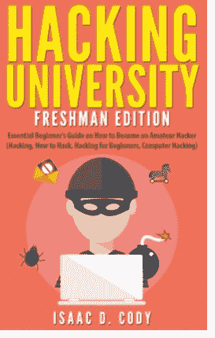
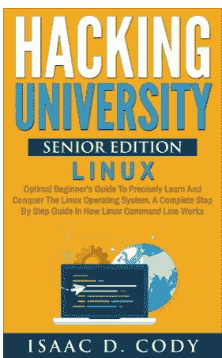

# 数据分析与Linux操作系统

## 2 合订本手稿

本书将包含来自“Hacking Freedom and Data Driven”系列的 2 份手稿。本质上它将是一书合二。

数据分析将帮助你学习如何利用数据分析、数据科学和预测性分析的力量。

黑客大学高级版将开启你征服 Linux 操作系统的旅程！

# 本书预览

你是否曾经想用数据分析来支持你的业务？

对于许多业务而言，数据分析不仅能做到这些，还能做到更多。它是一个很好的系统，可以看到事情进展如何，并且你可以通过它收集信息以形成结论。但这如何运作？其中的细微差别是什么？嗯，这就是本书发挥作用的地方。

在这本书中，你将学习以下内容：

- 什么是数据分析
- 大数据的重要性
- 如何进行数据分析
- 为什么企业现在和未来需要它来获得成功和繁荣

利用数据分析，你可以挽救你的业务，并且本书将进一步向你证明这一主题的重要性，它能为你所做的，以及你如何利用数据分析使你的业务闪耀并成长。

# 引言

我要感谢并祝贺你下载了这本书

*数据分析：实用数据分析与统计指南，转型和进化任何业务，利用数据分析、数据科学和预测性分析的力量，初学者必读*

本书包含经过验证的步骤和策略，教你如何在掌握大数据、数据分析方面变得熟练，即使你从未学过统计科学。本书带你从数据分析的初始概念开始，到信息处理、组织结构的构建，甚至数据管理中的安全问题。凭借本书中包含的知识，企业主即使是在最小的企业中也能够创建并安装大数据分析。

数据分析已被证明可以改变商业世界。那些使用数据分析来进行业务决策的公司正以巨大的优势超越竞争对手。凭借分析师提供的知识，企业主和组织在市场营销、销售和预测等方面做出了更好的业务决策，这只是数据分析的几个有用功能之一。

这是一个无可逃避的事实：你需要数据分析才能跟上竞争对手的步伐，因为他们现在正在实时使用它来做业务决策。

如果你不发展对数据分析和大数据的理解，你将落在尘土中。由于缺乏经验和对商业智能中日益增长且必要的趋势的了解，你的销售额可能会下降，你的业务也可能面临风险。

本书是一个极佳的资源，它定义了数据分析以及使其成功的工具和方法。

祝你好运！

# 第 1 章：数据分析的重要性以及为什么你的业务应该使用它

数据分析是这一时代的热门词汇。每个人都在讨论和推动数据分析，从医疗保健到大型企业。小型企业和巨型公司都在宣扬使用大数据来变革其业务实践的优势。仓库、运输公司和供应商都在狂热地讲述他们通过数据挖掘重组组织所节省的钱财。这是炒作还是新的赌场，每次拉杆（或在这种情况下，拉数据集）都能提供现金？

数据分析（DA）是解释原始数据的过程，目的是告知个人（或群体）从数据中得出的结论。数据分析在各行各业用于做出关于库存、现金流、销售预测、客户特征和止损策略的业务决策，仅举几个实际用途为例。在科学领域，数据分析用于证明和反驳理论。

商业分析和大数据的概念自 1950 年代以来就已存在，用于预测消费者市场的洞察和趋势。六十年前与今天数据收集之间的区别在于，当今的信息集几乎是实时的。如今，企业可以在三十分钟或更短的时间内接收信息，以便立即做出业务决策。这使得使用数据分析的公司与不使用的公司相比具有巨大的竞争优势。

如今企业高管接收的数据是全面、快速且可靠的。这使决策者能够在接收所需信息的几分钟内确定最佳行动方案，而不是像以前那样需要数周、数月甚至数年。

企业正在开发数据矿以利用信息，方式多种多样，包括但不限于：

1. **数据存储成本降低**。在 1981 年，存储 1GB 信息的成本是 700,000 美元。在 1996 年，该成本降至 295.00 美元，而在 2014 年，相同的存储成本仅为 0.03 美元。（*来源：* http://www.mkomco.com/cost-per-gigabyte-update）

2. **研发真实数据的机会**。顾客现在非常善于表达他们的需求和愿望。在 Twitter 上推出新产品可以快速确定对创新产品设计兴趣。数据分析允许为市场趋势的研究和开发提供即时反馈。

## 3. 库存与商品分析

通过数据分析，企业可以了解货架上哪些商品流行，哪些商品积灰需要下架，从而释放出宝贵的货架空间。为什么杂货商将利用率最高的商品放置在最高和最下面的货架上？因为他们知道这些商品永远都有销路，而利润最高的商品则摆放在消费者视线平齐的位置。

联想（Lenovo）正在为客户设计一款新键盘，但他们未能认识到游戏行业中的忠实客户群体。在使用数据分析后，联想改变了设计，纳入了游戏玩家的需求，并推出了一款优秀的产品，带来了数百万的销售额。数据分析挽救了他们的产品并增加了利润。

数据分析绝不仅仅局限于零售行业。其他企业也使用数据分析来提高盈利能力和效率。以下是目前各行业正在采用的一些应用：

### 旅行与酒店业

客户满意度很难衡量，但却是企业蓬勃发展的关键。大数据分析让管理层在客户入住时、在客户决策点以及甚至在客户离店时，都能即时获取客户偏好信息。这使得管理层有机会在问题发生时立即解决不满情绪，将潜在的客户关系危机转化为所有相关方都满意的体验。

### 医疗保健

在医疗保健行业，大数据正在改变病历记录方式、研究分析以及患者护理管理。结果是采用了一种更好的护理方法，通过计算机化病历可以跟踪患者接受治疗的任何地点。此外，由于查询信息的即时性，有时新的程序或药物可以立即提供。医院的人员配置也因数据分析而发生转变，使护理机构能够在高峰时间安排更多人员，在空闲时间安排较少人员。

### 政府

当地警方正在使用数据分析来确定犯罪率最高的区域、哪些地方增加徒步巡逻会有利可图，甚至入室盗窃和小偷小摸的高峰时段。分析技术可以精确定位郊区或城市的问题区域，而无需消耗有限的监控人力。

中小型企业收集数据的机会与大型机构相同，但记住以下策略会有所帮助：

- 为了触达主流消费者，企业必须具备数字化形象。寻找产品和服务的客户会去网站和社交媒体获取意见、报告、比较和评价。
- 网站应简单明了且诚实。它还应在不夸大或误导的情况下描述产品或服务的益处。消费者能看出炒作，并会刻意避免那些网站作为潜在的信息或产品渠道。网站应能够发布信息并收集信息。
- 网站分析将收集客户的人口统计数据、他们的兴趣、入口点、他们感到厌烦和“点击退出”的点，以及他们最喜欢的社交媒体网站。
- 如果网站设计正确并具有许多互动点，客户或顾客会在意识到自己已被“挖掘”之前，指定其需求和愿望。

### 小企业案例

这里有一个小企业使用大数据的良好范例：

一家当地面包店发现巧克力碎曲奇销量火爆，无论是通过网站还是电话订单，都是以打（12个）为单位购买的。然而，巧克力纸杯蛋糕的销售速度却越来越慢。面包师阅读了网站上的评论，发现了一条无害的评论：“我爱巧克力纸杯蛋糕和巧克力碎曲奇，但我可以用买2个纸杯蛋糕的钱买到12块巧克力碎曲奇。”

这些数据成为面包师的“顿悟”时刻。面包师迅速创建了一个仅用于曲奇销售的独立页面（以延续巧克力碎曲奇的趋势），同时也将整大小纸杯蛋糕的产品提供改为迷你纸杯蛋糕。四个迷你纸杯蛋糕的价格与一打巧克力碎曲奇相同。面包师还在Facebook列表上放置了一个优惠券特别优惠：“买一打混合曲奇，提及此广告即可免费获得一个你选择的迷你纸杯蛋糕。”所有曲奇和新产品的销量都增加了。

## 第 2 章 如何处理大数据

### 大数据及其问题

大数据是那些对于使用当前数据管理中传统技术和方法进行分析而言，体量过大、无序或非结构化的挖掘数据。数据的数量不如数据的使用和分类重要。

大数据分为三个维度：体量（Volume）、速度（Velocity）和多样性（Variety）。企业被大量数据淹没，需要方式来识别和利用数据集。

无论管理问题如何，大数据对企业或组织仍然非常有价值。大数据使信息透明化和可用。既然组织正在收集更大量的数据，以数字格式存储的成本比以往通过磁带存储便宜得多。管理层使用绩效数据来探索病假和员工迟到趋势、产品库存、流动甚至存储容量。其他企业正在使用数据来探索预算和购买决策的预测。

大数据帮助企业细分其客户群，以便根据客户需求和愿望来定制产品提供。更重要的是，大数据正被用于研发，以改进下一代服务和产品提供。

### 获取与掌握大数据

企业现在必须使用新的存储、计算、收集、分析技术和手段来捕获和处理大数据。尽管技术挑战甚至个别公司的优先级不同，但它们都有相同的问题：旧的计算机系统、不兼容的格式以及不完整的数据库信息集成，这阻碍了对数据库信息的解释。

有可用的新方法来处理数据，以协助大数据的质量管理。最佳方法将在做出购买决策之前分析数据的体量、多样性和复杂性。

大数据有用于数据库管理系统的开源技术，包括 Hadoop 和 Cassandra。市场上也有几种商业智能软件产品，它们向企业所有者报告、呈现和分析最终产品。

### 利用大数据进行业务

据估计，企业仅使用其接收信息的 5%。这留下了巨大的改进空间，可能用大数据分析所需的工具技术栈来填补。需要存储、计算、可视化和分析软件，这只是开始。还需要额外的人员，可能还有一个 IT 部门。

投资大数据在投资回报率（ROI）上值得吗？简而言之，是的。麦肯锡全球研究院预计，正确利用大数据的企业可以将运营利润率提高 60% 以上，这是一笔巨款。

以下是建议在您的组织中实施大数据的步骤：

- 盘点所有相关的数据资产
- 促使管理层拥抱数据驱动的世界观
- 开发技术实施


- 解决包括数据安全、隐私和财产在内的政策问题
- 确定机会和风险

数据安全尤为重要。数据库包含机密信息，可能是商业机密、个人医疗信息，甚至是受版权保护的材料。数据应集中且安全。由于数据量大，以及持续执行此类实践所需的时间和人员成本，加密不是一个选择（原文意为加密因资源限制而不可行，或指完全加密不现实，这里保留原文逻辑）。数据库保护从提到的第一步开始，即盘点所有输入来源。只有当贡献来源的范围被分析后，企业才能确定哪些安全措施需要改革，以及哪些特定产品能够处理这项工作。

## 第三章 数据管理的优势与挑战

古往今来，企业主只需审视新产品，听取来自代理商的销售演示，然后凭借直觉决定是否购买该产品。就像设有邮局和加油站的小杂货店一样，那个时代已经一去不复返了。

这是信息时代。企业必须紧跟趋势、市场动态、消费者偏好和经济压力，以就其市场存在做出恰当的决策。海量的信息要求受过教育的人员能够舒适且准确地解读所提供的数据。

克利夫兰的凯斯西保留大学最近宣布，很快将出现19万名分析人员和150万数据管理人才的短缺。这个问题将主要影响那些无法在拮据的预算下雇佣专职数据分析师的中小型企业。

据《福布斯》杂志报道，去年具备大数据技能的信息技术项目经理需求增长了123.6%，而具备大数据技能的计算机系统分析师增长了89.8%。

*(来源：http://www.forbes.com/sites/louiscolombus/2014/12/29/where-big-data-jobs-will-be-in-2015/#2cqed00404a)*

即使企业能够获得数据分析，除了如何使用所提供的信息外，企业仍面临其他挑战。其中之一就是数据管理。

数据管理是对数据和收集到的信息进行组织化管理，以应对安全性、访问限制和存储问题。数据管理所需的任务包括治理策略、数据库管理系统、数据系统集成、数据安全、来源识别、数据分离以及存储问题。

### 有效数据管理的关键

数据管理问题并非新难题。只要有数据被收集，企业就在处理保持数据纯净这一棘手问题。如今，随着数据量和营销自动化的增加，数据安全已跃升为问题领域的核心。

如果数据不干净或不相关，它对营销和业务高管来说毫无用处。数据管理需要持续监控，因为黑客正伺机掠夺并销毁数百万条相关信息和资源。对于数据安全问题，有一些事项应成为自动化流程，例如：

1. **限制访问**

许多时候，材料和信息的访问权限向所有员工开放，允许他们进行修改。办公室经理、销售人员办公室职员不应具备进入数据库更改、访问、删除或添加信息的能力。控制这种情况的最佳方式是设立边界或实施有限访问。

基于特定功能设置控制措施，例如，营销人员仅限于查看市场数据，但不可编辑。确定组织中谁负责所有数据更改，包括添加/删除以及操作（如更改客户联系信息）。制定数据导入和导出规则，以防止受保护的数据外泄，并防止病毒被上传。创建一个数据主列表，以确保信息既不重复也不受损。

2. **创建数据地图**

数据地图是描绘数据流向的流程图，详细说明了数据的输入和输出、部门集成以及每个数据条目的用途。数据映射是一项持续的工作，旨在维持控制和数据一致性。

3. **将数据分段组织**

数据不在于数量，而在于质量。如果客户群体只有几百人，拥有数百万个名字的数据库毫无益处。如果没有检索组织机制，数据库中有几百个名字也无济于事。

相反，应根据需求对数据进行分离。示例可以按性别、年龄、地址人口统计学特征、邮政编码、联系方式偏好等分类。正确地对数据库进行分段可以使数据充满潜力而生动起来，而杂乱的数据库则会显得混乱不堪。

从目前的活跃客户群开始。将他们按人口统计学特征进行细分，然后按购买习惯进一步细分。定期与客户联系，以获取他们对您产品和服务的反馈。

4. **数据卫生**

数据卫生是保持数据干净和最新的过程。陈旧数据和损坏数据只会使您的数据库变得杂乱，甚至可能感染您所有的记录。与之前的功能一样，卫生维护应定期进行，以确保数据不发生衰减或污染。

维护一个纯净且有序的数据库的重要性不容忽视。如果数据质量不高，所有针对错误联系点的联系和营销项目都将无法取得成功。为了提升数据库在营销和销售活动中的价值，不要忽视数据库管理。

## 第四章 数据管理的现实案例

### 一个无效使用的示例

- 约翰·贝鲁什，33岁
- 克里斯·法利，33岁
- 吉米·亨德里克斯，27岁
- 菲利普·塞默·霍夫曼，46岁
- 惠特妮·休斯顿，48岁
- 迈克尔·杰克逊，50岁
- 杰尼斯·乔普林，27岁
- 希斯·莱杰，28岁
- 科里·蒙提斯，31岁
- 瑞弗·菲尼克斯，23岁
- 埃尔维斯·普雷斯利，42岁
- Prince（王子），57岁
- 安娜·妮可·史密斯，39岁
- 艾米·怀恩豪斯，27岁

来源：http://www.usatoday.com/story/life/people/2016/06/02/celebrities-who-have-died-drug-addiction/85314450/

这些名人有一个悲伤的共同点：他们都因药物过量在过嫩的年纪去世。

处方药监控计划可以告知处方者（医生和执业护士）和分发者（药剂师），以建立针对阿片类药物滥用和转移的控制措施，阿片类药物是上述死亡的主要原因。名人仅占每年因药物过量死亡人数的一小部分。美国疾病控制与预防中心（CDC）已确定这是美国意外死亡的主要原因。在最后一次发布的数据分析中，确定2014年有超过47,000例药物过量死亡。处方止痛药导致了其中18,893例死亡。

来源：http://www.cdc.gov/nchs/data/health_policy/VADR_drug_poisoning_involving_OA_Heroin_US_2000-2014.pdf

这些药物的名称是常见的处方药，当人们进行手术、手臂骨折或几乎任何需要前往当地医院急诊室的情况时都会用到：Percocet、Lortab、OxyContin、Fentanyl、Vicodin、吗啡和Xanax只是几个例子。Xanax是一种苯二氮卓类药物，不是止痛药，但当与阿片类药物一起摄入时具有致死性，即使仅服用最小剂量（一次剂量）。

为了预防这场药物过量流行病，各州已建立数据库以监测相关产品的处方。该数据库包括剂量、处方填写频率以及开处方的医生，以确定哪些患者可能在转移或误用其剂量，以及哪些患者在三十天内频繁光顾不同的医生和医院以获取更多药物。

这个概念很棒：建立一个数据库，结合来自多个药房和医疗人员的数据源，以对抗这一问题。不幸的是，该数据库存在几个问题，阻碍了有效的管理。

- 数据来自多个来源，且耗时且复杂。
- 数据不完整，因为许多医生没有花时间查询数据库。虽然该系统的安装在49个州是强制性的，但只有22个州要求合规，并且没有人监控其一致性。
- 负责进行实时信息分析的人员太少。数据被输入数据库，但未被有效提取。

SAS研究所的主要数据分析师在报告*《数据与分析对抗阿片类药物流行病》*中解决了这个问题。他们的观点是目前的信息几乎无法使用。

来源：http://www.sas.com/en_us/whitepapers/tia-data-analytics-combat-opioid-epidemic-108369.html

通过更好的分析和解读，医生可以制定改进的治疗方案、患者教育和政策界限。例如：

- 医生可以与其同行比较治疗方案，以确定早期药物依赖的具体模式。
- 保险和政府支付系统可以编录潜在的误用或转移情况，避免为欺诈行为支付费用成本。

更大规模的医院和公共卫生系统可以开发更好的教育项目、治疗方案和资源决策。

药店可以比较其配药数据，以确定滥用的地理重叠等因素。

各州可以利用该数据库根据人口统计信息为治疗中心提供资金。

合并和细分数据可以挽救生命，从而缓解令人不安的新闻标题。

## 有效使用示例

一位著名的中型企业主通过使用数据分析发现了40万美元。似乎他失去了对1000个库存项目的追踪，这阻碍了他非常渴望的现金流。在他开始库存管理的第一天，他就看到了那些没有从货架上移动的产品。

他启动了一场大型仓库甩卖，在一个周末内售出了全部库存，使他的现金流增加了40万美元。这远远覆盖了新数据库及外设的实施费用。通过迅速果断地出售新发现的库存，该公司以积极的方式利用了其数据，并取得了即时成果。

之前，这家公司没有IT部门，也没有一个能追踪产品老化的POS系统。他的钱在货架上发霉了。一旦安装了数据库系统，他就能将旧库存减少40%，此外还调整了过高定价、供应商成本和利润率。他还通过更新信息清理了客户群，节省了大量邮费和印刷成本。利用他的新信息，他可以针对购买该产品的客户进行销售升级，而不是向不感兴趣的住户广播邮寄。该公司还利用其数据向忠实度和最高的客户提供特别折扣，从而通过追加销售产生收入。

## 第5章：数据分析的不同类型


“大数据”是一个如此流行的术语，以至于人们对其是什么以及它做什么存在误解。大数据的用途巨大：欺诈检测、竞争分析、消费者偏好分析、交通管理、呼叫中心优化、管理公用事业电网以及管理仓库和库存，仅举几例。大数据本身是有问题的，因为它是数据过载的商业智能代名词。

**大数据有三个“V”：**

- 1. 数据过多，即**体积**
- 2. 速度过快，数据移动如此之快以至于无法分析，即**速度**
- 3. 来源过多的信息过多，即**多样性**

尽管大数据的收集和同化令人望而生畏，但从大数据中派生的商业智能可以极大地帮助企业。

### 四种大数据商业智能

有四种大数据商业智能对企业主特别有帮助：

- 1. 规范性
- 2. 预测性
- 3. 诊断性
- 4. 描述性

## 规范性分析

规范性分析是最有价值的分析，因为它告知企业应采取哪些步骤来改善现状。这种数据的使用可以是组织变革的开始。尽管它被认为是最有价值的，但它的使用却最少，只有3%的企业报告使用大数据。公司可以利用规范性分析来为孤立的问题提供具体方案，例如在医疗保健行业中糖尿病和肥胖症的问题。大数据可以识别出既患糖尿病又患有高胆固醇的肥胖患者，这是导致心脏病的三个促成因素。可以立即针对这些患者，通过饮食、糖尿病教育、运动鼓励和胆固醇监测，发起对风险因素的四重攻击。目前，这些问题是由不同的专家解决的，如果它们甚至被解决的话。结合治疗策略会有效得多，信息的组合可以通过规范性分析来汇编。

## 预测性分析

预测性分析是从信息分析中得出的可能情景预测。这通常以商业预测的形式出现。这种形式的分析回顾过去以预测未来。例如，企业可能会查看之前的圣诞节销售情况，以预测特定产品未来的圣诞节潜在销售额。预测性分析在营销和销售部门特别有用，可以模仿以前成功的活动。一些企业正在使用预测性分析来检查销售流程，包括客户介绍、与客户沟通、客户线索、向客户销售、交易达成以及后续沟通。

## 诊断性分析

诊断性分析专注于过去的困境，以弄清情况中的谁、什么和为什么。这种分析可以使用分析仪表板或小组件，帮助读者一眼看出手头信息。诊断性分析使用的一个例子可能是检查销售活动或社交媒体营销活动。通过小组件，人们可以看到帖子数量、访客数量、评论和点赞数量、页面浏览量以及客户反馈。一眼看到这些分析而不是翻阅报告，能更快地把握数据的关键点。利用诊断性分析可以解释为何营销活动未能增加特定产品的销售。

## 描述性分析

这种分析类型提供当前情况的实时数据。而不是提供上周甚至昨天的数据，这些信息正在发生。描述性分析使用的一个例子是获取希望购买新车的客户的当前信用报告。检查过去行为以评估当前信用风险并预测未来信用状况，将帮助销售经理确定潜在客户是否能够或愿意履行信用合同。

大数据分析将为公司的投资回报率带来一定的价值，因为它填补了有关客户表现和产品销售的空白。通过将大数据的庞大性减少为可管理的信息块，企业主可以就人员配置、销售、利润和产品差异做出更好的业务决策。

## 第6章：它们共同运作：数据管理、数据挖掘、数据集成和数据仓库

大数据的术语有很多；本书的这一节确定了在解决大数据物流方面最有用的术语。

**数据管理。** 数据管理是对流入、流经和流出组织的数据的访问和质量施加限制的过程。限制可能包括有限访问、防止病毒和数据损坏的安全措施以及维护问题。

**数据挖掘。** 数据挖掘是筛选数据以提取模式和相关信息来解决当前业务问题的过程。使用软件，数据挖掘将消除海量数据中的所有混乱。

**Hadoop。** 这是开源软件（意味着它是免费的！），用于在通用硬件上存储数据并运行鉴别应用程序。它是筛选冲击数据集的大量数据信息的关键。它以处理数据的速度而闻名。

**内存分析。** 通过从框架内存（而不是从你的硬盘驱动器）调查信息，你可以从你的信息中快速获得知识片段并迅速跟进。这一创新可以消除信息准备和调查处理的延迟，以测试新情况并建立模型；它不仅是企业保持敏捷并做出更好业务选择的简单途径，还使它们能够运行迭代和智能检查情况。

**预测性分析。** 预测性分析使用统计算法、机器学习技术和数据，基于以前的使用模式识别预测结果。它是对稍后会发生什么做出最佳评估，以便企业可以更放心地做出最佳业务选择。预测性分析最常见和基本的用途包括欺诈和诈骗、风险管理、运营管理和营销职能。

**文本挖掘**。在利用文本挖掘技术时，企业会从万维网、评论、文章和其他文本来源中提取文本数据，以发现此前未曾察觉的见解。文本挖掘结合了机器学习和语言处理技术，用于评估和整理网络文档（如博客、信息源、竞争对手情报、电子邮件、评论和调查问卷），从而帮助企业分析大量信息，发现侧重点和隐藏关系。

**数据集成**是指将新信息和数据添加到旧计算机系统中，同时保持数据内容既干净又未损坏。有效地移动数据已成为企业在以下领域面临的挑战：

- **数据需求**
  - 以所需的格式交付正确的数据以缓解业务需求，是数据集成的主要原因。每个新的数据源都可能影响其迁移到的先前信息集合和系统。
- **预测业务需求**
  - 如果不能及时获取，数据就毫无用处。集成必须足以管理批量信息和实时数据。
- **确认所有数据均标注了相关信息**
  - 旧系统未在服务器中记录活动的时间戳或日期。为了快速识别对数据所做的更改，数据集成需要记录这些信息。
- **对所有传入数据保持警惕**
  - 预期来自其他来源的数据是很自然的，但需警惕其可能已被感染或存在其他损坏。扫描所有传入内容，检查其兼容性和集成需求。
- **验证客户信息**
  - 将传入数据与主数据库进行比较，以确认客户数据库准确且最新。
- **保留每次变更的历史记录**
  - 有时需要回溯变更，这既可能是为了法定合规，也可能是因为集成未按预期工作。
- **升级系统并评估流程**
  - 不断寻找系统可能无法满足业务需求之处。定期升级系统，确保拥有数据管理和集成需求的最佳解决方案。

**数据仓库**。数据仓库是为组织存储其准备好的电子数据。数据必须以可靠、未受损、安全、易于检索和管理的方式存储。

## 第 7 章 为企业进行数据分析

我们在本书中强调了企业在进行数据分析的重要性，但尚未确切解释如何收集数据。本章将专注于基本的数据收集，以便你实施一项有助于实现组织目标的战略。

### 逐步指南

#### 什么是数据收集？

基本上，数据收集意味着实施你制定的数据收集方案。你已决定如何获取数据——无论是通过直接观察、访谈、概览、调查和测试，还是其他技术——现在你和/或其他观察者需要执行你的安排。不过，数据收集还涉及更多内容。你需要以适当的方式记录信息，并对数据进行分类，使其尽可能有用。

你收集信息的方式应与你打算如何分析和利用它相关联。无论你选择哪种策略，如果可能，记录应与信息积累同时进行，或紧随其后，以免丢失任何内容或记忆模糊。

#### 有效数据收集所需的一些功能：

- *从所有来源收集数据。*
- 计算为获取准备好的定量数据以供审查所需的任何数值或比较运算。例如，这可能包括将数值观察结果输入图表、表格或电子表格，或计算一组数字的平均值（通常）、中位数（中间点）和/或众数（最常发生）。
- 对信息进行编码（解码信息，特别是将非数值表达的主观信息转换为可由特定软件项目处理的格式）。
- *以更容易操作的方式对数据进行整理。*

如何实现这一点取决于你的研究设计和评估问题。你可以按独立变量（成功指标）将观察结果归类，按个人或群体成员，按时间，按活动等。你可能还需要以几种不同方式对收集的信息进行分组，以便考虑不同变量之间的相互作用和关系。

数据中有两种类型的变量。独立变量（干预）是分析师或团队执行的状况，以检查其是否会产生变化并改善局势。这可能是一个项目、策略、框架或其他行动。因变量是可能由于独立变量或干预而改变的状况。因变量可以是一种行为或结果。

### 我们如何检查数据？

检查数据意味着以能揭示其中存在的关系、设计、模式等的方式进行查看。这可能意味着对其进行统计运算，不仅可以告诉你变量之间似乎存在何种关系，还可以告诉你可以在多大程度上相信你所获得的答案。这可能意味着将你的数据与其他数据集（对照组、全州数据等）进行对比，从而从信息中得出一些结论。就你的评估而言，目标是获得准确的评估，以便更好地理解你的工作及其后果。

你将有两种类型的数据可以使用，尽管并非所有评估都必然包含两者。定量数据是指以数字形式收集或可解释为数字的数据，随后可以数学方式展示和分析；定性数据以描述、叙述、结论、引语、见解等形式收集，通常要么无法简化为数字，要么保留为叙述形式时被认为更重要或更具启发性。正如你可能预期的，定量数据和定性数据应以不同的方式进行分析。

#### 定量数据

定量数据以数字形式收集。定量数据的示例包括：

- 特定行为或状况的频率（速率和持续时间）
- 调查结果（报告的行为、客户满意度评分等）
- 人口中具有特定特征的人的比例（患有糖尿病、肥胖、心脏疾病指标、教育水平等）

数据也可以以非数值形式收集，并转换为准备好进行分析的定量数据。开发者可以为特定行为的强调级别分配数字。例如，开发者可以统计 Facebook“赞”或“评论”的数量。这类信息是否必要或有用的，取决于你的数据旨在回答的问题类型。


定量数据转换为统计程序，例如计算事件重复的平均次数。这些计算由于数字是精确的，可以为不同问题提供决定性答案。定量分析可以识别与持续时间、频率、时间强度等相关的因变量变化。这允许与类似问题进行比较分析，例如邮政编码范围内人口数量的变化，或同龄女性之间购买行为的变化。

### 定性数据

与数字不同，定性信息被视为“软”数据，意味着它不能简化为特定结论。数字可能指示某人口的人口数量，但软数据可能通过客户的态度和外表告诉你购物者的压力水平。

定性数据偶尔可以转换为数字，通过统计特定事件发生的次数，或通过为重要性级别、客户满意度或在下单时功能是否易用分配数字网站。

将定性数据转换为定量数据在很大程度上取决于人为因素。即使客户同意使用 1-5 的数字（1 代表非常不满意，5 代表极其满意）来评估客户满意度，关于 2、3 和 4 在评估量表上的具体位置仍是一个问题。这些数字只能提供部分评估；它们没有提供关于客户评分“为什么”的信息。客户是因为货架上的产品库存、产品细节、店内氛围或音乐问题、店铺位置等而感到不满吗？

同样，在统计某种行为的具体实例时，统计者是否包含了那些只表现出部分行为的人（例如，那些在 Facebook 上点了“赞”但没有发表评论的人）？

定性数据可以传达定量数据中无法获得的特定知识，例如为什么某个销售促销活动有效，或者该活动如何在文化上与客户的群体发生冲突。（1962 年，雪佛兰公司对他们的新车型“Nova”在美国非常受欢迎，但在墨西哥几乎没有销量感到困惑。研究人员未能将“Nova”这个词翻译成西班牙语，而在西班牙语中它的意思是“没有去”。该名称的西班牙俗语意思是“不运行”。难怪墨西哥的销量会下滑！汽车更名为 Caribe 后，销量增加了。）

评估定量和定性数据集通常都是有益的。

## 收集和分析数据的步骤是什么？

- 清晰设计和定义回答所需问题所需的测量指标。
- 在正确的时间框架内，进行所需时长的研究。
- 根据数据的功能对数据排序；你将如何使用这些信息？
- 如果可能且合适，将定性数据转换为定量数据。
- 使用图表和可视化图表（示例见第 10 章）使数据更易于理解。
- 直观检查信息的模式以识别趋势和联系。
- 在定性数据中寻找模式，就像在定量数据中一样。如果人们持续提及类似的问题，这些问题可能是理解问题和可行解决方案的关键。

通过以下类别之一**解释发现结果**：

- 你的营销计划正在按计划执行，没有明显问题。
- 你的营销计划对销售没有显著影响。
- 你的营销计划对销售产生了负面影响。（可能是因为它冒犯了消费者或被认为很愚蠢。）
- 你的营销计划结果喜忧参半。推广的产品销售良好，但之前受欢迎的产品销量可能下降了。例如，Secret 除臭剂推出了一种非常受欢迎的新香型类别，但无香型产品的销量显著下降，因为忠实用户只是改变了偏好。
- 如果分析显示你的营销项目有效，你有一个简单的选择：继续该项目或对其进行调整，以期增加销售。
- 如果分析显示该项目无效，解释会更加复杂。等式中缺少了什么？什么因素阻碍了期望结果的实现？

分析和解释结果使流程形成闭环；现在你可以利用获得的知识来调整你的业务并改进你的服务。继续分析和评估业务目标和结果将使业务保持最新状态，并在市场上保持有效的存在。

# 第 8 章 数据解析的组织方法

本章讨论了需要建立的组织框架，以将大数据融入企业文化。可行的分析治理将使企业能够利用大数据获得竞争优势。

## 框架

要整合信息技术、业务智能和分析，必须考虑以下四个主要问题：

1. 分析是否是业务的关键组成部分，与财务、销售、产品开发、研究和营销处于同等类别？
2. 合适的人员是否已到位？
3. 人员是否具备深入了解业务需求的能力？
4. 是否建立了治理结构？

该框架被称为 CSPG 框架。

- 文化
  - 业务是围绕数据分析进行的，还是数据分析在营销、研发和销售面前退居次席？
- 人员配置
  - 是否有足够的人员配置，雇佣合格人员是否优先？IT 部门是在捉襟见肘的预算下工作，还是拥有进行大数据分析的适当资源？
- 流程
  - 如果分析流程正确完成，数据可以在类似组织之间交换而不必担心污染，从而允许多条信息流。
- 治理
  - 对于最近才进入数据分析领域的企业来说，治理是一个新概念。治理需要一个涵盖人员、结构和薪酬的结构，以便 IT 部门不与其他部门脱节。

## 业务中分析职能的定位

分析职能的定位有三种模式：

1. 将分析部门放在中央单位。这种位置的优势在于容易获取数据，更容易融入公司文化，并且数据检索速度更快。集中式部门的挑战可能在于其位置（作为附加部门，它可能位于决策者中心之外），可能存在关于部门向谁汇报的混淆，并且数据分析师可能远离企业文化，无法预见业务需求。

第二种可能性是去中心化分析，并在公司各部门中放置分析师。这允许分析师专注于其所在的业务领域。挑战在于需要协作完成未细分且需要所有分析师集中在一个问题集上的公司级项目。

2. 第三种选择是前述两种情况的混合。这将有分析师放在集中位置，同时也将分析师部署到整个组织中。这要求大量的分析师员工，这可能是企业最大的挑战。

### 关键分析

分析由模型、基础设施和运营组成。模型是从统计数据中衍生的统计模型、预测模型或数据挖掘。分析过程的关键是构建模型，这通常由分析师、数据科学家或统计学家执行。

基础设施是用于数据管理、数据处理和决策的软件组件、应用程序和平台。与分析基础设施相关的流程包括数据管理、模型部署以及必须整合到业务运营中的多种分析。

运营是创建用于模型和业务操作的数据的过程。数据可以是购买的、内部的、外部的或协作的。

数据分析团队必须识别内部和外部相关数据，管理数据，构建分析模型，并将模型引入内部系统。大多数企业按以下方式组织这些功能：业务部门请求模型，分析团队构建模型，IT 部门提供原始数据，运营部门启动模型。这就引出了分析治理的原因。

## 分析治理

企业在提取大数据时面临的三个挑战是：

1. 识别数据将用于哪些独特需求
2. 获取所需信息
3. 将分析模型部署到组织中

分析经理必须拥有足够的权力来消除这些挑战。治理结构需要一个机制，用于识别、沟通和解决源自数据分析问题的事项。分析经理还需要灵活性来雇佣合格且知识渊博的人员。

# 第 9 章 数据可视化

可视化是让数据对读者生动起来的关键。信息列表往往难以转化为可用的数据；将数据组转化为可管理的形式对于帮助读者区分重要信息和冗余信息至关重要。

使用图形设计软件可以突出关键统计数据，并通过使用视觉图像揭示那些通常难以检测到的隐藏模式和联系。

以下是一些*免费*的数据可视化软件程序列表，可以通过网络轻松访问：

### Chart.js

http://www.chartjs.org/

该程序提供 6 种不同的 HTML5 图形，是最受欢迎的小型图表程序之一。

### Dygraphs

dygraphs.com/

这是一种可定制的 JavaScript 图表工具，适用于几乎所有浏览器，并用于处理密集数据集。它支持移动设备和平板电脑。

### FusionCharts

www.fusioncharts.com/

FusionCharts Suite XT 提供 90 多种图表、965 个数据地图以及可定制的交互式业务仪表板。FusionCharts 支持 AJAX 应用程序，并且可以使用 JavaScript API。

### Instant Atlas

www.instantatlas.com/

Instant Atlas 将统计数据与地图数据相结合，对于人口统计信息非常有用。

### Raw

raw.densitydesign.org/

Raw 是可定制的，可供修改，可以从应用程序上传到计算端，导出为 SVG 或 PNG，可以嵌入网页，并提供基于矢量的图像。

### Tableau

www.tableau.com/

Tableau 允许用户拖放数据，立即更新为实时图表。

### Timeline

https://timeline.knightlab.com/

Timeline 提供详细的事件分析，具有可点击功能，可以打开图表以获取更多特定信息。

### Visual.ly

visual.ly/

Visual.ly 是一个图库工具和信息图表工具。使用 Visual.ly，用户可以创建惊艳且易于制作的数据表示形式。

### Visualize Free

https://visualizefree.com/

Visualize Free 允许你上传自己的数据集并构建 HTML5 交互式图表进行可视化。

### ZingChart

https://www.zingchart.com/

ZingChart 是另一个 JavaScript 图表程序，具有交互式 Flash 和 HTML5 图表，提供超过 100 种选择用于你的数据分析。

# 第 10 章 使用社交媒体

Domo 在 2015 年发布了社交媒体用户统计信息图表。以下是显示用户数量惊人增长的统计数据。

> *在短短一分钟内，*
>
> BuzzFeed 流式传输 34,000+ 个视频
> Instagram 展示 170 万+ 张照片


> Netflix 流式传输 80,000 小时视频
> Vine 流式传输 1,000,000 个视频
> YouTube 上传 300 小时视频
> Facebook 帖子获得 410 万+ 个“赞”（这与帖子数量不同，因为并非每个人都会花时间点赞）
> Twitter 有 347,000 条推文
> *来源：Domo, 数据永不停歇*

显然，社交媒体现在是触达消费者的主要渠道。成功地将社交媒体与商业实践相结合，只能增强客户发展的机遇。企业明智地搜索其产品以寻找解决棘手故障排查问题的答案。

对于零售相关企业来说，常被忽视的信息来源之一是 YouTube 视频。客户经常提供展示操作方法的视频，而这些方法在产品的用户手册中并未提供。有时，常见问题编写者会被鲜为人知的产品故障所困扰。如果分析人员从事数据挖掘，YouTube 可能提供解决方案。

### 社交媒体分析

社交媒体分析是利用从博客和社交媒体网站收集的信息，使企业更加成功并提高知名度。拥有互联网存在感对于吸引年轻一代客户至关重要。81% 的 30 岁以下购买者使用互联网来影响他们的购买决定。与这些购买者的连接点是业务增长和发展的关键。

社交媒体分析涉及数据挖掘、网站信息分析、数据收集以及利用信息进行业务预测和产品塑造的实践。社交媒体分析的主要用途是评估客户反应，以支持营销进展和客户服务决策。社交分析的第二大用途是通过维持网络存在感来获得竞争优势。社交媒体分析的第三种用途是衡量客户对产品或服务的态度。社交媒体分析的第四种用途是通过提供仅限网络的资源和折扣来增强产品。社交媒体分析的第五种用途是生产那些违反逻辑（例如跑步者将跑鞋里的内衬拉出来，因为这会让他们的脚太热）但消费者想要的产品。

社交媒体分析与任何其他数据分析类似，但有一些特定需求需要考虑，例如：

#### 形成假设

社交媒体分析更多地关注某事发生的原因，而较少关注事件本身的报告。从一种情况甚至一个“为什么”的问题开始分析。为什么读者参与了这个问题，但没有响应 Facebook 或 Twitter 上的类似调查？检查发帖频率和你发布的时间。它们对于你的品牌或产品是否是最优的？例如，在下午 5 点而不是下午 2 点为外卖食品做广告会有效得多，因为客户下班时又饿又累，想要立即解决晚餐时间的难题。

利用信息确定分享信息的新方式，以吸引更多的读者流量。例如，Twitter 现在允许 Vine 视频嵌入帖子。一个用于测试的假设是：Twitter 的新增功能是否增加了网站的流量，还是仅仅让读者更充分地娱乐？

#### 将数据移至电子表格

从识别电子表格中的趋势和模式开始。根据这些数据，你可以推断出需要探索的问题和差异。

#### 扩大样本范围以尽可能涵盖更多数据

扩大样本可以通过许多方式实现，但以下是两种可能性：更改样本的结束日期，或者同时跟踪竞争对手。

#### 质疑结果

当数据比所需的多时，很容易确定错误的相关性。就像证明测试一样，通过寻找支持你预期和期望结果的数据可以快速解决。继续测试结果以消除结论中的偏见。

#### 帮助管理社交媒体的工具

每天向几个社交媒体平台发帖既耗时又必要。与其每天花几个小时维护社交媒体更新，不如考虑以下一些能够减轻日常监控繁琐工作的工具。

以下是一些推荐工具列表，可帮助企业主在更短的时间内完成任务。其中一些工具是免费的，但大多数需要付费订阅。

- **Buffer, HootSuite, and Sprout Social**

这些工具允许你登录一次并为主要社交媒体平台安排帖子。你可以同时执行多项功能，如编写和安排一周的帖子，分析效果，以及共享信息。

- **SumAll, Social Express, Sociallight**

这些程序将数据发送给你，而不是你去检索。你可以选择哪些报告对你的业务感兴趣。

- **Social Count, SharedCount, BuzzSumo**

该程序跟踪来自不同 URL 的“分享”。你输入 URL，它会吐出每天、每周和每月的“分享”数。这节省了时间，无需在网站上寻找信息。

### 企业主的社交媒体策略

以下是对于管理业务和社交媒体的中小型企业主最有帮助的建议。

- 使用业务仪表板整合你的社交媒体。
- 同时完成所有社交媒体帖子并提前安排它们。
- 关注你帖子的参与度。
- 细分你的受众以便更快地分析。

社交媒体将一直存在，并且每天都在变得更加庞大和复杂。管理社交媒体现在对于维持网络存在感至关重要。那些忽视社交媒体、像鸵鸟一样把头埋在沙子里的企业正在失去新的收入来源的机会。在线产品销售每时每刻都在增加。在一分钟内，亚马逊有超过 4,000 名新客户购买产品。精明的企业主希望尽快利用这个潜在的客户群。

社交媒体分析帮助企业主瞄准那些已经对组织推广的产品或服务感兴趣的客户。只要对消费者客户服务需求稍加关注，就可以发现一条路径，打开通过互联网渠道进行沟通和销售的网关。

# 第 11 章 数据分析如何让任何企业持续繁荣

**分析时代**已经到来，水瓶座时代已经过去。那些能够收集、解读并利用其衍生原始数据采取行动的组织，能够适应快速变化的市场环境，并始终领先于竞争对手。

为了正确且快速地利用数据，使用这些工具分析数据将带来清晰度和创新性的建议。

从**测量**开始，确定哪些分析对组织内部的决策最有帮助。

**诊断**客户满意度或产品推广中出现的**问题**。为什么某事会以不利的方式发生？数据分析可以帮助你定位具体问题，从而找到令人满意的解决方案。

**预测和优化**以预测变化及其潜在后果。使用“如果”……“那么”的提问方法。（如果我改变客户服务方式，我该如何预期反应？）这种分析技术有助于确定组织的发展方向以及维持持续生长的最佳途径。

**操作化**，即将信息投入使用，由一线员工、销售人员、工程师、营销人员、经理及其他决策者使用。这是从分析到实用性的转变，从实验室走向现实世界体验。

**自动化**是指业务管理者使用实时信息对组织进行即时调整。例如，在杂货行业，优惠券对于顾客和杂货商来说都是巨大的利润来源。杂货商销售产品，并由优惠券代理机构报销，外加基于优惠券价值的处理费。顾客以更低的价格获得产品，而这些产品通常是新推出的商品，在萧条经济中会被视为奢侈品。然而，如果顾客利用零售商获取商品优势，购买完货架上所有库存，导致后续顾客无货可买，从而营造出一群不满顾客的环境，会发生什么？店长立即评估情况并实施“每笔交易仅限 3 张优惠券”的规则。现在顾客仍可以购买该商品，但很少有人愿意离开收银台进行多笔交易。零售杂货商已利用自动化分析问题并创建即时解决方案。

实施的最后阶段是**转变**，此时企业转向数据驱动的企业文化，基于当前分析数据而非传统或直觉做出业务决策。

### 如何如今收集分析数据

1. 建立一个既给予又接收信息的数字化存在。在收集数据之前，你需要一种方式，如社交媒体渠道和交互式网站。
2. 记住，你的目标是从尽可能多的来源尽可能快地接收、分类和处理收集到的数据，以确保数据不会过时甚至不可靠。你收集的数据越多，你的发现就越准确。
3. 专注于需要答案的问题。阅读和思考所有内容很有诱惑力，但这会违背收集数据的目的。将问题置于思维 forefront 将帮助你挖掘客户智能，获取改变业务实践为积极方向所需的信息。
4. 通过社交媒体与客户互动。不要假设你了解他们的需求。给他们充分的机会点击“喜欢”按钮。这个宝贵的按钮比正式问卷能更好地定位客户的需求和意愿。
5. 使用 Google Analytics 和 Alex 来确定关于你客户群的相关信息。它们提供易于理解的网站流量和 SEO 排名统计。利用这些信息来迎合你的客户群。只需更改网站上的几个关键词，就可以增加你的流量，并在谷歌搜索引擎中升至第一位，这是吸引新客户和读者的绝佳位置。

## 结论

再次感谢你下载这本书，**《数据分析：实用数据分析与统计指南，以转化和演变任何企业，利用数据分析、数据科学和预测分析的力量，专为初学者打造！》**

希望这本书能帮助你理解和利用数据分析来增加你的业务销售、营销和效率。

下一步是实施本数据分析指南中介绍的政策和程序。

最后，如果你喜欢这本书，请抽出时间分享你的想法并在亚马逊上发布评论。我们将不胜感激！谢谢，祝好运！

## 简介

计算机包含两个功能组件——软件和硬件。硬件是那些旋转、计算并使用电力来执行运算的物理部件，而软件则是一个更抽象的概念。本质上，软件由编程代码组成，它向硬件发出指令——告诉各个部件该做什么。存在“高级”软件，如互联网浏览器、文字处理器、音乐播放器等。但常被忽视的组件是被称为操作系统的“低级”软件。

我们的个人计算机运行需要操作系统。在办公室，或者使用相对便宜的台式电脑时，使用的操作系统很可能是微软的 Windows。内容创作者、作家和图形艺术家更青睐苹果电脑，因为苹果电脑搭载了以创造力为核心的 OSX 操作系统。Windows 和 OSX 这两个操作系统多年来主导着消费市场。然而，存在另一种操作系统，它在易用性、自定义、安全性和价格方面表现卓越。基于相对鲜为人知的 Linux 的操作系统在上述所有方面均能满足甚至超越需求，但它仍是一个许多人都未曾听闻的冷僻选项。


# Linux 简介

`Linux` 本身不是一个操作系统。它是一个内核，即操作系统的“核心”。正如 `Windows NT` 是 `Windows 7` 的内核一样，`Linux` 是像 `Ubuntu`、`Debian`、`Arch`、`Fedora` 等“发行版”的内核。

但为什么有人会放弃熟悉的 `Windows` 而选择一个闻所未闻的计算环境呢？`Linux` 不仅免费，而且兼容大量设备。旧计算机，特别是那些已不再正常工作的电脑，可以通过安装 `Linux` 操作系统焕发新生，使其运行起来如同新电脑一样。

本书将阐述切换到 `Linux` 的好处，并作为入门指南，介绍如何安装、配置和使用最流行的发行版。随后，将解释终端命令行，说明如何利用 `Linux` 实现其他系统无法做到的功能。确实，切换到 `Linux` 可以带来许多优势，通过阅读本书，你可能会找到一款适合用作你计算机主要操作系统的 `Linux` 发行版。

## Linux 的历史

20 世纪 90 年代初，`Linus Torvalds` 是芬兰的一名学生。当时的计算机通常运行 `DOS` 或 `UNIX`，这两个操作系统在当时都是专有的且难以使用。`Torvalds` 试图基于 `UNIX` 创建自己的操作系统，作为一个业余爱好项目，但该项目迅速壮大并吸引了更多开发者。内核不断演进，直到它变得可移植（可在多种系统上使用）并完全可用于计算。然而，内核并不是操作系统，因此 `Linux` 与 `GNU` 核心实用工具结合，创建了一个让人联想到操作系统的计算环境。

随后，第三方组织将基础 `Linux` 产品作为基础，添加了自己的高级软件和功能，从而创建了 `Linux`“发行版”。`Linux` 至今仍是一个免费的业余项目，因此内核持续接收由 `Torvalds` 和社区提供的更新和修订。在整个 2000 年代，许多其他第三方也看到了 `Linux` 环境的有用性，并开始将其纳入其生产环境和企业中。如今，`Linux` 以在服务器和商业环境中得到广泛使用而闻名，并拥有少量忠实的桌面用户。展望未来，内核已达到如此高的普及度，永远不会消亡。大型公司因其优势和实用性而青睐 `Linux`，因此内核和各种发行版将始终作为最佳替代操作系统存在。

## Linux 的优势

为了比较 `Linux` 作为计算机选项有多优秀，我们将它与更熟悉的现代操作系统进行比较。

首先，`Linux` 是免费的。`GNU` 的背景使 `Linux` 处于“自由开源”的理念中，随 `Linux` 发货的绝大多数（如果不是全部的话）软件都是免费的。自由开源（`FOSS`）指两件事——软件在金钱上是免费的，且源代码也是透明的。`FOSS` 与专有软件的不同在于，`FOSS` 的一切都开放，使用它没有隐藏的间谍软件、费用或陷阱。因为任何人都可以贡献于唾手可得的源代码使其更好，软件通常更安全。由于 `Linux` 和你可以从其中下载的大多数软件都是免费的，它是小型企业或预算有限的个人用户的绝佳操作系统。当然，不收费并不会牺牲质量，因为 `Linux` 项目及其各种发行版是由社区驱动并通过捐赠资助的。相比之下，`Windows` 的成本往往是数百美元，仅操作系统本身就很昂贵。`Microsoft Office` 是一个流行的文档写作程序套件，但价格也高昂。`Linux` 中存在这些程序的免费替代品，它们在质量上绝对可以与那些知名品牌产品相媲美。

`PC` 拥有者最大的抱怨可能是病毒。`Windows` 计算机尤其容易受到感染，甚至反病毒软件公司也总是在紧跟最新威胁的后尘。通常只需访问一个恶意网站就足以感染计算机，许多用户因为涉及恶意软件的事件发生频率相对较低而选择 `Mac` 电脑。基于 `Linux` 的操作系统与 `Mac` 类似，病毒几乎不存在。这种增强的安全性使得对于关心隐私、安全性或可靠性的任何人来说，切换到 `Linux` 都是必须的。

`Linux` 在企业、政府部门非常流行。这是因为高性能服务器和关键设备在运行 `Linux` 作为操作系统时表现卓越。该操作系统以可靠性和稳定性闻名。虽然 `Windows` 计算机需要定期重启和维护以“刷新”并防止其运行缓慢，但 `Linux` 服务器可以运行数月甚至数年而不重启一次。`IT` 专业人士不可避免地选择 `Linux` 作为其网络的骨干，因为其声誉。其卓越的稳定性也可以在桌面平台上供消费者使用，这对我们也非常有用。

使用 `Linux` 的最佳优势之一也许是速度。低系统要求意味着那些在 `Windows` 上通常缓慢迟钝的计算机，在 `Linux` 上会变得轻快迅捷。对电脑速度减慢感到沮丧的用户可以更换操作系统以获得更响应的体验。此外，`Linux` 可以安装在旧计算机上以重新赋予它们活力。所以即使那台旧笔记本电脑可能太陈旧而无法运行最新版本的 `Windows`，很可能仍有一个 `Linux` 发行版可以从中再榨出几年的使用寿命。

自定义是技术中备受追捧的功能。`Windows`，尤其是 `OSX`，出于担心普通用户会搞坏系统的恐惧，限制了你可以对操作系统进行的操作。`Linux` 并非如此，因为它鼓励编辑和更改操作系统的视觉和功能。当然，这不是必须的，大多数 `Linux` 发行版的默认配置极其稳定，很难意外地弄坏。但对于那些喜欢越狱、修改和摆弄电脑的人来说，`Linux` 可以满足其创意的一面，甚至为好奇的黑客提供其他系统无法获得的工具访问权限。

最后，`Linux` 兼容大量设备。`Linux` 可以运行在几乎任何架构上，这意味着它可以安装在手机、台式机、笔记本电脑、服务器、游戏控制台和“智能”设备上。爱好者们乐于仅仅因为可以安装 `Linux` 而在小众、老旧或古怪的设备上安装它。对于普通用户而言，这意味着 `Linux` 很可能与你的计算机兼容。

总而言之，`Linux` 在许多方面胜过主流操作系统。所有这些绝对使 `Linux` 成为你计算机的更好选择，你应该使用它来获得这些备受推崇的功能。艺术家、黑客、富有创造力的人、小企业主、技术人员、非技术人员，几乎每个人都能找到喜欢 `Linux` 的理由。广泛发行的版本意味着每个人都能找到适合自己的东西，所以今天安装 `Linux`，看看你能从中获得什么。

## Linux 发行版

安装 `Linux` 有多种方式，例如将操作系统镜像刻录到光盘、写入 `USB` 闪存盘、从网上订购 `Live CD`、格式化 `SD` 卡，或者尝试通过 `Virtual Box` 进行虚拟化测试。不过，最终你并不能仅仅安装“`Linux`”就得到一个可用的操作系统。因为 `Linux` 只是内核，你还需要其他软件，如图形用户界面、互联网访问等。如前所述，存在多种 `Linux` 的“发行版”。发行版是包含预装程序和独特风格与侧重点的 `Linux` 版本。发行版将 `Linux` 的核心转化为一个适合日常使用的完整操作系统。

`Linux` 发行版的数量令人咋舌。有些具有特定用途，例如用于黑客攻击的 `Kali Linux`、用于教育的 `Sugar Linux`，或用于高度定制的 `Arch Linux`。另一些则更具通用性，例如 `Ubuntu` 和 `Debian`。要想充分发挥安装 `Linux` 的优势，你需要了解不同的发行版，并做出最适合你的选择。阅读以下章节，以了解一些最流行发行版的用途。

### Ubuntu

在撰写本文时，`Ubuntu` 是最广为人知的发行版。在 2000 年代，它因用户友好和直观而广受欢迎。基于早期的 `Debian` 发行版，`Ubuntu` 在使用上与 `Windows` 计算机非常相似，这意味着它是 `Linux` 新手的绝佳选择。因此，我们将在本书的后半部分安装一个 `Ubuntu` 变种。`Canonical Ltd` 是积极开发 `Ubuntu` 的公司——年度版本更新意味着该操作系统始终处于最新状态，并能与新兴技术兼容。尽管如此，`Ubuntu` 在许多旧设备上仍然能以合理速度运行。应用程序可以从某种“商店”中安装，这意味着初学者无需理解通常复杂的命令行。总之，`Ubuntu` 发行版是初次接触 `Linux` 用户的绝佳选择，你应该安装它来学习 `Linux` 的工作原理，而无需立即深入更复杂的发行版。

对于更具体的计算场景，`Ubuntu` 拥有各种子发行版或“风味”（`Flavors`）。这些发行版以 `Ubuntu` 为基础，但具有不同的侧重点，例如 `Lubuntu` 对轻量级应用程序的强调。以下是一些例子：

- `Lubuntu` – 专为在旧硬件或资源有限的计算机上运行而设计的 `Ubuntu` 版本。其安装文件小于 `1GB`，硬件要求远低于标准 `Ubuntu`。使用此发行版可以让旧电脑重获新生，同时保留 `Ubuntu` 的易用性。

- `Ubuntu Studio` – 面向艺术家的 `Ubuntu` 版本，包括数字画家、音效制作人和视频编辑人员。`Ubuntu Studio` 是预装了编辑工具的 `Ubuntu`。

- `Kubuntu` – 使用 `KDE` 桌面环境重新封装的 `Ubuntu`。`Kubuntu` 的外观和感觉与经典 `Ubuntu` 不同，因为它提供了更符合其他操作系统传统的桌面环境。

- `Xubuntu` 是另一个轻量级发行版，不像 `Lubuntu` 那样精简到极致。`Xubuntu` 牺牲了一定的体积和硬件要求，以提供可在较旧（但不是太旧）计算机上运行的操作系统。它比其他极简 `Linux` 发行版更具美观性，并且也使用 `Ubuntu` 作为基础以保持易用性和熟悉感。

- `Ubuntu Server` – 更适用于工业和企业需求的 `Ubuntu` 变种，`Ubuntu Server` 可以无头（`headless`）运行，并为网络中的其他 `Linux` 系统提供功能支持。


- Mythbuntu – 预装了电视流媒体和直播电视节目的变种。借助 Kodi，这是一个将旧电脑转换为“智能电视”设备的绝佳发行版。

总之，Ubuntu 发行版的广泛多样性意味着每个人都有适合初学者的操作系统。强烈建议你利用 Ubuntu 中包含的易用性功能和整体熟悉感。它作为一个过渡性的操作系统，会逐渐向你介绍 Linux。一定要将它作为你的第一次 Linux 体验进行安装。

## Linux Mint

Linux Mint 是 Linux 世界中使用最广泛的操作系统之一。“功能强大且易于使用”，Mint 包含自由开源软件（FOSS）和专有软件，旨在为 Linux 初学者提供完整的体验。虽然它不完全像典型的 Linux，但 Mint 是作为首选替代操作系统的绝佳选择。它始终位列使用最广泛的操作系统排行榜，其默认布局与 Windows 非常相似，有助于平稳过渡到 Linux 世界。

## Debian

Debian 是最古老的 Linux 发行版之一，创建于 1993 年。结合 Linux 的哲学，Debian 将稳定性和坚固性作为指导开发的原则。Debian 存在的时间之长无疑是其经过精雕细琢的标志，因此，那些寻求无故障且无错误体验的用户可以转向 Debian。自由和开源软件也在 Debian 找到了归宿，因为其中包含的大多数软件都是 FOSS。不过，这并不意味着你受到限制，因为存在一个官方的非自由软件存储库，用于存放诸如 Adobe Flash 等专有程序。Debian 是初学者的不错选择，但 Ubuntu 仍然是最佳的入门操作系统。为了稳定性、FOSS 和纯粹的 Linux 体验，请安装 Debian。

## Slackware

Slackware 是一个比 Debian 历史更悠久的操作系统。它紧密遵循原始的 Linux 宗旨，这意味着你需要自行安装图形用户界面和程序依赖项。正因为如此，Slackware 主要面向中级 Linux 用户，因为初学者可能会因不熟悉的操作方法而感到困惑。然而，如果你想体验一个更接近 UNIX 根源的 Linux 发行版，Slackware 可以满足你的需求。

## Fedora

Fedora 是一个更面向工作站和商业用途的操作系统。就连 Linus Torvalds 本人也是 Fedora 的用户，这促进了该操作系统的普及和使用。Fedora 更新非常频繁，意味着它始终处于最新状态，并位于 Linux 技术的前沿。安全和 FOSS 也是该操作系统的重点，因此它常被用作小型企业终端电脑的系统。不过，处理 Fedora 可能存在一定的挑战，因此可以将其视为一个中级操作系统。

## Arch Linux

Arch Linux 是另一个发行版，但主要设计面向经验丰富的用户。该操作系统以系统框架的形式提供，用户可以按照自己的喜好进行定制，仅添加他们想要的程序和服务。正因如此，Arch 的设置较为困难，但也是一次有益且富有学习意义的体验。通过构建自己的个人系统，你将理解在更高层发行版中隐藏起来的深层 Linux 概念。在非常熟悉基础知识之后，再安装这个高级操作系统。

## 其他值得注意的发行版

最后，还有大量其他独特的发行版值得一提。在下面的列表中，我们将讨论其中的一些。请注意，发行版非常多，整本书都可以用来描述每一个特定的用途。

- CrunchBang – 基于 Debian 的发行版，旨在降低资源消耗。它简洁明了，不包含某些发行版默认附带的一些臃肿软件。CrunchBang 运行速度快且计算效率高。
- Android – 流行的手机操作系统实际上是一个 Linux 变种。由于许多手机的规格低于完整的桌面 PC，该操作系统是笔记本电脑、触摸屏设备或家庭媒体电脑的绝佳选择。此外，你可以使用 Play 商店中的许多 Google Apps，这意味着数千种应用、游戏和工具可供在手机和计算机上使用。虽然不建议将其作为你的第一个 Linux 操作系统，但它绝对是实验旧电脑或儿童 PC 的一个不错选择。
- Chrome OS – 另一个由 Google 开发的移动类型操作系统，Chrome OS 是

### Linux 发行版概览

本质上是一个轻量级的 Linux 浏览器，专为在线使用而设计。谷歌在其 ChromeBooks 上预装了此操作系统，而这些电脑的配置低于其他笔记本电脑。但该操作系统实际上只是一个全屏的 Chrome 浏览器，因此它非常适合那些追求简单无干扰体验或专用互联网机器的用户。
- Tiny Core – 一种以兆字节为计量单位的操作系统，适用于老式计算机或嵌入式设备。该操作系统主要面向拥有兴趣项目或特定用途的中级用户。
- Damn Small Linux – 另一种极简 Linux 变体，该操作系统最适合快速访问 Linux 命令行。
- openSUSE – 这是一个面向资深电脑用户的发行版。拥有许多面向管理员和程序开发者的工具，openSUSE 是那些对自身技能有信心的用户的最佳操作系统。

基于 Linux 内核的操作系统数量之多令人惊叹。面对如此众多的选择，你可能会困惑不知从何开始以及如何安装。如果拿不准（并且正如我们即将演示的那样），安装 Ubuntu 或其变体版本。该操作系统非常适合初学者，并能使从其他系统向 Linux 的过渡更加平滑。但当你技能提升并希望了解更多关于 Linux 的知识时，你随时可以安装其他操作系统。

## 启动进入 Linux

如果你准备好投身于基于 Linux 的发行版，你必须做的第一件事是备份你的文件。覆盖硬盘上的操作系统会擦除其中包含的所有数据，这意味着你必须备份那些在转换之后希望保留的图片、音乐或文件。使用外部硬盘或在线数据存储网站（如 Google Drive）来暂时存放你的文件。如果你丢失了重要物品，我们概不负责，请务必备份！

接下来，我们需要选择一个操作系统。本书将以 Ubuntu 16.04 作为扩展示例，并建议你采取相同做法。访问 Canonical 的官方网站（http://www.ubuntu.com）获取该操作系统的副本。你将把镜像文件从该网站下载到你的计算机上。

接下来，我们需要获取安装介质。这可以是 DVD、USB 驱动器、SD 卡或任何其他计算机可读的可写介质。唯一的限制是，该设备必须能够容纳与操作系统下载大小相当的镜像文件，因此 4GB 应该就足够了。请移除驱动器中的所有其他内容，因为它也会被格式化。

下载一个用于写入镜像文件的工具。对于 DVD，安装 Imgburn（http://www.imgburn.com）；对于闪存介质，下载 Rufus（https://rufus.akeo.ie）。最常见的操作系统安装方法是使用 4GB 的 USB 驱动器，这种方式更受推荐。插入你的介质，启动相应的程序，选择已下载的操作系统镜像，并开始写入过程。这需要一些时间，因为镜像需要在介质上制作成可启动状态。完成后，你可以完全关闭计算机。

这是一个确保你准备好安装 Linux 的关键时刻。检查你的文件是否已备份，理解你将擦除当前的操作系统，并最好手头备有一张 Windows/OSX 安装盘，以防你决定换回原系统。如果你确实准备好切换，请继续。

在仍插入安装介质的情况下，打开你的计算机。你将看到的第一个屏幕是 BIOS/UEFI POST 屏幕，它会提示你按下某个键盘按键以进入设置。这个屏幕每次启动时都会显示，但你可能从未留意过。按下提示的按键进入 BIOS 设置。如果你反应太慢，该屏幕会消失，你通常的操作系统将开始加载。如果发生这种情况，只需再次关闭计算机并重试即可。

一旦进入 BIOS/UEFI，你需要导航到“启动顺序”设置。每台计算机的 BIOS/UEFI 略有不同，因此我们无法详细解释具体过程。但通常，你可以遵循屏幕底部的按钮提示来了解如何导航。到达启动顺序设置后，将你的启动介质置于列表顶部。例如，如果你使用的是 USB 驱动器，你会看到它的名称，并需要将其移至列表顶部。这些设置控制 PC 搜索操作系统的顺序。将我们的启动介质置于列表顶部后，它将启动我们下载的 Linux 镜像，而不是我们通常的操作系统。保存设置并重启计算机。如果一切操作正确，计算机将开始启动进入 Ubuntu。

但如果有问题发生，请尝试使用以下技巧进行故障排查：

- **主要操作系统启动而不是 Linux** – 你可能没有保存将备用启动介质置于列表顶部的设置。PC 仍然默认使用内部 HDD 进行启动。
- **“未找到启动介质”** – 你是将 Linux 镜像“拖放”到介质上而不是写入的吗？如果没有明确告知计算机该介质是可启动的，它将不知道该如何使用介质上的数据文件。或者，你的下载可能已损坏，或写入不完整。尝试重新下载镜像并再次制作安装介质。
- **“Kernel Panic”（内核恐慌）** – 启动过程出了问题。请参照上文检查安装是否损坏的可能性。否则，你试图安装的镜像可能与你的硬件不兼容。如果你看到其他错误信息，请在互联网上搜索这些错误。对于预构建的计算机和笔记本电脑，搜索型号名称和 Linux 以查找其他用户的经验。最后，你可能试图在 32 位计算机上安装 64 位镜像。在下一次下载镜像时，请明确选择 32 位镜像。


- **“从 CD-ROM 读取数据时出现问题...”** – 尝试使用不同的安装介质，因为一些发行版不再支持 CD 和 DVD 安装。建议使用 USB 驱动器。
- **PC 似乎启动了，但屏幕上完全没有任何内容** – 如果你使用的是专用显卡（相对于 CPU 集成显卡），Linux 可能没有完全识别它。请将显示器直接插入主板，而不是插入显卡。

但是，上述大多数问题都是罕见的或仅仅是由于用户错误导致的。Linux 具有高度的兼容性，且在初始安装之后，使用相对简单。典型用户在此阶段应该能成功启动 Ubuntu，并看到一个可用的计算环境。

你看到的桌面被称为“Live CD”，它基本上是该操作系统及其工作方式的演示。你实际上还没有将操作系统安装到硬盘上，因为它仍在直接从你的启动介质运行。这是一个让你在不删除主要操作系统的情况下测试 Linux 的机会，因此请利用这个机会探索 Linux 发行版是如何工作的。

## Ubuntu 基础

与 Windows 类似，Ubuntu 具有桌面图形用户界面。应用程序在窗口中打开，这些窗口可以最大化、最小化、关闭，并通过顶部栏移动位置。Ubuntu 也有某种形式的“任务栏”，其功能与其 Windows 对应部分非常相似——图标看起来像是可以通过点击启动的程序。任务栏上的“Windows 按钮”（称为 Dash 按钮）用于打开搜索功能，你可以输入计算机上某个程序或文件的名称以快速启动它。

此外，屏幕顶部有一个栏，其作用类似于其他操作系统的“菜单”栏。当一个程序处于活动状态时，“文件”、“编辑”、“帮助”等下拉菜单将在此处出现。

除了少数细微差别外，Ubuntu 的功能方式非常熟悉。事实上，你可能在其他操作系统上已经使用过的许多程序，如 Firefox，在 Linux 发行版中也可用，有时甚至是预装的。经过足够的实验和练习，你将能够像专业人士一样操作 Ubuntu 的 GUI。继续探索该系统，如果你准备好用这个 Linux 操作系统替换你的主操作系统，请继续。

## 安装 Linux

在桌面上，你会看到一个“安装 Ubuntu 16.04 LTS”的图标。双击它将启动一个使安装过程非常简便的应用程序。如果你尚未连接到互联网，请现在通过插入以太网线或点击右上角图标连接 Wi-Fi 来完成连接。选择你的语言并点击“继续”。下一个提示框将询问你是否希望在操作系统安装期间下载更新并安装第三方软件。对于初学者来说，这些选项非常推荐，因此请勾选它们并点击“继续”。

该应用程序将切换到另一个屏幕，询问你的安装方式。这里有多种选项，例如彻底擦除磁盘、与主要操作系统并行安装，或更新旧版本的 Linux。请选择最适合你的选项。如果你仍然对完全切换到 Linux 犹豫不决，可以选择将 Ubuntu 安装为你的次要操作系统。该选项允许你在 BIOS 界面后选择要启动哪个操作系统。无论如何，请选择你的选项并点击“立即安装”。

在 Ubuntu 安装过程中，你可以指定一些其他选项，例如时区、计算机名称、账户名和密码。整个安装过程不会花太长时间，但时间足够长，因此如果你的电脑是笔记本电脑，应确保其已插上电源。完成后，操作系统将需要重启。恭喜你，你的计算机现在已拥有一个可用的 Linux 系统。在接下来的章节中，我们将重点介绍 Linux 概念、如何执行特定任务以及如何进一步扩展你对系统的知识。

## 管理硬件和软件

在 Linux 中，硬件的管理实际上比在 Windows 中更容易。你无需为设备下载单独的驱动程序，因为大多数驱动程序已内置于操作系统本身中。这意味着大多数流行设备可以直接安装，无需额外步骤即可使用。打印机、网络、硬盘以及其他常用设备均已包含在内——在 Linux 上通常无需折腾驱动程序。

然而，强大的显卡和其他特定硬件需要该公司的专有驱动程序才能发挥最大效能。这是因为虽然你的显卡默认可以与 Linux 协作，但其内部秘密且往往隐藏的技术只有通过该公司的软件才能被充分利用。在 Ubuntu 上，这个过程很直接——打开“附加驱动程序”应用程序，让操作系统为你搜索。在确定你拥有哪些设备后，它会询问你要使用哪个版本的驱动程序。按照屏幕提示启用第三方驱动程序。对于未显示的设备，请在制造商网站上进行互联网搜索，以确定他们是否发布了你可以下载的特定 Linux 驱动程序。

软件是 Linux 优于 Windows 的另一个方面。就像苹果电脑一样，Ubuntu 拥有某种应用商店，你可以从中搜索与你的设备兼容的应用程序库，只需几次点击即可下载和安装。只需从 Dash（快速启动栏）中搜索“Ubuntu 软件中心”即可打开该应用程序。在那里，你可以浏览诸如“游戏”、“办公”或“系统”等单个类别以查看程序列表，也可以直接按名称搜索。找到程序后，点击它，然后点击“安装”以排队下载。验证身份后，软件将自动下载并安装。之后，你可以通过在 Dash 中搜索该应用程序来运行它。

通过终端安装软件是另一种可用方法，但我们稍后会讨论这一点。Ubuntu 并不完全局限于应用商店中的软件，因为从互联网下载的程序也可以安装。同样，我们将在讨论完终端之后再涉及该主题。

总的来说，在 Ubuntu 中管理硬件和软件是轻松的。无论是安装新的硬件设备还是下载流行程序，Linux 发行版都让你的计算体验无忧无虑。这并不是说 Linux 完全专为初学者设计，因为正如我们将看到的，Linux 绝对是高级用户和资深管理员的绝佳选择。

## 命令行 / 终端

在现代计算机出现之前，硬件和软件是仅通过键盘进行交互的。鼠标带来了图形界面并简化了这一过程，但许多功能仍保留为纯文本形式，以免向最终用户展示复杂的选项。在 Linux 中，这一过程延续至今。大多数发行版都有图形用户界面（GUI），但每个 Linux 发行版也都有一个内置的基于文本的界面，可以通过它输入并执行强大的命令。你可以把终端想象成一个功能强大得多的命令提示符，因为你可以完全仅通过终端来使用你的计算机。拥有足够的知识后，用户实际上可以通过文本浏览互联网、安装程序、管理文件系统等。

通过从 Dash 启动终端或使用键盘快捷键 `Ctrl+Alt+T` 来开始使用终端。将打开一个紫色窗口并等待你的输入。你可以输入命令并按回车键以激活它。对于我们的第一个命令，请输入 `ls`。这是“list”（列出）的缩写，它将显示当前目录中的所有文件。你将能够看到 Home（Ubuntu 的主要用户文件夹）中的文件和文件夹。如果你迷失了方向，随时可以输入 `pwd` 来打印当前工作目录，并显示你当前正在浏览的文件夹名称。在学习命令时，写下它们有助于更好地内化其用法。

### 管理目录

目录，也称为文件夹，其工作原理与其他操作系统中相同。文件夹存放文件，你必须当前正在访问某个目录才能与其内部的文件进行交互。你可以使用终端命令 `cd` 来更改目录并在文件系统中移动。例如，从 Home 文件夹输入 `cd Desktop` 会将你转移到该文件夹。现在使用 `ls` 将不会显示任何内容（除非你在桌面上添加了文件）。若要退出，请输入 `cd ..`。练习以这种方式在文件系统中导航：`cd` 进入目录，并用 `ls` 查看文件。

由于你正在输入命令，Linux 期望你的输入精确无误。如果你拼错了一个命令，它将简单地不起作用；如果你错误地输入了一个文件夹或文件名，它将尝试引用一个不存在的东西。在使用终端时请仔细检查你的输入。

打开文件使用不同的命令 – `./`。点号用于启动指定的文件，因此，如果你试图打开一张图片，可以这样做：`./house.png`。点号和斜杠都是必需的，因为它表示你正在当前目录内运行一个文件。当你运行一个文件时，它将使用分配给该文件类型的默认应用程序打开，因此对于图片而言，它很可能在图像查看器中打开。

你也可以通过终端创建和删除目录和文件。对于这个示例，请导航到 Home 目录。作为一个快捷方式，你可以输入 `cd ~` 将目录更改到你的 Home，因为波浪号键代表“当前用户的主目录”。使用 `mkdir` 命令创建一个目录；输入 `mkdir Programming` 以创建一个新标题为该名称的文件夹。你可以 `cd` 进入其中，或者你可以进入 GUI 并进入该目录以证明你确实创建了一个新文件夹。现在通过返回 Home 并输入 `rmdir Programming` 来删除该目录。不加犹豫，Linux 将删除指定的目录。类似地，使用 `rm` 将删除指定的文件。

Linux 拥有一种许多用户不习惯的设计理念。在 Windows 和 OSX 中，操作系统几乎总是会在你开始执行删除文件或卸载程序等操作前再次确认。Linux 发行版认为，如果你输入了一个操作，你肯定意味着要执行到底。它通常不会确认删除某物，也不会显示任何确认消息（如“文件已成功删除”）。相反，没有消息表示进程已成功完成。虽然这种理念有些危险（因为你可能会在毫无预警的情况下毁掉你的操作系统安装），但它构成了与其他操作系统的设计对比。Linux 给你完全的控制权，并且从不试图隐藏任何内容或使选项变得晦涩，因为可能太复杂。这需要一些时间来习惯，但大多数用户都同意，能够被你所拥有的技术尊重是一种受欢迎的改变。


然而，这并不会牺牲安全性，因为任何关键操作都需要 `sudo` 命令作为前缀。`Sudo` 代表“super user do”（超级用户执行），意味着权限最高的用户正在请求执行以下命令。任何 `sudo` 条目都将需要管理员密码，因此恶意软件或无意中乱按键盘的人在没有知道密码的情况下无法意外造成损害。书中使用的许多命令都需要 `sudo` 权限，因此如果命令因解释权限不足的消息而未能完成，你可以使用 `sudo` 重试。

## Apt（高级软件包工具）

学习终端命令可以开启图形用户界面（GUI）中无法提供的计算机功能。此外，通过输入命令，你可以缩短完成许多任务所需的时间。以安装程序为例：如果你想下载 Google Chromium 浏览器，你需要打开软件中心，输入程序名称，找到正确的软件包，将其标记为待安装并执行操作。相比之下，只需在终端中输入 `sudo apt-get install chromium-browser`。这条命令就能为 Ubuntu 节省许多分钟。

`Apt`（Advanced Packaging Tool，高级软件包工具）是与 Ubuntu 中管理应用程序相关的命令。其他发行版可能使用自己的工具，但由于拥有庞大的软件库和简单的命令，`apt` 被广泛使用。软件包通过 `apt-get install` 的格式进行安装，其中你需指定希望安装的程序名称。在上面的示例中，我们通过软件包名称 `chromium-browser` 指定了 Chromium 程序。鉴于你不可能知道每个软件包的名称，还有一个命令 `apt-cache search` 可用于查找与给定字符串匹配的软件包名称。例如，`apt-cache search chromium` 会显示 `chromium-browser`，然后你可以指定正确的名称进行安装。

`Apt` 的实用性不仅仅局限于此，你还可以使用几条命令更新系统中的所有应用程序。使用 `apt-get update` 刷新软件库，然后使用 `apt-get upgrade` 将所有应用程序升级到最新版本。Windows 操作系统用户应对此简便的流程感到羡慕，因为更新 Windows 程序通常需要卸载并重新安装最新版本。

随着时间推移，你可能需要更新 Ubuntu 版本。每年都会有新发布版，可通过 `apt-get dist-upgrade` 安装。保持系统与最新补丁和新增功能同步，可确保 Linux 系统长期健康运行。你甚至可能注意到，安装和更新系统无需重启；这一特性有助于实现 Linux 计算机的长时间运行时间和稳定性。最后，移除应用程序需使用 `apt-get remove` 后跟软件包名称。

要运行我们安装的程序，既可以通过应用网格（Dash）搜索，也可以直接在终端中输入软件包名称。输入 `chromium-browser` 即可启动，效果等同于双击其图标。某些程序必须通过命令行输入软件包名称来启动，因为它们不会出现在 Dash 搜索中。总的来说，利用终端可以节省时间，也是逐渐摆脱缓慢且笨重的图形用户界面的好方法。

轻松安装和管理软件包是 Linux 的一项功能，熟练掌握它能极大提升你的使用体验。还有第三种安装软件包的方法，涉及从互联网下载并启动 `.deb` 文件。某些软件以这种格式打包，它们的作用类似于 `.exe` 文件，只需双击即可开始安装过程。

## 更多终端命令

以下是几个你应该内化并应用到系统中的基本终端命令。充分理解基础将为后续学习打下良好基础。

- `cp` – `cp image1.jpg image2.jpg` – 将第一个参数复制（并重命名）为第二个提供的参数。使用 `-r` 开关复制目录。

- `mv` – `mv cat.jpg /home/Pictures` – 将指定文件移动到给定目录。

- `shutdown` – `shutdown -h now` – 关闭计算机。`-h` 是表示“停止”的标签，你也可以使用 `-r` 重启。`Now` 指执行前的等待时间。

- `date` – `date` – 显示当前日期和时间。

- `free` – `free -g` – 显示当前程序的 RAM 使用情况。

- `du` – `du -h` – 提供 HDD 使用情况。

- `ps` – `ps` – 显示使用 CPU 时间的活动进程。

- `touch` – `touch memo.txt` – 用于在当前目录中以指定名称创建一个新的空白文件。

- `ifconfig` – `ifconfig` – Linux 中 `ipconfig` 的等价命令，显示网络信息。

某些命令具有关联的“标签”或“开关”。这些是破折号后面的字母。它们的作用各不相同，学习哪些开关适用于何种用途最好通过该命令的手册页查找。请参阅高级部分了解如何打开手册。

命令行中最有用的程序之一是 `nano`，它是一个简单的文本编辑器，可用于编辑文件并快速修改设置或脚本。通过在命令行中输入 `nano` 即可访问。你可以按需输入文件，然后按 `ctrl+x` 保存并退出。保存时，需指定文件名和扩展名；`notes.txt` 将创建一个名为 `notes` 的文本文件。或者，你可以通过输入 `nano notes.txt` 来编辑文件。在该示例中，我们在编辑器中打开 `notes` 并显示其可编辑的内容。

`Nano` 可能非常简洁，但它毫无疑问功能强大，对于快速更改和创建文件来说是一个节省时间的工具。

## 连接 Windows / Mac 计算机

Windows 和 OSX 计算机具有内置的网络功能，如工作组、域、共享等。尽管 Windows 服务器计算机主导着网络基础设施，但将 Linux 计算机集成其中相对容易，正确的设置可以让你查看 Windows 共享并加入企业域。

相互通信的第一步是安装 `samba` 软件包。可以通过软件中心查找，或输入 `sudo apt-get install samba` 获取并安装必要的软件。

从 Ubuntu 机器向其他计算机共享文件涉及创建 `samba` 共享。`Samba` 运行在其他流行文件共享方法所使用的相同协议之上，因此从 Ubuntu 机器共享的文件可以轻易地在 Windows 上被看到。安装 `samba` 后，使用 `sudo nano /etc/samba/smb.conf` 开始编辑配置文件。在文件底部添加以下行：

```
[share]

comment = File Share from Ubuntu

path = /srv/samba/share
```

```
browsable = yes

guest ok = yes

read only = no

create mask = 0755
```

现在，创建 `path` 中指定的文件夹（`sudo mkdir -p /srv/samba/share`）并设置权限（`sudo chown nobody:nogroup /srv/samba/share/`），以便任何人都可以访问其内容。将你想共享的任何文件放入该目录，然后重启服务（`sudo restart smbd`, `sudo restart nmbd`）以使共享生效。最后，登录你的另一台计算机并导航到网络共享。在 Windows 中，它们将出现在资源管理器的左侧面板中。如果共享未自动出现，请在文件路径框中输入 IP（使用 `ifconfig` 查找 Ubuntu IP）。现在，你可以从其他操作系统访问 Ubuntu 的文件。

你可能还需要在 Ubuntu 计算机上查看来自其他操作系统的文件。首先，打开 Ubuntu 文件管理器。从菜单栏中点击 `文件`，然后选择 `连接到服务器`。在弹出的框中，输入你想访问的共享 URL。它可以是 `ftp` 地址（`ftp://ftp.test.com`）、`http` 地址（`http://test.com`）或共享地址（`smb://share/Folder`）。无需额外的硬件或设置，你可以通过这种方式查看文件。

最后，加入域（如 Active Directory）允许你的计算机与网络上的其他操作系统交互并实现其他面向业务的任务。无论是小型家庭网络，还是将 Linux 计算机添加到企业域，过程都是相同的。安装几个额外的软件包（`realmd`, `sssd`, `sssd-tools`, `samba-common`, `samba-common-bin`, `samba-libs`, `krb5-user`, `adcli`, `packagekit`）。安装过程中会要求输入你的域名。请全部大写输入。输入 `kinit -V adminname`，将 `adminname` 替换为域中实际的管理员账户名。输入密码后，你将被认证到该域。现在，使用 `realm --verbose join -U adminname domainname.loc` 加入域。


如果失败，意味着我们设备上的 DNS 配置有误。输入 `echo 'ad_hostname = nix01.domainname.loc' >> /etc/sssd/sssd.conf`，然后 `echo 'dyndns_update = True' >> /etc/sssd/sssd.conf`，最后使用 `service sssd restart` 重启以应用这些新设置。第一行设置了我们计算机的 FQDN，因此该行需根据我们的域设置进行修改。成功重启并正确配置后，终端将显示已加入域。使用 `realm list` 测试这一点。连接到 AD 后，你可以从服务器管理该 Linux 设备！

然而，对于大多数用户而言，创建共享和加入域远远超出了连接需求。简单的文件共享通过 USB 驱动器传输或 Dropbox 等服务更好。事实上，Dropbox 可以安装在三大主要操作系统上，文件可以在它们之间同步，无需额外设置。在 Ubuntu 中，你可以直接从网站下载 `.deb` 文件，从软件中心安装，或使用 `sudo apt-get install nautilus-dropbox` 获取该应用程序。在 Dropbox 文件夹中放置你想在计算机之间传输的任何文件，它将在你拥有的所有其他 Dropbox 计算机上自动下载和更新。

当你将其他操作系统连接在一起时，使用它们并不复杂。只要计算机在同一网络上，你就可以创建文件共享、将它们加入域，或使用 Dropbox 等简单服务。

## 实用应用程序

以下列出了适用于您的 Ubuntu 系统的最佳应用程序，它们将帮助您最大限度地利用您的计算机。

- 办公生产力 – Abiword, VI, Emacs, LibreOffice, nano

- 多媒体 – VLC, DeaDBeef, Cmus, AquaLung, MPlayer, Miro

- Web 浏览 – Firefox, Chromium, Midori, W3M

- 创作 – Audacity, GIMP

- 其他 – Kupier, Thunderbird, qBittorrent

对于那些有助于易用性的程序，选择多种多样，具体取决于您想要实现的目标。发现程序的最佳方法是在互联网上搜索您希望添加的功能。例如，如果您正在寻找快速打开和关闭终端的方法，您可能会遇到 `Guake` 程序。或者，如果您希望在终端中播放音频，它可能会推荐 `Cmus`。找到适合您的完美应用程序是 Linux 定制部分的一部分，这使得每个安装对每个用户来说都更具个性化。

## 管理

如果您正在寻找某种“控制面板”，您可以在“系统设置”应用程序中找到指向网络、打印、键盘、外观等管理工具的快捷方式。一些 Ubuntu 变体使用“设置管理器”或仅为“设置”来达到相同的目的。

启动后，会有一些指向其他默认配置应用程序的链接；只需点击您需要更改的任何链接，即可获得设置某些选项的 GUI。但并非所有管理功能都可以通过 GUI 找到。大多数低级设置只能通过命令行访问，因此您需要确切知道要输入什么来编辑它们。

例如，向 Ubuntu 添加新用户需要 `adduser` 命令。通过在命令后跟一个用户名，终端将提示输入基本信息和密码。将该新用户设置为管理员是通过 `usermod -aG sudo nameofuser` 完成的。此外，可以使用 `deluser` 删除用户。这些选项在 GUI 中很难找到，但用终端只需几秒钟即可完成。

在 Ubuntu 中，“任务管理器”或对运行中应用程序的管理也是通过终端完成的。程序 `top` 在大多数发行版中都是标准安装的，启动它会显示所有当前正在运行的进程列表，就像任务管理器一样。不过，默认情况下，进程列表会以一种可能难以读取我们所需数据的方式更新和移动。按 `f` 键调出排序列表，使用箭头键导航到 `PID`，然后按 `s` 以设置该选项。现在，我们退出以返回 top，然后可以使用翻页键和向下翻页键浏览列表以查看任务。例如，假设我们想要关闭无响应的程序 `Pidgin`。在列表中查找它（或使用上述过滤命令搜索），并记下 PID（进程 ID）号。按 `q` 退出 top，然后输入 `kill 4653`，显然用 PID 替换该数字。在 top 中的任何时间，您都可以按 `h` 查看各种操作的键盘快捷键列表。如果 top 太难使用，请考虑安装 `htop`，这是该程序的“人类可读”版本。它实际上显示了精美的 ASCII 图表，详细说明 CPU、RAM 和其他使用统计数据。使用 F3 搜索程序，然后使用 F9 和 Enter 来终止它。

至于服务，您可能注意到我们使用 `service` 命令来更改其状态。因此，启动 Web 服务器可以使用 `service apache2 start`，重启它通过将 start 替换为 restart 来完成，停止它通过将 start 替换为 stop 来完成。使用 `service --status-all` 可以找到服务列表。服务是守护进程，即持续运行的后台任务。它们可能正在收集数据，运行如蓝牙和 Wi-Fi 等服务，或者等待用户交互。

## 安全协议

Linux 总体上注重安全性，这有助于其在企业和服务器环境中的使用。利用安全协议意味着您比其他操作系统更安全，计算机被入侵的可能性更低。当然，这需要良好的安全原则，并始终保持在线安全。没有密码的计算机几乎没有任何保护。

从 UNIX 继承的一个特性是文件权限。每个文件都有一套权限 - 所有者、组和权限。命令 `chown` 更改文件的所有者，`chgrp` 更改组，而 `chmod` 更改与文件相关的权限。通过输入 `ls -l filename` 可以发现文件或文件夹的权限。它将返回一行起初令人困惑的内容，例如 `- rw- rw- r--`。`R` 表示读取，`W` 代表写入，第三个选项是用于执行的 `X`。这三个集合分别代表所有者、组和其他。因此，我们上面的示例文件为所有者及其组设置了读写权限，但仅为其他用户设置了读取权限。这意味着所有者和他所属的组（很可能是 sudo 用户）有权访问和更改文件内容，但网络或 PC 上的其他用户只能查看内容而无法编辑。脚本文件需要具有 X 才能执行，没有它就无法运行。

大多数人只需要使用 `chmod` 命令来更改他们想要使用的文件的权限。我们使用该命令和一组数字来设置文件的权限。`chmod 777 test.sh` 使文件对任何地方的所有用户可读、可写和可执行，因为每个规范（所有者、组、其他）都附加了数字 7。数字决定该实体拥有的权限，使用的数字计算如下：

- 从数字 0 开始。

- 添加 4 表示可读取。

- 添加 2 表示可写入。

- 添加 1 表示可执行。

- 剩下的数字决定权限。

6 表示读/写，但 1 仅表示可执行。5 表示可读和可执行，但不能更改。在我们的 777 示例中，我们将所有者、组和其他都设置为 7。这不是特别好的安全性，因为这意味着任何地方的任何人都可以修改该文件。更保守的权限集将是 775。利用安全权限优势进行安全计算。

Linux 中的安全不仅仅局限于权限。确保您遵循良好的安全实践，并在安全方面遵循常识 - 只安装所需的程序，不要盲目遵循所有互联网建议，不要过度使用 sudo，使用密码，使用加密网络，保持软件更新，加密重要文件，并定期备份。作为最后的建议，请查看使用带有 SELinux 的发行版，这是一个支持 ACI 和其他安全策略的模块。

## 脚本

Bash 是终端的“编程语言”。当我们输入命令时，我们是在 bash 中进行的。脚本是按顺序执行的一组 bash 命令，这意味着我们可以创建一个包含命令列表的脚本并运行它，以节省时间或自动执行我们通常必须键入的终端任务。作为中级和高级 Linux 管理员，您可以使用脚本大大缩短重复或持续运行任务所需的工作量。

要开始编写脚本，请在 nano 中创建一个新文件 `script.sh`。第一行必须始终是 `#!/bin/bash` 以将其标记为 bash 脚本。为第一个脚本输入以下行。

```
echo “What is your name?”
```

```
read name
```

```
echo “Hey, $name. Here is your current directory, followed by the files.”
```

```
pwd
```

```
ls
```

保存脚本。现在我们必须设置权限以允许其运行。使用 `sudo chmod 777 script.sh`，然后使用 `./script.sh` 运行脚本。只要您准确复制了脚本，它会询问您的名字，然后显示您的目录和文件。将这一概念扩展到您自己的脚本中。您也可以运行已安装程序的命令，因此您可以编写一个自动加入域的脚本，或者一个连接到指定网络的脚本。关闭远程计算机也是一个很好的自动任务。

脚本可以手动运行，也可以设置在特定时间执行。要让用户每次登录时都运行某个脚本，从 dash 打开“启动应用程序”程序，并创建一个新的应用程序，以脚本作为源。现在每次该用户登录时，脚本都会自动运行。这对于设置某些选项或启动后台服务非常有用，而无需用户自行操作。


调度特定时间的任务可以通过 Cron 系统守护进程完成。某些系统默认安装了它，如果没有，则可以使用 `sudo apt-get install cron`。使用 `service cron start` 启动服务，并使用 `crontab -e` 创建一个新的 `crontab` 文件。选择 `nano` 作为您的文本编辑器。在创建的文件底部，添加一行包含我们调度任务的新行。格式如下：

分钟、小时、日、月、星期、命令

我们使用这些选项来格式化并指定运行命令的时间。时间数字从 0 开始，因此小时范围从 0 到 23，分钟范围从 0 到 59。使用星号替换任何选项以指定它将在任何值上运行。请注意这些示例：

```
0 12 * * * ~/script.sh
```

这将在每天中午运行主目录中找到的 `script.sh`。

```
30 18 25 12 * /usr/bin/scripts/test.sh
```

并且这将在每年圣诞节当天的 6:30 运行位于 `/usr/bin/scripts` 目录中的 `test.sh`。

总而言之，编写脚本和自动化脚本是接管定期执行任务的绝佳方式。继续编写脚本，或者在线查找示例，看看如何使用 `bash` 让计算体验变得更加轻松。

# 高级终端概念

精通 Linux 的关键在于对操作系统中可用工具及其使用方法的深入理解。本章讨论的许多主题将侧重于更多任务以及如何完成它们，或者是对操作系统整体的一些质量生活（QOL）改进。

文件的压缩和解压常常让 Linux 初学者感到困惑。这些工具通常已经安装，但必须使用命令行。此外，奇怪的 `.tar` 和 `.gz` 文件类型是 Linux 特有的格式，你可能会经常遇到。使用 `gzip` 工具可以解压或压缩所有文件。在 Ubuntu 中预装了它，我们使用 `tar` 命令来访问它。要压缩一个文件夹及其包含的文件，请在终端中导航到该目录并输入 `tar -czvf name.tar.gz foldername`。`C` 代表“创建”，`z` 表示“压缩 (gzip)”，`v` 表示“详细”，`f` 允许指定文件名。如果你想要更高的压缩率（但以时间为代价），请用 `-j` 开关替换 `-z` 开关，用 `gzip2` 来压缩该文件夹。

现在，使用 `tar -xzvf name.tar.gz` 可以提取同一个归档文件。你会注意到 `-c` 被 `-x` 取代了，这表示提取。再次强调，如果你处理的是 `bzip2` 文件，请使用 `-j` 开关而不是其他。

继续深入探讨高级终端概念，让我们谈谈一些可以节省终端操作时间的优质技巧。在输入命令或文件名时，在中间按一次 `tab` 键。此功能，即 Tab 自动补全，会猜测你正在输入的内容并补全短语的其余部分。对于文件，它将补全目录中显示的名称；或者根据你试图执行的操作来补全命令。Linux 专家以及任何必须经常使用终端的人可能看起来像是以极高的精确度和速度输入他们想要的内容，但实际上他们只是在使用 Tab 自动补全功能。

用户，尤其是管理员，会在 `sudo` 命令上花不少时间，因为他们的指令需要提升权限才能运行。但当输入长命令时忘记输入 `sudo`，你会因为不得不重新输入而感到恼火。相反，只需输入 `sudo !!`，这是“超级用户再次执行”的简写。它慷慨地节省了重新输入整个命令的时间。

重复命令的另一种方法是使用上下箭头。持续按上箭头会循环显示之前输入的命令。你还可以使用左右箭头编辑命令以更改其中包含的文本。

最常被要求的终端技巧涉及复制和粘贴。尝试将一行粘贴到终端会导致出现奇怪的字符 `^v`。键盘快捷键未在终端中配置为可用，因此显示了这种奇怪的组合。要实际粘贴，请右键单击并选择该选项；或使用 `shift+insert` 键组合。以同样的方式复制，但使用 `ctrl+insert` 键。虽然从互联网上复制和粘贴终端命令可能是可以的（前提是你了解风险并知道命令在执行什么），但不要尝试从本出版物中粘贴。你所阅读的媒体格式可能会插入终端无法识别的特殊字符，所以最好不要复制和粘贴，而是应手动输入所呈现的任何命令。

Linux 有一个隐藏功能，许多用户并不知情。当你访问该目录或输入 `ls` 时，文件会显示给用户，但实际上并非所有文件都可以以此方式查看。在 Linux 中，如果你以句号作为第一个字符来命名文件，它将被标记为隐藏文件。隐藏文件通常对普通用户不可见，它作为一种保护配置文件免受意外编辑/删除等方式的方法。要查看这些文件，我们只需在 `ls` 搜索中添加 `-a` 标签。在 GUI 中，在目录中按 `ctrl+h` 以揭示秘密内容。当你创建脚本和其他配置文件时，考虑用句号隐藏它们，作为一种用户保护形式。

终端中的任何命令都可以使用 `ctrl+d` 键组合中断或退出。使用它来停止冗长的进程，或退出你不理解的程序/命令。

别名（Aliasing）是在终端中创建个人快捷方式的一种方法。别名可用于将长命令或一组小命令组合成单个用户定义的选项。正如名字所暗示的那样，别名是你指定的任何事物的不同名称。每个别名都包含在一个隐藏的配置文件内 - 使用 `nano ~/.bashrc` 开始编辑它。因为它存在于用户的家庭目录中，每个别名仅对该用户有效。在文件底部，我们可以开始创建别名，如下例所示：

```
alias gohome='cd ~ && ls'
```

输入 `gohome` 这个别名将目录更改为主目录并显示内容。创建别名时，必须严格遵循上述格式，这意味着命令和等号之间没有空格。多个命令在单引号内用 `&&` 分隔并串联起来。为了更健壮的别名，请添加一个函数。以下示例将 `cd` 和 `ls` 组合成一个命令。

```
function cdls () {

cd "$@" && ls
}
```

编写完你的别名后，保存文件并重新启动计算机。然后你的新命令就可以使用了。

我们编辑的那个文件，`bashrc`，是 Ubuntu 终端的配置文件。除了创建别名外，我们还可以使用它来定制终端设置，例如颜色、大小等... 一个快速技巧是通过移除 `#` 并确保等号后面是 `yes` 来取消注释 `#force_color_prompt=yes`。这将为终端添加颜色，使某些单词呈现不同颜色。当你打开终端，右键单击并选择配置文件，然后是配置文件偏好设置时，有更多选项可用。通过这里的标签页，你可以定制字体、大小、颜色、背景颜色等等。如果你打算大量使用终端，建议进行定制，因为熟悉你将要使用的工具会帮助你更舒适地工作。

# I/O 重定向

在正常的终端命令执行期间，“常规输入”（由用户输入，或从文件/属性/硬件读取）由命令输入并解析。有时命令还有“标准输出”，这是在终端中显示的返回文本。在 `ls` 中，标准输入是当前工作目录，而标准输出是文件夹的内容。

输入和输出通常是直接的，但通过使用 I/O 重定向，我们可以用终端做更多事情。例如，`cat` 命令（concatenate）后跟一个文件会将该文件输出到屏幕。单独运行 `cat` 会打开一个解析器，其中输入的任何行都会立即输出（使用 `ctrl+d` 退出）。但使用 I/O 重定向热键（`<`, `>`, `<<`, `>>`, `|`），我们可以将输出重定向到另一个源，例如文件。`cat > test.txt` 现在会将标准输出放入该新文件中。双符号表示追加，因此 `cat >> test.txt` 将把输出放在文件末尾，而不是擦除文件开头的部分内容。

垂直线字符，或“管道”，使用另一种形式的 I/O 重定向，将一个命令的输出直接插入另一个命令的输入中。`ls | sort -r` 将获取 `ls` 的输出并将其排序为反向列表。我们重定向了输出并将其交给另一个命令来完成此操作。

最后，`grep` 命令在 I/O 重定向中经常使用。`Grep` 可以在指定文件中搜索特定字符串并将结果返回到标准输出。使用重定向，此输出可以放入其他命令中。需要了解的 Linux 一个有趣特性是，对象即文件，甚至包括硬件。所以我们的 CPU 实际上是一个内部存储相关数据的文件，我们可以使用 `grep` 和其他工具在其中进行搜索。这个例子相当高级，但这里有一个更简单的实例：

```
grep 结论 report.txt
```

它会在文件内搜索那个特定的单词。I/O 重定向可能由于所有新的符号和命令而变得复杂，但它是你可以融入脚本和日常使用的一项功能，通常允许用单行代码实现 Linux 的某些特性和功能。

Linux 和终端是完全掌握的困难概念。但通过练习和持续的投入，你将能够执行高明的计算操作，并完成在 Windows 或 OSX 中无法完成的有用任务。学习更多关于命令的知识以及如何正确使用它们在这方面确实有很大帮助，因此请坚持学习新命令及其用法。基本上，你唯一真正需要记住的命令是 `man`，该命令会显示任何指定命令的手册页和文档。手册页展示了开关、示例以及系统中每个命令的预期用途。利用这个工具为你所用，并深入了解你的系统。

## 更多 Linux 信息

为了继续了解 Linux 及其所能提供的可能性，请参考本节的示例。它将简要讨论 Linux 的更多用途，以及一些尚未涉及的其它概念。


# Linux 文件系统

“Linux 文件系统”指的是你计算机上文件和文件夹的主要布局。如果你在终端中继续执行 `cd ..`，或者在 GUI 中点击后退按钮直到无法继续，你会遇到“根”目录。这里的 `bin`、`boot`、`etc`、`usr` 等文件夹就是你硬件和设置配置的方式。每个文件夹都有特定的用途，你可以通过探索其内容来理解它们。例如，用户数据存储在 `home` 中，但用户程序存储在 `usr` 中。由于文件系统实际上非常多样且复杂，这里将不再详细讨论，但如果你想了解更多，可以进行搜索或阅读与你操作系统相关的文档。

Linux 系统通常用于桌面使用以外的目的。专用机器运行 Linux 的变体，因为它提供了强大的性能和稳定性。甚至我们的汽车也运行 Linux 内核，以跟踪错误代码并帮助机械师。

服务器通常安装 Linux，因为它的可靠性以及发行版中包含的功能。例如，Linux 机器被用作防火墙，因为 `iptables` 应用程序提供了出色的端口阻止和智能过滤。你自己也可以在系统上使用该应用程序运行防火墙，从而免费获得企业级软件。以此方式，Linux 也非常适合网络管理。只需安装相关应用程序，该机器就可以充当交换机、路由器、DNS 服务器、DHCP 服务器等。

最后，Linux 系统并不局限于我们目前看到的界面。每个发行版都有其首选的桌面环境，但界面可以根据个人偏好进行极其个性化的定制。甚至还有终端用的文件和网页浏览器，这对使用 `SSH` 或远程计算的人非常有帮助。总而言之，你应该尝试通过安装并根据自己的喜好配置不同的桌面环境 `DE`。

## 接下来做什么与总结

你如何继续取决于你想用你的 Linux 发行版做什么。对于日常浏览和简单使用，请继续使用 `Ubuntu` 并安装你所需的程序。对于更具冒险精神的人，考虑安装新的发行版以查看每个发行版提供什么。那些希望更深入地了解 Linux 的人可以安装 `Arch` 或 `DSL` 等发行版，从零开始构建自己独特的操作系统。管理员和高级用户可以安装某个发行版的服务器版本来构建自己的 Linux 网络，或者他们可以考虑将其环境从其他操作系统更改为完全免费的操作系统。

总之，Linux 是一组强大且相对易于使用的操作系统。但其真正的潜力来自于难以掌握的终端和命令行功能。感谢你阅读这份出版物，希望它能对这一事实上的替代操作系统这一神秘主题提供一些见解。如果 Linux 让你感到困惑或未能达到预期，我恳请你再次审视它所能提供的功能。虽然它可能没有同等质量的 games 或第三方专有软件，但该操作系统足够简单且可定制，可以作为主要操作系统使用，而 Windows 或 OSX 可以作为次要操作系统。几乎每个程序都有替代品，因此如果有可能完全摆脱微软和苹果，强烈建议你这样做。再次感谢，并好好利用你新学到的 Linux 知识。

## 相关标题

- 黑客大学：新生版 如何成为业余黑客的必备新手指南

  

- 黑客大学：大二版，将你的黑客技能提升到下一个层级的必备指南。黑客入侵移动设备、平板电脑、游戏机和应用

  

- 黑客大学：大三版。从零开始学习 Python 计算机编程。从 Python 小白到 Python 大神。掌握 Python 语言的终极新手指南

  

- 黑客大学：大四版 Linux。精确学习和征服 Linux 操作系统的最佳新手指南。Linux 命令行工作原理的完整分步指南

  

- 黑客大学：毕业版_4 部手稿（计算机、移动、Python 和 Linux）。入侵计算机、移动设备、应用、游戏机并学习 Python 和 Linux

  

- 数据分析：实用数据分析和统计指南，利用数据分析、数据科学和预测分析的力量，帮助初学者转化和发展任何业务

  

## 作者简介

Isaac D. Cody 是来自纽约市的一名自豪、精明且道德黑客。在锡拉丘兹大学获得理学学士学位后，Isaac 目前在纽约市中心的一家中型信息技术公司工作。他渴望为美国政府担任安全黑客，但也热衷于向他人传授技术未来的知识。Isaac 坚信，未来在安全和公司及未来工作成果方面都将严重依赖计算机“极客”。在空闲时间，他喜欢分析和审视篮球比赛的一切。
