# DB2 9 for Linux, UNIX 和 Windows 数据库管理 [电子资源]：认证学习指南


Roger E. Sanders

Roger E. Sanders


Roger E. Sanders

# 献辞

致 Mark Hayakawa，

我的好朋友，以及在多次“来自多佛的专家”巡演中的“勇敢副手”


http://www.archive.org/details/db29forlinuxunix00rog

# 致谢

一个如此规模的项目需要大量的时间以及许多不同人士的支持。我想对以下人员的贡献表示感谢：

**Susan Dykman – IBM 信息管理信息认证计划经理**

Susan 邀请我参与 DB2 9 考试的开发过程，并为我提供了 IBM 认证考试测试软件的截图。Susan 还审阅了书的第一章，并提供了宝贵的反馈。

**Susan Visser – IBM Press，数据管理计划经理，IBM 多伦多实验室**

再次感谢，Susan 的帮助是无价的；没有她的帮助，这本书将无法完成。Susan 为我获得 8.1 版本手稿的权利铺平了道路，并在 Pearson Education 决定不再出版我的 8.1 版本书籍更新版时，让我加入了 MC Press。Susan 還在章节编写过程中审阅了许多章节，并确保 IBM 多伦多实验室的适当主题专家也审阅了手稿的部分。

**Arvind Krishna 博士 – IBM 数据服务器和全球信息管理开发副总裁**

Krishna 博士为本书提供了序言。

**Reed M. Meseck – IBM 信息管理软件高级竞争专家**

Reed 帮助 Arvind Krishna 博士编写了本书的序言。

**Brant Davison – IBM 信息管理软件程序总监**

Brant 与我合作，确保 Arvind Krishna 博士获得了编写本书序言所需的材料。

**Jason Gartner – Arvind Krishna 的执行助理**

Jason 与 Reed M. Meseck 以及 Arvind Krishna 博士合作，确保我及时收到了本书的序言。

**Rick Swagerman – DB2 SQL 和目录开发高级技术经理，IBM 多伦多实验室**

Rick 为我提供了书籍的详细信息。他审阅了各章节并确保了技术内容的准确性。

**Dale Innis – DB2 高可用性高级技术人员，IBM 多伦多实验室**

Dale 审阅了材料并为本书提供了反馈。

# 关于作者

Roger E. Sanders 是 Roger Sanders, Inc. 的总裁。他拥有超过20年的应用程序设计和开发经验，并在《认证杂志》和 IDUG 等物上发表过文章。他在多次 DB2 用户小组 (IDUG) 和区域 DB2 用户小组 (RUG) 会议上进行过演讲，在《DB2 杂志》上撰写“分布式 DBA”专栏，并且是书籍的作者：

- 《Using IBM Storage Series with Databases》（IBM RedBook）
- 《DB2 9 基础学习指南》
- 《Integrating IBM DB2 with IBM Storage Series》（IBM RedBook）
- 《Using IBM DB2DB with IBM Storage Series》（IBM RedBook）
- 《DB2 Universal Database V8.1 认证考试 703 指南》
- 《DB2 Universal Database V8.1 认证考试 701 和 706 指南》
- 《DB2 Universal Database V8.1 认证考试 700 指南》
- 《DB2 UDB Exploration of NAS Technology》（IBM RedBook）
- 《DB2 全能数据库管理考试》
- 《通用数据库 SQL 开发者指南》
- 《通用数据库 API 开发者指南》
- 《通用数据库调用级接口开发者指南》
- 《ODBC 3.5 开发者指南》
- DB2 开发者手册

此外，Roger 还拥有以下专业认证：

- IBM 认证高级数据库管理员—Linux, UNIX 和 Windows 版 DB2 9
- IBM 认证应用开发人员—DB2 9
- IBM 认证数据库管理员—Linux, UNIX 和 Windows 版 DB2 9 DBA
- IBM 认证数据库助理—DB2 9 基础
- IBM 认证高级数据库管理员—Linux, UNIX 和 Windows 版通用数据库 V8.1
- IBM 认证数据库管理员—Linux 和 Windows 版通用数据库 V8.1
- IBM 认证开发者—通用数据库 V8.1 家族
- IBM 认证数据库助理—通用数据库 V8.1 家族
- IBM 认证高级技术专家—DB2 集群
- IBM 认证解决方案专家—UNIX, Windows 和 OS/2 版 UDB V7.1 数据库管理
- IBM 认证解决方案专家—UNIX, Windows 和 OS/2 版 UDB V6.1 开发
- IBM 认证专家—DB2 UDB V6/V7 用户

## 关于本书

本书被分为两个部分：

### 第一部分 – DB2 UDB 认证（第 1 章）

本节包含章（第 1 章），旨在向你介绍 IBM 提供的 DB2 专业认证计划。在本章中，你将学习各种认证角色，以及每个角的基本先决条件和要求。它还解释了认证过程中涉及的内容，并包含了 IBM 认证考试测试软件的教程，你将在参加任何 IBM 认证考试时都会遇到该软件。

### 第二部分 – DB2 9 数据库管理概念（第 2–8 章）

本节包含七章（第 2 至第 8 章），旨在为你提供通过 Linux、UNIX 和 Windows  DB2 9 数据库管理考试（考试编号 731）之前需要掌握的概念。

第 2 章旨在向你介绍服务器管理的各个方面。在本章中，你将学习如何配置服务器、实例和数据库，以及如何配置客户端通信。你还将学习如何为数据库配置自动维护（Automatic Maintenance）、如何使用自调优内存管理器（Self-Tuning Memory Manager）、如何限制实用程序的速率，以及如何从通知日志（Notification log）中获取详细信息，以便在问题发生时解决问题。

第 3 章旨在教你有关 DB2 9 数据库中数据物理存储的所有必要知识。在本章中，你将学习如何创建 DB2 9 数据库，并发现 DB2 9 数据库的底层结构是什么，以及该结构如何映射到文件和目录。你还将学习如何使用表空间（table spaces）、如何获取有关表空间的信息、如何使用范围聚集表（range-clustered tables）对数据聚集、如何使用表（范围）分区进行数据分区、如何操纵 XML 数据并创建 XML 索引，以及如何配置表使用数据行压缩。

第 4 章旨在为你提供有关创建表、索引和视图的信息。在本章中，你将学习如何创建基本表、索引和视图，并学习何时以及如何应用以下约束：NOT NULL（非空）、default（默认）、check（检查）、unique（唯一）、referential integrity（引用完整性）和 informational（信息）。你还将学习如何从系统目录中获取信息，以及如何使用 DB2 9 提供的 GUI 工具管理服务器、实例或数据库。

第 5 章旨在向你介绍用于监控数据库性能的各种工具。在本章中，你将学习如何配置和使用快照监控器（snapshot monitor）、一个或多个事件监控器（event monitors）、健康监控器（通过健康中心 Health Center）以及 Explain 设施。你还将学习分析这些工具产生的信息，以定位数据库和/或应用程序设计中的弱环节。

第 6 章旨在为你提供有关 DB2 9 数据移动和数据管理实用程序的所有知识。在本章中，你将学习如何使用 Export（导出）实用程序从数据库中提取数据并存储在外部文件中，以及如何使用 Import（导入）和 Load（加载）实用程序将存储在外部文件的数据移动到数据库表中。你还将学习如何重组表中的数据、如何更新 DB2 优化器在选择数据访问路径响应查询时使用的统计信息，以及在更新更新后如何重新绑定（rebind）现有包。最后，你将学习如何使用 db2look、dbmove、db2batch 和 db2adv 实用程序。


第 7 章旨在向你介绍数据库备份和恢复的概念，以及 DB2 9 提供的各种工具，这些工具可以将损坏或损坏的数据库恢复到可用且一致的状态。在本章中，你将学习什么是事务日志（transaction logging）、事务日志是如何执行的以及如何使用日志文件恢复损坏的数据库。你还将学习如何使用 Backup（备份）实用程序创建数据库或表空间的备份映像、如何使用 Restore（恢复）实用程序执行恢复、如何重新应用存储在日志中的事务记录以使用 Rollforward（向前恢复）实用程序执行向前恢复操作，以及如何使用 Recover（恢复）实用程序使用恢复历史日志文件信息恢复数据库。你还将学习如何设置高可用恢复（HADR）环境以及如何为数据库配置双重日志。

第 8 章旨在向你介绍数据库安全的概念以及 DB2 识别的各种授权级别和权限。在本章中，你将学习用户如何在以及何处进行身份验证、权限和许可如何决定用户在操作数据库时可以做什么和不能做什么，以及权限如何决定对数据的访问。

## 使用的规范

书中可以找到许多 DB2 命令和 SQL 语句示例。使用了以下规范：

- `[]` 方括号内显示的参数或项目是必需的，必须提供。
- `<>` 尖括号内显示的参数或项目是可选的，不必提供。
- `|` 垂直线表示列表中的一项（且仅限一项）可以指定。
- `...` 逗号后跟三个点（省略号）表示可以包含前一个参数或项目的多个实例。

以下示例说明了这些种规范：

### 示例 1

```sql
REFRESH TABLE [TableName] <INCREMENTAL | NONINCREMENTAL>
```

在此示例中，如方括号 (`[]`) 所示，必须提供至少一个 *TableName* 值；如逗号-省略号 (`...`) 所示，可以提供多个 *TableName* 值。INCREMENTAL 和 NONINCREMENTAL 是可选的，如尖括号 (`<>`) 所示，且可以指定其中之一，但不能两者都指定，如垂直线 (`|`) 所示。

### 示例 2

```sql
CREATE SEQUENCE [SequenceName]
<AS [SMALLINT | INTEGER | BIGINT | DECIMAL]>
<START WITH [StartingNumber]>
<INCREMENT BY [1 | Increment]>
<NO MINVALUE | MINVALUE [MinValue]>
<NO MAXVALUE | MAXVALUE [MaxValue]>
<NO CYCLE | CYCLE>
<NO CACHE | CACHE [20 | CacheValue]>
<NO ORDER>
```

在此示例中，如方括号 (`[]`) 所示，必须提供 *SequenceName* 值。然而，其他所有都是可选的，如尖括号 (`<>`) 所示，在许多情况下提供了可用选项值列表（对于 NO CYCLE 和 CYCLE）；但只能指定其中之一，如垂直线 (`|`) 所示。此外，当提供了某些选项时（例如 START WITH、INCREMENT BY、MINVALUE、MAXVALUE 和 CACHE），必须提供相应的值，如选项后的方括号 (`[]`) 所示。

SQL 不是一种区分大小写的语言，但为了清晰起见，提供的示例使用了混合大小写——命令语法以大写显示，而用户提供的元素（如表名和列名）以小写显示。然而，所示示例可以用任何大小写输入。

> 尽管书中涵盖的大多数 DB2 命令和 SQL 语句提供了基本语法，但实际语法可能复杂得多。要查看特定命令的完整语法或获取特定命令的信息，请参考 *IBM DB2, Version 9 Command Reference*。要查看特定 SQL 语句的完整语法或获取特定语句的信息，请参考 *IBM DB2, Version 9 SQL Reference, Volume 2* 产品文档。

# 前言

我们生活在一个信息世界中。但我们是如何走到这里的呢？我们的目标是登上月球，攻克在微型航天器与地球之间传输数据的任务，并以一种可靠且快速访问的方式存储这些数据。

我们开发了新的技术、新的系统和新的软件来传输、处理和存储这些数据。今天，我们生活在一个处理能力持续飙升、存储容量几乎无上限的时代。其结果就是前所未有的数据洪潮。

今天，目标不仅是存储数据，而是提供对信息的无处不在的访问。我们生活在信息世界中，并且越来越期望我们的世界是一个“按需服务”（On Demand）的世界：始终在线、随处可用，信息变得日益丰富和动态、即时且瞬时。

我们通过笔记本电脑、手机、Black莓手机访问信息——在办公桌前，也可以在途中。你的成功越来越多地取决于你是否能够跨组织、跨全球轻松地访问并连接这些信息。

IBM 的目标是帮助我们的客户和合作伙伴从数据和信息管理转变为“按需信息”。按需信息意味着在正确的时间、正确的背景下将正确的信息传递给正确的人。

今天，最大的竞争优势往往来自于发现你已拥有的数据并将其轻松、无缝且无处地连接：信息即服务（Information as a Service）。只有 IBM 拥有愿景以及产品服务的广度来将这一愿景变为现实，并为你的按需世界提供 DB2。

数据服务器是你的 IT 基础的关键元素，DB2 是运行各种应用程序的客户的首选数据服务器，涵盖从在线事务处理到数据仓库，从 Web 服务到分析，从从小规模到极大量数据量的各种需求。从免费的 DB2 Express-C 到适用于事务和动态仓库应用程序的高级功能，IBM 为每项任务提供合适的数据服务器。

今天，DB2 运行在全球前 25 银行、美国前 25 零售商中的 23 家，以及全球前 10 大人寿和健康保险提供商中的 9 家。DB2 是日益增加的独立软件供应商（ISV）和运行 SAP 等 ISV 应用程序的客户的首选。仅去年，就有 4,500 多名新客户选择 DB2 来运行他们的业务。随着 DB2 9 的发布，我们看到这种增长正在加速。我们现在有超过 450,000 名客户使用 IBM 数据服务器跨行业、全球运行他们的业务。

DB2 是唯一在 TPC-C、TPC-H 和 SAP 基准测试中持续提供领先性能的数据服务器。但更重要的是，DB2 继续为你的业务和应用程序提供可靠性和安全性。

DB2 9 进一步证明了 IBM 的与众不同——从 1966 年为了支持阿波罗太空计划而发明数据库技术；到 70 年代发明关系型数据模型；再到 DB2 9 中的 68 项专利创新，再到 3,000 多项数据管理专利——IBM 继续在帮助客户交付业务成果的创新方面保持领先。

信息是全球业务的织物，数据服务器专业人员将继续是这一企业资产交付、管理和治理的关键人物。Roger Sanders 提供了一个深入了解 DB2 的绝佳机会，我鼓励你利用这个机会学习可以为你的业务创造更多价值的技能。你花费的时间对你和你的同事将是非常价值的。

Arvind Krishna

IBM 公司

副总裁

数据服务器与信息管理开发

# 序言

如今计算机专业人员面临的最大挑战之一是让其技能组合与技术的最新变化保持同步。当计算行业处于婴儿时代时，成为几个不同领域的专家是可能的，因为领域的范围相对较小。今天，我们的行业既广泛又节奏极快，精通单一软件包所需的技能可能非常复杂。由于这种复杂性，许多应用程序和硬件供应商已启动了认证计划，以评估和验证个人对其技术的知识。企业从这些计划中获益，因为专业认证让他们有信心某人具有执行特定工作所需的专业知识。计算机专业人员也受益，因为专业认证允许他们提供高水平的服务和技术专长，更重要的是，因为专业认证可以带来在计算机行业内的晋升或新的工作机会。

如果你买了这本书（或者如果你正在考虑买这本书），那么你可能已经决定想要获得一项或多项**可用的 IBM DB2 专业认证**。作为一名持有十项 IBM DB2 专业认证的个人，让我向你保证，你成为成为认证的 DB2 专业人员而必须通过的考试并非易事。IBM 以设计全面的认证考试为自豪，这些考试与持有特定认证的人员将接触到的工作环境相关。因此，IBM 的所有认证考试在设计时都考虑了以下问题：

- 持有特定专业认证的人员必须执行的关键任务有哪些？
- 为了执行识别出的每项关键任务，个人必须具备哪些技能？
- 个人执行识别出的每项关键任务的频率是多少？

你会发现，要通过 DB2 认证考试，你必须对 DB2 有深入理解——对于某些高级认证，你还必须理解 DB2 的许多细微差别。

现在是好消息。你手里拿着我认为的准备 DB2 9 基础考试（考试编号 730）可以使用的最佳工具。当 IBM 开始编写 DB2 9 认证考试时，我再次受邀参与考试过程。除了帮助定义考试目标外，我还编写了几个考试题目，并在最终考试投入生产之前对更多题目提供了反馈。因此，我看到了你可能遇到的每一个考试题，并知道你在参加 DB2 9 考试时将测试的每一个概念。利用这些知识，结合考试副本，我编写了本学习指南，它不仅涵盖了通过 DB2 9 考试所需的所有概念，还涵盖了考试本身以及每项可用认证的要求。

IBM 专业认证计划在全球范围内享有誉，为 IT 专业人员提供了系列认证选项。本章旨在向你介绍获取 IBM DB2 9 认证的各种路径，并描述你在参加第一个 DB2 9 认证考试时使用的测试软件。

### DB2 9 认证角色


如今 IT 行业最大的趋势之一是认证。许多应用程序和软件供应商现在都建立了认证计划，旨在评估和验证个人对供应商最新发布版本的熟练程度。事实上，开发 IBM 专业认证计划的原因之一就是为了给熟练的技术人员提供一种展示他们对特定版本 IBM 产品知识和专业知识的方法。

IBM 专业认证计划由几个不同的认证角色组成，旨在引导你的职业发展。接下来的小章节旨在帮助你开始，通过提供与每项可用 DB2 9 认证相关的先决条件和要求。

- 了解提供哪些 DB2 9 产品，并熟悉 DB2 9 的各种封装方式
- 了解为了创建所需环境必须安装哪些 DB2 9 产品
- 了解 DB2 9 自带各种工具所提供的特性和功能
- 精 DB2 9 用于保护数据和数据库对象免受未经授权的访问和/或修改的机制机制
- 了解如何创建、访问和操作基本 DB2 对象，例如表、视图和索引
- 熟悉可用的不同约束类型并了解每种的使用方法
- 熟悉如何存储和操作 XML 数据
- 深入了解 DB2 9 提供的结构化查询语言 `SQL`、数据定义语言 `DDL`、数据操纵语言 `DML` 和数据控制语言 `DCL` 语句
- 基本理解多用户环境中用于将事务相互隔离的方法
- 熟悉用于控制锁定执行方式的方法

为了获得 IBM Certified Database Associate – DB2 9 Fundamentals 认证，候选人必须参加并通过一项考试：`DB2 9 Family Fundamentals` 考试（考试 730）。获取 IBM Certified Database Associate – DB2 9 Fundamentals 认证的路线图如图 1–1 所示。

## IBM 认证数据库管理员 – Linux, UNIX 和 Windows 版 DB2

IBM Certified Database Administrator – DB2 9 for Linux, UNIX, and Windows 认证面向丰富的 DB2 9 用户，他们具备对位于 Linux、UNIX 或 Windows 平台上的 DB2 9 实例和数据库进行日常管理所需的知识和技能。除了熟悉 DB2 9 基本概念并具有 DB2 9 数据库管理员 `DBA` 的丰富操作经验外，寻求此认证的人员还应该：

- 了解如何配置和管理 DB2 9 实例
- 能够获取并修改环境/注册表变量的值
- 了解如何创建、访问、修改和管理各种不同的 DB2 9 对象
- 能够在表对象及其之间创建约束

## 第2 章：服务器管理

`START [DATABASE MANAGER | DB MANAGER | DBM]`

或

```
db2start </>
```

因此，如果您想启动默认实例的 DB2 数据库管理器后台进程，可以执行类似下面的命令：

`START DATABASE MANAGER`

如果您在任何时候想停止 DB2 数据库管理器后台进程，可以通过执行 `STOP DATABASE MANAGER` 命令来实现。该命令的基本语法为：

`STOP [DATABASE MANAGER | DB MANAGER | DBM]`

`<FORCE>`

或

```
db2stop
```

因此，如果您想停止默认实例的 DB2 数据库管理器后台进程，可以执行类似下面的命令：

`STOP DATABASE MANAGER`

### 实例的静止 (Quiescing an Instance)

由于可以向任意数量的用户授予访问实例或该实例控制的一个或多个数据库的权限，在任何时间点协调使用特定实例的所有人员的工作可能会可能是困难的，甚至是不可能的。如果数据库管理员需要在短时间内获得特定实例的独占访问权限（例如为了执行维护操作），这就会产生一个问题。因此，拥有相应权限的人员可以将实例置于“限制访问”或“静止”状态；当实例处于静止状态时，所有用户都会被强制断开连接，所有活动事务将立即回滚，并且该实例控制的所有数据库都将进入静止模式。可以通过执行 `QUIESCE` 命令将实例（和数据库）置于静止模式。该命令的基本语法为：

```
QUIESCE
[INSTANCE [InstanceName] | DATABASE | DB]
<USER [Username] | GROUP [GroupName]>
[IMMEDIATE | DEFER <WITH TIMEOUT [Minutes]]>
<FORCE CONNECTIONS>
```

其中：

| 参数 | 说明 |
| :--- | :--- |
| `InstanceName` | 标识置于静止模式的实例的名称。 |
| `UserName` | 标识特定用户名称，允许该用户在静止期间访问指定的实例或数据库。 |
| `GroupName` | 标识特定用户组名称，允许该组用户在静止期间访问指定的实例或数据库。 |
| `Minutes` | 指定等待时间（分钟），在静止实例/数据库之前等待应用程序提交其当前事务。如果未指定值，默认值为 10 分钟。 |

因此，如果您想立即将名为 `DEV_INST` 的实例置于静止模式，但允许名为 `DB2ADMIN` 的用户继续访问，可以执行类似下面的 `QUIESCE` 命令：

```
QUIESCE INSTANCE dev_inst
FOR USER db2admin
IMMEDIATE
```

最终，置于静止模式的实例或数据库需要恢复到正常状态。可以通过执行 `UNQUIESCE` 命令将实例和数据库从静止模式中移除。该命令的基本语法为：

`UNQUIESCE [INSTANCE [InstanceName]] | DB]`

其中：

`InstanceName`：标识要退出静止模式的实例名称。

因此，如果您想将名为 `DEV_INST` 的实例从静止模式中恢复，可以执行类似下面的 `UNQUIESCE` 命令：

```
UNQUIESCE INSTANCE dev_inst
```

您还可以通过控制中心（Control Center）中的“实例”菜单或“数据库”菜单对实例和数据库进行静止和取消静止。图 2-4 显示了必须选择的控制中心菜单项以激活“静止实例”对话框。图 2-5 显示了该对话框首次激活时的外观。

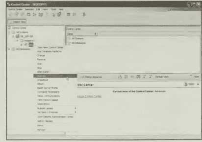

图 2-4：从控制中心调用静止对话框。

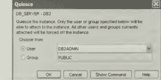

图 2-5：静止对话框。

需要注意的是，只有拥有系统管理员 `SYSADM` 或系统控制 `SYSCTRL` 权限的用户才允许静止实例；一旦实例处于静止状态，只有拥有系统管理员 `SYSADM`、系统控制 `SYSCTRL` 或系统维护 `SYSMAINT` 权限的用户、指定组的成员（如果在置于静止时指定了组名）以及指定用户名的用户（如果在置于静止时指定了用户名）才允许连接到该实例。

同样，只有拥有系统管理员 `SYSADM` 或数据库管理员 `DBADM` 权限的用户才允许静止数据库；一旦数据库处于静止状态，只有拥有系统管理员 `SYSADM`、系统控制 `SYSCTRL`、系统维护 `SYSMAINT` 或数据库管理员 `DBADM` 权限的用户、指定组的成员（如果在置于静止时指定了组名）以及指定用户名的用户（如果在置于静止时指定了用户名）才允许连接到该数据库。

## 关于 DB2 管理服务器 (DAS) 实例

所有随 DB2 安装自带的工具都要求访问 DB2 管理服务器 `DAS` 实例。`DAS` 是运行在机器上的特殊实例，为所有管理工具提供中心管理点。一旦启动 `DAS`，它将提供一组用于管理数据库环境的服务。可以使用与其他实例相同的命令启动和停止 `DAS`。启动 `DAS` 请使用：

```
db2start
```

停止 `DAS` 请使用：

```
db2stop
```

并不是所有的 DB2 操作都需要 `DAS`，但它对于许多功能至关重要。如果您不使用管理工具，可以选择保持 `DAS` 停止。

## 配置 DB2 系统环境

在运行期间，DB2 管理器的行为在程度上由一组定义环境的值控制。其中一些是环境变量，另一些是特殊的 DB2 值，注册变量。注册变量提供了一种集中控制环境的方法。共有三种不同的注册配置文件：

- `DB2 全局级配置文件`：所有机器范围的环境设置都存储在此注册表中；每个 DB2 工作站都存在一个全局级配置文件。如果需要为所有实例设置环境变量，则使用此配置文件。
- `DB2 实例级配置文件`：特定实例的环境变量设置存储在此注册表中；大多数 DB2 环境变量在此处设置。在此配置文件中定义的值将覆盖全局级配置中的任何对应设置。
- `DB2 实例节点级配置文件`：此配置文件包含特定于分区数据库环境中分区（节点）的变量设置。在此配置文件中定义的值将覆盖全局级和实例级配置中的对应设置。

DB2 首先在 `DB2 全局级配置文件` 中查找环境变量值，然后是 `DB2 实例级配置文件`，最后是 `DB2 实例节点级配置文件`。单个会话中可能会设置额外的值，在这种情况下 DB2 最后会看到这些值。


那么，如何确定设置了哪些注册变量以及它们的设置值是什么？更重要的是，如何为一个或多个注册变量赋值？一种方法是执行系统命令 `db2set`。该命令的基本语法为：

```
db2set
[Variable] = [Value]
[-g | -gl | -i [InstanceName]]
[-all]
[-null]
[-r [InstanceName]]
[-n [DASNode] [-u [UserID] -p [Password]]]
[-l | -lr]
[-v]
[-ul | -ur]
[-h | -?]
```

其中：

`Variable`（变量）：标识要显示、设置或删除的注册表变量。

`Value`（值）：标识要赋予指定注册表变量的值。如果没有提供值但指定了注册变量，则会删除该注册变量。

`InstanceName`（实例名称）：标识与指定的注册变量相关的实例配置。

`DASNode`（DAS 节点）：标识 DB2 管理服务器实例所在的节点名称。

`UserID`（用户 ID）：标识用于连接到 DB2 管理服务器实例的身份验证 ID。

`Password`（密码）：标识用于连接到 DB2 管理服务器实例的（身份验证 ID 的密码）。

此命令显示的所有其他选项均描述于表 2.2。

## 配置 DB2 系统环境

### 表 2.2 db2set 命令选项

| 选项 | 含义 |
|---|---|
| `-g` | 表示要显示、设置或删除全局配置变量。 |
| `-gl` | 表示要显示、设置或删除存储在 LDAP 中的全局配置变量。当注册变量 `DB2_ENABLE_LDAP` 设置为 `YES` 时，此选项才有效。 |
| `-i` | 表示要显示、设置或删除实例配置变量。 |
| `-all` | 表示显示按照下文定义的注册变量的所有出现情况：<br>* 环境（由 `[-e]` 表示）<br>* 节点级注册表（由 `[-n]` 表示）<br>* 实例级注册表（由 `[-i]` 表示）<br>* 全局级注册表（由 `[-g]` 表示） |
| `-null` | 表示要将指定注册表层级的变量值置为空值（NULL）。 |
| `-r` | 表示要重置实例的配置注册表。 |
| `-n` | 表示指定一个远程 DB2 管理服务器节点名称。 |
| `-u` | 表示指定一个用于连接到 DB2 管理服务器实例的身份验证 ID。 |
| `-p` | 表示提供了指定的身份验证 ID 的密码。 |
| `-l` | 表示列出所有实例配置。 |
| `-lr` | 表示列出所有支持的注册变量。 |
| `-v` | 表示以详细运行模式执行 `db2set` 命令。 |
| `-ul` | 访问用户配置变量。（此参数仅在 Windows 操作系统上支持。） |
| `-ur` | 刷新用户配置变量。（此参数仅在 Windows 操作系统上支持。） |
| `-h` | 显示帮助信息。指定此选项时，将忽略所有其他选项，仅显示帮助信息。 |

需要注意的是，如果在不带选项的情况下执行 `db2set` 命令，将返回一个包含为当前（默认）实例设置的所有注册变量及其值的列表。

因此，如果您想找出为每个可用配置设置了哪些注册变量，可以通过执行如下所示的 `db2set` 命令来实现：

```
db2set -all
```

# 第 2 章：服务器管理

当执行此命令时，产生的输出内容可能如下所示：

```
[e] DB2PATH=C:\DB2\ESE\SQLLLIB
[i] DB2_ENABLE_AUTONFIG_DEFAULT_VALUE=NO
[i] DB2_XML_RUNSTATS,PATHVALUE_K=300
[i] DB2_XML_RUNSTATS,PATHID_K=300
[i] DB2ACCOUNTNAME=DB2admin,db2admin
[i] DB2INSTOWNER=db2server
[i] DB2PORTRANGE=60000:60003
[i] DB2INSTPROF=C:\DB2\ESE\SQLLLIB
[i] DB2COMM=TCPIP, NPIPE
[g] DB2EXTSECURITY=YES
[g] DB2SYSTEM=DB_SERVER
[g] DB2PATH=C:\DB2\ESE\SQLLLIB
[g] DB2INSTDEF=DB2
[g] DB2ADMINSERVER=DB2DAS00
```

另一方面，如果您想查看所有 DB2 实例 `DB2COMM` 注册变量的当前值，可以通过执行如下所示的 `db2set` 命令来实现：

```
db2set -l DB2COMM
```

最后，如果您想为服务器上所有 DB2 实例的 `DB2COMM` 注册变量分配一个值，可以通过执行如下所示的 `db2set` 命令来实现：

```
db2set -g DB2COMM=[Protocol, ...]
```

其中：

`Protocol`（协议）：标识在启动实例 DB2 数据库管理器时启动的一个或多个通信协议。以下值的任何组合都是有效的：`NPIPE`、`TCPIP` 和 `SSL`。

因此，如果您想设置 `DB2COMM` 级别的注册变量，使得 DB2 数据库管理器在每次启动任何实例时启动 TCP/IP 通信管理器，可以通过执行如下所示的 `db2set` 命令来实现：

```
db2set -g DB2COMM=TCPIP
```

您可以通过向 `db2set` 命令提供变量名和等号来移除赋予注册变量的值。因此，如果您想禁用名为 `PAYROLL` 的实例的 `DB2COMM`，可以通过执行如下所示的 `db2set` 命令来实现：

```
db2set -i PAYROLL=
```

查看或设置注册设置的另一种方法是使用名为 DB2 管理工具的工具。DB2 管理工具通过从配置助手（Configuration Assistant）选择配置（Configure）操作激活。图 2–6 显示了激活 DB2 管理工具需要选择的配置项目；图 2–7 显示了激活后 DB2 管理工具的主对话框可能后的样子。

> 虽然注册变量可以随时设置，但必须停止并重启 DB2 数据库管理器才能生效。

## 配置实例和数据库

除了所有可用注册变量外，DB2 还使用了一系列配置参数来代表实例和数据库分配系统资源。遗憾的是，许多配置参数的默认值是针对非常简单的系统产生的。（目标是让 DB2 能够在任何平台上开箱即用，而不是在安装的平台上运行得最优。）因此，尽管提供的这些配置参数的默认值满足大多数数据库需求，但通过更改一个或多个配置参数的值，通常可以提高系统和应用程序性能。事实上，如果您的数据库环境包含以下任何情况，都应该始终修改赋予 DB2 配置参数的值：

- 大型数据库
- 通常处理大量并发连接的数据库
- 一个或多个具有高性能要求的特殊应用程序
- 特定的硬件配置
- 独特的事务负载
- 独特的事务类型

在第 5 章“分析 DB2 活动”中，我们将学习衡量事务负载和性能的方法，以确定如何调整配置参数值。现在，让我们详细查看可用的配置参数。

## DB2 数据库管理器实例配置

每当创建一个实例时，都会创建一个相应的 DB2 数据库管理器配置文件，并在实例创建过程的一部分进行初始化。每个 DB2 数据库管理器配置文件由大约 85 个不同的参数值组成，大多数值控制分配给单个 DB2 数据库管理器实例的系统资源。构成 DB2 数据库管理器配置文件的参数见表 2.3。

### 表 2.3 DB2 数据库管理器实例配置参数

| 参数 | 范围/默认值 | 描述 |
| --- | --- | --- |
| `agent_stack_sz` | 8–1000 4K 页 <br>默认值: 16 | 指定操作系统为每个使用的 DB2 代理分配的内存量（页数）。 |
| `agent_pri` | -1, 41–128 4K 页或 0–6 K 页，取决于所使用的操作系统。<br>默认值: -1 | 指定由操作系统调度程序程序为所有代理以及其他 DB2 数据库管理器实例进程和线程分配的执行优先级。 |
| `asheapsz` | 1–524,288 4K 页 <br>默认值: 15 | 指定本地客户端应用程序与 DB2 数据库管理器代理之间共享的内存量（页数）。应用程序支持层堆表示本地应用程序与其关联代理之间的通信缓冲区。此缓冲区由启动的每个 DB2 代理作为内存分配。 |
| `audit_buf_sz` | 0–65,000 4K 页 <br>默认值: 0 | 指定用于存储审计设施生成的审计记录的内存量（页数）。如果此参数设置为 0，则不使用审计缓冲区。 |
| `authentication` | `CLIENT`, `SERVER_ENCRYPT`, `KERBEROS`, `KRB_SERVER_ENCRYPT`, `DATA_ENCRYPT`, `DATA_ENCRYPT_CMP`, `GSSPLUGIN`, `SERVER_ENCRYPT` <br>默认值: `SERVER` | 指定用户认证如何以及在何处进行。如果此参数设置为 `CLIENT`，认证将在客户端进行。如果设置为 `SERVER`，用户 ID 和密码将从客户端工作站发送到服务器工作站，以便在服务器上进行认证。`SERVER_ENCRYPT` 值提供了与 `SERVER` 相同的行为，通过网络发送的任何密码都经过加密。 |


## 配置参数

| `catalog_noauth` | YES, NO <br>默认值: YES | 指定系统管理员 (SYSADM) 权限是否允许目录和取消目录节点、数据库或 DCS 和 ODBC 引用。 |

| `clnt_krb_plugin` | 任何有效字符字符串 <br>默认值: NULL 或 "IBMkrb5" | 指定用于客户端侧 Kerberos 认证和本地授权的库中默认 Kerberos 插件的名称。当客户端使用 KERBEROS 认证时，使用此插件库。 |

## 配置实例和数据库

### 表 2.3 DB2 数据库管理器实例配置参数（续）

| 参数 | 范围/默认值 | 描述 |
|---|---|---|

| `clnt_pw_plugin` | 任何有效字符字符串 默认值: NULL | 指定用于客户端侧认证和本地授权的用户 ID-密码插件库名称。当客户端使用 CLIENT、SERVER 或 SERVER_ENCRYPTION 认证时，使用此插件库。 |

| `comm_bandwidth` | 0.1–100,000 兆字节/秒 默认值: -1 | 指定通信带宽计算值（每秒兆字节），DB2 优化器使用该值估算分区数据库系统的数据库分区服务器之间执行某些 SQL 操作的成本。 |

| `conn_elapse` | 0–100 秒 默认值: 10 | 指定两个节点之间建立 TCP/IP 连接的秒数。（如果未在此参数指定的时间内建立连接，将进行其他尝试，次数直到 `max_retries` 参数指定的次数。如果所有尝试均失败，则返回错误。） |

| `cpuspeed` | -1, 10⁻⁻¹ 默认值: -1 | 指定安装 DB2 的工作站上使用的 CPU 速度，以每指令毫秒数。 |

| `dft_account_str` | 任何有效字符字符串 默认值: NULL | 指定在连接到 DRDA 服务器时使用的默认费用会计字符串。 |

| `dft_mon_buffool` | ON, 默认值: OFF | 指定快照监控缓冲区池开关的默认值。 |

| `dft_mon_lock` | ON, 默认值: OFF | 指定快照监控锁开关的默认值。 |

| `dft_mon_sort` | ON, 默认值: OFF | 指定快照监控排序开关的默认值。 |

| `dft_mon_stmt` | ON, 默认值: OFF | 指定快照监控语句开关的默认值。 |

| `dft_mon_table` | ON, 默认值: OFF | 指定快照监控表开关的默认值。 |

| `dft_mon_timestamp` | ON, 默认值: ON | 指定快照监控时间戳开关的默认值。 |

| `dft_mon_uow` | ON, 默认值: OFF | 指定快照监控工作单元 (UOW) 开关的默认值。 |

| `dftdbpath` | 任何有效字符字符串 默认值: C  (Windows) 或实例用户主目录 (UNIX) | 指定用于存储新数据库的驱动器（Windows）或目录路径（UNIX）。如果在创建数据库时未指定路径，将在此参数标识的位置创建数据库。） |

### 表 2.3 DB2 数据库管理器实例配置参数（续）

| 参数 | 范围/默认值 | 描述 |
| --- | --- | --- |

| `diaglevel` | 0–4 默认值: 3 | 指定诊断设施捕取的诊断信息级别。 |

| `diagpath` | 任何有效字符字符串 默认值: NULL | 指定存储诊断数据的路径。 |

| `dir_cache` | YES, NO 默认值: YES | 指定是否缓存目录信息。（当此参数设置为 YES 时，减少 I/O。） |

| `discover` | DISABLE, KNOWN, SEARCH 默认值: SEARCH | 指定使用的发现机制。（如果此参数设置为 SEARCH，DB2 将搜索网络；如果设置为 KNOWN，则使用指定的位置。） |

| `discover_inst` | ENABLE, DISABLE 默认值: ENABLE | 指定是否启用实例发现。 |

| `fcm_num_buffers` | AUTOMATIC, 128–300 (32位), 128–288 (64位) 默认值: AUTOMATIC | 用于内部通信的 4KB 缓冲区数量。当设置为 AUTOMATIC 时，FCM 监控使用并分配资源。 |

| `fcm_num_channels` | AUTOMATIC, 120,000 (32位), 524,288 (64位) 默认值: AUTOMATIC | 用于内部通信的通道数量。当设置为 AUTOMATIC 时，FCM 监控使用并动态分配资源。 |

### 表 2.3 DB2 数据库管理器实例配置参数（续）

| 参数 | 范围/默认值 | 描述 |
|---|---|---|

| `fed_noauth` | YES, NO 默认值: NO | 指定是否跳过认证。（当 `fed_noauth` 设置为 YES 时，认证设置为 SERVER 或 SERVER_ENCRYPT，且 `federated` 设置为 YES，则跳过实例认证。） |

| `federated` | YES, NO 默认值: NO | 指定是否启用联邦数据库对象支持。 |

| `fenced_pool` | -1,0,maxagents 默认值: maxagents | 指定位于数据库服务器上的最大隔离进程数。（一旦达到此限制，将无法调用新的隔离请求。） |

| `group_plugin` | 任何有效字符字符串 默认值: NULL | 指定用于所有组查找的插件库名称。 |

| `health_mon` | ON, OFF 默认值: ON | 指定是否监控在健康中心配置的实例和数据库对象的健康状况。（开启时，DB2 健康监控收集这些对象的信息并在对象不健康时采取行动。） |

| `indexrec` | RESTART, RESTART_NO_REDO ACCESS, ACCESS_NO_REDO RESTART | 指定 DB2 数据库管理器何时尝试重建索引，任何索引构建将在备用数据库的回滚或 HDR 日志重放期间重做。此参数仅在配置参数 `indexrec` 设置为 SYSTEM 时有效。 |

| `instance_memory` | AUTOMATIC, 8–294,967,295 4K 页 默认值: AUTOMATIC | 指定应为实例管理保留的内存，包括描述实例控制下的数据库的内存区域。此参数分配的内存确定了同时激活的数据库最大数量以及任何给定时间激活的代理最大数量。 |

# 60 第 2 章：服务器管理

### 表 2.3 DB2 数据库管理器实例配置参数（续）

| 参数 | 取值范围/默认值 | 说明 |
| :--- | :--- | :--- |

| `intra_parallel` | SYSTEM, YES, NO 默认值: NO | 指定 DB2 数据库管理器实例是否可以使用分内并行性。 |

| `java_heap_sz` | 0-524,288 4K Pages 默认值: 2,048 | 指定 Java 解释器用于服务 Java DB 存储过程和用户定义函数的最大内存（以页计数）。 |

| `jdk_path` | 任何有效字符字符串 默认值: NULL | 指定运行 Java 存储过程和用户定义函数所需的 Java™ 软件工具包 (SDK) 安装目录。Java 解释器使用的 CLPATH 和其他环境变量是使用此参数的值计算的。 |

| `keepfenced` | YES, NO 默认值: YES | 指定在围栏调用（fenced call）完成后是否保留围栏进程。（如果将此参数设置为 NO，则每个围栏调用都会创建一个并销毁一个新的围栏进程；如果设置为 YES，则后续围栏调用将重用围栏进程。） |

| `local_gssplugin` | 任何有效字符字符串 默认值: NULL | 当身份数据库管理器配置参数设置为 GSSPLUGIN 或 GSS_SERVER_ENCRYPT 时，指定用于实例级本地授权的默认 GSS API 插件库名称。 |

| `max_connections` | -1, 1-64,000 默认值: -1 (max_coagents) | 指定连接到实例的最大应用程序数量。 |

| `max_connretries` | 0-100 默认值: 5 | 指定对数据库分区服务器可以进行的连接重试次数。如果超过了此参数指定的值，将返回错误。 |

| `max_coordagents` | -1, 0-maxagents 默认值: -1 (maxagents-num_initagents) | 指定一个节点上同时存在的协调代理（coordinating agents）的最大数量。此参数用于限制协调代理的数量或控制数据库中的负载。 |

| `max_querydegree` | ANY, 1-32,767 默认值: ANY | 指定在此 DB2 数据库管理器实例上执行的任何 SQL 语句所使用的分内并行性最大程度。 |

### 表 2.3 DB2 数据库管理器实例配置参数（续）

| 参数 | 取值范围/默认值 | 说明 |
| --- | --- | --- |


## 表 2.3 DB2 数据库管理器实例配置参数（续）

| 参数 | 取值范围/默认值 | 说明 |
|---|---|---|
| `max_time_diff` | 1–1,440 分钟<br>默认值: 60 | 指定 `db2nodes.cfg` 文件列出的数据库分区服务器系统钟之间允许的最大时间差（分钟）。 |
| `maxagents` | 1–64,000<br>默认值: 200 (分区服务器上为 400) | 指定无论使用何种数据库，同时存在的 DB2 数据库代理的最大数量。（代理有助于应用程序与数据库之间的操作。） |
| `maxcagents` | -1, 1–max_coordagents<br>默认值: -1 (max_coordagents) | 指定并发执行 DB2 数据库事务的 DB2 数据库管理器代理的最大数量。此参数可以设置为与 *maxcagents* 参数相同的值。 |
| `maxfilop` | 2–1,950 (UNIX), 2–32,768 (Windows)<br>默认值: 64 | 指定每个应用程序可以打开的最大文件数。此参数指定的值定义了连接到数据库的特定进程可以使用数据库和应用程序文件句柄的总数。 |
| `mon_heap_sz` | 0–60,000 4K Pages<br>默认值: 40、66 或 90，取决于操作系统。 | 指定为数据库系统监控数据分配的内存（以 4KB 页计数）。 |
| `nname` | 任何有效字符字符串<br>默认值: NULL | 指定节点或工作站的名称。数据库客户端使用此值通过 NetBIOS 访问数据库服务器工作站。如果数据库服务器工作站更改了 `nname` 指定名称，所有访问该服务器工作站的客户端必须重新目录并指定新名称。 |
| `nodetype` | N/A | 只读。提供有关您在机器上安装的 DB2 产品的信息。 |
| `notifylevel` | 0–4<br>默认值: 3 | 指定要写入管理通知日志的管理通知消息类型。（对于 Windows NT，通知写入 Windows NT 事件日志。对于所有其他操作系统和节点类型，通知写入名为 `installor.py` 的通知文件。通知可以由 DB2、健康监器、捕获和应用程序以及用户应用程序写入。） |

| 参数 | 取值范围/默认值 | 说明 |
|---|---|---|
| `num_intagents` | 0-num_poolagents 默认值: 0 | 指定启动 DB2 数据库管理器时，在代理池中创建的初始空闲代理数量。 |
| `num_initfenced` | 0-max_connections + (maxagents - max_coordinants) 默认值: 0 | 指定启动 DB2 数据库管理器时，在围栏池中创建的初始空闲、非线程围栏进程数量。 |
| `num_poolagents` | -1, 0-maxagents 默认值: -1 | 指定空闲代理池允许增长的数量。 |
| `numdb` | 1-256 默认值: 1 | 指定可以活跃的数据库数量。 |
| `query_heap_sz` | 0-524,288 4K Pages 默认值: 2,048 | 指定为查询堆分配的内存（以 4KB 页计数）。 |
| `release` | N/A | 只读。指定数据库的释放级别。 |
| `resync_interval` | 1-60,000 默认值: 180 | 指定事务管理器（TM）、资源管理器（RM）或同步管理器（SPM）进行重同步的间隔（秒）。 |
| `rqioblk` | 4,096-65,535 字节 默认值: 32,767 | 指定指定的缓冲区大小（字节）。 |
| `sheapsizes` | 0-2097,152 K Pages 默认值: 0 | 指定用于排序操作的内存限制（页计数）。 |
| `spm_log_file_sz` | 4-1,000 K Pages 默认值: 256 | 指定同步管理器（SPM）日志文件的大小（KB 页计数）。 |
| `spm_log_path` | 任何有效字符字符串 默认值: sqllib | 指定同步管理器（SPM）日志文件所在的目录。 |
| `spm_max_resync` | 1-256 默认值: 20 | 同时执行重同步的代理数量。 |

### 配置实例和数据库

| 参数 | 取值范围/默认值 | 说明 |
|---|---|---|
| `spm_name` | 任何有效字符字符串 默认值: 源自 TCP/IP 主机名 | 指定要使用的同步管理器（SPM）实例名称。 |
| `srvcon_auth` | CLIENT, SERVER, SERVER_ENCRYPT, KRB_SERVER_ENCRYPT, GSSPLUGIN, GSS_SERVER_ENCRYPT | 指定在处理服务器连接时如何以及何处进行身份验证。 |
| `srvcon_ssplugin` | 任何有效字符字符串 默认值: NULL | 指定数据库服务器支持的 GSS API 插件。如果身份类型为 GSSPLUGIN 此参数为 NULL，则返回错误；如果身份类型为 KERBEROS，则使用 DB2 提供的 Kerberos 模块或库 |
| `srv_plugin_mode` | UNFENCED 默认值: UNFENCED | 指定插件是在围栏模式还是非围栏模式下运行。目前围栏模式是唯一支持的模式。 |
| `srvcon_pw_plugin` | 任何有效字符字符串 默认值: NULL | 指定用于服务器端验证的默认用户 ID 密码插件库名称。如果未指定其他库，默认将使用 DB2 提供的用户 ID 密码插件库。 |

# 第 2 章：服务器管理

| 参数 | 取值范围/默认值 | 说明 |
|---|---|---|
| `sysmaint_group` | 任何有效的字符字符串 默认：NULL | 指定具有 DB2 数据库实例系统维护 (SYMAINT) 权限的组名。 |
| `sysmon_group` | 任何有效的字符字符串 默认：NULL | 指定具有 DB2 数据库实例系统监控 (SYSMON) 权限的组名。 |
| `tm_database` | 1ST_CONN, 任何有效的数据库名称 默认：1ST_CONN | 指定每个 DB2 数据库管理器实例的事务数据库管理器（TM）数据库的名称。TM 数据库是一个特殊数据库，用作日志记录和协调器，执行悬事务的恢复。 |
| `tp_mon_name` | CICS, MON, ENCINA, CB, SF, TUXEDO, TOPEND, 空，或任何有效的字符字符串 默认：空 | 指定所使用的事务处理（TP）监控产品名称。 |
| `trust_allClients` | YES, NO, DRDAONLY 默认：YES | 指定所有客户端是否为受信任客户端。如果设置为 YES，服务器假设客户端已具有某种安全级别，并且用户可能在客户端处通过验证。如果设置为 DRDAONLY，则仅当客户端为 DB2 for OS/390、DB2 for VM and VSE 或 DB2 for OS/400 时，服务器才假设客户端具有安全级别。 |
| `trust_cintauth` | CLIENT, SERVER 默认：CLIENT | 指定受信任客户端是在服务器端验证，还是在客户端提供用户 ID 和密码组合进行连接时进行身份验证。 |
| `util_impact_lim` | 1–100 百比 默认：10 | 指定受限制的实用程序执行对数据库工作负载影响的百分比。例如，值 10 表示受限制备份操作对数据库工作负载的影响不超过百分之十。 |

改自《DB2 指南》手册第 265–268 页的表 62 和 63

可以通过连接到实例并执行 `GET DATABASE MANAGER CONFIG` 命令显示特定实例的 DB2 数据库管理器配置文件的内容。该命令的语法为：

```
GET [DATABASE MANAGER | DB MANAGER | DBM]
[CONFIGURATION | CONFIG | CFG]
<SHOW DETAIL>
```

因此，如果您想查看当前实例的 DB2 数据库管理器配置文件的内容，可以执行如下 `GET DATABASE MANAGER CONFIG` 命令：

```
GET DBM CFG
```

可以通过连接到实例并执行 `UPDATE DATABASE MANAGER CONFIG` 命令来更改特定 DB2 数据库管理器配置文件参数赋值的值。该命令的语法为：

```
UPDATE [DATABASE MANAGER | DB MANAGER | DBM]
[CONFIGURATION | CONFIG | CFG]
USING [[Parameter] [Value] |
[Parameter] [Value] AUTOMATIC |
[Parameter] AUTOMATIC |
[Parameter] MANUAL, ...]
<IMMEDIATE | DEFERRED>
```


- **Parameter** 识别一个或多个需要修改值的 DB2 数据库管理器配置参数（通过关键字）。在许多情况下，参数的关键字与参数名称相同。

- **Value** 识别分配给指定 DB2 数据库管理器配置参数的新值或多个值。

如果将某个参数的值指定为 `AUTOMATIC` 关键字，DB2 将自动调整参数值以反映当前的资源需求。（请参考表 2.3 以识别可以使用 `AUTOMATIC` 关键字设置的配置参数。）如果在指定 `AUTOMATIC` 关键字的同时指定了值，该值可能会影响执行的自动计算。

如果在 `UPDATE DATABASE MANAGER CONFIGURATION` 命令指定 `DEFERRED` 子句，对 DB2 数据库管理器配置文件的更改在实例停止并重启之前不会生效。而是指定 `IMMEDIATE` 子句，或者如果不指定任何子句，对 DB2 数据库管理器配置文件的所有更改将立即生效——前提是可用资源。

因此，如果您想配置当前实例，使得在任何时刻同时执行的最大应用程序数量为 100，可以执行如下 `UPDATE DATABASE MANAGER CONFIGURATION` 命令：

```
UPDATE DBM CF USING MAXAGENTS 100
```

或者，如果您想指定当前实例从远程客户端使用的 TCP/IP 端口名称，可以执行如下 `UPDATE DATABASE MANAGER CONFIGURATION` 命令：

```
UPDATE DBM CF USING SVCENAME db2c_db2inst1
```

可以通过连接到相应的实例并执行 `RESET DATABASE MANAGER CONFIGURATION` 命令将所有 DB2 数据库管理器配置文件参数的值恢复为出厂设置。该命令的语法为：

```
RESET [DATABASE MANAGER | DB MANAGER | DBM] [CONFIGURATION | CONFIG | CFG]
```

因此，如果您想将当前实例的 DB2 数据库管理器配置文件参数恢复为系统默认设置，可以执行如下 `RESET DATABASE CONFIGURATION` 命令：

```
RESET DBM CFG
```

还可以使用 DBM 配置对话框查看或更改 DB2 数据库管理器配置文件的内容，可以通过在控制中心（Control Center）的实例（Instances）菜单中选择“配置参数”（Configure Parameters）操作来激活。图 2–8 显示了激活 DBM 配置对话框必须选择的控制中心菜单项；图 2–9 显示了如何激活该对话框。![7bc9d5f6e46621c4fd4_90.png] 图 2–8：从控制中心调用 DBM 配置对话框。![7bc9d5f6e46621c4fd4_91.png] 图 2–9：激活该对话框后可能的样子。

## 数据库配置

DB2 数据库管理器配置文件的内容也可以查看或更改。当创建一个新实例时，DB2 数据库管理器配置文件会自动创建并初始化。自动维护配置参数控制分配给数据库的资源量。这些参数如表 2.4 所示。

### 表 2.4 配置参数

| 参数 | 取值范围/默认值 | 说明 |
|---|---|---|
| `alt_collate` | IDENTITY 默认：NULL | 指定非 Unicode 数据库使用的排序规则。 |
| `app_ctl_heap_sz` | 1–64,000 KB 页 默认：128 或 512 | 指定分配给应用程序控制堆内存（以 KB 页为单位）。应用程序控制堆用于在节点上代表同一应用程序的代理之间共享信息。 |
| `appgroup_mem_sz` | 1–1,000,000 KB 页 默认：10,000, 20,000, 30,000 或 40,000 | 指定应用程序组共享内存的大小。 |
| `applheapsz` | 16–60,000 KB 页 默认：64, 128 或 256 | 指定 DB2 数据库管理器代表特定代理或子代理可用的私有内存页。 |
| `archretrydelay` | 0–65,535 秒 默认：20 | 指定在尝试重试日志文件之前等待的秒数。只有当 `archretry` 值至少为 1 时，后续重试才会生效。 |
| `auto_main` | ON, OFF 默认：ON | 启用或禁用数据库的自动维护。它是其他自动维护数据库配置参数的父级（`auto_db_backup`, `auto_tbl_main`, `auto_runstats`, `auto_stats`, `auto_prof`, `auto_prod_up` 和 `auto_reorg`）。禁用此参数时，其所有子参数都会被禁用，但它们在配置文件中的记录设置不会更改。当启用此父参数时，子参数的值将生效。 |
| `auto_db_backup` | ON, OFF 默认：ON | 启用或禁用数据库的自动备份操作。 |
| `auto_tbl_main` | ON, OFF 默认：ON | 启用或禁用数据库的自动表维护操作。 |

### 表 2.4 DB2 数据库配置参数（续）

| 参数 | 值范围 / 默认值 | 描述 |
|---|---|---|
| `auto_runstats` | ON, OFF 默认: ON | 启用或禁用数据库的自动 RUNSTATS 操作。 |
| `auto_stats_prof` | ON, OFF 默认: ON | 启用或禁用数据库的自动统计 RUNSTATS 配置文件生成。 |
| `auto_prof_upd` | ON, OFF 默认: ON | 启用或禁用数据库的自动 RUNSTATS 配置文件更新。 |
| `auto_reorg` | ON, OFF 默认: ON | 启用或禁用数据库的自动表和索引重组。 |
| `autorestart` | ON, OFF 默认: ON | 指定 DB2 管理器检测到数据库处于不一致状态时是否自动发出 RESTART 命令（如果上次数据库连接被中断或在之前的会话期间数据库未正常终止，则会出现这种情况）。如果此参数设置为 ON，则在需要时自动重启数据库。如果此参数设置为 OFF，必须手动重启数据库。 |
| `avg_appls` | AUTOMATIC, 1~maxapps 默认: AUTOMATIC | 指定通常访问数据库的应用程序平均数量。SQL 优化器使用此参数来估计在应用程序运行时为选定的访问点可用的缓冲区池内存。 |
| `backup_pending` | N/A | 只读。指示在访问数据库之前是否必须对数据库进行全备备。如果此参数设置为 NO，则数据库处于可用状态。如果此参数设置为 YES，则在可以使用数据库之前必须执行离线备份。 |
| `blk_log_dsk_ful` | YES, NO 默认: NO | 指定当 DB2 管理器遇到日志满错误时，应用程序是否应该挂起。此配置可以设置，以防止在 DB2 无法在活动日志位置创建新日志文件时生成磁盘满错误。 |
| `catalogcache_sz` | -1, 8~524,288 4K 页 默认: -1 | 指定用于系统目录信息的内存量（以页计）。 |
| `chnpgs_thresh` | 5~99% 默认: 60 | 指定当异步页清理程序当前未活动状态时，启动它们的更改页级别（百分比）。 |

## 配置实例和数据库

### 表 2.4 DB2 数据库配置参数（续）

| 参数 | 值范围 / 默认值 | 描述 |
|---|---|---|
| `codpage` | N/A | 只读。标识创建数据库时使用的代码页。 |
| `codeset` | N/A | 只读。标识创建数据库时使用的字符集。 |
| `coll_info` | N/A | 只读。标识数据库使用的排序序列。 |
| `country (region)` | N/A | 只读。标识创建数据库时使用的国家/地区代码。 |
| `database_consistent` | N/A | 只读。标识数据库是否处于一致状态。如果此参数设置为 YES，所有事务都已提交或回滚，因此数据库是一致的。如果此参数设置为 NO，则有一个事务待处理，或者数据库上有一个其他任务待处理的任务。 |
| `database_level` | N/A | 只读。标识可以使用该数据库的 DB2 管理器的发布级别。 |
| `database_memory` | AUTOMATIC, 0–4,294,967,295 4K 页 默认: AUTOMATIC | 指定为数据库共享内存区域保留的最小共享内存量。（如果此参数设置为 AUTOMATIC，DB2 将计算数据库所需的内存量并在数据库激活时进行分配） |
| `dbheap` | 32–524,288 4K 页 默认: 300, 600, 或 1,200 | 指定数据库堆的大小（以页计），该堆用于存储所有访问数据库的打开缓冲区的信息。日志缓冲区和目录缓冲区都从数据库堆分配。 |
| `db_mem_thresh` | 0-100 百比 默认: 10 | 指定 DB2 管理器将已提交的内存页释放回操作系统之前，允许已提交且当前未使用的共享内存的最大百分比。 |


## 表 2.4 DB2 数据库配置参数（续）

| 参数 | 值范围 / 默认值 | 描述 |
|---|---|---|
| `dft_degree` | -1,32.767 默认: 1 | 指定 CURRENT DEGREE 特殊寄存器和 DEGREE 绑定选项的默认值。 |
| `dft_extent_sz` | 2–256 4K 页 默认: 32 | 指定创建新表空间时，如果没有指定区大小，则将使用的默认区大小（以页计）。 |
| `dft_loadrec_sec` | 1–30,000, 默认: 1 | 指定在恢复表加载操作期间使用的默认会话数。此参数仅在启用了滚滚恢复时有效。 |
| `dft_mttb_types` | ALL, NO, FEDERATED_TOOL, SYSTEM 和/或 USER, 默认: SYSTEM | 指定 CURRENT MAINTAINED TABLE TYPES 优化特殊寄存器的默认值。 |
| `dft_prefetch_sz` | AUTOMATIC, 0–32,767 4K 页 默认: AUTOMATIC | 指定创建新表空间时如果没有指定区大小，则将使用的默认预取大小（以页计）。 |
| `dft_queryopt` | 0–99,999,999 默认: 5 | 指定未指定时的默认优化类。 |
| `dft_sqmath` | YES, NO 默认: NO | 指定在 SQL 处理期间是否处理算术错误。 |
| `discover_db` | ENABLE, DISABLE 默认: ENABLE | 当接收到发现请求时，是否返回数据库信息。 |
| `dlchktime` | 1,000–60,000 毫秒, 默认: 10,000 | 指定 DB 管理器检查所有应用程序死锁的频率。 |
| `dyn_query_mgmt` | ENABLE, DISABLE 默认: DISABLE | 指定超过阈值的查询是否被高可用恢复（HADR）过程拦截。 |

## 表 2.4 数据库配置参数（续）

| 参数 | 值范围 / 默认值 | 描述 |
|---|---|---|
| `failarchpath` | 有效字符串 默认: NULL | 指定 DB2 在未归档到主或次目的地时归档日志路径。 |
| `groupheap_ratio` | 1–99 百比 默认: 70 | 指定分配给应用程序组的内存百分比（应用程序内存中）。 |
| `hadr_db_role` | N/A | 只读。标识在高可用恢复（HADR）环境中的当前角色。有效值为 PRIMARY 或 STANDBY。 |
| `hadr_local_host` | 有效字符串 默认: NULL | 高可用恢复（HADR）TCP 通信的本地主机。主机名或 IP 地址均可。 |
| `hadr_local_svc` | 有效字符串 默认: NULL | 本地高可用恢复（HADR）过程接受连接的 TCP 服务名或端口。 |
| `hadr_remote_host` | 有效字符串 默认: NULL | 远程高可用恢复（HADR）节点的 TCP/IP 主机名或 IP 地址。 |
| `hadr_remote_inst` | 有效字符串 默认: NULL | 远程服务器的实例名称。管理工具（如 Control Center）使用此连接远程服务器。HADR 还会检查请求连接的数据库是否属于声明的远程实例。 |
| `hadr_remote_svc` | 有效字符串 默认: NULL | 远程高可用恢复（HADR）节点使用的 TCP 服务名或端口。 |
| `hadr_syncmode` | SYNC, NEARSYNC, ASYNC 默认: NEARSYNC | 指定高可用恢复（HADR）同步模式，它决定了系统处于对等状态时如何与备机同步日志写入。 |
| `hadr_timeout` | 1–4,294,967,295 默认: 120 | 指定高可用恢复（HADR）过程在认为通信尝试失败之前等待的时间（以秒计）。 |

## 表 2,4 数据库配置参数（继续）

| 参数 | 取值范围 / 默认值 | 说明 |
|---|---|---|
| `indexrec` | SYSTEM, RESTART, RESTART_NO_REDO ACCESS, ACCESS_NO_REDO, 默认: SYSTEM | 指定 DB2 数据库管理器何时尝试重建索引，以及在备用数据库进行向前恢复（roll-forward）或 HDR 日志记录时是否对任何索引构建进行重做（值 SYSTEM 表示使用 DB2 数据库配置参数 indexrec 的值）。 |
| `locklist` | AUTOMATIC, 4-524,286 4K Pages, 默认: AUTOMATIC | 指定用于分配和使用锁列表（lock list）的最大内存量（页）。 |
| `logtimeout` | -1, 0-32,767 Seconds, 默认: -1 | 指定应用程序等待锁的秒数。 |
| `logarithm1` | OFF, LOGRETAIN, USEREXIT, DISK, TSM, VENDOR, 默认: OFF | 指定日志文件主要目的地的介质类型以及是否使用归档日志。 |
| `logarithm2` | OFF, LOGRETAIN, USEREXIT, DISK, TSM, VENDOR, 默认: OFF | 指定归档日志的介质类型目的地。如果指定了此路径，日志文件将归档到此处以及 logarithm1 数据库参数指定的目的地。 |
| `logchopt1` | 任何有效字符字符串, 默认: NULL | 指定主归档日志（如果需要）的选项。 |
| `logchopt2` | 任何有效字符字符串, 默认: NULL | 指定次归档日志（如果需要）的选项。 |
| `log_retain_status` | N/A | 只读。指示日志文件是否被保留向前恢复操作。 |
| `logbufsz` | 4-4,096 (32-bit), 4-65,535 (64-bit) 4K Pages, 默认: 8 | 指定在写入磁盘之前用于缓冲日志记录的内存量（页）。 |
| `logfilsiz` | 4-524,286 4K Pages, 默认: 1,000 | 指定用于数据恢复的磁盘存储空间（页）。此参数定义了使用的每个主、次日志文件的大小。 |
| `loghead` | N/A | 只读。通过名称标识当前活动的日志文件。 |
| `logpath` | N/A | 只读。指定当前用于存储日志文件的路径。 |
| `logindexbuild` | ON, OFF, 默认: OFF | 指定是否对索引创建、重建或重组操作进行记录，以便在 DB2 向前恢复操作或高可用性灾难恢复（HADR）日志重放过程中重建索引。 |

## 表 2.4 DB2 数据库配置参数（继续）

| 参数 | 取值范围 / 默认值 | 说明 |
| --- | --- | --- |
| `logprimary` | 2-256, 默认: 3 | 指定用于数据库恢复的主日志文件数量。 |
| `logretain` | RECOVERY, NO, 默认: NO | 指定是否将活动日志文件保留为归档日志用于向前恢复（也称为归档日志）。 |
| `logsecond` | -1, 0-254, 默认: 2 | 指定用于数据库恢复的次日志文件数量。 |
| `max_log` | 0-100 Percent, 默认: 0 | 指示事务可以消耗日志空间百分比的限制，如果有，则指定该限制。 |
| `maxapps` | AUTOMATIC, 1-60,000, 默认: AUTOMATIC | 指定一次可以连接到数据库的最大并发应用程序（包括本地和远程）数量。（如果将此参数设置为 AUTOMATIC，DB2 将动态分配支持新应用程序所需的资源。） |
| `maxfilop` | 2-32,768 (Windows), 2-1,950 (UNIX), 默认: 64 | 指定数据库代理一次可以打开的文件句柄最大数量。 |
| `maxlocks` | AUTOMATIC, 1-100, 默认: AUTOMATIC | 指定应用程序持有的锁的百分比，在 DB2 数据库管理器执行升级（escalation）之前必须填满。 |
| `min_dec_div_3` | YES, NO, 默认: NO | 指定小数除法算运算的结果是否始终具有至少 3 位精度。 |
| `mincommit` | 1-25, 默认: 1 | 指定在日志记录写入磁盘之前要处理的 COMMIT 语句数量。 |
| `mirrorfilepath` | 任何有效字符字符串, 默认: NULL | 指定存储活动日志文件第二个副本的位置。 |
| `multipage_alloc` | N/A | 只读。指定 SMS 表的新存储是按页一次分配还是按区（extent）一次分配的。 |
| `newpath` | 任何有效字符字符串, 默认: NULL | 指定用于存储恢复日志文件的备路径。 |
| `num_db_backups` | 1-32,768, 默认: 12 | 指定为数据库保留的数据库映像数量。（在指定的备份过期后，旧备份在恢复历史文件中被标记为过期。） |


| `num_freqvalues` | 0-32,767, 默认: 10 | 指定要收集的“最频繁值”的数量。 |

# 第 2 章：服务器管理

## 表 2.4 DB2 数据库配置参数（继续）

| 参数 | 取值范围 / 默认值 | 说明 |
| --- | --- | --- |
| `num_cleaners` | AUTOMATIC, 0-255, 默认: AUTOMATIC | 指定由数据库使用的清理线程（cleaners）数量。 |
| `num_iosvers` | AUTOMATIC, 0-255, 默认: AUTOMATIC | 指定由数据库使用的 I/O 服务器数量。 |
| `num_log_span` | 0-65,535 | 指定允许事务跨越的日志数量。 |
| `num_quantiles` | 0-32,767, 默认:20 | 当指定 RANGE 参数时收集的分位数数量。 |
| `numarch_retry` | 0-65,535, 默认: 5 | 指定尝试归档的次数。 |
| `num_segs` | N/A | 只读。指定用于数据库的段（segments）数量。 |
| `overflowpath` | 任何有效字符字符串, 默认: NULL | 指定溢出页的位置。 |
| `pagesize` | N/A | 只读。标识创建数据库的页大小。 |
| `sheapt_shr` | 250-2,097,152 (32-bit), 250-2,147,483 (64-bit) 4K Pages, 默认: 5,000 | 指定在执行排序操作时使用的最大内存量（页）。 |
| `rec_hist_retent` | -1,30,000, 默认: 366 | 保留历史信息的天数。 |
| `release` | N/A | 只读。标识数据库的发布级别。 |
| `restore_pending` | N/A | 只读。指示数据库是否处于恢复等待状态。 |
| `restrict_access` | N/A | 只读。指定创建数据库时是否使用了 RESTRICTIVE 子句。 |

## 表 2.4 数据库配置参数（继续）

| 参数 | 取值范围 / 默认值 | 说明 |
|---|---|---|
| `rollwd_pending` | N/A | 只读。标识数据库是否需要向前恢复。如果是 NO，则数据库或任何表空间都不处于恢复等待状态。如果是 TABLESPACES，则一个或多个表空间需要向前恢复。 |
| `self_tuning_mem` | ON, 默认: ON | 启用或禁用数据库的自调优内存。当此设置为设置为 时，内存调优器会动态为所有启用自调优的内存消费者分配资源。 |
| `seqdetect` | YES, NO, 默认: YES | 指定 DB2 数据库管理器是否监控 I/O，如果发生顺序读取，则对数据库一半激活 I/O 预取。 |
| `softmax` | 1-100 Percent, 默认: 100 | 指定记录排序检查点之前可以消耗日志空间的最大比。 |
| `sortheap` | AUTOMATIC, 16-524,288 (32-bit), 16-4,194,303 (64-bit) 4K Pages, 默认: AUTOMATIC | 指定用于私人排序的最大内存页数，或用于共享排序的最大共享内存页数。 |
| `stat_heap_sz` | 1,096–524,288 4K Pages, 默认: 4,384 | 指定在创建和收集表统计信息（使用 RUNSTATS 命令）时使用的堆空间大小。 |
| `stmheap` | 128–524,288 4K Pages, 默认: 2,048 (32-bit), 4,096 (64-bit) | 指定用于预编译和绑定 SQL 语句的堆大小（页）。 |
| `territory` | N/A | 只读。标识创建数据库使用的区域代码。 |
| `trackmod` | YES, NO, 默认: NO | 指定是否跟踪数据库修改，以便备份 工具可以检测哪些数据库页集需要增量备份检查并可能包含在备份镜像中。 |

# 78 第2 章：服务器管理

## 表 2.4 DB2 数据库范围配置参数（续）

| 参数 | 值范围 / 默认 | 说明 |
| --- | --- | --- |
| `tsm_mgmtclass` | 任意有效字符字符串 默认：NULL | 指定服务器如何管理被备份对象的备份版本或归档副本。TSM 管理类由 TSM 管理员指派。 |
| `tsm_nodename` | 任意有效字符字符串 默认：NULL | 指定节点名称，用于覆盖与 Tivoli Storage Manager (TSM) 产品关联的节点默认设置。需要此节点名称以便从另一个节点恢复已备份到 TSM 的数据库。 |
| `tsm_owner` | 任意有效字符字符串 默认：NULL | 指定所有者名称，用于覆盖与 Tivoli Storage Manager (TSM) 产品关联的所有者默认设置。需要所有者名称以便从另一个节点恢复已备份到 TSM 的数据库。 |
| `tsm_password` | 任意有效字符字符串 默认：NULL | 指定密码，用于覆盖与 Tivoli Storage Manager (TSM) 产品关联的密码默认设置。需要此密码以便从另一个节点恢复已备份到 TSM 的数据库。 |
| `userexit` | ON, OFF 默认：OFF | 指定下次打开数据库时是否可以调用用于归档或检索日志文件的用户退出程序。（如果将此参数设置为 OFF，则无法调用用户退出函数。如果将此参数设置为 ON，则可以用户退出函数。） |
| `user_exit_status` | N/A | 只读；指示数据库是否已配置使用用户退出程序存储归档日志文件。 |
| `util_heap_size` | 16–524,288K 页 默认：5,000 | 指定备份、恢复和加载实用程序可同时使用的共享内存最大量。 |
| `vendoropt` | 任意有效字符字符串 默认：NULL | 指定 DB2 在备份、恢复或加载复制操作期间可能需要与存储系统通信的额外参数 |

改编自 DB2 9 性能指南手册第 269–273 页的表 64 和表 65。

可以通过执行 `GET DATABASE CONFIGURATION` 命令显示特定数据库的配置文件的内容。该命令的语法如下：

```
GET [DATABASE | DB] [CONFIGURATION | CONFIG | CFG]
FOR [DatabaseAlias]
<SHOW DETAIL>
```

其中：

`DatabaseAlias` 标识分配给要显示配置信息的数据库的别名。

因此，如果您想查看名为 SAMPLE 的数据库的配置文件的内容，可以执行如下所示 `GET DATABASE CONFIGURATION` 命令：

```
GET DB CFG FOR sample
```

可以通过执行 `UPDATE DATABASE CONFIGURATION` 命令更改特定数据库配置文件参数的值。该命令的语法如下：

```
UPDATE [DATABASE | DB]
[CONFIGURATION | CONFIG | CFG]
FOR [DatabaseAlias] [Value] |
USING [[Parameter] [Value] |
[Parameter] [Value] AUTOMATIC |
[Parameter] AUTOMATIC |
[Parameter] MANUAL, ...]]
<IMMEDIATE | DEFERRED>
```

其中：

`DatabaseAlias` 标识分配给要修改配置信息的数据库的别名。

`Parameter` 标识要修改其值的一个或多个数据库配置参数（通过关键字）。（在许多情况下，参数的关键字与参数名称本身相同。）

# 第 2 章：服务器管理

`Value` 标识要分配给指定的数据库配置参数的新值（或多个值）。

如果在特定参数的值上指定 `AUTOMATIC` 关键字，DB2 将自动调整参数值以反映当前的资源需求。（请参考表 2.4 以识别可以使用 `AUTOMATIC` 关键字设置的配置参数。）如果在指定 `AUTOMATIC` 关键字的同时指定了值，则指定的值可能会影响执行自动计算。

如果在 `UPDATE DATABASE CONFIGURATION` 命令中指定 `DEFERRED` 子句，对数据库配置文件的更改在所有到相应数据库的连接终止并建立新连接之前不会生效。如果指定 `IMMEDIATE` 子句，或者未指定任何子句，则对数据库配置文件的所有更改将立即生效——前提是可用资源。（在更改数据库配置时正在运行数据库的应用程序将在下次执行 SQL 语句时生效。）

因此，如果您想配置名为 SAMPLE 的数据库，使连接到数据库的任何应用程序在回滚当前事务之前等待最多 10,000 秒以获取锁，可以执行如下所示 `UPDATE DATABASE CONFIGURATION` 命令：

```
UPDATE DB CFG for sample USING LOCKTIMEOUT 10000
```


或者，如果您想配置名为 `SAMPLE` 的数据库使用归档日志，并指示它将活动日志文件的第二个副本存储位于 `E` 盘上名为 `MIRRORLOGS` 的目录中，可以执行如下所示 `UPDATE DATABASE CONFIGURATION` 命令：

```
UPDATE DB CFG for sample USING LOGARCHMETH1 LOGRETAIN MIRRORLOGPATH E:/mirrorlogs
```

可以通过执行 `RESET DATABASE CONFIGURATION` 命令将所有数据库配置文件参数的值恢复为系统默认值。该命令的语法如下：

```
RESET [DATABASE | DB]
[CONFIGURATION | CONFIG | CFG]
FOR [DatabaseAlias]
```

其中：

`DatabaseAlias` 标识分配给要修改配置信息的数据库的别名。

因此，如果您想将名为 `SAMPLE` 的数据库配置文件恢复为系统默认值，可以执行如下所示 `RESET DATABASE CONFIGURATION` 命令：

```
RESET DB CFG FOR sample
```

可以使用配置对话框查看或更改数据库配置文件的内容，该对话框可以通过在控制中心的数据库菜单中选择选择配置操作来激活。图 2-10 显示了激活配置对话框所需的控制中心项目；图 2-11 显示了该对话框激活后的外观。

# 第2章：管理

在如此多的配置参数中选择，决定从哪里开始以及进行哪些可能是困难的。幸运的是，DB2 软件包中自带了一个工具帮助您入门；工具就是配置顾问。配置顾问设计用于捕数据库环境的特定信息并对配置参数提出建议。

可以通过在控制中心的数据库菜单中选择配置顾问操作来激活配置顾问。图 2-12 显示了激活配置顾问所需的控制中心项目；图 2-13 显示了配置顾问首次激活时的界面。

一旦启动配置顾问向导，您只需按照每个面板上的说明描述您的服务器环境，并解释您的数据库典型的事务负载是怎样的。当您提供了所需信息后，配置顾问将建议某些更改，如果应用于实例和/或数据库配置参数，这将提高整体性能。此时，向导右下角（见图 2-13）显示的“完成”按钮将可用，点击此按钮时可能会应用建议的配置参数更改。

在 DB2 9 中，每当使用创建数据库向导创建数据库时，都会自动调用配置顾问。（这种行为可以通过为注册表变量 `DB2_ENABLE_AUTONFIG` 赋值 `NO` 来更改。）

## AUTOCONFIGURE 命令

如果你倾向于使用命令而非 GUI 工具，也可以通过执行 `AUTOCONFIGURE` 命令（底层会调用 Design Advisor）来获取配置顾问（Configuration Advisor）提供的功能。该命令的基本语法如下：

```
AUTOCONFIGURE
USING [[Keyword] [Value] ...]
APPLY [DB ONLY | DB AND DBM |]
```

其中：

- `Keyword`（关键字）识别 `AUTOCONFIGURE` 命令的一个或多个特殊关键字。该参数的有效值为：`mem_percent`, `workload_type`, `num_stmts`, `tpm`, `admin_priority`, `is_populated`, `num_local_apps`, `num_remote_apps`, `isolation` 和 `bp_resizable`。

- `Value`（值）识别与提供的关键字关联。表 2.5 列出了 `AUTOCONFIGURE` 命令识别的每个关键字的有效值。

| 表 2.5 AUTOCONFIGURE 命令关键字和值 |
| 关键字 | 有效值 / 默认值 | 描述 |
| --- | --- | --- |
| mem_percent | 1–100 默认值: 25 | DB2 数据库管理器在执行数据库操作时使用的可用服务器内存（RAM）的百分比。 |
| workload_type | simple, complex, mixed 默认值: mixed | 通常在数据库上运行的工作负载类型。有效值如下：simple——数据库主要用于解析查询（例如，数据仓库）；complex——数据库主要用于事务处理（例如，订单输入和 OLTP）；mixed——数据库既用于解析查询又处理事务。简单负载倾向于 I/O 密集型且主要以事务为主，而复杂负载倾向于 CPU 密集型且主要以查询为主。 |
| num_stmts | 1–1,000,000 默认值: 10 | 单个事务内（即提交之间）执行的 SQL 语句的平均数量。注意：如果未知，请选择一个大于 10 的数字。 |

| 表 2.5 AUToconFIGURE 命令关键字和值（续） |
| 关键字 | 有效值 / 默认值 | 描述 |
|---|---|---|
| tpm | 1–200,000<br>默认值: 60 | 每分钟执行的平均事务数（估计值）。注意：DB2 性能监控器可以帮助你获得更准确的 TPM 测量。 |
| admin_priority | performance, recovery, both<br>默认值: both | 数据库应优化的操作类型。有效值包括：performance——数据库应针对事务性能进行优化（备份/恢复较慢）；recovery——数据库应针对备份和恢复进行优化（事务性能较慢）；或 both——数据库应同时针对事务性能和备份/恢复进行优化（两者同等重要）。 |
| is_populated | yes, no<br>默认值: yes | 表示数据库当前是否包含数据。有效值为：yes–数据库包含数据；以及 no——数据库不包含数据。 |
| num_local_apps | 0–5,000<br>默认值: 0 | 同时连接到数据库的本地应用程序数量。 |
| num_remote_apps | 0–5,000<br>默认值: 10 | 同时连接到数据库的远程应用程序数量。为处理所有需要的连接（包括本地和远程）分配内存，可以确保用户无需等待连接终止即可建立连接。然而，为连接过度分配内存可能会导致资源浪费。DB2 性能监控器可以帮助你确定在特定时间内实际获取了多少连接。 |
| isolation | RR, RS, CS, UR<br>默认值: RR | 大多数访问数据库的应用程序使用的隔离级别。有效值包括：RR–可重复读（获取大量锁并长时间持有）；RS–可读稳定性（长时间持有较少锁）；CS–游标稳定性（短时间内获取大量锁）；以及 UR–未提交读（不获取任何锁）。 |
| bp_resizable | yes, no<br>默认值: yes | 表示缓冲区池是否可调整大小。有效值为：yes–缓冲区池是可以调整大小的；以及 no–缓冲区池不可调整大小。 |

## 配置实例和数据库

如果在 Strategy `AUTOCONFIGURE` 命令中指定了 `APPLY DB ONLY` 子句，Design Advisor 建议的数据库配置和缓冲区池更改将应用于相应的数据库配置文件；如果指定了 `APPLY DB AND DBM` 子句，则建议的数据库配置和缓冲区池更改将应用于数据库配置文件，而建议的实例配置更改将应用于相应的 DB2 数据库管理器配置文件。如果取而指定 `APPLY NONE` 子句，则将显示更改建议但不会应用。

因此，如果你想确定一个名为 `SAMPLE`、使用可调整大小缓冲区池且开启的 OLTP 数据库的最佳配置，并希望在将更改应用于相应的数据库配置文件之前检查任何建议的配置更改，你可以执行如下 `AUTOCONFIGURE` 命令来实现：

或者，如果你想确定如果系统内存的 60% 将供 DB2 数据库管理器在执行数据库操作时使用的最佳配置，且该实例仅控制一个数据库（名为 `SAMPLE`），并且你想自动更新相应的配置文件以反映任何建议的配置更改，你可以执行如下 `AUTOCONFIGURE` 命令来实现：

```
AUTOCONFIGURE USING mem_percent 60 APPLY DB AND DBM
```

```
AUTOCONFIGURE USING mem_percent 30 APPLY DB AND DBM
APPLY NONE
```

## 配置通信

`AUTOCONFIGURE` 命令（以及 Design Advisor）始终建议配置数据库以利用自调优内存（Self-Tuning Memory）。然而，如果你在一个 `SHEHEAP` 被分配了非零值的实例上运行 `AUTOCONFIGURE` 命令，则排序堆配置参数将不会配置。因此，你必须执行 `UPDATE DATABASE CONFIGURATION USING SHEHEAP 0` 来启用排序调优。

在典型的客户端/服务器环境中，存储在服务器上的数据库通过所谓的“分布式连接”由远程工作站访问。分布式连接为客户端应用程序提供了访问远程服务器上中心化数据库的方法，还为管理员提供了远程管理数据库和服务器的方法。


为了与服务器工作站通信，每个客户端必须使用某种被服务器识别的通信协议。同样，每个服务器也必须使用某种通信协议来检测来自客户端工作站的入站请求。在大多数情况下，两个工作站使用的操作系统都提供了所需的通信协议；但在某些情况下，这种支持可能由单独的插件产品提供。无论如何，客户端和服务器都必须配置为使用 `DB2` 识别的通信协议。`DB2 9` 识别以下通信协议：

- `NetBios`
- 传输控制协议/网协议 (`TCP/IP`）（目前大多数情况）
- 命名管道

当 `DB2` 安装在工作站上时，它会自动配置以利用该工作站设置的任何通信协议（前提是发现的协议被 `DB2` 识别）。此时，会收集并将每个可用通信的信息存储在 `DAS` 实例和默认实例的配置文件。然而，当激活新协议或重新配置现有协议时，这些信息不会自动更新。相反，你必须手动为每个实例配置通信，这些更改才能生效。

## 手动配置通信

手动配置通信或进行配置更改的最简单方法是使用 `Setup` 通话框，可以通过从控制中心（`Control Center`）实例菜单中选择相应的操作来激活。图 2–14 显示了激活 `Setup` 通话框所需的控制中心菜单项；图 2–15 显示了如何使用 `Setup` 通话框为特定实例配置 `TCP/IP` 协议。

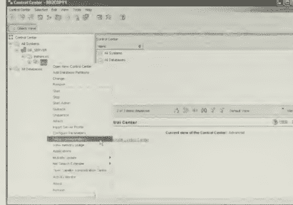

图 2–14：从控制中心调用 `Setup` 通话框。

# 第 2 章：服务器管理

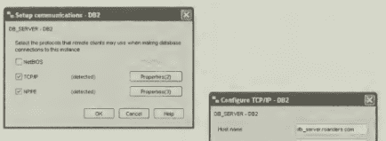

图 2-15：设置通信对话框和配置 `TCP/IP` 对话框。

### 1. 将值 `TCPIP` 分配给 `DB2COMM` 注册变量。

当您手动配置服务器通信时，在实例开始使用所需的通信协议之前，必须更新 `DB2COMM` 注册变量的值。分配给 `DB2COMM` 注册变量的值用于确定在启动特定实例的 `DB2` 数据库管理器时，将将激活哪些通信管理器。（如果 `DB2COMM` 注册变量未正确设置，当 `DB2` 数据库管理器在实例初始化期间尝试启动协议支持时可能会产生一个或多个错误。）

通过执行类似于下方的 `db2set` 命令，可以为 `DB2COMM` 注册变量分配值 `TCPIP`：

```
db2set DB2COMM=TCPIP
```

在 `DB2` 客户端能够与 `DB2` 服务器通信之前，必须配置 `DB2` 服务器以接受该客户端已配置为使用的通信协议的入站请求。因此，为了在客户端和服务器之间使用特定的通信协议，客户端和服务器工作站上的 `DB2COMM` 注册变量值必须包含该特定协议的关键字。对于 `DB2 9`，有效的关键字是 `TCPIP` 和 `NPIPE`。

### 2. 将数据库服务器用于接收来自远程客户端通信的 `TCP/IP` 端口名称分配给 `DB2` 数据库管理器配置文件的 `svname` 参数。

`svname` 参数应设置为与主连接端口关联的服务名，以便当数据库服务器启动时，它可以确定在哪个端口监听传入的连接请求。该参数通过执行类似于下方的 `UPDATE DATABASE MANAGER CONFIGURATION` 命令来设置：

```
UPDATE DBM CFG USING SVENAME db2c_db2inst1
```

### 3. 如果适当，更新数据库服务器上的服务文件。

`TCP/IP` 服务文件标识了服务器应用程序监听客户端请求的端口。如果您在 `DB2` 数据库管理器配置文件的 `svname` 参数中指定了服务名，则必须在服务器的 `services` 文件中添加适当的服务名到端口/协议的映射。（如果您在 `svname` 参数中指定了端口号，则不需要更新 `services` 文件）。

```
db2c_db2inst1      5001/tcp
```

`services` 文件的默认位置取决于所使用的操作系统：在类 `Unix` 系统上，`services` 文件位于：`/etc/services`；在 `Windows` 服务器上，`services` 文件位于 `%SystemRoot%\system32\drivers\etc`。`DB2` 数据库服务器在 `services` 文件中的条目可能如下所示：

## 关于 `DB2` 目录文件的说明

由于数据库可以物理上位于网络上的任何位置，每个 `DB2` 数据库管理器实例都必须知道其控制的数据库物理上位于何处，以及如何代表用户和应用程序与这些数据库建立连接。为了跟踪这些信息，`DB2 9` 使用了一组特殊文件，称为目录文件（或目录）。存在四种类型的：

### 系统数据库目录

系统数据库目录存在于名为 `sqldbdir` 的文件中，该文件在创建实例的第一个数据库时自动创建。随后，新数据库的信息将记录在系统数据库目录中，随着其他数据库被注册（`cataloged`），这些数据库的信息也将记录在其中。

### 本地数据库目录

每当在新位置（即驱动器或目录）中创建 `DB2` 数据库时，该位置也会创建一个本地数据库目录文件。随后，该数据库的信息将记录在本地数据库目录中，随着在该位置创建其他数据库，这些数据库的信息也将记录在本地目录中。因此，尽管特定实例仅存在一个系统数据库目录，根据数据库在可用存储上的分布情况，可以存在多个本地数据库目录。

### 节点目录

与用于跟踪现有数据库及其存储位置的系统数据库和本地数据库目录不同，节点目录包含了标识如何以及何处找到远程系统或实例的信息。当首次注册远程服务器或实例时，每个客户端工作站上都会创建一个节点目录文件。随着其他远程实例或服务器被注册，这些实例或服务器的信息也将记录在节点目录中。节点目录中的条目将与系统数据库目录中的条目结合使用，以便对远程服务器上的 `DB2` 数据库建立连接和实例附加。

### 数据库连接服务 (DCS) 目录

使用名为 `DB2 Connect` 的附加产品，`Linux`、`UNIX` 和 `Windows` 客户端可以与 `DRDA` 应用程序服务器上的数据库建立连接，例如 `System/370` 和 `System/390` 架构主机上的 `DB2 for OS/390` 或 `z/OS` 数据库；`System/370` 和 `System/390` 架构主机上的 `DB2 for VM` 和 `SE` 数据库；`Application/400 (AS/400)` 和 `iSeries` 计算机上的 `iSeries` 数据库。由于连接 `DRDA` 主机数据库的信息与基于局域网数据库的信息不同，因此远程主机或 `iSeries` 数据库的信息存储在名为数据库连接服务 (`DCS`) 目录的特殊目录中。一旦配置了服务器，任何想要访问数据库的客户端都必须配置服务器并在节点目录中添加条目。

## 注册与取消注册节点

节点（服务器）通常在注册远程数据库时自动注册。然而，如果您想显式地注册节点（即向节点目录添加条目），可以通过执行对应通信协议的 `CATALOG...NODE` 命令来实现。存在多种 `CATALOG` 命令，包括：

- `CATALOG LOCAL NODE`
- `CATALOG LDAP NODE`
- `CATALOG NAMED PIPE NODE`
- `CATALOG TCPIP NODE`

所有这些命令的语法非常相似，主要区别在于每个命令的选项是针对特定通信协议定制的。`TCP/IP` 可能是目前最常用的通信协议，让我们来看看该形式的 `CATALOG...NODE` 语法。

`CATALOG NODE` 命令的语法为：

```
CATALOG <ADMIN> [TCPIP | TCPIP4 | TCP6] NODE [NodeName]
REMOTE [IPAddress | HostName]
SERVER [ServiceName | PortNumber]
<SECURITY SOCKS>
<REMOTE INSTANCE [InstanceName]>
<SYSTEM [SystemName]>
<OSTYPE [SystemType]>
<WITH "[Description]">
```

其中：

- `NodeName`：分配给注册节点的别名。这是在用户工作站创建的任意名称，用于标识节点。
- `IPAddress`：您尝试通信的远程服务器的 `IP` 地址。
- `Hostname`：`TCP/IP` 网络已知的主机。（这是您尝试通信的远程服务器的名称。）
- `ServiceName`：服务器上的 `DB2` 数据库管理器实例用于通信的服务名。
- `PortNumber`：服务器上的 `DB2` 数据库管理器实例用于通信的端口号。
- `InstanceName`：要附加的服务器实例名称。
- `SystemName`：标识服务器工作站的 `DB2` 系统名。
- `SystemType`：服务器工作站上使用的操作系统类型。此参数的有效值为：`AIX`, `WIN`, `HPUX`, `SUN`, `OS390`, `OS400`, `VM`, `VSE` 和 `LINUX`。

用于描述为被编目录节点在节点目录中创建的节点条目的注释。该描述必须包含在双引号括起来。

因此，如果你想为一台名为 `DB2HOST` 的 `Linux` 服务器编目录节点（该服务器有一个名为 `DB2INST1` 且监听端口 `60000` 上的 `DB2` 实例），并为其分配别名 `RMT_SERVER`，你可以通过执行类似下面的 `CATALOG TCPIP NODE` 命令来完成：


```
CATALOG TCPIP NODE rmt_server
REMOTE db2host
SERVER 60000
OSTYPE LINUX
WITH "A remote Linux TCP/IP node"
```

无论节点是如何编目录的，都可以随时通过执行 `UNCATALOG NODE` 命令来取消编目录。该命令的语法为：

```
UNCALOG NODE [NodeName]
```

其中：

- `NodeName`：标识分配给要取消编目录节点的别名。

```
UNCALOG NODE rmt_server
```

# DB2 数据库的编目录与取消目录

在访问存储在远程服务器上的数据库之前，你必须在客户端工作站上对数据库进行编目录。幸运的是，对数据库进行编目录是一个相对直接的过程，可以使用控制中心（`Control Center`）、配置助手（`Configuration Assistant`）或执行 `CATALOG DATABASE` 命令来完成。`CATALOG DATABASE` 命令的基本语法为：

```
CATALOG [DATABASE | DB] [DatabaseName]
<AS Alias>
<ON [Path]> | AT NODE [NodeName]>
```

```
<AUTHENTICATION [AuthenticationType]>
<WITH "[Description]">
```

其中：

- `DatabaseName`：标识分配给要编目录数据库的名称。
- `Alias`：标识在编目录时分配给数据库的别名。
- `Path`：标识与要编目录数据库相关的目录层次和文件物理存储的位置（驱动器或目录）。
- `NodeName`：标识要编目录数据库所在的节点。指定的节点名称应匹配节点目录文件中的条目（即应对应于已编目录的节点）。
- `AuthenticationType`：标识当用户尝试访问数据库时身份验证的位置和方式。该参数的有效值包括：`SERVER`, `CLIENT`, `SERVER_ENCRYPT`, `KERBEROS TARGET PRINCIPAL [PrincipalName]`（其中 `PrincipalName` 是目标服务器的完全限定 Kerberos 主体名称）、`DATA_ENCRYPT` 和 `GSSPLUGIN`。
- `Description`：用于描述为编目录数据库在数据库目录中创建的条目的注释。该描述必须包含在双引号括起来。

因此，如果你想对物理存储在目录 `/home/db2data` 且被命名为 `TEST_DB` 的数据库进行编目录，你可以执行类似下面的 `CATALOG DATABASE` 命令来完成：

```
CATALOG DATABASE test_db AS test
ON /home/db2data
AUTHENTICATION SERVER
```

正如编目录 DB2 数据库有多种方法，取消编目录也有多种方法：使用控制中心、使用配置助手，或执行 `UNCATALOG DATABASE` 命令。`UNCATALOG DATABASE` 命令的语法为：

```
UNCATALOG [DATABASE | DB] [DatabaseAlias]
```

其中：

- `DatabaseAlias`：标识分配给要取消编目录数据库的别名。

所以，如果你想取消编目录名称和别名均为 `TEST_DB` 的数据库，可以执行如下所示的 `UNCATALOG DATABASE` 命令：

```
UNCATALOG DATABASE test_db
```

## DB2 发现 (Discovery)

很容易看出手动配置客户端和服务器工作站之间的通信如何变成一个复杂的过程，尤其在复杂的网络环境中。正如我们刚刚看到的，建立客户端与服务器之间的通信只是开始；在客户端向 DB2 服务器发送请求进行处理之前，服务器以及存储在服务器上的数据库也必须在客户端工作站上进行编目录。

`DB2 Discovery` 允许你轻松编目录远程服务器和数据库（建立客户端与服务器之间的分布式连接），而无需了解任何详细的特定通信信息。`DB2 Discovery` 的工作原理：当从客户端工作站调用时，`DB2 Discovery` 在网络上广播发现请求，网络上每个配置为支持发现过程的 DB2 服务器通过返回服务器上发现的实例列表、每个实例支持的通信协议信息以及每个实例内发现的数据库列表来响应。控制中心和配置助手可以使用这些信息对发现过程返回的任何实例或数据库进行编目录。

# 第 2 章：服务器管理

为了处理发现请求，`DB2 Discovery` 可以使用方法之一：(1) 搜索 (`search`) 和 (2) 已知 (`known`)。当使用搜索发现方法时，会在整个网络搜索有效的 DB2 服务器和数据库，向客户端返回发现的所有服务器、实例和数据库列表，以及编目录和连接每个项目所需的通信信息。相比之下，当使用已知发现方法时，将在网络上使用特定的通信协议搜索特定的服务器。（因为客户端知道服务器的名称以及该服务器使用的通信协议，所以该服务器被认为是“已知的”）。再次，当找到指定的服务器时，会向客户端返回服务器上发现的所有实例和数据库列表，以及编目录和连接每个项目所需的信息。

客户端是否可以启动发现请求、如果是如何启动、特定服务器是否会响应以及如果是如何响应，取决于 `DAS` 实例、`DB2` 数据库管理器（实例）以及该实例数据库配置参数的值。具体而言，这些参数控制：

- 客户端是否可以启动发现请求；
- 服务器是否可以被 `DB2 Discovery` 找到，如果是，是使用搜索发现方法还是已知发现方法；
- 是否可以通过发现请求找到实例；
- 是否可以通过发现请求找到数据库。

控制 `DB2 Discovery` 行为的 `DAS` 实例、`DB2` 数据库管理器和数据库配置参数详见表 2.6。

## 表 2.6 控制 DB2 Discovery 行为的配置参数

| 参数 | 值/默认值 | 描述 |
|---|---|---|
| 客户端实例 (`DB2` 数据库管理器配置文件) | | |
| `discover` | `SEARCH` | 标识客户端实例要使用的 DB2 发现操作。如果此参数设置为 `SEARCH`，客户端实例可以发布搜索或已知发现请求；如果此参数设置为 `KNOWN`，客户端实例仅可以发布已知发现请求；如果此参数设置为 `DISABLE`，客户端实例无法发布发现请求。 |
| `discover_inst` | `ENABLE`, `DISABLE` 默认值 `ENABLE` | 指定此实例是否可以被其他 DB2 Discovery 请求检测。 |
| 服务器 `DAS` 实例 (`DAS` 配置文件) | | |
| `discover` | `DISABLE`, `KNOWN`, `SEARCH` 默认值 `SEARCH` | 标识服务器启动时要使用的 DB2 发现操作。如果此参数设置为 `SEARCH`，服务器将响应搜索和已知发现请求。如果此参数设置为 `KNOWN`，服务器将仅响应已知发现请求；如果此参数设置为 `DISABLE`，服务器将不响应发现请求。 |
| 服务器实例 (`DB2` 数据库管理器配置文件) | | |
| `discover` | `DISABLE`, `KNOWN`, `SEARCH` 默认值 `SEARCH` | 标识服务器实例要使用的 DB2 发现操作。如果此参数设置为 `SEARCH`，服务器实例可以发布搜索或已知发现请求；如果此参数设置为 `KNOWN`，服务器实例仅可以发布已知发现请求；如果此参数设置为 `DISABLE`，服务器实例无法发布发现请求。 |
| 表 2.6 控制 DB2 Discovery 行为的配置参数（续） | | |
| 参数 | 值/默认值 | 描述 |
| --- | --- | --- |
| `discover_inst_inst` | `ENABLE` 或 `DISABLE` 默认值：`ENABLE` | 确定在服务器上发现的特定实例的信息是否会被包含在服务器对发现请求的响应中。如果此参数设置为 `ENABLE`，服务器将在对搜索和已知发现请求的响应中包含该实例的信息。如果此参数设置为 `DISABLE`，服务器将不会在对发现请求的响应中包含该实例的信息（也不会包含任何受该实例控制的数据库的信息）。此参数提供了一种从 DB2 Discovery 中隐藏实例及其所有数据库的方法。 |
| 数据库数据库（数据库配置文件）`discover_db` | `ENABLE` 或 `DISABLE` 默认值：`ENABLE` | 确定在服务器上发现的特定数据库的信息是否包含在服务器对发现请求的响应中。如果此参数设置为 `ENABLE`，服务器将在对搜索和已知发现请求的响应中包含该数据库的信息。另一方面，如果此参数设置为 `DISABLE`，服务器将不会在对发现请求的响应中包含该数据库的信息。此参数提供了一种从 DB2 Discovery 中隐藏单个数据库的方法。 |

如你所见，可以在服务器级、实例级和数据库级启用或禁用 `DB2 Discovery`，并控制客户端（以及服务器）如何发起发现请求。还可以配置服务器，使得在发出发现请求时，`DB2 Discovery` 无法看到一个或多个实例或数据库。图 2–16 显示了如何使用控制 `DB2 Discovery` 行为的配置参数来防止 `DB2 Discovery` 查看存储在服务器上的某些实例和数据库。


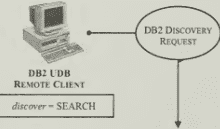

图 2-16：控制 `DB2 Discovery` 可以看到的实例和数据库。在示例中，发现请求将返回实例 1，而不会返回实例 2 和数据库 2。

# 第二章：服务器管理

由于任意数量的客户端都可以访问服务器，反之，任何数量的用户都可以授予处理特定数据库工作所需的权限，因此在任何时刻协调使用特定数据库的每个人的工作可能是困难的，甚至是不可能的。这可能会产生问题，因为有时数据库管理员（DBA）需要所有用户停止使用特定实例或数据库，以便执行例行维护操作。如果你的组织规模较小，可能联系每个数据库用户并要求他们断开足够的时间以执行任何必要的维护操作。但如果你的组织由数百名用户组成怎么办？或者如果员工提早回家，无意中留下了实例连接或数据库连接怎么办？你如何发现哪些用户和应用程序正在与你需要的独占访问的实例或数据库进行交互？

## 查找谁正在使用实例或数据库

如果你拥有 `DB2` 数据库服务器的系统管理员（`SYSADMN`）或系统控制（`SYSCTRL`）权限，你可以通过执行 `LIST APPLICATIONS` 命令来查找谁正在使用该服务器上的实例或数据库。该命令的基本语法如下：

```
LIST APPLICATIONS
<FOR [DATABASE | DB8] [DatabaseAlias]
<SHOW DETAIL>
```

其中：

- `DatabaseAlias`：标识为要获取应用程序信息的数据库所分配的别名。

因此，如果你想找出当前连接到名为 `SAMPLE` 的数据库的应用程序（以及运行这些应用程序的用户关联的授权 ID），可以通过执行类似下方的 `LIST APPLICATIONS` 命令来实现：

```
LIST APPLICATIONS FOR DATABASE sample
```

当执行此命令时，你可能会看到类似下面的输出：

| Auth Id | 应用程序名称 应用程序句柄 | 应用程序 ID DB 名称 | 代理数量 |

| --- | --- | --- | --- | --- | --- |

| RSANDERS | db2taskd | 148 | *LOCAL.DB2.070601164915 | SAMPLE | 1 |

| RSANDERS | db2stmm | 147 | *LOCAL.DB2.070601164914 | SAMPLE | 1 |

| RSANDERS | db2bp.exe | 146 | *LOCAL.DB2.070601164913 | SAMPLE | 1 |

你还可以通过从控制中心（`Control Center`）的数据库中选择“应用程序”（`Applications`）操作，查找连接到实例（或连接到该实例内数据库）的应用程序。图 2-17 显示了为了激活应用程序对话框必须选择的控制中心菜单项。图 2-18 显示了如果应用程序连接到指定实例内的数据库，该对话框可能看起来如下。

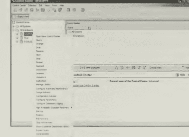

图 2-17：从控制中心调用应用程序对话框。

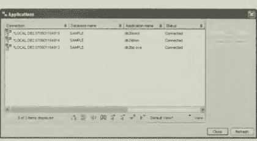

图 2-18：应用程序对话框。

## `FORCE APPLICATION` 命令

一旦知道哪些应用程序正在使用实例或数据库，你就可以通过执行 `FORCE APPLICATION` 命令提前终止其中一个或多个应用程序（假设你拥有 `SYSADMN` 权限）。该命令的基本语法：

```
FORCE APPLICATION ALL
```

或

```
FORCE APPLICATION ([ApplicationHandle]),
```

其中：

- `ApplicationHandle`：标识要终止的一个或多个应用程序相关的句柄。

因此，如果你想强制终止连接到名为 `DB_SERVER` 服务器的所有用户和应用程序，可以通过执行类似下面的 `FORCE APPLICATION` 命令来实现：

```
FORCE APPLICATION ALL
```

另一方面，如果你想强制句柄为 148 的应用程序（参见 `LIST APPLICATIONS` 命令输出查看此值）连接到名为 `SAMPLE` 的数据库，可以通过执行类似下面的 `FORCE APPLICATION` 命令：

```
FORCE APPLICATION 148
```

重要的是，当通过 `FORCE APPLICATION` 命令终止应用程序的实例连接或数据库连接时，应用程序执行但尚未提交的所有 SQL 操作将回滚。


为了保护数据库完整性，处理 `FORCE APPLICATION` 命令时，只有空闲或执行不可中断数据库操作的应用程序会被终止。（例如，正在创建或备份数据库的应用程序不会被终止；正在恢复数据库的应用程序会被终止，必须重新运行恢复操作才能可以使用。）此外，在强制操作期间无法停止实例的 `DB2` 管理器必须保持激活以便处理后续的实例级操作。最后，由于 `FORCE APPLICATION` 命令是异步运行的，在该命令执行后，其他应用程序或用户可能会再次连接到实例或数据库。可能需要多次执行 `FORCE APPLICATION` 命令才能完全终止所有的实例连接和数据库连接。

如果你使用应用程序对话框查看哪些用户或应用程序当前连接到实例或数据库，可以通过高亮应用程序对话框列表中显示的一个或多个条目，并点击屏幕右上角的“强制”（`Force`）推按钮来终止实例连接和数据库连接（参见图 2-18）。

## 使用任务中心

正如你所想象的，使用 `FORCE APPLICATION` 或 `QUIESCE` 命令终止实例连接和数据库连接会对所有受影响的用户应用程序产生重大影响。更好的替代方案是调度维护操作，使其在数据库活动较少或没有时执行。这正是任务中心（`Task Center`）大用场。它是一个交互式 GUI 应用程序，允许用户组织任务流、调度频繁发生的任务、运行任务并向其他用户发送任务完成的通知。图 2–19 显示了创建数据库备份任务后，任务中心在 Windows XP 服务器上的界面。


图 2–19：任务中心。

那么什么是任务？任务是一个脚本连同任何相关的成功条件、调度和通知。用户可以在任务中心创建任务，通过保存来自 `DB2` 对话框或向导的结果来生成任务（例如，可以使用备份向导创建一个数据库备份操作，该操作可以被调度为定期运行），在另一个工具中创建脚本并将其保存到任务中心，或导入现有脚本。此类脚本可以包含 `DB2` 命令、`SQL` 语句、操作系统命令或这三者的任何组合。虽然任务不仅仅是一个脚本，但脚本通常是任务不可或的一部分；一旦创建了脚本，将其转换为任务的过程涉及：

- 调度脚本运行的时间，
- 指定成功和失败条件，
- 指定脚本执行成功和失败时应执行的操作，
- 指定在脚本完成或失败时应通知的电子邮件地址（包括传寻器地址）。（任务中心可以通知联系人，也可以将信息存放在日志 `Journal` 中。）

通过任务中心，还可以创建分组任务，分组任务是一种将多个脚本组合成单个逻辑工作单元的特殊任务。当分组任务满足你定义的成功或失败条件时，将运行任何后续任务。例如，你可以将三个备份脚本组合成一个任务，然后指定如果所有备份脚本都执行成功，则将表重组操作作为后续任务执行。

任务中心使用成功代码集（返回代码或返回代码范围，如果接收到则表示任务执行成功）来评估其执行的任何任务的成功或失败；超出指定范围的代码表示失败。此外，任务中心还会评估 `DB2` 脚本中执行的每个 `SQL` 语句的 `SQLCA` 返回码，如果任何语句失败，则整个任务均失败。无论任务是成功完成还是失败，都可以执行任意数量的操作，包括以下：

- 运行另一个任务
- 调度另一个任务
- 禁用另一个已调度的任务
- 删除自身

那么谁可以创建和调度任务呢？任何拥有执行任务所需的权限和权利的人。事实上，任务中心为创建任务的用户提供了一种方法，允许其向其他用户授予任务的读、写和执行（运行）权限。当多个不同的用户创建和维护任务时，这非常有用。


要使用任务中心，你必须首先创建一个工具目录（`tools catalog`）。如果你在安装 `DB2` 时没有创建工具目录，可以通过执行 `CREATE TOOLS CATALOG` 命令来创建一个。

## `DAS` 配置与任务中心

在某种程度上，任务中心的行为是通过 `DAS` 实例配置文件中的参数来控制的。正如每当创建一个新实例时都会创建并初始化 `DB2` 数据库管理器配置文件一样，在创建 `DAS` 时也会创建并初始化 `DAS` 实例配置文件。构成 `DAS` 实例配置文件的参数所示表 2.7。

### 表 2.7 `DAS` 实例配置参数

| 参数 | 取值范围/默认值 | 说明 |

|---|---|---||


| `authentication` | `SERVER_ENCRYPT`, `KERBEROS_ENCRYPT` 默认: `SERVER_ENCRYPT` | 指定 DAS 用户身份验证发生的方式和位置。 |
| `contact_host` | 任何有效的 TCP/IP 主机名 默认: `NULL` | 指定调度器和健康监控器用于通知的联系信息的存储位置（即：DB2 管理服务器的 TCP/IP 主机名）。如果没有指定位置，DAS 假设联系信息是本地的。 |
| `das_codpage` | 任何有效的字符字符串 默认: `NULL` | 由 DB2 管理服务器识别代码页。如果此参数为空，则使用系统的默认代码页。 |
| `das_territory` | 任何有效的字符字符串 默认: `NULL` | 由 DB2 管理服务器识别区域。如果此参数为空，则使用系统的默认区域。 |
| `dasadm_group` | 任何有效的字符字符串 默认: `NULL` | 指定拥有 DAS 实例管理员 (`DASADM`) 权限的组名称。 |
| `db2system` | 任何有效的字符字符串 默认: TCP/IP 主机名 | 指定用户和数据库管理员用于识别 DB2 服务器系统的名称。（DB2 Discovery 将此名称作为包含实例和数据库的 DB2 系统返回。） |
| `discover` | `DISABLE`, `KNOWN`, `SEARCH` 默认: `SEARCH` | 指定用户支持的 DB2 Discovery 请求的类型。（如果此参数设置为 `SEARCH`，则支持搜索发现，即 DB2 客户端在网络上搜索 DB2 数据库。如果此参数设置为 `KNOWN`，则支持已知发现，即针对用户指定的管理服务器发布发现请求。如果此参数设置为 `DISABLE`，则工作站不会响应任何类型的发现请求。） |
| `exec_exp_task` | `YES`, `NO` 默认: `NO` | 指定当调度器开启时是否执行过期任务。（调度器仅在启动时检测任务。）例如，如果你调度了一个在每个周六运行的任务，而调度器在周五关闭并在周一重启，那么周六的任务现在就是过期任务。如果将 `exec_exp_task` 设置为 `YES`，该任务将在调度器重启时立即执行。 |
| `jdk_64_path` | 任何有效的字符字符串 默认: `NULL` | 指定用于运行 DB2 管理函数的 64 位 Java 开发工具包 (SDK) 的安装目录。 |
| `jdk_path` | 任何有效的字符字符串 默认: `NULL` | 指定用于运行 DB2 管理函数的 Java 开发工具包 (SDK) 的安装目录。 |
| `sched_enable` | `ON`, `OFF` 默认: `OFF` | 指定调度器是否运行。调度器允许任务中心等工具调度和执行任务。 |
| `sched_useid` | 任何有效的字符字符串 默认: `NULL` | 如果工具目录相对于管理服务器是远程的，则指定调度器连接工具目录时使用的用户 ID。 |
| `smtp_server` | 任何有效的 SMTP TCP/IP 主机名 默认: `NULL` | 指定调度器发送电子邮件和传寻器通知时使用的 SMTP 服务器（当开启时）。 |
| `toolscat_db` | : `NULL` | 指定调度器使用的工具数据库。（工具数据库包含由任务中心和控制中心创建的任务，在使用任务中心之前必须存在。） |
| `toolscat_inst` | 任何有效的字符字符串 默认: `NULL` | 指定调度器配合 `toolscat_db` 用于识别工具数据库的实例名称。 |
| `toolscat_schema` | 任何有效的字符字符串 默认: `NULL` | 指定调度器使用的工具数据库的模式。（模式用于唯一标识数据库中的一组工具目录表和视图。） |

### 表 2.7 DAS 实例配置参数（续）

改编自 DB2.9 性能指南手册第 273–274 页的表 66

因此，如果你想开启调度器（Scheduler）以便任务中心（Task Center）中的任务能够执行，可以通过执行类似下面的 `UPDATE ADMIN CONFIGURATION` 命令来实现：

```
UPDATE ADMIN CFG USING SCHED_ENABLE ON
```

通过执行 `RESET ADMIN CONFIGURATION` 命令，可以将分配给所有 DAS 实例配置文件参数的值恢复为系统默认值。该命令的语法为：

```
RESET ADMIN [CONFIGURATION | CONFIG | CFG]
```

## 自动维护

虽然任务中心可以用于调度维护操作，但对于某些管理员来说，确定是否以及何时运行某些资源密集型维护工具可能非常耗时。通过自动维护（DB2 9 中引入的一项新功能），你指定了你的维护目标，数据库管理器（Database Manager）将使用你识别出的目标来确定是否需要执行一项或多项维护活动。如果确定需要执行维护操作，该操作将在下一个可用的维护窗口内执行（维护窗口是由你指定的时段，在此期间内将执行所有自动维护活动）。

自动维护可用于以下维护操作：

- 创建数据库的备份映像。自动数据库备份为用户提供了一种解决方案，确保数据库得到既正确又定期的备份，而无需担心何时备份或无需了解 `BACKUP` 命令的语法。
- 数据整理（表或索引重组）。此维护活动可以提高 DB2 数据库管理器访问表的效率。自动重组管理离线表和索引重组，用户无需担心何时以及如何重组其数据。
- 数据访问优化（运行 `RUNSTATS`）。DB2 数据库管理器会更新有关表数据、表索引数据或表及索引中数据的系统目录统计信息。DB2 优化器使用这些统计信息来确定响应查询时使用何种路径访问数据。自动统计收集尝试通过维护最新的表统计信息来提高数据库性能。其目标是让 DB2 优化器始终根据准确的统计信息选择访问计划。
- 统计信息分析。自动统计信息分析通过检测过时、缺失和指定不当的统计信息并根据查询反馈生成统计分析，建议何时以及如何收集表统计信息。

当创建 DB2 9 数据库时，默认启用自动维护；可用自动维护功能的启用通过可用的自动维护特定数据库配置参数控制（`auto_maint`, `auto_db_backup`, `auto_tbl_maint`, `auto_runstats`, `auto_stats_prof`, `auto_prof_upd`, and `auto_reorg`）。这些参数代表一组分层的开关，可以被设置为 `ON` 或 `OFF`。

配置自动维护和定义维护窗口最简单的方法是使用名为“配置自动维护向导”（Configure Automatic Maintenance wizard）的特殊工具。你可以通过选择控制中心（Control Center）数据库菜单中的“配置自动维护”操作来激活此工具。图 2–20 显示了为了激活配置自动维护向导而必须选择的控制中心菜单项。图 2–21 显示了该向导在 Windows XP 服务器上的界面。

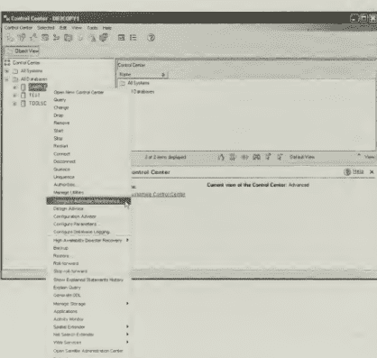

图 2-20：从控制中心调用配置自动维护向导。

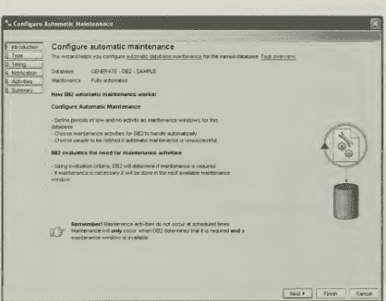

图 2-21：配置自动维护向导。

## 实用节流（Utility Throttling）

自动维护活动（备份、统计收集、统计分析以及表/索引重组）在运行时会消耗资源并可能影响你的数据库性能。此外，离线数据库备份和表/索引重组操作可能会限制对表、索引或整个数据库的访问。为了将系统影响降至最低可以通过 DB2 的自适应工具节流系统调节某些自动维护活动的资源使用。

自适应工具节流系统允许维护工具在关键期间并发运行，同时将其对生产工作负载的影响保持在可接受范围内。以下维护操作可以被节流：

- 统计收集
- 备份操作
- 重平衡操作
- 异步索引清理

分配给 DB2 管理器配置参数 `util_impact_lim` 的值限制了节流工具对生产工作负载造成的性能下降幅度。要为所有受节流工具定义影响策略，你只需为 `util_impact_lim` 配置参数分配 1 到 100 之间的任何值即可。例如，要配置实例使自动备份操作的调用对系统工作负载的影响不超过 10%，你需要通过执行类似下面的 `UPDATE DATABASE MANAGER` 命令为 `util_impact_lim` 配置参数分配值 10：

```
UPDATE DATABASE MANAGER USING UTIL_IMPACT_LIM 10
```

正如你所预期，受节流工具通常比未节流的工具需要更长时间完成。如果你发现某个工具运行时间过长，可以增加分配给 `util_impact_lim` 配置参数的值，或者通过将 `util_impact_lim` 配置参数设置为 100 来完全禁用节流。（如果将 `util_impact_lim` 设置为 100，则没有工具会被节流。在这种情况下，工具可以更快完成，但它们极可能对工作负载产生不良影响。）


虽然受节流工具的影响策略是由分配给 `util_impact_lim` 配置参数的值定义的，但在调用工具时（通过启动工具的命令所提供的选项），你必须设置影响优先级，以便其以节流运行。节流系统确保受节流工具尽可能积极地运行，而不违反影响策略。

## 获取运行工具的信息

如果你想找出是否有工具正在实例上运行以及它们的节流优先级是多少，可以通过执行 `LIST UTILITIES` 命令。该命令的语法为：

`LIST UTILITIES` `<SHOW DETAIL>`

因此，如果你启动了一个名为 `SAMPLE` 的节流备份操作，可以通过执行类似下面的 `LIST UTILITIES` 命令来获取该操作的详细信息：

`LIST UTILITIES SHOW DETAIL`

当执行此命令时，输出的信息可能如下：

```
ID = 1
Type = BACKUP
Database Name = SAMPLE
Partition Number = 0
Description = offline db
Start Time = 2007/06/02 10:35:31.442019
State = Executing
Invocation Type = User
Throttling:
Priority = Unthroled
Progress Monitoring:
Estimated Percentage Complete = 46%
Total Work = 49310404 bytes
Completed Work = 22696620 bytes
Start Time = 2007/06/02 10:35:31.466054
```

## 修改运行工具的影响优先级

如果你想更改正在运行的工具的影响优先级（节流程度），可以通过执行 `SET UTIL_IMPACT_PRIORITY` 命令来实现。通过此命令，你可以：

- 对以非节流模式启动的运行中工具进行节流；
- 对正在运行的节流工具取消节流（禁用节流）；
- 如果有多个同时运行的节流工具，且其中一个更重要，则重新调整运行中节流工具的优先级。

### 自调优内存管理器 117

`SET UTIL_IMPACT_PRIORITY` [`UtilityID`]

`TO` [`Priority`]

其中：

- `UtilityID` : 标识正在运行的实用程序 ID，其优先级需要被更改。（可以通过执行 `LIST UTILITIES` 命令获取运行中实用程序分配的 ID。）
- `Priority` : 指定与运行指定的实用程序相关的影响的实例级限制。值 100 代表最高优先级；值 1 代表最低优先级。将 `Priority` 设置为 0 将强制受限（throttled）的实用程序继续以未受限模式运行；将 `Priority` 设置为非零值将强制未受限的实用程序继续以受限模式运行。

因此，如果你想让之前（通过 `LIST UTILITIES` 命令）获取信息的那个未受限的备份操作继续以受限模式运行，可以通过执行如下所示 `SET UTIL_IMPACT_PRIORITY` 命令来实现：

```
SET UTIL_IMPACT_PRIORITY 1 TO 20
```

当执行此语句时，备份操作对服务器正在处理的总工作负载的平均影响不应超过 20%。

# 自调优内存管理器

虽然实用程序节流可以帮助减少实用程序执行对生产工作负载的影响，但工作负载的性能（好坏）通常取决于服务器对内存等资源的利用情况。正如我们之前看到的，DB2 数据库管理器配置和数据库配置参数控制系统资源如何分配给实例和数据库。在 DB2 9 中，一种名为“自调优内存管理器”（Self-Tuning Memory Manager）的新内存调优功能通过在测量和分析每个 DB2 消费者使用可用内存的情况后，自动为这些参数设置值，简化了配置内存相关数据库参数的任务。以下内存消费者可以启用自调优：

- 缓冲池（由 `ALTER BUFFERPOOL` 和 `CREATE BUFFERPOOL` 语句控制）
- 软件包缓存（由 `pckachesz` 配置参数控制）
- 锁存内存（由 `locklist` 和 `maxlocks` 配置参数控制）
- 排序内存（由 `sheaptres_shr` 和 `sortheap` 配置参数控制）
- 数据库共享内存（由 `database_memory` 配置参数控制）

当数据库未启用自调优时，整个数据库将使用指定数量的内存，并根据需要将其到数据库内存消费者中。然而，当数据库启用了自调优后，内存调优器会对数据库工作负载特征的显著变化做出响应，调整内存配置参数的值和缓冲池的大小以优化性能。如果当前的工作负载需求较高且系统上有足够的空闲内存，数据库将消耗更多内存。一旦工作负载的内存需求下降，或者系统可用空闲内存变得过低，部分数据库共享内存将被释放。需要注意的是，自调优内存管理基于数据库工作负载做出调优决策；内存特征不断变化的工作负载会限制其有效调优的能力。如果工作负载的内存特征不断变化，自调优将降低内存调优频率，并反复向不断变化的目标条件进行调优。

通过将 `self_tuning_mem` 数据库配置参数分配为 `ON` 来为数据库启用自调优。通过为配置参数分配值 `AUTOMATIC`，可以为内存配置参数控制的特定内存启用自调优；你可以通过使用 `CREATE BUFFERPOOL` 或 `ALTER BUFFERPOOL` SQL 语句将缓冲池的大小设置为 `AUTOMATIC`，从而启用缓冲池的自调优。然而，由于内存调优器在不同的内存消费者之间交换资源，必须至少启用两个内存消费者进行自调优，自调优才能生效。（更不用说数据库本身的 `self_tuning_mem` 数据库配置参数必须设置为 `ON`。）

一旦对数据库和两个以上的内存消费者配置了自调优，可以通过执行 `GET DATABASE CONFIGURATION` 命令获取数据库的当前内存配置。自调优所做的更改记录在内存调优日志文件中，这些文件位于实例的 `stmmlog` 子目录下。（第一个创建的文件将被命名为 `stmm.0.log`，第二个将被命名为 `stmm.1.log`，依此类推。）每个内存调优日志文件都包含执行调优操作时每个内存消费者的资源需求摘要。调优间隔可以通过检查内存调优日志文件中条目的时间戳来确定。

## 问题确定

数据库环境中出现错误的可能性永远无法完全消除，但 DB2 配备了多种工具，可以在错误发生时帮助精确定位原因。在许多情况下，这些工具可以提供建议，遵循这些建议可能会解决最初由生成错误引起的情况。

当数据库系统内部发生错误时，DB2 数据库管理器通过生成特定的错误代码并以多种方式显示此代码来通知你。如果在发生错误时使用的是命令行处理器 `CLP`，生成的错误代码以及相应的消息将显示在 `CLP` 提示符处。相反，如果在发生错误时使用的是 DB2 自带的任何管理工具，生成的错误代码以及相应的消息将显示在弹出对话框中，并记录在日志中，附带错误发生的日期时间。

## 获取错误代码信息

当 DB2 数据库管理器返回错误代码时，有多种方法可以找出该错误代码的含义：

- 通过在 IBM DB2 9 Message Reference 卷 1 或卷 2 产品文档中查找生成的错误代码。
- 通过执行 `GET MESSAGE` API（此 API 必须在应用程序中执行）。
- 通过指示 DB2 数据库管理器提供与错误相关的信息。

# 第2章：服务器管理

通过指示 DB2 数据库管理器提供与错误相关的信息。你可以通过执行由问号加错误代码组成的命令来指示 DB2 数据库管理器提供与错误相关的信息。例如，如果你想查看与错误代码 `CCA302N` 相关的信息，可以在 `CLP` 中执行命令 `? CCA302N`。返回的结果如下：

`CCA302N` 发生了 I/O 错误

解释：

在尝试打开、读取、更改文件位置或关闭文件时遇到错误。

用户响应：

如果指定了文件名，请验证文件名是否有效以及用户是否有访问该文件的权限。还要检查任何磁盘和操作系统错误。

## 原因码

在某些情况下，错误消息将包含对被称为“原因码”的引用。当一个错误代码可以由多个不同的事件生成时，使用原因码提供与返回错误码相关的附加信息。例如，与错误代码 `SQL0866N` 相关的消息如下：

连接重定向失败。原因码：“[`ReasonCode`]”

其中：

- `ReasonCode` : 标识与错误消息相关的原因码。通常这是一个数值。（对于错误代码 `SQL0866N`，`ReasonCode` 可以是数字 1 或 2。）

大多数情况下，你可以通过在 IBM DB2 9 Message Reference 卷 1 或 IBM DB2 9 Message Reference 卷 2 产品文档中查找生成的错误代码来找出特定原因码的含义。

## 问题确定 121

DB2 数据库管理器提供与原因码相关的错误代码信息。

## 首次故障数据捕获 (FFDC)


DB2 可用的最重要的诊断工具之一是称为首次故障数据捕获 (First Failure Data Capture, FFDC)。FFDC 在后台静默运行，直到发生重大事件，此时，DB2 数据库管理器会自动捕获有关事件的诊断信息，并将其记录在特殊的 ASCII 格式文件中。这些信息包含了关键细节，可能有助于诊断和解决问题。由于这些信息是在事件发生的实际时间收集的，因此为了获取诊断信息而重现错误的需求大大减少，在某些情况下甚至被消除了。FFDC 捕获的信息通过几种不同的方式外部化，包括以下：

- **DB2 诊断日志文件条目。** 当发生任何重大事件时，包含该事件诊断信息的条目将自动记录在名为 `db2diag.log` 的文件中，该文件是 DB2 的主诊断日志文件。
- **管理通知日志条目。** 当发生重大事件时，针对任何生成的 SQL 返回码的补充信息将写入 Windows 事件日志（在 Windows NT、Windows 2000 和 Windows XP 系统上）或写入文件 `InstanceName.nfy`——其中 `InstanceName` 是生成该信息的实例名称（在所有其他支持的操作系统）。这些信息是非加密的，可以使用 Windows 事件查看器（在 Windows 系统上）或任何文本编辑器（在所有其他系统上）查看。
- **转储文件 (Dump files)。** 在某些情况下，当 DB2 特定进程或线程失败时，额外信息将记录在外部二进制转储文件中（这些文件根据故障进程/线程的 ID 命名）。这些文件在程度上不可读，旨在转发给 DB2 客户支持进行解释。

# 第 2 章：服务器管理

陷阱文件 (Trap files)。如果 DB2 数据库管理器由于发生陷阱、段错误或异常而无法继续处理，它将生成陷阱文件，该文件包含了发生陷阱、段错误或异常事件之前执行的最后步骤的函数调用序列。

核心文件 (Core files，仅限 UNIX)。如果 DB2 在 UNIX 平台上异常终止，操作系统将生成核心文件，核心文件是一个包含与 DB2 陷阱文件中记录信息相似的二进制文件。（核心文件也可能包含已终止 DB2 进程的整个内存映像。）

## FFDC 信息的存储位置

默认情况下，在 UNIX 平台上收集的所有 FFDC 信息都存储在目录 `$HOME/sqlib/db2dump` 中，其中 `$HOME` 是实例所有者的主目录。在 Windows 平台上，如果实例目录的位置没有存储在环境变量 `DB2INSTPROF` 中，则 FFDC 信息将被存储在目录 `$DB2Path\$DB2Instance` 中，其中 `$DB2Path` 是存储在 `DB2PATH` 环境变量中的路径而 `$DB2Instance` 是存储在 `DB2INSTDEF` 环境变量中的值（默认为“DB2”）。另一方面，如果实例目录的位置已存储在 `DB2INSTPROF` 环境变量中，则 FFDC 信息存储在目录 `Drive:$DB2InstProfile\$DB2Instance` 中，其中 `Drive` 是 `DB2PATH` 环境变量中引用的驱动器，`$DB2InstProfile` 是实例配置配置文件的名称，而 `$DB2Instance` 是存储在 `DB2INSTDEF` 环境变量中的值。

然而，FFDC 信息的实际记录位置是由 DB2 数据库管理器实例配置文件中 `diagpath` 参数的值控制的。因此，如果你想更改所有 FFDC 信息存储的位置，可以通过更改此参数的值来实现（当实例首次创建时，该值包含空字符串）。

无论 FFDC 信息存储在何处，都由系统管理员确保定期清理使用的位置；DB2 不会自动删除由 FFDC 工具生成的转储文件、陷阱文件和核心文件。

## 控制收集多少 FFDC 信息

所记录的管理和诊断信息的类型（即控制收集量）也由 DB2 数据库管理器实例配置文件中的参数（`notifylevel` 和 `diaglevel`）控制。根据其当前值，这些参数告诉 FFDC 收集什么种类型的管理和诊断信息：

- 0. 不收集管理信息和诊断数据（不建议）。
- 1. 仅为严重（致命或不可恢复）错误收集管理信息和诊断数据。
- 2. 收集所有类型错误（包括严重和非严重）的管理信息和诊断数据，但不收集警告。
- 3. 收集所有错误和警告的管理信息和诊断数据。
- 4. 收集所有错误和警告的管理信息和诊断数据，包括信息消息和其他内部诊断信息。

当实例首次创建时，DB2 数据库管理器实例配置文件中的 `notifylevel` 和 `diaglevel` 参数默认设置为 3，每当发生此类事件时，FFDC 都会收集错误和警告的管理/诊断数据。然而，应尽可能将这些参数设置为 4（并行数据库环境除外，在这种环境中此设置可能会产生过多数据）。这在初始设置 DB2、每次更改配置参数值或每当似乎发生大量错误时尤为真实。但是，重要的一点是，如果将 `diaglevel` 配置参数设置为 4，当 DB2 首次启动连接到实例内的数据库以及每次发生错误条件时，DB2 的运行会变慢。

## DB2 诊断日志文件

之前我们看到，每当发生任何重大事件时，包含该事件诊断信息的条目都会自动记录在名为 `db2diag.log` 的文件中，该文件是 DB2 的主诊断日志文件。`db2diag.log` 文件是一个 ASCII 格式的文件，由 FFDC 工具生成的诊断记录组成。该文件中的每条记录（或条目）要么包含已发生的管理事件信息，要么包含特定的错误信息。管理事件的条目非常有价值，因为它们指示了如备份和恢复等操作是否启动，如果是，则它们是否成功完成。另一方面，错误信息的条目仅在尝试诊断外部症状，或者已经隔离了特定错误的源并正在寻找更多信息时有用（例如，应用程序接收到意外的 SQL 代码或数据库崩溃）。如果数据库运行正常，则错误信息条目是不重要的，并且可以安全地忽略。

一旦创建，`db2diag.log` 文件就会持续增长。因此，最近的条目始终位于文件末尾附近。如果该文件的存储空间出现问题，可以删除现有文件——在下次需要时，将自动创建一个新的 `db2diag.log` 文件。

## 管理通知日志

在 DB2 的早期版本中，DB2 诊断日志（`db2diag.log` 文件）作为单一诊断设施，供系统/数据库管理员和 DB2 客户支持人员共同使用。遗憾的是，由于系统/数据库管理员所需的诊断信息与 DB2 客户支持人员所需的信息非常不同，且 DB2 客户支持人员所需的信息通常是晦涩难懂的（例如内存结构转储、内部返回码和无害的诊断条目），仅对熟悉 DB2 源代码的人有用，迫使该文件承担两种用途，往往导致系统和数据库管理员对他们不理解的文件条目产生不必要的担心。为了解决这种情况，IBM 在 8.1 版本中引入了易于管理的通知日志。该日志旨在从根本上改变 DB2 的诊断格局；现在管理通知日志作为系统和数据库管理员的主要诊断设施，而 DB2 诊断日志仅存在为 DB2 客户支持人员提供特殊、定制信息的目的。

与 DB2 诊断日志条目相比，管理通知日志条目的一个显著区别是其缺少了令人困惑的十六进制转储（hex dumps）。取而代之的是提供了许多在真实的、专业的 DB2 数据库管理员（DB2 客户）帮助下审查并编写的具有意义且有用的消息。这些消息中的大多数为返回给应用程序或 CLP（命令行界面）的每个相关 SQL 返回代码提供了补充信息。其他消息则提供了对意外错误或异步事件的通知，例如崩溃、操作系统的信号或次优配置。管理通知日志条目和 DB2 诊断日志条目的格式本质上是相同的。然而，所有写入管理通知日志条目的消息都是在使用安装过程中指定的终端用户语言写入的（而写入 DB2 诊断日志的始终始终使用英文写入，无论使用的终端用户语言是什么）。

另一个重大的区别是，在 Windows 平台上，管理通知日志条目被写入 Windows 事件日志，而不是预定义的文件。然而，当使用预定义文件文件时（所有非 Windows 平台均如此），该文件的行为类似于 DB2 诊断日志：一旦创建，它就会持续增长；最近的条目始终位于文件末尾附近；如果文件被删除，系统将在下次需要时自动创建一个新的。

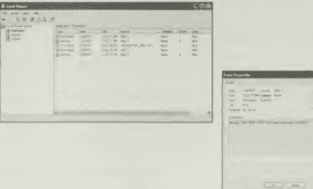

图 2-22：Windows 事件查看器。

需要注意的是，写入 Windows 事件日志的条目可以使用 Windows 事件查看器进行查看。图 2–22 显示了 DB2 管理通知日志条目在 Windows XP 服务器的 Windows 事件查看器中可能显示的内容。

## 解释 DB2 诊断日志和管理通知日志条目头

管理通知日志文件和 DB2 诊断日志文件中的每个条目都以一组特定的值开始，这些值旨在识别该条目对应的特定事件。由于此块信息记录了所有条目，并且它已经以特定格式记录，因此它被称为条目头（entry header）。图 2–23 展示了典型的管理通知日志条目的外所示。

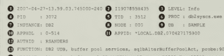

> 图 2-23：管理通知日志/DB2 诊断日志条目头的各个组成部分

所有条目头由以下组件组成（参见图 2–23 中的编号项目符号）：

- 1. 标识条目生成时间的时间戳。


## db2diag.log 文件字段说明

- 2. `db2diag.log` 文件的记录 ID。此 ID 标识了正在记录当前消息的文件偏移量（例如，“9078555”）以及创建 DB2 诊断日志的平台的消息长度（例如，“435”）。
- 3. 与错误消息相关的诊断级别。有效值为：`Info`（信息）、`Warning`（警告）、`Error`（错误）、`Severe`（严重）和 `Event`（事件）。
- 4. 由操作系统分配给生成条目的进程的唯一标识符。此值在 DB2 使用多个进程运行的 UNIX 环境中更具适用性。在 Windows 环境中，DB2 使用多个线程而非多个进程进行运行；因此，提供的进程 ID 通常是主 DB2 可执行文件的 ID。（如果应用程序在分布式单元工作单元 [DUOW] 环境中运行，则显示的进程 ID 将是 DUOW 关联令牌）。
- 5. 由操作系统分配给生成条目的线程的唯一标识符。
- 6. 生成条目的进程名称。
- 7. 生成条目的实例名称。
- 8. 与生成条目的节点对应的数字。如果正在使用非分区数据库，则节点号将始终为 `000`。
- 9. 生成条目目的数据库名称。
- 10. 分配给生成事件的进程正在工作的应用程序的应用程序句柄。此值由协调分区编号后跟协调索引号组成，其间用连字符分隔。
- 11. 分配给生成事件的进程正在工作的应用程序的唯一标识符。要了解更多关于特定应用程序 ID 信息，请执行以下任务：
    - 在 DB2 服务器上使用 `LIST APPLICATIONS` 命令或在 DB2 Connect 网关上使用 `LIST DCS APPLICATIONS` 命令来获取应用程序 ID 列表。在此列表中搜索该应用程序 ID；一旦找到它
- 12. 生成条目时正在与实例或数据库操作的用户授权 ID。
- 13. 生成消息的产品名称（“DB2 UDB”）、组件名称（“buffer pool services”）和函数名称（“sqlAlterBufferPoolAct”），以及该函数内的探针点 `[90]`）。如果条目是由执行了 `db2AdminMsgWrite()` API 的用户应用程序生成的，则条目头的此部分将显示为“User Application”（用户应用程序）（应用程序可以通过调用 `db2AdminMsgWrite(e)` API 向管理通知日志文件和 DB2 诊断日志文件写入消息）。

要了解更多关于产生条目的函数所执行的活动类型，请查看其名称的第四字母。以下显示了 DB2 函数名第四位使用的某些字母，以及每个函数执行的活动类型：

| 字母 | 活动类型 |
| :--- | :--- |
| b | 缓冲池管理和操作 |
| c | 客户端与服务器之间的通信 |
| d | 数据管理 |
| e | 数据库引擎 |
| o | 操作系统的调用（如打开和关闭文件） |
| np | 数据保护（如锁定） |
| r | 关系数据库服务 |
| s | 排序操作 |
| x | 索引操作 |

在图 2–23 所示的条目中，第四个字母 `b` 表示消息是由执行某种缓冲池管理的函数生成的。
- 14. 描述该事件的消息。

## db2diag 工具

通常情况下，一旦理解了格式，管理通知日志和 DB2 诊断日志中发现的信息是易读的。然而，搜索大型 DB2 诊断日志可能非常耗时，特别是当日志跨越数月时。为了帮助确定问题，DB2 提供了一个用于过滤和格式可用信息的工具。该工具被称为 db2diag 工具，通过执行 `db2diag` 命令激活。该命令有多个可用选项；要获取更多信息，请从命令行界面执行以下任何命令：

- `db2diag -help`（提供可用选项的简要描述）
- `db2diag -hbrief`（提供所有选项的描述但不带示例）
- `db2diag -hnotes`（提供使用说明和限制）
- `db2diag -heexamples`（提供一组帮助入门的小示例）
- `db2diag -htutorial`（提供所有选项的示例）
- `db2diag -hall`（提供综合列表）

## 练习题

### 问题 1

为了静止一个实例，用户应该具有哪种权限？

A. `SYSADM`

B. `SECADM`

C. `SYSMAINT`

D. `SYSMON`

### 问题 2

执行以下哪个命令可以启动默认实例？

A. `START db2inst`

B. `START DB MANAGER`

C. `db2start i db2inst`

D. `START DBMGR`

### 问题 3

DB2 服务器包含两个实例：`TEST` 和 `PROD`。`TEST` 实例是默认实例。在尝试启动 `PROD` 实例之前，必须执行以下哪个命令？

A. `db2set DB2_INSTANCE=prod`

B. `UPDATE DBM CFG USING DB2INSTANCE prod`

C. `set DB2INSTANCE=prod`

D. `UPDATE DBM CFG USING DB2_INSTANCE prod`

### 问题 4

哪个命令会将 TCPIP 分配给所有实例的 `DB2COMM` 变量？

A. `db2set DB2COMM=TCPIP`

B. `db2set -g DB2COMM=TCPIP`

C. `db2set -all DB2COMM=TCPIP`

D. `set DB2COMM=TCPIP`

### 问题 5

如果执行以下命令：

```
db2set DB2COMM=
```

会发生什么？

A. 将显示分配给 `DB2COMM` 注册表变量的值。

B. 将服务器识别的数据库通信协议列表分配给 `DB2COMM` 注册表变量。

C. 将分配给全局 `DB2COMM` 变量的值复制到默认实例的 `DB2COMM` 注册表变量。

D. 删除默认实例的 `DB2COMM` 注册表级别变量。

### 问题 6

可以使用以下哪一个命令获取有关名为 `SAMPLE` 的数据库内存分配的信息？

A. `GET DB CFG FOR sample SHOW DETAIL`

B. `GET MEMORY USAGE FOR sample`

C. `GET DBM CFG`

D. `GET DB CFG DETAILS FOR sample`

### 问题 7

使用以下哪一个 DB2 数据库管理器配置参数来控制实例中可以并发执行的应用程序数量？

A. `NUM_INITAGENTS`

B. `MAXAGENTS`

C. `MAX_COORDAGENTS`

D. `MAXAGENTS`

# 132 第 2 章：服务器管理

### 问题 8

以下哪一个命令禁用了名为 `SAMPLE` 的数据库的重滚恢复，并导致数据库在单独的位置创建事务日志文件的副本副本？

A. `UPDATE DB CFG FOR sample USING LOGARCHMETH1 LOGRETAIN;`

`UPDATE DB CFG FOR sample USING NEWLOGPATH D:\dup_logs;`

B. `UPDATE DB CFG FOR sample USING LOGARCHMETH1 OFF;`

`UPDATE DB CFG FOR sample USING MIRRORLOGPATH D:\dup_logs;`

C. `UPDATE DB CFG FOR sample USING LOGARCHMETH1 LOGRETAIN;`

`UPDATE DB CFG FOR sample USING LOGSECOND D:\dup_logs;`

D. `UPDATE DB CFG FOR sample USING LOGARCHMETH1 OFF;`

`UPDATE DB CFG FOR sample USING LOGARCHMETH2 DISK:D:\dup_logs;`

### 问题 9

数据库管理员成功执行了以下命令：

```
UPDATE DBM CFG USING SHEAPTHRES 37500
UPDATE DB CFG FOR sample USING SORTHEAP 2500
```

假设针对 `SAMPLE` 数据库执行的每个排序操作消耗 10 MB 内存，最多并发运行的排序操作数量是多少？

A. 5

B. 10

C. 15

D. 20

### 问题 10

使用以下哪一个数据库配置参数强制应用程序无限等待以获取表的锁？

A. `LOCKLIST`

B. `LOCKTIMEOUT`

C. `DLCHKTIME`

D. `MAXLOCKS`

### 问题 11

数据库管理员执行了以下命令：

```
CONNECT TO sample;
UPDATE DB CFG FOR sample USING SORTSHEAP 25;
UPDATE DB CFG FOR sample USING UTIL_HEAP_SZ 32;
COMMIT;
```

假设有足够的内存，更改何时生效？

- A. 下一次实例停止并重启时。
- B. 下一次 `SAMPLE` 数据库停止并重启时。
- C. 命令执行后立即生效。
- D. 更改不会生效，因为没有先将数据库置于静止模式。

### 问题 12

数据库管理员在正在的应用程序访问数据库时成功更改了 `SORTSHEAP` 数据库配置参数的值。应用程序何时能看到效果？

- A. 执行一个新的 SQL 语句时。


- B. 启动一个新的事务时。
- C. 建立新的数据库连接时。
- D. 应用程序终止并重启时。

## 问题 13

以下哪个命令将为名为 `DB2INST` 的实例建议并执行配置更改？

- A. `AUTOCFIGURE USING db2inst APPLY`
- B. `AUTOCFIGURE USING mem_percent 60 APPLY db2inst`
- C. `AUTOCFIGURE USING mem_percent 60 APPLY DBM ONLY`
- D. `AUTOCFIGURE USING mem_percent 60 APPLY DB AND DBM`

## 问题 14

运行 `AUTOCFIGURE` 命令后，数据库管理员发现名为 `SAMPLE` 的数据库的 `SORTHEAP` 数据库配置参数没有设置为 `AUTOMATIC`，尽管 `SELF_TUNING_MEM` 配置参数已设置为 `ON`。

为了获得预期结果，在再次运行 `AUTOCFIGURE` 命令之前必须执行以下哪一个命令？

- A. `UPDATE DB CFG USING SHEAPTHRES 0`
- B. `UPDATE DB CFG FOR sample USING SHEAPTHRES_SHR AUTOMATIC`
- C. `UPDATE DB CFG USING SHEAPTHRES AUTOMATIC`
- D. `UPDATE DB CFG FOR sample USING SHEAPTHRES_SHR 0`

## 问题 15

给定有关 DB2 服务器的以下信息：

实例名称：`db2inst`

端口号：`60000`

服务名称：`db2c,db2inst`

主机名：`db2host`

主机 TCP/IP 地址：`10.205.15.100`

协议：`TCP/IP`

数据库名称：`PROD_DB`

假设服务文件中已添加以下条目：

```
db2c_db2inst1 60000/tcp
```

必须执行以下两个命令中的哪一个来正确配置服务器的通信？

- A. `UPDATE DBM CFG USING SVCENAME db2c_db2inst1`
- B. `UPDATE DBM CFG USING PORT 60000`
- C. `db2set SVCENAME db2`
- D. `UPDATE DBM CFG USING SVCENAME`
- E. `db2set TCP/IP`

## 问题 16

数据库管理员希望服务器上的某个数据库是可见。以下哪项是正确的？

- A. 数据库必须先激活。
- B. 数据库必须在服务器上注册。
- C. 服务器上的 DAS 必须正在运行。
- D. 配置必须设置为 `KNOWN`。

## 问题 17

数据库服务器拥有 `DB2INST` 以及名为 `SALES` 和 `PAYROLL` 的两个数据库。以下哪个命令将允许 `DB2INST` 实例和 `SALES` 数据库，但阻止 `PAYROLL` 数据库可见？

- A. `UPDATE CFG USING SEARCH;`
  `UPDATE CFG FOR DISABLE;`
- B. `UPDATE CFG USING ENABLE;`
  `UPDATE CFG FOR SALES ENABLE;`
- C. `UPDATE CFG USING SEARCH;`
  `UPDATE CFG FOR SALES ENABLE;`
- D. `UPDATE CFG USING SEARCH;`
  `DISABLE`

## 问题 18

`LIST APPLICATIONS` 返回了以下输出：

| Auth ID | 应用程序名称 | 句柄 | 应用程序 ID | 数据库名称 | 代理数量 |
| :--- | :--- | :--- | :--- | :--- | :--- |
| RSANDERS | db2taskd | 148 | *LOCAL.DB2.07061495 |  | 1 |
| RSANDERS | db2stmm | 147 | *LOCAL.DB2.07061494 |  | 1 |
| RSANDERS | db2bp.exe | 146 | *LOCAL.DB2.07061493 |  | 1 |

以下哪两个命令将终止所有正在运行的应用程序？

- A. `FORCE APPLICATION (146, 147, 148)`
- B. `FORCE APPLICATION (LOCAL.DB2.07061495, LOCAL.DB2.07061494, LOCAL.DB2.07061493)`
- C. `FORCE APPLICATION (db2taskd, db2stmm, db2bp.exe)`
- D. `FORCE ALL APPLICATION`
- E. `FORCE ALL APPLICATIONS`

## 问题 19

+ 在使用任务中心为名为 `SAMPLE` 的数据库调度每日备份操作之前，以下哪项必须存在？

A. 一个名为 `TOOLSDB` 的特殊数据库
B. 一组特殊的工具目录表
C. `SAMPLE` 数据库中名为 `SYSTOOLSPACE` 的表空间
D. `SAMPLE` 数据库中名为 `TOOLSCAT` 的模式

## 问题 20

数据库管理员希望临时禁用任务中心。可以使用哪项来实现目标？

A. 将 `SCHED_ENABLE` 注册表变量设置为 `OFF`。
B. 将 DB2 数据库管理器配置中的 `SCHED_ENABLE` 参数设置为 `OFF`。
C. 将 `TOOLSDB` 数据库配置中的 `SCHED_ENABLE` 参数设置为 `OFF`。
D. 将 DAS (ADMIN) 配置中的 `SCHED_ENABLE` 参数设置为 `OFF`。

## 问题 21

+ 使用哪一个配置参数可以控制调度程序在停止和重启时任务中心的行为？

A. `JOURNAL_TASKS`
B. `SCHED_RESTART`
C. `EXEC_EXP_TASK`
D. `SCHED_ENABLE`

## 问题 22

- 哪些活动不能通过通过自动维护（Automatic Maintenance）执行？

- A. 数据库级备份
- B. 快照监控
- C. 统计收集和统计分析
- D. 表和索引重组

## 问题 23

一个数据库管理员需要创建一个新的 DB2 9 数据库，并希望在数据库数据发生碎片时自动执行离线表和索引重组操作。为了实现这一目标，最少需要的步骤是以下哪些？

- A. 使用 `CREATE DATABASE` 命令创建新数据库；定义合适的维护窗口
- B. 使用 `CREATE DATABASE` 命令创建新数据库；将 `AUTO_MAINT` 数据库配置参数赋值为 `ON`；定义合适的维护窗口
- C. 使用 `CREATE DATABASE` 命令创建新数据库；将 `AUTO_REORG` 数据库配置参数赋值为 `ON`；定义合适的维护窗口
- D. 使用 `CREATE DATABASE` 命令创建新数据库；将 `AUTO_MAINT` 数据库配置参数赋值为 `ON`；将 `AUTO_REORG` 数据库配置参数赋值为 `ON`；定义合适的维护窗口

## 问题 24

一个数据库管理员希望确保对名为 `SAMPLE` 的数据库执行的备份操作对生产工作负载的影响不超过 20%。以下哪些命令可以实现这一目标？

- A. `UPDATE DB CFG USING UTIL IMPACT_LIM 80`
- B. `UPDATE DB CFG USING UTIL IMPACT_PRIORITY 80`
- C. `UPDATE DB CFG USING UTIL IMPACT_LIM 20`
- D. `UPDATE DB CFG USING UTIL IMPACT_PRIORITY 20`

# 第 2 章：服务器管理

### 问题 25

执行 `LIST UTILITIES SHOW DETAIL` 命令返回了以下输出：

| ID | 1 |
| :--- | :--- |
| Type | BACKUP |
| Database Name | SAMPLE |
| Partition Number | 0 |
| Description | offline db |
| Start Time | 06/02/2007 10:35:31.242019 |
| State | Executing |
| Invocation Type | User |
| Throttling: |  |
| Priority | 20 |
| Progress Monitoring: | Estimated Percentage Complete = 46 Total Work = 49310404 bytes Completed Work = 22696620 bytes Start Time = 06/02/2007 10:35:31.466054 |

以下哪个命令将允许备份操作不受中断地继续运行？

- A. `SET UTIL_IMPACT_PRIORITY 1 TO 0`
- B. `SET UTIL_IMPACT_LIM 1 TO 0`
- C. `SET UTIL_IMPACT_PRIORITY 1 TO 100`
- D. `SET UTIL_IMPACT_LIM 1 TO 100`

### 问题 26


随着数据库工作负载的变化，以下内存消耗不能被自调内存管理器（Self-Tuning Memory Manager）自动调优？

- A. 缓冲池（Buffer pools）
- B. 锁内存（Locking memory）
- C. 工具内存（Utility memory）
- D. 数据库共享内存（Database shared memory）

### 问题 27

自调内存管理器的更改记录在哪里？

- A. 在内存调优日志文件中。
- B. 在 DB2 诊断日志文件（DB2 Diagnostics Log File）中
- C. 在管理通知日志（Administration Notification Log）中
- D. 在日志（Journal）中

### 问题 28

一条通知日志条目显示名为 `sqlpsize` 的函数生成了一个错误。函数名中的第四个字母表示什么？

- A. 错误发生在缓冲池管理/操纵操作期间。
- B. 错误发生在数据管理操作期间。
- C. 错误发生在数据保护操作期间。
- D. 错误发生在排序操作期间。

### 问题 29

关于 DB2 诊断日志文件的陈述哪些不正确？

- A. 一旦创建，DB2 诊断日志文件就会持续增长。
- B. 如果删除了 DB2 诊断日志文件，将创建一个新的。
- C. `db2diag` 工具用于过滤并格式化存储在 DB2 诊断日志文件中的信息。
- D. 如果 `DB2DIAG_RESTART` 数据库管理器配置设置为 YES，则每当实例重启时，DB2 诊断日志文件将被删除并重新创建。

### 问题 30

管理日志/DB2 诊断日志条目头记录的以下哪些组件可以与 `LIST APPLICATIONS` 命令结合使用，以获取生成该条目的应用程序名称？

- A. PID
- B. TID
- C. APPMID
- D. APHDL

## 答案

### 问题 1

正确答案是 A。只有具有系统管理员（SYSADM）权限或系统控制（SYSCTRL）权限的用户允许停止实例（quiesce）。一旦实例进入静止状态，只有具有系统管理员（SYSADM）、系统控制（SYSCTRL）或系统维护（SYSMAINT）权限的用户、指定组的成员（如果在进入静止模式时指定了组名）以及指定用户名的用户（如果在进入静止模式时指定了用户名）允许连接到实例。

### 问题 2

正确答案是 B。如果它们尚未运行，与特定实例相关的 DB2 数据库管理器后台进程可以通过执行 `START DATABASE MANAGER` 来启动。

### 问题 3

正确答案是 C。使用 `CREATE DATABASE` 命令创建新数据库；将 `AUTO_REORG` 数据库配置参数赋值为 ON；定义合适的维护窗口。

### 问题 4

正确答案是 C。`UPDATE DB CFG USING UTIL IMPACT_LIM 20`。

### 问题 5

正确答案是 D。将 `AUTO_MAINT` 数据库配置参数赋值为 ON。

### 问题 6

正确答案是 A。`GET DATABASE CONFIGURATION FOR SHOW DETAIL`。

### 问题 7

正确答案是 B。`MAXAGENTS` 指定了可以存在的 DB2 管理代理的最大数量。

### 问题 8

正确答案是 B。`LOGARCHMETH1` 指定了归档日志主要目的地的媒体类型。

## 问题 9

正确答案是 C。`SHEAPRESH` 指定了实例范围内可用排序总内存的软限制。

## 问题 10

正确答案是 B。`LOCKOUT` 数据库配置参数用于指定应用程序等待获取锁的秒数——如果将此参数赋值为 -1，应用程序将无限期等待以获取所需的锁。`LOCKLIST` 数据库配置参数用于指定分配和存储锁列表的最大内存（以页为单位）；`DLCKHT` 配置参数用于指定 DB2 数据库管理器检查所有连接到数据库的应用程序之间死锁的频率；`MAXLOCKS` 配置参数用于指定应用程序所持锁列表的百分比，在 DB2 数据库管理器执行锁升级之前，该百分比必须被填满。

## 问题 11

正确答案是 C。可以通过执行 `UPDATE DATABASE CONFIGURATION` 命令更改特定数据库配置参数的赋值。该命令的语法如下：

```
UPDATE [DATABASE | DB]
CONFIGURATION | CONFIG | CFG]
FOR [DatabaseAlias] [[Value] |
USING [[Parameter] | [Parameter] Value] AUTOMATIC |
Parameter] AUTOMATIC | [Parameter] MANUAL, ...]
<IMMEDIATE | DEFERRED>
```

其中：

- `DatabaseAlias` 标识要修改配置信息的数据库的分配的别名。
- `Parameter` 标识要修改值的一个或多个数据库配置参数（通过关键字）。在许多情况下，参数的关键字与名称本身相同。）
- `Value` 标识要分配给指定的数据库配置参数的新值。

如果在执行 `UPDATE DATABASE CONFIGURATION` 命令时指定了 `DEFERRED` 子句，对数据库配置文件的更改在所有到相应数据库的连接终止并建立新连接之前不会生效。如果相反指定了 `IMMEDIATE` 子句，或者未指定这两个子句，则只要必要的资源可用，对数据库配置文件的所有更改都将立即生效。

# 第 2 章：服务器管理

## 问题 12

正确答案是 A。如果在执行 `UPDATE DATABASE` 命令时指定了 `IMMEDIATE` 子句，或者未指定这两个子句，则只要必要的资源可用，对数据库配置文件的更改都将立即生效。在配置更改时正在数据库上运行的应用程序将在下次执行 SQL 语句时看到更改。

## 问题 13

正确答案是 D。`AUTONFIGURE` 命令旨在捕获有关数据库环境的特定信息，并根据提供的信息建议和或对配置参数进行更改。该命令的基本语法为：

```
AUTONFIGURE
USING [ Keyword] [Value] ...]
APPLY [DB ONLY | DB AND DBM | NONE]
```

其中：

- `Keyword`：`AUTONFIGURE` 命令识别一个或多个特殊关键字。有效值包括：`mem_percent`, `workload_type`, `num_stmts`, `tpm`, `admin_priority`, `is_populated`, `num_local_apps`, `num_remote_apps`, `isolation` 和 `bp_resizable`。
- `Value`：标识与提供的关键字相关联的值。

如果在执行 `AUTONFIGURE` 命令时指定了 `APPLY DB ONLY` 子句，Design Advisor 建议的数据库配置和缓冲池将应用于适当的数据库配置文件；如果指定了 `APPLY DB AND DBM` 子句，则建议的数据库配置和缓冲池将应用于数据库配置文件，而建议的实例配置更改将应用于适当的 DB2 数据库管理器配置文件。如果指定了 `NONE` 子句，则将显示更改建议但不会应用。

## 问题 14

正确答案是 A。`AUTONFIGURE` 命令（以及 Design Advisor）将始终建议配置数据库以利用自调内存管理器（Self Tuning Memory Manager）。然而，如果你在一个 `SHEAPTHRES` 配置参数被赋值为零以外的实例数据库上运行 `AUTONFIGURE` 命令，则排序内存堆数据库配置参数（SORTHEAP）不会配置自动调优。因此，如果你想启用排序内存调优，必须在执行 `AUTONFIGURE` 命令之前执行命令 `UPDATE DATABASE MANAGER CONFIGURATION USING SHEAPTHRES`。

## 问题 15

答案是 A 和 C。如果你选择手动配置通信，必须根据所使用的通信协议遵循相应的步骤。例如，如果你想配置服务器使用 TCP/IP，则必须执行以下步骤：

- 将值 `TCPIP` 赋值给 `DB2COMM` 注册表变量。

`DB2COMM` 注册表变量用于确定启动特定实例的 DB2 数据库运行时激活哪些通信管理器。通过执行类似下面的 `db2set` 命令为 `DB2COMM` 注册表变量赋值 `TCPIP`：

```
db2set DB2COMM=tcpip
```

- 将数据库服务器用于接收来自远程客户端通信的 TCP/IP 端口名称赋值给数据库管理器配置文件的 `svcename` 参数。

`svcename` 参数应设置为与主连接端口关联的服务名称，以便在数据库服务器启动时，它可以确定在哪个端口监听传入的连接请求。此参数通过执行类似下面的使用 `SVCNAME` 的 `UPDATE DATABASE MANAGER CONFIGURATION` 命令设置：

```
UPDATE DB CFG USING SVCNAME db2_db2inst1
```

- 更新数据库服务器上的服务文件（services file）。


TCP/IP 服务文件标识服务器应用程序为客户端请求监听的端口。如果你在数据库管理器配置文件的 `svcename` 参数中指定了服务名称，则必须在服务文件中添加适当的服务名称到端口的协议映射。（如果你在 `svcename` 参数中指定了端口号，则不需要更新服务文件。）

DB 数据库服务器的服务文件中的条目可能如下所示：

```
db2c_db2inst1    5001/tcp
```

## 问题 16

正确答案是 C。除了启用 DB2 服务器的远程管理外，DAS 实例还协助 Control Center 和 Configuration Assistant 使用 DB2 Discovery 提供发现其他 DAS 实例、DB2 实例和数据库信息的方法。（Configuration Assistant 和 Control Center 使用此类信息来简化和自动化到 DB2 服务器的客户端连接配置；任何工具都无法“发现”未运行的 DAS 服务器实例。）如果 `discover` 配置参数设置为 `SEARCH`，则服务器将响应搜索和已知的发现请求；如果此参数设置为 `KNOWN`，则服务器将仅响应已知的发现请求；如果此参数设置为 `DISABLE`，则服务器将不响应发现请求。

通过将数据库的 `discover_db` 配置参数设置为 `DISABLE` 可以从发现请求中“隐藏”数据库。（默认情况下，此配置参数设置为 `ENABLE`。）

## 问题 17

正确答案是 B。`discover_inst` DB2 数据库管理器配置参数用于指定在服务器上发现的实例信息是否包含在服务器对发现请求的响应中。如果此参数设置为 `ENABLE`，则服务器将在对搜索和已知的发现请求的响应中包含实例信息。如果此参数设置为 `DISABLE`，则服务器在响应发现请求时将不会包含实例信息（也不会包含该实例控制的任何数据库的信息）。

`discover_db` 配置参数用于指定在服务器上发现的数据库信息是否包含在服务器对发现请求的响应中。如果此参数设置为 `ENABLE`，则服务器将在对搜索和已知的发现请求的响应中包含数据库信息。另一方面，如果此参数设置为 `DISABLE`，则服务器在响应发现请求时将不会包含数据库信息。

### Question 18

正确答案是 `A` 和 `D`。你可以通过执行 `FORCE APPLICATION` 命令提前终止一个或多个正在运行的应用程序（假设你有 `SYSADMIN` 或 `SYSCTRL` 权限）。该命令的基本语法如下：

```
FORCE APPLICATION ALL
```

或者

```
FORCE APPLICATION ( [ApplicationHandle], ... )
```

其中：

* `ApplicationHandle`: 标识与一个或多个关联相关的句柄，这些应用程序的实例附加和/或数据库连接将被终止。

因此，如果你想强制所有连接到存储在名为 `DB_SERVER` 服务器上的数据库的用户和应用程序终止其数据库连接，你可以通过执行类似下方的 `FORCE APPLICATION` 命令来实现：

```
FORCE APPLICATION ALL
```

另一方面，如果你想强制停止一个句柄为 148 的特定应用程序的处理，你可以通过执行类似下方的 `FORCE APPLICATION` 命令来实现：

```
FORCE APPLICATION (148)
```

### Question 19

正确答案是 `B`。为了使用任务中心（Task Center），你必须先创建一个组名为工具目录（tools catalog）的表。如果你在安装 DB2 时没有创建工具目录，可以通过执行 `CREATE TOOLS CATALOG` 命令来创建一个。工具目录可以存在自己的数据库中，也可以存在包含其他数据的数据库中。

### Question 20

正确答案是 `D`。在某种程度上，任务中心的行为是通过 DAS 实例配置文件中的参数来控制的。`SCHED_ENABLE` DAS 配置参数用于标识调度器（Scheduler）是否正在运行。调度器允许像任务中心这样的工具在管理服务器上对任务并执行任务。因此，将 `SCHED_ENABLE` 参数设置为 `OFF` 会临时禁用任务中心。

### Question 21

正确答案是 C。`EXEC_EXP_TASK` DAS 配置参数用于标识当调度器开启时是否执行已过期的任务。（调度器仅在启动时检测过期任务。）例如，如果你有一个计划在每个周六运行的作业，而调度器在周五被关闭，并在周一重新启动，那么计划在周六运行的任务现在就变成了一项过期任务。如果将 `EXEC_EXP_TASK` DAS 配置参数设置为 `YES`，则周六的任务将在调度器重新启动时立即运行；`JOURNAL_TASKS` 和 `SCHED_RESTART` 不是有效的 DAS 配置参数；`SCHED_ENABLE` DAS 配置参数用于标识调度器是否正在运行。

### Question 22

正确答案是 B。自动维护可用于执行以下维护操作：

- 创建数据库的备份映像。自动数据库备份为用户提供了一种解决方案，帮助确保数据库得到正确且定期的备份，而无需担心备份，或了解 `BACKUP` 命令的语法。

- 数据去碎片（表或索引重组）。此维护活动可以提高 DB2 数据库管理器访问表的效率。自动重组管理了离线表和索引重组，用户无需担心何时以及如何重组其数据。

- 访问优化（运行 `RUNSTATS`）。DB2 数据库管理器更新有关表数据、表索引数据或表及其索引两部分数据的系统目录统计信息。DB2 优化器使用这些统计信息来决定响应查询访问数据的路径。自动统计收集尝试通过维护最新的表统计信息来提高数据库性能。其目标是让 DB2 优化器始终根据准确的统计信息选择访问计划。

- 统计剖析。自动统计剖析通过检测过时、缺失和指定错误的统计信息，并根据查询反馈生成统计配置文件，建议何时以及如何收集表统计信息。

### Question 23

正确答案是 A。当创建 DB2 数据库时，默认启用自动维护。对于未使用自动维护的数据库，启用可用的自动维护功能由特定的自动维护特定数据库配置参数控制（`AUTO_MAINT`, `AUTO_DB_BACKUP`, `AUTO_TBL_MAINT`, `AUTO_RUNSTATS`, `AUTO_STATS_PROF`, `AUTO_PROF_UPD` 和 `AUTO_REORG`）。这些参数代表了一组可以设置为 `ON` 或 `Off` 的层次级开关。

### Question 24

正确答案是 C。分配给 `UTIL_IMPACT_LIM` DB2 数据库管理器配置参数的值限制了节流工具对生产工作负载造成的性能下降幅度。要为所有受节流工具定义影响策略，你只需为 `UTIL_IMPACT_LIM` 配置参数分配 1 到 100 之间的任何值。因此，为了配置实例使自动备份操作的调用对系统工作负载的影响不超过 20%，你可以通过执行类似下方的 `UPDATE DATABASE MANAGER` 命令为 `UTIL_IMPACT_LIM` 配置参数分配值 20：

```
UPDATE DATABASE MANAGER USING util_impact_lim 20
```

### Question 25

正确答案是 A。如果你想更改已运行工具的影响优先级（节流级别），可以通过执行 `SET UTIL_IMPACT_PRIORITY` 命令来实现。通过此命令，你可以：

- 节流一个以非节流模式启动的运行工具

- 取消运行节流工具的节流（禁用节流）

- 重新调整运行中节流工具的优先级（当有多个同时运行的节流工具且其中一个比其他重要时这很有用）

`SET UTIL_IMPACT_PRIORITY` 命令的语法为：

```
SET UTIL_IMPACT_PRIORITY [UtilityID] TO [Priority]
```

其中：

* `UtilityID`: 标识要更改优先级的运行工具。（ID 可以通过 `UTILITIES` 命令获取。）

* `Priority`: 指定与工具相关的实例限制。100 代表最高优先级；1 代表最低。将 `Priority` 设置为 0 将使节流工具继续非节流运行；设置为非零值将对其进行节流。

因此，如果你想让一个 ID 为 1 的节流操作继续非节流运行，你可以通过执行类似下方的命令来实现：

```
SET UTIL_IMPACT_PRIORITY 1 TO 0
```

### Question 26

正确答案是 C。当数据库启用了自动调整时，内存调整器会响应工作负载特征的变化，通过调整内存参数和缓冲区池大小来优化性能。以下内存消费者可以启用自动调整：

- 缓冲区池（通过 `ALTER BUFFERPOOL` 和 `CREATE BUFFERPOOL` 语句控制）

- 包缓存（通过 `PCKCHESZ` 参数控制）

- 锁定内存（通过 `LOCKLIST` 和 `MAXLOCKS` 参数控制）

- 排序内存（通过 `SHEAPRES_SHR` 和 `SORTHEAP` 参数控制）

- 数据库共享内存（通过 `DATABASE_MEMORY` 参数控制）

### Question 27


正确答案是 A。自调整内存管理器所做的更改记录在位于实例 `stmmlog` 子目录下的内存日志文件中。（第一个文件命名为 `stmm.0.log`，第二个 `stmm.1.log`，依此类推。）每个内存日志文件都包含执行调整操作时每个内存者的资源需求摘要。可以通过检查内存日志文件中条目的时间戳来确定调整间隔。

### Question 28

正确答案是 C。要了解更多关于产生管理通知条目的函数的活动类型，请查看其名称的第四个字母。以下显示了 DB2 函数名称第四位使用的某些字母，以及每个函数执行的活动类型：

- b: 缓冲区池管理和操作。
- c: 客户端与服务器之间的通信。
- d: 数据管理。
- e: 数据库引擎进程。
- o: 操作系统调用（如打开和关闭文件）。
- p: 数据保护（如锁定和日志）。
- r: 关系型数据库服务。
- s: 排序操作。
- x: 索引操作。

# 第 2 章：服务器管理

### 问题 29

正确答案是 D。一旦创建，DB2 诊断日志文件 (`db2diag.log`) 就会持续增长。因此，最近的条目始终位于文件末尾。如果此文件的存储空间出现问题，可以删除现有文件——当下次需要时，系统会自动创建一个新的 `db2diag.log` 文件。为了帮助确定问题，DB2 提供了一个实用程序，可用于过滤和格式化 `db2diag.log` 文件中的可用信息。该工具被称为 `db2diag` 工具，通过 `db2diag` 命令激活。

DB2 中没有名为 `DB2DIAG_RESTART` 的 DB2 数据库管理器配置参数。

### 问题 30

正确答案是 C。管理通知日志文件和 DB2 诊断日志文件中的每个条目都以一组特定的值开头，这些值有助于识别该条目对应的特定事件。由于所有条目都会记录此信息块并且始终以特定的格式记录，因此被称为头部（header）。图 2–1 显示了典型的管理通知日志条目头部样式。


图 2–1：管理通知日志/DB2 诊断日志条目头部的各个组件。

所有条目头部由以下组件组成（参见图 2–1 中的编号项目）：

- 1. 标识条目创建时间的时间戳。
- 2. `db2diag.log` 文件的记录 ID。此 ID 指定了记录当前消息时的文件偏移量（例如，“907855”）以及创建 DB2 诊断日志的平台的消息长度（例如，“435”）。
- 3. 与错误消息相关的诊断级别。有效值有：Info（信息）、Warning（警告）、Error（错误）、Severe（严重）和 Event（事件）。
- 4. 由操作系统分配给生成该条目的进程的唯一标识符。此值在 DB2 使用多个进程运行的 UNIX 环境中更具 way。在 Windows 环境中，DB2 使用多个线程而非多个进程运行；因此，提供的进程 ID 通常是主 DB2 可执行文件的 ID。（如果应用程序运行在分布式工作单元 (DUOW) 环境中，显示的进程 ID 将是 DUOW 关联令牌。）
- 5. 由操作系统分配给生成该条目的线程的唯一标识符。
- 6. 生成该条目的进程名称。
- 7. 生成该条目的实例（instance）名称。
- 8. 与生成该条目的节点对应的节点。如果使用的是非分区数据库，节点号将始终为 000。
- 9. 生成该条目的数据库名称。
- 10. 分配给生成事件进程的服务的应用程序的应用程序句柄。此值由协调分区编号和协调索引号组成，中间用连字符分隔。
- 11. 分配给生成事件进程的服务的应用程序的唯一标识符。要查找更多关于特定应用程序 ID 的信息：
    - 在 DB2 服务器上使用 `LIST APPLICATIONS` 命令或在 DB2 Connect 网关上使用 `LIST APPLICATIONS` 命令获取应用程序 ID 列表。在此列表中搜索该应用程序 ID；一旦找到，就可以获取遇到错误的客户端的相关信息，例如其节点名称和 TCP/IP 地址。
    - 使用 `GET SNAPSHOT FOR APPLICATION` 命令查看应用程序 ID 列表。
    - 执行命令 `db2pd -applications -db [DatabaseName]`。
- 12. 在生成条目时操作该实例/数据库的用户授权 ID。
- 13. 生成消息的产品名称（"DB2 UDB"）、组件名称（"buffer pool services"）和函数名称（"sqlAlterBufferPoolAct"），以及探针点（90）。如果条目是由执行了 `db2AdminMsgWrite()` API 的用户应用程序生成的，则条目头部的此部分将显示“User Application”（应用程序可以通过调用 `db2AdminMsgWrite()` API 向管理通知日志文件和 DB2 诊断日志文件写入消息）。
- 14. 描述记录事件的消息。

## 第 3 章

## 数据放置

DB2 for Linux, UNIX and Windows 数据库管理考试（考试 731）中有百分之十七点五的内容旨在测试你创建 DB2 数据库的能力，以及你对创建和管理表空间以及存储与不同 DB2 对象相关的数据方法的知识。构成考试这部分的题目旨在评估以下内容：

- 你创建 DB2 数据库的能力
- 你讨论系统管理空间 (SMS) 和数据库管理空间 (DMS) 表空间差异的能力
- 你对 SMS、DMS 和自动存储表空间特性的知识
- 你构造和修改表空间的能力
- 你对表空间状态的知识
- 你描述如何使用模式（schemas）的能力
- 你创建范围聚集和范围分区表的能力
- 你处理 XML 数据和构造 XML 索引的能力
- 你对数据行压缩的知识

本章旨在向你介绍实例和数据库，带你了解数据库创建过程，并为你提供各种类型表空间的概述。本章还设计用于介绍如何构造模式、范围聚集表、范围分区表、XML 索引以及使用数据行压缩。

## 服务器、实例和数据库

在第 2 章“服务器管理”中，我们了解到 DB2 将世界视为对象的层次结构。安装 DB2 的工作站（或服务器）是最高层。实例占据第二层，负责管理系统资源。数据库组成第三层，负责存储和检索。从用户的角度来看，数据库是某种方式相关的表的集合；从数据库管理员的角度来看，数据库是由许多物理和逻辑组件组成的实体。这些组件决定决定数据如何组织，有些决定数据存储在哪里。

### 创建 DB2 数据库

创建 DB2 数据库有两种方法：使用数据库向导或使用命令。数据库向导本质上是 `CREATE DATABASE` 命令的图形用户界面 (GUI)，我们先看命令方法。

在最简单的形式下，`CREATE DATABASE` 命令的语法为：

```
CREATE [DATABASE | DB] [DatabaseName]
```

其中：

`DatabaseName` 标识将分配给数据库的唯一名称。执行此命令时必须提供的唯一值为名称，该名称

- 只能由字符 a-z、A-Z、0-9、@、# 和 _（下划线）组成
- 不能以数字开头
- 不能以字母序列“SYS”、“DBM”或“IBM”开头
- 不能与同一实例内已分配的数据库名称相同

### 创建 DB2 数据库时会发生什么

无论过程如何启动，每当创建一个数据库时，都会按照所示顺序执行以下任务：

- 1. 在适当的位置创建所有目录和子目录。

关于创建的每个 DB2 数据库的信息存储在一个特殊的层次目录树中。此目录树的实际创建位置由 `CREATE DATABASE` 命令提供的信息决定——如果没有提供位置信息，则该目录树将创建在与创建数据库的实例相关的 DB2 数据库管理器配置参数 `dftpath` 所指定的的位置。该层次树的根目录被分配为与数据库相关的实例名称。此目录将包含一个与分区节点名称对应的子目录。如果数据库是分区数据库，该目录将命名为 `NODExxxx`，其中 `xxxx` 是分配给分区的唯一节点号；如果数据库是非分区数据库，该目录将命名为 `NODE0000`。节点名称目录反过来将包含每个

# 第 3 章：数据布局

已创建的数据库，以及一个包含存储数据库数据的容器的子目录。

存储数据库数据的子目录名称与为数据库指定的名称相同；包含数据库基础文件的子目录名称对应于在创建过程中分配给数据库的数据库令牌（token）（第一个创建的数据库的子目录将命名为 `SQL00001`，第二个数据库的子目录命名为 `SQL00002`，依此类推）。图 3-1 显示了这种目录层次在非分区数据库环境中的典型外观。

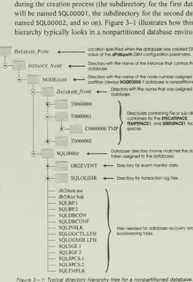

图 3–1：非分区数据库的典型目录层次树。

## 创建 DB2 9 数据库

切勿修改此目录结构或存储在其中的任何文件。此类操作可能会破坏一个或多个数据库或导致它们无法使用。

- 创建用于管理、监控和数据库恢复的文件。

在创建分配了数据库令牌名称的子目录后，该子目录会创建以下文件：

- **db2rhist.asc**：此文件包含备份操作、恢复操作、表加载操作、表重组操作、表空间更改以及类似的数据库更改的历史信息（即恢复历史文件）。


- `db2rhist.bak`：此文件是 `db2rhist.asc` 的备份副本。

- `SQLBP.1`：此文件包含缓冲区池信息。

- `SQLBP.2`：此文件是 `SQLBP.1` 的备份副本。

- `SQLDBCON`：此文件包含数据库配置信息。

- `SQLDBCONF`：此文件是 `SQLDBCON` 的备份副本。

- `SQLINSLK`：此文件包含用于确保数据库仅分配给 DB2 数据库管理器的一个实例的信息。

- `SQLOGCTL.LFH`：此文件包含关于活动事务日志文件的信息。恢复操作使用此文件中存储的信息来确定从日志回溯多远之前开始恢复过程。

- `SQLOGMIR.LFH`：此文件是 `SQLOGCTL.LFH` 的镜像副本。

- `SQLGSF.1`：此文件包含与自动存储相关的存储路径信息。

- `SQLGSF.2`：此文件是 `SQLGSF.1` 的备份副本。

- `SQLSPCS.1`：此文件包含表空间信息。

- `SQLSPCS.2`：此文件是 `SQLSPCS.1` 的备份副本。

- `SQLMPLK`：此文件包含关于临时表空间的信息。

还会创建两个名为 `DB2EVENT` 和 `SQLDIR` 的子目录；会创建一个详细的死锁事件监控器并存储在 `DB2EVENT` 子目录中，并创建三个名为 `S0000000.LOG`、`S0000001.LOG` 和 `S0000002.LOG` 的文件并存储在 `SQLLOGDIR` 子目录中。这三个文件用于在对数据库执行 SQL 操作时存储事务日志记录。

### 3. 为数据库创建一个缓冲区池

在数据库创建过程中，会创建一个缓冲区池并将其命名为 `IBMDEFAULTBP`。在默认情况下，在 Linux 和 UNIX 平台上，该缓冲区池的大小为 1,000 个 4K（千字节）；在 Windows 平台上，该缓冲区池的大小为 250 个 4K 页面。此缓冲区池（以及可能存在的任何其他缓冲区池）实际使用的内存是在建立到数据库的第一个连接时分配的，并在所有到数据库的连接终止释放。

### 4. 创建两个普通表空间和一个临时表空间

在创建缓冲区池 `IBMDEFAULTBP` 后，会创建三个表空间并与该缓冲区池关联。这三个表空间按如下方式创建：

- 一个名为 `SYCATSPACE` 的普通表空间，用于存储与数据库相关的系统目录表和视图。
- 一个名为 `USSPACE1` 的普通表空间，用于存储所有用户定义对象（如表、索引等）以及用户数据、索引数据和长值数据。
- 一个名为 `TEMPSPACE1` 的系统临时表空间，用于数据排序、数据重组和创建索引等操作的临时存储区域。

除非另有说明，`SYCATSPACE` 和 `USSPACE1` 将是 DMS 文件表空间，而 `TEMPSPACE1` 将是 SMS 表空间；每个表表的特性可以作为输入提供给 `CREATE DATABASE` 命令或数据库创建向导。

### 5. 创建系统目录表和视图

在创建表空间 `SYSCATSPACE` 之后，在该表空间内会构建一组特殊的表，称为系统目录表。DB 数据库管理器使用系统目录表来跟踪此类信息，如数据库对象定义、数据库对象权限、列数据类型、表约束和对象关系。随系统目录表还会创建一组系统目录视图，这些视图通常用于访问存储在系统目录表中的数据时。系统目录表和视图不能通过 SQL 语句修改（但可以查看其内容）。相反，当发生以下事件之一时，由 DB2 数据库管理器对其进行修改：

- 创建、修改或删除数据库对象（如表、视图或索引）。
- 授予或撤销授权或权限。
- 为表收集统计信息。
- 将程序包（Packages）绑定到数据库。

### 6. 数据库被编目录到系统和本地数据库目录中（如果不存在，则先创建系统或本地数据库目录）

DB2 使用一组特殊文件跟踪数据库存储的位置并提供对这些数据库的访问。由于存储在文件中的信息类似于目录，因此被称为目录文件。每当创建一个数据库时，都会更新这些目录。如果指定，注释和字符集值也会存储在这些目录中。

### 7. 初始化数据库的系统配置文件

配置文件中的某些参数（如字符集、区域和排序序列）将使用作为 `CREATE DATABASE` 命令或数据库创建向导输入的值进行设置；其他参数分配系统默认值。

### 8. 创建四个模式

创建系统目录表和视图后，会创建以下模式：`SYIBM`、`SYSCAT`、`SYSSTAT` 和 `SYSFUN`。一个名为 `SYSIMDB` 的特殊用户被绑定到数据库。

### 9. 为数据库授予一组实用程序

在某些可用的 DB2 9 工具处理数据库之前，必须创建运行这些工具所需的包。此类包通过将一组预定义的 DB2 数据库管理器绑定文件到数据库来创建（使用的绑定文件存储在工具绑定列表文件 `db2ubind.lst` 中）。

### 10. 向适当的用户授予权限

要连接并使用特定的数据库，用户必须拥有使用该数据库所需的权限。因此，每当创建一个新数据库时，除非另有说明，将授予以下权限：

- 向创建数据库的用户的用户授予数据库管理员（DBADM）权限以及 `CONNECT`、`CREATAB`、`BINDADD`、`CREATE_NOT_FENCED`、`IMPLICIT_SCHEMA` 和 `LOAD` 权限。
- 向 `PUBLIC` 组授予表空间 `USSPACE1` 的 `USE` 权限。
- 向 `PUBLIC` 组授予 `CONNECT`、`CREATAB`、`BINDADD` 和 `IMPLICIT_SCHEMA` 权限。
- 向 `PUBLIC` 组授予对每个系统目录表的 `SELECT` 权限。
- 向 `PUBLIC` 组授予对 `SYSIBM` 模式下所有过程的 `EXECUTE` 权限。

## 创建 DB2 9 数据库

- `SYSFUN` 架构中找到的所有函数的 `EXECUTE WITH GRANT` 权限已授予 `PUBLIC` 组。
- 每个成功绑定的实用程序的 `BIND` 和 `EXECUTE` 权限已授予 `PUBLIC` 组。

### 11. 启用了若干项自动管理功能

为了方便管理，每当创建一个新数据库时，都会启用以下功能：

- 自动维护（数据库备份、表和索引重组、数据访问优化和统计分析）
- 自调优内存管理器（程序包缓存、锁定内存、排序内存、数据库共享内存和缓冲区池内存）
- 程序节流
- 健康监器（Health Monitor）

### 12. 启动了配置顾问（Configuration Advisor）

配置顾问是一个工具，旨在通过根据你提供的数据库信息建议修改配置参数，帮助你调优性能并平衡数据库的内存需求。在 DB2 9 中，每当你创建数据库时都会自动调用配置顾问，除非通过为 `DB2_ENABLE_AUTONFIG_DEFAULT` 注册变量赋值 `NO` 来更改默认行为。

## 完整的 CREATE DATABASE 命令

当执行最简单形式的 `CREATE DATABASE` 命令时，所创建数据库的特性（例如使用的存储和事务日志方法）是由几个预定义的默认值指定的。如果你希望更改任何默认特性，必须在执行 `CREATE DATABASE` 命令时指定一个或多个可用。该命令的完整语法如下：

# 164 第 3 章：数据放置

```
CREATE [DATABASE | DB] [DatabaseName] <AT DBPARTITIONNUM>
```

或

```
CREATE [DATABASE | DB] [DatabaseName]
<AUTOMATIC STORAGE [YES | NO]>
<ON [StoragePath ...]<DBPATH [DBPath]]>
<ALIAS [Alias]>
<USING CODES [CodeSet] TERRIT [Territory]>
<COLLATE USING [CollateType]>
<PAGESIZE [4096 | Pagesize]
<NUMSEGS [NumSegments]>
<DFT_EXTENT_SZ [DefaultExtSize]>
<RESTRICTIVE>
<CATALOG TABLESPACE [TS_Definition]>
<USER TABLESPACE [TS_Definition]>
<TEMPORARY TABLESPACE [TS_Definition]>
<WITH "Description">
<WITHAUTOCONFIGURE <USING [Keyword] [Value] ...>
<APPLY DB ONLY | DB AND DBM | NONE>>
```

其中：

- `DatabaseName` 标识要分配给被创建数据库的唯一名称。
- `StoragePath` 如果指定 `AUTOMATIC STORAGE YES`（默认值），则标识用于存放由自动存储使用的表空间容器的一个或多个存储路径。否则，标识与被创建数据库关联的目录层次结构和文件物理存储的位置（驱动器或目录）。
- `DBPath` 如果指定 `AUTOMATIC STORAGE YES`（默认值），则标识与被创建数据库关联的目录层次结构和元数据文件物理存储的位置（驱动器或目录）。如果未指定此参数且使用了自动存储，元数据文件将存储在 `StoragePath` 参数指定的第一个存储路径中）。
- `Alias` 标识要分配给被创建数据库的别名。


## 创建 DB2 9 数据库

`CodeSet`标识用于在被创建的数据库中存储数据时的字符集。（在 DB2 9 数据库中，每个单字节字符在内部都表示为 0 到 255 之间的唯一数字。这个数字被称为字符的码点；特定字符集中每个字符的码点分配称为代码页；国际标准化组织对代码页的术语是字符集。）

`Territory`标识用于在被创建的数据库中存储数据时使用的地区。

`CollateType`指定被创建的数据库使用的排序规则（即为了排序、合并和比较目的而对字符排序的顺序）。该参数的有效值有：`COMPATABILITY`、`IDENTITY`、`IDENTITYITY_16BIT`、`UCA400_NO`、`UCA400_LSK`、`UCA400_LTH`、`NLSCHAR`和`SYSTEM`。

`NumSegments`指定了为被创建的数据库所使用的默认 SMS 表空间（`TEMPSPACE1`）创建目录并存储其文件的目录数量。

`DefaultExtSize`指定了每当创建表空间且在创建过程中未指定区段大小时，使用的默认区段大小（extent size）。

`Description`一种注释，用于描述在数据库目录中为被创建的数据库生成的条目。描述必须用双引号括起来。

`Keyword`是`AUTONFIGURE`命令识别的一个或多个关键字。有效值包括`mem_percent`、`workload_type`、`num_stmts`、`tpm`、`admin_priority`、`is_populated`、`num_local_apps`、`num_remote_apps`、`isolation`和`bp_resizable`。请参考 DB2 9 命令参考获取更多如何使用`AUTONFIGURE`命令的信息。

# 第 3 章：数据放置

`Value`标识与指定的`Keyword`关联的值。

`TS_Definition`指定了用于创建存放系统目录表（`SYSCATSPACE`）、用户定义对象（`USERSPACE1`）和/或临时对象（`TEMPSPACE1`）的表空间。

定义系统管理（SMS）表空间的语法为：

```
MANAGED BY SYSTEM
USING (Container ...)
<EXTENTSIZE>
<PREFETCHSIZE>
<OVERHEAD>
```

定义数据库管理（DMS）表空间的语法为：

```
MANAGED BY DATABASE
USING (Container ...)
<EXTENTSIZE>
<PREFETCHSIZE>
<OVERHEAD>
```

定义自动存储表空间的语法为：

```
MANAGED BY AUTOMATIC STORAGE
USING (Container ...)
<EXTENTSIZE>
<PREFETCHSIZE>
<OVERHEAD>
```

其中：

- `Container`标识用于的一个或多个容器。对于 SMS，每个指定的容器必须标识一个有效的目录；对于 DMS，每个指定的容器必须标识一个有效的文件；对于 DEVICE，每个指定的容器必须标识一个有效的设备。
- `NumberOf`指定要使用的页面数量。
- `ExtentSize`指定了以轮询方式写入的页面数量。
- `PrefetchSize`指定了执行预取时读取的页面数量。
- `Overhead`标识从表空间容器读取一个页面并存储在内存中所需的时间（毫秒）。
- `Initial`指定自动扩展表空间的初始大小。
- `Increment`指定当启用自动扩展的表空间满并收到空间请求时增加的量。
- `MaxSize`指定启用自动扩展的表空间可以增加的最大大小。

如果指定了`RESTRICTIVE`子句，则被创建数据库的`RESTRICT_ACCESS`配置参数将设置为 YES，且不会授予 PUBLIC 组权限。

假设你想创建一个具有以下特性的 DB2 数据库：

- 物理位于 `E:` 驱动器上
- 不使用自动存储
- 命名为 `SAMPLEDB`
- 使用美国/加拿大字符集，以及该地区（用于将字母数字数据转换为存储在数据库中的二进制数据）
- 使用基于该地区的排序规则（在本例中为美国/加拿大）
- 不自动允许 PUBLIC 访问
- 使用文件 `SCATSPACE.DAT` 的 DMS 表空间存储系统目录（该文件存储在 `E:` 上，能够容纳 5000 个 4K 页）。

在这种情况下，你执行的 `CREATE DATABASE` 命令类似于：

```
CREATE DATABASE sampledb
AUTOMATIC STORAGE NO
ON E:
USING CODESET 1252 TERRITORY US
COLLATE SYSTEM
PAGESIZE 4096
RESTRICTIVE
CATALOG TABLESPACE MANAGED BY DATABASE
(FILE 'E:\sysscatspace.dat', 5000)
```

如果你更倾向于使用图形用户界面而不是输入长命令，可以使用创建数据库向导来构建 DB2 9 数据库。

向导（Wizard）设计用于收集定义数据库特征的信息，并创建一个具有这些特征的数据库。这些特征也可以通过`CREATE DATABASE`命令提供的各种选项来指定。通过控制中心（Control Center）中的数据库（Databases）菜单选择相应的操作即可调用创建数据库向导。图 3–2 显示了激活创建数据库向导必须选择的控制中心菜单项；图 3–3 显示了创建数据库向导首次启动时的页面界面。

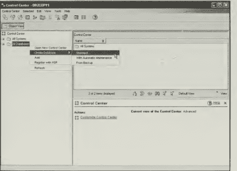

图 3–2：从控制中心调用创建数据库向导。

## 第3章：数据布局

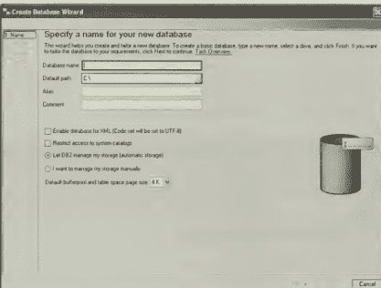

一旦显示创建数据库向导，你只需按照每个面板显示的指示操作即可定义要创建数据库的特征。当你为 DB2 数据库管理器创建数据库提供了足够的信息后，向导右下角的“完成（Finish）”按钮（见图 3–3）将变为可用。一旦选择此按钮，将使用提供的信息创建一个数据库。

## 表空间（Table Spaces）

表空间用于控制数据的物理存储位置，并在数据库对象（如表、索引和视图）与实际存储对象数据的一个或多个容器（即目录、文件或原始设备）之间提供一个间接层。单个表空间可以跨越多个容器，但每个容器只能属于一个表空间。当表空间跨越多个容器时，数据将以轮询方式（以称为区（extents）的页为组）写入分配给该表空间的每个容器；这有助于平衡属于给定表空间的所有容器之间的数据。图 3–4 显示了页、区和表空间容器之间的关系。

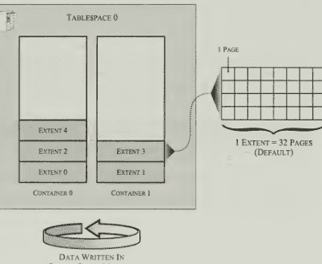

图 3-4：数据如何写入表空间容器。

当对 SMS 或 DMS 表空间使用多个容器时，每个容器能容纳的最大数据量由所使用的最小容器决定。例如，如果一个表空间使用了一个大小为 10M 的容器，那么第二个容器的 2M 将将不可用；该表空间可用的最大存储量为 20M。因此，在可能的情况下，容器的大小应该相等。

表空间可以存在两种类型：系统管理空间（SMS）表空间和数据库管理空间（DMS）表空间。对于 SMS 表空间，只能使用目录容器进行存储，并由操作系统的文件管理器负责控制该空间的使用。SMS 存储模型由许多文件组成（每个文件代表一个表、索引或长数据对象），这些文件位于文件系统空间内——用户决定文件的位置，DB2 数据库管理器分配名称，文件系统负责管理它们的增长。对于 DMS 表空间，只能使用文件和/或设备容器进行存储，并由 DB2 数据库管理器控制该空间的使用。在 DB2 9 中，DMS 表空间中对象的初始空间分配为两个区；SMS 表空间中对象的初始空间分配为一个区。SMS 和 DMS 表空间之间的所有其他差异见见 3.1 节。

| 表 3.1 SMS 和 DMS 表空间之间的区别 |
|---|---|
| SMS 表空间 | DMS 表空间 |
| 存储空间由操作系统的文件管理器分配和管理。 | 存储空间由 DB2 数据库管理器分配（如果指定）并管理。 |
| 只能使用目录容器进行存储；不能使用文件和设备容器。 | 可以使用文件或设备容器作为存储；不能使用目录容器。 |
| 表空间创建后，无法向其添加额外的容器（使用 `ALTER TABLESPACE` SQL 语句）。 | 表空间创建后，可以添加额外的容器。当添加新容器时，现有数据可以自动在新容器集之间进行重新平衡，以保持最佳的 I/O 效率。 |
| 存储空间按需要分配。表空间创建后，无法更改容器的大小。 | 存储空间是预分配的。表空间创建后，可以增加或减少容器的大小。 |
| 普通数据和长数据存储在同一个表空间中。 | 普通数据和长数据可以分布在多个表空间中（普通数据可以位于一个表空间，而数据位于另一个表空间）。 |
| 表空间更容易创建和管理。 | 表访问速度略快，因此整体性能更好。 |


SMS 和 DMS 表空间都根据它们旨在存储的数据类型进行分类；存在三种分类：普通、大型和临时。普通数据和索引数据存储在普通表空间，而长字段数据和大型对象数据可以存储在大型表空间——但只有在使用 DMS 表空间时如此。（由于大型数据也可以存储在普通表空间，因此使用大型表空间是可选的）。临时表空间进一步分为系统或用户——系统临时空间用于内部操作，而用户临时空间用于用户定义的操作。

## 获取现有空间的信息

与其他对象一样，每当创建表空间时，关于它的信息都会记录在系统目录中。可以通过执行 `LIST TABLEACES` 命令获取已创建表空间的信息。该命令的语法为：

```
LIST TABLEACES
```

执行此命令将为每个表空间显示以下信息：

- 创建时分配给表的内部 ID。
- 分配给表的名称。
- 表空间类型（SMS 表空间或 DMS 表空间）。
- 表空间设计存储的数据类型（即普通、大型或临时）。
- 表空间当前的状态（见表 3.2）。

| 表空间状态 | 十进制值 |
|---|---|
| 正常 (Normal) | 0x0 |
| 共享读 (SHARE) | 0x1 |
| 共享更新 (UPDATE) | 0x2 |
| 独占 (EXCLUSIVE) | 0x4 |
| 加载等待 (Load pending) | 0x8 |
| 删除等待 (Delete pending) | 0x10 |
| 备份等待 (Backup pending) | 0x20 |
| 滚恢复进行中 (Roll-forward recovery in progress) | 0x40 |
| 滚恢复等待 (Roll-forward recovery pending) | 0x80 |
| 恢复等待 (Restore pending) | 0x100 |
| 恢复等待（不再使用） | 0x100 |
| 禁用等待 (Disable pending) | 0x200 |
| 重组进行中 (Reorg in progress) | 0x400 |
| 备份进行中 (Backup in progress) | 0x800 |
| 必须定义 (Storage must be defined) | 0x1000 |
| 恢复进行中 (Restore in progress) | 0x2000 |
| 脱机且不可访问 (Offline and not accessible) | 0x4000 |
| 释放等待 (Drop pending) | 0x8000 |
| 可以定义存储 (Storage may be defined) | 0x2000000 |
| 定义处于“最终”状态 (StorDef is in "Final" state) | 0x4000000 |
| 定义在滚恢复前已更改过 (StorDef was changed prior to roll-forward recovery) | 0x8000000 |
| DMS 重平衡激活 (DMS rembalancer is active) | 0x10000000 |
| 表删除进行中 (Table deletion in progress) | 0x20000000 |
| 表创建进行中 (Table creation in progress) | 0x40000000 |

单个表空间在给定时刻可能处于多个状态。如果是这种情况，将对多个表状态十六进制值进行与运算以跟踪多个状态。可以使用获取表状态命令 `dtc2stat` 获取与任何给定的十六进制值相关的表空间状态。当向可恢复数据库加载数据时，如果指定了 `COPY NO` 选项，加载实用会将表空间放在“加载进行中（Load in progress）”状态。表空间在加载操作期间将保持此状态，并在加载操作完成后返回正常状态。此状态没有十六进制值。

执行 `LIST TABLESPACES` 命令并指定 `SHOW DETAIL` 选项时，将提供关于每个表空间的以下附加信息：

- **总页数 (Total number of pages)。** 表空间设计容量的页页数。对于 DMS 表空间，这是与表空间相关的所有容器中可用页数的总和。对于 SMS 表空间，这是当前使用的文件空间总量。
- **可用页数 (Number of usable pages)。** 表空间中可以存储用户数据的页数。对于 DMS 表空间，该数字通过从总可用页数中减去开销所需的页数计算得出的。对于 SMS 表空间，该数字等于表空间设计的容量总页数。
- **已用页数 (Number of used pages)。** 表空间中已经包含数据的页数。（对于 SMS 表空间，此值等于表空间设计的容量总页数。）
- **空闲页数 (Number of free pages)。** 表空间中当前为空的页数。（此信息仅适用于 DMS 表空间。）
- **高水位 (High water mark)。** 标记表空间地址空间当前“高水位”或“结束点”的页数（即表空间最后一个分配区之后的第一个空页的页码）。（此信息仅适用于 DMS 表空间。）
- **页大小 (Page size)。** 表空间中每页数据将占据的字节数。
- **区大小 (Extent size)。** 表空间中一个区（extent）所包含的页页数。
- **预取大小 (Prefetch size)。** 在查询当前引用的页之前，提前从表空间读取的数据页数，以预期这些页将在解析查询时被需要（预取）。
- **容器数量 (Number of containers)。** 表空间使用的容器数量。
- **最小恢复时间 (Minimum recovery time)。** 如果要对表空间执行点点前滚恢复操作，可以指定的最早时间点。
- **状态变更表空间 ID (State change table space ID)。** 导致被查询的表空间置于“加载等待”（Load Pending）或“删除等待”（Delete Pending）状态的另一个表空间 ID。（只有当被查询的表空间处于“加载等待”或“删除等待”状态时，才会显示此信息）。
- **状态变更对象 ID (State change object ID)。** 导致被查询的表空间置于“加载等待”或“删除等待”状态的另一个对象 ID。（只有当被查询的表空间处于“加载等待”或“删除等待”状态时，才会显示此信息）。
- **维护者数量 (Number of carers)。** 将表空间置于“静止”（Quiesced，受限访问）状态的用户和应用程序数量。（只有当被查询的表空间处于“静止:共享”、“静止:更新”或“静止:独占”状态时，才会显示此信息）。
- **每个静止维护者的表空间 ID 和对象 ID (Table space ID and object ID for each quiescer)。** 导致被查询的表空间置于“静止”状态的表空间和对象的 ID。（只有当将表空间置于“静止”状态的用户或应用程序大于大于时，才会显示此信息）。

因此，如果你想获取名为 SALES 的数据库所创建的所有表空间的详细信息，可以连接到数据库并执行如下所示的 `LIST TABLESPACE` 命令：

```
LIST TABLESPACE SHOW DETAIL
```

当执行此命令时，产生的输出应该类似于所示：

| 当前数据库的表空间 |
| :--- |
| 表空间 ID = 0 |
| 名称 = SYSCATSPACE |
| 类型 = 数据库管理空间 |
| 内容 = 所有永久数据。常规表空间。 |
| 状态 = 0x0000 |
| 详细说明：正常 |
| 总页数 = 8192 |
| 可用页数 = 8188 |
| 已用页数 = 7940 |
| 空闲页数 = 248 |

# 表空间 177

高水位（页） = 7940

页大小（字节） = 4096

区大小（页） = 4

预取大小（页） = 4

容器数量 = 1

- 表空间 ID = 1

名称 = TEMPSPACE1

类型 = 系统管理空间

内容 = 系统临时数据

状态 = 0x0000

详细说明：

正常

总页数 = 1

可用用页数 = 1

已用页数 = 1

空闲页数 = 不适用

高水位（页） = 不适用

页大小（字节） = 4096

区大小（页） = 32

预取大小（页） = 32

容器数量 = 1

- 表空间 ID = 2

名称 = USERSPACE1

类型 = 数据库管理空间

内容 = 所有永久数据。大表空间。

状态 = 0x0000

详细说明：

正常

总页数 = 8192

可用用页数 = 8160

已用页数 = 416

空闲页数 = 7744

高水位（页） = 416

页大小（字节） = 4096

区大小（页） = 32

预取大小（页） = 32

容器数量 = 1

- 表空间 ID = 3

名称 = SYTOOLSPACE

类型 = 数据库管理空间

内容 = 所有永久数据。大表空间。

状态 = 0x0000

详细说明：

正常

总页数 = 8192

可用用页数 = 8160

已用页数 = 416


空闲页数 = 7744

高水位（页） = 416

页大小（字节） = 4096

区大小（页） = 32

预取大小（页） = 32

容器数量 = 1

# 第3章：数据放置

高水位（页） = 7940

页大小（字节） = 4096

区大小（页） = 4

预取大小（页） = 4

容器数量 = 1

你还可以通过捕获并显示快照监控数据来获取为数据库创建的所有表空间的详细信息。使用的命令是：

```
GET SNAPSHOT FOR TABLESPACE
```

（我们将在第5章“分析 DB2”中详细查看快照。）

## 获取表空间使用的容器

正如你可以获取为数据库创建的表空间信息一样，你也可以执行 `LIST TABLESPACE CONTAINERS` 命令获取用于存储数据的容器信息。该命令的语法如下：

```
LIST TABLESPACE CONTAINERS FOR <TablespaceID> <SHOW DETAIL>
```

其中：

`TablespaceID` 指定要获取容器信息的表空间。

如果执行此命令时使用了 `SHOW DETAIL` 选项，将为每个容器显示以下信息：

- 容器在关联表空间时分配的内部 ID。
- 容器在分配给表空间时用于引用的名称。
- 表明该容器是目录（路径）容器、文件容器还是设备容器

另一方面，如果执行此命令时使用了 `SHOW DETAIL` 选项，将为每个表空间容器提供以下附加信息：

- `Total number of pages`。表空间容器设计的容量容量。对于 SMS 表空间，这是容器当前使用的存储空间总量。
- `Number of usable pages`。表空间容器中可以存储用户数据的页数。对于 DMS 表空间，该数字通过从总可用页数中减去开销所需的页数计算得出。对于 SMS 表空间，此值等于表空间容器设计的容量总页数。
- `Accessibility`。表明容器是否可用。

需要注意的是，如果由于某些原因特定的表空间容器变得不可用（可用性 = No），与该容器相关的表空间将自动置于“离线”状态。当该问题导致

# 180 第 3 章：数据放置

一旦解决了容器无法访问的问题，就可以执行带有 `SWITCH` 选项的 `ALTER TABLESPACE` SQL 语句，将相关的表空间返回“正常”状态。

## 创建新表空间

之前，我们看到在创建 DB2 数据库时，会创建一个名为 `DEFAULT` 的缓冲池，并作为数据库初始化过程的一部分创建与该缓冲池关联三个表空间。这三个表空间对于小型数据库足够；然而，大型数据库由许多不同的缓冲池和表空间对象组成。可以通过执行 `CREATE TABLESPACE` 语句创建额外的表空间。该语句的语法如下：

```sql
CREATE <REGULAR | LARGE | SYSTEM TEMPORARY | USER TEMPORARY> TABLESPACE [TablespaceName]
PAGESIZE [PageSize]
MANAGED BY SYSTEM USING ('Container' ...)
EXTENTSIZE [ExtentPages | ExtentSize <k | M | G>]
FETCHSIZE [AUTOMATIC | PrefetchSize <k | M | G>]
BUFFERPOOL [BufferPoolName]
RECOVERY [ON | OFF]
```

或者

```sql
CREATE <REGULAR | LARGE | SYSTEM TEMPORARY | USER TEMPORARY> TABLESPACE [TablespaceName]
PAGESIZE [PageSize]
MANAGED BY DATABASE USING [FILE | DEVICE] ('Container' ...)
AUTORESIZE [YES | NO]
INCREASESIZE [InSize | IncSize <k | M | G>]
MAXSIZE [NONE | MaxSize <k | M | G>]
EXTENTSIZE [ExtentPages | ExtentSize <k | M | G>]
FETCHSIZE [AUTOMATIC | PrefetchSize <k | M | G>]
BUFFERPOOL [BufferPoolName]
RECOVERY [ON | OFF]
```

或者

```sql
CREATE <REGULAR | LARGE | SYSTEM TEMPORARY | USER TEMPORARY> TABLESPACE [TablespaceName]
PAGESIZE [PageSize]
MANAGED BY AUTOMATIC STORAGE
AUTORESIZE [YES | NO]
INITIALSIZE [InitSize <k | M | G>]
INCREASESIZE [IncSize <k | M | G>]
MAXSIZE [NONE | MaxSize <k | M | G>]
EXTENTSIZE ...
PREFETCHSIZE [AUTOMATIC | PrefetchSize <k | M | G>]
BUFFERPOOL [BufferPoolName]
RECOVERY [ON | OFF]
```

其中：

- `TablespaceName`：标识要分配给要创建表空间的名称。
- `PageSize`：指定正在创建的表空间所使用的每个页的大小。该参数对以下值有效：4,096；8,192；16,384 或 32,768 字节——如果提供了后缀 K（千字节），则此参数必须设置为 4、8、16 或 32。除非另有指定，否则表空间使用的页大小为 4K。
- `Container`：通过名称标识一个或多个容器，用于存储与要创建的表空间关联的数据。
- `ContainerPages`：以页数（页数）标识为为 `Container` 参数中指定的容器预分配的存储量。
- `ContainerSize`：标识为为 `Container` 参数中指定的容器预分配的存储量。除非也指定了字母 K（千字节）、M（兆字节）或 G（吉字节），否则此参数指定的值被视为总字节数。如果指定了 `ContainerSize` 值，它将根据提供的 `PageSize` 转换为 `ContainerPages` 值。
- `InitSize`：标识为为 DMS 或自动存储表空间预分配的存储量。
- `IncSize`：标识当启用了自动调整大小的表空间满且请求更多空间时，空间增加的量。
- `MaxSize`：标识启用了自动调整大小的表空间可以自动增加的最大大小。
- `ExtentPages`：标识在另一个另一个容器之前写入到单个表空间容器的数据页数。
- `ExtentSize`：标识在另一个另一个容器之前写入到单个表空间容器的数据量。除非也指定了字母 K（千字节）、M（兆字节）或 G（吉字节），否则此参数指定的值被视为总字节数。如果指定了 `ExtentSize` 值，它将根据提供的 `PageSize` 转换为 `ExtentPages` 值。
- `PrefetchPages`：标识执行数据预取时从表空间读取的数据页数（预取允许在查询需要的数据被引用之前进行读取，从而缩短查询等待 I/O 的时间）。
- `PrefetchSize`：标识在执行数据预取时从表空间读取的数据量。除非也指定了字母 K（千字节）、M（兆字节）或 G（吉字节），否则此参数指定的值被视为总字节数。如果指定了 `PrefetchSize` 值，它将根据提供的 `PageSize` 转换为 `PrefetchPages` 值。
- `BufferPool`：标识要创建的表空间所使用的缓冲池名称。

## 修改现有表空间

由于 SMS 表空间依赖操作系统来用物理空间管理，因此它们在成功创建后很少需要修改。相比之下，DMS 表空间必须被密切监控，以确保其用于存储的固定大小预分配文件或物理原始设备始终有足够的空闲空间来满足数据库的需求。当 DMS 表空间的可用空闲空间低到危险水平（通常小于 10%）时，你可以通过增加其一个或多个容器的大小，或者向其添加一个或多个新容器来增加更多空闲空间。通过执行 `ALTER TABLESPACE` SQL 语句，可以调整现有的表容器大小、为现有表空间提供新容器，并更改现有表空间的属性。该语句的基本语法如下：

```
ALTER TABLESPACE [TablespaceName]
[ADD | EXTEND | REDUCE | RESIZE]
(([FILE | DEVICE] 'Container'
[ContainerPages | ContainerSize <K | M | G>]) ...)
```

或


```
ALTER TABLESPACE [TablespaceName]
[EXTEND | REDUCE | RESIZE]
(ALL <CONTAINERS>
[ContainerPages | ContainerSize <K | M | G>])
```

或

```
ALTER TABLESPACE [TablespaceName]
DROP ([FILE | DEVICE] 'Container' ...)
```

或

```
ALTER TABLESPACE [TablespaceName]
< PREFETCHSIZE AUTOMATIC |
PREFETCHSIZE (PrefetchPages | PrefetchSize <K | M | G>)
<BUFFERPOOL [BufferPoolName]>
<NO FILE SYSTEM CACHING>
<AUTRESIZE [NO | YES]
<INCREASESIZE [IncSize <PERCENT | K | M | G>]
<MAXSIZE [NONE | MaxSize <K | M | G>]
<DROPPED TABLE RECOVERY [ON | OFF]
<CONVERT TO LARGE>
```

其中：

`TablespaceName`: 指定要修改的表空间分配的名称。

`Container`: 指定要从指定的表空间添加、调整大小或删除的一个或多个容器。

`ContainerPages`: 指定以页数为单位，为由 `Container` 参数指定的所有容器或单个容器增加、移除或分配的存储量。

`ContainerSize`: 指定为由 `Container` 参数指定的所有容器或单个容器增加或移除的存储量。除非指定字母 K（千字节）、M（兆字节）或 G（千字节），否则该参数的值被视为总字节数。（如果指定了 `ContainerSize` 值，它将使用提供的 `PageSize` 值被转换为 `ContainerPages` 值。）

`PrefetchPages`: 指定在执行数据预取时，从表空间读取的数据页数。

`PrefetchSize`: 指定在执行数据预取时，从表空间读取的数据量。除非指定字母 K（千字节）、M（兆字节）或 G（吉字节），否则该参数的值被视为总字节数。（如果指定了 `PrefetchSize` 值，它将使用被修改表空间的页大小被转换为 `PrefetchPages` 值。）

`BufferPoolName`: 指定被修改的表空间所使用的缓冲区池名称。（指定的缓冲区池页大小必须与被修改表空间使用的页大小匹配。）

# 第 3 章：数据放置

`IncSize`: 指定当启用了自动调整大小的表空间满并收到更多空间请求时，表空间自动增加的量。

`MaxSize`: 指定启用了自动调整大小的表空间可以自动增加的最大大小。

因此，如果你想要大小为 1,000 兆字节且位于目录 `C:\TABLESPACES` 的固定大小预分配文件 `NEWFILE.TS`，用作名为 `PAYROLL_TS` 的现有 DMS 表空间的新存储容器，你可以通过执行如下的 `ALTER TABLESPACE` SQL 语句来实现：

```
ALTER TABLESPACE payroll_ts
ADD (FILE 'C:\tablespaces\newfile.tsf' 1000 M)
```

另一方面，如果你想将名为 `PAYROLL_TS` 的现有 DMS 表空间的所有容器的大小扩展 200 兆字节，你可以通过执行如下的 `ALTER TABLESPACE` SQL 语句来实现：

```
ALTER TABLESPACE payroll_ts
EXTEND (ALL CONTAINERS 200 M)
```

表空间还可以使用“修改表空间”（Alter Table Space）对话框进行修改，该对话框可以通过从控制中心的表空间菜单中选择相应的操作来激活。图 3–7 显示了为了激活“修改表空间”对话框必须选择的控制中心菜单项；图 3–8 显示了“修改表空间”对话框在首次激活时第一页的样子。

# 表空间 189

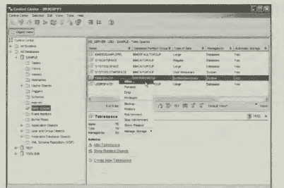

图 3-7：从控制中心调用“修改表空间”对话框。


图 3-8：“修改表空间”对话框的第一个页。

## 为现有表空间添加容器

早些我们看到，对于启用了自动调整大小的表空间，不能使用 `TABLESPACE` 命令来添加容器。那么如何添加容器呢？必须使用 `DATABASE` 语句。该语句的基本语法如下：

```
ALTER DATABASE [TablespaceName]
ADD ('Container' ...)
```

其中：

`TablespaceName`: 指定要修改的表空间分配的名称。

`Container`: 指定要从指定的表空间添加、调整大小或删除的一个或多个容器。

因此，如果你想要大小为 1,000 兆字节且位于目录 `C:\TABLESPACES` 的固定大小预分配文件 `NEWFILE.TS`，用作名为 `PAYROLL_TS` 的现有 DMS 表空间的新存储容器，你可以通过执行如下的 `ALTER TABLESPACE` SQL 语句来实现：

```
ALTER TABLESPACE payroll_ts
ADD (FILE 'C:\tablespaces\newfile.tsf' 1000 M)
```

另一方面，如果你想将名为 `PAYROLL_TS` 的现有 DMS 表空间的所有容器的大小扩展 200 兆字节，你可以通过执行如下的 `ALTER TABLESPACE` SQL 语句来实现：

```
ALTER TABLESPACE payroll_ts
EXTEND (ALL CONTAINERS 200 M)
```

## 关于声明临时表

声明临时表是一种为单个应用程序提供数据的特殊表。像基础表一样，可以在上面创建索引并收集统计信息。与存储在所属数据库系统目录中的描述不同，声明临时表不是持久的，并且仅在创建它的应用程序生存期间有效。当应用程序结束时，表行将被删除。（然而，数据可以跨事务存在。）另一个显著区别在于每个类型数据的存储位置。在应用程序创建和使用声明临时表之前，必须为其工作的数据库创建一个临时表空间，并将使用该表空间的权限授予相应的用户。（用户临时表空间在数据库创建时不会自动创建。）相反，基础表创建在普通表空间中；如果在创建基础表时没有指定表空间，则其数据将存储在数据库创建时默认创建的表空间 `US` 中。

## 模式

表空间用于物理上存储数据库对象，而模式用于对数据库对象进行逻辑分类和分组，无论它们存储在哪里。由于模式本身也是对象，它们拥有关联的权限，允许所有者控制哪些用户可以创建、修改和删除对象。数据库中的大多数对象使用双部分命名法。名称的第一部分（最左侧）称为模式名称或限定符，第二部分（最右侧）称为对象名称。当任何可以按模式限定的对象（例如表、视图、索引、用户定义数据类型、用户定义函数、别名、包或触发器）首次创建时，将根据其名称中的限定符被分配给特定的模式。

# 第 3 章：数据放置

图 3–9 展示了在表创建过程中，名为 `STAFF` 的表是如何被分配到 `PAYROLL` 模式（schema）的。

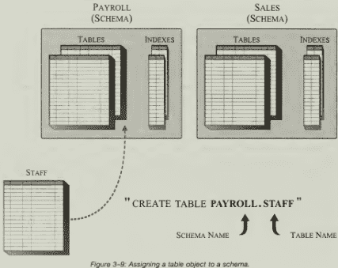

某些模式名称是保留的，无法使用。示例包括在创建数据库时自动创建的四个模式所分配的名称——`SYSIBM`、`SYSCAT`、`SYSSSTAT` 和 `SYSFUN`。

> 如果在创建对象时未指定模式/限定符（`qualifier`）名称，则该对象被分配给默认模式，该模式通常是当前连接到数据库并创建该对象的个人用户 ID。

每当创建一个被分配了与现有模式名称不同的限定符的数据对象时，系统就会隐式地创建该模式——前提是创建该对象的用户拥有 `IMPLICIT_SCHEMA` 权限。（除非另有说明，否则在创建新数据库时，`PUBLIC` 组将被授予 `IMPLICIT_SCHEMA` 权限。此权限允许任何成功连接到数据库的用户在模式不存在时隐式创建新模式。）可以通过执行 `CREATE SCHEMA` SQL 语句来显式地创建模式。该语句的基本语法如下：

```
CREATE SCHEMA [SchemaName]
<SQLStatement ...>
```

或者

```
CREATE SCHEMA
AUTHORIZATION [AuthorizationName]
<SQLStatement ...>
```

或者

```
CREATE SCHEMA [SchemaName]
AUTHORIZATION [AuthorizationName]
<SQLStatement ...>
```

其中：

- `SchemaName`: 标识要分配给要创建模式的名称。
- `AuthorizationName`: 标识在模式创建后将拥有该模式所有权的用户。


### `SQLStatement`
指定要与 `CREATE SCHEMA` 语句一起执行的一个或多个 SQL 语句。（仅对以下 SQL 语句是有效的：`CREATE TABLE`、`CREATE VIEW`、`CREATE INDEX`、`COMMENT ON` 和 `GRANT`）。

如果指定了模式名称但未提供授权名称，则由发布 `CREATE SCHEMA` 语句的用户授权 ID 获得新创建模式的所有权；如果指定了授权名称但未提供模式名称，则新模式将被分配与所使用的授权名称相同的名称。

因此，如果你想显式地创建一个名为 `PAYROLL` 的模式，并将该模式的所有权交给用户 `DB2ADMIN`，你可以通过执行类似下面的 `CREATE SCHEMA` SQL 语句来实现：

```
CREATE SCHEMA payroll
AUTHORIZATION db2admin
```

另一方面，如果你想显式地创建一个名为 `INVENTORY` 的模式，并在 `INVENTORY` 模式内创建一个名为 `PARTS` 的表，你可以通过执行类似下面的 `CREATE SCHEMA` 语句来实现：

```
CREATE SCHEMA inventory
CREATE TABLE PARTS (partno INTEGER NOT NULL,
              description VARCHAR(50),
              quantity SMALLINT)
```

还可以使用“创建模式”对话框创建模式，该对话框可以通过在控制中心（`Control Center`）的“模式”菜单中选择相应的操作来激活。图 3–10 显示了激活“创建模式”对话框必须选择的控制中心菜单项；图 3–11 显示了“创建模式”对话框首次激活时的外观。

## 模式 195

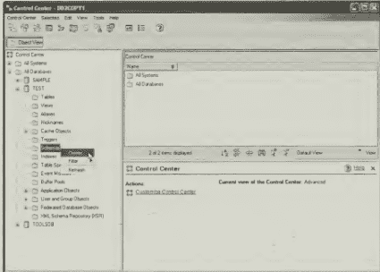

图 3–10：从控制中心调用“创建模式”对话框。

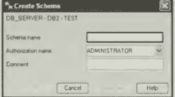

图 3–11：“创建模式”对话框。

鉴于模式可以通过创建对象并分配新模式名称来隐式创建，你可能会奇怪为什么有人想要使用 `CREATE SCHEMA` 语句（或“创建模式”对话框）显式地创建模式。显式创建模式的主要原因与访问控制有关。

## 196 第 3 章：数据放置

显式创建的模式有一个所有者，其身份通过执行 `CREATE SCHEMA` 语句的用户授权 ID 或通过在模式创建时将所有权传递给的用户授权 ID 来标识。模式所有者拥有创建、修改和删除存储在模式中的任何对象所需的权限，以及删除模式本身的权限；模式所有者还有权授予创建、修改和删除模式中对象所需的权限（`CREATE`、`ALTER` 和 `DROP` 权限）。（我们将在第 8 章“安全”中详细查看模式权限。）另一方面，隐式创建的模式被认为由创建它的用户所有。此外，只有拥有系统管理员（`SYSADM`）或数据库管理员（`DBADM`）权限的用户才允许删除隐式创建的模式。因此，为了让系统管理员和数据库管理员以外的用户对模式以及存储在该模式中的所有数据对象具有完全控制权，必须显式创建模式。

## 范围聚类和范围分区

之前我们看到表空间用于控制数据的物理存储位置，并在数据库对象（如表、索引和视图）与实际存储对象的一个或多个容器（即目录、文件或原始设备）之间提供间接层。因此，数据库对象在创建时被分配到表空间的方式决定了数据在磁盘上的物理存储方式。表数据的物理存储可以通过范围分区进一步控制。

### 范围聚类表

范围聚类表（`RCT`）是一种数据根据一或多列按升序排列的表。范围聚类表在数据在指定范围内紧密聚类时非常有用。通过指定 `CREATE TABLE` 语句的 `ORGANIZE BY KEY SEQUENCE` 子句来创建范围聚类表。

范围聚类表是一种数据根据一或多列按升序排列的表。范围聚类表在数据在指定范围内紧密聚类时非常有用。通过指定 `CREATE TABLE` 语句的 `ORGANIZE BY KEY SEQUENCE` 子句来创建范围聚类表。

范围聚类表是一种数据根据一或多列按升序排列的表。范围聚类表在数据在指定范围内紧密聚类时非常有用。通过指定 `CREATE TABLE` 语句的 `ORGANIZE BY KEY SEQUENCE` 子句来创建范围聚类表。

范围聚类表是一种数据根据一或多列按升序排列的表。范围聚类表在数据在指定范围内紧密聚类时非常有用。通过指定 `CREATE TABLE` 语句的 `ORGANIZE BY KEY SEQUENCE` 子句来创建范围聚类表。该可选子句的语法为：

```
ORGANIZE BY KEY SEQUENCE
<ColumnName>
<STARTING <FROM> [Start]>
<ENDING <AT> [End]>
<ALLOW OVERFLOW | DISALLOW OVERFLOW>
<PCTFREE [PercentFree]>
```

其中：

- `ColumnName`：标识用于确定聚类表顺序的一或多个列。
- `Start`：指定范围的低端。（只有在指定 `ALLOW OVERFLOW` 选项时才允许小于起始值。）
- `End`：指定范围的高端。（只有在指定 `ALLOW OVERFLOW` 选项时才允许大于结束值。）
- `PercentFree`：指定每个页面留出的百分比。（页面上的第一行无限制地添加；当向页面添加额外行时，将进行检查以确保留出指定的百分比。）

如果指定 `DISALLOW OVERFLOW` 子句，则键值不允许超出范围。另一方面，如果指定了 `ALLOW OVERFLOW` 子句，则键值允许超出范围，在这种情况下溢出数据将放在动态分配的溢出区域。

因此，如果你想创建一个名为 `CUSTOMERS` 的范围聚类表，它包含 `CUSTOMER_ID` 和 `CUSTOMER_NAME` 两个列，其中 `CUSTOMER_ID` 列将成为决定如何物理存储的唯一键，且 1 到 100 之间的唯一值可以分配给 `CUSTOMER_ID` 列，你可以通过执行类似下面的 `CREATE TABLE` SQL 语句来实现：

```
CREATE TABLE customers
  customer_id INTEGER NOT NULL,
  customer_name VARCHAR(80))
ORGANIZE BY KEY SEQUENCE (customer_id
  STARTING FROM 1 ENDING AT 100)
DISALLOW OVERFLOW
```

一旦创建并填充了此表，如果应用程序需要访问 ID 为 2 的客户行，`DB2` 数据库管理器将根据 `CUSTOMERS` 表中从表逻辑开始处的预定偏移量查找第二行。如果更新了某行导致键列值被修改，则将更新后的行复制到新位置，并删除旧行副本，从而维护表中数据的聚类状态。

### 范围分区表

表分区（也称为范围分区）是一种数据组织方案，它根据值或多个列的值将表数据划分为多个称为数据分区（或范围）的存储对象。每个数据分区都单独存储，且所使用的存储对象可以是不同的表空间、同一个表空间，也可以是两者的结合。表分区可以提高性能，并消除使用“数据分区功能”创建分区数据库的需求。

使用表分区的其他优势还包括：

- `数据的便于汇入（roll-in）和汇出（roll-out）`。汇入分区表数据允许新范围作为额外数据分区轻松合并到分区表中。汇出分区表数据允许您轻松地将数据范围从分区表中分离，以便进行后续的清理或归档。可以通过 `ALTER TABLE` 语句的 `ATTACH PARTITION` 和 `DETACH PARTITION` 子句快速实现数据的汇入和汇出。
- `大表更易管理`。表级管理变得更加灵活，因为可以在单个数据分区上执行管理任务。此类任务包括分区的分离和重新挂载、备份和恢复单个数据分区以及重新组织单个索引。此外，通过将耗时的维护操作分解为一系列较小的操作，可以缩短维护时间。例如，当每个数据分区放置在单独的表空间时，可以在数据分区级别执行备份操作。因此，可以一次备份分区表的一个数据分区。
- `灵活的索引放置`。通过表分区，索引可以放置在不同的表空间，从而对索引的放置进行更细粒度的控制。
- `更好的查询处理`。在解析查询的过程中，可能会根据使用的查询谓词自动消除一个或多个数据分区。这种功能被称为“数据分区消除”（`Data Partition Elimination`），它提高了许多决策支持查询的性能，因为在返回结果数据集之前需要分析的数据更少了。

给定表的数据根据 `CREATE TABLE` 语句中 `PARTITION BY` 子句提供的规范划分到多个存储对象。

该可选子句的语法如下：


```
PARTITION BY <RANGE>
(([ColumnName> NULLS LAST | NULLS FIRST> ...))
(STARTING <FROM>
  <- [Start | MINVALUE | MAXVALUE] < ...>
  <INCLUSIVE | EXCLUSIVE>
ENDING <AT>
  <- [End | MINVALUE | MAXVALUE] < ...>
  <INCLUSIVE | EXCLUSIVE>)
```

或

```
PARTITION BY <RANGE>
(([ColumnName> NULLS LAST | NULLS FIRST> ...))
(<PARTITION |PartitionName>)
STARTING <FROM>
  <- [Start | MINVALUE | MAXVALUE] < ...>
  <INCLUSIVE | EXCLUSIVE>
ENDING <AT>
  <- [End | MINVALUE | MAXVALUE] < ...>
  <INCLUSIVE | EXCLUSIVE>
<IN [TableSpaceName>)
```

其中：

- `ColumnName`: 通过名称标识一个或多个列，其值将用于确定特定行应存储在哪个数据分区中。（指定的列组构成了表的分区键。）

- `PartitionName`: 标识分配给要创建的分区的唯一名称。

- `Start`: 指定每个数据分区范围的低端。

- `End`: 指定每个数据分区范围的高端。

## 范围聚类与范围分区

当使用自动生成的语法形式时，`Constant` 指定了每个数据分区范围的宽度。数据分区将从 `STARTING FROM` 值开始创建，并在该范围内包含该数量的值。只有当分区键由单个已分配数值、日期、时间或时间戳数据类型的列组成时，才支持这种语法形式。

如果分区键列已分配日期、时间或时间戳数据类型，则 `DurationLabel` 标识与指定的 `Constant` 值相关的持续时间。该参数的有效值为：YEAR, YEARS, MONTH, MONTHS, DAY, DAYS, HOURS, MINUTE, MINUTES, SECOND, SECONDS, MICROSECOND 和 MICROSECONDS。

`TableName` 标识每个数据分区存储的空间。

如果您想创建一个名为 `SALES` 的表，并对其分区使得每个季度的数据存储在不同的数据分区中，且每个分区位于不同的表空间，您可以通过执行类似下面的 `CREATE TABLE` SQL 语句来实现：

```
CREATE TABLE sales
  (sales_date DATE,
  sales_amt NUMERIC(10,2))
IN tbsp0, tbsp1, tbsp2, tbsp3
PARTITION BY RANGE (sales_date NULL FIRST)
  (STARTING '1/1/2007' ENDING '12/31/2007'
  EVERY 3 MONTHS)
```

另一方面，如果您想创建一个名为 `DEPARTMENTS` 的表，并对其分区使得数值在 0 到 9 范围内的行存储在一个位于一个表空间的分区中，数值在 10 到 19 范围内的行存储在另一个位于另一个表空间的分区中，此类推，您可以通过执行类似下面的 `CREATE TABLE` SQL 语句来实现：

## 第3章：数据放置

```
CREATE TABLE departments
(dept_no INT
desc CHAR(3))
PARTITION BY (dept_no NULLS FIRST)
(STARTING 0 ENDING 9 IN tbsp0,
STARTING 10 ENDING 19 IN tbsp1,
STARTING 20 ENDING 29 IN tbsp2,
STARTING 30 ENDING 39 IN tbsp3)
```

请注意，当为 `DEPARTMENTS` 表创建索引时，数据将存储在表空间 `tbp0`。如果您希望索引数据存储在表空间 `TBS3`，则必须执行以下 `CREATE INDEX` 语句：

```
CREATE INDEX idx ON departments (dept_no) IN TBS3
```

## 处理 XML 数据

XML 技术通过为 XML 数据提供与关系数据相同的安全性、完整性和恢复性，释放了 XML 的潜在能力。这在 DB2 9 中可用。然而，在使用 pureXML 时存在某些限制：

- pureXML 仅用于单分区数据库。

- 使用任何 pureXML 功能将防止未来使用企业版（ESE）中的数据库分区功能（DPF）。

- pureXML 不能用于数据仓库版（DWE），因为 DWE 使用 ESE 和 DPF。

为了使用 pureXML 功能，必须使用 UTF-8 字符创建数据库。UTF-8 字符通过 `CREATE DATABASE` 语句的 `USING CODESET` 选项指定；要创建一个名为 `XML_DB` 且使用 UTF-8 集的数据库，可以执行类似下面的 `CREATE DATABASE` 命令：

```
CREATE DATABASE xml_db USING CODESET UTF-8 
```

## XML 类型与 XML 列

为了支持 pureXML，DB2 9 引入了名为 XML 的新类型。该类型用于定义存储 XML 值的列。存储的 XML 值必须是良好的 XML 文档；一个良好的 XML 文档如下：

```

<?xml version="1.0" encoding="UTF-8" ?>
<customerinfo xmlns="http://crecredit.dat" id="1000">
  <name>John Doe</name>
  <addr country="United States">
    <street>25 East Creek Drive</street>
    <city>Raleigh</city>
    <state-prov>North Carolina</state-prov>
    <zip-pcode>27603</zip-pcode>
  </addr>
  <phone type="work">*919-555-1212</phone>
  <email>john.doe@xyz.com</email>
</customerinfo>
```

大多数 XML 文档以 XML 声明开头，XML 声明如下：

# 204 第3章：数据放置

```xml
<?xml version="1.0"?>
```

XML 声明之后紧跟一个或多个属性和元素。所有的 XML 元素都包含在起始标签和结束标签中；XML 元素的形式如下：

```xml
<p>This is a paragraph</p>
<p>This is another paragraph</p>
```

需要注意的是，所使用的起始标签和结束标签是区分大小写的——标签 `<Letter>` 与标签 `<letter>` 不同。因此，起始标签和结束标签必须使用相同的大小写写。

XML 属性通常用于描述 XML 元素或为元素提供额外信息。属性始终包含在元素的起始标签内，且属性值必须始终带有引号。以下是一些示例：

属性在 HTML 中非常有用，但在 XML 中，每当可以使用元素表达相同信息时，您应该尽量避免使用它们。以下示例传达了相同的信息：

```xml
<person sex="female">
  <firstname>Anna</firstname>
  <lastname>Smith</lastname>
</person>

<person>
  <sex>female</sex>
  <firstname>Anna</firstname>
  <lastname>Smith</lastname>
</person>
```

在第一个示例中，SEX 是一个属性。在最后一个示例中，SEX 是一个元素。

要创建带有 XML 列的表，您需要在 `CREATE TABLE` 语句中指定带有 XML 数据类型的列。（一个表可以有一个或多个 XML 列。）就像 LOB 列一样，XML 列仅持有该列的描述符。数据本身被单独存储。与 LOB 列不同，您在定义 XML 列时不需要指定长度。因此，要创建一个名为 `CUSTOMER` 包含名为 `CUSTINFO` 的 XML 列的表，可以执行如下的 `CREATE TABLE` 语句：

```sql
CREATE TABLE customer
  (custid INTEGER NOT NULL,
  custinfo XML)
```

XML 列具有以下限制：

- 它们不能通过 `WITH DEFAULT` 子句指定默认值；如果列允许为空，则该列的默认值为 NULL。

- 它们不能在 `CHECK` 约束中被引用（使用 `VALIDATED` 谓词除外）。

- 它们不能在生成列中被引用。


- 它们不能包含在类型表（typed tables）和类型视图（typed views）中。
- 它们不能在范围聚类表（RCT）中使用。
- 它们不能在范围分区表（range-partitioned table）中使用。
- 它们不能在多维聚类（MDC）表中使用。
- 它们不能添加到定义了 Type-1 索引的表中（注意 Type-1 索引是弃用的索引；自 DB2 UDB 8.1 版本以来创建的索引都是 Type-2 索引）。
- 它们不能指定在滚动光标的选择列表中。
- 它们不能在 `CREATE TRIGGER` 语句的触发操作中被引用。
- 它们不能作为键的列包含，包括主键、外键和唯一键；多维聚类（MDC）表的维度键；范围聚类表的序列键；分布键以及数据分区键。
- 它们不能在具有分布键的表中使用。
- 除了针对 XML 数据的索引外，它们不能是任何索引的一部分。
- 在检索 XML 数据时，它们会导致数据阻塞被禁用。
- 它们无法使用数据行压缩进行压缩。

## 操作 XML 数据

与传统数据一样，XML 文档可以添加到数据库表中，并使用 SQL 数据操作语言语句（`INSERT`、`UPDATE`、`DELETE` 和 `SELECT` 语句）进行修改、删除和检索。通常，XML 文档（按 XML 1.0 规范定义）由应用程序进行操作；当从应用程序执行 DML 操作时，IBM 建议通过主机变量而非字面量来操作 XML 数据，以便 DB2 能够使用主机变量数据类型来确定处理所需的某些编码信息。尽管您可以使用 XML、二进制或字符类型来操作 XML 数据，但 IBM 建议您使用 XML 或二进制类型以避免代码转换问题。

应用程序中使用的 XML 数据通常以序列化字符串格式存储——当这些数据插入 XML 列或当 XML 列中的数据被更新时，必须将其转换为 XML 层级格式。如果使用的应用程序类型是 XML 数据类型，DB2 会隐式地执行此操作。然而，如果使用的应用程序类型是字符或二进制数据类型，则在插入和更新操作期间必须使用 `XMLPARSE()` 函数将数据从其序列化字符串格式转换为 XML 层级格式。使用 `XMLPARSE()` 函数将字符串值插入表 `CUSTOMERS` 中名为 `CUSTINFO` 的 XML 列的简单 `INSERT` 语句可能所示：

```sql
INSERT INTO customers (custinfo) VALUES
(XMLPARSE(DOCUMENT '<name>John Doe</name>
PRESERVE WHITESPACE))
```

当使用命令行处理器（Command Line Processor）操作存储在 XML 列中的 XML 文档时，执行插入、更新和删除操作时，无需显式调用 `XMLPARSE()` 函数即可将字符串数据分配给 XML 列。例如，假设您向名为 `CUSTOMER` 的表添加包含 XML 数据的记录，该表具有以下特征：

### 使用 XML 数据 207

| 列名 | 数据类型 |
|---|---|
| `CUSTID` | `INTEGER` |
| `INFO` | `XML` |

您可以通过从命令行处理器执行如下所示的 `INSERT` 语句来实现此：

```sql
INSERT INTO customer VALUES (1000,
'<customerinfo xmlns="http://custrecord.dat" custid="1000">
<name>John Doe</name>
<addr country="United States">
<street>25 East Creek Drive</street>
<city>Raleigh</city>
```

在第一个示例中，`SEX` 是一个属性。在最后一个示例中，`SEX` 是一个元素。

（注：此处由于原文似乎在中间截断，根据上下文逻辑，翻译已根据您提供的文本片段完成。）

## 处理 XML 数据 209

1 `<name xmlns="http://custrecord.dat">John Doe</name>`

如果你想移除 XML 标签并仅返回客户名称，可以通过执行类似下面的 XQuery 表达式来实现：

```
XQUERY declare default element namespace "http://custrecord.dat"; for $info in db2-fn:xmlcolumn('CUSTOMER.CUSTINFO')/customerinfo where $info/addr/state-prov="North Carolina" return $info/name/text()
```

现在，当从命令行处理器（Command Line Processor）执行该 XQuery 表达式时，它应该返回如下所示的信息：

1

John Doe

如前所述，可以使用以下任何 SQL/XML 函数或谓词从 SQL 中调用 XQuery 表达式：

`XMLQUERY()`。`XMLQUERY()` 是一个 SQL 标量函数，允许你在 SQL 上文中执行 XQuery 表达式。`XMLQUERY()` 返回一个 XML 值，即 XML 序列。该序列可以是空的，也可以包含一个或多个项目。你还可以将变量传递给 `XMLQUERY()` 中指定的 XQuery 表达式。

`XMLTABLE()`。`XMLTABLE()` 是一个 SQL 表函数，它根据 XQuery 表达式的求值返回一个表。XQuery 表达式通常作为序列返回；然而，`XMLTABLE()` 允许你执行 XQuery 表达式并将值作为表返回。返回的表可以包含任何 SQL 数据类型的列，包括 XML。结果表的结构由 `XMLTABLE()` 的 `COLUMNS` 子句定义。

`XMLEXIST`。`XMLEXIST` 谓词确定 XQuery 表达式是否返回包含一个或多个项目的序列。如果此谓词中指定的 XQuery 表达式返回空序列，则 `XMLEXIST` 返回 FALSE；否则返回 TRUE。`XMLEXIST` 谓词可以

# 第 3 章：数据放置

用于 `UPDATE`、`DELETE` 和 `SELECT` 语句的子句中。这意味着可以使用存储的 XML 文档中的值来限制 DML 语句的操作行集。

通过在 SQL 上文中执行 XQuery 表达式，你可以：

- 对存储的 XML 文档部分进行操作，而不是整个 XML 文档（只有 XQuery 可以在 XML 文档内部查询；SQL 只能在整个文档级别进行查询）；
- 允许 XML 数据参与 SQL 查询；
- 对关系型数据和 XML 数据进行操作；以及
- 对返回的 XML 值应用进一步的 SQL 处理（例如，使用子查询的 `ORDER BY` 子句对结果进行排序）。

假设你想为名为 `CUSTOMER` 的表检索客户 ID 和客户名称，该表具有以下特征：

| 列名 | 数据类型 |
|---|---|
| `CUSTID` | `INTEGER` |
| `INFO` | `XML` |

你可以通过（假设此表已通过我们之前看到的 `INSERT` 语句填充数据）从命令行处理器执行类似如下所示的 `SELECT` 语句来实现：

```
SELECT custid, XMLQUERY('declare default element namespace
"http://custrecord.dat"; $custid/customerinfo/name' passing CUSTINFO as "d") AS
address
FROM customer;
```

当执行此查询时，它应该返回如下所示的信息：

```
CUSTID ADDRESS
-----------------------------------------------------------------
1000 <name xmlns="http://custrecord.dat">John Doe</name>
```

## XML 索引

正如关系型数据的索引可以用于提高查询性能一样，XML 数据索引也可以用于提高对所选 XML 文档查询的效率。与传统的关系型索引（其索引键由你指定的一个或多个列组成）不同，XML 数据索引使用特定的 XML 模式来索引存储在单列中的 XML 文档中的路径和值。该列的数据类型必须是 `XML`。

为了识别文档中将被索引的部分，使用 XML 模式来指定 XML 文档中的一组节点。该模式表达式类似于 XQuery 语言中定义的路径表达式，但不同之处在于它只支持 XQuery 语言的一个子集。路径表达式步骤用正斜杠（`/`）分隔——`/descendant-or-self:node/` 的缩写语法——也可以指定。在每一步中，选择一个正向轴（`child::`、`attribute::`、`descendant::`; `descendant-or-self:`），后跟一个 XML 名称或 XML 类型测试。如果没有指定正向轴，则默认使用子轴（`child`）。图 3–12 显示了一个简单的 XML 模式以及如何使用它识别 XML 文档中的特定值。

XML 模式 `→ '/customerinfo/addr/zip-pcode'`


```xml
<?xml version="1.0" encoding="UTF-8"?>
<customerinfo xmlns="http://custrecord.dat" id="1000">
  <name>John Doe</name>
  <addr country="United States">
    <street>25 East Creek Drive</street>
    <city>Raleigh</city>
    <state-prov>North Carolina</state-prov>
    <zip-pcode>27603</zip-pcode>
  </addr>
  <phone type="work">919-555-1212</phone>
  <email>john.doe@example.com</email>
</customerinfo>
```

### 图 3–12：如何使用 XML 模式识别 XML 文档中的特定值。

# 第 3 章：数据放置

XML 数据索引项不是提供对文档头的访问，而是通过基于 XML 模式表达式创建索引键，提供对文档内节点的访问。由于 XML 文档的多个部分可以满足 XML 模式，可能会插入多个索引键。XML 索引是通过指定 `CREATE INDEX` 语句的 `GENERATE KEY USING XMLPATTERN` 子句创建的。该子句的基本语法为：

```
GENERATE KEY USING XMLPATTERN
<Namespace>
[XMLPattern]
AS [SQLDataType]
```

其中：

- `Namespace` 在模式表达式中使用限定名称时标识有效的命名空间声明。
- `XMLPattern` 指定要索引的节点表达式。提供的模式表达式可以包含以下任何 XQuery 组件：
  - `*` ——指定通配符。
  - `/` ——分隔路径表达式步骤。
  - `//` ——`/descendant-or-self::node/` 的缩写语法。
  - `child::` ——指定上下文节点。如果没有指定其他正斜杠，则默认使用。
  - `@` ——指定上下文节点的属性。这是 `attribute::` 的缩写语法。
  - `attribute::` ——指定上下文节点的属性。
  - `descendant::` ——指定上下文节点的后代。
  - `self::` ——仅指定上下文节点本身。
  - `descendant-or-self::` ——指定上下文节点及其后代。

## 数据行压缩

`SQLDataType` 指定索引值在存储之前转换的 SQL 类型。以下值对该参数有效：`VARCHAR(Size)`、`DOUBLE`、`DATE` 和 `TIMESTAMP`。

因此，如果你想对名为 `CUSTOM` 的表中名为 `CUSTINFO` 的 XML 列中的邮政编码值创建 XML 索引并将这些值存储为 `DOUBLE`，你可以通过执行类似如下所示的 `CREATE INDEX` 语句来实现：

```
CREATE INDEX custindex ON customer(custinfo)
GENERATE KEY
USING XMLPATTERN '/customerinfo/addr/zip-pcode'
AS SQL DOUBLE;
```

另一方面，如果你想对名为 `CUSTOM` 的表中名为 `CUSTINFO` 的 XML 列中的地址信息创建 XML 索引并将这些值存储为 `VARCHAR` 值，你可以通过执行类似如下所示的 `CREATE INDEX` 语句来实现：

```
CREATE INDEX custindex ON customer(custinfo)
GENERATE KEY
USING XMLPATTERN '/customerinfo/@addr'
AS SQL VARCHAR(100);
```

第一个示例中，索引为元素创建的；在第二个示例中，为属性创建的。虽然可以在属性上创建 XML 索引（甚至是整个文档），但性能可能会受到影响。因此，最好在元素上创建 XML 索引。

除了表分区和纯 XML 之外，`DB2 9` 引入的最显著的功能之一是使用数据数据行压缩来减少存储表数据所需的存储空间。虽然主要的

# 第 3 章：数据布局

数据行压缩的目的是节省存储空间，它还能显著减少磁盘 I/O 开销并提高缓存命中率（内存中可以缓存更多数据）。所有这些都能带来性能提升，但并非没有代价的——需要额外的 CPU 周期来压缩和解压缩数据。数据行压缩的存储节省和性能影响直接与数据库内部数据的特征、数据库本身的设计、数据库调优程度以及应用程序工作负载相关。

随着数据量的增加，数据的基数（基数）往往会下降。事实证明，世界上并没有多少真正“独特”的东西。它们在组合使用时可能是唯一的，但基本元素本身并不完全多样化。考虑元素周期表——我们世界上的一切东西都是由这组较小的元素组合而成的。将这一概念应用于数据，你会发现事实也是如此。例如，根据上次美国人口普查，美国有约 3 亿人口。但唯一的姓氏仅约 78,800 个，导致基数较低，且在某些姓名集中存在巨大的“聚集”。名字的情况更糟，大约有 6,600 个（女性有 4,400 个唯一名，男性有 2,200 个）。城市、街道、地址名称，以及产品名称、描述和属性也倾向于高度冗余且低基数。

数据行压缩通过搜索数据中的重复模式，并将这些模式替换为 12 位符号来工作，这些符号与它们所代表的模式一起存储在静态字典中（一旦创建了此字典，它将与压缩数据一起存储在表中，并在每次访问表中的数据时加载到内存中以帮助解压缩）。这是通过扫描整个表并查找重复的列值，以及跨行多列的重复模式来实现的。`DB2` 还会查找作为给定列子字符串的重复模式。然而，发现重复模式并不意味着数据会自动压缩——数据仅在能够实现存储节省的地方才会被压缩。图 3–13 展示了数据行压缩的工作原理。

## 磁盘上的数据行

### EMPLOYEE 表

| NAME | DEPT | SALARY | CITY | STATE | ZIPCODE |
| :--- | :--- | :--- | :--- | :--- | :--- |
| Fred Smith | 500 | 10000 | Raleigh | NC | 27603 |
| John Smith | 500 | 20000 | Raleigh | NC | 27603 |

## 磁盘上的未压缩数据行

Fred Smith 500 10000 Raleigh NC 27603 John Smith 500 20000 Raleigh NC 27603


## 磁盘上的压缩数据行

### 压缩字典

| SYMBOL | PATTERN |
| :--- | :--- |
| 01 | Fred |
| 02 | Smith |
| 03 | 500 |
| 04 | 1 |
| 05 | 0000 Raleigh NC 27603 |
| 06 | John |
| 07 | 2 |

图 3-13：数据行压缩的工作原理。

为了对表使用数据行压缩，必须满足两个前提条件：

- 1. 必须在表级启用压缩。
- 2. 必须为该表构建压缩字典。

## 启用表数据行压缩

通过执行 `CREATE TABLE` SQL 语句或指定 `COMPRESS YES` 的 `ALTER TABLE` 语句可以在表级启用压缩。例如，如果你创建一个名为 `EMPLOYEE` 的新表并启用数据行压缩，可以执行类似这样的 `CREATE TABLE` 语句：

```sql
CREATE TABLE employee
  name VARCHAR(60),
  dept CHAR(3),
  salary DECIMAL(7,2),
  city VARCHAR(25),
  state CHAR(2),
  zipcode VARCHAR(10))
COMPRESS YES
```

另一方面，如果你想对名为 `EMPLOYEE` 的现有表启用数据行压缩，可以执行如下的 `ALTER TABLE` 语句：

```sql
ALTER TABLE employee COMPRESS YES
```

## 构建压缩字典

虽然你可以通过将 `COMPRESS` 属性设置为 `YES` 来随时启用数据压缩，但在构建压缩字典之前，表中的数据不会被压缩。压缩字典是通过离线重组操作（offline reorganization）构建的；此类操作通过 `REORG` 命令配合 `KEEPDICTIONARY` 或 `RESETDICTIONARY` 启动。如果字典已存在，则将重组数据或保持原样（`KEEPDICTIONARY`）。

因此，如果你想为已启用压缩的表创建一个新的压缩字典（并压缩数据），可以执行如下 `REORG` 命令：

```sql
REORG TABLE employee RESETDICTIONARY
```


当执行此命令时，`EMPLOYEE`表中的数据将会被分析，构建压缩字典并存储在表的开头，然后数据将进行压缩。图 3–14 展示了表在数据压缩前后的样子。


图 3-14：构建压缩字典时表的变化。

注意的是，索引数据不受数据行压缩的影响；只有存储在基础表中的数据可以压缩。然而，由于压缩表会在存储和内存之间移动（压缩字典会被移动到内存中以便解压缩），事务日志记录也将压缩。

## 估计数据行压缩的存储节省

由于需要离线重组操作来构建压缩字典并执行数据压缩，初始开销可能很大。因此，了解哪些表能从数据行压缩中获益最多、哪些表可能是有益。在 DB2 中，`Inspect`工具可以帮助做出此判断。通过执行`INSPECT`命令调用`Inspect`工具，如果指定了`ROWCOMPIMATE`选项，该工具将检查表中的每一行，构建压缩字典，然后使用该字典估计表数据压缩后可以节省多少空间。

因此，如果你想估计名为`EMPLOYEE`的表在压缩后可以节省多少存储空间，可以执行如下`INSPECT`命令：

```sql
INSPECT ROWCOMPIMATE TABLE employee
```

执行此命令时，返回的信息可能如下：

```
DATABASE: TEST
VERSION: SQL09000
2007-06-06-12.35.58.14.296000

Action: ROWCOMPIMATE TABLE
Schema name: PAYROLL
Table name: EMPLOYEE
Tablespace ID: 4 Object ID: 6
Result file name: emp
Table phase start (ID Signed: 6, Unsigned: 6; Tablespace
(ID:4) PAYROLL.EMPLOYEE
Data phase start. Object: 6 Tablespace : 4
Row compression estimate results:
Percentage of pages saved from compression: 46
Percentage of bytes saved from compression: 46
Percentage of rows ineligible for compression due to
small row: 0
Compression dictionary size: 13312 bytes.
Expansion dictionary size: 10240 bytes.
Data phase end.
Table phase end.
```

如果在执行`INSPECT`命令之前已启用了数据行压缩（即`COMPRESS`属性已设置为`YES`），则构建并用于估计节省空间的压缩字典将写入表，位于现有数据的末尾。图 3–15 展示了表在压缩前后的样子

在获取估计值之前，如果启用了数据行压缩，可以使用`Inspect`工具来估算存储节省情况。

## 员工

| 未压缩数据 | 未压缩数据 |

| :--- | :--- |

| 压缩字典 | 索引数据（未压缩） |

图 3-15：当使用`Inspect`工具对已启用数据行压缩的表进行评估时，表中的数据会发生什么变化。

一旦创建了数据压缩字典并将其写入已启用数据行压缩的表表表中，添加到该表中的新记录将被自动压缩。被修改的现有记录也是如此。但是，如果表的压缩字典是通过`Inspect`工具创建的，则表中的预存数据在执行离线重组操作之前将保持未压缩状态。

## 练习题

### 第 1 题

服务器上存在一个名为`DB2INST1`的实例，且该实例的数据库管理程序配置参数`DFTDBPATH`包含值"`home`" 。如果服务器上不存在任何数据库，并执行了以下命令：

```
CREATE DATABASE my_db
```

数据库的元数据文件将存放在何处？

- A. 在`/home/NODE0000/SQL00001`子目录下

- B. 在`/home/db2inst1/NODE0000/SQL00001`子目录下

- C. 在`/home/NODE0000/MY_DB`子目录下

- D. 在`/home/db2inst1/NODE0000/MY_DB`子目录下

### 第 2 题

在创建新的 DB2 9 数据库时，以下哪个功能**不会**被自动启用？

- A. 自动维护

- B. 自调优内存管理器

- C. 数据行压缩

- D. 工具程序节流

### 第 3 题

如果执行了以下`CREATE DATABASE`命令：

```
CREATE DATABASE sales ON C: USING COSET UTF-8 TERRORY US RESTRICTIVE
```

以下哪些权限将自动授予公共组`PUBLIC`？

- A. 不授予任何权限

- B. 数据库的`CONNECT`、`CREATAB`、`BINDADD`和`IMPLICIT_SCHEMA`权限

- C. 对每个系统目录表的`SELECT`权限

- D. 对`SYSIBM`架构中找到的所有过程的`EXECUTE`权限

### 第 4 题

如果执行了以下`CREATE DATABASE`命令：

```
CREATE DATABASE sales ON /mnt/data1, /mnt/data2
COLLATING USING IDENTITY
CATALOG TABLES MANAGED BY SYSTEM USING ('mnt/syscat');
```

关于生成的数据库，以下哪个陈述**不**正确？

- A. 数据库启用了自动存储

- B. 将`SMS`表空间来存储系统目录

- C. 用户数据将存储在`/mnt/data1`和`/mnt/data2`

- D. 数据库的元数据将存储在`/mnt/data2`

### 第 5 题

如果执行了以下`CREATE TABLESPACE`语句：

```
CREATE REGULAR TABLESPACE sales_ts
PAGESIZE 4096
MANAGED BY DATABASE USING
FILE ('D:\tbsp1.tsf' 10 G, FILE 'D:\tbsp2.tsf' 6 G, FILE:'D:\tbsp3.tsf' 4 G)
extEXTSIZE 32
PREFETCHSIZE 96
```

`SALES_TS`表空间可以存储的最大数据量是多少？

- A. 10 GB

- B. 12 GB

- C. 16 GB

- D. 20 GB

### 第 6 题

关于`SMS`表空间，以下哪个陈述**不**是正确的？

- A. 普通数据和长数据无法跨多个表空间进行划分。

- B. 存储空间由操作系统根据需要分配。

- C. 可以`ALTER TABLESPACE`命令向现有表空间添加或删除容器。

- D. 只能使用目录容器进行存储；不能使用文件和设备容器。

### 第 7 题

如果执行了以下`CREATE TABLESPACE`语句：

```
CREATE REGULAR TABLESPACE sales_ts
PAGESIZE 8 K
MANAGED BY SYSTEM USING
('/mnt/data1', '/mnt/data2', '/mnt/data3')
EXTENTSIZE 32
PREFETCHSIZE 128
```

当表空间中的所有现有页面变满时，DB2 为`SALES_TS`表空间分配了多少空间？

- A. 8 KB

- B. 32 KB

- C. 128 KB

- D. 256 KB

### 第 8 题

以下哪两个命令可以获取为名为`SALES`的数据库创建的所有表空间的详细信息（包括状态）？

A. `SELECT * FROM syscat.tablespaces`

B. `LIST TABLESPACES SHOW DETAIL`

C. `LIST TABLESPACE CONTAINERS SHOW DETAIL`

D. `GET SNAPSHOT FOR TABLESPACES ON sales`

E. `GET SNAPSHOT FOR TABLESPACE CONTAINERS ON sales`

### 第 9 题

以下哪项**不是**有效的表空间状态？

A. 等待加载 (`Load pending`)

B. 在线且不可访问 (`Online and not accessible`)

C. 加载进行中 (`Load in progress`)

D. 离线且不可访问 (`Offline and not accessible`)

### 第 10 题

如果执行了以下`CREATE DATABASE`命令：

```
CREATE DATABASE payroll1 ON C:
```

以下哪个命令将为数据库添加容器？

- A. `ALTER TABLESPACE D:\data1, D2`

- B. `ALTER DATABASE D:\data1, D2`


- C. `ALTER TABLESPACE CONTAINERS D:\data1, D2`

- D. [由于 OCR 不完整]

### 第 11 题

以下哪些选项可以与 `TABLESPACE` 语句一起使用，创建一个超出其定义的空间？

A. `AUTORE`

B. `RESIZE`

C. `EXTEND`

D. `EXPAND`

### 第 12 题

给定以下 `TABLESPACE` 语句：

```
CREATE REGULAR TABLESPACE sales_ts
MANAGED BY AUTOMATIC
EXTENTSIZE 32
PREFETCHSIZE 128
```

以下哪个陈述**不**正确？

A. 创建时，表空间将是 `DMS`。

B. 必须指定 `MANAGED BY` 子句。

C. 创建时，表空间将是 `SMS`。

D. 可以省略 `MANAGED BY` 子句。

### 第 13 题

关于全局表 `Global Tables`，以下哪项**不**正确？

A. 可以在它们上创建索引

B. 它们位于表空间

C. 可以对它们收集统计信息

D. [文本不完整]

### 第 14 题

用户 `USER1` 登录数据库并执行以下操作：

```
CREATE TABLE test (col1 INTEGER, col2)
```

假设语句已执行，表创建在哪里？

A. `ROOT`

B. `DB2`

C. `USER1`

D. `DBADMIN`

### 第 15 题

关于 `schema` 的以下陈述哪一个**不**正确？

A. 连接数据库后，所有用户都可以。

B. 与表空间一样，`schema` 用于对对象。

C. 如果显式创建 `schema`，则所有者。

D. 可以在创建时分配 `schema` 所有权。

### 第 16 题

关于范围聚集表 `range-clustered tables`，以下哪个**不是**正确陈述？

- A. 范围聚集表依赖特殊索引，因此所需的缓存缓存。

- B. 创建范围聚集表时必须预分配存储。

- C. 范围聚集表在查询处理期间可以获得显著性能优势，因为所需的输入/输出 `I/O` 操作更少。

- D. 范围聚集表通过在 `CREATE TABLE` 语句中指定 `SEQUENCE` 子句创建。

### 第 17 题

以下哪个语句将名为 `PARTS` 的表，其中范围在 0 到 33 的行存储在一个分区中，范围在 34 到 66 的行存储在另一个分区中，而范围在 67 到 99 的行存储在第三个分区中，且该分区位于第三个表空间？

- A. `CREATE TABLE parts (partno INT, desc VARCHAR(25)) IN tbsp0, tbsp1, tbsp2 PARTITION BY (partno NULLS FIRST) (STARTING 0 END 33, STARTING 34 END 66, STARTING 67 END 99)`

- B. `CREATE TABLE parts (partno INT, desc VARCHAR(25)) PARTITION BY (partno NULLS FIRST) (PART part0 0 END 33, PART part1 STARTING 34 END 66, PART part2 STARTING 67 END 99)`

- C. `CREATE TABLE parts (partno INT, desc VARCHAR(25)) PARTITION BY (partno NULLS FIRST) (STARTING 0 END 33, STARTING 34 END 66, STARTING 67 END 92) IN tbsp0, tbsp1.`

- D. `CREATE TABLE parts (partno INT, desc VARCHAR(25)) PARTITION BY (partno NULLS FIRST) (STARTING 0 END 33 IN tbsp0, STARTING 34 END 66 IN tbsp1, STARTING 67 END 99 IN tbsp2)`

## 226 第3章：数据放置

## 问题 18

如果按照所示顺序执行以下语句：

```sql
CREATE TABLE sales
(invoice_no INTEGER,
sales_date DATE,
sales_amt NUMERIC(5,2))
IN tbsp0, tbsp1, tbsp2, tbsp3
PARTITION BY sales_date NULLS FIRST
(STARTING '1/1/2006' ENDING '12/31/2006')
EVERY 3 MONTHS);
CREATE INDEX sales_idx ON sales (invoice_no);
```

- A. `TBSP0`

- B. `TBSP1`

- C. `TBSP2`

- D. `TBSP3`

## 问题 19

- 关于 `XML` 索引的以下陈述中正确的是？

A. `XML` 索引可以包含关系型数据列。

B. 针对 `XML` 数据的索引可以提高对 `XML` 列执行的 `XQuery` 表达式的效率。

C. 可以通过组合多个 `XML` 列创建唯一 `XML` 索引。

D. 存储在 `XML` 列中的 `XML` 文档的全部内容都被索引。

## 问题 20

如果执行了以下 `CREATE INDEX` 语句：

```xml
CREATE INDEX cust_zip_idx ON customer(custinfo)
GENERATE KEY
USING XMLPATTERN '/customerinfo/addr/zip-pcode'
AS SQL DOUBLE;

CREATE INDEX cust_city_idx ON customer(custinfo)
GENERATE KEY
USING XMLPATTERN '/customerinfo/addr/city'
AS SQL VARCHAR(40);
```

并向 `CUSTOMER` 表插入了以下 `XML` 文档：

```xml
<?xml version="1.0" encoding="UTF-8" ?>
<customerinfo xmlns="http://recred.dat" id="1000">
<name>John Doe</name>
<addr country="United States">
<street>25 East Creek Drive</street>
<city>Raleigh</city>
<state-prov>North Carolina</state-prov>
<zip-code>27603</zip-code>
</addr>
<phone type="work">919-555-1212</phone>
<email>john.doe@yahoo.com</email>
</customerinfo>

<?xml version="1.0" encoding="UTF-8" ?>
<customerinfo xmlns="http://recred.dat" id="1010">
<name>Jane Smith</name>
<addr country="United States">
<street>2120 Stewart Street</street>
<city></city>
<state-prov>South Carolina</state-prov>
<zip-code>29501</zip-code>
</addr>
<phone type="work">843-555-3434</phone>
<email>jane.smith@aol.com</email>
</customerinfo>
```

将生成多少索引键？

- A. `1`

- B. `2`

- C. `3`

- D. `4`

## 228 第3章：数据放置

## 问题 21

- 为了对表使用数据行压缩，必须存在以下哪一项？

A. 压缩索引

B. 压缩字典

C. 用户定义的压缩算法

D. 仅包含字符数据类型列的表

## 问题 22

- 在讨论数据行压缩时，以下哪个陈述是**不**有效的？

A. 数据行压缩可以节省磁盘空间并提高 `I/O` 缓冲区命中率。

B. 在行级压缩数据是有优势的，因为它允许将跨行内多个列的重复模式替换为更短的符号。

C. 可以通过执行指定 `COMPRESS YES` 选项的 `ALTER TABLE` 语句启用表的数据行压缩。

D. 只有启用了数据压缩的表数据会被压缩；相应索引和事务日志中的数据不被压缩。

## 问题 23

- 以下工具中，哪两个可以用于创建压缩字典？

A. `reorg`

B. `db2pd`

C. `inspect`

D. `runstats`

E. `db2buildcd`

## 问题 24

- 在压缩存储在表的数据之前，可以使用哪个选项与 `REORG` 命令配合使用以构建新的压缩字典？

A. `KEEPDICTIONARY`

B. `RESETDICTIONARY`

C. `GENERATEDICTIONARY`

D. `NEWDICTIONARY`

## 答案


### 问题 1

正确答案是 B。每个创建的 DB2 9 数据库的信息都存储在一个特殊的层次级目录树中。该数据库树的实际创建位置由 `CREATE DATABASE` 命令提供的信息决定的——如果没有提供位置信息，则该目录树将在与正在创建实例数据库相关的 `DFTDBPATH` DB2 数据库配置参数指定的范围内创建。该层次级树的根目录被分配为实例数据库的名称。此目录将包含一个被分配分区节点名称的子目录。如果数据库是分区数据库，此目录将命名为 `NODExxxx`，其中 `xxxx` 是分配给分区的唯一节点号；如果数据库是非分区数据库，此目录将命名为 `NODE0000`。节点名称目录反过来将为每个创建的数据库包含一个子目录，以及一个包含存储数据库数据的容器的子目录。

（注：原文答案部分存在大量重复描述，译文已按原文逻辑保留结构）

### 问题 2

正确答案是 C。创建新数据库时，会启用以下功能：

- 自动存储
- 数据库优化
- 共享内存

### 问题 3

正确答案是 A。创建新数据库时，将授予以下权限：

- 数据库管理员 (`DBADM`)
- `CONNECT`, `CREATAB`, `BIND`, `IMPLICIT_SCHEMA`, `LOAD`
- 对系统表的 `SELECT`
- 对所有过程的 `EXECUTE`

### 问题 4

正确答案是 D。示例中 `CREATE DATABASE` 命令的语法可以分解为类似于：

```sql
CREATE [DATABASE | DB] [DatabaseName]
<AUTOMATIC STORAGE [YES | NO]>
<ON [StoragePath ...] [DBPath]]
<COLLATE USING [CollateType]>
<CATALOG TABLESPACE [TS.Definition]>
```

其中：

- `DatabaseName`: 指定为要创建数据库的唯一名称。
- `StoragePath`: 如果指定 `AUTOMATIC STORAGE YES`（默认值），标识用于自动存储表空间容器的一个或多个存储路径。否则，标识存储要创建数据库的目录层次结构和文件所在的物理位置（如果未指定此参数且使用自动存储，则元数据将存储在 `StoragePath` 指定的第一个路径中）。
- `DBPath`: 如果指定 `AUTOMATIC STORAGE YES`（默认值），标识存储要创建数据库的目录层次结构和元数据文件所在的物理位置（如果未指定此参数且使用自动存储，则元数据将存储在 `StoragePath` 指定的第一个路径中）。
- `CollateType`: 指定由创建的数据库使用的排序序列（即字符用于排序、合并和比较时的顺序）。该参数的有效值为：`COMPATIBILITY`, `IDENTITY`, `IDENTITY_16BIT`, `UCA40_NO`, `UCA40_LSK`, `UCA40_LTH`, `NLSCHAR` 和 `SYSTEM`。
- `TS.Definition`: 指定用于创建存储系统目录表（`SYSCSPACE`）的表空间定义。

## 232 第 3 章：数据放置

### 问题 5

正确答案是 B。当多个容器被用于 SMS 或 DMS 表空间时，每个容器能够容纳的最大数据量由所使用的最小的容器决定。例如，如果一个表空间使用一个大小为 10M 的容器以及另一个大小为 12M 的容器，则第二个容器中的 2M 将无法使用；该表空间可用的最大存储量为 20M。

在此示例中，使用的最小容器大小为 4 GB，因此该表空间使用了 3 个容器，其最大大小为：`3 × 4 GB = 12 GB`。

### 问题 6

正确答案是 C。在表空间创建后，无法（使用 `ALTER TABLES` SQL 语句）向 SMS 表空间添加额外的容器。（DMS 表空间在创建后可以添加额外的容器；当添加新容器时，现有数据会自动重新平衡到新的容器集中，以保持最佳的 I/O 效率。）

### 问题 7

正确答案是 D。在 DB2 9 中，DMS 表空间对象的初始空间分配两个扩展区（extents）；SMS 表空间对象的初始空间分配为一个扩展区。在此示例中，一个扩展区由 32 个 8 KB 页面或 256 KB（`8 KB × 32 = 256 KB`）组成。

### 问题 8

正确答案是 B 和 D。通过执行 `LIST TABLESPACES` 命令可以获取为特定数据库创建的所有表空间的信息。该命令的语法为：

```
LIST TABLESPACES
<SHOW DETAIL>
```

如果执行此命令时不带 `SHOW DETAIL` 选项，将为该数据库创建的每个表空间显示以下信息：

- 创建表空间时分配给该表空间的内部 ID。
- 分配给表空间的名称。

## 答案 233

- 表空间类型（SMS 表空间或 DMS 表空间）。
- 表空间设计用于存储的数据类型（即：普通数据、大数据或临时数据）。
- 表空间的当前状态。

另一方面，如果带有 `SHOW DETAIL` 选项执行 `LIST TABLESPACES` 命令，将提供有关每个表空间的以下额外信息：

- `总页数 (Total number of pages)`。表空间设计用于容纳的总页数。对于 DMS 表空间，这是与表空间关联的所有容器中可用所有页面的和。对于 SMS 表空间，这是当前使用的文件页总数。
- `可用页数 (Number of usable pages)`。表空间中可以存储用户数据的页数。对于 DMS 表空间，该数字通过从可用总页数减去开销所需的页数计算得出。对于 SMS 表空间，该数字等于表空间设计用于容纳的总页数。
- `已用页数 (Number of used pages)`。表空间已包含数据的页数。（对于 SMS 表空间，此值等于表空间设计用于容纳的总页数）。
- `空闲页数 (Number of free pages)`。表空间中当前为空的页数。（此信息仅适用于 DMS 表空间）。
- `高水位 (High water mark)`。标记表空间地址空间“高水位”或“结束”的页数（即表空间最后一个分配扩展区之后的第一个空闲页的编号）（此信息仅适用于 DMS 表空间）。
- `页大小 (Page size)`。表空间中一个页数据所占据的大小（以字节为单位）。
- `扩展区大小 (Extent size)`。表空间一个扩展区中所包含的页数。

# 第 3 章：数据放置

- `预取大小 (Prefetch size)`。从表空间预先读取的当前查询引用的页面之前的数据页数，预计这些页面将需要用于解析查询（被预取的）。
- `容器数量 (Number of containers)`。表空间使用的容器数量。
- `最小恢复时间 (Minimum recovery time)`。如果对表空间执行时间点前滚恢复操作，可以指定的最早时间。
- `状态更改空间 ID (State change space ID)`。导致被查询表空间被置于“加载等待”（Load Pending）或“删除等待”（Delete Pending）状态的表空间 ID。（只有当被查询的表空间被置于“加载等待”或“删除等待”状态时，才会显示此信息）。
- `状态更改对象 ID (State change object ID)`。导致被查询表空间被置于“加载等待”或“删除等待”状态的对象的 ID。（只有当被查询的表空间被置于“加载等待”或“删除等待”状态时，才会显示此信息）。
- `静止器数量 (Number of quiescers)`。将表空间置于“静止”（Quiesced，限制访问）状态的用户和/或应用程序数量。（只有当被查询的表空间被置于“静止:SHARE”、“静止:UPDATE”或“静止:EXCLUSIVE”状态时，才会显示此信息）。
- `每个静止器的表空间 ID 和对象 ID (Table space ID and object ID for each quiscer..)`。导致被查询表空间被置于“静止”状态的表空间和对象的 ID。（只有当用户和/或应用程序数量满足条件时显示）。

你还可以通过执行快照数据来获取为特定数据库创建的所有表空间的详细信息。用于捕获表空间信息的命令是：

```
snapshot for tablespaces
```

### 问题 9

正确答案是 B。可用的表空间状态如下：

| 表空间状态 | 十进制值 |
| :--- | :--- |
| Normal | 0x0 |
| 静止:SHARE | 0x1 |
| 静止:UPDATE | 0x2 |
| 静止:EXCLUSIVE | 0x4 |
| 加载等待 | 0x8 |
| 删除等待 | 0x10 |
| 备份等待 | 0x20 |
| 前滚恢复中 | 0x40 |
| 前滚等待 | 0x80 |
| 恢复等待 | 0x100 |
| （不再使用） | 0x200 |
| 重组中 | 0x400 |
| 备份中 | 0x800 |
| 必须定义存储 | 0x1000 |
| 恢复中 | 0x2000 |
| 离线且不可访问 | 0x4000 |
| 丢等待 | 0x8000 |


| 存储可以定义 | `0x20000` |
| StorDef 处于'Final'状态 | `0x40000` |
| 前滚前的 StorDef 修改 | `0x80000` |
| DMS 平衡器活动 | `0x100000` |
| 表空间删除中 | `0x200000` |
| 表空间创建中 | `0x400000` |

*加载等待*

单个表空间状态可以同时处于多个状态。如果是这样，将对多个表空间状态进行与逻辑运算以跟踪这些状态。获取表空间命令 (`dbbst`) 可用于获取任何十六进制值的表空间状态。

如果在向可恢复数据库加载数据时指定 `COPY NO` 选项，加载实用会将表放入“加载等待”。表空间在加载操作期间保持在此状态，并在加载完成后返回正常状态。此状态没有十六进制值。

## 问题 10

正确答案是 B。如果数据库启用了自动存储（这是 DB2 9 的默认行为），其表空间的容器和空间管理特性由 DB2 实例决定。尽管可以使用 `ALTER TABLESPACE` 命令为现有表空间添加新容器，但无法为自动存储表空间添加新容器。要执行此类操作，必须使用 `ALTER DATABASE` 语句。该语句的基本语法为：

```
ALTER DATABASE [DatabaseName]
ADD STORAGE ON '[Container]', ...
```

其中：

- `DatabaseName`：通过名称标识要向自动存储容器池添加新容器的数据库。
- `Container`：标识一个或多个新的存储位置（容器），将其添加到用于自动存储表空间的存储位置集合中

因此，如果你想向位于 Windows 系统上的配置为自动存储的名为 `SAMPLE` 的数据库添加存储位置 `D:\data1` 和 `D:\data2`，你可以通过执行如下 `ALTER DATABASE` SQL 语句来实现：

```
ALTER DATABASE sample ADD STORAGE ON 'D:\data1', 'D:\data2'
```

## 问题 11

正确答案是 A。DMS 表空间由文件容器或原始设备容器组成，其大小在容器分配给表空间时设置。当容器内的所有空间都被用完时，表空间被认为已满。然而，对于 DMS 表空间，可以使用 `ALTER TABLESPACE` 语句添加或扩展容器，以为给表空间提供更多存储空间。

DMS 表空间还有一个名为“自动调整大小”（`auto-resize`）的功能。当可以自动调整大小的 DMS 表空间消耗空间时，DB2 数据库管理器可以自动扩展与表空间相关的一个或多个文件容器。（SMS 表空间也具有类似的自动增长能力，但“自动调整大小”一词专门用于 DMS。）DMS 表空间的自动调整大小功能通过在创建表表的 `CREATE TABLESPACE` 语句中指定 `AUTORESIZE YES` 选项来启用。例如，可以使用以下 `CREATE` 语句创建一个自动调整大小的 DMS 表空间：

```
CREATE TABLESPACE tbsp1 MANAGED BY DATABASE
USING '/db2files/data.dat' (10 M) AUTORESIZE YES
```

你也可以在 DMS 表空间创建后，通过执行指定了 `AUTORESIZE YES` 选项的 `ALTER TABLESPACE` 语句来启用自动调整功能。例如：

```
ALTER TABLESPACE tbsp1 AUTORESIZE YES
```

## 问题 12

正确答案是 C。如果数据库启用了自动存储，可以在 `CREATE TABLESPACE` 命令中指定 `MANAGED BY AUTOMATIC STORAGE` 子句来创建自动存储表空间（或者可以完全省略此子句）；在这种情况下，将隐含使用自动存储。在这种情况下，不提供任何容器定义，因为 DB2 数据库管理器会自动分配容器。

尽管自动存储表空间看起来是不同的表空间类型，但它们实际上是 SMS 和 DMS 类型的扩展。如果创建的表空间是 `REGULAR` 或 `LARGE` 表空间，它将作为带有文件容器的 DMS 创建。如果创建的表空间是 `USER` 或 `SYSTEM TEMPORARY` 表空间，它将作为带有目录容器的 SMS 创建。

## 问题 13

正确答案是 D。声明临时表（declared temporary table）是一种特殊的表，用于代表单个应用程序存储临时数据。与基表一样，可以为声明临时表创建索引并收集统计信息。与基表不同，基表的描述和约束存储在它们所属数据库的系统目录表中，而声明临时表不是持久的，只能由创建它的应用程序使用——且仅在应用程序生命周期内有效。当创建声明临时表的应用程序终止时，表行将被删除，表描述也将被删除。（然而，存储在临时表中的数据可以跨越事务边界存在。）另一个显著区别在于每个类型表的数据存储位置。在应用程序创建和使用声明临时表之前，必须为应用程序将要操作的数据库至少创建一个用户临时表空间，并向适当的用户授予所需的权限。（创建数据库时，默认不会创建用户临时表空间。）相比之下，基表是在普通表空间创建的；如果在创建基表时未指定表空间，其数据将存储在 `USERSPACE1` 表空间中，该表是在创建数据库时默认创建的。

## 问题 14

正确答案是 D。如果在创建对象时未指定模式/限定符名称（schema/qualifier name），则该对象被分配给默认模式，该模式通常是当前连接到数据库并创建该对象的用户 ID。在此示例中，默认模式为 `DB82ADMIN`，因为使用了该用户 ID 建立数据库连接并创建 `TEST_TAB` 表对象。

## 问题 15

正确答案是 B。虽然表空间用于在数据库中物理存储对象，但模式（schemas）用于逻辑上分类和分组数据库中的其他对象，无论它们物理上存储在何处。

## 问题 16

正确答案是 A。范围聚集表（Range-clustered tables）需要的缓存缓冲区分配较少，因为没有辅助对象需要维护；不需要也不支持索引。

## 问题 17

正确答案是 `D`。来自给定的数据根据 `CREATE TABLE` 语句中 `PARTITION` 子句提供的规范分区为多个存储对象。该可选子句的语法为：

```
PARTITION BY <RANGE>
([[ColumnName> <NULLS LAST | NULLS FIRST>, ...>)
  (STARTING <FROM>
    < [Start | MINVALUE | MAXVALUE] < ...>
    <INCLUSIVE | EXCLUSIVE>
    ENDING <AT>
    < [End | MINVALUE | MAXVALUE] < ...>
    <INCLUSIVE | EXCLUSIVE>
  EVERY <[Constant] |DurationLabel<>)
)
```

或者

```
PARTITION BY <RANGE>
([[ColumnName> <NULLS LAST | NULLS FIRST>, ...>)
  (-PARTITION [PartitionName>
    STARTING <FROM>
      < [Start | MINVALUE | MAXVALUE] < ...>
      <INCLUSIVE | EXCLUSIVE>
    ENDING <AT>
      < [End | MINVALUE | MAXVALUE] < ...>
    <INCLUSIVE | EXCLUSIVE>
  <IN [TableSpaceName]>)
)
```

其中：

- `ColumnName`：通过名称标识一个或多个列，其值将用于确定特定数据行应存储在哪个数据分区中。（指定的列组构成了表的分区键。）
- `PartitionName`：标识要分配给创建的数据分区的唯一名称。
- `Start`：指定每个数据分区的低边界。
- `End`：指定每个数据分区的高边界。
- `Constant`：使用自动生成的语法时，指定每个数据范围的宽度。
- `DurationLabel`：当分区键被分配日期、时间或时间戳时，标识与 `Constant` 值关联的持续时间。此参数的有效值包括：`YEAR`、`YEARS`、`MONTH`、`MONTHS`、`DAY`、`DAYS`、`HOUR`、`HOURS`、`MINUTE`、`MINUTES`、`SECOND`、`SECONDS`、`MICROSECOND` 和 `MICROSECONDS`。
- `TableSpaceName`：标识每个数据分区存储的表空间。因此，如果你希望范围 0 到 9 的数值值存储在一个表空间的分区中，范围 10 到 19 的数值值存储在另一个表空间的分区中，此类推，可以通过执行类似下面的 `CREATE TABLE` 语句来实现：


```
CREATE TABLE departments
(dept_no INT,
desc CHAR(3))
PARTITION BY (dept_no
STARTING 0 ENDING 9 tbsp0,
STARTING 10 ENDING 19 tbsp1,
STARTING 20 ENDING 29 tbsp2,
STARTING 30 ENDING 39 tbsp3)
```

## 问题 18

正确答案是 A。为范围分区表创建索引时，索引数据将存储在用于存放第一个分区的表空间，除非另有指定。由于示例中使用了以下 `CREATE INDEX` 语句为 `SALES` 表创建索引：

```
CREATE INDEX sales_idx ON sales (invoice_no));
```

名为 `SALES_IDX` 的索引数据将存储在 `TBS0` 表空间中。如果你希望索引数据存储在用于存放最后一个分区的表空间（表空间名为 `TBSP3`），则必须改执行以下 `CREATE INDEX` 语句：

```
CREATE INDEX sales_idx ON sales (invoice_no) IN tbsp3
```

# 答案 241

## 问题 19

正确答案是 B。正如关系型数据的索引可以用于提高查询性能一样，XML 数据索引也可以用于提高对存储在 XML 列中的 XML 文档进行查询效率。与传统的关系型索引（其索引键由你指定的一个或多个列组成）不同，XML 数据索引使用特定的 XML 模式表达式对存储在单列中的 XML 文档中的路径和值进行索引——该列的数据类型必须是 `XML`。XML 列的全部或部分内容都可以被索引。

## 问题 20

正确答案是 C。当指定的文档被插入到 `CUSTOMER` 表的 `CUSTINFO` 列时，值 `27603` 和 `29501` 将被添加到 `CUST_ZIP_IDX` 索引中，值“Raleigh” 将被添加到 `CUST_CITY_IDX` 索引中。

## 问题 21

正确答案是 B。为了对表使用数据行压缩，必须满足以下两个前提条件：

1. 必须在表级上启用压缩。
2. 必须为该表构建压缩字典。

## 问题 22

正确答案是 D。索引数据不受数据行压缩的影响；只有存储在基表页上的数据可以被压缩。然而，压缩表中的记录在存储和内存之间移动是以压缩形式进行的（压缩字典也会移动到内存中，以便进行解压），写入事务日志文件的压缩表记录也将被压缩。

## 问题 23

正确答案是 A 和 C。虽然可以通过将其 `COMPRESS` 属性设置为 `YES` 来随时对表启用数据行压缩，但在构建压缩字典之前，存储在表中的数据将不会被压缩。通过执行离线表重组操作可以构建压缩字典（并压缩表中的数据）；此类操作是通过执行带有指定了 `KEEPDICTIONARY` 或 `RESETDICTIONARY` 选项的 `REORG` 命令来启动的。

由于需要离线重组操作来构建压缩字典并执行数据压缩，压缩数据所需的初始开销可能很大。因此，了解哪些表将从数据行压缩中获益最多以及哪些表将不会获益是有有益的。在 DB2 9 中，Inspect 工具可以帮助你做出这种判断。通过执行 `INSPECT` 命令调用 Inspect 工具，如果使用指定的 `ROWCOMPIMATE` 选项执行此命令，Inspect 工具将检查指定表中的每一行，从发现的数据中构建压缩字典，然后使用该字典估计如果压缩表中的数据将节省多少空间。

## 问题 24

正确答案是 B。通过执行离线表重组操作可以构建压缩字典（并压缩表中的数据）；此类操作是通过执行带有指定了 `KEEPDICTIONARY` 或 `RESETDICTIONARY` 选项的 `REORG` 命令来启动的。如果指定任一选项执行 `REORG` 命令且不存在压缩字典，则将构建新字典；如果指定任一选项执行 `REORG` 命令且已存在字典，则表中的数据将进行重重组/压缩，且现有字典将被重建（`RESETDICTIONARY`）或保持原样（`KEEPDICTIONARY`）。

# 第 4 章

# 数据库访问

`DB2 9` for Linux, UNIX 和 Windows 数据库管理员考试（考试 731）中有 11.5% 的内容旨在测试你创建表、索引和视图的能力，以及你对在表定义中何时以及如何使用 `DB2` 提供的各种不同约束的知识。组成考试此部分的问题旨在评估以下内容：

- 你对用于管理数据库数据的基本对象的知识：表、索引和视图
- 你对各种可用约束的知识，以及识别何时以及如何使用 `NOT NULL` 约束、`DEFAULT` 约束、`CHECK` 约束、引用完整性约束和信息约束
- 你创建包含一个或多个约束的基表的能力
- 你识别对引用完整性约束的父表执行的操作如何反映在约束的子表中的能力
- 你创建视图的能力
- 你创建和管理索引的能力
- 查看系统目录（System Catalog）表内容的能力
- 使用可用的 `DB2` GUI 工具管理数据库的能力

# 244 第 4 章：数据库访问

本章旨在向你介绍 `DB2` 提供的各种约束，并展示如何构建基表、视图和索引。本章还旨在向你介绍 `DB2` 提供的 GUI 工具。

## 表

如果你过去有机会与关系型数据库工作，你可能已经意识到表是逻辑数据库对象，充当数据库中的主要存储库。表将数据呈现为具有固定列数的无序行集合。每列都包含相同数据类型或其子类型之一的值，每行都包含每个可用列的一组值。通常，表中的列在逻辑上是相关的，并且两个或多个表之间可以定义额外的关系。行的存储表示被称为记录（record），列的存储表示被称为字段（field），行和列的每个交叉点被称为值（value）。图 4–1 显示了简单数据库表的结构。

# DEPARTMENT 表

| DEPTID | DEPARTMENTNAME | COSTCENTER |
| :--- | :--- | :--- |
| A000 | ADMINISTRATION | 10250 |
| B001 | PLANNING | 10820 |
| C001 | ACCOUNTING | 20450 |
| D001 | HUMAN RESOURCES | 30200 |
| E001 | R&D | 50120 |
| E002 | MANUFACTURING | 50220 |
| E003 | OPERATIONS | 50230 |
| F001 | MARKETING | 42100 |
| F002 | SALES | 42200 |
| F003 | CUSTOMER SUPPORT | 42300 |
| G010 | LEGAL | 60680 |

(img/7bc9d5f6e46add86fa073e2146c4fd4_267_0.png)

在 `DB2 9` 中有五种类型的表：

**基表（Base tables）。** 用于存储持久数据的用户定义表。

**结果表（Result tables）。** `DB2` 数据库管理器定义的表，根据查询从一个或多个基表中填充行。

**物化查询表（Materialized query tables）。** 用户定义的表，其定义基于查询结果，其数据是以基于的基础表的预计算结果的形式存在的。物化查询表在查询优化期间提高部分查询的性能。

**声明临时表（Declared temporary tables）。** 用于代表单个应用程序临时非持久数据的用户定义表。声明临时表由应用程序按需要显式创建，并在应用程序终止最后一个数据库连接时隐式删除。

**类型表（Typed tables）。** 其列定义基于用户定义结构数据类型属性的用户定义表。

由于表是存储信息的各种数据对象，通常会为数据库创建许多。

## 约束

在大多数业务中，数据通常必须遵循某些规则和限制。例如，公司在生成采购订单时通常使用一套特定的格式和编号序列。约束允许你将实施此类业务规则所需的逻辑直接放在数据库中，而不是处理数据库的应用程序中。本质上，约束是规范数据值如何被添加到表中，以及在添加后如何修改这些值的规则。可用以下类型的约束：-

- `NOT NULL` 约束
- `DEFAULT` 约束
- `CHECK` 约束
- `UNIQUE` 约束

## 246 第 4 章：数据库访问

- 外键完整性约束
- 信息约束

约束通常在创建表时定义；然而，可以使用 `ALTER TABLE` SQL 语句向现有表添加约束。

## NOT NULL 约束

在 `DB2` 中，空值（不要与空字符串混淆）用于表示缺失或未定义的数据或状态。默认情况下，表中的每一列都接受空值。这允许您在并非与记录相关的所有值都已未晓的情况下，向表中添加记录。然而，在某些情况下，这种行为是不可接受的（例如，为公司工作的每位员工可能都需要一个税收识别号）。当出现这种情况时，可以使用 `NOT NULL` 约束来确保基表中的特定列永远不会被赋予空值；一旦为列定义了 `NOT NULL` 约束，任何尝试在该列中放置空值的操作都将失败。图 4-2 阐了如何使用 `NOT NULL` 约束。

| EMPID | NAME | TAX_ID |
|---|---|---|
| 001 | JAGGER, MICK | 591875 |


| 002 | RICHARDS, KEITH | 234667 |

| 003 | WOOD, RONNIE | 257423 |

| 004 | WATTS, CHARLIE | 194894 |

| 005 | WYMAN, BILL | 691647 |

```sql
CREATE TABLE employee (
empid CHAR(3),
name VARCHAR(25),
tax_id INTEGER NOT NULL
)
```

图 4-2：`NOT NULL` 约束如何防止空值。

由于 `NOT NULL` 约束与基表中的特定列相关，因此它们通常在表创建过程中定义。

## 默认约束

正如有时接受空值是令人反反的一样，有时为您（用户）提供一个特定值也是理想的（例如，每当向表中添加新记录时，您可能希望自动为特定列分配当前日期）。在这些情况下，可以使用默认约束来确保基表中的特定列被赋予预定义值（除非该列未定义 `NOT NULL` 约束），或者可以是一个与该列数据类型兼容的用户提供的值。表 4.1 显示了 DB2 数据库管理器为各种可用 DB2 数据类型提供的默认值。

| 表 4.1：DB2 数据库管理器提供的默认值 |

| 列数据类型 | 提供的默认值 |

| 小整数 (SMALLINT) | 0 |

| 整数 (INTEGER or INT) | 0 |

| 小数数字 (DECIMAL, NUMERIC, or NUM) | 0 |

| 单精度浮点数 (REAL or FLOAT) | 0 |

| 双精度浮点数 (DOUBLE, DOUBLE PRECISION, or FLOAT) | 0 |

| 固定长度字符字符串 (CHARACTER or CHAR) | 一串空格字符 |

| 变长度字符字符串 (CHARACTER VARYING, or VARCHAR) | 零长度字符串 |

| 长变长字符字符串 (LONG VARCHAR) | 零长度字符串 |

# 第 4 章：数据库访问

| 表 4.1：DB2 数据库管理器提供的默认值（续） |

| 列数据类型 | 提供的默认值 |

| 固定长度双字节字符字符串 (GRAPHIC) | 一串空格字符 |

| 变长度双字节字符字符串 (VARGRAPHIC) | 零长度字符串 |

| 长变长双字节字符字符串 (LONG VARGRAPHIC) | 零长度字符串 |

| 日期 (DATE) | 记录添加到表时的系统日期。（当向现有表添加日期列时，现有行将被分配日期 0001 年 01 月 01 日。） |

| 时间 (TIME) | 记录添加到表时的系统时间。（当向现有表添加时间列时，现有行将被分配时间 00:00:00。） |

| 时间戳 (TIMESTAMP) | 记录添加到表时的系统日期和时间（微秒）（当向现有表添加时间戳列时，现有行将被分配对应于 0001-01-01-00:00:00.000000 的戳。） |

| 二进制大对象 (BLOB) | 零长度字符串 |

| 字符大对象 (CLOB) | 零长度字符串 |

| 双字节字符大对象 (DBCLOB) | 零长度字符串 |

| XML 文档 (XML) | 不适用 |

| 任何唯一用户定义数据类型 | 为该唯一用户定义数据类型基础的内置数据类型提供的默认值（强制转换为唯一用户定义数据类型）。 |

| 节选 DB2 SQL 参考手册第 2 第 67 页的表 11 |

图 4–3 阐了如何使用默认约束。

## 约束 249

## 新记录（缺失值） |

| EMPID | NAME | TAX_ID |

|---|---|---|

| 006 | JONES, BRIAN | NULL |

记录缺失值；通过默认值提供的值

## 新记录（带有默认值） |

| EMPID | NAME | TAX_ID |

|---|---|---|

| 001 | JAGGER, MICK | 591875 |

| 002 | RICHARDS, KEITH | 234667 |

| 003 | WOOD, RONNIE | 257423 |

| 004 | WATTS, CHARLIE | 194894 |

| 005 | WYMAN, BILL | 691647 |

| 006 | JONES, BRIAN | NULL |

## 员工表

| EMPID | NAME | TAX_ID |

|---|---|---|

| 001 | JAGGER, MICK | 591875 |

| 002 | RICHARDS, KEITH | 234667 |

| 003 | WOOD, RONNIE | 257423 |

| 004 | WATTS, CHARLIE | 194894 |

| 005 | WYMAN, BILL | 691647 |

| 006 | JONES, BRIAN | NULL |

```sql
CREATE TABLE employee (
empid CHAR(3),
name VARCHAR(25),
tax_id INTEGER NOT NULL
)
```

图 4-3：`NOT NULL` 约束如何防止空值。

由于 `NOT NULL` 约束与基表中的特定列相关，它们通常在表创建过程中定义。

## 约束 250 第 4 章：数据库访问

正如有时接受空值是令人反感的的一样，有时为用户提供一个特定值也是理想的（例如，每当向表中添加新记录时，您可能希望自动为特定列分配当前日期）。在这些情况下，可以使用默认约束来确保基表中的特定列被赋予预定义值（除非该列未定义 `NOT NULL` 约束），或者是一个与该列数据类型兼容的用户提供的值。

当出现这种情况时，判断一个值是否接受所需的逻辑可以直接整合到表中。检查约束（称为检查约束）可以用于确保基表中的特定列永远不会被赋予不可接受的值；一旦为列定义了检查约束，任何尝试放置不符合特定标准的值都将失败。

检查约束由一个或多个谓词组成（通过 AND 和 OR 连接），合称为检查条件。此检查条件与提供的值进行比较，并返回“TRUE”、“FALSE”或“Unknown”。如果检查约束返回“TRUE”，则值是可以接受的，因此被添加到列。相反，如果检查约束返回“FALSE”或“Unknown”，操作将失败，该操作产生的所有更改都将回滚。然而，重要的是，当特定操作因违反约束而回滚时，调用操作的事务不会终止，事务中的其他操作不受影响。图 4–4 阐了如何使用简单的检查约束。

图 4–4：检查约束如何控制列接受的值。

## 约束

与 `NOT NULL` 约束和默认约束一样，检查约束与基表中的特定列相关，通常在表创建过程中定义。

与 NULL约束、默认约束和检查约束不同（这些约束只能与基表中的单列关联），唯一约束（unique constraints）可以与单个列或一组列关联。然而，无论列如何分组，基表中的每个列都只能参与一个唯一约束。与其他约束一样，唯一约束通常在创建表的过程中定义。

无论何时定义唯一约束，在创建它（唯一约束）时，DB2 数据库管理器会检查该唯一约束所引用的列是否已经存在对应的索引。如果存在，该索引将被标记为唯一且系统强制。如果不存在，则会创建一个相应的索引并将其标记为唯一且系统强制。随后，该索引将用于在向定义唯一约束的列中添加新记录时强制执行唯一性。

尽管使用了唯一且系统强制的索引来执行唯一约束，但定义唯一约束和创建唯一索引之间存在区别。尽管两者都强制执行唯一性，但唯一索引允许 NULL 值，且通常不能用于引用完整性约束。另一方面，唯一约束不允许 NULL 值，并且可以在外键规范中被引用。（值“NULL”意味着列的值是未定义的，并且与其他任何值（包括其他 NULL 值）都不同。）

我们接下来要看的主键，是唯一约束的一种特殊形式。每个表只允许一个主键，并且用于定义主键的每个列必须分配 NOT NULL 约束。除了确保添加到表中的每条记录具有某些唯一特征外，主键还允许表参与引用完整性约束。

一个表可以有任意数量的唯一约束；然而，在同一组列上不能定义多个唯一约束。由于唯一约束是通过索引强制执行的，所有适用于索引的限制也适用于唯一约束（例如：允许最多 16 个列且总长度为 255 字节；使用的任何列都不能具有大对象、长字符数据类型等）。

## 引用完整性约束

如果你在关系数据库管理系统中工作过任何多长时间，你可能已经知道数据归一化（data normalization）是一种用于确保获取单一事实的方法只有一种的技术。数据归一化之所以成为可能，是因为两个或多个单独的基表之间可以存在某种关系，如果必要，可以通过连接操作（join operation）组合相关基表中存储的信息。这就是引用完整性约束发挥作用的地方；引用完整性约束（也称为引用约束和外键约束）用于定义两个基表之间所需的关系。


# 第 4 章：数据库访问

为了理解引用完整性约束如何工作，查看一个示例会有很大帮助。假设你拥有一家小型汽车配件商店，并使用数据库来跟踪你的库存。你备的许多零件仅适用于特定的汽车品牌和型号；因此，你的数据库有一个名为 `MAKE` 的表来存储信息，以及另一个名为 `MODEL` 的表来存储型号信息。由于这两个表是关联的（每个型号都必须属于一个品牌），可以使用引用约束来确保存储在 `MODEL` 表中的每条记录在 `MAKE` 表中都有相应的记录。这两个表之间的关系是通过比较来建立的：将要添加到 `MODEL` 表的 "`MAKE`" 列中的值（称为子表的外键）与构成该表主键的列集当前存在的值（称为父表的父键）进行比较。要创建上述描述的引用约束，你将使用 `MAKE` 表中的一个或多个列来定义主键，并为 `MODEL` 表中引用 `MAKE` 表主键的一个或多个对应列定义外键。在如图 4-6 所示所示，假设使用一个名为 `MAKEID` 的列来创建 `MAKE` 表的主键，并使用一个也名为 `MAKEID` 的列来创建 `MODEL` 表的外键，则创建的引用约束看起来就像图 4-6 所示。

```sql
CREATE TABLE make
(makeid CHAR(3)
NOT NULL PRIMARY KEY,
make VARCHAR(25))
```

### MAKE 表

| MAKEID | MAKE |
|---|---|
| FD1 | FORD |
| CT1 | CHEVROLET |
| CR1 | CHRYSLER |
| JP1 | JEEP |
| BK1 | BUICK |
| TA1 | TOYOTA |

### 新记录

| 006 | TARGA | PE1 |

主键

外键

### MODEL 表

| MODELID | MODEL | MAKEID |
|---|---|---|
| 001 | MUSTANG | FD1 |
| 002 | TAURUS | FD1 |
| 003 | MALIBU | CT1 |
| 004 | CHEROKEE | JP1 |
| 005 | CENTURY | BK1 |

记录违反引用约束；

`INSERT` 操作失败

```sql
CREATE TABLE model
(modelid CHAR(3),
model VARCHAR(25),
makeid CHAR(3)
REFERENCES MAKE (makeid))
```

图 4-6：如何使用引用约束定义两个表之间的关系。

## 约束

在例例中，使用单列来定义引用约束的父键和外键。然而，对于唯一约束，可以使用多个列来同时定义引用约束的父键和外键。

> 用于创建引用约束的列名必须与父键的名称相同。

如你所见，引用约束比 `NULL` 约束、默认约束要复杂得多。事实上，它们可能非常复杂，其术语列表如表 4.2 所示。

| 表 4.2：引用约束术语 | 术语 |
|---|---|
| 唯一键 | 不允许重复值的列或列集 |
| 主键 | 一种特殊的唯一键 |
| 外键 | 引用主键的列或列集 |
| 父键 | 父表的主键 |
| 父表 | 被子表引用的表 |
| 子表 | 引用父表的 |
| 引用约束 | 定义两个表之间关系的约束 |
| 引用完整性 | 所有外键具有有效主键值的数据库状态 |
| 表 4.2：引用约束术语（继续） | 术语 |
|---|---|
| 依赖行或子行 | 依赖表中在父表中具有匹配行的 |
| 后代表 | 依赖表或表的后代 |
| 后代行 | 依赖行或后代行 |
| 引用循环 | 一组引用约束，使得集合中的每个表都是其自身的后代 |
| 自引用表 | 在同一个引用约束中既是父表又是依赖表的 |
| 自引用行 | 自身父级的行 |

创建引用约束的主要目的是确保当一个表引用另一个表时维护数据完整性。只要引用约束生效，`DB2` 数据库管理器就能保证对于子表中在任何外键列中具有值的每条记录，在父表中都有相应的记录。当 `SQL` 操作尝试以违反引用约束的方式操作数据时会发生什么？为了回答这个问题，让我们看看如果没有引用约束提供的检查和平衡，可能会损害数据完整性：

- 插入操作可能会向子表添加一条在相应父表中没有匹配值的数据行。（例如，使用我们的 `MAKE`/`MODEL` 场景，可以在 `MODEL` 表中添加一条在 `MAKE` 表中没有对应值的记录。）
- 更新操作可能会更改子表中的现有值，使其不再具有相应父表的匹配值。（例如，可以更改 `MODEL` 表中的记录，使其在 `MAKE` 表中不再具有具有对应值。）
- 更新操作可能会更改父表中的现有值，导致子表中的行值不再与父表中的值匹配。（例如，可以更改 `MAKE` 表中的记录，导致 `MODEL` 表中的记录不再具有对应值。）
- 删除操作可能会从父表中删除一个值，导致子表中的行保留的值不再与父表中的值匹配。（例如，可以从 `MAKE` 表中删除一条记录，导致 `MODEL` 表中的记录不再具有相应的 `MAKE` 值。）

`DB2` 数据库管理器可以禁止（“限制”/restrict）在包含引用完整性约束的表上执行此类类型的操作，也可以尝试以保护数据完整性的方式执行这些操作。无论在何种情况下，`DB2` 都会使用一组规则来控制操作的行为。每个引用完整性约束都有自己的规则集（由插入规则、更新规则和删除规则组成），并且每条规则的执行方式是在创建引用完整性约束的过程中指定的。

## 引用完整性约束的插入规则 (Insert Rule)

插入规则保证了，除非在关联父表的相应主键中找到匹配的值，否则无法将值插入到子表的外键中。任何尝试向子表插入违反此规则的记录的行为将导致错误，且插入操作将失败。相比之下，当向父表的主键中添加记录时，不会进行检查。

引用完整性约束的插入规则在引用完整性约束本身创建时隐式创建。图 4–7 展示了符合引用完整性约束插入规则的行如何成功地添加到子表中；图 4–8 展示了违反插入规则的行如何导致插入操作失败。

```sql
CREATE TABLE color
(c_id INTEGER
NOT NULL PRIMARY KEY,
c_desc CHAR(20))
```

```sql
CREATE TABLE object
(o_id CHAR(2),
o_desc CHAR(20),
c_id INTEGER
  REFERENCES COLOR (c_id))
```

## COLOR 表

| C_ID | C_DESC |
|---|---|
| 1 | RED/ROJO |
| 2 | BLUE/AZUL |
| 3 | YELLOW/AMARILLO |
| 4 | BLACK/NEGRO |
| 5 | WHITE/BLANCO |

## OBJECT 表

| O_ID | O_DESC | C_ID |
|---|---|---|
| 01 | STOP SIGN | 1 |
| 02 | SKY | 2 |
| 03 | SCHOOL BUS | 3 |
| 04 | COAL | 4 |

## 插入操作（子表）

```sql
INSERT INTO object VALUES('05', 'SNOW', 5)
```

插入操作成功

## COLOR 表

| C_ID | C_DESC |
|---|---|
| 1 | RED/ROJO |
| 2 | BLUE/AZUL |
| 3 | YELLOW/AMARILLO |
| 4 | BLACK/NEGRO |
| 5 | WHITE/BLANCO |

## OBJECT 表

| O_ID | O_DESC | C_ID |
|---|---|---|
| 01 | STOP SIGN | 1 |
| 02 | SKY | 2 |
| 03 | SCHOOL BUS | 3 |
| 04 | COAL | 4 |
| 05 | SNOW | 5 |

图 4-7：符合引用完整性约束插入规则的插入操作。

```sql
CREATE TABLE color
(c_id INTEGER
  NOT NULL PRIMARY KEY,
 c_desc CHAR(20))
```

```sql
CREATE TABLE object
(o_id CHAR(2),
 o_desc CHAR(20),
c_id INTEGER
  REFERENCES COLOR (c_id))
```

## COLOR 表

| C_ID | C_DESC |
|---|---|
| 1 | RED/ROJO |
| 2 | BLUE/AZUL |
| 3 | YELLOW/AMARILLO |
| 4 | BLACK/NEGRO |
| 5 | WHITE/BLANCO |

## OBJECT 表

| O_ID | O_DESC | C_ID |
|---|---|---|
| 01 | STOP SIGN | 1 |
| 02 | SKY | 2 |
| 03 | SCHOOL BUS | 3 |
| 04 | COAL | 4 |

## 插入操作（子表）


```sql
INSERT INTO object VALUES ('05', 'SNOW', 8)
```

主键中不存在值 `8`；

插入操作失败

## COLOR 表

| C_ID | C_DESC |
|---|---|
| 1 | RED/ROJO |
| 2 | BLUE/AZUL |
| 3 | YELLOW/AMARILLO |
| 4 | BLACK/NEGRO |
| 5 | WHITE/BLANCO |

## OBJECT 表

| O_ID | O_DESC | C_ID |
|---|---|---|
| 01 | STOP SIGN | 1 |
| 02 | SKY | 2 |
| 03 | SCHOOL BUS | 3 |
| 04 | COAL | 4 |

图 4–8。违反引用完整性约束插入规则的插入操作

值得注意的是，由于插入规则的存在，必须在向子表插入相应记录之前，先在父表的主键中插入记录。（回到 `MAKE`/`MODEL` 示例，这意味着在向 `MODEL` 表添加引用它的记录*之前*，必须先将新 `MAKE` 的记录添加到 `MAKE` 表中。）

## 引用完整性约束的更新规则 (Update Rule)

更新规则控制对参与引用完整性约束的父表或子表进行更新的方式。可能的行为取决于如何定义更新规则：

- `ON UPDATE RESTRICT`（限制更新）：确保当在父表上执行更新时，如果子表中有引用该值的值，则不允许更新。
- `ON UPDATE NO ACTION`（更新时不采取动作）：确保当在父表上执行更新时，如果子表中有引用该值的值，则不允许更新（在 `DB2` 中，这通常与 `RESTRICT` 类似）。

图 4–9 展示了使用 `ON UPDATE RESTRICT` 定义时的规则执行情况。

```sql
CREATE TABLE color
(c_id INTEGER
  NOT NULL PRIMARY KEY,
 c_desc CHAR(20))
```

```sql
CREATE TABLE object
(o_id CHAR(2),
 o_desc CHAR(20),
c_id INTEGER
  REFERENCES COLOR (c_id))
```

## COLOR 表

| C_ID | C_DESC |
|---|---|
| 1 | RED/ROJO |
| 2 | BLUE/AZUL |
| 3 | YELLOW/AMARILLO |
| 4 | BLACK/NEGRO |
| 5 | WHITE/BLANCO |

## OBJECT 表

| O_ID | O_DESC | C_ID |
|---|---|---|
| 01 | STOP SIGN | 1 |
| 02 | SKY | 2 |
| 03 | SCHOOL BUS | 3 |
| 04 | COAL | 4 |

## 更新操作（父表）

```sql
UPDATE color SET c_id = c_id - 1
```

违反 `RESTRICT` 规则；

更新操作失败

## COLOR 表

| C_ID | C_DESC |
|---|---|
| 1 | RED/ROJO |
| 2 | BLUE/AZUL |
| 3 | YELLOW/AMARILLO |
| 4 | BLACK/NEGRO |
| 5 | WHITE/BLANCO |

## OBJECT 表

| O_ID | O_DESC | C_ID |
|---|---|---|
| 01 | STOP SIGN | 1 |
| 02 | SKY | 2 |
| 03 | SCHOOL BUS | 3 |
| 04 | COAL | 4 |

图 4–10 展示了使用 `ON UPDATE NO ACTION` 定义时的规则执行情况。

## 引用约束的删除规则 (Delete Rule)

删除规则（Delete Rule）控制如何处理针对引用约束父表执行的删除操作。根据删除规则的定义，可能存在以下四种行为：

- `ON DELETE CASCADE`（删除时级联）。此定义确保：当从引用约束的父表中删除某行父记录时，子表中所有外键值与该父记录主键匹配的依赖行也律被删除。
- `ON DELETE NULL`（删除时置为空）。此定义确保：当从引用约束的父表中删除某行父记录时，子表中所有外键值与该父记录主键匹配的依赖行将被定位，并且其外键值将被更改为 `NULL`（前提是外键列允许为空）。依赖行的其他值不受此影响。
- `ON DELETE RESTRICT`（删除时限制）。此定义确保：每当对引用约束的父表执行删除操作时，子表中每行的外键值都将保持与删除操作之前在父表主键中完全相同的匹配值。
- `ON NO ACTION`（删除时不采取操作）。此定义确保：每当对引用约束的父表执行删除操作时，在其他引用约束执行后，子表中每行的外键值在父表主键中仍具有一个匹配值。

图 4–11 展示了当使用 `ON CASCADE` 定义时如何执行删除规则的；图 4–12 展示了如何使用 `ON DELETE SET NULL` 定义；图 4–13 展示了当使用 `ON DELETE RESTRICT` 定义时如何执行删除规则；图 4–14 展示了当使用 `ON NO ACTION` 定义时如何执行删除规则。

# 第 4 章：数据库访问

```sql
CREATE TABLE color
(c_id INTEGER
  NOT NULL PRIMARY KEY,
  c_desc CHAR(20))
```

```sql
CREATE TABLE object
(o_id CHAR(2),
  o_desc CHAR(20),
  c_id INTEGER
  REFERENCES COLOR (c_id)
ON DELETE CASCADE)
```

### COLOR 表

| C_ID | C_DESC |
|---|---|
| 1 | RED/ROJO |
| 2 | BLUE/AZUL |
| 3 | YELLOW/AMARILL |
| 4 | BLACK/NEGRO |
| 5 | WHITE/BLANCO |

### OBJECT 表

| O_ID | O_DESC | C_ID |
|---|---|---|
| 01 | STOP SIGN | 1 |
| 02 | SKY | 2 |
| 03 | SCHOOL BUS | 3 |
| 04 | COAL | 4 |

主键

外键

### 删除操作（父表）

```sql
DELETE FROM color WHERE c_id = 2
```

删除操作成功

### COLOR 表

| C_ID | C_DESC |
|---|---|
| 1 | RED/ROJO |
| 3 | YELLOW/AMARILL |
| 4 | BLACK/NEGRO |
| 5 | WHITE/BLANCO |

### OBJECT 表

| O_ID | O_DESC | C_ID |
|---|---|---|
| 01 | STOP SIGN | 1 |
| 03 | SCHOOL BUS | 3 |
| 04 | COAL | 4 |

图 4-11：引用约束的 `ON DELETE CASCADE` 删除规则的执行方式。

```sql
CREATE TABLE color
(c_id INTEGER
NOT NULL PRIMARY KEY,
c_desc CHAR(20))
```

```sql
CREATE TABLE object
(o_id CHAR(2),
  o_desc CHAR(20),
  c_id INTEGER
REFERENCES COLOR (c_id)
ON DELETE SET NULL)
```

| C_ID | C_DESC |
|---|---|
| 1 | RED/ROJO |
| 2 | BLUE/AZUL |
| 3 | YELLOW/AMARILLO |
| 4 | BLACK/NEGRO |
| 5 | WHITE/BLANCO |

| O_ID | O_DESC | C_ID |
|---|---|---|
| 01 | STOP SIGN | 1 |
| 02 | SKY | 2 |
| 03 | SCHOOL BUS | 3 |
| 04 | COAL | 4 |

主键

外键

### 删除操作（父表）

```sql
DELETE FROM color WHERE c_id = 2
```

删除操作成功

| C_ID | C_DESC |
|---|---|
| 1 | RED/ROJO |
| 3 | YELLOW/AMARILLO |
| 4 | BLACK/NEGRO |
| 5 | WHITE/BLANCO |

| O_ID | O_DESC | C_ID |
|---|---|---|
| 01 | STOP SIGN | 1 |


| 02 | SKY | 2 |

| 03 | SCHOOL BUS | 3 |

| 04 | COAL | 4 |

图 4-12：引用约束的 ON DELETE SET NULL 删除规则的执行方式。

```sql
CREATE TABLE color
(c_id INTEGER
NOT NULL PRIMARY KEY,
c_desc CHAR(20))
```

```sql
CREATE TABLE object
(o_id CHAR(2),
  o_desc CHAR(20),
  c_id INTEGER
REFERENCES COLOR (c_id)
ON DELETE RESTRICT)
```

### COLOR 表

| C_ID | C_DESC |

|---|---|

| 1 | RED/ROJO |

| 2 | BLUE/AZUL |

| 3 | YELLOW/AMARILLO |

| 4 | BLACK/NEGRO |

| 5 | WHITE/BLANCO |

### OBJECT 表

| O_ID | O_DESC | C_ID |

|---|---|---|

| 01 | STOP SIGN | 1 |

| 02 | SKY | 2 |

| 03 | SCHOOL BUS | 3 |

| 04 | COAL | 4 |

主键

外键

### 删除操作（父表）

```sql
DELETE FROM color WHERE c_id = 2
```

违反 ON DELETE RESTRICT 规则，删除操作失败

### COLOR 表

| C_ID | C_DESC |

|---|---|

| 1 | RED/ROJO |

| 2 | BLUE/AZUL |

| 3 | YELLOW/AMARILLO |

| 4 | BLACK/NEGRO |

| 5 | WHITE/BLANCO |

### OBJECT 表

| O_ID | O_DESC | C_ID |

|---|---|---|

| 01 | STOP SIGN | 1 |

| 02 | SKY | 2 |

| 03 | SCHOOL BUS | 3 |

| 04 | COAL | 4 |

图 4-13：引用约束的 ON DELETE RESTRICT 删除规则的执行方式。

```sql
CREATE TABLE color
(c_id INTEGER
NOT NULL PRIMARY KEY,
c_desc CHAR(20))
```

```sql
CREATE TABLE object
(o_id CHAR(2),
  o_desc CHAR(20),
  c_id INTEGER
REFERENCES COLOR (c_id)
ON NO ACTION)
```

### COLOR 表

| C_ID | C_DESC |

|---|---|

| 1 | RED/ROJO |

| 2 | BLUE/AZUL |

| 3 | YELLOW/AMARILLO |

| 4 | BLACK/NEGRO |

| 5 | WHITE/BLANCO |

### OBJECT 表

| O_ID | O_DESC | C_ID |

|---|---|---|

| 01 | STOP SIGN | 1 |

| 02 | SKY | 2 |

| 03 | SCHOOL BUS | 3 |

| 04 | COAL | 4 |

主键

外键

### 删除操作（父表）

```sql
DELETE FROM color WHERE c_id = 2
```

删除操作成功

### COLOR 表

| C_ID | C_DESC |

|---|---|

| 1 | RED/ROJO |

| 2 | BLUE/AZUL |

| 3 | YELLOW/AMARILLO |

| 4 | BLACK/NEGRO |

| 5 | WHITE/BLANCO |

### OBJECT 表

| O_ID | O_DESC | C_ID |

|---|---|---|

| 01 | STOP SIGN | 1 |

| 02 | SKY | 2 |

| 03 | SCHOOL BUS | 3 |

| 04 | COAL | 4 |

图 4-14：引用约束的 ON NO ACTION 删除规则的执行方式。

## 告知约束 (Informational Constraints)

每当向表中添加新的数据值或对现有数据值进行修改或删除时，DB2 数据库管理器会自动执行我们迄为止看过的所有约束。正如你想象的，如果定义了大量的约束，那么执行这些约束可能需要大量的系统开销——特别是在向表中加载大量数据时。

如果应用程序的编码方式是在将数据插入 DB2 数据库之前对其进行验证，那么创建一个或多个告知约束可能比创建其他可用约束更高效。与其他约束不同，告知约束在插入处理过程中不会执行。然而，DB2 SQL 优化器在考虑解析查询的最佳访问计划时，会评估告知约束提供的信息。告知约束是由关键字 `NOT ENFORCED` 和 `ENABLE QUERY OPTIMIZATION` 会将其转换为普通的约束定义。因此，信息性约束可能会带来更好的查询性能，尽管该约束本身不会用于验证数据录入/修改。图 4–15 展示了简单信息性约束的行为。

### 新记录


| EMPID | NAME | TAX_ID |

|---|---|---|

| 001 | JAGGER, MICK | 591075 |

| 002 | RICHARDS, KETH | 234667 |

| 003 | WOOD, RONNIE |   |

| 004 | WATTS, CHARLIE | 1194894 |

| 005 | WYMAN, BILL | 691647 |

| 006 | JONES, BRIAN | 90 |

```sql
CREATE TABLE employee
  empid CHAR(3),
  name VARCHAR(25),
  tax_id INTEGER CHECK (tax_id > 1000)
    NOT ENFORCED
    ENABLE QUERY OPTIMIZATION
```

图 4-15：简单信息性约束的行为。

需要注意的是，由于 DB2 优化器在选择最佳数据访问计划来解析查询时会评估信息性约束，因此插入表中违反一个或多个信息性约束的记录可能不会被某些查询返回。例如，如果对图 4–15 所示的 `EMPLOYEE` 表执行查询 "`SELECT * FROM employee WHERE tax_id = 90`"，则将不会返回任何记录，因为所选的访问计划将假设表中不存在 `TAX_ID` 值小于 1,000 的记录。

> 要让 DB2 优化器在选择用于解析查询的最佳数据访问计划时忽略信息性约束，你只需禁用该约束的查询优化即可。你可以在创建约束时执行此操作，也可以以后通过执行 `ALTER TABLE` 语句、识别要修改的约束并指定 `DISABLE QUERY OPTIMIZATION` 选项来实现。

## 使用 SET INTEGRITY SQL 语句临时挂起约束检查

虽然约束提供了一种在基表内操作数据时维持某种程度完整性的手段，但它们的强制执行可能会阻止某些类型操作的成功执行。例如，假设你想使用 `Load` 实用程序向基表批量加载 10,000 行数据（我们将在第 6 节“DB2 实用程序”中更详细地介绍）。如果数据包含了违反为要加载数据的基表所定义的约束的值，则操作将失败。假设你希望向已经包含数百行数据的现有表添加一个新约束。如果表中有一行或多行数据包含违反你想要添加的约束的数据值，则任何添加约束的尝试都将失败。在这种情况下，临时挂起约束检查以执行所需的操作将是有益的。然而，当挂起约束检查后，必须在某个点恢复检查，届时必须定位并处理表中导致违反约束的表行。

可以通过执行 `SET INTEGRITY` SQL 语句临时挂起表的约束检查。当用此语句挂起约束检查时，该语句的最简单形式是：

```sql
SET INTEGRITY FOR [TableName ... ] OFF <AccessMode>
```

其中：

- `TableName`：指定要临时挂起约束检查的一个或多个基表的名称。

- `AccessMode`：标识在约束检查挂起期间，指定的表是否可以以只读模式访问。此参数的有效值为：`NO ACCESS` 和 `READ ACCESS`——如果未指定访问模式，则默认使用 `NO ACCESS`。

因此，如果你想临时挂起名为 `EMPLOYEE` 的表的约束检查，并在约束检查关闭期间对该表进行只读访问，可以执行类似下面的 `SET INTEGRITY` 语句：

```sql
SET INTEGRITY FOR employee OFF
```

## 约束 271


当挂起特定表的约束检查时，该表会被置于“Check Pending（检查待定）”状态，表示它包含未经过检查的数据（且可能存在违反约束的情况）。在表处于“Check Pending”状态期间，无法将其用于插入（`insert`）、更新（`update`）或删除（`delete`）操作，也无法被任何需要执行此类类型操作的 DB2 实用程序使用。在表处于“Check Pending”状态时，无法为其创建索引，且只有在用于 `SET INTEGRITY` 语句将表置于“Check Pending”状态时指定的模式允许只读访问时，才能检索表中存储的数据。

正如一种形式的 `SET INTEGRITY` 语句用于临时挂起约束检查，另一种形式则用于恢复检查。在这种情况下，最简单形式的 `SET INTEGRITY` 语句语法为：

```sql
SET INTEGRITY FOR [TableName] IMMEDIATE CHECKED FOR EXCEPTION [IN [TableName] USE [ExceptionTable] ...]
```

或

```sql
SET INTEGRITY FOR [[TableName] [ConstraintType] ...] IMMEDIATE UNCHECKED
```

其中：

- `TableName`：指定要恢复挂起的约束检查的一个或多个基表的名称。这些表也是所有违反引用性约束或检查约束的行的复制源基表。

# 第 4 节：数据库访问

`ExceptionTable`：指定将所有违反引用性约束或检查约束的行复制到的目标基表名称。

`ConstraintType`：标识要恢复的约束检查类型。此参数的有效值为：`FOREIGN KEY`、`CHECK`、`MATERIALIZED QUERY`、`GENERATED COLUMN` 和 `ALL`。

因此，如果你想恢复之前示例中表的约束检查，可以执行类似下面的 `SET INTEGRITY` 语句：

```sql
SET INTEGRITY FOR employee IMMEDIATE CHECKED
```

当执行这种特定形式的 `SET INTEGRITY` 语句时，`EMPLOYEE` 表将退出“Check Pending”状态，并对表中存储的每个行进行约束检查。如果发现了违规行，约束检查将停止，`EMPLOYEE` 表返回“Check Pending”状态。然而，考虑以下形式的 `SET INTEGRITY` 语句：

```sql
SET INTEGRITY FOR employee IMMEDIATE CHECKED FOR EXCEPTION IN employee bad_rows
```

如果执行此语句，违反 `EMPLOYEE` 表定义的的一个或多个约束的行将被复制到名为 `BAD_ROWS` 的表中，在需要时可以对其修正并复制回 `EMPLOYEE` 表。另一方面，如果执行以下形式的 `SET INTEGRITY` 语句，`EMPLOYEE` 表将退出“Check Pending”状态，且不进行任何约束检查：

```sql
SET INTEGRITY FOR employee ALL IMMEDIATE UNCHECKED
```

然而，这样做非常，只有当你有独立手段确保 `EMPLOYEE` 表不包含违反一个或多个约束的数据时，才这样做。

## 274 第4 章：数据库访问

也可以使用 `CREATE TABLE` SQL 语句创建表。在最简单的形式下，该语句的语法如下：

```sql
CREATE TABLE [TableName] ([Element], ...)
<IN [TablespaceName]>
<INDEX IN [TablespaceName]>
<LONG IN [TablespaceName]>
```

其中：

- `TableName`：指定分配给要创建表的名称。（表名在定义该表的模式（schema）内必须唯一。）
- `Element`：指定要包含在表定义中的一个或多个列、唯一/主键、引用约束、检查约束和/或信息约束。定义这些元素中的每个元素使用的语法取决于所定义的元素而异。

### 创建表和定义约束

`TablespaceName` 标识表及其普通数据、索引或长对象/大对象数据要存储的表空间。

定义列的基本语法为：

```sql
[ColumnName] [DataType]
<NOT NULL>
<WITH DEFAULT [DefaultValue] | CURRENT DATE | CURRENT TIME | CURRENT TIMESTAMP | NULL>
<UniqueConstraint>
<CheckConstraint>
<ReferentialConstraint>
```

其中：

- `ColumnName`：指定分配给要创建的列的唯一名称。
- `DataType`：指定分配给要创建的列的数据类型（内置或用户定义）；指定的数据类型决定了可以在列中存储的数据值类型。表 4.3 包含了有效的数据类型定义列表。
- `DefaultValue`：指定在对表执行插入或更新操作且未提供值时，为列提供的值。
- `UniqueConstraint`：指定与该列相关的唯一约束或主键约束。
- `CheckConstraint`：指定与该列相关的检查约束。
- `ReferentialConstraint`：指定与该列相关的引用约束。

#### 表 4.3：可与 CREATE TABLE 语句使用的数据类型定义

| 数据类型 | 定义(s) |
| :--- | :--- |
| 小整数 | SMALLINT |
| 整数 | INTEGER INT |
| 大整数 | BIGINT |
| 小数 | DECIMAL(Precision, Scale) DEC(Precision, Scale) NUMERIC(Precision, Scale) NUM(Precision, Scale) 其中 Precision 是 1 到 31 之间的任意数字；Scale 是 0 到 Precision 之间的任意数字 |
| 单精度浮点数 | REAL FLOAT(Precision) 其中 Precision 是 1 到 24 之间的任意数字 |
| 双精度浮点数 | DOUBLE FLOAT(Precision) 其中 Precision 是 25 到 53 之间的任意数字 |
| 固定长度字符字符串 | CHARACTER(Length) <FOR BIT DATA>* CHAR(Length) <FOR BIT DATA>* 其中 Length 是 1 到 254 之间的任意数字 |
| 变长度字符字符串 | CHARACTER VARYING(MaxLength) <FOR BIT DATA>* CHAR VARYING(MaxLength) <FOR BIT DATA>* VARCHAR(MaxLength) 其中 MaxLength 是 1 到 32,672 之间的任意数字 |
| 长变长度字符字符串 | LONG VARCHAR |
| 固定长度双字节字符串 | GRAPHIC(Length) 其中 Length 是 1 到 127 之间的任意数字 |
| 变长度双字节字符串 | VARGRAPHIC(MaxLength) 其中 MaxLength 是 1 到 16,336 之间的任意数字 |
| 长变长度双字节字符串 | LONG VARGRAPHIC |
| 日期 | DATE |
| 时间 | TIME |
| 时间戳 | TIMESTAMP |

#### 表 4.3：可与 CREATE TABLE 语句使用的数据类型定义（续）

| 数据类型 | 定义(s) |
| :--- | :--- |
| 二进制大对象 | BINARY LARGE OBJECT(Size <K \| M \| G>)<br>BLOB(Size <K \| M \| G>)<br>其中 *Length* 是 1 到 2,147,483,647 之间的任意数字；如果指定 *K*（千字节），*Length* 是 1 到 2,097,152 之间的任意数字；如果指定 *M*（兆字节），*Length* 是 1 到 2,048 之间的任意数字；如果指定 *G*（吉字节），*Length* 是 1 到 2 之间的任意数字。 |
| 字符大对象 | CHARACTER LARGE OBJECT(Size <K \| M \| G>)<br>CHAR LARGE OBJECT(Size <K \| M \| G>)<br>CLOB(Size <K \| M \| G>)<br>其中 *Length* 是 1 到 2,147,483,647 之间的任意数字；如果指定 *K*（千字节），*Length* 是 1 到 2,097,152 之间的任意数字；如果指定 *M*（兆字节），*Length* 是 1 到 2,048 之间的任意数字；如果指定 *G*（吉字节），*Length* 是 1 到 2 之间的任意数字。 |
| 双字节字符大对象 | DBOB(Size <K \| M \| G>) |
| XML | XML |


| 基于标签的访问控制 (LBAC) | LABEL |

从这些示例中可以看出，涉及单列的唯一约束、检查约束、引用约束或信息性约束可以定义为该特定列定义的一部分。但如果你需要定义一个跨越表中多个列的约束，该怎么办？或者，如果你想将约束定义与列定义分开呢？你可以通过将约束定义为另一个元素，而不是作为单个列定义的扩展来实现这一点。用于将唯一约束作为独立元素定义的基本语法如下：

```
<CONSTRAINT [ConstraintName] [UNIQUE | PRIMARY KEY]
([ColumnName], ...)
```

其中：

- `ConstraintName`：标识分配给要创建约束的唯一名称。
- `ColumnName`：标识要作为所创建的唯一或主键约束的一部分的一个或多个列。

将检查约束作为独立元素创建的语法，与作为列定义一部分创建检查约束的语法相同：

```
<CONSTRAINT [ConstraintName] CHECK ([CheckCondition])

<ENFORCED | NOT ENFORCED>

<ENABLE QUERY OPTIMIZATION | DISABLE QUERY OPTIMIZATION>
```

其中：

- `ConstraintName`：标识分配给要创建约束的唯一名称。
- `CheckCondition`：标识在值存储到列之前必须评估为 TRUE 的条件或测试。

最后，将引用约束作为独立元素创建的语法是：

## 创建表和定义约束

```
<CONSTRAINT [ConstraintName]>

FOREIGN KEY ([ColumnName], ...])

REFERENCES [PKTableName] ((PKColumnName], ...))

<ON UPDATE [NO ACTION | RESTRICT]

<ON DELETE [CASCADE | SET NULL | NO ACTION | RESTRICT]

| NOT ENFORCED>

<ENABLE QUERY OPTIMIZATION | DISABLE QUERY OPTIMIZATION>
```

其中：

- `ConstraintName`：标识分配给要创建约束的唯一名称。
- `ColumnName`：标识作为引用约束的一部分的一个或多个列。
- `PKTableName`：标识参与引用约束的父表名称。
- `PKColumnName`：标识构成参与引用约束的父表主键的列或列。

因此，通过执行类似下方的 `CREATE TABLE` 语句创建的表：

```
CREATE TABLE employee
  (empid INTEGER NOT NULL PRIMARY KEY,
  name CHAR(50)
  dept INTEGER REFERENCES department(deptid))
```

也可以通过执行类似下方的 `CREATE TABLE` 语句来创建：

```
CREATE TABLE employee
  (empid INTEGER NOT NULL,
  name CHAR(50)
  dept INTEGER,
  PRIMARY KEY (empid),
  FOREIGN KEY (dept) REFERENCES department(deptid))
```

## 视图

视图用于提供一种查看一个或多个基表所存储数据的不同方式。本质上，视图是一个结果表的命名规范，每每当在 SQL 语句中引用该视图时，它就会被填充。（每引用一次视图，都会执行一次查询，并以类表的形式返回结果。）和基表一样，视图可以被认为具有列和行。在大多数情况下，从视图检索数据的方法与从表中检索数据相同。然而，视图是否可以用于插入、更新和删除操作取决于它是如何定义的——视图可以被定义为可插入、可更新、可删除和只读的。

尽管视图看起来（通常行为也）像基表，但它们没有自己的物理存储；因此它们不包含真实数据。相反，视图引用的是物理存储在其他基表中的数据。只有视图定义本身实际上存储在数据库中。（事实上，当对视图显示的数据进行更改时，更改实际上是应用于视图所引用的基表数据中的。）图 4–18 显示了一个简单视图的结构及其它与两个基表的关系。

| MUSICIAN TABLE | INSTRUMENT TABLE |

| :--- | :--- |

| EMPID | NAME | INSTID | INSTID | INSTNAME |

| 001 | JAGGER, MICK | H01 | HARMONICA |

| 002 | RICHARDS, KEITH | G01 | GUITAR |

| 003 | WOOOS, BONNIE | D02 | DRUMS |

| 004 | WATTS, CHARLIE | B01 | BASS GUITAR |

| 005 | WYMAN, BILL | K01 | KEYBOARD |

| 006 | JONES, BRIAN | G01 | SAXOPHONE |

| BAND VIEW |

| EMPID | NAME | INSTNAME |

| :--- | :--- | :--- |

| 001 | JAGGER, MICA | HARMONICA |

| 002 | RICHARDS, KEITH | GUITAR |

| 003 | WOOOS, BONNIE | GUITAR |

| 004 | WATTS, CHARLIE | DRUMS |

| 005 | WYMAN, BILL | BASS GUITAR |

| 006 | JONES, BRIAN | GUITAR |

图 4–18：一个引用两个基表的简单视图。

由于视图允许不同的用户以不同的形式查看相同的数据，它们通常与视图权限一起用于控制数据访问。

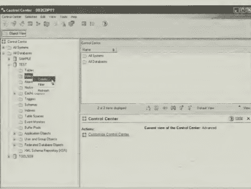

图 4-19：从控制中心（Control Center）调用创建视图对话框。

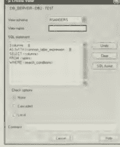

图 4-20：创建视图对话框。

如果在 `CREATE VIEW` SQL 语句指定了 `WITH LOCAL CHECK OPTION` 子句（或在创建视图对话框中选了本地检查选项），则对视图执行的插入和更新操作将进行创建验证，以确保插入或更新到视图所引基表中的所有行都符合视图的定义（否则，插入/更新操作将失败）。那么这到底意味着什么？假设使用以下 `CREATE VIEW` 语句创建了一个视图：

```
CREATE VIEW priority_orders
AS SELECT * FROM orders WHERE response_time < 4
WITH LOCAL CHECK OPTION
```

现在，假设用户尝试向此视图插入一条 `RESPONSE_TIME` 值为 6 的记录。插入操作将失败，因为该记录违反了视图的定义。如果创建视图时没有使用 `LOCAL CHECK OPTION` 子句，插入操作将成功，尽管新记录对于用于添加它的视图来说是不可见的。图 4-21 展示了 `WITH LOCAL CHECK OPTION` 子句的工作原理。

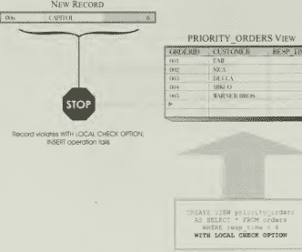

图 4-21：如何使用 `WITH LOCAL CHECK OPTION` 子句确保插入和更新操作符合视图的定义。

# 视图 287

指定了 `WITH LOCAL CHECK OPTION` 子句创建的视图被称为对称视图（symmetric views），因为可以插入到其中的每条记录也可以从中检索出来。

如果在 `CREATE VIEW` SQL 语句指定了 `WITH CASCED CHECK OPTION` 子句（或在创建视图对话框中选了级联检查选项），则创建的视图将继承其所依据的父视图的搜索条件，并将这些条件视为一个或多个约束，用于验证对视图执行的插入和更新操作。此外，每个由指定了 `WITH CASCED CHECK OPTION` 子句创建的视图的子视图将继承这些约束；父视图和子视图的搜索条件将通过 AND 逻辑组合以形成约束。为了更好地理解这意味着什么，让我们来看一个例子。假设使用以下 `CREATE VIEW` 语句创建了一个视图：

```
CREATE VIEW priority_orders
AS SELECT * FROM orders WHERE response_time < 4
```

现在，假设使用以下 `CREATE VIEW` 语句创建了第二个视图：

```
CREATE VIEW special_orders
AS SELECT * FROM priority_orders
WITH CASCADED CHECK OPTION
```


如果用户尝试向 `SPECIAL_ORDERS` 视图插入一条 `RESPONSE_TIME` 值为 6 的记录，插入操作将失败，因为该记录违反了 `PRIORITY_ORDERS` 视图定义的搜索条件（该条件是 `SPECIAL_ORDERS` 视图的约束）。图 4–22 展示了 `WITH CASCADED CHECK OPTION` 子句的工作原理。

# 第 4 章：数据库访问

```
CREATE VIEW priority_orders
AS SELECT * FROM orders
WHERE resp_time < 4
```

## PRIORITY_ORDERS 视图

| ORDERID | CUSTOMER | RESP_TIME |
|---|---|---|
| 001 | EMI | 2 |
| 002 | MCA | 3 |
| 003 | DECCA | 3 |
| 004 | ABRECO | + |
| 005 | WARNER BROS | 1 |

## 新记录


## SPECIAL ORDERS 视图

| ORDERID | CUSTOMER | RESP_TIME |
|---|---|---|
| 001 | EMI | 2 |
| 002 | MCA | 3 |
| 003 | DECCA | 3 |
| 004 | ABRECO | + |
| 005 | WARNER BROS | 1 |

记录违反了 `WITH CASCED CHECK OPTION`：

`INSERT` 操作失败

```
CREATE VIEW special_orders
AS SELECT * FROM primary_orders
WITH CASCADED CHECK OPTION
```

图 4-22：如何使用 `WITH CASCADED CHECK OPTION` 子句确保插入和更新操作符合父视图的定义。

## 关于失效视图的说明

失效视图（inoperative view）是指不再供用户和应用程序可用且访问的视图。当发生以下情况时，视图可能会变得失效：

- 视图定义所依赖的权限被撤销，导致无法访问一个或多个基表。
- 视图定义所依赖的底层视图、表、别名或函数被删除。
- 视图定义所依赖的视图变为失效。
- 视图的父视图（supervise）失效（父视图是一种类型视图，另一个被称为子视图的基于其为基础的类型视图）。

一旦视图失效，可以使用以下步骤来恢复它：

- 通过查询目录（catalog）获取视图定义。
- 使用 SQL 语句重新创建视图（这是有限的）。
- 使用 `GRANT` 语句。

如果你希望恢复失效的视图，可以使用 `DROP` 语句。

### 索引

索引是包含表中行指针集合的对象。索引基于一个或多个列。图 4-23 显示了索引的结构，它引用基表。

第 4 章：数据库访问

| DEPTID | KEY | ROW |
|---|---|---|
| 001 | ADMINISTRATION | 5 |
| 002 | PLANNING | 9 |
| 003 | HUMAN RESOURCES | 4 |
| 004 | ACCOUNTING | 6 |
| 005 | FINANCE | 7 |

| DEPTID | KEY | ROW |
|---|---|---|
| 001 | SALES | 10 |
| 002 | MARKETING | 11 |
| 003 | OPERATIONS | 12 |
| 004 | LEGAL | 13 |
| 005 | CUSTOMER | 14 |

| DEPTID | KEY | ROW |
|---|---|---|
| 001 | SUPPORT | 15 |
| 002 | IT | 16 |
| 003 | R&D | 17 |
| 004 | EXECUTIVE | 18 |
| 005 | HR | 19 |


在 DB2 中，有几种类型的索引：

- `关系索引（Relational indexes）`：针对单维度优化的索引。
- `空间网格索引（Spatial Grid indexes）`：针对二维数据优化的索引。每个网格索引都是基于最小边界矩形（MBR）创建的。
- `动态位图索引（Dynamic Bitmap indexes）`：通过索引扫描结果产生的索引。
- `基于块索引（Block Based indexes）`：多维聚集（MDC）表。
- `XML 索引（XML indexes）`：使用特定的 XPath 表达式对索引路径和值的自定义索引。

索引很重要，是因为它们可以实现以下功能：

- 提供定位特定数据行的快速高效方法。在某些情况下，解析查询所需的所有信息可以在索引中找到，此时无需访问实际表。
- 提供行的逻辑排序。数据在表中的存储没有特定顺序；使用索引时，一个或多个列的值可以按升序或降序排序。这对于处理包含 `ORDER BY` 和 `GROUP BY` 子句的查询非常有益。
- 提高整体性能。如果表中不存在索引，则对查询引用的每个表必须执行表扫描。表越大，表扫描越慢。
- 可用于强制执行表中记录的唯一性。
- 在多用户环境中提供更高的并发性。因为定位记录更快，获取锁的时间不需要那么长。

然而，这些收益是有代价的：

- 每个索引都需要额外的存储或磁盘空间。确切所需的空间取决于表的大小，以及索引中包含列的大小和数量。
- 对表执行的每次插入和更新操作都需要对与之相关的索引进行额外更新。当使用 DB2 的 `LOAD` 工具向表批量加载数据时情况也是如此。
- 每个索引都可能为 DB2 优化器在生成解析查询的最优访问计划时考虑提供另一种访问路径。这反过来增加了静态查询嵌入应用程序时的编译时间。

# 第 4 章：数据库访问

尽管会隐式创建某些索引为表定义提供支持（例如，为主键提供支持），但索引通常是使用 DB2 提供的工具显式创建的。显式创建索引的一种方法是执行 `CREATE INDEX` SQL 语句。该语句的基本语法如下：

```
CREATE <UNIQUE> INDEX [IndexName]
ON [TableName] ((PriColumnName) [ASC | DESC], ...))
<INCLUDE ([SecColumnName], ...)>
<CLUSTER>
<PCTFREE 10 | PCTFREE [Percent]>
<ALLOW REVERSE SCANS | DISALLOW REVERSE SCANS>
```

其中：

- `IndexName`: 指定分配给要创建索引的名称。
- `TableName`: 指定分配与要创建的索引关联的基表名称。
- `PriColumnName`: 指定要作为索引键的一个或多个主列。（所指定的每个主列的组合值将用于强制关联基表中的数据唯一性。）
- `SecColumnName`: 指定一个或多个辅助列，这些列的值将与指定的主列的值一起存储，但不会用于强制数据唯一性。
- `PercentFree`: 指定在构建索引时为每个索引页留出的空闲百分比。

如果在执行 `CREATE INDEX` 语句时指定了 `UNIQUE` 子句，则与要创建的索引关联的表中的组成索引键的列集中不能有两个或多个相同值的出现。当 DB2 数据库管理器尝试创建指定的索引时，如果基表包含数据，则会检查这种唯一性——如果发现索引键具有重复值的记录，则不会创建索引；如果没有发现重复值，则创建索引，并在每次对表执行插入或更新操作时强制唯一性。每当索引键的唯一性受到破坏时，插入或更新操作将失败并生成错误。需要记住，当使用 `UNIQUE` 子句时，索引可能包含一个（且仅包含一个）NULL 值。

因此，如果你想为一个名为 `EMPLOYEE` 的基表创建一个索引，使索引键由名为 `EMPNO` 的列组成，并且员工编号按降序存储，你可以通过执行类似下方的 `CREATE INDEX` 语句来实现：

```
CREATE INDEX empno_idx
ON employee (empno DESC)
```

另一方面，如果你想为一个名为 `EMPLOYEE` 的基表创建一个索引，按升序顺序存储员工姓名，并确保没有两个员工具有相同的姓、中间名首字母和名的组合，你可以通过执行类似下方的 `CREATE INDEX` 语句来实现：

```
CREATE UNIQUE INDEX empname_idx
ON employee (firstname, midinit, lastname)
```

最后，如果你想为一个名为 `EMPLOYEE` 的基表创建一个索引，以提高检索员工编号、工资和奖金信息（分别来自 `EMPNO`、`SALARY` 和 `BONUS` 列）的查询性能，同时确保输入到 `EMPNO` 列的所有员工编号都是唯一的，你可以通过执行类似下方的 `CREATE INDEX` 语句来实现：


```
CREATE UNIQUE INDEX empno_idx
ON employee (empno)
INCLUDE (salary, bonus)
```

还可以使用创建索引向导（`Create Index wizard`）创建索引，可以通过从控制中心找到“索引”菜单中选择适当的操作来激活它。图 4–24 显示了激活创建索引对话框必须选择的控制中心菜单项；图 4–25 显示了创建索引向导在首次激活时的样子。


图 4-24：从控制中心调用创建索引对话框。

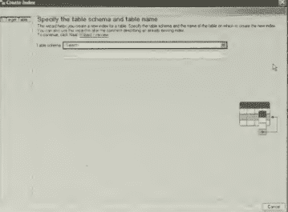

图 4-25：创建索引向导。

如果为空表创建索引，则在与索引关联的表填充之前，该索引将不会存储任何条目。另一方面，如果为已包含数据的创建索引，则会在创建索引时为现有数据生成索引条目并添加到索引中。

可以使用各种列组合为表创建任意数量的索引。然而，正如前面指出的，每个索引在存储需求和性能方面都是有代价的：每个索引都会复制其键值，这种复制需要额外的存储空间。而且由于对表的任何修改都会导致对表上定义的所有索引进行类似的修改，因此在执行插入、更新和删除操作时，性能可能会下降。事实上，如果为频繁修改的表创建大量索引，除了数据检索外，所有情况的整体性能都会下降而不是增加。用于数据挖掘、商业智能、数据仓库以及在修改数据的同时执行许多（通常是复杂的）查询的应用程序的表是多个索引的主要目标。另一方面，用于联机事务处理（`OLTP`）环境或其他高吞吐量环境的表使用索引较少。


如果在同一个表上创建两个索引，一个指定 `ASC`，另一个指定 `DESC`，如果你不在 `CREATE INDEX` 语句中指定 `DISALLOW REVERSE SCAN`，则两个索引都将默认允许反向扫描。结果是 `DB2` 将发出警告。`ALLOW REVERSE SCANS` 允许同一个索引适用于升序和降序的不同查询。

## 聚集索引

聚集索引是一种特殊索引，使用时会通知 `DB2` 数据库管理器始终将记录存储在包含相似值的页上。如果上没有可用空间，`DB2` 数据库管理器将尝试存储在附近。

聚集索引通常通过减少访问数据的 I/O 来提高性能：由于相同数据存储在页上，这减少了页面数量。表中只能有一个索引是聚集索引。当逻辑集中的行在物理上存储在一起时，对集的读取操作将需要更少的 I/O，因为相邻的行可能位于同一个区内（记住，数据页以“区”的形式写入），而不是分散在多个区中。相似的键值被放置在同一个数据页上，查询通常只需要读取表的一部分。聚集索引对于具有范围谓词的列有用，因为它允许对基表进行顺序访问。

通过在 `CREATE INDEX` SQL 语句中指定 `CLUSTER` 选项创建聚集索引。如果你想为名为 `EMPLOYEE` 的基表创建一个聚集索引，使索引由名为 `EMPNO` 的列组成，并保证输入 `EMPNO` 列的所有员工编号都是唯一的，你可以通过执行如下 `CREATE INDEX` 语句来实现：

```
CREATE UNIQUE INDEX empno_cidx
ON employee (empno)
CLUSTER
```

在创建聚集索引时，可以使用 `CREATE INDEX` SQL 语句的 `PCTFREE` 选项来控制为未来的插入和更新操作保留的空间。在创建索引时指定较高的 `PCTFREE` 值（默认为 10%）可以减少在向索引插入记录时发生索引页拆分的概率。


随着时间的推移，更新操作会导致行更改页位置，从而减少索引与其数据页之间的聚集程度。使用适当索引重新组织表（使用 `REORG` 工具）可以将指定的索引恢复到原始的聚集水平。

## 多维度聚类 (MDC) 索引

多维度聚类 (`MDC`) 提供了一种沿多个维度对数据进行自动聚类的方法。这种聚类可以显著提高查询性能，并大幅减少数据维护操作的开销，例如表/索引重组以及插入、更新和删除操作期间的索引维护。多维度聚类主要用于数据仓库、在线事务处理 (`OLTP`) 和大型数据库环境。

我们刚刚看到，在使用聚类索引时，`DB2` 数据库管理器会在表中插入和更新记录时，按照索引的键顺序维护页面上数据的物理顺序。通过良好的聚类，响应查询时只需访问表的一部分，并且当页面按顺序存储时，可以执行更高效的预取。通过 `MDC`，这些优势被扩展到多个键（或维度）；即同时在多个一个键（或维度）上进行物理聚类。查询不仅只会访问包含正确维度值记录的页面，而且这些符合条件的页面将按区（extents）进行分组。此外，尽管带有聚类索引的表可能会随着表中空间的填充而变得不再聚类，但 `MDC` 表能够自动且持续地在所有维度上维持其聚类状态，从而消除了为了重组表以恢复原始聚类水平的需求。

当你创建一个多维度聚类索引时，可以指定一个或多个键作为聚类数据的维度；每个维度可以由一个或多个列组成，就像普通索引一样。系统将为每个指定的维度自动使用一个维度块索引，`DB2` 优化器将使用此索引快速、高效地跨每个维度访问数据。还会创建一个包含所有维度键列的复合块索引，它将用于在插入和更新操作期间维护数据的聚类。只有当单个维度块索引已不包含为该维度指定的所有维度键列时，才会创建复合块索引。`DB2` 优化器也可以使用复合块索引来高效地访问数据。维度值的每个唯一组合形成一个逻辑单元（cell），它在物理上由页块组成，其中块是一组连续的页面集合。包含某个维度块索引特定值数据页面的块集合被称为“切片”（slice）。表的每个页面恰好属于一个块，且表的所有块包含相同数量的页面：阻塞因子（blocking factor）。阻塞因子等于区大小（extent size），使得块边界与区边界对齐。图 4–26 显示了一个简单的 `MDC` 表及其相关的 `MDC` 索引。

图 4-26：简单的多维度聚类表及其相关索引。

## Type-1 与 Type-2 索引

在 `DB2` 版本 8.1 中，存储索引记录的结构被修改，以帮助消除被称为“下一键锁”（Next-key locking）的现象。下一键锁发生在索引插入、删除以及索引扫描期间；当向表中插入、更新或删除某行时，该行将获得一个排他锁 (`X`)。当相应的键插入表的索引中或从索引中删除时，索引中紧随被删除或插入键之后的对应的行也被锁定，并获得下一键排他锁 (`NX`)。（对于影响键值值的更新操作，会先删除原始键值再插入新值，因此会获得两个下一键排他锁 (`NX`)。）因此，Type-1（旧式）索引在键值插入和删除期间的下一键锁有时会导致死锁循环。使用 Type-2 索引时不会发生死锁，因为被删除的键被标记为已删除，并没有从索引中物理删除。（被标记为已删除的键会被后续的插入和更新操作覆盖。）默认情况下，`DB2` 中创建的所有新索引均使用 Type-2 索引结构，而现有索引在手动转换之前将继续使用 Type-1 索引结构。要将 Type-1 索引转换为 Type-2 索引，你可以使用 `REORG...CONVERT` 命令对其进行重组（我们将在第 6 章“`DB2` 工具”中介绍），或者删除并重新创建。

## 关于系统目录的说明

系统目录由一组特殊表（和视图）组成，包含数据库中所有对象的信息。这些表包含数据库对象定义的信息（例如：表、视图、索引和包）以及关于用户对这些对象的访问类型的安全信息。在第 3 章“数据放置”中，我们看到在创建新数据库时，系统目录表是自动创建的。你不能显式地创建或删除这些表，但你可以控制谁可以访问它们。

每当创建、修改或删除对象时，`DB2` 都会在目录中插入、更新或删除描述该对象以及该对象与其他对象关系的记录。因此，如果你想获取特定数据库的信息，通常可以通过连接到该数据库并查询系统目录来实现。例如，你想找出名为 `EMPLOYEE` 的表是否需要重组以消除碎片。你可以通过对名为 `SYSCAT.TABLES` 的系统目录表执行类似下面的查询来实现：

```sql
SELECT TABNAME, OVERFLOW FROM
SYSCAT.TABLES
WHERE TABNAME = 'EMPLOYEE'
```

如果该查询的结果结果显示 `EMPLOYEE` 表存在大量溢出记录，则数据已碎片化，该表可能需要重组。（我们将在第 6 章“`DB2` 工具”中介绍如何重组表。）

# 第 4 章：数据库访问

另一方面，如果你想知道是否已为 `EMPLOYEE` 表收集了统计信息，可以通过对系统目录执行类似下方的查询来获取结果：

```sql
SELECT CARD AS num_rows
FROM SYSCAT.TABLES
WHERE TABNAME = 'EMPLOYEE'
```

在这种情况下，如果查询返回 -1 而不是 `EMPLOYEE` 表的行数，则未收集统计信息。（我们将在第 6 章介绍如何收集统计信息。）

可能性几乎是无限的。要了解更多关于系统目录中的表以及每个表所包含的信息，请参阅 IBM `DB2` 9 SQL 参考中的附录 D，“目录视图”。


系统目录仅用于获取特定数据库的信息。如果你想获取系统级的信息，必须诉诸执行管理系统命令或查询可用的管理视图。例如，要获取特定服务器上安装的 DB2 产品信息，你需要执行系统命令 `db2lis -q a`（如果在 Linux 或 UNIX 服务器上），或对 `SYSIBMADM.ENV_PROD_INFO` 管理视图发布类似下面的查询：`SELECT * FROM SYSIBMADM.ENV_PROD_INFO`。

# DB2 9 的全面工具集

除了 DB2 Everyplace、DB2 for i/OS 和 DB2 for z/OS 外，此版本的 DB2 和 DB2 客户端配备了一套全面的工具，旨在协助管理 DB2 实例、数据库和数据库对象。大多数工具都具有图形用户界面 `GUI`；然而，使用提供的 GUI 工具完成的大多数任务也可以通过在操作系统提示符或 DB2 命令行处理器（稍后我们将介绍的另一个工具）中发布相应的 DB2 命令来实现。后续章节将介绍最常用的 GUI 工具。

## 控制中心 (Control Center)

在所有可用的 DB2 GUI 工具中，控制中心是提供的最且功能最全的一个。控制中心提供了整个系统的清晰、简洁的视图，并作为管理 DB2 系统和执行常见管理任务的中心点。通过控制中心，用户可以执行以下操作：
- 创建和删除实例
- 创建和删除（删除）DB2 数据库
- 编目录和取消编目录
- 配置实例和数据库
- 创建、修改和删除缓冲池、表空间、表、视图、索引、别名、触发器、架构和用户定义数据类型 `UDTs`
- 授予和撤销权限和许可
- 导出、导入或加载数据
- 重新组织表并收集表统计
- 备份和恢复数据库及表空间
- 在系统之间复制数据
- 管理数据库连接
- 监控资源并跟踪事件发生
- 分析查询
- 调度作业无人值运行

控制中心界面通过三种不同的视图之一呈现：
**基础视图 (Basic)。** 基础视图显示数据库、表、视图和存储过程等基本对象，并限制了你对这些对象可以执行的操作。如果你想执行核心 DB2 数据库操作，则应使用此视图。
**高级视图 (Advanced)。** 高级视图显示控制中心中所有可用对象，并允许你执行所有可用操作。如果你在企业环境中工作，或者想使用 DB2 for i/OS 或 DB2 for z/OS，则应使用此视图。
**自定义视图 (Custom)。** 自定义视图让你能够定制对象树和允许的操作，以满足你的特定需求。

图 4-27 显示了在 Windows XP 服务器上使用高级视图时的控制界面。

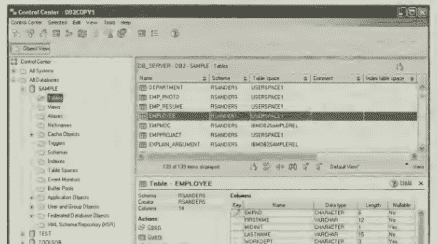

图 4-27：控制中心（高级视图）。

如果你仔细观察图 4-27，你会发现控制中心由以下元素组成：
- 菜单栏，允许用户执行任何可用控制中心功能。
- 工具栏，用于启动其他可用的 DB2 GUI 工具。图 4–28 标识了可以从控制中心工具栏直接调用的工具。
- 对象面板（位于控制中心左侧），包含可从控制中心管理的每个对象类型的层次结构表示。
- 内容面板（位于控制中心右上侧），包含与对象面板中选定的对象类型对应的现有对象列表。（例如，如果在对象面板中选择了“表”对象类型，则内容面板将列出所有可用表。）
- 对象详细面板（位于控制中心右下方），包含有关对象树或内容面板中所选对象的详细信息。

正如你在图 4-27 中看到的，内容面板中列出的每个对象前面都有一个对象图标，用于标识列表所描述的对象类型。使用了多种图标，用户可以通过查看从控制中心菜单和工具栏访问的图例 `Legend` 对话框，查看所有可用图标列表及其对应的对象类型。图 4-29 显示了图例对话框在 Windows XP 服务器上的样子。

## DB2 9 的综合工具集


图 4-28：控制中心工具栏。

注意的是，每个从控制中心工具栏调用的工具也可以从控制中心的菜单栏调用。

## 复制中心 (Replication Center)

复制中心是一个交互式 GUI 应用程序，允许用户管理 DB2 数据库与任何其他数据库之间的数据复制——无论该数据库是否为 DB2 数据库。从复制中心，用户可以执行以下操作：
- 定义复制环境
- 创建复制控制表
- 注册复制源
- 创建订阅集
- 向订阅集添加成员
- 将一个位置的指定更改应用到另一个位置
- 同步两个位置的数据
- 监控复制过程
- 对复制操作执行基本的故障排排除

图 4–30 显示了复制中心在 Windows XP 服务器上首次调用时的样子。

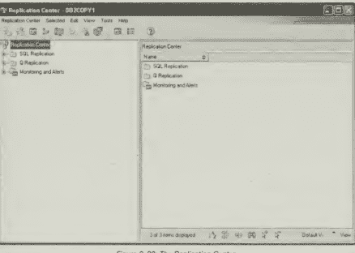

图 2–30：复制中心。

## 卫星管理中心 (Satellite Administration Center)

卫星管理中心是一个 GUI 应用程序，允许用户设置和管理一组执行相同业务功能的 DB2 服务器。这些被称为“卫星”`satellites` 的服务器都运行相同的应用程序，并具有支持特定应用程序所需的相同 DB2 定义。通过卫星管理中心，用户创建一个组，然后将卫星定义为该组的成员。你可以作为一个实体管理这组卫星，而不是单独管理每个卫星。如果获取了执行相同业务功能的 DB2 服务器，只需将其添加到组中。

卫星环境的信息存储在一个被称为卫星控制数据库的中央数据库中。该数据库记录了等信息有哪些卫星、每个卫星属于哪个组，以及卫星正在运行哪个版本的用户应用程序。此数据库位于名为卫星控制服务器的 DB2 服务器上，并且在卫星管理中心与其交互之前，必须进行编目录并供控制中心访问。

卫星组通过创建处理脚本进行管理，以设置和维护每个卫星所需的数据库定义。每个卫星定期连接到卫星控制服务器并下载适用于它的脚本。卫星在本地执行这些脚本并将结果传回卫星控制数据库。这种下载处理脚本、执行脚本并将执行结果传回卫星控制数据库的过程被称为同步。卫星通过同步来与其所属组的其他卫星保持一致性。

## 命令编辑器 (Command Editor)

命令编辑器是一个交互式 GUI 应用程序，用于生成、编辑、执行和操作 SQL 语句和 DB2 命令；处理生成的输出；并查看为解释 SQL 语句所选访问计划的图形表示。通过命令编辑器，用户可以执行以下操作：
- 执行 SQL 语句、DB2 命令和操作系统命令——操作系统命令前面必须有一个标记。
- 查看 SQL 语句和 DB2 命令的执行结果，并查看响应查询产生的产生的数据集。
- 将 SQL 语句和 DB2 命令的执行结果保存到外部文件。
- 创建并保存一系列 SQL 语句和 DB2 命令到可供任务中心 `Task Center` 调用脚本文件中。（此类脚本文件可以被调度在特定时间或频率运行）。
- 使用 SQL Assist 工具构建复杂的查询。
- 在 SQL 语句执行之前（或之后）检查与其相关的执行计划和统计信息。

图 4–31 显示了建立数据库连接后，Windows XP 服务器上命令编辑器 `Command Editor` 的界面。

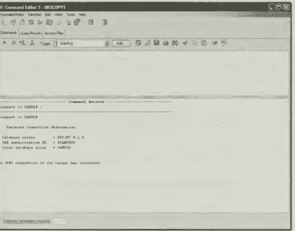

图 4–31：命令编辑器。

如图 4–31 所示，命令编辑器由三个不同的页面（通过标签页访问）组成：命令页面 `Commands page`、查询结果页面 `Query Results page` 和访问计划页面 `Access Plan page`。用户可以在命令页面输入并执行 SQL 语句或 DB2 命令、创建并保存脚本、运行现有脚本或从命令页面调度任务。查询执行后，用户可以在查询结果页面上查看结果（如果有的话）。在访问计划页面上，用户可以查看在命令页面上指定的任何可解释语句的访问计划。（如果要在命令页面上指定了多个 SQL 语句，则只会为遇到的第一个语句创建访问计划。）

### SQL 助手 (SQL Assist)

SQL Assist 是一种交互式 GUI 应用程序，允许用户可视化地构建复杂的 SELECT、INSERT、UPDATE 和 DELETE 语句，并检查执行结果。SQL Assist 可直接从命令编辑器调用，可以通过选择相应的菜单选项或选择相应的工具栏图标（此图标在建立数据库连接之前不可可用）。图 4–32 标识了用于激活 SQL Assist 对话框的命令编辑器工具栏图标；图 4–33 显示了在 Windows XP 服务器上使用其构建复杂查询后，SQL Assist 对话框的界面。


图 4-32：命令编辑器工具栏上的 SQL Assist 图标

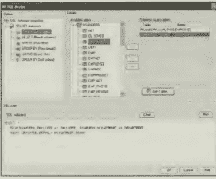

图 4-33：SQL Assist。

一旦在 SQL Assist 内部构建了所需的 SQL 语句，就可以将其写回命令编辑器，在其中可以立即执行，或将其保存到脚本文件中，以便稍后使用任务中心 `Task Center` 执行。


## 可视化解释 (Visual Explain)

`Visual Explain` 是一种 GUI 工具，为数据库管理员和应用程序开发人员提供 DB2 优化器为特定 SQL 语句选择的访问计划的图形表示。此外，`Visual Explain` 还允许你执行以下操作：
- 查看用于优化 SQL 语句的数据库统计信息。
- 确定是否使用了索引访问表数据。（如果未使用索引，`Visual Explain` 可以帮助你确定哪些列可能受益于索引。）
- 通过允许你进行“之前”和“之后”对比，确定性能调优的效果。
- 获取有关访问计划执行的每个操作的详细信息，包括每个操作的预估成本。

图 4–34 显示了当通过命令编辑器选择访问计划页面显示时，`Visual Explain` 工具在 Windows XP 服务器上的可能界面。

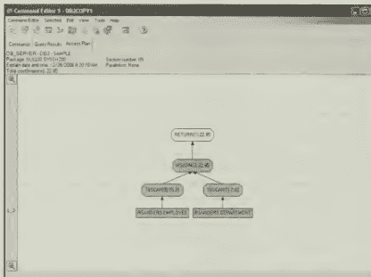

图 4-34：可视化解释。

`Visual Explain` 提供的输出由一个层次图组成，表示处理为特定 SQL 语句选择的访问计划所需的各种组件。每个组件都表示为一个称为“节点”的图形对象，存在两种类型的节点：
`运算符 (Operator)`。运算符节点用于识别必须在数据上执行的操作，或从表或索引产生的输出。`操作数 (Operand)`。操作数节点用于识别执行操作的实体（例如，表将是表扫描算子的操作数）。

通常，操作数节点用于识别表、索引和表队列（当使用分区的并行处理时会使用表队列），这些内容在层次图中用矩形（表）、菱形（索引）和平四边形（表队列）符号表示。另一方面，运算符节点用于识别从插入操作到索引扫描或表扫描的任何内容。运算符节点在层次图中用椭圆表示，指示了数据如何被访问、表如何连接以及诸如是否执行排序操作等因素。箭头说明了数据如何从一个节点流向下一个节点，连接了层次图中的所有节点，而 `RETURN` 运算符通常会终止此路径。

可以通过选择访问计划页面直接从命令编辑器调用 `Visual Explain`。然而，在显示解释信息之前，必须存在访问计划；可以通过选择命令编辑器工具栏上的“执行并访问计划”（`Execute and Access plan`）或“访问计划”（`Access Plan`）图标，为命令编辑器中输入的 SQL 语句生成访问计划。图 4–35 标识了用于为 SQL 语句生成访问计划的命令工具栏图标。


图 4-35：命令工具栏上的访问计划图标

我们将详细查看 `Visual Explain`

## 任务中心 (The Task Center)

任务中心是一种交互式 GUI 应用程序，允许用户监控数据库活动并接收特定事件的通知。任务中心用于调度、运行和管理任务。使用任务中心，你可以查看所有已执行或计划执行的任务状态。任务中心还允许你查看任务结果并识别任何错误。

任务中心使用一组条件来决定何时执行任务。当任务满足条件时，任务中心将生成警报。

## 314 第4章：数据库访问、备份与维护

Windows XP 服务器（在此情况下，在生成两个警告类型的警报后）。

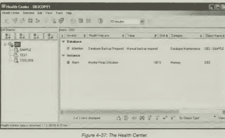

我们将在第5章“分析DB2活动”中详细查看数据库系统监控、健康监器（Health Monitor）和健康中心（Health Center）。

## 日志 (Journal)

日志是一个交互式GUI应用程序，用于跟踪任务、数据库操作和行为、控制中心（Control Center）操作、消息和警报的历史信息。为了以组织的方式呈现这些信息，日志使用了不同的视图：
- 任务历史
- 数据库历史
- 消息
- 通知日志

任务历史视图显示已执行任务的结果。此视图每个单独的任务包含一个条目（无论任务执行了多少次），并允许用户执行以下操作：
- 查看任何已执行任务的详情
- 查看任何已执行任务的结果
- 编辑任何已执行的任务
- 查看与任何已执行任务相关的执行统计
- 从日志中删除任何任务执行记录

数据库历史视图显示存储在数据库恢复历史文件中的信息。当执行以下任何操作时，恢复历史文件都会自动更新：
- 数据库或表空间备份
- 数据库或表空间恢复
- 滚动恢复 (`Roll-forward recovery`)
- 加载 (`Load`)
- 表重组

消息视图显示从控制中心和其他任何GUI工具发布的运行消息历史，通知日志视图显示来自管理通知日志的信息。

图 4–38 显示了日志的消息视图在 Windows XP 服务器上的可能外观。

## 316 第4章：数据库访问

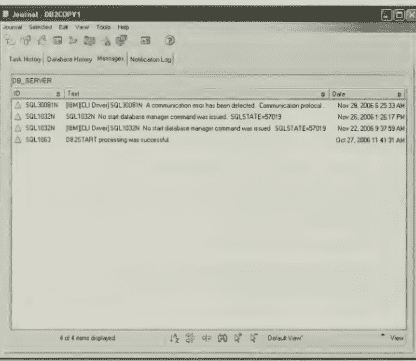

图 4-38：日志的消息视图。

## 许可证中心 (License Center)

许可证中心是一个交互式GUI应用程序，允许用户查看与特定系统上安装的每个DB2产品相关的许可证信息。此类信息包括处理器状态、并发用户策略、许可证以及用户统计或详情。此工具还可以用于添加或删除许可证或注册用户、更改许可证类型策略、更改并发用户数、更改 Internet 处理器许可证数量，并对特定系统进行适当的许可证监控。图 4–39 显示了许可证中心在 Windows XP 服务器上的可能外观。

## DB2 9 综合工具 317

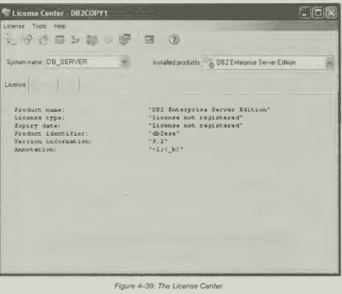

## 配置助手 (Configuration Assistant)

配置助手是一个交互式GUI应用程序，允许用户配置客户端以便能够访问存储在远程DB2服务器上的数据库。为了访问另一个服务器/系统上的实例或数据库，必须首先在客户端工作站的节点目录中编目录该系统，并将远程数据库的信息编入数据库目录（并在客户端工作站上）。配置助手提供了一种快速编目录节点和数据库的方法，无需了解执行这些任务所需的固有复杂性。由于配置助手维护了用户和应用程序可以连接的数据库列表，在未安装完整GUI工具的情况下，它可以作为控制中心的轻量级替代方案。

## 第4章：数据库访问

通过配置助手，用户可以执行以下操作：
- 编目录新数据库
- 处理或取消现有数据库的编目录
- 绑定应用程序
- 设置DB2环境/注册表变量
- 配置DB2数据库管理器实例
- 配置 `ODBC/CLI` 参数
- 导入和导出配置信息
- 修改密码
- 测试连接

图 4–40 显示了配置助手在 Windows XP 服务器上的可能外观。

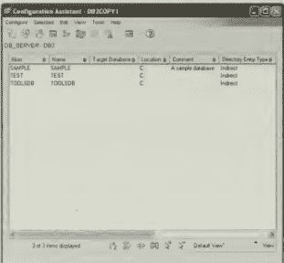

图 4-40：配置助手。

## DB2 9 综合工具集 319

## 工具设置笔记本 (Tools Settings Notebook)

工具设置笔记本是一个交互式GUI应用程序，用于为各种DB2管理工具自定义设置并设置属性。为了以组织的方式呈现和收集这些信息，工具设置笔记本使用了多个不同的页面/标签页——某些页面/标签页仅在安装了相应的工具后才会显示。工具设置笔记本提供的可用页面如下：
- 通用页。此页面用于指定在启动DB2工具时是否自动启动本地DB2实例、是否使用语句结束符，以及在显示样本内容请求返回行数超过上限时是否使用过滤。
- 文档页。此页面用于指定DB2管理工具中的悬停和信息帮助功能是否应自动显示，并指定在实例级别访问上下文帮助的位置。
- 字体页。此页面用于更改DB2管理工具中文本和菜单显示的字体。
- OS/390和z/OS页。此页面用于为`OS/390`和`z/OS`对象设置列标题并定义在线和批处理实用执行选项。
- 健康中心状态信标页。此页面用于指定在生成警报时收到的通知类型。
- 调度器设置页。此页面用于设置默认值。如果您希望由本地处理调度，请选择“`Server`”；如果您希望由集中系统处理调度，请选择“`Centralized`”。（要启用另一个调度器，必须先对其进行编目录。）
## 第4章：数据库访问
- 命令编辑器页。此页面用于指定如何生成、编辑和操作SQL语句。
- IMS页。此页面用于在与`IMS`工作时设置您的偏好。

图 4–41 显示了工具设置笔记本在 Windows XP 服务器上的外观。

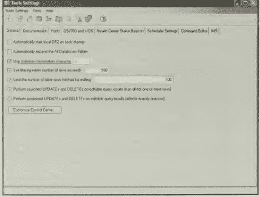

图 4-41：工具设置对话框。

## 设计顾问 (Design Advisor)

早些时候我们看到数据库中索引的主要目的是帮助数据库引擎快速定位存储在表中的记录；如果查询中引用了表但没有相应的索引，则必须顺序扫描整个表来定位所需数据。如果表包含大量数据，这种扫描可能会花费大量时间。在大多数情况下，如果为表中的频繁使用列创建索引，性能将大大提高。这是因为索引文件通常比相应的表文件小，且读取所需的时间更短。此外，可能不需要扫描整个索引；可以将谓词应用于索引，以减少实际读取的行数。


那么，如何决定何时创建索引是有益的？如何确定应该存在哪些索引？以及如何决定是否使用物化查询表（MQT）或分区来提高性能？即使您在数据库和数据库应用设计方面拥有丰富经验，为复杂负载选择哪些索引、MQT、聚类维度或数据库分区也是一项挑战。这就是设计顾问大显身场的地方。设计顾问是一个特殊工具，用于捕针对数据库执行的典型负载（查询或一组SQL操作）的特定信息，并根据提供的信息做出建议。当给定一组负载SQL语句时，设计顾问将针对以下内容提出建议：

- 新索引
- 新物化查询表 (MQT)
- 将基表转换为多维聚类 (MDC) 表
- 数据重分布
- 删除未被指定负载使用的索引和MQT

您可以让设计顾问立即实施部分或全部这些建议，或者安排在稍后应用。此外，设计顾问还可以辅助新数据库的设计，或改进已在运行数据库的性能。例如，在设计数据库时，设计顾问可以执行以下操作：

- 为分区的数据库环境以及索引、MQT 和 MDC 表生成数据库设计替代方案
- 对于分区的数据库环境，确定要使用的最佳数据库分区策略
- 对于分区的数据库环境，协助从其他数据库产品迁移到多分区 DB2 数据库

一旦数据库进入生产环境，可以使用设计顾问器（Design Advisor）执行以下操作：

- 提高特定 SQL 语句或工作负载的性能
- 使用示例工作负载的性能作为衡量，提高通用数据库性能
- 提高高频查询的性能，例如通过活动监视器（Activity Monitor）识别的查询
- 确定如何优化新关键查询的性能
- 响应健康中心（Health Center）针对共享内存用用或排序密集型工作负载所遇到的排序堆（sort heap）问题的建议
- 查找工作负载中未使用的索引和 MQT 等对象
- 协助从单分区 DB2 数据库迁移到多分区 DB2 数据库
- 评估手动生成的索引、MQT、MDC 表或数据库分区策略

图 4–42 显示了 Windows XP 服务器上设计顾问器第二页的界面。

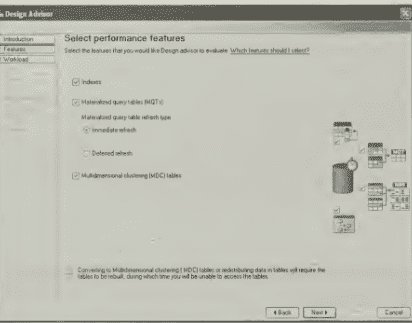

图 4-42：设计顾问向导的第二页。

## 活动监视器

活动监视器是一个交互式 GUI 应用程序，允许用户监控数据库或数据库分区上的应用程序性能、并发性、资源消耗和 SQL 语句的使用。通过活动监视器，你可以查看：

- 在所选应用程序上运行的事务
- 在所选应用程序上运行的 SQL 语句
- 在所选应用程序上运行的 SQL 语句文本
- 当前影响所选应用程序的锁和等待等待
- 查看锁信息的所选应用程序信息
- 关于数据库中所选应用程序所持有的锁和等待的锁的信息
- 帮助你解释报告数据的信息
- 活动监视器提供的建议

除了收集监控数据外，活动监视器还可以使用一组预定义的报告呈现收集的数据，这些报告基于监控数据的特定子集。（例如，某份报告可能包含一个图形化表示，用于识别导致数据库并发性差的锁定问题。）此外，活动监视器可以对大多数报告提供建议，协助诊断数据库性能问题的原因，并调整查询以实现数据库资源的最优利用。

图 4–43 显示了 Windows 服务器上活动监视器第一页的界面。

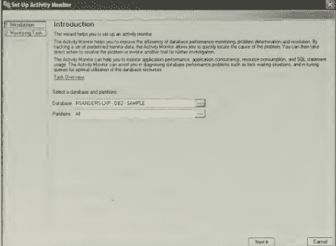

图 4-43：活动监视向导的第一页。

# 第 4 章：数据库访问

## 命令行处理器

命令行处理器（CLP）是一个面向文本的应用程序，允许用户发布 DB2 命令、系统命令和 SQL 语句，并查看执行的语句/命令的结果。命令行处理器可以在三种不同的模式下运行：

**命令模式。** 当命令行处理器以命令模式运行时运行时，用户只需在系统提示符处输入以 "`db2`" 字符为前的 DB2 命令或 SQL 语句。（例如，命令 "`CONNECT TO sample`" 应输入为 "`db2 CONNECT TO sample`"`）。如果命令包含对系统有特殊含义的字符，则必须用引号括起来以确保其被正确执行（例如 "`SELECT COUNT(*) FROM employee`"`）。如果要执行的命令太长无法放在单行内，可以在需要延续的行末尾放置一个空格和一个换行符 ()，命令的其余部分在新行继续。

**交互式输入模式。** 当命令行处理器以交互式输入模式运行时，每个输入的命令/SQL 语句都会自动提供 "`db2`" 前缀（以 `db2 =>` 提示符为特征）。要在交互式输入模式下运行命令行处理器，只需在提示符处输入命令 "`db2`"。要退出交互模式，请在命令行处理器提示符处输入命令 "`quit`"。除外，适用于命令行处理器命令模式的规则也适用于交互式输入模式。

**批处理模式。** 当命令行处理器以批处理模式运行时，假设所有要执行的命令和/SQL 语句都存储在 ASCII 格式的文本文件中。（存储在该文件中命令/语句前不应有 "`db2`" 字符）。要在批处理模式下运行命令行处理器，只需在系统提示符处输入命令 "`db2 -f xxxxxxxx`"`（其中 `xxxxxxxx` 是包含要执行命令集的文件名）。

图 4-44 显示了命令行处理器在 Windows XP 服务器上以后交互式输入模式运行时界面。

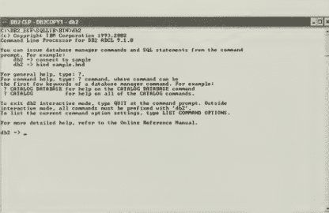

图 4-44：命令行处理器（交互式输入模式）。

在调用命令行处理器时可以指定各种命令行选项；可以通过从系统提示符或命令行处理器提示符（当其以后交互式输入模式运行时）执行 `LIST COMMAND OPTIONS` 命令获取所有可用选项列表。

## 练习题

### 题 1

- 信息约束（informational constraints）有什么用？

- A. 用于影响 DB2 优化器对数据访问计划的选择，且不减慢 DML 操作
- B. 为应用程序提供约束信息
- C. 用于定义非检查主键
- D. 用于影响外键-主键关系的优化数据访问计划

### 题 2

给定以下 CREATE TABLE 语句：

```
CREATE TABLE department
(deptid INTEGER,
deptname CHAR(25),
budget NUMERIC(12,2))
```

哪个语句可以防止两个部门分配相同的 DEPTID 但允许空值？

- A. `ALTER TABLE department ADD CONSTRAINT dpl_cst PRIMARY KEY (deptid)`
- B. `CREATE INDEX dpl_idx ON department(deptid)`
- C. `ALTER TABLE department ADD CONSTRAINT dpl_cst UNIQUE (deptid)`
- D. `CREATE UNIQUE INDEX dpl_idx ON department(deptid)`

### 题 3

给定以下 CREATE TABLE 语句：

```sql
CREATE TABLE products
  (prodid INTEGER NULL PRIMARY KEY,
  category CHAR(3) CHECK(category IN ('323', '441',
  '615', '832', '934')),
  description VARCHAR(200),
  quantity INTEGER CHECK (quantity > 0),
  sellprice NUMERIC(7,2) WITH DEFAULT,
  buyprice NUMERIC(7,2) WITH DEFAULT,
  CONSTRAINT zeroless CHECK (sellprice > buyprice));
```

假设表为空，哪个 INSERT 语句将成功？

A. `INSERT INTO products (prodid, category, description, buyprice) VALUES (1, '832', 'medium white shirt', 6.99)`

B. `INSERT INTO products (prodid, category, quantity, sellprice, buyprice) VALUES (2, '323', 5, 28.99, 26.99)`

C. `INSERT INTO products (prodid, category, description, quantity) VALUES (1, '934', 'black shoe', 10)`

D. `INSERT INTO products (prodid, category, description, quantity, sellprice, buyprice) VALUES (2, '615', 'dark blue socks', 3, 20.00, 25.65)`

### 题 4

给定以下 CREATE TABLE 语句：


```sql
CREATE TABLE employee
  (empid INTEGER NULL,
  name VARVAR(25),
  gender CHAR(1) NOT NULL,
  CONSTRAINT gender_ok CHECK(gender IN ('M', 'F'))
  NOT ENFORCED
  ENABLE QUERY OPTIMIZATION)
```

执行以下命令会产生什么影响？

`ALTER TABLE employee ALTER CHECK gender_ok DISABLE QUERY OPTIMIZATION`

+   A. `GENDER_OK` 约束将变为一个强制性检查约束，并将用于检查插入和更新操作的有效性。
+   B. `GENDER_OK` 约束将变为一个强制性检查约束，`EMPLOYEE` 表中存在的任何数据都将立即被检查是否违反约束。
+   C. `DB2` 优化器使用 `GENDER_OK` 约束进行查询优化的能力将被禁用。
+   D. 所有使用 `GENDER_OK` 约束进行查询优化的数据访问计划将被标记为失效（inoperative）。

## Question 5

给定以下 `CREATE TABLE` 语句：

```
CREATE TABLE employee
(emid INTEGER NOT NULL,
lname VARCHAR(20),
gender CHAR(1) NOT NULL,
CONSTRAINT gender_ok CHECK(gender IN ('M', 'F'))
NOT FORCED
ENABLE QUERY OPTIMIZATION)
```

以及以下 `INSERT` 语句：

```
INSERT INTO employee VALUES (1, 'Smith', 'M'),
(2, 'Doe', 'F'), (3, 'Jones', 'U')
```

下列哪一个查询将返回空结果集？

+   A. `SELECT COUNT(gender) FROM employee`
+   B. `SELECT * FROM employee WHERE gender = 'M'`
+   C. `SELECT * FROM employee WHERE gender = 'F'`
+   D. `SELECT * FROM employee WHERE gender = 'U'`

## Question 6

下列哪一个 `CREATE VIEW` 语句将确保通过视图 `V1` 插入或更新表 `T1` 记录的尝试在行被插入/更新之前通过某些标准？

A. `CREATE VIEW v1 AS SELECT c1, c2 FROM t1 WHERE c1 < 100`

B. `CREATE VIEW v1 AS SELECT c1, c2 FROM t1 WHERE c1 < 100 ENFORCED`

C. `CREATE VIEW v1 AS SELECT c1, c2 FROM t1 WHERE c1 < 100 WITH VALIDATION`

D. `CREATE VIEW v1 AS SELECT c1, c2 FROM t1 WHERE c1 < 100 WITH LOCAL CHECK OPTION`

## Question 7

关于失效视图（inoperative views），下列哪个说法不正确？

A. 当视图定义所依赖的权限被撤销时，视图可能会失效。
B. 当视图被标记为失效时，授予视图的权限将被撤销。
C. 失效视图在删除之前必须先恢复。
D. 失效视图可以通过重新执行最初用于创建它的语句来重建（该语句位于 `SYSCAT.VIEW` 目录视图的 `TEXT` 列中）。

## Question 8

下列项中哪两个是 `DB2` 支持的有效索引？

A. 空间网索引（Spatial grid indexes）
B. 静态位图索引（Static bitmap indexes）
C. 动态位图索引（Dynamic bitmap indexes）
D. 基于页的索引（Page-based indexes）
E. 多维范围聚集索引（Multidimensional range-clustered indexes）

## Question 9

给定以下 `CREATE TABLE` 语句：

```
CREATE TABLE tab1
(c1 SMALLINT,
c2 SMALLINT,
c3 SMALLINT,
c4 CHAR(4))
```

如果列 `C1` 必须是唯一的并且经常对表 `TAB1` 执行以下查询：

`SELECT c1, c2 FROM tab1 ORDER BY c1;`

`SELECT c1, c2, c3 FROM tab1 ORDER BY c1;`

下列哪一个语句将通过提供索引访问（index-only access）来提高性能？

+   A. `CREATE INDEX idx1 ON tab1 (c1)`
+   B. `CREATE UNIQUE INDEX idx1 ON tab1 (c1) INCLUDE (c2)`
+   C. `CREATE INDEX idx1 ON tab1 (c1, c2, c3)`
+   D. `CREATE UNIQUE INDEX idxx1 ON tab1 (c1) INCLUDE (c2, c3)`

## Question 10

给定以下 `CREATE TABLE` 语句：

```
CREATE TABLE tab1
(c1 SMALLINT,
c2 CHAR(4))
```

`TAB1` 被两个应用程序频繁访问；一个应用程序按升序返回列 `C1`中的数据，另一个应用程序按降序返回列 `C1`中的数据。为了提高性能，数据库管理员执行了以下命令：

`CREATE INDEX idx1 ON tab1 (c1 ASC);`

`CREATE INDEX idx2 ON tab1 (c1 DESC);`

将会发生什么情况？

+   A. 索引 `INDX1` 将创建，第一个应用程序在检索数据时将使用它；索引 `INDEX2` 将创建，第二个应用程序在检索数据时将使用它。
+   B. 索引 `INDEX1` 将创建。当尝试创建索引 `INDEX2` 时，`DB2` 将允许索引 `INDEX1` 进行反向扫描，两个应用程序在检索数据时都将使用 `INDEX1`。
+   C. 索引 `INDEX1` 将创建。当尝试创建索引 `INDEX2` 时，`DB2` 将允许反向扫描并删除索引 `INDEX1`；两个应用程序在检索数据时都将使用 `INDEX2`。
+   D. 索引 `INDEX1` 将创建并默认允许反向扫描。当尝试创建索引 `INDEX2` 时，`DB2` 将发出重复索引警告消息。两个应用程序在检索数据时都将使用 `INDEX1`。

## Question 11

| REGION | SALES_REP_ID | AMOUNT |
| --- | --- | --- |
| East | 1200 | 24000 |
| East | 1420 | 32000 |
| West | 1200 | 29000 |
| South | 2120 | 34000 |

给定以下表：

如果执行以下语句：

`CREATE INDEX idx1 ON sales (c1 ASC);`

`INSERT INTO sales ('North', 1420, 27500);`

`SELECT * FROM sales;`

将返回多少行？

+   A. 3
+   B. 4
+   C. 5
+   D. 6

## Question 12

下列哪项最能描述 `db2` 命令的功能？

A. 获取已安装的 `DB2` 产品信息。
B. 限制权限管理员访问。
C. 获取已注册服务器列表。
D. 返回数据库的位置。

## Question 13

如果执行以下查询：

```
SELECT TABNAME
FROM SYSCAT.TABLES
WHERE TABNAME = 'SALES'
```

根据结果可以确定什么？

+   A. 表是否需要重组织以减少碎片。
+   B. 排序内存是否需要增加。
+   C. 统计信息是否已收集。
+   D. 锁列表是否需要增加。

## Question 14

如果执行以下查询：

```
SELECT TABNAME
FROM SYSCAT.TABLES
WHERE TABNAME = 'EMPLYES'
```

根据结果可以确定什么？

+   A. 表是否需要重组织以减少碎片。
+   B. 表所在的存储空间是否需要增加。
+   C. 统计信息是否已收集。
+   D. 是否可以通过启用行压缩来节省空间。

## Question 15

下列哪一个不是有效的控制中心视图？

+   基础（Basic）
+   中级（Intermediate）
+   高级（Advanced）
+   自定义（Custom）

## Question 16

下列哪一个对象无法通过控制中心创建？

+   缓冲池（Buffer pool）
+   事件监视器（Event monitor）
+   触发器（Trigger）


+   用户定义函数（User-defined function）

## Question 17

下列哪一个选项最能描述活动监控器（Activity Monitor）的功能？

- A. 捕获针对数据库执行的典型负载（查询或 SQL 操作），并根据提供的信息提出建议。
- B. 使用多种健康指标持续监控 DB2 数据库实例的健康状况，以评估实例和数据库的特定方面。
- C. 监控数据库或数据库分区的应用性能、并发性、资源消耗和 SQL语句使用情况。
- D. 配置客户端以访问位于远程 DB2 服务器上的数据库。

### Question 18

哪些操作无法通过工具设置（Tools Settings）执行？

- A. 定义复制环境。
- B. 修改显示文本和菜单选项的字体。
- C. 设置默认调度方案。
- D. 配置健康状态（Health Status Beacons）。

### Question 19

哪个工具无法通过控制中心访问？

- A. 健康中心（Health Center）
- B. 命令编辑器（Command Editor）
- C. 命令行处理器（Command Line Processor）
- D. 许可证中心（License Center）。

### Question 20

下列哪项不能用于设置 DB2 环境/注册表变量？

| A. 配置向导（Configuration Assistant） |
| B. 设计顾问（Design Advisor） |
| C. 命令编辑器（Command Editor） |
| D. 命令行处理器（Command Line Processor） |

## 答案

### 问题 1

正确答案是 A。默认情况下，添加到带有信息性约束（informational constraints）的基表中的记录在插入和更新过程中不会被强制执行。然而，DB2 SQL 优化器在考虑用于解析查询的最佳访问计划时，会评估信息性约束提供的信息。因此，即使约束本身不会被用于验证数据修改，信息性约束也可能带来更好的查询性能。（信息性约束是通过在普通约束定义末尾附加 `NOT ENFORCED ENABLE QUERY OPTIMIZATION` 关键字定义的。）

### 问题 2

正确答案是 D。默认情况下，添加到基表中的记录可以在任何可用列上分配相同的值，且次数不限。唯一约束（unique constraint）可用于确保在向基表添加记录时，分配给一个或多个列的值（或值）是唯一的；一旦为一个或多个列定义了唯一约束，任何尝试在这些列中放置重复值的操作将失败。唯一约束通常在表创建过程中定义，但也可以通过 `ALTER TABLE` SQL 语句后期添加。

当定义唯一约束时，DB2 数据库管理器会检查是否已存在唯一约束所引用列的索引。如果存在，该索引将被标记为唯一且系统强制。如果不存在，则会创建一个相应的索引并标记为唯一且系统强制。随后，每当向定义唯一约束的列（或列）添加新记录时，都会使用该索引来强制唯一性。

尽管使用了唯一的系统强制索引来强制唯一约束，但定义唯一约束和创建唯一索引之间存在区别。尽管两者都强制唯一性，但唯一索引允许 `NULL` 值，且通常无法用于引用性约束。另一方面，唯一约束不允许 `NULL` 值，并可以在外键规范中被引用。

# 338 页 第 4 章：数据库访问

### 问题 3

正确答案是 B。第一个 `INSERT` 语句将失败，因为生成的 `SELLPRICE` 将为 0（因为没有提供值），且 `SELLPRICE` 为 0 小于 `BUYPRICE` 的 6.99，这违反了 `ZOLOSS` 检查约束。第三个 `INSERT` 语句将失败，因为 `CATEGORY` '423' 不在 `CATEGORY` 列允许的值集中。此外，生成的 `SELLPRICE` 和 `BUYPRICE` 将为 0（因为没有提供值），且 `SELLPRICE` 为 0 不大于 `BUYPRICE` 的 0，这违反了 `ZOLOSS` 检查约束。最后，最后一个 `INSERT` 语句将失败，因为 `SELLPRICE` 为 20.00 小于 `BUYPRICE` 的 25.65，这违反了 `ZOLOSS` 检查约束。

### 问题 4

正确答案是 C。要让 DB2 优化器在选择解析查询的最佳数据访问计划时忽略信息性约束，只需禁用该约束的查询优化。可以在创建约束时完成，也可以以后通过执行 `ALTER TABLE` 语句、识别要修改的约束并指定 `DISABLE QUERY OPTIMIZATION` 选项来实现。

### 问题 5

正确答案是 D。由于 DB2 优化器在选择解析查询的最佳数据访问计划时会评估信息性约束，因此插入到表中违反一个或多个信息性约束的记录可能不会被某些查询返回。因此，如果对所示 `EMPLOYEE` 表执行查询 `SELECT * FROM employee WHERE gender = 'U'`，将不会返回任何记录，因为所选的访问计划也会假设表中不存在 `GENDER` 值不为 'M' 或 'F' 的记录。

### 问题 6

正确答案是 D。如果在 `CREATE VIEW` 语句中指定了 `WITH LOCAL CHECK OPTION` 子句（或者在创建视图的对话框中选择了本地检查选项），则对创建的视图执行的插入和更新操作将通过验证，以确保插入或更新视图所引用的基表的所有行都符合视图的定义（否则，插入/更新操作将失败）。

这到底意味着什么？假设使用以下 `CREATE VIEW` 语句创建了一个名为 `priority_orders` 的视图：

```sql
CREATE VIEW priority_orders
AS SELECT * FROM orders WHERE response_time < 4
WITH LOCAL CHECK OPTION
```

现在，假设用户尝试向此视图插入一条 `RESPONSE_TIME` 值为 6 的记录。插入操作将失败，因为该记录违反了视图的定义。如果创建视图时没有使用 `WITH LOCAL CHECK OPTION` 子句，则插入操作将成功，尽管新记录对于添加它的视图来说是不可见的。

### 问题 7

正确答案是 C。如果你不想恢复一个无法运行的视图，可以使用 `DROP VIEW` 语句显式地删除它。或者，你可以创建一个新视图并赋予它与无法运行视图相同的名称，但给它不同的定义。

### 问题 8

正确答案是 A 和 C。在 DB2 9 中，有几种类型的索引：

- **关系型索引（Relational indexes）。** 针对单维度优化的索引。
- **空间网格索引（Spatial Grid indexes）。** 针对二维数据优化的索引。（每个空间网格索引根据几何体的 X 和 Y 维度创建；由 DB2 空间扩展程序使用。）
- **动态位图索引（Dynamic Bitmap indexes）。** 使用动态位图技术对多次索引扫描的结果进行 AND 操作产生的索引。（AND 谓词可以应用于多个索引，以使底层表的访问降至最低。）
- **基于块索引（Block Based indexes）。** 包含多维聚类（MDC）表单一维度行指针的索引。
- **XML 索引。** 对 XML 数据的自定义索引，使用特定模式（受限的 XPath 表达式）对存储在单个列中的 XML 文档中的路径和值建立索引。

## 问题 9

正确答案是 D。在执行 `CREATE INDEX` 语句时指定了 `UNIQUE` 子句，则与要创建的索引相关的表中的构成索引键的列集中不能出现两次或多次相同的值。`INCLUDE` 子句用于识别一个或多个辅助列，这些列的值将与主列的值一起存储，但不用于强制唯一性。

因此，如果你想为基表 `TAB1` 创建索引，以改进从 `C1`、`C2` 和 `C3` 列检索信息的查询，同时确保输入 `C1` 列的所有值都是唯一的，你可以执行类似下面的 `CREATE INDEX` 语句：

```sql
CREATE UNIQUE index1
ON tab1 (c1)
INCLUDE (c2, c3)
```

## 问题 10

正确答案是 D。如果你在同一个表上创建两个索引，一个指定 `ASC` 另一个指定 `DESC`，并且没有在 `CREATE INDEX` 语句中指定 `DISALLOW REVERSE SCANS` 选项，则两个索引都将默认允许反向扫描。结果，后创建的索引将不会被创建，DB2 将发出重复索引警告消息。（`ALLOW REVERSE SCANS` 选项允许同一个索引用于两个要求数据升序和降序的查询。）

## 问题 11

正确答案是 C。如果在执行 `CREATE INDEX` 语句时指定了 `UNIQUE` 子句，则与要创建的索引相关的表中构成索引键的列集中不能出现两次或多次相同的值。如果要创建索引的基表包含数据，DB2 数据库管理器在尝试创建指定的索引时会检查这种唯一性——如果发现索引键值的重复记录，索引将不会被创建；如果没有发现重复值，则创建索引，并在每次对表执行插入或更新操作时强制唯一性。


在此示例中，执行 `CREATE INDEX` 语句时发现了重复的 `SALES_REP_ID` 编号，导致语句失败，而下一次插入操作成功，使得 `SALES` 表中的总行数变为 5 行。

## 问题 12

正确答案是 A。系统目录仅用于获取特定数据库的信息。如果你想获取系统级的信息，必须诉诸执行管理系统命令或查询可用的管理视图。例如，要获取安装在特定服务器上的 DB2 产品信息，你必须执行系统命令 `db2ls -q`（如果你在 Linux 或 UNIX 服务器上）。

执行 `db2ls` 命令时，该命令会列出系统上安装的 DB2 产品和功能，包括 DB2 版本 9 HTML 文档。你可以使用 `db2ls` 命令来查找 DB2 产品安装在系统的哪个位置、安装了哪些版本的 DB2 产品，以及使用特定安装路径时安装了哪些特定的 DB2 产品和功能。

## 问题 13

正确答案是 A。每当创建、修改或删除（drop）对象时，DB2 都会在目录中插入、更新或删除记录，用于描述该对象以及该对象与其他对象的关系。因此，如果你想获取有关特定数据库的信息，可以通过连接到该数据库并查询系统目录来实现。例如，假设你想找出名为 `EMPLOYEES` 的表是否需要重新组织以消除碎片化。你可以通过对名为 `SYSCAT.TABLES` 的系统目录执行查询来实现，该查询看起来如下所示：

```
SELECT TABENAME, OVERFLOW FROM
FROM SYSCAT.TABLES
WHERE TABNAME = 'EMPLOYEES'
```

如果该查询的结果显示 `EMPLOYEES` 表存在大量的溢出记录（overflow records），则数据已碎片化，该表可能需要重新组织。

# 第 4 章：数据库访问

## 问题 14

正确答案是 C。`SYSCAT.TABLES` 系统目录表中的 `CARD` 列包含了上一次收集统计信息时在每个表中找到的行数。如果该列的值为 -1 而不是存储在表中的行数，则表示未收集统计信息。因此，如果你想知道是否为 `EMPLOYEES` 表收集了统计信息，你可以通过对系统目录 `TABNAME` 执行查询来得知，查询语句如下所示：

```
SELECT TABNAME, CARD AS num_rows
FROM SYSCAT.TABLES
WHERE TABNAME = 'EMPLOYEES'
```

## 问题 15

正确答案是 B。控制中心（Control Center）使用三种不同的视图之一进行呈现：

- **基础（Basic）。** 基础视图显示基本对象，如数据库、表、视图和存储过程，并限制了对这些对象可以执行的操作。如果你只想执行核心 DB2 数据库操作，则应该使用此视图。

- **高级（Advanced）。** 高级视图显示控制中心所有可用对象，并允许你执行所有可用操作。如果你在企业环境中工作，和/或你想连接到 DB2 for i/OS 或 DB2 for z/OS，则应该使用此视图。

- **自定义（Custom）。** 自定义视图让你能够根据特定需求定制对象树和允许的操作以满足你的特定需求。

## 问题 16

正确答案是 D。虽然大多数对象都可以从控制中心创建，但如果你留心本章展示的控制中心截图，你可能会注意到用户定义函数（UDFs）无法直接创建。用户定义函数必须通过从命令行处理器（Command Line Processor）或命令编辑器（Command Editor）执行 `CREATE FUNCTION` SQL 语句，或使用 DB2 开发工作台来创建。

## 问题 17

正确答案是 C。活动监控器（Activity Monitor）是一个交互式 GUI 应用程序，允许用户监控数据库或数据库分区上的应用程序性能、并发并发、资源消耗和 SQL 语句使用。通过活动监控器，你可以：

- 查看所选应用程序上运行的事务。

- 查看所选应用程序上运行的 SQL 语句。

- 查看所选应用程序上运行的 SQL 语句文本。

- 查看当前影响所选应用程序的锁和锁等待情况。

- 查看锁信息的所选应用程序信息。

- 查看数据库中所选应用程序所持有的锁和等待的锁的信息。

- 查看帮助你解释报告数据的信息。

- 查看活动监控器提供的建议。

除了收集监控数据外，活动监控器还可以使用一组预定义的报告呈现所收集的数据，这些报告基于监控数据的特定子集。（例如，某个报告可能包含一个图形化表示，用于识别导致数据库并发不佳的锁问题。）此外，活动监控器可以对大多数报告提供建议，协助诊断数据库性能问题的原因，并对查询进行调优以优化数据库资源的利用。

设计顾问（Design Advisor）捕获针对数据库执行的典型负载（查询或 SQL 操作集）的特定信息，并根据提供的信息建议更改；健康监控器（Health Monitor）使用多个健康指标持续监控 DB2 数据库管理器实例的健康状况，以评估实例和数据库性能的特定方面；配置助手（Configuration Assistant）是一个交互式 GUI 应用程序，允许用户配置客户端以便其访问存储在远程 DB2 服务器上的数据库。

## 问题 18

正确答案是 A。工具设置笔记本（Tools Settings notebook）是一个交互式 GUI 应用程序，用于为各种可用 DB2 管理工具自定义设置并设置属性。为了以组织的方式呈现和收集这些信息，工具设置笔记本使用了多个不同的页面/标签页——某些页面标签只有在适用的工具安装后才会显示。工具设置笔记本提供的页面有：

- **常规页（General page）。** 此页面用于指定在启动 DB 工具时是否自动启动本地 DB2 实例、是否使用语句终止符，以及在返回的行数超过限制时是否使用过滤。

- **文档页（Documentation page）。** 此页面用于指定在 DB 工具中是否自动显示悬停帮助和工具提示功能，并指定从实例级别访问上下文帮助的位置。

- **字体页（Fonts page）。** 此页面用于更改 DB 工具中文本和菜单显示的字体。

- **OS/390 和 z/OS 页（OS/390 and z/OS page）。** 此页面用于设置列标题并定义对象的在线和批处理执行选项。

- **健康状态信标页（Health Status Beacon page）。** 此页面用于指定当健康监控器生成告警时接收的通知类型。你可以通过弹出消息或显示在每个 DB 中心状态行下角的图形信标接收通知，或使用两种方法。

- **调度设置页（Scheduler Settings page）。** 此页面用于设置默认调度方案。选择服务器调度让任务调度由本地数据库服务器处理；选择中心调度让任务的存储和调度由中心系统处理，在这种情况下你需要从中心调度器列表中选择中心系统。（要启用另一个调度器，请选择系统并点击“新建”打开窗口，你可以在其中为已注册的系统创建 DB 工具数据库。）

- **命令编辑器页（Command Editor page）。** 此页面用于指定你将如何生成、编辑、执行和操作 SQL 及 XQuery 语句、IMS 命令以及 DB2 命令。此页面还用于指定你希望如何处理结果输出。

- **IMS 页（IMS page）。** 此页面用于设置你在与 IMS 工作时的偏好。从此页面，你可以设置使用向导、使用语法支持以及返回结果的偏好。

复制中心（Replication Center）用于定义复制环境。

数据库访问 345

## 问题 19

正确答案是 C。命令行处理器 (CLP) 是一种面向文本的应用程序，允许用户发布 DB2 命令、系统命令和 SQL 语句，并查看执行的语句/命令的结果。与大多数其他可图形用户界面（GUI）工具不同，命令行处理器无法从控制中心（Control Center）调用。

## 问题 20

正确答案是 B。设计顾问（Design Advisor）是一种特殊工具，旨在捕针对数据库执行的典型负载（查询或 SQL 操作集）的特定信息，并根据提供的信息建议更改。当工作负载给出一组 SQL 语句时，设计顾问将针对以下内容提供建议：

- 新索引。

- 新的物化查询表 (MQTs)。

- 基表转换为多维聚类 (MDC) 表。

- 表数据的重新分布。

- 删除指定工作负载未使用的索引和 MQTs。

由于配置助手（Configuration Assistant）维护了用户/应用程序可以连接的数据库列表，因此在未安装全套 GUI 工具的情况下，它可以作为控制中心的轻量级替代方案。因此，它可以用于设置 DB2 环境/注册表变量。`db2set` 命令也可用于设置 DB2 环境/注册表变量，该命令可以从命令行编辑器（Command Editor）或命令行处理器（CLP）执行。

# 第 5 章

## 分析 DB2 活动

DB2 9 for Linux, UNIX and Windows 数据库管理考试（考试 731）的 13% 旨在测试你使用 DB2 提供的每个数据库监控工具的能力。构成此部分的题目旨在评估以下能力：

- 你对 DB2 提供的各种监控工具的了解

- 使用快照监控器的能力，包括使用 `GET SNAPSHOT` 命令或快照监控器函数捕获并分析快照数据

- 创建和激活事件监控器的能力，包括捕获和分析事件监控器数据


- 使用健康检查中心（Health Center）的能力
- 使用解释设施（Explain Facility）捕获并分析全面的 Explain 信息和 Explain 快照数据的能力
- 识别 DB2 9 提供的故障排除工具的基本功能的能力

本章旨在向你介绍 DB2 提供的系列监控工具，并向你展示如何使用每个工具来监控数据库系统的运行状况（良好或不佳）。本章还旨在向你介绍 DB2 9 提供的某些故障排除工具。

# 数据库系统监控器

数据库监控是一项重要活动，定期执行监控可以对数据库系统的健康状况提供持续反馈。由于数据库监控是数据库管理不可或缺的一部分，DB2 配备了一个名为数据库系统监控器（Database System Monitor）的内置实用程序。虽然“数据库系统监控器”名称表明只有一个工具，但实际上数据库系统监控器由两个不同的工具组成（一个快照监控器和一个事件监控器）。

快照监控器允许你在特定时间点捕获数据库映像，而事件监控器在事件发生时捕获数据。数据库系统监控器采用多种方法来展示收集的数据：

- 计数器 `Counter`：准确记录事件发生的次数；计数值在生命周期内增加。
- 仪表 `Gauge`：指示当前值。与计数器不同，仪表值可以或减少。
- 水位 `Water mark`：指示项目出现过的最高（最大）或最低（最小）值。
- 信息 `Information`：提供有关特定类型的细节。
- 时间戳 `Timestamp`：指示事件发生的日期和时间。

数据库系统监控器使用内存存储每个受跟踪的监控元素的数据。为了帮助减少收集数据库系统监控信息时的开销，可以使用一组被称为快照监控器开关（snapshot monitor switches）的开关来控制在拍摄快照时收集的信息。每个快照监控器开关有两个设置：ON 和 OFF。当快照监控器开关设置为 OFF 时，开关控制范围内的监控元素不收集信息。如果开关设置为 ON，则反反之。（请记住，大量的监控信息不受开关控制，无论快照监控器开关如何设置，都将始终收集。）

## 快照监控器

快照监控器设计用于在特定时间点收集有关 DB2 实例及其控制的数据库的信息。可以通过从 DB2 命令行处理器 `CLP` 执行 `GET SNAPSHOT` 命令、使用快照管理视图和/或表函数，或者在应用程序中嵌入快照监控器 API 来获取快照。由于监控需要额外的开销，监控花费的时间应该限制，并且应该始终带有特定目的进行。

# 第 5 章：分析 DB2 活动

快照对于确定数据库系统的状态非常有用，当定期拍摄快照时，可以提供价值信息，用于观察趋势和识别潜在问题区域。

## 表 5.1 快照监控开关

| 监控组 | 监控开关 | DB2 数据库管理器配置参数 | 提供的信息 |
| :--- | :--- | :--- | :--- |
| 缓冲池 | `BUFFERPOOL` | `df_mon_buffer` | 缓冲池活动量（即执行的读写操作次数以及每次读/写操作所需的时间） |
| 锁 | `LOCK` | `df_mon_lock` | 持有的锁数量和遇到的死锁循环数 |
| 排序 | `SORT` | `df_mon_sort` | 执行的排序操作次数、使用的堆数、遇到的溢出次数以及每次执行排序操作所需的时间 |
| SQL 语句 | `STATEMENT` | `df_mon_stmt` | SQL 语句处理时间、SQL 语句结束时间以及 SQL 语句标识符 |
| 表 | `TABLE` | `df_mon_table` | 表的活动量，如读取的行数、写入的行数等 |
| 时间戳 | `TIMSTAMP` | `df_mon_timestamp` | 时间和时间戳信息 |
| 事务（工作单元） | `UOW` | `df_mon_uow` | 事务开始时间、事务完成时间以及事务完成状态 |

改编自《DB2 系统监控指南和参考手册》第14页的表 2

默认情况下，表 5.1 所示的所有开关均设置为 OFF（关闭），但 `TIMESTAMP` 开关被设置为 ON（开启）。

### 查看当前快照监控开关设置

由于在拍摄快照时收集的信息类型和数量在某种程度上取决于快照监控开关的设置方式，因此在拍摄快照之前，了解哪些快照监控开关已开启、哪些仍关闭状态是非常重要的。那么，如何查找每个可用快照监控开关的当前设置呢？简单的方法是从 DB2 命令行处理器 `CLP` 中执行 `GET MONITOR SWITCHES` 命令。该命令的基本语法为：

```
GET MONITOR SWITCHES
<AT DBPARTITIONUM [PartitionNum] | GLOBAL>
```

其中：

- `PartitionNum` 标识数据库分区（在多分区数据库环境中），用于获取并显示对应的可用快照监控开关状态。

因此，如果你想获取并显示单分区数据库的快照监控开关状态，可以执行类似下面的 `GET MONITOR SWITCHES` 命令：

```
GET MONITOR SWITCHES
```

当执行此命令时，你很可能会看到类似下面的输出：

#### 监控记录开关

```
Switch list for db partition 0
Buffer Pool Activity Information (BUFFERPOOL) = OFF
Lock Information (LOCK) = OFF
Sorting Information (SORT) = OFF
SQL Statement Information (STATEMENT) = OFF
Table Activity Information (TABLE) = OFF
Take Timestamp Information (TIMESTAMP) = ON 05/14/2007 11:35.00.186250
Unit of Work Information (UOW) = OFF
```

检查此输出后，你会发现 `TIMESTAMP` 快照监控开关已开启，而所有其他开关均为关闭。跟在 `TIMESTAMP` 监控开关状态之后的 timestamp 值告诉你 `TIMESTAMP` 监控开关开启的具体日期和时间（在本例中为 2007 年 5 月 14 日上午 11:35——即实例启动日期时间）。

### 修改快照监控开关状态

一旦你了解了哪些快照监控开关已开启、哪些已关闭，你可能会发现在启动监控过程之前更改一个或多个开关设置。可以通过 `UPDATE DATABASE MANAGER CONFIGURATION` 命令修改相应的 DB2 数据库管理器配置参数（见表 5.1），在实例级别更改快照监控开关设置。（在实例级别进行的开关设置在实例重启后仍然有效）。可以通过调用 `db2MonitorSwitches()` API 或执行 `UPDATE MONITOR SWITCHES` 命令在应用程序级别更改开关设置。该命令的基本语法为：

```
UPDATE MONITOR SWITCHES USING [[SwitchID] ON | OFF ... ]
```

其中：

- `SwitchID` 标识要更改状态的一个或多个快照监控开关。该参数的有效值为：`BUFFERPOOL`, `LOCK`, `SORT`, `STATEMENT`, `TABLE`, `TIMESTAMP` 和 `UOW`。

因此，如果你想在应用程序级别将 `LOCK` 快照监控开关的状态更改为 ON，可以执行类似下面的 `UPDATE MONITOR SWITCHES` 命令：

```
UPDATE MONITOR SWITCHES USING LOCKS ON
```

同样，如果你想在应用程序级别将 `BUFFERPOOL` 快照监控开关的状态更改为 OFF，可以执行类似下面的 `UPDATE MONITOR SWITCHES` 命令：

```
UPDATE MONITOR SWITCHES USING BUFFERPOOL OFF
```

另一方面，如果你想在实例级别将 `LOCK` 快照监控开关的状态更改为 ON，可以执行类似下面的 `UPDATE DATABASE MANAGER CONFIGURATION` 命令：

```
UPDATE DBM CFG USING DFT_MON_LOCK ON
```

在实例级别设置快照监控开关会影响该实例控制下的所有数据库（即连接到该实例控制下数据库的每个应用程序将继承实例配置中进行的开关设置），而在应用程序级别设置监控开关则仅影响当前正在交互的数据库。

### 捕快照数据

一旦数据库激活或建立了与数据库的连接，快照监控就开始收集数据。在查看所收集的数据之前，必须拍摄快照。可以通过在应用程序中嵌入 `db2Snapshot()` API 或执行 `GET SNAPSHOT` 命令来拍摄快照。该命令的基本语法为：

```
GET SNAPSHOT FOR [DATABASE | DB MANAGER] ALL [DATABASES | APPLICATIONS | BUFFERPOOLS | REMOTE_DATASES | REMOTE_APPLICATIONS | APPID | AGENTID | TABLES | SPACES | LOCKS]
```

其中：

`DatabaseAlias` 标识要收集快照信息的数据库别名。

## 数据库系统监控


AppID 通过 ID 标识要收集信息的应用程序。AgentID 通过句柄 ID标识要收集信息的应用程序。因此，如果你想拍摄仅包含与名为 `SAMPLE` 的数据库交互的应用程序所持锁数据的快照，可以执行类似下面的 `GET SNAPSHOT` 命令：

```
GET SNAPSHOT FOR LOCKS ON
```

当执行此命令时，你可能会看到类似下面的输出：

| Database name = SAMPLE |

| Database path = C:\DB2\NODE0000\SQL0002\ |

| Input database alias = SAMPLE |

| Locks held = 1 |

| Applications currently connected = 0 |

| Agents currently waiting on locks = 0 |

| Snapshot timestamp = 05/14/2007 14:57:04.559027 |

# 356 第 5 章：分析 DB2 活动

```
Sequence number = 00001
Application name = db2bp.exe
CONNECT Authorization ID = RSANDERS
Application status = Connect Completed
Status change time = Not Collected
Application code page = 1252
Locks held = 0
Total wait time (ms) = Not Collected
```

在检查 `GET SNAPSHOT` 命令使用的语法时，你可能注意到在拍摄快照时可以捕捉不同类型的监控数据。这些数据包含以下内容：

- `DB2` 数据库管理器数据。 关于活动实例的信息。
- 数据库数据。 关于一个或多个远程或本地数据库的信息。
- 应用程序数据。 关于一个或多个应用程序的信息。
- 缓冲池数据。 关于缓冲池活动的信息。
- 表空间数据。 关于数据库内一个或多个表空间的信息。
- 表数据。 关于数据库内一个或多个表的信息。
- 锁数据。 关于应用程序持有的锁的信息。
- 动态 SQL 数据。 关于存储 SQL 语句缓存中持有的 SQL 语句的即时信息。

快照监控开关与 `GET SNAPSHOT` 命令的可用选项共同决定了拍摄快照时返回的数据类型和数量。事实上，如果某个特定的快照监控开关未开启，在拍摄与该开关相关的监控数据快照时，捕捉到的监控数据可能不包含任何值。（如果你仔细查看上一个示例，你会发现某些值为“Not Collected”。这是因为在拍摄 LOCK 信息快照时，LOCK 快照监控开关是关闭状态的。）

## 数据库系统监控器 357

为了执行 `GET SNAPSHOT` 命令，你必须连接到一个实例；如果不存在实例连接，则将自动连接到默认实例。

要获取远程实例的快照，你必须首先连接到该实例。

## 使用 SQL 捕获快照监控数据

在较早版本的 DB2 中，捕捉快照监控数据的唯一方法是执行 `GET SNAPSHOT` 命令或从应用程序程序中调用其相应的 API。在 DB2 UDB 8.1 版本中，引入了通过构建引用 20 个可用快照监控表函数之一的查询来捕捉快照监控数据的功能。表 5.2 列出了这些函数以及它们设计用于捕捉的快照信息。

| 表 5.2 DB2 8.1 快照监控 SQL 表函数 |

| 监控级别 | 表函数名称 | 返回的信息 |

|---|---|---|

| 数据库管理器 | `SNAPSHOT_DBM()` | 关于 DB2 数据库管理器实例的信息。 |

| 数据库管理器 | `SNAPSHOT_FCM()` | 关于 DB2 数据库管理器实例的快速通信管理器 (FCM) 信息。 |

| 数据库管理器 | `SNAPSHOT_FCMNODE()` | 关于特定分区的 DB2 数据库实例的快速通信管理器 (FCM) 信息。 |

| 数据库管理器 | `SNAPSHOT_SWITCHES()` | DB2 数据库管理器实例快照监控开关的当前设置。 |

| 数据库 | `SNAPSHOT_DATABASE()` | 关于特定数据库的信息。（要获取此信息，必须至少有一个应用程序连接到数据库。） |

| 应用程序 | `SNAPSHOT_APPL()` | 连接到特定数据库（在指定分区上）的每个应用程序的通用级别标识信息。这包括累积计数器、状态信息以及最近执行的 SQL 语句信息（前提是已设置 STATEMENT 快照开关）。 |

## 表 5.2 DB2 8.1 快照监控 SQL 表函数（续上）

| 监控级别 | 表函数名称 | 返回的信息 |

|---|---|---|

| 应用程序 | `SNAPSHOT_APPL_INFO()` | 连接到特定数据库（在指定分区上）的每个应用程序的通用级别标识信息。这包括运行应用程序的客户端详细信息、运行应用程序的人授权 ID 以及应用程序连接的数据库。 |

| 应用程序 | `SNAPSHOT_LOCKWAIT()` | 关于连接到特定数据库（在指定分区上）的每个应用程序锁等待的信息。 |

| 应用程序 | `SNAPSHOT_STATEMENT()` | 关于连接到特定数据库（在指定分区上）的每个应用程序的 SQL 语句信息，包括最近执行的 SQL 语句信息（前提是已设置 STATEMENT 监控开关）。 |

| 应用程序 | `SNAPSHOT_AGENT()` | 关于连接到特定数据库（在指定分区上）的每个应用程序相关的代理（agents）的信息。 |

| 应用程序 | `SNAPSHOT_SUBSECT()` | 关于连接到特定数据库（在指定分区上）的每个应用程序访问计划子部分的信息。 |

| 表 | `SNAPSHOT_TABLE()` | 连接到数据库的每个应用程序在数据库和应用程序级别的表活动信息，包括连接到数据库的应用程序访问的每个表的表活动信息（前提是已设置 TABLE 监控开关）。 |

| 锁 | `SNAPSHOT_LOCK()` | 连接到数据库的每个应用程序在数据库和应用程序级别获取的锁的信息（前提是已设置 LOCK 监控开关）。 |

| 表空间 | `SNAPSHOT_TBS()` | 连接到数据库的每个应用程序在数据库和应用程序级别的表空间活动信息，包括连接到数据库的应用程序访问的每个表空间的表空间级活动信息（前提是已设置 BUFFERPOOL 监控开关）。 |

| 表空间 | `SNAPSHOT_TBS_CFG()` | 关于特定数据库（在指定分区上）使用的表空间配置的信息。 |

| 表空间 | `SNAPSHOT_QUIESCE()` | 关于表空间的信息。 |

## 表 5.2 DB2 8.1 快照监控 SQL 函数（续上）

| 监控级别 | 表函数名称 | 返回的信息 |

|---|---|---|

| 表空间 | `SNAPSHOT_CONTAINER()` | 关于表空间的信息。 |

| 表空间 | `SNAPSHOT_RANGES()` | 关于范围的信息。 |

| 缓冲池 | `SNAPSHOT_BP()` | 关于缓冲池的信息。 |

| 动态 SQL | `SNAPSHOT_DYNSQL()` | 关于 SQL 语句的即时信息。 |

构造引用快照监控函数的语法如下：

```sql
SELECT * FROM TABLE (FunctionName, DBName, PartitionNum) AS CorrelationName
```

其中：

- `FunctionName`: 要使用的快照监控函数。
- `DBName`: 要获取快照数据的数据库。
- `PartitionNum`: 要获取快照数据的分区。
- `CorrelationName`: 为查询结果集指定的名称。

构造引用数据库管理器级别快照监控函数的语法与此相同，不同之处是不使用 `DBName` 参数。

# 360 第 5 章：分析 DB2 活动

在任何情况下，如果你想获取分区的数据库中当前分区的快照监控数据，可以将 `PartitionNum` 参数指定为 -1；如果你想获取所有分区的快照监控数据，则指定值 -2。同样，如果你想获取当前数据库的快照监控数据，可以为 `DBName` 参数指定空值，可以使用空引号 ' 或 使用类型转换——例如 `CAST (NULL AS CHAR)`。

因此，如果你想使用 DB2 V8.1 `SNAPSHOT_LOCK` 监控函数获取与当前数据库交互的应用程序的锁快照，可以执行以下查询：

```sql
SELECT * FROM TABLE (SNAPSHOT_LOCK(CAST (NULL AS CHAR), -1)) AS snap_info
```

尽管这些函数在 DB2 9 中仍然可用，但它们已被弃用。现在可以通过查询管理视图或使用新的 SQL 表函数和视图获取快照监控数据。这些程序在表 5.3 中进行了详细说明。

表 5.3 DB2 9 快照监控管理表和 SQL 表函数

| 管理视图 | 表函数 | 描述 |

| --- | --- | --- |


## 表 5.3 DB2 9 快照监控管理表和 SQL 表函数（续）

| 管理视图 | 表函数 | 描述 |
|---|---|---|
| `SYSIBADM.PLICATIONS` | N/A | 该管理视图包含连接数据库应用程序的信息。 |
| `SYSIBADM.APPL_PERFORMANCE` | N/A | 该管理视图包含每个应用程序的选择行数与读取行数的速率。 |
| `SYSIBADM.BP_HITRATIO` | N/A | 该管理视图包含缓冲池命中率，包括总计、数据和索引。 |
| `SYSIBADM.BP_READ_IO` | N/A | 该管理视图包含缓冲池读取性能信息。 |
| `SYSIBADM.BP_WRITE_IO` | N/A | 该管理视图包含缓冲池写入性能信息。 |
| `SYSIBADM.CONTAINER_UTILIZATION` | N/A | 该管理视图包含表空间容器和利用率的信息。 |
| `SYSIBADM.LOCKS_HELD` | N/A | 该管理视图包含当前持有锁的信息。 |

| 管理视图 | 表函数 | 描述 |
|---|---|---|
| `SYSIBMADM.LOCKWAITS` | N/A | 此管理视图包含等待授予的锁的信息。 |
| `SYSIBMADM.LOG_UTILIZATION` | N/A | 此管理视图包含关于当前连接数据库的日志使用情况的信息。 |
| `SYSIBMADM.LONG_RUNNING_SQL` | N/A | 此管理视图包含当前连接数据库中运行时间最长的 SQL 语句的信息。 |
| `SYSIBMADM.QUERY_PREP_COST` | N/A | 此管理视图包含 SQL 语句列表，以及关于准备每个语句所需时间的信息。 |
| N/A | `SNAP_WRITE_FILE()` | 此过程将系统快照数据写入该目录下 tmp 子目录中的文件中。 |
| `SYSIBMADM.SNAPAGENT` | `SNAP_GET_AGENT()` | 此管理视图和表函数返回来自应用程序快照的代理信息——特别是代理逻辑数据组。 |
| `SYSIBMADM.SNAPAGENT_MEMORY_POOL` | `SNAP_GET_AGENT_MEMORY_POOL()` | 此管理视图和表函数返回代理级别的内存使用信息。 |
| `SYSIBMADM.SNAPAPP` | `SNAP_GET_APPL()` | 此管理视图和表函数返回来自应用程序快照的应用程序信息——特别是 appl 逻辑数据组。 |
| `SYSIBMADM.SNAPAPPL_INFO` | `SNAP_GET_APPL_INFO()` | 此管理视图和表函数返回来自应用程序快照的应用程序信息——特别是 appl_info 逻辑数据组。 |
| `SYSIBMADM.SNAPBP` | `SNAP_GET_BP()` | 此管理视图和表函数返回来自缓冲区快照的缓冲区池信息——特别是 bufferpool 逻辑数据组。 |
| `SYSIBMADM.SNAPBP_PART` | `SNAP_GET_BP_PART()` | 此管理视图和表函数返回来自缓冲区快照的缓冲区池信息——特别是 bufferpool_nodeinfo 逻辑数据组。 |
| `SYSIBMADM.SNAPCONTAINER` | `SNAP_GET_CONTAINER_V91()` | 此管理视图和表函数返回来自 tablespace_container 逻辑数据组的表空间快照信息。 |

## 第 5 章：分析 DB2 活动

## 表 5.3 DB2 9 快照监控管理表和 SQL 表函数（续）

| 管理视图 | 表函数 | 描述 |
| --- | --- | --- |
| `SYSIBMADM.SNAPDB` | `SNAP_GET_DB_V91()` | 此管理视图和表函数返回来自数据库 (dbase) 和数据库存储 (db_storage_group) 逻辑分组的快照信息 |
| `SYSIBMADM.SNAPDB_MEMORY_POOL` | `SNAP_GET_MEMORY_POOL()` | 此管理视图和表函数仅限 UNIX(R) 平台返回数据库层的内存使用信息。 |
| `SYSIBMADM.SNAPDBM` | `SNAP_GET_DBM()` | 此管理视图和表函数返回 DB2 数据库管理器 (dbm) 逻辑分组信息 |
| `SYSIBMADM.SNAPDBM_MEMORY_POOL` | `SNAP_GET_DBM_MEMORY_POOL()` | 此管理视图和表函数返回数据库管理器的内存使用信息。 |
| `SYSIBMADM.SNAPDETAILLOG` | `SNAP_GET_DETALLOG_V91()` | 此管理视图和表函数返回来自 detail_log 逻辑数据组的快照信息。 |
| `SYSIBMADM.SNAPDYN_SQL` | `SNAP_GET_SQL_V91()` | 此管理视图和表函数返回来自 dysql 逻辑数据组的快照信息。 |
| `SYSIBMADM.SNAPFCM` | `SNAP_GET_FCM()` | 此管理视图和表函数返回来自数据库管理器快照的快速通信管理器 (FCM) 信息——特别是 fcm 逻辑数据组。 |
| `SYSIBMADM.SNAPFCM_PART` | `SNAP_GET_FCM_PART()` | 此管理视图和表函数返回来自数据库管理器快照的快速通信管理器 (FCM) 信息，特别是 fcm 逻辑数据组。 |
| `SYSIBMADM.SNAPHADR` | `SNAP_GET_HADR()` | 此管理视图和表函数返回来自数据库快照的高可用灾备恢复 (HADR) 信息——特别是 HADR 逻辑数据组。 |
| `SYSIBMADM.SNAPLOCK` | `SNAP_GET_LOCK()` | 此管理视图和表函数返回关于锁的快照信息——特别是 lock 逻辑数据组。 |
| `SYSIBMADM.SNAPLOCKWAIT` | `SNAP_GET_LOCKWAIT()` | 此管理视图和表函数返回关于锁等待的快照信息——特别是 lockwait 逻辑数据组。 |

## 表 5.3 DB2 9 快照监控管理表和 SQL 表函数（续）

| 管理视图 | 表函数 | 描述 |
|---|---|---|
| `SYSIBMADM.SNAPSTMT` | `SNAP_GET_STMT()` | 此管理视图和表函数返回来自应用程序快照的语句信息。 |
| `SYSIBMADM.SNAPSTORAGE_PATHS` | `SNAP_GET_STORAGE_PATHS()` | 此管理视图和表函数返回数据库自动存储路径列表，包括每个存储路径的文件系统信息——特别是来自 db_storage_group 逻辑数据组。 |
| `SYSIBMADM.SNAPSUBSECTION` | `SNAP_GET_SUBSECTION()` | 此管理视图和表函数返回关于子集的信息。 |
| `SYSIBMADM.SNAPSWITCHES` | `SNAP_GET_SWITCHES()` | 此管理视图和表函数返回关于开关的信息——即 switch 逻辑组。 |
| `SYSIBMADM.SNAPTAB` | `SNAP_GET_TAB_V91()` | 此管理视图和表函数返回来自表的快照信息。 |
| `SYSIBMADM.SNAPTAB_REORG` | `SNAP_GET_REORG()` | 此管理视图和表函数返回关于重组的信息。 |
| `SYSIBMADM.SNAPBSP` | `SNAP_GET_BSP()` | 此管理视图和表函数返回来自表的快照信息。 |
| `SYSIBMADM.SNAPBP_PART` | `SNAP_GET_BP_PART()` | 此管理视图和表函数返回来自 tablespace_nodeinfo 逻辑数据组的快照信息。 |
| `SYSIBMADM.SNAPAPQUIESER` | `SNAP_GET_QUIESER()` | 此管理视图和表函数返回关于静止的信息。 |
| `SYSIBMADM.SNAPRANGE` | `SNAP_GET_RANGE()` | 此管理视图和表函数返回来自范围的信息。 |
| `SYSIBMADM.SNAPUTIL` | `SNAP_GET_UTIL()` | 此管理视图和表函数返回关于实用程序的信息。 |
| `SYSIBMADM.SNAPUTIL_PROGRESS` | `SNAP_GET_PROGRESS()` | 此管理视图和表函数返回关于实用程序进度的信息——特别是 progress 逻辑数据组。 |
| `SYSIBMADM.TBSP_UTILIZATION` | N/A | 此管理视图包含表空间配置和使用率信息。 |
| `SYSIBMADM.TOP_DYNAMIC_SQL` | N/A | 此管理视图包含顶级 SQL 语句，可以按执行次数、平均执行时间、排序次数或每个语句排序次数进行排序。 |

数据库系统监控 365 或

```
RESET MONITOR FOR <UCS> [DATABASE | DB] [DatabaseAlias]
```

其中：

`DatabaseAlias` 标识为要重置快照监控计数器的数据库分配的别名。

因此，如果您想将某个实例控制下的所有数据库的快照监控计数器重置为零，可以通过连接到该实例并执行如下所示的 `RESET MONITOR` 命令来实现：


```
RESET MONITOR ALL
```

另一方面，如果您只想与名为 `SAMPLE` 的数据库相关的快照监控计数器重置为零，可以通过执行如下所示的 `RESET MONITOR` 命令来实现：

```
RESET MONITOR FOR DATABASE sample
```

> 您无法使用 `RESET MONITOR` 命令选择性地重置由快照监控开关控制的特定监控组的重置计数器。要执行此类操作，必须关闭并重新开启相应的快照监控开关，或者终止并重新建立与数据库的连接。

## 事件监控器

快照监控器提供了一种记录特定时间点数据库活动状态信息的方法，而事件监控器可用于在事件发生或转换时记录数据库活动信息。因此，当发生无法使用快照监控器监控的事件或活动时，事件监控器提供了一种收集监控数据的方法。例如，假设您希望在每次发生死锁循环时捕获监控数据。如果您熟悉死锁的概念，可能会想起一个名为死锁检测器的特殊进程它会在后台静默运行，并在预定义的间隔内“唤醒”，扫描锁定系统以寻找死锁循环。如果存在死锁循环，死锁检测器将随机选择循环涉及的一个事务进行回滚并终止。（被回滚并终止的事务将接收一个 SQL 错误代码，其获取的所有锁都将被释放，然后允许剩余的事务或事务继续运行。）此类事件的信息无法通过快照监控器捕获，因为在拍摄快照之前，死锁循环很可能已经被打破。相比之下，事件监控器可以捕获此类信息，因为它会在检测到死锁循环的瞬间被激活。

默认情况下，每当创建一个 DB2 数据库时，都会为该数据库定义一个死锁事件监控器，该事件监控器会在首次建立数据库连接或每当数据库激活时激活。

与位于后台且始终可用的快照监控器不同，事件监控器是必须创建的特殊对象。您通过执行 `CREATE EVENT MONITOR` SQL 语句来创建事件监控器。该语句的基本语法为：

```
CREATE EVENT MONITOR [EventMonName] 
FOR [DATABASE |
BUFFERPOOLS |
TABLESPACES |
TABLES |
DEADLOCKS <WITH DETAILS> |
CONNECTIONS <WHERE [EventCondition]> |
STATEMENTS <WHERE [EventCondition]> |
TRANSACTIONS <WHERE [EventCondition], ...]
WRITE TO [PIPE[PipeName] |
TABLE (TABLE [TableName]) <BLOCKED | NONBLOCKED> |
FILE [DirectoryName] <BLOCKED | NONBLOCKED>
MANUALSTART | AUTOSTART]
```

其中：

`EventMonName` 标识分配给要创建的事件监控器的名称。

`EventCondition` 标识用于确定为哪些 `CONNECTION`、`STATEMENT` 或 `TRANSACTION` 事件收集监控数据的条件。

`TableName` 标识分配给写入所有收集的事件监控器数据的数据库表名称。

`PipeName` 标识分配给写入所有收集的事件监控器数据的命名管道的名称。

`DirectoryName` 标识分配给写入一个或多个包含事件监控器文件的目录。

通过检查 `CREATE EVENT MONITOR` 语句的语法可以发现，当创建事件监控器时，必须指定要监控的事件类型；表 5.4 列出了可用的事件类型，以及每种类型收集的信息类型和实际收集数据的时间细节。

### 表 5.4 事件监控器类型

| 事件类型 | 收集的数据 | 收集数据的时间机 |

| :--- | :--- | :--- |

| DATABASE | 所有数据库级计数器的值。 | 当数据库禁用或最后一个连接到数据库的应用程序断开连接时。 |

| BUFFERPOOLS | 所有缓冲池计数器、预取器和页面清理器的值，以及每个使用的缓冲池的直接 I/O 值。 | 当数据库禁用或最后一个连接到数据库的应用程序断开连接时。 |

| TABLESPACES | 所有缓冲池计数器、预取器、页面清理器以及每个使用的表空间的直接 I/O 值。 | 当数据库禁用或最后一个连接到数据库的应用程序断开连接时。 |

| TABLES | 每个表的读取行数和写入行数。 | 当数据库禁用或最后一个连接到数据库的应用程序断开连接时。 |

| DEADLOCKS | 有关涉及应用程序的全面信息，包括参与的 SQL 语句标识（以及语句文本）和持锁列表。 | 当检测到死锁循环时。 |

### 表 5.4 事件监控器类型（续）

| 事件类型 | 收集的数据 | 收集数据的时间 |

| :--- | :--- | :--- |

| CONNECTIONS | 所有应用级计数器的值。 | 当连接到数据库的应用程序断开连接时。 |

| STATEMENTS | 语句开始/停止时间、CPU 使用量、动态 SQL 语句文本、SQLCA（SQL 语句的返回代码）以及其他指标（如获取计数）。对于分区数据库：CPU 使用量、执行时间、表信息和表队列信息。 | 当 SQL 语句执行完成时。对于分区数据库：当 SQL 语句的子部分执行完成时。 |

| TRANSACTIONS | 事务开始/停止时间、事务时间、CPU 使用量，以及锁定日志指标。（如果数据库使用两阶段提交处理和 X/Open XA 接口，不生成事务记录。） | 当事务终止（通过 `COMMIT` 或 `ROLLBACK` 语句） |

自 DB2 系统监控指南和参考手册第 60-61 页的表 9。

所有收集的监控数据写入的位置；事件监控器的输出可以写入一个或多个数据库表、一个或多个外部文件或命名管道。表事件监控器和管道事件监控器直接将事件记录流向表或命名管道。另一方面，文件事件监控器将事件记录流一系列具有 `.evt` 后缀的八位数文件（例如，`0000000.evt`、`0000001.evt`、`0000002.evt` 等）。在这些文件中收集并存储的监控数据应被视为存储在一个逻辑文件中，尽管数据被分成了小块。也就是说，数据流的起始是文件 `0000000.evt` 的第一个字节；数据流的结束是文件 `nnnnnnn.evt` 的最后一个字节。

事件监控器收集的数据在外部化到磁盘（即写入表或文件）之前会流向缓冲区。如果指定了 `BLOCKED` 选项，当生成被监控事件的代理程序确定两个事件缓冲区已满时，将等待一个事件缓冲区写入磁盘后继续。因此，虽然 `BLOCKED` 事件监控器保证不会丢失任何事件监控数据

# 数据库系统监控 369

可能会丢失，它们的行为可能会增加应用程序代理的时间，因为任何挂起的的代理（以及任何依赖的代理）只有在事件监控器缓冲区清空时才允许运行。如果指定的是 `NONBLOCKED` 选项，则生成被监控事件的代理在确认两个事件缓冲区均已满之前，不会等待事件缓冲区被写入磁盘。因此，`NONBLOCKED` 事件监控器的执行速度比 `BLOCKED` 事件监控器快，但在高活跃系统上可能会发生数据丢失。（如果既未指定任何选项，则创建的事件监控器将是 `BLOCKED` 事件监控器。）

如果要将事件监控器的输出存储在一个或多个数据库表中，则在执行 `CREATE EVENT MONITOR` 语句时，会自动创建所需的所有目标表。另一方面，如果要将事件监控器的输出写入一个或多个外部文件或命名管道，则在执行 `CREATE EVENT MONITOR` 语句时，指定为事件监控器目标位置的输出目录/命名管道不需要存在；但在激活事件监控器时，它必须已经存在，且 DB2 数据库管理器实例所有者必须能够对其进行写入。（在激活事件监控器之前，监控命名管道的应用程序也必须已打开管道进行读取。）

因此，如果您想创建一个事件监控器，捕获所有应用程序级计数器的值，并在每个连接到数据库的应用程序终止连接时将它们写入名为 `CONN_DATA` 的数据库表，您可以通过执行类似下面的 `CREATE EVENT MONITOR` 语句来实现：

```
CREATE EVENT MONITOR conn_events
FOR CONNECTIONS
WRITE TO TABLE TABLE(conn_data)
```

另一方面，如果您想创建一个事件监控器，同时捕获缓冲池和表事件的监控数据，并将收集到的所有数据写入名为 `/export/home/BPTS_DATA` 的目录，可以通过执行类似下面的 `CREATE EVENT MONITOR` 语句来实现：

# 第 5 章：分析 DB2 活动

```
CREATE EVENT MONITOR bpts_events
FOR BUFFERPOOLS, TABLESPACES
WRITE TO FILE '/export/home/BPTS_DATA'
```

还可以使用“创建事件监控器”对话框创建事件监控器，可以通过在控制中心的“事件监控器”菜单中选择适当的操作来激活它。图 5–1 显示了激活“创建事件监控器”对话框必须选择的控制中心菜单项；图 5–2 显示了“创建事件监控器”对话框在首次激活时的外观。

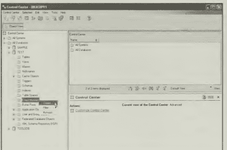

图 5–1：从控制中心调用“创建事件监控器”对话框。

# 数据库系统监控 371


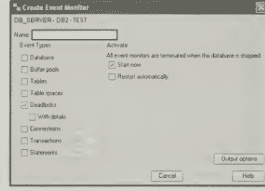

图 5-2：创建事件监控器对话框。

DB_SERVER-DB2-TEST

事件类型：激活

数据库停止时所有事件监控器将终止

数据库 [ ] 现在启动

缓冲池 [ ] 自动重启

表 [ ]

表空间 [ ]

死锁 [ ]

详细 [ ]

连接 [ ]

事务 [ ]

语句 [ ]

输出选项

取消 帮助

只有具有系统管理员 (`SYSADM`) 权限、系统控制 (`SYSCTRL`) 权限、系统维护 (`SYSMAINT`) 权限或数据库管理员 (`DBADM`) 权限的用户才被允许创建和使用事件监控器。

需要注意的是，由于事件监控器是由必须持有相应权限的用户创建的特殊数据库对象，因此只能用于收集其定义所在数据库的信息；事件监控器不能用于在 DB2 数据库管理器实例级别收集信息。

# 激活和禁用事件监控器

与快照监控器一样，一旦与其关联的数据库激活或建立了连接，事件监控器将开始收集监控数据——前提是在创建事件监控器时指定了 `AUTOSTART` 选项。如果使用的是 `MANUALSTART` 选项，或者既未指定任何选项（在这种情况下默认使用 `MANUALSTART` 选项），则在事件监控器开始收集数据之前必须激活。通过执行 `SET EVENT` SQL 语句可以激活（禁用）事件监控器。该语句的基本语法为：

## 第 5 章：分析 DB2 活动

```
SET EVENT MONITOR [EventMonName]
STATE <=> [MonitorState]:
```

其中：

- *EventMonName* 标识要更改状态的事件监控器的名称。
- *MonitorState* 标识事件监控器要放置的状态。如果需要激活事件监控器（即置于活动状态），必须为此参数指定值 1；如果需要禁用事件监控器（即置于非活动状态），必须为此参数指定值 0。

因此，如果您想激活一个使用 `MANUALSTART` 选项创建的名为 `CONN_EVENTS` 的事件监控器，可以通过执行类似下面的 `SET EVENT MONITOR` 语句来实现：

```
SET EVENT MONITOR conn_events STATE 1
```

另一方面，如果您想禁用 `CONN_EVENTS` 事件监控器，可以通过执行类似下面的 `SET EVENT MONITOR` 语句来实现：

```
SET EVENT MONITOR conn_events STATE 0
```

还可以通过突出显示控制中心显示的相应事件监控器名称并在“事件监控器”菜单中选择适当的操作来激活和禁用事件监控器。图 5–3 显示了激活（启动）事件监控器必须选择的控制中心菜单项；图 5–4 显示了禁用（停止）事件监控器的控制中心菜单项。

# 数据库系统监控 373

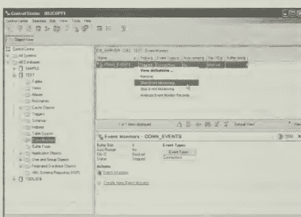

图 5-3：从控制中心启动事件监控器。

图 5-4：从控制中心停止事件监控器。

## 第 5 章：分析 DB2 活动

当事件监控器激活（启动）时，它会在后台静静运行并等待与其关联的事件发生。与快照监控器不同，它会收集数据。虽然对数据库定义的事件监控器数量没有限制，但同一时间最多可以激活 32 个事件监控器。

# 强制事件监控器生成输出

由于某些事件的发生频率较低，可能需要强制事件监控器收集数据并写入目标位置。在这种情况下，您可以通过执行 `FLUSH EVENT MONITOR` 语句让事件监控器提前收集信息。该语句的基本语法为：

```
FLUSH EVENT MONITOR [EventMonName] <BUFFER>
```

其中：

- `EventMonName` 标识要强制收集数据的事件监控器的名称。

默认情况下，提前写入事件监控器目标位置的记录会被记录在事件监控器并分配一个“部分记录”标识符。然而，如果在执行 `FLUSH EVENT MONITOR` 语句时指定了 `BUFFER` ，只有事件监控器活动缓冲区中的数据会被写入事件监控器的目标位置；不会生成部分记录。

因此，如果您想强制名为 `CONN_EVENTS` 的事件监控器立即收集数据并将其写入其目标位置，可以通过执行类似下面的 `FLUSH EVENT MONITOR` 语句来实现：

```
FLUSH EVENT MONITOR conn_events
```

需要注意的是，当对事件监控器进行刷新（flush）时，计数器不会重置。这意味着，如果没有使用 `FLUSH EVENT MONITOR` 语句强制写入事件监控器数据，原本应生成的事件监控器记录在监控器正常触发时仍会生成。

# 删除事件监控器

由于您可能需要创建事件监控器，当不再需要时也可能想要删除现有的事件监控器。可以通过执行 `DROP` SQL 语句的特殊形式从数据库删除删除定义的事件监控器。该形式的基本语法为：

```
DROP EVENT MONITOR [MonitorName]
```

其中：

- `MonitorName` 标识要删除的事件监控器的名称。

因此，如果您想删除一个名为 `CONN_EVENTS` 且位于 `CORP` 模式下的事件监控器，可以通过执行类似下面的 `DROP` SQL 语句来实现：

```
DROP EVENT MONITOR corp.conn_events
```

还可以通过在控制中心突出显示相应的对象并在任何找到的对象菜单中选择适当的操作来删除事件监控器。图 5–5 显示了删除事件监控器（在本例中为名为 `CONN_EVENTS` 的事件监控器）必须选择的控制中心菜单项。

# 376 第 5 章：分析 DB2 活动

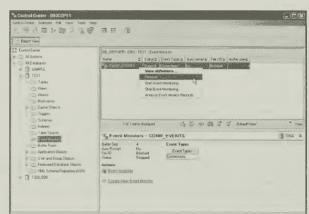

图 5–5：从控制中心删除事件监控器。

需要注意的是，激活状态的事件监控器无法删除；在删除事件监控器之前，必须将其去激活（停止）。

## 查看事件监控器数据

事件监控器收集的数据可以通过两种方式进行查看：使用名为事件分析器（Event Analyzer）的特殊工具，或使用事件监控器效率工具（Event Monitor Productivity Tool）。事件分析器是一个图形用户界面（GUI）工具，可以通过在控制中心突出显示所需的事件监控器，并在事件监控器（Event Monitors）菜单中选择相应的操作来激活。图 5–6 显示了激活事件分析器工具必须选择的控制中心菜单项；图 5–7 显示了在事件监控器激活两个不同的监控会话后，事件分析器的“监控期间”（Monitored Periods）视图可能的样子。

# 数据库系统监控器 377

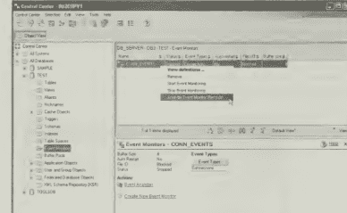

图 5-6：从控制中心启动事件分析器。

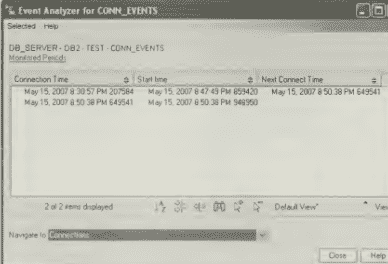

图 5-7：事件分析器工具。

# 378 第 5 章：分析 DB2 活动

激活事件分析器后，你可以通过从“钻取”（Drill down to）菜单中选择相应的事件，来查看/分析为每个被监控的事件捕获的信息，该菜单可以通过事件分析器主菜单中的“已选项目”（Selected item）显示。图 5–8 显示了如何使用“钻取”菜单钻取为在一个或多个监控期间发生的连接事件收集的监控数据；图 5–9 显示了事件分析器将显示所有检测到的连接事件。

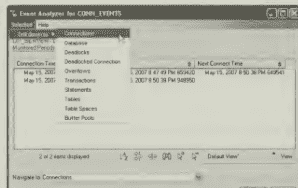

图 5–8：钻取到特定的监控事件。

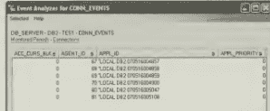

图 5–9：事件分析器工具的连接事件视图。

# 数据库系统监控器 379

遗憾的是，事件分析器只能用于查看收集并存储在数据库表中的事件监控器数据。要查看写入文件和命名管道的事件监控器数据，必须使用事件监控器效率工具。与事件分析器不同，事件监控器效率工具是一个基于文本的工具，用于从事件监控器数据文件或命名管道中检索信息并生成格式化报告。（事件文件和命名管道包含逻辑数据本身的二进制流，在显示之前必须对其进行格式化处理。）事件监控器效率工具通过执行 `db2evmon` 命令来激活。该命令的基本语法为：

```
db2evmon -db [DatabaseAlias] -evm [EventMonName]
```

或

```
db2evmon -path [EventMonTarget]
```

其中：

- `DatabaseAlias`：标识分配给数据库的别名，该数据库定义了要显示数据的事件监控器。
- `EventMonName`：标识分配给要显示数据的事件监控器的名称。
- `EventMonTarget`：标识由事件监控器收集的数据的存储位置（目录或命名管道）。

因此，如果你想格式化并显示由名为 `CONN_EVENTS` 的位于名为 `SAMPLE` 的数据库中的事件监控器收集的所有数据，可以通过执行如下所示的 `db2evmon` 命令语句来实现：


```
db2evmon -db sample -evm conn_events
```

假设事件监控器 `CONN_EVENTS` 是使用以下 `CREATE EVENT MONITOR` 语句创建的：

```
CREATE EVENT MONITOR conn_events
FOR CONNECTIONS
WRITE TO FILE 'C:\MONDATA'
```

# 第 5 章：分析 DB2 活动

假设事件监控器在创建后立即被激活，并且在事件监控器激活后建立了一个到数据库的连接，那么命令

`db2evmon -db sample -evm conn_events`

返回的输出开头应该如下所示：

```
Reading C:\MONDATA\0000000.EVT ...

EVENT LOG HEADER
Event Monitor name: CONN_EVENTS
Server Product ID: SQL09010
Version of event monitor data: 8
Byte order: LITTLE ENDIAN
Number of nodes in db2 instance: 1
Codepage of database: 1208
Territory code of database: 1
Server instance name: DB2
```

```
Database Name: TEST
Database Path: C:\DB2\NODE0000\SQL00003\
First connection timestamp: 05/17/2007 16:15:41.818326
Event Monitor Start time: 05/17/2007 16:20:49.434330
```

```
3) Connection Header Event...
Appl Handle: 11
Appl ID: "LOCAL.DB2.07051739
Appl Seq number: 00004
Correlation Token: "LOCAL.DB2.07051739
Program Name : db2bp.exe
Authorization ID : rsanders
Codepage : 1252
Territory code: 1
Client Process ID: 2028
Client Database Alias: TEST
Client Product ID: SQL09010
Client Platform: Unknown
Client Communication Protocol: Local
Client Network Name: rsanders-lxp
Connect timestamp: 41.81326
Id : rsanders
```

# 健康监控器和健康中心 381

## 健康监控器和健康中心

除了快照监控和事件监控器外，DB2 还提供了两个额外的工具来帮助监控系统：健康监控器和健康中心。这些工具共同提供了异常管理能力，使管理员能够在问题发生之前进行解决。

健康监控器是一个服务端工具，持续监控实例的健康状况，无需用户交互。相反，健康监控器使用多个健康指标来评估性能。健康指标是健康监控器持续检查以判断对象是否运行正常的系统特征；每个健康指标都有相应的阈值，健康监控器会将系统状态与这些阈值进行比较。如果健康监控器发现超出阈值（例如，日志空间不足），或检测到对象的异常状态（例如，实例宕机），它将自动告警。

在大多数情况下，为健康指标提供的阈值定义了三种运行状态的边界：正常（注意）、警告和告警。因此，可以产生三种类型的告警；无论什么级别，告警发生时都会发生三件事：

- 告警信息记录在日志中。（所有告警都会写入日志。）
- 告警通知可以通过电子邮件或传机地址发送给负责系统的人。
- 可以采取一个或多个预定义的操作。（例如，运行任务。）

接下来，健康中心是一个与健康监控器交互的 GUI 工具。使用健康中心，你可以选择想要监控的实例和数据库对象，自定义任何健康指标的阈值设置，指定通知的发送位置，并指定告警发生时采取的操作。健康中心还允许你启动和停止健康监控器，查看数据库环境的当前状态，访问当前告警的详细信息，获取解决已告警的建议操作列表，并查看实例或数据库生成的告警历史。与其他 GUI 工具一样，可以通过控制中心工具菜单中选择相应的操作来激活健康中心。图 5–10 显示了激活健康中心必须选择的控制中心菜单项；图 5–11 显示了健康中心在 Windows XP 系统上首次激活时的样子。

## 健康监视器与健康中心 383


图 5–11：健康中心。

使用健康中心执行的最常见任务之一是对事件监控器（Event Monitor）评估的健康指标进行阈值设置自定义。阈值的自定义是通过激活健康指标配置启动器（Health Indicator Configuration Launchpad）、选择所需的级别（实例、全局或对象）、选择所需的健康指标变量，并在显示“配置健康指标”（Configure Health Indicator）对话框时更改该变量的健康指标设置完成的。图 5–12 显示了激活健康指标必须选择的健康中心菜单项。


图 5–12：激活健康指标配置启动器。

## 384 第5章：分析 DB2 活动

启动器首次激活时的外观；图 5–14 显示了配置启动器的实例级健康指标列表和当前设置；图 5–15 显示了当为特定的健康指标变量激活时，“配置健康指标”对话框的界面。

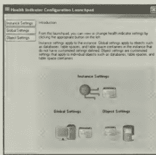

图 5–13：健康指标配置启动器。

在实例级别进行的更改适用于整个实例，而在全局级别和对象级别进行的更改仅适用于数据库、表空间和表空间容器。在对象级别进行的更改将覆盖全局级别进行的更改；全局级别进行的更改将覆盖实例级别进行的更改。

## 健康监视器与健康中心 385

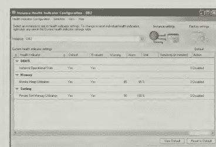

图 5–14：实例健康指标配置对话框。

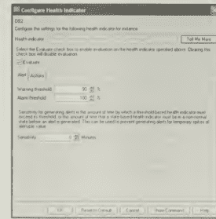

图 5–15：配置健康指标对话框。

## 使用 Explain 功能监控 SQL

当 SQL 语句提交给 DB2 数据库引擎进行处理时，它会被 DB2 优化器分析，以生成所谓的访问计划（access plan）。每个访问计划都包含有关执行该语句将使用的策略的详细信息（例如：将使用哪些索引；是否需要排序方法；需要哪些锁以及将使用哪些连接方法）。如果 SQL 语句是在应用程序中编写的，访问计划将在预编译时生成（或在绑定时使用延迟绑定），并生成的可执行形式的访问计划将存储在系统目录中，用作为一个名为“包”（package）的对象。然而，如果语句是提交给命令行处理器（Command Line Processor），或者该语句是应用程序中的动态 SQL 语句（即在应用程序运行期间构造的 SQL 语句），则访问计划将在语句准备执行时生成，生成的访问计划将临时存储在内存中（全局包缓存中），而不是系统目录中。

虽然数据库系统监视器和健康监视器可以获取有关某些 SQL 操作性能良好（或糟糕）的信息，但它们不能用于分析 SQL 语句是如何被优化的。要进行此类分析，你必须能够捕获并查看存储在 SQL 语句访问计划中的信息，这就是 DB2 Explain 功能（Explain Facility）用用场。

Explain 功能允许你捕获并查看为特定 SQL 语句选择的访问计划的详细信息，其性能信息可以帮助识别编写糟糕的语句或数据库设计的弱点。具体而言，Explain 数据帮助你理解 DB2 数据库管理器如何访问表和索引以满足查询。Explain 数据还可用于评估所采取任何性能调优操作的结果。事实上，每当你更改 DB2 数据库管理器、SQL 语句或与 SQL 语句交互的数据库的某某方面时，你都应该收集并检查 Explain 数据，以找出你的更改对性能产生了何种影响。

### Explain 表

在捕获 Explain 信息之前，必须创建一个特殊的表集，称为 Explain 表。使用的每个 Explain 表及其设计用于包含的信息可以在表 5.5 中。

| 表 5.5 Explain 表 | |

| :--- | --- |

| 表名 ARGUMENT | 内容 |

| EXPLAIN_ARGUMENT | 包含所使用的每个单独算符的唯一特征（如果有）。 |

| EXPLAIN_INSTANCE | 包含有关所解释的 SQL 语句源的基本信息，以及有关解释发生环境的信息。（EXPLAIN_INSTANCE 表是所有 Explain 信息的主控制表。其他 Explain 表中的每行数据都显式链接到此表中的唯一行。） |

| EXPLAIN_OBJECT | 包含有关 SQL 语句生成的访问计划所需的数据对象的信息。 |


| `EXPLAIN_OPERATOR` | 包含 SQL 编译器满足 SQL 语句所需的所有算符。 |

| `EXPLAIN_PREDICATE` | 包含标识特定算符应用了谓词的信息。 |

| `EXPLAIN_STATEMENT` | 包含存在不同级别 Explain 信息的 SQL 语句文本。后者的版本可能与原始语句相似，因为它可能被 SQL 优化器重写或增强了谓词。 |

| `EXPLAIN_STREAM` | 包含算符和数据对象之间的数据流信息。 |

通常，Explain 表用于开发数据库以辅助设计，而不是生产数据库，那里应用程序代码是静态的。因此，它们不会作为系统目录的一部分一起创建。相反，必须手动创建。坦率地说，创建 Explain 表的过程非常：使用命令行处理器连接到相应的数据库并执行名为 `EXPLAIN.DDL` 的脚本，该脚本位于最初安装 DB2 软件的 `sqllib` 目录下。另一方面，如果你尝试从控制中心调用 Explain 功能，而与你交互的数据库尚未创建 Explain 表，它们将自动为你创建。

### 388 第5章：分析 DB2 活动

## 收集 Explain 数据

Explain 功能由多个单独工具组成，并非所有工具都需要相同的 Explain 数据。因此，可以收集两种不同的 Explain 数据：

**全面 Explain 数据**。包含 SQL 语句访问计划的详细信息。这些信息存储在多个 Explain 表中。

**Explain 快照数据**。包含 SQL 语句的当前内部表示以及相关信息。这些信息存储在 `EXPLAIN_STATEMENT` Explain 表的 `SNAPSHOT` 列中。

正如你想象的，有多种方法可以收集这两种类型的 Explain 数据。收集 Explain 数据的方法包括：

- 执行 SQL 语句

- 设置 `CURRENT EXPLAIN MODE` 特殊寄存器

- 设置 `CURRENT EXPLAIN SNAPSHOT` 特殊寄存器

- 在 `PRECOMPILE` 或 `BIND` 命令中使用 `EXPLAIN` 绑定选项

- 在 `PRECOMPILE` 或 `BIND` 命令中使用 `EXSNAP` 绑定选项

## EXPLAIN SQL 语句

为单个动态 SQL 语句收集全面 Explain 信息和 Explain 快照数据的一种方法是执行 `EXPLAIN SQL` 语句。该语句的基本语法如下：

```
EXPLAIN [ALL | PLAN | PLAN SELECTION
< SNAPSHOT | WITH SNAPSHOT>
FOR [SQLStatement]
```

其中：

`SQLStatement` 指定了要收集 Explain 数据或 Explain 快照数据的 SQL 语句。（指定的语句必须是有效的 `INSERT`、`UPDATE`、`DELETE`、`SELECT`、`SELECT INTO`、`VALUES` 或 `VALUES INTO` SQL 语句。）

如果在 `EX` 语句中指定了 `FOR SNAPSHOT` 选项，则仅会为指定的动态 SQL 语句收集 Explain 快照信息。另一方面，如果指定的是 `WITH SNAPSHOT` 选项，则会为指定的动态 SQL 语句收集全面的 Explain 信息和 Explain 快照数据。然而，如果两个选项都没有使用，则只将收集全面的 Explain 数据；不会产生 Explain 快照数据。

因此，如果你只想为 SQL 语句 `"SELECT * FROM department"` 收集全面的 Explain 数据，可以通过执行类似这样的 EXPLAIN 语句来实现：

```
EXPLAIN ALL FOR SELECT * FROM department
```

另一方面，如果你想为同一个 SQL 语句仅收集 Explain 快照数据，可以通过执行类似这样的 EXPLAIN 语句来实现：

```
EXPLAIN ALL FOR SNAPSHOT FOR SELECT * FROM department
```

最后，如果你想为 SQL 语句 `"SELECT * FROM department"` 同时收集全面的 Explain 数据和 Explain 快照信息，可以通过执行类似这样的 EXPLAIN 语句来实现：

```
EXPLAIN ALL WITH SNAPSHOT FOR SELECT * FROM department
```

需要注意的是，`EXPLAIN` 语句不会执行指定的 SQL 语句，也不会显示收集到的 Explain 信息——必须使用其他 Explain Facility（解释设施）工具来查看收集的信息。（我们将很快介绍这些工具。）

## CURRENT EXPLAIN MODE 和 CURRENT EXPLAIN SNAPSHOT 特殊寄存器

虽然 `EXPLAIN SQL` 语句在为单个动态 SQL 语句收集 Explain 和/或 Explain 快照信息时，但如果需要分析大量的 SQL 语句，使用它可能会非常耗时。为多个动态 SQL 语句收集相同信息的更好方法是在一组动态 SQL 语句执行之前，设置一个或两个特殊的 Explain Facility 寄存器。然后，当语句准备执行时，会为每个处理的语句收集 Explain 或 Explain 快照信息。语句本身可能会执行，也可能不执行。

以这种方式使用的两个 Explain Facility 特殊寄存器是 `CURRENT EXPLAIN MODE` 特殊寄存器和 `CURRENT EXPLAIN SNAPSHOT` 特殊寄存器。`CURRENT EXPLAIN MODE` 特殊寄存器使用 `SET CURRENT EXPLAIN MODE` SQL 语句设置，而 `CURRENT EXPLAIN SNAPSHOT` 特殊寄存器则使用 `SET CURRENT EXPLAIN SNAPSHOT` SQL 语句设置。`SET CURRENT EXPLAIN MODE` 语句的基本语法为：

```
SET CURRENT EXPLAIN MODE <> [YES | NO | EXPLAIN]
```

`SET CURRENT EXPLAIN SNAPSHOT` 语句的基本语法为：

```
SET CURRENT EXPLAIN SNAPSHOT <> [YES | NO | EXPLAIN]
```

正如你所想象的，如果 `CURRENT EXPLAIN MODE` 和 `CURRENT EXPLAIN SNAPSHOT` 特殊寄存器设置为 `NO`，则禁用 Explain Facility，不会捕捉任何 Explain 数据。另一方面，如果将任一特殊寄存器设置为 `EXPLAIN`，则激活 Explain Facility，并且每当一个动态 SQL 语句准备执行时，都会收集全面的 Explain 信息或 Explain 快照数据（如果特殊寄存器都已设置，则两者都收集）。然而，语句本身不会执行。如果任一寄存器设置为 `YES`，其行为与相应寄存器设置为 `EXPLAIN` 时相同，但有一个显著区别：一旦收集了相应的 Explain/Explain 快照数据，就会立即对动态 SQL 语句收集 Explain 信息。表 5.6 总结了每个 Explain 特殊寄存器设置对 Explain Facility 和动态 SQL 语句处理的影响。

使用 Explain Facility 监控 SQL 391

表 5.6 Explain Facility 特殊寄存器设置交互

| NO | YES | EXPLAIN |

| --- | --- | --- |

| NO | - Explain Facility 已禁用。<br>- 不捕捉任何 Explain 数据。<br>- 动态 SQL 语句执行。 | - Explain Facility 已启用。<br>- 收集全面的 Explain 数据并写入 Explain 表中。<br>- 动态 SQL 语句执行。 | - Explain Facility 已启用。<br>- 收集全面的 Explain 数据并写入 Explain 表中。<br>- 动态 SQL 语句执行。 |

| NO | - Explain Facility 已启用。<br>- 收集 Explain 快照数据并写入 `EXPLAIN_STATEMENT` 表的 `SNAPSHOT` 列中。<br>- 动态 SQL 语句执行。 | - Explain Facility 已启用。<br>- 收集全面的 Explain 数据并写入 Explain 表中。<br>- 收集 Explain 快照数据并写入 `EXPLAIN_STATEMENT` 表的 `SNAPSHOT` 列中。<br>- 动态 SQL 语句不执行。 | - Explain Facility 已启用。<br>- 收集全面的 Explain 数据并写入 Explain 表中。<br>- 收集 Explain 快照数据并写入 `EXPLAIN_STATEMENT` 表的 `SNAPSHOT` 列中。<br>- 动态 SQL 语句不执行。 |


| EXPLAIN | - Explain Facility 已启用。<br>- 收集 Explain 快照数据并写入 `EXPLAIN_STATEMENT` 表的 `SNAPSHOT` 列中。<br>- 动态 SQL 语句不执行。 | - Explain Facility 已启用。<br>- 收集全面的 Explain 数据并写入 Explain 表中。<br>- 收集 Explain 快照数据并写入 `EXPLAIN_STATEMENT` 表的 `SNAPSHOT` 列中。<br>- 动态 SQL 语句不执行。 | - Explain Facility 已启用。<br>- 收集全面的 Explain 数据并写入 Explain 表中。<br>- 收集 Explain 快照数据并写入 `EXPLAIN_STATEMENT` 表的 `SNAPSHOT` 列中。<br>- 动态 SQL 语句不执行。 |

改编自 DB2 9 SQL Reference 第 1 卷手册第 821–822 页的表 200。

## EXPLAIN 和 EXPLSNAP 绑定（bind）选项

到为止，我们查看了为动态语句收集全面 Explain 信息和 Explain 快照数据的方法。但通常数据库应用程序也包含需要分析的静态 SQL 语句。那么，如何使用 Explain Facility 分析静态 SQL 语句呢？为了为嵌入 SQL 应用程序中的静态和动态 SQL 语句收集全面的 Explain 信息和/或 Explain 快照数据，你必须使用 `EXPLAIN` 和 `EXPLSNAP` 绑定选项。

`EXPLAIN` 选项用于控制是否为嵌入 SQL 应用程序中的 SQL 语句收集全面的 Explain 数据；`EXPLSNAP` 选项控制是否收集 Explain 快照数据。这些选项中的一个或两个都可以作为包含嵌入 SQL 语句的源代码文件的 `PRECOMPILE` 命令的一部分——如果使用延迟绑定，这些选项可以在将嵌入 SQL 应用程序的绑定文件绑定到数据库的 `BIND` 命令提供。

`EXPLAIN` 选项和 `EXPLSNAP` 选项都可以分配 `NO`、`YES` 或 `ALL` 值。如果两个选项都赋值为 `NO`（例如 `EXPLAIN NO EXPLSNAP NO`），则 Explain Facility 已禁用，不会捕捉任何 Explain 数据。另一方面，如果任一选项赋值为 `YES`，则激活 Explain Facility，并对源文件中遇到的每个静态 SQL 语句收集全面的 Explain 信息或 Explain 快照数据（如果两个选项都设置为 `YES`）；动态 SQL 语句将被忽略。如果任一选项被赋值为 `ALL`，则激活 Explain Facility，并对找到的每个静态和动态 SQL 语句收集全面的 Explain 信息或 Explain 快照数据（如果两个选项都已设置），即使 `CURRENT EXPLAIN MODE` 或 `CURRENT EXPLAIN SNAPSHOT` 特殊寄存器设置为 `NO` 也是如此。

### 表 5.7 EXPLAIN Bind 选项与 EXPLAIN MODE 特殊寄存器的交互

| NO | YES | ALL |
|---|---|---|

| NO | - 解释功能已禁用。<br>- 未捕获任何 Explain 数据。 | - 解释功能已启用。<br>-针对静态 SQL 语句收集了全面的 Explain 数据并将其写入 Explain 表。 | - 解释功能已启用。<br>-针对静态和动态 SQL 语句均收集了全面的 Explain 数据并将其写入 Explain 表。 |

| YES | - 解释功能已启用。<br>-针对动态 SQL 语句收集了全面的 Explain 数据并将其写入 Explain 表。 | - 解释功能已启用。<br>-针对静态和动态 SQL 语句均收集了全面的 Explain 数据并将其写入 Explain 表。 | - 解释功能已启用。<br>-针对静态和动态 SQL 语句均收集了全面的 Explain 数据并将其写入 Explain 表。 |

| EXPLAIN | - 解释功能已启用。<br>-针对动态 SQL 语句收集了全面的 Explain 数据并将其写入 Explain 表。<br>-不执行动态 SQL 语句。 | - 解释功能已启用。<br>-针对静态和动态 SQL 语句均收集了全面的 Explain 数据并将其写入 Explain 表。<br>-不执行动态 SQL 语句。 | - 解释功能已启用。<br>-针对静态和动态 SQL 语句均收集了全面的 Explain 数据并将其写入 Explain 表。<br>-不执行动态 SQL 语句。 |

改编自 DB2 9 SQL 参考手册卷 1 第 823–824 页的表 201。

## 评估 Explain 数据

到为止，我们一直关注收集全面 Explain 和 Explain 快照数据的各种方法。我们还看到，一旦收集完成，这些数据就会存储在一个或多个 Explain 表中。我们可以构建查询来检索已收集的数据，但查看 Explain 信息的更好方法是使用专门为以有意义格式展示 Explain 信息而设计的解释功能工具之一。这套工具包括：

### 第 5 章：分析 DB2 活动

### 表 5.8 EXPLAIN SNAP Bind 选项与 EXPLAIN MODE 特殊寄存器的交互

| NO | YES | ALL |
| --- | :--- | :--- |

| NO | - 解释功能已禁用。<br>- 未捕获任何 Explain 数据。 | - 解释功能已启用。<br>-针对静态 SQL 语句收集了 Explain 快照数据并将其写入 `EXPLAIN_STATEMENT` 表的 `SNAPSHOT` 列。 | - 解释功能已启用。<br>-针对静态和动态 SQL 语句均收集了 Explain 快照数据并将其写入 `EXPLAIN_STATEMENT` 表的 `SNAPSHOT` 列。 |

| YES | - 解释功能已启用。<br>-针对动态 SQL 语句收集了 Explain 快照数据并将其写入 `EXPLAIN_STATEMENT` 表的 `SNAPSHOT` 列。 | - 解释功能已启用。<br>-针对静态和动态 SQL 语句均收集了 Explain 快照数据并将其写入 `EXPLAIN_STATEMENT` 表的 `SNAPSHOT` 列。 | - 解释功能已启用。<br>-针对静态和动态 SQL 语句均收集了 Explain 快照数据并将其写入 `EXPLAIN_STATEMENT` 表的 `SNAPSHOT` 列。 |

| EXPLAIN | - 解释功能已启用。<br>-针对动态 SQL 语句收集了 Explain 快照数据并将其写入 `EXPLAIN_STATEMENT` 表的 `SNAPSHOT` 列。<br>-不执行动态 SQL 语句。 | - 解释功能已启用。<br>-针对静态和动态 SQL 语句均收集了 Explain 快照数据并将其写入 `EXPLAIN_STATEMENT` 表的 `SNAPSHOT` 列。<br>-不执行动态 SQL 语句。 | - 解释功能已启用。<br>-针对静态和动态 SQL 语句均收集了 Explain 快照数据并将其写入 `EXPLAIN_STATEMENT` 表的 `SNAPSHOT` 列。<br>-不执行动态 SQL 语句。 |

改编自 DB2 9 SQL 参考手册卷 1 第 824-825 页的表 202。

- `db2explain` 工具
- `db2exfmt` 工具
- 可视化解释 (`Visual Explain`)

### db2explin

之前我们看到，当包含嵌入 SQL 语句的源文件绑定到数据库（作为预编译过程的一部分或延迟绑定）时，DB2 优化器会分析遇到的每个静态 SQL 语句并生成相应的访问计划，然后该计划以包的形式存储在数据库中。给定数据库名称、包名称、包创建者 ID 和节号（如果指定节号为 0，则将处理包的所有节），`db2explin` 工具将解释并描述存储在数据库系统目录中的任何包的访问计划信息。由于由于 `db2explin` 工具直接处理包，而不是处理全面的 Explain 或 Explain 快照数据，因此它通常用于生成未捕获 Explain 数据的包的访问计划信息。然而，由于 `db2explin` 工具只能访问存储在包中的信息，因此它只能描述最终选定访问计划的实现；无法提供有关特定 SQL 语句如何优化的信息。

`db2explin` 工具还可以用于解释——并可选地生成 DB2 优化器为动态 SQL 语句选择的访问计划图。例如，假设你想查看优化器为 `SELECT * FROM department` 查询将选择的访问计划。你可以通过执行类似下面的 `db2explin` 命令来实现：

```
db2explin -d sample -t -g -statement "SELECT * FROM department"
```

如果你使用 DB2 提供的 `SAMPLE` 数据库执行此命令，你将看到如下所示的报告：


```
DB2 Universal Database Version 9.1, 5622-044 (c) Copyright IBM
Corp. 1991, 2006
Licensed Material - Program Property of IBM
IBM DB2 Universal Database SQL and XQUERY Explain Tool
****************************** DYNAMIC ******************\*
========================== STATEMENT ==================
Isolation Level = Cursor Stability
Blocking = Block Unambiguous Cursors
Query Optimization Class = 5
```

`Partition Parallel` = No

`Intra-Partition Parallel` = No

`SQL Path` = "SYSIBM", "SYSFUN", "SYSPROC", "SYSIBMADM", "RSANDERS"

Statement:

```
SELECT * FROM department
Section Code Page = 1252
Estimated Cost = 7.593699
Estimated Cardinality = 14.000000
```

```
Access Table Name = RSANDERS.DEPARTMENT ID = 2,5
| #Columns = 5
| Relation Scan
| Prefetch: Eligible
| Lock Intents
| Table: Intent Share
| Row : Next Key Share
| Sargable Predicate(s)
| Return Data to Application
| | #Columns = 5
Return Data Completion
```

End of section

Optimizer Plan:

```
RETURN
( 1)
|
TBSCAN
( 2)
|
```

Table:

`RSANDERS`

## db2exfmt

与 `db2explain` 工具不同，`db2exfmt` 工具旨在直接处理收集并存储在 Explain 表中的全面 Explain 或 Explain 快照数据。给定数据库名称和其他限定信息，`db2exfmt` 工具将查询 Explain 表获取信息，格式化结果，并生成可以直接显示在终端上或写入 ASCII 格式文件的文本报告。

## 使用解释功能监控 SQL

例如，如果你想生成一个包含 DB2 SAMPLE 数据库中收集并存储的所有 Explain 数据的详细报告，可以通过执行类似下面的 `db2exfmt` 命令来实现：

```
db2exfmt -d sample -1 -o F:/db2exfmt.out
```

执行此命令时，将生成报告并写入名为 `db2exfmt.out` 的文件（位于 `F:` 盘），你将看到如下所示的消息：

```
DB2 Universal Database Version 9.1, 5622-044 (c) Copyright IBM
Corp. 1991, 2006
Licensed Material - Program Property of IBM
IBM DB2 Universal Database Explain Table Tool
Connecting to the Database.
Connect to Database Successful.
Output is in F:/db2exfmt.out.
Executing Connect Reset -- Connect Reset was Successful.
```

创建的文件 (`db2exfmt.out`) 开始可能如下：

```
DB2 Universal Database Version 9.1, 5622-044 (c) Copyright IBM
Corp. 1991, 2006
Licensed Material - Program Property of IBM
IBM DATABASE 2 Explain Table Tool
*************************** EXPLAIN INSTANCE ***********
DB2_VERSION:        09.01.0
SOURCE_NAME:        SYSH200
SOURCE_SCHEMA:      NULL
SOURCE_VERSION:
EXPLAIN_TIME:       2007-05-17-16.40.32.188000
EXPLAIN_REQUESTER:  RSANDERS
Database Context:
-----------------------------------------------------------
```

平均应用程序数：1

可用锁数：935

包上下文：

nSQL 类型：动态

优化级别：5

阻塞：阻塞所有游标

隔离级别：游标稳定性 (`Cursor Stability`)

## 可视化解释

可视化解释是一种 GUI 工具，它为数据库管理员和应用程序开发人员提供了查看特定 SQL 语句所选访问计划的图形化表示的能力。此外，视化解释还允许你执行以下操作：

- 查看用于优化 SQL 语句的数据库统计信息。
- 判断是否使用了索引来访问表数据。（如果没有使用索引，Visual Explain 可以帮助你确定哪些列可能从索引中受益。）
- 通过允许进行“之前”和“之后”对比，查看性能调优的效果。
- 获取访问计划执行的每个操作的详细信息，包括每个操作的估算成本。

然而，Visual Explain 仅用于查看 Explain 快照数据（snapshot data）；要查看已收集并写入 Explain 表的 Explain 数据，必须使用 `db2exfmt` 工具。

### 激活可视化解释

激活可视化解释的较常用方法之一是使用解释查询语句对话框为动态 SQL 语句生成 Explain 数据。（另一种方法是从“解释语句历史”对话框中选择已生成了 Explain 数据的查询。）图 15–16 显示了必须选择的 Control Center 菜单项以便激活解释查询语句对话框；图 5–17 显示了当解释查询语句对话框填充了简单查询后可能的样子。

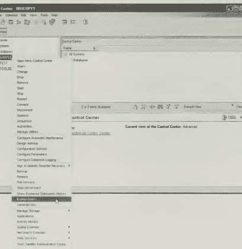

图 5–16：从 Control Center 调用解释查询对话框。

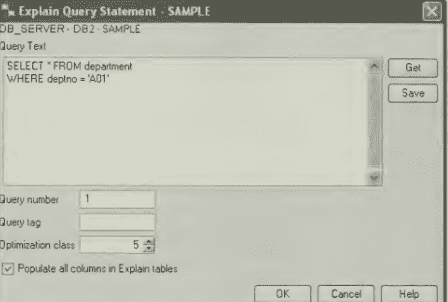

图 5-17：解释查询语句对话框。

打开解释查询语句对话框后，可以将任何动态 SQL 语句输入到“查询文本”输入字段中。然后，当选择对话框底部的“确定”按钮时，将为指定的 SQL 语句收集 Explain 快照数据。在所有处理完成后，控制权将转移到 Visual Explain 的访问计划图对话框，在那里将呈现为指定 SQL 语句所选访问计划的图形视图。

图 5-18 显示了 Visual Explain 的访问计划图对话框在首次激活时可能的样子。

## 使用 Explain Facility 监控 SQL

### 访问计划图 - 示例

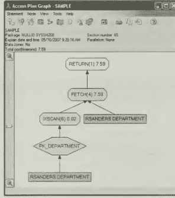

**Visual Explain 输出。** 如图 5–18 所示，Visual Explain 提供的输出由层级图组成，代表处理特定 SQL 语句所选访问计划所需的各种组件。每个组件都表示为一个称为节点的图形对象，并且可以存在两种类型的节点：

- **操作符 (Operator)。** 操作符节点用于识别必须在数据上执行的操作或从表或索引产的输出。
- **操作数 (Operand)。** 操作数节点用于识别执行操作的实体（例如，表将是表扫描操作的操作数）。

通常，操作数节点用于识别表、索引和表队列（当使用分区内并行处理时使用表队列），它们在层级图中用矩形（表）、菱形（索引）和平行四边形（表队列）表示。另一方面，操作符节点用于识别从插入操作到索引扫描的任何内容。操作符节点在层级图中用椭圆表示，指示了如何访问数据、如何连接表以及其他因素，例如是否要执行排序操作。表 5.8 列出了可能出现在访问计划层级图中更常见的操作符。

| 表 5.8 常见操作符 | | |
| --- | --- | --- |
| 定义 | 描述 |
| DELETE | 从表中删除行。 |
| EISCAN | 扫描用户定义的索引以产生减少的行流。 |
| FETCH | 使用特定的记录标识符从表中抓取列。 |
| FILTER | 通过对数据应用一个或多个谓词来过滤数据。 |


| `GRPBY` | 按指定列或函数的公共值对行进行分组，并评估集合函数。 |
| `HSJOIN` | 表示哈希连接，其中两个或多个表在连接列上进行哈希处理。（在决策支持环境中执行的连接的首选方法。） |
| `INSERT` | 向表中插入行。 |
| `IXAND` | 对两个或多个索引扫描的行标识符 (RIDs) 进行 AND 操作。 |
| `IXCAN` | 带有可选的起始/停止条件扫描表的索引，产生有序的行流。 |
| `MSJOIN` | 表示合并连接，其中外部表和内部表都必须处于连接谓词的顺序中。 |
| `NLJOIN` | 表示嵌套循环连接，为外部表的每行访问一次内部表。（在 OLTP 环境中执行的连接的首选方法。） |
| `RETURN` | 将查询的数据结果返回给用户。 |
| `RIDSCAN` | 扫描从一个或多个索引获取的行标识符 (RIDs) 列表。 |
| `SHIP` | 从远程数据库源检索数据。用于联邦系统。 |
| `SORT` | 按指定列的顺序对行进行排序并消除重复项。 |
| `TBSCAN` | 通过直接读取数据页检索行。 |
| `TEMP` | 将数据存储在临时表中（可能多次）。 |
| `TQUEUE` | 在数据库代理之间传输数据。 |
| `UNION` | 连接来自多个表的流。 |
| `UNIQUE` | 消除指定列的重复行。 |
| `UPDATE` | 更新表中的行。 |

箭头说明数据如何从一个节点流向下一个节点，连接层级图中的所有节点，并且 `RETURN` 操作通常结束此路径。图 5–18 显示访问计划的层级图包含三个不同的操作符（`IXSCAN`、`FETCH` 和 `RETURN`）和两个不同的操作数（名为 `DEPARTMENT` 的表和名为 `PK_DEPARTMENT` 的索引）。

层级图中显示的每个操作符的详细信息也是可用的，可以通过悬停在任何操作符上、右键点击鼠标并从弹出菜单中选择“显示详细信息”get。图 5–19 显示了查看特定节点详细信息必须选择的菜单项；图 5–20 显示了操作详细对话框在激活后可能的样子。


图 5–19：从 Visual Explain 调用操作详细对话框。

## 402 第5章：分析 DB2 活动


同样，访问计划层级图中显示的每个操作数都有用于选择所选访问计划的表或索引统计信息。这些信息可以通过悬停在任何操作数上、右键点击鼠标并从显示的菜单中选择“显示统计信息”来。图 5–21 显示了查看特定操作数详细信息必须选择的菜单项；图 5–22 显示了表/索引统计对话框在激活后可能的样子。

## 使用 Explain Facility监控 SQL 405


图 5-21：从 Visual Explain 调用表/索引统计对话框。


图 5-22：表/索引统计对话框。

406 第 5 章：分析 DB2 活动

## 关于优化类

当你编译 SQL 或 Xquery 查询时，可以指定一个优化类，该类决定了 DB2 优化器如何为查询选择最高效的访问计划。优化类的区别在于在编译查询时考虑的优化策略的数量和类型。可能的取值范围从 0 到 9；通常情况下，级别越高，优化器在选择优化访问计划时消耗的时间和内存越多，这可能会产生更好的访问计划并提高运行时性能。

`QUERYOPT` 预编译/绑定选项用于指定在准备静态 SQL 语句时使用的优化技术类。如果在应用程序预编译或绑定到数据库时未提供此选项，则使用 `dft_queryopt` 数据库配置参数的当前值作为默认值。`CURRENT QUERY OPTIMIZATION` 特殊寄存器用于控制绑定动态 SQL 语句时使用的优化技术类；可以通过执行 `SET CURRENT OPTIMIZATION` SQL 语句更改该参数的值。该语句的基本语法为：

```
SET CURRENT QUERY OPTIMIZATION <=> [OptimizationLevel]
```

其中：

`OptimizationLevel` 指定在准备动态 SQL 语句时使用的优化级别（类）。此参数必须设置为以下值之一。

- 0 指定在优化器生成访问计划时，使用最少数量的优化技术。此优化类级别最适用于访问索引良好表的简单动态 SQL 语句。
- 1 指定在优化器生成访问计划时，使用的优化技术数量大致等同于 DB2 版本 1 提供的数量。
- 2 指定在优化器生成访问计划时，使用的优化技术数量应高于 DB2 版本 1 提供的数量，但显著少于级别 3 及以上所使用的数量。
- 3 指定在优化器生成访问计划时，使用适数量的优化技术。
- 5 指定在优化器生成访问计划时，使用大量的优化技术。对于复杂查询，将使用启发式规则来限制选择访问计划所花费的时间。只要可能，查询将使用摘要表而不是底层基础表。这是 DB2 使用的默认优化类。
- 7 指定在优化器生成访问计划时，使用大量的优化技术。此级别与级别 5 类似，但没有使用启发式规则来限制为复杂查询选择访问计划的时间。
- 9 指定在优化器生成访问计划时，使用最大数量的优化技术。此类优化类可以大大扩展在选择访问计划之前评估的可能访问路径的数量。因此，此类通常用于处理针对非常大表执行的包含非常复杂且运行时间很长的 SQL 语句。

## 408 第 5 章：分析 DB2 活动

因此，如果你想让 DB2 优化器在为动态 SQL 语句生成访问计划时使用更多通常在默认情况下使用的优化技术，可以通过执行类似这样的 `SET CURRENT QUERY OPTIMIZATION` 语句来实现：

```
SET CURRENT QUERY OPTIMIZATION = 7
```

当 `CURRENT QUERY OPTIMIZATION` 特殊寄存器被赋予新值时，会启用某一类查询重写规则，并为该类中的某些优化变量分配适当的值。这些查询重写规则和优化变量将在准备动态 SQL 语句期间使用，以便为该语句选择最佳访问计划。

值得注意的是，`QUERYOPT` 预编译/绑定可以分配与 `CURRENT QUERY OPTIMIZATION` 特殊寄存器相同的值。

## 其他故障排除工具

除了数据库系统监控器和解释设施（Explain Facility）之外，还有几个工具可以帮助数据库管理员隔离并识别系统、数据库或应用程序的问题。一些较流行的问题确定工具是绑定文件描述工具（Bind File Description tool）、DB2 内存跟踪程序和 DB2 问题确定工具。在本节中，我们将详细查看每一个。

## DB2 绑定文件描述工具

DB2 绑定文件描述工具用于检查和验证绑定文件中的 SQL 语句，并显示创建绑定文件时使用的预编译选项。通过执行 `db2bfd` 命令调用 DB2 绑定文件描述工具。该命令的语法为：

```
db2bfd -b -s -v -h [BindFileName]
```

其中：

`BindFileName` 标识要检索并显示内容的绑定文件。

此命令显示的所有选项均在表 5.8 中。

| 表 5.8 db2bfd 命令选项 |
| :--- | :--- |
| `-b` | 指定显示绑定文件头。 |
| `-s` | 指定绑定文件中的 SQL 语句。 |
| `-v` | 指定绑定文件中的变量声明。 |
| `-h` | 显示帮助信息。当指定此选项时，所有其他选项均被忽略，仅显示帮助信息。 |

因此，如果你想查看名为 `DB29TEST.BND` 的绑定文件的内容，可以通过执行类似下所示 `db2bfd` 命令来实现：

```
db2bfd -b -s -v db29test.bnd
```

当执行此命令时，返回的信息可能如下所示：


`db29test.bnd` Header Contents:
| 字段 | 值 |
|---|---|
| 0x00 | 0x4c |
| 0x04 | 0x80 |
| 0x08 | 0x00 |
| 0x0c | 0x00 |
| 0x10 | 0x00 |
| 0x14 | 0x00 |
| 0x18 | 0x00 |
| 0x1c | 0x00 |
| 0x20 | 0x00 |
| 0x24 | 0x00 |
| 0x28 | 0x00 |
| 0x2c | 0x00 |
| 0x30 | 0x00 |
| 0x34 | 0x00 |
| 0x38 | 0x00 |
| 0x3c | 0x00 |
| 0x40 | 0x00 |
| 0x44 | 0x00 |
| 0x48 | 0x00 |
| 0x4c | 0x00 |
| 0x50 | 0x00 |
| 0x54 | 0x00 |
| 0x58 | 0x00 |
| 0x5c | 0x00 |
| 0x60 | 0x00 |
| 0x64 | 0x00 |
| 0x68 | 0x00 |
| 0x6c | 0x00 |
| 0x70 | 0x00 |
| 0x74 | 0x00 |
| 0x78 | 0x00 |
| 0x7c | 0x00 |
| 0x80 | 0x00 |
| 0x84 | 0x00 |
| 0x88 | 0x00 |
| 0x8c | 0x00 |
| 0x90 | 0x00 |
| 0x94 | 0x00 |
| 0x98 | 0x00 |
| 0x9c | 0x00 |
| 0xa0 | 0x00 |
| 0xa4 | 0x00 |
| 0xa8 | 0x00 |
| 0xac | 0x00 |
| 0xb0 | 0x00 |
| 0xb4 | 0x00 |
| 0xb8 | 0x00 |
| 0xbc | 0x00 |
| 0xc0 | 0x00 |
| 0xc4 | 0x00 |
| 0xc8 | 0x00 |
| 0xcc | 0x00 |
| 0xd0 | 0x00 |
| 0xd4 | 0x00 |
| 0xd8 | 0x00 |
| 0xdc | 0x00 |
| 0xe0 | 0x00 |
| 0xe4 | 0x00 |
| 0xe8 | 0x00 |
| 0xec | 0x00 |
| 0xf0 | 0x00 |
| 0xf4 | 0x00 |
| 0xf8 | 0x00 |
| 0xfc | 0x00 |

## 410 第 5 章：分析 DB2 活动

| 日期 | 时间 | 类型 |
|---|---|---|
| 2007/05/21 | 14:00:38 | 默认 |

## DB2 内存跟踪程序

DB2 内存跟踪程序用于生成实例、数据库和代理的内存大小完整报告。此工具提供了有关内存分配的信息：

* 当前大小
* 最大大小（硬限制）
* 最大大小（水位）
* 类型（将使用内存的标识符）
* 代理分配池（仅当池为私有时）

（这些信息也可以从快照监控器获取。）

DB2 内存跟踪程序通过执行 `db2mtr` 命令调用。该命令的语法为：

```
db2mtrk [-l] [-d] [-p] [-m] [-w] [-v] [-h] [Interval] [Count]
```

其中：

`Interval` 指定后续调用 DB2 内存跟踪程序之间等待的秒数。

`Count` 指定重复调用 DB2 内存跟踪程序的次数。

此命令显示的所有选项位于表 5.9。

| 表 5.9 db2mtrk 命令选项 |
| :--- | :--- |
| -l | 指定收集并显示实例级内存的信息。 |
| -d | 指定收集并显示数据库级内存的信息。 |
| -p | 指定收集并显示私有内存的信息。 |
| -m | 指定收集并显示每个内存池的最大值。 |
| -w | 指定收集并显示每个内存池的高水位值。 |
| -v | 表示返回详细输出。 |
| -h | 显示帮助信息。当指定此选项时，所有其他选项均被忽略，仅显示帮助信息。 |

因此，如果你想查看系统上活动数据库如何利用内存，可以通过执行类似这样的 `db2mtrk` 命令来实现：

```
db2mtrk -d
```

假设在执行 `db2mtrk` 命令时名为 `SAMPLE` 的数据库处于激活状态，生成的结果可能如下：

```
跟踪内存于：2007/05/21 14:00:38

数据库内存：SAMPLE
```

## 第5 章：分析 DB2 活动

| utilh | pckcacheh | catcacheh | bph (1) | bph (S32K) | bph (S16K) | bph (S8K) |
| --- | --- | --- | --- | --- | --- | --- |
| 64.0K | 128.0K | 64.0K | 1.2M | 704.0K | 448.0K | 320.0K |
| bph (S4K) | shsorth | lockh | dbh | other |
| --- | --- | --- | --- | --- |
| 256.0K | 0 | 320.0K | 4.3M | 128.0K |

## DB2 问题确定工具

DB2 问题确定工具用于从 DB2 数据库系统内存集中直接获取快速且即时的信息，而无需获取任何锁（latches）。在不加锁的情况下收集信息有两个优势：数据检索速度更快，且不会产生引擎资源竞争。然而，由于 DB2 问题确定工具直接与内存交互，因此在收集信息时可能会检索到正在变化的信息；因此，检索到的数据可能不是完全准确。（使用了一个信号处理程序来防止在遇到发生更改的内存指针时，DB2 问题确定工具异常终止。但这可能导致输出内容中出现诸如“数据结构更改导致强制命令终止”之类的消息。）尽管如此，该工具对于问题确定非常有帮助。

通过通过执行 `db2pd` 命令来调用 DB2 问题确定工具。该命令的基本语法为：

```
db2pd
<-version | -v>
<-inst>
<-database | -db] [DatabaseName], ...>
<-alldatabases | -alldbs>
<-full>
<-everything>
<-hadr -db [DatabaseName] | -alldbs>
<-utilities>
<-applications -db [DatabaseName] | -alldbs>
<-agents>
<-transactions -db [DatabaseName] | -alldbs>
<-bufferpools -db [DatabaseName] | -alldbs>
<-logs -db [DatabaseName] | -alldbs>
<-tablespaces -db [DatabaseName] | -alldbs>
<-dynamic -db [DatabaseName] | -alldbs>
<-static -db [DatabaseName] | -alldbs>
<-fcm>
<-memsets>
<-mempools>
<-memlocks>
<-dbmcfg>
<-dbcfg [-db [DatabaseName] | -alldbs]
<-catalogcache [-db [DatabaseName] | -alldbs]
<-tcbstats [-db [DatabaseName] | -alldbs]
<-reorog [-db [DatabaseName] | -alldbs]
<-recovery [-db [DatabaseName] | -alldbs]
<-reopt [-db [DatabaseName] | -alldbs]
<-osinfo`
<-storagepaths [-db [DatabaseName] | -alldbs]
<-pages [-db [DatabaseName] | -alldbs]
<-stack [all] | [ProcessID]]
<-repeat [Interval] | [<Count]>>
<-command [CmdFileName]]
<-file [OutFileName]]
<-interactive>
<-h | -help
```

其中：

`DatabaseName`：通过名称指定 DB2 问题确定工具要交互的数据库，并为该数据库生成堆栈跟踪文件（stack trace）。

`ProcessID`：通过 ID 指定要生成堆栈跟踪文件的进程。

`Interval`：指定在后续调用 DB2 问题确定工具之间等待的秒数。

`Count`：指定重复调用 DB2 问题确定工具的次数。

`CmdFileName`：指定分配给 ASCII 格式文件的名称，该文件包含要使用的 DB2 问题确定工具命令选项。

`OutFile`：指定 DB2 问题确定工具返回的信息将写入的文件名。

此命令显示的所有其他选项均描述在表 5.10 中。

## 第5 章：分析 DB2 活动

| 表 5.10 db2pd 命令选项 |
| 选项 | 含义 |
| :--- | :--- |


## db2pd 命令选项

| `-version` | `-v` | 指定收集并显示已安装 DB2 产品的当前版本和服务级别。 |
| `-inst` |  | 指定收集并显示所有可用的实例级信息。 |
| `-alldatabases` | `-alldbs` | 指定实用程序连接到所有数据库的所有内存集。 |
| `-full` |  | 指定所有输出都扩展到最大长度。（如果未指定此选项，输出将被截断以节省显示空间。） |
| `-everything` |  | 指定使用所有选项，并对服务器本地的所有数据库分区上的所有数据库收集并显示所有信息。 |
| `-hadr` |  | 指定收集并显示关于高可用性灾难备备（HADR）的信息。 |
| `-utilities` |  | 指定收集并显示关于实用程序的信息。 |
| `-applications` |  | 指定收集并显示关于应用程序的信息。 |
| `-agents` |  | 指定收集并显示关于代理的信息。 |
| `-transactions` |  | 指定收集并显示活动事务的信息。 |
| `-bufferpools` |  | 指定收集并显示关于缓冲池的信息。 |
| `-logs` |  | 指定收集并显示关于日志的信息。 |
| `-locks` |  | 指定收集并显示锁的信息。 |
| `-tablespaces` |  | 指定收集并显示表空间的信息。 |
| `-dynamic` |  | 指定收集并显示动态 SQL 语句的信息。 |
| `-static` |  | 指定收集并显示静态 SQL 包的信息。 |
| `-fcm` |  | 指定收集并显示快速通信管理器的信息。 |
| `-memsets` |  | 指定收集并显示内存集的信息。 |
| `-mempools` |  | 指定收集并显示内存池的信息。 |
| `-memblocks` |  | 指定收集并显示内存块的信息。 |

### 表 5.10 db2pd 命令选项（续）

| 选项 | 含义 |
|---|---|
| `-dbmcfg` | 指定收集并显示当前数据库管理器配置设置。 |
| `-dbcfg` | 指定收集并显示当前数据库参数设置。 |
| `-catalogcache` | 指定收集并显示目录缓存的信息。 |
| `-tcbstats` | 指定收集并显示关于表和索引的信息。 |
| `-reorg` | 指定收集并显示关于表分区重组的信息。 |
| `-recovery` | 指定收集并显示关于恢复活动的信息。 |
| `-reopt` | 指定收集并显示使用 REOPT 重新优化的缓存语句的信息。 |
| `-osinfo` | 指定收集并显示操作系统信息。 |
| `-storagepaths` | 指定收集并显示数据库定义的自动存储路径的信息。 |
| `-pages` | 指定收集并显示缓冲池页的信息。 |
| `-stack` | 指定收集并显示堆栈跟踪信息。 |
| `-repeat` | 指定在指定的秒数后按指定的次数重复命令。 |
| `-command` | 指定执行存储在文件中的 `db2pd` 命令。 |
| `-file` | 指定将收集的所有信息写入文件。 |
| `-interactive` | 表明在运行 `db2pd` 命令时将覆盖环境变量 `DB2OPT` 指定的值值。 |
| `-help` | `-h` | 显示帮助信息。当指定此选项时，所有其他选项将被忽略，仅显示帮助信息。 |

## 练习题

### 第 1

用户执行了以下命令：

```sql
UPDATE DBM CFG USING DFT_MON_SORT ON;
UPDATE MONITOR SWITCHES USING UOW ON;
UPDATE DBM CFG USING DFT_MON_TIMESTAMP ON;
UPDATE MONITOR SWITCHES USING BUFFERPOOL
```

假设没有设置其他监控开关，如果停止并重启 DB2 实例，哪一个数据库监控开关将被设置？

- A. SORT, UOW
- B. UOW, BUFFERPOOL
- C. SORT, TIMESTAMP
- D. TIMESTAMP, BUFFERPOOL

### 第 2

使用哪一个查询可以获取有关名为 `SAMPLE` 的 DB2 数据库定义的缓冲池使用情况的信息？

- A. `SELECT * FROM SNAPSHOT_INFO ('sample', BUFFERPOOL)`
- B. `SELECT * FROM SNAPSHOT_BP ('sample', -1)`
- C. `SELECT FROM TABLE(SNAPSHOT_INFO('sample', BUFFERPOOL)) AS snap_info`
- D. `SELECT * FROM TABLE(SNAP_GET_BP('sample', -1)) AS snap_info`

### 第 3

`RESET MONITOR` 命令的作用是什么？

- A. 将快照监控计数器重置为零。
- B. 将单个快照监控计数器重置为零。
- C. 关闭所有快照监控开关。
- D. 关闭除 TIMESTAMP 开以外的所有快照监控开关。

# 418 第 5 章：分析 DB2 活动

### 第 4

当多个应用程序与名为 `SAMPLE` 的数据库进行交互时，数据库管理员执行了以下命令：

```sql
GET SNAPSHOT FOR LOCKS ON sample
```

并收到以下输出：

```
Database name = SAMPLE
Database path = C:\DB2\NODE0000\SQL00002\
Database alias = SAMPLE
Locks held = 0
Applications currently connected = 1
Agents waiting on locks = 0
Snapshot timestamp = 05/14/2007 14:57:04.559027
Application handle = 110
Application ID = *LOCAL.DB2.07014185703
Sequence number = 00001
Application name = db2task
CONNECT Authorization ID = DBUSER
Application status = Connect Completed
Status change time = Not Collected
Application code page = 1252
Locks held = 0
Total wait time (ms) = Not Collected
```

为什么总锁等待时间返回值为 "Not Collected"？

- A. 在拍摄快照之前执行了 `RESET MONITOR` 命令
- B. 在拍摄快照时，`LOCK` 快照监控开关是关闭的。
- C. 在拍摄快照时没有持有锁。
- D. 在拍摄快照时，`UOW` 快照监控开关是关闭的。

### 第 5

关于 `DEADLOCKS` 事件监控器，以下哪一项不是正确的描述？

- A. 默认情况下，创建 DB2 9 数据库时会自动创建一个 `DEADLOCKS` 事件监控器。
- B. 一旦创建，默认的 `DEADLOCKS` 事件监控器无法删除。
- C. 在第一次连接到数据库时，默认的 `DEADLOCKS` 事件监控器会被激活。
- D. 事件监控数据在检测到死锁循环时收集。

# 练习题 419

### 第 6

在 `CREATE EVENT MONITOR` 语句中可以指定哪一个选项，以指示如果代理程序发现两个事件缓冲区已满，则其生成的每个受监控的事件无需等待事件缓冲区持久化到磁盘即可？

- A. `BLOCKED`
- B. `NONBLOCKED`
- C. `BUFFERED`
- D. `NONBUFFERED`

### 第 7

关于可以定义的事件监控器，以下哪一项不是正确的描述？

- A. 可以定义无限数量的事件监控器。
- B. 事件监控器在开始收集数据之前必须被激活。
- C. 同时最多有 16 个事件监控器激活。
- D. 激活的事件监控器在删除之前必须先停止。

### 第 8

使用健康中心（Health Center）可以执行哪些关键任务？

- A. 查看实例或数据库的警报。
- B. 清除日志中记录的所有之前的警报目
- C. 查看数据库阈值设置的历史。
- D. 停止健康监控器（Health Monitor）。
- E. 查看实例或数据库的警报历史。

### 第 9

以下哪一个不是健康指标设置可以定义的有效级别？

- A. 服务器 (Server)
- B. 全局 (Global)
- C. 实例 (Instance)
- D. 对象 (Object)

# 420 第 5 章：分析 DB2 活动

### 第 10

名为 `SAMPLE` 的数据库包含一个跨越五个文件的 DMS 表空间。其中三个文件大小为 4 GB，两个文件大小为 3 GB。数据库管理员希望当 3 GB 文件填充 80% 且 4 GB 文件填充 85% 时，能够生成警报。使用健康中心实现此目标的最佳方法是：

- A. 修改所有表空间容器的全局（Global）级别设置；更改 3 GB 表空间容器的实例（Instance）级别设置。


- B. 修改所有表空间容器的实例级别设置；更改 3 GB 表空间容器的全局级别设置。
- C. 修改所有表空间容器的全局级别设置；更改 4 GB 表空间容器的对象（Object）级别设置。
- D. 修改所有表空间容器的实例级别设置；更改 4 GB 表空间容器的对象级别设置。

## 第 11

以下哪一个工具可以以有意义的格式呈现数据？

- A. `db2d`
- B. `snapshot`
- C. `snapshotlook`
- D. `db2fmt`

## 第 12

如果一个 OLTP 环境的查询通过键连接两个表，以下哪一个操作可以表示这种连接？

- A. `HSJOIN`
- B. `MSJOIN`
- C. `NLJOIN`
- D. `SJOIN`

# 练习题 421

## 第 13

如果一个决策环境的查询通过键连接两个表，以下哪一个操作可以表示这种连接？

- A. `HSJOIN`
- B. `MSJOIN`
- C. `NLJOIN`
- D. `SJOIN`

## 第 14

以下哪一个命令指示 DB2 优化器在生成数据时使用最大数量？

- A. `db2set=9`
- B. `UPDATE CFG USING 9`
- C. `UPDATE sample USING 9`
- D. `OPTIZATION 9`

## 第 15

以下哪一个可以显示数据？

- A. `db2vis`
- B. `db2d`
- C. `db2ptr`
- D. `db2bind`

## 第 16

哪一项最能描述 `db2ptr` 的功能？

- A. 它报告由内存管理的内存。
- B. 它估计内存需求。
- C. 它为实例产生报告。
- D. 它建议内存相关的数据库参数。

## 第 17

以下哪一个可以确定有多少页面被写入了内存？

- A. `db2pd`
- B. `db2vis`
- C. `snapshotlook`
- D. `db2ptr`

## 第 18

关于 DB2 工具 (`db2pd`)，以下哪种说法是不正确的？

- A. `db2pd` 用于从快照集获取信息。
- B. `db2pd` 不需要连接活动数据库即可获取信息。
- C. `db2pd` 可用于已停止的实例。
- D. 因为 `db2pd` 直接操作内存，因此可以实时检索数据。

## 答案

### 第 1

正确答案是 C。监控监控开关设置可以通过修改数据库管理器配置参数在实例级别更改。在实例级别设置的监控监控开关在重启后仍然有效。

### 第 2

正确答案是 D。在早期的 DB2 版本中，捕捉快照数据的唯一方法是执行 `SNAPSHOT` 命令或从应用程序中调用其 API。在 DB2 UDB 版本 8.1 中，引入了通过构建引用 20 个快照监控表函数之一查询来捕捉快照数据的能力。如果你想使用 DB2 V8.1 `SNAPSHOT_BPI` 快照监控表函数获取当前数据库的缓冲池快照，可以通过执行以下查询来实现：

```sql
SELECT * FROM TABLE (SNAPSHOT_BP)
(CAST (NULL AS CHAR), -1) AS snap_info
```

### 问题 3

正确答案是 A。在某些情况下，可能希望将所有计数器重置为零，而无需关闭并重新快照监控开关，也不需要终止并重新建立数据库连接。快速重置所有快照监控计数器的简单方法是执行 `RESET MONITOR` 命令。该命令的基本语法为：

```
RESET MONITOR ALL
or
RESET MONITOR FOR <DCS> [DATABASE | DB] [DatabaseAlias]
```

其中：

`DatabaseAlias` 指定要重置快照监控计数器的数据库的别名。

因此，如果你想将某个实例控制的所有数据库的快照监控计数器重置为零，可以连接到该实例并执行如下所示的 `RESET MONITOR` 命令：

```
RESET MONITOR ALL
```

另一方面，如果你只想将与名为 `SAMPLE` 的数据库相关的快照监控计数器重置为零，可以执行如下所示的 `RESET MONITOR` 命令：

```
RESET MONITOR FOR DATABASE sample
```

### 问题 4

正确答案是 B。快照监控开关以及 `GET SNAPSHOT` 命令提供的可用选项共同决定了拍摄快照时将返回的数据类型和量。如果某个特定的快照监控开关没有开启，拍摄了与该开关相关的监控数据快照，则捕获的监控数据可能不包含任何值。（如果你仔细查看收集到的快照监控数据，并发现某些值为“未收集”（Not Collected），很可能在拍摄快照时相应的快照监控开关已关闭。在此示例中，当拍摄 LOCK 信息快照时，LOCK 快照监控开关是关闭的。）

### 问题 5

正确答案是 B。如果你熟悉死锁的概念，可能还记得那种被称为死锁检测器的特殊进程会在后台静默运行，并按照预定义的间隔“唤醒”，以扫描锁定系统并寻找死锁循环。如果存在死锁，死锁检测器会随机选择循环中的一个事务进行回滚并终止。（被回滚和终止的事务将接收一个 SQL 错误代码，它获得的所有锁将被释放，然后允许剩余事务继续运行。）在检测到死锁循环时，可以捕获此类事件的信息。

默认情况下，会创建一个 DB2 9 数据库，为该数据库定义死锁事件监控器，该事件监控器会在首次建立数据库连接或每当数据库激活时被激活。

### 问题 6

正确答案是 B。事件监控器收集的数据在外部化到磁盘（即写入表或文件）之前会流到缓冲区中。如果在 `CREATE EVENT MONITOR` 命令中指定了 `BLOCKED` 选项，当生成被监控事件的代理程序确定两个事件缓冲区都已满时，将等待事件缓冲区写入磁盘后继续执行。因此，虽然 `BLOCKED` 事件监控器保证不会丢失任何监控器数据，但它们的行为可能会增加应用程序的响应时间，因为任何挂起的代理程序（以及任何依赖代理程序）只有在事件监控器缓冲区清空时才被允许运行。如果指定的是 `NONBLOCKED` 选项，当生成被监控事件的代理程序确定两个事件缓冲区都已满时，将不会等待事件缓冲区写入磁盘就直接继续执行。因此，`NONBLOCKED` 事件监控器的执行速度比 `BLOCKED` 事件监控器快，但在高活跃系统中可能会发生数据丢失。（如果未指定任何选项，则创建的事件监控器将是 `BLOCKED` 事件监控器。）

### 问题 7

正确答案是 C。虽然为单个数据库定义的事件监控器数量没有限制，但同时激活的事件监控器不能超过 32 个。

# 426 第 5 章：分析 DB2 活动

### 问题 8

正确答案是 A 和 E。健康中心（Health Center）是一个用于与健康监控（Health Monitor）交互的 GUI 工具。通过健康中心，你可以选择想要监控的实例和数据库对象，自定义任何健康指标的阈值设置，指定通知发送位置，并指定触发告警时应采取的操作。健康中心还允许你启动和停止健康监控，查看数据库环境当前状态，访问当前告警的详情，获取解决已告警的建议操作列表，并查看为实例或数据库生成的告警历史。

## 问题 9

正确答案是 A。健康指标设置可以在实例级、全局级或对象级设置。实例级设置适用于实例。全局设置适用于实例中没有自定义设置的数据库、表空间和表空间容器。对象设置是单个对象（如数据库、表空间和表空间容器）的自定义设置。

## 问题 10

正确答案是 C。健康指标设置可以在实例级、全局级或对象级设置。实例级设置适用于实例。全局设置适用于实例中没有自定义设置的数据库、表空间和表空间容器。对象设置是单个对象（如数据库、表空间和表空间容器）的自定义设置。因此，为了在 3 GB 文件达到 80% 满且 4 GB 文件达到 85% 满时生成告警，你需要更改所有表空间容器的全局设置（80% 满），然后更改 4 GB 表空间容器的对象级设置（85% 满）。

## 问题 11

正确答案是 B 和 D。当收集 Explain 信息时，结果数据被存储在一个或多个 Explain 表中。你可以构建查询来检索这些数据，但查看 Explain 信息的更好方法是使用专门为以有意义的格式展示 Explain 的工具集。这套工具包含：

- `db2expln` 工具
- `db2xfmnt` 工具
- Visual Explain（可视化解释）

## 问题 12

正确答案是 C。Visual Explain 访问计划图中的 `NLJOIN` 操作符代表嵌套循环连接，该连接为外部表的每行访问一次内部表。嵌套循环连接优于在 OLTP 环境中执行的连接操作。

## 问题 13

正确答案是 A。Visual Explain 访问计划图中的 `HSJOIN` 操作符代表哈连接，其中在连接列上对两个或多个表进行哈希处理。哈连接优于在决策支持环境中执行的连接操作。

## 问题 14

正确答案是 D。`CURRENT QUERY OPTIMIZATION` 特殊寄存器用于控制绑定动态 SQL 语句时使用的优化技术类别；可以通过执行 `SET CURRENT QUERY OPTIMIZATION` 语句来更改寄存器的值。该语句的基本语法为：

```
SET CURRENT QUERY OPTIMIZATION <=> [OptimizationLevel]
```

其中：


## OptimizationLevel 指定在准备动态 SQL 语句时使用的优化级别（类）

此参数必须设置为以下值之一：

* `0` 指定在优化器生成访问计划时使用最少量的优化技术。这种优化级别最适用于访问具有良好索引表的简单动态 SQL 语句。

* `1` 指定优化器生成访问计划时使用的优化技术数量大致相当于 DB2 版本 1 提供的数量。

* `2` 指定优化器生成访问计划时使用的优化技术数量

计划应高于 DB2 版本 1 提供的计划，但应显著低于级别 3 及更高级别所使用的计划。

* `3n` 指定在优化器生成访问计划时，将使用适量的的优化技术。

* `5n` 指定在优化器生成访问计划时，将使用大量的优化技术。对于复杂查询，将使用启发式规则来限制选择访问计划所花费的时间。在可能的情况下，查询将使用汇总表而不是底层基表。这是 DB2 使用的默认优化类。

* `7n` 指定在优化器生成访问计划时，将使用大量的优化技术。此级别与级别 5 类似；但是，它不使用任何启发式规则来限制为复杂查询选择访问计划所花费的时间。

* `9n` 指定在优化器生成访问计划时，将使用最大数量的优化技术。这种优化类可以极大扩展在选择访问计划之前评估的可能访问路径的数量。由于由于原因，该类通常用于处理包含非常复杂且长时间运行的、针对非常大的表执行的 SQL 语句。

因此，如果你想让 DB2 优化器在为动态 SQL 语句生成访问计划时使用可用的最大优化技术，可以通过执行类似下面的 `SET CURRENT QUERY OPTIMIZATION` 语句来实现：

```
SET CURRENT QUERY OPTIMIZATION = 9
```

## 问题 15

正确答案是 B。DB2 绑定文件描述工具可用于检查和验证绑定文件内的 SQL 语句，还可以显示创建绑定文件时使用的预编译选项。DB2 绑定文件描述工具通过执行 `db2bfd` 命令来调用。

## 问题 16

正确答案是 C。DB2 内存跟踪程序用于生成实例、数据库和代理的内存状态完整报告。该实用程序提供了有关内存池分配的以下信息：

- 当前大小
- 最大大小（硬限制）
- 最大尺寸（高水位）
- 类型（指示内存将用于哪些功能的标识符）
- 分配池的代理（仅当池为私有时显示）

（此信息也可以从快照监器获取。）

DB2 内存跟踪程序通过执行 `db2mtrk` 命令来调用。

## 问题 17

正确答案是 A。DB2 问题确定工具用于从 DB2 数据库系统内存集中获取快速、直接的信息，而无需获取任何锁（latches）。DB2 问题确定工具通过执行 `db2pd` 命令来调用。该命令的基本语法如下：

```
db2pd
<- version | -v
<--inst
<-[-database | -db] [DatabaseName] ...
<--alldatabases | -alldbs
<--full
<--everything
<--hadr [-db [DatabaseName] | -alldbs]
<--utilities
<--applications [-db [DatabaseName] | -alldbs]
<--agents
<--transactions [-db [DatabaseName] | -alldbs]
<--bufferpools [-db [DatabaseName] | -alldbs]
<--logs -db [DatabaseName] | -alldbs]
```

## 430 第 5 章：分析 DB2 活动

```
<tablespaces -db [DatabaseName] | -alldbs>
<-dynamic -db [DatabaseName] | -alldbs>
<-static -db [DatabaseName] | -alldbs>
<-fcm>
<-fcm>
<-memsets>
<-mempools>
<-memblocks>
<-dbcfg>
<-dbcfg -db [DatabaseName] | -alldbs>
<-catalogcache -db [DatabaseName] | -alldbs>
<-tdbstats -db [DatabaseName] | -alldbs>
<-reorg -db [DatabaseName] | -alldbs>
<-recovery -db [DatabaseName] | -alldbs>
<-reopt -db [DatabaseName] | -alldbs>
<-osinfo>
<-storagepaths -db [DatabaseName] | -alldbs>
<-pages -db [DatabaseName] | -alldbs>
<-stack [all | [ProcessID]]
<-repeat [Interval] <<Count>>
<-command [CmdFileName]
<-file [OutFileName]
<-interactive>
<-h | -help
```

其中：

- `DatabaseName`: 通过名称标识 DB2 问题确定工具要交互的数据库。
- `ProcessID`: 通过 ID 标识要生成堆栈跟踪文件的进程。
- `Interval`: 标识在后续调用 DB2 问题确定工具之间等待的秒数。
- `Count`: 标识重复调用 DB2 问题确定工具的次数。
- `CmdFileName`: 标识分配给 ASCII 格式文件的名称，该文件包含要使用的 DB2 问题确定工具命令选项。
- `OutputFile`: 标识 DB2 问题确定工具返回的信息将写入的文件名。

所以，如果你想找出名为 SAMPLE 的数据库关联的事务日志文件写入了多少页面，你可以通过执行类似下面的 `db2pd` 命令来实现：

```
db2pd -logs -db sample
```

## 答案 431

## 问题 18

正确答案是 C。DB2 问题确定工具用于从 DB2 数据库系统内存集中获取快速、直接的信息，而无需获取任何锁。DB2 问题确定工具通过执行 `db2pd` 命令来调用。（由于原文此处提到了“正确答案是 C”但描述了 db2pd，将保持原样）。

DB2 问题确定工具用于从 DB2 数据库系统内存集中获取快速、直接的信息，而无需获取任何锁。DB2 问题确定工具通过执行 `db2pd` 命令来调用。（由于原文此处有重复或错误，将保持原样）。

...（文本继续）

## 第 6 章

## DB2 实用程序

十四点五（14.5%）的 DB2 考试内容涉及 DB2 实用程序。这部分的题目旨在评估以下内容：

- 使用 `Export` 实用程序从数据库提取数据并存储在外部文件中
- 使用 `Import` 实用程序从外部文件传输数据到数据库
- 使用 `Load` 实用程序向数据库批量加载数据
- 了解何时使用 `Import` 实用程序与 `Load` 实用程序
- 使用 `REORGCHK` 和 `REORG` 表空间的碎片
- 使用 `RUNSTATS`、`REBIND` 和 `FLUSH PACKAGE CACHE` 确保优化器始终为查询生成最佳访问计划
- 使用 `db2look`、`db2move` 和 `db2batch`
- 了解 Design Advisor 的目的和功能
- 使用 Control Center

## DB2 数据移动实用程序及其支持的文件

本章旨在介绍各种数据库管理实用程序。

虽然数据库通常作为一个独立的实体运行，但有时有必要与“外部世界”交换数据。这就是 DB2 数据移动实用程序的目的。然而，为了在数据库和外部文件之间传输数据，使用的任何外部文件必须以可用实用程序处理的格式进行格式。（文件的格式决定了数据如何在文件中物理存储。）DB2 提供的数据移动实用程序（我们很快会讨论）识别并支持多达四种格式：

- 分隔 ASCII (`DEL`)
- 非分隔或固定长度 ASCII (`ASC`)
- 工作表格式 (`WSF`)
- PC 交换格式 (`IXF`)

但这些格式究竟是什么，它们有什么相似之处，又有何不同？为了回答这些问题，我们需要仔细查看每种格式。

# 分隔 ASCII (DEL)

分隔 ASCII 文件格式在许多关系型数据库管理系统和软件应用程序中广泛用于与各种应用程序产品交换数据。在这种格式中，数据值的长度通常不同，并使用分隔符（一种数据值本身未使用的唯一字符）来分隔单个值和行。实际上，分隔 ASCII 格式文件通常使用三种不同的分隔符：

列分隔符。列分隔符是用于标记数据值开始或结束的字符。（通常，每个值根据其在文件中的位置关联特定的列。）逗号），通常用作分隔 ASCII 格式文件的列分隔符（事实上，此类文件有时被称为逗号分隔变量/值或 CSV

## DB2s 数据移动工具及其支持的文件格式 435

...文件，并且通常具有 `.csv` 扩展名。竖线 (`|`) 也经常被用作列分隔符。

**行分隔符。** 行分隔符是用于标记单个记录或行的结束的字符。在 UNIX 系统上，换行符 (`0x0A`) 通常被用作分隔的 ASCII 格式文件的行分隔符；在 Windows 系统上，通常使用回车/换行符 (`0x0D-0x0A`)。


字符分隔符。字符分隔符是用于标记字符数据值开始和结束的字符。双引号（`"`）通常用作分隔的 ASCII 格式文件的字符分隔符。

通常，当数据被写入分隔的 ASCII 文件时，行会一个接一个地流向文件中。使用适当的列分隔符分隔每列的数据值，使用适当的行分隔符分隔每个单独的记录（行），所有字符和字符串值都用适当的字符分隔符括起来。数值用其 ASCII 等效值表示——点（`.`）用于表示小数点（如果适用）；实值用科学计数法（`E`）表示；负值前面带有减号（`-`）；正值前面可能带有也不带有加号（`+`）。由于分隔的 ASCII 文件是用 ASCII 写入的，因此其内容可以使用任何简单的文本编辑器进行编辑。

因此，如果使用逗号作为列分隔符，回车/换行符作为行分隔符，双引号字符作为列分隔符，则分隔的 ASCII 文件的内容可能如下：

```
10,"Headquarters",860,"Corporate","New York"
15,"Research",150,"Eastern","Boston"
20,"Legal",40,"Eastern","Washington"
38,"Support Center 1",80,"Eastern","Atlanta"
42,"Manufacturing",100,"Midwest","Chicago"
51,"Training Center",34,"Midwest","Dallas"
66,"Support Center 2",112,"Western","San Francisco"
84,"Distribution",290,"Western","Denver"
```

# 第 6 章：DB2 工具

## 非分隔 ASCII (ASC)

非分隔 ASCII 文件格式也用于各种软件和数据库应用程序，以便与应用程序产品交换数据。使用这种格式，数据值具有固定长度，每个值在文件中的位置决定了该特定值属于哪列哪一行。（因此，非分隔 ASCII 文件有时被称为固定长度 ASCII 文件。）

通常，当数据被写入非分隔 ASCII 文件时，行会一个接一个地流向文件中；每列的数据值使用固定数量的字节写入，并使用适当的行分隔符分隔每个单独的记录（行）。在 UNIX 系统上，换行符（`0x0A`）通常作为非分隔 ASCII 格式文件的行分隔符；在 Windows 系统上，回车/换行符（`0x0D–0x0A`）则充当行分隔符。如果数据值小于为特定列分配的固定长度，则用空格填充，直到其长度与该列指定的长度匹配。

与分隔的 ASCII 文件一样，数值用其 ASCII 等效值表示——点字符（`.`）用于表示小数点（如果适用）；实值用科学计数法（`E`）表示；负值前面带有减号（`-`）；正值前面可能带有也不带有加号（`+`）。

因此，一个简单的非分隔 ASCII 文件可能像这样：

```
10Headquarters 860CorporateNew York
15Research 150Eastern Boston
20Legal 40Eastern Washington
38Support Center 180Eastern Atlanta
42Manufacturing 100Midwest Chicago
51TrainingCenter34 Midwest Dallas
66Support Center 2112Western San Francisco
84Distribution 290Western Denver
```

像分隔的 ASCII 文件一样，非分隔 ASCII 文件的内容可以使用简单的文本编辑器进行编辑。

## DB2s 数据移动工具及其支持的文件格式 437

## 工作表格式 (WSF)

工作表文件格式是一种特殊的文件格式，专门供 Lotus 1-2-3 和 Lotus Symphony 电子表格产品使用。这些产品的每个不同版本在其用于数据存储的文件格式中加入了不同的功能；然而，所有版本都使用共同的功能子集，而正是这个子集被某些 DB2 数据移动工具识别并支持。工作表文件格式无法用简单的文本编辑器编辑。

## PC集成交换格式 (IXF)

PC集成交换格式文件是一种特殊的文件格式，几乎专门用于在不同的 DB2 数据库之间移动数据。通常，当数据被写入 PC集成交换格式文件时，行一个接一个地流向文件中，作为一组连续的变长记录。使用这种格式，字符值以其原始 ASCII 表示形式存储（不带额外的填充），数值则以压缩十进制值或二进制值存储，取决于用于在数据库中存储它们的数据类型。除了数据外，表定义和相关的索引定义也存储在 PC集成交换格式文件中。因此，当使用这种文件格式时，表（以及任何相应的索引）可以被定义并填充。与工作表格式文件一样，PC集成交换格式文件无法用简单的文本编辑器编辑。

## 从外部文件提取列数据

如你所见，文件格式决定了数据在外部文件中物理存储的方式。而数据在文件中物理存在的方式决定了必须用于提取此类数据并将其映射到一或多列的方法。在 DB2 中，使用了三种方法：

- 位置方法 (`P`)
- 区域方法 (`L`)
- 名称方法 (`N`)

### 位置方法

438 第 6 章：DB2 工具

当使用位置方法从外部文件提取数据时，列值通过其在行内的位置来识别；找到第一个数据值被分配位置 1，找到的第二个数据值被分配位置 2，依此类推。图 6–1 展示了如何使用位置方法将外部文件中找到的数据值映射到表中的列。

（图 6–1）

## DB2s 数据移动工具及其支持的文件格式 439

只有在使用分隔 ASCII (`DEL`) 或 PC集成交换格式 (`IXF`) 的外部文件中找到的数据值才能使用位置方法进行映射。

### 区域方法

当使用区域方法从外部文件提取数据时，列值通过一系列起始和结束字节位置来识别，这些位置共同使用时，可以识别单行内特定值的位置。指定的每个字节位置都被视为相对于行开头（即字节位置 1）的偏移量，提取单个值需要两个字节位置。图 6–2 展示了如何使用区域方法将外部文件中找到的数据值映射到表中的列。

（图 6–2）

| EMPID | NAME | JANID |
| :--- | :--- | :--- |
| 001 | JAGGER, MICK | 591075 |
| 002 | RICHARDS, KEITH | 234667 |
| 003 | WOOD, RONNIE | 257423 |
| 004 | WATTS, CHARLIE | 194894 |
| 005 | WYMAN, BILL | 691647 |

440 第 6 章：DB2 工具

只有在使用非分隔 ASCII (`ASC`) 格式的外部文件中找到的数据值才能使用区域方法进行映射。

### 名称方法

当使用名称方法从外部文件提取数据时，假设文件中存储了列名，列值通过与其关联的列名来识别。图 6–3 展示了如何使用名称方法将外部文件中找到的数据值映射到表中的列。

（图 6–3）

## DB2 数据移动工具及其支持的文件格式 441

因为 DB2 在使用 name 方法时，期望列名与数据值本身一起存储在外部文件中，因此，只有在使用 PC 集成交换格式 (`IXF`) 格式的外部文件中找到的数据才能通过 name 方法进行映射。

## DB2 导出工具

`Export` 工具设计用于从 DB2 数据库表或视图中提取数据并将其导出到文件中，可以使用分隔符 ASCII (`DEL`) 格式、工作表格式 (`WSF`) 或 PC 信息交换格式 (`IXF`) 格式。这些文件可以用于向其他数据库（包括提取数据的数据库）以及电子表格和文字处理器等软件应用程序提供数据值。

调用 `Export` 工具的一种方法是执行 `EX` 命令。该命令的基本语法如下：

```
EXPORT TO [FileName] OF [DEL | WSF | IXF]
<LOBs TO [LOBPath, ...]>
<LOBFILE [LOBFileName, ...]>
<XML TO [XMLPath, ...]>
<XMLFILE [XMLFileName, ...]>
-MODIFIED BY [Modifier, ...]>
-METHOD N [[ColumnName, ...]]
<MESSAGES [MsgFileName]>
<SELECTStatement | XQueryExpression>
```

其中：

- `FileName`：标识要导出（复制）的外部数据文件的名称和位置。
- `LOBPath`：标识存储大对象 (`LOB`) 数据值的一个或多个位置。如果指定了此选项，则找到的每个 LOB 值将存储在指定位置的各个文件中。
- `LOBFileName`：标识用于命名写入大对象 (`LOB`) 数据值的文件的一个或多个基本名称。在导出操作期间，文件名是通过在列表中的当前基础文件名后添加句号 (`.`) 和三位序列号来构造的，然后将生成的文件名附加到指定的大对象数据路径（在 `LOBPath` 中指定）上。例如，如果当前 LOB 路径是目录 `"C:\LOBData"`，且当前 LOB 文件名为 `"Value"`，则创建的 LOB 文件将是 `C:\LOBData\Value.001.lob`、`C:\LOBData\Value.002.lob` 等。


### `XMLPath`
标识存储可扩展标记语言 (XML) 文档的一个或多个位置。（如果指定了此选项，则找到的每个 XML 值将存储在指定位置的各个文件中。）

### `XMLFileName`
标识用于命名写入可扩展标记语言 (XML) 文档的一个或多个基本名称。在导出操作期间，文件名是通过在列表中的当前基础文件名后添加句号 (`.`) 和三位序列号来构造的，然后将生成的文件名附加到指定的 XML 数据路径（在 `XMLPath` 中指定）上。例如，如果当前 XML 路径是目录 `C:\XMLData`，且当前 XML 文件名为 `Value`，创建的 XML 文件将是 `C:\XMLData\Value.001.xml`、`C:\XMLData\Value.002.xml` 等。

### `Modifier`
标识用于覆盖 `Export` 工具默认行为的一个或多个选项。（表 6.1 包含有效修饰符列表。）

### `ColumnName`
标识要写入要导出数据外部文件的一个或多个列名。

### `MsgFileName`
标识执行导出操作期间将 `Export` 工具产生的消息写入的外部文件的名称和位置。

## DB2 数据移动工具及其支持的文件格式 443

`SELECTStatement`：标识一个 `SELECT` SQL 语句，执行该语句将检索要复制到外部文件的数据。

`XQueryExpression`：标识一个 `XQuery` 表达式，执行该表达式将检索要复制到外部文件的数据。

### 表 6.1 EXPORT 命令识别的文件类型修饰符

| 修饰符 | 说明 | 文件格式 |
| --- | --- | --- |
| `lobinsfile` | 表示大对象 (LOB) 数据值将写入到 `LOBS TO` 子句指定的位置。否则，LOB 数据将发送到与数据文件相同的位置。 | 分隔符 ASCII (`DEL`)、工作表格式 (`WSF`) 和 PC 集成交换格式 (`IXF`) |
| `lobinsefiles` | 表示每个 LOB 值将写入单独的文件。默认情况下，多个值将合并到同一个文件中。 | 分隔符 ASCII (`DEL`)、工作表格式 (`WSF`) 和 PC 集成交换格式 (`IXF`) |
| `xmlinsefiles` | 表示每个 XML 文档（XQuery 数据模型或 QDM 实例）将写入单独的文件。默认情况下，多个值将合并到同一个文件中。 | 分隔符 ASCII (`DEL`)、工作表格式 (`WSF`) 和 PC 集成交换格式 (`IXF`) |
| `xmlnodeclaration` | 表示在不带 XML 声明标签的情况下写入 XML 文档。默认情况下，XML 文档导出时开头带有包含编码属性的 XML 声明标签。 | 分隔符 ASCII (`DEL`)、工作表格式 (`WSF`) 和 PC 集成交换格式 (`IXF`) |
| `xmlchar` | 表示使用字符代码页写入 XML 文档。（字符代码页由 `codepage` 修饰符指定的值。） | 分隔符 ASCII (`DEL`)、工作表格式 (`WSF`) 和 PC 集成交换格式 (`IXF`) |
| `xmlgraphic` | 表示以 Unicode 格式写入 XML 文档。 | 分隔符 ASCII (`DEL`)、工作表格式 (`WSF`) 和 PC 集成交换格式 (`IXF`) |
| `xmldeclaration` | 表示以 Unicode 格式写入 XML 文档。 | 分隔符 ASCII (`DEL`)、工作表格式 (`WSF`) 和 PC 集成交换格式 (`IXF`) |

### 表 6.1 EXPORT 命令识别的文件类型修饰符续续

| 修饰符 | 说明 | 格式 |
| --- | --- | --- |
| `chardelex` | 标识用作分隔符的特定字符。默认是逗号。 | 分隔符 ASCII (`DEL`) |
| `codepage=x` | 标识要导出数据的代码页。默认是数据库系统的字符代码页。 | 分隔符 ASCII (`DEL`) |
| `decpl` | 表示从小数值中删除前导零。 | 分隔符 ASCII (`DEL`) |
| `noardel` | 表示数据值不被分隔符包围。 | 分隔符 ASCII (`DEL`) |
| `striplzeros` | 表示从所有列中删除前导零。 | 分隔符 ASCII (`DEL`) |
| `timestampformat=x` | 标识在写入外部文件之前要格式化的日期、时间和时间戳值。 | 分隔符 ASCII (`DEL`) |

### 表 6.1 EXPORT 命令识别的文件类型修饰符（续）

| 修饰符 | 说明 | 文件格式 |
| --- | --- | --- |
|  | • `UUUUU`—微秒（6 位数字，范围从 000000 到 999999）<br>• `TT`—经指示（AM 或 PM）有效的时间戳格式字符串示例为 `"YYYY/MM/DD HH:MM:SS UUUUU"`。不识别双字符分隔符。 | 分隔符 ASCII (`DEL`) |
| `1` | 表示创建一个与 Lotus 1-2-3 Release 1 或 Lotus 1-2-3 Release 1a兼容的 `WSF` 文件。除非另有指定，否则默认创建 Lotus 1-2-3 Release 1 或 Lotus 1-2-3 Release 1a兼容的 `WSF` 文件。 | 工作表格式 (`WSF`) |
| `2` | 表示创建一个与 Lotus Symphony Release 1.0兼容的 `WSF` 文件。 | 工作表格式 (`WSF`) |
| `3` | 表示创建一个与 Lotus 1-2-3 Version 2 或 Lotus Symphony Release 1.1兼容的 `WSF` 文件。 | 工作表格式 (`WSF`) |
| `4` | 表示创建一个包含 DBCS 字符的 `WSF` 文件。 | 工作表格式 (`WSF`) |

改编自 IBM DB2 9 命令手册第 821–824 页的表 28、29、30 和 31。

如果要导出的表包含压缩字符数据，则在将其写入 PC 集成交换格式 (`IXF`) 文件之前必须对其进行解包。解包压缩字符数据的简单方法是在表上创建一个包含压缩数据的视图，并使用该视图导出数据——视图将自动从压缩字符数据形成字符数据。

因此，如果你想将名为 `DEPARTMENT` 的数据导出到名为 `DEPT.IXF` 的 PC 集成交换格式 (`IXF`) 外部文件，可以通过执行类似下面的 `PORT` 命令来实现：

```
EXPORT TO dept.ixf OF IXF
MESSAGES exp_msgs.txt
SELECT * FROM department
```

## DB2s 数据移动工具及其支持的文件格式

当要导出的数据包含大对象 (LOB) 值时，默认情况下，每个 LOB 值的前 32 K（字节）会被写入包含导出数据的文件中——大小大于 32 K 的 LOB 值将被截断。

正如你想象的，如果 LOB 值大于 32 K，这将引发一个问题。通过覆盖此默认行为（使用 `lobfinfile` 或 `lobsinprofiles` 修饰符）并为导出工具提供一个或多个写入 LOB 数据值的位置，每个遇到的 LOB 值都将完整地存储在各自的单独文件中（该文件由用户或导出工具指定名称）。

因此，如果你想将存储在 `EMPLOYEE` 表中的数据导出到名为 `EMPLOYEE.DEL` 的分隔符 ASCII (`DEL`) 格式外部文件，并将 `PHOTO` 列中的所有大对象值存储到单独文件中，你可以通过执行类似下面的 `EXPORT` 命令来实现：

```
EXPORT TO C:\employee.del OF DEL
LOBS TO C:\lob_data
LOBFILE e_photo
MODIFIED lobsinprofiles coldel;
MESSAGES exp_msgs.txt
SELECT * FROM employee
```

执行此命令时，将执行以下操作：

- 获取存储在 `EMPLOYEE` 表中的所有数据值。
- 将从 `EMPLOYEE` 表获取的所有非 LOB 值复制到名为 `EMPLOYEE.DEL` 的分隔符 ASCII (`DEL`) 格式外部文件中（该文件位于 `C` 盘的根目录）。
- 将从 `PHOTO` 列获取的每个 LOB 值复制到各自的单独文件中。（创建的每个文件将位于 `C` 盘上的 `LOB_DATA` 目录）。
- 将导出工具产生的所有消息记录到名为 `EXP_MSGS.TXT` 的文件中（这将位于当前工作目录）。

图 6-4 展示了此导出操作。

## `EMPLOYEE`

| `EMPID` | `NAME` | `PHOTO` |
|---|---|---|
| `001` | `JAGGER, MICK` |  |
| `002` | `RICHARDS, KEITH` |  |
| `003` | `WOOD, RONNIE` |  |
| `004` | `WATTS, CHARLIE` |  |
| `005` | `WYMAN, BILL` |  |

- `1;"JAGGER, MICK";e_photo.001.lob"`
- `2;"RICHARDS, KEITH";e_photo.002.lob"`
- `3;"WOOD, RONNIE";e_photo.003.lob"`
- `4;"WATTS, CHARLIE";e_photo.004.lob"`


- 5;"WYMAN, BILL";e_photo.005.lob"

## EMPLOYEE.DEL

图 6-4 展示了此导出操作。

## CUSTOMER

| CUSTID | CUSTINFO |
| --- | --- |
| 1015 | <?xml version="1.0"?> <customerinfo> |
| 1020 | <?xml version="1.0"?> <customerinfo> |

## CUSTOMER.DEL

图 6-5 展示了存储 LOB 值的操作。

## 第 6 章：DB2 工具

与 LOB 数据一样，XML 数据可以随表一起写入文件，也可以将每个表值导出到各自的单独文件中。图 6-5 展示了存储 LOB 值的操作。

需要注意的是，无论使用 `EXPORT` 命令还是导出表对话框导出数据，在调用导出工具之前必须建立数据库连接。

图 6-6 显示了导出表对话框。

图 6-7 显示了导出表的第一页。

## 454 第 6 章：DB2 实用程序

如果管理命令执行成功，并且命令返回了执行状态以外的信息，则将以一个或多个结果数据集的形式返回额外信息。例如，如果 `EX` 命令执行成功，则会返回一个结果数据集，其中包含成功导出的行数信息。（返回的实际结果集信息在每个命令的文档中均有说明。）注意的是，可以使用命令行处理器（Command Line Processor）或 JDBC 和 DB2 CLI 应用程序检索结果集信息，但不能通过嵌入 SQL（Embedded SQL）应用程序检索。

如果管理命令执行失败，`ADMIN_CMD()` 存储过程将返回一个 `SQL20397W` 警告消息，以及一个包含失败原因详细信息的结果集。因此，任何使用 `ADMIN_CMD()` 过程的应用程序都应该检查由过程调用生成的 SQLCA 返回代码。如果返回代码大于或等于 0，则生成了结果集，应将其检索以进行评估。

用于建立数据库连接的用户 ID 是用于对使用 `ADMIN_CMD()` 存储过程执行的任何命令进行身份验证的用户 ID。

## DB2 导入实用程序

正如有时将存储在表或视图中的数据复制到外部文件是有益的，有时将存储在外部文件的数据复制到数据库表或可更新视图也是有优势的。从外部文件复制数据到数据库的一种方法是使用 DB2 的 Import 实用程序；Import 实用程序旨在直接从外部文件读取数据（前提是文件是以 DB2 支持的格式写入的），并插入特定的表或可更新视图中。

可以通过执行 `IMPORT` 命令调用 Import 实用程序。其基本语法如下：

```sql
IMPORT FROM [FileName] OF [DEL | ASC | WSF | IXF]
<LOBS FROM [LOBPath ...]>
<XML FROM [XPath ...]>
<MODIFIED BY [Modifier ...]>
```

## DB2s 数据移动实用程序及其支持的文件格式 455

```sql
<Method>
<XML PARSE [STRIP | PRESERVE] WHITESPACE>
<XMLVALIDATE USING [XDS] | SCHEMA [SchemaID]>
<ALLOW NO ACCESS | ALLOW WRITE ACCESS>
<COMMITCOUNT [CommitCount] | COMMITCOUNT AUTOMATIC>
<RESTARTCOUNT | SKIPCOUNT [RestartCount]>
<NOTIMEOUT>
<WARNINGCOUNT [WarningCount]>
<MESSAGES [MsgFileName]>
[CREATE | INSERT | INSERT_UPDATE | REPLACE |
REPLACE_CREATE>
INTO [TableName] <<([ColumnName, ...])>
<IN [TSName] <INDEX IN [TSName]> <LONG IN [TSName]>>
```

其中：

- `FileName`: 标识要从中导入（复制）数据的外部文件的名称和位置。
- `LOBPath`: 标识要导入并存储大对象（LOB）数据值的一个或多个位置。
- `XMLPath`: 标识要导入并存储 XML 文档的一个或多个位置。
- `Modifier`: 标识用于覆盖 Import 实用程序默认行为的一个或多个选项（表 6.2 包含了有效修饰符列表）。
- `Method`: 标识用于从指定的源外部文件（s）提取数据值并将其映射到指定的目标表/可更新视图的一个或多个列的方法（位置、名称或位置）。指定每个方法使用的语法各不相同。（我们稍后会查看此语法。）
- `SchemaID`: 标识用于对正在导入的 XML 文档进行验证的 XML 架构/SQL 标识符。当以此方式验证 XML 文档时，XML 数据指定符（XDS）的 SCH 属性将被忽略。
- `CommitCount`: 标识在执行提交操作之前，要复制到指定的表/可更新视图的数据行数（记录）。（对于因事务日志变满而失败的导入操作，应使用 `COMMITCOUNT AUTOMATIC`。）
- `RestartCount`: 标识指定的外部文件中要跳过的数据行数。此选项通常用于较早的导入操作失败时——通过跳过已经成功导入到表/可更新视图的行，一次导入操作本质上可以从上一次导入操作停止的地方继续进行。
- `WarningCount`: 标识在停止导入操作之前允许的警告数量。（如果指定的要导入文件或目标表不正确，Import 实用程序将为其尝试导入的每一行生成一个警告。）如果此参数设置为 0 或未指定，无论发出多少个警告，导入操作都将继续。
- `MsgFileName`: 标识在执行导入操作期间，将 Import 实用程序产生的消息写入的外部文件的名称和位置。
- `TableName`: 标识分配给要导入（复制）数据的表或可更新视图的名称。（这不能是系统目录表或视图的名称。）
- `ColumnName`: 标识要导入数据的一个或多个特定列（通过名称）。
- `TSName`: 如果指定的表要创建，则标识表及其常规数据、索引和/或长数据/大对象数据存储的表空间。

## DB2 s 数据移动实用程序及其支持的文件格式 457

### 表 6.2 IMPORT 识别的类型修饰符

| Modifier | 说明 | 文件格式 |
| :--- | :--- | :--- |
| `identity` | 标识如果存在标识列，则忽略这些数据。相反，Import 实用程序将替换所有值。此修饰符与 identityifying 不兼容。 | Delimited ASCII (DEL) |
| `generatedmissing` | 标识如果未提供目标表列的源列数据且目标列可为空，则不导入默认值。如果不使用此修饰符且未提供列的源列值，将发生以下情况：<br>- 如果可以找到列的默认值，将导入默认值。<br>- 如果列可为空且无法找到列的默认值，则在列中存储 NULL。<br>- 如果列不可为空且无法找到列的默认值，则返回错误并停止 Import 实用程序的处理。 |  |
| `generated` | 标识如果文件中存在生成的列，则忽略这些数据。（如果指定的要导入文件或目标表不正确，Import 实用程序将为其尝试导入的每一行生成一个警告。）如果此参数设置为 0 或未指定，无论发出多少个警告，导入操作都将继续。 | Delimited ASCII (DEL) |
| `identityifying` | 标识如果文件中缺失标识列，则 Import 实用程序将为每个缺失值生成适当的值。此修饰符与 generatedignore 不兼容。 | Worksheet Format (WSF) |
| `lobsinfile` | 标识将大对象（LOB）数据值存储在单独的文件中。 | Worksheet Format (WSF) |

## 458 第 6 章：DB2 实用程序

### 表 6.2 IMPORT 命令识别的类型修饰符（继续）

| Modifier | 说明 | 文件格式 |
| :--- | :--- | :--- |
| `no_type_id` | 标识将类型表的数据转换为单个非类型表。此修饰符仅在导入数据到单个子表时有效。 | PC Integrated Format (IXF) |
| `nodefaults` | 标识如果未提供目标表列的源列数据且目标列不可为空，则不导入默认值。 |  |
| `norrowwarnings` | 抑制所有关于被拒绝行的警告消息。 |  |


# DB2 数据移动工具及其支持的文件格式 459

## 表 6.2 IMPORT 命令识别的文件类型修饰符（续）

| 修饰符 | 描述 | 文件格式 |
| --- | --- | --- |
| `seclabelchar` | 标识输入源文件中的安全标签以字符串格式存储在安全标签值，而不是默认的编码数字格式。（Import 实用程序在加载时会将每个安全标签转换为内部格式。如果字符串格式不正确，则不导入该行并返回警告。如果字符串不代表保护表的安全策略的有效安全标签，则不导入该行并返回警告。）如果指定了 `seclabelname` 修饰符，则无法使用此修饰符。 | PC Integrated Format (IXF) |
| `seclabelname` | 表明输入源文件中的安全标签通过其名称而非默认的编码数值格式来指示。如果存在该名称，则 Import 实用程序会将该名称转换为相应的安全标签。如果安全表中不存在具有指定名称的安全标签，则不导入该行并返回警告信息。如果已指定了 `seclabel` 修饰符，则无法使用此修饰符。 | 分隔符 ASCII (DEL)、非分隔符 ASCII (ASC)、工作表格式 (WSF) 和 PC 集成式交换格式 (IXF) |
| `usedefaults` | 表明如果未提供目标表的源列数据，且目标列具有默认约束，则为该列生成默认值。如果不使用此修饰符，且未提供目标表任一列的源列值，将发生以下情况之一：<br>* 如果列为空，则在列中存储 NULL 值。<br>* 如果列不为空且无法生成默认值，则拒绝该行。 | 分隔符 ASCII (DEL)、非分隔符 ASCII (ASC)、工作表格式 (WSF) 和 PC 集成式交换格式 (IXF) |
| `codepage=x` 其中 `x` 是任何有效的代码标识符 | 识别输出结果集中产生的数据代码页。字符数据从应用程序代码页转换为导入操作期间指定的代码页。 | 分隔符 ASCII (DEL)、非分隔符 ASCII (ASC)、工作表格式 (WSF) 和 PC 集成式交换格式 (IXF) |
| `dateformat=x` 其中 `x` 是任何日期格式元素的有效组合 | 识别源文件中存储的日期值的格式情况。可以使用以下日期元素来创建与此修饰符提供的格式字符串：<br>* `YYYY`--年份（0000 到 9999 之间的四位数字）<br>* `M`--月份（1 到 12 之间的一位或两位）<br>* `MM`--月份（1 到 12 之间的两位数字；与 `M` 互斥）<br>* `D`--日期（1 到 31 之间的一位或两位）<br>* `DD`--日期（1 到 31 之间的两位数字；与 `D` 互斥） | 分隔符 ASCII (DEL) 和非分隔符 ASCII (ASC) |
| `implieddecimal` | 表明隐式小数点的位置将由列定义确定——Import 实用程序不应假设小数点位于值的末尾（默认行为）。<br>例如，如果使用此修饰符，值 12345 将加载到 `DECIMAL(8,2)` 列中并显示为 123.45，而不是 12345.00。 | 分隔符 ASCII (DEL) 和非分隔符 ASCII (ASC) |
| `timeformat=x` 其中 `x` 是任何格式元素的有效组合 | 识别源文件中存储的时间值的格式情况。可以使用以下时间元素来创建与此修饰符提供的格式字符串： | 分隔符 ASCII (DEL) 和非分隔符 ASCII (ASC) |
|  | `DDD`—一年中的第几天（001 到 366 之间的三位数字；与其他或月份元素互斥）<br>有效日期格式字符串的示例包括：<br>`"D-M-YYYY"`<br>`"MM.DD. YYYY"`<br>`"YYYYDD"` |  |
|  | `TT`--午前/午后指示符（AM 或 PM）<br>有效格式字符串的示例包括：<br>`"HH MM SS"`<br>`"HH MM TT"`<br>`"SSSS"` |  |
| `timestampformat="x"` 其中 `x` 是任何日期时间和元素的有效组合 | 识别源文件中存储的时间戳值的格式情况。可以使用以下日期时间和元素来创建带有此修饰符的格式字符串：<br>* `YYYY`--年份（0000 到 9999 之间的四位数字）<br>* `M`--月份（1 到 12 之间的一位或两位数字）<br>* `MM`--月份（1 到 12 之间的两位数字，与 `M` 互斥）<br>* `D`--日期（1 到 31 之间的一位或两位数字）<br>* `DD`--日期（1 到 31 之间的两位数字；与 `D` 互斥）<br>* `DDD`--一年中的第几天（001 到 366 之间的三位数字；与其他日期元素互斥）<br>* `H`--小时（12 小时制为 0 到 12 的一位或两位数字，24 小时制为 0 到 24 的一位或两位数字）<br>* `HH`--小时（12 小时制为 0 到 12 的两位数字，24 小时制为 0 到 24 的两位数字；与 `H` 互斥）<br>* `M`--分钟（0 到 59 之间的一位或两位数字）<br>* `MM`--分钟（0 到 59 之间的两位数字；与 `M` 互斥）<br>* `S`--秒（0 到 59 之间的一位或两位数字）<br>* `SS`--秒（0 到 59 之间的两位数字；与 `S` 互斥）<br>* `SSSSS`--午夜后的秒数（00000 到 86399 之间的五位数字；与其他元素互斥）<br>* `TT`--午前/午后指示符（AM 或 PM）<br>有效格式字符串的示例包括：<br>`"HH MM SS"`<br>`"HH MM TT"`<br>`"SSSS"` | 分隔符 ASCII (DEL) 和非分隔符 ASCII (ASC) |

## 表 6.2 IMPORT 命令识别的文件类型修饰符（续）

| 修饰符 | 描述 | 文件格式 |
| --- | --- | --- |
| `timestampformat="x"` 其中 `x` 是任何日期时间和元素的有效组合 | 识别源文件中存储的时间戳值的格式情况。可以使用以下日期时间和元素来创建带有此修饰符的格式字符串：<br>* `YYYY`--年份（0000 到 9999 之间的四位数字）<br>* `M`--月份（1 到 12 之间的一位或两位数字）<br>* `MM`--月份（1 到 12 之间的两位数字，与 `M` 互斥）<br>* `D`--日期（1 到 31 之间的一位或两位数字）<br>* `DD`--日期（1 到 31 之间的两位数字；与 `D` 互斥）<br>* `DDD`--一年中的第几天（001 到 366 之间的三位数字；与其他日期元素互斥）<br>* `H`--小时（12 小时制为 0 到 12 的一位或两位数字，24 小时制为 0 到 24 的一位或两位数字）<br>* `HH`--小时（12 小时制为 0 到 12 的两位数字，24 小时制为 0 到 24 的两位数字；与 `H` 互斥）<br>* `M`--分钟（0 到 59 之间的一位或两位数字）<br>* `MM`--分钟（0 到 59 之间的两位数字；与 `M` 互斥）<br>* `S`--秒（0 到 59 之间的一位或两位数字）<br>* `SS`--秒（0 到 59 之间的两位数字；与 `S` 互斥）<br>* `SSSSS`--午夜后的秒数（00000 到 86399 之间的五位数字；与其他元素互斥） | 分隔符 ASCII (DEL) 和非分隔符 ASCII (ASC) |
|  | `TT`--午前/午后指示符（AM 或 PM）<br>有效格式字符串的示例包括：<br>`"HH MM SS"`<br>`"HH MM TT"`<br>`"SSSS"` |  |


# DB2 数据移动工具及其支持的文件格式 459

## 表 6.2 IMPORT 命令识别的文件类型修饰符（续）

| 修饰符 | 描述 | 文件格式 |
| --- | --- | --- |
| `timestampformat="x"` 其中 `x` 是任何日期时间和元素的有效组合 | 识别源文件中存储的时间戳值的格式情况。可以使用以下日期时间和元素来创建带有此修饰符的格式字符串：<br>* `YYYY`--年份（0000 到 9999 之间的四位数字）<br>* `M`--月份（1 到 12 之间的一位或两位数字）<br>* `MM`--月份（1 到 12 之间的两位数字，与 `M` 互斥）<br>* `D`--日期（1 到 31 之间的一位或两位数字）<br>* `DD`--日期（1 到 31 之间的两位数字；与 `D` 互斥）<br>* `DDD`--一年中的第几天（001 到 366 之间的三位数字；与其他日期元素互斥）<br>* `H`--小时（12 小时制为 0 到 12 的一位或两位数字，24 小时制为 0 到 24 的一位或两位数字）<br>* `HH`--小时（12 小时制为 0 到 12 的两位数字，24 小时制为 0 到 24 的两位数字；与 `H` 互斥）<br>* `M`--分钟（0 到 59 之间的一位或两位数字）<br>* `MM`--分钟（0 到 59 之间的两位数字；与 `M` 互斥）<br>* `S`--秒（0 到 59 之间的一位或两位数字）<br>* `SS`--秒（0 到 59 之间的两位数字；与 `S` 互斥）<br>* `SSSSS`--午夜后的秒数（00000 到 86399 之间的五位数字；与其他元素互斥）<br>* `TT`--午前/午后指示符（AM 或 PM）<br>有效格式字符串的示例包括：<br>`"HH MM SS"`<br>`"HH MM TT"`<br>`"SSSS"` | 分隔符 ASCII (`DEL`) 和非分隔符 ASCII (`ASC`) |
| `seclabelname` | 表明输入源文件中的安全标签通过其名称而非默认的编码数值格式来指示。如果存在该名称，则 `Import` 实用程序会将该名称转换为相应的安全标签。如果安全表中不存在具有指定名称的安全标签，则不导入该行并返回警告信息。如果已指定了 `seclabel` 修饰符，则无法使用此修饰符。 | 分隔符 ASCII (`DEL`)、非分隔符 ASCII (`ASC`)、工作表格式 (`WSF`) 和 PC 集成式交换格式 (`IXF`) |
| `usedefaults` | 表明如果未提供目标表的源列数据，且目标列具有默认约束，则为该列生成默认值。如果不使用此修饰符，且未提供目标表任一列的源列值，将发生以下情况之一：<br>* 如果列为空，则在列中存储 `NULL` 值。<br>* 如果列不为空且无法生成默认值，则拒绝该行。 | 分隔符 ASCII (`DEL`)、非分隔符 ASCII (`ASC`)、工作表格式 (`WSF`) 和 PC 集成式交换格式 (`IXF`) |
| `codepage=x` 其中 `x` 是任何有效的代码标识符 | 识别输出结果集中产生的数据代码页。字符数据从应用程序代码页转换为导入期间指定的代码页。 | 分隔符 ASCII (`DEL`)、非分隔符 ASCII (`ASC`)、工作表格式 (`WSF`) 和 PC 集成式交换格式 (`IXF`) |
| `dateformat=x` 其中 `x` 是任何日期格式元素的有效组合 | 识别源文件中存储的日期值的格式情况。可以使用以下日期元素来创建与此修饰符提供的格式字符串：<br>* `YYYY`--年份（0000 到 9999 之间的四位数字）<br>* `M`--月份（1 到 12 之间的一位或两位数字）<br>* `MM`--月份（1 到 12 之间的两位数字；与 `M` 互斥）<br>* `D`--日期（1 到 31 之间的一位或两位数字）<br>* `DD`--日期（1 到 31 之间的两位数字；与 `D` 互斥）<br>* `DDD`--一年中的第几天（001 到 366 之间的三位数字；与其他或月份元素互斥）<br>有效日期格式字符串的示例包括：<br>`"D-M-YYYY"`<br>`"MM.DD. YYYY"`<br>`"YYYYDD"` | 分隔符 ASCII (`DEL`) 和非分隔符 ASCII (`ASC`) |
| `implieddecimal` | 表明隐式小数点的位置将由列定义确定——`Import` 实用程序不应假设小数点位于值的末尾（默认行为）。<br>例如，如果使用此修饰符，值 `12345` 将加载到 `DECIMAL(8,2)` 列中并显示为 `123.45`，而不是 `12345.00`。 | 分隔符 ASCII (`DEL`) 和非分隔符 ASCII (`ASC`) |
| `timeformat=x` 其中 `x` 是任何格式元素的有效组合 | 识别源文件中存储的时间值的格式情况。可以使用以下时间元素来创建与此修饰符提供的格式字符串：<br>* `H`--小时（12 小时制为 0 到 12 的一位或两位数字，24 小时制为 0 到 24 的一位或两位数字）<br>* `HH`--小时（12 小时制为 0 到 12 的两位数字，24 小时制为 0 到 24 的两位数字；与 `H` 互斥）<br>* `M`--分钟（0 到 59 之间的一位或两位数字）<br>* `MM`--分钟（0 到 59 之间的两位数字；与 `M` 互斥）<br>* `S`--秒（0 到 59 之间的一位或两位数字）<br>* `SS`--秒（0 到 59 之间的两位数字；与 `S` 互斥）<br>* `SSSSS`--午夜后的秒数（00000 到 86399 之间的五位数字；与其他元素互斥）<br>* `TT`--午前/午后指示符（AM 或 PM）<br>有效格式字符串的示例包括：<br>`"HH MM SS"`<br>`"HH MM TT"`<br>`"SSSS"` | 分隔符 ASCII (`DEL`) 和非分隔符 ASCII (`ASC`) |
| `usigraphic` | 表明导入的图形大对象（CLOB）存储在图形页中。`Import` 实用程序通过指定的 `codepage` 修饰符确定字符页，如果未指定，则通过应用程序代码页确定。此修饰符不用于 DB2 导出的分隔符文件（除非在导出时指定了 `nochar` 修饰符）。 |  |


# 第 6 章：DB2 实用程序

## `timestampformat="x"` 修饰符

`timestampformat="x"` 其中 `x` 是任何日期时间和元素的有效组合

识别源文件中存储的时间戳值的格式情况。可以使用以下日期时间和元素来创建带有此修饰符的格式字符串：

* `YYYY` -- 年份（0000 到 9999 之间的四位数字）
* `M` -- 月份（1 到 12 之间的一位或两位数字）
* `MM` -- 月份（1 到 12 之间的两位数字，与 `M` 互斥）
* `D` -- 日期（1 到 31 之间的一位或两位数字）
* `DD` -- 日期（1 到 31 之间的两位数字；与 `D` 互斥）
* `DDD` -- 一年中的第几天（001 到 366 之间的三位数字；与其他日期元素互斥）
* `H` -- 小时（12 小时制为 0 到 12 的一位或两位数字，24 小时制为 0 到 24 的一位或两位数字）
* `HH` -- 小时（12 小时制为 0 到 12 的两位数字，24 小时制为 0 到 24 的两位数字；与 `H` 互斥）
* `M` -- 分钟（0 到 59 之间的一位或两位数字）
* `MM` -- 分钟（0 到 59 之间的两位数字；与 `M` 互斥）
* `S` -- 秒（0 到 59 之间的一位或两位数字）
* `SS` -- 秒（0 到 59 之间的两位数字；与 `S` 互斥）
* `SSSSS` -- 午夜后的秒数（00000 到 86399 之间的五位数字；与其他元素互斥）

文件格式：分隔符 ASCII (`DEL`) 和非分隔符 ASCII (`ASC`)

## 表 6.2 `IMPORT` 命令识别的文件类型类型修饰符（续）

| 修饰符 | 描述 | 文件格式 |
| :--- | :--- | :--- |
| `nodouble` | 表示不识别双字符分隔符。 | 分隔的 ASCII (`DEL`) |
| `nochecklengths` | 表示 `Import` 实用程序将尝试导入源文件中的每一行，即使源数据中某个列的值超过了目标列定义的尺寸。如果代码页转换导致源数据尺寸减小，则这些行可以被成功导入。例如，在源文件中找到的 4 字节 EUC 数据可能会缩小为目标表中的 2 字节 DBCS 数据，从而只需要一半的空间。如果预先知道列定义/大小不匹配但源数据始终能容纳在列中，则此选项特别有用。 | 非分隔的 ASCII (`ASC`) 和 PC 集成交换格式 (`IXF`) |
| `nullchar=x` 其中 `x` 为任何有效字符 | 指定一个特定的字符作为空值指示符值。默认空值指示符是字母 `Y`。对于 EBCDIC 文件，此修饰符区分大小写，除非该字符是英文字母。例如，如果指定空值指示符为字母 `N`，则字母 `n`也被识别为空值指示符。 | 非分隔的 ASCII (`ASC`) |
| `reclen=x` 其中 `x` 为 1 到 32,767 之间的任意数字 | 表示从源文件中每行读取指定数量的字符；忽略换行符而不是使用行尾。 | 非分隔的 ASCII (`ASC`) |
| `strip` | 表示数据类型为 `VARCHAR`、`VARGRAPHIC` 或 `LONG VARGRAPHIC` 的每列，所有的前导和尾空格将被截断。此修饰符与 `stripblanks` 修饰符不兼容。 | 非分隔的 ASCII (`ASC`) |
| `stripnulls` | 表示数据类型为 `VARCHAR`、`LONG VARCHAR`、`VARGRAPHIC` 或 `LONG VARGRAPHIC` 的每列，所有的前导和尾空（0x00 字符）将被截断。此修饰符与 `stripblanks` 修饰符不兼容。 | 非分隔的 ASCII (`ASC`) |

| 修饰符 | 描述 | 文件格式 |
| :--- | :--- | :--- |
| `forcein` | 表示 `Import` 实用程序接受数据源代码页不匹配（换句话说，抑制代码页之间的翻译）。除非指定了 `nochecklengths` 修饰符，否则会对固定长度的目标列进行检查，以验证它们足够存放数据。 | PC 集成交换格式 (`IXF`) |
| `indexxf` | 表示 `Import` 实用程序将删除现有表上定义的所有索引，并在以 `IXF` 格式的源文件中创建新的索引定义。此修饰符仅可在替换表内容时使用，且与视图配合。 | PC 集成交换格式 (`IXF`) |
| `indexschema=` 后接有效模式名称 | 表示 `Import` 实用程序将所有创建的索引分配到该模式（schema）。如果使用此修饰符但未提供模式名称，则创建的所有索引将分配给与当前数据库连接关联的默认模式 ID。如果不使用此修饰符，所有创建的索引将分配到 `IXF` 格式源文件中标识的模式。 | PC 集成交换格式 (`IXF`) |
| `forcecreate` | 指定在导入操作返回错误代码 `SQL331N` 后，应创建一个可能包含缺失或限制信息的表。 | PC 集成交换格式 (`IXF`) |

*改编自 IBM DB2 9 命令参考手册第 810–819 页的表 22, 23, 24, 25。*

我们之前看到，使用了三种方法将外部文件中找到的数据值映射到表中的列：位置方法、名称方法和序数方法。用于指示使用位置方法从外部文件中提取数据值的语法是：

```
METHOD L ([ColumnStart] [ColumnEnd], ... )
  <NULL INDICATORS ([NullIndColNumber ..., ...])>
```

其中：

`ColumnStart` 识别从非分隔的 ASCII (`ASC`) 格式文件中检索值的一个或多个数据值的起始位置。

`ColumnEnd` 识别从非分隔的 ASCII (`ASC`) 格式文件中检索值的一个或多个数据值的结束位置。

`NullIndColNumber` 识别从非分隔的 ASCII (`ASC`) 格式文件中检索值的一个或多个数据值的位置，这些值将被视为列数据值的空值指示变量。

用于指示使用名称方法从指定的外部文件中提取数据值的语法是：

```
METHOD N ([ColumnName,...]) )
```

其中：

`ColumnName` 识别分配给 PC 集成交换格式 (`IXF`) 格式文件中检索值的列的一个或多个唯一名称。

以及用于指示使用序数方法从指定的外部文件中提取数据值的语法是：

```
METHOD P ([ColumnPosition,...]) )
```

其中：

`ColumnPosition` 识别从分隔的 ASCII (`DEL`) 或 PC 集成交换格式 (`IXF`) 格式文件中检索值的一个或多个列的索引位置。

你可能已经注意到，`IMPORT` 命令有五种不同的选项用于控制目标表。这些选项包括：

- `CREATE`: 当使用 `CREATE` 选项时，创建目标表以及关联索引。此选项仅适用于从 PC 集成交换格式 (`IXF`) 格式文件导入数据。
- `INSERT`: 当使用 `INSERT` 选项时，将数据插入目标表。
- `INSERT_UPDATE`: 当使用 `INSERT_UPDATE` 选项时，如果主键匹配，则插入数据或更新现有行。
- `REPLACE`: 当使用 `REPLACE` 选项时，将删除目标表中的现有数据。
- `REPLACE_CREATE`: 当使用 `REPLACE_CREATE` 选项时，如果目标表不存在则创建该表；如果存在则删除现有数据。

因此，如果你想从名为 `DEPT.IXF` 的 PC 集成交换格式 (`IXF`) -外部文件导入数据到名为 `DEPARTMENT` 的新表，可以执行类似的 `IMPORT` 命令：

```
IMPORT FROM C:\dept.ixf OF IXF
MESSAGES imp_msgs.txt
CREATE INTO department
```

## 第 6 章：DB2 实用程序

之前我们看到，当要导的数据包含大对象（LOB）值时，默认只有每个 LOB 值的前 32 K（字节）会被写入文件。我们也看到通过使用 `lobinfile` 或 `lobfiles` 修饰符并为导出实用程序提供一个或多个写入位置可以覆盖这种行为。在这种情况下，找到每个 LOB 值将完整地存储在其单独的文件中。单独文件中的 LOB 值也可以在使用相应的修饰符（`lobinfile`）进行导入。由于包含 LOB 数据值的文件的名称和位置存储在源数据文件中（假设源数据文件是由导出实用程序产生的），因此检索 LOB 数据值不需要向导入实用程序提供这些信息。

因此，如果你想从名为 `EMPLOYEE.DEL` 的分隔 ASCII (`DEL`) 格式外部文件导入数据（连同存储在单独文件中的 LOB 值）到名为 `EMPLOYEE` 的表，可以执行类似的 `IMPORT` 命令：

```
IMPORT FROM C:\employee.del OF DEL
LOBS FROM C:\lob_data
MODIFIED BY lobinfile colder;
MESSAGES imp_msgs.txt
INSERT INTO employee
```

执行此命令时，将执行以下操作：

- 从名为 `EMPLOYEE.DEL` 的分隔 ASCII (`DEL`) 格式外部文件中检索所有数据值。（该文件位于 `C:` 根目录下。）


- 定位 `EMPLOYEE.DEL` 文件引用的所有 LOB 值，并从其各自单独的文件检索每个值。（每个文件预计位于 `C:` 上的 `LOB_DATA` 目录中。）
- 将从名为 `EMPLOYEE.DEL` 的文件和单独 LOB 数据文件中检索的所有数据值插入到名为 `EMPLOYEE` 的表（该表已存在）。

## DB2 数据移动工具及其支持的文件格式 469

- 将 `Import` 实用产生的所有消息写入名为 `IMP_MSGS.TXT` 的文件中（该文件将位于当前工作目录）。

图 6–8 展示了此导入操作。

```
1;"JAGGER, MICK";"e_photo.001.lob"
2;"RICHARDS, KEITH";"e_photo.002.lob"
3;"WOOD, RONNIE";"e_photo.003.lob"
4;"WATTS, CHARLIE";"e_photo.004.lob"
5;"NYMWAN, BILL";"e_photo.005.lob"
```

### EMPLOYEE.DEL


### 导入操作

```sql
IMPORT FROM C:employee.del OF DEL
LOBS FROM C:lobfiles
MODIFIED BY lobsinfile coldel;
INSERT INTO employee |
```

#### EMPLOYEE

| EMPID | NAME | PHOTO |
| :--- | :--- | :--- |
| 001 | JAGGER, MICK |  |
| 002 | RICHARDS, KEITH |  |
| 003 | WOOD, RONNIE |  |
| 004 | WATTS, CHARLIE |  |
| 005 | NYMWAN, BILL |  |

图 6–8. 将 LOB 值存储在单独文件中的导入操作。

## 470 第 6 章：DB2 实用程序

存储在单独文件中的 XML 文档可以以类似的方式检索并复制到表中。图 6–9 展示了以此方式处理 XML 文档的简单导入操作。

```
1015,"<XDS FIL='c_info.001.xml' />"\n1020,"<XDS FIL='c_info.002.xml' />"
```

### CUSTOMER.DEL


### CUSTOMER

| CUSTID | CUSTINFO |
| :--- | :--- |
| 1015 | <xml version="1.0"><customerinfo xmlns="http:record dat\customerinfo> |
| 1020 | <xml version="1.0"><customerinfo xmlns="http:record dat\customerinfo> |

图 6–9: 将 XML 文档存储在单独文件中的导入操作。

## DB2 数据移动工具及其支持的文件格式 471

存储在外部文件中的数据也可以 `Import Table` 对话框进行导入，通过从 `Control Center`（控制中心）的 `Tables` 或 `Views` 菜单中选择相应的操作来激活。图 6–10 显示了激活 `Import Table` 对话框必须选择的 `Control Center` 菜单；图 6–11 显示了 `Import Table` 对话框首次激活时的典型外观。


图 6–10: 从 `Control Center` 调用 `Import Table` 对话框。

## 第 6 章：DB2 实用程序


与 `Export` 实用程序一样，在调用 `Import` 实用程序之前必须建立数据库连接。同样重要的是，如果执行执行 `IMPORT` 命令时指定了 `ALLOW WRITE ACCESS`，`Import` 实用程序将在每次执行提交（commit）操作后请求表锁。在并发较高的环境中，这可能会导致导入操作运行较慢。

只有具有系统管理员 (`SYSADM`) 权限、数据库管理员 (`DBADMN`) 权限，或在数据库上具有 `CREATAB` 权限且同时在数据库上具有 `IMPLICIT_SCHEMA` 权限或在引用的架构上具有 `CREATEIN` 权限的用户，才允许使用 `CREATE` 或 `REPLACE_CREATE` 选项创建新表并从中导入数据。只有具有 `SYSADM` 权限、`DBADMN` 权限、对所有引用的表和/或视图具有 `CONTROL` 权限，或对所有引用的表和/或视图具有 `INSERT` 和 `SELECT` 权限的用户，才允许使用 `INSERT` 选项将数据导入现有表。而只有具有 `SYSADM` 权限、`DBADMN` 权限或对所有引用的表和/或视图具有 `CONTROL` 权限的用户，才允许使用 `INSERT_UPDATE`、`REPLACE` 或 `REPLACE_CREATE` 选项将数据导入现有表。

## DB2 数据移动工具及其支持的文件格式

### DB2 Load 实用程序

与 `Import` 实用程序类似，`Load` 实用程序旨在直接从外部文件读取数据（前提文件是以 `DB2` 支持的格式写入的）并存储在特定表中。然而，与 `Import` 实用程序的用途不同，在使用 `Load` 实用程序时，在启动加载操作之前，数据的目标表必须已存在于数据库中。`Import` 实用程序与 `Load` 实用程序之间的差异见表 6.3。

| 表 6.3 Import 实用程序与 Load 实用程序的差异 |
| :--- | :--- |
| Import 实用程序 | Load 实用程序 |
| 处理大量数据时速度较慢。 | 处理大量数据时比 Import 实用程序快得多，因为 Load 实用程序直接将格式化页面写入数据库存储容器中。 |
| 可以从中创建表和索引。 | （注意：表必须先存在） |
| 并行处理能力有限。 |  |
| 支持工作表格式 (WSF) 文件。 |  |
| 可以导入到表、视图或别名中。 |  |
| 表空间在线运行。 | 表空间离线运行。 |
| 事务记录在数据库日志中。 | 执行最小日志。 |
| 处理期间触发触发器。 | 不触发触发器。 |
| 如果导入操作中断且指定了提交频率，表将保持可用。 | 表处于“加载等待”状态。 |
| 导入所需的磁盘空间约为最大索引的大小。 | 加载所需的磁盘空间约为所有索引的总和。 |

表 6.3 Import 实用程序与 Load 实用程序的差异（续）

| Import 实用程序 | Load 实用程序 |
| :--- | :--- |
| 处理期间会进行所有约束检查。 | 处理期间仅进行唯一性检查。加载完成后，必须使用 `SET INTEGRITY` 语句执行所有约束检查（检查约束、引用完整性约束等）。 |
| 导入期间会将键插入相应的索引。 | 加载期间进行排序并在加载阶段完成后重建索引。 |
| 导入后必须手动收集统计信息（通过运行 `RUNSTATS` 命令）。 | 加载期间可以收集并更新影响表的统计信息。 |
| 可以通过 `DB2 Connect` 导入到主机数据库。 | 不能加载到主机数据库。 |
| 要导入的数据文件必须位于调用导入设施的工作站上。 | 提供加载数据的文件和命名管道必须位于接收数据的相同的工作站上。 |
| 导入期间不创建备份。（因为 Import 实用程序使用 SQL 插入，DB2 数据库管理器记录所有处理过程，发生故障时不需要备份即可重现导入。） | 加载期间可以创建备份。 |
| 支持层次级数据。 | 不支持层次级数据。 |
| 数字数据必须存储为字符表示。 | 数字数据（DECIMAL 外）可以以二进制格式或字符表示存储和加载。DECIMAL 数据可以以压缩小数、带符号小数或字符表示存储和加载。 |
| 不执行代码页之间的数据转换。 | 处理期间可以将字符数据（以及以字符表示的数字数据）从一种代码页转换为另一种。 |
| 不提供 `FASTPARSE` 支持。 | 提供 `FASTPARSE` 支持（FASTPARSE 减少对用户数据的检查）。 |
| 不提供 `BINARYNUMICS` 支持。 | 提供 `BINARYNUMICS` 支持。 |
| 不提供 `PACKEDDECIMAL` 支持。 | 提供 `PACKEDDECIMAL` 支持。 |
| 不提供 `ZONEDDECIMAL` 支持。 | 提供 `ZONEDDECIMAL` 支持。 |
| 覆盖定义为 `GENERATED ALWAYS` 的列。 | 可以通过 `GENERATEDIGNORE` 和 `IDENTITYIGNORE` 类型修饰覆盖定义为 `GENERATED ALWAYS` 的列。 |

# DB2 数据移动工具及其支持的文件格式 475

| 表 6.3. 导入工具（Import）与加载工具（Load）的差异（续） |
| 导入工具 | 加载工具 |
|---|---|


| 不支持导入到物化查询表。 | 支持加载到物化查询表。 |

| XML 文档可以导入 XML 列。 | 无法加载 XML 文档。 |

| *改编自 IBM DB2 9 数据移动工具指南和参考手册第 281–282 页附录 B。* | |

导入工具和加载工具之间最重要的区别在于它们在外部文件和数据库表之间移动数据的方式。导入工具使用 SQL `insert` 或 `update` 操作来复制数据。因此，处理的每一行都必须检查是否符合约束条件，并且导入工具执行的所有活动都会记录在数据库的事务日志文件中。

相反，加载工具通过构建由若干行数据组成的数据页来向表中插入数据，并将这些数据页直接写入表空间容器中。一旦所有数据页都构建并写入了相应的表空间容器，与目标表关联的所有现有主索引和/或唯一索引都会被重新构建，所有违反为表定义的主或键约束的行都将被删除（如果适用，则复制到异常表）。由于写入的是数据页而不是单行，对目标表的更改不会记录在数据库的事务日志文件中。因此，整体性能通常更快。然而，由于加载工具对表进行的更改未被记录，如果发生数据库故障，则无法通过执行重做恢复（roll-forward recovery）操作重新加载数据。为了绕过这一局限性，加载工具可以为所有加载的数据生成备份副本，以便在必要时快速重新加载。

> 在启动加载操作之前和加载操作完成后，立即执行 `QUIESCE TABLESPACES FOR TABLE` 命令来限制对加载操作目标表相关的所有表空间的访问，是一个好做法。

# 加载操作的四个阶段

一个完整的加载操作由四个不同的阶段组成：

- 加载阶段（load phase）
- 构建阶段（build phase）
- 删除阶段（delete phase）
- 索引复制阶段（index copy phase）

**加载阶段。** 在加载阶段期间会发生四件事：从指定的源文件中读取数据并加载到适当的目标表中；收集索引键值和表统计信息；记录一致性点（point of consistency）信息；并将无效数据放入转储文件（dump files）。一致性点信息作为加载工具的检查点——如果加载操作在执行加载阶段期间中断并重启，操作将从上次建立的一致性点继续。作为更新一致性点信息的一部分，加载工具会向适当的消息文件写入消息，标识当前成功加载的记录数。此信息随后可以用于在发生故障时从操作中断的地方继续执行，或用于监控加载操作的进度。（使用 `LOAD QUERY` 命令来监控加载操作的进度/状态。）

**构建阶段。** 在构建阶段期间，与已加载表定义的主键和/或唯一键关联的索引将使用加载阶段期间收集并排序的索引键值进行更新。在适用的情况下，在此阶段还会更新有关该表及其索引的统计信息。

由于构建阶段的开始被记录为一个一致性点，如果加载操作在执行构建阶段期间被中断并重启，操作将从构建阶段的开始重启——不需要重复加载阶段。

**删除阶段。** 在删除阶段期间，所有违反目标表定义的主和或或唯一键约束的行将被移除并复制到异常表（如果适用），并且关于每条违规行的消息将写入适当的消息文件中，以便将来某个时刻对其进行修改并手动移动到目标表。这些唯一检查的表约束。为了检查加载的数据是否存在额外的约束违反，应在加载操作开始之前（使用 `SET INTEGRITY` SQL 语句）关闭约束检查，并在加载操作完成后立即重新开启并执行（同样使用 `SET INTEGRITY` 语句）。

删除阶段的开始也被记录为一个一致性点。因此，如果加载操作在执行删除阶段期间被中断并重启，操作将从删除阶段的开始重启——不需要重复加载阶段和构建阶段。

**索引复制阶段。** 在索引复制阶段期间，索引数据从系统临时表复制到存储已加载表关联的索引数据的表空间。需要注意的是，只有当在执行 `LOAD` 命令时带有 `ALLOW READ ACCESS` 和 `USE [TablespaceName]` 选项时，才会执行此阶段。

# 执行加载操作

现在我们已经看到了加载工具与导入工具的差异，以及加载工具如何将存储在外部文件中的数据复制到数据库表，让我们看看如何调用加载工具。可以通过执行 `LOAD` 命令来调用加载工具。该命令的基本语法如下：

```
LOAD <CLIENT> FROM [FileName OF [DEL | ASC | IXF] |
PipeName | Device | CursorName OF CURSOR, ...]
<LOBS FROM [LOBPath, ...]>
<MODIFIED BY [Modifier, ...]>
<Method>
<SAVECOUNT [SaveCount]>
<ROWCOUNT [RowCount]>
<WARNINGCOUNT [WarningCount]>
<MESSAGES [MsFileName]>
<TEMPFILES PATH [TempFiles]>
INTO [TableName]>
FOR EXCEPTION [ExTableName]>
STATISTICS [YES|WITHOUT]>
INDEXING MODE [AUTO|INCREMENTAL]>
ACCESS [ALLOW READ ACCESS|NO ACCESS]>
```

其中：

- **FileName** 标识要加载数据的外部文件的名称和位置。
- **PipeName** 标识要加载数据的命名管道名称。
- **Device** 标识要加载数据的设备名称。
- **CursorName** 标识要加载数据的游标名称。
- **LOBPath** 标识要加载的大的大对象（LOB）数据值存储的多个位置。
- **Modifier** 标识用于覆盖加载工具默认行为的多个选项（表 6.4 包含了有效修改符列表）。
- **Method** 标识用于从源文件提取数据值并映射到目标表多个列的方法（位置、名称或位置）。指定每个方法的语法各异。
- **SaveCount** 标识加载工具建立新的一致性点之前复制到目标表的数据行（记录数）。
- **RowCount** 标识指定的外部文件、命名管道、设备和/或游标中加载的实际行数。
- **WarningCount** 标识加载工具在终止加载操作之前忽略的警告条件数量。
- **MsgFileName** 标识在执行加载操作期间加载工具产生的消息的外部文件名称和位置。
- **TempFiles** 标识加载工具可能需要的临时文件的位置。
- **TableName** 标识要加载数据的表名称（这不能是系统目录表的名称）。
- **Column** 标识要加载数据的多个特定列（通过名称）。
- **ExTableName** 标识用于存储违反指定目标表定义的唯一索引或主键约束的所有行的异常表名称。
- **CopyLocation** 标识存储加载到目标表的所有数据副本的目录或设备。
- **Size** 标识用于加载工具内部传输数据目的的缓冲区存储空间 4 K（千字节）页数。
- **TmpTSName** 标识在加载操作的索引复制阶段，在复制到适当常规表空间进行最终存储之前构建索引影子副本的系统临时表空间。

## 表 6.4 LOAD 命令识别的文件类型修饰符

| 修饰符 | 描述 | 文件格式 |
| :--- | :--- | :--- |
| `anyorder` | 表示不需要保留源数据的顺序（这在 SMP 系统上将显著提高性能）。如果 `SAVECOUNT > 0`，则不支持此修饰符，因为数据必须按顺序加载，以便使崩溃恢复（在采取一致性点之后）能够正常工作。 | 分隔符 ASCII (`DEL`)、非分隔符 ASCII (`ASC`) 和 PC 集成交换格式 (`IXF`) |
| `generatedignore` | 表示正在加载的文件中包含所有生成列的数据，但这些数据应被忽略。相反，Load 工具应将所有生成数据值替换为其自身的生成值。此修饰符与 `generated` 修饰符不兼容。 | 分隔符 ASCII (`DEL`)、非分隔符 ASCII (`ASC`) 和 PC 集成交换格式 (`IXF`) |
| `generatedmissing` | 表示正在加载的文件缺少生成列的数据，Load 工具应对为遇到的每个缺失值生成一个适当的值。此修饰符与 `generatedignore` 修饰符不兼容。 | 分隔符 ASCII (`DEL`)、非分隔符 ASCII (`ASC`) 和 PC 集成交换格式 (`IXF`) |
| `generatedoverride` | 表示 `Load` 工具应接受表中所有生成列的显式非空数据值（这与此类列的常规规则相反）。当从其他数据库系统迁移或当使用 `ROLLFORWARD DATABASE` 的 `DROPPED TABLE RECOVERY` 操作恢复的数据加载表时，此修饰符非常有用。此修饰符与 `generatedignore` 和 `generatedmissing` 修饰符不兼容。 | 分隔符 ASCII (`DEL`)、非分隔符 ASCII (`ASC`) 和 PC 集成交换格式 (`IXF`) |


# 484 第 6 章：DB2 实用程序

## 表 6.4 LOAD 命令识别的文件类型修饰符（续）

| 修饰符 | 描述 | 文件格式 |
| --- | --- | --- |
| `identityignore` | 表示正在加载的文件中包含所有标识列的数据，但这些数据应被忽略。相反，`Load` 工具应将找到的所有标识列数据替换为自身的生成值。此修饰符与 `identitymissing` 修饰符不兼容。 | 分隔符 ASCII (DEL)、非分隔符 ASCII (ASC) 和 PC 集成交换格式 (IXF) |
| `identymiss` | 表示正在加载的文件缺少标识列的数据，`Load` 工具应对为遇到的每个缺失值生成一个适当的值。此修饰符与 `identityignore` 修饰符不兼容。 | 分隔符 ASCII (DEL)、非分隔符 ASCII (ASC) 和 PC 集成交换格式 (IXF) |
| `identityoverride` | 表示 `Load` 工具应接受表中所有标识列的显式非空数据值（这与此类列的常规规则相反）。当从其他数据库系统迁移数据或从 `ROLLFORWARD database` 命令的 `DROPPED TABLE` 恢复选项加载表时，此修饰符非常有用。仅当正在加载的表中存在定义为 `GENERATED ALWAYS` 的标识列时使用此修饰符。此修饰符与 `identityignore` 和 `identitymissing` 修饰符不兼容。 | 分隔符 ASCII (DEL)、非分隔符 ASCII (ASC) 和 PC 集成交换格式 (IXF) |
| `indexfreespace=x` 其中 `x` 是 0 到 99 之间的数字（百分比） | 表示在加载与目标表相关的索引时，每个索引页保留的百分比空空间。 | 分隔符 ASCII (DEL)、非分隔符 ASCII (ASC) 和 PC 集成交换格式 (IXF) |
| `lobfile` | 表示大对象 (LOB) 数据值存储在各自的独立文件中。 | 分隔符 ASCII (DEL)、非分隔符 ASCII (ASC) 和 PC 集成交换格式 (IXF) |
| `noheader` | 表示在处理源数据文件时，`Load` 跳过标头验证代码（仅适用于位于单节点组表上执行的加载操作）。 | 分隔符 ASCII (DEL)、非分隔符 ASCII (ASC) 和 PC 集成交换格式 (IXF) |
| `norowwarnings` | 表示抑制关于被拒绝行的警告消息。 | 分隔符 ASCII (DEL)、非分隔符 ASCII (ASC) 和 PC 集成交换格式 (IXF) |
| `pagefreespace=x` 其中 `x` 是 0 到 100 之间的数字（百分比） | 表示与加载的表相关的每个数据页保留的百分比空空间。 | 分隔符 ASCII (DEL)、非分隔符 ASCII (ASC) 和 PC 集成交换格式 (IXF) |
| `seclabelchar` | 表示输入源文件中的安全标签以安全标签值的字符串格式存储，而不是默认的编码数值格式。(`Load` 工具会将找到的每个安全标签转换为内部格式。如果字符串格式不符合要求，则不加载该行并返回警告。如果字符串不代表保护表的安全策略的一部分的有效安全标签，则不加载该行并返回警告。)如果指定了 `seclabel` 修饰符，则无法使用此修饰符。 | 分隔符 ASCII (DEL)、非分隔符 ASCII (ASC) 和 PC 集成交换格式 (IXF) |
| `seclabelname` | 表示输入源文件中的安全标签通过其名称而不是默认的编码数值格式指示。(如果存在，`Load` 工具将将名称转换为相应的标签。如果字符串不代表保护表的安全策略的一部分的有效安全标签，则不加载该行并返回警告。) | 分隔符 ASCII (DEL)、非分隔符 ASCII (ASC) 和 PC 集成交换格式 (IXF) |
| `totalfrees=x` 其中 `x` 是 0 到 100 之间的数字（百分比） | 表示表使用的总页数的百分比被视为空空间。 | 分隔符 ASCII (DEL)、非分隔符 ASCII (ASC) 和 PC 集成交换格式 (IXF) |
| `useddefaults` | 表示如果目标列有默认值，则生成默认值。如果不使用此修饰符，将发生以下情况：如果列允许为空，则在列中存储 `NULL` 值；如果列不允许为空，则拒绝该行。 | 分隔符 ASCII (DEL)、非分隔符 ASCII (ASC) 和 PC 集成交换格式 (IXF) |
| `codepage=x` 其中 `x` 是任何有效代码页 | 标识产生的输出数据的代码页。字符从应用程序代码页转换为加载期间指定的代码页。 | 分隔符 ASCII (DEL) 和非分隔符 ASCII (ASC) |

## 表 6.4 LOAD 命令识别的文件类型修饰符（续）

| 修饰符 | 描述 | 文件格式 |
| --- | --- | --- |
| `dateformat=x` 其中 `x` 是日期元素的任何有效组合 | 标识源文件中存储的日期格式。可以使用以下日期元素创建此修饰符提供的格式：<br>* `YYYY`--年份（0000 到 9999 的四位数）<br>* `MM`--月份（1 到 12 的一位或两位数）<br>* `M`--月份（1 到 12 的两位；与 `MM` 互斥）<br>* `D`--日期（1 到 31 的一位或两位数）<br>* `DD`--日期（1 到 31 的两位；与 `D` 互斥）<br>* `DDD`--一年中的第几天（001 到 366 的三位数；与其他日期或月份元素互斥）<br>有效的日期字符串示例包括：`MM-DD-YYYY`, `YYYYDD` | 分隔符 ASCII (DEL) 和非分隔符 ASCII (ASC) |
| `dumpfile=x` 其中 `x` 是文件的限定名称 | 标识写入被拒绝行的异常文件的名称和位置。异常文件的内容以异步缓冲模式写入。在加载操作失败或中断的情况下，无法确定提交到磁盘的记录数，且在 `LOADSTART` 后无法保证一致性。只有对于单次通过完成的加载操作，才能假设异常文件已完成。此修饰符不支持具有多个扩展的文件名。例如：不支持 `dumpfile=/home/DUMP.FILE` | 分隔符 ASCII (DEL) 和非分隔符 ASCII (ASC) |
| `dumpaccessall` | 创建异常文件时授予“OTHERS”权限。此修饰符仅在以下情况下有效：<br>* 它与 `dumpfile` 修饰符配合使用<br>* 用户对指定的目标表具有 `SELECT` 权限<br>* 它使用在位于 UNIX 操作系统上的 `DB2` 服务器数据库分区上 | 分隔符 ASCII (DEL) 和非分隔符 ASCII (ASC) |
| `fastparse` | 表示对用户提供的列值执行减少的语法检查（这可以显著提高性能）。使用时，可以保证表在架构上是正确的，且 `Load` 工具仅执行足够的数据检查以防止段错误或陷阱的发生。 | 分隔符 ASCII (DEL) 和非分隔符 ASCII (ASC) |

## 表 6.4 LOAD 命令识别的文件类型修饰符（续）

| 修饰符 | 描述 | 文件格式 |
| --- | --- | --- |
| `implieddecimal` | 表示隐式小数点的位置由列定义确定——`Load` 实用程序不假设小数点位于数值末尾（默认行为）。例如，如果指定了此修饰符，值 `12345` 载入到 `DECIMAL(8,2)` 列时将作为 `123.45` 载入，而不是 `1235.00`。 | 分隔符 ASCII (DEL) 和非分隔符 ASCII (ASC) |
| `timeformat="x"` 其中 `x` 是任何时间格式元素的有效组合 | 标识源文件中存储的时间值的格式格式。可以使用以下时间元素通过此修饰符来创建格式字符串：<br>* `H`-小时（一位或两位数字，12 小时制为 0 到 12，24 小时制为 0 到 24）<br>* `HH`-小时（两位数字，12 小时制为 0 到 12，24 小时制为 0 到 24；与 `H` 互斥）<br>* `M`-分钟（一位或两位数字，0 到 59）<br>* `MM`-分钟（两位数字，0 到 59；与 `M` 互斥）<br>* `S`-秒（一位或两位数字，0 到 59）<br>* `SS`-秒（两位数字，0 到 59；与 `S` 互斥）<br>* `SSSSS`-秒（五位数字，从午夜后 00000 到 86399；与其他元素互斥）<br>* `TT`-时间指示符（AM 或 PM）<br>有效时间格式字符串的示例包括：<br>`HH:MM:SS`<br>`HH.MM.SS`<br>`SSSSS` | 分隔符 ASCII (DEL) 和非分隔符 ASCII (ASC) |
| `timestampformat="x"` 其中 `x` 是任何日期和时间格式元素的有效组合 | 标识源文件中存储的时间戳值的格式。可以使用以下日期和时间元素通过此修饰符创建创建提供的格式字符串：<br>* `YYYY`-年份（四位数字，0000 到 9999）<br>* `M`-月份（一位或两位数字，1 到 12）<br>* `MM`-月份（两位数字，1 到 12；与 `M` 互斥）<br>* `D`-日期（一位或两位数字，1 到 31）<br>* `DD`-日期（两位数字，1 到 31；与 `D` 互斥）<br>* `DDD`-一年中的数（三位数字，001 到 366；与其他日期或月份元素互斥）<br>* `H`-小时（一位或两位数字，12 小时制为 0 到 12，24 小时制为 0 到 24） | 分隔符 ASCII (DEL) 和非分隔符 ASCII (ASC) |


# 484 第 6 章：DB2 实用程序

## 表 6.4 LOAD 命令识别的文件类型修饰符（续）

| 修饰符 | 描述 | 文件格式 |
| --- | --- | --- |
| `implieddecimal` | 表示隐式小数点的位置由列定义确定——`Load` 实用程序不假设小数点位于数值末尾（默认行为）。例如，如果指定了此修饰符，值 12345 载入到 `DECIMAL(8,2)` 列时将作为 123.45 载入，而不是 1235.00。 | 分隔符 ASCII (DEL) 和非分隔符 ASCII (ASC) |


# 484 第 6 章：DB2 实用程序

## 表 6.4 LOAD 命令识别的文件类型修饰符（续）

| 修饰符 | 描述 | 文件格式 |
| --- | --- | --- |
| `implieddecimal` | 表示隐式小数点的位置由列定义确定——`Load` 实用程序不假设小数点位于数值末尾（默认行为）。例如，如果指定了此修饰符，值 `12345` 载入到 `DECIMAL(8,2)` 列时将作为 `123.45` 载入，而不是 `1235.00`。 | 分隔符 ASCII (DEL) 和非分隔符 ASCII (ASC) |
| `timeformat="x"` 其中 `x` 是任何时间格式元素的有效组合 | 标识源文件中存储的时间值的格式。可以使用以下时间元素通过此修饰符来创建格式字符串：<br>* `H`-小时（一位或两位数字，12 小时制为 0 到 12，24 小时制为 0 到 24）<br>* `HH`-小时（两位数字，12 小时制为 0 到 12，24 小时制为 0 到 24；与 `H` 互斥）<br>* `M`-分钟（一位或两位数字，0 到 59）<br>* `MM`-分钟（两位数字，0 到 59；与 `M` 互斥）<br>* `S`-秒（一位或两位数字，0 到 59）<br>* `SS`-秒（两位数字，0 到 59；与 `S` 互斥）<br>* `SSSSS`-秒（五位数字，从午夜后 00000 到 86399；与其他元素互斥）<br>* `TT`-时间指示符（AM 或 PM）<br>有效时间格式字符串的示例包括：<br>`HH:MM:SS`<br>`HH.MM.SS`<br>`SSSSS` | 分隔符 ASCII (DEL) 和非分隔符 ASCII (ASC) |
| `timestampformat="x"` 其中 `x` 是任何日期和时间格式元素的有效组合 | 标识源文件中存储的时间戳值的格式。可以使用以下日期和时间元素通过此修饰符创建提供的格式字符串：<br>* `YYYY`-年份（四位数字，0000 到 9999）<br>* `M`-月份（一位或两位数字，1 到 12）<br>* `MM`-月份（两位数字，1 到 12；与 `M` 互斥）<br>* `D`-日期（一位或两位数字，1 到 31）<br>* `DD`-日期（两位数字，1 到 31；与 `D` 互斥）<br>* `DDD`-一年中的数（三位数字，001 到 366；与其他日期或月份元素互斥）<br>* `H`-小时（一位或两位数字，12 小时制为 0 到 12，24 小时制为 0 到 24） | 分隔符 ASCII (DEL) 和非分隔符 ASCII (ASC) |

## 表 6.4 LOAD 命令识别的文件类型修饰符（续）

| 修饰符 | 描述 | 文件格式 |
| --- | --- | --- |
|  | - `HH`—小时（两位数字，12 小时制为 0 到 12，24 小时制为 0 到 24；与 `H` 互斥）<br>- `M`—分钟（一位或两位数字，0 到 59）<br>- `MM`—分钟（两位数字，0 到 59；与 `M` 互斥）<br>- `S`—秒（一位或两位数字，0 到 59）<br>- `SS`—秒（两位数字，0 到 59；与 `S` 互斥）<br>- `SSSSS`—午夜后的秒（五位数字，00000 到 86399；与其他元素互斥）<br>- `UUUUU`—微秒（六位数字，000000 到 999999）<br>- `TT`—正午前后指示符（AM 或 PM）<br>- 有效时间戳格式字符串示例：`HH:MM:SS UYYYY/MM/DD` |  |

`usegraphicepage` 表示载入图形或双字节字符对象 (`DBCL`) 列的数据存储在图形页中。其余数据假设存储在字符代码页中。`Load` 实用程序通过 `codepage` 修饰符（如果已指定）或在未指定 `codepage` 修饰符时通过应用程序的代码页来确定字符代码页。

此修饰符不能与 `Export` 实用程序创建的分隔符 ASCII (DEL) 文件一起使用——这些文件包含仅用一个代码页编码的数据。

`chardex` 任何有效的分隔符字符用于标识作为字符分隔符的特定字符。默认分隔符是双引号 (`"`)。指定的字符将用于代替双引号来括字符字符串。

`coldex` 任何有效的分隔符字符用于标识作为列分隔符的特定字符。默认列分隔符是逗号 (`?`)。指定的字符将用于代替逗号以指示列的结束。

`declplus` 表示正小数值前将加一个正号。

`decpt` 任何有效的分隔符字符用于标识作为小数点的特定字符。默认小数点是点 (`.`)。

## 表 6.4 LOAD 命令识别的文件类型修饰符（续）

| 修饰符 | 描述 | 文件格式 |
| --- | --- | --- |
| `delpriority` | 表示正小数值前将加一个正号。 |  |
| `decpt` 任何有效的分隔符字符用于标识作为小数点的特定字符。默认小数点是点 (`.`)。 |  |  |

# 488 第 6 章：DB2 工具

| 表 6.4 LOAD 命令识别的文件类型修饰符（续） |
| 修饰符 | 描述 | 文件格式 |


| --- | --- | --- |
| `zoneddecimal` | 表示数值 `DECIMAL` 数据以带区域的小进制存储，而不是以字符形式表示。当使用此修饰符时，适用以下条件：<br>** 半字节符号值可以是以下之一：<br>** '+' = 0xC 0xA 0xE 0xF<br>** '-' = 0xD 0x8<br>** 数字的支持范围为 00 到 09。<br>** 区域的支持范围为 0x3 和 0xF。 | 非定界符 ASCII (`ASC`) |
| `forcein` | 表示 `Load` 实用程序即使在代码页不匹配的情况下也将[数据]（换句话说，即抑制代码页之间的翻译）。除非指定了 `nochacklength` 修饰符，否则会对固定长度的目标列进行检查，以验证其是否足够容纳数据。 | PC 集成交换格式 (`IXF`) |
| 节自 IBM DB2 9 命令参考手册第 799-809 页的表 16, 17, 18, 19 和 20。 |

与 `Import` 实用程序一样，可以使用三种方法之一将外部文件中找到的数据值映射到表中的列：位置方法、名称方法和位置方法。用于指示使用位置方法从指定的外部文件中提取数据值的语法如下：

```
METHOD L ([ColumnStart] [ColumnEnd] .... )
  <NULL INDICATORS ([NullIndColNumber, ...]) >>
```

其中：

`ColumnStart` 标识从要检索的非定界符 ASCII (`ASC`) 格式文件中，一个或多个数据值的起始位置。

`ColumnEnd` 标识从要检索的非定界符 ASCII (`ASC`) 格式文件中，一个或多个数据值的结束位置。

`NullIndColNumber` 标识从要检索的非定界符 ASCII (`ASC`) 格式文件中，作为列数据值空指示变量的一个或多个数据值的位置。

## DB2 数据移动工具及其支持的文件格式

用于指示使用名称方法从指定的外部文件中提取数据值的语法如下：

```
METHOD N ([ColumnName,...])
```

其中：

`ColumnName` 标识分配给要检索的 PC 集成交换格式 (`IXF`) 格式文件中列的一个或多个唯一名称。

用于指示使用位置方法从指定的外部文件中提取数据值的语法如下：

```
METHOD P ([ColumnPosition,...])
```

其中：

`ColumnPosition` 标识从要检索的定界符 ASCII (`DEL`) 或 PC 集成交换格式 (`IXF`) 格式文件中，一个或多个列的索引位置。

如你所见，`LOAD` 命令提供了四种不同的选项，用于控制加载操作如何影响要复制的表数据。这些选项包括：

- `INSERT.` 当使用 `INSERT` 选项时，数据将追加到目标表（该表必须已经存在）。
- `REPLACE.` 当使用 `REPLACE` 选项时，将删除目标表（必须已经存在）中的任何现有数据；然后加载新数据。
- `RESTART.` 当使用 `RESTART` 选项时，将继续之前失败或终止的任何加载操作，从最后记录的一致性点开始。如果使用此选项，指定的 `LOAD` 命令必须与启动之前的加载操作时使用的 `LOAD` 命令完全相同（`RESTART` 选项指定除外）。
- `TERMINATE.` 当使用 `TERMINATE` 选项时，当前的加载操作将终止。如果终止的加载操作是使用 `INSERT` 选项启动的，则所做的任何更改将回滚。如果终止的加载操作是使用 `REPLACE` 选项启动的，则目标表中的数据将被截断。

因此，如果你想将存储在名为 `DEPT.IXF` 的 PC集成交换格式（`IXF`）外部文件中加载到名为 `DEPARTMENT` 的现有表中，可以执行如下 `LOAD` 命令：

```
LOAD FROM C:\dept.ixf OF IXF
MESSAGES load_msgs.txt
INSERT INTO department
```

另一方面，如果你想将存储在名为 `EMP_PHOTO.IXF` 的 PC集成交换格式（`IXF`）外部文件中的数据以及存储在单独文件中的 LOB 数据值加载到名为 `EMP_PHOTO` 的表中，然后更新 `EMP_PHOTO` 表及其相关索引的统计信息，可以执行类似的 `LOAD` 命令：

```
LOAD FROM C:\emp_photo.ixf OF IXF
LOBS FROM C:\lob_data
MODIFIED BY lobinsfile
MESSAGES load_msgs.txt
REPLACE INTO emp_photo
STATISTICS USE PROFILE
```

在这种情况下，你必须指定 `REPLACE` 选项执行 `LOAD` 命令；如果使用除 `REPLACE` 以外的任何选项执行 `LOAD` 命令，则无法收集统计信息。此外，必须已经存在 `EMP_PHOTO` 表的统计信息配置文件（统计配置文件通过执行 `RUNSTATS` 命令创建，我们稍后将查看）。如果不存在配置文件，且指示 `Load` 实用程序收集统计信息，则将返回警告且不收集统计信息。

现在，假设你想将存储在名为 `DEPT.IXF` 的定界符 ASCII (`DEL`）格式外部文件中加载到名为 `DEPARTMENT` 的现有表中，可以执行如下 `LOAD` 命令：

```
LOAD FROM C:\dept.ixf OF IXF
MESSAGES load_msgs.txt
INSERT INTO department
```

需要注意的是，当此加载操作进行时，加载启动之前的表中数据是可以读取的。

最后，如果你想将存储在名为 `EMP_PHOTO.IXF` 的定界符 ASCII (`DEL`）格式外部文件中数据加载到名为 `EMPLOYEE` 的现有表中，并使违反 `EMPLOYEE` 表定义的约束的数据写入名为 `EMP_EXP` 的表中，可以执行如下 `LOAD` 命令：

```
LOAD FROM C:\emp_photo.ixf OF IXF
MESSAGES load_msgs.txt
INSERT INTO employee
FOR EXCEPTION emp_exp
```

在这种情况下，任何违反 `EMPLOYEE` 表定义的约束的记录将加载到 `EMP_EXP` 表，而不是 `EMPLOYEE` 表。

`Load` 实用程序也可用于删除表中的所有记录而不产生相应的日志记录。只需将空设备（在 UNIX 上为 `/dev/null`；在 Windows 上为 `null`）指定为输入文件。

```
LOAD FROM /dev/null OF DEL REPLACE INTO department (UNIX)
LOAD FROM null OF DEL REPLACE INTO department (Windows)
```

还可以使用 Tables Wizard 将数据加载到现有表中，可以通过从 Control Center 的 Tables 菜单中选择相应的操作来激活它。（`Load Wizard` 不支持。）

## 492 第 6 章：DB2 工具

图 6–12 显示了激活 Tables Wizard 需要的 Control Center 项目；图 6–13 显示了 Tables Wizard 首次启动时的典型页面界面。

# db2move 和 db2look

很容易看出如何将导出（`Export`）工具与导入（`Import`）工具或加载（`Load`）工具结合使用，将表从一个数据库复制到另一个。但如果你想复制多个表或整个数据库怎么办？在这种情况下，可以使用 `Export` 和 `Import` 或 `Load` 工具逐逐表地复制数据（如果使用了 PC 交换格式 (`IXF`) 格式的文件，表结构和任何相关索引也将被复制），但复制整个 DB2 数据库的更有效方法是使用 `db2move` 工具。该工具会查询指定数据库的目录表，并编译出找到的所有用户表列表。它将数据库中每个表的内容和表结构导出到单独的 PC 交换格式 (`IXF`) 格式文件中。生成的这些文件可以导入或加载到同一系统的另一个 DB2 数据库中，也可以传输到另一个工作站并导入或加载到那里的 DB2 数据库中。

`db2move` 工具可以以四种模式之一运行：`EXPORT`、`IMPORT`、`LOAD` 或 `COPY`。在 `EXPORT` 模式下，`db2move` 调用 `Export` 实用程序从一个或多个表中提取数据并将其外部化为 PC 交换格式 (`IXF`) 格式文件。它还会生成一个名为 `db2move.lst` 的文件，其中包含所有处理过的表名，以及每个表数据写入的文件名。此外，`db2move` 工具还可能生成一个或多个消息文件，其中包含由于 `Export` 操作产生的警告或错误消息。

在 `IMPORT` 模式下运行时，`db2move` 调用 `Import` 实用程序使用存储在 PC 交换格式 (`IXF`) 格式文件中的信息重建每个表及其相关索引。在此模式下，使用 `db2move.lst` 文件来建立 PC 交换格式 (`IXF`) 格式文件与要导入数据的表之间的链接。


在 `LOAD` 模式下运行时，`db2move` 调用 `Load` 实用程序使用存储在 PC 交换格式 (`IXF`) 格式文件中的数据填充已存在的表。（`LOAD` 模式绝不用于填充不包含表定义的空数据库。）同样，使用 `db2move.lst` 文件建立所需的 PC 交换格式 (`IXF`) 格式文件与要加载数据的表之间的链接。

遗憾的是，`db2move` 工具只能用于迁移表和索引对象。如果要迁移的数据库包含其他对象，如别名、视图、触发器、用户定义数据类型 (`UDTs`)、用户定义函数 (`UDFs`) 等，你必须在目标数据库中复制这些对象，就像你想拥有源数据库的相同副本一样。这就是 `db2look` 工具大显用场。调用 `db2look` 时，它可以对现有数据库进行反向工程并生成一组数据定义语言 (`DDL`) SQL 语句，这些语句可以用于重建所分析数据库中的所有数据。`db2look` 工具还可以收集源系统的环境注册变量设置、配置参数设置和统计 (`RUNSTATS`) 信息，这些信息可用于在目标系统上复制这些设置。

- 要获取有关 `db2move` 和 `db2look` 工具的更多信息，或查看调用这些命令的语法，请参考《IBM DB2 版本 9 命令参考》产品文档。

# 维护工具

在数据库和外部文件之间移动数据的同时，数据库管理员通常必须对数据库进行例行维护，以保持其最佳性能运行。在本节中，我们将查看 DB2 提供的用于此目的的一些工具以及它们设计用于执行的功能。

## REORGCHK 工具

数据在表空间容器（table space containers）中的物理分布方式对应用程序访问数据的性能有重大影响。数据的分布方式主要由对表执行的插入、更新和删除操作控制。例如，一系列插入操作将数据页连续分布在表空间容器中。然而，随后的删除操作可能会在存储中留下空页，由于某些原因，这些页永远不会被填充。或者，在变长列上执行的更新操作可能会导致整行写入另一个页，因为较大的列值不再允许记录适应于原始页。在这两种情况下，底层的表空间容器都创建了内部间隙。因此，DB2 数据库管理器可能需要读取更多的物理页到内存中以检索查询所需的数据。

那么，你如何知道数据当前使用了多少存储空间，有多少空闲但不可用的间隙？你可以利用 DB2 的 `REORGCHK` 工具获取这些信息。执行时，该工具会生成数据库的统计信息并分析这些信息以确定一个或多个表是否需要重新组织（这将消除任何现有的内部间隙）。

通过执行 `REORGCHK` 命令（通常从 DB2 命令行处理器执行）来调用 `REORGCHK` 工具。该命令的基本语法为：

```
REORGCHK
<UPDATE STATISTICS | CURRENT STATISTICS>
ON TABLE USER |
ON SCHEMA [SchemaName] |
ON TABLE [USER | SYSTEM] | ALL | [TableName]>
```

其中：

- `SchemaName` 标识分配给架构的名称，将分析该架构的对象以确定它们是否需要重新组织。
- `TableName` 标识分配给特定表的名称，将分析该表以确定其是否需要重新组织。

因此，如果你想为 `payroll` 架构中的所有表生成统计信息，并对其进行分析以确定一个或多个表是否需要重新组织，你可以执行类似下面的命令：

```
REORGCHK UPDATE STATISTICS ON SCHEMA payroll
```

当执行此类 `REORGCHK` 命令时，输出将如下：

### REORGCHK 输出

表统计信息：

| SCHEMA.NAME | CARD | OV | NP |
| :--- | :--- | :--- | :--- |
| PAYROLL.EMPLOYEE | 1200 | 45 | 80 |
| PAYROLL.DEPARTMENT | 10 | 0 | 5 |
| PAYROLL.JOB_HISTORY | 5000 | 120 | 150 |

索引统计信息：

| INDEX_NAME | F1 | F2 | F3 | F4 | F5 | F6 | F7 | F8 |
| :--- | :--- | :--- | :--- | :--- | :--- | :--- | :--- | :--- |
| PAYROLL.EMPLOYEE_ID | 0.0 | 75.0 | 80.0 | 0.0 | 10.0 | 15.0 | 0.0 | 10.0 |
| PAYROLL.EMPLOYEE_DEPT | 0.0 | 85.0 | 80.0 | 0.0 | 12.0 | 18.0 | 0.0 | 12.0 |
| PAYROLL.DEPT_NAME | 0.0 | 90.0 | 80.0 | 0.0 | 5.0 | 8.0 | 0.0 | 5.0 |

## 解释 REORGCHK 输出

如所示，`REORGCHK` 生成的输出分为两个部分：表统计信息和索引统计。表统计部分显示了生成的统计信息，以及用于确定是否需要重新组织的公式。如果你查看之前的输出，在“Table statistics”标题后首先看到的是三个名为 `F1`、`F2` 和 `F3` 的公式。

- `F1` 与溢行数有关。如果表中总行数的 5% 或更多是溢行，则建议重新组织表（溢行是因为更新操作导致它们无法存储在写入的页中，或者因为现有表添加了新列）。
- `F2` 与空闲/未使用空间有关。如果表大小 (`TSIZE`) 小于或等于分配的总存储空间的 70%，则建议重新组织表。也就是说，如果分配给该表的总存储空间有 30% 是空闲的。
- `F3` 与空页有关。如果该表 20% 或更多的页是空页（当一个页不包含任何行时被认为是空页），则建议重新组织表。

在三个公式下方，有一个表格包含了用于求解每个处理表的公式方程的值的信息。该表包含以下内容：

- `SCHEMA.NAME.` 用于评估是否需要重新组织的表的完全限定名称。
- `CARD.` 表中找到行数。
- `OV (OVERHEAD).` 表中找到的溢行数。
- `NP (NUMBER OF USED PAGES).` 当前包含数据的页数。

索引统计部分显示了生成的统计信息，以及用于确定是否需要重新组织索引的公式。当表定义了多个索引时，一个或多个索引可能会被标记为需要 `REORG`。使用 `ORGANIZE BY` 子句定义的表其名称带有 `'*'` 后缀。索引的基数等于表的活动块（Active blocks）。

`FP` (总页数)。分配给该表的总页数。

`ACTBLK` (活动块)。多维聚类 (`MDC`) 表的活动块总数（包含数据的表块数量）。此字段仅适用于使用 `ORGANIZE BY` 子句定义的表。

`TSIZE` (表大小)。以字节为单位的表大小。该值通过表中找到的行数 (`CARD`) 与平均行长度相乘得出。平均行长度的计算方法为：表定义的所有列的平均列长度（系统目录表 `SYSCAT.SYSCOLUMNS` 中的 `AVGCLLEN` 列）之和，再加上 10 字节的行开销。对于长数据（long data）和 LOB 数据列，仅使用描述符的近似长度——`TSIZE` 中不包含长数据列和 LOB 数据列的实际大小。

`F1.` 公式 `F1` 的结果。

`F2.` 公式 `F2` 的结果。

`F3.` 公式 `F3` 的结果。

`REORG.` 一组指标，用于指示表是否需要重新组织组。此列中显示的每个连字符 (`-`) 都表示计算结果在对应公式的设定范围内，每个星号 (`*`) 则表示计算结果超过了对应公式的设定范围。第一个 `-` 或 `*` 对应公式 1，第二个 `-` 或 `*` 对应公式 2，第三个 `-` 或 `*` 对应公式 3。当计算结果超过公式边界时，建议重新组织表。例如，值 `---` 表示由于 `F1`、`F2` 和 `F3` 的结果都在每个公式的设定范围内，因此不需要重新组织表。标记 `-*` 表示尽管 `F2` 和 `F3` 的结果在它们的边界内，但 `F2` 的结果建议对表进行重新组织组。

索引统计部分显示了生成的索引统计信息，以及用于确定是否需要重新组织组索引的公式。该部分由“Index statistics（索引统计）”标题标记，随后是公式 `F4`、`F5` 和 `F6`。

- 公式 `F4` 基于索引的聚类因子或归一化聚类因子工作。该比例识别了与表中索引数据以相同物理顺序存储的表行百分比。如果索引的聚类因子小于 80%，则会建议重新组织表。（通常对于包含多个重复键和大量条目的索引来说，聚类因子往往不是最优的。）
- 公式 `F5` 根据为索引条目保留的存储空间工作。如果分配给索引的存储空间 50% 或以上为空，则会建议重新组织表。
- 公式 `F6` 测量索引页的使用情况。如果索引中找到的实际条目小于索引树可以处理的条目数 (`NLEVELS`) 的 90%，则会建议重新组织表。
- 公式 `F7` 测量非伪空页上伪删除记录 ID (`RID`) 的数量。如果非伪空页上找到的伪删除记录 ID (`RID`) 超过 20%，则会建议重新组织表。
- 公式 `F8` 测量找到的伪空叶页数量。如果索引中找到的伪空叶页数量超过可用叶页总数的 20%，则会建议重新组织表。

这三个公式下方是一个表格，其中包含了用于求解每个处理索引的公式方程的数值信息以及计算结果。该表包含以下信息：

`SCHEMA.NAME.` 用于评估是否需要重新组织组的索引的完全限定名。


`INDCARD`（索引基数）。索引中找到的行数。（对于某些索引，这可能与表基数不同，例如，对于 XML 列上的索引，索引基数可能大于表基数。）

`LEAF`。为索引分配的索引叶节点（页）总数。

`ELEAF`（空叶节点）。找到的伪空索引叶页数量。伪空索引叶页是指所有记录 ID 都被标记为删除的页，尽管它们尚未被物理删除。

`LVLS`（层数）。索引拥有的总层数。

`NDEL`（删除记录数）。伪删除记录 ID 的数量。伪删除记录 ID (`RID`) 是被标记为删除的 `RID`。此统计数据报告非伪空叶页上的伪删除 `RID`。它不包括所有 `RID` 都被标记为删除的叶页上标记为删除的 `RID`。

`KEYS`。索引中找到的唯一条目数。

`LEAF_RESIZE`（叶记录大小）。叶页上索引条目的记录大小。这是不包含任何开销的索引平均大小，通过参与索引的所有列的平均列长度计算得出。

`NLEAF_RESIZE`（非叶记录大小）。非叶页上索引条目的记录大小。这是不包含任何开销的索引平均大小，通过通过参与索引的所有列（包含任何 `INCLUDE` 列外）的平均列长度计算得出。

`LEAF_PAGE_OVERHEAD`。每个索引叶页上留供内部使用的空间。

`NLEAF_PAGE_OVERHEAD`。每个非索引叶页上留供内部使用的空间。

## 第 6 章：DB2 实用

### F4. 公式 F4 的结果

### F5. 公式 F5 的结果

### F6. 公式 F6 的结果

### F7. 公式 F7 的结果

### F8. 公式 F8 的结果

### REORG

一组指标，用于指示表是否需要重新组织组。此列中显示的每个连字符 `(-)` 都表示计算结果在对应公式的设定范围内，每个星号 `(*)` 则表示计算结果超过了对应公式的设定范围。第一个 `-` 或 `*` 对应公式 1，第二个 `-` 或 `*` 对应公式 2，第三个 `-` 或 `*` 对应公式 3。当计算结果超过公式边界时，建议重新组织表。例如，值 `---` 表示由于 F1、F2 和 F3 的结果都在每个公式的设定范围内，因此不需要重新组织表。标记 `-*` 表示尽管 F2 和 F3 的结果在它们的边界内，但 F2 的结果建议对表进行重新组织组。

其中：

`TableName` 指定分配给要重组物理布局表的名称。

`IndexName` 指定分配给关联索引的名称，该索引用于对要重组表中存储的数据进行排序。（如果未指定索引名称，则在不考虑任何顺序的情况下重组表中的数据。）

`TmpTSName` 指定 DB2 数据库管理器用于临时存储要重组表副本的系统临时表空间。（如果未指定表空间名称，DB2 数据库管理器将把重组表的工作副本存储在该表所在的表空间中。）

`LongTSName` 指定 DB2 数据库管理器用于重构长数据（long data）的临时表空间。（如果未指定表空间名称，DB2 数据库器将在长数据对象所在的表空间内直接重构这些长数据对象。）

`SrcTableName` 指定分配给要重组关联索引的表名称。

`SrcIndexName` 指定分配给要重组物理布局的索引名称。

如果指定了 `CLEANUP ONLY` 选项，将执行清理操作而不是完全重组。结果是索引不会被重构，任何释放的页面将可以供指定表上的索引重用。

因此，如果你想对名为 `EMPLOYEE` 的表进行数据重组，并使其物理顺序与名为 `EMPNO_PK` 的索引所示的顺序匹配，可以执行类似下面的 `REORG` 命令：

```
REORG TABLE employee INDEX empno_pk
```

另一方面，如果你想对名为 `MKT_VALUE` 的表进行重组，并根据索引 `MKT_INDEX` 对其行进行聚类，可以执行以下命令：

```
REORG TABLE mkt_value INDEX mkt_index USE tbsp1
```

还可以使用“重组表”（Reorganize Table）和“重组索引”（Reorganize Index）对话框对表和索引进行重组，通过在控制中心（Control Center）表的菜单中选择相应的操作可以激活它们。图 6–14 显示了为了激活重组表对话框必须选择的控制中心菜单项；图 6–15 显示了重组表对话框首次激活时的典型外观；图 6–16 显示了为了激活重组索引对话框必须选择的控制中心菜单项；图 6–17 显示了重组索引对话框首次激活时的正常外观。

图 6–14：从控制中心调用重组表对话框。

图 6-15：重组表对话框。

图 6-16：从控制中心调用重组索引对话框。

# 第 6 章：DB2 实用程序

## 维护实用程序

### RUNSTATS 实用程序

此外，数据库的系统目录表可能包含统计信息，例如存储在表的行数、表和索引利用存储空间的方式，以及特定列中发现唯一值的计数。DB2 优化器在决定获取查询数据的最佳访问计划时会使用此类信息。（每当向 DB2 数据库管理器发送 SQL 语句进行处理时，DB2 优化器都会读取系统目录表以确定所引每个表的大小、所引每个列的特征、所引表/列是否定义了索引，并获取其他类似信息。通过这些信息，DB2 优化器确定了满足 SQL 语句需求的最佳访问路径。）因此，如果 DB2 优化器所需的信息缺失或过期，所选访问计划可能会导致 SQL 语句执行时间比所需的长。随着 SQL 语句复杂性的增加，拥有有效信息变得更加关重要——对于简单语句，通常可选选项有限；对于复杂语句，选项数量会剧增。

在 DB2 版本 9 之前，DB2 优化器使用的信息不会随着数据库更改而自动更新。相反，必须通过手动运行 DB2 的 `RUNSTATS` 实用程序定期更新这些信息。从 DB2 版本 9 开始，在创建新数据库时默认启用自动统计收集（DB2 自动表维护功能的一部分）。只要自动统计收集保持启用，DB2 将在后台自动执行 `RUNSTATS` 实用程序，以确保可以使用最新的数据库统计。

如果禁用自动统计收集，可以通过执行 `RUNSTATS` 命令调用 `RUNSTATS` 实用程序。该命令的基本语法为：

```
RUNSTATS ON TABLE [TableName]
USE PROFILE
<UTIL_IMPACT_PRIORITY [Priority]>
```

或

```
RUNSTATS ON TABLE [TableName]
```

其中：

`TableName` 指定要收集统计信息的表名称。可以是任何基本表。

`IndexName` 指定要收集统计信息的一个或多个关联索引的名称。

`ColumnName` 指定要收集统计信息的一个或多个列的名称。

`Priority` 表示对 `RUNSTATS` 实用程序进行节流，以特定的速率执行，以便控制其对并发数据库活动的影响。该参数可以分配 1 到 100 范围内的数值，其中 100 代表最高优先级，1 代表最低优先级。

因此，如果你想对名为 `EMPLOYEE` 的表（位于 `PAYROLL` 模式）及其所有索引收集统计信息，并在收集统计期间允许对表进行只读访问，可以执行类似下面的 `RUNSTATS` 命令：

```
RUNSTATS ON TABLE payroll.employee
FOR INDEXES ALL
ALLOW READ ACCESS
```

另一方面，如果你只想对名为 `DEPARTMENT` 的表（位于 `PAYROLL` 模式）收集基础统计信息和分布统计信息，可以执行类似下面的 `RUNSTATS` 命令：

```
RUNSTATS ON TABLE payroll.department
ON ALL COLUMNS
WITH DISTRIBUTION DEFAULT
```

（统计收集可以在某些列上进行，但对另一些列不进行。例如，数据类型为 `LONG VARCHAR` 和 `CLOB` 的列是不符合允许的。）

`RUNSTATS` 实用程序除了成功或失败消息外不提供输出信息。要查看 `RUNSTATS` 操作的结果，必须检查名为 `SYSCAT.TABLE` 的系统目录表中 `CARD`、`OVERFLOW`、`NPAGES` 和 `FPAGES` 列的内容。（如果这些列中任一的值为 `-1`，则未为该特定行标识的对象生成统计信息。）

表和索引的统计信息也可以使用“运行统计”（Run Statistics）对话框收集，通过在控制中心找到表菜单并选择相应的操作可以激活它。图 6-18 显示了为了激活运行统计对话框必须选择的控制中心项目；图 6-19 显示了运行统计对话框首次激活时的典型外观。

那么到底应该频繁地使用 `RUNSTATS` 工具呢？理想情况下，在发生以下任何情况后，都应该立即运行 `RUNSTATS` 工具：

- 对特定表执行了大量的插入、更新或删除操作。
- 执行了导入（`import`）操作。
- 执行了加载（`load`）操作。
- 向现有表中添加了一个或多个列。
- 创建了新索引。
- 对表或索引进行了重组（`reorganize`）。

在运行 `REORGCHK` 工具之前运行 `RUNSTATS` 工具也是一个好主意：如果由于碎片化导致查询响应缓慢，且统计信息未更新，`REORGCHK` 工具可能会报告表/索引重组操作是不必要的，而实际上该操作是必要的。

## 关于重新绑定（rebinding）的说明


之前，我们看到 DB2 优化器使用 `RUNSTATS` 工具产生的统计信息来选择最佳的访问计划，以获取查询所需。由于 DB2 优化器在每次为执行准备动态 SQL 语句时都会生成一个访问计划，因此使用动态 SQL 的应用程序在产生新的统计信息后可能会立即看到性能提升。遗憾的是，使用静态 SQL 的应用程序情况并非如此。因为 DB2 优化器仅在包含这些语句的包（`package`）绑定到数据库时，才会为静态 SQL 语句生成访问计划。因此，为了让现有包利用 `RUNSTATS` 工具产生的新统计信息，必须对它们进行重新绑定，以便 DB2 优化器评估新信息并制定新的访问计划（这些计划可能也也可能优于原始使用的计划）。

重新绑定现有包最简单的方法（前提是使用的应用程序源码未更改）是执行 `REBIND` 命令。该命令的语法为：

```
REBIND <PACKAGE> [PackageName]
<VERSION [Version]>
RESOLVE [ANY | CONSERVATIVE]
<REOPT NONE | REOPT ONCE | REOPT ALWAYS>
```

其中：

`PackageName` 指定分配给要重新绑定的包的名称。

`VersionName` 指定要重新绑定的包的具体版本。

如果指定 `REOPT NONE` 选项，则对包含主机变量、参数标记或特殊寄存器的 SQL 语句的访问路径将不使用真实值进行优化——将使用这些变量/标记/寄存器的默认估算值。如果指定 `REOPT ONCE` 选项，则在首次执行包含主机变量、参数标记或特殊寄存器的 SQL 语句时，将使用真实值优化其访问路径。最后，如果指定 `REOPT ALWAYS` 选项，则在每次执行包含主机变量、参数标记或特殊寄存器的 SQL 语句时，都会使用真实值优化其访问路径。

因此，如果你想重新绑定一个名为 `EMP_MGMT` 的包，可以通过执行类似下所示的 `REBIND` 命令：

```
REBIND PACKAGE emp_mgmt
```

每当使用 `RUNSTATS` 工具为某表收集统计信息时，包含从该表检索数据的访问计划的包都应该使用 `REBIND` 工具进行重新绑定。

## 刷新包缓存（Flushing the package cache）

如果在收集新的统计信息之前准备了动态 SQL 语句并将其对应的访问计划放入了内存，且使用该语句的应用程序代码设计为仅准备一次而执行多次，那么该特定语句在重新准备（re-prepared）之前将无法利用 `RUNSTATS` 工具产生的新统计信息。在大多数情况下，这种行为是可以接受的。然而，如果新的统计信息可以带来巨大的性能提升，你可能希望立即利用新信息，而不是等待缓存的包被重建。

`FLUSH PACKAGE CACHE` SQL 语句为数据库管理员提供了通过使包失效（invalidating）来从内存（包缓存）中移除缓存动态 SQL 语句包的能力。使缓存动态 SQL 语句包失效对当前使用该语句的用户没有影响；但是，一旦包失效，任何与该失效包关联的语句的新请求都将导致 DB2 优化器重新处理该语句，从而产生一个新的缓存包（该包可能包含也不包含更高效的访问计划）。`FLUSH PACKAGE CACHE` 语句的基本语法为：

```
FLUSH PACKAGE CACHE D
```

一旦执行了此语句，当前正在使用的动态 SQL 语句相关的缓存包将允许继续存在包缓存中，直到其当前用户不再需要它们；同一语句的下一个用户将强制 DB2 数据库管理器隐式地准备该语句，新用户随后将执行新版本的缓存 SQL 语句。

## 其他工具

除了数据移动工具和维护工具外，DB2 还提供了额外的工具，可帮助确定性能瓶颈，并对可以提高整体性能的其他数据对象提出建议。在本节中，我们将查看其中一些工具及其设计执行的功能。

### db2batch 工具

基准测试（Benchmark testing）是应用程序开发周期中的正常组成部分；理想情况下，这是一项涉及应用程序开发人员和数据库管理员的团队努力。通常，会运行两种不同类型的基准测试以获取两种信息：

- 每秒事务数基准测试确定了 DB2 数据库管理器在某些限制实验室条件下的吞吐量能力。
- 应用程序基准测试通过镜像生产环境条件的测试吞吐量能力。

基准测试也有助于理解 DB2 数据库管理器在不同条件下的响应。例如，你可以创建场景来测试死锁处理、工具性能、不同的数据加载方法、随着用户增加的事务速率特征，以及使用新版本软件的影响，这仅是几个例子。

基准测试通过开发测试场景并多次运行该场景，在每次运行期间捕获关键信息来实现的。你可以专门为此目的开发一个复杂的应用程序，或者采用更简单的方法利用 DB2 的 `db2batch` 工具。`db2batch` 工具是一个简单的基准工具，它从 ASCII 格式文件或标准输入读取 SQL 语句 XQuery 表达式，动态准备、描述并执行语句，并返回包含执行时间等方面的结果集。

通过执行 `db2batch` 命令调用 `db2batch` 工具。该命令的基本语法为：

```
db2batch
<-d [DatabaseAlias]
<-f [InFile]
<-a [Authorization]
<-m [ParametersFile]
<-t [Delimiter]
<-r [Out | off], SummaryFile>
<-c [on | off]
<-l [short | long | complete]
<-g [on | off]
<-w [32768 | ColumnWidth]
<-time [on | off]
<-msw MonSwitch [hold | on | off]
<-mss Snapshot.
<-iso [RR | RS | CS | UR]
<-v [on | off]
<-s [on | off]
<-q [off | on | del]
<--1 TermDelimiter
<--h
```

其中：

- `DatabaseAlias` 通过别名指定应用 SQL 语句 XQuery 语句的数据库。如果没有指定此选项，则使用环境变量 `DB2DBDFT` 值。
- `InFile` 指定包含基准工作负载的 SQL 语句 XQuery 表达式的 ASCII 格式文件的名称。
- `Authorization` 指定身份验证 ID（或用户 ID）和密码，用斜杠（`/`）分隔，用于建立到指定数据库的连接。

### 第 6 章：DB2 实用

`ParametersFile` 标识包含参数值的输入文件，这些参数值将绑定到执行语句之前使用的任何 SQL 语句参数标记上。

`Delimiter` 指定作为列分隔符的单个字符。（指定 "-t TAB" 使用制表符作为列分隔符，或指定 "-t SPACE" 使用空格作为列分隔符。当设置 "-q on" 选项时默认使用空格，设置 "-q del" 选项时默认使用逗号。）

`OutFile` 标识用于写入查询结果的输出文件。

`SummaryFile` 标识用于写入摘要信息的输出文件。

`ColumnWidth` 指定生成的结果数据集的最大列宽，允许范围为 0 到 2G。在显示时，数据将被截断至此宽度，除非数据无法截断。

`MonSwitch` 标识要设置的特定快照监控开关。此参数的有效值为 `uow`, `statement`, `table`, `buffer`, `lock`, `sort`, `timestamp` 和 `all`。

`Snapshot` 标识在执行每个语句或块后应拍摄的快照类型（取决于 `-g` 选项的值）。此参数的有效值为 `appinfo_all`, `dbbase_info`, `dcs_appinfo_all`, `db2`, `dbase_all`, `dcs_dbase`, `dcs_dbase_all`, `dbase_remote`, `dbase_remote_all`, `agent_id`, `dbase_appls`, `appl_all`, `dcs_appls_all`, `dcs_appls_handle`, `dcs_dbase_appls`, `dbase_appls_remote`, `appl_remote_all`, `dbase_tables`, `appl_locks_agent_id`, `dbase_locks`, `dbase_tablespaces`, `bufferpools_all`, `dbase_bufferpools`, `dynamic_sql` 和 `all`。

`TermDelimiter` 指定 1 或 2 个字符作为终止字符（分隔符）。默认值为分号（；）。

此命令中显示的所有其他选项均在表 6.5 中描述。

| 表 6.5 db2bench 命令选项 |
|---|
| 选项 | 含义 |
|---|---|
| `-c` | 表示每个 SQL 语句/Xquery 产生的更改是否执行自动提交。 |
| `-i` | 表示要测量哪些时间间隔。SHORT 表示 db2batch 将测量运行每个语句的通过时间。LONG 表示 db2batch 将测量运行每个语句（包括语句之间的任何开销）的通过时间。COMPLETE 表示 db2batch 将分别测量运行每个语句通过的时间以及准备、执行和获取数据所需的时间。 |


| `-g` | 指定是否按块或按语句报告计时。ON 表示对整个块拍摄快照，且仅在摘要表中报告块计时。OFF 表示对块中执行的每个语句拍摄快照并报告摘要表计时。| |

| `-iso` | 指定隔离级别，该级别决定了在访问数据时事务如何被锁定以及与其它进程隔离。默认情况下，`db2batch` 使用可重复读 (`RR`) 隔离级别。 |

| `-v` | 表示 `db2batch` 将以详细模式运行。（处理期间会将信息发送到标准错误输出。） |

| `-s` | 指定当发生非关键错误时 `db2batch` 是否应停止运行。 |

| `-q` | 指定如何返回查询结果。OFF 表示返回标准输出 (`stdout`) 和所有相关信息。ON 表示仅以未定义的 ASCII 格式返回查询结果。DEL 表示仅以定义的 ASCII 格式返回查询结果。 |

| `-h`|`-u`|`-?` | 显示帮助信息。当指定此选项时，将忽略所有其他选项，仅显示帮助信息。 |

使用 `db2batch` 实用程序进行基准测试简单的方法是构建包含一个或多个代表典型工作负载查询的文件，并将该文件的内容作为输入提供给 `db2batch` 命令。此类文件可能如下：

```
-- 文件名: wkload.sql
-- 执行命令:
  db2batch -d sample -f test.sql -r results.txt
```

```
--SET PER DETAIL 1
--SET ROWS OUT 5
-- 此查询列出了员工、其部门名称，以及对于分配了多个活动但少于全职的员工，其分配的活动数量。
```

### #COMMENT 查询 1

```sql
SELECT lastname, firstname,
deptname, count(*) AS num_act
FROM employee, department, emp_act
WHERE employee.workdept = department.deptno AND
employee.empno = emp_act.empno AND
emp_act.empty < 1
GROUP BY lastname, firstname, deptname
HAVING count(*) > 2;
```

一旦创建了此类文件，就可以执行类似下面的 `db2batch` 命令来进行基准测试（假设包含工作负载的文件名为 WKLO.SQL，且工作负载针对名为 SAMPLE 的数据库运行）：

```
db2batch -d sample -f test.sql -r results.txt
```

当执行此命令时，`db2batch` 收集的结果将记录在名为 RESULTS.TXT 的文件中，并可以在每次基准运行后进行审查。

## 设计顾问 (Design Advisor)

之前，我们看到了如何使用 `RUNSTATS` 实用程序更新系统目录统计信息，并强制 DB2 优化器使用这些统计信息提供优化计划。影响访问的另一个因素是适当索引的存在（或不存在）。那么，你如何决定索引何时会有益？设计顾问是一个特殊的工具，可以识别创建哪些索引、物化查询表 (`MQTs`) 或多维聚集表 (`MDC`) 可以提高性能。通过执行以下命令调用设计顾问：

```
db2advis [-d DatabaseName] [-w WorkloadName] [-s SQLStatement] [-i InFile] [-u UserID] [-p Password] [-k AdviseType] [-l DiskLimit] [-t MaxAdviseTime] [-o OutFile]
```

其中：

- `DatabaseName`: 与设计顾问交互的数据库。
- `WorkloadName`: 要分析的工作负载名称。
- `SQLStatement`: 要分析的单个 SQL 语句。
- `InFile`: 要分析的 语句集。
- `UserID`: 使用的身份 ID（用户 ID）。
- `Password`: 将使用的密码。
- `AdviseType`: 设计顾问分析的建议类型。有效值包括 `I`（索引）、`M`（物化查询表）、`C`（标准表转换为多维聚集表）和 `P`（重新分区）。
- `DiskLimit`: 所有 `MQTs` 可用的存储空间（兆字节）。
- `MaxAdviseTime`: 允许进行分析的最大时间（分钟）。当达到此时间限制时，设计顾问将停止。
- `OutFile`: 写入建议创建索引所需的 DDL 文件名。

此命令显示的所有其他选项均在表 6.6 中描述。

| 表 6.6 db2advis 命令选项 |

| 选项 | 含义 |

|---|---|

| `-q` | 表示从动态 SQL 快照中检索构成工作负载的 SQL 语句。如果与 `-p` 参数结合，则 SQL 语句将保存在 `ADVISE_WORKLOAD` 表中。 |

| `-op` | 指定工作负载来自 Query Patroller。 |

| `-k` | 指定工作负载的压缩程度。压缩是为了允许顾问降低执行复杂度，同时获得顾问在考虑完整工作负载时可以提供的结果。`HIGH` 表示顾问将集中在工作负载的小子集上。`MED` 表示顾问将集中在中等子集上。`LOW` 表示顾问将集中在较大的子集上。`OFF` 表示不进行任何压缩，并考虑每个查询。 |

| `-p` | 指定在运行设计顾问期间生成的计划将保留在解释表中。此选项导致 `-op` 和 `-g` 的工作负载保存在 `ADVISE_WORKLOAD` 表中，并将使用最终建议的工作负载查询计划保存在解释表中。 |

| `-h` | 显示帮助信息。当指定此选项时，将忽略所有其他选项，仅显示帮助信息。 |

确定索引、`MQT` 和/或 `MDC` 是否能提高工作负载的性能最简单的方法是创建一个包含一个或多个代表典型工作负载查询的文件，并将该文件的内容作为输入提供给 `db2advis` 命令。此类文件可能看起来如下所示：

- 文件名：`wkload.sql`
- 执行命令：`db2advis -d sample -i db2advis.sql -t 5`
- 对以下语句集执行 100 次评估

`#SET FREQUENCY 100`

`SELECT COUNT(*) FROM employee;`

`SELECT * FROM employee WHERE lastname='HAAS';`

- 对以下语句执行一次评估

`#SET FREQUENCY 1`

`SELECT AVG(bonus), AVG(salary) FROM employee`

`GROUP BY workload ORDER BY workload`

一旦创建创建了这样的文件，就可以通过执行类似所示的 `db2advis` 命令来进行分析（假设包含工作负载的文件名为 WKLOAD.SQL，且要在名为 SAMPLE 的数据库上运行该工作负载）：

```
db2advis -d sample -i db2advis.sql -t 5
```

当执行此命令时，产生的结果可能如下所示：

使用用户 ID 作为默认时间戳名称。使用 `-n` 选项指定架构

执行开始时间戳 2007-05-13-10.27.28.134000

从输入文件中找到 [3] SQL 语句

正在建议索引...

初始集合所需的总磁盘空间 [ 0.017 ] MB

总磁盘空间限制为 [ 11.439 ] MB

- 正在尝试解决方案的变体。

优化完成。

- 当前解决方案中有 1 个索引

[1520.9002] timerons（无建议）

[820.9002] timerons（带有当前解决方案）

改进了 [46.03%]

- 推荐索引的列表

============================

index[1], 0.017MB

CREATE INDEX "RSANDERS".IDX7051331427300000" ON "RSANDERS".EMPLOYEE"

# 522 第 6 章：DB2set

```
("LASTNAME" ASC, "COMM" ASC, "BONUS" ASC, "SALARY"
ASC, "BIRDATE" ASC, "SEX" ASC, "EDLEVEL" ASC, "JOB"
ASC, "HIREDATE" ASC, "PHONENO" ASC, "WORKDEPT" ASC
MIDINIT" ASC, "FIRSTNAME" ASC, "EMPNO" ASC) ALLOW
REVERSE SCANS;
COMMIT WORK;
RUNSTATS ON TABLE "RSANDERS".EMPLOYEE" FOR INDEX
"RSANDERS".IDX705131427300000";
COMMIT WORK;
```

-- 推荐的现有索引

=====================================

-- RUNSTATS ON TABLE "RSANDERS".EMPLOYEE" FOR INDEX "RSANDERS".XEMP2"

-- COMMIT WORK;

-- 未使用的现有索引

=====================================

--

--

顾问评估了 31 种解决方案

DB2 工作负载性能顾问工具已完成。


还有设计顾问向导的 GUI 版本（称为设计顾问向导）。可以通过在控制 Center 的数据库菜单项中选择适当的操作来激活设计顾问向导。图 6–20 显示了为了激活设计顾问向导必须选择的 Control Center 菜单项；图 6–21 显示了设计顾问向导在激活后典型的第一页界面。

# 其他工具


图 6-20：从 Control Center 启动设计顾问向导。

# 第 6 章：DB2工具


图 6-21：设计顾问向导的第一页。

## 练习题

# 题 1

下列哪项不是调用 `Export` 工具的方法？

- A. `Control Center`
- B. 命令行处理器
- C. `ADMIN_CMD` 存储过程
- D. 复制中心

# 题 2

下列哪个 `IMPORT` 命令选项会导致 Import 工具在每次提交后获取表级锁锁？

- A. `ALLOW NO ACCESS`
- B. `ALLOW READ ACCESS`
- C. `ALLOW WRITE ACCESS`
- D. `ALLOW FULL ACCESS`

# 题 3

对于包含被另一个表的外键引用的主键的表，执行哪些操作是不允许的？

- A. `IMPORT ... INSERT`
- B. `IMPORT ... REPLACE`
- C. `IMPORT ... INSERT_UPDATE`
- D. `IMPORT ... CREATE`

# 题 4

下列哪个 `IMPORT` 命令选项可以防止导入操作填满数据库事务日志文件并失败？

- A. `ALLOW NO ACCESS`
- B. `TIMEOUT`
- C. `COMMITCOUNT AUTOMATIC`
- D. `ALLOW WRITE ACCESS`

# 第 6 章：DB2工具

# 题 5

在处理标识列数据时，可以使用下列哪个 `LOAD` 命令修符？

- A. `IDENTITYRESET`
- B. `IDENTITYOVERRIDE`
- C. `IDENTITYSUPRESS`
- D. `IDENTITYRETAIN`

# 题 6

一个数据库管理员想要删除名为 `DEPARTMENT` 的表中的所有记录，该表位于一个数据库中。下列哪个命令可以实现此目标？

- A. `LOAD FROM NULL INTO department`
- B. `LOAD FROM NULL REPLACE INTO department`
- C. `LOAD FROM NULL INTO department`
- D. `LOAD FROM NULL REPLACE INTO department`

# 题 7

给定以下命令：

```
LOAD FROM sales.del INTO sales
ALLOW READ ACCESS
STATISTICS PROFILE
```

下列哪项是错误的？

- A. 在加载期间，将收集统计信息并更新相关索引。
- B. 加载之前的 `SALES` 表数据可以被读取。
- C. 加载优先级是字符分隔符。
- D. 如果加载中止，表将是可用的。

# 题 8

使用哪个命令可以显示加载状态？

- A. `STATUS`
- B. `MESSAGES`
- C. `QUERY`
- D. `STATISTICS`

# 题 9

表 `EMPLOYEES` 是通过以下命令创建的：

```sql
CREATE TABLE employees (empid INTEGER NOT NULL PRIMARY KEY, name VARCHAR(25))
```

假设 `EMPDATA.DEL` 包含以下数据：

100, "Kim Moutsos"

200, "Dwane Snow"

300, "Rebecca Bond"

400, "Paul Gunning"

执行以下命令：

```sql
CREATE TABLE emp_exp LIKE EMPLOYEES;
LOAD FROM empdata.del INTO emp_exp;
```

下列哪种说法是正确的？

- A. `EMPLOYEES` 将包含四行；`emp_exp` 将为空。
- B. `EMPLOYEES` 将包含五行。
- C. 表将包含四行；`emp_exp` 将包含一行。
- D. `EMPLOYEES` 将包含五行；`emp_exp` 将包含一行。

# 第 6 章：DB2工具

# 题 10

在下列哪些场景中应该使用 `load` 工具而不是 `import` 工具？

- A. 需要向表中添加数据并触发任何触发器。
- B. 需要向表中添加大量数据而不产生大量的日志。
- C. 需要将工作表（WSF）格式的文件的数据添加到表中。
- D. 需要向表中添加大量数据并在填充期间强制约束检查。

# 题 11

可以使用哪些步骤来构建一个与生产数据库结构和统计信息相同但数据较少的测试数据库？

- A. 1) 使用 `db2move` 工具（导出模式）提取生产数据库的数据。2) 使用 `db2move` 工具（导入模式）填充测试数据库。
- B. 1) 使用 `db2look` 工具生成生产数据库对象的 SQL。2) 创建测试数据库并运行 `db2look` 生成的脚本创建数据库对象。3) 使用 `db2move` 工具（导出模式）提取生产数据库的数据。4) 使用 `db2move` 工具（导入模式）填充测试数据库。
- C. 1) 在测试数据库的每个表上运行 `RUNSTATS` 工具。2) 使用 `db2look` 工具生成生产数据库对象的 SQL 并复制统计配置文件。3) 创建测试数据库并运行 `db2look` 生成的脚本创建数据库对象并复制统计信息。4) 插入、导入或加载测试数据到数据库中。
- D. 1) 使用 `db2look` 工具生成生产数据库对象的 SQL。2) 创建测试数据库并运行 `db2look` 生成的脚本创建数据库对象。3) 使用 `LOAD` 命令并指定 `STATISTICS PROFILE` 选项将测试数据加载到数据库，以便收集统计信息。

## 问题 12

- 以下哪项任务最适合使用 `db2batch` 实用？

- A. 对 SQL 和 XQuery 操作进行基准测试。
- B. 将单个架构下创建的50个表从一个数据库复制到另一个数据库。
- C. 重组表数据并对其进行聚集。
- D. 更新存储在包中的访问计划信息。

## 问题 13

- 为了提高查询性能，数据库管理员为名为 `EMPLOYEE` 的表创建了一个索引，该表包含 500,000 条记录。针对 `EMPLOYEE` 表运行的即时查询性能有所提高，但夜间运行的批处理应用程序的性能却没有提高。以下哪种操作可以解决这个问题？

- A. `REORGCHK`
- B. `REORG`
- C. `FLUSH PACKAGE CACHE`
- D. `REBIND`

## 问题 14

- 下列哪项图说明了可用的 DB2 数据管理工具的正确使用顺序？

- A. `RUNSTATS`, `REORG table`, `REORG indexes`, `REORGCHK`, `REBIND`
- B. `RUNSTATS`, `REORGCHK`, `REORG table`, `REORG indexes`, `RUNSTATS`, `REBIND`
- C. `REORGCHK`, `REORG indexes`, `REORG table`, `RUNSTATS`, `REBIND`
- D. `RUNSTATS`, `REBIND`, `REORGCHK`, `REORG table`, `REORG indexes`, `RUNSTATS`

## 问题 15

- 下列哪个命令调用了设计顾问（Design Advisor）并根据快照监控收集的信息为名为 `SAMPLE` 的数据库提供建议？

- A. `db2advis -d SAMPLE -k`
- B. `db2advis -d SAMPLE -qp`
- C. `db2advis -d SAMPLE -g`
- D. `db2advis -d SAMPLE -h`

## 问题 16

设计顾问（Design Advisor）可以分析来自以下哪内容的 SQL？

- A. `EXPLAIN_STATEMENT` 表
- B. 包含工作负载的文件
- C. `SYSIBM.SYSPLANS` 系统目录表
- D. `EXPLAIN_STREAM` 表
- E. `ADVISE_WORKLOAD` 表

## 答案

### 问题 1


正确答案是 D。DB2 提供的大多数实用程序都可以通过在 DB2 命令行处理器或操作系统提示符中执行相应的命令，从控制中心（Control Center）调用。由于大多数 DB2 命令都有相应的应用程序编程接口（API），它们也可以从嵌入式 SQL 或 CLI 应用程序调用。然而，使用其中某些 API 所需的代码可能非常复杂，且所有可用的 API 主要设计用于 C 和 C++ 应用程序中。另一种方法是使用 `ADMIN_CMD0` 存储过程，这是一个特殊的存储过程，允许应用程序通过 `CALL SQL` 语句运行 `select` 管理命令。`ADMIN_CMD0` 存储过程还允许你在 Java 应用程序中调用实用程序——这种操作通过 API 是无法轻松实现的。

### 问题 2

正确答案是 C。如果在执行 `IMPORT` 命令时指定了 `ALLOW WRITE ACCESS` 选项，导入（Import）实用程序每次执行提交（commit）操作后请求锁。这可能导致导入操作在高并发环境中运行缓慢。如果情况不是如此，则指定 `ALLOW NO ACCESS` 选项。（没有 `ALLOW ACCESS` 或 `ALLOW FULL` 选项。）

### 问题 3

正确答案是 B。当使用 Import 实用程序的 `REPLACE` 选项时，任何现有数据都会从目标表（该表必须已存在）中删除；然后插入新数据。如果目标表包含被另一个表中外键引用的主键，则无法使用此选项。

当使用 `INSERT` 选项时，数据被插入到目标表（该表必须已存在）。导入的数据附加到任何已存在的数据之后。当使用 `INSERT_UPDATE` 选项时，数据要么插入目标表（该表必须已存在），要么用于更新现有行（如果正在导入的行具有与现有记录匹配的主键值）。只有当指定的表定义了主键时，现有的记录才会被更新。当使用 `CREATE` 选项时，将创建目标表及其所有关联的索引，然后将数据导入新表。

### 问题 4

正确答案是 C。`IMPORT` 命令的 `COMMITCOUNT` 选项用于指定在执行提交（commit）操作之前，要复制到指定表/可更新视图的数据行数（记录数）。对于因事务日志变满而导致失败的导入操作，应使用 `COMMITCOUNT AUTOMATIC` 选项。这保证了事务日志不会被未提交的数据填满。

### 问题 5

正确答案是 B。我们在加载标识列（identity column）数据时使用的 `LOAD` 命令修饰符是 `IDENTITYIGNORE`、`IDENTITYMISSING` 和 `IDENTITYOVERRIDE`。

`IDENTITYIGNORE` 修饰符表示，尽管正在加载的文件包含所有标识列的数据，但应忽略这些数据，且 Load 实用程序应用其生成的值替换所有发现的标识列数据。

`IDENTITYMISSING` 修饰符表示，正在加载的文件缺少标识列的数据，且 Load 实用程序应对为每个遇到的缺失值生成一个合适的值。

`IDENTITYOVERRIDE` 修饰符表示 Load 实用程序将接受表中所有标识列的显式非空数据值。此修饰符在从另一个数据库系统迁移数据，或从使用 `ROLLFORWARD DATABASE` 命令的 `DROPPED TABLE RECOVERY` 选项恢复的表中加载数据时非常有用。只有当表中存在被定义为 `GENERATED ALWAYS` 的标识列时，才应使用此修饰符。

### 问题 6

正确答案是 D。可以通过指定空设备（null device）作为输入文件并调用 `REPLACE` 选项，使用 Load 实用程序删除所有记录而不生成相应的日志记录。在 UNIX 上空设备为 `/dev/null`，在 Windows 上为 `null`。因此，可以使用以下命令删除名为 DEPARTMENT 的表中的记录：

```
LOAD FROM /dev/null OF DEL REPLACE INTO department
LOAD FROM null OF DEL REPLACE INTO department
```

### 问题 7

正确答案是 A。如果执行 `LOAD` 命令使用的是 `REPLACE` 以外的任何选项，则无法收集统计信息。此外，必须已经存在 `SALES` 表的统计配置文件（配置文件由 `RUNSTATS` 命令创建）；Load 实用程序不会创建。如果配置文件不存在且指示 Load 实用程序收集统计信息，将返回没有统计信息的警告。

### 问题 8

正确答案是 C。`LOAD QUERY` 命令用于监控加载操作的进度/状态。（没有 `LOAD STATUS`、`LOAD MESSAGES` 或 `LOAD STATISTICS` 命令。）

## 问题 9

正确答案是 C。在加载操作的删除阶段，违反目标表主键和唯一键约束的行将被删除并复制到异常表（如果适用），并将有关每行的消息写入相应的文件，以便将来某时刻进行修改并手动移动到目标表。由于此示例中的数据包含两个员工 ID 值为 100 的记录，且 `EMPLOYEES` 表中的 `EMPID` 是主键，第一条记录将加载到 `EMPLOYEES` 表中，第二条将移动到 `EMP_EXP` 表。

## 问题 10

正确答案是 B。在处理大量数据时，Load 实用程序比 Import 实用程序快得多，因为 Load 实用程序将格式化页直接写入数据库的存储容器。此外，使用 Load 实用程序时，仅执行极少日志记录——单行事务不会记录在数据库的事务日志文件中。

工作表格式（WSF）格式的文件不受 Load 实用程序支持，触发器在加载过程中不会触发，且处理期间仅进行唯一性检查。所有其他约束检查（检查约束、引用完整性约束等）都必须在加载操作完成后使用 `SET INTEGRITY` SQL 语句进行。

## 问题 11

正确答案是 C。`db2move` 工具查询指定数据库的系统目录表，并编译出找到的所有用户表列表。它将数据库中每个表的内容和表结构导出到 PC 集成交换格式 (IXF) 格式的文件。生成的文件集可以导入或加载到同一系统上的另一个 DB2 数据库，也可以传输到另一个工作站并导入或加载到那里的 DB2 数据库中。因此，`db2move` 可以将整个数据库的内容从一个位置复制到另一个位置。

`db2move` 工具的一个局限性是它只能用于复制表和索引对象。如果数据库包含其他对象，如别名 (`aliases`)、触发器 (`triggers`)、用户定义数据类型 (`UDTs`)、用户定义函数 (`UDFs`)，如果你想要源数据库的完全副本，则必须在目标数据库中也复制这些对象。这就是 `db2look` 工具大显身场。当调用它时，它可以对现有数据库进行反向工程，并生成一组数据定义语言 (DDL) 语句，这些语句可以用于重建在分析的数据库中找到的所有数据对象。`db2look` 工具还可以收集环境变量设置、配置参数设置以及源系统上的统计 (`RUNSTATS`) 信息，这些信息可用于目标系统上复制相应的设置。

在这种场景下，我们只想将生产数据库的部分数据和统计信息复制到测试数据库。因此，不能使用 `db2move` 来移动数据；相反，必须使用 `db2look` 来复制生产数据库中的对象和统计信息，然后向表中添加相应数量的数据。

## 问题 12

正确答案是 A。`db2batch` 工具是一个简单的基准工具，它可以从 ASCII 格式或标准输入读取 SQL 语句和/或 XQuery 表达式，动态准备、描述并执行找到的语句/表达式，并返回一个包含执行时间等内容的结果集。（`db2move` 最适合从一个数据库将 50 个表复制到另一个数据库；`REORG` 最适合重新组织表数据并对其行进行聚类，而 `REBIND` 最适合更新存储在“包”(packages) 中的访问计划信息。）

## 问题 13

正确答案是 D。因为 DB2 优化器在每次为执行准备动态 SQL 语句时都会生成访问计划，因此使用动态 SQL 的应用程序在产生新的统计信息后可能会立即看到性能提升。遗憾的是，使用静态 SQL 的应用程序并非如此。这是因为只有当包含该语句的包绑定到数据库时，DB2 优化器才会为静态 SQL 语句生成访问计划。因此，为了让现有包利用 `RUNSTATS` 工具产生的新统计信息，必须将它们重新绑定到数据库，以便 DB2 优化器评估新信息并制定出比原始使用的访问计划可能性能更好的新访问计划。重新绑定现有包最简单的方法（前提是生成包的应用程序源代码未更改）是执行 `REBIND` 命令。

## 问题 14

正确答案是 B。在发生以下任何一种情况后，应立即运行 `RUNSTATS` 工具：

- 针对特定表执行了大量的插入、更新或删除操作。
- 执行了导入 (`import`) 操作。
- 执行了加载 (`load`) 操作。
- 向现有表中添加了一列或多列。
- 创建了新索引。
- 对表或索引进行了重新组织 (`reorganized`)。


在运行 `REORGCHK` 工具之前先运行 `RUNSTATS` 工具也是一个好主意；如果由于碎片导致查询响应缓慢且统计信息未更新，`REORGCHK` 工具可能会报告表/索引重新组织操作是不必要的，而实际上是需要的。通过仔细评估 `REORGCHK` 工具产生的输出，你可能会发现一个或多个表和索引需要重新组织。如果是这样，你可以通过 DB2 的 `REORG` 工具重新组织表，然后是索引。在重新组织数据后，应再次收集统计信息，并重新绑定与表相关的任何包（使用 `REBIND` 工具），以便 DB2 优化器可以使用新收集的统计信息生成新的数据访问计划。

## 问题 15

正确答案是 C。`Design Advisor` 是一种特殊的工具，旨在识别索引、物化查询表 (`MQTs`) 和多维聚类表 (`MDCs`)，这些对象可以帮助提高你数据库环境中的查询性能。通过执行 `db2advis` 命令调用 `Design Advisor`；`db2advis` 命令的 `-g` 选项指定构成分析工作负载的 SQL 语句将从动态 SQL 快照中检索。

`-k` 选项指定工作负载的压缩程度。（压缩是为了让建议工具在降低其执行复杂性的同时，获得与在考虑完整负载时建议工具能够提供的相似结果。）

`-qp` 选项指定负载来自 DB2 Query Patroller，而 `-h` 选项显示帮助信息。

## 问题 16

正确答案是 B 和 E。`Design Advisor` 根据当前的数据库统计信息、DB2 优化器、快照监控信息和/或你提供的特定查询或一组 SQL 语句（称为工作负载），推荐一个或多个可以提高查询/工作负载性能的索引。如果需要，推荐的索引/`MQT`/`MDC`、为它们衍生的统计信息以及创建它们所需的数据定义语言 (`DDL`) 语句可以写入用户创建的名为 `ADVISE_INDEX` 的表中。

如果在执行 `db2advis` 命令时指定了 `-p` 选项，运行 `Design Advisor` 期间生成的计划将保存在表中。）

图 7–1 显示了通过 `COMMIT` 语句终止的事务的影响；图 7–2 显示了通过 `ROLLBACK` 语句终止的事务的影响。

# 员工表

（事务前）

| EMPID | NAME |
| 001 | JAGGER, MICK |
| 002 | RICHARDS, KEITH |
| 003 | WOOD, RONNIE |


| EMPID | NAME |
| 001 | JAGGER, MICK |
| 002 | RICHARDS, KEITH |
| 003 | WOOD, RONNIE |
| 004 | WATTS, CHARLIE |

# 员工表

（事务后）

| EMPID | NAME |
| 001 | JAGGER, MICK |
| 002 | RICHARDS, KEITH |
| 003 | WOOD, RONNIE |
| 004 | WATTS, CHARLIE |

图 7–1: 使用 `COMMIT` SQL 语句终止事务。

# 员工表

（事务前）

| EMPID | NAME |
| --- | --- |
| 001 | JAGGER, MICK |
| 002 | RICHARDS, KEITH |
| 003 | WOOD, RONNIE |


# 员工表

（事务后）

| EMPID | NAME |
| --- | --- |
| 001 | JAGGER, MICK |
| 002 | RICHARDS, KEITH |
| 003 | WOOD, RONNIE |

图 7-2: 使用 `ROLLBACK` SQL 语句终止事务。

必须记住，`commit` 和 `rollback` 操作仅对其终止的事务内所做的更改有效。因此，为了评估一系列事务的影响，你必须能够识别每个事务何时开始，以及每个事务何时以及如何终止的。图 7-3 显示了如何评估一系列事务的影响。

# 事务 541

```
CREATE TABLE table1
col1 INTEGER, col2 CHAR(20)
COMMIT
```

| COL1 | COL2 |
|---|---|
| 1024 | NEW YORK |
| 2048 | SAN FRANCISCO |

```
INSERT INTO table1
VALUES(1024, 'NEW YORK')
INSERT INTO table1
VALUES(2048, 'SAN FRANCISCO')
COMMIT
```

| COL1 | COL2 |
|---|---|
| 1024 | NEW YORK |
| 2048 | SAN FRANCISCO |

```
DELETE FROM table1
ROLLBACK
```

| COL1 | COL2 |
|---|---|
| 1024 | NEW YORK |
| 2048 | SAN FRANCISCO |

```
INSERT INTO table1
VALUES(4096, 'CHICAGO')
COMMIT
```

| COL1 | COL2 |
|---|---|
| 1024 | NEW YORK |
| 2048 | SAN FRANCISCO |
| 4096 | CHICAGO |

```
INSERT INTO table1
VALUES(8192, 'DALLAS')
ROLLBACK
```

| COL1 | COL2 |
|---|---|
| 1024 | NEW YORK |
| 2048 | SAN FRANCISCO |
| 4096 | CHICAGO |

```
DELETE FROM table1
WHERE col1 = 4096
COMMIT
```

| COL1 | COL2 |
|---|---|
| 1024 | NEW YORK |
| 2048 | SAN FRANCISCO |
| 4096 | CHICAGO |

| COL1 | COL2 |
|---|---|
| 1024 | NEW YORK |
| 2048 | SAN FRANCISCO |

| COL1 | COL2 |
|---|---|
| 1024 | NEW YORK |
| 2048 | SAN FRANCISCO |

图 7-3: 评估一系列事务的影响。


# 第 7 章：高可用性

事务未提交的更改通常对其他用户和应用程序不可见（除非使用了未提交读隔离级别），并且可以通过 `rollback` 操作进行撤销。然而，一旦事务的更改已提交，它们对所有其他用户和应用程序可见，并可以通过执行新的 SQL 语句（在事务内）进行删除。那么，如果在事务提交更改之前发生了系统故障会发生什么呢？为了回答这个问题，我们必须查看数据是如何更改以及如何记录日志的。

# 事务日志

到底什么是事务日志，它是如何工作的？事务日志是一个用于跟踪在事务发生时对数据库进行更改的过程。每当执行 `update` 或 `delete` 操作时，要更新/删除的记录会从存储中检索并复制到相应的缓冲区，然后在更新/删除操作中进行修改。如果通过 `insert` 操作创建了新记录，则直接在相应的缓冲区中创建。一旦记录被修改（或插入），反映修改的记录就会写入日志缓冲区，日志缓冲区内存内存中的另一个区域（由 `logbufsize` 配置参数控制）。如果执行 `insert` 操作，包含新行的记录被写入日志缓冲区；如果执行 `delete` 操作，包含行原始值的记录被写入日志缓冲区；如果执行 `update` 操作，包含行原始值以及新行值的记录被写入日志缓冲区。（如果未启用复制，则使用“之前”和“之后”行执行 `OR` 操作并将结果写入日志缓冲区）。此类记录以及指示负责更改的事务是提交还是回滚的记录，构成了日志缓冲区存储记录的大部分。

每当缓冲区 I/O 清理程序激活或事务终止（通过提交或回滚）时，日志缓冲区中的所有记录都会立即写入磁盘上的一个或多个日志文件。这样做是为了在发生系统故障时减少丢失的日志记录数量。一旦与特定事务的所有日志记录都被提取到一个或多个日志文件中，事务本身的影响就会记录在数据库中（即写入永久存储的表空间容器）。修改后的数据页留在内存中，必要时可以快速访问——随着从存储中检索较新的页面，它们将被覆盖。事务日志过程见图 7–4。

```
INSERT INTO table
VALUES(4096, 'CHICAGO')
UPDATE table
SET col = 2048
WHERE col2 = 'NEW YORK'
COMMIT
```

# 缓冲区

# 日志缓冲区


图 7-4: 事务日志过程。


由于在任何时刻可能有多个事务在操作数据库，单个日志文件可能包含属于多个事务的日志记录。因此，为了跟踪日志记录属于哪些事务，每个日志记录都分配了一个对应的事务标识符。通过使用事务 ID，与特定事务相关的日志记录可以随时写入一个或多个日志文件，而不会影响数据一致性——因为日志记录频繁提取，而且由于事务的更改只有在事务成功终止时才会写入数据库，因此保证了故障后可以将数据库恢复到一致状态的能力——当数据库重启时，会分析日志记录，每个具有对应 `COMMIT` 记录的记录都会重新应用于数据库；每个没有对应 `COMMIT` 记录的记录将被忽略或撤销（这就是为什么对所有更新操作都会记录“之前”和“之后”信息的原因）。

被称为主文件的日志文件是在创建过程中分配的。在 Linux 和 UNIX 平台上，这些日志文件的大小为 1000 个 4K（字节）页；在 Windows 平台上，这些日志文件的大小为 250 个 4K 页。然而，使用的主日志文件数量以及每个文件能够持有的数据量由数据库配置文件中的 `logprimarylogfilesiz` 参数控制。创建的所有主日志文件的使用取决于为数据库选择的日志策略。有两种非常不同的策略可用：循环日志（circular logging）和归档日志（archival logging）。

# 循环日志

当使用循环日志时，存储在日志缓冲区记录按循环顺序写入主日志文件。日志记录写入当前的“活动”日志文件，当该文件满时，它就会被标记为“不可用”。此时，DB2 将序列中的下一个日志文件作为活动日志文件并开始向其写入日志记录；当该文件满时，重复该过程。与此同时，随着事务终止及其影响被提取到数据库，它们相应的日志记录会被释放，因为它们不再需要了。当单个日志文件中存储的所有记录都释放后，该文件被标记为“可重用”，并在它下一次成为活动日志文件时，其内容将被新的日志记录覆盖。

## 事务日志

虽然主日志文件没有按照特定顺序标记为可重用（它们在不再需要时被标记为可重用），但它们必须按顺序写入。那么，当日志过程循环回一个标记为“不可用”的主日志文件时会发生什么？发生这种情况时，DB2数据库管理器将所谓的辅助日志文件并开始向其写入日志记录。一旦辅助日志文件满，DB2数据库管理器将再次轮询主日志文件，如果其状态仍为“不可用”，则会分配并填充另一个辅助日志文件。此过程将持续，直到所需的主日志文件变为“可重用”，或者达到了允许的辅助日志文件数量（由数据库配置参数 `logsec` 指定）。如果发生前者，DB2数据库管理器将开始向适当的主日志文件写入日志记录，日志记录将从日志序列中中断的地方继续。在此期间，存储在辅助日志文件中的日志记录最终会被释放，当所有到数据库的连接都终止时，创建的任何辅助日志文件将被删除。另一方面，如果已经分配了允许的最大辅助日志文件，且所需的主日志文件仍然不可用，所有数据库活动将停止，并生成以下消息：

`SQL0964C` 数据库事务日志已满。

默认情况下，必要时将创建多两个辅助日志文件，其大小将与使用的每个主日志文件相同。图 7–5 所示了循环日志。

### 主日志文件

当主日志文件满时，将使用序列中的下一个文件（前提是它被标记为“可重用”）

### 辅助日志文件

只要序列中的下一个主日志文件保持为“不可用”，就会分配并使用辅助日志文件。

图 7-5：循环日志。

默认情况下，当首次创建新数据库时，使用的是循环日志策略。

## 归档日志

与循环日志类似，在使用归档日志（也称为日志保留日志）时，存储在日志缓冲区中的日志记录会被写入预分配的主日志文件中。然而，与循环日志不同，这些日志文件永远不会被重用。相反，当单个日志文件中存储的所有记录都被释放时，该文件被标记为“已归档”而非“可重用”，它再次被使用的唯一时间是在进行前滚恢复操作时。当所有主日志文件都满时，DB2数据库管理器将分配一组新的主日志文件。只要有足够的磁盘空间，此过程就会持续。

由于在使用归档日志时可以存在任意数量的主日志文件，它们根据当前状态和存储位置进行分类。包含与尚未提交或回滚的事务相关的记录的日志文件称为活动日志文件，并位于活动日志目录（或设备）中；包含与已完成事务（即已写入数据库的事务）相关的记录且位于活动日志目录的日志文件称为在线归档日志文件；而包含移动到活动日志目录以外存储位置的记录的日志文件称为离线归档日志文件。通过为给 `logarcmeth1` 或 `logarcmeth2` 数据库配置参数分配适当的值（USEREXIT、DISK、TSM 或 VENDOR），可以将离线归档文件自动移动到其存储位置。图 7–6 显示了归档日志。

### 活动日志目录 / 归档日志目录

当所有预分配的日志文件满时，将分配并使用更多日志文件。已填充日志文件可以移动到不同的存储位置。

图 7-6：归档日志。

## 其他日志考虑因素

除了指定要采用的日志策略外，还可以使用几个数据库配置参数来控制数据库的日志行为。在配置数据库进行事务日志管理时，应考虑以下项目。

### 无限日志

你可能认为只需通过配置数据库在需要时使用大量的辅助日志文件就可以避免日志空间耗尽。然而，允许的主、辅助日志文件最大数（`logprimary + logsecond`）为 256，如果你的日志文件大小较小，当事务负载变重时，你仍然可能很快耗尽日志空间。此外，你希望尽可能避免分配大量的辅助日志文件，因为每次必须分配日志文件时性能都会受到影响。理想情况下，你希望分配足够的主日志文件来处理大多数情况，并使用恰好的辅助日志文件来处理事务负载的峰值。

如果你担心日志空间耗尽，并想避免分配大量的辅助日志文件，可以配置数据库使用所谓的“无限日志”。要启用无限日志，你只需将 `logsecond` 数据库配置参数设置为 -1。

> 要使用无限日志，数据库必须配置为使用归档日志；如果必须回滚一个或多个长时间运行的事务，无限日志可能会对性能产生巨大影响。

### 双重日志

从 DB2 8.1 版本及以后，你有能力配置数据库，使 DB2数据库管理器同时在两个位置创建并更新日志文件。如果在写入一个位置时发生故障，将使用镜像路径。要启用镜像，你只需将镜像位置的完全限定分配分配 `mirrorpath` 配置参数。或者，在 UNIX 系统上，你可以将值 1 分配给 `DB2_NEWLOGPATH` 注册表变量。

如果在写入活动路径时发生错误，DB2数据库管理器会将失败的路径标记为“坏”，向管理日志写入消息，并写入到剩余的“良好”路径中。当 DB2 分配下一个日志文件时，它将尝试使用两个路径。如果成功，双重日志将继续。如果失败，在访问日志文件之前，DB2 将再次尝试使用“坏”路径。

### 控制如何处理“磁盘满”错误

当使用归档日志且归档日志文件未从活动日志目录移动到另一个位置时，活动日志目录所在的磁盘可能会很快变满。默认情况下，当这种情况发生时，事务将收到磁盘满错误并被回滚。但是，如果不是终止当前事务，而是让你有机会手动移动或删除文件以腾出更多空间呢？这就是 `blk_log_dsk_full` 数据库配置参数的用意；如果此参数设置为 YES，当DB2数据库管理器尝试在活动日志目录中创建新日志文件时收到磁盘满错误，应用程序将挂起。DB2数据库管理器将每五分钟尝试创建一次日志文件，直到成功——每次尝试后，都会向管理通知日志（Administration Notification Log）写入消息。（你确认应用程序因为磁盘满状况而挂起的唯一方法是监控此日志。）在日志文件成功创建之前，尝试插入或更新数据的应用程序将不允许提交事务。只读查询可能不会直接受到影响；然而，如果查询试图访问被更新请求锁的数据或由更新应用程序在缓冲区中更改的页面，只读查询也将看起来像挂了一样。

要解决磁盘满的情况，你只需将旧日志文件移动到另一个位置或扩大当前的文件系统。一旦所需的空间可用，即可创建新的日志文件，所有挂起的应用程序都能够继续处理。

# 数据库恢复概念

随着时间的推移，数据库可能会遇到各种问题，包括断电、存储介质故障和应用程序异常终止（abends）。所有这些都可能导致数据库失败，且每种失败场景都需要不同的恢复操作。

备份数据库的概念与备份任何其他数据文件相同：你创建一份数据的副本并将其存储在不同的介质上，当原始数据损坏或销毁时，可以在该介质上访问它。备份数据库最简单的方法是关闭它以确保不再有进一步的事务处理，然后使用 DB2 提供的备份实用进行备份。一旦创建了备份映像，如果由于某些原因数据库损坏或损坏，你就可以使用它来重建数据库。

重建数据库的过程被称为恢复，DB2 提供了三种恢复类型：

- 崩溃恢复（Crash recovery）
- 版本恢复（Version recovery）
- 向前滚行恢复（Roll-forward recovery）

# 崩溃恢复

当发生导致数据库或 DB2 数据库管理器异常终止的事件或条件时，可能会导致一个或多个事务失败。可能导致事务失败的条件包括以下：

- 运行 DB2 数据库管理器的工作站发生断电
- 严重的操作系统错误
- 硬件故障，如内存损坏、磁盘故障、CPU 故障或网络故障


当发生事务失败时，所有已完成但尚未外部化到数据库的部分完成事务所做的工作都会丢失。结果是数据库可能处于不一致状态（因此无法使用）。崩溃恢复是将此类数据库恢复到一致且可用的状态的过程。崩溃恢复通过使用存储在事务日志文件中的信息来实现：完成事务失败发生时在内存中（但尚未外部化到存储器）的所有已提交事务，回滚任何发现的不完整事务，并清除内存中任何未提交的事务。一旦数据库恢复到一致且用的状态，它就达到了所谓的“一致性点（point of consistency）”。图 7–7 所示了崩溃恢复。


图 7-7：崩溃恢复。

# 版本恢复

版本恢复是将数据库恢复到创建特定备份映像时所在状态的过程。版本恢复通过使用备份操作创建的副本，将数据库的当前版本替换为之前的版本来实现——使用早早创建的备份映像重建整个数据库。遗憾的是，当执行版本恢复时，自使用的备份映像创建以来对数据库的所有更改都丢失了。图 7–8 所示了版本恢复。


图 7-8：版本恢复。

# 向前滚行恢复

向前滚行恢复比版本恢复更进一步，它使用备份映像重建数据库或一个或单个表空间，并重放存储在事务日志文件中的信息，将数据库/表空间恢复到它们在精确时间点的状态。为了执行向前滚行恢复操作，你必须启用归档日志（archive logging），必须拥有数据库的完整备份映像或一套完整的表空间备份映像，并且必须访问自备份映像创建以来的所有归档日志文件。图 7–9 所示了向前滚行恢复。

# 554 第 7 章：高可用性


图 7-9：向前滚行恢复。

# 可恢复与不可恢复的数据库

虽然任何 DB2 数据库都可以从备份映像恢复，但数据库是否被认为是可恢复的，取决于数据库配置参数 `logmeth1` 和 `logarch2` 的值；当这两个配置参数都设置为 OFF 时（这是默认设置），将使用循环日志（circular logging），数据库被认为是不可恢复的。当崩溃恢复、版本恢复和向前滚行恢复都是可能的时，数据库被认为是可恢复的。可恢复与不可恢复数据库之间的其他差异见表 7.1。

| 表 7.1 可恢复与不可恢复数据库的差异 |

| 可恢复数据库 | 不可恢复数据库 |

| :--- | :--- |

| 使用归档日志。 | 使用循环日志。 |

| 数据库可以随时备份，无论应用程序是否连接到它以及事务正在进行。 | 只有在对它的所有连接都终止时，才能备份数据库。 |

| 可以备份整个数据库，也可以备份单个表空间。表空间也可以独立地恢复。 | 必须备份整个数据库；不支持表空间级备份。 |

| 损坏的数据库可以恢复到任何时间点的状态；支持崩溃恢复、版本恢复和向前滚行恢复。 | 损坏的数据库只能恢复到上一次拍摄备份映像时的状态；仅支持崩溃恢复和版本恢复。 |

数据库是否应该是可恢复的或不可恢复的，取决于几个因素：

- 如果数据库用于支持只读操作，它可以是不可恢复的；因为没有事务会被记录日志，所以不需要向前滚行恢复。
- 如果对数据库的更改很少，且所有所做的更改都可以轻松地重新创建，那么让数据库保持不可恢复状态可能是理想的。
- 如果对数据库进行了大量更改，或者重新创建所有更改非常耗时，则数据库应该是可恢复的。

# 在线与离线备份及恢复

从备份和恢复的角度来看，数据库被视为在线或离线：当数据库离线时，其他应用程序无法访问它；当数据库在线时，情况则相反。不可恢复数据库只有在它离线时才能进行备份和恢复操作。而可恢复数据库无论是离还是离线，都可以随时进行备份。然而，在恢复任何数据库（可恢复或不可恢复的）之前，必须先将其离线。

当执行在线备份操作时，归档日志确保了备份映像创建期间发生的所有更改都被捕获，并通过向前滚行恢复进行重建。此外，在线备份操作也可以针对单个表空间以及整个数据库。而且与全数据库版本恢复不同，表空间版本恢复和表空间向前滚行恢复可以在数据库在线的情况下执行——只要包含目录表的表空间不是正在恢复的。在执行在线表空间备份时，被备份的表空间仍然可用，存储在该表空间中的所有修改都记录在日志文件中。然而，当对表空间执行在线恢复或在线向前滚行恢复操作时，表空间本身会被离线，直到恢复/向前滚行操作完成后才能使用。

# 增量与差异备份及恢复

随着数据库大小的增大，备份和恢复数据库所需和硬件也会大幅增加。因此，在处理大型数据库时，创建全数据库和表空间映像并不总是最佳方法，因为多个备份映像的存储需求可能是巨大的。更好的替代方案是定期创建一个全备，并更频繁地创建一个或多个增量备份。增量备份是包含自上一次备份创建以来更新的所有页的备份映像。每个增量备份还包含了初始数据库元数据（如数据库配置、表空间定义、恢复历史文件等），这些数据通常位于全数据库映像中。

可以产生两种增量备份映像：增量（incremental）和差异（delta）。

增量备份映像是自最近成功的全备份映像创建以来更改的所有数据库数据的副本。增量备份映像也被称为*累积备份（cumulative backup）*，因为在一段时间内创建的一系列增量备份中，最后一个增量备份将包含之前所有增量备份的内容。增量备份映像的前驱总是相同对象最近成功的全备份映像。

## 执行崩溃恢复操作

另一方面，差异备份镜像是自数据库或相关表空间上次成功备份（全量备份、增量备份或差量备份）以来更改的所有数据库数据的副本。出于这个原因，差异备份镜像也被称为差异备份或非累积备份镜像。差量备份镜像的前身是最近一次成功的备份镜像，它包含了差异备份镜像中发现的每个对象的副本。

增量备份镜像和差异备份镜像的共同点是，在创建任何一类型的备份镜像之前，必须已经存在全量备份镜像。它们的区别既体现在创建方式上（通常情况下，差异备份镜像比增量镜像小，且创建速度更快），也体现在它们用于恢复的方式上。在进行增量备份时，数据库恢复涉及使用可用的最新全量备份镜像恢复数据库，并应用生成的最新增量备份镜像。另一方面，在进行差量备份时，数据库恢复涉及使用可用的最新全量备份镜像恢复数据库，并按照创建顺序应用自全量备份创建以来生成的每一个差异备份镜像。

早些时候，我们看到，每当事务处理被意外事件（如断电）中断时，当时与事务交互的数据库将处于不一致状态。这种数据库将一直保持不一致状态，直到崩溃恢复操作将其恢复到一致点。（不一致的数据库将通过在每次尝试激活或与其建立连接时生成的返回代码和错误消息，通知用户和应用程序它是不可用的。）

那么，究竟是如何启动崩溃恢复操作的？一种方法是从 DB2 命令行处理器 (CLP) 执行 `RESTART DATABASE` 命令。该命令的基本语法如下：

```
RESTART [DATABASE | DB] [DatabaseAlias]
<USER [UserName] USING [Password]>
<DROP PENDING TABLESPACES [TS Name], ... ]>
<WRITE RESUME>
```

其中：

- `DatabaseAlias`：标识分配给正要恢复到一致且可用状态的数据库的别名。
- `UserName`：标识分配给特定用户的名称，将在该权限下执行崩溃恢复操作。
- `Password`：标识与执行崩溃恢复操作的用户名对应的密码。
- `TS_Name`：标识在崩溃恢复过程中要被禁用并置于“待删除（Drop Pending）”状态的一个或多个表空间的名称。

如果在重启过程中表空间容器出现问题，可以使用 `DROP PENDING TABLESPACE [TS_Name]` 选项将一个或多个表空间置于“待删除”状态。这允许数据库成功重新启动，之后可以删除有问题的表空间，并在必要时重新创建它。如果数据库重启操作由于表空间容器问题而失败，则可以在管理通知日志中找到遇到问题的表空间名称列表。

> 如果数据库中只有一个系统临时表空间，且它被置于“待删除”状态，则在成功执行数据库重启操作后，必须立即创建一个新的系统临时表空间。

如果在崩溃发生时，所有数据库 I/O 都已挂起，可以使用 `RESTART` 命令的 `WRITE RESUME` 选项作为崩溃恢复过程的一部分来恢复数据库 I/O。

因此，如果你想对一个名为 SAMPLE 的不可用数据库执行崩溃恢复操作，可以通过执行类似下所示 `RESTART` 命令来实现：

```
RESTART DATABASE sample
```

另一方面，如果你想对名为 SAMPLE 的数据库执行崩溃恢复操作，并将名为 TEMSPACE1 的表空间置于“待删除”状态，可以通过执行类似下所示的 `RESTART` 命令来实现：

```
RESTART DATABASE sample
DROP PENDING TABLESPACES (TEMSPACE1)
```

你还可以通过选择控制中心（Control Center）中数据库（Databases）菜单下的“重启（Restart）”操作为特定数据库启动崩溃恢复操作。图 7-10 显示了为了对数据库执行崩溃恢复操作而必须选择的控制中心项目。

图 7-10：启动恢复操作


需要注意的是，如果在对可恢复数据库（即配置为支持前滚恢复的数据库）执行崩溃恢复操作时发生了归因于单个表空间的错误，该表空间将离线且不再可用；在崩溃恢复操作完成后，所有其他表空间将变为可用，可以建立数据库连接——前提是离线的表空间不是包含系统目录。如果包含系统目录的表空间离线，则必须对其进行修复。

# 第7章：高可用性

## DB2 备份工具

在存储介质损坏或故障时，你能防止灾难性数据丢失所拥有的最重要的物品就是数据库备份映像。数据库备份映像本质上是整个数据库的副本，包含了它的元数据、对象、数据，以及可选的事务日志。一旦创建，备份映像就可以在任何时候将数据库恢复到创建备份映像时的确切状态（版本恢复）。良好的数据库恢复策略应该确保定期创建备份映像，并将关键数据的备份副本保留在安全位置，且存储在与存放数据库的不同的存储介质上。根据取决于所使用的日志记录方法（循环日志或归档日志），可以在数据库离线时或在其他用户和应用程序连接到数据库时创建数据库备份映像。（为了在数据库在线时对数据库进行备份，必须启用归档日志。）

通过执行 `BACKUP DATABASE` 命令，可以创建 DB2 数据库或 DB2 数据库内表空间的备份映像。该命令的基本语法如下：

```
BACKUP [DATABASE | DB] [DatabaseAlias]
<USER [Username] <USING [Password]>>
<TABLESPACE [<TS_Name],...]>
<ONLINE>
<INCREMENTAL | DELTA>>
<TO [Location]| USE TSM OPTIONS [TSMOptions]]
<WITH [NumBuffers] BUFFERS>
<BUFFER [BufferSize]>
<PARALLELISM [ParallelNum]>
<UTIL_IMPACT_PRIORITY [Priority]>
<WITHOUT PROMPTING>
```

其中：

- `DatabaseAlias`：标识分配给要创建备份映像的数据库别名。
- `UserName`：标识分配给执行备份操作的特定用户的名称。
- `Password`：标识与执行备份操作的用户名对应的密码。
- `TS_Name`：标识分配给要创建备份映像的一个或特定表空间的名称。
- `Location`：标识用于存储创建的备份映像的目录或设备。
- `TSMOptions`：标识在备份操作期间供 Tivoli Storage Manager `TSM` 使用的选项。
- `NumBuffers`：标识用于执行备份操作的缓冲区数量。（如果未指定此选项，默认使用两个缓冲区。）
- `BufferSize`：标识执行备份操作的每个缓冲区的大小（以页为单位）。默认情况下，备份工具使用的每个缓冲区的大小由 `backbufs` DB2 数据库管理器参数的值决定。
- `ParallelNum`：标识在备份操作期间可以并行读取的表空间数量。
- `Priority`：表示对备份工具进行限制，使其以特定的速率执行，从而控制其对并发数据库活动的影响。该参数可以分配为 1 到 100 范围内的数值，其中 100 代表最高优先级，1 代表最低优先级。

如果指定了 `INCREMENTAL` 选项，将产生一个增量备份映像——增量备份映像自上次成功的全量备份映像以来所有更改数据的副本。如果指定了 `INCREMENTAL DELTA` 选项，将产生一个增量备份映像——增量备份映像自上次任何类型的成功备份（全量、增量或增量备份）以来所有更改数据的副本。

因此，如果你想为名为 `SAMPLE` 的当前离线的数据库创建一个全量备份映像，并将创建的映像存储在逻辑磁盘器 E 上的 `BACKUPS` 目录中，你可以执行类似所示的 `BACKUP DATABASE` 命令：

```
BACKUP DATABASE sample
USER db2admin USING ibmdb2
TO E:\backups
```

另一方面，如果你想在数据库关联（名为 `SAMPLE`）保持在线的同时，为名为 `TBSP1` 的表创建一个增量备份映像，并将创建的映像存储在逻辑磁盘器 E 上的 `BACKUPS` 目录中，你可以执行类似所示的 `BACKUP DATABASE` 命令：

```
BACKUP DATABASE sample
USER db2admin USING ibmdb2
TABLESPACE (tpsp1) ONLINE INCREMENTAL TO E:\backups
```

请记住，只有在使用归档日志的情况下才能创建表空间备份映像；如果使用循环日志，则不支持表空间备份。

你还可以使用备份向导（Backup Wizard）创建数据库或一个多个表空间的备份映像，可以通过从控制中心（Control Center）的数据库菜单中选择“备份”操作来激活它。图 7–11 显示了激活备份向导必须选择的控制中心菜单项；图 7–12 显示了备份向导激活后第一页可能的样子。

图 7-11：从控制中心调用备份向导。

图 7-12：备份向导的第一页。

只有具有系统管理员 `SYSADM` 权限或系统备份 `SYSUP` 权限的用户才允许备份数据库。

## 恢复工具

恢复是使用备份映像将数据库或表空间恢复到以前状态的过程。要执行恢复，你需要使用 `RESTORE` 命令。该命令的基本语法如下：

```
RESTORE [DATABASE | DB] [DatabaseAlias]
<USER [Username] <USING [Password]>>
<TABLESPACE [<TS_Name],...]>
<FROM [Location]| USE TSM OPTIONS [TSMOptions]]
<WITH [Timestamp] | [NumBuffers] BUFFERS>
<BUFFER [BufferSize]>
<PARALLELISM [ParallelNum]>
...
```

恢复过程将数据库恢复到创建备份映像时的状态。这被称为版本恢复。有几种恢复类型：

- `完全恢复` `Full Restore`：从全量备份映像恢复整个数据库。
- `增量恢复` `Incremental Restore`：恢复自上次全量备份或之前的增量备份以来的所有更改。
- `增量备份恢复` `Delta Restore`：恢复自上次任何类型的备份以来的所有更改。

`TargetAlias` 指定分配给新创建数据库的别名。

`LogsLocation` 指定新数据库日志文件存储的目录或设备。

`NumBuffers` 指定执行版本恢复操作时使用的缓冲区数量。（如果未指定此选项，默认使用两个缓冲区。）

`BufferSize` 指定执行备份操作的每个缓冲区的大小（以页为单位）。（默认情况下，`RESTORE` 实用程序的每个缓冲区大小由 DB2 管理器配置参数 `restbufsz` 的值决定。）

`ScriptFile` 指定写入执行重定向恢复 `redirected restore` 所需的所有命令的文件名。

`ParallelNum` 指定在版本恢复期间可以并行读取的表空间数量。

因此，如果你想恢复名为 `SAMPLE` 的数据库（该数据库已存在），使用存储在逻辑磁盘驱动器 E- 上名为 `BACKUPS` 目录中的全量备份镜像，可以通过执行类似下面的 `RESTORE DATABASE` 命令来实现：

```
RESTORE DATABASE sample
USER db2admin USING ibmdb2
FROM E:\backups
REPLACE EXISTING
WITHOUT PROMPTING
```

另一方面，如果你想从存储在逻辑磁盘 E: 上名为 `BACKUPS` 目录中的增量备份镜像恢复名为 `TSP1` 的表空间，同时使其关联的数据库（名为 `SAMPLE`）保持在线，可以通过执行类似下面的 `RESTORE DATABASE` 命令来实现：

```
RESTORE DATABASE sample
USER db2admin USING mydb
TABLESPACE (tbsp1) ONLINE
INCREMENTAL
FROM E:\backups
```

每个全量数据库备份镜像除了其他内容外，还包含数据库恢复历史文件的副本。然而，当从全量备份镜像恢复现有数据库时，现有的恢复历史文件不会被覆盖。但如果数据库的恢复历史文件恰好损坏了呢？既然数据库备份镜像中存在副本，还能恢复该恢复历史文件吗？可以使用特殊形式的 `RESTORE DATABASE` 命令仅从数据库备份镜像中恢复恢复历史文件。这样的 `RESTORE DATABASE` 命令如下：

```
RESTORE DATABASE sample
HISTORY FILE
FROM E:\backups
```


还可以从全量数据库备份镜像创建一个全新的数据库，从而有效地克隆现有数据库。因此，你可以使用存储在逻辑磁盘驱动器 `E:` 上 `BACKUPS` 目录中的备份镜像，通过执行类似下面的 `RESTORE DATABASE` 命令，创建一个与名为 `SAMPLE` 的数据库完全相同的名为 `SAMPLE_2` 的新数据库：

```
RESTORE DATABASE sample
USER db2admin USING mydb
FROM E:\backups
INTO sample_2
```

需要注意的是，如果使用备份镜像创建新数据库，备份镜像存储的恢复历史文件将成为新数据库的恢复历史文件。

你还可以通过控制中心“数据库”菜单中的“恢复”（`Restore`）操作来执行上述的任何恢复/还原操作（以及许多其他操作）。图 7–13 显示了激活数据恢复向导所示必须选择的控制中心菜单项；图 7–14 显示了数据恢复向导在激活后第一页的可能外观。

# 571 备份与恢复


图 7-13：从控制中心调用数据恢复向导。

# 572 第7章 高可用性


图 7-14：数据恢复向导的第一页。

> 只有具有系统管理员（`SYSADM`）权限、系统控制（`SYSCTRL`）权限或系统维护（`SYSMAINT`）权限的用户才允许从备份镜像恢复数据库或其任何表；只有具有 `SYSADM` 权限或 `SYSCTRL` 权限的用户才允许从备份镜像创建新数据库。

# 重定向恢复

正如你可能想象的，数据库的全量备份镜像除了其他信息外，还包含了为数据库定义的所有表空间的信息，包括创建备份镜像时所使用的每个表空间容器的特定信息。在版本恢复操作期间，将进行检查以验证备份镜像引用的所有表空间容器是否存在且可访问。如果此检查确定所需的一个或多个表空间容器不再可用/无法访问，则恢复操作将失败，数据库将无法恢复。当发生这种情况时，遇到任何无效表空间容器都可以在恢复过程开始通过执行所谓的“重定向恢复”（redirected restore）来重新定义。（重定向恢复操作也可用于将备份镜像恢复到与源不同的目标机器，或将表空间数据存储在不同的物理位置。）

```
SET TABLESPACE CONTAINERS FOR [TS_ID] USING
([PATH '[Container' ... ]])
([FILE | DEVICE] '[Container]' '[ContainerSize] ...])
```

其中：

- `TS_ID`：指定为要提供新存储容器的表空间分配的标识符。
- `Container`：指定用于存储与指定表空间关联数据的一个或多个容器。
- `ContainerSize`：指定存储在表空间容器中的页数。

执行重定向恢复的步骤如下：

1. 通过执行带有 `REDIRECT` 选项的 `RESTORE DATABASE` 命令启动重定向恢复。（指定此选项时，每个无效表空间都会被标记，所有引用无效表的表空间都被置于“等待恢复”（Restore Pending）状态。可以通过执行 `LIST TABLES` 命令获取受影响的表空间。）在某处，你应该看到如下消息：

# 574 第7章 高可用性

`SQL1277N` 恢复检测到一个或多个表空间容器不可用，或已将其状态设置为“必须定义存储”。

`DB2000I` `RESTORE DATABASE` 命令成功完成。

2. 通过执行 `SET TABLESPACE` 命令为每个置于“等待恢复”状态的表空间指定新的表空间容器。（请记住，`SMS` 表空间只能使用 `PATH` 容器，而 `DMS` 表空间只能使用 `FILE` 或 `DEVICE` 容器。）

3. 通过再次执行带有 `CONTINUE` 选项的 `RESTORE DATABASE` 命令完成重定向恢复。

为了简化，所有这些步骤都可以编码在 UNIX 脚本或 Windows 批文件中，然后从系统提示符执行。这样的文件看起来如下：

```
db2 "RESTORE DATABASE sample FROM C:\backups TO:\DB_DIR INTO sample_2 REDIRECT"
db2 "SET TABLESPACE CONTAINERS FOR 0 USING (PATH "D:\DB_DIR\SYSTEM")"
db2 "SET TABLESPACE CONTAINERS FOR 1 USING (PATH "D:\DB_DIR\TEMP")"
db2 "SET TABLESPACE CONTAINERS FOR 2 USING (PATH "D:\DB_DIR\USER")"
db2 "RESTORE DATABASE sample CONTINUE"
```

在 `DB2` 9 中，可以使用 `RESTORE DATABASE` 命令减少创建此类文件的工作量。你只需执行指定了 `REDIRECT GENERATE SCRIPT` 选项的 `RESTORE DATABASE` 命令，修改生成的脚本，然后运行该脚本来执行重定向恢复操作。例如，为了根据位于 `AIX` 服务器上的数据库现有备份镜像生成重定向恢复脚本，你需要执行类似下面的 `RESTORE DATABASE` 命令：

```
RESTORE DATABASE sample FROM /home/db2inst1/backups
TAKEN AT 2007051493000
REDIRECT GENERATE SCRIPT redir_rest.sh
```

你还可以通过在数据恢复向导的“容器”（Containers）页面上为现有表空间分配新的表空间容器来执行重定向恢复。图 7–15 显示了该页的样子。

# 备份与恢复 575


图 7–15：恢复数据向导的容器页面（用于执行重定向恢复操作时）。

> 重定向恢复除了在旧表空间容器不可用或不再存在时为表空间提供新的存储容器外，还可用于向现有的 `SMS` 表空间添加新容器。（`ALTER TABLESPACE` 命令不允许您向现有的 `SMS` 表空间添加新的存储容器；重定向恢复为这一限制提供了一个变通方法。）

## DB2 前滚恢复实用（Roll-Forward Utility）

当使用备份镜像恢复受损或损坏的数据库时，数据库只能恢复到备份镜像创建时的状态。因此，在备份镜像创建后对数据库进行的所有更改在执行版本恢复（version recovery）操作时将会丢失。要将数据库恢复到任何给定时间点的状态，必须使用前滚恢复（roll-forward recovery）。为了执行前滚恢复操作，数据库必须是可恢复的（也就是说，数据库必须配置为使用归档日志，您必须拥有数据库的完整备份，并且必须能够访问自上次备份镜像（全备、增量或差异备份）创建以来创建的所有归档日志文件）。

前滚恢复最初作为版本恢复操作开始。然而，版本恢复操作会让不可恢复的数据库处于“正常”（Normal）状态，而相同的操作将让可恢复的数据库处于“等待前滚”（Roll-forward pending）状态（除非在用于恢复数据库的 `RESTORE DATABASE` 命令中指定了 `WITHOUT ROLLING FORWARD` 选项）。此时，可以将数据库退出“等待前滚”状态（在这种情况下，自用于版本恢复的备份镜像以来对数据库的所有更改将丢失），也可以重放数据库事务日志文件中存储的信息，以将数据库恢复到任何给定时间点的状态。

重放归档日志文件中存储事务的过程被称为“数据库前滚”（rolling the database forward），前滚数据库的一种方法是执行 `ROLLFORWARD DATABASE` 命令。该命令的基本语法如下：

```
ROLLFORWARD [DATABASE | DB] [DatabaseAlias]
<UserName> USING [Password]>
<TO [PointInTime] USING [UTC | LOCAL] TIME>
<AND [COMPLETE | STOP]> |
  END OF LOGS <AND [COMPLETE | STOP]> |
  COMPLETE |
  STOP |
  CANCEL |
  QUERY STATUS USING [UTC | LOCAL] TIME>>
<TABLESPACE ONLINE> .... <<ONLINE>>
TABLESPACE << [[TS_Name], ... ]]>>
<OVERFLOW LOG PATH [<LogDirectory], ...]>>
<RECOVER DROPPED TABLE [TableID] TO [Location>
```

其中：

`DatabaseAlias`：标识分配给要前滚的数据库的别名。

`UserName`：标识执行前滚操作的特定用户名称。

`Password`：标识与执行前滚操作的用户名对应的密码。


**PointInTime**：标识一个特定的时间点，该时间点由 `yyyy-mm-dd-hh.mm.nnnnnn`（年、月、日、时、分、秒、微秒）格式的时间戳值确定，数据库将前滚到该点。（只有在指定日期时间之前且当时的发生的事务会被重应用。）

**TS_Name**：标识分配给要前滚的一个多个特定表空间的名称。（如果自用于恢复数据库的备份镜像创建以来表空间已发生更改，则应指定新名称。）

**LogDirectory**：标识包含用于执行前滚操作的离线归档日志文件的目录。

**TableID**：标识早先被删除并准备作为前滚操作的一部分进行恢复的特定表（通过 ID）（表 ID 可以通过检查数据库的恢复历史文件获得。）

**Location**：标识当表作为前滚操作的一部分被恢复时，包含被删除表数据的文件写入的目录。

如果指定了 `AND COMPLETE`、`STOP`、`COMPLETE` 或 `STOP` 选项，数据库在前滚操作完成后将返回“正常”状态。否则，数据库将保持在“等待前滚状态”（当从备份镜像恢复可恢复数据库时，除非在 `RESTORE DATABASE` 命令中使用了 `WITHOUT ROLLING FORWARD` 选项，否则它会被置于“等待前滚”状态；数据库处于“等待前滚”状态期间，用户和应用程序无法访问。）

如果指定了 `QUERY STATUS` 选项，将返回执行前滚恢复操作所使用的日志文件列表、下一个所需的归档文件以及自前滚处理开始以来最后一个提交事务的时间戳（UTC）。

因此，如果您想对刚从备份镜像恢复的名为 `SAMPLE` 的数据库执行前滚恢复操作，可以执行类似下方的 `ROLLFORWARD DATABASE` 命令：

```
ROLLFORWARD DATABASE sample TO END OF LOGS AND STOP
```

另一方面，如果您想对名为 `SAMPLE` 的数据库中名为 `DATA_TBSP` 的表空间执行前滚恢复操作，通过重应用在 2007 年 4 月 1 日（04/01/2007）或之前针对该表空间执行的事务，可以执行如下 `ROLLFORWARD DATABASE` 命令：

```
ROLLFORWARD DATABASE sample TO 2007-04-01-00.00.00000
AND STOP TABLESPACE (data_tbsp)
```

注意的是，指定的时间值被解释为协调时（UTC），也称为格林尼治标准时间（GMT）。如果执行的是类似的 `ROLLFORWARD DATABASE` 命令，则指定的时间值将被解释为本地时间值：

```
ROLLFORWARD DATABASE SAMPLE TO 2007-04-01-00.00.00000 USING
LOCAL TIME AND STOP TABLESPACE (data_tbsp)
```

在将表空间前滚到特定时间点时，指定的时间必须大于该表空间的最小恢复时间。该时间可以通过执行 `LIST TABLESPACES SHOW DETAIL` 命令获取，该命令等等返回每个表空间可以前滚的最早时间点。（当针对表空间或存储在表空间中的表运行数据语言 DDL 语句时，最小恢复时间会更新。）表空间必须前滚到至少最小恢复时间，以便与系统目录表的信息同步。如果恢复多个表空间，每个表空间必须前滚到至少所有恢复表空间中最大的最小恢复时间。

如果您想将一个表空间前滚到特定时间点，且该表空间中的表与另一个表空间中的表参与了引用完整性约束，您应该将这两个表空间同时前滚到同一时间点。如果不这样做，引用完整性恢复操作中的子表在前滚恢复结束后将被置于“完整性等待”（Set integrity pending）状态，在使用该表之前必须对其进行约束检查。

您还可以使用前滚向导启动前滚恢复操作，可以通过在控制中心（Control Center）的数据库菜单中选择“前滚”操作来激活它。图 7–16 显示了激活前滚向导所需的控制中心菜单项；图 7–17 显示了激活后前滚向导的第一页可能的样子。

# 580 第7章：高可用


图 7-16：从控制中心调用滚动向前向导。

# 备份与恢复 581

* 滚动向前向导


图 7–17：滚动向前向导的第一页。

由于滚动向前恢复操作通常在数据库从备份镜像中还原后立即执行，因此也可以通过在恢复数据向导（Restore Data Wizard）的滚动向前页上提供适当的信息来启动滚动向前恢复。图 7–18 显示了恢复数据向导的滚动向前页的标准界面。

# 582 第7章：高可用


图 7-18：恢复数据向导的滚动向前页。

> 只有具有系统管理员（SYSADM）权限、系统控制（SYSCTRL）权限或系统维护（SYSMAINT）权限的用户才允许执行滚动向前恢复操作。

# 关于恢复历史文件的说明

在第3章“数据放置”中，我们看到在数据库创建过程中会创建一个名为恢复历史文件（recovery history file）的特殊文件。该文件用于记录针对与文件关联的数据库执行的特定数据库操作的历史信息。具体而言，当执行以下任何操作时，记录都会被写入恢复历史文件中：

- 创建了任何类型的备份镜像。
- 在数据库或其一个表空间上执行版本恢复操作。
- 使用 Load 实用程序加载表。
- 在数据库或其一个表空间上执行滚动向前恢复操作。
- 修改了表空间。
- 对表空间进行了静止（quiesced）。
- 使用 REORG 实用程序重组表数据。
- 使用 RUNSTATS 实用程序更新表的统计信息。
- 删除（drop）表。

除了标识执行的事件外，恢复历史文件中的每个条目还标识了事件发生的日期和时间、事件发生的方式、受影响的表空间和表；如果该操作是备份操作，还记录了生成的备份镜像的存储位置以及访问该镜像的信息。由于恢复历史文件包含了每个可用备份镜像的位置信息，因此它在版本恢复操作期间充当了跟踪和验证机制。

由于恢复历史文件静静地运行在后台，且由 DB2 数据库管理器负责管理其内容，因此数据库管理员很少需要与其交互。然而，两个命令——`LIST HISTORY` 和 `PRUNE HISTORY`——提供了一种查看数据库恢复历史文件内容并删除其中存储的一个或多个条目的方法。此外，如果数据库的恢复历史文件损坏，可以从数据库备份镜像中仅恢复恢复历史文件。

# DB2 恢复（Recover）实用程序

在此之前，我们看到了如何使用 `RESTORE DATABASE` 命令将数据库恢复到备份镜像创建时的状态，以及如何使用 `ROLLFORWARD DATABASE` 命令重放数据库事务日志文件中记录的信息，以将数据库恢复到特定时间点的状态。如果你是从全量数据库备份镜像还原数据库，此过程非常简单。但是，如果你有一个全量数据库备份镜像以及几个增量备份镜像、增量备份镜像或表空间备份镜像，该过程可能会变得有些复杂。这就是 DB2 Recover 实用程序的用武之地。

Recover 实用程序在 DB2 9 中引入，它根据恢复历史文件中的信息执行必要的还原和滚动向前操作，将数据库恢复到特定的时间点。通过执行 `RECOVER DATABASE` 命令来调用 Recovery 实用程序。该命令的基本语法如下：

```
RECOVER [DATABASE | DB] [DatabaseAlias]
<TO [PointInTime] USING [UTC | LOCAL] TIME> |
END OF LOGS>
<USER [UserName] USING [Password]>>
<USING HISTORY FILE ([HistoryFile])>
<OVERFLOW LOG PATH ([LogDirectory], ...)>\
<RESTART>
```

其中：

- `DatabaseAlias`：标识分配给要还原并滚前的数据库的别名。
- `PointInTime`：标识一个特定的时间点，由格式为 *yyyy-mm-dd-hh.mm.ss.nnnnnn*（年、月、日、时、分、秒、微秒）的时间戳值标识，数据库将滚动向前到该时间点。（只有在指定日期时间之前且在该时间之前的事务会被重新应用于数据库。）
- `UserName`：标识执行恢复操作的特定用户名称。
- `Password`：标识与执行恢复操作的用户名对应的密码。
- `HistoryFile`：标识分配给 Recovery 实用程序使用的恢复历史日志文件的名称。
- `LogDirectory`：标识包含归档日志文件的目录。

因此，如果你想使用历史文件中的信息对 sample（已存在）执行恢复操作，可以通过执行以下命令来实现：

```
RECOVER DATABASE TO END OF LOGS
```

另一方面，如果你想将 sample 恢复到历史文件中某个时间点，可以执行：


```
RECOVER DATABASE TO 2005-01-31-04.00.00.000000 USING HISTORY FILE (/home/user/db2hist)
```

需要注意的是，如果恢复程序成功还原了数据库，但由于某些原因在尝试滚动向前时失败，它将继续还原阶段。如果你想强制恢复程序重做还原阶段，需要带有 `RESTART` 选项。

# 无效索引的重建

到为止，我们看了在存储介质损坏或故障时如何恢复数据。但如果只是索引损坏了，而数据库数据不受影响呢（这在数据和索引存储在不同的表空间时可能会发生）？在这种情况下，受影响的索引失效并通过重新创建来恢复。

每当 DB2 管理器检测到索引无效时，它会自动尝试重建索引。然而，DB2 管理器尝试重建无效索引的时间是由数据库或 DB2 实例配置文件的 `indexrec` 参数控制的。该参数有三种可能的设置：

- `SYSTEM`：按照 DB2 管理器配置文件中的 `indexrec` 参数指定的时间重建无效索引。（此设置仅对数据库文件有效。）
- `RESTART`：在重启数据库（即对数据库执行崩溃恢复）时显式或隐式地重建无效索引。
- `ACCESS`：在被标记为无效后的首次访问时重建无效索引。

那么，重建无效索引的最佳时机是什么？如果不担心对数据库执行崩溃恢复所需，最好让 DB2 管理器在将数据库返回一致状态的过程中重建无效索引；虽然由于索引重建过程，启动数据库的时间会更长，但一旦数据库还原完成，查询过程将不会受到影响。另一方面，如果在访问时重建索引，用户可能会遇到性能下降——针对带有关联无效索引表的查询必须等待无效索引重建后才能处理。此外，如果导致索引重建的事务长时间后未提交（或回滚），在无效索引重建很久以后，可能会获取并持有意外的锁。

虽然数据库或 DB2 实例配置文件的 `indexrec` 参数可以用于控制作为崩溃恢复的一部分如何重建索引，但它对滚动向前恢复操作期间如何重建索引没有影响。要控制这种行为，你必须分配适当的 `logindexbuild` 数据库配置参数的值。该参数有两种可能的设置：

- `ON`。索引的创建、重新创建和重组操作将记录在数据库的事务日志文件中，以便在正滚恢复操作或高可用灾难恢复 `HADR` 日志重放操作期间重建索引。
- `OFF`。索引创建、重新创建和重组操作将不会记录在数据库的事务日志文件中。

如果 `LOG INDEX BUILD` 表属性为默认值 `NULL`，则 DB2 将使用 `logindexbuild` 数据库配置参数指定的值。如果 `LOG INDEX BUILD` 表属性设置为 `ON` 或 `OFF`，则将忽略 `logindexbuild` 数据库配置参数指定的值。

## 使用拆分镜像（Split Mirroring）备份数据库

此前提到过，随着数据库规模的增大以及高强度使用需求数据库需要 7 每天 24 小时可用，备份数据库所需的时间和硬件可能会大幅增加。备份整个数据库或大型数据库的几个表空间会对系统资源造成压力，需要大量的额外存储空间（用于存放备份镜像），并降低数据库系统的可用性（特别是当系统必须离线才能备份时）。因此，为高可用数据库创建和维护备份镜像的一种流行替代方案是使用所谓的*拆分镜像*（split mirror）。

拆分镜像是数据库的“瞬时”副本，在需要数据库备份副本时通过镜像磁盘或磁盘并拆分镜像来实现的。镜像是将所有数据库数据同时写入两个独立磁盘（或磁盘子系统）的过程；一个磁盘子系统持有数据库数据，另一个磁盘子系统持有正在使用的主磁盘子系统的精确副本（称为“镜像”）。拆分镜像仅涉及将数据库的主副本和备副本相互分离。拆分镜像具有以下优势：

- 消除了创建数据库备份镜像所需的开销。
- 极快地克隆整个系统。
- 提供了空闲备机切换的快速实现。

为了进一步增强拆分镜像，DB2 提供了一种临时挂起（后恢复）所有数据库 I/O 的方法，这样可以在不离线数据库的情况下拆分镜像。提供此功能的命令是 `SET WRITE` 命令，其语法如下：

```
SET WRITE [SUSPEND | RESUME] FOR [DATABASE | DB]
```

因此，如果您想临时挂起数据库的所有 I/O，可以通过建立到该数据库的连接并执行如下所示的 `SET WRITE` 命令来实现：

```
SET WRITE SUSPEND FOR DATABASE
```

执行 `SET WRITE SUSPEND FOR DATABASE` 命令后，DB2 数据库管理器将挂起与当前数据库相关的表空间容器和日志文件的写入操作（挂起表空间和日志文件的写入是为了防止在取消挂起之前发生部分页写入）。在数据库写入挂起期间，除了在线备份和恢复操作外，所有操作都将正常运行。这是因为只读事务不会被挂起，只要它们不需要 I/O 处理，就可以在写入挂起的数据库上继续工作（应用程序可以继续对已缓存在数据库缓冲池中的数据执行插入、更新和删除操作），但无法从磁盘读取新的数据页。此外，只要身份验证连接所需的系统目录页已存在于缓冲池中，就可以为写入挂起的数据库建立新的数据库连接。

可以通过通过执行如下所示的 `SET WRITE` 命令在任何时间恢复写入挂起的数据库的 I/O：

```
SET WRITE RESUME FOR DATABASE
```

执行 `SET WRITE RESUME FOR DATABASE` 命令后，DB2 数据库管理器将解除数据库上的所有写入挂起，并允许与当前数据库相关的表空间容器和日志文件的写入操作继续。

> `SET WRITE RESUME FOR DATABASE` 命令必须从发布 `SET WRITE SUSPEND FOR DATABASE` 命令的同一个连接执行。

## 使用 db2inidb 初始化拆分镜像

在使用 DB2 数据库的拆分镜像副本之前，必须先对其进行初始化；通过执行系统命令 `db2inidb` 初始化拆分镜像数据库副本。该命令的语法如下：

```
db2inidb [DatabaseAlias]
AS [SNAPSHOT | MIRROR | STANDBY]
<RELOCATE USING [ConfigFile]>
```

其中：

- `DatabaseAlias` 标识分配给要初始化的拆分镜像副本的数据库别名。
- `ConfigFile` 表示拆分镜像副本中包含的数据库文件将根据指定的配置文件存储的信息进行重定位。

如您所示，拆分镜像数据库副本可以通过三种方式之一初始化：

- `SNAPSHOT`。数据库的拆分镜像副本将初始化为主数据库的只读克隆。
- `MIRROR`。数据库的拆分镜像副本将初始化为用于恢复主数据库的备份镜像。
- `STANDBY`。数据库的拆分镜像副本将初始化并置于正滚挂起状态，以便其与主数据库持续同步。（可以随时从主数据库检索新日志并应用到数据库副本上）。如果由于某种原因主数据库宕机，可以使用数据库的备用副本代替主数据库。

因此，如果您想初始化一个名为 `SAMPLE` 的数据库的拆分镜像副本，并使其成为用于恢复主数据库的备份镜像，可以执行如下所示的 `db2inidb` 命令：

```
db2inidb SAMPLE AS MIRROR
```

## 高可用灾难恢复 (HADR)

高可用灾难恢复 `HADR` 是一种 DB2 数据库复制功能，为部分和完整站点故障提供高可用解决方案。`HADR` 通过将数据更改从源数据库（称为*主库*/primary）复制到目标数据库（称为*备库*/standby）来防止数据丢失。在 `HADR` 环境中，应用程序可以访问当前主数据库——通过正滚主数据库生成并发送到备机的事务日志来与备机进行同步。在 `HADR` 中，您可以通过指定三种同步模式之一（同步、近同步或异步）来选择您希望从潜在数据丢失中获得的保护程度。

`HADR` 旨在发生部分或完整站点故障时最小化对数据库系统的影响。部分站点故障可能由硬件、网络或软件（DB2 或操作系统）故障引起。如果没有 `HADR`，部分站点故障需要重启托管一个多个 DB2 数据库的服务器和实例。重启服务器和实例所需的时间不可预测的；如果在发生部分站点故障时事务日志较多，可能需要几分钟才能让数据库恢复到一致状态并供使用。有了 `HADR`，备机可以在几秒钟内接管。此外，您可以使用与数据库交互的应用程序中的自动客户端重定向或重试逻辑，将使用原始主库的客户端重定向到备机（现在已成为新主库）。在故障的原始主服务器修复后，它

当数据库的两个副本都能保持一致时，它们就可以作为备用数据库重新加入 `HADR` 队列。一旦原始主数据库作为备用数据库重新整合到 `HADR` 队列中，你可以切换角色，使原始主数据库再次作为主数据库运行。（这被称为回滚操作）。

当火灾等灾难导致整个站点被摧毁时，可能会发生全站故障。由于 `HADR` 使用 TCP/IP 在主数据库和备用数据库之间进行通信，数据库可以位于两个不同的位置。例如，你的主数据库可能位于一个城市的总部，而备用数据库可能位于另一个城市的销售办事处。如果主站点发生灾难，将通过让远程备用数据库接管成为主数据库来维护数据可用性。

## HADR 环境的要求


为了实现 HADR 的最佳性能，托管备用数据库的系统应包含与主数据库所在系统相同的硬件和软件。如果托管备用数据库的系统资源少于托管主数据库的系统，备用数据库可能无法跟上主数据库生成的事务负载。这可能导致备用数据库落后，或影响主数据库的性能。但更重要的是，如果发生故障转移情况，新的主数据库可能没有足够的资源来充分为客户端应用程序服务。而且由于在主数据库上执行的缓冲池操作会在备用数据库上重放，因此主、备用数据库服务器具有相同量的内存是非常重要的。

IBM 建议对 HADR 主数据库和备用数据库使用相同的主机。（如果可能，它们应该由同一供应商制造并具有相同的架构）。此外，主数据库和备用数据库服务器上的操作系统应该是相同版本，包括补丁级别。在滚动升级期间，你可以临时违反此规则，但在这样做时要极度谨慎。HADR 主机之间还必须提供 TCP/IP 接口，并应使用高速、大容量的网络连接两者。

# 第 7 章：高可用性

安装在主数据库和备用数据库服务器上的 DB2 软件必须具有相同的位数（32 位或 64 位），且主数据库和备用数据库使用的 DB2 版本必须相同；例如，都必须是版本 8 或版本 9。在滚动升级期间，备用数据库的数据库系统修改级别（例如修复包级别）在一段时间内可以比主数据库晚。然而，你不应长期保持这种配置。如果主数据库的数据库系统修改级别晚于备用数据库，主、备用数据库将无法相互连接。因此，修复包必须始终先应用于备用数据库系统。

主数据库和备用数据库都必须是单分区数据库，并且它们必须具有相同的数据库名称；但是，它们不需要存储在相同的数据库路径上。主数据库和备用数据库服务器为事务日志文件分配的存储空间应该是相同的；不支持使用原始设备进行事务记录。（归档日志仅由当前主数据库执行。）

表级属性（如表名、表类型（DMS、SMS 或自动存储）、表空间页大小、表空间大小、容器路径、容器大小和容器类型（原始设备、文件或目录））在主数据库和备用数据库上必须完全相同。当你在主数据库上执行 `CREATE TABLESPACE`、`ALTER TABLESPACE` 或 `DROP TABLESPACE` 等表空间语句时，该语句会在备用数据库上重放。因此，在主数据库上执行表空间语句之前，你必须确保与此类语句涉及的表空间容器在两个系统中都存在。（如果你在主数据库上创建了表空间，但由于容器不可用导致备用数据库上的日志重放失败，主数据库不会收到标明日志重放失败的错误消息。）完全支持自动存储数据库，包括 `ALTER DATABASE` 语句的复制。与表空间容器类似，指定的存储路径必须在主、备服务器上都存在。

此外，一旦建立了 HADR 环境，将适用以下限制：

- 不支持对备用数据库进行读取；客户端无法连接到备用数据库。

## 高可用性灾难恢复 (HADR)

- 自调内存管理器 (`STMM`) 只能在当前主数据库上运行。

- 无法在备用数据库上执行备份操作。

- 不支持重定向恢复（Redirected restore）。此外，HADR 不支持重定向。

### 设置 HADR 环境

设置 HADR 环境的过程非常简单。在确保用于主备数据库的系统相同且存在 TCP/IP 连接后，你只需按顺序执行以下任务：

- 1. 确定主备数据库的主机名、IP 地址以及端口号。

如果服务器具有多个网络接口，请确保主机名映射到预期的接口。为每个数据库 分配独立的 HADR 端口。在同步模式下，HADR 只能映射到一个 IP 地址。

- 2. 通过恢复备份或初始化主数据库的划分副本创建备用数据库。

在备用数据库上使用 `ROLLFORWARD` 命令时，建议使用 `SYNC` 模式。如果在启动 HADR 时主备数据库不一致，将发生错误。

在使用 `RESTORE` 命令设置备用数据库时，建议使用 `REPLACE` 选项；应避免使用 `TABLESPACE`、`INTO`、`REDIRECT` 和 `WITHOUT ROLLFORWARD` 选项。

在使用 `db2build` 工具设置备用数据库时，不要使用 `SNAPSHOT` 或 `MIRROR` 选项。你可以使用 `RELOCATE USING` 选项更改以下一个或多个属性：实例名、日志和数据库路径。但你不能更改数据库名称或表空间。

- 3. 在主备数据库上设置 HDRA 参数。

在创建备用数据库之后、启动 HADRA 之前，需要设置表 7.2 所示的 HDRA 参数。

#### 表 7.2 HADR 特定数据库配置

| 参数 | 描述 |
|---|---|
| `HADR_LOCAL_HOST` | 指定 HADR 通信的本地主机。 |
| `HADR_LOCAL_SVC` | 指定 HADR 接受连接的 TCP 服务名或端口号。 |
| `HADR_REMOTE_HOST` | 指定远程高可用灾难恢复 (HADR) 节点的 TCP/IP 主机名或 IP 地址。 |
| `HADR_REMOTE_INST` | 指定远程 HADR 服务器的实例名。 |
| `HADR_REMOTE_SVC` | 指定远程 HADR 节点使用的 TCP 服务名或端口号。 |
| `HADR_SYNCMODE` | 指定 HADR 使用的同步模式。这决定了当系统处于对等状态时日志写入如何与备用数据库同步。该配置的有效值为 `SYNC`（对数据丢失提供最大的保护，但以更高的事务响应时间为代价）、`NEARSYNC`（提供较少的数据丢失保护，换获得比 `SYNC` 更短的事务响应时间）和 `ASYNC`（在主备故障时数据丢失概率最高，换获得三种模式中最短的事务响应时间）。 |
| `HDR_TIMEOUT` | 指定 HADR 过程在认为通信尝试失败之前等待的时间（秒）。 |

4. 连接到备用实例并在备用数据库上启动 HADR。

通过执行 `START HADR` 命令启动 HADR。该命令的基本语法如下：

```
START HADR ON [DATABASE | DB] [DatabaseAlias]
<USER [UserName] <USING [Password]>
AS [PRIMARY <BY FORCE> | SECONDARY]
```

其中：

`DatabaseAlias` 标识为要启动 HADR 的数据库分配的别名。

`UserName` 标识为启动 HADR 的特定用户名称。

`Password` 标识与启动 HADR 的用户名称对应的密码。

因此，如果你想在名为 `SAMPLE` 的数据库上启动 HADR 并指定其作为备用数据库运行，可以通过执行类似下所示的 `START HADR` 命令来实现：

```
START HADR ON DATABASE sample AS STANDBY
```

5. 连接到主实例并在主数据库上启动 HADR。在这种情况下，你将执行类似下所示的 `START HADR` 命令：

```
START HADR ON DATABASE sample AS PRIMARY
```

你还可以使用“设置 HADR 数据库”向导来建立 HADR 环境，该向导可以通过在控制中心的“数据库”菜单中选择“高可用灾难恢复”操作来激活。图 7–19 显示了激活“设置 HADR 数据库”向导必须选择的控制中心菜单项，图 7–20 显示了“设置 HADR 数据库”向导在激活后第一页可能的样子。

### 第 7 章：高可用


图 7-19：从控制中心调用设置 HADR 数据库向导。

### 高可用灾难恢复 (HADR)


图 7-20：设置 HADR 数据库向导的首页页。

一旦建立了 HADR 环境，只要在主数据库上执行以下操作，备用数据库就会自动同步复制：

- 执行数据定义语言（DDL）语句（`CREATE`, `ALTER`, `DROP`）

- 执行数据操纵语言（DML）语句（`INSERT`, `UPDATE`, `DELETE`）

- 缓冲池操作

- 表空间操作

- 在线重组

- 离线重组

- 存储过程和用户定义函数（UDFs）元数据的更改

HADR 不复制存储过程和 UDF 对象以及库文件。如果需要此类类型的复制，你必须在主数据库和备用数据库的相同路径上物理创建这些文件。（如果备用数据库无法找到引用的对象或库文件，则存储过程或 UDF 的调用将在备用数据库上失败。）

非日志操作（例如对数据库配置参数和恢复历史文件的更改）不会复制到备用数据库。

## 加载操作与 HADR


加载操作为 HADR 带来了一个特殊问题。由于加载操作没有记录在数据库的事务日志文件中，加载操作是否可以复制取决于加载数据的副本是否已作为加载过程的一部分被保存（如果指定了 `LOAD` 命令的 `COPY YES` 选项，则属于这种情况）。如果在主数据库上执行带有 `COPY YES` 选项的加载操作，该命令将在主数据库上执行，且数据将复制到备用数据库——前提是创建的加载镜像可以通过 `LOAD` 命令提供的路径或设备被备用数据库访问。如果备用数据库无法访问加载镜像，则存储该表的表空间在备用数据库上被标记为无效，备用数据库将停止复制与该相关的日志记录。为了确保加载操作可以访问备用数据库上的副本，建议对使用 `COPY YES` 选项指定的加载副本镜像输出文件位置使用共享位置。或者，你可以在执行加载操作期间停用备用数据库，在主数据库上执行加载操作，将产生的输出文件副本放在备用路径中，然后激活备用数据库。

如果在主数据库上执行带有 `NONRECOVERABLE` 选项的加载操作，数据将加载到主数据库的相应表中，备用数据库上相应的表将被标记为无效，备用数据库将停止重放与该表相关的日志记录。你可以通过指定 `COPY YES` 和 `REPLACE` 选项重新发出 `LOAD` 命令来恢复备用数据库上的表，或者可以删除该表并恢复空间。

由于 HADR 不支持执行带有 `COPY NO` 选项的加载操作，尝试执行此类操作会自动转换为等同于指定了 `NONRECOVERABLE` 选项的加载操作。为了防止这种行为，你可以在主数据库上将 `DB2_LOAD_COPY_NO_OVERRIDE` 注册变量设置为 `COPY YES`，在这种情况下，执行的所有加载操作都将像指定了 `COPY YES` 选项一样。在设置此变量时，请确保主数据库上指定的设备或目录可以被备用数据库使用相同的路径、设备或加载库访问。

HADR 环境中针对主数据库的加载操作会对索引以及表和平空间产生影响。如果在主数据库上执行带有 `COPY YES` 选项的加载操作，受影响的索引将如下复制：

- 如果索引模式设置为 `REBUILD`，且正在加载的表被分配了 `LOG BUILD` 属性，或者正在加载的表被分配了 `DEFAULT` 属性，且主数据库 logbuild 配置设置为 `ON`，则主数据库将包含重建以便备用数据库进行复制。如果索引在加载前不是无效的，它将在重建后变得可用。

- 如果索引模式设置为 `INCREMENTAL`，且正在加载的表被分配了 `LOG BUILD` 属性，或者正在加载的表被分配了 `NULL` 属性，且主数据库 logbuild 配置设置为 `ON`，则备用数据库上的索引仅在在加载前不是无效的情况下会被更新。否则，它将在备用数据库上被标记为无效。

IBM 建议将 HADR 数据库的 logbuild 配置参数设置为 `ON`，以确保索引创建、重建和重组的完整信息。虽然这意味着主系统的构建时间更长且需要更多日志空间，但索引将在重放期间重建并在故障切换时可用。如果主系统上的索引操作未记录且发生了故障切换，任何失效的索引都必须重建后才能访问——在索引重建期间，应用程序无法访问它们。

# 练习题 601

## 第一题

以下哪两个命令可以为数据库 SAMPLE 启用双日志？

A. `db2set DB2_NEWLOGPATH=D:\logs_copy`

B. `db2set DB2_NEWLOGPATH=1`

C. `UPDATE DB CFG FOR sample USING failarchpath D:\logs_copy`

D. `UPDATE DB CFG FOR sample USING mirrorpath D:\logs_copy`

E. `UPDATE DB CFG FOR sample USING logmeth2 MIRRORPATH: D:\logs_copy`

## 第二题

如果执行以下 SQL 语句：

`UPDATE DB CFG FOR sample BLK_LOG_DSK_FULL YES`

会发生什么？

A. SAMPLE 数据库将配置为无限日志。

B. 当活动日志目录满时，SAMPLE 数据库将不会自动分配额外的空间。

C. 每当对 SAMPLE 数据库进行全备时，都会备份日志文件。

D. 事务在收到磁盘满错误时不会回滚。

## 第三题

哪种恢复操作用于重应用已提交但未外部化到存储的事务，回滚已外部化到存储但未提交的事务，并清除内存中既未提交未外部化的事务？

A. 快速恢复 `Quick recovery`

B. 崩溃恢复 `Crash recovery`

C. 版本恢复 `Version recovery`

D. 滚向前恢复 `Roll-forward recovery`

## Question 4

在多个应用程序与名为 SAMPLE 的数据库交互时发生了断电。当电源恢复后，数据库无法启动，因为一个名为 USER_TMPTS 的用户临时表空间损坏。要成功恢复数据库，必须执行什么？

- A. 执行命令 `RESTART DATABASE DROP PENDING TABLESPACES (USER_TMPTS)` 启动数据库；删除并重建 USER_TMPTS 表空间

- B. 执行命令 `RESTART DATABASE DROP PENDING TABLESPACES` 启动数据库；重建 USER_TMPTS 表空间

- C. 执行命令 `RESTART DATABASE drop TABLESPACE (USER_TMPTS)` 启动数据库；重建 USER_TMPTS 表空间

- D. 执行命令 `RESTART DATABASE sample RECREATE TABLESPACES (USER_TMPTS)` 启动数据库

## Question 5

下列哪条命令将使用恢复历史日志文件中的信息恢复数据库？

- A. `RESTORE DATABASE`

- B. `RESTORE DATABASE`

- C. `RECOVER DATABASE`

- D. `REBUILD DATABASE`

## Question 6

在清理存储在旧版 AIX 服务器上的文件时，数据库管理员发现一个 脚本包含以下命令：

```
db2 "RESTORE DATABASE sample FROM C:\backups TO D:\DB_DIR INTO sample_2 REDIRECT"

db2 "SET TABLESPACE CONTAINERS FOR 0 USING (PATH "D:\DB_DIR\SYSTEM")"

db2 "SET TABLESPACE CONTAINERS FOR 1 USING (PATH "D:\DB_DIR\TEMP")"

db2 "SET TABLESPACE CONTAINERS FOR 2 USING (PATH "D:\DB_DIR\USER")"

db2 "RESTORE DATABASE sample CONTINUE"
```

# Practice Questions 603

- 该文件的设计目的是执行什么？

- A. 多表空间恢复操作

- B. 回滚的恢复操作

- C. 部分表空间重构操作

- D. 重定向恢复操作

## Question 7

- 如果名为 SAMPLE 的数据库在周日进行了备份，以下哪条命令将在周三生成一个备份镜像，该镜像仅包含自周日备份镜像创建以来发生更改的数据？

- A. `BACKUP DATABASE sample INCREMENTAL TO C:\backups`

- B. `BACKUP DATABASE sample DELTA TO C:\backups`

- C. `BACKUP DATABASE sample DELTA INCREMENTAL TO C:\backups`

- D. `BACKUP DATABASE sample INCREMENTAL DELTA TO C:\backups`

## Question 8

- 使用以下哪条命令可以备份名为 PAYROLL 的数据库，使得对数据库的作业负载的影响不超过 25%？

- A. `BACKUP DATABASE payroll ONLINE TO D:\backups`  
  `UTIL_IMPACT_PRIORITY 25`

- B. `BACKUP DATABASE payroll ONLINE TO D:\backups`  
  `UTIL_IMPACT_LIM 25`

- C. `BACKUP DATABASE payroll ONLINE TO D:\backups`  
  `UTIL_IMPACT_PRIORITY 75`

- D. `BACKUP DATABASE payroll ONLINE TO D:\backups`  
  `UTIL_IMPACT_PRIORITY 75`

# 604 第7章：高可用

## Question 9

关于增量备份，以下表述中哪是不正确的？

- A. 增量备份镜像的前驱始终是相同对象（数据库或表空间）最近一次成功的完全备份镜像。

- B. 数据库恢复涉及使用可用的最新完全备份镜像恢复数据库，并按照创建顺序应用每个生成的增量备份镜像。

- C. 在创建增量备份镜像之前，必须已经存在完全备份镜像。


- D. 除了更新的数据和索引页外，每个增量备份镜像还包含了完全数据库备份镜像中通常所有的初始数据库元数据。

## Question 10

将数据库恢复到特定时间点，以下哪项是不需要的？

- A. 访问完全数据库备份镜像
- B. 访问恢复历史文件的备份副本
- C. 访问自备份创建以来生成的归档日志文件
- D. 访问自上次完全备份镜像创建以来生成的所有增量备份镜像

## Question 11

关于滚前恢复（roll-forward recovery），以下表述中哪是不正确的？

- A. 滚前恢复可以在用户连接到数据库时完成。
- B. 恢复点必须大于通过 `LIST TABLESPACES` 命令获取的最小恢复时间。
- C. 恢复到特定时间点只能在使用归档日志的数据库上进行。
- D. 默认，所有指定的恢复时间都被解释为协调世界时 (UTC) —— 即格林威治标准时间 (GMT)。

## Question 12

执行了以下命令，尝试将名为 `SAMPLE` 的数据库恢复到 2007 年 7 月 1 日 9:30 的状态：

```
ROLLFORWARD DB sample TO 2007-07-01-09.30.00.000000 AND STOP
```

在执行期间，返回了以下错误：

`SQL4970N Roll-forward recovery on database SAMPLE 无法到达指定的停止点（日志结束或时间点），因为数据库分区 "0" 上缺少或损坏了日志文件。滚前恢复处理已在日志文件 $S0000007.LOG 处停止。`

以下哪个选项可以添加到 `ROLLFORWARD` 命令中以解决该问题？

- A. `END OF LOGS`
- B. `OVERFLOW LOG PATH`
- C. `ALTERNATE LOG PATH`
- D. `MIRROR LOG`

## Question 13

名为 `COMPANY` 的数据库在 6 月 1 日执行了备份，并执行了以下语句：

```
RENAME TABLESPACE emp_info TO hr_info
```

7 月 1 日，一次失败的操作导致需要对表空间进行恢复。必须使用哪条命令来对该表空间滚前？

- A. `ROLLFORWARD DATABASE TO END OF LOGS AND STOP TABLESPACE (emp_info)`
- B. `ROLLFORWARD DATABASE TO END OF LOGS AND STOP TABLESPACE (hr_info)`
- C. `ROLLFORWARD DATABASE TO END OF LOGS (TABLESPACE emp_info TO hr_info)`
- D. `ROLLFORWARD DATABASE TO END OF LOGS (TABLESPACE hr_info)`

## 06 第7章：高可用

## Question 14

以下哪条命令可能导致对名为 `SAMPLE` 的数据库使用索引的查询比崩溃恢复后第一次执行时慢？

- A. `UPDATE DB CFG USING INDEX ACCESS;`

   `UPDATE DB CFG FOR sample USING INDEX ACCESS;`
- B. `UPDATE DB CFG USING INDEXREC SYSTEM;`
- C. `UPDATE DB CFG USING INDEXREC RESTART;`

   `UPDATE DB CFG FOR sample USING INDEXREC RESTART;`
- D. `UPDATE DB CFG USING INDEXFIRST;`

   `UPDATE DB CFG FOR sample USING INDEXFIRST;`

## Question 15

以下哪个命令将确保对 `SAMPLE` 数据库的索引创建、重建和重组操作会被记录，以便在滚前恢复或高可用 (HADR) 重放过程中重建索引？

- A. `UPDATE DB CFG FOR sample USING INDEXREC ON`
- B. `UPDATE DB CFG FOR sample USING LOGMAINT ON`
- C. `UPDATE DB CFG FOR sample USING INDEXOPS ON`
- D. `UPDATE DB CFG FOR sample USING LOGBUILD ON`

## Question 16

在拆分镜像环境中，以下命令用于初始化名为 `MYDB` 的数据库的只读副本？

- A. `db2 mydb AS SNAPSHOT`
- B. `db2 mydb AS MIRROR`
- C. `db2 mydb AS DUPLICATE`
- D. `db2 mydb AS STANDBY`

## Question 17

给定两个服务器 `SVR1` 和 `SVR2`，`SVR1` 上有一个名为 `SALES` 的数据库，执行以下步骤顺序以建立使用 `SVR2` 作为备机的 HADR 环境？

a) 备份 `SVR1` 上的 `SALES` 数据库。
b) `SVR1` 和 `SVR2` 的主机名、主机 IP 地址和服务或端口号。
c) 启动 `SVR2` HADR。
d) 在 `SVR1` 和 `SVR2` 上设置 HADR 配置参数。
e) 在 `SVR2` 上恢复 `SALES` 数据库。
f) 启动 `SVR1` HADR。

A. b, a, e, d, f, c
B. b, d, f, c, a, e
C. b, a, e, d, c, f
D. f, c, b, d, a, e

### Question 18

以下哪项不是 HADR 环境的要求？

- A. 主服务器和备机上的操作系统必须相同（包括补丁级别）。
- B. 主服务器和备机上的数据库路径必须相同。
- C. 主服务器和备机上使用的 DB2 软件版本和位数（32 位或 64 位）必须相同。
- D. 主服务器和备机上的表空间和表空间容器必须完全相同。

# 608 第 7 章：高可用性

# 题 19

+ 名为 `EMPLOYEES` 的表其 `LOG INDEX BUILD` 属性在通过加载操作填充表数据之前被设置为 `ON`。如果数据库 `EMPLOYEES` 表已配置了 HADR，当数据库切换到备用服务器时，会发生什么情况？

- A. `EMPLOYEES` 表的索引可能会被重建。
- B. 在备用服务器上的插入操作（切换到备用服务器后）将花费更长的时间。
- C. `EMPLOYEES` 表的索引不会被重建。
- D. 在 `EMPLOYEES` 表上尝试创建唯一索引（切换到备用服务器后）将失败。

# 题 20

+ 某位数据库管理员已启用了 HADR，并想在主服务器上执行加载操作。如果在执行 `LOAD` 命令时指定了 `COPY YES` 选项，且创建的载入数据副本被写入到了一个备用数据库无法通过 `LOAD` 命令提供的路径访问的位置，会发生什么情况？

- A. 载入操作在主服务器和备用服务器上都会失败。
- B. 载入操作将自动转换为 `COPY NO`，且备用数据库将被标记为损坏。
- C. 存储该表的表空间在备用数据库上被标记为无效，备用服务器将停止重放与该表空间相关的日志记录。
- D. 存储该表的表空间在主数据库上标记为无效，主服务器将停止向备用服务器发送与该表空间相关的日志记录。

## 答案

正确答案是 **B** 和 **D**。要启用日志文件镜像，只需将镜像日志位置（路径）的全限定名称分配给 `mirrorlogpath` 数据库配置参数即可。或者，在 UNIX 系统上，您可以将 `DB2_NEWLOGPATH` 注册表变量的值设置为 1——在这种情况下，镜像日志位置名称是通过在 `logpath` 数据库配置参数当前值的末尾附加字符“2”生成的。理想情况下，镜像日志路径应指向一个物理位置（磁盘），该位置不会产生大量的磁盘 I/O，并且与存储主日志文件的物理位置隔离开。

### 题 2

正确答案是 **D**。当使用归档日志且归档日志文件未从活动日志目录移动到另一个位置时，活动日志目录所在的磁盘会迅速变满。默认情况下，发生这种情况时，事务将接收到磁盘错误并回滚。如果 `blk_log_disk_full` 数据库配置参数设置为 `YES`，当 DB2 数据库管理器在尝试活动日志目录中创建新日志文件时收到磁盘错误，应用程序将挂起（而不是回滚当前事务）。（这让您有机会手动移动或删除文件以腾出更多空间。）DB2 数据库管理器将每五分钟尝试创建一次日志文件，直到成功为止——在每次尝试后，都会向管理通知日志写入一条消息。

### 题 3

正确答案是 **B**。当发生事务失败时，所有部分完成但尚未外部化到数据库的事务所做的工作都会丢失。结果数据库可能处于不一致状态（因此无法使用）。*崩溃恢复*（Crash recovery）是将此类数据库恢复到一致且可用状态的过程。崩溃恢复通过使用存储在事务日志文件中的信息来完成事务失败发生时位于内存中（但尚未外部化到存储器）的已提交事务，回滚任何发现的不完成事务，并清除内存中任何未提交的事务。

# 610 第 7 章：高可用性

# 题 4


正确答案是 A。如果在重启过程中表空间容器出现问题，可以使用 `DROP PENDING TABLESPACE ([TS_Name])` 选项将一个或多个表空间置于“挂起删除”（Drop Pending）状态。这允许数据库能够成功重启，之后可以删除有问题的表空间，并在必要时重新创建。如果数据库重启操作由于表空间问题而失败，可以在管理通知日志中找到遇到问题的表空间名称列表。

# 题 5

正确答案是 C。`Recover` 实用程序根据恢复历史文件中找到的信息，执行将数据库恢复到特定时间点所需的还原和向前滚操作。通过执行 `RECOVER` 命令调用 Recover 实用程序。该命令的基本语法如下：

```
RECOVER [DATABASE | DB] [DatabaseAlias]
<TO [PointInTime] USING [UTC | LOCAL] TIME> |
END OF LOGS>
<USER [Username] USING [Password]>
<USING HISTORY FILE ([HistoryFile])>
<OVERFLOW LOG PATH ([LogDirectory]) ... />
<RESTART>
```

其中：

- `DatabaseAlias` 标识分配给执行版本操作所需的备份映像相关数据库的别名。
- `PointInTime` 标识一个特定的时间点，由格式为 `yyyy-mm-dd-hh.mm.nnnnnn`（年、月、日、时、分、秒、微秒）的时间戳值表示，数据库将向前滚到此处。（只有在指定日期时间之前及之前的事务会被重新应用到数据库。）
- `Username` 标识执行恢复操作的特定用户名称。
- `Password` 标识与执行恢复操作的用户对应的密码。
- `HistoryFile` 标识给 实用程序使用的恢复历史文件名称。
- `LogDirectory` 标识包含用于执行恢复向前滚部分的离线归档日志的目录。

```
RECOVER DATABASE
TO END OF LOGS
```

另一方面，如果您想还原名为 `SAMPLE` 的数据库并向前滚到当前历史文件中不再包含的极旧时间点，可以通过执行类似 `RECOVER` 命令来实现（假设您有一个旧历史文件的副本）：

```
RECOVER DATABASE sample
TO 2005-01-31-04.00.00
USING HISTORY FILE (/home/user/old2005files/db2rhist.asc).
```

需要注意的是，如果 `RECOVER` 实用程序成功还原了数据库，但由于某些原因尝试向前滚时失败，必须重新执行整个恢复操作。没有办法从故障点重启恢复操作。

# 题 6

正确答案是 D。当遇到无效表空间容器时，可以在恢复过程开始时通过执行重定向还原（redirect restore）来重新定义它们。（重定向还原也可以用于将备份还原到与源不同的目标机器，或将表空间数据存储在不同的物理位置。）执行重定向还原的步骤如下：

- 通过执行指定 `REDIRECT` 选项的 `RESTORE DATABASE` 命令启动重定向还原。（当指定此选项时，遇到的每个无效表空间容器将被标记，所有引用表空间容器的表处于“还原挂起”（Restore Pending）状态。可以通过执行 `LIST TABLESPACES` 命令获取所有影响的表空间列表。）在过程中您可能会看到类似的消息：

```
SQL127NN Restore 检测到一个或多个表空间容器不可用，或将其状态设置为“必须定义存储”。
DB20000I RESTORE DATABASE 命令成功完成。
```

## 612 第 7 章：高可用

- 针对处于“等待恢复”（Restore Pending）状态的表空间，通过执行 `SET TABLESPACE CONTAINERS` 命令为其指定新的表空间容器。（请注意，SMS 表空间只能使用 `PATH` 容器，而 DMS 表空间只能使用 `FILE` 或 `DEVICE` 容器。）
- 再次执行带有 `CONTINUE` 选项的 `RESTORE DATABASE` 命令完成重定向恢复操作。

为了简化操作，所有这些步骤都可以编写在 UNIX Shell 脚本或 Windows 批处理文件中，并在系统提示符中执行。此类文件如下：

```
db2 RESTORE DATABASE sample FROM C:\backups TO D:\DB_DIR INTO
sample_2 REDIRECT;

db2 SET TABLESPACE CONTAINERS FOR 0 USING
(PATH "D:\DB_DIR\SYSTEM")

db2 SET TABLESPACE CONTAINERS FOR 1 USING
(PATH "D:\DB_DIR\TEMP")

db2 SET TABLESPACE CONTAINERS FOR 2 USING
(PATH "D:\DB_DIR\USER")

db2 RESTORE DATABASE sample CONTINUE
```

### 问题 7

正确答案是 D。随着数据库规模的增长，备份和恢复数据库所需的时间和硬件也会大幅增加。因此，在处理大型数据库时，创建全备镜像并不总是最佳方法，因为多个此类备份镜像副本的存储需求可能是巨大的。更好的替代方案是定期创建全备，并更频繁地创建一个或多个增量备份镜像。增量备份是指仅包含自上次备份以来已更新的页面的备份镜像。

可以产生两种类型的增量备份镜像：增量备份（incremental）和差异量备份（delta）。增量备份镜像是自最近成功的全备镜像创建以来已更改的所有数据库数据的副本。增量备份镜像也被称为累积备份镜像（cumulative），因为在一段时间内创建的一系列增量备份镜像中，最后一个增量备份镜像将包含之前所有增量备份镜像的内容。增量备份镜像的前身始终是相同对象的最新全备镜像。

另一方面，差异量备份镜像是自该数据库或表空间上次成功备份（全备、增量或差异量）以来已更改的所有数据库数据的副本。

由于原因，差异量备份镜像也被称为差异（differential）或非累积备份镜像。差异量备份镜像的前身是包含差异量备份镜像中找到对象副本的最新成功备份镜像。

如果在 `BACKUP DATABASE` 命令中指定 `INCREMENTAL` 选项，则将产生增量备份镜像——增量备份镜像是自上次成功的全备镜像产生以来已更改的所有数据的副本。如果指定 `INCREMENTAL DELTA` 选项，则将产生差异量备份镜像——差异量备份镜像是自上次任何类型的成功备份镜像（全备、增量或差异量）产生以来已更改的所有数据的副本。

### 问题 8

正确答案是 A。`UTIL_IMPACT_PRIORITY` 选项用于指示对备份操作的执行进行节流，从而控制其对并发数据库活动的影响。该参数可以被分配 1 到 100 之间的数值，其中 100 代表最高优先级，1 代表最低优先级。（分配了 `UTIL_IMPACT_PRIORITY` 值为 25 的备份操作将影响 25% 的数据库工作负载，并需要更长的时间来完成；分配了 `UTIL_IMPACT_PRIORITY` 值为 75 的备份操作将影响 75% 的数据库工作负载，并更快完成。）

## 问题 9

正确答案是 B。当进行增量备份时，数据库恢复涉及使用最新的可用全备镜像恢复数据库，并应用生成的最新增量备份镜像。另一方面，当进行差异量备份时，数据库恢复涉及使用最新的可用全备镜像恢复数据库，并按照创建顺序应用自全备镜像创建以来生成的每个差异量备份镜像。

## 问题 10

正确答案是 B。滚滚恢复（Roll-forward recovery）比版本恢复更进了一步，它通过使用备份镜像重建数据库或更多单独的表空间，并重放存储在事务日志文件中的信息，使数据库表空间恢复到它们在某个精确时间点的状态。为了执行滚滚恢复操作，你必须启用归档日志（archive logging），必须拥有数据库的全备镜像，并且必须访问自全备镜像创建以来创建的所有归档日志文件。

# 614 第 7 章：高可用

## 问题 11

正确答案是 A。在数据库保持在线状态时，可以对单个表空间执行滚滚恢复操作。然而，在恢复数据库之前，必须先将其离线。因此，可以在用户连接到数据库时完成滚滚恢复——但仅限于表空间级别。

## 问题 12

正确答案是 B。`ROLLFORWARD DATABASE` 命令的 `OVERFLOW LOG PATH` 选项用于指定包含离线归档日志文件的目录，这些文件将用于执行滚滚操作。滚滚工具首先查找活动日志目录，然后在 `OVERFLOW LOG PATH` 选项指定的目录中查找执行滚滚操作所需的日志文件。

## 问题 13

正确答案是 B。如果你想从备份镜像恢复表空间，且表空间名称自备份镜像创建以来已发生更改，你应该通过其新名称引用该表空间。表空间元数据存储在外部文件中，DB2 使用存储在该文件中的信息来识别它。

## 问题 14

正确答案是 A。每当 DB2 管理器检测到索引失效时，它会自动尝试重建索引。然而，DB2 管理器尝试重建无效索引的时间是由 DB2 管理器配置中的 `INDEXREC` 参数控制的。该参数有三种可能的设置：


- `SYSTEM`：无效索引将在 DB2 管理器配置文件中指定的时间进行重建。（此设置仅适用于数据库配置文件。）
- `RESTART`：无效索引将在数据库重启（即在对数据库执行崩溃恢复时）显式或隐式地进行重建。
- `ACCESS`：无效索引将在被标记为无效后的首次访问时进行重建。

那么，重建无效索引的最佳时机是什么？如果不担心对数据库执行崩溃恢复所需的时间，最好是让 DB2 管理器在恢复数据库到一致状态的过程中重建无效索引；由于索引创建过程，启动数据库的时间将更长，但一旦数据库恢复，查询处理将不再受到影响。另一方面，如果是在访问时重建索引，崩溃恢复将执行得更快，但对包含无效索引的表的查询将必须等待无效索引重建。此外，在无效索引重建后，可能会长时间获取并持有意外的锁，特别是当导致索引重建的事务长时间未提交（或回滚）时。

## 问题 15

正确答案是 D。虽然数据库或 DB2 管理器配置中的 `indexrec` 参数可以用于控制在崩溃恢复操作期间何时重建索引，但它对滚滚恢复操作期间如何重建索引没有影响。为了控制这种行为，你必须为 `logindexbuild` 数据库配置分配适当的值。该参数有两个可能的设置：

- `ON`：索引创建、重建和重组操作将记录在数据库的事务日志文件中，以便在滚滚恢复操作或高可用灾备恢复（HADR）日志重放操作期间重建索引。
- `OFF`：索引创建、重建和重组操作将不会记录在数据库的事务日志文件中。

## 第 7 章：高可用

### 问题 16

正确答案是 A。在使用 DB2 数据库的分割镜像拷贝（split mirror copy）之前，必须先对其进行初始化：通过执行系统命令 `db2inidb` 来初始化分割镜像数据库拷贝。该命令的语法为：

where:

- `DatabaseAlias`：指定分配给要初始化的数据库分割镜像拷贝的别名（alias）。
- `ConfigFile`：表示镜像拷贝中包含的数据库文件将根据指定的配置文件中存储的信息进行重定位。

如你所见，分割镜像数据库拷贝可以通过三种方式进行初始化：

- `SNAPSHOT`：数据库的分割镜像拷贝将初始化为主数据库的只读克隆。
- `MIRROR`：数据库的分割镜像拷贝将初始化为备份映像，用于恢复主数据库。
- `STANDBY`：数据库的分割镜像拷贝将初始化并置于滚备等待状态（roll-forward pending state），以便与主数据库保持持续同步。（可以随时从主数据库检索新日志并将其应用到数据库副本中）。如果由于某些原因主数据库宕机，可以使用备用副本替换主数据库。

因此，如果你想初始化一个名为 `MYDB` 的数据库分割镜像拷贝并使其成为主数据库的只读克隆，可以执行如下的 `db2inidb` 命令：

```
db2inidb mydb AS STANDBY
```

### 问题 17

正确答案是 C。在确保用作主、备服务器的系统完全相同且它们之间存在 TCP/IP 连接后，可以按照所示顺序执行以下任务建立 HADR 环境：

1. 确定主数据库服务器和备数据库服务器的主机名、主机 IP 地址以及服务名或端口号。
2. 通过恢复备份映像或初始化将作为主数据库的数据库分割镜像拷贝来创建备用数据库。
3. 在主数据库和备用数据库上设置 HADR 配置参数。
4. 连接到备用实例并在备用数据库上启动 HADR。
5. 连接到主实例并在主数据库上启动 HADR。

### 问题 18

正确答案是 B。主数据库和备用数据库都必须是单分区数据库，且它们必须具有相同的数据库名称；但它们不需要存储在相同的数据库路径上。

IBM 建议为 HADR 主数据库和备用数据库使用相同的主机计算机。（如果可能，它们应来自同一供应商并具有相同的架构。）此外，主数据库和备用数据库服务器上的操作系统版本应该是相同版本，包括补丁级别。在滚动升级期间，你可以临时违反此规则，但在这样做时要务必极其小心。HADR 主机之间必须可用 TCP/IP 接口，并应使用高速、大容量的网络连接两者。

安装在主数据库和备用数据库服务器上的 DB2 软件必须具有相同的位数（32 或 64 位），且主备用数据库的 DB2 版本必须一致；例如，两者都必须是版本 8 或版本 9。在滚动升级期间，备用数据库系统的修改级别（例如包级别 pack level）在短时间内可以后于主数据库。然而，你不应长时间保持这种配置。如果主数据库的系统修改级别晚于备用数据库，主备用数据库之间将无法相互连接；因此，必须先将修复包（fix packs）应用于备用数据库。

主数据库和备用数据库服务器分配给事务日志文件的存储空间应当相同；不支持使用原始设备进行事务记录。（归档日志仅由当前主数据库执行）。表空间属性（如表空间名称、表空间类型（DMS、SMS 或自动存储）、表空间页大小、表空间大小、容器路径、容器大小和容器类型（原始设备、文件或目录））在主备数据库之间必须相同。当你在主数据库上使用 `CREATE TABLESPACE`、`ALTER TABLESPACE` 或 `DROP TABLESPACE` 等表空间语句时，这些语句会在备用数据库上重放。因此，在主数据库上颁发表空间语句之前，你必须确保这些语句涉及的表空间容器在两个系统中都存在。（如果你在主数据库上创建表空间，由于容器不可用导致备用数据库上的日志重放失败，主数据库不会收到提示日志重放失败的错误消息）。自动存储数据库受完全支持，包括 `ALTER DATABASE` 语句的复制。与表空间容器类似，存储路径必须在主、备用服务器上都指定并存在。

### 问题 19

正确答案是 A。在 HDR 环境中，针对主数据库的加载（Load）操作可能会对索引以及表和表空间产生影响。如果在主数据库上执行指定了 `COPY YES` 的加载操作，受影响的索引将如下复制：

- 如果索引模式设置为 `REBUILD` 且被加载的表已分配了 `LOG BUILD` 属性，或者被加载的表分配了 `DEFAULT` 属性且主数据库上的 `logindexbuild` 配置参数设置为 `ON`，则主数据库将重建的索引对象包含在拷贝文件中，以便备用数据库复制该索引对象。如果备用数据库上的索引对象在加载操作前被标记为无效，它在加载操作后将变为可用。
- 如果索引模式设置为 `INCREMENTAL` 且被加载的表已分配了 `LOG BUILD` 属性，或者被加载的表分配了 `DEFAULT` 属性且主数据库上的 `logindexbuild` 配置参数设置为 `ON`，则主数据库将重建的索引对象包含在拷贝文件中，以便备用数据库复制该索引对象。如果备用数据库上的索引对象在加载操作前被标记为无效，它在加载操作后将变为可用。

IBM 建议将 HADR 数据库的 `logindex` 参数设置为 `ON`，以确保索引创建信息的完整，虽然这意味着主系统可能需要更长时间，但在发生故障转移时，备用系统在重建期间无法访问索引。

### 问题 20

正确答案是 C。由于加载操作不会记录在数据库日志中，因此加载操作是否可以复制取决于加载过程中是否保存了加载数据的副本（指定 `COPY YES` 选项即如此）。如果在主数据库上执行指定 `COPY YES` 选项的加载操作，命令将在主数据库上执行，数据将复制到备用数据库——前提是备用数据库可以通过加载命令提供的路径或设备访问加载的数据。如果备用数据库无法访问数据，存储该表的表空间在备用数据库上将被标记为无效，备用数据库将停止重放与该表相关的日志。为了确保加载操作可以访问副本，建议对 `COPY YES` 选项指定的输出文件使用共享位置。或者，你可以在执行加载操作时禁用备用数据库，在主数据库上执行加载操作，将生成的输出文件放在备用路径，然后激活备用数据库。

如果在主数据库上使用 `NONRECOVERABLE` 选项执行加载操作，数据将加载到主数据库的相应表中，备用数据库将标记为无效并停止重放与该表相关的日志。你可以带有 `COPY YES` 和 `REPLACE` 重新执行加载命令来恢复备用数据库上的表，或者删除该表并恢复空间。

## 第 8 章

### 安全

DB2 9 for Linux、UNIX 和 Windows 数据库管理员考试（考试 731）中有 8.5% 的内容旨在测试你对 DB2 保护数据和数据库对象免受未经授权的访问和修改机制的了解。构成此部分的题目旨在评估以下能力：

- 识别可用于限制对 DB2 数据库存储的数据访问的方法的能力
- 识别 DB2 使用的授权级别的能力
- 识别 DB2 使用的权限的能力
- 识别如何向用户或组授予特定的授权和/或权限的能力
- 识别如何从用户或组中撤销特定的授权和/或权限的能力
- 对实现基于标签的访问控制 (`LBAC`) 所需的机制和步骤的了解

本章旨在向你介绍 DB2 9 中提供的各种授权和权限，以及用于向各种用户和组授予（授权）一个或多个授权和/或权限的工具。本章还将展示如何撤销用户或组当前拥有的一个或多个授权或权限，以及如何实现 `LBAC` 来控制表中列和行的访问。

### 控制数据库访问


身份盗窃——一种他人非法获取他人个人数据（如社会安全号码、银行账户和信用卡号）并以某种涉及欺诈或欺骗的方式获取经济利益的犯罪——是我们国家目前增长最快的犯罪。犯罪分子通过偷听手机通话、阅读传真和电子邮件、黑入计算机、发起电话和电子邮件诈骗、偷取钱包和手包、从垃圾箱中偷取丢弃的文件、偷取邮件以及利用粗留的在线购物和银行习惯来盗取身份。但更可怕的事实是，研究显示高达 70% 的身份盗窃案件是内部人员的——由你光顾的企业的同事或员工实施。在这些情况下，只需要访问你的个人数据，这些数据可以在公司数据库中找到。

每个数据库管理系统都必须保护数据免受未经授权的访问和修改。`DB2` 使用外部安全服务和内部访问控制机制相结合来执行这一重要任务。在大多数情况下，采用三种不同级别的安全：第一层控制对创建数据库的实例的访问，第二层控制对数据库本身的访问，第三层控制对数据库内数据和数据对象的访问。

## 身份验证

用户在访问 `DB2` 实例或数据库之前必须通过的第一道安全门户是一个称为身份验证的过程。身份验证的目的是验证用户确实是他们所称的人。通常，身份验证是由不属于 `DB2` 的外部安全设施执行的。该安全设施可能是操作系统的一部分（如 `AIX`、`Solaris`、`Linux`、`HP-UX`、`Windows 2000/NT` 以及许多其他系统），也可能是独立的附加产品（例如，分布式计算环境 [`DCE`] 安全服务），或者可能完全不存在（如 Windows Millennium 版所示）。如果存在安全设施，则在用户通过身份验证之前，必须提供两个特定项目：唯一的用户 ID 和相应的密码。用户 ID 向安全设施标识用户，而密码（只有用户和安全设施才知道的信息）则用于验证该用户确实是他或她所声称的身份。

由于密码是身份验证用户非常重要的工具，如果你想让操作系统为你的数据库执行身份验证，你应该始终在操作系统级别要求使用密码。请记住，在大多数 `UNIX` 操作系统上，未定义的密码被处理为 `NULL`，任何未分配密码的用户都将被视为 `NULL` 密码。从操作系统的角度来看，如果用户在尝试登录时未提供密码，将被评估为有效匹配。

## 身份验证发生在何处

由于 `DB2` 可能存在于由多个客户端、网关和服务器组成的环境中，每个设备都可能运行在不同的操作系统上，决定身份验证发生在何处是一项艰巨的任务。为了简化问题，`DB2` 在每个 `DB2` 数据库管理器配置文件中使用一个参数（身份验证参数）来确定如何以及在何处对用户身份验证。此类文件与每个实例关联，分配给此参数的值（通常称为身份验证类型）在创建实例时初始设置。在服务器端，身份验证类型在实例创建过程中指定；在客户端端，身份验证类型在汇编远程数据库时指定。每个实例仅存在一种身份验证类型，它控制对该实例的访问，以及对该实例控制的所有数据库的访问。

使用 `DB2 9`，可用以下身份验证类型：

- `SERVER`。身份验证发生在服务器工作站上，使用服务器操作系统提供的安全设施。希望连接到实例或连接数据库的用户提供的用户 ID 和密码将与存储在服务器上的用户 ID 和密码组合进行比较，以确定该用户是否被允许访问该实例或数据库。默认情况下，这是首次创建实例时使用的身份验证类型。

- `SERVER_ENCRYPT`。身份验证发生在服务器工作站上，使用服务器操作系统提供的安全设施。然而，希望连接到实例或连接数据库的用户提供的密码在发送到服务器进行验证之前，可能会在客户端工作站被加密。

- `CLIENT`。身份验证发生在调用客户端应用程序的客户端工作站或分区上，使用客户端操作系统提供的安全设施（假设可用）。如果没有可用的安全设施，身份验证将以略不同的方式处理。希望连接到实例或连接数据库的用户提供的用户 ID 和密码将与存储在客户端或节点上的用户 ID 和密码组合进行比较，以确定该用户是否被允许访问该实例或数据库。

- `KERBEROS`。身份验证发生在服务器工作站上，使用支持 Kerberos 安全协议的安全设施。该协议通过使用传统密码法创建一个共享密钥，作为第三方服务执行身份验证。每当请求本地或网络服务时，该密钥将成为用于验证用户身份的凭据；这消除了在网络上以 ASCII 文本传递用户 ID 和密码的需要。（如果客户端和服务器都支持 Kerberos 安全协议，希望连接到实例或连接数据库的用户提供的用户 ID 和密码将在客户端工作站被加密并发送到服务器进行验证。）需要注意的是，`KERBEROS` 身份验证类型仅支持使用 `Windows 2000`、`Windows XP` 或 `Windows .NET` 操作系统的客户端和服务器。此外，客户端和服务器工作站必须属于同一个 Windows 域或属于受信任的域。

- `KRB_SERVER_ENCRYPT`。身份验证发生在服务器工作站上，使用 `KERBEROS` 或 `SERVER_ENCRYPT` 身份验证方法。如果客户端的身份验证类型设置为 `KERBEROS`，则使用 Kerberos 安全系统在服务器上执行身份验证。另一方面，如果身份验证类型设置为 `KERBEROS` 的任何类型，或者 Kerberos 身份验证服务不可用，则服务器的行为类似于指定了 `SERVER_ENCRYPT` 身份验证类型，并应用此身份验证方法的规则。

- `DATA_ENCRYPT`。身份验证在服务器工作站进行，使用 `SERVER_ENCRYPT` 身份验证方法。此外，所有用户数据在从客户端传输到服务器以及从服务器传输到客户端之前都会加密。

- `DATA_ENCRYPT_CMP`。身份验证在服务器工作站进行，使用 `SERVER_ENCRYPT` 身份验证方法；所有用户数据在从客户端和服务器传输到客户端之前都会加密。此外，此身份验证类型为不支持 `DATA_ENCRYPT` 身份验证类型的低产品提供了兼容性。此类产品使用 `SERVER_ENCRYPT` 身份验证类型连接，且用户数据不加密。

- `GSSPLUGIN`。身份验证在服务器工作站进行，使用插件。如果未指定客户端的身份验证类型，服务器将向客户端返回服务器支持的插件列表（在 `svrvcon_gssplugin_list` 数据库管理器配置参数中找到）。客户端从列表中选择客户端目录中找到第一个插件。如果客户端不支持列表中的任何插件，则使用 `KERBEROS` 身份验证方法对客户端进行身份验证。

- `GSS_SERVER_ENCRYPT`。身份验证在服务器工作站进行，使用 `GSSPLUGIN` 或 `SERVER_ENCRYPT` 身份验证方法。也就是说，如果客户端验证通过 API 插件进行，则使用服务器支持的插件列表中找到的第一个客户端支持的插件对客户端进行验证。如果客户端不支持服务器列表中找到任何插件，则使用 `KERBEROS` 身份验证方法对客户端进行身份验证。如果客户端不支持 Kerberos 安全协议，则使用 `SERVER_ENCRYPT` 方法对客户端进行身份验证。

需要注意的是，如果客户端工作站使用的身份验证类型在发送到服务器进行身份验证之前加密了用户 ID 和密码信息（例如 `SERVER ENCRYPT`、`KRB SERVER ENCRYPT` 等），则必须配置服务器使用兼容的身份验证方法。否则，将无法处理接收到的加密数据，并将发生错误。

## 第 8 章：安全

重要的是，如果客户端工作站未指定身份验证类型，则默认使用 `SERVER_ENCRYPT` 身份验证方法。如果此类客户端尝试与不支持 `SERVER_ENCRYPT` 身份验证类型的服务器通信，客户端将尝试使用服务器正在使用的身份验证类型——前提是服务器已配置为仅使用一种身份验证类型。如果服务器支持多种身份验证类型，将生成错误。

## 安全插件

在 `DB2 9` 中，身份验证使用安全插件完成。安全插件是动态可加载的库，提供身份验证安全服务；`DB2 9` 支持两种插件身份验证机制：

### 用户 ID/密码身份验证

这涉及使用用户 ID 和密码进行身份验证。以下身份验证类型使用用户 ID/密码身份验证插件实现：

- `CLIENT`
- `SERVER`
- `SERVER_ENCRYPT`
- `DATA_ENCRYPT`
- `DATA_ENCRYPT_CMP`

### GSS-API 身份验证

`GSS-API` 的正式名称为通用安全服务程序应用程序接口版本 2 (`IETF RFC2743`) 和通用安全服务程序 API 版本 2：C 语言绑定 (`IETF RFC2744`)。以下身份验证类型使用 `GSS-API` 身份验证插件实现：

- `KERBEROS`
- `GSSPLUGIN`
- `KRB_SERVER_ENCRYPT`
- `GSS_SERVER_ENCRYPT`

`KRB_SERVER_ENCRYPT` 和 `GSS_SERVER_ENCRYPT` 同时支持 `GSS-API` 身份验证和用户 ID/密码身份验证；然而，`GSS-API` 身份验证是首选的身份验证类型。

每个插件都可以独立使用，也可以与其他一个或多个插件结合使用。例如，您可能仅指定使用服务器身份验证插件，并允许 `DB2` 使用客户端和组身份验证的默认值。或者，您可能仅指定组或客户端身份验证插件。只有在 `GSS-API` 身份验证的某些情况下，才同时需要客户端和服务器插件。（在某些情况下——例如，如果您正使用 Microsoft Active Directory 验证用户——您可能需要创建自己的自定义安全插件并使其供 `DB2` 使用。）


DB2 9 的默认值是使用实现操作系统级身份验证机制的用户 ID/密码插件。

## 可信客户端与不可信客户端对比

如果服务器和客户端都配置为使用 `CLIENT` 身份验证类型，则身份验证将在客户端工作站进行（如果数据库是非分区数据库）或在调用客户端应用程序的数据库分区上进行（如果数据库是分区数据库），并使用客户端工作站操作系统提供的安全设施。但如果客户端工作站使用的操作系统不包含紧密集成的安全设施，且没有提供附加安全设施，会发生什么？这会损害安全性吗？答案是否定的。但在此类环境中，服务器实例的 DB2 数据库管理器必须确定哪些客户端将负责验证用户，哪些客户端将被强制让服务器处理用户身份验证。为了做出这种区分，使用包含紧密集成安全设施的操作系统（例如 OS/390、VM、VSE、MVS、AS-400、Windows NT、Windows 2000 以及所有受 UNIX 版本）的客户端分类为可信客户端，而使用不提供集成安全设施的操作系统（例如 Windows 95、Windows 98 和 Windows Millennium Edition）的客户端被视为不可信客户端。

DB2 数据库管理器配置文件的 `trustAllClients` 参数有助于服务器实例的 DB2 数据库管理器预测其客户端将被视为可信还是不可信。如果此配置参数设置为 `YES`（默认值），DB2 数据库管理器假设访问实例的任何客户端都是可信客户端，并且将在客户端进行某种身份验证。然而，如果此配置参数设置为 `NO`，则一个或多个不可信客户端将尝试访问服务器；因此，所有用户必须在服务器端进行身份验证；（如果此配置参数设置为 `DRDAONLY`，则只有 MVS、OS/390、VSE 和 OS/400 客户端将被视为可信客户端）。重要的是，无论如何设置 `trustallClients` 参数，每当不可信客户端尝试访问实例或数据库时，用户身份验证始终在服务器端进行。

在某些情况下，即使不可信客户端不进行身份验证，在服务器端验证用户也可能是理想的。在这种情况下，可以使用 DB2 数据库管理器配置文件的 `trust_clientauth` 配置参数来控制何时验证可信客户端。当此参数的默认值 `CLIENT` 被接受时，可信客户端的身份验证将在工作站进行。然而，如果此参数的值更改为 `SERVER`，所有可信客户端的身份验证将在服务器端进行。

针对实例的 DB2 数据库管理器、受该实例控制的一个或多个数据库，以及特定数据库的对象。用户只能对他们已获得适当授权（即所需的权限或特权）的对象进行操作。图 8–1 提供了 DB2 9 识别的权限和特权的层级视图。


图 8–1：DB2 9 可用权限和特权的层次结构。

## 权限

DB2 9 使用七种不同级别的权限来控制用户如何对实例或数据库执行管理和维护操作：

- 系统管理员 `SYSADM` 权限
- 系统控制 `SYSCTRL` 权限
- 系统维护 `SYSMAINT` 权限
- 系统监控 `SYSMON` 权限
- 数据库管理员 `DBADM` 权限
- 安全管理员 `SECADM` 权限
- 加载 `LOAD` 权限

这些权限中有四个适用于 DB2 数据库管理器实例（以及所有受该实例控制的数据库），而三个仅适用于特定实例内的特定数据库。实例级权限只能分配给组；分配这些权限的组名存储在与实例关联的 DB2 数据库管理器配置文件中。相反，数据库级权限可以分配给单个用户，在某些情况下分配给组；被分配数据库级权限的组和用户记录在权限所应用的数据库的系统目录表中。

### 系统管理员权限

系统管理员 `SYSADM` 权限是提供的最高级管理权限。被授予此权限的用户被允许运行任何 DB2 工具、执行任何 DB2 命令，并执行任何尝试访问受基于标签访问控制 `LBAC` 保护的数据 SQL/查询操作。拥有此权限的用户还可以控制实例内所有数据库对象的能力，包括数据库、数据库分区组、缓冲池、表空间、模式、表、视图、索引、别名、服务器、数据类型、函数、过程、触发器、包和事件监控器。

#### 权限与特权

此外，被授予此权限的用户被允许执行以下任务：

- 将现有数据库从 DB2 版本升级（迁移）到 DB2 版本 9。
- 修改与实例关联的 DB2 数据库管理器文件的参数值——包括指定哪些组具有系统管理员、系统控制、系统维护和系统监控权限。（DB2 数据库管理器配置文件用于控制分配给单个实例的系统资源量。）
- 向单个用户和/或组授予数据库管理员权限安全管理员权限。
- 从单个用户和/或组撤回数据库管理员权限和/或安全管理员权限。

系统管理员权限只能分配给组；此分配通过在与实例关联的 DB2 数据库管理器文件的 `sysadm_group` 参数中存储相应的组名来实现。（这是通过执行指定 `SYSADM_GROUP` 参数的 `UPDATE DATABASE MANAGER CONFIGURATION` 命令，并指定接收系统管理员权限的组名完成。）组内的个人成员通过定义实例的工作站上使用的操作系统安全设施进行控制。拥有系统管理员权限的用户负责控制与实例关联的 DB2 数据库管理器，并确保受实例控制的数据库中所包含的数据的安全完整性。

持有系统管理员权限的用户隐含获得了由系统控制、系统维护、系统监控和数据库管理员权限授予的权利。然而，他们并没有隐含获得由安全管理员权限授予的权利。

### 系统控制权限

系统控制 `SYSCTRL` 权限是提供的最高级系统或实例控制权限。被授予此权限的用户被允许对受该实例控制的任何数据库和 DB2 数据库实例执行维护和工具操作。然而，由于系统控制权限的设计是为了允许特殊用户维护他们可能无权查看或修改的实例，因此被授予此权限的用户不会隐含获得访问受实例控制的数据库中存储数据的权限。另一方面，由于执行某些可用工具操作需要连接到数据库，因此被授予特定实例系统控制权限的用户也获得了连接到该实例控制下的每个数据库所需的所需的特权。

拥有系统控制权限（或更高权限）的用户被允许执行以下任务：

- 更新数据库、节点或分布式连接服务 `DCS` 目录（通过编入/取消编入数据库、节点或 DCS 数据库）。
- 修改一个或多个数据库配置文件的参数值。（数据库配置文件用于控制在正常运行期间分配给单个数据库的系统资源量。）
- 强制用户下线系统。
- 创建或删除（删除）数据库。
- 创建、修改或删除表空间。
- 为数据库或表空间创建备份映像。
- 使用备份映像恢复现有数据库。
- 使用备份映像恢复表空间。
- 从数据库备份映像创建新数据库。
- 对数据库执行前滚恢复操作。
- 启动或停止 DB2 数据库管理器实例。
- 对数据库操作运行跟踪。

#### 权限与特权

- 获取 DB2 数据库管理器实例或实例控制下的任何数据库的数据库系统监控快照。
- 查询表空间的状态。
- 更新恢复历史日志文件。
- 静止（限制访问）表空间。
- 重组表。
- 使用 `RUNSTATS` 工具收集目录统计信息。

与系统管理员权限一样，系统控制权限只能分配给组。此分配通过在与特定实例关联的数据库管理器文件的 `sysctrl_group` 参数中存储相应的组名来实现。（这是通过执行指定 `SYSCTL_GROUP` 参数的 `UPDATE DATABASE MANAGER CONFIGURATION` 命令，并指定接收系统控制权限的组名完成。）同样，组本身的个人成员身份通过定义实例的工作站上使用的安全设施进行控制。

# 第 8 章：安全

- 修改一个或多个 DB2 数据库配置参数值
- 为数据库或表空间创建备份映像
- 使用备份映像恢复现有数据库
- 使用备份映像恢复表空间
- 对数据库执行前滚恢复（roll-forward）操作
- 启动或停止 DB2 数据库管理器实例
- 对数据库操作执行跟踪（trace）
- 获取 DB2 数据库管理器实例或该实例控制下的任何数据库的系统监视快照
- 查询表空间状态
- 更新恢复日志历史文件
- 静止（限制访问）表空间
- 重组表
- 使用 `RUNSTATS` 工具收集目录统计

与系统管理员 `System Administrator` 和系统控制 `System Control` 权限一样，系统维护 `System Maintenance` 权限只能分配给组。此分配通过在与特定实例关联的 DB2 数据库配置文件的 `sysmaint_group` 参数中存储相应的组名来实现。（这是通过执行指定 `SYSMAINT_GROUP` 参数的 `UPDATE DATABASE MANAGER CONFIGURATION` 命令并指定接收系统维护权限的组来完成。）同样，组本身的个人成员身份是通过定义该实例的工作站上使用的安全设施来控制的。

## 系统监视权限


系统监视（System Monitor，SYSMON）权限是 DB2 提供的第三高级别的系统或实例控制权限。授予此权限的用户允许对 DB2 数据库管理器实例和/或其控制下的一个或多个数据库获取系统监视快照。系统监视权限旨在允许特殊用户监控包含敏感数据的数据库性能，而这些用户很可能没有查看或修改这些数据的权限。因此，授予此权限的用户不会隐式地获得访问其被允许收集快照监视信息的数据库中存储数据的权限。然而，由于在使用快照监视 SQL 表函数之前必须存在数据库连接，因此被授予特定实例系统监视权限的用户将自动获得连接到该实例控制下每个数据库所需的权限。

具有系统监视权限（或更高权限）的用户允许执行以下任务：

- 获取快照监视开关的当前设置
- 修改一个或多个快照监视开关的设置
- 重置快照监视使用的所有计数器
- 获取活动应用程序列表，包括 DCS
- 收集快照监视数据
- 使用快照监视 SQL 表函数

与系统管理员、系统控制和系统维护权限一样，系统监视权限只能分配给组。此分配通过在与特定实例关联的 DB2 数据库配置文件的 `sysmon_group` 参数中存储相应的组名来实现。（这是通过执行指定 `SYSMON_GROUP` 参数的 `UPDATE DATABASE CONFIGURATION` 命令并指定接收系统监视权限的组来完成。）同样，组本身的个人成员身份是通过定义该实例的工作站上使用的安全设施来控制的。

# 数据库管理员权限

数据库管理员（Database Administrator，DBADM）权限是可用的第二高级管理权限（仅次于系统管理员权限）。授予此权限的用户允许运行大多数 DB2 工具、发布特定数据库的 DB2 命令、执行 SQL/查询操作，并访问数据库中任何表中存储的数据——只要这些数据未被 LBAC（基于标签的访问控制）保护。（若要访问受 LBAC 保护的数据，用户必须拥有相应的 LBAC 凭据）。然而，他们只能在其拥有数据库管理员权限的数据库上执行这些功能。

此外，具有数据库管理员权限（或更高权限）的用户允许执行以下任务：

- 读取数据库日志文件
- 创建、激活和删除事件监视器
- 查询表空间状态
- 更新恢复历史日志文件
- 静止（限制访问）表空间
- 重组表
- 使用 RUNSTATS 工具收集目录统计

与系统管理员、系统控制、系统维护和系统监视权限不同，数据库管理员权限可以同时分配给个人用户和组。此分配通过执行相应形式的 `GRANT` SQL 语句来实现（我们将很快查看该语句）。当用户被授予特定数据库的数据库管理员权限时，他们也将自动获得该数据库所有可数据库权限。

# 安全管理员权限

当具有 SYSADM 或 SYSCTL 权限的用户创建新数据库时，该用户会自动获得该数据库的 DBADM 权限。此外，如果具有 SYSADM 或 SYSCTL 权限的用户创建了数据库，随后被从 SYSADM 或 SYSCTL 组中移除（即用户的 SYSADM 或 SYSCTL 权限被撤销），该用户将保留该数据库的 DBADM 权限，直到显式移除（撤销）。

安全管理员（Security Administrator，SECADM）权限是一种特殊的数据库级权限，旨在允许特殊用户配置各种基于标签的访问控制（LBAC）元素，以限制对一个或多个表的访问，而这些用户本身很可能没有访问这些数据的权限。授予此权限的用户不会隐式地获得其管理数据访问的数据库中数据的权限。事实上，具有安全管理员权限的用户允许执行以下任务：

- 创建和删除安全策略
- 创建和删除安全标签
- 向个人用户授予和撤销安全标签（使用 `GRANT SECURITY LABEL` 和 `REVOKE SECURITY LABEL` SQL 语句）
- 授予和撤销 LBAC 规则豁免
- 授予和撤销 SETSESSIONUSER 权限（使用 `GRANT SETSESSIONUSER` SQL 语句）
- 转移任何非安全管理员拥有的对象的权（通过执行 `TRANSFER OWNERSHIP` SQL 语句）

其他权限（包括系统管理员权限）都不会为用户提供这些能力。

## 638 第 8 章：安全

安全管理员权限只能分配给个人用户；不能分配给组（包括 PUBLIC）。此分配通过执行相应形式的 `GRANT` SQL 语句来实现，并且具有系统管理员权限的用户允许授予此权限。

# 加载权限

加载（Load）权限是一种特殊的数据库级管理权限，其范围比 DBADM 权限小得多。被授予此权限以及特定表在某些情况下的 DELETE 权限的用户允许使用 AutoLoader 工具（`db2load` 命令）或 LOAD 命令/API 向该表批量加载数据。加载权限旨在允许特殊用户对其可能无法进行其他操作的数据库执行批量加载操作。该权限为数据库管理员提供了一种让更多用户执行特殊数据库操作（如提取-转换-加载 ETL 操作）而无需牺牲控制的方法。

除了向数据库表加载外，具有加载权限（或更高权限）的用户允许执行以下任务：

- 使用 `LIST TABLESPACES` 命令查询表空间状态
- 静止（限制访问）表空间
- 使用 LOAD 工具执行批量加载操作。（如果加载操作使用了异常表，则用户必须拥有所用异常表的 INSERT 权限，以及被加载表的 INSERT 权限。）
- 使用 RUNSTATS 工具收集目录统计

与数据库管理员权限一样，加载权限可以同时分配给个人用户和组。此分配通过执行相应形式的 `GRANT` SQL 语句来实现。

## 权限

如前所述，权限用于向单个用户和组授予对特定数据库资源执行某些操作的权利。在 DB2 9 中，存在两种不同类型的权限：数据库权限和对象权限。

### 数据库权限

数据库权限适用于整个数据库，在许多情况下，它们充当第二个安全检查点，在提供数据访问之前必须通过。图 8–2 显示了不同类型的数据库权限。


图 8–2：DB2 9 可用的数据库权限。

如你在图 8–2 所示，存在八种不同的数据库权限。它们是：

- `CONNECT`。允许用户建立到数据库的连接。
- `QUIESCE_CONNECT`。允许用户在数据库静止状态（即访问受限）时建立到数据库的连接。
- `IMPLICIT_SCHEMA`。允许用户通过创建对象并为该对象分配与数据库中已存在的模式名称不同的模式名称，从而在数据库中创建新模式。
- `CREATAB`。允许用户在数据库中创建新表。
- `BINDADD`。允许用户在数据库中创建包（通过针对数据库预编译嵌入 SQL 的应用程序源文件，或通过将应用程序绑定文件绑定数据库）。
- `CREATE_EXTERNAL_ROUTINE`。允许用户创建用户定义函数 (UDF) 和过程并将其存储在数据库中，以便其他用户和应用程序使用。
- `CREATE_NOT_FENCED_ROUTINE`。允许用户创建非围栏（unfenced）UDF 和过程并将其存储在数据库中。（非围栏 UDF 和存储过程被认为足够“安全”，可以在 DB2 数据库管理器运行环境的进程或地址空间中运行。除非 UDF/过程被注册为非围栏，否则 DB2 数据库管理器将隔离 UDF/过程的内部资源，使其无法在 DB2 数据库管理器的地址空间中运行。）
- `LOAD`。允许用户将数据批量加载到数据库中的一个或多个现有表中。

至少，用户在处理该数据库包含的任何对象之前，必须拥有该数据库的 `CONNECT` 权限。

### 对象权限

与适用于整个数据库的权限不同，对象权限仅适用于数据库中的特定对象。这些对象包括表空间、模式（schemas）、表、视图、索引、序列、例、包、服务器和别名。由于每个可用数据库对象的性质不同，每个对象存在的个人权限也可能不同。以下章节描述了 DB2 9 可用的不同对象权限集。

#### 表空间权限

表空间权限控制用户对特定表空间可以和不能做什么。（表空间用于控制数据库中数据的物理位置。）图 8–3 显示了唯一可表空间权限。


如你在图 8–3 所示，仅存在表空间权限。该权限是 `USE` 权限，授予后，允许用户在表空间中创建表和索引。表空间的所有者（通常是创建表空间的个人）自动获得该表空间的 `USE` 权限。

> `USE` 权限不能用于提供用户在 SYSCATSPACE 表空间或可能存在的临时表空间中创建表的能力。

#### 模式权限

模式权限控制用户对特定模式可以和不能做什么。（模式是用于逻辑上分类和分组数据库中其他对象的对象；大多数对象使用由模式名称、点和对象名称组成的命名约定进行命名。）图 8–4 显示了不同类型的模式权限。


如你在图 8–4 所示，存在三种不同的模式权限。它们是：

- `CREATEIN`。允许用户在模式内创建对象。
- `ALTERIN`。允许用户更改模式内任何对象关联的注释，或更改位于模式内的任何对象。
- `DROPIN`。允许用户删除（drop）模式内的任何对象。


# 第 8 章：安全

在模式内可以进行的对象的对象包括：表、视图、索引、包、用户定义数据类型、用户定义函数、触发器、存储过程和别名。模式的所有者（通常是创建模式的个人）获得该模式可用的所有权限，并拥有向其他用户和组授予这些权限的任何组合的权利。

## 表权限

表权限控制用户对数据库中特定表可以和不能做什么。（表是用于将数据作为具有固定列数的无序行集合的逻辑结构。）图 8–5 显示了不同类型的表权限。


如你在图 8–5 所示，存在八种不同的表权限。它们是：

- `CONTROL`。为用户所有的表权限，允许用户从数据库中删除（`drop`）表，并赋予用户向其他用户和组授予或撤回一个或多个表权限（`CONTROL`权限除外）。
- `ALTER`。允许用户对表执行 `ALTER TABLE`语句。换句话说，允许用户向表中添加列、添加或更改与表关联的注释、创建或删除表的主约束、创建或删除表的检查约束、创建或删除表的引用约束，以及为表创建或删除触发器（前提是用户拥有该触发器的相应权限）。
- `SELECT`。允许用户对表执行 `SELECT` 语句。换句话说，允许用户从表中检索数据、创建引用该表的视图，并对表运行 `Export` 实用程序。
- `INSERT`。允许用户对表执行 `INSERT` 语句。换句话说，允许用户向表中添加数据并对表运行 `Import` 实用程序。
- `UPDATE`。允许用户对表执行 `UPDATE` 语句。换句话说，允许用户修改表中的数据。（此权限可以授予整个表，也可以限制为表中的一个或多个列。）
- `DELETE`。允许用户对表执行 `DELETE` 语句。换句话说，允许用户从表中删除数据行。
- `INDEX`。允许用户为表创建索引。
- `REFERENCES`。允许用户创建和删除在父子关系中引用该表的外键约束。（此权限可以授予整个表，也可以限制为表中的一个或多个列，在这种情况下，只有这些列可以作为引用约束中的父键参与。）

表的所有者（通常是创建表的个人）自动获得该表可用的所有权限（包括 `CONTROL` 权限），并拥有向其他用户和组授予这些权限的任何组合（`CONTROL` 权限除外）的权利。如果以后从表所有者处撤销 `CONTROL` 权限，则自动授予所有者的针对该表的所有其他权限将不会自动撤销，必须在一次或多次单独的操作中显式地撤回。

## 视图权限

视图权限控制用户对特定视图可以和不能做什么。（视图是存储在内存中的虚拟表，提供了处理存储在一个或多个基表中数据的替代方法。因此，视图可用于防止对表中的某些列进行访问。）图 8–6 显示了不同类型的视图权限。


图 8–6：DB2 9 可用的视图权限。

如你在图 8–6 所示，存在五种不同的视图权限。它们是：

- `CONTROL`。为用户提供所有可用视图权限，允许用户从数据库中删除（`drop`）视图，并赋予用户向其他用户和组授予或撤回一个或多个视图权限（`CONTROL`权限除外）。
- `SELECT`。允许用户从视图检索数据、创建一个引用该视图的视图，并针对该视图运行导出实用程序。
- `INSERT`。允许用户对视图执行 `INSERT` SQL 语句。换句话说，允许用户向视图中添加数据。
- `UPDATE`。允许用户对视图执行 `UPDATE` SQL 语句。换句话说，此权限允许用户修改视图中的数据。（此权限可以授予给整个视图，也可以限制为视图中的一个或多个列。）
- `DELETE`。允许用户对视图执行 `DELETE` SQL 语句。换句话说，此权限允许用户从视图中删除数据行。

要创建视图，用户必须对该视图所引用的每个基表拥有适当的权限（至少是 `SELECT` 权限）。视图的所有者（通常是创建视图的个人）会自动获得该视图的所有可用权限（`CONTROL` 权限除外），以及向其他用户和组授予这些权限的任何组合（`CONTROL` 权限除外）的权利。只有当视图所有者拥有该视图所引用的每个基表的 `CONTROL` 权限时，其才会获得该视图的 `CONTROL` 权限。


> 如果持有一个或多个表 `SELECT` 权限的用户基于其中一个或多个表创建视图，且其 `SELECT` 权限随后被撤销，则该视图将失效，且授予该视图的任何权限将被自动撤销。

## 索引权限

索引权限控制用户对特定索引可以做什么和不能做什么。（索引是一个有序的指针集合，引用基表中的一个或多个键列；索引用于提高查询性能。）图 8-7 显示了唯一的可用索引权限。


如图 8–7 所示，仅存在一种索引权限。该权限是 `CONTROL` 权限，授予后，它允许用户从数据库中删除（删除）索引。与其它对象的 `CONTROL` 权限不同，索引的 `CONTROL` 权限并不赋予用户向其他用户和组授予或撤销索引权限的能力。这是因为 `CONTROL` 权限是唯一的可用索引权限，且只有拥有系统管理员 (`SYSADM`) 或数据库管理员 (`DBADM`) 的用户的用户被允许授予和撤销对象的 `CONTROL` 权限。

索引的所有者（通常是创建索引的个人）会自动获得该索引的 `CONTROL` 权限。

## 序列权限

序列权限控制用户对特定序列可以做什么和不能做什么。（序列是可以用于自动生成值的对象。序列是生成唯一键值的理想选择，并且可以避免避免使用位于数据库外部的唯一计数器进行数据生成时可能出现的并发和性能问题。）图 8–8 显示了可用的不同序列权限。


如图 8–8 所示，存在两种不同的序列权限。它们是：

- `USAGE`。允许用户使用与序列相关的 `PREVIOUS VALUE` 和 `NEXT VALUE` 表达式。（`PREVIOUS VALUE` 表达式返回指定序列最近生成的值；`NEXT VALUE` 表达式返回指定序列的下一个值。）
- `ALTER`。允许用户执行管理任务，例如重启序列、更改序列的增量值，以及添加或更改与序列相关的注释。

序列的所有者（通常是创建序列的个人）会自动获得该序列的所有可用权限，以及向其他用户和组授予这些权限的任何组合的权利。

## 程序权限

程序权限控制用户对特定程序可以做什么和不能做什么。（程序可以是用户定义函数、存储过程或可以被多个不同用户调用的方法。）图 8–9 显示了唯一的可用程序权限。


如图 8–9 所示，仅存在一种程序权限。该权限是 `EXECUTE` 权限，授予后，它允许用户调用程序、创建源自该程序的函数（前提是该程序是函数），并在任何数据定义语言（DDL）SQL 语句中引用该程序（例如 `CREATE VIEW` 和 `CREATE TRIGGER`）。

在用户调用程序（用户定义函数、存储过程或方法）之前，他必须同时拥有该程序的 `EXEC` 权限以及该程序所需的任何权限。因此，为了执行一个查询表的表的存储过程，用户必须同时拥有该存储过程的 `EXEC` 权限以及对运行查询的表的 `SELECT` 权限。

程序的所有者（通常是创建程序的个人）会自动获得该程序的 `EXEC` 权限。

## 包权限

包权限控制用户对特定包可以做什么和不能做什么。（包是一个包含 DB2 数据库管理器以最有效方式代表嵌入 SQL 应用程序处理 SQL 语句所需的信息的。）图 8–10 显示了可用的不同类型包权限。


图 8-10：DB2 可用的包权限

如你在图 8–10 中所示，存在三种不同的包权限。它们是：

- `CONTROL`。为用户提供所有可用权限，允许用户从数据库中删除（删除）包，并赋予用户向其他用户和组授予或撤销一个或多个权限（`CONTROL` 权限除外）的能力。
- `BIND`。允许用户对已绑定的包重新绑定或添加新版本。（除了 `BIND` 权限外，用户必须持有构成包的 SQL 语句所需的权限才能成功重新绑定。）
- `EXECUTE`。允许用户执行包。（拥有特定包 `EXECUTE` 权限的用户可以执行该包，即使该用户没有执行语句所需的权限。这是因为执行 SQL 语句所需的任何权限都隐含授予了包用户。需要注意的是，对于权限授予，包的创建者必须作为个人用户或另一组成员持有权限——而不是作为另一组成员。）

包的所有者（通常是创建包的个人）会自动获得该包的所有权限（包括 `CONTROL` 权限），以及向其他用户和组授予这些权限的任何组合（`CONTROL` 权限除外）的权利。如果随后撤销包所有者的 `CONTROL` 权限，授予包所有者的特定包的其他权限将不会自动撤销。相反，必须通过一次或多次单独的操作显式地撤销。

> 拥有包含别名的包的 `EXECUTE` 权限的用户不需要别名额外的授权或权限；但他们必须通过别名引用的对象所在数据源的任何身份验证，并持有访问所有对象所需的适当授权和权限。


服务器权限。服务器权限控制用户对特定的联邦数据库服务器可以做什么和不能做什么。（DB2 联邦系统是一个分布式计算系统，由一个 DB2 服务器（称为联邦服务器）和多个向联邦服务器发送查询的数据源组成。每个数据源由某个支持的关系型数据库管理系统（如 Oracle）的实例以及该实例支持的数据库或数据库组成。）图 8–11 显示了唯一的可用服务器权限。


# 第 8 章：安全


图 8-11：DB2 9 提供的服务器权限。

如图 8–11 所示，仅存在一个服务器权限。该权限是 `PASLTHRU` 权限，授予该权限后允许用户通过联邦服务器直接向数据源发布数据定义语言 (`DDL`) 和数据操作语言 (`DML`) `SQL` 语句（作为透传操作）。

`别名权限`。别名权限控制用户对特定别名可以执行和不能执行的操作。（当客户端应用程序向联邦数据库服务器提交分布式请求时，服务器会将请求转发到适当的数据源进行处理。然而，此类请求本身并不标识数据源；相反，它通过映射到数据源中表和视图名称的别名来引用数据源内的表和视图名称。别名并不像别名那样是表和视图的替代名称；相反，它们是联邦服务器引用外部对象的指针。）图 8–12 显示了可用的不同类型的别名权限。


图 8-12：DB2 9 提供的别名权限。

如图 8–12 所示，存在八 种不同的别名权限。它们是：

`CONTROL`。为用户提供所有可用的别名权限，允许用户从数据库中删除（drop）别名，并赋予向其他用户和其他组授予或撤销除 `CONTROL` 权限之外的任一别名权限的能力。

`ALTER`。允许用户对表执行 `ALTER NICKNAME` `SQL` 语句。换句话说，此权限允许用户更改别名中的列名，添加或更改特定别名类型映射的 DB2 数据类型，并为特定的别名列指定列选项。

`SELECT`。允许用户对别名执行 `SELECT` `SQL` 语句。换句话说，此权限允许用户从别名所指的联邦数据源中的表或视图中检索数据。

`INSERT`。允许用户对别名执行 `INSERT` `SQL` 语句。换句话说，此权限允许用户向别名所指的联邦数据源中的表或视图中添加数据。

`UPDATE`。允许用户对别名执行 `UPDATE` `SQL` 语句。换句话说，此权限允许用户修改别名所指的联邦数据源中的表或视图中的数据。（此权限可以授予整个表，也可以限制为别名所指表中的一或多个列）。

`DELETE`。允许用户对别名执行 `DELETE` `SQL` 语句。换句话说，允许用户从别名所指的联邦数据源中的表或视图中删除数据行。

`INDEX`。允许用户为别名创建索引规范。

`REFERENCES`。允许用户创建和删除在父子关系中引用别名的外键约束。

别名的所有者（通常是创建表的个人）会自动获得该别名的所有可用权限（包括 `CONTROL` 权限），以及向其他用户和其他组授予这些权限的任一组合（除 `CONTROL` 权限外）的权利。如果以后从别名所有者处撤销 `CONTROL` 权限，则自动授予所有者的针对该表的其他所有并不会自动撤销。相反，必须在一次或多次单独的操作中显式地撤销。

## 授予权限和权限

用户（在某些情况下为组）获取数据库级权限和数据库/对象权限有三种不同的方式。它们是：

- `隐式地`。当用户创建一个数据库时，该用户隐式地获得该数据库的数据库管理员权限，以及大多数可用的数据库权限。同样，当用户创建一个数据库对象时，该用户隐式地获得该对象的所有可用权限，以及向其他用户和其他组授予这些权限的任一组合（除 `CONTROL` 权限外）的能力。当显式地授予用户更高级别的权限时，也可以隐式地授予相应的权限（例如，如果显式地授予用户表空间的 `CONTROL` 权限，则用户也将隐式地获得该表空间的 `USE` 权限）。记住，当导致这些隐式分配的高级别权限被撤销时，这些隐式分配的权限不会自动撤销。

- `间接地`。间接分配的权限通常与包相关；当用户执行一个需要用户不具备的额外权限的包时（例如，从表中删除数据行的包需要该表的 `DELETE` 权限），用户将间接地获得这些权限，其专门用于执行该包的目的。间接授予的权限是临时的，并且在授予它们的范围之外不存在。

- `显式地`。任何具有相应权限的人都可以显式地向单个用户或用户组授予或撤销数据库级权限、数据库权限和对象权限。要显式地授予大多数数据库对象的权限，用户必须具有系统管理员 (`SYSADM`) 或数据库管理员 (`DBADM`) 权限，或者拥有该对象的 `CONTROL` 权限。或者，用户可以显式地授予其被指定带有 `GRANT OPTION` 的任何权限。要授予任何对象的 `CONTROL` 权限，用户必须具有系统管理员 (`SYSADM`) 或数据库管理员 (`DBADM`) 权限；要授予系统管理员 (`SYSADM`) 或数据库管理员 (`DBADM`) 权限，用户必须具有系统管理员 (`SYSADM`) 权限。

## 从 Control Center 授予和撤销权限

显式授予和撤销数据库级权限以及许多可用对象权限的一种方法是使用 `Control Center` 提供的各种权限管理对话框。通过通过突出显示 `Control Center` 窗格中显示的相应数据库或对象名称，并在相应的数据库或对象菜单中选择 `Authorities`（权限）或 `Privileges`（权限）来激活对话框。图 8–13 显示了在 `Control Center` 中必须选择的菜单项，以激活特定表的 `Table Privileges` 对话框。图 8–14 显示了在表首次创建后 `Table Privileges` 对话框可能的样子。（权限下的单个复选标记表示所显示的个人或组已授予该权限；双复选标记表示该个人或组也被授予了向其他用户和其他组授予该权限的能力。）


图 8-13：从 `Control Center` 调用 `Table Privileges` 对话框。


图 8-14：`Table privileges` 对话框。

## 授予权限和权限

要在 `Table Privileges` 对话框（或类似的权限管理对话框）中为单个用户分配权限，只需通过突出显示识别用户列表中的用户条目来识别特定用户——如果所需的用户不在列表中，可以通过选择 `Add User` 按钮添加该用户——并使用 `Privileges`（权限）下拉列表或 `Grant All`（全部授予）或 `Revoke All`（全部撤销）按钮分配相应的权限。要向一组用户分配权限，您需要选择 `Group` 选项卡以显示识别组的列表并重复此过程（如果所需的组不在列表中，则使用 `Add Group` 按钮代替 `Add User` 按钮将所需的组添加到列表中）。

# 第 8 章：安全性

接收者（`Recipient`）标识要接收指定数据库权限的用户（们）和/或组（们）。`Recipient` 参数所指定的值可以是以下内容的任意组合：

- `<USER>` [`UserName`] 指定一个特定的用户，将指定的权限授予该用户。

- `<GROUP>` [`GroupName`] 指定一个特定的组，将指定的权限授予该组。

- `PUBLIC` 表示将指定的权限授予 `PUBLIC` 组。（所有用户都是 `PUBLIC` 组的成员。）

系统不会进行检查以确保在 `Recipient` 参数中指定的用户和/或组名是有效的。因此，可能会将权限授予给尚不存在的用户和组。

# 表空间权限

```
GRANT USE OF TABLESPACE [TablespaceName]
TO [Recipient, ...]
WITH GRANT OPTION
```

其中：

- `TablespaceName` 通过名称标识与 `USE` 权限关联的表空间。

- `Recipient` 标识要接收 `USE` 权限的用户（们）和/或组。同样，`Recipient` 参数指定的值可以是以下内容的任意组合：`<USER>` [`UserName`], `<GROUP>` [`GroupName`] 和 `PUBLIC`。

如果指定了 `WITH GRANT OPTION` 子句，则每个 `Recipient` 都将获得将所收权限授予他人的能力。

# Schema 权限

```
GRANT [Privilege, ...] ON SCHEMA [SchemaName]
to [Recipient, ...]<WITH GRANT OPT>
```

其中：

- `Privilege`：标识要授予一个或多个用户和/或组的一个或多个 `Schema` 权限。该参数的有效值有：`CREATE`, `ALTER` 和 `DROP`。

- `SchemaName`：通过名称标识所有指定的 `Schema` 权限关联的 `Schema`。


- `Recipient`：标识要接收指定 Schema 权限的用户（们）和/或组。`Recipient` 参数指定的值可以是以下内容的任意组合：`<USER>` `[UserName]`, `<GROUP>` `[GroupName]` 和 `PUBLIC`。

# 表（Table）权限

```
GRANT [ALL <PRIVILEGES> |
Privilege(< ColumnName, ...>) , ...]
ON TABLE [TableName]
to [Recipient, ...]<WITH GRANT OPTION>
```

其中：
- `Privilege`：标识要授予一个或多个用户和/或组的多个表权限。该参数的有效值有：`CONTROL`, `ALTER`, `SELECT`, `INSERT`, `UPDATE`, `DELETE`, `INDEX` 和 `REFERENCES`。
- `ColumnName` 通过名称标识一个或多个特定的列，这些列与 `UPDATE` 或 `REFERENCES` 权限关联。此选项仅在 `Privilege` 参数包含 `UPDATE` 或 `REFERENCES` 值时使用。
- `TableName` 通过名称标识所有指定的表权限关联的表。
- `Recipient` 标识要接收指定表权限的用户（们）和/或组。`Recipient` 参数指定的值可以是以下内容的任意组合：`<USER>` `<UserName>`, `<GROUP>` `[GroupName]` 和 `PUBLIC`。

需要注意的是，只有持有系统管理员 (`SYSADM`) 或数据库管理员 (`DBADM`) 权限的用户才被允许授予表的 `CONTROL` 权限。因此，当指定 `ALL PRIVILEGES` 子句时，除 `CONTROL` 权限外的所有表权限都将授予每个 `Recipient`；`CONTROL` 权限必须单独授予。

# 视图（View）权限

```
GRANT [ALL <PRIVILEGES> |
Privilege <(ColumnName, ...)>, ...]
ON [ViewName]
TO [Recipient, ...]
<WITH GRANT OPTION>
```

其中：
- `Privilege` 标识要授予一个或多个用户和/或组的一个或多个视图权限。该参数的有效值有：`CONTROL`, `SELECT`, `INSERT`, `UPDATE` 和 `DELETE`。
- `ColumnName` 通过名称标识一个或多个特定的列，这些列与 `UPDATE` 权限关联。此选项仅在 `Privilege` 参数包含 `UPDATE` 值时使用。
- `ViewName` 通过名称标识所有指定的视图权限关联的视图。
- `Recipient` 标识要接收指定视图权限的用户（们）和/或组。`Recipient` 参数指定的值可以是以下内容的任意组合：`<USER>` `[UserName]`, `<GROUP>` `[GroupName]` 和 `PUBLIC`。

同样，只有持有系统管理员 (`SYSADM`) 或数据库管理员 (`DBADM`) 权限的用户才被允许授予表的 `CONTROL` 权限。因此，当指定 `ALL PRIVILEGES` 子句时，除 `CONTROL` 权限外的所有视图权限都将授予每个 `Recipient`；`CONTROL` 权限必须单独授予。

# 索引（Index）权限

```
GRANT CONTROL ON INDEX [IndexName]
TO [Recipient, ...]
```

其中：
- `IndexName` 通过名称标识与 `CONTROL` 权限关联的索引。
- `Recipient` 标识要接收 `CONTROL` 权限的用户（们）和/或组。`Recipient` 参数指定的值可以是以下内容的任意组合：`<USER>` `[UserName]`, `<GROUP>` `[GroupName]` 和 `PUBLIC`。

# 序列（Sequence）权限

```
GRANT [Privilege, ...] ON SEQUENCE [SequenceName]
TO [Recipient, ...]
<WITH GRANT OPTION>
```

其中：
- `Privilege` 标识要授予一个或多个用户和/或组的一个或多个序列权限。该参数的有效值有：`USAGE` 和 `ALTER`。
- `SequenceName` 通过名称标识所有指定的序列权限关联的序列。
- `Recipient` 标识要接收序列权限的用户（们）和/或组。同样，`Recipient` 参数指定的值可以是以下内容的任意组合：`<USER>` `[UserName]`, `<GROUP>` `[GroupName]` 和 `PUBLIC`。

# 程序（Routine）权限

```
GRANT EXECUTE ON [RoutineName |
FUNCTION <SchemaName.> * |
METHOD FOR [TypeName] |
PROCEDURE <SchemaName.> *]
TO [Recipient, ...]
<WITH GRANT OPTION>
```

其中：
- `RoutineName` 通过名称标识与 `EXECUTE` 权限关联的程序（自定义函数、方法或存储过程）。
- `SchemaName` 通过名称标识授予 `EXECUTE` 权限的所有程序（包括未来可能创建的）。
- `Recipient` 标识要接收 `EXECUTE` 权限的用户（们）和/或组。`Recipient` 参数指定的值可以是以下内容的任意组合：`<USER>` `[UserName]`, `<GROUP>` `[GroupName]` 和 `PUBLIC`。

# 包（Package）权限

```
GRANT [Privilege, ...] ON PACKAGE <SchemaName.>[PackageID]
TO [Recipient, ...]
<WITH GRANT OPTION>
```

其中：
- `Privilege`：标识要授予一个或多个用户和/或组的一个或多个包权限。该参数的有效值有：`CONTROL`, `BIND` 和 `EXECUTE`。
- `SchemaName`：通过名称标识包所在的 Schema。
- `PackageName`：通过名称标识所有指定的包权限关联的包。
- `Recipient`：标识要接收包权限的用户（们）和/或组。`Recipient` 参数指定的值可以是以下内容的任意组合：`<USER>` `[UserName]`, `<GROUP>` `[GroupName]` 和 `PUBLIC`。（DB2 Linux, UNIX 和 Windows 不允许用户给自己授予包权限。）

# 服务器（Server）权限

```
GRANT PASSTHRU ON SERVER [ServerName]
TO [Recipient, ...]
```

其中：
- `ServerName`：通过名称标识与 `PASSTHRU` 权限关联的服务器。
- `Recipient`：标识要接收 `PASSTHRU` 权限的用户（们）和/或组。`Recipient` 参数指定的值可以是以下内容的任意组合：`<USER>` `[UserName]`, `<GROUP>` `[GroupName]` 和 `PUBLIC`。

## 别名权限

```
GRANT [ALL <PRIVILEGES> [
Privilege<(ColumnName, ...), ...]
ON [Nickname]
TO [Recipient, ...]
WITH GRANT OPTION]
```

其中：
- `Privilege`：标识要授予给一个或多个用户和/或组的一个或多个别名权限。该参数有效值为：`CONTROL`, `ALTER`, `SELECT`, `INSERT`, `UPDATE`, `DELETE`, `INDEX` 和 `REFERENCES`。
- `Column Name`：通过名称识别要与 `UPDATE` 或 `REFERENCES` 权限关联的某或多个特定列。此选项仅在 `Privilege` 参数包含 `UPDATE` 或 `REFERENCES` 值时才使用。
- `Nickname`：通过名称识别要与所有指定权限关联的别名。
- `Recipient`：识别要接收指定的别名权限的用户和/或组的名称。`Recipient` 参数指定的值可以是以下内容的任意组合：`<USER>` `[UserName]`, `<GROUP>` `[GroupName]` 以及 `PUBLIC`。

只有持有系统管理员 (`SYSADM`) 或数据库管理员 (`DBADM`) 权限的用户才允许授予别名的 `CONTROL` 权限。因此，当指定 `ALL PRIVILEGES` 子句时，除 `CONTROL` 权限外的所有别名权限都将授予每个 `Recipient`；`CONTROL` 权限必须单独授予。

## GRANT SQL 语句示例

现在我们已经看到了各种形式的 `GRANT` SQL 语句的基本语法，让我们来看一些示例。

**示例 1.** 服务器上既有一个名为 `TESTER` 的用户和一个组。授予组 `TESTER` 将应用程序绑定到数据库 `SAMPLE` 的能力：

```
CONNECT TO sample;
GRANT BINDADD ON DATABASE TO GROUP tester;
```


## 示例 2.
将表 `PAYROLL.EMPLOYEE` 的可用的所有表权限（除 `CONTROL` 权限外）授予 `PUBLIC` 组：

```
GRANT ALL PRIVILEGES ON TABLE payroll.employee TO PUBLIC
```

## 示例 3.
授予用户 `USER1` 和 `USER2` 使用视图 `DEPTVIEW` 对 `DEPARTMENT` 表执行 DML 操作所需的权限：

```
GRANT SELECT, INSERT, UPDATE, DELETE ON deptview
TO USER user1, USER user2
```

## 示例 4.
授予用户 `JOHN_DOE` 查询 `INVENTORY` 表所需的权限，以及在适宜时将这些权限授予其他用户的能力：

```
GRANT SELECT ON TABLE inventory
TO john_doe
WITH GRANT OPTION
```

## 示例 5.
授予用户 `USER1` 运行需要名为 `GET_INVENTORY` 包的嵌入 SQL 应用程序的能力：

```
GRANT EXECUTE ON PACKAGE get_inventory TO USER user1
```

## 示例 6.
授予用户 `USER1` 在查询中使用名为 `PAYROLL.CALC_SALARY` 的存储过程的能力：

```
GRANT EXECUTE ON PROCEDURE payroll.calc_salary TO USER user1
```

## 示例 7.
授予用户 `USER1` 和组 `GROUP1` 使用 `EMPLOYEE` 表中的列 `EMPID` 作为主键在 `EMPLOYEE` 和 `DEPARTMENT` 表之间定义引用约束的能力：

```
GRANT REFERENCES(empid) ON TABLE employee TO USER user1,
GROUP group1
```

## 第 8 章：安全

## 示例 8.
授予 `PUBLIC` 组修改 `EMP_INFO` 表中 `ADDRESS` 和 `HOME_PHONE` 列存储的信息的能力：

```
GRANT UPDATE(address, home_phone) ON TABLE emp_info
TO PUBLIC
```

## 使用 `REVOKE` 语句撤销权限和权限

正如有一个 SQL 语句可以授予数据库级权限和数据库/对象权限一样，也有一个 SQL 语句可以撤销数据库级权限和数据库/对象权限。该语句是 `REVOKE` SQL 语句，与 `GRANT` 语句一样，`REVOKE` 语句的语法根据被撤销的权限或权利而异。以下章节显示了用于撤销每个可用数据库级权限和数据库/对象权限的语法。

### 数据库级权限和权利

```
REVOKE [Privilege, ...] ON DATABASE
FROM [Forfeiter, ...] ALL>
```

其中：

- `Privilege`：标识要从一个和/或多个用户和/或组中收回的。该参数有效值为：`DBADM`, `SECADM`, `CONNECT`, `CONNECT_QUIESCE`, `IMPLICIT_SCHEMA`, `CREATAB`, `BINDADD`, `CREATE_ROUTINE`, `CREATE_EXTERNAL_ROUTINE`, `CREATE_NOT_FENCED_ROUTINE` 和 `LOAD`。

- `Forfeiter`：识别要失去指定的数据库权限的用户和/或组的名称。`Forfeiter` 参数指定的值可以是以下内容的任意组合：

  - `<USER> [UserName]`：识别要从其撤回指定权限的特定用户。
  - `<GROUP> [GroupName]`：识别要从其撤回指定权限的特定组。
  - `PUBLIC` 表示从 `PUBLIC` 组撤回指定的权限。（所有用户都是 `PUBLIC` 组的成员。）

`BY ALL` 子句是可选的，为熟悉 `DB2 for OS/39 REVOKE` SQL 语句语法的管理员提供便利。无论是否包含，所有指定的权限都将从所有指定的用户和/或组中撤销。

需要注意的是，当撤销数据库管理员 (`DBADM`) 权限时，`Forfeiter` 在数据库中对象上持有的权限将自动被撤销。

### 表空间权限

```
REVOKE USE ON TABLESPACE [Tablespace]
FROM [Forfeiter, ...] ALL
```

其中：

- `Tablespace`：通过名称识别与所有指定权限关联的表空间。
- `Forfeiter`：识别要失去指定的数据库权限的用户和/或组的名称。`Forfeiter` 参数指定的值可以是以下内容的任意组合：`<USER> [UserName]`, `<GROUP> [GroupName]` 以及 `PUBLIC`。

### 模式权限

```
REVOKE [Privilege, ...] ON SCHEMA [SchemaName]
FROM [Forfeiter, ...] ALL
```

其中：

- `Privilege`：标识要从一个和/或多个用户和/或组中收回的一个或多个模式权限。该参数有效值为：`CREATE`, `ALTER`, `DROP`。
- `SchemaName`：通过名称识别与所有指定权限关联的模式。
- `Forfeiter`：识别要失去指定的模式权限的用户和/或组的名称。`Forfeiter` 参数指定的值可以是以下内容的任意组合：`<USER> [UserName]`, `<GROUP> [GroupName]` 以及 `PUBLIC`。

### 表权限

```
REVOKE [ALL <PRIVILEGES> |
  Privilege, ...]
ON TABLE [TableName]
FROM [Forfeiter, ...] ALL
```

其中：

- `Privilege`：标识要从一个和/或多个用户和/或组中收回的一个或多个表权限。该参数的有效值为：`CONTROL`, `ALTER`, `SELECT`, `INSERT`, `UPDATE`, `DELETE`, `INDEX` 和 `REFERENCES`。
- `TableName`：通过名称识别与所有指定权限关联的表。
- `Forfeiter`：识别要失去指定的表权限的用户和/或组的名称。`Forfeiter` 参数指定的值可以是以下内容的任意组合：`<USER> [UserName]`, `<GROUP> [GroupName]` 以及 `PUBLIC`。

除了 `CONTROL` 权限外，所有权限都会从每个放弃权限者（`Forfeiter`）中撤销；`CONTROL` 权限必须单独撤销。

### 索引权限

```
REVOKE CONTROL ON INDEX [IndexName]
FROM [Forfeiter, ...] <BY ALL>
```

其中：

- `IndexName`：通过名称标识与 `CONTROL` 权限关联的索引。
- `Forfeiter`：标识失去 `CONTROL` 权限的用户和/或组名称。`Forfeiter` 参数指定的值可以是以下各项的任意组合：`<USER>[UserName]`, `<GROUP>[GroupName]`, 以及 `PUBLIC`。

### 序列权限

```
REVOKE [Privilege, ...] ON SEQUENCE [SequenceName]
FROM [Forfeiter, ...] <BY ALL>
```

其中：

- `Privilege`：标识要从一个或多个用户和/或组中收回的一个或多个序列权限。该参数的有效值为：`USAGE` 和 `ALTER`。
- `SequenceName`：通过名称标识所有指定的权限要关联的序列。
- `Forfeiter`：标识将失去指定序列权限的用户和/或组名称。`Forfeiter` 参数指定的值可以是以下各项的任意组合：`<USER>[UserName]`, `<GROUP>[GroupName]`, 以及 `PUBLIC`。

### 例程权限

```
REVOKE EXECUTE ON [RoutineName] |
FUNCTION <SchemaName.> * |
METHOD FOR [TypeName] |
METHOD FOR <SchemaName.> * |
PROCEDURE <SchemaName.> *]
FROM [Forfeiter, ...]
<BY ALL>
RESTRICT
```

其中：

- `RoutineName`：通过名称标识与 `EXECUTE` 权限关联的例程（用户定义函数、方法或存储过程）。
- `TypeName`：通过名称标识指定方法所在的类型。
- `SchemaName`：通过名称标识要从中撤销所有函数、方法或存储过程（包括未来可能创建的）`EXECUTE` 权限的模式。
- `Forfeiter`：标识将失去 `EXECUTE` 权限的用户和/或组。`Forfeiter` 参数指定的值可以是以下各项的任意组合：`<USER><UserName>`, `<GroupName>`, 以及 `PUBLIC`。


`RESTRICT`子句保证，如果指定的例程用于视图、触发器、约束、索引、`SQL`函数、`SQL`方法，或者转换组被引用为源函数的源，则不会撤销`EXECUTE`权限。此外，如果失去权限会导致例程定义者无法执行该例程，则也不会撤销`EXECUTE`权限（即创建例程的用户被标识为放弃权限者）。

## 包权限

```
REVOKE [Privilege, ...] ON PACKAGE <SchemaName.> [PackageID]
FROM [Forfeiter, ... ] <BY ALL>
```

其中：

- `Privilege`标识要从一个或多个用户和/或组中收回的一个或多个包权限。该参数的有效值为：`CONTROL`, `BIND`和`EXECUTE`。
- `SchemaName`通过名称标识指定包所在的模式。
- `PackageName`通过名称标识所有指定权限要关联的特定包。
- `Forfeiter`标识将失去指定包权限的用户和/或组。`Forfeiter`参数指定的值可以是以下各项的任意组合：`<USER>`[`UserName`], `<GROUP>`[`GroupName`], 以及`PUBLIC`。

## 节点权限

```
REVOKE PASSTHRU ON SERVER [ServerName] FROM [Forfeiter, ... ] <BY ALL>
```

其中：

- `ServerName`通过名称标识与`PASSTHRU`权限关联的服务器。
- `Forfeiter`标识将失去`PASSTHRU`权限的用户和/或组。`Forfeiter`参数指定的值可以是以下各项的任意组合：`<USER>`[`UserName`], `<GROUP>`[`GroupName`], 以及`PUBLIC`。

## 别名权限

```
REVOKE [ALL <PRIVILEGES> | Privilege, ... ] ON [Nickname] FROM [Forfeiter, ... ] <BY ALL>
```

其中：

- `Privilege`标识要从一个或多个用户和/或组中收回的一个或多个别名权限。该参数的有效值为：`CONTROL`, `ALTER`, `SELECT`, `INSERT`, `UPDATE`, `DELETE`, `INDEX`和`REFERENCES`。
- `Nickname`通过名称标识所有权限要关联的别名。
- `Forfeiter`标识将失去指定别名权限的用户和/或组。`Forfeiter`参数指定的值可以是以下各项的任意组合：`<USER>`[`UserName`], `<GROUP>`[`GroupName`], 以及`PUBLIC`。

只有拥有系统管理员 (`SYSADM`) 或数据库管理员 (`DBADM`) 权限的用户才被允许撤销别名的 `CONTROL` 权限。因此，当指定 `ALL PRIVILEGES` 子句时，除了 `CONTROL` 权限外，每个放弃权限者的所有别名权限都会被撤销；`CONTROL` 权限必须单独撤销。

## REVOKE SQL 语句示例

既然各种形式的 `REVOKE SQL` 语句的基本语法，让我们来看一些示例。

示例 1. 某服务器有一个名为 `Q045` 的用户和一个组。从组 `Q045` 中移除连接名为 `SAMPLE` 的数据库的能力。

```
REVOKE CONNECT ON DATABASE SAMPLE FROM Q045
```

示例 2. 撤销组 `Q045` 除 `CONTROL` 权限以外的所有权限。

```
REVOKE ALL PRIVILEGES ON TABLE DEPARTMENT FROM Q045;
```

示例 3. 撤销 `user1` 使用 `CALC_BONUS` 的权限。

```
REVOKE EXECUTE ON FUNCTION CALC_BONUS FROM user1
```

示例 4. 撤销 `user1` 修改 `EMP_INFO` 表 `ADDRESS` 和 `HOME_PHONE` 列的权限。

```
REVOKE UPDATE(ADDRESS, HOME_PHONE) ON TABLE EMP_INFO FROM user1
```

示例 5. 撤销 `user1` 读取 `INVENTORY` 表数据的权限。

```
REVOKE SELECT ON TABLE INVENTORY FROM user1
```

示例 6. 防止 `PUBLIC` 在 `EMPLOYEE` 表中添加或更改数据。

```
REVOKE INSERT, UPDATE ON TABLE EMPLOYEE FROM PUBLIC;
```

## 授予权限和权限的要求

授权级别不仅控制用户可以做什么和不能做什么，还控制用户被允许授予哪些权限和权限。获得特定权限的用户允许授予的列表参见表 8.1。

### 表 8.1 授予/撤销权限的要求

| 如果用户持有... | 用户可以授予... | 用户可以撤销... |
| --- | --- | --- |
| 系统管理员 (`SYSADM`) 权限 | 控制权限 (`SYSCTRL`) 权限 | 控制权限 (`SYSCTRL`) 权限 |
| | 维护权限 (`SYSMAINT`) 权限 | 维护权限 (`SYSMAINT`) 权限 |
| | 监控权限 (`SYSMON`) 权限 | 监控权限 (`SYSMON`) 权限 |
| | 数据库管理员 (`DBADM`) 权限 | 数据库管理员 (`DBADM`) 权限 |
| | 安全管理员 (`SECADM`) 权限 | 安全管理员 (`SECADM`) 权限 |
| | 加载权限 (`LOAD`) 权限 | 任何数据库权限，包括 `CONTROL` 权限 | 加载权限 (`LOAD`) 权限，任何数据库权限，包括 `CONTROL` 权限，任何对象权限，`CONTROL` 权限 |
| 控制权限 (`SYSCTRL`) 权限 | 使用表空间权限 | 使用表空间权限 |
| 维护权限 (`SYSMAINT`) 权限 | 无权限或权限 | 无权限或权限 |
| 监控权限 (`SYSMON`) 权限 | 无权限或权限 | 无权限或权限 |
| 数据库管理员 (`DBADM`) 权限 | 任何数据库权限，包括 `CONTROL` 权限，任何对象权限，`CONTROL` 权限 | 任何数据库权限，包括 `CONTROL` 权限，任何对象权限，`CONTROL` 权限 |
| 安全管理员 (`SECADM`) 权限 | 无权限或权限 | 无权限或权限 |
| 加载权限 (`LOAD`) 权限 | 无权限或权限 | 无权限或权限 |
| 对象上的 `CONTROL` 权限（但无其他权限） | 该对象上的所有权限（除 `CONTROL` 权限外） | 该对象上的所有权限（除 `CONTROL` 权限外） |
| 带有 `GRANT OPTION` 授予的对象权限 | 带有 `GRANT OPTION` 授予的相同对象权限 | 无权限或权限 |

## 执行常见任务所需的权限和权限

到目前，我们已经识别了可用的权限和权限，并检查了这些权限是如何授予和撤销的。但为了有效地使用权限和权限，你必须确定哪些权限和权限适用于个人用户，哪些不适用。

# 第 8 章：安全

通常，根据个人的职位名称和工作职责，会为其分配一组通用的权限和权利。然后，当该个人开始操作数据库时，可以根据需要对其拥有的权限和权利进行修改。表 8.2 显示了一些常用的职位名称，以及通常相关的任务和执行这些任务所需的权限/权利。

| 表 8.2 常见职位名称、任务及所需的权限/权利 |
| 职位名称 | 任务 | 需要的权限/权利 |
| :--- | :--- | :--- |
| 部门管理员 | 监督部门系统；设计并创建数据库。 | 系统控制 (`SYSCONTROL`) 权限，或者如果部门有自己的实例，则需要系统管理员 (`SYSADM`) 权限 |
| 安全管理员 | 为其他用户授予权限，并在必要时撤销权限。 | 系统管理员 (`SYSADM`) 权限或数据库管理员 (`DBADM`) 权限（如果使用基于标签的访问控制，则需要安全管理员 (`SECADM`) 权限 |
| 数据库管理员 | 设计、开发、保护和维护一个或多个数据库。 | 对一个或多个数据库的数据库管理员 (`DBADM`) 权限以及系统维护 (`SYSMAINT`) 权限；在某些情况下，对控制数据库的实例拥有系统控制 (`SYSCONTROL`) 权限 |
| 系统操作员 | 监控数据库并执行例行备份操作。还需要执行恢复操作。 | 系统维护 (`SYSMAINT`) 权限或系统监控 (`SYMON`) 权限 |
| 应用开发/程序员 | 开发和测试数据库/数据库管理器应用程序，可能还会创建测试表并填充数据。 | 对一个或多个数据库的 `CONNECT` 和 `CREATE_TAB` 权限，对一个或多个包的 `BINDADD` 和 `BIND` 权限，或对一个或多个模式的模式模式权限，可能还需要一个或多个数据库的 `CREATE_EXTERNAL_ROUTINE` 权限 |
| 用户分析师 | 通过使用系统目录视图检查数据库结构，为应用程序定义数据需求。 | 对一个或多个数据库的 `CONNECT` 权限以及系统目录视图的 `SELECT` 权限 |
| 表 8.2 常见职位名称、任务及所需的权限/权利（续） |
| 职位名称 | 任务 | 需要的权限/权利 |


| 终端用户 | 执行一个或多个应用程序。 | 对一个或多个数据库的 `CONNECT` 权限，以及对每个使用的应用程序关联包的 `EXECUTE` 权限；如果应用程序包含动态 SQL 语句，可能还需要对一个或多个表的 `SELECT`、`INSERT`、`UPDATE` 和 `DELETE` 权限 |
| 信息顾问 | 为查询用户定义数据需求；通过创建表和视图并授予对一个或多个数据库对象的访问来提供所需数据。 | 对一个或多个数据库的数据库管理员 (`DBADM`) 权限 |
| 查询用户 | 发布 SQL 语句（通常来自命令行处理器）来检索、添加、更新或删除数据（也可以将查询结果保存到表中） | 对一个或多个数据库的 `CONNECT` 权限；对每个表的 `SELECT`、`INSERT`、`UPDATE` 和 `DELETE` 权限；以及对创建表和视图的模式的 `CREATE` 权限 |

改编自《IBM DB2 Version 9 for Linux, UNIX, and Windows Administration Guide—实施手册》第608–609页表78

# 使用基于标签的访问控制 (LBAC) 保护数据

之前我们看到认证是在操作系统级别进行的，以验证用户身份的真实性，而权限和权利则控制对数据库以及其中包含的对象和数据的访问。视图允许不同用户看到相同数据的不同呈现形式，可以结合权限来限制对特定列的访问。但如果你的安全需求要求你创建并管理数百个视图呢？或者，更重要的是，如果你想限制对表中单行的访问呢？如果你使用的是 DB2 9，这些情况的解决方案是基于标签的访问控制。

那么什么是基于标签的访问控制 (`LBAC`)？`LBAC` 是一种新的安全功能，使用一个或多个安全标签来控制谁对表中的单行和或列具有读取和写入权限。美国和其他许多国家政府使用 `LBAC` 模型，根据数据的敏感性分配分级分类标签，如 `CONFIDENTIAL` 机密、`SECRET` 机密和 `TOP SECRET` 顶级。对标记为特定级别（例如 `SECRET`）的数据的访问限于被授予该级别或更高访问权限的用户。

通过 `LBAC`，你可以构建安全标签来代表公司用于确定谁可以读取或修改特定数据值的任何标准。`LBAC` 足够灵活，可以处理从简单到最复杂的标准。

DB2 使用的传统安全方法的一个问题是，安全管理员可以访问其管理的数据库中的敏感数据。为了解决这个问题，`LBAC` 安全管理任务与其他所有任务隔离开——只有具有安全管理员 (`SECADM`) 权限的用户才允许配置 `LBAC` 元素。

# 实现行级 LBAC

在实现行级 `LBAC` 解决方案之前，你需要彻底了解安全需求。假设你有一个包含公司销售数据的数据库，你想控制高级执行人员、区域经理和销售代表如何访问名为 `SALES` 的表中存储的数据。安全需求可能规定对这些数据的访问应遵循以下规则：

- 高级执行人员允许查看但不更新表中的所有记录。
- 区域经理允许查看和更新由向他们汇报的销售代表录入记录。
- 销售代表允许查看和更新其个人所做的相应销售的记录。

一旦确定了安全需求，你必须定义适当的安全策略和标签，创建受 `LBAC` 保护的表（或修改现有表以添加 `LBAC`），并向适当的用户授予安全标签。

# 定义安全标签组件

安全标签组件代表用于判断用户是否应该访问特定数据的标准。存在三种类型的安全标签组件：

- `set` 是元素（字符字符串值）的集合，每个元素的出现顺序并不重要。
- `array` 是有序集合，可以表示简单的分级结构。在数组中，元素的出现顺序很重要——第一个元素的优先级高于第二个，第二个高于第三个，以此类推。
- `tree` 表示更复杂的分级结构，可以有多个节点和分支。

要创建安全标签组件，执行以下 `CREATE SECURITY LABEL COMPONENT` SQL 语句：

```
CREATE SECURITY LABEL COMPONENT [ComponentName]
SET {StringConstant,...}
```

或

```
CREATE SECURITY LABEL COMPONENT [ComponentName]
ARRAY [StringConstant,...]
```

或

```
CREATE SECURITY LABEL COMPONENT [ComponentName]
TREE (StringConstant ROOT < StringConstant UNDER StringConstant >)
```

其中：

- `ComponentName` 指定分配给正在创建的安全标签组件的名称。
- `StringConstant` 指定构成安全标签组件使用的有效数组、集合或树值的多个字符串常量值。

因此，为了创建一个名为 `SEC_COMP` 包含一组顺序无关的值的安全标签组件，你需要执行类似于所示 `CREATE SECURITY LABEL COMPONENT` 语句：

## 第8 章：安全

```
CREATE SECURITY LABEL COMPONENT sec_comp
SET {'CONFIDENTIAL', 'SECRET', 'TOP_SECRET'}
```

要创建一个包含按从高到低排序的值数组的安全标签组件，您需要执行类似下面的 `CREATE SECURITY LABEL COMPONENT` 语句：

```
CREATE SECURITY LABEL COMPONENT sec_comp
ARRAY ['MASTER_CRAFTSMAN', 'JOURNEYMAN', 'APPRENTICE']
```

要创建一个包含描述公司组织架构的值树的安全标签组件，您需要执行类似下面的 `CREATE SECURITY LABEL COMPONENT` 语句：

```
CREATE SECURITY LABEL COMPONENT sec_comp
TREE ('EXEC_STAFF' ROOT,
  'N_MGR' UNDER 'EXEC_STAFF',
  'E_MGR' UNDER 'EXEC_STAFF',
  'S_MGR' UNDER 'EXEC_STAFF',
  'W_MGR' UNDER 'EXEC_STAFF',
  'C_MGR' UNDER 'EXEC_STAFF',
  'SALES_REP1' UNDER 'N_MGR',
  'SALES_REP2' UNDER 'W_MGR')
```

## 定义安全策略

安全策略确定了 `LBAC` 如何确切保护表。具体而言，安全策略标识了以下内容：

- 策略中的安全标签将使用哪些安全标签组件
- 在比较安全标签组件时将使用哪些规则（目前仅支持一组规则：`DB2LBACRULES`）
- 访问受策略保护的数据时将使用哪些可选行为

每个受 `LBAC` 保护的表都必须关联一个（且仅有一个）安全策略。该表中的行和列只能用该安全策略部分的安全标签进行保护；所有对受保护数据的访问必须遵循该策略的规则。您可以在单个数据库中拥有多个安全策略，但保护任何特定表不能超过一个安全策略。

要创建安全策略，请按照如下方式执行 `CREATE SECURITY POLICY` SQL 语句：

```
CREATE SECURITY POLICY [PolicyName]
COMPONENTS [ComponentName, ...]
WITH DB2LBACRULES
<OVERRIDE | RESTRICT> NOT AUTHORIZED
WRITE SECURITY LABEL
```

其中：

- `PolicyName` 标识分配给正在创建的安全策略的名称。
- `ComponentName` 通过名称标识作为正在创建的安全策略的一个或多个安全标签组件。
- `[OVERRIDE | RESTRICT] NOT AUTHORIZED WRITE SECURITY LABEL` 选项指定了当没有写入 `INSERT` 和 `UPDATE` 语句中显式指定的安全标签权限的用户尝试向受保护表写入数据时所采取的操作。默认情况下，在插入和更新操作期间，使用的是用户的安全标签值而不是显式指定的安全标签（`OVERRIDE NOT AUTHORIZED WRITE SECURITY LABEL`）。如果使用了 `RESTRICT NOT AUTHORIZED WRITE SECURITY LABEL` 选项，如果用户没有权限向受保护表写入显式的安全标签，则插入和更新操作将失败。

因此，要创建一个基于之前创建的 `SEC_COMP` 安全标签组件的名为 `SEC_POLICY` 的策略，您将执行类似下面的 `CREATE SECURITY POLICY` 语句：

```
CREATE SECURITY POLICY sec_policy
COMPONENTS sec_comp
WITH DB2LBACRULES
```

## 定义安全标签

安全标签描述一组安全标准，用于保护数据免受未经的访问或修改。安全标签授予允许访问或修改受保护数据的用户；当用户尝试访问或修改受保护的数据时，会将他们的安全标签与保护数据的安全标签进行比较，以确定是否允许访问或修改。每个安全标签恰恰属于一个安全策略，并且对于安全策略中发现的每个安全标签组件都必须存在一个安全标签。


通过执行 `CREATE SECURITY LABEL` SQL 语句创建安全标签。该语句的语法为：

```
CREATE SECURITY LABEL [LabelName] [COMPONENT [ComponentName] [StringConstant], ...]
```

其中：

- `LabelName` 标识分配给正在创建的安全标签的名称。指定的名称必须由安全策略名称限定，并且不能与指定策略的现有安全标签匹配。
- `ComponentName` 通过名称标识作为 `LabelName` 参数限定符的、属于指定安全策略的安全标签组件。
- `StringConstant` 标识一个或多个字符串常量值，这些值是 `Component` 参数指定的安全标签组件的有效元素。

因此，为之前创建的名为 `SEC_POLICY` 的安全策略创建一组安全标签，您将执行类似下面的 `CREATE SECURITY LABEL` 语句：

```
CREATE SECURITY LABEL sec_policy.exec_staff
COMPONENT sec_comp 'EXEC_STAFF'

CREATE SECURITY LABEL sec_policy.n_mgr
COMPONENT sec_comp 'N_MGR'

CREATE SECURITY LABEL sec_policy.e_mgr
COMPONENT sec_comp 'E_MGR'

CREATE SECURITY LABEL sec_policy.s_mgr
COMPONENT sec_comp 'S_MGR'

CREATE SECURITY LABEL sec_policy.w_mgr
COMPONENT sec_comp 'W_MGR'

CREATE SECURITY LABEL sec_policy.c_mgr
COMPONENT sec_comp 'C_MGR'

CREATE SECURITY LABEL sec_policy.sales_rep1
COMPONENT sec_comp 'SALES_REP1'

CREATE SECURITY LABEL sec_policy.sales_rep2
COMPONENT sec_comp 'SALES_REP2'
```

## 创建受 LBAC 保护的表

一旦定义了所需的安全策略和标签，就可以创建表并配置 LBAC。要创建一个名为 `SALES` 的新表并使用安全策略 `SEC_POLICY` 进行配置，您将执行类似下面的 `CREATE TABLE` 语句：

```
CREATE TABLE corp.sales (
  sales_id INTEGER NOT NULL,
  sales_date DATE NOT NULL,
  region VARCHAR(15),
  manager INTEGER,
  amt DECIMAL(12,2),
  margin DECIMAL(12,2),
  sec_label SECURITY LABEL
) SECURITY POLICY SEC_POLICY;
```

然而，如果您想使用安全策略 `SEC_POLICY` 为现有的 `SALES` 表配置行级 LBAC，则将执行 `ALTER TABLE` 语句：

```sql
ALTER TABLE corp.sales
ADD COLUMN sec_label SECURITY LABEL
SECURITY POLICY SEC_POLICY;
```

## 为用户授予安全标签

```
GRANT SECURITY LABEL [LabelName]
TO USER [Username]
[FOR ALL ACCESS | FOR READ ACCESS | FOR WRITE ACCESS]
```

其中：

- `LabelName` 标识现有安全标签。指定的名称必须由策略名称限定。
- `Username` 标识要授予标签的用户。

因此，为了让名为 `USER1` 的用户能够读取受安全标签 `SEC_POLICY.EXEC_STAFF` 的数据，您将执行类似下面的 `GRANT` 语句：

```
GRANT sec_policy.exec_staff
TO USER1 FOR READ ACCESS
```

## 执行行级 LBAC

为了实施前面的安全要求，我们必须通过执行以下 `GRANT` 语句授予用户对 `SALES` 表执行 DML 操作的能力，以具有 `SYSADM` 或 `DBADM` 权限的用户执行：

```
GRANT ALL PRIVILEGES ON TABLE corp.sales TO exec_staff;
GRANT ALL PRIVILEGES ON TABLE corp.sales TO n_manager;
GRANT ALL PRIVILEGES ON TABLE corp.sales TO e_manager;
GRANT ALL PRIVILEGES ON TABLE corp.sales TO s_manager;
GRANT ALL PRIVILEGES ON TABLE corp.sales TO w_manager;
GRANT ALL PRIVILEGES ON TABLE corp.sales TO c_manager;
GRANT ALL PRIVILEGES ON TABLE corp.sales TO sales_rep1;
GRANT ALL PRIVILEGES ON TABLE corp.sales TO sales_rep2;
```

接下来，我们必须向适当的用户授予正确的安全标签，并指定他们对受标签保护的数据具有读取访问、写入访问或完全访问。这是通过执行以下 `GRANT` 语句实现的，这次由具有 `SECADM` 权限的用户执行：

```
GRANT SECURITY LABEL sec_policy.exec_staff
TO USER exec_staff FOR READ ACCESS;
GRANT SECURITY LABEL sec_policy.n_mgr
TO USER n_manager FOR ALL ACCESS;
GRANT SECURITY LABEL sec_policy.e_mgr
TO USER e_manager FOR ALL ACCESS;
GRANT SECURITY LABEL sec_policy.s_mgr
TO USER s_manager FOR ALL ACCESS;
GRANT SECURITY LABEL sec_policy.w_mgr
TO USER w_manager FOR ALL ACCESS;
GRANT SECURITY LABEL sec_policy.c_mgr
TO USER c_manager FOR ALL ACCESS;
GRANT SECURITY LABEL sec_policy.sales_rep1
TO USER sales_rep1 FOR ALL ACCESS;
GRANT SECURITY LABEL sec_policy.sales_rep2
TO USER sales_rep2 FOR ALL ACCESS;
```

现在，假设用户 `SALES_REP1` 通过执行以下 SQL 语句向 `SALES` 表添加了行数据：

### 684 第8章：安全

```sql
INSERT INTO corp.sales VALUES (1, DEFAULT, 1, 'NORTH', 5,
1000.50, 500.00,
SELABEL_BY_NAME('SEC_POLICY', 'SALES_REP1'));
```

```sql
INSERT INTO corp.sales VALUES (2, DEFAULT, 1, 'NORTH', 5,
2000.00, 400.00,
SELABEL_BY_NAME('SEC_POLICY', 'SALES_REP1'));
```

```sql
INSERT INTO corp.sales VALUES (3, DEFAULT, 1, 'NORTH', 5,
4500.00, 850.00,
SELABEL_BY_NAME('SEC_POLICY', 'SALES_REP1'));
```

由于 `SALES_REP1` 已经通过 `SEC_POLICY.SALES_REP1` 标签获得了该表的读/写权限，这些语句成功执行了。接下来，用户 `SALES_REP2` 通过执行以下 SQL 语句向 `SALES` 表中添加了额外的两行：

```sql
INSERT INTO corp.sales VALUES (4, DEFAULT, 1, 'WEST', 20,
1000.50, 500.00,
SELABEL_BY_NAME('SEC_POLICY', 'SALES_REP2'));
```

```sql
INSERT INTO corp.sales VALUES (5, DEFAULT, 1, 'WEST', 20,
3200.00, 600.00,
SELABEL_BY_NAME('SEC_POLICY', 'SALES_REP2'));
```


`SALES_REP2` 也通过 `SEC_POLICY.SALES_REP2` 标签获得了该表的读/写权限，因此这些行被成功插入了。

现在，当用户 `EXEC_STAFF` 查询该表时，输入的所有五条记录都将显示（因为安全标签 `SEC_POLICY.EXEC_STAFF` 是安全策略中安全标签组件的最高级别）。然而，如果用户 `EXEC_STAFF` 尝试插入额外的记录或更新现有记录，将生成错误，因为用户 `EXEC_STAFF` 仅被允许读取数据（仅授予了读权限）。

当用户 `N_MANAGER` 查询该表时，只会显示由用户 `SALES_REP1` 插入的记录；用户 `W_MANAGER` 只看到由用户 `SALES_REP2` 插入的记录；而用户 `E_MANAGER`、`S_MANAGER` 和 `C_MANAGER` 将任何记录都看不见。(`SALES_REP1` 向 `N_MANAGER` 汇报，`SALES_REP2` 向 `W_MANAGER` 汇报；没有其他经理有销售代表向其汇报。)

## 使用基于标签的访问控制 (LBAC) 保护数据

最后，当 `SALES_REP1` 或 `SALES_REP2` 查询 `SALES` 表时，他们只能看到自己个人插入的记录。同样地，他们只能更新自己插入的记录。

## 实现列级 LBAC

为了说明如何使用列级 LBAC，让我们假设你想控制人力资源 (`HR`) 人员、经理和员工如何访问存储在名为 `EMPLOYEES` 的表中的数据。对于此种场景，安全需求如下：

- 姓名、性别、部门和电话号码信息可以被所有员工查看。
- 入职日期、薪水和奖金信息（除姓名、性别、部门和电话号码信息外）只能由经理和 `HR` 人员看到。
- 员工 `ID` 和社会安全号码信息只能由 `HR` 人员看到。此外，`HR` 人员是唯一可以创建和修改员工记录的用户。

再次，在确定安全需求后，后续步骤是定义适当的安全组件、策略和标签；创建存放数据的表；修改表以添加 LBAC 保护；并向适当的用户授予适当的安全标签。

### 定义安全标签组件、安全策略和安全标签

由于按高到低排列的值数组是实现上述安全需求的最佳方式，你可以执行 `CREATE SECURITY LABEL COMP` 语句（使用具有 `SECADM` 权限的用户）来创建所需的安全组件，其如下：

```sql
CREATE SECURITY LABEL COMP sec_comp
ARRAY ['CONFIDENTIAL', 'CLASSIFIED', 'UNCLASSIFIED']
```

在创建了适当的安全标签组件后，你可以执行 `CREATE SECURITY POLICY` 语句（使用具有 `SECADM` 权限的用户）来创建一个基于 `SEC_COMP` 安全标签组件的名为 `SEC_POLICY` 的安全策略，其如下：

```sql
CREATE SECURITY POLICY sec_comp
COMPONENTS sec_comp
WITH DB2LBAC
```

早些时候我们看到安全标签被授予了允许访问或修改 LBAC 保护数据的用户；当用户尝试访问或修改受保护数据时，他们的安全标签将与保护数据的安全标签进行比较，以确定是否允许该访问或修改。在授予安全标签之前，必须先定义它们。为了为刚刚创建的名为 `SEC_POLICY` 的策略创建一组安全标签，你需要执行以下一组 `CREATE SECURITY LABEL` 语句（使用具有 `SECADM` 权限的用户）：

```sql
CREATE SECURITY LABEL sec_policy.confidential
COMPONENT sec_comp 'CONFIDENTIAL'
```

```sql
CREATE SECURITY LABEL sec_policy.classified
COMPONENT sec_comp 'CLASSIFIED'
```

```sql
CREATE SECURITY LABEL sec_policy.unclassified
COMPONENT sec_comp 'UNCLASSIFIED'
```

请记住，每个安全标签恰恰属于一个安全策略，并且该安全策略中的每个安全标签组件都必须存在一个安全标签。

### 创建受 LBAC 保护的表并授予权限和标签

早些时候我们看到安全标签被授予了允许访问或修改 LBAC 保护数据的用户；当用户尝试访问或修改受保护数据时，他们的安全标签将与保护数据的安全标签进行比较，以确定是否允许该访问或修改。在授予安全标签之前，必须先定义它们。为了为刚刚创建的名为 `SEC_POLICY` 的策略创建一组安全标签，你需要执行以下一组 `CREATE SECURITY LABEL` 语句（使用具有 `SECADM` 权限的用户）：

### 创建 LBAC 保护的列

一旦你定义了安全策略和标签并向用户授予了权限，你就可以修改该表并为其列配置 LBAC 配置了。这是通过执行如下的 `ALTER TABLE` 语句来实现：

## 第8章：安全


```sql
ALTER TABLE hr.employees
ALTER COLUMN emp_id SECURED WITH confidential
ALTER COLUMN f_name SECURED WITH UNCLASSIFIED
ALTER COLUMN l_name SECURED WITH UNCLASSIFIED
ALTER COLUMN gender SECURED WITH classified
ALTER COLUMN hire_date SECURED WITH UNCLASSIFIED
ALTER COLUMN dept_id SECURED WITH UNCLASSIFIED
ALTER COLUMN phone SECURED WITH UNCLASSIFIED
ALTER COLUMN ssn SECURED WITH confidential
ALTER COLUMN salary SECURED WITH classified
ALTER COLUMN bonus SECURED WITH classified;
```

这里变得有点复杂。如果你尝试使用 `SYSADM` 或 `SECADM` 权限的用户执行 `ALTER TABLE` 语句，操作将失败，你会看到类似的错误信息：

```
SQL20419N For table "EMPLOYE", authorization ID does not have LBAC credentials that allow using the security label "CONFIDENTIAL" to protect column "EMP_ID". SQLSTATE=42522
```

这是因为只有被授予了对保护数据的写权限的用户才能使用“`CONFIDENTIAL`”安全标签保护列。在我们的场景中，这个用户是 `HR_STAFF`。那么当用户 `HR_STAFF` 尝试执行前面的 `ALTER TABLE` 语句会发生什么？现在产生了不同的错误信息：

```
SQL20419N For table "EMPLOYEES", authorization ID "HR_STAFF" does not have LBAC credentials that allow using the security label "UNCLASSIFIED" to protect column "F_NAME". SQLSTATE=42522
```

为什么？因为默认情况下，分配给 `EMPLOES` 表的安全策略的 LBAC 规则集允许用户 `HR_STAFF` 只向其具有的安全标签保护的列或行写入数据。

## DB2LBACRULES 规则

LBAC 规则集是在比较安全标签时使用的预定义规则集。目前仅支持一种 LBAC 规则集（`DB2LBACRULES`），正如我们刚刚看到的，该规则阻止了写上和写下的行为。（写上和写下仅适用于 `ARRAY` 安全标签组件且仅适用于

# 使用基于标签的访问控制保护数据

（待编写。）**写上（write-up）**是指尝试写入的数据保护安全标签高于你被授予的安全标签；**写下（write-down）**是指保护数据的安全标签较低。

当比较两个安全标签时，实际使用哪些规则取决于所使用的组件类型（`SET`、`ARRAY` 或 `TREE`）以及尝试执行的访问类型（读或写）。表 8.3 列出了 `DB2LBACRULES` 规则集中找到的规则，识别了每种组件规则的用途，并描述了该规则如何判断是否阻止访问。

| 表 8.3 DB2LBACRULES 规则摘要 |

| 规则名称 | 组件 | 访问类型 | 满足此条件时访问被阻止 |

| :--- | :--- | :--- | :--- |

| DB2LBACREADARRAY | ARRAY | 读 | 用户的安全标签低于保护安全标签。 |

| DB2LBACREADSET | SET | 读 | 用户不持有一个或多个安全标签。 |

| DB2LBACREADTREE | TREE | 读 | 用户的安全标签均不等于或不是其中一个保护安全标签的祖先。 |

| DB2LBACWRITEARRAY | ARRAY | 写 | 用户的安全标签高于安全标签或低于保护安全标签。 |

| DB2LBACWRITESET | SET | 写 | 用户不持有一个或多个保护安全标签。 |

| DB2LBACWRITETREE | TREE | 写 | 用户的安全标签均不等于或不是其中一个保护安全标签的祖先。 |

改编自《IBM DB2 Version 9 for Linux, UNIX and Windows 管理指南——实施手册》第 608–609 页的表 78。

# 授予豁免

那么，如何用适当的安全标签保护 `EMPLOYEES` 表中的剩余列？安全管理员必须首先授予 `HR_STAFF` 针对一个或多个安全策略规则的豁免。当用户拥有特定安全策略的豁免权时，当用户尝试访问受该安全策略保护的数据时，该规则将不再执行。

安全策略豁免通过执行 `GRANT EXEMPTION ON RULE` SQL 语句授予（以具有 `SECADM` 权限的用户身份）。该语句的语法为：

```
CREATE EXEMPTION ON RULE [Rule], ... FOR [PolicyName] TO USER [UserName]
```

其中：

- `Rule`：标识要授予豁免权的一个或多个 `DB2LBACRULES` 安全策略规则。该参数的有效值为：`DB2LBACREADARRAY`、`DB2LBACREADSET`、`DB2LBACREADARRAYWRITEDOWN`、`DB2LBACWRITEARRAY WRITEUP`、`DB2LBACWRITESET`、`DB2LBACWRITREE` 和 `ALL`。（如果拥有每个安全策略规则的豁免，则用户将能够完全访问受该安全策略保护的所有数据。）

- `PolicyName`：标识要授予豁免的安全策略。

- `UserName`：标识要授予指定豁免的用户名。

因此，要为之前创建的名为 `SEC_POLICY` 的安全策略向名为 `HR_STAFF` 的用户授予 `DB2LBACWRITEARRAY` 规则的豁免，你需要执行类似下面的 `GRANT EXEMPTION` 语句：

```
GRANT EXEMPTION ON RULE DB2LBACWRITEARRAY WRITED FOR sec_policy TO USER hr_staff
```

一旦授予此豁免以及适当的安全标签，用户 `HR_STAFF` 将能够能够执行之前显示的 `ALTER TABLE` 语句而不会产生错误。（或者，可以使用 `CREATE TABLE` 语句创建 `EMPLOYEES` 表并用适当的安全标签保护每一列，前提是用户 `HR_STAFF` 拥有创建所需的所需的。）

# 使用基于标签的访问控制 (LBAC) 保护数据

```
CREATE TABLE hr.employees (
  emp_id INTEGER NOT NULL SECURED WITH confidential,
  f_name VARCHAR(20) SECURED WITH unclassified,
  l_name VARCHAR(20) SECURED WITH unclassified,
  gender CHAR(1) SECURED WITH unclassified,
  hire_date DATE WITH DEFAULT SECURED WITH classified,
  dept_id CHAR(5) SECURED WITH unclassified,
  phone CHAR(14) SECURED WITH unclassified,
  ssn CHAR(12) SECURED WITH confidential,
  salary DECIMAL(12,2) SECURED WITH classified,
  bonus DECIMAL(12,2) SECURED WITH classified)
SECURITY POLICY sec_policy
```

# 运行列级 LBAC

现在我们已经建立了列级 LBAC 环境，让我们看看当不同的用户尝试访问 `EMPLOYE` 表中受保护列的数据时会发生什么。假设用户 `HR_STAFF` 通过执行以下 SQL 语句向 `EMPLOYE` 表添加了三行：

```
INSERT INTO hr.employees VALUES(1, 'John', 'Doe', 'M',
DEFAULT, 'A01', '919-555-1212', 'J11-22-3333',
42000.50, 8500.00);
```

```
INSERT INTO hr.employees VALUES(2, 'Jane', 'Doe', 'F',
DEFAULT, 'B02', '919-555-3434', '222-33-4444',
38000.75, 5000.00);
```


```
INSERT INTO hr.employees VALUES(3, 'Paul', 'Smith', 'M',
DEFAULT, 'C03', '919-555-5656', '33-44-5555',
39250.00, 3500.00);
```

一旦授予了此豁免以及适当的安全标签，用户 `HR_STAFF` 将能够执行之前显示的 `ALTER TABLE` 语句而不会产生错误。（或者，可以使用 `CREATE TABLE` 语句创建 `EMPLOYEES` 表并用适当的安全标签保护每一列，前提是用户 `HR_STAFF` 拥有创建所需的所需的。）

用户 `HR_STAFF` 拥有所有列的读写访问权限（带有 `DB2LBACWRITEARRAY WRITEDOWN` 豁免），因此这些语句执行成功。如果用户 `HR_STAFF` 尝试查询表，他将能够看到所有列，因为他授予了数组中的最高安全级别。

现在，当 `MANAGER1` 尝试读取表中的每一列时，将产生错误，说明他没有对 `SSN` 列的“读”（READ）权限。然而，`MANAGER1` 能够执行以下指定的列查询：

# 第8章：安全

```
SELECT f_name, l_name, hire_date, salary, bonus
FROM hr.employees
```

现在，如果 `EMPLOYEE1` 尝试执行相同的查询，将产生错误，说明她没有对 `BONUS` 列的“读”（READ）权限。但 `EMPLOYEE1` 尝试执行以下查询将成功：

```
SELECT f_name, l_name, gender, dept_id, phone
FROM hr.employees
```

此外，如果 `MANAGER1` 或 `EMPLOYEE1` 尝试插入额外的记录或更新现有信息，他们将得到错误，说明没有权限对表执行该操作。

## 结合行级和列级 LBAC

有时你希望限制单个用户对特定行列组合的访问。在这种情况下，你必须在表定义中包含一个数据类型为 `DB2LABEL` 的列，在表的每一列中添加 `SECURED WITH [SecurityLabel]` 选项，并使用 `CREATE TABLE` 语句的 `SECURITY POLICY` 子句或 `ALTER TABLE` 语句的 `ADD SECURITY POLICY` 子句与表关联。通常，你还会创建两个安全标签组件——一个用于行，一个用于列——并使用这两个组件构建构建的安全策略。

例如，假设你通过执行以下命令创建了两个安全标签组件：

```
CREATE SECURITY LABEL COMPONENT som_level
ARRAY ['CONFIDENTIAL', 'CLASSIFIED', 'UNCLASSIFIED'];
```

```
CREATE SECURITY LABEL COMPONENT som_country
TREE ('NA' ROOT, 'CANADA' UNDER 'NA', 'USA' UNDER 'NA');
```

你将通过执行类似下面的 `CREATE SECURITY POLICY` 命令来创建一个安全策略：

```
CREATE SECURITY POLICY sec_policy sec_policy
COMPONENTS som_level, som_country
WITH DB2LBACRULES
```

在与各个列关联了适当的安全标签后，你将为每个用户授予正确的安全标签并进行几次测试以确保数据访问符合预期。

### 问题 4

用户 `USER1` 需要从 `SALES` 数据库中删除名为 `ORDERS_V` 的视图，该视图基于名为 `ORDERS` 的表。假设用户 `USER1` 不拥有任何权限，在允许用户 `USER1` 删除该视图之前，必须授予以下哪些权限？

A. 对 `ORDERS_V` 视图的 `DROP` 权限

B. 对 `ORDERS` 表的 `CONTROL` 权限

C. 对 `ORDERS_V` 视图的 `DROP` 权限

D. 对 `ORDERS_V` 视图的 `CONTROL` 权限

### 问题 5

下列哪项标识了实例如何执行身份验证？

A. 实例使用的操作系统

B. 实例使用的通信配置

C. `DB2` 注册表

D. `DB2` 数据库管理器配置

### 问题 6

在执行以下 SQL 语句后：

```
GRANT ALL PRIVILEGES ON TABLE employee TO USER user1
```

假设用户 `USER1` 没有其他权限或特权，`USER1` 被允许执行以下哪些操作？

A. 掉 `EMPLOYEE` 表上的索引。

B. 将 `EMPLOYEE` 表上的所有权限授予其他用户。

C. 修改表定义。

D. 删除 `EMPLOYEE` 表。

### 问题 7

名为 `USER1` 的用户被授予了 `DBADM` 权限。假设没有授予其他权限/特权，且已从 `PUBLIC` 组撤销了所有权限，如果执行以下 SQL 语句：

```
REVOKE DBADM ON DATABASE FROM user1
```

用户 `user1` 将拥有哪些权限/特权？

nA. 无

B. `CONNECT`

C. `SYSCTRL`

D. `EXECUTE`

### 问题 8

用户 `USER1` 想要调用一个动态从表中表中检索数据的 SQL 存储过程。为了调用该存储过程，用户 `USER1` 必须具备哪两个权限？

A. 对存储过程的 `EXECUTE` 权限。

B. 对存储过程的 `CALL` 权限。

C. 对存储过程检索数据所在表的 `SELECT` 权限。

D. 对存储过程的包的 `EXECUTE` 权限。

E. 对存储过程的 `SELECT` 权限。

## 问题 9

下列哪些权限允许用户删除已为表定义的外键？

A. 对表的 `ALTER` 权限。

B. 对表的 `DELETE` 权限。

C. 对表的 `DROP` 权限。

D. 对表的 `UPDATE` 权限。

## 问题 10

下列哪些权限允许用户为嵌入式 SQL 程序生成包并将其存储在数据库中？

- A. `BIND`
- B. `BINDADD`
- C. `CREATE_EXTERNAL_ROUTINE`
- D. `CREATE_NOT_FENCED_ROUTINE`

## 问题 11

关于 `DB2` 安全，以下哪种说法是不正确的？

- A. 如果使用 Microsoft Active Directory 验证用户，则必须创建一个自定义的安全插件。
- B. 只有具有 Security Administrator（安全管理员）权限的用户才允许授予和撤销 `SETSESSIONUSER` 权限。
- C. 用户和组在授予权限之前必须存在。
- D. 如果持有表 `SELECT` 权限的用户创建了基于该表的视图，随后其 `SELECT` 权限被撤销，则该视图将保持可运行。

## 问题 12

`USER1` 拥有调用名为 `GEN_RESUME` 的存储过程所需的权限。`USER2` 需要能够调用该过程——而 `USER1` 以及 `PUBLIC` 组的所有成员不应再被允许调用该过程。下列哪些语句可以实现这一目标？

- A. `GRANT EXECUTE ON ROUTINE gen_resume TO user2 EXCLUDE user1, PUBLIC`
- B. `GRANT EXECUTE ON PROCEDURE gen_resume TO user2; REVOKE EXECUTE ON PROCEDURE gen_resume FROM user1, PUBLIC;`
- C. `GRANT CALL ON ROUTINE gen_resume TO user2 EXCLUDE user1, PUBLIC`
- D. `GRANT CALL ON PROCEDURE gen_resume TO user2; REVOKE CALL ON PROCEDURE gen_resume FROM user1, PUBLIC;`

## 问题 13

下列哪项未用于限制对基于标签的访问控制 (`LBAC`) 保护的表中单行的访问？

- A. 一个或多个安全配置文件
- B. 安全策略
- C. 一个或多个安全标签
- D. `DB2SECSECURITYLABEL` 列

## 问题 14

关于基于标签的访问控制 (`LBAC`)，以下哪种说法是不正确的？

- A. `LBAC` 可用于限制对单独行和列的访问。
- B. 被授予不同 `LBAC` 安全标签的用户执行相同查询时将获得不同的结果。
- C. 只有具有 `SYSADM` 或 `SECADM` 权限的用户允许创建安全策略和安全标签。
- D. 安全标签组件代表用于判断用户是否应该访问特定数据的标准。

## 问题 15

以下哪个 SQL 语句允许名为 `USER1` 的用户写入 `LBAC` 保护的列，而这些列所保护的 `LBAC` 标签的安全级别低于 `USER1` 所拥有的 own？

- A. `GRANT EXEMPTION ON RULE DB2LBACWRITEARRAY WRITEDOWN FOR sec_policy TO user1`
- B. `GRANT EXEMPTION ON RULE DB2LBACWRITEARRAY WRITEDOWN FOR sec_policy TO user1`


- `GRANT EXEMPTION ON RULE DB2LBACWRITEARRAY WRITEUP FOR sec_policy TO user1`
- `GRANT EXEMPTION ON RULE DB2LBACWRITEARRAY WRITEUP FOR sec_policy TO user1`

## 答案

### 问题 1

正确答案是 C。大多数用户在访问 DB2 实例之前通过的第一个安全门户是身份验证过程。身份验证的目的是验证用户确实是他们所称的。一旦用户通过验证并建立了与数据库的连接，DB2 数据库管理器将评估分配给用户的所有权限和特权，以确定允许用户执行的操作。

### 问题 2

正确答案是 B。类似于系统管理员 `SYSADM`、系统控制 `SYSCTRL` 和系统监控 `SYMON` 权限，系统维护 `SYSMAINT` 权限只能授予 DB2 实例配置中 `sysaint_group` 参数指定的组名。

### 问题 3

正确答案是 D。为了连接并操作特定的数据库，用户必须拥有使用该数据库所需的权限和特权。因此，每创建一个新数据库时，除非另有规定，会自动授予以下权限和特权：

* 数据库管理员 `DBADM` 权限以及 `CONNECT`, `CREATAB`, `BINDADD`, `CREATE_NOT_FENCED`, `IMPLICIT_SCHEMA` 和 `LOAD` 权限授予创建数据库的用户。
* 表空间 `USSPACE1` 的 `USE` 权限授予该组。
* `CONNECT`, `CREATAB`, `BINDADD` 和 `IMPLICIT_SCHEMA` 权限授予 `PUBLIC` 组
* 每个系统目录表的 `SELECT` 权限授予 `PUBLIC` 组。

# 第8 章：安全

- `SYSIBM` 架构中所有过程的 `EXECUTE` 权限授予 `PUBLIC` 组。
- `SYSFUN` 架构中所有函数的 `EXECUTE WITH GRANT` 权限授予 `PUBLIC` 组。
- 每个绑定工具的 `BIND AND EXECUTE` 权限授予 `PUBLIC` 组。

（欲需更多信息，请参阅第 3 章“数据放置”）

### 问题 4

正确答案是 D。`CONTROL` 视图权限为用户提供了所有可用权限，允许用户从数据库中删除 `drop` 视图，并赋予用户向其他用户和组授予或撤销一个或多个视图权限 `CONTROL` 权限除外 的能力。

### 问题 6

正确答案是 C。`GRANT ALL PRIVILEGES` 语句为 `USER1` 赋予了 `EMPLOYEE` 表的以下权限：`ALTER`、`SELECT`、`INSERT`、`UPDATE`、`DELETE`、`INDEX` 和 `REFERENCES`。要删除索引，`USER1` 需要对该索引拥有 `CONTROL` 权限，而不是该索引所基于表；`USER1` 无法向其他用户授予权限，因为在赋予 `USER1` 表权限的 `GRANT ALL PRIVILEGES` 语句没有指定 `WITH GRANT OPTION` 子句；而且为了删除 `EMPLOYEE` 表，`USER1` 必须拥有该表的 `CONTROL` 权限——`GRANT ALL PRIVILEGES` 语句并未授予 `CONTROL` 权限。

### 问题 7

正确答案是 B。当赋予用户特定数据库的数据库管理员 `DBADM` 权限时，他们将自动获得该数据库所有用的数据库权限 `CONNECT`、`QUIESCE`、`IMPLICIT_SCHEMA`、`CREATAB`、`BINDADD`、`CREATE_EXTERNAL_ROUTINE`、`CREATE_NOT_FENCED_ROUTINE` 和 `LOAD`。当撤销数据库管理员权限时，那些在授予 `DBADM` 权限时隐含和自动授予的所有其他数据库权限不会自动撤销。对数据库中对象拥有的权限也是如此。

### 问题 8

正确答案是 A 和 C。在用户调用例例 用户定义函数、存储过程或方法 之前，他们必须拥有该例例的 `EXECUTE` 权限以及该例例所需的任何权限。因此，为了执行查询表的存储过程，用户必须同时拥有该存储过程的 `EXECUTE` 权限以及对查询运行目标表的 `SELECT` 权限。

包权限控制用户对特定包可以做什么和不能做什么。 包是一个包含 DB2 数据库管理器所需的信息的对象，以便代表嵌入式 SQL 应用程序以最高效率处理 SQL 语句。

## 702 第 8 章：安全

## 问题 9

正确答案是 A。`ALTER table` 权限允许用户对表执行 `ALTER TABLE` SQL 语句。换句话说，此权限允许用户向表中添加列、添加或更改与表或其任何列相关的注释、为表创建或删除主键、为表创建或删除唯一约束、为表创建或删除检查约束、为表创建或删除引用约束，以及为表创建或删除触发器 前提是用户拥有触发器所引用的每个对象的相应权限。

`UPDATE` 权限允许用户对表执行 `UPDATE` SQL 语句。换句话说，这允许用户修改表中的数据。`DELETE` 权限允许用户对表执行 `DELETE` SQL 语句。换句话说，它允许用户从表中删除数据行。

## 问题 10

正确答案是 B。`BIND` 数据库权限允许用户在数据库中创建包 通过针对数据库预编译嵌入式 SQL 应用程序源代码文件，或通过将应用程序绑定文件绑定到数据库来实现。

`BIND package` 权限允许用户对已绑定到数据库的包进行重新绑定或添加新的包版本。 除了 `BIND package` 权限外，在包成功重新绑定之前，用户必须拥有执行构成该包的 SQL 语句所需的权限。 `CREATE_EXTERNAL_ROUTINE` 数据库权限允许用户创建外部例例 如用户定义函数 UDFs 和/或过程，并将其存储在数据库中，以便其他用户和应用程序可以使用它们。 `CREATE_NOT_FENCED_ROUTINE` 数据库权限允许用户创建非围栏 unfenced UDF 和/或过程并将其存储在数据库中。 被认为足够“安全”可以在 DB2 数据库管理器运行环境进程或地址空间中运行的非围栏 UDF/过程。除非 UDF/例例被注册为非围栏，否则 DB2 数据库将隔离 UDF/例例的内部资源，使其无法在 DB2 数据库管理地址空间中运行

## 问题 11

正确答案是 C。`GRANT` 语句不会检查要授予权限和权利的用户和/组的名称是否有效。因此，可能向不存在的用户和组授予权限和权利。

## 问题 12

正确答案是 B。授予唯一可用存储过程权限的语法如下：

```
GRANT EXECUTE ON [RoutineName] |
[PROCEDURE <SchemaName.> *]
TO [Recipient, ...]
<WITH GRANT OPTION>
```

用于撤销唯一可用存储过程权限的语法如下：

```
REVOKE EXECUTE ON [RoutineName] |
[PROCEDURE <SchemaName.> BY ALL]
FROM [Forfeiter, ...] <BY ALL>
RESTRICT
```

其中：

- *RoutineName*：通过名称标识与 `EXECUTE` 权限关联的例例 用户定义函数、方法或存储过程。
- *TypeName*：通过名称标识找到特定方法的类型。
- *SchemaName*：通过名称标识所有函数、方法或过程 包括未来可能创建的 将要被授予 `EXECUTE` 权限的模式。
- *Recipient*：标识要接收 `EXECUTE` 权限的用户和/或组的名称。`Recipient` 参数指定的值可以是以下任何组合：`<USER> {Username}`、`<GROUP> {GroupName}` 和 `PUBLIC`。
- *Forfeiter*：标识要接收 `EXECUTE` 权限的用户和/或组的名称 此处应为撤销权限者。`Recipient` 参数指定的值可以是以下任何组合 此处原文有误。

因此，授予存储过程权限的正确方法是使用 `GRANT` 语句。

## 问题 13

正确答案是 A。要使用标签访问控制 `LBAC` 限制行的访问，你必须定义安全标签、定义安全策略，并将安全标签授予相应的 LBAC 配置文件。

## 问题 14

正确答案是 C。安全管理员 `SECADM` 权限是一种特殊的数据库权限，允许特殊用户配置各种标签访问控制 `LBAC` 元素，以限制对表的访问。具有安全管理员权限的用户被允许：

- 创建和删除安全策略。
- 创建和删除安全标签。
- 向用户授予/撤销安全标签 使用 `GRANT SECURITY LABEL` 和 `REVOKE SECURITY LABEL` 语句。
- 授予和撤销 LBAC 规则免权。
- 授予和撤销 `SESSIONUSER` 权限 使用 `GRANT SESSIONUSER` 语句。
- 转移非安全管理员拥的所有对象 使用 `TRANSFER OWNERSHIP` 语句。

没有其他权限为用户提供这些能力。

## 问题 15


正确答案是 B。当用户拥有 LBAC 安全策略规则的免权时，当用户尝试读取和/写入受该安全策略保护的数据时，该规则不会生效。通过执行 `GRANT EXEMPTION ON RULE` SQL 语句（具有 `SECADM` 权限的用户）授予安全策略免权。该语句的语法为：

```
GRANT EXEMPTION ON RULE [Rule] ...
FOR [PolicyName]
TO USER [UserName]
```

其中：

- `Rule`：标识要授予多个 `DB2LBACRULES` 安全策略规则。此参数的有效值为如下：`DB2LBACARRAY`、`DB2LBACREADSET`、`DB2LBACREADTREE`、`DB2LBACWRITEARRAY WRITEDOWN`、`DB2LBACWRITEARRAY WRITEUP`、`DB2LBACWRITESET`、`DB2LBACWRITETREE` 和 `ALL`。（如果拥有每个安全策略规则的免权，用户将完全访问受该安全策略保护的数据。）

- `PolicyName`：标识授予免权的安全策略。

- `UserName`：标识授予指定免权的用户名称。

因此，向名为 `USER1` 的用户向名为 `SEC_POLICY` 的安全策略中的 `DB2LBACWRITEARRAY` 规则授予免权，你将执行类似于所示的 `GRANT EXEMPTION` 语句：

```
GRANT EXEMPTION ON RULE DB2LBACWRITEARRAY
WRITEDOWN FOR sec_policy
TO USER user1
```

# Linux, UNIX 和 Windows 版 DB2 9 数据库管理员考试 (考试 731)

Linux, UNIX 和 Windows 版 DB2 9 数据库管理员考试（考试 731）包含 69 道题，考生有 90 分钟完成考试。需要达到 59% 或以上的分数才能通过。

Linux, UNIX 和 Windows 版 DB2 9 数据库管理员考试 (考试 731) 设计涵盖的主要目标如下：

## DB2 服务器管理 (20.5%)

- 配置/管理 DB2 实例（例如，范围）的能力
- 获取/修改数据库管理器配置信息的能力
- 获取/修改数据库配置信息的能力
- 对 DB2 `FORCE APPLICATION` 命令的了解
- 配置客户端/服务器连接的能力
- 调度作业的能力
- 使用自动维护（如 `RUNSTAT`、`备份`、`REORG`）的能力
- 使用 DB2 Discovery 配置客户端/服务器连接的能力
- 解释通知日志（Notify log）的能力
- 获取和修改 DB2 注册表变量的能力
- 使用自调内存管理器（Self-Tuning Memory Manager）和 `AUTOCFIGURE` 命令的能力
- 使用节流工具（Throttling utilities）的能力

## 数据布局 (17.5%)

- 创建数据库的能力
- 讨论模式（schemas）使用的技能
- 讨论各种表空间状态的技能
- 创建和操作各种可用 DB2 对象的能力
- 创建和讨论 SMS 表空间特征的能力
- 创建和讨论自动存储表空间特征的能力
- 分区能力（例如，表分区、哈希分区、MDC、混合）的知识
- XML 结构（用于性能的索引）
- 数据行压缩的知识

## 数据库访问 (11.5%)

- 索引创建和管理的知识
- 在表上创建约束的能力（例如，引用完整、信息、唯一）
- 在表上创建视图的能力
- 检查系统目录（System Catalog）表内容的技能
- 使用 GUI 工具进行管理的能力
- 如何强制执行数据唯一性的知识

## 分析 DB2 活动 (13%)

- 捕获和分析 Explain/可视化解释（Visual Explain）信息的能力
- 使用 Get Snapshots 或 SQL 函数获取快照的能力
- 创建并激活事件监控器的能力
- 使用健康中心（Health Center）配置健康监控器的能力
- 识别问题确定工具（例如，`db2pd`, `db2mtrk`）功能的能力

## DB2 工具 (14.5%)

- 使用 `Export` 工具从表中提取数据的能力
- 使用 `Import` 工具向表中插入数据的能力
- 使用 `Load` 工具向表中插入数据的能力
- 了解何时该使用 `Import` 而非 `Load` 的知识
- 使用 `REORG`、`REORGCHK`、`REBIND` 和 `RUNSTATS` 工具的能力
- 使用 `db2move`、`db2look` 和 `db2batch` 的能力
- DB2 设计顾问（Design Advisor，即 `db2advis` 工具）功能的知识
- 使用 DB2 控制中心（Control Center）的能力

## 高可用性 (14.5%)

- 执行数据库级和表空间级备份（`BACKUP`）和恢复（`RESTORE`）操作的能力
- 识别和解释索引重建过程中问题的知识
- 数据库日志的知识
- 崩溃恢复的知识
- 版本恢复的知识
- 滚前恢复（roll-forward recovery）的知识
- 关于 HADR 的知识和执行能力
- 日志镜像（log mirroring）的知识和执行能力
- 可配置在线参数的知识

### 安全 (8.5%)

- DB2 认证的知识
- DB2 可用权限和特权的知识
- 设置用户和组权限的能力
- DB2 安全基础设施（例如，LBAC 和安全插件）的知识

## 附录 B

## 示例测试

欢迎来到这个让本书独一无二的章节。在我看来，准备 Linux, UNIX 和 Windows 版 DB2 9 数据库管理员考试（考试 731）的最佳方法之一是回答示例题，这些题目的格式与你参加认证考试时看到的格式相同。在本节中，你将找到 150 道示例题，以及每个问题的详尽答案。（知道哪个答案是正确的还不够；知道为什么答案是正确的以及为什么其他选项是错误的同样重要！）

如果你完成了每个章节末尾的练习题，那么这里的许多题目将让你感到很熟悉；如果你跳过了那部分，所有的这些题目都这里找到，此外还有几道新题。这里展示的所有题目都是通过分析为 Linux, UNIX 和 Windows 版 DB2 9 数据库管理员考试（考试 731）选定的最终题目集开发的。（我曾是开发 Linux, UNIX 和 Windows 版 DB2 9 数据库管理员认证考试的团队成员，因此我可以访问每道题目！）我希望这些材料对你有帮助。

> Roger E. Sanders

## DB2 服务器管理

### 问题 1

一个 DB2 服务器包含两个实例 `TEST` 和 `PROD`。名为 `TEST` 的实例是默认实例。在尝试启动名为 `PROD` 的实例之前，必须执行以下哪个命令？

A. `db2set DB2_INSTANCE=prod`

B. `UPDATE DBM CFG USING DB2INSTANCE prod`

C. `set DB2INSTANCE=prod`

### 问题 2

以下哪个数据库管理器参数用于控制可以执行的最大应用程序数量？

A. `NUM_INIT`

B. `MAXAGENTS`

C. `MAX_AGENTS`

### 问题 3

数据库管理员执行了以下操作：

```
CONNECT TO sample;
UPDATE DB CFG FOR sample USING SORTS 25;
UPDATE DB CFG FOR sample USING UTIL_HEAP;
COMMIT;
```

假设内存充足，更改何时生效？

A. 下次实例停止并重启时

B. 下次数据库停止并重启时

C. 执行命令后立即

D. 数据库未处于静止模式。

### 问题 4

数据库管理员希望 DB2 Discovery 能看到服务器上的某个数据库。以下哪项是正确的？

A. 数据库必须在激活后才能被看到。

B. 数据库必须在注册后才能被看到。

C. DAS 必须运行且 `DISCOVER` 参数必须设置为 `KNOWN` 或 `SEARCH`。

D. 数据库的 `DISCOVER` 参数必须设置为 `KNOWN` 或 `SEARCH`。

### 问题 5

以下哪些参数可以控制调度器停止时的行为？

A. `JOURNAL_TASKS`

B. `SCHED_RESTART`

C. `EXEC_TASK`

D. `SCHED_ENABLE`

### 问题 6

自调内存管理器做的更改记录在哪里？

A. 内存文件中。

B. DB2 诊断日志

C. 管理通知日志

D. 日志

### 问题 7

为了停止实例，用户应该拥有哪些权限？

A. `SYSADM`

B. `SECADM`

C. `SYSMAINT`

D. `SYSMON`

### 问题 8

以下哪个命令将值 `TCPIP` 分配给 DB2 服务器上的所有实例？

A. `db2set DB2COMM=TCPIP`

B. `db2set -g DB2COMM=TCPIP`

C. `db2set -all DB2COMM=TCPIP`

D. `set DB2COMM=TCPIP`

## 问题 9

数据库管理员成功执行了以下命令：


```
UPDATE DBM CFG USING SHEATHRES 37500
UPDATE DB CFG FOR sample USING SORTHEAP 2500
```

假设针对 `SAMPLE` 数据库的每次排序操作消耗 10 MB 内存，并发运行的最大操作数量是多少？

A. 5

B. 10

C. 15

D. 20

## 问题 10

运行 `AUTOCFIGURE` 命令后，数据库管理员发现名为 `SAMPLE` 的数据库 `SORTHEAP` 配置参数没有设置为 `AUTOMATIC`，即使 `SELF_TUNING_MEM` 配置参数已设置为 `ON`。为了获得预期结果，在运行 `AUTOCFIGURE` 命令之前，必须执行以下哪个命令？

A. `UPDATE DBM CFG USING SHEATHRES 0`

B. `UPDATE DB CFG FOR sample USING SHEATHRES_SHR AUTOMATIC`

C. `UPDATE DBM CFG USING SHEATHRES AUTOMATIC`

D. `UPDATE DB CFG FOR sample USING SHEATHRES_SHR 0`

## 问题 11

在使用任务中心（Task Center）为名为 `SAMPLE` 的数据库调度每日数据库备份操作之前，必须存在以下哪个？

OA. 一个名为 `TOOLSDB` 的特殊数据库

OB. 一组被称为工具目录（tools catalog）的特殊表

OC. `SAMPLE` 数据库中一个名为 `SYSTOOLSPACE` 的表空间

OD. `SAMPLE` 数据库中一个名为 `TOOLSCAT` 的模式（schema）

## 问题 12

数据库管理员想要确保对名为 `SAMPLE` 的数据库执行备份操作对生产工作负载的影响不超过 20%。可以使用以下哪个命令来实现这一目标？

OA. `UPDATE DBM CFG USING UTIL_IMPACT_LIM 80`

OB. `UPDATE DBM CFG USING UTIL_IMPACT_PRIORITY 80`

OC. `UPDATE DBM CFG USING UTIL_IMPACT_LIM 20`

OD. `UPDATE DBM CFG USING UTIL_IMPACT_PRIORITY 20`

## 问题 13

管理通知日志/DB2 诊断日志头记录的以下哪个组件可以与 `LIST APPLICATIONS` 命令结合使用，以获取导致该条目生成的应用程序名称？

OA. `PID`

OB. `TID`

OC. `APPID`

OD. `APPHDL`

## 问题 14

使用以下哪个命令将启动名为 `DB2INST` 的默认实例？

OA. `START db2inst!`

OB. `START DB MANAGER`

OC. `db2start -i db2inst!`

OD. `START DBMGR`

# 716 附录 B：示例测试

## 问题 15

执行以下命令：

`db2set DB2COMM`

会发生什么？

- A. 显示分配给 `DB2COMM` 注册表变量的值。

B. 将服务器识别的通信协议列表分配给 `DB2COMM` 注册表变量。

C. 将分配给全局 `DB2COMM` 变量的值复制到默认实例的 `DB2COMM` 注册表变量中。

D. 删除默认实例的 `DB2COMM` 注册表级变量。

## 问题 16

使用以下哪个命令可以获取关于名为 `SAMPLE` 的数据库内存分配的信息？

- A. `GET DB CFG FOR SAMPLE SHOW DETAIL`

B. `GET MEMORY USAGE FOR sample`

C. `GET DB CFG`

D. `GET CFG DETAILS FOR sample sample`

## 问题 17

使用以下哪个命令会禁用名为 `SAMPLE` 的数据库的滚前进恢复，并导致数据库在单独位置创建事务日志文件的副本拷贝？

- A. `UPDATE DB CFG FOR SAMPLE USING LOGARCHMETH1RETAIN;`

`UPDATE DB CFG FOR SAMPLE USING LOGPATH D:\dup_logs;`

B. `UPDATE DB CFG FOR SAMPLE USING LOGARCHMETH1 OFF;`

`UPDATE DB CFG FOR SAMPLE USING MIRRORPATH D:\dup_logs;`

C. `UPDATE DB CFG FOR SAMPLE USING LOGARCHMETH1RETAIN;`

`UPDATE DB CFG FOR SAMPLE USING LOGSECOND D:\dup_logs;`

D. `UPDATE DB CFG FOR SAMPLE USING LOGARCHMETH1 OFF;`

`UPDATE DB CFG FOR SAMPLE USING LOGARCHMETH2 DISK:D:\dup_logs;`

## 问题 18

使用以下哪个数据库配置参数来强制应用程序无限等待以获取表锁？

- A. `LOCKLIST`

B. `LOCKTIMEOUT`

C. `DLCHKTIME`

D. `MAXLOCKS`

## 问题 19

一个数据库管理员在正在运行的应用程序访问数据库时，成功更改了 `SORTHEAP` 数据库配置参数的值。应用程序何时能看到效果？

- A. 执行新的 SQL 语句时。

B. 启动新事务时。

C. 建立新的数据库连接时。

D. 应用程序终止并重启时。

## 问题 20

使用以下哪个命令为名为 `DB2INST1` 的实例建议并执行配置更改？

- A. `AUTOCONFIGURE USING db2inst1 APPLY`

B. `AUTOCONFIGURE USING mem_percent 60 APPLY db2inst1`

C. `AUTOCONFIGURE USING mem_percent 60 APPLY DBM ONLY`

D. `AUTOCONFIGURE USING mem_percent 60 APPLY DB8 AND DBM`

# 718 附录 B：示例测试

## 问题 21

给定关于 DB2 服务器的以下信息：

实例名称：`db2inst1`

端口号：`60000`

服务名称：`db2c_db2inst1`

主机名：`db2host`

主机 TCP/IP 地址：`10.205.15.100`

协议：`TCP/IP`

数据库名称：`PROD_DB`

假设 `services` 文件已添加了以下条目：

`db2c_db2inst1 60000/tcp`

必须执行以下哪个命令才能正确配置服务器的通信？

A. `UPDATE DBM CFG USING SVCNAME db2c_db2inst1`

B. `UPDATE DBM CFG USING SVPORT 60000`

C. `db2set DB2COMM=TCPIP`

D. `UPDATE DBM CFG USING NNAME db2host`

E. `db2set DB82COMM=TCP/IP`

## 问题 22

一个数据库服务器有一个名为 `DB2INST1` 的实例和两个名为 `SALES` 和 `PAYROLL` 的数据库。使用以下哪个命令允许 `DB2INST1` 实例访问 `SALES` 数据库，但防止 `DB2INST1` 看到 `PAYROLL` 数据库？

A. `UPDATE DBM CFG USING DIS_INST;`

`UPDATE DBM CFG FOR sales;`

`UPDATE DBM CFG FOR payroll;`

B. `UPDATE DBM CFG USING DISCOVER;`

`UPDATE DBM CFG FOR sales;`

`UPDATE DBM CFG FOR payroll;`

C. `UPDATE DBM CFG USING DISCOVER;`

`UPDATE DBM CFG FOR sales;`

`UPDATE DBM CFG FOR payroll;`

D. `UPDATE DBM CFG USING DISCOVER;`

`UPDATE DBM CFG FOR sales;`

`UPDATE DBM CFG FOR payroll;`

## 问题 23

关于 DB2 诊断文件的以下哪个说法是不正确的？

A. 创建后，诊断文件会持续增长。

B. 如果删除诊断文件，将创建一个新的。

C. 可以使用 `dbdiag` 工具格式化存储的信息。

D. 如果 `DB2_START` 设置为 `YES`，则每次重启时都会删除。

## 问题 24

| 认证 ID | 应用程序名称 | 应用程序 ID | 数据库名称 | 数量 |
|---|---|---|---|---|
| `RSANDERS` | `db2task` | `148` | `LOCAL.0760145` | |
| `RSANDERS` | `db2mm` | `147` | `LOCAL.0760143` | |
| `RSANDERS` | `db2bp` | `146` | | |

以下哪两个命令会终止所有正在运行的应用程序？

A. `(146, 147, 148)`

B. `(LOCAL.0760145, LOCAL.0760143)`

C. `(db2task, db2mm, db2bp)`


D. FORCE ALL

E. FORCE ALL

### 问题 25

- 数据库管理员想要临时禁用任务中心。可以使用以下哪个来实现这一目标？

A. 为 `SHED_ENABLE` 变量赋值 `OFF`

B. 在数据库配置中将 `SHED_ENABLE` 设置为 `OFF`

C. 在 `TOOLSDB` 数据库配置中将 `SHED_ENABLE` 设置为 `OFF`

D. 在 `DAS` 配置中将 `SHED_ENABLE` 设置为 `OFF`

# 附录 B：示例测试

### 问题 26

- 以下活动无法通过自动维护执行？

A. 数据库备份

B. 快照

C. 统计收集和统计分析

D. 表索引重组

### 问题 27

- 数据库管理员需要创建一个 DB2 数据库，并在数据碎片化时自动执行离线表重组。实现此目标的最小步骤是？

A. 使用 `CREATE DATABASE` 创建数据库

B. 使用 `CREATE DATABASE` 创建数据库并将 `AUTO_MAINT` 配置参数设置为 `ON`

C. 使用 `CREATE DATABASE` 创建数据库并将 `AUTO_REORG` 配置参数设置为 `ON`

D. 使用 `CREATE DATABASE` 创建数据库，将 `AUTO_MAINT` 配置参数设置为 `ON`，并将 `AUTO_REORG` 配置参数设置为 `ON`

### 问题 28

`LIST UTILITIES` 命令返回了以下输出：

| ID = 1 |
| 类型 = BACKUP |
| 数据库名称 = SAMPLE |
| 分区号 = 0 |
| 说明 =离线 db |
| 开始时间 = 06/02/2007 10:35:31.442019 |
| 状态 = 执行中 |
| 调用类型 = 用户 |
| 节流: |
| 优先级 = 20 |
| 进度监控: = 46 |
| 预计百分比完成 = 49310404 字节 |
| 总工作 = 22696620 字节 |
| 完成工作 = 06/02/2007 10:35:31.466054 |

以下哪个命令允许备份操作在不受节流的情况下继续运行？

A. `SET UTIL_IMPACT_PRIORITY TO 0`

B. `SET UTIL_IMPACT_LIMIT TO 0`

C. `SET UTIL_IMPACT_PRIORITY TO 100`

D. `SET UTIL_IMPACT_LIMIT TO 100`

### 问题 29

随着数据库工作负载的变化，以下哪些内存消耗不能被自调内存管理器（Self-Tuning Memory Manager）自动调整？

A. 缓冲池 (`Buffer pools`)

B. 锁内存 (`Locking memory`)

C. 工具内存 (`Utility memory`)

D. 数据库共享内存 (`Database shared memory`)

### 问题 30

通知日志条目显示由名为 `sqlsize` 的函数生成的错误。函数名中的第四个字母表示什么？

A. 错误发生在缓冲区池管理/处理操作期间

B. 错误发生在数据管理操作期间

C. 错误发生在数据保护操作期间

D. 错误发生在排序操作期间

## 数据放置

Data Placement

# 问题 31

创建新的 DB2 9 数据库时，以下哪个功能不会自动启用？

A. 自动维护 (`Automatic maintenance`)

B. 自调优内存管理器 (`Self tuning memory manager`)

C. 数据行压缩 (`Data row compression`)

D. 工具节流 (`Utility throttling`)

# 722 附录 B：示例测试

# 问题 32

以下哪个不是有效的表空间状态？

- A. 待处理加载 (`Load pending`)
- B. 在线且不可访问 (`Online and not accessible`)
- C. 加载中 (`Load in progress`)
- D. 离线且不可访问 (`Offline and not accessible`)

# 问题 33

关于全局临时表（Global Temporary Tables），以下哪些说法是不正确的？

- A. 可以在全局临时表上创建索引
- B. 全局临时表位于用户临时表空间
- C. 可以在全局临时表上收集统计信息
- D. 全局临时表对所有连接到数据库的用户可见

# 问题 34

以下语句将创建一个名为 `PARTS` 的表，并进行分区，使得零件号在 0 到 33 范围内的行存储在一个位于一个表空间的分区中，零件号在 34 到 66 范围内的行存储在位于另一个表空间的分区中，零件号在 67 到 99 范围内的行存储在位于第三个表空间的第三分区中？

- A. `CREATE TABLE parts (partno INT, desc VARCHAR(25))`

`IN tsp0, tsp1, tsp2`

`PARTITION BY (partno NULLS FIRST)`

`(STARTING 0 ENDING 33,`

`STARTING 34 ENDING 66,`

`STARTING 67 ENDING 99)`

- B. `CREATE TABLE parts (partno INT, desc VARCHAR(25))`

`PARTITION BY (partno STARTING 0 ENDING 33,`

`(part part0 STARTING 0 ENDING 33,`

`part part1 STARTING 34 ENDING 66,`

`part part2 STARTING 67 ENDING 99)`

- C. `CREATE TABLE parts (partno INT, desc VARCHAR(25))`

`PARTITION BY (partno NULLS FIRST)`

`(STARTING 0 ENDING 33,`

`STARTING 34 ENDING 66,`

`STARTING 67 ENDING 99)`

`IN tbsp0, tbsp1, tbsp2`

- D. `CREATE TABLE parts (partno INT, desc VARCHAR(25))`

`PARTITION BY (partno NULLS FIRST)`

`(STARTING 0 ENDING 33 IN tbsp0,`

`STARTING 34 ENDING 66 IN tbsp1,`

`STARTING 67 ENDING 99 IN tbsp2)`

# 问题 35

以下两个工具可以用于创建压缩字典？

A. `reorg`

B. `db2pd`

C. `inspect`

D. `runstats`

E. `db2buildcd`

# 问题 36

服务器上存在一个名为 `DB2INST1` 的实例，该实例的 `DFTD8PATH` 数据库管理器配置参数包含值 `"home"`。

如果服务器上不存在任何数据库并且执行了以下命令：

`CREATE DATABASE my_db`

数据库的元数据文件将位于何处？

A. 在 `/home/NODE0000/SQL00001` 子目录下

B. 在 `/home/DB2INST1/NODE0000/SQL00001` 子目录下

C. 在 `/home/NODE0000/MY_DB` 子目录下

D. 在 `/home/DB2INST1/NODE0000/MY_DB` 子目录下

# 724 附录 B：示例测试

# 问题 37

如果执行以下 `CREATE TABLESPACE` ：

```sql
CREATE REGULAR TABLESPACE sales_ts
PAGESIZE 4096
MANAGED BY DATABASE USING
(FILE: 'D:\tblsp1.tsf' 10 G, FILE: 'D:\tblsp2.tsf' 6 G, FILE
'D:\tblsp3.tsf' 4 G)
EXTSIZE 32
PREFETCHSIZE 96
```

`SALES_TS` 表空间可以存储的最大数据量是多少？

A. 10 GB

B. 12 GB

C. 16 GB

D. 20 GB

# 问题 38

以下两个命令可以用于获取名为 `SALES` 的数据库创建的所有表空间的详细信息（包括状态）？

A. `SELECT * FROM syscat.tablespaces`

B. `LIST TABLESPACE SHOW DETAIL`

C. `LIST TABLESPACE CONTAINERS SHOW DETAIL`

D. `GET SNAPSHOT FOR TABLESPACE ON sales`

E. `GET SNAPSHOT FOR TABLESPACE`

# 问题 39

关于 `schema`，以下哪些说法是不正确的？

A. 连接到数据库后

B. 像表空间一样 `schemas` 会增长

C. 如果显式创建 `schema`

D. `schema` 的所有权可以授予

## 数据放置

Data Placement

75 # 问题 40

为了使用行压缩 `table`，以下哪个必须存在？

A. `index`

B. `dictionary`

C. `user-defined`

D. `columns`

# 问题 41


以下哪些选项可以配合 `REORG` 命令压缩数据？

A. `KEEP`

B. `RESET`

C. `GENERATED`

D. `NEW`

# 问题 42

如果执行以下 `CREATE` 命令

哪些权限将授予 `PUBLIC`？

A. `CREATE`

B. `DROP`

C. `SELECT`

D. `EXECUTE`

## 附录 B：示例测试

# 问题 43

如果执行以下 `TABLESPACE` 语句：

```sql
CREATE REGULAR TABLESPACE sales_ts
PAGESIZE 4096
MANAGED BY SYSTEM USING
('/mnt/data1', '/mnt/data2', '/mnt/data3')
EXTSIZE 32
PREFETCHSIZE 96
```

当所有 pages 创建时，DB2 为 `SALES_TS` 表空间分配了多少空间？

A. 8 KB

B. 32 KB

C. 128 KB

D. 256 KB

# 问题 44

给定 `TABLESPACE` 语句：

```
CREATE REGULAR TABLESPACE payroll_ts
MANAGED BY AUTOMATIC STORAGE
EXTSIZE 32
PREFETCHSIZE 128
```

以下哪些说法是不正确的？

A. 创建时，`payroll_ts` 表空间将是带有 DMS

B. `payroll_ts` schema 必须启用自动存储

C. 创建时，`payroll_ts` 表空间将带有目录容器的 SMS

D. `CREATE` 命令可以省略 `MANAGED BY AUTOMATIC STORAGE` 子

# 问题 45

如果执行以下 `DATABASE` 命令：

```
CREATE DATABASE sales /mnt/data1, /mnt/data2
COLLATE USING IDENTITY
CATALOG MANAGED BY SYSTEM ('mnt/syscat');
```

关于结果数据库，以下哪些说法是不正确的？

A. 数据库已启用自动存储

B. SMS 表空间将用于系统目录

C. 用户数据将存储在 `/mnt/data1` 和 `/mnt/data2`

D. 元数据将存储在 `/mnt/`

# 问题 46

关于 SMS 表空间，以下哪个说法是不正确的？

A. 普通数据和长数据无法跨表空间划分

B. 存储空间根据需要由操作系统分配

C. 可以 `ALTER TABLESPACE` 命令向现有表空间添加或删除容器

D. 只能使用目录容器进行存储；不能使用文件和设备

# 问题 47

如果执行以下 `CREATE INDEX` 语句：

```
CREATE INDEX cust_zip_idx ON customer(custinfo)
GENERATE KEY
USING XMLPATTERN '/customerinfo/addr/zip-pcode'
AS SQL DOUBLE;
CREATE INDEX cust_city_idx ON customer(custinfo)
GENERATE KEY
USING XMLPATTERN '/customerinfo/addr/city'
AS SQL VARCHAR(40);
```

并且向 `CUSTOMER` 表插入以下 XML 文档：

```xml
<?xml version="1.0" encoding="UTF-8"?>
<customerinfo xmlns="http://crecord.dat" id="1000">
<name>John Doe</name>
<addr country="United States">
<street>25 East Drive</street>
<city>Raleigh</city>
<state-prov>North Carolina</state-prov>
<zip-pcode>27603</zip-pcode>
</addr>
</customerinfo>
```

## 附录 B：示例测试

```xml
<phone type="work">919-555-1212</phone>
<email>john.doe@yahoo.com</email>
</customerinfo>

<?xml version="1.0" encoding="UTF-8" ?>
<customerinfo xmlns="http://record.dat" id="1010">
<name>Jane Smith</name>
<addr country="United States">
<street>2120 Stewart Street</street>
<city></city>
<state-prov>South Carolina</state-prov>
<zip-pcode>29501</zip-pcode>
<addr>
<phone type="work">843-555-3434</phone>
<email>jane.smith@aol.com</email>
</addr>
</customerinfo>
```

将生成多少个索引键？

- A. 1

- B. 2

- C. 3

- D. 4

## 第 48 题

在讨论数据行压缩时，以下哪种陈述是不正确的？

- A. 数据行压缩可以节省磁盘 I/O 并提高缓冲池命中率。

- B. 在行级上压缩数据是有优势的，因为它允许将行内跨越多个列的模式替换为更短的符号。

- C. 可以通过执行带有 `ALTER TABLE` 语句并指定 `COMPRESS YES` 选项来启用表的数据行压缩。

- D. 只有启用了数据行压缩的表中的数据会被压缩；相应索引和事务日志中的数据不会被压缩。

## 第 49 题

如果执行以下 `CREATE DATABASE` 命令：

`CREATE DATABASE payroll ON C:`

下列哪条命令将为 `PAYROLL` 数据库添加新的存储容器？

- A. `ALTER TABLESPACE ADD STORAGE D:\data1, D:\data2`

- B. `ALTER DATABASE ADD STORAGE D:\data1, D:\data2`

- C. `ALTER TABLESPACE ADD CONTAINERS D:\data1, D:\data2`

- D. `ALTER DATABASE ADD CONTAINERS D:\data1, D:\data2`

## 第 50 题

在使用 `CREATE TABLESPACE` 语句时，可以指定下列哪个选项来创建一个能够自动扩展到原始存储定义之外的 DMS 表空间？

- A. `AUTORESIZE YES`

- B. `RESIZE YES`

- C. `EXTEND YES`

- D. `EXPAND YES`

## 第 51 题

名为 `USER1` 的用户通过执行以下命令登录到 AIX 服务器并连接到属于 `DB2INST1` 实例名为 `SALES` 的数据库：

`CONNECT TO sales USER dbadmin USING ibmd2;`

连接到数据库后，用户 `USER1` 通过执行以下语句创建了一个表：

`CREATE TABLE test_tab (col1 INTEGER, col2 CHAR(12));`

假设 `CREATE TABLE` 语句执行成功，测试表 `TAB` 在哪个模式（schema）中创建的？

- A. `ROOT`

- B. `DB2INST1`

- C. `USER1`

- D. `DB2ADMIN`

## 附录 B：示例测试

## 第 52 题

关于范围聚类表（range-clustered tables），以下哪种陈述是不正确的？

- A. 范围聚类表需要的缓冲缓存较少，因为它们依赖特殊索引来组织数据。

- B. 范围聚类表的存储在创建表时必须预分配并可用。

- C. 范围聚类表在查询处理期间可以带来显著的性能优势，因为需要的较少的输入/输出（I/O）操作。

- D. 范围聚类表是通过 `CREATE TABLE` 语句中的 `ORGANIZE BY KEY SEQUENCE` 子创建的。

```sql
如果按照所示顺序执行以下语句：
CREATE TABLE sales
  (invoice_no INTEGER,
  sales_date DATE,
  sales_amt NUMERIC(5,2),
  IN tbsp1, tbsp2, tbsp3)
  PARTITION BY RANGE (sales_date NULLS FIRST)
  (STARTING '1/1/2006' 
  ENDING '12/31/2006'
  EVERY 3 MONTHS);
CREATE INDEX sales_idx ON sales (invoice_no);
```

下列哪一个表空间将包含 `SALES_IDX` 索引的数据？

- A. `TBSP0`

- B. `TBSP1`

- C. `TBSP2`

- D. `TBSP3`

## 第 53 题

## 第 54 题

关于 XML 索引，以下哪种陈述是正确的？

- A. XML 索引可以包含关系数据列。


- B. 针对 XML 数据的索引可以提高对 XML 列执行的 XQuery 表达式的效率。
- C. 唯一 XML 索引可以通过组合多个 XML 列来创建。
- D. 存储在 XML 列中的 XML 文档的所有内容都会被索引。

## 数据库访问

### 第 55 题

给定以下 `CREATE TABLE` 语句：

```sql
CREATE TABLE department
(deptid INTEGER,
deptname CHAR(25),
budget NUMERIC(12,2))
```

以下哪种陈述防止两个部门被分配相同的 `DEPTID`，但允许空值？

- A. `ALTER TABLE department ADD CONSTRAINT dpt_cst PRIMARY KEY (deptid)`
- B. `CREATE INDEX dpt_idx ON department(deptid)`
- C. `ALTER TABLE department ADD CONSTRAINT dpt_cst UNIQUE (deptid)`
- D. `CREATE UNIQUE INDEX dpt_idx ON department(deptid)`

### 第 56 题

以下哪条 `CREATE VIEW` 语句将确保对表 T 插入或更新记录的每次尝试都符合要求？

- A. `CREATE VIEW v1 AS SELECT c1, c2 FROM t1 WHERE c1 < 100`
- B. `CREATE VIEW v1 AS SELECT c1, c2 FROM t1 WHERE c1 < 100`
- C. `CREATE VIEW v1 WITH CHECK (100)`

## 附录 B：示例测试

### 第 57 题

给定以下表：

| REGION | SALES_ID | AMOUNT |
| :--- | :--- | :--- |
| East | 1200 | 2400 |
| West | 1420 | 3200 |
| South | 2120 | 3400 |
| North | 1420 | 2750 |

如果执行以下语句：

```sql
CREATE UNIQUE INDEX indx1 ON sales(sales_id);
INSERT INTO sales ('North', 1420, 2750);
SELECT * FROM sales;
```

查询将返回多少行？

- A. 3
- B. 4
- C. 5
- D. 6

### 第 58 题

以下哪一项不是有效的视图？

- A. 基础
- B. 中级
- C. 高级
- D. 自定义

### 第 59 题

通过以下哪个工具不可访问？

- A. 健康
- B. 配置
- C. 命令行
- D. 许可证

### 第 60 题

给定以下 `CREATE TABLE` 语句：

```sql
CREATE TABLE employee
  empid INTEGER NOT NULL,
  name VARCHAR(25),
  gender CHAR(1) NOT NULL,
  CONSTRAINT gender_ok CHECK (gender IN ('M', 'F'))
```

执行以下命令会怎样？

```sql
ALTER TABLE employee ALTER gender_ok DISABLE
```

- A. 将将成为强制约束并用于检查插入和更新操作。
- B. `GENDER_OK` 约束将成为强制约束并立即检查 `EMPLOYEE` 表中的数据。
- C. DB2 优化器使用 `GENDER_OK` 约束的能力将被禁用。
- D. 所有用于优化的执行计划将被标记为运行。

### 第 61 题

给定以下 `CREATE TABLE` 语句：

```sql
CREATE TABLE tab1
  c1 SMALLINT,
  c2 SMALLINT,
  c3 SMALLINT,
  c4 CHAR(4)
```

如果 `C1` 必须是唯一的且经常对 `TAB1` 执行以下查询：

```sql
SELECT c1, c2 FROM tab1 ORDER c1;
SELECT c1, c2, c3 FROM tab1 ORDER c1;
```

以下哪种语句通过提供索引访问来提高性能？

- A. `CREATE UNIQUE INDEX idx1 ON tab1 (c1)`
- B. `CREATE UNIQUE INDEX idx1 ON tab1 (c1) INCLUDE (c2)`
- C. `CREATE INDEX idx1 ON tab1 (c1, c2, c3)`
- D. `CREATE UNIQUE INDEX idx1 ON tab1 (c1) INCLUDE (c2, c3)`

### 第 62 题

如果执行以下查询：

`SELECT TABNAME, CARD FROM SYSCAT.TABLES WHERE TABNAME = 'EMPLOYEES'`

根据结果可以确定什么？

- A. 是否需要重组织 `EMPLOYEES` 表以减少数据碎片。
- B. 是否需要增加存储 `EMPLOYEES` 表的表空间的可用存储。
- C. 是否已为 `EMPLOYEES` 表收集了统计信息。
- D. 是否可以通过行压缩为 `EMPLOYEES` 表节省存储。

### 第 63 题

以下哪项最能描述 Monitor 的功能？

- A. 获取针对数据库执行的典型负载（查询或 SQL 操作集）的特定信息，并根据提供的信息提出建议。
- B. 使用多种健康指标持续监控 DB2 数据库实例的健康状况，评估实例和数据库性能的特定方面。
- C. 监控数据库或数据库分区应用程序性能、应用程序并发、资源消耗和 SQL 语句使用情况。
- D. 配置客户端访问远程 DB2 服务器上的数据库。

### 第 64 题

可以使用以下哪个工具设置 DB2 环境/注册表变量？

- A. 配置向导
- B. 设计顾问
- C. 命令编辑器
- D. 命令行处理器

### 问题 65

### 问题 66

关于失效视图（`inoperative views`），以下哪种陈述是**不**正确的？

A. 当依赖于某个视图的权限视图定义被撤销时，该视图可能会变为失效。
B. 当视图标记为失效时，授予该视图的权限将被撤销。
C. 失效视图在被删除之前必须先恢复。
D. 失效视图可以通过重新执行最初用于创建它的语句来重新创建（该语句可以在 `SYSCAT.VIEW` 目录视图的 `TEXT` 列中找到）。

### 问题 67

如果执行以下查询：

```
SELECT TABNAME, OVERFLOW
FROM SYSCAT.TABLES
WHERE TABNAME = 'SALES'
```

根据结果可以确定以下哪项？

- A. `SALES` 表是否需要重组以减少数据碎片。
- B. 是否需要增加用于排序操作的可用内存量。
- C. 是否需要更新 `SALES` 表的统计信息。
- D. 是否应该增加锁列表（`lock list`）的大小以减少可见锁升级（`lock escalations`）数量。

## 附录 B：示例测试

### 问题 68

给出 `CREATE TABLE` 语句：

```
CREATE TABLE PRODUCTS
  (prodid INTEGER NOT NULL PRIMARY KEY,
  category CHAR(3) CHECK(category
  IN ('323', '441', '615', '832', '934'),
  description VARCHAR(200),
  quantity INTEGER CHECK (quantity > 0),
  sellprice NUMERIC(7,2) WITH DEFAULT,
  buyprice NUMERIC(7,2) WITH DEFAULT,
  CONSTRAINT zeroless CHECK (sellprice > buyprice))
```

假设表是空的，以下哪个 `INSERT` 语句将执行成功？

- A. `INSERT INTO products (prodid, category, description, buyprice) VALUES (1, '832', 'medium white shirt', 6.99)`
- B. `INSERT INTO products (prodid, category, quantity, sellprice, buyprice) VALUES (2, '323', 5, 26.99, 26)`
- C. `INSERT INTO products (prodid, category, description, quantity) VALUES (1, '934', 'black shoe', 10)`


  `D. INSERT INTO products (prodid, category, description, quantity, sellprice, buyprice) VALUES (2, '615', 'dark blue socks', 3, 20.00, 25.65)`

## 问题 69

给出 `CREATE TABLE` 语句：

```
CREATE TABLE employee
  (empid INTEGER NOT NULL,
  lname VARCHAR(20),
  gender CHAR(1) NOT NULL,
  CONSTRAINT gender_ok CHECK (gender IN ('M', 'F')) ENFORCED
  ENABLE QUERY OPTIMIZATION)
```

以及以下 `INSERT` 语句：

```
INSERT INTO employee VALUES (1, 'Smith', 'M'), (2, 'Doe', 'F'), (3, 'Jones', 'U')
```

以下哪个查询将返回空结果集？

- A. `SELECT COUNT(gender) FROM employee`
- B. `SELECT * FROM employee WHERE gender = 'M'`
- C. `SELECT * FROM employee WHERE gender = 'F'`
- D. `SELECT * FROM employee WHERE gender = 'U'`

## 问题 70

以下对象中哪个不能通过控制中心（Control Center）创建？

- A. 缓冲池（Buffer pool）
- B. 事件监控器（Event monitor）
- C. 触发器（Trigger）
- D. 用户定义函数（User-defined function）

## 问题 71

使用工具设置（Tools Settings）笔记本无法执行以下哪项操作？

- A. 定义复制环境。
- B. 修改用于显示文本和菜单选项的 C1 字体。
- C. 设置默认调度方案。
- D. 配置健康状态信标（Health Status Beacons）。

## 问题 72

以下哪两项是 DB2 支持的有效索引？

- A. 空间网格索引（Spatial grid indexes）
- B. 静态位图索引（Static bitmap indexes）
- C. 动态位图索引（Dynamic bitmap indexes）
- D. 基于页的索引（Page-based indexes）
- E. 多维范围聚集索引（Multidimensional range-clustered indexes）

## 问题 73

给出 `CREATE TABLE` 语句：

```
CREATE TABLE tab1
  c1 SMALLINT,
  c2 CHAR(4))
```

`TAB1` 被两个应用程序频繁访问；一个应用程序按升序返回 `C1` 列的数据，另一个应用程序按降序返回 `C1` 列的数据。为了提高性能，数据库管理员执行了以下命令：

```
CREATE INDEX idx1 ON tab1(c1 ASC);
CREATE INDEX idx2 ON tab1(c1 DESC);
```

### 附录 B：示例测试

以下会发生哪种情况？

- A. 将创建索引 `INDEX1`，第一个应用程序在检索数据时将使用它；将创建索引 `INDEX2`，第二个应用程序在检索数据时将使用它。
- B. 将创建索引 `INDEX1`。当尝试创建索引 `INDEX2` 时，`DB2` 将修改索引 `INDEX1` 以允许反向扫描，两个应用程序在检索数据时将使用索引 `INDEX1`。
- C. 将创建索引 `INDEX1`。当尝试创建索引 `INDEX2` 时，`DB2` 将修改索引 `INDEX1` 以允许反向扫描并删除索引 `INDEX1`；两个应用程序在检索数据时将使用索引 `INDEX2`。
- D. 将创建索引 `INDEX1` 并默认允许反向扫描。当尝试创建索引 `INDEX2` 时，`DB2` 将发布重复消息。两个应用程序在检索数据时将使用索引 `INDEX1`。

## 问题 74

以下哪项最能描述 `dbls` 的功能？

- A. 它检索服务器信息。
- B. 它限制访问用户。
- C. 它返回已安装的服务器列表。
- D. 它返回数据库的位置。

## 分析 DB2 活动

## 问题 75

用户执行了以下命令：

```
UPDATE DBG USING SORT ON;
UPDATE SWITCHES USING UOW ON;
UPDATE DBG USING TIMESTAMP ON;
UPDATE BUFFERPOOL ON;
```

假设没有设置其他开关，如果数据库重启，以下哪项将？

- A. `UOW`
- B. `BUFFERPOOL`
- C. `SORT`
- D. `TIMESTAMP`

## 问题 76

以下哪项可以用于从命令行（CLP）捕快照数据？

- A. `EXPLAIN FOR ALL`
- B. `SET CURRENT EXPLAIN`
- C. `SET CURRENT EXPLAIN SNAPSHOT`
- D. `EXPLAIN`

## 问题 77

数据库管理员与 `SAMPLE` 交互时执行了以下操作，并收到以下输出：

| 数据库名称 | SAMPLE |
| :--- | :--- |
| 序列号 | 0001 |
| 连接 | DB2 |
| 授权 ID | DBUSER |
| 当前连接代理 | 1 |
| 持有的锁 | 0 |
| 总时间 | 未收集 |
| 时间戳 | 05/14 18:57 |

为什么总时间返回的值为“未收集”？

- A. 在快照之前执行了 `RESET` 命令。
- B. `LOCK` 开关关闭。
- C. 此时没有持有任何锁。
- D. `UOW` 开关关闭。

## 问题 78

关于事件监控器，以下哪项是不正确的？

- A. 可以定义无限数量的事件监控器。
- B. 事件监控器在收集数据之前必须激活。
- C. 同时可以激活 16 个事件监控器。
- D. 活动的在删除之前必须停止。

## 问题 79

如果 `OLTP` 环境中的查询根据主键连接两个表，Visual Explain 生成的访问计划中哪个操作符最可能表示这种连接？

- A. `HSJOIN`
- B. `MSJOIN`
- C. `NLJOIN`
- D. `SJOIN`

## 分析 DB2 活动

## 问题 80

以下哪项可以用于显示创建绑定文件时使用的编译选项？

- A. `db2advis`
- B. `db2bfd`
- C. `dbmtrk`
- D. `db2bind`

## 问题 81

关于 `DB2` 问题诊断工具 (`db2pd`)，以下哪种陈述是不不正确的？

- A. `db2pd` 用于从 `DB2` 系统集中获取快速直接的信息。
- B. `db2pd` 不需要连接活动数据库即可获取其信息。
- C. `db2pd` 可用于获取意外停止的实例信息。
- D. 由于 `db2pd` 直接与内存交互，因此可以检索在收集过程中发生的信息。

## 问题 82

`RESET MONITOR` 命令的作用是什么？

- A. 重置所有快照监控计数为零。
- B. 重置单个快照监控计数为零。
- C. 关闭所有快照监控开关。
- D. 关闭除 `TIMESTAMP` 以外所有快照监控开关。

## 问题 83

一个包含两个嵌入动态 `SQL` 语句的应用程序已绑定到数据库。以下哪项可以捕获应用程序中两个语句的解释信息，并可以使用 Visual Explain 进行检查？

- A. `EXANSNAP ALL AND SET CURRENT EXPLAIN MODE EXPLAIN`
- B. `EXPLAIN ALL AND SET CURRENT EXPLAIN SNAPSHOT ALL`
- C. `EXPLSNAP NO AND SET CURRENT EXPLAIN SNAPSHOT YES`
- D. `EXPLAIN NO AND SET CURRENT EXPLAIN MODE YES`

### 附录 B：示例测试

## 问题 84

名为 `SAMPLE` 的数据库包含一个跨越五个文件的 `DMS` 表空间。其中三个文件的大小为 4 GB，另外两个文件的大小为 3 GB。数据库管理员希望在 3 GB 文件填充 80% 且 4 GB 文件填充 85% 时都能收到警报。使用健康中心（Health Center）实现此用点的最佳方法是什么？

- A. 修改所有表空间容器的全局（Global）级设置；修改 3 GB 表空间容器的实例（Instance）级设置。
- B. 修改所有表空间容器的实例（Instance）级设置；修改 3 GB 表空间容器的全局（Global）级设置。
- C. 修改所有表空间容器的全局（Global）级设置；修改 4 GB 表空间容器的对象（Object）级设置。
- D. 修改所有表空间容器的实例（Instance）级设置；修改 4 GB 表空间容器的对象（Object）级设置。

## 问题 85


## 下列哪个命令指示 DB2 优化器在为与名为 SAMPLE 的数据库交互的动态 SQL 语句生成数据访问计划时，使用尽可能可用优化技术？

- A. `db2set -g DB2_QUERYOPTOPT9`
- B. `UPDATE DB CFG USING QUERYOPT 9`
- C. `UPDATE DB CFG FOR sample USING QUERYOPT 9`
- D. `SET CURRENT QUERY OPTIMIZATION = 9`

## 问题 86

下列哪项可用于确定已写入特定数据库相关事务日志文件的页数？

- A. `db2pd`
- B. `db2advis`
- C. `db2ilook`
- D. `db2mtrk`

## 分析 DB2 活动 743

## 问题 87

下列哪个查询可获取有关为数据库 `SAMPLE` 定义的缓冲池（buffer pools）使用情况的信息？

- A. `SELECT * FROM SNAPSHOT_INFO ('sample', BUFFERPOOL)`
- B. `SELECT * FROM SNAPSHOT_BP ('sample', -1)`
- C. `SELECT * FROM TABLE (SNAPSHOT_INFO ('sample', BUFFERPOOL)) AS snap_info`
- D. `SELECT * FROM TABLE (SNAP_GET_BP ('sample', -1)) AS snap_info`

## 问题 88

关于死锁（DEADLOCK）事件监器，以下哪项描述是正确的？

- A. 默认情况下，创建 DB2 9 数据库时会自动创建一个死锁事件监器。
- B. 一旦创建，默认的死锁事件监器无法删除。
- C. 在首次连接数据库时，默认的死锁事件监器会被激活。
- D. 事件监器数据在检测到死锁循环时收集。

## 问题 89

下列哪项不是定义健康指标（health indicator）设置的有效层级别？

- A. 服务器（Server）
- B. 全局（Global）
- C. 实例（Instance）
- D. 对象（Object）

## 问题 90

使用 `CREATE EVENT MONITOR` 语句可以指定以下哪个选项，以指示生成被监控事件的每个代理程序如果确定两个事件缓冲区已满，则将不会等待事件缓冲区外部化到磁盘后继续执行？

- A. `BLOCKED`
- B. `NONBLOCKED`
- C. `BUFFERED`
- D. `NONBUFFERED`

## 744 附录 B：示例测试

## 问题 91

下列哪两项是可以使用健康中心执行的关键任务？

A. 查看实例或数据库的警报。
B. 清除日志（Journal）中记录的所有之前的警报条目。
C. 查看数据库阈值设置的历史记录。
D. 静止健康监视器（Health Monitor）。
E. 查看实例或数据库的警报历史。

## 问题 92

下列哪两个工具可以以有意义的格式显示解释（Explain）信息？

A. `db2bfd`
B. `db2bdfln`
C. `db2look`
D. `db2exfmt`
E. `db2advis`

## 问题 93

如果决策支持环境中的查询连接了两个表，在可视化解释（Visual Explain）产生的访问计划图中，以下哪个操作符最可能被用来表示这种连接？

A. `HSJOIN`
B. `MSJOIN`
C. `NLJOIN`
D. `SJOIN`

## 问题 94

下列哪项最好描述了 `db2mtrk` 的功能？

A. 它报告自调优内存管理器（Self Tuning Memory Manager）如何管理内存。
B. 它根据分配给内存相关的数据库管理器配置参数的值，估计数据库的内存需求。
C. 它产生实例、数据库和代理程序的内存状态报告。
D. 它建议可以提高内存利用的内存相关数据库管理器配置参数值。

## DB2 工具

## 问题 95

下列哪个 `IMPORT` 命令选项将导致 Import 工具程序在每次提交（commit）后获取表级锁？

A. `ALLOW NO ACCESS`
B. `ALLOW READ ACCESS`
C. `ALLOW WRITE ACCESS`
D. `ALLOW FULL ACCESS`

## 问题 96

数据库管理员想要删除名为 `DEPARTMENT` 的表中的找到的所有记录。

如果 `DEPARTMENT` 表存在于存储在 AIX 服务器上的数据库中，使用以下哪个命令可以实现此目标？

A. `LOAD FROM NULL OF DEL INSERT INTO department`
B. `LOAD FROM NULL OF DEL REPLACE INTO department`
C. `LOAD FROM /dev/null OF DEL INSERT INTO department`
D. `LOAD FROM /dev/null OF DEL REPLACE INTO department`

## 问题 97

通过执行以下命令创建了 `EMPLOES` 表：

```
CREATE TABLE EMPLOES (empid INTEGER NOT NULL PRIMARY KEY, name VARCHAR(25))
```

假设文件 `EMPDATA` 包含以下内容：

100, "Kim"

100, "Dwaine"

200, "Rebecca"

300, "Phil"

400, "Paul"

如果执行以下命令：

```
CREATE TABLE exp LIKE EMPLOES;
LOAD FROM empdata OF DEL INSERT INTO EMPLOYEE;
```

## 附录 B：示例测试

下列哪项是正确的？

A. `EMPLOES` 表包含四行数据；`EXP` 表将是空的。
B. `EMPLOES` 表包含五行数据；`EXP` 表也将包含五行数据。
C. `EMPLOES` 表包含四行数据；`EXP` 表包含一行数据。
D. `EMPLOES` 表包含五行数据；`EXP` 表包含一行数据。

## 问题 98

为了提高查询性能，数据库管理员为一个包含 500,000 条记录的表创建了索引。针对该表的即时查询性能有所提高，但晚上运行的批处理应用程序的性能没有提高。执行哪个操作应该纠正此问题？

A. `REORG`
B. `REORG`
C. `FLUSH PACKAGE CACHE`
D. `REBIND`

## 问题 99

设计建议器（Design Advisor）可用于分析来自哪项的 SQL？

A. `EXPLAIN_STATEMENT` 表
B. 包含负载（workload）的文件
C. `SYSIBM.PLAN1` 系统表
D. `EXPLAIN_STREAM` 表
E. `ADVISE_WORKLOAD` 表

## 问题 100

关于 Import 工具，下列哪项不是正确的？

A. 支持工作表格式（WSF）文件。
B. 所有事务都记录在数据库的事务日志中。
C. 系统表可以作为目标。
D. 数据可以通过 Connect 导入数据库。

## 问题 101

下列哪项不是调用导出 工具的方法？

A. 控制中心（Control Center）
B. 命令行处理器（Command Line Processor）
C. `ADMIN_CMD` 存储过程
D. 复制中心（Replication Center）

## 问题 102

可以使用哪个 `IMPORT` 选项防止导入操作填满数据库的事务日志文件？

A. `ALLOW NO ACCESS`
B. `NITEOUT`
C. `COMMITCOUNT AUTOMATIC`
D. `ALLOW WRITE ACCESS`

## 问题 103

可以使用以下哪些步骤构建一个与生产数据库结构相同但数据较少的测试数据库？

A. 1) 使用 `db2move` 工具（导出模式）从生产数据库提取数据。
  2) 创建测试数据库并使用 `db2move` 工具（导入模式）填充。
B. 1) 使用 `db2look` 工具生成创建数据库对象所需的 SQL。
  2) 创建测试数据库并运行 `db2look` 生成的脚本创建数据库对象。
  3) 使用 `db2move` 工具（导出模式）从生产数据库提取数据。
  4) 使用 `db2move` 工具（导入模式）填充测试数据库。
  5) 对测试数据库中的每个表运行 `RUNSTATS` 工具。
C. 1) 对生产数据库中的每个表运行 `RUNSTATS` 工具。
  2) 使用 `db2look` 工具生成创建数据库对象所需的 SQL 并重现统计配置文件。
  3) 创建测试数据库并运行 `db2look` 生成的脚本创建数据库对象并复制统计信息。
  4) 向数据库插入、导入或加载测试数据。

## 748 附录 B：示例测试

- D. 1) 使用 `db2look` 工具生成创建生产数据库对象所需的 SQL。
- 2) 创建测试数据库并运行 `db2look` 生成的脚本以创建数据库对象。
- 3) 使用 `LOAD` 命令将测试数据加载到数据库，并指定 `STATISTICS USE PROFILE` 选项以便收集统计信息。

## 题 104


以下哪个命令可以调用设计顾问（Design Advisor）并指示其根据快照监控器收集的信息为名为 `SAMPLE` 的数据库提供建议？

- A. `db2advis -d SAMPLE -k`
- B. `db2advis -d SAMPLE -qp`
- C. `db2advis -d SAMPLE -g`
- D. `db2advis -d SAMPLE -h`

## 题 105

对于包含被另一个表外键引用的主键的表，以下哪个操作无法执行？

- A. `IMPORT ... INSERT`
- B. `IMPORT ... REPLACE`
- C. `IMPORT ... INSERT_UPDATE`
- D. `IMPORT ... CREATE`

## 题 106

以下哪两个工具可以用于更新表的目录统计信息？

- A. `EXPORT`
- B. `IMPORT`
- C. `LOAD`
- D. `REORGCHK`
- E. `REORG`

## 题 107

在处理标识列（identity column）数据时，可以使用以下哪个 `LOAD` 命令修饰符？

- A. `IDENTITYRESET`
- B. `IDENTITYOVERRIDE`
- C. `IDENTITYSUPRESS`
- D. `IDENTITYRETAIN`

## 题 108

给定以下命令：

```
LOAD FROM salesdata.del OF DEL INSERT INTO sales
MODIFIED BY DELPRIORITYCHAR
ALLOW READ ACCESS
STATISTICS USE PROFILE
```

以下哪项描述是不正确的？

- A. 在加载操作期间，将收集统计信息，并更新 `SALES` 表及其相关索引的统计信息文件；如果不存在统计信息文件，则将创建一个。
- B. 在加载操作进行期间，其他应用程序只能读取调用 `LOAD` 命令之前已于 `SALES` 表中的数据。
- C. 评估分隔符的优先级顺序是字符分隔符、记录分隔符、列分隔符，而不是记录分隔符、字符分隔符、列分隔符。
- D. 如果加载操作中止，存储在 `SALES` 表中的原始数据将可以进行读取访问。

## 题 109

以下哪项说明了可用的 DB2 数据管理工具使用的正确顺序？

- A. `RUNSTATS`, `REORG table`, `REORG indexes`, `REORGCHK`, `REBIND`
- B. `RUNSTATS`, `REORG table`, `REORG indexes`, `RUNSTATS`, `REBIND`
- C. `REORGCHK`, `REORG indexes`, `REORG table`, `RUNSTATS`, `REBIND`
- D. `RUNSTATS`, `REBIND`, `REORGCHK`, `REORG table`, `REORG indexes`, `RUNSTATS`

## 附录 B：示例测试

## 题 110

以下哪个命令可以用于显示加载操作的状态？

- A. `LOAD STATUS`
- B. `LOAD MESSAGES`
- C. `LOAD QUERY`
- D. `LOAD STATISTICS`

## 题 111

在以下哪种场景下，应该使用 `Load` 工具而不是 `Import` 工具？

- A. 需要向表中添加数据，并需要触发任何相关的触发器。
- B. 需要快速地向表中添加大量数据，且不产生重大的事务日志。
- C. 需要将存储在工作表格式（WSF）文件中的数据添加到表中。
- D. 需要向表中添加大量数据，并在填充数据过程中需要强制约束检查。

## 题 112

以下哪项任务最适合 `db2batch` 工具？

- A. SQL 和 XQuery 操作的基准测试。
- B. 将单个架构下的 50 个表从一个数据库复制到另一个数据库。
- C. 重新组织表数据对其行进行聚集。
- D. 更新存储在包中的访问计划信息。

## 高可用

## 题 113

使用哪种恢复操作来重新应用已提交但未外部化到存储的事务，回滚已外部化到存储但未提交的事务，并清除内存中既未提交也未外部化的事务？

- A. 快速恢复（Quick recovery）
- B. 崩溃恢复（Crash recovery）
- C. 版本恢复（Version recovery）
- D. 滚前进恢复（Roll-forward recovery）

## 题 114

如果名为 `SAMPLE` 的数据库在周日进行了备份，以下哪个命令将在周三生成一个包含自周日镜像创建以来更改数据的备份镜像？

- A. `BACKUP DATABASE sample DELTA TO C:\backups`
- B. `BACKUP DATABASE sample DELTA TO C:\backups`
- C. `BACKUP DATABASE sample DELTA INCREMENTAL TO C:\backups`
- D. `BACKUP DATABASE sample INCREMENTAL DELTA TO C:\backups`

## 题 115

以下哪项不是将数据库恢复到特定点所需的？

- A. 访问完整数据库备份镜像
- B. 访问恢复历史文件的备份副本
- C. 访问自备份镜像创建以来产生的归档日志文件
- D. 访问自上次全量备份镜像创建以来的所有增量备份镜像

## 附录 B：示例测试

## 题 116

名为 `COMPANY` 的数据库在 6 月 1 日进行了备份，并在 6 月 15 日执行了以下语句：

```
RENAME TABLESPACE emp_info TO hr_info
```

7 月 1 日需要进行恢复操作。必须使用以下哪个命令进行滚前进？

- A. `ROLLFORWARD DATABASE TO END OF LOGS (emp_info)`
- B. `ROLLFORWARD DATABASE TO END OF LOGS (hr_info)`
- C. `ROLLFORWARD DATABASE TO END OF LOGS (emp_info)`
- D. `ROLLFORWARD DATABASE TO END OF LOGS (hr_info)`

## 题 117

在镜像环境中，以下哪个命令用于初始化名为 `MYDB` 的数据库快照镜像？

- A. `db2batch AS SNAPSHOT`
- B. `db2batch AS MIRROR`
- C. `db2batch AS DUPLICATE`
- D. `db2batch AS STANDBY`

## 题 118

以下哪项不是 HADR 的要求？

- A. 主服务器和备用服务器的操作系统必须相同（包含级别）。
- B. 主服务器和备用服务器的数据库路径必须相同。
- C. 主服务器和备用服务器使用的 DB 版本（32 位或 64 位）必须相同。
- D. 主服务器和备用服务器的空间容器必须相同。

## 高可用 75

## 题 119

以下哪个命令可以用于名为 `SAMPLE` 的数据库启用双日志？

- A. `db2set DB2_NEWPATH=D:\logs_copy`
- B. `db2set DB2_NEWPATH=1`
- C. `UPDATE DB CFG FOR sample USING archpath D:\logs_copy`
- D. `UPDATE DB CFG FOR sample USING mirrorpath D:\logs_copy`

## 题 120

以下哪个命令将使用恢复历史文件还原数据库？

- A. `RESTART DATABASE`
- B. `RESTORE DATABASE`
- C. `RECOVER DATABASE`
- D. `REBUILD DATABASE`

## 题 121

以下哪个命令可以用于备份名为 `PAYROLL` 的数据库，使其对数据库负载的影响不超过 25%？

- A. `BACKUP DATABASE ONLINE D:\backups UTIL_IMPACT_PRIORITY 25`
- B. `BACKUP DATABASE ONLINE D:\backups UTIL_25`
- C. `BACKUP DATABASE ONLINE D:\backups UTIL_IMPACT_PRIORITY 75`
- D. `BACKUP DATABASE ONLINE D:\backups UTIL_IMPACT_PRIORITY 75`

## 附录 B：示例测试

## 题 122

执行以下命令以试图将名为 `SAMPLE` 的数据库恢复到 2007 年 7 月 1 日 9:30 的状态：

```
ROLLFORWARD DB sample 2007-07-01-09.30.00.000000 AND STOP
```

## 题 123

以下哪个命令确保针对名为 `SAMPLE` 的数据库的索引创建、重建和重组织操作会被记录，以便在滚前进恢复操作或高可用灾难恢复（HADR）日志重放过程中重建索引？

- A. `UPDATE DB CFG FOR sample USING INDEXREC ON`
- B. `UPDATE DB CFG FOR sample USING LOGINDEX MAINT`


- C. `UPDATE DB CFG FOR sample USING INDEXOPS ON`

- D. `UPDATE DB CFG FOR sample USING LOGINDEXBUILD ON`

## 题 124

如果执行以下 SQL 语句：

`UPDATE DB CFG FOR sample USING BLK_LOG_DSK_FULL YES`

将会发生什么？

`SAMPLE` 数据库将被配置为无限日志。当活动日志目录满时，`SAMPLE` 数据库将不会自动分配额外的存储空间。每当对 `SAMPLE` 数据库进行全量备份时，都会自动备份 `SAMPLE` 数据库的日志文件。针对 `SAMPLE` 数据库运行的事务在收到磁盘满错误时将不会被回滚。

# 问题 125

当多个应用程序与名为 `SAMPLE` 的数据库进行交互时发生了停电。恢复电源后，数据库无法重启，因为一个名为 `USER_TMPTS` 的用户临时表空间损坏。为了成功恢复数据库，必须执行什么？

- A. 执行命令 `RESTART DATABASE sample DROP PENDING TABLESPACE;` 重启数据库；删除并重建 `USER_TMPTS` 空间

- B. 执行命令 `RESTART DATABASE sample DROP PENDING TABLESPACE;` 重启数据库；重建 `USER_TMPTS` 空间

- C. 执行命令 `RESTART DATABASE sample DROP TABLESPACE (USER_TMPTS);` 重启数据库；重建 `USER_TMPTS` 空间

- D. 执行命令 `RESTART DATABASE sample RECREATE TABLESPACES (USER_TMPTS)` 重启

# 问题 126

数据库管理员启用了 `HADR` 并想在主服务器上执行加载操作。如果在执行 `LOAD` 命令时指定了 `COPY YES` 选项，且加载的数据位于备用数据库无法通过 `LOAD` 命令提供的路径访问的位置，会发生什么？

- A. 加载操作在主服务器和备用服务器上都会失败。

- B. 加载操作将自动转换为 `COPY NO`，且备用数据库将被标记为损坏。

- C. 表所在的表空间在备用数据库上被标记为无效，备用服务器将停止重放与该表空间相关的日志记录。

- D. 表所在的表空间在主数据库上被标记为无效，主服务器将停止向备用服务器发送与该表空间相关的日志记录。

# 问题 127

在清理存储在旧 `AIX` 服务器上的文件时，数据库管理员发现一个包含以下命令的 shell 脚本：

```
db2 "RESTORE DATABASE sample C:\backups TO D:\DB_DIR INTO sample_2 REDIRECT"

db2 "SET TABLESPACE CONTAINERS FOR 0 USING (PATH 'D:\DB_DIR\SYSTEM')"

db2 "SET TABLESPACE CONTAINERS FOR 1 USING (PATH 'D:\DB_DIR\TEMP')"

db2 "SET TABLESPACE CONTAINERS FOR 2 USING (PATH 'D:\DB_DIR\USER')"

db2 "RESTORE DATABASE sample CONTINUE"
```

该文件设计用于执行什么操作？

- A. 多表空间恢复操作

- B. 还原后的还原操作

- C. 部分表空间重构操作

- D. 重定向还原操作

# 问题 128

关于增量备份，以下陈述哪一项错误？

- A. 增量备份镜像的前身始终是相同对象（数据库或表空间）最近一次成功的全量备份镜像。

- B. 数据库恢复涉及使用最新的可用全量备份镜像恢复数据库，并按照创建顺序应用自上次全备以来产生的每个增量备份镜像。

- C. 在创建增量备份镜像之前，必须已经存在全量备份镜像。

- D. 除了更新的数据页和索引页外，每个增量备份镜像还包含全量数据库备份镜像中通常找到的所有初始数据库元数据。

# 问题 129

关于前滚恢复（roll-forward recovery），以下陈述哪一项错误？

- A. 当用户连接到数据库时，无法完成前滚恢复。

- B. 恢复到某个时间点的时间点必须大于通过 `LIST TABLESPACES` 命令获取的最小恢复时间。

- C. 恢复到特定的时间点只能在使用归档日志的数据库上进行。

- D. 默认情况下，指定的所有恢复时间都被解释为协调世界时（UTC）——也称为格林威治标准时间（GMT）。

# 问题 130

以下哪个命令可以对名为 `SAMPLE` 的数据库运行查询，且在执行崩溃恢复后的首次执行时，利用索引的速度比通常情况下慢？

- A. `UPDATE DB CFG USING INDEXREC ACCESS; UPDATE DB CFG FOR sample USING INDEXREC ACCESS;`

- B. `UPDATE DBM CFG USING INDEXREC SYSTEM; UPDATE DB CFG FOR sample USING INDEXREC FIRSTEXEC;`

- C. `UPDATE DBM CFG USING INDEXREC RESTART; UPDATE DB CFG FOR sample USING INDEXREC RESTART;`

- D. `UPDATE DBM CFG USING INDEXREC FIRSTEXEC; UPDATE DB CFG FOR sample USING INDEXREC SYSTEM;`

# 问题 131

假设有两个名为 `SVR1` 和 `SVR2` 的服务器，`SVR1` 上有一个名为 `SALES` 的数据库，为了使用 `SVR2` 作为备用服务器设置 `HADR` 环境，应该按什么顺序执行以下步骤？

a) 备份 `SVR1` 上的 `SALES` 数据库。

b) 确定 `SVR1` 和 `SVR2` 的主机名、主机 IP 地址以及服务名或端口号。

c) 在 `SVR2` 上启动 `HADR`。

d) 在 `SVR1` 和 `SVR2` 上设置 `HADR` 配置参数。

e) 在 `SVR2` 上恢复 `SALES` 数据库。

f) 在 `SVR1` 上启动 `HADR`。

- A. b, a, e, d, f, c

- B. b, d, f, c, a, e

- C. b, a, e, d, c, f

- D. f, c, b, d, a, e

# 附录 B：示例题

# 问题 132

在通过加载操作填充表之前，名为 `EMPLOYEES` 的表的 `LOG INDEX BUILD` 属性设置为 `ON`。如果数据库已配置了 `HADR`，当数据库故障转移到备用服务器时会发生什么？

- A. 为 `EMPLOYEES` 表定义的索引可能会重建。

- B. 故障转移后的备用服务器插入操作将需要更长时间。

- C. `EMPLOYEES` 表定义的索引将不会重建。

- D. 在 `EMPLOYEES` 表上创建唯一索引的尝试将失败。

# 安全

# 问题 133

以下哪项标识具有 `SYSADM` 权限？

A. `DB2` 注册

B. 数据库管理器配置

C. 数据库配置

# 问题 134

假设 `USER1` 没有权限，以下哪项允许 `USER1` 创建一个引用 `TAB1` 和 `TAB2` 的视图 `VIEW1`？

A. 数据库的 `CREATE` 权限

B. `TAB1` 和 `TAB2` 的 `REFERENCES` 权限

C. 数据库的 `CREATE` 权限

D. `TAB1` 和 `TAB2` 的 `SELECT` 权限

# 问题 135

执行以下 SQL 语句后：

`GRANT ALL PRIVILEGES ON employee TO1`

假设 `user1` 没有其他权限，`user1` 被允许以下哪些操作？

- A. 删除 `employee` 表上的索引

- B. 向其他用户授予 `employee` 表的所有权限

- C. 修改表定义

- D. 删除 `employee` 表

# 问题 136

以下哪个权限允许用户删除已定义的外键？

- A. 表 `ALTER` 权限

- B. 表 `DELETE` 权限

- C. 表 `DROP` 权限

- D. 表 `UPDATE` 权限

# 问题 137

以下哪项未用于限制受基于标签的访问控制（`LBAC`）保护的表行访问？

- A. 一个或多个安全配置文件

- B. 安全策略

- C. 一个或多个安全标签

- D. `DB2LABEL` 列

# 问题 138

`USER1` 想要利用别名删除表行。假设 `USER1` 没有权限，需要以下哪些权限？

- A. 表 `DELETE` 权限

- B. 别名 `DELETE` 权限

- C. 别名 `DELETE` 权限：表的 `REFERENCES` 权限

- D. 别名 `REFERENCES` 权限：表的 `DELETE` 权限

# 附录 B：示例题

# 问题 139

以下不是用于控制 `DB2` 数据的安全机制？

O. 授权（Authorization）

O. 权限（Privileges）

O. 验证（Validation）

O. 身份验证（Authentication）

# 问题 140

以下哪项标识了实例如何进行身份验证？


## O. 实例使用的操作系统

## O. 实例使用的通信配置

## O. DB2 注册

## O. DB2 数据库管理器配置

# 问题 141

用户 `USER1` 想要调用一个动态从表中检索数据的 SQL 存储过程。为了调用该存储过程，`user1` 必须拥有哪两个权限？

☐ A. 存储过程的 `EXECUTE` 权限

☐ B. 存储过程的 `CALL` 权限

☐ C. 存储过程检索数据的表的 `SELECT` 权限

☐ D. 存储过程包的 `EXECUTE` 权限

☐ E. 存储过程的 `SELECT` 权限

## 问题 142

以下语句的作用是什么？

`GRANT ALTER ON SEQUENCE gen_empid TO user1 WITH GRANT OPTION`

- A. 赋予 `USER1` 更改与名为 `GEN_EMPID` 的序列相关的注释的权限，以及向其他用户和组授予该序列的 `CONTROL` 权限的能力。
- B. 赋予 `USER1` 更改与名为 `GEN_EMPID` 的序列关联的 `PREVIOUS_VALUE` 和 `NEXT_VALUE` 表达式返回值的权限，以及向其他用户和组授予该序列的 `CONTROL` 权限的能力。
- C. 赋予 `USER1` 更改与名为 `GEN_EMPID` 的序列相关的注释的权限，以及向其他用户和组授予该权限的能力。
- D. 赋予 `USER1` 更改与名为 `GEN_EMPID` 的序列关联的 `PREVIOUS_VALUE` 和 `NEXT_VALUE` 表达式返回值的权限，以及向其他用户和组授予该权限的能力。

## 问题 143

关于 `DB2` 安全，以下哪种陈述**不**正确？

- A. 如果使用 Microsoft Active Directory 验证用户，则必须创建一个自定义安全插件。
- B. 只有具有 `Security Administrator`（安全管理员）权限的用户才被允许授予和撤销 `SETSESSIONUSERPRIVILEGES`。
- C. 用户和组在授予权限之前必须存在。
- D. 如果一个拥有表 `SELECT` 权限的用户基于该表创建了视图，并且随后其 `SELECT` 权限被撤销，则该视图将仍然可运行。

## 问题 144

以下哪种 SQL 语句允许名为 `USER1` 的用户写入 `LBAC` 保护列，这些列由 `LBAC` 标签保护，且该标签的安全级别低于 `USER1` 所有的级别？

- A. `GRANT EXCEPTION ON RULE DB2LBACWRITEARRAY WRITEDOWN FOR sec.policy TO USER user1`
- B. `GRANT EXCEPTION ON RULE DB2LBACWRITEARRAY WRITEDOWN FOR sec.policy TO USER user1`
- C. `GRANT EXCEPTION ON RULE DB2LBACWRITEARRAY WRITEUP FOR sec.policy TO USER user1`
- D. `GRANT EXCEPTION ON RULE DB2LBACWRITEARRAY WRITEUP FOR sec.policy TO USER user1`

## 附录 B：示例测试

## 问题 145

在创建数据库时，以下哪些数据库权限**没有**自动授予给 `PUBLIC` 组？

A. `CONNECT`

B. `BINDADD`

C. `IMPLICIT_SCHEMA`

D. `CREATE_EXTERNAL_ROUTINE`

## 问题 146

用户名为 `USER1` 被授予了 `DBADM` 权限。假设没有授予其他权限/权利，并且已从 `PUBLIC` 组撤销所有权限，如果执行了以下 SQL 语句：

`REVOKE DBADM ON DATABASE FROM user1`

用户 `USER1` 将拥有哪些权限/权利？

A. 无（None）

B. `CONNECT`

C. `SYSCTRL`

D. `CREATETAB`

## 问题 147

用户 `USER1` 需要从 `SALES` 数据库中删除名为 `ORDERS_V` 的视图，该视图基于名为 `ORDERS` 的表。假设用户 `USER1` 不持有任何权限，在允许用户 `USER1` 删除该视图之前，必须授予哪些权限？

A. `ORDERS_V` 视图的 `DROP` 权限

B. `ORDERS` 表的 `CONTROL` 权限

C. `ORDERS_V` 视图的 `DROP` 权限

D. `ORDERS_V` 视图的 `CONTROL` 权限

## 问题 148

以下哪些权限允许用户为嵌入式 SQL 生成包并将其存储在数据库中？

- A. `BIND`
- B. `BINDADD`
- C. `CREATE_EXTERNAL_ROUTINE`
- D. `CREATE_NOT_FENCED_ROUTINE`

## 问题 149

`USER1` 拥有调用名为 `GEN_RESUME` 的存储过程所需的权限。`User2` 需要能够调用该过程——而用户 `USER1` 和 `PUBLIC` 组的所有成员不应再被允许调用该过程。使用以下哪些语句可以实现这一目标？

- A. `GRANT EXECUTE ON ROUTINE gen_resume TO user2 EXCLUDE user1, PUBLIC`
- B. `GRANT EXECUTE ON PROCEDURE gen_resume TO user2; REVOKE EXECUTE ON PROCEDURE gen_resume FROM user1, PUBLIC;`
- C. `GRANT CALL ON ROUTINE gen_resume TO user2 EXCLUDE user1, PUBLIC`
- D. `GRANT CALL ON PROCEDURE gen_resume TO user2; REVOKE CALL ON PROCEDURE gen_resume FROM user1, PUBLIC;`

## 问题 150

关于基于标签的访问控制 (`LBAC`)，以下哪种陈述**不**正确？

- A. `LBAC` 可用于限制对单行和单列的访问。
- B. 被授予不同 `LBAC` 安全标签的用户在执行相同查询时将获得不同的结果。
- C. 只有具有 `SYSADM` 或 `SECADM` 权限的用户才被允许创建安全策略和安全标签。
- D. 安全标签组件代表可能用于判断用户是否应该访问特定数据的标准。

## 答案

### DB2 服务器管理

#### 问题 1

正确答案是 C。系统的默认实例由 `DB2INSTANCE` 环境变量定义，在许多情况下，该实例是执行所有实例级操作的实例。如果你需要对另一个实例执行操作，必须首先更改分配给 `DB2INSTANCE={InstanceName}` 的值（在 Linux 和 UNIX 上使用 `export DB2INSTANCE={InstanceName}`），其中 `InstanceName` 是分配给你想作为默认实例的实例名称，或者你必须连接到该实例。

#### 问题 2

正确答案是 B。`MAXAGENTS` `DB2` Manager 配置参数用于指定同时存在的最大代理数量。（代理促进了应用程序与数据库之间的操作。）`NUM_AGENTS` 指定 `DB2` Manager 启动时创建的空闲代理数量；`MAX_COORDINENTS` 指定节点上可以存在的协调代理的最大数量；而 `MAXAGENTS` 指定无论使用哪个数据库，其最大数量。

#### 问题 3

正确答案是 C。可以通过执行 `UPDATE DATABASE CONFIGURATION` 命令更改特定数据库配置参数的值。该命令的语法为：

```
UPDATE [DATABASE | DB]
[CONFIGURATION | CONFIG | CFG]
```

其中：

+ `DatabaseAlias` 指定要修改信息的数据库别名。
+ `Parameter` 指定要修改的配置参数（通过关键字）。（许多情况下，参数关键字与参数名称相同。）
+ `Value` 指定分配给指定配置参数的新值。

如果在 `UPDATE DATABASE CONFIGURATION` 命令中使用 `DEFERRED` 子句，对数据库配置的更改将在所有到相应的连接终止并建立新连接之前生效。如果使用 `IMMEDIATE` 子句或未指定任何子句，对数据库配置的所有更改将立即生效——前提是资源可用。

#### 问题 4

正确答案是 C。除了启用远程管理 `DB2` 服务器外，`DAS` 实例启动 `Control Center` 和 `Configuration Assistant`，提供了发现其他 `DAS` 实例配置以及使用 `DB2 Discovery` 的数据库信息的手段。（`Configuration Assistant` 和 `Control Center` 使用此类信息来简化和自动化客户端到 `DB2` 服务器的配置；如果服务器的 `DAS` 实例未运行，这两个工具都无法发现它。）如果 `DAS` 配置参数设置为 `SEARCH`，服务器将响应搜索和已知发现请求；如果此参数设置为 `KNOWN`，则服务器将仅响应已知发现请求；如果设置为 `DISABLE`，则服务器将不响应发现请求。


可以通过将 `discover_db` 配置参数设置为 `DISABLE` 来在发现请求中隐藏数据库。（默认情况下，此配置参数设置为 `ENABLE`。）

## 附录 B：示例测试

### 问题 5

正确答案是 C。`EXEC_ESP_TASK` 配置参数用于标识在调度器（Scheduler）开启时是否要执行已过期的任务。（调度器仅在启动时检测已过期的任务。）例如，如果你有一个计划在每周六运行的任务，而调度器在周五被关闭并在周一重启，那么计划在周六运行的作业现在就成了一个过期的任务。如果将 `EXEC_ESP_TASK` 配置参数设置为 `YES`，该作业将在调度器重新启动时立即运行；`JOURNAL_TASKS` 和 `SCHED_RESTART` 不是有效的配置参数；`SCHED_ENABLE` 配置参数则用于标识调度器是否正在运行。

### 问题 6

正确答案是 A。自调优管理器（Self Tuning Manager）所做的更改记录在内存调优文件中，这些文件位于实例的 `sqlog` 子目录中。（第一个创建的文件将被命名为 `name0.log`，第二个将被命名为 `name1.log`，依此类推。）每个内存日志文件都包含执行调优操作时每个内存消耗者的资源需求摘要。调优间隔可以通过内存日志文件中条目的时间戳来确定。

### 问题 7

正确答案是 A。只有具有系统管理员（`SYSADM`）或系统控制（`SYSCTRL`）权限的用户才允许静止（quiesce）实例。一旦实例进入静止状态，只有系统管理员（`SYSADM`）、系统控制（`SYSCTRL`）或系统维护（`SYSMAINT`）权限的用户、指定组的成员用户（如果在进入静止模式时指定了组）以及指定用户名的用户（如果在进入静止模式时指定了用户名）才允许连接到该实例。

### 问题 8

正确答案是 B。`db2set` 命令用于确定哪些注册表变量已设置以及设置的值。`-g` 选项表示显示全局变量；`-all` 选项表示显示注册表变量（环境、节点、实例和全局）的所有出现。C 是无效的；A 只将设置默认实例变量。

### 问题 9

正确答案是 C。`SHEAPTHRESH` 配置参数用于指定实例级可用排序总内存（以页为单位）的软限制；`SORTHEAP` 配置参数用于指定私有排序的最大私有内存页数，或共享排序的最大共享内存页数。每个排序操作消耗 2500 页（`37500 / 2500 = 15`）。用于排序的总内存量为 37500 页，每个排序操作最多消耗 2500 页。

### 问题 10

正确答案是 A。`fix` 命令（以及 Design Advisor）始终建议数据库利用自调优管理器。然而，如果你对一个 `SHEAPTHRESH` 配置参数已分配非零值的实例数据库运行 `fix` 命令，则排序堆配置参数（`SORTHEAP`）将不会配置为自动调优。因此，如果你想启用它，必须执行命令 `UPDATE DATABASE CONFIGURATION USING SHEAPTHRESH 0`。

### 问题 11

正确答案是 B。为了使用任务中心（Task Center），你必须先创建一个名为工具目录（tools catalog）的表。如果你在安装 DB2 时没有创建工具目录，可以通过执行 `CREATE TOOLS CATALOG` 命令来创建一个。工具目录可以存在于自己的数据库中，也可以存在包含其他数据的数据库中。

### 问题 12

正确答案是 C。`UTIL_IMPACT_LIM` 配置参数分配的值限制了实用程序对生产工作负载可能造成的性能下降程度。要定义所有实用程序的策略，只需为 `UTIL_IMPACT_LIM` 配置参数分配 1 到 100 之间的任何值。因此，为了配置实例使自动备份调用对系统工作负载的影响不超过 20%，你需要执行类似下面的 UPDATE DATABASE 命令为 `UTIL_IMPACT_LIM` 配置参数赋值 20：

```
UPDATE DATABASE MANAGER USING impact_lim 20
```

### 问题 13

正确答案是 C。管理通知日志文件和 DB2 诊断日志文件中的每个条目都以一组特定的值开头，旨在帮助识别其对应的特定事件。由于这部分信息记录在所有条目中，并且始终以特定的格式记录，因此它被称为条目头（entry header）。图 B–1 展示了典型的管理通知日志条目看起来像。

所有条目由以下组件组成（参见图 B–1 中提到的项目符号）：

| # | |
| :--- | :--- |
| 1 | 2007-04-27-13.59.03.745000-240 |
| 2 | 1907855H435 |
| 3 | LEVEL: Info |
| 4 | PID : 3072 |
| 5 | TID : 3512 |
| 6 | PROC : db2syscs.exe |
| 7 | INSTANCE : DB2 |
| 8 | NODE : 000 |
| 9 | DB : SAMPLE |
| 10 | APPL : 0-514 |
| 11 | APPENDIX : *LOCAL.DB2.070421759900 |
| 12 | AUDIT : RSANDERS |
| 13 | FUNCTION : DB2 UDB, buffer pool services, sqlAlterBufferAct |
| 14 | MESSAGE : DB2 UDB... |

图 B–1 管理通知日志条目的各个组成部分。

- 0. 标识条目创建的时间戳。
- 1. db2diag 日文件的记录 ID。该 ID 标识了记录消息的文件偏移量，位于 DB2 诊断日志的位置。
- 2. 与错误消息相关的诊断级别。有效值为：Info、Warning、Error、Severe 和 Event。
- 3. 操作系统分配给生成条目的进程的唯一标识符。此值适用于具有多个进程的 UNIX 环境。（在 Windows 环境中，DB2 以多个线程运行而非多个进程；因此提供的进程 ID 通常是主 DB2 可执行文件的 ID。）
- 4. 操作系统分配给生成条目的线程的唯一标识符。
- 5. 生成条目的进程名称。
- 6. 生成条目的实例名称。
- 7. 对应于生成该条目的节点的节点数。如果使用的是非分区数据库，节点数将始终为 000。
- 8. 生成该条目的数据库名称。
- 9. 分配给生成事件的应用程序的应用程序句柄。该值由协调分区编号和协调索引数组成，用连字符分隔。
- 10. 分配给生成事件的应用程序的唯一标识符。要获取特定应用程序 ID 的更多信息：
    - 在 DB2 服务器上使用 `LIST APPLICATIONS` 命令或在 DB2 Connect 网关上使用 `LIST DCS` 命令来获取应用程序 ID 列表。在此列表中搜索应用程序 ID；一旦找到，就可以获取有关遇到错误的客户端的信息，例如其节点名称和 TCP/IP 地址。
    - 使用 `GET SNAPSHOT FOR APPLICATION` 命令查看应用程序 ID 列表。
    - 执行命令 `db2pd -applications -db [DatabaseName]`。
- 11. 生成条目时正在操作实例/数据库的用户授权 ID。
- 12. 产品名称（"DB2 UDB"）。
- 13. 描述所记录事件的消息。

## 770 附录 B：示例测试

### 问题 14

正确答案是 B。如果它们尚未运行，可以通过执行 `START DATABASE MANAGER` 命令启动与特定实例关联的 DB2 数据库管理器后台进程。该命令的基本语法如下所示：

```
START [DATABASE MANAGER | DB MANAGER | DBM]
```

或者

```
db2start
```

因此，如果您想为默认实例（无论其名称为何）启动 DB2 数据库管理器后台进程，可以执行执行如下所示的命令：

```
START DB MANAGER
```

### 问题 15

正确答案是 D。您可以通过仅向 `db2set` 命令提供变量名和等号作为输入，来移除分配给任何注册表变量的值。因此，如果您想禁用名为 `TEST` 的实例的 `DB2COMM` 级注册表变量，可以通过执行如下所示的 `db2set` 命令来实现：

```
db2set -i TEST DB2COMM=
```

### 问题 16

正确答案是 A。可以通过执行 `GET DATABASE CONFIGURATION` 命令显示特定数据库的配置文件内容。该命令的语法为：

```
GET [DATABASE | DB] [CONFIGURATION | CONFIG | CFG]
FOR [DatabaseAlias]
<SHOW DETAIL>
```

其中：

- *DatabaseAlias* 标识分配给数据库的别名，用于指定要显示该数据库的配置信息。

因此，如果您想查看名为 `SAMPLE` 的数据库的配置文件内容，可以执行如下所示的 `GET DATABASE CONFIGURATION` 命令：

```
GET DB CFG FOR sample SHOW DETAIL
```

### 问题 17


正确答案是 B。`LOGARCHMETH1` 数据库配置参数用于指定归档日志文件主要目的地的媒体类型，以及是否使用归档日志。如果此参数设置为 `OFF`，则使用循环日志且无法进行前滚恢复；如果此参数设置为 `LOGRETAIN`，则使用归档日志并可以进行前滚恢复。`MIRRORLOGPATH` 数据库配置参数指定了存储活动日志文件第二个副本的位置。

`NEWLOGPATH` 指定了用于恢复日志文件的备路径；`LOGSECOND` 指定了用于数据库恢复的备日志文件数量；`LOGARCHMETH2` 指定了归档日志次要目的地的媒体类型。

## 问题 18

正确答案是 B。`LOCKTIMEOUT` 数据库配置参数用于指定应用程序等待锁的秒数——如果此参数被分配值为 `-1`，应用程序将无限期等待以获取所需的锁。`LOCKLIST` 配置参数用于指定分配并持有锁列表的最大内存（以页为单位）；`DLCHKTIME` 配置参数用于指定 DB2 数据库管理器检查连接到数据库的所有应用程序之间死锁的频率；`MAXLOCKS` 配置用于指定在 DB2 数据库管理器执行锁升级之前，应用程序持有的锁列表中必须填满的百分比。

## 问题 19

正确答案是 A。如果在执行 `UPDATE DATABASE CONFIG` 命令时指定了 `IMMEDIATE` 子句，或者在没有指定任何子句的情况下，对数据库配置文件的所有更改都将立即生效——前提是可用所需的资源。在进行配置更改时正在数据库上运行的应用程序将在下一次执行 SQL 语句时看到更改。

## 问题 20

正确答案是 D。`AUTONFIGURE` 命令旨在捕获有关数据库环境的特定信息，并根据提供的信息建议和/对配置参数进行更改。该命令的基本语法如下所示：

```
AUTONFIGURE
USING [Keyword] [Value] ...
APPLY [DB ONLY | DB AND DBM] | NONE
```

其中：

- `Keyword` 被 `AUTONFIGURE` 命令识别的一个或多个特殊关键字。有效值包括：`mem_percent`, `workload_type`, `num_stmts`, `tpm`, `admin_priority`, `is_populated`, `num_local_apps`, `num_remote_apps`, `isolation`, 和 `bp_resizable`。

- `Value` 标识与提供的关键字关联的值。

如果在 `AUTONFIGURE` 命令中指定了 `APPLY DB ONLY` 子句，Design Advisor 建议的数据库配置和缓冲区池更改将应用于适当的数据库配置文件；如果指定了 `APPLY DB AND DBM` 子句，建议的数据库配置和缓冲区池更改将应用于数据库配置文件，而建议的实例配置更改将应用于适当的 DB2 数据库管理器配置文件。如果改为指定 `NONE` 子句，则将显示更改建议但不应用。

## 问题 21

正确答案是 A 和 C。如果您选择手动配置通信，则必须根据所使用的通信协议遵循相应的步骤。例如，如果您想配置服务器使用 TCP/IP，则必须执行以下步骤：

1. 将值 `TCPIP` 分配给 `DB2COMM` 注册表变量。

分配给 `DB2COMM` 注册表变量的值用于确定启动特定实例的 DB2 器时激活哪些通信管理器。通过执行如下所示的 `db2set` 命令为 `DB2COMM` 变量分配值 `TCPIP`：

```
db2set DB2COMM=tcpip
```

2. 将数据库服务器用于接收来自远程客户端通信的 TCP/IP 端口名称分配给数据库管理器配置文件的 `svcname` 参数。

`svcname` 参数应设置为与主端口关联的服务名称，以便当数据库服务器启动时，它能确定在哪个端口监听。通过执行如下所示的 `UPDATE CONFIG` 命令来设置此参数：

```
UPDATE DBM CFG USING SVCENAME db2_db2inst1
```

3. 更新数据库服务器上的文件。

TCP/IP 服务文件标识服务器应用程序监听客户端请求的端口。如果您在数据库管理器配置文件的 `svcname` 参数中指定了服务名称，则必须在服务器的服务文件中添加相应的服务名称到端口/协议的映射。（如果您在 `svcname` 参数中指定了端口号，则不需要更新服务文件。）

DB2 数据库服务器的服务文件条目可能如下：

```
db2_db2inst1 50001/tcp
```

## 问题 22

正确答案是 B。`discover_inst` DB 数据库管理器配置参数用于指定在发现请求响应中是否包含在服务器上发现的特定实例信息。如果此参数设置为 `ENABLE`，则服务器在搜索和已发现请求的响应中都会包含信息。如果此参数设置为 `DISABLE`，则服务器在发现请求响应中不包含该实例的信息（也不包含该实例控制的任何数据库的信息）。

`discover_db` 数据库配置参数用于指定在发现请求响应中是否包含在服务器上发现的特定数据库信息。如果此参数设置为 `ENABLE`，则服务器在搜索和已发现请求的响应中都会包含该数据库的信息。另一方面，如果此参数设置为 `DISABLE`，则服务器在发现请求响应中不包含该数据库的信息。

# 附录 B：示例测试

## 问题 23

正确答案是 D。一旦创建，DB2 诊断日志文件 (`db2diag.log`) 会持续增长。因此，最近的条目始终位于文件末尾。如果该文件的存储空间出现问题，可以删除现有文件——在下次需要时，系统会自动创建一个新的 `db2diag.log` 文件。为了帮助确定问题，DB2 提供了一个实用程序，可用于过滤和格式化 `db2diag.log` 文件中的信息。该实用程序被称为 `db2diag` 实用程序，通过执行 `db2diag` 命令来激活。

不存在名为 `DB2DIAG_RESTART` 的 DB2 数据库管理器配置参数。

## 问题 24

正确答案是 A 和 D。你可以通过执行 `FORCE APPLICATION` 命令来终止一个或多个运行中的应用程序（假设你拥有 `SYSADMN` 或 `SYSCTRL` 权限）。该命令的基本语法为：

```
FORCE APPLICATION ALL
```

或

```
FORCE APPLICATION ( [ApplicationHandle], ... )
```

其中：

- `ApplicationHandle` 标识与一个或多个应用程序相关的句柄，这些应用程序的实例连接和/或数据库连接将被终止。

因此，如果你想强制所有连接到存储在名为 `DB_SERVER` 服务器上的数据库的用户和应用程序终止其数据库连接，可以通过执行如下所示的 `FORCE APPLICATION` 命令来实现：

```
FORCE APPLICATION ALL
```

另一方面，如果你想强制句柄为 148 的特定应用程序终止其处理，可以通过执行如下所示的 `FORCE APPLICATION` 命令来实现：

```
FORCE APPLICATION (148)
```

### 问题 25

正确答案是 D。在某种程度上，任务中心（Task Center）的行为通过 DAS 实例配置文件中的参数进行控制。`SCHED_ENABLE` 的 DAS 配置参数用于标识调度器（Scheduler）是否正在运行。调度器允许任务中心等工具在管理服务器上调度和执行任务。因此，将 `SCHED_ENABLE` 参数设置为 `OFF` 会临时禁用任务中心。

### 问题 26

正确答案是 B。自动维护可以执行以下维护操作：

- 创建数据库的备份映像。自动数据库备份为用户提供了一种解决方案，确保其数据库被正确且定期地备份，而无需担心何时备份，也无需了解备份命令的语法。

- 数据碎片整理（表或索引重组）。此维护活动可以提高 DB2 数据库管理器访问表的效率。自动重组管理离线表和索引重组，用户无需担心何时以及如何重组其数据。

- 数据访问优化 (`RUNSTATS`)。DB2 数据库管理器更新关于数据、表或数据索引的系统目录统计信息。DB2 优化器使用这些统计信息来确定响应查询时访问数据的路径。自动统计收集尝试通过维护最新的表统计信息来提高数据库性能。目标是让 DB2 优化器始终根据准确的统计信息选择访问计划。

- 统计分析分析。通过检测过时、缺失和指定错误的统计信息，并根据查询反馈生成统计分析文件，自动分析何时以及如何收集表统计信息。

### 问题 27

正确答案是 A。当创建 DB2 9 数据库时，默认启用自动维护。对于未使用自动维护的数据库，可用自动维护功能的启用通过特定的自动维护数据库配置参数控制（`AUTO`、`MAINT`、`AUTO_DB_BACKUP`、`AUTO_TBL_MAIN`、`AUTO_RUNSTATS`、`AUTO_STATS_PROF`、`AUTO_PROF_UPD` 和 `AUTO_REORG`）。这些参数代表一组可以设置为 `ON` 或 `OFF` 的层次级开关。

### 问题 28

正确答案是 A。如果你想更改运行中的实用程序的影响优先级（节流级别），可以通过执行 `SET UTIL_IMPACT_PRIORITY` 命令来实现。通过此命令，你可以：

- 限制以未节流模式启动的运行中的实用程序

- 取消运行中的节流实用程序的限制（禁用节流）


- 重新调整运行中的节流实用程序的优先级（如果同时运行了多个节流实用程序，且其中一个比其他更重要，则这非常有用）

`SET UTIL_IMPACT_PRIORITY` 命令的语法为：

```
SET UTIL_IMPACT_PRIORITY [UtilityID]
TO [Priority]
```

其中：

- `UtilityID` 通过 ID 标识需要更改优先级的运行中的实用程序。（分配给运行实用程序的 ID 可以执行 `LIST UTILITIES` 命令获取。）

- `Priority` 指定与运行指定的实用程序相关的影响实例级限制。值 100 代表最高优先级；1 代表最低。将 *Priority* 设置为 0 将强制节流实用程序继续以未节流模式运行；将 *Priority* 设置为非零值将强制未节流实用程序继续以节流模式运行。

因此，如果你想让一个分配了实用程序 ID 1 的节流备份操作继续以未节流模式运行，可以执行如下所示的 `SET UTIL_IMPACT_PRIORITY` 命令：

```
SET UTIL_IMPACT_PRIORITY 1 TO 0
```

### 问题 29

正确答案是 C。当数据库启用自调优时，内存调优器会对数据库负载特征显著变化做出响应，调整内存配置值和缓冲区池大小以优化性能。以下内存消耗可以启用自调优：

- 缓冲区池（由 `ALTER BUFFERPOOL` 和 `CREATE BUFFERPOOL` 语句控制）

- 包缓存（由 `pckache` 配置参数控制）

- 锁内存（由 `locklist` 和 `maxlocks` 配置参数控制）

- 排序内存（由 `sheapshr` 和 `sortheap` 配置参数控制）

- 数据库共享内存（由 `database_memory` 配置参数控制）

### 问题 30

正确答案是 C。要了解更多关于产生管理日志条目的函数所执行的活动类型，请查看其名称的第四字母。以下显示了 DB2 函数名称中第四位使用的某些字母及其执行的活动类型：

- b: 缓冲区池管理和操作。

- c: 客户端与服务器之间的通信。

- d: 数据管理。

- e: 数据库引擎进程。

- o: 操作系统调用（如打开和关闭文件）。

- p: 数据保护（如锁定和记录）。

- r: 关系数据库服务。

- s: 排序操作。

- x: 索引操作。

# 附录 B：示例测试

## 数据放置

## 问题 31

正确答案是 C。每当创建一个新的 DB2 9 数据库时，默认启用以下功能：

- 自动维护（数据库备份、表和索引重组、数据访问优化和统计分析）。

- 自调优内存管理器（包缓存、锁内存、排序内存、数据库共享内存和缓冲区池内存）。

- 实用程序节流

- 健康监器 (Health Monitor)

## 问题 32

正确答案是 B。可用的表空间状态如表 1 所示。

| 表 1：表空间状态及其对应的十六进制值 |

| 表空间状态 | 十六进制值 |

| :--- | :--- |

| Normal | 0x0 |

| Quiesced:SHARE | 0x1 |

| Quiesced:UPDATE | 0x2 |

| Quiesced:EXCLUSIVE | 0x4 |

| Load pending | 0x8 |

| Delete pending | 0x10 |

| Backup pending | 0x20 |

| Roll forward recovery in progress | 0x40 |

| Roll forward recovery pending | 0x80 |

| Restore pending | 0x100 |

| Recovery pending (不再使用) | 0x100 |

| Disable pending | 0x200 |

| Reorg in progress | 0x400 |

| Backup in progress | 0x800 |

| Storage must be defined | 0x1000 |

| Restore in progress | 0x2000 |

# 表 1：表空间状态及其对应的十六进制值（续）

| 表空间状态 | 十六进制值 |

| :--- | :--- |

| 恢复中 | 0x2000 |

| 离线且不可访问 | 0x4000 |

| 等待删除 | 0x8000 |

| 可以定义存储 | 0x2000000 |

| StorDef 处于“最终（Final）”状态 | 0x4000000 |

| StorDef 在滚前恢复前发生过更改 | 0x8000000 |

| DMS 重平衡器处于激活 | 0x10000000 |

| 表空间正在删除 | 0x20000000 |

| 表空间正在创建 | 0x40000000 |

### 正在加载中*

在任何特定时刻，单个表空间可能处于多个状态。如果是这种情况，则会将多个表状态的十六进制值进行逻辑与（AND）运算，以跟踪多个状态。可以使用 Get Table Space 命令 (`do2bts`) 获取与任何给定十六进制值相关的表空间状态。

如果在向可恢复数据库加载时指定了 `COPY NO` 选项，实用程序会将表空间置于“正在加载中（Load in progress）”状态。该表空间在删除操作期间保持在此状态，并在加载操作完成后返回正常状态。此状态没有十六进制值。

## 问题 33

答案是 D。声明式临时表（declared temporary table）是一种特殊的表，用于代表应用程序存储临时数据。与基表一样，可以为声明式临时表创建索引并收集统计信息。与基表不同的是，描述和约束存储在它们所属的数据库的系统目录表中；声明式临时表不是持久的，只能由创建它的应用程序使用——且仅在应用程序的生命周期内有效。当创建声明式临时表的应用程序终止时，表行将被删除，表描述也会被删除。然而，存储在临时表中的数据可以跨越事务边界。另一个显著区别在于每类型表的数据存储位置。在应用程序创建和使用声明式临时表之前，必须为将要工作的数据库应用程序创建至少一个临时表空间，并向相应用户授予该表空间所需的权限。（创建数据库时，默认不会创建用户临时表空间。）另一方面，基表是在常规表空间中创建的；如果在创建基表时未指定表空间，其数据将存储在 `USSPACE1` 表空间中，该空间是在创建数据库时默认创建的。

## 附 B：示例测试

## 问题 34

正确答案是 D。根据 `CREATE TABLE` 语句 `PARTITION` 子句提供的规格，给定表的数据被分区到多个存储对象。可选子句的语法如下：

```
PARTITION BY <RANGE>
  ([ColName] <NULLS LAST | NULLS FIRST, ...>)
  (STARTING <FROM>
    < [Start | MINVALUE | MAXVALUE] < ..., ...>)
    <INCLUSIVE | EXCLUSIVE>
    ENDING <AT>
    < [End | MINVALUE | MAXVALUE] < ..., ...>)
    <INCLUSIVE | EXCLUSIVE>
    EVERY <[Constant] <DurationLabel> <)
)
```

或

```
PARTITION BY <RANGE>
  ([ColName] <NULLS LAST | NULLS FIRST, ...>)
  (<PARTITION [PartitionName]>
    STARTING <FROM>
      < [Start | MINVALUE | MAXVALUE] < ..., ...>)
      <INCLUSIVE | EXCLUSIVE>
    ENDING <AT>
      < [End | MINVALUE | MAXVALUE] < ..., ...>)
      <INCLUSIVE | EXCLUSIVE>
  <IN [TableSpaceName]>)
```

其中：

- `ColumnName`：通过名称识别一个或多个列，其值将用于确定特定行应存储在哪个数据分区中。（为表的分区键所指定的列组。）

- `PartitionName`：标识要分配给要创建的数据分区的唯一名称。

- `Start`：指定每个数据分区范围的低端。

- `End`：指定每个数据分区范围的高端。

- `Constant`：当使用自动生成的语法形式时，指定每个数据分区范围的宽度。数据分区将从 `STARTING FROM` 值开始创建，并在此范围内包含此数量的值。这种语法形式仅当分区键由单列组成，且该列已分配为数字、日期、时间或时间戳数据类型时才受支持。

- `DurationLabel`：如果分区键列已分配为日期、时间或时间戳数据类型，则标识与指定的 `Constant` 值关联的持续时间。该参数的有效值为如下：`YEAR`, `YEARS`, `MONTH`, `MONTHS`, `DAY`, `DAYS`, `HOUR`, `HOURS`, `MINUTES`, `SECOND`, `SECONDS`, `MICROSECOND`, 和 `MICROSECONDS`。


- `TableSpaceName`：标识每个数据分区应存储的表空间。

因此，如果你想创建一个名为 `DEPARTMENTS` 的表，并进行分区，使得落在 0 到 9 范围内的数值行存储在位于一个表空间的分区中，落在 10 到 19 范围内的数值行存储在位于另一个表空间的分区中，你可以执行以下命令：

```
CREATE TABLE DEPARTMENTS (dept_no INT,
desc CHAR)
PARTITION BY dept_no
(STARTING 0 ENDING 9 IN tbsp0,
STARTING 10 ENDING 19 IN tbsp1,
STARTING 20 ENDING 29 IN tbsp2,
STARTING 30 ENDING 39 IN tbsp3)
```

## 问题 35

因为构建字典需要进行离线重组，初始开销可能会很高。因此，了解哪些表将从压缩中获益是有益的。通过 `INSPECT` 命令调用 `Inspect` 实用程序，如果使用 `ROWESTIMATE` 选项执行此命令，`Inspect` 实用程序将检查每行，构建字典，然后估计将节省多少空间。

## 问题 36

正确答案是 `B`。有关每个创建的数据库的信息都存储在一个特殊的目录树中。该目录树的实际创建位置由 `CREATE DATABASE` 命令提供的信息决定——如果没有提供位置信息，则该目录树将在与实例相关的 `DFPATH` 数据库配置参数指定的位置创建。该树的根目录被分配为实例名称。此目录将包含一个与分区对应名称的子目录。如果数据库是分区数据库，此目录将为 `NODExxxx`，其中 `xxxx` 是分配的唯一节点号；如果数据库是非分区数据库，此目录将为 `NODE0000`。节点命名目录反过来包含每个已创建数据库的子目录，以及一个包含存储数据库容器的子目录。

用于存放数据库容器的子目录名称与指定的名称相同；包含数据库基文件的子目录名称对应于创建过程中分配给数据库的令牌（第一个创建的数据库的子目录将命名为 `SQL0001`，第二个创建的数据库的子目录将命名为 `SQL0002`，依此类推）。

## 问题 37

正确答案是 `B`。当 `SMS` 或 `DMS` 表空间使用多个容器时，每个容器可以包含的最大数据量由最小的容器决定。例如，如果一个表空间使用一个大小为 `10M` 的容器，第二个容器为 `12M`，则第二个容器的 `2M` 将无法使用；该表空间可用最大存储量为 `20M`。

在此示例中，最小容器的大小为 `4 GB`，因此该表空间使用了 `3` 个容器，最大容量为：`3 x 4 GB = 12 GB`。

## 问题 38

正确答案是 `B` 和 `D`。可以使用 `LIST TABLESPACES` 命令获取有关特定数据库已创建的所有表空间的信息。该命令的语法如下：

```
LIST TABLESPACES
<SHOW DETAIL>
```

### 数据放置 783

如果在执行此命令时未指定 `SHOW DETAIL` 选项，将为数据库创建的每个表空间显示以下信息：

- 创建表空间创建时分配给该表空间的内部 ID。
- 分配给表空间的名称。
- 表空间类型（`SMS` 表空间或 `DMS` 表空间）。
- 表空间设计存储的数据类型（例如：普通数据、大数据或临时数据）。
- 表空间的当前状态。

另一方面，如果在执行 `LIST TABLESPACES` 命令时指定了 `SHOW DETAIL` 选项，将提供关于每个表空间的额外信息：

- `总页数`。表空间设计存储的页数总和。对于 `DMS` 表空间，这是所有与该表空间关联的容器（`containers`）可用页数的总和。对于 `SMS` 表空间，这是当前正在使用的文件空间总量。
- `可用页数`。表空间中可存储用户数据的页数。对于 `DMS` 表空间，该数通过从总可用页数中减去开销所需的页数计算。对于 `SMS` 表空间，该数等于表空间设计存储的总页数。
- `已用页数`。表空间中已包含数据的页数。（对于 `SMS` 表空间，此值等于表空间设计存储的总页数。）
- `空闲页数`。表空间中当前为空的页数。（此信息仅适用于 `DMS` 表空间。）
- `高水位`。标记表空间地址空间“高水位”或“末端”的页数（即表空间最后一个分配区（`extent`）之后的第一个空闲页的页数）（此信息仅适用于 `DMS` 表空间）。
- 页大小。表空间中单页数据占据的字节数（`bytes`）。
- `区大小（Extent size）`。表空间中一个区（`extent`）所包含的页数。
- `预取大小`。在查询当前引用的页之前，提前从表空间读取的数据页数，以预期这些页将用于解析查询（即被预取）。
- `容器数量`。表空间使用的容器数量。
- `最小恢复时间`。如果对表空间执行时间点回滚恢复（`point-in-time roll-forward recovery`），可以指定的最早时间。
- `状态变更表空间 ID`。导致被查询的表空间处于“加载等待（Load Pending）”或“删除等待（Delete Pending）”状态的表空间 ID。（仅当被查询的表空间处于“加载等待”或“删除等待”状态时，显示此信息。）
- `状态变更对象 ID`。导致被查询的表空间处于“加载等待（Load Pending）”或“删除等待（Delete Pending）”状态的对象 ID。（仅当被查询的表空间处于“加载等待”或“删除等待”状态时，显示此信息。）
- `停止者数量`。将表空间置于“静止（Quiesced，限制访问）”状态的用户或应用程序数量。（仅当被查询的表空间处于“Quiesced:SHARE”、“Quiesced:UPDATE”或“Quiesced:EXCLUSIVE”状态时，显示此信息。）
- `每个停止者的表空间 ID 和对象 ID`。导致被查询的表空间处于“静止”状态的所有表空间和对象的 ID。（仅当将表空间置于“静止”状态的用户/或应用程序数量大于0 时，显示此信息。）

您还可以通过捕获并显示快照监控数据，获取有关特定数据库创建的所有表空间的详细信息。用于捕获表空间特定快照监控信息的命令是：

```
GET SNAPSHOT FOR TABLESPACE ON [DatabaseAlias]
```

## 问题 39

正确答案是 `B`。虽然表空间用于物理存储数据库中的对象，但模式（`schemas`）用于在逻辑上分类和分组数据库中的其他对象，无论它们物理存储在何处。

## 问题 40

正确答案是 `B`。为了对表使用数据压缩，必须满足两个前提条件：

1. 必须在表级启用压缩。
2. 必须为该表构建压缩字典。

## 问题 41

正确答案是 `B`。通过执行离线表重组操作来构建压缩字典（并压缩表中的数据）；此类操作是通过执行指定了 `KEEDICTIONARY` 或 `RESETDICTION` 选项的 `REORG` 命令启动的。如果执行 `REORG` 命令指定了任一选项且不存在压缩字典，则将构建新字典；如果执行 `REORG` 命令指定了任一选项且字典已存在，则表中的数据将进行重组/压缩，且现有字典将被重建（`RESETDICTIONARY`）或保持原样（`KEEDICTIONARY`）。

## 问题 42

正确答案是 `A`。每当创建一个新数据库时，默认会自动授予以下权限和权利：

- 向创建数据库的用户授予数据库管理员（`DBADM`）权限，以及 `CONNECT`、`CREATAB`、`BINDADD`、`CREATE_NOT_FENC`、`IMPLICIT_SCHEMA` 和 `LOAD` 权限。
- 向组（`group`）授予表空间 `USSPACE` 的 `USE` 权限。
- 向组授予 `CONNECT`、`CREATAB`、`BINDADD` 和 `IMPLICIT_SCHEMA` 权限。
- 向组授予每个系统目录表（`system catalog table`）的 `SELECT` 权限。

附录 B：示例测试

- 向组授予 `SYSIBM` 模式中找到的所有过程的 `EXECUTE` 权限。
- 向组授予 `SYSFUN` 模式中找到的所有函数的 `EXECUTE WITH GRANT` 权限。
- 向组授予每个已绑定工具程序（`bound utility`）的 `BIND` 和 `EXECUTE` 权限。

然而，如果在 `CREATE DATABASE` 命令中指定了 `RESTRICTIVE` 子句，则权限仅授予数据库创建者——不授予组任何权限。

## 问题 43

正确答案是 `D`。在 `DB2 9` 中，`DMS` 表空间中对象的初始空间分配为两个区（`extents`）；`SMS` 表空间中对象的初始空间分配为一个区。在本示例中，一个区由 `32` 个 `8 KB` 页或 `256 KB`（`8 KB x 32 = 256 KB`）组成。

## 问题 44

正确答案是 `C`。如果数据库启用了自动存储，可以在 `CREATE TABLESPACE` 命令中指定 `MANAGED BY AUTOMATIC STORAGE` 子句来创建自动存储表（或者完全省略此子句；在这种情况下隐含自动存储）。在这种情况下不需要提供容器定义，因为 `DB2` 数据库管理器会自动分配容器。


虽然存储表空间看起来是不同的表空间类型，但实际上它是现有 SMS 和 DMS 类型的扩展。如果创建的是 REGULAR 或 LARGE 表，则以 DMS 的形式创建。如果创建的是 USER 或 SYSTEM TEMPORARY 表，则以 SMS 的形式创建。

# 问题 45

正确答案是 **D**。示例中使用的 `CREATE DATABASE` 命令的语法可以分解为如下所示：

```
CREATE [DATABASE | DB] [DatabaseName]
<AUTOMATIC STORAGE [YES | NO]>
<ON [StoragePath ...]> <DBPATH [DBPath]>
<COLLATE USING [CollateType]>
<CATALOG TABLESPACE [TS_Definition]>
```

在这种情况下，默认启用了自动存储，存储路径 `/mnt/data` 和 `/mnt/data2` 将用于存放自动存储所使用的表空间容器。由于没有指定数据库路径，与数据库相关的元数据文件将存储在指定的第一个存储路径 (`/mnt/data`) 中。

## 问题 46

正确答案是 C。表空间创建后，无法向 SMS 表空间（使用 `ALTER TABLESPACE` SQL 语句）添加额外的容器；（DMS 表空间创建后可以添加额外的容器；当添加新容器时，现有数据可以自动在新的容器集之间进行重新平衡，以保持最佳的 I/O 效率。）

## 问题 47

正确答案是 C。当指定的文档插入到 `CUSTOM` 表的 `CUSTINFO` 列时，值 27603 和 29501 将添加到 `CUST_ZIP_IDX` 索引中，值“Raleigh”将被添加到 `CUST_CITY_IDX` 索引中。

## 问题 48

正确答案是 D。索引数据不受数据压缩的影响；只有存储在基表页上的数据可以被压缩。然而，由于压缩表中的记录在存储和内存之间是以压缩形式移动的（压缩字典被移动到内存中以便进行解压），写入事务日志文件的压缩表记录也将被压缩。

## 问题 49

正确答案是 B。如果数据库启用了自动存储（这是 DB2 9 的默认行为），其表空间的容器和空间管理特性由 DB2 数据库管理器决定。尽管可以使用 `ALTER TABLESPACE` 命令向现有的 DMS 表空间添加新容器，但无法用它来向自动存储的稳定表空间（stable spaces）添加新容器。要执行此类操作，你必须改用 `ALTER DATABASE` 语句。该语句的基本语法为：

```
ALTER DATABASE [DatabaseName]
ADD STORAGE ON '[Container]', ... )
```

其中：

- `DatabaseName`：通过名称标识数据库，该数据库的用于自动存储的容器池将添加新容器。
- `Container`：标识一个或多个新的存储位置（容器），这些存储位置将通添加到用于自动存储表空间的存储位置集合中。

因此，如果你想为一个名为 `SAMPLE`、配置了自动存储且运行在 Windows 系统上的数据库添加存储位置 `D:\data1` 和 `D:\data2`，可以通过执行如下 `ALTER DATABASE` SQL 语句来实现：

```
ALTER DATABASE sample ADD STORAGE ON 'D:\data1', 'D:\data2'
```

## 问题 50

正确答案是 A。DMS 表空间由文件容器或原始容器组成，其大小在容器分配给表空间时设置。当容器内的所有空间都被用尽时，表空间被认为满了。然而，对于 DMS 表空间，可以使用 `ALTER TABLESPACE` 语句添加或扩展容器，为给定的表空间提供更多存储空间。

DMS 表空间还有一个名为“自动调整”（auto-resize）的功能。当可以自动调整的 DMS 表空间消耗空间时，DB2 数据库管理器可以自动扩展与表空间关联的一个或多个文件容器（SMS 表空间具有类似的自动增长能力，但“自动调整”一词专门用于 DMS）。DMS 表空间的自动调整功能通过在创建表空间的 `CREATE TABLESPACE` 语句中指定 `AUTORESIZE YES` 来启用。例如，以下 `CREATE TABLESPACE` 语句将创建一个自动调整的 DMS 表空间：

```
CREATE TABLESPACE tbsp1 MANAGED BY DATABASE USING FILE ('db2files/data1.dat' 10 M) AUTORESIZE YES
```

你也可以在 DMS 表空间创建后通过执行指定 `AUTORESIZE YES` 的 `ALTER TABLESPACE` 语句来启用自动调整功能。例如：

```
ALTER TABLESPACE tbsp1 AUTORESIZE YES
```

## 问题 51

正确答案是 D。如果在创建对象时没有指定模式/限定符（schema/qualifier）名称，则它被分配给默认模式，该模式通常是当前连接到数据库并创建对象的用户 ID。在本示例中，默认模式是 `DB2ADMIN`，因为这是建立数据库连接并创建 `TEST.TAB` 对象的用户 ID。

## 附录 B：样例

## 问题 52

正确答案是 A。范围聚类表（Range-clustered tables）需要的缓存缓冲区分配较少，因为没有辅助对象需要维护；不需要也不支持索引。

## 问题 53

正确答案是 A。当为范围分区表创建索引时，该索引的数据将存储在用于存放第一个分区数据的表空间，除非另有指定。在示例中，使用了以下 `CREATE INDEX` SQL 语句为 `SALES` 表创建索引：

```
CREATE INDEX sales_idx ON sales (invoice_no);
```

名为 `SALES_IDX` 的索引数据将存储在名为 `TBSP` 的表空间中。如果你希望索引数据存储在用于存放最后一个分区数据的表空间（名为 `TPS3` 的表空间），则必须执行以下 `CREATE INDEX` 语句：

```
CREATE INDEX sales_idx ON sales (invoice_no) IN tbsp3
```

## 问题 54

正确答案是 B。正如关系数据上的索引可以用于提高查询性能，与传统索引（索引键由一个或多个部分组成）相反，XML 数据上的索引使用特定的表达式来提高性能。关系数据上的索引可以用于提高查询性能，与传统索引（索引键由一个或多个部分组成）相反，XML 数据上的索引使用特定的表达式来提高 XML 查询的效率。

## 数据库访问

## 问题 55

正确答案是 D。默认情况下，添加到基表的记录可以具有相同的值。唯一约束可以确保分配给任何列的值始终唯一。唯一约束通常在创建表过程中定义，但也可以之后通过 `ALTER TABLE` 语句添加。

当定义唯一约束时，DB2 数据库管理器会检查是否存在该列的索引。如果是，则该索引被标记为唯一且系统需要。如果否，则创建一个索引并标记为系统需要。该索引然后在添加新记录时用于强制唯一性。

虽然唯一系统需要索引用于强制唯一约束，但定义唯一约束和创建索引之间存在区别。尽管强制唯一性，唯一索引允许 NULL 值且通常不能用于引用约束。唯一约束则不允许 NULL 值。

## 问题 56

正确答案是 D。如果在 `CREATE VIEW` 语句中指定了 `WITH CHECK OPTION` 子（或在创建视图对话框中选择了本地检查），针对创建的视图执行的插入和更新操作将通过验证，以确保插入或更新到基表的行符合视图的定义（否则插入/更新操作将失败）。这到底意味着什么？假设使用 `CREATE VIEW` 语句创建了一个视图：

```
CREATE VIEW priority_orders
SELECT * FROM orders WHERE response_time < 4
WITH CHECK OPTION
```

现在，假设用户尝试向此视图插入一条 RESPONSE_TIME 值为 6 的记录。插入操作将失败，因为该记录违反了视图的定义。如果创建视图时没有使用 `CHECK OPTION` 子句，插入操作将是成功的，尽管新记录对于添加它的视图来说是不可见的。

## 问题 57

正确答案是 C。如果在执行 `CREATE INDEX` 语句时指定了 `UNIQUE` 子句，则与要创建的索引相关的表在索引键的列集合中不能出现两次或多次相同的值。如果要创建的基表包含数据，则在 DB2 数据库管理器尝试创建指定的索引时会检查这种唯一性——如果发现了索引键值的重复记录，则索引将不会创建；如果没有发现重复项，则索引将被创建。

## 附录 B：示例测试

每当对表执行插入或更新操作时，都会创建索引并强制唯一性。

在该示例中，执行 `CREATE INDEX` 语句时发现了具有重复 `SALES_REP_ID` 值的记录；该语句执行失败，下一次插入操作成功，使 `SALES` 表中的总行数变为 5 行。

## 第 58 题

正确答案是 B。控制中心（Control Center）界面以三种不同的视图之一呈现：


- **基础（Basic）。** 基础视图显示数据库、表、视图和存储过程等基本对象，并限制了对这些对象可以执行的操作。如果你只想执行核心 DB2 数据库操作，则应使用此视图。

- **高级（Advanced）。** 高级视图显示控制中心中所有可用对象，并允许你执行所有可用操作。如果你在企业环境中工作和/或你想连接到 DB2 for i OS 或 DB2 for z/OS，则应使用此视图。

- **自定义（Custom）。** 自定义视图让你能够定制对象树和允许的操作，以满足你的特定需求。

## 第 59 题

正确答案是 C。命令行处理器（CLP）是一个面向文本的应用程序，允许用户发布 DB2 命令、系统命令、SQL 语句，并查看所执行语句/命令的结果。与其他大多数可用的图形化用户界面工具不同，命令行处理器无法从控制中心中调用。

## 第 60 题

正确答案是 C。要让 DB2 优化器在选择最佳数据访问路径来解析查询时忽略信息性约束（informational constraint），你只需禁用该约束的查询优化。这可以在创建约束时完成，也可以以后通过执行 `ALTER TABLE` 语句、识别要修改的约束并指定 `DISABLE QUERY OPTIMIZATION` 选项来实现。

## 第 61 题

正确答案是 **D**。如果在执行 `CREATE INDEX` 语句时指定了 `UNIQUE` 子句，则与要创建索引相关的表行在组成索引键的列集合中不能出现两个或多个相同的值。`INCLUDE` 子句用于识别一个或多个辅助列，这些列的值将与指定的主列的值一起存储，但不会用于强制执行数据唯一性。

因此，如果你想为名为 `TAB1` 的基表创建一个索引，以提高检索从 `C1`、`C2` 和 `C3` 列获取信息的查询性能，同时确保输入到 `C1` 列中的所有值都是唯一的，你可以执行类似所示的 `CREATE INDEX` 语句：

```
CREATE UNIQUE INDEX idx1
ON tab1 (c1)
INCLUDE (c2, c3)
```

## 第 62 题

正确答案是 C。`SYSCAT.TABLES` 系统目录表中的 `CARD` 列包含最后一次收集统计信息时每个表中找到行数。如果该列包含值 -1 而不是表中存储的行数，则未收集统计信息。因此，如果你想知道是否为 `EMPLOES` 表收集了统计信息，可以通过对系统目录执行类似下面的查询来查找：

```
SELECT TABNAME, CARD AS num_rows
FROM SYSCAT.TABLES
WHERE TABNAME = 'EMPLOYEES'
```

## 第 63 题

正确答案是 C。活动监器（Activity Monitor）是一个交互式 GUI 应用程序，允许用户监控数据库或数据库分区上的应用程序性能、并发并发、资源消耗和 SQL 语句的使用。通过活动监器，你可以：

- 查看在所选应用程序上运行的事务。
- 查看在所选应用程序上运行的 SQL 语句。
- 查看在所选应用程序上运行的 SQL 语句的文本。
- 查看当前影响所选应用程序的锁和锁等待情况。
- 查看你正在查看锁信息的所选应用程序的信息。
- 查看你的数据库中所选应用程序所持有的锁和正在等待的锁的信息。
- 查看帮助你解释报告数据的信息。
- 查看活动监器提供的建议。

除了收集监控数据外，活动监器还可以使用一组预定义的报告呈现所收集的数据，这些报告是基于预定义的监控数据子集的。（例如，其中一个报告可能包含一个图形表示，可以识别出导致数据库并发性差的锁定问题。）活动监器可以对大多数报告提供建议，协助诊断数据库性能问题的原因，并调整查询以优化数据库资源的利用。

设计向导（Design Advisor）捕获针对数据库执行的典型工作负载（查询或 SQL 操作集）的特定信息，并根据提供的信息建议更改；健康监器（Health Monitor）使用若干种健康指标持续监控 DB2 数据库管理器实例的健康状况，以评估实例和数据库性能的特定方面；而配置向导（Configuration Assistant）是一个交互式 GUI 应用程序，允许用户配置客户端以便其访问存储在远程 DB2 服务器上的数据库。

## 第 64 题

正确答案是 B。设计向导是一个特殊工具，旨在捕获针对你的数据库执行的典型工作负载（查询或 SQL 操作集）的特定信息，并根据提供的信息建议更改。当工作负载中给定一组 SQL 语句时，设计向导将针对以下内容提供建议：

- 新索引
- 新的物化查询表 (MQTs)
- 将基表转换为多维聚类 (MDC) 表
- 表数据的重新分布
- 删除未被指定工作负载使用的索引和 MQT

由于配置向导维护了用户/应用程序可以连接的数据库列表，因此在未安装完整 GUI 工具的情况下，它可以作为控制中心的轻量级替代方案。因此，它可以用于设置 DB2 环境/变量。`db2set` 命令也可以用于设置 DB2 环境/变量，且该命令可以在命令行编辑器或命令行处理器中执行。

## 第 65 题

正确答案是 A。与其他约束不同，信息性约束在插入和更新处理期间不强制执行。然而，DB2 SQL 优化器在考虑用于解析查询的最佳访问计划时，会评估信息性约束提供的信息。因此，即使约束本身不会验证数据输入/修改，信息性约束可能会提高查询性能。（信息性约束通过在普通约束定义后附加 `ENFORCED ENABLE QUERY OPTIMIZATION` 关键字来定义。）

## 第 66 题

正确答案是 C。如果你不想恢复失效的视图，可以使用 `DROP VIEW` 语句显式地删除它。或者，你可以创建一个新视图并为其分配与失效视图相同的名称，但赋予它不同的定义。

## 第 67 题

正确答案是 A。每当创建、修改或删除对象时，DB2 都会在目录中插入、更新或删除描述该对象以及该对象与其他对象关系的记录。如果你想获取有关特定数据库的信息，可以通过连接到该数据库并查询系统目录来实现。例如，假设你想知道是否需要重组名为 `EMPLOYE` 的表以消除碎片。你可以通过对名为 `SYSCATTABLES` 的系统目录执行类似下面的查询来实现：

```
SELECT TABNAME, OVERFLOW
FROM SYSCAT.TABLES
WHERE TABNAME = 'EMPLOYEES'
```

如果此查询的结果显示 `EMPLOYE` 表存在大量溢出记录，则数据已碎片化，该表可能需要重组。

## 问题 68

正确答案是 B。第一个 `INSERT` 语句将失败，因为生成的 `SELLPRICE` 将为 0（由于没有提供值），而 0 的 `SELLPRICE` 小于 6.99 的 `BUYPRICE`，这违反了 `ZERLOSS` 检查约束。第三个 `INSERT` 语句将失败，因为 `CATEGORY` '423' 不在 `CATEGORY` 列允许的数值集内。此外，生成的 `SELLPRICE` 和 `BUYPRICE` 将为 0（由于没有提供值），而 0 的 `SELLPRICE` 不大于 0 的 `BUYPRICE`，这违反了 `ZEROLOSS` 检查约束。最后，最后一个 `INSERT` 语句将失败，因为 20.00 的 `SELLPRICE` 小于 25.65 的 `BUYPRICE`，这违反了 `ZEROLOSS` 检查约束。

## 问题 69

正确答案是 D。因为 DB2 优化器（Optimizer）在选择最佳数据访问计划以解析查询时会评估信息性约束（informational constraints），插入到表中违反一个或多个信息性约束的记录可能不会被某些查询返回。因此，如果对所示 `EMPLOYEE` 表执行查询 `SELECT * FROM employee WHERE gender = 'U'`，将不会返回任何记录，因为所选的访问计划假设表中不存在 `GENDER` 值非 'M' 或 'F' 的记录。

## 问题 70

正确答案是 D。虽然大多数对象都可以从控制中心（Control Center）创建，但如果你留过本章中控制中心的截图，你可能会注意到用户定义函数（UDFs）无法这样创建。用户定义函数必须通过执行命令行处理器（Command Line Processor）或命令编辑器（Command Editor）中的 `CREATE FUNCTION` SQL 语句，或使用 DB2 Developer Workbench 来创建。

## 问题 71

正确答案是 A。工具设置笔记本（Tools Settings notebook）是一个交互式 GUI 应用程序，用于为各种 DB2 管理工具自定义设置和属性。为了以组织的方式呈现和收集这些信息，工具设置笔记本使用了多个不同的页面/标签页——某些页面/标签页只有在应用了相应的工具后才会显示。工具设置笔记本提供的可用页面有：

- *常规页（General page）。* 此页面用于指定在启动 DB2 工具时是否应自动启动本地 DB2 实例、是否使用语句终止符，以及在显示样本内容请求返回的最大行数超过时是否使用过滤。


- **文档页（Documentation page）。** 此页面用于指定 DB2 管理工具中的悬停帮助（hover help）和信息弹出（infopop）功能是否自动显示，并指定实例级别访问上下文帮助的位置。

- **字体页（Fonts page）。** 此页面用于更改 DB2 管理工具中文本和菜单显示的字体。

- **OS/390 和 z/OS 页（OS/390 and z/OS page）。** 此页面用于设置 OS/390 和 z/OS 列标题并定义批处理工具执行选项。

- **健康状态信标页（Health Status Beacon page）。** 此页面用于指定健康监器（Health Monitor）生成告警时你收到的通知类型。可以通过弹出消息或显示在每个 DB2 中心状态行右下角的图形信标接收通知，或者同时使用这两种通知方法。

- **调度器设置页（Scheduler Settings page）。** 此页面用于设置默认调度方案。如果你希望任务调度由数据库服务器本地的调度器处理，请选择服务器调度（Server Scheduling）；如果你希望任务的存储和调度由集中式系统处理，在这种情况下你需要从集中式调度器列表中选择集中式系统。（要启用另一个调度器，请选择一个系统并点击“新建”打开一个窗口，在窗口中为已目录系统上的 DB2 工具目录创建一个数据库。）

- **命令编辑器页（Command Editor page）。** 此页面用于指定你如何生成、编辑、执行和操作 SQL 和 XQuery 语句、IMS 命令以及 DB2 命令。此页面还用于指定你希望如何处理生成的输出。

- **IMS 页（IMS page）。** 此页面用于设置你处理 IMS 时的偏好。从此页面，你可以使用向导设置语法支持和返回结果的偏好。

复制中心（Replication Center）用于定义复制环境。

# 附录 B：示例测试题

## 问题 72

正确答案是 A 和 C。在 DB2 9 中，可用有几种类型的索引：

- **关系索引（Relational indexes）。** 针对单维度优化的索引。

- **空间网格索引（Spatial Grid indexes）。** 针对二维数据优化的索引。（每个空间网格索引都创建在几何形状的 X 和 Y 维度上；由 DB2 Spatial Extender 使用。）

- **动态位图索引（Dynamic Bitmap indexes）。** 通过使用动态位图技术通过多次索引扫描结果产生的索引。（AND 谓词可以应用于多个索引，以使底层表的访问降至最低。）

- **基于块的索引（Block Based indexes）。** 包含指向多维聚类（MDC）表中单维度行指针的索引。

- **XML 索引（XML indexes）。** 针对 XML 数据的用户定义索引，它使用特定的 XML 模式（受限的 XPath 表达式）对存储在单列中的 XML 文档进行路径和值索引

## 问题 73

正确答案是 D。如果你在同一表上创建两个索引，一个指定 `ASC`（升序），另一个指定 `DESC`（降序），且没有在 `CREATE INDEX` 语句中指定 `DISALLOW REVERSE SCAN` 选项，两者都将默认允许反向扫描（`ALLOW REVERSE SCANS`）。因此，后者索引将不会创建，DB2 将发出重复索引警告消息。（`ALLOW REVERSE SCAN` 选项允许同一个索引用于两个不同的需要升序排序数据的查询。）

## 问题 74

正确答案是 A。系统目录只能用于获取特定数据库的信息。如果你想在系统级别获取信息，必须诉诸执行管理命令或查询管理视图。例如，为了获取服务器上安装的 DB2 产品，你需要执行系统命令 `db2ls -q`（如果你在 Linux 或 UNIX 上）。

执行时，`db2ls` 命令列出系统中安装的 DB2 产品和功能，包括 DB2 版本 9 HTML。你可以使用 `db2ls` 命令查找 DB2 安装在哪里、安装了哪些版本以及使用特定安装路径安装了哪些产品和功能。

# 分析 DB2 活动

## 问题 75

正确答案是 C。快照监控开关可以通过 `UPDATE DATABASE CONFIGURATION` 命令修改相应的 DB2 管理参数在实例级别进行更改。实例级别的快照监控开关在实例重启后仍然有效。

快照监控开关可以通过执行 `UPDATE MONITOR` 命令在应用程序级别进行更改。应用程序级别的开关设置在实例重启后不会持续。

## 问题 76

正确答案是 A 和 C。为使用命令行处理器输入的 SQL 语句收集 Explain 快照数据的方法之一是执行指定了 `FOR SNAPSHOT` 选项的 `EXPLAIN` SQL 语句（语句）。另一种是将 `CURRENT EXPLAIN SNAPSHOT` 特殊寄存器的值设置为 `YES` 或 `EXPLAIN`，然后执行所需的 SQL 语句。（如果 `CURRENT EXPLAIN SNAPSHOT` 特殊寄存器设置为 `EXPLAIN`，则将收集 Explain 快照数据但不会执行语句；如果 `CURRENT EXPLAIN SNAPSHOT` 特殊寄存器设置为 `YES`，则将收集 Explain 快照数据并执行该语句。）

## 问题 77

正确答案是 B。快照监控开关结合 `GET SNAP` 命令的可用选项，决定了拍摄快照时返回的数据类型和量。如果某个特定的快照监控开关未打开，却拍摄了该开关相关的监控数据快照，捕到的监控数据可能不包含任何值。（如果你仔细观察收集的快照监控数据并发现

## 附 B：示例测试

快照已拍摄。在此示例中，当拍摄 `LOCK` 信息快照时，`LOCK` 快照监控器开关处于关闭状态。

## 问题 78

正确答案是 C。虽然对单个数据库可以定义的事件监控器数量没有限制，但同一时间激活的事件监控器不超过 32 个。

## 问题 79

正确答案是 C。视觉化解释（Visual Explain）访问计划图中的 `NJOIN` 算符表示嵌套循环连接，它会为外表的每一行访问一次内表。嵌套循环连接优适用于 OLTP 环境中执行的连接操作。

## 问题 80

正确答案是 B。可以使用 DB2 绑定文件描述工具（DB2 Bind File Description Tool）来检查和验证绑定文件中的 SQL 语句，并显示创建绑定文件时使用的预编译选项。通过执行 `db2bdf` 命令可以调用 DB2 绑定文件描述工具。

## 问题 81

正确答案是 C。DB2 问题确定工具 (`db2pd`) 用于从 DB2 数据库系统内存集中获取快速且即时的信息，而无需获取任何锁（latches）。在不加锁的情况下收集信息有两个优点：数据检索速度更快且不与引擎资源产生竞争。然而，由于 DB2 问题确定工具直接与内存交互，可能会在收集时检索到正在变化的信息；因此检索的数据可能不完全准确。使用信号处理程序（signal handler）是为了防止 DB2 问题确定工具在遇到正在变化的内存指针时异常终止。这可能导致输出中出现如“更改数据结构强制终止命令”等的消息。尽管如此，该工具对于问题确定非常有帮助。

执行 `db2pd` 命令没有最低连接要求；但如果指定了数据库级选项，则在返回请求的信息之前该数据库必须处于活动状态。`db2pd` 命令无法用于获取已停止实例的信息。

## 问题 82

正确答案是 A。有时可能希望在不关闭并重新开启快照监控器开关、不终止和重新建立数据库连接的情况下，将所有计数器重置为零。快速重置所有快照监控计数器为零的最简单方法是执行 `RESET MONITOR` 命令。该命令的基本语法为：

```
RESET MONITOR ALL
```

或者

```
RESET MONITOR FOR <DCS> [DATABASE | DB] [DatabaseAlias]
```

其中：

`DatabaseAlias` 标识分配给要重置快照监控计数器的数据库的别名。

因此，如果你想将实例控制下所有数据库的快照监控计数器重置为零，可以通过连接到该实例并执行如下所示 `RESET MONITOR` 命令来实现：

```
RESET MONITOR ALL
```

另一方面，如果你想将与名为 `SAMPLE` 的数据库关联的快照监控计数器重置为零，可以执行如下所示 `RESET MONITOR` 命令：

```
RESET MONITOR FOR DATABASE sample
```

## 问题 83

正确答案是 C。视觉化解释（Visual Explain）只能查看 Explain 快照数据，且由于 `EXPLAIN` 和 `EXSNLAP` 都是绑定选项，它们的设置对应用程序没有影响（如果应用程序尚未绑定，将 `EXSNLAP` 绑定选项设置为 `YES` 或 `ALL` 将导致在应用程序绑定时为这些语句收集 Explain 快照数据）。因此，必须使用 `CURRENT EXPLAIN SNAPSHOT` 特殊寄存器来捕捉应用程序的 Explain 快照数据，设置此寄存器的正确方法是执行 SQL 语句 `SET CURRENT EXPLAIN SNAPSHOT YES`。

## 问题 84


正确答案是 C。健康指标设置可以在实例级、全局级或对象级进行设置。实例级设置适用于该实例。全局设置适用于实例中未自定义设置的数据库、表空间和表容器等对象。对象设置是适用于单个对象（如数据库、表空间和表容器）的自定义设置。因此，为了在空间达到 80% 满和 85% 满时生成警报，你需要更改所有空间容器（80% 满）的全局级设置，然后更改表空间容器（85% 满）的对象级设置。

# 问题 85

正确答案是 D。`CURRENT QUERY OPTIMIZATION` 特殊寄存器用于控制绑定 SQL 语句时使用的优化技术类别；可以通过执行 `SET QUERY OPTIMIZATION` 语句更改其值。该语句的基本语法为：

```
SET CURRENT QUERY OPTIMIZATION [OptimizationLevel]
```

其中：

`OptimizationLevel` 指定了准备 SQL 语句时使用的级别（类）。此参数必须设置为以下值之一：

- `0` 指定当优化器生成访问计划时，使用最少量的优化技术。这种优化类最适用于访问良好索引表的简单 SQL 语句。
- `1` 指定当优化器生成访问计划时，使用的优化技术数量大致等于 DB2 版本 1 提供的数量。
- `2` 指定当优化器生成访问计划时，使用的优化技术数量应高于 DB2 1 提供的，但显著少于级别 3 及更高水平。
- `3` 指定当优化器生成访问计划时，使用适量的优化技术。
- `5` 指定当优化器生成访问计划时，使用大量的优化技术。对于复杂查询，使用启发式规则来限制选择计划上花费的时间。只要可能，查询将使用汇总表而不是底层表。这是 DB2 使用的默认类。
- `7` 指定当优化器生成访问计划时，使用大量的优化技术。此级别与级别 5 类似，但不使用启发式规则。
- `9` 指定当优化器生成访问计划时，使用大量的优化技术。该级别会增加选择计划之前评估的访问路径数量。由于这种原因，该类通常用于大表的查询。

因此，如果你希望 DB2 优化器在为 SQL 语句生成计划时使用最多的优化技术，可以通过执行如下语句来实现：

```
SET CURRENT QUERY OPTIMIZATION = 9
```

# 问题 86

正确答案是 A。DB2 问题确定工具用于从 DB2 数据库内存集中获取快速且即时的信息，无需获取任何锁（latches）。通过执行 `db2pd` 命令调用 DB2 问题确定工具。该命令的基本语法为：

```
db2pd
  --version | -v
  --inst
  --database | [DatabaseName]
  --alldabases | -alldbs
  --full
  --everything
  --hadr [-DatabaseName] | -alldbs
  --utilities
```

`--applications [DatabaseName] | -alldbs`

`--agents`

`--transactions [DatabaseName] | -alldbs`

`--bufferpools [DatabaseName] | -alldbs`

`--logs [DatabaseName] | -alldbs`

`--tables [DatabaseName] | -alldbs`

`--dynamic [DatabaseName] | -alldbs`

`--static [DatabaseName] | -alldbs`

`--fcmo`

`--manets`

`--nempools`

`--namblocks`

`--dbcfpg`

`--dbcfg [DatabaseName] | -alldbs`

`--catalogcache [DatabaseName] | -alldbs`

`--tcbstats [DatabaseName] | -alldbs`

`--reorg [DatabaseName] | -alldbs`

`--recovery [DatabaseName] | -alldbs`

`--reopt [DatabaseName] | -alldbs`

`--osinfo`

`--storagepaths [DatabaseName] | -alldbs`

`--pages [DatabaseName] | -alldbs`

`--stack [all [ProcessID]]`

`--repeat [Interval] <Count>`

`--command [CmdFileName]`

`--file [OutFileName]`

`--interactive`

`--h | -help`

其中：

| `DatabaseName` | 通过名称标识 DB2 问题确定工具要交互的数据库。 |
| `ProcessID` | 通过 ID 标识要为其生成堆栈跟踪文件的进程。 |
| `Interval` | 标识在后续调用 DB2 问题确定工具之间等待的秒数。 |
| `Count` | 指定重复调用 DB2 问题确定工具的次数。 |
| `CmdFileName` | 标识分配给 ASCII 格式文件的名称，该文件包含要使用的 DB2 问题确定工具命令选项。 |
| `OutFile` | 指定要写入 DB2 问题确定工具返回的信息的文件名。 |

因此，如果你想找出名为 `SAMPLE` 的数据库相关的事务日志文件已写入了多少页，可以通过执行类似下面的 `db2pd` 命令来实现：

```
db2pd -logs -db sample
```

# 问题 87

正确答案是 D。在 DB2 的较早版本中，捕获快照监控器快数据的唯一方法是执行 `GET SNAPSHOT` 命令或从应用程序中调用其相应的 API。在 DB2 UDB 8.1 版本中，引入了通过构建引用 20 个快照监控器表函数之一的查询来捕获快照监控器数据的功能。如果你想使用 DB2 V8.1 `SNAPSHOT_BP` 快照表函数获取一个包含当前数据库缓冲区池所收集数据的快照，可以执行以下查询：

```
SELECT * FROM TABLE (SNAPSHOT_BP
(CAST NULL AS CHAR), -1) AS snap_info
```

尽管这些函数在 DB2 9 中仍然可用，但它们已经过废弃了。现在，可以通过查询管理视图或使用一组新的 SQL 表函数来获取快照监控器数据。每个 DB2 9 快照监控器表函数返回的信息与相应的管理视图相同，但该函数允许你检索特定数据库的信息，而不是当前连接的数据库。在使用快照监控器表函数时未指定数据库，则必须连接到相应的数据库。）构建引用 DB2 9 快照监控器表函数的查询的语法与引用 DB2 8.1 函数的语法相同——函数名称发生了变化。因此，如果你想使用 `SNAP_GET_BP` 表函数获取名为 `SAMPLE` 的数据库的快照监控器缓冲区池信息，可以构建如下所示的查询：

```
SELECT * FROM TABLE(SNAP_GET_BP('sample', -1)) AS snap_info
```

# 问题 88

正确答案是 B。如果你熟悉死锁的概念，可能会回有一个特殊的进程在后台静默运行，并按照预定义的间隔“唤醒”，扫描锁定系统以寻找死锁循环。如果存在死锁循环，死锁检测器会随机选择参与循环的事务中的一个进行回滚并终止。（被回滚并终止的事务将接收一个 SQL 错误代码，其获取的所有锁都将释放，然后允许剩余的事务继续执行。）在检测到死锁循环的瞬间，可以捕获此类系列事件的信息。

默认情况下，每当创建一个 DB2 数据库时，都会为该数据库定义死锁事件监控器，该事件监控器在首次建立数据库连接或每当数据库激活时被激活。

# 问题 89

正确答案是 A。健康指标设置可以在实例级、全局级或对象级进行设置。实例级设置适用于实例。全局设置适用于实例中未定义自定义设置的对象（如数据库、表空间和空间容器）。对象设置是适用于单个对象（如数据库、表空间和空间容器）的自定义设置。

# 问题 90

正确答案是 B。事件监控器写入的数据在外部化到磁盘之前（即写入表或文件）会先流式传输到缓冲区。如果在 `CREATE EVENT MONITOR` 命令中指定了 `BLOCKED` 选项，生成被监控事件的代理程序将等待事件缓冲区写入磁盘，如果它确定两个事件缓冲区都已满，则继续执行。因此，尽管 `BLOCKED` 事件监控器保证不会丢失数据，但它们的行为可能会增加应用程序的响应时间，因为任何悬挂的代理（以及任何依赖代理）只有在事件监控器缓冲区清空后才被允许运行。如果取而指定的是 `NONBLOCKED` 选项，生成被监控事件的代理程序在确定两个事件缓冲区都已满时将不会等待事件缓冲区写入磁盘即可继续。因此，`NONBLOCKED` 监控器的执行速度比 `BLOCKED` 事件监控器快，但在高活动系统上可能会发生数据丢失。（如果未指定任何选项，则事件监控器将被创建为 `BLOCKED` 事件监控器。）

# 问题 91


正确答案是 A 和 E。健康中心（Health Center）是一个旨在与健康监控器交互的 GUI 工具。通过健康中心，你可以选择想要监控的实例和数据库对象，自定义任何健康指标的阈值设置，指定通知发送位置，并指定在触发告警时采取的操作。健康中心还允许你启动和停止健康监控器，查看数据库环境当前状况，访问当前告警的详细信息，获取解决已触发告警的建议列表，并查看实例或数据库生成的告警历史。

## 问题 92

正确答案是 `B` 和 `D`。当收集信息时，生成的数据将存储在一个或多个解释表（Explain tables）中。你可以构建查询来检索这些数据，但查看所收集的解释信息的更好方法是使用专门设计以有意义的格式展示解释信息的解释设施（Explain Facility）。这套工具由：

- `db2explain` 工具
- `db2exfmt` 工具
- `Visual Explain`（可视化解释）

## 问题 93

正确答案是 A。`Visual Explain` 访问计划图中的 `HSJOIN` 运算符代表哈希连接（hash join），其中两个或多个表在连接列上进行哈希处理。哈希连接优于在决策支持环境中执行的连接操作。

## 问题 94

正确答案是 C。DB2 内存跟踪工具用于生成实例、数据库和代理的内存状态的完整报告。该工具提供了有关内存池分配的以下信息：

- 当前大小
- 最大大小（硬限制）
- 最大大小（高水位）
- 类型（指示将用于哪些内存）
- 分配池的代理（仅限私有池）

（这些信息也可以从快照监控器获取。）

通过执行 `db2mtr` 命令调用内存跟踪。

## 附录 B：测试

## DB2 工具

## 问题 95

正确答案是 C。如果在执行 `IMPORT` 命令时指定了 `ALLOW WRITE ACCESS` 选项，导入工具将在每次提交操作后请求表锁。这会导致导入操作在高并发环境中运行缓慢。如果不是这种情况，则指定 `ALLOW NO ACCESS` 选项。（没有 `ALLOW READ ACCESS` 或 `ALLOW FULL ACCESS` 选项。）

## 问题 96

正确答案是 D。可以通过指定空设备作为输入文件并使用 `REPLACE` 选项调用加载工具来删除表中的所有记录。在 UNIX 上空设备是 `/dev/null`，在 Windows 上是 `null`。因此，可以使用以下命令删除名为 `DEPARTMENT` 的表：

```
LOAD FROM /dev/null OF REPLACE INTO department (UNIX)

LOAD FROM null OF REPLACE INTO department (Windows)
```

## 问题 97

正确答案是 C。在加载操作的删除阶段，违反目标表定义的约束的行将被删除并复制到异常表（如果适用），每个冲突行的消息将写入相应的消息文件中，以便以后进行修改并手动移动到目标表。由于示例中的数据包含两个员工 ID 值为 100 的记录，由于 `EMPLOYEES` 表的 `EMPID` 列是主键，第一条记录将加载到 `EMPLOYEES` 表中，第二条将移动到 `EMP_EXP` 表中。

## 问题 98

正确答案是 D。因为 DB2 优化器在每次准备执行动态 SQL 语句时生成访问计划，因此使用动态 SQL 的应用程序在产生新的统计信息后可能会立即看到性能提升。遗憾的是，静态 SQL 应用程序并非如此。这是因为 DB2 优化器仅在包含该语句的包绑定到数据库时才会为静态 SQL 语句生成访问计划。因此，为了让现有的包利用 `RUNSTATS` 实用程序产生的新统计信息，必须重新绑定（rebound）到数据库，以便 DB2 优化器评估新信息并制定新的访问计划（这些计划可能优也可能劣于使用的原始访问计划）。

重新绑定现有包简单方法（前提是用于生成包的应用程序源代码未更改）是执行 `REBIND` 命令。

## Question 99

正确答案是 B 和 E。设计顾问（Design Advisor）根据当前的数据库统计信息、DB2 优化器、快照监视信息，并针对特定的查询或一组 SQL 语句（称为工作负载）推荐一个或多个索引，以提高查询/工作负载性能。如果用户需要，可以将推荐的索引/MQTS/MDCs、为它们得出的统计信息以及创建它们所需的数据定义语言（DDL）语句写入用户创建的名为 `ADVISE_INDEX` 的表中。

（如果在执行 `db2adv` 命令时指定了 `-p` 选项，则在运行设计顾问期间生成的计划将保存在 `ADVISE_WORKLOAD` 表中，而使用最终建议的工作负载查询计划将写入解释（Explain）表。然而，设计顾问本身并非源自解释表。）

## Question 100

正确答案是 C。系统目录表无法通过任何操作（包括导入 `IMPORT` 操作）直接修改。

## Question 101

正确答案是 D。DB2 提供的大多数实用程序都可以从控制中心（Control Center）调用，或者通过在 DB2 命令行处理器（Command Line Processor）或操作系统提示符中执行相应的命令来调用。由于大多数 DB2 命令都有相应的应用程序编程接口（API），也可以从嵌入式 SQL（Embedded SQL）或 CLI 应用程序调用。然而，使用其中某些 API 所需源代码可能非常复杂，而且所有的 API 都是设计用于 C 和 C++ 应用程序。另一种方法是使用 `ADMIN` 存储过程，这是一个特殊的存储过程，允许应用程序通过 `CALL SQL` 语句运行特定的管理命令。`ADMIN CMD` 存储过程还允许你从 Java 应用程序调用实用程序——这是通过 API 无法轻松实现的。

## 810 录 B：示例测试

## Question 102

正确答案是 C。`IMPORT` 命令的 `COMMITCOUNT` 选项用于指定在执行提交操作之前要复制到指定表/可更新视图的数据行（记录）数。对于因为事务日志满而失败的导入操作，应使用 `COMMITAUTOMATIC` 选项。这可以确保事务日志不会被未提交的数据填满。

## Question 103

正确答案是 C。`db2move` 实用程序查询指定数据库的系统目录表，并编译找到的所有表列表。它将每个表的内容和表结构导出到单个 PC 集成交换格式（IXF）格式的文件。产生的文件集可以导入或加载到相同系统上的另一个 DB2 数据库，也可以传输到另一个工作站并导入或加载到那里的 DB2 数据库。因此，`db2move` 可用于将数据库的内容从一个位置复制到另一个位置。

`db2move` 实用程序的局限性在于它只能用于复制表和索引对象。如果要复制的数据库包含其他别名、视图、触发器、用户定义数据类型（UDTs）、用户定义函数（UDFs）等对象，你必须在目标数据库中复制这些对象，以便获得源数据库的相同副本。这就是 `db2look` 实用程序的用用场。当调用时，`db2look` 可以对数据库进行反向工程并生成一组数据定义语言（DDL）SQL 语句，这些语句可以用于重建在分析数据库中找到的所有数据对象。`db2look` 实用程序还收集环境注册变量设置、配置参数设置和统计（`RUNSTATS`）信息，这些可用于在目标系统上复制这些设置。

在这种情况下，我们只想复制部分数据，并希望将生产数据库的统计信息复制到测试数据库。因此，不能使用 `db2move` 移动数据；相反，必须使用 `db2look` 复制生产数据库中的对象和统计信息，然后向表中添加相应数量的数据。

## Question 104

正确答案是 C。设计顾问是一种特殊工具，用于识别索引、物化查询表（MQTs）和多维聚集表（MDCs），这些工具可以帮助提高数据库环境中的查询性能。通过执行 `db2advis` 命令调用设计顾问；`db2advis` 命令的 `-g` 选项指定组成待分析工作负载的 SQL 语句从动态 SQL 快照中检索。

`-k` 选项指定工作负载的压缩程度。（压缩是为了允许顾问减少其执行的复杂性，同时获得与考虑完整工作负载时顾问提供的类似结果。）`-qp` 选项指定工作负载来自 DB2 Query Patroller，而 `-h` 选项显示帮助信息。

## Question 105

正确答案是 B。使用导入（Import）实用程序的 `REPLACE` 选项时，任何现有数据都会从目标表（必须已存在）中删除；然后插入新数据。如果表包含被另一个表中的外键引用的主键，则无法使用此选项。

当使用 `INSERT` 选项时，数据被插入到目标表（必须已存在）。导入的数据附加到任何已存在的数据。当使用 `INSERT_UPDATE` 选项时，数据要么插入到目标表（必须已存在），要么用于更新现有记录（如果表具有主键）。当使用 `CREATE` 选项时，将创建表。

## Question 106

正确答案是 C 和 D。设计顾问是一种特殊工具，设计用于识别索引、物化查询表（MQTs）和多维聚集表（MDCs），这些可以帮助提高你数据库环境中的查询性能。通过执行 `db2advis` 命令调用设计顾问；`db2advis` 命令的 `-g` 选项指定组成待分析工作负载的 SQL 语句从动态 SQL 快照中检索。


`-k` 选项指定工作负载的压缩程度。（压缩是为了允许顾问减少其执行的复杂性，同时获得与考虑完整工作负载时顾问提供的类似结果。）`-qp` 选项指定工作负载来自 DB2 Query Patroller，而 `-h` 选项显示帮助信息。

## Question 107

正确答案是 B。在加载标识数据时可以使用 `LOAD` 命令修饰符有 `IDENTITYIGNORE`、`IDENTITYMISSING` 和 `IDENTITYOVERIDE`。

`IDENTITYIGNORE` 修饰符表示，尽管加载文件中存在标识列数据，但应忽略它，加载实用程序使用自己的生成的值进行替换。

`IDENTITYMISSING` 修饰符表示加载文件中缺少标识列数据，加载实用程序为每个缺失值生成合适的值。

`IDENTITYOVERIDE` 修饰符表示加载实用程序接受显式的非空标识数据。此修饰符在从另一个数据库迁移数据，或使用 `ROLLFORWARD DATABASE` 命令的 `DROPPED TABLE` 选项恢复表时非常有用。（仅当表中存在定义为 `GENERATED ALWAYS` 的标识列时，才使用此修饰符。）

## Question 108

正确答案是 A。如果执行 `LOAD` 命令时使用的是 `REPLACE` 以外的任何选项，则无法收集统计信息。此外，必须已存在统计配置文件（统计配置文件通过执行 `RUNSTATS` 命令创建）；加载实用程序不会创建它。如果配置文件不存在且指示加载实用程序收集统计信息，将返回警告。

## Question 109

正确答案是 B。在发生以下任何情况后应立即运行 `RUNSTATS` 实用程序：

- 对特定表执行大量的插入、更新或删除操作。
- 执行了导入操作。
- 执行了加载操作。
- 为现有表添加了一或多列。
- 创建了新索引。
- 重组了表或索引。

在运行 `REORGCHK` 实用程序之前运行 `RUNSTATS` 是一个好做法；如果碎片导致查询响应缓慢且统计信息未更新，`REORGCHK` 可能会报告表/索引重组操作是不必要的，而实际上是必要的。对 `REORGCHK` 实用程序的输出进行仔细评估，你可能会发现一个或多个表和/索引需要重组。如果是这样，你可以使用 DB2 的 `REORG` 实用程序先重组表，然后重组索引。

重新组织数据时，应重新收集统计信息，并重新绑定与表相关的任何包（使用 `REBIND` 工具），以便 DB2 优化器能够使用新收集的统计信息生成新的数据访问计划。

### 问题 110

正确答案是 C。`LOAD QUERY` 命令用于监控加载操作的进度/状态。（没有 `LOAD STATUS`、`LOAD MESSAGES` 或 `LOAD STATISTICS` 命令。）

### 问题 111

正确答案是 B。在处理大量数据时，`Load` 实用程序比 `Import` 实用程序快得多，因为 `Load` 实用程序将格式化页写入数据库的存储容器中。此外，使用 `Load` 实用程序时，执行的日志记录极少——单行事务不会记录在数据库的事务日志文件中。

`Load` 实用程序不支持 `Format (WSF)` 格式的文件，在加载处理期间会触发触发器，且在处理期间仅进行唯一性检查。所有其他约束检查（检查约束、引用完整性约束等）必须在加载操作完成后使用 `SET INTEGRITY` SQL 语句执行。

### 问题 112

正确答案是 A。`db2batch` 工具是一个最佳基准测试工具，它可以从 ASCII 格式文件或标准输入读取 SQL 语句和/XQuery 表达式，动态准备、描述并执行这些语句/函数，并返回包含其他信息（如执行时间）的结果集。（`db2move` 最适合从一个数据库复制 50 张表；`REORG` 最适合重新组织表数据并聚类行，而 `REBIND` 最适合更新存储在包中的访问计划信息。）

## 高可用

### 问题 113

正确答案是 B。当发生事务失败时，所有尚未外部化到数据库的已完成部分事务所做的工作都会丢失。因此。

## 814 附录 B：示例测试

数据库可能处于不一致状态（因此将无法使用）。*崩溃恢复*是将此类数据库恢复到一致且可用状态的过程。崩溃恢复通过使用存储在事务日志文件中的信息执行：完成在事务失败发生时位于内存中（但尚未外部化到存储）的任何提交事务，回滚发现的任何未完成事务，并从内存中清除任何未提交的事务。

### 问题 114

正确答案是 D。随着数据库规模的增长，备份和恢复数据库所需的时间和硬件也大幅增加。因此，在处理大型数据库时，创建全数据库备份镜像并不总是最佳方法，因为此类备份镜像多个副本的存储需求可能是巨大的。更好的替代方案是定期创建全备份镜像，并更频繁地创建一个或多个*增量*备份镜像。增量备份是指仅包含自上一个备份镜像创建以来更新的页的备份镜像。

可以产生两种增量备份镜像：*增量*（incremental）和*差异*（delta）。增量备份镜像是自最近一次成功的全备份镜像创建以来更改的所有数据库数据的副本。增量备份镜像也被称为累积备份镜像，因为在一段时间内制作的一系列增量备份镜像中的一个增量备份镜像将包含之前所有增量备份镜像的内容。增量备份镜像的前驱始终是相同对象的最近一次成功全备份镜像。

另一方面，差异备份镜像是自该数据库或相关表空间上次成功备份（全量备份、增量备份或差异备份）以来更改的所有数据库数据的副本。由于由于原因，差异备份镜像也被称为*差分的、非累积的*备份镜像。差异备份镜像的前驱是包含差异备份镜像中找到的每个对象副本的最近一次成功备份镜像。

如果在 `BACKUP DATABASE` 命令中指定 `INCREMENTAL` 选项，则将产生增量备份镜像——增量备份镜像是自上次成功全备份镜像产生以来更改的所有数据的副本。如果指定 `INCREMENTAL DELTA` 选项，则将产生差异备份镜像——差异备份镜像是自上一次任何类型（全量、增量或差异）成功备份镜像产生以来更改的所有数据的副本。

### 问题 115

正确答案是 B。向前滚恢复（Roll-forward recovery）通过使用备份镜像重建数据库或一个多个单独表空间，并重放存储在事务日志文件中的信息，将数据库/表空间恢复到某个特定时刻的状态，比版本恢复更进一步。为了执行向前滚操作，你必须启用存档日志（archival logging），必须拥有数据库的全备份镜像，并且必须访问自全备份镜像创建以来创建的所有存档日志文件。

### 问题 116

正确答案是 B。如果你想从备份镜像恢复表空间，且该表空间名称自备份镜像创建以来发生了更改，则你应该通过其新名称引用该表空间。表元数据存储在外部文件中，DB2 使用存储在该文件中的信息来正确识别要恢复的表空间。

### 问题 117

正确答案是 A。在使用 DB2 数据库的分裂镜像拷贝（split mirror copy）之前，必须对其进行初始化；分裂镜像数据库拷贝是通过执行系统命令 `db2inidb` 化的。该命令的语法为：

```
db2inidb [DatabaseAlias]
AS [SNAPSHOT | MIRROR | STANDBY]
<RELOCATE USING [ConfigFile]>
```

其中：

- `DatabaseAlias`: 指定分配给数据库的别名。
- `ConfigFile`: 表示分裂镜像拷贝将根据配置文件进行重定位。

可见，分裂镜像数据库拷贝可以通过三种方式之一初始化：

- `MIRROR`: 分裂镜像将初始化为用于恢复数据库的备份镜像。
- `STANDBY`: 分裂镜像将初始化并置于向前滚等待状态，与主数据库持续同步。（可以随时从主数据库检索新日志。）
- `SNAPSHOT`: 因此，如果你想初始化一个名为 `mydb` 的数据库的分裂镜像拷贝并作为主数据库的只读克隆，你可以执行如下命令：

```
db2inidb mydb AS STANDBY
```

### 问题 118

正确答案是 B。主备数据库都必须是单分区数据库，且它们必须具有相同的数据库名称；但它们不需要存储在相同的路径。

IBM 建议对 HADR 主备数据库使用相同的主机。（如果可能，它们应来自相同的供应商并具有相同的架构。）此外，主备服务器上的操作系统应该是相同的版本，包括补丁级别。在滚动升级期间你可以违反这一规则，但在这样做时要非常小心。

安装在主备数据库服务器上的 DB2 软件必须具有相同的大小（32位或64位），且主备数据库所使用的 DB2 版本必须相同；例如，都必须是版本 8 或版本 9。在滚动升级期间，备库数据库系统的修改级别（例如补丁包级别）可以比主数据库的晚一段时间。虽然，你不应长时间保持这种配置。如果主数据库的修改级别比备库数据库的，则主备数据库将无法相互连接。因此，补丁包必须始终应用于备库数据库。

主备数据库服务器分配给事务日志文件的存储空间量应相同；不支持使用原始设备进行事务日志。（存档日志仅由当前主数据库执行。）表空间属性如表名、空间类型（DMS、SMS 或自动存储）、表页大小、表空间大小、容器路径、容器大小，


内容类型（原始设备、文件或目录）在主数据库和备用数据库上必须一致。当你在主数据库上执行 `CREATE TABLESPACE`、`ALTER TABLESPACE`、`DROP TABLESPACE` 等表空间语句时，这些语句会在备用数据库上重放。因此，在主数据库上执行表空间语句之前，你必须确保这些语句涉及的表空间容器在两个系统中都存在。（如果在主数据库上创建了表空间但日志重放失败，备用数据库将不会收到提示“日志重放失败”的错误消息）。完全支持自动存储数据库，包括 `ALTER DATABASE` 语句的复制。与表空间容器类似，指定的存储路径必须在主服务器和备用服务器上存在。

## 问题 119

正确答案是 B 和 D。要启用日志镜像，你只需将镜像日志位置（路径）的全限定名称分配给 `mirrorlog` 数据库配置参数即可。或者，在 UNIX 系统上，你可以将值 `1` 分配给 `D82_NEWPATH` 变量——在这种情况下，镜像日志位置的名称通过在 `logpath` 数据库配置参数的当前值后附加字符“2”来生成。理想情况下，使用的镜像日志路径应该指向一个不会产生大量磁盘 I/O 的物理位置（磁盘），并且与存储主日志文件的物理位置分开。

## 问题 120

正确答案是 C。恢复实用（Recovery utility）根据恢复历史文件中找到的信息，执行将数据库恢复到特定时间点所需的还原和前滚（roll-forward）操作。通过执行 `RECOVER DATABASE` 命令来调用恢复实用。该命令的基本语法为：

```
RECOVER [DATABASE DB][DatabaseAlias]
TO [PointInTime] <USING [UTC | LOCAL] TIME> |
END OF LOGS>
<USER [UserName] <USING [Password]>>
<USING HISTORY FILE ([HistoryFile])>
<OVERFLOW LOG PATH ([LogDirectory]) .... )>
<RESTART>
```

其中：

`DatabaseAlias` 标识与用于执行版本恢复操作的备份镜像相关的数据库所分配的别名。

## 附录 B：示例测试

| PointInTime | 标识特定的时间点，该点由 yyyy-mm-dd-hh.mm.ss.nnnn 格式的时间戳值（年、月、日、小时、分、秒、微秒）指定，数据库将前滚到该点。（只有在指定的日期和时间之前及之前的事务将重新应用到数据库中。） |

| UserName | 标识分配给执行恢复操作的特定用户的名称。 |

| Password | 标识与执行恢复操作的用户名对应的密码。 |

| HistoryFile | 标识分配给恢复实用程序使用的恢复历史日志文件的名称。 |

| LogDirectory | 标识包含执行恢复操作前滚部分所需的离线归档日志文件的目录。 |

因此，如果你想使用存储在恢复历史中的信息对名为 SAMPLE（已存在）的数据库执行全量恢复操作，可以通过执行类似下面的 `RECOVER DATABASE` 命令来实现：

```
RECOVER DATABASE sample
to END OF LOGS
```

另一方面，如果你想还原名为 SAMPLE 的数据库并将其前滚到一个已经不再包含在当前恢复历史文件中的极旧时间点，可以通过执行类似下方的 `RECOVER DATABASE` 命令来实现（假设你有一份可用的旧版恢复历史文件副本）：

```
RECOVER DATABASE sample
TO 2005-01-31-04.00.00
USING HISTORY FILE (/home/user/old2005files/db2rhist.asc)
```

需要注意的是，如果恢复实用成功还原了数据库，但由于某些原因在尝试前滚时失败，则必须重新执行整个恢复操作。没有办法从故障点重启恢复操作。

## 问题 121

正确答案是 A。`BACKUP DATABASE` 命令的 `UTIL_IMPACT_PRIORITY` 选项用于指示备份操作的执行将被进行限流，以便控制其对并发数据库活动的影响。该参数可以分配 1 到 100 范围内的数值，其中 100 代表最高优先级，1 代表最低优先级。（分配了 `UTIL_IMPACT_PRIORITY` 值为 25 的备份操作将影响 25% 的数据库工作负载，并需要更长时间才能完成；分配了 `UTIL_IMPACT_PRIORITY` 值为 75 的备份操作将影响 75% 的数据库工作负载，并将更早完成。）

## 问题 122

正确答案是 B。`ROLLFORWARD DATABASE` 命令的 `OVERFLOW LOG PATH` 选项用于标识包含执行前滚操作所需的归档日志文件的目录。前滚实用程序首先在活动日志目录中查找，然后在通过 `OVERFLOW LOG PATH` 选项指定的目录中查找需要执行前滚恢复操作的日志文件。

## 问题 123

正确答案是 D。虽然数据库或 DB2 数据库管理器配置文件中的 `indexrec` 参数可以控制在崩溃恢复操作何时重建索引，但要控制该行为，你必须为 `logindexbuild` 数据库配置参数分配适当的值。该参数有两个可能的设置：

- ON。索引创建、重新创建和重组操作将记录在数据库日志文件中。

- OFF。索引创建、重新创建和重组操作不会记录在数据库日志文件中。

## 问题 124

正确答案是 D。当使用归档日志且归档日志未从活动目录移动时，活动目录所在的磁盘可能会迅速变满。默认情况下，事务将收到磁盘满错误并回滚。如果 `log_disk_full` 参数设置为 YES，当 DB2 管理器收到磁盘满错误时，应用程序将挂起（而不是回滚事务）——它每五分钟尝试创建一次。

## 问题 125

正确答案是 A。如果在恢复过程中某个表空间容器出现问题，可以使用 `DROP PENDING TABLESPACES` 选项将一个或多个空间置于待删除状态。这允许数据库成功启动，随后删除故障表空间。故障列表位于管理日志中。

## 问题 126

正确答案是 C。由于加载操作没有记录在事务日志文件中，加载操作是否可以复制取决于加载过程中是否保存了加载数据的副本（即指定了 `COPY YES` 选项）。如果在主数据库上执行指定 `COPY YES` 选项的加载操作，命令将在主数据库上执行，数据将复制到备用数据库——前提是创建的数据副本可以通过加载命令提供的路径被备用数据库访问。如果备用数据库无法访问该数据，存储该表的表空间在备用数据库上将被标记为无效，备用数据库将停止重放相关的该日志记录。为了确保加载操作可以访问备用数据库上的副本，建议对 `COPY YES` 指定的输出文件使用共享位置。或者，你可以在执行加载操作时禁用备用数据库，在主数据库上执行加载操作，将生成的文件放在备用路径中，然后激活备用数据库。

如果在主数据库上执行指定 `NONRECOVERABLE` 选项的加载操作，数据将加载到主数据库的相应表中，备用数据库上的对应表将被标记为无效，备用数据库将停止重放该表的日志记录。你可以通过指定 `COPY YES` 和 `REPLACE` 选项重新执行加载命令来恢复备用数据库上的表，或者删除该表并恢复空间。

由于指定 `COPY NO` 选项执行加载不支持 HADR，因此尝试执行此类操作会自动转换为行为类似于指定了 `NONRECOVERABLE` 选项的操作。为了防止这种行为，你可以在主节点上设置 `DB2_LOAD_COPY_NO_OVERRIDE` 注册表变量。

数据库设置为 COPY YES，在这种情况下，所有执行的加载操作将表现像指定了 `COPY YES` 选项一样的行为。在设置此变量时，请确保主数据库上指定的设备或目录可以被备数据库通过相同的路径、设备或加载库进行访问。

## 问题 127

正确答案是 D。当遇到无效的表空间容器时，可以在恢复过程开始时通过执行所谓的“重定向恢复”（redirected restore）对它们进行重新定义。（重定向恢复操作也可用于将备份映像恢复到与源机器不同的目标机器，或者将表空间数据存储在不同的物理位置。）

执行重定向恢复操作的步骤如下：

- 1. 通过执行指定了 `REDIRECT` 选项的 `RESTORE DATABASE` 命令启动重定向恢复操作。（当指定此选项时，每个遇到的每个无效表空间容器都将被标记，并且所有引用无效表空间容器的表空间都将处于“等待恢复”（Restore Pending）状态。可以通过执行 `LIST TABLESPACES` 命令来获取所有受影响的表空间列表。）在某个点，您应该看到一条类似所示的消息：`SQL1277N Restore has detected that one or more table space containers are inaccessible, or has set their state to ‘storage must be defined’. DB20000I The RESTORE DATABASE command completed successfully.`


- 2. 通过为每个处于“等待恢复”状态的表空间执行 `SET TABLESPACE CONTAINERS` 命令，为其指定新的表空间容器。（请记住，SMS 表空间只能使用 PATH 容器，而 DMS 表空间只能使用 FILE 或 DEVICE 容器。）

- 3. 通过再次执行指定了 `CONTINUE` 选项的 `RESTORE DATABASE` 命令完成重定向恢复操作。

为了简化处理，所有这些步骤都可以编写在 UNIX shell 脚本或 Windows 批处理文件中，然后从系统提示符中执行。这样的文件看起来如下：

```
db2 "RESTORE DATABASE sample C:\backups TO D:\DB_DIR INTO sample_2 REDIRECT"
```

```
db2 "SET TABLESPACE CONTAINERS FOR O USING (PATH 'D:\\DB_DIR\SYSTEM\')"
db2 "SET TABLESPACE CONTAINERS FOR 1 USING (PATH 'D:\\DB_DIR\TEMP\')"
db2 "SET TABLESPACE CONTAINERS FOR 2 USING (PATH 'D:\\DB_DIR\USER\')"
db2 "RESTORE DATABASE sample CONTINUE"
```

## 问题 128

正确答案是 B。在获取增量备份映像时，数据库恢复涉及使用可用的最新全备份映像恢复数据库，并应用最新生成的增量备份映像。另一方面，当获取增量备份（delta backup）映像时，数据库恢复涉及使用可用的最新全备份映像恢复数据库，并按照创建顺序应用自使用的全量映像创建以来所生成的每个增量备份映像。

## 问题 129

正确答案是 A。在数据库在线时，可以对单个表空间执行正滚恢复（roll-forward recovery）操作。然而，在恢复数据库之前，必须先将其离线。因此，可以在用户连接到数据库时完成正滚恢复——但仅限于表空间级别。

## 问题 130

正确答案是 A。每当 DB2 数据库管理器检测到索引不再有效时，它会自动尝试重新构建它。然而，DB2 数据库管理器尝试重建无效索引的时间点是由数据库或 DB2 数据库管理器配置文件中的 `indexrec` 参数控制的。该参数有三种设置：

- SYSTEM。无效索引将在 DB2 数据库管理器配置文件中 `indexrec` 参数指定的时间进行重建。（这仅适用于数据库配置文件。）

- RESTART。当数据库重启时（即在数据库上执行崩溃恢复时），将显式或隐式地重建无效索引。

- ACCESS。无效索引将在被标记为无效后，在首次被访问时进行重建。

那么，重建无效索引的最佳时机是什么时候？如果不担心在数据库上执行崩溃恢复操作所需的时间，让 DB2 数据库管理器在将数据库恢复一致状态的过程中重建索引会更好；由于索引重建过程，重启数据库的时间将更长，但一旦数据库恢复，处理将不会受到影响。另一方面，如果按照被访问时重建索引，崩溃恢复将快快，但用户可能会遇到性能下降——针对包含关联无效索引的表的查询必须等待无效索引（s）重建后才能进行处理。此外，在无效索引重建后很长时间，仍可能获取并持有意料之外的锁，特别是当导致索引重建的事务在一段时间内未被提交（或回滚）时。

## 问题 131

正确答案是 C。在确保用作主服务器和备服务器的系统相同，并且它们之间存在 TCP/IP 连接后，可以通过按顺序执行以下任务建立 HDRF 环境：

- 1. 确定主数据库和备数据库的主机名、主机 IP 地址以及服务名称或端口号。

- 2. 通过恢复备份映像或初始化作为主数据库的数据库拆分镜像拷贝创建备数据库。

- 3. 在主数据库和备数据库上设置 HDRF 配置参数。

- 4. 连接到备用实例并在备用数据库上启动 HDRF。

- 5. 连接到主实例并在主数据库上启动 HDRF。

## 问题 132

正确答案是 A。HDRF 环境中针对主数据库的加载操作不仅会影响索引，还会影响表空间。如果在主数据库上指定了 COPY YES 选项的情况下执行加载操作，受影响的索引将如下进行复制：

- 如果索引模式设置为 REBUILD 且被加载的表分配了 LOG BUILD 属性，或者被加载的表分配了 DEFAULT 属性且主数据库的 `logindexbuild` 配置设置为 ON，则主数据库将重建的索引对象包含在副本文件中，以便备数据库复制该索引对象。如果备数据库上的索引对象在加载操作前被标记为无效，则在加载操作后将再次变为有效。

- 如果索引模式设置为 INCREMENTAL 且被加载的表分配了 LOG BUILD 属性，或者被加载的表分配了 NULL 属性且主数据库的 `logindexbuild` 配置设置为 ON，则只有当备数据库上的索引对象在加载操作前未标记为无效时才会更新；否则索引将被标记为无效。

IBM 建议对 HADR 数据库将 `logindexbuild` 配置设置为 ON，以确保为索引创建、重建和重组记录完整信息。尽管这意味着主系统上的索引构建可能耗长时间且需要更多的日志空间，但备用系统将在 HADR 日志重放期间重建索引，并在故障转移时可用。如果主系统上的索引操作未记录且发生了故障转移，故障完成后任何剩余的无效索引必须在重建后才能访问——在索引重建期间，任何应用程序无法访问它们。

# 问题 134

正确答案是 D。为了创建视图，用户必须对视图所引用的每个基础表拥有适当的权限（至少需要 SELECT 权限）。`CREATE VIEW` 是模式（schema）权限，而不是数据库权限；`REFERENCES` 权限允许用户创建和删除引用父子关系中表的外键约束；而 `CREATE TABLE` 权限则允许用户在数据库中创建新表（没有 `CREATE_TAB` 权限）。

# 问题 135

正确答案是 C。`GRANT ALL PRIVILEGES` 语句赋予了 USER1 对 `EMPLOYEE` 表的以下权限：ALTER、SELECT、INSERT、UPDATE、DELETE、INDEX 和 REFERENCES。要删除索引，USER1 需要对该索引拥有 `CONTROL` 权限，而不是它所基于的表；USER1 无法将权限授予其他用户，因为在赋予 USER1 表权限的 `GRANT ALL PRIVILEGES` 语句中没有指定 `GRANT OPTION` 子句；为了删除 `EMPLOYEE` 表，USER1 必须对该表拥有 `CONTROL` 权限——`GRANT ALL PRIVILEGES` 不会授予 `CONTROL` 权限。

# 问题 136

正确答案是 A。`ALTER table` 权限允许用户对表执行 `ALTER TABLE` SQL 语句。换句话说，此权限允许用户向表添加列、添加或更改与表或其任何列相关的注释、创建或删除表的主键、创建或删除表的检查约束（check constraint），以及为该表创建触发器（前提是用户拥有触发器所引用的每个对象所需的适当权限）。

`UPDATE` 权限允许用户对表执行 `UPDATE` SQL 语句。换句话说，此权限允许用户修改表中的数据。`DELETE` 权限允许用户对表执行 `DELETE` SQL 语句。换句话说，允许用户从表中删除数据行。

# 问题 137

正确答案是 A。若要使用基于标签的访问控制（LBAC）限制对表行的访问，你必须定义一个安全标签组件、定义一个安全策略、创建一个或多个安全标签、创建一个受 LBAC 保护的表或修改现有表以添加 LBAC 保护（这是通过将安全策略添加到表，并定义一个具有 `DB2SECURITYLABEL` 数据类型的列来实现），并向适当的用户授予适当的安全标签。没有 LBAC 安全配置文件（security profiles）。

# 问题 138

正确答案是 A。`DELETE table` 权限允许用户从表中删除数据行。别名（Aliases）是公开引名称，因此使用它们不需要特殊的授权或权限。然而，通过别名引用的表或视图仍然具有具有与这些类型对象相关的授权要求。

# 问题 139

正确答案是 C。安全门户通过以访问 DB2 实例或数据库的第一道程序是一个被称为“认证”（authentication）的过程。认证的目的是验证用户确实是他们所称的人。一旦用户通过了认证并建立了与实例的关联或与数据库的连接，DB2 数据库将评估分配给用户的任何授权（author）和权限（privileges），以确定用户允许执行的操作。权限（Privileges）传递了对特定数据库资源（如表和视图）执行某些操作的权利。授权（Authorities）传递了一组权限，或在实例或数据库上执行高级管理和维护/实用操作的权利。

# 问题 140


正确答案是 D。由于 DB2 可以存在于由多个客户端、网关和服务器组成的环境中，每个设备都可能运行在不同的操作系统上，因此何处进行认证取决于每个 DB2 数据库管理器配置文件中分配给认证参数（`authentication parameter`）的值。分配给此参数的值（通常称为认证类型）在创建实例时初始设置。（在服务器端，认证类型在实例创建过程中指定；在客户端端，认证类型在汇编远程数据库时指定。）每个实例仅存在一种认证类型，它控制对该实例的访问，以及对受该实例控制的所有数据库的访问。

# 问题 141

正确答案是 A 和 C。在用户调用例例（用户定义函数、存储过程或方法）之前，他们必须拥有该例例的 `EXECUTE` 权限以及该例例所需的任何其他权限。因此，为了执行查询表的存储过程，用户必须同时对该存储过程拥有 `EXECUTE` 权限，并对执行查询所针对的表拥有 `SELECT` 权限。

包权限（Package privileges）控制用户对特定包（`package`）可以做和不能做什么。（包是一个对象，包含了 DB2 数据库管理器所需的信息，以便代表嵌入 SQL 应用程序以最有效的方式处理 SQL 语句。）

# 问题 142

正确答案是 C。`ALTER sequence` 权限允许用户执行管理任务，如重启序列、更改序列的增值以及添加或更改与序列相关的注释。当带有指定的 `WITH GRANT OPTION` 子句执行 `GRANT` 语句时，接收权限的用户/组具有将权限授予他能力。序列没有 `CONTROL` 权限，`USAGE` 权限是允许用户使用与序列相关的 `PREVIOUS VALUE` 和 `NEXT VALUE` 表达式的序列权限（`PREVIOUS VALUE` 表达式返回指定序列最近生成的值；`NEXT VALUE` 表达式返回指定序列的下一个值）。

# 问题 143

正确答案是 C。`GRANT` 语句不会检查要授予授权和权限的用户/组的名称是否有效。因此，可能会向不存在的用户和组授予授权和权限。

# 问题 144

正确答案是 B。当用户拥有 LBAC 安全策略规则的豁免时，当他们尝试读取/写入受该安全策略保护的数据时，该规则将不再强制。安全策略豁免通过执行 `GRANT EXEMPTION ON RULE` 语句授予（由 `SECADM` 授权的用户执行）。该语句的语法为：

```
GRANT EXEMPTION ON RULE [Rule] FOR [PolicyName] TO USER [UserName]
```

其中：

- `Rule`：标识要授予豁免的一个或多个 DB2LBAC 安全策略规则。此参数有效值为：

    - READARRAY, READSET, READTREE

    - WRITEARRAY WRITTOWN, WRITEUP, WRITESET, WRITREE

    - ALL（如果拥有每个安全策略规则的豁免，用户将完全访问受此策略保护的数据。）

- `PolicyName`：标识授予豁免的安全策略。

- `UserName`：标识授予指定豁免的用户名称。

因此，向名为 USER1 的用户授予名为 SEC_POLICY 的策略中 DB2LBACWRITEARRAY 规则的豁免，你会执行类似下面的 GRANT EXEMPTION 语句：

```
GRANT EXEMPTION ON RULE DB2LBACWRITEARRAY WRITTOWN FOR sec_policy TO user1
```

# 问题 145

正确答案是 D。要连接并使用特定的数据库，用户必须拥有使用该数据库所需的授权和权限。因此，每创建一个新数据库，除非另另，会自动授予以下授权和权限：

字体 数据库管理员（DBADM）授权，以及 `CONNECT`、`CREETAB`、`BINDADD`、`CREATE_NOT_FENCED`、`IMPLICIT_SCHEMA` 和 `LOAD` 权限，授予创建数据库的用户。表空间 `USSPACE` 的 `USE` 权限授予 PUBLIC 组。`CONNECT`、`CREETAB`、`BINDADD` 和 `IMPLICIT_SCHEMA` 权限授予 PUBLIC 组。对每个系统目录表的 `SELECT` 权限授予 PUBLIC 组。对发现于 `SYSIBM` 模式中的所有存储过程的 `EXECUTE` 权限授予 PUBLIC 组。

- 向 PUBLIC 组授予 SYSFUN 架构中找到的所有函数的 EXECUTE GRANT 权限。

- 向 PUBLIC 组授予每个成功绑定的实用程序的 BIND 且可 EXECUTE 权限。

## 问题 146

正确答案是 B。当给用户授予特定数据库的数据库管理员 (`DBADM`) 权限时，他也会自动获得该数据库所有可用的权限（`CONNECT`, `CONNECT_QUIESCE`, `IMPLICIT_SCHEMA`, `CREATAB`, `BINDADD`, `CREATE_EXTERNAL_ROUTINE`, `CREATE_NOT_FENCED` 和 `LOAD`）。当撤销管理员权限时，在授予 DBADM 权限时隐含和自动授予的所有其他数据库权限不会被自动撤销。对于数据库中对象上拥有的权限，情况也是如此。

## 问题 147

正确答案是 D。`CONTROL` 视图权限为用户提供所有可用权限，允许用户从数据库中删除（删除）视图，并赋予用户向其他用户和组授予或撤销一个或多个视图权限（`CONTROL` 权限除外）的能力。

## 问题 148

正确答案是 B。`BINDADD` 数据库权限允许用户在数据库中创建包（通过针对数据库预编译嵌入 SQL 应用程序源代码或通过将应用程序文件绑定到数据库）。

`BIND` 包权限允许用户对已绑定到数据库的包重新绑定或添加新的包版本。（除了拥有 `BIND` 包权限外，用户必须持有执行组成该包的 SQL 语句所需的权限，包才能成功地重新绑定。）`CREATE_EXTERNAL_ROUTINE` 数据库权限允许用户创建用户定义函数 (`UDFs`) 和/或过程，并将其存储在数据库中，以便其他用户和应用程序可以使用。`CREATE NOT_FENCED_ROUTINE` 数据库权限允许用户创建非围栏（unfenced）UDF 和/或过程并将其存储在数据库中（非围栏 UDF 和存储过程被认为足够“安全”，可以在 DB2 数据库管理器环境的进程或地址空间中运行。除非 UDF/过程被注册为非围栏，否则 DB2 数据库管理器会对 UDF/过程的内部资源进行隔离，使其无法在 DB2 数据库管理器的地址空间中运行。）

## 附录 B：示例测试

### 问题 149

正确答案是 B。授予唯一可用存储过程权限使用的语法为：

```
GRANT EXECUTE ON [RoutineName] |
  [PROCEDURE <SchemaName.> *]
TO [Recipient, ...]
<WITH GRANT OPTION>
```

撤销唯一可用存储过程权限使用的语法为：

```
REVOKE EXECUTE ON [RoutineName |
  [PROCEDURE <SchemaName.> *]
FROM [Forfeiter, ...] <BY ALL>
RESTRICT
```

其中：

- `RoutineName`: 通过名称识别与 `EXECUTE` 权限关联的例程（用户定义函数、方法或存储过程）。

- `TypeName`: 通过名称识别发现指定方法所在的类型，或过程——

- `SchemaName`: 通过名称识别所有函数、方法或过程（包括未来可能创建的）——要对其授予 `EXECUTE` 权限的架构。

- `Recipient`: 识别将接收 `EXECUTE` 权限的用户和/或组的名称。为 Recipient 指定的值可以是以下内容的任意组合：`<USER>` [用户名], `<GROUP>` [组名] 和 PUBLIC。

- `Forfeiter`: 识别将失去指定包权限的用户和/或组的名称。为 Forfeiter 指定的值可以是以下内容的任意组合：`<USER>` [用户名], `<GROUP>` [组名] 和 PUBLIC。

因此，授予和撤销存储过程权限的正确方法是执行 `GRANT EXECUTE ...` 和 `REVOKE EXECUTE ...` 命令。

### 问题 150

正确答案是 C。安全管理员 (`SECADM`) 是一种特殊的数据库级权限，允许特殊用户配置各种基于标签的访问控制 (`LBAC`)，以限制他们可能没有访问权限的一个或多个表。安全管理员权限的用户仅允许执行任务：

- 创建和删除安全策略。

- 创建和删除安全标签。

- 向单个用户授予和撤销安全标签（使用 `GRANT SECURITY LABEL` 和 `REVOKE SECURITY LABEL`）。

- 授予和撤销 LBAC 规则。

- 授予和撤销 `SETSESSIONUSER` 权限（使用 `GRANT SETSESSIONUSER`）。

- 转移安全管理员拥对象（执行 `TRANSFER OWNERSHIP`）。

其他权限未提供这些能力，包括系统管理员权限。

## Index

访问控制, 621, 622

访问路径, 427, 800


访问计划, 179–180

命令行编辑器和, 306–308

Explain Facility 和, 386, 386. 参见 Explain facility

Visual Explain 和, 309–310, 311, 400, 401

访问. 参见数据库访问

能力, 表空间. 参见日志文件；活动；日志, 671, 701, 702

活动监控, 323–324, 324, 343, 793–794

`ADD`, `ADMIN_CMD()` 存储过程和, 452–454

`ADD_GROUP`, `ADMIN_CMD()` 存储过程, 452–454

`ADMIN_CMD()` 存储过程, 452–454, 531, 809

admin优先级, 96

admin 注册通知, 4, 37, 58, 121, 124–126, 152–154, 768–769, 777. 参见管理员, IBM 认证数据库管理员

DB2 for Linux, UNIX, 3–5, 6

管理员, IBM 认证数据库管理员

DB2 for OS, 6–7, 8

高级控制视图, 301–302, 302, 342

代理堆栈, 561

代理, 61, 62, 69

协调, 60, 142

空闲, 622 最大数量, 764

聚合, 13

AIX 操作系统, 8, 11, 622

别名, 164, 495, 534

`ALL PRIVILEGES`, 658, 662, 663, 667, 701, 825

`ALLOW/DISALLOW` 溢出, 198

`ALLOW/DISALLOW` 反扫描, 295, 340, 798

所有列排序, 69

`ALTER`, 7, 643, 647, 651, 657, 660, 666

`ALTER_BUFFERPOOL`, 118, 150

`ALTER DATABASE`, 190, 236, 237, 592, 617, 778–789

`ALTER TABLE`, 791, 792

高可用数据库恢复 (`HADR`), 817

`ALTER TABLESPACE`, 186–188, 232, 575, 592, `COMPRESS YES` 选项, 用于行压缩, 215–216, 242

约束创建, 273

基于本地的访问控制 (`LBAC`), 和 687–888

Alter Table 对话, 188, 189

`ALTERIN`, 641–642, 657

分析 DB2 活动, 347–431, 799–807. 参见性能

数据库系统监控在, 348–381, 事件监控器, 在 347, 348, 365–371.

Explain Facility 用于, 347, 356, 389

`GET SNAPSHOT` 命令和, 347

Health Center 用于, 347–381, 382, 383 参见 Health Center

优化类和, 406–408

分析 DB2 活动, 继续的快照监控器在, 347, 348, 349-365. 参见快照监控器

故障排除工具, 347, 408-416. 参见 Visual

特定工具 Visual 用于, 398-405, 807. 参见 Visual Explain

`app_ctl_heap_sz`, 69

`appgroup_mem_sz`, 69

`appheapsz`, 69

申请人 ID 在, 20

应用程序开发者, IBM 认证应用程序开发者 - DB2 9 系列, 8–10, 11

活动应用程序, 70

并发, 75

挂起, 使用 `LIST APPLICATION COMMAND` 识别, 使用对话框识别, Dialog Center, 103, 104

终止强制 `APPLICATION`. 105, 147, 774

`APPLY`, 144

到达日志, 69, 73, 76, 771. 参见后续日志

安排考试, 18–20

标签访问控制 (`LBAC`), 627

`AS-400`, 信任与不信任客户端, 627–628

`ASE`. 参见 ASCII 文件和移动, 非删除 ASCII (`ASC`) 文件和移动

`aisheispz`, 656

## 系统监控器 (`SYSMON`)。请参见系统监控器 `SYSMON`

系统监控器 (`SYSMON`), 635–636。另见

系统监控器 (`SYSMON`)

- `auto_db_backup`, 69

- `auto_main`, 69

- `auto_prof_upd`, 70

- `auto_reorg`, 70

- `auto_runstarts`, 70

- `auto_stats`, 70

- `auto_tbl_maint`, 69

- `AUTONFIGURE`, 85–88, 85–86, 141, 145, 452–454, 767

- `AutoLoader(db2ld)`, 63, 85–118

- 自动维护, 3, 37, 69, 111, 148, 163, 229–775, 776–778

- 产生的备份镜像, 111, 148, 775

- 配置自动维护向导用于, 112, 113, 114

- 数据库管理器设置, 111, 775–776

- 使用去碎片, 111, 148, 775

- 启用, 149

- 使用 `RUNRUNS` 优化数据访问, 112, 148

- 统计分析实用程序, 112, 148, 775

- 自动存储表空间, 155, 164, 166–197, 173, 182, 184, 231, 237, 776–787

- 高可用灾难恢复 (`HADR`) 和, 592, 617

- 尺寸, 167

- 事件监控器的 `AUTOSTART`, 70, 371–374, 373

- 可用性, 7

- `agg_pl`, 70

## B

- 后台处理, 43–44, 148, 170, 770

## 备份

- `BACKUP ADMIN(CMD)` 存储过程和, 452–454, 452

- 备份与恢复, 4, 12, 70, 72, 73, 74, 75, 77, 537–619, 813–824

- 自动维护和, 111, 148, 775

- 自动, 使用 `autostart` 参数, 69, 560

- `BACKUP` 命令用于, 111, 148, 775

- 备份实用程序用于, 561, 562–566。另见备份实用程序

- 备份向导用于, 565, 566

- 检查点和软性, 566–561

- 控制中心崩溃恢复细节, 559–559

- 崩溃恢复在, 537, 551–552, 552, 609, 814

- 累计备份和, 556

- 增量, 537, 556, 563, 612–613, 612, 814

- 差异或非累计备份和, 577, 613, 814

- 在挂起表空间上 `DROP PENDING TABLESPACES`, 558, 610, 820

- 全备在, 537, 814

- 高可用灾难恢复 (`HADR`) 在高可用灾难恢复 (`HADR`) 增量中, 537, 556, 564, 612–613, 814, 822

- 无效索引和重建, 537–585, 614–625

- 缺失的关联日志和, 549–550, 609

- 在线 vs 离线, 555–556

- 一致性点在 552

- 恢复实用程序用于, 561, 583–585。另见恢复实用程序

- 可恢复的。非扩展性数据库和, 555–555, 559–598, 820–821

- 恢复历史文件和, 582–583

- 定向恢复和, 572–575, 611–621–822

- `RESTART DATABASE` 命令用于, 555

- 恢复数据向导用于, 570, 571, 582, 581

- 恢复实用程序用于, 561, 566–575。另见恢复实用程序

- 滚前进实用程序用于, 513–514, 537, 551, 553, 613, 814

- 滚前进实用程序用于, 561, 575–582。另见前进实用程序

- `SET TABLESPACE CONTAINERS` 和, 573–574, 612

- 拆分镜像数据库和, 537–597, 610, 815

- 表空间和, 175, 234, 558, 610, 815, 820

- 事务日志和, 554–555, 553, 815

- 恢复在, 537, 551–552, 553

- `WRITE` 在, 558

- `BACKUP` 命令, 111, 775。另见备份实用程序

- `BACKUP DATABASE` 命令, 562–664。另见备份实用程序

- 备份实用程序, 77, 78, 562–566。另见备份与恢复

- 备份副本的别名在 562

- 使用权限 (`DB2ADM`), 566

- `BACKUP DATABASE` 命令用于, 562–664

- 备份向导用于, 564, 665, 666

- 缓冲区设置, 563

## buffer

- 后台处理, 43–44, 148, 170, 770

- 缓冲区池, 111, 118, 150, 180, 214

- `BUFFER` 切换, 监控, 351, 353


# 索引

## C

- 缓冲区, 58, 62

- 加载实用程序构建阶段, 476

- 商业智能分析, 13

- `BY ALL` 子句, 665

## C

- `C/C++`

- `ADMIN`, `CMD()` 存储过程和, 452–554, 531, 809

- 缓存包, 513–514

- `CALL`,`ADMIN`,`CMD()` 存储过程和, 453–454

- `CATALOG DATABASE`, 95–97

- `CATALOG_`, 93–95

- `catalog_node`, 567

- `catalog/取消`, 6

- 通信配置和, 93–97

- 配置助手和, 95, 317–318, 318

- 控制中心用于, 95, 97

- 数据库, 161

- 使用 `CATALOG DATABASE` 发现, 95–97

- 发现用于, 97

- 使用 `CATALOG`, `NODE`, 93–319, 344

- 集中调度器, 工具设置笔记本, 和导航工具, 17

- 通道, 58

- 大字符对象 (`BLOB`), 277

- 字符字符串, 276e

- `CHARACTER`, 276r

- 记回, 537

- 检查条件, 205, 243, 245, 249–251, 258, 277, 290, 796

- `CHECK DATA/INDEX/L`, 271–272

- 检查状态, 和, 软, 560–561

- 循环日志, 544–546, 554, 562, 771

- 仅清理 选项, `REORG`, 504

- `CLIENT` 类型, 624

- 客户端, 在, 13, 37。另见服务器管理

- 身份验证在, 56

- 与不可信的, 64, 227–228

- `client_rb_plugin`, 567

- `client_pw_plugin`, 571

- 使用恢复实用程序克隆数据库, 570

- 展览在, 28, 83

- 聚类索引, 295–296

- 代码页, 71

- 代码集, 71, 165

- 代码页, 71

- 排序序列, 69, 71, 165

- 列和行, 244, 788

- 约束在, 245–273, 273–279

- 节点, 编和取消, 93–95

- 来自外部文件的分隔符, 437–441

- 逗号分隔变量 (`CSV`) 值, 434–435

- `comm_bind`, 57r

- 通信协议, 88, 91, 141–146

- 通信带宽, 57

- 通信, 88, 97

- `AUTOMATIC` 命令在, 65, 80

- 自动崩溃恢复的自动启动, 560

## `UPDATE DATABASE MANAGER`

- 命令编辑器, 306–310, 311, 345

- 配置在, 91

- 访问计划, 306–308

- Windows 和, 93

- 使用 `SQL Assist`, 69, 306, 308–309

- `os` 数据库, 和, 93

- 任务中心视图, 32

- 复合块索引, 297–298

- 工具设置笔记本和, 320, 344

- 数据的全面解释, 388

- 配置顾问: 助手, 82, 84, 83, 84, 83

- 在, 309–310, 311

- 用于数据, 行压缩, 命令行处理器 (`CLP`), 325–326, 326, 345

- 压缩字典, 216–217, 217, 242, 780, 785

- 349, 792, 808

- 压缩。见数据压缩

- 批量模式在, 325

- 并发分析师, 75

- 命令编辑器在, 325

- 错误处理在, 119, 120

- 编和取消数据库使用, 95

- 实例命令和, 40

- 交互模式在, 325

- 可用的选项, 使用 `LIST COMMAND`

- 注册表管理工具查看变量, 53, 53, 54

- `SQL` 和, 345

- 配置对话框查看 `DBM` 值, 访问自, 300

- 配置自动维护, 112, 113

- 命令模式: 命令行处理器 (`CLP`), 325

- 数据库, 3, 12, 37, 58, 88

- 命令行, 41, 66–67, 68

- `COMMENT ON`, 193

- 注释, 165

- `COMMIT`, 7, 535–532, 544, 85–86, 144, 145, 767, 772

## 索引

配置数据库（继续）

`UPDATE DATABASE MANAGER` 用于, 66, 143, 144, 145-146, 149

`DEFERRED` 子句在, 66, 80

`get Discovery. And`, 99-100

`GET DATABASE CONFIGURATION` 在, 79, 141, 170

`GET` 值, 65, 79

高可用性灾难恢复 (`HADR`) 以及来自源备库的精确匹配；在, 592, 594-596, 617-618

`IMMEDIATE` 子句在, 80, 771

导入的, 55

实例配置在, 55-68

参数, 在, 62-68, 69-78

`RESET DATABASE CONFIGURATION` 在, 80-81

`SHEEPATHRIES` 参数在, 82, 142, 147

`UPDATE DATABASE CONFIGURATION` 在, 79-80, 764-765

使用 `dbset2` 更改值在, 52-53

分配注册表值的 `db2` 命令在 49-53, 51, 146, 770

全局级注册表配置文件用于, 49

实例节点级注册表配置文件在, 49

实例级注册表配置文件在, 49

查看注册表配置文件更改的注册表管理工具在, 49

注册变量在, 49-54

启动/重启数据库管理器以生效更改, 54

使用 `dbset2` 查看注册表值在, 52-53

`CONNECT`, 162, 230, 639, 655, 664, 671, 709, 788-789

`CONNECT`, `QUIESCE`, 655, 664, 701, 829

连接性, 事件连接和监控, 368

连接性, 3, 9, 12, 37

数据库和事务处理的一致性, 538

一致状态, 71

约束, 2, 4, 6, 12, 14, 243-245, 273-291, 795, 796

检查, 234, 278, 280, 796

在...中检查挂起状态271-272

列和, 定义, 275-279-

使用 `SET INTEGRITY` 控制检查的. 477, 533

创建

使用 `ALTER TABLE`, 273

使用 `CREATE TABLE`, 274-281

使用 Create Table 向导, 273, 273, 274

默认, 243

`ENABLE QUERY OPTIMIZATION` 以及, 278-279

作为单个元素, 280-281

信息性的, 243, 268-270, 269, 280, 330, 375

加载实用程序和, 476-477

`NOT ENFORCED` 子句和, 278, 337

`NOT NULL`, 249

优化, 以及, 338

引用完整性, 243, 278, 279, 280-281

状态的, consist, `CHECKED`, 273

使用 `SET INTEGRITY` 挂起, 270-273

唯一的, 243, 280, 337, 790-791

计数器, 表空间, 167, 170-171, 171, 175, 178-180, 181-182, 182, 232, 234

使用 `Alter Table` 添加, 190, 236, 237, 575, 778-789

恢复数据向导用于, 574, 575

`SELESPACE CONTAINERS` 以及, 573-574, 612

`CONTROL` 权限, 642, 643, 644, 645, 648, 649, 651, 652, 653, 657, 658, 659, 661, 662, 666, 666, 670, 671, 673, 770, 729

`Control Center`, l, 7-301-304, 302, 342, 433, 792, 796, 809

高级视图, 301-302, 302

After Table Space 对话框在, 188

应用程序对话框在, 103, 103, 104

附加到实例对话框在, 42, 42-43

备份向导在, 564, 565, 566

基本状态, 302, 341

能力, 302

编目/集成数据库, 在, 95

查看 `DBM` 值, 66-67

配置自动向导在, 112, 113, 114

内容面板, 303

条目, 559

创建数据库向导在, 168-170, 169

创建事件监控器在, 370, 370

创建索引向导在, 293, 294

创建 Schema 对话框在, 194, 195

创建表空间在, 184, 185

创建表向导在, 273, 274

创建视图对话框在, 284, 285

自定义视图, 302, 342

`DAS` 以及, 48, 146


数据库配置查看/更改, 81, 82, 338 AUTOMATIC STORAGE IN, 164

设计向器在, 522, 523, 524

元素, 302-303

自动存储空间在, 166-167, 173, 182, 231, 237

事件分析器在, 376-380, 377, 388

导出表对话框在, 450-451, 450

授权撤销使用, 651, 652, 654

代码集, 165

合并序列, 165, 231

注释, 165

数据库管理 (DMS) 表空间在, 166

目录和子目录在, 165

健康中心在, 381-385, 382, 383

图例中的图标用于, 303, 304

导入表对话框在, 471, 472

调用工具从, 303

扩展大小在, 165

关键字在, 163, 166

RESTRICTIVE 子句在, 166, 231

系统管理空间 (SMS) 表空间在, 166

图例对话框在, 491-493, 492, 493

加载向导在, 303, 304

菜单栏用于, 302

对象详细面板, 303

对象面板, 303

XML 以及, 203

创建数据库向导, 168-170, 169

启动配置向导使用, 84

`CREATE EVENT MONITOR`, 366-369, 370-373, 325, 806

静止在, 46-47, 46

组织表/重组对话框在, 505, 505, 506, 507

恢复数据在, 570, 571, 572, 574, 581, 582

创建索引向导, 370, 378, 381

`CREATE INDEX`, 193, 292-293, 340-341, 791-792, 793

`GENERATE KEY USING XMLPATTERN` 在 212-213

滚向前向导在, 579, 580, 581

运行统计在, 510, 510, 511

设置 HDR 对话框与 595, 596, 597

手动配置设置对话框在, 89-91, 90

工具栏用于, 302-303

用户定义函数 (UDFs) 以及视图用于, 301-302, 342

范围分区表和, 202, 240

创建索引向导, 293, 294

创建 Schema, 194, 195

`CREATE SCHEMA`, 193-194-195

`CREATE SECURITY LABEL`, 680, 681, 683, 676-678, 685

`CREATE SECURITY POLICY`, 678-679, 686, 692-693

`CREATE TABLE`, 193, 197-198, 274-281

`ALLOW/DISALLOW OVERFLOW` 子句用于, 198

YES 选项在 215-216, 242

约束创建在, 274-281

数据类型在, 276-277

基于标签的控制 (LBAC) 以及, 681-682, 687-688, 692

`ORGANIZE BY KEY SEQUENCE` 子句用于, 197

使用 PARTITION BY 进行范围分区 209-210, 380-381

XML 表, 205

创建表向导, 184, 185, 273, 274

`CREATE TABLESPACE`, 180-185, 195, 612, 779

高可用性灾难恢复 (HADR), 818

可视化和解释在, 398-400, 399

控制的, 373-379

控制服务器, 102-105

应用程序, 对话框的控制, 103, 104

应用程序, 104-105, 774

终止应用程序使用实例和数据库 (INDEX), 102-103

协调代理, 60, 142

逗号分隔变量/(CSV) 文件, 434-435

数据移动工具, 434-495

114

`dblook` 实用程序用于 494-495, 534, 810

`db2move` 实用程序用于 494-495, 534, 810

分隔符 ASCII 文件和, 434-435

导出实用程序用于… 导出实用程序

从外部文件提取列式数据在, 337-441

支持的格式由 434-437 提供

导入实用程序用于, 454-572. 导入实用程序

加载和, 473-493, 532. 加载实用程序

数据提取方法 (Method L) 在, 437, 430, 439, 488

命名提取方法 (Method N) 用于提取, 437, 440, 441, 468

非分隔符 ASCII (ASC) 文件和, 436, 440

PC 交换格式 (IXF) 文件和, 437, 439, 810

数据提取方法 (Method P) 在, 437, 438, 436, 466

工作表格式 (WS) 和, 437, 813

数据归一化。数据验证

数据分区消除, 199

数据分区功能, 159

数据库, 252-778. 参见数据

数据复制, 复制中心, 304-305

数据行压缩, 115,213-219, 245, 781

780, 785

压缩字典用于, 216,217, 217, 242,

780, 785

启用, 215-216, 242

估算存储空间节省，使用 INSPECT,

217-219, 218

索引和, 241, 788

存储空间节省以及, 213-214

XML 以及, 206

# D

DAS 管理 (ADSAM), 108

DAS 实例: Db2 数据库服务器 (DAS) 实例

代码页, 108

区域, 108

dasmn_group, 108

数据阻塞:XML, 以及, 2, 6, 9

数据控制语言 (DCL), 2, 6, 9, 495, 534, 810

数据定义语言 (DDL), 高可用性灾难恢复 (HADR) 以及, 597

权限, 650

数据设计项目, 14

数据操作语言 (DML), 2, 6, 906

高可用性灾难恢复 (HADR) 以及, 597

权限, 650

数据挖掘, 14

数据模型, 14

数据移动工具, 434-495

`ADMIN_CMD()` 存储过程和, 452-454, 531, 809

逗号分隔变量/(CSV) 文件, 434-435

`dblook` 实用程序用于 494-495, 534, 810

`db2move` 实用程序用于 494-495, 534, 810

分隔符 ASCII 文件和, 434-435

导出实用程序用于… 导出实用程序

从外部文件提取列式数据在, 337-441

支持的格式由 434-437 提供

导入实用程序用于, 454-572. 导入实用程序

加载和, 473-493, 532. 加载实用程序

数据提取方法 (Method L) 在, 437, 430, 439, 488

命名提取方法 (Method N) 用于提取, 437, 440, 441, 468

非分隔符 ASCII (ASC) 文件和, 436, 440

PC 交换格式 (IXF) 文件和, 437, 439, 810

数据提取方法 (Method P) 在, 437, 438, 436, 466

工作表格式 (WS) 和, 437, 813

# 数据仓库项目, 15

数据仓库，IBM 认证解决方案设计师—nDB2 数据仓库版 V9.1, 13–15, 15

数据仓库技术, 133

`DATA_ENCRYPT` 类型身份验证, 625

`DATA_ENCRYPT CMP` 类型身份验证, 625

数据库, 243–345, 790–799。另见

约束和 参见 约束

索引中的。参见 系统索引

系统目录和， 参见 系统目录

表中的。参见 表

工具用于, 243, 300–326

视图中的。参见 视图

数据管理员 (DBADM), 771, 785, 829

636–637, 701, 785

CONTROL 权限和, 646

导出工具和, 451

`GRANT`, 以及 655, 659, 662, 674;

通过 653 授予权限, 653

导入工具和, 472

基于标签的控制 (LBAC) 和, 636,

683, 687

加载工具和, 493

实例静止, 47, 766

`REVOKE`, 以及 664, 665, 667, 671, 674;

`RUNSTATS` 工具和, 636

架构和, 196

SQL 和, 636

SYSDAM 和 SYSCONTROL, 637

系统管理员 (SYSADM) 和, 631

查询和, 636

数据管理员, IBM 认证高级数据管理员

数据管理员 — DB2 用于 Linux, Unix 和 Windows, 11–13, 13

用于查看值的数据配置对话框, 816, 817

数据连接服务 (DICS) 目录, 93

数据历史视图，日志: 314, 315

数据管理空间 (DMS) 表, 3, 11,

155, 156, 172, 173, 172, 179, 186, 232, 237,

782, 788, 789

数据管理器, 3, 12, 37

身份验证和配置用于 (CLIENT 和


# 索引

SMART), 627, 628

自动维护和, 111, 755–776

后台进程中的, 43, 44, 148, 770

启动设置的通信协议, 90

用于查看更改的配置对话框, 66, 67, 68

配置 DB2 系统环境, 48, 54

发现和, 98, 99–100

错误处理和, 119, 120

解释设施 (Explain Facility) 和，查询和 SQL, 386

首次故障捕获 (FFDC) 和, 121–129

获取 GET 参数值, 65

实例配置用于，参数中的, 55–68, 56–64

实例和, 38

无效索引重建/恢复, 585–587, 614–615

注册表变量更改和，启动

重启, 54

用于 `RESET DATABASE MANAGER`, 66

自调内存管理器 (Self-T Memory Manager) 和配置, 117–118

快照监视器数据, 356

`START`, 140

系统管理员 (SYSADM) 和配置, 631

系统控制 (SYSCONTROL) 和, 632–633

系统维护 (SYSMAINT) 和, 633–634

节流工具和，配置用于, 115

`UPDATE`, 631

用于 `UPDATE DATABASE MANAGER`, 66, 143, 144, 145–146, 149

数据库系统管理器, 348–381

计数器中的, 348

事件监控器和, 348, 349, 365–371。另见 事件监控器

仪表（ (gauge）, 348

信息元素和, 348

监控元素和, 348

用于处理的开销, 349

快照监视器中的, 348–365。另见 快照监视器

时间元素中的, 349

时间戳元素和, 349

`database_element`, 71r

`database_level`, 71r

`DATABASE_MEMORY`, 150

`database_memory`, 71r

数据库, 38, 155

访问控制中的。参见 访问控制; 身份验证，授权级别；数据库

访问覆盖，安全

哈希值用于, 164

附加到应用程序的，使用 Control Center 的 应用程序对话框, 103, 103, 104

权限中的。参见 权限/授权

## 数据库（续）

自动化功能, 163, 229

自动维护和, 163, 229

自动存储表空间中的, 164, 166–167, 172, 182, 241, 237

备份和恢复。参见 备份和恢复

绑定文件中的, 162

`BINDADD`, 640

缓冲区池用于, 160, 180

编目录和取消编目录 (`CATALOG`), 95–97, 161

克隆，使用恢复工具, 570

代码集用于, 165

排序序列用于, 165, 231

列和行中的, 788

注释中的, 198

配置向导和, 163

配置文件, 162

`CONNECT`, 639

数据并发性，事务处理, 71

一致状态, 71

控制, 37

`CREATE DATABASE` 命令语法中的, 163–168, 231, 787。参见 `CREATE DATABASE`

创建数据库向导, 168–170, 169

`CREATE_EXTERNAL_ROUTINE`, 640

`CREATE_NOTENCED_ROUTINE`, 640

`CREATING`, 3。参见 `CREATE DATABASE`

行压缩, 213–219, 215

数据库管理 (DBMS) 表空间中的, 532

数据库管理 (DBMS) 表空间 DB2 内存, 410–411, 429, 807

声明表和, 191, 238

目录和子目录的, 92–93, 157–158, 159, 160, 229

发现和选择性启用, 100

事件监控器和, 367

扩展大小用于, 165

联邦, 10, 12, 59

修复 (DB2 和 SQL), 159

健康监控器和, 223

堆大小用于, 71

DB2 世界中的层级结构, 38–39

I/O 中的，挂起/恢复, 537

`IMPLICIT_SCHEMA`, 639

实例和, 155

关键字用于, 165, 166

`LOAD`, 640

本地, 62

逻辑与物理设计, 6

多维的, 13

命名, 157, 191

页面大小, 76

分区的, 12

权限用于, 162–163, 230, 639–640, 639, 702–828

授予, 655–656

`REVOKE`, 664–665

可恢复的或不可恢复的, 554–555, 557, 598–599, 820–821

关系型的, 13

`RESTRICTIVE` 子句用于, 162

角色, 73

架构中的, 162, 191–196。另见

自调内存和, 163, 229

快照监视器数据, 356

内存拷贝, 537, 587–590, 616, 815–816

备用, 122

系统管理员 (SYSADM), 630

系统目录表中的, 161, 166, 231

系统管理 (SMS) 表空间表空间中的, 160, 166–170, 191。另见 表空间

工具的节流, 163, 229

工具用于, 300–312

用户标识 (APPLICATION) 的, 102–103

用户临时表和, 191, 238

工具用于, 162

XML 和, 202–213

`DATE`, 276

`date`, 276

`db2_mem`, 71

DB2 家族基础应用程序事件 (Exam 733), 10, 17

DB2 家族基础考试 (Exam 730), 2, 7

DB2 用于 Linux, Unix 和 Windows 的数据库管理员考试 (Exam 734), 13

DB2 用于 Linux, Unix 和 Windows 的数据库管理员考试 (Exam 731), 4–5, 16–37, 155, 707–710

按主题分类的对象, 707

DB2 9 用于 Linux, Unix 和 Windows 的数据库管理员考试 (Exam 736), 5, 20, 22

DB2 9 用于 zOS 的数据库管理员考试 (Exam 732),

DB2 员服务器 (DAS) 实例, 47–48, 146, 765

身份验证中的，配置更改，使用 `UPDATE CONFIGURATION`. 111

代码页用于，配置助手和, 146

控制中心和，用于 DAS 管理员 (DASADM) 的, 108

目录和, 98–100, 109

KNOWN，通知消息位置, 108

调度器和, 109, 110

SEARCH，显示配置，使用 `ADMIN CONFIGURATION`. 111

软件开发工具包 (SDK) 和, 109

任务中心和，配置参数用于. 108–111

用于 DB2 绑定工具。参见 绑定工具

DB2 数据仓库版 V9.1 考试 (Exam 716), 15

DB2 每一个, DB2 用于 OS

DB2 用于 OS, 300

DB2 内存跟踪。参见 内存跟踪

DB2 问题跟踪工具。参见 问题跟踪工具

DB2 工具, 433–536。另见

DB2 V8 家族成员 (Exam 700), 4, 7

DB2 命令, 519–520, 534

声明的 ASCII(DEL) 文件, 434–435, 439

导出工具和, 441, 446–447

加载工具和, 490–491

增量加载操作的释放, 476–577, 838

完整性约束删除规则, 266, 344, 397

声明的临时表, 191, 238, 245

默认约束, 243, 245, 247–248–249, 247

`DEFERRED` 子句, 66, 163

碎片化, 111, 148, 775

`DEGREE`, 71

`DELETE`, 643, 651, 652, 657, 662, 663, 666, 671, 701, 702, 825

SQL 助手和, 308

XML 数据和, 206

后代表和行，引用完整性约束和, 256r

设计顾问 (Design Advisor), 14, 320–322, 323, 343, 433, 518–524, 536, 794–795, 809, 810–811

`AUTOCFIGURE` 命令和, 85–88, 85–86, 144, 145, 768, 777

调用 `db2adviz` 命令, 519–520, 520, 536

`db2bind` 命令和绑定

设计顾问 (Design Advisor for), 502, 523, 524

索引和, 320–322

物化查询表 (MQTs) 和, 321–322, 345, 810–811

多维聚集 (MDC) 表和, 321–322, 345, 810–811

SQL 和, 321–324, 315–811

表和, 320–322

设计顾问 (Design Advisor), 522, 523, 524

设计工作室 (Design Studio), DWE, 15


`DESCRIBE`, `ADMIN_<CMD>` 存储过程和, 452–454

从实例分离 (`DETACH`), 43

开发者工作台 (`Developer Workbench`), 10

`dft_account_str`, 57

`dft_degree`, 71

`dft_extents_si`, 71

`dft_bufferpool`, 57

`dft_lock_mon`, 57

`dft_mon_stnt`, 57

`dft_table_stnt`, 57

`dft_mon_uw`, 57

`dft_mbb_types`, 72

`dft_prefetch`, 72

`dft_refresh_age`, 72

`dft_sqmathwarp`, 72

`dft_seryopt`, 72

`dft_dpth`, 57

诊断日志, 121, 123–124, 126–128, 152. 另见事务日志

`diagpath`, 58

`dialgvel`, 58

`db2db_check`, 159

字典, 压缩, 216–217, 217, 242, 780, 785

差异备份或非交换性备份, 557, 613, 814

`dft_mon_timestamp`, 57, 57

维度对象, 14

`dir_cache`, 58

目录和子目录, 6, 58–92, 93, 160, 157–158, 159, 165, 229, 782

恢复实用 (`Recover utility`) 和, 585

还原实用 (`Restore utility`) 和, 568, 569

向前滚动实用 (`Roll-forward utility`) 和, 577

直接缓存 (`direct cache`), 58

直接文件和目录, 92–93

灾难恢复 (`Disaster Recovery`), 7

发现 (`discover`), 58, 109r

`discover_db`, 72

`discover_`, 58, 72–97, 101, 146

使用对象的目录 (`catalog/using objects`), 97

DAS 实例配置, 98, 99–100r

DAS 实例和, 48, 109

数据库配置, 98, 99–100r

数据库管理器配置, 98–100r

已启用的数据库, 100, 101

启用/禁用 (`ENABLE/DISABLE`), 100, 101, 773

在其中的请求处理, 98

磁盘磁盘发现, 98

日志中的磁盘空间满错误, 550, 619–820

显示 (`DISPLAY`), 7

分布式计算环境 (`DCE`) 系统服务, 622

分布式连接服务 (`DCS`), 系统控制 (`SYSCTRL`) 和分布式工作单元 (`DUOW`), 12, 62, 127

除数 (`divisor`), 2

`DLCHKTIME`, 143, 771

`dlkhtime`, 72

MMS. 详见数据库管理空间 (`DBMS`) 表

文档 (`document`), 工具包和, 319, 344

文档 (`document`), 实践, 17

双精度浮点数 (`DOUBLE FLOAT`), 27

双大对象 (`DBCLOB`), 277

`DRDA` 服务器, 57

通信配置和, 93

驱动器分配, 57

删除 (`DROP`), 事件监控和, 375–376

删除联系 (`DROP CONTACT`), `ADMIN_<CMD>` 存储过程 452–454

删除联系组 (`DROP CONTACT_CTGRP`), `ADMIN_<CMD>` 存储过程和, 452–454

删除表空间 (`DROP TABLESPACE`), 592, 617

高可用灾难恢复 (`HADR`), 817

删除视图 (`DROP VIEW`), 289, 339, 795

直接插入 (`DROPIN`), 641–642, 657

双重日志策略, 549–550

转储文件 (`dump files`), 121

`DWE`, 14

`DWE` 管理员, 15

`DWE` 设计工作室, 844

`dyn_query_mgmt`, 72

动态位图索引, 290, 339, 798

动态 SQL, 6, 9, 76, 513–514

优化, 808–809

开启快照监控器, 356

阻塞 (`BLOCKED`), 368–369, 425, 806

缓冲池 (`BUFFERPOOL`), 367

连接 (`CONNECTIONS`), 368

为创建事件监控器, 370, 370, 使用 `CREATE EVENT MONITOR` 创建, 366–367, 369, 425, 806

数据库 (`DATABASE`), 367–380

`db2evmon` 命令和, 379–390

死锁循环, 365–366, 425, 805

死锁 (`DEADLOCKS`), 368

删除, 使用控制中心删除, 375, 376, 使用事件分析器查看, 376–380, 377, 373

使用事件监控器效率工具, 376, 379–383

`EISCAN` 起源, Visual. 402

元素, XML, 204

嵌入式 SQL, 8, 9

`ADMIN,(CMD)` 存储过程和, 452–454, 551, 809

启用查询优化 (`ENABLE QUERY OPTIMIZATION`), 约束和, 278–279

启用禁用 (`ENABLE DISABLE`), 100, 101, 373

结束命令 (`the end command`), 32–33, 52

环境变量, 49

环境. 如果配置 DB2 系统，通过 `FLUSH EVENT MONITOR` 获取的外部输出, 374–375

非阻塞 (`NONBLOCKED`), 369, 425

数字与活动数字, 374, 425

来自位置的位置, 368, 425

历史文件和 (`history files`), 583

环境错误, 119

错误处理, 58, 72–119

管理通知日志, 121, 124–128, 152–154, 768–769

命令行处理器 (`CLI`) 和, 119, 120

文件 (`UNIX`) 和, 122

数据库管理器中的, 119, 120

诊断日志和, 121, 123–128, 126, 152

转储文件和, 121

事件错误和, 119

事件日志和, 121, 125, 126

表 (`TABLES`), 368

表空间 (`TABLESPACES`), 367

事务 (`TRANSACTIONS`), 368

类型, 367, 368

从此处查看数据, 376–380

到处 (`Everyplace`), DB2, 300

环境变量, 3

检查对象 (`Exam Objects`), 18

检查面板, 33–34, 33

异常, 104

`exec_exec_task`, 109

执行 (`EXECUTE`), 162, 230, 647–648, 649, 660, 663

拷贝的, 697, 701, 703, 786, 826–829

授权执行 (`EXECUTE WITH GRANT`), 163

执行策略, 56

首次故障捕获 (`FFDC`) 和, 121

`FFDC` 功能代码 (`b`, `c`, `d`), 151, 777

获取错误消息 API (`GET ERROR MESSAGE API`), 119

解释日志, 126–128

错误代码和, 120–121

陷阱文件和, 122

Windows 事件日志, JDBC, 10

事件分析器 (`Event Analyzer`), 370, 378, 377

事件日志和, 121, 125, 126

事件监控器效率工具, 376, 379–383

对于, 413, 347, 349, 365 371, 800

激活/激活 (`AUTO/MANSTART`), 371, 374

激活/激活, 使用 `SVVENT MONITOR`, 371, 374

`EXPLAIN`, 348–389, 392, 393, 799

解释设施 (`Explain Facility`), 4, 347–359, 799, 801

访问计划和, 386

绑定选项, `EXPLAIN` and `SNAP`, 392–393

综合数据, 388, 389

数据收集, 388, 427

解释设施 (`Explain Facility`), 395, 396, 427, 807

`EXPLAIN` 语句, 388–389

优化/优化, 386

快照数据, 388, 389

特殊寄存器, `EXPLAIN SNAP` in 390–391, 394

表中的, 创建的, 387–388

视觉解释 (`Visual Explain`), 398–405, 807

显式授予/权限, 652–653

权限 (`SYSADM`, `DBADMIN`) 使用的, 451

游级别, 451

导出表对话 (`Export Table dialog`), 438–452

调用导出 (`EXPORT`) 命令, 441–443

导出表对话, 450–451

导出实用 (`Export utility`), 4, 433, 441–446

外部文件位置, 442, 450–451

文件格式, 443, 446

文件名称, 442–442


类型修饰符, 443–446

大对象 (LOB) 值, 447, 448

打包字符数据和, 446

`SELECT` 和, 443

查询和, 443, 449

表空间 (table space), 71, 165, 175, 182, 233

提取转换加载 (ETL) 操作, 638

别名和, 650

围栏进程 (fenced processes), 59, 60, 62, 63

围栏池 (fenced_pool), 59

提取 (`FETCH`), Visual Explain, 402

数据移动格式, 434–437

逗号分隔变量/值 (CSV) 文件, 334–435

分隔 ASCII 文件和, 334–435, 439

导出实用 (Export utility), 441, 443–446

非进制 ASCII (ASC) 文件和, 436, 440

PC 交换格式 (IXF) 文件和, 437, 439, 810

工作表格式, 437, 813

文件句柄, 75

数据库管理, 159–160

打开数量, 61

过滤器 (`FILTER` operator), Visual Explain, 402

首次故障捕获 (FFDC), 121–129

管理通知代码和, 121, 124–128, 152–154

收集量, 控制的, 123

由 SYSADM 清理, 122

ore 文件 (UNIX), 122

`db2diag` 实用, 129, 773

诊断日志和, 121, 123–124, 126–128, 126, 152

转储文件和, 121

功能/活动代码 (b, c, d, 等), 128, 151, 777

解释来自日志, 126–128, 126

信息存储位置, 122

类型和, 122

浮点数 (`FLOAT`), 276

浮点, 276

刷新事件监控器 (`FLUSH EVENT MONITOR`), 304–375

刷新包缓存 (`FLUSH PACKAGE CACHE`), 433

工具. 工具设置笔记本 (Tools Settings Notebook), 319

强制应用程序 (`FORCE APPLICATION`), 104–105, 147, 774

`ADMIN_CMD()` 存储过程和, 452–454

外键约束, 253. 另见引用完整性约束

公式 F1, F2: `REORGCH`, 498–502

前端分析, 13

前端管理, 13

全备份, 537, 814

完全限定路径, 585

FFDC 中的功能/活动代码, 128, 151, 777

函数, 9

# F

故障存档路径 (`failarchpath`), 73r

使用 HADR 的故障回操作, 591

故障转移 (`failover`), 12

哑客户端 (FAT CLIENTs), 13

故障监控, 12

`fem_buffers`, 58r

`fem_channels`, 58r

`fed_noadsurf`, 59r

联邦数据库, 10, 12, 59

联邦参数, 59r

联邦服务器, 649

# G

`gauge`, 在数据库监器中, 348

`GENERATE KEY USING XMLPATTERN` 子句, 212–213

通用安全服务 (GSS) API, 身份验证, 65, 625, 626

`GET`, 75, 79

`GET ADMIN CONFIGURATION`, 110–111

`GET DATABASE CONFIGURATION`, 79, 119, 141, 170

`GET ERROR MESSAGE API`, 119

`GET MONITOR SWITCHES`, 351–352

`GET SNAPSHOT`, 349, 354, 357–358, 423, 424, 709,

`GET SNAPSHOT FOR APPLICATION`, 127

全局级注册表配置文件, 49

`GRANT`, 193, 638, 652, 673, 701, 725, 827, 830

`ALL PRIVILEGES`, 663, 658, 662, 701, 825

`ALTER`, 657, 660

`ALTERIN`, 657

`BIND`, 661

`BINDADD`, 655, 666

`CONNECT`, 655

`CONNECT_QUIESE`, 655

`CONTROL`, 652, 653, 657, 658, 659, 661, 673

`CREATE_EXTERNAL_ROUTINE`, 655

`CREATE_NOT_FENCED_ROUTINE`, 655

`CREATABAS`, 655

数据库管理员 (DBADM) 权限和, 655, 659, 662, 673, 674

使用数据库权限, 655–656

`DELETE`, 657, 652, 663

`DROPIN`, 657, 662–664

示例, 662–664

`EXECUTE`, 660, 661, 663

`IMPLICIT_SCHEMA`, 653

`INDEX`, 657, 662, 663

使用索引权限, 659

`INSERT`, 657, 662, 663

基于标签的访问控制 (LBAC) 和, 682, 683, 685, 687

加载 (`LOAD`) 权限和, 673–674

使用别名权限, 662

使用包权限, 661

`PASSTHROUGH`, 661

`PUBLIC` 选项和, 655, 659, 660

`REFERENCES`, 657, 658, 662,

要求, 672, 673

使用例程权限, 660

使用模式权限, 657

安全管理员 (SECADM) 权限和, 655, 637, 674

`SELECT`, 657, 662, 663

使用序列权限, 659–660

使用服务器权限, 661

系统管理员 (SYSADM) 权限和, 659, 662, 673, 674

系统控制 (SYSCTL) 和, 673, 674

系统维护 (SYSMAINT) 和, 673, 674

系统监器 (SYSMON), 673, 674

使用表权限, 657–658

使用表空间权限, 655–657

`UPDATE`, 657, 658, 662, 663, 664

`USAGE`, 660

使用视图权限, 658–659

带有 With GRANT option 子句和, 657

`GRANT/REVOKE LABEL`, 637

`GRAPHIC`, 276

图形用户界面 (GUI)使用的工具, 300

`GRECP`, 7

`group_plugin`, 59

`groupeop_ratio`, 373

分组任务, 107

`GRPBY` 选项, 可视化解释器, 202

`SSG` 插件, 60, 63

`SS_SERVER_CRYPT` 类型身份验证, 725, 627

`SSPLUGGIN` 身份验证（通用安全服务）, 652, 626

# H

`HADR`, 59

`hadr_db_role`, 73

`hadr_local_host`, 73

`hadr_local_svc`, 73

`hadr_remote_host`, 73

`hadr_remote_inst`, 73

`hadr_remote_svc`, 73

`hadr_syncmode`, 73

`hadr_timeout`, 73

文件句柄, 75

悬挂的应用程序, 70

哈希连接, 427, 807

健康中心, 59, 313–314, 341, 347, 381–385, 382, 383, 426, 807

对其进行的更改, 384, 426

在其中配置健康指标, 384, 425, 426

事件监器中, 313

健康指标配置启动器, 383–384

健康指标设置中, 384, 385, 426

健康中心续

健康指标中, 313, 801–802, 806

实例级监器/更改, 384, 425, 426

快照监器中, 313

状态笔记本, 319, 344

设置 HADR 数据库向导, 595, 596, 597

环境, 593–598, 617–618, 823

主（源）服务器, 590–593, 617–618

拆镜像数据库, 593

备（目标）服务器, 590–593, 617–618

执行 `START HADR` 命令, 595

存储存储过程和, 598

健康指标配置, 383–384, 383

健康指标, 313, 801–802, 806

健康监器, 591, 163, 229, 343, 776, 801–806

健康监器, 591

堆, 71

堆大小, 77

在源和备之间切换, 作为回滚, 591

同步模式中, 590

源/备服务器的表空间配置, 592

表空间和, 597

帮助, 22

属性/权限层级, 629, 629

DB2 工作负载中的对象层级, 14, 38–39

高可用性

高可用灾难恢复 (HADR), 73, 537, 590–594, 817

备份和恢复同步模式中, 590

备服务器上的自动复制操作, 597–598

源和备服务器之间的 TCP/IP 通信, 591–618

用户定义函数 (UDFs), 598

高水位, 表空间, 175, 223

历史分析, 15

历史文件. 见历史文件池选项, 597


客户端重定向和，597

数据定义语言 (DDL) 术语使用，597

数据管理 (DML) 术语使用，597

源/备的数据库配置，592, 594, 594, 617–618

日志。见 HP-UX，8, 11

JSJOIN 操作符，可视化解释器，402, 427

资源/备服务器的 DB2 软件，592

`db2mgmt` 工具和，594

回滚操作，591

主机地址，593

索引和，819

# I

IO 控制器，表空间，167

IO 偏好，77

IO 服务器，76

IO 挂起和恢复，538

无效，587, 615, 618–619

使用 COPY NO 选项的加载操作，593, 598–600, 619, 824

同步模式中，590

定向恢复和，593

表的重组和，597

使用复制，597

IBM

IBM 认证高级管理员 – DB2 用于 Linux, UNIX 和 Windows，11–13

IBM 认证开发 – DB2 9 系列，8, 10

IBM 认证数据库管理员 – DB2 用于 Linux, UNIX，3–5, 6

IBM 认证数据库管理员 – DB2 9 基础知识，2, 3

要求，591–593, 617

`RESTORE DATABASE` 命令和，593

限制，592–593

`ROLLFORWARD DATABASE` 命令和，593

自调优内存管理器 (STMM) 和，593

IBM 认证解决方案设计师 – DB2 数据仓库版 V9.1，13–15, 15

DB2 9 认证，1–35

申请人识别号在，20

考试排名，18–20

IBM 认证高级管理员 – DB2 用于 Linux, UNIX 和 Windows，11–13

# Index

IBM 认证开发人员 – DB2 9 系列，8–10, 11

IBM 认证数据库管理员 – DB2 用于 Linux, Unix, Windows，3–5, 6

IBM 认证数据库管理员 – DB2 用于 OS，6–7, 8

IBM 认证数据库关联师 – DB2 9 基础知识，2, 3

IBM 认证解决方案设计师 – DB2 数据仓库版 V9.1，13–15, 15

参加考试前的识别，19, 21

使用的测试材料，19–20

准备认证，18

从 IBM 接收认证和，35

参加考试，20

认证

IBM 网站，16

参加考试前的识别，19, 21

识别号，20

立即，7, 80, 14

影响分析，14

`IMPLICIT_SCHEMA`，653, 660, 659, 662, 701, 825

无效，587, 615, 618–619

使用 COPY NO 选项的加载操作，593, 598–600, 619, 824

同步模式中，590

定向恢复和，593

表的重组和，597

使用复制，597

## 索引

索引，续

- REORGCHK 工具和，495-502
- 扫描，允许 ALLOW 或 DISALLOW 反向扫描 REVERSE SCANS，295, 340, 798
- 切片，在维度数据块中，298
- 空间网格，290, 339, 798
- 类型 1 与 类型 2，298-299
- 索引类型，290, 339
- UNIQUE 子句用于，292-293
- 非唯一约束和，252, 337
- XML 和，155, 205, 206, 211-213, 211, 240, 290, 339, 790, 798
- 索引，
- 直接授予授权和权限，652
- 无限日志策略，548-549
- 信息中心 (Information Center)，17
- 元素，在数据库系统监控器中，348
- 信息约束，243, 246, 268-270, 269, 279, 280, 337, 795
- 忽略，由优化器 (Optimizing) 处理，针对270
- 优化；以及，268-269
- INITIALIZE TABLE，用于过程的 ADMIN(CMD)，452-454
- 失效的视图，289, 795
- `INSERT`，643, 645, 651, 657, 662, 663, 666, 671, 671, 701, 795
- SQL Assist 和，308
- XML 数据和，206-210, 206
- INSERT 运算符，可视化解释器 (Visual Explainer)，402
- INSERT 规则，用于引用完整性约束，257-260, 258, 259, 338
- INSPECT，218-219
- 实例级注册表配置，49
- 实例内存，597
- 实例，以及 3, 4, 37-38, 38-48
- 挂载的应用程序，使用控制中心 (Control Center) 对话框，103, 103, 104
- 挂载 (ATTACH) 到，41-42, 42, 43
- 相关命令，40-40
- 通信协议支持，89
- 配置，55-68
- 数据库管理器 (Database Manager)，配置参数，38, 55-68, 56-64
- 数据库和，156
- DB2 管理服务器 (DAS)，47-48, 146, 765
- DB2 内存跟踪器 (DB2 Memory Tracker)，410-412, 411, 429, 807
- 默认，用于定义 DB2INSTANCE 变量，41, 170, 764
- 分离 (DETACH) 出，43
- 发现以及选择性启用，100, 101
- 获取参数值，65
- DB2 视图中的对象层级结构，以及 38, 39
- 实例节点级注册表配置在，49
- 多重用途，40
- QUIESCE 或限制访问，44-47, 46, 47, 106, 140, 766
- 启动，使用 START DATABASE MANAGER 命令，43-44
- 停止，使用 STOP DATABASE MANAGER 命令，44
- 使用 FORCE APPLICATION 终止应用程序，104-105, 147, 774
- 用户识别 (LIST APPLICATION)，的，102-103
- INTEGER/INT，276
- ins，768
- 输入输出模式，命令行 (Command Line)
- 内部并行 intra_parallel，60
- 无效索引，恢复，537, 585-587, 614-615, 822
- is_populated，
- ISeries (AS)，400, 2
- 通信配置以及，数据库和，93
- 隔离级别，86, 542
- 导出工具和，451
- 隔离，86
- 示例中的项目审查 (Item Review)，28-30, 29
- IXAND 运算符，可视化解释器 (Visual Explainer)，402
- IXF，交换格式 (IXF) 和数据移动
- IXSCAN 运算符，可视化解释器 (Visual Explainer)，402
- Java，60
- 用于存储过程的 ADMIN(CMD)，452-454, 531, 809
- 数据库连接。 JDBC JDBC8, 9, 10
- `java_heap_size`，60
- `java.64_path`,109
- `java.60_path`,109 以及嵌套循环，427, 800, 807
- 日志 (Journal)，314-316, 316
- 数据库历史视图在，314, 315
- 消息视图在，314, 315
- 通知日志视图，314, 315
- 任务历史视图在，314, 315, 850
- 保留，60
- Kerberos，56, 63
- KERBEROS 类型身份验证，624
- 下一个锁定，298-299
- KNOWN，146
- KRB_SERVER_ENCRYPT 类型身份验证，624-625, 704
- 基于标签的访问 (LBAC)，12, 277
- 数组在，677
- 列级，685-692
- 使用 ALTER TABLE 命令保护的列，687-688
- 安全标签的组件在，678-683
- 为安全标签定义标签，在 CREATE LABEL 中，680-688, 696
- 情感，授予，689-701, 725-828
- 授予安全标签给用户，在 GRANT 命令中，682-685, 687
- 覆盖 RESTRICT 选项，679
- 安全策略，CREATE SECURITY POLICY 和，776-680
- 行和列级，使用 CREATE SECURITY POLICY，692-693
- 行级，776-685
- 安全规则 (DB2LBAC)和，778-779, 688
- 安全管理员 (SECADM)和，637, 676, 688, 704, 831
- 安全要求评估，676
- 集合在，777
- 系统管理员 (SYSADM)和，630, 683, 687
- 创建，在 CREATE TABLE 中，681-682, 686-687, 692
- 树在，677
- 大对象 (LOB) 数据


# M

- 导出工具和，447, 448
- 导入工具和，425, 467-469
- Load 工具和，478
- 延迟，表空间，167
- 学习服务 (Learning Services)，16
- 图例，控制中心 (Control Center)，303, 304
- 级别，14
- 许可证中心 (License Center)，316, 317
- Linux，2, 3, 11
- 身份验证和，622
- 缓冲区池大小，160
- 通信对，93
- `LIST APPLICATION`，102-103
- `LIST COMMAND OPTIONS`，326
- `LIST APPLICATIONS`，127
- `LIST TABLESPACEERS`，178-180
- `LIST TABLES`，173-178, 232-254, 573, 784
- 工具和，115-116, 117
- `LOAD`，1, 162, 220, 477-479, 480-488, 490, 532, 638, 640, 665, 669, 701-811-812, 829
- `ADMIN_CODL` 命令和过程，452-454
- Load (Load) 输出，630, 638
- Auto(db2)和，638
- 转换 (ETL) 选项和，638
- `RUNSTATS` 和，638
- Load 操作阶段，476
- `LOAD QUERY`，476, 533, 813
- Load 工具，4, 783, 473-493, 532, 808, 811
- 使用 (SYSADM, DBADM)，499
- 阶段阶段，476
- 构建在，777
- 删除阶段，476, 533, 808
- 删除记录，491
- 分隔符 ASCII (DEL) 文件，490-491
- 位置，478
- 文件类型修改，480-488
- 高可用灾难恢复 (HADR)和，593, 598-600, 618-619, 823
- 导入工具对比。差异，473-475, 533, 813
- 索引复制阶段，477, 533
- Load 阶段，476
- Load 向导和，491-492, 493
- 本地数据库目录，492
- 本地数据库，62
- `local_plugin`，68, 60
- 提取方法 (Method L)，从437, 439-440, 439, 488
- 锁列表，74, 143
- 锁切换，快照监控器，351, 353, 356, 424
- 锁内存，118
- `LOCKLIST`，143, 150, 771
- 锁，用于74, 143
- 活动监控和，322-323, 344
- 导入工具和，472
- 下一个 键排斥 (NX) 用于，489, s，298-299
- 快照监控数据在，356
- `TIMEOUT`，用于143, 771
- 锁时间，74
- olist，74
- `LOG INDEX BUILD` 属性，587, 599-600, 615, 618-619
- 日志保留工具，用于499 以及归档日志策略；事务日志
- 日志传输，12
- `log_retain_status`，74
- `LOGARCHMETH1`，142, `logmeth1`,74
- `LOGARCHMETH2`，142, `logmeth2`,74
- `logarchopt1`，74, `logarchopt2`,74
- `logbufsz`，74, `logfilz`,74
- 日志，查看。事务日志
- `logend`，74
- 逻辑数据库设计，6
- `logindexbuild`，74
- `logpath`，74
- `logprimary`，75
- `LOGRETAIN`，142, `logretrain`,75
- 日志，用于74, 75, 76。另见事务日志
- `LOGSECOND`，142, `logsecond`,75
- `LONG VGRAPHIC`，276
- LPL，7

## 维护工具

- 维护工具，495-514。查看自动维护
- 性能基测试工具和 `dbbatch` 工具，515-518, 534, 813
- Design Advisor 在，518-524, 536
- 用于 REORG 的工具，502-507
- REFOR 工具，507-514
- `RUNSTATS` 之间，在507-514
- `MANUAL/ART`，事件监控器和，371-374, 373
- Mark，在考试软件框中，24, 25, 29
- 物化查询 (MQTs)，9, 14, 245
- Design Advisor 和，312-322, 345, 518-524, 536, 810-811
- 用于测试的材料，19-20
- `maxlocks`. 75r
- `mem_percent`. 85r
- `locking`. 118, 150
- 自调优内存管理器，自调优内存管理器
- `shared`. 118, 150
- `sort`. 118, 56, 59, 60, 61, 62, 69, 71, 73, 74, 76, 77
- DB2 内存跟踪器和, 410-412, 411, 429, 807
- DB2 问题检测工具用于, 412-416, 414-415, 429-431
- 非事务日志记录和, 542-543, 543
- 内存跟踪器: 410-412, 411r
- 消息缓冲区, 58
- 消息通道. 58r
- `GET ERROR MESSAGE` API 用于, 119
- 错误时的消息，ADMIN, (CMD) 启动过程和, 453-454
- 消息视图，日志, 314, 日志, 316
- 元数据. 13
- `non_dev`, 37r
- 镜像，日志, 537-549-550, 817. 另见事务日志
- `MIRRORLOGPATH`. 142
- `mirrorlogpath`, 75r
- `MODIFY`,
- `mem_heap`, 31r
- 监控元素, 348
- 移动数据. 参见数据移动工具
- `MSJOIN` 运算符, 可视化解释, 402r
- 多维聚类 (MDC) 表, 12
- Design Advisor 和, 321-322, 345-518, 524, 536, 810-811
- 索引和, 290-297, 298, 399
- 在线事务处理 (OLTP) 和 297
- XML, 205
- 多维数据库, 13
- `multipage_alloc`, 75r
- 对问题的有多个正确答案, 25-26, 26
- MVS 操作系统，受信任客户端与不可信任客户端和, 627-628

# N

- 用于数据提取的 name 方法 (Method N), 437, 440-441, 440, 466, 489
- 命名管道协议, 88
- 数据库命名. 157, 191
- 高可用性灾备恢复 (HADR) 中的近同步模式, 590
- 嵌套循环连接, 427, 800
- NEBIES, 61, 88
- NET, 9, 10
- `NELOGPATH`, 142
- `logpath`, 75r
- 考试中的下一题选择. 25
- 下一个排斥 (NX) 锁, 298-299
- Next键锁，索引和, 298-299
- `nickcams`, 650
- `ALTER` 权限, 651
- `CONTROL` 权限, 651, 652
- `DELETE` 权限, 651
- `INDEX`, 651
- `INSERT` 权限, 651
- 这些权限, 650-652, 650
- `GRANT`, 662
- `REVOKE`, 660-671
- `REFERENCES` 权限, 651
- `SELECT` 权限, 651
- `UPDATE` 权限, 651
- `NLJOIN` 运算符, 可视化解释, 402r, 427, 800
- `nname`, 661
- 节点, 661
- 目录编制和目录编制 (CATALOG....NODE) 的, 93-95
- 可视化解释和, 310-311, 401-405, 402r, 403
- `nodetype`, 651
- 非阻塞事件监控器. 369, 425, 806
- 非累积备份. 557, 613, 814
- 升序 (ASC) 文件和数据移动，不可恢复的数据库. 555-555, 556, 820-821
- 高可用性灾备恢复 (HADR) 和, 299
- 数据的归一化，约束和. 253
- `ENFORCED` 子句, 278, 337
- `NOT NULL` 约束, 246-247, 246, 279
- 通知日志 视图, 314, 315
- 通知日志. 另见通知日志
- 通知消息, 651
- 字段, 610
- `NULL-XML` 和, 205
- `NULL` 关键字, 623
- `null` 值
- `NOT NULL` 约束和, 246-247
- 唯一约束和, 252
- 注：粗体数字表示插图 853

# Index

- `num_db_backups`, 75
- `num_db_freq`, 75
- `num_db_initigates`, 62
- `num_io_reads`, 76
- `num_io_writes`, 76
- `num_io_local_apps`, 86
- `num_io_log_span`, 76
- `num_pool_pages`, 62
- `num_quantiles`, 76
- `num_remote_apps`, 86


# 索引条目

`num_stnts`, 85

`num_checksum`, 76

`num_db_df`, 62

`num_db_segs`, 76

对象权限, 640–652. 另见权限

目标, 考试, 18

对象, 3, 6, 14

`ODBC/CLI`, 8, 9

`(MD)` 存储过程和, 452–454, 531, 809

`ON DELETE CASCADE` (约束), 263–268, 264

`ON DELETE NO ACTION` (约束), 263–268, 267

`ON DELETE RESTRICT` (约束), 263–268, 266

`ON DELETE NULL` (约束), 263–268, 265

`ON UPDATE ACTION` (约束), 263–268, 262

`ON UPDATE RESTRICT` (约束), 263–268, 261

在线事务处理 (`OLTP`) 在线教程, 16

多维聚类 (`MDC`) 和 297

离线备份和恢复, 555–556

数据库连接. 另见 `ODBC-CLI`

运算符和运算符，在可视化, 310–311, 401–405, 421

优化/`Optimizer`, 12, 57, 72, 118, 143, 775, 792, 796, 802, 809

约束和, 338

`CURRENT QUERY OPTIMIZATION` 寄存器用于, 406–408, 427–428, 802–803

数据访问, 使用 112, 148, 775

`Design Advisor` 中的, 518–524, 536

包缓存, 118, 150

包, 161, 386

`BIND` 权限, 649

`CONTROL` 权限, 648, 649

`EXECUTE` 权限, 649

这些权限, 648–649, 648, 701, 702

`GRANT`, 661

`REVOKE/执行`, 669–660

`RUNSTATS` 工具和, 513–514

压缩字符数据，导出, 542–543

页面清理器，事务日志和, 542

页表, 165, 179, 187, 181, 233

页，页大小, 262

并行, 12, 60

解析, 9

策略，安全，在基于本地的访问控制 (`LBAC`) 中, 678–679, 686

端口号, 73

用于数据提取的位置方法 (`Method P`), 437–439, 468, 489

预取, 72

表空间, 167, 175, 182, 183–187

准备认证, 16–18

主表, 73

主键, keys

主日志文件. 另见事务日志

权限, 96, 162–163, 230, 621–632, 659–669, 785–831

权限, 658, 662, 663, 667, 701, 702, 825

`ALTER`, 637, 641, 651, 657, 660, 662, 666, 671, 701, 702

`ALTER`, 196, 641–642

`BIND`, 163, 649, 661, 670, 700, 786

`INDEX`, 230, 655, 663, 664, 699, 701, 705, 786

`ALL` 子句, 665, 673, 674, 775

`CONNECT`, 162, 230, 655, 664, 699, 701, 785, 828

`CONNECT_QUIES`, 655, 664, 701

`CONTROL`, 643, 644, 645, 646, 649, 651, 652, 653, 657, 658, 659, 661, 662, 666, 667, 668, 670, 671, 673, 700, 829

撤销, 673, 675, 654

`CREATE_EXTERNAL`, 664

`CREATE_L_ROUTINE`, 655, 701, 702, 830

`CREATE_NOT_FENCED`, 162, 230, 795, 785

`CREATE_NOT_FENCED_ROUTINE`, 655, 664, 701, 702, 830

`CREATE`, 196, 641–642, 657, 825

`CREATE TABLE`, 162, 230, 654, 699, 701, 785, 828

`database`, 630, 639, 635, 655, 664, 669, 695, 666, 728–829

`DELETE`, 643, 651, 652, 657, 662, 663, 666, 667, 701, 702, 825, 641–642

`DROPIN`, 196

`EXECUTE`, 162, 230, 642, 647–649, 660, 661, 663, 669, 670, 672, 700, 701, 703, 786–828

`EXECUTE WITH GRANT`, 16

明确授予, 652–653

`GRANT`, 653, 652, 671, 703, 825, 827, 830

层级, 729–829

`IMPLICIT_SCHEMA`, 162, 230, 655, 664, 699, 701, 785, 828, 829

隐含授予, 652

`index`, 645, 646, 646, 659, 668

`INDEX`, 643, 645, 651, 657, 662, 666, 671, 701

隐含授予, 652

`INSERT`, 643, 645, 651, 657, 662, 663, 666, 667, 671, 672, 701

`LOAD`, 162, 230, 655, 664, 699, 701, 728, 829

`nymo`, 652, 655, 660, 670, 701

`object`, 649, 648, 661, 669, 701, 702

`package`, 652

`group option`, 162, 230, 656, 659, 660, 665, 667, 668, 679, 672, 700, 728, 829

`REFERENCES`, 643, 641, 655, 657, 658, 663, 671, 701, 825

撤销要求, 672, 673

`RESTRICT` 子句, 669

`RENAME`, 666, 674–703

`routine`, 647, 648, 667, 701

`ROUTINE`, 664

`schema`, 641, 642, 651, 666

`SELECT`, 162, 230, 643, 645, 651, 657, 662, 663, 666, 667, 671, 701, 702, 825, 641, 642

这些权限, 648, 649, 651, 652, 653, 657, 658, 659, 661, 662, 666, 667, 668, 670, 671, 702

约束和, 648, 649, 651, 652, 653, 657, 658, 659, 661, 662, 666, 667, 668, 670, 671, 702

序列和, 648, 649, 651, 652, 653, 657, 658, 659, 661, 662, 666, 667, 668, 670, 671, 702

表空间, 648, 649, 651, 652, 653, 657, 658, 659, 661, 662, 666, 667, 668, 670, 671, 702

更新, 648, 649, 651, 652, 653, 657, 658, 659, 661, 662, 666, 667, 668, 670, 671, 702

视图, 648, 649, 651, 652, 653, 657, 658, 659, 661, 662, 666, 667, 668, 670, 671, 702

恢复日志文件, 771

`RECP`, 17

`RedBooks`, 17

`REDIRECT GENERATE SCRIPT`. 574

`REDIRECT` option, 用于 `RESTORE`. 573

`redistributed`, 572-575, 611-612, 821-822

高可用性灾难恢复 (`HADR`), 259

`SET TABLECONTAINERS` and, 573-574, 612

`REDISTRIBUTE`, `ADMIN(CMD)` 存储过程和, 453-454

`REFERENCES`, 643-664, 651, 657, 658, 662, 663, 666, 671, 70, 825

`referential constraints`, 253. 另参见 `referential integrity constraints`

`referential cycle`, 用于 `referential integrity`, 256

`referential integrity`, 246-258

`referential constraints`, 243, 243, 258-278, 290-281,

`Delete rule`, 用于 263-268, 264-264

`dependent or children tables and rows with`, 255-256


descables tables and rows with, 256

foreign key and, 255

importance of, -256

Insert Rule, 用于 255-260, 258, 339

keys used with, 255

normalization of data and 253

parent key and, 255

parent tables and rows, 255

primary key and, 255

referential cycle in, 256

self-referencing tables with rows, 256-278

table relationships using, 253-255, 254

terminology of, -256

unique key for, 260-262, 261, 262

Update rule for

refresh,

查看/更改变量的 Registry 管理,

registry profiles, 49

registry variables, 3, 37, 49-

changing, 使用 `db2set`, 52-573

DB2COMM, 90, 772, 773

使用 `db2set` 指定, 49-51, 512, 141, 766

停止/恢复: 数据库管理器以生效更改, 54

vicwing, 使用 `db2set`, 52-573

relational databases, 13

index ndsecs, 290, 339, 798

release levels, 62, 61, 76

release, 622, 76

remote servers, 73

REOPTXXX options, 512-513

REORG INDEXES/TABLE, ADMIN(CMD) 存储过程和, 453-454

REORGunity, 4, 7, 296, 433, 502-507, 534, 812-813

CLEANUP ONLY option 用于 504

invoking, 使用 REORG 命令, 503-507

recovery history files and, 583

Reorganization Table/ReORG Index dialog 用于, 505, 505, 506,

organization of tables, 70

high availability disaster recovery (HADR), 597

Reorganization Table/ReORG Index dialog. 505, 506, 507

REORGCHCK 实用, 4, 495-502, 812-813-3

fulas F1, F2, 用于 in-, 498-502

interpreting output of, 498-497

invoking, 使用 REORGCHK 命令, 495-497

RUNSTATS units and, 511-533

REPAIR, 7

replication, 12

Replication Center, 304-305, 304, 797

ADMIN(CMD) 存储过程和 453-454

REBASE DATABASE CONNECTION, 80-81

ADMIN(CMD) 存储过程和 453-454

REBASE DATABASE MANAGER, 66

RESTART DATABASE MANAGER, ADMIN(CMD) 存储过程和, 453-454

RE MONITOR, 364-365, 424, 801

Resource Manager, 62

RESTART DATABASE, 70, 757-759

Re Data Wizard, 570, 571, 572, 574, 571, 582

RESTART DATABASE, 566-576, 574, 578, 583, 665, 另有其他恢复程序

high availability disaster recovery (HADR), 259

REstart Pending State, 576

Restore utility, 781, 566-575. 另参见 restore DATABASE

alias of database, 568, 569

authority to use (SYSADSM), SYSCTL, SYSMAINT,

buffer for, 569

cloning a database using, 570

directories for, 568, 569

recovery history files and, 570

REDIRECT GENERATE SCRIPT and, 574

RI-DIRECT option in, 573

NOTE: 粗体表示; t 表示一个 857

## 索引

在考试中检查你的工作, 24, 28–30, 29

REVOKE, 664, 672, 703

ALL PRIVILEGES clause and, 667, 671

ALTER, 666, 668, 671

BIND, 670

BY clause and, 665

CONNECT, 664

CONICE, 666, 667, 668, 670, 671, 673

CREATE_EXTERNAL, CREATE_NOT_ROUTINE, 664

CREATETAB, 660

Database Administrator (DBADM) 和, 664, 665, 667, 671

database privileges using, 664–665

examples of, 671–672

EXECUTE, 669, 670, 672

IMPLICIT_SCHEMA, 664

INDEX privileges using, 667

INSERT, 666, 667, 671, 672

LOAD, 664

Load (LOAD) authority, 673

nickname privileges using, 670–671

package privileges using, 669–670

PASSTHRU, PUBLIC, 665, 667, 668, 669, 670

REFERENCES, 666, 671, 672

requirements, 673

RESTRICT clause and, 669

ROUTINE, 664

routine privileges using, 669

schema privileges using, 666

Security Administrator (SECADM) and, 664, 673, 674

SELECT, 666, 667, 671, 672

sequence privileges using, 668

server privileges using, 670

System Administrator (SYSADM) and, 667, 671, 673

System Control (SYSMAINT) and, 673, 674

System Monitor (SYSMON), 637, 674

table privileges using, 666

table spaces using, 665

UPDATE, 666, 667, 671, 672

USAGE, 664

view privileges using, 667–668

REWIND TAPE, ADMIN(CMD) 存储过程和, 453–454

RIDCSN Operator, Visual, 402

role of database, 733

Roll-forward, recovery, 4, 12, 59, 74, 76, 73–514, 537, 551, 554, 815

Roll-forward utility, 575–582

alias of databases, 577

COMPLETE option for, 578

STOP option for, 578

authority to use (SYSADM), SYSCTRL, SYSMAINT, 582

directories for, 577

QUERY option status, in, 582–583

Restore Data Wizard for, 581, 582

RESTORE DATABASE and FORWARD option in, 576, 578

Roll-forward pending state and, 576, 578

Roll-forward wizard for, 579, 580, 581

ROLLFORWARD DATABASE and, 576–579, 583, 614

Set integrity state in, 579

STOP option for, 578


table spaces for, 577, 578–579

tables and, 577

time point for, setting, 577, 578–579

transaction logging strategies and, 576, 577

Roll forward. 579, 580, 581

rollback, 76

`ROLLBACK` command, 538–542, 540, 544

`ROLLFORWARD DATABASE`, 576–579, 583, 614, 819

high availability disaster recovery (`HADR`) and, 593

rollfwd_, 77

`ROUTINE` privilege, 664

routines `EXECUTE` privilege, 647–648

privileges for, 647–648, 701

`GRANT`, 660

`REVOKE` in., 669

rows, in table, 244

rules for security (`DBAC`) and, 678–679, 688–689, 698

Run Statistics dialog, 150, 510

`RUNSTATS` utility, 4–7, 70–75, 112, 148, 433, 507–514, 534, 755, 809, 812–813

`ADMIN (CMD)` 存储过程和, 453–454

authority for, 633, 634, 638

cached packages and in, 513–514

amenable to, 510

dynamic SQL, and, 513–514

involving, with `RUNSTATS` command, 508–509

Optimization Optimizer, and, 507, 512, 535

output of, 510

`REBIND`, 512, 513, 535

recovery history file and 583

options, 513

`REORGCHK` utility, and, 511, 535

Run Statistics dialog, of, 510, 511

when to use, 513

sample exams, 18, 711–813

scanning an index, 295, 340, 798

schedable, 109

sched, userid, 109

Scheduler, Task Center, 147, 148

statistics and, 109, 110, 766

scheduling jobs, 377

scheduling tasks with Task Center, 107

schemas, 13, 14, 155, 162, 191–196, 238, 785, 789

`ALTER` privilege, 196, 641–642

Create Schema dialog for, 194, 195

`CREATE SCHEMA` for, 193–194, 195–196

`CREATE` privilege, 196, 641–642

Database administrator (`DBADM`) and, 196, 641–642

naming of, 191–192, 193, 238

naming the database and, 171, 789

privileges for, 641–642

`GRANT`, 657

`REVOKE`, 666

SQL statements and, 192

`SYSCAT`, 162, 192

`SYSTEM` in, 163, 192

`SYBSBM`, 162, 192

`SYSCAT`, 162, 192

System Administrator (`SYSADM`) and, 196

tables assigned to, 191–192, 238

scripts for Task Center, 107

## 索引

- 自调优内存管理器 (Self-Tuning Memory Manager), 3, 37, 77, 117–119, 150, 163, 229, 766, 776–777, 778

- 使用 `ALTER`/`CREATE` 缓冲区池设置

- `BUFFERPOOL`, 118, 150

  - 配置的数据库管理器, 117–118

  - 启用; 以及 `AUTOMATIC` 值, 118

  - 高可用灾难恢复 (`HADR`) 和 593

  - 使用锁定内存设置, 118, 150

  - 日志文件, 151

  - 软件包缓存设置, 118, 150

  - 使用共享内存设置, 118, 150

  - 使用排序内存设置, 118, 150

  - 查看, `GET DATABASE`

- `CONFIGURATION` 命令, 119

- seqseq, 771

- 序列 (sequences)

  - `ALTER` 权限, 642

  - 权限, 647–647, 646

  - 授予 (`GRANTING`), 659–660

  - 取消 (`REVOKE`), 668

  - `USAGE` 权限, 647

- 序列化, XM, 9

- 服务器管理, 12, 37–154, 104–150, 140

  - 身份验证, 623

- `AUTOCONFIGURE` 命令和, 85–88, 85–86, 775–776

- 自动维护 (Automatic Maintenance) 和, 111–113, 148, 149, 150

- `CLIENT` 类型身份验证, 624

- 通信配置中的, 88–97. 另见通信配置

- 配置顾问 (Configuration Advisor) 用于, 82–84, 83, 88

- 在其中配置数据库, 54–58. 另见配置数据库环境

- 在其中配置 DB2 系统环境, 48–54. 另见配置 DB2 系统环境, 102–105

- `DATA_ENCRYPT` 类型身份验证中的, 625

- `DATA_ENCRYPT_CMP` 类型身份验证中的, 625

- 数据库及, 116

- 发现 (Discovery) 在, 101–106

- 联邦服务器 (federated servers) 和, 649

- `GSS_SERVER_ENCRYPT` 类型身份验证中的, 625, 627

- `GSSPLUGIN` 类型身份验证（通用服务）中的, 625, 626

- 实例 (instances) 在, 38–48

- `KERBOS_SERVER` 类型身份验证中的, 624

- `KRB_SERVER_ENCRYPT` 类型身份验证中的, 624–625, 627

- `PASSTU` 权限和, 650, 661

  - 权限, 649–650, 650, 649

  - 授予 (`GRANTING`), 661

  - 取消 (`REVOKE`), 670

- 故障检测中的, 119–129. 另见错误处理

- 卫星 (satellites) 在, 以及卫星管理中心 (Satellite Administration Center), 305–306

- 自调优内存管理器和, 117–119, 150, 151, 766

- `SERVER` 身份验证和, 623

- `SERVER_ENCRYPT` 类型身份验证中的, 624, 626

- 同步中的, 306

- 任务中心 (Task Center) 用于 106–111, 106, 774–775

- 节流工具 (throttling utilities) 中的, 114–117

- 受信任客户端与非受信任客户端和, 627–628

- 服务器, I/O, 76

- 服务器文件位置, 配置和配置, 91

- `SET QUERY OPTIMIZATION`, 72.

- `SET EVENT MONITOR`, 371–374, 373, 406–408, 427–428, 803

- `SET INTEGRITY`, 273–277, 573, 823

- 设置中间状态, 在重滚工具 (Roll-forward utility) 中, 579

- `SET TABLE CONTAINERS`, 573–574, 612

- `SET TABLE POSITION`, `ADMIN_CMD`(存储) 过程和, 453–454

- 设置 `HADR` 数据库, 595, 596, 897

- `SET WRITE` 分裂镜像和, 588–589

- `SET WRITE SUSPEND REWRITE FOR DATABASE` 命令, 分拆镜像和, 588–589

- 在其中, 逻辑访问控制 (`LBAC`), 677

- `SETSESSION_USER` 权限, 626

- 手动配置配置的设置对话框, 89–91, 98

- 共享内存, 118, 150

- 共享数据。设置详情

- `SHRHARES`, 88, 142, 150, 767


- 堆 (heaps), 622

- `heaps_ptr`, 771

- `SHIP` 操作符, 可视化解释 (Visual Explain), 402, 402

- `LISTTABLESPACES` 的 `DETAIL` 选项, 175–178, 233

- 切片 (slices), 在维度块索引中, 298

- `SMALLINT`, 276

- `SMS`. 管理空间 (`SMS`) 表空间, `smmp_server`, 110

- 快照数据, 388, 389

- 快照监控器, 4, 57, 313, 347, 348–365, 799–800, 881

- `SQL` 中的管理表, 以及 `SQL` 功能: 360, 360–364

- `BUFFERPOOL` 切换, 351, 353

- 获取快照数据, 使用 `GET SNAPSHOT` 或 `db2Snapshot(i)`, 354–357

- 计数器, 在重置, `MONITOR`, 362–365, 424, 801

- 收集的数据类型, 356

- `GET SNAPSHOT` 和, 349, 353, 426

- `LOCK` 切换, 353, 356, 424

- 分裂镜像数据库及, 289, 815

- 从中获取数据, 357–364, 359

- `STATEMENT` 切换中的, 353

- 更改, 配合 `CONFIGURATION`, 352–354, 729

- `UPDATE_MONITOR` 命令, 352–354, 729

- 使用 `GET MONITORES` 查看, 351–352

- `TABLE` 切换, 353

- `UOW` 切换中的, 353

- 软检查, 560–561

- `softheap`

- Java 开发者工具包 (`SDK`), 60

- Solution Designer, IBM 认证 Solution Designer, `db2` 数据仓库版, 9–13, 15, 137

- 软内存, 118, 150

- 排序操作符, 可视化解释 (Visual Explain), 402

- `SORT` 切换, 快照监控, 351, 353

- `SORTHEAP`, 142, 150

- 排序。在索引上的反向扫描, 290, 349

- 网格索引, 290, 339, 796

- 特殊解释寄存器。`CURRENT EXPLAIN MODE EXPLAIN SNAPSHOT`, 390–392, 393

- 分裂镜像数据库。537–590, 616, 815–816

- `db2bind` 初始化, 589–590, 616, 816

- 高可用恢复 (`HADR`), 以及, 593

- `MIRROR` 选项, 589, 815

- `SET WRITE` 命令和, 588–588, 588

- `SET RESUME FOR DATABASE` 命令, 588–589

- `SNAPSHOT` 选项, 590, 815, 816

- `spm_log_file`, 62

- `spm_path`, 62

- `spm_max`, 62

- `SQL`, 2, 9, 13, 75

- `Activity` 方法, 323, 343

- `Assoc`, 306–308, 309

- 命令行处理器 (`CLP`) 和, 345

- 命令行编辑器和, 306–311, 307

- `CURRENT OPTIMIZATION` 寄存器用于 406, 427–428, 803

- 数据库管理员 (`DBADAM`), 636

- `db2` 绑定文件描述工具, 400–409, 429

- Design Advisor 和, 321–322, 354–810

- 嵌入式, 8, 9

- 错误处理中的, 2

- 概念中的, 10

- Explain Facility 和, 355–369. 另见 Explain Facility

- 功能, 9

- 优化子句, 406–408

- 优化优化器 (`Optimizer`), 386–809

- `QUERYOPT` 绑定选项和, 406–408

- `RUNUTS` 结果, 501–594

- `SET CURRENT OPTIMIZATION` 用于 406, 427, 428, 803

- 快照监控数据上的, 356

- 管理表及, 360–360, 363

- 从中获取数据的功能, 357–359

- `SQLCA` 返回代码和 312

- 静态动态, 6, 9, 76

- 系统管理员 (`ADSMAD`) 和, 630

- 任务中心和 `SQLCA` 返回代码在 311–312

- 可视化解释 (Visual Explain) 和, 398–405, 807, 另见解释 可视化解释

- 仓库数据流操作符 (Warehousing Dataflow Operators), 15

- 仓库工具中的, 15

- `SQL Assist`, 命令行编辑器和, 308–309, 308

- `SQL` 通信区 (`SQLCA`), 9

- 过程, 453–454

- `SQLBP`, 1

- `SQLBP`, 2

- `SQLCA` 返回代码

# 更新数据库管理器

配置, 631

# 更新数据库管理器

配置, 635

- 允许的升级, 631

- 用户识别 (`LIST APPLICATION`) 命令用于, 102–103

- 系统, `DB2` 视图中的对象层级结构和, 38, 39

- `XQuery` 和, 630

- 系统目录, 6, 70, 161, 166, 231, 234, 299–300, 341, 793, 795

# T

- 表空间, 3, 11, 155, 160, 166–167, 170–171, 196

- 可访问性, 179–180

- `db2ls` 命令, 300, 341–799

- 来自的信息, 300

- 重组表和, 299, 341

- `Alter Table Space` 对话用于, 188, 189

- `ALTER TABLES` 用于修改, 186–188, 232, 575, 788, 789

- `RUNSTATS` 工具用于, 507–514

- `SYSCAT TABLES` 用于, 294–300, 341, 342, 798–799

- 系统控制 (`SYSCATL`) 用于, 63, 140, 630, 632–633, 699, 824

- 自动存储, 155, 167, 173, 182, 184, 231, 237, 786, 787

- 备份/恢复和, 558, 610, 815, 820

- 备份工具和, 566

- 数据库管理员 (`DBDMAD`) 和, 637

- 事件监视器和, 371

- `GRANT` 和, 673, 674

- 容器用于, 167, 170, 171, 175, 178–181, 182, 182, 232, 234, 788

- 使用 `ALTER DATABASE` 添加, 190, 236, 237–788, 789

- 暂停实例和, 476

- 恢复工具和, 572

- `REVOKE` 和, 672, 673, 674

- 滚恢复工具和, 582

- `RUNSTATS` 工具和, 633

- Create Table Space 向导用于, 184, 185

- 创建，以及 `CREATE TABLESPACE` 用于, 160, 180–185

- 使用 `FORCE APPLICATION` 终止正在使用的应用程序, 104–105, 774

# 更新数据库管理器

- 数据库管理器 (`DMS`), 155, 166, 172–172, 179, 186, 232, 237, 782, 788, 789

- 数据库管理器和, 172

- 配置, 633

- 用户识别 (`LIST APPLICATION`) 命令用于, 102–103

- 系统数据库环境 (`sqdb2`), 92

- 系统环境。用于配置 `DB2` 环境

- 声明表和, 191, 238, 779

- `DROP PENDING TABLESPACE` 和, 555, 610, 820

- 事件（轮询页）中的, 167

- 扩展区大小用于, 71, 175, 232

- 高可用灾难恢复 (`HADR`) 和,

- 来自源/备用的精确匹配存在于, 592, 597

- 系统维护 (`SYSMAIN`), 64, 630, 633–634, 699, 824

- 备份工具和, 566

- 事件监视器和, 371

- `GRANT` 和, 673, 674

- 暂停和实例和, 476

- 恢复工具和, 572

- `REVOKE`, 673, 674

- 滚恢复工具和, 582

- `RUNSTATS` 工具和, 633

- 高水位用于, 175, 233

- I/O 控制和延迟存在于, 167

- `LIST TABLESPACE CONTAINERS` 用于, 178–180

- 使用 `LIST TABLESPACES` 获取信息用于, 173–178, 232–234, 573, 782–784

- 加载工具和, 475

- 名称, 181, 187

- 的页, 167, 175, 179, 181, 187, 233


# 索引

- 预取和, 167, 175, 182–183, 187, 234

- 权限用于, 640, 641–642

- `GRANT`, 656–657

- `REVOKE`, 665

- `QUIESCE TABLESPACE FOR TABLE` 和, 475

- 队列, 176, 234

- 恢复时间用于, 175, 234

- `Restore Data` 向导用于, 574, 575, 574

- 恢复工具和, 568, 569, 570, 614

- 更新数据库管理器- 配置, 634

- 系统数据库 (`DBMS`) 表空间, 3, 11, 155, 166, 172, 172, 179, 183, 232, 782, 788

- 系统监视器 (`SYSMON`), 61, 64, 630, 635, 636, 699, 824

- `GRANT` 和, 673, 674

- `REVOKE`, 673, 674

注意：粗体数字表示；t 表示表格

## 索引

- 表空间，续

- `QUIESCE TABLEACES FOR TABLE`, 且 475

- 范围聚类, 155, 196–198, 238, 790

- 范围分区, 155, 196, 199–202, 790

- 创建于, 337

- 滚恢复恢复和, 822

- 滚恢复工具和, 577, 578–779

- `REFERENCES` 权限用于, 643–644

- 完整性约束和, 253–255

- 重组, `REORG` 工具用于, 70, 296, 502–507

- 重组表/索引对话框用于, 505, 506, 507

- `SET TABLESPACE CONTAINED` 和, 573–574, 612

- `REORG` 工具和, 495–502

- 结果, 245

- 滚恢复工具和, 577

- 行和列中的, 244

- `RUNSTATS` 工具用于, 507–514

- 架构参数的, 191–192

- `SELECT` 权限用于, 643

- 自引用, 256

- 快照数据上的, 356

- 系统目录, 161, 166, 231

- 类型, 245

- `SHOW DETAIL` 选项的 `LIST TABLESPACES`, 175–178, 233

- 大, 167, 175, 181, 182, 187, 232, 237

- 快照监控数据上的, 356

- 状态更改在, 176

- 状态和值用于, 234, 777–779

- `SYSPACE`, 166, 231

- 系统管理空间 (`SMS`), 75, 155, 166, 172–173, 179, 198, 232, 782, 788

- `TEMPSPACE`, 160, 165, 166

- 传输速率, 167

- `UPDATE` 权限, 643

- 用户帐户和, 191, 238

- `USERSPACE`, 160, 191

- `TABLE` 快照，监控, 251;353

- 表, 112, 153, 196–202, 238, 243, 245, 790

- `ALTER` 权限用于, 643

- 基础, 和, 225, 248, 289–282

- 列中的, 275

- 约束, 245–273

- `CONTROL` 权限用于, 643, 644, 658

- `CREATE TABLE` 用于, 197, 198–204, 281

- `Create Table` 写入器用于 273, 274

- 数据类型定义, 276

- 声明的, 191, 238, 245, 799

- `DELETE` 权限, 643

- 依赖或子, 255–256

- 设计顾问, 320–332

- 事件监视器和, 367

- 解释, 387–388

- `INDEX` 权限, 643

- `INSERT` 权限, 643

- 基于标签的控制 (`LBAC`) 和,

- `CREATE TABLE`, 681–682, 686–687, 692

- 加载工具和, 475

- 维护, 69

- 物化查询 (`MQTs`), 245, 321–322, 345, 810–811

- 多维聚类 (`MDC`), 290, 321–322, 345, 810–811

- 父级, 255–256

- 权限用于, 642–644, 702, 825, 826

- `GRANT`, 657–658

- `REVOKE` 视图, 666

- `XML`, 205

- 参加考试, 20–35

- 关闭显示, 28, 28

- 结束考试, 32–33

- 考试结果面板, 33–34

- 随附插图, 26–27, 27–28

- 带有问题的面板, 27–28

- 退出考试, 22

- 帮助考试, 22

- 身份所需的, 21

- 项目回顾面板, 28–30, 29

- 多项正确答案, 25–56, 26

- 下一个问题选择, 25

- 通过考试和, 35

- 上一个问题选择, 25

- 考试面板的, 23–24, 22

- 来自 IBM 的接收认证, 和, 35

- 未完成的问题, 30–31

- 已标记的考试, 25, 28–30, 29

- 章节面板, 30–34

- 登录过程, 21, 34

- 开始考试, 22–23

- 瓦片插图/问题, 28, 28

时间信息, 24, 24

考试标题, 21–22, 21

`Task Center`, 106–111, 106, 147, 311–312, 372–775

- 使用权限, 108

- 使用 `UPDATE ADMIN CONFIGURATION` 修改 `DAS` 配置, 110–111

- `IDAS` 配置，以及参数用于: 108–111, 108–104

- 任务分组, 107

- 调度器在, 147, 148

- 任务调度中, 107

- 脚本创建, 107

- 使用 `GET CONFIGURATION` 显示 `DAS` 配置在, 110–111

- `SQL` 代码分析, 107

- 成功代码集在, 107

- 工具目录, 108, 147, 767

- 任务历史视图，日志, 314, 315

- 任务和 `Task Center`, 106

- `TSCAN` 算符，解释, 402

- `TCP` 服务名称, 73

- `TCP` 15, 57, 63, 66, 88, 90, 145–146, 772–773

- `HADR` 中的编目录和编节点 (`NODE`), 来自源和备用服务器在 108, 591–618

- `TEMP` 算符，解释, 402

- `TEMPSPACE`, 1, 160, 165, 166

- `TERM` 工具, 77

- 使用 `FORCE APPLICATION` 终止应用程序, 104–105, 774–777

- 区域代码, 77

- `das` 实例和, 108

- 区域, 77

- `Thompson Promoter`, 18, 20

- 节流统计, 37, 64, 114–117, 163, 229–778

- 备份工具和, 563, 613

- 数据库管理器配置为, 115

- 影响，使用工具和, 115

- 优先级影响，更改 `Until_JUMP_PRIORITY`, 116, 149–150, 776, 818, 819

- 运行工具的信息，以及 `LIST UTILITIES` 更改用于, 115–117

- 更新数据库管理器

- 滚恢复工具和, 576, 577

- 时间信息, 24, 24

- 时间戳, 276

- 系统监视器，和, 348

- 快照监控数据上的, 351, 353

- 考试标题, 21–22, 21

## 索引

- 事务管理器 (`Transaction Manager`),62, 64

- 事务处理,2, 61, 62, 64, 538-542, 813-814。另见事务日志

- 活动监视器 (`Activity Monitor`) and,323, 333

- `COMMIT` 命令在,538-542, 539, 544

- 数据库距离,538

- 事件监视器和,368

- 导入工具 (`Import utility`) and,472

- 隔离级别和,542

- `ROLLBACK` 命令在,538-542, 540, 544

- 事务序列，以及其开始和结束的确定,541。另见事务日志和。

- 未提交读取 (`Uncommitted Read`) 隔离级别和,542

- 工作单元 (`UOW`)在,538

- 所有权转移 (`TRANSFER OWNERSHIP`),637

- 传输速率，表空间,167

- 传输控制协议/网际协议 (`TCP/IP`)。见 `TCP`

- 陷获 (`traps`),122

- 基于标签的访问控制 (`LBAC`) 中的树,676

- 触发器 (`triggers`)和,495, 534

- `XML`,和,205

- 故障排除工具,307-418。另见工具

- 真/假 (`True/False`)，约束和,250

- `trust_allarch`,64

- `trust_clientauth`,64

- 可信与不可信的客户端和,627-628


# U

- `trust_domain_class`,78

- `trust_modename`,781

- `trust_owner`,787

- `trust_password`,788

- 教程,16-17

- 类型 1 和类型 2 索引,298-299

- 类型化表 (typed tables),245

- 工作单元 (UOW),57, 538

- `UNIX`,2, 3

- 缓冲区池大小,110

- 通信配置和,93

- 核心文件,122

- FFDC 核心文件 (`UNIX`)和,122

- 可信与不可信的客户端和,627-628

- `UNLOAD`,7

- `UNIQUE` 数据库，`ADMIN(CMD)` 存储过程和,453-454

- UOW 切换，快照监视器,351, 353

- `UPDATE`,632, 641, 651, 657, 658, 662, 663, 664, 666, 667, 661, 672, 701, 825

- XML 数据和,206-210

- `UPDATE CONFIGURATION`,111

- `UPDATE ALERT CONFIGURATION`,`ADMIN(CMD)` 存储过程和,453-454

- `UPDATE CONTACT`,`ADMIN(CMD)` 存储过程和,453-454

- `UPDATE CONTACTGROUP`,`ADMIN(CMD)` 存储过程和,453-454

- `UPDATE DATABASE CONFIGURATION`,79-80, 453-454, 764-765, 771

- `UPDATE DATABASE MANAGER`,66, 115, 143, 144, 145-146, 149

- `UPDATE DATABASE MANAGER CONFIGURATION`,799

- `ADMIN(CMD)` 存储过程和,453-454

- 通信配置和,91

- 快照监视器切换与,352-354, 423

- 系统管理员 (`SYSADM`)和,631

- 系统控制 (`SYCLCTL`)和,639

- 系统维护 (`SYMAINT`)和,634

- 系统监视器 (`SYSSM`)和,637

- `UPDATE HEALTH NOTIFICATION CONTACT LIST`,`ADMIN(CMD)` 存储过程和,453-454

- `UPDATE HISTORY`,`ADMIN(CMD)` 存储过程和,453-454

- `UPDATE MONITOR SWITCHES`,352-354, 423, 799

- `UPDATE` 操作，可视化解释 (Visual Explain),402

- 完整性约束的更新规则,260-262, 261, 265

- 用户管理员 (`SYSADM`)和,631

- `UGATE`,640, 660

- `USE`,162, 230, 641, 652, 699, 828

- 用户 ID,63

- 用户 ID,557

- 用户 ID,622-622

- 用户 ID,626-627, 626

- 用户临时表,191, 238

# U

- `UNCATALOG DATABASE`,97。另见目录编目 (catalog cataloging)

- `UNCATALOG NODE`,95。另见目录编目 (catalog cataloging)

- 未提交读取 (Uncommitted Read) 隔离级别,542

- Unicode (Unicode),69

- `UNION` 运算符，可视化解释,402

- `UNIQUE` 子句,292-293

- 唯一约束,243, 245, 251-252, 251, 280, 337, 790-791

- 索引和,337

- `UNIQUE` 运算符，可视化解释,402

- `user_exit_status`,78

- 用户定义数据类型 (UDTs),495, 534

- 用户定义函数 (UDFs),10, 342, 495, 534, 702, 796, 810, `CREATE FUNCTION` 和,342

- 高可用灾难恢复 (HAD)和,598

- 实例和数据库,102

- 用户空间 (`USERSPACE`),1, 160, 196, 238

- `util_heap_sz`,78

- `util_impact_lim`,64

- `util_IMPACT_PRIORITY`,116-117, 149-150, 767, 776, 818-890, 工具,162-436, 523-813。另见用于 162 的绑定文件

- `util_IMPACT_PRIORITY` 的优先级,116-117, 149-150, 767, 776, 818-890

- 更改 `util_IMPACT_PRIORITY`,116-117, 149-150, 767, 776, 818-890

- 使用工具获取相关信息

- 授予 (`GRANTING`),658-659

- 撤销 (`REVOKE`)在,667-668

- `SELECT` 权限,645

- 子 (sub-),280

- `UPDATE` 权限,645

- 验证在,286-287, 288, 791

- 带有调度检查选项 (`WITH SCHED CHECK OPTION`) 且验证在,286-287, 288

- 带有本地检查选项 (`WITH LOCAL CHECK OPTION`) 且验证在,286-287, 338-339, 791

- 可视化解释 (Visual Explain),309-311, 310, 311, 398-405, 800, 801, 807

- 访问路径和,427

- 访问计划图 (Access Plan Graph)在,400, 401

- 激活,398-400

- 解释功能 (Explain facility)和,398, 807

- 解释查询语句 (Explain Query Statement)在399-400

- 节点和图在,310-311, 401-402, 402, 403

- 运算符和操作数在,310-311, 401-402, 402

- 详情在,403, 404

- 输出自,401, 405

- 表/索引统计可视化器中的显示状态 (Show Status),14

- 虚拟机操作系统，被不可信的客户端受信任,627-628

- VSAM 定义 (VSAM Define)

- 视图的 VSAM 删除,286-288, 791

- 带有调度检查选项 (`WITH SCHED CHECK OPTION`) 的视图在,287, 288

- 带有本地检查选项 (`WITH LOCAL CHECK OPTION`) 的视图在,286-339, 791

# V

- `VARCHAR`,276

- `VARGRAPH`,276

- 厂商,789

- 版本,537, 551, 552, 555, 833

- 视图 (views)在,243,282

- 用户访问,282

- 基础表和,282

- 列和行,282

- 视图的控制 (Control),301-302

- 控制权限,644, 645

- 使用创建对话框 (`CREATE` dialog),284, 285

- 使用 `CREATE VIEW` 命令,283, 284

- `DELETE` 权限,645

- 删除视图 (`DROP VIEW`),289, 339

- 不作用视图 (inoperative VIEW),289, 795

- `INSERT`,645

- 日志,314

- 权限,289, 644, 744, 825

# 在 mc-store.com 查看我们的全系列 IT 书籍和培训材料

您可以从各种主题中选择，包括：

* 安全

* IT 管理

* DB2

* IBM System i

* IBM WebSphere

* RPG

* Java 和 JavaScript

* SOA

以及更多。

# Linux、UNIX 和 Windows® DB2® 9 管理员认证学习指南

在《DB2 9 for Linux, UNIX, and Windows》一书中，作为全球领先的 DB2 way之一以及 IBM DB2 认证考试开发的积极参与者，Roger E. Sanders 编写的《DBA 学习指南涵盖了读者通过 DB2 9 DBA 认证考试 (731) 所需的所有知识。本全面的学习指南将引导你学习所有涵盖的主题，包括服务器管理、数据放置、数据库访问、DB2 活动分析、DB2 实用程序、高可用、安全性等。每一章都包含大量的练习题，并附有详尽的答案。

参加并通过 DB2 9 UDB DBA 认证考试 (731) 可以证明你已经掌握了进阶的 DB2 9 知识。通过此考试还可获得 IBM 认证数据库管理员认证。

书中包含一份完整的 150 题模拟测试，这些题目紧密模拟真实考试，并附有答案解析，详细说明为什么答案是正确的。没有其他资源能在通过考试方面提供如此大的帮助。

通过《DB2 9 for Linux, UNIX, and Windows 数据库认证学习指南》，你将：

- 获得通过 DB2 9 UDB DBA 认证考试 (731) 必要的知识

- 学习如何有效地实现和管理带有 XML 数据的 DB2 数据库


- 创建、维护和管理表、视图和索引等数据库对象
- 获取测试中包含的每个主题的解释……而这些解释由参与实际考试编写的人提供
- Find 150 道基于真实考试格式和方法的练习题，以及测试的全面答案以帮助你加理解

# 关于作者

Roger E. Sanders 是 12 本关于 DB2 书籍的作者。他创立的 Roger Sanders Enterprises, Inc. 已设计和开发数据库应用程序超过 20 年。自 DB2 及其前身在 IBM PC（作为 OS5/2 扩展版的一部分）推出以来，他一直致力于 DB2 的工作。他曾为《Certification Magazine》和《IDUG Journal》编写文章，在多个国际用户小组 (IDUG) 和区域 DB2 用户小组 (RUG) 会议上为 IBM 开发人员编写教程并进行演示，并在《DB2 Magazine》上撰写名为“分布式 DBA”的专栏。

查看 MC Press 产品完整列表，包括：

- 书籍
- 多媒体
- 在线学习
- 培训课程

www.MCPressOnline.com

| 级别 | 中级高级 |
| :--- | :--- |
| 类别 | 数据库管理与开发 |
| 价格 | $64.95 US $81.95 CN |
| ISBN | 978-1-58347-077-0 56495 |

MC Press Online, LP

125 N. Woodland Trail

Lewisville, TX 75077
