# DB2 9 for Linux, Unix, and Windows 数据库管理升级认证学习指南

第一版

首次印刷——2007 年 10 月

## 献辞

献给我的姐姐 Kathy

## 致谢

一个如此规模的项目需要大量的时间以及许多不同人士的支持。我想对以下人员所出的贡献表示感谢：

**Susan Dykman - IBM 信息管理部信息认证计划经理**  
Susan 邀请我参加`DB2 9`考试的开发过程，并为我提供了`IBM Certification Exam Testing`软件的截图。Susan 还审阅了书的第一章，并提供了宝贵的反馈。

**Susan Visser - IBM Press，数据管理项目经理，IBM 多伦多实验室**  
再次感谢 Susan 的帮助，这种帮助是无价的；没有她的帮助，这本书无法完成。当 Pearson Education 决定不出版我的`Version 8.1`书的更新版本时，Susan 为我获得`Version 8.1`手稿版权并转至 MC Press 平铺了道路。Susan 在章节编写期间审阅了许多章节，并确保`IBM 多伦多实验室`的相关主题专家也审阅了手稿的部分。

**Dr. Arvind Krishna - IBM 数据服务器和全球信息管理开发副总裁**  
Krishna 博士为本书提供了序言。

**Reed M. Meseck - IBM 信息管理软件高级竞争专家**  
Reed 帮助 Arvind Krishna 博士撰写了本书的序言。

**Brant Davison - IBM 信息管理软件项目总监**  
Brant 与我合作，确保 Arvind Krishna 博士收到了编写本书序言所需的材料。

**Jason Gartner - Arvind Krishna 的执行助理**  
Jason 与 Reed M. Meseck 和 Arvind Krishna 博士一起工作，确保我及时收到了本书的序言。

**Rick Swagerman - IBM 多伦多实验室 DB2 SQL 和目录开发高级技术经理**  
Rick 为我提供了详细的示例，说明了引用约束的`UPDATE/DELETE NO ACTION`和`UPDATE/DELETE RESTRICT`规则是如何工作的。他的示例被转换为你在第 4 章中看到的一些插图，Rick 针对准确性和完整性审阅了其中许多图画的终稿。

**Dale McInnis - IBM 多伦多实验室 DB2 高可用性高级技术人员**  
Dale 审阅了第 7 章 - 高可用性的内容，以确保准确完整；他提供的宝贵反馈已纳入该章节中。

我还要感谢我的妻子 Beth 的帮助和鼓励，感谢她再次在我忙于另一本（我的第 16 本）书期间，忽略了所有没能完成的事情。

## 关于作者

Roger E. Sanders 是 Roger Sanders Enterprises, Inc. 的总裁。他拥有 20 多年的数据库应用程序设计与开发经验，自`DB2`首次引入`IBM PC`（作为`OS/2 扩展版`的一部分）以来，他一直与`DB2`及其前身打交道。他曾在 *Certification Magazine* 和 *IDUG Solutions Journal* 等出版物上发表文章，为 IBM 的开发者 Works 网站编写教程，在多次国际 DB2 用户组 (IDUG) 和区域 DB2 用户组 (RUG) 会议上演讲，教授过`DB2`基础和数据库管理（DB2 for Linux, UNIX, and Windows）课程，在`DB2 Magazine`上撰写名为 *Distributed DBA* 的专栏，并是以下书籍的作者：

- *DB2 9 for Linux, UNIX, and Windows Database Administration Certification Exam Study Guide*
- *Using the IBM System Storage N Series with Databases* (IBM RedBook; 合著)
- *DB2 9 Fundamentals Certification Study Guide*
- *Integrating IBM DB2 with the IBM System Storage N Series* (IBM RedBook; 合著)
- *Using IBM DB2UDB with System Storage N Series* (IBM RedBook; 合著)
- *DB2 Universal Database V8.1 Certification Exam 703 Study Guide*
- *DB2 Universal Database V8.1 Certification Exam 701 and 706 Study Guide*
- *DB2 Universal Database V8.1 Certification Exam 700 Study Guide*
- *DB2 UDB Exploitation of NAS Technology* (IBM RedBook; 合著)
- *All-In-One DB2 Administration Exam Guide*
- *DB2 Universal Database SQL Developer’s Guide*
- *DB2 Universal Database API Developer’s Guide*
- *DB2 Universal Database Call Level Interface Developer’s Guide*
- *ODBC 3.5 Developer’s Guide*
- *The Developer’s Handbook to DB2 for Common Servers*

此外，Roger 还拥有以下专业认证：

- `IBM Certified Advanced Database Administrator—DB2 9 for Linux, UNIX, and Windows`
- `IBM Certified Application Developer—DB2 9`
- `IBM Certified Database Administrator—DB2 9 DBA for Linux, UNIX, and Windows`
- `IBM Certified Database Associate—DB2 9 Fundamentals`
- `IBM Certified Advanced Database Administrator—DB2 Universal Database V8.1 for Linux, UNIX, and Windows`
- `IBM Certified Database Administrator—DB2 Universal Database V8.1 for Linux, UNIX, and Windows`
- `IBM Certified Developer—DB2 Universal Database V8.1 Family`
- `IBM Certified Database Associate—DB2 Universal Database V8.1 Family`
- `IBM Certified Advanced Technical Expert—DB2 for Clusters`
- `IBM Certified Solutions Expert—DB2 UDB V7.1 Database Administration for UNIX, Windows, and OS/2`
- `IBM Certified Solutions Expert—DB2 UDB V6.1 Application Development for UNIX, Windows, and OS/2`
- `IBM Certified Specialist—DB2 UDB V6/V7 User`

## 关于本书

本书分为两个部分：

- **第 1 部分 - DB2 UDB 认证 (第 1 章)**  
  该部分包含章 (第 1 章)，旨在向你介绍 IBM 提供的 DB2 专业认证计划。在本章中，你将学习`IBM Certified Database Administrator - DB2 9 for Linux, UNIX, and Windows`认证角色，并了解为 DB2 9 for Linux, UNIX, and Windows 数据库管理升级考试（考试 736）制定的目标。本章还将解释认证过程涉及的各个步骤。

- **第 2 部分 - DB2 9 数据库管理概念 (第 2 章–第 7 章)**  
  该部分包含六章 (第 2 章 到 第 7 章)，旨在为你提供通过 DB2 9 for Linux, UNIX, and Windows 数据库管理升级考试（考试 736）之前需要掌握的概念。

  第 2 章 旨在向你介绍服务器管理的各个方面。在本章中，你将学习如何使用`Configuration Advisor`配置服务器、实例和数据库，以及如何配置客户端通信。你还将学习如何为自动维护配置数据库、如何使用`Self-Tuning Memory Manager`，以及如何限制实用程序的程序以控制其对数据库工作负载的影响。

  第 3 章 旨在教你关于 DB2 9 数据库中数据物理存储的所有必要知识。在本章中，你将学习如何创建 DB2 9 数据库，并发现 DB2 9 数据库的底层结构是什么，以及该结构如何映射到文件和目录。你还将学习如何创建自动存储表空间、如何使用表（范围）分区进行数据分区，以及如何配置表使用数据行压缩。

  第 4 章旨在为你提供关于支持 XML 的数据库和表的信息。在本章中，你将学习如何启用数据库的 XML 数据存储、如何使用`XML`数据类型、如何操纵 XML 数据并创建 XML 索引、如何使用基础`XML`函数，以及在使用 DB2 数据移动实用程序时如何处理 XML 数据。

  第 5 章 旨在向你介绍用于监控数据库性能的各种工具。在本章中，你将学习如何配置和使用`snapshot monitor`以及如何创建一个或多个事件监视器。你还将学习如何使用 DB2 问题确定`Tool - db2pd`。

  第 6 章 旨在向你介绍数据库备份和恢复的概念，以及 DB2 9 提供的各种工具，这些工具可以将损坏或损坏的数据库恢复到可用且一致的状态。在本章中，你将学习什么是事务日志、事务日志是如何执行的以及如何使用日志文件恢复损坏的数据库。你将学习如何使用`Backup`实用程序制作数据库或表空间的备份映像、如何使用`Restore`实用程序执行版本恢复、如何使用`Roll-forward`实用程序重新应用存储在日志中的事务记录以执行滚动恢复，以及如何使用`Recover`实用程序使用存储在恢复历史日志文件信息恢复数据库。你还将学习如何设置高可用灾备 (HADR) 环境。

  第 7 章 旨在向你介绍数据库安全概念以及 DB2 识别的各种授权级别和权限。在本章中，你将学习用户如何以及在何处进行身份验证、权限和许可如何决定用户在操作数据库时可以做什么和不能做什么，以及如何向单个用户和/或用户组授予或取消权限和许可。你还将学习如何使用基于标签的访问控制 (LBAC) 限制对表中特定列和/行的访问。

本书主要面向具有丰富 DB2 9 工作经验、已获得 IBM Certified Database Administrator—DB2 V8.1 for Linux, UNIX, and Windows 认证并希望参加（且通过）DB2 9 for Linux, UNIX, and Windows 数据库管理升级考试（考试 736）的 IT 专业人员。

## 使用的规范

书中包含了许多 DB2 9 管理命令和 SQL 语句的示例。在演示 DB2 命令或 SQL 语句时，均使用以下规范：

| `[ ]` | 方括号内的参数或项目是必需的，必须提供。 |
| ` < > ` | 尖括号内的参数或项目是可选的，不必提供。 |
| `\|` | 竖线表示列出的列表中可以指定一个（且仅一个）项目 |
| `,…` | 逗号后跟三个点（省略号）表示可以包含前一个参数的多个实例 |

以下示例说明了每种规范：

**示例 1**

```
SELECT * FROM TableName [INCREMENTAL | NON INCREMENTAL], ...
```

**示例 2**

```
CREATE SEQUENCE SequenceName [NO CYCLE | CYCLE] [START WITH, INCREMENT BY, MINVALUE, MAXVALUE, CACHE];
```

SQL 不是一种区分大小写的语言，但为了清晰起见，提供的示例使用了混合大小写——命令语法采用大写字母，而用户提供的元素（如表名和列名）采用小写字母。然而，所示示例可以用任何大小写输入。

尽管书中介绍了涵盖了的大多数 DB2 命令和 SQL 语句的基础语法，但实际支持的语法可能复杂得多。要查看特定命令的完整语法或获取有关特定命令的更多信息，请参考 IBM DB2, Version 9 Command Reference 产品文档。要查看特定 SQL 语句的完整语法或获取有关特定语句的更多信息，请参考 IBM DB2, Version 9 SQL Reference, Volume 2 产品文档。

## IBM 认证数据库管理员 – DB2 9 用于 Linux, UNIX 和 Windows

## DB2 9 用于 Linux, UNIX 和 Windows 的数据库管理升级考试（考试编号 736）目标

## 参加 DB2 9 用于 Linux, UNIX 和 Windows 的数据库管理升级考试（考试编号 736）

# 第 2 章：服务器管理

### 实例和数据库配置

## 配置通信

## 自动维护

### 工具程序节流

## 自调优内存管理器

## 练习题

## 答案

# 第 3 章：数据放置

## 创建 DB2 9 数据库

## 表空间

### 分表

## 数据行压缩

## 练习题

## 答案

# 第 4 章：XML 概念

## 处理 XML 数据

## XML 索引

## DB2 数据移动工具

## 练习题

## 答案

# 第 5 章：分析 DB2 活动

## 数据库系统监器

## 其他故障排除工具

## 练习题

## 答案

# 第 6 章：高可用性

## 事务与事务日志

## 数据库恢复概念

## DB2 恢复工具

## 高可用灾难恢复 (HADR)

## 练习题

## 答案

# 第 7 章：安全

## 控制数据库访问

## 使用基于标签的访问控制 (LBAC) 保护数据

## 练习题

## 答案

# 前言

我们生活在一个信息时代。但我们是如何走到这里的呢？我们的目标是登上月球，攻克微型航天器与地球之间移动数据的任务，并以一种可靠且快速访问的方式存储这些数据。

我们开发了新的技术、系统和软件，用于传输、处理和存储这些数据。今天，我们生活在一个处理能力持续飙升、存储容量几乎无限的时代。其结果就是前所未有的数据洪流。

今天，目标不仅是存储数据，而是提供对信息的无处访问。我们生活在信息世界中，越来越地期望我们的世界成为一个“按需世界”：始终在线、随处可用，信息变得日益丰富、动态、即时且瞬时。

我们使用笔记本电脑、手机、BlackBerry 获取信息——在办公桌前，也可以在途中。你的成功越来越多地取决于你跨跨组织、跨全球轻松访问并连接这些信息的能力。

IBM 的目标是帮助我们的客户和合作伙伴从数据和信息管理转变为“按需信息”。按需信息意味着在正确的时间、正确的语境下，将正确的信息给正确的人。

今天，最大的竞争优势往往来自于挖掘你已拥有的数据并进行轻松、无缝且无处不在连接：信息即服务。只有 IBM 拥有这一愿景以及广泛的产品和服务来使这一愿景成为现实，而`DB2`就是你按需世界的数据服务器。

数据服务器是你的 IT 基础的关键元素，`DB2`是运行各种应用程序客户的首选数据服务器，从在线事务处理到数据仓库，从 Web 服务到分析，从从小数据量到极大数据量，无一不包。从免费的`DB2 Express-C`到适用于事务和动态数据仓库应用的高级功能，IBM 为各种工作提供了合适的数据服务器。

今天，`DB2`运行在全球前 25 银行、美国前 25 零售商中的 23 家，以及全球前 10 大生命和健康保险提供商中的 9 家。`DB2`是日益增多的软件供应商 (ISV) 和运行`SAP`等 ISV 应用程序客户的选择。仅去年，就有超过 4,500 名新客户选择`DB2`来运行他们的业务。随着`DB2 9`的发布，我们看到这种增长正在加速。我们现在有超过 450,000 名客户使用 IBM 数据服务器在各行业、全球范围内运行业务。

`DB2`是唯一在 TPC-C、TPC-H 和 SAP 基基测试中持续提供领先性能的数据服务器。但更重要的是，DB2 继续为你的业务提供可靠性和安全性。

`DB2 9`再次证明了 IBM 的与众不同——从 1966 年支持阿波罗计划而发明数据库技术；到 70 年代发明关系型数据模型；到`DB2 9`中的 68 项专利创新；IBM 持续在帮助客户交付业务成果的方面保持领先。

信息是全球业务的织物，数据服务器专业人员对于企业资产的交付、管理和治理至关重要。Roger Sanders 提供了一个学习`DB2`的绝佳机会，我鼓励你利用这个机会学习可以为你的业务创造更多价值的技能。你投入的时间对你和你的同事都是有价值的。

Arvind Krishna  
IBM 公司  
副总裁


今天计算机专业人员面临的最大挑战之一是让自己的技能与技术的最新变化保持同步。当计算行业处于婴儿时代时，成为几个不同领域的专家是可能的，因为领域的范围相对较小。今天，我们的行业既广泛又节奏快，掌握单个软件包所需的技能可能非常复杂。由于这种复杂性，许多应用程序和硬件供应商都启动了认证计划，以评估和验证个人对其技术的了解。企业从这些计划中受益，因为专业认证让他们相信个人具有执行特定工作所需的知识。计算机专业人员也受益，因为专业认证使他们能够提供高水平的服务和技术专家，更重要的是，专业认证可以带来他们在计算机行业内的晋升或新的工作机会。

如果你已经买了这本书（或者你正在考虑购买这本书），你可能已经决定要获得一项或多项现有的 IBM DB2 专业认证。作为一名持有 12 项 IBM DB2 专业认证的个人，我向你保证，要成为一名经过认证的 DB2 专业人士，必须通过的考试并不简单。IBM 以设计全面的认证考试为自豪，这些考试与持有特定认证的人员未来将面对的工作环境密切相关。因此，IBM 的所有认证考试在设计时都考虑了以下事项：

- 持有特定专业认证的人员必须执行的关键任务有哪些？
- 为了执行识别出的每个关键任务，个人必须具备哪些技能？
- 个人执行识别出的每个关键任务的频率是多少？

你会发现，要通过 DB2 认证考试，你必须对 `DB2` 有深入的理解。对于一些高级高级认证，你还必须理解许多 DB2 的细微差别。

现在来说是一个好消息。你手中的这本书是我认为准备 DB2 9 for Linux、UNIX 和 Windows 数据库管理升级考试（考试编号 736）的最佳工具。当 IBM 开始制定 DB2 9 认证考试时，我再次受邀参与考试开发过程。除了帮助定义考试目标外，我还编写了多道考试题，并在最终考试投产前对许多其他题目提供了反馈。因此，我见过了你可能遇到的每一道考试题，并且知道在你参加 DB2 9 for Linux、UNIX 和 Windows 数据库管理升级考试（考试编号 736）时，你将被测试的每一个概念。利用这些知识，结合实际考试题的副本，我编写了本学习指南。它不仅涵盖了你通过 DB2 9 for Linux、UNIX 和 Windows 数据库管理升级考试（考试编号 736）必须掌握的每一个概念，还涵盖了考试过程本身以及每个可用 DB2 9 认证角的要求。此外，你将在每个章节的末尾找到与实际考试题措辞完全相同的示例题。简而言之，如果你在书中看到了，那么就指望在考试中看到它；如果你在书中没看到，那么它就不会出现在考试中。如果你熟悉了书中介绍的内容，你的考试表现将会很好。

# 第 1 章 IBM DB2 9 认证

IBM 的专业认证计划在全球范围内广认可，为 IT 专业人士提供了一系列认证选项。该计划由几个不同的认证角色组成，旨在引导你的职业发展；你通过选择适合自己的角色并熟悉该角色的认证要求来开始认证流程。一旦你选择了想要追求的认证角色并熟悉了该特定角的要求，下一步就是准备并参加相应的认证考试或多次考试。

本章旨在向你介绍一条快速路径，以获取 IBM 的 `IBM Certified Database Administrator - DB2 9 for Linux, UNIX, and Windows` 认证。

## IBM Certified Database Administrator - DB2 9 for Linux, UNIX, and Windows

`IBM Certified Database Administrator - DB2 9 for Linux, UNIX, and Windows` 认证旨在面向经验丰富的 DB2 9 用户，他们具备了对 Linux、UNIX 或 Windows 平台上的 DB2 9 实例和数据库进行日常管理所需的知识和技能。除了熟悉 DB2 9 数据库管理概念外，寻求此认证的人员应该具有丰富的 DB2 9 数据库管理员（DBA）实战经验。

已参加并通过 `DB2 V8.1 Family Fundamentals` 考试（考试编号 700）或获得 `IBM Certified Database Administrator - DB2 V8.1 for Linux, UNIX, and Windows` 认证（通过考试 700 和 701）的候选人必须通过 `DB2 9 for Linux, UNIX, and Windows Database Administration` 考试（考试编号 731），以获得 `IBM Certified Database Administrator—DB2 9 for Linux, UNIX, and Windows` 认证。所有其他候选人必须同时通过 `DB2 9 Family Fundamentals` 考试（考试编号 730）和 `DB2 9 for Linux, UNIX, and Windows Database Administration` 考试（考试编号 731）。获取 `IBM Certified Database Administrator - DB2 9 for Linux, UNIX, and Windows` 认证的路线图参见图 1–1。

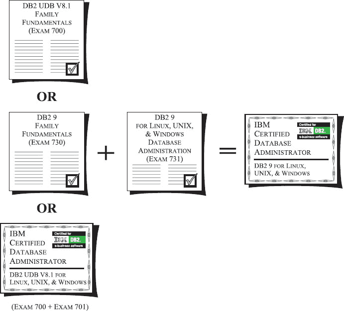

图 1–1：`IBM Certified Database Administrator - DB2 9 for Linux, UNIX, and Windows` 认证路线图。

已经持有 `IBM Certified Database Administrator - DB2 V8.1 for Linux, UNIX, and Windows` 认证的候选人可以选择参加 `DB2 9 for Linux, UNIX, and Windows Database Administration Upgrade` 考试（考试编号 736），以获得 `IBM Certified Database Administrator - DB2 9 for Linux, UNIX, and Windows` 认证。这项考试的长度和费用都是 `DB2 9 for Linux, UNIX, and Windows Database Administration` 考试（考试编号 731）的一半，旨在测试候选人对 DB2 9 中可用新特性和功能的理解。本质，升级考试为已认证的 DB2 版本 8.1 DBA 提供了一种获取等效版本 9 认证的快捷路径。这种快捷路径见图 1–2。

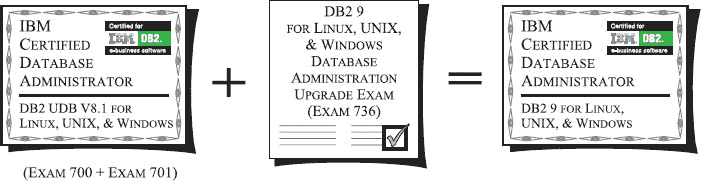

图 1–2：获取 `IBM Certified Database Administrator - DB2 9 for Linux, UNIX, and Windows` 认证的快捷路径。

## `DB2 9 for Linux, UNIX, and Windows Database Administration Upgrade` 考试（考试 736）目标

`DB2 9 for Linux, UNIX, and Windows Database Administration Upgrade` 考试（考试编号 736）包含 38 道单选题，候选人有 60 分钟完成考试。需要达到 55% 或更高分数方可通过。

`DB2 9 for Linux, UNIX, and Windows Database Administration Upgrade` 考试（考试编号 736）旨在涵盖的主要目标如下（章节标题后的百分比反映了各部分占总数的比例）：

### 第 1 节 - 服务器管理（29%）

- 理解 `AUTOCONFIGURE` 命令的功能
- 手动配置通信（重点是 IPv6）
- 启用自动维护
- 启用自调内存
- 启用实用程序限制

### 第 2 节 - 数据放置（21%）

- 了解 `CREATE DATABASE` 命令的新默认行为
- 创建和管理自动存储表空间
- 表分区知识
- 数据行压缩

### 第 3 节 - XML 概念（13%）

- 使用 XML 数据类型
- 创建和管理 XML 索引
- 使用基础 XML 函数（例如 `XMLPARSE`、`XMLSERIALIZE`、`XMLVALIDATE` 和 `XMLQUERY`）
- 熟悉 XQuery 基础
- 使用 DB2 工具处理 XML 数据

### 第 4 节 - 分析 DB2 活动（16%）

- 使用 DB2 故障排除工具（`db2bfd`、`db2mtrk` 和 `db2pd`）
- 监控死锁
- 使用管理例程和 `SNAPSHOT` 函数

### 第 5 节 - 高可用性（10.5%）

- 使用 `RECOVER DATABASE` 命令
- 了解高可用灾难恢复（HADR）

### 第 6 节 - 安全性（10.5%）

- 对 DB2 9 新身份验证类型的了解
- 对基于标签的访问控制（LBAC）的理解

# 参加 Linux、UNIX 和 Windows 版 DB2 数据库管理升级考试（考试 736）

当你确认准备好参加 `DB2 9 for Linux, UNIX, and Windows Database Administration Upgrade` 考试（考试 736）时，下一步是联系 IBM 授权的测试供应商。DB2 9 认证考试由 Pearson VUE 和 Thompson Prometric 管理，在极少数情况下由 IBM 管理（例如，IBM 会在一些大型数据库会议上——如国际 DB2 用户组北美会议——免费提供 DB2 9 认证考试）。然而，在联系任何一个测试供应商之前，你应该分别访问他们的网站 [`www.vue.com/ibm`](http://www.vue.com/ibm) 和 [`www.2test.com`](http://www.2test.com)，并使用那里提供的导航工具找到一个方便你的测试中心。一旦找到了测试中心，你就可以联系供应商并安排参加认证考试。（测试供应商的联系信息也可以在各自的网站上找到；在某些情况下，你可以在线预约考试。）

你必须至少提前 24 小时安排认证考试，并在联系测试供应商时，你应准备好提供以下信息：

- 你的姓名（按你希望出现在认证证书上显示的名称）。
- 一个身份识别号（如果你以前参加过 IBM 认证考试，这就是当时分配给你的号码；如果没有参加过，测试供应商将为你提供一个）。
- 可以联系到你的电话号码。
- 传真号码。
- 你希望接收所有认证相关邮件（包括你的认证欢迎包）的邮寄地址。
- 你的账单地址（如果与邮寄地址不同）。
- 你的电子邮箱地址。
- 你希望参加的考试编号（例如，`Exam 736`）。
- 你希望使用的支付方式（信用卡或支票）以及任何相关的支付信息（如信用卡号和有效期）。
- 你的公司名称（如适用）。
- 你希望参加认证考试的测试中心。
- 你希望参加认证考试的日期。

在安排参加认证考试之前，你应该准备好纸和铅笔或钢笔，以便记录下测试中心分配给你的考生身份识别号。当你到达测试中心参加认证考试时，你需要这些信息。（如果时间允许，你将收到一封确认信，其中包含你安排参加的考试编号以及相应的日期、时间和位置信息；如果你在计划考试日期前的 48 小时内注册，将不会收到该信。）


如果你已经参加过提供的一个或多个认证考试，你应该让测试供应商知晓这一点，并要求他们分配给你之前使用的相同的考生身份识别号。这将使 IBM 认证团队能够快速识别你何时满足了特定认证角色的所有考试要求。（如果你每次参加考试时都被分配了唯一的考生身份识别号，你应该去 IBM 职业认证会员网站 [`www.ibm.com/certify/members`](http://www.ibm.com/certify/members) 并选择“会员服务（Member Services）”，将你所有的考试结果合并到一个 ID 下。）

Linux、UNIX 和 Windows 版 DB2 数据库管理升级考试（考试 736）的费用为 75 美元（在美国）。预约程序取决于你选择的考试支付方式。如果你决定通过信用卡支付，可以在向测试供应商提供适当信息后立即安排参加考试。然而，如果你选择通过支票支付，则需要等待收到支票并确认付款后才被允许安排参加考试。（Thompson Prometric 建议如果你用支票支付，请在支票正面写上你的注册 ID，并在支票寄出后七个工作日联系他们。届时，他们应该已经收到并确认了你的付款，你就可以安排参加已付费的考试了。）如果由于某些原因你在预约后需要重新安排或取消预约，必须在预定考试时间至少 24 小时前操作。否则，你仍会被收取考试费用。

在安排参加认证考试当天，你应该在计划开始时间至少 15 分钟到达测试中心签到。作为签到流程的一部分，将被要求提供安排考试时分配给你的身份识别号和两种身份证明。其中一份身份证明必须带有近照，另一份必须显示你的签名。有效身份证明的示例包括驾照（带照片）和信用卡（带签名）。

签到后，考试管理员将指示你进入测试区域并选择一个空闲的工作站。然后，考试管理员会将你的姓名和身份识别号输入你所选择的工作站，为你提供铅笔和一些纸，并在你准备好后指示你开始考试。

一旦你完成考试并提交评分，IBM 认证考试测试软件将评估你的答案并生成成绩报告，指示你是否通过了考试。每场认证考试都分为几个部分，无论你通过还是未通过，都应该花几分钟查看你在每个部分获得的分。这些信息可以帮助你评估自己的优缺点；如果你未能通过考试，它可以帮助你识别出在再次考试之前应该花时间复习的领域。

参加认证考试后不久（通常在五个工作日内），测试供应商会将你的结果以及你的个人统计数据（例如姓名、地址、电话号码）发送给 IBM 认证组进行处理。如果你通过了考试，你将获得该考试对应认证角色的积分；如果你参加的考试完成了针对特定认证角色的概述，你将收到一封电子邮件（发送至你在注册期间提供的邮箱），其中包含 IBM 认证协议的副本和一个欢迎包，欢迎包中包括一个适合装裱的证书（`PDF` 文件格式）、IBM 认证标志的打印级字体以及使用“IBM 认证”标志的指南。（如果此邮件无法送达，欢迎包将通过普通邮件邮寄给你。）你也可以通过访问收到的邮件中引用的网站并请求，通过普通邮件收到纸质证书以及钱包大小的证书——你会被要求提供 `Fulfillment ID` 和 `Validation Number`（在邮件中提供）作为你已符合认证要求的证明。

收到欢迎包后，您将正式获得认证，并可以开始使用 IBM 专业认证称号和商标。（您应该在 IBM 处理考试结果后的四到六周内收到 IBM 认证协议和欢迎包。）然而，如果您未通过考试但仍希望获得认证，必须安排重新考试（包括重新支付测试费用）。参加特定认证考试的次数没有限制；但您在 30 天内参加同一项认证考试的不能超过两次。

# 第 2 章 服务器管理

DB2 9 for Linux、UNIX 和 Windows 数据库管理升级考试（考试 736）中有百分之二十九的比例旨在测试您对基础 DB2 服务器管理的知识。构成这部分内容的题目旨在评估以下内容：

- 您对 `AUTOCONFIGURE` 命令的理解
- 您手动配置客户端/服务器连接的能力
- 您使用自动维护（Automatic Maintenance）的能力
- 您对实用程序进行节流（throttle utilities）的能力
- 您使用 DB2 自调优内存管理器（STMM）的能力

本章旨在向您介绍管理 DB2 9 服务器所需要熟悉的各种概念。本章还将提供有关某些用于服务器管理的工具信息。

## 实例与数据库配置

DB2 将世界视为对象的层级结构。安装了 DB2 的工作站（或服务器）处于该层级结构的最高层。当在工作站上安装任何版本的 DB2 时，名为 DB2 数据库管理器（DB2 Database Manager）的后台进程文件会被物理复制到该工作站的特定位置，在大多数情况下，会创建一个 DB2 数据库管理器实例。实例占据层级结构的第二层，负责管理其控制下的系统资源和数据库。数据库构成第三层，负责管理数据的存储、修改和检索。

在正常运行期间，DB2 数据库管理器的行为部分由一组定义 DB2 运行环境的值集合控制。其中某些值是操作系统环境变量，另一些是特殊的 DB2 特有系统级值，称为环境变量或注册表变量。除了这套完整的注册表变量外，DB2 还使用大量的配置参数来控制如何代表实例和数据库分配及利用系统资源。遗憾的是，许多这些配置参数提供的默认值是针对非常简单的系统设计的。（其目标是让 DB2 在几乎任何平台上都能开箱即用，而不是让 DB2 在其安装的平台上运行处于最佳状态。）因此，尽管这些配置参数提供的默认值足以满足大多数数据库需求，但您通常只需通过更改一个或多个配置参数的值，就能大幅提高整体系统和应用程序性能。

每当创建一个实例时，作为实例创建过程的一部分，还会创建并初始化相应的 DB2 数据库管理器配置文件。每个 DB2 数据库管理器配置文件由大约 85 个不同的参数值组成，大多数参数控制分配给单个 DB2 数据库管理器实例的系统资源量。同样，每当创建一个新数据库时，就会创建并初始化相应的数据库配置文件。每个数据库配置文件由大约 105 个不同的参数组成，就像大多数 DB2 数据库管理器实例配置参数控制分配给单个 DB2 数据库管理器实例的系统资源量一样，许多数据库配置文件参数控制在正常运行期间分配给数据库的系统资源量。

### 配置顾问（Configuration Advisor）

有如此广泛的配置参数供选择，决定从哪里开始以及做出更改可能是困难的。幸运的是，DB2 配备了一个工具帮助您入门；该工具就是配置顾问。配置顾问旨在捕获有关数据库环境的特定信息，并根据提供的信息建议或更改配置参数。

您可以通过控制中心（Control Center）中的数据库（Databases）菜单中选择配置顾问操作来激活配置顾问。图 2–1 显示了配置顾问首次激活时的外观。

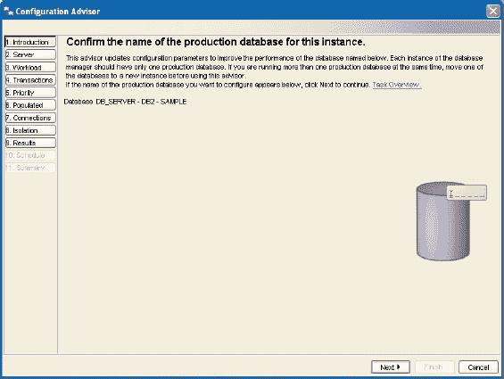

图 2–1：配置顾问对话框。

一旦激活了配置顾问向导，您只需按照每个面板显示的指示描述您的服务器环境，并解释您的数据库典型事务工作负载的情况。当您提供了所需的信息后，配置顾问将提供更改建议，如果应用于实例和/或数据库配置参数，将提高整体性能。此时，向导右下角的“完成”（Finish）按钮（参见图 2–1）将启用，选择此按钮后即可应用建议的配置参数更改。


在 DB2 9 中，每当使用创建数据库向导（Create Database Wizard）创建数据库时，配置顾问会被自动调用。（可以通过为注册表变量 `DB2_ENABLE_AUTOCONFIG_DEFAULT` 赋值 `NO` 来更改此行为。）

 配置顾问（以及 `AUTOCONFIGURE` 命令）基于每个实例仅定义一个数据库的假设做出配置和缓冲池建议。

### AUTOCONFIGURE 命令

配置顾问提供的功能也可以通过执行 `AUTOCONFIGURE` 命令获得（该命令底层调用设计顾问 Design Advisor）。该命令的基本语法如下：


其中：

* `Keyword*`：`AUTOCONFIGURE` 命令识别的一个或多个特殊关键字。有效值包括 `mem_percent`、`workload_type`、`num_stmts`、`tpm`、`admin_priority`、`is_populated`、`num_local_apps`、`num_remote_apps`、`isolation` 和 `bp_resizable`。

* `Value*`：标识与提供的关键字关联的值。表 2.1 列出了 `AUTOCONFIGURE` 命令识别的每个关键字的有效值。

#### 表 2.1 `AUTOCONFIGURE` 命令关键字和值

| 关键字 | 有效值 / 默认值 | 说明 |
| :--- | :--- | :--- |
| `mem_percent` | 1-100 默认: 25 | `DB2` 数据库管理器在执行数据库操作时使用的服务器内存 (`RAM`) 的百分比。 |
| `workload_type` | `simple`, `complex`, `mixed` 默认: `mixed` | 通常在数据库上运行的工作负载类型。有效值如下：`simple`——数据库主要用于解析查询（例如，数据仓库）；`complex`——数据库主要用于事务处理（例如，订单输入和 `OLTP`）；`mixed`——数据库用于解析查询和处理事务。简单工作负载倾向于 I/O 密集型且大部分为事务，而复杂工作负载倾向于 CPU 密集型且大部分为查询。 |
| `num_stmts` | 1-1,000,000 默认: 10 | 单个事务（即提交之间）内执行的 `SQL` 语句平均数。注意：如果未知，请选择大于 10 的数字。 |
| `tpm` | 1-200,000 默认: 60 | 每分钟执行的事务平均数（估计）。注意：`DB2` 性能监控程序可以帮助你获得更准确的 `TPM` 测量。 |
| `admin_priority` | `performance`, `recovery`, `both` 默认: `both` | 数据库应优化的活动类型。有效值包括：`performance`——数据库应针对事务性能进行优化（备份/恢复速度较慢）；`recovery`——数据库应针对备份和恢复进行优化（事务性能较慢）；或 `both`——数据库应同时针对事务性能和备份/恢复进行优化（两者同等重要）。 |
| `is_populated` | `yes`, `no` 默认: `yes` | 表示数据库当前是否包含数据。有效值如下：`yes`—数据库包含数据；以及 `no`——数据库不包含数据。 |
| `num_local_apps` | 0-5,000 默认: 0 | 一时连接到数据库的本地应用程序数量。 |
| `num_remote_apps` | 0-5,000 默认: 10 | 一时连接到数据库的远程应用程序数量。为处理所有所需的连接（包括本地和远程）分配内存，可以确保用户无需等待现有连接终止即可连接。然而，为连接过度分配内存可能会导致资源浪费。`DB2` 性能监控程序可以帮助你确定在特定时间范围内实际获取了多少连接。 |
| `isolation` | `RR`, `RS`, `CS`, `UR` 默认: `RR` | 大多数访问数据库的应用程序使用的隔离级别。有效值包括：`RR`—可重复读（长时间获取大量锁）；`RS`—可一致性读取（长时间获取较少锁）；`CS`—游标稳定（短时间内获取大量锁）；以及 `UR`—未提交的读取（不获取任何锁）。 |
| `bp_resizeable` | `yes`, `no` 默认: `yes` | 缓冲区池是否可调整大小？ |

如果在 `AUTOCONFIGURE` 命令中指定了 `APPLY DB ONLY` 子句，则 Design Advisor 建议的数据库配置和缓冲区池更改将应用于相应的数据库配置文件；如果指定了 `APPLY DB AND DBM` 子句，则建议的数据库配置和缓冲区池更改将应用到数据库配置文件，而建议的实例配置更改将应用到相应的 `DB2` 数据库管理器配置文件。如果改为指定 `APPLY NONE` 子句，将显示更改建议但不会应用。

因此，如果你想为一个名为 `SAMPLE`、使用可调整大小缓冲区池且包含数据的 `OLTP` 数据库确定最佳配置，并希望在将更改应用于相应的数据库配置文件之前审查任何建议的更改，可以通过执行如下所示 `AUTOCONFIGURE` 命令来实现：

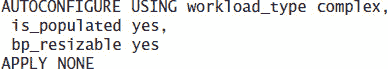

另一方面，如果你想确定当系统 60% 的内存可供 `DB2` 数据库管理器在执行数据库操作时使用，实例仅控制一个数据库（名为 `SAMPLE`），并且你希望自动更新相应的配置文件以反映任何建议的更改，你可以通过执行如下所示 `AUTOCONFIGURE` 命令来实现：


 `AUTOCONFIGURE` 命令（以及 Design Advisor）始终会建议配置数据库利用自调优内存管理器（Self-Tuning Memory Manager）。然而，如果你对一个位于 `SHEAPTHRES` 配置参数被分配非零值的实例中的数据库运行 `AUTOCONFIGURE` 命令，则排序内存堆数据库配置参数 (`SORTHEAP`) 将不会配置为自动调优。因此，如果你想启用排序内存调优，必须在执行 `AUTOCONFIGURE` 命令之前执行命令 `UPDATE DATABASE MANAGER CONFIGURATION USING SHEAPTHRES 0`。

## 配置通信

在典型的客户端/服务器环境中，存储在服务器上的数据库由存储在远程客户端工作站的应用程序访问，使用所谓的分布式连接。分布式连接除了为客户端应用程序提供访问远程服务器上集中数据库的方法外，还为管理员提供了远程管理数据库和服务器的方法。

当 `DB2` 安装在工作站上时，它会自动配置以利用为该特定工作站设置的任何通信协议（前提是这些协议被 `DB2` 识别）。此时，在创建 DAS 实例和默认实例时，会收集并将每个可用通信协议的信息存储在它们的配置文件中。然而，当激活新协议或重新配置现有协议时，这些信息不会自动更新。相反，你必须在这些更改生效之前手动为每个实例配置通信。

### 手动配置通信

手动配置通信或更改通信配置的最简单方法是使用“设置通信”（Setup communications）对话框，可以通过 Control Center 中的“实例”（Instances）菜单中选择相应的操作来激活。图 2–2 显示了如何使用设置通信对话框为特定实例配置 `TCP/IP` 协议。

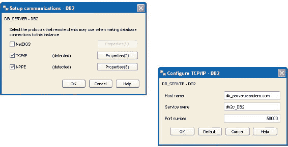

*图 2–2：设置通信对话框和配置 `TCP/IP` 对话框。*

如果你选择不使用设置通信对话框手动配置通信，你必须遵循的步骤可能会根据使用的通信协议而异。例如，如果你想配置服务器使用 `TCP/IP`，必须执行以下步骤（顺序不限）：

1. 为 `DB2COMM` 注册变量分配值 `TCPIP`。

   每当你手动为服务器配置通信时，在实例开始使用所需的通信协议之前，必须更新 `DB2COMM` 注册变量的值。分配给 `DB2COMM` 注册变量的值用于在启动特定实例的 `DB2` 数据库管理器时激活哪些通信管理器。

   通过执行如下所示的 `db2set` 命令为 `DB2COMM` 注册变量分配值 `TCPIP`：

   

2. 将数据库服务器接收远程客户端通信的 `TCP/IP` 端口名称分配给 `DB2` 数据库管理器配置文件中的 `svcename` 参数。

   `svcename` 参数应设置为与主连接端口关联的服务名称，以便当数据库服务器启动时，它可以确定在哪个端口监听传入的连接请求。此参数通过执行如下所示的 `UPDATE DATABASE MANAGER CONFIGURATION` 命令设置：

   

3. 如果适当，更新数据库服务器上的 services 文件。

   `TCP/IP` services 文件标识了服务器应用程序监听客户端请求的端口。如果你在 `DB2` 数据库管理器配置文件的 `svcename` 参数中指定了服务名称，则必须将相应的服务名称到端口号/协议的映射添加到服务器上的 services 文件中。（如果你在 `svcename` 参数中直接指定了端口号，则不需要更新 services 文件。）

services 文件的默认位置取决于所使用的操作系统：在类 Unix 系统上，services 文件位于 `/etc/services`; 在 Windows 服务器上，services 文件位于 `%SystemRoot%\system32\drivers\etc`。services 文件中的 `DB2` 数据库服务器条目可能如下所示：


### 节点的注册与取消注册（Cataloging and Uncataloging）

通过配置助手（Configuration Assistant）对远程数据库进行注册时，节点（服务器）通常会被隐式注册。然而，如果你想显式地注册节点（即为特定服务器在节点目录中添加条目），可以通过执行 `CATALOG…NODE` 命令来实现，该命令对应于访问被注册服务器时使用的通信协议。有多种形式的 `CATALOG…NODE` 命令可供，包括以下几种：

* `CATALOG LOCAL NODE`

* `CATALOG LDAP NODE`

* `CATALOG NAMED PIPE NODE`

* `CATALOG TCPIP NODE`

所有这些命令的语法非常相似，主要区别在于每个命令提供的许多选项是针对该命令所定制的通信协议的。由于 `TCP/IP` 可能是当今最常用的通信协议，让我们来看看该形式 `CATALOG…NODE` 命令的语法。

`CATALOG TCPIP NODE` 命令的语法为：

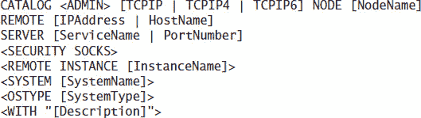

其中：

| 参数 | 说明 |
| :--- | :--- |
| `NodeName` | 标识分配给被注册节点的别名。这是在用户工作站上创建的任意名称，用于识别节点。 |
| `IPAddress` | 标识你尝试通信的远程数据库所所在服务器的 `IP` 地址。 |
| `HostName` | 标识 `TCP/IP` 网络已知的主机名。（这是你尝试通信的远程数据库所所在服务器的名称。） |
| `ServiceName` | 标识服务器上的 `DB2` 数据库管理器实例用于通信的服务名称。 |
| `PortNumber` | 标识服务器上的 `DB2` 数据库管理器实例用于通信的端口号。 |
| `InstanceName` | 标识要建立挂载的服务器实例名称。 |
| `SystemName` | 标识用于识别服务器工作站的 `DB2` 系统名称。 |
| `SystemType` | 标识服务器工作站上使用的操作系统类型。以下值对此参数有效：`AIX`, `WIN`, `HPUX`, `SUN`, `OS390`, `OS400`, `VM`, `VSE`, 和 `LINUX`。 |
| `Description` | 用于描述在被注册节点的节点目录中创建的节点条目的注释。描述必须包含在双引号内。 |

因此，如果你想为一个名为 `DB2HOST` 的 `AIX` 服务器注册节点，该服务器有一个名为 `DB2INST1` 的 `DB2` 实例并监听端口 60000，并为其分配别名 `RMT_SERVER`，你可以执行如下所示的 `CATALOG TCPIP NODE` 命令来实现：

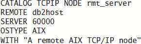

另一方面，如果你想为一个 `Linux` 服务器注册节点，该服务器的 `IPv6` 地址为 `1080:0:0:0:8:800:200C:417A`，且有一个名为 `DB2INST1` 的 `DB2` 实例监听端口 `60000`，并为其分配别名 `IPV6_SERVER`，你可以执行如下所示的 `CATALOG TCPIP NODE` 命令来实现：

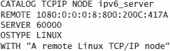

## 自动维护

虽然可以使用任务中心（Task Center）调度例行维护操作，但在某些情况下，确定是否以及何时运行某些资源密集型维护程序可能非常耗时。通过自动维护（`DB2` 9 中引入的一项新功能），你可以指定维护目标，`DB2` 数据库管理器将使用你识别的目标来确定是否需要执行一项或多项维护活动。如果确定需要维护操作，该操作将在下一个可用的维护窗口内执行（维护窗口是由你指定的时段，在此期间内将执行所有自动维护活动）。

自动维护可执行以下维护操作：

* **创建数据库备份映像。** 自动数据库备份为用户提供了一种解决方案，帮助确保数据库既得当又定期地进行备份，而无需担心何时备份，也无需了解 `BACKUP` 命令的语法。

* **数据碎片整理（表或索引重组）。** 此项维护活动可以提高 `DB2` 数据库管理器访问表的效率。自动重组可以管理离线表和索引重组，用户无需担心何时以及如何重组其数据。

* **数据访问优化（运行 `RUNSTATS`）。** `DB2` 数据库管理器更新有关表数据、表索引中的数据或表及其索引中数据的系统目录统计信息。`DB2` 优化器使用这些统计信息来决定响应查询时使用哪个路径访问数据。自动统计收集通过维护最新的表统计信息尝试提高数据库性能。目标是允许 `DB2` 优化器始终根据准确的统计信息选择访问计划。

* **统计分析。** 自动统计分析通过检测过时、缺失或指定的统计信息并根据反馈建议何时以及如何收集表统计信息。

当创建 `DB2` 9 数据库时，默认启用自动维护；各个自动维护功能的启用通过各种自动维护特定配置参数来控制。表 2.2 列出了可用的自动维护特定配置参数。

**表 2.2 `DB2` 自动维护特定配置参数**

| 参数 | 值范围 / 默认 | 描述 |
| :--- | :--- | :--- |
| `auto_maint` | `ON`, `OFF` 默认: `ON` | 启用或禁用数据库的自动维护。它是所有自动维护配置参数的父级（`auto_db_backup`, `auto_tbl_maint`, `auto_runstats`, `auto_stats_prof`, `auto_prof_upd` 和 `auto_reorg`）。当此参数被禁用时，所有子参数也会被禁用，但它们在数据库配置文件中的设置不会更改。当此父参数启用时，其子参数的值生效。 |
| `auto_db_backup` | `ON`, `OFF` 默认: `ON` | 启用或禁用数据库的自动备份操作。 |
| `auto_tbl_maint` | `ON`, `OFF` 默认: `ON` | 启用或禁用数据库的自动表维护操作。此参数是所有表维护参数的父级（`auto_runstats`, `auto_stats_prof`, `auto_prof_upd` 和 `auto_reorg`）。当此参数被禁用时，所有子参数也会被禁用，但它们在数据库配置文件中的设置不会更改。当此父参数启用时，其子参数的值生效。 |
| `auto_runstats` | `ON`, `OFF` 默认: `ON` | 启用或禁用数据库的自动表 `RUNSTATS` 操作。 |
| `auto_stats_prof` | `ON`, `OFF` 默认: `ON` | 启用或禁用数据库的自动统计分析生成。 |
| `auto_prof_upd` | `ON`, `OFF` 默认: `ON` | 启用或禁用数据库的自动 `runstats` 分析更新。 |
| `auto_reorg` | `ON`, `OFF` 默认: `ON` | 启用或禁用数据库的自动表和索引重组。 |

*改自 `DB2` 9 性能指南第 269–273 页的表 64 和表 65*

`auto_maint` 数据库配置参数启用或禁用数据库的自动维护，因此在执行任何自动维护操作之前，必须将其赋值为 `ON`；`auto_tbl_maint` 数据库配置参数启用或禁用数据库的自动表维护，因此在执行自动表维护操作之前，必须将其赋值为 `ON`。

### 用程序节流

自动维护活动（备份、统计收集、统计分析以及表/索引重组）在运行时会消耗资源，并可能影响数据库的性能。此外，离线数据库备份和表/索引重组操作可能会限制对表、索引或整个数据库的访问。为了减少系统影响，可以使用 `DB2` 的自适应用程序节流系统调节某些自动维护活动的资源使用。

自适应用程序节流系统允许在关键期间并发运行维护用程序，同时将它们对生产工作负载的性能控制在可接受范围内。以下维护操作可以被节流：

* 统计收集

* 备份操作

* 重平衡操作

* 异步索引清理

分配给 `util_impact_lim` `DB2` 数据库配置参数的值限制了节流程序对生产工作负载造成的性能下降幅度。要定义*所有*节流用程序的影响策略，只需为 `util_impact_lim` 配置参数分配 1 到 100 之间的任何值即可。例如，为了配置实例使自动备份操作调用对系统工作负载的影响不超过 10%，您可以通过执行如下所示 `UPDATE DATABASE MANAGER` 命令将 `util_impact_lim` 配置参数赋值为 10：


正如您预期的，节流的程序通常比未节流的程序需要更长时间才能完成。如果您发现某个用程序运行时间过长，可以增加分配给 `util_impact_lim` 配置参数的值，也可以通过将 `util_impact_lim` 配置参数设置为 100 来完全禁用节流。（如果 `util_impact_lim` 设置为 100，则用程序调用将不会被节流。在这种情况下，用程序可以更快完成，但它们很可能对工作负载性能产生不利影响。）


尽管节流用程序的影响策略是由分配给`util_impact_lim`配置参数的值定义的，但可以使用调用节流用程序的命令中提供的特殊选项来重写此策略。该特殊选项的语法为：


其中：

| `Priority` | 指定用程序所承受的节流程度。值 100 代表最高优先级；值 1 代表最低优先级。如果没有指定`Priority`，则用程序将以默认优先级 50 执行。（所有具有相同优先级的用程序将受到相同程度的节流，低优先级的用程序受到的节流程度比高优先级的用程序多。） |

例如，如果您想备份一个名为`SALES`的数据库，并让备份操作以 20 的优先级节流运行，可以通过执行如下所示的`BACKUP DATABASE`命令来实现：


如果执行调用节流用程序的命令时不带有`UTIL_IMPACT_PRIORITY`选项，则用程序将未节流运行，即使`util_impact_lim`配置参数已被分配了除 100 以外的值。

### 获取有关运行中用程序的信息

如果您想找出是否有用程序正在实例上运行，以及它们的节流影响优先级是多少，可以通过执行`LIST UTILITIES`命令来实现。该命令的语法为：


因此，如果您为名为`SAMPLE`的数据库启动了未节流的备份操作，可以通过执行如下所示的`LIST UTILITIES`命令获取有关该操作的详细信息：


当执行此命令时，产生的信息类似于：

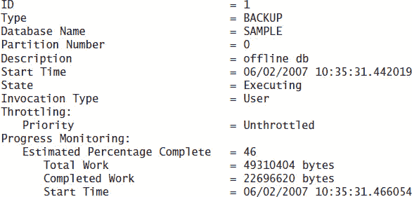

### 更改运行中用程序的影响优先级

如果您想更改已运行用程序的影响优先级（节流级别），可以通过执行`SET UTIL_IMPACT_PRIORITY`命令来实现。通过此命令，您可以：

* 对以未节流模式启动的运行用程序进行节流，
* 对运行中的节流用程序取消节流（禁用节流），
* 重新调整运行节流用程序的优先级（当同时运行了多个节流用程序且其中一个比其他更重要时，这非常有用）。

`SET UTIL_IMPACT_PRIORITY`命令的语法为：


其中：

| `UtilityID` | 通过 ID 标识要更改优先级的运行用程序。（分配给运行用程序的 ID 可以通过执行`LIST UTILITIES`命令获取。） |

| `Priority` | 指定与运行指定的用程序相关的影响的实例级限制。值 100 代表最高优先级；值 1 代表最低优先级。将`Priority`设置为 0 将强制节流用程序继续以未节流模式运行；将`Priority`设置为非零值将强制未节流的用程序继续以节流模式运行。 |

因此，如果您想强制早之前（通过`LIST UTILITIES`命令）获取信息的未节流备份操作继续以节流模式运行，可以执行如下所示的`SET UTIL_IMPACT_PRIORITY`命令：


当执行此语句时，备份操作对服务器正在处理的总工作负载的平均影响不应超过 20%。

## 自调优内存管理器

尽管用程序节流可以帮助减少用程序执行对生产工作负载的影响，但工作负载的性能表现（好或坏）通常取决于服务器对内存等资源的利用情况。正如我们之前看到的，DB2 数据库管理器配置和数据库配置参数控制着为实例和数据库分配系统资源。在 DB2 9 中，一种名为自调优内存管理器 (STMM) 的内存调优功能通过在测量和分析每个 DB2 内存消费者使用可用内存的情况后，自动设置这些参数的值，简化配置内存相关数据库参数的任务。以下内存消费者可以启用自调优：

* 缓冲池（由`ALTER BUFFERPOOL`和`CREATE BUFFERPOOL`语句控制）
* 程序包缓存（由`pckcachesz`配置参数控制）
* 锁内存（由`locklist`和`maxlocks`配置参数控制）
* 排序内存（由`sheapthres_shr`和`sortheap`配置参数控制）
* 数据库共享内存（由`database_memory`配置参数控制）

当数据库未启用自调优时，整个数据库将使用指定数量的内存，并根据需要将其分配到数据库内存消费者中。然而，当数据库启用了自调优后，内存调优器会对数据库工作负载特征的显著变化做出响应，通过调整内存配置参数的值和缓冲区池的大小来优化性能。如果当前的工作负载需求较高，且系统上有足够的空闲内存，数据库将消耗更多内存。一旦工作负载的内存需求下降，或者系统上的可用空闲内存过低，将释放部分数据库共享内存。

通过将数据库配置参数`self_tuning_mem`赋值为`ON`，可以为数据库启用自调优。这是通过执行`UPDATE DATABASE CONFIGURATION`命令完成的。（在更改生效之前，必须停止并重启数据库。）

通过使用`UPDATE DATABASE CONFIGURATION`命令为内存配置参数赋值`AUTOMATIC`，可以为由内存配置参数控制的特定内存区域启用自调优；您可以使用`CREATE BUFFERPOOL`或`ALTER BUFFERPOOL`SQL 语句通过将缓冲区池的大小设置为`AUTOMATIC,`从而为缓冲区池启用自调优。然而，由于内存调优器在不同的内存消费者之间交换内存资源，因此必须至少有两个内存消费者启用了自调优，自调优才能生效。（更不用说数据库本身的`self_tuning_mem`数据库配置参数必须设置为`ON`。）

 为了实现排序内存的自动调优，必须将`sheapthres_shr`数据库配置赋值为`AUTOMATIC`，并将`sheapthres`DB2 数据库管理器配置参数设置为 0。

一旦为数据库和两个或多个内存消费者配置了自调优，就可以通过执行`GET DATABASE CONFIGURATION`命令获取数据库的当前内存配置。自调优产生的更改将记录在内存调优日志文件中，这些文件位于实例的`stmmlog`子目录下。（第一个创建的文件将被命名为`stmm.0.log,`，第二个将被命名为`stmm.1.log,`，依此类推。）每份内存调优日志文件都包含执行调优操作时每个内存消费者的资源需求摘要。可以通过检查内存调优日志文件中条目的时间戳来确定调优间隔。

## 练习题

### 第 1 题

下列哪项不是`AUTOCONFIGURE`命令的有效关键字？

 A. `mem_percent`

 B. `workload_type`

 C. `num_apps`

 D. `isolation`

### 第 2 题

关于`AUTOCONFIGURE`命令的陈述哪项是错误的？

 A. `DB2_ENABLE_AUTOCONFIG_DEFAULT`必须设置为`ON`才能执行`AUTOCONFIGURE`命令。

 B. 如果在`AUTOCONFIGURE`命令中指定`APPLY`子句，由自调优产生的更改将应用到数据库。

 C. `AUTOCONFIGURE`命令将根据单个实例做出建议。

 D. 如果在`AUTOCONFIGURE`命令中指定`NONE`子句，将显示建议但不会应用。

### 第 3 题

下列哪项命令可以为 IP 地址为`10.0.0.1`的 DB2 数据库管理器配置排序内存的自动调优？

![round]## 第 4 题

名为`PAYROLL`的 DB2 版本 8.2 数据库已成功迁移到 DB2 9。下列哪个命令将激活该数据库的自动调优和索引重组？

### 第 5 题

数据库管理员希望为`SALES`数据库自动收集统计信息。哪个数据库配置参数必须设置为`ON`以启用自动收集？

### 第 6 题

数据库管理员通过执行`GET CFG FOR PERSONNEL`获取了关于最近创建的名为`SERVER`的数据库的信息。下列哪个命令将启用该数据库的自动统计分析？

### 第 7 题

数据库管理员希望确保为`EMPLOYEE`表收集统计信息时，对生产负载的影响不超过 10%。为了实现这一目标，必须执行下列哪两个命令？

### 第 8 题

`LIST UTILITIES SHOW DETAIL`命令返回了以下输出：

下列哪个命令将允许无节制地运行备份操作？

### 第 9 题

如果按照所示顺序执行以下命令：

备份操作对工作负载的影响百分比是多少？

### 第 10 题

下列哪些内存消费者不能由自调优管理器根据数据库负载进行自动调整？

### 第 11 题

自调优产生的更改记录在哪里？

### 第 12 题

在自调优管理器配置所有可能的调优条件之前，必须执行以下哪些操作？

### 第 13 题

名为`ACCOUNTING`的 DB2 版本 8.2 数据库已成功迁移到 DB2 9。下列哪个命令将激活该数据库的自调优并识别哪些内存消费者已配置自调优？

### 第 14 题

数据库管理员希望使用自调优管理器管理`ORDERS`数据库的内存需求。在可以使用自调优管理器自动设置任何时间允许排序内存消费者使用的数据库共享内存总量的软限制之前，必须执行下列哪两个命令？

正确答案是 **C.**。`AUTOCONFIGURE`命令识别的关键字有：`mem_percent`、`workload_type`、`num_stmts`、`tpm`、`admin_priority`、`is_populated`、`num_local_apps`、`num_remote_apps`、`isolation`和`bp_resizable`。

### 问题 2

正确答案是 **A.**。在 DB2 9 中，每当你使用创建向导创建数据库时，配置助手会自动调用。通过为注册变量`DB2_ENABLE_AUTOCONFIG_DEFAULT`赋值`NO`可以更改此行为。（赋值给`DB2_ENABLE_AUTOCONFIG_DEFAULT`注册变量的值对`AUTOCONFIGURE`命令没有影响。）

### 问题 3

正确答案是 **D.**。每当通过配置助手划分远程数据库时，节点（服务器）通常会被隐式划分。然而，如果你想显式地划分（即为特定服务器在节点目录中添加条目），可以通过执行与访问被划分服务器将使用的通信协议相应的`CATALOG…NODE`命令来实现。`CATALOG TCPIP NODE`命令的语法为：

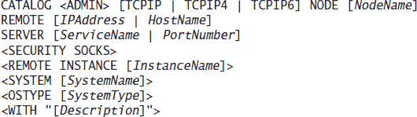

其中：

| `NodeName` | 标识分配给被划分节点的别名。这是在用户工作站上创建的任意名称，用于标识节点。 |

| `IPAddress` | 标识你尝试通信的远程数据库所在服务器的 IP 地址。 |

| `HostName` | 标识 TCP/IP 网络已知的主机名。（这是你尝试通信的远程数据库所在服务器的名称。） |

| `ServiceName` | 标识服务器上的 DB2 数据库管理器实例用于通信的服务名称。 |

| `PortNumber` | 标识服务器上的 DB2 数据库管理器实例用于通信的端口号。 |

| `InstanceName` | 标识要建立连接的服务器实例名称。 |

| `SystemName` | 标识用于服务器工作站的 DB2 系统名称。 |

| `SystemType` | 标识服务器工作站上使用的操作系统类型。该参数的有效值为：AIX, WIN, HPUX, SUN, OS390, OS400, VM, VSE 和 LINUX。 |

| `Description` | 用于描述在节点目录中为被划分节点创建条目的注释。描述必须用双引号括起来。 |

因此，如果你想为一个 IPv6 地址为 1800:0:0:0:6:400:200C:217A 且名为`DB2INST1`（监听端口为 60000）的 Linux 服务器划分（划分）节点，并为其分配别名`RMT_SERVER`，你可以通过执行类似下面的`CATALOG TCPIP NODE`命令来实现：

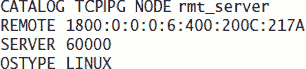

### 问题 4

正确答案是 **D.**。`auto_maint`数据库配置参数启用或禁用数据库的自动维护；它是其他自动维护数据库配置参数（`auto_db_backup`、`auto_tbl_maint`、`auto_runstats`、`auto_stats_prof`和`auto_reorg`）的父级。当此参数赋值为`OFF`时，所有子参数都被禁用，但它们在数据库配置文件中记录的设置不会 way。当此参数赋值为`ON`时，子参数的记录值将生效。

`auto_tbl_maint`数据库配置参数启用或禁用数据库的自动表维护；它是所有表维护参数（`auto_runstats`、`auto_stats_prof`、`auto_prof_upd`和`auto_reorg`）的父级。当此参数设置为`OFF`时，所有子参数都被禁用，但它们在数据库配置文件中记录的设置不会改变。当此参数赋值为`ON`时，子参数的记录值将生效。

`auto_reorg`数据库配置参数启用或禁用数据库的自动表和索引重组。当此参数赋值为`ON`时，将在需要时自动执行表和索引重组操作。

### 问题 5

正确答案是 **B.**。`auto_maint`数据库配置参数启用或禁用自动维护，因此在执行任何自动维护操作之前必须将其赋值为`ON`；`auto_tbl_maint`数据库配置参数启用或禁用数据库的自动表维护，因此在执行自动表维护操作之前必须将其赋值为`ON`；`auto_runstats`数据库配置参数启用或禁用数据库的自动表 RUNSTATS 操作，因此在执行数据库自动统计收集之前必须将其赋值为`ON`。

`auto_stats_prof`数据库配置参数启用或禁用数据库的自动统计配置文件生成，因此在执行数据库自动统计收集之前不需要将其赋值为`ON`。

### 问题 6

正确答案是 **D.**。当创建 DB2 9 数据库时，默认启用自动维护；当数据库配置参数重置为系统默认值（通过执行`RESET DATABASE CONFIGURATION`命令），`AUTO_MAINT`、`AUTO_DB_BACKUP`和`AUTO_TBL_MAINT`配置参数将被赋值为`ON`。`auto_stats_prof`数据库配置参数启用或禁用数据库的自动统计配置文件生成。当此参数赋值为`ON`时，将在需要时自动执行统计配置文件生成操作。

### 问题 7

正确答案是 **A** 和 **D**。赋值给`UTIL_IMPACT_LIM`数据库配置参数的值限制了受限程序对生产工作负载产生性能下降的影响。要为*所有*受限程序定义影响策略，你只需为`UTIL_IMPACT_LIM`配置参数分配 1 到 100 之间的任何值；如果`UTIL_IMPACT_LIM`设置为 100，则程序将不受受限。

尽管受限程序的影响策略是由赋值给`UTIL_IMPACT_LIM`配置参数的值定义的，但可以使用用于调用受限程序的命令中提供的特殊选项来覆盖此策略。该特殊选项的语法为：


其中：

| `Priority` | 指定程序将遭受的限制程度。值 100 代表最高优先级；值 1 代表最低优先级。如果未指定`Priority`，程序将以默认优先级 50 执行。（所有相同优先级的程序都受到相同程度的限制，低优先级的程序比高优先级程序受限更严重。） |

因此，如果你想为名为`EMPLOYEE`的表收集统计信息，并让该操作以 10 的优先级受限运行，你可以通过执行类似下面的`RUNSTATS`命令来实现：


### 问题 8

正确答案是 **A.**。如果你想更改正在运行的程序的影响优先级（限制程度），可以通过执行`SET UTIL_IMPACT_PRIORITY`命令来实现。该命令的语法为：

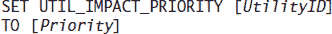

其中：

| `UtilityID` | 通过 ID 标识要更改优先级的正在运行的程序。（可以通过执行`LIST UTILITIES`命令获取运行的程序 ID。） |

| `Priority` | 指定与运行指定的实用程序相关的影响的实例级限制。值 100 代表最高优先级；1 代表最低优先级。将`Priority`设置为 0 将强制使受限的实用程序继续以未受限的状态运行；将`Priority`设置为非零值将强制使未受限的实用程序继续以受限模式运行。 |

因此，如果你想强制一个已分配了实用程序 ID 为 1 的受限备份操作继续以未受限的状态运行，可以通过执行如下所示的`SET UTIL_IMPACT_PRIORITY`命令来实现：


### 问题 9

正确答案是 **B.** 因为在执行`BACKUP DATABASE`命令时使用了`UTIL_IMPACT_PRIORITY`选项，但没有指定优先级值，因此备份操作被分配了 50 的默认优先级，这意味着该备份操作将对其他生产环境工作负载产生 50% 的影响。

### 问题 10

正确答案是 **C.** 当数据库启用了自调优功能时，内存调节器会对数据库工作负载特性的显著变化做出响应，调整内存配置参数的值和缓冲区池的大小以优化性能。以下内存消耗器可以启用自调优：

* 缓冲区池（由`ALTER BUFFERPOOL`和`CREATE BUFFERPOOL`语句控制）


程序包缓存（由`pckcachesz`配置参数控制）

锁内存（由`locklist`和`maxlocks`配置参数控制）

排序内存（由`sheapthres_shr`和`sortheap`配置参数控制）

数据库共享内存（由`database_memory`配置参数控制）

### 问题 11

正确答案是 **A.** 自调优内存管理器（Self Tuning Memory Manager）所做的更改记录在内存调优日志文件中，这些文件位于实例的`stmmlog`子目录下。（第一个创建的文件将被命名为`stmm.0.log`，第二个将被命名为`stmm.1.log`，依此类推。）每个内存调优日志文件都包含在执行调优操作时每个内存消耗器的资源需求摘要。调优间隔可以通过检查内存调优日志文件中条目的时间戳来确定。

### 问题 12

正确答案是 **C.** 通过将`self_tuning_mem`数据库配置参数赋值为 ON 为数据库启用自调优。通过使用`UPDATE DATABASE CONFIGURATION`命令将参数赋值为 AUTOMATIC，可以为内存配置参数控制的特定内存区域启用自调优；你可以通过使用`CREATE BUFFERPOOL`或`ALTER BUFFERPOOL` SQL 语句将缓冲区池的大小设置为 AUTOMATIC，从而为缓冲区池启用自调优。以下内存消耗器可以启用自调优：

- 缓冲区池
- 程序包缓存（由`pckcachesz`配置参数控制）
- 锁内存（由`locklist`和`maxlocks`配置参数控制）
- 排序内存（由`sheapthres_shr`和`sortheap`配置参数控制）
- 数据库共享内存（由`database_memory`配置参数控制）

### 问题 13

正确答案是 **B.** 通过将`self_tuning_mem`数据库配置参数赋值为 ON 为数据库启用自调优。这是通过执行`UPDATE DATABASE CONFIGURATION`命令实现的。（在更改生效之前必须停止并重启数据库。）一旦数据库配置了自调优，就可以通过执行`GET DATABASE CONFIGURATION`命令获取数据库的当前内存配置。

### 问题 14

正确答案是 **A** 和 **E.** 为了实现排序内存的自动调优，`sheapthres_shr`数据库配置必须赋值为 AUTOMATIC，且`sheapthres` DB2 数据库管理器配置参数必须设置为 0。

# 第 3 章

# 数据放置

DB2 9 for Linux, UNIX and Windows 数据库管理员升级考试（考试 736）中有百分之二十一 (21%) 用于测试创建 DB2 9 数据库的能力，以及测试你对创建和管理表空间及范围分区方法的知识。构成考试这部分的题目旨在评估以下内容：

- 你对`CREATE DATABASE`命令新默认行为的了解
- 你对 SMS、DMS 和自动存储表空间特的了解
- 创建和管理自动存储表空间的能力
- 创建范围分区表的能力
- 你对数据行压缩的了解

本章旨在引导你完成 DB2 9 数据库的创建，并为你提供数据库存在后可以构建的各种类型表空间的概述。本章还旨在向你展示如何构建范围分区表，以及使用数据行压缩来减少表的存储空间需求。

## 创建 DB2 9 数据库

创建 DB2 9 数据库有两种方法：通过“创建数据库向导”执行`CREATE DATABASE`命令——该向导本质上是`CREATE DATABASE`命令的图形用户界面 (GUI)。在最简单的情况下，`CREATE DATABASE`命令的语法如下：


其中：

| `DatabaseName` | 指定分配给数据库的唯一名称。 |

执行此命令时必须提供的值是分配给新数据库的名称。该名称

- 可以仅由字符 **a** 到 **z、A** 到 **Z、0** 到 **9、@**、**#、$** 和 _（下划线）组成；
- 不能以数字开头；
- 不能以字母序列`SYS`DM 或`IBM`开头；
- 不能与已分配给另一个数据库的名称相同。

当然，还有更复杂的`CREATE DATABASE`命令形式，可以让你对数据库参数进行更多控制，我们稍后将进行。但现在，让我们看看执行这种形式的`CREATE DATABASE`命令会发生什么。

### 创建 DB2 9 数据库时发生了什么

无论过程如何启动，每当创建一个新的 DB2 9 数据库时，都会按照所示顺序执行以下任务：

1. 在适当的位置创建的所有目录和子目录。创建的每个 DB2 9 数据库的信息都存储在特殊的层次结构目录树中。该目录树的实际创建位置取决于`CREATE DATABASE`命令提供的信息——如果未提供位置信息，则该目录树将在创建数据库的实例的关联的`dftdbpath` DB2 数据库管理器配置参数指定的位置创建。该层次树的根目录被分配为与数据库关联的实例名称。此目录将包含一个与分区节点名称对应的子目录。如果数据库是分区数据库，该目录将命名为`NODExxxx`，其中`xxxx`是分配给分区的唯一节点号；如果数据库是非分区数据库，该目录将命名为`NODE0000.`。节点名称目录反过来包含一个每个已创建数据库的子目录，以及一个包含用于存放数据库容器的子目录。

用于存放数据库数据容器的子目录名称与为数据库指定的名称相同；包含数据库基础文件的子目录名称对应于创建过程中分配给数据库的令牌（第一个创建的数据库的子目录将命名为`SQL00001`，第二个数据库的子目录将命名为`SQL00002`，依此类推）。图 3–1 展示了这种目录层次结构在非分区的数据库环境中通常是样子的。

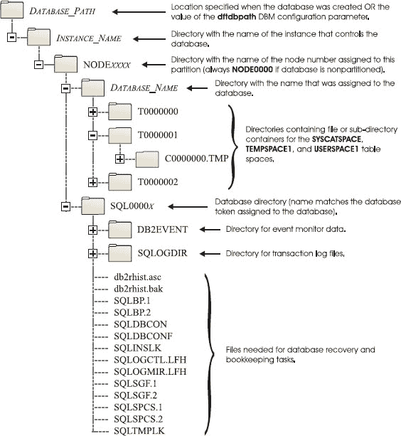

*图 3—1：非分区的数据库的典型目录树。*

 切勿尝试修改此目录结构或存储其中的任何文件。此类操作可能会破坏一个或多个数据库或使其无法使用。

### 2. 创建管理、监控和数据库恢复所需的文件。

在创建了分配数据库令牌名称的子目录后，会在其中创建以下文件：

`db2rhist.asc` 此文件包含有关备份操作、恢复操作、表加载操作、表重组操作、表空间更改以及类似的数据库更改的历史信息（即恢复历史文件）。

`db2rhist.bak` 此文件是`db2rhist.asc`的备份副本。

`SQLBP.1` 此文件包含缓冲池信息。

`SQLBP.2` 此文件是`SQLBP.1`的备份副本。

`SQLDBCON` 此文件包含数据库配置信息。

`SQLDBCONF` 此文件是`SQLDBCON`的备份副本。

`SQLINSLK` 此文件包含用于确保数据库仅分配给 DB2 数据库管理器的一个一个实例的信息。

`SQLOGCTL.LFH` 此文件包含有关活动事务日志文件的信息。恢复操作使用此文件中存储的信息来确定从日志回溯到多远的位置开始恢复过程。

`SQLOGMIR.LFH` 此文件是`SQLOGCTL.LFH`的镜像副本。

`SQLSGF.1` 此文件包含与自动存储相关的存储路径信息。

`SQLSGF.2` 此文件是`SQLSGF.1`的备份副本。

`SQLSPCS.1` 此文件包含表空间信息。

`SQLSPCS.2` 此文件是`SQLSPCS.1`的备份副本。

`SQLTMPLK` 此文件包含有关临时表空间的信息。

还会创建两个名为`DB2EVENT`和`SQLOGDIR`的子目录；创建一个的死锁事件监控器并存储在`DB2EVENT`子目录中，并创建名为`S0000000.LOG`、`S0000001.LOG`和`S0000002.LOG`的三个文件并存储在`SQLLOGDIR`子目录中。这三个文件用于在对数据库执行 SQL 操作时存储事务日志记录。

### 3. 为数据库创建缓冲池。

在数据库创建过程中，会创建一个缓冲池并将其命名为`IBMDEFAULTBP`。在默认情况下，在 Linux 和 UNIX 平台上，该缓冲池的大小为 1,000 个 4K（千字节）页；在 Windows 平台上，该缓冲池的大小为 250 个 4K 页。此缓冲池实际使用的内存（同样，对于可能存在的任何其他缓冲池）在建立到数据库的第一个连接时分配，并在所有数据库连接终止时释放。

### 4. 创建两个常规表空间和一个系统临时表空间。

在缓冲池`IBMDEFAULTBP`创建后，会创建三个表空间并与该缓冲池关联。这三个表空间如下：

- 一个名为`SYSCATSPACE`的常规表空间，用于存储与数据库相关的系统目录表和视图
- 一个名为`USERSPACE1`的常规表空间，用于存储所有用户定义对象（如表、索引等）以及用户数据、索引数据和长值数据
- 一个名为`TEMPSPACE1`的系统临时表空间，用于数据排序、表重组和创建索引等操作的临时区域

除非另有说明，`SYSCATSPACE`和`USERSPACE1`将是 DMS `FILE`表空间，而`TEMPSPACE1`将是 SMS 表空间；每个表表的特征可以作为`CREATE DATABASE`命令或数据库向导的输入。

### 5. 创建系统目录表和视图。

在表空间`SYSCATSPACE`创建后，会在该表空间内构建一组特殊的表，称为系统目录表。DB2 数据库管理器使用系统目录表来跟踪此类信息，例如数据库对象定义、数据库对象依赖关系、数据库对象权限、列数据类型、表约束和对象关系。与系统目录表一起创建一组系统目录视图，这些视图通常用于访问存储在系统目录表中的数据。系统目录表和视图无法通过 SQL 语句修改（但可以查看其内容）。相反，每当发生以下事件时，DB2 数据库管理器就会对其进行修改：

- 创建、修改或删除数据库对象（如表、视图或索引）。
- 授予或撤销授权或权限。
- 为表收集统计信息。
- 将包（Packages）绑定到数据库。

在大多数情况下，当创建数据库对象时，其完整特征存储在一个或多个系统目录表中。然而，在某些情况下（例如定义触发器和约束时），存储的是用于创建该对象的实际 SQL。

### 6. 在系统和本地数据库目录中记录数据库（如果系统或本地数据库目录不存在，则先创建系统或本地数据库目录）。

DB2 使用一组特殊文件来跟踪数据库存储的位置，并提供对这些数据库的访问。由于存储在这些文件中信息的方式就像办公大楼目录信息一样，因此它们被称为目录文件。每当创建一个数据库时，这些目录都会使用数据库的名称和别名进行更新。如果指定，注释和代码集值也会存储在这些目录中。

### 7. 初始化数据库的数据库配置文件。

数据库配置文件中的某些参数（如代码集、区域和排序序列）将使用作为`CREATE DATABASE`命令或数据库向导的输入指定的值进行设置；其他则分配系统默认值。

### 8. 创建四个模式（Schemas）。

一旦创建了系统目录表视图，将创建以下模式：`SYSIBM`、`SYSCAT`、`SYSSTAT`和`SYSFUN`。一个名为`SYSIBM`的特殊用户成为每个模式的所有者。

### 9. 将一组实用程序绑定到数据库。

在某些可用的 DB2 9 实用程序处理数据库之前，必须创建运行这些实用程序所需的包。此类包通过将一组预定义的 DB2 数据库管理器绑定文件绑定到数据库创建（使用的绑定文件存储在实用程序绑定列表文件`db2ubind.lst`中）。

### 10. 向适当的用户授予权限和权利。

为了连接并使用特定的数据库，用户必须拥有使用该数据库所需的权限和权利。因此，每当创建一个新数据库时，除非另有说明，将授予以下权限和权利：

- 创建数据库的用户被授予`Database Administrator` `(DBADM)`权限以及`CONNECT`、`CREATETAB`、`BINDADD`、`CREATE_NOT_FENCED`、`IMPLICIT_SCHEMA`和`LOAD`权限。
- 表空间`USERSPACE1`的`USE`权限被授予组`PUBLIC.`。
- `CONNECT`、`CREATETAB`、`BINDADD`和`IMPLICIT_SCHEMA`权限被授予组`PUBLIC.`。
- 系统目录表的`SELECT`权限被授予组`PUBLIC.`。
- `SYSIBM`架构下所有过程的`EXECUTE`权限被授予组`PUBLIC.`。
- `SYSFUN`架构下所有函数的`EXECUTE WITH GRANT`权限被授予组`PUBLIC.`。
- 每个成功绑定的公用程序的`BIND`和`EXECUTE`权限被授予组`PUBLIC.`。

### 11. 启用了若干项自动管理功能。

为了帮助简化管理，每当创建一个新数据库时，都会启用以下功能：

- 自动维护（数据库备份、表和索引重组、数据访问优化以及统计信息分析）
- 自调优内存管理器（包缓存、锁定内存、排序内存、数据库共享内存和缓冲区池内存）
- 公用程序节流
- 健康监测器

### 12. 启动配置顾问。

配置顾问（Configuration Advisor）是一项工具，旨在通过根据你提供的数据库信息建议修改哪些配置参数，来帮助你调优性能并平衡数据库内存需求。在 DB2 9 中，每当你创建数据库时都会自动调用配置顾问，除非通过为`DB2_ENABLE_AUTOCONFIG_DEFAULT`注册表变量赋值`NO`来更改默认行为。

## 完整的 CREATE DATABASE 命令

当执行简单形式的`CREATE DATABASE`命令时，所创建数据库的特性（例如使用的存储和事务日志方法）由几个预定义的默认值决定。如果您希望更改任何默认特性，必须在执行`CREATE DATABASE`命令指定指定或多个可用选项。该命令的语法如下：


或

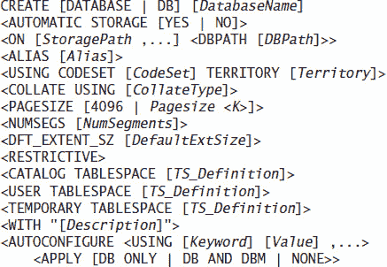

其中：

| :--- | :--- |
| `DatabaseName` | 标识分配给要创建数据库的唯一名称。 |
| `StoragePath` | 如果指定`AUTOMATIC STORAGE YES`（默认值），则标识一个或多个用于存放自动存储的表空间容器的存储路径。否则，标识物理存储与要创建的数据库相关的目录层次结构和文件的位置（驱动器或目录）。 |
| `DBPath` | 如果指定`AUTOMATIC STORAGE YES`（默认值），则标识物理存储与要创建的数据库相关的目录层次结构和元数据文件的位置（驱动器或目录）。如果未指定此参数且使用了自动存储，元数据文件将存储在`StoragePath`参数指定的第一个存储路径中。） |
| `Alias` | 标识分配给要创建数据库的别名。 |
| `CodeSet` | 标识用于存储要创建数据库中数据的字符集。（在 DB2 9 数据库中，每个单字节字符在内部均表示为 0 到 255 之间的唯一数字。该数字被称为字符的码点；特定字符集中每个字符的码点分配称为代码页；国际标准组织对代码页的术语是字符集。） |
| `Territory` | 标识用于存储要创建数据库中数据的区域。 |
| `CollateType` | 指定要创建的数据库使用的排序序列（即字符为了排序、合并和比较目的而排列的顺序）。该参数的有效值包括：COMPATABILITY, IDENTITY, IDENTITY_16BIT, UCA400_NO, UCA400_LSK, UCA400_LTH, NLSCHAR 和 SYSTEM。 |
| `NumSegments` | 指定用于创建和存储要创建的数据库使用的默认 SMS 表空间`(TEMPSPACE1)`文件的目录数量。 |
| `DefaultExtSize` | 指定每当创建表空间且在创建过程中未指定区段大时，使用的默认区段大小。 |
| `Description` | 用于描述数据库目录中为要创建的数据库生成的条目的注释。描述必须包含在双引号内。 |
| `Keyword` | `AUTOCONFIGURE`命令识别的一个或多个关键字。有效值包括`mem_percent, workload_type, num_stmts, tpm, admin_priority, is_populated, num_local_apps, num_remote_apps, isolation`和`bp_resizable.`。有关如何使用`AUTOCONFIGURE`命令的更多信息，请参考 *DB2 9 Command Reference*。 |
| `Value` | 标识与指定的`Keyword`关联的值。 |
| `TS_Definition` | 指定用于创建存放系统目录表 (SYSCATSPACE)、用户定义对象 (USERSPACE1) 和/或临时对象 (TEMPSPACE1) 的表空间定义。 |

定义系统管理 (SMS) 表空间的语法为：

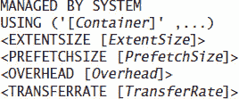

定义数据库管理 (DMS) 表空间的语法为：

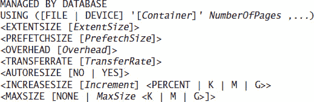

以及定义自动存储表空间的语法为：

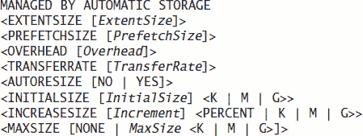

其中：

| :--- | :--- |
| `Container` | 标识用于存储分配给指定表空间的数据的一个或多个容器。对于 SMS 表空间，指定的每个容器必须标识一个有效的目录；对于 DMS `FILE`容器，指定的每个容器必须标识一个有效的文件；对于 DMS `DEVICE`容器，指定的每个容器必须标识一个存在的设备。 |
| `NumberOfPages` | 指定表空间容器使用的页数。 |
| `ExtentSize` | 指定以轮询方式写入到每个使用的表空间容器的数据页数。 |
| `PrefetchSize` | 指定在执行数据预取时，从指定的表空间读取的数据页数。 |
| `Overhead` | 标识与指定表空间容器相关的输入/输出 (I/O) 控制器开销和磁盘寻道延迟时间（毫秒）。 |
| `TransferRate` | 标识从表空间容器读取一页数据并将其存储在内存中所需的时间（毫秒）。 |


| `InitialSize` | 指定自动扩展的 DMS 或自动存储表空间应具有的初始大小。 |

| `Increment` | 指定启用了自动调整大小的表空间在满空间并收到空间请求时增加的量。 |

| `MaxSize` | 指定启用了自动调整大小的表空间可以增加到的最大大小。 |

如果指定了 `RESTRICTIVE` 子句，所创建数据库的 `RESTRICT_ACCESS` 数据库配置参数将设置为 `YES`，且不会向组 `PUBLIC` 授予任何权限。

假设你想创建一个具有以下特性的 DB2 数据库：

- 物理位于驱动器 E: 上。
- 不使用自动存储。
- 被配命名为 `SAMPLEDB`。
- 识别美国/加拿大字符集。（代码页与区域一起使用，将字母数字数据转换为存储在数据库中的二进制数据。）
- 将使用基于所用区域的排序序列（在本例中为美国/加拿大）。
- 不会自动允许 `PUBLIC` 组访问。
- 将系统目录存储在 DMS 表空间中，该表空间使用文件 `SYSCATSPACE.DAT` 作为容器。（该文件存储在 E: 盘上，能够容多 5,000 个大小为 4K 的页。）

在这种情况下，您将执行一个类似于下面的 `CREATE DATABASE` 命令：

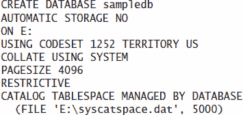

## 表空间

表空间用于控制数据的物理存储位置，并在数据库对象（如表、索引和视图）与实际存储对象数据的一个或多个容器（即目录、文件或原始设备）之间提供一个间接层。单个表空间可以跨越多个容器，但每个容器只能属于一个表空间。当表空间跨越多个容器时，数据将以轮询方式（以称为“区”的页组为单位）写入分配给该表空间的每个容器中；这有助于在属于给定表空间的所有容器之间平衡数据。

存在两种类型的表空间：系统管理空间 (SMS) 表空间和数据库管理空间 (DMS) 表空间。对于 SMS 表空间，只能使用目录容器进行存储，并且操作系统的文件管理器负责控制该空间的使用。SMS 存储模型由许多文件组成（每个文件代表一个表、索引或长数据对象），这些文件位于文件空间内——用户决定文件的位置，DB2 数据库管理器为文件分配名称，文件系统负责管理它们的增长。对于 DMS 表空间，只能使用文件和/或设备容器进行存储，并且 DB2 数据库管理器负责控制该空间的使用。

如果数据库启用了自动存储，则可能存在另一种类型的表空间——自动存储表空间。尽管从乍上看，自动存储表空间似乎是第三种表空间，但它们实际上是 SMS 和 DMS 表空间的扩展：普通和大型表空间被创建为带有一个或多个文件容器的 DMS 表空间；系统和用户临时表空间被创建为带有一个或多个目录容器的 SMS 表空间。与定义 SMS 和 DMS 表空间不同，自动存储表空间不需要容器定义；DB2 数据库管理器会自动为自动存储表空间分配容器。

### 创建新表空间

之前我们看到，在创建 DB2 数据库时，会创建一个名为 `IBMDEFAULTBP` 的缓冲池，并创建三个表空间，作为数据库初始化过程的一部分与该缓冲池关联。可以通过执行 `CREATE TABLESPACE` SQL 语句来创建额外的表空间。该语句的基本语法如下：

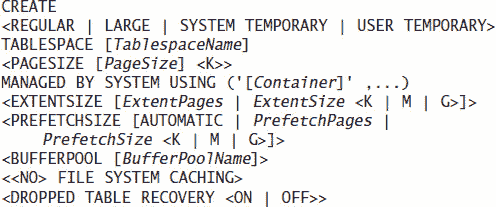

或

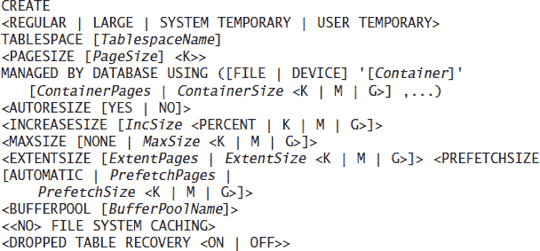

或

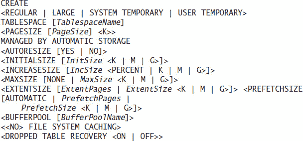

其中：

| `TablespaceName` | 标识要分配给要创建表的名称。 |

| `PageSize` | 指定正在创建的表空间所使用的每个页的大小。此参数的有效值为：4,096; 8,192；16,384 或 32,768 字节——如果提供了后缀 K（千字节），则此参数必须设置为 4、8、16 或 32。除非另有指定，表空间使用的页大小为 4K。 |

| `Container` | 通过名称标识用于存储与要创建的表空间相关数据的一个或多个容器。 |

| `ContainerPages` | 以页数标识为在 `Container` 参数中标识的容器预分配的存储量。 |

| `ContainerSize` | 标识为在 `Container` 参数中标识的容器预分配的存储量。此参数指定的值被视为总字节数，除非还指定了字母 K（千字节）、M（兆字节）或 G（吉字节）。（如果指定了 `ContainerSize` 值，它将使用提供的 `PageSize` 值转换为 `ContainerPages` 值。） |

| `InitSize` | 标识为自动调整大小的 DMS 或自动存储表空间预分配的存储量。 |

| `IncSize` | 标识启用自动调整大小的表空间在满空间且收到更多空间请求时自动增加的增量。 |

| `MaxSize` | 标识启用自动调整大小的表空间可以自动增加的最大大小。 |

| `ExtentPages` | 标识在另一个容器之前要写入单个表空间容器的数据页数。 |

| `ExtentSize` | 标识在另一个容器之前要写入单个表空间容器的数据量。此参数指定的值被视为总字节数，除非还指定了字母 K（千字节）、M（兆字节）或 G（吉字节）。（如果指定了 `ExtentSize` 值，它将使用提供的 `PageSize` 值转换为 `ExtentPages` 值。） |

| `PrefetchPages` | 标识在执行数据预取时从表空间读取的数据页数（预取允许在引用之前读取查询所需的数据，以便查询减少等待 I/O 的时间）。 |

| `PrefetchSize` | 标识在执行数据预取时从表空间读取的数据量。此参数指定的值被视为总字节数，除非还指定了字母 K（千字节）、M（兆字节）或 G（吉字节）。（如果指定了 `PrefetchSize` 值，它将使用提供的 `PageSize` 值转换为 `PrefetchPages` 值。） |

| `BufferPoolName` | 标识要创建的表空间使用的缓冲池名称。（指定的缓冲池页大小必须与要创建的表的页大小匹配，否则 `CREATE TABLESPACE` 语句将失败。） |

如果执行此语句的 `MANAGED BY SYSTEM` 版本，生成的表空间将是 SMS 表空间。另一方面，如果执行 `MANAGED BY DATABASE` 版本，生成的表空间是 DMS 表空间。此外，如果要创建 SMS 表空间，只能使用现有的目录作为该表空间的容器；如果要创建 DMS 表空间，只能使用固定大小的预分配文件或物理原始设备作为该表空间的容器。

因此，如果您想创建一个名为 `SALES_TS`、页大小为 4 千字节、使用目录 `C:\TBSP1`、`C:\TBSP2` 和 `C:\TBSP3` 作为存储容器并使用缓冲池 `IBMDEFAULTBP` 的 SMS 表空间，可以执行类似于下面的 `CREATE TABLESPACE` SQL 语句：

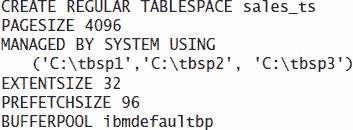

另一方面，如果您想创建一个名为 `PAYROLL_TS`、页大小为 8 千字节、使用文件 `DMS_TBSP.TSF`（大小为 1,000 兆字节并位于目录 `C:\TABLESPACES`）作为存储容器并使用缓冲池 `PAYROLL_BP` 的 DMS 表空间，可以执行类似于下面的 `CREATE TABLESPACE` SQL 语句：

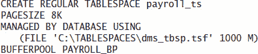

最后，如果您想创建一个名为 `HR_TS` 并使用缓冲池 `IBMDEFAULTBP` 的自动存储表空间，可以执行类似于下面的 `CREATE TABLESPACE` SQL 语句：

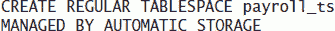

 如果数据库启用了自动存储，则可以完全省略 `MANAGED BY AUTOMATIC STORAGE` 子句——其缺失意味着启用了自动存储。在这种情况下，不提供任何容器定义，因为 `DB2 Database Manager` 会自动分配容器。

### 修改现有的表空间

由于 SMS 表空间依赖操作系统进行物理存储空间管理，因此它们在成功创建后很少需要进行修改。另一方面，必须密切监控 DMS 表空间，以确保其用于存储的固定大小预分配文件或物理原始设备始终有足够的空闲空间可用来满足数据库的需求。当 DMS 表空间的可用空闲存储空间变得非常低水平（通常小于 10%）时，你可以通过增加其中一个或多个容器的大小，或者通过向其添加一个或多个新容器来增加更多空闲空间。可以通过执行 `ALTER TABLESPACE` SQL 语句来调整现有表空间容器的大小、为现有表空间提供新容器，并更改现有表空间的属性。该语句的基本语法如下：

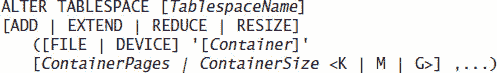

或

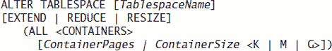

或


或

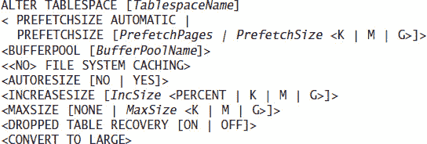

其中：

| `TablespaceName` | 标识分配给要修改表空间的名称。 |

| `Container` | 标识要向指定的表空间添加、调整大小或删除的一个或多个容器。 |

| `ContainerPages` | 标识在 `Container` 参数中标识的所有容器或某个容器要添加、移除或分配的存储量（以页数计算）。 |

| `ContainerSize` | 标识在 `Container` 参数中标识的所有容器或某个容器要添加、移除或分配的存储量。除非指定了字母 K（千字节）、M（兆字节）或 G（吉字节），否则此参数指定的值被视为总字节数。（如果指定了 `ContainerSize` 值，则将根据所提供的表空间的页大小将其转换为 `ContainerPages` 值。） |

| `PrefetchPages` | 标识在执行数据预取时，从表空间读取的数据页数。 |

| `PrefetchSize` | 标识在执行数据预取时，从表空间读取的数据量。除非指定了字母 K（千字节）、M（兆字节）或 G（吉字节），否则此参数指定的值被视为总字节数。（如果指定了 `PrefetchSize` 值，则将根据被修改表空间的页大小将其转换为 `PrefetchPages` 值。） |

| `BufferPoolName` | 标识被修改表空间将使用的缓冲池名称。（指定的缓冲池页大小必须与被修改表空间使用的页大小匹配。） |

| `IncSize` | 标识启用自动调整大小的表空间在满且收到更多空间请求时，自动增加的量。 |

| `MaxSize` | 标识启用自动调整大小的表空间可以自动增加的最大大小。 |

因此，如果你想创建一个名为 `NEWFILE.TSF`、大小为 1,000 兆字节且位于 `C:\TABLESPACES\` 目录的固定大小预分配文件，作为名为 `PAYROLL_TS` 的现有 DMS 表空间的新存储容器，可以通过执行如下所示的 `ALTER TABLESPACE` SQL 语句来实现：

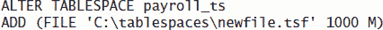

另一方面，如果你想修改名为 `PAYROLL_TS` 的现有 DMS 表空间，使其自动增长到 400 兆字节的最大大小，可以通过执行如下所示的 `ALTER TABLESPACE` SQL 语句来实现：


### 范围分区表

虽然表空间用于控制数据的物理存储位置，并在数据库对象（如表、索引和视图）与对象数据实际所在的一个或多个容器（即目录、文件或原始设备）之间提供间接层，但数据库对象在创建时分配到表空间的方式决定了数据在磁盘上的物理存储方式。通过利用 DB2 9 中引入的新功能——表分区，可以进一步控制表数据的物理存储。

表分区（也称为范围分区）是一种数据组织方案，它根据一或多个列的值，将表数据划分到多个称为数据分区或范围的存储对象中。每个数据分区都单独存储，且所使用的存储对象可以是不同的表空间、同一个表空间，或两者的结合。表分区提高了性能，并消除了使用数据分区功能创建分区数据库的需要。

使用表分区的其他优势还包括：

**数据的轻松卷入和卷出。** 卷入分区表数据允许将新范围作为额外的数据分区轻松地合并到分区表中。卷出分区表数据允许你轻松地从分区表中分离数据范围，以便后续的清理或归档。可以使用 `ALTER TABLE` 语句的 `ATTACH PARTITION` 和 `DETACH PARTITION` 子句快速卷入和卷出数据；一旦卷入，即可通过执行 `SET INTEGRITY` 语句使新附加的数据分区上线。

**更易管理大表。** 表级管理变得更加灵活，因为可以在单个数据分区上执行管理任务。此类任务包括数据分区的分离和重新附加、单个数据分区的备份和恢复以及重新组织单个索引。此外，通过将耗时的维护操作分解为一系列较小的操作，可以缩短时间。例如，当每个数据分区放在不同的表空间时，可以在数据分区级别执行备份操作。因此，可以一次备份分区表的一个数据分区。

**灵活的索引放置。** 通过表分区，索引可以放在不同的表空间，从而对索引的放置进行更细粒度的控制。

**更好的查询处理。** 在解析查询的过程中，可能会根据使用的查询谓词自动消除一个或多个数据分区。这种功能被称为分区消除（Data Partition Elimination），提高了许多决策支持查询的性能，因为在返回结果集之前需要分析的数据更少。

来自给定表的数据根据 `CREATE TABLE` 语句中 `PARTITION BY` 子句提供的规范被划分到多个存储对象。该可选子句的语法如下：

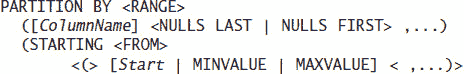

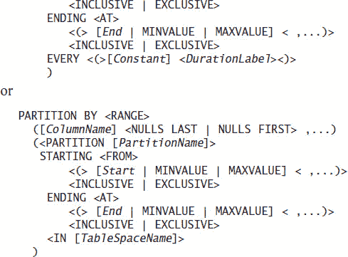

其中：

| `ColumnName` | 标识一个或多个列，其值将用于确定特定行应存储在哪个数据分区中。（指定的列组构成了表的分区键。） |

| `PartitionName` | 标识分配给创建的数据分区的唯一名称。 |

| `Start` | 指定每个数据分区范围的低端。 |

| `End` | 指定每个数据分区范围的高端。 |

| `Constant` | 当使用自动生成的语法时，指定每个数据分区范围的宽度。数据分区将从 `STARTING FROM` 值开始创建，并且该范围内包含此数量的值。只有当分区键由单个分配了数值、日期、时间或时间戳数据类型的列组成时，才支持这种语法形式。 |

| `DurationLabel` | 如果分区键列已分配了日期、时间或时间戳数据类型，则标识与指定的 `Constant` 值相关的持续时间。此参数的有效值为：`YEAR`、`YEARS`、`MONTH`、`MONTHS`、`DAY`、`DAYS`、`HOUR`、`HOURS`、`MINUTE`、`MINUTES`、`SECOND`、`SECONDS`、`MICROSECOND` 和 `MICROSECONDS`。 |

| `TableSpaceName` | 指定每个数据分区所在的表空间。 |

因此，如果你想创建一个名为 `SALES` 的表，并对其进行分区，使得每个季度的数据存储在不同的数据分区中，且每个分区位于不同的表空间中，你可以通过执行类似下面的 `CREATE TABLE` SQL 语句来实现：

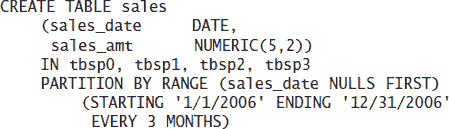

另一方面，如果你想创建一个名为 `DEPARTMENTS` 的表，并对其进行分区，使得数值在 0 到 9 范围内的行存储在一个位于某个表空间的分区中，数值在 10 到 19 范围内的行存储在另一个表空间的另一个中，以此类推，你可以通过执行类似下面的 `CREATE TABLE` SQL 语句来实现：

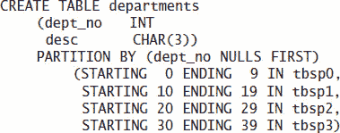

需要注意的是，当为范围分区表创建索引时，除非另有指定，否则索引的数据将存储在存储第一个分区数据的表空间中。

## 数据行压缩

除了表分区和 pureXML 之外，DB2 9 引入的最显著特性之一是能够使用所谓的**数据行压缩**（data row compression）来减少存储表数据所需的存储空间。虽然数据行压缩的主要目的是节省存储空间，但它还能显著减少磁盘 I/O 开销并提高缓冲池命中率。（内存中可以缓存更多数据。）所有这些都可能导致性能的提升，但并非没有代价——压缩和解压缩数据需要额外的 CPU 周期。

数据行压缩的工作原理是搜索数据中重复的模式，并将这些模式替换为 12 位符号，这些符号与它们所代表的模式一起存储在静态字典中。（一旦创建了此字典，它就会与压缩数据一起存储在表中，并在每次访问表数据时将其加载到内存中以帮助解压缩。）这是通过扫描整个表并查找重复的列值，以及跨行多列的重复模式来实现的。DB2 还会查找作为给定列子字符串的重复模式。然而，仅仅发现重复模式并不意味着数据会自动压缩——数据只有在能够实现存储节省的地方才会被压缩。图 3–2 展示了数据行压缩的工作原理。

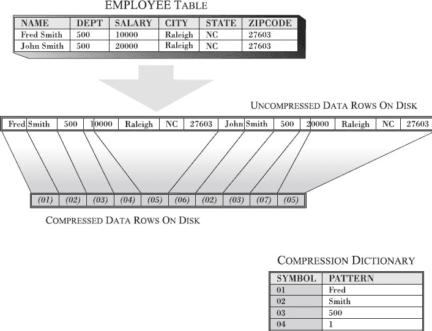

*图 3–2：数据行压缩的工作原理。*

为了在表中使用数据行压缩，必须满足两个前提条件：

1. 必须在表级启用压缩。
2. 必须为该表构建压缩字典。

### 为表启用数据行压缩

通过执行 `CREATE TABLE` SQL 语句或指定 `COMPRESS YES` 选项的 `ALTER TABLE` 可以在表级启用压缩。例如，如果你想创建一个名为 `EMPLOYEE` 的新表并启用数据行压缩，你可以通过执行类似下面的 `CREATE TABLE` 语句来实现：

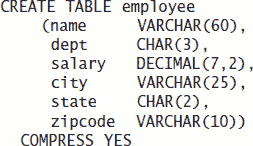

另一方面，如果你想对现有名为 `EMPLOYEE` 的表启用数据行压缩，可以通过执行类似下面的 `ALTER TABLE` 语句来实现：


### 构建压缩字典

虽然你可以随时通过将表的 `COMPRESS` 属性设置为 `YES` 来为表启用数据行压缩，但在构建压缩字典之前，存储在表中的数据不会压缩。压缩字典是通过离线表重组操作构建的（表中的数据也会在此被压缩）；此类操作通过执行指定 `KEEPDICTIONARY` 或 `RESETDICTIONARY` 选项的 `REORG` 命令启动。如果执行指定选项的 `REORG` 命令且不存在压缩字典，则将构建新字典；如果执行指定选项的 `REORG` 命令且字典已存在，表中的数据将重新重组/压缩，且现有字典将被重建 (`RESETDICTIONARY`) 或保持原样 (`KEEPDICTIONARY`)。


因此，如果你想为已启用数据行压缩的 `EMPLOYEE` 表创建一个新的压缩字典（并压缩现有数据），你可以通过执行类似下面的 `REORG` 命令来实现：


当执行此命令时，`EMPLOYEE` 表中存储的数据将进行分析，构建压缩字典并存储在表的开头，数据将被压缩并直接写入压缩字典后面的表中。

需要注意的是，索引数据不受数据行压缩的影响；只有存储在基表页上的数据可以被压缩。然而，由于压缩表中的记录是以压缩形式在存储和内存之间移动的（压缩字典也会移动到内存中以便进行解压缩），写入事务日志文件的压缩表记录也将被压缩。

### 估算数据行压缩的存储节省

由于需要离线重组操作来构建压缩字典并执行数据压缩，压缩数据所需的初始开销可能很高。因此，了解哪些表将从数据行压缩中受益最多，哪些表不会受益是有益的。在 DB2 9 中，`Inspect` 工具可以帮助你做出此判断。通过执行 `INSPECT` 命令调用 `Inspect` 工具，如果指定 `ROWCOMPESTIMATE` 选项执行该命令，`Inspect` 工具将检查指定表中的每一行，从发现的数据构建压缩字典，然后使用该字典估计如果压缩表中的数据将节省多少空间。

因此，如果你想估算压缩名为 `EMPLOYEE` 表中的数据将节省多少存储空间，可以通过执行类似下面的 `INSPECT` 命令来实现：


## 练习题

### 问题 1

执行以下命令：


创建了多少个 DMS 空间？

 A. 0

 B. 1

 C. 2

 D. 3

### 问题 2

在创建新的 DB2 9 数据库时，哪个功能不是自动启用的？

 A. 自动维护

 B. 自调优内存管理器

 C. 健康监控器

 D. 数据行压缩

### 问题 3

如果执行以下 `CREATE DATABASE` 命令：

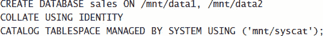

关于生成的数据库，以下哪个说法不正确？

 A. 为数据库启用了自动存储

 B. 将使用 SMS 表空间来存储系统目录

 C. 用户数据将存储在 `/mnt/data1` 和 `/mnt/data2` 上

 D. 数据库的元数据将存储在 `/mnt/data2` 上

### 问题 4

数据库管理员想要创建一个名为 `PAYROLL` 的 DB2 9 数据库，并启用自动存储。数据库的存储容器应位于 `/home/data1` 和 `/home/data2`；数据库的元数据文件应位于 `/home/dbase`。

为了实现这一目标必须执行以下哪个命令？

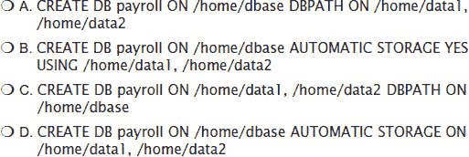

### 问题 5

通过执行以下命令创建名为 `TBSP1` 的表空间：

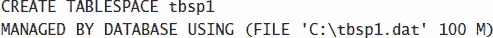

在允许表空间 `TBSP1` 自动增长到 1000 MB 之前，必须执行以下哪些 SQL 语句？

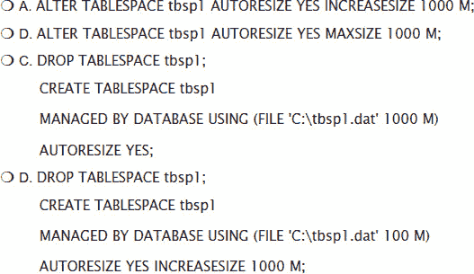

### 问题 6

通过执行以下命令创建名为 `TBSP1` 的表空间：

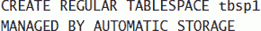

关于表空间 `TBSP1`，以下哪个说法不正确？

 A. 表空间将作为带有文件容器的 DMS 表空间创建。

 B. 表空间的最大大小默认为 2 GB（`MAXSIZE 2 G`）。

 C. 表空间的初始大小可以使用 `INITIALSIZE` 选项指定。

 D. 默认开启自动调整大小（`AUTORESIZE YES`）。

### 问题 7

以下哪个说法将创建一个名为 `PARTS` 的表，该表经过分区，使得部件号在 0 到 33 范围内的行存储在位于一个表空间的分区中，部件号在 34 到 66 范围内的行存储在位于另一个表空间的另一个分区中，部件号在 67 到 99 范围内的行存储在位于第三个表空间的第三个分区中？

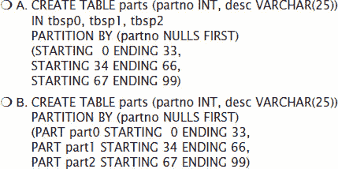

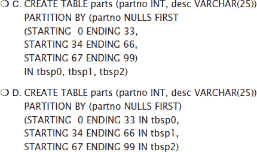

### 问题 8

按照所示顺序执行以下语句：

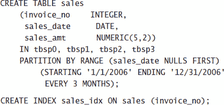

哪些表空间将包含 `SALES_IDX` 索引的数据？

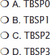

### 问题 9

为了向范围分区表添加新的数据分区并使其联线，必须执行以下哪两个 SQL 语句？

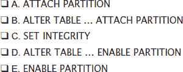

### 问题 10

以下哪项不是表分区的益处？

 A. 允许轻松创建独立的数据范围以便后续删除或存档。

 B. 提供数据分区消除以提高查询性能。

 C. 允许将索引放在不同的表空间，从而对索引放置进行更细粒度的控制。

 D. 维护聚类性，减少重新组织表的需求。

### 问题 11

为了对表使用数据行压缩，必须存在以下哪项？

 A. 压缩索引

 B. 压缩字典

 C. 用户定义的压缩算法

 D. 仅包含字符类型列的表

### 问题 12

在讨论数据行压缩时，以下哪个说法是无效的？

 A. 数据行压缩可以节省磁盘 I/O 并提高缓冲池命中率。

 B. 在行级上压缩数据是有优势的，因为它允许将跨行内多个列的重复模式替换为更短的符号。

 C. 可以执行指定 `COMPRESS YES` 选项的 `ALTER TABLE` 语句启用表的数据行压缩。

 D. 只有启用数据行压缩的表数据会被压缩；相应索引和事务日志中的数据不被压缩。

### 问题 13

以下哪两个工具可以创建压缩字典？

 A. `reorg`

 B. `db2pd`

 C. `inspect`

 D. `runstats`

 E. `db2buildcd`

### 问题 14

在使用 `REORG` 命令时可以使用哪些选项在压缩存储在表中的数据之前构建新的压缩字典？

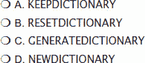

## 答案

### 问题 1

正确答案是 **C.** 当创建一个新的 DB2 9 数据库时，会创建三个表空间并与 `IBMDEFAULTBP` 缓冲池关联。这三个表空间如下：

- 一个名为 `SYSCATSPACE` 的普通表空间，用于存储与数据库关联的系统目录表和视图。
- 一个名为 `USERSPACE1` 的普通表空间，用于存储所有用户定义对象（如表、索引等）以及用户数据、索引数据和长值数据。
- 一个名为 `TEMPSPACE1` 的系统临时表空间，作为数据排序、重新组织表和创建索引等操作的临时存储区域。

除非另有说明，`SYSCATSPACE` 和 `USERSPACE1` 将是 DMS 文件表空间，`TEMPSPACE1` 将是 SMS 表空间；每个表的特性可以作为输入提供给 `CREATE DATABASE` 命令或创建数据库向导。

### 问题 2

正确答案是 **D.** 每当创建一个新的 DB2 9 数据库时，默认都会启用以下功能：

- 自动维护（数据库备份、表和索引重组、数据访问优化和统计分析）。
- 自调优内存管理器（包缓存、锁定内存、排序内存、数据库共享内存和缓冲池内存）。
- 实用程序节流。
- 健康监控器（Health Monitor）。

### 问题 3

正确答案是 **D.** 示例中使用的 `CREATE DATABASE` 命令语法可以分解为如下所示：

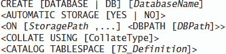

| 参数 | 描述 |
| :--- | :--- |
| `DatabaseName` | 标识分配给要创建数据库的唯一名称。 |
| `StoragePath` | 如果指定 `AUTOMATIC STORAGE YES`（默认值），则识别用于存放自动存储的表空间容器的一个或多个存储路径。否则，识别物理存储与要创建数据库相关的目录层次和文件的位置（驱动器和/或目录）。 |
| `DBPath` | 如果指定 `AUTOMATIC STORAGE YES`（默认值），则识别物理存储与要创建数据库相关的目录层次和元数据文件的位置（驱动器和/或目录）（如果未指定此参数并使用自动存储，元数据文件将存储在 `StoragePath` 参数指定的第一个存储路径中）。 |
| `CollateType` | 指定要创建的数据库使用的排序序列（即为了排序、合并和比较而对字符排序的顺序）。该参数的有效值有：`COMPATABILITY`、`IDENTITY`、`IDENTITY_16BIT`、`UCA400_NO`、`UCA400_LSK`、`UCA400_LTH`、`NLSCHAR` 和 `SYSTEM`。 |
| `TS_Definition` | 指定用于创建存储系统目录表（`SYSCATSPACE`）的表空间的定义。 |

在这种情况下，默认启用了自动存储，并将使用存储路径 `/mnt/data1` 和 `/mnt/data2` 来存放自动存储所使用的表空间容器。由于没有指定数据库路径，与数据库相关的元数据文件将存储在第一个存储路径（`/mnt/data1`）中。

### 问题 4

正确答案是 **C.** 在此场景中，`CREATE DATABASE` 命令的语法如下：

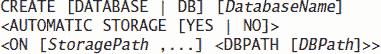

| 列 | 描述 |
| :--- | :--- |
| `DatabaseName` | 标识要分配给要创建数据库的唯一名称。 |
| `StoragePath` | 如果指定了 `AUTOMATIC STORAGE YES`（默认值），则识别一个或多个用于存放自动存储所使用的表空间容器的存储路径。否则，则识别物理存储要创建的数据库相关的目录层次和文件的位置（驱动器或目录）。 |
| `DBPath` | 如果指定了 `AUTOMATIC STORAGE YES`（默认值），则识别物理存储要创建的数据库相关的目录层次和元数据文件的位置（驱动器或目录）。（如果没有指定此参数且使用了自动存储，则元数据文件将存储在 `StoragePath` 参数指定的第一个存储路径中。） |

由于在创建 DB2 9 数据库时默认启用自动存储，以下 `CREATE DATABASE` 命令将创建一个数据库，其存储容器位于 `/home/data1` 和 `/home/data2`，而其元数据文件位于 `/home/dbase`：


### 问题 5

正确答案是 **B.** 可以通过执行 `ALTER TABLESPACE` SQL 语句更改现有表空间的属性。在此场景中，`ALTER TABLESPACE` 语句的基本语法如下：

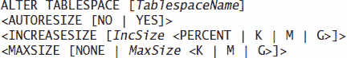

| 列 | 描述 |
| :--- | :--- |
| `TablespaceName` | 标识分配给要修改的表空间的名称。 |
| `IncSize` | 标识当启用自动调整大小的表空间满并请求更多空间时，自动增加的增量。 |
| `MaxSize` | 标识启用自动调整大小的表空间可以自动增加到的最大尺寸。 |

因此，如果您想更改名为 `TBSP1` 的现有 DMS 表空间，使其自动增长到 1000 MB 的最大尺寸，可以执行如下所示的 `ALTER TABLESPACE` SQL 语句：


### 问题 6

正确答案是 **B.** 由于没有指定最大尺寸（使用 `CREATE TABLESPACE` 语句的 `MAXSIZE` 选项），默认使用 `MAXSIZE NONE`，并且对表空间的大小没有限制。

### 问题 7

正确答案是 **D.** 来自给定表的数据根据 `CREATE TABLE` 语句中 `PARTITION BY` 子句提供的规范被分区到多个存储对象。该可选子句的语法如下：

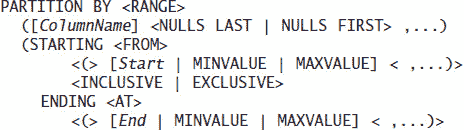

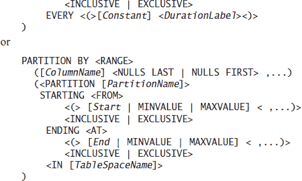

| 列 | 描述 |
| :--- | :--- |
| `ColumnName` | 通过名称标识一个或多个列，其值将用于确定特定行存储在哪个数据分区中。（指定的列组构成了表的分区键。） |
| `PartitionName` | 标识分配给要创建的数据分区的唯一名称。 |
| `Start` | 指定每个数据分区范围的低端。 |
| `End` | 指定每个数据分区范围的高端。 |
| `Constant` | 当使用自动生成的语法形式时，指定每个数据分区范围的宽度。数据分区将从 `STARTING FROM` 值开始创建，并包含该范围内相应数量的值。这种形式的语法仅当分区键由单个已分配数值、日期、时间或时间戳数据类型的列组成时才支持。 |
| `DurationLabel` | 如果分区键列已分配了日期、时间或时间戳数据类型，则标识与指定的 `Constant` 值相关的持续时间。该参数的有效值为：`YEAR`、`YEARS`、`MONTH`、`MONTHS`、`DAY`、`DAYS`、`HOUR`、`HOURS`、`MINUTE`、`MINUTES`、`SECOND`、`SECONDS`、`MICROSECOND` 和 `MICROSECONDS`。 |
| `TableSpaceName` | 标识每个数据分区存储的表空间。 |

因此，如果您想创建一个名为 `PARTS` 的表，并进行分区使得数值落在 0 到 33 范围内的行被存储在位于一个表空间的分区中，数值落在 34 到 66 范围内的行存储在位于另一个表空间的另一个分区中，依此类推，您可以执行类似所示的 `CREATE TABLE` SQL 语句：


### 问题 8

正确答案是 **A.** 当为范围分区表创建索引时，除非另有指定，否则该索引的数据将存储在用于存放第一个分区数据的表空间中。由于在示例中使用了以下 `CREATE INDEX` SQL 语句为 `SALES` 表创建索引：


名为 `SALES_IDX` 的索引数据将存储在名为 `TBSP0` 的表空间中。

### 问题 9

正确答案是 **B** 和 **C.** 可以使用 `ALTER TABLE` 语句的 `ATTACH PARTITION` 子句轻松地将新范围合并到分区表中；一旦合并（roll in），通过执行 `SET INTEGRITY` 语句即可使新附加的数据分区上线。

### 问题 10

正确答案是 **D.** 表分区提高了性能，并消除了需要使用数据分区功能（Data Partitioning Feature）创建分区数据库的需求。使用表分区的其他优势包括：数据易于载入和导出、大表更容易管理、灵活的索引放置以及更好的查询处理。

### 问题 11

正确答案是 **B.** 为了对表使用数据行压缩，必须满足两个前提条件：

1. 必须在表级别启用压缩。
2. 必须为表构建压缩字典。

### 问题 12

正确答案是 **D.** 索引数据不受数据行压缩的影响；只有存储在基础表上的数据可以被压缩。然而，由于压缩表中的记录以压缩形式在存储和内存之间移动（压缩字典也会移动到内存中以便解压缩），写入事务日志文件的压缩表记录也将被压缩。

### 问题 13

正确答案是 **A** 和 **C.** 虽然可以通过将其 `COMPRESS` 属性设置为 `YES` 来随时对表启用数据行压缩，但在构建压缩字典之前，存储在表中的数据不会被压缩。通过执行离线表重组操作可以构建压缩字典（并压缩表中的数据）；此类操作通过执行指定了 `KEEPDICTIONARY` 或 `RESETDICTIONARY` 选项的 `REORG` 命令来启动。

因为需要离线重组操作来构建压缩字典并执行数据压缩，压缩数据所需的初始开销可能相当。因此，了解哪些表将从数据行压缩中受益最多，以及哪些表不会受益将是有益的。在 DB2 9 中，`Inspect` 工具可以帮助你做出这种判断。通过执行 `INSPECT` 命令可以调用 `Inspect` 工具，如果在执行此命令时指定了 `ROWCOMPESTIMATE` 选项，`Inspect` 工具将检查指定表中的每一行，从发现的数据构建压缩字典，然后使用该字典估计如果压缩表中的数据，将节省多少空间。

### 问题 14

正确答案是 **B.** 通过执行离线表重组操作来构建压缩字典（并压缩表中的数据）；此类操作通过执行指定了 `KEEPDICTIONARY` 或 `RESETDICTIONARY` 选项的 `REORG` 命令启动。如果执行 `REORG` 命令时指定了任一选项且不存在压缩字典，则将构建新字典；如果执行 `REORG` 命令时指定了任一选项且已存在字典，则表中的数据将被重组/压缩，且现有字典将被重建（`RESETDICTIONARY`）或保持不变（`KEEPDICTIONARY`）。

# 第 4 章

## XML 概念


百分之十三（13%）的 `DB2 9 Linux、Unix 和 Windows` 数据库管理升级考试（考试 736）旨在测试你在 `DB2 9` 数据库中存储和操作 XML 数据的知识。构成此部分的题目旨在评估以下内容：

- 你使用新的 XML 数据类型的能力
- 你对 `XQuery` 基础知识的掌握
- 你创建和管理 XML 索引的能力
- 你使用基本 XML 函数（如 `XMLPARSE()`、`XMLSERIALIZE()`、`XMLVALIDATE()` 和 `XMLQUERY()`）的能力
- 处理 XML 数据时使用 `DB2` 数据移动工具的知识

本章旨在向你介绍 XML 以及可用的 XML 函数，并引导你构建简单的 `XQuery` 表达式。本章还旨在向你展示如何创建 XML 索引，以及如何使用 `DB2` 数据移动工具来处理 XML 数据。

## 处理 XML 数据

`DB2 9` 的 `pureXML` 技术通过提供简单高效的 XML 访问，释放了 XML 的潜能，同时提供了与关系型数据同水平的安全性、完整性和恢复能力。这些 `pureXML` 技术作为 `DB2 Express Edition`、`DB2 Workgroup Server Edition` 和 `DB2 Enterprise Server Edition` 的附加功能可用；然而，它是 `DB2 Express-C` 的一部分，且 `pureXML` 的包含在基础 `DB2 Express-C` 许可中。

通过 `pureXML`，XML 数据存储在层次结构中，这种结构自然反映了 XML 文档的结构。这种结构结合创新的索引技术，允许 `DB2` 高效管理 XML 数据，同时消除了在关系数据库中存储 XML 数据所需的复杂且耗时的解析。然而，在使用 `pureXML` 时存在限制：

- `pureXML` 只能用于单分区数据库。
- 使用任何 `pureXML` 功能都将防止未来使用 `DB2 Enterprise Server Edition (ESE)` 中的数据库分区功能（`DPF`）。
- `pureXML` 不能用于 `DB2 Data Warehouse Edition (DWE)`，因为 `DWE` 使用 `DB2 ESE` 和 `DPF`。

为了利用 `pureXML` 功能，必须使用 `UTF-8` 字符集创建数据库。`UTF-8` 字符集通过 `CREATE DATABASE` 命令的 `USING CODESET` 选项指定；要创建一个名为 `XML_DB` 的使用 `UTF-8` 字符集的数据库，你必须执行类似于下面的 `CREATE DATABASE` 命令：


## XML 数据类型和 XML 列

为了支持 `pureXML`，`DB2 9` 引入了一种名为 `XML` 的新数据类型。该数据类型用于定义存储 XML 值的列。存储的每个 XML 值必须是良好的 XML 文档；良好的 XML 文档看起来如下：


XML 文档以 XML 声明开始；XML 声明看起来如下：


或：


XML 声明之后是一个或多个属性和元素。所有的 XML 元素都包含在起始和结束标签中；XML 元素看起来如下：


需要注意的是，使用的起始和结束标签对大小写敏感——标签 `<Letter>` 与标签 `<letter>` 不同。因此，起始和结束标签必须以相同的大小写。

XML 属性通常用于描述 XML 元素或提供元素的附加信息。属性始终包含在元素的起始标签内，且属性值必须始终引用。以下是一些示例：


属性在 HTML 中非常方便，但在 XML 中，每当可以使用元素表达相同信息时，你应该尽量避免使用属性。以下示例传递了相同的信息：


在第一个示例中，`SEX` 是一个属性。在最后一个示例中，`SEX` 是一个元素。

要创建带有 XML 列的表，你需要在 `CREATE TABLE` 语句中指定 `XML` 数据类型的列。（表可以有一个或多个 XML 列。）像 LOB 列一样，XML 列只持有列的描述符。数据本身被单独存储。与 LOB 列不同，你可以在定义 XML 列时不需要指定长度。

因此，要创建一个名为 `CUSTOMER`、包含名为 `CUSTINFO` 的 XML 列的表，你需要执行类似于下面的 `CREATE TABLE` 语句：


XML 列具有以下限制：

- 它们不能通过 `WITH DEFAULT` 子句指定默认值；如果列允许为空，则该列的默认值为 `NULL`。
- 它们不能在 `CHECK` 约束中引用（`VALIDATED` 谓词除外）。
- 它们不能在生成列中引用。
- 它们不能包含在类型表和类型视图中。
- 它们不能用于范围聚类表（RCT）。
- 它们不能用于范围分区表。
- 它们不能用于多维聚类（MDC）表。
- 它们不能被添加到定义了 Type-1 索引的表中（注意 Type-1 索引是已弃用的索引；自 `DB2 UDB` 版本 8.1 以来创建的索引都是 Type-2 索引）。
- 它们不能在滚动光标的选择列表中指定。
- 它们不能在 `CREATE TRIGGER` 语句的触发操作中引用。
- 它们不能作为键的列，包括主键、外键和唯一键；多维聚类（MDC）表的维度键；范围聚类表的序列键；分布键；数据分区键。
- 它们不能用于带有分布键的表。
- 除了 XML 数据的索引外，它们不能是任何索引的一部分。
- 在检索 XML 数据时，它们会导致禁用数据阻塞。
- 它们不能使用数据行压缩压缩。

## 操作 XML 数据

像传统数据一样，XML 文档可以添加到数据库表中、进行修改、删除和检索，这些可以使用 SQL 数据操作语言语句（`INSERT`、`UPDATE`、`DELETE` 和 `SELECT` 语句）。

通常，XML 文档（如 XML 1.0 规范定义）是由应用程序进行处理的；当从应用程序执行 DML 操作时，IBM 建议通过主机变量而非字面量来处理 XML 数据，以便 `DB2` 能够使用主机变量数据类型来确定处理时所需的某些编码信息。

尽管您可以使用 XML、二进制或字符类型来操作 XML 数据，但 IBM 建议您使用 XML 或二进制类型，以避免代码页转换问题。

应用程序中使用的 XML 数据通常存储在序列化字符串格式中——当这些数据被插入 XML 列或当 XML 列中的数据被更新时，必须将其转换为其 XML 层次级格式。

如果使用的应用程序数据类型是 `XML` 数据类型，`DB2` 会隐式地执行此操作。然而，如果应用程序数据类型是字符或二进制数据类型，则在插入和更新操作期间，必须使用 `XMLPARSE()` 函数显式地将数据从序列化字符串格式转换为 XML 层次级格式。

一个使用 `XMLPARSE()` 函数将字符串值插入名为 `CUSTOMERS` 表中 `CUSTINFO` XML 列的简单 `INSERT` 语句可能如下：


当使用命令行处理器（Command Line Processor）处理存储在 XML 列中的 XML 文档时，插入、更新和删除操作可以将字符串数据直接分配给 XML 列，无需显式调用 `XMLPARSE()` 函数。例如，假设您想向具有以下特征的 `CUSTOMER` 表添加一条包含 XML 数据的记录：

| 列名 | 数据类型 |
| :--- | :--- |
| `CUSTID` | `INTEGER` |
| `INFO` | `XML` |

您可以通过从命令行处理器执行如下的 `INSERT` 语句来实现：


如果您想从命令行处理器更新此记录的 XML 数据部分，可以通过执行如下所示的 `UPDATE` 语句来实现：


最后，如果您想从 `CUSTOMER` 表中删除该记录，可以通过从命令行处理器执行如下所示的 `DELETE` 语句来实现：


那么，一旦 XML 数据存储在表中，如何检索它呢？在 `DB2 9` 中，可以使用 SQL 查询或可用的 SQL/XML 查询函数来检索 XML 数据。

在使用 SQL 查询 XML 数据时，您只能在列级别检索数据——也就是说，必须检索整个 XML 文档。无法使用 SQL 返回文档片段；要查询 XML 文档内部，您需要使用 `XQuery`。

`XQuery` 是一种函数式编程语言，由万维网联盟（W3C）设计，以满足查询 XML 数据的特定需求。与可预测且具有规则结构的关系数据不同，XML 数据通常是不可预测的、高度多变的、稀疏且自描述的。

由于 XML 数据的结构不可预测，在 XML 数据上执行的查询通常与典型的关系查询不同。例如，您可能需要创建执行以下操作的 XML 查询：

- 在 XML 数据中搜索位于层级结构未知位置的对象。
- 对数据进行结构化转换（例如，您可能想反转一个层次结构）。
- 返回混合类型的结果。

在 `XQuery` 中，表达式是查询的主要构建模块。表达式可以嵌套，并构成了查询的主体。查询还可以有一个序言（prolog），其中包含一组定义查询处理环境的声明。

因此，如果您想从存储在 `CUSTOMER` 表 `CUSTINFO` 列的 XML 文档中检索所有居住在北卡罗来纳州的客户名称（假设该表已通过我们之前看到的 `INSERT` 语句填充），可以通过执行如下所示的 `XQuery` 表达式来实现：


当从命令行处理器执行此 `XQuery` 表达式时，它应该返回如下信息（再次假设该表已通过之前看到的 `INSERT` 语句填充）：


如果您想移除 XML 标签并只返回客户名称，可以通过执行如下所示的 `XQuery` 表达式来实现：


现在当从命令行处理器执行 `XQuery` 表达式时，它应该返回如下信息：


如前所述，可以使用任何 SQL/XML 函数或谓词从 SQL 中调用 `XQuery` 表达式：

- `XMLQUERY()`。`XMLQUERY()` 是一个 SQL 标量函数，允许您在 SQL 上下文中执行 `XQuery` 表达式。`XMLQUERY()` 返回 XML 值，即 XML 序列。该序列可以是空的，也可以包含一个或多个项目。您还可以将变量传递给 `XMLQUERY()` 中指定的 `XQuery` 表达式。
- `XMLTABLE()`。`XMLTABLE()` 是 SQL 表函数，根据 `XQuery` 表达式的评估返回表。`XQuery` 表达式通常作为序列返回值；但 `XMLTABLE()` 允许您执行 `XQuery` 表达式并将值作为表返回。返回的表包含任何 SQL 数据类型的列，包括 XML。结果表的结构由 `XMLTABLE()` 的 `COLUMNS` 子句定义。
- `XMLEXISTS`。`XMLEXISTS` 谓词确定 `XQuery` 表达式是否返回一个或多个项目的序列。如果谓词指定的 `XQuery` 表达式返回空序列，`XMLEXISTS` 返回 `FALSE`；否则返回 `TRUE`。`XMLEXISTS` 谓词可以用于 `UPDATE`、`DELETE` 和 `SELECT` 语句的 `WHERE` 子句。这种用法可以使用存储的 XML 文档的值来限制 DML 语句操作的行集。

此外，可以使用 `XMLSERIALIZE()` 函数将 XML 数据转换为字符或 BLOB 数据，同时可以使用 `XMLPARSE()` 函数将字符或 BLOB 数据解析为生成良好的 XML 文档。

通过在 SQL 上下文中执行 `XQuery` 表达式，您可以：

- 操作存储的 XML 文档的部分，而不是整个 XML 文档（只有 `XQuery` 可以查询 XML 文档内部；SQL 仅在整个文档级别进行查询）。
- 让 XML 数据参与 SQL 查询。
- 同时对关系数据和 XML 数据进行操作。
- 对返回的 XML 值应用进一步的 SQL 处理（例如，使用子查询的 `ORDER BY` 子句对结果进行排序）。

因此，假设您想检索具有以下特征的 `CUSTOMER` 表客户 ID 和客户名称：

| 列名 | 数据类型 |
| :--- | :--- |
| `CUSTID` | `INTEGER` |
| `INFO` | `XML` |

您可以（假设该表已通过之前看到的 `INSERT` 语句填充）通过从命令行处理器执行如下所示的 `SELECT` 语句来实现：


当执行此查询时，它应该返回如下信息：


正如关系数据上的索引可以提高查询性能一样，XML 数据上的索引也可以用于提高对存储在 XML 列中的 XML 文档进行查询的效率。

与传统的关系索引不同（关系索引的索引键是由您指定的一个或多个列组成的），XML 数据上的索引使用特定的 XML 模式表达式来对存储在单列中的 XML 文档中的路径和值进行索引。该列的数据类型必须是 `XML`。

为了识别文档中将要索引的部分，使用了 XML 模式来指定 XML 文档中的一组节点。这种模式表达式与 `XQuery` 语言中定义的路径表达式相似，但不同之处在于它只支持 `XQuery` 语言的子集。

路径表达式步骤通过正斜杠（`/`）分隔。也可以指定双正斜杠（`//`——它是 `/descendant-or-self::node()` 的缩写语法）。在每一步中，都会选择一个正向轴（`child::`、`@`、`attribute::`、`descendant::`、`self::` 和 `descendant-or-self::`），随后跟一个 XML 名称测试或 XML 类型测试。如果未指定正向轴，则默认使用子轴。

图 3–12 显示了一个简单的 XML 模式以及如何用它识别 XML 文档中的特定值。


*图 4–1：如何使用 XML 模式识别 XML 文档中的特定值。*

XML 数据索引中的索引条不是提供文档开头的访问，而是通过基于 XML 模式表达式创建索引键提供对文档内节点的访问。由于 XML 文档的多个部分可以满足 XML 模式，因此一个文档可能会向索引中插入多个索引键。

XML 索引是在创建索引时通过指定 `CREATE INDEX` SQL 语句的 `GENERATE KEY USING XMLPATTERN` 子句创建的。该可选子句的基本语法为：


其中：

| 参数 | 说明 |
| :--- | :--- |
| `Namespace` | 标识有效的命名空间声明，该声明在指定的模式表达式中使用限定名时用于标识命名空间前缀。 |
| `XMLPattern` | 指定要索引的节点的模式表达式。提供的模式表达式可以包含以下任何 `XQuery` 组件： |
| `SQLDataType` | 指定在存储之前将索引值转换到的 SQL 数据类型。以下值对此参数有效：`VARCHAR(Size)`、`DOUBLE`、`DATE` 和 `TIMESTAMP`。 |

`XMLPattern` 参数支持以下组件：

- `*`（星号）——指定模式匹配字符。
- `/`（正斜杠）——分隔路径表达式步骤。
- `//`（双正斜杠）——`/descendant-or-self::node()` 的缩写语法。
- `child::`——指定上下文节点的子。如果未指定其他正向轴，则这是默认值。
- `@`——指定上下文节点的属性。这是 `attribute::` 的缩写语法。
- `attribute::`——指定上下文节点的属性。
- `descendant::`——指定上下文节点的后代。
- `self::`——仅指定上下文节点本身。
- `descendant-or-self::`——指定上下文节点及其后代。

因此，如果您想使用名为 `CUSTOMER` 的表中名为 `CUSTINFO` 的 XML 列中找到邮政编码/邮编值创建一个 XML 索引，并将这些值存储为 `DOUBLE` 值，可以执行类似于这样的 `CREATE INDEX` 语句：


另一方面，如果您想使用名为 `CUSTOMER` 的表中名为 `CUSTINFO` 的 XML 列中找到地址信息创建一个 XML 索引，并将这些值存储为 `VARCHAR` 值，可以执行类似于这样的 `CREATE INDEX` 语句：


在第一个示例中，索引为元素创建的；在第二个示例中，为属性创建的。虽然可以在属性上创建 XML 索引（甚至是整个文档），但性能可能会受到影响。因此，通常在 XML 文档的单个元素上创建 XML 索引更好。

## `DB2` 数据移动工具

尽管数据库通常作为一个独立的实体运行，但有时需要与“外部世界”交换数据。这就是 `DB2` 数据移动工具的目的。出于这个原因，`DB2` 提供了三种不同的工具，用于在数据库和外部文件之间移动数据。这些工具是：

- `Export` 工具
- `Import` 工具
- `Load` 工具

在 `DB2 9` 中，`Export` 和 `Import` 工具已更新以支持原生 XML 数据类型。`Load` 工具尚未更新。

### `Export` 工具

`Export` 工具设计用于从 `DB2` 数据库表或视图提取数据并将其外部化到文件中，使用分隔符 ASCII（DEL）格式、工作表格式（WSF）或 PC 信息交换格式（IXF）。

这些文件随后可以用于向其他数据库（包括提取数据的数据库）以及电子表格和文字处理器等软件应用程序提供数据值。

调用 `Export` 工具的一种方法是执行 `EXPORT` 命令。该命令的基本语法为：


其中：


| `FileName` | 标识要导出（复制）数据的外部文件的名称和位置。 |
| :--- | :--- |
| `LOBPath` | 标识存储大对象 (LOB) 数据值的一个多个位置。（如果指定了此选项，找到的每个 LOB 值将存储在指定位置的单独文件中。） |
| `LOBFileName` | 标识用于命名写入大对象 (LOB) 数据值的文件的一个多个基本文件名。在导出操作期间，文件名通过在列表中的当前基本文件名后附加句点（`.`）和一个三位序列号来构造，然后将生成的文件名附加到指定的大对象数据路径（在 `LOBPath` 中）。例如，如果当前 LOB 路径是目录“`C:\LOBData`”，且当前 LOB 文件名是“`Value`”，则创建的 LOB 文件将是 `C:\LOBData\Value.001.lob`、`C:\LOBData\Value.002.lob` 等此类推。 |
| `XMLPath` | 标识存储可扩展标记语言 (XML) 文档的一个多个位置。（如果指定了此选项，找到的每个 XML 值将存储在指定位置的单独文件中。） |
| `XMLFileName` | 标识用于命名写入可扩展标记语言 (XML) 文档的一个多个基本文件名。在导出操作期间，文件名通过在列表中的当前基本文件名后附加句点（`.`）和一个三位序列号来构造，然后将生成的文件名附加到指定的 XML 数据路径（在 `XMLPath` 中）。例如，如果当前 XML 路径是目录“`C:\XMLData`”，且当前 XML 文件名是“`Value`”，则创建的 XML 文件将是 `C:\XMLData\Value.001.xml`、`C:\XMLData\Value.002.xml` 等此类推。 |
| `Modifier` | 标识用于覆盖 Export 工具默认行为的一个多个选项。（表 4.1 包含了导出 XML 数据时可以有效修饰符列表。） |
| `ColumnName` | 标识要写入导出数据外部文件的一个多个列名。 |
| `MsgFileName` | 标识在执行导出操作时将 Export 工具产生的消息写入外部文件的名称和位置。 |
| `SELECTStatement` | 标识 `SELECT` SQL 语句，执行该语句将检索要复制到外部文件的数据。 |
| `XQueryExpression` | 标识 XQuery 表达式，该表达式执行后将检索要复制到外部文件的数据。 |

### 表 4.1 EXPORT 命令识别的 XML 特定文件类型修饰符

| 修饰符 | 说明 | 文件格式 |
| :--- | :--- | :--- |
| `xmlinsepfiles` | 表示每个 XML 文档（XQuery 数据模型或 QDM 实例）都写入单独的文件。默认情况下，多个值将合并在同一个文件中。 | 分隔符 ASCII (DEL)、工作表格式 (WSF) 和 PC 集成交换格式 (IXF) |
| `xmlnodeclaration` | 表示写入 XML 文档时不包含 XML 声明标签。默认情况下，导出的 XML 文档在开头带有一个包含编码属性的 XML 声明标签。 | 分隔符 ASCII (DEL)、工作表格式 (WSF) 和 PC 集成交换格式 (IXF) |
| `xmlchar` | 表示使用字符代码页写入 XML 文档。（字符代码页是由 `codepage` 修饰符指定的值，如果未指定该修饰符则使用应用程序代码页。）默认情况下，XML 文档以 Unicode 格式写入。 | 分隔符 ASCII (DEL)、工作表格式 (WSF) 和 PC 集成交换格式 (IXF) |
| `xmlgraphic` | 表示 XML 文档使用 UTF-16 代码页编码并写入，无论 `codepage` 修饰符指定的应用程序代码页或字符代码页为何。 | 分隔符 ASCII (DEL)、工作表格式 (WSF) 和 PC 集成交换格式 (IXF) |

改编自 *IBM DB2 9 Command Reference* 手册第 821–824 页的表 28、29、30 和 31。

因此，如果你想将存储在 `DEPARTMENT` 表中的数据导出名为 `DEPT.DEL` 的分隔符 ASCII (DEL)格式外部文件，可以执行类似 `EXPORT` 命令：


在导出 XML 数据时，找到的所有 QDM（XQuery 数据模型）实例都会写入一个或多个文件，这些文件与包含关系数据的内存数据文件分开（但在相同位置）。即使未指定 `XMLFILE` 或 `XML TO` 选项情况也是如此。默认情况下，导出的 QDM 实例被合并在一个文件中；你可以使用 `xmlinsepfiles` 文件类型修饰符来指定每个 QDM 实例写入单独的文件（由你或导出实用程序分配一个名称）。图 4–2 展示了按此方式处理 XML 文档的简单导出操作。


*图 4–2：将 XML 值存储在单独文件中的导出操作*

## 导入工具

有时将存储在表或视图中的数据复制到外部文件是有益的，有时将存储在外部文件的数据复制到数据库表或可更新视图也是有利的。从外部文件向数据库的数据的一种方法是使用 DB2 的导入工具；导入工具设计用于直接从外部文件读取数据（前提是文件以 DB2 支持的格式写入），并插入特定的表或可更新视图中。

可以通过执行 `IMPORT` 命令调用导入工具。该命令的基本语法为：


其中：

| 修饰符 | 说明 |
| :--- | :--- |
| `FileName` | 标识要导入（复制）数据的外部文件的名称和位置。 |
| `LOBPath` | 标识存储要导入的大对象 (LOB) 数据值的一个或多个位置。 |
| `XMLPath` | 标识存储要导入的 XML 文档的一个或多个位置。 |
| `Modifier` | 标识用于覆盖导入工具默认行为的一个或多个选项。（表 4.2 包含了在导入 XML 数据时可使用的有效修饰符列表。） |
| `Method` | 标识用于从指定的外部文件中提取数据值并将其映射到指定的目标表/可更新视图的一个或多个列的方法（位置、名称或序号）。指定每种方法的语法各异。（我们稍后会查看这些语法。） |
| `SchemaID` | 标识用于验证导入的 XML 文档的 XML 架构/SQL 标识符。以这种方式验证 XML 文档时，XML 数据指定符 (XDS) 的 `SCH` 属性将被忽略。 |
| `CommitCount` | 标识在执行提交操作之前要复制到指定的表/可更新视图的数据行（记录）数。（对于因事务日志满而失败的导入操作，应使用 `COMMITCOUNT AUTOMATIC`。） |
| `RestartCount` | 标识指定的外部文件中要跳过的数据行数。此选项通常用于先前的导入操作失败过的情况——通过跳过已成功导入到表/可更新视图的行，一次导入操作基本上可以从另一次导入操作中断的地方继续。 |
| `WarningCount` | 标识在导入操作停止之前允许的警告数量。（如果指定的要导入文件或目标表不正确，导入工具将为尝试导入的每一行生成一个警告。）如果此参数设置为 0 或未指定，无论发出多少个警告，导入操作都将继续。 |
| `MsgFileName` | 标识在执行导入操作期间，将导入工具产生的消息写入的外部文件的名称和位置。 |
| `TableName` | 标识要导入（复制）数据的表或可更新视图的赋值名称。（这不能是系统目录表或视图的名称。） |
| `ColumnName` | 标识要导入数据的一个或多个特定列（按名称标识）。 |
| `TSName` | 如果要创建指定的表，则标识该表及其常规数据、索引和/或长数据/大对象数据存储的表空间。 |

### 表 4.2 IMPORT 命令识别的 XML 特定文件类型修饰符

| 修饰符 | 说明 | 文件格式 |
| :--- | :--- | :--- |
| `xmlchar` | 指定 XML 文档使用字符代码页编码。此修饰符用于处理使用指定字符代码页编码但不包含编码声明的 XML 文档。 | 分隔符 ASCII (DEL) 和非分隔符 ASCII (ASC) |
| `xmlgraphic` | 指定 XML 文档使用指定的图形代码页编码。此修饰符用于处理使用特定图形代码页编码但不包含编码声明的 XML 文档。 | 分隔符 ASCII (DEL) 和非分隔符 ASCII (ASC) |

改编自 *IBM DB2 9 Command Reference* 手册第 810–819 页的表 22、23、24、25 和 26。

使用三种方法将外部文件中找到的数据值映射到表中的列：位置方法、名称方法和序号方法。指示使用位置方法从指定的外部文件中提取数据值的语法为：


其中：

| 修饰符 | 说明 |
| :--- | :--- |
| `ColumnStart` | 标识从要检索值的非分隔符 ASCII (ASC) 格式文件中一个或多个数据值的起始位置。 |
| `ColumnEnd` | 标识从要检索值的非分隔符 ASCII (ASC) 格式文件中一个或多个数据值的结束位置。 |
| `NullIndColNumber` | 标识从要检索值的非分隔符 ASCII (ASC) 格式文件中被视为列数据值空值指示变量的一个或多个数据值的位置。 |

用于指示使用 `name` 方法从指定的外部文件中提取数据值的语法如下所示：


其中：

| `ColumnName` | 标识分配给 PC 集成交换格式 (IXF) 格式文件中列的一个或多个唯一名称，将从该文件中检索值。 | |

以及用于指示使用 `position` 方法从指定的外部文件中提取数据值的语法如下所示：


其中：

| `ColumnPosition` | 标识在定界符分隔 ASCII (DEL) 或 PC 集成交换格式 (IXF) 格式文件中一个或多个列的索引位置，将从该文件中检索值。 | |

因此，如果您想将存储在名为 `DEPT.IXF` 的 PC 集成交换格式 (IXF) 格式外部文件的数据导入到名为 `DEPARTMENT` 的新表中，可以通过执行类似下面的 `IMPORT` 命令来实现：


早些时候我们看到，当要导出的数据包含 XML 值时，找到每个 QDM（XQuery 数据模型）实例都可以完整地包含在自己的单独文件中，该文件由用户或导出实用程序提供名称。如果使用 `XML FROM` 选项，也可以导入位于单独文件中的 XML 值。由于包含 XML 数据值的文件名和位置已存储在源数据文件中（假设源数据文件是由导出实用程序生成的），并与其他关系数据一起，因此不需要向导入实用程序提供这些信息即可检索 XML 数据值。

## db2move 和 db2look

很容易看出导出实用程序如何与导入实用程序结合使用，将表从一个数据库复制到另一个数据库。但如果您想复制多个表或整个数据库怎么办？在这种情况下，可以使用导出、导入或加载实用程序按表为单位进行数据复制（如果使用了 PC 集成交换格式 (IXF) 格式文件，表结构和任何相关索引也将被复制），但复制整个 DB2 数据库更有效的方法是使用 `db2move` 实用程序。该实用程序查询指定数据库的系统目录表，并编译找到的所有用户表列表。然后，它将数据库中每个表的内容和结构导出到单独的 PC 集成交换格式 (IXF) 格式文件中。生成的系列文件可以导入或加载到同一系统上的另一个 DB2 数据库，也可以将其传输到另一个工作站并导入或加载到那里的 DB2 数据库。

`db2move` 实用程序可以用四种模式之一运行：`EXPORT`、`IMPORT`、`LOAD` 或 `COPY`。在 `EXPORT` 模式运行时，`db2move` 调用导出实用程序从一个或多个表中提取数据并将其外部化为 PC 集成交换格式 (IXF) 格式文件。它还会生成名为 `db2move.lst` 的文件，其中包含所有处理过的表名称以及写入每个表数据的文件名。此外，`db2move` 实用程序还可以生成一个或多个消息文件，包含由于导出操作而生成的警告或错误消息。

在 `IMPORT` 模式运行时，`db2move` 调用导入实用程序，使用存储在 PC 集成交换格式 (IXF) 格式文件中的信息重建每个表及其相关索引。在此模式下，使用 `db2move.lst` 文件建立所需的 PC 集成交换格式 (IXF) 格式文件与要导入数据的表之间的链接。

在 `LOAD` 模式运行时，`db2move` 调用加载实用程序，使用存储在 PC 集成交换格式 (IXF) 格式文件的数据填充已存在的表。同样，使用 `db2move.lst` 文件建立所需的 PC 集成交换格式 (IXF) 格式文件与要加载数据的表之间的链接。

遗憾的是，`db2move` 实用程序只能迁移表和索引对象。如果要迁移的数据库包含其他对象，如别名、视图、触发器、用户定义类型 (UDTs)、用户定义函数 (UDFs) 等，如果您希望拥有源数据库的副本，则必须在目标数据库中复制这些对象。这就是 `db2look` 实用程序的用武之地了。调用时，`db2look` 可以对现有数据库进行反向工程并生成一组数据定义语言 (DDL) SQL 语句，这些语句可以用于重建分析数据库中找到的所有数据对象。`db2look` 命令的基本语法为：


其中：

| `DatabaseAlias` | 标识分配给要生成 DDL 语句的数据库的别名。 |
| `Creator` | 标识用于限制 DDL 输出的者 ID。DDL 输出将限于由此 ID 创建的对象。 |
| `Schema` | 标识用于限制 DDL 输出的架构。DDL 输出将限于位于该架构中的对象。 |
| `TableName` | 通过名称标识一个或多个要生成 DDL 语句的表。 |
| `ViewName` | 通过名称标识一个或多个要生成 DDL 语句的视图。 |
| `FileName` | 通过名称标识所有生成的 DDL 输出将要写入的文件。 | |
| `Directory` | 标识所有生成的 DDL 输出将写入的位置。 |

此命令的其他选项请参见 表 4.3。

### 表 4.3 db2look 命令选项

| 选项 | 说明 |
| :--- | :--- |
| `-e` | 表示为以下数据库对象提取 DDL 语句：表、视图、物化查询表 (MQT)、别名、索引、触发器、序列、用户定义类型、约束（主键、引用完整性和检查约束）、用户定义结构化类型、用户定义函数、用户定义转换、封装、服务器、用户映射、昵称、类型映射、函数模板、函数映射、索引规范和存储过程。 |
| `-ct` | 表示按对象创建时间生成 DDL 语句。 |
| `-a` | 表示为所有对象（包括无效对象，无论谁创建）生成 DDL 语句。 |
| `-x` | 表示生成授权 DDL 语句 (GRANT, REVOKE)。 |
| `-xd` | 表示生成所有授权 DDL 语句，包括由 SYSIBM 在对象创建时间授予的授权语句。 |
| `-f` | 表示生成影响查询优化器的配置参数和注册变量所需的命令。 |
| `-xs` | 表示导出注册目标数据库所需的所有 XML 架构和文档类型定义 (DTD)，并生成注册它们的命令。 |
| `-h` | 显示帮助信息。当指定此选项时，所有其他选项将被忽略，仅显示帮助信息。 |

因此，如果您想在另一个数据库中注册所有 XML 架构和 DTD 文件，使用存储在 `EMPLOYEE` 数据库中的 XML 信息，可以通过执行类似下面的 `db2look` 命令来实现：


## 练习题

### 题 1

下列哪个命令将创建一个名为 `HR_RECORDS` 的用于存储 XML 数据的数据库？


### 题 2

下列哪个 SQL 语句将创建一个名为 `TAB1` 且包含一个 XML 数据类型列的表？


### 题 3

关于 XML 索引的下列描述中哪哪个是正确的？

 A. XML 索引可以包含关系数据列。

 B. 对 XML 数据的索引可以用于提高对 XML 列执行 XQuery 表达式的效率。

 C. 可以通过组合多个 XML 列创建唯一 XML 索引。

 D. 存储在 XML 列中的 XML 文档的所有内容都会被索引。

### 题 4

如果执行以下 `CREATE INDEX` 语句：


并将以下 XML 文档插入到 `CUSTOMER` 表中：


将生成多少个索引键？

 A. 1

 B. 2

 C. 3

 D. 4

### 题 5

`XMLPARSE()` 函数的用途是什么？

 A. 将良好的 XML 文档转换为字符字符串。

 B. 支持非 XML 数据类型与 XML 数据类型之间的转换。

 C. 将字符字符串值转换为良好的 XML 文档。

 D. 将字符字符串值转换为具有单个 XQuery 文本节点的 XML 值。

### 题 6

`XMLSERIALIZE()` 函数的用途是什么？

 A. 将良好的 XML 文档转换为字符字符串。

 B. 支持非 XML 数据类型与 XML 数据类型之间的转换。


 C. 将字符字符串值转换为良好的 XML 文档。

 D. 将字符字符串值转换为具有单个 XQuery 文本节点的 XML 值。

### 问题 7

关于导出 XML 数据的下列描述中哪个是不正确的？

 A. 在导出 XML 数据时，可以使用 `xmlinsepfiles`、`xmlnodeclaration`、`xmlchar` 和 `xmlgraphic` 文件类型修饰符来修改 `Export` 工具的默认行为。

 B. 如果 `EXPORT` 命令中未指定 `XMLFILE` 或 `XML TO` 选项，XML 数据将写入与关系数据相同的文件中。

 C. 默认，导出的 XML 文件被写入与导出数据文件相同的路径。

 D. 可以通过从 SQL 查询调用 XQuery 表达式来检索要导出的 XML 数据。

### 问题 8

以下两个选项可用于 `db2look` 以控制 XML 数据的导出方式？

 A. `-x`

 B. `-xs`

 C. `-xdir`

 D. `-xpath`

 E. `-xfname`

## 答案

### 问题 1

正确答案是 **A.**。为了利用 pureXML 特性，必须使用 UTF-8 编码创建数据库。UTF-8 编码集通过 `CREATE DATABASE` 命令的 `USING CODESET` 选项指定；要创建一个名为 `XML_DB` 且使用 UTF-8 编码的数据库，你需要执行类似下面的 `CREATE DATABASE` 命令：


### 问题 2

正确答案是 **C.** 要创建带有 XML 列的表，你需要在 `CREATE TABLE` 语句中指定具有 XML 数据类型的列。（表可以有一个或多个 XML 列。）像 LOB 列一样，XML 列只持有列的描述符。数据本身被单独存储。与 LOB 列不同，在定义 XML 列时不需要指定长度。因此，要创建一个名为 `TAB1` 且包含名为 `C2` 的 XML 列的表，你将执行如下的 `CREATE TABLE` 语句：


当包含在表定义中，XML 列具有以下限制：

*   它们不能由 `WITH DEFAULT` 子句指定默认值。
*   它们不能在 `CHECK` 约束中引用（`VALIDATED` 谓词除外）。
*   它们不能在生成列中引用。
*   它们不能作为键列，包括主键、外键和唯一键；多维聚类 (MDC) 表的维度键；范围聚集表的序列键；分发键；数据分区键。
*   它们不能在具有分发键的表中使用。

### 问题 3

正确答案是 **B.** 正就像对关系数据建立索引可以提高查询性能一样，对 XML 数据建立索引可以提高对存储在 XML 列中的 XML 文档进行查询的效率。与传统的关系索引（索引键由一个或多个列组成）不同，XML 索引使用特定的 XML 模式。存储在 XML 列中的 XML 文档。XML 文档或其部分可以被索引。

### 问题 4

正确答案是 **C.** 当以下 XML 文档插入 `CUSTOMER` 表的 `CUSTINFO` 列时，将 27603 和 29501 添加到 `CUST_ZIP_IDX` 索引，"Raleigh"将被添加到 `CUST_CITY_IDX` 索引。

### 问题 5

正确答案是 **C.** `XMLPARSE()` 函数用于将字符字符串值转换为良好的 XML 文档。`XMLSERIALIZE()` 函数用于将良好的 XML 文档转换为字符字符串；`XMLCAST()` 函数支持非 XML 数据类型与 XML 数据类型之间的转换；`XMLTEXT()` 函数用于将字符字符串值转换为具有单个 XQuery 文本节点的 XML 值。

### 问题 6

正确答案是 **A.** `XMLSERIALIZE()` 函数用于将良好的 XML 文档转换为字符字符串。`XMLCAST()` 函数支持非 XML 数据类型与 XML 数据类型之间的转换；`XMLPARSE()` 函数用于将字符字符串值转换为良好的 XML 文档；

### 问题 7

正确答案是 **B.** 在导出 XML 数据时，所有找到的 QDM（XQuery 数据模型）实例都将被写入与导出关系数据的主文件不同的一个或文件中（但位于相同位置）。即使未指定 `XMLFILE` 或 `XML TO` 选项也是如此。默认情况下，导出的 QDM 实例合并在一个文件中；可以使用 `xmlinsepfiles` 文件类型修饰符来指定每个 QDM 实例写入单独的文件（文件名由你或 `Export` 工具提供）。

### 问题 8

正确答案是 **B** 和 **C.** `db2look` 命令的 `-xs` 选项用于表示导出目标数据库注册所需的所有 XML Schema 和文档类型定义 (DTD) 文件，并生成注册它们的相应命令。`-xdir [DirectoryName]` 选项用于指定写入 XML 相关文件的位置。如果没有指定此选项，所有 XML 相关文件将导出到当前目录。

# 第 5 章：分析 DB2 活动

DB2 9 for Linux、Unix 和 Windows 数据库管理员升级考试（考试 736）的百分之十六（16%）旨在测试你使用 DB2 提供的数据库监控工具的能力。组成此部分的题目旨在评估以下能力：

*   使用 DB2 9 提供的快照监控函数和管理例程序的能力
*   您监控死锁的能力
*   您使用 DB2 9 提供的故障排除工具的能力

本章旨在向您介绍 DB2 提供的系列监控工具，并向您如何使用每种工具来监控数据库系统的运行良好程度（或糟糕程度）。本章还旨在向您介绍 DB2 9 提供的某些故障排除工具。

# 数据库系统监控器

数据库监控是一项至关重要的活动，定期执行可以对数据库系统的健康状况提供持续反馈。由于数据库监控是数据库管理不可或缺的一部分，DB2 配备了一个名为"数据库系统监控器"（Database System Monitor）的内置监控工具。虽然"数据库系统监控器"这个名称暗示只有一个监控工具，但实际上，数据库系统监控器由两个不同的工具组成（一个快照监控器和一个或多个事件监控器），可用于捕获并返回系统监控信息。快照监控器允许您在特定时间点捕捉数据库状态（以及所有数据库活动），而事件监控器则在特定数据库事件发生时捕获并记录数据。由这两个工具收集的信息存储在称为 `monitor elements`（监控元素或数据元素）的实体中，每个使用的监控元素都通过 (1) 唯一名称进行标识并在 (2) 设计用于存储特定类型的信息。

数据库系统监控器采用多种方法来展示收集的数据。对于快照和事件监控器，您都可以选择将所有收集的数据存储在文件或数据库表中、在屏幕上查看，或使用自定义应用程序进行处理。

# 快照监控器

快照监控器设计用于收集特定时间点（即拍摄快照时）DB2 实例及其控制的数据库的状态信息。此外，可以对快照监控器进行定制，以检索特定类型的监控数据（例如，它可以配置为仅收集有关缓冲池的信息）。快照对于确定数据库系统的状态非常有用，当定期拍摄快照时，可以提供价值信息，用于观察趋势和识别潜在问题区域。

# 快照监控器开关

通常，收集数据库系统监控数据会引入额外的处理开销。例如，为了计算 SQL 语句的执行时间，DB2 数据库管理器必须在每个 SQL 语句执行的前后调用操作系统以获取时间戳；这类系统调用通常是昂贵的。使用数据库系统监控器的另一个副作用是内存消耗增加——DB2 数据库管理器使用内存来存储为每个跟踪的监控元素收集的数据。

为了帮助尽量减少收集数据库系统监控信息涉及的开销，可以使用一组被称为快照监控器开关的开关来控制在拍摄快照时收集哪些信息；收集信息的类型和数量取决于这些快照监控器开关的设置方式。每个快照监控器开关都有两个设置：`ON` 和 `OFF`。当快照监控器开关设置为 `OFF` 时，受该开关控制的监控元素将不收集信息。如果开关设置为 `ON`，则反之。（请记住，大量的监控信息不受开关控制，无论如何设置快照监控器开关，它们都始终会被收集。）可用的快照监控器开关，以及每个开关设置为 `ON` 时收集的信息类型说明，请参见表 5.1。


默认情况下，表 5.1 中显示的所有开关均设置为 `OFF`，但 `TIMESTAMP` 开关设置为 `ON`。

# 捕获快照数据

一旦激活数据库或建立与数据库的连接，快照监控器就会开始收集监控数据。然而，在查看收集的数据之前，必须先拍摄快照。可以通过执行 `GET SNAPSHOT` 命令来拍摄快照。该命令的基本语法为：


其中：

| 参数 | 说明 |
|------|------|
| `DatabaseAlias` | 标识分配给要收集快照监控信息的数据库的别名。 |
| `AppID` | 通过 ID 标识要收集快照监控信息的应用程序。 |
| `AgentID` | 通过应用程序句柄标识要收集快照监控信息的应用程序。 |

因此，如果您想拍摄一个仅包含收集的"与名为 `SAMPLE` 的数据库交互的应用程序所持有的锁"相关数据的快照，可以通过执行如下所示的 `GET SNAPSHOT` 命令来实现：


请记住，快照监控器开关连同 `GET SNAPSHOT` 命令提供的选项，共同决定了拍摄快照时将返回的数据类型和量。如果特定的快照监控器开关没有打开，并且拍摄了与该开关相关的监控数据快照，那么捕获的监控数据可能完全不包含任何值。

# 使用 SQL 捕获快照监控器数据

在早期版本的 DB2 中，捕获快照监控数据的唯一方法是执行 `GET SNAPSHOT` 命令或从程序中调用相应的 API。在 DB2 UDB 8.1 版本中，引入了通过构建引用可用 20 个快照监控器表函数之一的查询来捕获快照监控数据的功能。虽然这些函数仍然可用并在 DB2 9 中可以使用，但它们已被弃用。现在，可以通过查询特殊的管理视图或使用一组新的 SQL 表函数来获取快照监控数据。这些视图和函数在表 5.2 中进行了详细描述。

| 表 5.2 DB2 9 快照监控器管理表和 SQL 表函数 | | |
|-------------------------------------------|-------------------|--------------|
| 管理视图                                    | 表函数            | 说明          |
|-------------------------------------------|-------------------|--------------|
| `SYSIBMADM.APPLICATIONS`                   | `N/A`             | 此管理视图包含有关连接的数据库应用程序的信息。 |
| `SYSIBMADM.APPL_PERFORMANCE`               | `N/A`             | 此管理视图包含有关每个应用程序的选择行数与读取行数速率的信息。 |
| `SYSIBMADM.BP_HITRATIO`                    | `N/A`             | 此管理视图包含缓冲池命中率，包括总计、数据和索引数据。 |
| `SYSIBMADM.BP_READ_IO`                     | `N/A`             | 此管理视图包含缓冲池读取性能信息。 |
| `SYSIBMADM.BP_WRITE_IO`                    | `N/A`             | 此管理视图包含缓冲池写入性能信息。 |
| `CONTAINER_UTILIZATION`                    | `N/A`             | 此管理视图包含有关表空间容器和利用率的信息。 |
| `SYSIBMADM.LOCKS_HELD`                     | `N/A`             | 此管理视图包含当前持有的锁的信息。 |
| `SYSIBMADM.LOCKWAITS`                      | `N/A`             | 此管理视图包含等待授予的锁的信息。 |
| `SYSIBMADM.LOG_UTILIZATION`                | `N/A`             | 此管理视图包含有关当前连接数据库日志利用率的信息。 |
| `RUNNING_SQL`                              | `N/A`             | 此管理视图包含有关当前连接数据库中运行时间最长的 SQL 语句的信息。 |
| `SYSIBMADM.QUERY_PREP_COST`                | `N/A`             | 此管理视图包含 SQL 语句列表，以及有关准备每个语句所需时间的信息。 |
| `SYSIBMADM.SNAPAGENT`                      | `SNAP_GET_AGENT()` | 该管理视图和表函数返回有关应用程序快照的代理信息——特别是 agent 逻辑数据组。 |
| `SNAPAGENT_MEMORY_POOL`                    | `SNAP_GET_AGENT_MEMORY_POOL()` | 该管理视图和表函数返回代理层面的内存使用信息。 |
| `SYSIBMADM.SNAPAPPL`                       | `SNAP_GET_APPL()`  | 该管理视图和表函数返回有关应用程序快照的应用程序信息——特别是 appl 逻辑数据组。 |
| `SYSIBMADM.SNAPAPPL_INFO`                  | `SNAP_GET_APPL_INFO()` | 该管理视图和表函数返回有关应用程序快照的应用程序信息——特别是 appl_info 逻辑数据组。 |
| `SYSIBMADM.SNAPBP`                         | `SNAP_GET_BP()`    | 该管理视图和表函数返回有关缓冲池快照的缓冲池信息——特别是 bufferpool 逻辑数据组。 |
| `SYSIBMADM.SNAPBP_PART`                    | `SNAP_GET_BP_PART()` | 该管理视图和表函数返回有关缓冲池快照的缓冲池信息——特别是 bufferpool_nodeinfo 逻辑数据组。 |
| `SYSIBMADM.SNAPCONTAINER`                  | `SNAP_GET_CONTAIN_V91()` | 该管理视图和表函数返回 tablespace_container 逻辑数据组的表空间快照信息。 |
| `SYSIBMADM.SNAPDB`                         | `SNAP_GET_DB_V91()` | 该管理视图和表函数返回数据库 (dbase) 和数据库存储 (db_storage_group) 逻辑分组的快照信息。 |
| `SNAPDB_MEMORY_POOL`                       | `SNAP_GET_DB_MEMORY_POOL()` | 该管理视图和表函数仅针对 UNIX(R) 平台返回数据库级别的内存使用信息。 |
| `SYSIBMADM.SNAPDBM`                        | `SNAP_GET_DBM()`   | 该管理视图和表函数返回快照监控 DB2 数据库管理器 (dbm) 逻辑分组信息。 |
| `SNAPDBM_MEMORY_POOL`                      | `SNAP_GET_DBM_MEMORY_POOL()` | 该管理视图和表函数返回数据库管理器级别的内存使用信息。 |
| `SYSIBMADM.SNAPDETAILLOG`                  | `SNAP_GET_DETAILLOG_V91()` | 该管理视图和表函数返回 detail_log 逻辑数据组的快照信息。 |
| `SYSIBMADM.SNAPDYN_SQL`                    | `SNAP_GET_DYN_SQL_V91()` | 该管理视图和表函数返回 dynsql 逻辑数据组的快照信息。 |
| `SYSIBMADM.SNAPFCM`                        | `SNAP_GET_FCM()`   | 该管理视图和表函数返回数据库管理器快照的快速通信管理器 (FCM) 信息——特别是 fcm 逻辑数据组。 |
| `SYSIBMADM.SNAPFCM_PART`                   | `SNAP_GET_FCM_PART()` | 该管理视图和表函数返回数据库管理器快照的快速通信管理器 (FCM) 信息——特别是 fcm_node 逻辑数据组。 |
| `SYSIBMADM.SNAPHADR`                       | `SNAP_GET_HADR()`  | 该管理视图和表函数返回数据库快照的高可用灾难恢复 (HADR) 信息——特别是 HADR 逻辑数据组。 |
| `SYSIBMADM.SNAPLOCK`                       | `SNAP_GET_LOCK()`  | 该管理视图和表函数返回有关锁的快照信息——特别是 lock 逻辑数据组。 |
| `SYSIBMADM.SNAPLOCKWAIT`                   | `SNAP_GET_LOCKWAIT()` | 该管理视图和表函数返回有关锁等待的快照信息——特别是 lockwait 逻辑数据组。 |
| `SYSIBMADM.SNAPSTMT`                       | `SNAP_GET_STMT()`  | 该管理视图和表函数返回有关应用程序快照的语句信息。 |
| `SYSIBMADM.SNAPSTORAGE_PATHS`              | `SNAP_GET_STORAGE_PATHS()` | 该管理视图和表函数返回数据库自动存储路径列表，包括每个存储路径的文件系统信息——特别是来自 db_storage_group 逻辑数据组。 |
| `SYSIBMADM.SNAPSUBSECTION`                 | `SNAP_GET_SUBSECTION()` | 该管理视图和表函数返回应用程序子部分信息，即 subsection 逻辑监控分组。 |
| `SYSIBMADM.SNAPSWITCHES`                   | `SNAP_GET_SWITCHES()` | 该管理视图和表函数返回数据库快照开关状态。 |
| `SYSIBMADM.SNAPTAB`                        | `SNAP_GET_TAB_V9_1()` | 该管理视图和表函数返回表 逻辑数据组的快照信息。 |
| `SYSIBMADM.SNAPTAB_REORG`                  | `SNAP_GET_TAB_REORG()` | 该管理视图和表函数返回表重组信息。 |
| `SYSIBMADM.SNAPTBSP`                       | `SNAP_GET_TBSP_V91()` | 该管理视图和表函数返回表空间 逻辑数据组的快照信息。 |
| `SYSIBMADM.SNAPTBSP_PART`                  | `SNAP_GET_TBSP_PART_V91()` | 该管理视图和表函数返回 tablespace_nodeinfo 逻辑数据组的快照信息。 |
| `SYSIBMADM.SNAPTBSP_QUIESCER`              | `SNAP_GET_TBSP_QUIESCER()` | 该管理视图和表函数返回表空间快照的静止器（quiescer）信息。 |
| `SYSIBMADM.SNAPTBSP_RANGE`                 | `SNAP_GET_TBSP_RANGE()` | 该管理视图和表函数返回范围快照信息。 |


| 管理视图 | 表函数 | 说明 |
| :--- | :--- | :--- |
| `SYSIBMADM.SNAPUTIL` | `SNAP_GET_UTIL()` | 该管理视图和表函数返回来自 `utility_info` 逻辑数据组的实用程序快照信息。 |
| `SYSIBMADM.SNAPUTIL_PROGRESS` | `SNAP_GET_UTIL_PROGRESS()` | 该管理视图和表函数返回实用程序进度信息——特别是 `progress` 逻辑数据组。 |
| `SYSIBMADM.TBSP_UTILIZATION` | N/A | 该管理视图包含表空间配置和利用信息。 |
| `SYSIBMADM.TOP_DYNAMIC_SQL` | N/A | 该管理视图包含顶级动态 SQL 语句，可以按执行次数、平均执行时间、排序次数或每条语句的排序进行排序。 |

因此，如果你想获取当前连接数据库的快照监控锁信息，可以通过执行类似下面的查询来完成：


每个可用的 DB2 9 快照监控表函数返回的与相应的管理视图相同的信息，但该函数允许你检索特定数据库的信息，而不是当前连接的数据库。构建引用非数据库管理器级别 DB2 9 快照监控表函数的查询时使用的语法如下所示：


其中：

| 参数 | 说明 |
| :--- | :--- |
| `FunctionName` | 标识要使用的快照监控表函数（即表 5.2 中列出的函数之一）。 |
| `DBName` | 标识要收集快照监控数据的数据库。 |
| `PartitionNum` | 标识要收集快照监控数据的数据库分区。 |
| `CorrelationName` | 标识要分配给查询产生的结果集的名称。 |

构建引用数据库管理器级别快照监控表函数的查询时使用的语法相同，唯一的区别是：`DBName` 参数不被使用。

在这种情况下，如果你想在分区数据库环境中捕获当前分区的快照监控数据，可以通过为 `PartitionNum` 参数指定值 `-1`；如果你想捕获所有分区的快照监控数据，则指定值 `-2`。同样，如果你想捕获当前连接数据库的快照监控数据，可以通过为 `DBName` 参数指定空值来实现，可以通过空单引号（`‘ ‘`）或使用类型转换操作产生空字符值——例如，`CAST (NULL AS CHAR)`。

因此，如果你想使用 `SNAP_GET_LOCK()` 表函数获取名为 `SAMPLE` 的数据库的快照监视锁信息（而不是查询 `SYSIBMADM.SNAPLOCK` 管理视图），你可以通过构建一个如下所示的查询来实现：


# 关于 `SNAP_WRITE_FILE()` 存储过程的说明

使用特殊管理视图或 SQL 表函数来查看快照监视数据的缺点之一是，没有 `SYSADM`、`SYSCTRL`、`SYSMAINT` 或 `SYSMON` 权限的用户将无法访问收集的数据。为了解决这个问题，可以使用一个名为 `SNAP_WRITE_FILE()` 的特殊存储过程来捕获监视数据的快照，并将收集到的信息保存到数据库服务器上的文件中。一旦快照数据被保存到文件中，任何用户都可以使用相应的快照表函数执行查询，对数据库级表函数指定 `(NULL, NULL)` 作为输入值，并对数据库管理器级表函数指定 `(NULL)`。他们接收到的监视数据是从 `SNAP_WRITE_FILE()` 存储过程生成的文件提取。

调用 `SNAP_WRITE_FILE()` 存储过程的语法如下：


其中：

| 参数 | 说明 |
| :--- | :--- |
| `RequestType` | 标识特定的快照请求类型，用于确定要收集的监视数据范围。该参数的有效值为：`APPL_ALL`、`BUFFERPOOLS_ALL`、`DB2`、`DBASE_ALL`、`DBASE_LOCKS`、`DBASE_TABLES`、`DBASE_TABLESPACES` 和 `DYNAMIC_SQL`。 |
| `DBName` | 标识要收集快照监视数据的数据库。 |
| `PartitionNum` | 标识要收集快照监视数据的数据库分区。 |

因此，如果你想使用 `SNAP_WRITE_FILE()` 存储过程收集 DB2 数据库管理器（默认认为当前连接的数据库和当前数据库分区）的快照监视信息，你可以执行如下所示的 `CALL` 语句：


一旦执行此语句，你就可以执行如下所示的查询来检索并显示收集到的快照数据：


# 事件监视器

快照监视器提供了一种记录特定时间点数据库活动状态信息的方法，而事件监视器可用于在事件或转换发生时记录数据库活动信息。因此，当发生无法使用快照监视器监控的事件或活动时，事件监视器提供收集监视数据的方法。

例如，假设你想每次发生死锁循环时捕获监视数据。如果你熟悉死锁的概念，可能记得一个名为死锁检测器的特殊进程会在后台静默运行，并按照预定义的间隔“唤醒”，扫描锁定系统以寻找死锁循环。如果存在死锁循环，死锁检测器会随机选择循环中的一个事务进行回滚并终止。（被回滚并终止的事务将接收一个 SQL 错误代码，它获得的所有锁都将被释放，然后允许剩余的事务或事务继续运行。）

此类事件的信息无法通过快照监视器捕获，因为极可能在拍摄快照之前，死锁循环就已经被打破了。另一方面，可以使用事件监视器捕获此类信息，因为它会在检测到死锁循环的瞬间被激活。


默认情况下，每当创建一个 DB2 9 数据库时，都会为该数据库定义一个名为 `DB2DETAILDEADLOCK` 的死锁事件监视器；`DB2DETAILDEADLOCK` 事件监视器在建立数据库或每次激活数据库时自动启动。当此监视器处于状态时，会在第一次发生死锁时收集诊断信息，允许在不需要重现的情况下调查原因。

如果删除了此监视器且不存在其他死锁事件监视器，你仍然可以使用 `SYSIBMADM.SNAPLOCK` 和 `SYSIBMADM.SNAPLOCKWAIT` 快照监视管理视图（或相应的 `SNAP_GET_LOCK()` 和 `SNAP_GET_LOCKWAIT()` 快照监视表函数）来排除锁定问题。

与位于后台且始终可用的快照监视器不同，事件监视器是必须创建的特殊对象。你通过执行 `CREATE EVENT MONITOR` SQL 语句来创建事件监视器。该语句的基本语法为：


其中：

| 参数 | 说明 |
| :--- | :--- |
| `EventMonName` | 标识分配给要创建事件监视器的名称。 |
| `EventCondition` | 标识用于确定为哪些 `CONNECTION`、`STATEMENT` 或 `TRANSACTION` 事件收集监视数据的条件。 |
| `TableName` | 标识分配给数据库表的名称，所有收集到的事件监视器数据将写入该表。 |
| `PipeName` | 标识分配给命名管道的名称，所有收集到的事件监视器数据将写入该管道。 |
| `DirectoryName` | 标识分配给包含一个或多个事件监视器数据的目录。 |

通过检查 `CREATE EVENT MONITOR` 语句的语法可以看出，创建事件监视器时，必须指定要监控的事件类型；表 5.3 列出了可用的事件类型，以及每种类型收集的信息类型和数据实际收集的细节。

### 表 5.3 事件监视器类型

| 事件类型 | 收集的数据 | 数据收集的时机 |
| :--- | :--- | :--- |
| `DATABASE` | 所有数据库级计数器的值。 | 当数据库取消激活或最后一个连接到数据库的应用程序断开时。 |
| `BUFFERPOOLS` | 所有缓冲池计数器、预取器和页面清理器的值，以及每个使用的缓冲池的直接 I/O。 | 当数据库取消激活或最后一个连接到数据库的应用程序断开时。 |
| `TABLESPACES` | 每个使用的表空间的所有缓冲池计数器、预取器、页面清理器和直接 I/O 值。 | 当数据库取消激活或最后一个连接到数据库的应用程序断开时。 |
| `TABLES` | 每个表的读取行数和写入行数。 | 当数据库取消激活或最后一个连接到数据库的应用程序断开时。 |
| `DEADLOCKS` | 关于涉及应用程序的综合信息，包括参与的 SQL 语句的标识（以及语句文本）和持有的锁列表。 | 当检测到死锁循环时。 |
| `CONNECTIONS` | 所有应用程序级计数器的值。 | 当连接到数据库的应用程序断开时。 |
| `STATEMENTS` | 语句的开始/停止时间、使用的 CPU 数量、动态 SQL 语句的文本、SQLCA（SQL 语句的返回码）以及其他指标（如取数数）。对于分区数据库：使用的 CPU 数量、执行时间、表信息和表队列信息。 | 当 SQL 语句执行完毕时。对于分区数据库：当 SQL 语句的一个部分执行完毕时。 |
| `TRANSACTIONS` | 事务的开始/停止时间、上一个事务的时间和消耗的 CPU 数量，以及锁定和日志指标。（如果数据库使用两阶段提交处理和 X/Open XA 接口，则不生成事务记录。） | 当事务终止时（通过 `COMMIT` 或 `ROLLBACK` 语句）。 |

改自《DB2 System Monitor Guide and Reference》手册第 60–61 页的表 9。

必须指定写入所有收集到的监控数据的存储位置；事件监视器的输出可以写入一个或多个数据库表、一个或多个外部文件或命名管道。表事件监视器和管道事件监视器直接将事件记录流到表或命名管道。另一方面，文件事件监视器将事件记录流到一系列扩展名为 `.evt` 的八字符编号文件（例如，`00000000.evt`、`00000001.evt`、`00000002.evt` 等）。

因此，如果你想创建一个事件监视器，用于捕获所有应用程序级计数器的值，并在每当连接到数据库的应用程序终止连接时将这些值写入名为 `CONN_DATA` 的数据库表，你可以通过执行类似下面的 `CREATE EVENT MONITOR` 语句来实现：


另一方面，如果你想创建一个事件监视器，在发生死锁循环时捕获当前事务中已执行的 SQL 语句的历史信息，并将所有收集到的数据写入名为 `/export/home/DL_DATA` 的目录，你可以通过执行类似下面的 `CREATE EVENT MONITOR` 语句来实现：


# 激活事件监视器

与快照监视器一样，事件监视器会在与其关联的数据库激活或建立数据库连接后立即收集监控数据——前提是在创建事件监视器时指定了 `AUTOSTART` 选项。

如果使用的是 `MANUALSTART` 选项，或者未指定任何选项（在这种情况下默认使用 `MANUALSTART` 选项），则必须在事件监视器开始收集数据之前激活它。通过执行 `SET EVENT MONITOR` SQL 语句可以激活（去激活）事件监视器。

当事件监视器激活（启动）时，它会静静地在后台运行并与其关联的事件之一发生。在监控的事件发生后，事件监视器会收集与触发它的事件相关的监控数据，并将所有收集的数据写入事件监视器的目标位置。

因此，事件本身控制监控数据的收集时机——与快照监视器不同，不需要特殊步骤来捕获监控数据。

## 其他故障排除工具

除了数据库系统监视器外，还有其他实用工具可以帮助数据库管理员隔离并识别系统、数据库或应用程序的问题。一些常用的故障排除工具包括绑定文件描述工具（Bind File Description tool）、DB2 内存跟踪工具和 DB2 问题确定工具。在本节中，我们将详细查看每种工具。

# DB2 绑定文件描述工具

DB2 绑定文件描述工具可用于检查和验证绑定文件内的 SQL 语句，并显示创建绑定文件时使用的预编译选项。通过执行 `db2bfd` 命令调用 DB2 绑定文件描述工具。该命令的语法如下：


其中：

| 参数 | 说明 |
| :--- | :--- |
| `BindFileName` | 通过名称标识要检索并显示内容的绑定文件。 |

此命令显示的所有选项都在表 5.4 中描述。

### 表 5.4 `db2bfd` 命令选项

| 选项 | 含义 |
| :--- | :--- |
| `-b` | 指定显示绑定文件头。 |
| `-s` | 指定显示绑定文件中的 SQL 语句。 |
| `-v` | 指定显示绑定文件中的主机变量声明。 |
| `-h` | 显示帮助信息。当指定此选项时，所有其他选项均被忽略，仅显示帮助信息。 |

因此，如果你想查看名为 `DB29TEST.BND` 的绑定文件的内容，可以通过执行类似下面的 `db2bfd` 命令来实现：


# DB2 内存跟踪

DB2 内存跟踪工具用于生成实例、数据库和代理（agents）内存状态的完整报告。该工具提供了有关内存池分配的以下信息：

- 当前大小
- 最大大小（硬限制）
- 最大大小（高水位）
- 类型（指示内存用途的标识符）
- 分配池的代理（仅当内存池为私有时有效）

（此信息也可以从快照监视器获取。）

通过执行 `db2mtrk` 命令调用 DB2 内存跟踪工具。该命令的语法如下：


其中：

| 参数 | 说明 |
| :--- | :--- |
| `Interval` | 标识连续调用 DB2 内存跟踪工具之间的等待秒数。 |
| `Count` | 标识重复调用 DB2 内存跟踪工具的次数。 |

此命令显示的所有其他选项都在表 5.5 中描述。

### 表 5.5 `db2mtrk` 命令选项

| 选项 | 含义 |
| :--- | :--- |
| `-i` | 指定收集并显示实例级内存信息。 |
| `-d` | 指定收集并显示数据库级内存信息。 |
| `-P` | 指定收集并显示私有内存信息。 |
| `-m` | 指定收集并显示每个内存池的最大值。 |
| `-w` | 指定收集并显示每个内存池的高水位。 |
| `-v` | 表示返回详细输出。 |
| `-h` | 显示帮助信息。当指定此选项时，所有其他选项均被忽略，仅显示帮助信息。 |

因此，如果你想查看系统中活动数据库的内存情况，可以通过执行类似下面的 `db2mtrk` 命令来实现：


# DB2 问题确定工具

DB2 问题确定工具用于从 DB2 数据库系统内存集中获取快速、直接的信息，无需获取任何锁（latches）。在不获取锁的情况下收集信息有两个优点：数据检索速度更快，且不竞争引擎资源。

然而，由于 DB2 问题确定工具直接与内存交互，可能会检索到在收集过程中发生变化的信息；因此，检索的数据可能不完全准确。（使用信号处理程序是为了防止 DB2 问题确定工具在遇到变化的内存指针时异常终止。但是，这可能会导致输出中出现如“数据结构变化导致强制命令终止”之类的消息。）尽管如此，该工具对于问题确定非常有帮助。


如果你想在发生特定的 SQLCODE、ZRC 码或 ECF 码时捕获有关数据库管理系统的信息，可以使用 `db2pdcfg -catch` 命令完成此操作。（`db2pdcfg` 命令可用于设置 DB2 数据库内存集中的标志以影响数据库系统行为。）

当错误被捕获时，会启动 DB2 回调脚本 `db2cos`。该脚本可以动态修改，以运行任何 `db2pd` 命令、操作系统命令或任何识别和解决问题所需的命令。

通过执行 `db2pd` 命令调用 DB2 问题确定工具。该命令的基本语法如下：


其中：

| 参数 | 说明 |
| :--- | :--- |
| `DatabaseName` | 通过名称标识 DB2 问题确定工具与之交互的数据库。 |
| `ProcessID` | 通过 ID 标识要生成堆栈跟踪文件的进程。 |
| `Interval` | 确定调用 DB2 问题确定工具（DB2 Problem Determination tool）之间等待的秒数。 |
| `Count` | 确定重复调用 DB2 问题确定工具的次数。 |
| `CmdFileName` | 指定分配给 ASCII 格式文件的名称，该文件包含要使用的 DB2 问题确定工具的命令选项。 |
| `OutFile` | 指定要将 DB2 问题确定工具返回的信息写入的文件名。 |

使用此命令显示的所有其他选项均在表 5.6 中进行了描述。

### 表 5.6 `db2pd` 命令选项

| 选项 | 别名 | 含义 |
| :--- | :--- | :--- |
| `-version` | `-v` | 指定收集并显示已安装 DB2 产品的当前版本和服务级别。 |
| `-inst` |  | 指定收集并显示所有可用的实例级信息。 |
| `-alldatabases` | `-alldbs` | 指定让实用程序连接到所有可用数据库的所有内存集。 |
| `-full` |  | 指定将所有输出扩展到其最大长度。（如果未指定此选项，输出将会被截断以节省显示空间。） |
| `-everything` |  | 指定使用所有选项，并对本地服务器上所有数据库分区服务器的所有数据库收集并显示信息。 |
| `-hadr` |  | 指定收集并显示关于高可用性灾难恢复（HADR）的信息。 |
| `-utilities` |  | 指定收集并显示关于实用程序的信息。 |
| `-applications` |  | 指定收集并显示关于应用程序的信息。 |
| `-agents` |  | 指定收集并显示关于代理的信息。 |
| `-transactions` |  | 指定收集并显示活动事务的信息。 |
| `-bufferpools` |  | 指定收集并显示关于缓冲区池的信息。 |
| `-logs` |  | 指定收集并显示关于事务日志文件的信息。 |
| `-locks` |  | 指定收集并显示关于锁的信息。 |
| `-tablespaces` |  | 指定收集并显示关于表空间的信息。 |
| `-dynamic` |  | 指定收集并显示关于动态 SQL 语句执行的信息。 |
| `-static` |  | 指定收集并显示关于静态 SQL 和包执行的信息。 |
| `-fcm` |  | 指定收集并显示关于快速通信管理器（fast communication manager）的信息。 |
| `-memsets` |  | 指定收集并显示关于内存集的信息。 |
| `-mempools` |  | 指定收集并显示关于内存池的信息。 |
| `-memblocks` |  | 指定收集并显示关于内存块的信息。 |


| `-dbmcfg` | 指定收集并显示当前 DB2 数据库配置参数设置的信息。 |

| `-dbcfg` | 指定收集并显示当前数据库配置参数设置的信息。 |

| `-catalogcache` | 指定收集并显示关于目录缓存的信息。 |

| `-tcbstats` | 指定收集并显示关于表和索引的信息。 |

| `-reorg` | 指定收集并显示关于表和数据分区重组的信息。 |

| `-recovery` | 指定收集并显示恢复活动的信息。 |

| `-reopt` | 指定收集并显示使用 `REOPT ONCE` 选项重新优化的缓存 SQL 语句的信息。 |

| `-osinfo` | 指定收集并显示操作系统信息。 |

| `-storagepaths` | 指定收集并显示为数据库定义的自动存储路径的信息。 |

| `-pages` | 指定收集并显示关于缓冲区池页的信息。 |

| `-stack` | 指定收集并显示堆栈跟踪信息。 |

| `-repeat` | 指定在指定的秒数后按指定的次数重复命令。 |

| `-command` | 指定执行存储在指定文件中的 `db2pd` 命令。 |

| `-file` | 指定将所有收集的信息写入指定的文件。 |

| `-interactive` | 表示在运行 `db2pd` 命令时将覆盖为环境变量 `DB2PDOPT` 指定的值。 |

| `-help` | `-h` | 显示帮助信息。当指定此选项时，将忽略所有其他选项，仅显示帮助信息。 |

因此，如果你想确定在名为 `SAMPLE` 的数据库进行恢复操作的滚滚阶段要处理多少个事务，可以通过执行类似下面的 `db2pd` 命令来实现：


另一方面，如果你想监控 `RUNSTATS` 操作的进度，可以通过执行类似下面的 `db2pd` 命令来实现：


 执行 `db2pd` 命令没有最小连接要求。但是，如果指定了数据库级选项，则必须在返回请求的信息之前该数据库处于活动状态。

## 练习题

### 问题 1

使用哪一个查询可以获取有关名为 `SAMPLE` 的数据库定义的缓冲区池的使用情况的信息？


### 问题 2

以下哪个快照管理视图包含可以用于确定从磁盘读取了多少页以及从内存读取了多少页的信息？


### 问题 3

关于 `SNAP_WRITE_FILE()` 存储过程，以下哪个说法**不**正确？

 A. `SNAP_WRITE_FILE()` 程序收集的快照数据可以通过执行包含快照表的查询来查看。

 B. `SNAP_WRITE_FILE()` 过程用于为没有 `SYSADM`、`SYSCTRL`、`SYSMAINT` 或 `SYSMON` 权限的用户提供访问快照监控数据的权限。

 C. `SNAP_WRITE_FILE()` 过程用于捕获快照监控并将收集的信息保存到文件中，然后可以使用任何文本编辑器进行读取。

 D. 可以使用 `SNAP_WRITE_FILE()` 过程指定特殊请求类型值来限制收集的监控数据的范围。

### 问题 4

以下哪一个查询**不会**返回关于 `SAMPLE` 数据库中已获取锁的快照信息？


### 问题 5

关于 `DEADLOCK` 事件监视器，以下哪个说法**不是**正确的？

 A. 默认，在创建 DB2 9 数据库时会自动创建一个 `DEADLOCK` 事件监控器。

 B. 一旦创建，默认的 `DEADLOCK` 事件监控器无法删除。

 C. 当首次建立数据库连接时，默认的 `DEADLOCK` 事件监控器被激活。

 D. `DEADLOCK` 事件监控器的数据在检测到死锁循环时收集。

### 问题 6

以下哪个语句将创建一个事件监视器，每当数据库连接终止时捕获所有应用程序级计数器的值并将它们写入名为 `CONN_DATA` 的表中？


### 问题 7

一个数据库管理员在创建一个新的 DB2 9 数据库后，删除了 `DB2DETAILDEADLOCK` 事件监视器。假设不存在其他事件监视器，以下哪两个操作可以排查锁定问题？

 A. 通过执行 `CREATE DEFAULT DEADLOCK MONITOR` 命令重新创建 `DB2DETAILEDDEADLOCK` 事件监视器。

 B. 创建一个引用 `SNAPSHOT_APPL` 和 `SNAPSHOT_APPLINFO` 快照监控表函数的查询。

 C. 通过执行 `CREATE EVENT MONITOR` 命令创建一个新的死锁事件监视器。

 D. 创建一个引用 `SNAPSHOT_LOCK` 和 `SNAPSHOT_LOCKWAIT` 快照监控表函数的查询。

 E. 查询 `SYSIBMADM.SNAPLOCK` 和 `SYSIBMADM.SNAPLOCKWAIT` 快照管理视图。

### 问题 8

关于 DB2 问题确定的工具 (`db2pd`)，以下哪些陈述**不**正确？

 A. `db2pd` 用于从 DB2 数据库系统内存集中获取快速且即时的信息。

 B. `db2pd` 不需要连接到活动数据库即可获取有关其的信息。

 C. `db2pd` 可用于获取过早停止的实例的信息。

 D. 由于 `db2pd` 直接与内存交互，因此可能会检索到在收集过程中发生变化的信息。

### 问题 9

以下哪项最能描述 `db2mtrk` 的功能？

 A. 它报告了自调优内存管理器（Self Tuning Memory Manager）如何管理内存。

 B. 它根据分配给内存相关的数据库管理器配置参数的值，估计数据库的内存需求。

 C. 它产生实例、数据库和代理的内存状态报告。

 D. 它建议与内存相关的数据库管理器配置参数值，以提高内存利用率。

### 问题 10

以下哪种参数可以配合 `db2pd` 使用，以获取恢复操作滚动恢复阶段要执行的事务总数？

 A. `-transactions`

 B. `-recovery`

 C. `-utilities`

 D. `-logs`

## 答案

### 问题 1

正确答案是 **D.** 在较早版本的 DB2 中，捕获快照监控数据的唯一方法是执行 `GET SNAPSHOT` 命令或从程序中调用其相应的 API。在 DB2 UDB 8.1 版本中，引入了通过构建引用可用 20 个快照监控表函数之一的查询来捕获快照监控数据的能力。如果你想使用 DB2 V8.1 `SNAPSHOT_BP()` 快照监控表函数获取包含与当前连接数据库相关的缓冲区池收集数据的快照，可以执行以下查询：

```

```

尽管这些函数在 DB2 9 中仍然可用并可以使用，但它们已被弃用。

现在，可以通过查询特殊管理视图或使用一组新的 SQL 表函数来获取快照监控数据。每个 DB2 9 快照监控表函数返回与相应管理视图相同的信息，但该函数允许你检索特定数据库的信息，而不是当前连接的数据库。用于构建引用 DB2 9 快照监控表函数的查询语法与引用 DB2 8.1 函数的相同相同，函数名称发生了变化。因此，如果你想使用 `SNAP_GET_BP()` 表函数获取名为 `SAMPLE` 的数据库的快照监控缓冲区池信息，可以构建类似这样的查询：

```

```

### 问题 2

正确答案是 **A.** `SYSIBMADM.BP_HITRATI0` 快照管理视图返回缓冲区池命中率，包括总命中率、数据命中率、XDA 命中率和索引命中率，涵盖了当前连接数据库中的所有缓冲区池和所有数据库分区。物理读取与逻辑读取的比例给出了缓冲区池的命中率。命中率越低，从磁盘（而非缓冲区池）读取的数据就越多，这可能是一个成本更高的操作。

`SYSIBMADM.BP_READ_I0` 快照管理视图返回缓冲区池读取性能信息；`SYSIBMADM.BP_WRITE_I0` 快照管理视图返回缓冲区池写入性能信息；而 `SYSIBMADM.APPL_PERF0RMANCE` 快照管理视图返回每个应用程序选择行数与读取行数速率的信息。

### 问题 3

正确答案是 **C.** `SNAP_WRITE_FILE()` 过程可以捕获监控数据的快照，并将收集的信息保存到数据库服务器的文件。一旦快照数据被保存到文件中，任何用户（包括没有 `SYSADM`、`SYSCTRL`、`SYSMAINT` 或 `SYSMON` 权限的用户）都可以使用快照表函数发布查询，为数据库级表函数指定 `(NULL, NULL)` 作为输入值，为数据库管理器级表函数指定 `(NULL)`。他们收到的监控数据是从 `SNAP_WRITE_FILE()` 存储过程生成的文件中。

### 问题 4

正确答案是 **B.** 可以通过查询 `SYSIBMADM.SNAPLOCK` 管理表或构建引用 `SNAP_GET_LOCK()` 表函数的查询来获取名为 `SAMPLE` 的数据库中获取的锁快照信息。此类查询如下所示：

```

```

其中：

- `DBName`: 标识要收集监控数据的数据库。

- `PartitionNum`: 标识要收集监控数据的数据库分区。

- `CorrelationName`: 标识要分配给查询结果数据的名称。

如果你想在分区数据库环境中捕获当前分区的快照监控数据，可以通过为 `PartitionNum` 参数指定值 `-1` 来实现；如果你想捕获当前连接数据库的快照监控数据，可以通过为 `DBName` 参数指定空值来实现，即使用空引号（' '）或使用类型转换操作产生一个空字符值——例如，`CAST(NULL AS CHAR)`。

### 问题 5

正确答案是 **B.** 如果你熟悉死锁的概念，你可能记得一个名为死锁检测器的特殊进程会在后台静静运行，并在预定义的间隔内“唤醒”以扫描锁定系统以寻找死锁循环。如果存在死锁循环，死锁检测器会随机选择循环中涉及的某个事务进行回滚并终止。（被回滚并终止的事务将接收 SQL 错误代码，它获得的所有锁都将被释放，然后允许剩余事务继续运行。）此类事件的信息可以在检测到死锁循环的瞬间被捕获。

默认情况下，每当创建一个 DB2 9 数据库时，都会为该数据库定义一个死锁事件监视器，该监视器会在首次建立数据库连接或每次数据库激活时激活。

### 问题 6

正确答案是 **A.** 你通过执行 `CREATE EVENT MONITOR` SQL 语句创建事件监视器；该语句的基本语法为：

```

```

其中：

| 参数 | 说明 |

| `EventMonName` | 指定要创建的事件监视器分配的名称。 |

| `EventCondition` | 指定一个条件，用于确定为哪些 `CONNECTION`、`STATEMENT` 或 `TRANSACTION` 事件收集监视器数据。 |

| `TableName` | 指定分配给数据库表的名称，所有收集到的监视器数据将写入该表。 |

| `PipeName` | 指定分配给命名管道的名称，所有收集到的监视器数据将写入该管道。 |

| `DirectoryName` | 指定分配给目录的名称，一个或多个包含监视器数据的文件写入该目录。 |

因此，如果你想创建一个事件监视器，捕获所有应用程序级计数器的值，并在每当连接到数据库的应用程序终止连接时将这些值写入名为 `CONN_DATA` 的数据库表，你可以通过执行类似于下所示的 `CREATE EVENT MONITOR` 语句来实现：


## 问题 7

正确答案是 `C` 和 `E`。默认情况下，每当创建一个 DB2 9 数据库时，该数据库都会定义一个名为 `DB2DETAILDEADLOCK` 的死锁事件监视器；当建立到数据库的连接或每当数据库激活时，`DB2DETAILDEADLOCK` 事件监视器会自动启动。当此监视器激活状态时，会在第一次发生死锁时收集诊断信息，允许进行原因调查而无需重现。

如果删除了此监视器且不存在其他死锁事件监视器，你仍然可以使用 `SYSIBMADM.SNAPLOCK` 和 `SYSIBMADM.SNAPLOCKWAIT` 快照监视器管理视图（或相应的 `SNAP_GET_LOCK()` 和 `SNAP_GET_LOCKWAIT()` 快照监视器表函数）来排除锁定问题。你还可以通过执行类似于下所示的命令创建一个新的死锁事件监视器：


## 问题 8

正确答案是 `C`。DB2 问题确定工具 (`db2pd`) 用于从 DB2 数据库系统内存集中获取快速直接的信息，而无需获取任何锁（latches）。在不加锁的情况下收集信息有两个好处：数据检索速度更快且不竞争引擎资源。然而，由于 DB2 问题确定工具直接与内存交互，可能会在收集信息时检索到正在变化的信息；因此，检索到的数据可能不完全准确。（使用信号处理程序是为了防止在遇到变化的内存指针时 DB2 问题确定工具异常终止。然而，这可能会导致输出中出现诸如“更改数据结构强制终止命令”之类的消息。）尽管如此，此工具对于问题确定非常有帮助。

执行 `db2pd` 命令没有最低连接要求；如果指定了数据库级选项，则在返回请求的信息之前，该数据库必须处于激活（active）状态。`db2pd` 命令无法获取已停止实例的信息。

## 问题 9

正确答案是 `C`。DB2 内存跟踪实用程序用于生成实例、数据库和代理内存状态的完整报告。该实用程序提供了有关内存池分配的信息：

* 当前大小

* 最大大小（硬限制）

* 最大大小（高水位）

* 类型（指示内存将用于何用途的标识符）

* 分配池的代理（仅当该池为私有池时有效）

（这些信息也可以从快照监视器获取。）

通过执行 `db2mtrk` 命令来调用 DB2 内存跟踪程序。

## 问题 10

正确答案是 `B`。`db2pd` 命令的 `-recovery` 用于指定收集并显示有关恢复活动的信息。如果你仔细查看此选项联联帮助，你会发现当使用此选项时，会返回以下信息：

| 选项 | 含义 |

| :--- | :--- |

| `Recovery Status` | 内部恢复状态。 |

| `Current Log` | 恢复操作当前使用的日志。 |

| `Current LSN` | 当前日志序列号。 |

| `Job Type` | 正在执行的恢复类型。可能的值有：崩溃恢复（Crash recovery）；数据库或表空间的向前恢复（Roll-forward recovery）。 |

| `Job ID` | 作业标识符。 |

| `Job Start Time` | 恢复操作开始的时间。 |

| `Job Description` | 恢复活动的描述。可能的值有：表空间向前恢复、数据库向前恢复、崩溃恢复。 |

| `Invoker Type` | 如何调用恢复操作。可能的值有：用户、`DB2`。 |

| `Total Phases` | 完成恢复操作所需的阶段总数。 |

| `Current phase` | 恢复操作的当前阶段。 |

| `Phase` | 恢复操作中当前阶段的编号。 |

| `Forward phase` | 向前恢复的第一阶段。此阶段也称为 `REDO` 阶段。 |

| `Backward phase` | 向前恢复的第二阶段。此阶段也称为 `UNDO` 阶段。 |

| `Metric` | 工作单位。可能的值有：字节（Bytes）、范围（Extents）、行（Rows）、页（Pages）、索引（Indexes）。 |

| `TotWkUnits` | 此恢复操作阶段需要完成的工作单元（UOW）总数。 |

| `TotCompUnits` | 已完成的 UOW 总数。 |

`-utilities` 用于指定收集并显示实用程序的信息；`-transactions` 用于指定收集并显示活动事务的信息；`-log` 用于收集并显示事务日志文件的信息。

# CHAPTER 6

## 高可用 (High Availability)

10.5% 的 DB2 9 for Linux, UNIX, and Windows 数据库管理升级考试（考试 736）旨在评估你对事务和事务日志的知识，并测试你备份和恢复数据库以及成功建立高可用灾难恢复（HADR）环境的能力。构成考试这部分的问题旨在评估以下内容：

* 你使用 `RECOVER DATABASE` 命令的能力

* 你对高可用灾难恢复（HADR）的知识

本章旨在向你介绍 DB2 提供的备份和恢复工具，并向你展示如何使用 `RECOVER DATABASE` 命令恢复受损的数据库，以及如何设置 HADR 环境。


## 事务与事务日志 (Transactions and Transaction Logging)

事务（也称为工作单元）是将一个或多个 SQL 操作组合成单个单元的序列，通常位于应用程序进程内部。单个事务的启动和终止定义了数据库内部的数据一致性点；要么将事务内执行的所有操作的结果都应用到数据库并使其持久化（提交），要么将执行的所有操作的结果撤销（回滚），并将数据库恢复到事务启动之前的状态。

在大多数情况下，事务是在与数据库连接后首次执行可执行的 SQL 语句时启动的，或者在预存事务终止后立即启动的。一旦启动，事务可以使用名为“自动提交”（automatic commit）的功能进行隐式终止（在这种情况下，每条可执行的 SQL 语句被视为单个事务，如果语句执行成功，则该语句产生的所有更改将应用于数据库；如果语句执行失败，则丢弃更改），也可以通过执行 `COMMIT` 或 `ROLLBACK` SQL 语句来显式终止。这两个语句的基本语法如下：


和


当使用 `COMMIT` 语句终止事务时，自事务开始以来对数据库进行的所有更改将变为永久性。相反，当使用 `ROLLBACK` 语句时，所有已更改将被撤销，数据库将恢复到事务启动之前的状态。

事务日志记录是一个用于在更改发生时跟踪（由事务）对数据库更改的过程。每当执行一次更新或删除操作时，都会从存储中检索包含要更新/删除记录的页面，并将其复制到适当的缓冲区池中，然后在由更新/删除操作对其进行修改。（如果通过插入操作创建了新记录，则该记录将直接在适当的缓冲区池中创建。）一旦记录被修改（或插入），反映修改/插入的记录就会写入日志缓冲区，日志缓冲区仅仅是内存中的另一个指定存储区域。如果执行了插入操作，则将包含新行的记录写入日志缓冲区；如果执行了删除操作，则将包含该行原始值的记录写入日志缓冲区；如果执行了更新操作，则将包含该行原始值并结合该行新值的记录写入日志缓冲区。（如果未启用复制，则将使用“之前”行和“之后”行执行独占 `OR` 操作，并将结果写入日志缓冲区。）

每当缓冲区池 I/O 页面清理器被激活、日志缓冲区变满或事务终止（通过提交或回滚）时，日志缓冲区中存储的所有记录都会立即写入存储在磁盘上的一个或多个日志文件。一旦与特定事务相关的所有日志记录外部化到一个或多个日志文件，事务本身的影响就会记录在数据库中（即在适当的表空间容器上执行以进行永久存储）。被修改的数据页保留在内存中，如有需要，可以快速访问——最终，当从存储中检索新页面时，它们将被覆盖。事务日志记录过程可以在图 6–1 中看到。


*图 6–1：事务日志记录过程。*

由于日志记录频繁外部化，并且特定事务的更改只有在事务本身成功终止时才会外部化到数据库，因此故障发生后将数据库恢复到一致状态的能力得到了保证——当数据库重启时，会分析日志记录，每个具有对应 `COMMIT` 记录的记录都会重新应用于数据库；每个没有对应 `COMMIT` 记录的记录要么被忽略要么撤销（这就是为什么对所有更新操作都记录“之前”和“之后”信息的原因）。

## 数据库恢复概念

随着时间的推移，数据库可能会遇到许多问题，包括断电、存储介质故障和应用程序异常（abends）。所有这些都可能导致数据库故障，每种故障场景都需要不同的恢复操作。

备份数据库的概念与备份任何其他数据文件相同：你创建数据的副本并存储在不同的介质上，以便在原始数据损坏或销毁时可以访问。备份数据库的最简单方法是关闭它以确保不再处理后续事务，然后使用 DB2 提供的备份工具对其进行备份。一旦创建了备份映像，如果由于某些原因它变得损坏或损坏，你以后可以使用它来重新构建数据库。

重建数据库的过程被称为恢复，DB2 提供了三种类型的恢复：

*   崩溃恢复（Crash recovery）
*   版本恢复（Version recovery）
*   向前滚动恢复（Roll-forward recovery）

### 崩溃恢复

崩溃恢复通过使用存储在事务日志文件中的信息执行，以完成事务故障发生时位于内存中（但尚未外部化到存储）的所有已提交事务，回滚任何发现的不完整事务，并从内存中清除任何未提交的事务。一旦数据库恢复到一致且可状态，它就达到了所谓的“一致性点”。崩溃恢复在图 6–2 中所示。


*图 6–2：崩溃恢复。*

崩溃恢复操作通过执行 `RESTART DATABASE` 命令启动。

### 版本恢复

版本恢复是将数据库恢复到特定备份映像创建时状态的过程。版本恢复通过使用备份操作创建的副本将数据库当前版本替换为之前的版本来实现——整个数据库使用较早创建的备份映像重建。遗憾的是，当执行版本恢复时，自所使用的备份映像创建以来对数据库进行的所有更改都丢失了。版本恢复在图 6–3 中所示。


*图 6–3：版本恢复。*

版本恢复操作通过执行 `RESTORE DATABASE` 命令启动；版本恢复所需的数据库备份映像通过执行 `BACKUP DATABASE` 命令生成。

### 向前滚动恢复

向前滚动恢复比版本恢复更进一步，它使用备份映像重建数据库或一个或表空间，并重放存储在事务日志文件中的信息，将数据库/表空间恢复到精确时间点的状态。为了执行向前滚动恢复操作，你必须启用归档日志记录，必须拥有数据库的完整映像或一套完整的表空间备份映像，并且必须能够访问自映像创建以来创建的所有归档日志文件。向前滚动恢复如图 6–4 所示。


*图 6–4：向前滚动恢复。*

向前滚动恢复操作通过执行 `ROLLFORWARD DATABASE` 命令启动。

## 关于恢复历史文件的说明

在创建新的 DB2 数据库时，一个名为恢复历史文件的特殊文件作为数据库创建过程的一部分被构建。该文件用于记录对与文件关联的数据库执行的特定操作的历史信息。具体而言，当执行以下任何操作时，都会向恢复历史文件写入记录：

*   创建任何类型的备份映像。
*   在数据库或其一个表空间上执行版本恢复操作。
*   使用 `Load` 工具加载表。
*   在数据库或其一个表空间上执行向前滚动恢复操作。
*   更改了表空间。
*   对表空间进行了静止处理（quiesced）。
*   使用 `REORG` 工具对表中的数据进行重组。
*   使用 `RUNSTATS` 工具更新表的统计信息。
*   删除（释放）表。

恢复历史文件中的每个条目除了标识已执行的事件外，还标识了事件发生的日期和时间、事件发生的方式以及受影响的表空间和表；如果操作是备份操作，还会记录生成的备份映像的存储位置以及访问该映像的信息。由于恢复历史文件包含了每个可用备份映像的映像位置信息，它在版本恢复操作期间可以作为跟踪和验证机制。

## DB2 恢复工具 (Recover Utility)

虽然可以使用 `RESTORE DATABASE` 命令将数据库恢复到备份映像创建时的状态，并可以使用 `ROLLFORWARD DATABASE` 命令重放数据库事务日志文件中记录的信息，以将数据库恢复到特定时间点的状态，但如果你有一个当前的恢复历史文件，就可以使用恢复工具在单一步内完成这两种操作。

恢复工具在 DB2 9 中引入，它根据恢复历史文件中的信息，执行必要的恢复和向前重滚操作，以将数据库恢复到特定时间点。通过执行 `RECOVER DATABASE` 命令来调用恢复工具。该命令的基本语法如下：

```


or


```

其中：

| `DatabaseAlias` | 标识分配给执行版本恢复操作的备份映像相关数据库别名。 |
| --- | --- |
| `PointInTime` | 标识一个特定的时间点，由格式为 `yyyy-mm-dd-hh.mm.ss.nnnnnn`（年、月、日、时、分、秒、微秒）的时间戳值表示，数据库将重滚到该点。（只有在指定日期和时间之前且截止发生的事务将重新应用于数据库。） |
| `PartitionNum` | 用数字标识一个或多个数据库分区（在 `db2nodes.cfg` 文件中标识），事务将在这些分区上进行向前重滚。在分区数据库环境中，必须从数据库的目录分区调用恢复工具。 |
| `UserName` | 标识执行恢复操作的特定用户名称。 |
| `Password` | 标识与执行恢复操作的用户名对应的密码。 |
| `HistoryFile` | 标识恢复工具使用的恢复历史日志文件名称。 |
| `LogDirectory` | 标识包含离线归档日志文件的目录，用于执行恢复操作的向前重滚部分。 |

因此，如果你想使用存储在恢复历史文件中的信息对 `SAMPLE`（已存在）的数据库执行全恢复操作，可以通过执行类似所示的 `RECOVER DATABASE` 命令来实现：

```

```

另一方面，如果你想恢复名为 `SAMPLE` 的数据库，并将其向前重滚到当前恢复历史文件中不再包含的极旧时间点，可以通过执行类似所示的 `RECOVER DATABASE` 命令来实现（假设你有一份旧的恢复历史文件的副本可供）：

```

```

需要注意的是，如果恢复工具成功恢复了数据库，但由于某些原因在尝试向后重滚时失败，恢复工具将尝试继续之前的恢复操作，而不重新执行恢复阶段。如果你想强制恢复工具重新执行恢复阶段，则需要指定 `RESTART` 选项执行 `RECOVER DATABASE` 命令。无法从故障点显式地重新启动恢复操作。

## 高可用灾难恢复 (HADR)

高可用灾难恢复 (HADR) 是一种 DB2 数据库复制功能，为部分故障和完整站点故障提供高可用解决方案。HADR 通过将从源数据库（称为主数据库）的数据更改复制到目标数据库（称为备用数据库）来防止数据丢失。在 HADR 环境中，应用程序只能访问当前的主数据库——通过重放在主数据库生成并发送到备用数据库的事务日志数据来实现与备用数据库的同步。通过 HADR，你可以指定三种同步模式之一（同步、近同步或异步）来选择你希望从潜在数据丢失中获得的保护级别。

HADR 的设计旨在最小化当发生部分或完整站点故障时对数据库系统的影响。部分站点故障可能由硬件、网络或软件（DB2 或操作系统）故障引起。如果没有 HADR，部分站点故障需要重启托管一个或多个 DB2 数据库的服务器和实例。重启服务器和实例所需的时间不可预测的；如果在发生部分站点故障时事务负荷很重，可能需要几分钟才能让数据库恢复到一致状态并供使用。有了 HADR，备用数据库可以在几秒钟接管。此外，你可以通过使用与数据库交互的应用程序中的自动客户端重定向或重试逻辑，将使用原始主数据库的客户端重定向到备用数据库（现在是新的主数据库）。在损坏原始主服务器修复后，如果数据库的两个副本都能保持一致，它可以重新作为备用数据库加入 HADR 节点。一旦原始主数据库作为备用数据库重新整合到 HADR 节点中，你就可以切换角色，使原始主数据库再次作为主数据库运行。（这被称为回切操作。）

当灾难（如火灾）导致整个站点被毁时，可能会发生完整站点故障。由于 HADR 使用 TCP/IP 在主、备用数据库之间通信，数据库可以位于两个不同的位置。例如，你的主数据库可能位于一个城市的总部，而你的备用数据库位于另一个城市的销售办公室。如果主站点发生灾难，通过让远程备用数据库接管主数据库来维护数据可用性。

### HADR 环境的要求

为了实现 HADR 的最佳性能，托管备用数据库的系统应与托管主数据库的系统具有相同的硬件和软件。如果托管备用数据库的系统资源少于主数据库，备用数据库可能无法跟上主数据库生成的事务负载。这会导致备用数据库落后或主数据库的性能下降。更重要的是，如果发生故障转移，新的主数据库可能没有足够的资源来充分服务客户端应用程序。由于在主数据库上执行的缓冲池操作会在备用数据库上重放，因此主、备用数据库服务器具有相同数量的内存是非常重要的。

IBM 建议你为 HADR 主数据库和备用数据库使用相同的主机计算机。（如果可能，它们应由同一厂商制造并具有相同的架构。）此外，主数据库和备用数据库服务器上的操作系统应为相同版本，包括补丁级别。在滚动升级期间，你可以临时违反此规则，但在执行此类操作时请务必极其谨慎。HADR 主机之间还必须提供 TCP/IP 接口，并应使用高速、高容量的网络来连接两者。

安装在主数据库和备用数据库服务器上的 DB2 软件必须具有相同的位数（32 位或 64 位），且用于主数据库和备用数据库的 DB2 版本必须相同；例如，两者都必须是版本 8 或版本 9。在滚动升级期间，备用数据库的数据库系统修改级别（例如修复补包级别）可以在短时间内晚于主数据库。然而，你不应长时间维持这种配置。如果主数据库的数据库系统修改级别晚于备用数据库，主备数据库将无法相互连接。因此，必须始终在备用数据库系统上应用修复补包。

主数据库和备用数据库都是单分区数据库，并且它们必须具有相同的数据库名称；但是，它们不需要存储在相同的数据库路径上。主数据库和备用数据库服务器为事务日志文件分配的存储空间也应相同；不支持使用原始设备进行事务日志记录。（归档日志仅由当前主数据库执行。）

表空间属性，如表空间名称、表空间类型（DMS、SMS 或自动存储）、表空间页大小、表空间大小、容器路径、容器大小和容器类型（原始设备、文件或目录），在主数据库和备用数据库上必须相同。当你在主数据库上执行 `CREATE TABLESPACE`、`ALTER TABLESPACE` 或 `DROP TABLESPACE` 等表空间语句时，这些语句会在备用数据库上重放。因此，在主数据库上执行表空间语句之前，你必须确保涉及此类语句的表空间容器在两个系统中存在。（如果你在主数据库上创建了表空间，但备用数据库因为容器不可导致日志重放失败，主数据库不会收到提示日志重放失败的错误消息。）完全支持自动存储数据库，包括 `ALTER DATABASE` 语句的复制。与表空间容器类似，指定的存储路径必须在主服务器和备用服务器上都存在。

一旦建立了 HADR 环境，将适用以下限制：

*   不支持对备用数据库进行读取；客户端无法连接到备用数据库。
*   自调优内存管理器 (STMM)只能在当前主数据库上运行。
*   无法在备用数据库上执行备份操作。
*   不支持重定向恢复。也就是说，HADR 不支持重定向表空间容器。然而，支持数据库目录和日志目录的变化。
*   不支持指定了 `COPY NO` 选项的加载操作。

### 设置 HADR 环境

设置 HADR 环境的过程非常简单。在确保用作主、备服务器的系统相同，并且它们之间存在 TCP/IP 连接后，你只需按照所示顺序执行以下任务：

1. 确定主备备数据库服务器的主机名、主机 IP 地址以及服务名或端口号。

   如果服务器有多个网络接口，请确保 HADR 主机名或 IP 地址映射到预期的接口。你需要为每个受保护的数据库分配单独的 HADR 端口——这些不能与分配给实例的端口相同。主机名只能映射到一个 IP 地址。

2. 通过恢复备份映像或初始化将作为主数据库的数据库拆分镜像拷贝来创建备用数据库。

   建议在恢复操作或拆分镜像初始化后，不在备用数据库上执行 `ROLLFORWARD DATABASE` 命令。执行滚前恢复操作的结果与使用 HADR 在备用数据库上重放日志的结果可能略有。如果启动 HADR 时主备数据库不相同，将发生错误。

   在使用 `RESTORE DATABASE` 命令设置备用数据库时，建议使用 `REPLACE HISTORY FILE` 选项；应避免使用以下选项：`TABLESPACE`、`INTO`、`REDIRECT` 和 `WITHOUT ROLLING FORWARD`。

3. 在主数据库和备用数据库上设置 HADR 配置参数。

   在创建备用数据库之后启动 HADR 之前，需要设置表 7.2 所示的 HADR 配置参数。

   **表 7.2 HADR 特定数据库配置参数**

   | **参数** | **值范围 / 默认值** | **描述** |
   | --- | --- | --- |
   | `hadr_db_role` | N/A | 只读。如果数据库是高可用灾难恢复 (HADR) 环境的一部分，则指示数据库当前的角色。有效值为 STANDARD、PRIMARY 或 STANDBY。 |
   | `hadr_local_host` | 任何有效字符串 默认: NULL | 指定用于高可用灾难恢复 (HADR) TCP 通信的本地主机。可以使用主机名或 IP 地址。 |
   | `hadr_local_svc` | 任何有效字符串 默认: NULL | 指定本地高可用灾难恢复 (HADR) 接受连接的 TCP 服务名或端口号。 |
   | `hadr_remote_host` | 任何有效字符串 默认: NULL | 指定远程高可用灾难恢复 (HADR) 节点的 TCP/IP 主机名或 IP 地址。 |
   | `hadr_remote_inst` | 任何有效字符串 默认: NULL | 指定远程服务器的实例名称。Control Center 等管理工具使用此参数联系远程服务器。高可用灾难恢复 (HADR) 还会检查请求连接的远程数据库是否属于声明的实例。 |
   | `hadr_remote_svc` | 任何有效字符串 默认: NULL | 指定远程高可用灾难恢复 (HADR) 节点将使用的 TCP 服务名或端口号。 |
   | `hadr_syncmode` | SYNC, NEARSYNC, ASYNC 默认: NEARSYNC | 指定用于高可用灾难恢复 (HADR) 的同步模式。这决定了当系统处于对等状态时，主日志写入如何与备用数据库同步。此配置参数的有效值为 SYNC（此模式对事务丢失提供了最强的保护，但事务响应时间成本较高）、NEARSYNC（此模式对事务丢失的保护较少，以换取比 SYNC 模式更短的事务响应时间）和 ASYNC（在主故障时此模式事务丢失的概率最高，以换取三种模式中最短的事务响应时间）。 |
   | `hadr_timeout` | 1-4,294,967,295 默认: 120 | 指定高可用灾难恢复 (HADR) 过程在认为通信尝试失败之前等待的时间（秒）。 |


## 4. 连接到备用实例并在备用数据库上启动 HADR

HADR 是通过执行 `START HADR` 命令启动的。该命令的基本语法如下：


其中：

| 参数 | 说明 |
| --- | --- |
| `DatabaseAlias` | 标识为启动 HADR 的数据库分配的别名。 |
| `UserName` | 标识用于启动 HADR 的特定用户名称。 |
| `Password` | 标识与启动 HADR 的用户名称对应的密码。 |

因此，如果您想在名为 `SAMPLE` 的数据库上启动 HADR，并指定其作为备用数据库，您可以通过执行类似下面的 `START HADR` 命令来实现：


## 5. 连接到主实例并在主数据库上启动 HADR

在这种情况下，您将执行类似下方的 `START HADR` 命令：


您还可以使用“设置 HADR 数据库向导”（Set Up HADR Databases Wizard）设置 HADR 环境，该向导可以通过控制中心（Control Center）中的数据库（Databases）菜单中选择“高可用性灾难恢复”（High Availability Disaster Recovery）操作来激活。图 6–5 显示了设置 HADR 数据库向导在激活后第一页可能的样子。


*图 6–5：设置 HADR 数据库向导的第一页。*

一旦建立了 HADR 环境，只要在主数据库上执行以下操作，它们将在备用数据库中自动复制：

- 执行数据定义语言（DDL）语句（`CREATE`, `ALTER`, `DROP`）。
- 执行数据操语言（DML）语句（`INSERT`, `UPDATE`, `DELETE`）。
- 缓冲池操作。
- 表空间操作（以及在自动存储数据库上执行的存储操作）。
- 在线重组。
- 离线重组。
- 存储过程和用户定义函数（UDF）元数据的更改。

HADR 不复制存储过程和 UDF 对象及库文件。如果需要此类复制，您必须在主数据库和备用数据库的相同路径上物理创建这些文件。（如果备用数据库找不到引用的对象或库文件，则存储过程或 UDF 的调用将在备用数据库上失败。）

非日志操作（例如对数据库配置参数和恢复历史文件的更改）不会复制到备用数据库。

# 自动客户端重路由和 HADR

自动客户端重路由是 DB2 的一项功能，允许客户端应用程序从与服务器的通信丢失中恢复，以便应用程序能够以最少的中断继续工作。（如果未启用自动客户端重路由，客户端应用程序将收到错误消息，指示由于超时连接尝试失败，且不会再次尝试与服务器建立连接。）然而，只有在服务器端指定了备用数据库位置并使用 TCP/IP 协议时，才能进行重路由。

自动客户端重路由功能可以配合 HADR 使用，使客户端应用程序在切换操作后立即连接到新的主数据库。事实上，如果您使用“设置高可用性灾难恢复（HADR）数据库向导”设置 HADR，则默认启用自动客户端重路由。如果您手动设置 HADR，可以通过执行 `UPDATE ALTERNATE SERVER FOR DATABASE` 命令来启用自动客户端重路由功能；自动客户端重路由不使用存储在 `hadr_remote_host` 和 `hadr_remote_svc` 数据库配置参数中的值。

例如，假设您在客户端工作站上对名为 `SALES` 的数据库进行了目录注册，主机名为 `SVR1`。数据库 `SALES` 是 HADR 环境中的主数据库，其对应的备用数据库也名为 `SALES`，位于名为 `SVR2` 的主机上并监听端口号 `456`。要启用自动客户端重路由，您只需执行以下命令为存储在主机 `SVR1` 上的 `SALES` 数据库指定备用服务器：


一旦执行了该命令，客户端必须连接到主机 `SVR1` 以获取备用服务器信息。然后，如果客户端与主机 `SVR1` 上的 `SALES` 数据库之间发生通信错误，客户端首先尝试重新连接到主机 `SVR1` 上的 `SALES` 数据库。如果失败，客户端将尝试与位于 `SVR2` 的备用 `SALES` 数据库建立连接。

## 练习题

### 第 1 题

关于 `RECOVER DATABASE` 命令，以下哪项不是正确的？

 A. `RECOVER DATABASE` 命令执行必要的还原和向前滚操作以恢复数据库。

 B. `RECOVER DATABASE` 命令仅将数据库向前滚到日志末尾；无法向前滚到特定的时间点。

 C. 只有当数据库的恢复历史文件可用，`RECOVER DATABASE` 命令才能成功使用。

 D. `RECOVER DATABASE` 命令无法从失败点继续之前失败的恢复操作；如果发生失败，必须重新执行恢复操作。

### 第 2 题

关于在分区数据库环境中使用 `RECOVER DATABASE` 命令，以下哪种说法是不正确的？

 A. 如果恢复操作到特定时间点，它将影响 `db2nodes.cfg` 文件找到的所有分区。

 B. 如果恢复操作到日志末尾，它仅影响用 `RECOVER DATABASE` 命令指定的分区。

 C. 只要以 `db2_all` 为前，就可以从任何数据库分区调用 `RECOVER DATABASE` 命令。

 D. 只有当 `RECOVER DATABASE` 命令被使用时才能成功。

### 第 3 题

假设有两个名为 `SVR1` 和 `SVR2` 的服务器，并在 `SVR1` 上有一个名为 `SALES` 的数据库。为了使用 `SVR2` 作为备用服务器设置 HADR 环境，应按什么顺序执行以下步骤？

a) 备份 `SVR1` 上的 `SALES` 数据库。

b) 确定 `SVR1` 和 `SVR2` 的主机名、IP 地址以及服务名称或端口号。

c) 在 `SVR2` 上启动 HADR。

d) 在 `SVR1` 和 `SVR2` 上设置 HADR 配置参数。

e) 在 `SVR2` 上还原 `SALES` 数据库。

f) 在 `SVR1` 上启动 HADR。

 *A. b, a, e, d, f, c*

 *B. b, d, f, c, a, e*

 *C. b, a, e, d, c, f*

 *D. f, c, b, d, a, e*

### 第 4 题

以下哪项不是在 HADR 环境中复制的操作？

 A. 数据库配置更改

 B. 执行数据定义语言（DDL）语句

 C. 在线表重组

 D. 执行数据操语言（DML）语句

### 第 5 题

HADR 环境不支持以下哪项功能？

 A. 自动客户端重路由

 B. 自动存储数据库

 C. 对备用数据库的写入操作

 D. 单分区数据库

### 第 6 题

对于 HADR 环境，以下哪项不是要求？

 A. 主服务器和备用服务器上的操作系统必须相同（包括补丁包级别）。

 B. 主服务器和备用服务器上的数据库路径必须相同。

 C. 主服务器和备用服务器使用的 DB2 软件版本和位长度（32 或 64）必须相同。

 D. 主服务器和备用服务器上的表空间和表空间容器必须一致。

## 答案

### 问题 1

正确答案是 **B.** `Recover` 实用程序根据恢复历史文件中的信息，执行必要的恢复和重滚操作，将数据库恢复到特定的时间点。（通过执行 `RECOVER DATABASE` 命令调用恢复实用程序。）如果 `Recover` 实用程序成功恢复了数据库，但由于某些原因在尝试重滚时失败，则必须重新执行整个恢复操作。无法从故障点重启恢复操作。

### 问题 2

正确答案是 **C.** 在分区数据库环境中，必须从数据库的目录分区调用 `Recover` 实用程序。

### 问题 3

正确答案是 **C.** 在确保用作主、备服务器的系统相同且之间存在 `TCP/IP` 连接后，可以按照所示顺序执行以下任务来建立 HADR 环境：

1. 确定主数据库服务器和备用数据库服务器的主机名、主机 IP 地址以及服务名或端口号。
2. 通过恢复备份映像或初始化将作为主数据库的数据库拆分镜像拷贝来创建备用数据库。
3. 在主数据库和备用数据库上设置 `HADR` 配置参数。
4. 连接到备用实例并在备用数据库上启动 `HADR`。
5. 连接到主实例并在主数据库上启动 `HADR`。

### 问题 4

正确答案是 **A.** 一旦建立了 HADR 环境，每当在主数据库上执行以下操作时，它们将自动在备用数据库中复制：

- 执行数据定义语言（DDL）语句（`CREATE`, `ALTER`, `DROP`）。
- 执行数据操纵语言（DML）语句（`INSERT`, `UPDATE`, `DELETE`）。
- 缓冲池操作。
- 表空间操作。
- 在线重组。
- 离线重组。
- 存储过程和用户定义函数（UDF）的元数据更改。

HADR 不复制存储过程和 UDF 对象及库文件。如果需要此类复制，你必须在主数据库和备用数据库的相同路径上物理创建这些文件。（如果备用数据库找不到引用的对象或库文件，则存储过程或 UDF 的调用在备用数据库上将失败。）

非日志操作（例如对数据库配置参数和恢复历史文件的更改）不会复制到备用数据库。

### 问题 5

正确答案是 **C.** 在 HADR 环境中，应用程序只能访问当前的主数据库——与备用数据库的同步是通过重滚在主数据库上生成并发送到备用数据库的事务日志数据的。

### 问题 6

正确答案是 **B.** 主数据库和备用数据库必须是单分区数据库，并且它们具有相同的数据库名称；但它们不需要存储在相同的数据库路径上。

# 第 7 章：安全

DB2 9 for Linux、UNIX 和 Windows 数据库管理升级考试（考试 736）中有百分之十点五（10.5%）用于测试对 DB2 9 提供的保护数据和数据库对象免受未经授权访问和修改的新机制的知识。构成此部分的题目旨在评估以下内容：

- 你识别 DB2 9 可用身份验证类型的能力。
- 你对实现基于标签的访问控制（LBAC）所需机制和步骤的了解。

本章旨在向你介绍 DB2 9 可用的新身份验证类型，并展示如何实现 LBAC 以控制对表或视图中列和行的访问。

## 控制数据库访问

每个数据库管理系统都必须保护数据免受未经授权的访问和修改。DB2 使用外部安全和服务内部访问控制机制来执行此重要任务。在大多数情况下，采用了三个不同的安全级别：

1. 第一级控制对创建数据库的实例的访问。
2. 第二级控制对数据库本身的访问。
3. 第三级控制对数据库内数据和数据对象的访问。

### 身份验证

大多数用户在访问 DB2 实例或数据库之前通过的第一道安全门户是被称为 `authentication` 的过程。目的是验证用户确实是他们所称的人。通常，身份验证由不是 DB2 的外部安全设施执行。

该安全设施可能是操作系统的一部分（如 AIX、Solaris、Linux、HP-UX、Windows 2000/NT 等许多系统），可能是单独的插件（例如，分布式计算环境 [DCE] 安全服务），也可能完全不存在（Windows 95、Windows 98 和 Windows Millennium 版的情况）。

如果存在安全设施，在用户通过身份验证之前，必须提供两个特定项目：唯一的用户 ID 和相应的密码。用户 ID 向安全设施标识用户，而密码（仅用户和安全设施已知的信息）用于验证用户确实是其所声称的人。

### 身份验证发生在何处？

由于 DB2 可能存在于由多个客户端、网关和服务器组成的环境中，每个组件可能运行在不同的操作系统上，因此决定在哪里进行身份验证可能是一项艰巨的任务。

为了简化问题，DB2 在每个 DB2 数据库管理器配置文件中使用一个参数（`authentication` 参数）来确定如何以及何时对用户进行身份验证。此类文件与每个实例关联，分配给此参数的值（通常称为 `authentication type`）在创建实例时初始设置。

每个实例仅存在一种身份验证类型，它控制对该实例以及对所有受该实例控制的数据库的访问。

以下是可用的身份验证类型：

- `SERVER`：身份验证发生在服务器工作站上，使用服务器操作系统提供的安全设施。（想要附加到实例或连接数据库的用户提供的用户 ID 和密码将与存储在服务器上的用户 ID 和密码组合进行比较，以确定该用户是否允许访问实例或数据库。）默认情况下，这是首次创建实例时使用的身份验证类型。
- `SERVER_ENCRYPT`：身份验证发生在服务器工作站上，使用服务器操作系统提供的安全设施。然而，想要附加到实例或连接存储在服务器上的数据库的用户提供的密码，在发送到服务器工作站进行验证之前，可能在客户端工作站上进行加密。

### `CLIENT`

身份验证在客户端工作站或调用客户端应用程序的数据库分区上进行，使用客户端操作系统提供的安全设施（假设可用）。

如果没有可用的安全设施，身份验证将以略有不同的方式处理。想要附加实例或连接到数据库的用户提供的用户 ID 和密码将与存储在客户端或节点上的用户 ID 和密码组合进行比较，以确定该用户是否允许访问该实例或数据库。

### `KERBEROS`

身份验证在服务器工作站上进行，使用支持 `Kerberos` 安全协议的安全设施。该协议通过使用传统密码学创建共享密钥，作为第三方服务执行身份验证。

该密钥将成为每当请求本地或网络服务时验证用户身份的凭据；这消除了在网络上以 ASCII 文本形式传输用户 ID 和密码的需求。

需要注意的是，`KERBEROS` 身份验证类型仅受 Windows 操作系统的客户端和服务器支持。此外，客户端和服务器工作站必须属于同一个 Windows 域或属于受信任的域。

### `KRB_SERVER_ENCRYPT`

身份验证在服务器工作站上进行，使用 `KERBEROS` 或 `SERVER_ENCRYPT` 身份验证方法。

如果客户端的身份验证类型设置为 `KERBEROS`，则使用 Kerberos 安全系统在服务器执行身份验证。另一方面，如果客户端的身份验证类型不是 `KERBEROS`，或者 Kerberos 身份验证服务不可用，服务器将像指定了 `SERVER_ENCRYPT` 身份验证类型一样执行此身份验证方法的规则。

除了这些传统的身份验证类型，DB2 9 还提供了四种新的身份验证类型。它们是：

#### `DATA_ENCRYPT`

身份验证在服务器工作站上进行，使用 `SERVER_ENCRYPT` 身份验证方法。此外，以下数据在从客户端传递到服务器以及从服务器传递到客户端之前都会被加密：

- SQL 和 XQuery 语句。
- SQL 程序变量数据。
- 服务器处理 SQL 语句或 XQuery 表达式的输出数据，包括数据的描述。
- 响应查询产生的结果集部分或全部数据。
- 大对象（LOB）数据流。
- SQLDA 描述符。

#### `DATA_ENCRYPT_CMP`

身份验证在服务器工作站上进行，使用 `SERVER_ENCRYPT` 身份验证方法；所有用户数据在从客户端传递到服务器以及从服务器传递到客户端之前都会加密。

此外，此身份验证类型为不支持 `DATA_ENCRYPT` 身份验证类型的下游产品提供了兼容性。此类产品使用 `SERVER_ENCRYPT` 身份验证类型连接，且用户数据不加密。

#### `GSSPLUGIN`

身份验证在服务器工作站上进行，使用通用安全服务应用程序接口（GSS-API）插件。

如果未指定客户端的身份验证类型，服务器会将支持的插件列表（在 `srvcon_gssplugin_list` 数据库管理器配置参数中）返回给客户端。客户端然后从列表中选择客户端插件目录中找到的第一个插件。

如果客户端不支持列表中的任何插件，则使用 `KERBEROS` 身份验证方法对客户端进行身份验证。

#### `GSS_SERVER_ENCRYPT`

身份验证在服务器工作站上进行，使用 `GSSPLUGIN` 或 `SERVER_ENCRYPT` 身份验证方法。

也就是说，如果客户端身份验证通过 GSS-API 插件进行，则使用服务器支持插件列表中找到的第一个客户端支持插件对客户端进行身份验证。

如果客户端不支持服务器支持插件列表中的任何插件，则使用 `KERBEROS` 身份验证方法对客户端进行身份验证。如果客户端不支持 Kerberos 安全协议，则使用 `SERVER_ENCRYPT` 身份验证方法对客户端进行身份验证。

# 权限与权利


一旦用户通过身份验证并建立了实例的附加或数据库的连接，DB2 数据库管理器将评估分配给用户的任何权限和权利，以确定该用户允许执行的操作。

权利（Privileges）授予针对特定数据库资源（如表和视图）执行某些操作的权限。权限（Authorities）授予一组权利，或对实例或数据库执行高级管理和维护/实用程序操作的权利。权限和权利可以直接分配给用户，也可以间接地从用户所属组的权限和权利中获得。

权限和权利共同控制对实例的 DB2 数据库管理器、对在该实例控制下运行的一个或多个数据库以及对特定数据库对象的访问。用户只能对他们被授予适当授权（即所需的权限或权利）的对象进行操作。图 7–1 提供了 DB2 9 识别的权限和权利的分级视图。


*图 7–1：DB2 9 中可用权限和权利的分级结构。*

# 使用基于标签的访问控制（LBAC）数据

基于标签的访问控制（LBAC）是一种新的安全功能，使用一个或多个安全标签来控制谁对表或视图中的单独行和/列具有读取访问和写入访问。

美国和其他许多其他政府使用 LBAC 模型，根据敏感性对数据分配分级分类标签，如 `CONFIDENTIAL`、`SECRET` 和 `TOP SECRET`。对标记为特定级别（例如 `SECRET`）的数据访问限制对于授予该级别或更高访问权限的用户。

通过 LBAC，你可以构建安全标签来代表公司用于确定谁可以读取或修改特定数据值的任何标准。

## 安全管理员权限

DB2 使用的传统安全方法的一个问题是，安全管理员和数据库管理员可以访问存储在他们管理的数据库中的敏感数据。为了解决这个问题，LBAC 安全管理任务与其他所有任务隔离——只有具有安全管理员（`SECADM`）权限的用户才允许配置 LBAC 元素。

安全管理员（`SECADM`）权限是一种特殊的数据库级权限，允许特殊用户配置各种基于标签的访问控制（LBAC）元素，以限制对一个或多个表的访问。被授予此权限的用户允许执行以下任务：

- 创建和删除安全策略。
- 创建和删除安全标签。
- 向单个用户授予和撤销安全标签（使用 `GRANT SECURITY LABEL` 和 `REVOKE SECURITY LABEL` SQL 语句）。
- 授予和撤销 LBAC 规则豁免。
- 授予和撤销 `SETSESSIONUSER` 权限（使用 `GRANT SETSESSIONUSER` SQL 语句）。
- 转移任何非安全管理员拥有的对象的所有权（通过执行 `TRANSFER OWNERSHIP` SQL 语句）。

其他权限（包括系统管理员权限）无法为用户提供这些能力。

## 实现行级 LBAC

在实施行级 LBAC 解决方案之前，你必须对安全需求有彻底的理解。假设你有一个包含公司销售数据的数据库，并且你想控制高级执行人员、区域经理和销售代表访问名为 `SALES` 的表中存储的数据。安全需求可能规定对这些数据的访问应遵循以下规则：

- 高级执行人员允许查看但不能更新表中的所有记录。
- 区域经理允许查看和更新仅由其汇报的销售代表录入的记录。
- 销售代表允许查看和更新仅限其完成的销售记录。

一旦确定了安全需求，你必须定义相应的安全策略和标签，创建受 LBAC 保护的表（或修改现有表以添加 LBAC 保护），并向适当的用户授予正确的安全标签。

## 定义安全标签组件

安全标签组件代表了可能用于判断用户是否应该具有访问特定数据的标准。可以存在三种类型的安全标签组件：

- `set`（集合）是元素（字符字符串值）的汇集，其中每个元素的出现顺序并不重要。
- `array`（数组）是一个有序集合，可以表示简单的层级结构。在数组中，元素的出现顺序很重要——第一个元素的优先级高于第二个元素，第二个元素的优先级高于第三个，以此类推。
- `tree`（树）表示更复杂的层级结构，可以有多个节点和分支。

要创建安全标签组件，你需要执行以下 `CREATE SECURITY LABEL COMPONENT` SQL 语句之一：


或者：


或者：


其中：

| 名称 | 说明 |
|---|---|
| `ComponentName` | 标识要分配给正在创建的安全标签组件的名称。 |
| `StringConstant` | 标识一个或多个字符串常量值，这些值构成了所创建的安全标签组件将使用的有效数组、集合或树。 |

因此，要创建一个名为 `SEC_COMP` 且包含顺序无关的值集合的安全标签组件，你将执行类似于下面的 `CREATE SECURITY LABEL COMPONENT` 语句：


要创建一个包含从高到低顺序列出的值数组的安全标签组件，你将执行类似于下面的 `CREATE SECURITY LABEL COMPONENT` 语句：


而要创建一个包含描述公司组织图的值树的安全标签组件，你将执行类似于下面的 `CREATE SECURITY LABEL COMPONENT` 语句：


## 定义安全策略

安全策略确定了具体如何通过 LBAC 对表进行保护。具体而言，安全策略识别了以下内容：

- 哪些安全标签组件将用于策略的安全标签中。
- 在比较安全标签组件时将使用哪些规则（目前仅支持一组规则：`DB2LBACRULES`）。
- 在访问受策略保护的数据时将使用哪些可选行为。

每个受 LBAC 保护的表都必须与一个（且仅一个）安全策略相关联。该表中的行和列只能用该安全策略的一部分的安全标签进行保护；所有对受保护数据的访问必须遵循该策略的规则。

你可以在单个数据库中拥有多个安全策略，但对于任何一个表，安全策略不能超过一个。

要创建安全策略，请如下所示执行 `CREATE SECURITY POLICY` SQL 语句：


其中：

| 名称 | 说明 |
|---|---|
| `PolicyName` | 标识要分配给正在创建的安全策略的名称。 |
| `ComponentName` | 通过名称标识一个或多个作为正在创建的安全策略一部分的安全标签组件。 |

`[OVERRIDE \| RESTRICT] NOT AUTHORIZED WRITE SECURITY LABEL` 选项指定了当无授权写入通过 `INSERT` 和 `UPDATE` 语句显式指定的安全标签的用户尝试向受保护的表写入数据时将采取的操作。

默认情况下，在插入和更新操作期间，使用用户的安全标签值而不是显式指定的安全标签来执行写访问（`OVERRIDE NOT AUTHORIZED WRITE SECURITY LABEL`）。如果使用 `RESTRICT NOT AUTHORIZED WRITE SECURITY LABEL` 选项，如果用户没有权限向受保护的表写入显式指定的安全标签，则插入和更新操作将失败。

因此，要创建一个基于之前创建的 `SEC_COMP` 安全标签组件的名为 `SEC_POLICY` 安全策略，你将执行类似于下面的 `CREATE SECURITY POLICY` 语句：


## 定义安全标签

安全标签描述了一组安全标准，用于保护数据免受未经授权的访问或修改。安全标签被授予允许访问或修改受保护数据的用户；当用户尝试访问或修改受保护的数据时，他们的安全标签将与保护数据的安全标签进行比较，以确定是否允许访问或修改。

每个安全标签恰恰属于一个安全策略，并且对于安全策略中的每个安全标签组件必须存在一个安全标签。

通过执行 `CREATE SECURITY LABEL` SQL 语句创建安全标签。该语句的语法为：


其中：

| 名称 | 说明 |
|---|---|
| `LabelName` | 标识要分配给正在创建的安全标签的名称。指定的名称必须由安全策略名称限定，且不能与指定策略的现有安全标签匹配。 |
| `ComponentName` | 通过名称标识作为 `LabelName` 参数限定符的指定安全策略一部分的安全标签组件。 |
| `StringConstant` | 标识一个或多个字符串常量值，这些值是 `ComponentName` 参数指定的安全标签组件的有效元素。 |

因此，为之前创建的名为 `SEC_POLICY` 安全策略创建一组安全标签，你将执行一组类似于下面的 `CREATE SECURITY LABEL` 语句：


## 创建受 LBAC 保护的表

一旦你定义了执行安全需求所需的安全策略和标签，就可以准备创建一个表并将其配置为 LBAC 保护。要为新表配置行级 LBAC 保护，需要在表定义中包含一个数据类型为 `DB2SECURITYLABEL` 的列，并使用 `CREATE TABLE` SQL 语句的 `SECURITY POLICY` 子句将安全策略与表关联。

所以，要创建一个名为 `SALES` 的表并使用之前创建的名为 `SEC_POLICY` 的策略将其配置为行级 LBAC 保护，你将执行类似于下面的 `CREATE TABLE` 语句：


要为名为 `SALES` 的现有表配置名为 `SEC_POLICY` 的行级 LBAC 保护，你将执行类似于下面的 `ALTER TABLE` 语句：


然而，在执行此类 `ALTER TABLE` 语句之前，你必须被授予一个用于保护表的安全策略一部分的写访问安全标签（在本例中为 `SEC_POLICY`）。否则，你将无法创建 `DB2SECURITYLABEL` 列。

## 向用户授予安全标签

一旦定义了执行您的安全需求所需的安全策略和标签，并启用了用于 LBAC 保护的表，你就必须向适当的用户授予适当的安全标签，并指明他们对受该标签保护的数据具有读取权限、写入权限还是完全访问权限。

通过执行特殊形式的 `GRANT` SQL 语句向用户授予安全标签。该形式的 `GRANT` 语句的语法如下：


其中：

| 名称 | 说明 |
|---|---|
| `LabelName` | 标识现有安全标签的名称。指定的名称必须使用创建安全标签时使用的安全策略名称进行限定。 |
| `UserName` | 标识要授予该安全标签的用户名称。 |

因此，若要让名为 `USER1` 的用户具备读取受安全标签 `SEC_POLICY.EXEC_STAFF` 保护的数据的能力，您将执行如下所示的 `GRANT` 语句：


# 行级 LBAC 投入应用

为了执行前面列出的安全需求，我们必须首先以具有 `SYSADM` 或 `DBADM` 权限的用户身份执行以下 `GRANT` 语句，赋予用户对 `SALES` 表执行 DML 操作的能力：


接下来，我们必须向适当的用户授予适当的安全标签，并指明他们对受该标签保护的数据具有读取权限、写入权限还是完全访问权限。这是通过以具有 `SECADM` 权限的用户身份执行以下 `GRANT` 语句实现的：


现在，假设用户 `SALES_REP1` 通过执行以下 SQL 语句向 `SALES` 表添加了行数据：


`SALES_REP1` 已通过 `SEC_POLICY.SALES_REP1` 安全标签获得了对该表的读取/写入权限，因此语句执行成功。接下来，用户 `SALES_REP2` 通过执行以下 SQL 语句向 `SALES` 表额外添加了二行数据：


由于 `SALES_REP2` 也通过 `SEC_POLICY.SALES_REP2` 安全标签获得了对该表的读取/写入权限，这些行已成功插入。

现在，当用户 `EXEC_STAFF` 查询 `SALES` 表时，所有五条记录都将出现（因为安全标签 `SEC_POLICY.EXEC_STAFF` 是安全策略安全标签组件树中的最高级别）。然而，如果用户 `EXEC_STAFF` 尝试插入额外记录或更新现有记录，将生成错误，因为用户 `EXEC_STAFF` 只被允许读取数据（仅授予了读取权限）。

当用户 `N_MANAGER` 查询该表时，将仅显示用户 `SALES_REP1` 输入的记录；用户 `W_MANAGER` 将只会看到用户 `SALES_REP2` 输入的记录；而用户 `E_MANAGER`、`S_MANAGER` 和 `C_MANAGER` 将无法看到任何记录。（`SALES_REP1` 向 `N_MANAGER` 汇报，`SALES_REP2` 向 `W_MANAGER` 汇报；没有其他经理有销售代表向他们汇报。）

最后，当 `SALES_REP1` 或 `SALES_REP2` 查询 `SALES` 表时，他们将只会看到自己个人输入的记录。同样，他们只能更新由自己输入的记录。


如果你想检索存储在 `DB2SECURITYLABEL` 列中的值并以人类可读的格式显示它们，可以在 `SELECT` 语句中使用 `SECLABEL_TO_CHAR()` 标量函数——前提是您拥有查看该行所需的 LBAC 权限。因此，如果用户 `EXEC_STAFF` 执行以下查询：

```sql
SELECT sales_rec_id, sec_label, SECLABEL_TO_CHAR('SEC_POLICY', sec_label) AS s_l2
FROM corp.sales;
```

将返回以下结果：

`SALES_REC_ID` `SEC_LABEL` `S_L2`


# 实现列级 LBAC

为了说明如何使用列级 LBAC，假设您想控制人力资源（HR）人员、经理和员工访问存储在 `EMPLOYEES` 表中的数据。对于此场景，安全需求如下：

- 姓名、性别、部门和电话号码信息所有员工均可见。
- 入职日期、薪水和奖金信息（除姓名、性别、部门和电话号码信息外）仅可由经理和 HR 人员查看。
- 员工 ID 和社会安全码信息仅由 HR 人员查看。此外，HR 人员是唯一可以创建和修改员工记录的用户。

再次，在确定安全需求后，后续步骤是定义适当的安全组件、策略和标签；创建存放数据的表；修改表以添加 LBAC 保护；并向适当的用户授予适当的安全标签。

# 定义安全标签组件、安全策略和安全标签

由于从高到低列出值数组是实现上述安全需求的最佳方式，你可以执行 `CREATE SECURITY LABEL COMPONENT` 语句（以具有 `SECADM` 权限的用户身份）来创建所需的安全组件，类似于：


在创建适当的安全标签组件后，你可以以具有 `SECADM` 权限的用户身份执行 `CREATE SECURITY POLICY` 语句，创建一个基于 `SEC_COMP` 安全标签组件的名为 `SEC_POLICY` 的安全策略，类似于：


我们看到，安全标签被授予允许访问或修改 LBAC 保护数据的用户；当用户尝试访问或修改受保护的数据时，会将他们的安全标签与保护数据的安全标签进行比较，以确定是否允许访问或修改。

但在授予安全标签之前，必须先定义它们。要为刚刚创建的名为 `SEC_POLICY` 的策略创建一组安全标签，你将执行以下 `CREATE SECURITY LABEL` 语句（以具有 `SECADM` 权限的用户身份）：


请记住，每个安全标签都恰恰属于一个安全策略，并且该安全策略中的每个安全标签组件都必须存在对应的安全标签。

# 创建 LBAC 保护表并向用户授予权限和安全标签

之前我们看到，为了配置一个用于行级 LBAC 保护的新表，必须通过 `CREATE TABLE` SQL 语句的 `SECURITY POLICY` 子句将安全策略与创建的表关联。如果需要列级 LBAC 保护也是如此。

因此，要创建一个名为 `EMPLOYEES` 表并与名为 `SEC_POLICY` 的安全策略关联，你需要执行如下所示的 `CREATE TABLE` 语句：


然后，为了执行之前确定的安全需求，你必须赋予用户对 `EMPLOYEES` 表执行适当 DML 操作的能力。这是通过以具有 `SYSADM` 或 `DBADM` 权限的用户身份执行以下 `GRANT` SQL 语句实现的：


最后，你必须向适当的用户授予适当的安全标签，并指明他们对受该标签保护的数据具有读取权限、写入权限还是完全访问权限。这是通过以具有 `SECADM` 权限的用户身份执行一组 `GRANT` 语句实现的：


# 创建 LBAC 保护列

一旦你定义了执行安全需求所需的安全策略和标签，并向用户授予了适当的权限和安全标签，就可以修改与安全策略相关的表，并配置其列以实现列级 LBAC 保护。这是通过执行类似下面的 `ALTER TABLE` 语句完成的：


这里情况变得有点复杂了。如果你尝试以具有 `SYSADM` 或 `SECADM` 权限的用户身份执行所示 `ALTER TABLE` 语句，操作将失败，并且你会看到类似的错误信息：


这是因为唯一能够保护带有“CONFIDENTIAL”安全标签列的用户，是那些授予了对该标签保护的数据具有 `write access` 的用户。在我们的场景中，这个用户是 `HR_STAFF`。

那么当用户 `HR_STAFF` 尝试执行上述 `ALTER TABLE` 语句时会发生什么？现在产生了略有不同的错误信息：


为什么？因为默认情况下，分配给 `EMPLOYEES` 表的安全策略关联的 LBAC 规则集允许用户 `HR_STAFF` 只能向其被授予相同安全标签保护的列或行写入数据。

# DB2LBACRULES 规则


LBAC 规则集是在比较安全标签时使用的预定义规则集。目前，仅支持一种 LBAC 规则集（`DB2LBACRULES`）。正如我们刚刚看到的，该规则集防止了写向上（write-up）和写向下（write-down）行为。（写向上和写向下仅适用于 `ARRAY` 安全标签组件且仅适用于写访问。）写向上是指你尝试写入的数据的安全标签高于你被授予的安全标签；写向下是指保护数据的安全标签较低。

在比较两个安全标签时，实际使用哪些规则取决于使用的组件类型（`SET`、`ARRAY` 或 `TREE`）以及正在尝试的访问类型（读或写）。Table 7.1 列出了 `DB2LBACRULES` 规则集中的规则，识别了每条规则用于哪种组件，并描述了规则如何确定是否阻止访问。


# 授予豁免

那么，如何用适当的安全标签保护 `EMPLOYEES` 表中的其余列呢？安全管理员必须首先授予 `HR_STAFF` 对一个或多个安全策略规则的豁免。当用户持有特定安全策略规则的豁免时，当用户尝试访问受该安全策略保护的数据时，该规则不会生效——安全策略豁免通过执行 `GRANT EXEMPTION ON RULE` SQL 语句来授予（使用具有 `SECADM` 权限的用户）。该语句的语法为：


其中：

| 参数 | 描述 |
| --- | --- |
| `Rule` | 标识要授予豁免的一条或多个 `DB2LBACRULES` 安全策略规则。该参数的以下值均有效：`DB2LBACREADARRAY`、`DB2LBACREADSET`、`DB2LBACREADTREE`、`DB2LBACWRITEARRAY WRITEDOWN`、`DB2LBACWRITEARRAY WRITEUP`、`DB2LBACWRITESET`、`DB2LBACWRITETREE` 和 `ALL`。（如果用户对每个安全策略规则都持有豁免，则用户将完全访问所有受该安全策略保护的数据。） |
| `PolicyName` | 标识要授予豁免的安全策略。 |
| `UserName` | 标识要授予指定豁免的用户名称。 |

因此，要为之前创建的名为 `SEC_POLICY` 的安全策略中的 `DB2LBACWRITEARRAY` 规则授予名为 `HR_STAFF` 的用户豁免，你需要执行类似下面的 `GRANT EXEMPTION` 语句：


一旦授予此豁免以及适当的安全标签，用户 `HR_STAFF` 就可以执行之前所示的 `ALTER TABLE` 语句而不会产生错误。（或者，可以使用以下 `CREATE TABLE` 语句来创建 `EMPLOYEES` 表并用适当的安全标签保护每一列，前提是用户 `HR_STAFF` 拥有创建表所需的权限。）


# 列级 LBAC

现在我们建立了列级 LBAC 环境，让我们看看当用户尝试访问 `EMPLOYEES` 表中受保护列存储的数据时会发生什么。假设用户 `HR_STAFF` 通过执行以下 SQL 语句向 `EMPLOYEES` 表添加三行。


用户 `HR_STAFF1` 被授予了表中所有列的读/写访问（带有 `SEC_POLICY.CLASSIFIED` 安全标签和 `DB2LBACWRITEARRAY WRITEDOWN` 豁免），因此语句执行成功。如果用户 `HR_STAFF` 尝试查询表，他将看到每一列和每一行，因为他被授予了数组中的最高安全级别。

现在，当用户 `MANAGER1` 尝试读取表中的每一列时，将生成一个错误，说明他对“SSN”列没有“READ”访问。然而，`MANAGER1` 将能够执行以下查询，因为他已被授予了每个指定列的读取访问：


现在，如果用户 `EMPLOYEE1` 尝试执行相同的查询，将生成一个错误，说明他对 `BONUS` 列没有“READ”访问。但 `EMPLOYEE1` 尝试执行以下查询将成功：


此外，如果用户 `MANAGER1` 或用户 `EMPLOYEE1` 尝试插入额外记录或更新现有信息，他们将得到错误，说明他们没有权限对该表执行操作。

# 结合行级和列级 LBAC

有时你可能希望限制用户对特定行和列组合的访问。在这种情况下，你必须在表定义中包含数据类型为 `DB2SECURITYLABEL` 的列，在定义中的每个列上添加 `SECURED WITH` `SecurityLabel` 选项，并使用 `CREATE TABLE` 语句的 `SECURITY POLICY` 子句或 `ALTER TABLE` 语句的 `ADD SECURITY POLICY` 子句将安全策略与表关联。通常创建两个安全标签组件——一个用于行，一个用于列——并使用这两个组件构造所需的安全策略和标签。

例如，假设你通过执行以下命令创建了两个安全标签组件：


然后通过执行类似下面的 `CREATE SECURITY POLICY` 命令来创建一个安全策略：


然后你可以通过执行类似下面的命令来创建相应的安全标签：


最后，在将适当的安全标签与单个列关联后，你向每个用户授予适当的安全标签，并进行几次测试以确保数据访问按照预期控制。

## 练习题

### 问题 1

以下哪项不是 DB2 9 引入的身份验证类型？


### 问题 2

哪种身份验证类型表示身份验证发生在服务器工作站，使用通用安全服务应用程序接口（GSSAPI）插件？


### 问题 3

以下哪种身份验证类型可以加密在客户端和服务器之间传递的 XQuery 表达式？


### 问题 4

关于 `GSS_SERVER_ENCRYPT` 身份验证类型，以下哪种陈述是不正确的？

 A. 验证在服务器工作站上进行，使用 `GSSPLUGIN` 或 `SERVER_ENCRYPT` 认证方法。

 B. 如果客户端通过 GSS-API 插件进行验证，则使用服务器支持插件列表中找到的第一个客户端支持插件对客户端进行验证。

 C. 验证在客户端工作站上进行，使用 `GSSPLUGIN` 或 `CLIENT` 认证方法。

 D. 如果客户端通过 GSS-API 插件进行验证，且客户端不支持服务器支持插件列表中找到的任何插件，则使用 `KERBEROS` 认证方法对客户端进行验证。

### 问题 5

下列哪项**不用于**限制对受基于标签的访问控制（LBAC）保护的表中单行的访问？

 A. 一个或多个安全配置方案

 B. 一项安全策略

 C. 一个或多个安全标签

 D. 一个 `DB2SECURITYLABEL` 列

### 问题 6

下列哪项最准确描述了 `SECLABEL_TO_CHAR()` 函数的用途？

 A. 显示分配给 LBAC 保护表中某行的安全标签。

 B. 将命名的安全标签插入 `DB2SECURITYLABEL` 列中。

 C. 将具有给定组件值的安全标签插入 `DB2SECURITYLABEL` 列中，而无需创建命名的安全标签。

 D. 将字符串转换为数据类型为 `DB2SECURITYLABEL` 的安全标签值。

### 问题 7

关于基于标签的访问控制（LBAC），下列哪种描述是**错误**的？

 A. LBAC 可用于限制对表或视图中单独行和列的访问。

 B. 被授予不同 LBAC 安全标签的用户在执行相同的查询时将获得不同的结果。

 C. 只有拥有 `SYSADM` 或 `SECADM` 权限的用户才允许创建安全策略和安全标签。

 D. 安全标签组件代表用于判断用户是否应该具有访问特定数据的标准。

### 问题 8

以下哪项 SQL 语句允许名为 `USER1` 的用户写入受 LBAC 保护的列，这些列受 LBAC 标签保护，的安全级别低于 `USER1` 所拥有的？


## 答案

### 问题 1

正确答案是 **B.** DB2 9 引入了以下新的认证类型：`DATA_ENCRYPT`、`DATA_ENCRYPT_CMP`、`GSSPLUGIN` 和 `GSS_SERVER_ENCRYPT`。

### 问题 2

正确答案是 **A.** 当使用 `GSSPLUGIN` 认证类型时，验证在服务器工作站进行，使用通用安全服务应用程序接口（GSS-API）插件。如果未指定客户端认证类型，服务器会将服务器支持的插件列表（在 `srvcon_gssplugin_list` 数据库管理器配置参数中找到）返回给客户端。然后，客户端从客户端插件目录的列表中选择第一个插件。如果客户端不支持列表中的任何插件，则使用 `KERBEROS` 认证方法对客户端进行验证。

### 问题 3

正确答案是 **C.** 当使用 `DATA_ENCRYPT` 认证类型时，验证在服务器工作站进行，使用 `SERVER_ENCRYPT` 认证方法。此外，以下数据在从客户端传输到服务器以及从服务器传输到客户端之前会被加密：

- SQL 和 XQuery 语句。
- SQL 程序变量数据。
- 服务器处理 SQL 或 XQuery 语句的输出数据（包括数据描述）。
- 查询产生的结果集数据的部分或全部。
- 大对象（LOB）数据流传输。
- SQLDA 描述符。

### 问题 4

正确答案是 **C.** 当使用 `GSS_SERVER_ENCRYPT` 认证类型时，验证在服务器工作站进行，使用 `GSSPLUGIN` 或 `SERVER_ENCRYPT` 认证方法。也就是说，如果客户端通过 GSS-API 插件进行验证，则使用服务器支持插件列表中找到的第一个客户端支持插件对客户端进行验证。如果客户端不支持服务器支持插件列表中的任何插件，则使用 `KERBEROS` 认证方法对客户端进行验证。如果客户端不支持 Kerberos 安全协议，则使用 `SERVER_ENCRYPT` 认证方法对客户端进行验证。

### 问题 5

正确答案是 **A.** 要使用基于标签的访问控制（LBAC）限制表的访问，你必须定义安全标签组件、定义安全策略、创建一个或多个安全标签、创建一个受 LBAC 保护的表或修改现有表以添加 LBAC 保护（通过将安全策略添加到表并定义一个具有 `DB2SECURITYLABEL` 数据类型的列来实现），并向适当的用户授予正确的安全标签。没有 LBAC 安全配置方案。

### 问题 6

正确答案是 **A.** 如果你希望数据类型为 `DB2SECURITYLABEL` 的列值以人类可读的形式显示或导出，可以在 `SELECT` 语句中使用 `SECLABEL_TO_CHAR()` 函数将值转换为安全标签字符串格式。

### 问题 7

正确答案是 **C.** 安全管理员（SECADM）权限是一种特殊的数据库级权限，旨在允许特殊用户配置各种基于标签的访问控制（LBAC）元素，以限制对包含一个或多个表的访问，这些表包含他们自己可能没有权限访问的数据。拥有安全管理员权限的用户仅允许执行以下任务：

- 创建和删除安全策略。
- 创建和删除安全标签。
- 向单个用户授予和撤销安全标签（使用 `GRANT SECURITY LABEL` 和 `REVOKE SECURITY LABEL` SQL 语句）。
- 授予和撤销 LBAC 规则豁免。
- 授予和撤销 `SETSESSIONUSER` 权限（使用 `GRANT SETSESSIONUSER` SQL 语句）。
- 转移任何非安全管理员拥有的对象的权（通过执行 `TRANSFER OWNERSHIP` SQL 语句）。

系统管理员权限之外没有其他权限为用户提供这些能力。

### 问题 8

正确答案是 **B.** 当用户持有 LBAC 安全策略规则的豁免时，当该用户尝试读取和/或写入受该安全策略保护的数据时，该规则将不会被执行。

安全策略豁免通过执行 `GRANT EXEMPTION ON RULE` SQL 语句（由具有 `SECADM` 权限的用户）授予。该语句的语法为：


其中：

| 参数 | 描述 |
| --- | --- |
| `Rule` | 标识要授予豁免的一个或多个 `DB2LBACRULES` 安全策略规则。该参数的有效值有：`DB2LBACREADARRAY`、`DB2LBACREADSET`、`DB2LBACREADTREE`、`DB2LBACWRITEARRAY WRITEDOWN`、`DB2LBACWRITEARRAY WRITEUP`、`DB2LBACWRITESET`、`DB2LBACWRITETREE` 和 `ALL`。（如果对每个安全策略规则都持有豁免，则用户将完全访问受该安全策略保护的所有数据。） |
| `PolicyName` | 标识要授予豁免的安全策略。 |
| `UserName` | 标识要授予指定豁免的用户名称。 |

因此，要向名为 `SEC_POLICY` 的安全策略中的名为 `USER1` 的用户授予 `DB2LBACWRITEARRAY` 规则的豁免权，你需要执行类似下面的 `GRANT EXEMPTION` 语句：


# 来自 MC Press 的更多 DB2 书籍

### DB2 9 基础认证学习指南

- ISBN：978-158347-072-5
- 作者：Roger E. Sanders
- [`www.mc-store.com/5088`](http://www.mc-store.com/5088)

### DB2 9 Linux、UNIX 和 Windows 数据库管理员认证学习指南

- ISBN：978-158347-077-8
- 作者：Roger E. Sanders
- [`www.mc-store.com/5090`](http://www.mc-store.com/5090)

### DB2 9 z/OS 数据库管理员认证学习指南

- ISBN：978-158347-074-9
- 作者：Susan Lawson 和 Dan Luksetich
- [`www.mc-store.com/5089`](http://www.mc-store.com/5089)
- 出版：2007 年 11 月

### DB2 9 Linux、UNIX 和 Windows 高级数据库管理员认证学习指南

- ISBN：978-158347-080-0
- 作者：Roger Sanders 和 Dwaine Snow
- [`www.mc-store.com/5093`](http://www.mc-store.com/5093)
- 出版：2008 年 5 月

### DB2 9 开发者读读

- ISBN：978-158347-071-8
- 作者：Philip K. Gunning
- [`www.mc-store.com/5086`](http://www.mc-store.com/5086)
- 出版：2008 年 1 月


