# DB2(R) Universal Database V8 Windows、UNIX 和 Linux 手册 (IBM Press 系列--信息管理)


# Philip K. Gunning

序言由 Craig S. Mullins，BMC Software 技术规划总监提供

Baklarz and Wong

Snow and Phan

Martineau, Sanyal, Gashyna, and Kyprianou

Zikopoulos, Baklarz, deRoos, and Melnyk

Sanders

Visser and Wong

Lawson

Yip, Bradstock, Curtis, Gao, Janmohamed, Liu, and McArthur

Biere

Gunning

Lawson and Yevich

Baklarz and Wong

Sanyal, Martineau, Gashyna, and Kyprianou

Sloan and Hernandez


Philip K. Gunning


编辑/制作监督：MetroVoice Publishing Services

封面设计总监：Jerry Votta

封面设计：IBM 公司

制造经理：Alexis Heydt-Long

出版商：Jeffrey Pepper

编辑助理：Linda Ramagnano

营销经理：Debby vanDijk

IBM 咨询编辑：Susan Visser


Pearson Education LTD.

Pearson Education Australia PTY, Limited

Pearson Education Singapore, Pte. Ltd.

Pearson Education North Asia Ltd.

Pearson Education Canada, Ltd.

Pearson Educación de Mexico, S.A. de C.V.

Pearson Education — Japan

Pearson Education Malaysia, Pte. Ltd.

- 工具指南与异常 137
- 命令参数 167
- 命令参数 169
- 工具指南与异常 170

# 引言 175

# 总结 189

# 自主计算 192

# 在线配置参数 193

- 性能与应用问题 255
- 最终结果 307

# 总结 321

# 附录 A DB2 目录视图 323

- SYSCAT.ATTRIBUTES 323
- SYSCAT.BUFFERPOOLPARTITIONS 325
- SYSCAT.BUFFERPOOLS 325
- SYSCAT.CASTFUNCTIONS 326
- SYSCAT.CHECKS 326
- SYSCAT.COLAUTH 327
- SYSCAT.COLCHECKS 328
- SYSCAT.COLDIST 328
- SYSCAT.COLGROUPDIST 329
- SYSCAT.COLGROUPDISTCOUNTS 330
- SYSCAT.COLGROUPS 330
- SYSCAT.COLOPTIONS 331
- SYSCAT.COLUMNS 331
- SYSCAT.COLUSE 337
- SYSCAT.CONSTDEP 337
- SYSCAT.DATATYPES 338
- SYSCAT.DBAUTH 340
- SYSCAT.DBPARTITIONGROUP 341
- SYSCAT.DBPARTITIONGROUPS 342
- SYSCAT.EVENTMONITORS 342
- SYSCAT.EVENTS 344
- SYSCAT.EVENTTABLES 344
- SYSCAT.FULLHIERARCHIES 345
- SYSCAT.FUNCMAPOPTIONS 346
- SYSCAT.FUNCMAPPARMOPTIONS 346
- SYSCAT.FUNCMMAPPINGS 347
- SYSCAT.HIERARCHIES 347
- SYSCAT.INDEXAUTH 348
- SYSCAT.INDEXCOLUSE 348
- SYSCAT.INDEXDEP 349
- SYSCAT.INDEXES 350
- SYSCAT.INDEXEXPLOITRULES 357
- SYSCAT.INDEXEXTENSIONDEP 358
SYSCAT.INDEXEXTENSIONMETHODS 358
SYSCAT.INDEXEXTENSIONPARMS 359
SYSCAT.INDEXEXTENSIONS 360
SYSCAT.INDEXOPOPTIONS 360
SYSCAT.KEYCOLUSE 361
SYSCAT.NAMEMAPPINGS 361
SYSCAT.PACKAGEAUTH 362
SYSCAT.PACKAGEDEP 362
SYSCAT.PACKAGES 364
SYSCAT.PARTITIONMAPS 368
SYSCAT.PASSTHROUTH 368
SYSCAT.PREDICATESPECS 369
SYSCAT.PROCPOPTIONS 370
SYSCAT.REFERENCES 370
SYSCAT.REVTYPEMAPPINGS 371
SYSCAT.ROUTINEAUTH 373
SYSCAT.ROUTINEDEP 374
SYSCAT.ROUTINEPARMS 374
SYSCAT.ROUTINES 376
SYSCAT.SCHEMAAUTH 383
SYSCAT.SCHEMATA 384
SYSCAT.SEQUENCEAUTH 385
SYSCAT.SEQUENCES 385
SYSCAT.SERVEROPTIONS 387
SYSCAT.SERVERS 387
SYSCAT.STATEMENTS 388
SYSCAT.TABAUTH 388
SYSCAT.TABCONST 390
SYSCAT.TABDEP 390
SYSCAT.TABLES 391
SYSCAT.TABLESPACES 397
SYSCAT.TABOPTIONS 398
SYSCAT.TBSPACEAUTH 398
SYSCAT.TRANSFORMS 399
SYSCAT.TRIGDEP 400
- SYSCAT.TRIGGERS 401
SYSCAT.TYPEMAPPINGS 402
SYSCAT.USEROPTIONS 403
SYSCAT.VIEWS 404
SYSCAT.WRAPOPTIONS 405
SYSCAT.WRAPPERS 405
SYSSTAT.COLDIST 405
SYSSTAT.COLUMNS 407
SYSSTAT.INDEXES 409
SYSSTAT.ROUTINES 414
SYSSTAT.TABLES 416

- DB2-L 列表服务器 419
新闻组 (Newsgroup) 419
时事通讯 (Newsletters) 419
BITPIPE 419
数据仓库 (Data Warehousing) 420
ITWORLD 420
Sysopt 420
Tidal Wire 420
电子杂志 (e-zines) 420

- 网站 420
计算机协会 (ACM) 数据库事务期刊 420
电气电子工程师学会 (IEEE) 计算机学会 420
DB2 在线支持 421
DB2 Zone 421
DB-HQ 421
IBM 红书 (IBM Redbooks) 421
适用于 Linux、UNIX 和 Windows 的 DB2 UDB v8 主页 421

- 用户组 421
国际国际 DB2 用户组 421

- 厂商网站 421
BMC Software 421
Embaraderoadero 421
Computer Associates 421
Candle Corporation 421
Compuware 421
Quest 422
Ventas Software 422

标识符长度限制 423

数值限制 425

字符串限制 425

日期/时间限制 426

数据库管理器限制 426

数据库管理器特定页面大小限制 429

通用注册变量 432

系统环境变量 436

通信变量 438

命令行变量 442

MPP 配置变量 443

SQL 编译器变量 444

性能变量 448

杂项变量 455

# 参考文献 461

# 索引 465

# 前言


# DB2 v8 概述

2003 年，DB2 庆祝了成立 20 周年。在这二十年里，DB2 已从一个简单的关系型数据库演变为一个强大的、多平台的引擎，支持广泛的数据类型和应用程序。本书旨在为想要精通 DB2 复杂技术的 DBA 和开发人员提供一份全面的指南。

无论您是资深专业人士还是刚开始接触 DB2，这本书都将为您提供在这一动态环境中成功所需的知识和技能。我们将涵盖从基础概念到性能调优、安全和管理的高级技术的所有内容。

我们的目标是帮助您在探索 DB2 的世界时充满信心。我们希望您发现这本书不仅有启发性，而且有趣，正如我们在编写它时感受的那样。

## DB2 UDB 8 版本新特性

适用于 Linux、UNIX 和 Windows 的 DB2 通用数据库 `UDB` 8 版本包含大量新功能，提供了前所未有的性能、管理性和可用性。新版本整合了 DB2 客户请求的多项功能，从能够单用户模式启动 DB2，到新的无限日志能力。

作为闭测 `BETA` 计划和开放 `BETA` 测试计划的参与者，我测试并评估了我在文中介绍的 DB2 v8 许多新功能。我希望你们对这些众多功能和增强像我一样感到兴奋！

DB2 v8 是 IBM 实验室多年研究的结晶。DB2 v8 包含了作为 `LEO`（学习优化器）项目、`SMART`（自我管理与资源调优）项目以及 `Eliza` 项目开发的技术，这些技术提高了 IBM 服务器的可靠性和可用性。

当前和未来的业务实践要求数据每年 365 天每天 24 小时可用。DB2 v8 通过其在维护性和可用性方面的许多增强，通过其新的在线重组能力、无限日志能力、在线索引重组能力和在线加载能力等，满足或超过了这些严苛的要求。

自我管理增强贯穿整个项目。在新的和改进的向导、顾问以及全套数据库管理工具领域，实施了自主计算增强。这些增强是为了响应在：在高技能 DBA 难以寻找的环境中，以更少的资源完成更多工作的这一日益增长的业务需求。自我管理将帮助公司在现在及可预见的未来应对日益严峻的日常业务挑战。

DB2 v8 将现有的 XML 支持提升到了新水平。XML 扩展器已增强，通过 Web 服务对象运行时框架 `WORF` 支持 Web 服务，`WORF` 是一组用于 DB2 实现 Web 服务的工具。Web 服务是基于 XML 的函数，可以从互联网启动，并使 DB2 成为进行 B2B Web 交易的公司的首选平台。v8 XML 扩展器还允许用户从 `MQSeries™` 消息队列发送或检索 XML 文档。这些增强让开发者更容易处理 XML 文档。

DB2 v8 带有新的开发中心 `Development Center`，与 Microsoft C++、Visual Basic 和 Visual InterDev 紧密集成，使开发者能够在开发环境中轻松开发和整合存储过程以及用户定义函数。

DB2 v8 通用开发者版包含了 WebSphere Studio 和 WebSphere 应用程序服务器。WebSphere Studio 让开发者能够创建、发布和维护动态 Web 应用程序。通过 WebSphere 应用程序服务器，开发者可以创建访问 DB2 数据库的企业级 Java 应用程序。

DB2 多维聚类 `MDC` 索引有许多性能改进，可以在多个维度上自动创建。这对于经常在多个维度上进行数据分析的数据仓库和商业智能环境特别特别有用。优化器可以使用这些新的维度索引进行快速访问。由于 `MDC` 索引保证 100% 聚类，因此永远不需要重组。新的基于块的缓冲池优了前缀性能，因为非连续页块可以被提取到连续内存块中。

新的空值和默认值压缩增强将有利于拥有数据仓库和大型数据库的公司。此新功能可以通过表语句中的 `VALUE COMPRESSION` 和 `COMPRESS SYSTEM DEFAULT` 子句启用。此增强可以减少磁盘存储需求并提高大表的性能。一旦启用，将使用新的数据行格式，提供空值和长度值的高效存储。通过启用此新功能，可以节省大量的磁盘空间。注意，只有系统默认值会被压缩，用户定义的不会。

除了功能变化外，v8 还引入了产品名称和特性的若干变更。IBM 将第一个企业版 `Enterprise Edition` 和企业扩展版 `Enterprise-Extended Edition` 合称为 DB2 UDB 企业服务器版 `ESE`。基础 `ESE` 产品允许你在单个 SMP 服务器上创建多个数据库分区。如果你想在集群环境中创建多个数据库分区，则需要订购数据库分区许可 `DPF`。产品变更在第 2 章中有更详细介绍。

## 维护与操作增强

`SMART` 技术在 v8 中以新向导和工具的形式出现，极大简化了 DB2 的维护性和可操作性。示例包括：

在线加载 `Online Load` 允许加载操作在表级进行，允许并发访问多表空间中的其他表。这种变化特别有利于 ERP 和 CRM 应用，这些应用每个表空间通常有很多表。如果你为可恢复数据库指定 `COPY NO` 选项，加载操作开始时，表空间将处于备份等待状态。通过加载命令的 `READ ACCESS` 选项，可以在加载数据时查询预存数据。一个新选项 `LOCK WITH FORCE` 允许你的应用程序释放表锁，以便加载操作继续进行。

自动加载器 `Autoloader` 功能已整合到加载实用程序中，不再需要自动加载器控制文件。

v8 加载实用程序现在会生成列生成列值，不再要求对只有生成列而无其他约束的表执行 `SET INTEGRITY` 语句。`LOAD QUERY` 命令现在返回目标表的状态，外加之前包含的状态信息。`LOAD QUERY` 还可以查询在加载操作正在运行时表状态。

除了加载向导 `Load Wizard`，IBM 还为 DB2 v8 添加了八个向导。它们是：

- 内存可视化器 `Memory Visualizer`
- 数据重分布向导 `Redistribute Data Wizard`
- 备份与恢复向导 `Backup and Restore Wizard`
- 配置数据库日志向导 `Configure Database Logging Wizard`
- 添加分区向导 `Add Partition Wizard`
- 修改数据库分区向导 `Alter Database Partition Wizard`
- 设计顾问 `Design Advisor`（之前的索引顾问的增强形式）

### 刷新包缓存

`FLUSH PACKAGECACHE` SQL 语句允许你通过使失效来移除动态 SQL 语句。当前正在使用动态 SQL 语句的查询将继续执行。

### 缓存

任何对相同语句的新请求将被准备并缓存。

DB2 v8 在所有 8.1 平台上都支持双重日志，这意味着你现在可以通过 `MIRRORLOGPATH` 参数指定路径。此新参数替换了之前的注册表变量 `DB2NEWPATH`。

日志空间上限从 32 GB 增加到 256 GB。无限日志允许当前的工作单元跨越活动日志日志。以前，工作单元的日志记录必须适应主备日志空间。此更改将适应日志需求大于主备日志分配的大型工作单元。`BLK_ON_LOG_DISK` 注册变量已被数据库配置参数 `BLK_LOG_DSK` 取代，它告诉 DB2 不要失败，而是每 5 分钟强制写入日志，为你提供解决问题的时间。

一个新的表空间历史文件识别特定表空间恢复所需的日志。不需要的日志文件将被跳过，从而加快表空间恢复。

回滚到时间点时，不再需要指定协调世界时间 `CUT`。你现在可以指定本地时间。此改进消除了将本地时间转换为 `CUT` 时间时可能产生的混淆。

`DB2DIAG.LOG` 被拆分为两个文件。管理通知日志将包含给 DBA 和系统管理员的消息。附加信息将补充 SQL 错误信息。信息级别由 `NOTIFYLEVEL` 数据库配置参数控制。详细的诊断信息仍将写入 `DB2DIAG.LOG` 文件。`DIAGLEVEL` 配置参数仍控制写入该文件的信息级别（主要用于 DB2 支持）。

此新功能类似于在 DB2 for z/OS 和 OS390 上已有的 `ACCESS(MAINT)` 命令。你可以使用 DB2 v8 的 `QUIESCE` 命令强制所有用户离开实例或数据库并将其置于静模式以便以便维护。此功能解决了应用程序服务器或事务监控在发出 `FORCE APPLICATIONS` 命令后独立重新连接数据库的问题。`UNQUIES` 命令让数据库或实例退出维护模式，使用户无需关闭和重启即可连接数据库。

`REORGCHK` 现在包含 `ON SCHEMA` 选项，用于指定特定的模式。

`RUNSTATS` 现在可以收集列组合、表预取，以及索引和索引与表之间关系的统计信息。`RUNSTATS` 还可以接受索引和列列表，并对这些对象收集统计信息。详细信息请参阅第 11 章“问题确定”和第 7 章“命令与实用程序”。

新的健康监器 `Health Monitor` 是一种服务器端工具，可以在超过预定义的阈值或检测到实例宕机时发出告警。根据生成的告警，健康监器可以向预定义的电子邮件或传寻机地址发送电子邮件或页面通知、触发脚本，或在新任务中心 `New Task Center` 中运行。


# 健康监器与健康中心

健康监器使用健康指标来评估数据库管理器或数据库性能的特定方面。有关健康指标的更多细节，请参考《系统监器指南和参考》。健康监器在决定何时发布告警时，会根据这些健康指标检查系统状态。健康信标（Health Beacons）位于所有控制窗口。您只需点击信标即可访问健康中心（Health Center），这是一个用于配置和与健康监器交互的图形用户界面（GUI）。

# 事件监器与快照增强

可以创建将数据写入表而非文件或管道的事件监器。此增强将使 DBA 更容易地关联事件监器数据。您可以编写自定义查询来查询包含事件监器数据的表，并针对您感兴趣的类型生成报告。在此基础上，快照现在可以作为 SQL 表函数提取，其输出可以与其他表进行连接或写入文件，而以前它们只能嵌入使用管理 API（Administrative API）的程序中。这将使您能够更容易获取和关联快照数据。监控部分将在第 10 章进行详细介绍。

# v8 版本性能增强

v8 版本整合了许多增强功能，使企业能够满足 24 x 7 x 365 环境下日益增长的业务需求。DBA 和开发人员都可以通过将这些增强功能整合到新的和现有的应用程序及数据库中，利用这些性能增强。

性能增强在书中处列出了重点并进行了详细介绍。一些最重要的性能增强包括：

## MDC 聚类技术

MDC 是一种新的聚类技术，提供了一种沿多个维度对数据进行自动、连续聚类的方法。MDC 表不需要重组等数据库维护操作。MDC 主要受益于数据仓库类查询和大型数据库环境；然而，它对事务处理也很有用。MDC 在第 5 章进行了详细介绍。

## 基于块的缓冲池

现在您可以使用基于块的缓冲池（bufferpools）来提高预取性能。`CREATE` 或 `ALTER BUFFERPOOL` 语句的 `BLOCKSIZE` 参数用于定义块的大小以及从单次 I/O 读取的页面数。当定义了基于块的缓冲池时，DB2 会识别这一点并使用块 I/O 在单次 I/O 中将多个页面读取到缓冲区中。此增强将受益于使用预取的数据仓库和大型数据库环境。

## 分区目录缓存

对于具有多个分区的数据库，每个分区都将提供扩展的目录缓存。缓存信息将包括 `SYSTABLE` 和授权信息。对于具有多个协调分区的应用程序，此功能将显著提高性能，因为本地缓存将处理对目录分区的访问。

## AIX 异步页面清理

第8 版本利用了 AIX 的异步页面清理性能。由于 AIX 上的异步 I/O 总是开启的，因此在安装 v8 之前必须启用它。可以调优的两个 AIX 异步 I/O 参数是 `minservers` 和 `maxservers`。使用 SMIT 配置这些参数。更多信息请参考《AIX 性能指南》。

## Java 线程模型

Java 程序现在使用基于线程的模型实现，这使得多个程序同时执行时的性能有了显著提高。基于线程的模型（或轻量级线程）处理内存和控制块，并且可以在不引起上下文切换的情况下发生阻塞。此外，程序共享一个 Java 虚拟机（JVM）；而以前是为每个执行的程序创建一个 JVM。

## 连接集中

连接集中允许许多瞬态连接（如 Internet 连接）共享同一个逻辑协调代理。这使得 DB2 能够容纳许多并发用户，因为减少了内存需求。以前，DB2 会为每个连接创建一个协调代理。通过连接集中，新连接可以使用相同的逻辑协调代理，从而由于不需要创建协调代理而减少了内存使用。这极大地减少了每个连接的内存需求，并通过减少上下文切换次数来提高性能（上下文切换需要稍后保存并恢复之前的执行状态和内存结构，这产生了巨大的开销）。您可以通过将 `max_connections` 设置为大于 `max_coordinates` 的值来启用此新功能。

## 客户端协议

新的 DB2 客户端使用 DRDA 并取代了以前名为 DB2RA 的私有协议。此通用客户端可以使用相同的协议连接到所有其他 DB2 数据库，消除了在之前的版本中必须执行的昂贵数据转换。协议栈经过了显著优化，为客户端应用程序提供了显著的性能提升。v8 客户端将无需额外代码即可连接到 DB2 家族的所有其他成员。

## 64 位支持

第 8 版本支持 64 位。全 64 位能力允许 DB2 充分利用大型内存，满足当前及未来可预见的业务的可扩展性需求。这种能力为一些大型 DB2 实例提供了迫切的缓解。

## DGTT 回滚支持

第8 版本为 DGTT 增加了回滚支持。在 v7 中是强制性的 `NOTLOG` 子句现在是可选的。

## 物化查询表 MQT

在 v8 中，MQT 现在是表的子集。优化器将识别出 MQT 包含所需的信息并使用 MQT 代替基表。MQT 现在可以增量维护，从而提高性能。

IBM 意识到需要提供一种机制让用户维护和加载表。这些 MQT 由用户（而非系统）管理，并通过 `CREATE SUMMARY` 语句中的 `MAINTAIN BY` 选项区分。此增强使现有用户更容易迁移到 DB2。

MQT 现在可以定义为别名，将远程数据缓存在本地 DB2 实例上。而且，由于某些原因远程表不可用，DB2 可以可以使用路由标准的 MQT。

## 类型2索引

类型2索引通过消除大多数键共享锁来提高性能，因为条目被标记为“已删除”而不是从页面中物理删除。在线加载、在线重组和 MDC 需要类型2索引。表不能混合使用类型1和类型2索引。表可以通过索引重组迁移到类型2。类型2索引允许您对超过 255 字节的列创建索引。

# 可用性增强

客户要求随时随地访问他们的账户。企业必须提供这种无处不在的能力，否则将面临客户的风险。DB2 的可用性在 v8 中得到了显著增强，这些需求可以得到满足。在线表重组以及在线索引重组将极大地减少计划和非计划的输出。IBM 在此基础上又进一步，为 DB2 提供了适应变化的业务需求的新能力。DB2 可以在线自动设置和调整多个配置参数，超过 50 个配置参数现在可以由 DBA 修改。以前，这些更改需要停机并重启 DB2。

## 在线表重组

在线表重组为 DBA 提高支持数据库的可用性和性能提供了重大机会。重组不再必须在非工作时间或维护窗口期进行。在线重组通过对普通表进行原地重组来实现。不需要临时空间。

在线表重组允许应用程序在重组期间访问该表。如果需要，还可以暂停重组并在稍后恢复。

> 注意
> 在线表重组仅允许在具有类型-2索引的表上进行。

## 在线索引重组

在线索引重组允许在索引重组期间对表进行读取或更新。在重组期间，表上的所有索引都将使用“影子拷贝”进行重建。在创建影子拷贝期间，不允许访问该表。提供了一个新的 `REORG INDEXES` 命令来运行在线索引重组。与在线表重组不同，在线索引重组不是原地完成的，并且需要临时空间。重组实用程序（Reorganization Utility）在第 7 章中有详细介绍。

## 动态配置参数

您可以在无需停止和重启实例或数据库的情况下在线设置 50 个配置参数。控制关键领域的参数可以动态更改，并且这些更改的结果可以通过内存可视化器（Memory Visualizer）进行监控。更改可以推迟，以便在下次实例或数据库启动时生效。`GET DB CFG` 和 `GET DEM CMD` 命令具有 `SHOW DETAILS` 选项，可显示当前值和延迟参数值。其中一些参数可以设置为自动，DB2 将根据工作负载的变化自动调整该值。配置参数在第 9 章中有详细介绍。

现在，您可以在线状态创建、删除或更改缓冲区池，还可以推迟更改。如果删除了缓冲区池，DB2 将立即将内存释放给数据库共享内存，以便其被重新用于其他内存分配。

有了这些新功能，DBA 可以创建一个在业务日结束后运行的脚本，用于更改夜间批处理或 DB2 加载的参数，并在夜间处理完成后运行另一个脚本，将缓冲区恢复到白天的设置。这种场景对于经验丰富的 DB2 for OS/390 DBA 来说非常熟悉，因为这在那个平台上非常常见。关于缓冲区池的详细信息涵盖了第 8 章。

## 表空间容器管理

您现在可以删除现有的容器、减小大小并添加新容器以避免重平衡（rebalance）。如需向 DMS 表中添加容器以避免重平衡，请使用 `ALTER TABLESPACE` 命令的新的 `BEGIN STRIPE` 选项。这将强制将新容器添加到高水位之上。这些操作可以在线执行，并且新容器可立即使用。

## 诊断与工具

新的 `INSPECT` 命令可用于在线识别表空间和表的架构完整性。`INSPECT` 还可以用于识别表上的索引类型。此外，DB2 跟踪设施（trace facility）已经过重新设计，显著减少了开销，以便用于为 DB2 支持捕捉重要的诊断信息。v8 中的新命令 `db2support` 可供 DBA 使用，向 DB2 支持提供包含诊断和问题确定信息的“支持包”。此新命令使 DBA 收集并向 DB2 支持提供诊断信息变得简单得多。

数据库分析和报告工具 (DB2DART) 现在在 v8 中已获得完全支持。`db2dart` 可用于诊断和修复底层数据库对象的结构性问题。

DB2 Warehouse Manager 曾限于 Windows 平台，现在支持 AIX 和 Linux。仓库服务器、日志记录、初始化、外部触发器和邮件通知程序在 AIX 上均可用，且仓库功能已扩展到带有内核版本为 2.4.7 和 glibc 2.2.4 的 Linux (32位 Intel)。

# 开发工具集成

第 8 版本将应用程序开发工具和插件紧密集成到新的开发中心（Development Center）中。这提高了应用程序开发人员的生产力，并实现了快速应用开发 (RAD)。开发中心提供了一个中心点，从那里可以完成所有的应用程序开发。开发者可以轻松创建使用 DB2 存储过程和 UDF 的应用程序。开发中心完全集成了 DB2 Websphere 应用程序开发。SQL Assist 经过增强，包含一个易于使用的界面、编写表连接的帮助、SQL 语法检查以及功能。


# 外部 UDF 和方法中的 SQL

外部 `UDF` 现在可以包含只读 `SQL` 语句。支持静态和动态 `SQL`。90 个参数的限制已移除。

# CALL 语句

`CALL` 语句现在已完全编译，这意味着它可以用于命令行接口、嵌入 `SQL`、Java 连接。调用存储过程时，应使用主机变量。

# 开发中心

开发中心取代了存储过程生成器并包含了更多功能。通过开发中心您可以：

- 创建、部署 Java 和 `SQL` 存储过程
- 创建、部署读取 MQ 消息、访问 OLE 数据源或从 XML 文档提取数据的 `UDF`
- 使用集成调试器导出和导入项目信息

开发中心还为这些开发环境提供了插件：

- Microsoft Visual C++
- Microsoft Visual Basic
- Microsoft Visual InterDev

通过这些插件，开发者可以从各种开发选项中进行选择并轻松整合存储过程。

您可以作为独立应用程序启动开发中心，也可以从控制中心、命令中心或任务中心启动。

# SQL 增强

新的 `INSTEAD` 触发器扩展了更新视图。使用 `INSTEAD` 触发器，对视图的更新操作将被触发器逻辑取代，代表视图执行操作。新的信息约束（Informational Constraints）可以用于查询重写但不由管理器强制。当应用程序已验证数据且您希望让 `DB2` 利用约束进行查询优化时可以使用信息约束。`Alter` 表语句中的新选项 `ENABLE QUERY OPTIMIZATION` 或 `DISABLE QUERY OPTIMIZATION` 指示 `DB2` 是否使用此功能。

## 总结

`DB2 v8` 是以来最完整的版本之一。事实上，它拥有如此功能和增强，本章仅对其中某些进行了介绍。通过自治计算（Autonomic Computing）和 `SMART` 计划，`IBM` 使 `DB2 v8` 变得非常易操作和管理。某些配置参数现在可以由 `DB2` 自动配置。这些更改结合新的向导和工具将有助于提高 DBA 的效率。通过新的开发中心，应用程序开发已紧密集成到 `DB2` 中，并支持多种开发工具。可用性增强——包括无限日志、在线索引和表重组、在线配置参数以及在线表加载——使 `DB2` 能够应对当今业务的严苛需求并与其共同成长。最后，v8 的全 64 位能力将使 `DB2` 不仅能够处理今天的需求，还能应对未来。书中到处关于 v8 增强和新功能的信息。

# 第 2 章

## DB2 v8 产品概述与架构

随着 v8 的发布，`IBM` 继续不断完善和改进 `DB2` 架构。`IBM` 继续将新的专利技术，如多维分群（`MDC`）以及 XML 和 Web 服务集成到 `DB2` 引擎中。（`MDC` 在第 5 章中详细介绍。）`DB2 v8` 架构通过引入 `MDC`、在线重组、无限日志、动态配置参数和在线索引重组，完全有能力提供完整的可用性。

现在 `DB2` 既常见于只有少数员工的小企业，也适用于运行任务关键应用程序的世界 500 强公司。与任何软件产品一样，`IBM` 更改了各种 `DB2` 产品名称，以更符合其使用方式以及为企业提供的价值。`DB2` 在小企业领域的渗透直接归功于其低所有成本和卓越的性能。自管理与资源分层（`SMART`）以及自主计算的集成，将进一步增强 `DB2` 在中小型公司中的易用性和增长。此前的 EE 已与 EEE 合并，并重命名为服务器版（`ESE`）、`DB2` 卫星版。请见图 2.1 以了解 `ESE` 功能的概述。

## 企业服务器版 (ESE)

`ESE` 满足了中大型企业的需求。`ESE` 是数据仓库储、电子商务、在线事务处理（`OLTP`）、供应链管理（`SCM`）、企业资源计划（`ERP`）和客户关系管理（`CRM`）应用的首选产品。`ESE` 包含了 `DRDA` 应用程序和请求功能，能够连接到 `DB2` 家族中的其他产品。通过 `ESE`，包含了在 SMP 服务器上创建分区数据库的能力。

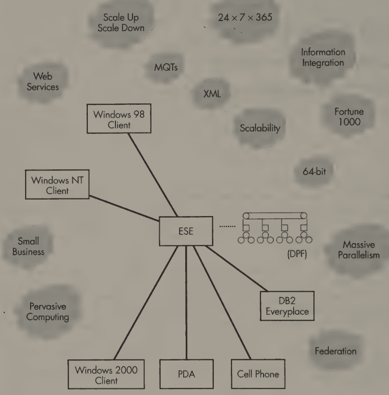

**图 2.1** 企业服务器版。

### 数据库分区功能 (DPF)

通过使用 `DPF`，你可以在单个系统或集群中的多个物理机器上创建多个分区数据库。这允许公司随着数据需求的增加而扩展 `DB2`。此功能已内置在 `ESE` 中，无需卸载代码即可启用跨多个物理机器的分区。只需通过购买相应的授权来启用该许可功能即可。

## DB2 工作组服务器版 (WSE)

> 注意

此前的 EEE 已与 EE 合并，后者在基础 `ESE` 产品中提供了分区数据库功能。

## DB2 工作组服务器版 (WSE)

`WSE` 的正式名称为工作组版（Workgroup Edition）。`WSE` 适用于小型企业或部门需求。`WSE` 以较低成本提供完整的 `DB2` 功能。它可以用于具有最多四个 CPU 的服务器上。请见图 2.2 以了解 `WSE` 的概述。

## 工作组服务器无限制版 (WSUE)

此版本的 `WSE` 提供了简化的按处理器许可的模式。该版本为拥有互联网用户或大量用户的小型公司提供了更具吸引力的成本。

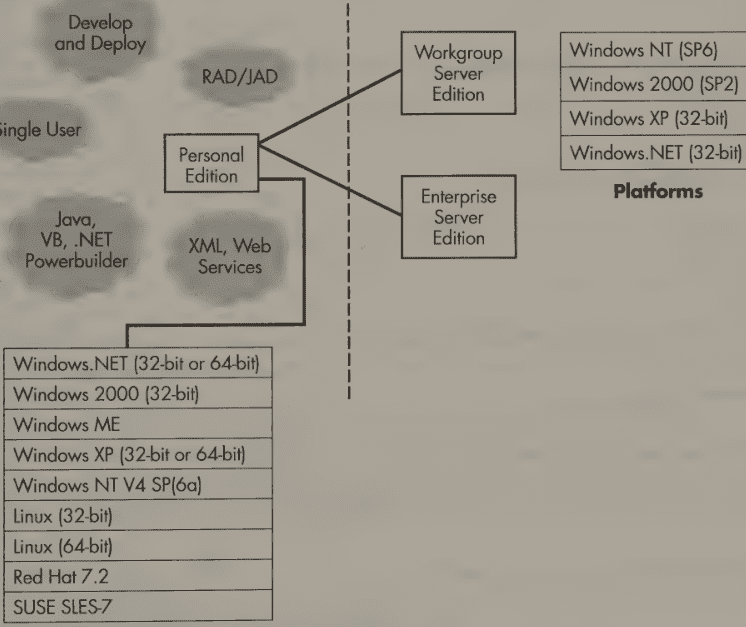

图 2.2

工作组服务器版、个人版 (PE) 和企业服务器版。

> 注意

`DB2` 卫星版已与 `DB2` 个人版合并。

## DB2 个人版 (PE)

`PE` 供在 PC 上开发的单用户使用。卫星版已与 `PE` 合并，`PE` 可以作为卫星使用。`PE` 提供了到 `ESE` 和 `WSE` 的连接并可以进行远程管理。`PE` 可用于不需要多用户能力的间歇连接或远程办公室实施。请见图 2.2 以了解 `PE` 的概述。

## DB2 通用开发者版 (UDE)

`UDE` 为设计、构建和部署 `DB2` 应用程序的开发者设计。它包含了所有 `DB2` 客户端和服务器版，以及 `DB2 connect`、`DB2 Extenders`、仓库管理器和智能挖掘机。`UDE` 以低廉的价格提供，使开发者能够轻松地开发多种 `DB2` 应用程序。它不能用于生产系统。

## DB2 个人开发者版 (PDE)

`PDE` 允许开发者设计和构建单用户桌面应用程序。`PDE` 适用于 Windows 和 Linux，并包含了 `DB2 Extenders`。

## DB2 仓库管理器

Warehouse Manager 扩展了数据仓库的可扩展性、可管理性和访问性。它为数据提供了工具。

## DB2 智能挖掘机

Intelligent Miner 产品帮助你做出明智的决策。

## DB2 空间扩展器

`DB2 Spatial Extender` 允许你分析位置数据。

## DB2 搜索版

`DB2 Search Edition` 实现了基于文本的搜索。它已用于一段时间提供高级搜索功能。

## 新客户端

`DB2 v8` 具备 64 位能力；64 位平台请参阅表 2.1。

### 表 2.1 DB2 64位支持

| 客户端 | AIX | Sun | HP | Windows |
| :--- | :--- | :--- | :--- | :--- |
| 个人版 | 否 | 否 | 否 | 否* |
| v7 32位客户端 (Windows) | 是 | 否 | 是 | 是 |
| v7 32位客户端 (UNIX) | 是 | 否 | 是 | 否 |
| v8 客户端 | 是 | 是 | 是 | 是 |

## DB2 架构

`DB2` 使用信号量共享内存进行进程间通信。这使得 `DB2` 成为第一个支持 InfinBand 架构的关系型数据库管理系统 (RDBMS)。

`DB2` 进程模型（图 2.3）由连接到 `DB2` 数据库的客户端或应用程序组成，协调代理处理特定应用程序请求。如果使用数据库分区功能 (`DPF`) 或分区内并行，可以分配子代理。缓冲池用于存储频繁访问的数据，I/O 服务器处理预取请求。I/O 清洁器将脏页从缓冲池刷新到磁盘。日志进程记录更改信息，并配合缓冲池管理器将提交的更改写入磁盘。

### 表 2.2 客户端兼容性

| 客户端 | UNIX 32位 | UNIX 64位 | Windows 32位 | Windows 64位 |
| :--- | :--- | :--- | :--- | :--- |
| v7 32位客户端 (Windows) | 是 | 否 | 是 | 是 |
| v7 32位客户端 (UNIX) | 是 | 否 | 是 | 否 |
| v8 客户端 | 是 | 是 | 是 | 是 |

### 表 2.3 UNIX 上 DB2 进程部分列表

| 进程名称 | 描述 |
| :--- | :--- |
| `db2agent` | 主代理 |
| `db2dbsys` | 系统进程 |
| `db2logm` | 日志管理器 |
| `db2log` | 日志进程 |
| `db2bufm` | 缓冲池管理器 |
| `db2buf` | 缓冲池清理器 |
| `db2dbio` | I/O 服务器 |

## DB2 架构

19

# 客户端


# UDB 服务器

图 2.3

`DB2` 架构概述。

### 表 2.3 DB2 AIX 进程

| 进程名称 | 功能 |
|---|---|
| `db2agent` | 协调代理 |


| `db2agentp` | 子代理进程 |

| `db2pfchr` | 预取 |

### 表 2.3 DB2 AIX 进程（续）

| 进程名称 | 功能 |

|---|---|

| `db2pclnr` | 页面清理 |

| `db2loggr` | 日志读取器 |

| `db2loggw` | 日志写入器 |

| `db2logts` | 表空间记录器 |

| `db2glock` and `db2lock` | 全局和本地死锁检测器，每个分区一个 |

| `db2fmp` | 用于 UDF 和 SP 的围栏进程 |

| `db2reorg` | 在线原地重组进程 |

| `db2sys` | DB2 引擎 |

| `db2tcpcm` | TCP 通信管理器 |

| `db2ipccm` | IPC 通信管理器 |

## 协调代理 (`db2agent`)

DB2 为每个连接的应用程序分配一个协调代理。协调代理负责与应用程序相关的工作。协调代理在分区数据库环境或启用行内并行时创建子代理，并协调子代理的工作。

## 子代理 (`db2agentp`)

子代理由协调代理创建以进行并行工作。子代理用于分区数据库环境或在启用了 `intra_parallel` DBM CFG 参数的情况下。

## 缓冲池 (`BUFFERPOOLS`)

缓冲池是 DB2 中最重要的调优区域之一，也是 DB2 中最重要的资源。缓冲池用于在内存中缓存频繁访问的索引和数据。代理在缓冲池中读取和修改数据。如果所需的数据不在缓冲池中找到，则必须从数据库中检索。第 8 章将详细介绍缓冲池。

## 预取 (`db2pfchr`)

预取器用于将数据从磁盘预取到缓冲池中，以备应用程序可能需要这些数据。代理向公共预取队列发送异步预取请求。预取器使用大块（范围）读取或散列 I/O 处理预取队列中的这些请求，将所需的页面从磁盘带入缓冲池。第 6 章将详细介绍预取性能。

## 页面清理器 (`db2pclnr`)

页面清理器用于将更新（脏）页写入磁盘，以便为新页面进入缓冲池留出可用空间。如果配置的页面清理器不够，代理必须将脏页写入磁盘。这将影响性能，因为写入操作是同步的。配置足够的页面清理器以执行异步写入是非常重要的。有关配置页面清理器的额外信息，请参见第 8 章。

注意

当页面清理器将脏页刷新到磁盘时，脏标记会被移除，但该页面仍留在缓冲池中。该页面将在预取器覆盖它之前将一直留在缓冲池中。

## 日志 (`db2loggr`)

缓冲池中的所有数据页都会被记录。随着数据的更新，代理进程将日志记录写入日志缓冲区。日志缓冲区中的日志记录由日志记录器异步刷新到日志文件。为了优化性能，缓冲池中更新的数据页和日志缓冲区中的日志记录都不会立即写入磁盘。它们分别由页面清理器和日志记录器写入磁盘。

日志记录器和缓冲池管理器确保在更新的数据页写入磁盘之前，其相关的日志记录已写入日志。这被称为“写前日志”。有关日志的更多信息，请参考第 10 章。

## 死锁检测器 (DEADLOCK DETECTOR)

死锁检测是 DB2 中最重要的功能之一。当两个应用程序持有彼此都需要的数据锁时，就会发生死锁。两者都在等待对方释放锁。这被称为“死拥抱”（dead embrace）。如果死锁情况得解决，涉及的应用程序可能会永远等待。此外，它们通常会导致许多其他应用程序等待这些相同的数据。会导致系统拥塞，可能导致停止或挂起。幸运的是，DB2 有在后台运行并检查死锁的机制。当 DB2 发现死锁时，它会选择一个应用程序接收终端 SQL 错误代码并对该应用程序执行回滚。一旦回滚完成，之前持锁将释放，死锁随之解决。

`dbtimeout` 参数控制死锁检查的间隔。默认值为 10 秒。这在大多数情况下是足够的。如果遇到死锁，此设置越高，死锁资源被锁定的时间越长。这降低了数据库的并发性。通常，这是应用程序顺序问题的标志。在更改 `dbtimeout` 以适应编写不好的应用程序之前，请修复应用程序设计问题。如果运行 ERP、CRM 或 SCM 软件包应用程序，请检查供应商文档的建议。这些供应商许多与 IBM 协作测试应用程序，并得出该参数的建议设置。

> 注意

锁快信息在 v8 中已显著改进。锁快照（Snapshot-on locks）现在提供涉及 SQL 的详细信息，仅列出涉及的连接，并对锁提供了更高的粒度。

关于解决锁问题的详细信息见第 11 章。

## 连接集中器 (CONNECTION CONCENTRATOR)

连接集中器允许许多应用程序连接到 DB2，同时尽可能减少处理和维护大量连接所需的内存和进程。这对于 Internet 应用程序特别有利。

## 总结

DB2 提供多个版本，以便企业根据需求选择合适的版本。以前的 EE 和 EEE 已合并为企业版（Enterprise Edition）。ESE 包含在 SMP 机器上分区数据库的能力。通过数据库分区功能，您可以在多个物理机器上创建数据库。这使得 DB2 随着您需求的增加而扩展。DB2 进程提供了客户端/服务器架构，预取器和页面清理器等 DB2 进程在后台运行，因此代理和应用程序无需等待数据。连接集中器为 DB2 高效处理数千连接铺平了道路。

## 防火墙

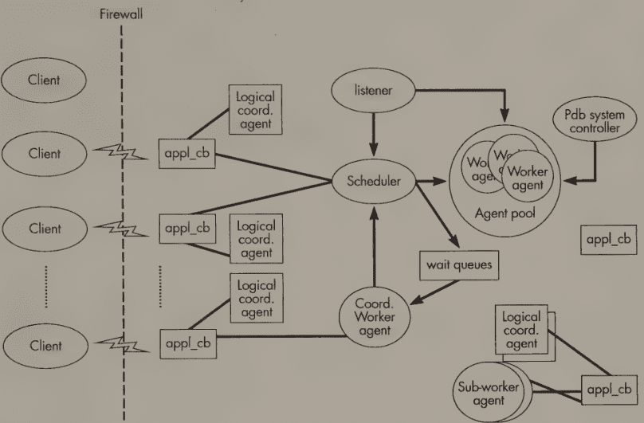

**图 2.4**

连接集中器

# 第 3 章

# 逻辑与物理设计

逻辑设计是识别实体及其关系最重要的部分。它从业务模型开始，逻辑逻辑的一部分转换为逻辑模型。所有新的数据库项目和对现有应用程序的修改都需要逻辑设计。逻辑模型用于记录逻辑设计。市场上有多种数据建模工具（例如 CA 的 Erwin、Embarcadero 的 ERStudio、Sybase 的 PowerDesigner 和 Rational Software 的 Rational Rose）。逻辑设计过程以及逻辑模型的可用性和维护是成功项目和数据库实施的关键要素。没有它们，项目将注定失败。该过程可以针对增强或维护项目进行自定义或调整。

## 业务模型 (BUSINESS MODEL)

业务模型是对业务实体、功能、关系以及与之相关的规则的描述。业务模型对于逻辑设计至关重要，是逻辑设计的主要输入。业务架构师和分析师负责开发和维护业务模型。业务模型的示例请参见图 3.1。

# 第 3 章 逻辑设计与物理设计

26


**图 3.1**

业务模型。

图 3.1 中的业务模型识别了业务实体及其之间的基本关系。除了图表外，业务模型由数据流图、状态图、业务规则文档以及其他进一步定义业务功能的文档组成。业务模型反映了组织的实践，独立于对 RDBMS 底层结构的任何。业务模型被进一步完善为概念模型。在开发和定义业务模型时，应遵循以下规则：

- * 每个实体都应该有一个在组织范围内接受的自描述性名称*

- 对实体的完整定义，规定了包含和排除的内容

- 一个业务实体的标识符，用于将其与其他实体或同一实体类型的多次出现区分开来

## 业务实体

业务架构师负责识别和记录业务实体、关系和业务规则。这通常以表格形式记录。业务实体的示例请参见表 3.1。

**表 3.1** 业务实体

| 实体名称 | 缩写 | 标识符 |  |

| --- | --- | --- | --- |

| STUDENT | STUDENT | 唯一学生 ID | 一个注册学生 |

| CLASS | CLASS | 唯一班级 | 提供的课程 |

| INSTRUCTOR | INST | 唯一教师 ID | 教师 ID |

使用一系列模型来记录和描绘业务规则、实体、关系、约束和物理数据库实现。数据模型有三种：概念模型、逻辑模型和物理模型。

## 业务实体

在接下来的章节中，我们将讨论每个模型的细节。一旦识别并记录了业务实体，我们就可以将业务模型转换为实体关系图（概念模型），如图 3.2 所示。

一旦有了实体-关系图，我们可以通过以下步骤将其转换为逻辑模型：

- 1. 将业务实体转换为数据实体

- 2. 表示实体之间关系的度

- 3. 识别条件关系

- 4. 转换多多关系

- 5. 将重复组转换为特征实体

在图 3.3 中，我们使用提供的步骤将图 3.2 中的概念模型转换为逻辑模型。


图 3.2 实体关系图。


图 3.3 实体关系图转换为逻辑模型。

在图 3.3 中，我们定义了实体之间关系的基数，并创建了 Student_Class 关联实体，以消除 Student 和 Class 之间的多多关系。我们将在本章后面解释其原因。在图 3.3 中，注意靠近 Meal Plan 实体的圆圈。这表示 Student 和 Meal Plan 之间的可选关系。学生可以在没有用餐计划的情况下存在，通勤型学生有时就是如此。Class 和 Classroom 之间连接线上的实线表示强制关系。如果 Class 没有被分配到 Classroom，该 Class 就无法存在。可选和强制关系对于记录和执行业务规则非常有用。

## 业务规则


业务规则定义了业务的运作方式。例如，客户只能有一个计费账户，除非与有效的采购订单关联，否则发票无法支付，且每个客户计费账户必须与有效的社会安全号关联。这类业务规则被称为约束。业务规则还定义了业务实体之间关系的度和基数。业务规则是每个业务独有的。

## 实体与关系

一旦识别并记录了业务实体、关系和规则，我们就可以实体关系（ER）图作为逻辑设计的一部分记录它们。如图 3.2 所示的概念模型使用 ER 图表示。它尽可能接近组织数据的现实视图。实体关系图是由 P. Chen 于 1976 年发明的。

在在开发 ER 图和进行规范化过程之前，理解一些术语对你有帮助。

### 实体

实体是人、地、物、概念或事件。你可以将其视为名词。

### 关系

关系用于描述实体之间的关系。关系用动词来定义。你可以将其视为动词。关系可以是可选或强制的，如前所述。

### 候选键

候选键是唯一标识关系实例的属性或属性组合。

### 主键

主键是被选为行唯一标识符的候选键。

### 关系

关系是一个由属性（列）和元组（行）组成的二维表。

### 外键

外键用于记录实体之间的关系。在一对一或一对多的关系中，一侧实体的主键被放在另一侧的实体中。外键用于实现引用完整性，并可以与之关联额外的规则。例如，在父子关系中的父实体...

### 基数

基数是实体之间关系的度。基数包括一对一、一对多和多。在图 3.3 中，注意靠近 Meal Plan 实体的圆圈。这表示 Student 和 Meal Plan 之间的可选关系。学生可以在没有用餐计划的情况下存在，通勤型学生有时就是如此。Class 和 Classroom 之间连接线上的实线表示强制关系。如果 Class 没有被分配到 Classroom，该 Class 就无法存在。可选和强制关系对于记录和执行业务规则非常有用。

### 函数依赖

函数依赖是属性之间或内部的关系。一个例子是，如果我们知道了某个属性的值，就可以获得另一个属性的值。例如，我们使用以下记法重述：

```
STUDENT_ID => GRADE_LEVEL
```

这可以读作属性 `STUDENT_ID` 决定属性 `GRADE_LEVEL`。

我们稍后在本节中将如何利用函数依赖来规范关系的规范化。

## 键 (Key)

键是一个或多个属性的组合，用于唯一标识一行数据。每个关系必须包含一个主键。需要注意的是，键和函数依赖并不是由某些任意规则决定的，而是由组织的业务规则决定。

## 第一范式 (FIRST NORMAL FORM)

如果一个关系不包含重复组，则它属于第一范式（1NF）。也就是说，每个属性（或列）只能有一个值。允许非重复组数组。让我们来看 `CUSTOMER_ACCOUNT` 关系：

```
CUSTOMER_ACCOUNT (CUST_ID, ACCT_NBR, CUST_NM, ADDRESS, TYPE, DESCRIPTION, BRANCH_NBR, BRANCH_ADDR)
```

其中：

```
CUST_ID = 客户标识符
ACCT_NBR = 账号
CUST_NM = 客户名称
ADDRESS = 客户地址
TYPE = 账户类型
DESCRIPTION = 账户描述
BRANCH_NBR = 分机构编号
BRANCH_ADDR = 分机构地址
```

如果该关系没有重复组，则属于 1NF，但存在某些固有的修改异常。如果客户注销账户会怎样？所有关于客户的数据（如客户标识、账号和客户地址）都将丢失。此外，插入新数据也是一个问题。在客户开户之前，无法插入账户类型、描述和分机构地址。

`CUSTOMER_ACCOUNT` 关系的问题在于，非键属性依赖于主键的一部分，而不是整个键。我们可以通过识别函数依赖来此这一点：

```
CUST_ID => CUST_NM but ACCT_NBR => CUST_NM
CUST_ID => ADDRESS but ACCT_NBR => ADDRESS
CUST_ID => TYPE but ACCT_NBR => TYPE
ACCT_NBR => DESCRIPTION but CUST_ID => DESCRIPTION
ACCT_NBR => BRANCH_NBR but CUST_ID => BRANCH_NBR
ACCT_NBR => BRANCH_ADDR but CUST_ID => BRANCH_ADDR
```

## 第二范式 (Second Normal Form)

为了消除修改异常，将 1NF 中的关系规范化为 2NF 和 3NF。这将导致在规范化过程中创建更多的实体。

## 第二范式 (SECOND NORMAL FORM)

如果一个关系属于 1NF 且其所有非键属性都依赖于所有的键，则该关系属于第二范式（2NF）。因此，如果键只有一个属性，则该关系必须属于 2NF。

我们上一个示例中的 `CUSTOM_ACCOUNT` 关系可以分解为四个新关系如下：

```
CUST_MSTR (CUST_ID, CUST_NM, ADDRESS)
BRANCH_LOC (BRANCH_NBR, BRANCH_ADDR)
ACCT_TYPE (TYPE, DESCRIPTION)
C_ACCT (CUST_ID, ACCT_NBR)
```

这些新关系属于 2NF。`CUST_MSTR`、`BRANCH_LOC` 和 `ACCT_TYPE` 关系的主键只有一个一个属性，而 `C_ACCT` 关系不包含任何非键属性。可以在开户之前将客户信息插入到 `CUST_MSTR` 关系中。删除与某个分机构相关的所有客户不会导致分机构信息的删除。删除某个客户的所有账户不会导致客户数据的丢失。

属于 2NF 的关系仍可能存在修改异常。例如，关系

```
BANK_FEES (ACCT_NBR, TRAN_TYPE, FEE)
```

属于 2NF，因为主键 `ACCT_NBR` 只有一个属性，但存在一个涉及非键属性（`TRAN_TYPE`）对另一个非键属性（`FEE`）的依赖。通过识别函数依赖，你可以识别出如下异常：

```
ACCT_NBR => TRAN_TYPE
ACCT_NBR => TRAN_TYPE => FEE
```

我们在非键属性之间存在依赖；`TRAN_TYPE` 和 `FEE`。

```
TRAN_TYPE => FEE
```

收取的费用是由 `TRAN_TYPE` 决定的。如果删除了某个账户，是否会导致费用的丢失？由于，费用是由交易类型决定的。在 `BANK_FEE` 关系中，我们丢失了特定的类型信息。消除异常的另一种方法是使用主题的概念。如果关系包含多个主题，可以将其进一步分解为单主题关系。

```
ACTIVITY (STU_ID, FEE)
```包含活动信息，包含费用信息。

## 域定义

`CUST_ID` 属于 `DDDDDD`，其中 D 是十进制数字0 < D < 999999

`ACCT_LEVEL` 属于 `("PERS", "CML", "INTB")`

`ACCT_TYPE` 属于 `CHAR (3)`

`FEE` 属于 `DEC (4)`

### 关系与键定义

`CUSTOMER (CUST_ID, ACCT_LEVEL, ACCT_TYPE)`

键 (KEY): `CUST_ID`

`ACCT_FEE (ACCT_TYPE, FEE)`

键 (KEY): `ACCT_TYPE`

我们知道，通过将关系转换为 DK/NF，关系将没有任何修改异常。我们可以通过从 2NF 转换为 3NF 以消除传递依赖来得到这一结果。然而，使用 DK/NF，我们只需要让所有约束成为域定义和键定义的逻辑序列即可。

## 统一建模语言 (UML)

统一建模语言（UML）由对象管理组织（OMG）于 1997 年 11 月采用，作为一种面向对象的分析和设计的语言。OMG 接收了来自微软、IBM 和 Oracle 等行业领导者关于 UML 规范的建议。

除了用于设计面向对象的项目外，它也渗透到了本地数据库设计中。这是一个自然的演进，因为支持 UML 的工具被广泛用于建模、构建和部署企业应用。

UML 类图类似于 ER 图中的实体，可以用于概念设计和逻辑设计。许多支持 UML 的工具可以输入并将 ER 图并转换为类图。由于其功能完备，UML 很好地定位为企业应用开发和数据建模的首选工具。这对于 IT 组织将具有吸引力，因为从业务架构师到数据库管理员的整个企业都将基于同一个模型和工具集进行工作。作为 DBA 或数据模型建模师，你应该熟悉 UML 的使用方法及其相关输出。我预见它最终会在逻辑设计中广泛应用。

## 逻辑设计输出

识别所建模数据的实体、关系和属性的逻辑模型是逻辑设计过程的主要输出。在数据上定义了外键和约束后，逻辑设计即完成，并且应该包含至少归一化到 3NF 的数据，如果可能，则达到 DK/NF。逻辑模型是物理设计的主要输入。

## 物理设计

一旦完成逻辑设计，就可以开始物理设计。物理设计由以下五个步骤组成：

1. 反归一化
2. 创建索引
3. 创建表空间和表
   - 容器布局
   - 磁盘策略
4. 表空间拆分策略
5. 缓冲池（Bufferpool）策略

## 反归一化

归一化的关系消除或减少了修改异常。然而，该过程也会产生更多的关系，这些关系在大多数情况下会被转换为 DB2 表。有时，成本（查询运行时间和复杂性）会超过归一化带来的收益。


随着 `DB2` 优化器的不断增强，成本不再像以前那样是一个主要因素（在处理许多表连接等方面），但在尝试优化物理设计时，它仍然是一个需要考虑的因素。反归一化是将关系或属性合并关系的过程，以减少需要处理的关系数量并降低查询的复杂性。反归一化有时被称为“受控的冗余”。反归一化主要为了性能提升、为决策报告提供只读表或为了临时报告，但“注意”点是，`DA` 或 `DBA` 必须意识到反归一化随后的修改异常。仅使用逻辑模型就可以反归一化，但如果 `DBA` 拥有 `SQL`，以便他们了解涉及的关系和连接，效果会更好。`DBA` 必须拥有逻辑模型相关的 `SQL` 查询以便开发适当的物理设计。

> 提示
>
> 许多逻辑建模工具可以生成数据定义语言 (`DDL`) 来创建物理对象。使用这些生成的 `SQL`（必要时可以修改）可以节省时间并提高效率。

## 创建索引

唯一（主键）索引和外键索引应该在逻辑模型上创建。为了支持 `SQL` 查询、连接操作和业务报告的二级索引应作为物理设计的一部分被创建。为了实现这一点，需要及时向 `DBA` 员工提供 `SQL`，尽管通常并非如此，且 `SQL` 不可用。因此，识别所有所需的二级索引非常困难。通常情况下发生的情况是应用程序在生产环境中的性能不符合预期，需要对程序和索引进行重大修改。

如果在初始物理设计阶段就有 `SQL`，那么 `DBA` 就可以创建索引来满足业务需求。

在创建二级索引时，请遵循这些指南：

- 创建索引以消除 `ORDER BY`、`GROUP BY` 和 `DISTINCT` `SQL` 语句所需的排序（`SORTS`）。
- 在连接列上创建索引。
- 未能这样做会导致笛卡尔积，这并不总是如人意的。
- 在本地谓词上创建索引以获得仅索引访问（index-only access）。
- 考虑使用 `INCLUDE` 列来获得仅索引访问。
- 创建包含 `ALLOW REVERSE SCANS` 子句的索引以消除排序。
- 在外键上创建索引。
- 在每个表上创建聚集索引。
- 对于高插入表，考虑使用 `APPEND ON`。
- 在数据仓库环境中使用多维聚类（`MDC`）索引，并在在线事务处理（`OLTP`）环境中考虑 `MDC`。

有关索引的更多信息，请参考第 7 章。

## 创建表空间和表

需要开发一种表空间和表策略：使用的空间类型（`SMS` 或 `DMS`），以及每个表空间的大小和表数量，以及将使用的容器数量。

> 提示
>
> 在创建表空间之前，记得启用 `DB2_PARALLEL_IO` 环境变量，以便应用于任何表空间。

如果使用 `DMS` 容器，必须构建文件系统并验证驱动器分配。这需要与系统、存储和网络管理员就存储网络（`SAN`）或 `InfinBand` 网络进行协调。

## 表空间拆分策略

表空间拆分策略包括：

- 将高优先级表分配到单个表空间。
- 将高优先级表空间放在专用缓冲区和/或物理磁盘或磁盘阵列上。
- 为索引创建单独表空间和/或将索引分配到单独缓冲区。

## 缓冲池策略

应根据业务优先级和访问类型将对象分配到缓冲区。业务优先级包含或源于业务需求。访问类型涉及访问是顺序还是随机的。将不同访问类型的对象放在不同的缓冲区。这样，具有顺序预取的对象就不会与随机访问的对象竞争缓冲池空间。有关缓冲区的更多信息，请参考第 8 章。

## 总结

逻辑设计是数据库设计中最重要的步骤。它不能跳过。它可以定制以支持特定的开发工作。

业务架构师识别业务实体和业务规则并开发概念模型。数据管理员或 `DBA` 开发逻辑设计并对其进行归一化以满足业务目标。这通常是 `3NF` 或 `DK/NF`。本文讨论了识别和消除修改异常的重要性。逻辑模型对物理设计过程至关重要。大多数建模工具可以生成 `DDL` 用于构建物理设计。表空间设计以及容器策略和磁盘布局需要与 `UNIX`、`SAN` 和网络管理员进行规划和协调。最后，需要使用业务优先级来开发表空间拆分策略。

# 第 4 章

## 应用开发

`Bv8` 拥有丰富的开发功能。新的开发中心（Development Center）让开发者能够轻松使用他们选择的开发工具。各种驱动程序的重大更改提升了客户端应用程序的性能。`XML` 增强使 `DB2` 能够作为 Web 服务的提供者和消费者。`SQL` 增强（例如子查询中支持 `INSERT through UNION VIEWS`、`INSTEAD OF TRIGGERS`、`ORDER BY` 和 `FETCH FIRST`）将大幅提高应用程序开发者的生产力。`Websphere Studio` 集成开发环境现在提供了新的插件，可与新的开发中心集成；同时还为 Microsoft Visual Studio 产品（Visual Basic、C++ 和 InterDEV）提供了新的加载项。本章涵盖了 `DB2 v8` 的新增强功能，还介绍了了 `DB2` 环境的建立，以及如何使用 `DB2` 提供的工具开发您所需的应用程序。

## 入门

开发 `DB2` 应用程序非常简单。入门的主要辅助因素是运行时客户端（Run-Time Client）。运行时客户端提供了以下 `API` 所需驱动程序：

- `ODBC`
- `DB2 CLI`
- `OLE DB`
- `JDBC`
- `SQL J`

运行时客户端包含在 `DB2 ESE` 基础产品中。它通过以下组件提供：

- `DB2` 管理客户端（`DB2 Administration Client`）
- `DB2` 应用开发客户端（`DB2 Application Development Client`）
- `DB2` 通用开发者版（`UDE`）

运行时客户端使 `DB2` 客户端与 `DB2 UDB` 服务器通信。

> 注意：为了让 `v8` 客户端与 `DB2 UDB v7` 服务器配合，您需要在 `DB2 UDB v7` 服务器上启用 `DRDA` 应用程序服务器功能，且 `DB2 UDB v7` 服务器需要达到 Fixpack 8 或更高版本。

虽然支持 `v8` 客户端访问 `v7 UDB` 数据库，但不建议这样做。这是因为涉及许多限制条件。

## DB2 管理客户端

`DB2` 管理客户端提供了 `DB2` 运行时客户端的所有功能，并包含了所有的 `DB2` 管理 `GUI` 工具、文档以及对瘦客户端（Thin Clients）的支持。开发者可以使用控制中心（Control Center）组件浏览 `DB2` Schema 和对象，这有助于他们开发应用程序。

> 注意：在 Windows 中，安装程序需要确保用于安装管理客户端的用户帐户定义在本地机器上，属于本地管理员组，并具有“作为操作系统的高级用户”的权限。

## DB2 应用开发客户端

`DB2` 应用开发客户端提供了 `DB2` 管理客户端的所有功能，还包含了库、头文件、文档化的 `API` 以及示例程序，用于构建各种应用程序。

## DB2 个人开发者版 (PDE)

`PDE` 允许开发者设计和构建单用户桌面应用程序。`PDE` 适用于 Windows 和 Linux 平台，并包含 `DB2` 扩展（`DB2 Extenders`）。

## DB2 通用开发者版

`UDE` 为单一应用程序开发者提供了低成本软件包，用于设计和构建部署到任何 `DB2 UDB` 平台的应用程序。它仅供开发使用，不能在生产环境中使用。`UDE` 包含了所有的客户端和服务器环境、`DB2` 扩展、仓库管理器（Warehouse Manager）和智能挖掘机（Intelligent Miner）。

## DB2 开发中心

`DB2` 开发中心是 `DB2 v8` 中一个新的集成开发环境。存储过程生成器（Stored Procedure Builder）已被取代，其功能已整合到开发中心。开发者可以使用开发中心构建、调试、测试和部署 `JAVA` 和 `SQL` 存储过程、`SQL` 函数以及表函数，这些函数可以读取 `MQSeries` 消息、访问 `OLE DB` 数据源并从 `XML` 文档中提取数据。我们将在本章后部分详细介绍开发中心。

## DB2 可视化解释 (VISUAL EXPLAIN)

`DB2 Visual Explain` 是开发者帮助编写高效 `SQL` 的极佳工具。`Visual Explain` 已集成到 `DB2` 控制中心、命令中心和开发中心中。`Visual Explain` 用于解释和分析 `SQL` 语句，并以图形格式显示访问计划。开发者和 `DBA` 应该使用它来审查通过单元测试、验收测试和系统测试的 `SQL`。虽然有其他形式的 `Visual Explain`，但我的经验是将 `Visual Explain` 与 Design Advisor 结合是非常强大的组合。`Visual Explain` 是一种提高开发者和 `DBA` 效率的工具，贯穿整个系统开发生命周期。有关 `DB2` 工具和组件的完整列表，请参阅应用程序开发指南。如前所述，`Visual Explain` 可以从控制中心和命令中心启动。参见图 4.1 了解如何从中心启动可视化解释。图 4.1 显示了通过右键点击感兴趣的数据库并选择 Explain 来启动可视化解释。`SQL` 来自本地文件。在更改后，会出现如图 4.2 所示。你可以更改优化级别以查看其对 `SQL` 性能的影响。做出任何更改后，点击 `OK` 按钮，将运行解释并在图 4.3 所示的窗口中返回访问计划。

![img/961b0d3b0e1574067a293880ab928e_69_0.png 4.1 从控制中心启动可视化解释)


![img/961b0d3b0e1574067a293880ab928e_69_1.png 4.2 可视化解释输入窗口)![img/961b0d3b0e1574067a293880ab928e_70_0.png 4.3 访问计划图)

### 图 4.4 排序详情

排序详情面板提供了有关排序的详细信息。你可以分析这些细节（如涉及的列和统计数据），并利用这些信息消除排序。你可以将语句交给 Design Advisor 运行以获得最佳解决方案。

开发中心从控制中心启动。中心可以轻松开发 Java 或 SQL 存储过程、用户定义函数和结构化数据类型。虽然它支持对 Java 和过程化 SQL 服务器端逻辑进行开发和调试，但任何语言的存储过程都可以在开发中心内进行测试。

开发中心允许开发者浏览远程数据库的内容，包含项目管理功能……

在接几个示例中，我将引导你完成创建项目并构建环境的必要步骤，在该环境中你可以创建或导入 SQL 和 Java 过程以及 UDF。参见图 4.5 关于

![img/961b0d3b0e1574067a293880ab928e_71_0.png 4.5 DB2 开发中心)

# 开发中心

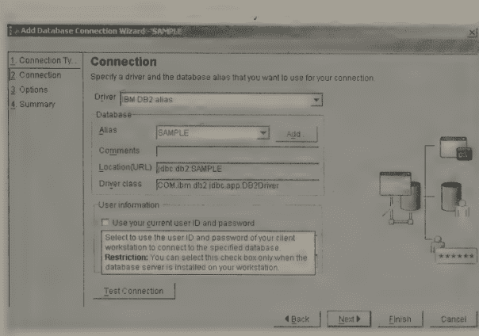

### 图 4.6

连接面板。

连接面板用于指定要使用的驱动类型以及要操作的数据库。验证或更改此信息后，选择“下一步”（Next）按钮进入选项面板，如图 4.7 所示。

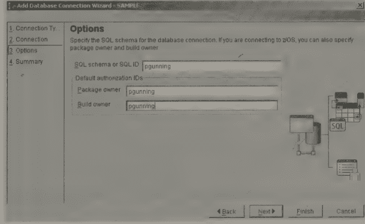

### 图 4.7

选项面板。

选项面板用于指定数据库连接的架构（schema）以及默认授权 ID。完成后，选择“下一步”（Next）进入摘要面板，如图 4.8 所示。

## 48 数据库连接向导 - 示例

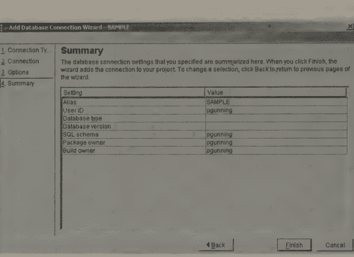

| 字段 | 值 |
| --- | --- |
| 别名 | SAMPLE |
| 用户 ID | ongoing |
| 数据库版本 | ongoing |
| SQL 服务器 | ongoing |
| 包所有者 | ongoing |
| 构建所有者 | ongoing |

### 图 4.8 摘要面板。

摘要面板显示所有选择的列表。选择“返回”（Back）按钮返回并更改设置，如果不需要更改，则选择“完成”（Finish）。选择“完成”后，将启动开发中心启动器，如图 4.9 所示。

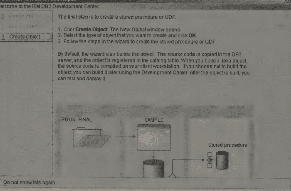

### 图 4.9 开发中心启动器。

最后一步是创建存储过程或 UDF（用户定义函数）。然后选择“创建对象”（Create Object），即可启动新对象选择面板，如图 4.10 所示。

# 开发中心

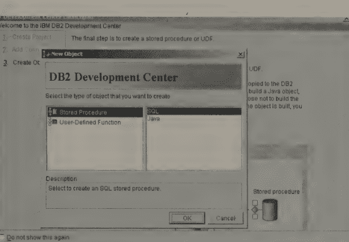

### 图 4.10 开发中心新对象面板。

在我们通过“确定”（OK）按钮完成对象选择后，启动名称面板，如图 4.11 所示。

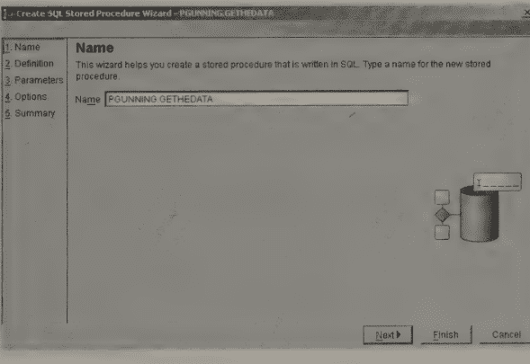

### 图 4.11 名称面板。

名称面板要求我们提供存储过程名称。请使用符合公司命名标准的名称。选择“下一步”（Next）按钮，启动定义面板，如图 4.12 所示。

# 第 4 章 · 应用开发

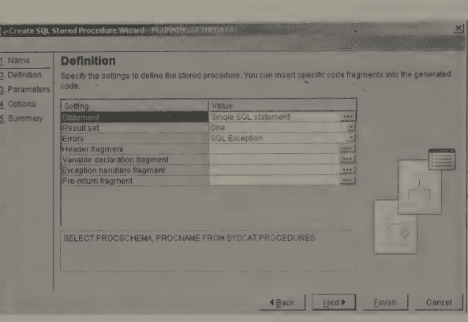

### 图 4.12

定义面板。

定义面板用于定义存储过程。可以指定语句数量、结果集和错误处理。在定义存储过程或 UDF 后，选择“下一步”（Next）按钮显示参数面板，如图 4.13 所示。

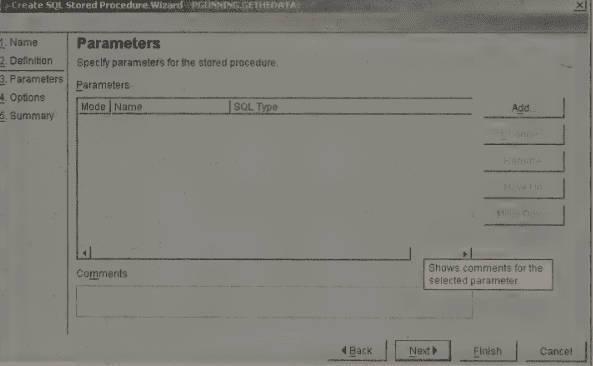

### 图 4.13

参数面板。

创建 SQL 存储过程向导的参数面板帮助您为 SQL 存储过程定义输入和输出参数。添加必要的参数后，选择“下一步”（Next）按钮，显示选项面板，如图 4.14 所示。

# 开发中心

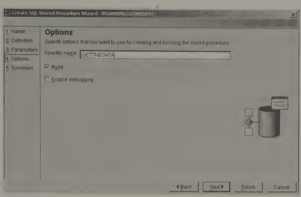

### 图 4.14

选项面板。

选项面板允许您为 SP 提供特定名称，并确定是否启用调试。完成此面板上的输入后，选择“下一步”（Next）按钮，显示摘要面板，如图 4.15 所示。

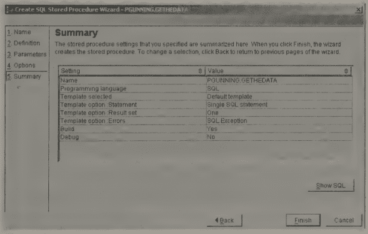

### 图 4.15

摘要面板。

摘要面板允许我们检查已指定的设置，并在必要时返回进行更改。通过选择“完成”（Finish）按钮，将构建 SP 并显示 DB2 开发中心的项目视图，如图 4.16 所示。

52 DB2 开发中心

第 4 章 • 应用开发

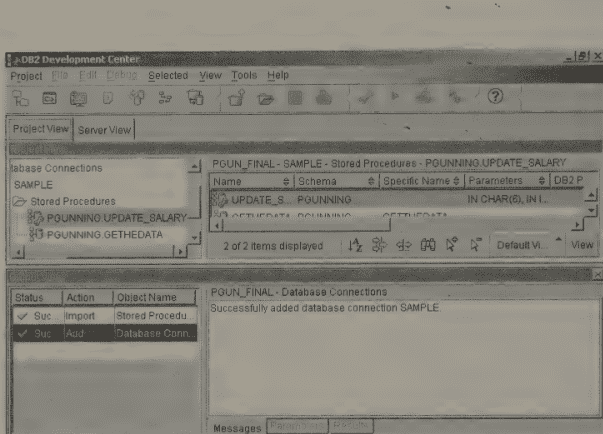

## 图 4.16

开发中心项目视图。

如图 4.16 所示，项目视图显示 SP 文件夹下的所有 SP 列表。您可以选择要处理的对象，也可以从文本文件导入过程。在图 4.15 中，定义了两个 SP。我们创建了 GETEDATA SP，并从 DB2 SAMPLES 目录导入了 DB2 提供的示例过程 UPDATE_SALARY。右键点击 SP 文件夹启动导入过程，如图 4.17 所示，并选择“导入”（Import），这将启动导入向导，如图 4.18 所示。

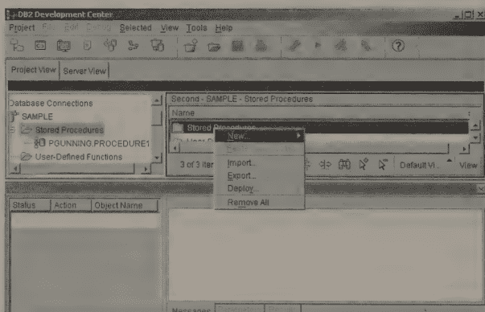

## 图 4.17

导入过程。

# 开发中心

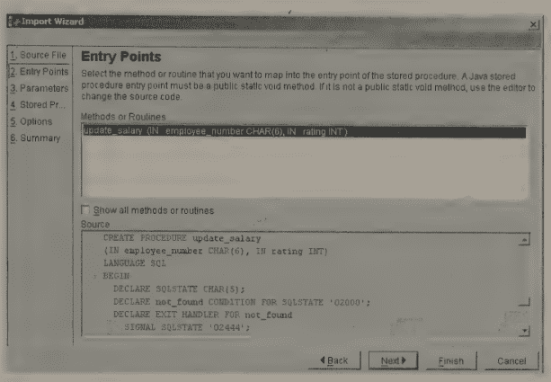

### 图 4.18

导入向导。

成功导入 UPDATE_SALARY 过程后，我们将返回开发中心，如图 4.19 所示。

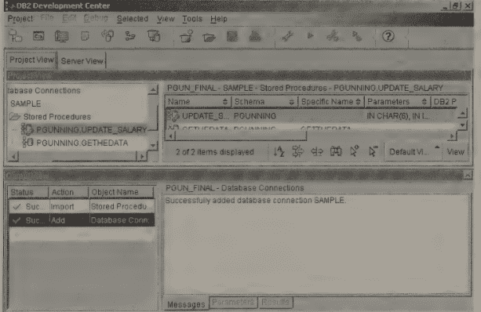

### 图 4.19

开发中心。

开发中心随处提供帮助。通过选择工具栏上的“帮助”（Help），我们将进入 DB2 信息中心的相应帮助页面，如图 4.20 所示。

## DB2 帮助 - Microsoft Explorer

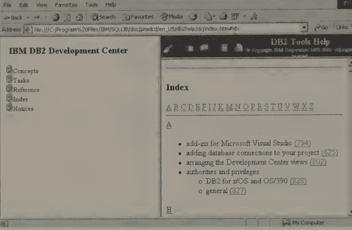

### 图 4.20

DB2 开发帮助。

通过在 DB2 信息中心中选择感兴趣的区域，可以深入到特定详细信息。除了集成帮助外，您还可以在存储过程中设置断点以辅助开发，如图 4.21 所示。

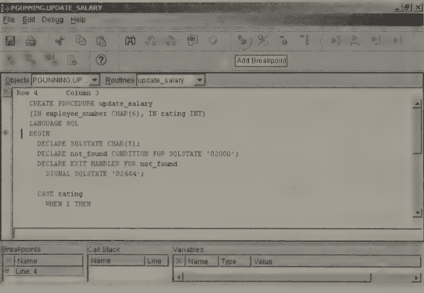

### 图 4.21

添加断点。

## Java 安全过程

我们通过将光标置于想要插入断点的位置并点击工具栏上的“添加断点”（Add Breakpoint），为 UPDATE_SALARY 过程添加了断点。您可以使用断点步到指定的断点处。过程和 UDF 可以通过 DB2 家族开发中心部署到服务器平台。成功创建并构建过程或 UDF 后，下次进入开发中心时可以选择现有项目而不是创建新的，如图 4.22 所示。

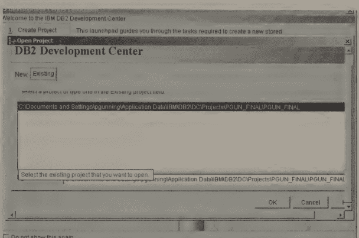

### 图 4.22

使用现有项目启动开发中心。

尽管我强调了 SQL 过程的创建，开发中心也支持 Java 存储过程和结构化类型。包含了新的“执行”（Execute）权限来控制谁可以调用过程（存储过程、UDF 和方法）。

> 注意
>
> 在 v8 中，SQL 过程现在自动注册为 NOT FENCED，NOT F 过程现在支持嵌套和递归，NOT FENCED 过程可以返回结果集。

## Java 安全过程

Java 存储过程在 v8 中支持递归，Java 过程可以调用其他语言编写的过程，反之亦然。Java UDF 和存储过程的新线程模型为 Java 过程带来了显著的性能改进。之前的 DB2 版本为每个过程创建一个 JVM，现在以线程安全方式运行时只有一个进程。通过消除为每个过程创建 JVM 的开销获得了性能提升。

## Java 客户端

DB2 内部协议在 v8 中已完全重构。新架构带来了更加精简的界面。删除了代码层并消除了不必要的内存移动。新架构实现了显著的性能改进。

新架构提供了新的类型 JDBC 驱动程序，旨在从可用性和性能方面取代类型3 驱动程序。增加了对 DATALINK 作为数据类型的支持。消除了 DB2 客户端与之前连接 UNICODE 数据库的 DB2 服务器之间不必要的代码页转换。为 CallableStatement 增加了 OUTPUT LOG 参数。改进了 PreparedStatements 的性能，类型3驱动支持 ResultSet 的 FetchSize。


类型2驱动已通过 JEE 认证。它是 `Webphere Application Server` 等应用程序服务器的驱动程序。新的 SQL 配置文件自定义支持 DB2 8.0 的 `java.sql.Blob` 和 `java.sql.Clob` 类型，以及主机变量表达式。

## SQL 改进

DB8 包含许多 SQL 改进，使 DB2 满足当今 24x7x36 运行环境的业务需求。全局表 `Declared Global Tables` 现在支持添加索引以及在临时表对象上运行 `RUNSTATS` 能力。若干新的 SQL 改进将在本章后面介绍。用户维护的物化查询表为用户提供了加载预计算数据的能力，可以通过业务规则维护这些数据的刷新。

## 全局表 (DGTT) 改进

对 DGTT 进行了显著改进。您可以在 DGTT 上创建索引。增加了日志支持并现在支持表更改的回滚。现在可以对 DGTT 运行 `RUNSTATS`。

## SQL 助手

以前仅在数据仓库中心提供的 SQL 助手 `SQL Assist` 现在是基础产品的一部分。`SQL Assist` 从命令中心启动。它允许您根据专家建议创建 `SELECT`、`INSERT`、`UPDATE` 和 `DELETE` 语句。提供输出和详细面板帮助您编写 SQL 语句。还为编写连接 `joins` 提供了协助

# SQL 增强

内置了语法检查。你可以复制并粘贴 SQL 语句并使用 `SQL Assist` 对其进行格式化。

与之前的 DB2 版本一样，v8 包含了若干 SQL 增强功能，将帮助你开发业务应用程序。第 8 版本符合 ANSI 和 ISO 标准。

## 替代性触发器 (Instead Of Triggers)

替代性触发器允许开发者针对视图编写插入、更新和删除代码，从而简化应用程序编程，而实际的更新操作将会被重定向到底层表。

## 新内置函数

`SYSIBM` 架构中新增了十二个新的三角函数。子查询现在支持 `FETCH FIRST ORDER BY` 语句。

## 信息性约束 (INFORMATIONAL CONSTRAINTS)

DB2 可以使用新的信息性约束来执行查询优化。当定义信息性约束时，你可以指示 DB2 能否可以使用它们进行查询优化。如果启用，DB2 优化器可以使用信息性约束中的值来更好地地优化访问计划。在数据库中不强制执行约束需要应用程序通过应用程序逻辑强制执行约束。

## 通过 UNION ALL 视图进行插入 (INSERT THROUGH UNION ALL VIEWS)

除了之前的版本提供的 `UPDATE` 和 `DELETE` 能力外，现在支持对使用 `UNION ALL` 构造视图执行 SQL 语句。

通过 `UNION ALL` 视图进行插入可以结合检查约束和使用单独表空间来实现范围分区。这为每表 64 GB 的限制提供了一个灵活的解决方案，允许你将大表拆分为较小的表，并将每个表放置在单独的表空间。通过对数据范围使用检查约束，DB2 优化器可以确定访问哪张表。

## 摘要表 (SUMMARY TABLES)

摘要表是一种定义基于查询结果的表，其数据以预计算表的形式存在，这些表取自定义该摘要表的一个个或多个表。

由于摘要表包含预计算结果，它们可以显著提高针对非汇总数据运行查询的性能。例如，与其扫描大型每日销售表来处理每月销售报告，不如可以定义一个摘要表来汇总销售情况，DB2 使用摘要表来获取结果，而不是通过扫描巨大的表来先获取数据并进行汇总。DB2 优化器将在运行时决定是否使用摘要表。如果它认为查询将从使用摘要表中受益，优化器将利用其查询重写能力开发一种访问策略。

`fullselect` 中包含 `GROUP BY` 子句的表定义正在对 `fullselect` 中引用的表汇总数据。这种类型的摘要表是 v8 中新增的物化查询表 `MQT` 的一种特殊类型。

使用 `CREATE TABLE` 语句创建摘要表。以下是创建摘要表的 `CREATE TABLE` 语句示例：

```
CREATE SUMMARY TABLE SALES SKU AS (SELECT sku,
SUM(qty) as QTY,
SUM(class) as CLASS
From Daily_Sales Group by sku)
Data Initially Deferred
Refresh Deferred
```

在上述示例中，使用了关键字 `summary` 来表示这是一个摘要表。如果省略了它，DB2 仍会根据关键字的结果将其识别为摘要表。

> 注意

只有在使用动态 SQL 时，才能访问摘要表。

更新摘要表中的数据有两种方式：`Refresh Deferred` 或 `Refresh Immediate`。该选项在 `CREATE TABLE` 语句中使用其中一个刷新选项进行指定：

- `Refresh Deferred`——当执行 `REFRESH TABLE` 语句时，刷新表中的数据。
- `Refresh Immediate`——作为 `DELETE`、`INSERT` 或 `UPDATE` 语句的一部分对底层表进行的更改将立即级联到摘要表。

`DATA INITIALLY DEFERRED` 子句意味着数据在创建表时不插入，而是在执行 `REFRESH TABLE` 语句时插入。

> 注意

系统维护的摘要表不能通过 `INSERT`、`UPDATE` 或 `DELETE` 语句直接修改。

## 当前刷新年龄特殊寄存器 (CURRENT REFRESH AGE SPECIAL REGISTER)

`CURRENT REFRESH AGE` 特殊寄存器指定了一个数据类型为 `(20, 6)` 的时间持续值。该时长表示自 `REFRESH DEFERRED` 以来的最大时长。

优化器用它来判断可以使用摘要表来优化查询。使用 `SET CURRENT REFRESH AGE` 来更改当前刷新年龄特殊寄存器的值。

注意

DB2 中的摘要表由类型 `s` 表示。

- `0` 意味着只有定义为 `REFRESH IMMEDIATE` 的摘要表可用于优化查询。
- `99999999999999` 或 `ANY` 意味着任何定义为 `REFRESH` 的摘要表。
- `DEFERRED` 或 `REFRESH IMMEDIATE` 可用于优化查询的处理。

当前刷新年龄的初始值为 `0`。为了让优化器考虑使用延迟刷新摘要表，你必须将 `CURRENT REFRESH AGE` 特殊寄存器设置为 `ANY`。这可以通过 `SET CURRENT REFRESH AGE ANY` 语句来实现。

对摘要表有若干限制。更多信息请参阅《DB2 SQL 参考》。

## 物化查询表 (MATERIALIZED QUERY TABLE, (MQT))

`MQT` 的定义是一种定义基于查询结果的表，其数据以预计算结果的形式存在，取自定义该 `MQT` 的一个或多个表。`MQT` 的定义包含了连接、函数以及在摘要表中是不允许的 SQL 语句。

以下是 `MQT` 的一个示例：

```
CREATE SUMMARY TABLE POAMT
AS (SELECT VENDOR, CODE, CLASS, SKU
FROM V, S
WHERE V.CODE = S.CLASS)
Data Initially Deferred
Refresh Deferred;
```

`MQT` 可以用于预连接表。如果 `MQT` 包含其所需的列，则允许优化器跳过连接。

## 用户维护的 MQT (USER-MAINTAINED MQTS)

v8 新增的用户维护 `MQT` 允许你将预计算数据加载到用户定义的摘要表中。

> 注意

用户维护的摘要表使 Oracle 用户迁移到 DB2 更加容易。

用户维护摘要表的主要区别在于创建和加载是由用户控制的。由于数据是由用户生成的，DB2 不进行刷新。用户有责任定期更新该表。在 `CREATE TABLE` 语句中使用 `MAINTAINED BY USER` 选项来创建摘要表。`INSERT INTO UMST_INVOICE` 以下是加载摘要表的示例：

```
INSERT INTO UMST_INVOICE
SELECT * FROM
(SELECT VENDOR, COUNT(*) SUM (INV_AMT)
FROM INVOICE
GROUP BY VENDOR )
```

为了加载表时防止其他摘要表可以使用命令：`SET CURRENT MAINTAINED TABLE TYPES FOR OPTIMIZATION = NONE`;

在完成表加载后，将此寄存器设置为 `ALL`。此外，不要忘记将 `CURRENT REFRESH AGE` 寄存器设置为 `ANY`，以便优化器考虑使用摘要表。

> 注意

可以使用 `INSERT`、`UPDATE` 和 `DELETE` 语句修改和删除用户维护 `MQT` 中的数据。

## 可扩展标记语言 (XML)


DB2 提供了 XML 扩展，允许你将 XML 文档作为新的列数据类型存储。DB2 还具有将 XML 分解并将其组件部分存储在多个表列中的能力。可以在 XML 列上定义索引以快速检索。此外，通过 DB2 Net Search Extender 可以在 XML 列或其分解部分进行文本搜索和区域搜索。可以从现有的 DB2 表编制 XML 文档以实现业务。

## 总结

DB2 Development Center 是一个集成开发环境，为开发者提供了一个为 DB2 开发应用程序的标准平台。Visual Explain 结合 Design Advisor 使用，可以帮助你开发出高性能的应用程序。摘要表、MQT 和用户维护的 MQT 为你提供了显著提高性能的机会。DB2 通过对 XML 的强力支持，能够作为 Web 服务的提供者或消费者。

# 第 5 章

## 类型2 索引与多维聚类

类型2 索引是 `v8` 中的新特性，旨在显著减少 `DELETE` 和 `UPDATE` 事务的后续键共享锁（next key share locking），并启用 `v8` 中的许多新可用性和性能功能。这些功能在本章中得到了更详细的解释。多维聚类（Multidimensional clustering）是 `v8` 引入的一种新聚类能力，允许表沿多个维度进行连续且自动的聚类。MDC 表不需要定期重组，并为 `v8` 数据库提供了显著的性能和可用性增强。

### 类型2 索引的优势

类型2 索引允许在长度大于 255 字节的列上创建索引（这在 DB2 UDB `v7.2` 中通过注册变量可用）。类型2 索引消除了大部分后续键共享锁，这种锁降低了 DB2 以前版本中的并发性。使用类型2 索引，索引条目被“伪删除”（pseudodeteleted），而不是从页面中物理删除。

> 注意
>
> DB2 使用存储在类型2 索引叶子节点每个行标识符（RID）上的一个字节 `ridFlag` 字节来将 RID 标记为逻辑删除，以便以后进行物理删除。

如果可能，这些伪删除索引条目会在数据库活动空闲期间进行清理。然而，如果您的数据库始终忙碌，可以运行 `RECHK` 工具来识别通过 `REORG` 工具进行清理的候选对象。伪删除条目的其他清理方式如下：

- 在随后的插入、更新或删除活动期间
- 在键插入期间，对于被标记为删除且已提交的键，如果此类清理可以避免执行页拆分并防止索引增大，则对其进行清理。
- 如果在删除键时表上有 X 锁，则该键将进行物理删除而不仅仅是标记为删除。在进行物理删除期间，如果同一页面上的删除键被标记为删除且已提交，它们也会被移除。
- 通过执行指定 `CLEANUP` 选项的 `REORG INDEXES` 命令。更多细节请参阅第7章中 `REORG` 工具的定义。
- 通过不使用以下工具之一来重建重建索引：
  - 在不使用 `CLEANUP` 选项的情况下执行 `REORG indexes`
  - 在不使用 `INPLACE` 选项的情况下执行 `REORG TABLE`
  - 使用 `REPLACE` 选项执行 `IMPORT`
  - 使用 `INDEXING MODE Rebuild` 选项执行 `LOAD`

### 类型2 索引与后续键锁

类型2 索引的后续键锁发生在向索引插入键时。在插入键的过程中，只有当该行当前被 RR 扫描（RR scan）锁定时，对应于索引中紧跟在新键之后的键的索引行才会被锁定。后续键锁使用的锁模式为 NW（后续键排他锁）。后续键锁在实际执行键插入之前会被释放。键的插入发生在向表中插入行时。

当行列更新更改了索引键值时，使用类型2 索引的后续键锁也可能发生。当这种情况发生时，DB2 将原始键值标记为删除，并将新的键值插入到索引中。

这相比类型1 索引是一个巨大的改进，在类型1 索引中，索引删除需要对键获取 X 锁，且锁将保持到提交时间。

### 类型2 索引的迁移考虑

所有新索引都创建为类型2 索引。唯一的例外是当您在已有类型1 索引的表上创建类型2 索引时，新索引也将是类型1 索引。

您可以使用 `INSPECT` 命令来查找表上的索引类型。有关 `INSPECT` 命令的详细信息，请参阅第7章“命令与工具”。通过执行 `REORG INDEXES` 命令可以将类型1 索引转换为类型2 索引。

在 `v8` 中使用以下新功能需要类型2 索引：

- 在线表重组（ONLINE Table Reorganization）
  - 在线索引重组
  - 在线加载
  - MDC 聚类
  - 用于消除大多数后续键锁问题

### 类型2 索引的建议迁移策略

您应该根据业务规则和优先级优先考虑迁移到类型2 索引。需要进行 `REORG ONLINE` 或 `LOAD ONLINE` 的重要表应在常规维护窗口期间完成，或者您可能需要为这些表安排维护窗口。您使用的策略取决于您的环境和操作流程。其余索引可以通过触发索引重建的工具，作为持续维护的一部分被转换为类型2 索引。当然，您需要制定一种适用于您的环境并符合操作和业务限制的策略。

### 多维聚类

MDC 允许表同时在多个维度（键）上进行物理聚类。为了理解 MDC 如何工作，了解以下定义会有帮助：

- 维度块索引（Dimension block index）是为每个指定的维度自动创建的索引。
- 复合块索引（Composite block index）是自动创建的包含所有维度列的索引，用于在插入和更新期间维护数据的聚类。只有当单个维度未包含所有维度列时，才会创建此索引。优化器可以同时使用维度索引和复合块索引来高效地检索数据。
- 单元（Cell）由维度值的唯一组合组成，由页块组成，其中一个块是磁盘上连续页的集合。
- 切片（Slice）是一个块的集合，这些块包含某个维度块索引的特定键值的页。

MDC 表的每个页都恰好属于一个块，而块是磁盘上连续页的集合。

| Northwest | Southwest | South-central | Northeast |
|---|---|---|---|
| 9901 | 1 | 12 | 9 |
| | | | 19 |
| | | | 39 |
| | | | 41 |
| 9902 | 5 | 14 | 2 |
| | 7 | 32 | 15 |
| | 8 | | 17 |
| 9903 | 3 | 4 | | 20 |
| | 10 | | | 26 |
| | | | | 30 |
| 9904 | 94 | | 34 | 34 |

1 = block 1

```sql
CREATE TABLE REGION (
Region INT NOT NULL,
YearMonth DATE NOT NULL,
Region_Cat INT NOT NULL,
Region_Sales INT NOT NULL,
Region_Perf INT NOT NULL
)ORGANIZE BY DIMENSIONS (REGION, YearMonth);
```


- 通过执行指定 `CLEANUP` 选项的 `REORG INDEXES` 命令。更多细节请参阅第7章中 `REORG` 工具的定义。

- 通过不使用以下工具之一来重建索引：

  - 在不使用 `CLEANUP` 选项的情况下执行 `REORG indexes`

  - 在不使用 `INPLACE` 选项的情况下执行 `REORG TABLE`

  - 使用 `REPLACE` 选项执行 `IMPORT`

  - 使用 `INDEXING MODE Rebuild` 选项执行 `LOAD`

## 类型2 索引与后续键锁

类型2 索引的后续键锁发生在向索引插入键时。在插入键的过程中，只有当该行当前被 `RR` 扫描（`RR scan`）锁定时，对应于索引中紧跟在新键之后的键的索引行才会被锁定。后续键锁使用的锁模式为 `NW`（后续键排他锁）。后续键锁在实际执行键插入之前会被释放。键的插入发生在向表中插入行时。

当行列更新更改了索引键值时，使用类型2 索引的后续键锁也可能发生。当这种情况发生时，`DB2` 将原始键值标记为删除，并将新的键值插入到索引中。

这相比类型1 索引是一个巨大的改进，在类型1 索引中，索引删除需要对键获取 `X` 锁，且锁将保持到提交时间。

## 类型2 索引的迁移考虑

所有新索引都创建为类型2 索引。唯一的例外是当您在已有类型1 索引的表上创建类型2 索引时，新索引也将是类型1 索引。

您可以使用 `INSPECT` 命令来查找表上的索引类型。有关 `INSPECT` 命令的详细信息，请参阅第7章“命令与工具”。通过执行 `REORG INDEXES` 命令可以将类型1 索引转换为类型2 索引。

在 v8 中使用以下新功能需要类型2 索引：

- 在线表重组（`ONLINE` Table Reorganization）

  - 在线索引重组

  - 在线加载

  - `MDC` 聚类

  - 用于消除大多数后续键锁问题

## 类型2 索引的建议迁移策略

您应该根据业务规则和优先级优先考虑迁移到类型2 索引。需要进行 `REORG ONLINE` 或 `LOAD ONLINE` 的重要表应在常规维护窗口期间完成，或者您可能需要为这些表安排维护窗口。您使用的策略取决于您的环境和操作流程。其余索引可以通过触发索引重建的工具，作为持续维护的一部分被转换为类型2 索引。当然，您需要制定一种适用于您的环境并符合操作和业务限制的策略。

## 多维聚类

`MDC` 允许表同时在多个维度（键）上进行物理聚类。为了理解 `MDC` 如何工作，了解以下定义会有帮助：

- 维度块索引（Dimension block index）是为每个指定的维度自动创建的索引。

- 复合块索引（Composite block index）是自动创建的包含所有维度列的索引，用于在插入和更新期间维护数据的聚类。只有当单个维度未包含所有维度列时，才会创建此索引。优化器可以同时使用维度索引和复合块索引来高效地检索数据。

- 单元（Cell）由维度值的唯一组合组成，由页块组成，其中一个块是磁盘上连续页的集合。

- 切片（Slice）是一个块的集合，这些块包含某个维度块索引的特定键值的页。

`MDC` 表的每个页都恰好属于一个块，而块是磁盘上连续页的集合。

| Northwest | Southwest | South-central | Northeast |
|---|---|---|---|
| 9901 | 1 | 12 | 9 |
| | | | 19 |
| | | | 39 |
| | | | 41 |
| 9902 | 5 | 14 | 2 |
| | 7 | 32 | 15 |
| | 8 | | 17 |
| 9903 | 3 | 4 | | 20 |
| | 10 | | | 26 |
| | | | | 30 |
| 9904 | 13 | | 34 | 50 |
| Legend |
|---|
| 1 = block 1 |

```sql
CREATE TABLE REGION (
Region INT NOT NULL,
YearMonth DATE NOT NULL,
Region_Cat INT NOT NULL,
Region_Sales INT NOT NULL,
Region_Perf INT NOT NULL
)ORGANIZE BY DIMENSIONS (REGION, YearMonth);
```

## 第 5 章 类型-2 索引与多维聚类

在图 5.2 中，为每个维度创建了一个维度块索引：一个用于 `YearAndMonth`，另一个用于 `REGION`。切片（slice），即包含所有在某一维度上具有特定值的记录的块集合，将在关联的维度块索引中通过该键值的 `BID` 列表表示。图 5.3 展示了 `REGION` 上的维度块索引的示例。

| South-central | 9 | 16 | 18 | 19 | 22 | 24 | 25 | 30 | 36 | 39 | 41 | 42 |
| :--- | :--- | :--- | :--- | :--- | :--- | :--- | :--- | :--- | :--- | :--- | :--- | :--- |
| Key Value | BID List | | | | | | | | | | | |

图 5.3

`REGION` 上的维度块索引键。

键由一个键值（在我们的示例中为 "South-central"）和一个 `BID` 列表组成。每个 `BID` 包含块的位置。在我们的示例中，列出的块号与 `Sales` 表网格中 "South-central" 切片中的块号相同。参见图 5.4 关于 `YearAndMonth` 维度块索引的示例。

| 9902 | 2 | 5 | 7 | 8 | 14 | 15 | 17 | 18 | 31 | 32 | 33 | 43 |
| :--- | :--- | :--- | :--- | :--- | :--- | :--- | :--- | :--- | :--- | :--- | :--- | :--- |
| Key Value | BID | | | | | | | | | | | |

图 5.4

`YearAndMonth` 维度块索引键。

要找到包含所有 `YearAndMonth` 维度为“9902”的记录的块列表，我们可以在 `YearAndMonth` 维度块索引中查找此值。

现在我们已经讨论了维度块索引，我们需要讨论另一种类型的索引，称为复合块索引（composite block index）。当定义了多个维度时，会自动创建复合块索引，它包含所有维度键列，并将用于在插入和更新活动期间维护数据的聚类。

在我们的示例中，在 `YearAndMonth`, `REGION` 上创建了复合块索引。参见图 5.5 的示例块索引结构。

在我们的示例中，如果你想找到销售表中所有 `REGION` 为“Southwest”且 `YearAndMonth` 为“9902”的记录，`DB2` 将在复合块索引中查找键 `9902, Southwest`，如图 5.6 所示。

## YearAndMonth, Region 上的复合块索引

| 1 | 12 | 9 | 42 | | | 5 | 14 | 2 | 31 | 18 | | | 3 |
| :--- | :--- | :--- | :--- | :--- | :--- | :--- | :--- | :--- | :--- | :--- | :--- | :--- | :--- |
| 6 | | 19 | | | 11 | | | | | | | | 30 |
| | | 39 | | | | 40 | | 32 | 15 | 33 | | | | |
| | | | | | | 8 | | | 17 | 43 | | | | | | |
| | | 41 | | | | | | | | | | | | | | |

| 9901- Northwest | 9901- South-central | 9901- Northeast | 9902- Northwest | 9902- Southwest | 9902- South-central | 9903- Northwest |

+ 图例

1 = 块 1

图 5.5

复合块索引结构。

`9902 Southwest` | 2 | 15 | 17 | 31 | 33 | 43

## Key值 BID 列表

图 5.6

`YearAndMonth`, `REGION` 上的复合块索引键。

在这种情况下，我们列出了六个 `BID`。

## MDC 表注意事项

对于 `MDC` 表，`DB2` 可以通过对 `BID` 列表使用索引 `AND` 操作来查找切片的交集。`DB2` 在在扫描块列表时，还可以对每个块进行多关系扫描。每个块仅涉及一次 `I/O`，因为每个块被存储为一个区（extent），并可以作为一个单元读取到缓冲池中。`DB2` 只需要对块中的一条记录重放谓词，因为块中的所有记录保证具有相同的维度键值。如果存在其他谓词，`DB2` 只需要对块中的剩余记录检查这些谓词。


MDC 表也可以有基于 RID 的普通索引。此外，RID 和块索引通可以通过索引 `AND` 和 `OR` 组合。MDC 表还可以通过数据分区使用。

涉及等值查询和范围查询的列，以及低基数的列，是 MDC 表的理想候选对象。MDC 基准测试表明，MDC 可将某些查询的速度提高 50%。MDC 表还可以利用 `LOAD` 工具。加载器理解 MDC 表的结构，因此将生成相应的块。MDC 还会利用删除活动期间可能创建空区。MDC 表在删除后通过将区释放回表空间供将来使用来回收空间。MDC 表不需要重组。

由于 MDC 表不需要重组并且可以回收空间，与非 MDC 表相比，MDC 表提供了显著的可用性改进。对于范围查询或选择一组记录，MDC 提供了显著的性能改进。这些查询在 BI/DW 环境中非常典型，但也可以通过提高插入时间使 OLTP 查询受益。

MDC 表还可以在其上定义传统的索引、触发器和引用完整性。

## 总结

类型-2 索引通过消除大多数后续键锁（next key-locking）提供了改进性能。类型-2 索引提供了事实上的性能。

# 高性能表空间设计与 I/O 策略

## 第 6 章 高性能表空间设计与 I/O 策略

为高优先级工作使用快速磁盘，为低优先级工作在较慢的磁盘上创建。在确定容器位置优先级时应考虑业务需求。表存在于表空间中。表空间可以包含一个或多个表。创建表空间时可以指定三种类型的表空间。它们的定义如下：

- `REGULAR` 表（普通表）——用于存储用户数据、长数据或索引。`REGULAR` 是默认表空间类型。默认情况下，执行 `CREATE DATABASE` 命令时会创建一个名为 `USERSPACE1` 的表空间。

- `LARGE TABLESPACE`（大型表空间）——用于存储字段字段数据或对象数据，这些数据可能跨越多个表空间。在 v8 中，也可以在大型表空间创建索引。注意，`LARGE` 表空间必须是 DMS。大型表空间的最大尺寸为 2 TB。

可以使用两个命令来列出有关表空间的特征和详细信息。第一个命令 `LIST TABLESPACES SHOW DETAIL` 返回所有定义的表空间列表，并包含以下详细信息，如示例 6.1 所示。

表空间

表空间是一个用于指定数据物理位置的对象的。你可以认为它是数据库和实际容器之间的层。容器被分配给表空间。这种功能允许你创建

## 存储模型

对于 DMS 表空间，此命令的输出可用于确定所使用的空间管理类型、表空间的填充程度以及定义了多少容器，以及用于分析表空间性能的 `PAGESIZE`（页面大小）、`PREFETCHSIZE`（预取大小）和 `EXTENTSIZE`（区大小）。你可以使用相应操作系统的文件系统命令来监控 SMS 表空间的使用情况。

你可以使用 `LIST TABLESPACE CONTAINERS FOR 0` 命令显示 ID 为 0 的表的详情（参见示例 6.2）。将显示与 ID 为 0 的表相关的容器数量和类型。

表空间 0 的容器

| 容器 ID | = |

|---|---|

| 名称 | 0 |

| 类型 | /dev/RPXXPRD_cat01 |

| | 磁盘 |

| 容器 ID | 1 |

| 名称 | /dev/RPXXPRD_cat02 |

| 类型 | 磁盘 |

### 示例 6.2

`LIST TABLESPACE CONTAINERS FOR 0` 命令的输出。

你可以使用此命令的输出找到与 ID 为 0 的表相关的容器名称，借此判断正在使用的是哪种容器：文件、路径（目录）或设备。在本示例中，正在使用 AIX 原始逻辑卷（DMS 设备容器）。

### 表

DB2 中的表包含数据行，这些数据组织成称为“页面”（pages）的块。页面大小可以是 4、8、16 或 3 KB。页组以“区”（extents）的形式存储，并在 DB2 将向容器写入数据和从容器中预取数据时使用区。DB2 使用区来跨容器进行数据条带化。表创建在表空间内部。每个表空间可以有一个或多个表。

我们将在本章后面的部分讨论单表空间和多表空间的优缺点。

## 存储模型

DB2 中有两种类型的表空间存储模型：系统管理空间（SMS）和数据库管理空间（DMS）。

### 系统管理空间

SMS 容器由目标操作系统（OS）作为目录创建。SMS 容器根据需要一次分配一个页面（除非你启用了多页文件分配）。这有效地利用了磁盘存储，但由于按需分配页面所需的时间和资源，会导致性能损失。通常根据以下标准选择 SMS 表空间：

- 需要良好的性能

- 预计只有小到中等的增长

- 可用或或没有 DBA 来管理数据库

按页分配可以通过从命令行执行 `db2empfa` 命令来更改。这会导致 SMS 表空间一次分配一个区，并将 `multipage_alloc` 信息的 DB CFG 设置为 YES，以反映默认行为已更改。请注意，一旦启用，将无法撤销（`db2empfa` 不会更改系统临时空间中临时空间分配的方式）。

默认情况下，`SYSPACE` 和系统临时空间（`TEMSPACE1`）被创建为 SMS 表空间。由于 DB2 目录相对较小且频繁更新，SMS 是正确的选择。默认系统临时空间 `TEMSPACE1` 用于在排序或哈希连接溢出 `SORTSHEAP` 时存储中间结果集和工作表。系统临时空间还用于重组 SMS 表空间中的表，或在指定临时表空间的情况下“经典”重组（reorg）。

默认情况下，在创建数据库时会创建一个名为 `TEMPSPACE1` 的 SMS 系统临时表空间。DB2 运行需要系统表空间。系统表空间可以是 DMS 也可以是 SMS。SMS 通常对于大多数工作负载是足够的。当需要绝对顶尖性能时，可以将系统临时空间创建为 DMS。如果你不想使用 `TEMPSPACE1`，可以创建一个不同名称的新系统临时表空间并删除 `TEMPSPACE1`。

#### 提示

创建跨多个物理磁盘的具有多个容器的系统临时表空间，以利用并行 I/O 机会。每个页面大小不要创建多个系统临时表空间。

#### 注意

普通表空间的最大 own取决于使用的页面大小。对于 4 KB 页面，最大为 64 GB；对于 8 KB 页面，最大为 128 GB。

### 数据库管理空间

在 DMS 表空间中，DB2 可以使用 DMS 文件容器或 DMS 设备（原始逻辑卷）。D 文件容器在物理磁盘存储上以区的形式分配，并利用文件系统和数据库器的缓冲。这被称为“双重缓冲”。DMS 文件容器在创建容器时分配指定的空间。一个 DMS 表空间可以有一个或多个关联容器。另一方面，DMS 设备容器由数据库管理器管理，不使用文件系统缓冲，且通常优于所有其他类型的表空间。

#### 选择 DMS 的标准

当你的需求满足以下标准时，通常应使用 DMS 表空间：

- 需要性能时始终（ALWAYS）

- 在多个物理磁盘上分离数据和索引

- 数据预计会定期增长

- 使用 RAW 设备以获得性能提升

- 希望分离普通数据和长数据

- 有足够的 DBA 资源

当存在疑问且性能是首要因素时，请使用 DMS 表空间原始逻辑卷。表 6.1 列出了 SMS 和 DMS 表空间的容器类型。

| 表 6.1 SMS 和 DMS 容器类型

| 容器类型 | SMS | DMS |

| --- | --- | --- |

| 目录 | X | |

| 文件 | | X |

| 设备 | | X |

### 区

表空间页面按区的形式分配。`EXTENTSIZE` 在 `CREATE TABLESPACE` 命令中指定。如果没有指定，`EXTENTSIZE` 由 `DFT_EXTENT_SZ` DB CFG 参数控制。DB2 在向容器写入数据和从容器中预取数据时使用区。DB2 使用区跨容器进行数据条带化。表创建在表空间内部。

> 注意：一旦启用，将无法更改。

## 第6章 高性能表设计与 I/O 策略


表空间页面按区的形式分配。`EXTENTSIZE` 在 `CREATE TABLESPACE` 命令中指定。如果没有指定，`EXTENTSIZE` 由 `DFT_EXTENT_SZ` DB CFG 参数控制。DB2 在向容器写入数据和从容器中预取数据时使用区。DB2 使用区跨容器进行数据条带化。

**图 6.1** 展示了 DB2 以轮询方式进行预取。

当定义了多个容器时，DB2 以轮询方式写入区 1，然后是区 2，以及区 3。

> 注意：在表空间中，如果任何容器满了，整个表空间即被认为满了，无法添加更多数据。

> 注意：临时表空间的最大大小为 2TB。

请求，从而提高性能。请注意，如果数据库管理器缓冲池 Server 组件确定页面当前或可能被正在执行的应用程序使用，而这些页面的进入会导致应用程序失效，则它可能会拒绝预取请求。因此，过度的预取会损害性能，而不是对其有帮助。对于大多数应用程序，`EXTSIZE` 设置为 32 通常是一个良好的起点。对于数据仓库，由于需要顺序处理大量数据，较大的 `extentsize` 可能会有益。

DB2 可能发出的 `EXTSIZE` 预取请求数量可以使用以下公式确定：

```
PREFETCHSIZE ÷ number of EXTSIZE prefetch requests
```


例如，对于一个 `PREFETCHSIZE` 为 96 的容器表空间，那么：

```
96 ÷ 32 = 将发出 3 个 EXTSIZE 预取请求。
```

如果情况下这三个容器被分配在独立的物理磁盘或 ESS 的列（ranks）上，则将使用多个预取器进行并行 I/O。根据经验法则，`PREFETCHSIZE` 应该是 `EXTSIZE` 乘以表空间定义的容器数量的倍数。

> 注意
>
> 每次请求预取到缓冲池的页面数应接近或等于区大小（extent size）。

如果每次请求预取的页面数小于区大小，可能存在以下情况：

- 缓冲池过热
- 缓冲池太小，或由于资源限制无法增加
- 区大小过大
- 预取大小过大

在第 8 章“调整缓冲池”中，我们将学习如何判断是否存在这些条件。

## 表格与表空间考量

最常见的问题之一是：“每个表空间应该使用多少张表？”或“对于特定的应用程序，我是否应该每个表空间使用一张表？”

我将指出单表或多表表空间的优缺点。

大多数用于 DB2 的 ERP 和 CRM 独立软件供应商（ISV）软件包都采用每个表空间多个表的方法。采用这种方法的原因如下：

### I/O 请求的生命周期

- 对于没有 DBA 的公司，便于管理
- 易于 DBA 进行管理
- DDL 和脚本更易于打包
- 便于安装

此外，大多数 ISV 现在为索引提供单独的表空间，以便它们放置在不同的物理磁盘上并分配到不同的缓冲池。然而，在一个表空间中使用多个表也有一些潜在缺点：

- 当同一物理磁盘上同一表空间中的多个表被并发访问时，可能会导致性能下降
- 恢复考量
  - 当表空间正在恢复时，表空间中的所有表在恢复和复制完成之前都是不可访问的。

> 注意
>
> v8 在线加载只锁定正在加载的表。在 v8 之前，表空间会被锁定，表空间中的所有表在加载完成之前都是不可访问的。

使用每个表空间单表策略的潜在缺点包括：

- 备份和恢复考量
  - 涉及引用完整性的表需要一起备份
- 需要额外的管理来维护
- 表空间数量
  - 多个表空间可能会带来管理挑战

一种良好的解决方案是使用结合单表和多表表空间的策略，以实现业务目标。为此，高优先级表应该放在单独的表空间，以及单独磁盘和缓冲池中。

## I/O 请求的生命周期

DB2 通过操作系统内核例程发出 I/O 请求。如果使用 SMS 或 DMS 文件容器，这些请求将通过操作系统文件系统代码。如果使用 DMS 设备容器，DB2 发出的 I/O 请求将由操作系统内核传递给相应的设备驱动程序。在这种情况下不使用文件系统。无论哪种情况，实际请求都会传输主机适配器。图 6.2 是使用小型计算机系统接口 (SCSI) 的 I/O 请求示例。

### 从 DB2 调用操作系统

- 内核中断处理程序
- 通过内部总线向 适配器发送请求
- 适配器向磁盘设备发送 I/O 请求 (`SCSI CMD`)
- 设备接收 I/O 请求
- 设备缓冲区
- 在大多数情况下，设备必须执行 SEEK 来检索数据
- 执行 SEEK 时设备断开总线
- SEEK 完成后设备重新连接总线
- 使用 DMA 传输数据
- OS 通知 DB2 并返回数据
- DB2 接收数据并移动到缓冲池
- DB2 为应用程序提供数据

## 图 6.2 I/O 的生命周期。

图中，DB2 向操作系统发出调用（I/O 请求）。操作系统例程将请求传递给操作系统文件系统，或者在 DBMS 设备的情况下，直接传递给 SCSI 设备驱动程序。SCSI 设备驱动程序向目标设备发送相应的 SCSI 命令。目标设备接收请求并立即检查其内部缓冲区；如果没有找到，设备必须执行磁盘 SEEK。设备断开总线等待 SEEK 完成。与此同时，适配器通过总线向另一个设备发送请求。第二个磁盘设备接收请求，检查自己的缓冲区，开始检索数据并断开总线。与此同时，第一个设备的 SEEK 完成，设备获得总线控制权并传输数据。I/O 操作完成。

需要注意的是，图 6.2 说明的是单个请求；但对于多个请求，处理过程相同。如果容器在不同的物理磁盘上，可以处理多个请求。在这种情况下，当第一个磁盘正在进行 SEEK 并拥有总线控制权时，队列中的下一个请求（例如发送到 Disk2）会被处理。Disk2 检查其缓冲区并进行 SEEK，导致其放弃总线。与此同时，Disk1 上的 I/O 完成，Disk2 在 SEEK 时传输数据。参见图 6.3 的表空间布局。

示例中，三个物理磁盘允许发生磁盘 SEEK 操作。而且通过将数据分布在三个主机适配器上，可以获得所需的吞吐量和高可用性。这些磁盘配置为 RAID-1。然而，图中没有显示数据的第二个副本。在下一节中，我们将展示如何在 RAID-5 环境下设计和配置表空间的示例。

**图 6.3** 表空间布局。

## 独立磁盘阵 (RAID)

RAID 一词最早于伯克利。从那时起许多供应商都实现了它。顾问委员会 (RAB) 是由硬件和软件供应商组成的组织。RAB 定义了 RAID 级别的标准。在表 6.2 中，我包含了常见的 RAID 级别。

- RAID-0：条带提供高性能但没有数据冗余。
- RAID-1：镜像提供数据冗余，但需要双倍存储空间。
- RAID-5：校验提供了性能、容量和冗余之间的平衡。
- RAID-10：条带和镜像提供了最佳性能和数据保护。

### 表 6.2 RAID 级别

| RAID 类型 | 条带 | 镜像 | 校验 | 数据保护 |
|---|---|---|---|---|
| RAID-0 | X | | | |
| RAID-1 | | X | | X |
| RAID-5 | | | X | X |
| RAID-10 | X | X | | |

RAID-1 实现镜像。两个相同的副本存储在两个驱动器上。如果一个驱动器失败，则使用另一个。这提供了容错性和数据完整性。然而，它需要等量的磁盘来保护数据的副本。在 AI 中使用 RAID-1 时需要创建两个参数：`*Write_Scheduling_Policy*` 和 `*Verify*`。`*Write_Scheduling_Policy*` 控制写入写入磁盘的方式。它可以设置为并行或顺序。应该使用默认的并行设置，以便两个磁盘并行工作，且 DB2 无需等待第二次写入完成。如果设置为顺序，则在最后一个写入完成之前，写入不会被视为完成。这会导致 DB2 等待，这是不理想的。`*Verify*` 参数控制 AI 写入是否成功。如果启用，LVM 将对执行的写入执行读取。这会不必要地影响写入，默认未启用，且不应使用。

镜像写入一致性 (MWC) 确保所有镜像副本中的数据是一致的（相同的）。在系统崩溃或异常关机的情况下，AI 使用 MWC 来识别不一致的副本。这些副本在启动时被标记为“旧”（stale），并使用 MWC 使副本一致。如果禁用，包含逻辑卷的卷组需要禁用其自动挂载（autovaryon）功能，然后在系统恢复后，每个镜像逻辑卷都需要通过运行 `synccv -f` 进行重新同步。它是默认启用的，除了包含 DB2 日志的卷外，都应使用默认设置。MWC 要求每次写入由两个操作组成：写入数据，以及更新位于磁盘边缘的 MWC 缓存。启用 MWC 的逻辑卷应创建在磁盘边缘，这样可以最小化执行写入时的磁盘头部移动。

独立磁盘阵列 (RAID)

### RAID-5

RAID-5 是目前最常用的 RAID 级别。RAID-5 使用带分布式校验的块级条纹，提供了高水平的容错能力和高可用性。与 RAID-3 不同，RAID-5 在所有驱动器上写入数据和校验信息。这防止了单个磁盘在写入校验信息时成为瓶颈。然而，校验信息仍然需要计算，因此存在开销。通过将校验块与数据块分离来维持容错性。这样，如果一个驱动器故障，驱动器上的所有数据都可以从存储在阵列中的校验信息重建。当阵列中的磁盘故障时，RAID 控制器会自动重建数据和校验信息。请注意，在重建期间会出现应用程序变慢，但控制器缓存的增大和控制器的改进不断减少重建期间性能下降的影响。RAID-5 至少需要三块磁盘才能实现。

虽然 RAID-5 提供了高可用性和良好的性能比，但它确实存在相关的“写入惩罚”。对阵列的每次写入都需要四次 I/O 操作：

- 1. 读取旧数据
- 2. 记录旧校验
- 3. 写入新数据
- 4. 写入新校验

然而，快速写入缓存（FWC）现在 RAID 适配器非常常见，它可以减少写入惩罚的影响。在许多情况下，FWC 允许在计算写入的校验信息时无需从磁盘中读取旧校验数据。因此，写入惩罚的影响并没有像使用时那样显著。


由于 RAID-5 阵列由若干物理磁盘组成，高优先级表空间（`tablespaces`）应只分配给此类阵列中的一个。由于数据散布在阵列中的多个物理磁盘上，这可以使用并行 I/O。将 `DB2_Parallel_IO` 注册表变量设置为或包含 TS ID 列表，以便对 RAID-5 上的单个容器启用并行 I/O。如果您将多个表空间容器分配到同一个阵列，并且这些表空间中的一个或多个表的数据同时嵌套，将会发生 I/O 延迟，因为 I/O 请求将分布到相同的磁盘上。现在您说：“我们没有这种缓存空间的奢侈空间。”如果是如此，请将具有不同特征且不会被同时访问的最少 TS 容器分配到同一个阵列。这将减少冲突并提高性能。这适用于 RAID-1 和 RAID-5 上的容器。

`DB2_STRIPED_CONTAINERS` 注册表变量在 DB2 v8 中已弃。相反，`DB2_STRIPED_CONTAINERS` 页标记现在默认分配在超出页的完整范围（`extent`）。新的 v8 `DB2_USE_PAGE_CONTAINER_TAG` 注册表变量可用于恢复 v8 之前的行为，即容器页标记仅使用部分范围。然而，但不建议这样做。

# 第 6 章 • 高性能表空间设计与 I/O 策略

当 `EXTENTSIZE` 与 RAID 条纹大小对齐时，DB2 可以使用并行 I/O 和 I/O 操作，因为表空间的 `EXTENTSIZE` 与 RAID 条纹大小对齐，这导致 DB2 数据散布在 RAID 阵列中，且范围与 RAID 条纹大小对齐。如果 `EXTENTSIZE` 不是 RAID 条纹大小的倍数，则可能需要额外的 I/O。

> 注意
>
> DB2 v8 在每个 DMS 容器的第一个范围内分配页容器标记。在 v8 之前，容器标记存储在单个页中，且与 RAID 条纹不对齐，导致了比需要的更多的 I/O。不要更改 `DB2_USE_PAGE_CONTAINER_TAG` 变量的设置！

参见图 6.4 和图 6.5，了解 DB2 v8 在完整范围内分配容器标记与之前的默认行为（后者导致范围与 RAID 条纹大小不对齐）相比所获得的性能优势示例。

如图 6.4 所示，由于表空间的 `EXTENTSIZE` 不等于或不是 RAID 条纹大小的倍数，DB2 通过范围检索数据时将需要额外的 I/O。在图 6.5 中，我们可以观察到将 `EXTENTSIZE` 与 RAID 条纹大小对齐带来的 I/O 改进，这使得 DB2 能更高效地检索数据，一次驱动六个 `EXTENT-SIZE` 预取请求。

## RAID-5 (6+1) 示例

单预取同时驱动所有 6 个驱动器，但每个驱动器可能需要两次 I/O 而不是一次。这是范围未与 RAID 条纹大小对齐时的旧默认行为。

```
DB2 create tablespace TSP1_INV
Managed by database
Using (Device 'prdrhd1' 9000)
Pagesize 4k
Extentsize 16 Prefetchsize 96
DB2SET_PARALLEL_IO = *
```

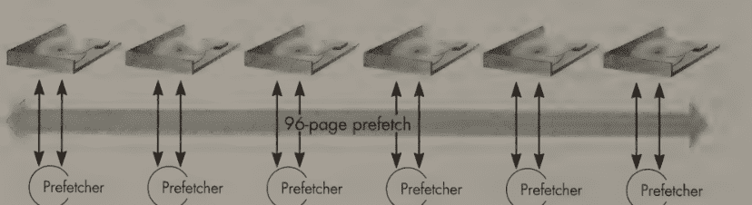

图 6.4

未启用 `DB2_STRIPED_CONTAINERS` 的 DB2 v8 之前的默认行为。

## 表空间容器管理

### RAID-5 (6+1) 示例

物理磁盘条纹化

- 每个范围在 RAID-5 内部的阵 条纹边界上对齐
- 单预取同时驱动所有六个驱动器
- 每个磁盘必须处理一次 I/O

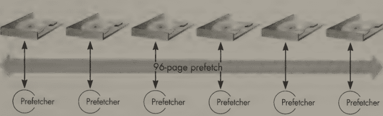

图 6.5

新的 DB2 v8 行为。在完整范围内分配容器标记对 DB2 有益。

### 表空间管理

由于表空间的 `EXTENTSIZE` 不等于或不是 RAID 条纹大小的倍数，DB2 通过范围检索数据时将需要额外的 I/O。在图 6.5 中，我们可以观察到将 `EXTENTSIZE` 与 RAID 条纹大小对齐带来的 I/O 改进，这使得 DB2 能更高效地检索数据，一次驱动六个 `EXTENT-SIZE` 预取请求。

> 注意
>
> DB2 v8 在每个 DMS 容器的第一个范围内分配页容器标记。在 v8 之前，容器标记存储在单个页中，且与 RAID 条纹不对齐，导致了比需要的更多的 I/O。不要更改 `DB2_USE_PAGE_CONTAINER_TAG` 变量的设置！

ESS 管理缓存和非易失性存储 (`NVS`)。最新的 ESS 模型 800 支持 64 GB 缓存，数据库性能将受益，因为可以在缓存中找到数据，从而减少对物理磁盘的访问。

## 企业级存储系统 (ESS)

ESS 管理缓存和非易失性存储 (`NVS`)。最新的 ESS 模型 800 支持 64 GB 缓存，数据库性能将受益，因为可以在缓存中找到数据，从而减少对物理磁盘的访问。

## DB2 与 ESS

ESS 管理缓存和非易失性存储 (`NVS`)。最新的 ESS 模型 800 支持 64 GB 缓存，数据库性能将受益，因为可以在缓存中找到数据，从而减少对物理磁盘的访问。

## ESS 术语

在讨论如何在 ESS 上布局容器时，了解术语是有帮助的。我将识别并讨论你需要的关键术语。

- `STRIP`——在存储术语中，“`STRIP`”是单个设备上的条纹。我们可以将其理解为 DB2 中的范围。
- 条纹宽度——跨物理磁盘的 DB2 容器数量。
- ESS 逻辑磁盘——由 7+P 组成的阵列（7+P  7 块磁盘 + 1 校验）。例如，包含 ESS 逻辑磁盘的四个 DB2 容器将跨 32 块物理磁盘。这种安排将导致 DB2 能够一次驱动 32 次 I/O 操作。
- `VPATH`——由 SDD 构建的向操作系统表示 ESS 逻辑磁盘的实体。

## 缓存管理

每当对 ESS 进行读取或写入时，数据的副本都会存储在集群缓存中。这是为了预计从缓存中重新引用。缓存中的数据会老化，当缓存算法确定在预定时间间隔内不再被引用时，就会从缓存中移除。修改的数据从集群缓存刷新到 RAID 阵列并永久更改。

对于随机读取，ESS 将使用记录缓存策略，这意味着一个 DB2 页将被读取到缓存中。当访问相邻的物理记录时，将检测到这一点并让 ESS

# DB2 与 IBM 企业级存储系统 ESS SHARK

顺序访问算法将使用“轨道缓存”策略，这会导致 ESS 将额外数据调度到缓存中，这些数据对应于 ESS 逻辑轨道。

> 注意
>
> ESS 逻辑轨道与物理跨区大小相同，对于连接到 SCSI 和光纤通道的主机，约为 32 KB。

由于 DB2 在表扫描时按顺序访问数据（在数据仓库（DW）环境中更是如此），因此 ESS 设计为通过检测此类活动并将数据预先取到 ESS 缓存中，来检测并优化顺序访问模式。因此，通过 ESS，我们实现了从通往 ESS 的 DB2 顺序预取到 ESS 异步预取到 ESS 缓存的。简单来说，DB2 会检测并识别顺序访问，并作为访问计划的一部分或顺序检测的一部分调用顺序预取，以预判应用程序正在顺序访问数据。同时，ESS 正在预先预取数据到 ESS 缓存中。这种 DB2 与 ESS 的协同工作为处理大量顺序数据的应用程序提供了显著的性能提升。

ESS 管理缓存以便在顺序访问和随机访问请求之间实现平衡效率，防止一个或两个应用程序垄占缓存。

ESS 通过将 RAID-5 顺序写转换为 RAID-3 操作来管理顺序写。这是通过 ESS 缓存管理器和磁盘适配器将数据从 `NVS` 和集群缓存并行写入磁盘来实现的，同时在内部计算校验和并将其发送到磁盘。这种技术消除了前文中讨论的 RAID-5 写入惩罚。

# 非易失性存储

`NVS` 为修改的数据提供保护，以防集群故障。每个集群的 `NVS` 物理上维护在另一个集群中。通过这种方式，存活集群包含了所有经缓存修改的数据。当 DB2 写入记录时，ESS 在缓存中存储该记录两个副本（一个在集群缓存中，另一个在 `NVS` 中），并在两个副本都安全存储后立即指示写入完成。此时，该记录已受到双重保护。当数据从缓存下刷到磁盘（并受 RAID-5 双重保护）时，`NVS` 中的存储即可供另一个应用程序重用。

在没有 ESS 的 AIX 中，每个单独固定硬盘被称为物理卷（`PV`）并有一个名称。这些 `PV` 对应于特定的 `hdisk`。ESS 使用子系统设备驱动程序（`SDD`）并启用虚拟配对，每个 `hdisk` 代表通往 ESS 逻辑磁盘的路径。`PV` 由 `vpath` 表示。

因此，在 AIX ESS 实现中，标识 ESS 存储的 `PV` 并不是物理设备。它们代表跨越多个硬盘驱动器的逻辑设备。

# 第 6 章 高性能表空间设计和 I/O 策略

在最简单的级别，逻辑磁盘由 7+P+S RAID 数组组成。+S 表示“备用”磁盘。在 ESS 中，这在数组之间自由浮动。每个 SCSI ID 分配给每个数组。逻辑单元（`LUN`）是 SCSI ID 下的子划分。每个 SCSI ID 最多可以分配八个 `LUN`；这就是为什么逻辑磁盘与八块磁盘相关联。DB2 数据跨越数组中的所有磁盘分布，数组中的所有磁盘都可以使用名为命令标签标记（`command-taguing`）的 SCSI 技术用于并行 I/O。


在内部，ESS 使用串行存储架构（SSA）执行磁盘 I/O。SSA 磁盘被配置为提供冗余以及带有多个适配器的环路配置。在 ESS 中，几乎所有的 RAID 功能都由 SSA 磁盘适配器执行。校验生成、磁盘重建和备用均在 SSA 适配器级别完成。这通过将这些功能从 CPU 和缓存中卸载，提高了性能。

ESS 使用集群将两个集群连接在一起。在 ESS 中，集群是处理器、NVS 和 SSA 磁盘适配器的集合。ESS 包含两个集群。每个集群控制 ESS 内部存储的一半，但如果其伙伴故障，它可以接管另一部分的控制权。每个集群拥有独立的缓存、磁盘适配器和数组，因此在正常情况下不会影响另一个集群的性能。集群甚至运行独立的内核并通过内部网络连接进行通信。ESS Web 界面工具 ESS Specialist 用于管理集群。

# 在 ESS 上配置 DB2 以获得最佳性能

在 ESS 上定义 DB2 表空间时，有五条通用规则需要遵循：

- 了解你的数据所在位置，并理解 DB2 容器如何映射到 ESS 逻辑磁盘。尽可能将数据跨越尽可能多的 RAID 数组。
- 在 ESS 资源之间平衡负载。根据业务优先顺序，建立一种控制容器分配的方法。
- 利用 DB2 固有的跨区功能，将表空间的容器放在不同的 ESS 逻辑磁盘上，这些磁盘位于不同的 ESS RAID 数组上。这将消除使用底层操作系统卷管理器跨区的需求。
- 选择合适的 ESS 逻辑磁盘大小，使其允许粒度和增长，而不会导致逻辑磁盘数量过多。对于大多数环境，八个逻辑磁盘是一个很好的数字。
- 沿 DB2 跨区使用 ESS 多路径，以帮助平衡光纤通道或 SCSI 路径的使用。

让我们来看看核心规则：了解你的数据所在位置。其关键是在可用资源之间平衡 I/O 负载。记住这些提示以帮助平衡 ESS 存储上的的活动：

1. 跨越 ESS 机柜
2. 在集群内跨越集群

## DB2 IBM 企业级存储系统 (ESS SHARK)

3. 跨越磁盘适配器
4. 使用尽可能多的数组（最大化并行性）

参见图 6.6，该图说明了上述提示的实现。

在图 6.6 中，我们有一个包含八个容器的表空间，它们分布在多个物理磁盘、适配器和 ESS 系统上。这种容器策略为高性能提供了多条路径和磁盘，并为多个主机适配器、路径甚至 ESS 系统提供了极高的可用性。当今严苛的业务应用程序需要类似的配置来提供真正的 24 × 7 可用性。


在图 6.6 中，我们有一个包含八个容器的表空间，它们分布在多个物理磁盘、适配器和 ESS 系统上。这种容器策略为高性能提供了多条路径和磁盘，并为多个主机适配器、路径甚至 ESS 系统提供了极高的可用性。当今严苛的业务应用程序需要类似的配置来提供真正的 24 × 7 可用性。

**图 6.6** 容器的布局。

# 将所有内容连接起来

由于 ESS 元素在操作系统中看起来像 PV，但实际上并非如此，ESS 提供了一些工具可以帮助你将底层存储结构连接起来。

# ESS Specialist

ESS Specialist 允许你配置和查看逻辑布局。请参见图 6.7。


ESS Specialist 可以显示逻辑逻辑磁盘留了多少空间以及 vpath 信息，帮助你和存储专家从 AIX 反向映射。

图 6.8 是一个 AIX 资源映射到 vpath 的示例。

在图 6.8 中，我们可以看到 `hdisk`（通过 `iostat`）转换为 `vpath`，然后该 `vpath` 如何连接到 ESS 逻辑磁盘。

## 数据库映射


- `hdisk247`
- `hdisk261`
- `hdisk267`
- `hdisk283`
- `vpath124`

卷 104-13902

**图 6.8** `hdisk` 到虚拟路径的示例。

# 维护数据库映射

你应该始终有一份表空间如何在存储设备上布局的最新映射。这种映射将帮助你从 DB2 映射到 AIX LVM、SDD 软件以及 ESS 支持软件。表 6.3 列出了获取此类映射信息的地方和。

**表 6.3** ESS/AIX 存储布局映射

| 来源 | 命令 | 描述 |
|---|---|---|
| DB2 | `List tablespace containers` | 提供作为 DB2 容器的操作系统设备列表。 |
| AIX | `Mount or cat/etc/filesystems` | 提供挂载设备的列表。 |
| AIX | `ls /dev` | 提供所有设备（无论是否挂载）的列表。 |
| ESS Specialist | 保存为 `.txt` 文件的存储表格值 | 提供每个 ESS 逻辑磁盘的标识、大小和适配器连接列表。 |
| SDD (AIX 命令行) | `lsvpecfg` | 将 AIX `hdisk` 映射到其虚拟路径。 |
| ESSUtil | `lsess` | 将 AIX `hdisk` 映射到 ESS 逻辑卷。 |

# ESS 存储专家

ESS Storage Expert 是一个单独定价的软件软件包，用于收集性能统计数据。它是 ESS Storage Specialist 的扩展，后者基于 Web，并与 ESS Storage Specialist 交互。请参图 6.9 查看 Storage Expert 界面的示例。

图 6.9 是使用 Storage Expert 配置和调度数据收集的示例。Storage Expert 预定义的报告如下：

- 磁盘利用率
- 磁盘缓存
- 集群和磁盘适配器
- 磁盘阵
- 逻辑磁盘

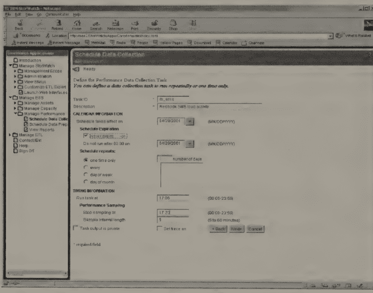

图 6.9 ESS Storage Expert 数据收集设置。

## I/O 瓶颈

在许多情况下，数据库工作负载导致 PCI 总线达到饱和，而 CPU 继续根据摩尔定律进行规模扩展。I/O 的改进却滞后了，

# 掌握你的数据库映射

因此我们拥有了“I/O 瓶颈”。磁盘变得越来越密集，因此也变得越来越（72 GB 磁盘正取代常见的 44 GB 磁盘），以存储更多数据。然而，尽管磁盘速度（RPM）已从 15,000 增加到 20,000 RPM，磁盘执行器寻道的时间保持不变。因此，RPM 适度增加的大型磁盘意味着更慢的响应时间。磁盘访问正在变得越来越慢，而不是变快。

## PCI 总线

今天大多数 PC 和服务器使用的主要总线也是 I/O 瓶颈的原因之一。PCI（外围组件互连）是一种总线系统，允许在任意两个设备之间进行数据传输。PCI 由英特尔于 1992 年开发的，作为 PC 和服务器平台的本地总线。

在 DB2 以及其他企业级 RDBMS 实现中，PCI 是 CPU 的瓶颈。PCI 的传输速率为 133 MB/sec（每秒兆兆字节）。在过去的 10 年里，它增强了多次，最新的 PCI-X 1.0 规范的传输速率高达 1066 MB/sec。虽然这些传输速率对于普通 PC 和中小型级服务器来说是可以接受的，但它们已经落后于处理器速度和行业需求。互联网和数据库应用程序正在使总线饱和，而处理器却处于闲置状态。行业用户、供应商和 PCI 特别小组（PCI-SIG，PCI 的倡议者）已经意识到这个问题，并开发了更快的 PCI-X 和 PCI Express 规范。

CPU 速度每 18 个月翻倍，随着内存价格迅速下降，主内存容量的增长快于 CPU 速度。所有磁盘传输速率仅增加了 7%。

这意味着什么？这意味着必须发生革命性的变化，以开发能够支持今天数据传输速率和未来要求的 I/O 织网。

# PCI Express (Arapahoe, 3GIO)

PCI Express 正式名为 Arapahoe，3GIO 正式改为 PCI Express。PCI Express 将成为 PC 上现有 PCI 总线的升级路径，并最终取代 PCI，但由于过去 10 年 PCI 的泛滥，这将需要很多年。PCI Express 在软件上与 PCI 向后兼容，但在硬件上兼容。PCI Express 可以以 2 GB/sec 的数据速度运行。它是可扩展的并使用串行 I/O。它将在 2003 年底或 2004 年初广泛使用。

## PCI-X

PCI-X 提供高达 4.2 GB/sec 的数据传输速率，主要为服务器实现设计。PCI-X 的设计初衷是为了在企业级或中低端服务器级别进行竞争。它与 PCI 完全向后兼容。它被定位为低端服务器市场 InfiniBand 的替代品。PCI-X 是一种本地总线。

# InfiniBand 救场出现

InfiniBand 架构 (IBA) 由 InfiniBand 贸易协会 (IBTA) 发布。IBTA 于 1999 年 8 月成立，是英特尔/微软领导的 NGIO、IBM、COMPAQ 和 SUN FUTURE 努力的成果。InfiniBand 是一种用于服务器的行业标准、基于通道的交换织网互连架构。

InfiniBand 不是 PCI 或 PCI Express 本地总线的替代品。在内部，它是数据中心内服务器的新 I/O 织网，而 PCI 是点点架构。


IBA 是一种新兴技术，定义了全新的 I/O 范式和 I/O 发生的方式。IBA 不像 PCI 那样基于总线，而是点对点的，避免了总线仲裁，并通过使用接口与 CPU 通信消息（命令和数据）来克服 PCI 本地总线的限制，这些不涉及内存操作和相关的 CPU 开销。事实上，一次没有 IBA 的 IBM 测试将 CPU 驱动到了 100%。使用 IBA 的相同测试将 CPU 驱动到了 15%。大幅减少！

参见图 6.10 查看 IBA 的高级视图。

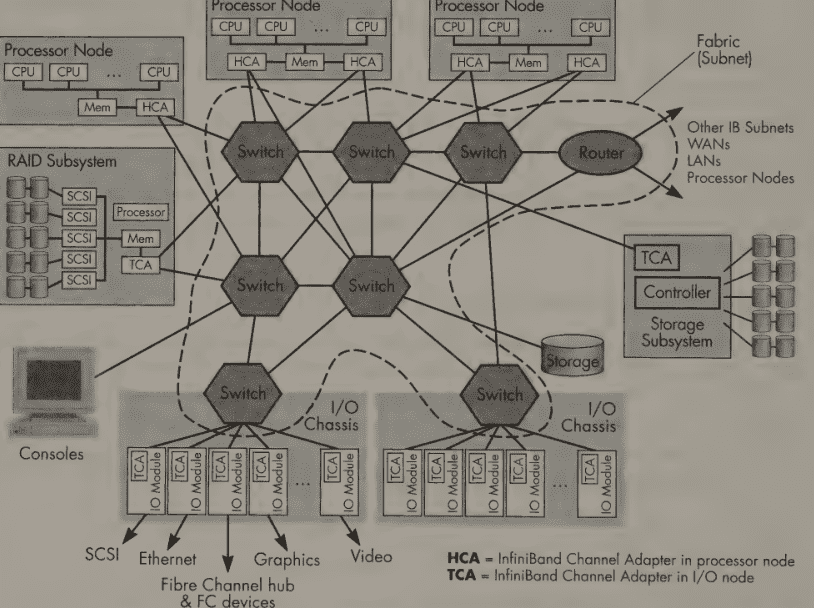

**图 6.10** IBA 高级概述。（经 InfiniBand 贸易协会许可）

## 掌握你的数据库映射

IBA 可以被认为存在服务器外部，与 PCI 不同，后者是局部的、箱内的互连。

InfiniBand 的意思是“无限带”，这描述了构建在 InfiniBand 内置的可扩展性程度。

> 注意
DB2 是第一个关系型数据库系统 (RDBMS)

IBA 由四种主要设备组成：通道适配器 (HCA)、目标通道适配器 (TCA)、交换机和路由器。参见图 6.11 查看 InfiniBand 织网的示例。

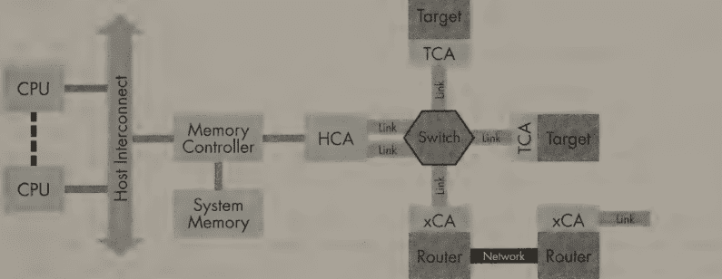

图 6.11 InfiniBand 组件。（经 InfiniBand 贸易协会许可）

图 6.11 列出了 IBA 的主要组件。这些组件及其功能如下：

- **通道适配器 (HCA)**。HCA 是通过消息与 CPU 接口。
- **目标通道适配器 (TCA)**。TCA 是交付请求数据的简单设备。TCA 可以是接口。
- **InfiniBand 交换机**。这些交换机连接 HCA 和 TCA 形成网络，是织网的骨干。
- **路由器**。IBA 路由器实现了与其他网络的对接。

> 注意
IBA 的最小单元是子网。通过路由器连接多个子网形成大型 IBA 网络。HCA 和 TCA 是通过链路发送消息的端节点。

最后，每个子网都有一个子网管理器执行路由和子网发现。

### IBA 链路速度

IBA 链路提供以下速度：

- `1x`—500 MB/sec。（全双工）
- `4x`—2 GB/sec。（全双工）
- `12x`—6 GB/sec。（全双工）

当然， IBA 令人兴奋的是数据传输速度。`12x` 链路的吞吐量是千兆以太网理论极限的 50 倍。

虽然 InfiniBand 通过增加 I/O 带来了显著的性能优势，但行业一直拒绝取代 PCI，因此开发了 PCI-Express 和 PCI-X。对远程内存访问 (RDMA) 的兴趣日益增加，它为 I/O 瓶颈提供了部分解决方案。RDMA 允许远程进程在内存总线和 CPU 需求最小的情况下将数据直接传输到主机进程。更多详情...

## 总结

在本章中，我们讨论了对 DB2 性能至关重要的表空间参数。讨论了存储模型，并为你们实现 DB2 高性能提供了遵循示例和建议。讨论了各种 RAID 级别和属性。涵盖了将表空间分布在 ESS 上多个逻辑磁盘上的概念，并提供了一个示例。展示了 DB2 中 I/O 的生命周期。识别并讨论了有利于 DB2 的新兴技术。根据本章的信息，你们应该对 I/O 性能以及应该从存储专家那里获得哪些信息有充分的了解。

# 第 7 章 工具与命令

本章重点介绍 v8 版本中引入的新型工具和命令。IBM 增强了若干工具，以向我们提供极高的可用性和可维护性。其中，“表和索引的在线重组”以及“在线加载”是重点。还引入了若干新命令，使 DB2 能够在当今严苛的 24×7×365 环境下，提供业务所需的持续可用性。

此外，我包含了 18 个对 DB2 成功运行至关重要的工具和命令，例如 `Backup Database`、`Roll-Forward` 和 `Restore Database` 等。同时也还包含了一些帮助您管理和支持 DB2 的新 DB2 命令。

我在本章中对相关的工具和命令进行了排序，以便您执行相关任务。v8 中有很多新的向导（wizards）。我在章中适当的地方包含了它们的示例。见图 7.1，该图显示了如何从 `Control Center` 启动向导。

如图 7.1 所示，所有向导都可以从控制中心启动。只需点击控制中心工具栏上的“`Tools`”菜单项，然后选择“`Wizards`”，即可看到向导的下拉列表，如图 7.2 所示。

有关所有 DB2 工具和命令的信息，请参阅 `DB2 UDB` 命令参考手册。

> 注意：书中“工具”和“命令”术词可以通用。

## 控制中心

第 7 章 • 工具与命令

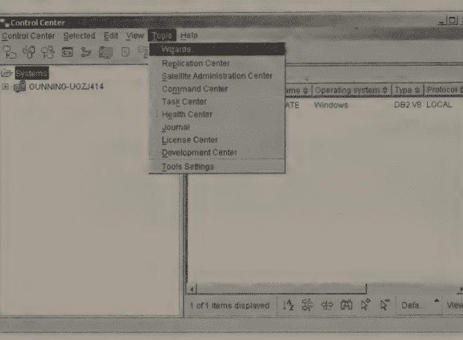

图 7.1

控制中心工具菜单。

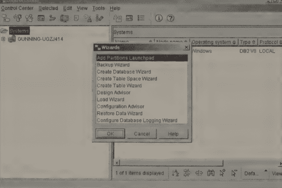

图 7.2

v8 向导下拉列表。

## 重组索引/表

`REORG` 工具在 v8 中得到了显著增强。现在可以对表进行在线重组，且几乎允许对表的完全访问。索引现在也可以进行在线重组。

> 注意
`REORG` 工具在 v8 中得到了显著增强。新增了20 多个新命令选项，以支持表和索引的在线重组，并支持停止、暂停和恢复重组。

其他改进还包括了暂停重组并在稍后重新启动的能力。这是 v8 中的新功能，为您（DBA）提供了更大的灵活性。在 v8 之前，重组无法暂停和重启，必须运行完成。这些增强使得 DB2 能够支持当今业务环境中严苛的业务需求。后续是 `REORG` 工具以及每个选项的详细说明。

> 注意
有关语法图，请参阅 `DB2 UDB` 命令参考手册。

重组实用程序用于重组索引或表。

`index` 选项通过将索引数据重建为无碎片的、物理连续的页，来重组表上定义的所有索引。如果您指定了 `index` 选项的 `CLEANUP ONLY` 选项，则将执行清理操作而不重建索引。

**范围**此命令无法用于声明临时表上的索引，如果尝试执行，将返回 SQLSTATE `42995`。

**权限** `table` 选项通过重构数据行以消除碎片数据并压缩信息来重组表。此命令影响数据库组中的所有数据库分区。运行重组工具需要以下权限之一：

- `Sysadm`
- `Sysctl`
- `Sysmaint`
- `Dbad`
- 对该表的 `CONTROL` 权限

**必要连接**需要连接到数据库。

### 命令参数

`INDEXES ALL FOR TABLE table-name`

指定要重组索引的表。该表可以是本地数据库或远程数据库。

`ALLOW NO ACCESS`—指定在索引重组期间，其他用户无法访问该表。这是默认设置。

`ALLOW READ ACCESS`—指定在索引重组期间，其他用户可以对表具有只读访问。

`ALLOW WRITE ACCESS`—指定在索引重组期间，其他用户可以对表进行读取和写入。

`CLEANUP ONLY`—当请求 `CLEANUP ONLY` 时，将执行清理而非完全重组。索引和任何释放的页将供该表上定义的索引重用。

`CLEANUP PAGES` 选项将搜索并释放已提交的伪空页（pseudo-empty pages）。已提交的伪空页是指页上的键被标记为删除且已知所有删除已提交。可以通过运行 `runstats` 并查看 `NUM EMPTY LEAVES`（如果它们被确定已提交）来确定索引中伪空页的数量。

`CLEANUP ALL` 选项将释放已提交的伪空页，并从非伪空页中移除已提交的删除键。此选项还会尝试合并相邻叶页，如果这样做会产生合并后的叶页且 `PCTFREE` 为 10%。如果两个页可以合并，则将释放其中一个页。排除伪空页上的键，索引中伪删除键的数量可以通过运行 `runstats` 并选择 `SYSCAT.INDEXES` 中的 `NUMIDS DELETED` 来确定。如果 `NUMIDS DELETED` 被确定已提交，`ALL` 选项将清理这些键。

`ALL`—指定通过移除已提交的伪删除键和已提交的伪空页来清理索引。

`PAGES`—指定从索引树中移除已提交的伪空页。由于它只检查伪空，因此速度比 `ALL` 选项快得多。

`CONVERT`—如果您不确定正在操作的表是 type-1 还是 type-2 索引，可以使用 `CONVERT` 选项。如果索引是 type-1，该选项将其转换为 type-2。如果索引已经是 type-2，则该选项无效。使用 `INSPECT` 命令确定索引类型可能很慢。

> 注意 `CONVERT` 允许您确保新索引为 type-2，而无需确定其原始类型。

使用 `ALLOW READ ACCESS` 或 `ALLOW WRITE ACCESS` 选项，可以在索引重组期间允许其他事务对表进行只读或读写访问。

> 注意虽然 `ALLOW READ ACCESS` 和 `ALLOW WRITE ACCESS` 允许访问，但在重组索引可用期间，不允许访问表。

`TABLE table-name`


指定要重组的表。该表可以是本地或远程数据库。可以使用 `schema.table-name` 格式的或别名。架构是创建表的用户名。如果省略架构名，则假设为默认架构。对于分区表，指定的表名必须是层次结构的根表名。

> 注意无法为多维聚类（MDC）表指定索引。

> 注意 表的就地重组无法用于 MDC 表。

### INDEX index-name

指定重组表时使用的索引。如果您未指定 `schema.index-name` 格式的全限定名称，则假设为默认架构。架构是创建索引的用户名。数据库管理器使用该索引来物理重排序正在重组的表记录。

> 注意 对于就地表重组，如果表定义了聚类索引且指定了索引，则必须是该聚类索引。

如果没有指定 `inplace` 选项，任何指定的索引都将被使用。如果您未指定索引名称，则不考虑顺序重组记录。然而，如果表定义了聚类索引且未指定索引，则使用该聚类索引来聚类表。重组 MDC 表时，无法指定索引。

102

第 7 章 • 工具与命令

### INPLACE

在允许用户访问的同时重组表。仅允许具有类型-2 索引且没有扩展索引的表进行原地表重组。

- `ALLOW READ ACCESS`—允许读取访问——在重组期间仅允许对表进行读取访问。

> 注意

`ALLOW WRITE ACCESS`—允许写入访问——在重组期间允许对表进行写入访问。这是默认行为。

- `NOTTRUNCATE TABLE`—在原地重组后不截断表。在截断期间，表会处于 S 锁状态。

- `START`—启动原地 REORG 处理。由于这是默认值，因此此关键字是可选的。

- `STOP`—在当前点停止原地 REORG 处理。

- `PAUSE`—暂时挂起或暂停原地 REORG。

- `RESUME`—继续或恢复之前暂停的原地表重组。

### USE tablespace-name

指定一个系统表空间的名称，该表空间将用于存储正在被重组表的临时副本。如果您未提供表空间名称，数据库管理器将在包含被重组表的表空间中存储表的工作副本。

对于 8 KB、16 KB 或 32 KB 的表对象，您指定的任何系统临时表空间的页大小必须与表数据所在表空间的页大小匹配，包括任何 LONG 或 LOB 列数据。

### INDEXSCAN

对于聚类 REORG，将使用索引扫描来重新排序表记录。通过索引访问表来重组行。默认方法是扫描表并对结果排序以重组表，并在时使用临时表空间。尽管索引键是有排序的，但扫描和排序通常比先从索引读取行标识符再获取行更快。

### LONGLOBDATA

将重组长字段和 LOB 数据。即使表包含长字段或 LOB 列，这也是必需的。默认值是避免重组这些对象，因为这样做耗时且不会提高聚类性。

## 重组索引/表

## 示例

对于类似于 DB2 版本7 默认的经典 REORG TABLE，输入以下命令：

```db
db2 reorg table employee index empid allow access indexscan
longlobdata
```

注意 v8 版本中的默认值不同。

要重组表以回收空间并使用临时表空间 mytemp1，请输入以下命令：

```db
db2 reorg table homer.employee use mytemp1
```

要重组由节点 1、2、3 和 4 组成的四节点系统中的分区组中的表，可以输入以下任一命令：

```db
db2 reorg table employee index empid on dbpartitionnum (1,3,4)
db2 reorg table homer.employee index gprod.empid on all
dbpartitionnums except dbpartitionnu (2)
```

要在清理 EMPLOYEE 表上所有索引的伪熵页的同时，允许其他事务读取和更新该表，请输入：

```db
db2 reorg indexes all for table .employee allow access cleanup 
only pages
```

使用临时表空间 TEMPSPACE1 作为工作区域重组 employee 表，请输入：

```db
db2 reorg table homer.employee using tempspace1
```

要启动、挂起和恢复对默认架构 GPROD（在之前的示例中已显式指定）的 EMPLOYEE 表进行原地重组，请输入以下命令：

```db
db2 reorg table employee index empid inplace start
db2 reorg table employee inplace pause
db2 reorg table homer.employee inplace allow read access truncate 
table resume
```

> 注意

注意，恢复重组的命令包含额外的关键字，用于指定仅读取访问并跳过截断步骤（截断步骤会对表加共享锁）。

## 工具指南与异常

关于表重组当前进展的信息会被写入数据库活动历史文件。历史文件包含每个重组事件的记录。要查看此内容，请对包含您正在重组的表的数据库执行 `db2 list history` 命令。

您还可以使用表快照（snapshots）来监控表重组的进度。无论数据库监视表是否切换，都会记录表重组监控数据。

如果发生错误，SQLCA 转储（dump）将写入历史文件。对于原地重组，状态将被记录为 `PAUSED`（挂起）。

当索引表被修改多次时，索引中的数据可能会变得碎片化。如果表相对于索引是聚类的，则表和索引可能会乱序。这两个因素都会不利地影响使用索引扫描的性能，并影响索引页预取的有效性。可以使用 `REORG INDEXES` 对表上的所有索引进行通用处理，删除任何碎片并恢复叶页的物理聚类。使用 `REORGCHK` 来帮助确定索引是否需要重组。

> 注意

`REORG TABLE` 命令不支持临时表（declared temporary tables）。

在执行原地 `REORG TABLE` 操作后，索引可能不是最优的，因为只有数据对象被重组了而不是索引。建议您执行原地 `REORG INDEXES` 操作。然而，在经典 `REORG TABLE` 的最后一个阶段，索引会被完全重建，因此重组索引并非必须。

被修改多次以至于数据碎片化且访问性能明显缓慢的表是 `REORG TABLE` 命令的候选对象。在更改结构化类型列的内联长度（inline length）后，您也应该调用此命令以利用更改后的内联长度。使用 `REORGCHK` 判断表是否需要重组。重组后，使用 `REUNSTATS` 更新表统计，并使用 `REBIND` 重新绑定使用该表的包。重组工具将隐式关闭所有游标。

如果表在激活或禁用表压缩之前包含混合行格式，离线表重组可以将所有行转换为目标格式。

如果表分区在多个数据库分区上，且表重组在任何数据库分区上失败，则受影响的数据库分区将回滚。

> 注意

如果重组未成功，不应删除临时文件。这些文件创建在数据库路径上。数据库管理器使用这些文件回滚失败的重组。

如果指定的索引名称，数据库管理器将根据索引顺序重组数据。

> 注意

为了最大化性能，请指定常用查询的索引。如果未指定索引名称且存在聚类索引，则数据将根据聚类索引排序。

表的 `PCTFREE` 值决定了每页预留的空间。如果没有设置该值，工具将尽可能填满每页。

工具不支持别名（nicknames）。

要在表重组后完成表空间滚动恢复，必须启用数据和 LONG 表空间

如果表包含未使用 COMPACT 选项的 LOB 列，重组后 LOB DATA 存储对象可能会增大。这可能是行重组顺序以及表空间类型（SMS/DMS）的结果。

`REORG TABLE` 不能使用基于索引扩展的索引。

> 注意

重组数据是您可以采取最重要的性能改进措施之一。

## REORGCHK 工具

对数据库进行统计计算以确定表、索引或两者是否需要重组或清理。`REORGCHK` 工具应每周运行一次，或根据需要增加频率。该工具的输出将指示是否需要重组。`REORGCHK` 工具在 v8 中经过增强，可以报告需要清理的伪删除索引项。此外，v8 增加了 `ON SCHEMA` 选项，允许您指定要运行 `REORGCHK` 工具的对象架构。

范围 此命令可以从 `db2nodes.cfg` 文件中的任何数据库分区发布。它可以用于更新目录中的表和索引统计信息。

## 权限

需具有以下权限之一：

- `sysadm` 或 `dbadm` 权限

- 表的 `CONTROL` 权限。

所需的连接数据库。

## 命令参数

### UPDATE STATISTICS

调用 `RUNSTATS` 程序以更新表统计信息，然后使用更新后的统计信息确定是否需要对表进行组织。

如果在执行 `REORGCHK` 的节点上存在表分区，则 `RUNSTATS` 在该节点上执行。如果节点上不存在表分区，则请求将发送到数据库分区组中持有该表分区的第一个节点。随后 `RUNSTATS` 在该节点上执行。

### CURRENT STATISTICS

使用当前的表统计信息确定是否需要对表进行重组。

### ON SCHEMA schema-name

检查指定架构下创建的所有表。

### ON TABLE


- `USER`—检查由运行时授权 ID 拥表。
- `SYSTEM`—检查系统表。
- `ALL`—检查所有用户和名称或别名。

`in table-name`—指定要检查的表。必须使用 `schema.table-name` 格式的完全限定名。`schema` 是创建该表的用户名。如果指定的表是系统目录表，则 `schema` 为 `SYSIBM`。

> 注意
>
> 对于类型表，指定的表名必须是层次结构根表的名称。

参见示例 7.1 的 `REORGCHK` 输出示例。

# 执行 RUNSTATS ...

表统计信息：

`P1`: `100 * OVERFLOW / CARD < 5`

`P2`: `100 * (数据页空间利用率) > 70`

`F3`: `100 * (所需页面 / 总页数) > 80`

| SCHEMA | NAME | CARD | OV | NP | FP | ACTBLK | TSIZE | F1 | F2 | F3 | REORG |
| --- | --- | --- | --- | --- | --- | --- | --- | --- | --- | --- | --- |
| PGU_NING | CL_SCHED | | | | | | | | | | |
| PGU_NING | CORNERHEAD_STATE | 131 | 0 | 7 | 7 | | 23973 | 0 | 98 | | |
| PGU_NING | CONTROL_STATEMENTS | 14 | 0 | 1 | 1 | | 700 | | 0 | 0 | |
| PGU_NING | DEADLOCK_STATE | 9 | 0 | 1 | 1 | | 549 | | 0 | 100 | |
| PGU_NING | DEPARTMENT | | | | | | | | | | |
| PGU_NING | DLCONN_STATEMENTS | 75 | 0 | 1 | 1 | | 2850 | | | | |
| PGU_NING | DLOCK_STATEMENTS | EMP_ACT | 12 | 0 | 1 | 1 | | 2028 | 0 | 100 | | |
| PGU_NING | EMP_PHOTO | 8 | 0 | 1 | 1 | | 984 | 0 | 100 | | |
| PGU_NING | EMP_EMPLOYEE | 32 | 0 | 2 | 2 | | 2784 | 0 | 68 | | |
| PGU_NING | EXPLAIN_ARGUMENT | 12 | 0 | 1 | 1 | | 3180 | 0 | 0 | | |
| PGU_NING | EXPLAIN_INSTANCE | 1 | 0 | 1 | 1 | | 127 | | 0 | 100 | | |
| PGU_NING | EXPLAIN_OBJECT | 2 | 0 | 1 | 1 | | 662 | | 0 | 100 | | |

示例 7.1 增强型 v8 `REORGCHK` 输出样本。

# 第 7 章 • 工具与命令

| | | | | | | | | | | | | | | | | | | | |
|---|---|---|---|---|---|---|---|---|---|---|---|---|---|---|---|---|---|---|
|-|

| PGUNNING_EXPLAIN_OPERATOR | 3 | 0 | 1 | | | | | | 525 | 0 | 100 | | | | | | | |
| PGUNNING_EXPLAIN_PREDICATE | 2 | 0 | 1 | | | | | | 530 | 0 | 100 | | | | | | | |
| PGUNNING_EXPLAIN_STATEMENT | 2 | 0 | 1 | | | | | | 956 | 0 | 100 | | | | | | | |
| PGUNNING_EXPLAIN_STREAM | 4 | 0 | 1 | | | | | | 1844 | 0 | 100 | | | | | | | |
| PGUNNING_IN_TRAY | 8 | 0 | 1 | | | | | | 440 | 0 | 100 | | | | | | | |
| PGUNNING_ORG | 2 | 0 | 1 | | | | | | 1340 | 0 | 100 | | | | | | | |
| PGUNNING_PROJECT | 41 | 0 | 1 | | | | | | 1845 | 0 | 100 | | | | | | | |
| PGUNNING_SALES | 35 | 0 | 1 | | | | | 1575 | 0 | 100 | | | | | | | |
| PGUNNING_STMT_STATEMENTS | 8128 | 0 | 937 | | | | | 409612 | 0 | 100 | | | | | | | |

索引统计信息：

`F4`: `CLUSTERRIO` 或规范 `CLUSTERFACTOR > 80`

`F5`: `100 * (SIZE + 9) + (CARD / (NLEAF - EMPTY LEAVES)) * (INDEXPAGES) > 50`

`F6`: `(100 - PCTREE) * ((INDEXPAGES - 9) / (SIZE + 9)) * (NLEVELS + 2) * 96) / (KEYS * (SIZE + 9) / (CARD)) * 5 < 100`

`F7`: `100 * (NUMIDS_DELETED / (NUMIDS_DELETED + CARD)) < 20`

`F8`: `100 * (EMPTY_LEAVES / NLEAF) < 20`

示例 7.1 增强型 v8 `REORGCHK` 输出（续）。

| SCHEMA | NAME | NDEL | ISIZE | LVLS | ELEAF | LEAF | F4 | F5 | F6 | F7 | F8 | REORG |
| --- | --- | --- | --- | --- | --- | --- | --- | --- | --- | --- | --- | --- |
| SYSIBM | PGUNNING_EMP_PHOTO SQL003010719346850 | 12 | 0 | 1 | 14 | 0 | 12 | 100 | - | - | - |
| SYSIBM | PGUNNING_EMP_RESIDE SQL003010719349680 | 8 | 0 | 1 | 16 | 0 | 8 | 100 | - | - | - |
| SYSIBM | PGUNNING_EXPLAIN_INSTANCE SQL003010719563400 | 1 | 0 | 1 | 50 | 0 | 1 | 100 | - | - | - |
| SYSIBM | PGUNNING_EXPLAIN_STATEMENT SQL0030107195635030 | 2 | 0 | 1 | 59 | 0 | 2 | 100 | - | - | - |

`CLUSTERRIO` 或规范 `CLUSTERFACTOR` (`F4`) 将指示与基础表顺序相同的索引需要 `REORG`。当一个表上定义了多个索引时，一个或多个索引可能被标记为需要 `REORG`。指定最重要的索引进行 `REORG`。

使用 `ORGANIZATION BY` 子句定义的表对应的索引名称带有后缀。维度索引的基数等于表的活动块统计。

# 示例 7.1 增强型 v8 REORG 输出（续）。

注意 v8 中增加了两个公式以处理伪删除 RID 条目和 MDC 表。新字段 `ELEAF` 和 `NDEL` 的定义如下：

- `ELEAF`—伪空索引页数 (`NUM_EMPTY_LEAFS`)。伪空索引页是指所有 RID 都标记为删除但尚未物理删除的页。
- `NDEL`—伪删除 RID 数量 (`NUMIDS_DELETED`)。伪删除 RID 是标记为删除的 RID。此统计信息报告非伪空页上的伪删除 RID。它不包括叶页所有 RID 都标记为删除的 RID。

## 公式 F7

```
100 * (NUMIDS_DELETED / (NUMIDS_DELETED + CARD)) < 20
```

非伪空页上的伪删除 RID 应小于 20%。

## 公式 F8

```
100 * (NUM_EMPTY_LEAFS/NLEAF) < 20
```

伪空叶页数应小于总页数的 20%。

如果仅公式 7 的计算结果超过边界，建议使用 `REORG INDEXES` 的 `CLEANUP ONLY` 选项对索引进行清理。使用 `CLEANUP ONLY` 选项时，执行的是清理而非完全重组。索引不会重建，释放的任何页面都将仅供相关表的索引重用。


如果仅超过公式 8 的计算结果，建议使用 `REORG INDEXES` 的 `CLEANUP PAGES` 选项对索引的伪空页进行清理。实用程序将查找并释放已提交的伪空页。已提交的伪空页将从索引树中移除。这不会清理非伪空页上的伪删除键。此选项的运行速度比使用 `ALL` 选项快，因为它只检查伪空叶页。

# 数据库日志

任何关系型数据库的关键，数据库日志记录数据库更改并撤销任何未提交数据库的更改的能力。

## 崩溃恢复

发生此类事件后，DB2 会调用崩溃恢复（默认），使用 DB2 日志将数据库恢复到一致状态。这样配置的数据库被称为不可恢复的，因为唯一的恢复能力是崩溃恢复和版本恢复。

## 版本恢复

当使用数据库备份通过数据库备份将数据库恢复到先点时的版本恢复。在循环循环日志数据库上，版本恢复无法进行向前恢复。

## 归档日志

归档日志使 DB2 数据库能够完全恢复。也就是说，上述所有之前的恢复方法加上归档日志提供了向前恢复的能力。向前恢复允许将数据库或表空间恢复到故障点之前的状态。因此，发生故障时的进行中事务是不可恢复的。

### 第 7 章 • 工具与命令

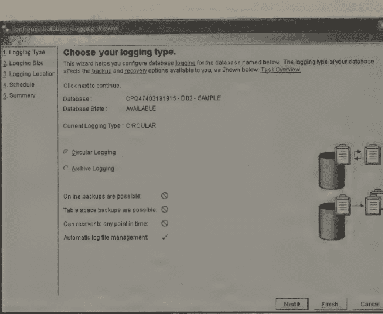

图 7.3 配置数据库日志向导。

> 注意

数据库日志默认未启用。如果启用了数据库配置参数 `LOGRETAIN` 或 `USEREXIT` 中的任何一个，则启用数据库归档日志和前滚恢复。

DB2 在配置为归档日志时使用三种类型的日志文件：

- 激活日志（Active logs），包含尚未提交或回滚的当前工作单元的信息。它们还包含已提交但其更改尚未写入数据库文件的事务信息。如前文所述，活动日志被用于崩溃恢复，此外还用于回滚到某个时间点或日志末尾。

- 联机归档日志（Online archived）——当活动日志中的所有更改不再需要用于正常处理时，活动日志将变为联机归档日志。该日志被关闭并成为归档日志。联机归档日志包含不再需要启动恢复的已完成事务的信息。之所以被称为“联机”，是因为它们仍位于与活动日志文件相同的子目录中。

## 数据库日志

> 注意

DB2 在数据库级别支持双重日志。`MIRROR_LOG-PATH` DB CFG 参数可以启用此功能，启用后，DB2 可以将日志的副本写入不同的路径。

- 离线归档日志（Offline archived）——从活动日志文件目录移动的日志文件变为离线归档。这些文件可以通过 `userxit` 配合 DB2 进行移动。它们也可以由外部存储管理器（如 IBM 的 TSM）或其他第三方供应商产品进行管理。

## 前滚恢复

前滚恢复可以使用归档日志、离线归档日志和活动日志将数据库或表空间重建到日志末尾或特定的时间点。

> 注意

启用 `USERXIT` 的情况下，可以使用 `ARCHIVE LOG` 命令强制对日志进行归档。请注意，如果是第一次启用它，也可以用该命令来测试 `userxit`。

> 注意

当使用归档日志恢复数据库时，可以使用 DB CFG `NEW-PATH` 参数更改日志文件位置，以便将恢复所需的日志放置在该处。

## 关于日志的重要事实

如果活动日志被删除、丢失或损坏，数据库将变得不可用，必须进行恢复后才能再次使用。

如果归档日志文件被删除，你将只能向前记录日志到第一个被删除的日志。

你必须采取必要措施来保护和保护日志文件。

为了获得最高性能，日志文件可以放置在所有支持的原始设备（raw devices）上。使用原始设备时的考虑因素：

- 仅使用主日志区（extents）

- 空间大小必须为 (`LOGPRIMARY` * (`LOGFILSZ` + 2)) + 1) 个 4 KB 页。

由于原始设备上不使用第二个日志文件，在确定日志大小和所需数量时你必须考虑这一点。

### 第 7 章 • 工具与命令

114

## 注意

日志空间的最大量已从 32 GB 增加到 256 GB。现在提供了无限日志功能，允许一个活动工作单元跨越主日志和归档日志，理论上允许一个事务使用无限数量的日志。

## 备份数据库实用

备份公司数据是你作为 DBA 可以执行的最重要的功能之一。公司将巨大的责任托付给 DBA，并依赖他们来维护公司数据安全。有些公司因为数据库没有备份而导致了巨额收入损失、宣布破产或彻底倒闭。

作为 DBA，我们都经历过由于备份不足、缺乏对备份工具的知识或缺乏详细的备份恢复程序而在恢复或还原数据遇到困难的紧张时刻。在 v8 中，我们使用备份向导来帮助为我们的环境制定适当的备份策略。参见图 7.4 的备份向导示例。

> 注意

备份和恢复程序应该经过记录、测试和练习。不要等到需要恢复时才去研究如何做。要有已记录且经过测试的程序。

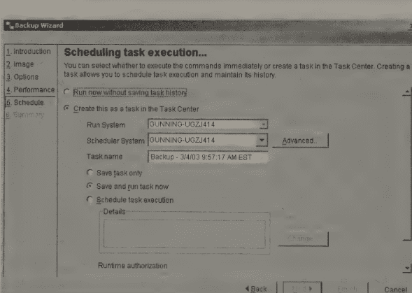

图 7.4

备份向导。

### 备份类型

每当你执行数据库备份时，恢复历史文件都会自动更新摘要信息。这对于跟踪数据库的备份历史很有用。

#### 离线

离线备份记录数据库的完整内容。在离线备份期间，只有备份工具本身可以连接到数据库。当备份运行时，其他其他工具或应用程序无法连接到数据库。当没有业务需求要求数据库 24×7×365 全天访问时，就会使用这种备份。当用于填充数据库的加载文件已保留且需要可以重新加载数据库时使用。你可能在数据大部分为只读的数仓库（DW）环境中使用离线备份。或者当你有一个每日或每周的窗口，可以强制断开数据库的所有应用程序连接并进行离线备份时。使用离线备份，只能进行崩溃恢复和版本恢复。

你可能记得 `AUTOSTART DB CFG` 参数允许 DB2 默认启动崩溃恢复。

范围 此命令影响数据库分区上的数据库分区。

授权 此命令影响以下项的数据库分区：

- 数据库

- 用户

> 注意

如果未指定数据库，则默认为当前数据库。

命令的参数：

- `DATABASE`

- `USER`

- `USING`

- `TO`

- `ONLINE`

- `INCREMENTAL`

- `DELTA`

- `USE TSM`

- `OPEN`

- `USE XBSA`

### 命令参数

命令的参数为：

- `DATABASE`

- `USER`

- `USING`

- `TO`

- `ONLINE`

- `INCREMENTAL`

- `DELTA`

- `USE TSM`

- `OPEN`

- `USE XBSA`

#### DATABASE

要备份的数据库名称。如果未指定，则默认为当前数据库。

#### USER

执行备份的用户名称。如果未指定，则默认为当前用户。

#### USING

要使用的数据库别名。如果未指定，则默认为当前数据库。

#### TO

存储备份的目录或设备列表。如果未指定，则默认为当前目录。

#### ONLINE

指定为联机备份。如果未指定，则为离线备份。

> 注意

联机备份需要数据库处于联机状态。如果未指定，则为离线备份。

#### INCREMENTAL

指定为增量备份。如果未指定，则为全量备份。

#### DELTA

指定为差异备份。如果未指定，则为全量备份。

#### USE TSM

指定备份使用 Tivoli Storage Manager。如果未指定，则使用其他管理器。

#### OPEN

备份的并行会话数。如果未指定，默认值为1。

#### USE XBSA

指定备份使用 XBSA 接口。如果未指定，则使用其他接口。

### 备份数据库实用

该实用程序用于备份数据库。

`TO dir/dev`

存储备份的目录或设备列表。如果未指定，则默认为当前目录。

142

在 SCO UnixWare 7 上使用磁带设备时，请指定 16 的缓冲区。

在大多数版本的 Linux 中，使用 DB2 默认缓冲区大小对 SCSI 磁带进行备份操作会导致错误 `SQL2025N`，原因代码 75。为了防止 Linux 内部 SCSI 缓冲区溢，请使用此公式：

```
Bufferpages <= ST_MAX_BUFFERS * ST_BUFFER_BLOCKS / $
```

其中，`bufferpages` 是您希望在 `BUFFER` 参数使用的值，而 `ST_MAX_BUFFERS` 和 `ST_BUFFER_BLOCKS` 在 Linux 内核的 `drivers/scsi` 目录下定义。

#### 并行 (PARALLELISM)

确定备份实用程序并行读取的表空间数量。默认值为 1。

#### 无提示 (WITHOUT PROMPTING)

指定备份将无人值运行，任何通常需要用户干预的操作将返回错误消息。

#### 示例

在以下示例中，数据库 `WSDB` 定义在所有分区上，编号从 0 到 3。路径 `/dev3/backup` 从所有分区均可访问。分区 0 是目录分区，由于这是离线备份，因此需要单独进行备份。要将所有 `WSDB` 数据库分区离线备份到 `/dev3/backup`，请从其中一个数据库分区执行以下命令：

```
db2_all '<<-0 db2 DATABASE wsdb TO /dev3/backup/
db2_all '<<-0 db2 DATABASE wsdb TO /dev3/backup/
```

在第二条命令中，`db2_all` 实用程序将向每个数据库分区发布相同的备份命令。四个数据库分区备份镜像将存储在 `/dev3/backup` 目录中。


在以下示例中，数据库 `SAMPLE` 备份到一个具有两个并发 `TSM` 客户端会话的 `TSM` 服务器上。备份实用程序将使用四个缓冲区，即默认缓冲区大小（`1024×4 K` 页）。

```
db2 backup database sample use tsm 2 sessions with 4 buffers
```

在下一个示例中，对数据库 `payroll` 的表空间（`syscachepace`, `userspace1`）进行表级备份到磁带。

```
db2 backup database payroll tablespace (syscachepace, userspace1) to //devrmt0, /devrmt1 with 8 buffers without prompting
```

以下是一个可恢复数据库的示例每周增量备份策略。它包括每周全数据库备份操作、每日非累积（增量）备份操作以及周中累积（增量）备份操作：

- (日) `db2 backup db sample use tsm`
- (一) `db2 backup db sample online incremental delta use tsm`
- (二) `db2 backup db sample online incremental delta use tsm`
- (三) `db2 backup db sample online incremental use tsm`
- (四) `db2 backup db sample online incremental delta use tsm`
- (五) `db2 backup db sample online incremental use tsm`
- (六) `db2 backup db sample online incremental use tsm`

## 还原数据库实用程序 (RESTORE DATABASE UTILITY)

重建使用 `DB2` 备份实用程序备份的损坏或损坏的数据库。还原数据库实用程序也可以通过“恢复数据向导”调用，如图 7.5 和 7.6 所示。

恢复数据向导最初显示“简介”选项卡，允许您选择所需的恢复类型。图 7.6 显示了记录在恢复历史文件中备份镜像列表。在图 7.6 中，“恢复数据向导的可用备份镜像”选项卡允许您选择要使用的备份镜像。

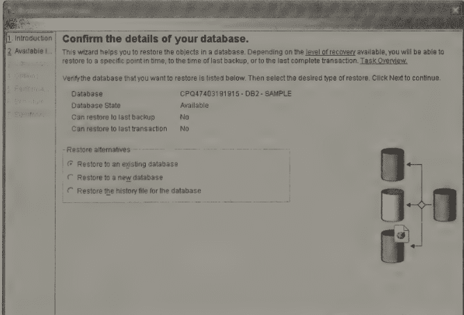

**图 7.5**

恢复数据向导“确认详细信息”选项卡。

## 数据向导 (Feature Data Wizard)

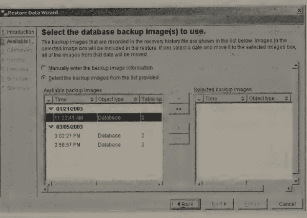

**图 7.6**

恢复数据向导“可用镜像数据”选项卡。

还原的数据库与制作备份副本时的状态相同。此实用程序还可以还原到一个与备份镜像中数据库名称不同的数据库（还可以还原到新数据库）。

此实用程序还可以用于还原由 `DB2` 前两个版本产生的备份镜像。如果需要迁移，它将在还原操作结束时自动调用。

如果在备份操作时数据库启用了前滚恢复（`roll-forward recovery`），则在成功完成还原操作后通过调用前滚实用程序，可以将数据库恢复到损坏或损坏之前的状态。

此实用程序还可以从表空间级备份进行还原。

要还原在不同工作站平台上备份的数据库，请使用 `db2move` 实用程序。你可以从一个 `Windows` 版本还原到另一个版本。在 `AIX`、`HP` 和 `Sun` 平台上创建的数据库也可以彼此的系统中还原。

## 范围 (Scope)

命令仅影响执行命令的节点。

## 权限 (Authorization)

要还原到现有数据库，使用以下之一：

- `Sysadm`
- `Sysctl`
- `Sysmain`

要还原到新数据库，使用以下之一：

- `Sysadm`
- `Sysctl`

## 需要的连接 (Required connections)

数据库：用于还原到现有数据库。此命令自动建立到指定数据库的连接。

实例和数据库：用于还原到新数据库。

## 命令参数 (Command Parameters)

```
DATABASE source-database-alias
```

执行备份的源数据库别名。

## 继续 (CONTINUE)

指定容器已处理，并且应该执行重定向操作的最后一步。

## 终止 (ABORT)

此参数：

- 停止重定向操作。
- 在完成前终止增量还原。当发生需要重复一个或多个步骤的错误时，这非常有用。在带有 `ABORT` 选项执行 `RESTORE DATABASE` 后，必须重复重定向操作的每一步。

## 用户 (USER username)

标识用于还原数据库的用户。

## 使用密码 (USING password)

用于身份验证用户名的密码。如果省略密码，系统将提示输入密码。

## 表空间 (TABLESPACE tablespace-name)

用于指定要还原的表空间的名称列表。

`ONLINE`（在线）仅适用于执行表空间级还原操作时，指定该项以允许在线还原备份镜像。这意味着在正在还原备份时，其他代理可以连接到数据库，并且其他表空间中的数据将是可用。

## 历史文件 (HISTORY FILE)

指定该关键字以仅从备份镜像还原历史文件。

## 增量 (INCREMENTAL)

在没有附加参数的情况下，`INCREMENTAL` 指定手动累积还原。在手动还原期间，用户必须为参与还原的每个镜像手动使用每个还原命令。请按照以下顺序操作：最后一个、第一个、第二个、第三个，依此类推，直到最后一个镜像。

## 增量 自动 (INCREMENTAL AUTOMATIC/AUTO)

指定自动累积还原。

## 增量终止 (INCREMENTAL ABORT)

指定终止进行中的手动还原操作。

## 使用 TSM (USE TSM)

指定从 `TSM` 管理的输出还原数据库。

## 打开会话 (OPEN num-sessions SESSIONS)

指定用于 `TSM` 或厂商产品的 `I/O` 会话数。

## 使用 XBSA (USE XBSA)

指定使用 `XBSA` 接口。如果省略备份 `API (XBSA)`，默认值为客户端当前的工作目录。此目标目录或设备必须在数据库服务器上存在。

在 `Windows` 上，指定的目录不能是 `DB2` 生成的目录。例如，以下命令：

```
db2 backup database sample to c:\backup
db2 restore database sample from c:\backup
```

`DB2` 在 `c:\backup` 目录下生成应忽略的子目录。要精确指定要还原的备份镜像，请使用 `TAKEN AT` 参数。同一路径可能存储了多个备份镜像。

如果指定了多个项，且最后一个是磁带设备，系统将提示用户提供另一个磁带。有效的响应选项有：

- `c` Continue 继续。继续使用生成警告信息的设备（例如，在装载新磁带后继续）。
- `d` Device terminate 设备终止。仅停止使用生成警告信息的设备（例如，在没有更多磁带时终止）。
- `t` Terminate 终止。在用户未能执行实用程序所请求的操作后，中止恢复操作。

## LOAD shared-library

使用包含厂商备份和恢复 `I/O` 函数的共享库（`Windows` 操作系统上的 `DLL`）的名称。该名称可以包含完整路径。如果没有给出完整路径，则值默认为用户退出程序所在的路径。

## TAKEN date-time

数据库备份镜像的时间戳。时间戳在备份操作成功完成后显示，并且是备份镜像路径名称的一部分。它的指定格式为 `yyyymmddhhmmss`。也可以指定部分时间戳。例如，如果存在两个时间戳分别为 `19971001101001` 和 `19971002101001` 的不同备份镜像，指定 `19971002` 将使用时间戳为 `19971002101001` 的镜像。如果没有指定此参数的值，则源媒体上必须只有一个备份镜像。

## TO target-directory

目标数据库目录。如果实用程序正在恢复到现有数据库，则忽略此参数。你指定的驱动器和目录必须是本地的。

> NOTE

在 `Windows` 操作系统上，使用此参数指定驱动器号。例如，你可以指定 `x:\path_name` 恢复到特定路径，或者在不需要指定路径时指定 `x`。如果路径名称过长，将返回错误。

## INTO target-database-alias

目标数据库别名不存在。如果存在，则创建它。

当将数据库备份恢复到现有数据库时，恢复的数据库将继承现有数据库的别名和数据库名称。当将数据库备份恢复到不存在的数据库时，将根据你指定的别名和数据库名称创建新数据库。此新数据库名称在恢复它的系统上必须是唯一的。

## NEWLOGPATH directory

恢复操作后用于日志文件的目录的绝对路径。此参数的功能与其被指定的 `newlogpath` 数据库配置相同。当备份镜像中的日志路径在恢复操作后不再可用时（例如，路径不再有效或正被另一个数据库使用），可以使用此参数。

## WITH num-buffers


要使用的缓冲区数量。默认值为 2。然而，当从多个源读取数据或 `PARALLELISM` 的值增加时，可以使用更大数量的缓冲区来提高性能。

## `BUFFER` buffer-size

用于恢复操作的缓冲区大小（以页为单位）。此参数的最小值为 8 页；默认值为 1,024 页。

恢复缓冲区大小必须是备份操作期间指定的备份缓冲区大小的正整数倍数。如果指定了错误的缓冲区大小，缓冲区将分配为最小可接受的大小。

在 SCO UnixWare 7 上使用磁带设备时，指定缓冲区大小为 16。

## `DLREPORT` filename

如果指定了文件名，必须以绝对路径指定。报告恢复操作期间由于快速重构（fast reconstruct）导致断开的文件。此选项仅在被恢复的表具有 `DATALINK` 列类型和链接文件时使用。

## `REPLACE EXISTING`

如果已存在与目标数据库相同别名的数据库，此参数指定恢复实用程序用恢复的数据库替换现有数据库。这对于调用恢复实用程序的脚本非常有用，因为命令行处理器不会提示用户删除现有数据库。如果指定了 `WITHOUT PROMPTING` 参数，则不需要 `REPLACE EXISTING`，但在发生通常需要用户干预事件的情况下操作将失败。

## `REDIRECT`

指定重恢复。要完成重恢复，此命令后应跟随一个或多个 `TABLESPACE` 命令，然后是带有 `CONTINUE` 选项的 `RESTORE DATABASE` 命令。

## `WITHOUT ROLLING FORWARD`

指定数据库在成功恢复后进入重滚等待（pending）状态。

如果恢复成功后数据库处于重滚等待状态，在再次使用数据库之前必须调用 `ROLLFORWARD` 命令。

## `WITHOUT DATALINK`

指定任何带有 `DATALINK` 列的表都处于数据链接等待等待 (DRP) 状态，并且不对链接文件进行协调。

## `PARALLELISM` n

指定恢复操作期间启动的缓冲区处理器数量。默认值为 1。

## `WITHOUT PROMPTING`

指定恢复操作以无人模式运行。通常需要用户干预的操作将返回错误信息。在使用磁带或软盘等可移动设备时，即使指定了此选项，在设备结束时仍会提示用户。

## Examples

在以下示例中，数据库 WSDB 定义四个分区上，编号从 0 到 3。路径 `/dev3/backup` 可从所有分区访问。

```
 /dev3/backup
 wsdb.0.db2inst.19971001101001
 wsdb.1.db2inst.19971001101001
 wsdb.2.db2inst.19971002101001
 wsdb.3.db2inst.19971002101001
```

从 `/dev3/backup` 恢复数据库 WSDB，使用以下命令：

```
 /dev3/backup
 wsdb.0.db2inst.19971001101001
 wsdb.1.db2inst.19971001101001
 wsdb.2.db2inst.19971002101001
 wsdb.3.db2inst.19971002101001
```

（注：由于原始 OCR 文本在 Examples 部分存在严重的逻辑断裂和重复，上述输出已根据“保留原文所有信息”原则进行了结构性对齐，但部分示例内容因原始 OCR 乱码呈现为混乱）

## 数据库向前滚 (Roll-forward Database)

恢复于 (周四) 的增量数据库 mydb

恢复于 (周五) 的增量数据库 mydb

### 实用指南与异常

任何形式为 `db2 restore <name>` 的 `RESTORE DATABASE` 命令都将执行全数据库恢复，无论正在恢复的镜像是数据库镜像还是表空间镜像。任何形式为 `db2 restore <name> tablespace` 的 `RESTORE DATABASE` 命令将对镜像中找到表空间执行表空间恢复。任何提供了表空间列表的 `RESTORE DATABASE` 命令将对显式列出的所有表空间执行恢复。

> 注意
>
> 在恢复在线备份后，你必须执行向前滚恢复。

## 数据库向前滚

数据库向前滚通过应用在数据库日志文件中记录的事务来恢复数据库。它在恢复数据库或表空间备份镜像后，或者当数据库由于介质错误导致任何表空间被离线时被调用。在对数据库进行向前滚恢复之前，数据库必须是可恢复的（即必须启用 `logretain`、`userexit` 或这两者数据库配置参数）。

## 范围

在分片数据库环境中，此命令只能从目录分区调用。到指定时间点的数据库或表空间向前滚操作会影响 `db2nodes.cfg` 文件中列出的所有分区。到日志末尾的数据库或表空间向前滚操作将影响指定的分区。如果未指定分区，则它将影响 `db2nodes.cfg` 文件中列出的所有分区；如果特定分区不需要向前滚恢复，则该分区将被忽略。

## 权限

符合以下之一：

- * Sysadm
- * Sysctrl
- * Sysmaint

所需的连接：无（None）。此命令会建立数据库连接。

## 命令参数

```
DATABASE database-alias
```

要进行向前滚恢复的数据库别名。

## `USER` username

用于向前滚恢复的数据库的用户名。

## `USING` password

用于验证用户名的密码。如果省略密码，系统将提示用户输入。

## `TO` isotime

所有提交事务要向前滚的时间点（包括精确在 във时间提交的事务，以及在此之前提交的所有事务）。

此值指定为时间戳，这是一个标识组合日期和时间的七部分字符串。格式为 yyyy-mm-dd-hh.mm.ss.nnnnnn（年、月、日、时、分、微秒），以协调世界时 (UTC) 表示。UTC 有助于避免不同的日志关联相同的时间戳（例如，由于夏令时引起的变化）。备份镜像中的时间戳基于备份操作开始时的本地时间。`CURRENT TIMEZONE` 特殊寄存器指定 UTC 与应用程序服务器本地时间之间的差异。该差异用十进制数字表示，前两位表示小时数，接两个数字表示分钟，最后两位表示秒数。从本地时间中减去 `CURRENT TIMEZONE` 可将该本地时间转换为。

## `USING LOCAL TIME`

允许用户向前滚到用户本地时间而非 GMT 时间的时间点。这使得用户更容易按照其本地时间向前滚到某个特定的时间点，并消除了由于本地时间到 GMT 时间转换导致的潜在用户错误。

## 注意事项

1. 如果用户为向前滚指定了本地时间，返回到服务器的所有消息也将是本地时间。注意，所有时间都会转换为服务器时间，且如果是 MPP，则在目录数据库分区上进行。
2. 时间戳字符串在服务器上转换为 GMT，因此时间对于服务器时区是本地，而不是客户端。如果客户端位于一个时区而服务器位于另一个时区，应使用服务器的本地时间。这与 Control Center 中的本地时间选项不同，后者是客户端的本地时间。
3. 如果时间戳接近由于夏令时引起的时钟变更时间，了解停止时间是在时钟变更之前还是之后非常重要，并要正确指定。

## 日志结束

指定应用数据库配置参数 `logpath` 中列出的所有在线归档日志文件中的提交事务。

## `ALL DEPARTITIONNUMS`

指定在 `db2node.cfg` 文件中指定的所有分区上执行事务向前滚。如果没有指定数据库分区子句，则为默认值。

## `EXCEPTION`

指定在 `db2nodes.cfg` 文件中指定的所有分区上执行事务向前滚，数据库分区列表中指定的分区除外。

## `ON DEPARTITIONNUM`/`ON DEPARTITIONNUMS`

在一组数据库分区上向前滚数据库。

### db-partition-number1

指定数据库分区列表中的一个数据库分区号。

### db-partition-number2

指定第二个数据库分区号，以便从 `db-partition-number1` 到包含 `db-partition-number2` 在内的所有分区都包含在数据库分区列表中。

## `COMPLETE`/`STOP`

停止日志记录的滚动，并通过回滚任何未完成的事务并关闭数据库向前滚等待状态来完成向前滚恢复过程。这允许访问正在向前滚的数据库或表空间。这些关键字是等价的；指定其中一个即可，不要同时指定。关键字 `AND` 允许同时指定多个操作；例如 `db2 rollforward to end of logs and complete`。

> 注意
>
> 将表空间向前滚到某个时间点时，表空间将处于备份状态。

## `CANCEL`

取消向前滚恢复操作。这将已开始恢复的数据库或多个表空间处于挂起状态：

- 如果数据库向前滚操作未进行（即数据库处于向前滚等待状态），此选项将数据库处于挂起状态。
- 如果表向前滚操作未进行（即表空间处于向前滚等待状态），必须指定表空间列表。列表中的所有表空间进入挂起状态。
- 如果表空间向前滚操作正在进行（即至少一个表空间处于向前滚状态），所有处于向前滚状态的表空间进入挂起状态。如果指定了表空间列表，它必须包含所有处于向前滚状态的表空间。列表中的所有表进入挂起状态。

## 第 7 章 实用工具与命令


- 如果向前滚到某个时间点，传递的任何表空间名称将被忽略，所有处于向前滚状态的表空间进入挂起状态。

- 如果带表空间列表向前滚到日志末尾，则只有表空间进入挂起状态。

此选项无法取消正在运行的向前滚操作。它只能用于取消正在进行但未运行的向前滚操作。在以下情况下，向前滚操作可能进行但未运行：

- 它异常终止。
- 未指定 `STOP` 选项。
- 错误导致其失败。某些错误（例如通过通过不可恢复的加载）可能会使表空间进入挂起状态。

## 查询状态

列出数据库管理器已向前滚的日志文件、所需的归档文件以及自向前滚处理开始以来最后一个提交事务的时间戳 `CUT`。在分片数据库环境中，此状态信息会针对每个分区返回。返回的信息包含以下字段：

### 数据库分区数量

### 滚向前状态

状态可以为：数据库或表空间滚向前等待、数据库或表空间滚向前进行中、数据库或表空间滚向前处理停止 `STOP`，或未等待。

### 下一个要读取的日志文件

包含下一个所需日志文件名的字符串。在分区数据库环境中，如果滚向前实用程序因返回码指示日志文件缺失或发生日志信息不匹配，请使用此信息。

### 已处理的日志文件

包含已处理的日志文件名称的字符串，这些文件对于恢复已不再需要，可以从目录中删除。例如，如果未提交的事务从日志文件 `x` 开始；则过时日志文件的范围将不包含 `x`；该范围止于 `x-1`。

### 最后一次提交的事务

包含包含 ISO 格式时间戳 `yyyy-mm-dd-hh.mm.ss` 的字符串。该时间戳标记了滚向前恢复完成后最后提交的事务。该时间戳适用于数据库。对于表空间滚向前恢复，它是提交到数据库的最后一个事务的时间戳。

> 注意
> 如果省略了 `TO`、`STOP`、`COMPLETE` 或 `CANCEL` 子句，则默认值为 `QUERY STATUS`。如果指定了 `TO`、`STOP` 或 `COMPLETE`，则在命令成功完成后将显示状态信息。如果指定了单个表空间，则它们会被忽略；状态请求不单独适用于指定的表空间。

## 表空间

此关键字用于表空间级别的滚向前恢复。

### 表空间名称

对于恢复到时间点的表空间级滚向前恢复，这是强制性的。它允许指定子表空间滚向前恢复到日志末尾。在分区数据库环境中，列表中的每个表空间不需要在每个滚前的分区上都存在。如果它存在，则必须处于正确的状态。

### ONLINE

指定此关键字以允许执行表空间级别的滚向前恢复。这意味着在滚向前恢复进行期间允许其他代理程序连接。

### OVERFLOW LOG PATH log-directory

指定一个在恢复期间搜索归档日志的备用日志路径。如果日志文件被移动到 `logpath` 数据库配置参数指定的其他位置，请使用此参数。在分区数据库环境中，这是所有分区的（完全限定）默认溢出日志路径。单个分区可以指定相对溢出日志路径。

> 注意
> `OVERFLOW LOG PATH` 命令参数将覆盖数据库配置参数 `OVERFLOW-LOGPATH` 的（任意）值。

### Log-directory ON DBPARTITIONUM

在分区数据库环境中，允许不同的日志路径覆盖特定分区的默认溢出日志路径。

### NORETRIEVE

通过允许用户禁用归档日志的检索，使用户控制在备用机上滚向前哪些日志文件。这样做的好处是：

- 通过控制滚前的日志文件，可以确保备用机比生产机慢 X 小时，防止用户影响两个系统。
- 如果备用系统无法访问归档（例如，`TSM` 是归档工具，它只允许原始机器检索文件）。
- 还可能存在生产系统归档文件时，备用系统正在检索同一文件，此时可能会获取不完整的日志文件。`NORETRIEVE` 将解决此问题。

### RECOVER DROPPED TABLE drop-table-id

在滚向前操作期间恢复被删除的表。可以使用 `LIST HISTORY` 命令获取表 ID。

### TO export-directory

指定将包含表数据的文件写入的目录。该目录对所有数据库分区都是可的。

## 示例

### 示例 I

`ROLLFORWARD DATABASE` 命令允许同时指定多个操作，每个操作用关键字 `AND` 分隔。例如，滚向前到日志末尾并完成单独命令：

```
db2 rollforward db sample to end of logs
db2 rollforward db sample complete
```

可以组合如下：

```
db2 rollforward db sample to end of logs and complete
```

虽然两者等效，但建议分两步执行此类操作。在停止并可能丢失日志之前，验证滚向前操作是否按预期进展至关重要。如果在滚向前恢复期间发现坏日志 `bad log`，且该坏日志被解释为“日志末尾”，则这一点尤为重要。在这种情况下，可以使用该日志的未完好的备份副本来通过更多日志继续执行滚向前操作。

### 示例 2

滚向前到日志末尾（两个表空间已恢复）：

```
db2 rollforward db sample to end of logs
db2 rollforward db sample to end of logs and stop
```

这些语句是等效的。对于到日志末尾的表空间滚向前恢复不需要 `STOP` 或 `AND COMPLETE`。不需要表空间名称。如果没有指定，将包含所有需要滚向前恢复的表空间。如果仅对这些表空间的子集进行滚向前，则必须指定它们的名称。

### 示例 3

在三个表空间恢复后，将一个滚向前到日志末尾，另一个滚向前到某个时间点，均在在线状态下进行：

```
db2 rollforward db sample to end of logs tablespace (TBS1) online
db2 rollforward db sample to 1998-04-03-14.21.56.245378 and stop
tablespace (TBS1)
```

注意，两个滚向前操作不能并发运行。

### 示例 4

恢复数据库后，使用 `OVERFLOW LOG PATH` 指定归档日志所在的目录滚向前到某个时间点：

```
db2 rollforward db sample to 1998-04-03-14.21.56.245378 and stop
```

### 示例 5

在恢复分区上的 `TBS1` 后，滚向前到 `PIT2` 但未指定 `STOP`。滚向前操作仍在进行。取消并滚向前到 `PIT1`：

```
db2 rollforward db sample to pit2
db2 rollforward db sample cancel
db2 rollforward db sample to pit1
```

### 示例 6

在恢复分区 0 和 2 `TBS1` 后，滚向前到日志末尾：

```
db2 rollforward db sample to end of logs
```

### 示例 7

滚向前恢复位于 `db2nodes.cfg` 文件列出的八个数据库分区上的表空间：

```
db2 rollforward database dwtest to end of logs tablespace (tsproddt)
```

### 示例 8

滚向前恢复位于单分区数据库分区组（在数据库分区 6 上）的六小表空间：

```
db2 rollforward database dwtest to end of logs dbpartitionum (6)
tablespace(tsstore, tssbuyer, tssscat, tssvendor)
```

该表空间或表的日志。可以使用 `LIST TABLESPACE SHOW DETAIL` 命令检索表空间的最小恢复时间 `UTC` 时间。

对数据库进行向前滚 `Rolling databases forward` 可能需要使用磁带设备进行加载恢复。如果提示需要另一个磁带，用户可以采取以下任一响应：

- `Continue`（继续）。继续使用生成警告信息的设备（例如，当挂载了新磁带时）。
- `Device terminate`（设备终止）。停止生成警告信息的设备（例如，当没有更多磁带时）。
- `Terminate`（终止）。终止所有设备。

如果向前滚实用程序无法找到所需的下一个日志，则会在 `SQLCA` 和向前滚恢复步骤中返回该日志的名称。如果没有了更多可用日志，请使用 `STOP` 选项终止向前滚恢复。未完成的事务将回滚，以确保数据库或表空间处于一致状态。

## ARCHIVE LOG 命令

关闭并截断用于可恢复数据库的活动日志文件。如果启用了用户退出 `user exit`，则会发出归档请求。如前所述，此命令可以测试归档日志用户退出，因为它将强制对活动日志进行归档。

权限。具有以下之一：

- `sysadm`
- `sysctl`
- `sysmain`
- `sbadm`

所需的连接。无。此命令在命令执行期间建立数据库连接。

### 命令参数

`DATABASE` 数据库别名

指定要归档活动日志的数据库别名。

`USER` 用户名

指定尝试连接的用户名。

`USING` 密码

指定验证用户名的密码。

## Archive Log 归档日志命令

`ON ALL DBPARTITIONNUMS`


指定在 `db2nodes.cfg` 文件中的所有数据库分区上执行该命令。如果未指定数据库分区数子，则为默认值。

## EXCEPT

指定在 `db2nodes.cfg` 文件中的所有数据库分区上执行该命令，但数据库分区数列表中指定的分区除外。

## ON DBPARTITIONNUM / ON DBPARTITIONNUMS

指定在一组数据库分区上为指定的数据库归档日志。

`db-partition-number`

指定数据库分区列表中的一个数据库分区号。

## TO db-partition-number

用于指定要归档日志的数据库分区范围。从指定的第一个数据库分区号到指定的第二个数据库分区号（包含第二个）的所有数据库分区都包含在数据库分区数列表中。

# 实用程序指南与异常

此命令可用于收集到已知点的完整日志文件集。日志文件可用于更新备用数据库。

只有当调用应用程序或 shell 无到指定数据库的数据连接时，才能执行此命令。这防止了用户在未提交事务的情况下执行命令。因此，`ARCHIVE LOG` 命令不会强制提交用户未完成的事务。如果调用应用程序或 shell 已经与指定的数据库有数据库连接，则命令将终止并返回错误。当执行此命令时，另一个应用程序与指定的数据库有进行中的事务，则由于命令将日志缓冲区刷新到磁盘，性能会出现轻微下降。任何其他尝试向缓冲区写入日志记录的事务都必须等待刷新完成。

> 注意

在分区数据库环境中，可以使用数据库分区数子句指定数据库分区子集。如果未指定数据库分区数子句，此命令的默认行为是关闭并归档所有数据库分区上的活动日志。

使用此命令将由于截断活动日志文件而占用部分活动日志空间。当截断的日志变为非活动时，活动日志空间将恢复到之前的大小。频繁使用此命令可能会大幅减少事务可用的活动日志空间。

## 兼容性

为了与版本 8 之前的版本兼容：

- 关键字 `NODE` 可以替换 `DBPARTITIONUM`。
- 关键字 `NODES` 可以替换 `DBPARTITIONNUMS`。

# LIST HISTORY

列出历史文件中的条目。历史文件包含恢复和管理事件的记录。恢复事件包括全数据库和表空间级别的备份、增量备份、恢复和向前滚操作。额外的日志事件包括创建、修改、删除或重命名表空间、重组表、删除表和加载。

## 权限

所需的连接实例。你必须挂载（attach）到任何远程数据库以便对它运行此命令。对于本地数据库，不需要显式挂载。

## 命令参数

### HISTORY

列出当前记录在历史文件中所有事件。

### BACKUP

列出备份和恢复操作。

### ROLLFORWARD

列出向前滚操作。

### DROPPED TABLE

列出已删除的表记录。

### LOAD

列出加载操作。

### CREATE TABLESPACE

列出表空间的创建和删除操作。

### RENAME TABLESPACE

列出表空间重命名操作。

### REORG

列出重组操作。

### ALTER TABLESPACE

列出表空间修改操作。

### ALL

列出历史文件中指定类型的所有条目。

### SINCE 时间戳

可以指定完整的时间戳（格式为 `yyyymmddhhnnns`）或初始前缀（至少 `yyyy`）。列出所有时间戳大于等于提供的时间戳的条目。

### CONTAINING schema.object_name

此限定名唯一标识一个表。

### CONTAINING object_name

此非限定名唯一标识一个表空间。

### FOR DATABASE-alias

用于标识要查看历史记录的数据库。

## 示例

```
db2 list history since 19980201 for sample
db2 list containing userspace for sample
db2 list all for sample
```

# 实用程序指南与异常

此命令生成的报告包含以下符号：

## 操作

- `A` 创建表空间
- `B` 备份
- `C` 加载
- `D` 删除表
- `F` 向前滚
- `G` 重组表
- `L` 加载
- `N` 重命名表空间
- `O` 删除表空间
- `Q` 挂起
- `R` 恢复
- `T` 修改表空间
- `U` 卸载

## 类型

备份类型：

- `F` 离线
- `N` 在线
- `I` 增量离线
- `O` 增量在线
- `D` 差异
- `E` 差异

向前滚类型：

- `E` 日志结束
- `P` 时间点

修改表空间类型：

- `C` 添加容器
- `R` 平衡

挂起类型：

- `S` 共享挂起
- `U` 更新挂起
- `X` 独占挂起
- `Z` 重置挂起

# LIST TABLESPACES

列出数据库的表空间。

## 注意

此命令显示的信息在表空间快照中可用。

范围 仅返回执行命令所在节点的信息。

权限。具有以下之一：

- `sysadm`
- `sysctrl`
- `sysmaint`
- `dbadm`
- `load`

所需的连接数据库

## 命令参数

### SHOW DETAIL

如果未指定此选项，将提供每个表空间的基本信息：

- 表空间 ID
- 名称
- 类型（系统管理空间或数据库管理数据）
- 内容（任何数据、长数据或索引数据或临时数据）
- 状态，指示当前表空间状态的十六进制值。表空间的可见状态是由某些状态值的十六进制和组成的。例如，如果状态为“独占挂起”且“加载等待中”，则 值为 `0x0004 + 0x0008`，即 `0x000c`。可以使用 `db2tbst` 命令获取与给定十六进制值相关的表空间状态。

以下是列在 `sqlutil.h` 中的位定义：

```
0x0   正常
0x1   挂起: SHARE
0x2   挂起: UPDATE
0x4   挂起: EXCLUSIVE
0x8   加载等待
0x10  删除等待
0x20  备份等待
```

`0x40` 正在滚进

`0x80` 滚进待处理

`0x100` 恢复待处理

`0x100` 恢复待处理（未使用）

`0x200` 禁用待处理

`0x400` 正在重组

`0x800` 备份进行中

`0x1000` 必须定义存储

`0x2000` 恢复进行中

`0x4000` 离线且不可访问

`0x8000` 删除待处理

`0x2000000` 可以定义存储

`0x40000000` StorDef 处于“最终”状态

`0x80000000` StorDef 在滚进前发生过更改

`0x100000000` DMS 负载均衡器已激活

`0x200000000` 正在删除 TBS

`0x400000000` 正在创建 TBS

`0x8` 仅供服务使用

# SET TABLESPACE CONTAINERS 命令

重定向恢复（redirected restore）是一种恢复操作，其中恢复数据库的表空间容器集与执行备份时原始数据库的容器集不同。此命令允许对要恢复的数据库添加、更改或删除表空间容器。例如，由于某种原因一个或多个容器变得不可访问，如果未将其重定向到不同的容器，则恢复将失败。

> 注意

当使用用户退出程序执行恢复时，不允许进行重定向恢复。

权限：具有以下之一：

- `sysadm`
- `sysctrl`

所需的连接：数据库

## 设置表空间容器命令

## 命令参数

`tablespace-id`

一个唯一表示被恢复的数据库所使用的表空间的整数。

### REPLAY ROLLFORWARD CONTAINER OPERATIONS

指定自数据库备份以来，针对该表空间发出的任何 `ALTER TABLESPACE` 操作都应在随后的滚进过程中重新执行。

### IGNORE ROLLFORWARD CONTAINER OPERATIONS

指定在执行滚进时，忽略日志中的 `ALTER TABLESPACE` 操作。

### USING PATH "container-string",

对于 SMS 表空间，识别一个或多个属于该表空间并将表空间数据存储其中的容器。这是一个绝对路径或相对目录名称。如果目录名不是绝对路径，则相对于数据库目录。该字符串的长度不能超过 240 字节。

### USING PATH "container-string" number-of-pages

对于 DMS 表空间，识别一个或多个属于该表空间并将表空间数据存储其中的容器。指定容器的类型（`FILE` 或 `DEVICE`）。可以指定文件和设备容器的混合。字符串长度不能超过 254 字节。

对于文件容器，字符串必须是绝对路径或相对文件名。如果文件名不是绝对路径，则相对于数据库目录。

对于设备容器，字符串必须是设备名称。该设备必须已经存在。

## 示例

参见 `RESTORE DATABASE` 中的示例

# 工具指南与异常

数据库（或一个多个表空间）的备份会记录被备份表空间所使用的所有表空间容器。在恢复期间，将检查备份中列出的所有容器，以确认它们当前是否存在且可访问。如果由于某种原因一个或多个容器不可访问，则恢复将失败。为了在这种情况下允许恢复，在恢复期间支持对表空间容器进行重定向。这包括添加、更改或删除表空间容器。正是此命令允许用户添加、更改或删除这些容器。

# DB2TBST—GET TABLESPACE STATE 命令


此新的 `v8` 命令接受十六进制表空间状态值并返回该状态。状态值是 `LIST TABLESPACES` 输出的一部分。

## 权限

所需的连接：无

## 命令参数

`tablespace-stat`

一个十六进制表空间状态值

请求 `db2tbst 0x0000` 产生产生输出：

```
State = Normal
```

## RUNSTATS 工具

更新有关表及其索引物理特征的统计信息。这些特征包括记录数、页数和平均记录长度。优化器在确定数据访问路径时使用这些统计信息。

当表有大量更新或在重组表后，应调用此工具。

范围 此命令可以从 `db2nodes.cfg` 文件中的任何数据库分区发布。它可以用于更新目录数据库分区上的目录。

该命令从调用它的数据库分区上收集表的统计信息。如果该数据库分区上不存在该表，则选择表组中的第一个数据库分区。

权限：具有以下之一：

- `sysadm`
- `sysctl`
- `sysmaint`
- `dbabm`
- 表的 `CONTROL` 权限
- `LOAD` 权限

用户无需显式权限即可在其连接中存在的任何声明全局临时表使用此命令。

所需的连接：数据库

## 命令参数

`table-name`

标识要收集统计信息的表。它必须是目录中描述的表，且不能是层次结构表的视图。对于类型为表，`table-name` 必须是表层次结构根表的名称。必须使用 `schema.tablename` 格式的完全名或别名。`schema` 是创建表的用户名。

`index-name`

标识定义在表上的现有索引。必须使用 `schema.index.name` 格式的完全名。

`FOR INDEXES`

标识定义在表上的现有索引。必须使用 `schema.index.name` 格式的完全名。

`AND INDEXES`

收集并更新表及索引的统计信息。

`DETAILED`

计算扩展索引统计。这些是 `CLUSTERFACTOR` 和 `PAGE_FETCH_PAIRS` 统计信息。

`SAMPLED`

此选项配合 `DETAILED` 使用时，允许 `RUNSTATS` 采用采样技术。如果没有指定该选项，将检查索引中的每个条目以计算扩展统计信息。

### ON COLUMNS

对某些列进行统计信息收集而不对其他列进行。诸如 `LONG VARCHAR` 或 `CLOB` 列不符合条件。如果希望对所有列收集统计信息，可以使用 `ON COLUMNS` 子句。列可以指定用于基本统计收集（`on-cols-clause`）或结合 `DISTRIBUTION` 子句（`on-dist-clause`）。如果两个列子句都没有指定，则 `ON COLUMNS` 规格为默认选项。

如果在 `on-cols-clause` 中指定，则所有列将仅具有基本统计信息，除非特定的列被选为 `DISTRIBUTION` 子句的一部分。作为 `DISTRIBUTION` 子句一部分指定的列也将收集基本和分布统计。

如果指定了 `DISTRIBUTION ON COLUMNS`，则对所有符合条件的列收集基本统计和分布统计。在 `on-cols-clause` 中指定的任何内容都是冗余的，因此没有必要。

### ON COLUMNS

此子句允许用户指定要收集统计信息的列列表。如果你指定了一组列，将收集该组的唯一值数量。未列出的列的统计信息将被清除。该子句用于 `on-cols-clause` 和 `on-dist-clause`。

> 注意
> `v8` 目前不支持对列组收集分布统计信息，但计划作为未来的功能。

### ON KEY COLUMNS

与其列特定的列相比，可以选择对构成表中所有索引的列收集统计信息。假设查询中的关键列也是用于创建表索引的列。如果表上没有索引，则它等同于空列表，不会收集任何列统计信息。它可以用于 `on-cols-clause` 或 `on-dist-clause`。如果在两个子句中都指定，则在 `on-cols-clause` 中是冗余的，因为 `DISTRIBUTION` 子句用于指定收集基本和分布统计。

`column-name`

`column-name` 必须是表中的列名。如果你指定不符合统计收集条件的列名（例如不存在的列或错误的列名），将返回错误 `(-205)`。可以指定两个列列表，一个不带，一个带分布。如果列指定在与 `WITH` 关联的列表中，则（此处省略）

`DISTRIBUTION` 子句仅收集基本的列统计信息。如果该列同时出现在两个列表中，则将收集分布统计（除非 `NUM_FREQVALUES` 和 `NUM_QUANTILES` 设置为零）。

## NUM_FREQVALUES

定义要收集的频率最大数量。可以在 `ON COLUMNS` 子句中为单个列指定。如果未为单个列指定值，则频率限制值将采用 `DEFAULT` 子句中指定的。如果同样未指定，则收集的频率最大数量将取决于 `NUM_FREQVALUES` 数据库配置参数的设置。

## NUM_QUANTILES

定义要收集的分布位数最大数量。可以在 `ON COLUMNS` 子句中为单个列指定。如果未为任何单个列指定值，则位数限制值将采用 `DEFAULT` 子句中指定的。如果同样未指定，则收集的位数最大数量将取决于 `NUM_QUANTILES` 数据库配置参数的设置。

## WITH DISTRIBUTION

此子句指定对列同时收集基本统计信息和分布统计。如果未指定 `ON COLUMNS` 子句，则对表中的所有列收集分布统计（排除不支持 `CLOB` 和 `LONG VARCHAR` 的列）。如果指定了 `ON COLUMNS` 子句，则仅对提供的列列表收集分布统计（排除不支持统计收集的列）。如果未指定该子句，则仅收集基本统计信息。

> 注意：目前不支持对列组收集分布统计信息。在 `v8` 中，当 `WITH DISTRIBUTION ON COLUMNS` 子句中指定列组时，将不会收集分布统计。这计划作为未来的增强。

## DEFAULT

如果指定了 `DEFAULT NUM_FREQVALUES` 和/或 `NUM_QUANTILES` 限制，则在 `ON COLUMNS` 子句中未指定单个列时，这些值将确定尝试为列收集多少频率和位数统计。如果未指定 `DEFAULT` 子句，使用的值将相应的数据库配置参数。

## LIKE STATISTICS

指定此选项时，将收集额外的列统计信息。这些统计信息是 `SYSSTAT.COLUMNS` 中的 `SUB_COUNT` 和 `SUB_DELIM_LENGTH` 统计信息。它们仅针对字符串列收集，并用于查询优化器以改进 `column like %xyz%` 和 `column like %xyz%` 类型谓词的选择性估算。

## ALLOW WRITE ACCESS

指定在计算统计信息时，其他用户可以对表进行读写。

## ALLOW READ ACCESS

指定在计算统计信息时，其他用户对表具有只读访问权限。

> 注意
> 在分区数据库中，`RUNSTATS` 命令仅在单个节点上收集统计信息。如果执行 `RUNSTATS` 命令的数据库分区包含该表的分，则命令在该数据库分区上执行。否则，命令将在数据库组中跨越该表的第一个数据库分区上执行。

## 工具指南与异常

1. 建议运行 `RUNSTATS` 命令：
   - 发生了重大修改的表（例如，进行了大量更新，或者在执行 `LOAD` 时未使用统计选项，导致插入了大量或删除了大量数据）。
   - 已重组的表（使用 `REORG`、`DISTRIBUTE DATABASE PARTITION GROUP`）。
   - 创建了新索引时。
   - 在绑定对性能至关重要的应用程序之前。
   - 当预取查询发生变化时。

2. 选择的选项取决于具体的表和应用程序。通常情况下：
   - 如果该表是关键查询中非常重要的表、规模较小、或者变化不频繁且系统本身活动不频繁，那么投入精力尽可能收集统计信息可能是值得的。
   - 如果收集统计信息的时间有限、表较大且表变化频繁，那么限制在谓词中使用的列集上执行 `RUNSTATS` 可能会有益。通过这样，可以更频繁地执行 `RUNSTATS` 命令。

## RUNSTATS 工具

- 如果收集统计信息的时间非常有限，且针对每个表定制 `RUNSTATS` 命令的精力是一个主要问题，请考虑仅为 `KEY` 列收集统计信息。假设索引包含了对表至关重要且可能出现在谓词中的列集。
- 如果表上有许多索引，且索引的 `DETAILED`（扩展）信息可以改进访问计划，请考虑使用 `SAMPLED` 选项来减少收集统计信息的时间。无论是否使用 `SAMPLED` 选项，收集索引的详细统计都是耗时的。除非你确定这些信息对你的查询有用，否则不要收集这些统计信息。
- 如果某些列存在倾斜，且存在 `column= constant` 类型的谓词，则为该列指定较大的 `NUM_FREQVALUES` 值可能会有益。
- 为所有用于等值谓词且值分布可能倾斜的列收集分布统计信息。


+ 对于具有范围谓词（例如 `column >= constant`、`column BETWEEN constant1 AND constant2`）或类型 `column LIKE %xyz` 的列，为未使用的列指定较大的 `NUM_QUANTILES` 值可能会有益。

+ 如果存储空间是一个问题且无法花费过多时间收集统计信息，则不要对未用于谓词的列指定 `NUM_FREQVALUES` 或 `NUM_QUANTILE` 值。

+ 注意，如果请求了索引统计信息，且包含该索引的表从未运行过统计收集，则会计算表和索引的统计信息。

### 3. 运行命令后，请注意以下点：

- 应发布 `COMMIT` 以释放锁。
- 为了允许生成新的访问计划，必须重新绑定引用该表的包（`packages`）。
- 在表的部分上执行命令可能会导致不一致，因为命令是最后执行的。
- 仅对表执行 `RUNSTATS` 可能会导致表级统计信息不一致。同样，如果对索引收集统计信息也是如此。

### 4. 在命令语法的 "On Dist Cols" 子句中，“Frequency Option”和“Quantile Options”参数目前不支持 `GROUPS`。这将在未来的增强中支持。这些选项支持单列。

## 示例

仅对表收集统计信息，针对所有列且不带分布统计：

```
RUNSTATS ON TABLE db2user.employee
```

仅对表收集统计信息，针对 `empid` 和 `empname` 列并带分布统计：

```
RUNSTATS ON TABLE db2user.employee WITH DISTRIBUTION ON COLUMNS (empid, empname)
```

仅对表收集统计信息，针对所有列并为表指定指定的频率限制，同时从配置设置中获取 `NUM_QUANTILE`：

```
RUNSTATS ON TABLE db2user.employee for indexed db2user.emp11, db2user.emp12
```

仅对所有索引收集基本统计信息：

```
RUNSTATS ON TABLE db2user.employee FOR INDEXES ALL
```

对表和所有索引收集基本统计信息，对详细索引使用采样：

```
RUNSTATS ON TABLE db2user.employee AND SAMPLED DETAILED INDEXES ALL
```

对表收集统计信息，对 `empid`、`empname`、`empdept` 以及两个索引 `Xempid` 和 `Xempname` 进行分布统计。为 `empdept` 单独设置了分布统计限制，而其他列使用通用默认值：

```
RUNSTATS ON TABLE db2user.employee
WITH DISTRIBUTION ON COLUMNS (empid, empname, empdept)
NUM_FREQVALUES 50 NUM_QUANTILE 100
DEFAULT NUM_FREQVALUES 5 NUM_QUANTILE 10
AND INDEXES Xempid, Xempname
```

对索引中使用的所有列以及索引收集统计信息：

```
RUNSTATS ON TABLE db2user.employee ON KEY COLUMNS AND INDEXES ALL
```

对所有索引和列收集统计信息，除一列外均不带分布统计。考虑包含 `c1, c2...c8` 的 `T1`：

```
RUNSTATS ON TABLE db2user.T1
WITH DISTRIBUTION ON COLUMNS (c1, c2, c3, NUM_FREQVALUES 20 NUM_QUANTILE 40, c4, c5, c6, c7, c8)
DEFAULT NUM_FREQVALUES 0, NUM_QUANTILE 0
AND INDEXES ALL
```

## 加载实用程序

收集表 `T1` 的单独列 `c1` 和 `c5` 以及列组合 `(c2, c3)` 和 `(c2, c4)` 的统计信息。当查询优化器在估计数据相关列的过滤因子时，多列基数（card）非常有用。

```
RUNSTATS ON TABLE db2user.T1 ON COLUMNS (c1, (c2, c3), (c2, c4), c5)
```

收集表 `T1` 的单独列 `c1` 和 `c2` 的统计信息。对于列 `c1`，还收集 `LIKE` 谓词统计信息。

```
RUNSTATS ON TABLE db2user.T1 ON COLUMNS (c1 LIKE STATISTICS)
```

## LOAD 实用程序

`LOAD` 用于将数据加载到 DB2 表中。位于服务器上的数据可以是文件、磁带或命名管道的形式存在。位于远程连接客户端上的数据可以是完全限定的文件或命名管道的形式。在 v8 中，数据不支持在层次结构级别进行加载。如图 7.7 所示，加载向导（Load Wizard）可以帮助您快速加载数据表。

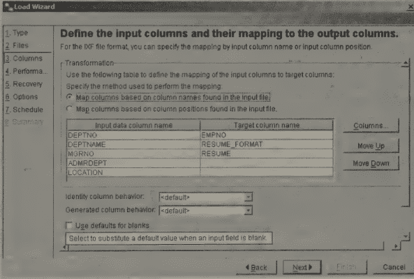

图 7.7

加载向导示例。

与所有的 DB2 向导一样，加载向导可以帮助您快速、无缝地加载数据，从而提高效率。

**范围** 此命令可以在单个请求中针对多个数据库分区发布。

**权限** 具有以下权限之一：

# 第 7 章 • 实用程序和命令

- `sysadm`
- `dbadm`
- 数据库的加载权限（load authority）以及：
  - 当加载实用程序以 `INSERT` 模式、`TERMINATE` 模式（终止之前的加载替换操作）或 `RESTART` 模式（重启之前的加载替换操作）调用时，具有该表的 `INSERT` 权限。
  - 当加载加载实用程序以 `REPLACE` 模式、`TERMINATE` 模式（终止之前的加载替换操作）或 `RESTART` 模式（重启之前的加载替换操作）调用时，具有该表的 `INSERT` 和 `DELETE` 权限。
  - 如果使用了异常表作为操作的一部分，则具有该异常表的 `INSERT` 权限。

> 注意
>
> 由于所有加载过程（以及通用的所有 DB2 服务器进程）都由实例所有者（instance owner）所有，且所有这些进程使用实例所有者的标识来访问所需文件，因此无论是谁调用命令，这些输入数据文件必须对实例所有者可见。

**所需的连接** 数据库：如果启用了隐式连接，将建立到默认数据库的连接。*实例*：不需要显式附加。如果已建立到数据库的连接，将尝试对本地实例进行隐式附加。

> 注意
>
> 在 v8 中，`LOAD` 实用程序现在在表级运行而非表空间级运行。此增强使 DB2 能够提供比以往更高的可用性，是该领域内广受欢迎的增强。

## 命令参数

### ALLOW NO ACCESS

加载将在加载期间锁定目标表以进行独占访问。在加载期间，表状态将被设置为 `LOAD IN PROGRESS`（正在加载中）。`ALLOW NO ACCESS` 是默认行为。它是 `LOAD REPLACE` 的唯一有效选项。

当表上存在约束时，表状态将设置为 `CHECK PENDING`（等待检查）以及 `LOAD IN PROGRESS`。必须使用 `SET INTEGRITY` 命令来将表退出 `CHECK PENDING` 状态。

### ALLOW READ ACCESS

必须使用加载锁（Load lock）将表从 `CHECK` share 模式中取出。表状态将被设置为 `LOAD IN PROGRESS` 和 `READ ACCESS`（读取访问）。在加载表期间，读者可以访问数据的非增量（nondelta）部分。换句话说，加载开始前已经存在的数据读者可以访问该表；正在加载的数据在加载完成之前不可用。`ALLOW READ` access 加载的 `LOAD TERMINATE` 或 `RESTART` 可以使用此选项；而 `ALLOW ACCESS` 加载的 `LOAD TERMINATE` 或 `RESTART` 则可能无法此选项。此外，如果目标表上的索引被标记为需要重建，则此选项无效。

当表上存在约束时，表状态将被设置为 `CHECK PENDING` 以及 `LOAD IN PROGRESS` 和 `READ ACCESS`。加载结束时，表状态 `LOAD IN PROGRESS` 将移除，但 `CHECK PENDING` 和 `READ ACCESS` 状态将保留。在 `CHECK PENDING` 和 `READ ACCESS` 状态执行 `SET INTEGRITY` 命令，数据的非增量部分读者仍然可见，新的（增量）部分在 `SET INTEGRITY` 命令完成之前将保持不可访问。用户可以在不发布 `SET INTEGRITY` 命令的情况下对同一表执行多次加载。然而，在发布 `SET INTEGRITY` 命令之前，只有原始（已检查）的数据将保持可见。

`ALLOW READ` access 还支持以下修饰符：


### USE tablespace-name
如果索引的影子拷贝在表空间 `tablespace-name` 中构建，并在加载结束期间 `INDEX COPY PHASE`（索引复制阶段）复制到原始表。此选项仅可以使用系统临时表空间。如果未指定，影子索引将在与索引对象相同的表空间中创建，索引对象对旧索引对象的影子拷贝是瞬间完成的。如果影子拷贝在与索引对象不同的表空间中创建，则执行物理复制。这可能涉及大量的 I/O 和时间。复制发生在加载结束时的 `INDEX COPY PHASE`，期间表处于离线状态。如果不使用此选项，它将在与原始索引相同的表空间中构建。由于原始索引和影子索引默认同时留在同一个表空间中，一个表空间内可能没有足够的空间容纳两个索引。使用此选项可确保您保留这些索引。如果用户没有指定 `INDEXING MODE REBUILD`，则忽略此选项。

### CHECK PENDING CASCADE

如果加载将表放入 `CHECK PENDING` 状态，`CHECK PENDING CASCADE` 选项允许用户指定是否立即将 `CHECK PENDING` 状态级联到所有后代（包括外键表和临时表）。

#### IMMEDIATE

表示外键约束的检查检查状态（读取或无访问模式）立即扩展到后继表。如果表具有后继查询表或立即临时表，则检查状态立即扩展到这些物化查询表和临时表。对于 `LOAD INSERT` 操作，即使指定了 `IMMEDIATE` 选项，检查状态也不会扩展到后继表。

当稍后检查加载表的约束违反（使用 `SET INTEGRITY` 命令的 `IMMEDIATE CHECKED` 选项）时，处于 `check pending` 状态的后继表将被放入 `check pending no access` 状态。

#### DEFERRED

表示仅将加载的表放入 `CHECK PENDING` 状态（读取或无访问模式）。后继表、后继查询表和后继临时表的状态将保持不变。

当父表检查约束违反（使用 `SET INTEGRITY` 命令的 `IMMEDIATE CHECKED` 选项）时，后继外键表可能会被隐式放入 `check pending no access` 状态。当其底层表检查完整性违反时，后继查询表和后继临时表将被隐式放入 `check pending no access` 状态。系统将发出警告（`SQLSTATE 01586`），以指示依赖表已进入 `check pending` 状态。请参阅 SQL 参考中 `SET INTEGRITY` 语句的部分，了解这些后代何时会被放入 `check pending` 状态。

如果未指定 `CHECK PENDING CASCADE` 选项：

- 只有加载的表会被放入 `check pending` 状态。后继表、后继查询表和后继临时表的状态将保持不变，并在稍后检查加载表的约束违反时可能会被隐式放入 `check pending` 状态。
- 如果加载没有将目标表放入 `check pending` 状态，则忽略 `CHECK PENDING CASCADE` 选项。

### CLIENT

指定要加载的数据位于远程连接的客户端上。如果加载操作不是从远程客户端调用的，则忽略此选项。在与 `CURSOR` 文件类型配合时不不支持此选项。

# Notes

## Notes

- 1. 即使指定了 `CLIENT` 关键字，`DUMPFILE` 和 `LOBSINFINITE` 修饰符指向服务器上的文件。
- 2. 在远程加载操作期间不执行代码页转换。如果数据的代码页与服务器的代码页不同，应使用 `CODEPAGE` 修饰符指定数据的代码页。

在以下示例中，位于远程连接客户端上的数据文件 (`/u/user/data.del`) 被加载到服务器数据库的 `MYTABLE` 中：

```
db2 load client from /u/user/data.del modified by codpage = 850 insert into mytable
```

## COPY NO

指定如果启用了向前恢复（例如 `logretain` 或 `userexit`），则表所在的表空间将置于备份等待（`backup pending`）状态。`COPY NO` 还会将表空间状态置于加载中（`Load in Progress`）状态。这是一个瞬态状态，在加载完成或中止时将消失。在进行表空间备份或全数据库备份之前，表空间中的任何数据都无法进行更新或删除。但是，可以使用 `SELECT` 语句访问任何表中的数据。

## COPY YES

指定将保存加载数据的副本。如果禁用了向前恢复（`logretain` 和 `userexit` 均关闭），则此选项无效。对于带有 `DATALINK` 列的表不支持此选项。

- `USE TSM`—指定使用 Tivoli Storage Manager (`TSM`) 存储代码。
- `OPEN num-sess sessions`—与 `TSM` 或供应商产品一起使用的 I/O 会话数。默认值为 1。
- `TO device/directory`—指定创建副本镜像的设备或目录。
- `LOAD lib-name`—包含要使用的供应商备份和恢复 I/O 函数的共享库（Windows 操作系统上的 DLL）的名称。它可以包含完整路径。如果没有给出路径，它将默认为用户退出程序程序所在的路径。

## CPU_PARALLELISM n

指定加载实用程序在构建表对象时，为解析、转换和格式化记录而创建的进程或线程数。此参数旨在利用分区的并行性。这在加载预排序数据时特别有用，因为源数据中的记录顺序会被保留。如果此参数的值为 0 或未指定，加载实用程序将在运行时使用智能默认值（通常基于可用的 CPU 数量）。

## Notes

- 1. 如果此参数与包含 LOB 或 `LONG VARCHAR` 字段的表一起使用，无论系统 CPU 的数量或用户指定的值，其值都变为 1。
- 2. 为 `SAVECOUNT` 参数指定较小的值会导致加载器执行许多 I/O 操作来刷新数据和元数据。当 `CPU_PARALLELISM` 大于 1 时，刷新操作是异步的，允许加载器利用 CPU。当 `CPU_PARALLELISM` 设置为 1 时，加载器会在一致性点处等待 I/O。`CPU_PARALLELISM` 设置为 2 且 `SAVECOUNT` 设置为 10,000 的加载操作比 `CPU_PARALLELISM` 设置为 1 的相同操作完成更快，即使只有一个 CPU。

## DATA buffer-size

指定用于在实用程序内传输数据作为缓冲区空间的 4 KB 页数（无论并行程度如何）。如果该值小于算法最小值，则将使用所需的最小资源，且不返回警告。

此内存直接从实用程序的堆中分配，其大小可以通过 `util_heap_sz` 配置参数进行修改。

- 如果未指定值，实用程序将在运行时计算智能默认值。默认值基于加载器实例化时实用程序堆中可用空空间的百分比，以及表的某些特性。

## DISK_PARALLELISM n

指定加载实用程序为向表空间容器写入数据而创建的进程或线程数。如果未指定值，实用程序将根据表空间容器的数量和表的特性选择一个智能默认值。

## FOR EXCEPTION table-name

指定将错误行复制到的异常表。任何违反唯一索引或主键索引的行都会被复制。`DATALINK` 异常也会捕获到异常表中。如果指定了未限定的表名，将使用 `CURRENT_SCHEMA` 对表进行限定。

写入异常表的信息不会写入转储文件（`dump file`）。在分区数据库环境中，异常表是为定义加载表的那些分区定义的。与此相对的是，转储文件包含由于无效或存在语法错误而无法加载的行。

## FROM filename/pipename/device/cursorname

指定引用包含加载数据的 SQL 语句的文件、管道、设备或游标名。如果输入源是文件、管道或设备，除非指定了 `CLIENT` 选项，否则它必须位于数据库所在的分区上。如果指定了多个名称，它们将按顺序处理。如果指定的最后一个项目是磁带设备，将提示用户提供另一个磁带。有效的响应选项有：

- `Continue.` 继续使用生成警告信息的设备（例如，当挂载了新磁带时）。
- `Device terminate.` 停止使用生成警告信息的设备（例如，当没有更多磁带时）。
- `Terminate.` 终止所有设备。

## Notes

- 1. 建议使用完全限定名。如果服务器是远程的，必须使用完全限定名。
- 2. 如果从多个文件加载数据，必须使用完全限定名。
- 3. 如果数据位于客户端，数据必须以完全限定名或管道的形式存在。

## Load Utility

## INDEX MODE

指定加载实用程序如何重建索引或扩展索引。有效值为：

- `AUTO`—加载实用程序将在 `REBUILD` 或 `INCREMENTAL` 之间自动决定。
- `REBUILD`—所有索引都将被重建。这需要所有键的空间。
- `INCREMENTAL`—索引将进行扩展。这只需要追加索引的空间。

当满足以下条件时，不支持增量索引：

- 指定了 `LOAD COPY` 选项（`logretain` 或 `userexit`）。
- 表位于 DMS 表空间。
- 索引对象位于被加载表的其他表对象共享的表空间。为了绕过此限制，建议将索引放在单独的表空间。


- `DEFERRED`—如果指定此模式，加载实用程序将不会尝试创建索引。将被标记为需要刷新。对此类索引的与加载操作无关的首次访问可能会强制重建，或者在数据库重启时重建索引。这种方法需要最大索引的所有键的排序空间。

延迟索引仅适用于具有非唯一索引的表，以便在加载阶段插入的重复键在加载操作后不会持久化。

- `INSERT`—加载实用程序执行的四种模式之一。将加载的数据添加到表中，而不更改现有的表数据。

- `insert-column`—指定将数据插入的表列。

- `INTO table-name`—指定加载加载的数据库表。此表不能是系统表或声明临时表。可以指定别名或完全限定或未限定的表名。

# 加载工具 (Load Utility)

`form schema.tablename`。如果指定的表名未限定，则将使用当前架构（`CURRENT SCHEMA`）对表名进行限定。

## LOCK WITH FORCE

加载工具在加载过程中会获取各种锁，包括表锁。在获取锁时，与其等待并可能导致超时，此选项允许加载操作强制关闭持有冲突锁的其他应用程序。被强制关闭的应用程序将回滚并释放加载工具所需的锁。随后加载工具即可继续执行。这需要与 `FORCE applications` 命令相同的权限（`SYSADM` 或 `SYSCTRL`）。

> 注意

新的 `LOCK WITH FORCE` 选项允许加载工具强制关闭持有锁并阻止加载完成的应用程序。

`ALLOW NO ACCESS` 在加载操作开始时，强制关闭在加载时持有冲突锁的应用程序。在加载开始时，该工具可能会强制关闭尝试查询或修改该表的应用程序。

`ALLOW READ ACCESS` 在加载操作的开始或结束时，强制关闭持有冲突锁的应用程序。在加载开始时，该工具可能会强制关闭尝试修改该表的应用程序。在加载结束时，该工具可能会强制关闭尝试查询或修改该表的应用程序。

## MESSAGES message-file

指定加载过程中发生的警告和错误消息的存储地。如果没有指定消息文件，则消息将写入标准输出。如果未指定文件的完整路径，加载工具将使用当前目录和默认驱动器作为目标。如果指定了已存在的文件，工具将向文件末尾追加信息。

消息文件通常在加载操作结束时填充，因此不适用于监控操作进度。

## METHOD

- `L`。指定要加载数据的起始和结束列号。列号是自数据行开始计算的字节偏移量。从 1 开始编号。

> 注意

此方法只能与 `ASC` 文件一起使用，是该文件类型的唯一方法。

指定要加载的数据文件中的列名。这些列名的大小写必须与系统目录中对应名称的大小写匹配。每个非空的表列都应该在 `METHOD L` 列表中有一个相应的条目。例如，给定数据字段 `F1, F2, F3, F4, F5` 和 `F6`，以及表列 `C1 INT`、`C2 INT NOT NULL`、`C3 INT NOT NULL` 和 `C4 INT`，方法 `N (F2, F1, F4, F3)` 是有效请求，而方法 `N (F2, F1)` 是无效的。

## NOTE

此方法只能与 `IXF` 或 `CURSOR` 文件类型一起。

指定要加载的输入数据字段的字段号（从 1 开始编号）。每个非空表列都应该在 `METHOD P` 列表中有一个相应的条目。例如，给定数据字段 `F1, F2, F3, F4, F5` 以及表列 `C1 INT`、`C2 INT NOT NULL`、`C3 INT NOT NULL` 和 `C4 INT`，方法 `P (2, 1, 4, 3)` 是有效请求，而方法 `P (2, 1)` 是无效的。

## NOTE

此方法只能与 `IXF`、`DEL` 或 `CURSOR` 文件类型一起，并且是 `DEL` 文件类型的唯一有效方法。

## MODIFIED BY filetype-mod

指定附加选项。

## NONRECOVERABLE

指定加载事务被标记为不可恢复，且将无法通过随后的向前滚（roll-forward）操作进行恢复。向前滚工具将跳过该事务，并将正在加载数据的表标记为“无效”。该工具将忽略针对该表的后续事务。在向前滚操作完成后，此类表只能在不可恢复的加载操作完成后的提交点之后被删除或从备份（全量备份或表空间备份）中恢复。

使用此选项，加载操作后表空间不会处于待备份（backup pending）状态，且在加载操作过程中不需要创建已加载数据的副本。

当表中存在或添加带有 `FILE LINK CONTROL` 属性的 `DATALINK` 列时，不应使用此选项。

## NULL INDICATORS null-indicate-list

此选项只能在指定 `METHOD L` 参数时使用；即输入文件为 `ASC` 文件。空指示列表是一个用逗号分隔的正整数列表，指定空指示字段的列号。列号是空指示字段自数据行开始的字节偏移量。`METHOD L` 参数中定义的每个数据字段在空指示列表中都必须有一个条目。列号为 0 表示对应的数据字段始终包含数据。

空指示列中的值为 `Y` 表示该列数据为 `NULL`。空指示列中除 `Y` 以外的任何字符均表示该列数据非 `NULL`，并且将加载由 `METHOD L` 选项指定的列数据。

可以使用 `MODIFIED BY` 选项更改空指示字符。

## Of filetype

指定数据的格式：

- `ASC`（非分隔符 ASCII 格式）
- `DEL`（带分隔符 ASCII 格式）
- `IXF`（集成交换格式，PC 版本），从相同或另一个 DB2 表导出
- `CURSOR`（针对 `SELECT` 或 `VALUES` 语句声明的游标）

## REPLACE

加载工具可以执行的四种模式之一。删除表中所有现有数据并插入已加载的数据。表定义和索引定义不变。如果在在层级之间移动数据时使用此选项，则只能替换整个层级的数据，而不是单个子表。对于带有 `DATALINK` 的表不支持此选项。

## RESTART

加载工具可以执行的四种模式之一。重启之前中断的加载操作。

## RESTARTCOUNT

保留。

## ROWCOUNT n

指定要加载的文件中的 `$n$` 条物理记录。允许用户仅加载前 `n` 行。

## SAVECOUNT n

指定加载工具每 `n` 行建立一次一致点。此值被转换为页计数，并向上取整到区大小。由于每个一致点都会发布消息，如果使用 `QUERY` 监控操作，应选择此选项。

默认值为 0，意味着除非必要，否则不建立一致点。

此选项不支持与 `CURSOR` 文件类型配合。

## SORT BUFFER buffer-size

此选项指定在加载操作期间覆盖 `SORTSHEAP` 数据库参数的值。它仅在加载带索引的表且在未指定 `INDEXING MODE` 为 `DEFERRED` 时有效。指定的值不能超过 `SORTSHEAP`。该参数对于限制加载具有大量索引的表时使用的内存有用，而不会影响查询处理。

## STATISTICS NO

指定不收集统计信息，并且不更改目录中的统计信息。这是默认值。

## STATISTICS YES

指定为表及任何现有索引收集统计信息。此选项仅在加载处于 `REPLACE` 模式时支持。

> `WITH DISTRIBUTION`——指定收集分布统计。
> `AND INDEXES ALL`——指定收集表和索引统计。
> `FOR INDEXES ALL`——指定仅收集索引统计。
> `DETAILED`——指定收集扩展索引统计。

## TEMPFILES path-pathname

指定加载操作期间创建临时文件时使用的路径名称，并应根据服务器数据库分区进行完全限定。

临时文件占用文件系统空间。有时空间需求非常大。以下是所有临时文件应分配的文件系统空间估算：

- 每个包含 `DATALINK` 值的重复或被拒绝的行 4 字节
- 加载工具生成的每条消息占用 136 字节
- 如果数据文件包含长字段数据或 `LOB`，则产生 15 KB 的开销。如果指定了 `INSERT` 选项，且表中已有大量长字段或 `LOB` 数据，此数量可能会显著增加。

# LOAD QUERY 命令

# TERMINATE

加载实用程序执行的四种模式之一。它终止终止之前中断的加载操作，恢复到其开始的时间点，即使通过了一致性点。涉及操作的表空间状态将恢复正常，所有表对象都将保持一致（索引对象可能被标记为无效，在这种情况下，在下次访问时将自动重建索引）。如果被终止的加载是 `REPLACE` 加载，则在加载 `TERMINATE` 操作后，表将被截断为空表。如果被终止的加载操作是 `INSERT` 加载，则在加载 `TERMINATE` 操作后，表将保留所有记录。

加载终止操作不会从表空间中移除待备份（backup pending）状态。

> 注意
> 此选项不支持带有 `DATALINK` 列的表。

# USING directory

此选项已保留供以后使用。

# WARNINGCOUNT n

在出现 `n` 个警告后停止加载操作。如果不预期出现警告，但希望验证使用的是正确的文件和表，请设置此参数。如果 `n` 为 0 或未指定此选项，无论发出多少警告，加载操作都将继续。如果因为达到警告阈值而停止加载操作，可以以 `RESTART` 模式启动另一个加载操作。加载操作将从最后一个一致性点自动继续。或者，可以在输入文件的开头以 `REPLACE` 模式启动另一个加载操作。

# WITHOUT PROMPTING


指定包含所有待加载文件的数据文件列表，并且列出的设备或目录足够完成整个加载操作。如果没有找到续接输入文件，或者在加载操作完成之前拷贝目标已满，则加载操作将失败，表将保持待处理状态。

如果未指定此选项，磁带设备在拷贝镜像时遇到结束，或列出的最后一项是磁带设备，将提示用户在该设备上提供新磁带。

# LOAD QUERY 命令

处理期间检查加载操作的状态并返回表状态。v8 版本的新功能：如果加载未正在处理，则仅返回表状态。与相同数据的连接

- `SQL3109W` 实用程序开始从文件 `"/u/mydir/data/staffbig.del"` 加载数据

# SQL QUERY 命令

`SQL3500W` 实用程序于时间 `"03-21-2002 11:31:16.597045"` 开始“LOAD”阶段。

`SQL3519W` 开始加载一致性点。输入记录数 = `"0"`

`SQL3520W` 加载一致性点成功。

`SQL3519W` 开始加载一致性点。输入记录数 = `"104416"`

`SQL3520W` 加载一致性点成功。

`SQL3519W` 开始加载一致性点。输入记录数 = `"205757"`

`SQL3520W` 加载一致性点成功。

`SQL3519W` 开始加载一致性点。输入记录数 = `"307098"`

`SQL3520W` 加载一致性点成功。

`SQL3519W` 开始加载一致性点。输入记录数 = `"408439"`

`SQL3520W` 加载一致性点成功。

`SQL35321` 加载实用程序当前处于“LOAD”阶段。

读取行数 = 453376

跳过的行数 = 0

已加载行数 = 453376

拒绝的行数 = 0

删除的行数 = 0

已提交行数 = 408439

警告数 = 0

表状态: 加载中

# 实用程序指南和异常

除了锁之外，加载实用程序还用于控制对表的访问。`LOAD QUERY` 命令可用于确定加载状态；`LOAD QUERY` 可用于当前未加载的表。`LOAD QUERY` 描述的表状态如下：

## Normal（正常）

没有影响表的状态。

## Check Pending（检查待定）

表具有约束且这些约束尚未验证。使用 `SET INTEGRITY` 命令将表退出 Check Pending 状态。当加载实用程序对带有约束的表开始加载时，会将表置于 Check Pending 状态。

## Load in Progress（加载中）

此表正在进行活动加载。

## Load Pending（加载待处理）

此表曾执行过活动加载，但在加载提交之前已终止。执行 `load terminate`、`load restart` 或 `load replace` 以将表退出 Load Pending 状态。

## Read Access Only（仅读访问）

表数据可用于读访问查询。使用 `ALLOW READ ACCESS` 选项的加载会将表置于 Read Access Only 状态。

## Unavailable（不可用）

表不可用。该表只能被删除或从备份中恢复。通过不可恢复的加载进行向前滚会将表置于不可用状态。

## Not Load Restartable（不可重启加载）

该表处于部分加载状态，不允许重启加载。该表也处于 Load Pending 状态。执行 `load terminate` 或 `load replace` 以将表退出 Not Load Restartable 状态。表在向前滚操作期间可能处于不可重启加载状态。这可能发生在你向前滚到加载操作结束之前的时间点，或者在你向前滚过一个已终止的加载操作但没有向前滚到 `load terminate` 或 `load restart` 的结束点时。

## Unknown（未知）

加载查询无法确定表状态。

# QUIESCE 命令

强制所有用户断开与实例的连接并将其置静止模式（quiesced mode）。在静止模式下，你可以执行管理任务。在此模式下，用户无法连接数据库。管理任务完成后，`QUIESCE` 命令允许用户连接数据库。

`QUIESCE DATABASE database-name` 将数据库中的所有对象置于静止模式。只有指定组中的用户以及具有 `sysadm`、`sysmaint` 和 `sysctrl` 权限的用户才能访问数据库或其对象。

`QUIESCE INSTANCE instance-name` 意味着实例以及实例中的数据库将处于静止模式。该实例仅允许具有 `sysadm`、`sysmaint` 和 `sysctrl` 权限的用户以及指定组中的用户访问。

如果实例处于静止模式，不能仅通过 `QUIESCE DATABASE` 命令将实例中的数据库置于静止模式。

## 权限 具有以下之一：

- 对于数据库级静止：
  - `sysadm`
  - `dbadm`
- 对于实例级静止：
  - `sysadm`
  - `sysctrl`

所需的连接：数据库。（实例静止不需要数据库连接）

## 命令参数

`DEFER`

等待应用程序直到它们提交当前的工作单元。此参数目前不起作用。

`IMMEDIATE`

不等待事务提交，立即回滚事务。

`FORCE CONNECTIONS`

强制断开连接。

`DATABASE database-names`

静止数据库 `database-name`。数据库中的所有对象将处于静止模式。只有指定组中的用户以及具有 `sysadm`、`sysmaint` 和 `sysctrl` 权限的用户才能访问数据库或其对象。

`INSTANCE instance-name`

实例 `instance-name` 以及实例中的数据库将处于静止模式。该实例仅允许具有 `sysadm`、`sysmaint` 和 `sysctrl` 权限的用户以及指定组中的用户访问。

## 示例

在以下示例中，默认行为是强制连接，因此不需要显式说明，可以从此示例中移除。

```
db2 quiesce instance crankarm immediate
```

针对用户 frank

以下示例不需要您在执行命令之前连接到数据库。该命令以 IMMEDIATE 模式立即执行：

```
db2 quiesce db employees force connections
```

- 第一个示例将使实例 `crankarm` 进入静止，同时允许用户 frank 继续使用数据库。
- 第二个示例将使指定的数据库 `employees` 进入静止，阻止除 `sysadm`、`sysmaint` 和 `sysctl` 以外的所有用户访问。
- 如果提供了 `FORCE CONNECTION` 选项，此命令将强制所有用户断开数据库或实例。`FORCE CONNECTION` 是默认行为；出于兼容性考虑，该参数允许出现在中。
- 命令将与 FORCE 同步，并只有在 FORCE 完成后才会完成。

# 工具指南与异常

- 如果数据库处于 I/O 挂起状态，则不允许执行任何静止（quiesce）或取消静止（unquiesce）。
- 执行 `QUIESCE INSTANCE` 后，只有具有 `sysadm`、`sysmaint` 和 `sysctl` 权限的用户或作为命令参数提供的用户 ID 和组名的用户才能连接到实例。
- 执行 `QUIESCE DATABASE` 后，具有 `sysadm`、`sysmaint`、`sysctl`、`dbadm` 以及 `GRANT/REVOKE DataControlLang` 权限的用户可以指定谁能够连接。这些信息将永久存储在数据库目录表中。

# UNQUIESCE 命令

恢复因维护或其他原因进入静止状态的实例或数据库的用户访问。`UNQUIESCE` 在无需关机和重启数据库的情况下恢复用户访问。

除非特别指定，否则除 `sysadm`、`sysmaint` 和 `sysctl` 之外的任何用户在数据库静止期间无法访问数据库。因此，需要执行 `UNQUIESCE` 来恢复静止数据库的常规访问。

## 范围

`UNQUIESCE DB database-name` 恢复静止数据库 `database-name` 中所有对象的用户访问。

`UNQUIESCE instance-name` 恢复实例 `instance-name` 以及该实例中所有数据库的访问访问。

要停止实例并取消其及其所有数据库的静止，请执行 `db2stop` 命令。停止和重启 DB2 会取消所有实例和数据库的静止。

## 权限

以下任意之一：

- `sysadm`
- `sysctl`
- 表的 `CONTROL` 权限

### 连接

数据库

## 命令参数

```
DB db-name
```

取消数据库 `db-name` 的静止状态。恢复数据库中所有对象的用户访问。

`INSTANCE instance-name`

恢复实例 `instance-name` 以及该实例中数据库的访问。

## 示例

取消数据库的静止

```
db2 unquiesce db dbname
```


此命令将取消之前处于静止状态的数据库的静止状态。

# MIGRATE DATABASE 工具

将旧版本的 DB2 数据库转换为当前格式。

> 警告
> 迁移前工具必须在安装 DB2 版本 8 之前（Windows 操作系统上）或在实例迁移之前（基于 UNIX 的系统上）运行，因为它无法在 DB2 版本 8 上执行。在 Windows 上，迁移前工具是 `db2ckmig`。在 UNIX 系统上，`db2imig` 执行类似的任务。在迁移之前以及在 Windows 操作系统上安装 DB2 版本 8 之前，备份所有数据库。

权限 `sysadm`

必要连接 此命令建立数据库连接。

## 命令参数

`DATABASE database-alias`
指定要迁移到当前安装的数据库管理器版本的数据库别名。

`USER username`
指定迁移数据库时的用户名。

`USING password`
用于验证用户名的密码。如果省略了密码但指定了用户名，系统将提示输入密码。

## 示例

以下示例迁移了位于数据库别名下的数据库目录：

```
db2 migrate database sales
```

# 工具指南与异常

此命令仅会将数据库迁移到更高版本，不能用于将迁移后的数据库转换回之前的版本。

数据库必须在迁移之前进行目录注册。

如果在迁移过程中发生错误，可能在尝试建议的用户响应之前需要执行 `TERMINATE` 命令。例如，如果迁移过程中发生日志错误（`SQL1704`: 数据库迁移失败。原因代码“3”），则在增加数据库配置参数 `PRIMARY` AND `LOGFILES` 的值之前，将有必要执行 `TERMINATE` 命令。如果迁移失败发生在数据库已经移动之后（当返回“日志满”错误时很有可能），CLP 必须刷新其数据库目录缓存。

# INSPECT 工具

检查数据库的架构完整性，检查数据库页的一致性。检查会验证表对象结构和表空间结构是否有效。`INSPECT` 还会识别定义的 type-1 和 type-2 索引。

范围：在单分区系统中，范围仅限该分区。在分区数据库系统中，范围是 `db2nodes.cfg` 中定义的所有逻辑分区的集合。

权限执行 `INSPECT CHECK`，需要以下任意之一：

- `sysadm`
- `dbadm`
- `sysctrl`
- `sysmaint`
- 如果是单表，需要 `CONTROL` 权限。

### 必要连接
数据库

## 命令参数

`CHECK`
指定检查处理。

`DATABASE`
指定整个数据库。

`BEGIN TBSPACEID n`
指定从给定表空间 ID 的表空间开始处理。

`BEGIN TBSPACEID n OBJECTID n`
指定从给定表空间 ID 和对象 ID 的表开始处理。

`TABLESPACE`
- `NAME table`
- `TBSPACEID n`
- `TBSPACEID n OBJECTID n`
- `NAME table`
- `TBSPACEID n`
- `OBJECTID n`

路径。如果检查处理未发现错误，此结果输出将在 `INSPECT` 操作结束时被删除。如果检查处理发现了错误，则此结果输出文件在 `INSPECT` 操作结束时不会被删除。若要在检查处理完成后查看检查详情，需要使用 `dbinsp` 工具对检查结果数据进行格式化输出。结果的文件扩展名将为数据库分区号。在分区环境中，每个数据库分区都将生成自己的文件，其扩展名与其数据库分区号对应。结果输出文件的输出位置将是数据库诊断数据目录路径。如果指定了已存在的文件，操作将不会处理，且在指定该文件名之前必须删除该文件。

## 总结

在本章中，我们涵盖了每个 DBA 必须在工具箱中备有的 18 个主要工具和命令。我强调了 IBM 在 `$24\times7\times365$` 可用性领域对这些工具所做的许多增强。通过增加在线加载（`ONLINE LOAD`）、表和索引的在线重组（`ONLINE REORGANIZATION`）以及暂停和恢复在线表重组（`ONLINE TABLE REORGANIZATION`）的能力，IBM 进一步增强了 DB2 本身已强健的可用性能力。通过在表级别使用 `LOAD` 的 `LOCK WITH FORCE` 选项，消除了完成 `$24\times7$` 操作先前的障碍。最后，还提供或增强了几个新的向导，以便在向导的帮助下构建和运行工具。IBM 通过这些工具增强超越了竞争对手，请期待更多精彩！

## 调整缓冲区池 (Bufferpools)

### 引言

DB2 使用称为缓冲区池（bufferpools）的计算机内存区域，目的是为了尽量减少到计算机磁盘存储设备的 I/O。当 DB2 执行 SQL 语句时，DB2 优化器将控制对某些索引和数据页的访问。通常，特别是在 OLTP 系统中，首先访问索引以定位实际表（RID 或行 ID 列表），然后访问表空间数据页以检索数据。DB2 首先尝试通过执行“逻辑读取”在它的缓冲区内存中定位所需的索引和数据页。如果发现所需数据已存在缓冲区内存中，则将发出“物理读取”以从磁盘存储中获取所需数据。访问内存的速度极快，因为大多数市售内存芯片提供的性能以纳秒计，通常为 70 ns 或更快。与之此的是，访问磁盘存储设备所需的时间通常以毫秒计。良好的磁盘性能通常衡量在 3 ms 到 7 ms 范围内，这表明访问内存获取数据比磁盘存储快约 1,000 倍。逻辑上可以推得出，DB2 缓冲区内存中存储的数据越多，数据库避免对磁盘存储设备进行物理读取的速度就越快。然而，请注意，极大的缓冲区池无法成功抵消物理设计不当的应用程序性能低下的问题。如果缺少索引或定义不当，DB2 将不得不执行数百甚至数千次逻辑读取（这可能需要物理读取）来搜索内存并为 SQL 语句找到适当的结果。大型内存扫描消耗大量的 CPU 资源，这就是为什么如今的许多业务应用程序都受到 CPU 限制，并且随着新用户和数据的增加而无法扩展。本将在本章的后半部分详细讨论调整问题。

## 维护缓冲区池

### 创建缓冲区池

缓冲区池可以以 4 K、8 K、16 K 或 32 K 的页大小定义。所使用的页大小取决于分配给缓冲区池的表空间的页大小。当表行宽度（字节数）超过较小页的容量时，将使用更大的页大小。将任何数据库限制为使用一种或两种不同的页大小是良好且常见的做法；4 K 和 8 K 页是最流行的。

分配给缓冲区池的内存量将主要限于机器上安装的实际内存量，减去用于操作系统功能、应用程序以及其他 DB2 堆（heaps）和缓存的保留。根据经验，DB2 服务器机器上 50–75% 的实际内存通常专门 DB2 缓冲区池。

缓冲区池应该有一个预期的 I/O 目的或策略。如果在缓冲区池内执行的 I/O 主要是异步 I/O，这将决定某些优化预取 I/O 的缓冲区池功能的使用。如果 I/O 主要是同步（随机）的，其他属性对缓冲区池的定义将至关重要。

要在 OLTP 数据库中创建一个用于随机 I/O 的页大小为 8 K 的缓冲区池，请考虑以下示例创建缓冲区池命令：

```
CREATE BUFFERPOOL randombufferpool IMMEDIATE SIZE 61440 NUMBLOCKPAGES 0 PAGESIZE 8192;
```

此缓冲区池的大小为 `(61440 × 8192 / 1048576)` 480 兆，为预取块 I/O 预留了零页。

要在 BI/DW 数据库中创建一个用于顺序 I/O 的页大小为 4 K 的缓冲区池，请考虑以下示例创建缓冲区池命令：

```
CREATE BUFFERPOOL seqbufferpool IMMEDIATE SIZE 81920 NUMBLOCKPAGES 80256 BLOCKSIZE 64 PAGESIZE 4K;
```

此缓冲区池的大小为 `(81920 × 4096 / 1048576)` 320 兆，预留用于预取块 I/O。`NUMBLOCKPAGES` 值不能超过缓冲区池大小的 98%，并且应该是 `BLOCKSIZE` 的倍数（默认为 32）。`BLOCKSIZE` 理想情况下应与分配给缓冲区池的表空间匹配。

要查找最大的可能的 `NUMBLOCKPAGES` 值，使用公式：

（此处未显示公式）

### 维护缓冲区池

由于 BI/DW 数据库中的所有 I/O 都是顺序的（嵌套循环连接或其它 DB2 数据访问可能会产生随机 I/O），考虑为顺序 I/O 预留缓冲区池大小的 60%，使用公式：

（此处未显示公式）

针对 OLTP 与 BI/DW 数据库调整缓冲区池将在本章详细介绍。

### 修改缓冲区池

缓冲区池的定义可以使用 `ALTER` 命令更改。使用 `ALTER BUFFERPOOL` 更改缓冲区池的 `SIZE`、`NUMBLOCKPAGES` 或更改 `BLOCKSIZE`。缓冲区池大小的更改将立即生效，除非使用了 `DEFERRED` 选项。`NUMBLOCKPAGES` 和 `BLOCKSIZE` 将在本章后面深入讨论。

以下是 `ALTER BUFFERPOOL` 命令的示例：

```
ALTER BUFFERPOOL bufferpoolname SIZE 81920;
```


其中 `81920` 是缓冲区使用的更新页数。

在 `v8` 之前，`DBHEAP` 内存每 30 页缓冲区池内存需要一页内存。从 `v8` 开始，缓冲区池描述符页现在存储在数据库共享内存中，因此 `DBHEAP` 不再担心缓冲区池的大小。

> 注意
> 如果无法获得请求的内存，DB2 `v8` 在 DB2 启动时使用内部缓冲区池。这使得 DB2 可以启动，然后你可以将其调整到合适的大小。为了确保在任何情况下都有相应的缓冲区池，DB2 会创建小型缓冲区池，每个页大小一个。这些缓冲区池的大小为 16 页。

### 删除缓冲区池

可以通过 `DROP BUFFERPOOL` 命令从数据库中删除缓冲区池。在删除缓冲区池之前，DBA 必须确保没有表空间当前分配给该缓冲区池，否则 `DROP` 将失败。一旦缓冲区池被删除，缓冲区池使用的实际内存将立即释放供操作系统用于其他用途，包括分配或指定给其他 DB2 缓存、堆或缓冲区。

删除 Bufferpool 命令示例：

```
DROP BUFFERPOOL bufferpoolname;
```

## 监控缓冲池性能

### 监控开关

为了获取 DB2 缓冲池性能数据，必须开启 `BUFFERPOOL` 监控开关。要检查 DB2 监控开关的状态，请使用命令：

```
GET MONITOR SWITCHES;
```

要开启缓冲池监控开关，请使用以下命令：

```
update monitor switches using bufferpool ON;
```

上述命令将为当前的 DB2 连接开启缓冲池监控开关。若要让所有连接在任何时候都能使用缓冲池监控性能信息，请更新数据库管理器配置并使用命令将默认监控开关设置为开启：

```
Update dbm cfg using dft_mon_bufferpool ON;
```

### 快照命令

一旦开启了缓冲池监控开关，就可以通过执行 DB2 快照命令来获取缓冲池性能信息。`DATABASE`、`BUFFERpools` 和 `TABLESPACES` 的快照提供了缓冲池性能信息，这些信息被聚合到指定的层级：其中，`DATABASE` 快照提供所有缓冲池的摘要，`BUFFERpools` 快照提供每个缓冲池的摘要，而 `TABLESPACES` 快照则提供表空间级别 I/O 性能的最详细信息。

要获取数据库整体层面汇总的缓冲池性能，请执行命令：

```
GET SNAPSHOT FOR DATABASE ON DBNAME;
```

要单独获取每个缓冲池的性能，请执行命令：

```
GET SNAPSHOT FOR BUFFERpools ON DBNAME;
```

请参见示例 8.1 获取“`get snapshot for bufferpools`”命令的示例输出。

要单独获取每个表空间的缓冲池性能 I/O 详情，请执行命令：

```
GET SNAPSHOT FOR TABLESPACES ON DBNAME;
```


请参见示例 8.2 获取“`get snapshot for tablespaces`”命令的示例输出。

## 监控缓冲池性能

关于这些各种数字以及额外公式的解释将在本章后面进行详细讨论；请参见“确定缓冲池效率和有效性的公式”。

## DB2 事件监控器

缓冲池性能信息也可以从 DB2 事件监控器获取。数据库事件、缓冲池事件、表空间事件和连接事件都提供了与 DB2 快照命令相似的详细缓冲池 I/O 数字。同样，性能指标在相应的 DB2 对象层级进行聚合：数据库事件汇总整个数据库所有缓冲池的缓冲池性能，缓冲池事件详细说明单个表空间级别的缓冲池 I/O 性能，连接事件详细说明每个到数据库单独连接的缓冲池 I/O 性能。

数据库、缓冲池和表空间事件记录仅在数据库停止或执行 `FLUSH` 命令时才由 DB2 写入。为了评估缓冲池性能，DB2 快照命令通常是最佳选择，因为数据易于获取和解释。然而，连接事件记录对于分析数据非常有价值，可以帮助 DB2 回答此类问题：

- 哪些用户或应用程序的 I/O 性能最好？最差？
- 哪些用户或应用程序执行了最多的物理读/写 I/O？直接 I/O
- 是否有应用程序或用户的 I/O 时间显著优于或劣于正常水平；即数据库的整体平均水平？
- 某些公司可能选择根据连接监控器报告的 CPU 时间和缓冲池 I/O 计数来实现成本中心分摊系统。

事件监控器可以将数据写入原始二进制文件、管道中，并且从 v8 版本开始，可以直接写入 DB2 表中。由于管道仅仅是一个内存地址，这种输出方法的开销最小，但需要一个程序或进程来持续读取和处理管道数据的负担。将事件数据直接写入文件使用的磁盘空间极少（平面文件具有高效、紧凑的内部二进制格式），并以极低的数据库开销成本捕获信息。原始事件文件随后将经过处理和格式化以供人类理解；大多数 DBA 可能希望使用 IBM 提供的示例程序 `db2evmon` 对原始事件数据进行格式化。将事件数据直接写入表对于解释数据最为方便，但其监控成本最高，因为 DB2 必须将事件记录插入到位于被监控数据库本地的表中。

## 确定缓冲池效率和有效性的公式

接下来的几段描述了同时适用于表空间和缓冲池的公式。在描述这些公式后，我们将探索如何使用它们来做出有效的缓冲池分配。示例 8.1 显示了示例缓冲池快照的信息。示例 8.2 显示了示例表空间快照的信息。你应该注意，缓冲池和表空间快照提供的性能变量本质上是相同的。以下公式将使用从这些示例提取的样本。

### 缓冲池快照

| 缓冲池名称 = IBMDEFAULT/TBSP |
| 数据库名称 = SAMPLE |
| 数据库路径 = E:\DB2\NODE0000\SQL00002 |
| 输入数据库别名 = SAMPLE |
| 缓冲池逻辑读取 = 13872 |
| 缓冲池物理读取 = 515 |
| 缓冲池写入 = 74 |
| 缓冲池索引读取 = 14345 |
| 缓冲池物理读取 = 616 |
| 缓冲池总读取时间 (ms) = 663 |
| 缓冲池总写入时间 (ms) = 9232 |
| 异步池数据页读取 = 108 |
| 异步池数据页写入 = 56 |
| 缓冲池索引写入 = 0 |
| 异步池索引页读取 = 108 |
| 异步池索引页写入 = 56 |
| 总异步读取时间 = 663 |
| 总异步写入时间 = 9232 |
| 直接读取请求 = 108 |
| 直接写入请求 = 56 |
| 直接读取时间 (ms) = 663 |
| 直接写入时间 (ms) = 9232 |
| 缓冲池索引读取 = 14345 |
| 缓冲池物理读取 = 616 |
| 索引读取请求 = 14345 |
| 索引写入请求 = 0 |
| 索引读取时间 (ms) = 663 |
| 索引写入时间 (ms) = 0 |
| 数据库文件 = 0 |
| 数据页到扩展存储 = 0 |
| 索引页到扩展存储 = 0 |
| 数据页从扩展存储 = 0 |
| 索引页从扩展存储 = 0 |
| 未读预取页 = 6 |
| 向量 I/O = 22 |
| 来自向量 I/O 的页 = 129 |
| 块 I/O = 0 |
| 来自块 I/O 的页 = 0 |
| 物理页映射 = 0 |

示例 8.1
缓冲池快照。

## 监控缓冲池性能

| 节点数 = 0 |
| 使用缓冲池的表空间 = 0 |
| 修改缓冲池信息： |
| 待删除页数 = 0 |
| 当前大小 = 0 |
| 修改后大小 = 0 |

示例 8.1
缓冲池快照。（续上）

### 索引命中率 (IHR)

(`缓冲池索引逻辑读取` * 100) / (`缓冲池索引逻辑读取` + `缓冲池物理读取`)

使用示例 8.1 中的值，

`IHR = ((13435 * 100)/(13435 + 616)) = 96%`

已经在缓冲池中的页面满足了 100 次逻辑读取请求中的 96 次。命中率越高，DB2 访问磁盘将页面读入缓冲池的频率就越低。高索引命中率对于事务 OLTP 应用（包括电子商务网站）特别为重要。

### 总命中率 (OHR)

#### OHR 公式

((缓冲池数据逻辑读取 + 缓冲池索引逻辑读取 + 100) / (缓冲池索引逻辑读取 + 缓冲池索引物理读取 + 缓冲池数据逻辑读取 + 缓冲池数据物理读取))

使用示例 8.1 中的值，

`OHR = ((13872 + 13435) × 100)/(13435 + 616 + 13872 + 515) = 96%`

同样，命中率越高，DB2 访问磁盘将页面读入缓冲池的频率就越低。由于数据页比索引页多得多，因此对于大多数应用程序而言，OHR 通常低于 IHR。

## 每分钟物理读取 (PRPM)

### PRPM 公式

(`Bufferpool` 数据读取 + `Bufferpool` 索引物理读取) / 自监控器激活或重置以来的分钟数

在工作负载相对稳定的情况下，PRPM 提供了一种衡量缓冲区池有效性的指标。随着缓冲区池命中率的增加，物理 I/O 速率相应地下降，从而缩短 SQL 语句的执行时间。

通过计算每个表空间的 PRPM，DBA 可以通过按 PRPM 对表空间进行排序，快速确定 I/O 负载最重的表空间。对于 PRPM 速率最高的表空间，可以通过确保其表空间的容器（`containers`）分布在尽可能多的磁盘设备上来优化性能。这增加了磁臂的数量并提高了了进行并行 I/O 的机会，从而通常降低了磁盘读取时间。

## 每次请求异步页数 (APPR)

### APPR 公式

(异步池数据页读取 + 异步池索引页读取) / (异步读取请求)

使用示例 8.1 中的值：

> `APPR = (108 + 21) / 17 = 7.6`

`APPR` 为 DBA 提供了一个衡量预取有效性的指标。每个表空间都分配了一个 `PREFETCHSIZE`。`PREFETCHSIZE` 旨在决定在预计应用程序 SQL 语句需要大量数据时，会有多少个页面被异步交付到缓冲区池中。

例如，考虑以下场景：对于一个具有 TBSCAN 访问策略的 SQL 语句，DB2 发出由 `NUM_IOSERVER` CFG 参数控制的预取请求（称为 prefetches），这些预取将获取大约相当于一个 `PREFETCHSIZE` 大小的数据。`NUM_IOSERVER` 访问磁盘读取 `PREFETCHSIZE` 数量的页面，并返回给缓冲区管理器。会发生两种情况之一：

1. 页面被缓冲区管理器接受并放入指定的缓冲区池中。（这是好的）`APPR` 等于或接近分配给该缓冲区池的表空间的 `EXTENTSIZE(s)`。

## 监控缓冲区性能

2. 缓冲区管理器评估目标缓冲区池的当前活动状态，并判断没有足够的空间容纳所有预取的页面。在这种情况下，缓冲区管理器可能只接受几个页面，然后发出额外的预取请求（这是不）。`NUM_IOSERVER` 代理返回磁盘驱动器，并继续预取内容，这些内容无法被缓冲区管理器完全接受。在这种情况下，`APPR` 小于分配给缓冲区池的表空间 `EXTSIZE(s)`。

这段讨论引出了关于缓冲区池尺寸设置的第一条黄金法则。

**尺寸规则 #1：** 异步缓冲区池的大小至少应大到能够容纳放置在其上的预取需求。`APPR` 至少应该是分配给给定缓冲区池的表空间 `EXTSIZE` 的 90-95%。

## 异步和同步读取百分比 (ARP 和 SRP)

### ARP 公式

```
((异步池数据页读取 + 异步池索引页读取) * 100) / (Bufferpool 数据物理读取 + Bufferpool 索引物理读取)
```


| 表空间快照 | 值 |
| :--- | :--- |
| 数据库首次连接时间 = 11-11-2002 07:11:35.6413666 | |
| 最后重置时间 = | |
| 快照时间 = 11-11-2002 07:15:42.109578 | |
| 数据库名称 = SAMPLE | |
| 数据库路径 = `E:DB2\NODE0000\SQL00002` | |
| 输入数据别名 = SAMPLE | |
| 访问的表空间数量 = 3 | |
| 表空间名称 = SYSCSPACE | |
| 表空间 ID = 0 | |
| 表空间类型 = 系统管理空间 | |
| 表空间内容类型 = 任意数据 | |
| 表空间页面大小（字节） = 4096 | |
| 表空间区大小（页） = 32 | |
| 表空间预取大小（页） = 16 | |
| 当前使用的缓冲区池 ID = 1 | |
| 下次启动缓冲区池 ID = 1 | |
| 表空间状态 = 0x00000000 | |
| 详细说明：正常 | |
| 页面总数 = 2677 | |

示例 8.2

表空间快照。

## 第 8 章 - 调整缓冲区池

| 指标 | 值 |
| :--- | :--- |
| 可用页面数 | = 2677 |
| 已用页面数 | = 2677 |
| 最小恢复时间 | = |
| 静止器数量 | = 0 |
| 容器数量 | = 1 |
| ...（容器信息已删除）... | ... |
| 缓冲区池数据逻辑读取 | = 13593 |
| 缓冲区池数据物理读取 | = 501 |
| 异步池数据页读取 | = 108 |
| 缓冲区池数据写入 | = 74 |
| 异步池数据页写入 | = 56 |
| 缓冲区池索引逻辑读取 | = 14333 |
| 缓冲区池索引物理读取 | = 610 |
| 异步池索引页读取 | = 21 |
| 缓冲区池索引写入 | = 0 |
| 异步池索引页写入 | = 0 |
| 缓冲区池读取总时间（毫秒） | = 662 |
| 缓冲区池写入总时间（毫秒） | = 9232 |
| 异步读取总耗时间 | = 168 |
| 异步写入总耗时间 | = 9034 |
| 异步读取请求 | = 17 |
| 直接读取 | = 676 |
| 直接写入 | = 1666 |
| 直接读取请求 | = 116 |
| 直接写入请求 | = 121 |
| 直接读取耗时间（毫秒） | = 930 |
| 直接写入耗时间（毫秒） | = 1207 |
| 关闭的文件数 | = 184 |
| 拷贝到扩展存储的数据页 | = 0 |

监控与调整表、缓冲池（Bufferpools）以及表空间

## 表空间活动

一旦你将数据库的“重要”表隔离到它们各自的表空间中，就应该定期计算每个表空间的去性能化指标，并将计算结果保存在表空间性能历史表或电子表格中。特别为重要的是，请务必计算 I/O 性能时间（ORMS、ARMS、SRMS）、APPR、PRPM 以及 ARP 和 SRP。如果你还定期跟踪并保存“已用页数”（Used Pages），你可能推断出增长率，或“每日使用页数”（PPD）。

## 将表空间分配给缓冲池：通用概念

从某种意义上说，缓冲池就像一个私人俱乐部。当大多数成员拥有相同的信念、原则和行为时，它们的工作效果最好。数据库管理员（DBA）应尝试在自己的数据库中组织若干个缓冲池“俱乐部”，以使缓冲池更加高效。

在社会中，存在某些目标和行为发生冲突的俱乐部或组织。在 DB2 中，核心争议在于随机 I/O 和顺序 I/O 之间。将对象分配给 DB2 UDB 缓冲区时，最重要的一点是将具有随机 I/O 模式（高 SRP 值）的对象与顺序 I/O 模式（低 SRP 值）的对象隔离开。在这两个大类中，创建具有非常特定且定义明确的特殊用途缓冲池也可能是有益的。

基于这些前提，我建议在 OLTP 数据库中定义缓冲池时遵循以下通用指南（具体情况和结果可能有所不同）：

- `TEMBPB`——一个专门用于 `TEMSPACE` 表空间 I/O 的缓冲池，它倾向于主要是顺序的（低 SRP 值），并且在执行偶尔的决策支持查询时，其规模可能相当大。
- `RANDOMBP`——用于访问模式在本质上高度随机的对象的缓冲池；即，很少表现出预取（prefetch）或异步 I/O 行为（高 SRP 值）。
- `ASYNCBP`——用于访问模式以异步为主的对象的缓冲池；即，预取 I/O 的发生频率往往高于其他情况（低 SRP 值）。
- `HOTINDEXBP`——用于通过索引访问被频繁读取的表索引的缓冲池。访问应主要是是随机的（高 SRP 值）。
- `HOTDATABP`——用于非常频繁读取的表的缓冲池，特别是位于 OLTP 系统核心的表（高 SRP 值）。
- `ASTBP`——用于包含自动汇总表（Automatic Summary Tables）的表空间的缓冲池。
- `SYSCATBP_R`——用于 SYSCAT 表空间的随机读取缓冲池。

上述前三个缓冲池可以拥有广泛的对象成员。后四个是具有特殊用因和特定议程的缓冲池。

对于 BI/DW（商业智能/数据仓库）数据库，我建议对所有给定页面大小的表空间使用一个大缓冲池。因此，如果数据库有 4 K 和 8 K 大的表空间，你的 BI/DW 数据库应该有两个大缓冲池，每个页面大小对应一个。

## 优缓冲池分配

在掌握每个表空间的异步和同步读取百分比（Asynchronous and Synchronous Read Percentages）知识后，你能够谨慎地将主要异步读取的表空间分配给为异步（顺序）I/O 设计的缓冲池，并将大部分读取的表空间分配给为随机 I/O 设计的缓冲池。如果一个表空间的 SRP 大于 80%，将该表空间分配给随机 I/O 缓冲池。如果表空间的 SRP 小于或等于 80%，则将表空间分配给顺序 I/O（预取）缓冲池。具有极高读取活动的表，其表空间可以分配给特殊的 HOT 缓冲池。分配给异步（高度顺序/预取）缓冲池的表空间应该足够大，以容纳在其上的预取需求，但不宜过大，因为不太可能提高命中率并减少物理 I/O（存在某些例外情况）。关键点是从你的随机表空间中移除预取 I/O，以便随机缓冲池内存可以有效用于降低物理 I/O 速率。

在 OLTP 数据库中，`TEMSPACE` 应分配其自己的缓冲池。访问倾向于高度异步，尽管也可能观察到一些同步访问，特别是在执行嵌套循环连接（Nested Loop Joins）时。如果你的数据库是 OLTP，`TEMSPACE` 的缓冲池不需要很大，可能 4–8 MB 即可。另一方面，决策支持数据库应该使用一个大缓冲池同时用于数据和 `TEMSPACE`。

## 缓冲池定价

在 BI/DW 环境中，一个大缓冲池是理想的。由于 I/O 将以异步为主，首要目标是确保预取是有效的。计算并监控每个表空间的 `APPR`，并验证 `APPR` 不小于表空间 `EXTSIZE` 的 80%。如果 `APPR` 不小于表空间 `EXTSIZE` 的 80%，则缓冲池太小，无法容纳放置在其上的预取 I/O 需求（请求）。根据经验法则，512 MB 的缓冲池是一个很好的起点。

在 OLTP 数据库环境中，应该使用使用多个缓冲池将随机 I/O 与顺序 I/O 分离开的策略（如前几节所述）。顺序 I/O 缓冲池再次应该足够大以满足预取请求需求，这应该通过计算每个已分配表空间的 `APPR` 来衡量和验证。如果 `APPR` 小于表空间 `EXTSIZE` 的 80%，则需要增加顺序 I/O 缓冲池的大小。对于大多数是随机 I/O 的表空间，DBA 应该确定最佳缓冲池大小，即不过太小（导致不必要的物理 I/O 并减慢事务），也不太大（可能导致命中率提升和物理 I/O 减少的效果有限）。“恰好”的大小是收益递减的点，即增大缓冲池大小不会产生性能提升（通过 IHR、OHR 和 PRPM 测量），而减小缓冲池大小会导致性能变差。

## 预取 I/O 的特殊考虑

如之前所述，V8 的一项新功能是为部分缓冲区内存预留顺序 I/O。这种新功能使得执行 SQL 表扫描的速度更快。要为 DB2 内存预留部分预取 I/O，请在 `ALTER BUFFERPOOL` 语句中使用 `NUMBLOCKPAGES` 参数。

## 总结

大多数数据库管理员被交付了一个应用程序并被指示使其运行更快。DBA 需要使用监控设施发现哪些表是被频繁读取的，并将它们分配到各自的表空间中。预取缓冲池需要足够大以容纳需求，而随机缓冲池应通过增大大小来减少物理 I/O 速率，直到 (1) 发生分页或 (2) 达到收益递减点。

在本章中，介绍了缓冲池并描述了它们的用途。结合表和表空间的监控，讨论了缓冲池的创建。展示了评估表空间和缓冲池性能的若干重要公式，并讨论了调优技术。

## 配置参数

数据库管理器（DBM）和数据库配置（DB CFG）参数控制 DB2 如何使用内存和资源。它们的设置影响 DB2 的整体性能。习惯于 z/OS 上 DB2 的 DBA 习惯设置控制子系统的 ZPARMS。与 DBM 和 DB CFG 参数相比，ZPARMS 的数量相对较少。对于 Linux、Unix 和 Windows，存在大量的配置参数且许多相互关联。为了调优 DBM 和 DB CFG 参数，你必须理解内存是如何分配和使用的，以及哪些参数控制这些相关内存区域。

DB2 v8 的 DBM 和 DB CFG 参数发生了许多变化。某些无效，某些可以设置为自动，许多可以更改。

以下 DBM 和 DB CFG 参数在 DB2 v8 中已删除：

- `backbufsz`——在版本8 中，必须在备份命令中显式指定 `backbufsz`。
- `dft_client_adpt`, `dft_client_comm` `dir_obj_name`, `dir_path_name`, `dir_type` 和 `route_obj_name`——均已移除，因为不再支持 DCE 目录服务。
- `dos_rqoblk`——该参数已删除。
- `fcm_num_anchors`, `fcm_num_connect`, `fcm_num_rqb`——这些都已移除，因为 DB2 现在会自动管理 FCM 资源。
- `fileserver`, `ipx_socket`, `objectname`——不再支持 IPX/SPX 作为通信协议。

## 第 9 章 配置参数调优

- `keepdari`—该参数已被 `keepfenced` 参数替换。
- `max_logicagents`—该参数已被 `max_connections` 参数替换，该参数用于启用连接汇聚。
- `maxdari`—该参数已被 `fenced_pool` 参数替换。
- `num_initdari`—该参数已被 `num_initfenced` 参数替换。
- `restbufsz`—与 `backbufsz` 参数一样，`restbufsz` 现在必须在恢复（restore）命令中显式指定。
- `ss_logon`—此前曾应用于 OS/2，该系统已不再受支持。
- `udf_mem_sz`—UDF 现在通过共享内存传递数据，因此不再需要 `udf_mem_sz`。

DB CFG 参数：

- `buffpage`—在首次发布的版本中，如果在 `create bufferpool` 命令中显式指定，该参数提供页为的默认缓冲区池大小；在 v8 中，必须在 `create bufferpool` 命令中显式指定。
- `copyprotect`—一个用于非 UNIX 平台上进行复制保护的旧参数。
- `indexsort`—此前，此参数指定 DB2 在创建索引期间是否对条目进行排序；在 v8 中，只有当在 SMP 服务器上启用 `intra_parallel` 时，DB2 才会会在创建索引时使用排序。

> 注意
不应直接编辑 BM 和 DB CFG 文件。应该通过控制中心（Control Center）或命令行进行更新。直接编辑可能会导致数据库无法运行。

根据我的经验、咨询服务期间 DBA 的反馈以及我在 DB2 用户组进行的报告表明，领域在配置参数的设置和调优方面需要更多信息。本章重点关注调优关键的 DBM 和 DB CFG 参数。有关所有参数的完整列表，请参阅《DB2 UDB v8 管理指南：性能》。

## 自主计算 (AUTOMIC COMPUTING)

随着自主计算的出现，IBM 正在帮助 DBA 在这个“少投入多产”的时代提高工作效率。

自主计算这一术语源于人体的神经系统，在神经系统中，呼吸、血流和体温等身体过程是经过自动管理的。

在 v8 中，可以将多个 DBM 和 DB CFG 参数设置为自动，DB2 将自动监控并调整这些参数的值。这些参数将在本章后面介绍。

## 在线配置参数

**IBM** 开发了 SMART 倡议，全称为“自我管理与资源调优”（Self Managing and Resource Tuning）。SMART 由内置自动化、向导和工具以及专家建议组成。SMART 的目标是：

- 自动配置参数
- 扩展向导和工具
- 提供自动化专家建议

此外，SMART 将帮助减少支持维护 DB2 所需的 DBA 数量和技能水平。通常，平均 IT 预算的 60% 用于人员成本，SMART 将有助于降低成本。SMART 的目的不是取代 DBA，而是自动化不需要 DBA 干预的任务和参数。

## 在线配置参数 (ONLINE CONFIGURATION PARAMETERS)

v8 的新功能是可以动态配置超过 50 多个在线配置参数。在线可用参数关联到传播类之一，用于控制更改何时生效。这些类和定义如下：

- 立即（Immediate）—参数更改立即生效。更改 `notify` 级别立即生效。
- 语句边界（Statement Boundary）—更改在 SQL 语句和类语句边界生效。例如，如果你更改了 `stmtheap`，所有新的 SQL 请求将使用新值。
- 事务边界（Transaction Boundary）—参数更改在下次 `COMMIT` 时生效。例如，更改 `avg_appl` 将在下次提交时生效。

有关 DBM 或 DB CFG 参数传播类的完整列表，以及它们是否可以在线更改，请参阅《DB2 UDB v8 管理指南》：性能中的定义。

在线参数可以立即生效（取决于传播类）和/或延迟到下次 `db2start`。`UPDATE DBM CFG` 命令的默认行为是立即应用更改。要显示配置参数的当前值，使用 `GET DB CFG` 命令。要查看延迟值，使用这些命令的 `SHOW DETAIL` 选项。见图 9.1。

在此示例中，`sortheap` 已从 512 更改为 256。你可以在示例中看到内存值和延迟值。

> 注意
在线配置参数的更改在内存分配或事务完成之前可能不会生效。

## 第 9 章 - 配置参数调优

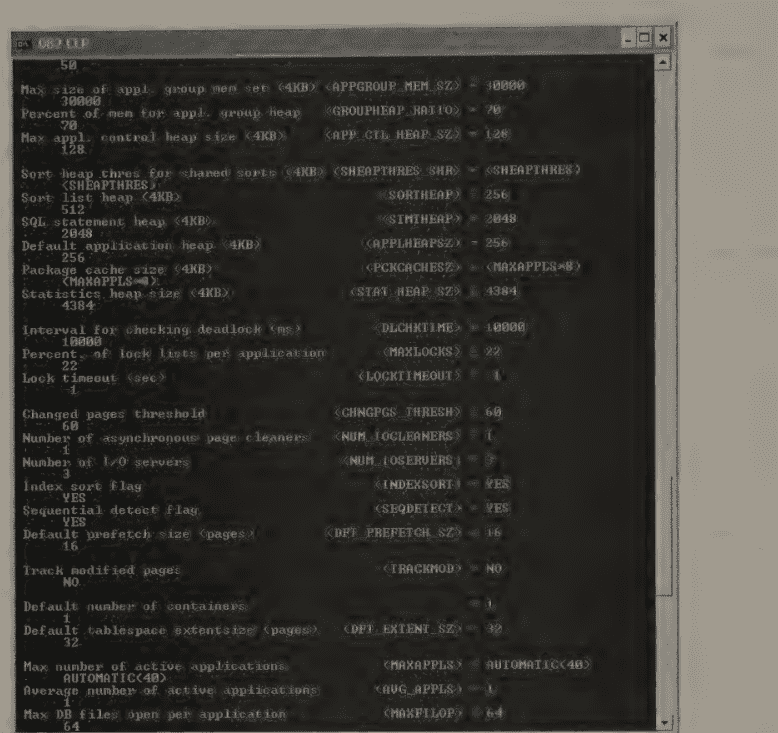

图 9.1

延迟的 DB CF sortheap 值。

## DB2 内存区域

DB2 内存模型（图 9.2）由数据库管理器共享内存、数据库全局内存、应用程序全局内存和代理私有内存组成。数据库管理器共享内存用于跨实例的各种堆以及存储有关定义数据库的控制信息。数据库全局内存按数据库分配，用于存储与特定数据库相关的内存区域。数据库全局内存为每个定义的数据库分配。应用程序全局内存用于分区数据库环境在代理和子代理之间传递消息。它在分区数据库环境的每个节点上分配。它不用于 ESE 非分区环境。

## 数据库管理器共享内存

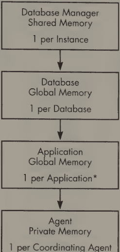

图 9.2

数据库管理器共享内存

## 数据库管理器共享内存 (DATABASE MANAGER SHARED MEMORY)

数据库管理器共享内存用于跨实例的各种堆，并存储有关定义数据库的控制信息。数据库全局内存按数据库分配，用于存储与特定数据库相关的内存区域。数据库全局内存为每个定义的数据库分配。应用程序全局内存用于分区数据库环境在代理和子代理之间传递消息。它在分区数据库环境的每个节点上分配。它不用于 ESE 非分区环境。

## 全局块 (Global Block)

包含所有定义数据库的实例和控制信息。

## 数据库全局内存 (Database Global Memory)

数据库全局内存按数据库分配，用于存储与特定数据库相关的内存区域。数据库全局内存为每个定义的数据库分配。

## 应用程序全局内存 (Application Global Memory)

应用程序全局内存用于分区数据库环境在代理和子代理之间传递消息。它在分区数据库环境的每个节点上分配。它不用于 ESE 非分区环境。

## 代理私有内存 (Agent Private Memory)

代理私有内存用于实例中的每个代理。

## 数据库管理器内存 (Database Manager Memory)

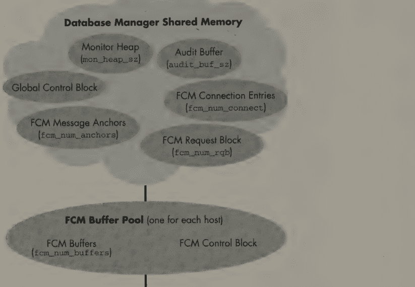

图 9.3

数据库管理器内存（ESE 非分区环境）。

## 实例内存 (instance_memory)

实例内存也称为数据库共享内存，现在可以由 DB2 自动管理。我建议使用默认的自动设置。如果你决定指定此值而不是使用自动，则需要小心。

## 监控堆 (mon_heap_sz)

监控堆用于所有数据库，存储系统数据所有逻辑视图的监控信息。分配的监控堆数量由监控应用程序的数量、数据库活动、监控开关和监控事件的使用控制。它在 `db2start` 时分配，并在 DB2 关闭时释放。如果 `mon_heap_sz` 设置为 0，则禁用监控。如果你在监控期间收到 -973 SQLCODE，你可能需要增加监控堆的大小。

## 审计缓冲区 (audit_buf_sz)

审计缓冲区用于在审计设施写入时异步地缓冲审计记录。当 `audit_buf_sz` 设置为 0 且使用审计时，记录将同步写入，导致应用程序等待磁盘写入完成。

## 组堆比例 (group_heap_ratio)

此新参数指定了允许共享堆的内存百分比。将此设置得太低会限制缓存的大小。设置得太高会导致应用程序获取 SQL973 错误，这表明应用程序堆不足。除非遇到性能问题，否则应使用默认的 70%，此时应根据压力测试进行调整。

## 排序堆排序阈值 (Sort Heap Threshold for Sorts)

此新参数为共享排序设置硬限制。当达到此限制时，应用程序将带有 SQL055C 失败。如果设置为 0，共享内存的阈值将是 `sheaptres` DB CF 设置的值。`sheapt_shr` 仅在 `intra_parallel` 设置为 YES、启用连接汇聚或使用 cursor HOLD 选项时生效。使用 cursor HOLD 时，排序堆将从 `sheapt_shr` 内存中分配。

## FCM 连接项 (fcm_num_connect)

`FCM` 连接项用于 `FCM` 在代理之间传递数据。这与 `fcm_num_rqdb` 和其他 `FCM` 参数结合使用。

## FCM 消息锚 (fcm_num_anchors)

`FCM` 消息锚用于 `FCM` 在代理（agents）之间传递消息。该参数结合 `fcm_num_rqdb` 和其他 `FCM` 参数一起进行设置。

## FCM 请求块 (fcm_num_rqdb)

`FCM` 请求块是 `FCM` 用作在 `FCM` 守护进程与代理之间传递信息的机制，或用于促进代理之间信息传递的机制。

## FCM 缓冲区池 (FCM Bufferpool)

`FCM` 缓冲区池包含 `FCM` 缓冲区和控制块，用于在并行环境中的并行子代理之间实现快速通信。

## FCM 缓冲区 (fcm_num_buffers)

`fcm_num_buffers` 仅在启用了分区内并行性的 ESE 中使用，它指定了在分区数据库环境中，用于子代理之间内部通信的 4 KB 缓冲区数量。该参数对数据库性能至关重要，在未来的发布中，它可能会由数据库管理器自动调整。逻辑节点越多，需要的缓冲区就越多。

## FCM 控制块 (FCM Control Block)

`FCM` 控制块用作控制机制，用于管理 `FCM` 缓冲区的分配和使用。

> 注意
> 当使用分区数据库或在使用启用了 DBM CFG 参数 `intra_parallel` 的 ESE 时，会使用 `FCM` 通信。

## Java 堆内存 (java_heap_sz)

此新参数控制 Java 解释器用于服务 Java 存储存储过程和 UDF 的堆内存。在 UNIX 上，每个 DB2 进程都有一个堆（在基于 UNIX 的平台上每个代理或子代理一个堆，在其他平台上每个实例一个堆）。每个围栏 UDF 和围栏进程有一个堆。每个 `db2famp` 进程使用一个堆。对于多线程 `db2famp` 进程，仅使用一个堆。Java 堆仅由运行 Java UDF 或 SP 的进程分配。对于分区数据库，每个数据库分区都使用相同的值。从默认值开始并进行监控，以确保您在环境中环境中正确地设置了它。

## 数据库内存 (database_memory)

此参数设置数据库全局内存的最小大小。这些区域如图 9.3 所示。该参数的默认设置为自动。这允许 DB2 动态调整如缓冲区、目录缓存和其他数据库全局内存区域。此参数允许 DB2 利用 AIX 上的 64 位寻址并根据需要增加此内存的大小。使用默认值并在必要时进行调整。

## 数据库全局内存 (DATABASE GLOBAL MEMORY)

数据库全局内存会在数据库级别分配，每个数据库一个，上限值为 `numdb` 的值。

> 注意
> 当使用分区或使用启用了并行性的 ESE 时，共享排序内存从数据库全局内存中分配。

数据库全局内存包含在“首次连接”时分配的内存。它被所有连接到数据库的应用程序使用并包含许多重要的内存区域（见图 9.4）。

> 注意
> DBM 和 DB CFG 参数应在受影响的环境中使用公式、基准测试或压力测试进行设置。

数据库管理器共享内存
数据库全局内存

| 实用程序堆 (util_heap_sz) | 缓冲区池 | 数据库堆 (dbheap) |
| --- | --- | --- |
| 备份缓冲区* (backbufsz) | 扩展内存缓存 | 志日志缓冲区 (logbufsz) |
| 恢复缓冲区* (restbufsz) | 锁列表 (locklist) | 目录缓存 (catalogcache_sz) |
| 包缓存 (pckcachesz) | 排序堆—共享排序 (sortheap) | |

* 已废

图 9.4
数据库全局内存。

## 实用程序堆 (util_heap_sz)

实用程序堆指定了备份、恢复、重建和加载实用程序可以并发使用的最大内存量。它在实用程序需要时分配，并在实用程序不再需要时释放。该参数对性能的影响通常很低。

## 备份缓冲区 (backbufsz)

此参数在 DB2 v8 中已废用。备份缓冲区现在作为备份命令的一部分被显式指定。

## 恢复缓冲区 (restbufsz)

此参数在 DB2 v8 中已废用。恢复缓冲区现在在恢复命令上被显式指定。

## 包缓存大小 (pckcachesz)

包缓存大小指定了分配用于缓存动态和静态 SQL 的内存量。在数据库启动和关闭时分配。DB2 使用包缓存来消除对 DB2 目录的访问以加载静态 SQL 的包，或消除动态 SQL 的准备（prepare）。如果可用缓存的数量大于存储并发执行 SQL 所需的数量，则 SQL 语句将存储在缓存（内存中）中。否则，DB2 将不会缓存 SQL。包段将保持缓存状态，直到数据库关闭、语句失效或发布了新的 `flush PACKAGE cache` 命令。

> 如果在包缓存中未找到包，DB2 将使用直接 I/O 从目录中加载包，这绕过了缓冲区池，并且比从包缓存中读取包慢得多。因此，为了获得性能良好的数据库，最大限度地利用包缓存至关重要。

> DB2 逐字节匹配缓存的 SQL。动态 SQL 应该使用参数标记符而不是字面量，这将导致 DB2 在缓存中获得匹配（缓存命中）并提高性能。

在 OLTP 实现中，包缓存比在业务数据仓库实现中重要，因为 OLTP 事务倾向于重复执行，而 BI 事务倾向于更具即时性且执行频率较低。

## 数据库全局内存 (Database Global Memory)

为包缓存指定的内存量是一个软限制，如果数据库管理器有足够的内存，则可能会超过它。如果发生这种情况，则被称为“包缓存溢出”，可以使用监控元素 `pkg_cache_overflows` 和 `pkg_cache_size_top` 进行监控。如果包缓存溢出，DB2 将临时从 `locklist`、`dbheap` 或其他数据库内存中借内存。这可能会由于 `locklist` 的额外使用或 `dbheap` 的不足导致整体并发性降低。参见 DB2 系统监控指南了解与包缓存相关的监控元素。

如果您将包缓存设置得太大，内存将被浪费且无法使用。仔细选择并监控包缓存的使用，如果它太大，请减少使用量并分配到其他区域，如缓冲区池。使用基准测试技术确定适当的大小。

## 缓冲区池大小 (bufferpage)

此参数在 DB2 v8.1 中已废用。

## 扩展内存缓存 (Extended Memory Cache)

当物理内存超过32位操作系统的可寻虚拟内存（取决于操作系统通常为2或4 GB）时，可以使用扩展内存缓存。扩展内存缓存与一个或多个缓冲区池关联。

扩展内存缓存作为缓冲区池的“二级缓存”，可以有利于读取多于更新的应用程序。页面被移动到扩展内存缓存并在应用程序引用时重用。由于管理存储缓存存在 CPU 成本，只有当您的数据库存在 I/O 瓶颈且不受 CPU 限制时，才应使用它。

# 锁列表 (locklist)

`locklist` DB CF 参数指定了应为锁管理器存储锁留留的全局内存。每个数据库有一个锁列表。它在启动以及最后一个应用程序断开连接时也会分配。`locklist` 结合 `maxlocks` 数据库配置参数使用。`maxlocks` 指定单个应用程序可以使用 `locklist` 的最大百分比，之后会发生锁升级。锁升级仅对超过 `maxlocks` 参数的应用程序发生。由于行级是 DB2 的默认隔离级别，升级会导致产生表锁以替换行锁。这释放了 `locklist` 内存供其他应用程序使用。当 `locklist` 变满时，也会发生锁升级。锁升级会减少并发性，通常应避免。

## 数据库堆 (dbheap)

`dbheap` 参数指定了用于存储表空间、表和索引控制块的全局内存量。每个数据库有一个 `dbheap`，它在第一个应用程序连接到数据库时分配，并在最后一个应用程序断开连接时释放。日志缓冲区和目录缓存也是从 `dbheap` 分配的。`dbheap` 参数应通过基准测试技术进行设置。如果日志缓冲区或目录缓存的大小发生变化，应相应地更改 `dbheap`。应使用快照监控或第三方监控工具持续监控 `dbheap` 的使用情况。可以使用监控元素 `db_heap_top` 来监控 `dbheap` 的高水位使用情况。通过对数据库管理器执行快照可以获取额外的 `dbheap` 监控元素。

## 日志缓冲区 (logbufsz)

`logbufsz` 指定日志缓冲区的大小。它作为 `dbheap` 的一部分进行分配和释放。日志缓冲区用于在日志记录写入磁盘之前保留它们。`logbufsz` 应与数据库配置参数 `mincommit` 配合使用。虽然 `logbufsz` 控制日志缓冲区的大小，但 `mincommit` 用于对提交进行分组，并控制日志记录如何写入磁盘。当满足以下情况之一时，日志记录会被写入磁盘：

- 事务提交或根据 `mincommit` 定义的一组事务提交
- 日志缓冲区满
- 某些其他内部数据库管理器事件的结果

在可用内存范围内，日志缓冲区应设置得尽可能大，并确保足够大以便在正常活动期间不会填满，从而导致不必要的提交。使用以下公式在环境中设置 `mincommit`：

| 每秒事务数 |
| :--- |
| 10 |

例如：


使用以下命令将 `mincommit` 设置为 10：
```


```
db2 update DB CFG using mincommit 10
```

这种提交分组使 DB2 能够高效利用日志缓冲区，这会显著影响性能。

## 目录缓存 (`catalogcache_sz`)

`catalogcache_sz` 指定了用于存储表描述符信息可以分配的总内存量。它作为 `dbheap` 的一部分进行分配和释放。

## 应用全局内存 (`app_ctl_heap_sz`)

> 注意
> DB2 在访问目录时不使用缓冲池，相反，如果在目录缓存中未找到信息，它将直接从磁盘进行读取。

缓存存储了在编译 SQL 语句期间引用表、视图或别名时用到的表描述符信息。当之前的状态中引用过相同的视图或别名时，使用缓存有助于提高 SQL 语句的性能。声明临时表的描述符信息不存储在目录缓存中，而是存储在应用程序堆中。对表执行 DDL 将从缓存中清除该表的条目。否则，它将保留在缓存空间中直到另一个表，但不是直到所有工作单元完成。从默认值开始，并使用以下监控元素进行监控：

- `cat_cache_lookups`
- `cat_cache_inserts`
- `cat_cache_overflows`
- `cat_cache_heap_full`

在 v8 中，可以通过对数据库管理器执行快照来获取目录缓存元素。

## 应用组内存 (`appgroup_mem_sz`)

此参数决定了应用程序共享内存段的最大 own。此内存仅用于分区数据库环境，在该环境中启用了分区内并行或正在使用连接集中。每个应用程序都有自己的应用程序控制堆，从应用程序组内存中分配，所有应用程序共享一个组共享堆。每个应用程序控制堆的大小计算如下：

```
App_ctl_heap_sz * (100-groupheap/ratio)
```

从默认值开始并监控它。

## 应用全局内存 (`app_ctl_heap_sz`)

此内存仅用于分区数据库环境，在该环境中启用了分区内并行或正在使用连接集中。每个应用程序都有自己的应用程序控制堆，从应用程序组内存中分配，所有应用程序共享一个组共享堆。每个应用程序控制堆的大小计算如下：

```
App_ctl_heap_sz * (100-groupheap/ratio)
```

从默认值开始并监控它。

## 应用全局内存 (`app_ctl_heap_sz`)

此内存仅用于分区数据库环境，在该环境中启用了分区内并行或正在使用连接集中。每个应用程序都有自己的应用程序控制堆，从应用程序组内存中分配，所有应用程序共享一个组共享堆。每个应用程序控制堆的大小计算如下：

```
App_ctl_heap_sz * (100-groupheap/ratio)
```

从默认值开始并监控它。

## 应用全局内存 (`app_ctl_heap_sz`)

此内存仅用于分区数据库环境，在该环境中启用了分区内并行或正在使用连接集中。每个应用程序都有自己的应用程序控制堆，从应用程序组内存中分配，所有应用程序共享一个组共享堆。每个应用程序控制堆的大小计算如下

此内存仅用于分区数据库环境，在该环境中启用了分区内并行或正在使用连接集中。每个应用程序都有自己的应用程序控制堆，从应用程序组内存中分配，所有应用程序共享一个组共享堆。每个应用程序控制堆的大小计算如下

```
App_ctl_heap_sz * (100-groupheap/ratio)
```

从默认值开始并监控它。

## 应用全局内存 (`app_ctl_heap_sz`)

此内存仅用于分区数据库环境，在该环境中启用了分区内并行或正在使用连接集中。每个应用程序都有自己的应用程序控制堆，从应用程序组内存中分配，所有应用程序共享一个组共享堆。每个应用程序控制堆的大小计算如下：

```
App_ctl_heap_sz * (100-groupheap/ratio)
```

从默认值开始并监控它。

## 应用全局内存 (`app_ctl_heap_sz`)

此内存仅用于分区数据库环境，在该环境中启用了分区内并行或正在使用连接集中。每个应用程序都有自己的应用程序控制堆，从应用程序组内存中分配，所有应用程序共享一个组共享堆。每个应用程序控制堆的大小计算如下：

```
App_ctl_heap_sz * (100-groupheap/ratio)
```

从默认值开始并监控它。

## 应用全局内存 (`app_ctl_heap_sz`)

此内存仅用于分区数据库环境，在该环境中启用了分区内并行或正在使用连接集中。每个应用程序都有自己的应用程序控制堆，从应用程序组内存中分配，所有应用程序共享一个组共享堆。每个应用程序控制堆的大小计算如下：

```
App_ctl_heap_sz * (100-groupheap/ratio)
```

从默认值开始并监控它。

## 应用全局内存 (`app_ctl_heap_sz`)

此内存仅用于分区数据库环境，在该环境中启用了分区内并行或正在使用连接集中。每个应用程序都有自己的应用程序控制堆，从应用程序组内存中分配，所有应用程序共享一个组共享堆。每个应用程序控制堆的大小计算如下：

```
App_ctl_heap_sz * (100-groupheap/ratio)
```

从默认值开始并监控它。

## 应用全局内存 (`app_ctl_heap_sz`)

此内存仅用于分区数据库环境，在该环境中启用了分区内并行或正在使用连接集中。每个应用程序都有自己的应用程序控制堆，从应用程序组内存中分配，所有应用程序共享一个组共享堆。每个应用程序控制堆的大小计算如下：

```
App_ctl_heap_sz * (100-groupheap/ratio)
```

从默认值开始并监控它。

## 应用全局内存 (`app_ctl_heap_sz`)

此内存仅用于分区数据库环境，在该环境中启用了分区内并行或正在使用连接集中。每个应用程序都有自己的应用程序控制堆，从应用程序组内存中分配，所有应用程序共享一个组共享堆。每个应用程序控制堆的大小计算如下：

```
App_ctl_heap_sz * (100-groupheap/ratio)
```

从默认值开始并监控它。

## 应用全局内存 (`app_ctl_heap_sz`)

此内存仅用于分区数据库环境，在该环境中启用了分区内并行或正在使用连接集中。每个应用程序都有自己的应用程序控制堆，从应用程序组内存中分配，所有应用程序共享一个组共享堆。每个应用程序控制堆的大小计算如下：

```
App_ctl_heap_sz * (100-groupheap/ratio)
```

从默认值开始并监控它。

## 应用全局内存 (`app_ctl_heap_sz`)

此内存仅用于分区数据库环境，在该环境中启用了分区内并行或正在使用连接集中。每个应用程序都有自己的应用程序控制堆，从应用程序组内存中分配，所有应用程序共享一个组共享堆。每个应用程序控制堆的大小计算如下：

```
App_ctl_heap_sz * (100-groupheap/ratio)
```

从默认值开始并监控它。

## 应用全局内存 (`app_ctl_heap_sz`)

此内存仅用于分区数据库环境，在该环境中启用了分区内并行或正在使用连接集中。每个应用程序都有自己的应用程序控制堆，从应用程序组内存中分配，所有应用程序共享一个组共享堆。每个应用程序控制堆的大小计算如下：

```
App_ctl_heap_sz * (100-groupheap/ratio)
```

从默认值开始并监控它。

## 应用全局内存 (`app_ctl_heap_sz`)

此内存仅用于分区数据库环境，在该环境中启用了分区内并行或正在使用连接集中。每个应用程序都有自己的应用程序控制堆，从应用程序组内存中分配，所有应用程序共享一个组共享堆。每个应用程序控制堆的大小计算如下：

```
App_ctl_heap_sz * (100-groupheap/ratio)
```

从默认值开始并监控它。

## 应用全局内存 (`app_ctl_heap_sz`)

此内存仅用于分区数据库环境，在该环境中启用了分区内并行或正在使用连接集中。每个应用程序都有自己的应用程序控制堆，从应用程序组内存中分配，所有应用程序共享一个组共享堆。每个应用程序控制堆的大小计算如下：

```
App_ctl_heap_sz * (100-groupheap/ratio)
```

从默认值开始并监控它。

## 应用全局内存 (`app_ctl_heap_sz`)

此内存仅用于分区数据库环境，在该环境中启用了分区内并行或正在使用连接集中。每个应用程序都有自己的应用程序控制堆，从应用程序组内存中分配，所有应用程序共享一个组共享堆。每个应用程序控制堆的大小计算如下：

```
App_ctl_heap_sz * (100-groupheap/ratio)
```


从默认值开始并监控它。

## 应用全局内存 (`app_ctl_heap_sz`)

此内存仅用于分区数据库环境，在该环境中启用了分区内并行或正在使用连接集中。每个应用程序都有自己的应用程序控制堆，从应用程序组内存中分配，所有应用程序共享一个组共享堆。每个应用程序控制堆的大小计算如下：

```
App_ctl_heap_sz * (100-groupheap/ratio)
```

从默认值开始并监控它。

## Application Group Memory (`appgroup_mem_sz`)

此参数决定了应用程序共享内存段的最大大小。此内存仅用于分区分区环境，在该环境中环境中启分区分区内或或正在使用连接。。

应用程序

1content。

## 应用组内存 (`appgroup_mem_sz`)

此参数决定了应用程序共享内存段的最大大小。此内存仅用于分区数据库环境，在该环境中启用了分区内并行或正在使用连接集中。每个应用程序都有自己的应用程序控制堆，从应用程序组内存中分配，所有应用程序共享一个组共享堆。每个应用程序控制堆的大小计算如下：

```
App_ctl_heap_sz * (100-groupheap/ratio)
```

从默认值开始并监控它。

使用以下公式在环境中设置 `mincommit`：

| 每秒事务数 |
| :--- |
| 10 |

例如：


使用以下命令将 `mincommit` 设置为 10：

```
db2 update DB CFG using mincommit 10
```

这种提交分组使 DB2 能够高效利用日志缓冲区，这会显著影响性能。

## 目录缓存 (`catalogcache_sz`)

`catalogcache_sz` 指定了用于存储表描述符信息可以分配的总内存量。它作为 `dbheap` 的一部分进行分配和释放。

## 应用全局内存 (`app_ctl_heap_sz`)

> 注意

DB2 在访问目录时不使用缓冲池，相反，如果在目录缓存中未找到信息，它将直接从磁盘进行读取。

缓存存储了在编译 SQL 语句期间引用表、视图或别名时用到的表描述符信息。当之前的状态中引用过相同的视图或别名时，使用缓存有助于提高 SQL 语句的性能。声明临时表的描述符信息不存储在目录缓存中，而是存储在应用程序堆中。对表执行 DDL 将从缓存中清除该表的条目。否则，它将保留在缓存空间中直到另一个表，但不是直到所有工作单元完成。从默认值开始，并使用以下监控元素进行监控：

- `cat_cache_lookups`
- `cat_cache_inserts`
- `cat_cache_overflows`
- `cat_cache_heap_full`

在 v8 中，可以通过对数据库管理器执行快照来获取目录缓存元素。

## 应用组内存 (`appgroup_mem_sz`)


此参数决定了应用程序共享内存段的最大大小。此内存仅用于分区数据库环境，在该环境中启用了分区内并行或正在使用连接集中。每个应用程序都有自己的应用程序控制堆，从应用程序组内存中分配，所有应用程序共享一个组共享堆。每个应用程序控制堆的大小计算如下：

```
App_ctl_heap_sz * (100-groupheap/ratio)
```

从默认值开始并监控它。

## DRDA 堆 (`drda_heap_sz`)

`drda_heap_sz` 在 DB2 v8 中已废弃。

## UDF 内存 (`udf_mem_sz`)

`Udf_mem_sz` 在 DB2 v8 中已废弃。

## 语句堆 (`stmtheap`)

`stmheap` 指定在编译 SQL 语句时作为工作空间使用的内存量。对于动态 SQL，此堆将在执行动态 SQL 语句期间使用；而对于静态 SQL，它仅在绑定（bind）过程中使用。它在编译或绑定期间为每个语句分配内存。在每个语句的预编译或绑定完成后，内存会被释放。默认值通常是足够的。如果不是，将返回错误，指示语句“过于复杂”。按常规增量增加大小，直到问题解决。在 EEE 环境中，使用 `app_ctl_heap_sz` 代替。

## 查询堆大小 (`query_heap_sz`)

`query_heap_sz` 指定了可以分配给查询堆的最大量。查询堆用于在代理的私有内存中存储每个查询。每个查询存储的信息包括 SQLDA、语句、SQLCA、包名、创建者、段号和一致性标记。阻塞游标的内存也会随游标控制块和完全解析的输出 SQLDA 一起从查询堆中分配。查询堆大小默认等于应用支持层堆大小 (`aslheapsz`)。

## 客户端 I/O 块 (`rqrioblk`)

`rqrioblk` 指定了远程应用程序与数据库、以及本地客户端与数据库服务器之间通信缓冲区的大小。当远程客户端为服务器数据库发出连接请求时会分配该缓冲区；当打开阻塞游标时，客户端会打开额外的块。当远程应用程序从服务器数据库连接以及关闭阻塞游标时，它会被释放。当远程客户端请求连接到远程数据库时，此通信缓冲区在客户端上分配。初始分配 32,767 的缓冲区，直到建立连接且数据库服务器能够确定客户端上 `rqrioblk` 的值。服务器知道这一点，如果客户端不是 32,767，它将重新分配其缓冲区。`rqrioblk` 还用于确定在打开阻塞游标时数据库客户端的 I/O 块大小。默认值通常是足够的。如果应用程序生成的 fetch 请求多于预期，可以使用 `OPTIMIZE FOR N ROWS` 来影响访问路径并控制每个块返回的行数。

## 代理私有内存

## 代理/应用程序共享内存

应用支持

层堆

本地客户端

图 9.7 应用支持层堆大小。

## 应用支持层堆 (`as1heapsz`)

本地客户端与本地数据库通信时使用应用支持层堆。它充当客户端与数据库之间的通信缓冲区。其作用与远程应用程序的 `rqrioblk` 参数相同。见图 9.7。

## 代理参数 (`AGENT PARAMETERS`)

DB2 使用基于客户端-服务器的处理模型。客户端或应用程序使用代理（agents）在数据库内部完成工作。DB2 使用的代理类型类型如下所示。

### 协调代理 (`Coordinating Agents`)

为每个应用程序创建一个协调代理，并代表应用程序管理工作。在启用了分区内并行（intra-partition parallelism）的数据库中，协调代理还将将工作分配给子代理。DBM CF 参数 `MAX_COORDINATES` 用于定义协调代理的数量。如果某个应用程序没有可用的协调代理，请求的应用程序将接收到的一个负的 SQL 代码。你应该设置 `MAX_COORDINATES` 以避免这种情况的发生。`MAX_COORDINATES` 的默认值是 `MAXAGENTS` DBM CF 参数的设置。该设置是一个很好的起点。在没有分区或 `intra_parallel` 设置为 YES 的 ESE 环境中，`MAX_COORDINATES` 必须等于 `MAXAGENTS`。

### `MAXAGENTS`

`MAXAGENTS` DBM CF 参数指定了随时可接受应用程序请求的数据库代理最大数量（无论是协调代理还是子代理）。在内存限制的环境中，可以将 `MAXAGENTS` 设置低以限制数据库器的总内存占用，因为每增加一个代理都需要额外的内存。如果你使用此来限制资源，请记住这只是临时解决方案。你需要减少资源消耗或获取额外的容量来支持你的业务需求。

### `MAXCAGENTS`

`MAXCAGENTS` 定义了在数据库管理器中执行的最大并发代理数量（Maximum Number of Concurrent Agents）。代理在为应用程序工作之前，必须从数据库管理器获取一个令牌（token）。如果没有可用令牌，代理将等待。`MAXCAGENTS` 控制可用令牌的数量。默认情况下 `MAXCAGENTS` 等于 `MAX_COORDINAGENTS`。从默认值开始，并通过基准测试进行调整。通常情况下，你不应该看到代理在等待令牌。你可以通过 DBMS 快照监控这一点。如果频繁发生等待令牌的情况，应增加 `MAXCAGENTS` 和其他相关代理参数，直到等待令牌的代理数为 0 或发生频率极低。

### `MAXAPPLS`

`MAXAPPLS` 定义了连接到数据库的最大并发应用程序数量。如果达到 `MAXAPPLS`，将向任何尝试连接数据库的应用程序返回错误，且不会建立连接。在 v8 中，`MAXAPPLS` 可以设置为自动（automatic），这将允许任意数量的连接应用程序。如果资源不受限制，将 `MAXAPPLS` 设置为自动；由于 CPU 或内存限制，则将其设置为大于或等于已连接应用程序的总和，加上这些可能正在完成两阶段提交或回滚的相同应用程序数量；加上预计任何时候可能发生的悬挂事务（in-doubt transactions）数量的总和。`MAXAPPLS` 也受 `MAXCAGENTS` 的限制。

## 代理监控 (`AGENT MONITORING`)

数据库管理器快照将提供有关代理活动的信息。参考第 2 章示例数据库管理器。感兴趣的元素如下：

- 已注册的高水位 (High water mark)
- 等待令牌的高水位
- 已注册代理
- 等待令牌的代理
- 来自其他应用程序的代理
- 协调代理的高水位
- 最大代理数

这些元素将指示代理设置是否足够。通常，当代理资源使用达到80%（高水位）时，你应该增加相关参数，直到使用率低于80%。

## 配置顾问 (`CONFIGURATION ADVISOR`)

现在我们讨论了各种生产数据库管理器和配置参数，现在是时候介绍配置顾问了。配置顾问根据 DBA 的输入进行配置。它可以帮助你入门并为你的数据库设置性能基准。在典型的生产环境中监控数据库后，应根据需要审查并调整设置。配置顾问由 10 个步骤组成，如图 9.8–9.17 所示。

> 注意
> 配置顾问是 IBM SMART 程序的一个示例。SMART 程序旨在通过提供工具和向导对 DB2 数据库进行自调优、监控和分析。

### 1. 引言—计算新值或恢复保存值。见图 9.8。

| 确认此实例的生产数据库名称 |
| :--- |
| 1. 引言 | 此顾问更新参数以提高下方生产数据库的性能。每个数据库实例应只有一个生产数据库。如果你正在运行多个生产数据库，请在使用此顾问之前将其中一个数据库移动到新实例。你想要配置的生产数据库名称显示在下方，点击继续。 |
| 2. 服务器 | |
| 3. 工作负载 | |
| 4. 事务 | |
| 5. 路由 | |
| 6. 已填充 | |
| 7. 连接 | |
| 8. 隔离 | |
| 9. 计划 | |
| 10. 结果 | |
| 数据库 TCSHA-USER-DB2-SAMPLE |

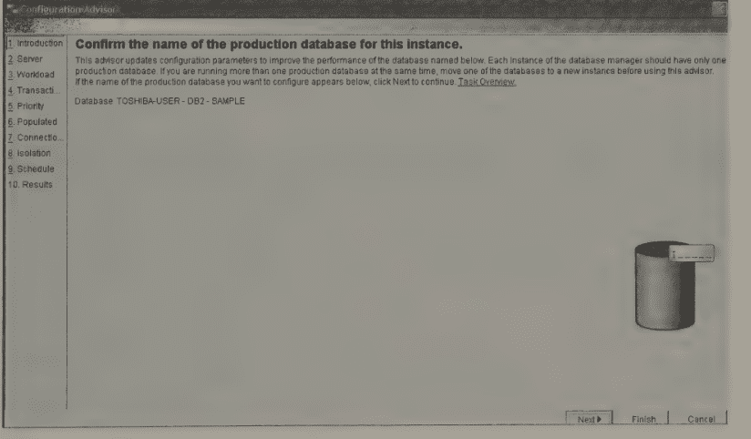

### 2. 服务器—设置数据库服务器实际内存的目标值。见图 9.9。

## 第 9 章 • 调整配置参数

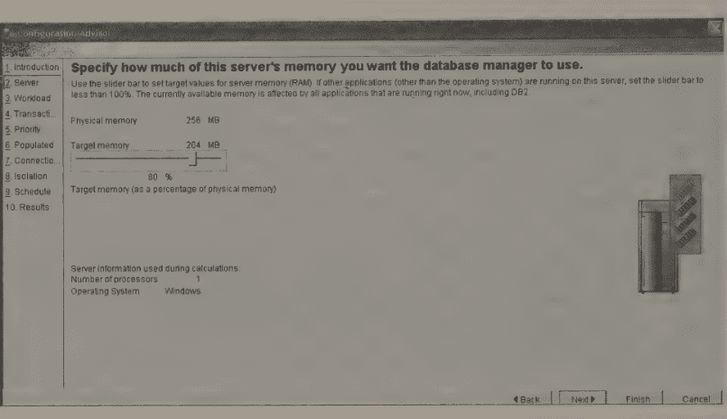

如果您有专用的数据库服务器，请将滑块设置为 80%。如果服务器上运行着其他应用程序，请将其设置为较低的值。

### 3. 设置负载类型。参见图 9.10。

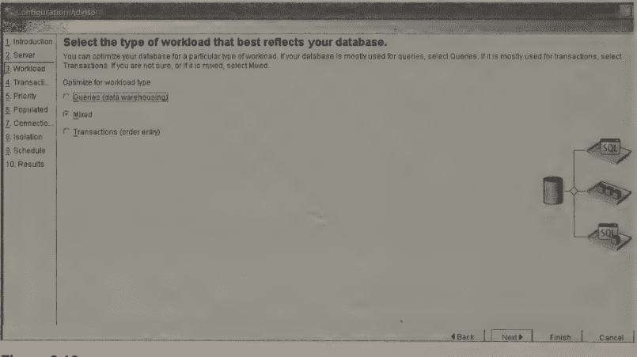

#### 配置向导 (`Configuration Advisor`)

通过设置负载类型，我们是在告诉配置向导针对您的特定负载优化 DB2 内存。在数据仓库环境中，查询运行时间往往较长，使用更多的 `sortheap`，并且在包缓存和缓冲池（bufferpool）效率的使用上存在差异。数据仓库环境中的查询往往是“即时的”且各不相同的，这意味着包命中率将较低，且表对象太大无法放入缓冲池中，从而导致从磁盘进行物理读取。然而，在此环境下，缓冲池倾向于支持将全部或部分索引页留在缓冲池中，从而从缓冲池中读取索引。

### 4. 指定典型的数据库事务。参见图 9.11。

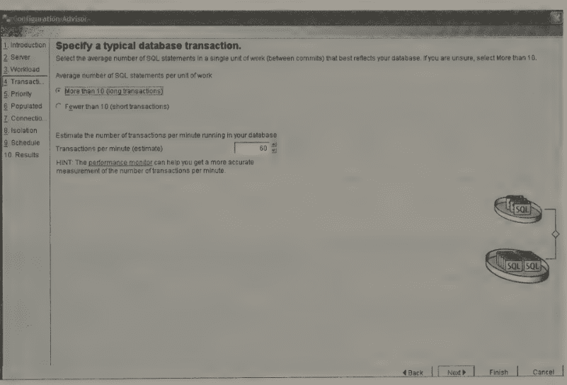

图 9.11

指定典型的数据库事务。


通过指定一个典型的数据库事务数，配置向导使用该数字来计算 `locklist`、`maxlocks` 以及其他配置参数的大小。

## 5. 指定数据库管理优先级。参见图 9.12。

通过设置数据库管理优先级，配置向导将根据所选选项，决定是针对性能还是快速恢复来优化数据库配置设置。此选项将计算诸如 `num_iocleaners`、`min_commit` 以及其他影响日志活动的的配置设置。

### 图 9.12

指定数据库管理优先级。

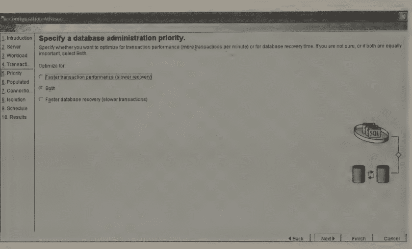

## 6. 指定数据库是否已填充。参见图 9.13。

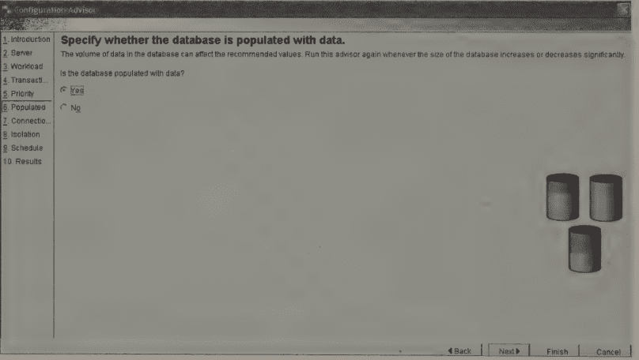

### 图 9.13

指定数据库是否已填充。

### 配置向导

通过指定数据库是否已填充，我们是在告诉 DB2 适当地调整缓冲池、`num_lioservers` 以及其他配置参数的大小。

## 7. 估计连接到数据库的应用程序数量。参见图 9.14。

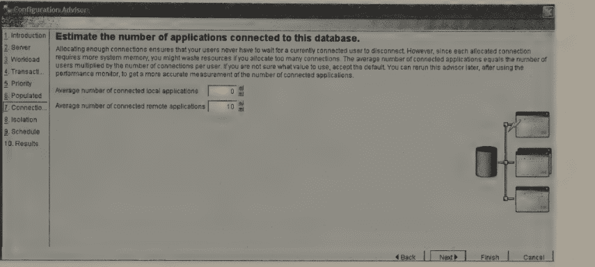

图 9.14

估计连接到数据库的数。

DB2 使用此信息帮助为 `qrarioblk`、`maxaslheapsz`、`maxagents` 以及其他配置参数提供推荐的配置设置。

## 8. 指定隔离级别。参见图 9.15。

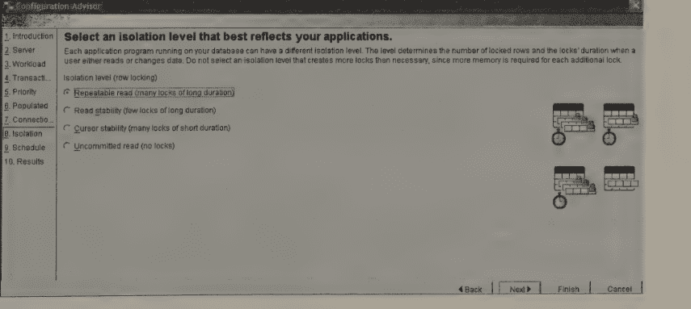

图 9.15

指定隔离级别。

通过指定隔离级别，我们是在为 DB2 提供有关如何调整 `lock-list`、`maxlocks` 以及其他配置参数的信息。

## 9. 计划。参见图 9.16。

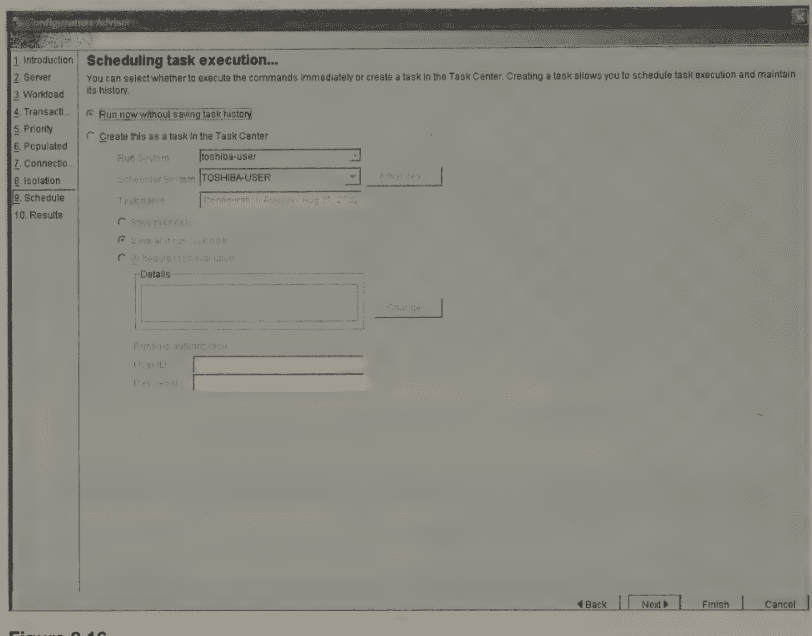

图 9.16 配置向导调度。

配置向导会话的结果可以计划或立即执行。可以通过勾选相应的复选框将建议保存到任务中心（Task Center），并在后续日期运行。

## 10. 结果。参见图 9.17。

可以通过选择完成（Finish）按钮来应用建议。

配置向导在之前的版本中被称为“性能配置向导”（Configure Performance Wizard）。在最近的基准测试中，由专家配置的数据库与由配置向导配置的数据库对比显示性能几乎相当，因此配置向导无疑是配置数据库的良好起点。

## 总结

## 审查性能配置建议。

- 1. 引言
- 2. 服务器
- 3. 负载
- 4. 事务
- 5. 池
- 6. 填充
- 7. 连接
- 8.
- 9. 已选择

根据您在此向导中的选择，以及数据库中的数据量和系统信息，此向导推荐了以下值。对于此列表，如果您想将新值保存到脚本中，或立即将其应用于数据库。

| 参数 | 当前值 | 建议值 | DB2 参数 |
| --- | --- | --- | --- |
| 内存 | | | |
| 缓冲池 | | | |
| 目录大小 | | | |
| 连接 | | | |
| 兴奋 | | | |
| 默认程度 | | | |
| 默认偏好 | | | |
| 最大连接 | | | |
| 日志缓冲区 | | | |
| 日志大小 | | | |
| 数量 | | | |
| 最小 | | | |
| 分组。 | | | |
| 数量 | | | |
| 包 ca | | | |
| 恢复时间 | | | |
| 语句 h | | | |
| 工具堆 | | | |
| 数量 | | | |
| 数量 | | | |
| 启用内部。 | | | |
| 最大 | | | |
| 代理池 | | | |
| 理想数量 | | | |

*(注：OCR 中的表格数据出现损坏/未对齐；结构已根据可见文本保留。）*

# 第 10 章 监控

## 监控

无论 RDBMS 性能如何，都必须对 SQL 语句和资源进行监控，以确保良好的性能并识别问题区域。根据收集的信息，可以对物理设计或 SQL 进行调整。RDBMS 的性质及其实现可能会导致某些事件频繁发生，例如组锁升级、缓冲池命中率低、磁盘 I/O 活动以及空间不足。DBA 团队必须建立完善的监控计划，以确保数据库符合预期，并持续满足预期。这包括拥有针对监控的 DBA 标准和程序，概述 DBA 组织如何开展监控活动。

DB2 通过使用快照监控和事件监控提供了内置监控功能。

## 启用监控

在详细介绍快照监控之前，您需要了解如何显示和设置数据库管理器监控开关。可以通过执行 `GET DEM MONITOR SWITCH` 或 `GET MONITOR SWITCH` 命令并查看输出来查看监控开关的当前设置。参见示例 10.1。

## 监控记录开关

数据库分区号 0 的开关列表

缓冲池活动信息 (`BUFFERPOOL`) = ON 03-17-2003 15:02:57.169894

锁信息 (`LOCK`) = ON 03-17-2003 15:02:57.169894

排序信息 (`SORT`) = ON 03-17-2003 15:02:57.169894

SQL 语句信息 (`STATEMENT`) = ON 03-17-2003 15:02:57.169894

表活动信息 (`TABLE`) = ON 03-17-2003 15:02:57.169894

时间戳信息 (`TIMESTAMP`) = ON 03-17-2003 15:02:57.169894

工作单元信息 (`UOW`) = ON 03-17-2003 15:02:57.169894

## 示例 10.1

数据库监控开关。

程序使用 DB2 管理应用程序编程接口 (`API`) 或通过厂商工具进行操作。当开关打开时，表示 DB2 的数据库系统监控组件正在为任何监控应用程序收集数据。此外，每个人员或应用程序监控 DB2 时都有其对监控开关的独立逻辑视图。虽然快照监控会给数据库带来开销，但如果没有它，很难理解正在发生什么。在大多数情况下，这种开销是可以接受的。快照的频率随环境而异，您应该注意频繁快照对数据库的影响。合理的快照频率是两次快照之间间隔 60 秒。对于调优良好的数据库，也常用 5 分钟的频率。在高并发 OLTP 环境中，我曾每隔 5 秒拍摄一次快照，以识别问题 SQL。因此，频率取决于您的环境。只有在必须解决严重的性能问题时，才使用小于 60 秒的频率。

监控开关可以在实例级别或应用程序级别开启或关闭。设置监控开关的实例配置参数将影响实例内的所有数据库。到数据库的每个连接都会继承在实例级别设置的默认开关。快照监控开关可以根据需要开启或关闭。使用 `DBM CONFIGURATION USING DFT_ON_TABLE` 或 `UPDATE MONITOR switches USING TABLE ON`。`UPDATE MONITOR` 开关命令将仅捕激活开关的应用程序的信息。数据管理器和应用程序级监控开关的完整描述请见表 10.1。

当监控开关打开时，开始收集监控数据，可以使用快照命令来收集这些数据。记录数据时会有轻微的性能下降，且拍摄快照会产生额外的性能开销。需要注意的是，执行快照命令之前必须启用监控开关。如果实例或数据库级别未启用相应的监控开关，将不会返回任何快照信息。

共有八种快照级别：

- 数据库管理器（Database Manager）—在实例级别记录信息
- 数据库（Database)—在数据库级别记录信息
- 应用程序（Application)—记录应用程序信息
- 缓冲池（Bufferpools)—记录缓冲池活动
- 表空间（Tablespace)—记录表空间活动
- 表（Table)—记录表活动
- 锁（Lock)—记录应用程序持有的锁的锁信息
- 动态 SQL 缓存（Dynamic SQL cache）—从 SQL 语句缓存中记录时间点的语句信息

> 注意

DB2 v8 引入了一个新的 `TIMESTAMP` 监控开关。默认情况下该开关已开启。如果不需要时间戳信息，可以关闭该开关以提高数据库性能。引入此开关是为了减少发生上下文切换的次数。快照命令列表请见表 10.2。

## 启用监控

表 10.1 数据库管理器和数据库级监控开关

| 数据库管理器开关 | 监控开关 | 感兴趣的信息 |
| --- | --- | --- |
| `DFT_MON_BUFFERPOOL` | 缓冲池 (`Bufferpool`) | 逻辑读和物理读、异步 I/O 活动、用于计算命中率的信息。读和写次数、耗用时间 |
| `DFT_MON_LOCK` | 锁 (`Lock`) | 应用程序持有的锁、锁等待、升级、死锁 |
| `DFT_MON_SORT` | 排序 (`Sort`) | 使用的排序堆内存量、排序溢出、排序次数、排序时间 |
| `DFT_MON_STMT` | 语句 (`Statement`) | `APPLID`、连接时间、排序、DML 活动、持有的锁、缓冲池活动 |
| `DFT_MON_TABLE` | 表 (`Table`) | 读写活动 |


| `DFT_MON_UOW` | 工作单元 (UOW) | 完成状态、开始和结束时间 |

| `DFT_MON_TIMESTAMP` | 时间戳 (Timestamp) | 依赖函数的时间戳 |

* `v8` 版本新增功能

## 表 10.2 常用快照命令

| 快照类型 | 命令 |
| --- | --- |
| 锁快照 | `db2 get snapshot for locks on sample` |
| 数据库管理器快照 | `db2 get snapshot for DBM` |
| 数据库快照 | `db2 get snapshot for database on SAMPLE` |
| 表空间快照 | `db2 get snapshot for tablespaces on SAMPLE` |
| 表快照 | `db2 get snapshot for tables on SAMPLE` |
| 缓冲池快照 | `db2 get snapshot for bufferpools on SAMPLE` |
| 应用程序快照 | `db2 get snapshot for applications on SAMPLE` |
| 动态 SQL | `db2 get snapshot for dynamic sql on SAMPLE` |

表 10.2 中的快照命令是您应该掌握的基本快照监控命令。更多选项和信息请参考 DB2 v8.1 命令参考示例 10.2，获取从 CLP 发出的以下命令的示例输出：

```
db2 get snapshot for database manager
```

## 数据库管理器快照

| 数据库管理器快照 |
| --- | --- |
| 节点名称 | 企业级服务器 (Enterprise Server) |
| 节点类型 | 本地和远程客户端 |
| 实例名称 | DB2 |
| 数据库分区数 | 1 |
| 数据库管理器状态 | 活动 (Active) |
| 产品名称 | DB2 v8.1.0.36 |
| 服务级别 | s02103 |
| 分配的排序堆 | 0 |
| 排序堆水位 | 277 |
| 阈值后排序 | 0 |
| 请求排序 | 9 |
| 接受排序 | 9 |
| 数据库管理器时间戳 | 03-17-2003 15:02:57.169848 |
| 最后重置时间戳 |  |
| 快照时间戳 | 03-17-2003 15:26:31.58412 |

## 示例 10.2 数据库管理器快照

#启用监控

| 到数据库管理器的连接 | 0 |
| 数据库管理器中的连接 | 0 |
| 本地连接 | 3 |
| 数据库管理器中的连接 | 0 |
| 活动数据库 | 2 |
| 代理水位 | 9 |
| 令牌水位 | 0 |
| 已注册代理 | 9 |
| 等待令牌的代理 | 0 |
| 空闲代理 | 0 |
| 已提交内存（字节） | 1680984 |
| 数据库分区列表 | 0 ON 03-17-2003 |
| 缓冲池活动信息 (BUFFERPOOL) | ON 03-17-2003 15:02:57.169894 |
| 锁信息 (LOCK) | ON 03-17-2003 15:02:57.169894 |
| 排序信息 (SORT) | ON 03-17-2003 15:02:57.169894 |
| SQL 语句信息 (STATEMENT) | ON 03-17-2003 15:02:57.169894 |
| 表活动信息 (TABLE) | ON 03-17-2003 15:02:57.169894 |
| 时间戳信息 (TIMESTAMP) | ON 03-17-2003 15:02:57.169894 |
| 工作单元信息 (UOW) | ON 03-17-2003 15:02:57.169894 |
| 从池分配的代理 | 133 |
| 从空池创建的代理 | 11 |
| 从另一个应用程序取的代理 | 0 |
| 协调代理水位 | 8 |
| 最大代理 | 0 |
| 超过阈值的哈希连接 | 0 |
| 网关连接总数 | 0 |
| 当前网关连接数 | 0 |
| 等待主机响应的网关连接 | 0 |
| 等待客户端请求的网关连接 | 0 |
| 网关池代理 | 0 |

数据库管理器内存使用：

| 内存池类型 | 备份/恢复/实用堆 |
| --- | --- |
| 当前大小（字节） | 16384 |

## 示例 10.2 数据库管理器快照（续）

水位（字节） = 16384

最大允许大小（字节） = 20660224

| 内存池类型 | 包缓存堆 (Package Cache Heap) |

当前大小（字节） = 327680

水位（字节） = 327680

最大允许大小（字节） = 265289728

| 内存池类型 | 目录缓存堆 (Catalog Cache Heap) |

当前大小（字节） = 81920

水位（字节） = 81920

最大允许大小（字节） = 265289728

| 内存池类型 | 缓冲池堆 (Bufferpool Heap) |

当前大小（字节） = 1179648

水位（字节） = 1179648

最大允许大小（字节） = 265289728

| 内存池类型 | 缓冲池堆 (Bufferpool Heap) |

当前大小（字节） = 653360

水位（字节） = 653360

最大允许大小（字节） = 265289728

| 内存池类型 | 缓冲池堆 (Bufferpool Heap) |

当前大小（字节） = 393216

水位（字节） = 393216

最大允许大小（字节） = 265289728

| 内存池类型 | 缓冲池堆 (Bufferpool Heap) |

当前大小（字节） = 262144

水位（字节） = 262144

最大允许大小（字节） = 265289728

| 内存池类型 | 缓冲池堆 (Bufferpool Heap) |

当前大小（字节） = 196608

水位（字节） = 196608

最大允许大小（字节） = 265289728

| 内存池类型 | 锁管理器堆 (Lock Manager Heap) |

当前大小（字节） = 262144

水位（字节） = 262144

最大允许大小（字节） = 442368

| 内存池类型 | 数据库堆 (Database Heap) |

当前大小（字节） = 1372656

水位（字节） = 1372656

最大允许大小（字节） = 3588096

## 启用监控

| 内存池类型 | 当前大小（字节） | 高水位（字节） | 允许最大大小（字节） |
| :--- | :--- | :--- | :--- |
| 备份/恢复/实用程序堆 | 16384 | 16384 | 20660224 |
| 包缓存堆堆 | 327680 | 327680 | 265289728 |
| 目录缓存堆堆 | 163840 | 163840 | 265289728 |
| Bufferpool 堆 | 8339456 | 8339456 | 265289728 |
| Bufferpool 堆 | 1179648 | 1179648 | 265289728 |
| Bufferpool 堆 | 655360 | 655360 | 265289728 |
| Bufferpool 堆 | 393216 | 393216 | 265289728 |
| Bufferpool 堆 | 262144 | 262144 | 265289728 |
| Bufferpool 堆 | 196608 | 196608 | 265289728 |
| 锁管理器堆 | 262144 | 262144 | 442368 |

示例 10.2

数据库管理器快照。（续）

## 第 10 章 • 监控

| 内存池类型 | 当前大小（字节） | 高水位（字节） | 允许最大大小（字节） |
| :--- | :--- | :--- | :--- |
| 数据库堆 | 1376256 | 1376256 | 3588096 |
| 数据库监控堆 | 409600 | 409600 | 4259840 |
| 其他内存 | 6127616 | 6144000 | 265289728 |

## 示例 10.2

数据库管理器快照。（续）

> 数据库管理器快照输出在 `v8` 版本中发生了显著变化。现在对各种堆的内存区域进行单独报告。这些区域通过元素“内存池类型”后跟所报告的堆来标识。它们在示例 10.2 中进行了所示。

表 10.3 列出了需要定期检查和监控的关键数据库管理器快照元素，以及调优建议。

## 表 10.3 关键数据库管理器快照元素

| 监控元素 | 调优建议 |
| :--- | :--- |
| 排序后阈值 | 如果 > 0，则排序性能下降；请按此顺序调整 SQL、减少 sortheap、增加 sheaths（分片层）。 |


| 管道排序接受/请求 | 如果这些值不相等，则说明管道排序被拒绝，导致性能下降。这发生在发生阈值排序时。 |

| 等待令牌的代理 | 代理正在等待数据库管理器的令牌，请增加 `maxagents`。 |

| 从其他应用程序获取的代理 | 此值应为 0。空闲代理被获取并用于另一个应用程序。这会产生不必要的开销。 |

## 启用监控

### 表 10.3 关键数据库管理器快照元素（续）

| 监控元素 | 调优建议 |
| :--- | :--- |
| `maxagents` 溢出 | 当达到 `maxagents` Limit时发生。如果频繁发生，请增加 `maxagents` 以及相关参数。 |
| 超过堆阈值的哈希连接 | 考虑适度增加 `sortheap` 直到不再观察到该现象。 |
| 包缓存 hwm 和允许最大大小 | 用于监控包缓存内存增长。如果发生溢出，请增加。不要过度分配。如果无法获得高命中率，内存用于缓冲区（buffers）更好。 |
| 目录缓存 hwm 和允许最大大小 | 当 hwm > 允许大小的 80% 时增加。保持命中率在 90% 以上。 |
| 锁管理器堆 hwm 和允许大小 | 当 hwm > 允许大小的 50% 时增加 `locklist`。 |
| 数据库堆 hwm 和允许最大大小 | 软限制。根据需要监控并增加。 |
| 已注册代理的 hwm | 所有注册代理（协调代理和子代理）的 hwm。在评估 `maxagent` 设置时使用此元素。 |
| 协调代理的 hwm | 正在运行的协调代理的最大数量。结合 `maxagents` 一起调整。 |

## 数据库快照

| 数据库快照 |  |
| :--- | :--- |
| 数据库名称 | SAMPLE |
| 数据库路径 | `C:\DB2\NODE0000\SQL002` |
| 输入数据库别名 | SAMPLE |
| 数据库状态 | 激活 (Active) |
| 目录数据库分区数 | 0 |
| 目录网络节点名称 |  |
| 数据库服务器运行的操作系统 | NT |
| 数据库位置 | 本地 (Local) |
| 首次数据库连接时间戳 | 2003-03-17 20:29:54.280691 |
| 最后重置时间戳 |  |
| 上次备份时间戳 | 2003-05-03 15:02:46.98272 |
| 快照时间戳 | 2003-03-17 20:39.19630 |

示例 10.3

数据库快照。

## 第 10 章 • 监控

- 已注册代理的高水位
- 应用程序连接: 3
- 应用程序连接: 1
- 正在激活的应用程序: 2
- 正在执行的数据库管理器: 0
- 与应用程序相关的代理: 1
- 最大协调代理: 3
- 持有的锁: 6
- 等待锁: 0
- 等待数据库的时间: 0
- 锁内存使用量（字节）: 108
- 检测到死锁: 0
- 锁升级: 0
- 等待锁的代理: 0
- 锁超时: 0
- 共享内存分配: 0
- 共享排序分配: 0
- 共享排序水位: 0
- 排序总数: 0
- 排序溢出: 0
- Bufferpool 数据命中率: 38
- Bufferpool 数据物理命中率: 11
- 异步 Bufferpool 数据读取: 0
- Bufferpool 数据写入: 0
- 异步 Bufferpool 数据写入: 0
- Bufferpool 索引命中率: 55
- Bufferpool 索引物理命中率: 28
- 异步 Bufferpool 索引读取: 0
- Bufferpool 索引写入: 0
- 异步 Bufferpool 索引时间（毫秒）: 295
- Bufferpool 写入时间（毫秒）: 0
- 总异步读取时间: 0
- 总异步写入时间: 0
- 异步读取请求: 0
- 脏页清理触发器: 0
- 脏页阈值触发器: 0
- 预取触发器: 0
- 等待预取的时间（毫秒）: 0
- 异步预取页: 0

示例 10.3

数据库快照。（续）

## 启用监控

- 直接读取: 40
- 直接写入: 0
- 直接读取请求: 6
- 直接写入请求: 0
- 直接读取时间（毫秒）: 63
- 关闭的数据库: 0
- 写入扩展存储的页: 0
- 写入扩展存储的页: 0
- 从扩展存储读取的页: 0
- 主执行时间: 0.000154
- 提交语句: 0
- 回滚语句: 2
- 动态语句: 2
- 静态语句: 2
- 失败的操作: 1
- 选择语句执行: 0
- 更新/插入/删除语句执行: 0
- DDL 语句执行: 0
- 内部重新绑定: 0
- 内部删除: 0
- 内部插入: 0
- 内部更新: 0
- 内部提交: 3
- 内部回滚: 0
- 内部死锁导致的回滚: 0
- 删除: 0
- 插入: 0
- 更新: 0
- 选择: 0
- 读取: 18
- 预编译尝试: 0
- 数据库可用日志空间（字节）: 510000
- 数据库使用的日志空间（字节）: 0
- 最大日志日志空间（字节）: 8351
- 当前分配的辅助日志: 0
- 日志页读取: 0
- 日志页写入: 3
- 包缓存查找: 0

示例 10.3

数据库快照。（续）

## 第 10 章 • 监控

- 包缓存插入: 0
- 包缓存溢出: 0
- 包缓存水位（字节）: 165384
- 应用程序部分查找: 2
- 应用程序部分插入: 0（此处应为 0）
- 目录缓存查找: 6
- 目录缓存插入: 2
- 目录缓存溢出: 0
- 目录缓存水位: 0

## 工作区信息

- 共享水位: 0
- 相应的共享溢出: 0
- 总共享部分插入: 0
- 总共享部分查找: 0
- 私有水位: 0
- 相应的私有溢出: 0
- 总私有部分插入: 0
- 总私有部分查找: 0
- 哈希连接: 0
- 哈希循环: 0
- 哈希连接溢出: 0
- 小哈希连接溢出: 0

示例 10.3

数据库快照。（续）

### 表 10.4 关键数据库快照元素

| 监控元素 | 调优建议 |
| :--- | :--- |
| 锁等待 | 应用程序等待锁的总时间。结合“等待数据库的时间”来计算等待锁的平均时间。这应小于 10 毫秒。检查应用程序顺序问题、使用 RR 绑定的包以及升级到 X 表锁的情况。获取应用程序和锁的快照，找到持有锁最多的应用程序。 |
| 等待数据库的时间 | 应用程序等待锁的总流逝时间。使用最后重置时间并计算等待锁的平均时间。如果锁等待和此参数值较高，说明存在并发问题。 |

### 表 10.4 关键数据库快照元素（续）

| 监控元素 | 优化建议 |
| :--- | :--- |
| 检测到的死锁 | 如果频繁发生死锁，请监控并查找应用程序执行顺序问题。 |
| 锁升级 | 如果持续发生不一定是有问题，请调查应用程序问题，检查 `locklist` 的大小和 `maxlocks`。 |
| 锁超时 | 将 `locktimeout` 设置为 10–30 秒并监控。检查在此期间运行的应用程序，检查它们超时的原因并修复应用程序问题，然后考虑增加 `locktimeout`。 |
| 排序溢出 | 在 OLTP 环境中，排序溢出应小于 3% 。这在 DW/BI 环境中很难实现。通过适当的索引和聚类来消除排序。由于我们无法在 DW/BI 环境中消除排序，请调整临时表空间容器的放置，并在单独的设备上创建多个容器，以最大化并行 I/O 的机会。 |
| 缓冲池数据物理读取 | 在 DW/BI 中，应使用排序溢出优化 I/O 建议。 |
| 缓冲池数据写入 | 缓冲池数据写入是为了释放缓冲池中的页面以便读取其他页面，并刷新缓冲区。如果缓冲池数据写入相对于异步页面写入的比例较高，请考虑增加缓冲池的大小。 |
| 缓冲池索引物理读取 | 与缓冲池数据物理读取相同。 |
| 脏页清理程序触发器 | 如果无法增加缓冲池的大小，请考虑增加缓冲池的大小和 `chngpages_thres` 的数量。 |
| 脏页阈值触发器 | 表示达到 `chngpg_thres` 的次数以及脏页异步写入磁盘的次数。从默认值开始，在 OLTP 环境中将其降低到 40%。 |
| 数据库文件关闭 | 尝试保持为 0。文件不必要的关闭和打开会产生不必要的开销。 |
| 失败的语句操作 | 可能是应用程序问题的指示。与应用程序人员一起调查并解决。不一定是有问题，但如果频率高，可能是锁定、应用程序或其他问题的可能指示。 |
| 包缓存溢出 | 包缓存溢出到实用程序堆、`locklist` 和其他 `dbheap` 内存。增加包缓存直到不再发生溢出，但不要过度分配。 |
| 目录缓存溢出 | 目录缓存溢出会导致表描述符等根据需要刷新，从而在需要调入描述符时产生 I/O。设置 `catalogcache_sz` 使得观察到至少 90% 的比例。 |
| 哈希连接溢出次数 | 哈希连接从 `sortheap` 经过 `throughpool` 溢出到临时空间。增加 `sortheap` 并通过第 12 章描述的消除和聚类技术消除不必要的排序。 |

## 应用程序快照


## 示例 10.4 应用程序快照

| 应用程序快照 |
| :--- |
| 应用程序句柄 = 156 |
| 应用程序状态 = 建立-已完成 |
| 状态更改时间 = 03-17-2003 20:56:52.943184 |
| 应用程序代码页 = 1208 |
| 应用程序国家/地区代码 = 0 |
| DUOW 关联令牌 = *LOCAL.DB2.00CD48015655 |
| 应用程序名称 = java.exe |
| 应用程序 ID = *LOCAL.DB2.00CD48015655 |
| 序列号 = 0001 |
| TP Monitor 客户端用户 ID = |
| TP Monitor 客户端工作站名称 = |
| TP Monitor 客户端应用程序名称 = |
| TP Monitor 客户端会计字符串 = |
| 连接请求开始时间戳 = 03-17-2003 20:56:52.940767 |
| 连接请求完成时间戳 = 03-17-2003 20:56:52.943184 |
| 应用程序空闲时间 = 0 |
| 授权 ID = PGUNNING |
| 客户端登录 ID = PGUNNING |
| 客户端配置 NNAME = |
| 客户端数据库管理器产品 ID = SQL08010 |
| 客户端应用程序进程 ID = 1588 |
| 客户端应用程序平台 = NT |
| 客户端通信协议 = 客户端 |
| 入站通信地址 = *LOCAL.DB2 |

### 启用监控

数据库名称 = SAMPLE

数据库路径 = `C:\DB2\NODE0000\SQL0002\n客户端别名` = SAMPLE

输入数据库别名 = SAMPLE

上次重置时间戳 = SAMPLE

快照时间戳 = 03-17-2003 20:58:27.133782

- 授予权限级别
- DBADM 权限
- CREATAB 权限
- BINDADD 权限
- CONNECT 权限
- CREATE_NOT_FENC 权限
- LOAD 权限
- IMPLICIT_SCHEMA 权限
- SYSADM 权限
- CREATAB 权限
- BINDADD 权限
- CONNECT 权限
- IMPLICIT_SCHEMA 权限

协调数据库分区数 = 0

当前数据库分区数 = 0

协调代理进程或线程 ID = 1680

被代理 = 0

等待锁的代理 = 0

最大关联代理 = 1

应用程序运行的优先级 = 0

优先级类型 = 动态

- 应用程序持有的锁 = 0

自连接以来的锁等待 = 0

应用程序等待锁的时间 (ms) = 0

检测到的死锁 = 0

锁升级 = 0

排他锁 = 0

连接后的锁超时次数 = 0

UOW 等待锁的总时间 (ms) = 0

- 总排序次数 = 0

总排序时间 (ms) = 0

总排序溢出次数 = 0

- 写入扩展存储的排序 = 0

写入扩展存储的页面 = 0

从扩展存储读取的页面 = 0

从扩展存储读取的索引 = 0

缓冲池逻辑读取 = 0

## 示例 10.4 应用程序快照（续）

```
缓冲池数据物理读取 = 0
缓冲池数据写入 = 0
缓冲池索引逻辑读取 = 0
缓冲池索引物理读取 = 0
缓冲池数据写入 = 0
缓冲池读取时间 (ms) = 0
缓冲池写入时间 (ms) = 0
预取时间 (ms) = 0
未读取页面 = 0
直接读取 = 0
直接写入 = 0
直接请求 = 0
直接请求 = 0
直接读取时间 (ms) = 0
直接写入时间 (ms) = 0

自提交以来的 SQL 请求 = 0
提交语句 = 0
回滚语句 = 0
动态 SQL 尝试 = 0
静态 SQL 尝试 = 0
失败语句操作 = 0
执行语句 = 0
更新/插入语句执行 = 0
DDL 语句执行 = 0
内部重绑定 = 0
内部删除 = 0
内部插入 = 0
内部更新 = 0
内部提交 = 1
内部回滚 = 0
内部死锁 = 0
编译尝试 = 0
删除 = 0
插入 = 0
更新 = 0
选择 = 0
读取 = 0
写入 = 0

UOW 日志空间 (Bytes) = 0
上次 UOW 完成时间戳 = 03-17-2003 20:56:52.943184
完成 UOW 的通过时间 (sec.ms) = 0.000000
UOW 开始时间戳 = 03-17-2003 20:56:52.943182
UOW 停止时间戳 = 03-17-2003 20:56:52.943182
UOW 完成状态 = =
```

## 示例 10.4 应用程序快照（续）

### 启用监控

远程游标 = 0

远程游标阻塞 = 0

拒绝的游标请求 = 0

接受的游标请求 = 0

本地游标 = 0

本地游标阻塞 = 0

代理总总用户 CPU 时间 (s) = 0.000000

代理总系统 CPU 时间 (s) = 0.000000

主机执行通过时间 = 0.000000

包缓存查找 = 0

包缓存插入 = 0

应用程序节查找 = 0

应用程序节插入 = 0

目录缓存查找 = 2

目录缓存插入 = 0

目录缓存溢出 = 0

目录缓存高水位 = 0

工作空间信息

共享高水位 = 0

总溢出 = 0

总共享节插入 = 0

总共享节查找 = 0

私有高水位 = 0

总私溢出 = 0

总私节插入 = 0

总私节查找 = 0

最近操作 = 无

最近操作开始时间戳 = =

最近操作停止时间戳 = =

与应用程序关联的代理 = 1

哈希连接数 = 0

哈希循环 = 0

哈希连接溢出次数 = 0

小哈希连接溢出次数 = 0

语句类型 = =

语句 = =

节数 = 0

应用程序创建者 = =

包名称 = =

一致性令牌 = =

游标名称 = =

语句数据库分区数 = 0

## 第10 章 监控

语句开始时间 =

语句停止时间 =

上一个完成语句的执行时间(秒.毫) = 0.000000

总用户 CPU 时间 = 0.000000

总系统 CPU 时间 = 0.000000

SQL 编译成本估算（单位：teromerons） = 0

SQL 编译器基数估算 = 0

请求的并行度 = 0

执行语句的代理数量 = 0

为语句创建的子代理数量 = 0

语句排序次数 = 0

总排序时间 = 0

排序溢出 = 0

读取行数 = 0

写入行数 = 0

删除行数 = 0

更新行数 = 0

插入行数 = 0

取回行数 = 0

阻塞光标 = NO

内存使用情况/线程 ID

代理进程/线程 = 1680

内存池类型 = 应用堆 (Application Heap)

当前大小（字节） = 65536

高水位（字节） = 65536

允许最大大小（字节） = 1277952

代理进程/线程 ID = 1680

内存池类型 = 应用控制堆 (Application Control Heap)

当前大小（字节） = 16384

高水位（字节） = 16384

允许最大大小（字节） = 2277376

## 示例 10.4 应用程序快照（续）

使用应用程序快照（示例 10.4）来监控应用程序活动的细节。此快照允许您识别消耗大量 CPU 和内存的应用程序。每个活跃的应用程序都提供了锁定、beerpool 和代理活动信息。这些信息可以结合 `LIST APPLICATION SHOW DETAILS` 命令一起使用。

## 动态 SQL 快照

### 动态 SQL 快照结果

| 数据库名称 | = SAMPLE |
| 数据库路径 | = `C:\DB2\NODE0000\SQL00002` |
| 执行次数 | = 23 |
| 编译次数 | = 1 |
| 最差准备时间 (ms) | = 8 |
| 优准备时间 (ms) | = 8 |
| 内部删除行数 | = 0 |
| 内部插入行数 | = 0 |
| 读取行数 | = 0 |
| 内部更新行数 | = 2783 |
| 写入行数 | = 138 |
| 总执行时间 (sec.ms) | = 0.052168 |
| 总用户 cpu 时间 (sec.ms) | = 0.030000 |
| 总系统 cpu 时间 (sec.ms) | = 0.000000 |


| 语句文本 | `SELECT ACCT_NAME, ACCT_ID, ACCT_TYPE, CNT_ID, TP_EDIT, ACCT_STATUS_NUM, ACCT_STATUS, MINOR_ERRORS, T.ACCT_CREATED FROM T_ACCT, AGENT_ID, T_ACCT LEFT JOIN T_AGENT ON T_ACCT.AGENT_ID = ACCT_AGENT_ID WHERE USER_ID > 99999 AND ACCT_AGENT_ID IN ('072303001','072303002','072303101') AND PERIOD_ID = 55 AND IS_CURRENT_VERSION = 'Y' ORDER BY ACCT_NAME` |

## 示例 10.5

动态 SQL 快照

动态 SQL 快照（示例 10.5）会给数据库管理器增加开销，应仅根据需要使用。输出应写入文件以进行详细分析。我曾使用动态 SQL 快照来识别和调整异常 SQL。请检查读取行数、写入行数、语句排序以及执行和 CPU 时间、编译次数，当然，还需检查 SQL 语句本身，以寻找异常活动的的迹象，并根据需要采取行动。

## 重置监控开关

应用程序可以重置监控开关，这实际上是将发布重置命令的应用程序的计数器重置为 0。注意：在这方面，应用程序可以是 CLP、命令行中心（Command Center）、第三方供应商工具或用户编写的应用程序。这可以通过应用程序发布 `RESET MONITOR FOR DATABASE <database name>` 命令来实现。可以使用 `GET MONITOR SWITCH` 命令显示监控开关的当前状态。可以使用 `RESET MONITOR ALL` 命令重置某个实例中所有数据库的监控开关。

> 注意
> 
> 每个应用程序都有自己的快照监控值副本。
> 
> `RESET MONITOR` 仅影响发布重置的应用程序的计数器。

## 通过新 SQL 函数获取快照

v8 版本中新增了通过 SQL 函数发布快照命令的功能。这 20 个函数让您能够轻松编写发布快照命令并处理快照数据的程序或脚本。它们也可以通过 CLP 发布。在此之前，仅可以通过管理 API 使用。这些新函数还为您提供了机会，可以将快照数据存储在表中中，以便进行历史性能分析和报告。表 10.5 包含了新函数列表以及对返回数据的描述。

### 表 10.5 函数及返回数据描述

| 函数 | 输出数据定义 |
|---|---|
| `SNAPSHOT_AGENT` | 与代理相关的应用程序信息 |
| `SNAPSHOT_APPL_INFO` | 每个连接到数据库的应用程序的通用应用程序层级标识 |
| `SNAPSHOT_APPL` | 应用程序信息。计数器、状态信息和最近的 SQL 语句（必须开启语句监控开关） |
| `SNAPSHOT_BP` | 物理和逻辑读取、异步和同步写入、计数器 |
| `SNAPSHOT_CONTAINER` | 表空间容器信息 |
| `SNAPSHOT_DATABASE` | 表空间容器信息 |
| `SNAPSHOT_DBM` | 数据库管理器信息 |
| `SNAPSHOT_FCM` | 数据库管理器信息、计数器 |
| `SNAPSHOT_DYN_SQL` | 动态 SQL |

### 表 10.5 函数及数据描述（续）

| 函数 | 输出 |
|------|------|
| `SNAPSHOT_FCM` | 数据库管理器信息 |
| `SNAPSHOT_LOCK` | 数据库锁信息 |
| `SNAPSHOT_LOCKWAIT` | 锁等待信息 |
| `SNAPSHOT_STATEMENT` | 应用程序及其语句 |
| `SNAPSHOT_TBS` | 应用程序表空间活动 |
| `SNAPSHOT_SWITCH` | 数据库监控开关 |
| `SNAPSHOT_QUIESCE` | 数据库监控开关（此处对应原文） |
| `SNAPSHOT_RANGES` | 表空间范围 |
| `SNAPSHOT_TBS_CFG` | 表空间配置 |

## 使用 SQL 函数

SQL 快照函数为您提供了另一种监控 DB2 并能够存储快照数据的方法。再次，这让您能够随时间保存历史数据。SQL 快照函数的发布方式如下：

```sql
SELECT TABLESPACE_ID, BUFFERPOOL_ID
FROM TABLE (SNAPSHOT_TBS_CFG('NDB', -1));
```

执行上述命令后，快照数据将返回屏幕；快照函数是用户定义函数 (`UDF`)，存储在 `SYSIBM` 目录中。

您可以在 `SYSCAT.ROUTINES` 表中查询快照 UDF。函数名称以 `SNAPSHOT` 开头。例如，缓冲区快照被定义为 `SNAPSHOT_BP`。通过查看函数的参数，可以获得用于存储相关数据的列名和类型。表 10.6 包含了用于存储 `SNAPSHOT_BP` 输出的列定义和类型示例。

### 表 10.6 用于存储快照的 BP 采样布局

| 列 | 数据类型 |
| --- | --- |
| `SNAPSHOT_TIMESTAMP` | `TIMESTAMP` |
| `POOL_DATA_L_READS` | `BIGINT` |
| `POOL_DATA_P_READS` | `BIGINT` |
| `POOL_DATA_WRITES` | `BIGINT` |
| `POOL_INDEX_L_READS` | `BIGINT` |
| `POOL_INDEX_P_READS` | `BIGINT` |
| `POOL_INDEX_WRITES` | `BIGINT` |
| `POOL_READ_TIME` | `BIGINT` |
| `POOL_WRITE_TIME` | `BIGINT` |
| `POOL_ASY_DATA_RD` | `BIGINT` |
| `POOL_ASY_DT_WRT` | `BIGINT` |
| `POOL_ASY_IX_WRT` | `BIGINT` |
| `POOL_ASY_READ_TM` | `BIGINT` |
| `POOL_ASY_WR_TIME` | `BIGINT` |
| `POOL_ASY_DT_RDRQ` | `BIGINT` |
| `DIRECT_READS` | `BIGINT` |
| `DIRECT_WRITES` | `BIGINT` |
| `DIRECT_READ_REQS` | `BIGINT` |
| `DIRECT_WRITE_REQS` | `BIGINT` |
| `DIRECT_READ_TIME` | `BIGINT` |
| `DIRECT_WRITE_TIME` | `BIGINT` |
| `POOL_ASYNC_IX_RDS` | `BIGINT` |
| `POOL_DATA_ESTORE` | `BIGINT` |
| `POOL_INDEX_ESTORE` | `BIGINT` |

### 表 10.6 BP_SNAP 用于存储快照数据的示例表布局（续）

| 列 | 数据类型 |
| --- | --- |
| `POOL_INDEX_ESTORE` | `BIGINT` |
| `POOL_DATA_ESTORE` | `BIGINT` |
| `UNREAD_PREF_PGS` | `BIGINT` |
| `FILES_CLOSED` | `BIGINT` |
| `BP_NAME` | `CHAR (18)` |
| `DB_NAME` | `CHAR (8)` |
| `DB_PATH` | `VARCHAR (255)` |
| `INPUT_DB_ALIAS` | `CHAR (8)` |

在创建用于存储快照的表后，你必须启用正确的监控开关，然后就可以执行 SQL 快照函数并将输出直接插入关联表中。在我们的案例中，即 `BP_SNAP` 表 (10.6)。

通过执行以下语句，你可以获取快照并将结果插入到关联表中：

```sql
INSERT INTO BP_SNAP
Select from from TABLE(SNAPSHOT_BP('GUNNDB', -1)) as PGUN;
```

所有其他快照表可以使用概述的过程创建。随后，你可以开发一个历史存储库，用于分析性能并识别随时间的趋势。你还可以通过用户编写的查询分析这些数据，并利用这些信息解决性能问题。

有关 SQL 快照函数的更多信息，请参阅 DB2 UDB v8.1 SQL 参考第2 卷，以及 DB2 UDB v8.1 系统监控指南和参考。

# 事件监控

如所述，快照监控向我们展示某个时间点的性能数据。通过快照，我们可能捕捉到感兴趣的信息，也取决于我们获取快照的时间；我们尝试捕捉的事件是否正在运行或已完成；以及获取快照的频率。很多时候，快照提供的数据足以识别怀疑的问题，此时就需要事件监控来捕捉完整画面。因此，当快照数据无法结论且需要进一步捕获数据时，应使用事件监控。

> 注意
> 
> v8 版本新功能，事件监控器可以将输出直接写入事件监控表。事件监控表在创建事件监控器时创建，或者你可以使用 `DB2EVTBL` 工具创建并自定义事件监控输出和表。

事件监控器在事件完成时捕获并记录数据。DB2 提供了八种事件监控器。它们是：

- 数据库 (`Database`)
- 表 (`Tables`)
- 死锁 (`Deadlocks`)
- 表空间 (`Tablespaces`)


- 缓冲池池 (Bufferpools)
- 连接 (Connections)
- 语句 (Statements)
- 事务 (Transactions)

# 数据库事件

数据库事件监控器在最后一个应用程序断开数据库连接时记录一条事件记录。

> 注意
> 事件监控器可以自定义，根据 `APPL_ID`、`AUTH_ID` 和 `APPL_NAME` 事件条件来捕获事件。

数据库事件监控器在最后一个应用程序断开数据库连接时，为每个活动表记录一条事件记录。活动表是指自首次连接到数据库以来发生更改的表。

# 死锁事件

死锁事件监控器为每个死锁事件记录一条事件记录。使用 `WITH DETAILS` 选项时，事件监控器将为每个涉及的应用程序生成更完整的死锁连接。附加细节包括：
- 死锁发生时执行执行的应用程序的语句文本。

死锁发生时应用程序持有的锁。在分区数据库环境中，锁仅包含应用程序在死锁发生时等待其锁的数据库分区。

> 注意
> v8 版本中，DB2 提供了更多细节以帮助解决死锁情况。提供的附加信息包括涉及死锁的应用程序的语句文本、涉及连接的连接事件信息，以及关于所持锁的更多细节。

> 提示
> 使用 `DEADLOCK` 事件监控器的 `WITH DETAILS` 选项时，管理器会产生额外的开销。除非专门用于排查死锁问题，否则不要使用此选项。不再需要时关闭事件监控器。

# 表空间事件

在最后一个应用程序断开数据库连接时，为每个活动表空间记录一条事件记录。

# 缓冲池事件

缓冲池事件监控器在最后一个应用程序断开数据库连接时，为缓冲池记录一条事件记录。

# 连接事件

连接事件监控器在应用程序断开连接时，为每个数据库连接事件记录一条事件记录。

# 语句事件

语句事件监控器为应用程序发布的每一个 SQL 语句记录事件（包括动态和静态 SQL）。

# 事务事件

事务事件监控器在每个事务完成时记录一条事件记录（由 `COMMIT` 或 `ROLLBACK` 语句指示）。

# 事件监控器的创建

事件监控器通过 CLP 或 Control Center 作为数据库事件对象创建。事件监控器可以将事件记录写入管道、文件或表。输出机制的类型在 `Create Event monitor SQL` 语句中指定。确定应使用何种类型输出机制的依据如下：
- 事务量
- 事件数据的预期用途
- 要求的吞吐量
- CPU 容量
- 可用的磁盘存储
- 第三方工具的使用

要创建事件监控器，你必须拥有 `DBADM` 或 `SYSADM` 权限。

可以使用以下命令创建一个使用默认值并写入表的连接事件监控器：

```sql
CREATE EVENT MONITOR PGUNN
FOR CONNECTIONS
TO TABLE
```

> 注意
> 事件监控器通过将 `STATE` 分别设为 `I` 或 `0` 来启动和停止。

`SET EVENT MONITOR <event monitor name> STATE = 1`

`SET EVENT MONITOR PGUN2 STATE = 0`

# 创建事件监控器选项

可以在 `CREATE EVENT MONITOR` 语句上指定选项，以控制收集的信息量、确定事件监控器的启动和停止、指定输出的位置和大小以及监控范围（本地或全局）。

我们已经讨论了各种类型的事件监控器。现在我们将重点关注事件监控器选项及相关细节。

## WHERE 事件条件

`WHERE` 条件用于指定三种可能的事件条件之一：
`APPL_ID` 指定每个连接的应用程序 ID。

# 表选项

表选项用于指定哪些逻辑数据元素写入事件监控器。如果没有指定，则写入所有数据元素。`evmInfo` 和 `evmGroup` 选项可自定义并限制写入目标表的数据。

# 写入

`WRITE TO` 指定事件监控数据的目标输出机制。事件监控器可以写入表、管道或文件。我将简述 DB2 事件监控器如何写入文件和管道，然后详细介绍 v8 中新的 `WRITE TABLE` 功能。写入 `PIPE` 时，事件监控器以流的形式写入管道，就像无限文件一样。写入管道时，事件监控器不会进行阻塞写入。这很重要，如果管道缓冲区没有空间，事件监控器将丢数据。使用管道的监控应用程序必须及时读取数据以确保不丢失。

> 注意 DBA 很少使用管道进行事件监控。这是因为需要应用程序读取管道中的数据；且应用程序必须在向管道写入数据之前启动。然而，ISV 工具使用管道很常见，因为它们作为工具提供了应用程序来读取管道并处理数据。

使用管道非常高效，对数据库的开销最小。然而，如所述，需要应用程序来读取和处理数据。

当将事件监控数据写入文件（或一组文件）时，事件数据流向文件，文件遵循以下命名约定：

```
0000000.evt, 0000001.evt, 0000002.evt ... nnnnnnn.evt
```

除非受 `MAXFILES` 选项限制。即使使用了多个文件，数据也被视为一个逻辑文件。

## 注意

事件监视器将数据流划分为一个或多个逻辑数据组，并将每个组插入到单独的表中。具有目标表的数据或组将被保留，而没有表的组数据则被丢弃。每个监视器元素都映射到同名的表列。没有对应列的元素将被丢弃。

## 事件监视器范围

事件监视器可以是两个范围之一，取决于使用的数据库配置。以下是有效的范围。

### 全局 (Global)

全局事件监视器报告所有数据库分区。从 DB2 v8 开始，只有定义在 `DEADLOCKS` 和 `DEADLOCKS WITH DETAILS` 上的事件监视器可以定义为 `GLOBAL`。

### 本地 (Local)

本地事件监视器仅报告运行的数据库分区。因此，它只提供该特定分区的信息。

## 事件监视器目录表

创建事件监视器后，信息存储在以下 `SYSCAT` 视图中：
- `SYSCAT.EVENT_MONITORS`—记录事件监视器定义
- `SYSCAT.EVENT_EVENT`—记录事件监视器事件
- `SYSCAT.EVENTTABLES`—当使用 `WRITE TO TABLE` 选项时，记录事件监视器目标表的名称

你可以查询这些表来检查事件监视器的状态或获取事件监视器数据。

## 写入表的事件监视器

如前所述，写入表事件监视器是 v8 中的新功能。此功能的强大之处在于让 DB2 能够在 24 x 7 x 365 环境中捕获并存储事件监视器数据。你可以使用这些数据进行性能分析，并保留这些数据用于历史和趋势分析之目的。你还可以创建事件监视器，在非工作时间以无人模式运行。这填补了 DB2 直到 v8 之前一直存在的空白。当创建写入表的事件监视器时，默认情况下会创建以下 13 个事件监视器表：

### 事件监视器目录表
- `CONNHEADER`
- `DEADLOCK`
- `DLCONN`
- `CONTROL`
- `DLLOCK`
- `STMT`
- `SUBSECTION`
- `XACT`
- `CONN`
- `DB`
- `BUFFERPOOL`
- `TABLESPACE`
- `TABLE`

如果在 `CREATE EVENT MONITOR` 语句中仅指定了部分事件，则 DB2 将仅为这些事件创建表。DB2 在创建事件监视器表时使用以下命名约定：

```
schemaname.table name_event_monitor_name
```

例如，用户 ID 为 `PRODBA` 的 DBA 执行了以下创建事件监视器的语句：

```
CREATE EVENT MONITOR PGUN2 FOR CONNECTIONS WRITE TO TABLE
```

那么创建的事件监视器表将具有架构 `PRODBA`，并在事件监视器表名后附加表后缀 `PGUN2`。事件监视器表的创建方式如下：

```
proddba.conn_pgun2
proddba.connheader_pgun2
proddba.control_pgun2
```

如果指定了，表将在 `IN tablesName` 子句指定的表空间中创建。如果指定了，表空间必须已经存在。`CREATE EVENT MONITOR` 语句不会创建表空间。

请参表 10.7 获取事件监视器类型和相关表名的列表。

## 表 10.7 写入表的事件监视器目标表

| 事件类型 | 目标表名 | 可用信息 |
| --- | --- | --- |
| `DEADLOCKS` | `CONNHEADER` | 连接元数据 |
| | `DEADLOCK` | 死锁数据 |
| | `DLCONN` | 涉及死锁的应用程序和锁 |
| | `CONTROL` | 事件监视器元数据 |
| `DEADLOCKS WITH DETAILS` | `CONNHEADER` | 连接元数据 |
| | `DEADLOCK` | 死锁数据 |
| | `DLCONN` | 涉及死锁的应用程序 |
| | `DLLOCK` | 涉及死锁的锁 |
| | `CONTROL` | 事件监视器元数据 |
| `STATEMENTS` | `CONNHEADER` | 连接元数据 |
| | `STMT` | 语句数据 |
| | `SUBSECTION` | 子子部分的语句数据 |
| | `CONTROL` | 事件监视器元数据 |
| `TRANSACTIONS` | `CONNHEADER` | 连接元数据 |
| | `XACT` | 事务数据 |


| | CONTROL | 事件监视器元数据 |
| CONNECTIONS | CONNHEADER | 连接元数据 |
| | CONN | 连接数据 |
| | CONTROL | 事件监视器元数据 |
| DATABASE | DB | 数据库管理器数据 |
| | CONTROL | 事件监视器元数据 |
| BUFFERPOOLS | BUFFERPOOL | 缓冲池数据 |
| | CONTROL | 事件监视器元数据 |
| TABLESPACES | TABLESPACE | 表空间数据 |
| | CONTROL | 事件监视器元数据 |
| TABLES | TABLE | 表数据 |
| | CONTROL | 事件监视器元数据 |

### 写入表事件监视器的通用考虑

当执行 `CREATE EVENT MONITOR` 语句时，所有的事件监视器目标表都会被创建。如果由于任何原因创建表失败，错误将返回给应用程序，且 `CREATE EVENT MONITOR` 语句将失败。在处理 `CREATE EVENT MONITOR` 期间，如果表已存在但未定义供另一个事件监视器使用，则不创建表并继续处理。警告将返回给应用程序。

> 注意
>
> 对于写入表的事件监视器，`LOCAL` 和 `GLOBAL` 关键字是被忽略的，因为事件监视器的输出进程或线程是在实例中的每个数据库分区上启动的，且这些进程中的每一个都只报告其运行所在数据库分区的数据。

目标表只能被一个事件监视器使用。在处理 `CREATE EVENT MONITOR` 期间，如果目标表未预先定义供另一个事件监视器使用，则 `CREATE EVENT MONITOR` 语句将失败并将错误返回给应用程序。你可以判断某个表是否已定义供另一个事件监视器使用。从命令行执行 `db2eva` 命令，如果没有指定参数，将打开打开事件分析器（Open Event Analyzer）对话框让你进行选择。

# 第 10 章 • 监控

| 详情 | 建议 |
| :--- | :--- |
| 对象 | DB2 - TOOLSDB |
| 警报值 | 85 历史记录 |
| 公式 | ((-1*(1-5/44))*100) |
| 时间戳 | 2002-08-15 00:04:35.212 |
| 严重程度 | 报警 |
| 类别 | 软件包和目录缓存以及工作空间 |
| 阈值 | Speedy |
| 警告 | 80 |
| 报警 | 70 |

## 附加信息

命中率是一个百分比，表示目录缓存在避免实际访问磁盘上的目录方面的有效性。高命中率表示成功避免了磁盘 I/O 访问。该指标使用以下公式计算：`1-(db_cat_cache_inserts/db_cat_cache_lookups))*100`。

图 10.3

健康中心（Health Center）警报。

| 详情 - 目录缓存命中率 |
| :--- |
| 详情建议 |
| 操作次数 1 |
| 操作 调查内存使用情况 |
| 使用内存可视化器（Memory Visualizer）查看 DB2 内存使用的完整视图。您将能够监控整体内存使用情况并直接对配置参数进行更改。 |
| 您可以使用下方的按钮执行建议的操作 |

图 10.4

健康中心警报和建议。

## 总结

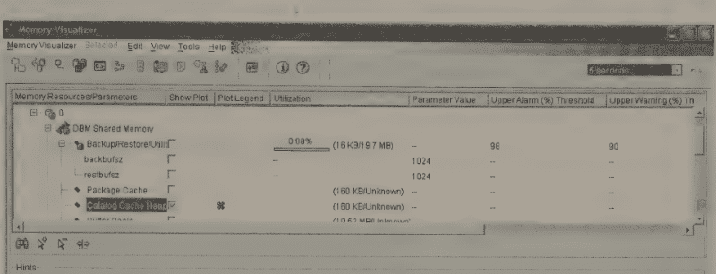

| 内存资源 | 参数 | 显示图表 | 图例说明 | 利用率 | 参数值 | 上限报警 (%) 阈值 | 上限警告 (%) 阈值 |
| --- | --- | --- | --- | --- | --- | --- | --- |
| DBM 共享内存 | | | | 0.08% (16 KB/16.7 MB) | 98 | 90 |
| 备份/恢复单元 | | | | | 1024 | | |
| backbutz | | | | | (180 KB/Unknown) | | |
| restbutz | | | | | (180 KB/Unknown) | | |
| 软件包缓存 | | | | | (150 KB/Unknown) | | |
| 数据缓存堆 | | | | | 0.57 MB | | |

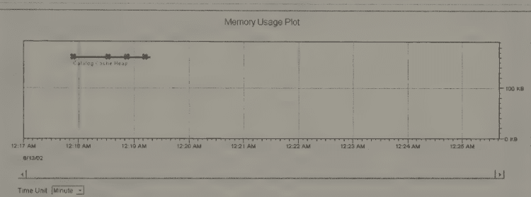

图 10.5

内存可视化器。

## 总结

监控是作为 DBA 执行的最重要功能之一。DB2 v8 包含了许多新功能和增强。

SMART 和自主计算倡议使 DB2 能够实现“自监控”和“自愈合”。我们在第 9 章讨论了这一点。

新的 SQL 快照功能使 DBA 和应用程序捕获快照变得更加简单，并提供了一种将快照输出写入表以便进行历史报告的方法。此外，写入表的事件监控器也为您提供了监控 DB2 并为操作和历史目的捕数据的方法。健康监控器（Health Monitor）是一个新的轻量级服务器端代理，结合健康中心提供 24×7 的监控能力。它提供了“异常监控”能力，通过电子邮件和传真机通知向 DBA 报警。这是目前大多数大公司的核心需求。

版本 8 的管理和监控改进使得在日益不断赋能且资源受限的环境下，今天的 DBA 管理 DB2 变得更加容易。

# 章节

# 问题确定

要成为一名成功的 DBA，需要良好的问题确定技能。即使 DB2 和客户端应用程序在不断改进，问题仍然会发生，您需要知道如何快速识别和定位问题。

您应该为您的环境开发标准的故障排除程序。如果您在调查问题时记录并练习这些程序，您将能够在短时间内常规地识别并解决问题。这将使能够帮助公司维护或提高其竞争优势。记住，停机意味着成本损失，并会对公司产生负面影响。

我们可以使用以下几类对问题进行分类：

- 连接问题
- 性能问题
- 阻塞、挂起
- 效率低下的 SQL
- 不支持的功能
- DB2 代码问题

## 连接问题

连接问题到目前为止是最常见的。它们通常发生在客户端或服务器端：

- 数据库宕机
- 缺少权限
- 网络变化
- 实例宕机

## 问题确定

为了确保涉及对象的 `RUNSTATS` 是最新的，您可以使用控制中心（Control Center）来检查 `RUNSTATS` 是否最新，或确定它们是否运行过。`RUNSTATS` 可以从控制中心、命令中心（Command Center）或 CLP 执行。

## 性能和应用程序问题

性能问题是报告的第二常见类型。它们通常是由于应用程序发生更改、缺少 `RUNSTATS`、配置更改，或者应用程序可能从未进行过调优。典型区域包括：

- 长时间运行 SQL
- 排序溢出
- 操作系统分页
- 高 I/O 等待时间
- 缓冲池大小过小

## DB2 代码（缺陷）问题

有时，您可能会由于 DB2 缺陷遇到本章开头提到的任何一类问题。这些情况较少，但您需要知道去哪里查找有关特定问题的信息。这些错误通常被写入 `db2diag.log` 文件中。

# 256

# 第11 章 • 问题确定

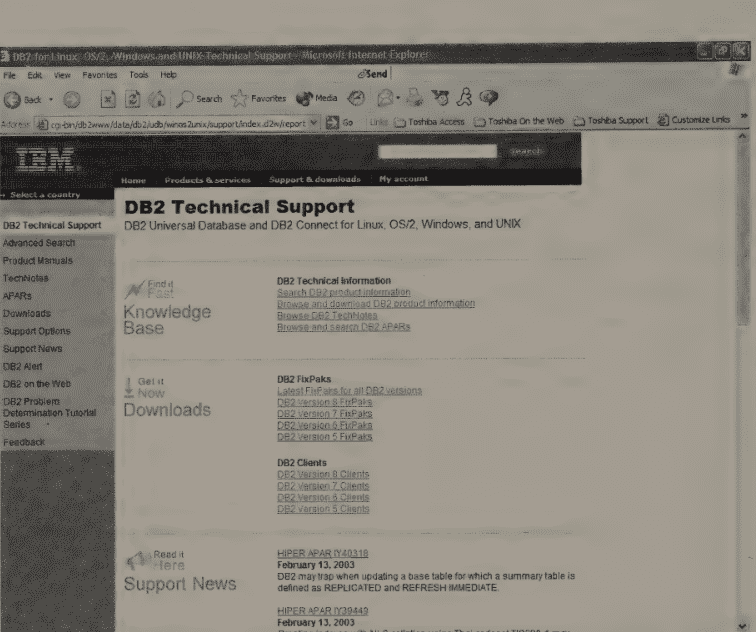

## DB2 技术支持

DB2 Universal Database 和 DB Connect for Linux: OS/2, Windows 和 UNIX

# DB2 技术信息

DB2 产品信息

搜索和下载 DB2 产品信息

浏览技术文档

浏览并安装 DB2 APAR

## DB2 Fixpacks (修复包)

所有 DB2 版本的最新 Fixpacks

DB2 版本 7 Fixpacks

DB2 版本 6 Fixpacks

DB2 版本 5 Fixpacks

# DB2 客户端

DB2 版本 7 客户端

DB2 版本 6 客户端

DB2 版本 5 客户端

# HIPER APAR 52318

2003年2月13日

当更新一个汇总表为 `DEPRECATED` 且 `REFRESHIMMEDIATE` 的表表时，DB2 可能会失败。

# HIPER APAR 52310

2003年2月13日

# 图 11.1

# DB2 支持站点。

从 `db2diag.log` 中提取错误字符串，并用它在支持站点搜索可能的修复。如果你找到了你正在经历的缺陷的修复方法，可以下载 fixpak，在测试环境中进行测试，并在维护窗口期间应用于生产环境。在将 fixpak 投入生产环境之前，务必在测试环境中进行测试。

# 注意

v8 版本新增了 DB2 信息中心（Information Center）。它包含了大部分 DB2 手册，并随产品发布。HTML fixpacks 可以通过信息中心中的“更新文档”（Update Documentation）菜单项进行安装。

在 Windows 上安装 HTML fixpacks，请将 fixpak 双击加载到空目录并运行 `setup` 命令。在 UNIX 上，fixpak 是一个 tar.Z 文件。解压并运行该文件。它将创建一个名为 `delta_install` 的目录和一个名为 `installdocfix` 的脚本。只需运行该脚本即可安装文档修复包。


# DB2 问题确定辅助

在 v8 中，诊断信息现在被写入两个单独的文件：`db2diag.log` 和管理通知日志（administration notification log）。`db2diag.log` 被拆分为两个文件，是因为写入 `db2diag.log` 文件的信息过多，导致了“信息过载”，因为它混合了信息性内容和严重错误。由于此原因以及客户的反馈，DB2 开发团队决定创建一个单独的文件来记录应用程序错误、管理错误和杂项错误信息。这样，`db2diag.log` 文件就可以专门记录严重级错误。

## DB2DIAG.LOG 文件

`db2diag.log` 文件位于 `SQLLIB` 目录。它是一个 ASCII 文件，可以使用文本编辑器查看。当发生以下事件时，DB2 会将条目写入 `db2diag.log` 文件：

- 严重错误
- DB2 内部错误

`DIAGLEVEL DB CFG` 参数控制写入 `db2diag.log` 文件的信息量。该参数的默认值为 3。这将确保 DB2 记录所有发生的严重错误。我建议使用此设置。只有当你尝试调试无法通过其他途径识别的特定问题时，才将其设置为 4。一旦捕获了额外信息，请将该参数设回 3。

所有写入 `db2diag.log` 的条目都位于文件末尾。因此，在调查当前错误时，你应该查看文件末尾。由于条目被写入 `db2diag.log` 的末尾，文件的大小会不断增长。它将一直增长直到磁盘空间不足或用尽文件系统的所有可用空间。DBA 每天备份 `db2diag.log` 文件并将其删除。DB2 在需要时会自动创建一个新文件。如果你每天备份一次，这也可以为随后的分析提供历史记录（如果需要的话）。由于 `db2diag.log` 中只写入严重错误，这些操作可能不像在之前的版本中那么重要，但仍应执行，以确保你每天都有一份 `db2diag.log` 文件的副本。这有助于你后续进行故障排除。

DB2 使用命名约定来命名其模块。完整列表请参阅表 11.1。

函数名第四位置的字母表示涉及的 DB2 函数。这在搜索修复方法或与 DB2 支持人员交流时非常有帮助。

## 格式

写入 `db2diag.log` 文件的条目将采用首次故障数据捕获（FFDC）格式。示例 11.1 显示了 `db2diag.log` FFDC 条目的样本。


# 第11 章 • 问题确定

## 表 11.1 模块命名约定

| 第四位置的字母 | 涉及的函数 |
| --- | --- |
| B | 池管理和操作 |
| C | 客户端与服务器之间的通信 |
| D | 数据管理 |
| E | 数据库引擎进程 |
| O | 操作系统调用（特权指令） |
| P | 数据保护 |
| R | 关系数据库服务 |
| S | 排序操作 |
| X | 索引操作 |

```
1 2003-01-22-15.55.51.437000 2 Instance:DB2 3 Node:000
4 PID:1680 (db2syscs.exe) 5 TID:1608 6 Appid:*LOCAL.DB2.0092C2202617
7 database monitor 8 sqm.start_evmon 9 Probe:32 10 Database:SAMPLE
```

11 DIA0001E 发生内部错误。报告以下错误代码：

12 *ZRC=0x84D000C.",

## 示例 11.1

样本 `db2diag.log` FFDC 条目。

尽管 `db2diag.log` 的主要目的是为了 DB2 开发人员进行问题确定分析而记录严重错误，但如果你学会了解释 FFDC 信息，你就可以这些信息来解决你能力范围内的问题。如果不能，你至少处于一个有利位置，可以为 DB2 II 支持部门提供信息。我们可以如下拆解示例 11.1 中的数据元素：

- 1. 消息时间戳
- 2. 实例名称
- 3. 对于分区数据库，即数据库分区
- 4. 生成消息的进程标识
- 5. 事务的唯一标识符
- 6. 正在运行的应用程序标识
- 7. 写入消息的 DB2 组件
- 8. 报告错误的模块
- 9. 报告错误中的函数 ID
- 10. 发生错误的数据库
- 11. 诊断错误代码和消息
- 12. 十进制格式的 DB2 内部返回码

### DB2DIAG.LOG 文件

259

示例 11.1 中你需要关注的关键元素是 DB2 内部返回码 (12) 和报告错误的模块 (8)。

> 注意 由于 DB2 返回码具有变动性，它们未记录在手册中。DB2 支持部门决定通过网络在信息中心提供这些信息。

参见图 11.2 可 DB2 信息中心的概述。我们可以用它来搜索这里的返回码。如图 11.3 所示，返回码 `0x84D0C` 意味着“找不到路径”。在我们的案例中，我们尝试使用无效路径的事件监控。

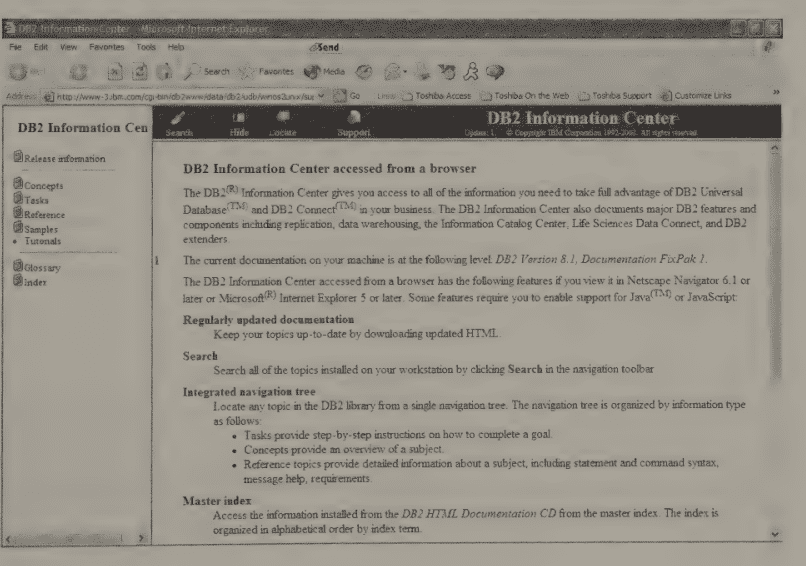

图 11.2

DB2 信息中心。

260

第11 章 • 问题确定

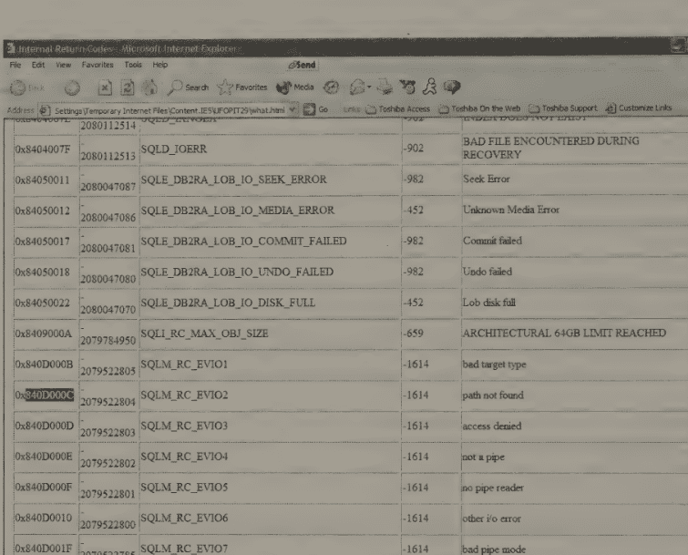

图 11.3

内部返回码 `0x84D0C`.

## DB2DIAG.LOG SQLCA 条目

SQLCA 被 DB2 用于在程序之间传递信息、记录调用状态，并将状态返回给运行的应用程序。

DB2 可能会将带有严重错误的 SQLCA 内容写入 `db2diag.log`。这对于帮助你调查应用程序错误和其他类型的错误非常有用。参见示例 11.2 有一个 `db2diag.log` SQLCA 条目样本。

```
2003-02-08-23.31.37.037935 Instance:db2inst1 Node:000
PID:2640(asapply) TID:8192 Ajprid:none
DrDA Request sqljLrDrdaArExecute
```

11 DIA0001E 发生内部错误。报告以下错误代码：

"ZRC=0x8030706D".

## 示例 11.2

# DB2 管理通知日志

1 PID:2640 2 TID:8192 3 Node:000 4 Title: SQLCA

5 sqlcaid : SQLCA sqlcbc: 136 sqlcode: -518 sqlrerml: 0

sqlerrmc:

7 sqllerrp : SQLRAGSN-

8 sqlierd : (1) 0x8012007E (2) 0x00000000 (3) 0x00000000

(4) 0x00000000 (5) 0x00000000 (6) 0x00000000

sqlwarn : (1) (2) (3) (4) (5) (6)

(7) (8) (9) (11)

9 sqlstate: 07003

2003-02-08-23.31.37.332392 Instance:db2inst1 Node:000

PID:2640(asnapply) TID:8192 Appid:none

oper system services sqlofica Probe:10

# 示例 11.2

示例 dbdiag.log SQLCA 条目。（已包含）

SQLCA 使用标准的 FDDC 格式。SQLCA 字段定义如下：

- 1. 进程 ID (Process ID)
- 2. 唯一事务 ID (Unique transaction ID)
- 3. 发生错误的节点
- 4. 标题 (Title)
- 5. 标识 SQLCA 数据结构条目起始的标识
- 6. SQL 返回码
- 7. 原因码（如果提供）
- 8. 导致生成的最终 SQL 返回值的最多六项十六进制值——这些代码按照事件发生的顺序记录
- 9. SQLSTATE——ANSI 标准 SQLSTATE 值

在我们的示例中，返回码为 `0x8012007E`，`SQLCODE` 为 -518。通过 DB2 信息中心（Information Center），我们对这些代码进行搜索，并发现 -518 SQL 代码或 `07003` SQLSTATE 表示“EXECUTE 语句中的语句未处于准备状态，或是一个 SELECT 或 VALUES 语句”。可以使用此信息帮助开发人员解决问题。

## DB2 管理通知日志

v8 版本中的新功能，管理通知日志用于记录 DBA 和应用程序开发人员感兴趣的错误。在 Windows 2000 中，DB2 使用 Windows 事件日志作为管理通知日志。可以使用 Windows 事件查看器（Windows Event Viewer）工具进行查看。

> 注意
> `NOTIFYLEVEL` 数据库管理器参数控制写入管理通知日志的管理通知消息的级别。默认值为 3。此参数必须设置为 2 或更高值，以便让健康监控器（Health Monitor）向配置中定义的联系人发送通知。


参见图 11.4 和 11.5 以了解典型的管理通知日志条目。如图 11.4 所示，在 Windows 2000 Server 上使用事件查看器显示的初始记录为我们提供了问题的高级视图。

通过双击此条目，我们可以获取更多细节，如图 11.5 所示。它提供了问题的描述以及建议的解决方案。

对于其他操作系统，日志被创建为 ASCII 文件，文件名格式为 `<instance_name.nfy>`。

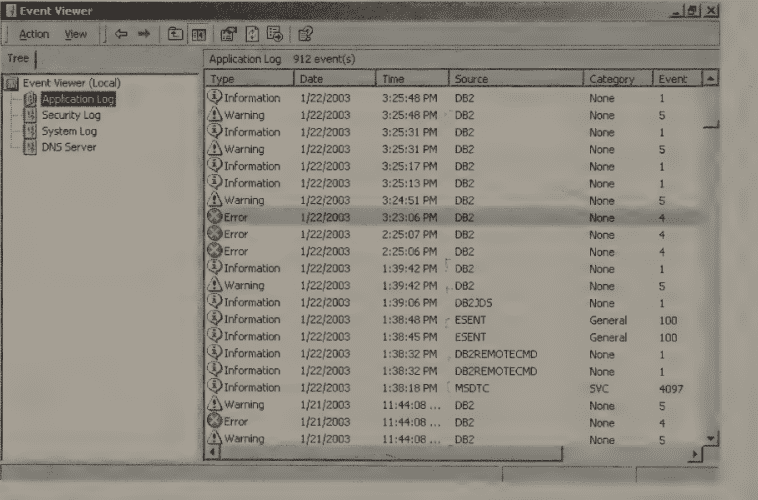

图 11.4

事件查看器应用程序日志。

## 事件属性


图 11.5

事件属性。

## 系统日志

系统日志是确定问题信息的另一个重要源。我们已经讨论了 Windows 事件日志。

> 注意
>
> `DBM CFG DIAGPATH` 参数控制 FFDC 信息的记录位置。该参数默认为空，FFDC 数据将写入到以下路径的 `db2diag.log`：
>
> `C:\Program Files\IBM\SQLLIB\DB2\db2diag.log`。
>
> 在 UNIX 上，默认情况下，FFDC 数据被写入以下路径：
>
> `$HOME/sqlib/db2dump`
>
> 示例：`/prddb/sqllib/db2dump`，其中 `prddb` 是实例所有者的名称。
>
> 在 UNIX 上，操作系统日志用于记录严重的 DB2 错误和警告条件。当 DB2 崩溃时，Syslog 可能包含 DB2 错误信息。在这种情况下，DB2 在崩溃之前可能无法写入 `db2diag.log`。此时，Syslog 将成为一个重要信息源。

# 第 11 章 • 问题确定

错误根据优先级以及引起错误或警告条件的设施类型被添加到 syslog 中。DB2 通常在以下条件下将错误添加到 syslog：

- 代理程序（Agents）被杀死
- DB2 架构受到损坏
- 导致 DB2 恐慌的 I/O 错误

在进行问题检测时，应对来自 `db2diag.log`、管理通知日志和 syslog 的信息进行交叉检查，以便将所有故障数据关联。有关使用 UNIX 系统日志的附加信息，请参阅特定的操作系统日志。

## CLI 跟踪

在我们的示例中，返回码为 `0x8012007E`，`SQLCODE` 为 `-518`。通过 DB2 信息中心，我们对这些代码进行搜索，并发现 `-518` SQL 代码或 `07003` SQLSTATE 表示“EXECUTE 语句中的语句未处于准备状态，或是一个 SELECT 或 VALUES 语句”。

## ODBC 跟踪

在我们的示例中，返回码为 `0x8012007E`，`SQLCODE` 为 `-518`。通过 DB2 信息中心，我们对这些代码进行搜索，并发现 `-518` SQL 代码或 `07003` SQLSTATE 表示“EXECUTE 语句中的语句未处于准备状态，或是一个 SELECT 或 VALUES 语句”。

## JDBC 跟踪

在我们的示例中，返回码为 `0x8012007E`，`SQLCODE` 为 `-518`。通过 DB2 信息中心，我们对这些代码进行搜索，并发现 `-518` SQL 代码或 `07003` SQLSTATE 表示“EXECUTE 语句中的语句未处于准备状态，或是一个 SELECT 或 VALUES 语句”。

## DB2 跟踪

在我们的示例中，返回码为 `0x8012007E`，`SQLCODE` 为 `-518`。通过 DB2 信息中心，我们对这些代码进行搜索，并发现 `-518` SQL 代码或 `07003` SQLSTATE 表示“EXECUTE 语句中的语句未处于准备状态，或是一个 SELECT 或 VALUES 语句”。

## 陷阱 (TRAPS)

当遇到严重错误时，DB2 会发出信号（在 UNIX 平台上）或产生自身异常。根据操作系统的不同，这些被称为段错误（segment violations）或陷阱（traps）。

DB2 发出的信号或异常记录在陷阱文件中，该文件包含了系统停止前执行的最后步骤的功能流。DB2 支持可以使用陷阱文件来协助解决问题。

陷阱文件存储在数据库管理器配置参数 `DIAGPATH` 指定的目录下。陷阱文件使用以下命名规范：

```
t39336.000
t39338.006
```

其中

- t—标识其为陷阱文件
- 39336.000—pid 为 39336 的进程名称
- 39336.010—pid 为 39338.006 的进程名称；其中 006 表示该进程运行的数据库分区。

> 注意
>
> DB2 不删除陷阱、转储（dump）、核心（core）或跟踪（trace）文件。您应该定期删除这些文件。

## 调用堆栈跟踪 (CALL STACK TRACES)

调用堆栈跟踪可以为 DB2 支持提供按调用顺序排列的 DB2 内部函数详细跟踪。DB2 支持可以利用它精确定正在执行的实际代码行，并帮助他们消除或识别作为问题源的模块。

在 UNIX 操作系统上，当您故意停止 DB2 进程时，DB2 可以生成堆栈回溯。每个文件（陷阱文件）报告 DB2 发出的停止或中断进程的信号或异常。每个进程对应一个文件。在分区数据库环境中，这些文件存在于每个涉及的每个分区上。要激活调用堆栈跟踪，请使用以下命令：

1. 执行 `db2_call_stack` 命令
2. 停止 DB2 实例

> 注意
>
> `db2_call_stack` 命令应仅由实例所有者运行。在运行命令之前，请确保每个模式下存在 `/tmp/$DB2INSTANCE` 目录。如果不存在，请通过命令 `db2_all "mkdir /tmp/DB2INSTANCE"` 来创建它。

## 向 DB2 支持发送信息

v8 版本新增的 `db2support` 问题分析与环境收集工具用于提供一个“支持包”，供您提供给 DB2 支持。该工具可以在有无输出的情况下运行。图 11.6 显示了从 CLP 调用 `db2support` 的示例。


图 11.6

从 CLP 调用 db2support。

要调用此实用程序，请在命令行使用以下命令：

`db2support output path/tmp/db2support_output/ -f -a -d -c -u -p`

其中：

- `output path`—指定归档库创建的路径。用户创建的文件必须放置在此目录中以便包含在归档中。
- `-f` 或 `-flow`—忽略在请求用户按 <Enter> 键继续时的暂停。当通过脚本或其他自动化过程程序运行或调用 `db2support` 工具且需要无人值守执行时，此选项非常有用。
- `-a` 或 `-all`—指定捕获所有核心文件（core files）。
- `-r` 或 `-recent_core`—指定捕获最近的核心文件。如果指定了 `-option`，则忽略此选项。
- `-d database_name` 或 `-database database_name`—指定正在收集数据的数据库名称。
- `-c` 或 `-connect`—指定尝试连接指定的数据库。
- `-u userid` 或 `-user userid`—指定连接数据库的用户 ID。


- `-p password` 或 `-password password`--—指定用户 ID 的密码。

- `-g` 或 `-get_dump`--—指定捕获转储目录中所有核心文件以外的文件。

- `-h` 或 `-help`--—显示信息。指定此选项时，将忽略其他选项，仅显示帮助信息。

- `-l` 或 `-logs`--—指定捕获活动日志。

- `-n` 或 `-number`--—指定当前问题的管理（PMR）编号或标识符。

- `-q` 或 `-question_response`--—指定使用交互式问题分析模式。

- `-s` 或 `-system_detail`--—指定收集详细的硬件和操作系统信息。

- `-v` 或 `-verbose`--—指定工具运行时使用详细输出。

- `-x` 或 `-xml_generate`--—指定生成包含交互式问题分析模式（q模式模式）使用的决策树逻辑的 XML 文档。

根据所选选项，`db2support` 工具将构建一个包含以下内容的压缩格式支持包：

- 核心文件

- 数据库管理和配置文件

- `db2diag.log`

- 陷阱文件

- 操作系统环境信息

- 缓冲池和表空间信息

- 活动日志

- 恢复历史文件

- 日志控制文件

- `DB2CLLI.INI`

- 数据库目录

- 节点目录

- 节点备份目录

- 归档日志

- JDK 版本

- DB2 版本信息

- DB2 版本信息

- 恢复历史文件

- 数据库目录

## 总结

在本章中，我们关注了陷阱、调用堆栈跟踪以及如何向 DB2 支持发送信息。我们讨论了陷阱文件和堆栈跟踪对于故障排除的重要性，并介绍了 `db2support` 工具。

## 排序类型

### 共享排序

具有分区内并行能力的数据库支持共享排序，这些排序使用共享内存而不是代理私有内存。

**共享排序排序内存**从数据库共享内存中分配。

DB2 操作由两个步骤组成：排序阶段（Sort Phase）和返回排序结果阶段（Return Sort Results Phase）。

此外，在排序阶段，排序可以是溢出的（overflowed）或非溢出的（nonoverflowed）。可以通过 `GET SNAPSHOT FOR DBM` 和 `GET SNAP FOR DATABASE ON <database name>` 监控数据库级别的排序资源利用率，其中 `<database name>` 是要监控的数据库名称。这些命令提供的输出示例，请参见示例 12.1 和 12.2。

### 数据库管理器快照

节点名称 = 

节点类型 = 企业级服务器

带有本地和远程客户端的版本

实例名称 = DB2

DB2 实例中的数据库分区数 = 1

数据库管理器状态 = 活跃

产品名称 = DB2 v8.1.0.36

服务级别 = s021023

已分配的私有排序堆 = 0

私有排序堆高水位线 = 277

阈值后排序 = 0

请求的管道排序 = 9

接受的管道排序 = 9

数据库管理器启动时间 = 01-26-2003

22:17:59.069892 = 

上一次重置时间 =

快照时间 = 01-26-2003

22:26:00.641457

### 示例 12.1

数据库管理器快照输出。

我们可以使用示例 12.1 中数据库管理器快照的输出来检查已分配的私有排序数量以及相关的水位线，以判断我们是否接近私有排序限制。然后，我们可以采取行动确定排序是否消耗了异常数量的排序内存。如果我们观察到阈值后排序，说明

第 12 章 • 理解和调优 DB2 排序

### 数据库快照

| 字段 | 值 |
| :--- | :--- |
| 数据库名称 | GNPRODDB |
| 数据库路径 | /gardp01/gnprod/cat/gnprod/NODE0000/SQL00001/ |
| 输入数据库别名 |  |
| 数据库状态 | 活跃 |
| 目录节点数 | 0 |
| 目录网络节点名称 |  |
| 数据库服务器运行的操作系统 | AIX |
| 数据库位置 | 本地 |
| 首次数据库连接时间 | 07-05-2002 03:02:59.580933 |
| 上一次重置时间 |  |
| 上一次备份时间 | 07-05-2002 03:02:45.829763 |
| 快照时间 | 07-05-2002 14:02:06.814058 |
| 连接高水位线 | 38 |
| 连接 | 11096 |
| 当前次级连接 | 0 |
| 当前连接的应用程序 | 34 |
| 当前在数据库管理器中执行的应用程序 | 1 |
| 与应用程序关联的代理 | 34 |
| 与应用程序关联的最大代理数 | 38 |
| 最大协调代理数 | 38 |
| 当前持有的锁 | 690 |
| 锁等待 | 1 |
| 数据库等待锁的时间 (ms) | 1599 |
| 锁列表内存使用量 (Bytes) | 46008 |
| 检测到死锁 | 0 |
| 锁升级 | 1 |
| 独占锁升级 | 1 |
| 当前等待锁的代理 | 0 |
| 超时 | 0 |
| 总分配的私有排序堆 | 0 |
| 总分配的共享排序堆 | 0 |
| 共享排序堆水位线 | 0 |
| 总分配的排序堆 | 0 |
| 总排序次数 | 88705 |
| 总排序时间 (ms) | 5030 |

### 示例 12.2

数据库快照输出。

注意：此输出已删除了无关信息。

### 排序类型

| 指标 | 值 |
| :--- | :--- |
| 排序溢出 | 10 |
| 活跃排序 | 0 |
| 哈希连接数 | 0 |
| 哈希循环数 | 0 |
| 哈希连接溢出 | 0 |
| 小型哈希连接溢出 | 0 |

### 示例 12.2

数据库快照输出。（续）

注意：此输出已删除了无关信息。

已达到 `SHEATHRES`，排序正在以降级模式运行。我们将在本章后面讨论阈值后排序。如果请求的管道排序数与接受的管道排序数不同，这意味着优化器请求的管道排序被拒绝，或者发生了其他意外的 DB2 事件。示例 12.2 包含了排序资源消耗的额外信息。

示例 12.2 中关注的元素如下：

- 堆分配

- 总排序次数

- 总排序时间 (ms)

- 排序溢出

- 活跃排序

通过分析这些元素，我们可以判断排序性能。我们主要关注的是排序溢出的存在。排序溢出应少于总排序数的 10%。对于顶级性能，3% 或更低佳。这六个元素为我们提供了数据库排序活动的“快照”。我们可以随时间记录这些信息，并用它判断排序活动何时异常。在任何情况下，如果执行的排序无法完全装入 `SORTHEAP`，整个排序将溢出到缓冲区和磁盘上的临时空间。

- 溢出（Overflowed）：如果要排序的数据无法完全装入排序堆，则溢出到缓冲区中的临时表，并可能到磁盘。

- 非溢出（Nonoverflowed）：非溢出排序在分配的排序堆中完成。

- 管道（Piped）：一种可以直接返回数据而不需要临时表的排序。

- 非管道（Nonpiped）：非管道排序需要使用临时表。在这种情况下，我们需要调整系统临时表空间的容器布局。它应该具有跨越多个物理磁盘的容器。这使得 DB2能够使用并行 I/O 操作。随着 DB2 v8 引入 64 位寻址能力和大型内存，即使是大型环境也能通过分配更大的排序堆来尽量减少排序溢出。因此，帮助正在路上。

> 注意

如果排序溢出，整个排序将溢出到缓冲区和磁盘上的临时空间。因此，应尽可能避免排序溢出，在 OLTP 环境中更是如此。

图 12.2 为排序如何溢出的示例。

## 第 12 章 • 理解与调优 DB2

在 BI/DW 环境中由于结果集需要大量的排序，因此需要大量的排序内存，排序溢出（sort overflows）难以防止。64 位寻址（更大的 `SORTEAPS`）的出现以及主内存的增大在一定程度上缓解了这个问题，但由于涉及的数据量巨大以及其他限制，在这些环境中可能仍无法完全消除排序溢出。

> 注意

索引的 AND 和 OR 操作会在排序堆（sort-heap）中构建位图。请使用 DB2 explain 确定是否发生了此类索引访问，并监控 sortheap，根据需要进行调整。

### SHEAPTHRES

如前所述，`SHEAPTHRES` 控制整个实例中排序操作可用的内存量。当达到此阈值时，它会对共享排序和私有排序产生额外的负面影响：

- 对于共享排序，它作为一个硬限制，在总排序消耗下降到 `SHEAPTHRES` 值之前，不允许进行额外的共享排序。

- 对于私有排序，它充当软限制。当代理程序请求私有 sortheap 时，DB2 会减少分配量（相对于初始私有 `SORTEAP` 值），并继续为请求的代理分配较小的 sortheap。这自然会导致响应时间下降，但它允许排序继续而不是被终止。这些被称为阈值后排序（Post Threshold sorts），可以使用快照监控进行监控。

显然，由于排序操作的效率对我们至关重要，我们如何判断它们的执行情况是否良好呢？DB2 提供了广泛的能力，通过快照和事件监控来监控排序性能。

## 确定排序内存区域的大小


尽管 DB2 为各种排序内存区域提供了默认值，但这些值仅用于初始配置，应根据监控信息或基准测试进行设置。

你应该按照以下方式计算 DB2 排序内存区域的初始设置：

`SORTEAP`——初始使用您的操作系统平台的默认值，但要监控数据库快照；如果观察到排序溢出，且溢出很少或没有，则增加 `SORTEAP` 参数的值，直到溢出变得很少。在执行此操作的同时，还需要考虑是否需要调整 `SHEAPTHRES` 参数。如果仅使用私有排序，可以使用以下公式为 `SHEAPTHRES` 提供良好的估值：

并发代理总数 × 数据库 `sortheap` 值

将上述结果相乘，并将其用于初始 `SHEAPTHRES` 设置。此计算考虑了跨实例的 `SORTHEAP` 要求。这是一个很好的起点，但需要持续监控以确保该值足够。如果负载与预期不同或随时间推移发生变化，可能需要进行调整。

## 代理私有排序 (`SORTHEAP` DB CFG 参数)

DB2 explain 输出提供了有关排序的信息，例如待排序行数、行宽、包含的列数，以及排序是管道化的还是预计会出现排序溢出。

使用以下公式确定使用的 `sortheap` 量：

> 待排序行数 × 行宽 = 需要的 `sortheap` 大。

此外，你还可以使用以下公式确定可以执行的并发私有排序数量。

> `SHEAPTHRES` ÷ 平均 `sortheap` 大 = 在发生阈值后排序之前可以激活的私有排序最大数量

对于共享排序：

- 如果发生了阈值后排序，除非进行了有效的调优，否则需要增加 `SHEAPTHRES` 或减少 `SORTHEAP` 参数。有许多方法可以减少对 `SORTHEAP` 的需求。我们将在下一节中讨论这些。

那么，`SHEAPTHRES` 的多大合适？这取决于你的环境。你不想做的是将 `SORTHEAP` 和 `SHEAPTHRES` 设置得过大以导致操作系统分页（OS paging）。通常情况下，操作系统分页比排序溢出更糟糕，应尽可能避免。我见过许多安装中，针对 OLTP 和 DW 环境的 `SHEAPTHRES` 都被设置为 200-350 MB。由于 DW 环境的特性，DW 环境通常需要更大的 `SHEAPTHRES`。你应该使用之前提供的公式来计算 `SHEAPTHRES`，但上述基于我经验的示例旨在让你了解其他公司可能使用的 `SHEAPTHRES` 设置思路。在另一个客户处，`SHEAPTHRES` 设置为 800 MB，而分配给缓冲池的总空间仅为 200 MB。这是一个极端情况，这些值本该反过来。这种情况下的问题是使用了第三方软件包，而 DBA 没有查看运行的 SQL。相反，他们不断增加 `SHEAPTHRES` 和 `SORTHEAP` 的值。寻找问题的第一个地方是 SQL！对正在运行的 SQL 进行快速快照显示，应用程序将90%的时间都花在排序上，并消耗了12路 S-80 的所有 CPU。捕获了一条语句并通过 Index Advisor 运行，并建议了一些额外的索引。使用 Visual Explanation 审查访问计划，显示正在执行八个独立的排序。结合 Design Advisor 的建议和 Bonnie Baker 方法（本地、ORDER BY、连接谓词）修改了索引并创建了两个新索引。这消除了原始八个排序中的五个，并将整体 CPU 消耗降低了 33%。

由于这些调优工作，`SHEAPTHRES` 内存得以减少。除了给出的示例外，还识别出 30 条正在进行排序的额外 SQL 语句。这些排序中的大部分可以使用刚刚讨论的技术来消除。

## 提示

寻找 CPU 占用率高的语句。消除这些排序将提供最大的改进。

## 监控排序性能

需要持续监控数据库性能。作为其的一部分，必须收集并分析排序性能。

## 注意

索引的 AND 和 OR 操作会在排序堆（`sort-heap`）中构建位图。请使用 DB2 explain 确定是否发生了此类索引访问，并监控 `sortheap`，根据需要进行调整。

## 快照监控

除了之前讨论的，我们还可以使用快照命令观察排序活动。示例 12.3 包含 `GET SNAPSHOT FOR <database>` 的输出。

## 示例 12.3

应用程序快照输出。

# 第 12 章 • 理解与调整 DB2

应用程序快照的输出可以识别包含执行排序操作的 SQL 的包。这些信息随后可以用于审查该包，查看其导致排序发生的原因。一旦识别，就可以采取行动消除这些排序。

与非常有用的数据库快照不同，应用程序和表快照包含的排序信息很少。因此，你会发现连接和语句事件监控器要有用得多。

> 提示
>
> 你可以使用 `GET SNAPSHOT FOR DYNAMIC SQL` 快照对动态 SQL 进行快照。然后你可以筛选输出结果，找出需要排序的语句，并使用讨论的技术进行调整和消除它们。

## 事件监控器

事件监控器是识别排序用户和高频排序 SQL 语句的关键工具。可以通过创建连接和语句的事件监控器来收集这些信息。事件监控器的创建和使用将在将在第 11 章中详细介绍。示例 12.4 包含了连接事件监控器的输出，该输出已使用 `db2eventmon` 格式化工具进行了处理。

在示例 12.4 中，我们感兴趣的数据元素列在排序和哈希统计（Sort and Hash Statistics）下。

- 3) 连接头事件 ...nAppl Handle: 3

- Appl Id: *LOCAL.DB2.0092C22022617

- Appl Seq number: 000f

- DRDA AS Correlation Token: *LOCAL.DB2.0092C22022617

- Program Name : db2bp.exe

- Authorization Id : PGUNNING

- Execution Id : PGUNNING

- Codepage Id: 1252

- Territory code: 1

- Client Process Id: 2056

- Client Database Alias: SAMPLE

- Client Product Id: SQL08010

- Client Platform: Unknown

- Client Communication Protocol: Local

- Client Network Name:

- Connect timestamp: 01-22-2003 15:26:17.411636

## 示例 12.4

连接监控器输出。

注意：此快照已编辑，删除了不必要的信息。

## 监控排序性能

- 4) 连接事件

- Appl Handle: 3

- Appl Id: *LOCAL.DB2.0092C2202617

- Appl Seq number: 0012

- Record is the result of a flush: FALSE

- Application Status: SQLM_DISCONNECTPEND

- 锁统计:

- Lock Waits: 0

- Total time waited on locks (milliseconds): 0

- Deadlocks: 0

- Lock escalations: 0

- X lock escalations: 0

- Lock timeouts: 0

- 排序统计:

- Sorts: 0

- Total sort time (milliseconds): 0

- Sort overflows: 0

- 哈希统计:

- Hash Joins: 0

- Hash Loops: 0

- Hash Join Small Overflows: 0

- Hash Join Overflows: 0

- CPU 时间

- User CPU time used: Not Available

- System CPU time used: Not Available

- Disconnection Time: 01-22-2003 15:56:47.197122

## 示例 12.4

连接事件监控器输出。（续）

注意：此快照已编辑，删除了不必要的信息。

我们可以使用连接事件监控器的输出来识别消耗最多排序资源的用户。连接事件显示了与连接和应用程序相关的排序真实成本。如有必要，我们可以使用这些信息联系用户并调查排序资源高用量的原因。然后我们可以查看语句事件监控器数据，以识别导致排序的 SQL 语句。示例 12.5 语句事件监控器输出示例。

## 718) 语句事件 . . .

- Appl Handle: 23

- Appl Id: *LOCAL.DB2.00F4C2203608

- Appl Seq number: 0002

- Record is the result of a flush: FALSE

- ------------------------------------------------------

- Type : Dynamic

- Operation: Close

- Section : 5

- Creator : NULLID

- Package : SYSSH200

- Consistency Token : SYLVL01

- Package Version ID :


- `Cursor` : `SQL_CURSH200C5`

- `Cursor was blocking`

- `Text` : `select * from sysm.syscolumns order by i`

- ------------------------------------------------------

- `Start Time`: `01-22-2003 15:37:09.100197`

- `Stop Time`: `01-22-2003 15:37:15.322350`

- `Exec Time`: `6.222153 seconds`

- `Number of Agents created`: `1`

- `User CPU`: `Not Available`

- `System CPU`: `Not Available`

- `Fetch Count`: `3144`

- `Sorts`: `1`

- `Total sort time`: `158`

- `Sort overflows`: `1`

- `Rows read`: `6288`

- `Rows written`: `3144`

- `Internal rows deleted`: `0`

- `Internal rows updated`: `0`

- `Internal rows inserted`: `0`

- `SQLCA`:

- `sqlcode`: `100`

- `sqlstate`: `02000`

## 示例 12.5

语句事件监控器。

我们可以使用示例 12.5 的输出来识别并将 SQL 语句与排序溢出、高排序次数以及长时间的排序时间关联起来。如果需要，我们可以调整 SQL 以尽可能消除排序。

## 消除排序

可以通过识别合适的索引，并按照正在调整的 SQL 语句所需的顺序排列索引中的列来消除排序。

在我们的示例中，创建了索引并实现了显著的 CPU 节省并减少了排序。这只是大约 60 条此类执行不必要排序的语句中的一个。

## SQL 解释工具

有多种 SQL 工具可用于评估访问计划。你可以使用选择的 SQL 解释工具结合 `Design Advisor`（设计顾问器）来评估访问计划。

`DB2 UDB v8` 提供的 SQL 解释工具包括：

- `dynexpln`—可以从命令行解释动态 SQL 语句。
- `db2explain`—可以从命令行解释静态和动态 SQL。
- `db2exfmnt`—可以从命令行格式化解释表（explain tables）的内容。
- `DB2 Visual Explain`（可视化解释)—可视化解释可以分析静态和动态 SQL 语句，并以图形化方式呈现结果。参考图 12.3 可 `DB2 Visual Explain` 输出的示例。

无论使用哪种解释工具，你都希望利用输出结果来精炼感兴趣的访问计划。`DB2` 工具显示此类项目，如正在使用的索引、使用的连接方法、计时器、索引表统计、操作顺序、执行的排序操作的数量和类型，以及使用的优化类，以及与所分析的 SQL 有关的许多其他重要细节。请参考《`DB2 UDB v8` 管理指南：性能》以获取更多细节。有关 `Visual Explain` 的详情，请参考《`DB2 v8 Visual Explain` 教程手册》。


图 12.3

`Visual Explain` 输入窗口。

## 第 12 章 理解与调优 DB2 排序

（正接上一页……）

可以通过更改 SQL 来消除排序，则应结合应用程序开发更改 SQL。如果不能，请使用 `Design Advisor` 的索引建议来消除排序。

按照以下步骤识别、调优和消除排序：

1. 使用连接和语句事件监视器识别导致排序的 SQL 语句。
2. 使用 `Design Advisor` 协助识别索引改进。
3. 使用 `Visual Explain` 并在可能修改 SQL。
4. 修改或创建索引以消除排序。
5. 重复步骤 1 至 4，直到所有排序问题都得到消除。

使用这五个步骤来调优和消除排序，你将显著提高数据库的性能。

## 修改 SQL

更改 SQL 以消除排序是我们的可选方案之一，但它通常并不有效。其原因是，应用程序和即时查询通常包含 `ORDER BY`、`UNION`、`DISTINCT` 或 `GROUP BY` 语句，这些语句按排序顺序返回结果，用于为管理层开发报告或向在线应用程序返回结果。

如果应用程序可以处理重复项，可以将 `UNION` 更改为 `UNION ALL` 以消除排序。如果应用程序可以处理重复项，也可以消除 `DISTINCT` 排序语句；然而，`ORDER BY` 和 `GROUP BY` 语句不能重写，因为应用程序必须按顺序返回结果。因此，你将不得不使用索引来消除这些 SQL 语句引起的排序。

考虑使用具有选择性（selectivity）的谓词。通常，尝试使用选择性为 `.01` 或更低的谓词。`DB2` 使用选择性来确定将检查的行数。

## 允许反向扫描

索引选项 `ALLOW REVERSE SCANS` 可用于启用单个选项，解决需要升序或降序数据的排序。该选项在消除 `MIN` 和 `MAX` 函数、`fetch` 以及之前的键（previous key）所需的排序方面非常有效，并消除了反向扫描对临时表的需求。当它用于在已经定义了几个或多个索引的表上最为有效，而在这些表上创建索引会导致插入、更新或删除变慢，从而产生不可接受的性能。

## 总结

> 注意
>
> 使用 `ALLOW REVERSE SCANS` 使用的 CPU 比未定义此选项的索引多。如果表上的索引很少，且业务优先级要求最快的响应时间，请不要使用 `ALLOW REVERSE SCANS`，并按正确的列顺序创建所需的索引。

## 总结

在本章中，我们讨论了 `DB2` 顶层调优领域之一：排序。排序是为了按顺序向联机表单或应用程序返回数据。有时排序是最佳方法，但排序往往会引起最大的应用程序性能问题。`DB2` 可以利用索引按适当的顺序来消除排序。`DB2 v8` 为我们提供了一个新的 `DB CFG` 参数 `SHEATHRES_SHR`，用于控制用于共享排序的可用内存量。这使我们能够在数据库级别上控制共享排序，而不是在实例级别。

数据库快照为我们提供了数据库级别的整体排序性能详情。额外的快照可以为我们提供有关排序的更多信息。连接和语句事件监视器是我们收集排序消耗数据并帮助我们调优和消除排序的主要手段。

`Design Advisor` 和 `Visual Explain` 是我们调优和消除排序的主要工具。文中提供了示例，说明仅通过使用 `Design Advisor` 和对应用程序的了解，创建或修改索引来消除排序即可实现显著的性能提升。

排序性能可能是你工作中的一个问题。你可以使用本章概述的程序和技术来消除排序，并显著增强你所控制的数据库的性能。

## 企业服务器版——数据库分区功能

`DB2` 企业服务器版 (`ESE`) 附带了数据库分区功能，作为 `ESE` 产品的一部分，该功能允许跨许多服务器进行数据的逻辑分区。在之前的版本中，这被称为企业扩展版 (`EEE`)。要使用此功能，你必须获得数据库分区功能 (`DPF`) 的许可。`DB2 ESE` 使用共享架构（shared-nothing architecture）。共享架构具有非常的可扩展性。与对称多处理器 (`SMP`) 架构不同，`SMP` 架构的可扩展性受内存限制，而共享架构可以通过添加服务器来扩展。`DB2 ESE` 提供了这些服务器的机制。这些将在本章稍后介绍。

## 何时使用分区数据库？

除了可扩展性这一分区数据库的基本需求外，我们还需要理解 `DB2` 如何使用并行，以便决定是使用分区还是非分区环境。

在分区数据库环境中，`DB2` 使用分区间并行，将单个 SQL 语句分解为若干个子查询，每个子查询分发到适当的分区，在数据集上并行运行，并将结果返回给协调代理。例如，四分区数据库中的简单语句 `SELECT COLOR, STORE, SIZE FROM SKTL WHERE COLOR = 'BLUE'` 将被分解为跨四个分区的子查询。这些子查询在分区上并行运行。由于它们是并行运行的，返回结果比在单处理器上运行快得多。分区数据库处理复杂查询的能力也优于非分区数据库。对于对于聚合、多维度和时间相关谓词的复杂查询，分区数据库可以在多个分区和服务器之间并行处理大部分工作。再次，这种类型的查询在分区环境中运行良好。如果你的活动主要是实时插入、更新和删除，那么非分区数据库将是更好的选择，因为这些操作不适合高度的并行处理。

# 何时应该使用分区数据库？

共享一切（Shared-everything）架构非常常见，主要出现在 `OLTP` 环境中。然而，其可扩展性受到管理多个 CPU 和总线磁盘竞争开销的限制。`ESE` 的共享无（Shared-nothing）`DPF` 通过提供将数据跨多个物理服务器进行分区的能力解决了这个问题，同时向端用户呈现一个单一数据库的逻辑视图。此选项提供了海量的 SQL 并行能力，并可以实现几乎线性的扩展。图 13.2 提供了共享无架构的概述。

共享无架构由一个高速互连组成（用于将 SQL 查询发送到多个物理分区并返回查询结果）以及通常的备份通信机制（在本例中为以太网网络）。共享无架构中的每台服务器通常使用带有至少四个 CPU 的 `SMP` 架构。


尽管在运行有 1–2 个 CPU 的刀片服务器上运行 DB2 已变得很常见，但四个 CPU 可以在每个 SMP 服务器上实现 CPU 和 I/O 并行。在 DB2 ESE 分区选项中，可以通过高速互连或网络连接多达 999 个分区。共享无架构是 IBM 通过 ESE 分区选项实现大规模并行处理（MPP）的策略。DB2 ESE 分区选项是大型数据仓库实施的首选配置。它主要用于决策支持、商业智能和数据仓库应用。然而，它正越来越多地用于 OLTP 应用程序。


**图 13.2** 共享无架构。

# DB2 v8.1 ISE 改进

DB2 v8.1 包含了多个分区选项的改进。在以下领域进行了改进：

- `LOAD` 工具包含了自动加载器（`Autoloader`）功能
- 每个分区的本地目录缓存
- 带有本地缓存的标识列（`Identity Column`）支持
- 标识列可以作为分区键的一部分
- 事件监控增强

以下命令或函数已集成到控制服务器（`Control Server`）中：

- 多分区控制集成到控制中心（`Control Center`）
- 重分布分区组（节点组）
- 创建表向导
- 添加/删除分区（节点）
- `MDC` 创建

# 新的分区术语

随着 v8.1 的引入，许多与分区数据库相关的术语发生了变化。最显著的是从节点（`node`）和节点组（`nodegroup`）变为数据库分区（`database partitioning`）和数据库分区组（`database partition group`）。这应该消除过去的困惑，即在不同时间，节点被称为分区，而同时它又被指代物理服务器。这一变化将对初学 DB2 的学者非常有帮助！

> 注意
>
> 版本 v8.1 仍然支持这些旧术语，因此你不需要立即更改引用旧名称的脚本。但是，请制定一个更改计划，因为它们可能在未来的发布或补丁包中不再被支持。

请参见表 13.1 以新旧术语的对比。

## 表 13.1 新旧分区术语

| DB2 v7.2 及之前的版本 | DB2 v8.1 |
| :--- | :--- |
| `LIST NODES` | `LIST DBPARTITIONNUMS` |
| `NODE` | `PARTITION` |
| `ADD NODE` | `ADD DBPARTITIONNUM` |
| `LIST NODEGROUPS` | `LIST DATABASE PARTITION GROUPS` |

## DB2 v8.1 ESE 改进

表 13.1 新旧分区术语（续）

| `REDISTRIBUTE` | `REDISTRIBUTE` |
| :--- | :--- |
| `NODEGROUP` | `DATABASE PARTITION GROUP` |
| `DROP NODE VERIFY` | `DROP DBBPARTITIONNUM VERIFY` |

# 数据库分区

有时很难理解究竟是什么构成了数据库分区。我在图 13.3 中展示了一个高层视图。

如图 13.3 所示，每个数据库分区都有自己的：

- 数据
- 数据库配置文件 (`DB CFG`)
- 日志文件
- 缓冲池 (`Bufferpools`)
- 本地缓存（图中未画），用于存储表描述符信息、验证信息以及标识列值的本地缓存

如你所示，图中没有数据库管理器配置（`DBM CFG`）文件。这是因为每个实例有一个 `DBM CFG` 文件，而不是每个数据库。同一实例中的所有分区共享同一个 `DBM CFG` 文件。

> 注意
>
> 通常，`DB CFG` 参数在所有分区上应设置为相同。在条件相等的情况下，这有助于为所有分区提供相似的性能。


## DB2NODES.CFG 文件

`DB2` 安装成功的关键在于 `db2nodes.cfg` 文件。该文件向 `DB2` 指出了哪些分区，并包含了重要的端口和通信信息。此文件必须在 `DB2` 实例所有者的主目录（`$INSTHOME/SQLIB`）中创建。每个 `DB2` 实例有一个文件，其中包含每个 `DB2` 实例每个数据库区的条目。`db2nodes.cfg` 文件在 `DB2` 运行时无法更新。它在正常运行期间被 `DB2` 锁定。可以在 `DB2` 未运行时，并作为 `DB2START` 命令的 `ADDDBPARTITION` 选项的一部分进行更新。本章稍后将对此详细介绍。请参见表 13.2 的 `db2nodes.cfg` 字段定义列表。

### 表 13.2 db2nodes.cfg 字段定义

| `DBPARTITION NUM` | `HOSTNAME` | `NETICAL` |
| :--- | :--- | :--- |
| 1 | server1 | 0 |
| 2 | server1 | 1 |
| 3 | server2 | 0 |
| 4 | server2 | 1 |
| 5 | server3 | 0 |
| 6 | server3 | 1 |

# 分区键

`DB2` 使用分区键和哈希函数将数据均匀地分布在数据库分区的表中。分区键通过 `CREATE TABLE` 命令定义。选择分区键时应遵循的标准如下：

- 经常使用的连接操作
- 具有不同取值比例的列
- 整数列比字符列更高效
- 等值连接列（`Equi-join columns`）
- 尽可能使用最少量的列

创建分区键有相关的规则。这些规则大部分设计用于让 `DB2` 提供良好的性能。以下规则适用于分区键：

- 主键或唯一索引必须包含分区键
- 长 `varchar` 和 `LOB` 列不能作为分区键的一部分
- 如果未指定分区键，则使用第一个非长字段列
- 仅包含长字段的表不能拥有分区键，只能放在单分区数据库分区组中

> 注意：v8.1 新增支持标识列（`Identity Columns`），它们可以作为分区键的一部分。

# 分区映射概念

如图 13.8 所示，分区键的值被输入到哈希算法，该算法决定由哪个分区包含该数据。


| 0 | 1 | 2 | 3 | 5 | 6 | 7 | 8 | 9 | ... | 4095 |
|---|---|---|---|---|---|---|---|---|---|---|
| 1 | 2 | 3 | 4 | 1 | 2 | 3 | 4 | 1 | ... | 4 |

图 13.8

分区映射过程。

## 第 13 章 • 企业级服务器版—数据库分区功能

以下步骤描述了图 13.8 中的流程：

1. 数据正在插入到数据库的表中，并提供了分区键的值。
2. 将分区键提供给哈希算法。哈希算法将分区键值转换为 0 到 4095 之间的数字，该新值被用作分区映射中的索引。
3. 分区映射（`PMAP`）在索引处包含一个值，该值指示存储该行的数据库分区编号。

`DB2` 在 `DB2` 目录中跟踪 `PMAP` 条目。`SYSCAT.PARTITION` 列包含以 `Long VARCHAR` 数据类型存储的特定数据库分区的 `PMAP`。我们将在本章后面的部分介绍如何使用 `db2cmap` 实用程序提取 `PMAP` 的内容。

如果我们观察图 13.8 中的分区编号，可以看到它们是以轮询（robin fashion）的方式分配的。在此示例中，分区编号按 1 到 4 升序分配（因为我们有四个分区）。这是 `DB2` 默认分区分配方法。默认分区分配通常是足够的，并在大多数情况下会提供均匀的分布。如果数据出现问题，可以创建自定义的 `PMAP`。更多细节请参阅《DB2 UDB v8.1 管理指南：实施》。现在我们已经查看了数据库分区和分区映射，接下来需要讨论数据库分区的另一个方面，称为数据库分区组。

# 数据库分区组

数据库分区组是数据库内部多个分区的分组。一个分区可以是多个数据库分区组的成员。一个数据库分区组有一个关联的数据库 `PMAP`。我们可以使用数据库分区组来指定哪些分区包含特定表的数据。数据库分区组有两种类型：

- 单分区数据库分区组—仅包含一个数据库分区
- 多分区数据库分区组—包含多个数据库分区

数据库分区组的示例请参见图 13.9。

正如我们在图 13.9 中所示，我们有两个数据库分区组。它们都是多分区数据库，其中 `INV_MATCH` 数据库分区组包含所有数据库分区，而 `ATGW_P` 数据库分区组不包含 #1 号数据库分区。将在下一节关于同位置连接（collocated joins）的内容中看到数据库分区组的重要性。在上一个示例中使用了以下命令创建数据库分区组：

```
db2 create database partition group INV_MATCH ON all DBPARTITIONS
db2 create database partition group ATGW_P ON DBPARTITIONNUMS (2,3,4)
```

## DB2 v8.1 ESE 改进


图 13.9

数据库分区组。

# 同位置连接 (Colocated Joins)


DB2 尽可能使用同位置连接，以便数据不需要从一个分区传输到另一个分区。两个连接表之间的同位置性意味着两个表的匹配行始终位于同一个数据库分区中。如果数据不是同位置，DB2 必须通过网络移动数据，无论是通过 SP 交换机还是以太网或其他网络。由于网络传输速度相对缓慢，这会导致性能低下。

如果涉及的表满足以下规则（针对多分区数据库分区组中的表），可以使用同位置连接：

- 表必须位于同一个数据库分区组中

以下规则适用于单分区和多分区数据库分区组：

- 两个表的数据库分区组必须具有相同的分区映射。
- 对应的分区键列必须分区兼容（具有相同或相似的数据类型）。

在图 13.10 中，我们看到当 `T1` 和 `T2` 位于相同的数据库分区时，它们可以连接，而无需在数据库分区之间发送数据。


图 13.10

同位置连接。

## 分区数据库连接策略

> 提示：始终使用同位置表以获得良好的性能。

第 3 章讨论了非分区数据库的连接概念和策略。在本节中，我们将讨论分区连接策略。如表 13.3 所示，有六种基本的分区连接策略。

表 13.3 分区数据库连接

| 连接策略 | 外表 | 内表 |
|---|---|---|
| 同位置表连接 | 临时表 | 临时表 |
| 引导内表连接 | 临时表 | 哈希的表队列 |
| 引导外表连接 | 哈希的表队列 | 哈希的表队列 |
| 引导内外表连接 | 哈希的表队列 | 哈希的表队列 |
| 广播内表连接 | 临时表 | 广播表队列 |
| 广播外表连接 | 广播表队列 | 临时表 |

我们将详细讨论每种策略，并查看每种策略关联的性能影响。

### 引导内连接策略 (Directed Inner Join)

在引导内连接策略中，只有当两个表的分区键上存在等值连接谓词时，才会被选择为连接策略。在引导内连接策略中，内表的行根据连接列的哈希值被引导到数据库分区。在图 13.11 中，我们可以检查引导内连接策略的顺序和流程。

引导内连接策略的操作顺序如下：

1. 协调节点从应用程序接收请求。
2. 协调节点将请求发送到涉及的所有分区。
3. 分区扫描外表并对中间结果集应用任何谓词。
4. 分区对对应外表的连接列进行哈希处理。
5. 根据哈希值，行通过表队列发送到涉及的分区。
6. 目标分区通过表队列接收内表。
7. 接收分区扫描外表并应用任何谓词。
8. 分区对接收到的内表行和外表执行连接。
9. 分区将连接结果传回协调分区。
10. 协调分区执行任何最终处理并将结果返回给请求应用程序。


**图 13.11**

引导内连接策略。

对引导内连接策略的解释将始终显示外表为临时表，内表为已哈希到目标分区的表队列。在*引导外表连接策略*中，处理过程相同，但 DB2 将根据连接列哈希值引导到目标数据库分区的表作为连接的外表。

### 定向内外表连接 (Directed Inner and Outer Table Joins)

定向内外表连接策略是定向内表连接策略和定向外表连接策略的结合。在这种情况下，外表和内表的行都会被定向到一组数据库分区。连接操作随后在这些数据库分区上进行。当满足以下条件时，优化器可能会选择此连接策略：

- *两个表的分区键与连接列不同。*
- 连接的表之间至少存在一个等值连接谓词（`equijoin predicate`）。
- 两个表都相对较大。

在定向内外连接期间，会发生以下操作序列：

- 1. 协调数据库分区接收初始请求。
- 2. 协调数据库分区将请求发送到所有相关的分区。
- 3. 在所有包含被选为连接外表的分区上扫描外表。并应用相应的谓词。
- 4. 在所有包含被选为连接内表的数据库分区上扫描内表。并应用相应的谓词。
- 5. 外表数据库分区将使用查询中指定的连接列，对外表中的每条被选行进行哈希处理。
- 6. 内表数据库分区将使用查询中指定的连接列，对内表的每条被选行进行哈希处理。
- 7. 每个相关的数据库分区将通过哈希表队列发送哈希行到相应的数据库分区。
- 8. 被选的数据库分区将接收外表的哈希表队列。
- 9. 被选的数据库分区将接收内表的哈希表队列。
- 10. 数据库分区执行定向外表行与接收到的内表行之间的连接。应用相应的谓词。
- 11. 连接结果随后从数据库分区发送到协调分区。协调分区完成任何后续处理并将结果返回给应用程序。

图 13.12 展示了定向内外连接的序列。

你可以通过两个哈希表队列（`q2` 和 `q3`）的本地连接来识别定向内外连接。

### 分区数据库连接策略 (Partitioned Database Join Strategies)


图 13.12

定向内外连接序列。

### 广播表连接——内与外 (Broadcast Table Joins–Inner and Outer)

当连接涉及一个非常大的表和一个非常小的表时，可以使用广播表连接。当满足以下条件时，优化器可能会广播表连接：

- 连接表之间存在等值连接谓词。
- 优化器确定这是最有效的方法。
- 将小表广播到大表所在的所有分区比重新定位数据成本更低。
- 对大表应用谓词的结果是非常小表。

第 13 章 企业版——数据库分区功能（Chapter 13 • Enterprise Server Edition—Database Partitioning Feature）

```
Select * from table where...
```

协调分区 #8

分区 #9

Scan table 1

Apply predicates

Scan table 1

Apply predicates

Write q2

Write q2

Scan table 2

Apply predicates

Read q2

JOIN

Insert into q1

Scan table 2

Apply predicates

Read q2

JOIN

Insert into q1

Read q1, process

Send results to coordinator

Return result to application

图 13.13

广播表连接序列。

图 13.13 展示了广播表连接的事件序列。

图 13.13 中的广播表连接活动序列如下：

- 1. 协调分区接收请求。
- 2. 协调分区将请求发送到所有相关分区。
- 3. 数据库分区扫描被选为外表的表并对中间结果集应用谓词。
- 4. 数据库分区通过表队列将完整的外表传输到所有相关分区。
- 5. 数据库分区通过表队列接收完整的外表。
- 6. 接收的数据库分区扫描内表并应用谓词。此步骤的输出被放在临时表中。

### 动态位图索引 (Dynamic Bitmap Indexing (DBIA))

- 7. 数据库分区随后执行接收的外表与本地临时内表的连接。
- 8. 数据库分区随后将连接结果传回协调分区。
- 9. 协调分区执行任何聚合或其他处理并将结果返回给应用程序。

与定向内外连接类似，广播内外连接在操作上也是类似的：将外表的行广播到内表所在的分区，并将内表的行广播到外表所在的分区。

### 最终结果——性能 (The End Result—Performance)

使用 ESE 分区选项时，同位置表连接（Collocated table joins）是首选连接方法，因为它避免了数据在分区之间进行传输。此外，当连接没有等值连接谓词的极小和大表时，将小表定义在单独的数据库分区组是有的，这样优化器将选择将小表广播到大表所在的分区。

### 动态位图索引 (DYNAMIC BITMAP INDEX INDEXING (DBIA))

动态位图索引 (`DBIA`) 是一项强大的功能，当优化器选择它时可以显著提高查询性能。在处理包含多个 AND 谓词的查询时，如果 AND 谓词指定的列包含在多个索引中，优化器可能会选择 `DBIA`。

图 13.14 是 `DBIA` 工作的示例。

在步骤 1 中，DB2 执行连接：

- 此步骤将对所有索引项重复。
- 对于第一个表，DB2 执行连接并将结果返回给应用程序。

在步骤 2 中，DB2 执行连接：

- 此步骤将对所有索引项重复。
- 对于第二个表，DB2 执行连接并将结果返回给应用程序。

在步骤 3 中，DB2 执行连接：

- 此步骤将对所有索引项重复。
- 对于第三个表，DB2 执行连接并将结果返回给应用程序。

> 注意

可以通过使用 `Explain` 并在输出中查找 `INDEX INDEXING BITMAP BUILD` 来确定 DB2 是否正在使用 `DBIA`。

第 13 章 企业版——数据库分区功能（Chapter 13 • Enterprise Server Edition—Database Partitioning Feature）

```
SELECT NUM FROM INVOICE WHERE QTY > 100
```

步骤 1


步骤 2


图 13.14

动态位图索引。

## DPF 环境中的索引考虑 (Index Considerations in a DPF Environment)

为了让优化器评估 DBIA 的使用，准确的统计信息是重要的。可以通过以下方式运行 `RUNSTATS` 来提供统计信息：

```
RUNSTATS ON TABLE INVOICE
WITH DISTRIBUTION
AND DETAILED INDEXES
```

仅对索引运行 `RUNSTATS`，使用：

```
RUNSTATS ON TABLE INVOICE
WITH DISTRIBUTION
AND DETAILED INDEX QTY_IX
```

> 注意

数据库管理器在创建动态位图时使用 `sortheap`。根据索引基数，DB2 将估计所需的 `sortheap` 数量。如果您的环境中频繁显示 DBIA，在指定 `SORTHEAP` 参数时要考虑到。

DBIA 对于数据仓库环境的查询也非常有利。

## DPF 环境中的索引考虑 (INDEX CONSIDERATIONS IN DPF ENVIRONMENT)

在 DPF 中，创建索引时，它会在目标表的所有分区上创建。与表一样，索引和数据分布在表所在的所有分区上。

## OLTP 环境 (OLTP Environments)

遵循的良好规则是每个表最多 3–5 个索引。然而，每个环境都是不同的，公司的业务优先级有助于提供哪些重要、哪些不重要的指南。然后你可以利用这些信息帮助决定是否创建索引。此外，在决定是否创建索引时必须考虑应用程序的访问类型。如果表被频繁更新或插入，额外的索引会降低这些操作的速度，因此建议不要创建索引。然而，如果相反，即选择（读取）是优先的，创建新索引将是有益的。 DBA 需要与业务架构师和开发人员合作以获得最佳解决方案。

## BI/DW 环境 (BI/DW Environments)

在这种环境中，良好的规则是 5–10 个索引，具体取决于 ETL 过程的维护窗口、空间考虑以及再次业务优先级。由于 BI/DW 表通常是只读的，可以使用更多的索引来提供所需的访问路径，以消除表扫描。

# 第 13 章 · 企业服务器版——数据库分区功能

以及昂贵的排序。确保 ETL 数据的定期加载在分配的时间内完成，通常是影响 BI/DW 环境中索引数量的首要驱动因素之一。

对于 OLTP 和 BI/DW，在不确定时，请使用索引。这将让你理解数据是如何被访问的以及业务优先级是什么。这条通用规则应仅在未提供业务优先级的情况下间歇使用。

## DPF 环境下的 LOAD 实用程序考虑因素

在 DB2 中，`LOAD` 实用程序集成了旧 Autoloader 实用程序的所有功能。它仍然支持 v8 之前的 autoloader 行为。通过将 `DB2_PARTITIONEDLOAD_DEFAULT` MPP 配置设置为 `NO`，可以使用 v8 之前的 autoloader 行为，这将导致默认的 `MODE` 设置为 `LOAD_ONLY`。如果您之前使用 Autoloader 的旧 `SPLIT_ONLY` 模式将数据加载到单个分区，且不想更改现有脚本，则需要使用此设置。然而，我们计划更改这些设置，因为这种支持可能会在 Fixpack 或未来的版本中被弃。可以使用 `db22` 可执行文件，它仍然接受配置文件。在 V8 中，向多分区数据库加载数据时，只会建立一个连接。而在 v8 之前，`db2at` 为每个输出分区建立一个连接。`LOAD_VERIFY_PART` 模式以及 v8 LOAD 实用程序的其他新功能无法使用 `db2at` 可执行文件。

## LOAD 实用程序操作

在分区数据库环境中加载数据之前，必须对数据进行“分区”，以便 `LOAD` 实用程序能够根据关联的分区键和 PMAP 表加载到到数据库分区。在 v8 之前，这被称为数据的“拆分（splitting）”。“拆分”不再适用，我们将使用“分区（partition or partitioning）”来根据哈希函数的输出引用数据的分离。

在启动加载操作之前，必须与数据库连接。默认情况下，您连接的分区将成为协调分区。通常，这是分区 0，即您在最初创建数据库时执行 `CREATE DATABASE` 命令所在的分区。分区加载操作有两个阶段：设置（setup）和加载（load）。在设置阶段，将获取资源和锁。在加载阶段，数据被加载到相应的分区中。`LOAD` 命令的 `ISOLATE_PART_ERR` 选项决定了这些阶段中如何处理错误。该选项的描述可以在本章后后找到。

每个加载操作只能有一个协调分区。可以在执行加载命令之前，通过 CLP 使用 `SET CLIENT_CONNECT_NODE` 命令更改协调分区。

一个加载操作可以与多个类型的代理相关：

- 预分区代理（Prepartitioning agent）——读取用户数据并以轮询方式分发给分区代理。
- 分区代理（Partitioning agent）——接收来自预分区代理的数据并对其进行分区。
- 加载代理（Load agents）——在每个输出分区上运行并协调该分区的数据加载。
- 加到文件代理（Load-to-file agents）——接收分区代理的数据并写入其分区上的文件。
- 文件传输命令代理（File transfer command agents）——在协调分区上运行并执行文件传输命令。

> 注意
>
> 分区和分区代理在协调分区上运行。
>
> 对于任何加载操作，每个分区允许一个分区代理。除非指定了 `CLIENT` 选项，否则假设要加载的文件位于协调分区上。

图 13.15 是在分区数据库环境中使用 `PARTITION` 和 `LOAD` 加载数据的示例。


命令：`LOAD FROM new.del OF DEL REPLACE INTO TABLE TABLEY`

注意：此命令说明了在未指定选项时的默认加载行为。`MODE` 选项将默认为 `PARTITION AND LOAD`，`OUTPUT_DBPARTNUMS` 选项将默认为 `TABLEY` 定义上的所有节点，`PARTITIONING_DEPARTMENTS` 将默认为根据 `LOAD` 命令默认选择的节点集，以实现最佳加载性能。

图 13.15

使用默认选项的分区和加载示例。

在图 13.15 中，加载操作过程如下：与数据库建立连接（默认为分区 0），且分区 0 是协调节点。`new.del` 位于服务器 A 的工作目录下。由于未指定 `PARTITIONING_DBPARTNUMS` 选项，在分区 0 上创建了预分区代理以及分区代理。最后，在所有分区上创建了加载代理以协调数据的加载。

图 13.16 是使用 `PARTITION ONLY` 进行加载操作的示例。


原始数据文件 (`new.del`) 分区 0 分区 1,2 分区数据文件：`/load/data/new.del.002`

```
Command: LOAD FROM new.del OF DEL REPLACE INTO TABLE PARTITION_ONLY PART_FILE_LOCATION /load/data OUTPUT_DBPARTNUMS (1,2)
```

注意：此命令说明了 `PARTITION_ONLY` 模式，数据将为分区 1 和 2 进行分区，并根据 `OUTPUT_DBPARTNUMS` 选项放置在这些分区上。

图 13.16

使用 PARTITION ONLY 加载的示例。

表 13.4 包含了 v8 之前和 v8 LOAD MODE 的有用对比。

### 表 13.4 v8 之前和 v8 LOAD Mode 的比较

| 加载选项 | v8 之前的等效选项 | 说明 |
| :--- | :--- | :--- |
| `PARTITION_AND_LOAD` | `SPLIT_AND_LOAD` | 数据分区并同时加载到相应分区。 |
| `PARTITION_ONLY` | `SPLIT_ONLY` | 数据分区并输出到每个分区。 |
| `LOAD_ONLY` | `LOAD_ONLY` | 数据已分区；跳过分区过程并同时加载数据 |
| `LOAD_ONLY_VERIFY_PART` | 使用无头的输入文件。假设数据已分区且数据文件不包含头。跳过分区 |

旧的 autoloader 配置选项现在是 `LOAD` 命令中 `PARTITIONED DB CONFIG` 参数的选项。详细信息如下。

## Partitioned DB CONFIG Options

`HOSTNAME`

指示文件所在的位置。可以是 z/OS 主机或其他服务器或工作站。此选项仅在配合 `FILE_TRANSFER_CMD` 使用时适用。如果没有指定此选项，将使用主机 `nohost`。

`FILE_TRANSFER_CMD`


指定在加载到任何分区之前调用的可执行文件、批处理文件或脚本。指定的值必须是完整路径。使用以下语法调用命令：

```
<COMMAND> <logpath> <hostname> <basepipename> <nummedia> <source media list>
```

其中：

`<COMMAND>` 是由 `FILE:TRANSFER:CMD` 修饰符指定的命令。

`<logpath>` 是从中加载数据的日志路径。临时或数据可以写入此路径。

`<hostname>` 是 `HOSTNAME` 配置选项的值。

`<basepipename>` 是加载操作创建并期望接收数据的管道名称。`LOAD` 命令上的每个源文件都会创建一个管道。这些文件都以 `.xxx` 结尾，其中 `xxx` 是 `LOAD` 命令源文件的索引和 `<basepipename>`。在管道 119 中，将创建两个命名管道：管道 119.000 和管道 119.001。`<COMMAND>` 将向这些命名管道填充用户数据。

`<nummedia>` 指定后续介质参数的数量。

`<source media list>` 是在 `LOAD` 命令中指定的源文件列表。每个源文件必须置于双引号内。

# 第 13 章 企业级服务器版—数据库分区功能

## OUTPUT_DBPARTNUMS

表示分区号列表。这些分区号表示执行 `LOAD` 操作的数据库分区。分区号必须是定义表时所在的数据库分区的子集。默认选择是所有数据库分区。列表必须包含在括号中，列表中的项之间用逗号分隔。允许使用范围（例如 `(0,2 to 62)`）。

## PARTITIONING_DBPARTNUMS

指定一个将在分区过程中使用的分区号列表。列表必须包含在括号中，列表中的项之间用逗号分隔（例如 `(0 to 20)`）。允许使用范围。指定的分区节点可以与正在加载的数据库分区不同。如果不指定，`LOAD` 命令将确定需要多少个分区以及使用哪些分区以实现最佳性能。

如果在 `LOAD` 命令中指定了 `ANYORDER` 修饰符，则在加载会话中将只使用一个分区代理。此外，如果 `OUTPUT_DBPARTNUMS` 选项仅指定了一个分区，且 `LOAD` 操作的协调节点不是 `OUTPUT:DBPARTNUMS` 的元素，则 `LOAD` 操作的协调节点将用作分区。否则，`OUTPUT_DBPARTNUMS` 中的第一个分区（或协调节点）将作为 `ANYORDER` 修饰符。

如果指定了分区节点数，则在 `OUTPUT_DBPARTNUMS` 中的确定方式为：

```
number of partitioning nodes in OUTPUT_DBPARTNUMS

4 + 1
```

分区节点的数量从 `OUTPUT_DBPARTNUMS` 值中选择，排除掉用于加载数据的分区。

## PART_FILE_LOCATION

在 `PARTITION_ONLY` 模式下，`PART_FILE_LOCATION` 指定分区文件的完整位置。在 `LOAD_ONLY` 模式下，它指定分区文件的完整位置。这必须存在于 `OUTPUT_DBPARTNUMS` 指定的每个分区上。在 `PARTITION_ONLY` 模式下，如果未指定此值将返回错误。在 `LOAD_ONLY` 和 `LOAD_ONLY_VERIFY_PART` 模式下，当 `LOAD` 命令指定的指定文件名不是完整路径时，必须指定这些参数。使用 `PART_FILE_LOCATION` 选项时适用以下说明：

- 当指定了 `CLIENT` 参数且 `LOAD` 操作在 `LOAD_ONLY_VERIFY_PART` 模式下运行时，此参数无效。
- 对于除 `CURSOR` 以外的所有文件类型，该位置是指分区文件存在或将创建的路径。对于 `CURSOR` 文件类型，该位置不是路径，而是一个完整文件名。这将是在每个输出分区上创建的分区文件的完整基名。如果目标表中有 `LOB` 列，则可能会使用指定的基名创建多个文件。

## MODE

`MODE` 指定五种加载选项之一，并控制正在发生的加载操作的类型。有效值为：

- `PARTITION_AND_LOAD`—数据在相应的数据库分区上同时进行分区和加载。此选项也可用于并行对分区和加载数据。
- `PARTITION_ONLY`—对数据进行分区，并将输出写入到每个加载分区上指定位置的文件。
- `LOAD_ONLY`—假设数据已经分区：跳过分区过程，并在相应的数据库分区上同时加载数据。
- `LOAD_ONLY_VERIFY_PART`—预期数据已经分区，但数据文件不包含分区头文件。跳过分区过程，并在相应的数据库分区上同时加载数据。在 `LOAD` 操作期间，将检查每行行数据以验证其是否位于正确的分区。如果指定了 `dump` 文件类型修饰符，包含分区违反的行将存放在 `dump` 文件中。否则，行将被丢弃。如果特定加载分区上存在分区违反，将向该分区的加载消息文件写入一个警告。
- `ANALYZE`—生成一个在所有数据库分区上分布均匀的最优分区映射。

## MAX_NUM_PART_AGENTS

指定 `LOAD` 会话中使用的分区代理的最大数量。默认值为 25。

## ISOLATE_PART_ERRS

指定 `LOAD` 操作如何对单个分区上发生的错误做出反应。默认值为 `LOAD_ERRS_ONLY`。有效值为：

- `SETUP_ERRS_ONLY`—设置期间分区上发生的错误（例如访问分区的问题，或访问分区上表空间或表的问题）将导致 `LOAD` 操作在失败分区上停止，但在剩余分区上继续。在加载数据期间分区上发生的错误将导致整个 `LOAD` 操作失败并回滚到每个分区的最后一个一致点。
- `LOAD_ERRS_ONLY`—设置期间分区上发生的错误将导致整个 `LOAD` 操作失败。当加载数据时发生错误，发生错误的分区将回滚到它们的最后一个一致点。`LOAD` 操作将在剩余分区上继续，直到发生故障或所有数据加载完毕。在加载了所有数据的分区中，数据在 `LOAD` 操作后将不可见。由于其他分区的错误，事务将终止。
- `SETUP_AND_LOAD`—在此模式下，分区级错误仅会导致受影响分区的处理停止。与 `LOAD_ONLY` 模式一样，在执行重启之前，所有分区上的数据将保持不可见。
- `NO_ISOLATION`—`LOAD` 操作期间的任何错误都会导致事务失败。

## STATUS_INTERVAL

指定通知读取数据量的频率。计量单位是兆字节（MB）。默认值为 100 MB。有效值为 1 到 4000 的整数。

## PORT_RANGE

指定用于创建通信套接字的 TCP 端口范围。默认范围为 6000 到 6063。如果在调用时定义，`DB2ALT_PORTS` 注册表变量的值将替换 `PORT_RANGE` 选项的值。对于 `DB2ALT_PORTS` 注册表变量，范围应按以下格式提供：

```
<lower-port-number>:< highest-port-number>
```
> 注意
> 默认的 `PORT_RANGE` 仅适用于小型工作负载。您应该使用 15 个端口作为起点，以避免大量的通信错误。

## CHECK_TRUNCATION

指定程序应在输入/输出时检查数据记录的截断。默认行为是在输入/输出时不检查数据截断。

## MAP_FILE_INPUT

指定分区映射的输入文件名。如果自定义分区映射，则必须指定此参数。

## MAP_FILE_OUTPUT

指定分区映射的输出文件名。当指定 `ANALYZE` 模式时应使用此参数。生成一个在所有数据库分区上分布均匀的可选分区映射。如果没有指定此修改符且指定了 `ANALYZE` 模式，程序将报错退出。

## TRACE

当需要审核数据转换过程转储和计算值的输出时，指定跟踪的记录数。默认值为 0。

## NEWLINE

当输入数据文件为以换行符分隔的 ASCII 文件且指定了 `LOAD` 命令的 `RECL` 参数时。当指定此选项时，将检查每条记录的换行符。`RECL` 参数指定的记录长度也将被检查。

## DISTFILE

指定分区分布文件的名称。默认值为 `DISTFILE`。

## OMIT_HEADER

指定不在分区文件中包含分区映射头。如果不指定，则将生成头文件。

## RUN_STAT_DBPARTNUM

如果在 `LOAD` 命令中指定了 `THE STATISTICS YES` 参数，则统计信息只在一个数据库分区上收集。此参数指定了在哪个数据库分区上收集统计信息。如果值为 -1 或未指定，则统计信息将在输出分区列表中的第一个数据库分区上收集。

## 监控加载 操作

在连接到感兴趣的分区时，可以使用 `LOAD QUERY` 命令对分区数据库上的 `LOAD` 操作进行监控。要实现此操作，请从目标分区的 CLP 中执行以下命令：

```
set client connect_node 3

connect to ATGW_P

load query table costly
```


此命令将显示当前位于感兴趣分区上具有指定名称的所有消息文件的内容。在使用此命令的同时，请记住检查 `db2diag.log` 以查看加载错误。如果检测到错误，必须采取纠正措施来解决问题或终止加载操作。

## 重启或终止失败的加载操作

现在我们已经了解了如何加载数据以及监控加载操作的状态，我们需要准备好应对失败的加载操作。由于停机时间成本高昂，且大多数公司都有严格的维护窗口来完成数据库加载，因此 DBA 必须非常熟悉加载重启程序。事实上，这些程序应作为您标准的一部分进行记录，并在首次使用之前进行练习。

`ISOLATE_PART_ERRORS` 选项控制在向分区数据库中加载数据时如何处理错误。通常情况下，设置阶段的失败不需要重启或终止。加载阶段的失败将要求在所有涉及的分区上执行 `LOAD RESTART` 或 `LOAD TERMINATE`。这可以细分为在这些任一阶段发生失败时应采取的行动和程序。在采取行动之前，必须像上一节描述的那样检测到失败的设置或加载。

## 设置阶段的失败

当在 `LOAD` 操作中指定了 `LOAD_ERRS_ONLY` 或 `NO_ISOLATION`，且 `LOAD` 操作在至少一个分区上失败时，整个 `LOAD` 操作将中止，每个分区上表的状态将回滚到执行 `LOAD` 操作之前的状态。在这些情况下，不需要颁发 `LOAD RESTART` 或 `LOAD TERMINATE` 命令。

## 加载工具操作

当在 `LOAD` 操作中指定了 `SETUP_ERRS_ONLY` 或 `SETUP_AND_LOAD_ERRS`，且 `LOAD` 操作在设置阶段在至少一个分区上失败时，则 `LOAD` 操作将在设置阶段成功的分区上继续，每个失败分区上的表将回滚到执行 `LOAD` 操作之前的状态。在这种情况下，除非加载阶段也发生失败，否则不需要执行 `LOAD RESTART` 或 `LOAD TERMINATE` 操作。

为了在在设置阶段期间 `LOAD` 操作失败的分区上完成 `LOAD` 过程，必须运行 `LOAD REPLACE` 或 `LOAD INSERT` 操作，并指定 `OUTPUT_DBPARTNUMS`，以便仅完成失败分区的分区号的操作。让我们使用以下示例：

`TABLEY` 定义在分区 0 到 4 上。
执行了以下 `LOAD` 命令：

```
load from new.del of del replace into manly partitioned db config
isolate_part_errs setup_load_errs
```

`LOAD` 操作在分区 1 和 4 的设置阶段失败。由于隔离了设置阶段的错误，`LOAD` 操作将完全成功，并在分区 0、2 和 3 上加载。为了完成分区 1 和 4 上的 `LOAD` 操作，应颁发以下命令：

```
load from new.del of del replace into manly partitioned db config
output_dpartnums (1,4)
```

## 加载阶段的失败

如果 `LOAD` 操作在加载阶段在至少一个分区上失败，则无论它们在 `LOAD` 操作期间是否遇到错误，都必须在参与 `LOAD` 操作的所有分区上颁发 `LOAD RESTART` 或 `LOAD TERMINATE` 命令。这是因为分区环境中的数据加载是通过单次事务完成的。当启动 `LOAD RESTART` 操作时，所有分区将将从它们上次停止的地方继续加载。

让我们使用以下示例：
`Tabdeny` 定义在分区 0 到 4 上。执行了以下命令：

```
load from new.del of del replace into manly partitioned db
config isolate_part_errs no_isolation
```

`LOAD` 操作在分区 1 和 4 的加载阶段失败。要恢复 `LOAD` 操作，请颁发 `LOAD RESTART` 命令并指定与原始命令相同的输出选项集，`LOAD` 操作必须在所有分区上重启：

```
load from new.del of del restart into manly partitioned db
config isolate_part_errs no_isolation
```

> 注意
> 对于 `LOAD RESTART` 操作，`LOAD RESTART` 命令中指定的选项将得到遵循，因此确保这些选项与原始 `LOAD` 命令中指定的选项相同非常重要。如果它们不同，重启将失败。

当在加载阶段发生 `LOAD` 操作失败后颁发 `LOAD TERMINATE` 命令时，之前 `LOAD` 操作中执行的所有工作将丢失，每个分区上的表将恢复到执行初始 `LOAD` 操作之前的状态。

回到我们的第一个加载示例，如果指定了分区数据库配置的 `ISOLATE_PART_ERRs` 和 `NO_ISOLATION` 修饰符，并且在加载阶段发生失败，可以使用指定与原始命令相同输出参数的 `LOAD TERMINATE` 命令终止 `LOAD` 操作：

```
Load from new.del of del terminate into lousy partitioned db config isolate_part_errs no_isolation
```


## 添加数据库分区

随着公司的增长获得新账户、策略等，或者发生合并和收购，分区数据库数据将随着不断变化的需求而增长。幸运的是，DB2 提供了添加分区并重新分配数据的机制。可以使用现有服务器添加新分区。向数据库添加分区有两种方法：

- 1. 使用 `db2.cfg` 文件手动添加分区。
- 2. 使用带有 `ADDPARTITION` 选项的命令。

添加新分区后，必须颁发 `REDISTRIBUTE DATABASE PARTITION GROUP` 命令来重新平衡所有分区上的数据。有关添加分区和重新分配数据的详细信息，请参阅《数据库管理指南：实施》。

## 使用缓冲区插入提高导入性能

虽然未指定 DPF，但 IMPORT 工具可以利用缓冲区插入来提高性能。缓冲区插入减少了插入所需的网络消息流量。

非缓冲插入处理在所有分区上是序列化的，这意味着存在等待。使用缓冲区插入，每行都被哈希到协调分区（其大小为通信块的大小），每个分区有一个缓冲区。

## 总结

每个缓冲区填满后，将发送到目标分区。由于插入是缓冲的，交换的网络消息显著减少，从而提高了性能。

`PREP` 和 `BIND` 命令的 `INSERT BUFFER` 选项可用于缓冲区插入。必须重新绑定包。这可以通过对数据库绑定 `db2uipm.bnd` 绑定文件来实现。该绑定文件位于 `$INSTHOME/sqlite/bnd` 目录下。

虽然缓冲区插入将提供更好的导入性能，但导入过程中的错误会导致整个块回滚。回滚将异步报告，且无法识别冲突记录，可能会导致部分数据丢失。在使用 `BUFFERED INTS` 之前，请确保输入数据有效。

## 总结

在本章中，我们讨论了分区数据库概念。DB2 分区策略的核心是分区键和哈希函数。讨论了无共享架构，并将其呈现为大型分区数据库的首选架构。

第 8 增强功能和新术语已介绍并讨论，并对比了新旧命令以便您过渡到 v8。

分区数据库概念，如分区、数据库分区组、分区键、分区映射和基础分区数据库性能概念已得到介绍。在讨论共存表时强调了性能设计，各种并行连接策略也得到了重点。通过遵循本章提出的概念，您应该能够设计并支持分区数据库环境。

## 附录 A
DB2 目录视图

v8 版本中的 DB2 目录包含 86 个模式为 SYSCAT 的目录视图，以及 5 个模式为 SYSSTAT 的用户可更新视图。这些视图定义在模式为 SYSIBM 的 CATSCAT 表空间的表上。默认情况下，SYSCAT 视图向 PUBLIC 组授予选择权限。SYSSTAT 视图默认向 PUBLIC 组授予更新权限，因为这些视图中的列可以使用生产统计数据或“人工”统计数据进行更新，以模拟生产或测试数据库环境。

本附录将作为 DBA 和应用程序开发者的快速参考。你可以使用此附录编写即时查询来帮助解决问题，例如：某个表包含哪个表空间？定义了哪些索引但未未使用？谁对某个包拥有什么权限？

本附录提供了每个视图的名称，并包含了列名、数据类型和描述。

## SYSCAT.ATTRIBUTES

包含为用户定义的结构化数据类型定义的每个属性（包括适用的继承属性）的一行记录。

| 列名 | 数据类型 | 是否为空 | 描述 |
|---|---|---|--|
| TYPESchema | VARCHAR(128) | | 包含该属性的结构化数据类型的限定名。 |
| TYENAME | VARCHAR(128) | | 包含该属性的结构化数据类型的限定名。 |
| 列名 | 数据类型 | 是否为空 | 描述 |
|---|---|---|--|
| ATTR_NAME | VARCHAR (128) | | 属性名称。 |
| ATTR_TYPESCHEMA | VARCHAR (128) | | 属性类型的限定名。 |
| ATTR_TYPENAME | VARCHAR (128) | | 属性类型的限定名。 |
| TARGET_TYPESCHEMA | VARCHAR (128) | 是 | 如果属性类型为 REFERENCE，则是目标类型的限定名。如果属性不是 REFERENCE，值为 Null。 |
| TARGET_TYPENAME | VARCHAR (128) | 是 | 如果属性类型为 REFERENCE，则是目标类型的限定名。如果属性不是 REFERENCE，值为 Null。 |
| SOURCE_TYPESCHEMA | VARCHAR (128) | | 属性引入的数据类型层次结构中数据类型的限定名。对于非继承属性，这些列与 TYPE-SCHEMA 和 TYPENAME 相同。 |
| SOURCE_TYPENAME | VARCHAR (128) | | 属性引入的数据类型层次结构中数据类型的限定名。对于非继承属性，这些列与 TYPE-SCHEMA 和 TYPENAME 相同。 |
| ORDINAL | SMALLINT | | 属性在结构化数据类型定义中的位置，从零开始。 |
| LENGTH | INTEGER | | 数据最大长度；对于区分类型为 0。LENGTH 列表示 DECIMAL 字段的精度。 |
| SCALE | SMALLINT | | DECIMAL 字段的标度；如果不是 DECIMAL，则为 0。 |
| CODEPAGE | SMALLINT | | 属性的代码页。对于未使用 FOR BIT DATA 定义的字符属性，其值为数据库代码页。对于图形字符串属性，其值为由（复合）数据库代码页所隐含的 DBCS 代码页。否则，值为 0。 |
| 列名 | 数据类型 | 是否为空 | 描述 |
| --- | --- | --- | --- |
| LOGGED | CHAR (1) | | 仅适用于类型为 LOB 或基于 LOB 区分的属性；否则留空。<br>Y = 属性已记录。<br>N = 属性未压缩。 |
| COMPACT | CHAR (1) | | 仅适用于类型为 LOB 或基于 LOB 区分的属性；否则留空。<br>Y = 属性已记录。<br>N = 属性未压缩。 |
| DL_FEATURES | CHAR(10) | | 仅适用于 DATALINK 类型属性。REFERENCE 类型属性留空；否则为 null。将各种 DATALINK 功能编码为链接类型-控制模式、恢复和取消联接属性。 |

## SYSCAT.BUFFERPOOLDBARTITIONS

包含缓冲池中每个数据库分区的一行记录，当该数据库分区上的缓冲池大小与 SYSCAT.BUFFERPOOLS 列中的默认大小 NPAGES 不同时。

| 列名 | 数据类型 | 是否为空 | 描述 |
| --- | --- | --- | --- |
| BUFFERPOOL | INTEGER | | 内部缓冲池标识符 |
| DBPARTITIONNUM | SMALLINT | | 数据库分区数 |
| NPAGES | INTEGER | | 该数据库分区上缓冲池的页数。 |

## SYSCAT.BUFFERPOOLS

包含每个数据库分区组中每个缓冲池的每一行。

| 列名 | 数据类型 | 是否为空 | 描述 |
| --- | --- | --- | --- |
| BNAME | VARCHAR (128) | | 缓冲池名称。 |
| BUFFERPOOL | INTEGER | | 内部缓冲池标识符。 |
| GNAME | VARCHAR (128) | 是 | 数据库分区组名称（如果缓冲池存在于数据库的所有数据库分区上，则为 NULL）。 |
| 列名 | 数据类型 | 是否为空 | 描述 |
| :--- | :--- | :--- | :--- |
| NPAGES | INTEGER | | 缓冲的页数。 |
| PAGESIZE | INTEGER | | 该缓冲的页大小。 |
| ESTORE | CHAR(1) | | N = 此缓冲不使用存储。Y = 此缓冲使用扩展存储。 |

## SYSCAT.CASTFUNCTIONS

包含每个强制转换的一行记录。不包含内置函数。

| 列名 | 数据类型 | 是否为空 | 描述 |
| :--- | :--- | :--- | :--- |
| FROM_TYPESCHEMA | VARCHAR (128) | | 数据类型的限定名。 |
| FROM_TYPENAME | VARCHAR (18) | | 参数的限定名。 |
| TO_TYPESCHEMA | VARCHAR (128) | | 结果的限定名。 |
| TO_TYPENAME | VARCHAR (18) | | 结果的限定名。 |
| FUNCSCHEMA | VARCHAR (128) | | 限定名。 |
| FUNCNAME | VARCHAR (18) | | 函数名称。 |
| SPECIFICNAME | VARCHAR(128) | | 实例名称。 |
| ASSIGN_FUNCTION | CHAR(1) | | N = 不是赋值 |

## SYSCAT.CHECKS

包含每个检查的一行记录。

| 列名 | 数据类型 | 是否为空 | 描述 |
| :--- | :--- | :--- | :--- |
| CONSTNAME | VARCHAR (18) | | 检查约束的名称（表内唯一）。 |
| DEFINER | VARCHAR (128) | | 检查的定义者。 |

## SYSCAT.COLAUTH

包含每个授予列权限的用户或组的一或多行记录，指示权限类型。

| 列名 | 数据类型 | 是否为空 | 描述 |
| --- | --- | --- | --- |
| GRANTOR | VARCHAR (128) | | 授予权限的用户 ID。 |
| GRANTEE | VARCHAR (128) | | 持有权限的用户或组 ID。 |
| GRANTEYPE | CHAR(1) | | U 接收者是个人。G 接收者是组。 |
| TABSCHEMA | VARCHAR (128) | | 表或视图的限定名。 |
| TABNAME | VARCHAR (128) | | 表或视图的限定名。 |
| COLNAME | VARCHAR (128) | | 权限适用的列名。 |
| 列名 | 数据类型 | 是否为空 | 描述 |
| :--- | :--- | :--- | :--- |
| COLNO | SMALLLINT | | 表或视图中的列数。 |
| PRIVTYPE | CHAR (1) | | 指示表或视图上拥有的权限类型：U 更新权限 R 引用权限 |
| GRANTABLE | CHAR(1) | | 指示权限是否可授予：G 可授予 N 不可授予 |

## SYSCAT.COLCHECKS

每行代表由 CHECK 约束引用的列。

| 列名 | 数据类型 | 是否为空 | 描述 |
| :--- | :--- | :--- | :--- |
| CONSTNAME | VARCHAR (18) | | 检查约束的名称（表内唯一；可能是系统生成的）。 |
| TABSCHEMA | VARCHAR (128) | | 引用列的表限定名。 |
| TABNAME | VARCHAR (128) | | 引用列的表限定名。 |
| COLNAME | VARCHAR (128) | | 列名。 |
| USAGE | CHAR (1) | | R 列被检查约束引用；S 列是系统生成检查约束中支持生成检查列的源列；T 列是系统生成检查约束中支持生成列的目标列 |

## SYSCAT.COLDIST

包含供优化器使用的详细列统计信息。每行描述了某个列的第 n 次频繁值。

| 列名 | 数据类型 | 是否为空 | 描述 |
| :--- | :--- | :--- | :--- |
| TABSCHEMA | VARCHAR (128) | | 此条目适用的表限定名。 |

| 列名 | 数据类型 | 可空 | 说明 |
| --- | --- | --- | --- |
| COLGROUPID | INTEGER | | 列组的内部标识符。 |
| TYPE | CHAR (1) | | F = 频率值 Q = 分位数值 |
| ORDINAL | SMALLINT | | 列在组中的序数位置。 |
| SEQNO | SMALLINT | | 表示第 n 个 TYPE 值的序列号 n。 |
| COLVALUE | VARCHAR (254) | 是 | 作为字符字面量或空值的数据的数据值。 |

## SYSCAT.COLGROUPPDISTCOUNTS

包含适用于列组第 n 个频繁值或列组第 n 个分位数的分布统计信息的行。

| 列名 | 数据类型 | 可空 | 说明 |
|---|---|---|--|
| COLGROUPID | INTEGER | | 列组的内部标识符。 |
| TYPE | CHAR(1) | | F = 频率值<br>Q = 分位数值 |
| SEQNO | SMALLINT | | 表示第 n 个 TYPE 值的序列号 n。 |
| VALCOUNT | BIGINT | | 如果 TYPE = F，VALCOUNT 是该 SEQNO 下列组中 COLVALUE 出现的次数。如果 TYPE = Q，VALCOUNT 是该 SEQNO 下列组中值小于或等于 COLVALUE 的行数。 |
| DISTCOUNT | BIGINT | 是 | 如果 TYPE = Q，该列记录该 SEQNO 下列组中小于或等于 COLVALUE 的不同值的数量（如果不可用则为空）。 |

## SYSCAT.COLGROUPS

包含每个列组的行以及适用于整个列组的统计信息。

| 列名 | 数据类型 | 可空 | 说明 |
|---|---|---|--|
| COLGROUPSCHEMA | VARCHAR(128) | | 列组的限定名。 |
| COLGROUPNAME | VARCHAR(128) | | 列组的限定名。 |
| COLGROUPID | INTEGER | | 列组的内部标识符。 |
| COLGROUPCARD | BIGINT | | 列组的基数。 |
| NUMFREQ_VALUES | SMALLINT | | 为列组收集的频繁值数量。 |
| NUMQUANTILES | SMALLINT | | 为列组收集的分位数数量。 |

## SYSCAT.COLOPTIONS

每行包含列特定的选项值。

| 列名 | 数据类型 | 可空 | 说明 |
| --- | --- | --- | --- |
| TABSSCHEMA | VARCHAR (128) | | 列的限定别名。 |
| TABNAME | VARCHAR (128) | | 列的限定别名。 |
| COLNAME | VARCHAR (128) | | 本地列名。 |
| OPTION | VARCHAR (128) | | 列选项的名称。 |
| SETTING | VARCHAR (255) | | 列选项的值。 |

## SYSCAT.COLUMNS

包含表或视图定义的每个列（包括适时的继承列）的一行。所有目录视图在 SYSCAT.COLUMNS 表中都有条目。

| 列名 | 数据类型 | 可空 | 说明 |
| --- | --- | --- | --- |
| TABSSCHEMA | VARCHAR (128) | | 包含该列的表或视图的限定名。 |
| TABNAME | VARCHAR (128) | | 包含该列的表或视图的限定名。 |
| COLNAME | VARCHAR (128) | | 列名。 |
| COLNO | SMALLINT | | 列在表或视图中的数字位置，从 0 开始。 |
| TYPESC | VARCHAR (128) | | 如果列的数据类型是唯一的，则包含该类型的限定名。否则，TYPESCHEMA 包含值 SYSIBM，而 TYENAME 包含列的数据类型（全称，例如，CHARACTER）。如果指定 FLOAT 或 n 大于 24 的 FLOAT (n)，TYENAME 被重命名为 DOUBLE。如果指定 n 小于 25 的 FLOAT (n)，TYENAME 被重命名为 DECIMAL。此外，NUMERIC 被重命名为 DECIMAL。 |

## 附录 A • DB2 目录视图

| 列名 | 数据类型 | 可空 | 说明 |
| --- | --- | --- | --- |
| TYENAME | VARCHAR (18) | | 如果列的数据类型是唯一的，则包含该类型的限定名。否则，TYPESCHEMA 包含值 SYSIBM，TYENAME 包含列的数据类型（全称，例如，CHARACTER）。如果指定 FLOAT 或 n 大于 24 的 FLOAT (n)，TYENAME 被重命名为 DOUBLE。如果指定 n 小于 25 的 FLOAT (n)，TYENAME 被重命名为 REAL。此外，NUMERIC 被重命名为 DECIMAL。 |
| LENGTH | INTEGER | | 数据的最大长度，不同类型为 0。LENGTH 列表示 DECIMAL 字段的精度。 |
| SCALE | SMALLINT | | DECIMAL 字段的标度，如果不是 DECIMAL 则为 0。 |
| DEFAULT | VARCHAR (254) | 是 | 表列的默认值，以常量、特殊寄存器或适用于列数据类型的转换函数的形式表示。也可以是关键字 NULL。值可能会从指定的默认值进行转换。例如，日期和时间常量以 ISO 格式表示，转换函数名称带有架构名。 |
| NULLS | CHAR (1) | | 列的可空性。 |

## SYSCAT.COLUMNS

| 列名 | 数据类型 | 可空 | 说明 |
|---|---|---|---|
| CODEPAGE | SMALLINT | | 列的字符集。 |
| LOGGED | CHAR (1) | | 列记录日志。 |
| COCARD | BIGINT | | 列的基数。 |
| HIGH2KEY | VARCHAR(254) | 是 | 列的第二大值。 |
| LOW2KEY | VARCHAR(254) | 是 | 列的第二小值。 |
| AVGLEN | INTEGER | | 列的平均长度。 |
| KEYSEQ | SMALLINT | | 列在键中的数字位置。 |

## 附录 A • DB2 目录视图

| 列名 | 数据类型 | 可空 | 说明 |
|---|---|---|---|
| PARTKEYSEQ | SMALLINT | 是 | 列在分区键中的位置。如果列不是分区键的一部分，该字段为空。对于子表也为空。 |
| NANTILES | SMALLINT | | SYSCAT.COLDIST 中记录的分位数数量；如果没有统计信息则为 -1；对于继承列和 H 表列为 -2。 |
| NMOSTFREQ | SMALLINT | | SYSCAT.COLDIST 中记录的频繁值数量；如果没有统计信息则为 -1；对于继承列和 H 表列为 -2。 |
| NUMNULLS | BIGINT | | 列中空值的数量。如果没有生成统计信息则为 -1。 |
| TARGET_TYPESCHEMA | VARCHAR(128) | 是 | 如果列的数据类型是引用，则包含目标类型的限定名。如果列类型不是引用，则为空。 |
| TARGET_TYPENAME | VARCHAR(18) | 是 | 如果列的数据类型是引用，则包含目标类型的限定名。如果列类型不是引用，则为空。 |
| SCOPE_TABSCHEMA | VARCHAR(128) | 是 | 如果列的数据类型是引用，则包含目标表的限定架构名。如果列类型不是引用或未定义范围，则为空。 |
| SCOPE_TABNAME | VARCHAR(128) | 是 | 如果列的数据类型是引用，则包含目标表的限定表名。如果列类型不是引用或未定义范围，则为空。 |
| SOURCE_TABSCHEMA | VARCHAR(128) | | 在相应的层级结构中引入该列的表或视图的限定架构名。对于非继承列，其值与 TBCREATOR 和 TBNAME 相同。对于无类型表和视图为空。 |

# SYSCAT.COLUMNS 335

| 列名 | 数据类型 | 是否可空 | 描述 |
| --- | --- | --- | --- |
| SOURCE_TABNAME | VARCHAR (128) | | 引入的相应层级结构中表或视图的限定名称。对于非继承的列，其值与 TEBCRE 和 TBNAME 相同。非类型化表和视图为 Null。 |
| DL_FEATURES | CHAR (10) | 是 | 仅适用于 DATALINK 类型列。否则为 Null。每个字符位置的定义如下：
- 链接类型（Y 表示 URL）
- 链接控制（F 表示文件，N 表示无）
- 完整性（A 表示全部，N 表示无）
- 读取权限（F 表示文件系统，D 表示数据库）
- 写入权限（F 表示文件系统，B 表示已锁定，A 表示需要令牌进行更新的管理员，N 表示不需要令牌进行更新的管理员）
- 恢复（Y 表示是，N 表示否）
- 解除链接时（R 表示恢复，D 表示删除，N 表示不适用）
- 字符 8 到 10 保留使用 |
| SPECIAL_PROPS | CHAR (8) | 是 | 仅适用于 REFERENCE 类型列。否则为 Null。每个字符位置的定义如下：
- 对象标识符 (OID) 列（Y 表示是，N 表示否）
- 用户生成或系统生成（U 表示用户，S 表示系统）|
| HIDDEN | CHAR (1) | | 隐藏列的类型：
S = 系统管理的隐藏列
如果列不是隐藏的，则为空 |
| INLINE_LENGTH | INTEGER | | 可与基行保留的结构化类型列的长度。如果没有通过 ALTER/CREATE TABLE 语句显式设置值，则为 0。|

# 336 录 A • DB2 目录视图

| 列名 | 数据类型 | 是否可空 | 描述 |
|---|---|---|--|
| IDENTITY | CHAR(1) | | Y 表示该列是标识列；N 表示该列不是标识列。 |
| GENERATED | CHAR(1) | | 生成列的类型 A = 始终生成列值 D = 默认生成列值 若未生成则为空 |
| COMPRESS | CHAR(1) | | S = 压缩系统默认值 O = 关闭压缩 |
| TEXT | CLOB(64K) | | 包含生成列的文本，以关键字 AS 开。 |
| REMARKS | VARCHAR(254) | | 用户提供的注释。 |
| AVGDISTINCTPERPAGE | DOUBLE | 是 | 供未来使用。 |
| PAGEVARIANCERATIO | DOUBLE | 是 | 供未来使用。 |
| SUB_COUNT | SMALLINT | | 子元素的平均数量。仅适用于字符列。例如，考虑以下字符串：database simulation analytical business intelligence 在此示例中，SUB_COUNT = 5，因为字符串中有 5 个子元素 |
| SUB_DELIM_LENGTH | SMALLINT | | 分隔每个子元素的分隔符的平均长度。仅适用于字符列。例如，考虑以下字符串：database simulation analytical business intelligence 在此示例中，SUB_DELIM_LENGTH = 1，因为每个分隔符都是单个空格。 |

## SYSCAT.COLUSE

## SYSCAT.COLUSE

包含 CREATE TABLE 语句中 DIMENSIONS 子句中参与的每个列的行。

| 列名 | 数据类型 | 是否可空 | 描述 |
|---|---|---|---|
| TABSCHEMA | VARCHAR (128) | | 包含该列的表限定名称 |
| TABNAME | VARCHAR (128) | | 包含该列的表限定名称 |
| COLNAME | VARCHAR (128) | | 列的名称 |
| DIMENSION | SMALLINT | | 维度编号，基于 DIMENSIONS 子句中指定的维度顺序（初始位置 = 0）。对于复合维度，该值对于维度的每个组件将是相同的 |
| COLSEQ | SMALLINT | | 列在其所属维度中的数字位置（初始位置 = 0）。对于非复合维度中的单列，该值为 0 |
| TYPE | CHAR (1) | | 维度类型。C = 聚类/多维聚类 (MDC) |

# SYSCAT.CONSTDEP

包含约束对其他对象的每个依赖项的行。

| 列名 | 数据类型 | 是否可空 | 描述 |
|---|---|---|---|
| CONSTNAME | VARCHAR (18) | | 约束名称 |
| TABSCHEMA | VARCHAR (128) | | 约束所属的表限定名称 |
| TABNAME | VARCHAR (128) | | 约束所属的表限定名称 |
| BTYPE | CHAR (1) | | 约束依赖的对象类型。可能的值为：F = 函数实例 I = 索引实例 R = 结构化类型 |

# 338 录 A • DB2 目录视图

| 列名 | 数据类型 | 是否可空 | 描述 |
| :--- | :--- | :--- | :--- |
| BSCHEMA | VARCHAR (128) | | 约束依赖的对象架构名。 |
| BNAME | VARCHAR (18) | | 约束依赖的对象名称。 |
# SYSCAT.DATATYPES

包含每个数据类型，包括内置类型和定义类型。

| 列名 | 数据类型 | 是否可空 | 描述 |
| --- | --- | --- |
| SCHEMACHEMA | VARCHAR (128) | | 内置类型（SCHEMA 为 SYSTEM）。 |
| TYPENAME | VARCHAR (18) | | 内置类型（SCHEMA 为 SYSTEM）。 |
| DEFINER | VARCHAR (128) | | 创建类型的授权 ID。 |
| SOURCESCHEMA | VARCHAR (128) | | 源类型（内置类型）。 |
| SOURCENAME | VARCHAR (18) | 是 | 源类型（内置类型）。 |
| METATYPE | CHAR (1) | | S = 系统预定义类型 T = 结构化类型 |
| TYPEID | SMALLINT | | 类型的内部标识符。 |

| 列名 | 数据类型 | 是否可空 | 描述 |
| --- | --- | --- |
| SOURCETYPEID | SMALLINT | | | 源类型的内部 ID。 |
| LENGTH | INTEGER | | 类型的长度。 |
| SCALE | SMALLINT | | DECIMAL 类型的精度。对于定义类型，这表示类型的长度。 |
| CODEPAGE | SMALLINT | | 字符和图形类型的代码页。 |
| CREATE_TIME | TIMESTAMP | | 类型创建时间。 |
| ATTRCOUNT | SMALLINT | | 类型中的属性数量。 |
| INSTANTIABLE | CHAR(1) | | Y = 可以实例化 N = 不可以 |
| WITH_FUNC_ACCESS | CHAR(1) | | Y = 该类型的所有方法可以使用函数调用。N = 该类型不能使用函数调用。 |
| FINAL | CHAR(1) | | Y = 定义类型不能有子类型。N = 定义类型可以有子类型。 |
| INLINE_LENGTH | INTEGER | | 可与基行保留的结构化类型长度。如果没有通过 CREATE TYPE 语句显式设置值，则为 0。|

# 录 A • DB2 目录视图

| 列名 | 数据类型 | 是否可空 | 描述 |
| --- | --- | --- |
| NATURAL_INLINE_LENGTH | INTEGER | | 结构化类型的计算内联长度。 |
| REMARKS | VARCHAR(254) | 是 | 用户提供的注释，为空。 |

## SYSCAT.DBAUTH

记录用户拥有的数据库权限。

| 列名 | 数据类型 | 是否可空 | 描述 |
| --- | --- | --- | --- |
| GRANTOR | VARCHAR (128) | | 授予权限的 SYSIBM 或授权 ID。 |
| GRANEE | VARCHAR (128) | | 拥有权限的用户或组的授权 ID。 |
| GRANTEETYPE | CHAR (1) | | U = 被授予者是单个用户
G = 被授予者是一个组 |
| DBADMAUTH | CHAR (1) | | 被授予者是否拥有 DBADM 权限：
Y = 拥有
N = 未拥有 |
| CREATETABAUTH | CHAR (1) | | 被授予者是否可以在数据库中创建表（CREATETAB）：
Y = 拥有权限
N = 没有权限 |
| BINDADDAUTH | CHAR (1) | | 被授予者是否可以在数据库中创建新包（BINDADD）：
Y = 拥有权限
N = 没有权限 |
| CONNECTAUTH | CHAR (1) | | 被授予者是否可以连接到数据库（CONNECT）：
Y = 拥有权限
N = 没有权限 |
| NOFENCEAUTH | CHAR (1) | | 被授予者是否拥有创建非围边界函数的权限。
Y = 拥有权限
N = 没有权限 |

# SYSCAT.DBPARTITIONGROUPDEF

| 列名 | 数据类型 | 是否为空 | 说明 |
| --- | --- | --- | --- |
| IMPLSCHEMAUTUTH | CHAR (1) | | 授予者是否可以在数据库中隐式地创建模式 (IMPLICIT_SCHEMA)：Y = 拥有权限 N = 不拥有权限 |
| LOADAUTH | CHAR (1) | | 授予者是否拥有对数据库的加载 权限：Y = 拥有权限 N = 不拥有权限 |
| EXTERNLROUTINEAUTH | CHAR (1) | | 授予者是否可以创建外部例程序 (CREATE_EXTERNAL_ROUTINE)：Y = 拥有权限 N = 不拥有权限 |
| QUIESCECONNECTTAUTH | CHAR (1) | | 授予者是否可以连接到数据库 (QUIESCE_CONNECT)：Y = 拥有权限 N = 不拥有权限 |

# SYSCAT.DBPARTITIONGROUPDEF

包含数据库分区组中每个分区的行。

| 列名 | 数据类型 | 是否为空 | 说明 |
| --- | --- | --- | --- |
| DBPGNAME | VARCHAR(18) | | 包含数据库的分区组名称。 |
| DBPARTITIONNUM | SMALLINT | | 数据库分区组中包含的分区编号。有效分区范围在 0 到 999 之间。 |
| IN_USE | CHAR (1) | | 数据库分区的状态。A = 新添加的分区不在分区表中，但数据库分区组中表空间的容器已创建。当成功完成重分布数据库分区组操作时，分区会被添加到分区表中。D = 当重分布数据库分区组操作完成后，该分区将被删除。T = 新添加的分区不在分区表中，且是使用 `WITHOUT TABLESPACES` 子句添加的。必须为数据库分区组的表空间专门添加容器。Y = 分区在分区表中。 |

# SYSCAT.DBPARTITIONGROROUPS

包含每个数据库分区组的行。

| 列名 | 数据类型 | 是否为空 | 说明 |
| --- | --- | --- | --- |
| DBPGNAME | VARCHAR(18) | | 数据库分区组名称。 |
| DEFINER | VARCHAR(128) | | 数据库限定符的授权 ID。 |
| PMAP_ID | SMALLINT | | SYSCAT.PARTITIONMAPS 中分区映射的标识符。 |
| REDISTRIBUTE_PMAP_ID | SMALLINT | | 当前用于重分布的分区映射的标识符。如果未进行重分布，值为 -1。 |
| CREATE_TIME | TIMESTAMP | | 数据库分区组的创建时间。 |
| REMARKS | VARCHAR(254) | 是 | 用户提供的注释。 |

## SYSCAT.EVENTMONITORS

包含每个定义的事件监控器的行。

| 列名 | 数据类型 | 是否为空 | 说明 |
| --- | --- | --- | --- |
| EVMONNAME | VARCHAR(128) | | 事件监控器的名称。 |
| DEFINER | VARCHAR(128) | | 事件监控器定义者的授权 ID。 |

## SYSCAT.EVENTMONITORS

| 列名 | 数据类型 | 是否为空 | 说明 |
| --- | --- | --- | --- |
| TARGET_TYPE | CHAR (1) | | 写入事件数据的目标类型。值：F = 文件，P = 管道，T = 表 |
| TARGET | VARCHAR(24) | | 写入事件数据的目标名称。文件的绝对路径，或管道的绝对名称。 |
| MAXFILES | INTEGER | 是 | 此事件监控器允许的最大事件文件数。如果没有限制，或 target-type 不是 FILE，则为 Null。 |
| MAXFILESIZE | INTEGER | 是 | 每个事件文件在监控器创建新文件之前可以达到的文件大小（KB 页面）。如果没有限制，或 target-type 不是 FILE，则为 Null。 |
| BUFFERSIZE | INTEGER | 是 | 使用文件作为目标的事件监控器所使用的缓冲区大小（KB 页面）；否则为 Null。 |
| IO_MODE | CHAR (1) | 是 | 文件 I/O 模式：B = 阻塞，N = 非阻塞，如果 target-type 不是 FILE，则为 Null |
| WRITE_MODE | CHAR (1) | 是 | 表明监控器在激活时如何处理事件数据：A = 追加，R = 替换，如果 target-type 不是 FILE，则为 Null。 |
| AUTOSTART | CHAR (1) | | 数据库启动时自动激活事件监控器：Y = 是，N = 否 |
| DBPARTITIONNUM | SMALLINT | | 事件监控器运行并记录事件的数据库分区数 |
| MONSCOPE | CHAR (1) | | 监控范围：L = 局部，G = 全局，T = 存在表表的节点。一个字符，仅对 WRITE 类型的监控器有效。 |
| EVMON_ACTIVATES | INTEGER | | 此监控器激活的次数。 |
| REMARKS | VARCHAR(254) | 是 | 留供以后使用。 |

## SYSCAT.EVENTS

包含每个正在监控的事件的行。通常，一个事件监控器监控多个事件。

| 列名 | 数据类型 | 是否为空 | 说明 |
| --- | --- | --- | --- |
| EVMONNAME | VARCHAR(18) | | 监控此事件的事件监控器名称。 |
| TYPE | VARCHAR(18) | | 监控的事件类型。可能值：DATABASE（数据库），CONNECTIONS（连接），STATEMENTS（语句） |
| FILTER | CLOB(32) | 是 | 应用于此事件的过滤条件。 |

## SYSCAT.EVENTTABLES

包含每个写入事件监控器的表行。

| 列名 | 数据类型 | 是否为空 | 说明 |
| --- | --- | --- | --- |
| EVMONNAME | VARCHAR(18) | | 事件监控器的名称。 |

# SYSCAT.FULLHIERARCHIES

| 列名 | 数据类型 | 是否为空 | 说明 |
| --- | --- | --- | --- |
| LOGICAL_GROUP | VARCHAR(18) | | 逻辑组名称。 |
| SUB_SCHEMA | VARCHAR(128) | | 子表模式。 |
| SUB_NAME | VARCHAR(128) | | 子表名称。 |
| SUPER_SCHEMA | VARCHAR(128) | | 超表模式。 |
| SUPER_NAME | VARCHAR(128) | | 超表名称。 |
| ROOT_SCHEMA | VARCHAR(128) | | 层次结构根部的表、视图或类型。 |
| ROOT_NAME | VARCHAR(128) | | 层次结构根部的表、视图或类型。 |
| METATYPE | CHAR (1) | | 编码关系类型：R = 结构化类型，U = 类型表，W = 类型视图 |
| PCTDEACTIVATE | SMALLINT | | 指定表空间之前自动激活的百分比值。对于表空间设置为 100。 |

## SYSCAT.FUNCMAPPINGS

每行包含一个函数映射。

| 列名 | 数据类型 | 是否允许为空 | 描述 |
|---|---|---|||-|
| FUNCTION_MAPPING | VARCHAR(18) | | 函数映射的名称（可能是系统生成的）。 |
| FUNCSCHEMA | VARCHAR(128) | Yes | 函数架构模式。如果是系统内置函数，则为 Null。 |
| FUNCNAME | VARCHAR(1024) | Yes | 本地函数名称（内置或用户定义）。 |
| FUNCID | INTEGER | Yes | 内部分配的标识符。 |
| SPECIFICNAME | VARCHAR(18) | Yes | 本地函数实例的名称。 |
| DEFINER | VARCHAR(128) | | 创建此映射的授权 ID。 |
| WRAPNAME | VARCHAR(128) | Yes | 应用映射的包装器名称。 |
| SERVERNAME | VARCHAR(128) | Yes | 数据源名称。 |
| SERVERTYPE | VARCHAR(30) | Yes | 应用映射的数据源类型。 |
| SERVERVERSION | VARCHAR(128) | Yes | 应用映射的服务器类型版本。 |
| CREATE_TIME | TIMESTAMP | Yes | 创建映射的时间。 |
| REMARKS | VARCHAR(254) | Yes | 用户提供的注释，或为 null。 |

## SYSCAT.HIERARCHIES

每行代表子表与其直接父表、子类型与其直接父类型、子视图与其直接父级视图之间的关系。此视图中仅包含直接的层级关系。

| 列名 | 数据类型 | 是否允许为空 | 描述 |
|---|---|---|-|
| METATYPE | CHAR(1) | | 编码关系类型：
R = 结构化类型之间
U = 类型化表之间
W = 类型化视图之间。 |

## 附录 A • DB2 目录视图

| 列名 | 数据类型 | 是否允许为空 | 描述 |
| --- | --- | --- | --- |
| SUB_SCHEMA | VARCHAR(128) | | 子类型、子表或子视图的限定名。 |
| SUB_NAME | VARCHAR(128) | | 子类型、子表或子视图的限定名。 |
| SUPER_SCHEMA | VARCHAR(128) | | 父类型、父表或父级视图的限定名。 |
| SUPER_NAME | VARCHAR(128) | | 父类型、父表或父级视图的限定名。 |
| ROOT_SCHEMA | VARCHAR(128) | | 位于层级结构根部的表、视图或类型的限定名。 |
| ROOT_NAME | VARCHAR(128) | | 位于层级结构根部的表、视图或类型的限定名。 |

## SYSCAT.INDEXAUTH

包含索引拥有的每种权限的行。

| 列名 | 数据类型 | 是否允许为空 | 描述 |
| --- | --- | --- | --- |
| GRANTOR | VARCHAR(128) | | 授予权限的用户授权 ID。 |
| GRANEE | VARCHAR(128) | | 持有权限的用户或组的授权 ID。 |
| GRANETYPEPE | CHAR(1) | | U = 被授予者是个人用户<br>G = 被授予者是一个组 |
| INDSCHEMAMA | VARCHAR(128) | | 索引的限定名。 |
| INDNAME | VARCHAR(18) | | 索引的限定名。 |
| CONTROLAUTH | CHAR(1) | | 被授予者是否持有索引的 CONTROL 权限：<br>Y = 持有权限<br>N = 未权限 |

## SYSCAT.INDEXCOLUSE

列出所有参与索引的列。

| 列名 | 数据类型 | 是否允许为空 | 描述 |
| --- | --- | --- | --- |
| INDSCHEMA | VARCHAR(128) | | 索引的限定名。 |

## SYSCAT.INDEXDEP

| 列名 | 数据类型 | 是否允许为空 | 描述 |
| --- | --- | --- | --- |
| INDNAME | VARCHAR (18) | | 索引的限定名。 |
| COLNAME | VARCHAR(128) | | 列的名称。 |
| COLSEQ | SMALLINT | | 列在索引中的数字位置（初始位置 = 1） |
| COLORDER | CHAR (1) | | 该列在索引中的值顺序。
值如下：
A = 升序
D = 降序
I = INCLUDE 列（忽略排序） |

## SYSCAT.INDEXDEP

每行代表索引对某些其他对象的依赖。

| 列名 | 数据类型 | 是否允许为空 | 描述 |
| --- | --- | --- | --- |
| INDSCHEMA | VARCHAR (128) | | 对其他对象有依赖的索引限定名。 |
| INDNAME | VARCHAR (18) | | 对其他对象有依赖的索引限定名。 |
| BTYPE | CHAR (1) | | 索引所依赖的对象类型。
A = 别名 (Alias)
F = 函数实例
O = 对表或视图层级结构中所有子表或子视图的权限依赖
R = 结构化类型
S = 物化查询表
T = 表
U = 类型化表
V = 视图
W = 类型化视图
X = 索引扩展 |
| BSCHEMA | VARCHAR (128) | | 索引具有依赖关系的对象的限定名。 |
| BNAME | VARCHAR (128) | | 索引具有依赖关系的对象的限定名。 |

## 附录 A • DB2 目录视图

| 列名 | 数据类型 | 是否允许为空 | 描述 |
| --- | --- | --- | --- |
| TABAUTH | SMALLINT | | 如果 BTYPE = O, S, T, V 或 W，则表示表或视图的权限。 |
| BSCHEMA | VARCHAR (128) | | 索引具有依赖关系的对象的限定名。 |
| BNAME | VARCHAR (128) | | 索引具有依赖关系的对象的限定名。 |

## 附录 A • DB2 目录视图

| 列名 | 数据类型 | 是否允许为空 | 描述 |
| --- | --- | --- | --- |
| CLUSTERRATIO | SMALLINT | | 索引数据聚聚集程度；如果未收集统计信息，则为 -1。 |

## SYSCAT.INDEXES

包含每个索引（包含继承索引）的行。

| 列名 | 数据类型 | 是否允许为空 | 描述 |
| --- | --- |
| INDSCHEMA | VARCHAR(128) | | 索引的限定名。 |
| INDNAME | VARCHAR(18) | | 索引的限定名。 |
| DEFINER | VARCHAR(128) | | 创建索引的用户。 |
| TABSCHEMA | VARCHAR(128) | | 索引所在表的限定名。 |
| TABNAME | VARCHAR(128) | | 索引所在表的限定名。 |
| COLNAMES | VARCHAR(64) | | 列名列表，每个带有 + 或 - 表示升序或降序。警告：此列未来将被移除。 |
| UNIQULE | CHAR(1) | | 唯一规则：
D = 允许重复
P = 主索引
U = 仅允许唯一 |

## SYSCAT.INDEXES

| 列名 | 数据类型 | 是否允许为空 | 描述 |
|---|---|---|---|
| MADE_UNIQUE | CHAR (1) | | 唯一或主约束。如果约束被删除，索引将恢复为非唯一。N = 创建时的状态。 |
| COLCOUNT | SMALLINT | | Key中的列数，如果有包含列。 |
| UNIQUE_COLCOUNT | SMALLINT | | 唯一键所需的列数。如果有包含列。如果允许重复则为 -1。 |
| INDEXTYPE | CHAR (4) | | 索引类型。CLUS = 聚聚集 REG = 常规 DIM = 维度 |
| ENTTYPE | CHAR (1) | | H = 层级表索引 (H-table) L = 类型化表的逻辑索引 非类型化表索引为空 |
| PCTFREE | SMALLINT | | 初始构建时为每个索引叶预留的百分比。此空间在索引构建后可用。 |

## 附录 A • DB2 目录视图

| 列名 | 数据类型 | 是否允许为空 | 描述 |
| --- | --- | --- | --- |
| IID | SMALLINT | | 内部索引 ID。 |
| NLEAF | INTEGER | | 叶页数；未收集统计信息则为 -1。 |
| NLEVELS | SMALLINT | | 索引层级；未收集统计信息则为 -1。 |
| FIRSTKEYCARD | BIGINT | | 不同的第一个键值数量；未收集统计信息。 |
| FIRST2KEYCARD | BIGINT | | 使用索引前两列的唯一键数量；无统计信息或不适用则为 -1。 |
| FIRST3KEYCARD | BIGINT | | 使用索引前三列的唯一键数量；无统计信息或不适用则为 -1。 |
| FIRST4KEYCARD | BIGINT | | 使用索引前四列的唯一键数量；无统计信息或不适用则为 -1。 |
| FULLKEYCARD | BIGINT | | 不同的完整键值数量；未收集统计信息则为 -1。 |
| CLUSTERRATIO | SMALLINT | | 索引数据聚聚集程度；未收集统计信息则为 -1，或者收集了详细索引统计信息（此时将改用 CLUSTERFACTOR）。 |
| CLUSTERFACTOR | DOUBLE | | 聚聚集程度的更精粒测量，如果未收集详细索引统计信息或索引定义在别名上则为 -1。 |

# SYSCAT.INDEXES 353

| 列名 | 数据类型 | 是否为空 | 描述 |
| --- | --- | --- | --- |
| SEQUENTIAL_PAGES | INTEGER | | 位于磁盘上按索引键顺序排列的叶页数量，且这些页之间有少量或没有较大的间隙；如果没有可用的统计信息，则为 -1。 |
| DENSITY | INTEGER | | `SEQUENTIAL_PAGES` 与索引所占据的页范围内总页数之比，以百分比表示（0 到 100 之间的整数）；若无可用的统计信息，则为 -1。 |
| USER_DEFINED | SMALLINT | | 如果此索引由用户定义且未删除则为 1；否则为 0。 |
| SYSTEM_REQUIRED | SMALLINT | | 有效值为：满足以下任一条件为 1：<br>** 此索引是主键或唯一键约束所需的，或者此索引是多维聚类（MDC）表的维度块或复合块索引。<br>** 此索引是类型表 (OID) 列上的索引。<br>如果满足以下两个条件为 2：<br>** 此索引是主键或唯一键约束所需的，或者此索引是 MDC 表的 |

# 附录 A • DB2 目录视图

| 列名 | 数据类型 | 是否为空 | 描述 |
| --- | --- | --- | --- |
| | | | MDC 表。<br>• 此索引是类型表 (OID) 列上的索引。<br>否则为 0。 |
| CREATE_TIME | TIMESTAMP | | 索引创建的时间。 |
| STATS_TIME | TIMESTAMP | 是 | 上次对此索引记录的统计信息进行更改的时间。如果没有可用统计信息，则为 Null。 |
| PAGE_FETCH_PAIRS | VARCHAR(254) | | 整数列表，以字符形式表示。每对表示在 | 范围内的页页数。 |
| MINPCTUSED | SMALLINT | | 假设的缓冲区，以及使用该索引使用该假设缓冲区扫描表所需的页抓取次数。（如果没有可用数据，则为空字符串。） |
| REVERSE_SCANS | CHAR(1) | | Y = 索引支持反向扫描<br>N = 索引不支持反向扫描 |

# SYSCAT.INDEXES 355

| 列名 | 数据类型 | 是否为空 | 描述 |
| --- | --- | --- | --- |
| INTERNAL_FORMAT | SMALLINT | | 有效值为： <br> - 1 如果索引没有后向指针 <br> - >=2 如果索引有后向指针 <br> - 6 如果索引是复合块索引 |
| REMARKS | VARCHAR(254) | 是 | 用户提供的注释或 Null。 |
| IESCHEMA | VARCHAR(128) | 是 | 索引扩展的限定名。普通索引为 Null。 |
| IENAME | VARCHAR(18) | 是 | |
| IEARGUMENTS | CLOB(32K) | 是 | 创建索引时指定的参数的外部信息。普通索引为 Null。 |
| INDEX_OBJECTID | INTEGER | | 表的索引对象标识符。 |
| NUMRIDS | BIGINT | | 索引中行标识符 (RID) 的总数。 |
| NUMRIDS_DELETED | BIGINT | | 索引中标记为删除的行标识符总数，不包括叶页上所有行标识符都被标记为删除的行标识符。 |
| NUM_EMPTY_LEAFS | BIGINT | | 所有行标识符都被标记为删除的索引叶页总数。 |

# 附录 A • DB2 目录视图

| 列名 | 数据类型 | 是否为空 | 描述 |
|---|---|---|---|
| AVERAGE_RANDOM_FETCH_PAGES | DOUBLE | | 使用索引抓取时，顺序页访问之间随机表页的平均数量；若未知，则为 -1。 |
| AVERAGE_RANDOM_PAGES | DOUBLE | | 顺序索引访问之间随机索引页的平均数量；若未知，则为 -1。 |
| AVERAGE_SEQUENCE_GAP | DOUBLE | | 索引页序列之间的间隙。通过扫描索引叶页检测到，每个间隙代表在索引页序列之间必须随机抓取的索引页的平均数量；若未知，则为 -1。 |
| AVERAGE_SEQUENCE_FETCH_GAP | DOUBLE | | 使用索引抓取时，表页序列之间的间隙。通过扫描索引叶页检测到，每个间隙代表在表页序列之间必须随机抓取的表页的平均数量；若未知，则为 -1。 |
| AVERAGE_SEQUENCE_PAGES | DOUBLE | | 可顺序访问的索引页的平均数量（即预取器检测为处于顺序状态的索引页数量）；若未知，则为 -1。 |

# SYSCAT.INDEXEXPLOITRULES

| 列名 | 数据类型 | 是否为空 | 描述 |
| --- | --- | --- | --- |
| AVERAGE_SEQUENCE_FETCH_PAGES | DOUBLE | | 使用索引抓取时，可顺序访问的表页的平均数量（即预取器检测为处于顺序状态的索引页数量）；若未知，则为 -1。 |
| TBSPACEID | INTEGER | | 索引表空间的内部标识符。 |

# SYSCAT.INDEXEXPLOITRULES

每行表示一个索引利用规则（exploitation）。

| 列名 | 数据类型 | 是否为空 | 描述 |
| --- | --- | --- | --- |
| FUNCID | INTEGER | | 函数 ID。 |
| SPECID | SMALLINT | | 函数规范编号。 |
| IESCHEMA | VARCHAR(128) | | 索引扩展的限定名。 |
| IENAME | VARCHAR(18) | | 索引扩展的限定名。 |
| RULEID | SMALLINT | | 规则 ID。 |
| SEARCHMETHOD | SMALLINT | | 搜索方法 ID。 |
| SEARCHKEY | VARCHAR(32) | | 用于索引的键。 |
| SEARCHGUMENT | VARCHAR(180) | | 索引的参数。 |# SYSCAT.INDEXEXTENSIONDEP

包含索引扩展对各种对象的依赖行。

| 列名 | 数据类型 | 是否为空 | 描述 |
| ------|---|---|
| ISCHEMA | VARCHAR(128) | | 索引扩展的限定名。 |
| IENAME | VARCHAR(18) | | 索引扩展的限定名。 |
| BTYPE | CHAR(1) | | 索引依赖的类型：br>A = 别名<br>F = 函数实例<br>J = 结构化查询<br>R = 物化视图<br>T = 类型表<br>U = 类型视图<br>W = 类型视图 |
| BSCHEMA | VARCHAR(128) | | 索引依赖的对象限定名。 |
| BNAME | VARCHAR(18) | | 索引依赖的对象限定名。 |
| TABAUTH | SMALLINT | | 如果 BTYPE 为 T、U 或 W，则为表（或视图）所需的权限；否则。| SYSCAT.INDEXEXTENSIONMETHODS

每行表示一个搜索方法。一个索引扩展包含多个方法。

| 列名 | 数据类型 | 是否为空 | 描述 |
| --- | --- | --- | --- |
| METHODNAME | VARCHAR(18) | | 搜索方法的名称。 |

## SYSCAT.INDEXEXTENSIONPARMS

| 列名 | 数据类型 | 是否为空 | 描述 |
| --- | --- | --- | --- |
| METHODID | SMALLINT | | 索引扩展中的方法 ID。 |
| IESCHEMA | VARCHAR(128) | | 索引扩展的限定名。 |
| IENAME | VARCHAR(18) | | 索引扩展的限定名。 |
| RANGEFUNCHEMA | VARCHAR(128) | | 范围函数的限定名。 |
| RANGEFUNNAME | VARCHAR(18) | | 范围函数的限定名。 |
| RANGESPECIFICNAME | VARCHAR(18) | | 范围函数的名称。 |
| FILTERFUNCHEMA | VARCHAR(128) | | Filter函数的限定名。 |
| FILTERFUNNAME | VARCHAR(18) | | Filter函数的限定名。 |
| FILTERSPECIFICNAME | VARCHAR(18) | | Filter函数的特定名称。 |
| REMARKS | VARCHAR(254) | 是 | 用户提供的注释或 Null。 |

## SYSCAT.INDEXEXTENSIONPARMS

每行表示一个索引扩展实例参数或源键定义。

| 列名 | 数据类型 | 是否为空 | 描述 |
| :--- | :--- | :--- | :--- |
| IESCHEMA | VARCHAR(128) | | 索引扩展的限定名。 |
| IENAME | VARCHAR(18) | | 索引扩展的限定名。 |
| ORDINAL | SMALLINT | | 参数或源键的序列号。 |
| PARMNAME | VARCHAR(18) | | 参数或源键的名称。 |
| TYPESCHEMA | VARCHAR(128) | | 实例参数或源键数据类型的限定名。 |
| TYENAME | VARCHAR(18) | | 实例参数或源键数据类型的名称。 |
| LENGTH | INTEGER | | 实例参数或源键数据类型的长度。 |
| SCALE | SMALLINT | | 实例参数或源键数据类型的标度。不适用时为 (0)。 |

## SYSCAT.INDEXEXTENSIONS（索引扩展）

包含每个索引扩展的行。

| 列名 | 数据类型 | 可空 | 描述 |
| --- | --- | --- | --- |
| IESCHEMA | VARCHAR (128) | | 索引扩展的限定名。 |
| IENAME | VARCHAR (18) | | 索引扩展的限定名。 |
| DEFINER | VARCHAR (128) | | 定义索引扩展的授权 ID。 |
| CREATE_TIME | TIMESTAMP | | 定义索引扩展的时间。 |
| KEYGENFUNCSCHEMA | VARCHAR (128) | | 键生成函数的限定名。 |
| KEYFUNNAME | VARCHAR (18) | | 键生成函数的限定名。 |
| KEYGENSPECIFICNAME | VARCHAR (18) | | 键生成函数的特定名称。 |
| TEXT | CLOB (64K) | | CREATE INDEX 扩展语句的全文。 |
| REMARKS | VARCHAR (254) | | 用户提供的注释，或为空。 |

## SYSCAT.INDEXOPTIONS（索引选项）

每行包含特定索引的选项值。

| 列名 | 数据类型 | 可空 | 描述 |
| --- | --- | --- | --- |
| INDSCHEMA | VARCHAR (128) | | 索引的架构名。 |
| INDNAME | VARCHAR (18) | | 索引的本地名称。 |
| OPTION | VARCHAR (128) | | 索引选项的名称。 |
| SETTING | VARCHAR (255) | | 值。 |

## SYSCAT.KEYCOLUSE（键列）

列出所有参与唯一键、主键或外键约束定义的键（包括适用于继承的主键或唯一键）。

| 列名 | 数据类型 | 可空 | 描述 |
| --- | --- | --- | --- |
| CONSTNAME | VARCHAR(18) | | 约束的名称（在表内唯一）。 |
| TABSCHEMA | VARCHAR(128) | | 包含该列的表限定名。 |
| TABNAME | VARCHAR(128) | | 包含该列的表限定名。 |
| COLNAME | VARCHAR(128) | | 列的名称。 |
| COLSEQ | SMALLINT | | 列在键中的数字位置（初始位置 = 1）。 |

## SYSCAT.NAMEMMAPPINGS（名称映射）

每行代表逻辑对象与实现该逻辑对象的实现对象之间的映射。

| 列名 | 数据类型 | 可空 | 描述 |
| --- | --- | --- | --- |
| TYPE | CHAR(1) | | C=列, I=索引, u=类型化表 |
| LOGICAL_SCHEMA | VARCHAR(128) | | 逻辑对象的限定名。 |
| LOGICAL_NAME | VARCHAR(128) | | 逻辑对象的限定名。 |
| LOGICAL_COLNAME | VARCHAR(128) | 是 | 如果 Type=C，则为逻辑列的名称。否则为空。 |
| IMPL_SCHEMA | VARCHAR(128) | | 实现该逻辑对象的实现对象限定名。 |
| IMPL_NAME | VARCHAR(128) | | 实现该逻辑对象的实现对象限定名。 |
| IMPL_COLNAME | VARCHAR(128) | 是 | 如果 Type=C，则为实现列的名称。否则为空。 |

## SYSCAT.PACKAGEAUTH（包权限）

包含对包拥有的每个权限的行。

| 列名 | 数据类型 | 可空 | 描述 |
| --- | --- | --- | --- |
| GRANTOR | VARCHAR (128) | | 授予权限的用户授权 ID。 |
| GRANTEE | VARCHAR (128) | | 持有权限的用户或组的授权 ID。 |
| GRANTEETYPE | CHAR(1) | | U=用户, G=组 |
| PKGSCHEMA | VARCHAR (128) | | 授予权限的包限定名。 |
| PKGNAME | CHAR (8) | | 授予权限的包名称。 |
| CONTTLA | CHAR(1) | | 授予者拥有控制权限。<br>Y=是, N=否 |
| BINDAUTH | CHAR(1) | | 授予者拥有 BIND 权限。<br>Y=是, N=否 |
| EXECUTEAUTH | CHAR(1) | | 授予者拥有 EXECUTE 权限。<br>Y=是, N=否 |

## SYSCAT.PACKAGEP（包依赖）

包含包对索引、表、触发器、函数、别名和类型的依赖。

| 列名 | 数据类型 | 可空 | 描述 |
| --- | --- | --- | --- |
| PKGSCHEMA | VARCHAR (128) | | 架构名。 |
| PKNAME | CHAR (8) | | 包名称。 |
| UNIQUE_ID | CHAR (8) | | 创建时的唯一 ID（存在多个时）。 |
| PKVERSION | VARCHAR (64) | | 版本。 |
| BTYPE | CHAR (1) | | A=别名, B=绑定, D=删除, I=索引, M=物化, N=名称, O=优化, P=页, R=需要, S=节, T=表, U=更新, V=视图, W=层次 |
| BNAME | VARCHAR (128) | | 所依赖的对象限定名。 |
| TABAUTH | SMALLINT | 是 | 表依赖。 |
| TOTAL_SECT | SMALLINT | | 包中的节数。 |
| FORMAT | CHAR (1) | | 与包相关的日期格式。 |

## SYSCAT.PACKAGES（包）

包含每个创建的包。

| 列名 | 数据类型 | 可空 | 描述 |
| --- | --- | --- | --- |
| PKGSCHEMA | VARCHAR (128) | | 包的名称。 |
| PKG | CHAR (8) | | 包名称。 |
| DEFINER | VARCHAR (128) | | 定义包的授权 ID。 |
| BOUNDBY | VARCHAR (128) | | 包的所有者。 |
| VALID | CHAR (1) | | Y=有效, N=无效, X=由于某些依赖而失效。需要重新绑定。 |
| DEFAULT_SCHEMA | VARCHAR (128) | | 未限定名称的架构。 |
| FUNC_PATH | VARCHAR (254) | | 包上次 BIND 命令使用的 SQL 路径。用于重新绑定。版本 2 使用 SYSTEM。 |
| QUEROPPT | INTEGER | | 绑定包时的优化类。用于重新绑定。类别为：0, 1, 3, 5 和 9。 |
| EXPLAIN_LEVEL | CHAR (1) | | 表示是否使用 EXPLAIN 或 EXPLANSAP 选项请求了解释。<br>P=计划级别，如果请求“否”则为空。 |
| EXPLAIN_MODE | CHAR (1) | | EXPLAIN 选项的值：br>Y=是（静态）,N=否,A=全部（静态和动态） |
| ISOLATION | CHAR (2) | 是 | 隔离级别：br>RR=可重复读,RS=读取稳定性,CS=游标稳定性,UR=未提交读 |
| BLOCKING | CHAR (1) | 是 | 游标阻塞选项：br>N=不阻塞,U=阻塞模糊游标,B=阻塞所有游标 |
| INSERT_BUF | CHAR (1) | | BIND 时使用的插入选项：br>Y=已缓冲,N=未缓冲 |
| LANG_LEVEL | CHAR (1) | 是 | BIND 时使用的 LANGLEVEL：br>0=SAA1,1=SQL92 或 MIA |
| FORMAT | CHAR (1) | | 与包相关的日期时间格式：<br>0=与地区代码相关的格式<br>1=美国日期和时间<br>2=欧洲日期、欧洲时间<br>3=ISO 日期、ISO 时间<br>4=JIS 日期、JIS 时间<br>5=本地日期、本地时间 |

附录 A • DB2 目录视图

| 列名 | 数据类型 | 可空 | 描述 |
|---|---|---|---|
| EXPLAIN_SNAPSHOT | | | 绑定选项值：Y = 是（静态）N = 否 A = 全部（静态和动态） |
| SQLWARN | CHAR (1) | | 是否将动态 SQL 语句产生的正数 SQLCODE 返回给应用程序？Y = 是 N = 否（它们将被抑制） |
| SQLMATHWARN | CHAR (1) | | 绑定时数据库配置参数 DFT_SQLMATHWARN 的值。静态 SQL 语句中的算术错误和检索转换错误是否被处理为空并带有一个警告？Y = 是 N = 否（它们将被抑制） |
| EXPLICIT_BIND_TIME | TIMESTAMP | | 此包最后一次显式绑定或重新绑定的时间。当包被隐式重新绑定时，不会选择晚于此时间的创建的函数实例。 |
| LAST_BIND_TIME | TIMESTAMP | | 包最后一次显式或隐式绑定或重新绑定的时间。 |
| CODEPAGE | SMALLINT | | 绑定时的应用程序代码页（已知则为 -1）。 |
| DEREE | CHAR (5) | | 表示包绑定时对分区内并行性（作为绑定选项）的限制。1 = 无分区内并行性 2-32767 = 分区内并行程度 ANY = 程度由数据库管理器确定 |
| MULTINODE_PLANS | CHAR (1) | | Y = 包在多分区环境中绑定 N = 包在单分区环境中绑定 |

| 列名 | 数据类型 | 可空 | 描述 |
|---|---|---|---|
| INTRA_PARALLEL | CHAR (1) | | 表示包内的静态 SQL 语句是否使用分区内并行性。<br>Y = 包内一个或多个静态 SQL 语句使用了分区内并行性。<br>N = 包内没有静态 SQL 语句使用分区内并行性<br>F = 包内一个或多个静态 SQL 语句可以使用分区内并行性；但为了在未配置分区内并行性的系统上使用，此已禁用了该并行性。 |
| VALIDATE | CHAR (1) | | B = 必须在 BIND 期间执行所有检查<br>R = 预留 |
| DYNAMICRULES | CHAR (1) | | B = BIND。动态 SQL 语句以绑定行为执行<br>D = DEFINEBIND。当包在例程上下文中运行时，包内的动态 SQL 语句以定义行为执行。当包不在例程上下文中运行时，包内的动态 SQL 语句以绑定行为执行。<br>E = DEFINERUN。当包在例程上下文中运行时，包内的动态 SQL 语句以定义行为执行。当包不在例程上下文中运行时，包内的动态 SQL 语句以运行行为执行。<br>H = INVOKEBIND。当包在例程上下文中运行时，包内的动态 SQL 语句以调用行为执行。当包不在例程上下文中运行时，包内的动态 SQL 语句以绑定行为执行。<br>I = INVOKERUN。当包在例程上下文中运行时，包内的动态 SQL 语句以调用行为执行。当包不在例程-文本上下文中运行时，包内的动态 SQL 语句以运行行为执行。 R = 运行。动态 SQL 语句以运行行为执行。这是默认值。表示最近一次绑定或重新绑定该包的子命令上的 SQLERROR 选项。C = 预留 N = 无包 |
| SQLERROR | CHAR(1) | | |
| REFRESHAGE | DECIMAL(20, 6) | | 时间戳持续时间，表示物化查询表执行 REFRESH TABLE 语句到该物化查询表被替代基表之间的最大时长。 |
| TRANSFORMGROUP | CHAR(1024) | 是 | 包含转换组绑定选项的字符串。 |
| REMARKS | VARCHAR(254) | 是 | 用户提供的注释或为空。 |

## SYSCAT.PARTITIONMAPS

包含每个分区映射的行，该映射根据表分区键的哈希值将表行分布在数据库分区组中。

| 列名 | 数据类型 | 可空 | 描述 |
| --- | --- | --- | --- |
| PMAP_ID | SMALLINT | | 分区映射的标识符。 |
| PARTITIONMAP | LONG VARCHAR FOR BIT DATA | 实际的分映射，对于多分区数据库分区组，这是一个由 4 个 096 双字节整数组成的向量。对于单分区数据库分区组，有一个表示单分区编号的条目。 |

## SYSCAT.PASSTHRUAUTH

此目录视图包含关于在通过会话中查询数据源的授权信息。基表的约束要求 SERVER 中的值对应 SYSCAT.SERVERS 中 SERVER 列的值值。SYSCAT.PASSTHRUAUTH 中的任何字段均不可空。

## SYSCAT.PREDICATESSPECS

| 列名 | 数据类型 | 可空 | 描述 |
| --- | --- | --- | --- |
| GRANTOR | VARCHAR(128) | | 授予权限的用户的授权 ID。 |
| GRANEE | VARCHAR(128) | | 持有权限的用户或组的授权 ID。 |
| GRANTEETYPE | CHAR(1) | | 指定受权者类型的字母:\nu = 受权者是个人用户\nG = 受权者是组 |
| SERVERNAME | VARCHAR(128) | | 用户或组被授权访问的数据源名称。 |

## SYSCAT.PREDICATESSCS

每一行代表一个谓词规范。

| 列名 | 数据类型 | 可空 | 描述 |
| --- | --- | --- | --- |
| FUNCSEMA | VARCHAR(128) | | 限定函数名。 |
| FUNCNAME | VARCHAR(18) | | 限定函数名。 |
| SPECIFICNAME | VARCHAR(18) | | 实例名称。 |
| FUNCID | INTEGER | | 函数 ID。 |
| SPECID | SMALLINT | | 此谓词规范。 |
| CONTEXTOP | CHAR(8) | | 运算符（=、>= 等）。 |
| CONTEXTEP | CLOB(32K) | | 常数或 SQL 表达式。 |
| FILTERTEXT | CLOB(32K) | 是 | 过滤表达式。 |

## SYSCAT.PROOPTIONS

每一行包含过程选项。

| 列名 | 数据类型 | 可空 | 描述 |
| --- | --- | --- | --- |
| PROCSCH | VARCHAR(128) | | 存储过程限定名。 |
| PROCNAME | VARCHAR(128) | | 存储过程名称。 |
| OPTION | VARCHAR(128) | | 选项名称。 |
| SETTING | VARCHAR(255) | | 选项值。 |

## SYSCAT.PROCPARMOPTIONS

每一行包含过程参数选项。

| 列名 | 数据类型 | 可空 | 描述 |
| --- | --- | --- | --- |
| PROSCHEMA | VARCHAR(128) | | 限定过程名或别名。 |
| PROCNAME | VARCHAR(128) | | 限定过程名或别名。 |
| ORDINAL | SMALLINT | 参数在过程签名中的数字位置。 |
| OPTION | VARCHAR(128) | | 选项名称。 |
| SETTING | VARCHAR(255) | | 值。 |

## SYSCAT.REFERENCES

包含每个定义的引用约束的行。

| 列名 | 数据类型 | 可空 | 描述 |
| --- | --- | --- | --- |
| CONSTNAME | VARCHAR(18) | | 约束名称。 |
| TABSCHEMA | VARCHAR(128) | | 表限定名。 |
| TABNAME | VARCHAR(128) | | 表限定名。 |
| DEFINER | VARCHAR(128) | | 创建约束的用户。 |
| REFKEYNAME | VARCHAR(18) | | 父键名称。 |
| REFTABSSCHEMA | VARCHAR(128) | | 父表限定名。 |
| REFTABNAME | VARCHAR(128) | | 父表限定名。 |
| COLCOUNT | SMALLINT | | 外键的列数。 |
| DELETERULE | CHAR(1) | | 删除规则：A = 无操作 C = 级联 N = 置空 R = 限制 |
| UPDATERULE | CHAR(1) | | 更新规则：A = 无操作 R = 限制 |

## SYSCAT.REVTYPEMAPPINGS

| 列名 | 数据类型 | 是否为空 | 描述 |
|---|---|---|--|
| CREATE_TIME | TIMESTAMP | | 定义引用性约束的时间戳。 |
| FK_COLUMNS | VARCHAR(640) | | 外键列名列表。**警告**：此列在未来将被删除。请使用 SYSCAT, KEYCOLUSE 获取此类信息。 |
| PK_COLUMNS | VARCHAR(640) | | 父主键列名列表。**警告**：此列在未来将被删除。请使用 SYSCAT, KEYCOLUSE 获取此类信息。 |

## SYSCAT.REVTYPEMAPPINGS

每行包含反向数据类型映射（从本地定义的数据类型到数据源类型的映射）。此版本中无数据。其定义用于未来可能与数据类型映射的用例。

| 列名 | 数据类型 | 是否为空 | 描述 |
|---|---|---|--|
| TYPE_MAPPING | VARCHAR(18) | | 反向类型映射的名称（可能是系统生成的）。 |
| TYPESchema | VARCHAR(128) | 是 | 系统内置类型的架构名。 |
| TYPENAME | VARCHAR(18) | | 反向类型映射中本地类型的名称。 |
| TYPEID | SMALLINT | | 类型标识符。 |
| SRCCETYPE | SMALLINT | | 源类型标识符。 |
| DEFINER | VARCHAR(128) | | 创建此类型映射的授权标识 ID。 |
| LOWER_LEN | INTEGER | 是 | 本地类型长度/精度的下界。 |
| UPPER_LEN | INTEGER | 是 | 本地类型长度/精度的上限。如果为空，则系统确定最佳长度/精度属性。 |
| LOWER_SCALE | SMALLINT | 是 | 本地小数数据类型标度的下界。 |
| UPPER_SCALE | SMALLINT | 是 | 小数数据类型标度的上限。如果为空，则系统确定最佳标度属性。 |

# 附录 A • DB2 目录视图

| 列名 | 数据类型 | 是否为空 | 描述 |
| --- | --- | --- | --- |
| S_OPR_P | CHAR (2) | 是 | 本地标度与本地精度之间的关系。可以使用基本比较运算符。空表示不需要特定关系。 |
| BIT_DATA | CHAR (1) | 是 | Y = 类型用于位数据\n = 类型未用于位数据\nNULL = 这不是字符数据类型，或由系统确定的位数据属性 |
| WRAPNAME | VARCHAR (128) | 是 | 映射适用于此数据访问协议。 |
| SERVERNAME | VARCHAR (128) | 是 | 数据源的名称。 |
| SERVERTYPE | VARCHAR (30) | 是 | 映射适用于此类类型的数据源。 |
| SERVERVERSION | VARCHAR (18) | 是 | 映射适用于此版本的 SERVERTYPE |
| REMOTE_TYPESCHEMA | VARCHAR (128) | 是 | 远程类型的架构名。 |
| REMOTE_TYENAME | VARCHAR (128) | 是 | 在数据源(s)上定义的数据类型名称。 |
| REMOTE_META_TYPE | CHAR (1) | 是 | S = 远程类型是系统内置类型\nT = 远程类型是独立类型 |
| REMOTE_LENGTH | INTEGER | 是 | 远程小数类型的最大数字位数，以及远程字符类型的最大字符数。否则为空。 |
| REMOTE_SCALE | SMALLINT | 是 | 小数点右允许的最大数字位数（对于远程类型）。否则为空。 |
| REMOTE_BIT_DATA | CHAR (1) | 是 | Y = 类型用于位数据\n = 类型未用于位数据\nNULL = 这不是字符数据类型，或由系统确定的位数据属性 |
| USER_DEFINED | CHAR (1) | | 由用户定义。 |
| CREATE_TIME | TIMESTAMP | | 此映射创建的时间。 |
| REMARKS | VARCHAR (254) | 是 | 用户提供的注释，或为空。 |

## SYSCAT.ROUTINEAUTH

## SYSCAT.ROUTINEAUTH

对于在数据库特定行上授予 EXECUTE 权限的每个用户或组，包含一个或多行。

| 列名 | 数据类型 | 是否为空 | 描述 |
| --- | --- | --- | --- |
| GRANTOR | VARCHAR(128) | | 授予权限的用户或系统的授权 ID。 |
| GRANEE | VARCHAR(128) | | 持有权限的用户或组的授权 ID。 |
| GRANETEYPE | CHAR(1) | | U = 受授予者是个人用户<br>G = 受授予者是一个组 |
| SCHEMA | VARCHAR(128) | | 程序的限定符。 |
| SPECIFICNAME | VARCHAR(128) | 是 | 程序的特定名称。如果 SPECIFICNAME 为空且 ROUTINETYPE 不是 M，则该权限适用于 ROUTINETYPE 中指定类型架构下的所有程序。如果 SPECNAME 为空且 ROUTINETYPE 为 M，则权限适用于目标 TYPE NAME 架构下的所有方法。 |
| TYPESCHEMA | VARCHAR(128) | 是 | 方法类型名称的限定符。如果 ROUTINETYPE 不是 M，则 TYPESCHEMA 为空。 |
| TYPENAME | VARCHAR(18) | 是 | 方法的类型名。如果 ROUTINETYPE 不是 M，则 TYPENAME 为空，且适用于 TYPESCHEMA。 |
| ROUTINETYPE | CHAR(1) | | 程序类型：br>F = 函数<br>M = 方法 |
| EXECUTEAUTH | CHAR(1) | | 表示受授予者是否拥有函数或方法的权限：br>Y = 拥有<br>N = 不拥有 |
| GRANT_AUTH | TIMESTAMP | | 授予时间。 |

## SYSCAT.UTINEDEP

每行表示程序对某些对象的依赖关系（此视图取代 SYSCAT.FUNCDEP）。

| 列名 | 数据类型 | 是否为空 | 描述 |
| --- | --- | --- | --- |
| ROUTINESCHEMA | VARCHAR (128) | | 程序的架构名。 |
| ROUTINENAME | VARCHAR (128) | | 程序的名称。 |
| BTYPE | CHAR (1) | | 程序依赖的对象类型。\nA = 别名\nF = 函数\nO = 对象\nR = 程序\nS = 结构化类型\nT = 表\nU = 视图\nW = 索引 |
| BSCHEMA | VARCHAR (128) | | 依赖程序的架构名。 |
| TABAUTH | SMALLINT | | 如果 BTYPE 为 S、U 或 W，则对表或视图的权限。 |

## SYSCAT.ROUTINEPARMS

对于程序中定义的每个参数或结果包含一行（此视图取代 SYSCAT.FUNCPAR 和 SYSCAT.PROCPAMS。其他视图在 DB2 7.1 中存在）。

| 列名 | 数据类型 | 是否为空 | 描述 |
| --- | --- | --- | --- |
| ROUTINESCHEMA | VARCHAR (128) | | 程序的架构名。 |

# SYSCAT.ROUTINEPARMS 375

| 列名 | 数据类型 | 是否为空 | 描述 |
|---|---|---|--|
| ROUTINAME | VARCHAR(18) | | 程序名称。 |
| SPECIFICNAME | VARCHAR(18) | | 程序实例名称（可能是系统生成的）。 |
| PARMNAME | VARCHAR(128) | 是 | 参数或结果列名，若不存在为空。 |
| ROWTYPE | CHAR(1) | | B = 输入和输出参数\n = 转换后的结果\n = 输出参数\nP = 输入参数\nR = 转换前的结果 |
| ORDINAL | SMALLINT | | 如果 ROWTYPE 为 B、O 或 P，则是参数在程序签名中的数字位置。如果 ROWTYPE 为 R，则程序为表函数，则是列在结果表中的数字位置。否则为 0。 |
| TYPESCHEMA | VARCHAR(128) | | 参数或结果数据类型的架构名。 |
| TYENAME | VARCHAR(18) | | 参数或结果数据类型的类型名。 |
| LOCATOR | CHAR(1) | | Y = 参数或结果以定位符的形式传递。\nN = 参数或结果不以定位符的形式传递。 |
| LENGTH | INTEGER | | 参数或结果的长度。如果参数或结果是独立类型，则为 0。 |
| SCALE | SMALLINT | | 参数或结果的标度。如果参数或结果是独立类型，则为 0。 |
| CODEPAGE | SMALLINT | | 参数或结果的代码页。0 表示不适用，或对于声明了 FOR BIT 属性属性的字符数据 |
| CAST_FUNCSCHEMA | VARCHAR(128) | 是 | 用于转换参数或结果的函数架构名。适用于源函数和外部函数；否则为空。 |

# 附录 A • DB2 视图

| 列名 | 数据类型 | 可空 | 描述 |
| --- | --- | --- | --- |
| CAST_FUNSPECIFIC | VARCHAR (18) | 是 | 用于转换参数或结果的函数的限定名。适用于源函数和外部函数；否则为空。 |
| TARGET_TYPESCHEMA | VARCHAR (128) | 是 | 如果参数或结果的类型为 REFERENCE，则为目标类型的限定名。如果参数或结果的类型不是 REFERENCE，则为空。 |
| TARGET_TYPENAME | VARCHAR (18) | 是 | 如果参数或结果的类型为 REFERENCE，则为目标类型的限定名。如果参数或结果的类型不是 REFERENCE，则为空。 |
| SCOPE_TABSCHEMA | VARCHAR (128) | 是 | 如果参数或结果的类型为 REFERENCE，则为作用域（目标表）的限定名。如果参数或结果的类型不是 REFERENCE 或未定义作用域，则为空。 |
| SCOPE_TABNAME | VARCHAR (128) | 是 | 如果参数或结果的类型为 REFERENCE，则为作用域（目标表）的限定名。如果参数或结果的类型不是 REFERENCE 或未定义作用域，则为空。 |
| TRANSFORM_GRPNAME | VARCHAR (18) | 是 | 结构化类型参数或结果的转换组名称。 |
| REMARKS | VARCHAR (254) | 是 | 参数备注。 |

## SYSCAT.ROUTINES

包含每个用户定义函数（标量、表或源）、系统生成方法、用户定义方法或过程行。不包括内置函数。此目录视图取代了 SYSCAT.FUNCTIONS 和 SYSCAT.PROCEDURES。其他视图仍然存在，但将保持与 DB2 7.1 版本中的原样。

| 列名 | 数据类型 | 可空 | 描述 |
| --- | --- | --- | --- |
| ROUTINESSCHEMA | VARCHAR (128) | | 程序的限定名。 |
| ROUTENAME | VARCHAR (18) | | 程序的限定名。 |
| ROUTINETYPE | CHAR (1) | | F = 函数, M = 方法, P = 过程 |

## SYSCAT.ROUTINES

| 列名 | 数据类型 | 可空 | 描述 |
| --- | --- | --- | --- |
| DEFINER | VARCHAR(128) | | 程序定义者的授权 ID。 |
| SPECIFICNAME | VARCHAR(18) | | 程序的实例的名称（可能是系统生成的）。 |
| ROUTINEID | INTEGER | | 内部分配的程序 ID。 |
| RETURN_TYPESCHEMA | VARCHAR(128) | 是 | 标量函数或方法的返回类型的限定名。 |
| RETURN_TYPENAME | VARCHAR(128) | 是 | 标量函数或方法的返回类型的限定名。 |
| ORIGIN | CHAR(1) | | B = 内置, E = 用户定义且外部, M = 模板, Q = SQL 编写, U = 基于源的用户定义, S = 系统生成, T = 系统生成的转换 |
| FUNCTIONTYPE | CHAR(1) | | C = 列函数, R = 行函数, S = 标量函数或方法, T = 表函数, 空格 = 过程 |
| PARM_COUNT | SMALLINT | | 参数数量。 |
| LANGUAGE | CHAR(8) | | 程序体的实现语言。可能值为 C, COBOL, JAVA, OLEDB 或 SQL。如果 ORIGIN 不是 E 或 Q。 |
| SOURCESCH | VARCHAR(128) | 是 | 如果 ORIGIN = U 且该程序为用户定义函数，则包含源函数的限定名。如果 ORIGIN = U 且源函数是内置的，SOURCESSCHEMA 为 SYSIBM，且内置函数的 SOURCESPECIFIC 为 N/A。如果 ORIGIN 不是 U，则为空。 |

# 附录 A • DB2 视图

| 列名 | 数据类型 | 可空 | 描述 |
| --- | --- | --- | --- |
| SOURCESPECIFIC | VARCHAR (18) | 是 | 如果 ORIGIN = U 且该程序为用户定义函数，则包含源函数的限定名。如果 ORIGIN = U 且源函数是内置的，SOURCESSCHEMA 为 SYSIBM，且内置函数的 SOURCESPECIFIC 为 N/A。如果 ORIGIN 不是 U，则为空。 |
| DETERMINISTIC | CHAR (1) | | Y = 确定（结果一致）N = 非确定（结果可能不同）。如果 ORIGIN 不是 E 或 Q，则为空格。 |
| EXTERNAL_ACTION | CHAR (1) | | E = 函数有外部影响（调用次数重要）N = 无副作用。如果 ORIGIN 不是 E 或 Q，则为空格。 |
| NULLCALL | CHAR (1) | | Y = 在空输入时调用 N = 在空输入时返回空（如果操作数为为空，则结果隐式为空）。如果 ORIGIN 不是 E 或 Q，则为空格。 |
| CAST_FUNCTION | CHAR (1) | | Y = 这是一个转换函数 N = 这不是转换函数 |
| ASSIGN_FUNCTION | CHAR (1) | | Y = 隐式赋值函数 N = 不是赋值函数 |
| SCRATCHPAD | CHAR (1) | | Y = 此程序有一个临时垫 N = 如果 ORIGIN 不是 E 或 ROUTINETYPE，则此程序没有临时垫。 |
| SCRATCHPAD_LENGTH | SMALLINT | | 临时垫的长度 |
| FINALCALL | CHAR (1) | | Y = 这是一个最终调用 N = 这不是最终调用。如果 ORIGIN 不是 E 或 Q。 |

| 列名 | 数据类型 | 可空 | 描述 |
| --- | --- | --- | --- |
| PARALLEL | CHAR (1) | | Y = 可以并行执行 N = 不可以并行执行。如果 ORIGIN 不是 E。 |
| PARAMETER_STYLE | CHAR (8) | | 定义时的参数样式。 |
| FENCED | CHAR (1) | | Y = 隔离 N = 未隔离。如果 ORIGIN 不是 E。 |
| DATA_ACCESS | CHAR (1) | | Y = 可以修改数据 N = 不修改数据。如果 ORIGIN 不是 E。 |
| COMMIT_ON | CHAR (1) | | Y = 返回后提交 N = 返回后不提交。如果 ORIGIN 不是 E。 |
| RESULT_SETS | SMALLINT | | 返回的结果集数量 |

# 附录 A • DB2 视图

| 列名 | 数据类型 | 可空 | 描述 |
| --- | --- | --- | --- |
| THREADSAFE | CHAR (1) | | Y = 线程安全 N = 安全。如果 ORIGIN 不是 E。 |
| VALID | CHAR (1) | | Y = 有效 N = 因为某些对象已被删除而无效。 |
| IMPLEMENTED | CHAR (1) | | Y = 已实现 N = 未实现。如果 ORIGIN 不是 E。 |
| METHOD_EFFECT | CHAR (2) | | MU = 修改方法, OB = 观察者方法, CN = 构造方法 |
| TYPE_PRESERVING | CHAR (1) | | Y = 保留类型 N =保留类型。如果 FUNCTIONTYPE 为 T。 |

| 列名 | 数据类型 | 可空 | 描述 |
| --- | --- | --- | --- |
| WITH_FUNC_ACCESS | CHAR (1) | | Y = 可以通过函数表示调用 N = 不可以使用函数表示调用。如果 ROUTINETYPE 不是 M。 |
| OVERRID_METHODID | INTEGER | 是 | 未来备用。 |
| SUBJECT_TYPESCH | VARCHAR (128) | 是 | 方法的主类型。 |
| SUBJECT_TYENAME | VARCHAR (18) | 是 | |
| CLASS | VARCHAR (128) | 是 | 如果 LANGUAGE = JAVA，标识实现此程序的类；否则为空。 |
| JAR_ID | VARCHAR (128) | 是 | 如果 LANGUAGE = JAVA，标识实现此程序的 jar 文件；否则为空。 |
| JARSCHEMA | VARCHAR (128) | 是 | 如果 LANGUAGE = JAVA，标识实现此程序的 jar 架构；否则为空。 |
| JAR_SIGNATURE | VARCHAR (128) | 是 | 如果 LANGUAGE = JAVA，标识实现此程序的 JAVA 方法签名；否则为空。 |
| CREATE_TIME | TIMESTAMP | | 程序创建的时间戳。对于版本 1 函数设为 0。 |
| ALTER_TIME | TIMESTAMP | | 最近修改程序的时间戳。如果程序未修改过，则设置为 CREATE_TIME。 |
| FUNC_PATH | VARCHAR (254) | 是 | 定义程序时的 SQL 路径。 |
| QUALIFIER | VARCHAR (128) | | 对象定义时默认架构的值。 |
| IOS_PER_INVOC | DOUBLE | | 每次调用的估计 I/O 次；如果未知则使用默认值 0。 |
| INSTS_PER_INVOC | DOUBLE | | 每次调用的估计指令数；如果未知则使用默认值 450。 |

| 列名 | 数据类型 | 可空 | 描述 |
|---|---|---|---|
| IOS_PER_ARGBYTE | DOUBLE | | 每个输入参数的每个字节的估计 I/O 数量；未知则为 -1（默认值为 0）。 |
| INSTS_PER_ARGBYTE | DOUBLE | | 每个输入参数的估计指令数；未知则为 -1（默认值为 0）。 |
| PERCENT_ARGBYTES | SMALLINT | | 例程实际读取的输入字节的估计平均百分比；未知则为 -1（默认值为 100）。 |
| INITIAL_IOS | DOUBLE | | 第一次或最后一次调用例程执行的 I/O 数量；未知则为 -1（默认值为 0）。 |
| INITIAL_INSTS | DOUBLE | | 第一次或最后一次调用例程执行的指令数；未知则为 -1（默认值为 0）。 |
| CARDINALITY | BIGINT | | 表函数的预测基数；未知或该例程不是表函数时则为 -1。 |
| SELECTIVITY | DOUBLE | | 用于用户定义的谓词；如果没有用户定义的谓词则为 -1。 |
| RESULT_COLS | SMALLINT | | 对于表函数（ROUTINETYPE=F  TYPE = T），包含结果表的列数。对于其他函数和方法（ROUTINETYPE=F 或 M），包含 1。 |
| IMPLEMENTATION | VARCHAR (254) | 是 | 如果 ORIGIN = E，则标识实现此函数的路径/函数。如果 ORIGIN = U 且源函数是内置的，则此列包含源函数的名称和签名；否则为空。 |
| LIB_ID | INTEGER | 是 | 预留使用。 |
| TEXT_BODY_OFFSET | INTEGER | | 如果 LANGUAGE = SQL，则 CREATE 语句完整文本中 SQL 过程体开始的偏移量；如果 LANGUAGE 不是 SQL 则为 0。 |

## SYSCAT.SCHEMAAUTH

| 列名 | 数据类型 | 可空 | 描述 |
| --- | --- | --- | --- |
| TEXT | CLOB(1M) | 是 | 如果 LANGUAGE = SQL，则为 CREATE FUNCTION、CREATE METHOD 或 CREATE PROCEDURE 语句的文本。 | |
| NEWSAVEPOINTLEVEL | CHAR(1) | | 表示例程在调用时是否启动新的保存点级别。Y = 调用例程时启动了新的保存点级别。N = 调用例程时未启动新的保存点级别。例程使用现有的保存点级别。空白 = 不适用。 |
| DEBUG_MODE | CHAR(1) | | 0 = 此例程关闭调试 1 = 此例程开启调试 |
| TRACE_LEVEL | CHAR(1) | | 预留供以后使用。 |
| DIAGNOSTIC_LEVEL | CHAR(1) | | 预留供以后使用。 |
| CHECKOUT_USERID | VARCHAR(128) | 是 | 执行该对象检出的用户的用户 ID。如果未检出则为空。 |
| PRECOMPILE_OPTIONS | VARCHAR(1024) | 是 | 为例程指定的预编译选项。 |
| COMPILE_OPTIONS | VARCHAR(1024) | 是 | 为例程指定的编译选项。 |
| REMARKS | VARCHAR(254) | 是 | 用户提供的注释，或为空。 |

## SYSCAT.SCHEMAAUTH

包含每个在数据库特定架构上被授予权限的用户或组的一或多行。由特定授予者授予特定被授予者的单个架构的所有架构权限显示在单行中。

| 列名 | 数据类型 | 可空 | 描述 |
| --- | --- | --- | --- |
| GRANTOR | VARCHAR(128) | | 授予权限的用户或 SYSIBM 的授权 ID。 |
| GRANTEE | VARCHAR(128) | | 持有权限的用户或组的授权 ID。 |

| 列名 | 数据类型 | 可空 | 描述 |
| --- | --- | --- | --- |
| GRANTEETYPE | CHAR(1) | | U = 被授予者是个人用户<br>G = 被授予者是一个组 |
| SCHEMANAME | VARCHAR(128) | | 架构名称。 |
| ALTERINAUTH | CHAR(1) | | |被授予者是否拥有该架构的 ALTERIN 权限：<br>Y = 拥有br>G = 拥有且可授予<br>N = 未拥有 |
| CREATEINAUTH | CHAR(1) | | |被授予者是否拥有该架构的 CREATEIN 权限：<br>Y = 拥有<br>G = 拥有且可授予<br>N = 未拥有 |
| DROPINAUTH | CHAR(1) | | |被授予者是否拥有该架构的 DROPIN 权限：<br>Y = 拥有<br>G = 拥有且可授予<br>N = 未拥有 |

## SYSCAT.SCHEMATA

包含每个架构的一行。

| 列名 | 数据类型 | 可空 | 描述 |
| --- | --- | --- | --- |
| SCHEMANAME | VARCHAR(128) | | 架构名称。 |
| OWNER | VARCHAR(128) | | 架构的授权 ID。隐式创建的架构的值值为 SYSIBM。 |
| DEFINER | VARCHAR(128) | | 创建架构的用户。 |
| CREATE_TIME | TIMESTAMP | | 表明对象创建时间的时间戳。 |
| REMARKS | VARCHAR(254) | 是 | 用户提供的注释。 |

## SYSCAT.SEQUENCEAUTH

包含每个可以使用或更改序列的授权 ID 的行。

| 列名 | 数据类型 | 可空 | 描述 |
| --- | --- | --- | --- |
| GRANTOR | VARCHAR(128) | | 授予权限的 SYSIBM 或授权 ID。 |
| GRANTEE | VARCHAR(128) | | 持有权限的授权 ID。 |
| GRANTEETYPE | CHAR(1) | | 持有权限的授权 ID 类型，U = 被授予者是个人用户。 |
| SEQSCHEMA | VARCHAR(128) | | 序列的限定名。 |
| SEQNAME | VARCHAR(128) | | 序列的限定名。 |
| USAGEAUTH | CHAR(1) | | Y = 拥有权限，N = 未拥有权限，G = 拥有且可授予 |
| ALTERAUTH | CHAR(1) | | Y = 拥有权限，N = 未拥有权限，G = 拥有且可授予 |

## SYSCAT.SEQUENCES

包含数据库中定义的每个序列的行。此目录表包含每个在数据库中定义的序列。

| 列名 | 数据类型 | 可空 | 描述 |
| --- | --- | --- | --- |
| SEQSCHEMA | VARCHAR(128) | | 架构名称。 |
| SEQNAME | VARCHAR(128) | | 序列名称。 |
| DEFINER | VARCHAR(128) | | 创建序列的用户。 |
| OWNER | VARCHAR(128) | | 架构的授权 ID。 |
| SEQID | INTEGER | | 序列的 ID。 |
| SEQTYPE | CHAR(1) | | 序列类型：S = 普通序列，I = 标识序列 |
| INCREMENT | DECIMAL(31) | | 增量。 |
| START | DECIMAL(31) | | 起始值。 |
| MAXVALUE | DECIMAL(31) | | 最大值。 |
| MINVALUE | DECIMAL(31) | | 最小值。 |
| CYCLE | CHAR(1) | | 达到边界时是否循环：Y = 是，N = 否 |
| CACHE | INTEGER | | 在内存中预分配的数量。 |
| CREATE_TIME | TIMESTAMP | | 序列创建的时间。 |
| ALTER_TIME | TIMESTAMP | | 最后执行 ALTER 语句的时间。 |
| PRECISION | SMALLINT | | 数据类型的精度。 |

## SYSCAT.SEQUENCE

| 列名 | 数据类型 | 可空 | 描述 |
| --- | --- | --- | --- |
| ORIGIN | CHAR(1) | | 来源：br>U = 用户生成的序列<br>S = 系统生成的序列 |
| REMARKS | VARCHAR(254) | 是 | 用户提供的注释，或为空。 |

## SYSCAT.SERVEROPTIONS

包含服务器级别的配置选项。

| 列名 | 数据类型 | 可空 | 描述 |
| --- | --- | --- | --- |
| WRAPNAME | VARCHAR(128) | | 包装器名称 |
| SERVERNAME | VARCHAR(128) | | 服务器名称 |
| SERVERTYPE | VARCHAR(30) | 是 | 服务器类型（全大写） |
| SERVERVERSION | VARCHAR(18) | 是 | 服务器版本 |
| CREATE_TIME | TIMESTAMP | | 创建时间 |
| OPTION | VARCHAR(128) | | 选项名称 |
| SETTING | VARCHAR(2084) | | 设置值 |
| SERVEROPTIONKEY | VARCHAR(18) | | 唯一标识一行 |
| REMARKS | VARCHAR(254) | 是 | 用户提供的注释，或为空。 |

## SYSCAT.SERVERS

每行代表一个数据源。对于存储在包含目录表的实例中的表，不需要目录项。

| 列名 | 数据类型 | 可空 | 描述 |
| --- | --- | --- | --- |
| WRAPNAME | VARCHAR(128) | | 包装器名称 |
| SERVERNAME | VARCHAR(128) | | 系统已知的数据源名称 |
| SERVERTYPE | VARCHAR(30) | 是 | 数据源类型（全大写） |
| SERVERVERSION | VARCHAR(18) | 是 | 数据源版本 |
| REMARKS | VARCHAR(254) | 是 | 用户提供的注释，或为空。 |

## SYSCAT.STATEMENTS

包含数据库中每个包（package）中每个 SQL 语句的一或多行。

| 列名 | 数据类型 | 可空 | 描述 |
|---|---|---||-|
| PKGSCHEMA | VARCHAR (128) | | 包的名称 |
| PKGNAME | CHAR (8) | | |
| UNIQUEID | CHAR (8) | | 内部日期和时间信息，指示包首次创建的时间。当存在多个同名包时，用于识别特定的包非常有用。 |
| PKGVERSION | VARCHAR (64) | | 包的版本标识符。 |
| STMTNO | INTEGER | | 应用程序源模块中 SQL 语句的行号。 |
| SECTNO | SMALLINT | | 包含 SQL 语句的包节数。 |
| SEQNO | SMALLINT | | 始终为 1。 |
| TEXT | CLOB (64K) | | SQL 语句文本 |

## SYSCAT.TABAUTH

包含对数据库中特定表或视图授予权限的用户或组的一或多行。单行中包含由特定授权者授予特定被授权者的单个表或视图的所有表权限。

| 列名 | 数据类型 | 可空 | 描述 |
|---|---|---||-|
| GRANTOR | VARCHAR (128) | | 授予权限的用户或 SYSIBM 的授权 ID。 |
| GRANTEE | VARCHAR (128) | | 持有权限的用户或组的授权 ID。 |
| GRANTEYPE | CHAR (1) | | U = 被授权者是个人 G = 被授权者是组 |
| TABSCHEMA | VARCHAR (128) | | 表或视图的限定名。 |
| TABNAME | VARCHAR (128) | | 表或视图的限定名。 |

| 列名 | 数据类型 | 可空 | 描述 |
| --- | --- | --- | --- |
| CONTROLAUTH | CHAR (1) | | 表示被授权者是否拥有表或视图的 CONTROL 权限：<br>Y = 拥有权限<br>N = 没有权限 |
| ALTERAUTH | CHAR (1) | | 表示被授权者是否拥有表的 ALTER 权限：<br>Y = 拥有权限<br>N = 没有权限<br>G = 拥有权限且可授予 |
| DELETEAUTH | CHAR (1) | | 表示被授权者是否拥有表或视图的 DELETE 权限：<br>Y = 拥有权限<br>N = 没有权限<br>G = 拥有权限且可授予 |
| INDEXAUTH | CHAR (1) | | 表示被授权者是否拥有表或视图的 INDEX 权限：<br>Y = 拥有权限<br>N = 没有权限<br>G = 拥有权限且可授予 |
| INSERTAUTH | CHAR (1) | | 表示被授权者是否拥有表或视图的 INSERT 权限：<br>Y = 拥有权限<br>N = 没有权限<br>G = 拥有权限且可授予 |
| SELECTAUTH | CHAR (1) | | 表示被授权者是否拥有表或视图的 SELECT 权限：<br>Y = 拥有权限<br>N = 没有权限<br>G = 拥有权限且可授予 |
| REFAUTH | CHAR (1) | | 表示被授权者是否拥有表或视图的 REFERENCE 权限：<br>Y = 拥有权限<br>N = 没有权限<br>G = 拥有权限且可授予 |
| UPDATEAUTH | CHAR (1) | | 表示被授权者是否拥有表或视图的 UPDATE 权限：<br>Y = 拥有权限<br>N = 没有权限<br>G = 拥有权限且可授予 |

## SYSCAT.TABCONST

每行代表一个 CHECK、UNIQUE、PRIMARY KEY 或 FOREIGN KEY 类型的表约束。

| 列名 | 数据类型 | 可空 | 描述 |
| --- | --- | --- | --- |
| CONSTNAME | VARCHAR (18) | | 约束的名称（表内唯一）。 |
| TABSchema | VARCHAR (128) | | 应用此约束的表限定名。 |
| TABNAME | VARCHAR (128) | | 应用此约束的表限定名。 |
| DEFINER | VARCHAR (128) | | 定义该约束的授权 ID。 |
| TYPE | CHAR (1) | | 表示约束类型：<br>F = 外键（FOREIGN KEY）<br>K = CHECK<br>P = 主键（PRIMARY KEY）<br>U = 唯一（UNIQUE） |
| REMARKS | VARCHAR (254) | Yes | 用户提供的注释，或为空。 |
| ENFORCED | CHAR (1) | | Y = 执行约束<br>N = 不执行约束 |
| CHECKEXISTINGDATA | CHAR (1) | | D = 延迟检查现有数据<br>I = 立即检查现有数据<br>N = 从不检查现有数据 |
| ENABLEQUERYOPT | CHAR (1) | | Y = 启用查询优化<br>N = 禁用查询优化 |

## SYSCAT.TABDEP

包含视图或物化查询表对其他对象的每个依赖项。还编码了此视图的权限如何依赖于底层表和视图权限。（VIEWDEP 目录视图仍然可用，但仅限于 v7 级别）。

| 列名 | 数据类型 | 可空 | 描述 |
| --- | --- | --- | --- |
| TABSchema | VARCHAR (128) | | 依赖于基础表的视图或物化查询表的名称。 |

## SYSCAT.TABLES

| 列名 | 数据类型 | 可空 | 描述 |
| --- | --- | --- | --- |
| TABNAME | VARCHAR (128) | | 依赖于基础表的视图或物化查询表的名称。 |
| DTYPE | CHAR (1) | | S = 物化查询表<br>V = 视图（无类型）<br>W = 类型视图 |
| DEFINER | VARCHAR (128) | | 视图创建者的授权 ID。 |
| BTYPE | CHAR (1) | | 对象类型：<br>A = 别名（Alias）<br>F = 函数（Function）<br>N = 昵名（Nickname）<br>O = 对表或层次结构中所有表或子视图的权限依赖<br>R = 结构类型<br>S = 物化查询表<br>T = 表<br>U = 类型视图<br>V = 视图<br>W = 类型视图 |
| SCHEMA | VARCHAR (128) | | 视图依赖的对象限定名。 |
| BNAME | VARCHAR (128) | | 视图依赖的对象限定名。 |
| TABAUTH | SMALLINT | Yes | 如果 BTYPE = O, S, T, U, V，则编码此表所依赖的底层表或视图的权限。否则为 null |

## SYSCAT.TABLES

包含每个创建的表、视图或别名的一行。所有目录表和视图在 SYSCAT.TABLES 视图都有条目。

| 列名 | 数据类型 | 可空 | 描述 |
| --- | --- | --- | --- |
| SCHEMA | VARCHAR (128) | | 表、视图或别名的限定名。 |
| TABNAME | VARCHAR (128) | | 表、视图或别名的限定名。 |

| 列名 | 数据类型 | 可空 | 描述 |
| --- | --- | --- | --- |
| DEFINER | VARCHAR (128) | | 创建视图、昵名或别名的用户。 |
| TYPE | CHAR (1) | | 对象的类型：<br>A = 别名<br>H = 层次结构<br>N = 昵名<br>S = 物化查询表<br>T = 表<br>U = 类型视图<br>V = 视图<br>W = 类型视图 |
| STATUS | CHAR (1) | | 对象的状态：<br>N = 正常<br>C = 待检查检查<br>I = 运行中<br>X = 不可用 |
| DROPRULE | CHAR (1) | | N = 无规则<br>R = 限制规则适用 |
| BASE_TABSCHEMA | VARCHAR (128) | Yes | 如果 TYPE = A，则编码别名所被引用的底层表或视图的权限。否则为 null |
| BASE_TABNAME | VARCHAR (128) | Yes | 如果 TYPE = A，则编码别名所被引用的底层表或视图的权限。否则为 null |
| ROWSCHEMA | VARCHAR (128) | Yes | 此表的行类型限定名（如适用），否则为 null。 |
| ROWTYPE | VARCHAR (18) | | 此表的行类型限定名（如适用），否则为 null。 |
| CREATE_TIME | TIMESTAMP | | 对象创建的时间。 |

## SYSCAT.TABLES

| 列名 | 数据类型 | 可空 | 描述 |
| --- | --- | --- | --- |
| STATS_TIME | TIMESTAMP | Yes | 最后记录此表任何更改的时间。如果没有可用统计信息则为 null。 |
| COLCOUNT | SMALLINT | | 表的列数。 |
| TABLEID | SMALLINT | | 内部表标识符。 |
| TBSPACE | SMALLINT | | 主表空间的内部标识符。 |
| CARD | BIGINT | | 表的总行数。对于层次结构表，为给定层级的行数；-1 表示未收集统计信息，或该行描述视图或别名；-2 表示层次结构表 (H-tables) |
| NPAGES | INTEGER | | 存在表行的总页数；-1 表示未收集统计信息，或该行描述视图或别名；-2 表示子表或 H-tables。 |
| FPAGES | INTEGER | | 总页数；-1 表示未收集统计信息，或该行描述视图或别名；-2 表示子表或 H-tables。 |
| OVERFLOW | INTEGER | | 表中的溢出记录总数；-1 表示未收集统计信息，或该行描述视图或别名；-2 表示子表或 H-tables。 |
| TBSPACE | VARCHAR (18) | Yes | 表的主表空间名称。如果没有指定其他表空间，表的所有部分都存储在此表空间中。对于别名和视图为 null。 |
| INDEX_TBSPACE | VARCHAR (18) | Yes | 存储在此表上创建的所有索引的表空间名称。对于别名和视图为 null，或者如果省略 INDEX IN 子句或指定的值与 CREATE TABLE 语句中的 IN 子句相同。 |

# 附录 A • DB2 目录视图

| 列名 | 数据类型 | 是否为空 | 描述 |
| :--- | :--- | :--- | :--- |
| LONG_TBSPACE | VARCHAR(18) | 是 | 存储此表所有长数据（LONG 或 LONG 列）的表空间名称。对于别名和视图为空；或者如果省略了 `LONG IN` 子句，或其指定的值与 `CREATE TABLE` 语句中 `IN` 子句的值相同，则为空。 |
| PARENTS | SMALLINT | 是 | 此表的父表数量（该表作为依赖项的引用性约束数量）。 |
| CHILDREN | SMALLINT | 是 | 此表的依赖表数量（该表作为父表的引用性约束数量）。 |
| SELFREFS | SMALLINT | 是 | 此表的自引用性约束数量（该表既是父表又是依赖项的引用性约束数量）。 |
| KEYCOLUMNS | SMALLINT | 是 | 表主键中的列数。 |
| KEYINDEXID | SMALLINT | 是 | 主键的索引 ID。如果没有主键，此字段为空或 0。 |
| KEYUNIQUE | SMALLINT | | 在此表上定义的唯一约束（主键外）数量。 |
| CHECKCOUNT | SMALLINT | | 在此表上定义的检查约束数量。 |
| DATACAPTURE | CHAR(1) | | Y = 表参与数据复制 N = 不参与 L = 表参与数据复制，包括包含对 LONG VARCHAR 和 LONG VARGRAPHIC 列的复制。 |
| CONST_CHECKED | CHAR(32) | | 字节 1 表示外键约束。字节 2 表示检查约束。字节 5 表示物化查询表。字节 6 表示生成列。字节 7 表示暂存表（staging table）。其他字节为预留。编码了检查时的约束信息。值：Y = 由系统检查。 |

| 列名 | 数据类型 | 是否为空 | 描述 |
| :--- | :--- | :--- | :--- |
| (CONST_CHECKED 的部分) | (CONST_CHECKED 的部分) | U = 由用户检查<br>N = 未检查（等待中）<br>W = 当表处于检查等待（等待中）状态时处于 U 状态<br>F = 在字节 5 中，物化查询表无法进行增量刷新。<br>在字节 7 中，暂存表的状态不完整，无法用于关联物化查询表的增量刷新。 |
| PMAP_ID | SMALLINT | 是 | 此表使用的分区映射标识符。对于别名和视图为空。 |
| PARTITION_MODE | CHAR (1) | | 分区数据库中表使用的模式。<br>H = 对分区键进行哈希处理<br>R = 表跨数据库分区复制<br>别名、视图以及未定义分区键的单分区数据库分区组中的表留空。对于别名（nicknamed）也为空。 |
| LOG_ATTRIBUTE | CHAR (1) | | 0 = 默认日志<br>1 = 表创建时未记录日志 |
| PCTFREE | SMALLINT | | 为未来插入预留的每个页的百分比。可以通过 `ALTER TABLE` 修改。 |
| APPEND_MODE | CHAR (1) | | 控制行如何在页上插入：<br>N = 如果可用空间，则将新行插入到现有空间<br>Y = 将新行附加在数据末尾<br>初始值为 N。 |
| REFRESH | CHAR (1) | | 刷新模式：<br>D = 延迟<br>I = 立即<br>O = 单次<br>如果不是物化查询表则留空。 |

| 列名 | 数据类型 | 是否为空 | 描述 |
| :--- | :--- | :--- | :--- |
| REFRESH_TIME | TIMESTAMP | 是 | 对于 `REFRESH = D` 或 O，最后刷新数据的 `REFRESH TABLE` 语句的时间戳。否则为空。 |
| LOCKSIZE | CHAR(1) | | 表示当 DML 语句访问表时，首选的锁粒度。仅适用于表。可能的值为：<nR = 行<br>T = 表<br>如果不适用留空。<br>初始值为 R。 |
| VOLATILE | CHAR(1) | | C = 表基数是易变的<br>如果不适用留空。 |
| ROW_FORMAT | CHAR(1) | | 行格式的版本。可能的值为：<br>0 = 对象在磁盘上物理不存在（例如，视图）<br>1 = 从 DB2 v8 开始的行格式<br>2 = DB2 v8 之前的行格式 |
| PROPERTY | VARCHAR(32) | | 表的属性。单个空格表示该表没有属性。 |
| STATISTICS_PROFILE | CLOB(32K) | 是 | 用于 `RUNSTATS` 命令注册表的统计分析文件。 |
| COMPRESSION | CHAR(1) | | V = 激活值压缩，并使用支持压缩的行格式<br>N = 不压缩；使用不支持压缩的行格式 |
| ACCESS_MODE | CHAR(1) | | 对象的访问模式。此访问模式与 `STATUS` 字段结合使用，表示四种状态之一。可能的值为：<br>R = 无访问（对应状态值 C）<br>R = 只读（对应状态值 C） |

## SYSCAT.TABLESPACES

| 列名 | 数据类型 | 是否为空 | 描述 |
| :--- | :--- | :--- | :--- |
| CLUSTERED | CHAR(1) | 是 | D = 无数据移动（对应状态值 C）<br>F = 全访问（对应状态值 C）<br>Y = 多维聚集（MDC）表<br>非 MDC 表留空。 |
| ACTIVE_BLOCKS | INTEGER | | | 未收集统计信息的 MDC 块数。 |
| REMARKS | VARCHAR(254) | | 用户提供的备注。 |

## SYSCAT.TABLESPACES
每个表空间有一行。

| 列名 | 数据类型 | 是否为空 | 描述 |
| :--- | :--- | :--- | :--- |
| TSPACE | VARCHAR(18) | | 表空间名称。 |
| DEFINER | VARCHAR(128) | | 定义者 ID。 |
| CREATE_TIME | TIMESTAMP | | 创建时间。 |
| TSPAID | INTEGER | | 表空间标识符。 |
| TBSACYPE | CHAR(1) | | 表空间类型：<br>S = 系统管理<br>D = 数据库管理 |
| DATATYPE | CHAR(1) | | 数据类型：<br>A = 系统数据<br>L = 长数据<br>T = 临时数据 |
| EXTENTSIZE | INTEGER | | 以页为单位的区长度。 |

# 附录 A • DB2 视图

| 列名 | 数据类型 | 是否为空 | 描述 |
| :--- | :--- | :--- | :--- |
| PREFETCHSIZE | INTEGER | | 执行预取时的页数。 |
| OVERHEAD | DOUBLE | | 开销时间（毫秒）。 |
| TRANSFERRATE | DOUBLE | | 读取一页的时间。 |
| DBPGNAME | VARCHAR(18) | | 分区组名称。 |
| BUFFERID | INTEGER | | 使用的缓冲区 ID。 |
| DROP_RECOVERY | CHAR(1) | | N = `DROP` 语句后不可恢复<br>Y = `DROP` 语句后可恢复 |
| REMARKS | VARCHAR(254) | 是 | 用户注释。 |

## SYSCAT.TABOPTIONS
包含与表相关的选项。

| 列名 | 数据类型 | 是否为空 | 描述 |
| :--- | :--- | :--- | :--- |
| TABSCHEMA | VARCHAR(128) | | 表模式。 |
| TABNAME | VARCHAR(128) | | 表名。 |
| OPTION | VARCHAR(255) | | 值。 |

## SYSCAT.TBSPACEAUTH
每个授予表空间权限的用户或有一行。

| 列名 | 数据类型 | 是否为空 | 描述 |
| :--- | :--- | :--- | :--- |
| GRANTOR | CHAR(128) | | 授予权限的用户 ID 或 SYSIBM。 |

## SYSCAT.TRANSFORMS
每个持有表空间权限的用户或组之一。

| 列名 | 数据类型 | 是否为空 | 描述 |
| :--- | :--- | :--- | :--- |
| GRANTEE | CHAR (128) | | 持有权限的用户或组。 |
| GRANTEETYPE | CHAR (1) | | U = 授予者为个人用户<br>G = 授予者为组 |
| TBSPACE | VARCHAR (18) | | 表空间名称。 |
| USEAUTH | CHAR (1) | | 表示授予者是否拥有该表空间的 USE 权限：<br>G = 拥有可授予<br>N = 未拥有<br>Y = 拥有 |

## SYSCAT.TRANSFORMS
包含转换组内用户定义类型中每个转换类型的一行。

| 列名 | 数据类型 | 是否为空 | 描述 |
| :--- | :--- | :--- | :--- |
| TYPEID | SMALLINT | | SYSCAT.DATATYPES 中定义的内部类型 ID |
| TYPESCHEMA | VARCHAR (128) | | 给定的用户定义结构类型的限定名。 |
| TYPENAME | VARCHAR (18) | | 给定的用户定义结构类型的限定名。 |
| GROUPNAME | VARCHAR (18) | | 转换组名称。 |
| FUCID | INTEGER | 是 | 关联转换函数的内部函数 ID，定义在 SYSCAT.FUNCTIONS 中。仅内部系统函数为空。 |
| FUNSCHEMA | VARCHAR (128) | | 关联转换函数的限定名。 |
| FUNNAME | VARCHAR (18) | | 关联转换函数的限定名。 |
| SPECIFICNAME | VARCHAR (18) | | 函数特定（实例）名称。 |
| TRANSFORMTYPE | VARCHAR (8) | | From SQL = 转换函数将 SQL 结构类型转换为 SQL<br>To SQL = 转换函数将 SQL 结构类型转换为 SQL |

| 列名 | 数据类型 | 是否为空 | 说明 |
| --- | --- | --- | --- |
| FORMAT | CHAR(1) | | U = 用户定义 |
| MAXLENGTH | INTEGER | Yes | 来自 FROM SQL 转换输出的最大长度（字节）。对于 TO SQL 转换，为空。 |
| ORIGIN | CHAR(1) | | O = 原始转换组（用户定义或系统定义）<br>R = 重新定义 |
| REMARKS | VARCHAR(254) | Yes | 用户提供的注释或空。 |

## SYSCAT.TRIGDEP

包含触发器对某些其他对象的每个依赖项行。

| 列名 | 数据类型 | 是否为空 | 说明 |
| --- | --- | --- | --- |
| TRIGSCHEMA | VARCHAR(128) | | 触发器的限定限定名。 |
| TRIGNAME | VARCHAR(18) | | 触发器的限定限定名。 |
| BTYPE | CHAR(1) | | 对象的类型 ENAME:<br>A = 别名<br>B = 触发器<br>F = 函数实例<br>N = 昵名<br>O = 对表或视图层次结构中所有子表或视图的权限依赖<br>R = 结构类型<br>S = 物化查询表<br>T = 表<br>U = 类型表<br>V = 视图<br>W = 类型视图<br>X = 索引扩展 |
| BSCHEMA | VARCHAR(128) | | 触发器所依赖的对象的限定名 |
| BNAME | VARCHAR(128) | | 触发器所依赖的对象限定名。 |
| TABAUTH | SMALLINT | Yes | 如果 BTYPE = O, S, T, U, 或 W，则编码此触发器所需的表或视图的权限；否则为空。 |

## SYSCAT.TRIGGERS

每个触发器包含一行。对于表层次结构，每个触发器仅在创建时所在的层次结构层级上记录。

| 列名 | 数据类型 | 是否为空 | 说明 |
|---|---|---|---||
| TRIGSSCHEMA | VARCHAR(128) | | 触发器的限定限定名。 |
| TRIGNAME | VARCHAR(18) | | 触发器的限定限定名。 |
| DEFINER | VARCHAR(128) | | 定义触发器的授权 ID。 |
| TABSSCHEMA | VARCHAR(128) | | 此触发器所属的表或视图的限定限定名。 |
| TABNAME | VARCHAR(128) | | |
| TRIGTIME | CHAR(1) | | 触发器操作应用于基表的时间，相对于触发触发器的事件：<br>A = 事件发生后应用触发器<br>B = 在事件发生前应用触发器<br>I = 代替事件应用触发器 |
| TRIGEVENT | CHAR(1) | | 触发触发器的事件：<br>I = 插入<br>D = 删除<br>U = 更新 |
| GRANULARITY | CHAR(1) | | 触发器每执行执行一次：<br>S = 语句<br>R = 行 |
| VALID | CHAR(1) | | Y = 触发器有效<br>X = 触发器失效；必须重新创建。 |
| CREATE_TIME | TIMESTAMP | | 定义触发器的时间。用于解析函数和类型。 |
| QUALIFIER | VARCHAR(128) | | 对象定义时的默认模式的值。 |
| FUNC_PATH | VARCHAR(254) | | 定义触发器时的函数路径。用于解析函数和类型。 |
| TEXT | CLOB(64K) | | CREATE TRIGGER 语句的全文，与输入完全一致。 |
| REMARKS | VARCHAR(254) | Yes | 用户提供的注释，或空。 |

## SYSCAT.TYPEMMAPPINGS

每行包含一个远程内置数据类型到本地内置数据类型的用户定义映射。

| 列名 | 数据类型 | 是否为空 | 说明 |
| --- | --- | --- | --- |
| TYPE_MAPPING | VARCHAR (18) | | 类型映射的名称（可能是系统生成的）。 |
| TYPESCHEMA | VARCHAR (128) | Yes | 类型的模式名。系统内置类型为空。 |
| TYPENAME | VARCHAR (18) | | 数据类型映射中的本地类型名称。 |
| TYPEID | SMALLINT | | 类型标识符。 |
| SOURCETYPEID | SMALLINT | | 源类型标识符。 |
| DEFINER | VARCHAR (128) | | 创建此类型映射的授权 ID。 |
| LENGTH | INTEGER | Yes | 数据类型的最大长度或精度。如果为空，系统将确定最佳标度/精度。 |
| SCALE | SMALLINT | Yes | DECIMAL 字段的标度。如果为空，系统将确定最佳标度属性。 |
| BIT_DATA | CHAR (1) | Yes | Y = 类型用于位数据，N = 类型不是位数据，NULL = 这不是字符数据类型或系统确定了位数据属性。 |
| WRAPNAME | VARCHAR (128) | Yes | 映射适用于此数据访问协议。 |
| SERVERNAME | VARCHAR (128) | Yes | 数据源名称。 |
| SERVERTYPE | VARCHAR (30) | Yes | 映射适用于此类类型的数据源。 |
| SERVERVERSION | VARCHAR (18) | Yes | 映射适用于此版本的 SERVERTYPE。 |
| REMOTE_TYPESCHEMA | VARCHAR (128) | Yes | 远程类型的模式名。 |
| REMOTE_TYPENAME | VARCHAR (128) | | 在数据源(s)上定义的的数据类型名称。 |

## SYSCAT.USEROPTIONS

| 列名 | 数据类型 | 是否为空 | 说明 |
| :--- | :--- | :--- | :--- |
| REMOTE_META_TYPE | CHAR(1) | Yes | S = 远程类型是系统内置类型 T = 远程类型是独立类型 |
| REMOTE_LOWER_LEN | INTEGER | Yes | 远程小数类型长度/精度的下限。对于字符数据类型，此字段表示字符数。 |
| REMOTE_UPPER_LEN | INTEGER | Yes | 远程小数类型长度/精度的上限。对于字符数据类型，此字段表示字符数。 |
| REMOTE_LOWER_SCALE | SMALLINT | Yes | 远程类型标度的下限。 |
| REMOTE_UPPER_SCALE | SMALLINT | Yes | 远程类型标度的上限。 |
| REMOTE_S_OPR_P | CHAR(1) | | 长度和精度。 |
| BIT_DATA | CHAR (1) | Yes | Y = 类型用于位数据，N = 类型不是位数据，NULL = 这不是字符数据类型或系统确定了位数据属性。 |
| USER_DEFINED | CHAR(1) | | 用户定义。 |
| CREATE_TIME | TIMESTAMP | | 创建的时间。 |
| REMARKS | VARCHAR(254) | Yes | 用户提供的注释，或空。 |

## SYSCAT.USEROPTIONS

| 列名 | 数据类型 | 是否为空 | 说明 |
| :--- | :--- | :--- |
| AUTHID | VARCHAR(128) | | 创建者 ID。 |
| SERVERNAME | VARCHAR(128) | | 服务器名称。 |

## SYSCAT.VIEWS

每个创建的视图包含一行。

| 列名 | 数据类型 | 是否为空 | 说明 |
|---|---|---|---|
| VIEWSCHEMA | VARCHAR (128) | | 视图的限定限定名。 |
| VIEWNAME | VARCHAR (128) | | 视图的限定限定名。 |
| DEFINER | VARCHAR (128) | | 定义视图的授权 ID。 |
| SQNO | SMALLINT | | 始终为 1。 |
| VIEWCHECK | CHAR (1) | | 视图检查类型：br>L = 本地选项<br>C = 级联选项 |
| READONLY | CHAR (1) | | Y = 因为定义是只读的<br>N = 不是只读 |
| VALID | CHAR (1) | | Y = 视图有效<br>X = 失效；必须重新创建。 |
| QUALIFIER | VARCHAR (128) | | 定义时的默认模式的值。 |
| FUNC_PATH | VARCHAR (254) | | 定义时的视图路径。当视图用于数据操作语句时，必须使用此路径解析函数调用。v2 前创建的视图使用 SYSIBM。 |
| TEXT | CLOB(64K) | | CREATE VIEW 语句的内容。 |

## SYSCAT.WRAPOPTIONS

每行包含包装器特定选项。

| 列名 | 数据类型 | 是否为空 | 说明 |
| --- | --- | --- | --- |
| WRAPNAME | VARCHAR (128) | | 包装器名称 |
| OPTION | VARCHAR (128) | | 包装器选项名称 |
| SETTING | VARCHAR (255) | | 值 |

## SYCAT.WRAPPERS

每行包含注册包装器的信息。

| 列名 | 数据类型 | 是否为空 | 说明 |
| --- | --- | --- | --- |
| WRAPNAME | VARCHAR (128) | | 包装器名称。 |
| WRAPTYPE | CHAR (1) | | N = 非关系型<br>R = 关系 |
| WRAPVERSION | Integer | | 包装器的版本。 |
| LIBRARY | VARCHAR (255) | | 包含与此包装器关联的数据源通信代码的文件。 |
| REMARKS | VARCHAR(254) | Yes | 用户提供的注释，或空

## SYSTAT.COLDIST

每行描述某些列的第 N 次频繁值或第 N 分位数。类型表的继承列不记录统计信息。

| 列名 | 数据类型 | 是否为空 | 说明 | 可更新 |
| --- | --- | --- | --- | --- |
| TABSCHEMA | VARCHAR (128) | | 适用于此条目的的表限定限定名。 | |
| TABNAME | VARCHAR (128) | | 适用于此条目的的表限定限定名。 | |
| COLNAME | VARCHAR (128) | | 适用于此条目的列名称。 | |

# 406 附录 A • DB2 目录视图

| 列名 | 数据类型 | 是否为空 | 描述 | 可更新 |
| :--- | :--- | :--- | :--- | :--- |
| TYPE | CHAR(1) | | 收集的统计信息类型：br>F = 频率（最频繁的值）<br>Q = 分位数 | | |
| SEQNO | SMALLINT | | 如果 TYPE = F，则此列中的 N 代表第 N 次频繁的值。如果 TYPE = Q，则此列中的 N 代表第 N 个分位数。 | |
| COLVALUE | VARCHAR(254) | 是 | 数据值，以字符或空值形式表示。此列可以使用与统计信息相关的列的有效值表示进行更新。如果所需的频率值为空，应将该列设置为 NULL | 是 |
| VALCOUNT | BIGINT | | 如果 TYPE = F，则 VALCOUNT 是 COLVALUE 在列中出现的次数。如果 TYPE = Q，则 VALCOUNT 是值小于或等于 COLVALUE 的行数。此列只能用以下值更新：>=0（零） | 是 |
| DISTCOUNT | BIGINT | | 如果 TYPE = q，此列记录小于或等于 COLVALUE 的不同值的数量（如果不可用则为空）；值小于或等于 COLVALUE 的行数。 | 是 |

# SYSSTAT.COLUMNS

包含每个可以更新统计信息的列的每一行。对于类型化表的继承列，不记录统计信息。

| 列名 | 数据类型 | 是否为空 | 描述 | 可更新 |
|---|---|---|---|--|
| TABSCHEMA | VARCHAR (128) | | 包含该列的表限定名。 | | |
| TABNAME | VARCHAR (128) | | 包含该列的表限定名。 | | |
| COLNAME | VARCHAR (128) | | 列名。 | | |
| COCARD | BIGINT | | 列中不同值的数量；如果未收集统计信息则为 -1；继承列和 H 表列为 -2。对于任何列，COCARD 的值不能高于包含该列表的基数。此列只能用以下值更新：-1 或 >= 0（零） | | |
| HIGH2KEY | VARCHAR (33) | 是 | 列的第二高值。如果未收集统计信息以及对于继承列和 H 表列，此字段为空。此列可以使用与统计信息相关的列的有效值表示进行更新。LOW2KEY 不应大于 HIGH2KEY。 | 是 |

# 408 附录 A • DB2 目录视图

| 列名 | 数据类型 | 是否为空 | 描述 | 可更新 |
|---|---|---|---|--|
| LOW2KEY | VARCHAR (33) | 是 | 列的第二低值。如果未收集统计信息以及对于继承列和 H 表列，则为空。此列可以使用与关联列的有效值表示进行更新。 | 是 |
| AVGCOLLE | INTEGER | | 列的平均长度。如果是长字段或 LOB，或未收集统计信息，则为 -1；继承列和 H 表列为 -2。此列只能用以下值更新：-1 或 >= 0（零） | 是 |
| NUMNULLS | BIGINT | | 列中空值的数量。如果未收集统计信息则为 -1。此列只能用以下值更新：-1 或 >= 0（零） | 是 |
| SUB_COUNT | SMALLINT | | 子元素的平均数量。仅适用于字符列。例如，考虑以下字符串：database simulation analytical business intelligence。在此例中，SUB_COUNT = 5，因为有 5 个子元素。 | | |

# SYSSTAT.INDEXES

| 列名 | 数据类型 | 是否为空 | 描述 | 可更新 |
|---|---|---|---||
| DELIM_LENGTH | SMALLINT | | 分隔符的平均长度。仅适用于字符列。例如，考虑以下字符串：database simulation analytical business intelligence。在此例中，DELIM_LENGTH = 5，因为每个分隔符。 | |

# SYSSTAT.INDEXES

包含每个为表定义的索引的行。

| 列名 | 数据类型 | 是否为空 | 描述 | 可更新 |
|---|---|---|--|
| INDSCHEMA | VARCHAR(128) | | 索引表的限定名。 | | |
| INDNAME | VARCHAR(128) | | 索引限定名。 | | |
| TABSCHEMA | VARCHAR(128) | | 表的限定名。 | | |
| TABNAME | VARCHAR(128) | | 索引所在的表名。 | | |
| COLNAMES | CLOB(M) | | 列名列表。 | | |
| NLEAF | INTEGER | | 叶子节点数；如果未收集统计信息则为 -1。此列只能用以下值更新：-1 或 > 0 | |
| NLEVELS | SMALLINT | | 索引层数；如果未收集统计信息则为 -1。此列只能用以下值更新：-1 或 > 0 | |

# 附录 A • DB2 目录视图

| 列名 | 数据类型 | 是否为空 | 描述 | 可更新 |
|---|---|---|---|
| FIRSTKEY | BIGINT | | 不同键的数量；如果未收集统计信息则为 -1。此列只能用以下值更新：-1 或 >= 0（零） | 是 |
| FIRST2KEY | BIGINT | | 使用前两个列的不同键数量；如果未收集统计信息则为 -1。此列只能用以下值更新：-1 或 >= 0（零） | 是 |
| FIRST3KEY | BIGINT | | 使用前三个列的不同键数量；如果未收集统计信息则为 -1。此列只能用以下值更新：-1 或 >= 0（零） | 是 |
| FIRST4KEY | BIGINT | | 使用前四个列的不同键数量；如果未收集统计信息则为 -1。此列只能用以下值更新：-1 或 >= 0（零） | 是 |
| FULLKEY | BIGINT | | 不同键的数量；如果未收集统计信息则为 -1。此列只能用以下值更新：-1 或 >= 0（零） | 是 |

# SYSSTAT.INDEXES

| 列名 | 数据类型 | 是否为空 | 描述 | 可更新 |
|---|---|---|---||
| CLUSTERRIO | SMALLINT | | 此列用于优化器。它表示索引的聚集程度；如果未收集统计信息或未收集详细统计信息则为 -1。此列只能用以下值更新：-1 或 0 到 100 | 是 |
| CLUSTERFACTOR | DOUBLE | | 此列用于优化器。它是更精细的聚集程度度量，如果未收集详细统计信息则为 -1。此列只能用以下值更新：-1 或 0 到 1 | 是 |
| SEQUENTIAL_PAGES | INTEGER | | 磁盘上位于间隙较小或较大的索引键的叶子页数；如果没有可用数据则为 -1。此列只能用以下值更新：-1 或 >= 0（零） | 是 |
| DENSITY | INTEGER | | SEQUENTIAL_PAGES 与索引占据页数的比率，以百分比表示（0 到 100 之间的整数；如果没有可用数据则为 -1）。此列只能用以下值更新：-1 或 0 到 100 | 是 |
| PAGE_FETCH_PAIRS | VARCHAR (254) | | 整数对列表，以字符形式表示。每对代表假设缓冲区中的页数，以及使用该假设缓冲区扫描索引所需的页取次数。（如果没有可用数据则为空字符串。）
此列可以使用以下输入值进行更新：
- 只有对分隔符和分隔符是允许的非数字字符。
- 空格是唯一识别的对分隔符和分隔符字符。
- 每个数字必须有一个相应的数字条目，两者由分隔符隔开。
- 每个对之间必须通过对分隔符与其他对隔开。
- 每个预期的数字条目必须在 0-9 之间（仅限正值）。 | 是 |
| NUMRIDS | BIGINT | | 索引中的 RID 数量；如果未收集统计信息则为 -1。 | 是 |

# SYSSTAT.INDEXES

| 列名 | 数据类型 | 可空 | 描述 | 可更新 |
| --- | --- | --- | --- | --- |
| NUMRIDS_DELETED | BIGINT | | 索引中标记为删除的 RID 数量，不包含所有 RID 均标记为删除的页上的 RID；如果未收集统计信息，则为 -1。 | 是 |
| NUM_EMPTY_LEAFS | BIGINT | | 索引中所有 RID 均标记为删除的叶节点页数量；如果未收集统计信息，则为 -1。 | 是 |
| AVERAGE_RANDOM_FETCH_PAGES | DOUBLE | | 使用索引获取时，顺序页访问之间随机表页平均数量；如果未知则为 -1。 | | |
| AVERAGE_RANDOM_PAGES | DOUBLE | | 顺序索引页访问之间随机索引页的平均数量；如果未知则为 -1。 | | |
| AVERAGE_SEQUENCE_GAP | DOUBLE | | 索引页序列之间的间隙。通过扫描索引叶页检测到，每个间隙表示索引页序列之间必须随机获取的索引页平均数量；如果未知则为 -1。 | | |
| AVERAGE_SEQUENCE_FETCH_GAP | DOUBLE | | 使用索引获取时表页序列之间的间隙。通过扫描索引叶页检测到，每个间隙表示表页序列之间必须随机获取的表页平均数量；如果未知则为 -1。 | | |
| AVERAGE_SEQUENCE_PAGES | DOUBLE | | 可顺序访问的索引页平均数量（即预取器检测为顺序序列的索引页数量）；如果未知则为 -1。 | | |
| AVERAGE_SEQUENCE_FETCH_PAGES | DOUBLE | | 获取索引时，可顺序访问的表页平均数量（即预取器检测为顺序序列的表页数量）；如果未知则为 -1。 | | |

# SYSSTAT.ROUTINES

包含每个用户定义函数（标量、表或源）、系统生成方法、用户定义方法或过程的记录行。不包含内置函数。此分类目录视图取代了 `SYSSTAT.FUNCTIONS`。另一个视图仍然存在，但将保持 DB2 7.1 版本中的原有状态。

| 列名 | 数据类型 | 可空 | 描述 | 可更新 |
|---|---|---|---|--|
| ROUTINESCH | VARCHAR (128) | | 限定例程名称。 | | |
| ROUTINENAME | VARCHAR (18) | | | | |
| ROUTINETYPE | CHAR (1) | | F = 函数(Function)<br>M = 方法(Method)<br>P = 过程(Procedure)。 | | |
| SPECIFICNAME | VARCHAR (18) | | 例程实例名称（可能是系统生成的）。 | | |
| IOS_PER_INVOC | DOUBLE | | 每次调用的估计 I/O 数量；未知则为 -1（默认 0）。此列只能更新为 -1 或 >= 0（零）。 | 是 |

# SYSSTAT.ROUTINES

| 列名 | 数据类型 | 可空 | 描述 | 可更新 |
| --- | --- | --- | --- | --- |
| INSTS_PER_INVOC | DOUBLE | | 每次调用的估计指令数；未知则为 -1（默认 450）。此列只能更新为 -1 或 >= 0（零）。 | 是 |
| IOS_PER_ARGBYTE | DOUBLE | | 每个输入参数字节的估计 I/O 数量；未知则为 -1（默认 0）。此列只能更新为 -1 或 >= 0（零）。 | 是 |
| INSTS_PER_ARGBYTE | DOUBLE | | 每个参数字节的估计指令数；未知则为 -1（默认 0）。此列只能更新为 -1 或 >= 0（零）。 | 是 |
| PERCENT_ARGBYTE | SMALLINT | | 例程实际读取的输入参数字节估计平均百分比；未知则为 -1（默认 100）。此列只能更新为 -1 或 0（零）到 100 之间的数字。 | 是 |
| INITIAL_IOS | DOUBLE | | 例程第一次/最后一次调用时执行的 I/O 数量；未知则为 -1（默认 0）。此列只能更新为 -1 或 >= 0（零）。 | 是 |
| INITIAL_INSTS | DOUBLE | | 例程第一次/最后一次调用时执行的指令数；未知则为 -1（默认 0）。此列只能更新为 -1 或 >= 0（零）。 | 是 |

# 附录 A • DB2 目录视图

| 列名 | 数据类型 | 可空 | 描述 | 可更新 |
|---|---|---|---|--|
| CARDINALITY | BIGINT | | 表函数的预测基数；如果未知或该例程不是表或函数，则为 -1。此列只能更新为 -1 或 >=0（零）。 | 是 |
| SELCTIVITY | DOUBLE | | 用于用户定义的谓词；如果没有用户定义的谓词，则为 -1。 | | |

# SYSSTAT.TABLES

包含每个基础表的行。因此，不包含视图或别名。对于类型表，此视图仅包含表层级中的根表。不为类型表的继承列记录统计信息。`CARD` 值仅适用于根表，而其他统计信息适用于整个表层级。

| 列名 | 数据类型 | 可空 | 描述 | 可更新 |
|---|---|---|---|--|
| TABSCHEMA | VARCHAR (128) | | 表架构名。 | | |
| TABNAME | VARCHAR (128) | | | | |
| CARD | BIGINT | | 表的预测基数；如果未知则为 -1。此列只能更新为 -1 或 >=0（零）。 | 是 |
| FPAGES | INTEGER | | 表的页数；如果未知则为 -1。此列只能更新为 -1 或 >= 0（零）。 | 是 |
| NPAGES | INTEGER | | 表的行数；如果未知则为 -1。此列只能更新为 -1 或 >= 0（零）。 | 是 |
| ACTIVE_BLOCKS | INTEGER | | 多维聚集 (MDC) 表的活动块数量；如果未知或表不是多维聚集表，则为 -1。 | 是 |
| OVERFLOW | INTEGER | | 表的溢出记录数；未知则为 -1。 | 是 |

# 附录 B

# # DB2
相关信息

互联网上有许多关于 DB2 及其技术的有用信息。此附录列出了有用的列表服务器、新闻组、通讯、电子杂志和网站。

# ### DB2-L LISTSERVER

此列表适用于所有平台的 DB2。这是一个非常活跃的列表，全球有超过 4000 名订阅者。您可以通过 Web 通过 http://listserv.ylassoc.com/ 订阅此列表。

本人是列表的所有者！

发布的内容会交叉发布到新闻组 `comp.database.ibm.db2`。

## NEWSGROUP

comp.database.ibm.db2

此组不支持通过电子邮件客户端访问新闻组。您可以通过 Google (www.google.com) 加入此小组或监控讨论。

# ### NEWSLETTERS

# ### BITPIPE

www.bitpipe.com
关于信息技术的信息。

## Data Warehousing

www.datawarehouse.com
数据仓库新闻和技术。

## ITWORLD

www.itworld.com
信息、文章和白皮书。

## Sysopt

www.sysopt.com
关于 UNIX 操作系统的信息。

## Tidal Wire

www.tidalwire.com/news/StorageReporter
存储技术信息。

## E-ZINES

www.dbazine.com
www.db2mag.com
（提供纸质版订阅）
www.idug.org/idug/journal/index.cfm
（提供纸质版订阅）

# ### WEB SITES

计算学术协会 (ACM) 数据库事务
www.informatik.uni-trieer.de/~ley/db/journals/tods/index.html
www.ACM.org

电气与电子工程师协会 (IEEE)
计算机学会

www.computer.org

## DB2 Online Technical Support

www-3.ibm.com/cgi-bin/db2www/db2/winos2unix/support/index.d2w/report

## DB2 区域

www.gunningts.com

# DB-HQ

www.db-hq.net

## IBM Redbooks

www.redbooks.ibm.com

# DB2 UDB v8 用于 Linux, UNIX 和 Windows 主页

www.software.ibm.com/data/db2/ud

## 用户组

# 国际 DB2 用户组

www.idug.org
(请参考此站点查看区域用户组列表)

## 厂商网站

## BMC Software

www.bmc.com

# Embarcadero Technologies

www.embarcadero.com

## Computer Associates

www.ca.com

## Candle Corporation

www.candle.com

## Compuware

www.compuware.com

## Quest

www.quest.com

## Veritas Software

www.veritas.com

# DB2 限制

本关于 DB2 限制的附录为 DBA 和应用程序开发人员经常查询的 DB2 架构限制信息提供了快速参考。本附录包含以下领域的限制定义：

- 标识符长度限制
- 数值限制
- 字符串限制
- 日期时间限制
- 数据库管理器限制
- 数据库管理器特定页面大小限制

在这些限制内开发的应用程序将能够实现跨 DB2 家族的可移植性开发。

| 标识符长度限制 | 限制单位（字节） |
|---|---|
| 最长的授权名称（只能是单字节字符） | 30 |
| 最长的约束名称 | 18 |
| 最长的关联名称 | 128 |
| 最长的条件名称 | 64 |
| 最长的游标名称 | 18 |
| 最长的数据源列名 | 128 |

# 表 C.1 标识符长度限制（续）

| 描述 | 限制单位（字节） |
|---|---|
| 最长的数据源索引名 | 128 |
| 最长的数据源名称 | 128 |
| 最长的数据源表名 (remote-table-name) | 128 |
| 最长的外部程序名 | 8 |
| 最长的主机标识符 | 255 |
| 最长的数据源用户标识符 (remote-authorization-name) | 30 |
| 最长的标签名 | 64 |
| 最长的方法名 | 18 |
| 最长的参数名 | 128 |
| 访问数据源的最长密码 | 32 |
| 最长的保存点名称 | 128 |
| 最长的架构名 | 30 |
| 最长的服务器（数据库别名） | 8 |
| 最长的 SQL 变量名 | 64 |
| 最长的语句名 | 18 |
| 最长的转换组名 | 18 |
| 最长的未限定列名 | 30 |
| 最长的未限定包名 | 8 |
| 最长的未限定用户-定义类型、用户-定义函数、用户-定义方法、缓冲池、表空间、数据库分区组、触发器、索引或规格名 | 18 |
| 最长的未限定表名、视图名、存储过程名、序列名、昵名或别名 | 128 |
| 最长的包装器名 | 128 |

备注：

- 1. 个别的主机语言编译器对变量名可能有更严格的限制。
- 2. SQL 过程中的参数名限制为 64 字节。
- 3. 用户-定义类型的架构名限制为 8 字节。

# 表 C.2 数值限制

| 描述 | 限制 |
| --- | --- |
| 最小 INTEGER 值 | -2,147,483,648 |
| 最大 INTEGER 值 | +2,147,483,647 |
| 最小 BIGINT 值 | -9,223,372,036,854,775,808 |
| 最大 BIGINT 值 | +9,223,372,036,854,775,807 |
| 最小 SMALLINT 值 | -32,768 |
| 最大 SMALLINT 值 | +32,767 |
| 最大 decimal 精度 | 31 |
| 最小 DOUBLE 值 | -1.79769E + 308 |
| 最大 DOUBLE 值 | +1.79769E + 308 |
| 最小正 DOUBLE 值 | +2.225E - 307 |
| 最大负 DOUBLE 值 | -2.225E - 307 |
| 最小 REAL 值 | -3.402E + 38 |
| 最大 REAL 值 | +3.402E + 38 |
| 最小正 REAL 值 | +1.175E - 37 |
| 最大负 REAL 值 | -1.175E - 37 |

# 表 C.3 字符串限制

| 描述 | 限制 |
| --- | --- |
| CHAR 的最大长度（字节） | 254 |
| VARCHAR 的最大长度（字节） | 32,672 |
| LONG VARCHAR 的最大长度（字节） | 32,700 |
| CLOB 的最大长度（字节） | 2,147,483,647 |
| GRAPHIC 的最大长度（字符） | 127 |
| VARGRAPHIC 的最大长度（字符） | 16,336 |
| LONGGRAPHIC 的最大长度（字符） | 16,350 |
| DBCLOB 的最大长度（字符） | 1,073,741,823 |

# 表 C.3 字符串限制（续）

| 描述 | 限制 |
| --- | --- |
| BLOB 的最大长度（字节） | 2,147,483,647 |
| 字符常量的最大长度 | 32,672 |
| 图形常量的最大长度 | 16,336 |
| 连接的字符串的最大长度 | 2,147,483,647 |
| 连接的图形字符串的最大长度 | 1,073,741,823 |
| 连接的二进制字符串的最大长度 | 2,147,483,647 |
| 十六进制数字的最大数量 | 16,336 |
| 目录的最大大小（字节） | 254 |
| 运行时结构化对象的实例 | GB |

# 表 C.4 日期时间限制

| 描述 | 限制 |
| --- | --- |
| 最小 DATE 值 | 0001-01-01 |
| 最大 DATE 值 | 9999-12-31 |
| 最小 TIME 值 | 00:00:00 |
| 最大 TIME 值 | 24:00:00 |
| 最小 TIMESTAMP 值 | 0001-01-01-00.00.0000 |
| 最大 TIMESTAMP 值 | 9999-12-31-24.00.0000 |

# 表 C.5 数据库管理器限制

| 描述 | 限制 |
| --- | --- |
| 表中的列数 | 1,012 |
| 视图中的列数 | 5,000 |
| 包含开销的最大行长度 | 32,677 |
| 每个分区的表最大大小（GB） | 512 |
| 每个分区的索引最大大小（GB） | 512 |
| 每个分区的表行数 | 4×10^9 |

# 表 C.5 数据库管理器限制（续）

| 描述 | 限制 |
| --- | --- |
| 包含开销的最长索引键（字节） | 1,024 |
| 索引键中的列数 | 16 |
| 表上的索引数 | 32,767 或存储 |
| SQL 语句或视图引用的表数 |  |
| 预编译程序中的主机变量声明 |  |
| SQL 语句中的主机变量引用 | 32,767 |
| 用于插入或更新的最长主机变量（字节） | 2,147,483,647 |
| 最长 SQL 语句（字节） | 65,535 |
| 选择列表中的元素数 | 1,012 |
| WHERE 或 HAVING 子句中的谓词数 |  |
| GROUP BY 子句中的列数 | 1,012 |
| GROUP BY 子句中列的总长度（字节） | 32,677 |
| ORDER BY 子句中的列数 | 1,012 |
| ORDER BY 子句中列的总长度（字节） | 32,677 |
| SQLDA 的最大大小（字节） | | |
| 准备语句的数量 | | |
| 程序中声明的游标数 | | |
| 准备语句的最大数量 | | |
| SMS 表空间中的表数 | 65,534 |
| 表上的约束数 | | |
| 子查询嵌套层级 | | |
| 单条语句中的子查询数 | | |
| INSERT 语句中的值数 | 1,012 |
| 单条 UPDATE 语句中的 SET 子句数 | 1,012 |
| UNIQUE 约束中的列数（通过 UNIQUE 索引支持） | 16 |

# 表 C.5 数据库管理器限制（续）

| 描述 | 限制 |
| --- | --- |
| UNIQUE 约束列的总长度（支持 UNIQUE 索引）（字节） | 1,024 |
| 外键中的引用列数 | 16 |
| 外键中引用列的总长度（字节） | 1,024 |
| 检查约束规格的最大长度（字节） | 65,535 |
| 分区键中的列数 | 500 |
| 一个工作单元中更改的行数 | | |
| 包的数量 | | |
| 语句中的常量数 | | |
| 服务器最大并发用户 | 64,000 |
| 存储过程的最大参数数 | 32,767 |
| 用户-定义函数的最大参数数 | 90 |
| 级联触发器的最大运行深度 | 16 |
| 同时激活的事件监视器数量 | 32 |
| 普通 DMS 表空间最大大小（GB） | 512 |
| 长 DMS 表空间最大大小（TB） | 2 |
| 临时 DMS 表空间最大大小（TB） | 2 |
| 每个实例并发使用的数据库数 | 256 |
| 每个实例的并发用户数 | 64,000 |
| 每个数据库的并发应用程序数 | 60,000 |
| DB2 客户端内每个进程的连接数 | 512 |
| 级联触发器的最大深度 | 16 |
| 最大分区数 | 999 |
| DMS 表空间中的表对象对象数 | 51,000 |
| 最长变量索引键部分（字节） | 1,022 或存储 |

附录 C • DB2 限制

## 表 C.5 数据库管理器限制（续）

| 说明 | 限制 |
| --- | --- |
| 被别名引用的数据源表或视图中的最大列数 | 5,000 |
| 32 位版本中缓冲池中的最大 NPAGES | 524,288 |
| 64 位版本中缓冲池中的最大 NPAGES | 2,147,483,647 |
| 所有缓冲池插槽 (4K) 的最大总大小 | 2,147,483,646 |
| 存储过程的最大嵌套层数 | 16 |
| 数据库中的最大表空间数 | 4,096 |
| 结构类型中的最大属性数 | 4,082 |
| 事务中同时打开的 LOB 定位符数量 | 32,100 |

说明：

+ 1. 此最大值可以通过在 CREATE VIEW 语句中使用连接（join）来实现。从视图中选择受限于列表中大多数元素的限制。

+ 2. BLOB、CLOB、LONG VARCHAR、DBCLOB 和 LONG VARGRAPH 列的实际数据不包含在此计数中。然而，关于这些数据位置的信息不计入行的额外空间。

+ 3. 显示的数字是架构限制和近似值。实际限制可能会更小。

+ 4. 实际值将是索引配置参数中最多列的值。

+ 5. 这是一个架构限制。索引键最大列数的限制应作为实际限制。

+ 6. 表对象包括数据、索引、LONG VARCHAR 或 VARGRAPH 列以及 LOB 列。与表数据位于相同表空间的表对象不会额外计入限制。然而，每个与表数据位于不同表空间的表对象，根据表对象所在的表空间，每种表对象类型对限制贡献一个计数。

+ 7. 对于特定大小的值，请参阅“数据库管理器特定页面大小限制”。
+ 8. 此限制仅取决于最长的索引键，包括所有开销（字节）。随着索引键数量的增加，每个键部分的最大长度会减少。

## 表 C.6 数据库管理器特定页面大小限制

| 页面大小限制 | | | | | |
| --- | --- | --- | --- | --- |
| 说明 | 4K | 8K | 16K | 32K |
| 表中的最多列 | 500 | 1,012 | 1,012 | 1,012 |
| 所有开销的行最大长度 | 4,005 | 8,101 | 16,293 | 32,677 |
| 每个分区的表最大大小（千字节） | 64 | 128 | 256 | 512 |
| 每个分区的索引最大大小（千字节） | 64 | 128 | 256 | 512 |

## 表 C.6 数据库管理器特定页面大小限制（续）

| 说明 | 页面大小限制 | 4K | 8K | 16K | 32K |
|---|---|---|---|---|---|
| 选择列表中的最多元素 | 500 | 1,012 | 1,012 | 1,012 |
| GROUP BY 子句中的最大列数 | 500 | 1,012 | 1,012 | 1,012 |
| GROUP BY 子句中列的最大总长度（字节） | 4,005 | 8,101 | 16,293 | 32,677 |
| ORDER BY 子句中的最大列数 | 500 | 1,012 | 1,012 | 1,012 |
| ORDER BY 子句中列的最大总长度（字节） | 4,005 | 8,101 | 16,293 | 32,677 |
| INSERT 语句中的最多值 | 500 | 1,012 | 1,012 | 1,012 |
| 单个 UPDATE 语句中的最多 SET 子句 | 500 | 1,012 | 1,012 | 1,012 |
| 普通 DMS 表空间的最大大小（千字节） | 64 | 128 | 256 | 512 |

## 附录 D

## DB2 注册和环境变量

本附录包含了完整的 DB2 v8 注册和环境变量列表。还包含了在 v8 中过时的 16 个变量。此外，突出显示了 8 个新的 v8 变量。注意，新变量通过灰色背景强调。

要查看所有支持的注册变量列表，请执行 `db2set-lr` 命令。可以使用以下命令更改当前或默认实例的值：

```


`db2set registry_variable_name=new_variable`

在 UNIX 系统上，可以使用 `export` 命令代替 `set` 命令。根据您的操作系统，可能会使用 `DB2INSTANCE`、`DB2PATH`、`DB2NODE` 和 `DB2PROFILE`。要查看所有支持的注册变量列表，请执行 `db2set-lr` 命令。可以使用以下命令更改当前或默认实例的值：

```
db2set registry_variable_name=new_variable
```


# 变量名 操作系统 值

该注册表变量决定包含系统许可统计信息的文件的最大尺寸（以 MB 为单位）。值为 0 时关闭许可统计信息的收集。如果该变量未被识别或未定义，则默认值为无限制。可以通过许可中心（License Center）显示统计信息。

| 变量名 | 操作系统 | 值 |
|---|---|---|
| `DB2DBDFT` | 所有 | 默认 = null |

指定用于隐式连接的数据库别名。如果一个应用程序没有数据库连接但发布了 SQL 语句，且已定义了默认数据库的 `DB2DBDFT` 环境变量，则将进行隐式连接。

| 变量名 | 操作系统 | 值 |
|---|---|---|
| `DB2LOCALE` | 所有 | 默认 = no |
| | | 值：YES 或 OR |

指定在调用 DB2 后是否将进程的默认“C”区域设置（locale）恢复为“C”区域设置，以及在调用 DB2 函数后是否将进程恢复到原始的“C”。如果原始区域设置不是“C”，则忽略此注册表项。

| 变量名 | 操作系统 | 值 |
|---|---|---|
| `DB2NDISCOVERRCBUFS` | 所有 | 默认 = 16 buffers |
| | | 最小 = 16 buffers |

此变量用于 NetBIOS 搜索发现。该变量指定了客户端可以接收的并发发现响应的数量。如果客户端接收到的并发响应多于此变量指定的数量，多余响应将由 NetBIOS 层丢弃。默认值为 (16) NetBIOS 接收缓冲区。如果选择了小于默认的值，则将使用默认值。

| 变量名 | 操作系统 | 值 |
|---|---|---|
| `DB2OPTIONS` | Windows 3.1 以外的所有 | 默认 = null |

设置命令行选项。

| 变量名 | 操作系统 | 值 |
|---|---|---|
| `DB2SLOGON` | Windows 3.x | 默认 = null |
| | | 值：YES 或 NO |

在适用于 Windows 3.x 的 DB2 中启用安全登录。如果 `DB2SLOGON` = YES，DB2 不会将用户 ID 和密码写入文件，而是使用一段内存来维护它们。当启用 `DB2SLOGON` 时，用户每次启动 Windows 3.x 时都必须登录。

| 变量名 | 操作系统 | 值 |
|---|---|---|
| `DB2TERRITORY` | 所有 | 默认：根据操作系统指定的语言 ID。 |

指定客户端应用程序的区域或地区代码，这会影响日期时间和格式。

| 变量名 | 操作系统 | 值 |
|---|---|---|
| `DB2TIMEOUT` | Windows 3.x 和 Macintosh | 默认 = (未设置) |

用于控制 Windows 3.x 和 Macintosh 客户端在 SQL 查询期间的超时时间。超时期过后，会弹出一个对话框，询问应该中断查询还是允许其继续。该变量的最小值为 30 秒。如果将 `DB2TIMEOUT` 设置为 1 到 30 之间的值，将使用默认的最小值。如果将 `DB2TIMEOUT` 设置为 0 或负值，则禁用超时功能。此功能默认是禁用的。

## 通用注册表变量

| 变量名 | 操作系统 | 值 |
|---|---|---|
| `DB2TRACENAME` | Windows 3.x 和 Macintosh | 默认 = DB2WIN.TRC (Windows 3.x 上), DB2MAC.TRC (Macintosh 上) |

在 Windows 3.x 和 Macintosh 上，指定存储跟踪信息的文件名。每个系统的默认值都保存在当前实例目录中（例如 `\sqlib\db2`）。强烈建议在命名文件时指定完整路径名。

| 变量名 | 操作系统 | 值 |
|---|---|---|
| `DB2TRACEON` | Windows 3.1x 和 Macintosh | 默认 = NO |
| | | 值：YES 或 OR |

在 Windows 3.x 和 Macintosh 上，开启跟踪以在出现问题时向 IBM 提供信息。（除非您遇到无法解决的问题，否则不建议开启。）排排除信息包含了有关配合客户端使用跟踪设施的信息。

| 变量名 | 操作系统 | 值 |
|---|---|---|
| `DB2TRACEFLUSH` | Windows 3.x 和 Macintosh | 默认 = NO |
| | | 值：YES 或 OR |

在 Windows 3.x 上，`DB2TRACEFLUSH` 可以结合 `DB2TRACEON` = YES 使用。设置此项将导致每条跟踪记录都立即写入跟踪文件。这将显著减慢您的 DB2 系统，因此默认设置是 `DB2TRACEFLUSH` = NO。在应用程序处理系统并需要重启系统的情况下，此设置非常有用。设置此关键字可确保跟踪文件和跟踪条不会因重启而丢失。

| 变量名 | 操作系统 | 值 |
|---|---|---|
| `DB2TRCSYSERR` | Windows 3.x 和 Macintosh | 默认 = 1 |
| | | 值：1 - 32, 767 |

指定在客户端关闭跟踪之前跟踪的系统错误数量。默认值跟踪一个系统错误，之后将关闭跟踪。

| 变量名 | 操作系统 | 值 |
|---|---|---|
| `DB2YIELD` | Windows 3.x | 默认 = NO |
| | | 值：YES 或 OR |

指定 Windows 3.x 客户端与远程服务器通信时的行为。当设置为 NO 时，客户端不会将 CPU 让给其他 Windows 3.x 应用程序，在客户端应用程序与远程服务器通信期间，Windows 环境将暂停。您必须等待通信操作完成后才能恢复其他任务。当设置为 YES 时，您的系统正常运行。建议您尝试在 `DB2YIELD` = YES 的情况下运行应用程序。如果系统崩溃，您将需要将 `DB2YIELD` 设置为 NO。对于应用程序开发，您的应用程序已编写为接受并处理。

## 系统环境变量

| 变量名 | 操作系统 | 值 |
|---|---|---|
| `DB2CONNECT_IN_PROCESS` | 所有 | 默认 = YES |
| `DB2DOMAIN` | Windows NT | 默认 = null |
| `DB2ENVLIST` | UNIX | 默认：null |
| `DB2INSTANCE` | 所有 | 默认 = 0 |
| `DB2INSTPROF` | Windows 操作系统 | 默认：null |
| `DB2LIBPATH` | UNIX | 默认：null |
| `DB2NODE` | 所有 | 默认：1 到 999 (32 位系统) |
| `DB2_PATH` | Windows 操作系统 | 默认：随操作系统而异 |
| `DB2_USE_PAGE_CONTAINER_TAG` | | 默认：ON |
| `DB2_PARALLEL_IO` | | 默认：null |

# 通信变量

| 变量名 | 操作系统 | 值 |
| --- | --- | --- |
| `DB2CHECKCLIENTINTERVAL` | 仅限 AIX 服务器 | 默认 = 0 <br> 值：大于 0 的数值。 |

用于验证 APPC 客户端连接状态。允许尽早检测客户端的终止，而无需等待查询完成。当设置为零时，不进行任何检查。当设置为大于 0 的数值时，该值代表 DB2 内部工作单元。作为参考，给出了以下检查频率值：低频率使用 300，中频率使用 100，高频率使用 50。在执行数据库时更频繁地检查客户端状态会延长完成操作所需的时间。如果 DB2 负载较重（即涉及许多内部请求），则将 `DB2CHECKCLIENTINTERVAL` 设置为低值对性能的影响将比负载较轻且 DB2 大部分时间都在等待的情况要大。

| 变量名 | 操作系统 | 值 |
| --- | --- | --- |
| `DB2COMM` | 所有系统，仅限服务器 | 默认 = null <br> 值：APPC, IPXSPX, NETBIOS, PIPE, TCIP 的组合 |

指定启动数据库管理器时启动的通信管理器。如果未设置此项，服务器上不会启动任何 DB2 通信管理器。

| 变量名 | 操作系统 | 值 |
| --- | --- | --- |
| `DB2_FORCE_NLS_CACHE` | AIX, HP_UX, Solaris | 默认 = False <br> 值：TRUE 或 FALSE |

用于消除多线程应用程序中出现锁竞争的可能性。当此注册表设置为 "TRUE" 时，线程在第一次访问代码页和区域代码信息时会将其保存。从该点开始，缓存的信息将用于任何其他请求此信息的线程。这由于由于消除了锁竞争，并在某些情况下带来性能收益。如果应用程序在连接之间更改本地设置，则不应使用此设置。在这样的情况下可能不需要，因为多线程应用程序通常不会更改其本地设置，因为这样做不是“线程安全”的。

| 变量名 | 操作系统 | 值 |
| --- | --- | --- |
| `DB2NBADAPTERS` | Windows | 默认 = 0 <br> 范围：0–15 <br> 多个值之间应用逗号分隔 |

用于指定用于 DB2NetBIOS LAN 连接的本地适配器。每个本地适配器都使用其逻辑适配器编号进行指定。

| 变量名 | 操作系统 | 值 |
| --- | --- | --- |
| `DB2CHECKUPTIME` | 仅限 Windows 服务器 | 默认 = 1 <br> 值：1–720 |

指定每次调用 NetBIOS 协议检查过程之间的时间间隔。检查时间以分钟为单位指定。较低的值可确保 NetBIOS 协议检查运行得更频繁，从而释放当发生代理/会话意外终止时留下的内存和其他系统资源。

指定为准备处理远程客户端中断而异步发出的 NetBIOS 监听发送命令 (NCBs) 的数量。为“中断活动”环境提供了灵活性，确保当服务器忙于处理远程中断时，来自远程客户端的中断调用能够建立连接。将 `DB2NBINTRLISTENS` 设置为较低值可以节省服务器上的 NetBIOS 会话和 NCB。然而，在客户端中断常见的环境中，你可能需要将 `DB2NBINTRLISTENS` 设置为较高值，以便响应中断客户端。*注意：值对位置敏感；它们与 `DB2NBADAPTERS` 的相应值位置相关。

| 变量名 | 操作系统 | 值 |
| --- | --- | --- |
| `DB2NBRECVBUFFSIZE` | 仅限 Windows 服务器 | 默认 = 4096 字节 <br> 范围：4096-6536 |

指定 DB2 NetBIOS 协议接收缓冲区的大小。这些缓冲区被分配给 NetBIOS NCBs。较低的值可以节省服务器内存，而当客户端数据传输量较大时，可能需要较高的值。

| 变量名 | 操作系统 | 值 |
| --- | --- | --- |
| `DB2NBRECVNCMS` | 仅限 Windows 服务器 | 默认 = 10 <br> 范围：1-99 |

指定服务器在运行期间发出并维护的 NetBIOS receive_any 命令 (NCBs) 的数量。该值根据连接到服务器的远程客户端数量进行调整。较低的值可以节省服务器资源。*注意：使用的每个适配器都可以通过 `DB2NBRECVNCMS` 指定其唯一的 NCB 值。所指定的值对位置敏感；它们与 `DB2NBADAPTERS` 的相应值位置相关。

| 变量名 | 操作系统 | 值 |
| --- | --- | --- |
| `DB2NBSOURCES` | 仅限 Windows 服务器 | 默认 = null |

指定在多上下文环境中为 DB2 使用分配的 NetBIOS 资源数量。该变量限制用于多上下文客户端操作。

| 变量名 | 操作系统 | 值 |
| --- | --- | --- |
| `DB2NBSENDNCMS` | 仅限 Windows 服务器 | 默认 = 6 <br> 范围：1-720 |

指定服务器供使用的发送 NetBIOS 命令 (NCBs) 的数量。此值可以根据服务器连接的远程客户端数量进行调整。将 `DB2NBSENDNCMS` 设置为较低值将节省服务器资源。然而，你可能需要将其设置为较高值，以防止服务器在所有其他命令均已使用时等待发送到远程客户端。

| 变量名 | 操作系统 | 值 |
| --- | --- | --- |
| `DB2BSESSIONS` | 仅限 Windows 服务器 | 默认 = null <br> 范围：5-254 |

指定为为 DB2 使用分配的 NetBIOS 资源数量。`DB2BSESSIONS` 的值可以设置为每个适配器请求特定的会话。注意：值对位置敏感；它们与 `DB2ADAPTERS` 的相应值相关。

| 变量名 | 操作系统 | 值 |
| --- | --- | --- |
| `DB2NBXTRANC` | 仅限 Windows 服务器 | 默认 = 每个适配器 5 <br> 范围：254 |

指定当执行 `db2start` 命令时需要的“额外”NetBIOS 命令 (NCBs) 的数量。`DB2NBTRANC` 的值可以设置为每个使用 `DB2ADAPTERS` 的适配器请求特定的会话。

| 变量名 | 操作系统 | 值 |
| --- | --- | --- |
| `DB2NETREQ` | | 默认 = 3 <br> 范围：0-25 |

指定 Windows 上并发运行的 NetBIOS 请求数量。设置得越高，使用的 1MB 以下内存就越多。当并发请求达到你设置的数量时，后续的请求将进入队列，并在当前请求完成后变为活动。如果你为 `DB2RETQ` 输入（零），数据库客户端允许同步模式下的 NetBIOS 调用。在这种模式下，数据库客户端仅允许当前请求处于激活状态，并在处理另一个请求之前不处理它。这会影响应用程序。0 值仅为了向后兼容。强烈建议不要使用 0。

| 变量名 | 操作系统 | 值 |
| --- | --- | --- |
| `DB2RETRY` | Windows | 默认 = 0 <br> 范围：0-20000 |

DB2 尝试重启 APPC 监听器的次数。如果服务器/网关宕机，此配置变量结合 `DB2RETRYTIME`，可以自动重启 APPC 监听器而不影响使用其他协议的客户端。在这种情况下，不再需要停止并重启 DB2 来恢复 APPC 通信。

| 变量名 | 操作系统 | 值 |
| --- | --- | --- |
| `DB2RETRYTIME` | Windows | 默认 = 1 <br> 范围：0-7200 分钟 |

以分钟为增，DB2 在连续尝试启动 APPC 监听器之间允许的分钟数。如果服务器/网关宕机，此配置变量结合 `DB2RETRY`，可以自动重启 APPC 监听器而不影响使用其他协议的客户端。

| 变量名 | 操作系统 | 值 |
| --- | --- | --- |
| `DB2SERVICEINSTANCE` | Windows, AIX 和 Sun Solaris | 默认 = null |

用于解决由以下引起的问题：

+   * 在同一台机器上运行多个实例
* 同台机器上运行的版本 6 或版本 7实例尝试注册相同的 TP 名称。

当调用 `db2start` 命令时，指定的实例将为以下 TP 名称启动 APPC 监听器：

- DB2DRDA
- X'07'6DB

| 变量名 | 操作系统 | 值 |
| --- | --- | --- |
| `DB2SOSNDBUF` | Windows NT | 默认 = 32767 |
| `DB2SYPLEX_SERVER` | Windows NT and UNIX | 默认 = null |

指定 Windows NT 操作系统上 TCP/IP 发送型缓冲区的值。

指定在连接到 DB2 for OS/390 或 z/OS 时是否启用 SYSPLEX 节点。如果未设置此注册变量（默认值），或将其设置为非零值，则启用利用。如果将此注册变量设置为零 (0)，则禁用利用。当设置为零时，无论是否指定 DCS 数据库条目，网关的 SYSPLEX 利用都将被禁用。更多信息，请参见命令行处理器 `CATALOG DCS DATABASE` 命令。

| `DB2TCPCONNMGR` | 所有 | 串行机器上默认值为 1；对称多处理器机器上为进程数的平方根向上取整，最多八个连接管理器。值：1 到 8 |

如果未设置注册变量，则创建默认数量的连接管理器。TCP/IP 连接器的数量最多为 8。如果小于 1，则 `DB2TCPCONNMGRS` 被设置为 1，并记录一条值超出范围的警告。如果大于 1，则 `DB2TCPCONNMGRS` 被设置为 8，并记录一条值超出范围的警告。在创建 1 到多个连接管理器之间，当多个客户端同时连接时，连接吞吐量应该有所提高。如果用户在 SMP 机器上运行，或者设置了线程 `DB2TCPCONNMGR` 注册变量，可能会有额外的 TCP/IP 连接管理器进程（UNIX）或线程（Windows 操作系统）。额外的进程或线程需要额外的存储空间。

> 注意：在用户较多、连接和断开频繁的系统中，设置连接管理器数量会导致远程连接的性能下降。

| `DB2_VI_ENABLE` | Windows NT | 默认 = OFF 值：ON 或 OFF |

指定是否使用虚拟接口 (VI) 架构通信协议。如果此注册变量为 ON，则 FCM 将使用 VI 进行节点间通信。如果此注册变量为 OFF，则 FCM 将使用 TCP/IP 进行节点间通信。

> 注意：此注册变量的值在实例中的所有数据库分区中必须相同。

| `DB2_VI_VIPL` | Windows NT | 默认 = vipl.dll |

# 录 D • DB2 注册表和环境变量

| 变量名 | 操作系统 | 值 |
| --- | --- | --- |
| `DB2_VI_DEVICE` | Windows NT | 默认 = null 值：nic0 或 VINIC |

指定 DB2 使用的虚拟接口提供库 (VIPL) 名称。为了成功加载库，此注册变量使用的库名必须在 `PATH` 环境变量中。目前支持的所有实现都使用相同的库名。

指定与网络接口卡 (NIC) 关联的设备或虚拟接口提供实例的符号名称。独立硬件厂商 (IHV) 自己的 NIC。Windows NT 机器允许一个 NIC；同一物理机器上的多个逻辑节点共享同一个 NIC。符号设备名 VINIC 必须大写，且配合 Synfinity Interconnect 使用。所有其他目前支持的实现都使用 `nic0` 作为符号设备名。

# 命令行变量

| 变量名 | 操作系统 | 值 |
|---|---|---|
| `DB2BQTIME` | 所有 | 默认 = 1 秒 最大值：1 秒 |
| `DB2BQTRY` | 所有 | 默认 = 60 次重试 最小值：0 次重试 |
| `DB2IQTIME` | 所有 | 默认 = 5 秒 最小值：1 秒 |
| `DB2RQTIME` | 所有 | 默认 = 5 秒 最小值：1 秒 |

指定命令行处理器前端在检查后端进程是否活动并与其建立连接之前睡眠的时间。

指定命令行进程尝试确定后端进程是否已经激活的次数。它与 `DB2BQTIME` 配合使用。

指定命令行处理器后端进程在输入队列上等待前端进程传递命令的时间。

指定命令行处理器后端进程等待前端进程请求的时间。

# MPP 配置变量

| 变量名 | 操作系统 | 值 |
|---|---|---|
| `DB2ATLD_PWFILE` | AIX, Solaris 和 Windows NT 上的 DB2 UDB BSE | 默认 = null；值：文件路径表达式 |

指定一个包含 AutoLoader 身份验证期间使用的密码的文件路径。如果没有设置，AutoLoader 将从其配置文件提取密码或交互式地提示你。使用此变量解决了密码安全问题，并将 AutoLeader 配置信息与身份验证信息分离。

此注册变量不再需要，但为了向后兼容而保留。

| 变量名 | 操作系统 | 值 |
|---|---|---|
| `DB2CHGPWD_ESE` | AIX 和 Windows NT 上的 DB2 UDB BSE | 默认 = null；值：YES 或 NO |

指定是否允许其他用户在 Windows NT 上更改密码。此注册变量不再需要，但为了向后兼容而保留。

| 变量名 | 操作系统 | 值 |
|---|---|---|
| `DB2_FORCE_FCM_BP` | AIX | 默认 = NO；值：YES 或 NO |

指定是否使用共享内存进行 FCM 通信。如果此变量设置为 YES，则 FCM 将使用共享内存。如果设置为 NO，则 FCM 将使用 TCP/IP。此变量适用于 AIX、Solaris 和 Windows NT 上的 DB2 UDB BSE。

| 变量名 | 操作系统 | 值 |
|---|---|---|
| `DB2_NUM_FAILOVER_NODES` | 所有 | 默认 = 2 |

指定高可用环境中可以使用的备备节点数量。如果一个节点故障，可以在另一个主机上重启这些节点。

# SQL 编译器变量

| 变量名 | 操作系统 | 取值 |
|---|---|---|
| `DB2_HASH_JOIN` | 所有 | 默认 = YES |
| | | 值：YES 或 NO |

在编译访问计划时，指定哈希连接作为一种可能的连接方法。

| `DB2_INLIST_TO_NLJN` | 所有 | 默认 = NO |
| | | 值：YES 或 NO |

在某些情况下，SQL 编译器可以将 IN 列表重写为连接。例如，以下查询：
```


SELECT *

FROM EMPLOYEE

WHERE DEPTNO IN ('D11', 'D21', 'E21')

可以被重写为

SELECT *

FROM EMPLOYEE,

(VALUES 'D11', 'D21', 'E21') AS V (DNO)

WHERE DEPTNO = V.DNO

```
如果 DEPTNO 上有索引，此修订可能会提供更好的性能。将首先访问值列表，并使用索引通过嵌套循环连接来应用连接谓词。有时，优化器没有准确的信息来确定查询的最佳连接方法。这可能发生在 IN 列表中包含参数标记或主机变量时，这些变量阻止优化器使用目录统计来确定选择性。此注册变量会导致优化器倾向于对值列表使用嵌套循环连接，并将包含 IN 列表的表作为连接中的内表。

| DB2_LIKE_VARCHAR | 所有 | 默认 = Y, N |
| | | 值：Y, N, S 或 0 到 6.2 之间的浮点常数 |

控制子元素统计的收集和使用。这些是关于列数据内容的统计，当数据具有由空格分隔的一系列子字段或子元素形式的结构时。此注册变量影响优化器如何处理如下形式的谓词：

```
COLUMN LIKE '%%'
```

其中 `%xxxxx` 是任何字符字符串。
显示使用此注册变量的语法为：

```
Db2set DB2_LIKE_VARCHAR=[Y/N/s/num1], [Y/N/s/num2]
```

- 逗号之前的项或谓词右侧的项表示以下含义，但仅适用于没有正值子元素统计的列：
- S—优化器根据 `%` 字符内包含的字符串长度，估计形成列的一系列元素中每个元素的长度。
- Y—默认值。算法参数使用默认值 1.9。使用带有参数的变长子元素算法。
- N—使用固定长度子元素算法。
- `num1`—使用 `num1` 的值作为变长子元素算法的算法参数。

- 逗号之前的项表示以下含义：
- N—默认值。不收集或使用子元素统计信息。
- Y—收集子元素统计信息。对于具有正值子元素统计的列，使用收集的统计信息的变长子元素算法，算法参数使用默认值 1.9。
- `num2`—收集子元素统计信息。对于具有正值子元素统计的列，使用收集的统计信息的变长子元素算法，算法参数使用 `num2` 的值。

列表获取（List fetch）是一种特殊的表访问方法，涉及从索引检索符合条件的 RID，按页码对其排序并获取数据页。有时，优化器没有准确的信息来判断列表获取是否是良好的访问方法。这可能发生在谓词统计包含参数标记或主机变量时，这些变量阻止优化器使用目录统计来确定选择性。

此注册变量防止优化器在此类情况下考虑列表获取。

此注册变量控制 SQL 语句搜索条件中使用 `SELECTIVITY` 子句的范围。

当此注册变量设置为 YES 时，可以为以下谓词指定 `SELECTIVITY` 子句：

- 至少一个表达式包含主机变量的基础谓词
- 在 MATCH 表达式、谓词表达式或转义表达式中包含主机变量的 LIKE 谓词

当设置为 ON 时，会影响 SQL 优化器为某些子查询谓词计算的选择性值。它可以改进在子查询 SELECT 列表中使用 MIN 或 MAX 聚合函数的等值子查询谓词的选择性准确性。例如：

```
SELECT * FROM T WHERE T.COL = (SELECT MIN (T.COL) FROM T WHERE ...)
```

# SQL 编译器变量

| 变量名 | 操作系统 | 取值 |
|---|---|---|
| DB2_MINIMIZE_LIST_PREFETCH | 所有 | 默认 = NO, 值：YES 或 NO |
| DB2_SELECTIVITY | 所有 | 默认 = NO, 值：YES 或 NO |
| DB2_NEW_CORR_SQ_FF | 所有 | 默认 = OFF, 值：ON 或 OFF |
| DB2_PRED_FACTORIZE | 所有 | 默认 = NO, 值：来自析言项的 YES 或 NO |

指定优化器如何寻找从析言项中提取额外谓词的机会。在某些情况下，额外的谓词可能会更改中间结果和最终结果集的预估基数。使用以下查询：

```
SELECT n1.empno,
n1.lastname
FROM employee n1,
Employee n2
WHERE
(n1.lastname='SMITH'
AND n2.lastname='JONES')
OR (n1.lastname='JONES'
AND n2.lastname='JONES')
```

优化器可以生成以下额外的谓词：

```
SELECT n1.empno,
n1.lastname
FROM employee n1,
Employee n2
WHERE
(n1.lastname='SMITH'
AND n2.lastname='JONES')
OR (n1.lastname='JONES'
AND n2.lastname='JONES')
```

| 变量名 | 操作系统 | 取值 |
|---|---|---|
| DB2_REDUCED_OPTIMIZATION | 所有 | 默认 = NO, 值：YES, 整数, DISABLE |

此注册变量允许您请求减少优化。注意：虽然可能和资源消耗可能会减少，但产生较差访问计划的风险会增加。对于低于 5 的级别，某些这些技术可能无效，不受此 `DB2_REDUCED_OPTIMIZATION` 变量限制有时用于动态查询的减少优化。

# 附录 D · DB2 注册和环境变量

# 性能变量

| 变量名 | 操作系统 | 取值 |
|---|---|---|
| DB2_APM_FORMANCE | 所有 | 默认 = OFF |
| | | 值：ON, OFF |

设置此项以启用访问计划管理器（APM）中影响 SQL 缓存（包缓存）行为的行为更改。这些设置不建议用于生产系统。它们引入了某些限制，例如可能出现包缓存错误或增加内存使用。

## 性能变量

| 变量名 | 操作系统 | 值 |
| --- | --- | --- |
| DB2_AWE | Windows 2000 | 默认 = null。值：<entry>, <entry>... 其中 <entry>=缓冲池 ID, <物理页数>, <地址窗口数> |

允许 DB2 UDB 在 32 位 Windows 2000 平台上分配多达 64 GB 内存的缓冲池。Windows 2000 必须正确配置以支持地址窗口扩展 (AWE) 缓冲池。这包括将“内存中锁定页”权限与用户关联、分配物理页和地址窗口，并且你需要知道用于支持 AWE 的缓冲池 ID。缓冲池的 ID 可以在 `SYSCAT` 系统目录视图的 `BUFFERPOOL` 列中查看。

注意：如果启用了 AWE 支持，则数据库中的任何缓冲池都不能使用扩展存储。此外，此注册表变量引用的缓冲池可能已经存在于 `SYSCAT.SYSBUFFERPOOLS` 中。

一种新的排序算法减少了排序的 CPU 时间和运行时间。该算法将 DB2 UDB 极高效的整数排序技术扩展到排序所有数据类型如 `BIGINT`, `CHAR`, `VARCHAR`, `FLOAT` 和 `DECIMAL`，以及这些数据类型的组合。要启用此新算法，请使用以下命令：

```
db2set DB2_BINSORT = yes
```

| DB2BPVARS | 如每个参数所示 | 默认 = 路径 |

提供了两组参数来调整缓冲池。一组参数（仅在 Windows 上可用）指定缓冲池应对特定类型的容器应使用离散读（scatter read）。另一组参数（所有平台可用）影响预取行为。参数在 ASCII 文件中指定，每行一个，格式为 `参数 = 值`。例如，一个名为 `bvpvars` 的文件可能包含以下行：
`NO_NT_SCATTER=1`
`NUMPREFETCHQUEUES = 2`

假设 `bvpvars.vars` 存储在 `F:\vars\` 中，要设置这些变量，请执行以下命令：

```
db2set DB2BPVARS=F:\vars\bvpvars.vars
```


## 离散读参数

对于针对相应类型容器有大量顺序预取所需的系统，且你已经设置了 `DB2NTNOCACHE`，建议使用离散读参数。这些参数仅在 Windows 平台上可用，`NT_SCATTER_DMSFILE`、`NT_SCATTER_MSDEVICE` 和 `NT_NT_SCATTER_MS` 用于显式禁用任何容器的离散读。特定的参数用于开启所有指定类型的离散读。对于这些参数中的每个，默认值均为零（或 OFF）；可能的值包括：零（或 OR）和一（或 ON）。
注意：只有当 `DB2NTNOCACHE` 设置为 ON 以关闭 Windows 文件缓存时，你才能开启离散读。

## 附录 D · DB2 注册表和环境变量

| 变量名 | 操作系统 | 值 |
| --- | --- | --- |
| `DB2NTNOCACHE` 设置为 OFF 或未设置，如果你尝试对任何容器开启离散读，警告消息将写入管理通知中，或者离散读将保持禁用状态。 | | |

## 预取调整参数

预取调整参数为 `NUMPREFETCHQUEUES` 和 `PREFETCHQUEUESIZE`。这些参数在所有平台上可用，可改进缓冲数据预取。例如，考虑顺序请求，其中所需的 `PREFETCHSIZE` 被划分为 `PREFETCHSIZE/EXTSIZE` 个请求。在这种情况下，请求被放置在预取队列中，I/O 服务器从中执行异步 I/O。DB2 为每个数据库分区维护一个大小为 `max (100,2*NUM_IOSERVERS)` 的队列。在某些环境中，增加队列或使用不同大小或顺序的队列可以提高性能。队列的数量应该是 I/O 服务器数量的一半。当你将其增大时，请考虑其他参数如 `PREFETCHSIZE`、`EXTSIZE`、`NUM_IOSERVERS`、缓冲池大小以及 `DB2_BLOCK_BASED_BP`，以及负载特征（如当前用户数）。

如果你认为默认值对于你的环境来说太小，请首先增加 `NUMPREFETCHQUEUES=4` 和 `PREFETCHQUEUESIZE=200`。以受控的方式更改这些参数，以便你进行监控和评估。

# 附录 D · DB2 注册与环境变量

| 变量名称 | 操作系统 | 值 |
| --- | --- | --- |

在必要时在 Windows NT 上默认开启。在大多数情况下，默认值已经足够了。内存段、默认大小和覆盖选项如下：(1) 数据库内核：默认大小为 16777216 (16 MB);覆盖选项为 `DBMS:<字节数>`。(2) 并行 FCM 缓冲区：默认大小为 22020096 (22 MB);覆盖选项为 `FCM:<字节数>`。(3) 数据库管理 GUI：默认大小为 33554432 (32 MB);覆盖选项为 `DBAT:<字节数>`。(4) 围栏存储过程：默认大小为 16777216 (16 MB);覆盖选项为 `AP:<字节数>`。可以使用分号 (`;`) 分隔覆盖选项来覆盖多个段。例如，要将数据库内核限制在约 256K，并将 FCM 缓冲区限制在约 64 MB，请使用：`DB2NTMEMISIZE=DBMS:256000; FCM:64000000`

| `DB2NTNOCACHE` | Windows NT | 默认 = OFF |
| --- | --- | --- |
| | | 值: ON 或 OFF |

指定 DB2 是否以 NOCACHE 选项打开文件。如果 `DB2NTCACHE = ON`，操作系统将缓存 DB2 文件。这适用于所有包含长字段或 LOBS 的数据文件。启用缓存允许为数据库提供更多内存，从而增加缓冲池（bufferpool）或排序堆区（sortheap）。

在 Windows NT 中，文件在打开时会被缓存，这是默认设置。文件每增加 1 GB，就会系统池中保留 1 MB。使用此注册表变量可以覆盖未定义的 192 MB 缓存限制。当达到缓存限制时，将给出资源不足（out-of-resource）错误。

| `DB2PRIORITY` | Windows NT | 默认 = null |
| --- | --- | --- |
| | | 值: R, H (其他任何值) |

为 DB2 实例（程序 `DB2SYSCS.EXE`）设置优先级类。共有三种优先级类：
- `NORMAL_PRIORITY_CLASS`（默认优先级类）
- `REALTIME_PRIORITY_CLASS`（通过 R 设置）
- `HIGH_PRIORITY_CLASS`（通过 H 设置）

该变量与单个线程优先级（使用 `DB2PRIORITIES` 设置）结合使用，以确定 DB2 线程相对于系统中其他线程的绝对优先级。
注意：使用此变量时应小心。错误可能会对系统性能产生不利影响。
更多信息，请参阅 Windows32 文档中的 `SetPriorityClass()` API。

| `DB2NTWORKSET` | Windows NT | 默认 = 1 |
| --- | --- | --- |

用于修改 DB2 可用的最小和最大工作集（working-size）。默认情况下，Windows NT 不处于分页位置，进程的工作集可以根据需要增长。然而，当发生分页时，一个进程可以处理的最大工作集约为 1 MB。`DB2NTWORKSET` 允许你覆盖此默认行为。
使用语法 `DB2NTWORKSET = min, max` 为 DB2 指定 `DB2NTWORKSET`，其中 min 以兆字节表示。

| `DB2_OVERRIDE_BPF` | 所有 | 默认 = 未设置 |
| --- | --- | --- |
| | | 值: 正数页数 |

指定在数据库激活或首次连接时创建的缓冲池大小（以页为单位）。当数据库激活或首次连接因约束问题导致失败时，这非常有用。如果数据库管理器未能启动即使是 16 页的最小缓冲区，用户可以尝试使用此环境变量指定较少的页数后重试。内存限制可能是因为真实的内存短缺（这很罕见），也可能是因为数据库管理器尝试分配大型且配置不当的缓冲区。如果设置了此值，它将覆盖默认缓冲区大小。

| `DB2_PINNED_BP` | AIX, HP-UX | 默认 = NO |
| --- | --- | --- |
| | | 值: YES 或 NO |

在某些 AIX 操作系统中，此变量会将与数据库关联的主内存（包括缓冲区）交换出到系统主内存之外。将此数据库全局保留在系统主内存中可以使数据库性能更加稳定。例如，如果缓冲池被交换出，数据库性能将会恶化。通过系统内存中的缓冲区减少磁盘 I/O 可以提高数据库性能。如果其他应用程序需要更多主内存，则根据系统主内存需求允许数据库全局内存交换出主内存。

对于 64 位环境下的 HP-UX，除了修改此注册表变量外，DB2 实例组必须合并 MLOCK 权限。为此，需要使用 root 权限执行以下操作：

1. 将 DB2 实例组添加到 `/etc/privgroup` 文件。例如，如果 DB2 实例组属于 `db2iadml` 组，则必须在 `/etc/privgroup` 文件中添加以下行：
`db2iadml MLOCK.`
2. 执行以下命令：
```
Setprivgrp -f /etc/privgroup
```

| `DB2_PRIORITIES` | 所有 | 值设置取决于平台 |
| --- | --- | --- |
| `DB2_SORT_AFTER_TQ` | 所有 | 默认 = NO |
| | | 值: YES 或 NO |

控制 DB2 的优先级。指定优化器如何处理尾队列（tail queues）。当 `DB2_SORT_AFTER_TQ = NO` 时，优化器倾向于对接收端进行排序并合并行。当 `DB2_SORT_AFTER_TQ = YES` 时，优化器倾向于不对接收端进行排序并合并行。

| `DB2_STPROC_LOOKUP_FIRST` | 所有 | 默认 = ON |
| --- | --- | --- |
| | | 值: ON 或 OFF |

该变量以前名为 `DB2_LOOKUP_ALL`，指定服务器在搜索上述目录之前，是否对存储过程的共享库执行目录查找。只有 PARAMETER TYPE 为 `DB2ARI` 的存储过程才能与其共享库同名，因此只有 DB2ARI 存储过程受益于默认行为。如果你使用不同 PARAMETER TYPE 的存储过程，DB2 搜索上述目录的时间将降低这些存储过程的性能。

为了增强未分类为 PARAMETER TYPE `DB2ARI` 的存储过程的性能，将 `DB2_STPROC_LOOKUP_FIRST` 注册表变量设置为 ON。此变量强制 DB2 在搜索上述目录之前，先在系统目录中查找存储过程的共享库名称。

# 杂类变量 455

`DLFM_FS_ENVIRONMENT` AIX, Windows NT 默认: NATIVE
值: NATIVE 或 DFS

指定 Data Links 服务器运行的环境。NATIVE 表示 Data Links 服务器处于单机环境中，环境中服务器可以接管其所在机器上的文件。DFS 表示 Data Links 服务器处于分布式文件系统 (DFS) 环境，在该环境中服务器可以接管整个文件系统中的文件。不允许混合使用 DFS 文件系统和本地（native）文件系统。

`DLFM_GC_MODE` AIX, Windows NT 默认: PASSIVE
值: SLEEP, PASSIVE, 或 ACTIVE

指定 Data Links 服务器上垃圾文件回收的控制方式。当设置为 SLEEP 时，不会发生任何垃圾回收。当设置为 PASSIVE 时，仅在没有其他事务在运行时才运行垃圾回收。当设置为 ACTIVE 时，即使有其他事务在运行也会运行垃圾回收。

`DLFM_INSTALL_PATH` AIX, Windows NT 默认:
在 AIX 上: `/usr/opt/db2_08_01/adm`
在 NT 上: `DB2PATH/bin`
范围: 任意有效路径

指定 Data Links 可执行文件的安装路径。

`DLFM_LOG_LEVEL` AIX, Windows NT 默认: LOG_INFO
值: LOG_CRIT, LOG_DEBUG, LOG_ERR, LOG_INFO, LOG_NOTICE, LOG_WARNING

指定要记录的诊断信息级别。

`DLFM_PORT` 除默认外的所有: 50100
Windows 3.n 值: 任意有效端口号

指定用于与 Data Links 服务器的 Data Links Manager 通信的端口号。此环境变量仅在表包含“DATALINKS”列时使用。

`DLFM_TSM_MGMTCLASS` AIX, Windows, NT 默认: 默认 TSM 管理类
Solaris 值: 任意 TSM 管理类

指定使用哪种 TSM 管理类来检索链接文件。如果未为此此变量设置，则使用默认的 TSM 管理类。

# 杂类变量

| 变量名 | 操作系统 | 值 |
|---|---|---|
| `DB2ADMINSERVER` | Windows 和 UNIX | 默认 = null |

指定 DB2 管理服务器

| `DB2CLIIPATH` | 所有 | 默认 = null |
|---|---|---|

用于覆盖 DB2 CLI/ODBC 配置文件 (`db2cli.ini`) 的默认路径，并在客户端上指定不同的位置。指定的值必须是客户端系统上的有效路径。

# 附录 D • DB2注册表和环境变量

| 变量名 | 操作系统 | 值 |
|---|---|---|
| `DB2DEFPREP` | 所有 | 默认 = NO 值: ALL, YES, 或 NO |

对于在该选项可用之前已预编译的应用程序，模拟 DEFERRED_PREPA 预编译选项的运行时行为。例如，如果将 DB2 v2.1.1 或更早版本的应用程序运行在 DB2 v2.1.2 或更高版本的环境中，可以使用 `DB2DEFPREP` 来指示所需的“延迟准备”行为。

| `DB2_DJ_COMM` | 所有 | 默认 = null 值包含包括: `libdrda.a`, `libsqnet.a`, `libnet8.a`, `libdrda.dll`, `libsqnet.dll`, `libnet8.dll` 等 |

指定数据库管理器启动时经常加载的封装库（注：原文为包装库/wrapper libraries）。指定此变量可以减少频繁使用的包装库的运行时成本。支持其他操作系统（.dll 扩展用于 Windows NT 操作系统；.a 扩展用于 AIX 操作系统）。库名随协议和操作系统而异。除非数据库管理器参数设置为 YES，否则此变量不可用。

| `DB2DMNBCKTLLR` | Windows NT | 默认 = null 值: ? 或域名 |

如果你知道 DB2 服务器作为备份控制器的域名称，请设置 `DB2DMNBCKTLLR = DOMAIN_NAME`。`DOMAIN_NAME` 必须大写。若要让 DB2 确定本地机器作为备份控制器的域，且 `DB2DMNBCKTLLR` 描述文件变量未设置或设置为 link，则 DB2 将在主域控制器处执行身份验证。

> 注意：DB2 默认不使用现有的备份域控制器，因为备份域控制器可能会与主域控制器不同步，导致安全风险口。当主域控制器的安全数据库已更新但更改未传播到备份域控制器时，就会发生不同步的情况。

| `DB2_ENABLE_LDAP` | 所有 | 默认 = null 值: YES 或 NO |

指定是否使用轻量级目录访问协议 (LDAP)。LDAP 是访问目录服务的访问方法。

| `DB2_FALLBACK` | Windows NT | 默认 = ON 值: ON 或 OFF |

此变量允许你强制所有数据库连接放弃回退（fallback）过程。它与 Windows NT 环境下 Microsoft集群服务器 (MSCS) 的故障转移配合使用。如果未设置 `DB2_FALLBACK` 或设置为 OFF，则在回退期间数据库连接存在，DB2 资源无法停止。这意味着回退处理将失败。

# 杂类变量

| 变量名 | 操作系统 | 值 |
| --- | --- | --- |
| `DB2_GRP_LOOKUP` | Windows NT | 默认 = null
值: LOCAL, DOMAIN |

此变量用于告诉 DB2 在何处验证用户账户并执行组成员查找。将变量设置为 LOCAL 以强制 DB2 在 DB2 服务器上列举组并验证用户账户。将变量设置为 DOMAIN 以强制 DB2 列举组并验证用户账户。

| `DB2_LDAP_BASED` | 所有 | 默认 = null |
| --- | --- |
值: YES |

对于在预编译的应用程序，指定其基域。

| `DB2LDAPCACHE` | 所有 | 默认 = YES |
| --- | --- |
值: ON 或 NO |

指定是否启用缓存。

| `DB2SEARCH_SCOPE` | 所有 | 默认 = DOMAIN |
| --- | --- |
值: LOCAL, DOMAIN, GLOBAL |

指定 LDAP 的搜索范围。

| `DB2LOADREC` | 所有 | 默认 = null |

用于覆盖回滚期间的拷贝。

# 附录 D - DB2注册表和环境变量

| 变量名 | 操作系统 | 值 |
|---|---|---|
| `DB2LOCK_TO_RB` | 所有 | 默认 = null 值: Statement |

指定锁定超时是回滚整个事务，还是仅回滚语句。如果 `DB2LOCK_TO_RB` 设置语句。

| 变量名 | 操作系统 | 值 |
|---|---|---|
| `DB2NEWLOGPATH` | UNIX | 默认 = 0 值: 0 或 1 |

此参数允许指定是否使用辅助路径来实现双日志。辅助路径通过在当前 logpath 值后添加“2”生成。

| 变量名 | 操作系统 | 值 |
|---|---|---|
| `DB2NOEXITLIST` | 所有 | 默认 = OFF 值: ON, OFF |

如果定义，此变量指示 DB2 不在应用程序中安装退出处理程序且不提交。通常，DB2 在应用程序中安装退出处理程序，并在应用程序正常结束时执行提交。如果应用程序在终止前动态加载并卸载 DB2 库，处理程序的调用将失败。如果你的应用程序以此方式运行，你应该使用 `DB2NOEXITLIST` 变量确保你的应用程序显式调用提交。

| 变量名 | 操作系统 | 值 |
|---|---|---|
| `DB2REMOTEPEG` | Windows NT | 默认 = null 值: 任意 Windows 95 或 Windows NT 机器 |

指定包含 DB2 实例配置 Windows32 注册表的远程机器名。`DB2REMOTEPEG` 的值应在安装 DB2 后设置一次，且不应修改。请谨慎使用此变量。

| 变量名 | 操作系统 | 值 |
|---|---|---|
| `DB2ROUTINE_DEBUG` | AIX  Windows | ON, OFF |

指定是否启用 Java 存储过程的调试功能。如果没有调试 Java 存储过程，请使用默认值 OFF。启用调试对性能有影响。

| 变量名 | 操作系统 | 值 |
|---|---|---|
| `DB2SORCVBUF` | Windows NT | 默认 = 32767 |

指定 Windows NT 操作系统上的 TCP/IP 接收缓冲区值

| 变量名 | 操作系统 | 值 |
|---|---|---|
| `DB2SORT` | 所有, 服务器 | 默认 = null |

指定 LOAD 工具在运行时加载的库的位置。该库包含用于导出供应商提供的产品以供 LOAD 工具在生成表索引时使用的入口点。提供的路径必须相对于数据库服务器。

# 杂项变量

| 变量名 | 操作系统 | 值 |
|---|---|---|
| `DB2SYSTEM` | Windows 和 UNIX | 默认 = null |

指定用户和数据库管理员用于标识 DB2 服务器系统的名称。如果可能，此名称在您的网络中应该是唯一的。

此名称显示在控制中心（Control Center）对象树的系统级，有助于管理员识别可以从控制中心管理的服务器系统。

当使用客户端配置助手（Client Configuration Assistant）的“搜索网络”功能时：

- 在 Windows NT 安装程序上，将其设置为与 Windows 系统指定的计算机名相同。
- 在 UNIX 系统上，它被设置为 UNIX 系统的 TCP/IP 主机名。

| 变量名 | 操作系统 | 值 |
|---|---|---|
| `DB2_VENDOR_INI` | AIX, HP-UX, Sun Solaris 和 Windows | 值：任何有效的路径和文件 |

指向包含所有厂商特定环境设置的文件。在数据库管理器启动时会读取该值。

| 变量名 | 操作系统 | 值 |
|---|---|---|
| `DB2_XBSA_LIBRARY` | AIX, HP-UX, Sun Solaris 和 Windows | 值：任何有效的路径和文件 |

指向供应商提供的 XBSA 库。在 AIX 上，如果共享对象未命名 `shr.o`，则设置必须包含该对象。HP-UX、Sun Solaris 和 Windows NT 不需要共享对象的名称。例如，要为 DB2 使用 Legacy 的 NetWorker Business Suite Module，必须如下设置注册变量：
```


`db2set.DB2_XBSA_LIBRARY`="`/usr/lib/libxdb2.a (bsashr10.0)` "

可以通过 `BACKUP DATABASE` 或 `RESTORE DATABASE` 命令调用 XBSA 接口。例如：

```
db2 backup db sample use XBSA
db2 restore db sample use XBSA
```


# 参考文献

Advanced Computers & Network Corporation. 2002. "RAID 0+1: High Data Transfer Performance." RAID.edu. 可访问于 www.acnc.com/04_01_01.html。

Advanced Computers & Network Corporation. 2002. "RAID 5: Independent Data Disks with Distributed Parity Blocks." RAID.edu. 可访问于 www.acnc.com/04_01_05.html。

Advanced Computers & Network Corporation. 2002. "RAID 10: Very High Reliability Combined with High Performance." RAID.edu. 可访问于 www.acnc.com/04_01_10.html。

Arellano, Michael, et al. 2001. "Ultra320 SCSI: New Technology—Still SCSI." SCSI Trade Association. 可访问于 www.SCSITA.org。

Bernstein, Phil, et al. 2000. "The Asilomar Report on Database Research. Sigmoid Record." 可访问于 acm.sigmond/record/issues.9812/asilomar.html。

Bhatt, Ajay. 2002. "Creating a Third Generation I/O Interconnect." 3rd Generation I/O. 可访问于 www.intel.com/technology。

Braithwaite, James. 1991. Relational Databases: Concepts, Design, and Administration. New York: McGraw-Hill。

Caruso, Jeff. 2002. "RDMA Compared to Technologies." Network High Speed SPANS News-letter. 可访问于 www.wfusion.com/cgi-bin/mailto.cgi。

Cassells, Brad, et al. 2000. DB2 UDB v7.1 Performance Tuning Guide. IBM REDBOOKS: San Jose。

Coff, E. F. 1970. "A Relational Model of Large Shared Data Bank." CACM, vol 13, no 6, pp. 337–387。

Dawson, Philip. 2002. "InfiniBand Yields to PCI Express." Tech Update. 可访问于 www.zdnet.com/filters/printerfriendly/0.6061/288509-02.html。

DeRoest, James. 1997. AIX 4: System and Administration Guide. New York: McGraw-Hill。

Enterprise Storage Forum Staff. 2002. "Intel and Enterprise Industry Leaders Collaborate on InfiniBand Eval Prog." 可访问于 www.enterprisestorageforum.com/technology/news/print/0_10563_148721,00.html。

Erlanger, Leon. 2001. "High-Performance Buses and Interconnects." Extreme Tech. 可访问于 www.extremetech.com/print_article/0.3998,a=18058.00.asp。

Fagin, R. 1981. "A Normal for Relational Databases That Is Based on Domains and Keys." ACM On Database Systems, vol. 6, no. 3, pp. 387–415。

Field, Gray, at The Book of SCSI. 2nd Edition. William Pollock, No Starch Press: San Francisco, 2000。

Fonseca, Brian, & Neil, 2002. "Serving the Holy Grail." InfoWorld. Lead with Knowledge. 可访问于 www.infoworld.com/articles/pl/smml/02/03/180203ifplblades.xml。

Frisch, Aleen. 1995. Essential Administration. O'Reilly & Associates: Sebastopol。

Gibson, Garth, et al. 1988. "Redundant Arrays of Disks (RAID)." ACM International on Management of Data, p. 109–16。

Goodroots, Rupert. 2002. "Infiniband—Old Before Time." Tech Update. 可访问于 www.zdnet.com/filters/friendly/0.6061,2807.

Grant, John. 1987. Logical Introduction to Databases. Hart Brace Jovanovich.

Groerer, Dian. Understanding IBM eSeries Performance and Sizing. IBM REDBOOK: San Jose.

Gulataan, Peter, et al. 2003. SQL. Pearson Education: New York.

Gunning, Philip. 2002. "Database Tuning." DB2 Magazine. 可访问于 www.db2mag.com。

Gunning, Philip, et al. "Tuning OLTP and Data Warehousing." DB2 Magazine.

Halpin, Terry. 2001. Information Modeling and Relational Databases. Morgan Kaufmann.

Hicks, Matt. 2002. "IBM Gets SMART about DB2." 可访问于 www.ee.com/print_article/0.3668,a=2775.0。

IBM. 2002. "IBM Introduces Next-Generation Server that Outperforms Competition." 可访问于 www.ibm.com/announce/20020715。

IBM. 2002. "SSA for Beginners." 可访问于 www-tips.com/gfa.com/lev2/52/1727.

IBTA. "About Infiniband Association: Technology Overview." 可访问于 www.infiniband.org/iba。

Intel Corporation. 2002. "Infiniband Architecture Moves Ahead." p. 17.

Irving, Allan, et al. 2003. Database Performance on IBM. REDBOOK: San Jose。

JES Hardware Solutions, 1999. "What is RAID." 可访问于 www.raid.com/raidvers.htm。

Kraziti, Tom. 2002. "PCI-X 2.0, PCI Express Released to Developers." InfoWorld. Lead with Knowledge. 可访问于 infoworld.com/articles/hn/xml/02/07/24f027npcpecs.xml.

Krill, Paul. 2002. "Intel Envisions Modular Future." InfoWorld. Lead with Knowledge. 可访问于 infoworld.com/articles/hn/xml/02/09/0209hummodular.xml.

Kroenko, David. 2000. Database Processing: Fundamentals, Design, and Implementation. Upper Saddle River: Prentice Hall.

Menon, Jai, & Thomasian, Alexander. 1997. “RAID5 Performance with Distributed Sparing.” IEEE. 可访问于 www.computer.org/tpds/hd1997/10640abs.htm.

Mellish, Barry. 2001. IBM ESS and DB2 UDB Together. IBM REDBOOKS: San Jose.

Mullins, Craig. 2002. Database Administration: The Complete Guide to Practices and Procedures. Boston: Addison-Wesley.

Neel, Dan. 2001. "Arapahoe Work Groups Adds Heavyweights." InfoWorld. With Knowledge. 可访问于 infoworld.com/articles/hn/xml/01/08/29-010829hnnpci.xml.

Olson, Jack. 2002. “Working with Problem Databases,” DataWarehouse. 可访问于 www.datawarehouse-house.com/knowledge/articles/print.cfm?ContentID=3335.

Performance Associates, Inc. 2000. “Open Systems I/O: Syllabus.” 可访问于 www.perfassoc.com/opensysis_syllabus.html.

Ranade, Jay, et al. 1991. DB2: Concepts, Programming, and Design. New York: McGraw-Hill.

Schlesinger, Lee. 2002. “Intel Exits, but Infiniband Intact.” Tech Update. 可访问于 www.zdnet.com/filters/printerfriendly/0601,2868287-92.00.html.

Selinger, Pat, et al. 2002. “Access Path Selection in a Relational Database Management System.” Sigmod Conference 1979. 可访问于 www.informatick.uni/tri-dev/db/conf/sigmod/SelingerACLP79.html.

Shafer, Scott Tyler. 2002. “iSCSI Faces Hazy Future.” InfoWorld. With Knowledge. 可访问于 infoworld.com/articles/ne/xml/02/11/0402110neipstore.xml.

Shirai, Tetsuya, et al. 2001. DB2 Universal Database in Application Development Environments. Upper River, NJ: Prentice-Hall.

Sobell, Mark. 1995. Unix System V: A Practical Guide, 3rd Edition. Addison-Wesley: Menlo Park, CA.

Solinap, Tom. 2001. “RAID: An In-Depth Guide to RAID Technology.” SLCentral. 可访问于 sincerental.com/articles/01/1/.

Stamm, Nick. 2002. “Inside PCI Express.” Extreme Tech. 可访问于 www.extremetech.com/print_article/0,3998,a=30763,0.asp.

Underhill, Sandra. 2001. “Infiniband Set to Speed Up Servers.” Infinisource. 可访问于 www.infinource.com/features/infiniband-pf.html.

# 索引

## A

管理客户端 (Administration Client), 42
代理私有内存 (Agent Private Memory), 194, 204, 205f
应用支持层堆, 204, 207f
代理栈大小 (Agent stack size), 205

允许反向扫描 (ALLOW REVERSE SCANS), 288–289
APPC, 18
应用程序全局内存 (Application Global Memory), 194, 203–204, 204
应用程序组内存 (Application group memory), 203
应用程序堆 (Application heap), 204–205
应用程序开发客户端 (Applications Development Client), 42

APPR（每请求异步页面读取数）公式, 182–183
Arapahoe 查看 I/O 瓶颈/PCI
ARMS（异步读取毫秒数）公式,
ARP 和 SRP（异步与同步读取百分比), 183–184

异步 I/O (Asynchronous I/O), 6
属性 (Attributes), 29
以及函数依赖 (and functional dependencies), 31
以及键 (and key), 32
自治机计算 (Autonic computing), 192–193
增强 (enhancements), 4
离线备份工具 (offline backup utility), 115
授权 (authorization), 115
命令参数 (command parameters), 115–116
所需连接 (required connection), 115
范围 (scope), 115
在线备份工具 (online backup utility), 116–118
查询状态 (query status), 130–133
定向恢复 (directed restore), 142

参见 表空间容器 (TABLESPACE CONTAINERS)
数据恢复向导 (Restore Data Wizard), 119, 119–120f
恢复数据库工具 (restore database utility), 119–120
授权 (authorization), 120–121
命令参数 (command parameters), 121–125
示例 (examples), 125–127
指南/异常 (guidelines/exception), 127
所需连接 (required connections), 121
范围 (scope), 120

滚前恢复 (roll forward recovery), 113, 127
授权 (authorization), 127
命令参数 (command parameters), 127–130
示例 (examples), 133–135
所需连接 (required connection), 127
范围 (scope), 127
工具指南/异常 (utility guidelines/exceptions), 135–136
参见 日志 (Logs)

## B

备份与恢复 (Backup and recovery), 114
备份示例 (backup examples), 118–119
备份与恢复缓冲区 (backup and restore buffers) (已淘汰), 200
备份向导 (Backup Wizard), 114

块预取 I/O (Block prefetch I/O), 189
断点 (Breakpoints), 54–55, 54f
缓冲区 (Buffers)
- 缓冲池 (bufferpools), 20, 175, 186, 189
修改 (altering), 177
分析 (analysis), 186–187
分配表空间 (assigning tablespaces, to), 187–188
创建 (creation), 176–177
删除 (dropping), 177–178
增强 (enhancements), 9
事件 (events), 24
优化分配 (optimizing assignments), 188
大小调整 (sizing), 188, 201
策略 (strategy), 39
参见 性能监控/缓冲池 (Performance monitoring/buffer-pools)

CRM（客户关系管理/customer relationship management), 13
当前刷新年龄特殊寄存器 (CURRENT REFRESH AGE special register), 59

## C

数据建模 (Data modeling)
工具 (tools), 25
类型 (types), 26
概念模型 (conceptual model), 27, 27f
逻辑模型 (logical model), 27, 27, 36
DB2 UDB 数据存储特性 (Data storage features of DB2 UDB), 2
数据库分析与报告工具 (DB2ART), 10
双倍 (double), 74
缓冲页 (buffpage) (已淘汰), 201
业务模型 (Business model) 参见 逻辑设计 (Logical design)

调用 (CALL), 10–11
调用栈跟踪 (Call stack traces), 267–268
候选键 (Candidate key), 28
基数 (Cardinality), 29
级联删除 (Cascade delete), 29
目录缓存 (Catalog cache), 6, 202–203
单元 (Cell), 65
Chen, P.P., 28
CLI/ODBC/JDBC 联, 301–302, 301f
命令 (Commands) 参见 工具 (Utilities)
压缩系统默认 (COMPRESS SYSTEM DEFAULT), 2
配置顾问 (Configuration Advisor), 209, 214–215
分步过程 (cen-step process), 209–214
配置参数 (Configuration parameters)
以及自治机通信 (and autonomic communication), 192–193
过时参数 (DB2 v8) (obsolete parameters), 191–192
在线 (online), 193, 194f
传播类 (propagation classes), 193
配置性能向导 (Configuration Performance Wizard) 参见 配置顾问 (Configuration Advisor)
连接集中 (Connection concentration), 6–7, 22, 23f
连接事件监控 (Connection event monitors), 241
连接面板 (Connection Panel), 47, 47f
约束 (Constraint), 35
控制中心 (Control Center)
启动 DC (launching DC), 46
以及表活动监控 (and table activity monitoring), 186
“受控冗余”（Controlled redundancy）, 37
协调代理 (Coordinating agent), 20
创建表语句 (Create Table statement), 存储增强 (storage enhancement enhancement), 2

数据库全局内存 (Database Global Memory), 194, 199
内存区域 (memory areas), 199–203
数据库堆 (Database heap), 202
数据库维护（新模式） (Database maintenance (new mode)), 4
数据库管理器共享内存 (Database Manager Shared Memory), 194, 195, 196f
控制结构 (control structures), 195–199
参见 快速通信管理器 (FCM (Fast Communication Manager))
数据库分区 (Database partitioning) 参见 数据库分区功能 (DPF (database partitioning feature))
数据库共享内存 (Database Shared Memory) 参见 实例内存 (Instance Memory)
数据库堆内存内存 (Database heap seememory), 199
db2 代理 (db2 agents), 207
代理监控 (agent monitoring), 208
协调代理 (coordinating agents), 207
MAXAGENTS, 207
MAXCAGENTS, 207
DB2 架构 (DB2 architecture), 18–23
通信协议 (communication protocols), 18
协调代理 (coordinating agent), 20
内存模型 (Memory model), 194, 195, 215
进程模型 (Process Model), 18, 19f
参见 DB2 代理 (DB2 agents)
子代理 (subagents), 20
参见 缓冲区：连接集中 (Buffers: Connection concentration); 锁检测器 (Deadlock detector); 日志：内存区域 (Logs: Memory areas); 预取器 (Prefetchers)
DB2 信息中心 (DB2 Information Center), 256, 259, 25f
DB2 排序 (DB2 Sort), 271–272
索引消除 (elimination by indexing), 285–287
参见 SQL/解释计划 (SQL/explain plans)
内存区域 (memory areas), 272
大小调整 (sizing), 278–280
性能监控 (performance monitors), 280
事件监控 (event monitors), 282–284
快照监控（应用程序和表） (snapshot monitoring (application and table)), 280–282
以及反向扫描 (and reverse scans), 288–289
DB2 UDB（通用数据库）版本 8.1, 11–12
DB2, 帮助 (Help), 53, 54f
项目视图 (Project View), 52, 52f
锁检测器 (Deadlock detector), 20–21, 241
定义面板 (Definition Panel), 50–505
反规范化 (Denormalization), 37
开发中心 (Development Center (DC)), 10, 11, 43, 46
控制中心启动 (Control Center launch), 46
现有项目启动 (existing project launch), 55, 55f
启动器 (Launchpad), 48, 48f
新对象 (New Object), 48, 49f
项目概念 (project concept), 46
应用程序开发 (application development), 10–11
ESS 配置 (configuration for ESS), 88–89, 89f
管理增强 (management enhancements), 35
命名规范 (naming conventions), 257, 258
术语更改 (terminology changes), 294–295
性能增强 (performance enhancements), 5–8
产品更改 (product changes), 22
支持站点 (support site), 255–256, 268–269
可用性增强 (availability enhancements), 10
容器增强 (container enhancements), 9–10
域 (Domain), 35–56
添加数据库分区 (adding a database partition), 320
DPF（数据库分区功能/database partitioning feature), 14–15, 291, 321
数据库分区 (database partitioning), 295, 295
索引考虑量 (index considerations), 309–310
跨分区并行 (interpartition parallelism), 291–292
分区内并行 (intrapartition parallelism), 292
分区组 (partition group), 300, 301f
分区映射 (partitioning maps), 299–300, 299f
SMP（共享共享架构/SMP (shared-everything) architecture), 292–293, 292f
DRDA, 7, 13–17
动态 SQL (Dynamic SQL), 235
以及摘要表 (and summary tables), 58
ESE（企业服务器版/ESE (Enterprise Server Edition)), 2, 13, 14f
ESS（IBM 企业存储/ESS (IBM Enterprise Storage)), 86
缓存管理 (cache management), 86–87
集群 (clusters), 88
DB2 优化配置 (DB2 optimized configuration), 88–89, 89f
非易失性存储 (NV/nonvolatile storage (NV)), 87–88
串行存储架构 (SSA/Serial Storage Architecture), 88
术语 (terminology), 86
工具 (tools), 90
存储专家 (Storage Expert), 92, 92f
存储布局图 (storage layout map), 91, 91it
StorWatch Specialist (StorWatch Specialist), 90, 90f
事件监控 (Event monitors), 5, 6, 241
以及缓冲区性能信息 (and buffer performance information), 179
目录表 (catalog tables), 244
创建 (creation), 242
选项 (options), 242–243
事件分析器 (event analyzer), 247–248, 248f
范围, 244
排序 (sort), 282–284
表选项 (table options), 243–244
写入表 (write-to-table), 244–245
常规考虑量 (general considerations), 247
目标表 (target tables), 246
异常监控 参见 健康监控 (Exception monitoring see Health monitor)
扩展内存缓存 (Extended memory cache), 201
区 (Extents), 73, 75–76
区大小确定 (extent size determination), 76–77

## F

Fagin, R., 35
FCM（快速通信管理器/Fast Communication Manager), 195
缓冲池 (bufferpool), 198
连接项 (connection entries), 197
消息锚 (message anchors), 198
请求块 (request block), 198
刷新包缓存 (FLUSH PACKAGE CACHE), 3
外键 (Foreign key), 29
函数依赖 (Functional dependencies), 31–32
FWC（快速写入缓存/FWC (fast write cache)), 83

## G

全局控制块 (Global control block), 197
组堆比例 (Group heap ratio), 196

## H

HCA（主机通道适配器/HCA (Host Channel Adapter)), 95
健康监控 (Health Monitor), 5, 248–249, 249–250f
以及内存可视化 (and Memory Visualizer), 249, 251f
历史文件 (History file), 138–140
I/O 瓶颈 (I/O bottleneck), 92
块预取 I/O (block prefetch I/O), 189
IBA（InfiniBand 架构/IBA (InfiniBand architecture)), 94–95, 94f
组件 (components), 95–96, 95f
链路速度 (link speeds), 96
PCI 总线 (PCI bus), 93
PCI Express (Arapahoe/PCI Express (Arapahoe)), 288–289
I/O 瓶颈 (I/O bottleneck), 92
性能测量 (performance measures), 185–186
I/O 请求 (I/O requests), 79
IBA（InfiniBand 架构/IBA (InfiniBand architecture)), 94–95, 94f
立即 (Immediate), 97
快照监控 (snapshot monitoring), 280
区 (Extents), 73, 75–76
区大小确定 (extent size determination), 76–77

# N

- 名称面板 (Name Panel), 49, 49f
- 命名管道 (Named Pipes), 18
- 网络扩展器 (Net Extender), 16–17, 17t
- NETBIOS, 18
- 新驱动程序增强, 17–18
- 昵称 (Nickname) 见 MQT
- 规范化 (Normalization), 31
- Boyce-Codd 范式 (BCNF), 34
- 域/键规范范式 (DK/NF), 35–36
- 第一阶范式 (INF), 32–33
- 函数依赖, 31–32
- 键 (key), 32
- 第二阶范式 (2NF), 33–34
- 第三阶范式 (3NF), 34
- 性能监控/缓冲池, 189
- DB2 事件监控器 (DB2 Event Monitors), 179
- 效率/有效性公式, 180–184
- 监控开关, 18
- 快照命令 (Snapshot commands), 178–179
- 物理设计, 37
- 缓冲池策略, 39
- 反规范化 (denormalization), 37
- 索引创建, 37–38
- 表空间和表的的创建, 38–39
- PowerDesign, 25
- 预取 (Prefetching/prefetch), 20, 77
- 增强, 6
- 性能, 77–78
- 见 块 I/O (Block I/O)
- 主键 (Primary key), 29

# O

- OHR (总命中率) 公式, 181
- OLTP (在线事务处理), 13
- 索引考虑因素, 309
- 选项面板 (Options Panel), 47, 47f
- ORMS (总读取毫秒) 公式, 185
- 内核例程以及 SMS/DMS 文件容器, 79–80
- 问题确定 (Problem determination), 253, 270
- 连接性依赖关系, 253–254
- DB2 代码（缺陷）问题, 255, 256f
- 调试/开发辅助工具，断点, 55–56
- 诊断信息, 257–259
- 储储 (dumps), 265–266
- 性能和应用问题, 255
- 见 调用堆栈追溯 (Call stack traces); DB2 信息中心 (DB2 Information Center);日志 (Logs); 275

# P

- 软件包缓存大小 (Package cache size), 200–201
- 页面清理器 (Page cleaners), 21
- 页面 (Pages), 73
- 分区数据连接策略, 302, 302t
- 广播连接（内连接和外连接）, 305–307, 306f
- 同地连接 (colocated join), 301, 307
- 直接内表和外表连接, 302–303, 303f
- 直接内连接策略（分区功能）
- PCI (外围组件互连) 见 I/O 瓶颈 (I/O bottleneck)
- PDE (个人开发者版), 16, 42
- PE (DB2 个人版), 15, 16
- 性能测量/I/O, 185–186
- 性能监控, 217
- 数据库管理器监控开关, 217–218, 218f, 219t
- 见 DB2 排序/性能监控 (DB2 Sort/performance monitoring); 事件监控器 (Events monitors);快照 (Snapshot)

# Q

- query_heap_size, 206
- QUIESCE (静止), 4, 166
- 授权 (authorization), 167
- 命令参数, 167
- 示例, 167–168
- 指南/异常, 168
- 必须连接, 166
- 见 UNQUIESCE (取消静止)

# R

- RAB (RAD 顾问委员会), 81
- RAD (快速应用开发), 10
- RAID (独立冗余阵列), 81
- 级别/属性, 82t
- RAID-1, 82
- PRPM (每分钟物理页面数) 公式, 182
- RAID-3, 87
- RAID-5, 83–84, 87
- RAID (6+1) 示例, 84, 84f–85f
- Rationale Rose (Rationale Software), 25
- 关系 (Relationships) 见 条目和关系 (entries and relationships)
- REORG 用程序, 98–99
- 授权, 99
- 命令参数, 99–102
- 示例, 103
- 指南/异常, 104–105
- 必须连接, 99
- 范围, 99
- REORGCHK, 4
- REORGCHK 用程序, 105
- 授权, 106
- 命令参数, 106
- 输出示例, 107f–109f, 110
- 必须连接, 106
- 范围, 105
- 恢复备份和恢复 (Restore backup and recovery)
- 轮询条带 (Round-robin stripping), 76, 76f
- qrbiolk, 206
- 运行时客户端 (Run-Time Client), 41–42
- RUNSTATS, 5, 144, 255
- 授权, 144–145
- 命令参数, 145–148
- 示例, 150–151
- 指南/异常, 148–149
- 范围, 144
- 项目, 1, 3, 193
- 见 配置向导 (Configuration Advisor)
- SMS (系统管理空间), 71, 74, 85
- 见 表空间 (Tablespaces)
- 快照 (Snapshot), 217
- 应用快照, 230–234
- 以及缓冲池性能监控, 178–179
- 命令, 220
- 数据库管理器快照, 示例, 220–224
- 关键元素, 224–225
- 数据库快照, 示例, 225–228
- 关键元素, 228–230
- 动态 SQL, 235–236
- 增强, 5
- 级别, 219
- 见 DB2 排序 (DB2 Sort)
- SP (标量并行) Complex, 292
- 空间编码器 (Spatial Encoder), 16
- 排序, 288
- 通信区域 (SQLCA), 260–261
- 增强, 11, 56
- 内置函数, 57
- 替代触发器, 57
- 解释工具, 287–288
- 外部 UDF 和方法, 10
- 事务事件监控器, 241
- 见 动态 SQL;可视化解释

# S

- 可扩展性 (scalability), 31
- SCM (存储链管理), 13
- SCSI (系统计算机接口), I/O
- DB2 中的自管理/增强, 1
- SET TABLE CONTAINERS, 126, 142
- 授权, 142–143
- 命令参数, 143
- 指南/异常, 144
- 必须连接, 143
- SHEATHES, 272, 278
- 切片 (Slice), 65
- SRMS (同步读取毫秒) 公式, 185–186
- 见 ARP (异步读取)
- 事务边界（传播类), 193
- 统计堆 (Statistics heap), 205
- stheap, 206
- 条带 (Strip), 86
- 条带宽度, 86
- 子代理 (Subagents), 110
- 摘要面板 (Summary Panel), 48, 48f
- 摘要表, 57–58
- SYSCSPACE, 74
- SYSIBM 模式, 57

# T

- UDF 内存（已弃）, 206
- UDF 性能增强, 6
- UML (统一建模语言), 36
- 重组（在线）, 8–9, 98–99
- UNIX, DB2 进程, 18, 19–20
- 表活动分析, 186
- UNIESS, 168
- 见 MDC (多维聚类);
- MQT (物化查询表); REORG 用程序;摘要表
- 示例, 169
- 表空间, 71–73
- 必须连接, 169
- 活动, 187
- 范围, 168
- 分配到缓冲池, 187–188
- 工具, 97, 174
- 最佳分配, 188
- 缓冲池大小调整, 188–189
- 容器管理, 85
- 事件, 241
- 范围, 75–77
- 列表, 140–142
- 示例, 72–73
- 工具堆, 200
- 页面, 73, 75
- 单个/多个考虑因素, 78–79
- 容器类型, 75
- 数值压缩 (VALUE COMPRESSION), 2
- 见 DBMS (数据库管理空间); SMS (系统管理空间)
- 可视化解释, 43, 44f–45f, 45–287, 287f
- 路径, 86
- 类型, 72
- 见 预取/预取器 (Prefetching/prefetchers)
- 任务管理器 (TASK MANAGER), 18
- TCA (目标通道适配器), 95
- TCP/IP, 18
- TABLESPACE1, 74
- GEO I/O 瓶颈/PCI
- TIME 监控开关, 219
- 事务边界（传播类）, 193
- 事务事件监控器, 241
- 陷阱 (Traps), 267
- 故障排除 见 问题确定 (Problem determination)
- 元 (Tuples), 29
- Type2 索引, 8, 70
- 收益, 63–64
- 迁移考虑因素, 64
- 迁移策略建议, 65
- 以及网络键锁, 64
- 以及在线表重组, 9

# U

- 仓库管理器 (Warehouse Manager), 16
- 数据仓库增强, 100
- 向导, 3
- 备份向导, 114, 114f
- 配置数据库日志向导, 111, 112f
- 控制中心查看 (Control Center watch), 97, 97f
- 创建 SQL 存储过程向导, 49–51, 49f–51f
- 导入向导, 52, 52–53f
- 加载向导, 151, 151f
- 恢复数据向导, 119, 119f–120f
- WORD (WEB 服务对象真实框架), 2, 61
- WE (工作组服务器版), 15, 15f
- UE (DB2 个人版), 16, 42
- PE (DB2 个人版), 15, 16
- 性能测量/I/O, 185–186
- 性能监控, 217
- 数据库管理器监控开关, 217–218, 218f, 219t
- 见 DB2 排序/性能监控 (DB2 Sort/performance monitoring); 事件监控器 (Events monitors);快照 (Snapshot)

# X

- XML (可扩展标记语言), 60–61
