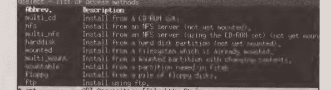
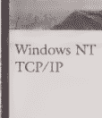
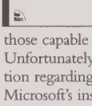
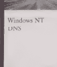

# Debian GNU／Linux：CD-ROM 安装与使用指南


我们已尽力使本书内容尽可能完整和准确，但不暗示任何保证或适用性。所提供的信息均按“原样”提供。作者和出版者对于因书中包含的信息或使用随附的 CD 或程序而引起的任何损失或损害，不对任何个人或实体承担责任。

- 7.5 确定文件内容 80

# 关于作者

John Goerzen 在过去的三年里一直是 Debian GNU/Linux 的开发人员。由于自由软件一直是他的兴趣领域之一，他参与了多个自由软件项目，包括 Debian 之外的项目。他目前在一家区域 ISP 担任 UNIX 系统管理员和开发人员。

Ossama Ithman 是密苏里州圣路易斯华盛顿大学分布式对象计算中心（Center for Distributed Object Computing）的成员，在该那里利用该中心的 CORBA 对象请求框架 TAO 研究实时 CORBA。他也是 Debian GNU/Linux 组织的活跃成员，并定期向开源社区做出贡献。

许多人对本手册提供了帮助。我们想感谢所有参与者，并在此表达我们的谢意。

感谢 Havoc Pennington、Ardo van Rangelroooij、Larry Greenfield、Thalia Hooker、Day Irmiter、James Treacy、Craig Sawyer、Oliver Elphick、Ivan E. Moore II、Eric Fischer、Mike Touloumtzis 以及 Linux 文档项目，他们为最终成为《Debian 教程》文档的工作工作。

感谢自由软件基金会的 Richard Stallman 提供的建议和编辑。

感谢 Bruce Perens、Sven Rudolph、Igor Grobman、James Treacy、Adam Di Carlo、Tapio Lehtonen 和 Stephanie Bortzmeyer，他们为最终成为安装文档集的工作。

当然，我们无法感谢成百千名的 Debian 开发人员和数千名自由软件作者，他们为我们提供了写作和使用的素材。

## 告诉我们你的想法！

作为本书的读者，我们是自己最重要的批评家和评论员。我们重视您的意见，并想知道我们哪里做得好，哪些地方可以改进，您希望看到我们出版哪些领域的内容，以及任何愿意分享给我们的智慧建议。

作为 New Riders 出版公司的执行编辑，我欢迎您的评论。您可以通过传真、电子邮件或直接写信给我，告诉我说我对这本书的喜欢或不喜欢之处——以及我们可以做什么来使书籍更加优秀。

请注意，我无法帮助您解决与本书主题相关的技术问题，而且由于收到的邮件很多，我可能无法回复每一条信息。

您写信时，请务必包含书名和作者，以及您的姓名和电话或传真号码。我们会仔细审查您的评论，并将其与参与本书的作者和编辑分享。

传真：317-581-4663

电子邮件：newriders@mcp.com

邮寄：Laurie Petrycki

执行编辑

## 指南指南

# 1 引言

我们很高兴有机会向您介绍 Debian！当我们开启 GNU/Linux 之旅程时，我们想先简单谈谈 Debian 到底是什么——它是做什么的，它是如何融入广大的自由软件世界的。然后，我们将谈谈自由软件这一现象，以及它对 Debian 和您意味着什么。最后，我们用关于这本书本身的信息结束本章。

## 1.1 什么是 Debian？

Debian 是一个用于计算机的自由操作系统（OS）。操作系统是使您的计算机运行的基础程序和工具集。操作系统的核心是内核。内核是计算机上最基础的程序：它处理所有的基础管理工作并允许您启动其他程序。Debian 使用 Linux 内核，这是一项由 Linus Torvalds 发起并受到全球数千名程序员支持的完全自由软件。构成操作大部分基础工具来自 GNU 项目^1，这些工具也是免费的。

操作系统的另一个方面是应用软件：帮助完成工作的程序，从编辑文档、运行业务、玩游戏到编写更多软件。Debian 带有超过 1,500 个软件包（将预编译软件打包成一种格式，以便在您的机器上轻松安装）——全部都是免费的。

Debian 系统有点像金字塔。底部是 Linux。在其之上是所有基础工具，大部分来自 GNU。接着是您在计算机上运行的所有应用软件；其中许多来自 GNU。Debian 开发人员充当架构师和协调员的角色——仔细地组织系统，并将所有内容整合成一个集成、稳定的操作系统：Debian GNU/Linux。

GNU/Linux 的设计哲学是将其功能分组成较小的、多用途的部分。这样，您就可以通过新的方式组合这些小部分（程序）来轻松实现新的功能和特性。Debian 就像一套益智玩具：你可以用它构建出各种东西。

在使用在使用操作系统时，您希望尽量减少为完成任务而付出的工作。Debian 提供了许多可以提供帮助的工具，但前提是您知道这些工具的作用。花费一小时尝试工作最后却放弃并不是很有效率的做法。本指南将教您了解构成 Debian 的核心工具：在特定情况下使用什么工具，以及如何将这些不同的工具结合起来。

### 1.1.1 谁创建了 Debian？

Debian 是一个全志愿者、基于互联网的开发项目。有数百志愿者在其中工作。大多数人负责少数软件包，并对他们封装的软件非常熟悉。

这些志愿者通过遵循一套关于软件包如何组装的严格指南来共同工作。这些指南是在互联网邮件列表的讨论中协作开发的。

- 1. `http://www.gnu.org/`

- 6. `http://www.fsf.org/philosophy/shouldbefree.html`

人们开始将自由软件称为“开源软件”，这两个术语是可以互换的。

您可能会疑惑为什么人们要花费大量时间编写并仔细封装软件，却将其全部免费送出。答案因贡献者人而异。

许多人相信信息共享和相互合作的自由，他们认为自由软件鼓励了这种行为。维护这些价值观的长期传统被称为“黑客伦理”，始于 20 世纪 50 年代。Debian GNU/Linux 项目建立在这些自由、共享和合作的自由软件之上。

其他人想更多地了解计算机。越来越多的人正在寻找避免昂贵的专有软件的方法。不断增长的社区为了他们收到的所有自由软件做出贡献。

学术界的许多人创建自由软件，以便将其研究成果投入广泛应用。企业维护自由软件是为了能够更快地实现新功能或聘请顾问！企业也对更高的可靠性和在支持供应商之间进行选择感兴趣。

其他人将自由软件视为社会福祉，使信息获取民主化并防止世界信息基础设施的过度集中。当然，我们中的许多只是觉得它很棒。

Debian 致力于自由软件，我们认为如果将其形式化为某种文档将会用。我们的社会契约承诺 Debian 将始终是 100% 的自由软件。当您从 Debian 主发行安装软件包时，可以确定它符合我们的自由软件指南。

尽管 Debian 相信自由软件，但在某些情况下人们想在机器上放置专有软件。只要可能Debian 将支持这样做；尽管专有软件未包含在主发行中，但有时可以在 FTP 站的非自由（non-free）目录下找到，而且越来越多的软件包唯一工作就是安装我们无权分发的专有软件。

请注意，“黑客”（hacker）一词不应与“破解者”（cracker）一词混淆。简单来说，黑客是友善的，而破解者通常被认为是恶意的。电影和其他媒体形式许多多次错误地使用“黑客”一词而非“破解者”。

- `http://www.debian.org/social_contract`

区分商业软件与专有软件是非常重要的。专有软件是非免费软件；商业软件是为了换钱而出售的。Debian 允许商业软件成为主发行版，但不允许专有软件。请记住，“自由软件”这一术语并不是指价格；自由软件是完全可以出售的。有关该术语的更多详细说明，请参阅 `http://www.opensource.org/` 或 `http://www.fsf.org/philosophy/categories.html`。

## 1.4 关于本书

本书面向初接触 Debian GNU/Linux 的读者。它假设读者没有关于 GNU/Linux 或其他类 Unix 系统的先验知识，但假设读者对计算机和硬件有非常通用的常识；你应该知道计算机的基本部分是什么，以及人们可以用计算机做什么。

总的来说，本教程试图帮助你理解 Debian 系统内部发生了什么。其核心理念是赋予你解决新问题的能力，并最大限地发挥计算机的价值。在手册的“操作指南”部分，还融入了大量的理论和趣味知识。

我们非常想听听你对这本书的反馈意见！你可以通过 `debian-guide@complete.org` 联系作者。我们特别感兴趣这本书对你是否有帮助，以及我们如何才能改进它。无论你是有意见，还是认为这本书是前所未有的杰作，请向我们发送电子邮件。


请不要向作者发送关于 Debian 的技术问题，因为这些问题有专门的论坛；请查看第 119 页的附录 A 获取有关文档和寻求的更多信息。仅向以下地址发送关于书籍本身的邮件。

### 1.4.1 如何阅读本书

学习任何计算机程序最好的方法就是使用它。大多数人发现，在不使用程序的情况下看书是有益的。学习 Unix 和 GNU/Linux 的最好方法就是使用它们。尽可能在任何事情上使用 GNU/Linux。尽管尝试吧！

Debian 不像某些其他操作系统那样直观。你可能最终会读这本书的前几章。GNU/Linux 的强大和复杂性使其起初很难上手，但从长远来看回报丰得多。

建议的学习方法是：读一点，然后玩一会儿。一直玩，直到你对这些概念感到熟悉，然后在书中跳跃着读。你会发现涵盖了各种主题，其中一些你可能会觉得感兴趣。一段时间后，你应该会有足够的信心在不知道命令具体作用的情况下开始使用它们。这是一件好事。

提示：如果你误输入了命令或不知道如何退出程序，请按下 `CTRL-c`（同时按下 Ctrl 键和小写字母 c）。这通常会停止程序。

### 1.4.2 惯例

在继续之前，熟悉书中使用的排版惯例是非常重要的。

当你需要同时按下多个键时，会使用类似 `CTRL-a` 的表示法。这意味着“按下 Ctrl 键并按下小写字母 a”。有些键盘同时拥有 Alt 和 Meta；大多数家用电脑只有 Alt，但 Alt 键的行为就像 Meta 键。如果你没有 Meta 键，请尝试 Alt 键。

Alt 和 Meta 键被称为修饰键，因为它们会改变像字母 A 等标准键的含义。有时你需要按住多个修饰键；例如，`Meta-Ctrl-a` 表示同时按下 Meta、Ctrl 和小写字母 a。

某些键有特殊符号——例如，`Ret`（回车/Enter键）、`Del`（删除或有时是退格键）、`Esc`（退出键）。这些内容应该是一而易懂的。

用空格代替连字符意味着按顺序按下按键。例如，`CTRL-x RET` 表示同时输入 Ctrl 和小写字母 a，然后是字母 x，最后按下回车键。（在示例会话中，此键标记为 Enter。同一个键，不同的名称。）

在示例会话中，**粗体**表示用户输入的字符，*斜体*表示对示例会话某部分的注释，所有其他文本都是输入命令后的输出。对于较短的命令，你有时会发现命令可以在其他文本中找到并用等宽字体高亮。

> “千里之行，始于足下。” – 老子

现在你已经了解了 Linux 和 Debian 背后的思想和哲学，是是时候开始把它们安装在你的计算机上了！我们首先从如何准备 Debian 安装开始谈起，然后讨论磁盘分区，最后是如何启动安装系统。

Debian 没有在 Linux 内核和 GNU 工具的要求之外施加额外的硬件要求。

本节并没有尝试描述支持 PC 平台的所有不同硬件配置，而是包含了通用信息以及在哪里可以找到额外信息的指引。

有两个查看详细信息的绝佳场所：Debian 系统要求¹ 列表和 Linux 文档项目硬件兼容性 HOWTO²。关于显卡支持的信息，你可能还想查看 XFree86³ 网站。

## 2.1.1 内存和磁盘空间要求

你必须至少有 4MB 的内存和 35MB 的可用硬盘空间。如果你想安装合理数量的软件（包括 X Window 系统以及一些开发程序和库），你至少需要 300MB。对于一个本质完整的安装，你需要大约 800MB。要安装 Debian 中所有的内容，你可能需要大约 2GB。实际上，安装所有内容并没有意义，因为某些包提供了相同的服务。

## 2.2 在开始之前

在开始之前，务必备份你现在硬盘上的文件。安装程序可能会抹掉硬盘上的所有数据！即使备份后也要小心。几分钟的思考可以节省几个小时的工作。

Debian 支持在同一系统上安装 Debian GNU/Linux 和另一个操作系统。如果你计划分区驱动器，请确保你有备份。

如果你的计算机连接到网络，你应该向网络管理员询问以下信息：

- 你的主机名（你可以自己决定）
- 你的网络 IP 地址
- 网络子网掩码
- 网络的广播地址
- 你作为 DNS 服务器使用的系统
- 是否通过以太网连接网络
- 你的以太网接口是否为 PCIA 卡，如果是，是什么类型的 PCIA 控制器

如果你唯一的网络连接是使用 PPP 或类似的电话拨号连接，那么在系统安装好之前不需要担心设置网络。设置 PPP 请参阅第 99 页的第 11.1 节。

你可能出于两个原因而想要将文件系统分成若干个较小的分区。第一个质是为了安全。如果文件系统发生损坏，通常只有一个分区会受到影响。因此，你只需要（从你细心保留的备份中）替换系统的一部分。至少，你应该考虑创建一个通常被称为“根分区（root partition）”。它包含了系统的内核组件。如果任何其他分区发生损坏，你仍然可以启动进入 GNU/Linux 来修复系统。这可以节省你无需从头重新安装系统的麻烦。

第二个原因在业务环境中通常更为重要，但取决于你对机器的使用方式。假设某些程序运行失控并开始大量占用空间。如果导致问题的进程需要 root 权限（系统会为用户预留一定百分比的磁盘空间），你可能会突然发现磁盘空间耗尽了。这并不是好事，因为操作系统在许多方面需要使用真实文件（交换空间之外）。此外，这甚至可能不是源于本地的问题。例如，未经请求的电子邮件（“垃圾邮件”）可以很容易填满一个分区。通过使用更多的分区，你可以保护系统免受此类问题的影响。再次以电子邮件为例，通过将 `/var/spool/mail` 目录放在单独的分区上，即使垃圾邮件填满了该分区，系统的大部分功能仍可以运行。

另一个原因仅适用于你有一个大型 IDE 硬盘且既未使用 LBA 寻址未使用覆盖驱动程序²。在这种情况下，你必须将根分区放在硬盘的前 1,024 个磁道内，通常大约为 524 兆。关于此问题的更多信息，请参见第 14 页的第 2.3.3 节。

大多数人认为交换分区（swap partition）也是必要的，尽管这并不完全准确。“交换”是操作系统的缓存空间，它允许系统除物理内存外还使用磁盘存储作为“虚拟内存”。将交换空间放在单独的分区上允许 Linux 更高效地利用它。虽然可以强制 Linux 使用普通文件作为交换空间，但并不建议这样做。

使用更多分区的唯一缺点是，通常很难预知你的需求。如果你把分区分得太小，要么必须重新安装系统，要么必须不断移动内容以为空间不足的分区腾出空间。另一方面，如果你把分区分得太大，可能会浪费本可以用于其他地方的空间。

- 5. 请参阅你的硬盘手册获取这些功能的描述。

## 2.3.2 系统使用规划

磁盘空间需求和你的分区方案取决于你决定创建的安装类型。

为了方便起见，Debian 提供了若干默认“配置（profiles）”，其中一些在本节的稍后部分列出。配置是预选的软件包集合，旨在为你的系统提供某些所需的功能。安装变得更加简单，因为符合你所需配置的软件包会自动标记为安装。每个给定的配置都列出了安装完成后生成的系统大小。即使你不使用这些配置，这些讨论对于规划也是重要的，因为它能让你对分区或多个分区需要多大有一个直观的感受。以下是一些可用的配置及其大小：

- Server_std. 这是一个小型服务器配置，适用于精简的服务器，该服务器没有为 shell 用户提供很多便利功能。它基本上包含一个 FTP 服务器、一个 Web 服务器、DNS、NIS 和 POP。它将占用大约 50MB 空间。当然，这只是软件的大小；你提供的任何数据将是额外增加的。
- Dialup. 这个配置非常适合标准桌面机，包括 X Window 系统、图形应用程序、声音、编辑器等。软件包的大小约为 500MB。
- Work_std. 此配置适用于没有 X Window 系统或 X 应用程序的精简用户机器。它也适用于笔记本电脑或移动计算机。大小约为 140MB。可能存在包含 X 的简单笔记本设置，其空间小于 100MB。
- Devel_comp. 这是一个桌面设置配置，带有所有流行的开发包，如 Perl、C 和 C++。它需要大约 475MB。假设你还要添加 X 和一些用于其他用途的额外软件包，你应该为此类安装规划大约 800MB 的磁盘空间。

记住，这些大小并不包含通常常见的其他材料，如用户文件、邮件和数据。在考虑为你自己的文件和数据留空间时，慷慨总是最好的。值得注意的是，Debian 的 `/var` 目录包含大量的状态信息。安装的软件包管理文件可以很容易消耗 20MB 的磁盘空间。通常情况下，你应该为 `/var` 目录至少分配 50MB，因为系统日志文件也存储在那里。

PC BIOS 通常为磁盘分区增加额外的限制。硬盘可以包含的“主分区”和“逻辑分区”数量是有限制的。此外，BIOS 在硬盘的哪个位置查找引导信息也有限制。更多信息可以在 Linux Partition mini-HOWTO 中找到。本节将包含一个简要概述，以帮助你规划你的场景。

“主”分区是 PC 硬盘的原始分区方案。然而，最多只有四个。为了突破这一限制，发明了“扩展（extended）”或“逻辑（logical）”分区。通过将一个主分区设置为扩展分区，你可以细分分配给逻辑分区的空间。你可以创建的逻辑分区数量限制比你可以创建的主分区数量少得多；然而，每个硬盘只能有一个扩展分区。


Linux 对分区数量的限制是：SCSI 硬盘为 15 个（逻辑分区），IDE 硬盘为 63 个（逻辑分区）。

关于 PC BIOS 需要知道的最后一点是，扩展分区——即持有逻辑分区的分区——本身是不可用的。这适用于 SCSI 硬盘和 IDE 硬盘。

Linux 使用驱动器名称加上 1 到 4 表示主分区。例如，第一个 IDE 硬盘的主分区是 `/dev/hda1`。逻辑分区从 5 开始编号，因此该硬盘上的逻辑分区是 `/dev/hda5`。

假设你的系统有两个 SCSI 磁盘，一个在 SCSI 地址 2，另一个在 SCSI 地址 4。第一个磁盘（地址 2）被命名为 `sda`，第二个是 `sdb`。如果 sdb 硬盘上有三个分区，它们将被命名为 `sda1`、`sda2` 和 `sda3`。同样适用于 sdb 磁盘及其分区。注意，如果你有两个 SCSI 主机适配器（即控制器），硬盘的顺序可能会变得混乱。在这种情况下，最好的解决方案是观察启动信息，假设你硬盘型号。

| 设备 | Linux 名称 |
|---|---|
| 第一个软盘 | `/dev/fd0` |
| 第二个软盘 | `/dev/fd1` |
| hda 的第一个分区（通常是操作系统） | `/dev/hda1` |
| hdc 的第五个分区 | `/dev/hdc5` |
| sdb 的第二个分区 | `/dev/sdb2` |
| 整个主设备 IDE 硬盘或光驱 | `/dev/hda` |
| 整个从设备 IDE 硬盘或光驱 | `/dev/hdb` |
| 整个主设备 IDE 硬盘或光驱 | `/dev/hdc` |
| 整个从设备 IDE 硬盘或光驱 | `/dev/hdd` |
| 第一个 SCSI 硬盘 | `/dev/sda` |
| 第二个及后续 SCSI 硬盘 | `/dev/sdb` 等 |
| 第一个串口端口（其他操作系统中的 COM1） | `/dev/ttyS0` |
| 第二个、第三个等串口端口 SCSI 单元（自动回带） | `/dev/ttyS1`, `/dev/ttyS2`, 等 |
| SCSI 磁带单元（不自动回带） | `/dev/st0`, `/dev/st1`, 等 / /dev/nst0`, `/dev/nst1`, 等 |
| SCSI 刻驱 | `/dev/scd0`, `/dev/scd1`, 等 |

### 2.3.5 推荐的分区方案

如上所述，如果空间允许，你应该设置一个独立的较小的根分区和一个较大的 `/usr` 分区。对于大多数用户来说，最初提到的两个分区就足够了。这在你只有一个较小硬盘硬盘时尤为合适，因为创建许多分区会浪费空间。

在某些情况下，如果你计划安装许多不是 Debian 发行版的程序，可能需要一个独立的 `/usr/local` 分区。如果你的机器将作为邮件服务器，你可能需要将 `/var/spool/mail` 设为独立分区。例如，将 `/tmp` 单独划分一个 32MB 的分区是一个好主意。如果你正在设置一个拥有大量用户账户的服务器，通常最好有一个独立的较大的 `/home` 分区来存储用户目录。总的来说，分区情况根据计算机的用途而异。

对于非常复杂的系统，你应该查看《多磁盘 HOWTO⁸》。它包含了深入的信息，主要供设置服务器的人参考。

还应该考虑交换分区（Swap partition）的大小。关于交换分区的大小有许多观点。一个行行的经验规则是使用与系统内存等大的交换空间，尽管对于大多数用户来说，设置 64MB 的交换空间可能并没有意义。在大多数情况下，它不应小于 16MB。当然，这些规则是有例外的。如果你试图在具有 256MB 内存的机器上求解 10,000 个方程方程，你可能需要1GB（或更多）的交换空间。

例如，考虑一台拥有 32MB RAM 和位于 `/dev/hda` 的 1.7GB IDE 硬盘的机器。在 `/dev/hda1` 上为另一个操作系统划分一个 500MB 的分区。`/dev/hda3` 使用一个 32MB 的交换分区，其余的约1.2GB位于 `/dev/hda2` 是 Linux 分区。

### 2.3.6 安装前的分区

你可以在两个时间点进行分区：安装 Debian 之前或安装期间。如果你的计算机专门用于 Debian，你应该按照第 25 页第 3.5 节所述，在安装期间进行分区。如果你的机器上有多个操作系统，你通常应该让另一个操作系统创建自己的分区。

> 8. http://metalab.unc.edu/LDP/HOWTO/Multi-Disk-HOWTO.html

# 为你的硬盘分区 17

以下章节包含了关于在安装 Debian 之前在原生操作系统中进行分区的操作。请注意，你需要在其他操作系统命名分区的方式与 Linux 命名分区的方式之间进行映射；参见第 15 页的表 2.1。

## 从 DOS 或 Windows 进行分区

如果你正在操作现有的 FAT 或 NTFS 分区，建议使用下面的方案或原生的 Windows 或 DOS 工具。否则，其实没有必要从 DOS 或 Windows 进行分区；Linux 分区工具通常会做得更好。

## 无损重分区

最常见的安装之一是安装到已经包含 DOS（包括 Windows 3.1）、Win32（如 Windows 95, 98, NT）或 OS/2 的系统中，并决定在不破坏原有系统的情况下将 Debian 放在同一块磁盘上。如第 11 页第 2.3.1 节所示，除非采取某些预防措施，否则减小现有分区的大小几乎会损坏该分区上的数据。这里描述的方法虽然不能保证保护数据，但在实践中效果非常好。作为预防，你应该进行备份。

在进行任何操作之前，你应该已经决定好如何划分磁盘。本节的方法只会将一个分区分成两部分。其中一个将包含原始操作系统，另一个将用于 Debian。在安装 Debian 期间，你将有机会根据自己的需要使用磁盘的 Debian 部分，例如，作为交换空间或文件系统。

其思想是在更改分区信息之前，将分区上的所有数据移动到开头，这样就不会丢失任何内容。重要的是，在数据移动和重分区之间尽可能少操作，以减少文件被写入分区末尾的几率，因为这将减少你可以从分区中获取的空间量。

你首先需要一个 FIPS 副本，它可以在你的 Debian CD-ROM 的工具目录中找到。此磁盘必须是可启动的。在 DOS 下，可以使用命令 `sys a:` 为以前格式化过的软盘创建，或使用 `format a:/s` 为未格式化的软盘创建。解压缩归包，并将 `RESTRB.EXE`、`FIPS.EXE` 和 `ERRORS.TXT` 文件复制到可启动的软盘中。FIPS 附带非常好的文档，你可能想阅读它们。如果你使用磁盘压缩驱动程序或磁盘管理器，务必阅读文档。在继续之前，创建磁盘并阅读文档。

下一步要完成的是将所有数据到分区的开头。DOS 6.0 及更高版本标准自带的 `DEFRAG` 可以轻松完成这项工作。请参考 FIPS 文档查看其他可能有效的软件列表。注意，如果你有 Windows 95 或更高版本，你必须从支持那里运行 `DEFRAG`，因为 DOS 不理解用于支持 Windows 95 及更高版本长文件名的 VFAT。

运行碎片整理程序后（在大容量磁盘上可能需要一段时间），使用你创建的 FIPS 软盘重启。只需输入 `a:\fips` 并按照指示操作即可。

注意，市场上还有许多其他分区管理器，以防 FIPS 对你不起作用。

在你最初安装 Debian 时，将通过几个不同的步骤：

1. 启动安装系统
2. 初始系统配置
3. 安装基础系统
4. 启动新安装的基础系统
5. 安装系统的其余部分

启动 Debian 安装系统（第一步）通常是使用救援软盘（Rescue Floppy）或从 CD-ROM 完成。

一旦你进入 Linux，`dbbootstrap` 程序将启动并引导你完成第二步，初始系统配置。该步骤在第 23 页第 3 节中详细描述。

“Debian 基础系统”是一组为了以最小、独立的方式运行 Debian 所需的核心包。`dbbootstrap` 将从你的 CD-ROM 安装，如第 30 页第 3.12 节所述。一旦你配置并安装了基础系统，你的机器就可以“自立”运行了。

最后一步是安装 Debian 系统的其余部分。这包括你在计算机上实际使用的应用程序和文档，例如 X 窗口系统、编辑器、shell 和开发环境。Debian 系统的其余部分可以从 CD-ROM 安装。此时，你将使用标准的 Debian 软件包管理工具，例如 `dselect`。此步骤在第 34 页第 3.20 节中描述。

首先，为安装系统选择启动媒介。接下来，选择你将用于安装基础系统的方法。

要启动安装系统，你有以下选择：可启动的 CD-ROM、软盘或非 Linux 引导程序。

CD-ROM 启动是最简单的方法之一。并不是所有机器都能直接从 CD-ROM 启动，因此你可能仍需要软盘。大多数平台都支持软盘启动。软盘启动参见第 19 页的 2.4.2 节。

如果你的系统支持从 CD-ROM 启动，你不需要任何软盘。将 CD-ROM 放入驱动器，关闭电脑然后重启。你应该看到一个带有启动提示符的欢迎界面。现在你可以跳到 2.5 节。


如果你的计算机没有“看到” CD-ROM，最简单的选择是制作两个启动软盘（见 2.4.2），然后使用它们启动 Debian。不要担心；Debian 使用这两个软盘后，它将顺利地找到你的 CD-ROM。

从软盘启动并不困难。事实上，你的 CD-ROM 包含了为你创建启动磁盘所需的信息。对于这些指令，你需要准备两个磁盘。将第一个标记为“Debian 2.1 安装/救援磁盘”，第二个标记为“Debian 2.1 模块/驱动程序磁盘”。

磁盘镜像是包含软盘完整原始内容的文件。磁盘镜像（如 `resc1440.bin`）不能简单地复制到软盘设备。需要使用特殊程序以原始模式将镜像文件写入软盘。

首先，你需要进入 DOS 提示符。在 Windows 95 及以上版本中，你可以通过双击 MS-DOS 图标或通过“开始→程序→MS-DOS 提示符”来实现。然后，将你的 Debian GNU/Linux CD-ROM 插入 CD-ROM 驱动器。首先切换切换 CD-ROM 驱动器。大多数情况下，它是 `D:`。

```
C:\WINDOWS>D:
```

现在，切换到包含磁盘镜像的目录。

如果你遇到错误，请仔细检查输入的内容。如果错误仍然存在，请手动执行 `CD \DISKS\SLINK\MAIN\DISKS-I386`，然后运行 `DIR`，最后 `CD` 进入指定的目录。注意，上述命令以及下方的某些示例即使在此处被换行，在你的显示器上可能显示为单行。

现在，你准备好创建两个磁盘中的第一个。启动程序来写入 `rawrite2`：

```
Rawwrite2 启动并显示欢迎信息。接下来，它会询问文件名和软盘驱动器。你告诉它将 resc1440.bin 写入 a:：
Enter disk image source file name: resc1440.bin
Enter target diskette drive: a:
```

`Rawwrite2` 现在要求你将一个磁盘插入软盘驱动器。插入磁盘并按回车。

> 请将格式化过的软盘插入
> A: 驱动器并按 -回车- ：

此时，`rawrite2` 将创建两个磁盘中的第一个。现在你需要为第二个磁盘重复此过程：

```
D:\DISKS\SLINK\MAIN\DISKS-I386\
Enter target diskette drive: a:
请将格式化过的软盘插入
> A: 驱动器并按 -回车- ：
```

到此时，你的磁盘已经创建完成。你现在可以使用第一个进行启动。

你现在已准备好进入 Debian 系统！关闭现有的操作系统，关闭电脑，并将安装/救援磁盘（Install/Rescue Disk）放入软盘驱动器中。现在重新开启电脑。你应该会看到一个带有底部提示符的欢迎屏幕。

你现在应该看到了启动提示符。此时只需按回车键。
一旦按下回车键，你应该会看到 `Loading...`（加载中...），然后是 `Uncompressing Linux...`（正在解压 Linux...），接着是一屏幕关于你系统硬件的信息。通常情况下，你可以忽略这些信息。Linux 将寻找各种硬件设备，并告诉你它找到了和没找到什么。此时不必担心这些信息。
一直等待直到看到颜色选择（Color Selection）屏幕。如果你遇到困难，请参阅第 127 页的 B.2 节。

`dbootstrap` 是在你启动进入安装系统后运行的程序名称。它负责初始系统配置和“基础系统”的安装。

`dbootstrap` 的主要工作是，你初始系统配置的主要目的是配置你系统的某些核心元素。例如，这包括你的 IP 地址、主机名以及网络设置的其他方面（如果有）。这还包括“内核模块”的配置，这些是加载到内核中的驱动程序。这些模块包括存储硬件驱动程序、网络驱动程序、特殊语言支持以及对其他外围设备的支持。首先配置这些基础内容是因为，为了让后续安装步骤正常运行，这通常是必要的。

`dbootstrap` 是一个简单的基于字符的应用程序。它非常容易使用；通常它会以线性方式引导你完成安装过程的每一步。如果你犯了错误，也可以返回并重复步骤。在 `dbootstrap` 中的导航可以通过方向键、回车和 Tab 键完成。

系统完成启动后，将调用 `dbootstrap`。`dbootstrap` 第一个询问的问题是你的显示器。你应该看到“选择彩色或单色显示”（Select Color or Monochrome display）对话框。如果你的显示器能够显示颜色，按回车键。显示将从黑白变为彩色。然后再次按回车键选择“下一步”（Next）项继续安装。

如果你的显示器只能显示黑白，使用方向键将光标移动到“下一步”（Next）菜单项，然后按回车继续安装。

你可能会看到对话框显示“安装程序正在确定系统的当前状态和应该执行的下一步安装步骤。”这是安装程序自动判断你可能可能需要执行什么操作的阶段。在某些情况下，你甚至看不到这个框。

在整个安装过程中，你将看到标题为“Debian GNU/Linux 安装主菜单”（Debian GNU/Linux Installation Main Menu）的菜单。菜单顶部的选项将会变化，指示你的安装进度。

# 第 2 章 入门

```
D:\DISKS\SLINK\MAIN\DISKS-I386\2.1.8-1999-02-22
```

如果你遇到错误，请仔细检查输入的内容。如果错误仍然存在，请手动执行 `CD \DISKS\SLINK\MAIN\DISKS-I386`，然后运行 `DIR`，最后 `CD` 进入指定的目录。注意，上述命令以及下方的某些示例即使在此处被换行，在你的显示器上可能显示为单行。

`RaWrite 2.0 - 将磁盘文件写入 原始软盘`

`Rawwrite2` 启动并显示欢迎信息。接下来，它会询问文件名和软盘驱动器。你告诉它将 `resc1440.bin` 写入 `a:`：

```
Enter disk image source file name: resc1440.bin
Enter target diskette drive: a:
```

`Rawwrite2` 现在要求你将一个磁盘插入软盘驱动器。插入磁盘并按回车。

> 请将格式化过的软盘插入
> A: 驱动器并按 -回车- ：

此时，`rawrite2` 将创建两个磁盘中的第一个。现在你需要为第二个磁盘重复此过程：

```
D:\DISKS\SLINK\MAIN\DISKS-I386\
2.1.8-1999-02-22\raw2
RaWrite 2.0 - 将磁盘文件写入
原始软盘
Enter disk image source file name: drv1440.bin
Enter target diskette drive: a:
请将格式化过的软盘插入
> A: 驱动器并按 -回车- ：
```

到此时，你的磁盘已经创建完成。你现在可以使用第一个进行启动。

# 启动 Debian

你现在已准备好进入 Debian 系统！关闭现有的操作系统，关闭电脑，并将安装/救援磁盘（Install/Rescue Disk）放入软盘驱动器中。现在重新开启电脑。你应该会看到一个带有底部提示符的欢迎屏幕。

## 2.5 启动安装系统

你现在应该看到了启动提示符。此时只需按回车键。

一旦按下回车键，你应该会看到 `Loading...`（加载中...），然后是 `Uncompressing Linux...`（正在解压 Linux...），接着是一屏幕关于你系统硬件的信息。通常情况下，你可以忽略这些信息。Linux 将寻找各种硬件设备，并告诉你它找到了和没找到什么。此时不必担心这些信息。

一直等待直到看到颜色选择（Color Selection）屏幕。如果你遇到困难，请参阅第 127 页的 B.2 节。

`dbootstrap` 是在你启动进入安装系统后运行的程序名称。它负责初始系统配置和“基础系统”的安装。


`dbootstrap` 的主要工作是，你初始系统配置的主要目的是配置你系统的某些核心元素。例如，这包括你的 IP 地址、主机名以及网络设置的其他方面（如果有）。这还包括“内核模块”的配置，这些是加载到内核中的驱动程序。这些模块包括存储硬件驱动程序、网络驱动程序、特殊语言支持以及对其他外围设备的支持。首先配置这些基础内容是因为，为了让后续安装步骤正常运行，这通常是必要的。

`dbootstrap` 是一个简单的基于字符的应用程序。它非常容易使用；通常它会以线性方式引导你完成安装过程的每一步。如果你犯了错误，也可以返回并重复步骤。在 `dbootstrap` 中的导航可以通过方向键、回车和 Tab 键完成。

系统完成启动后，将调用 `dbootstrap`。`dbootstrap` 第一个询问的问题是你的显示器。你应该看到“选择彩色或单色显示”（Select Color or Monochrome display）对话框。如果你的显示器能够显示颜色，按回车键。显示将从黑白变为彩色。然后再次按回车键选择“下一步”（Next）项继续安装。

如果你的显示器只能显示黑白，使用方向键将光标移动到“下一步”（Next）菜单项，然后按回车继续安装。

你可能会看到对话框显示“安装程序正在确定系统的当前状态和应该执行的下一步安装步骤。”这是安装程序自动判断你可能可能需要执行什么操作的阶段。在某些情况下，你甚至看不到这个框。

在整个安装过程中，你将看到标题为“Debian GNU/Linux 安装主菜单”（Debian GNU/Linux Installation Main Menu）的菜单。菜单顶部的选项将会变化，指示你的安装进度。

### 分区与交换分区配置

高亮“New”（新建）菜单选项，并按照你创建第一个主分区时的方法继续。注意，该分区被列为 Linux 原生分区。由于此分区将作为你的交换分区（swap partition），它必须被标记为此类分区。确保你刚刚创建的分区（你的交换分区）处于高亮状态，然后按左箭头键直到“Type”（类型）菜单选项被高亮，然后按回车键。你将看到支持的分区类型列表。Linux 交换分区类型应该已经被选中。如果如果没有，从列表中输入对应 Linux 交换分区的编号 (`82`)，然后按回车键。现在，你的交换分区应该显示在主屏幕的“FS Type”列下，类型为 Linux swap partition。

你的 `cfdisk` 界面应该像第 26 页图 3.1 所示所示。数字可能不相同，但 Flags（标志）和 FS Type 列应该相似。

在你创建一个磁盘分区后，这将是“Next”（下一个）菜单。你可以选择初始化并激活一个新的交换分区、激活一个之前初始化的分区，或者不使用交换分区。

强烈建议使用交换分区，但如果你坚持不使用，且你的系统内存大于 4MB，你也可以不使用。如果你想这样做，请从菜单中选择“Do Without a Swap Partition”（不使用交换分区）项并移动到下一节。

重新初始化交换分区总是被允许的，除非你确定自己自己在做什么，否则请选择“Initialize and Activate a Swap”（初始化并激活交换分区）。此菜单选项将首先向你显示一个对话框：“请选择要激活为交换设备的分区。”显示的默认设备应该是你已经设置好的交换分区；如果是的话，直接按回车键即可。

接下来，你还可以选择扫描整个分区，以查找由于硬盘盘片表面缺陷导致的不可读磁盘块。如果你有 MFM、RLL 或其他 SCSI 磁盘，这是很有用的，而且这样做百无害（尽管可能非常耗时）。大多数现代系统中正常运行的磁盘不需要这一步，因为它们有自己的内部机制来映射坏块。最后，会有一条确认消息，因为初始化将破坏该分区上之前的任何数据。如果一切无误，选择“Yes”（是）。在初始化程序运行时，屏幕会闪烁。

此时，显示的下一个菜单项应该是“Initialize a Linux Partition”（初始化 Linux 分区）。如果不是，要么是你还没有完成磁盘分区过程，要么是你没有做任何与交换分区相关的菜单选择。

你可以初始化一个 Linux 分区，或者也可以挂载一个之前初始化的分区。注意，`dbbootstrap` 不会在破坏旧系统的情况下进行升级。如果你正在升级，Debian 通常可以自己升级，你不需要使用 `dbootstrap`。Debian 2.1 的发行说明包含升级指令²

2. http://www.debian.org/releases/slink/i386/release-notes/ch-upgrading.en.html

如果你正在使用非空的旧磁盘分区（即如果你想直接丢弃其中的内容），你应该对它们进行初始化（这将擦除所有文件）。此外，你必须初始化你在磁盘分区步骤中创建的任何分区。唯一的理由在这一阶段在不初始化的情况下挂载分区，将是为了挂载一个你已经使用这套相同的安装软盘执行了部分安装过程的分区。

选择“Next”（下一个）菜单项来初始化并挂载 `/` 磁盘分区。你挂载或初始化的第一个分区将是挂载为 `/`读作“root”）的分区。你将获得扫描磁盘分区是否存在坏块的选项，就像你初始化交换分区时一样。扫描坏块并无害，但如果你的磁盘很大，可能需要 10 分钟或更长时间。

一旦你挂载了 `/` 分区，“Next”菜单项将变为“Install Operating System Kernel and Modules”（安装操作系统内核和模块），除非你已经执行了某些安装步骤。如果你还有其他分区需要设置，可以使用方向键选择菜单项来初始化或挂载磁盘分区。如果你为 `/var`、`/usr`或其他文件系统创建了独立分区，你现在应该初始化或挂载它们。

### 3.7.1 挂载一个之前初始化的分区

“Initialize a Partition”（初始化分区）步骤的替代方案是“Mount a Previously-Initialized Partition”（挂载之前初始化的分区）步骤。如果你正在恢复一个中断的安装，或者你想挂载已经初始化的分区，请使用此步骤。

## 3.8 安装操作系统内核和模块

在你挂载根分区后，这应该是下一个菜单步骤，除非你在之前的 `dbootstrap` 运行中执行过此步骤。首先，将被要求确认挂载在 root 上的设备是正确的。接下来，你将获得一个设备列表，你可以从中安装内核。选择一个合适的设备来安装内核和模块；这将是一个 CD-ROM 设备或第一个软盘设备。

如果你是从软盘安装的，你需要插入救援软盘（Rescue Floppy，它可能已经在驱动器中了），然后是驱动程序软盘（Drivers Floppy）。

在“Configure Driver Modules”之前有一个可选步骤，叫做“Configure PCMCIA Support”（配置 PCMCIA 支持）。

如果你需要通过 PCMCIA 安装网络（例如网卡），在安装系统之前不需要配置 PCMCIA。如果你挂载一个你已经使用这套相同的安装软盘执行了部分安装过程的分区，你可以在安装完成后配置 PCMCIA。

如果你有 PCMCIA 并且需要它，在“Configure Driver Modules”下方选择。在大多数情况下，这将是 `i8265`。在某些情况下，硬件供应商应提供信息。你通常可以留空这几个选项。

在某些特殊情况下，你可以打开第二个终端（Alt-F2）并编辑 `/pcmia/config`。你可以使用 `insmod` 和 `rmmod` 手动强制重新加载模块。

一旦 PCMCIA 配置并安装完成，你应该按照下一节的内容配置驱动程序。

选择“Configure Driver Modules”（配置驱动程序模块）项，并查找系统上的设备。配置这些驱动程序，它们将在系统启动时加载。

你不需要配置所有设备；关键是在此处完成安装所需的设备配置。

在系统安装后的任何时候，你都可以使用 `modconf` 程序重新配置 PCMCIA。

> 3. http://metalab.unc.edu/LDP/HOWTO/pcmia.html

即使你没有网络也必须配置网络，但你只需要回答前两个问题：“选择主机名”和“你的系统是否连接到网络？”

这里有一些你可能会觉得方便的调试细节：程序假设 IP 地址是系统 IP 地址和掩码的按位与结果。它通过系统 IP 地址与掩码反数的按位或结果来猜测广播地址。它将假设你的网关也是你的 DNS 服务器。如果你找不到这些答案，系统会猜测。如果有必要，可以在系统安装后通过 `/etc/init.d/network` 修改。

在“Install the Base System”（安装基础系统）步骤期间，你将获得一个设备列表，从中安装基础系统。在这里，你需要选择你的 CD-ROM 设备。


进入 `/path/to/xxx` 目录，找到 `xxx.json`。

在表达式 `cvar = avar + bvar` 中，加法运算符（`+`）将 `avar` 与 `bvar` 相加，得到它们的和 `cvar`

在 `List.of(arg0, arg1, arg2)` 中，`List` 接口的工厂方法 `of()` 接受一系列的元素，返回包含它们的只读列表。

之后我们这样调用 `cmd` 命令：`cmd arg0 arg1 arg2`。

```
if (condVar > someVal) {console.log("xxx")}
```
[/content]

Wait that's example. Need actual text.

Let's redo properly.

[content]
你将被要求指定 `base2_1.tgz` 文件的路径。如果你拥有官方介质，默认值应该是正确的。否则，请相对于媒体挂载点输入基础系统的路径。与“Install Operating System Kernel and Modules”步骤一样，你可以让 `dbootstrap` 自己查找文件，也可以在提示处输入路径。

此时你已经读入了组成最小 Debian 系统的所有文件，但在系统运行之前必须进行一些配置。

你将被要求选择时区。有许多方法可以指定时区；我们建议你进入“Directories:”（目录）面板。

选择您的国家（大洲）。这将改变可用的时区，因此请在“Timezones”（时区）面板中选择您的地理位置（例如国家、省、州或市）。

接下来，系统将询问您的系统时钟是否设置为 GMT 还是本地时间。如果您仅在计算机上运行 Linux，请选择 GMT（即“Yes”）；如果您在运行 Debian 的同时还会运行其他操作系统，请选择本地时间（即“No”）。Unix（Linux 也不例外）通常在系统时钟上保持 GMT 时间，并将可见的时间转换为本地时区。这使得系统能够跟踪夏令时和闰年，甚至允许允许从另一个时区登录的用户单独设置其终端（terminal）上所使用的时区。

如果您选择让硬盘直接启动到 Linux，系统将要求您安装一个主引导记录（master boot record）。如果您没有使用引导程序（如果您知道什么是引导程序，通常可能就是如此）并且在同一台机器上没有安装其他操作系统，请回答“Yes”，下一个问题是“例如，您将无法在机器上正常启动到 DOS”。请小心。如果您回答了“Yes”，下一个问题将是您是否想在开启系统时自动从硬盘启动 Linux。这会将 Linux 设置为可启动分区——即从硬盘中加载的分区。

请注意，在单台机器上运行多个操作系统仍然是某种“黑术”。本书没有记录各种引导程序，因为这些引导程序随架构甚至子架构的不同而异。您应该查看您所引导程序的文档以获取更多信息。请记住：在操作引导程序时，越小心越好。

标准的 i386 引导加载程序是“LILO”。它是一个复杂的程序，提供了许多功能，包括 DOS、NT 和 OS/2 的引导管理。要了解更多关于此功能的信息，您可以在系统设置后阅读 `/usr/doc/lilo` 中的文档。

即使您打算从硬盘启动系统，也应该制作一个启动软盘。原因是硬盘自举程序（bootstrap）可能安装错误，但启动软盘几乎总是有效的。从菜单中选择“Make a Boot Floppy”（制作启动软盘），并按照指示向系统提供空白软盘。确保软盘没有被写保护，因为软件将对其进行格式化并写入内容。完成后，将其标记为“Custom Boot”（自定义启动）软盘并进行写保护。

## 3.14 关键时刻

您的系统在独立电源下的首次启动是电气工程师所谓的“冒烟测试”（smoke test）。如果软盘驱动器中有任何软盘，请将其取出。选择“Reboot the System”（重启系统）菜单项。

如果您是直接启动到 Debian 但系统没有启动，请使用您的原始安装启动媒体（例如救援软盘 Rescue Floppy）或插入您创建的自定义启动软盘，这将重置您的系统。如果您没有使用自定义启动软盘，您可能需要添加一些引导参数。使用救援软盘或类似技术启动时（其中 `rootfs` 是您的根分区），您需要指定 `root=/dev/sda1`，您应该看到与首次启动安装系统时相同的消息，随后是一些新消息。

`root` 账户称为超级用户（superuser）；它是一个绕过系统所有安全保护的登录账户。`root` 账户应仅用于系统管理，且使用时间越短。

您创建的任何密码都应包含六到八个字符以及标点符号。设置 `root` 密码时要格外小心，因为它是一个如此强大的账户。避免使用字典单词或任何可能被猜到的个人信息。

如果有人告诉您他们需要您的 `root` 密码，请务必保持警惕。通常情况下，您不应提供您的 `root` 账户，除非您正在管理一台拥有多一个系统管理员的机器。

系统将要求您创建一个普通用户账户。该账户应该是您的主要个人登录账户。您不应将 `root` 账户用于日常使用或作为个人登录。

为什么不呢？作为普通用户，破坏系统比作为 `root` 要困难得多；系统文件受到了保护。另一个原因是，您可能会被欺骗运行木马程序——即利用您的超级用户权限，在您不留情的情况下破坏您系统安全的程序的程序。任何关于 Unix 系统管理的优秀书籍都会更详细地介绍这个主题。如果这个主题对您来说是全新的，请考虑阅读此类书籍。

可以为用户账户命名任何名称。如果您的名字是 John Smith，可以使用“smith”、“john”、“jsmith”或“js”。

接下来，系统将询问您是否想启用影子密码（shadow passwords）。这是一个让您的 Linux 系统稍微安全一点认证系统。

如果您没有使用自定义启动软盘，您可能需要添加一些引导参数。使用救援软盘或类似技术启动时（其中 `rootfs` 是您的根分区），您需要指定 `root=/dev/sda1`，您应该看到与首次启动安装系统时相同的消息，随后是一些新消息。

系统将询问您是否想启用影子密码。这是一个让您的 Linux 系统稍微安全一点认证系统。

现在是时候在您的 Debian 系统上安装您选择的软件软件包了。这是通过使用 Debian 的包管理工具 `dselect` 完成的。

### 3.20.1 简介

本节为初次用户记录了 `dselect`。它并没有尝试解释所有内容，因此当您第一次遇到 `dselect` 时，请仔细阅读帮助屏幕。



此列表通过在“新软件包获取”（Package Acquisition）部分下设置安装方法来生成。此方法允许从本地位置、网络资源、FTP 进行安装，并支持完整安装、依赖检查以及多源支持。你可以通过运行 `apt-get` 和 `list` 查看此列表。

在这里以及本文中，我们将讨论如何启动另一个 shell。Linux 在任何时候都提供六个控制台会话或 shell。你可以通过 `左 Alt-F1` 到 `左 Alt-F6` 在它们之间切换，之后在你的新 shell 中登录并继续操作。安装过程使用的控制台是第一个，也称为 `tty1`，所以当你想返回该进程时，请按 `左 Alt-F1`。

在 `dselect` 中，你将看到这个界面：

Debian Linux 'dselect' 软件包处理前端。

0. [A]ccess 选择要使用的访问方法。
1. [U]date 如果可能，更新可用软件包列表。
2. [S]elect 请求在你的系统上需要的哪些软件包。
3. [I]nstall 安装并升级所需的软件包。
4. [C]onfig 配置任何未配置的软件包。
5. [R]emove 删除不需要的软件。
6. [Q]uit 退出 `dselect`。

让我们逐一查看这些选项。

访问界面如第35页的图 3.2 所示。在这里，我们告诉 `dselect` 我们的软件包在哪里。忽略它们出现的顺序。选择正确的安装方法非常重要。你可能会看到列出的多几个方法，或者少几个，或者看到它们以不同的顺序列出；不用担心这些。在下面的列表中，我们描述了不同的方法。

**`multi_cd`**。这是一个非常庞大且功能强大的复杂方法，它是从一组多个二进制光盘（CDs）安装最新版本 Debian 的推荐方法。这些 CD 中的每张 CD 都应该包含自身以及所有之前 CD 的软件包信息（存储在 `Packages.cd` 文件中）。当你第一次选择此方法时，请确保你将使用的 CDROM 未被挂载。将该组的最后一张二进制磁盘（我们不需要源码 CD）放入驱动器并回答向你提出的问题：

CD-ROM 驱动器位置

确认你正在使用多张 CD 集合

Debian 发行版在磁盘（磁盘）上的位置

[ 可能 ] Packages 列表的位置或位置

一旦你更新了可用列表并选择了要安装的软件包，`multi_cd` 方法将偏离常规程序。你需要对你拥有的每张 CD 运行“安装”（install）步骤。遗憾的是，由于 `dselect` 的局限性，它无法在每个阶段提示你插入新磁盘；处理每张磁盘的方法列在此处：

- 1. 将 CD 插入 CD-ROM 驱动器。
- 3. 等待 `dpkg` 完成此 CD 的安装。（它可能会报告安装成功，也可能报告安装错误。先不要担心这些问题。）
- 4. 按 `Return` 键返回 `dselect` 主菜单。
- 5. 对集合中的下一张 CD 重复此操作。

可能需要多次运行安装步骤以涵盖软件包安装的顺序；某些早期安装的软件包可能需要在稍后安装的软件包之前才能正确配置。建议运行“Configure”（配置）步骤以帮助修复可能处于此阶段的软件包。

**`multi_nfs`, `multi_mount`**。这些方法与 `multi_cd` 方法类似，是处理变化介质主题的改进版——例如，从另一台机器的 CD-ROM 驱动器通过 NFS 出的多 CD 集合进行安装。indexdselect!multi-NFS, multi-mount installation


**apt**。这是从 Debian 存档本地镜像或网络进行安装的最佳选项之一。该方法使用“apt 系统”来完成依赖分析和排序，因此最有可能以优化顺序安装软件包。

该方法的配置非常直观。你可以选择任意数量的不同位置，混合使用文件：URL（本地磁盘或 NFS 挂载磁盘）、`http:` URL 或 `ftp:` URL。但注意，HTTP 和 FTP 选项不支持本地认证代理。

如果你为 HTTP 或 FTP（或两者）准备了代理服务器，请确保你已分别设置了 `http_proxy` 和 `ftp_proxy` 环境变量。在启动 `dselect` 之前，通过你的 shell 使用以下命令设置它们：

```
# export http_proxy=http://gateway:3128/
# dselect
```

`dselect` 将从镜像读取 `Packages` 或 `Packages.gz` 文件，并在你的系统中创建一个所有可用软件包的数据库。由于需要下载和处理文件，这可能需要一段时间。

准备好。这是这一切发生的地方。练习的目标是仅选择你想要安装的软件包。

按 `Enter`。如果你的机器很慢，请注意屏幕可能会清空并保持空白 15 秒。此时不要急着乱敲按键。

屏幕上出现的第一个内容是帮助文件的第 1 页。你可以在“Select”（选择）界面的任何时候按 `?` 键获取此帮助，并可以通过按 `.`（全角键）翻阅帮助页面。

在开始之前，请注意以下几点：

- 在完成所有选择后，按 `Enter` 退出“Select”界面。这将返回主界面，如果你的选择没有问题。
- 如果你选择 A 且 A 需要 B 才能运行，`dselect` 会提示你问题。如果选择 A 且 A 与 B 冲突，`dselect` 将提供解决方案。
- 如果你对选择感到满意，按 `Enter` 退出。
- 出现问题是正常的，也是预期的。

| 键 | 说明 |
|---|---|
| + | 选择软件包。 |
| = | 选择软件包。 |
| - | 删除软件包。 |
| i, I | 切换信息。 |
| o, O | 切换选项。 |
| v, V | 详细显示。 |

| 标记 | 含义 | 可能的值 |
|---|---|---|
| E | 错误 | R |
| I | 已安装 | U |
| O | 旧的 | n |
| M | 标记 | n |

Select 界面 (`dselect`) 帮助你防止迷路的键是 `R`、`U` 和 `D`。

- `RC` 取消此级的所有选择。不影响上一级的选择。
- `U` 如果 `dselect` 提出了更改而你又进一步更改，`U` 将恢复 `dselect` 的选择。
- `DR` 移除 `dselect` 做的更改，仅留下你的选择。

示例如下。`boot-floppies` 软件包（我知道这不是初学者的示例，但选择它是因为有很多依赖）依赖以下软件包：

- `libc6-pic`
- `slang1-pic`
- `sysutils`
- `makedev`
- `newt0.25`
- `newt0.25-dev`
- `popt`
- `zlib1g`
- `zlib1g-dev`
- `recode` (等待)

维护 `boot-floppies` 的人员还认为应该安装以下软件包。但这些并不是必需的：

- `lynx`
- `debiandoc-sgml`
- `unzip`

当你选择 `boot-floppies` 时，`dselect` 会弹出冲突解决界面。你会发现所有所需的软件包都已选中。

按 `R` 键回到起点。

| EIOM Pri Section Description |
| * Opt admin boot-floppy Scripts to create the Debian |
| -- Opt dev newt0.25-dev newt 开发工具包 |
| -- Opt dev slang1-dev S-Lang 编程库 |
| -- Opt dev slang1-pic S-Lang 编程库 |

如果你决定不要 `boot-floppies`，只需按 `Enter`。

按 `D` 键将情况恢复到最初选择的状态：

| EIOM Pri Section Description |
| * Opt admin boot-floppy Scripts to create the Debian |

# 40 第3章 逐步安装

表 3.3 预期的软件包类别状态

| 软件包类别 | 状态 |
|---|---|
| 必须 | 全部已选中 |
| 重要 | 全部已选中 |
| 标准 | 大部分选中 |
| 可选 | 大部分未选中 |
| 额外 | 大部分未选中 |

```
-- Opt devel newt0.25-dev Developer's toolkit for newt
-- Opt devel slangi-dev The S-Slang programming library
-- Opt devel slangi-pic The S-Slang programming library
```

使用 `U` 键取消选中项目：

| 软件包 | 描述 |
|---|---|
| * Opt admin | boot-floppie 用于创建 Debian 安装盘 |
| * Opt devel | newt0.25-dev 用于 newt 的开发者工具包 |
| * Opt devel | slangi-dev S-Slang 编程库 |
| * Opt devel | slangi-pic S-Lang 编程库 |

我建议目前先使用默认设置；你会有充足的机会添加更多。

无论你决定如何，按 `Enter` 键接受并返回主屏幕。如果运行遇到未解决的问题，你将直接跳回另一个问题解决界面。

`R`、`U` 和 `D` 键在“万一……”的情况下非常有用。你可以随心所欲地实验，然后恢复一切并重新开始。不要把它们看作是放在贴有“紧急情况下请打破”标签的玻璃盒里。

在 Select 界面做出选择后，按 `t` 显示一个大窗口，按 `p` 回到开头，然后使用 `Page Down` 键快速浏览设置。你可以检查工作结果并发现明显的错误。有些人不小心取消了某组软件包，直到为时太晚才发现错误。取消（deselect）是一个非常强大的工具；不要误用它。

你现在应该看到表 3.3 所示的情况。

满意吗？按 `Enter` 退出 Select 过程。如果你愿意，可以回来再次运行。

# 安装 (Install)

`dselect` 会遍历整个软件包集并安装所选软件包。预计在执行过程中会被要求做出决定。切换到不同的 shell 进行比较（例如，比较旧配置和新配置）通常很有用。如果旧文件是 `conf.modules.dpkg-dist`，那么新文件将是 `conf.`。

## 41 使用 dselect 安装软件包

在快速机器上，屏幕滚动得相当快。你可以分别用 `Ctrl-s` 和 `Ctrl-q` 停止和启动，在运行结束时，你将获得任何未安装软件包的列表。

可能会出现软件包没有安装的情况，因为它依赖于某个软件包，而该软件包已在安装列表中但尚未安装。答案是再次运行 `Install`。据报道，在某些情况下需要运行四次才能让一切各就其位。这取决于你的获取方法。

## 配置 (Configure)

大多数软件包在第 3 步中配置，但任何悬留的内容可以在这里进行配置。

## 移除 (Remove)

移除已安装但不再需要的软件包。

## 退出 (Quit)

我建议在此处运行 `/etc/cron.daily/find`，因为你的系统上有很多新文件了。然后你可以使用 `locate` 获取任何给定文件的位置。

### 3.20.3 结语中的提示

当安装过程运行 `dselect` 时，你无疑渴望尽快让 Debian 运行起来。嗯，请准备好花费大约小时的时间来熟悉环境并确保正确。当你第一次进入 Select 界面时，不要做任何选择——只需按 `Enter`，当出现依赖问题时，尝试修复它们。如果你发现自己回到了主屏幕，再次运行 Select。

你可以通过按 `i` 并查找“Size（大小）”数字来了解软件包的大小。这是压缩包的大小，因此解压后的文件会大得多（请查看“Installed-Size”，单位为千字节，以了解此）。

安装新的 Debian 系统是一项复杂工作，但 `dselect` 可以尽可能轻松地为你完成。花时间学习如何操作它。阅读帮助屏幕，并对 `i`、`I`、`o` 和 `0` 进行实验。使用 `R` 键。一切都在那里，但取决于你如何有效地使用它。

# 3.21 术语表 (Glossary)

以下术语在本书中以及泛泛论 Debian 时将非常有用。

**软件包（Package）。** 包含安装、卸载和运行特定程序所需的所有文件。处理软件包的程序是 `dpkg`。`dselect` 是 `dpkg` 的前端。有经验的用户经常直接使用 `dpkg` 安装或移除软件包。

**软件包名称（Package names）。** 所有软件包名称的格式均为 `xxxxxxxxxx.deb`。示例软件包名称包括：

- `efax_08a-1.deb`
- `lrzsz_0.12b-1.deb`
- `mgetty_0.99.2-6.deb`
- `minicom_1.75-1.deb`
- `term_2.3.5-5.deb`


- `uucp_1.06-1-2.deb`
- `uutraf_1.1-1.deb`
- `xringd_1.10-2.deb`
- `xtel_3.1-2.deb`

# 登录 (Logging In)

你的系统现在安装好了！为你优秀的表现点个赞吧！

现在是开始使用系统了。在本章中，我们将为你介绍 Debian 命令行、一些安全原则以及如何退出系统。在后面的章节中，我们将介绍更多内容。

## 4.1 第一步 (First Steps)

当运行 `dselect` 时，你无疑渴望尽快让 Debian 运行起来。嗯，请准备好花费大约小时的时间来熟悉环境并确保正确。当你第一次进入 Select 界面时，不要做任何选择——只需按 Enter，当出现依赖问题时，尝试修复它们。如果你发现自己回到了主屏幕，再次运行 Select。

你可以通过按 `i` 并查找“Size（大小）”数字来了解软件包的大小。这是压缩包的大小，因此解压后的文件会大得多（请查看“Installed-Size”，单位为千字节，以了解此）。

安装新的 Debian 系统是一项复杂工作，但 `dselect` 可以尽可能轻松地为你完成。花时间学习如何操作它。阅读帮助屏幕，并对 `i`、`I`、`o` 和 `0` 进行实验。使用 `R` 键。一切都在那里，但取决于你如何有效地使用它。

当你退出 `dselect` 后，你将看到一个提示符：计算机对某些信息的请求。在这种情况下，提示符是 `login:`。

你应该输入用户名，并在要求时输入密码。系统现在准备可以使用。

## 4.2 命令历史与编辑命令行 (Command History and Editing the Command Line)

你在 shell 提示符之后、按下 Enter 键之前输入的任何内容都称为*命令行（command line）*。它是一个*命令行*。它是一行命令计算机执行某些操作的文本。Debian 默认 shell 提供了若干功能，使输入命令行变得简单。

你可以向上滚动查看之前的命令并重新运行它们，或者对它们进行微调后重新运行。尝试一下：输入任何命令，例如 `whoami`；然后按**向上箭头**。`whoami` 命令将重新出现在提示符处。然后你可以按回车键再次运行 `whoami`。

如果你输入了多条命令，可以一直按向上箭头键来回溯查看。如果你在多次执行相同的操作，或者输入错了命令并想返回进行修改，这个功能就非常方便。你可以按向下箭头键向反方向移动，查看最近的命令。你还可以使用左、右箭头键在命令中移动以进行修改。最简单的方法是尝试输入 `whoami` 而不是其他命令，然后使用左箭头键回退。你可以使用退格（Backspace）或删除（Delete）键删除字符。

还有一些高级功能（虽然不需要全部背下来）：

- `Ctrl-a` 将光标移动到行首。
- `Ctrl-k` 删除到行尾的所有字符（k 代表“kill”，即杀死）。
- `Ctrl-y` 粘贴上次删除的内容，将其重新插入当前光标位置（y 代表“yank”，即拉取）。
- `Ctrl-e` 将光标移动到行尾。

尽管去尝试一下命令行编辑来找找感觉。

## 4.3 以 Root 工作

由于 Debian 是一个多用户系统，其设计目标是防止任何用户破坏整个系统，因此内核不允许普通用户更改系统文件。这意味着系统将保持其应有的状态，免受意外事故甚至是恶意作剧的伤害。然而，有时你需要更改系统文件；例如，你可能想要安装新软件或配置网络。要做到这一点，你必须拥有比普通用户更高的权限；你必须成为 root 用户（也称为超级用户）。要成为 root，只需使用用户名 `root` 和安装期间设置的密码进行登录，具体详见第 32 页的第 3.1 节。

在很多地方，只有系统管理员拥有 root 密码，且只有系统管理员才能执行必须执行的操作。如果你在使用自己的电脑，你就是系统管理员。如果你没有 root 权限，将依靠系统管理员来执行任何需要 root 权限的任务。

即使在共享或教育服务器上，如果你有 root 密码，你也可以正确使用它。现在尝试以 root 身份登录。输入 `whoami` 命令来验证你的身份。然后立即注销。当你是 root 时，内核不会保护你免受伤害，因为 root 有权对系统进行任何操作。除非绝对必要，否则不要进行任何操作。这并不是安全问题，而是稳定性问题。如果系统能防止你犯错，它的运行将会好得多。

你可能发现 `sudo` 比以 root 登录更方便。`sudo` 允许你假设另一个用户的身份，除非你指定了另一个人（你可以记住 sudo 代表 Super User，尽管有些人说它是 Set User）。这里有一个可以尝试的操作：以用户身份而非 root 身份登录。当你执行系统管理任务时，你应该尽可能以自己的身份进行操作。然后使用需要 root 权限的 `su`，并使用 `exit` 命令关闭权限，这样你就无法再破坏任何东西。

你可以使用 `su` 来假设系统上任何用户的身份，而不仅仅是 root。要这样做，输入 `su [user]`，其中 `user` 是你想变成的用户。当然，你必须知道该用户的密码，除非 root 没有密码。

## 4.4 虚拟终端

Linux 内核支持虚拟终端。这些终端提供了一种方法，让你的单个屏幕和键盘看起来像连接到同一系统的多个终端。坦率地说，使用虚拟终端是 Debian 最简单的操作之一：有“热键”可以快速在终端之间切换。要尝试一下，登录你的系统并按 `Alt-F2`（同时按下左侧 Alt 键和 F2，即功能键 2）。

### 图 4.1 使用 su 的示例话

```
$ whoami 检查你的当前用户名
username 这将显示你的用户名
$ su 向系统请求超级用户访问权限
Password: machine:~ 在此处输入你的 root 密码
root 你现在以 root 身份登录了
machine:~ exit 退出你的 root shell
$ exit 退出你的“普通” shell
```

你应该会发现自己处于另一个登录提示符下。不要惊慌：你现在位于第 2 号虚拟终端（VC）！在这里登录并做一些事情——多运行几次 `whoami` 命令或其他命令——以确认这是一个真实的 shell。你现在可以通过 `Alt-F1` 返回第 1 号虚拟终端。或者你也可以直观地移动到第三个虚拟终端（`Alt-F3`）。

Debian 默认开启六个虚拟终端，你通过 Alt 键和功能键 F1 到 F6 访问它们。（从技术上讲，开启的虚拟终端更多，但只有六个允许你登录。其他的用于 X 窗口系统或其他特殊目的。）

如果你在使用 X 窗口系统，它通常会在第一个未使用的终端上启动——可能是 VC 7。此外，要从 X 虚拟终端切换到前六个之一，你需要在按键序列中加上 Ctrl。但你只用 Alt 即可从文本 VC 切换到 X 虚拟终端。如果你从未离开 X，就不需要担心这个；X 在启动时会自动把你切换到它的虚拟终端。

一旦你习惯了它们，虚拟终端可能会成为同时完成许多任务的不可或缺的工具。（X 窗口具有相同相同，提供了多个窗口而不是多个终端。）你可以在每个 VC 上运行不同的程序，或者在一个 VC 上以 root 身份登录，在另一个 VC 上以自己的身份登录。每个人都可以使用自己的 VC；这在使用 X 时特别方便。

## 4.5 关机

> 不要直接关闭电脑！你可能会丢失宝贵的数据！

如果你是这台电脑的唯一用户，你可能想在使用完后关闭电脑。

为了避免可能损坏硬件组件，只在一天结束时才关闭电脑。开机和关机是导致组件磨损的两个最大因素。每天开关机一次可能是在电费和电脑寿命之间的最佳折中。

在使用电脑时，直接按电源开关是不妥的。在没有采取适当措施的情况下重启电脑（使用复位键）也是不好的。Linux 内核为了提高性能有一个磁盘缓存。这意味着它将信息临时存储在 RAM 中。因为内存比磁盘快数倍，这使得许多文件操作运行更快。Linux 定期将内存中的信息写入磁盘。这被称为同步。为了安全地关闭或重启电脑，你必须告诉电脑清理内存中的所有内容并将其永久存储。

要重启，只需输入 `reboot` 或按 `Ctrl-Alt-Del`。

要关机，你需要以 root 身份登录。作为 root，只需执行关机程序，包括 `sync` 命令，如上所述清理磁盘缓存。当你看到“System halted”时，就可以安全关闭电脑了。如果你的内核和 BIOS 支持高级电源管理（APM），电脑可能会自动关闭并省去你的麻烦。

# 5 基础知识

现在是时候详细探索该系统了。你已经了解了如何登录和关闭系统。在本章中，我们将探索 Linux 命令行、Linux 如何处理文件和目录，以及关于向他人标识身份的一些基础知识。

## 5.1 命令行与手册页 (Man Pages)

我们已经讨论过命令行，即你在 shell 提示符后输入的命令。本节描述了更复杂的命令行的结构。


一个简单的命令行仅包含一个命令名称，例如 `whoami`。但也可以其他内容。例如，你可能会输入：`man whoami`。此命令会请求 `whoami` 程序的在线手册（你可能需要按空格键滚动文档，或按 `q` 退出）。一个更复杂的例子是 `man -k PostScript`。这个命令行包含三个部分：它以命令名 `man` 开始；接着是一个选项或开关 `-k`，随后跟一个参数 `PostScript`。有些人将除命令名以外的所有内容统称为命令的参数。因此，选项和参数都是参数。

选项会改变命令的行为，开启特定的特性或功能。它们通常在前面有一个 `-`。GNU 工具具有选项的“长形式”；`-k` 的长形式是 `--apropos`。你可以输入 `man -h` 或 `man --help` 来获取 `man` 命令的完整选项列表。每个命令都有自己的一组选项，大多数命令都有 `--help` 和 `--version` 选项。由于历史原因，像 `tar` 这样的命令不需要在其选项前加 `-`。

任何不是选项又不是命令名的内容都是参数（在此例中为 `PostScript`）。参数可以有许多用途；最常见的是命令应该操作的文件名。在这种情况下，`PostScript` 是你想要通过 `man` 查找的单词，而对于 `man whoami`，参数则是你想要获取信息的命令。

以下是 `man -k PostScript` 命令行的拆解：

- `man`: 命令名，告诉计算机查看手册页。这些页为命令提供了文档。例如，`man whoami` 将为你提供关于 `whoami` 命令的文档。
- `-k`: 选项，改变 `man` 的行为。通常 `man` 期望一个命令名（如 `whoami`）作为参数并显示该命令的文档。但使用 `-k` 或 `--apropos` 选项，它期望参数是一个关键词。它会列出所有描述中包含该关键词的手册页列表。
- `PostScript`: 这是参数；因为我们使用了 `-k` 选项，它是要搜索的关键词。

`-k` 和 `PostScript` 都是参数。

继续输入 `man -k PostScript`，你将看到系统中所有与 PostScript 有关的手册页列表。如果你没有安装多少软件，可能会看到消息“PostScript: nothing” own。

### 5.1.1 描述命令行

注意：如果你想继续后进行，可以跳过本节。

有一种传统的、简洁的方法来描述命令语法。语法是指组合各种选项和参数的正确方法。例如，如果你输入 `man man` 来获取关于 `man` 的手册页，你将看到几个以命令名 `man` 开头的语法描述。其中一个看起来像这样：`man -k [-M path] keyword ...`

括号 `([])` 中的任何内容都是可选的单元。在这种情况下，你不需要使用 `-M` 选项，但如果你使用它，就必须使用路径参数。你必须使用 `-k` 选项和关键词参数。`...` 意味着你可以拥有比它之前的任何内容的多个项，所以你可以查找几个关键词。

让我们看看手册页中较复杂的描述之一：

```
man [-c|-w| -tZT device] [-adhu7V]
[-m system,...] [-L locale] [-p string]
[-M path] [-P pager] [-r prompt] [-S list]
[-e extension] [[section] page ...]
```

不需要遍历这些内容（也不用担心它的意思），但请注意描述的组织结构。

首先，选项簇通常意味着你可以以不同的组合使用其中一个或多个选项，因此 `-adhuV` 意味着你也可以使用 `-h`。然而，你不能使用所有组合；这个描述并没有说明这一点。例如，`-h`与其他选项不兼容，但你可以运行 `man -du`。

遗憾的是，描述的格式并没有说明这一点。

其次，`|` 符号意味着“或”。因此你可以使用 `-c`、`-w` 或 `-tZT` 选项，后跟一个设备参数。

第三，注意你可以嵌套括号，因为它们表示可选单元。所以，如果你有一个章节（section），你也必须有一个页（page），因为在 `[[section] page]` 单元中，页不是可选的。

不需要记忆这些任何内容，只需在阅读文档时参考本节即可。

## 5.2 文件和目录

文件是存储和组织信息的设施，类似于纸质文档。它们被组织在目录中，在其他其他系统中目录被称为文件夹（folders）。让我们看看 Debian 系统上的文件结构：

`/` 代表根目录。所有其他文件和目录都包含在根目录下。如果你来自 DOS/Windows 世界，`/` 与 DOS 的 `C:` 非常相似，即它是根目录。

# 54 第5章 基础

`cd /`

`cd` 意味着“切换目录（change directory）”。在这种情况下，你要求切换到根目录。

`pwd`

这验证了你正在根目录下工作。

`ls`

让你看到 `/` 目录的内容。

`cd`

在不带参数的情况下输入 `cd` 会选择你的主目录——即 `/home/yourname` 作为当前工作目录。尝试输入 `pwd` 来验证这一点。

在继续之前，你应该知道实际上有两种不同类型的文件名。其中一些以 `/`（根目录）开头，例如 `/etc/profile`。这些被称为`绝对文件名`（absolute filenames），因为无论当前在哪个目录，它们指的都是同一个文件。另一种文件名是`相对文件名`（relative）。

有两个目录名称仅用于相对文件名：`.` 和 `..`。`.` 指当前目录，`..` 指父目录。这些是“快捷”目录。它们存在于每个目录中。即使是根目录也有父目录——它是它自己的父目录！

所以，包含 `.` 或 `..` 的文件名是相对的。如果我在 `/usr/bin` 并输入 `../etc`，我指的是 `/usr/etc`。如果我在 `/var` 并输入 `../etc`，我指的是 `/etc`。注意，文件名前没有根目录的文件名隐含地在开头有一个 `.`。所以你可以输入 `local/bin` 或 `/local/bin`，它们的意思是一样的。

最后一个提示：波浪号 `~` 等于输入不带参数的 `cd`。此外，你可以输入类似 `cd ~/practice/mysubdirectory` 的命令切换到目录 `/home/yourname/practice/mysubdirectory`。同样，`~user` 等于用户“user”的主目录，它可能类似于 `/home/user`；因此 `~user/docs/debian.ps` 等于 `/home/user/doc/debian.ps`。

这里有一些更多关于相对文件名的命令可以让你尝试。在开始之前，先切换到你的主目录。

`mkdir practice`

在你的主目录下创建一个名为 `practice` 的目录。你将在这个目录中尝试其他命令。你可以输入 `ls` 来验证你的新目录是否存在。

`cd practice`

将目录切换到 `practice`。

```bash
mkdir mysubdirectory
```

在 `practice` 下创建一个子目录。

```bash
cp /etc/"copy" /etc/profile
```

`cp` 是系统上某个随机文件（copy）的缩写，现在不用担心它是用来做什么的。我们把它复制到了 `.`（记住，这意味着“我现在所在的目录”，即当前工作目录）。因此这创建了 `/etc/profile` 的副本并将其放在你的 `practice` 目录中。尝试输入 `ls` 来验证你的工作目录中确实有一个名为 `profile` 的文件，旁边还有新的 `mysubdirectory`。

```bash
more profile
```

这让你查看 `profile` 文件的内容。`more` 用于查看文本文件的内容。之所以被称为 `more`，因为它一次显示文件一屏的内容，你按空格键查看更多。当你到达文件末尾或按下 `q`（quit）时，`more` 将退出。

```bash
more /etc/profile
```

验证原始文件与创建的副本看起来一样。

```bash
mv profile mysubdirectory
```

`mv` 代表“移动（move）”。你将文件 `profile` 从当前目录移动到了你之前创建的子目录中。

```bash
ls
```

验证 `profile` 不再位于当前目录。

```bash
ls mysubdirectory
```

验证 `profile` 已经移动到 `mysubdirectory`。

```bash
cd mysubdirectory
```

切换到子目录。

```bash
mv myprofile
```

注意，与某些操作系统不同，移动文件和重命名文件没有区别。注意 `mv` 的第二个参数可以是将文件或目录移入的目录，也可以是文件名。`cp` 的工作原理相同。通常，你可以输入 `ls` 查看 `mv` 的结果。

```bash
mv myprofile ..
```


正如 `..` 意味着“我现在所在的目录”一样，`..` 也意味着“当前目录的父目录”，在这种情况下就是你之前创建的 `practice` 目录。使用 `ls` 验证 `myprofile` 现在在那里。

## 第5章 基础

```bash
cd ..
```

切换目录到父目录——在这种情况下是 `practice`，你把 `myprofile` 放在那里。

```bash
rm myprofile
```

`rm` 意味着“删除（remove）”，所以它删除了 `myprofile`。小心！在 GNU/Linux 系统上删除文件是永久的——没有撤销删除。如果你 `rm` 了它，它就永远消失了。小心！重复一遍，在 GNU/Linux 系统上删除文件是永久的——没有撤销删除。如果你 `rm` 了它，它就永远消失了。

```bash
rmdir subdirectory
```

`rmdir` 就像 `rm` 一样，它只用于目录。注意 `rmdir` 作用于空目录。如果目录包含文件，你必须先删除这些文件，或者你可以使用 `-r` 代替 `rmdir`。

```bash
cd ..
```

这离开当前目录并进入其父目录。现在你可以输入以下内容：

```bash
rmdir practice
```

（注：原文中此处存在大量重复的 `rmdir practice` 描述，已按指令要求保持逻辑翻译）

## 5.2 点文件与 ls

当你输入 `ls` 时，以 `.` 开头的文件不会列出。要查看文件，你必须使用 `-a`。`-a` 的完整形式是 `--all`，如果你觉得那样更容易的话。你也可以使用 `-A` 或 `--all`，它会显示除 `.` 和 `..` 之外的所有点文件。记住 `.` 是当前目录，`..` 是父目录；因为这些保证存在于每个目录，所以没有理由用 `ls` 列出它们。

示例点文件有 `.emacs`, `.newsrc`, `.bashrc`, `.xsession` 和 `.fwmrc`。它们分别被 Emacs、新闻阅读器、Bash Shell、X Window 系统和 fwm 管理使用。文件名以 `rc` 结尾是惯，但有些程序不是。有时程序会自动创建点文件，例如 `.gimp` 和 `.netscape`，它们存储偏好。有时你会使用文本编辑器创建它们。

### 5.3 进程

我们之前提到过 GNU/Linux 是一个多任务系统。它可以同时执行许多任务。这些任务中的每一个被称为进程（process）。获取这种感觉最好的方法是在 shell 提示符处输入 `top`。你将得到一个进程列表，根据它们在你眼前不断变化的计算机处理时间进行排序。在显示顶部，有一些关于系统的信息：有多少用户登录，总共有多少进程，你有多少内存以及使用了多少。

在最右侧列，注意在所有以“d”结尾的命令中——如 `kflushd` 和 `inet`——“d”代表 daemon（守护进程）。Daemon 原意是“磁盘和扩展监控”。daemon 是一个非交互式进程，由系统运行，用户永远不需要担心。daemon 提供如互联网连接、打印或电子邮件等的服务。

现在按下 `u` 并在提示时给出你的用户名。该命令要求只查看属于你的进程；它允许你忽略所有的 daemon 以及其他人正在做的。你可能会注意到 `bash`，这是你的 shell 的名称。你几乎一直都在运行 `bash`。

注意 `top` 显示的第二列显示了 PID，即进程标识符。每个进程都被分配了一个唯一的 PID。你可以使用 PID 来控制单个进程（稍后会介绍）。另一个实用技巧是按下 `?` 获取 `top` 命令的列表。

你可能好奇“进程”和“程序”之间的区别。在实践中，人们交替使用这些术语。技术上讲，程序是程序员编写并保留的指令集……

磁盘上的。该过程是 Linux 保留在内存中的程序运行实例。不过，分清这些术语并不十分重要。

你与计算机的许多交互都涉及到控制进程。你可能想要启动它们、停止它们，并查看它们在做什么。你为此提供的首要工具是 shell（壳）。

## 5.4 Shell 壳

`shell` 是一个允许你与计算机交互的程序。它之所以被称为 shell（壳），是因为它为你提供了一个工作环境——就像你在计算时的一个小小的电子家。（想象一下寄沙蟹）。

`shell` 最简单的功能是启动其他程序。你输入想要运行的程序名称，后面跟上你需要的参数，`shell` 就会请求系统为你运行该程序。

当然，图形化窗口系统也满足了这一需求。从技术上讲，Windows 95 提供了一个图形化 shell，而 X Window 系统也是某种图形化 shell。但“shell”通常指“命令行 shell”。

不用俗说，编写 shell 的黑客们并不满足于简单的启动命令。如果你想利用这些功能，你的 shell 拥有数量令人眼花缭、方便且强大的特性。

有无数种不同的 shell 可用；大多数基于 Bourne shell 或 C shell，这是两种最老的 shell。原始 Bourne shell 的程序名称是 `sh`，而 `csh` 是 C shell。Bourne shell 的变体包括 GNU 项目的 Bourne Again Shell (`bash`，Debian 默认)、Korn shell (`ksh`) 和 Z shell (`zsh`)。还有 `ash`，它是 Bourne shell 的传统实现。最常见的 C shell 变体是 `tcsh`（其中的 t 是为了向 TENEX 和 TOPS-20 操作系统致敬，这些系统启发了 `tcsh` 对 `csh` 的某些改进）。

`bash` 可能是新用户的最佳选择。它是默认 shell，并且包含了你可能需要的所有功能。但所有的 shell 都有忠实的追随者；如果你想尝试，可以安装一些不同的 shell 包，并使用 `chsh` 命令更改你的 shell。只需输入 `chsh`，在提示时提供密码，然后选择一个 shell。下次登录时，你将使用新的 shell。

## 5.5 使用 bash 管理进程

Debian 是一个多任务系统，因此你需要一种能够同时做多事情的方法。像 X 这样的图形化环境提供了一种自然的方法；它们允许屏幕上任何时候显示多个窗口。自然地，`bash`（或其他任何其他 shell）也提供了类似的功能。

之前你使用 `top` 来查看系统上不同的进程。你的 shell 提供了一些方便的方法，仅跟踪那些你从命令行启动的进程。每条命令行都会启动一个由 shell 执行的作业（也称为进程组）。一个作业可以由一个单个进程组成，也可以由管道中的一组进程组成（稍后详细介绍管道）。

输入命令行将启动一个作业。尝试输入 `man cp`，`cp` 的手册页将出现在屏幕上。shell 将进入后台，并在你读完手册页后返回（或者你可以按 `q` 退出，而不是滚动整个页面）。

但假设你正在读手册页，想花几分钟做点别的事。没问题。在阅读时按下 `Ctrl-z` 可以挂起当前前台作业并将 shell 置于前台。当你挂起作业时，bash 会先给你关于该作业的一些信息，然后是 shell 提示符。你会在屏幕上看到类似的内容：

```
NAME cp SYNOPSIS cp [options] source
--More--
[1 Stopped man cp
$
```

注意最后两行。倒数第二行是作业信息，然后是 shell 提示符。bash 为你从 shell 运行的每个命令行分配一个作业编号。这允许你轻松引用该进程。在这种情况下，`man cp` 是作业编号 1，显示为 `[1]`。`+` 表示这是你在前台的最后一个作业。bash 还会告诉你作业的当前状态——Stopped（停止）以及作业的命令行。

你有很多可以执行的命令。在 `man cp` 挂起的情况下，尝试以下命令：

```
man 1ls
```

启动新作业。

```
Ctrl-z
```

挂起 `man 1ls` 作业；你应该看到它的作业信息。

```
man mv
```

启动另一个作业。

```
Ctrl-z
```

挂起它。

```
jobs
```

请求 bash 显示当前作业。结果如下：

```
$ jobs
[1] Stopped man cp
[2]- Stopped man ls
[3]+ Stopped man mv
${}
```

注意 `-` 和 `+`，它们分别表示倒数第二个最后一个前台作业。

```
fg
```

将上一个前台作业（`man mv`，带有 `+` 的那个）再次放回前台。如果你按下空格键，手册页将继续滚动。

```
Ctrl-z
```

重新挂起 `man mv`。

```
fg %1
```

你可以通过在数字前加 `%` 来引用任何作业。如果你使用 `fg` 而不指定作业，则假设是最后一个活跃的作业。

```
Ctrl-z
```

重新挂起 `man cp`。

```
kill %1
```

杀死作业 1。bash 将报告作业信息，看起来如下：

```
$ kill %1
[1]- Terminated man cp
$
```

bash 只是请求作业退出，有时作业并不想这样做。如果作业没有终止，你可以向 `kill` 添加 `-KILL` 选项以停止询问并开始强制要求。


磁盘上的。该过程是 Linux 保留在内存中的程序运行实例。不过，分清这些术语并不十分重要。

你与计算机的许多交互都涉及到控制进程。你可能想要启动它们、停止它们，并查看它们在做什么。你为此提供的首要工具是 shell（壳）。

## 5.4 Shell 壳

shell 是一个允许你与计算机交互的程序。它之所以被称为 shell（壳），是因为它为你提供了一个工作环境——就像你在计算时的一个小小的电子家。（想象一下寄沙蟹）。

shell 最简单的功能是启动其他程序。你输入想要运行的程序名称，后面跟上你需要的参数，shell 就会请求系统为你运行该程序。

当然，图形化窗口系统也满足了这一需求。从技术上讲，Windows 95 提供了一个图形化 shell，而 X Window 系统也是某种图形化 shell。但“shell”通常指“命令行 shell”。

不用俗说，编写 shell 的黑客们并不满足于简单的启动命令。如果你想利用这些功能，你的 shell 拥有数量令人眼花、方便且强大的特性。

有无数种不同的 shell 可用；大多数基于 Bourne shell 或 C shell，这是两种最老的 shell。原始 Bourne shell 的程序名称是 `sh`，而 `csh` 是 C shell。Bourne shell 的变体包括 GNU 项目的 Bourne Again Shell (`bash`，Debian 默认)、Korn shell (`ksh`) 和 Z shell (`zsh`)。还有 `ash`，它是 Bourne shell 的传统实现。最常见的 C shell 变体是 `tcsh`（其中的 t 是为了向 TENEX 和 TOPS-20 操作系统致敬，这些系统启发了 `tcsh` 对 `csh` 的某些改进）。

`bash` 可能是新用户的最佳选择。它是默认 shell，并且包含了你可能需要的所有功能。但所有的 shell 都有忠实的追随者；如果你想尝试，可以安装一些不同的 shell 包，并使用 `chsh` 命令更改你的 shell。只需输入 `chsh`，在提示时提供密码，然后选择一个 shell。下次登录时，你将使用新的 shell。

## 5.5 使用 bash 管理进程

Debian 是一个多任务系统，因此你需要一种能够同时做多事情的方法。像 X 这样的图形化环境提供了一种自然的方法；它们允许屏幕上任何时候显示多个窗口。自然地，`bash`（或其他任何其他 shell）也提供了类似的功能。

之前你使用 `top` 来查看系统上不同的进程。你的 shell 提供了一些方便的方法，仅跟踪那些你从命令行启动的进程。每条命令行都会启动一个由 shell 执行的作业（也称为进程组）。一个作业可以由一个单个进程组成，也可以由管道中的一组进程组成（稍后详细介绍管道）。

输入命令行将启动一个作业。尝试输入 `man cp`，`cp` 的手册页将出现在屏幕上。shell 将进入后台，并在你读完手册页后返回（或者你可以按 `q` 退出，而不是滚动整个页面）。

但假设你正在读手册页，想花几分钟做点别的事。没问题。在阅读时按下 `Ctrl-z` 可以挂起当前前台作业并将 shell 置于前台。当你挂起作业时，`bash` 会先给你关于该作业的一些信息，然后是 shell 提示符。你会在屏幕上看到类似的内容：

```
NAME cp SYNOPSIS cp [options] source
--More--
[1 Stopped man cp
$
```

注意最后两行。倒数第二行是作业信息，然后是 shell 提示符。`bash` 为你从 shell 运行的每个命令行分配一个作业编号。这允许你轻松引用该进程。在这种情况下，`man cp` 是作业编号 1，显示为 `[1]`。`+` 表示这是你在前台的最后一个作业。`bash` 还会告诉你作业的当前状态——Stopped（停止）以及作业的命令行。

你有很多可以执行的命令。在 `man cp` 挂起的情况下，尝试以下命令：

```
man 1ls
```
启动新作业。

```
Ctrl-z
```
挂起 `man 1ls` 作业；你应该看到它的作业信息。

```
man mv
```
启动另一个作业。

```
Ctrl-z
```
挂起它。

```
jobs
```
请求 `bash` 显示当前作业。结果如下：

```
$ jobs
[1] Stopped man cp
[2]- Stopped man ls
[3]+ Stopped man mv
${}
```

注意 `-` 和 `+`，它们分别表示倒数第二个和最后一个前台作业。

```
fg
```
将上一个前台作业（`man mv`，带有 `+` 的那个）再次放回前台。如果你按下空格键，手册页将继续滚动。

```
Ctrl-z
```
重新挂起 `man mv`。

```
fg %1
```
你可以通过在数字前加 `%` 来引用任何作业。如果你使用 `fg` 而不指定作业，则假设是最后一个活跃的作业。

```
Ctrl-z
```
重新挂起 `man cp`。

```
kill %1
```
杀死作业 1。`bash` 将报告作业信息，看起来如下：

```
$ kill %1
[1]- Terminated man cp
$
```

`bash` 只是请求作业退出，有时作业并不想这样做。如果作业没有终止，你可以向 `kill` 添加 `-KILL` 选项以停止询问并开始强制要求。


磁盘上的。该过程是 Linux 保留在内存中的程序运行实例。不过，分清这些术语并不十分重要。

你与计算机的许多交互都涉及到控制进程。你可能想要启动它们、停止它们，并查看它们在做什么。你为此提供的首要工具是 shell（壳）。

## 5.4 Shell 壳

shell 是一个允许你与计算机交互的程序。它之所以被称为 shell（壳），是因为它为你提供了一个工作环境——就像你在计算时的一个小小的电子家。（想象一下寄沙蟹）。

shell 最简单的功能是启动其他程序。你输入想要运行的程序名称，后面跟上你需要的参数，shell 就会请求系统为你运行该程序。

当然，图形化窗口系统也满足了这一需求。从技术上讲，Windows 95 提供了一个图形化 shell，而 X Window 系统也是某种图形化 shell。但“shell”通常指“命令行 shell”。

不用俗说，编写 shell 的黑客们并不满足于简单的启动命令。如果你想利用这些功能，你的 shell 拥有数量令人眼花、方便且强大的特性。

有无数种不同的 shell 可用；大多数基于 Bourne shell 或 C shell，这是两种最老的 shell。原始 Bourne shell 的程序名称是 `sh`，而 `csh` 是 C shell。Bourne shell 的变体包括 GNU 项目的 Bourne Again Shell (`bash`，Debian 默认)、Korn shell (`ksh`) 和 Z shell (`zsh`)。还有 `ash`，它是 Bourne shell 的传统实现。最常见的 C shell 变体是 `tcsh`（其中的 t 是为了向 TENEX 和 TOPS-20 操作系统致敬，这些系统启发了 tcsh 对 csh 的某些改进）。

`bash` 可能是新用户的最佳选择。它是默认 shell，并且包含了你可能需要的所有功能。但所有的 shell 都有忠实的追随者；如果你想尝试，可以安装一些不同的 shell 包，并使用 `chsh` 命令更改你的 shell。只需输入 `chsh`，在提示时提供密码，然后选择一个 shell。下次登录时，你将使用新的 shell。

## 5.5 使用 bash 管理进程

Debian 是一个多任务系统，因此你需要一种能够同时做多事情的方法。像 X 这样的图形化环境提供了一种自然的方法；它们允许屏幕上任何时候显示多个窗口。自然地，`bash`（或其他任何其他 shell）也提供了类似的功能。

之前你使用 `top` 来查看系统上不同的进程。你的 shell 提供了一些方便的方法，仅跟踪那些你从命令行启动的进程。每条命令行都会启动一个由 shell 执行的作业（也称为进程组）。一个作业可以由一个单个进程组成，也可以由管道中的一组进程组成（稍后详细介绍管道）。

输入命令行将启动一个作业。尝试输入 `man cp`，`cp` 的手册页将出现在屏幕上。shell 将进入后台，并在你读完手册页后返回（或者你可以按 `q` 退出，而不是滚动整个页面）。

但假设你正在读手册页，想花几分钟做点别的事。没问题。在阅读时按下 `Ctrl-z` 可以挂起当前前台作业并将 shell 置于前台。当你挂起作业时，`bash` 会先给你关于该作业的一些信息，然后是 shell 提示符。你会在屏幕上看到类似的内容：

```
NAME cp SYNOPSIS cp [options] source
--More--
[1 Stopped man cp
$
```

注意最后两行。倒数第二行是作业信息，然后是 shell 提示符。`bash` 为你从 shell 运行的每个命令行分配一个作业编号。这允许你轻松引用该进程。在这种情况下，`man cp` 是作业编号 1，显示为 `[1]`。`+` 表示这是你在前台的最后一个作业。`bash` 还会告诉你作业的当前状态——Stopped（停止）以及作业的命令行。

你有很多可以执行的命令。在 `man cp` 挂起的情况下，尝试以下命令：

```
man 1ls
```
启动新作业。

```
Ctrl-z
```
挂起 `man 1ls` 作业；你应该看到它的作业信息。

```
man mv
```
启动另一个作业。

```
Ctrl-z
```
挂起它。

```
jobs
```
请求 `bash` 显示当前作业。结果如下：

```
$ jobs
[1] Stopped man cp
[2]- Stopped man ls
[3]+ Stopped man mv
$
```
注意 `-` 和 `+`，它们分别表示倒数第二个和最后一个前台作业。

```
fg
```
将上一个前台作业（`man mv`，带有 `+` 的那个）再次放回前台。如果你按下空格键，手册页将继续滚动。

```
Ctrl-z
```
重新挂起 `man mv`。

```
fg %1
```
你可以通过在数字前加 `%` 来引用任何作业。如果你使用 `fg` 而不指定作业，则假设是最后一个活跃的作业。

```
Ctrl-z
```
重新挂起 `man cp`。

```
kill %1
```
杀死作业 1。`bash` 将报告作业信息，看起来如下：

```
$ kill %1
[1]- Terminated man cp
$
```

`bash` 只是请求作业退出，有时作业并不想这样做。如果作业没有终止，你可以向 `kill` 添加 `-KILL` 选项以停止询问并开始强制要求。


## 5.4 Shell 壳

`shell` 是一个允许你与计算机交互的程序。它之所以被称为 `shell`（壳），是因为它为你提供了一个工作环境——就像你在计算时的一个小小的电子家。（想象一下寄沙蟹）。

`shell` 最简单的功能是启动其他程序。你输入想要运行的程序名称，后面跟上你需要的参数，`shell` 就会请求系统为你运行该程序。

当然，图形化窗口系统也满足了这一需求。从技术上讲，Windows 95 提供了一个图形化 `shell`，而 X Window 系统也是某种图形化 `shell`。但“`shell`”通常指“命令行 `shell`”。

不用俗说，编写 `shell` 的黑客们并不满足于简单的启动命令。如果你想利用这些功能，你的 `shell` 拥有数量令人眼花、方便且强大的特性。

有无数种不同的 `shell` 可用；大多数基于 Bourne `shell` 或 C `shell`，这是两种最老的 `shell`。原始 Bourne `shell` 的程序名称是 `sh`，而 `csh` 是 C `shell`。Bourne `shell` 的变体包括 GNU 项目的 Bourne Again Shell (`bash`，Debian 默认)、Korn `shell` (`ksh`) 和 Z `shell` (`zsh`)。还有 `ash`，它是 Bourne `shell` 的传统实现。最常见的 C `shell` 变体是 `tcsh`（其中的 `t` 是为了向 TENEX 和 TOPS-20 操作系统致敬，这些系统启发了 `tcsh` 对 `csh` 的某些改进）。

`bash` 可能是新用户的最佳选择。它是默认 `shell`，并且包含了你可能需要的所有功能。但所有的 `shell` 都有忠实的追随者；如果你想尝试，可以安装一些不同的 `shell` 包，并使用 `chsh` 命令更改你的 `shell`。只需输入 `chsh`，在提示时提供密码，然后选择一个 `shell`。下次登录时，你将使用新的 `shell`。

### 5.5 使用 bash 管理进程

Debian 是一个多任务系统，因此你需要一种能够同时做多事情的方法。像 X 这样的图形化环境提供了一种自然的方法；它们允许屏幕上任何时候显示多个窗口。自然地，`bash`（或其他任何其他 `shell`）也提供了类似的功能。

之前你使用 `top` 来查看系统上不同的进程。你的 `shell` 提供了一些方便的方法，仅跟踪那些你从命令行启动的进程。每条命令行都会启动一个由 `shell` 执行的作业（也称为进程组）。一个作业可以由一个单个进程组成，也可以由管道中的一组进程组成（稍后详细介绍管道）。

输入命令行将启动一个作业。尝试输入 `man cp`，`cp` 的手册页将出现在屏幕上。`shell` 将进入后台，并在你读完手册页后返回（或者你可以按 `q` 退出，而不是滚动整个页面）。

但假设你正在读手册页，想花几分钟做点别的事。没问题。在阅读时按下 `Ctrl-z` 可以挂起当前前台作业并将 `shell` 置于前台。当你挂起作业时，`bash` 会先给你关于该作业的一些信息，然后是 `shell` 提示符。你会在屏幕上看到类似的内容：

```
NAME cp SYNOPSIS cp [options] source

--More--

[1 Stopped man cp

$
```

注意最后两行。倒数第二行是作业信息，然后是 `shell` 提示符。`bash` 为你从 `shell` 运行的每个命令行分配一个作业编号。这允许你轻松引用该进程。在这种情况下，`man cp` 是作业编号 1，显示为 `[1]`。`+` 表示这是你在前台的最后一个作业。`bash` 还会告诉你作业的当前状态——Stopped（停止）以及作业的命令行。

你有很多可以执行的命令。在 `man cp` 挂起的情况下，尝试以下命令：

```
man 1ls
```
启动新作业。

```
Ctrl-z
```
挂起 `man 1ls` 作业；你应该看到它的作业信息。

```
man mv
```
启动另一个作业。

```
Ctrl-z
```
挂起它。

```
jobs
```
请求 `bash` 显示当前作业。结果如下：

```
$ jobs
[1] Stopped man cp
[2]- Stopped man ls
[3]+ Stopped man mv
${}
```
注意 `-` 和 `+`，它们分别表示倒数第二个和最后一个前台作业。

```
fg
```
将上一个前台作业（`man mv`，带有 `+` 的那个）再次放回前台。如果你按下空格键，手册页将继续滚动。

```
Ctrl-z
```
重新挂起 `man mv`。

```
fg %1
```
你可以通过在数字前加 `%` 来引用任何作业。如果你使用 `fg` 而不指定作业，则假设是最后一个活跃的作业。

```
Ctrl-z
```
重新挂起 `man cp`。

```
kill %1
```
杀死作业 1。`bash` 将报告作业信息，看起来如下：

```
$ kill %1
[1]- Terminated man cp
$
```
`bash` 只是请求作业退出，有时作业并不想这样做。如果作业没有终止，你可以向 `kill` 添加 `-KILL` 选项以停止询问并开始强制要求。

### 5.6.1 Tab Completion

`bash` 可以猜猜文件名或命令你正在输入并自动完成它。只需输入命令或文件名的开头并按下 Tab。如果 `bash` 找到单一完成，它会完成单词并在后面加一个空格。如果它找到多个可能的完成，它会填充出所有完成的共同部分并响声。你只需输入足够的字符使其唯一并再次按下 Tab。如果它没有找到完成，它只会简单的响声。

### 5.7 管理你的身份

Unix 类系统是多用户系统，因此你在系统中拥有你自己的电子身份。输入 `finger username` 来查看关于你的一些可用信息。要更改那里列出的名称和 `shell`，你可以使用 `chfn` 和 `chsh` 命令。只有超级用户可以更改你的登录（用户名）和目录。你会发现它说“No plan。”一个“plan”只是你可以提供给其他人的信息。要创建一个计划，把任何想让人看到的内容放在名为 `.plan` 的文件中。执行此操作你需要一个文本编辑器；参见第 82 页第 8.2 节。然后自己自己自己的计划。其他人可以 `finger` 你查看你的计划并检查你是否收到了新邮件或读了邮件。

注意这些 `finger` 信息默认对整个互联网开放。如果你不想这样，请阅读关于配置 `inetd` 和文件 `/etc/services` 的内容。最终安装手册将描述这种配置，但目前你可能尝试查看手册页或直接为你的 `finger` 信息填入乱码。

# 使用 Shell

在你阅读这本书的过程中，你已经在与 Shell 交互了。Shell 是一个读取你的命令并执行你要求它执行的操作的程序。在本章中，你将更详细地探索 Shell，并特别关注如何自定义 Shell 以按照你想要的方式工作。

## 6.1 环境变量

每个进程都关联着一个环境。环境是环境变量的集合。变量是一个具有固定名称的可变值。例如，名为 `EMAIL` 的变量可以指向值 `joe@nowhere.com`。该值可以变化；`EMAIL` 也可以指向 `jane@somewhere.com`。

由于你的 `shell` 像其他程序一样是一个进程，它也有一个环境。你可以通过输入 `printenv` 命令查看 `shell` 的环境。第 64 页的图 6.1 显示了 `printenv` 的示例输出。在你的系统上，输出会有所不同，但相似。

# 第 6 章 使用 Shell

图 6.1 `printenv` 示例输出

```
PAGER=less

HOSTNAME=icon

MAILCHECK=60

PS1=$

USER=username

MACHYPE=i486-pc-linux-gnu

EDITOR=emacs

DISPLAY=:0.0

LOGNAME=username

SHELL=/bin/bash

HOSTTYPE=i486

OSTYPE=linux-gnu

HISTSIZE=150

HOME=/home/username

TERM=xterm-debian

TEXTEDIT=jed

PATH=/usr/sbin:/usr/local/bin:

/usr/bin:/bin:/usr/bin/X11:/usr/games

=/usr/bin/printenv
```

环境变量是配置系统的一种方式。例如，`EDITOR` 变量允许你选择偏好的编辑器，用于发布新闻、编写电子邮件、设置提示符和文本文件查看器等。

设置环境变量非常简单。为了练习，尝试使用环境变量自定义你的 `shell` 提示符和文本文件查看器。首先，让我们获取一些背景信息。

```
man less
```


此命令允许你查看 `less` 命令的在线手册。为了一次在屏幕上显示文本，`man` 会调用分页器，每次当你按下空格键时它都会显示新页文本。默认情况下，它使用名为 `more` 的分页器。

继续浏览一下 `less` 的页面，它是一个增强型的分页器。按空格键滚动到新页；按 `q` 退出。`more` 在到达手册页末尾时也会自动退出。

```bash
export PAGER=less
```

在读完 `less` 的优点后，你可能想用它来阅读 man 页。要做到这一点，设置环境变量 `PAGER`。

在 bash 中设置环境变量的命令始终具有这种格式：

### 图 6.2 更改提示符

```bash
$ echo $PS1

$

$ PS1=hello

hello:echo My prompt is $PS1

My prompt is hello:

hello:
```

`export NAME=value`
`export` 意味着将变量从 shell 移动到环境中。这意味着 shell 以外的程序（例如文件查看器）能够访问它。

`echo $PAGER`
这是查看变量值最简单的方法。`$PAGER` 告诉 shell 在调用命令*之前*插入 `PAGER` 变量的值。`echo` 回显它的参数：在这种情况下，它回显了当前的 `PAGER` 值，即 `less`。

`man more`
显示 `more` 的手册。这次，`man` 应该调用了 `less` 分页器。
`less` 有许多 `more` 缺乏的功能。例如，你可以用 `b` 键向后滚动。你可以用方向键向上、向下（甚至是左右）移动。`less` 在到达手册页末尾时不会退出；它会等待你按 `q`。

你可以尝试 `less` 特有的命令（如 `b`），以验证它们在 `more` 中不起作用，且你正在使用 `more`。

`unset PAGER`
如果你不再想指定分页器，可以取消该变量。此时 `man` 将默认使用 `more`，就像在你设置该变量之前的那样。

`echo $PAGER`
由于 `PAGER` 已取消，`echo` 不会打印任何内容。

`PS1=hello:`
为了好玩，更改你的 shell 提示符。`$` 现在会发生变化；详情请见图 6.2。

`export` 不是必须的，因为你正在更改 shell 自身的行为。没有理由将变量导出到环境中供其他程序使用。从技术上说，`PS1` 是一个 shell 变量而不是环境变量。
如果你愿意，可以导出该 shell 变量，将其转换为环境变量。如果你这样做，你从 shell 运行的程序就可以看到它。

## 6.2 命令所在的位置：PATH 变量

当你向 shell 输入一个命令时，它必须在执行之前在你的硬盘上找到该程序。如果 shell 必须查找整个磁盘，速度会非常慢；相反，它会在 `PATH` 环境变量中包含的目录列表中查找。这个目录列表构成了 shell 的搜索路径；当你输入一个命令时，它会逐个通过这些目录寻找你请求运行的程序。
如果你在非标准位置自行安装了程序，你可能需要更改 `PATH` 变量。`PATH` 的值是一个用冒号分隔的目录列表。Debian 系统上的默认值如下：

```
/usr/local/bin:/usr/bin:/bin:/usr/bin/X11:/usr/games
```

该值定义在 `/etc/profile` 中并适用于所有用户。你可以随所意地更改 `/etc`。要查看 `type` 位于何处，运行命令：

```
$ type

type is a builtin
```

`type` 不是真正的程序。然而，你可以像使用外部程序一样使用它。有很多像 `type` 这样的命令可以显示一个命令是否为真实程序。

## 6.3 配置文件

Linux 系统上的许多应用程序允许通过修改配置文件来更改其行为。这些配置文件可能包含应用程序启动信息、运行时设置和退出设置。通常，配置文件名基于其所属的应用程序名称。这种命名约定让你更容易确定哪个文件包含特定应用程序的设置。

### 6.3.1 系统级与用户特定配置

记住 Debian 系统上有两种不同的配置。*系统级配置*影响所有用户。系统级设置在 `/etc` 目录中进行，因此你通常需要 root 权限才能更改系统级设置。例如，你可能会配置系统连接互联网的方式，或者网页浏览器启动时打开的公司主页。由于你希望这些设置适用于所有用户，因此你在 `/etc` 中进行更改。`/etc` 中的示例配置文件包括 `/etc/X11/X86Config`、`/etc/lynx.cfg` 和 `/etc/ppp/options`。事实上，`/etc` 中的几乎所有文件都是配置文件。

*用户配置*影响单个用户。点文件（dotfiles）用于用户配置。例如，`.newsrc` 文件存储你阅读的 USenet（讨论组）文章以及你订阅的小组。这使得新闻阅读器（如 `tr` 或 `gnus`）能够显示你感兴趣组的文章。这些信息对于系统上的每个用户都是不同的，因此每个用户在自己的家目录下都有自己的 `.newsrc` 文件。

## 6.4 别名

如果你经常使用同一个命令，可能会厌倦输入它。bash 允许你为命令编写更短的*别名*（aliases）。

假设你总是对 `ls` 使用 `--almost-all` 和 `--color=auto` 选项。你很快厌了输入它们：`ls --almost-all --color=auto`。所以你定义了一个别名：

```
alias myls='ls --almost-all --color=auto'
```

现在你可以输入 `mys` 代替完整命令。要查看 `mys` 到底是什么，运行命令 `type mys`。要查看你定义的别名列表，只需单独在一一行输入 `alias` 即可。

### 图 6.3 重定向输出

```
$ echo Hello > myfile

$ cat myfile

Hello

$
```

## 6.5 控制输入和输出

在你的 Linux 之路上，你很可能会发现操作应用程序的输入输出是一项非常强大的功能。本节描述了控制输入输出可以为你做的一些事情。

### 6.5.1 stdin、stdout、管道（Pipelines）和重定向

每个进程至少与外部世界三个连接。标准输入（stdin）是进程数据的一个源；标准输出（stdout）是进程发送数据的地方；标准错误（stderr）是进程可以发送错误信息的地方。（这些通常缩写为 stdin、stdout 和 stderr.）。

“源”和“地方”这两个词是刻意模糊处理的。这些标准输入和输出位置可以由用户更改；它们可以是屏幕、键盘、文件，甚至是网络连接。你可以指定使用哪些位置。

当你从 shell 运行程序时，通常标准输入来自你的键盘，而标准输出和错误都显示在你的屏幕上。然而，你可以要求 shell 修改这些默认设置。

例如，`echo` 命令将其内容发送到标准输出（通常是屏幕）。但你可以使用输出重定向操作符 `>` 将发送到文件。例如，要把单词 "Hello" 放入文件 myfile 中，请使用此命令：

```
echo Hello > myfile
```

使用 `cat` 或你的文本文件分页器（大致）来查看 `myfile` 的内容；参见第 68 页的图 6.3。

你可以使用输入重定向操作符 `<` 修改命令的标准输入。例如，`cat < myfile` 将显示 `myfile` 的内容。这在实际操作中并不有用；为了方便，`cat` 命令接受文件名参数。所以你直接说 `myfile` 效果是相同的。重定向操作符

在底层，`cat < myfile` 意味着 shell 打开 `myfile` 并将其内容输入 `cat` 的标准输入。`cat myfile` 没有重定向操作符，意味着 `cat` 命令接收到一个参数 (`myfile`)，自己打开文件，然后显示文件。

然而，这种双重功能是有原因的。例如，你可以将一个命令的标准输出连接到另一个命令的标准输入。这被称为管道（pipeline），它使用管道操作符¹ `|`。

也许你想反向查看 GNU 通用公共许可证。要做到这一点，请使用 `tac` 命令（它是 `cat` 的反向版本）。尝试一下：

```
tac /usr/doc/copyright/GPL
```

遗憾的是，它运行得太快无法阅读。所以你只能看到几段。解决方案是管道：

```
tac /usr/doc/copyright/GPL | less
```

```
tac /usr/doc/copyright/GPL | tr GQ | less
```

你可以使用临时文件和重定向获得相同的效果，例如：

```
tac /usr/doc/copyright/GPL > tmpfile

tr GQ < tmpfile > tmpfile2

less < tmpfile2

rm tmpfile tmpfile2
```


显然，管道更方便。

## 6.6 文件名扩展

通常你希望一个命令处理一组文件。通配符被用于创建文件名扩展模式：一系列字符和通配符，这些字符会扩展为文件名列表。例如，模式 `/etc/*` 扩展为 `/etc` 中所有文件的列表。

- `*` 是一个通配符，可以代表任何字符序列，因此模式 `/etc/*` 将扩展为所有以 `/etc/` 开头的文件名列表。
- 1. 根据你的键盘，这可能显示为竖线或断开的竖线，但它几乎总可以在反斜杠 (`\`) 上找到。
- 2. 实际上，以 `.` 开头的文件不包含在 `*` 的扩展中。

这个文件名列表作为命令的参数集最为有用。例如，`/etc` 目录包含一系列名为 `rc0.d`、`rc1.d` 等的子目录。通常查看这些目录的内容，你会输入：

```
ls /etc/rc0.d /etc/rc1.d /etc/rc2.d /etc/rc3.d
ls /etc/rc4.d /etc/rc5.d /etc/rc6.d /etc/rcS.d
```

这很冗长。相反，你可以像这里这样使用通配符：

```
ls /etc/rc?
```

`/etc/rc?.d` 扩展为以 `rc` 开头、后接任意单个字符、最后是 `.d` 的文件名列表。

可用的通配符包括：

- `*` 匹配 0 个或多个字符的任意组。
- `?` 匹配正好一个字符。
- `[...]` 如果你在括号中包含某些字符，`[abc]` 匹配 a、b 或 c 之一。如果你在第一个括号后添加 `^`，意义就会反转；因此 `[^abc]` 匹配任何不是 a、b 或 c 的字符。你可以包含一个范围，例如 `[a-j]`，它匹配 a 到 j 之间的任何内容。匹配是区分大小写的，因此要允许任何字母，你必须使用 `[a-zA-Z]`。

一旦你看到了一些具体的例子，扩展模式就很简单了：

- `*.txt` 这将给你出一个以 `.txt` 结尾的文件名列表，因为 `*` 匹配任何内容。
- `*.[hc]` 这给出一个以 `.h` 或 `.c` 结尾的文件名列表。
- `a??` 这将给你所有不以 `a` 开头的三个字母文件名。
- `[^a]??` 这将给你所有不以 `a` 开头的三个字母文件名。
- `a*` 这给出所有以 `a` 开头的文件。


`/etc/rc?.d` 扩展为以 `rc` 开头、后接任意单个字符、最后是 `.d` 的文件名列表。
可用的通配符包括：

- `*` 匹配 0个或多个字符的任意组。
- `?` 匹配正好一个字符。
- `[...]` 如果你在括号中包含某些字符，`[abc]` 匹配 a、b 或 c 之一。如果你在第一个括号后添加 `^`，意义就会反转；因此 `[^abc]` 匹配任何不是 a、b 或 c 的字符。你可以包含一个范围，例如 `[a-j]`，它匹配 a 到 j 之间的任何内容。匹配是区分大小写的，因此要允许任何字母，你必须使用 `[a-zA-Z]`。

一旦你看到了一些具体的例子，扩展模式就很简单了：

- `*.txt` 这将给你出一个以 `.txt` 结尾的文件名列表，因为 `*` 匹配任何内容。
- `*.[hc]` 这给出一个以 `.h` 或 `.c` 结尾的文件名列表。
- `a??` 这将给你所有不以 `a` 开头的三个字母文件名。
- `[^a]??` 这将给你所有不以 `a` 开头的三个字母文件名。
- `a*` 这给出所有以 `a` 开头的文件。

## 权限

通常你希望一个命令处理一组文件。通配符被用于创建文件名扩展模式：一系列字符和通配符，这些字符会扩展为文件名列表。例如，模式 `/etc/*` 扩展为 `/etc` 中所有文件的列表。

- `*` 是一个通配符，可以代表任何字符序列，因此模式 `/etc/*` 将扩展为所有以 `/etc/` 开头的文件名列表。
- 1. 根据你的键盘，这可能显示为竖线或断开的竖线，但它几乎总可以在反斜杠 (`\`) 上找到。
- 2. 实际上，以 `.` 开头的文件不包含在 `*` 的扩展中。

这个文件名列表作为命令的参数集最为有用。例如，`/etc` 目录包含一系列名为 `rc0.d`、`rc1.d` 等的子目录。通常查看这些目录的内容，你会输入：

```
ls /etc/rc0.d /etc/rc1.d /etc/rc2.d /etc/rc3.d
ls /etc/rc4.d /etc/rc5.d /etc/rc6.d /etc/rcS.d
```

这很冗长。相反，你可以像这里这样使用通配符：

```
ls /etc/rc?
```

`/etc/rc?.d` 扩展为以 `rc` 开头、后接任意单个字符、最后是 `.d` 的文件名列表。
可用的通配符包括：

- `*` 匹配 0个或多个字符的任意组。
- `?` 匹配正好一个字符。
- `[...]` 如果你在括号中包含某些字符，`[abc]` 匹配 a、b 或 c 之一。如果你在第一个括号后添加 `^`，意义就会反转；因此 `[^abc]` 匹配任何不是 a、b 或 c 的字符。你可以包含一个范围，例如 `[a-j]`，它匹配 a 到 j 之间的任何内容。匹配是区分大小写的，因此要允许任何字母，你必须使用 `[a-zA-Z]`。

一旦你看到了一些具体的例子，扩展模式就很简单了：

- `*.txt` 这将给你出一个以 `.txt` 结尾的文件名列表，因为 `*` 匹配任何内容。
- `*.[hc]` 这给出一个以 `.h` 或 `.c` 结尾的文件名列表。
- `a??` 这将给你所有不以 `a` 开头的三个字母文件名。
- `[^a]??` 这将给你所有不以 `a` 开头的三个字母文件名。
- `a*` 这给出所有以 `a` 开头的文件。

## 文件所有权

每个文件都有两个所有者：一个用户和一个组。上面的情况有点困惑，除了 root 用户，还有一个 root 组。组只是用户的集合，共同允许访问系统的某些部分。一个很好的例子是 games 组。

这里有一个更实际的例子。考虑你正在为一学校设置计算机的情况。你可能希望某些文件只对老师开放，而不是学生，所以把所有老师放在一个组里。然后你可以告诉系统某些文件属于该组成员，并且其他人无法访问这些文件。

让我们探索系统上的组。首先，你可以在 shell 提示符下使用 `groups` 命令。这将显示你所属的组列表。这里有一个例子：

```
$ groups
system-wide configurationpermissionsfileownershipusernamee dialout cdrom floppy audio
```

你可能只属于一个组，该组与你的用户名相同。然而，root 可以将你加入其他组。上面的例子显示了一个属于五个组的人。

```
less /etc/group
```

此文件列出了你系统中存在的组。请注意 root 组（该组的唯一成员是 root 用户）以及与你的用户名对应的组。还有像 dialout 组（允许通过调制调器拨号的用户）和 floppy 组（可以使用软驱器的用户）等组。然而，你的系统可能没有配置使用这些组。目前可能只有 root 可以使用软驱器或调制调器。有关此文件的详细信息，请尝试读取 `man group`。

```
ls -l /home
```

此命令向你显示每个用户的目录都归该用户以及该用户的个人组所有。

- 提示：如果你刚刚安装了 Debian，你可能是唯一可以使用 `adduser` 命令的用户。
- 你可以使用 `adduser` 命令向系统添加更多用户。

### 7.1.2 模式 (Mode)

除了属于一个用户和一个组之外，每个文件和目录还有一个模式（mode），它决定了谁被允许读取、写入和执行该文件（如果它是程序，则运行它）。还有其他一些由模式决定的事情，但它们是高级主题，我们现在暂跳过。

在 `ls` 输出中，模式看起来像这样：`-rw-r--r--.`。现在，我们考虑其中的九个部分：控制所有文件的用户、所有该文件的组以及其他人（系统上的所有人，有时称为 world）的读取、写入和执行权限的权限。

在模式行中，第一个“元素”给出文件类型。在这种情况下，`-` 表示它是一个普通文件。如果是 `d`，那么我们看的是一个目录。还有其他复杂到不适合在此讨论的可能；详细信息，请参阅第 111 页的第 13.2.2 节。

其余九个元素用于显示文件的模式。基本的 9 位（用户、组和其他人员的读、写、执行权限）显示为三组 `rwx` 块。

所以，如果所有权限都开启且这是一个普通文件，模式将看起来像这样：`-rwxrwxrwx`。如果它是一个目录，对其他人关闭所有权限，对用户和组开启完全权限，它将是 `drwxr-xr---`。

表 7.1 描述了文件和目录的读取、写入和执行权限的含义。

目录模式可能会有点困惑，所以这里是各种组合效果的一些示例：

```
r--
```

### 表 7.1 Linux 中的权限

| 代码 | 名称 | 允许文件 | 允许目录 |
| --- | --- | --- | --- |
| r | 读取 | 检查文件内容 | 列出目录内容或删除 |
| w | 写入 | 修改文件 | 在目录中添加文件 |
| x | 执行 | 作为命令运行 | 访问目录中的文件 |

拥有这些权限的用户、组或其他人可以列出目录的内容，但不能做其他事情。目录中的文件无法以任何方式被读取、更改、删除或操作。唯一被允许的操作是读取目录本身，即查看它包含哪些文件。

```
rw-
```

在缺少执行权限的情况下，写入权限没有作用，此模式的行为与上述模式完全相同。

```
r-x
```

此模式允许列出目录中的文件，并允许访问这些文件。然而，不能创建或删除文件。访问意味着你可以根据文件所有权权限允许查看、更改或执行文件。

```
-x
```

可以访问此目录中的文件，但不能列出目录的内容，所以你必须预先知道你要找的文件名（除非你非常擅长猜测）。不能创建或删除文件。

```
rwx
```

你可以对此目录中的文件进行任何你想做的操作，只要文件本身的权限允许即可。
目录写入权限决定了你是否可以删除目录中的文件。如果你有权限写入包含该文件的目录，就可以删除一个只读文件。即使你允许更改该文件，你也无法从只读目录中删除文件。
这意味着如果你拥有一个目录，你可以随时删除其中的文件，即使这些文件属于 root。
目录执行权限决定了你是否有权文件，从而决定文件权限是否生效。如果你对目录有执行权限，该目录的文件权限就会变得相关。否则，文件权限根本无关；因为你根本无法访问文件。

### 7.1.3 实践中的权限

本节通过一个简短的示例会话演示权限如何使用。要更改权限，我们将使用 `chmod` 命令。

```
cd; touch myfile
```

这里有几个新技巧。首先，你可以使用 `;` 将两个命令放在同一行。你可以这样输入上述内容：

```
$ cd
$ touch myfile
```

或者输入：

```
$ cd; touch myfile
```

无论哪种方式，最终发生都是一样的。
回想 `cd` 会返回你的主目录。`touch` 通常用于将文件的修改时间改为当前时间。但它还有另一个有趣的特性：如果文件不存在，`touch` 会创建该文件。所以你正在用它来创建一个文件进行练习。使用 `ls -l` 确认文件已创建，并注意权限模式：

```
$ ls -l
-rw-r--r-- 1 user 0 Nov 18 22:04 myfile
```


显然，当你尝试时，时间和以及用户/组名会有所不同。文件的大小为 0，因为 `touch` 创建的是一个空文件。
`-rw-r--r--` 是 Debian 上的默认权限模式。

``` 
chmod +x myfile
```

此命令意味着为拥有该文件的用户 (`u`) 添加 (`+`) 执行 (`x`) 权限。使用 `ls -l` 查看效果。

``` 
chmod g-r myfile
```

在这里，你从所有该文件的组 (`g`) 以及所有其他人 (`others`, `o`) 中减去了 (`-`) 读取权限 (`r`)。再次，使用 `ls -l` 验证效果。

``` 
chmod ugo-rx myfile
```

你将 (`=`) 用户、组和其他人的权限设置为读取和执行。这会将权限设置为*恰好*你指定的权限，并取消任何其他权限。所以所有的 `rx` 都应该被设置，而所有的 `w` 都应该被取消。现在，没有人可以写入该文件了。

``` 
chmod a-x myfile
```

`a` 是 `ugo` 的缩写，或“所有”。所以现在所有的 `x` 权限都应该被取消。

``` 
rm myfile
```

使用此命令，你正在删除该文件，但由于没有写入权限。`rm` 会询问你是否确定，显示如下消息：

``` 
rm: remove ‘myfile’, overriding mode 0444?
```

你应该输入 `y` 并回车来响应。这是 `rm` 的一个功能，而不是权限事实。删除文件的权限来自于目录权限，而你有目录的权限。然而，`rm` 试图提供帮助，问题中的 `044` 代表什么？模式是一个十二位的二进制数字，例如：`00100110100`。`044` 是这个二进制数字以八进制（基数 8）表示的形式，这是编写模式的惯用方法。所以你可以用 `chmod 444 myfile` 代替 `chmod ugo=r myfile`。

## 7.2 存在的文件及其位置

现在你已经可以导航目录树了，让我们浏览一下你在安装 Debian 时创建的文件和目录。如果你好奇，可以 `cd` 进入每个目录并 `ls` 查看其内容。

`/`
如前所述，这是根目录，它包含了所有其他目录。

`/root`
但不要 `/` 混淆 `/root`！`/root` 是 `root` 用户的主目录，但它是一个名为 `/root` 的目录，但它并不是根目录。

`/home`
这是所有普通用户——即除 `root` 以外的所有用户——的主目录所在这里。每个主目录以其所有者的用户名命名，例如 `/home/jane`。如果你在学校或企业使用大型系统，你的系统管理员可能会创建额外的目录来存放主目录：

例如，`/home1` 和 `/home2`。在其他一些系统上，你会看到
`/home/students/username`、`/home/staff/username` 等。

你的主目录是存放你所有个人工作、电子邮件和其他文档，以及个人配置偏好的地方。它是你在系统中的“家”。

`/bin`
此目录包含“二进制文件”，即对系统运行至关重要的可执行文件。例如 `shell` (`bash`) 和像 `cp` 这样的文件命令。

`/sbin`
此目录包含“系统二进制文件”，这些是 `root` 用户或系统管理员可能想要使用的实用程序，但你可能在日常活动中不需要使用它们。

`/usr`
包含了你感兴趣的大部分文件。它有许多子目录。`/usr/bin` 和 `/usr/sbin` 与 `/bin` 和 `/sbin` 非常相似。

虽然对于计算机的运行并非必不可少，但 `/usr` 确实包含了你完成实际工作所需要的应用程序。在 `/usr` 中，你还会找到 `/usr/man`、`/usr/info` 和 `/usr/doc` 目录。它们分别包含手册页、`info` 页面和其他文档。别忘了 `/usr/games`！

`/usr/local`
Debian 系统不会在此目录中安装任何内容。如果你想安装自己编译的软件或任何未包含在 Debian 软件包中的软件，就应该使用它。如果你是唯一的使用者，也可以在你的主目录中安装软件。

`/etc`
包含了所有的系统级配置文件。每当你想要更改影响计算机上所有用户的设置——例如你如何连接互联网或使用什么类型的显卡——你可能需要以 `root` 身份登录并更改 `/etc` 中的文件。

`/tmp`
在这里你会找到临时文件，大部分由系统创建。此目录通常会定期删除或在每次重启系统时清空。如果你愿意，可以在这里创建文件，但注意它们可能会被自动删除。

`/var`
包含了系统会自动更改的“变量”文件。例如，入站邮件存储在这里。系统在这里记录其操作日志。还有许多其他自动生成的文件。你主要会对 `/var/log` 的内容感兴趣，可以在那里找到错误信息，当系统出现问题时帮助你弄清系统在做什么。

显然，系统上还有许多目录——多到无法描述每一个。

为了更改内容，你通常希望将范围限制在你的主目录和 `/etc`。在 Debian 系统上，很少有更改其他任何内容的情况，因为一切都是为你自动安装的。

`/etc` 用于配置整个系统。你会使用你自己的主目录（`/home` 的子目录）来配置你自己的偏好并存储个人数据。这种理念是：在日常工作中，你将自己限制在 `/home/username`，这样你就无法破坏任何东西。偶尔以 `root` 身份登录更改系统级目录中的内容，但仅在绝对必要时。当然，如果你在学校或公司使用 Debian，或者其他人是系统管理员，你将没有 `root` 权限，只能更改你的主目录以及任何你拥有的目录。这限制了你对系统的操作。

### 7.3 使用 gzip 压缩文件

通常，让文件变小是很很好的，例如为了下载更快，或者占用更少的磁盘空间。执行此操作的程序被称为 `gzip` (`GNU zip`)。它的工作原理如下：

``` 
$ cd; cp /etc/profile ./mysamplefile
```

这会切换到你的主目录，并将任意选择的文件（`/etc/profile`）复制到当前目录，在此过程中将其重命名为 `mysamplefile`。这让你在运行 `gzip` 时有了一个可以可以操作的文件。

``` 
$ ls -1
```

列出当前目录的内容。注意 `mysamplefile` 的大小。

``` 
$ gzip mysamplefile
```

压缩 `mysamplefile`。

``` 
$ ls -1
```

观察此命令的的结果：`mysamplefile` 现在被称为 `mysamplefile.gz`。它也变小了一点。

``` 
$ gunzip mysamplefile.gz; ls -1
```

这会解压文件。观察发现 `mysamplefile` 回到了原始状态。注意，解压时使用的是 `gunzip` 而不是 `gzip`。

``` 
$ rm mysamplefile
```

使用此命令删除文件，因为这只是为了练习。

### 7.4 查找文件

有两种不同的机制可以用于查找文件：`find` 和 `locate`。`find` 搜索当前状态下的实际文件。`locate` 搜索系统每天早上 6:42 生成的索引（这是一个 `cron` 任务，在本书的其他地方有解释）。`locate` 找不到在索引之后创建的任何文件。然而，`locate` 搜索的是索引，它的速度快得多——就像使用书的索引而不是翻阅整本书一样。

为了比较两种用于查找的配置工具，假设你不记得 X 配置文件 `X86Config` 存放在何处。

``` 
$ locate X86Config
```


# 第 8 章 处理文本文件

这应该很快。你将得到一个包含 X86Config 的文件名列表，类似于如下：

- `/etc/X11/X86Config`
- `/usr/X11R6/lib/X11/X86Config`
- `/usr/X11R6/lib/X11/X86Config.eg`

提示：`zless` 是查看文档的极佳工具，因为文档通常以 `.gz` 格式分发。

这两种文件之间的区别完全在于它们包含的内容，不像在其他某些系统（如 DOS 和 MacOS）中，系统实际上会对文件进行不同的处理。

文本文件可以包含 shell 脚本、文档、版权声明或任何人类可读的文本。

顺便说，这说明了源代码和二进制执行文件之间的区别。`/bin/ls` 是一个你可以从 Debian 下载的二进制执行文件，你也可以下载一个告诉计算机如何创建 `/bin/ls` 的文本文件。这个文本文件就是源代码。将 `/bin/ls` 与 `/etc/profile` 进行比较，说明了如果有人想理解并修改某个软件，源代码是有多么重要。自由软件为你或你的顾问提供了这一关重要的源代码。

## 8.2 文本编辑器

文本编辑器是用于创建和更改文件内容的程序。大多数操作系统都带有文本编辑器：DOS 有 `edit`，Windows 有记事本（Notepad），MacOS 有 SimpleText。

Debian 提供了多种文本编辑器。`vi` 和 `Emacs` 是最经典的两个，它们可能都是最强大且最广泛使用的。`vi` 和 `Emacs` 都相当复杂并需要一些练习，但它们可以使文本编辑变得极其高效。`Emacs` 运行在终端和 X Window 系统中；我们通常在终端运行，但 `vim` 变体有一个 `-g` 选项，允许它与 X 编辑器配合。

更简单的编辑器包括 `nedit`、`ae`、`jed` 和 `xcoral`。`nedit` 和 `xcoral` 提供了易于使用的 X Window 系统图形化界面。此外，还有几款 `vi` 的变体，你可以找到一个名为 `Emacs` 的 GNU Emacs 变体。

本书不会详细介绍任何特定编辑器的用法，尽管我们会简要介绍 `ae`，因为它很小、速度快，而且在 Debian 救援系统中也能找到，所以为了在急用了解一下它是有价值的。当你需要进行更深入的编辑工作时，请查看 `vim` 或 GNU Emacs。`Emacs` 自身提供了一个非常出色的交互式教程；要阅读它，请用 `emacs` 命令加载 Emacs 并按 `F1`。对于对通用编辑器感兴趣的新用户来说，`Emacs` 是一个极佳的选择。

## 8.3 使用 ae

你可以通过提供要编辑的文件名来启动 `ae`，如下所示：

```
$ ae filename.txt
```


这将弹出一个编辑器屏幕。屏幕的顶部提供了一些快速帮助；底部显示你正在编辑的文件。在编辑器编辑器中移动非常简单；只需使用方向键即可。你可以按 `C-x C-s` 保存文件，然后按 `C-x C-c` 退出编辑器。当你对该编辑器感到如鱼时，可以按 `C-x C-h` 关闭帮助。就这些！了解这些就能让你完成基础编辑工作。对于编程或更详尽的编辑工作，你可能希望像之前讨论的那样研究其他编辑器。

## 9.1 X 简介

GUI（图形化用户界面）是 Windows 和 Mac 操作系统的不可或的一部分。对于不使用 GUI 的系统，编写应用程序几乎是不可能的。Linux 更加模块化，也就是说，它由许多小的、独立的组件组成，可以根据人的需要进行使用。其中一个组件就是 X Window 系统，或简称为 X。该组件也被称为 X11。请注意，“X Windows”这种说法是不正确的。

## 9.2 启动 X 环境

有两种启动 X 的方法。第一种是在你想启动手动启动 X。要这样做，请登录文本控制台之一并输入 `startx`。这将启动 X 并切换到你的虚拟控制台。

第二种（推荐的）使用 X 方法是使用 `xdm` 或 X 显示管理器（Display Manager）。基本上，`xdm` 在虚拟控制台上为你提供了一个漂亮的图形登录提示，你在那里登录即可。

默认情况下，任种方法都会启动 `xterm`，这是一个包含 shell 提示符的小窗口。在 shell 提示符处，你可以像在文本控制台上一样输入任何命令。因此你可以使用 `xterm` 跟随书中所有的示例；与文本控制台唯一的区别在于你不需要登录 `xterm`，因为你已经登录了 X。

还有很多只有在 X 中才能做的事情，本章将涵盖这些。

注意一点：默认的 `xterm` 窗口字体较小。如果你使用的显示器很小、分辨率极高或者视力不好，你可能想要修复这个问题。按照以下步骤操作：

1. 将鼠标指针移动到 `xterm` 窗口的中心。
2. 同时按住 Control 键和鼠标右键。这将为你提供字体菜单。
3. 指向你想要的字体并松开鼠标键。

## X Window 系统

本章描述了 X Window 系统图形用户界面。它假设你已经按照《X 安装手册》中的描述成功配置了 X（再次，安装手册尚未编写；目前你需要使用 `/usr/doc/X11` 中的内容）。一旦你安装了 X，你就可以根据你的选择输入 `startx` 或通过 `xdm` 进入环境。

86 第 9 章 X Window 系统

X 本身是程序与你的硬件通信的手段，而无需知道你拥有什么种鼠标和显卡。这是对硬件的抽象，意味着程序只需要编写一次即可在每台电脑上运行。在 X 的术语中，与硬件通信的程序被称为 *X 服务器*（X server）。请求 X 服务器在屏幕上显示图形的用户应用程序被称为 *X *（X clients）。X 服务器不提供 GUI 的任何功能，例如调整窗口大小。一种特殊的 X 客户端被称为窗口管理器（window manager），它为窗口绘制边框和标题栏，调整窗口大小，并从菜单启动其他客户端。在 Debian 上提供的窗口管理器包括 fwm、icewm、afterstep、flux 和 enlightenment。你可能想尝试所有的它们并选出一个你喜欢的。X 服务器和窗口管理器都不提供文件管理器（file manager）；即包含文件和目录图标的窗口。你可以作为一个独立的程序启动文件管理器，有很多可选。GNOME 桌面项目正在开发一种基于图标的文件管理器。

X 的最后一个特性是它的网络透明性，这意味着 X 客户端并不关心它们连接的是同一机器上的 X 服务器还是网络上某处的 X 服务器。在实践中，这意味着你可以在强大的远程机器上运行程序，但在你的桌面上显示它。

### 基础操作

X 中某些常用的操作是你应该熟悉的。本节描述了一些你可能会发现有用的基础操作。

### 9.3.1 鼠标

X 中的鼠标工作方式与其他系统非常相似，区别在于它有三个按钮。如果你的鼠标只有两个，你可以通过同时点击两个按钮来模拟中键。这有点棘手且恼人，所以买一个 15 美元的按钮鼠标可能不是坏主意。在大多数电脑零售店都能买到。

假设你使用的是右手鼠标，按钮从左到右编号。因此 1 号按钮在左侧，2 号在中间，3 号在右侧。你在文档中可能会看到数字或位置描述。

X 有一个简单的内置复制-粘贴功能。要选择复制的文本，你用左鼠标键点击并拖动。这应该选中要复制的文本，假设你正在使用的应用程序支持复制-粘贴。要粘贴文本，你在另一个 X 应用程序中点击中键。例如，如果你收到一封包含 URL 的电子邮件，你可以用左键选择该 URL，然后在网络浏览器的“位置”字段中点击中键即可粘贴它。

## 9.3.2 X 客户端

与 X 服务器通信的程序被称为 X 客户端。这些程序大部分都会请求 X 服务器在屏幕上显示窗口。

你启动 X 客户端的方法与启动任何其他 Debian 程序相同。只需在命令行中输入客户端名称即可。尝试在一个现有的 `xterm` 窗口中输入 `xterm`，屏幕上会出现一个新的 `xterm` 客户端。

你可能会注意到原始的 `xterm` 现在变得无用了，因为你的 shell 正在等待第二个 `xterm` 完成运行。为了避免这个问题，你可以在命令名后添加一个 `&` 来在后台运行 X 客户端，如下所示：`xterm &`。如果你忘记了这么做，可以将正在运行的进程置于后台。首先使用 `CTRL-z` 挂起进程，然后使用 `bg` 命令将其置于后台。

如果你经常使用某个程序，你的窗口管理器通常会提供一种方法，将该程序放入方便的图形菜单中。

## 9.3.3 故障排除

有时当你从图形菜单启动 X 客户端时，如果运行失败，你将看不到任何错误信息。你可以在 `~/.xsession-errors` 文件中找到任何错误信息。

## 9.3.4 离开 X 环境

要离开 X，你需要使用菜单。遗憾的是，这每个窗口管理器都不同，而且对于大多数窗口管理器，它可以以多种方式进行配置。如果有明显的菜单，寻找类似于“退出”（Exit）或“关闭窗口管理器”（Close Window Manager）的选项。如果没有看到菜单，点击屏幕背景上的每个鼠标按钮。如果所有方法都失败，你可以通过 `CTRL-ALT-Backspace` 强制杀死 X 服务器。强制杀死服务器会导致打开应用程序中任何未保存的数据。

## 9.4 自定义你的 X 启动

当你启动 X 时，Debian 会运行一些 shell 脚本来启动你的窗口管理器和其他 X 客户端。默认情况下，系统会为你启动一个窗口管理器、一个 `xconsole` 和一个 `xterm`。

要自定义你的 X 启动，`/etc/X11/config` 文件必须包含 `allow-user-xsession` 这一行。如果没有，请以 root 身份登录并添加该行。然后以你的身份重新登录并继续教程。

你可以在 `/etc/X11/Xsession` 文件中查看 Debian X 启动的工作原理。注意，你可以通过修改 `/etc/X11/config` 文件来更改行为，该文件指定了一些系统范围的偏好。

要在 X 启动时运行你选择的客户端，可以在家目录下创建一个名为 `.xsession` 的可执行 shell 脚本。

```
$ touch ~/.xsession
```

这会创建该文件。

```
$ chmod +x ~/.xsession
```

一旦创建了 `.xsession`，你就需要用喜欢的文本编辑器对其进行编辑以实现任何功能。你可以在此脚本中添加任何你想执行的操作。然而，当脚本进程终止时，X 也会终止。

在实际操作中，这意味着你通常会在脚本末尾调用 `exec`。你 `exec` 的任何程序都将用自己替换脚本进程，因此 `exec` 行之后的命令将被忽略。你所 `exec` 的程序将成为脚本进程的新所有者，这意味着当这个新程序的进程终止时，X 也会终止。

假设你用 `exec fwwm` 结尾结束 `.xsession`。这意味着 fwwm 窗口管理器将在 X 启动时运行。当你退出 fwwm 窗口管理器时，你的 X 会话将结束，所有其他客户端将关闭。你不必在此处使用窗口管理器；你可以 `exec xterm`，在这种情况下，在该特定的 `xterm` 中输入 `exit` 将导致整个 X 会话结束。

如果你想在使用 `exec` 之前运行其他客户端，你将需要在后台运行它们。否则，`.xsession` 将暂停直到每个客户端退出，然后继续到下一行。参见上一节关于在后台运行作业的介绍（基本上你需要在末尾加上一个 ampersand符号，例如 `xterm &`）。

你可以利用这种行为。如果你想在 X 会话结束时运行命令，你可以让 `.xsession` 运行类似的窗口管理器并等待它完成。也就是说，不要省略 `exec`，只写 `exec fwwm`。 然后在 fwwm 之后放置你选择的命令。

查看几个示例 `.xsession` 文件可能会帮助。在所有示例中，请将 `fwwm` 替换为你选择的窗口管理器。最简单的 `.xsession` 只是运行窗口管理器：

```
exec fwwm
```


这将运行 `fwwm`，并在 `fwwm` 退出时 X 会话将结束。如果你不使用 `exec` 执行，一切表现似乎是一样的，但在后台，`.xsession` 会一直等待 `fwwm`，并在 `fwwm` 退出后退出。使用 `exec` 稍微更好，因为 `fwwm` 会替换 `.xsession` 而不是让它等待。你可以使用 `ps` 或 `top` 命令来验证这一点。

一个更有用的 `.xsession` 在启动窗口管理器之前运行几个客户端。例如，你可能每次启动 X 时都想要一些 `xterms` 和一个 `xclock`。没问题；只需输入 `xterm & xterm & xclock & exec fwwm` 即可。两个 `xterm` 和一个 `xclock` 在后台启动，然后启动窗口管理器。当你退出窗口管理器时，也会退出 X。

你可以尝试在不加后台的情况下看看会发生什么。输入此命令：`xterm xclock exec fwwm`。`xterm` 将启动 `xclock exec fwwm`...（此处省略了原文中大量无意义的重复文本）。

文件的实际物理位置并没有任何影响。你可以在硬盘上创建一个名为 `/cdrom` 的目录并向其中放入一些文件，所有的行为都与之前完全相同。一旦你挂载了文件系统，就不再需要关注任何物理设备了。

然而，在挂载文件系统或在尚没有文件系统的磁盘上实际创建文件系统之前，必须引用设备本身。所有设备都有名称，这些名称位于 `/dev` 目录中。如果你现在输入 `ls /dev`，你将看到一个很长的列表，列出了你的 Debian 系统上可能拥有的每一个设备。关于某些设备的摘要，请参阅第 15 页的表 2.1。更详细的列表可以在你的系统文件 `/usr/src/linux/Documentation/devices.txt` 中找到。

要挂载文件系统，我们希望告诉 Linux 将它在特定设备上找到的任何文件系统与特定的挂载点关联。在此过程中，我们可能需要告诉 Linux 它要寻找哪种类型的文件系统。

## 10.2.2 示例：挂载 CD-ROM

作为一个简单的演示，我们将通过挂载一个 CD-ROM（例如你可能需要使用它来安装 Debian）来完成。你需要 root 权限来执行此操作，请小心；每当你重启时，你权操作整个系统，而不仅仅是你自己的文件。此外，这些命令假设你的驱动器中有一张 CD；你现在应该向驱动器放入一张。然后从以下命令开始：

```
su
```

如果你还没有登录，你需要以 root 身份登录或使用 `su`（超级用户）命令获得 root 权限。如果你使用 `su`，请在提示时输入 root 密码。

```
ls /cdrom
```

使用此命令在开始之前查看 `/cdrom` 目录中的内容。如果你没有 `/cdrom` 目录，你可能需要使用以下命令创建一个：

```
mkdir /cdrom
```

只需输入 `mount` 而不带任何参数即可列出当前挂载的文件系统。

```
mount -t iso9660 CD-device /cdrom
```

对于此命令，你应该将上述命令行中的 `CD-device` 替换为你的 CD-ROM 设备的名称。如果你不确定，`/dev/cdrom` 是一个不错的猜测，因为安装过程应该已经在系统上创建了这个符号链接。如果失败了，请尝试不同的 IDE 设备：`/dev/hdc` 等。你将看到类似这样的消息：`mount: block device /dev/hdc is write-protected, mounting read-only.`。

`-t` 参数指定文件系统的类型，在此情况下为 `iso9660`。大多数 CD 都是 `iso9660`。下一个参数是要挂载的设备名称，第一个参数是挂载点。`mount` 还有许多其他参数；详情请参阅手册页。

一旦挂载了 CD，你可能会发现你的驱动器托无法打开。在移除 CD 之前，你必须卸载它。

```
ls /cdrom
```

确认 `/cdrom` 现在包含了你驱动器中 CD 的所有内容。

再次显示文件系统列表；注意你的 CD 驱动器现在已经挂载。

```
umount /cdrom
```

这会卸载 CD。现在可以安全地从驱动器中取出 CD 了。注意命令是 `umount`（没有 "n"），尽管它是被用于卸载文件系统的。

```
exit
```

不要让自己以 root 身份登录。为了安全起见，请立即注销。

## 10.2.3 /etc/fstab：挂载过程的自动化

`/etc/fstab` 文件（代表“文件系统表”）包含了你经常挂载的文件系统的描述。这些文件系统可以使用较短的命令进行挂载，例如 `mount /cdrom`。你还可以配置文件系统在系统启动时自动挂载。你可能希望在启动时挂载所有的硬盘文件系统，因此 Debian 会自动向 `fstab` 添加条目来完成操作。

现在通过输入 `/etc/fstab` 查看此文件。它将有两个或多个安装系统时自动配置的条目。它的正确外观如下：

```
# /etc/fstab: static file system information.

#

## <file system> <mount point> <type> <options>

#dump <pass>

/dev/hd1 / ext2 defaults 0 1

/dev/hda3 none swap sw 0 0

proc /proc proc defaults 0 0

/dev/hda5 /tmp ext2 defaults 0 2

/dev/hda6 /home ext2 defaults 0 2

/dev/hda7 /usr ext2 defaults 0 2

/dev/hdc /cdrom iso9660,ro,noauto 0 0

/dev/fdb0 /floppy autoauto,sync 0 0
```

第一列列出了文件系统所在的设备。第二列列出挂载点，第三列指示文件系统类型。以 `/proc` 开头的行是一个特殊文件系统。注意交换分区（示例中的 `/dev/hda3`）没有挂载点，因此挂载点列为 `none`。

最后三列可能需要一些解释。第五列用于 `dump` 实用程序以决定何时备份文件系统。在大多数情况下，你可以将其设置为 `0`。第六列用于 `fsck` 以决定在系统启动时检查文件系统的顺序顺序。根文件系统在该字段中应为 `1`，不需要检查的文件系统（例如交换分区）应为 `0`，而其他文件系统应为 `2`。见5.1

## 10.2.4 移动磁盘（软盘、等）

将以下行添加到 `/etc/fstab`：

```
/dev/sda1 / ext2 defaults 0 0

/dev/sda4 /floppy autoauto,sync 0 0
```

## 10.3 备份工具

备份在任何操作系统下都是重要的。Debian/Linux 提供了你可能想使用的几种实用程序。这些工具包括：

- `taper` 是一种菜单式的、易学习的备份程序，可以备份各种介质。它的局限性是无法处理大型（4GB以上）备份。
- `dump` 专为磁带设计；它的主要优势是文件恢复界面、底层文件系统备份和增量备份调度。它的限制包括无法备份 NFS 或非 ext2 文件系统。
- GNU `tar`（Tape ARchiver 的缩写）是 Linux 中最常用的备份或存档工具的实现。它是一个非常好用的通用工具，可以处理最广泛的目标介质。此外，许多不同的系统都可以读取 tar 文件，使其具有高度的可移植性。`tar` 的缺点是增量备份较弱且没有交互式恢复界面。

### 10.3.1 tar

由于 `tar` 使用非常频繁，而且除了备份还有很多用途，因此在这里对其介绍。更多详情请查看 `tar` 手册页；查看手册页的方法可以在第 5.1 节找到。

`tar` 是一个存档工具。这意味着 `tar` 可以将许多文件合并为一个大文件，或将它们写入备份设备（如磁带驱动器）。一旦有了这个大文件，你通常想对其进行压缩；`-z` 参数非常适合这种需求。因此，`tar` 为互联网分发程序和数据提供了极佳的方法，你会发现它被广泛用于。

以下是该命令的拆解：

```
tar -zcvf myfiles.tar.gz /usr/local/bin
```

- `-z` 告诉 `tar` 自动 `gzip` 压缩；如果你使用此选项，最好也加上 `.gz` 扩展名。
- `-c` 告诉 `tar` 创建一个新的存档。
- `-v` 此选项表示详细模式；也就是说，它让 `tar` 在创建存档时告诉你正在做什么。

- `-f` 表示命令行上的下一个参数是待创建的文件名或要使用的设备。例如，如果我在这里使用了 `/dev/st0`，它将把备份写入磁带驱动器。
- `myfiles.tar.gz` 这是要创建的文件名。
- `/usr/local/bin` 这是要存储在归包中的文件或目录名。你也可以在这里指定多个项目。
- 你可以在互联网上找到 `tar.gz` 文件（或简单称为 `tgz` 文件）。你可以使用如下命令来解压这些文件：

```
tar -zxvf filename.tar.gz
```


# 11 网络

## 网络

GNU/Linux 优于其他系统的主要优势之一在于其对网络的支持。很少有系统能与 GNU/Linux 提供的网络功能相争美。在本章中，我们将教你如何配置网络设备。

## 11.1 PPP

本节是关于 Debian 上设置 PPP 的快速上手指南。如果发现你需要更多细节，请参阅 Linux 文档项目提供的优秀 `PPPHOWTO`。如果你感兴趣或有特殊需求，该 HOWTO 将提供更详细的细节。

### 11.1.1 介绍

如果你通过电话线连接互联网，你将希望使用 PPP（点对点协议）。这是 ISP（互联网服务提供商）提供的标准连接方法。除了使用 PPP 拨号接入 ISP 之外，你还可以让电脑监听接入连接——这允许你从远程位置拨入你的电脑。

### 11.1.2 准备工作

一旦你有了所需的信息，在 Debian GNU/Linux 上配置 PPP 是非常简单的。Debian 通过其简单的配置工具让事情变得更加容易。

在开始之前，确保你已拥有 ISP 提供的所有信息。这些可能包括：

- 用户名或登录名
- 密码
- 你的静态 IP（网络协议）地址，如果有的话（这些看起来像 209.81.8.242）。大多数 ISP 不需要此信息。
- 子网掩码（Bitmask，这看起来像 255.255.255.248）。大多数 ISP 不需要此信息。
- ISP 名称服务器（或 DNS）的 IP 地址。
- ISP 要求的任何特殊登录程序。

接下来，你可能需要调查硬件设置：你的调制解调器是否适用于 GNU/Linux，以及它连接到哪个串口。

有一个简单的规则可以判断你的调制解调器是否能工作。如果它是“winmodem”或“主机驱动调制”，它将无法工作。这些调制解调器之所以便宜是因为它们的功能非常少，需要电脑来补偿它们的缺陷。遗憾的是，这意味着它们的编程非常复杂，而且制造商通常不会向开发者提供规范。

如果你有一个带有板载电路的调制解调器或外部调制解调器，你将不会遇到任何问题。

在 GNU/Linux 系统上，串口被称为 `/dev/ttyS0`、` /dev/ttyS1`，你的调制解调器几乎肯定连接到端口 0 或端口 1，相当于 Windows 下的 COM1 和 COM2。如果你不知道调制解调器连接到哪个端口，可以运行 `wvdial` 程序进行检测（见下文）；否则，只需尝试两个端口看哪个有效。

如果你想在不使用 PPP 的情况下与调制解调器通信或拨号 ISP，可以使用 `minicom` 程序。你可能需要安装 `minicom` 软件包才能使用程序。

### 11.1.3 简单方法：wvdial

运行 PPP 最简单的方法是使用 `wvdial` 程序。它会进行一些合理的猜测并尝试为你设置好一切。如果它成功了，你就运气很好。如果它猜错了，你必须手动操作。

确保你已安装了以下软件包：

- `ppp`
- `ppp-wvdial`

安装软件包时，请按照以下步骤操作：

```
touch /etc/wvdial
```

如果你想在不使用 PPP 的情况下与调制解调器通信或拨号 ISP，可以使用 `minicom` 程序。你可能需要安装 `minicom` 软件包才能使用程序。

## 高级主题

到此时，你已经拥有了构建 GNU/Linux 技能的坚实基础。在本章中，我们将介绍一些关于高级 GNU/Linux 特性的非常有用的信息。

## 13.1 正则表达式

正则表达式是对字符集合的描述。这种描述可以用于通过匹配正则表达式的文本来搜索文件。正则表达式类似于 Shell 通配符（参见第 69 页的 6.6 节），但它们都更加复杂且也更加强大。

正则表达式由文本和元字符组成。元字符只是具有特殊含义的字符。元字符包括以下字符：`* . - ^ $`

如果一个正则表达式只包含文本（不包含元字符），则它匹配该文本。例如，正则表达式“my regular expression”匹配文本“my regular expression”，不再匹配其他任何内容。正则表达式通常是区分大小写的。

你可以使用 `egrep` 命令显示文件中所有包含正则表达式语法的行。其语法格式如下：

```
egrep 'regexp' filename1
```

单引号并不是总是需要的，但加上它们也没有坏处。例如，要查找 GPL 中包含单词 GNU 的所有行，你可以运行：

```
egrep 'GNU' /usr/doc/copyright/GPL
```

`egrep` 将这些行打印到标准输出。如果你想查找所有包含 freedom 后面跟着某些不确定文本并由 GNU 连接的行，你可以这样做：

```
egrep 'freedom.*' /usr/doc/copyright/GPL
```


`.` 表示“任意字符”，而 `*` 表示“前一个内容的零次或多次”，在本例中是“任意字符的零次或多次”。因此 `*` 可以匹配几乎任何文本。`egrep` 仅按行进行匹配，因此 `freedom` 和 `GNU` 必须在同一行内。

以下是正则表达式元字符的总结：

- `+` 匹配除换行符外的任意单个字符。
- `*` 匹配前内容的零次或多次出现。因此，表达式 `a*` 匹配零或多个小写的 `a`，而 `.*` 匹配零或多个字符。
- `[characters]` 括号内必须包含一个或多个字符；整个括号表达式精确匹配集合中的某一个字符。因此，`[abc]` 匹配一个 `a`、一个 `b` 或一个 `c`；它不匹配零字符，也不匹配这些字符以外的字符。
- `^` 将你的搜索锚定在行首。表达式 `^` 在文本出现在行首时匹配该文本；前面不能有空格或其他文本。如果你想允许空格，可以允许 0 或多个空格字符，例如：`^ *`。
- `$` 在行尾。`end$` 要求文本位于行尾，中间没有空格或文本。
- `[^characters]` 这反转了括号中字符列表的含义。`^[abc]` 匹配除 `a`、`b`、`c` 以外的任意单个字符。
- `[character-character]` 你可以在括号字符列表中包含范围。要匹配任何小写字母，请使用 `[a-z]`。你可以有多个范围；因此，要匹配字母表中的前三个或后三个字母，请尝试 `[a-cx-z]`。要获取任何字母（不区分大小写），请尝试 `[a-zA-Z]`。你可以将范围与单个字符以及元字符 `^` 混合使用；例如，`[^a-zBZ]` 意为“除 de小写字母、大写 B 或大写 Z 以外的任何内容”。
- `()` 你可以使用括号对正则表达式的部分进行分组，就像在数学表达式中做的那样。
- `|` “或”。你可以用它来提供系列备选表达式。通常你想将备选项放在括号中，例如：`c(ad|ab|at)` 匹配 `cad` 或 `cob` 或 `cat`。如果没有括号，它将改为匹配 `cad` 或 `ab` 或 `instead`。
- `\` 转义任何特殊字符；如果你想查找字面上的 `*`，只需输入 `\*`。斜杠表示忽略 `*` 的通常含义。

这里有一些更多示例，帮助你找到感觉：
- `c.pe` 匹配 `cope`, `cape`, `caper`。
- `c\.pe` 匹配 `c.pe`, `c.per`。
- `sto*p` 匹配 `stp`, `stop`, `stoop`。
- `car.*` 匹配 `carton`, `cartoon`, `carmen`。
- `xyz.*` 匹配 `xyz` 及其后的任何内容；某些工具（如 `egrep`）仅匹配到行尾。
- `^the` 匹配行首的 `the`。
- `atime$` 匹配行尾的 `atime`。
- `^Only$` 匹配仅由单词 `Only` 组成的行——没有空格，没有其他字符，什么都没有。只允许 `Only`。
- `b[aou]rn` 匹配 `barn`, `born`, `burn`.
- `Ver-[D-F]` 匹配 `VerD`, `VerE`, `VerF`。
- `Ver[^0-9]` 匹配 `Ver` 后面跟着任意非数字。
- `the[ir][re]` 匹配 `their`, `thee`。
- `[A-Za-z]*` 匹配仅由字母且至少包含一个字母的单词。它不会匹配数字或空格。

## 13.2 高级文件

现在你已经对构建 GNU/Linux 技能有了坚实的基础。在本章中，我们将介绍一些关于高级 GNU/Linux 特性的信息。

既然你已经对文件有了基本的了解，现在是时候学习关于它们的更高级的内容了。

### 13.2.1 文件的真实本质：硬链接和节点

你系统上的每个文件都由 `inode`（Information Node；读音为 "eye-node"）表示。`inode` 包含了文件的所有信息。然而，`inode` 包含了文件的所有信息。

所有文件都这样工作——即使是像设备这样的特殊类型文件（例如 `/dev/hda`）。目录仅仅是文件名和 `inode` 编号的列表，也就是说，当你创建一个硬链接时，你只是在目录中添加了一个名称-编号对。当你删除一个文件时，你只是从目录中移除了一个硬链接。

### 13.2.2 文件类型

我们一直为止隐藏的一个细节是，Linux 内核将几乎所有内容都视为文件。这包括目录和设备：它们只是特殊类型的文件。

正如你可能记得，`ls -l` 显示的第一个字符代表文件的类型。对于普通文件，这将是简单的 `-`。其他可能性包括：

- `d` 目录
- `l` 符号链接
- `b` 块设备
- `c` 字符设备
- `p` 命名管道
- `s` 套接字

符号链接（也称为“symlinks”或“软链接”）是除硬链接外的另一种链接。符号链接是一个“指向”任何挂载文件系统上的硬链接的特殊文件。当你尝试读取符号链接的内容时，它给出的是所指向的文件的内容，而不是

# 112 第13章 进阶主题

符号链接本身的内容。由于目录、设备和其他符号链接都是文件类型，你可以将符号链接指向这些中的任何一个。

因此，硬链接是一个文件名和一个索引节点（`inode`）节点。文件实际上是一个索引节点：磁盘上的一个位置、文件类型、权限模式等。符号链接是一个包含硬链接名称的索引节点。符号链接将一个文件名与第二个文件名配对，而硬链接将一个文件名与索引节点号配对。

指向同一个文件的所有硬链接都具有同等地位。也就是说，它们和另一个一样好；如果你对其中一个链接执行任何操作，就等同于对其他任何一个链接执行该操作。这是因为所有硬链接都引用同一个索引节点。相反，对符号链接的操作有时会影响符号链接自身的索引节点（包含硬链接名称的那个），有时会影响它所指向的硬链接。

符号链接和硬链接之间存在许多重要的区别。

符号链接可以跨文件系统。这是因为它们包含从根目录开始的文件名，并且所有完整文件名都是唯一的。由于硬链接指向索引节点号，而索引节点仅在单个文件系统中是唯一的，如果不知道文件系统，它们就会产生歧义。

你可以创建目录的符号链接，但不能创建目录的硬链接。每个目录在它的父目录中的列表项（条目）以及在它的子目录中的 `.` 条目中都有硬链接，但为了维持文件系统的顺序，不允许对目录创建硬链接。因此，一个目录中的文件数量等于该目录的硬链接数量减去（你减去目录名和 `.` 链接）。比较硬链接和符号链接：你只能对存在的文件创建硬链接，因为必须有一个索引节点号可以引用。然而，你可以对任何文件名创建符号链接，无论实际上上是否存在该文件名。

删除符号链接只会删除链接本身。它对被链接的文件没有影响。删除指向文件的唯一硬链接将删除该文件。

尝试一下：

```
ln -s /tmp/me MyTmp
```

回到你的家目录。带有 `-s` 选项的 `ln` 命令创建一个符号链接 - 在这种情况下，它名为 `MyTmp`，指向文件名 `/tmp/me`。

```
ls -1 MyTmp
```

输出应该像这样：

```
lrwxrwxr-x 1 havoc havoc 7 Dec 6 12 MyTmp -> /tmp/me
```

日期和用户/组名对你来说会不同。注意文件类型为 `1`，表示这是一个符号链接。还要注意权限：符号链接始终具有这些权限。如果你尝试对符号链接执行 `chmod`，你实际上会更改所指向的文件的权限。

```
chmod 700 MyTmp
```

你将得到“没有此类文件或目录”的错误，因为文件 `/tmp/me` 不存在。注意尽管如此你仍然可以为它创建一个符号链接。

```
mkdir /tmp/me
```

创建目录 `/tmp/me`。

```
chmod 700 MyTmp
```

现在应该可以工作了。

```
touch MyTmp/myfile
```

在 `MyTmp` 中创建一个文件。

```
ls /tmp/me
```

文件实际上被创建在 `/tmp/me` 中。

```
rm MyTmp
```

删除符号链接。注意，这删除的是链接，而不是它指向的内容。因此你使用 `rm` 而不是 `rmdir`。

```
rm /tmp/me/myfile; rmdir /tmp/me
```


这让你能够清理现场。删除符号链接！

## 设备文件

设备文件指的是系统上的物理或虚拟设备，例如你的硬盘、显卡、屏幕和键盘。虚拟设备的一个示例是控制台，由 `/dev/console` 表示。

设备有种类：字符设备和块设备。字符设备可以一次一个字符地进行访问。记住，可以从设备写入或读取的最小数据单位是字符（字节）。块设备必须以较大的单位（称为“块”）进行访问，块包含若干数量的字符。你的硬盘就是一个块设备。

你可以像处理其他类型的文件一样读取和写入设备文件，尽管文件可能包含一些对人类来说理解的奇怪乱码。向这些文件写入随机数据可能不是一个好主意。不过，有时它是有用的。例如，你可以将 postscript 文件转储到打印机设备 `/dev/lpp0`，或者向对应相应串口的设备文件发送调制解调器命令。

`/dev/null` 是一个特殊的设备文件，它会丢弃你写入它的任何内容。如果你不想要某个东西，把它扔进 `/dev/null`。它本质上是一个无底洞。如果你读取 `/dev/null`，会立即得到一个文件结束符（EOF）。`/dev/zero` 类似，不同之处在于你从它读取得到的是 `\0` 字符（不同于数字零）。

## 命名管道 (FIFOs)

命名管道是一个像管道一样的文件。你把某个东西放入文件，它就会从另一端出来。因此它被称为 FIFO，或先进先出（First-In-Out），因为你先放入管道的第一个就是第一个从另一端出来的东西。

如果你向命名管道写入数据，写入管道的进程在写入的信息从管道中被读取之前不会终止。如果你从命名管道读取数据，写入管道的进程在写入的信息从管道中被读取之前不会终止。（等待，这里逻辑重复了：如果你从命名管道读取数据，写入管道的进程在写入的信息从管道中被读取之前不会终止。*注：此处原文逻辑似乎有误，通常是读取进程会阻塞*）。

（由于原文文本存在重复，翻译已遵循原文逻辑保留）

# 第13章 高级主题

如果你正在运行网络服务器，还有其他事情需要注意。首先，你应该卸载或关闭任何你没有使用的网络服务。一个很好的起点是 `/etc/inetd.conf` 文件；你可能可以禁用其中一些服务。对于大多数网络服务，也可能控制谁可以访问它们；`/etc/hosts.allow` 和 `/etc/hosts.deny`（在 `man 5 hosts_access` 中有说明）可以控制谁可以访问哪些服务。你还应该关注 Debian 的补丁或更新；这些更新可以在你最近的常用 Debian FTP 镜像站中找到。

其他还适用于以下规则：

- 永远不要告诉任何人你的密码。
- 永远不要使用 `telnet` 或 `FTP` 等工具在互联网上以明文发送你的密码。相反，请使用加密协议或避免远程登录。
- 尽可能避免使用 `root` 用户。
- 不要安装不可信的软件，并且不要以 `root` 身份安装。
- 尽可能避免将文件设置为全局可写。`/tmp` 是该规则的一个例外。

虽然这对于运行服务器的人来说可能用处不大，但了解一些安全知识仍然是有价值的。Debian 安全机制保护你的系统免受许多病毒的影响。

## 13.4 使用 Debian 进行软件开发

Debian 为软件开发和编程提供了一个极佳平台。它支持的语言和类语言包括：C, C++, Objective-C, Perl, Python, m4, Ada, Pascal, Java, awk, Tcl/Tk, SQL, 汇编语言, Bourne shell, csh 等。编写程序超出了本书的范围，但这里是 Debian 中一些流行的开发程序：

- `gcc`: GNU C 编译器，一个现代优化的 C 编译器。
- `g++`: 来自 `gcc` 系列的 C++ 编译器。
- `cpp`: `gcc` 的 C 预处理器。
- `perl`: Perl 解释器。Perl 是一种非常强大的“胶水”语言。
- `gdb`: GNU 调试器，用于调试许多语言的程序。
- `gprof`: 用于性能分析，该程序帮助你找到提高程序性能的方法。
- `emacs`: GNU Emacs 是程序员的编辑器和 IDE。
- `as`: GNU 汇编器。

# II 参考文献

## 阅读文档和获取帮助

### A.1 文档种类

在 Debian 系统上，你可以在至少以下地方找到文档：

- man pages（帮助手册），通过 `man` 命令读取。
- info pages，通过 `info` 命令读取。
- `/usr/doc/package` 目录，其中 `package` 是 Debian 包的名字。
- `/usr/doc/HOWTO/` 包含 Linux 文档项目的 HOWTO 文，如果你安装了包含这些内容的 Debian 包）。
- 许多命令都有 `-h` 或 `--help` 选项。输入命令名后加上这些选项之一即可尝试。

> 提示：
`zless` 适用于阅读 `/usr/doc` 中的文件；详情请参阅第 81 页的第 8.1 节。

# 附录 A 阅读文档和获取帮助

- Debian 文档项目¹ 编写了一些手册。
- Debian 支持页² 有常见问题解答（FAQ）和其他资源。你也可以尝试 Linux 网站³。

文档来源的复杂多样性存在有很多原因。例如，info 本应该取代 man，但 man 尚未消失。然而，知道有这么多文档存在是一件好事！去哪里寻找帮助呢？这里是一些建议：

- 使用 man pages 和 `--help` 或 `-h` 选项来获取命令语法和选项的快速摘要。如果程序还没有 info 页面，也使用 man。
- 如果程序有 info 文档，请使用 `info`。
- 如果这两者不起作用，查看 `/usr/doc/pathname`，如果有 man 页面或 info 页面，那里就有 Debian 特有的信息。
- 使用 HOWTOs 获取如何设置特定内容的说明或关于你特定硬件的信息。例如，Ethernet HOWTO 提供了大量关于以太网的信息，PPP HOWTO 详细解释了如何设置 PPP。
- 使用 Debian 文档项目手册获取概念解释和 Debian 特有的信息。
- 如果其他方法都失败了，请问别人。参阅第 122 页的第 A.1.3 节。

上述在第 49 页的第 5.1 节讨论了如何使用 man pages。非常简单：按空格键进入下一页，按 q 退出阅读。使用 info、查看 `/usr/doc` 中的文件以及向他人寻求帮助将在本章的剩余部分进行讨论。

### A.1.1 使用 info

`info` 是 GNU 文档查看器。某些程序提供 info 格式的文档，你可以使用 `info` 查看这些文档。你只需输入 `info`，或者提供一个主题即可启动查看器：

```
info emacs
```


你也可以查看关于 `info` 自身的信息，包括教程，如下：

- http://www.debian.org/~elphick/ddp/
- http://www.debian.org/support/
- http://www.linux.org/

### 文档种类 121

现在，你可以使用这些键进行导航：

- 箭头键：在文档中移动光标
- `m RET`（回车）：选择光标所在的菜单项
- `u`：在文档中“向上”移动
- `n`：移动到下一页
- `p`：移动到上一页
- `s`：搜索内容
- `g`：跳转到特定页面
- `q`：退出 `info`

你可能会注意到屏幕顶部显示下一页、上一页和“向上”页面。

### A.1.2 HOWTOs

除了书籍，Linux 文档项目制作了一系列短文，描述如何设置 GNU/Linux 的某些方面。通常，Debian 有关于 HOWTOs 的包。`doc-text` 包含了文本格式的 HOWTOs；`doc-html` 包含了可浏览 HTML 格式的 HOWTOs（惊喜吧！）。注意，Debian 提供了德语、法语、意大利语、日语、韩语、波兰语、瑞典语和中文版本。这些可以在 `/usr/doc` 中找到。然而，你可能可以在网上的 LDP 主页找到更新的版本⁴。

> 4. http://metalab.unc.edu/LDP/

### A.1.3 帮助

寻求帮助的正确地方是邮件列表 `debian-user@lists.debian.org`。如果你知道 IRC（网络聊天），可以使用 `irc.debian.org` 上的 `#debian` 频道。也可以聘请付费顾问提供保证服务。Debian 网站⁵有关于这些资源的更多信息。

再次，请不要向本书的作者寻求帮助。你可能不知道自己特定问题的答案；如果邮件 `debian-user`，你将获得更高质量的回复，速度更快。

始终保持礼貌，并通过阅读文档来尝试帮助自己。记住，Debian 是一项志愿者工作，人们花时间帮助你是在提供帮助。

## 提问技巧

- 首先阅读显而易见的文档。命令选项和命令的功能将在那里涵盖。这包括 `man` pages 和 `info` 文档。
- 如果你的问题是关于设置内容（如 PPP 或以太网），检查 HOWTO 文档。
- 确保答案不在本书中。
- 在做了基础查找后，不要害怕提问。
- 不要害怕寻求概念解释、建议以及文档中不常见的其他。
- 包含任何相关信息。你几乎总是需要提到你使用的 Debian 版本。你可能还需要提到任何相关包的版本：命令 `dpkg -l packagename` 可以告诉你这些。说明你已经尝试了什么以及结果如何很有帮助。如果有任何错误消息，请包含包含。

5. http://www.debian.org

- 不要以 HTML 格式发布或发送邮件。某些版本的 Netscape 和 Internet Explorer 会以 HTML 而非纯文本格式发布。大多数人甚至不会阅读这些帖子，因为在大多数邮件程序中这些帖子很难阅读。在偏好设置某处应该有一个禁用 HTML 的设置。

- 请保持礼貌。记住 Debian 是一项全全志愿者的工作，任何帮助你的人都是出于善意在自己的时间里帮助你。

- 如果你的问题几天后没有收到回复，请将问题重新发送到列表。也许是因为消息太多被忽略了。或者如果第二次没有人回答，可能根本没人知道答案，这是一个很有把握的尝试。你可能想在第二次发送时尝试包含更多信息。

- 当你知道答案时，请亲自回答问题。Debian 依赖于每个人的努力。如果你问了一个问题，后来其他人问了相同的问题，你就知道如何回答了。这样做吧！

## A.1.4 从系统获取信息

在诊断问题或寻求帮助时，你需要获取有关系统的信息。以下是一些实现方法：

- 检查 `/var/log` 中的文件。
- 检查 `dmesg` 命令的输出。
- 运行 `uname -a`。

# 故障排除

在 Debian 中，就像生活中一样，事情并不总是如你预期或希望的那样运行。虽然 Debian 以稳定如磐石闻名，但有时它对命令的反应可能出乎意料。在这里，我们将解释人们遇到的常见问题。

## 常见困难

本节提供了一些处理用户经常遇到的困难的提示。

### B.1.1 处理命名异常的文件

偶尔，你可能会发现自己创建了一个包含文件名中通常找不到字符的文件。示例可能包括空格、连字符或引号。你可能会发现访问、删除或重命名这些文件很困难。

这里是一些可以帮助你的提示：

- 尝试用引号包裹文件名，例如：
  `less 'File With Spaces'`
- 在文件名前插入 `./`：
  `less './-a.txt'`
- 使用通配符：
  `less File?With.txt`
- 在空格前使用反斜杠：
  `less File\ Spaces.txt`

### B.1.2 打印

常见的困难是 Debian 中的打印系统。传统上，打印是 Unix 一个强大但复杂的方面。然而，Debian 使它变得更容易。使用名为 `magicfilter` 的包，它会询问你关于打印机的几个问题并为你配置。如果你在打印遇到问题，尝试 `magicfilter`。

### B.1.3 X 问题

许多问题围绕着 X。如果你在设置 X 时遇到困难，这里是一些通用提示：

- 对于鼠标问题，运行 `XF86Setup` 并尝试 PS/2、MouseSystems 等选项。大多数鼠标设备位于 `/dev/psaux`（PS/2 鼠标）或如 `/dev/ttyS0`（串口端口）。
- 如果不知道芯片组，尝试运行 `Probe`；它通常可以为你解决这个问题。
- 如果你的屏幕没有显示很多内容，在启动 X 时你可能选择了错误的刷新率。回到 `XF86Setup` 或 `xf86config` 并检查这些设置。
- 如果你的屏幕空白或在启动 X 时显示不可读文本，`xvidtune` 可以帮助你，如果图像向左或右偏移、太高或太宽。
- `xdpy` 可以提供有关正在运行的 X 会话的信息。
- `XF86Setup` 可以设置你的默认深度。
- 你可以通过编辑 `/etc/X11/window-managers` 来选择你的默认窗口管理器。
- 如果你在启动 `xdm` 时遇到问题，`/var/log/xdm-errors` 可以包含有用信息。

作为提醒，尝试 `XF86Setup` 或 `xf86config` 工具为硬件配置或重新配置。

## B.2 启动过程故障排除

如果你在启动过程中遇到问题，例如内核在启动过程中挂起、内核无法识别外设、或驱动器未被正确识别，首先要检查启动参数。可以在从救援磁盘启动时按 F1 找到。

通常，可以通过移除插件和外设并重新启动来解决问题。内部调制调器、声卡和即插用设备特别有问题。笔记本 等笔记本电脑以及某些非便携式设备在开启时无法刷新缓存，A20 门是由 `zlImage` 或 `zlmage` 内核引起的。如果你的电脑出现这个问题，你将在启动期间看到“A20 gating failed”的消息。在这种情况下，你必须使用 'tecra' 启动镜像。

如果你仍然有问题，请提交错误报告。发送邮件到 `submit@bugs.debian.org`。你必须在邮件的第一行包含以下内容：

- Package: boot-linux
- Version:
- Architecture:
- Vendor:
- Memory:
- SCSI:
- Interface:
- Network:
- PCI:
- CD-ROM:
- USB-USB

## 启动系统

本附录描述了启动期间发生了什么。你如何启动系统取决于你如何安装 Debian。开机时发生的第一件事是 BIOS。BIOS 代表基本输出系统。它执行一些测试，然后寻找磁盘。如果找到了，它就会启动。如果没有磁盘，BIOS 将打印如下消息：

LILO loads the system.

如果你选择在硬盘上安装 LILO，那么在电脑启动时，你应该看到 LILO 这个词。此时，你可以按 Shift 键来选择加载哪种系统，或按 Tab 键查看选项列表。输入其中一个选项并按回车。LILO 将启动。如果你不按 Shift 键，LILO 将在5 秒后自动加载。如果你愿意，可以更改 LILO 加载的系统。

LILO 加载 Linux 内核然后让内核接管。（内核是操作系统的核心程序，控制着所有其他程序。）内核丢弃 BIOS 并。

在非 Intel 平台上，工作方式稍有不同。但一旦启动，一切都大同小异。Linux 查看它运行的硬件类型。它想知道你有什么类型的硬盘、你是否有总线鼠标、你是否连接了网络以及其他类似的琐碎信息。Linux 无法在启动之间记住这些，所以它在启动时必须询问这些问题。坦率地说，它不是在问你，而是在问硬件！

查询过程可能会导致系统出现问题，但如果在第一次安装 GNU/Linux 时就会出现。如果你遇到问题，请查阅安装说明或在邮件列表中提问。

内核仅仅管理其他程序，一旦它确认一切正常，它必须启动另一个程序来执行任何有用工作。内核启动的程序被称为 `init`。内核启动 `init` 后，再不再启动其他程序。内核变成了一个管理器和服务提供者。

一旦 `init` 启动，它运行一系列脚本（包含命令的文件），这些脚本准备好系统。它们执行一些例行维护并启动许多显示内容的程序。

一个登录提示，监听网络连接，并记录计算机活动日志。

# GNU 通用公共许可证

GNU 通用公共许可证
第 2 版，1991年6月

版权所有 (C) 1989, 1991 自由软件基金会 Inc.
59 Temple Place, Suite 330, Boston,
MA 02111-1307 USA

每个人许可复制和分发本许可证文件的逐字副本，但不允许对其进行更改。

前言

大多数软件的许可证都旨在剥夺你分享和更改它的自由。相比之下，GNU 通用公共许可证旨在保证你分享和更改自由软件的自由——确保软件对所有用户都是自由的。本通用公共许可证适用于自由软件基金会的大多数软件，以及任何其他作者承诺使用本许可证的任何程序。（某些其他自由软件则由 GNU 库通用公共许可证涵盖。）你也可以将它应用于你的程序。

## 附录 D GNU 通用公共许可证

当我们谈论自由软件时，我们指的是自由，而不是价格。我们的通用公共许可证旨在确保你拥有分发自由软件副本的自由（如果你愿意，可以为此服务收取费用），你可以更改源代码或在需要时获取它，你可以在新的自由程序中使用它的部分内容；并且你知晓自己可以做这些事情。

为了保护你的权利，我们需要制定限制条件，禁止任何人否认你的这些权利或要求你放弃这些权利。这些限制意味着当你分发软件副本或对其进行修改时，你必须承担相应的某些责任。

例如，如果你分发此类程序的副本（无论是免费还是付费），你必须向接收者提供你所拥有的所有权利。你必须确保他们也能接收或获取源代码。你必须向他们展示这些条款，以便他们了解自己的权利。

我们通过两个步骤保护你的权利：(1) 对软件进行版权保护，(2) 向你提供本许可证，赋予你法律许可来复制、分发和/或修改软件。

此外，为了保护每位作者以及我们自己，我们希望确保每个人都理解，此自由软件不提供任何保证。如果软件被他人修改并传递，我们希望其接收者知道它不是原始版本，这样他人引入的任何问题都不会影响原作者的声誉。

最后，任何自由程序都不断受到软件专利的威胁。我们希望避免自由程序的重新分发者分别获得专利许可，从而导致该程序变为专有。为了防止这一点，我们已经明确，任何专利必须为所有人的免费使用提供许可，或者根本不予许可。

关于复制、分发和修改的精确条款和条件如下。

# GNU 通用公共许可证
复制、分发和修改的条款和条件

0. 本许可证适用于任何程序或其他工作，该工作包含由版权所有者放置的一条声明，说明其可以根据本通用公共许可证的条款进行分发。下文的“程序”是指任何此类程序或工作，而“基于程序的作品”是指该程序或任何受版权保护的派生作品，也就是说，包含程序或其部分的作品，无论是逐字复制的，还是经过修改和/或翻译成另一种语言的。（从此以后，“翻译”一词包含在“修改”一词中，但不限于此。）每位被许可者被统称为“你”。

除复制、分发和修改以外的活动均不受本许可证的涵盖；它们在本许可证的范围之外。运行程序的行为不受限制，程序的输出仅在其内容构成基于程序的作品（独立于是否通过运行程序产生）时才受本许可证涵盖。这是否真实取决于程序的功能。

- 1. 你可以按照接收到的原始状态，以任何媒介复制并分发程序源代码的逐字副本，前提是你以显著且适当的方式发布每份副本，并附上适当的版权声明和免责声明；保持所有引用本许可证的声明和免责声明；并向程序的其他接收者提供本许可证的副本。

你可以对分发副本的物理行为收取费用，并且你可以根据选择以费用换取保证。

- 2. 你可以根据第 1 条和第 2 条的条款，以目标代码或可执行格式复制并分发程序（或基于它的作品）。你可以修改程序或其部分的副本，从而形成一个基于程序的作品，并根据第 1 条的条款复制并分发此类修改或作品，前提是你还满足以下所有条件：

    - a) 你必须在修改文件中附上说明你已更改这些文件的声明。
    - b) 对于你分发的整体或部分程序的的作品，你必须向第三方免费提供根据第 1 条上述条款许可的对应的完整机器可读源代码副本。
    - c) 如果修改后的程序在运行时通常是交互式的，你必须使其在最普通的使用下打印或显示包含适当版权声明的公告（或者说明你提供保证），并在用户根据这些条件重新分发程序。（例外：如果程序本身是交互式的但通常不打印此类公告，你基于程序的作品不需要打印此类公告。）

这些要求适用于修改后的作品整体。如果作品的可识别部分并非来源于程序，并且本身可以被认为是独立的作品，则本许可证及其条款在你将其作为独立作品分发时不不适用于这些部分。

- 3. 你可以根据第 1 条和第 2 条的条款，以目标代码或可执行格式复制并分发程序（或第 2 条的作品），前提是你还执行以下操作之一：

    - a) 附带完整的对应机器可读源代码，该代码必须根据上述第 1 条条款在软件交换常用的介质上分发；
    - b) 附上一份书面要约，有效期至少三年，允许向任何第三方以不超过你物理分发源代码成本的费用，提供对应源代码的完整机器可读副本，该副本应根据上述第 1 条条款在软件交换常用的介质上分发；或者；
    - c) 附带你收到的关于分发对应源代码的信息。（这种替代方案仅允许非商业分发，且仅限于你以目标代码或可执行格式接收程序并带有此类 b 项的要约。）

工作的源代码是指用于对其进行修改的首选形式。对于可执行工作，完整源即

```
code
```
指的是其包含的所有模块的源代码，加上任何相关的接口定义文件，以及用于控制编译和安装可执行程序的脚本。然而，作为一个特殊例外，所分发的源代码不需要包含任何在运行该可执行程序的操作系统主要组件（编译器、内核等）中通常（以源代码或二进制形式）已分发的任何内容，除非该组件本身随可执行程序一同提供。

如果通过提供访问指定位置复制的权限来分发可执行代码或对象代码，则在相同位置提供复制源代码的等效访问即被视为分发源代码，即使第三方并不被强制在复制对象代码的同时复制源代码。

- 4. 您可以根据本许可的明确规定，复制、修改、分许可或分发本程序。任何其他尝试复制、修改、分许可或分发本程序的尝试都是无效的，并将自动终止您根据本许可所享有的权利。然而，根据本许可从您处接收副本或权利的各方，只要这些权利保持完全符合规定，其许可将不会终止。

- 5. 您不要求接受本许可，因为您尚未签署它。但是，没有任何条款授予您修改或分发程序或其衍生作品的许可。如果您不接受本许可，这些行为是法律禁止的。因此，通过修改或分发程序（或任何基于本程序的作品），您表示接受本许可以执行此类操作，以及其关于复制、分发或修改程序或基于该程序的作品的所有条款和条件。

- 6. 每当您重新分发程序（或任何基于本程序的作品），接收者将自动从原始许可者处获得许可，允许根据这些条款和条件复制、分发或修改程序。您不能对接收者行使本许可授予的权利施加任何进一步限制。您无需对第三方遵守本许可的执行负责。

- 7. 如果由于法院判决、指控侵犯专利权或任何其他原因（但不限于专利问题），导致对您施加了某些（无论是通过法院命令、协议或其他方式）与本许可条件相矛盾的条件，这些条件并不能免除您本许可的条件。如果您无法通过分发来同时满足您在许可下的义务和任何其他相关义务，那么结果就是您可能完全无法分发该程序。例如，如果专利许可不允许免特许地分发该程序，那么所有通过您直接或间接接收副本的人，您同时满足该许可和本许可的唯一方法就是完全停止分发该程序。

如果本节的任何部分在任何特定情况下被认为无效或不可执行，则该节的其余部分适用，且该节在其他情况下整体适用。

本节的目的并非诱导您侵犯任何专利或其他财产权利主张，本节的唯一目的是保护分发软件的完整性，自由软件 Foundation 发布的通用许可协议允许分发。对于根据本许可的软件，遵循通用许可协议第 2 版或（根据您的选择）任何后续版本。

- 8. 在某些国家，由于专利权的法律限制，分发是不允许的，除非自由软件 Foundation 明确豁免。本程序是免费软件，您可以根据本许可修改它。对于分发。本程序。根据自由软件 Foundation 发布的通用许可协议第 2 版或（根据您的选择）任何后续版本。

- 9. 本程序是免费软件，您可以根据本许可修改它。根据自由软件 Foundation 发布的通用许可协议第 2 版或（根据您的选择）任何后续版本。

- 10. 如果您编写了新程序并希望它是免费的，最好的方法是在每个文件的开头附加以下通知：

“版权” (C) YY 作者姓名

本程序是免费软件，您可以根据本许可在某些条件下重新分发；有关详情请输入 `show c`。

假设的命令 `show w` 和 `show c` 应显示通用许可协议的相应部分。当然，您使用的命令可能不是 `show w` 和 `show c`；它们甚至可以是鼠标点击或菜单项——取决于您的程序。

您还应该让您的雇主（如果您作为程序员工作）或您的学校（如果有）对程序签署一份“版权免责声明”，如有必要。以下是一个示例，请修改名称：

Yodyne, Inc. 此处放弃 James Hacker 编写的程序“program”（对编译器进行处理）的所有版权权益。

<Ty Coon 的签名>, 1989年4月1日
Ty Coon, Yodyne, Inc. 总裁

# 结束条件

# 如何应用这些条款

如果您开发了新程序并希望它是免费的，最好的方法是在每个文件的开头附加以下许可：

“版权” (C) YY 作者姓名

本程序是免费软件，您可以根据自由软件 Foundation 发布的通用许可协议第 2 版或（根据您的选择）任何后续版本。

# 附录 D 通用许可协议

版权 (C) YY 作者姓名

程序是免费软件，您可以根据自由软件 Foundation 发布的通用许可协议第 2 版或（根据您的选择）任何后续版本。本程序的分发是希望它是有用的，但不带任何保证；包括但不限于对销性或适用于特定用途的暗示保证。更多详情请参见通用许可协议。您应该随本程序收到通用许可协议的副本；如果没有，请写信 Free Software Foundation, Inc., 59 Temple Place, Suite 33, Boston, MA 02111-1307 USA

另外添加如何通过电子邮件和邮信联系您的信息。

如果程序是交互式的，让它在交互模式启动时输出如下短通知：

程序名称 版本版本，版权 (C) YY 作者姓名

程序名称带有绝对的保证；详情请输入 `show w`。

这是免费软件，您可以在某些条件下重新分发它；输入 `show c` 详情。

`show w` 和 `show c` 这两个假设命令应该显示通用许可协议的部分。当然，您使用的命令可能不是 `show w` 和 `show c`——取决于您的程序。

此本通用公共许可证不允许将您的程序整合到专有程序中。如果您的程序是一个子程序库，您可能认为允许专有应用程序与该库链接会更有用。如果您想这样做，请使用 GNU 库通用公共许可证代替本许可证。

# 索引

# 符号

- + (括号),正则表达式, 108
- * (星号)正则表达式, 108
- 通配符, 69
- . (点),正则表达式, 108
- / (斜杠),根目录, 51-52
- `/bin` 目录, 77
- `/etc` 目录,系统级配置, 67
- `/etc` 目录, 77, 78
- `/etc/X11/Xsession` 目录,修改, 88
- `/root` 目录, 76
- `/sbin` 目录, 77
- `/user` 目录, 77
- `/var` 目录, 77
- ? 通配符, 70
- [] (中括号),正则表达式, 108
- $ (美元符号),正则表达式, 108
- ^ (脱字符),正则表达式, 108
- `/tmp` 目录, 77
- ~ (波浪号), 54

# A

- 绝对文件路径, 52, 54
- 抽象, 86
- 144 应用程序
- 文件管理器, 86
- GNU文档查看器, 120–121
- `gzip`, 78
- 多任务处理, 5
- 系统二进制文件, 77
- 任务, 33
- 文本编辑器, 82–83
- 块设备, 113–114
- 块, 113
- 加粗,应用于文本, 8
- 制作启动软盘, 31
- 启动加载程序, 10, 31
- 启动分区, 14
- 启动过程
  - LILO, 31, 129
  - 查询过程, 130
  - 故障排除, 127
- 归档工具, 96
- 参数, 49
- 硬盘布局, 11
- 提出技术问题, 122–123
- 为命令行分配作业号, 59
- 身份验证, 影子密码, 33
- 自动文件系统挂载, 94–95

# B

- 备份, 25
- 执行, 10
- 工具, 95–96
- 基础系统 (Base System), 30
- 配置, 18–19
- 安装, 30
- `bash`, 59
- 命令行别名, 67
- 环境变量, 64
- Info 帮助系统, 显示, 61
- 二进制执行文件,与源代码对比, 82
- 二进制文件, 81
- BIOS (基本输入/输出系统), 129
- 黑白显示, 选择, 24
- 启动
  - Debian, 20
  - 从 CD-ROM, 19
  - 从软盘, 19
  - 多个操作系统, 31
  - 烟雾测试, 32
- Bourne shell, 58
- 提交报告, 提交, 127
- 内置依赖项, 软件包, 38–39
- 内置程序, 66
- 按钮, 鼠标操作, 87

# C

- C shell, 58
- 取消选择 (`dselect`), 39
- `cd` (切换目录), 54
- `cd` 命令, 54
- CD-ROM
  - 启动, 从 19
  - Debian
    - 多 CD 安装, 36
    - 多 NFS, 多挂载安装, 36
  - 挂载 (`mount`), 93–94
  - 卸载, 94
- `cfdisk`, 25, 26
- 切换目录命令, 参见 `cd`
- 字符设备, 113-114
- 字符, 元字符, 108
- 客户端
  - + 二进制文件和文本文件, 82
  - 黑客与破解客, 6
  - 硬链接和符号链接, 112
  - 程序和进程, 57
  - 软件
    - + X Windows 系统, 88
    - 选择, 89
    - X 客户端, 86
- 关闭程序, 8
- 彩色显示, 选择, 24
- # 命令行历史, 44
- 命令历史, 44
- 命令行, 44, 49–51
- 作业号, 分配, 59
- 结构, 49
- # 命令行 shell, 58
- 命令
  - 别名, 67
  - 参数, 49
  - `cd`, 54
  - 文档, 119–121
  - `egrep`, 108
  - `ls`, 53–56
  - `man`, 64
  - `mkdir`, 55
  - `more`, 55
  - 参数, 49
  - Shell 命令, 输入, 44
  - `su`, 46
  - `whoami`, 46
- # 商业软件,与专有软件对比, 6
- 对比二进制和文本文件, 82
- 黑客与破解客, 6
- 破解客,与黑客对比, 145
- 硬链接和符号链接, 112
- 程序和进程, 57
- 软件, 商业和专有, 6
- 配置, 系统级和用户特定, 67
- 编译软件包, 104
- 压缩文件, 78
- # 配置基础系统, 29–30
- + 配置
  - 自动文件系统挂载, 94–95
  - 基础系统, 18–19
  - 设备驱动程序, 29
  - 键盘, 24
  - 网络, 30
  - 软件包, 41
  - 系统级和用户特定的对比, 67
  - 网络, 99–100
  - 以太网, 101
  - PPP, 100–101
  - 用户特定文件, 67
  - PCMCIA, 29
  - 系统级, `/etc` 目录, 78
- 连接, 网络
  - 以太网, 101
  - PPP (点对点协议), 99, 101
- 控制台, 5
- 虚拟控制台, 46–47
- 控制器, 命名分区, 15
- 控制进程, 58
- 约定
  - 空格, 8
  - 排版, 8
- 复制并粘贴, 鼠标操作 (X), 87
- 复制, 大规模, 115
- 黑客,对比, 6
- # 创建
  - + 账户
    - 普通用户, 32-33
    - 超用户, 32
  - 目录, 55
  - 磁盘镜像, 19-20
  - 计划, 62
  - + 字符设备, 113-14
  - 目录, 55
  - 磁盘镜像, 19-20
  - 计划, 62
  - + 字符设备, 113-14
  - 磁盘, 13-111

# G

- 通用公共许可证 (General Public License), 133–141
- GNOME 桌面项目, 86
- GNU 文档查看器, 120–121
- GNU 通用公共许可证, 133–141
- GNU Midnight Commander, 80
- GNU 项目, 4
- GNU tar (备份工具), 96
- GNU/Linux, 多用户环境, 5
- GUIs (图形化用户界面)
  - 抽象, 86
  - 基于图标的文件管理器, 86
  - XWindow, 85-86
  - XWindows 系统客户端, 88
  - 客户端，选择, 89
  - 自定义定制, 88, 90
  - 退出, 88, 90
  - 鼠标操作, 87
  - 启动, 86
  - 故障排除, 88, 126
  - `xdm`, 86
- `gzip`, 78

# H

- 黑客伦理, 6
- 硬盘
  - 文件系统, 92
  - LILO 操作系统
    - 启动, 130
    - Linux 分区，初始化, 27-28
    - 组织, 11-12
    - 分区, 11-12, 17–18, 25
      - 启动分区, 14
      - 磁道翻译, 14
      - PC BIOS, 14
    - 挂载, 28
    - 根分区, 12
    - 扫描, 27
    - 交换分区 (swap partition), 12, 16
    - 初始化, 27
  - 硬链接, 109–110
    - 删除, 111
    - Debian 支持, 9
  - 软链接 (symlinks), 111–112
- 硬件抽象, 86
  - 设备文件, 113–114
  - 显卡支持, 10
- 帮助文件 (安装)
  - 访问, 37
- 帮助系统
  - HOWTOs, 121
  - 层次结构, 91
  - 文件系统, 91
  - 挂载点, 92
  - 挂载, 92, 95
- 命令行历史 (History as Command Line)
  - 用户目录, 54, 76
  - HOWTOs, 121

# I

- 基于图标的文件管理器, 86
- 镜像 (磁盘)，写入
  - 软盘, 19–20
- 将变量导入到环境, 65
- Info 帮助系统, 61, 120–121
- 初始化 Linux
  - Linux 分区, 27–28
  - 交换分区, 27
- 节点 (inodes), 109–111
- 安装
  - 备份，执行, 10
  - 基础系统, 18–30
  - 启动软盘，创建, 31
  - CD-ROM, 19
  - 设备驱动，配置, 29
  - 磁盘，备份, 25
  - `dselect`, 34–35
  - 软盘, 19
  - 硬盘，分区, 11–12, 25–26
  - 帮助文件，访问, 37
  - 内核, 28
  - 键盘配置, 24
  - Linux 分区，初始化, 27–28
  - 主菜单, 24
  - 媒体, 19
  - 菜单, 24
  - 主引导记录 (master boot record), 31
  - 内存需求, 10
  - multi_cd, 36
  - multi-NFS, 多重挂载, 36
    - 网络，配置, 30
    - 工作站, 10
  - 多个操作系统, 10
  - 软件包, 34, 40–41
  - 分区, 16–17
  - PCMCIA 支持，配置, 29
  - 前提条件, 10
  - 配置文件, 13
  - 选择, 33
  - 根密码，设置, 32
  - 烟雾测试, 32
  - 交换分区，初始化, 27
  - 任务，选择, 33
  - 时区，指定, 30
- 互联网
- Debian 邮件列表, 122
- 在线手册查看, 41
- IRC (互联网聊天)
  - Debian 邮件列表, 122
- ISP (互联网服务提供商)
  - PPP, 99–100
- 斜体，字体排版规范, 8

# J

- 任务 (jobs), 59
  - 列出, 60
  - 命令行中的数字分配, 59
  - 启动, 59
  - 状态，显示, 61
  - 暂停, 59
  - 终止, 60–61

# K

- 内核
  - 启动过程，故障排除, 127
  - 安装, 28
  - LILO, 130
  - PCMCIA，移除, 33
  - 虚拟终端, 46–47
- 键盘，配置, 24
- 杀死进程 (killing)
  - 任务, 60–61
  - X 服务器, 88

# L

- 语言 (编程), 116–117
- 局域网，以太网配置, 101
- 大规模拷贝, 115
- 法律文档，GNU 通用公共许可证, 133–141
- `man less` 命令, 64
- 手页 (`man` pages), 49
- 许可证, GNU 通用公共许可证, 133–141
- 文件管理, 80
- 手动启动，X Windows 系统, 86
- LILO, 31, 129–130
- 主引导记录安装, 31
- 分区，限制, 14
- 内存
- Linux
  - 设备, 14–15
  - 磁盘缓存, 47
  - 安装需求, 10
  - 文档项目, 10
  - 交换分区, 16
  - GNU 通用公共许可证, 133–141
  - 菜单 (安装过程), 24
  - HOWTOs, 121
- 消息，标准错误, 68
- 元字符
  - 命令行, 50–51
  - 正则表达式, 107, 109
  - 磁盘缓存, 47
  - `mkdir` 命令, 55
  - 分区, 27–28
- 模式 (文件), 73–74
- 修饰键, 8
- 修改文件，硬链接, 110
- 列出
- 模块化, 8
- 模块，驱动程序, 28
- 挂载
  - 邮件列表 (Debian), 122
  - XWindows 系统, 87
  - 主菜单安装, 24
  - 维护软件包, 103–104
- 移动文件, 55
- MS-DOS 文件系统, 92
- 多-NFS, 多重挂载, 36
- multi_cd, 36
- 多个操作系统, 10
- 多任务处理, 5
- `mv` 命令, 55

# N

- 命名管道, 114
- 命名规范, 8
- 导航 de, 23
- 网络
  - 配置, 30
  - 设备, 14–15
  - 以太网, 101
  - PPP, 99–100

# O

- 在线手册查看, 41
- 开源, 64
- 输出，重定向, 68

# P

- 软件包, 34, 40–41
  - 分区, 16–17
  - PCMCIA 支持，配置, 29
  - 前提条件, 10
  - 配置文件, 13
  - 选择, 33
  - 根密码，设置, 32
  - 烟雾测试, 32
  - 交换分区，初始化, 27
  - 任务，选择, 33
  - 时区，指定, 30
- 权限, 71
- 提示符, 65
- PS1, 65
- `pwd` 命令, 53–54

# Q

- 查询进程, 130
- 问题，技术支持, 122–123
- 退出 `ae` (编辑器), 83

# R

- RAM (随机访问内存)
  - 磁盘缓存, 47
  - 安装需求, 10
- 读取设备文件, 113
- 重定向操作符, 68–69
- 正则表达式, 107, 109
- 重新初始化交换分区, 27
- 可移动磁盘，挂载，文件系统, 95
- 删除目录, 56
- 从 Windows 重新分区, 17
- `rm`, 56
- 根目录, 51–52
- 根分区, 12
- 根密码，设置, 32
- 根用户, 45

# S

- 保存已过的文件 (`ae`), 83
- 屏幕
- 155
- `ae`, 83
- `dselect`
  - select, 37, 39
  - update, 37
- X Windows 系统
  - Windows管理器, 86
- 另见显示器
- shell 命令，输入, 44
- shell, 58, 63
- Bourne shell, 58
- 内置程序, 66
- C shell, 58
- 命令行
  - 历史, 44
  - 任务号，分配, 59
  - 当前工作目录, 53
  - 环境, 63, 64
  - 文件名扩展模式, 70
  - 任务，提供, 59
  - 管道, 69
  - 进程组, 59
  - 重定向操作符, 68
  - 硬行, 110
  - 输出，反转, 69
  - 搜索路径, 66
- 滚动命令, 44
- SCSI 驱动器，分区, 14–15
- 搜索路径, 66
- 安全
  - 备份，执行, 10
  - 密码
    - 登录, 43-44
    - 影子密码, 33
  - 权限, 71, 115
  - 示例话, 75
  - 文件模式, 73-74
  - 文件所有权, 72
  - root 密码，设置, 32
  - root 用户, 45
- 选择屏幕 (`dselect`), 37, 39
- 选择
  - 彩色显示, 24
  - 字体, xtermterm, 87
  - 单色显示, 24
  - 软件包, 33, 39–40
  - 配置文件, 33
  - X 客户端, 89
- 服务器
  - 分区, 16
  - 配置文件, 13
  - 变量，设置, 27
  - X 服务器, 86
  - 客户端, 88
  - 杀死, 88
  - 网络透明性, 86
- `sh` (Bourne shell), 58
- 影子密码, 33
- 共享软件, 6
- 快捷目录, 54
- 快捷方式，别名, 67
- 关, 47
- 站点（网络）
  - Debian, 5
  - 自由软件基金, 5
  - 多磁盘 HOWTO, 16
  - 视频卡，支持, 10
- 烟雾测试, 32
- 社会契约, 5–6
- 套接, 114
- 软链接, 111
- 软件
  - 应用, 4
  - 开发, 4, 116–117
  - 自由
    - 开发, 6
    - 社会契约, 6
    - 开源, 6
  - 软件包，维护工具, 10
  - 源代码，与二进制可执行文件对比
- 源代码，与二进制可执行文件对比, 82
- 空格，排版规范, 8
- 指定时区, 30
- 分割分区, 17
- Stallman, Richard M., “为什么软件应该是免费的,”5
- 标准错误, 68
- 标准输入, 68
- 标准输出, 68
- struct
- n 命令行, 49
- 目录, 53
- `su` 命令, 46
- 子目录，文件名
  - 扩展模式, 69–70
- 提交 报告, 127
- 超用户帐户, 32, 45
- 家目录, 76
- 硬盘，表面扫描, 27
- 挂起任务, 59
- 交换分区, 12, 16
  - 初始化, 27
  - 创建 Linux 交换分区, 25–26
- 符号链接, 111–112
- 语法
  - 命令, 50–51
  - 文件搜索, 79
- 系统二进制文件, 77
- 系统时钟，设置, 31
- 全局配置, 18
- `/etc` 目录, 78
- 自动文件系统挂载, 94–95
- `dbootstrap`, 23
- 网络, 99
- 以太网, 101
- PPP, 99–101
- 软件包，选择 39–40
- X Windows 系统，自定义, 88
- 全局配置, 67

# T

- taper (备份工具), 96
- tar (带归归器), 96
- 任务, 33
- tcsh, 58
- 技术支持，提问, 122–123
- 临时文件, 77
- 终端, 5
- 终止任务, 60–61
- 测试安装，烟雾测试, 32
- 文本
  - 粗体，排版规范, 8
  - 字体 (xterm)，选择, 87
  - 斜体，排版规范, 8
  - 在线手册，分页, 64
  - 输出，反转, 69
  - 正则表达式, 107, 109
- 通配符
  - * (星号), 69
  - * (连字符), 69
  - ? (问号), 70
  - 文件搜索, 79
  - 文件名扩展模式, 69
- 文本编辑器, 82–83
- 文本文件, 81
- 时区，指定, 30
- 工具
  - 备份, 95
  - GNU tar, 96
  - FIPS, 17-18
  - 另见

# 故障排除

- 引导过程, 127
- 文件，命名规范, 125
- 打印, 126
- X Windows 系统, 88

# 输入

- 命令行, 44
- 别名, 67
- Bash，通配符, 62
- shell 命令, 44
- 修饰符, 8
- 通配符
  - ? (问号), 70
  - 文件名扩展模式, 69

# U

- 卸载文件, 78
- 卸载 CD-ROM, 94
- 更新屏幕, 37–39
- 文件管理器, 80
- FIPS, 17, 18
- GNU 文档查看, 120–121
- `gzip`, 78
- 软件包维护, 103–104
- 系统二进制文件, 77
- 任务, 33
- 文本编辑器, 82–83
- 变量, 63–64
- 导出, 65
- shell 导出, 66
- 用户帐户
  - 登录, 43, 44
  - 用户, 32–33
  - 权限, 71
  - 示例话, 75
  - 文件所有权, 72
  - 模式, 73–74
  - root 用户, 45
  - 超用户, 32

# 用户特定配置, 67

# 工具

- 归档, 96
- 备份工具, 95
- `dbootstrap`，网络配置, 30
- `dselect`, 33–34
  - 访问屏幕, 35
  - 多 CD 安装, 36
  - 多 NFS 挂载安装, 36
  - 软件包
    - 配置, 41
    - 安装, 40–41
    - 状态, 38

# V

- `vi` (文本编辑器), 82
- 视频卡支持, 10

# 查看

- 目录内容, 76
- 文件
  - 内容, 55, 80
  - 文件名扩展模式, 69
  - 文本文件, 81
- Info 帮助系统, 61
- 任务状态, 61
- 挂载的文件系统, 93
- 在线手册, 64
- 磁盘镜像到软盘, 19–20
- 设备文件, 113
- 命名管道, 114
- v, PPP 配置, 100–101

# X-Z

- X Windows 系统, 85–86
  - 客户端, 86
  - 网络透明性, 86
  - 选择, 89
  - 自定义, 88
  - 退出, 88, 90
  - 鼠标操作, 87
  - 网络透明性, 86
  - 服务器, 86
  - 启动, 86
  - 故障排除, 88, 126
- 虚拟控制, 46–47
- 虚拟设备, 113–114

# W

- 网站
  - Debian, 5
  - 自由软件基金, 5
  - 多磁盘 HOWTO, 16
  - 视频卡，支持, 10
- `whoami` 命令, 46
- “为什么软件应该是免费的”(Stallman, Richard M.), 5
- 通配符, 69
  - * (星号), 69
  - ? (问号), 62
  - Bash 命令, 70
  - 文件搜索, 79
  - 文件名扩展模式, 70
  - 正则表达式, 107, 109
- `xdm`, 86
- X，故障排除, 126
- coral (文本编辑器), 82
- `xdm` (X 显示器管理器), 86
- `xterm`，字体, 87
- 窗口管理器, 86
- Windows，分区, 17–18
- 工作配置, 13
- 工作站，安装, 10
- 写入权限, 74
- zip 磁盘, 95

# 面向网络专业人士的新书

# Windows NT 系列



Windows NT TCP/IP/Siyan
作者 Karan Siyan
第1版
480页，$29.99
ISBN: 1-56205-887-8

Windows NT 内部域名服务（DNS）的实现，从经验 Windows NT 专业人员的角度对其进行了彻底处理。许多详细的真实示例进一步加深了对内容的理解。本书涵盖了 DNS 在 NT 内部运行的细节，然后探索了与关键网络组件的特定交互。最后，演示了设计和设置 DNS 的可靠程序。你还可以在书中找到相关主题，如维护、安全和故障排除。

如果你仍在寻找关于 TCP/IP 的良好文档，无需再找了——这就是你需要的书。Windows NT TCP/IP 透越了复杂性，提供了关于 Windows 的 TCP/IP 最信息丰富且全面的书籍。书中彻底解释了 TCP/IP 管理概念，涵盖了 TCP/IP 架构、高级安装，然后转向... 路由、DHCP 以及 WINS/DNS 解析。



 Windows NT 注册表
作者 Sandra Osborne
第1版
564页，$29.99
ISBN: 1-56205-941-6

NT 注册表可以是一个非常强大的使用工具。遗憾的是，由于微软坚持源代码保密，关于注册表的信息非常少。如果你希望优化对注册表的使用，你不得不在网上搜索碎片信息。本书就是你的资源。它涵盖了配置网络协议的关键问题和设置，包括 NWLink、TCP/IP 和 DHCP。从独特的视角处理材料，讨论了与特定组件的问题，然后讨论了实施稳健解决方案所需的实际更改。书中还有详细的注册表设置和命令参考，使其成为你技术书架的完美补充。



 Windows NT DNS
作者 Michael Masterson,
Herman L. Knife, Scott Vinick 和 Eric Roul
第1版
340页，$29.99
ISBN: 1-56205-943-2

你是否曾打开 Windows NT 书籍寻找 DNS 的详细信息，结果发现它根本没有触及皮毛？DNS 可能是 NT 管理员最复杂的主题之一，市面上很少有书籍对其进行详细讨论。本书回答了你最糟糕、最复杂的 DNS 问题，专注于

## Windows NT 性能
作者：Mark Edmead 和 Paul Higgins
第1版
288 页，$29.99
ISBN: 1-56205-942-4

## Windows NT 安全
作者：Richard Puckett
第1版 1999年
600 页，$29.99
ISBN: 1-56205-945-9

Windows NT 监控就像是管理员的预防性药物：定期进行这项工作总比完全不做好要好。这本书将帮助你关注提高你的 NT 系统性能的关键方面，向你展示如何监控系统、实施基准测试以及调整你的网络。该书按资源组件进行组织，便于将其作为参考工具使用。

Windows NT 安全就像……也许他们可能是对的，因为他们只知道 NT 文档关于替代方案的说明；而要通过尝试各种功能、服务包、热补丁和附加组件来弄清楚是什么让 NT 变得稳固如石的？嗯，Richard Puckett 做到了。他已经在弗吉尼亚大学研究 Windows NT 安全已经有一段时间了，他带来了一个好消息。他将向你展示如何在你的环境中让 NT 安全，我们是认。

## Windows NT 终端服务器
作者：Ted Harwood
第1版
416 页，$29.99
ISBN: 1-56205-944-0

## Windows NT 网络管理
作者：Anil Desai
第1版 1999年春
400 页，$34.99
ISBN: 1-56205-946-7

大多数管理头疼的问题都围绕着与其他网络和客户端的集成，这并不奇怪。这本书针对具体情况处理了这些现实世界中的问题，为解决每个问题提供了工具和建议。作者还提供了涵盖多个系统的客户端管理真实干货，如安装、配置、网络连接、管理和应用程序分发。

管理 Windows NT 网络就像是试图赶猫——这是一项不可能完成的任务，其以不断的移动、精疲力竭的劳动和大量的头疼问题为特征。Anil Desai 对此如指掌——他是 Sprint Paramet 的咨询工程师，专攻 Windows NT 的实施、集成和管理。因此，我们请他编写了一本简洁的最佳实践手册，一本其他管理员在管理自己的 NT 网络时可以反复参考的工具和想法书籍。当他分享减少你组织总成本的秘密时，他的经验大放异彩。

## Windows 2000 规划
BackOffice 系列
作者：Jon Boggs, Eric K. Cone, Sergio Perez
第1版 1999年
400 页，$29.99
ISBN: 0-7357-0048-6

实施 Exchange Server
作者：Doug Hauger, Maryann Leon, William C. Cade
第1版
400 页，$29.99
ISBN: 1-56205-931-9

Windows 2000 有望成为十年以来规模最大、最重要的软件发布版本之一，而你负责在你的企业中对其进行规划、测试和部署。你准备好了吗？有了这本书，你将准备好了。Windows 2000 规划让你了解升级的障碍是什么，告知你如何清除这些障碍，引导你进行有效的 Active Directory 设计，并向你展示详细的推行程序。

如果你对 Exchange Server 的连接和维护问题感兴趣，这本书非常适合你。Exchange 的强大在于它通过通用骨干连接多个子系统的能力。通过电子邮件网关连接多个不同的复杂系统（包括 Lotus Notes、Microsoft Mail、遗留系统和互联网邮件）是不寻常的。这本书涵盖了与系统运行顺利相关的所有问题和故障，并针对预防和最佳实践提出了故障排除和诊断的对策。

## MCSE 核心考试参考指南
作者：Matthew Shepherd
第1版
256 页，$19.99
ISBN: 0-7357-0006-0

你坐在网络基础课程的第一节课上，老师开始谈论 RAS，而你完全不知道那是什么意思。你想举手问关于 RAS，但又改变了主意——你觉得在这么多人面前提问很愚蠢。你转头拿起手边的考试参考书，找到了关于远程访问服务（Remote Access Services）的快速摘要。几个月后，你明天就要参加网络基础考试了。你正在复习模拟测试，在各种使用的任务中一直得到最大长度。再次，你转向你的考试参考书，找到一张关于任务的表格，其中包含了为了通过测试需要记忆的所有特征。

## Exchange Server 管理
作者：Janice K. Howell
第1版 1999年春
350 页，$34.99
ISBN: 0-7357-0081-8

好了，你已经安装并连接了 Exchange Server，现在呢？电子邮件管理是最关键的工作之一，Exchange 在大型异构环境中可能特别棘手。Janice Howell 是一位知名的顾问和老师，拥有十多年的电子邮件经验，她编写了这本用于日常、定期和应急管理的先进、简洁手册。通过对管理磁盘资源、复制和灾难恢复等主题的深入覆盖，这是每个 Exchange 管理员都需要的参考书。

## SQL Server 系统管理
作者：Sean Baird, Chris Miller 等
第1版
352 页，$29.99
ISBN: 1-56205-955-6

书中提供了关于使用新的证书服务器进行用户身份验证以及实施和管理新 e 功能的详细说明。在为 Windows 2000 准备的过程中，SQL Server 提供了你所需的真实解决方案，通过帮助你实现高可用性。如果你的 SQL Server 经常宕机？

## SMS 管理
作者：Wayne Kopp 和 Brian Steck
第1版 1999年秋
350 页，$29.99
ISBN: 0-7357-0082-6

微软的系统管理服务器（SMS）版本引起了关注。虽然有很多通用的 UNIX 安全书籍，但我们认为是时候解决 Linux 网络的实际需求了。如果你的组织正在使用 SMS，你需要一些专家建议。Wayne Kopp 和 Brian Steck 在涉及 32 个国家、15 种语言和数千个客户端的 SMS 部署中

## Internet 管理
作者：Kelli Adam 等
第1版 1999年秋
300 页，$29.99
ISBN: 0-7357-0022-2

新的技术让你头疼吗？保护网络占据了你的时间吗？那么这本书适合你。

## Unix/Linux 系列
Solaris 基础
作者：John P. Mulligan
第1版
350 页，$24.99
ISBN: 0-7357-0023-0

你正在寻找让你的网络运行顺利的方法吗？你的用户总是要求更多的存储、更多的服务和更快的速度？作者 Mulligan——热门 Solaris 官方指南（sun.com）的作者——将所有内容整合在一个美观易用的书中。通过对执行管理任务的清晰简洁指令以及对高级主题的关键信息，Solaris 参考是你知道做什么但只需要知道如何做时的参考书。

Linux 企业安全
作者：John S. Flowers
第1版 1999年秋
400 页，$39.99
ISBN: 0-7357-0035-4

New Riders 荣幸推出首本针对 Linux 安全问题的书籍。虽然有很多通用的 UNIX 安全书籍，但我们认为是时候关注 Linux 网络的需求了。在这部权威著作中，作者 Flowers 对系统安全采取平衡的方法，从讨论规划安全环境、防火墙到利用安全脚本。通过对特定系统入侵的全面信息以及如何预防和修复它们的建议，这是每个 Linux 管理员都应该放在书架上的书。

Linux 系统管理
作者：M. Carling 和 James T. Dennis
第1版 1999年夏
450 页，$29.99
ISBN: 1-56205-934-3

作为管理员，你可能觉得大部分精力和精力都花在了无止的救火上。如果你的网络是由临时补丁和变通方案构成的脆弱补丁，那么这本书适合你。例如，你最近在发送或接收电子邮件时遇到困难了吗？

## 开发类书籍

我们都知道 Linux 是现世界上最强大、最稳固的操作系统之一。随着 Linux 的日益成功，人们对能够真正发挥 Linux 威力的图形化用户界面应用程序的兴趣日益增加。在书中，软件开发人员 Eric Harlow 为我们提供了一本专注于 GTK 工具包的不可或缺的手册。这不仅仅本关于应用程序或 GUI 设计元素的概述，更是一本深入探讨技术的实战书籍。凭借书中关于各种 GUI 编程工具的深度材料和大量示例，本书独特的关注点将为您提供设计和发布专业级应用程序所需的信息。

《GTK+/Gnome 开发》提供了使用强大的 GTK 工具包开发 Windows 应用程序的知识。作者为读者提供了一个每个应用程序都应该具备的功能清单，以及高级 GUI 自定义小部件。标题还包含对已经熟悉用法但需要原型函数知识和详细描述的高级用户的参考信息。这些工具让读者能够以创性的速度编写强大的应用程序。

New Riders 荣幸推出第一本专门针对一系列通用 UNIX 安全问题的书籍。虽然我们认为现在是时候解决 Linux 网络的实际需求了，但 Robert Ziegler 对系统安全采取了平衡的方法，讨论了规划安全环境、防火墙和利用安全脚本等主题。书中包含了关于特定系统被破坏的信息以及如何防止和修复这些问题的全面信息，这是每位 Linux 管理员书架上都应该拥有一本书。

这本书描述了 Python 语言及其标准模块库。Python 是一种非正式的语言，已成为许多计算专业人士极具价值的软件工具。该语言参考涵盖了 Python 的词法规范、内置数据类型、控制流、函数、语句、类和执行模型。书中还涵盖了标准 Python 发行版中包含的 Python 库内容

## Lotus Notes 和 Domino 类书籍

| 书名 | 作者 | 版本 | 页数 | 价格 | ISBN |
| :--- | :--- | :--- | :--- | :--- | :--- |
| 《Lotus Notes and Domino Essential参考》 | Dave Hatter & Tim Bankes | 第 1 版 | 700 页 | $45.00 | 0–7357-0007-9 |
| 《Domino 系统管理》 | Rob Kirkland | 第 1 版 1999 年秋季 | 500 页 | $39.99 | 1-56205-948-3 |

你的老板已经宣布，当最新版本的 Notes 和 Domino 到达时，你将进行升级。作为高级合作伙伴，Lotus 提供了大幅的折扣，以防止你的公司转用微软的 Exchange Server。你该如何将这个新系统安装、配置并部署给所有终端用户呢？你了解 Lotus Notes 的工作原理——你已经管理它多年了。你需要的是关于新功能的简洁、实用的解释，以及如何让一些高级功能真正发挥作用。你需要来自像你这样的人的答案和解决方案，他们与该产品工作了多年，并且了解你需要知道的什么。《Domino 系统管理》就是答案——这是第一本从专业水平攻克该技术的 Domino 书籍，并提供了实用的操作帮助，让 Domino 在你的组织中运行。

你陷入了困境，因为你被要求为一个重要客户在 Notes 中设计并编写一个新的数据库，用于跟踪和列出大量的库存和运输数据。客户想要一个用户友好的界面，同时又不牺牲速度或功能。你很有经验（甚至可以在睡中开发出这个应用），但觉得你需要一些东西来让你的才华更上一层楼。你需要某种能促进你创意和技术能力的东西，某种能完善你编程技能的东西。你的答案在等待你：《Lotus Notes and Domino Essential Reference》。它设计紧凑、简单。它包含了大量信息。所有的对象、类、函数和方法都列了出来。它向你展示了对象层次结构以及每个对象之间的关系。它非常适合你。问题解决了。

## 网络类书籍

| 书名 | 作者 | 版本 | 页数 | 价格 | ISBN |
| :--- | :--- | :--- | :--- | :--- | :--- |
| 《Cisco 路由器配置与故障排除》 | Mark Tripod | 第 1 版 | 300 页 | $34.99 | 0-7357-0024-9 |
| 《理解数据通信，第六版》 | Gilbert Held | 第 6 版 1999 年夏季 | 550 页 | $34.99 | 0-7357-0036-2 |

《Cisco 路由器配置与故障排除》提供了配置和故障排除 Cisco 路由器的知识。你的老板已经宣布，当最新版本的 Notes 和 Domino 到达时，你将进行升级。作为高级合作伙伴，Lotus 提供了大幅的折扣，以防止你的公司转用微软的 Exchange Server。你该如何将这个新系统安装、配置并部署给所有终端用户呢？你了解 Lotus Notes 的工作原理——你已经管理它多年了。你需要的是关于新功能的简洁、实用的解释，以及如何让一些高级功能真正发挥作用。你需要来自像你这样的人的答案和解决方案，他们与该产品工作了多年，并且了解你需要知道的什么。《Domino 系统管理》就是答案——这是第一本从专业水平攻克该技术的 Domino 书籍，并提供了实用的操作帮助，让 Domino 在你的组织中运行。

你陷入了困境，因为你被要求为一个重要客户在 Notes 中设计并编写一个新的数据库，用于跟踪和列出大量的库存和运输数据。客户想要一个用户友好的界面，同时又不牺牲速度或功能。你很有经验（甚至可以在睡中开发出这个应用），但觉得你需要一些东西来让你的才华更上一层楼。你需要某种能促进你创意和技术能力的东西，某种能完善你编程技能的东西。你的答案在等待你：《Lotus Notes and Domino Essential Reference》。它设计紧凑、简单。它包含了大量信息。所有的对象、类、函数和方法都列了出来。它向你展示了对象层次结构以及每个对象之间的关系。它非常适合你。问题解决了。

《理解数据通信，第六版》提供了网络层、链路层、物理层和传输层的知识。它深入探讨了数据如何在网络中传输和传输。

《Cisco 路由器配置与故障排除》提供了配置和故障排除 Cisco 路由器的知识。你的老板已经宣布……虽然我们认为现在是时候解决 Linux 网络的实际需求了，但 Robert Ziegler 对系统安全采取了平衡的方法，讨论了规划安全环境、防火墙和利用安全脚本等主题。书中包含了关于特定系统被破坏的信息以及如何防止和修复这些问题的全面信息，这是每位 Linux 管理员书架上都应该拥有一本书。

这本书描述了 Python 语言及其标准模块库。Python 是一种非正式的语言，已成为许多计算专业人士极具价值的软件工具。该语言参考涵盖了 Python 的词法规范、内置数据类型、控制流、函数、语句、类和执行模型。书中还涵盖了标准 Python 发行版中包含的 Python 库内容

New Riders 荣幸推出第一本专门针对一系列通用 UNIX 安全问题的书籍。我们认为现在是时候解决 Linux 网络的实际需求了，但 Robert Ziegler 对系统安全采取了平衡的方法，讨论了规划安全环境、防火墙和利用安全脚本等主题。书中包含了关于特定系统被破坏的信息以及如何防止和修复这些问题的全面信息，这是每位 Linux 管理员书架上都应该拥有一本书。

本软件按“现状”销售，不提供任何形式的明示或暗示保证，包括但不限于对适销性和特定用途的适用性的暗示保证。出版者或其销售商或分销商对因使用本程序而引起的任何声称或实际损害不承担任何责任。（某些州不允许排除暗示性保证，因此此类排除可能不适用于您。）

要运行随附的 CD，最低系统要求是带有 4mg RAM 的 386 处理器。要运行 X，系统要求是带有 16mg RAM 的 486 处理器。基础安装需要 100mg 的可用硬盘空间；安装 X 则需要 500mg。

# 德比ian GNU/Linux

安装与使用指南

GNU/Linux 已经席卷了计算世界。亲身体验吧，人们正涌向 GNU/Linux。

这款强大的操作系统允许你释放计算机的性能、多功能性和稳定性。通过这本书以及随附的包含数千个应用程序的 CD-ROM，你将能够安装由全球 500 多名开发人员维护的唯一 GNU/Linux 发行版。背景信息、概念讨论和逐步教程示例将帮助你对 GNU/Linux 环境建立熟悉。有这本书在身边，你已经准备好进入 GNU/Linux 的精彩世界了。

包含在本书附带 CD-ROM 中的 Debian GNU/Linux 拥有数千个应用程序可立即使用。这些程序涵盖了从高性能 Internet 和邮件服务器到编程开发，再到图形设计和游戏的各个领域。最重要的是，CD-ROM 中包含的每个程序都是完全免费的！

John Goerzen 在过去三年一直是 Debian GNU/Linux 的开发人员。由于自由软件一直是他的兴趣之一，他参与了多个自由软件项目，包括圈外的项目。他目前在一家区域 ISP 担任 UNIX 系统管理员和开发人员。

Ossama Othman 是密苏里州圣路易斯华盛顿大学分布式计算中心的成员，在该中心他利用该中心的 CORBA 请求代理程序 TAO 研究实时 CORBA。他还是 Debian GNU/Linux 组织的活跃成员，并定期为开源社区做出贡献。

如果你正开始接触 Debian GNU/Linux，这本书将：

- 帮助你为安装 Debian GNU/Linux 准备好系统
- 逐步引导你完成安装过程
- Explain如何使用包管理器从免费 CD-ROM 包含的数千种软件中安装软件
- 引导你完成软件配置
- 向你介绍图形 X 窗口系统
- 帮助你发现开源运动的力量

根据 GNU 通用许可证 (GPL) 出版。

出售本书的部分收益将捐赠给自由软件基金会 (FSF)。

GNU/Linux $24.99 美国 / $37.99 加拿大 英国
