# Debian，用户指南，Progeny


## 第 9 章

## 管理目录、文件和链接

- 从桌面创建新文件
- 从命令行创建新文件
- 从桌面创建新目录
- 从命令行创建新目录
- 从桌面选择文件
- 从命令行选择多个文件
- 从桌面复制文件
- 从命令行复制
- 从桌面移动文件
- 从命令行移动文件
- 从桌面重命名文件
- 从命令行重命名文件
- 从桌面删除文件
- 永久删除文件
- 移至回收站
- 从回收站还原
- 从命令行删除文件
- 合并文件
- 使用查看命令进行合并
- 使用 diff3 命令合并文件
- 处理符号链接
- 从桌面查看符号链接
- 从命令行查看符号链接
- 从桌面添加链接
- 从命令行添加链接
- 更改所有者
- 从桌面更改所有者
- 从命令行更改所有者
- 更改组
- 从桌面更改组
- 从命令行更改组
- 更改权限
- 从桌面查看权限
- 从命令行查看权限
- 从桌面更改权限
- 从命令行更改权限
- 在符号模式下更改权限
- 在绝对模式下更改权限
- 计算 chmod 命令的数字
- 绝对模式
- 更改其他文件属性
- 查看由 chattr 命令设置的属性

## 第 10 章

- 从桌面读取系统信息
- 使用系统信息工具
- 从命令行查看进程信息：使用 top 命令
- 从桌面查看用户信息：使用 gw 命令
- 使用监控小工具
- 使用命令行工具
- 读取 /proc 文件
- 读取日志文件
- 从桌面读取标准日志文件
- 从命令行读取标准日志文件
- 使用 tail 命令保持日志文件打开
- 读取非标准日志文件
- 使用重定向创建自定义日志

## 第 11 章

- 理解软件包
- 理解软件包管理工具
- 理解 Debian 软件包管理
- 理解软件包的生命周期
- 理解软件包信息
- 理解软件包的内容
- 理解软件包名称
- 理解软件包优先级
- 理解依赖关系
- 查找软件包管理文件
- 理解软件包状态
- 理解选择状态
- 理解软件包标志
- 使用 gnome-apt-pkgset 安装和删除软件包集
- 使用 apt-pkgset 命令安装和删除软件包
- 使用 apt-get 命令安装和删除软件包
- 编辑源列表
- 添加新源
- 将新 CD 添加到源列表
- 使用 dpkg 命令管理软件包
- 安装未打包的软件
- 从其他格式制作 Debian 软件包

## 第 12 章

## 日常系统管理

- 管理用户账户
- 添加用户账户
- 删除用户账户
- 编辑用户账户
- 更改单个密码
- 选择密码
- 管理组
- 读取 /etc/group 文件
- 添加组
- 删除组
- 编辑组
- 管理打印
- 检查打印作业状态
- 从打印队列中移除作业
- 读取打印队列状态
- 从命令行打印
- 管理进程
- 理解进程
- 从桌面查看活动进程
- 从命令行查看活动进程
- 查看密集型进程
- 从桌面停止进程
- 从命令行停止进程
- 停止由 ID 标识的进程
- 停止由名称或文件标识的进程
- 停止使用某文件的进程
- 从桌面设置进程优先级
- 从命令行设置进程优先级
- 备份和压缩文件
- 计划备份
- 选择备份工具
- 使用 cpio 命令备份和还原
- 使用 cpio 命令进行备份
- 使用 cpio 命令还原文件
- 复制文件以便稍后备份
- 安排作业
- 使用 crontab 命令安排
- 编辑和读取 crontab 文件
- 使用 at 命令安排
- 使用 at 实用工具
- 从命令行压缩和归档文件
- 从桌面归档和压缩
- 使用 tar 命令归档和压缩
- 使用 gzip 命令压缩和解压缩文件
- 使用 bzip2 命令压缩和解压缩
- 检查或修复文件系统

## 第 13 章

## 配置系统

- 理解配置方法
- 理解系统设置
- 理解手动配置
- 从手动重新配置错误中恢复
- 使用 vim 文本编辑器
- 重新编译内核
- 查找内核和模块信息
- 准备构建内核
- 选择模块
- 构建内核
- 安装内核
- 配置硬件
- 配置打印机
- 配置声卡
- 安装即插即用声卡
- 设置 Palm 同步
- 设置扫描仪
- 配置分区
- 硬盘分区
- 挂载和卸载文件系统
- 系统启动时挂载驱动器
- 临时挂载文件系统
- 卸载文件系统
- 更改挂载点
- 创建交换分区或文件
- 配置引导加载程序
- 理解 GRUB 命名约定
- 编辑引导管理器配置文件
- 加载不在第一个硬盘上的操作系统
- 制作可启动恢复磁盘
- 配置网络
- 配置以太网卡
- 使用网卡进行故障排除
- 检查调制解调器连接
- 设置传真调制解调器
- 配置网络连接
- 准备配置网络连接
- 从桌面配置网络连接
- 从命令行配置网络连接
- 配置临时网络连接
- 配置拨号互联网连接
- 排障拨号连接
- 设置电子邮件
- 使用 procmail 引导电子邮件
- 配置图形显示
- 从桌面配置显卡
- 手动配置显卡
- 从桌面配置监视器
- 手动配置监视器配置文件
- 从桌面设置显示设置
- 手动设置显示设置
- 从桌面配置指针
- 手动配置指针
- 更改桌面
- 从桌面更改窗口管理器
- 从命令行更改窗口管理器
- 更改其他设置
- 从桌面设置日期和时间
- 从命令行设置日期和时间
- 设置命令 shell

## 附录 A

## 从 Debian 和基于 Debian 的发行版升级

- 从 Debian 版本升级
- 从旧版 Debian 版本升级
- 从 Debian 2.2 升级
- 从 Debian 测试版升级
- 从 Debian 不稳定版升级
- 从 VA Linux Debian 套装升级
- 从带有 Ximian (Helix) GNOME 的 Debian 2.2 升级
- 从 Storm Linux 升级
- 从 Libranet 升级
- 从 Corel Linux 升级

## 附录 B

## 自动化多系统安装

- 创建配置文件
- 创建全局配置文件 (global.cfg)
- 创建 debconf 配置文件 (debconf.cfg)
- 创建网络模块文件 (netmod.lst)
- 创建 SCSI 模块文件 (scsIMod.lst)
- 创建网络配置数据库 (network.cfg)
- 创建分区信息文件 (partinfo.cfg)
- 创建软件包选择列表 (select.cfg)
- 创建安装后脚本 (postinst)
- 创建源列表文件 (sources.lst)
- 创建自动安装软盘
- 启动自动安装


## 附录 C

## 致谢

## 附录 D

## 联系 Progeny Linux Systems

## 附录 E

## GNU 通用公共许可证

## 介绍 Progeny Debian

Progeny Debian 是 Debian GNU/Linux 操作系统的一个版本。随本手册附带的 CD 不仅包含一个完整的操作系统，还包含满足大多数计算需求所需的工具和游戏。

如果您想要更大范围的软件选择，可以从 Progeny 网站（http://www.progeny.com/download）或 Debian 网站（www.debian.org）免费下载。

本手册旨在让您快速上手 Progeny Debian。它也是为了方便您在电脑前查阅而设计的。

本手册并不假定您是专家。但它假定您以前使用过计算机，并希望将您的技能转移到 Linux 上。

至少，我们假定您愿意学习。过去几年里，Linux 工具取得了长足的进步，但 Linux 仍然建立在自己动手（DIY）的哲学之上。虽然您可以忽略这种哲学，但适应它可以为您的计算带来一种掌控感。

即使您掌握了本手册，您仍然不是专家。要完全涵盖 Linux 需要数百页的内容。然而，您应该能够配置系统的基本部分，并准备好自行探索 Linux。

## 了解 Linux

Linux 是一个操作系统：一系列让您与计算机交互并运行其他程序的程序。

Linux 以 UNIX 操作系统为模型。从一开始，Linux 就被设计为一个多任务、多用户系统。这些事实足以使 Linux 区别于其他知名的操作系统。

然而，Linux 比您想象的差异更大。与其他操作系统不同，没有人拥有 Linux。其大部分开发工作是由无薪志愿者完成的。

Linux 的开发始于 1984 年，当时 GNU 自由软件基金会（www.gnu.org）开始开发一个自由的类 UNIX 操作系统。它的名字源自于 Linus Torvalds，他在 1991 年开始开发一个类 UNIX 内核。虽然许多团体和个人都为 Linux 做出了贡献，但最大的单个贡献者仍然是自由软件基金会，该基金会不仅创建了 Linux 中使用的大多数工具，还创造了使 Linux 成为可能的哲学和社区。

Linux 在 GNU 通用公共许可证（GPL）下发布。与大多数软件许可证不同，GPL 鼓励用户自由地复制、修改和分发源代码。对于自由软件基金会来说，GPL 的重点在于作为哲学权利的自由软件。专注于将 GPL 中的理想应用于商业解决方案的团体被称为开源运动。其重点在于在公共许可证下发布的软件的开发速度更快、质量更高。然而，对于局外人来说，这些差异主要在于侧重点不同。

虽然常有人说 GPL 鼓励碎片化，但 Linux 在某种程度上仍然是标准化的，原因有几个。

首先，对内核更改的最终审批由 Linus Torvalds 及其最亲近的关联人士监督，尤其是 Allan Cox。


其次，Linux 以不同的版本或发行版形式发布。一些发行版，如 Debian，是由志愿者推动的项目。而像 Progeny 这样的其他发行版则主要是商业性质的。然而，在同一发行版内，所有程序都尽可能保持兼容性。许多程序也适用于其他发行版，或者只需稍加努力即可使其兼容。

第三，志愿者软件项目通常由非正式的、被称为维护者的项目经理进行协调。虽然任何人都可以编写软件改进代码，但维护者对哪些改进将成为项目的官方部分拥有最终决定权。通常，维护者会在咨询主要贡献者之后做出这些决定。

这些机制足够宽松，使得 Linux 用户在软件选择上仍拥有巨大的自由度。例如，Linux 用户可以从十几个不同的命令行 shell 和几种图形化桌面环境中进行选择。这种选择常常让其他操作系统的用户感到困惑，因为他们不习惯将命令行或桌面环境视为可以改变的东西。

除了软件选择外，Linux 比其他许多操作系统更不容易崩溃，更能同时运行多个程序，并且安全性更高。凭借这些优势，Linux 是服务器市场中增长最快的操作系统。近年来，Linux 也开始在家庭和商务用户中流行起来。

## 了解 Debian

Progeny Linux Systems 的开发基于 Debian GNU/Linux (www.debian.org)。Debian 是一个流行的 Linux 版本。它由一个分布式的团队开发，该团队由遍布全球各地的 600 多名志愿者程序员组成，包含超过 6000 个软件包。

Debian 于 1993 年由 Ian Murdock 创立，他现在是 Progeny 的总裁兼首席执行官。Debian 的名字结合了 Ian 的名字和他妻子 Debra 的名字。其全称 Debian GNU/Linux 认可了 GNU 自由软件基金会在 Linux 开发中的核心作用。

在过去七年中，Debian 一直是 Linux 和开源软件兴起的主要推动力量。事实上，Debian 自由软件指南在 1998 年成为了开源定义的主要来源。尽管 Debian 几乎完全是非商业性质的，但它是最受欢迎的 Linux 发行版之一。它也是几个商业发行版的基础，包括 Progeny Debian。

由于其技术卓越以及对 Linux 社区需求和期望的坚定承诺，Debian 在高级用户中尤其受欢迎。Debian 还为 Linux 引入了许多如今已普遍存在的特性。

例如，Debian 是第一个包含软件包管理系统的 Linux 发行版，便于软件和安装和移除。它也是第一个可以进行升级而无需重新安装的 Linux 发行版。

Debian 继续成为 Linux 开发的领导者。其 apt 程序在通过互联网管理方面无人能出其右。此外，其开发过程展示了开源开发模式可以运作得多好——即使是像构建和维护完整操作系统这样非常复杂的任务也是如此。

## 了解 Progeny Debian

Progeny Debian 并不是像 Mandrake 基于 Red Hat 那样从 Debian 分支出来的发行版。Progeny 的努力是对 Debian 的贡献，而不是替代它。事实上，许多 Progeny 员工都是（或曾经是）Debian 的积极参与者。

Progeny Debian 的主要目标之一是在不削弱底层 Debian 系统的灵活性和功能的前提下，为 Debian 带来易用性和系统集成增强。Progeny 正在工作的领域包括安装、系统管理、硬件检测和软件管理。

另一个目标是在一般的 Debian 开发周期上应用额外的测试和发布周期。Progeny 希望这项努力能帮助 Debian 向其用户提供更频繁且稳定的当前版本和稳定版本发布。

尽可能利用现有的自由软件和现有的 Debian 开发努力。与 Debian 一样，Progeny Debian 的所有开发都在一个开放的论坛上进行。欢迎并鼓励大家参与。

若要参与 Progeny 的 Debian 开发工作，请订阅 progeny-debian 邮件列表。发送电子邮件至 progeny-debian-request@lists.progeny.com，在主题行或邮件正文中包含单词 subscribe。

## 本产品包含什么？

本手册所在的盒子中应包含：

- 安装 CD，包含操作系统。
- 附加 CD，包含额外的程序，包括 KDE 桌面。
- 两张源代码 CD。
- 一个用于无法从 CD 驱动器启动的系统的启动软盘。
- 一张技术支持注册卡以及为期三个月的 Progeny 服务网络订阅。
- Progeny Debian 用户指南（即本手册）。

如果有任何缺失，请联系 Progeny Linux Systems，电话 1-317-833-0313 或 email custserv@progeny.com。

## 本手册使用的约定

为了帮助你专注于学习，本手册使用尽可能少的约定。事实上，它只有三条：

- 当你需要用鼠标选择图标或菜单项时，可能会被告知要“选择”或“单击”或“点击”。所有这些指令意味着你应使用光标在选择项的同时按住鼠标左键。类似地，“右击”意味着使用鼠标右键，而“中击”意味着使用鼠标中键或等效操作。
- 需要输入的信息出现在无衬线字体文本中，如下所示：`chmod 777 todo.txt`。此文本后的标点符号不应输入。
- 无衬线字体文本中的小型大写字母表示变量信息。例如，命令的标准格式为：
  - **COMMAND OPTIONS ARGUMENT FILES**
  - 灰色的小型大写字母表示任何命令可以替换单词“command”，任何选项可以替换单词“options”，等等。

### 注意

当文件是变量时，你也可以使用目录名称。

### 注意

变量信息通常包括 **SOURCE** 和 **TARGET**。源文件是获取原始信息的文件。目标文件是被操作的文件。

例如，当复制文件时，源文件是被复制的文件，目标文件是创建的新副本。

## 熟悉 Linux

本手册会介绍你可能需要的概念。目前，以下是一些你可能陌生的概念：

- Linux 通常使用三键鼠标。如果你没有鼠标中键，你可以通过同时点击鼠标左键和右键来模拟三键功能。
- 命令行比你想象的更灵活。它包括剪切和粘贴、重用之前的命令以及使用命令补全已输入内容的功能。
- 为了更高的安全性，Linux 严格使用账户。与某些操作系统不同，你无法通过按 Enter 键绕过登录系统。大多数用户对文件的访问权限有限。通常，只有 root 用户（也称为超级用户或系统管理员）才能访问所有文件。
- Linux 拥有一致的硬件命名系统，但该系统与其他流行操作系统不同。你应该了解 Linux 的命名系统，以避免意外覆盖信息。
- Linux 的目录系统与 UNIX 类似。了解其结构可以帮助你查找文件。
- Progeny Debian 包含 GRUB 启动管理器。通过启动管理器，你可以在同一台计算机上使用多个操作系统。
- 许多 Linux 系统设置可以通过在文本编辑器中编辑配置文件来更改。
- Linux 通过许多独立的程序或进程提供服务，例如打印。随你的机器启动并在后台运行直到你需要它们为止的进程被称为守护进程（daemons）。

起初，这些差异可能会让你感到不知所措。慢慢来，在需要时学习它们。一旦你掌握了它们，你会发现 Linux 的特性比其他流行操作系统给你提供了更多的便利性、效率和实际控制力。


## 安装 Progeny Debian 前的准备工作

安装 Linux 比几年前容易多了。不过，如果您从未安装过操作系统，安装 Linux 仍然可能让人紧张不安。您可能会发现您的硬件不支持 Linux，或者需要手动配置才能良好运行。

为了避免安装过程中出现问题，请在开始之前收集您在安装过程中所需的信息。本章说明以下内容：

- 满足硬件要求。
- 按照 Linux 和 Windows 的约定命名分区。
- 在安装过程中防止数据意外丢失。

### 了解您的系统硬件

在大多数情况下，您可以让 Progeny Debian 检测您的硬件并接受安装期间建议的设置。然而，这些建议并不总是有效的。为了将问题减到最少，在安装之前，您应该：

- 在开始安装前收集有关硬件的信息。至少，如果您需要这些信息，请确保手边有备用资料。
- 检查硬件兼容性。
- 检查您的计算机是否满足您想要进行的安装类型的最低要求。

#### 查找硬件信息来源

硬件信息可以从以下途径获取：

- 随每件硬件附带的说明书。
- 计算机的 BIOS 设置界面。您可以在启动计算机时按特定组合键查看这些界面。请查阅您的说明书了解具体的按键组合。通常，这个键是 Delete 键。
- 每件硬件的外壳和包装盒。
- Windows 控制面板中的“系统”窗口。
- 其他操作系统中的系统命令或工具，包括文件管理器显示的内容。此来源对于获取有关内存（RAM）和硬盘空间的信息特别有用。
- 您的系统管理员或互联网服务提供商。这些来源可以告诉您需要设置网络和个人电子邮件的配置。

#### 收集硬件信息

您需要准确的信息取决于您希望对安装过程拥有多大的控制权：

- 如果您愿意，可以让安装程序自动对硬盘进行分区，并接受安装程序建议的设置。

然而，这些设置可能并非最适合您的硬件。

> **警告**
> 不要在没有备份重要信息的情况下执行自动安装，否则您可能会丢失这些信息。

- 如果您想要定制安装，下表列出了所需的信息。

为了节省时间，请在开始安装前收集这些信息。至少，您应该知道如何快速找到这些信息。

> **注意**
> 如果您需要联系 Progeny 技术支持，在技术支持能够协助您之前，您可能需要提供额外的信息。

#### 安装所需的硬件信息

| 硬件 | 您可能需要的信息 |
| :--- | :--- |
| **硬盘** | 您拥有多少块硬盘。 |
| | 它们在系统中的顺序。 |
| | 是 IDE 还是 SCSI（大多数计算机是 IDE）。 |
| | 可用空闲空间。 |
| | 分区情况。 |
| | 安装了其他操作系统的分区。 |
| **显示器** | 型号和制造商。 |
| | 支持的分辨率。 |
| | 水平刷新率。 |
| | 垂直刷新率。 |
| | 支持的色深（颜色数量）。 |
| | 屏幕尺寸。 |
| **鼠标** | - 类型：串口、PS/2 或 USB。<br>- 端口。<br>- 制造商。<br>- 按键数量。 |
| **网络** | - 型号和制造商。<br>- 适配器类型。<br>- 域名。<br>- DHCP 主机名。<br>- IP 地址。<br>- 子网掩码。<br>- 网关。<br>- 名称服务器。 |
| **打印机** | 型号和制造商。 |
| | 支持的打印分辨率。 |
| | 默认纸张尺寸。 |
| **显卡** | 型号和制造商。 |
| | 可用的显存（Video RAM）。 |
| | 支持的分辨率和色深（这些应参照显示器的能力进行检查）。 |

#### 检查硬件兼容性

许多知名品牌产品在 Linux 上运行没有问题。此外，针对 Linux 的硬件也在每天进步。然而，与某些操作系统相比，Linux 仍然支持较少类型的硬件。

特别是，Linux 通常无法运行需要正在运行的 Windows 版本才能工作的硬件。虽然一些专用于 Windows 的硬件可以在 Linux 上运行，但这样做通常需要付出额外的努力。

所谓的“win-modems”（依赖 Windows 驱动的外置调制解调器）是这类硬件中最常见的类型。但是，打印机和其他设备也可能专用于 Windows。

您可以通过以下方式检查硬件兼容性：

- 在制造商网站上查找新驱动程序。
- 查看网站或手册中关于仿真的信息。鲜为人知的品牌有时可以使用更知名品牌的驱动程序或设置。
- 检查 Linux 的硬件兼容性列表，例如 www.linux-doc.org/HOWTO/Hardware-HOWTO.html。
- 在互联网上搜索其他用户的体验。

### 满足最低硬件要求

在收集了有关计算机硬件的信息后，请检查您的硬件是否允许您执行想要进行的安装类型。

根据您的需求，您可能可以使用低于下表中列出的一些推荐硬件。但是，如果忽略这些建议，大多数用户可能会感到沮丧。

#### 推荐的最低系统要求

| 安装类型 | 处理器 | 内存 | 硬盘 |
| :--- | :--- | :--- | :--- |
| 无桌面环境 | Pentium 100 | 16 兆字节 | 450 兆字节 |
| 带桌面环境 | Pentium 100 | 64 兆字节 | 1 千兆字节 |
| 服务器 | Pentium II-300 | 128 兆字节 | 4 千兆字节 |

> **注意**
> 如果您使用桌面环境，您会发现某些窗口管理器在拥有更多内存时运行得更好。

### 收集有关 Linux 设备名称的信息

Linux 使用自己的系统来命名硬件。如果在安装期间了解此系统，您可以更明智地选择选项。您还可以避免覆盖您想要保留的分区。

#### 理解设备名称

所有操作系统都使用一种系统来命名设备，例如硬盘分区以及串口和并口。

分区是硬盘的子划分。串口和并口是计算机背面的连接器，可以通过它们将鼠标或打印机等设备连接到系统。

无论您使用什么操作系统，硬盘都被划分为分区。分区可以分为三种类型：主分区、扩展分区和逻辑分区。

- 一块硬盘最多可以有四个主分区。然而，随着硬盘容量的增加，需要一种绕过此限制的方法。答案就是逻辑分区，它可以被划分为任意数量的小型分区或扩展分区。

#### 查找分区信息

您可以通过使用以下工具查找有关分区的信息：

- 在 Linux 或 Windows 上使用 `fdisk`。
- 使用分区工具，如 GNU parted 或 PartitionMagic。

#### 理解 Windows 设备名称

许多用户熟悉 Windows 的命名系统：

- A 和 B 是第一个和第二个软盘驱动器。
- 第一个主分区是 C。通常，这是 Windows 系统上唯一的分区。
- 所有硬盘上的主分区首先被命名。
- 逻辑驱动器从第一块硬盘上的第一个驱动器开始命名。
- 最后一个驱动器字母是光驱（CD 驱动器）。
- 串口前缀为 COM，从 1 开始。
- 并口前缀为 LPT，从 1 开始。

Windows 命名系统存在几个问题。首先，很少有现代计算机拥有第二个软盘驱动器。因此，B 很少被使用。

更重要的是，如果您添加或删除一个分区，许多分区的名称可能会改变。结果，您很容易失去对分区的跟踪。

#### 理解 Linux 设备名称

Linux 在命名方面采用了一致的方法。所有驱动器和端口都按相同方式命名：

- 设备类型的 ID。这些 ID 包括用于 IDE 硬盘的 `hd`，用于串口的 `ttyS`，以及用于并口的 `lp`。
- 设备的字母 ID。如果像大多数用户一样，您拥有一个 IDE 系统，则：
    - `a` 是主主设备（primary master device）。
    - `b` 是主从设备（primary slave device）。
    - `c` 是从主设备（secondary master device）。
    - `d` 是从从设备（secondary slave device）。

> **注意**
> 检查您的 BIOS 或每个设备的内容以查找有关主设备和从设备的详细信息。

- 分区或端口的数字 ID。主分区或扩展分区命名为 1~4，而逻辑分区命名为 5 或更高。
- 串口和并口从 0 开始，可以是任意数字。


例如，第一块 IDE 硬盘的第一个分区是 hda1。类似地，第一个串行端口是 ttyS0。

这种命名约定很简单，并能为您提供有关系统的信息。设备 ID 会告诉您安装了哪种类型的硬件，而分区 ID 则告诉您它是主分区还是逻辑分区。

此外，如果您添加或删除分区，只有编号 ID 会发生变化。即便如此，变化也是有限的。逻辑分区永远不会变成 hda4，因为 4 是预留给主分区的。相比之下，在 Windows 下，D 可以是任何类型的分区。

类似地，当您重新排列某块硬盘上的主分区时，其他硬盘上主分区的编号不受影响。而在 Windows 下，更改任何驱动器上的主分区都会影响系统上所有的主分区。

### 读取 Linux 设备名称

在安装之前，决定您是否希望保留系统中的现有分区。如果是，请将分区名称转换为 Linux 约定，以便在安装时知道它们的位置。

### Linux 设备名称

| 设备类型 | 通用 | 具体 |
|---|---|---|
| IDE 硬盘或 CD 驱动器上的分区 | hd | 一个字母，以 a 开头，然后是：1 到 4 用于主分区或扩展分区。5 或更大用于逻辑分区。 |
| SCSI 硬盘或 CD 驱动器上的分区 | sd | 一个字母，以 a 开头，然后是：1 到 4 用于主分区。5 或更大用于逻辑分区。 |
| 软盘驱动器 | fd | 一个数字，从 0 开始。 |
| 串行或 COM 端口 | ttyS | 一个数字，从 0 开始。 |
| 并口 | lp | 一个数字，从 0 开始。 |

### 将 Windows 名称转换为 Linux 名称

如果您在现有的计算机上安装 Linux，请将 Windows 名称转换为 Linux 名称，以避免混淆。例如，如果您的所有 Windows 文件都在 C 盘上，那么如果您想确保永远不会删除或格式化该分区，就需要将 C 转换为 Linux 名称。


#### 注意

在大多数计算机上，您的 Windows C 盘在 Linux 命名系统中是 hda1。然而，在处理任何分区之前请进行检查。

还要注意，Windows 的端口名称从 1 开始，而 Linux 中从 0 开始。

### 常见 Windows 设备名称的 Linux 对应项

| 设备类型 | Windows | Linux |
|---|---|---|
| 第 1 个软驱 | A | fd0 |
| 第 1 块硬盘（IDE）的第 1 个分区 | C | hda1 |
| 第 1 块硬盘（SCSI）的第 1 个分区 | C | sda1 |
| 第 1 个串行端口 | com1 | ttyS0 |
| 第 1 个并口 | lpt1 | lp0 |

## 备份您的系统

在开始安装 Progeny Debian 之前，请备份您的系统。至少，请复制重要文件。您可能还希望为现有的操作系统创建新的救援盘。

只要您小心谨慎，这些预防措施应该是多余的。然而，即使是经验丰富的计算机用户也会犯错，或面临意外的断电。如果发生任何意外，备份系统将为您节省数小时的时间和麻烦。

## 3 安装 Progeny Debian

本章说明如何首次安装 Progeny Debian。如果您想要：

- 升级现有的 Debian 或基于 Debian 的操作系统，请参见附录 A。
- 在不同机器上进行相同的安装，请参见附录 B。

Progeny Debian 提供图形化安装程序。安装程序自动检测多种类型的硬件，并建议许多设置。

如果您不需要图形显示，可以从安装的第二阶段开始使用文本模式。

如果您遇到问题，通常可以遵循安装程序建议的设置来获得一个可用的系统。

配置完成后，您可以在 Progeny Debian 内部微调配置。

安装应花费 30–60 分钟。确切时间取决于您的选择、您的经验以及系统的速度。

#### 注意

如果您已经在系统中安装了 Progeny Debian，请使用“添加/删除软件”选项升级您的系统，而不是重新安装。与某些商业发行版不同，Progeny Debian 并不是设计用于在现有系统上重新安装的。

安装包括五个步骤：

- 组织安装。
- 安装最小系统。
- 配置 Progeny Debian。
- 选择并安装软件。
- 在附加 CD 上安装软件。

### 组织安装

在安装之前，您需要：

- 为安装做准备。
- 选择安装不同操作系统的顺序。
- 确定您的安装源并准备使用它。Progeny Debian 可以从以下位置安装：
    - 软盘和 CD。
    - CD。
    - 网络。
- 开始安装。

### 为安装做准备

收集有关系统的所需信息，并在安装过程中将其放在手边。根据您选择的安装方式，这些信息可能包括：

- 硬盘上的分区以及哪些分区已包含操作系统。
- 您的显卡、监视器和打印机的制造商和型号。
- 您的网络或互联网连接的设置。

此外，备份任何您不想丢失的信息。安装期间的错误或电源浪涌和中断可能导致信息丢失或损坏。

有关为安装做准备的完整信息，请参见“准备安装 Progeny Debian”，第 31 页。

### 安装多个操作系统

如果您打算在同一台机器上安装多个操作系统，请首先安装所有版本的 Windows。否则，Windows 安装程序可能会破坏您启动其他操作系统的功能，或促使您重新格式化包含其他操作系统的分区。

您可以恢复这些操作或避免它们，但先安装 Windows 可以为您省去麻烦。

### 准备 CD 或软盘安装

根据您的计算机，您可能需要更改 BIOS 中的启动顺序，以便从 CD 或软盘启动。


只有当您的计算机无法从 CD 启动时，才需要软盘。

启动顺序是您计算机尝试从中启动的驱动器列表，以及尝试驱动器的顺序。您的机器将从它找到的第一个操作系统开始。

更改启动序列的方法可能取决于您拥有的是 IDE 还是 SCSI 系统。

#### 在 IDE 计算机上更改启动顺序

1. 当计算机启动时，按键进入 BIOS 实用程序。请查阅系统文档以了解确切的按键组合。
2. 在设置实用程序中查找启动序列。其位置取决于您的机器，但您正在查找一个列出驱动器的字段。
    - IDE 机器上的常见条目是 C、A、CDROM 或 A、C、CDROM。
    - C 是硬盘，A 是软驱。
3. 更改启动序列设置，使 CDROM 或软盘排在第一位。通常，Page Up 或 Page Down 键可以循环浏览可能的选项。
4. 保存您的更改。屏幕上的说明会告诉您如何在计算机上保存更改。

请记住在最小 Progeny 系统安装完成后更改启动顺序，以便您可以从硬盘重启您的机器。

#### 在 SCSI 计算机上更改启动顺序

1. 当计算机启动时，按键进入 SCSI 设置实用程序。
    - 您可以在内存检查和关于如何启动 BIOS 实用程序的消息显示后启动 SCSI 设置实用程序。
    - 您所需的按键取决于实用程序。通常是 Ctrl-F2。
2. 查找用于更改启动顺序的实用程序。
3. 设置实用程序，使 CD 驱动器的 SCSI ID 在列表中排在第一位。

#### 注意

如果您需要使用软盘驱动器，请遵循 IDE 计算机上更改启动顺序的说明。软盘永远不是 SCSI 设备。

保存您的更改。屏幕上的说明会告诉您如何在计算机上保存更改。通常，您必须按 F10。

### 从软盘安装

如果您的计算机无法从 CD 驱动器启动，您需要从软盘启动：

- 检查计算机是否设置为从软驱启动。参见“准备 CD 或软盘安装”，第 45 页。
- 将安装软盘放入软驱。
- 将 Progeny Debian CD 放入 CD 驱动器。
- 重启您的计算机。安装程序开始。

### 从网络安装

网络安装为多台机器提供单一安装源。进行网络安装时，您可能希望创建一个自动安装软盘。参见“自动化多个安装”，第 421 页。

如果您不了解网络，请在没有系统管理员帮助的情况下不要尝试网络安装。

- 插入 Progeny Debian CD 或安装软盘。然后重启您的计算机。一个文本屏幕打开，提供网络安装的说明。屏幕底部是一个命令行。
- 在命令行中，输入：`linux nfcd HOST:PATH OPTIONS`。
    - 您必须输入主机和路径。


如果你有 DHCP 连接，网络配置会自动检测。否则，你可能需要添加其他选项。

## 典型的网络安装选项

| 选项 | 功能 |
| :--- | :--- |
| broadcast= | 用于向网络中所有主机传输（广播）数据包的地址。 |
| gateway= | 作为通往本地子网以外机器默认路由的机器地址。 |
| host | NFS 服务器。 |
| ipaddr= | 你正在安装 Progeny Debian 的机器地址。 |
| nameserver= | 为你的系统提供主机名查找服务的系统地址。 |
| netmask= | 定义系统网络地址中识别网络部分的位掩码。 |
| path | 你正在从中安装的网络挂载或 NFS 挂载的光驱路径。 |

## 在无图形显示的情况下安装 Progeny Debian

Progeny Debian 安装程序主要设计用于希望使用图形显示的用户。但是，如果你是经验丰富的用户，或者正在安装服务器，你可能会决定不使用图形显示（X 窗口系统）。

如果你不想要图形显示，请注意以下步骤：

- 使用命令 `linux secondstage=text` 启动最小安装。最小安装将使用通用 VGA 显示，但其他阶段将是基于文本的。
- 在配置阶段开始时，不要选择 X 配置。
- 在软件安装阶段，执行以下操作之一：
  - 取消预选的 GNOME 和 X 窗口软件包集。
  - 保留默认的软件包集，然后在 Progeny Debian 启动后移除 X 窗口软件包集。

## 导航安装程序

安装程序会检测你的鼠标，以便你在安装过程中可以使用它。

安装程序使用一组简单的按钮进行导航：

- **返回**：带你回到上一屏幕。
- **下一步**：移动到下一屏幕。
- **取消**：退出安装程序。

在某些情况下，某个按钮可能只有在完成特定任务后才可用。

### 在无鼠标的情况下导航

如果你的鼠标在安装程序中不起作用，你可以使用键盘来导航菜单选项。稍后，你可以在指针屏幕或安装完成后配置鼠标。

要在没有鼠标的情况下导航安装程序，请使用：

- 左方向键或 Shift-Tab 键在当前屏幕的按钮和选择项之间移动。
- 空格键选择当前屏幕中的项目。
- 回车键激活选择项。

## 打开虚拟终端以进行故障排除

如果你在安装 Progeny Debian 时遇到问题，请打开虚拟终端：

- 在最小安装阶段，按 Ctrl-Alt-F2。按 Alt-F7 返回安装程序。
- 在配置阶段，在屏幕上的任何位置（除了窗口之外）执行中键点击。
- 在软件安装期间，输出会显示给你。

## 安装最小系统

安装最小系统是 Progeny Debian 安装过程的第一阶段。

安装最小系统由三个步骤组成：

- 选择安装目标：确定使用哪个硬盘和分区。
- 分区你的硬盘：创建和格式化用于安装的分区。
- 配置系统启动：选择是否使用 GRUB 启动管理器、现有的启动管理器（如 LILO），或者不使用启动管理器。

一旦你做出了选择，必要的分区将被准备，并且最小系统将被安装。

1. 使用安装光盘启动你的机器，如有必要，使用安装软盘。参见“准备光盘或软盘安装”，第 45 页以及“从软盘安装”，第 47 页。

会出现文本介绍。

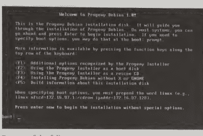

2. 执行以下操作之一：
   - 通过在屏幕底部的提示符处输入命令开始网络安装。参见“从网络安装”，第 47 页，或按 F1。
   
   或者
   
   - 将安装程序设置为在最小安装后使用非图形安装。最小安装使用基本 VGA 模式，应该在任何计算机上都可以使用。
   
   在命令提示符处，键入：`linux secondstage=text`，然后按回车键。
   
   或者
   
   - 按回车键开始安装。

在所有情况下，安装程序开始加载。

片刻之后，安装程序启动，欢迎屏幕打开。

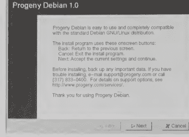

**注意**
在最小安装期间，你可以通过打开虚拟终端来排除故障。按 Ctrl-Alt-F2。
要返回安装程序，按 Alt-F7。

3. 选择**下一步**按钮。选择安装目标屏幕打开。

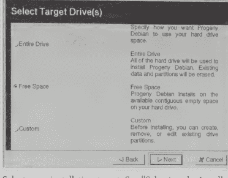

4. 选择你的安装目标。参见“选择安装目标”，第 58 页。

每个目标以不同的方式使用你的硬盘：

- **整个磁盘**：整个硬盘将用于安装。为你创建一个 125 兆字节的 Linux 交换分区。磁盘的剩余部分用于一个 Linux 分区。
- **空闲空间**：仅使用硬盘上的空闲空间。在任何硬盘上**大于 1 千兆字节**的第一个可用空闲空间将用于安装。Linux 分区尽可能大。交换分区的大小为 125 兆字节。
- **自定义分区**：硬盘将以你决定的方式使用。

> **警告**  
> 在进行自定义分区之前，请备份所有重要信息。否则，你可能会丢失信息。

5. 如有必要，执行以下操作之一：

如果你选择了**整个磁盘**，选择要使用的硬盘。然后按**下一步**按钮。

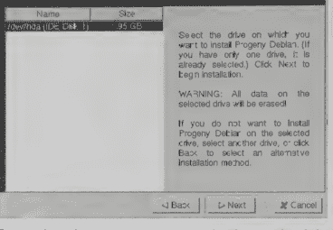

如果你选择了**自定义分区**，按照你想要的方式划分硬盘（如果你选择了自定义分区）。然后按下一步按钮。参见“创建和编辑分区”，第 60 页。

**注意**
如果你选择了**空闲空间**，则跳过此步骤。

**注意**
如果你是在现有的 Progeny Debian 安装上重新安装，请选择**自定义安装**并重新格式化分区。否则，重新安装可能会失败。

在所有情况下，配置系统启动屏幕打开。

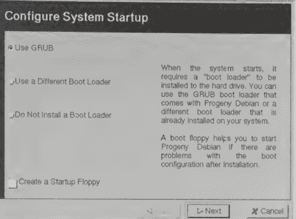

6. 选择要使用的启动加载器：
   - **使用 GRUB**：默认情况下，Progeny 使用 Grand Unified Bootloader（GRUB）。
   
   如果你之前安装了其他启动加载器，你可能需要编辑 GRUB 以添加其他操作系统。参见“配置启动加载器”，第 374 页。
   
   如果你已经在使用 GRUB，并且第一个硬盘的第一个分区上有 Windows，会自动创建 Windows 条目。
   
   - **使用不同的启动加载器**：如果你计划继续使用不同的启动加载器，例如 LILO，请选择此项。配置后你可能需要编辑条目。
   
   - **不安装启动加载器**：只有在你计划从软盘启动进入 Progeny Debian 时才选择此选项。否则，你可能无法启动计算机或无法启动 Progeny Debian。

**创建启动软盘**：选择此选项以创建启动软盘作为系统的替代启动方式。如果你也选择了不安装启动加载器，请务必选择此选项。建议所有用户选择此选项。

选择此选项时，你应该知道：
- 从软盘启动比其他选择速度慢得多。
- 软盘上的所有信息将被覆盖。在创建软盘之前备份任何重要信息。
- 随 Progeny Debian 盒装版附带的安装软盘可用作恢复磁盘，但使用此选项创建的是特定于你系统的。

完成后选择下一步按钮。准备系统屏幕打开。

7. 等待安装程序对你的硬盘进行分区和格式化，然后安装最小系统。准备系统屏幕显示进度。

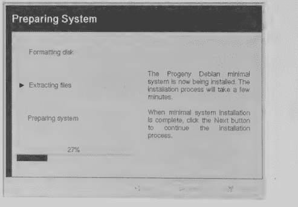


## 安装最小化系统
安装最小化系统大约需要 10 到 15 分钟。

当最小化系统安装完成后，**下一步**按钮将变为可用状态。按下**下一步**按钮以完成最小化系统的安装。

完成屏幕将打开。

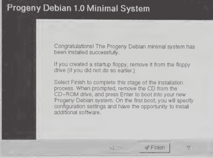

- 8. 按下**完成**按钮重启您的系统，以便您可以对其进行配置。请参阅“配置您的系统”，第 68 页。
- 9. 当安装程序指示移除时，请取出安装光盘。

```
CD has been unmounted. Please remove it, and press Enter to reboot:
```

如有必要，请更改计算机的启动顺序，以便从硬盘启动。如果您忘记了，请重启计算机并再次尝试。

# 注意

## 选择安装目标
选择安装目标是配置最小化系统的第一步。除非您选择自定义分区，否则这也是唯一的一步。每个安装目标对硬盘的使用方式不同。如果您不确定该选择哪一个，请研究每个目标的优缺点，以决定哪个最适合您。

### Progeny Debian 的安装目标

| 优点 | 缺点 |
| :--- | :--- |
| **整个磁盘** | |
| - 您不需要任何专业知识。<br> - 它速度很快。 | - 您缺乏对过程的完全控制。<br> - 除非您进行备份，否则信息会丢失。<br> - 默认设置可能不是您想要的，尤其是对于高级用户。 |
| **空闲空间** | |
| - 信息不会被破坏。<br> - 现有分区会被保留。<br> - 您不需要任何专业知识。<br> - 它速度很快。 | - 硬盘必须具有足够的连续空间供必要的分区使用。<br> - 您缺乏对过程的完全控制。<br> - 创建的分区可能比您想要或需要的更小。 |
| **自定义** | |
| - 您完全控制该过程。<br> - 您决定是保留还是删除现有分区。<br> - 您可以将主要目录（如 /home 或 /usr）放在不同的分区上。 | - 您必须清楚自己在做什么。<br> - 您可能意外破坏信息。 |

## 创建和编辑分区

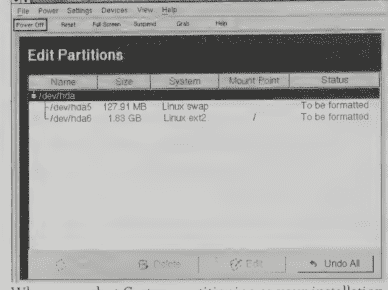

当您选择自定义分区作为安装目标时，编辑分区屏幕将打开。

使用编辑分区屏幕，您可以创建、删除或编辑分区。分区是硬盘的划分部分。

在继续安装之前，您至少需要一个根分区。您还应该添加一个用于虚拟内存的交换分区。

如果需要，您也可以创建其他分区。

例如，许多 Linux 用户喜欢将个人文件放在单独的分区上，以便于备份。

同样，有些人将打印队列放在单独的分区上以限制其大小。

# 注意

目前，在安装过程中无法调整分区大小或更改其类型。相反，请删除该分区然后创建新分区。

请记住，删除分区会破坏其上的所有信息。

要创建或编辑分区：

1. 从**编辑分区**屏幕中选择一个要编辑的分区或一块用于创建分区的空闲空间。您的选择将被高亮显示。

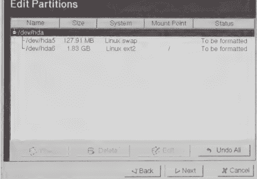

有关编辑分区屏幕的详细信息，请参阅“阅读编辑分区屏幕”，第 64 页。

2. 选择新建或编辑按钮。在这两种情况下，分区屏幕都会打开。

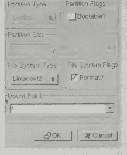

输入分区的特性。请参阅“新建和编辑屏幕字段”，第 66 页。


> **注意** 如果您正在编辑现有分区，则无法更改其类型或大小。您也不能使交换分区可启动。

您必须有一个根分区。此外，您可能希望有一个交换分区。您可能还希望创建其他分区。

您可以更改现有分区的挂载点而不会丢失其上的信息。

然而，如果您选择了“格式化？”复选框，一旦继续安装，您就会丢失现有分区上的所有信息。

完成后选择确定按钮。您将返回到编辑分区屏幕。

如果您正在创建分区，该分区现在会列出，而空闲空间的条目要么变小，要么不再列出。

3. 对每个您想要创建或编辑的分区重复步骤 1 到 2。请记住，不要在不备份重要信息的情况下格式化现有分区。

4. 选择**下一步**按钮以执行您对硬盘的更改。将显示确认屏幕。


5. 选择**是**按钮以继续安装。

# 注意

在您选择**下一步**按钮之前，对分区的更改不会生效。

如果您改变了关于您创建或编辑的分区的想法，您可以选择**撤销所有**按钮，将您选择的硬盘恢复至其原始状态。

您还可以使用后退按钮选择另一个安装目标。

## 阅读编辑分区屏幕

| 列 | 信息 |
|---|---|
| 名称 | 硬盘或分区的 Linux 名称。请参阅“阅读 Linux 设备名称”，第 40 页。驱动器以树结构显示，分区作为树的分支。 |
| 大小 | 分区的大小，以兆字节或千兆字节为单位。 |
| 挂载点 | 在 Linux 目录结构中访问该分区的目录。为了能够从 Linux 读取，除了交换分区外，所有分区都必须有一个挂载点。 |
| 系统 | 分区的格式或文件系统。可能的格式有：<br>- Linux ext2：Linux 原生格式。<br>- Linux swap：Linux 交换分区。<br>- FAT：FAT32 或 vfat，现代 Windows 格式。<br>- 空闲空间：无格式。 |
| 状态 | 分区的状态。通常，您看到的状态只有：<br>- 待挂载：分区已准备好使用，将被挂载，但不会被格式化。<br>- 待格式化：分区在使用前需要格式化。<br>- 可启动：分区在 Windows 中被列为可启动。如果 Windows 安装在第一个分区上，安装程序会检测到并将其自动设置为可启动。 |

> **注意**
>
> 在您选择下一步按钮之前，更改不会生效。

## 新建和编辑屏幕字段

| 字段 | 选项 |
| :--- | :--- |
| 文件系统标志 | 选择“格式化？”复选框以格式化分区。所有信息都将丢失。<br>为避免困难，如果您正在现有 Progeny Debian 安装之上进行安装，请选择此选项。 |
| 文件系统类型 | 分区的格式。可能的格式有：<br>- Linux ext2：Linux 原生格式。这是 Linux 中最常用的格式。<br>- Linux swap：Linux 交换分区。此格式用于虚拟内存，可能会提高性能。您可以拥有尽可能多的交换分区，只要空间允许。安装完成后，您可以重新编译内核以添加对其他类型文件系统的支持。Linux 可以支持二十多种文件系统，包括 FAT16（Linux 中的 msdos），这是 DOS 和早期 Windows 版本使用的格式。FAT32（Linux 中的 vfat）在 Progeny Debian 中默认支持。FAT32 是近期 Windows 版本使用的格式。还有几种类型的日志文件系统可用。 |
| 挂载点 | 读取该分区的目录。您可以从下拉列表中选择目录，或在字段中输入。下拉列表中的选项有：<br>◦ /：树中的根目录或顶级目录。<br>◦ /boot：启动 Linux 所需的文件。<br>◦ /home：用户的主目录和个人文件。<br>◦ /tmp：临时文件。<br>◦ /usr：所有用户的公共系统文件。<br>◦ /usr/share：所有用户的公共系统文件，包括许多基本程序。<br>◦ /var：变量文件，包括日志和队列。<br>◦ /var/spool：信息队列，例如打印作业。<br>非 Linux 分区的常见位置是 /mnt 目录中。为了方便，您可以使用 Windows 名称来称呼挂载点。例如：/mnt/C。<br>在继续安装之前，您必须至少有一个根目录。此外，交换文件提供更好的性能，使您能够使用虚拟内存。将其他目录放在不同的分区上可以使备份或恢复更容易。 |


## 新建和编辑屏幕字段

| 字段 | 选项 |
| --- | --- |
| 分区标志 | 选中“可引导？”复选框，以便在启动计算机时将该分区包含在可能的引导选项之中。要成为可引导分区，该分区必须已安装操作系统，或者是您计划安装 Progeny Debian 的分区。 |
| 分区大小 | 分区的大小。要更改大小，可以直接在字段中输入大小，或使用箭头键进行更改。 |
| 分区 | 选项为“主分区”或“逻辑分区”。 |
| 单位 | 分区大小的计量单位：兆字节 (MB) 或千兆字节 (GB)。 |

## 配置您的系统

配置您的系统是安装 Progeny Debian 的第二阶段。它发生在最小化系统安装完成并重启计算机之后。

根据您对系统的熟悉程度和计算机系统的速度，配置过程大约需要 10 到 15 分钟。

如果需要更多信息，请选中项目右侧的“帮助”按钮。

配置过程将引导您通过一系列屏幕来配置系统的不同方面。您可以选择要配置的方面。

安装完成后，您可以通过从 GNOME 控制中心的“系统”菜单中选择工具，来使用您在安装过程中使用过的工具。

### 开始配置阶段

在最小化系统安装完成后：

- 1. 从最后一个屏幕选择“完成”按钮。您的计算机将重启。
- 2. 当安装程序指示您移除介质时，请从驱动器中取出 Progeny CD 和软盘。您的计算机将重新启动。
- 3. 如有必要，请更改机器的引导顺序，使其从硬盘启动。参见第 45 页的“准备 CD 或软盘安装介质”。


**注意**

> 如果您忘记更改引导顺序，请重新启动计算机并重试。第二次重启机器不会影响安装过程。

片刻之后，“插入 CD-ROM”屏幕打开。

- 4. 将 Progeny Debian 安装 CD 放入驱动器，并按下 Enter 键。

片刻之后，**系统配置** 屏幕打开。

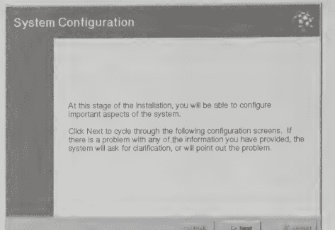

**注意**

如果您的视频卡或显示器未自动检测到，将打开基于文本的安装屏幕。有关如何使用这些屏幕的详细信息，请参见第 76 页的“配置视频卡”和第 78 页的“配置显示器”。

**注意**

如果您使用 `linux secondstage=text` 启动安装程序，则配置阶段将是基于文本的，而不是图形化的。

- 5. 选择 **下一步** 按钮开始安装程序的配置阶段。**选择要配置的选项** 屏幕打开。

**注意**

在任何位置中键单击屏幕（除了窗口外）都可以打开虚拟终端以进行故障排除。

### 选择要配置的选项

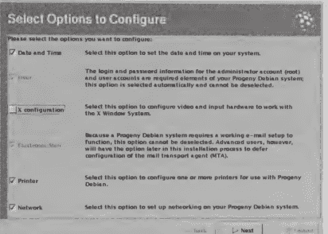

1. 选择要配置的选项。默认情况下，除 X 配置外，所有选项均已配置。您必须配置用户和电子邮件。

**注意**

如果您想要图形显示，请选择 X 配置。

大多数用户应配置所有选项。但是，如果您决定不配置，可以从桌面进行配置。

2. 选择“下一步”按钮以继续。日期和时间屏幕打开。

### 设置日期和时间

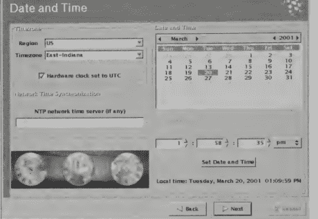

1. 在 **时区** 下，从下拉列表中选择您的**区域**。
2. 从下拉列表中选择您的**时区**。该列表随您选择的区域而变化。
3. **选择：**
   - 选中**系统设置为 UTC** 复选框以将系统设置为格林尼治平均时间。
   - 如果您有**网络时间服务器**，请指定其路径。
4. 在**日期和时间**下，选择月份。左侧箭头使月份向前移动，右侧箭头使月份向后移动。
5. **选择年份。**
   左侧箭头使年份向前移动，右侧箭头使年份向后移动。如果您将月份从十二月移动到一月，年份会自动改变。
6. **选择日期**，通过在日历上高亮显示该日期来选取。
7. 输入小时、分钟和秒。

   在每个字段中，您可以直接输入、高亮显示当前条目并覆盖它，或者使用箭头键进行更改。
8. 将时间设置为 AM 或 PM。

   如果您偏好 24 小时制时钟或使用格林尼治平均时间，您可以稍后使用 date 命令重置日期。
9. 选择“设置日期和时间”按钮。

完成后按下“下一步”按钮。用户屏幕打开。

### 配置用户和密码

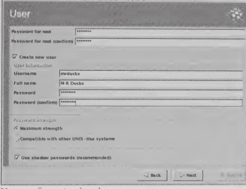

用户配置包含三个步骤：

- 设置 root 密码。
- 创建一个普通用户（可选，但推荐）。
- 设置密码强度。

在为 root 或新用户输入密码之前，请参见第 75 页的“配置密码级别”。

#### 选择安全的密码

安全的密码是指难以破解的密码。具体来说，它应该：

- 是字母、数字、符号以及大小写的混合。
- 长度至少为六个字符。
- 不基于任何与您相关的信息，例如生日、配偶姓名、宠物、或最喜欢的运动队或电影。
- 不是字典中常见的单词。
- 与其他机器上的密码不同。
- 与您的用户账号不同（指不要使用用户名作为密码）。
- 没有写在任何地方。

#### 设置 Root 密码

root 用户对系统拥有完全访问权限。通常，root 账号仅用于管理和配置。参见第 99 页的“启动和停止系统及图形界面”。

1. 输入 root 用户的密码（root 用户的账号名为“root”）。参见第 75 页的“配置密码级别”。
2. 重新输入密码以确认。

> **注意**
>
> 除非两个密码匹配，否则在移动到下一个屏幕之前，您会收到警告。

#### 创建普通用户账号

普通用户账号对系统的访问权限有限。即使您知道 root 密码，通常您也会在普通用户账号下完成大部分工作。参见第 99 页的“启动和停止系统及图形界面”。

1. 保持“创建新用户”旁边的复选框处于选中状态。选择“下一步”按钮。
   在几乎每种情况下，您都至少希望创建一个普通用户账号。
   安装完成后，您可以根据需要创建其他用户账号。
2. 为账号输入一个用户名。通常，用户名是您的名和姓的某种组合，例如 jmacdonald。
3. 输入账号的全名。全名可能与用户名相同，也可能不同。
4. 为账号输入一个密码。参见第 75 页的“配置密码级别”。
5. 重新输入密码以确认。

> **注意**
>
> 除非两个密码匹配，否则在移动到下一个屏幕之前，您会收到警告。

### 配置密码级别

1. 选择以下其中一项：
   - **最大强度：** 启用 MD5 密码。默认情况下是启用的。
     MD5 密码为您的系统增加了安全性。它还允许密码长度超过 8 个字符。
   - **与类 UNIX 系统兼容：** 不启用 MD5 密码。
     MD5 密码可能与较旧的系统或正在使用网络信息系统 (NIS) 的网络中的系统不兼容。
     除非您有兼容性问题，否则请接受默认的“最大强度”。
2. 保持相应的复选框选中以启用影子密码 (shadow passwords)。

启用影子密码后，密码会被加密并存储在只有 root 用户可读的文件中。

影子密码是一种标准的安全措施。但是，它们有时会在正在使用网络信息系统 (NIS) 的网络上导致问题。

除非您有兼容性问题，否则请接受默认值并启用影子密码。

3. 选择 **下一步** 按钮以继续。

如果您选择了配置图形显示，视频卡屏幕将打开。

如果您没有选择配置图形显示，电子邮件屏幕将打开。参见第 84 页的“配置电子邮件”。

### 配置视频卡

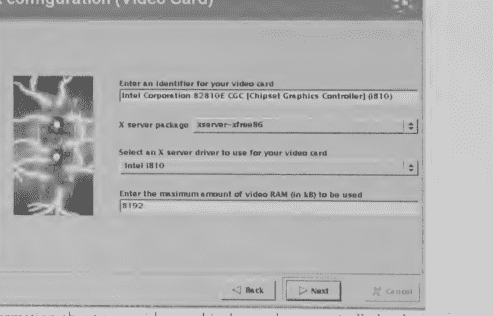

关于您视频卡的信息会被系统自动检测到。但是，如有必要，您可以更改此信息。


## 警告

选择不被您的视频卡支持的设置可能会损坏显卡或显示器。

1.  为您的视频卡配置输入一个名称或标识符。安装完成后，您可以在 XFree86Config 文件中看到此名称。
2.  如有必要，选择要使用的 X 服务器软件包（图形显示驱动程序）。在大多数情况下，您可以使用安装程序建议的那个。
    -   如果在选择可用的 X 服务器软件包时遇到困难，请尝试 `xserver-xfree86` 或 `xserver-vga`。
3.  如有必要，选择要使用的制造商和驱动程序。在大多数情况下，您可以选择安装程序建议的那个。
    -   如果在配置视频卡时遇到困难，请使用列表底部其中一个通用设置。
    -   通用 VGA 或通用 VESA 应适用于大多数卡。
4.  如有必要，输入该卡的显存量。在大多数情况下，您可以留空。

**注意**

此设置适用于较旧的显卡，并用于故障排除。在大多数情况下，Progeny Debian 会检测可用的显存。

5.  选择“下一步”按钮。显示器配置屏幕将出现。

### 配置显示器

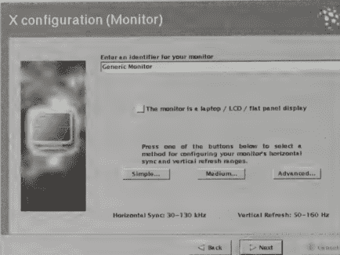

关于您显示器的信息会自动检测到。但是，如有必要，您可以更改这些设置。

> **警告**
> 选择不被您的显示器支持的设置可能会损坏显示器或视频卡。请参阅显示器文档以获取正确的设置。

1.  为您的显示器设置选择一个名称。安装完成后，您可以在 XFree86Config 文件中找到此名称。
2.  选择“简单”、“中等”或“专家”按钮，以选择配置显示器的方式：
    -   **简单**：从下拉列表中选择显示器尺寸。然后选择“确定”按钮。
    -   **中等**：从下拉列表中选择要使用的分辨率。然后选择“确定”按钮。
        -   您的选择不应超过您的显示器和视频卡都支持的最高分辨率。
    -   **专家**：输入您的显示器的水平同步范围（Horizontal Sync Range）和垂直刷新率（Vertical Refresh Rate）。
        -   如果不知道这些统计数值，水平同步设为 30–130，垂直刷新率设为 60–160 通常适用于大多数显示器。


**注意**

简单和中等模式，或建议的水平同步范围和垂直刷新率，并不总能为您提供显示器的最佳设置。如有必要，您可以在安装后更改设置。

3.  选择“下一步”按钮继续。桌面屏幕将打开。

### 设置桌面图形显示

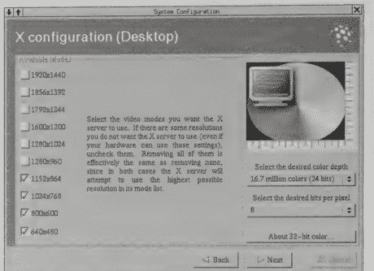

从桌面屏幕，您可以设置系统中图形显示的分辨率和颜色深度。

图形显示的设置取决于您的视频卡和显示器的能力。如果您在安装前未收集此信息，请参阅第 32 页的“收集硬件信息”。

> **警告**
> 选择不被您的视频卡和显示器共同支持的设置可能会损坏任一硬件。

1.  选择要支持的分辨率。默认情况下，您的桌面将以支持的最高分辨率启动，但您可以更改分辨率：
    -   临时更改：按 Alt-Ctrl-小键盘+ 键循环切换可用分辨率。
    -   永久更改：通过编辑 XF86Config 文件。
2.  从下拉列表中选择颜色深度，即您的桌面将使用的颜色数量。
    -   颜色越少，图形显示越不逼真，但重绘时间越快。
    -   但是，如果您的视频卡拥有超过 4 兆字节内存，对于大多数用途，您可以毫无问题地使用最高可用颜色深度。

**警告**

选择不被您的视频卡和显示器共同支持的设置可能会损坏任一硬件。

3.  选择“下一步”按钮继续。指针屏幕将打开。

### 配置指针

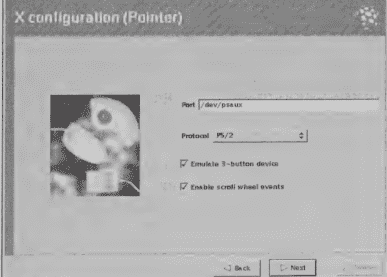

指针通常是一个鼠标。然而，它也可以是轨迹球、绘图板或任何其他取代鼠标的设备。

如果在安装过程中您一直在使用鼠标，您可以接受列出的设置。但是，如果您的鼠标不工作，您需调整设置。

1.  选择要使用的端口。
    -   在大多数情况下，串口鼠标使用 `/dev/ttyS0` (COM1) 或 `/dev/ttyS1` (COM2)，PS2 鼠标使用 `/dev/psaux`。
2.  选择要使用的协议或驱动程序。
    -   如果您使用的是串口鼠标，请从下拉列表中 manufacturers 名称。对于通用 `ps2` 鼠标，使用 `ps2`。
    -   如果您找不到适合您的鼠标或指点设备的协议，请选择 `Auto` 以便自动检测。
    -   您也可以尝试不同的协议，看看您的鼠标是否可以使用它们。
3.  如果您拥有两键鼠标，请选择 **模拟三键鼠标（Emulate 3-button mouse）**。
    -   通过三键模拟，同时按下指针的两个按钮等同于按下三键指针的中间按钮。
    -   Linux 是为使用三键鼠标设计的，因此大多数使用两键鼠标的用户应该选择此选项。
4.  选择 “**启用滚轮事件（Enable scroll-wheel event）**” 以使用滚轮。
    -   如果您的鼠标有滚轮，您可能希望使用此选项。
5.  选择“下一步”按钮。X 服务器屏幕将打开。

> **注意**
> 如果您没有使用指针，但从指针屏幕输入了可用的设置，指针将在配置阶段结束时变得可用。

### 设置高级图形显示选项

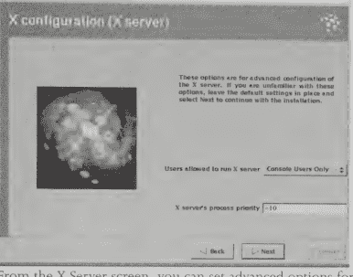

从 X 服务器屏幕，您可以设置图形显示的高级选项。如果不确定这些设置的含义，请使用默认值。

1.  从下拉列表中选择谁可以使用图形显示：
    -   仅限 Root：仅 root 用户。
    -   任何人：所有用户，无论是本地还是远程。
    -   仅限控制台用户：用户只能在本地键盘和显示器上启动图形显示。
2.  选择进程优先级。此设置决定了在任何给定时间内分配给图形显示的系
统资源份额。

> **警告**
> 更改图形显示的优先级可能会严重影响系统性能。除非您确定自己在做什么，否则不要将此设置从 -10 更改。

3.  选择 **下一步** 按钮。电子邮件配置屏幕将打开。

### 配置电子邮件

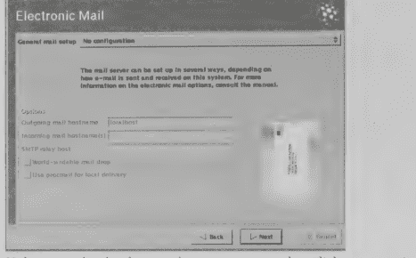

除非设置为仅本地，电子邮件需要网络或拨号连接。您可以在安装过程中或之后配置网络。拨号连接不是安装程序的一部分，但您可以在安装过程后设置。

如果您需要此屏幕选项方面的帮助，请咨询您的系统管理员或互联网服务提供商。

1.  选择通用邮件设置。选项包括：
    -   **互联网站点（Internet Site）：** 发送和接收邮件的机器是同一台发出邮件的机器。
    -   **带智能主机的互联网（Internet with smart host）：** 专用服务器投递邮件。当连接互联网服务提供商时，通常使用此设置。
    -   **卫星系统（Satellite system）：** 不本地投递邮件。邮件仅通过 smarthost 投递。
    -   **仅本地（Local only）：** 电子邮件只能由当前机器上的用户发送和接收。
    -   **无配置（No configuration）：** 未配置电子邮件。
2.  输入发件邮件主机名。请咨询您的系统管理员或 ISP 提供商以获取所需的主机名。
3.  输入收件邮件主机名。请咨询您的系统管理员或 ISP 提供商以获取所需的主机名。
4.  输入 SMTP 中继主机。请咨询您的系统管理员或 ISP 提供商以获取所需的主机名。
5.  如果您希望使用世界可写邮件投放目录，请勾选相应的框。
    -   世界可写邮件投放目录允许用户直接接收邮件，而不是仅通过网络邮件系统接收。速度更快，但可能存在安全风险。
    -   如有疑虑，请勿选择世界可写邮件投放目录。
6.  如果您希望使用 “procmail” 进行本地邮件投递，请勾选相应的框。
    -   Procmail 允许您过滤传入消息并将它们投递到除收件箱以外的文件夹。
    -   您可以使用其他工具进行过滤，因此如有疑虑，请勿使用 procmail。
    -   请参阅第 390 页的“使用 procmail 引导电子邮件”。
7.  选择“下一步”按钮。打印机屏幕将打开。


## 配置打印机

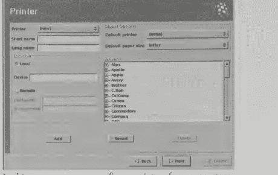

在此界面中，您可以为系统配置打印机。

1.  选择要创建或编辑的打印机定义。如果您尚未创建打印机定义，则只能选择“新建”。
2.  为打印机定义输入一个短名称和一个长名称。这些名称有助于您识别打印机。

短名称显示在打印机池（在文件发送到打印机之前存储文件的位置）以及配置文件中。长名称主要用于帮助您识别打印机。

在一些公司，打印机可能会使用主题进行命名，例如动物或名人。然而，基于制造商、型号和/或打印机路径名的组合命名可能更易于管理。

3.  选择打印机位置：
    - 本地：打印机连接在正在安装操作的机器上。您需要输入本地打印机所连接的设备。通常，该设备将是第一个并口，`/dev/lp0`。
    - 远程：打印机位于连接您机器的网络上。您需要输入：
        - 主机名：打印机所连接的机器名称。
        - 打印机名称：在打印机所连接的系统中该打印机的名称。

如果您没有这些信息，请咨询您的系统管理员。

4.  从列表中选择一个打印机驱动程序。打印机按制造商排序，然后按型号排序。

如果您的打印机未列在列表中，它可能能够模拟列在列表中的某一款。对于 Postscript 和非 Postscript 打印机，请尝试使用 Hewlett-Packard Laserjet 驱动程序。

5.  选择“应用”按钮以输入打印机定义。
6.  通过重复此过程添加任何其他打印机定义。请注意，您刚刚输入的定义现在列在打印机的下拉列表中。
7.  选择默认打印机。如果您在前一个界面中只输入了一个打印机定义，则它已被列为默认打印机。
8.  选择默认纸张大小。如果您位于北美，可以使用默认的 Letter 尺寸。否则，您可能希望使用 A4。
9.  选择“下一步”按钮。将显示网络界面。

## 配置网络

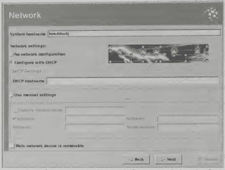

网络配置不仅用于网络，也用于电缆或 DSL 互联网连接。如果您是最终用户，请咨询您的系统管理员或互联网服务提供商以获取所需的设置。

1.  为您的机器输入一个主机名。
2.  选择以下其中一项：
    - 不进行网络配置：在未设置网络的情况下继续安装。如果您希望稍后添加网络支持，可以在安装完成后进行。
    - 使用 DHCP 配置：网络信息由 DHCP 服务器自动分配。DHCP 主机名由 ISP 分配给您的机器。此设置是可选的。在大多数情况下，可以忽略它。
    - 使用手动设置：输入网络所需的设置：
        - 域名：正在安装 Progeny Debian 的机器的名称。
        - IP 地址：正在安装 Progeny Debian 的机器的地址。
        - 子网掩码：定义系统网络地址中用于标识网络部分的位掩码。
        - 网关：作为通往网络外部机器默认路由的机器地址。
        - 名称服务器：为您的系统提供主机名查找服务的系统地址。

**注意**

请咨询您的系统管理员或互联网服务提供商以了解您需要填写的条目。

如果您的网络连接是通过 PCMCIA 或 Cardbus 网络卡进行的，请勾选“主网络设备是可移动设备”旁边的复选框。

选择“下一步”按钮。将打开完成界面。

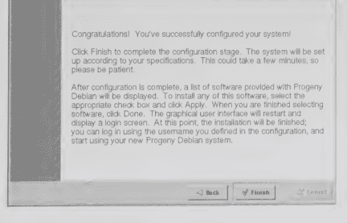

5. 选择**完成**按钮以完成安装配置阶段。在配置系统时，将显示条形图以指示进度。


当您的选择被输入后，配置即完成。将打开可用软件界面。

### 选择要安装的软件

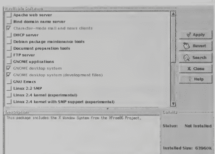

选择软件是 Progeny Debian 安装的第四个阶段。软件按软件包集排列。您可以双击软件包集以选择单个软件包。

Progeny Debian 预选了以下软件包集：

- 字符模式邮件和新闻客户端。
- GNOME 应用程序。
- GNOME 桌面系统。
- Mozilla。
- Netscape。
- X 窗口系统。

**警告**
取消预选软件包的选择然后点击应用，可能会删除您希望保留的操作系统部分。相反，请使用“还原”按钮并单独选择软件包。

安装其他软件所花费的时间取决于您的选择以及机器的速度。然而，在大多数情况下，选择和选择软件应花费 15 到 20 分钟。

1.  决定要安装哪些软件包集。为了收集信息以帮助您做出决定：
    - 选择一个软件包集：底部窗格中将显示简要描述。
    - 双击一个软件包集：将显示组成该软件包集的软件包窗口。如果您对 Linux 有一定了解，您可以决定选择哪些软件包。
    - 参考本节末尾的表格。此表格可帮助您决定是否需要特定的软件包集。
2.  选择要安装的软件。当软件包集被选中时，其旁边的框中会出现对勾，并且其名称以红色显示。

**警告**
某些软件包已经选中。除非您确定自己在做什么，否则请勿取消它们的选中状态。

窗口右下角显示软件包集的状态以及您的所有选择和基础系统所需的总空间。

使用的总空间应大于所有 Linux 分区的总空间（不包括交换文件）。

咨询本节末尾的表格以获取选择软件方面的帮助。


**注意**
额外光盘包含其他软件，您可以从桌面安装，包括 KDE 桌面。

3.  选择**应用**按钮以开始安装软件包。软件包管理器输出界面将显示有关安装的信息。


**警告**
如果您取消选择默认软件包，请使用**还原**按钮而不是**应用**按钮。否则，您可能会删除操作系统的关键部分。

如果在安装过程中出现询问界面以寻求澄清，请咨询帮助界面。在大多数情况下，您可以使用建议的设置。

如果显示安装进度的窗格停在 Y/N 问题上，在大多数情况下，您可以安全地输入*y*（代表“是”）。

当安装完成时，图形显示启动并打开登录界面。

4.  执行以下操作之一：
    - 以**root**身份登录，以配置系统的其他部分或安装额外光盘上的软件。
    - 或
    - 使用您的常规用户账户登录，开始使用您的 Progeny Debian 系统。
    - 或
    - 重新启动，以确保在安装过程中所做的选择所需的任何初始服务都能启动。

**注意**
虽然您可以立即探索您的 Progeny Debian 系统，但计划在完成安装过程后尽快重新启动系统，以确保一切运行正常。

## 软件包集

| 软件包 | 光盘 | 用途 |
| :--- | :--- | :--- |
| Apache Web 服务器 | 安装 | 将系统设置为 Web 服务器。 |
| Bind 域名服务器 | 安装 | 使系统成为域名服务器。 |
| 字符模式邮件和新闻客户端 | 安装 | 命令行邮件和新闻客户端。默认选择。 |
| DHCP 服务器 | 安装 | 使系统成为 DHCP 服务器。 |
| Debian 软件包维护工具 | 安装 | 创建 Debian (.deb) 软件包。 |
| 文档准备工具 | 安装 | 文档工具，包括 TeX、LaTeX、SGML 和 XML。 |


## 软件包集合

| 软件包 | CD | 用途 |
| :--- | :--- | :--- |
| FTP 服务器 | 安装 | 使系统成为 FTP 服务器。 |
| GNOME 应用程序 | 安装 | 生产力应用程序，例如文字处理程序和电子表格。这是默认选择。 |
| GNOME 桌面系统 | 安装 | Progeny Debian 的默认桌面环境。这是默认选择。 |
| GNU emacs | 安装 | GNU emacs 编辑器。 |
| 游戏 | 额外组件 | 一组游戏。 |
| KDE 办公软件 | 额外组件 | 用于 KDE 桌面的生产力应用程序，例如文字处理程序和电子表格。 |
| KDE 桌面 | 额外组件 | 另一种桌面环境。 |
| KDE 桌面系统（开发文件） | 额外组件 | 开发 KDE 桌面程序所需的文件。 |
| Linux 2.2 SMP | 安装 | 编译支持多处理器的 Linux 内核。 |
| Linux 2.4 内核（实验性） | 安装 | Linux 2.4 内核。 |
| 支持 SMP 的 Linux 2.4 内核（实验性） | 安装 | 编译支持多处理器的 Linux 2.4 内核。 |
| 杂项打印过滤器 | 安装 | 支持各种格式的打印过滤器，包括 TeX、DVI 和各种图形格式。 |
| Mozilla | 安装 | 开源网页浏览器、电子邮件客户端和新闻浏览器。这是默认选择。 |
| NFS 服务器 | 安装 | NFS/NIS 服务器。 |
| Netscape Communicator | 安装 | 非免费的网页浏览器、电子邮件客户端和新闻浏览器。这是默认选择。 |
| OpenLDAP 客户端软件 | 安装 | 用于使用 LDAP 服务器的客户端支持。 |
| OpenLDAP 服务器软件 | 安装 | 用于设置 LDAP 服务器的服务器和支持文件。 |
| Samba (SMB 协议) 服务器 | 安装 | 一套允许 Linux 系统通过网络与 Windows 系统共享文件和打印机的程序。 |
| 脚本语言 | 安装 | 脚本工具，例如 tk/tcl。 |
| 软件开发工具 | 安装 | 一套完整的软件开发工具。 |
| Squid 互联网对象缓存 | 安装 | 网页和 FTP 客户端的代理服务器。 |
| 窗口管理器 | 安装, 额外组件 | 替代的窗口管理器。 |
| X Window 系统 | 安装 | 提供图形显示。这是默认选择。 |
| Xemacs | 安装 | 为桌面使用而设计的增强版 emacs。 |
| Vim | 安装 | 增强版的 UNIX 文本编辑器 vi。 |

## 从额外组件 CD 安装软件

Progeny Debian 包含一个带额外软件的附加 CD，其中包括 KDE 桌面，这是图形显示的流行选择。

要从额外组件 CD 安装软件：

- 1. 以 root 用户身份登录系统。
- 2. 通过选择顶栏上的图标打开命令行。


- 3. 在提示符处输入：`apt-cdrom add`。然后按照屏幕上的说明操作，将附加 CD 放入驱动器以将其软件包集合添加到系统列表中。
- 4. 从屏幕左上角的菜单中选择“程序”>“系统”>“添加/移除软件”。


配置软件屏幕将打开。该屏幕类似于你在安装期间用来添加软件的屏幕，只是现在它还包含了附加 CD 的内容。

- 5. 选择要安装的软件包集合。
- 6. 如果愿意，双击某个软件包集合以查看或选择该集合中的单个软件包。
- 7. 选择“应用”按钮以安装软件。

你的 Progeny Debian 系统安装现已完成。

如果需要微调系统配置，请使用 GNOME 控制中心的系统工具。它们类似于你在安装期间使用的屏幕。

如果要添加软件或升级系统，请使用 `apt-get` 实用程序，或从主菜单选择“程序”>“系统”>“添加/移除软件”。在现有的 Progeny Debian 系统上重新安装通常很困难。

如果确实重新安装，请备份所有重要信息并重新格式化你正在使用的分区。

## 4. 启动和停止系统及图形界面

像任何版本的 Linux 一样，Progeny Debian 有严格的系统启动和停止程序。这些程序是操作系统安全功能的一部分。它们还可以防止意外损坏系统。

要启动计算机，你必须从引导管理器中选择要加载的操作系统，然后登录到用户账户。

要停止计算机，你必须注销用户账户，然后关闭或重新启动系统。

本章介绍：

- 处理用户账户。
- 从引导管理器选择操作系统。
- 登录到桌面和命令行。
- 从桌面关机。
- 启动和关闭图形界面。
- 登录后更改用户账户。

### 处理用户账户

Linux 是为多用户设计的。要使用系统，你必须使用用户账户登录。要使用账户，你必须知道用户名和密码。

用户账户被组织成具有类似系统访问权限的账户组。你可以使用的软件和硬件取决于你正在使用的用户账户及其所属的组。

有关更多信息，请参阅第 231 页的“管理用户账户”和第 235 页的“管理组”。

安装 Progeny Debian 时，请创建至少两个用户账户：一个用于日常计算的普通用户账户，以及一个用于系统管理的 root 账户。通常，你希望每个使用系统的人都有一个普通用户账户。

#### 理解普通用户账户

普通账户用于日常计算。每个账户都有一个主目录。默认情况下，用户的主目录位于 /home 目录之下。此主目录通常与账户的用户名相同。

使用某账户登录时，你通常可以：

- 读取、写入和使用该账户主目录中的所有文件和目录。
- 读取、写入和使用其他用户授予你权限的所有文件和目录。
- 读取但不能写入或使用基本系统文件。

在某些系统上，系统管理员可能会选择使基本系统文件对普通用户不可读。

对于熟悉其他操作系统的人来说，账户可能会带来不便。然而，用户账户有几个优势：

- 你的私人文件是安全的。你可以更改设置，使其他普通用户无法更改甚至无法看到你的文件。
- 你的桌面和命令行界面可以自定义。
- 计算机感染病毒的可能性较小。虽然病毒在 Linux 上不像在其他操作系统上那样是个问题，但任何损坏可能只影响一个用户的文件。
- 只有 root 用户才能使用重要文件。错误，就像病毒一样，可能只影响用户的个人文件。

#### 理解 Root 账户

Root 账户对系统上所有软件和硬件具有完全访问权限。在大多数情况下，它应该是拥有完全访问权限的唯一账户。因此，root 用户有时被称为超级用户或特权用户。root 用户的主目录是 /root。

> **注意**
> /root 目录不同于 Linux 目录树顶部的根目录。它也不是根分区 - 即根目录所在的分区。

为避免损坏系统，在使用 root 账户时请采取以下预防措施：

- 仅将 root 账户用于配置或管理。
- 尽可能短暂地使用 root 账户。
- 尽可能少的人知道 root 账户的密码。这些人中每个人都应使用另一个账户进行日常计算。
- 不要授予任何其他账户 root 权限。
- 不要在互联网上使用 root 账户。
- 即使在单一的非联网计算机上也要使用这些预防措施。


## 使用引导管理器

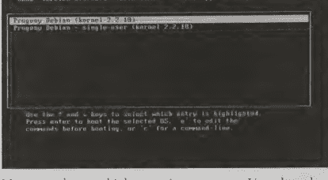

许多用户在同一台计算机上安装了多个操作系统或 Linux 内核。使用引导管理器，你可以选择使用哪个操作系统或内核来启动你的计算机。

Progeny Debian 使用 GRUB（统一引导加载器）。然而，其他引导管理器也被广泛使用，包括 LILO（Linux 加载器）。

GRUB 是你启动 Progeny Debian 系统时看到的第一样东西。

你可以编辑 GRUB 以显示任何已安装的操作系统或内核。你的 Progeny Debian 系统还包含单用户模式。单用户模式以基本系统启动机器，供 root 用户用于故障排除。

要从 GRUB 中选择操作系统，请执行以下操作之一：

- 使用箭头键突出显示一个菜单项。然后按 Enter 键。
- 等待默认选择启动。如果你不采取任何行动，默认选择将在 10 秒后启动。

在这两种情况下，Progeny Debian 都会启动。在进程启动并运行一些测试后，图形显示将开始，并打开登录屏幕。

你可以重新配置 GRUB 并向其中添加其他操作系统。参见第 374 页的“配置引导加载器”。

## 登录到 Progeny Debian

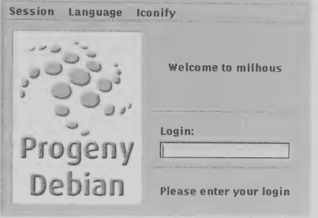

在 Progeny Debian 完成其初始进程并运行一些检查后，登录屏幕将打开。

登录是输入你的用户账户和密码的过程。

> **注意**
> 你不能像在有些操作系统中那样绕过这个过程。

默认情况下，你通过图形界面登录。但是，你也可以配置 Progeny Debian 以命令行方式启动。

### 通过图形界面登录

从登录窗口：

1. 如果需要，从菜单中选择选项：
   - 从 *会话* 菜单中选择桌面或窗口管理器。
   - 从 *语言* 菜单中选择一种 *语言*。

在这两种情况下，如果你没有做出选择，则你上次做出的选择将作为默认值使用。通常，你不需要做出选择。

2. 在 *登录* 字段中输入你的用户账户名，然后按 Enter 键。该字段将变为密码字段。


**注意**
仅将 *root* 账户用于配置或管理工作。

3. 输入你的用户账户密码。

如果你自上次登录以来更改了任何选项，则会显示一个 *对话框*。选择 *是* 按钮以将新选项设为默认。

如果你输入了系统中已有的账户名和密码，则 *桌面* 将启动。

如果账户名或密码 *不正确*，你将返回到 *登录窗口*。

### 从命令行登录

如果你配置 *Progeny Debian* 不自动启动 *图形* 界面，你可以从命令行登录。

你还可以以 *单用户模式* 启动 *Progeny Debian*，该模式不包含 *图形* 界面。如果你从 *单用户模式* 中的 *登录提示符* 按 Ctrl-D，*图形* 界面将启动。

1. 在登录 *提示符* 处，输入你的用户账户名，然后按 Enter 键。将显示 *密码提示符*。


**注意**
仅将 root 账户用于配置或管理工作。

2. 输入你的用户账户密码。

如果你输入了系统中已有的账户名和密码，则显示命令提示符，你可以开始工作。

如果账户名或密码不正确，你将返回到登录提示符。

## 关闭 Progeny Debian

Linux 通常同时运行许多进程。其中许多在后台运行，很容易让人忘记。因此，正确关闭系统是至关重要的。

正确的关闭通常被称为优雅关闭或退出。在优雅关闭期间：

- 所有进程和程序都已关闭。
- RAM 内存或交换分区中的所有信息已写入硬盘。
- 所有日志文件都已更新。
- 所有分区都已卸载。


**警告**
如果你没有正确关闭系统，可能会损坏操作系统或丢失文件。最好情况下，下次启动计算机时，你会经历一段较长的延迟，因为 root 分区正在进行检查。

你可以从以下位置关闭系统：

- 桌面。
- 命令行。
- 键盘。

### 从桌面关闭

1. 从菜单中选择“注销”。将显示确认窗口。
2. 如果你桌面有任何未保存的更改，请选择“保存当前设置”复选框。
3. 选择“是”按钮以注销并返回登录屏幕。
4. 从登录屏幕，你可以：
   - 以另一个用户登录。如果你只需短暂切换用户账户，你可能更喜欢使用 su。参见第 109 页的“更改用户账户”。
   - 从菜单中选择“系统 > 重新启动”。系统将关闭并重启。
   - 从菜单中选择“系统 > 停止”。系统将关闭。
   
   如果你选择“重新启动”或“停止”，将出现确认屏幕。
5. 选择“是”按钮以重新启动或停止系统。

> **警告**
> 如果你没有正确关闭系统，则会冒着损坏操作系统的风险。即使没有造成损坏，你的系统也会在重启前检查 root 分区。

更快的替代方法是打开命令行并在那里关闭系统。参见第 105 页的“关闭 Progeny Debian”。

### 从命令行关闭

1. 以 root 用户登录。
2. 从命令行或命令行窗口，输入以下命令之一：
   - `halt`：所有进程立即停止，系统关闭。
   - `shutdown halt +MINUTES` 或 `shutdown halt HH:MM`：显示一条警告消息，直到所有进程停止并且系统关闭。
     - `MINUTES` 是系统关闭前的分钟数。
     - `HH:MM` 使用 24 小时时钟设置关闭时间（小时和分钟）。
   - `reboot`：系统关闭并重启。

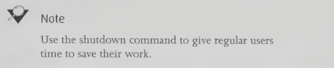


### 从键盘关闭

1. 依次按下 Ctrl-Alt-Backspace 键。桌面关闭，并打开登录屏幕。
2. 从登录屏幕，你可以：
   - 以另一个用户登录。如果你只需短暂切换用户账户，你可能更喜欢使用 su。参见第 109 页的“更改用户账户”。
   - 从菜单中选择“系统 > 重新启动”。系统将关闭并重启。
   - 从菜单中选择“系统 > 停止”。系统将关闭。
   
   如果你选择“重新启动”或“停止”，将出现确认屏幕。
3. 选择“是”按钮以重新启动或停止系统。

## 启动和关闭图形界面

Linux 使用 X 窗口系统来实现图形界面，例如桌面和/或窗口管理器。参见第 134 页的“理解图形界面”。

你可以选择在启动计算机时自动启动图形界面。这是 Progeny Debian 的默认设置。或者，你可以从命令行启动 X 窗口系统。

### 从命令行启动图形界面

你必须安装 X 窗口系统以及桌面和/或窗口管理器。

1. 登录到命令行。参见第 104 页的“从命令行登录”。
2. 输入：`startx`。X 窗口系统启动，并显示登录窗口。


> 如果你是从单用户模式启动，则 X 窗口系统不会加载。

3. 登录。参见第 103 页的“通过图形界面登录”。

### 退出图形界面

你可以：

- 退出 X 窗口系统并使其在后台运行。
- 关闭你从命令行启动的 X 窗口系统会话。

#### 让 X 窗口系统在后台运行

- 按 Ctrl-Alt-F1。显示带有登录提示符的全屏命令行。
- 登录。参见第 104 页的“从命令行登录”。
- 要返回桌面，请按 Alt+F7。你将返回到原来的用户账户。

#### 关闭 X 窗口系统

- 从面板打开命令行。
- 以 root 用户登录。参见第 109 页的“更改用户账户”。
- 从命令行，输入 `/etc/init.d/gdm stop`。然后按 Enter 键。
- 显示带有登录提示符的全屏命令行。

## 更改用户账户

你可以从命令行和桌面注销一个用户，然后登录另一个用户。但是，更改账户更便捷的方法是使用 su 命令（“切换用户”或“设置用户”）。

如果你需要在图形界面中短暂以 root 用户登录，这个命令特别有用。但是，要有效使用它，你需要习惯从命令行工作。

要更改用户账户：

- 如有必要，从面板打开命令行。
- 从命令行，输入 `su - USER COMMAND`。
  - 你不需要输入命令。
  - 如果你输入了命令，你只使用其他用户账户来运行该命令。然后你将返回到你的原始账户。


如果以普通用户身份登录，系统会提示输入密码。
如果以 root 用户身份登录，则不会显示密码提示。

3. 如有必要，请输入正在登录账户的密码。

### 注意

你仅在当前正在使用的命令行中更改了账户。如果你正在运行桌面环境，那么在其他窗口中，你仍然使用原来的账户登录。

4. 如果你在更改账户后没有运行任何命令，请重复此过程以返回到原来的账户。

如果你运行了命令，则命令执行完毕后立即返回到原来的账户。

## 5 了解命令行

命令行是一种基于文本的界面，用于与计算机进行交互。你输入一个命令，然后按 Enter 键执行它。如果你曾经使用过 DOS，那么你就已经使用过命令行了。

命令行也被称为终端（terminal）、xterm、控制台（console）、命令外壳（command shell）或 shell。这些术语中有些在技术上存在细微差别，但对于大多数用途而言，你可以将它们视为相同。

本章介绍使用 Linux 命令行的基础知识。涵盖内容包括：

- 为什么要使用命令行：解释为什么你应该学习使用命令行。
- 启动命令行：打开命令行的不同方式。
- 导航命令行：如何从命令行移动到不同目录以及列出文件。
- 输入命令：命令的结构以及如何执行命令。
- 使用命令行快捷键：Linux 命令行中可节省时间、精力和打字量的功能。
- 查找命令的帮助：命令的在线帮助系统。

手册的其他部分还包含了不同计算任务的命令行解决方案。

### 为什么要使用命令行？

大多数 Windows 和 MacOS 用户都通过图形桌面进行操作，并忽略命令行。越来越多的 Linux 用户也是如此。然而，出于以下几个原因，你应该学习如何使用命令行：

- 许多有用的工具只能从命令行使用。
- 命令行提供了更多的灵活性和强大的功能，特别是在处理多个文件时。
- 如果你需要进行系统恢复，你将通过命令行来完成。单用户模式下的维护工作也需要熟悉命令行。

这些原因足够重要，以至于许多 Linux 用户宁愿从命令行工作而不是使用桌面。

如果你使用过 DOS，你会发现 Linux 命令行容易得多，也强大得多。它不仅有许多快捷键可以节省时间，你还可以选择最适合你需求的命令行界面——shell。本手册假设你正在使用 BASH（Bourne Again Shell），这是 Progeny Debian 以及大多数其他 Linux 发行版的默认 shell。

### 启动命令行

如果你的计算机未配置为使用图形桌面，系统启动时命令行已经处于运行状态。

要在运行图形桌面时启动命令行，请执行以下任一操作：

- 从面板中选择命令行。


- 从菜单中选择“程序 > 系统 > Eterm”、“GNOME 终端”或“普通 xterm”。命令行窗口将打开。

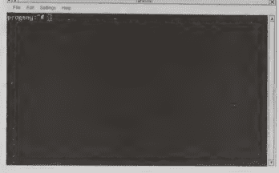

- 按 Alt-F2，或从菜单中选择“运行”。将打开一个单行命令窗口。

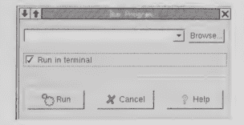

- 在工作区上右键单击。然后从弹出菜单中选择“新建 > 终端”。

- 使用左侧按键按下 Ctrl-Alt-F1。全屏命令行将打开。

若要返回桌面，请按 Alt-F7。

### 输入命令

对于新用户来说，命令可能看起来令人望而生畏。然而，一旦你意识到所有命令都遵循相同的基本结构，你就可以开始高效地使用它们。

本节涵盖：

- 理解命令的各个部分。
- 理解命令结构。
- 输入多个文件名。
- 输入通配符。
- 输入多个命令。
- 组合命令。
- 在后台运行命令。

#### 理解命令的各个部分

命令有时是一个单词。然而，命令可能包括：

- 选项：命令执行方式的变体。如果选项是为 UNIX 开发的或由无附属关系的程序员开发的，它们以一个连字符（-）开头；如果是由 GNU 基金会开发的，它们则以两个连字符（--）开头。由于 GNU 命令通常是完整的单词，因此往往更用户友好。
- 参数：影响命令确切做什么或如何做的固定值。
- 目录或文件：命令影响的对象。某些命令，如 cp（复制），需要一个源文件（正在处理的文件）和一个目标文件（受影响的文件）。
- 字符串：由双引号或单引号括起来的一组字符。通常，字符串包含正则表达式或通配符。

命令的执行效果可能差异很大，具体取决于使用的选项、参数和文件。例如，如果你简单地输入 `date`，则显示当前日期和时间。然而，如果你输入 `date 0707132101`，则计算机的日期将更改为 2001 年 7 月 7 日下午 1:21。

### 注意

命令、选项和参数通常是对它们功能的简略描述。例如，`cp` 复制文件，而 `su` 切换你正在使用的用户账户。类似地，在某些命令中，`-v` 选项是 version（版本）的缩写，列出命令的版本号。知道完整的描述是记忆命令的一种有用方法。

#### 理解命令结构

命令的各个部分始终按以下顺序输入：

`COMMAND OPTIONS ARGUMENT FILES`

一个典型的命令是 `chgrp -Rv root /home/itang/ToDo`。

在此示例中：

- `chgrp` 是基本命令。它是“change group”（更改组）的缩写。它将命令末尾文件的所属权从一个用户组转移到另一个组。
- `-Rv` 是两个选项：
    - `-R`（recursive，递归）使命令影响命令末尾目录下的所有文件和子文件夹。
    - `-v`（verbose，详细）使命令在更改文件和文件夹时列出它们。

### 注意

这两个命令只需要一个连字符。然而，如果你更喜欢分开写，可以输入 `-R -v`。

- `root` 是一个参数。在这种情况下，它意味着目录的所有权将转移给 root 用户。
- `/home/itang/ToDo` 是所有权正在被更改的目录。最初，它属于用户 `itang`，因为它位于该用户的 home 目录中。命令运行后，`ToDo` 目录将属于 root 用户。

#### 理解常用选项

许多选项因命令而异。然而，少数基本选项的使用相对一致。它们可能存在细微差别，例如使用大写字母或小写字母。如果你对某个选项有疑问，请在使用前查阅帮助。

### 常用命令选项

| 选项 | 作用 |
| :--- | :--- |
| -d, --debug | 显示调试信息 |
| -f, --force | 无论后果如何都运行命令，例如覆盖现有文件。 |
| --help | 显示该命令的信息帮助 |

### 常用命令选项

| 选项 | 作用 |
| :--- | :--- |
| -i, --interactive 或 --ignore-case | 在执行命令的每个部分之前等待确认（i，interactive，交互模式）。<br>忽略小写字母和大写字母之间的区别（ignore-case，忽略大小写）。 |
| -R, -r, --recursive | 包含命令中目录名称下的文件和子目录。 |
| -V, -v, --verbose | 显示命令正在执行的操作，以便你可以看到其进度。 |

### 为命令输入多个文件名

让命令影响多个文件的最简单方法是输入文件名，并在它们之间加一个空格。由于这种方法指定了哪些文件受命令影响，它减少了不小心将命令应用于错误文件的可能性。

例如，如果用户 mary 想要将名为 tasklist 和 notes 的文件复制到她的备份目录，她会输入：

```
cp /home/mary/tasklist notes /home/mary/backup/
```

### 使用字符串输入命令

某些命令使用字符串作为参数。字符串是单引号或双引号内部的字母、数字、字符和/或空格的组合。


在字符串中，您可以输入多个单词，或者禁用元字符（也称为通配符）。使用元字符的字符串被称为正则表达式。参见“使用元字符或通配符”，第 118 页。

如果您使用双直引号，除了环境变量（如 `$HOME`）之外，所有元字符均被禁用。

单直引号会禁用所有特殊字符。在大多数情况下，请使用单引号。

请勿使用真引号（“ ”）。如果您从文字处理程序中复制和粘贴，真引号可能会导致问题。

例如，如果您想搜索用户 jsmith 的主目录中包含短语“business expenses”的文件，您可以使用 grep 命令并将该短语作为参数：`grep 'business expenses' /home/jsmith/`。

## 使用元字符或通配符

元字符是指定选择范围的字符。它们也被称为特殊字符或通配符。

您可能熟悉其他操作系统中的基本元字符：

-   星号 (*) 包含任意数量的字符。
-   问号 (?) 包含任意单个字符。

**警告**

元字符功能极其强大，尤其是在组合使用时。在删除和复制文件时，请谨慎使用它们。

**注意**

如果您想搜索通常用作元字符的字符，请在其前面放置反斜杠 (\)。例如，\? 搜索问号，而不是任意字符。

## 元字符或通配符

| 元字符 | 代表 |
| :--- | :--- |
| . | 换行标记以外的任意字符。 |
| ? | 任意一个字符，或者无。 |
| [ ] | 括号内字符中的任意一个。 |
| * | 任意数量的字符，或者无。 |
| ^STRING | 行首的字符串。 |
| STRING$ | 行尾的字符串。 |
| STRING+ | 匹配字符串中一个或多个字符 |
| STRING | 匹配一系列实例 |
| (STRING \| STRING) | 其中一个字符串。 |

当元字符一起使用时，其威力特别强大。例如：

-   `^contacts$` 匹配 `contacts` 是行中唯一单词的文本。
-   `[Cc]ontacts` 匹配 `Contacts` 或 `contacts`。
-   `^...5` 搜索任意三个字符的行。
-   `compan(y|ies)` 搜索 `company` 或 `companies`。
-   `[A-Za-z]` 搜索任意大写字母或小写字母。同样，`[0-9A-Za-z]` 搜索任意数字或任意字母。

## 输入多个命令

用分号分隔多个命令。

例如，如果您输入 `cd /backup;ls s*`，您将移动到 `/backup` 目录（使用 `cd`），并列出该目录中所有以 `s` 开头的文件。

## 组合命令

您可以通过在命令之间输入管道字符（`|`）来组合命令。这种技术被称为管道。

例如，如果您输入 `ls|less`，您将使用 `less` 命令显示当前目录中的文件（`ls`），该命令允许您在列表中来回滚动。如果您有一个长长的文件列表，这种组合将非常有用。


**警告**

请谨慎使用管道。有时，它会产生 unwanted 或意外的结果。

## 在后台运行程序

如果您正在使用 X 窗口系统，命令提示符通常位于自己的窗口中。因此，您可以在命令运行期间轻松执行其他任务。但是，如果您仅使用命令行，您可以在后台运行命令，以便在命令运行期间使用 shell 执行其他任务。

要在后台运行命令，请输入 `COMMAND &`。

## 停止命令运行

按 Ctrl-C。

正在运行的命令停止。然后，新的命令提示符显示在之前的提示符下方。

## 导航命令行

Linux 系统在目录中存储文件。目录以树状结构排列。树的顶部是根目录 (\/)。即使在另一个分区上的目录也是根目录的子目录。参见“搜索文件和文本”，第 167 页。

使用几个基本命令，您可以：

-   更改目录。
-   读取目录的内容。
-   识别目录中条目的类型。
-   找到您的当前目录。
-   清屏。

## 更改目录

输入 `cd` DIRECTORY。

除非您要更改的目录是当前的子目录，通常您应该输入到该目录的完整路径名称。

要切换到当前目录的上一级目录，请输入 `cd ..`（两个点）。

## 读取目录内容

输入 `ls` OPTIONS DIRECTORY。

通过仔细选择选项，您可以使用 `ls` 列表命令来帮助您定位文件。例如，`-s` 按大小列出文件，而 `-t` 按修改时间列出文件。

另一个技巧是设置别名，使得输入 `list` 的结果为 `ls -- color`，这会根据文件类型以不同颜色打印文件。参见“创建别名”，第 126 页。

## `ls` 命令（列表）

| 选项 | 操作 | 备注 |
| :--- | :--- | :--- |
| `-a` | 在列表中包括隐藏文件。 | 大多数隐藏文件以点开头。 |
| `--color` / `--colour` | 以颜色显示文件类型。 | |
| `-f` / `--classify` | 使用符号显示文件类型。 | 常见符号为：<br> - `/`：目录。<br> - `*`：可执行文件。<br> - `@`：符号链接。 |
| `--full-time` | 打印完整的文件属性。 | |
| `-l` / `format=long` | 显示文件属性。 | |
| `-L` / `--dereference` | 列出符号链接引用的文件，而不是链接本身。 | 参见“使用符号链接”，第 218 页。 |
| `-R` / `--recursive` | 包括子目录。 | |
| `-S` / `sort=size` | 按大小对文件进行排序。 | 首先显示最大的文件。 |
| `-t` / `--sort=time` | 按修改顺序显示文件。 | 首先显示最近修改的文件。 |
| `-X` / `--sort=extension` | 按文件扩展名排序。 | 并非所有文件都有扩展名。 |
| `-x` / `--format=across` | 以多列列出文件。 | |

## 识别目录列表类型

输入：`file` OPTIONS FILE。

要查看目录中所有列表的类型，请输入目录名，后跟星号通配符。例如：`file /root/*`。

> **注意**
> 除非选择 -z 选项，否则 file 命令不会读取压缩文件或符号链接。

识别目录列表的另一种方法是使用带有 `-color` 选项的 `ls` 命令。参见“读取目录内容”，第 121 页。

## file 命令（识别文件类型）

| 选项 | 操作 | 备注 |
| :--- | :--- | :--- |
| `-l` | 列出符号链接引用的文件，而不是链接本身。 | 追踪原始文件。 |
| `-z` | 读取压缩文件。 | |

## 查找当前位置

输入 `pwd`。

当前或工作目录显示在屏幕上。

## 清屏

输入 `clear`。

只影响屏幕显示。命令历史不受影响。

## 使用命令行快捷键

Linux 有几个输入命令的快捷键：

-   标签补全。
-   历史记录。
-   命令粘贴。
-   别名。
-   文件路径缩写。
-   重定向输入和输出。
-   环境变量。

### 使用标签补全

通过按 Tab 键，您可以让 shell 补全您正在输入的命令。如果您不确定想要使用哪个命令，也可以使用标签补全作为命令的指南。

如果只有一个命令能补全您已输入的内容，则自动输入完整命令。但是，您仍需要添加任何选项、参数和文件，并按 Enter 键。

如果有一个以上的命令能补全您输入的内容，则显示可能补全项的列表。您可以将此列表作为命令的指南。或者，您可以输入另一个字母，按 Tab 键，并显示另一个补全列表。

例如，如果您输入 `chg` 然后按 Tab 键，则在提示符处输入命令 `chgrp`。没有其他命令可以补全 `chg`。

另一方面，如果您输入 `cha`，您将获得以下列表：

`chage` `chat` `chattr`

这次，这三个命令补全了您输入的内容。

### 使用命令历史

主目录中的 `.bash_history` 文件列出了您从命令行输入的所有命令。

您可以使用此文件重新输入您已经使用过的命令。如果您正在执行重复性工作，或者如果您犯了错误并希望在不重新输入的情况下更正，此功能非常有用。


# 使用文本粘贴

你可以使用鼠标复制并粘贴仍显示在屏幕上的文本。

要粘贴命令：

1.  按下鼠标左键，并将光标拖过你要粘贴的文本。文本会被高亮显示。
2.  松开鼠标按钮。
3.  将光标定位到你要粘贴文本的位置。然后单击鼠标中键。文本将被粘贴。如果你选择的是一整行包含命令的文本，那么该命令会自动执行。

# 使用命令别名

别名是命令的较短名称。如果你希望为带有常用选项组合的命令创建一个快捷方式，别名特别有用。

你可以：

*   创建别名。
*   删除别名。
*   查看现有别名。

## 创建别名

输入 `alias 别名 = 命令 选项`。

如果原始命令包含选项和参数，请将其作为单引号中的字符串输入。

例如，如果你经常向名为 progeny 的打印机打印三份副本，你可以通过输入 `alias p3='lpr -3 -P progeny'` 来创建一个别名。

一旦创建别名，你可以使用别名代替原始命令。例如，要将文件 `contactlist.txt` 发送到打印机，你需要输入 `p3 contactlist.txt`。

## 删除别名

输入 `unalias 别名`。

## 查看别名

输入 `alias`。将显示别名列表。

# 缩写文件路径名

命令行最大的缺点之一是输入文件名可能很繁琐。你可以使用以下方法减少输入量：

*   快捷符号。
*   相对路径。

## 使用特殊符号

你可以使用以下特殊符号来减少文件名中所需的输入量。

### 命令行的特殊符号

| 符号 | 代表含义 |
| :--- | :--- |
| `.` | 当前所在的目录（工作目录）。 |
| `..` | 当前目录上一级的目录（父目录）。 |
| `~` | 你的主目录。 |
| `~用户` | 列出用户账户的主目录。 |
| `/` | 根目录 |

## 使用相对路径名

文件的完整路径名以根目录开始。例如，`jgill` 主目录中 `January` 文件夹内的文件 `ToDo` 的路径为 `/home/jgill/January/ToDo`。

完整路径通常被称为绝对路径。

你可以输入相对路径来代替输入绝对路径，从而节省时间。相对路径：

*   以当前目录开头，而不是根目录。
*   必须指向当前目录的子目录。
*   不以正斜杠开头。

例如，如果你位于 `/jgill/January` 目录中，`ToDo` 的相对路径将是 `January/ToDo`。在主目录中，相对路径将是 `/jgill/January/ToDo`。

# 重定向命令的输入和输出

在大多数情况下，你从键盘输入命令，结果和任何错误消息都显示在屏幕上。

换句话说，键盘是标准输入，屏幕是标准输出和标准错误。

通过更改这些标准，你通常可以节省时间和精力。

重定向的用途包括：

*   将结果或错误写入文件以保持永久记录。
*   将结果或错误写入打印机，以获取硬拷贝记录。
*   使用文件作为输入，而不是键入输入。
*   结合两个命令，使它们协同工作。

随着你学习命令行，你可能会发现重定向的其他用途。

要重定向命令的输入、输出或错误，你需要使用一组称为重定向运算符的字符。

## 重定向运算符

| 字符 | 功能 |
| :--- | :--- |
| `>` | 将输出重定向到文件或硬件部件（如打印机）。如果文件已存在，旧文件会自动被覆盖。 |
| `>>` | 重定向输出，但如果输出是一个已存在的文件，则将该输出附加到现有文件的末尾。通常，使用此字符比 `>` 更安全，因为它不会覆盖现有文件。 |
| `2>` | 将错误输出重定向到文件或硬件部件（如打印机）。 |
| `<` | 将命令的输入重定向自文件或设备。 |

使用重定向的格式为：

```
命令 运算符 目标
```

例如，如果你想将关键词“expenses”的搜索副本保存在文件中，你可以输入 `grep 'expenses' January2001 > expenses.txt`。

在此示例中：

*   `grep` 是搜索命令。
*   `expenses` 是你要搜索的参数字符串。
*   `January2001` 是要搜索的文件。
*   `expenses.txt` 是结果打印到的文件。如果该文件不存在，它将被创建。

# 使用环境变量

环境变量定义了与系统交互方式的不同方面。有些变量，如 `$HOME`（你的主目录变量）已为你设置。但是，你也可以创建自己的变量，用于脚本或在命令行中节省时间。

你创建的变量存储在你主目录中的 `.bash_profile` 文件中。

## 添加变量

输入：`export 变量=值`。

例如，如果你想创建变量 `$INCOME` 来引用目录 `/home/jsmith/Expenses`，你需要输入 `export INCOME=/home/jsmith/Expenses`。

## 使用变量

要使用变量，请在通常输入值的地方输入其名称，并在其前面加上美元符号。例如，如果你创建变量 `$INCOME` 来引用目录 `/home/jsmith/Expenses`，你可以通过输入 `less $INCOME/january` 来查看文件 `/Expenses/january`。

# 查找命令帮助

本手册仅列出了一些基本命令。对命令的全面指南将需要 1000 多页。

要查找有关 Linux 命令的更多信息，你可以使用 *man* 或 *texinfo* 帮助系统。对于快速帮助，你可以使用 *whatis*。

## 使用 man 页面

man（“manual”）页面是 UNIX 和 Linux 的传统帮助文件。man 页面存在于命令和配置文件中。

man 页面是摘要而非操作指南。此外，许多 man 页面已不再更新。因此，man 页面通常难以使用。

要打开 man 页面，请输入 `man 命令` 或 `man 文件`。

## 搜索 man 页面

你可以通过输入 `apropos 关键词` 来搜索 man 页面中关于特定主题的所有条目。此命令的一个缺点是，常见主题可能列出数量庞大的条目。

## 使用 Info 文档

Info 文档是 GNU 帮助。通常，info 文件比 man 页面更最新、更详尽。大多数人觉得它们更容易使用。

要打开 info 文档，请输入 `命令 --help`。

## 使用 whatIs

`whatis` 命令提供所输入主题的简短摘要。

输入：`whatis 关键词`。

## 6 了解桌面

大多数操作系统提供与计算机交互的两种方法：桌面和命令行。

在流行操作系统中，命令行通常被弱化。*Progeny 建议你对 Linux 采取混合方法。*

对于日常工作，桌面方便且易于学习。但是，请考虑在复杂工作中使用命令行。Linux 命令行比图形界面更难学习，但在许多情况下，它更容易且更快使用。

Progeny Debian 的默认图形界面是 GNOME（GNU 网络对象模型环境）。本章描述了 GNOME 的功能。但是，你也可以从 Extras CD 安装 KDE（K 桌面环境）。这两个桌面具有类似的功能和特点。

大多数现代计算机用户（至少是那些安装 Linux 的用户）都知道使用桌面的基本知识。因此，本章更侧重于指出功能，而非解释功能。其主要重点包括：

*   你已经知道的功能在哪里可以找到。
*   新 Linux 用户可能不了解的功能是什么。

有关更多详细信息，请参阅 GNOME 在线帮助。


## 了解图形界面

与其他流行的操作系统不同，Linux 允许你自定义图形界面的所有部分。

Linux 使用 X 窗口系统（也称为“X”）来显示图形。X 窗口系统使用以下三个部分来提供图形界面：

- X 服务器：提供基本图形支持的程序。大多数 Linux 版本的默认 X 服务器是 XFree86。
- 窗口管理器：控制界面上窗口放置和移动的程序。一些窗口管理器拥有如此多的功能，以至于它们几乎可以独立构成桌面。Progeny Debian 使用 Sawfish，这是目前最受欢迎的 GNOME 窗口管理器。
- 桌面：包含一组功能并与窗口管理器配合以提供完整图形环境的程序。

你可以单独选择这些部分的每一项。只有少数 Linux 用户会更改 X 服务器，但许多人会定期更改窗口管理器和桌面。一些用户偏好使用窗口管理器，而不使用桌面。

此外，你还可以通过更改主题、默认颜色和设计方案来改变窗口管理器或桌面的外观。整个网站都致力于主题，例如 www.themes.org。

### 了解默认桌面的组成部分

GNOME 桌面与其他操作系统上的桌面相似。然而，请花时间找到桌面各部分的位置。某些功能可能不在你预期的位置，而其他功能可以通过多种途径访问。

你可以向 GNOME 桌面添加许多功能。然而，默认桌面由以下部分组成：

- 菜单。
- 面板。
- 文件管理器。
- 工作区。

### 菜单

菜单：你可以通过打开以下两个菜单之一来选择要运行的程序：

- 位于屏幕左上角的 GNOME 主菜单。
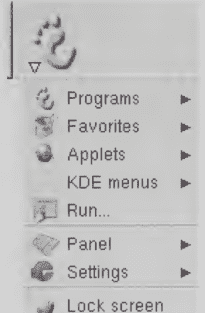
- 工作区弹出菜单中的“程序”项。

> **注意**：要使菜单或子菜单保持打开状态，请双击虚线上方的顶部区域。菜单将变为普通窗口。此功能有时被称为“可拆卸菜单”。

### 面板

面板横跨桌面顶部。它包含菜单、图标和常用工具。面板包括：

- 左侧的 GNOME 菜单。
- 用于在线帮助的 GNOME 帮助图标。
- 用于你的互联网连接的浏览器图标。
- 用于配置桌面的 GNOME 控制中心。参见第 149 页的“让桌面成为你的专属”。
- 添加/移除软件图标。
- 用于打开命令行的终端图标。
- 位于任务列表旁的 GNOME 桌面指南，即分页器（pager）。分页器打开当前运行进程列表并显示窗口在工作区上的位置。

选择分页器以打开或关闭它。


- 用于显示每个工作区上窗口的状态停靠区。
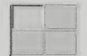

- 右侧用于显示最小化窗口的任务列表。
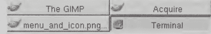

还要注意面板两侧的箭头。选择箭头会将面板滑出，以在工作区中提供更多空间。再次选择箭头会将面板滑回原位。


### 文件管理器

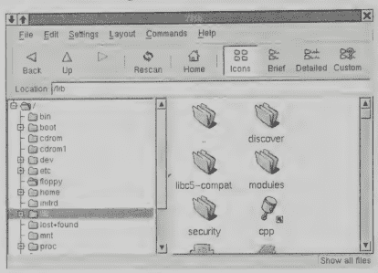

默认的文件管理器是 GNOME Midnight Commander。你可以通过以下方式使用它：

- 从主菜单中选择 程序 > 文件管理器。
- 在桌面上右键单击时，从弹出的菜单中选择 新窗口。
- 在命令行输入 `mc`。
- 选择主目录图标。

### 工作区

使用 GNOME，你可以创建多个或称为工作区的虚拟桌面。每个工作区可以有行或列，有助于窗口的定位。参见第 149 页的“让桌面成为你的专属”。

多个工作区运行需要更多内存。然而，如果以下情况成立，它们可能很有用：

- 你的显示器较小。
- 你希望为不同的任务设置不同的图标集。
- 你打开了许多窗口，因此很难追踪它们。
- 你希望保持一个窗口打开以供使用，但不希望它始终占据主工作区的位置。

如有必要，你可以关闭多个工作区以节省内存。

要在工作区之间移动，请执行以下操作之一：

- 在分页器上选择一个工作区。
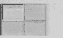

- 中间点击当前工作区并选择另一个工作区。
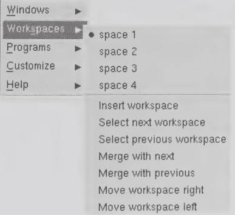

从工作区子菜单中，你可以：

- 选择一个工作区。
- 选择下一个或上一个工作区。
- 自定义工作区的功能。

## 熟悉桌面

GNOME 桌面的工作方式与其他桌面非常相似：

- 你通过左键单击图标或菜单项来启动程序。
- 你通过右键单击桌面元素来设置属性。
- 窗口通过其菜单或右上角的图标进行最小化或最大化。
- 通过用鼠标单击窗口的任何部分，窗口变得处于活动状态（或者如 GNOME 所述，获得焦点）。
- 最小化（也称为“图标化”）的窗口显示在任务列表中。
- 回收站存储已删除的文件，以防你想要恢复它们。


然而，如果你是 Linux 的新手，其中一些功能可能对你来说是不熟悉的。本节不重复你已知的内容，而是专注于这些不熟悉的功能。

## 使用三键鼠标

与其他 Linux 桌面一样，GNOME 是为三键鼠标设计的。如果你的鼠标只有两个按钮，你可以配置系统以模拟三键鼠标。当模拟功能启用时，同时按下两个按钮相当于使用鼠标中间按钮。

在大多数情况下：

- 鼠标左键选择要启动的图标或菜单项。
- 鼠标右键显示弹出菜单。通常，此菜单用于设置桌面元素（如图标）的属性。
- 中间键用于其他功能（如果存在）。

要查看鼠标按钮的其他功能，将鼠标悬停在桌面的一部分上以查看弹出列表。

| 按钮1-移动 | 交互式移动窗口 |
| 按钮1-关闭 | 提升窗口 |
| 按钮1-点击2 | 切换窗口收缩 |
| 按钮2-关闭 | 降低窗口 |
| 按钮3-点击1 | 弹出窗口菜单 |

## 使用桌面弹出菜单

面板、菜单、图标和工作区都有弹出菜单。然而，工作区有两个弹出菜单：

- 在桌面上的空白处右键单击会打开桌面弹出菜单。

从此菜单中，你可以创建图标、重新扫描桌面以更新它，并设置其他桌面属性。
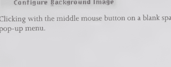

- 在空白处用鼠标中键单击会打开通用弹出菜单。

从此菜单中，你可以查看已打开任务的列表、在虚拟桌面之间导航、选择要运行的程序，或自定义桌面。
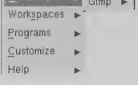

### 使用键盘快捷键

为了节省时间，你可以为基本的桌面任务添加键盘快捷键，方法是选择 Sawfish 窗口管理器，然后从控制中心中选择 快捷键。默认只定义了几个快捷键。然而，你可以添加一长串键盘快捷键，或编辑现有的快捷键。参见第 149 页的“让桌面成为你的专属”。

### 操作窗口

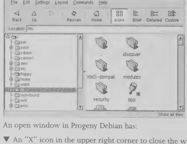

Progeny Debian 中打开的窗口具有：

- 右上角的“X”图标用于关闭窗口。
- 左上角的向上箭头图标用于最大化窗口。
- 左上角的向下箭头图标用于最小化窗口。
- 一个可以通过右键单击标题栏打开的菜单。从菜单中，你可以最小化、最大化或关闭窗口，并以其他方式操作它。

此外，如果窗口在当前工作区上，它会显示在面板的任务列表和分页器上。

然而，窗口菜单和任务列表中的弹出菜单也允许你以可能不熟悉的方式操作打开的窗口。

## 从菜单操作窗口的方法

| 操作... | 从窗口菜单中选择... |
| :--- | :--- |
| 允许窗口在循环切换窗口时处于活动状态 | 切换 > 可聚焦<br><br>如果窗口已经是可聚焦的，则再次选择此菜单项会将其设置为忽略。 |
| 更改窗口在窗口堆栈中的位置 | 堆叠<br><br>根据你在子菜单中的选择，你可以将窗口定位在其他打开的窗口之后或之前 |
| 关闭窗口 | 关闭<br><br>在窗口中显示的任何进程仍会继续运行。你也可以从任务列表的弹出菜单中关闭窗口。 |


## 通过菜单操作窗口的方式

| 要执行的操作... | 从窗口菜单中选择... |
| --- | --- |
| 仅显示标题栏 | 切换 > 最小化（Shaded） |
| 如果窗口已经处于最小化状态，此菜单项将恢复窗口。 | |
| 你还可以： | |
| - 双击标题栏。 | |
| - 从任务列表的弹出菜单中选择“最小化（Shaded）”。 | |
| 在循环切换窗口时忽略该窗口。 | 切换 > 已忽略（Ignored） |
| 如果窗口已经处于“已忽略”状态，再次选择此菜单项会将其设置为“可聚焦（Focusable）”。 | |
| 最大化窗口 | 最大化 |
| 你也可以从任务列表的弹出菜单中选择“还原（Restore）”。 | |
| 最小化窗口 | 最小化 |
| 你也可以从任务列表的弹出菜单中选择“图标化（Iconify）”。 | |
| 在工作区中移动或复制窗口 | 发送窗口至 |
| 你可以将窗口或其副本放置在某个工作区，或当前工作区的某个单元格中。 | |
| 将窗口定位在每个工作区的相同位置。 | 切换 > 粘性（Sticky） |
| 如果窗口已经是粘性窗口，此菜单项会使其变为非粘性。 | |

### 读取图标属性

你可以向桌面添加三种主要类型的图标：

- 目录：桌面上的一个文件夹。


- URL 链接：一个网页链接。


- 应用程序：用于启动程序的图标。此图标也是默认选项。


无论它们位于何处——工作区、菜单或面板——所有图标都具有相同的属性。你可以选择其弹出菜单中的“属性”来打开属性窗口，从而读取图标的属性。

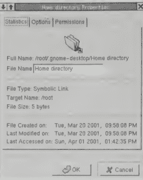


**注意**

在桌面上，你还可以通过右键单击工作区并从“新建”菜单中进行选择，来选择“目录”或“URL 链接”。

### 图标属性选项卡

| 选项卡 | 可编辑信息 |
| --- | --- |
| 统计信息 | 关于图标的基本信息。你可以通过编辑文件名来更改图标文本。 |
| 选项 | 图标图像。选择图标以更改它。 |
| 权限 | 列出关于以下内容的信息：谁可以使用该文件。该文件如何被使用。谁拥有该文件。参见“更改权限”，第 227 页。 |

### 打开命令行

早期的 Linux 开发以命令行为中心，图形桌面仍在不断改进中。因此，随着你专业知识的增加，你会发现你对命令行的需求也在增加。

你可以通过多种方式打开命令行：

- 从面板中选择 GNOME 终端图标。


- 从主菜单中选择 Alt-F2 或“运行”，输入单个命令，然后关闭命令行。

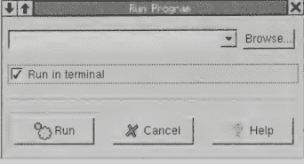

- 从菜单中，选择 程序 > 系统 > Eterm、GNOME 终端或常规 xterm。将打开一个命令行窗口。

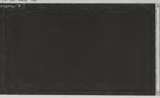

- 右键单击工作区。然后从弹出菜单中选择 新建 > 终端。

## 7 将桌面个性化

GNOME 以高度可定制而闻名。你可以全局或单独定制几乎每个功能。例如，你可以定制桌面上的所有面板，或者只定制其中一个。

定制控制分散在桌面的各个角落。然而，其中大多数可以从以下位置访问：

- 面板上的 GNOME 控制中心图标。
- 设置菜单。
- 桌面不同部分的弹出菜单。

本章指导你访问可以自定义以下内容的窗口：

- 显示设置。
- GNOME 桌面和 Sawfish 窗口管理器的通用设置。
- 程序启动器（图标）。
- 通用桌面行为，包括确认对话框。
- 面板。
- 菜单。
- 单个窗口。
- 选择特定类型文件时启动的程序（MIME 类型）。

有关可自定义功能的完整信息，请参阅在线 GNOME 帮助。

如果你对某个功能不熟悉，请尽可能使用“试一试”按钮来查看结果。如果看不到效果，请写下更改内容和原始设置，以便在探索后能够恢复更改。

在某些系统上，特定的更改可能需要你重启或重新启动 X 服务器后才能生效。

**注意**

如果你更改窗口管理器，你的一些配置选项可能会发生变化。

本章假定你正在使用默认的 Sawfish 窗口管理器桌面进行操作。

## 配置监视器颜色显示

如果你正在做图形工作，或者需要调整监视器的显示，请从主菜单中选择 设置 > ImLib 配置选项。

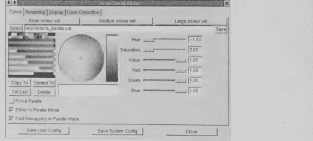

你可以编辑：

- 调色板：用于桌面显示的颜色。
- 渲染：图像显示的技术方面，如抖动（dithering）和桌面保留的缓存大小。
- 显示：如果硬件未使用，则强制选择。否则，此选项卡为空白。
- RGB 颜色校正：显示基本颜色的校准：红色、绿色和蓝色。

你可以保存当前用户的配置，或者，如果你以 root 身份登录，则为整个系统保存配置。

> **警告**
> 如果你不知道自己在做什么，更改这些设置可能会使你的显示效果变差。请谨慎更改，并记录原始设置，以便能够恢复。

## 定制 GNOME 和 Sawfish 的通用设置

你可以从控制中心定制 GNOME、Sawfish 窗口管理器以及你的主题的行为设置。

要定制通用设置：

1. 执行以下操作之一：
    - 从面板中选择控制中心图标。
    - 从菜单中，选择 设置 > GNOME 控制中心。
    - 中键单击工作区区域以显示弹出窗口，然后从“自定义”菜单中选择一个项目。

在所有情况下，都会打开控制中心窗口。

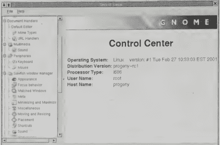

在左侧窗格列表中选择要定制的项目。使用滚动条在列表中上下移动。单击顶级项目以查看子项目。

- Sawfish 窗口管理器
    - 外观
    - 聚焦行为
    - 匹配窗口
    - Meta
    - 最小化和最大化

**注意**

当选择某个项目时，你可以从窗口菜单栏打开其帮助主题。上下文帮助会显示在窗口底部。

2. 使用控制中心窗口右侧窗格中的控件进行更改。

3. 选择“试一试”按钮来测试你的更改。如果你改变了主意，请选择“恢复”按钮以返回到之前的设置。


4. 选择“确定”按钮以保存更改，或选择“取消”按钮以丢弃它们。

## 从控制中心设置全局选项

| 要定制的项目 | 控制中心中的菜单项 |
| :--- | :--- |
| 自动启动程序 | 会话 > 启动程序 |
| 对话框窗口 | 用户界面 > 对话框 |
| 键盘 | 外围设备 > 键盘 |
| 键盘快捷键 | Sawfish 窗口管理器 > 快捷键 |
| MIME 类型 | 文档处理器 > MIME 类型 |
| 鼠标 | 外围设备 > 鼠标 |
| 面板 | 桌面 > 面板 |
| 电源管理 | 桌面 > 屏幕保护程序 |
| 屏幕保护程序 | 桌面 > 屏幕保护程序 |
| 声音，启用支持 | Sawfish 窗口管理器 > 声音 |
| 声音 | 多媒体 > 声音 |
| 文本编辑器 | 文档处理器 > 默认编辑器 |
| 主题（颜色、窗口框架和其他桌面外观） | 桌面 > 主题 |
| 虚拟桌面 | Sawfish 窗口管理器 > 工作区 |
| 桌面壁纸 | 桌面 > 背景 |
| 网页显示 | 文档处理器 > URL 处理器 |
| 窗口管理器，安装和选择 | 桌面 > 窗口管理器 |
| 窗口，行为和外观 | Sawfish 窗口管理器（各种子菜单） |


## 自定义程序启动器

程序启动器是由图标表示的文件链接。启动器可以被添加、删除或重新定位。你还可以恢复系统首次启动时显示的默认启动器。

在大多数情况下，自定义启动器的过程是相同的，无论它们位于面板、菜单还是桌面工作区。

### 添加启动器

无论是将程序启动器添加到桌面工作区、面板还是菜单，其过程都是相同的。

要添加启动器图标：

- 右键单击以显示桌面相应部分的弹出菜单：
  - 在桌面上，选择“新建”>“启动器”。
  - 在面板上，选择“面板”>“添加到面板”>“启动器”。
  - 在主菜单上，选择“向此菜单添加新项”（仅对 root 用户可用）。

在每种情况下，都会打开桌面条目属性窗口。

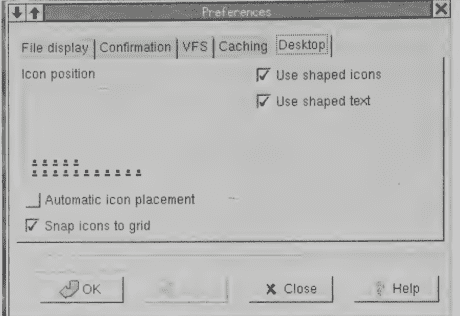

2. 在“基本”选项卡中输入信息。除“注释”外，其他均为必填字段：
   - 名称：显示在图标下方的文本。
   - 注释：关于程序的注释，显示在工具提示中。非必填字段。
   - 命令：启动器所链接的命令。
   - 类型：启动器的类型。选项为“目录”和“应用程序”。

3. 选择图标框并选择一个图标。


> **注意**
>
> 默认情况下，自定义图标不会在桌面的目录中显示。若要使用自定义图标，请从桌面弹出菜单中选择“桌面属性”>“缓存”>“允许在图标视图中自定义图标”。

4. 如果该程序并非设计为在桌面上运行，请选择“在终端中运行”复选框。


> **注意**
>
> 要使启动器正常工作，无需在“高级”选项卡上设置任何内容。“高级”选项卡的设置主要对发行版制作者或处理多语言的系统管理员重要。

### 删除启动器

无论你是将程序启动器添加到桌面工作区、面板还是菜单，删除启动器的过程都是相同的。

要删除启动器图标：

1. 右键单击启动器以显示弹出菜单：
   - 在桌面上，执行以下操作之一：
     - 选择“删除”。启动器将被永久移除。
     - 选择“移动到回收站”。启动器将被移除，但你以后可以恢复它。
   - 在面板上，选择“从面板移除”。
   - 在主菜单上，选择“移除此项”。

在每种情况下，都会打开确认窗口。

2. 选择“是”按钮以继续删除。

> **注意**
>
> 删除启动器不会删除与其关联的文件或目录。启动器是链接，与它们关联的文件没有直接联系。

### 重新创建默认启动器

桌面安装时带有多个默认图标。若要恢复这些默认图标，请在桌面上右键单击并选择“重新创建默认图标”。

### 自动定位桌面启动器

1. 在工作区上右键单击并选择“桌面属性”。将打开桌面属性窗口。

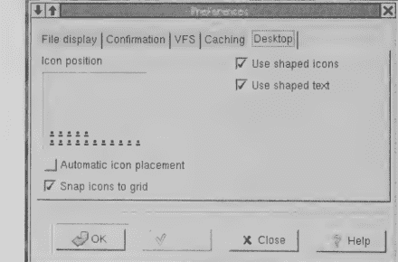

2. 选择“桌面”选项卡。

“图标位置”窗格显示了图标的自动放置方式。图标可以排列成垂直或水平的行。

3. 若要更改自动定位，请单击示意图中位于桌面图标将对齐的那一侧角落附近的图标。

此图标在示意图中始终是行末的一个。然而，它可能位于窗格中的第一行或第二行。

使用此方法，你可以将图标对齐到桌面的任何一侧。

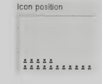

4. 如果你希望具备其中任一功能，请选择“自动放置图标”或“将图标吸附到网格”。这些功能可以让你整理图标，但限制了你可以放置它们的位置。

5. 选择“应用”按钮，然后选择“确定”按钮。

### 自定义通用桌面行为

1. 从桌面弹出菜单中，选择“桌面属性”。将打开“桌面属性”窗口。

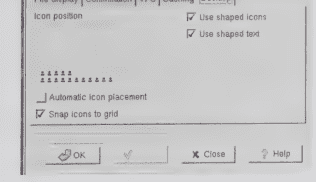

2. 编辑桌面行为。你可以编辑：

   - 文件显示：哪些文件显示，以及如何显示。
   - 确认：使用文件时显示哪些警告。
   - VFS（虚拟文件系统）：影响你如何操作远程文件的设置，尤其是在 FTP 站点上。
   - 缓存：桌面如何使用内存。此选项卡包含“允许在图标视图中自定义图标”，允许在子目录中使用自定义图标。
   - 桌面：图标在桌面上如何定位。参见“自动定位桌面启动器”，第 158 页。

## 自定义面板

面板可能包含图标、抽屉、小部件以及其他功能，例如任务栏。右键单击面板会选中弹出菜单。此菜单包含最近的面板项目以及面板本身的项。

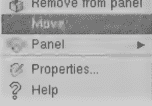

从弹出菜单中，你可以：

- 从面板移除：从面板中删除最近的项目。
- 移动：更改面板上最近项目的位置。鼠标光标变为四向箭头，图标沿着面板跟随光标移动滑动。当面板重新定位后，在桌面上左键单击。
- 属性：图标的设置。这些图标与桌面或主菜单上的图标相同。参见“自定义程序启动器”，第 155 页。
- 全局首选项：在 GNOME 控制中心中设置所有面板设置的默认值。
- 面板：自定义面板的选项。

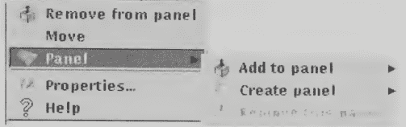

面板选项包括：

- 添加到面板：可以添加到面板的项目，包括小部件、抽屉、启动器以及用于注销、锁定和运行等桌面功能的图标。
- 创建面板：向桌面添加几个不同类型的新面板。
- 移除此面板：从桌面删除面板。
- 属性：面板如何打开及其行为。选项包括面板类型、隐藏策略、用于隐藏的按钮、面板大小和背景。

你还可以从主菜单向面板添加启动器。从菜单项的弹出菜单中，选择“将此启动器添加到面板”。

## 自定义菜单

1. 以 root 用户身份登录。
2. 从菜单栏中，选择“设置”>“菜单编辑器”。将打开菜单编辑器。

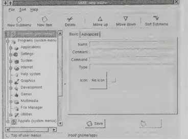

> **注意**
>
> 如果你想在菜单中添加启动器，如果你是以 root 用户身份登录的，也可以在弹出菜单中选择“向此菜单添加新项”。

3. 输入图标信息。这些信息与工作区或面板上的启动器信息相同。参见“添加启动器”，第 155 页。
4. 如果你突出显示左侧窗格树中的某个项目，你还可以：
   - 添加一个新的子菜单。
   - 添加一个新的菜单项。
   - 删除一个项目或菜单。
   - 在菜单中向上移动一个项目。
   - 在菜单中向下移动一个项目。
   - 按字母顺序排序一个子菜单。

## 向面板添加小部件

小部件是可以添加到面板的小型 GNOME 程序。它们从严肃到娱乐不等。

要向面板添加小部件，请在 GNOME 主菜单的“小部件”子菜单中选择一个。选中小部件后，它会显示在面板上。

## 自定义单个窗口

1. 右键单击标题栏以打开窗口菜单。
2. 从以下项中选择：
   - 框架类型：更改窗口是否在所有侧面都有边框或有标题栏。
   - 框架样式：仅为打开的窗口应用已安装的主题。
   - 历史记录：设置是否记住窗口的位置、大小或属性（框架类型和框架样式）。
3. 选择“历史记录”>“记住属性”，以便下次打开窗口时保留新设置。

## 使用程序启动文件：设置 MIME 类型

你可以配置桌面，以便通过点击与其关联的文件来启动程序。这种关联称为 MIME 类型。

设置 MIME 类型需要两个步骤。首先，你必须添加 MIME 类型。然后你必须编辑它。

## 添加 MIME 类型

1. 执行以下操作之一：
   - 从控制中心选择“MIME 类型”。


从菜单中选择“设置” > “文档处理器” > “MIME 类型”。
从文件管理器的菜单中选择“命令” > “编辑 MIME 类型”。

在以上所有情况下，控制中心中的 MIME 类型窗口都会打开。


2. 选择“添加”按钮。将打开“添加新 MIME 类型”窗口。


3. 输入 MIME 类型。

所有类型都有一个两部分的名称，各部分由斜杠分隔。第一部分是文件的通用类别。预定义的通用类别包括 application、audio、font、image、text、video 和 x-url。
第二部分是具体的文件类型。例如，image/tiff 是 tiff 图形格式的类型。

4. 输入通常与该类型关联的扩展名。用逗号分隔每个扩展名。

5. 如果愿意，请添加与该类型关联的两个正则表达式。选择**确定**按钮。此时，该类型将出现在**MIME** 类型的按字母排序列表中。参见第 118 页“使用元字符或通配符”。

现在，你必须编辑该类型才能使用它。

## 编辑 MIME 类型

1. 从控制中心的**MIME 类型**面板中选择一个类型。
2. 选择**编辑**按钮。将打开该类型的设置窗口。


3. 单击图标框，为该类型的所有文件选择图标。
4. 选择用于打开、查看和编辑该类型的程序。
   - 对于每个字段，输入内容必须包含一个程序，后跟 %ft。
   - 如有必要，可以使用“浏览”按钮来选择程序。
5. 选择“确定”按钮。此时 MIME 类型已准备就绪可供使用。

## 删除 MIME 类型

1. 从控制中心的 MIME 类型面板中选择一个类型。
2. 选择“删除”按钮。

> **警告**
> 不会请求确认。一旦选择“删除”按钮，该类型即被删除。

> **注意**
> 预定义的 MIME 类型无法删除。

## 8

## 搜索文件和文本

Progeny Debian 包含许多用于定位文件的工具。本章介绍以下工具：

- 搜索文件和文本。
- 查看文件和文本。
- 比较文件。

从桌面，你可以使用大多数常见选项进行搜索并查看文件。但是，对于以下操作，你需要使用命令行：

- 高级搜索，特别是文本搜索。
- 查看文件的部分内容。
- 比较文件。

不过，首先你需要了解 Linux 目录结构的工作原理。

## 理解 Linux 文件

Linux 将硬盘和磁盘上的一切都视为文件。在实践中，Linux 使用三种主要类型的对象来存储信息：

- 文件：信息的容器。启动程序的文件称为可执行文件或二进制文件。二进制文件存储在 /bin 目录（binary 的缩写）或 /sbin 目录（system binaries 的缩写）中。
- 链接：指向另一个文件的指针。当需要在多个位置使用同一个文件时，链接对于节省空间很有用。
- 目录：文件、链接和/或其他目录的集合。目录内的目录称为子目录。

> **注意**
> 严格来说，链接和目录是特殊类型的文件。你可以复制它们或更改其权限，方式与任何其他文件完全相同。

## 理解 Linux 命名

Linux 文件、链接和目录的名称遵循某些规则：

- 单个目录或文件的长度不能超过 256 个字符，完整路径不能超过 4096。
- 它们是区分大小写的，可以区分小写字母和大写字母。Jsmith、jsmith 和 JSmITH 都可以是同一目录中的文件。
- 它们可以使用任何字母或数字。但是，为了避免潜在问题，请不要包含用作元字符或具有其他用途的字符，例如表示注释的井号（#）。
- 它们使用开头的斜杠 (/) 来表示目录。相比之下，Windows 使用反斜杠 (\)。

> **注意**
> 单独的斜杠是根目录的简写形式。

## 理解 Linux 中的文件扩展名

扩展名是以句号开头的文件名后缀。通常，它们的长度为两个或三个字母。

Linux 可以读取其他平台使用的许多文件扩展名，例如图形文件的 .jpg 或 Web 文件的 .html。但是，与 Windows 不同，Linux 并不总是使用扩展名来识别文件类型。

通常，文件所在的目录更能表明该文件的类型。参见第 171 页“使用目录查找文件”。

不过，Linux 确实使用一些常用的扩展名。

### Linux 中使用的扩展名

| 扩展名 | 文件类型 |
| :--- | :--- |
| .bz2 | 使用 bzip2 压缩的文件。 |
| .c | 使用 C 编程语言编写的文件。 |
| .conf | 配置文件。在某些情况下，“conf”用作文件名的一部分，但不是扩展名。 |
| .deb | 用于安装软件的 Debian 软件包。 |
| .lock | 防止使用另一文件的锁文件。 |
| .rpm | Red Hat 软件包文件。虽然你可以在 Progeny Debian 中使用 .rpm 文件，但这样做可能会产生意外结果，通常不建议这样做。你还可以使用 alien 实用工具转换软件包。 |
| .so | 共享对象（库或模块）。 |
| .src | 源代码文件。以纯文本编写，源文件必须经过编译才能使用。 |
| .tar | 使用 tar 命令对一组文件进行归档创建的单个文件。 |
| .tar.gz | 使用 tar 命令对一组文件进行归档，然后使用 gzip 命令压缩创建的单个文件。 |
| .tgz | 使用 tar 命令对一组文件进行归档，然后使用 gzip 命令压缩创建的单个文件。 |
| .gz | 使用 gzip 命令压缩的文件。 |

### 介绍 Linux 目录结构

Linux 的目录结构基于 UNIX。与其他操作系统一样，Linux 将目录排列成树状层次结构，其中任何目录都可以包含其他目录或文件。

但是，Linux 的目录结构与其他流行操作系统存在几处不同：

- Linux 系统更深。也就是说，Linux 往往拥有更多的子目录。

Linux 系统都以根目录开始。根目录由斜杠 (/) 表示。所有其他目录，即使是位于其他分区上的目录，都是根目录的子目录。


**注意**

不要将根目录 (/) 与 root 用户、root 用户的主目录 (/root) 或根分区（根目录所在的硬盘分区）混淆。

你并不总是能从目录的位置判断它是否位于与根目录不同的分区上。例如，/usr 目录可能位于与根目录相同的分区上。它也完全可能位于另一个完全不同的硬盘上。

这种系统的优势在于，你可以将分区放置在系统中的几乎任何位置。

## 使用目录查找文件

Linux 目录的内容是一致的。结果是，文件的目录通常能提示该文件的类型。

例如，如果你在寻找可执行程序，它可能位于 /bin 或 /usr/bin 目录中。“Bin”是“binary”（二进制）的缩写，这是一个用于可执行程序术语。

下表列出了某些类型文件可能所在的目录。这种结构在所有 Linux 发行版中都非常相似，尽管存在微小差异。

### Linux 目录结构

| 目录 | 内容 |
| :--- | :--- |
| / | 根目录。包含所有其他文件和目录。到其他目录的完整路径或绝对路径从根目录开始。 |
| /bin | 可由 root 用户和普通用户使用的二进制或可执行文件。要在其他 /bin 目录中查找其他可执行文件。 |
| /boot | 启动 Linux 所需的文件，包括内核。/boot 中的大多数文件通常无法使用文本编辑器进行配置。 |
| /cdrom | CD 驱动器的通常挂载点。如果系统有第二个 CD 驱动器，其挂载点通常是 /cdrom2。 |
| /dev | 驱动器、分区和其他设备的定义。/dev 还包括用于创建新设备的 makedev 工具。 |


## Linux 目录结构

| 目录 | 内容 |
| :--- | :--- |
| `/etc` | 系统的大部分配置文件。包括用于 X 窗口系统的 `/etc/X11` 和用于第三方应用程序的 `/etc/opt`。 |
| `/floppy` | 第一个软驱的常规挂载点。如果系统有第二个软驱，其挂载点通常为 `/floppy2`。 |
| `/home` | 所有普通用户的家目录。root 用户的家目录是 `/root`。 |
| | `/home` 的子目录以每个账户的用户名命名。以 `.`（句号）开头的个人配置文件位于每个家目录中。 |
| `/initrd` | Linux 的 RAM 磁盘文件。 |
| `/lib` | 启动系统和运行基本命令所需的编程库。 |
| | 请在系统中查找分散在其他位置的其他 lib 目录。 |
| `/lost+found` | 在对受损文件系统进行检查时恢复的文件。 |
| `/mnt` | 用于其他挂载点的文件夹，通常包括其他未被 Linux 直接使用的分区，包括用于其他操作系统的分区。 |
| `/proc` | 进程和系统信息。请以 root 用户身份登录时，要极度小心对 /proc 的更改，因为它们很容易导致系统崩溃。 |
| `/root` | root 用户的家目录。 |
| | 其他用户的家目录通常是 /home 的子目录。 |
| `/sbin` | 系统二进制文件。其中一些仅 root 用户可以使用。 |
| | 其他可执行文件位于 /bin 中。 |
| `/usr` | 所有用户共享的程序和系统文件。通常是自由软件或第三方软件的常见安装位置。重要的子目录包括 /usr/local 和 /usr/share。 |
| `/var` | 内容频繁变化的数据文件，例如缓存、队列、日志文件和用户邮箱文件。 |
| `/var/lock` | 防止其他用户打开或保存特定文件的锁定文件。 |
| `/var/log` | 不同程序的日志文件。这些日志对于解决问题非常宝贵。 |

## 理解绝对路径和相对路径

文件路径是文件上方目录的列表，以文件名结尾。

Linux 使用两种类型的路径：绝对路径和相对路径：

- 绝对路径始终以根目录开始。
    - 例如，用户家目录中子目录内某个文件的绝对路径可能是 `/home/khcong/10100/january.txt`。
    - 输入这个路径可能需要很长时间，但它是完全清晰的。
- 相对路径从你当前的工作目录开始。
    - 例如，如果你位于 `/home/khcong` 目录中，子目录中某个文件的相对路径可能是 `10100/january.txt`。
    - 你可以使用 `pwd`（"present working directory"，当前工作目录）命令来找到你当前的工作目录。

此外，在使用命令行时，`/` 表示当前工作目录。

## 从桌面搜索

你可以从桌面搜索文件或文本，使用：

- GNOME 搜索工具 (gsearchtool)：`find` 和 `locate` 命令的图形界面，包含这些命令最常用的选项。
- GNOME Midnight Commander：对于简单的搜索很有用。
- 如果你想要更复杂的搜索，请参阅“从命令行搜索”，第 182 页。

### 从桌面使用 find 命令

`find` 命令是一个用于定位文件的工具。它还可以使用字符串和正则表达式进行基本搜索。

1. 在命令行中，输入：gsearchtool。GNOME 搜索工具打开，选中的是“Full find (find)”选项卡。


2. 输入开始搜索的目录。
    - 你可以输入目录，从最近选择的下拉列表中选择，或者使用浏览按钮进行选择。

3. 从“Add”按钮旁边的下拉列表中选择要使用的选项。这些选项对应于 `find` 命令中最常见的选项。


默认选择是“File name”（文件名）。

选择该选项。当它显示时，选择“Add”按钮将其作为搜索的一部分。

你可以通过取消选择旁边的“Enable”按钮来临时禁用某个选项，或选择“Remove”按钮将其从显示中移除。

4. 当你选择好要使用的选项后，输入使用每个选项所需的任何信息。

5. 如果需要，选择“Show Command”按钮以查看该命令在命令行中会是什么样子。

6. 选择“Start”按钮进行搜索。搜索结果将在单独的窗口中显示。此窗口保持打开状态，以便将其他搜索结果添加到其中。


7. 在“Search Results”（搜索结果）窗口中，你可以：
    - 选择一个结果以在 gedit 中打开该文件。
    - 清除窗口中的结果。
    - 将结果保存到文件中。

### 从桌面使用 locate 命令

`locate` 命令搜索文件名数据库，并打印与为命令输入的字符串匹配的结果。

1. 在命令行中，输入：locate。GNOME 搜索工具打开，选中的是“Full find (find)”选项卡。

2. 选择“Quick Find (locate)”（快速查找）选项卡。


3. 输入一个字符串，可以包含元字符也可以不包含。

4. 选择“Start”按钮进行搜索。搜索结果将在单独的窗口中显示。此窗口保持打开状态，以便将其他搜索结果添加到其中。


5. 在“Search Results”（搜索结果）窗口中，你可以：
    - 选择一个结果以在 gedit 中打开该文件。
    - 清除窗口中的结果。
    - 将结果保存到文件中。

### 从 GNOME Midnight Commander 搜索

1. 打开 GNOME Midnight Commander。执行以下操作之一：
    - 从工作区，选择“Home directory”（主目录）启动器。
    - 从菜单，选择 Programs > File Manager（程序 > 文件管理器）。

在这两种情况下，GNOME Midnight Commander 都会打开，显示你的主目录。


2. 从 GNOME Midnight Commander 菜单，选择 Commands > Find File（命令 > 查找文件）。“Find File”（查找文件）窗口显示。


3. 在“Start at”（开始于）字段中，输入开始搜索的目录。默认是当前目录。

4. 在“Filename”（文件名）字段中，输入要查找的文件名。你可以使用通配符。

5. 在“Content”（内容）字段中，输入要搜索的文本字符串。此字段是可选的。

6. 开始搜索。选择“OK”按钮。

搜索结果将在单独的窗口中显示：它们可能需要一些时间才能显示。


### 注意

你只能搜索你有读取权限的目录中的结果。

使用结果窗口中的按钮，你可以：

- 选择一个结果并切换到其目录。
- 开始新的搜索。
- 关闭搜索工具。

## 从命令行搜索

Linux 命令行包含许多用于定位文件或其中信息的工具。这些工具可以分为两个主要类别：

- 文件定位工具：`find`、`locate`。
- 文本定位工具：`grep`、`egrep` 和 `fgrep`。

其中一些命令，包括 `grep`、`egrep` 和 `find` 可以使用可变文本模式（元字符或正则表达式）来扩展其搜索能力。请参阅“使用元字符或通配符”，第 118 页。

## 搜索文件：使用 find 命令

查找文件的基本工具是 `find`。`find` 命令对于根据其属性或其在目录树中的位置来定位文件很有用。

你可以通过各种标准进行搜索，包括：

- 文件最后访问的时间。
- 文件最后更改的时间。
- 文件的拥有者或拥有者的组。
- 文本字符串，包括使用元字符的字符串。请参阅“使用元字符或通配符”，第 118 页。
- 文件的类型。
- 文件相对于另一个文件的年龄。
- 文件的权限。

通常，`find` 从当前目录开始，然后搜索其子目录。但是，你可以指定起始目录。

你还可以指定向下搜索多少层子目录。


# find 命令

| 选项 | 操作 | 注释 |
|---|---|---|
| -amin ARGUMENT | 根据文件自上次访问以来的分钟数进行搜索。 | 参数包括：<br> - +NUMBER：超过指定分钟数以前。<br> - -NUMBER：少于指定分钟数以前。<br> - NUMBER：正好在指定分钟数以前。 |
| -atime ARGUMENT | 根据文件自上次访问以来的天数进行搜索。 | 参数包括：<br> - +NUMBER：超过指定天数以前。<br> - -NUMBER：少于指定天数以前。<br> - NUMBER：正好在指定天数以前。 |
| -cmin ARGUMENT | 根据文件自上次更改以来的分钟数进行搜索。 | 参数包括：<br> - +NUMBER：超过指定分钟数以前。<br> - -NUMBER：少于指定分钟数以前。<br> - NUMBER：正好在指定分钟数以前。 |
| -ctime ARGUMENT | 根据文件属性自上次更改以来的天数进行搜索。 | 参数包括：<br> - +NUMBER：超过指定天数以前。<br> - -NUMBER：少于指定天数以前。<br> - NUMBER：正好在指定天数以前。 |
| -follow | 跟踪符号链接指向原始文件。 | |
| -group GROUP | 搜索属于特定用户组的文件。 | 组可以通过名称或组ID来标识。 |
| -maxdepth NUMBER | 设置要搜索子目录的最大层级。 | |
| -mindepth NUMBER | 设置要搜索子目录的最小层级。 | |
| -name STRING | 搜索匹配该字符串的文件。 | 将字符串放在引号中可使用 shell 元字符。 |
| -newer FILE | 查找比命令中包含的文件更新的文件。 | |
| -perm PERMISSIONS | 以绝对模式搜索权限。 | |
| -type ARGUMENT | 搜索文件类型。 | 参数包括：<br> - d：目录。<br> - l：符号链接。<br> - f：普通文件。 |
| -user USER | 搜索属于命令中指定用户的文件。 | |

输入格式：find DIRECTORY OPTIONS ARGUMENT。

# 使用 locate 命令从命令行查找文件

locate 命令在数据库中搜索文件。它通常是查找文件的最快速度方式。

输入格式：locate string。如果需要指定数据库，请添加 -d PATH 或 --database=PATH 选项。

# 从命令行搜索文本：使用 grep 命令

Linux 使用 grep 命令行工具在文件中搜索文本。该工具族包含三个命令：

- **grep**：使用文本字符串（有时包含元字符）的通用搜索工具。grep 命令包含了其他工具的大部分功能，但自定义搜索的选项较少。
- **fgrep**：用于定位字面文本字符串的专用搜索工具——即不包含元字符的文本字符串。由于 fgrep 使用字面文本字符串，因此无需记忆搜索中的任何特殊字符。
- **egrep**：使用元字符的专用搜索工具。该命令使用的元字符比 grep 更多。此外，egrep 命令通常被认为是这三个工具中最快的一个。

这三个命令使用类似的格式。输入格式：

- grep OPTIONS STRING FILES。
- egrep OPTIONS STRING FILES。
- fgrep OPTIONS STRING FILES。

# 注意

为了尽可能充分地利用 grep 或 egrep，您应该熟悉元字符。请参阅第 189 页的“使用 grep 命令中的元字符”。

如果希望将搜索结果保存到文件或打印出来，请使用重定向运算符。请参阅第 128 页的“命令输入和输出的重定向”。

# grep、egrep 和 fgrep 命令（查找文本）

| 选项 | 操作 | 注释 |
| :--- | :--- | :--- |
| -e | 将字符串视为扩展正则表达式。 | 仅与 grep 一起使用。类似于使用 egrep。 |
| -f | 将字符串视为常规文本。 | 仅与 grep 一起使用。类似于使用 fgrep。 |
| -f FILE<br>--file=FILE | 使用包含要匹配的模式列表的文本文件进行搜索。 | 字符串必须按每行一个列表项的方式列在文件中。 |
| -i<br>--ignore-case | 忽略大小写字母之间的区别。 | 如果未使用此选项，小写字母与大写字母将被区分开。 |
| -l<br>--files-with-matches | 列出有匹配项的文件。 | 不列出单独的行。 |
| -L<br>--files-without-match | 搜索与字符串不匹配的文件。 | |
| -n<br>--line-number | 显示带行号的行。 | |
| -C NUMBER<br>--context=NUMBER | 设置在每个匹配项前后显示的行数。 | 有时被称为“上下文”。 |
| -q<br>--quiet | 在第一个匹配项处停止。 | 不会列出是否还有其他匹配项。 |
| -r<br>--recursive | 搜索子目录。 | |
| -v<br>--invert-match | 搜索与字符串不匹配的行。 | |
| -x<br>--line-regexp | 显示与整个字符串匹配的行。 | |

# 在 grep 命令中使用元字符

元字符是可以用来设置特殊搜索条件的字符。它们也被称为通配符。请参阅第 127 页的“使用特殊符号”。

元字符被添加到文本字符串中。包含元字符的文本字符串称为正则表达式。正则表达式在查找措辞变化或字符串在行中的位置变化时非常有用。

元字符可与 grep 和 egrep 一起使用。但是，grep 能使用的元字符比 egrep 少。每当需要使用元字符时，egrep 通常是首选工具。

如果不想使用任何元字符，或者没有记住用于使用的字符，请使用 fgrep。

元字符可能极其强大，特别是当它们组合使用时。然而，在使用搜索工具时，除非将 grep 命令与另一个对文件进行更改的命令组合使用，否则不太可能出现大问题。

# 注意

> 如果希望搜索通常用作元字符的字符，请在其前面加一个反斜杠 (\)。例如，\? 用于搜索问号，而不是任意字符。

元字符在组合使用时尤其强大。例如：

- `^contacts$` 搜索 contacts 是行中唯一单词的匹配项。
- `[cC]ontacts` 匹配 contacts 或 Contacts。
- `^...$` 搜索任意三个字符的行。
- `compan(ies)` 搜索 company 或 companies。
- `[A-Za-z]` 搜索任意大写或小写字母。类似地，`[0-9A-Za-z]` 搜索任意数字或任意字母。

# 从桌面查看文件

桌面仅提供有限的文件查看选项。为了有选择地查看文件的某些部分，请改用命令行。请参阅第 193 页的“从命令行查看文件”。

要从桌面查看文件：

1. 打开 GNOME Midnight Commander。执行以下任一操作：
    - 从工作区中，选择“主目录”启动器。
    - 从菜单中，选择“程序” > “文件管理器”。
    
    在这两种情况下，GNOME Midnight Commander 都会打开，并显示您的主目录。


2. 使用目录树以及“返回”、“向上”和“前进”图标来显示您想要的目录。

3. 右键单击您想要的文件的图标。会出现一个弹出菜单。

   - 打开
   - 打开方式...
   - 查看
   - 编辑
   - 复制...
   - 移至垃圾桶
   - 删除
   - 移动...
   - 创建链接...
   - 属性...

4. 从菜单中选择**打开**或**使用...**。会出现以下两种情况之一：
   
   如果文件类型与某个程序相关联，选择**打开**将显示该文件。请参阅第 163 页的“添加 MIME 类型”。
   
   或者
   
   如果文件类型未关联，选择**打开**或**使用...**将显示一个窗口供您选择查看器。


如果你正在选择查看器，请执行以下三种操作之一：
- 从目录树中选择一个应用程序。
- 使用“浏览”按钮查找查看器。
- 输入查看器的路径。

如果所选的浏览器能够显示该文件，则文件将被显示。

## 从命令行查看文件

Linux 包含了如此多用于从命令行查看文件的工具，以至于其中一些工具已被广泛认为过时。

例如，`cat` 的使用频率不如以前高，这可能是因为它的选项很少。然而，`cat` 对于快速、无修饰地查看短文件仍然很有用。

同样，尽管 `more` 仍然是一个功能正常的工具，但对大多数人来说，它已被 `less` 所取代，`less` 这个名字是对“少即是多”这一说法的戏仿。

一般来说，`less` 是查看文件的标准工具。不过，也存在一些专门的命令：
- **tac**：从文件末尾反向显示文件。
- **head**：显示文件的开头几行。
- **tail**：显示文件的结尾几行。

### 查看短文件：使用 cat 命令

`cat` 命令适用于查看长度小于一屏的文件。对于你想要前后滚动的较长文件，请改用 `less`。

输入：`cat OPTIONS FILE`。

**cat 命令（查看）**

| 选项 | 操作 | 备注 |
| :--- | :--- | :--- |
| `-t` | 显示行尾。 | 行尾用 $ 标记。 |
| `--show-ends` | | |
| `-b` | 显示行号。 | |
| `--number-nonblank` | | |
| `-T` | 显示制表符。 | 制表符用 ^I 标记。 |
| `--show-tabs` | | |
| `-v` | 显示非打印字符。 | |
| `--show-nonprinting` | | |

### 滚动查看文件：使用 less 命令

`less` 命令是从命令行查看文件最常用的工具。在这一类别中，它取代了 `cat` 和 `more`，提供了比两者都更多的选项。

`less` 命令一次显示指定文件的一屏内容。除了显示文件外，`less` 还可用于简单的搜索。然而，对于大多数搜索，你最好使用其中一个搜索命令。参见第 175 页“从桌面进行搜索”和第 182 页“从命令行进行搜索”。

输入：`less OPTIONS FILE`。

**less 命令（查看）**

| 选项 | 操作 | 备注 |
| :--- | :--- | :--- |
| `-h NUMBER` | 设置每次向上滚动的最大行数。 | |
| `-i` | 当使用字符串时，忽略大小写区分。 | 如果未使用此选项，小写字母将与大写字母区分开来。 |
| `-p STRING` | 从字符串第一次出现的位置开始显示文件。 | |
| `-s` | 将多个空行显示为单个空行。 | |
| `-y NUMBER` | 设置每次向下滚动的最大行数。 | |

### 反向查看文件：使用 tac 命令

要反向查看文件，请使用 `tac` 命令。`tac` 这个名字源于它旨在作为 `cat` 的相反操作。然而，即使在 `cat` 被 `less` 取代之后，`tac` 仍然有用。

输入：`tac FILE`。

虽然存在几个选项，但它们不常使用。

### 查看文件开头：使用 head 命令

`head` 有一个伴随工具叫 `tail`，用于查看文件末尾。两个工具的选项相似，但有一些重要区别。例如，`head` 通常显示文件名，而 `tail` 有更多的选项。

输入：`head OPTIONS FILE`。

**head 命令（查看）**

| 选项 | 操作 | 备注 |
| :--- | :--- | :--- |
| `-c NUMBER UNIT` | 设置显示的大小，以及可选的单位。 | 单位如下： |
| | 如果未指定单位，大小以字节为单位。 | `b`：块。 |
| | | `k`：千字节。 |
| | | `m`：兆字节。 |
| `-n NUMBER` | 设置要显示的行数。 | 默认为 10。 |
| `--lines NUMBER` | | |
| `-q` | 防止显示文件名标题。 | |
| `--quiet` | | |

### 查看文件末尾：使用 tail 命令

`tail` 有一个伴随工具叫 `head`，用于查看文件开头。两个工具的选项相似，但有一些重要区别。例如，`tail` 有更多的选项，而 `head` 通常显示文件名。

输入：`tail OPTIONS FILE`。

**tail 命令（查看）**

| 选项 | 操作 | 备注 |
| :--- | :--- | :--- |
| `-c NUMBER UNIT` | 设置显示的大小，以及可选的单位。 | 单位如下： |
| | 如果未指定单位，大小以字节显示。 | `b`：块 |
| | | `k`：千字节 |
| | | `m`：兆字节 |
| `-f` | 随着文件增长，继续显示文件的最后几行。 | 按 Ctrl-C 结束。如果你正在尝试调试并打开了日志文件，此选项特别有用。 |
| `-n NUMBER` | 设置要显示的行数，从文件末尾起算。 | 默认为 10。 |
| `--lines NUMBER` | | |
| `-q` | 防止显示文件名标题。 | |
| `--quiet` | | |
| `-N ARGUMENT` | 设置从文件末尾起算的显示量。 | 参数如下： |
| | | `l`：行。 |
| | | `b`：块。 |
| | | `c`：字符。 |
| `+N ARGUMENT` | 设置从文件开头起算的显示量。 | 参数如下： |
| | | `l`：行。 |
| | | `b`：块。 |
| | | `c`：字符。 |

## 从命令行比较文件

Linux 包含三个用于自动比较文件的工具：
- **comm**：显示两个文本文件中相似和不同的行。
- **diff**：显示文件或目录之间的差异，拥有多种选项。
- **diff3**：报告三个文件的情况，指出哪些文件不同。

> **注意**
> 要将比较结果保存到文件或打印副本，请使用重定向管道。参见第 128 页“命令的输入和输出重定向”。

### 简单比较文件：使用 comm 命令

使用 `comm` 命令对文本文件进行基本比较。对于更高级的比较，请使用 `diff`。

输入：`comm OPTIONS 1ST_FILE 2ND_FILE`。

结果分三列打印。从左到右依次为：
1. 仅存在于第一个文件中的行。
2. 仅存在于第二个文件中的行。
3. 两个文件共有的行。

使用 `-NUMBER` 选项可阻止某一列显示。参数为 1、2 或 3。

如果你想阻止两列显示，请输入它们，中间不要加逗号或空格。例如，如果你想仅显示两个文件共有的行，请输入 `-12`。

`comm` 命令没有其他选项。

### 复杂比较：使用 diff 命令

如果你想要执行以下操作，请使用 `diff` 命令：
- 比较两个目录，包括其子目录。
- 显示差异前后的行。
- 使用元字符。

输入：`diff OPTIONS 1ST_FILE 2ND_FILE`。

在结果中，第一个文件的文本用小于号（`<`）标记，而第二个文件的文本用大于号（`>`）标记。

**diff 命令（比较）**

| 选项 | 操作 | 备注 |
| :--- | :--- | :--- |
| `-b` | 忽略空白数量的变化。 | |
| `-B` / `--ignore-blank-lines` | 忽略空行。 | |
| `-i` | 当使用字符串时，忽略大小写区分。 | 如果未使用此选项，小写字母将与大写字母区分开来。 |
| `-x STRING` / `--exclude STRING` | 在比较目录时，排除与字符串匹配的目录。 | 可以使用元字符。 |
| `-X FILE` / `--exclude-from=FILE` | 在比较目录时，排除与 FILE 中列出的模式匹配的文件和目录。 | |
| `-c` | 在每个结果前后显示 3 行。 | |
| `-y` / `--side-by-side` | 以两列显示结果。 | |
| `-r` / `--recursive` | 在比较目录时包含子目录。 | |
| `-q` / `--brief` | 仅显示文件是否不同。 | |
| `-S FILE` / `--report-identical-file` | 仅当文件相同时显示。 | |

### 比较三个文件：使用 diff3 命令

`diff3` 命令比较三个文件，并报告它们之间的差异。它不像 `diff` 那样提供关于差异的详细信息。`diff` 也可使用简单脚本合并文件（详情请参阅 man 手册页）。

输入：`diff3 OPTIONS 1ST_FILE 2ND_FILE 3RD_FILE`。

可能显示两种结果：
- `===` 三个文件均不同。


## diff3 命令（比较和合并）

| 选项 | 主题 | 备注 |
| :--- | :--- | :--- |
| -a | 比较二进制文件 | 二进制文件被视为文本文件。 |
| -m | 在屏幕上显示合并的差异。 | 输出也可以重定向到文件。 |
| --merge | | |

## 9 处理目录、文件和链接

通常，Linux 系统上的所有信息都存储在文件中。虽然您经常使用单独的命令来操纵目录和链接，但两者基本上都是文件的特殊类型。

本章涵盖了基本任务，如创建、选择、复制和删除目录和文件。它还解释了如何查看和创建链接，以及如何更改文件属性。

> **注意**
>
> 除非您拥有相应的权限，否则无法操纵文件。这是 Linux 与许多流行操作系统之间的主要区别之一。参见“更改权限”，第 227 页。

在桌面上，您可以使用 GNOME Midnight Commander 执行最常见的文件功能。

然而，为了获得完整的选项集，您必须使用命令行。事实上，一些任务，例如合并或拆分文件，只能通过命令行完成。

### 从桌面创建新文件

1. 打开一个程序，例如文本编辑器。
2. 从菜单中，选择“文件 > 保存”。打开“保存”对话框窗口。
3. 使用目录树选择一个目录。
4. 输入文件名。然后选择“保存”按钮。

### 从命令行创建新文件

输入：`touch FILES`。
如果未输入路径，则文件将在当前目录中创建。

### 从桌面创建新目录

1. 打开 GNOME Midnight Commander。执行以下任一操作：
   - 从工作区中选择“主目录”启动器。
   - 从菜单中选择“程序 > 文件管理器”。
2. 右键单击目录窗格。显示弹出菜单。
3. 从菜单中选择“新建目录”。打开“创建新目录”窗口。


4. 为新目录输入名称。完成后选择**确定**按钮。

> **注意**
> 在新目录显示在**GNOME Midnight Commander**中之前，您可能需要先选择**编辑 > 重新扫描目录**。

### 从命令行创建新目录

输入：`mkdir OPTIONS DIRECTORY`。

#### `mkdir` 命令（创建目录）

| 选项 | 操作 | 备注 |
| :--- | :--- | :--- |
| -m MODE | 以绝对模式为新目录设置权限。 | 参见“在绝对模式下更改权限”，第 234 页。 |
| -p | 如果父目录尚不存在，则创建它们。 | |
| --parents | | |

### 从桌面选择文件

1. 打开**GNOME Midnight Commander**。执行以下任一操作：
   - 从工作区中选择**主目录**启动器。
   - 从菜单中选择**程序 > 文件管理器**。

在这两种情况下，GNOME Midnight Commander 都会打开，显示您的主目录。


2. 选择一个文件。执行以下任一操作：
   - 使用鼠标左单击图标。如果要选择另一个文件，请在按住 Ctrl 键的同时左单击其图标。
   - 按住鼠标左键，并将光标拖过要选择的文件。选择文件时，文件周围会显示一个框。


   - 从菜单中选择一项：
     - 编辑 → 全选：选择当前窗口中的所有文件。
     - 编辑 > 选择文件：选择与您在对话框中输入的正则表达式匹配的文件。
     - 编辑 > 反选：取消选择当前选中的文件，并选择当前未选中的文件。

无论您如何选择文件，选中时其图标文本会高亮显示。

### 从命令行选择多个文件

要么：
- 在命令后输入文件名。在它们之间加空格。
- 或者使用正则表达式中的元字符。例如，“*.jpg” 选择目录中所有扩展名为 .jpg 的文件。

参见“使用元字符或通配符”，第 118 页。

### 从桌面复制文件

1. 打开 GNOME Midnight Commander。执行以下任一操作：
   - 从工作区中选择主目录启动器。
   - 从菜单中选择“程序 > 文件管理器”。

2. 选择要复制的文件。参见“从桌面选择文件”，第 205 页。

3. 右键单击其中一个选定的文件。显示弹出菜单。

4. 从弹出菜单中选择“复制”。显示“复制”窗口。


5. 输入要复制文件到的文件夹。您可以键入文件夹路径或使用“浏览”按钮进行选择。

6. 如果需要，从“高级”选项卡中选择“复制选项”。

高级选项包括：
- 保留符号链接：如果复制了链接，它指向原始文件。
- 跟随链接：复制原始文件，而不是链接。原始文件可能比链接大。
- 保留文件属性：原始文件的信息传输到副本。即使未选中此选项，权限也会被传输。
- 递归复制子目录：如果正在复制目录，则其中的所有子目录也会被复制。

默认情况下，仅选中“保留文件属性”。

7. 选择“确定”按钮以复制文件。

> **注意**
>
> 如果无法复制，则您没有写入权限。参见“更改权限”，第 227 页。

您也可以使用鼠标左按钮将选定的文件拖放到任何打开的 Midnight Commander 窗口中的任何文件夹。

### 从命令行复制

输入：`cp OPTIONS SOURCE TARGET`。

#### `cp` 命令（复制）

| 选项 | 操作 | 备注 |
| :--- | :--- | :--- |
| -a, --archive | 赋予目标文件与源文件相同的属性。 | |
| -b, --backup | 备份将被覆盖的文件。 | |
| -f, --force | 用副本覆盖任何现有文件。 | 不会询问确认。考虑与 -i 或 -b 一起使用，以避免意外覆盖文件。 |
| -i, --interactive | 在覆盖任何文件之前请求确认。 | |
| -p | 包含原始文件的属性。 | 属性包括所有者、组、权限和日期。 |
| --preserve | | |
| -P | 将父目录复制到目标目录的子目录中。 | |
| --parents | | |
| -r, -R | 复制子目录及其内容。 | |
| --recursive | | |
| -s | 将目标制作成指向源文件的符号链接，而不是副本。 | 参见“使用符号链接”，第 218 页。 |
| --symbolic-link | | |
| -u | 仅复制日期与目标目录中同名文件相同或更新的文件。 | |
| --update | | |
| -v | 显示正在复制的文件名。 | |
| --verbose | | |

### 从桌面移动文件

1. 打开 GNOME Midnight Commander。执行以下任一操作：
   - 从工作区中选择主目录启动器。
   - 从菜单中选择“程序 > 文件管理器”。

2. 选择要移动的文件。参见“从桌面选择文件”，第 205 页。

> **警告**
> 路径、别名和其他功能可能会受移动文件的影响。

3. 右键单击其中一个选定的文件。显示弹出菜单。

4. 从弹出菜单中选择“移动”。打开“移动”窗口。


5. 选择要移动文件到的文件夹。您可以输入文件夹或使用“浏览”按钮进行选择。

6. 如果需要，从“高级”选项卡中选择“保留符号链接”。使用此选项，符号链接会自动更新。

7. 选择“确定”按钮以移动文件。

> **注意**
> 如果无法移动文件，则您在目标目录中没有写入权限。参见“更改权限”，第 227 页。


## 注意

您还可以使用鼠标左键将选定的文件拖放到桌面或文件夹中。

## 从命令行移动文件

*输入：mv OPTIONS SOURCE TARGET。*

此命令可能有三种结果：

-   如果目标文件或目录尚不存在，则源文件或目录将被重命名。
-   如果目标文件或目录已存在，则它会被源文件覆盖。除非使用了 -b 选项，否则原始文件将被删除。
-   如果目标是目录，则源文件将被移动到该目录中。

### mv 命令（移动）

| 选项 | 操作 | 备注 |
| :--- | :--- | :--- |
| -b<br>-backup | 备份将被覆盖的目标文件。 | |
| -f<br>-force | 用副本覆盖任何已存在的文件。 | 不会询问确认。<br>建议与 -i 或 -b 一起使用，以防止意外覆盖。 |
| -i<br>--interactive | 在覆盖任何文件之前请求确认。 | |
| -u<br>--update | 仅移动日期与目标目录中同名文件相同或更新的文件。 | |
| -v<br>--verbose | 显示正在移动的文件名。 | |

## 从桌面重命名文件

1.  从图标的弹出菜单中选择“属性”。属性窗口将显示。


2.  在“文件名”字段中输入新名称。

> **警告**
>
> 如果重命名文件，路径、别名和其他功能可能会失效。

3.  选择“确定”按钮以重命名文件。

## 从命令行重命名文件

要重命名文件，请使用 `mv`（移动）命令。参见“从命令行重命名文件”，第 214 页。

若要使重命名后的文件保留在原始目录中，请保持目的地的路径名称与原始路径相同，除了文件名外。

## 从桌面删除文件

您可以永久删除文件，或者将其发送到回收站，以便日后恢复。

### 永久删除文件

1.  打开 GNOME Midnight Commander。执行以下操作之一：
    -   从工作区中，选择主目录启动器。
    -   从菜单中，选择“程序 > 文件管理器”。

2.  选择要删除的文件。

3.  执行以下操作之一：
    -   从选定文件之一的弹出菜单中选择“删除”。
    -   从 Midnight Commander 的“文件”菜单中选择“删除”。

在这两种情况下，都会显示删除窗口。


4.  选择“是”按钮以删除选定的文件。

### 移动到回收站


回收站是一个目录（位于您的主目录下的 .gnome-desktop/Trash），用于存储您可能希望再次恢复的已删除文件。每个用户都有自己的回收站。

1.  打开 GNOME Midnight Commander。执行以下操作之一：
    -   从工作区中，选择主目录启动器。
    -   从菜单中，选择“程序 > 文件管理器”。

2.  选择要移动到回收站的文件。

3.  执行以下操作之一：
    -   从选定文件之一的弹出菜单中选择“移动到回收站”。
    -   将选定文件拖放到桌面上的回收站图标上。
    -   以移动任何文件到任何位置的方式，将选定文件移动到 Desktop/Trash。参见“从桌面移动文件”，第 210 页。

### 注意

GNOME 回收站无法设置为在达到特定大小时自动清空。

但是，您可以使用 cron 命令在定期时间删除它。参见“安排定期任务”，第 211 页。

## 从回收站恢复

您的回收站文件夹的行为与桌面上的任何其他文件夹完全相同。要恢复文件，请将它们从回收站文件夹移动到另一个文件夹。参见“从桌面移动文件”，第 174 页。

## 从命令行删除文件

输入：rm FILE。

如果您希望拥有恢复文件的选项，请将它们移动到存储目录。您可以使用主目录下的 .gnome-desktop/Trash 目录。这是当您将文件发送到桌面回收站时，文件存储所在的目录。

### 注意

您也可以使用 rmdir 来删除空目录。但是，在大多数情况下，您可以简单地使用 rm -r。

### rm 命令（删除）

| 选项 | 操作 | 备注 |
| :--- | :--- | :--- |
| -d<br>--directory | 删除任何子目录及其内容。 | 只有 root 用户可以使用此选项。 |
| -f<br>--force | 删除所有文件而不进行确认。 | |
| -i<br>--interactive | 在删除每个文件之前请求确认。 | |
| -t, -R<br>--recursive | 删除子目录及其内容。 | 请谨慎使用，以避免意外丢失文件。 |
| -v<br>--verbose | 显示正在删除的文件名。 | |

## 合并文件

无法从桌面合并文件。从命令行，您可以使用带有重定向运算符的查看命令或 diff3。

### 使用查看命令进行合并

您可以使用带有重定向运算符的查看命令来合并文件。例如，如果您使用的是 cat：

-   要将单独的文件合并到一个新文件中，请键入：cat FILES > MERGED_FILE。
-   要将文件添加到现有文件中，请键入：cat SOURCES >> TARGET。
    -   文件名之间用空格分隔。

您也可以使用 less 或 more 来合并文件。参见“从命令行查看文件”，第 193 页。

### 使用 diff3 命令合并文件

diff3 命令可用于比较文件。但是，您也可以使用该命令来合并文件。当文件的两个版本被单独处理时，此功能特别有用。

输入：diff3 TARGET ORIGINAL VERSION。

注意：

-   原始文件是其他两个文件所基于的文件。
-   版本文件是原始文件的第一次修改版本。
-   目标文件是原始文件的第二次修改版本。
-   每个文件的内容都会显示在屏幕上。
-   文件的顺序很重要。该命令先比较原始文件和版本文件，然后比较目标文件和版本文件。
-   目标文件中的更改始终覆盖版本文件中的更改。

## 使用符号链接

链接是一个指向另一个文件的小文件。当使用链接执行命令时，它会直接传递到原始文件。

当您需要一个文件出现在两个位置时，或者当您想节省磁盘空间时，链接非常有用。但是，如果原始文件被移动或删除，符号链接将不再起作用。

链接也用于在桌面上创建启动器。由于启动器是链接，删除它们并不会删除其所指向的文件。

Linux 使用两种类型的链接：

-   绝对链接（也称为硬链接）因其存储在文件系统上的方式而得名。

对于普通用户来说，硬链接比符号链接限制更多。绝对链接必须与原始文件位于同一个文件系统上，并且不被 ls 和其他命令识别。

-   符号链接（也称为软链接）像其他文件一样被复制、移动或删除。

删除链接不会影响原始文件。但是，创建符号链接以及管理它们之间的连接需要比其他文件更多的注意事项。

### 从桌面查看符号链接

-   打开 GNOME Midnight Commander。执行以下操作之一：
    -   从工作区中，选择主目录启动器。
    -   从菜单中，选择“程序 > 文件管理器”。

-   执行以下操作之一：
    -   从工具栏中选择“自定义图标”。
    -   从菜单中选择“布局 > 自定义视图”。

在所有情况下，作为链接的文件在“权限”列中第一个字符为 l。

### 从命令行查看符号链接

ls 命令显示当前目录的内容。要显示当前目录中的符号链接，请打开命令行并键入：ls -l。

每个文件的属性都在单独的一行上显示。如果文件是链接，则第一个字符为 l。

此外，任何符号链接都会与原始文件一起显示。例如，如果原始文件是 ToDo，链接是 Monday，则该链接的条目将为：Monday -> ToDo。


您还可以使用 `--color` 选项以各自的颜色显示符号链接和其他文件类型，并使用 `-f` 在符号链接的末尾显示 at 符号（@）。

## 从桌面添加链接

1. 打开 GNOME Midnight Commander。执行以下操作之一：
    - 从工作区选择主目录启动器。
    - 从菜单中选择“程序”>“文件管理器”。
2. 选择要链接的文件。参见第 205 页的“从桌面选择文件”。
3. 右键单击其中一个选定的文件。弹出菜单将打开。
4. 从弹出菜单中选择“符号链接”。将打开一个对话框窗口。


5. 如有必要，输入原始文件的名称。在大多数情况下，您不需要这样做。
6. 输入符号链接的文件名。

如果文件名已存在，则打开确认窗口。选择“取消”按钮以避免覆盖文件。

如果输入的文件名与现有文件不冲突，则创建符号链接。

链接的图标在右下角有一个箭头。


## 从命令行添加链接

您可以使用 `cp -l` 命令创建绝对链接，或使用 `ln -s` 命令创建符号链接。通常，您会希望创建符号链接而不是绝对链接。

要添加一个与原始文件名称不同的单个链接，请输入：

```
ln -s OPTIONS FILE LINK
```

要添加一个与原始文件同名但位于不同目录的链接，请输入：`ln -s options file directory`

如果您输入多个原始文件名，请在名称之间保留一个空格。

### ln 命令（链接）

| 选项 | 操作 | 备注 |
| :--- | :--- | :--- |
| -b<br>-backup | 在覆盖前备份文件。 | 与 `-s` 选项配合使用很有用。 |
| -f<br>-force | 如有必要，覆盖文件。 | 与 `-b` 选项配合使用，以避免意外覆盖重要文件。 |
| -i<br>--interactive | 在执行每个操作前请求许可。 | |
| -S SUFFIX<br>--suffix SUFFIX | 为备份文件添加后缀。 | `-` 是默认后缀。 |
| -s<br>--symbolic | 创建符号链接。 | 如果没有此选项，则创建硬链接。 |
| -v<br>--verbose | 在屏幕上显示操作。 | |

## 更改所有者

Linux 中的每个文件都有一个所有者。此属性为用户提供了一些隐私保护。root 所有者也可以用它来保护文件免受随意使用或意外损坏。

文件的所有者通常是创建该文件的用户。但是，所有者可以由当前所有者或 root 用户更改。

有效的所有者列在 /etc/passwd 文件中。

所有者通过用户帐户或用户 ID 进行识别。

### 从桌面更改所有者

1. 从文件的弹出菜单中选择“属性”。将显示“属性”窗口。
2. 选择“权限”选项卡。


3. 编辑“所有者”字段。

必须输入有效的用户。如果没有，将显示错误消息，并且“属性”窗口将关闭。

4. 选择“确定”按钮以更改设置并关闭窗口。

### 从命令行更改所有者

输入：`chown` OPTIONS OWNER FILES。

所有者可以通过用户帐户或用户 ID 进行识别。

要从其他文件复制所有者，请输入：`chown` OPTIONS --reference=SOURCE TARGET。

### chown 命令（更改所有者）

| 选项 | 操作 | 备注 |
| :--- | :--- | :--- |
| -c<br>--changes | 显示关于已更改文件的信息。 | |
| --reference | 更改符号链接及其所指向文件的归属权。 | |
| -h<br>--no-dereference | 更改符号链接的归属权，但不更改其指向的文件的归属权。 | |
| --reference=FILE | 从列出的文件中复制所有者。 | |
| -r<br>--recursive | 更改子目录及其内容的归属权。 | |
| -v<br>--verbose | 在屏幕上显示操作。 | |

## 更改组

Linux 中的每个文件都有一个组。组是具有对设备和文件相同访问权限的用户集合。

每个普通用户都属于一个与其帐户同名的组。在 root 用户的酌情处理下，用户也可以属于其他组。

组属性允许所有者定义其他用户是否可以操作该文件，以及他们可以对其执行哪些操作。

root 所有者还可以用它来保护文件免受随意使用或意外损坏。

文件的组是所有者所属的组。组可以由当前所有者或 root 用户更改。

有效的组列在 /etc/group 文件中。

### 从桌面更改组

1. 从文件的弹出菜单中选择“属性”。将显示“属性”窗口。
2. 选择 **权限** 选项卡。


3. 编辑 **组** 字段。您可以输入一个组，或从下拉列表中选择一个组。

必须输入有效的组。如果没有，将显示错误消息，并且“属性”窗口将关闭。

4. 选择 **确定** 按钮以更改设置并关闭窗口。

### 从命令行更改组

使用 `chgrp`（更改组）命令。只有文件的所有者或 root 用户可以更改组。有效的组列在 `/etc/group` 中。

输入：`chgrp` OPTIONS GROUP FILES。

组可以通过名称或组 ID 进行识别。

要从其他文件复制组，请输入：`chgrp` OPTIONS --reference=SOURCE TARGET。

### chgrp 命令（更改组）

| 选项 | 操作 | 备注 |
| :--- | :--- | :--- |
| -c<br>--changes | 显示关于已更改文件的信息。 | |
| --reference=FILE | 从列出的文件中复制组。 | |
| -r<br>--recursive | 更改子目录及其内容的组。 | |
| -v<br>--verbose | 在屏幕上显示操作。 | |

## 更改权限

权限定义了用户如何操作文件或目录——或者他们是否可以操作。权限也被称为访问权，或文件/访问权限。

三种权限类型为：

- 读取：查看的权限。对于目录，此权限意味着您可以查看其内容。在文件属性中缩写为 `r`。
- 写入：更改的权限。对于目录，此权限意味着您可以从中添加或删除文件。在文件属性中缩写为 `w`。
- 执行：如果文件是二进制文件，则运行它的权限。对于目录，此权限意味着您可以查看文件属性并进入该目录或其子目录。在文件属性中缩写为 `x`。

文件属性列表中的连字符（-）表示未设置权限。

此外，文件可以设置为粘滞位（Sticky）。这意味着只有用户或 root 用户可以删除它。

权限为三类用户设置：

- 所有者：通常，所有者可以读取、写入和执行。所有者可以通过其用户帐户或用户帐户 ID（UID）进行识别。

> **警告**
> 如果其他用户具有对某个文件的执行权限，将用户 ID 设置为 root 用户可能会产生安全问题。

- 组：所有者所属的组。组可以通过其名称或组 ID（GID）进行识别。
- 其他：系统中的其他用户。在许多系统中，其他用户对系统文件具有读取权限，但不能读取其他用户主目录中的文件。

> **注意**
> root 用户可以读取、写入和执行系统上的所有文件。
> 偶尔，您可能会发现一些不允许 root 用户获得完全访问权限的图形工具。但是，root 用户始终可以通过命令行访问所有文件。

### 从桌面查看权限

1. 从文件的弹出菜单中选择“属性”。将显示“属性”窗口。
2. 选择“权限”选项卡。


### 从命令行查看权限

输入：`ls -l` FILE。

每行的第一个属性是文件类型和权限。例如，一个典型文件可能显示为：`-wxr-xr--`：

- 第一个字符显示文件类型，使用：
    - 对于文件使用 `-`。
    - 对于目录使用 `d`。
    - 对于链接使用 `l`。


其余九个字符是权限：

-   前三个字符代表所有者，中间三个代表组，最后三个代表其他用户。
-   从左到右，每组权限的顺序是读取、写入和执行权限。

## 从桌面更改权限

1.  从文件的弹出菜单中，选择属性。属性窗口将显示。
2.  选择权限选项卡。


3.  通过鼠标选择每种用户类别的读取、写入和执行权限来设置它们。
    -   你可以在文件所有权窗格中查看当前的所有者和组。
    -   持续选择用户或组 ID 的按钮以循环浏览有效设置。更改将显示在权限选项卡顶部的当前模式行中。
4.  选择确定按钮以更改设置并关闭窗口。

## 从命令行更改权限

`chmod` 命令有两种模式：符号模式（或字符模式）和绝对模式（或八进制模式）。

除了任何命令中常见的选项外，符号模式使用一系列单独的参数。如果你想要仔细并完全地分配权限，请使用符号模式。

相比之下，绝对模式使用八进制表示法将命令中的参数减少为三个字符。尽管名为绝对模式，一旦学会它，它既快速又高效。

### 在符号模式下更改权限

输入：`chmod OPTIONS GROUP ACTION PERMISSIONS FILE`。

每个部分的可能条目在下面某个表格中有解释。

组参数和权限参数可以使用多个条目。例如，你可以使用 `ug` 作为组参数来为用户和组都设置权限。

#### `chmod` 命令（更改权限）：选项

| 选项 | 操作 | 注释 |
| :--- | :--- | :--- |
| `-c`, `--changes` | 显示关于已更改文件的信息。 | |
| `--reference=file` | 从列出的文件中复制权限。 | |
| `-R`, `--recursive` | 将更改应用于子目录及其内容。 | |
| `-v`, `--verbose` | 显示关于所有文件的信息。 | |

#### `chmod` 命令（更改权限）：符号模式下的组设置

| 组 | 参数 |
| :--- | :--- |
| 所有、用户、组和其他。 | `a` |
| 组。 | `g` |
| 系统中不属于用户组的其他用户。 | `o` |
| 用户。文件的所有者。 | `u` |

#### `chmod` 命令（更改权限）：符号模式下的操作设置

| 操作 | 参数 |
| :--- | :--- |
| 添加权限。 | `+` |
| 移除权限。 | `-` |
| 仅设置指定的权限并移除所有其他权限。 | `=` |

#### `chmod` 命令（更改权限）：符号模式下的权限设置

| 操作 | 参数 |
| :--- | :--- |
| 不授予权限。在设置多个权限时用作占位符。 | `-` |
| 设置为组当前的权限。 | `g` |
| 设置为其他用户当前的权限。 | `o` |
| 设置读取权限。 | `r` |
| 设置用户或组 ID。 | `s` |
| 设置粘滞位。 | `t` |
| 设置为用户当前的权限。 | `u` |
| 设置写入权限。 | `w` |
| 设置执行权限。 | `x` |

## 在绝对模式下更改权限

输入：`chmod NUMBER`。

该数字通常是三位数。从左到右，这些数字分别代表用户、组和其他用户的权限。

你可以通过相加每个权限的八进制数来计算要使用的数字。参见第 235 页“计算 `chmod` 命令绝对模式下的数字”。在绝对模式下，你必须至少使用三位数字。

有时还会添加第四位数字作为前缀，以设置用户或组 ID 或设置粘滞位。参见第 200 页“`chown` 命令（更改权限）：绝对模式下的第 4 位数字”。

### 计算 `chmod` 命令绝对模式下的数字

要计算绝对模式下的每个数字，请相加你想要设置的权限的八进制数。例如，设置读取和执行权限的数字是 5 (4+1)。

前三位数字分别代表用户、组和其他。例如，754 给出：

-   用户具有读取、写入和执行权限。
-   组具有读取和执行权限。
-   其他用户具有读取权限。

你也可以使用第四位数字。参见第 236 页“`chmod` 命令（更改权限）：绝对模式下的第 4 位数字”。

#### `chmod` 命令（权限）：绝对模式

| 权限 | 八进制数 |
| :--- | :--- |
| 读取权限。 | 4 |
| 写入权限。 | 2 |
| 执行权限。 | 1 |
| 无权限。 | 0 |

#### `chmod` 命令（更改权限）：绝对模式下的第 4 位数字

| 权限 | 八进制数 |
| :--- | :--- |
| 用户 ID。 | 4 |
| 组 ID。 | 2 |
| 设置粘滞位。 | 1 |

> **注意**  
> 绝对模式下的第四位数字是可选的。

## 更改其他文件属性

除了所有者、组和权限之外，你还可以在本地 Linux (ext2) 文件系统上设置其他文件属性。

*输入：`chattr OPTIONS ACTIONS ATTRIBUTES FILES`。*

每个部分的可能条目在下面某个表格中有解释。
不要在操作参数和属性参数之间留有空格。

### `chattr` 命令（更改属性）：选项

| 选项 | 操作 | 注释 |
| :--- | :--- | :--- |
| `-R` | 更改子目录及其内容的属性。 | |
| `-V` | 在屏幕上显示操作。 | |

### `chattr` 命令（更改属性）：操作

| 操作 | 参数 |
| :--- | :--- |
| 添加属性。 | `+` |
| 移除属性。 | `-` |
| 仅设置指定的属性并移除所有其他属性。 | `=` |

### `chattr` 命令（更改属性）：属性

| 属性 | 参数 |
| :--- | :--- |
| 当文件被修改时，日期和时间不会更新。 | `A` |
| 材料只能添加到文件末尾。现有内容不能更改。 | `a` |
| 文件只能由 root 用户修改。 | `i` |
| 文件删除后无法恢复。 | `S` |
| 文件不能被删除。 | `u` |
| 不包括在使用 dump 进行备份中。 | `d` |

## 查看由 `chattr` 命令设置的属性

*输入：`lsattr OPTIONS files`。*

文件按每行一个的方式显示。

### `lsattr` 命令（列出属性）的选项

| 选项 | 操作 | 注释 |
| :--- | :--- | :--- |
| `-a` | 列出所列目录中的所有文件。 | |
| `-d` | 列出目录的属性，而不是文件的。 | |
| `-R` | 更改子目录及其内容。 | |

## 10 读取系统信息

Linux 是由具有实践精神的计算机用户构建的。因此，你的系统包含许多用于显示信息的命令行工具。

你可以查看以下信息：

-   操作系统和硬件。
-   系统上正在运行的进程。
-   正在使用的内存和可用内存。
-   用户。

你可以通过以下方式收集信息：

-   使用命令行工具。
-   查看 /proc 目录中的文件。
-   读取日志文件。

虽然为某些命令行工具制作了对应的图形化工具，但它们通常不如命令行工具完整和灵活。

## 从桌面读取系统信息

Progeny Debian 安装时带有两个基本的桌面工具：

-   **系统信息**：关于你系统的基本信息。
-   **gtop**：进程、内存和文件系统。
-   **gw**：关于用户的信息

此外，小部件菜单包含几个有用的监视器，它们显示系统使用情况的图表。

### 使用系统信息工具

系统信息工具是 `uname -a` 和 `w` 命令的图形等价物。

1.  从主菜单中，选择应用程序 > 系统 > 系统信息。系统信息窗口将打开。


2.  如果你想保存信息，请选择以下任一选项：
    -   将信息保存到文件。
    -   通过电子邮件发送信息。
    
    将打开一个对话框供你选择或输入文件名或电子邮件地址。
3.  选择一个文件或电子邮件地址。


## 从命令行查看进程信息：使用 gtop 命令

1. 启动命令：
   - 在命令行中输入 `gtop`。
   - 或者从某些监控小工具的弹出菜单中选择 `gtop`。参见“从桌面查看用户信息：使用 gw 命令”，第 245 页。
   
   无论哪种情况，GNOME 系统监视器窗口都会打开。

   > 如果您经常使用该命令，请将其添加到工作区、面板或菜单中。

2. 选择要显示的统计数据。从菜单中选择 **设置 > 首选项**。

3. 选择要显示的标签页。可以使用鼠标单击标签页，也可以从 **查看** 菜单中选择标签页。

   默认情况下，标签页显示：
   - **进程**：系统当前正在运行的进程。
   
   要显示的统计数据可以通过 **设置 > 首选项** 菜单进行修改。该标签页包含 CPU、内存、交换分区和平均负载的图表。

`top` 和 `ps` 命令的桌面等效工具。


**内存使用情况**：每个进程占用的内存相对于其他进程的数值。此数字不代表 RAM 的绝对数量。

`top` 命令部分的桌面等效工具。


**文件系统**：每个分区或硬盘上可用的硬盘空间大小。

`df` 的桌面等效工具。


## 从桌面查看用户信息：使用 gw 命令


`gw` 实用程序是 `w` 命令的桌面等效工具。它显示有关用户的信息。如果您以 root 用户身份登录，它将显示当前所有登录用户的信息。如果您以普通用户身份登录，则仅显示当前账户的信息。

在命令行中输入 `gw`。活动用户屏幕将打开。

**注意**

如果您经常使用该命令，请将其添加到工作区、面板或菜单中。

从活动用户屏幕中，您可以读取用户登录来源（本地或远程）、登录时长以及他们当前正在运行的进程等信息。

# 使用监控小工具

小工具是 GNOME 桌面的标准组成部分，它们是一些小型程序。当被选中时，小工具会显示在面板中。

监控小工具是最有用的小工具之一。每个小工具都以图形方式显示系统的某个方面。要将其添加到面板，请在主菜单中前往 **小工具 > 监控**。

## 监控小工具

| 监控器 | 功能 |
|---|---|
| CPU/MEM 使用率 | CPU、内存和交换分区负载。 |
| 电池电量 | 笔记本电脑的电池电量。电量低时发出警告。 |
| 磁盘使用率 | 硬盘空间的使用量和空闲量。 |
| cpuload | 正在使用的 CPU 资源。 |
| memload | 正在使用的内存量。 |
| Swapload | 系统执行的交换量。 |
| Netload | 不同网络接口的负载。 |
| Load Average | 系统活动的平均量。 |

# 使用命令行工具

Linux 包含许多用于收集信息的命令。下表总结了一些更常见且更有用的命令。

要阅读每个命令的完整选项列表，请参见其 man 或 texinfo 页面。参见“查找命令帮助”，第 131 页。

以下表格分为四个类别：

- 系统信息命令。
- 内存信息命令。
- 进程信息命令。
- 用户信息命令。

## 读取系统信息的命令

| 命令 | 信息 | 注释 |
| :--- | :--- | :--- |
| arch | CPU | i586 是 Pentium，i686 是 Pentium II。兼容处理器（如 Celeron）按其兼容的 Intel 处理器列出。 |
| date | 日期 | `date` 命令提供系统日期。它也可用于重置日期。 |
| cal MM YY | 日历 | `cal` 命令显示给定月份和年份的日历。如果未提供月份或年份，则显示当前月份的日历。 |
| dnsdomainname | 域名 | 任何用户都可以用它查看域名，但不能用于更改它。 |
| env | 环境 | 也可用于设置环境变量。 |
| fdisk -l | 分区 | *fdisk* 命令也可用于创建和删除分区。然而，对于这些用途，*parted* 实用程序更为多功能。参见“分区硬盘”，第 361 页。 |
| hostname -i | 主机名 | 显示主机名和 IP 地址。 |
| ls | 文件 | 有用的选项包括：<br>• -l：权限、所有者、大小、修改时间。<br>• -i：i 节点。<br>• -s：大小。 |
| lsmod | 已加载的内核模块 | 仅能从 root 账户使用。对于每个已加载的模块，列出：<br>• 名称。<br>• 大小。<br>• 引用该模块的其他模块（如果有）。 |
| nslookup HOST-SERVER | 域名服务器 | 显示域名和地址。 |
| pwd | 当前工作目录 | |
| swapoff -s | 交换文件 | 相同的命令也可用于开启交换分区。 |
| uname -a | CPU 和操作系统 | 信息在一行中给出，顺序如下：<br>• 操作系统。<br>• 本地主机。<br>• 内核版本。<br>• 内核构建信息。<br>• 处理器类型。 |
| w | 当前系统状态 | 显示系统使用情况摘要、已登录用户及其当前活动。 |

## 读取内存信息的命令

| 命令 | 主题 | 注释 |
| :--- | :--- | :--- |
| du DIRECTORIES | 目录内容占用的磁盘空间 | 您必须对每个目录拥有读取权限。 |
| df -hii NAME | 文件系统占用的内存 | 名称可以是：分区、挂载点或目录。<br>对于每个文件系统，提供以下信息：<br>• 大小。<br>• 已用空间。<br>• 可用空间。<br>• 已用空间百分比。<br>• 挂载点。<br>• i 节点。<br>• 文件系统类型。 |
| free -m | 系统总内存 | 显示的统计数据包括：<br>• 总可用内存。<br>• 总已用内存。<br>• RAM 和交换内存量。<br>• 内核使用的缓冲区。<br>统计数据的单位是兆字节。 |

## 读取进程信息的命令

| 命令 | 主题 | 注释 |
| :--- | :--- | :--- |
| ps aux | 活动进程 | 选项前不需要连字符。 |
| pstree | 父进程和子进程 | 父进程是启动另一个进程的进程。<br>子进程是由另一个进程启动的进程。 |
| fuser -a | 使用文件或文件系统的进程 | 仅能从 root 账户使用。 |
| top | 使用最多系统资源的进程 | |

## 读取用户信息的命令

| 命令 | 主题 | 注释 |
| :--- | :--- | :--- |
| finger USERS | 用户 | 显示来自 `passwd` 文件的信息。<br>默认是当前用户。 |
| groups USER | 用户所属组 | 显示用户所属的组。<br>以 root 用户身份使用。 |
| id USER | 用户和组 | 显示用户的组、用户 ID 和组 ID。 |
| who | 当前登录用户 | 显示：<br>• 用户。<br>• 每个用户已登录的时间。<br>• 每个用户的远程主机（如果在网络上）。 |
| whoami | 当前用户 | |

# 读取 /proc 文件

`/proc` 目录包含几个文件，在配置或排除系统故障时很有用。

## /proc 目录中的信息文件

| 文件 | 信息 |
| :--- | :--- |
| /proc/cpuinfo | 系统的一般信息，包括处理器类型、速度和缓存大小。 |
| /proc/interrupts | 将 IRQ 地址映射到设备。 |
| /proc/parport | 并行端口及连接设备的信息。 |
| /proc/sound | 系统的声音配置，包括安装的驱动程序。 |

**警告**

更改这些文件可能会损坏您的系统。普通用户不应拥有这些文件的写入权限，root 用户在更改它们时应小心谨慎。

# 读取日志文件

日志文件记录系统中所有活动的消息。一些可以由普通用户查看，但许多只能由 root 用户查看。


日志通常位于 /var/log 目录中。它们的用途通常很明显：cron.log 列出了来自 crontab 的消息，daemon.log 列出了来自守护进程的消息，等等。通用日志文件是 /var/log/messages。参见“标准日志文件”，第 257 页。

日志由 syslogd 守护进程控制。该守护进程在计算机启动后立即启动，并记录系统中发生的绝大多数事件。它在 /etc/syslog.conf 文件中进行配置。

您可以从桌面或命令行查看日志。标准日志文件中的信息分为四列。

少数日志文件并非标准格式。无法使用桌面工具读取这些文件，并且在某些情况下，也无法使用标准的命令行查看工具。参见“非标准日志文件”，第 259 页。

## 从桌面读取标准日志文件

- 1. 从菜单中选择“程序”>“系统日志监视器”。系统日志查看器窗口将打开。


- 2. 选择要显示的日志。选择“文件”>“打开日志”。默认值为 /var/log/messages。

- 3. 如有必要，从“视图”菜单中选择一个选项：

- **日历：** 月历。


- **日志统计：** 关于文件本身的信息，例如其路径、大小以及开始时间和最后修改时间。


- **缩放：** 当前选中消息的详细信息，以及该消息的简要说明。


## 从命令行读取标准日志文件

标准日志是纯文本文件。您可以使用任何查看工具从命令行查看日志。最实用的工具是 less、head 和 tail。参见“从命令行查看文件”，第 193 页。

## 使用 tail 命令保持日志文件打开状态

如果您正在排除故障，可能需要保持日志文件处于打开状态，以便随时参考：

- 1. 以 root 用户身份登录并打开一个命令行。
- 2. *输入：* `tail -f /log`。

`-f` 选项会在不断有新消息添加时保持 `tail` 查看命令处于打开状态。

## 标准日志文件

| 日志 | 包含关于…的消息或来自…的消息 |
| :--- | :--- |
| auth.log | 登录和注销系统的尝试。 |
| daemon.log | 守护进程以及尝试使用 modprobe 的记录。 |
| debug | 可能对故障排除有用的系统所有部分。 |
| kern.log | 内核。 |
| lpr.log | 打印机。 |
| mail.err | 电子邮件子系统的问题。大量重复了 mail.warn 中的信息。 |
| mail.info | 一般邮件信息。 |
| mail.warn | 电子邮件子系统的问题。大量重复了 mail.err 中的信息。 |
| messages | 整个系统。 |
| syslog | 日志守护进程。 |
| user.log | 用户活动。 |

## 标准日志文件中的列

| 列 | 信息 |
| :--- | :--- |
| 时间戳 | 消息写入日志的日期和时间。 |
| 主机名 | 生成消息的机器。 |
| 名称 | 生成消息的子系统。子系统可以是内核或进程。如果子系统是进程，则包含其 ID。 |
| 消息 | 日志条目的内容。 |

## 读取非标准日志文件

几个有用的日志文件并非标准格式。因此，它们无法通过桌面上的系统日志监视器工具读取。其中几个必须使用独特的命令行工具来读取。

## 非标准日志文件

| 文件 | 包含内容及查看方法 |
| :--- | :--- |
| dmesg | 包含关于系统最近一次启动的信息。使用 dmesg 命令查看。 |
| faillog | 包含用户上次尝试登录的信息，包括失败次数、允许的最大次数和最新一次失败。输入以下命令查看：faillog -u USER。 |
| lastlog | 包含用户列表及其最后登录时间。使用 `lastlog` 命令查看。 |
| Xfree86.0.log | 包含关于 X 窗口系统的信息。使用标准命令行查看器查看。 |

### 使用重定向创建自定义日志

Linux 命令的错误消息默认显示在命令行中。但是，您可以将消息重定向到文件，为特定命令或脚本创建自定义日志。输入：`command 2> file`。

## 11 安装、删除和升级软件

您可以通过几种方式在 Progeny Debian 中安装软件：

- **使用 Progeny 软件包集：** 安装常见的、相关的软件包的最简单方法。
- **使用 Debian 软件包：** 一般情况下安装软件包最简单、最通用的方法。
- **从 tar 文件编译并安装源代码：** 当没有可用的 Debian 软件包时使用的方法。
- **将其他格式的软件包转换：** 这种方法并不常用，因为其可靠性不一定高。
- **使用第三方安装程序：** 某些商业或开源软件的开发商开发了自己的安装程序。

许多第三方安装程序易于使用。然而，它们都不是标准程序，因此讨论其中任何一种都超出了本手册的范围。有关它们的信息，请查看每个安装程序开发商提供的信息。


无论您使用哪种方法，在几乎所有情况下，您都必须以 root 用户身份登录才能安装或删除软件。

## 了解软件包

Linux 软件包是用于轻松安装软件的文件存档：每个软件包包含一个程序以及安装、配置和删除该程序所需的脚本。

Linux 有两种主要的软件包系统：

- Red Hat 软件包管理器被 Red Hat 和其他源自它的发行版使用，例如 Mandrake 和 SUSE。其软件包带有 .rpm 扩展名。它们通常与 Progeny Debian 或其他 Debian 系统不兼容，因此不推荐使用。
- Progeny 和 Debian 使用 Debian 软件包系统。其软件包以 .deb 扩展名结尾。Debian 软件包系统以其先进性和可靠性而闻名。与 RPM 软件包不同，Debian 软件包会解决任何依赖性问题，提供必要的库，而不仅仅是报告需求。您甚至可以在系统运行期间通过一条命令升级您的系统。

这两种软件包系统不兼容，尽管存在一些转换程序。其中最常见的是 alien。然而，这些转换程序并不总是有效。

Debian 软件包可从 Progeny 或 Debian CD 获取，或从 www.progeny.com 或 www.debian.org 获取。


Progeny Linux Systems 无法保证来自基于 Debian 的发行版的软件包可以在 Progeny Debian 上工作。

## 了解软件包管理工具

Progeny Debian 提供几种软件包管理工具，包括：

- gnome-apt-pkgset: Progeny 的桌面工具，用于安装和删除常见软件包集。
- apt-pkgset: Progeny 的命令行工具，用于安装和删除常见软件包集。
- apt-get: 一个高级软件包管理实用工具。
- apt-setup: 用于编辑 gnome-apt-pkgset 和 apt 源列表的工具。
- dpkg: 一个软件包管理实用工具，不如 apt 高级，但能够执行对软件包及其内容的复杂搜索。
- dpkg-deb: 一个用于管理软件包的实用工具。

其他可用工具包括 dselect 和 apts，两个基于文本的界面。然而，由于新用户经常发现这些工具令人困惑，因此这里仅提及而没有进一步的文档说明。

所有这些工具都与一个源列表一起工作。这些源可能是 CD 或互联网站点。软件包从源传输到您的硬盘。然后可以立即或稍后安装。

一旦您了解了一些 Debian 软件包的结构，就可以快速轻松地使用这些工具。

## 了解 Debian 软件包管理

在安装、删除或升级软件之前，您可能希望更多地了解：

- 软件包的生命周期
- 软件包中的信息，包括：
  - 软件包的内容。
  - 软件包名称。
  - 优先级。


## 依赖项

- 软件包管理文件。
- 状态
- 软件包标志。

> **注意**
> 如果这些信息现在看起来过于复杂，您可以跳过本节，特别是如果您正在使用 Progeny 的 GNOME apt-pkgset 工具。但是，如果您想了解比基础内容更多的知识，请回过头来查阅本节。

## 了解软件包的生命周期

Debian 软件包管理使用非常特定的术语来描述对软件包所做的操作：

- 已下载：软件包已从光盘或互联网放置到系统上。
- 已解包：软件包的文件已被解归档，但尚未准备就绪供使用。
- 已编译：已从源代码软件包生成二进制文件。
- 已配置：软件包已为您的系统做好准备，但尚未安装。
- 已安装：软件包可以使用。
- 已卸载：软件包已被移除，但其配置文件除外。
- 已清除：整个软件包（包括其配置文件）已被移除。

## 了解软件包信息

软件包含有丰富的信息。您可以在不阅读这些信息的情况下安装程序，但阅读这些信息通常能为您节省无效的工作。

例如，通常您不希望安装与另一个软件包冲突的软件包，或者开始安装一个已安装大小大于硬盘可用空间的软件包。

本节解释以下内容：

- 软件包的内容。
- 软件包名称。
- 软件包的重要文件。
- 优先级。
- 依赖项。

### 了解软件包的内容

Debian 软件包分为二进制或源代码包。二进制软件包含一个已编译的程序，安装后即可运行。源代码软件包必须在安装前进行编译。

Debian 二进制软件包包含：

- 二进制或可执行文件：程序本身。
- conffiles 文件：列出软件包的配置文件。
- 配置文件：安装或移除软件包所需的文件。
- 安装脚本：在使用软件包工具时自动运行的脚本。某些脚本可能需要用户输入。脚本位于 `/var/lib/dpkg/info` 目录中。通常有四个：
  - preinst：在安装软件包之前运行。
  - postinst：在安装软件包之后运行。
  - prerm：在移除软件包之前运行。
  - postrm：在移除软件包之后运行。
- man 和/或 info 页面：程序的帮助文档。
- control 文件：总结该软件包所需的库、软件包的名称和版本、其优先级、已安装大小、维护者以及其他基本信息。

> **注意**
> 在安装软件包之前，请查看 control 文件以获取有关该软件包的基本信息。

### 了解软件包名称

Debian 软件包有一致的命名约定：

```text
PROGRAM_VERSION-REVISION_PROCESSOR.deb
```

换言之，名称由以下部分组成：

1. 程序名称，有时是缩写。
2. 版本号，通常是顺序编号。
3. 修订版本号，通常是顺序编号。
4. 处理器类型，例如 Intel 机器为 i386。此部分约定最有可能不被包含。
5. .deb 扩展名，用于标识 Debian 或 Progeny Debian 软件包。基于 Debian 的发行版也可能使用此扩展名。

> **注意**
> Progeny Debian 软件包的命名方式与标准 Debian 软件包相同。

### 了解软件包优先级

软件包的优先级列在 control 文件中。优先级描述了该软件包对操作系统的重要性：

- **必需（Requires）**：系统必须拥有该软件包。
- **重要（Important）**：系统并不严格需要该软件包，但拥有它会增强基本功能。
- **标准（Standard）**：系统从拥有该软件包中受益。
- **可选（Optional）**：大多数系统包含该软件包。
- **额外（Extra）**：系统不需要该软件包，或者它可能与优先级较高的软件包冲突。

## 了解依赖项

软件包的依赖项列在 control 文件中。依赖项描述了软件包如何与其他软件包或编程库进行交互：

- **Depends（依赖）**：软件包需要另一个软件包才能工作。它可能需要另一个程序的特定版本。
- **Recommends（推荐）**：软件包与另一个软件包配合使用效果更好，但并不严格需要它。
- **Suggests（建议）**：对于大多数用途，软件包与另一个软件包配合使用效果更好。
- **Conflicts（冲突）**：软件包与另一个软件包不兼容。这两个程序不应同时运行。考虑移除其中一个软件包。
- **Replaces（替代）**：软件包覆盖或移除另一个软件包。
- **Provides（提供）**：软件包包含另一个软件包，或者至少包含其功能。
- **Predepends（预依赖）**：软件包需要另一个软件包才能运行。您可能需要先安装另一个软件包。

## 查找软件包管理文件

重要的软件包管理文件包括：

- **/etc/apt/sources.list**：用于 apt 和 gnome-apt-package 的软件包互联网源。
- **/var/state/apt/cdroms.list**：用于 apt 的光盘源列表。
- **/etc/apt/apt.conf**：apt 的配置文件。
- **/usr/share/package-sets**：列出 Progeny 软件包集的内容和描述的目录。
- **/var/lib/dpkg/available**：列出系统上的软件包。
- **/var/lib/dpkg/status**：列出系统上软件包的状态。参见第 268 页“了解软件包状态”。

### 了解软件包状态

当您使用软件包管理工具时，软件包可能处于几种不同的状态：

- config-files：系统上只有该软件包的配置文件。
- half-configured：配置已开始但被中断。
- half-installed：安装已开始但被中断。
- installed：软件包已解包并配置。
- not-installed：软件包的任何部分均未安装。
- unpacked：软件包已解包但未配置。

### 了解选择状态

当您决定如何处理软件包时，它可以处于几种状态之一。您可以使用 dpkg 命令查看选择状态：

- Install：软件包被选中以进行配置和安装。
- Deinstall：除配置文件外，所有软件包文件都被选中移除。
- Purge：所有软件包文件（包括配置文件）都被选中移除。
- Hold：软件包的当前版本不会被覆盖。
- Unknown：软件包尚未解包。

## 了解软件包标志

软件包可能带有两个选项标志。您可以使用 **dpkg** 命令查看软件包标志：

- **Hold（保留）**：除非在 `apt` 中使用 `--force-hold` 选项，否则不会对软件包进行任何操作。
- **Reinst-required（需要重安装）**：软件包已损坏，需要重新安装。只能使用 `apt` 的 `--force-reinstreq` 选项移除该软件包。

## 使用 gnome-apt-pkgset 安装和移除软件包集

Progeny Debian 通过将常用的相关软件包分组为集来简化软件包选择。如果一个程序需要多个软件包，您可以使用 Progeny 的 **gnome-apt-pkgset** 工具同时安装所有软件包。

顾名思义，**gnome-apt-pkgset** 基于 **apt** 工具。这也是您在安装过程中用于选择软件的工具。它包含了 **apt** 的大部分功能，并且工作方式也非常相似。

然而，经验丰富的用户可能会觉得 **gnome-apt-pkgset** 受限，并倾向于使用 **apt**。参见第 273 页“使用 **apt-get** 命令安装和移除软件包”。

> **注意**
> 软件包集列表参见 `/usr/share/package-sets`。每个软件包集包含一个扩展名为 `.contents` 的文件（列出集中的软件包）和一个扩展名为 `.description` 的文件（在 **gnome-apt-pkgset** 中显示）。


## 注意事项

目前，包集合仅受 Progeny Debian 光盘或下载站点支持。普通 Debian 软件源无法使用 gnome-apt-pkgset。

-   1. 以 root 用户身份登录。
-   2. 启动 gnome-apt-pkgset。您可以：
    -   从主菜单中选择 **程序 > 系统 > 添加/删除软件**。
    -   或者在命令行输入 `gnome-apt-pkgset`。

无论采用哪种方式，都会打开添加/删除包集合窗口。


该窗口由四个部分组成：

-   **可用软件**：包集合的列表。复选框中标有勾的包集合表示已安装。复选框未选中的包集合表示未安装。
-   **描述**：包集合包含内容的摘要。
-   **按钮**：可执行的操作功能。
-   **详细信息**：包集合的当前状态以及安装后占用的硬盘空间大小。

-   3. 选择要操作的包。选中包集合时，该项会高亮显示。


**注意**

无论包集合是否已安装，都可以被选中。然而，对于未安装的包集合，您唯一想执行的操作通常是安装它。

-   4. 从窗口右侧的按钮中选择一项功能：
    -   **应用**：安装选中的包。
    -   **还原**：撤销上一步操作，并将包集合恢复到原始状态。
    -   **更新**：更新从软件源获取的可用包集合列表。
    -   **升级**：如果存在更新版本，则升级选中的包集合。
-   5. 完成后，选择“关闭”按钮以关闭添加/删除软件窗口。

# 使用 apt-pkgset 命令安装和删除包

Progeny Debian 通过将相关包分组为集合来简化包的选择。如果某个程序需要多个包，您可以使用 Progeny 的 apt-pkgset 工具一次性安装所有包。

顾名思义，apt-pkgset 是 GNOME apt-pkgset（Progeny 的桌面工具）的命令行版本。

两者均基于 apt 工具。两者都包含 apt 的大部分功能，且工作方式大致相同。例如，与 apt 一样，两者都依赖于软件源列表。

然而，有经验的用户可能会觉得 apt-pkgset 功能有限，更倾向于使用 apt。请参阅第 273 页的“使用 apt-get 命令安装和删除包”。

输入格式：`apt-pkgset 命令 包集合`。

命令前不添加连字符。


## 注意

包集合列表请参见 `/usr/share/package-sets`。每个包集合都包含一个扩展名为 `.contents` 的文件，用于列出集合中的包；以及一个扩展名为 `.description` 的文件，该文件会在 gnome-apt-pkgset 中显示。

### apt-pkgset 命令

| 命令 | 操作 |
| :--- | :--- |
| install | 将包集合添加到系统中。 |
| remove | 从系统中移除包集合。 |
| status | 报告包集合的状态。 |
| purge | 从系统中移除包集合及其所有相关文件。 |

# 使用 apt-get 命令安装和删除包

apt-get（A Package Tool 或 Advanced Package Tool）工具被广泛认为是可用的最复杂的包管理工具之一。尽管仍处于开发阶段，但 apt-get 可以可靠地通过互联网升级系统，或在单次操作中升级系统中的所有包。

apt-get 命令可以从命令行运行，也可以在 Debian 中旧式的基于文本的包管理工具 dselect 中将其作为一种软件源进行选择。

apt-get 工具与其说是一个命令，不如说是一组命令的集合。这一特性反映在其格式中，该格式不仅可以包含选项，还可以包含特定的命令。

> 输入格式：`apt-get 选项 命令 包名称`。

请注意：

-   在安装过程中可能会询问一些问题。其中许多可以通过输入 y（“是”）或 n（“否”）来回答。
-   某些命令可以不指定包名称而输入。如果未提及任何包，像 *upgrade* 这样的命令会影响整个系统。其他命令，如 *install*，则要求指定一个包。
-   选项可以作为命令的一部分输入，也可以设置在 `/etc/apt/apt.conf` 中。配置文件中的选项可以使用选项 `OPTION_NAME=no` 在命令行中被覆盖。

### apt-get 命令（管理包）：选项

| 选项 | 操作 | 备注 |
| :--- | :--- | :--- |
| -b<br>--compile<br>--build | 在下载后编译源码包。 | |
| -d<br>--download-only | 下载包，但不解包。 | 配置文件中对应的选项为：`apt::Get::Download-only` |
| -f<br>--fix-broken | 添加缺失的依赖项。 | 配置文件中对应的选项为：`apt::Get::Fix-Broken` |
| --force-yes | 强制执行操作。 | 操作时不再提示确认。<br>在某些情况下，此选项可能导致系统不可用。<br>配置文件中对应的选项为：`apt::Get::force-yes`。 |
| --ignore-hold | 忽略包上的 hold 标志。 | 与 dist-upgrade 命令配合使用以提高效率。<br>配置文件中对应的选项为：`apt::Get::ignore-hold`。 |
| -m<br>--ignore-missing<br>--fix-missing | 忽略缺失或损坏的包。 | 不要与 -f 或 --fix-broken 一起使用。 |
| --no-download | 防止下载。 | 仅已下载的包受其他命令或选项的影响。 |
| --no-upgrade | 防止升级包 | 配置文件中对应的选项为：`apt::Get::--no-upgrade`。 |
| -u<br>--show-upgraded | 显示所有待升级包的列表。 | 配置文件中对应的选项为：`apt::Get::Show-Upgraded`。 |
| -y<br>--yes<br>--assume-yes | 自动对所有提示回复“yes”。 | 配置文件中对应的选项为：`apt::Get::Assume-yes`。如果发生错误，则 apt-get 停止。 |

### apt-get 命令（管理包）：命令

| 选项 | 操作 | 备注 |
| :--- | :--- | :--- |
| autoclean | 移除那些无法再从软件源下载的包文件。 | |
| check | 更新包列表并检查损坏的包 | |
| clean | 清除已获取包文件的本地列表。 | |
| dist-upgrade | 安装当前已安装包的最新版本，以及所有必要的依赖项。 | |
| install PACKAGE | 安装包 | 仅输入包名称，不要输入完整的文件名。 |
| remove PACKAGE | 移除包。 | 仅输入包名称，不要输入完整的文件名。 |
| source PACKAGE | 查找并下载源码包 | 使用 `--compile` 选项将源码包转换为二进制包。使用 `--download-only` 选项仅下载，不解包。 |
| update | 使用软件源中的信息更新包概要文件。 | 请先运行 update 命令。 |
| upgrade | 安装当前已安装包的最新版本。 | 请先运行 update 命令。 |

# 编辑软件源列表

软件源列表是 apt-get 使用的基础。如果没有至少一个有效的软件源，apt-get 将无法使用。

包的软件源列在两个文件中：

-   `/etc/apt/sources.list`：任意软件源。
-   `/var/state/apt/cdroms.list`：光盘软件源。


所有软件源列表都可以在文本编辑器中打开。但是，您也可以使用工具来自动化编辑过程。

# 添加新软件源

-   1. 输入 `apt-setup`。Apt 配置窗口将打开。


**注意**

apt-setup 会移除 `/etc/apt/sources.list` 中的所有注释。

-   2. 从列表中选择软件源类型。然后选择“确定”按钮。
-   3. 按照在线说明操作。根据您选择的软件源类型，系统可能会询问：
    -   您是否希望使用包含在美国受限软件站点。
    -   您是否希望使用非自由软件。

在继续之前，系统会让您选择是否使用这些类别的软件。如果您是美国公民或只希望使用自由软件，请在继续之前仔细考虑您的选择。

如果您选择直接编辑软件源文件，该文件将在 vim 编辑器中打开。


4. 输入源路径。
   根据源的类型，您可能能够从列表中进行选择。
   否则，请输入列表的路径。
5. 如有必要，回答显示的其他任何问题。选择“确定”按钮以在屏幕之间切换，并在做出选择后关闭程序。

## 向源列表添加新的 CD

类型：`apt-cdrom OPTIONS COMMAND`。

目前，唯一可用的命令是 `add`。

此实用程序维护 `/var/state/apt/cdroms.list` 中的 CD 数据库。
选项可以作为命令的一部分输入，也可以设置在 `/etc/apt/apt.conf` 中。
配置文件中设置的选项可以通过使用选项 `-OPTION=no` 从命令行覆盖。


> **注意**
> 您也可以使用 `apt-set` 命令来设置 CD 源。

## apt-cdrom 命令（设置源）

| 选项 | 操作 | 注释 |
| :--- | :--- | :--- |
| `-a`<br>`--through` | 扫描软件包。 | 并非所有 CD 都需要此操作。 |
| `-d`<br>`--cdrom` | 设置 CD 挂载点。 | 挂载点必须列在 `/etc/fstab` 中。<br><br>配置文件中等效的选项是：<br><br>`Acquire::CD::mount` |
| `-f`<br>`--fast` | 将文件复制到您的系统而不进行检查。 | 配置文件中等效的选项是：<br><br>`APT::CD::Fast` |
| `-o GROUP TOOL=OPTION` | 编辑配置文件中的选项。 | 配置文件是 `/etc/apt/apt.conf`。<br><br>有关选项的信息，请参阅配置文件和在线帮助。 |
| `-OPTION=no` | 覆盖配置文件中的设置。 | 配置文件是 `/etc/apt/apt.conf`。 |
| `-r` | 为 CD 提供新标签。 | 系统会提示您输入新标签。 |
| `--rename` | | |

## 使用 dpkg 命令管理软件包

`dpkg` 命令用于软件包管理。虽然可以使用 `dpkg` 安装软件包，但其真正的优势在于获取系统中软件包信息的能力。如果您需要搜索软件包或其内容，或用于构建软件包，它特别有用。

有关构建软件包的信息，请参阅 `dpkg` 和 `dpkg-deb` 的在线帮助。`dpkg-deb` 的大部分功能可以使用为 `dpkg` 定义的操作来实现。

类型：`dpkg OPTIONS ARGUMENT ACTION PACKAGE`。

根据选项不同，软件包可能通过其文件名或软件包名称来识别。

### dpkg 命令（软件包管理）：选项

| 选项 | 操作 | 注释 |
| :--- | :--- | :--- |
| `-B`<br>`--auto-deconfigure` | 当移除软件包时，自动取消配置任何依赖的软件包。 | |
| `-E`<br>`--skip-same-version` | 如果当前版本已安装，则不安装该软件包。 | |
| `-R`<br>`--recursive` | 包括在操作中列出的子目录中的所有软件包。 | 与 `-A`、`--install`、`--unpack` 或 `-avail` 操作一起使用。 |
| `--force ARGUMENT` | 即使出现问题，也强制完成命令。 | 显示警告，但命令继续处理。<br><br>请参阅第 285 页的“dpkg 命令（管理软件包）：参数”。 |
| `--no-force ARGUMENT` | 如果出现问题，不强制完成命令。 | 命令停止并显示错误消息。 |
| `--refuse ARGUMENT` | | 请参阅第 285 页的“dpkg 命令（管理软件包）：参数”。 |

### dpkg 命令（管理软件包）：参数

| 参数 | 操作 |
| :--- | :--- |
| `auto-select` | 选择或取消选择要安装或移除的软件包。 |
| `configure-any` | 如有必要，配置该软件包所依赖的任何未配置的软包。 |
| `conflicts` | 即使软件包与其他软件包冲突也进行安装。此选项可能导致某些文件被覆盖。 |
| `depends` | 显示依赖关系问题的警告，但不会停止命令。 |
| `depends-version` | 显示版本问题的警告。 |
| `downgrade` | 即使已安装更新版本也进行安装。 |
| `hold` | 处理带有保留标志的软件包。 |
| `overwrite` | 用一个软件包的文件覆盖另一个软件包的相同文件。 |
| `remove-reinstreq` | 移除损坏的软件包。 |

### dpkg 命令（软件包管理）：操作

| 操作 | 功能 | 注释 |
| :--- | :--- | :--- |
| `-A`<br>`--record-avail` | 更新系统中的软件包信息。 | |
| `-C`<br>`--audit` | 搜索部分安装的软件包。 | 如果可能，会解释缺失的内容。 |
| `-c PACKAGE`<br>`--control PACKAGE` | 显示 Debian 软件包中的文件。 | |
| `--configure PACKAGES` | 配置已解包的软件包。 | 注意输入的是软件包名称，而不是软件包文件。<br><br>除了列出软件包外，您还可以使用 `-a` 或 `--pending` 来配置所有已解包的软件包。 |
| `-e PACKAGE DIRECTORY`<br>`--control PACKAGE DIRECTORY` | 将控制信息提取到指定目录中。 | |
| `--get-selections STRING` | 显示软件包选择。 | 如果没有给出字符串，则显示所有选中的软件包。 |
| `-x PACKAGE DIRECTORY`<br>`--extract PACKAGE DIRECTORY` | 将软件包中的文件提取到目录中。 | 适用于检查软件包的内容。 |
| `-i PACKAGE NAME`<br>`--install PACKAGE FILE` | 安装软件包。 | 要安装目录中的所有软件包，请与此选项结合使用 `-R` 或 `--recursive`，并用目录名而不是单个软件包名来完善。 |
| `-I STRING`<br>`--list STRING` | 列出匹配字符串的软件包。 | 如果没有列出模式，则列出所有软件包。 |
| `-L PACKAGE`<br>`--listfiles PACKAGE` | 列出来自特定软件包的文件。 | |
| `--print-avail PACKAGE` | 显示软件包信息。 | 注意输入的是软件包名称，而不是软件包文件。信息来自 `/var/lib/dpkg/available`。 |
| `--purge PACKAGE` | 清除软件包。 | 注意输入的是软件包名称，而不是软件包文件。<br><br>除了列出软件包外，您还可以使用 `-a` 或 `--pending` 来配置所有标记为清除的软件包。 |
| `-r PACKAGE`<br>`--remove PACKAGE` | 移除软件包。 | 注意输入的是软件包名称，而不是软件包文件。<br><br>除了列出软件包外，您还可以使用 `-a` 或 `--pending` 来移除所有标记为移除的软件包。 |
| `-S FILENAME`<br>`--search FILENAME-PATTERN` | 在已安装的软件包中搜索文件名。 | |
| `-s PACKAGES`<br>`--status PACKAGE` | 显示软件包的状态。 | |
| `--unpack` | 上传文件，但不进行配置。 | 要解包目录中的所有软件包，请与此选项结合使用 `-R` 或 `--recursive`，并用目录名而不是单个软件包名来完善。 |
| `--update-avail`<br>`--merge-avail` | 更新可用文件列表。 | |
| `--yet-to-unpack` | 搜索已选择安装但未安装的软件包。 | |

### 安装未打包的软件

Linux 开发者通常将程序作为未编译源代码的 tar 文件提供，而不是以软件包格式提供。当程序处于早期开发阶段时，不断重新制作软件包将是浪费精力，因此大多数程序员不会这么做。毕竟，源代码才是大多数程序员感兴趣的。

未打包软件的 tar 文件可能列为动态链接或静态链接。动态链接的软件会在需要时调用编程库。相比之下，静态软件将必要的功能包含在自身内部。


尽可能安装静态版本。通常，静态版本会占用更多的软件空间。然而，动态链接的软件通常假设系统使用了红帽包管理系统，因此可能无法正常工作。

具体的安装说明因每种未打包软件而异。不过，以下说明提供了一个概述。

- 1 下载一个 tar 文件。尽可能选择静态二进制文件
- 2 如果你下载的网站指定了需要任何依赖项，请在安装软件之前下载并安装它们。
- 3 以 root 用户身份登录。


### 注意

不要以 root 用户身份使用互联网。这样做会使你的系统容易受到攻击。

- 4 将 tar 文件放在根目录并解压它。程序会创建一个目录结构。
- 5 切换到包含程序的子目录。

由于没有标准，你可能需要搜索一段时间。不过，通常它是 `/src`（源代码）目录。

- 6 找到并阅读包含安装说明的文件。它通常命名为 Install 或 Readme。
- 7 输入 `./configure`。在配置过程中：
  - 程序中的变量被定义以适应你的系统
  - 为你的系统创建安装脚本
  - 创建 Make 文件（安装所需的文件）。

在配置期间，长列表的信息会滚动显示。如果最后几行不包含关于错误的消息，你可以继续。

- 8 **输入**：`make`。软件被编译 – 即从源代码转换为你使用的二进制格式。
  在软件编译期间，信息会在命令行滚动显示。如果没有显示错误消息，你可以继续。
- 9 **输入**：`make install`。软件被安装。通常，程序被添加到 `/usr/local` 目录结构中。

最后这三个步骤可能每个都需要几分钟。在每种情况下，观察屏幕上的显示以查找错误。你可能需要在系统上安装一个编程库才能在这几步中不出现错误。
在此过程结束时，软件应该准备好使用。你可能需要：

- 在安装未打包软件后清理，你可以输入 `make clean` 来结束。
- 为它添加一个图标或菜单项到你的桌面。

### 注意
安装未打包软件时最可能的错误是缺少依赖项。然而，由于未打包软件通常处于开发阶段，它可能无法在所有系统上运行。

## 从其他格式制作 Debian 包

通常，你可以使用 alien 实用工具从其他格式制作 Debian 包。然而，由于从一种格式转换为另一种格式的复杂性，alien 并不总是有效。
因此，你可能更喜欢使用静态 tar 文件。请参阅“安装未打包软件”，第 289 页。

- 1 获取你要安装的包。你可以从以下格式转换：
  - `rpm`：红帽包管理格式。
  - `slp`：Stampede Linux 格式。
  - `tgz`：Slackware 格式（使用 tar 和 gzip 制作的归档）。
- 2 输入：`alien -i SOURCE_FORMAT TARGET_FORMAT OPTIONS PACKAGE`。包被转换并安装。

如果你想在安装前检查包，请不要包含 `-i` 选项。

- 3 通过在该命令行输入二进制文件名来测试转换后的包。

### alien 命令（转换包）：格式

| 格式 | 操作 | 备注 |
| :--- | :--- | :--- |
| -d<br>-to-deb | 转换为或从 Debian 格式转换。 | 如果没有提到目标格式，这是默认值。 |
| -i<br>-to-rpm | 转换为或从 Red Hat 格式转换。 | 必须安装 Red Hat 实用工具 rpm。 |
| --to-slp | 转换为或从 Stampede Linux 格式转换。 | |
| -t<br>-to-tgz | 转换为或从 Slackware Linux 格式转换。 | 对 tar 打包的源代码文件不起作用。 |

### alien 命令（转换包）：选项

| 格式 | 操作 | 备注 |
| --- | --- | --- |
| -c<br>--scripts | 转换包的脚本。 | 谨慎使用。在使用此选项前检查脚本。 |
| -i<br>--install | 自动安装新生成的包。 | 安装后，包文件被删除。 |

## 12 执行日常行政管理工作

为了让你的 Progeny Debian 系统平稳运行，你需要执行一些例行任务。这些任务通常需要在网络上更频繁地执行，但它们对独立的桌面机器也很重要。

基本的管理任务包括：

- 管理用户。
- 管理组。
- 管理打印和打印作业。
- 管理进程。
- 备份和压缩文件。
- 计划任务。
- 检查文件系统。

只有 root 用户才能执行所有这些任务。普通用户只能为其自己的账户执行其中的一些任务。

这些任务通常通过命令行完成。虽然某些任务存在桌面工具，但很少有像它们所基于的命令那样有用或通用。

## 管理用户账户

Linux 是为多用户设计的。要使用系统，你必须使用用户账户登录。用户账户由用户名、密码和一组保存的设置组成。

用户账户被组织成具有类似系统访问权限的账户组。你可以使用的软件和硬件取决于你的用户账户及其所在的组。请参阅“更改单个密码”，第 301 页。

## 添加用户账户

新用户可以由 root 用户添加。设置新用户意味着：

- 将用户添加到 /etc/passwd 列表中的条目。
- 分配初始密码。用户以后可能会更改此密码。
- 创建主目录、邮件文件和启动文件。

虽然你可以用文本编辑器配置文件，但添加用户最简单的方法是使用 useradd 和 passwd 工具。

以 root 用户身份登录。然后：

1. 创建新用户。输入：`useradd OPTIONS USER`。新用户被添加到 /etc/passwd 文件的末尾。


> 要完全设置新账户，请输入 `useradd -m -k directory user`。directory 是用户的主目录。

2. 创建初始密码。输入：`passwd USER`。密码现在被添加到 /etc/shadow 文件中。请参阅“更改文件的组所有权”。

请参阅“更改组”，第 225 页。为了节省精力，选择多个文件，第 303 页。

### useradd 命令（设置新用户）

| 选项 | 操作 | 备注 |
| --- | --- | --- |
| -d DIRECTORY | 添加主目录，该目录：<br>- 没有与用户名相同的名称。<br>和/或<br>- 不是 /home 的子目录。 | 如果你不想要具有这些功能的主目录，请使用 -m 选项。<br>如果未使用 -d 或 -m，则不创建主目录。 |
| -e DATE | 为用户账户添加过期日期 | |
| -G GROUPS | 在默认组之外添加组。 | 按名称或组 ID (GID) 输入多个组。<br>用逗号分隔名称，不留空格。 |
| -k DIRECTORY | 将默认文件复制到用户的主目录。 | 与 -m 或 -d 选项一起使用。<br>默认情况下，文件从 /etc/skel 复制。 |
| -m | 创建具有默认功能的主目录。 | 默认功能包括：<br>- 与用户名具有相同的名称。<br>并且<br>- 是 /home 的子目录。<br>如果你不想要这两种功能，请使用 -d 选项。 |
| -f NUMBER | 在指定的天数过去后禁用账户。 | 与设置过期日期的 -e 选项一起使用。 |
| -g GROUP | 更改默认组。 | 如果未指定组，则创建一个与用户名同名的组。 |
| -s SHELL | 设置用户的 shell。 | 如果未指定 shell，则使用默认的 BASH。 |


## 删除用户账户

- 以 root 用户身份登录。
- 输入：`userdel -r 用户名`。

> **警告**
> `-r` 选项会删除该用户的主目录及其中的文件。如果希望保留主目录，请省略 `-r` 选项。

## 编辑用户账户

以 root 用户身份登录。然后输入：`usermod 选项 用户名`。

这些选项是需要编辑的功能。这些选项与 `useradd` 命令的选项类似。

### usermod 命令（编辑用户账户）

| 选项 | 操作 | 说明 |
| :--- | :--- | :--- |
| `-G 组名列表` | 在初始组之外添加额外的组。 | 按名称或 GID 输入多个组。用逗号分隔名称，且不留空格。 |
| `-g 组名` | 更改默认组。 | 按名称或 GID 输入多个组。用逗号分隔名称，且不留空格。 |
| `-d 目录路径` | 更改主目录。 | |
| `-l 新名称` | 更改用户名。 | 使用此选项时，用户必须注销。 |
| `-e 日期` | 设置用户账户的过期日期。 | |
| `-f 天数` | 设置账户在过期日期后被禁用的天数。 | 需与设置过期日期的 `-e` 选项配合使用。 |
| `-u UID` | 设置用户 ID。 | 使用此选项时，用户不应正在执行任何命令。必须为唯一的 ID。用户主目录中的文件会被修改，但其他位置的文件不会。 |
| `-s SHELL` | 设置用户的 shell。 | 如果未指定 shell，则使用默认的 BASH。 |

## 更改单个密码

1. 输入 `passwd 用户名`。系统会提示输入当前 UNIX 密码。
   对于当前账户，您无需输入该用户名。有关选择密码的信息，
2. 输入您的当前密码。系统会提示输入新的 UNIX 密码。
3. 输入您的新密码。系统会提示重新输入新的 UNIX 密码。
4. 再次输入您的新密码。将显示消息：所有身份验证令牌更新成功。

下次您登录到已更改密码的账户时，必须使用新密码。

## 选择密码

一个好的密码是难以破解的。也就是说，它应该：

- 混合使用字母、数字、符号以及大写字母和小写字母。
- 长度至少为六个字符。
- 不基于与您相关的任何内容，例如生日、配偶姓名、宠物、或喜爱的运动队或电影。
- 不是字典中常见的单词。
- 与您在其他机器上的密码不同。
- 与您的用户账户不同。
- 没有写在任何地方。

## 管理组

用户组可以定义：

- 用户如何访问系统。
- 用户可以处理哪些文件、目录和服务。
- 用户可以操作哪些硬件。

其中一些功能在创建组时定义。其他功能则通过使用权限或配置设置创建。

组列在 `/etc/group` 文件中。每个组都有一个唯一的 ID (GID)。

### 读取 /etc/group 文件

`/etc/group` 文件列出了所有现有的组。默认情况下，任何用户都可以查看此文件，但必须登录为 root 用户才能编辑它。

每个组在 `/etc/group` 中定义为一行。列之间用冒号分隔。信息按以下顺序给出：

`组名: 加密密码: 组_ID: 组内用户。`

注意：

- 组名通常反映了该组对系统的访问权限。例如，lp 组定义谁可以使用打印机。
- 加密密码现在很少使用。通常，会添加一个 x 作为占位符。
- 组 ID 通常是从 1 到 50 的数字。
- 组内用户列表只需要包含那些默认不在组中的用户。

您可以直接在文本编辑器中编辑 `/etc/group`。然而，通常，命令行工具更容易使用。

### 添加组

1. 登录为 root 用户。
2. 输入：`groupadd -g GID 组名`。

您可以省略该选项来创建一个没有组 ID 的组。

### 删除组

1. 删除组。登录为 root 用户，输入：`groupdel 组名`。
2. 查找属于该组的文件。输入：`find -l -group 组名`。参见第 167 页的“搜索文件和文本”。
3. 更改文件的组所有权。参见第 225 页的“更改组”。为了节省精力，请选择多个文件。

### 编辑组

1. 选择组。登录为 root 用户，输入：`groupmod -g GID`。
2. 查找属于该组的文件。输入：`find -l -group 组名`。参见第 167 页的“搜索文件和文本”。
3. 更改文件的组所有权。参见第 225 页的“更改组”。为了节省精力，请选择多个文件。

## 管理打印

Linux 包含许多用于管理打印的命令行工具。这些命令在网络中很有用，或者用于在任何系统上排除故障和管理打印。

Linux 系统上的每个打印机在 `/var/spool/lpd` 目录中都有自己的暂存区（spool）或队列。此暂存区使用打印机的短名称，该名称在首次配置打印机时创建。当打印文件时，它会成为暂存区中的一个任务。每个任务都存储在暂存区中，直到被打印。

打印工具通常以 `lp`（“line printer”的缩写）开头。如果您熟悉其他 Linux 命令，您通常可以很好地猜测命令的其余部分应该是什么。例如，`lprm` 从暂存区移除打印任务。

您可以使用以下工具来管理打印：

- `lpq`：检查打印任务的状态。
- `lprm`：从暂存区移除打印任务。
- `lpstat`：读取暂存区的状态。

### 检查打印任务的状态

输入：`lpq 选项 用户`。

该命令的名称来源于有时将暂存区称为“队列”这一事实。

#### lpq 命令（打印任务）

| 选项 | 操作 | 说明 |
| :--- | :--- | :--- |
| `-l` | 打印打印机队列中每个文件的信息 | |
| `NUMBER` | 检查任务编号的状态 | |
| `-P 打印机` | 设置任务应使用的打印机。 | 如果使用默认值则不需要。 |

### 从打印机暂存区移除任务

输入：`lprm 选项 任务 用户`。

该命令的名称来源于它从行式打印机（lp）中移除（m）任务这一事实。

只有 root 用户可以移除由其他用户发送的任务。普通用户只能移除他们自己的打印任务。

使用 `lptest` 查找任务编号。参见第 305 页的“读取打印机暂存区的状态”。

#### lprm 命令（移除打印任务）

| 选项 | 操作 | 说明 |
| :--- | :--- | :--- |
| `-P 打印机` | 设置要使用的打印机 | 如果使用默认值则不需要。 |
| `-USER` | 移除由指定用户发送的所有任务。 | |

### 读取打印机暂存区的状态

输入：`lptest -t 选项`。

### 从命令行打印

输入：`lpr 选项 文件`。

#### lpr 命令（打印）

| 选项 | 操作 | 说明 |
| :--- | :--- | :--- |
| `-P 打印机` | 选择要使用的打印机。 | 否则，使用系统默认设置。 |
| `-S` | 向打印机发送文件的符号链接而不是文件本身。 | 此选项可为大文件节省时间和磁盘空间，但可能导致打印速度变慢。 |

## 管理进程

进程是一个正在运行的程序，Linux 内核已为其分配了系统资源或计算能力的一部分。由于 Linux 是一个多任务操作系统，在任何时刻都可能运行数十个进程。

您可能想要检查正在运行的进程的一些原因包括：

- **为了排除故障：** 您的系统没有正常响应。进程、进程的组合以及进程使用的资源都应作为排除故障例行的部分进行检查。
- **为了检查系统安全性：** 如果您怀疑系统上有入侵者，使用的进程可能会提供线索。您还应检查进程正在以哪个用户或组 ID 运行。特别是检查在 root 账户下运行的程序，因为它们可能造成最大的损害。
- **为了关闭冻结或行为异常的程序：** 虽然 Linux 本身是稳定的，但桌面发展迅速，并且一些在 X 窗口系统下运行的程序行为异常。您可能还需要在测试程序时关闭它。

### 理解进程

Linux 使用三种基本类型的进程：

- **交互式：** 由用户启动的普通程序。从命令行输入的许多命令都是交互式进程。在 X 窗口系统中打开的每个新窗口也是如此。
- **批处理：** 任何在没有命令行终端的情况下运行的进程。
- **守护进程：** 持续运行的进程。通常，它们在系统启动时启动，但也可以由 root 用户启动。守护进程通常在后台运行。

您还应该知道：

- **每个进程的一个主要特征是其优先级。** 如果系统资源短缺，优先级决定了该进程获得的资源份额


使用。在极端情况下，优先级决定了进程使用系统资源的顺序。

- 进程可以具有层级结构。例如，打印守护进程始终在运行，但针对单个打印作业会启动其新副本，并在作业打印完成后关闭。当你打开命令行并输入命令时，也会发生同样的情况。
- 在这两种情况下，原始进程被称为父进程，次要进程被称为子进程。由于这种关系，你有时可能会听到“进程树”这一术语。
- 启动次要进程也称为分支（forking）。

Linux 包含许多用于处理进程的工具。参见第 313 页的“查看高强度进程”。

**警告**

结束进程或更改其优先级时要小心。除非你知道自己在做什么，否则很容易导致系统崩溃。特别是对于守护进程，它们通常管理重要的系统服务和资源，需格外小心。

## 理解进程统计信息

| 统计项 | 含义 |
| :--- | :--- |
| COMMAND | 用于启动进程的命令行 |
| %CPU | 进程使用的处理性能百分比。 |
| %MEM | 进程使用的系统内存百分比。 |
| ni | 进程的 *nice* 调度优先级。数字越高，优先级越低。 |
| PID | 进程 ID。用于结束进程时很有用。 |
| pri | 进程的调度优先级。数字越高，优先级越低 |
| rss | 以千字节为单位的 RAM 内存量 |
| shared | 使用的共享内存量 |
| size | 虚拟映像的大小 |
| start | 进程启动的日期 |
| STAT | 进程所处的状态。常见状态有：<br> - **S**：睡眠。<br> - **T**：已挂起，但仍可运行。<br> - **R**：正在运行<br> - **D**：不可中断的睡眠状态。<br> - **Z**：僵尸进程 |
| swap | 使用的交换内存量，以千字节为单位。 |
| time | 进程使用的 CPU 时间 |
| TTY | 控制终端。守护进程没有终端。 |
| USER | 运行该进程的用户 |
| wchan | 控制该进程的内核函数。 |

执行日常系统管理

# 从桌面查看活动进程

1. 输入：`gtop`。GNOME 系统监视器将打开。


2. 要在单独的窗口中查看进程的详细信息，请右键单击该进程，然后从弹出菜单中选择 **Details**（详细信息）。
3. 要选择要显示的特征，请从菜单中依次选择 **Settings > Preferences > Process Fields**（设置 > 首选项 > 进程字段）。

# 从命令行查看活动进程

输入：`ps OPTIONS`。

> **注意**
>
> 与大多数命令不同，`ps` 选项前不需要一个或两个连字符。

若要查看完整视图，必须是 root 用户。

显示运行后，你可以使用 O+ 或 O- 选项来添加或从显示中减去统计信息。通过键盘设置的显示将用于你运行命令的终端，只要该终端保持打开状态，或者你未对其进行更改。

# ps 命令（进程屏幕）

| 选项 | 操作 | 注释 |
|---|---|---|
| l | 以长格式显示 | |
| u | 显示用户名和启动时间。 | |
| r | 不显示未运行的进程。 | |
| O + KEY 或 O - KEY | 调整显示。 | 加号会在同一终端中下次使用命令时添加一列。<br><br>减号会使该列在同一终端中下次使用命令时不显示。<br><br>参见第 312 页的“ps 命令的显示选项”。 |

# ps 命令的显示选项

| 选项 | 显示内容 | 注释 |
|---|---|---|
| k stime | 进程所占用的 CPU 时间。 | |
| U uid | 进程用户的 ID。 | |
| c cmd | 进程二进制文件的名称。 | |
| g pgrep | 进程的组。 | |
| p if | 进程的 ID。 | |
| p ppid | 进程的父进程 ID。 | |
| s size | 进程的大小。 | 大小以千字节为单位给出。 |

# 查看高强度进程

top 命令显示正在使用最多系统资源的进程的持续更新摘要。给出的数字是相对值，而非代表实际使用的 RAM 量。

*输入：* `top OPTIONS`。

显示运行后，你可以使用键盘命令来：

- 更改显示的详细信息，包括更新间隔和显示的统计信息
- 更改显示的进程或进程数量。
- 根据不同的标准对显示进行排序。
- 设置优先级，如同使用 `nice` 命令一样。参见第 319 页的“从命令行设置进程优先级”。
- 停止进程，如同使用 `kill` 命令一样。参见第 315 页的“从桌面停止进程”

# top 命令（查看高强度进程）

| 选项 | 操作 |
| :--- | :--- |
| -d SECONDS | 设置显示更新之间的间隔。 |
| -p PROCESS_ID | 仅显示具有特定 ID 的进程。 |

# top 命令的键盘快捷键

| 按下... | 目的... |
| :----- | :----- |
| c | 切换显示命令名称或完整命令行。 |
| f | 选择要显示的字段。 |
| k | 打开提示符以输入要终止的进程 id 并发送信号以终止它。除非你是 root 用户，否则你只能终止你启动的进程。 |
| l | 切换显示平均负载和正常运行时间信息。 |
| m | 切换显示内存信息。 |
| M | 按驻留内存使用量排序。 |
| N | 按进程 ID 排序。 |
| n NUMBER | 设置要显示的进程数量。选择 0 将显示满屏。 |
| q | 退出显示。 |
| r | 设置优先级，如同使用 nice 命令一样。参见第 319 页的“从命令行设置进程优先级”。 |
| 空格键 | 更新显示。 |
| t | 切换显示进程和 CPU 状态。 |

# 从桌面停止进程

1. 输入 gtop。GNOME 系统监视器将打开。
2. 选择一个进程。选中时，进程会突出显示。
3. 右键单击该进程，并从弹出菜单中选择 Kill Nicely (SIGTERM)（优雅终止）。该进程将在没有确认窗口的情况下被终止。


> **警告**
> 关闭进程可能会导致系统崩溃或引起其他问题。

# 从命令行停止进程

你可以从命令行通过三种方式停止进程：

- 通过 ID 识别它。
- 通过启动它的命令识别它。
- 通过使用它的文件识别它。

## 停止通过 ID 识别的进程

输入：kill PROCESS_IDS。

除非你是 root 用户，否则你只能终止你启动的进程。

> **警告**
>
> 关闭进程可能会导致系统崩溃或引起其他问题。

## 停止通过名称或文件识别的进程

输入：killall OPTIONS COMMAND。

除非你是 root 用户，否则你只能终止你启动的进程。

> **警告**
>
> 关闭进程可能会导致系统崩溃或引起其他问题。

## 停止通过使用该进程的文件识别的进程

输入：killall OPTIONS FILE。

包含正斜杠的名称被视为文件名。所有使用该文件的进程都会被关闭。

除非你是 root 用户，否则你只能终止你启动的进程。

> **警告**
> 关闭进程可能会导致系统崩溃或引起其他问题。

# killall 命令（停止进程）

| 选项 | 操作 | 注释 |
| :--- | :--- | :--- |
| -e | 仅停止与你输入内容完全匹配的进程。 | 如果使用此选项，所有匹配前 15 个字符的进程都会被终止。 |
| -g | 同时停止所有父进程。 | |
| -i | 在每个进程被停止前进入确认状态。 | |
| -v | 在屏幕上显示进度。 | |

# 从桌面设置进程优先级

Linux 为进程分配优先级。但是，你可以设置自己的优先级：


1.  **类型：** `gtop`。GNOME 系统监视器将打开。

    

2.  **选择**一个进程。被选中的进程会高亮显示。

3.  在进程上**右键点击**，并从弹出菜单中选择**重新设置 nice 值**。随后，**重新设置 nice 值**窗口将打开。

    

4.  用鼠标光标**拖动**滑动条以设置优先级。优先级是一个范围从 -20（最高优先级）到 19（最低优先级）的数字。只有 root 用户可以使用负优先级（-1 到 -20）。

5.  **选择** **应用** 按钮以更改优先级，然后点击 **确定** 按钮关闭窗口。

## 从命令行设置进程优先级

Linux 会为进程分配优先级。然而，你可以设置自定义优先级。

**输入：** `nice -n 调整值 命令`。

在此结构中：

- 调整值是一个范围从 -20（最高优先级）到 19（最低优先级）的数字。只有 root 用户可以使用负优先级（-1 到 -20）。
- 命令包含任何选项或参数。

> **警告**
>
> 更改进程优先级可能会导致系统出现问题，尤其是在硬件资源有限或用户数量众多的系统中。

## 备份和压缩文件

定期备份是防止因安全漏洞、断电或用户疏忽导致数据丢失的基本预防措施。

> **注意**
>
> 使用 crontab 配合备份命令可实现自动、定期安排的备份。参见第 319 页的“备份和压缩文件”。

Linux 支持大多数使用 IDE 或 SCSI 标准，或使用并口接口的备份设备。这些设备包括磁带机、Zip 和 iomega 驱动器，以及可移动硬盘。但是，对于某些设备，你可能需要安装未默认安装的软件包。在对这些设备进行备份之前，请做好一些调研准备。

### 规划备份

在进行备份之前，请仔细规划。考虑以下事项：

- 哪些文件在没有备份的情况下是无法替代的。无法替代的文件可能包括用户主目录（包括 /root/）中的文件，以及配置文件，例如 /etc/ 目录中的文件。
- 哪些文件位于可移动驱动器上，例如 CD 或软盘。由于你可能不需要备份可移动驱动器，因此在执行备份之前，你可能会将它们卸载。
- 哪些文件可以通过安装软件包或对操作系统进行选择性安装或升级轻松替代。通过不在备份中包含这些文件，你可以节省时间和存储空间。
- 哪些文件无需或不宜备份。例如，/tmp 中的文件可能是不必要的，而恢复 /proc 目录中的某些文件可能会导致系统崩溃。
- 是否使用 zip 或 bzip2 压缩文件。压缩可以节省空间，但会增加备份的另一个步骤。此外，虽然压缩通常很可靠，但它创造了另一个可能导致流程失败的阶段。
- 用户是否负责备份他们自己的文件。由于只有 root 用户对系统上的所有文件拥有完全权限，通常最好由 root 用户执行备份。

### 选择备份工具

Linux 拥有几种用于备份和恢复文件的工具：

- **dump / restore**：旧工具，基于文件系统而非文件工作，并且可以备份未挂载的设备。虽然你可以通过编辑 /etc/fstab 文件中的单一列轻松控制使用 dump 备份的内容，但由于某些原因，这些实用工具已不再常用。如今，许多 Linux 发行版（包括 Progeny Debian）甚至默认都不包含它们。
- **tar**：标准的备份工具，也是最容易使用的工具之一。它在通过 -M 选项在多个可移动设备上进行备份时特别有用。参见第 336 页的“压缩级别..”。
- **cpio**：一个非常灵活的命令，但由于输入命令的方式不寻常，使用起来比较困难。

还有许多商业或免费软件备份工具可供选择。

### 使用 cpio 命令进行备份和恢复

cpio 命令是 Linux 中最常用的备份工具之一。cpio 命令有两个不寻常的特性：

- 与 tar 不同（tar 中要处理的文件是作为命令的一部分输入的），cpio 从标准输入（换句话说，屏幕）读取要处理的文件。
    这一特性意味着 cpio 必须作为多命令的一部分使用，或者配合重定向管道使用。此用法的示例见下表。
- cpio 必须始终与三个标志之一一起使用。标志是设置命令运行模式的选项。
    一次只能使用一个标志，并且它必须位于其他选项之前。此外，标志的选择限制了可使用的选项。
    每个标志还有一个 GNU 选项可以替代使用。GNU 选项为每个标志提供了一个方便的名称：extract（提取）、create（创建）和 pass-through（直通）。

#### cpio 命令（备份和恢复）

| 标志 | GNU 选项 | 功能 |
|---|---|---|
| -i OPTIONS 字符串 | --extract | 从存档中恢复与字符串匹配的文件。字符串中可以使用元字符。参见第 118 页的“使用元字符或通配符”。字符串应由双引号包围。 |
| -o OPTIONS | --create | 将文件备份到存档文件。 |
| -p OPTIONS 目录 | --pass-through | 将文件复制到同一系统上的另一个目录。此选项对于重复稍后烧录到 CD 的备份很有用。 |

#### 使用 cpio 命令进行备份

要进行备份，请使用 cpio 配合搜索命令，例如 find。参见第 182 页的“搜索文件：使用 find 命令”。

基本结构为：`find -name 字符串 -print | cpio -o 选项 > 目录`。

在此结构中：

- find 的 -name 选项允许你搜索由双引号包围的字符串。可以使用元字符。参见第 118 页的“使用元字符或通配符”。
- 竖线字符 (|) 将 find 的输出重定向到 cpio。
- -o 标志将 cpio 设置为创建用于备份的存档文件。
- 目标是目录。
- > 重定向运算符将文件重定向到备份位置。通常，此位置在可移动设备上。

##### cpio 命令中的 -o 标志（备份）

| 选项 | 操作 | 备注 |
| :--- | :--- | :--- |
| -A --append | 将文件添加到现有存档中。 | |
| -v --verbose | 在屏幕上显示进度。 | |

#### 使用 cpio 命令恢复文件

要从存档文件恢复文件，请使用 cpio 配合重定向管道。输入：`cpio -i 选项 字符串 < 目标`。

在此示例中：

- -i 标志将 cpio 设置为恢复文件。
- 字符串描述了要恢复的文件。可以使用元字符。参见第 86 页的“使用元字符或通配符”。
- < 管道将字符串描述的文件重定向到目标。
- 目标是恢复文件的目录。

##### cpio 命令的 -i 标志（恢复）

| 选项 | 操作 | 备注 |
| :--- | :--- | :--- |
| -f --non-matching | 复制除与字符串匹配之外的所有文件 | |
| -m | 保留恢复文件的先前修改时间。 | |
| -d --make-directories | 在需要时创建目录。 | |
| -u --unconditional | 覆盖旧文件。 | |
| -R USER GROUP --owner USER GROUP | 重新分配文件所有权。 | 此选项只能由 root 用户使用。如果未指定用户，则 root 用户将成为所有者。 |
| -r | 重命名文件。 | 在提示时提供新的文件名。 |
| -t -list | 显示存档中的文件。 | 与 -v 选项一起使用以显示文件属性 |
| -v -verbose | 在屏幕上显示进度。 | |

### 复制文件以供稍后备份

有时，你可能不希望直接将文件复制到备份设备。你可能希望先准备备份以查看其大小，或者在备份前压缩文件。

同样，如果你正在创建 CD，使用某些 CD 烧录软件直接将文件复制到 CD 是不可靠或困难的。cpio 的 -p 选项就是为此类情况设计的。

要进行稍后备份的复制，请使用 cpio 配合搜索命令，例如 find。参见第 182 页的“搜索文件：使用 find 命令”。

基本模式为：

`find -name 字符串 -print | cpio -p 选项 > 目标`。

在此示例中：

- find 的 -name 选项允许你搜索由双引号包围的字符串。可以使用元字符。参见第 86 页的“使用元字符或通配符”。
- 竖线字符 (|) 将 find 的输出重定向到 cpio。


# cpio 命令中的 -o 选项（备份）

-   -o 选项设置 cpio 创建一个归档文件用于备份。
-   目标是目录。
-   > 重定向操作符将文件重定向到备份位置。
-   通常，该位置在可移动存储设备上。

| 选项 | 操作 | 备注 |
| --- | --- | --- |
| -A<br>--append | 向现有归档添加文件。 | |
| -v<br>--verbose | 在屏幕上显示进度。 | |

# cpio 命令中的 -p 选项（延迟备份）

| 选项 | 操作 | 备注 |
| --- | --- | --- |
| -a<br>--reset-access-time | 重置修改时间。 | |
| -d<br>--make-directories | 按需创建目录。 | |
| -f | 保留恢复文件的之前修改时间。 | |
| --non-matching | 保留恢复文件的之前修改时间。 | |
| -m | 保留原始修改时间。 | |
| -R USER GROUP | 重新分配文件的所有权。 | 以 root 用户身份使用。 |
| --OWNER USER GROUP | 重新分配文件的所有权。 | 如果未指定用户，则所有者变为 root 用户。 |
| -u | 覆盖旧文件。 | |
| --unconditional | 覆盖旧文件。 | |
| -v | 在屏幕上显示进度。 | |
| --verbose | 在屏幕上显示进度。 | |

# 调度任务

你可以使用两个工具来调度命令或脚本：

- crontab：一次性或重复调度任务。
- at：一次性调度任务。

# 使用 crontab 命令进行调度

你可以使用 `crontab` 命令在固定时间运行命令。例如，你可以安排在每周五备份你的文件。命令可以精确到分钟进行调度。

> 注意
> 如果你想调度一个仅运行一次的命令，请查看 at 命令。

`crontab` 命令通过读取 crontab 文件来工作。crontab 文件是一个纯文本文件，列出了你调度的所有任务。

crontab 文件的每一行由包含所有选项和参数的命令，以及运行它的日期和时间组成。

默认情况下，所有用户都可以设置自己的 crontab 文件。但是，root 用户可以使用两个文件来控制访问权限：

- `/etc/cron.allow`：如果该文件存在，仅列出的用户可以使用 crontab。
- `/etc/cron.deny`：如果该文件存在，列出的用户不能使用 crontab。

所有 crontab 文件都存储在 `/var/spool/cron/crontabs/` 目录中。但是，由于普通用户没有该目录的读取或写入权限，他们必须使用 `crontab` 命令来调度任务。

此外，许多系统管理员使用三个文件来调度任务：`/etc/cron.daily`、`/etc/cron.weekly` 和 `/etc/cron.monthly`。正如名称所暗示的那样，这些目录包含定期调度的任务，分别按每天、每周或每月的间隔运行。

要使用 crontab 文件：

1. 输入：`crontab OPTIONS USER` 或 `crontab -e`。

只有 root 用户才能指定其他用户的 crontab 文件。

crontab 文件在 vim 编辑器中打开。第一次使用文件时，它是空白的。

2. 输入文件内容，并保存。参见“编辑和阅读 crontab 文件”，第 329 页。

# crontab 命令（调度）

| 选项 | 操作 | 备注 |
| --- | --- | --- |
| -e | 在 vi 文本编辑器中打开用户的 crontab 文件。 | 如果未指定用户，则打开当前用户的 crontab 文件。 |
| FILE | 创建 crontab 文件。 | 通常用于将文件放置到非标准位置。 |
| -l USER | 查看用户的 crontab 文件。 | 仅 root 用户可用。 |
| -r USER | 删除用户的 crontab 文件。 | 仅 root 用户可用。 |
| -u USER | 设置受影响的 crontab 文件所属的用户。 | 仅 root 用户可用。 |

# 编辑和阅读 crontab 文件

要编辑 crontab，请输入 crontab -e user。文件将在当前用户的默认编辑器中打开。

crontab 文件中的每一行调度单个任务。

# 注意

如果你需要使用百分号，请在其前面加一个反斜杠：\%。否则，它会被读取为新行的开始，命令将不会运行。

每一行由六列组成，每一列由换行符或制表符分隔。前五列中的每一列都是设置日期和时间的选项。前五列中的每一列可以指定：

- 特定的日期或时间。参见“Crontab 文件中的列条目”，第 331 页。
- 一系列日期或时间，它们之间用逗号分隔。
- 日期或时间范围，以起始值开始，中间用连字符分隔。

第六列是要运行的命令，包括选项和参数。不需要引号来包围命令。

例如，`0 12 * * * /usr/share/bin/alarm` 将在每天中午运行一个名为 alarm 的脚本。

# 注意

只有当时间和日期匹配所有列设置时，任务才会运行。将第 3 列设置为 1 并将第 5 列设置为 1，则只有当本月第一天恰逢周一时，任务才会运行。

# 注意

由于你正在编辑一个纯文本文件，因此不会进行有效性检查。如果你将第 3 列设置为 31，第 4 列设置为 2，即设置时间为 2 月 31 日，那么任务将永远不会运行。

# Crontab 文件中的列条目

| 列或选项（从左到右） | 参数 | 备注 |
| --- | --- | --- |
| 1 分钟 | 0-59 | |
| 2 小时 | 0-23 | 0 表示午夜。 |
| 3 当月日期 | 1-31 | |
| 4 月份 | 1-12 | |
| 5 星期几 | 0-6 | 0 表示周日。 |
| 6 任务 | 任意命令 | 可以包含选项或参数。字符串周围不需要引号。 |
| 任意列 | * | 所有可能的条目。用于前五列。 |
| 任意列 | - | 无条目。用于前五列。 |

# 使用 at 命令进行调度

你可以使用 at 命令调度命令或脚本以单次运行。该命令包含几个实用程序。参见“使用 at 实用程序”，第 335 页。

> **注意**
> 如果你想调度一个运行多于一次的命令，请查看 `cron` tab 命令。

默认情况下，只有 root 用户可以使用 at 命令。但是，root 用户可以使用两个文件来允许普通用户使用该命令：

- `/etc/at.allow`：如果该文件存在，仅列出的用户可以使用该命令。
- `/etc/at.deny`：如果该文件存在，列出的用户不能使用该命令。

at 命令依赖于一个纯文本文件。该文件列出命令或脚本，每行一个。文件的末尾必须单独在一行标记为 `<EOF>`。

可以使用几种格式来设置任务的时间。最简单的是 24 小时制的 HH:MM 格式，后跟 MM:DD:YYYY 格式的日期。

你可以通过输入以下内容来输入命令：

- 列出命令或脚本的纯文本文件的名称，每行一个。输入：`at -I FILE COMMAND TIME DATE`。
- 输入时间，并在 at 提示符下输入命令，每行一个。文件的末尾必须单独在一行标记为 `<EOF>`。输入：`at TIME DATE`。如果你正在输入多个命令，这种方法特别有用。

# at 命令（调度）：选项

| 选项 | 操作 | 备注 |
| :--- | :--- | :--- |
| -c TASK | 显示列出的任务。 | |
| -d TASK | 删除指定的任务。 | |
| -f FILE | 从输入的文件中读取任务。 | |
| -l | 列出当前用户调度的所有任务。 | |
| -m | 任务运行时向用户发送邮件。 | |

# at 命令（调度）：时间格式

| 选项 | 操作 | 备注 |
|---|---|---|
| day | 设置星期几。 | 星期可以拼写全名或缩写为前三个字母。 |
| HH:MM MODIFIER | 设置时间。 | 使用 24 小时制或 12 小时制，并通过 am 或 pm 修饰。 |
| midnight | 将时间设置为上午 12:00。 | |
| MMDYYYYY | 设置日期。 | 如果月份在当月之前，命令将在明年运行。 |
| noon | 将时间设置为下午 12:00。 | |
| now | 立即运行命令或在指定日期的同一时间运行。 | |
| teatime | 将时间设置为下午 4:00。 | |
| today | 今天运行命令。 | |
| tomorrow | 明天运行命令。 | |


## 使用 at 实用工具

at 命令可以通过以下两个实用工具进行控制：

- atrm：删除任务。输入命令：`atrm job`。
- atq：列出当前用户的任务；若由 root 用户使用，则列出所有作业。输入命令：`atq`。

## 从命令行压缩和归档文件

压缩和归档文件对于创建备份和电子邮件附件非常有用。

压缩功能旨在减小文件大小，并将其存储在一个单独的文件中。归档功能则是创建一个单独的文件，用于存储多个文件。

在这两种情况下，原始文件都无法通过文件管理器或常规文件操作命令直接访问。相反，你必须使用专为当初使用的压缩或归档工具设计的特定工具。

解压缩和解归档的过程统称为提取（extracting）。你可以使用专门的提取命令，也可以使用用于压缩或归档的同一工具中的相应选项。

归档后的文件被称为 tar 文件、tarred 文件或 tarballs。

Linux 包含多种用于压缩和归档文件的工具：

- tar：主要是一个归档工具，但也具备压缩功能。许多长期用户更倾向于使用 tar 而非其他替代方案。
- gzip：一种压缩工具。有时，gzip 可以解压缩来自其他操作系统的 zip 文件，但请勿混淆这两种格式，也不要期望它们始终可以互换。
- bzip2：另一种压缩工具。bzip2 工具能够实现比 gzip 更高的压缩率，并包含恢复工具，但使用范围较窄。

此外，Linux 还包含用于查看、搜索和比较使用 gzip 压缩的文件的工具。

## 从桌面进行归档和压缩

默认情况下，Progeny Debian 会在主菜单中安装 guitAR 程序。尽管名称如此，guitAR 使用的是 tar、gzip 和 bzip2 等实用工具，以及几种其他工具。

1. 从主菜单中选择“程序 > 实用工具 > guitAR”。此时将打开 guitAR 窗口。


2. 从工具栏中选择一个任务：

   - New（新建）：创建新归档。你可以选择：
     - 要使用的工具。
     - 压缩级别。
     - 要添加到归档中的文件。
   - Open（打开）：打开现有归档。
   - Close（关闭）：关闭现有归档的显示。
   - Add（添加）：将文件添加到现有归档中。你可以通过文件管理器选择归档。
   - View（查看）：浏览现有归档。
   - Extract（提取）：选择一个归档，以及要从其中提取的文件。
   - Delete（删除）：选择一个归档，以及要从其中删除的文件。

## 使用 tar 命令进行归档和压缩

**tar** 命令既可以压缩也可以归档文件。其 **-z** 选项等同于使用 **gzip** 命令。

归档文件扩展名为 **.tar**。既被归档又被压缩的文件扩展名为 **.tgz**。有时，归档并压缩后的文件扩展名为 **tar.gz**。

**tar** 命令有时用于备份。然而，通常使用 **cpio** 作为替代，因为它提供了对备份更精细的控制。参见第 344 页的“检查或修复文件系统”。

输入格式：`tar OPTIONS ARCHIVE FILES`。

归档指的是要创建或从中提取的 **tar** 文件。如果该文件不存在，命令将自动创建它。

每个文件名之间用空格分隔。

### tar 命令（归档）

| 选项 | 操作 | 注释 |
| :--- | :--- | :--- |
| --time-preserve | 保留提取文件的原始时间戳。 | |
| -c / --create | 创建新的归档文件。 | |
| -d TARFILE FILES / --compares TARFILE FILES | 比较 tar 文件中的文件与其他文件。 | 会报告缺失的文件、大小和属性。 |
| --exclude FILE | 在归档或提取时排除某个文件。 | |
| -k / --keep-old-files | 提取文件时不覆盖同名文件。 | 如果发生冲突，将显示错误消息。 |
| -M / --multivolume | 分割到多个可移动设备。 | 适用于磁带或软盘。 |
| -N DATE / --after-date DATE | 从归档中排除早于指定日期的文件。 | |
| -P / --absolute-paths | 保留绝对路径。 | 参见第 175 页的“理解绝对和相对文件路径”。 |
| -p / --same-permissions / --preserve-permissions | 归档时保持文件权限不变。 | 参见第 227 页的“更改权限”。 |
| -r / --append | 将一个 tar 文件附加到另一个文件的末尾。 | 命令中列出的第二个文件将被添加到第一个文件的末尾。 |
| --remove-files | 在文件被添加到 tar 文件后将其删除。 | |
| -t / --list | 显示归档中的文件。 | |
| -u / --update | 更新归档。 | 仅当文件比归档中已有的同名文件更新时，才会被添加。 |
| -v / --verbose | 在屏幕上显示操作详情。 | |
| -w / --interactive | 在处理每个文件前请求确认。 | 输入 y 表示“是”，n 表示“否”。 |
| -W / --verify | 检查归档或提取过程中的错误。 | |
| -x / --extract / --get | 从归档中提取文件。 | |
| -z / -Z | 使用 gzip 进行压缩或解压缩。 | 也可以使用 --compress 进行压缩。 |

## 使用 gzip 命令压缩和解压缩文件

gzip 命令是 Linux 用于压缩和解压缩文件的两个工具之一。另一个是 bzip2。bzip2 命令的压缩率更高，但 gzip 更为常见，且有时可以读取 zipped 文件，或者由已废弃的工具 compress 创建的文件。

使用 gzip 压缩后的文件扩展名为 .gz。

输入格式：`gzip OPTIONS FILES`。

文件名之间用空格分隔。

gzip 命令有几个相关的实用工具：

- zcat：显示 gzip 归档中的文件。
- zcmp：比较 gzip 归档中的文件。
- zdiff：比较 gzip 归档中的文件。
- zgrep, zegrep, zlgrep：在 gzip 归档的文件中搜索文本模式。
- gunzip：解压缩文件。不过，gzip -d 也可以解压缩。

所有这些命令的格式与 gzip 相同。它们可以使用与普通版本命令相同的选项。

### gzip 命令（压缩）

| 选项 | 操作 | 注释 |
| :--- | :--- | :--- |
| --best | 将压缩量设置为最高级别（在 1 到 9 的范围内）。 | 默认设置为 6。当压缩率最大时，压缩速度最慢。 |
| -d / --decompress | 提取已压缩的文件。 | |
| --fastest | 将压缩设置为最快级别（在 1 到 9 的范围内为 1）。 | 当压缩速度最快时，压缩率最低。 |
| -f / --force | 强制压缩。 | |
| -N / --name | 保留原始名称和时间戳。 | |
| -n / --no-name | 丢弃原始名称和时间戳。 | 这是解压缩时的默认设置。 |
| -number | 在 1 到 9 的范围内设置压缩的速度和量。 | 1 是最快，9 是压缩率最高。默认设置为 6。 |
| -r / --recursive | 包括子目录及其内容。 | |

## 使用 bzip2 命令压缩和解压缩

bzip2 命令是用于压缩和解压缩文件的两个工具之一。另一个是 gzip。gzip 命令更常见，但 bzip2 的压缩率高出 10% 到 20%，具体取决于文件。

使用 bzip2 创建的压缩文件扩展名为 .bz2。

输入格式：`bzip2 OPTIONS FILES`。

每个名称之间用空格分隔。

bzip2 命令有三个相关的实用工具：


## bzipcat
显示 bzip2 压缩文件中文件的内容。使用与 cat 命令相同的选项。

## bziprecover
有助于恢复损坏的压缩文件。

## bunzip2
解压缩文件。然而，许多用户更喜欢使用 `bzip2 -d` 来解压缩文件。

所有这些实用程序都具有与 `bzip2` 相同的命令格式。

### bzip2 命令（压缩）

| 选项 | 操作 | 备注 |
| :--- | :--- | :--- |
| `-d`, `-decompress` | 解压缩文件。 | |
| `-f`, `-force` | 覆盖现有文件。 | |
| `-k`, `-keep` | 在创建压缩文件后保留原始文件。 | |
| `-v`, `-verbose` | 在屏幕上显示进度。 | |
| `-z`, `-compress` | 压缩文件。 | |

### 检查或修复文件系统

原生 Linux 文件系统（*ext2*）不需要碎片整理。但是，偶尔您可能需要检查分区的文件分配并进行修复。

输入：`fsck OPTIONS FILESYSTEM` 或 `fsck OPTIONS MOUNTPOINT`。

请注意：

- 默认情况下，修复操作会在不提示用户的情况下执行。
- 指定文件系统有两种方法。如果您使用 `-t` 或 `-A` 选项，则无需指定文件系统。
- 如果系统没有正常关闭或在预定义的重启次数之后，系统启动时也会运行此检查。

> Linux 分区不需要碎片整理。`FAT16` 和 `FAT32` 文件系统可以在另一个操作系统下进行碎片整理。

### `fsck` 命令（检查文件系统）

| 选项 | 操作 | 备注 |
| :--- | :--- | :--- |
| `-A` | 检查列于 `/etc/fstab` 中的所有文件系统。 | |
| `-r` | 在每次修复前进行提示。 | |
| `-R` | 检查列于 `/etc/fstab` 中的所有文件系统，除了根分区。 | 与 `-A` 一起使用。 |
| `-t TYPE` | 仅检查特定类型的文件系统 | 常见类型包括：<br>- `ext2`：原生 Linux 格式。<br>- `swap`：Linux 交换文件。仅用于交换文件。<br>- `vfat`：Windows 98、ME 以及 Windows 95 第二版的格式。<br>- `iso9660`：CD 驱动器 |

## 13 配置系统

Progeny Debian 在安装过程中会自动配置您的系统。然而，如果出现以下情况，您可能需要使用其他配置方法：

- 您的系统可以正常工作，但某些设置可以改进。
- 您的系统可以正常工作，但您希望降低设置以节省系统资源或提高速度。
- 您希望根据个人偏好进行调整。
- 设备未被检测到。

本章解释了如何设置基本硬件，以及日常工作环境中的许多部分，包括：

- 硬件。
- 分区。
- 网络和互联网连接。
- 图形显示。
- 其他设置。

### 理解配置方法

Linux 包含数十种配置工具，从询问您问题的命令行实用程序到图形界面。然而，Progeny Debian 中最常见的配置方法是：

- `dpkg-reconfigure` 工具：使用简单的问答对话框进行配置。两个有用的工具是 `ethernet` 和 `pppconf`。
- GNOME 控制中心 > 系统：您安装时使用的相同工具也在那里可用。
- 手动编辑必要的配置文件：这种方法需要精确的知识，但允许复杂的配置，并且只要您拥有文本编辑器，它就始终可用。

> **注意**
>
> 与图形显示连接的硬件（包括监视器、显卡和指针）可以通过编辑 `/etc/X11/Xf86Config-4` 文件中的配置文件来配置。在文件的每个部分中，默认使用第一个配置文件。

- 重新编译内核：这种方法需要精确的知识，对于新用户来说可能令人望而生畏。然而，它可能是必要的，特别是当硬件未被检测到时。

### 理解系统设置

Progeny Debian 将安装过程中使用的工具作为 GNOME 控制中心的一部分包含在内。

1. 执行以下任一操作：
    - 从面板中，选择面板上的控制中心图标。
    - 从菜单中，选择“设置 > 系统”。
    - 从菜单中，选择“程序 > 设置 > 系统”。

2. 选择要使用的配置工具。选项包括：
    - 日期和时间。
    - 电子邮件。
    - 网络。
    - 打印机。
    - X 配置（显示）。

### 理解手动配置

大多数配置文件位于 `/etc/` 目录中。配置文件可以在文本编辑器中更改。

有数十种文本编辑器可用，但您应该学习 `vi` 或 `emacs` 的变体。在任何 Linux 系统上至少都应该有这些编辑器中的一种。默认情况下，Progeny Debian 使用 `vim`（“vi improved”）编辑器。

如果您正在使用单用户模式，或者没有运行 X 窗口系统，手动配置特别有用。

有关您首选文本编辑器的更多信息，请参见其在线帮助。

1. 如果您还没有紧急磁盘，请准备一个。
2. 以 root 身份登录。
3. 创建正在编辑的文件的额外副本。
4. 在文本编辑器中编辑并保存文件。

> **注意**
> 作为额外的预防措施，写下您所做的更改。

5. 在某些情况下，您可能需要重启 X 窗口系统或您的计算机以使更改生效。

### 从手动重新配置错误中恢复

如果更改设置可能会导致您的系统无法使用，您可以按照以下步骤进行恢复：

1. 使用启动磁盘启动机器，或从启动管理器中选择单用户模式。
2. 输入：`cp -f BACKUP FILE`。配置文件的备份将覆盖损坏的文件。
3. 重启系统。您系统的损坏现已修复。


> **注意**
> 如果您写下了所做的更改，也可以在文本编辑器中编辑配置文件。

### 使用 vim 文本编辑器

*vim* 编辑器是 *vi*（标准文本编辑器之一）的增强版本。
与 *vi* 一样，*vim* 有两种模式：

- 命令模式：用于输入有关程序或正在编辑的文件的关键字命令。
- 插入模式：用于编辑文件。

输入 *vim* 启动。若要使用文件打开 *vim*，请输入 `vim FILE`。


> **注意**
> 如果您不熟悉这两种模式，使用它们可能会令人困惑，因此请练习使用 *vim*，直到您足够熟练以便在紧急情况下使用它。

#### 基本 vim 命令

| 按键 | 作用 |
| :--- | :--- |
| `/TEXT` | 搜索输入的文字。搜索从光标位置开始。 |
| `:FILE` | 打开指定名称的文件。 |
| `:q` | 不保存退出 vim。 |
| `:w` | 保存打开的文件。 |
| `^r` | 重做被撤销的操作。 |
| `Esc` | 开始命令模式。 |
| `h` | 将光标向左移动一个字符。 |
| `i` | 开始插入模式。 |
| `j` | 将光标向下移动到下一行。 |
| `k` | 将光标向上移动到上一行。 |
| `l` | 将光标向右移动一个字符。 |
| `p` | 粘贴到剪贴板。 |
| `R` | 开始覆盖写入。 |
| `u` | 撤销上一个操作。 |
| `x` | 删除光标处的字符。 |
| `yw` | 将当前单词移动到剪贴板。 |
| `yy` | 将当前行移动到剪贴板。 |

### 重新编译内核

Linux 内核包含硬件、文件系统和其他操作系统功能的驱动程序。

由于大多数类型的硬件或功能都有自己独立的模块，通过仅加载系统实际拥有的支持，可以使操作系统更快、更高效。

当添加或删除硬件或其他功能时，您可能需要重新配置内核。您可以使用 `modprobe` 命令临时启用模块。然而，如果您重启系统，您将需要再次使用该命令。

对内核进行永久性更改由三个步骤组成：

1. 编辑内核。
2. 构建或编译内核。


## 3 安装内核

不过，在配置内核之前，你应该收集有关当前配置的信息，并仔细做好准备，以便在发生意外时能够恢复。

### 查找内核和模块信息

- 要查看当前已加载的内核模块列表，请输入：`modprobe -l`。
- 要查看你正在使用的内核版本，请输入：`uname -r`。

### 准备构建内核

- 确保你有一个可用的急救盘。如果构建后的内核无法正常工作，急救盘可以为你提供一种启动系统并纠正问题的方法。
- 制作内核的一个副本，并将其重命名。通常，你的内核位于 `/boot/vmlinuz*`。内核编号通常与文件名重复 – 例如，`vmlinuz-2.2.18` 或 `vmlinuz-2.4.2`。
  - 如果你不确定内核的名称，请检查启动管理器条目。
- 为你的内核在启动管理器中添加一个段（stanza）。通过添加此条目，你可以确保在构建后的内核无法工作时仍能启动系统。
- 收集有关你正在启用或更改设置的任何硬件的信息。使用手册、系统的 BIOS 设置和 Linux 的信息命令来查找你所需的信息。参见“阅读系统信息”，第 241 页。

### 选择模块

配置内核的第一步是选择要启用的模块：

1. 以 root 用户身份登录后，输入 `cd /usr/src/linux`。
2. 打开其中一个内核编辑工具：
   - `make menuconfig`：一个具有基本接口的命令行工具。
   - `make xconfig`：一个桌面工具。

最简单的工具是 xconfig。本节的其余部分假设你正在使用该工具。

> **注意**
> 要使用这些工具之一，请解压 `/usr/src/kernel-source-2.2.18.tar.bz2`。

3. 按照屏幕上的说明编辑内核。如有必要，参考你事先收集的信息。
4. 退出编辑工具。文件 `/usr/src/linux/.config` 将被创建。它包含你选择的列表，用于构建内核。

## 构建内核

构建或编译内核是配置内核的第二步。

1. 选择要启用的模块。参见“选择模块”，第 353 页。
2. 重新生成依赖文件。输入：`make dep clean`。
3. 创建内核映像。根据你是否希望使用 gzip 或 bzip2 压缩文件，输入 `make zimage` 或 `make bzimage`。

文件 `/usr/src/linux/arch/i386/boot/zImage`（或 `bzimage`）将被创建。`/arch` 下方的目录名称可能会根据你在内核中启用的处理器而变化。

4. 构建并安装模块。输入：`make modules modules_install`。

这一串命令是两个命令：`make modules` 和 `make modules_install`。

> **注意**
> 通过安装名为 kernel-package 的包来自动化内核构建过程。安装完成后，你只需输入：`make-kpkg kernel_image`。

## 安装内核

安装内核是配置内核的第三步。

1. 构建内核。参见“构建内核”，第 354 页。
2. 将 `zImage` 移动到根分区并重命名它。`/boot` 目录是约定俗成的位置。

传统上，内核名称为 `vmlinuz`。如果你有多个内核版本，请添加后缀以标识内核版本或内核的某个独特特征。例如，如果只有一个内核支持 SCSI，你可以将其命名为 `vmlinuz-scsi`。

3. 如有必要，将新内核添加到启动管理器中。
4. 创建一个新的启动盘。参见“创建新的启动盘……”，第 355 页。

现在你可以通过从启动管理器中选择新内核来启动系统。如果遇到问题，你可以使用旧内核启动系统。

## 配置硬件

Linux 的硬件支持正在快速改善。然而，Linux 仍然无法像某些流行操作系统那样支持更多的硬件。在为你的 Progeny Linux 系统购买硬件之前，请检查它是否能在 Linux 下运行。如果硬件受支持，Progeny Debian 通常会在添加后自动检测到它。

一般来说，如果 Linux 支持你的 SCSI 控制器卡，那么你应该能够使用任何 SCSI 软件，包括扫描仪、CD 驱动器、可移动驱动器（包括 Iomega Bernoulli 和 Zip 驱动器）以及 Syquest 驱动器。

对 IDE 硬件的支持更加多样化。在某些情况下，你需要安装驱动程序或重新编译内核，IDE 设备才可用。

USB 支持在 Linux 上刚刚开始变得普及。因此，在购买新硬件之前，请检查兼容性。

你可以通过以下方式检查特定硬件的支持情况：

- 联系制造商。
- 在制造商和型号上进行互联网搜索。查找硬件兼容性列表、教程以及描述用户体验的讨论组。
- 联系 Progeny Linux Systems 或发布到 Progeny Debian 邮件列表。

一旦将硬件添加到系统中，它通常会被自动检测到。然而，在某些情况下，你可能需要配置它。

本节概述了一些更常见的硬件问题：

- 配置打印机。
- 配置声卡。
- 设置 Palm 同步。
- 设置扫描仪。

## 配置打印机


> **注意**
> 由于 Linux 打印系统的复杂性，仅建议经验丰富的用户手动配置打印机。
>
> 特别是，由于 Progeny Debian 使用 magic-filter，直接编辑 `/etc/printcap` 文件可能会导致问题。

1. 从 GNOME 控制中心中选择 **系统 > 打印机**。
   > **注意**
   > 如果你使用的是 KDE 桌面，请在命令行中输入 `/usr/bin/printer-configlet-capplet`。

2. 选择要创建或编辑的 **打印机定义**。如果你尚未创建打印机定义，则只能选择 **新建**。

3. 输入打印机定义的短名称和长名称。这些名称有助于你识别打印机。

短名称显示在打印机队列上（该队列存储发送到打印机之前的文件）以及配置文件中。长名称主要用于帮助你识别打印机。

在一些公司，打印机名称会基于主题，例如动物或名人。

然而，基于制造商、型号和/或打印机路径名的某种组合的名称可能更容易操作。

4. 选择打印机的位置：
   - **本地**：打印机连接在你正在安装软件的那台机器上。你需要输入本地打印机所连接的设备。通常，设备将是第一个并行端口，`/dev/lp0`。
   - **远程**：打印机位于你机器连接的网络上。你需要输入：
     - 主机名：打印机所连接的机器。
     - 打印机名称：打印机在其所连接的系统上的名称。

如果你没有这些信息，请咨询你的系统管理员。

5. 从列表中选择打印机驱动程序。打印机按制造商列出，然后按型号列出。

如果你的打印机未列出，它可能能够模拟已列出的打印机。对于 postscript 和非 postscript 打印机，请尝试 Hewlett-Packard LaserJet 驱动程序。

6. 选择 **应用** 按钮以输入打印机定义。

7. 选择默认打印机。如果你在上一屏幕中只输入了一个打印机定义，那么它已经列为默认。

8. 选择默认纸张大小。如果你是北美用户，可以使用默认的 **Letter**。如果不是，你可能想要 **A4**。

## 配置声卡

Progeny Debian 会自动检测大多数声卡。然而，在某些情况下，你可能需要在内核中配置声音支持。参见“重新编译内核”，第 352 页。

在编辑内核之前，你需要知道你的声卡的：

- IRQ 号。
- DMA 通道。
- 端口地址。

如果你的声卡已经安装，你可以找到有关它的信息：

- 在 `/proc/sound` 中。
- 计算机的 BIOS 设置中。
- 声卡的手册中，其中可能列出了默认值。
- 从另一个已安装该声卡的操作系统工具中。

### 安装即插即用声卡

你可以使用命令行工具来启用支持即插即用标准的声卡，而无需配置内核：

1. 输入：`pnpdump > /etc/isanp.conf`。
2. 在文本编辑器中打开 `isanp.conf`。
3. 取消注释你想尝试的设置。删除设置所在行的井号标记。
4. 保存文件，然后重新启动你的系统。
5. 要检查声音是否已启用，请启动一个使用声音的程序。如果你没有，请在控制中心为桌面启用声音。

## 设置 Palm 同步

Progeny Debian 默认未安装对 Palm 兼容设备的支持。然而，你可以通过安装一两个包轻松添加此支持。


### 安装 Palm 设备的底座
- 1 安装 Palm 设备的底座。请按照其随附的说明进行操作。
- 2 安装 pilot-link 和 pilot-link-perl 软件包。参见第 261 页的“安装、删除和升级软件”。
- 3 安装同步软件包。可用的软件包有很多，其中包括：
    - *pilot-manager*：一个基本的同步软件包。
    - *gnome-pilot* 和 *gnome-pilot-conduits*：用于 GNOME 桌面的同步软件包。它们可以通过 GNOME 控制中心中的“外设”选项访问。在使用任何 conduits 之前，必须先设置 *gnome-pilot*。
    - *jpilot*：一个不特定于某个桌面的同步工具。
- 4 安装软件包后，请继续按照软件包包含的说明进行操作。

## 设置扫描仪

Progeny Debian 默认未安装扫描仪所需的软件。不过，您可以通过安装几个软件包之一来添加支持。Linux 支持大多数 SCSI 扫描仪。最近，许多 USB 扫描仪的支持也得以实现。

- 1 安装扫描仪。请按照其随附的说明进行操作。
- 2 安装以下软件包之一：
    - *sane*：用于扫描仪的基本工具集。
    - *sane-gimp*：一组可以单独运行或在 GIMP（大多数 Linux 发行版中包含的图形工具）中使用的扫描仪工具。
    - *xsane*：扫描仪的另一组工具。
    - *xsane-gimp*：另一组可以单独运行或在 GIMP（大多数 Linux 发行版中包含的图形工具）中使用的扫描仪工具。
    - 参见第 261 页的“安装、删除和升级软件”。
- 3 安装软件包后，请继续按照软件包附带说明进行操作。

## 配置分区

与其他操作系统的用户相比，Linux 用户往往花更多时间配置分区。许多用户喜欢将重要目录挂载在不同的分区上，以控制特定文件使用的空间，或者使灾难恢复更加容易。

甚至有更多的用户在同一台机器上安装了多个操作系统，不仅需要将硬盘划分为更多分区，还需要使用引导加载程序在计算机启动时选择操作系统。

本节涵盖以下内容：
- 划分硬盘分区。
- 挂载和卸载分区。
- 创建交换分区。
- 配置引导加载程序。

### 划分硬盘

`fdisk` 和 `cfdisk` 命令是标准的 Linux 实用工具。然而，这些命令受到限制，因为它们无法在保留数据的同时操作分区。因此，Progeny 建议尽可能使用 parted（“分区编辑器”）实用工具来操作分区。

虽然 `parted` 是一个命令行实用工具，但它具备了商业即时分区工具的大部分功能。该工具允许您创建、删除、调整大小和移动分区。您可以将其用于 Linux 原生（ext2）、FAT32 或 FAT16 分区。

- 1 备份所有重要信息。

虽然使用 parted 通常是安全的，但计算机电源中断或其他事故可能会破坏信息。

- 2 在命令行中输入：**parted -OPTIONS DEVICE COMMAND.**

请注意：
- “-i”（“交互”）选项会在必要时提示您做出决定。如果您愿意，可以省略此选项。
- 有关 Linux 如何命名设备的信息，请参见第 40 页的“阅读 Linux 设备名称”。

#### parted 命令（分区）：命令

| 命令 | 操作 |
| :--- | :--- |
| device | 定义分区的块。 |
| boot PARTITION | 设置可引导分区。 |
| | 值为： |
| | - 1-4：主分区或扩展分区。 |
| | - 5 或更高：逻辑分区。 |
| cp SOURCE TARGET | 将源分区上的文件系统复制到目标分区。 |
| **mkfs** *PARTITION* *FILESYSTEM* | 创建分区。 |
| | *fileSystem* 的值为： |
| | - **ext2**：Linux 原生*文件系统*。 |
| | - **linux-swap**：Linux 交换*文件系统*。 |
| | - **fat**：FAT32，Windows *文件系统*。 |
| | 这些值与挂载和卸载*文件系统*时使用的值不同。 |
| **mkpart** *FILESYSTEM* *TYPE* *START* *END* | 创建分区。 |
| | *fileSystem* 的值为： |
| | - **ext2**：Linux 原生*文件系统*。 |
| | - **linux-swap**：Linux 交换*文件系统*。 |
| | - **fat**：FAT32，Windows *文件系统*。 |
| | 这些值与挂载和卸载*文件系统*时使用的值不同。 |
| | *type* 的值为 **logical** 或 **extended**。 |
| | *start* 和 *end* 值以兆字节为单位，从分区的起始位置开始测量。 |
| **resize** *PARTITION* *START* *END* | 调整分区大小。 |
| | *start* 和 *end* 值以兆字节为单位，从分区的起始位置开始测量。 |
| `rm PARTITION` | 删除分区。 |
| `resize PARTITION START END` | 调整分区大小。 |
| | start 和 end 值以兆字节为单位，从分区的起始位置开始测量。 |
| | 分区必须足够大，以容纳当前在该分区上的数据。 |

### 挂载和卸载文件系统

挂载是将文件系统与系统中的目录关联起来的过程。文件系统是格式化的分区或可移动驱动器。

在 /etc/fstab 文件中列出的文件系统通常会在系统启动时挂载。fstab 中的设置还控制用户如何访问每个文件系统。

您还可以挂载或卸载未列在 fstab 中的文件系统。可移动驱动器通常每次使用时都需要挂载或卸载。不过，您也可以为可移动驱动器设置自动挂载功能。

在使用软盘或 CD 驱动器之前，您必须始终挂载它，并且在切换到另一个软盘或 CD 之前必须将其卸载。

在任何时候，您都可以通过打开 /etc/mtab 或在命令行输入 mount 来查看当前已挂载的文件系统列表。

### 系统启动时挂载驱动器

/etc/fstab（“文件系统表”）文件列出了计算机启动时挂载的文件系统。您可以选择将其他文件系统添加到 fstab，但不挂载它们。

您需要编辑 fstab 的情况包括：
- 您希望永久访问非 Linux 分区。
- 您添加了另一个驱动器，包括任何类型的可移动驱动器，如 zip 驱动器或 CD 驱动器。
- 您重新划分了硬盘分区。

每个文件系统的信息列在六列中。为了方便起见，您通常可以复制并粘贴现有的文件系统定义，然后将其修改用于另一个文件系统。

**警告**

不要编辑 /etc/fstab 中的交换分区或 /proc 文件系统条目。交换分区启用虚拟内存，而 /proc 文件系统用于收集诸如 ps 等命令（报告活动进程）的信息。

### /etc/fstab 中的列设置（挂载文件系统）

| 列 | 内容 | 选项 |
| --- | --- | --- |
| 1 | 文件系统所在的分区。 | 参见第 37 页的“理解设备名称”。 |
| 2 | 文件系统挂载的目录。 | 许多用户喜欢将 /home/、/usr 和 /var 放在单独的分区上。 |
| | | 其他分区通常作为 /mnt 的子目录进行挂载。不过，您可以使用任何目录作为挂载点。 |
| | | 如果您正在运行使用类似 Windows 命名约定的操作系统，您可以创建使用该约定的目录，例如 /mnt/C。 |
| 3 | 文件格式。内核中必须启用对该格式的支持。 | **预定义选项为** |
| | | - ext2：Linux 原生格式。 |
| | | - sw：Linux 交换文件。仅用于交换文件。 |
| | | - vfat：FAT32。Windows 98、ME 和 Windows 95 第二次发布的格式。 |
| | | - iso9660：CD。 |
| | | - nfs：网络文件系统。 |
| | | 您可以重新编译内核以支持其他文件系统。 |
| | | 网络文件系统和几种新闻报道用的文件系统也受支持。 |


## `/etc/fstab` 中的列设置（挂载文件系统）

| 列 | 内容 | 选项 |
|---|---|---|
| 4 | 文件系统的使用方式及访问权限。 | - **auto**：计算机启动或输入 `mount -a` 命令时挂载该文件系统。<br> - **noauto**：计算机启动或输入 `mount -a` 命令时不挂载该文件系统。<br> - **exec**：用户可以运行可执行文件。<br> - **noexec**：用户不能运行可执行文件。<br> - **noouser**：只有 root 用户可以访问该文件系统。<br> - **ro**：用户只能查看文件系统。<br> - **rw**：用户可以对文件系统执行读写操作。<br> - **user**：任何用户都可以挂载该文件系统。<br><br>若要获得对文件系统的无限制访问权限，请使用：`user, auto, dev, exec, user, rw`。 |
| 5 | 使用 `dump` 命令时是否应对该文件系统执行备份。 | - **0**：不备份该设备。<br> - **1**：备份该设备。<br><br>由于如今 **dump** 命令使用频率不高，大多数文件系统可以设置为 0。 |
| 6 | 系统启动时检查文件系统错误的顺序。 | - **0**：不进行检查。此选项可以加快系统启动速度。<br> - **1**：首先检查该设备。根分区应始终使用此设置。<br> - **2**：在所有设置为 1 的文件系统之后检查该设备。 |

## 临时挂载文件系统

1. 如有必要，以 root 身份登录。
2. 如有必要，使用 `mkdir` 命令创建挂载点所需的目录。
3. 如果当前内核不支持该文件系统类型，请启用支持。输入：`modprobe -t TYPE`。
   有关常见文件系统，请参阅 `/etc/fstab` 中第三列的选项。参见第 366 页的“`/etc/fstab` 中的列设置（挂载文件系统）”。若要永久支持某个文件系统，可能需要重新编译内核。
4. 输入：`mount -t TYPE OPTIONS FILESYSTEM PARTITION MOUNTPOINT`。

## mount 命令

| 选项 | 操作 | 注释 |
| :--- | :--- | :--- |
| -a | 挂载在 `/fstab` 中列出的所有文件系统。 | 在 fstab 第四列中设置为 `noauto` 的文件系统不会被挂载。 |
| -o OPTION | 控制对文件系统的访问。 | 选项大多与 fstab 第四列相同。参见第 366 页的“`/etc/fstab` 中的列设置（挂载文件系统）”。如果您使用了多个可移动驱动器，可能需要使用 `remount`。 |
| -r | 以只读方式挂载文件系统。 | |
| -t TYPE | 挂载某一类型的所有文件系统。 | Progeny Debian 需要此选项。您必须在执行 mount 命令之前使用 `modprobe`，或者在核心中编译了该文件系统类型的支持。 |
| -v | 在挂载文件系统时显示进度。 | |
| -w | 允许所有用户对文件系统进行读写操作。 | |

## 卸载文件系统

卸载会使文件系统在再次使用 mount 命令之前无法访问。

只有当前未使用的文件系统才能被卸载。除非您从软盘、CD 或其他可移动设备启动，否则您无法卸载：

- 根分区。
- 交换分区（除非先使用 `swapon` 命令）。
- 任何包含当前系统中正在使用的二进制文件的文件系统。

在更改可移动文件系统之前，必须将其卸载。

输入：`umount OPTIONS MOUNTPOINT`。

**注意**

该命令拼写为 `umount`，而不是 `unmout`（第一个单词没有“n”）。为了方便，请设置一个别名，以便您可以输入“`umount`”。

## umount 命令

| 选项 | 操作 | 注释 |
| :--- | :--- | :--- |
| -a | 卸载在 /fstab 中列出的所有文件系统 | 在 fstab 第四列中设置为 `noauto` 的文件系统不会被卸载。 |
| -t TYPE | 卸载某一类型的所有文件系统。 | |

## 更改挂载点

您可能会出于以下原因更改文件系统的挂载点：

- 您即将用完空间。
- 您已更改了分区的大小。
- 您添加了另一个硬盘。
- 您希望将非常大的目录（例如 `/home` 或 `/user`）放置在单独的分区上。

要更改分区：

1. 如有必要，创建并格式化一个新分区。

**警告**

在重新分区之前始终备份信息，并仔细选择工具。虽然 `parted` 可以在不破坏数据的情况下调整分区大小，但 `fdisk` 不能。

2. 为了安全起见，以 failsafe 或单用户模式启动计算机。
3. 为新分区创建一个临时挂载点。为了避免混淆，请给新分区的挂载点起一个与被替换分区相关的名称。例如，如果您正在移动 `/var`，请将新分区命名为 `/var_new`。
4. 挂载新分区。
5. 将旧分区上的信息复制到新分区。
6. 从 CD 或软盘启动。
7. 将新分区添加到 `/etc/fstab/`。为其赋予旧分区的挂载点。
8. 删除旧分区的目录。
9. 正常重新启动计算机。挂载点已更改。

## 创建交换分区或交换文件

Progeny Debian 在安装过程中创建一个交换分区。但是，您可能希望添加另一个分区或更改该分区。您也可以选择在创建交换文件，尽管交换分区通常更稳定。

1. 执行以下操作之一。
   - 创建分区或文件。参见第 361 页的“硬盘分区”。
   - 通过输入以下命令创建文件：`dd if=/dev/zero of=FILE bs=SIZE count=SIZE`。大小以字节为单位。

将分区或文件设置为交换。输入：`mkswap PARTITION` 或 `mkswap FILE`。

激活该分区或文件。

若要临时激活交换，请输入：`swapon PARTITION` 或 `swapon FILE`。

若要永久使用交换分区，请在 `/etc/fstab` 中添加一个条目。您可以复制现有的交换文件条目。参见第 366 页的“`/etc/fstab` 中的列设置（挂载文件系统）”。


## 配置引导加载程序

Progeny Debian 使用 Grand Unified Boot Manager (GRUB)。引导加载程序是一个程序，允许您在启动计算机时选择要使用的操作系统。

您还可以使用引导加载程序运行不同的 Linux 内核。事实上，如果您重新编译内核，您可以通过复制内核并将副本的条目添加到引导加载程序来确保系统保持可用。

## 理解 GRUB 命名约定

GRUB 对硬盘和分区使用自己的命名约定。该约定与 Linux 或 Windows 的约定都不同：

- 所有编号从 0 开始，因此 `(hd0)` 是第一块硬盘。
- 不区分 IDE 和 SCSI 设备。`(hd0)` 可以是任一种类型的硬盘。
- 主分区和扩展分区从 0 到 3 编号。
- 逻辑分区从 4 开始编号。参见第 387 页的“通过命令行配置网络连接”。
- 所有硬盘和分区编号都用括号括起来。例如：`(hd0)` 是第一块硬盘。
- 分区号跟随硬盘号，两者之间用逗号分隔。例如，`(hd1,2)` 是第二块硬盘上的第三个分区。
- 根分区是安装了 GRUB 的那个分区，不一定是 Linux 的根分区。

GRUB 文件位于 `/boot/grub`。您可以通过三种方式编辑引导加载程序：

- 通过 `/sbin/grub` 打开 GRUB shell。
- 在计算机启动时高亮显示菜单中的某个项目并按 E 键。此方法仅适用于编辑现有条目。
- 在文本编辑器中打开 `/boot/grub/menu.lst`。此方法最简单，并且是这里介绍的方法。

您可以通过在命令行中输入 `info grub` 来获取关于 GRUB 的完整信息。

## 编辑引导加载程序配置文件

引导加载程序的配置文件是 `/boot/grub/menu.lst`。

`menu.lst` 分为选项组，或段落。第一个段落包含 GRUB 的全局设置。其他每个段落包含一个操作系统或内核的设置。

除非在全局段落中使用了 `default` 选项，否则默认操作系统是全局段落后的第一个。

选项通常每行放置一个，但这种约定并非必要。它只是为了使文件更易于阅读而存在。


按照下表中显示的内容输入选项，并为变量填入具体值。

## GRUB 引导管理器：全局设置

| 选项 | 设置 |
| --- | --- |
| color MENU_FOREGROUND / MENU_BACKGROUND SELECTED_FOREGROUND / SELECTED_BACKGROUND | 设置菜单项和选中的菜单项显示的颜色。<br><br>可用颜色包括：黑色、蓝色、绿色、青色、红色、品红色、棕色和浅灰色。<br><br>前景色还可以使用深灰色、浅蓝色、浅绿色、浅青色、浅红色、浅品红色、黄色和白色。<br><br>你还可以添加 blink 使前景色闪烁。 |
| default NUMBER | 设置默认操作系统。<br><br>0 表示定义在全局块之后的第一个块中指定的操作系统。如果使用 default 选项，则该块自动成为默认选项。 |
| fallback NUMBER | 设置第二默认操作系统。<br><br>只有当默认操作系统无法启动时，备用操作系统才会启动。没有默认的备用操作系统。 |
| timeout SECONDS | 设置默认操作系统启动前的等待时间（秒）。 |

## GRUB 引导管理器中 Linux 条目的基本设置

| 设置 | 备注 |
| :--- | :--- |
| initrd PARTITION /boot/initrd.img | 指向 Linux 使用的 initrd 文件的符号链接。 |
| title NAME | 显示在 GRUB 菜单中的名称。通常，发行版名称和版本号是一个不错的选择。 |
| root=PARTITION | Linux 根分区，使用 Linux 的命名约定进行命名。<br><br>请勿与 GRUB 的根分区混淆，或使用 GRUB 的命名约定。 |
| kernel PARTITION KERNEL | 使用 GRUB 的命名约定指定分区。<br><br>通常，内核为 `/boot/vmlinuz`。 |

## GRUB 引导管理器中 Windows 操作系统的基本设置

| 设置 | 备注 |
|---|---|
| title NAME | 显示在 GRUB 菜单中的名称。通常，操作系统名称和版本号是一个不错的选择。 |
| root PARTITION | 操作系统所在的分区。 |
| makeactive | 使分区可引导。该分区必须是主分区。 |
| chainloader +1 | 使用 Windows 自己的加载器与 GRUB 配合时需要。GRUB 将 Windows 加载器从硬盘起始位置偏移一个扇区。 |

## GRUB 引导管理器中软驱的基本设置

| 设置 | 备注 |
| :---- | :---- |
| title NAME | 显示在 GRUB 菜单中的名称。 |
| root fd0 | 操作系统所在的设备：通常是最初的软驱。第二个软驱使用 fd1。 |
| chainloader +1 | 使用非 GRUB 加载器时需要。+1 表示查找从硬盘起始位置偏移一个扇区处的加载器。GRUB 本身位于硬盘的第一个扇区。 |

## 加载不在第一个硬盘上的操作系统

GRUB 通常从第一个硬盘读取。因此，有时你需要临时将额外的硬盘重新映射到第一个硬盘。

将以下行添加到引用其他硬盘上操作系统的每个块中：

```text
map (hd0) OTHER_HARD_DRIVE
map OTHER_HARD_DRIVE (hd0)
```

将这些行放在 `root` 或 `chainloader +1` 选项之前。

## 制作可引导恢复磁盘

启动盘是一种基本的恢复工具。要创建启动盘：

- 复制 CD 上的 boot 镜像。该镜像名为 `install-1.44`，位于 CD 上的 `/dists/progony/main/dskss-i386/` 目录下方。挂载软盘，然后输入：`dd if=PATH of=/dev/fd0 bs=1474560`。
- 用于 GRUB 条目的软盘：
  1. 挂载软盘。
  2. 将内核镜像复制到软盘。输入：`dd if=/boot/vmlinuz-2.2.18 of=/dev/fd0 bs=8192`。
  3. 在 `/boot/grub/menu.lst` 中为软盘创建一个条目。参见“GRUB 引导管理器中软驱的基本设置”，第 380 页。
- 使用 CD 中 `/tools` 目录下的工具，使用 `rawwrite1` 或 `rawwrite2` 在 Windows 或 DOS 下创建启动盘。

## 配置网络

在 Linux 术语中，网络主题不仅包括单机网络，还包括互联网连接。

本节介绍 Progeny Debian 中 Linux 网络的基础，从硬件开始，介绍如何配置连接，最后介绍如何配置电子邮件：

- 配置以太网卡。
- 检查调制解调器连接。
- 配置网络连接。
- 配置拨号连接。
- 设置电子邮件。

### 配置以太网卡


1. 在命令提示符下，输入：**dpkg-reconfigure etherconf**。打开以太网网络配置屏幕。
   - 如果检测到你的网卡，第一个屏幕会注明这一点。如果没有，请参阅“使用网卡故障排除”，第 383 页。
2. 按照每个屏幕上的说明操作。你可能需要了解：
   - 网卡是否可移除。
   - 网卡是否可以通过 DHCP 配置。
   - 你计算机的 IP 地址。
   - 网络子网掩码。
   - 网关。
   - 主机名。
   - 域名。
   - 名称服务器。
   
   如果你不知道这些信息，请咨询你的系统管理员或互联网服务提供商。
3. 配置完成后，选择 **Exit**。Etherconf 随后尝试连接网络。
   - 监视命令行上的关于此尝试的消息。如果几分钟后连接仍不成功，请按 **Ctrl-Z**，然后按 **Ctrl-C** 停止尝试。然后检查网卡。

### 使用网卡故障排除

Progeny Debian 应该能自动检测大多数网卡。但是，如果你在建立连接时遇到问题：

- 检查网卡是否正确安装。
- 检查你的以太网卡或其他网络接口卡是否受 Linux 支持。
- 检查你的网卡是否正常工作。输入：`ifconfig -a`。显示活动的接口列表。你的网卡可能是 `/dev/eth0`。
- 检查你的网卡是否处于活动状态。输入：`ifconfig DEVICE up`。网卡可能是 `/dev/eth0`。

### 检查调制解调器连接

调制解调器用于通过拨号连接互联网，或在系统上接收传真。

调制解调器可能是 Linux 下最难处理的硬件。问题在于，当今的许多调制解调器，尤其是内置调制解调器，是 winmodems。也就是说，它们中的大多数需要运行 Windows 才能工作。虽然少数 winmodem 有 Linux 驱动程序可用，但这些驱动程序通常是针对特定内核编写的，如果升级内核，它们可能无法工作。

外部调制解调器或 PCMCIA 卡通常可以工作。但是，购买前请上网查询品牌以查看它们是否与 Linux 兼容。

要检查 Linux 是否识别你的调制解调器，在命令行输入 `dpkg-reconfigure pppconf`。`pppconf` 是设置拨号连接的工具。它首先检测调制解调器，然后继续配置拨号连接。

如果你的调制解调器没有响应：

- 检查它是否不是 winmodem。
- 检查它是否正确连接到系统和一个有信号的电话插孔。
- 为了确保你的系统能找到调制解调器，在串行端口和 `/dev/modem` 设备之间创建符号链接。输入：`ln -sf /dev/port /dev/modem`。

### 设置传真调制解调器

Progeny Debian 不会自动为你配置传真调制解调器。但是，你可以使用 Debian 软件包 `hylafax-server` 通过传真调制解调器接收传真。如果你是桌面用户，你可能还需要安装 `tkhylafax` 以获得图形界面。还有其他传真软件包也可用。

**注意**

检查你的调制解调器在 Linux 下是否可用。参见“配置声卡”，第 359 页。

### 配置网络连接

动态主机配置协议 (DHCP) 连接是当今最常见的网络连接。此外，ADSL 或有线互联网连接也使用 DHCP 连接。

如今，连接通常通过以太网卡进行。但是，也可以使用其他类型的网络接口卡。

#### 准备配置网络连接

在你开始配置网络之前，你需要知道：

- 你用于连接互联网的网络卡类型。在大多数现代计算机上，卡应该是以太网卡。如果你在笔记本电脑上，你可能是使用带有 PCMCIA 卡的以太网接口。咨询随卡提供的文档。

咨询你的系统管理员或互联网服务提供商以获取：

- 你的用户帐户。
- 你的域名。
- 你计算机的 IP 地址和主机名。
- 你网络的 IP 地址。


- 用于您的网络的网络掩码。
- 用于您的网络的广播地址。
- 默认网关系统的 IP 地址（如果您的网络有网关）。
- 用于您的连接的路由器。

## 从桌面配置网络连接


网络配置不仅用于网络，也用于有线或 DSL 互联网连接。如果您是终端用户，请向您的系统管理员或互联网服务提供商询问所需的设置。

1. 在 GNOME 控制中心中，选择 系统 > 网络。

**注意**
如果您使用的是 KDE 桌面，请在命令行中输入 `/usr/bin/network-configlet-capplet`。

2. 为您的机器输入一个主机名。

3. 选择以下其中一项：
   - 无网络配置：在未设置网络的情况下继续安装。如果您想稍后添加网络支持，可以在安装完成后这样做。
   - 使用 DHCP 配置：网络信息由 DHCP 服务器自动分配。DHCP 主机名由 ISP 分配给您的机器。此设置为可选。在大多数情况下，可以忽略它。
   - 使用手动设置：输入网络所需的设置：
     - 域名：您正在安装 Progeny Debian 的机器的名称。
     - IP 地址：您正在安装 Progeny Debian 的机器的地址。
     - 子网掩码：定义系统网络地址中标识网络部分的位掩码。
     - 网关：作为通往网络外部机器默认路由的机器地址。
     - 名称服务器：为您的系统提供主机名查找服务的系统地址。

注意
请咨询您的系统管理员或互联网服务提供商，以获取您所需的条目。

4. 如果您的网络连接是通过 *PCMCIA* 或 *Cardbus* 网卡进行的，请选中 *主网络设备是可移动的* 旁边的复选框。

## 从命令行配置网络连接

1. 以 root 用户身份登录，将您的主机名添加到 /etc/hostname。
2. 将您的主机名和 IP 地址添加到 /etc/hosts。
3. 在 /etc/init.d/network 中至少添加您的 IP 地址和子网掩码。您可能需要添加其他信息以启用您的连接。
4. 如有必要，将您的名称服务器添加到 /etc/host.conf 和 /etc/resolv.conf。

## 配置临时网络连接

您可以使用 Linux 命令设置临时连接，而无需编辑文件。这种临时配置对于测试配置特别有用。

设置临时连接：

1. 以 root 用户身份登录，输入：`ifconfig DEVICE IPADDRESS NETMASK`。
2. 添加路由。输入：`route add default gw ROUTE`。
3. 如有必要，将您的名称服务器添加到 /etc/resolv.conf。

如果您注销，请重新执行前两个步骤以重新创建临时连接。

## 配置拨号互联网连接

拨号连接使用调制解调器和未修改的电话线。拨号连接也称为点对点协议 (ppp) 连接。


### 警告
为了更高的安全性，请为您的连接使用普通用户账户。切勿以 root 用户身份登录时使用互联网。

1. 在命令行中，输入 `dpkg-reconfigure pppconf`。`pppconf` 工具将打开。


2. 选择“是”按钮以检测您的调制解调器。选中的按钮为蓝色。

如果您的调制解调器未连接，请参见“故障排除拨号连接”，第 388 页。

3. 输入您用于连接互联网服务提供商的电话号码。然后选择“是”按钮。

4. 输入您的互联网账户登录名称。

5. 输入您的互联网账户密码。

# 故障排除拨号连接

如果您在建立拨号连接时遇到问题：

- 确保您没有尝试使用 winmodem 或基于主机的调制解调器。
- 检查您的调制解调器连接的端口。通常，它位于 ttyS0 (COM1) 上。
- 确保您的调制解调器已正确设置并开启。
- 为了确保您的系统能找到调制解调器，请创建串行端口到 /dev/modem 设备之间的符号链接。输入：`ln -s /dev/serialport /dev/modem`。

- 查看 pppd 手册页以获取更多选项。

## 设置电子邮件


除非设置为仅限本地，否则电子邮件需要网络或拨号连接。您可以在安装过程中或安装后配置网络。拨号连接不是安装程序的一部分，但您可以在安装过程后设置一个。

如果您需要关于此屏幕选项的帮助，请咨询您的系统管理员或互联网服务提供商。

1. 在 GNOME 控制中心中，选择 系统 > 电子邮件。

> **注意**
>
> 如果您使用的是 KDE 桌面，请在命令行中输入 `/usr/bin/mail-configlet-applet`。

2. 选择常规邮件设置。选项包括：
   - 互联网站点：发出邮件的同一台机器发送并接收传入邮件。
   - 带智能主机的互联网：专用服务器传送邮件。此设置通常用于连接互联网服务提供商时。
   - 卫星系统：本地不传送邮件。邮件仅通过智能主机传送。
   - 仅限本地：电子邮件只能由当前机器上的用户发送和接收。
   - 无配置：未配置电子邮件。

3. 输入传出邮件主机名。请咨询您的系统管理员或 ISP 提供商以获取所需的主机名。

4. 传入邮件主机名。请咨询您的系统管理员或 ISP 提供商以获取所需的主机名。

5. 输入 SMTP 中继主机。请咨询您的系统管理员或 ISP 提供商以获取所需的主机名。

6. 如果您想要世界可写邮件接收器，请勾选相应的框。

世界可写邮件接收器允许用户直接接收邮件，而不仅仅是通过网络邮件系统。它更快，但可能存在安全风险。

如果不确定，请不要选择世界可写邮件接收器。

7. 如果您想使用“procmail”进行本地邮件投递，请勾选相应的框。

Procmail 允许您过滤传入消息并将其投递到其他文件夹，而不仅仅是您的收件箱。

您可以使用其他工具进行过滤，因此，如果不确定，请不要使用 procmail。

8. 配置您想使用的邮件程序。

## 使用 procmail 引导电子邮件

您可以使用 procmail 安排电子邮件，使得来自某个来源的消息进入特定目录。

1. 在 GNOME 控制中心中，在 系统 > 电子邮件 面板中，勾选“使用 "procmail" 进行本地投递”旁边的复选框。
2. 在您的主目录中创建一个名为 .procmailrc 的文本文件。参见“.procmail 文件中的行”，第 391 页。
3. 如有必要，创建用于过滤邮件的目录。此目录可以是其他邮件阅读器创建和使用的目录。
4. 在您的主目录中创建一个名为 .procmail 的子目录，用于存放 procmail 文件。
5. 创建过滤器。将每个过滤器放在 .procmail 目录中名为 rc.FILTER 的文件中。参见“procmail 过滤器”，第 392 页。
6. 在您的主目录中创建一个名为 .forward 的文件。此文件在新邮件到达时激活 procmail。

在 .forward 文件中，输入：

```
"IFS='\| ' exec /usr/bin/procmail -f || exit 75 #user"
```


> 注意
>
> 有关 .procmail 文件的示例以及您可以使用它们所做事情的更多想法，请参见 /usr/share/docs/procmail/examples 目录中的示例文件。

## `.procmail` 文件中的行

| 行 | 它的作用 |
| :--- | :--- |
| PATH= /usr/bin | 定义工具的位置。 |
| MAILDIR=DIRECTORY | 定义邮件发送到的目录。如果该目录尚不存在，请确保创建它。 |
| PMDIR=~/HOME/.procmail | 定义存储 procmail 文件的目录。 |
| LOGFILE=~/HOME/.procmail/log | 定义 procmail 日志文件。 |
| DEFAULT=MAILDIRECTORY/DIRECTORY | 定义邮件的默认位置。此设置会被任何 INCLUDEDRC 行覆盖。 |
| INCLUDEDRC=~/HOME/.procmail/rc.FILTER | 定义您想要过滤其邮件的发件人。为每个发件人包含一行。 |

## procmail 过滤器

| 过滤器 | 它的作用 |
| :--- | :--- |
| :0:\n^Sender: *KEYWORD\nDIRECTORY | 将包含关键词的消息发送到指定目录。 |


## procmail 过滤器

| 过滤器 | 功能 |
| :--- | :--- |
| `^From: ADDRESS`<br>`DIRECTORY` | 将来自该电子邮件地址的消息发送到指定目录。 |
| `^Subject:.*KEYWORD`<br>`DIRECTORY` | 将主题中包含关键字的消息发送到指定目录。 |

## 配置图形显示

Linux 中的图形显示由 X Window 系统控制。您可以通过 Progeny Debian 的桌面工具配置基本显示设置，或者使用文本编辑器编辑 /etc/X11/XF86Config-4 文件。通过更改桌面或窗口管理器，您可以改变显示的外观。

本节讨论以下内容：
- 配置视频卡。
- 配置监视器。
- 配置图形显示（屏幕色彩深度和分辨率）
- 配置指针
- 更改桌面。
- 更改窗口管理器。

### 从桌面配置视频卡


系统会自动检测您的视频卡信息。但是，如有必要，您可以更改这些设置。

> **警告**
> 选择不被您的视频卡支持的设置可能会损坏视频卡或监视器。

1. 从 GNOME 控制中心中选择 **Systems** > **X Configuration**。

> **注意**
> 如果您使用的是 KDE 桌面，请在命令行中键入 `/usr/bin/xserver-configure-capplet`。

2. 在 **X Configuration** 窗格中，选择 **Video Card** 选项卡。
3. 为您的视频卡配置输入名称或标识符。安装完成后，您可以在 XFree86Config 文件中看到此名称。
4. 如有必要，选择要使用的 X 服务器软件包（图形显示驱动程序）。在大多数情况下，您可以使用安装程序建议的驱动程序。

如果在选择可用的 X 服务器软件包时遇到问题，请尝试 xserver-xfree86 或 xserver-vgx。

5. 如有必要，选择要使用的制造商和驱动程序。在大多数情况下，您可以选择安装程序建议的选项。

如果在配置视频卡时遇到问题，请使用列表底部的通用设置之一。

通用 VGA 或通用 VESA 应该适用于大多数显卡。

6. 如有必要，输入该卡的显存大小。在大多数情况下，您可以留空此项。


7. 选择“确定”按钮。
8. 重启桌面或重新启动计算机，以便更改生效。

### 手动配置视频卡

您可以在 /etc/X11/XF86Config-4 文件的 Screen 部分中配置视频卡。

条目由一系列设置组成。每个条目下方列出了可以与该视频卡一起使用的分辨率和色彩深度列表。请参阅第 404 页的“手动设置显示参数”。

#### 视频卡设置

| 设置 | 注释 |
|---|---|
| Identifier | 视频卡配置文件的标签。 |
| Device | 显卡的制造商和型号。 |
| Monitor | 与该卡一起使用的监视器配置文件，置于双引号内。 |
| Default Depth | 优先使用的色彩深度。 |

### 从桌面配置监视器


系统会自动检测您的监视器信息。但是，如有必要，您可以更改这些设置。

**警告**

选择不被您的监视器支持的设置可能会损坏监视器或视频卡。请参阅监视器文档以获取正确的设置。

1. 从 GNOME 控制中心中选择 **Systems** > **X Configuration**。

**注意**

如果您使用的是 KDE 桌面，请在命令行中键入 `/usr/bin/xserver-configure-lapplet`。

2. 在 *X Configuration* 窗格中，选择 Monitor（监视器）选项卡。
3. 为您的监视器设置选择一个名称。安装完成后，您可以在 XFree86Config 文件中找到此名称。
4. 选择 Simple（简单）、Medium（中等）或 Expert（专家）按钮，以选择配置监视器的方式：

- 简单：从下拉列表中选择监视器尺寸。然后选择“确定”按钮。
- 中等：从下拉列表中选择要使用的分辨率。然后选择“确定”按钮。

您的选择不应超过您的监视器和视频卡同时支持的最高分辨率。

- 专家：输入您监视器的水平同步频率范围（Horizontal Sync Range）和垂直刷新率（Vertical Refresh Rate）。

如果您不知道这些统计数据，水平同步频率 30-130 和垂直刷新率 60-160 应该适用于大多数监视器。

> **注意**
>
> 简单和中等模式或建议的水平同步频率范围和垂直刷新率并不总能为您提供监视器的最佳设置。
>
> 如有必要，您可以在安装后更改设置。

5. 选择“确定”按钮。
6. 重启桌面或重新启动计算机，以便更改生效。

### 手动配置监视器配置文件

您可以在 `/etc/X11/XF86Config-4` 文件的 Monitor 部分中配置监视器。

条目分为两列，第一列为选项，第二列为设置。

前三个条目应始终为 Identifier（标识符）、Horizsync（水平同步频率）和 VertRefresh（垂直刷新率）。

如需完整的设置列表，请参阅 XF86Config 的 man 页面。

> **警告**
> 在编辑监视器配置文件时，务必参考监视器的文档。对于监视器来说过高的设置可能会损坏它或导致其无法工作。

#### 监视器设置

| 设置 | 注释 |
| :--- | :--- |
| Identifier | 此监视器配置文件的名称。 |
| HorizSync | 水平扫描频率。通常这是一个范围。30-130 应该适用于大多数监视器。 |
| VertRefresh | 垂直扫描频率。通常这是一个范围。60-160 应该适用于大多数监视器。 |
| Gamma | 设置监视器的伽马校正。按顺序列出红、绿、蓝的设置，使用 RGB 值。 |

#### 监视器设置

| 设置 | 注释 |
| :--- | :--- |
| DPMS | 使用平面或 LCD 屏幕时添加此设置。 |
| Modeline | 您的监视器可以支持的显示设置。通常，您不需要添加 modeline。但是，您可能希望将其注释掉，以便普通用户无法更改系统设置。`--` |


**警告**

选择不被您的监视器支持的设置可能会损坏它。配置时请参阅监视器手册，并只选择您监视器支持范围内的设置。

### 从桌面设置显示参数


从桌面屏幕，您可以设置系统中图形显示的分辨率和色彩深度。

图形显示的设置取决于您的视频卡和监视器的性能。如果您在安装前没有收集此信息，请参阅第 32 页的“收集硬件信息”。

**警告**

选择不被您的视频卡和监视器同时支持的设置可能会损坏其中任何硬件。

1. 从 GNOME 控制中心中选择 **Systems > X Configuration**。

**注意**

如果您使用的是 KDE 桌面，请在命令行中键入 `/usr/bin/xserver-configlet-capplet`。

2. 在 X Configuration 窗格中，选择 Desktop（桌面）选项卡。

**警告**

选择不被您的视频卡和监视器同时支持的设置可能会损坏它们。

3. 选择要支持的分辨率。默认情况下，您的桌面将以支持的最高分辨率启动，但您可以更改分辨率：

- 临时更改：通过按 Alt-Ctrl-数字键盘+ 键循环切换可用分辨率。
- 永久更改：通过编辑 XFree86Config 文件。

4. 从下拉列表中选择色彩深度，即您的桌面将使用的颜色数量。

颜色越少，图形显示越不真实，但重绘速度越快。

但是，如果您的视频卡拥有超过 4 兆字节的内存，在大多数情况下，您可以使用可用的最高色彩深度而不会遇到任何问题。

**警告**

选择不被您的视频卡和监视器同时支持的设置可能会损坏其中任何硬件。


5. 选择要支持的分辨率。默认情况下，您的桌面将以支持的最高分辨率启动。

6. 从下拉列表中，选择颜色深度，即您的桌面将使用的颜色数量。

颜色越少，图形显示越不逼真，但响应速度越快。

但是，如果您拥有 128 兆字节的 RAM 内存和/或内存大于 4 兆字节的显卡，那么对于大多数用途，您都可以毫无问题地使用最高的可用颜色深度。

7. 选择 X 配置标签页以获取高级显示选项。


在 X 服务器界面中，您可以为图形显示设置高级选项。如果您不清楚这些设置意味着什么，请使用默认值。

8. 从下拉列表中选择谁可以使用图形显示：

- 仅 Root：仅限 root 用户。
- 任何人：所有用户，无论是本地还是远程。
- 仅控制台用户：用户只能在本地键盘和监视器上启动图形显示。

9. 选择进程优先级。此设置决定了在任何给定时间内分配给图形显示的系统资源比例。

# 警告

更改图形显示的优先级可能会严重影响系统性能。除非您确定自己正在做什么，否则请勿将此设置从 -10 更改。

## 手动设置显示参数

图形显示的设置存储在 /etc/X11/XF86Config-4 文件中主部分的 Screen 部分的 Display 子部分中。

Display 子部分中的条目按颜色深度（Depth）排列。每个 Depth 下面列出了该颜色深度可使用的分辨率（Modes）。当使用在 Screen 部分中定义的显卡配置文件时，系统默认使用列出的最高颜色深度和分辨率。您可以通过以下方式更改默认设置：

- 注释掉或删除您不想使用的深度。
- 添加或删除模式。
- 将您希望作为默认模式的模式放在水平模式列表的第一位。

您可以通过按下 Ctrl、Alt 和小键盘 + 键来切换其他分辨率。


# 警告

选择您的显示器和显卡不支持的颜色深度或分辨率可能会损坏它们。配置屏幕显示时，请参考硬件手册。

## 屏幕显示深度和模式

| 设置 | 注释 |
| :--- | :--- |
| Depth | 以位为单位的颜色深度。此设置的范围从 1 到 24 位（多达 40 亿种颜色）。 |
| Mode | 屏幕分辨率。驱动程序和颜色深度支持的所有分辨率都列在行中，默认分辨率排在第一位。分辨率通常从 640 x 480 到 1600 x 1200。每个分辨率都用双引号括起来。 |

## 从桌面配置指针


指针通常是鼠标。但是，它也可以是轨迹球、数位板或任何其他替代鼠标的设备。

如果您在安装过程中使用了鼠标，您可以接受列出的设置。但是，如果您的鼠标不工作，您可以调整设置。

1. 从 GNOME 控制中心选择 系统 > X 配置。

> **注意**
>
> 如果您使用的是 KDE 桌面，请在命令行中输入 /usr/bin/xserver-conflict-capplet。

2. 从 X 配置面板中选择指针标签页。

3. 选择要使用的端口。
   - 在大多数情况下，串行鼠标使用 /dev/ttyS0 (COM1) 或 /dev/ttyS1 (COM2)，而 Ps2 鼠标使用 /dev/psaux。

4. 选择要使用的协议或驱动程序。

如果您使用的是串行鼠标，请从下拉列表中选择制造商的名称。对于通用 PS2 鼠标，请使用 PS2。

如果您找不到适用于您的鼠标或指点设备的协议，请选择自动（Auto）以自动检测它。

您也可以尝试不同的协议，看看您的鼠标是否可以使用它们。

5. 如果您有一个双键鼠标，请选择“模拟三键鼠标”。
   - 具有三键模拟功能时，同时按下指针上的两个键等同于按下三键指针上的中间键。
   - Linux 是为使用三键鼠标设计的，因此大多数双键鼠标用户应选择此选项。

6. 选择“启用滚轮事件”以使用滚轮。
   - 如果您的鼠标有滚轮，您可能希望选择此选项。

## 手动配置指针

指针通常是鼠标，但可以包括轨迹球和用作鼠标替代品的其他设备。

若要手动编辑指针，请编辑 /etc/X11/XF86Config-4 文件中的 Input Device 部分。现有条目可以帮助您创建自己的条目。

条目分为三列：

- **第一列**：通用列表类别。前两个必须是 "Identifier" 和 "Driver"。其余的是 "Option"。
- **第二列**：精确列表。前两个必须是标识符和驱动程序。其余的是具体选项，必须包括 "Device" 和 "Protocol"。所有条目都必须用双引号括起来。
- **第三列**：任何选项的设置。Identifier 和 Driver 没有第三列条目。所有条目都必须用双引号括起来。必须为 "Device" 和 "Protocol" 选项提供条目。

## XF86Config-4 中的指针设置

| 设置 | 注释 |
|---|---|
| Identifier | 此指针配置的标签。默认情况下，它是 "Configured Mouse" 或 "Generic Mouse"。 |
| Driver | 通常只是 "mouse"。 |
| Device | 鼠标连接的端口。在大多数情况下，此设置为 /dev/psaux 或 /dev/tty0 或 /dev/tty1。 |
| Protocol | 指针的驱动程序。协议名称通常基于制造商或鼠标类型。有关完整的选项集，请参阅该文件的 man 页面。 |
| Emulate3Button | 设置为 "true" 以启用三键模拟。 |
| Corepointer | 使该条目成为主指针。这对于笔记本电脑很有用，因为笔记本电脑可能有内置指针，但也能够使用外接鼠标。第三列中无需为此选项添加条目。 |
| SendCoreEvents | 用于次要指针，例如笔记本电脑上的外接鼠标。在第三列中设置为 "true"。 |
| ZAxisMapping | 启用滚轮的使用。在第三列中设置为 "4 5"。 |

## 更改桌面

Progeny Debian 默认安装 GNOME 桌面。您还可以使用 Extras CD 安装 KDE 桌面。请参阅第 97 页的“从 Extras CD 安装软件”。

安装任一桌面后，您可以通过从登录屏幕的 会话 菜单中选择要运行的桌面。

**注意**

当两者都安装时，您可以在一个桌面上运行为另一个桌面编写的应用程序。

## 从桌面更改窗口管理器

1. 安装窗口管理器软件包。您可以使用添加/删除软件实用程序中列出的 Progeny Debian 窗口管理器软件包组，或者单独安装这些软件包。
   - 已安装的窗口管理器文件通常位于 /usr/share 的子目录中，可执行文件位于 /usr/bin 或 /usr/X11R6。
2. 从 GNOME 控制中心，选择 桌面 > 窗口管理器。
3. 如有必要，选择“添加”按钮以将窗口管理器添加到列表中。输入其名称和可执行文件。
4. 在列表中突出显示一个窗口管理器。然后选择“尝试”按钮。
5. 消息窗口为您提供保存更改的机会。如果您决定稍后保存更改，请在注销时勾选“保存当前设置”复选框。
6. 执行以下操作之一：
   - 选择“还原”按钮以返回到原始窗口管理器。
   - 选择“确定”按钮以继续使用新的窗口管理器。
   - 如果您丢失了桌面背景图像，请选择 桌面 > 背景 以恢复它。

## 从命令行更改窗口管理器

1. 安装窗口管理器软件包。您可以使用添加/删除软件实用程序中列出的 Progeny Debian 窗口管理器软件包组，或者单独安装这些软件包。
   - 已安装的窗口管理器文件通常位于 /usr/share 的子目录中，可执行文件位于 /usr/bin 或 /usr/X11R6。
2. 输入 `update-alternatives --config x-window-manager`。将显示已安装的窗口管理器列表。
3. 输入您要使用的窗口管理器的编号。然后按 Enter 键。

## 更改其他设置

本节说明：

- 如何更改系统上的日期和时间。
- 如何更改命令行 shell。


## 从桌面设置日期和时间


1. 在 GNOME 控制中心中选择 **系统 > 日期和时间**。

**注意**

如果您使用的是 KDE 桌面，请在命令行输入 `/usr/bin/time-configlet-coppel`。

2. 在 **时区** 下，从下拉列表中选择一个区域和时区。

时区列表会随着所选区域的不同而变化。

3. 选择：
    - 勾选 **系统设置为 UTC** 框，将系统设置为格林尼治平均时间。
    - 如果有，请选择 **您的网络时间服务器路径**。

4. 在 **日期和时间** 下，选择月份和年份。

月份和年份显示框左侧的箭头将月份或年份向前移动，而右侧的箭头则向后移动。

如果将月份从十二月移至一月，年份会自动变更。

5. 通过在日历上突出显示日期来选择日期。

6. 输入小时、分钟和秒数。

在每个字段中，您既可以突出显示当前输入项并覆盖它，也可以使用箭头键更改它。

7. 将时间设置为上午（AM）或下午（PM）。


**注意**

如果您偏好使用 24 小时制时钟或使用格林尼治平均时间，可以在安装完成后重置日期。

8. 选择“设置日期和时间”按钮以应用更改。

9. 选择“确定”按钮。

## 从命令行设置日期和时间

以 root 用户身份，在命令行输入 `date MMddhhmmmy`。其中 MM 是以两位数字表示的月份，mm 是分钟。小时应采用 24 小时制格式。

要将时间设置为格林尼治平均时间，请使用 `-u` 选项。


**注意**

桌面时钟可能需要片刻时间才能更新。

有关 `date` 命令的更多信息，请参阅其在线帮助。

## 设置命令 Shell

Linux 拥有许多命令行界面。这些界面被称为 shell。默认 shell 是 BASH（Bourne Again Shell）。本手册假设您正在使用它。

若要临时更改 shell，请输入其名称作为命令。下次您打开命令行时，您将再次使用 BASH。

若要永久更改您的默认 shell：

1. 在命令行输入 `chsh`。
2. 当提示时，输入 shell 可执行文件的路径。Shell 的可执行文件通常位于 `/bin` 目录中。它们与 shell 同名。


**注意**

您也可以使用 `usermod -s SHELL` 来更改用户的 shell。

### 其他 Linux 命令 Shell

| Shell | 描述 |
| :--- | :--- |
| ash | 比 BASH 更小的 shell，在编写脚本方面非常流行。 |
| csh | C shell。因其熟悉的语法而深受程序员喜爱。 |
| tcsh | csh shell 的增强版本。除了其他 shell 的功能外，它还包括拼写检查器。 |

### A

### 从 Debian 和基于 Debian 的发行版升级

您可以从 Debian 的各个版本以及多个基于 Debian 的发行版升级到 Progeny Debian。

本附录包含有关从以下来源升级的信息：

- Debian 版本。
- 带有 Ximian (Helix Code) GNOME 的 Debian 2.2。
- VA Linux 的 Debian 发行版。
- Storm Linux。
- Libranet。
- Corel Linux。

所有升级均使用 `apt-get` 完成。如果您不熟悉 `apt-get`，请参见第 273 页的“使用 apt-get 命令安装和删除软件包”。

#### 从 Debian 版本升级

本节包含有关从以下来源升级的信息：

- 较早的 Debian 版本（2.1 及更早版本）。
- Debian 2.2。
- Debian 测试版。
- Debian 不稳定版。

#### 从较早的 Debian 版本升级

Progeny Linux Systems 不支持从 Debian 2.2 之前的版本进行升级。

如果您仍想尝试升级，请执行以下操作之一：

- 遵循从 2.2 升级的说明。
- 升级到 Debian 2.2，然后遵循从 Debian 2.2 升级的说明。

#### 从 Debian 2.2 升级

1. 在 `/etc/apt/sources.list` 文件的顶部添加以下行：`deb http://archive.progeny.com/progeny stable main contrib non-free`。
2. 运行以下命令：
    a. `apt-get update`。
    b. `apt-get -f dist-upgrade`。
    c. `apt-get install debconf`。
    d. `apt-get install progeny-potato-upgrade`。
3. 安装 Progeny Debian 标准系统软件包。输入：`apt-get install progeny-standard-system`。
4. 移除 Progeny Debian 升级软件包。输入：`dpkg --remove progeny-potato-upgrade`。
5. 重启您的系统。此步骤建议但非必须。

#### 从 Debian 测试版升级

从 Debian 测试版升级可能会产生混合结果。取决于该版本最后一次升级的时间，它可能包含 Progeny Debian 未测试过的软件包。由于从测试版升级极有可能导致系统出现问题，Progeny Linux Systems 不提供支持。

如果您仍想尝试升级，请备份所有重要信息并遵循从 Debian 2.2 升级的说明。

否则，请执行包含重新格式化所有 Linux 分区的完整安装。

#### 从 Debian 不稳定版升级

Debian 不稳定版变化迅速，并且包含许多 Progeny 未测试过的软件包。因此，Progeny Linux Systems 不支持从 Debian 不稳定版升级。相反，请执行正常安装，并重新格式化所有 Linux 分区。

#### 从 VA Linux Debian 集合升级

VA Linux Debian 发行版发布于 Debian 2.1 和 2.2 之间，是二者的混合体。

1. 在 `/etc/apt/sources.list` 文件的顶部添加以下行：`deb http://archive.progeny.com/progeny stable main contrib non-free`。
2. 运行以下命令：
    a. `apt-get update`。
    b. `apt-get -f dist-upgrade`。
    c. `apt-get install debconf`。
    d. `apt-get install progeny-slink-upgrade`。
3. 安装 Progeny Debian 标准系统软件包。输入：`apt-get install progeny-standard-system`。
4. 移除 Progeny Debian 升级软件包。输入：`dpkg --remove progeny-slink-upgrade`。
5. 重启您的系统。此步骤建议但非必须。

#### 从 Debian 2.2 及 Ximian (Helix) GNOME 升级

Ximian GNOME（原名 Helix）是 GNOME 桌面的定制版本。它可能安装在现有的 Debian 版本之上，最可能是 Debian 2.2。它也是 Storm hail 版本和最新 Libranet 版本的标准组成部分。


**注意**

> 由于发布时间的原因，使用较早版本 Debian 搭配 Ximian GNOME 的系统很少见。

1. 在 `/etc/apt/sources.list` 文件的顶部添加以下行：`deb http://archive.progeny.com/progeny stable main contrib non-free`。
2. 移除 Ximian 的定制软件包。输入以下一系列命令：
    a. `apt-get remove mc-common`。
    b. `apt-get remove libpopl0`。
    c. `apt-get remove libgtk1.2`。
    d. `apt-get remove gnome-games-locale`。
3. 重复以下命令，直到所有软件包依赖关系得到满足：`apt-get -f dist-upgrade`。
4. 安装 Progeny Debian 2.2 升级软件包。输入：`apt-get install task-progeny-potato-upgrade`。
5. 安装 Progeny Debian 标准系统软件包。输入：`apt-get install progeny-standard-system`。
6. 移除 Progeny Debian 2.2 升级软件包。输入：`dpkg --remove progeny-potato-upgrade`。
7. 重启您的系统。此步骤建议但非必须。

#### 从 Storm Linux 升级

Storm Linux 是一个基于 Debian 的发行版，有两个版本：rain 和 hail。

要升级 Storm Linux rain 版本，请遵循从较早 Debian 版本升级的说明。

要升级 Storm Linux hail 版本，请遵循从 Debian 2.2 及 Ximian GNOME 升级的说明。

#### 从 Libranet 升级

Libranet 是一个基于 Debian 的发行版，有多个版本。在升级之前，请检查 Libranet 版本基于哪个 Debian 版本，然后遵循该 Debian 版本的说明。最新的 Libranet 版本可以通过遵循从 Debian 及 Ximian GNOME 升级的说明来升级。

#### 从 Corel Linux 升级

Corel Linux 是一个基于 Debian 的发行版，有两个版本。由于 Corel Linux 进行了大量更改，不推荐也不支持将其升级到 Progeny Debian。

相反，所有 Corel Linux 版本的用户应备份所有重要信息，并执行包含重新格式化所有 Linux 分区的 Progeny Debian 完整安装。

为了尽可能重现 Corel Linux 的外观和感觉，请从 Extras CD 安装 KDE 并将其设置为默认桌面。


### B

## 自动化多重安装

一旦你在单台系统上安装好 Progeny Debian，你就可以通过创建自动安装软盘来自动化其他系统的安装。在启动安装时，将自动安装软盘插入软盘驱动器。

制作自动安装软盘包括两个步骤：

- 创建配置文件。
- 创建自动安装软盘。

## 创建配置文件

配置文件在现有的 Progeny Debian 系统上创建，然后复制到软盘中，以便在安装期间使用。

你应该知道：

- `ssisord.lst`、`netmod.lst` 和 `sources.lst` 可以是空的，但必须位于 `/conf` 目录中，与其他配置文件在一起。
- `postinst` 不是必需的。

将所有完成的配置文件放入名为 `/conf` 的目录中。此目录可以是系统中任何位置的一个子目录。用于创建自动安装软盘的命令将从此目录运行。

配置文件的示例可在 `/usr/share/doc/autoinstall/` 中找到。

## 创建全局配置文件（global.cfg）

global.cfg 文件包含自动安装的主信息。每行输入一个选项。当选项需要值时，在选项和值之间留一个空格。

### global.cfg 文件的选项

| 选项 | 作用 |
| --- | --- |
| baseurl | 最小系统 tar 文件的 URL。URL 可以是 CD（cdrom:）或网络地址（http://）。此选项是必需的。 |
| rootpwd | root 用户的密码哈希值。此选项是必需的 |
| nosafe | 即使目标机器上存在文件系统，也继续安装。 |
| network | 允许自动安装程序配置网络。可能的值：<br>- dhcp：使用 DHCP。<br>- netdb：使用 network.cfg 文件配置。<br>- none：不配置网络。 |
| cdinst | 使用 CD 安装，而不是通过网络安装。 |
| nfs cd | 用于安装的 NFS 挂载 CD 映像的路径 |

## 创建 debconf 配置文件（debconf.cfg）

制作 debconf 数据库的副本。输入：`/usr/sbin/readdebconf /~/CONF/debconf.cfg`。

## 创建网络模块文件（netmod.lst）

netmod.lst 文件列出了要加载的 SCSI 内核模块。每行列出一个模块。

请查看提供的示例。在现有的 Progeny Debian 系统上输入：`less /usr/share/doc/autoinstall/examples/netmod.lst`。必须根据硬件配置该文件。

## 创建 SCSI 模块文件（scsimod.lst）

scsimod.lst 文件列出了要加载的 SCSI 内核模块。每行列出一个模块。

请查看提供的示例。在现有的 Progeny Debian 系统上输入：`less /usr/share/doc/autoinstall/examples/scsimod.lst`。必须根据硬件配置该文件。

## 创建网络配置数据库（network.cfg）

network.cfg 文件描述了网络及其上的所有机器。该文件由成对的段落组成。

每对中的第一个段落是全局段落。可以为任何网络或路由器添加全局段落。全局段落包含以下条目，每行一个特性：

- 网关
- 网络
- 子网掩码
- 名称服务器
- 广播地址
- 域名

在每个特性后留一个空格，然后添加该特性的值。

每对中的第二个段落是本地段落。它定义了连接到网络或路由器的本地机器。每行定义一台单机。每台机器由三列定义：

- MAC 地址（以太网卡 ID）
- IP 地址
- 主机名

列之间由单个空格分隔。

在本地段落的底部，你可以添加一个默认条目。如果机器无法以其他方式连接，则使用默认条目。默认条目使用 `default` 作为 MAC 地址，使用 `unassigned` 作为主机名。

## 创建分区信息文件（partinfo.cfg）

partinfo.cfg 文件描述了安装程序在自动安装期间应如何对每个系统进行分区。

每个分区使用一行。每行具有相同的格式：

```
PARTITIONTYPE FILESYSTEM SIZE MOUNTPOINT SIZE.
```

大小可以是 `m`（兆字节）或 `%`（总磁盘空间的百分比）。

在大多数情况下，你至少需要一个根分区和一个交换分区。

### partinfo.cfg 中的条目

| 条目 | 选项 |
| :--- | :--- |
| 分区类型 | - 主分区（primary）。<br>- 逻辑分区（logical）。 |
| 文件系统 | - ext2：Linux 原生。<br>- swap：Linux 交换。 |
| 大小 | 任何大小，以兆字节为单位。 |
| 挂载点 | 文件应至少包含一个挂载为根（`/`）的分区。<br>交换文件没有挂载点，但输入为 `swap`。 |

## 创建软件包选择列表（select.cfg）

select.cfg 文件列出了要安装的安装包。要创建该文件，在现有的 Progeny Debian 系统上输入：`dpkg --get-selections > /conf/select.cfg`，然后根据需要编辑。

## 创建安装后脚本（postinst）

安装后脚本是一系列在安装完成后运行的命令。该脚本可以用完全安装系统支持的任何语言编写。

安装后脚本是可选的。自动安装不需要它。

## 创建源列表文件（sources.lst）

此文件是 apt 源列表。可以从任何 apt 源列表复制。你可以通过以下方式创建它：

- 输入 `cp /etc/apt/sources.lst ~/CONF/sources.lst`
- 在目标目录中创建一个名为 `sources.lst` 的纯文本文件，包含以下行：`deb http://archive.progeny.com/progeny progeny main contrib non-free`。

## 创建自动安装软盘

在创建自动安装器的软盘之前，你必须创建所有配置文件并将它们放入 `~conf` 目录中。只有 `postinit` 文件是可选的。

1. 在 `~conf` 目录中，输入：`make-autoinst-initrnd KERNEL_VERSION`。

内核版本是你希望在该软盘中使用的内核版本，用于创建用于启动系统的初始 RAM 磁盘。内核必须安装在当前使用的系统上。

2. 将软盘放入驱动器中。驱动器将在下一步自动挂载。

3. 在 `~conf` 目录中，输入：`make-autoinst-disk KERNEL_VERSION`。

**注意**  
输入与第一步相同的内核版本。

自动安装软盘已创建。

## 启动自动安装

1. 检查是否有安装源。安装源可以是：
   - CD。
   - 通过 NFS 挂载的 CD 映像可用的 CD 映像。
   - URL。在这种情况下，sources.lst 必须指向有效的 Progeny 镜像。

无论源是什么，都必须在 global.cfg 文件中指定。

2. 将自动安装软盘放入软盘驱动器中。

3. 启动机器。

### C

## 致谢

- Ian Murdock
- Bruce Byfield
- C. Stephen Gunn
- Pat Ouellette
- John Dailly
- John Hartman
- Doug Porter
- Dean Esmay
- Keith Hartman
- Branden Robinson
- Bern Galvin
- Steve Hunger
- Steve Schafer
- Eric Gillespie
- Andrew J. Kory
- Aaron Stenhoff
- John Goerzen
- Jeff Licquia
- Michael Schultheiss
- Adam Lazar
- Kevin Mathews

特别感谢 Frank Belew、Ben Collins、Jason Gunthorpe、Johan Hanson、Joey Hess、Cory Lueninghoener、Grant Taylor 以及其他我们可能遗漏的任何人，感谢他们对 Progeny Debian 1.0 的贡献。Progeny 的工作人员也想感谢在开发过程中提供支持、爱和理解的亲友。你们的耐心和鼓励帮助 Progeny Debian 成为可能。

### D

## 联系 Progeny Linux Systems

请将关于 Progeny Debian 和 Progeny Linux Systems 的问题直接发送给 Progeny Linux Systems。出于对更广泛的 Debian 社区的礼貌，Progeny 要求用户不要在 Debian 站点或 Debian IRC 频道上提出特定于 Progeny 的问题。

Progeny Linux Systems 联系方式如下：

- Progeny Linux Systems, Inc.
- 8605 Allisonville Rd. #363
- 印第安纳波利斯，印第安纳州 46250-1552
- 美国
- www.progeny.com
- support@progeny.com
- 支持热线：1.317.833.0400
- 一般咨询：1.317.833.0313
- 传真：1.317.833.0315


## GNU 通用公共许可证
### 第 2 版，1991 年 6 月

版权所有 (C) 1989, 1991 自由软件基金会。地址：美国马萨诸塞州波士顿圣殿广场 59 号 330 室，邮编 02111-1307。

允许任何人逐字复制和分发本许可证文档的副本，但不得更改它。

### 前言

大多数软件的许可证旨在剥夺您分享和更改它们的自由。相反，GNU 通用公共许可证旨在保证您分享和更改自由软件的自由 - 确保软件对其所有用户都是自由的。本通用公共许可证适用于自由软件基金会的大多数软件，以及任何其他作者承诺使用它的程序。（自由软件基金会的某些其他软件由 GNU 库通用公共许可证覆盖。）您也可以将其应用于您的程序。

当我们提到自由软件时，我们指的是自由，而不是价格。我们的通用公共许可证旨在确保您拥有分发自由软件副本的自由（如果您愿意，可以为此服务收费），确保您收到源代码或可以获取（如果您想要），您可以更改软件或在新自由程序中使用其部件；并且您知道您可以做这些事情。

为了保护您的权利，我们需要制定限制，禁止任何人拒绝这些权利或要求您放弃这些权利。这些限制转化为您在分发软件副本或修改软件时承担的某些责任。

例如，如果您分发此类程序的副本，无论是免费还是有偿，您必须向接收者提供您所拥有的所有权利。您必须确保他们也收到或可以获取源代码。并且您必须向他们展示这些条款，以便他们知道他们的权利。

我们通过两步来保护您的权利：(1) 对软件进行版权保护，(2) 向您提供本许可证，它赋予您复制、分发和/或修改软件的法律许可。

此外，为了每个作者的保护以及我们的保护，我们希望确保每个人都知道此自由软件没有任何保修。如果软件被他人修改并传递下去，我们希望其接收者知道他们所持有的并非原版，以便由他人引入的任何问题都不会反映在原始作者的声誉上。

最后，任何自由程序都不断受到软件专利的威胁。我们希望避免这样一种危险：自由程序的分发者个别获得专利许可，实际上使该程序成为专有程序。为了防止这种情况，我们已明确指出，任何专利都必须为每个人的自由使用而许可，或者完全不予许可。

复制、分发和修改的准确条款和条件如下。

## GNU 通用公共许可证

### 复制、分发和修改的条款和条件

0. 本许可证适用于任何包含版权声明的软件程序或其他作品，该声明由版权持有人放置，表明其可根据本通用公共许可证的条款进行分发。下文中的“程序”指任何此类程序或作品，而“基于该程序的作品”指版权法下的程序或任何衍生作品：也就是说，包含程序或其一部分的作品，无论是逐字还是经过修改和/或翻译成另一种语言。（在此后文中，翻译无限制地包含在“修改”一词中。）每个被许可人称为您。

复制、分发和修改以外的活动不受本许可证覆盖；它们超出了其范围。运行程序的行为不受限制，且程序的输出仅在其内容构成基于该程序的作品（独立于通过运行程序产生）时才受覆盖。是否如此取决于程序执行的内容。

1. 您可以复制和逐字分发程序的源代码副本，如您在接收时所得，在任何介质上，前提是您必须在每个副本上显眼且适当地发布适当的版权声明和保修免责声明；保留所有提及本许可证及无保修的通知；并随程序向任何其他接收者提供本许可证的副本。

您可以对传输副本的物理行为收取费用，并且您可以选择以费用交换提供保修保护。

2. 您可以修改您获得的程序副本或程序的副本或程序的任何部分，从而形成基于该程序的作品，并根据上述第 1 节的条款复制和分发此类修改或作品，前提是您还满足以下所有条件：

   - a) 您必须让修改后的文件携带醒目的通知，说明您更改了文件及更改的日期。
   - b) 您必须让您分发或发布的任何作品，如果全部或部分包含或源自程序或其任何部分，根据本许可证的条款作为整体向所有第三方免费许可。
   - c) 如果修改后的程序在运行正常时以交互式读取命令，您必须让它，在以最普通方式开始运行以进行此类交互式使用时，打印或显示包括适当版权声明和通知（表明没有保修，或者说明您提供保修）在内的声明，以及用户可在这些条件下重新分发程序的通知，并告知用户如何查看本许可证的副本。（例外：如果程序本身是交互式的，但通常不打印此类声明，则您基于程序的作品不需要打印声明。）

   这些要求适用于修改后的作品整体。如果该作品中可识别的部分并非源自程序，并且可以合理地被视为独立且分离的作品本身，那么当您将这些部分作为独立作品分发时，本许可证及其条款不适用于这些部分。但是，当您将这些相同部分作为基于程序的作品整体的一部分分发时，整体的分发必须根据本许可证的条款，其他被许可人的许可延伸至整个整体，因此延伸至每一部分，无论由谁编写。

   因此，本节并不意在声称权利或质疑您对完全由您编写的作品的权利；相反，其意图是行使基于程序的衍生或集体作品的分发控制权。

   此外，将未基于程序的其他作品与程序（或基于程序的作品）在存储或分发介质的一卷上单纯聚合，并不会使其他作品进入本许可证的范围。

3. 您可以复制和分发程序（或根据第 2 节的基于该程序的作品）的对象代码或可执行形式，根据上述第 1 节和第 2 节的条款，前提是您还执行以下其中一项：

   - a) 随附完整的相应机器可读源代码，该源代码必须根据上述第 1 节和第 2 节的条款，在通常用于软件交换的介质上分发；或者，
   - b) 随附书面要约，有效期至少三年，向任何第三方提供不超过您实际执行源分发成本的收费，提供完整的机器可读的相应源代码副本，根据上述第 1 节和第 2 节的条款，在通常用于软件交换的介质上分发；或者，
   - c) 随附您收到的关于分发相应源代码要约的信息。（此替代方案仅允许用于非商业分发，且仅当您收到以对象代码或可执行形式并提供此类要约的程序时，符合上述 b 小节。）

   作品的源代码是指该作品进行修改的首选形式。对于可执行作品，完整的源代码意味着其包含的所有模块的所有源代码，加上任何相关的接口定义文件，加上用于控制可执行文件编译和安装的脚本。但是，作为一种特殊例外，分发的源代码无需包含通常随可执行文件运行的操作系统的主要组件（编译器、内核等）在（以源或二进制形式）分发的任何内容，除非该组件本身随可执行文件一起分发。

   如果通过提供从指定位置复制的访问权限来分发可执行文件或对象代码，那么提供从相同位置复制源代码的等效访问权限算作源代码的分发，即使第三方不被强制随对象代码一起复制源代码。

4. 除了本许可证明确规定的情况外，您不得复制、修改、再许可或分发程序。任何试图以此种方式复制、修改、再许可或分发程序的尝试均为无效，并将自动终止您在本许可证下的权利。然而，如果您在本许可证下向它们提供了副本或权利，只要这些各方保持完全合规，其许可证将不会终止。


## 许可条款

5. 你无需接受本许可，因为你并未签署它。然而，除此之外，没有任何其他授权允许你修改或分发本程序或其衍生作品。如果你不接受本许可，那么这些行为在法律上是禁止的。因此，通过修改或分发本程序（或任何基于本程序的作品），你表示接受本许可，并同意其所有条款和条件，以复制、分发或修改本程序或基于它的作品。

6. 每次你重新分发本程序（或任何基于本程序的作品）时，接收者自动从原始许可人处获得一份许可，允许其根据这些条款和条件复制、分发或修改本程序。你不得对接收者行使本文件授予的权利施加任何进一步限制。你对第三方遵守本许可的情况不承担强制执行责任。

7. 如果由于法院判决、专利侵权指控或其他任何原因（不限于专利问题），对你施加的条件（无论是通过法院命令、协议还是其他方式）与本许可的条件相矛盾，这些条件并不免除你遵守本许可的义务。如果你无法在分发时同时满足本许可下的义务和其他相关义务，那么作为后果，你不得分发本程序。例如，如果某专利许可不允许所有直接或间接通过你获得副本的人免版税重新分发本程序，那么唯一能让你同时满足该专利许可和本许可的方法是完全停止分发本程序。

如果本节的任何部分在特定情况下被认定无效或不可执行，该节的其余部分仍旨在适用，并且该节整体旨在在其他情况下适用。

本节的目的是为了避免诱导你侵犯任何专利或其他财产权主张，或挑战任何此类主张的有效性；本节唯一的目的是保护自由软件分发体系的完整性，该体系是通过公共许可实践实现的。许多人依赖于该体系的一贯应用，对通过该体系分发的广泛软件做出了慷慨的贡献；作者/捐赠者自行决定是否愿意通过其他系统分发软件，而被许可人不能强加这种选择。

本节旨在彻底明确其余部分许可所认为的后果。

8. 如果本程序的分发和/或使用在某些国家因专利或受版权保护的接口而受到限制，将本程序置于本许可下的原始版权持有人可以添加明确的地理分发限制，排除这些国家，使得分发仅允许在未如此排除的国家内或国家之间进行。在这种情况下，本许可将该限制视为已写入本许可正文中一样纳入其中。

9. 自由软件基金会可能会不时发布通用公共许可的修订版和/或新版本。这些新版本在精神上将与当前版本相似，但在细节上可能会有所不同，以解决新的问题或顾虑。每个版本都有一个区分性的版本号。如果程序指定了适用于它的本许可版本号以及“任何后续版本”，你可以选择遵循该版本或自由软件基金会发布的任何后续版本的条款和条件。如果程序未指定本许可的版本号，你可以选择自由软件基金会发布的任何版本。

10. 如果你希望将本程序的部分内容融入到其他分发条件不同的免费程序中，请写信给作者请求许可。对于由自由软件基金会拥有版权的软件，请写信给自由软件基金会；我们有时会对这种情况做出例外处理。我们的决定将遵循两个目标：保持我们所有免费软件衍生作品的自由状态，以及普遍促进软件的共享和重用。

## 无保证

11. 由于本程序是免费许可的，在适用法律允许的范围内，除非书面另有说明，版权持有人和/或其他方按“原样”提供程序，不对任何种类的保证（无论是明示的还是暗示的，包括但不限于适销性或特定用途适用性的暗示保证）承担责任。关于程序质量或性能的整个风险由你承担。如果程序被证明有缺陷，你承担所有必要的服务、维修或纠正的费用。

12. 除非适用法律要求或书面约定，在任何情况下，任何版权持有人，或任何其他可能按照上述允许修改和/或重新分发程序的一方，都不对你因使用或无法使用本程序（包括但不限于数据丢失或数据不准确或你或第三方遭受的损失，或本程序与其他程序协同工作失败）而遭受的任何一般、特殊、附带或后果性损害负责，即使该持有人或其他方已被告知此类损害的可能性。

## 条款和条件结束

## 如何将这些条款应用于你的新程序

如果你开发了一个新的程序，并希望它对公众有最大的用处，实现这一点的最佳方法是将其作为自由软件，使每个人都能在这些条款下重新分发和修改它。

为此，请将以下通知附加到程序上。为了最有效地传达免责声明，最好将它们附加到每个源文件的开头；并且每个文件应至少包含“版权”行以及指向完整通知位置的指针。

> <一行给予程序名称及其简要功能的描述。>
> 
> 版权所有 (C) <年份> <作者姓名>
> 
> 本程序是自由软件；你可以按照自由软件基金会发布的 GNU 通用公共许可的条款重新分发和/或修改它；可以是许可的第 2 版，或（由你选择）任何后续版本。
>
> 本程序按“原样”分发，希望它会有用，但没有任何保证；甚至没有适销性或特定用途适用性的暗示保证。详情请参阅 GNU 通用公共许可。
>
> 你应该已经随本程序收到了一份 GNU 通用公共许可的副本；如果没有，请写信给自由软件基金会，Inc.，59 Temple Place, Suite 330, Boston, MA 02111-1307 USA。

此外，添加关于如何通过电子和纸质邮件联系你的信息。

如果该程序是交互式的，使其在进入交互模式时输出一个简短的通知，如下所示：

Gnomovision 版本 69，版权所有 (C) 年份 作者姓名

Gnomovision 绝对没有任何保证；详情请输入 `show w'。

这是自由软件，欢迎你根据某些条件重新分发它；输入 `show c' 查看详情。

假设的命令 `show w' 和 `show c' 应该显示通用公共许可的相应部分。当然，你使用的命令可能不叫 `show w' 和 `show c'；它们甚至可以是鼠标点击或菜单项 - 适合你程序的任意方式。

如果你以程序员身份工作，或者如果你在任何学校，你也应该让你的雇主或学校为程序签署一份“版权免责声明”，如有必要。这是一个示例；请更改姓名：

Yoyodyne, Inc. 特此声明对由 James Hacker 编写的程序 `Gnomovision'（它试图通过编译器进行作弊）的所有版权利益。

< Ty Coon 的签名 >，1989 年 1 月 4 日

Ty Coon，Vice 公司总裁


本通用公共许可证不允许将您的程序并入专有程序中。如果您的程序是一个子程序库，您可能认为允许专有应用程序与该库链接会更有用。如果您希望这样做，请改用 GNU 库通用公共许可证，而不是本许可证。

## 索引

### 符号

- .procmail 文件 391
- /etc/fstab
  - 列 366
- /etc/group 文件 302
- /etc/hostname 387
- /etc/mtab 364
- /proc 目录 254
- /proc 文件
  - 读取 254

### A

- 别名
  - 创建 126
  - 删除 127
- 别名
  - 查看 127
- alien 命令
  - 格式 292
  - 选项 293
- 小部件
  - 添加到面板 163
- apt-cdrom 命令 281
- apt-get
  - 添加新软件源 279
- apt-get 命令
  - 子命令 276
  - 选项 274
- apt-pkgset 命令 273
- 归档和压缩
  - 从桌面操作 336
  - tar 命令 337
- at 命令 306, 333, 334
  - 选项 333
  - 时间格式 334
  - 实用工具 335
- 自动安装器
  - 创建配置文件 421
  - 创建 debconf 配置文件 (debconf.cfg) 423
  - 创建软盘 426
  - 创建全局配置文件 (global.cfg) 422
  - 创建网络配置数据库 (network.cfg) 423
  - 创建分区信息文件 (partinfo.cfg) 424
  - 创建 SC51 模块文件 (scsi-mod.lst) 423
  - 创建软件源列表文件 (sources.lst) 426
  - 创建安装后脚本 (postinst) 425
  - 创建软件包选择列表 (select.cfg) 425
- 自动化安装 427

### B

- 后台
  - 在其中运行程序 120
- 备份 319, 323
  - 选择工具 320
  - 配置文件以便稍后备份 325
  - cpio 命令 322
  - 延迟备份 326
  - 规划 320
- 引导加载程序 102
  - 配置文件 375
  - GRUB 374
- 引导顺序
  - 在 IDE 计算机上更改 46
  - 在 SCSI 计算机上更改 46
- bzip2 命令 335, 340, 342, 343
- bzipcat 命令 343
- bziprecover 命令 343

### C

- cat 命令 193, 194, 195, 217, 218, 343
- 光盘
  - 添加为 apt 软件源 280
- chattr 命令 125, 236, 237, 238, 239
  - 属性 238
  - 选项 237
  - 查看属性 239
- chgrp 命令 227
- chmod 命令 28, 231, 232, 233, 234, 235
  - 绝对模式 235
  - 符号模式下的操作设置 233
  - 符号模式下的组设置 233
  - 选项 232
  - 符号模式下的权限设置 234
  - 绝对模式下的第 4 位数字 236
- chown 命令 224
- chsh 命令 413
- 命令历史 125
- 命令行
  - 使用优势 112
  - 导航 121
  - 打开 147
  - 其他名称 111
  - 快捷键 124
  - 特殊符号 127
  - 启动 112
- 命令 shell
  - 设置 412
- 命令
  - 别名 126
  - 组合使用 120
  - 通用选项 116
  - 输入 114
  - 输入多个 120
  - 为命令输入多个文件名 117
  - 帮助 131
  - 停止运行 121
  - 字符串 117
  - 结构 114
  - 结构 115
  - 比较文件
    - 从命令行 198
    - 一次比较三个 201
  - 压缩
    - 从命令行 335
    - 配置方法 348
  - 配置
    - 从错误中恢复 350
- 配置您的系统 68
- Progeny Debian 盒装内容的说明 27
- 本手册中使用的约定 27
- 复制
  - 从命令行 209
  - 从桌面 207
- cp 命令 114, 115, 209, 221, 350, 362, 426
- cpio 命令 321, 322, 323, 324, 325, 326, 337
  - - 标志 324
- crontab 命令 255, 319, 327, 328, 329, 331, 332
- crontab 文件
  - 编辑和读取 329
- crontab 文件
  - 文件中的列 331
- 当前位置 124

### D

- 日期
  - 设置 72
  - 从命令行设置 412
  - 从桌面设置 411
- Debian GNU/Linux 25
- 依赖项 267
- 桌面
  - 更改 409
  - 自定义 159
  - 导航 140
  - 组成部分 134
- 设备名称 37, 40
  - Linux 38
  - 常见 Windows 设备名称的 Linux 等价项 41
  - 读取 40
- 设备名称
  - 在 Windows 中 37
- 拨号连接
  - 配置 387
  - 故障排除 388
- diff 命令 198, 199, 200, 201
- diffs 命令 198, 201, 202, 217, 218
- 目录
  - 更改 121
  - 从命令行创建 205
  - 从桌面创建 204
  - 读取内容 121
  - 结构 172
  - 树状结构 170
  - 用于查找文件 171
- 目录列表
  - 类型 123
- 显示设置
  - 从桌面设置 401
  - 手动设置 404
- DOS 111
- dpkg 命令
  - 动作 286
  - 参数 285
  - 选项 283
- dump 命令 238, 320, 369

### E

- 编辑分区屏幕 64
- 电子邮件
  - 配置 84
- 电子邮件 389
- 环境变量 130
- etherconf 348, 382
- 以太网卡
  - 配置 382

### F

- 熟悉 Linux 28
- 传真调制解调器 384
- fdisk 命令 37, 249, 361, 373
- file 命令 124
- 文件扩展名 169
- 文件管理器 138
- 文件
  - 更改属性 236
  - 从命令行更改所有者 223
  - 从桌面更改所有者 222
  - 复杂比较 199
  - 从桌面复制 207
  - 从命令行创建 204
  - 从桌面创建 204
  - 从命令行删除 216
  - 从桌面删除 214
  - 永久删除 214
  - 在 Linux 中 167
  - 从命令行多选 207
  - 从桌面选择 205
  - 简单比较 199
  - 从中启动程序 163
  - 从命令行查看 193
  - 从桌面查看 191
  - 查看简短名称 193
- 文件系统
  - 检查或修复 344
- 文件系统
  - 临时挂载 369
- find 命令 182
  - 从桌面 176
  - 选项 183
- 查找文件 182
- fsck 命令 344

### G

- 全局选项
  - 设置 153
- global.cfg
  - 选项 422
- GNOME
  - 自定义 151
  - 自定义面板 160
- GNU 通用公共许可证 435
- 图形显示
  - 配置 393
  - 设置 80
- 图形用户界面
  - 现有界面 108
  - 从命令行启动 108
- 图形用户界面 134
- grep 命令 188
- 用户组
  - 添加 302
  - 更改 225
  - 从命令行更改 226
  - 从桌面更改 225
  - 删除 302
  - 编辑 303
  - 管理 301
- GRUB
  - 软盘条目 380
  - 全局设置 376
  - Linux 条目 377
  - 加载不在第一块硬盘上的操作系统 380
  - 命名约定 374
  - Windows 条目 379
- gtop 命令 241, 243, 310, 315, 318
- gunzip 命令 340
- gw 命令 245
- gzip 命令 170, 292, 320, 335, 336, 337, 340, 341, 342, 354

### H

- 硬盘
  - 分区 361
- 硬件 31
  - 配置 355
  - 收集信息 32
    - 安装所需信息 33
    - 信息来源 32
- 硬件兼容性 35
- 硬件要求 36
- head 命令 196

### I

- 图标
  - 属性 145
  - 属性选项卡 147
- info 文档 131
- 安装程序
  - 导航 49
  - 无鼠标操作 49
- 安装
  - 目标 58
- 安装过程
  - 从 CD 45
  - 从软盘 47
  - 从网络 47
  - 最小系统 50
  - 打开虚拟终端 50
  - 组织 44
  - 准备 45
  - 选择安装目标 58
  - 选择配置选项 71
  - 选择软件 90
  - 设置高级图形显示选项 83
  - 启动配置阶段 69
  - 无图形显示 49

### K

- KDE 桌面 27, 92, 94, 97, 133, 357, 385, 389, 394, 397, 402, 406, 409, 411, 419
- 内核
  - 构建 354
  - 查找相关信息 353
  - 安装 355
  - 准备构建 353
  - 重新编译 352
- 键盘快捷键 142
- kill 命令 313, 314, 315, 316
- killall 命令 316, 317

### L

- 启动器
  - 添加 155
  - 自定义 155
  - 删除 157
  - 自动定位 158
  - 恢复默认设置 158
- less 命令 194, 195
- 链接
  - 从命令行添加 221
  - 从桌面添加 220
- Linux 24
  - 使用的扩展名 169
  - ln 命令 221, 384, 388
- locate 命令
  - 从桌面 178
- 日志文件
  - 创建自定义日志 260
  - 保持打开状态 257
  - 非标准日志 259
  - 读取 254
  - 从命令行读取 257
  - 从桌面读取 255
  - 读取非标准日志 259
  - 标准日志 257
  - 标准列 258
- 登录 103
  - 从命令行 104
  - 图形登录 103
- lpq 命令 303, 304
- lpr 命令 305
- lpnm 命令 303, 304, 305
- ls 命令 120, 121, 122, 124, 219, 229, 249
- lsattr 命令
  - 选项 239

### M

- 手册页 131
  - 搜索 131
- 手动配置 349
- 内存
  - 用于读取信息的命令 251
- 菜单 135
  - 自定义 161
- 合并 217, 218
  - 使用查看命令 217
- 元字符 118, 119
  - 在 grep 命令中 189
- MIME 类型
  - 添加 163
  - 删除 166


### O

- 编辑 165
- mkdir 命令 205, 369
- mkswap 命令 374
- 调制解调器
  - 检查连接 383
- modprobe 命令 257, 352, 353, 369, 371
- 模块
  - 选择 353
- 监视器
  - 配置 78
  - 配置彩色显示 150
  - 从桌面配置 397
  - 手动配置 398
  - 设置 399
- 监视器小部件 246
- mount 命令 370
- 挂载点
  - 更改 372
- 挂载
  - 系统启动时 364
- 挂载文件系统 364
- 鼠标
  - 三键 140
- 移动
  - 从命令行 212
  - 从桌面 210
  - 移至回收站 215
- 多操作系统
  - 安装 45
- mv 命令 212, 214

### N

- netmod.lst 223
- 网络 381
  - 配置 88
  - 从命令行配置连接 387
  - 从桌面配置连接 385
  - 临时配置连接 387
  - 配置准备 384
  - 典型安装选项 48
- 网卡
  - 故障排除 383
- 网络连接 384
- 新建和编辑屏幕字段 66
- nice 命令 308, 313, 314, 319

### P

- 选项
  - 常用选项 116
- 包标志 269
- 包信息 264
- 包管理 263
- 包名称 266
- 包优先级 266
- 包工具 263
- 包管理文件
  - 查找 267
- 包集合
  - 安装 269, 272
- 包状态 268
- 软件包 262
  - 内容 265
  - 安装 273
  - 生命周期 264
  - 从其他形式制作 291
  - 使用 dpkg 命令管理 282
- Palm 359
- 面板 136
- parted 命令 37, 249, 361, 362, 373
- partinfo.cfg
  - 其中的条目 425
- 分区
  - 配置 361
  - 创建和编辑 60
  - 编辑 362
  - 查找关于它的信息 37
- 密码
  - 选择 74, 301
- 密码级别
  - 密码级别 75
- 口令
  - 更改 301
- 路径
  - 缩写 127
- 权限
  - 更改 227
  - 从命令行更改 231
  - 从桌面更改 230
  - 在绝对模式下更改 234
  - 在符号模式下更改 231
  - 从命令行查看 229
  - 从桌面查看 229
- 指针
  - 配置 81
  - 从桌面配置 406
  - 手动配置 407
  - xf86config4 中的设置 408
- 弹出菜单 141
- 打印任务
  - 检查状态 304
- 打印机暂存区
  - 读取状态 305
  - 从中移除任务 304
- 打印机
  - 配置 86, 357
  - 控制 305
- 打印
  - 从命令行 305
  - 管理 303
- 进程
  - 用于读取关于它的信息的命令 252
  - 管理 306
  - 从命令行设置优先级 319
  - 从桌面设置优先级 317
  - 统计信息 307
  - 从命令行停止 316
  - 从桌面停止 315
  - 停止使用特定文件识别的一个进程 316
  - 停止由 ID 识别的一个进程 316
  - 停止由名称或文件识别的一个进程 316
  - 查看 313
  - 从命令行查看活动的 310
  - 从桌面查看活动的 310

### R

- procmail
  - 其中的过滤器 392
- Progeny Debian 26
- ps 命令 34, 244, 252, 310, 311, 312, 365
  - 显示选项 312
- psswd 命令 253
- 打印机
  - 更改 222

恢复磁盘 381

重定向输入和输出 128

重定向运算符 129

相对路径名 128

重命名
- 从命令行 214
- 从桌面 213

恢复 323
- 从回收站 216

恢复文件
- cpio 命令 321

rm 命令 216, 217, 304, 364

rmdir 命令 216

root 密码 74

root 用户 101

### S

扫描仪 360

调度 327, 328

屏幕
- 清屏 124

屏幕显示
- 深度和模式 405

SCSI 33, 40, 41, 46, 47, 319, 355, 360, 374, 423

搜索
- 从命令行搜索文本 186
- 从命令行 182, 186
- 从桌面 175
- 从 GNOME Midnight Commander 180

Shell（外壳程序） 413

关机
- 从命令行 106
- 从桌面 106
- 从键盘 107

软件包集合 93

声卡
- 配置 359

声音卡
- 安装即插即用 359

源列表
- 编辑 278

特殊符号 127

交换分区
- 创建 373

swaponf 命令 371, 374

swapon 命令 250, 374

符号链接 218
- 从命令行查看 219
- 从桌面查看 219

系统
- 用于读取关于它的信息的命令 248

系统信息
- 从桌面读取 241

系统信息工具 242

系统要求
- 推荐最低配置 36

### T

- Tab 补全 125
- tail 命令 197
- tar 命令 170, 261, 289, 290, 291, 292, 320, 321, 335, 336, 337, 338, 339, 354, 422
- 文本粘贴 126
- cpio 命令中的 -o 标志（备份） 326
- top 命令 67, 135, 231, 244, 252, 313, 314
  - 键盘快捷键 314
- touch 204
- touch 命令 204

### U

- umount 命令 372
- 理解 Linux 命名 168
- 理解系统设置 348
- 卸载 371
- 未打包软件
  - 安装 289
- useradd 命令 296, 297, 299
- userdel 命令 299
- usermod 命令 299
- 用户 100
  - 添加 296, 297
  - 更改账户 109
  - 用于读取关于它们的信息的命令 253
  - 配置 73
  - 删除 299
  - 编辑 299
  - 管理 296
  - 普通用户 74, 100

### V

- 变量 130
  - 添加 130
- 显卡
  - 配置 76
  - 从桌面配置 394
  - 手动配置 395
  - 设置 396
- 查看文件 195
- 查看进程 313
- vim 文本编辑器 350
  - 基本命令 351

### W

- whatis 命令 131
- 窗口管理器
  - 从命令行更改 410
  - 从桌面更改 409
- 窗口
  - 自定义 163
  - 操作 142
  - 通过菜单操作 143
- Windows 名称
  - 转换为 Linux 40
- 工作区 138

### X

- X 窗口系统
  - 在后台运行 109
- X 窗口系统
  - 关闭 109
- XF86Config-4 408

### Z

- zcat 命令 340
- zcomp 命令 340
- zdiff 命令 340
- zegrep 命令 340
- zfgrep 命令 340
- zgrep 命令 340


Progeny Linux Systems
8605 Allisonville Rd. #363
Indianapolis, IN 46250-1552
www.progeny.com

ISBN: 0-9709361-0-9 (MAN)

