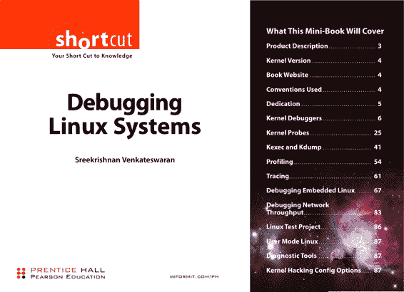

# Linux 系统调试指南 (Digital Short Cut)





informit.com/ph

来自 Ross Hagglund 图书馆

在 WoweBook.Com 下载

制造商和销售商用于区分其产品的许多标识均被声称为商标。当这些标识出现在本书中且出版者知晓存在商标声明时，这些标识以首字母大写或全大写的形式打印。

作者和出版者在准备本书时已付诸努力，但不对任何形式提供明示或暗示的保证，并对错误或遗漏不承担责任。对于与使用本文包含的信息或程序相关的任何间接或后果性损害，不承担任何责任。

请在 Web: www.informit.com/ph 访问我们。

Copyright © 2010 Pearson Education, Inc.

保留所有权利。本出版受版权保护，在进行任何禁止的复制、存储在检索系统中或以任何形式或手段（电子、机械、影印、录音或类似方式）传输之前，必须获得 ptg5994185 出版者的许可。有关许可的信息请写至：

Pearson Education, Inc.
Rights and Contracts Department
501 Boylston Street, Suite 900
Boston, MA 02116
Fax: (617) 671-3447
ISBN-13: 978-0-136-12354-5
ISBN-10: 0-136-12354-6

首次发布，2009 年 11 月

2

调试 Linux 系统（数字快捷指南）

© 2010 Pearson Education. 保留所有权利。

Sreekrishnan Venkateswaran 著

本出版受 copyright 保护。更多详情请参见第 2 页。

来自 Ross Hagglund 图书馆

在 WoweBook.Com 下载


*调试 Linux 系统* 讨论了目前可用于调试 2.6 Linux 内核的主要工具。我们首先探索了看似深奥的内核调试器 (`KDB`)、内核 GNU 调试器 (`KGDB`)、普通 GNU 调试器 (`GDB`) 以及 JTAG 调试器。然后，我们研究了 `内核探针 (Kernel Probes)`，这是一项允许你干预内核函数并提取调试信息或应用修复补丁的功能。分析崩溃转储（crash dump）可以为内核崩溃或挂起的事后分析提供线索，因此我们查看了 `Kdump`，这是一种在启动新内核后收集系统转储的实用工具。性能分析（Profiling）可以指引你找到消耗 CPU 周期更多的代码区域，因此我们学习了使用 `OProfile` 内核性能分析器和 `gprof` 应用分析器来感知代码瓶颈的存在。由于跟踪（Tracing）可以为不同代码模块交互期间出现的行为问题提供见解，我们深入研究了 Linux Trace Toolkit，这是一个为高量跟踪采集设计的系统。

“调试嵌入式 Linux”部分介绍了嵌入式硬件上常见的 I/O 接口，例如闪存、串口、PCMCIA、数字存储媒体、USB、RTC、音频、视频、触摸屏和蓝牙，并提供了调试相关设备驱动程序的指针。我们还通过案例研究学习了一些板级调试技能。“调试网络吞吐量”部分将带你了解可能影响网卡性能的一些设备驱动设计问题和协议实现特性。我们通过检查内核配置菜单中提供的可以输出价值调试信息的选项来结束本指南。

3

调试 Linux 系统（数字快捷指南）

© 2010 Pearson Education. 保留所有权利。

Sreekrishnan Venkateswaran 著

本出版受 copyright 保护。更多详情请参见第 2 页。

来自 Ross Hagglund 图书馆

在 WoweBook.Com 下载


ptg5994185


有时为了简单起见，本指南使用通用引用。因此，如果文本指向 `arch/your-arch/*` 目录，如果你为 x86 架构编译内核，则应将其转换为 `arch/x86/*`。

`→` 符号有时插入命令或内核输出之间以便解释。

4

调试 Linux 系统（数字快捷指南）

© 2010 Pearson Education. 保留所有权利。

Sreekrishnan Venkateswaran 著

本出版受 copyright 保护。更多详情请参见第 2 页。

# 献言

某些章节会让你参考用户态脚本或配置文件。然而，此类文件的确名称和位置可能会根据你使用的 Linux 发行版而变化。

献言

*本数字快捷指南与核心 Linux 设备驱动程序一样，献给印度的千万视觉视障人士。作者的所有收益将用于他们的事业。*

5


许多系统（尤其是任务关键系统）对可靠性、可用性和可维护性（RAS）有需求。Linux RAS 工作已经促进了若干项强大工具的发展。

如 Linux 测试项目 (LTP) 等练习工具可以衡量你内核移植的可靠性和健壮性。CPU 热插拔和 Linux 高可用性 (HA) 项目可以被视为可用性。内核调试器、`Kprobes`、`Kdump`、`EDAC` 和 Linux 跟踪工具包 (LTT) 则属于可维护性的范畴。这些分类之间的界限有时很模糊；你可以使用这些方法中的任意一种或组合来适应你的调试需求。例如，`OProfile` 等内核剖析器的输出既可以用于寻找潜在的代码瓶颈（可靠性），也可以用于调试现场问题（可维护性）。

## 内核调试器

指令级内核调试器(`kdb`) 和源码级内核 GNU 调试器(`kgdb`) 是 Linux 内核的两个主要调试器。是否将调试器作为标准内核的一部分一直是内核邮件列表中经常讨论的议题，但从 2.6.26 版本开始，轻量版本的 `kgdb` 最终已集成到主线内核中。即使你倾向于避开看似深奥莫测的内核调试器操作，你也可以通过普通的 GNU 调试器(`gdb`) 获取有关内核崩溃（kernel panics）的信息并查看内核变量。JTAG 调试器使用硬件辅助调试，功能强大但价格昂贵。

内核调试器让内核内部变得更加透明。你可以单步执行指令、反汇编指令、显示并修改内核变量，以及查看栈回溯。在本节中，让我们通过一些示例学习内核调试器的基础知识。

asm(" int $3”);
```

或者，你可以调用 `BREAKPOINT` 宏，它会被翻译为相应的依赖架构的指令。

如果停止所需的指令位于闪存中（调试器无法对其替换），则可以使用硬件断点代替软件断点。硬件断点需要处理器的支持。相应的地址需要添加到调试寄存器中。拥有的硬件断点数量取决于处理器支持的调试寄存器数量。

你还可以请求调试器对变量设置 `watchpoint`（观察点）。每当有指令修改观察点地址处的数据时，调试器就会停止执行。

另一种进入调试器的常用方法是按下中断键（attention key），但在许多情况下这不起作用。如果你的代码在禁用中断后处于紧密循环中，内核将没有机会处理中断键并进入调试器。例如，如果你的代码执行了如下操作，你就无法通过中断键进入调试器：

```c
unsigned long flags;
local_irq_save(flags);
while (1) continue;
local_irq_restore(flags);
```

当控制权转移到调试器时，你可以使用各种调试器命令开始分析。

### 内核调试器 (kdb)

`Kdb` 是用于调试内核代码和设备驱动程序的指令级调试器。在使用它之前，你需要用 `kdb` 支持补丁你的内核源码并重新编译内核。

`kdb` 的主要优势是易于设置，因为你不需要额外的机器来进行调试（与 `kgdb` 不同）。主要缺点是你需要将源码与反汇编后的代码进行对应（同样，与 `kgdb` 不同）。

让我们通过示例来上手一下 `kdb`。这里是“案发现场”：你修改了一个内核串口驱动程序以适配你的 x86 硬件，但驱动程序无法工作，你想让 `kdb` 帮你抓到罪魁祸首。

让我们通过在串口驱动的 `open()` 入口设置断点来开始寻找指纹。

记住，因为 `kdb` 不是源码级调试器，你需要打开源码并尝试将指令与你的 C 代码相匹配。让我们列出相关的源码片段：

```c
drivers/serial/myserial.c
static int rs_open(struct tty_struct *tty, struct file *filp)
{
    struct async_struct *info;
    /* ... */
    retval = get_async_struct(line, &info);
    if (retval) return(retval);
    tty->driver_data = info;
    /* Point A */
    /* ... */
}
```

按下暂停键（Pause）并进入 `kdb`。让我们看看反汇编后的 `rs_open()` 什么样。这里显示的调试会话使用 `→` 符号附加说明。

```
Entering kdb (current=0xc03f6000, pid 0) on processor 0 due to Keyboard Entry
kdb> id rs_open → Disassemble rs_open
0xc01cce00 rs_open: sub $0x1c, %esp
0xc01cce03 rs_open+0x03: mov $ffffffed, %ecx
...
0xc01cce4b rs_open+0x4b: call 0xc01ccca0, get_async_struct
...
0xc01cce56 rs_open+0x56: mov 0xc(%esp,1), %eax
0xc01cce5a rs_open+0x5a: mov %eax, 0x9a4(%ebx)
...

如果你在使用 2.4 内核，请使用 `insmod` 的 `-m` 选项获取段地址：

```bash
bash> insmod my_module.o –m
```

由于你将 `kgdbwait` 作为内核命令行参数传递，当内核在目标上启动时，`gdb` 会获得控制权。现在使用 `add-symbol-file` 命令告知 `gdb` 之前的段地址：

```bash
(gdb) add-symbol-file drivers/char/mymodule.ko 0xe091a060 -s .rodata 0xe091d1fc -s .data 0xe091d260 -s .bss 0xe091d2c0
```


从文件 `drivers/char/my_module.ko` 加载符号表于

`.text_addr = 0xe091a060`

`.rodata_addr = 0xe091d1fc`

`.data_addr = 0xe091d260`

`.bss_addr = 0xe091d2c0`

ptg5994185

(y 或 n) y

正在从 `drivers/char/mymodule.ko` 读取符号...完成。

为了调试内核崩溃（kernel panic），让我们在 `trojan_function()` 处设置断点：

```bash
(gdb) b trojan_function → 设置断点
(gdb) c → 继续执行
```

当 `kgdb` 命中断点时，让我们查看栈回溯，单步执行到点 A，并显示 `my_variable` 的值：

```bash
(gdb) bt → 回溯（栈）堆溯
#0 trojan_function () at my_module.c :124
#1 0xe091a108 in my_parent_function (my_var1=438, my_var2=0xe091d288)
..
```

16

Linux 系统调试 (Digital Shortcut)
© 2010 Pearson Education. 保留所有权利。
作者 Sreekrishnan Venkateswaran

本出版物受版权保护。详情请参见第 2 页。](#index_split_000.html_2)

来自 Ross Hagglund 图书馆
在 WoweBook.Com 下载

(gdb) p my_variable
$0 = 0
```

这里有一个明显的错误。`my_variable` 指向 NULL，因为 `trojan_function()` 忘记为它分配内存了。让我们直接使用 `kgdb` 分配内存，绕过内核崩溃并继续测试：

ptg5994185

```bash
(gdb) set my_variable=0xe091a100 → my_variable = &buffer

17

Linux 系统调试 (Digital Shortcut)
© 2010 Pearson Education. 保留所有权利。
作者 Sreekrishnan Venkateswaran

本出版物受版权保护。详情请参见第 2 页。](#index_split_000.html_2)

来自 Ross Hagglund 图书馆
在 WoweBook.Com 下载

## 第 #1 部分：内核调试器

## GNU 调试器 (gdb)

如前所述，你可以使用普通的 `gdb` 来收集一些内核调试信息。

然而，你无法单步执行内核代码、设置断点或修改内核变量。让我们使用 `gdb` 来调试由列表 1.1 中错误函数引起的内核崩溃，但这次假设](#index_split_000.html_14）`trojan_function()` 是作为内核的一部分编译的，而不是模块，因为你无法使用 `gdb` 轻松查看模块内部。

这是执行 `trojan_function()` 时生成的“oops”消息的一部分：`Unable to handle kernel NULL pointer dereference at virtual address 000000ab`（无法处理虚拟地址内核空指针引用）

ptg5994185

...
eax: f7571de0 ebx: ffffe000 ecx: f6c78000 edx: f98df870
...
Stack: c019d731 00000000
...
bffffbe8 c0108fab
Call Trace: [<c019d731>] [<c013b8ac>] [<c0108fab>]
...

将此晦涩的“oops”消息复制到 `oops.txt` 并使用 `ksymoops` 工具获取更详细的输出。如果系统挂起，你可能需要手动拷贝：

```bash
bash> ksymoops oops.txt
```

```assembly
Code; c019d710 <trojan_function+0/10>
00000000 <_EIP>:
0: a1 ab 00 00 00 mov 0xab,%eax
Code; c019d715 <trojan_function+5/10>
5: c3 ret
© 2010 Pearson Education. 保留所有权利。
作者 Sreekrishnan Venkateswaran

本出版物受版权保护。详情请参见第 2 页。](#index_split_000.html_2)

来自 Ross Hagglund 图书馆
在 WoweBook.Com 下载

## 第 #1 部分：内核调试器

2.6 如果你在内核配置期间启用了 `CONFIG_KALLSYMS`，内核生成的“oops”输出可以直接使用，而无需使用 `ksymoops` 进行解码。

查看之前的转储（dump），oops 发生在 `trojan_function()` 内部。让我们使用 `gdb` 获取更多信息。在下面的调用中，`vmlinux` 是未压缩的内核镜像，`/proc/kcore` 是内核地址空间：

ptg5994185

```bash
bash> gdb vmlinux /proc/kcore
```

```gdb
(gdb) p xtime → 通过打印内核变量来测试水 $0 = 1113173755
```

由于 `gdb` 的缓存访问，重复访问同一变量不会产生更新的值。你可以通过使用 `gdb` 的 `core-file` 命令重新读取核心文件来强制刷新访问。现在让我们查看 `trojan_function()` 的反汇编：

由于编译器优化，在汇编文件中看到的 `trojan_function()` 看起来非常简洁。它实际上是将地址 `0xab` 的内容拷贝到 `EAX` 寄存器，这在 x86 系统上持有函数的返回值。但 `0xab` 看起来不像一个有效的内核地址！通过为 `my_variable` 分配有效的内存空间来修复错误，重新编译并继续你的测试。

19


来自 Ross Hagglund 图书馆
在 WoweBook.Com 下载

## 第 #1 部分：内核调试器

## JTAG 调试器

JTAG 调试器使用硬件辅助来调试代码。你需要专门的硬件和前端接口（某些 JTAG 调试器使用 gdb 作为前端）来单步执行代码。JTAG 还可以用于调试以外的目的，例如将代码烧录到板载闪存中。JTAG 连接在开发板上常见，但通常不是生产单元的一部分。

ptg5994185

JTAG 调试器通常通过串口、USB 或以太网连接到目标硬件。通过以太网，你可以远程访问 JTAG 调试器，从而访问目标板，即使板本身没有网络接口。

图 1.2 显示了基于](#index_split_000.html_2)AG 的远程调试会话。在此场景下使用的 JTAG 调试器支持 gdb 前端。开发主机和 JTAG 硬件连接到以太网局域网。目标上的串口连接到 JTAG 盒的串口。

3 如果适当替换连接调试器到目标板的探头，某些 JTAG 调试器适用于多种架构。

20

Linux 系统调试 (Digital Shortcut)
© 2010 Pearson Education. 保留所有权利。
作者 Sreekrishnan Venkateswaran

本出版物受版权保护。详情请参见第 2 页。](#index_split_000.html_2)

来自 Ross Hagglund 图书馆
在 WoweBook.Com 下载

## 第 #1 部分：内核调试器

```gdb
(gdb) target remote 10.1.1.2:1001 → 10.1.1.2 是 JTAG 硬件的 IP 地址。1001 是监听

传入 gdb 连接的 JTAG TCP 端口

```bash
bash> telnet 10.1.1.2 50
```


# 第 1 部分：内核调试器

这等同于在将目标的调试串口直接连接到主机（而不是如图 1.2 所示连接到 JTAG 盒）后运行如 `minicom` 等仿真器，这将限制主机在物理上必须靠近目标。

## 图 1.2：基于 JTAG 的远程调试设置示例

-   **远程 Linux 开发主机**
    - **VNC 会话**
    - **终端 1 (GDB 会话)**:
        ```bash
        bash> gdb vmlinux
        gdb> target remote
        ```
    - **终端 2 (目标控制台)**:
        ```bash
        bash> telnet 10.1.1.2
        ```
    - **终端 3 (JTAG 控制)**:
        ```bash
        bash> telnet 10.1.1.2
        jtag>
        ```
    - **终端 4 (硬复位)**
    - **终端 5 (导出的根文件系统)**
        ```bash
        bash> elinks 10.1.1.4
        bash> cat /etc/exports
-   **远程电源开关**

## 内核调试器

终端 3 通过 telnet 连接到 JTAG 盒并提供特定调试器的语义。例如，你可以使用它执行以下操作：

JTAG 调试有时可能会不稳定，因此如果你正在进行远程调试，通过远程电源控制开关为目标供电是一个好主意，如图 1.2 所示。这样，你可以使用网络浏览器从主机对目标进行硬复位，如终端 4 所示。你也可以通过远程电源开关为 JTAG 硬件供电。这允许你在没有 JTAG 及其定义文件介入的情况下直接从闪存运行引导加载程序。


JTAG 调试器的一个优势在于，你可以使用单一工具调试构成固件解决方案的不同部分。因此，你可以使用同一个调试器在源代码级别上调试 BIOS、引导加载程序、基础内核、设备驱动模块和用户空间应用程序。

### 下载

-   你可以从 `http://oss.sgi.com/projects/kdb` 下载适用于 `x86` 和 `IA64` 架构的 `kdb` 补丁。每个支持的内核版本两个补丁：一个通和一个依赖架构的。
-   `kgdb` 项目的主页为 `http://kgdb.sourceforge.net`。该网站还有关于配置和使用 `kgdb` 的文档。
## 内核探针

内核探针可以入侵内核函数并提取调试信息或应用修复补丁。它是你调试工具箱的有用补充，用于调查客户现场无法解释的行为，特别是当你没有重启系统的这种奢侈条件时。

Linux 支持一种通用形式的内核探针，称为 `Kprobes`，以及两种特殊变体：`Jprobes` 和返回探针（return probes）。

### Kprobes

Kprobes 通过提供动态转储内核结构或向运行中的内核中插入代码的能力，可以节省构建和启动调试内核的麻烦。例如，你可以在不重新编译内核的情况下，在调度程序内部动态添加几个 `printk`。你甚至可以在不重启火星车探测器的情况下修复其上的一个 bug。

要在内核函数内部插入 kprobe，请遵循以下步骤：
1.  在内核配置菜单中开启 `CONFIG_KPROBES`（*Instrumentation Support* → *Kprobes*）。
2.  实现一个内核模块，在感兴趣的指令处注册一个 kprobe。你需要注册一个 Kprobes 在执行被探测指令之前运行的 `pre-handler`，以及一个 Kprobes 在执行被探测指令之后运行的 `post-handler`。你还可以提供一个 `fault-handler`，当在执行 pre- 或 post-handlers 时检测到故障，它将运行（因为你不不想由于调试 bug 导致“oops”错误！）。


当注册一个 `kprobe` 时，它会保存被探测的指令并将其替换为一条生成断点的指令（在基于 `x86` 的系统上为 `int 0x03`）。当触发断点时，内核会生成一个 `die` 通知。`Kprobes` 到 die 通知链中，因此能够接收断点触发的通知。

收到通知后，`Kprobes` 执行已注册的 `pre-handler`。接下来，它单步执行被探测指令的副本。由于 `SMP` 一致性的考虑，它执行的是副本，而不是将被探测指令替换回断点指令。最后，它运行 `post-handler`。`pre-handler` 和 `post-handler` 窗口是为 Kprobes 用户注入调试代码而提供的钩子。这些处理程序可以动态注册和注销，因此可维护性不仅仅是编译时的静态状态，而是在运行时可编程的。

## 示例用法
### 列表 1.2：问题代码 (mydrv.c)

```c
int npages=0;

EXPORT_SYMBOL(npages);

static int memwalkd(void *unused)
{
    long curr_pfn = (64*1024*1024 >> PAGE_SHIFT);
    struct page *curr_page;
    /* ... */
    daemonize(“memwalkd”); /* 内核线程 */
    sigfillset(&current->blocked);
    allow_signal(SIGUSR1);
    for (;;) {
        /* 如果有挂起的信号，则出队 */
        if (signal_pending(current)) {
            sig = dequeue_signal(current, &current->blocked, &info);
            /* 点 A */
            /* 当接收到 SIGUSR1 时释放 npages 页面 */
            if (sig == SIGUSR1) {
                /* 点 B */
                /* 当 npages 在以下循环中超过 10 时，问题出现。让我们通过 Kprobes 在此处应用运行时治疗 */
                for (i=0; i < npages; i++, curr_pfn++) {
                    /* ... */
                }
            }
            /* ... */
        }
    }
}

```

#include <linux/kprobes.h>
#include <linux/kallsyms.h>
#include <linux/sched.h>
extern int npages; /* 定义在列表 1.2 中 */

{
    if (npages > 10) npages = 10;
    return 0;
}


/* Fault Handler：如果 pre/post-handlers 遇到异常时调用 */
int bandaid_fault(struct kprobe *p, struct pt_regs *regs, int trapnr)
{
    return 0;
    /* 填充 kprobe 体 */
    bandaid.pre_handler = bandaid_pre;
    bandaid.post_handler = bandaid_post;
    bandaid.fault_handler = bandaid_fault;
    /* 如所述到达目标地址 */
    /* 注册 kprobe */
    if ((retval = register_kprobe(&bandaid)) < 0) {
        printk("register_kprobe error, return value=%d\n”, retval);
        return -1;
    }
    unregister_kprobe(&bandaid);
}
MODULE_LICENSE(“GPL”);
```

objdump -D mydrv.ko
```

```text
mydrv.ko: file format elf32-i386
  75 2b               jne    0x2d <memwalkd+50>
  83 f8 0a            cmp    $0xa,%eax
  ...
  0f 8e b5             jle    aa <memwalkd+16c>
  81 fd 7b             cmp    $0xf6,%ebp

如果你为不同的处理器平台进行交叉编译，必须使用特定架构的 `objdump`。如果你反汇编一个为 ARM 目标设备交叉编译的二进制文件，你需要像 `arm-linux-objdump` 的工具。向 `objdump` 传递 `-S` 可以将源代码与反汇编输出混合：

```bash
arm-linux-objdump -d -S mydrv.ko

```c
static int memwalkd(void *unused)
{
    ...
            if (npages > 10) npages = 10; /* 治疗性补丁！ */
            ...
        }
    }
}


# 第 2 节：内核探针 (Kernel Probes)

/* ... */
}
/* ... */
}
```
## Jprobes

`jprobe` 是一种特殊的 `kprobe`。当调查点位于内核函数的入口处时，它简化了添加探针的工作。`jprobe` 处理程序的函数原型与被探针函数的原型相同。它以与被探针函数相同的参数列表被调用，因此你可以轻松地从 `jprobe` 处理程序中访问函数参数。如果你使用 `Kprobes` 而不是 `Jprobes`，想象一下你的探针处理程序需要经历的麻烦：在函数栈的阴暗巷弄中穿行以提取函数参数！而且这段深入栈以获取参数值的代码必须高度针对特定函数，更不用说它是依赖于架构且不可移植的。

为了学习如何使用 `Jprobes`，让我们回到一个示例。假设你正在通过查看网络设备驱动程序（作为内核的一部分构建的）生成的 `printk()` 消息来调试该驱动程序。
```c
asmlinkage int printk(const char *fmt, ...)
{
    va_list args;
    int r;
```

在 `printk()` 的入口处添加一个简单的 `jprobe`，并将每个 `%O` 转换为 `%o`。注意，`jprobe` 处理程序需要与 `printk()` 具有相同的原型。这两个函数都标记了 `asmlinkage` 标签，该标签要求它们从栈而不是 CPU 寄存器获取参数。

### 列表 1.4：注册 Jprobe 处理程序
#include <linux/kallsyms.h>

/* 探针 printk 的入口 */
asmlinkage int
jprintk(const char *fmt, ...)
    return 0;
}

/* 探针结构 */
static struct jprobe jprobe_eg = {
{
    int retval;
    jprobe_eg.kp.addr = (kprobe_opcode_t*)
    kallsyms_lookup_name("printk");
    if (!jprobe_eg.kp.addr) {
        printk("register_jprobe error, return value=%d\n", retval);
        return -1;
    }
    printk("Jprobe registered.\n");
    return 0;
    unregister_jprobe(&jprobe_eg);
}
MODULE_LICENSE("GPL");
```


`return probe`（在 `Kprobes` 术语中为 `kretprobe`）是另一种特殊的 `Kprobes` 辅助。当你需要探测函数的返回点时，它简化了插入 `kprobe` 的工作。如果你使用原始 `Kprobes` 来调查返回点，你可能需要在多个地方注册，因为函数可以通过多个路径返回。然而，如果你使用 `kretprobe`，你只需要插入一个。在 `drivers/char/tty_io.c` 中定义的 `tty_open()` 有七条返回路径。成功路径返回 `0`，其他路径返回 `-ENXIO` 和 `-ENODEV` 等错误值。单个 `kretprobe` 即可向你报警失败，无论路径如何。

### 列表 1.5：注册返回探针处理程序


/* 在 tty_open() 退出时探针 */
static int
kret_tty_open(struct kretprobe_instance *kreti,
struct pt_regs *regs)
    }
    return 0;
}

/* 探针结构 */
init_module(void)
{
    int retval;
    kretprobe_eg.kp.addr = (kprobe_opcode_t*)
    kallsyms_lookup_name("tty_open");
    if ((retval = register_kretprobe(&kretprobe_eg) < 0)) {
        printk("register_kretprobe error, return value=%d\n", retval);
        return -1;
    }
    printk("kretprobe registered.\n");
{
    unregister_kretprobe(&kretprobe_eg);
}
MODULE_LICENSE("GPL");
```
```c
unregister_kretprobe(&kretprobe_eg);

}

当[列表 1.5 调用`register_kretprobes()`]时，kprobe 在内部被插入到 `tty_open()` 的开头。当此探测被命中时，此内部 kprobe 处理器会将函数返回地址替换为特殊例程的地址（在 Kprobes 术语中称为 `trampoline`）。查看 `arch/your-arch/kernel/kprobes.c` 可了解 trampoline 的实现。

当 `tty_open()` 通过其七条路径之一返回时，控制权返回到 trampoline 而不是调用函数。trampoline 调用 kretprobe 处理器 `kret_tty_open()`，[该由列表 1.5 注册，如果 `tty_open()` 未成功返回，它将打印返回值]。

## 局限性

Kprobes 有其局限性。其中一些是显而易见的。例如，如果你在内联函数内部插入 kprobe，将无法得到预期的结果。当然，你无法探测 Kprobes 自身的代码。

Kprobes 更适用于在基础内核内部应用探测。如果目标代码是动态加载模块的一部分，你与其编写并编译一个新模块来“kprobe”它，不如重写并重新编译你的模块。然而，如果卸载该模块是不可接受的，你可能仍然想使用 Kprobes。

还存在一些不那么明显的局限性。优化是在编译时完成的，而 Kprobes 是在运行时插入的。因此，通过 Kprobes 插入指令的效果不等同于在原始源文件中添加代码。例如，这段有 Bug 的代码段：

```c
volatile int *integerp = 0xFF;
int integerd = *integerp;
```

被编译器简化为：

```assembly
mov 0xff, %eax
```

因此，如果你想在这两行 C 代码之间溜进去代码、分配一个字的内存、将 `integerp` 指向分配的内存并规避内核崩溃，你无法轻易使用 Kprobes。

## 注意事项
SystemTap (http://sourceware.org/systemtap/) 是一种简化 Kprobes 使用的诊断工具。

### 查看源码

Kprobes 的实现由定义在 `kernel/kprobes.c`（以及 `include/linux/kprobes.h`）的通用部分，以及位于 `arch/your-arch/kernel/kprobes.c`（以及 `include/asm-your-arch/kprobes.h`）的体系相关部分组成。

查看 `Documentation/kprobes.txt` 获取关于 Kprobes、Jprobes 和 Kretprobes 的更多信息。

# 第 3 部分：Kexec 和 Kdump

现在你已经学习了如何使用 Kprobes，让我们继续查看 Linux RAS 的更多方面。`Kexec` 和 `kdump` 是 2.6 内核中引入的可维护性功能。

Kexec 使用了 UNIX `exec()` 系统调用的镜像覆盖哲学，在运行的内核之上启动一个新内核，而无需启动固件的开销。这可以节省几秒的重启时间，因为启动固件需要花费周期来遍历总线并识别设备。重启延迟越低，系统停机时间越短；因此，这是开发 kexec 的主要动机之一。然而，kexec 最常用的用户是 kdump。在内核崩溃后捕获转储（dump）本质上是不可靠的，因为访问转储设备的内核代码可能处于不稳定状态。Kdump 通过通过 kexec 到一个健康内核后收集转储来解决这个问题。

## Kexec

在 kexec 内核之前，你需要进行一些准备工作：

1. 编译并启动一个支持 kexec 的内核。为此，请在内核配置菜单中开启 `CONFIG_KEXEC`（`Processor Type and Features` → `Kexec System Call`）。此内核被称为第一个内核或运行中的内核。
1. 使用 `kexec` 命令加载第二个（覆盖）内核：
```bash
kexec -l /path/to/kernelsources/arch/x86/boot/bzImage -append="root=/dev/hdaX" --initrd=/boot/myinitrd.img
```
`bzImage` 是第二个内核，`hdaX` 是根设备，`myinitrd.img` 是初始根文件系统。此阶段的内核实现大部分与体系无关。此阶段的核心是 `sys_kexec()` 系统调用。`kexec` 命令通过该系统服务的服务将新内核镜像加载到运行内核的缓冲区中。
2. 启动第二个内核：
```bash
kexec -e
```
... → 内核启动消息

Kexec 直接启动新内核，而不优雅地停止操作系统。要在重启之前关闭，请在 `halt` 脚本的底部（通常为 `/etc/rc.d/rc0.d/*S01halt`）调用 `kexec` 并调用 `halt`。

第二阶段的实现是体系相关的。此阶段的关键是一个 `reboot_code_buffer`，它包含了将新内核放置到位启动的汇编代码。

Kexec 跳过了调用启动固件服务的初始内核代码，直接跳转到保护模式入口（对于 x86 处理器）。实现 kexec 的一个重要挑战是内核与启动固件（基于 x86 系统的 BIOS、基于 POWER 的机器 Openfirmware 等）之间的交互。在 x86 系统上，BIOS 传递给内核的 `e820` 内存映射等信息也需要提供给 kexec 内核。

## 带 Kdump 的 Kexec

当 kexec 与 kdump 配合使用时，其语义有些特殊。在这种情况下，kexec 需要在遇到内核恐慌（panic）时自动启动新内核。

如果运行的内核崩溃，将启动新内核（称为捕获内核）以可靠地收集转储。典型的调用语法如下：

```bash
kexec -p /path/to/capture-kernel-sources/vmlinux --args-linux --append="root=/dev/hdaX irqpoll" --initrd=/boot/myinitrd.img
```


`-p` 选项请求 `kexec` 在发生内核恐（kernel panic）时触发重启。使用一个 `vmlinux` ELF 内核镜像作为捕获内核。由于 `vmlinux` 是一个通用的 ELF 启动镜像，且 `kexec` 在理论上与操作系统无关，因此你需要通过 `--args-linux` 选项指定以下参数必须以 Linux 特有的方式进行解释。捕获内核在内核崩溃期间异步启动，因此使用共享中断的设备驱动程序在启动过程中可能会出现致命的错误。为了友好对待此类驱动程序，请使用 `--append` 在传递给捕获内核的命令行中指定 `irqpoll`。

要配合 `kdump` 使用 `kexec`，你需要一些额外的内核配置设置。捕获内核需要访问崩溃内核的内核内存以生成完整的转储（dump），因此后者不能像非 kdump 情况下 `kexec` 执行的那样直接覆盖前者。运行中的内核需要留出一个内存区域来运行捕获内核。要标记该区域：


现在你已经熟悉了 `kexec` 并从 kdump 用户的角度掌握了它，让我们让我们深入研究 kdump 并使用它来分析一些真实世界中的内核崩溃。

## Kdump

在内核崩溃或挂起后捕获的系统内存镜像被称为 `crash dump`（崩溃转储）。分析崩溃转储可以为内核问题的事后分析提供宝贵的线索。然而，在内核崩溃后获取转储在本质上是不可靠的，因为负责将数据记录到转储设备的存储驱动程序可能处于未定义状态。

在 `kdump` 出现之前，`Linux Kernel Crash Dump (LKCD)` 是获取和分析转储的流行机制。`LKCD` 使用临时转储设备（如交换分区）来捕获转储。然后热重启回健康状态，并将转储从临时设备复制到持久位置。使用一个名为 `lcrash` 的工具来分析转储。`LKCD` 的缺点包括：

-   即使在崩溃的内核上，将转储复制到临时设备也可能是不可靠的。
-   转储设备的配置并不简单。
-   重启可能会很慢，因为只有在转储安全保存到持久位置后，交换空间才能被激活。
-   `LKCD` 不是主内核的一部分，因此为你的内核版本安装适当的补丁是一个障碍。

`kdump` 不受这些缺陷的困扰。它通过通过 `kexec` 到健康内核后收集转储，消除了不确定性。此外，由于在 `kexec` 重启后内存状态会被保留，可以从捕获内核准确访问内存镜像。

让我们先完成初步的 kdump 设置：

1.  让运行中的内核在遇到 panic 时请求 `kexec` 进入捕获内核。捕获内核应额外开启 `CONFIG_HIMEM` 和 `CONFIG_CRASH_DUMP`。（这两个选项都位于内核配置菜单中的 *Processor type and Features* 内。）

2.  捕获内核启动后，将 `/proc/vmcore`（通过启用内核配置菜单中的 `CONFIG_PROC_VMCORE` 获取）收集到的转储信息拷贝到硬盘上的文件：

```bash
cp /proc/vmcore /dump/vmcore.dump
```

你也可以通过 `/dev/oldmem` 保存其他信息，例如崩溃内核的原始内存快照。

3.  回到第一个内核。现在你准备好开始转储分析。

让我们使用收集转储文件和 `crash` 工具分析一些示例内核崩溃。

在 RTC 驱动的中断处理程序（`drivers/char/rtc.c`）中引入此 bug：

```c
irqreturn_t rtc_interrupt(int irq, void *dev_id)
{
    + volatile int *integerp = 0xFF;
    + int integerd = *integerp; /* 错误的内存引用！ */
    spin_lock(&rtc_lock);
    /* ... */
}
```

通过 `hwclock` 命令启用中断来触发处理程序的执行：
... → 当执行触及 `rtc_interrupt()` 时发生内核 panic，导致 `kexec` 启动进入捕获内核。

将 `/proc/vmcore` 保存到 `/dump/vmcore.dump`，重启回到第一个（崩溃的）内核，并使用 `crash` 工具开始分析。在现实情况下，转转储可能在客户现场捕获，而分析则在支持中心完成：

```bash
crash /usr/src/linux/vmlinux /dump/vmcore.dump
```

```
crash 4.0-2.24
...
KERNEL: /usr/src/linux/vmlinux
DUMPFILE: /root/vmcore.dumpfile
CPUS: 1
DATE: Mon Nov 26 04:15:49 2007
UPTIME: 00:17:22
LOAD AVERAGE: 0.82, 1.02, 0.87
TASKS: 63
...
PANIC: “Oops: 0000 [#1]” (查看日志获取详情)
crash>
```

检查堆栈跟踪以理解崩溃原因：

```bash
crash> bt
PID: 0 TASK: c03a32e0 CPU: 0 COMMAND: “swapper”
#0 [c0431eb8] crash_kexec at c013a8e7
#1 [c0431f04] die at c0103a73
#2 [c0431f44] do_page_fault at c0343381
#3 [c0431f84] error_code (via page_fault) at c010312d
EAX: 00000008 EBX: c59a5360 ECX: c03fbf90 EDX: 00000000
EBP: 00000000
DS: 007b ESI: 00000000 ES: 007b EDI: c03fbf90

堆栈跟踪将怀疑指向 `rtc_interrupt()`。让我们反汇编 `rtc_interrupt()` 附近的指令：

```bash
crash> dis 0xf8a8c000 5
0xf8a8c000 <rtc_interrupt>: push %ebx
0xf8a8c001 <rtc_interrupt+1>: sub $0x4,%esp
0xf8a8c004 <rtc_interrupt+4>: mov 0xff,%eax
0xf8a8c009 <rtc_interrupt+9>: mov $0xc03a6640,%eax
0xf8a8c00e <rtc_interrupt+14>: call 0xc0342300 <_spin_lock>
```

地址 `0xf8a8c004` 处的指令试图将 EAX 寄存器的内容移动到 `0xff`，显然是导致崩溃的无效引用。修复它并编译新内核。


如果你使用 `irq` 命令，可以确定崩溃发生期间正在进行的中断的标识。在这种情况下，输出证实了 RTC 中断确实处于激活状态：

```
crash> irq

IRQ: 8


...

handler: f8a8c000 <rtc_interrupt>


crash> quit
```

bash>
```c
static int __init myrv_init(void)
{
    spin_lock(&mydrv_wq.lock); /* 在初始化之前使用！ */
    spin_lock_init(&mydrv_wq.lock);
    /* ... */
}
```

该代码在初始化自旋锁之前错误地使用了它。从效果上说，CPU 会无限旋转尝试获取锁，内核似乎挂起了。让我们使用 `kdump` 来调试这个问题。

在这种情况下，不会自动触发，因为没有发生恐慌（panic），所以通过按下魔术 Sysrq 键组合 Alt-Sysrq-c 来强制执行崩溃转储。你可能需要通过向 `/proc/sys/kernel/sysrq` 写入 1 来启用 Sysrq：

```bashbash> echo 1 > /proc/sys/kernel/sysrq
bash> insmod mydrv.ko
```

这会导致内核在 `mydrv_init()` 挂起。按下 Alt-Sysrq-c 键组合触发崩溃转储：

**Alt-Sysrq-c**

... → 宣布已触发崩溃转储的消息

在 `kexec` 启动捕获内核后将转储保存到磁盘，启动回原始内核，并在保存的转储上运行 `crash`：

``` evenbash> crash vmlinux vmcore.dump
```

...

PANIC: “SysRq : Trigger a crashdump”

```
PID: 2115
COMMAND: “insmod”
TASK: f7c57000 [THREAD_INFO: f6170000]
CPU: 0
STATE: TASK_RUNNING (SYSRQ)
crash>
```

通过检查崩溃时运行的进程标识来测试水深。

在这种情况下，显然是 `insmod`（来自 `mydrv.ko`）：`crash> ps`

```

堆栈回溯没有提供太多信息，除了告诉你是 Sysrq 键的按下导致了转储之外：

```
```

接下来让我们尝试查看由崩溃内核生成的日志消息。`log` 命令从转储文件中的内核 `printk` 环形缓冲区读取消息：`crash> log`

```
BUG: soft lockup detected on CPU#0!
Pid: 2261, comm: insmod
EIP: 0060:[<c010ec1b>] CPU: 0
EIP is at delay_pmtmr+0xb/0x20
EFLAGS: 00000246 Tainted: P (2.6.16.16 #11)
EAX: 5caaa48c EBX: 00000001 ECX: 5caaa459 EDX: 00000012
ESI: 02e169c9 EDI: 00000000 EBP: 00000001 DS: 007b ES: 007b
CR0: 8005003b CR2: 08062017 CR3: 35e89000 CR4: 000006d0
[<c01fede9>] __delay+0x9/0x10
[<c0200089>] _raw_spin_lock+0xa9/0x150
[<f893d00d>] mydrv_init+0xd/0xb2 [wqdrv]
[<c0136565>] sys_init_module+0x175/0x17a2
[<c015d834>] do_sync_read+0xc4/0x100
[<c013ce4d>] audit_syscall_entry+0x13d/0x170
[<c0105578>] do_syscall_trace+0x20/0x21a
[<c0102f05>] syscall_call+0x7/0xb
SysRq : Trigger a crashdump
crash>
```

crash> dis f893d00 5
dis: WARNING: f893d00: no associated symbol found
0xf893d00: mov $0xf9f1208,%eax
0xf893d05: sub $0x8,%esp
0xf893d08: call 0xc32300 <spin_lock>

```
crash> rd mydrv_wq 100
f892c200: 00000000 00000000 00000000 00000000
...
### 查看源码

`kexec` 的体系部分位于 `arch/your-arch/kernel/machine_kexec.c` 和 `arch/your-arch/kernel/relocate_kernel.S`。通用部分位于 `kernel/kexec.c`（以及 `include/linux/kexec.h`）。查看 `arch/your-arch/kernel/crash.c` 和 `arch/your-arch/kernel/crash_dump.c` 以了解 kdump 的实现。`Documentation/kdump/kdump.txt` 包含了安装信息。


本出版受版权保护。更多详情请参阅第 2 页](#index_split_000.html_2)

源自 Ross Hagglund 图馆

在 WoweBook.Com 下载
OProfile 包含以下部分：

- 一个收集性能分析信息的内核层。若要在内核中启用 `OProfile`，请启用 `CONFIG_PROFILING`、`CONFIG_OPROFILE` 和 `CONFIG_APIC` 并重新编译。
- `oprofiled` 守护进程。
- 一系列性能分析后工具，如 `opcontrol`、`opreport` 和 `op_help`，有助于对收集到的数据进行详细分析。这些工具包含在多个发行版中；如果你的发行版没有包含它们，你可以下载预编译的二进制文件。
```bash
opcontrol --setup --vmlinux=/path/to/kernelsources/vmlinux --event=GLOBAL_POWER_EVENTS:100000:1:1:1
```

事件指定符要求 `OProfile` 在 `GLOBAL_POWER_EVENTS` 期间（处理器未停止的时间）收集样本。事件指定符旁边的数字分别表示时钟周期中的采样计数、单位掩码过滤器、内核空间计数和用户空间计数。如果你想每秒采样 `x` 次，且你的处理器运行频率为 `cpu_speed HZ`，那么你的采样计数应大约为 `(cpu_speed/x)`。计数越大，生成的性能分析报告越越精细，但也会产生更多的 CPU 开销。如果你仍在使用 2.4 内核，则需要为内核源码打上 `OProfile` 支持丁。
```
→ 列出 Pentium 4 CPU 上的可用事件

`GLOBAL_POWER_EVENTS`: (counter: 0, 4)
处理器未停止的时间（最小计数: 3000）
已执行的预测错误分支（最小计数: 3000）

`BSQ_CACHE_REFERENCE`: (counter: 0, 4)
...

→ 开始数据收集

```bash
ls -lR /**
```
→ 保存性能分析数据

使用 `opreport` 查看性能分析结果。`%` 列提供了函数对系统负载的度量：

```bash

samples % symbol name
914506 24.2423 vgacon_scroll → *ls* 输出打印到控制台
406619 10.7789 do_con_write
273023 7.2375 vgacon_cursor

现在，让我们通过在 `vfs_readdir()` 中引入 1 毫秒的延迟来模拟 VFS 代码中的瓶颈。这在列表 1.6 中完成。

### 列表 1.6
vfs_readdir() 定义在 fs/read_dir.c

    /* 引入毫秒级瓶颈 */
    /* (在此系统上 HZ 设置为 1000) */
    unsigned long timeout = jiffies+1;
    while (time_before(jiffies, timeout));
带有此更改编译内核并重新收集。新数据所示：
```bash
opreport -l /path/to/kernelsources/vmlinux
```

1065197 9.8561 vgacon_scroll → *ls* 输出打印到控制台
479801 4.4395 do_con_write
...

如你所见，瓶颈清晰地反映在性能数据中。`vfs_readdir()` 现在跳到了列表顶端！
```
→ 单位掩码 0x100 表示 L2 缓存缺失


## 使用 Gprof 进行应用分析

如果你只需要独立地对应用程序进程进行分析，而不需要分析代表其执行的内核代码，请使用 `gprof` 而不是 OProfile。`gprof` 依赖于编译器生成的额外代码来对 C、Pascal 或 Fortran 程序进行分析。让我们使用 `gprof` 来分析以下代码段：

```c
        }
    }
}
```

gcc -pg -g -o myprog myprog.c
```
```bash
./myprog
```
```

### 平铺分析 (Flat profile):

每个样本计数为 0.01 秒。

这显示执行过程中触发两次错误路径。你可以调整代码以减少对错误路径的遍历，并重新运行 `gprof` 生成更新的分析结果。

## 跟踪 (Tracing)


LTT 由四个部分组成：

1. 核心模块，为内核的其他部分提供跟踪服务。收集到的跟踪被复制到内核缓冲区。
2. 使用跟踪服务的代码。这些代码被插入在你想要捕捉跟踪转储的地方。
让我们通过一个简单的例子来看看 LTT 提供的功能。假设当应用程序从设备读取数据时发现数据损坏。为了确定是否 LTT 引入了损坏，首先在驱动程序中添加跟踪钩子。这在 2.6.11 候选版本中完成。

```c
#include <linux/trace.h>

static struct mydriver_data driver_data;

/* 跟踪事件 */
static __init void driver_trace_init(void) {
    /* ... */
}

/* 驱动程序读取方法 */
ssize_t mydriver_read(struct file *file, char *buf, size_t count, loff_t *ppos) {
    char *buffer;
        trace_raw_event(data_packet, numbytes, buffer);
    }
    return 0;
}

```


## 追踪

运行你从设备读取数据的应用程序：

```bash
Event Time SECS MICROSEC PID Length Description
####################################################################
data_pkt 1,110,563,008,742,457 0 27 12 43 AB AC 00 01 0D 56
data_pkt 1,110,563,008,743,151 0 27 01 D4 73 F1 0A CB DD 06
dvr_data 1,110,563,008,743,684 0 25 0D EF 97 1A 3D 4C
下一代 LTT 称为 `LTTng`，可以在 http://ltt.polymtl.ca/ 下载。该项目还包含一个名为 `Linux Trace Toolkit Viewer (LTTV)` 的追踪后分析器。

# 第 6 

## 嵌入式 Linux 调试
该设备围绕系统级芯片 (SoC) 构建，并具有闪存、SDRAM、液晶显示器 (LCD)、串口、触摸屏、通用串行总线 (USB)、音频解码器、连接器、安全数字/多媒体卡 (SD/MMC) 控制器、紧型闪存、集成间电路 (I2C)、串行外设设备接口 (SPI)、生物识别、智能卡接口、键盘、开关以及行业特定的电子设备。

修改和调试某些设备的驱动可能比通常更困难：NAND 闪驱动必须处理坏块和位故障等问题，与标准的硬盘驱动不同。基于闪存的文件系统如 `Journalling Flash File System (JFFS)` 比 `EXT2` 或 `EXT3` 文件系统更难调试。USB On-The-Go (OTG) 驱动比传统的 USB 开放主机接口 (OHCI) 驱动更复杂。内核中的 SPI 子系统没有串口层那么成熟。此外，使用嵌入式设备的行业可能会提出特定要求，例如确定性响应时间或快速启动。

## 闪存
要调试闪存相关问题，在内核配置期间启用 `CONFIG_MTD_DEBUG`（`Device Drivers` → `Memory Technology` → `Devices` → `Debugging`）。你可以进一步将调试详细程度调整在 0 到 3 之间。

Linux MTD 项目页面 `www.linux-mtd.infradead.org/` 提供了常见问题、各种文档以及一份提供了 JFFS2 设计见解的 `Linux MTD JFFS HOWTO`。`linux-mtd` 邮件列表是讨论与 MTD 设备驱动相关问题的地方。邮件列表存档请查看 `http://lists.infradead.org/pipermail/linux-mtd/`。

### 串口
如果 UART 用于你的系统控制台，调试它并不是一项简单的工作，因为你无法在驱动内部调用 `printk()`。然而，如果你有另一个控制台设备以及关联的工作驱动，你可以将调试信息打印到该设备。

### PCMCIA 和 紧型闪存


## PCMCIA / CF

PCMCIA（个人电脑内存卡国际协会）或紧凑型（CF）插槽是嵌入式设备常见的扩展。使用 CF 卡为设备启用 WiFi 的优势在于，如果 WiFi 控制器生命周期结束，你不需要重新设计电路板。

此外，由于 PCMCIA/CF 这种形式支持多种技术，你可以自由地在以后将连接模式从 WiFi 更改为蓝牙等其他技术。这种方案的缺点是，即使有机械固定，插槽本质上也是不可靠的。卡可能会因为冲击和震动而松动，从而导致间歇性连接。
PC Card 客户端驱动的信息可以在进程文件条目 `/proc/bus/pccard/drivers` 中找到。查看 `/sys/bus/pcmcia/devices/` 可以获取特定卡的信息，例如制造商和卡 ID。如果你的系统使用 PCI 转 PCMCIA 桥器，请查看 `/proc/bus/pci/` 内部以了解更多关于你的 PCMCIA 主控制器的信息。`/proc/interrupts` 列出了系统上活跃的 IRQ，包括 PCMCIA 层使用的 IRQ。

你可以在这里找到 Linux-PCMCIA 邮件列表：http://lists.infradead.org/mailman/listinfo/linux-pcmcia。

## 数字存储媒体 (SD)
内核在 `/drivers/mmc/` 中包含一个 SD/MMC 子系统。

`hdparm` 工具从底层内核块驱动提取各种 PATA/SATA 磁盘参数。例如，要对 SATA 驱动器的磁盘读取速度进行基，可以这样做：

```bash
Timing cached reads: 2564 MB in 2.00 seconds = 1283.57 MB/sec
```

如需了解 `hdparm` 的完整功能，请阅读帮助页（man pages）。


## IDE 和 SCSI 设备

`/proc/ide/` 下的文件包含有关系统中 IDE 磁盘驱动器的信息。要获取第一块 IDE 磁盘的几何结构，请查看 `/proc/ide/ide0/hda/geometry` 的内容。有关 SCSI 设备的信息位于 `/proc/scsi/` 下。你可以从 `/proc/partitions` 收集磁盘分区信息。


linux-ide 邮件列表是讨论 Linux-IDE 子系统相关问题的论坛。

订阅 linux-scsi 邮件列表并浏览其存档，可以参与 Linux-SCSI 子系统的讨论。


USB 总线分析仪可以放大总线上的活动，对于调试底层问题很有用。如果你无法获得分析仪，可以使用内核的软 USB 跟踪器 `usbmon`。该工具捕获 USB 主机和设备之间的流量。要收集轨迹，请从 `debugfs` 文件 `/sys/kernel/debug/usbmon/Xt` 中读取，其中 `X` 是你的设备连接的总线号。

例如，考虑一个连接到 PC 的 USB 磁盘。从 `/proc/bus/usb/devices` 中相关的“T:” 行，你可以看到驱动器连接到总线 1：`T: Bus=01 Lev=01 Prnt=01 Port=03 Cnt=01 Dev# 2 Spd=480`。

```

```
ee6a5c40 3718782540 S Bi:1:002:1 -115 20480 <
ee6a5cc0 3718782567 S Bi:1:002:1 -115 65536 <


```
15c60500 01680106 5e846801 608498fe 6f280087 68000000
```

每行输出都以 URB 地址开头，紧接着是事件时间戳。下一列中的 `S` 表示 URB 提交，而 `C` 则表示回调（callback）。后续字段的格式为 `URBType:Bus#:DeviceAddress:Endpoint#`。在之前的输出中，`URBType` 为 `Bi` 代表输入方向的批量（bulk）URB。之后，`usbmon` 会转储 URB 状态、数据长度、数据标签（之前的输出中为 `= ` 或 `< `）以及数据字（如果标签为 `=`）。之前输出的最后三行是与早期行中提交的批量 URB 相关的回调。你可以使用 URB 地址将回调与相关的提交相匹配。`Documentation/usb/usbmon.txt` 详细说明了 `usbmon` 语法，并包含了将输出解析为人类可读格式的示例代码。

74
在 WoweBook.Com 下载

# 第 6 
## 调试嵌入式 Linux


访问 `https://lists.sourceforge.net/lists/listinfo/linux-usb-devel` 获取订阅和存档检索信息。阅读 `www.linux-usb.org/usbtest` 获取关于 USB 测试的思路。

Linux-USB 项目的主页为 `www.linux-usb.org/`。你可以从 `www.usb.org/developers/docs/` 下载 USB 2.0 规范、OTG 补充说明和其他相关标准。


75
Debugging Linux Systems (Digital Shortcut)
© 2010 Pearson Education. All rights reserved.
by Sreekrishnan Venkateswaran
## 调试嵌入式 Linux

为了理解总线线上 I2C 数据包的流，请将 I2C 总线分析仪连接到你的板。`lm-sensors` 包含一个名为 `i2cdump` 的工具，它可以转储 I2C 总线上设备的寄存器内容。

你可以在 `http://lists.lm-sensors.org/mailman/listinfo/i2c` 找到专门 Linux I2C 的邮件列表。
`Advanced Linux Sound Architecture` (`ALSA`) 是 2.6 内核首选的声音框架。ALSA 取代了 `Open Sound System` (`OSS`)，后者是 2.4 内核中的音频子系统。内核音频核心和音频总线驱动位于内核源码树顶级 `sound/` 目录下。

你可以在内核配置菜单的 `Device Drivers`→`Sound`→`Advanced Linux Sound Architecture` 下开启选项，以包含 ALSA 调试代码 (`CONFIG_SND_DEBUG`)、详细的 `printk()` 信息 (`CONFIG_SND_VERBOSE`) 和 procfs 内容。有关 ALSA 的 procfs 信息位于 `/proc/asound/`。查看 `/sys/class/sound/` 下每个声音设备。

76
在 WoweBook.Com 下载

# 第 6
## 调试嵌入式 Linux


ptg5994185
内核提供了一个 `input` 子系统，用于统一处理功能相似的输入设备，即使它们在物理上不同。例如，所有鼠标（无论是 PS/2、USB 还是蓝牙）都被同等对待。内核还提供了一个 `event` 抽象，用于将输入报告分发给用户应用程序。如 X 等应用程序可以在输入子系统导出的事件接口上无缝运行。

如果你的触摸控制器驱动程序符合输入事件抽象，那么将其与`图形用户界面` (`GUI`) 绑定将非常简单。
© 2010 Pearson Education. All rights reserved.
by Sreekrishnan Venkateswaran
本出版物受版权保护。请参第 2 页获取更多信息。（#index_split_000.html_2）
来自 Ross Hagglund 图库
在 WoweBook.Com 下载

**/* Touch 板移动 */**
Evbug 输出

```
**/* 指点移动 */**


`evbug.c Event. Dev: /synaptics-pt/serio0/input0: Type: 0, Code: 0, Value: 0`

/* USB 鼠标移动 */

`evbug.c Event. Dev: /usb-0000:00:1d.1-2/input0: Type: 2, Code: 1, Value: -1`
`evbug.c Event. Dev: /usb-0000:00:1d.1-2/input0: Type: 0, Code: 0, Value: 0`

/* PS/2 键盘按键 'a' */

`evbug.c Event. Dev: /isa0060/serio0/input0: Type: 4, Code: 4, Value: 30`
/* USB 键盘按键 'a' */

`evbug.c Event. Dev: /usb-0000:00:1d.1-1/input0: Type: 1, Code: 30, Value: 1`

`evbug.c Event. Dev: /usb-0000:00:1d.1-1/input0: Type: 0, Code: 0, Value: 0`
为了理解图 1.4 中的转储，请记住：触摸板产生绝对坐标（EV_ABS`）或事件类型 `0x03`，轨迹点产生相对坐标（EV_REL`）或事件类型 `0x02`，而键盘发送按键事件（EV_KEY`）或事件类型 `0x01`。事件类型 `0x0` 对应于 `input_sync()` 的调用，它执行了以下操作：

```
input_event(dev, EV_SYN, SYN_REPORT, 0);
```
© 2010 Pearson Education. 版权所有。

by Sreekrishnan Venkateswaran

本出版物受版权保护。更多详情请参阅第 2 页。](#index_split_000.html_2)
# 第 6 节 嵌入式 Linux 调试

这被翻译为 `(0x0, 0x0, 0x0)` 的 (*类型*, *代码*, *值*) 元组，并完成了每个输入事件。

## 视频 (Video)
虚拟帧缓冲区驱动通过在配置菜单中设置 `CONFIG_FB_VIRTUAL` 来启用，它在伪图形适配器上运行。你可以利用此驱动程序的协助调试帧缓冲区子系统。

某些帧缓冲区驱动（例如 *intelfb*）提供了额外的配置选项，你可以启用它来生成特定驱动调试信息。

要讨论与帧缓冲区驱动相关的问题，请订阅 `linux-fbdev-devel` 邮件列表：
连接赋予了智能，因此很少有嵌入式设备没有通信能力。嵌入式设备上常见的网络技术包括蓝牙、红外、WiFi、蜂窝调制解调器和无线通信。

79

Linux 系统调试 (数字捷径)
本出版物受版权保护。更多详情请参阅第 2 页。](#index_split_000.html_2)

来自 Ross Hagglund 图书馆

在 WoweBook.Com 下载
有两个 BlueZ 工具对调试很有用：

1. `hcidump` 拦截回流的 HCI 数据包并将其解析为人类可读的格式。

这是一个设备查询正在进行中的转储示例：
device: hci0 snap_len: 1028 filter: 0xffffffff
ptg5994185
HCI Command: Inquiry (0x01|0x0001) plen 5
HCI Event: Command Status (0x0f) plen 4
HCI Event: Inquiry Result (0x02) plen 15

2. 虚拟 HCI 驱动 (`hci_vhci.ko`）在你没有实际硬件时可以仿真蓝牙接口。

## 电路板返修 (Board Rework)


考虑这种场景：你为该芯片编写了一个 I2C 客户端驱动。但当你在板上运行该驱动程序时，系统无法启动。当你重置电路板时，引导加载程序没有启动，JTAG 调试器无法连接到目标。为了理解这个看似致命错误的原因，让我们查看连接图。由于 RTC 和 CPU 都需要外部时钟，电路板使用单个 32 KHz 晶振来供应。然而，这个 32 KHz 时钟需要缓冲。RTC 为其使用进行时钟缓冲并在输出引脚上提供。该引脚 `CLK_OUT` 为处理器提供时钟。在 `CLK_OUT` 和地之间连接示波器（或可以测量频率的万用表）以验证处理器频率。如图 1.5 所示，波器显示为 1 KHz，而不是预期的 32 KHz！这里出了什么问题？

81


本出版物受版权保护。更多详情请参阅第 2 页。](#index_split_000.html_2)

来自 Ross Hagglund 图书馆

RTC 控制寄存器包含用于选择 `CLK_OUT` 频率位。在探测芯片时，驱动程序错误地初始化了这些位，导致在 `CLK_OUT` 上产生 `1 KHz` 的信号。由于电池备份，`RTC` 寄存器是非易性的，因此控制寄存器在重启后仍保持此错误值。导致的时钟偏移足以使系统无法启动。断开 `RTC` 的备份电池，清空寄存器，重新连接电池，使用示波器验证 `CLK_OUT` 已恢复为 `32 KHz` 时钟，修复你的驱动代码并重新开始！

### U10
图 1.5
U11
`CLK_OUT`
备份
`CLK`
GND
`32KHz`

# 第 7 节：调试网络吞吐量

为了获得最佳的网络吞吐量，你需要为高性能设计你的 `网络接口卡 (NIC)` 驱动程序。此外，你还需要对驱动程序传输的网络协议有深入的理解。为了了解如何调试网络吞吐量问题，让我们来看一些可能影响 `NIC` 性能的设备驱动设计问题和协议实现特性。

3. 对于具有 `DMA` 主控能力的 `PCI` 网卡，你需要确定最佳的 `DMA` 突发大小，即网卡连续控制总线的时间。如果卡突发持续过长，它可能会占用总线，导致处理器无法跟上之前 `DMA` 传输的数据。`PCI` 驱动程序通过 `PCI` 配置空间中的寄存器来设置突发大小。通常，`NIC` 的突发大小被设置为与处理器的缓存行大小相同，即处理器每次发生缓存缺失时从系统内存读取的字节数。但在实践中，你可能需要连接总线分析仪来确定有益的突发时长，因为系统上是否存在分总线（如 `ISA` 和 `PCI` 等多种总线类型）等因素会影响最优值。
4. 许多高速 `NIC` 提供了从协议栈中卸载 CPU 密集型 `TCP` 校验计算的能力。某些支持 `DMA` 散聚集传输。驱动程序需要利用这些能力来实现底层网络所提供的最大实际带宽。
5. 有时，如果驱动程序优化对高层协议的实现细节不敏感，可能会产生意想不到的减速。考虑在配备高速 `NIC` 的计算机上挂载 `NFS` 文件系统。假设 `NIC` 驱动程序仅偶尔触发传输完成中断，以最小化延迟，但 `NFS` 服务器实现使用释放传输缓冲区作为流控机制。由于驱动程序只在稀疏产生的传输完成中断期间释放 `NFS` 传输缓冲区，导致 `NFS` 文件拷贝速度缓慢，而互联网下载却能飞快地产生最大吞吐量。

## 协议性能
有许多工具可用于网络性能基。从 `www.netperf.org` 免费获取的 `Netperf` 可以建立复杂的 `TCP/UDP` 连接场景。你可以使用脚本来。


# 第 8 部分：Linux 测试项目

控制控制特性，如协议参数、并发会话数和数据块大小。基准测试通过比较产生的吞吐量与网络技术实现的最大实际带宽来实现。例如，一个 155 Mbps 的 ATM 适配器产生的最大 IP 吞吐量为 135 Mbps，这考虑了 ATM 单元头大小、`ATM 适配层 (AAL)` 带来的开销，以及物理 `同步光纤网络 (SONET)` 层偶尔发送的维护单元。

## Linux 测试项目

`Linux Test Project (LTP)` 托管于 http://ltp.sourceforge.net/，是一组包含约 3000 个测试套件，旨在测试内核的不同部分。大多数测试在无需用户干预的情况下运行。其他测试（如网络和存储媒体测试）需要一些手动配置。

从 LTP 主页下载源码 tar 包，运行 `make`，并在源码树根目录下调用封装脚本 `runltp` 开始测试。要将结果捕到 `results/` 目录下的 `logfile` 中，请执行以下操作：

```bash
runltp –p –l logfile
```

LTP 生成的一些错误是“预期之中”的。LTP 网站记录了针对各种内核版本的预期错误列表。网站上还包含对几个内核版本的 LTP 代码覆盖率（总体覆盖率、路径行数和命中的不同行）的有趣分析，这些分析分布在内核树的不同目录中。

# 第 11 部分：内核破解配置选项

## 用户模式 Linux

`User Mode Linux (UML)` 托管于 http://user-mode-linux.sourceforge.net/，让你你可以在不会导致机器崩溃（oops）的情况下调试内核。为了实现这一点，内核实例（称为 `guest` 内核）作为用户模式进程运行在运行中的内核（称为 `host` 内核）之上。

UML 的用户群非常广泛。它可以作为测试内核和应用程序代码的环境、实验不稳定内核的载体、用于托管 Web 服务器等服务的安全伪计算机，或学习 Linux 内部机制的工具。对于调试内核中与硬件无关的部分，UML 比调试设备驱动程序更有用。

## 诊断工具

`sysfsutils` 包帮助你浏览 sysfs 内部的海量数据。该工具以及其他 Linux 诊断工具（如 `sysdiag` 和 `lsvpd`）可以从 http://linux-diag.sourceforge.net/ 下载。

## 内核破解配置选项

在内核配置菜单的 `Kernel hacking` 下存在几个可以产生有价值的调试信息的选项。如果你启用某个选项，在构建内核时会编译相应的调试代码。以下是几个例子：

1. `在 printks 上显示时间信息` (`CONFIG_PRINTK_TIME`) 为 `printk()` 输出添加计时测量，以便你可以使用 `printks` 作为测量执行时间并识别缓慢代码区域的检查点。
2. 使用释放的内存会导致内存中毒。`调试 slab 内存分配` (`CONFIG_DEBUG_SLAB`) 帮助你检测此类问题。
3. `自旋锁和读写锁调试：基本检查` (`CONFIG_DEBUG_SPINLOCK`) 发现锁相关的问题，如使用未初始化的自旋锁，并帮助捕非 SMP 安全的代码。
4. 你在学习使用 kdump 时可能已经接触过 `Magic SysRq 键` (`CONFIG_MAGIC_SYSRQ`)。如果你开启了它，即使内核在调试期间崩溃，你仍然有一些途径可循。例如，按下 Alt-Sysrq-t 会产生当前任务的导出，而 Alt-Sysrq-p 会打印处理器寄存器的内容。
5. `检测软锁` (`CONFIG_DETECT_SOFTLOCKUP`) 利用看门狗服务检测内核代码中持续超过 10 秒的紧循环。我们在使用 kdump 分析内核挂起时考虑过这一点。请注意，无法通过这种方法找到硬件锁。对于这种情况，如果你的平台支持，请使用不可屏蔽中断（NMI）看门狗的服务。
6. 如果在配置内核时启用了 `CONFIG_DEBUG_SLAB`、`CONFIG_DEBUG_HIMEM` 或 `CONFIG_DEBUG_PAGE_ALLOC`，将编译额外的错误检查代码帮助调试与内存管理相关的问题。
7. `检查栈溢出` (`CONFIG_DEBUG_STACKOVERFLOW`) 在可用栈空间低于阈值时添加代码以发出警告。`栈空间使用率测量` (`CONFIG_DEBUG_STACK_USAGE`) 在魔术 Sysrq 键输出中添加栈空间测量。另一个相关的选项 `CONFIG_4KSTACKS` 允许你将内核栈大小设置为 4 KB 而不是 8 KB。
8. `详细 BUG() 报告` (`CONFIG_DEBUG_BUGVERBOSE`) 当任何内核代码调用 `BUG()` 时产生额外的调试信息，假设你在内核配置期间开启了 `-CONFIG_BUG`。

一些调试选项也存在于 `Kernel hacking` 子菜单之外。例如，我们我们启用了 `CONFIG_KALLSYMS` 来使用 `gdb` 调试“oops”消息并对内核模块进行 `kprobe` 操作。该选项位于配置菜单中的 `General setup` → `Configure Standard Kernel Features (for small systems)` 下。

内核破解选项会产生开销并增加内存占用，因此不要在生产级内核中开启它们。

面向初级 Linux 驱动编写者的 Linux 设备驱动编写入门且全面的教程
- 涵盖了内核概念、驱动程序概念、无线 Linux 概念和嵌入式 Linux 概念的核心信息——这些信息以前从未在一书中出现过。
- 包含了其他地方未涵盖的多种驱动程序，如 WiFi、USB 串口驱动、音频驱动等。
- 描述了驱动程序的开发生命周期，包括详细的调试技术。

这本书明确针对初级到中级的读者。与《Linux Device Drivers, Third Edition (ORA)》不同，它在开始描述相应的内核实现之前，会仔细地介绍每项新技术。它通过削减/消除通常只对高级读者或复杂的驱动程序编写者感兴趣的部分（例如，对页表和虚拟内存的深入研究），仅呈现基本信息。它没有纠结于细节


随着内核的演进往往会快速变化（例如内核 API 列表或深入研究内核数据结构的语义）。简而言之，它涵盖了新的 Sreekrishnan Venkateswaran 驱动编写者为了高效工作所需理解的核心信息。

ISBN-13: 9780132396554

欲了解更多信息并阅读示例材料，请访问 informit.com。

您也可以在 safari.informit.com 获取书籍。

源自 Ross Hagglund 图馆

# 文档目录

* 目录
* 产品描述
* 内核版本
* 书籍网站
* 使用的规范
* 献辞
* 内核调试器
* 内核探针 (Probes)
* Kexec 和 Kdump
* 性能分析 (Profiling)
* 跟踪 (Tracing)
* 嵌入式 Linux 调试
* 网络吞吐量调试
* Linux 测试项目 (Linux Test Project)
* 用户态 Linux (User Mode Linux)
* 诊断工具
* 内核破解配置选项
