# Linux 优化指南


以下是你将在本书书中遵循的基础 12 步清理流程：

## 时间限制下的 Linux清理

如果你像大多数人一样，“我有太多空闲时间”这句话不太可能从你口中说。考虑到这一点，我将介绍一些你可以开展的重要清理任务，并按它们可能消耗的时间进行排序。当然，你应该通读整本书，或者至少阅读与你最相关的章节；如果你想在有限的时间内分块清理系统，这种分类将对你有所帮助。

有些清理任务非常简单直接。这些任务通常可以在十五分钟或更短时间内完成：

如果你有半小时空闲，你可以执行几项十五分钟的清理任务，或者分批处理一项可能需要大约三分钟的任务。这些任务比十五分钟的任务更复杂：

一小时清理任务自然比半小时的任务更复杂。它们可能涉及你进行一些问题的解决或决策，因此不要在感到困倦或分心时着手这些任务：

三小时清理任务涉及更严肃的问题解决或研究。你可能需要访问互联网来下载软件或查询额外信息：

三小时之后是半天清理任务。这些工作需要卷起袖子清理系统：

有时在使用电脑时，你会发现自己有一些空闲时间。这些任务不需要按特定顺序完成。只需选择一项执行，有助于提高 Linux 性能：

- 20. 配置 X 字体以便它们在屏幕上显示得更好（第 316 页）。


Roderick W. Smith


# Degunking™ Linux

Weiskamp 未经出版者明确许可，本书不得以任何方式复制，但出于评论目的以形式的简短摘录或引文除外。书中包含的信息供读者个人使用，未经出版者书面同意，不得合并到任何商业程序、其他书籍、数据库或任何软件中。出于个人以外的任何目的复制本书或其任何部分都是对美国版权法的侵犯。

特约编辑 Jeff Duntemann

制作经理 Kim Eoff

封面设计 Kris Sotelo


> 本书献给我母亲的记忆；
> 她是一位善于清理家里杂物的专家，
> 即使在电脑旁也是如此。


作者：Shannon Plate

作者：Wayne Palaia

和 Christina Palaia

作者：Joli Ballew

和 Jeff Dunteman

作者：Greg Holden

作者：Jeff Duntemann

作者：Joli Ballew

和 Jeff Duntemann

作者：Joli Ballew

# 致谢

尽管这本书只有一位官方作者，但它并不是一个人的工作。许多人以各种方式对这本书做出了贡献。编辑 Keith Weiskamp 在书籍语调方面提供了无价帮助。校对编辑 Judy Flynn 帮助保持了我的文字可读性。由 Kim Eoff 领导的布局和制作团队使书籍具有视觉吸引力。最后，我在 Studio B 的代理 Neil Salkind 帮助我联系了所有这些人，使这本书成为可能。

# 关于作者

+ 引言.......................................................................................... vii
- 额外的信息来源 37
OpenOffice.org 安装选项 103
常用应用程序的用户设置 ................................ 99
OpenOffice.org 100
抱歉，在上述处理中出现了逻辑重复。我将根据您的要求，为您提供最终的准确翻译版本。

> 本书献给我母亲的记忆；
> 她是一位善于清理家里杂物的专家，
> 即使在电脑旁也是如此。


作者：Shannon Plate

作者：Wayne Palaia

和 Christina Palaia

作者：Joli Ballew

和 Jeff Dunteman

作者：Greg Holden

作者：Jeff Duntemann

作者：Joli Ballew

和 Jeff Duntemann

作者：Joli Ballew

# 致谢

尽管这本书只有一位官方作者，但它并不是一个人的工作。许多人以各种方式对这本书做出了贡献。编辑 Keith Weiskamp 在书籍语调方面提供了无价帮助。校对编辑 Judy Flynn 帮助保持了我的文字可读性。由 Kim Eoff 领导的布局和制作团队使书籍具有视觉吸引力。最后，我在 Studio B 的代理 Neil Salkind 帮助我联系了所有这些人，使这本书成为可能。

# 关于作者

Roderick W. Smith 是一位计算机技术作家。他拥有十多本书，大部分关于 Linux 和其他开源软件。这些作品包括《Advanced Linux Networking》`Addison-Wesley, 2002`、《Linux Power Tools》`Sybex, 2003`以及《Linux in a Windows World》`O'Reilly, 2005`。他还是《Linux Magazine》月刊“Guru Guidance”专栏的作者。他的网页为 `http://www.rodsbooks.com`。Rod 住在罗德岛州的伍斯索基特。

为什么 Linux 中会有杂物？ ............................................ 1
- - 学习如何识别 Linux 杂物 2
- 理解 Linux 杂物的常见类型 5
- 杂乱的用户配置 5
- 杂乱的系统配置 8
- 消除杂物 26
- 额外的信息来源 37
* 总结：保持你的桌面环境无杂物 98
*(注：由于原文文本在后续部分出现了重复或截断，此处已根据提供的完整结构完成翻译)*

设置分辨率 297

开启 3D 优化 300

# 引言

当*清理 Windows*》`*Degunking Windows*`首次出版时，我听到有人冷嘲热讽地评论说，这样一书*仅*对 Windows 需要。我不确定。确实，Linux 并没有一个会被堆满的注册表，邮件蠕虫在 Linux 系统中并不泛滥，而且 Linux 文件系统对速度退化的抵抗能力远高于 Windows 文件系统，但如果不清理，任何操作系统`OS`都可能堆积垃圾文件。Linux 有其独特的独特的安全挑战，Linux 系统可能会因为不必要的软件而变得臃肿，诸诸如此。由于 Linux 社区的固执，Linux 会产生它自己的各种“垃圾”，而本书正是为了清理它们。

幸运的是，Linux 可以被清理的。事实上，一旦你学会了方法，Linux 就可以进行精调，并且运行得比你最初安装时更好！这部分部分是因为 Linux 是一个高度定制的操作系统——它的几乎每一个部分都可以被类似的工具取代，这让你能够像金发姑娘一样，挑选出最适合自己的那一个，既太大也不小，不太热也不太冷。这种可定制性虽然是一个巨大的优势，但也可能导致困惑，在现实中产生垃圾。错误的选择会导致系统性能不佳，这并不是因为软件本身不好，而是因为它根本不适合你。本书将帮助你找到合适的选择，并帮助你清理用户文件、以优化方式配置软件以及其他方面清理你的系统。

## 谁应该购买这本书

我写这本书是针对典型的桌面电脑用户考虑的。我预计你已经了使用 Linux 的基础知识并已经安装了该操作系统。不过，我不要求你是一个 Linux 极客——例如，你不需要能够从零开始编写 SysV 启动脚本，甚至不需要知道它们是什么。某些 Linux 清理任务确实需要深入此类问题，但当情况发生时，我会尝试用温和的方式来进行。

## 引言

本书提供了关于如何清理 Linux 系统的实用建议。它没有提供所描述的每个命令的完整技术细节；而是总结了如何使用程序来实现特定目标，例如管理字体或处理占用 CPU 时间的程序。本书还描述了你可以清理桌面的方法、选择最适合你的程序，以及其他精调你系统的方法。


Linux 的特殊之处在于它不是一个单一的操作系统；而是一系列操作系统。每个特定的操作系统被称为发行版（distribution）——它是 Linux 内核与支持程序、X 服务器、启动脚本等的集合。每个组件的选择以及偶尔出现的特定发行版工具，赋予了每个发行版独特的“味道”。遗憾的是，可用发行版的众多为编写关于 Linux 的文章带来了困难——这些差异可能导致一个对某个发行版有效的陈述在另一个发行版上是完全错误的。本书在编写时考虑了所有常见的桌面发行版，但重点关注了几个，包括 Debian、Fedora、Mandrake、Red Hat 和 SuSE。在某些情况下，我使用了 Fedora 和 Red Hat 特有的工具作为示例，但其他发行版的工具工作方式类似。如果你正在使用 Gentoo、Linspire、Slackware、Xandros 或某些奇门系统，你仍然可以使用这本书，但你可能会遇到无法按我描述的方式运行的功能。如果是这样，你将不得不查阅你所在发行版的文档。

# 如何使用这本书

本书分为 4 部分，共共 12 章，外加 1 份附录。每部分涵盖了一种特定类型的清理任务：

- 第一部分，清理基础——这部分包含两个章节，介绍了 Linux 垃圾的本质和通用的清理策略。这些章节阐述了特定清理技巧的概况，对于理解 Linux 垃圾的本质至关重要。如果你是 Linux 新手，这些章节将特别有价值，因为它们可以帮助你熟悉操作系统。
- 第二部分，清理用户环境——这部分由三个章节组成，描述了如何清理文件、桌面环境和常用应用程序。在大多数情况下，你可以作为普通用户而非 `root`（系统管理员）来执行这些清理任务。
- 第三部分，系统清理——这部分是书中最大的部分，共五章。其章节涵盖了包维护、软件性能、进程管理、账户清理和网络清理。该部分描述的大多数任务都需要 `root` 权限。
- 第四部分，硬件清理——本书的最后一部分描述了硬件相关的清理任务——管理驱动和优化配置。在某种意义上，这些是特殊的清理任务；然而，它们需要特殊的考虑。

你可以通过两种方式使用本书：
- 如果你有特定问题，请阅读相关的章节或在索引中查找。
- 如果你想通通用地清理 Linux，你应该从头到尾阅读这本书。

# 本书使用的约定

编写计算机（特别是关于 Linux）的内容不可避免会引入大量的计算机术语，某些术语与普通用法难以区分。因此，本书使用了排版约定来帮助区分：

- 正文文本，如所示，用于段落中的大部分单词。
- 粗体表示统一资源定位符（URL），它们通常指向网页，如 http://www.linux.org。
- 等宽字体表示文件名、命令和用户名。它也用于（通常单独占一行）显示 Linux 配置文件的内容或文本模式交互。此类文本可能会斜体表示变量——即你应该根据自己的系统或应用程序更改的单词。
- 粗体等宽字体表示你在 Linux 提示符输入的命令。

有时我会展示多行计算机交互。这样做时，我会包含一个 Linux 提示符，该提示符通常是美元符号（`$`），你可以作为普通用户进行的交互，或者是井号（`#`），表示必须作为 `root` 执行的命令。

书中出现了几种多行元素：

注意：注意提供了关于主题的额外信息。这些信息对于正文流并非关键，但在某些背景下可能变得有趣或重要。

提示：提示提供了特殊情况下对节省时间或改进配置有帮助的信息，或者其他特别有用。

警告！某些命令和程序如果使用不当，可能会引起实际问题，警告会告你这些风险。

**清理者的笔记**

清理者的笔记是一种特殊的侧边栏，提供关于章节技术应用的真实建议，或对某点的进一步阐述以帮助你深入学习。

注意这些排版约定将帮助你从书中获得最大的收益。

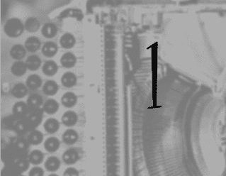

### 为什么 Linux 中会有“垃圾”（Gunk）？

**清理检查清单：**
- 学习如何快速识别 Linux 垃圾。
- 学习为什么某些用户认为在某个 Linux 安装中是“垃圾”的东西，在另一个 Linux 安装中可能是有价值的。
- 理解“垃圾”分为三类：用户配置垃圾、系统配置垃圾和硬件垃圾。
- 了解垃圾进入 Linux 系统的三种方式：它可能随于发行版而来，可能是被误操作添加的，也可能是被恶意创建的。
- 理解清理 Linux 的基本原则。

# 第一章

如果你翻开字典，你会发现“垃圾”（gunk）被定义为一种粘稠、油腻且令人不悦的物质。这种东西如果弄在你的衣服上，会让你大声尖叫。当然，计算机软件和配置是虚拟的，因此在字面意义上不可能是厚实的或油腻的。然而，它们确实可能令人不悦，而且计算机问题看起来确实既厚又腻。想想你上一次为了解决 Linux 配置问题而彻夜未明的经历。你可能感觉自己被困在一个粘糊糊的混乱局面中！如果你从一开始就知道如何清理你的系统，可能从一开始就能避免这个问题。

Linux 作为操作系统（OS）的优点之一是，它不容易受到许多困扰像 Windows 等操作系统的类型垃圾的影响。如果你同时用过 Windows 和 Linux，你可能立刻就意识到了。Linux 没有注册表——这是一种“垃圾收集器”，它值得在《清理 Windows》中专门开一整章。蠕虫和病毒尚未在 Linux 世界取得任何立足点。尽管如此，Linux 并非对垃圾完全免疫；它只是收集不同类型的垃圾。在本章中，你将学习能够影响 Linux 系统的垃圾类型。你可能会对那些阻碍你并减慢系统速度的垃圾类型感到惊讶。接下来的章节涵盖了处理垃圾的通用技术。在读完第 1 章和第 2 章后，你将为本书涵盖的所有清理任务打下良好的基础。

我的目标是帮助你专注于执行任务，帮助你设置和自定义系统，从而节省时间并避免头疼。你会对付出一点清理精力后所取得的成就感到惊讶。在学习过程中，你会发现垃圾是随着时间的推移而积累的，如果你只是忽视它，情况就会变得糟糕。我提出的技术旨在帮助你的计算机尽可能运行，如果你遵循我介绍的维护任务，你就能保持一切正常运行。

> 注意：从技术上说，Linux 是操作系统内核——与计算机硬件接口、管理内存并为普通程序提供其他必要的底层核心程序。在日常用法中，Linux 一词经常指的是整个操作系统——内核加上大量依赖于它的工具和实用程序。在世界范围内，有许多方法可以在内核之上构建整个操作系统，也存在许多 Linux 发行版，每一个都是一种特定的实现。在书中，我将 Linux 作为一个通用操作系统，而非特定的发行版。有时我需要引用特定的发行版，在这种情况下我会通过名称识别它们，例如 Fedora Linux 或 SUSE Linux。

## 学习如何识别 Linux 垃圾

要处理任何问题，必须首先能够识别它。因此，在开始清理之前，你必须能够识别垃圾。在计算机环境中，这可能会变得复杂——你不认识的文件可能是最糟糕的垃圾，也可能对你系统的运行至关重要。在某些情况下，某件事在某台电脑上可能被视为垃圾，但在另一台电脑上可能是至关重要的系统组件。例如，你可能不想在桌面级计算机上运行 Web 服务器程序，但同样的程序是 Web 服务器电脑的全部意义。对于你来说，识别差异很重要，因为你不希望在 Linux 安装中删除或更改某些内容后后悔。

### 什么是垃圾？

我将使用“垃圾”一词来指任何让计算机、用户账户或其他子系统无法以最佳性能运行的文件或配置。没有垃圾的计算机将根据其硬件和软件限制尽可能地运行。另一方面，满垃圾的计算机运行缓慢、损坏数据文件、无法执行本该的功能，或者以任何让你想尖叫、抓狂或把电脑从帝国大厦观景台扔下去的方式运行。拥有满垃圾计算机最糟糕的部分是它会浪费你的时间和贵的资源，而你可能并未察觉。

### 为什么 Linux 中会有“垃圾”（Gunk）？

你还需要考虑你硬件的能力（是一台尖端的 64 位强力设备、一个你不忍心淘汰的 10 年老系统，还是介于两者之间的某种东西）。在本书中，我将描述特定的程序和配置在某些语境下如何被“垃圾”或“非垃圾”，因此我将帮助你理清这些问题。最终，你必须了解你自己的系统，并对其做出自己的决定。

你还应该知道，你自己对“垃圾”的定义可能会改变。如果你尝试了一个程序或配置后发现自己已不再需要它，你可以尝试另一个程序或配置。从长远来看，这是不可避免的——程序在更新，硬件在改进，而你学得越来越多。这些因素可能会引导你走向新的、改进后的配置，或者让旧配置变得越来越臃肿和令人不快。

### Linux 垃圾的常见类型

对于本书，我总结了三类垃圾：用户配置垃圾、系统配置垃圾，以及与硬件或驱动程序相关的垃圾。这些类别反映了 Linux 本身的重要区别。作为一种多用户操作系统，Linux 在用户配置和系统配置之间有着非常明确的区分。用户配置适用于单个用户。两个用户可以拥有完全不同的用户配置而互互不影响。相比之下，系统配置适用于所有人。最后，硬件和驱动配置在某种意义上是系统配置，但它们与其他系统配置相比，更直接地应用于硬件。

### 臃肿的用户配置

用户垃圾是你作为个人用户需要处理的事务。如果你的电脑有两个用户，其中一个可能会遇到问题，而另一个用户不会。这种垃圾也可以由受影响的用户自行清理，尽管你将在书中学到关于这一规则的一些局部例外。


一种常见的用户垃圾类型是不必要的用户文件。就像你家里或办公室里的杂物一样，不必要的文件会堆积并让你的用户账户变得混乱。这些文件会占用宝贵的磁盘空间，并让你在最需要的时候难以找到你真正需要的文件。你可能经历过在 Linux 系统中使用时发现难以找到文件的挫败感。简单的解决办法是花时间整理你的文件。知道何时删除文件至关重要，但这需要了解这些文件的作用或它们包含什么种的数据，而这并不总是显而易见的，特别是对于 Linux 的点文件（dot files）而言。

点文件的文件名以点（.）开头。大多数点文件都是配置文件，工具会将它们隐藏起来，以免弄乱你的目录列表。尽管如此，它们仍然消耗磁盘空间，而且因为它们是隐藏的，你可能甚至没有意识到它们在你的系统中是如何积累的。更重要的是，它们会影响你的配置——点文件帮助你的网络浏览器、邮件阅读器、文字处理器等设置默认值。它们通常由使用它们的程序自动创建的，所以如果你尝试了一堆程序，你的账户很快就会充斥着点文件，如果你不再使用这些程序管理的程序，这些文件就会立即变成垃圾。在第 3 章中，我将向你如何清理所有不需要的点文件。

点文件可能会在你的系统中堆积，但一个更大的问题是它们可能包含让系统混乱的配置设置。这些配置可能是次优的或者根本无法工作。要配置某些程序，你必须直接编辑它们的文件，但点文件的格式并没有统一标准。因此，如果你想精调它们，就需要逐一学习每一个。幸运的是，大多数现代的 GUI 程序也可以通过点点点击的界面进行配置。当你完成配置更改后，程序会将配置保存在点文件中，因此你不必担心该文件的格式。尽管如此，用户程序配置也可能是垃圾。它们可能没有使用最好的字体，或者可能带来安全风险，尽管涵盖每一个用户程序超出了本书的范围（那会让书变得臃肿且像垃圾一样！），第 4 章和第 5 章涵盖了一些最重要且容易产生垃圾的程序。

图 1–1 和 1–2 展示了某些类型用户垃圾的影响。图 1–1 显示了 Fedora Linux 系统上一个相对没有垃圾的桌面。该配置使用了默认桌面配置，并在主目录上打开了一个文件浏览器窗口，其中包含了按逻辑分类的特定类型文件的子目录。图 1–2 显示了一个混乱得多的显示界面——它布满了程序图标，以至于找到正确的图标几乎是不可能的，而且主目录中的程序链接和文件处于杂乱无章的状态，难以找到正确项。如图所示，让用户环境或账户陷入混乱是非常容易的。希望图 1–2 所示的不像你的！如果是的话，不要恐慌，因为这本书可以帮助你对抗那种可能阻碍你并降低生产效率的积累杂物的倾向。

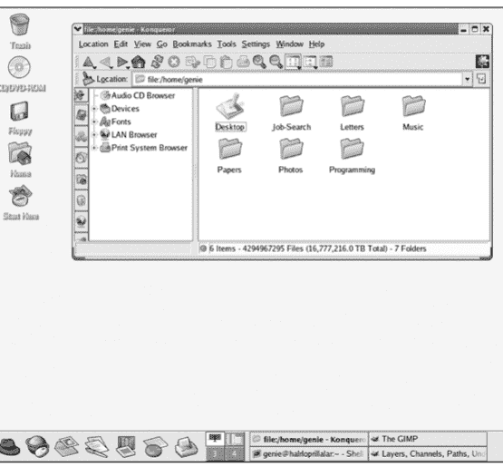

图 1-1

无垃圾的用户环境通常简单且易于导航。

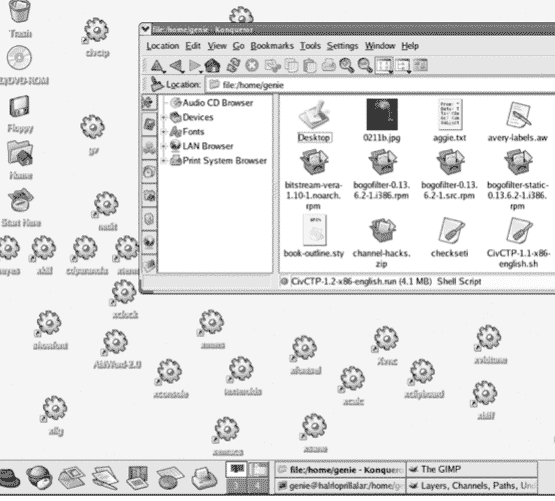

图 1-2

臃肿的用户环境通常混乱且无组织。

在极端情况下，你可以通过创建一个无垃圾的账户开始——至少能避免随时间积累的配置垃圾。遗憾的是，这种方法还会剥夺你可能拥有的任何用户选项，例如浏览器书签。在第 5 章中，你将学习一种不激进的方法处理用户垃圾。

### 臃肿的系统配置

大量的 Linux 垃圾产生于用户配置之外。这种系统垃圾经常影响计算机资源，因为它消耗系统资源。它还可能涉及产生关键安全风险的不必要程序。以下是一些例子：

- 不必要的软件——不必要的软件会消耗磁盘空间导致问题。如果你积累了太多，你可能没有足够的磁盘空间来工作。在我过的每一个系统中，我总是认为有足够的磁盘空间来存储一切。随着时间的推移，可用空间似乎就蒸发了，所有不必要的程序无疑毫无帮助。有些程序甚至可能有相似的名字，正如你可能猜到的，这可能会导致一些头疼的问题。
- 缓慢的软件——某些程序比其他的快。有时解决方法是更换程序，但有时你可以通过其他方式提高缓慢软件的性能。偶尔，一个程序会失去控制并占用你所有的 CPU 时间，导致所有其他程序慢如牛爬。
- 不可靠的软件——程序崩溃或其他行为异常的软件真的很让人痛苦。Linux 本身是一个非常稳定的操作系统，但考虑到 Linux 有大量的程序，有些程序存在漏洞并不意外，某些漏洞会导致程序崩溃。
- 账户垃圾——每当在计算机上设置新用户账户时，都需要开销。此外，存储在未使用账户中的文件会占用磁盘空间。更重要的是，未使用账户可以为入侵者提供进入系统的途径他们他们猜密码。
- 网络垃圾——在某种意义上，我所的网络垃圾超出了系统。这种垃圾是源自互联网（甚至是更小的网络）并影响你计算机的垃圾。例子包括垃圾邮件和蠕虫、浏览器中可见的弹出广告，以及来自黑客的攻击。

## 为什么 Linux 中会有垃圾信息（Gunk）？

互联网。防御此类垃圾信息有助于提高你的整体网络性能，并防止你的系统被滥用发送垃圾邮件或对其他系统发动攻击。

注意：大众媒体将计算机犯罪称为“黑客”（hackers）。然而，这个词有一个更老的含义：它指的是那些精通计算机、特别是精通计算机编程，并并将这些技能用于生产性和合法目的的人。许多 Linux 的创建者他们本身就是这种积极意义上的黑客。出于这个，我使用另一个术语“破解者”（cracker）来指代那些恶法之徒。

## 垃圾清理大师的笔记本：使用 Linux root 账户清理垃圾信息

清理用户账户可能有点棘手，因为在大多数情况下，这项活动需要访问 `root` 账户。（尽管如此，这条规则也有少数例外，或者问题可能处于界限之间——在所有情况下，修复问题可能绝对或不绝对需要 `root` 访问。）修复通常涉及修改系统配置文件或发出影响运行中程序的命令。许多 Linux 发行版都为这些任务提供了 GUI 工具，但 GUI 系统管理工具之间缺乏跨发行版的标准。然而，命令行工具适用于所有发行版，或者至少适用于许多发行版。在书中，我会强调命令行工具，但也会针对许多任务提供 GUI 工具使用的示例。

Linux 将用户账户与 `root` 系统账户分离是有原因的。Linux 的日常使用不需要访问 `/etc`（存放大多数系统配置文件的目录）或其他受保护的文件；使用普通用户账户可以防止可能导致严重后果的错误。当你使用 `root` 时，Linux 提供的错误保护措施很少。例如，在使用 `root` 账户时，很容易不小心删除 Linux 系统上的所有文件，但在使用普通用户账户时这是是不可能的。因此，你不应该在不必要的情况下使用 `root` 账户，当你这样做时，应该对用它所做的所有事情都要格外小心。这种系统管理与普通使用之间的区分在 Windows NT/200/XP 中要模糊一些，而在 Windows 9x/Me 中则不存在。如果你从 Windows 迁移到 Linux，你可能需要一些时间来适应。你甚至可能认为这种账户管理系统是一个必须克服的无意义障碍，但它提供的额外安全性对于执行某些任务而访问 `root` 账户带来的轻微不便是非常值得的。

警告！少数 Linux 发行版（如 Linspire，以前被称为 Lindows）鼓励对一切使用 `root` 账户。这种配置对于初次 Linux 用户似乎很友好，但它是危险的。我建议避免此类发行版，或者至少重新配置它们以传统方式使用 Linux 账户。仅限 `root` 的配置不仅仅是普通的垃圾——它是生物危害级的垃圾！

## 硬件和驱动程序垃圾

到为止，你已经了解到大多数 Linux 安装由相当较高层面的软件垃圾组成——配置文件、用户文件、不必要的程序等。你的系统可能会受到与你的硬件紧密交互的垃圾，或者至少与你的硬件驱动程序垃圾的影响。

一种硬件垃圾确实非常严重：厚到足以阻止你的硬件工作的垃圾。这种垃圾通常是驱动程序不正确的结果。大多数 Linux 驱动程序是内核的一部分，因此你可能需要某些驱动程序留在其他子系统中。最重要的是，打印机、扫描仪和大多数显卡驱动程序属于其他程序。了解如何安装和配置每种类型的驱动程序可以极大帮助你清理这些垃圾。然而，有时 Linux 根本不支持你尝试使用的硬件。在某些情况下，遗憾的是，你可能需要更换硬件。

硬件和完全垃圾可能特别棘手，因为它们有时会导致系统崩溃。当硬件故障或驱动程序存在 bug 时，问题很会导致你的计算机完全停止运行，而不仅仅是变慢或异常运行。幸运的是，问题很少见，但它们可能特别令人烦恼。你的系统可能会随机崩溃，没有关于原因的直接线索。第 11 章“为你的硬件寻找驱动程序”提供了关于硬件故障排除的提示。

硬件的一个值得特别关注的领域是视频硬件。这种硬件由 X Window 系统（简称 X）控制，它是 Linux 的低级 GUI 工具。X 包含了硬件的驱动程序，并处理创建窗口和显示文本等低级任务。其他程序扩展了 X 的操作，但基础 X 配置主要处理 X 与硬件的交互。大多数发行版在安装时会以合理的方式设置这些内容，但你可能需要更改这些配置以处理新硬件或修复损坏的初始配置。X 的字体处理也是臭名的复杂，尽管这种情况在最近几年有了实质性的改进。

## 为什么 Linux 中会有垃圾信息？

## 了解垃圾是如何进入你的系统的

你对你的 Linux 系统可能收集的垃圾种类应该有所了解。在继续之前，你应该考虑垃圾是如何进入那里的。了解垃圾是如何产生的可以帮助你制定防御措施从源头上阻止它——从不出现问题总比必须纠正问题好。了解垃圾是如何产生的也可以帮助你制定应对计划。在整本书中，我将向你展示如何清除你不需要的垃圾，我还将指出防止你的系统从源头上收集垃圾的方法。

### 开箱即用的垃圾


一种垃圾从一开始就存在——它是随 Linux 本身安装的。为什么 Linux 发行版会包含这么多垃圾？答案是让那些尚未熟悉 Linux 的人让事情变得更容易。然而，这通常会导致系统充斥着你不需要的程序。

（注：原文中该段存在大量重复，译文已保留核心内容。）

### 为什么 Linux 中会有“垃圾”（Gunk）？

`Xandros`——此种发行版源自 Debian，但非常强调桌面用户。因此，它提供了许多对于典型的家庭和办公室桌面用户非常有用的工具，如果你恰好喜欢围绕 KDE 构建的 `Xandros` 选择，那么这很不错。如果你不喜欢，或者想运行服务器，那么这些包就是“垃圾”。如果你想获得标准 `Xandros` 系统中不存在的选项，可以安装 Debian 软件包，但这样做比使用标准的 `Xandros` 工具要麻烦得多。请访问 http://www.xros.com 了解更多信息。

当然，这个发行版列表远非完整；还存在着几十个冷门的 Linux 发行版，它们默认情况下都带有不同程度和类型的“垃圾”。此外，请记住，大多数发行版都提供了安装选项，可以更改你想要的“垃圾”类型。大多数情况下，你在安装过程中选择或取消单个软件包或包组。以包组为单位进行此操作可能非常方便，因为你只需点击或按下按键即可安装（或选择不安装）整个相关的软件包。然而，这种做法增加了你至少安装某些“垃圾”的概率。也许你真的需要组中的某一个包，但不需要另一个。如果你担心维护一个无“垃圾”的系统，你可能需要在系统安装期间仔细检查你的选择。如果你以前从未用过 Linux，可能应该坚持默认设置，然后参考第 6 章“清理未使用的软件包”，获取有关清理软件包安装“垃圾”的信息。

所有发行版在安装期间都至少拥有用于检测你硬件配置的最基本工具。这些工具通常运行得相当良好，但有时会对一一个或多个设备失效。当你使用非常新或非常奇特的硬件时，这种情况特别容易发生。硬件检测失败的结果通常是硬件驱动“垃圾”——加载了错误的驱动程序，或者旨在激活设备的配置根本不起。我将在本书的第四部分介绍这个问题。

硬件“垃圾”的一个来源是所有发行版共有的默认 Linux 内核。内核直接与大多数硬件交互，是任何 Linux 系统不可或缺的一部分。然而，为了适应各种计算机，发行版必须编译一个相当通用的内核。这个内核可能包含你不需要的驱动程序，或者使用了无法发挥硬件最佳性能的编译器优化。重新编译内核有助于清理掉这些“垃圾”；然而，这项要求对你自己的硬件有深入的了解。第 11 章涉及了这一主题，但没有涵盖内核重新编译的所有细节——这是一种需要特殊技能的高级清理技术。

### 误操作添加的垃圾

“垃圾”进入你系统的第二种主要方式是通过错误。错误会引起上述描述的任何类型的“垃圾”——用户“垃圾”、系统“垃圾”或硬件/驱动“垃圾”。事实上，大多数用户“垃圾”都是通过这种方式产生的——Linux 发行版提供的用户配置相对最小。它们提供的配置大多集中在它们的桌面环境上，而这些配置通常并不“垃圾”——至少，假设你想使用所涉及的桌面环境。（大型桌面环境本身可以被认为是小型系统上的一种“垃圾”，正如第 4 章所述。）导致“垃圾”的错误很大程度上是家务管理问题——未能删除旧文件或未将它们组织到子目录中、添加到桌面环境的图标结构糟糕等。

误操作添加的系统“垃圾”和硬件/驱动“垃圾”通常是系统管理员的责任。在家庭系统或某些小型业务系统中，这可能由终端用户兼，但产生“垃圾”的操作是在 `root` 账户的帮助下完成的。经常，这种“垃圾”的添加是因为缺乏经验。例如，如果你不知道如何安装软件包，你可能需要安装你所需的一切。这种倾向是可以理解的，但它确实会导致“垃圾”的堆积，特别是随着时间的推移。同样，对系统配置文件（大部分位于 `/etc` 目录）进行不熟练的更改会导致“垃圾”配置。当你戴上系统管理员的角色时，防止误操作添加“垃圾”的主要防御手段是教育。你对 Linux 运行机制了解得越多，误操作添加“垃圾”的概率就越低。

### 恶意添加的垃圾

可能是最令人不安的“垃圾”类别是恶意添加的“垃圾”。最常见的是，这是黑客入侵你计算机的结果。有时这样做是为了好玩，就像是一次网络之旅。其他时候，黑客有特定的目标，而你的系统只是通往该目标的一个垫脚石。例如，黑客可能想利用你的计算机发送垃圾邮件，或攻击其他计算机。在少数情况下，黑客入侵你的计算机是因为你个人（或你的组织）是目标，而黑客想要窃取数据、破坏你的网站或类似的内容。

无论何种，黑客通常都会留下“垃圾”。这些“垃圾”可以采取以下几种形式中的一种或多种：

- 垃圾账户——黑客通常会为自己添加账户或修改现有账户。这种更改让黑客能够轻松重新进入你的系统。

- 添加或修改的程序——黑客经常会添加新程序或修改现有程序。例如，黑客可能会更改登录（处理文本模式登录的程序）以记录密码并将其发送给他们。

- 未授权的服务器——黑客有时会运行服务器以便他们能够重新进入你的系统。这类“垃圾”可能还需要一个添加的程序（服务器软件本身），但安装软件和运行它是两回事事。更微妙的更改可能涉及运行一个已安装但未激活的服务器，或者更改服务器配置以接受你之前阻止的连接。

- 修改的文件——如果你是特定的攻击目标，用户文件可能会被修改，例如破坏网页。大多数入侵也涉及修改文件。（例如，垃圾账户文件。）

- 粗劣的更改——许多黑客技能有限（他们通常被称为脚本小子，反映了他们缺乏真正的技能）。这些黑客使用 `rootkit`（即由他人编写的半自动化攻击程序）来获取访问。一旦进入，脚本小子经常通过对配置的不当更改导致许多问题，即使这并非他们的本意。

遗憾的是，恶意添加的“垃圾”很难清理。问题在于，你无法确定感染的程度。也许你发现了一个虚假账户，但这无法告诉你登录程序是否被修改。因此，处理此类问题最安全的方法是重新安装系统，并在过程中加强安全性。如果你足够幸运知道入侵者是如何进入的，你应该能够解决这个问题。

## 学习消除“垃圾”

前面的页面已经提到了几种清理“垃圾”的方法，下一章提供了更多。广义上，Linux 中的“垃圾”清理通过以下几种方式处理：

- 预防。可以说，消除“垃圾”最好的方法是从源上防止它污染你的计算机。这从选择一个相对干净的发行版或安装选项较少的 Linux 开始。在安装软件包前进行研究并只安装你真正需要的包是额外的预防措施。对于系统配置也是如此——研究那些及其影响，而不是盲目应用功能。

- 修复用户问题——用户问题一旦出现，通常是清理用户帐户中的单个文件或编辑配置文件。后者的任务通常可以在创建配置程序的程序完成，但有时你需要调用文本编辑器。

- 修复系统和硬件/驱动问题——这些问题有许多不同的原因，因此也有许多解决方案。你可能需要使用发行版的包管理工具删除或升级程序，编辑系统或全局配置文件，监控问题迹象，或执行各种其他任务。通常情况下，修复这类问题需要最多的技能。

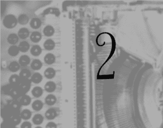

# Linux 清理策略

清理检查清单：

- 尽可能让你的系统配置和用户文件保持简单。

- 理解任何创建不安全计算环境的物品都是最糟糕的“垃圾”（gunk）。

- 学习将建立良好的备份系统作为你整体清理策略的一部分，其重要性。

- 理解在 Linux 中消除“垃圾”的基本原理——用户垃圾、系统软件垃圾以及棘手的硬件/驱动程序垃圾。

- 学习“清理 12 步计划”。

在第 1 章中，你已经学习了可能会影响你 Linux 配置的不同类型的“垃圾”——用户垃圾、系统软件垃圾以及硬件/驱动程序垃圾。我的目标是向你介绍重要的清理策略，这些策略可以帮助你节省时间、减少烦恼，并提高你的工作效率。从第 3 章开始，我将针对清理和精调你的 Linux 安装提供非常具体的技巧。然而，在深入探讨这些细节之前，我将介绍一些清理 Linux 的重要通用程序和技术。这些原则适用于书中以后涵盖的许多细节，也适用于许多其他类型的 Linux “垃圾”。

本章的最终目标是介绍“清理 12 步计划”。这重要的 12 个步骤将为你提供所需的路线图，使你能够在最短的时间内充分利用你的 Linux 配置的价值。对于那些时间有限的人来说，该计划的设计确保了你执行的任何一步都将帮助你提高工作效率。

# Linux 清理策略

清理 Linux 配置的策略基于 Linux 的运行机制：

- Linux 的 Unix 传统如何影响 Linux 可用程序以及整体的 Linux/Unix 计算哲学

- Linux 如何被设计成基础操作系统内核，但特定的 Linux 发行版在提供内核的同时提供了大量的工具和实用程序

- Linux 如何在特定目录下存储特定类型的文件

- Linux 发行版如何提供许多配置文件来帮助你自定义系统

- 不同的 Linux 发行版如何提供不同的工具和支持文件

- Linux Linux 桌面环境如何引入不同级别的复杂性

- Linux 如何支持硬件和外围

- Linux 如何用于 Web 服务器等重型角色，这引入了独特的安全风险

- Linux 如何支持不同类型的系统和用户账户

- Linux 如何支持安全功能

- 不同的 Linux 发行版如何提供备份和恢复数据的工具

- Linux 的开源特性如何让你能够调整系统，甚至修改其组件程序


正如你将在书中学到的，你越了解 Linux 是如何设计和运行的，你就越擅长清理你的设置。让清理和精调 Linux 特别具有挑战性的是，你不会遇到任何一个通一的标准。虽然 Linux 是围绕核心操作系统内核设计的，但每个不同的发行版都提供了许多选项、实用程序和支持程序。

## 保持简单

第一个清理策略是简化你的配置。简单的配置更容易发现和纠正问题。就像平滑的台面一样，简单的计算机配置比带有许多装饰性凹槽的东西更容易清洁。复杂的配置起初可能很有吸引力，因为它们提供了倾向于吸引你的功能，但就像召唤奥德赛斯的塞壬女妖一样，可能会导致灾难，因此抵抗这种诱惑至关重要。另一方面，有时复杂的配置确实是必要的，或者至少提供的收益足以使其额外的风险或烦恼变得值得。最终，你必须是判断你的配置应该有多复杂的法官。我建议作为一条通用规则，从简单开始并在此基础上构建。这给了你足够的时间去学习创建复杂配置所需的工具，而这些知识将有助于解决可能出现的任何问题。

### 简单性与配置的便利性

每年计算机都变得越来越复杂。即使考虑到 CPU 复杂性的增加（这在很大程度上对用户是隐藏的），程序总是增加功能而不是减少功能，而操作系统（OS）像床底灰尘一样积累功能和程序。最坏的情况下，这些新功能消耗资源并增加复杂性，却几乎或完全没有回报。最好的情况下，这些新功能和程序为目标受众的一个子集增加了有用的东西。有时这个子集很大，但通常不是。有多少人需要拼写检查字典？

- 资源浪费：未使用的功能和程序占用了空间。
- 安全威胁：未使用的程序可能带来风险。
- 配置精力：许多程序需要一些精力。
- 学习曲线：复杂的程序通常需要更多精力来学习。
- 日用问题：复杂的程序使用起来可能很。。幸运的是，Linux 遵循模块化设计。许多程序和子系统实际上是由较小的程序组成的，每个程序都相当纯净。这种模块化哲学允许你设计一个极少“垃圾”的 Linux 系统——你不需要安装那些并不需要的包，即使这些包提供的功能可以扩展你想要运行的程序的能力。这种设计的缺点是，你需要大量的知识和经验来正确地配置程序。

例如，考虑桌面环境——当你登录到以 GUI 模式运行的 Linux 系统时欢迎你的 GUI 工具。桌面运行在 X Window 系统（或简称为 X）之上，Linux 提供了几种桌面环境。GNU 网络对象模型环境（GNOME）和 K 桌面环境（KDE）是最受欢迎的选择，但其他可用。

### 抵抗复杂的诱惑

在考虑一个程序或配置时，你应该问自己，添加新工具是否真的有助于你的生产力或对系统的喜爱，还是仅仅落入了增加一个潜在有用用程序或功能的陷阱，而你的系统正到处都是“垃圾”。减少复杂性的另一种方法是切换包。如果你使用的文字处理程序对你的口味来说变得太复杂了，请进行调查。

替代方案。你可能会找到一个更简单的方案，它对你同样有效，但消耗的资源更少，或者没那么臃肿。

## GunkBuster 笔记本：当复杂性有所帮助时

前面的描述听起来似乎复杂性是软件世界的灾星，引起的问题比解决的还要多。实际上，开发者为程序添加功能是有原因的，其中大多数原因都是完全合理的。毕竟，复杂的程序比简单程序能为人们做更多事情。这使得复杂程序比简单程序更有吸引力，有时复杂程序甚至是必要的。同样，复杂的系统配置提供的有用功能可以为用户带来巨大好处。

秘诀一如既往，在于复杂性与简单性之间找到恰平衡。这项任务很棘手，因为正确的平衡因系统而异。在评估特定的程序和配置时，你可以问自己一些问题来确定你可能添加的任何是有益的还是臃肿的：

- √ 我真的需要这个项目吗？如果程序或配置对你的系统至关重要，那么它就是必要的复杂，而不是臃肿。例如，对于一台作为 Web 服务器运行的计算机，Web 服务器程序显然是必要的。如果你的网站必须支持此类程序提供的复杂功能，你可能还需要一个非常复杂的 Web 服务器。
- √ 如果我真的不需要这个程序或配置，它仍然对我有帮助吗？即使程序或配置不是严格必要的，它们也可以不是臃肿的。正如前面提到的，有些人喜欢使用相当复杂的 Linux 配置，但此类设置并不符合大多数人的口味。如果你使用工具比使用更简单的替代品工作得更好，那么使用 X、GNOME、OpenOffice.org 和其他大型程序可以是完全没问题的。即使它们没有以任何可衡量的方式提高你的生产力，你可能只是喜欢某种配置，例如将一张喜欢的照片作为桌面“壁纸”。
- √ 我是否有足够的硬件和软件资源来运行该程序或配置？虽然某个设置在某种程度上可能是臃肿的，但如果你的系统足够强大，这个事实可能并不是真正的问题。例如，在具有 300GB 硬盘空间的系统上安装 KDE，即使你从不运行 KDE，也不太可能浪费磁盘空间；KDE 消耗的几兆字节与可用磁盘空间相比是微不足道的。另一方面，经常做决定可能会迅速累积。早晚以后，你应该划一条界限。
- 该软件或配置可能在未来引起问题吗？从务实的角度来看，臃肿就是臃肿，因为它引起了问题。不必要的或过于复杂的配置可能需要额外的维护、带来安全风险等，但某些添加项比其他项更容易引起此类问题。例如，一个不必要的处理器比一个不必要的 Web 服务器更不容易成为安全风险。

最终，你必须自己决定某物是否为臃肿。从长远来看，经验将是你最好的指南。

### 保持安全

任何创建不安全计算环境的东西都是最糟糕的臃肿。安全问题可能是行为不当导致丢失数据的程序，也可能是存在安全风险的程序。了解事情何时可能出错以及知道如何处理安全问题对于将这种最糟糕的臃肿排除在系统之外至关重要。备份你的计算机或至少备份你最重要的数据文件也是一项至关重要的安全措施。

### 墨菲定律

我们都知道那句话：“如果任何事情可能出错，它就会出错。”这种悲观的评估是安全规划的核心，因为如果你真的相信它，你就会尽力确保不出出错。入侵者可能进入一个很少使用的服务器程序吗？如果是这样，且它并不关键，就关掉它，这样通过此路径进行入侵就不可能的。数据可能会因硬盘崩溃而丢失吗？如果是，就备份数据——并为备份创建一个备份，因为第一次备份也可能失败！

你还应该考虑，我们不能总是想象所有可能的故障点。结果可能是发生了我们未预见到的错误。在计算机配置方面，这种想象力的缺乏往往导致知识的匮乏。因此，你应该尽可能多地学习关于 Linux 特别是关于你的 Linux 系统。

尽管如此，从务实的角度来看，你必须在某处停下来。安全不是绝对的，而是相对的。即使世界上最安全的计算机也无法绝对地 100% 百之安全。你可能不是在配置一个拥有顶机信息的美国中央情报局（CIA）数据库，所以你可能不想把每个清醒的get小时都花在纠结于你的计算机上。幸运的是，通过遵循一些相对简单的程序，你可以让系统变得相当安全。事实上，本书的很多内容都致力于此类程序，因为很多臃肿都有安全方面的影响。

### 处理安全问题

关于 Linux 安全已经写了许多整本的书，广义上来说，与“去去臃肿化（degunking）”相关的最重要的安全步骤如下：

- 物理上保护计算机——你应该确保你的计算机不会受到物理攻击。将其锁在房间里，或者至少把它链在墙上。如果它位于公共场所，请锁好机箱。当然，适当的物理安全程度取决于计算机的敏感性及其预期用途。
- 关闭不必要的服务器——不需要运行的服务器程序应该关闭。这些程序由于其本质会监听外部连接。此类程序中的漏洞可能会让破解者在你的系统上找到立足点。第 6 章将帮助你定位并消除此类程序。
- 消除不必要的程序——如果破解者获得密码文件，本地程序可能会成为安全风险。如果你在公共或半公共区域使用计算机，这一点尤为重要，例如企业的“格子农场”或大学计算中心。
- 删除不使用的账户——Linux 支持多个账户，这些账户会随着时间的推积。第 9 章描述了这一过程。
- 监控系统——了解系统的运行情况有助于保持安全。调查突然变慢或程序开始异常等情况会有很大帮助。在极端情况下，你可能想要安装特殊工具，如 Tripwire (`http://www.tripwire.com`)，来帮助发现入侵。注意，这一步更多是响应性的预防性的。
- 使用良好的密码——糟糕的密码是一个巨大的风险。从远处看可能很容易被察觉。你也不应该共享密码。第 9 章描述了密码策略。
- 注销你的账户——当你用完计算机时，注销账户，或至少使用需要密码的屏幕保护程序。

### 备份你的数据

即使在保持系统安全无臃肿方面尽了全力，也不能 100% 防止灾难。你可能会不小心删除文件，硬盘可能会故障，或者你的计算机可能会被火毁。对于此类情况，备份提供了宝贵的恢复手段。

> 注意：备份计算机看起来很麻烦，但从长远来看，备份硬件和软件节省的精力超过了付出的精力。如果你使用计算机运行劳动密集型或任务关键型应用程序，或者数据丢失或停机会造成严重影响，这一点尤其如此。

备份范围从随手放在软盘上保存的几个文件到使用备份服务器存储整个网络数据的复杂备份计划。你应该使用的备份类型取决于数据重要性和质量，以及你需要备份的计算机数量。广义上说，相对于 Linux 系统文件的任何用户数据备份都属于用户备份。这种备份对于普通家庭用户或对于具有标准化配置和基础安装复制的企业来说可能足够了。它们通常比较容易恢复。

- 系统备份——更彻底的备份类型将计算机上的每个文件存储在备份介质上。系统备份让你能够从

## 26 第 2 章


通过一步将工作系统迁移到新的磁盘或计算机上。这对于任务关键型服务器等设备非常有帮助——例如，在硬盘发生突然故障时加速恢复。这些备份比非正式的用户数据备份需要更多的计划。全系统恢复的实施起来可能更复杂，但从备份中只恢复部分数据通常并不困难。

这些备份并不是互斥的，事实上，它们之间的界限有时会变得模糊。全系统备份可以用于恢复用户数据文件，就像用户数据备份一样；如果你做了全系统备份，就不需要执行单独的用户数据备份。

**注意：** 备份系统将在附录 A 中进行详细介绍。

## 消除垃圾

在第 1 章中，你学习了 Linux 的三种主要类型的垃圾——用户配置、系统软件配置以及硬件/驱动程序垃圾。这三类在 Linux 中相当不同，尽管存在一些重叠区域。尽管如此，正如我接下来所描述的，每种垃圾都需要其特定的清理策略。

### 清理用户文件

用户配置影响单个用户——它们定义了用户的桌面环境，存储了用户的文件等。因此，大多数用户配置不会影响其他用户。（尽管单个用户可能会消耗所有可用的用户磁盘空间。）泛而言，用户配置垃圾分为两类：许多配置和杂乱的文件。

### 清理程序配置

程序配置会积聚特定程序的垃圾。通常情况下，这取决于你在程序中设置的选项问题，这些选项只影响一个程序。（不过，KDE、GNOME 和其他桌面环境中的设置可能会影响多个程序。）会有很多地方出现问题：

- 难陋的字体、颜色或样式——你可能会设置程序使用你认为难陋的字体、配色方案或其他样式特征。在坏的情况下，你可能会配置程序使用某种特殊字体，这可能导致以后改回来非常困难——毕竟，除非你是在星际联邦学院学习，否则，如果你不小心将字体更改为克林贡语，你可能很难在菜单中找到字体选项！

## Linux 清理策略 27

- 更改的菜单或功能——某些程序提供了选项来增加或减少菜单上的选项数量。这对于桌面环境尤为重要，桌面环境提供这些功能是为了让你启动额外的程序或清理你的环境。不过，失误可能难以纠正——例如，你可能无法找到不小心从菜单中删除的程序。

- 过于复杂的配置——为了符合 KISS 原则（简单即是），你可能想要简化某种配置，即使它是默认的。有时这无法办到（例如，如果程序的菜单无法更改以消除不需要的选项），但在其他情况下是可以的。

- 彻底坏掉的配置——有时程序的配置会损坏，导致程序无法正常工作。这在你将配置从一个 Linux 发行版移动到另一个 Linux 发行版时尤为常见——例如，如果你在保持家目录不变的情况下，将计算机上的 Red Hat 替换为 Debian。由于这些分发版将文件放在不同的地方，你可能会导致功能、图标等失效。

从理论上讲，应对大多数此类问题的最佳方法是使用程序的配置工具。寻找名为“偏好”（Preferences）”、“选项”（Options）”、“设置”（Settings）”、“配置”（Configure）或类似的菜单选项。此类选项通常（并非总是）位于程序的“文件”（File）或“编辑”（Edit）菜单下。结果通常是一个对话框，可以在其中更改各种程序选项。例如，图 2-1 显示了 GIMP（一个 Linux 图形程序）的设置对话框。配置工具经常提供一组选项类别（从图 2-1 左侧面板的列表中选择）；每个类别都提供自己的一组选项。仔细查看此列表直到找到你想要修改的选项，然后进行修改。

## 垃圾清理者的笔记本：配置多个应用程序

传统上，每个 Linux 程序都专门使用它自己的配置。例如，设置邮件读取器使用的字体可能不会影响任何其他程序中使用的字体。这种设计既有优点也有缺点——它允许对此类功能进行细粒度的控制，但它无法设置全局功能。

Linux 程序越来越多地与桌面环境相关。KDE 和 GNOME 提供了配置工具，可以为与其关联的所有程序设置选项。


## 28 第 2 章 项目。这个工具被称为控制中心（Control Center），但 KDE 的控制中心和 GNOME 的控制中心是独立的实体。当你在控制中心设置选项时，这些选项会影响所有关联程序。（不过，这些程序可能会为某些或所有功能提供覆盖。）例如，你可以在 KDE 的控制中心中设置默认字体，这个默认字体将应用于所有 KDE 程序。不过，此更改不会影响 GNOME 或未关联的程序。

注意：目前正在努力增加程序间选项的集成。因此，在未来，更改可能会让控制中心和类似程序中的至少某些功能适用于更广泛的程序。

最终，使用程序自身的工具清理配置是不行通的。当配置损坏得严重到找不到相关选项时，尤其如此，因为所有文本显示为克林贡语。对于这种情况，存在一种更激进的修复方法：删除用户配置文件。这些文件是点文件（dot files）——名称以点（`.`）开头的文件。通常，点文件以它们控制的程序命名，例如。有时，点文件实际上是子目录，包含多个文件。在任何一种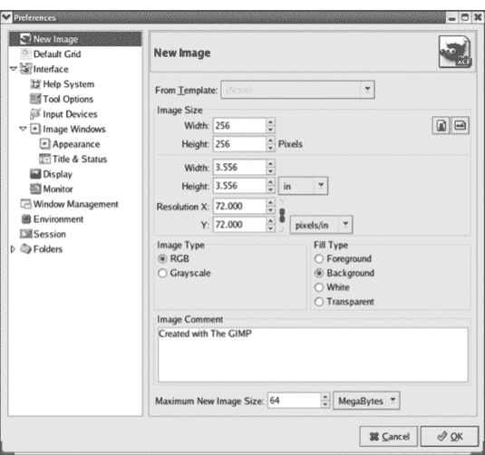 图 2-1** 程序提供了设置选项的工具

如果你能找到点文件，就可以删除它。（我建议重命名而不是删除，这样如果你下次运行程序，它可以创建一个默认设置的新文件。）第 3 章“清理用户文件”将更详细地介绍点文件，包括如何找到和删除它们。

## Linux 清理策略 29 消除杂物

用户的第二类垃圾是简单的杂物。创建文件很容易，如果不加检查就会积聚。这浪费了磁盘空间并增加了杂物，特别是当你没有维护良好的目录结构时。结果是在查看文件列表时很难找到想要的文件。消除杂物有两个关键：

- 创建逻辑的目录结构——使用 Linux 的子目录（在使用 GUI 文件管理器时通常称为文件夹）。为不同的文件或项目创建子目录。例如，你可能会创建一个存放正在写的论文的子目录，另一个存放音乐文件，第三个存放财务数据。每个目录本身可能还会包含子目录，例如为每篇论文创建一个子目录。通常情况下，只有当子目录包含多个文件时你才应该创建它。

- 定期清理不必要的文件——创建文件很容易，如果不检查就会积聚。这浪费了磁盘空间并增加了杂物，特别是如果你没有维护良好的目录结构。因此，你应该定期检查你的文件并删除不需要的文件。第 3 章对这项任务提供了更详细的信息，包括可以帮助你完成任务工具。

Linux 新手通常不熟悉 Linux 系统。用户主要被限制在 `/home` 目录。这些目录通常位于 `/home` 并根据用户账户命名。例如，用户 gerald 的家目录可能是 `/home/gerald`。该用户的所有文件都位于此目录中。不过，这条规则也有例外。特别是，像 `/tmp` 这样的临时存储区域可以存放任何用户的文件，用户通常可以在 `/media/mnt` 或其他位置移除介质，并将文件存储到家目录。由于这些分发版将文件放在不同的地方，你可能会导致功能、图标等失效。将用户文件放在家目录从长远来看将极大地简化整个系统配置，特别是对于多用户系统——系统管理员在安装程序新版本之前删除程序目录时，无需担心删除用户文件。如果你过去使用 Windows或其他操作系统并习惯于将数据文件与程序放在一起，你应该改掉这种习惯。（事实上，在 Linux Linux 时很难养成这种习惯！）将用户文件放在家目录中将从长远来看大大简化很多问题。

# 系统软件清理策略

回想一下，Linux 第二类垃圾（gunk）是系统软件垃圾——即与整个程序或系统配置相关的垃圾。这种垃圾通常会影响所有用户，或者至少影响所有运行程序或执行某些操作的用户。清理这些垃圾通常需要 root 权限。系统软件清理的第一原则是理解操作系统是如何运行的。对 Linux 启动过程和系统配置文件的基本了解将帮助你识别系统问题的可能来源。全局程序配置（类似于单个用户的程序配置）也可能是问题的根源，因此你应该知道去哪里寻找此类问题。许多系统软件垃圾与软件包（packages）有关——软件包是作为一个单元进行安装和管理的程序和其他文件的集合。了解一点 Linux 软件包管理将让你在处理软件包清理时如半功倍。

## 理解系统操作

第 8 章“管理进程”详细描述了 Linux 启动过程——内核如何引导、哪些程序和脚本控制启动过程等。简而言之，一个名为引导加载程序（boot loader）的程序会将内核加载到内存中。然后内核寻找硬件组件并对其进行配置。当内核完成这些操作后，它会启动一个名为 `init` 的程序，该程序转而启动一系列 SysV 启动脚本。脚本负责启动网络、启动服务器并执行关键的系统启动任务。`init` 进程还会启动文本模式登录提示，允许你登录计算机。GUI 登录提示可能通过 `init` 或 SysV 脚本启动，具体取决于发行版。


由于 `init` 的重要性，你应该知道它是通过 `/etc/inittab` 控制的。目前，你只需要知道**不要乱动它**——对 `/etc/inittab` 的错误更改可能会导致系统无法启动！SysV 启动脚本也非常重要。它们通常位于 `/etc/rc`、`/etc/init.d` 或 `/etc/init.d`（此处原文重复，具体位置随发行版而异）。`/etc` 的子目录或其中一个主要的 SysV 脚本目录命名为 `rc?`，其中 `?` 是一个从 0 到 6 的数字。这些数字代表运行级别（runlevels），即可以作为一个组启动或停止的程序和服务的集合。运行级别子目录包含指向真实 SysV 启动脚本文件的符号链接。当进入一个新的运行级别时，SysV 启动脚本和运行级别直接控制系统启动时大多数程序的启动方式，以及系统关机时的停止方式。启动或关闭过程中的问题通常可以追溯到这些脚本或其链接。第 8 章更详细描述了这一过程。

你可能已经注意到这些关键脚本和配置文件都位于 `/etc` 中。该目录及其子目录包含了大多数系统级配置文件，包括 Linux 整体的配置文件，以及许多具有系统级配置文件的单个程序的配置文件。因此，`/etc` 是处理系统配置问题的常见目标。它也容易产生垃圾——如果你安装了一个程序然后卸载了它，该程序的配置文件可能会被遗留。这种类型的垃圾不太可能损害，但会不必要地弄乱 `/etc` 目录。

`/etc` 中的几个文件和子目录特别值得注意：

- `/etc/X11`——此子目录存放 X 以及一些重要的 X 程序的配置文件。这些文件中最值得注意的是 `/etc/X11/XF86Config` 和 `/etc/X11/xorg.conf`，它们分别是 XFree86 和 X.org-X11 服务器的配置文件。（2004 年，X.org-X11 取代了 XFree86 成为大多数 Linux 发行版的默认 X。）

- `/etc/crontab`——此文件控制 `cron`，这是一个用于在定期运行程序的 Linux 工具。相关目录以 `cron` 单词开头，位于 `/etc/cron.d` 中。不过，不同系统之间的细节有所不同。

- `/etc/cups`——此子目录包含控制通用 Unix 打印系统（CUPS）的文件，大多数现代 Linux 系统使用它进行打印。CUPS 通过 GUI 工具配置，这些工具会编辑该子目录下的文件。

- `/etc/fstab`——此文件非常重要。它描述了 Linux 应该在哪里挂载各种分区和其他磁盘设备。例如，它可能会将 `/dev/sda7`（特定的磁盘分区）挂载到 `/home`。此文件由 Linux 安装过程自动设置，如果你添加了硬盘或更改了挂载选项，可能需要编辑它。

- `/etc/groups`——此文件定义 Linux 组——即具有相似系统访问权限的用户集合。即使在单用户计算机上，组也可能是重要的，因为 Linux 使用它们来跟踪在后台运行的一些程序。

- `/etc/inetd.conf`——此文件控制 `inetd`，它是 Linux 上两个超级服务器之一。（另一个常见的超级服务器是 `xinetd`）。超级服务器启动其他服务器，其优势在于如果某个服务器不经常被使用，那么超级服务器可以做得小得多。超级服务器还可以通过对连接进行初步检查来增强安全性——例如，过滤掉来自已知恶意分子的连接。

- `/etc/inittab`——如前所述，此文件控制第一个进程 `init`。

- `/etc/modules.conf`——此文件控制 Linux 如何加载模块（modules），即不属于主内核文件的内核驱动程序和其他内核代码。某些发行版（如 Debian 和 Gentoo）会从子目录（如 `/etc/modules`）中的文件自动构建此文件。

- `/etc/passwd`——此文件定义用户账户——即具有相似系统访问权限的用户集合。即使在单用户计算机上，组也可能是重要的，因为 Linux 使用它们来跟踪在后台运行的一些程序。

# 第2章 34

同步。在实践中，包管理无疑有其缺点，但大多数情况下，这些工具工作得很好。

并不是所有的 Linux 系统都使用相同的包管理系统。最常见的有两种：

- RPM——RPM 软件包管理器（RPM）由 Red Hat 创建，已被 Conectiva、Mandrake、SuSE、Yellow Dog 以及其他系统采用（Fedora 作为 Red Hat 的变体，也使用 RPM）。

- Debian 软件包——这是 Debian 发行版的源自包格式，该格式也被许多 Debian 衍生版使用，例如 Lycoris 和 Xandros。

少数发行版使用了自己独特的包管理工具。最值得注意的是，Slackware 使用带有特殊包跟踪工具的 tar 归档，而 Gentoo 则使用其基于在目标系统上构建的源码的系统。

处理 RPM 软件包的主要命令行工具称为 `rpm`。它提供了各种选项，允许你安装、卸载、查询以及其他对包文件和已安装包的操作。Debian 的对应工具是 `apt`，而且 Debian 还提供了许多围绕 `apt` 构建的各种工具以扩展其功能。最重要的是高级软件包工具（APT），它允许你通过网络安装包及其所有依赖项，并跟踪软件更新。APT 已移植到基于 RPM 的系统，大多数基于 RPM 的发行版现在都提供 APT 或类似的工具。第 6 章将描述如何使用这些工具来清理不必要的程序并保持软件更新。

## 清理硬件与驱动程序

在很多方面，肮脏的硬件和驱动程序是最令人沮丧的“垃圾”。硬件问题通常会导致行为不一致，这使得追踪问题变得非常困难。在 Linux 中，硬件本身偶尔也会问题——Linux 驱动程序的可用性尽管总体来说非常好，但还没有达到 Windows 驱动可用性的水平，而且某些 Linux 驱动程序不支持设备的所有功能。

### 修复故障的硬件

存在几种类型的故障的硬件：

- 硬件不足——硬件可以按照规格说明工作，但对于你的需求来说可能不足。例如，你的计算机可能没有足够的 RAM 来运行你想要运行的所有程序。

- 不稳定的硬件——最令人沮丧的问题之一是不稳定的硬件，它们在前一分钟运行良好，下一分钟就失效。这可能是由于插卡连接松动、电路板线路断裂或其他问题导致的。不幸的是，某些类型的驱动程序 Bug 可能会产生看起来非常像硬件的症状，这会增加你的清理难度。

- 损坏的硬件——有时硬件是彻底坏了。打印机可能完全对计算机没有响应，或者硬盘可能无法旋转。处理此类问题时的棘手之处之一是验证硬件是否真的坏了，而不是与计算机断开或配置不当。

- 不兼容的硬件——由于缺少或驱动程序不足，硬件可能与 Linux 不兼容。事实上，这处于硬件问题和驱动程序问题的界限之间。

在许多情况下，处理故障硬件的最佳方法是更换或升级。某些类型的硬件可以轻松升级。例如，你可以为 RAM 不足的计算机添加 RAM，为只有 USB 1.x 端口的计算机添加 USB 2.0，或者添加新磁盘以获得额外空间。其他问题只能通过更换组件甚至整个计算机来解决。例如，你在一 386 计算机上运行任何现代 Linux 发行版可能都不会开心，至少不作为桌面系统或服务器。这样的计算机应该完全抛弃，或者至少归入专门的低压力位置。买一台现代的替代电脑会让你更快乐。某些硬件问题可以通过更换一或两个组件来修复，例如将旧的 CD-ROM 驱动器更换为可录 DVD 驱动器，或将扫描仪升级为更现代的设备。

处理硬件故障时最棘手的问题之一是追踪缺陷组件。如果你打开计算机但它没有启动，你该怎么办？某些症状可以显露出来，但它们需要丰富的经验。例如，计算机在失败的启动过程中在何处出错可以告诉你很多信息——CPU、坏掉的 RAM、硬盘或其他。对这类问题的详述足以写成一本书，因此我无法深入所有的细节。

不过，我可以建议你采取科学的方法来追踪硬件问题。建立一个假设，设计一个该假设的测试，实施测试并记录结果。（我建议在进行此操作时做书面笔记——一旦进入调试状态，你很容易忘记它们。）例如，假设你的系统没有启动。你可能假设问题是 RAM 坏了。如果你有备用 RAM，就可以更换 RAM，或者如果你的计算机有多个内存条，也许可以尝试交换单个 RAM 模块并观察结果。如果移除或更换 RAM 解决了问题，那么你的假设基本上是；但如果如何调整 RAM 都没有帮助，很可能是其他地方出了问题。

### 内核和其他驱动程序

驱动程序问题很难与硬件问题分开。为了确定，有时问题显然是由其中某一个引起的，但要判断谁有其责有时很棘手，特别是当你没有备用组件进行测试时。幸运的是，Linux 的驱动程序很少导致完全故障或系统崩溃，尽管某些标记为“实验性”的驱动程序比其他的风险大。

在处理驱动故障时，你应该首先理解 Linux 中存在哪些驱动程序。大多数 Linux 驱动程序字面意思就是驱动——它们是 Linux 内核的驱动程序。这些驱动程序直接与大多数硬件“对话”。

# Linux 清理策略 35

无论驱动程序存在哪里，你都可以采取几种清理行动：

- 升级有 Bug 的驱动程序——有 Bug 的驱动程序可能非常令人沮丧，一方面它们会导致系统崩溃，另一方面很难与硬件区分。幸运的是，Linux 驱动程序很少有 Bug，但如果出现了，你应该寻找更新。对于内核驱动，这通常意味着升级内核，有时你可以找到预编译的驱动模块。


## 驱动程序与配置

- 切换驱动程序——少数设备由多个驱动程序支持。这在打印机领域非常常见。有时从一个驱动切换到另一个可以提高性能和可靠性。
- 更改驱动程序配置——有时你必须向驱动传递特殊选项才能使其正常工作。对于内核驱动，这是通过引导加载程序或`/etc/modules.conf`文件实现的，取决于驱动如何编译。对于打印机、扫描或 X 驱动，是通过相关的配置文件实现的。无论如何，你都需要研究你的设备和问题，以找到如何向驱动传递任何选项。
- 修改 Linux 文件系统——Linux 使用`/dev`中的文件与许多类型的硬件接口。有时你必须在目录中创建文件，或者更改现有文件的权限或所有者，以便普通用户使用硬件。对于 USB 设备，可能需要修改`/proc/bus/usb`中的文件。

## 第二章

- Linux info 页面（info pages）——至少在某些开发者眼中，info 页面是 man 手页的继承者。info 页面的主要优势是它们使用超链接技术将信息拆分为可以相互连接的小块，这与单体式的页面不同。在命令行提示符处输入 `info` 可以了解更多关于该系统的信息。
- Linux 文档项目（Linux Documentation Project）——一组 Linux 用户创建了半正式的 Linux 文档，可以在 http://tld.org 在线获取。这里收集的文档包括 HOWTO（短或中长度的任务导型文档）、常见问题解答（FAQs，回答常见问题）以及指南（Guides，关于整个 Linux 子系统，如网络或安全性的较长文档，通常是书籍级长度）。这些文档的质量参差不齐；有些非常优秀，有些则平平。有些内容在过去非常出色，但现在已经过时了。
- Usenet 新闻组——互联网长期以来支持一种名为 Usenet 的在线论坛系统。可以使用新闻阅读程序访问它，例如 KNode (http://knode.sourceforge.net) 或 Pan (http://pan.relbase.com)。你将新闻阅读器指向你的互联网服务提供商（ISP）服务器即可访问新闻组。（请咨询你的 ISP 获取合适的地址。）然后你可以阅读成千上万个不同的新闻组，其中许多专门用于 Linux。示例包括 comp.os.linux.misc、comp.os.linux.setup 和 comp.os.linux.networking。你通常可以在新闻组的几小时内获得问题的答案。
- 邮件列表（Mailing lists）——互联网邮件列表类似于 Usenet 新闻组，但它采用订阅模型和电子邮件而非新闻阅读器。当你订阅邮件列表时，你将开始接收来自小组的电子邮件，并能够向小组发布消息。许多发行版和软件开发项目都维护着邮件列表。访问其网页获取有关加入的信息。
- Web 论坛——随着一切趋向 Web 化，存在 Usenet 和邮件列表的 Web 版本（Web 论坛）并不意外。这些讨论组可以通过浏览器访问。它们通常由发行版维护者运行，尽管像 Yahoo! 等机构也运行 Web 论坛。某些 Web 论坛支持以邮件列表的形式发送，将两者合并为一个统一的讨论论坛。
- 网站——Linux 网站多到数不完。良好的起点包括 http://www.linux.com 和 http://www.linux.org。在 Linux 上对某些主题进行 Web 搜索是寻找信息的好方法。
- 杂志——存在几种 Linux 杂志。在美国，Linux Journal (http://www.linuxjournal.com) 和 Linux Magazine (http://www.linux-mag.com) 是著名的例子；SysAdmin (http://www.samag.com) 是一本更通用的杂志，尽管它包含了大量与 Linux 相关的内容。
- **书籍**——你手里正拿着一本，显然你仍然看重它们。书籍的出版周期很长，这可能是缺点，但它们也提供了对特定主题当前且最深入的覆盖。
- **用户组**——用计算机术语来说，用户组是古老的。它们涉及在现实生活中聚会（想象一下！）来讨论他们最喜欢的计算机主题。Linux 用户组（LUGs）存在于许多大城市。查看 http://www.linux.org/groups/ 获取地理列表。LUGs 对于获取即时帮助可能没有太大帮助，但可以是学习 Linux 通用知识的有用资源。
- **人物**——在涉及 Linux 时，朋友、邻居和同事可以是无价的资源——只要他们对该操作系统有所了解！

总的来说，在处理 Linux 混乱问题时你并不孤单。很有可能其他人也走过你正在走的路，咨询这些资源将帮助你清理配置。

## 清理混乱 12 步计划

这里是你将遵循的基础 12 步清理混乱流程：

1. 删除不需要的文件并更好地整理（第 3 章）
2. 选择适合你的环境（第 4 章）
3. 配置设置（第 5 章）
4. 移除未使用的软件包（第 6 章）
5. 调优性能（第 7 章）
6. 管理系统中的进程（第 8 章）
7. 清理账户（第 9 章）
8. 设置系统以减少（第 10 章）
9. 解决问题（第 12 章）
10. 备份系统（附录 A）

### 总结：心态

清理的第一步是准备工作。清理的第一步是了解可用空间。清理的第一步是保持简单。清理的第一步是专注于系统。清理的第一步是清理配置。清理的第一步是理解空间。清理的第一步是找到空间。

- 确定你使用了多少空间。
- 识别文件。
- 确定你想删除哪些类型。
- 设置系统。

## 用户文件

清理清单：

- 确定你使用了多少空间。
- 识别文件。
- 确定你想删除哪些类型。
- 设置系统。

### 跟踪磁盘占用

Linux 的特性之一是许多基础文本命令都很奇怪。它们经常是缩写或省略的单词。一个非常用的磁盘跟踪命令是 `df`。该命令报告整体可用空间所示：

| 文件系统 | K 块 | 已用 | 可用 | 使用率 | 挂载点 |
|---|---|---|---|---|---|
| `/dev/sdb1` | 5589784 | 4750024 | 1109760 | 82% | `/` |
| `/dev/sdb12` | 2086264 | 985872 | 1100392 | 48% | `/opt` |
| `/dev/hda13` | 2541468 | 295804 | 2245664 | 12% | `/usr/local` |
| `/dev/hda9` | 15361340 | 12775628 | 2585712 | 84% | `/home` |
| `/dev/sda` | 101089 | 19908 | 77006 | 21% | `/boot` |
| none | 256528 | 0 | 256528 | 0% | `/dev/shm` |
| speaker:/home | 6297248 | 4850716 | 1446532 | 78% | `/speaker/home` |
| //speaker/mp3s | 17156608 | 8094720 | 9061888 | 48% | `/speaker/smb/mp3s` |

# 清理用户文件 43

请注意，`df` 命令的输出提供了所有分区、可移动磁盘和网络挂载点的信息。每一列都提供了特定的信息：

- 文件系统（Filesystem）——第一列显示文件系统的设备名称或标识符。这些信息对于追踪磁盘使用可能不太有用，但可以用于某些目的，例如调整分区大小。
- 文件系统大小（Filesystem size）——第二列报告文件系统的大小。默认情况下，此大小以字节（或如列标题所示的 1K 块）为单位显示。
- 已用空间（Used space）——第三列显示文件系统上使用的总磁盘空间。同样，默认是字节。
- 可用空间（Available space）——第四列显示分区上的可用空间。它等于文件系统大小减去用空间。
- 使用率（Use percentage）——第五列报告可用空间的百分比。由于前三列的数字非常长，这一列在追踪整体磁盘使用情况时非常有帮助。一般情况下，如果分区的用率升到 80% 以上，你就应该考虑清理它或增加磁盘空间。
- 挂载点（Mount point）——最后一列标识文件系统的挂载位置。此信息对于追踪磁盘使用情况至关重要。对于用户文件，你可能只对 `/home` 文件系统的值感兴趣。如果不存在 `/home`，请查看根（`/`）文件系统——请注意，这可能同时包含用户文件和系统文件。

`df` 的输出通常包含几种类型的文件系统。如所述，对于用户文件而言，最重要的是挂载 `/home` 的任何分区。这可能是一个独立的分区，或者 `/home` 可能直接存储在根（`/`）文件系统上。上一个示例显示了几个本地文件系统（名称以 `/dev/sdb` 或 `/dev/hda` 开头的系统）、`/dev/shm` 设备（Linux 用于内部目的的伪文件系统——你可以安全地忽略它）以及几个网络文件共享系统。

> 注意：虽然我在“清理用户文件”一章中描述了 `df`，但该命令对于系统清理也非常好用。系统管理员可以使用此工具追踪系统的整体文件使用情况。例如，上一个示例显示根（`/`）文件系统已满 82%。也许是时候清理未使用的分区，或者在系统的各处寻找遗留的文件了！


总而言之，`df` 是获取磁盘使用情况“大局”的极佳工具。它可以告诉你哪些分区接近满载且未充分利用。在处理可移动磁盘时它也非常方便，与磁盘分区相比，移动磁盘往往会很快填。对于你的第一个清理任务，我强烈建议你运行此命令并查看提供的报告。根据你的发现，你可以将这些信息作为你的计划，删除你不需要的文件并更好地组织你的磁盘。

尽管 `df` 的基本形式很有用，但你可以使用该命令的各种选项来提取更多信息，或让它更有用：

- 指定单位——向 `df` 命令传递 `-h` 或 `-H` 选项，使其以字节、兆字节或千字节为单位显示大小，并指明单位。这有助于处理几个输出列中使用的冗长单位。`-h` 使用2的次方（1 KB = 1024 字节，即二进制单位），而 `-H` 使用10的次方（1 KB = 1000 字节）。
- 使用兆字节——`-m` 选项告诉 `df` 以兆字节为显示所有大小，但与使用 `-h` 或 `-H` 不同，单独行没有编号。
- 总结使用情况——传递 `-i` 会使 `df` 汇总使用情况而非磁盘空间。Inodes 是 Linux 用于创建文件的磁盘结构。某些低级文件系统的 inode 数量有限，因此如果你的文件系统有大量小文件，追踪 inode 使用情况可能会有所帮助。其他文件系统没有 inode 数量限制，因此在这些情况下 `df` 不会产生意义的结果（通常在输出中报告的 0 值）。
- 仅显示本地文件系统——你可能对网络文件系统感兴趣。如果是这样，传递 `-l`（小写字母 L）通过省略网络文件系统来缩短显示。
- 文件系统类型选项——你可以通过使用 `-t type` 选项对特定的文件系统类型（如 ext2 或 ReiserFS）感兴趣，其中 `type` 是文件系统类型（在使用 `mount` 命令挂载文件系统时使用的相同代码，或在 `/etc/fstab` 文件中指定的代码）。`-x type` 选项的效果相反；它会省略指定的文件系统类型。大写的 `-T` 选项允许 `df` 添加一列告知你文件系统的类型。
- 指定文件系统——如果你只对少数文件系统的使用情况感兴趣，可以在命令行上指定它们，列出它们的设备文件名或挂载点。例如，`df /home /dev/sdb7` 会列出 `/home` 文件系统以及存储在 `/dev/sdb7` 上的任何文件系统的信息。

### 追踪特定目录的磁盘使用

尽管 `df` 是追踪整体磁盘使用的出色工具，但还需要另一个工具来查找单个分区内空间被消耗的地方。这个工具被称为 `du`，代表 disk usage（磁盘使用）。它最常用的用法是指定选项以及一个或多个文件或目录。示例：

```
$ du --summarize reports
35240 reports
725 budget
```

结果是每个目录消耗的空间列表。默认情况下，`du` 会报告指定路径下每个子目录的大小。如果你只想查看目录本身的总计，可以使用 `--summarize`（或 `-s`）选项。

通常情况下，`du` 会汇总使用情况而非磁盘空间。Inode 是 Linux 用于创建文件的磁盘结构。如果你的文件系统有大量小文件，追踪 inode 使用情况可能会帮助。其他文件系统没有 inode 数量限制，因此在这些情况下 `df` 不会产生意义的结果（通常在输出中报告 0 值）。

- 仅显示本地文件系统——你可能对网络文件系统感兴趣。如果是这样，传递 `-l`（小写字母 L）通过省略网络文件系统来缩短显示。
- 文件系统类型选项——你可以通过 `-t type` 选项对特定的文件系统类型（如 ext2 或 ReiserFS）感兴趣，其中 `type` 是文件系统类型（在使用 `mount` 命令挂载文件系统时使用的相同代码，或在 `/etc/fstab` 文件中指定的代码）。`-x type` 选项的效果相反；它会省略指定的文件系统类型。大写的 `-T` 选项允许 `df` 添加一列告知你文件系统的类型。
- 指定文件系统——如果你对少数文件系统的使用情况感兴趣，可以在命令行上指定它们，列出它们的设备文件名或挂载点。例如，`df /home /dev/sdb7` 会列出 `/home` 文件系统以及存储在 `/dev/sdb7` 上的任何文件系统的信息。

### 追踪特定目录的磁盘使用

尽管 `df` 是追踪整体磁盘使用的出色工具，但还需要另一个工具来查找单个分区内空间被消耗的地方。这个工具被称为 `du`，代表 disk usage（磁盘使用）。它最常用的用法是指定选项以及一个或多个文件或目录。这里有一个示例：

```
$ du --summarize reports
35240 reports
725 budget
```

结果是每个目录消耗的空间列表。默认情况下，`du` 会报告指定路径下每个子目录的大小。如果你只想查看目录本身的总计，可以使用 `--summarize`（或 `-s`）选项。

通常情况下，`du` 会汇总使用情况而非磁盘空间。Inode 是 Linux 用于创建文件的磁盘结构。如果你的文件系统有大量小文件，追踪 inode 使用情况可能会有所帮助。其他文件系统没有 inode 数量限制，因此在这些情况下 `df` 不会产生意义的结果（通常在输出中报告 0 值）。

- 仅显示本地文件系统——你可能对网络文件系统感兴趣。如果是这样，传递 `-l`（小写字母 L）通过省略网络文件系统来缩短显示。
- 文件系统类型选项——你可以通过使用 `-t type` 选项对特定的文件系统类型（如 ext2 或 ReiserFS）感兴趣，其中 `type` 是文件系统类型（在使用 `mount` 命令挂载文件系统时使用的相同代码，或在 `/etc/fstab` 文件中指定的代码）。`-x type` 选项的效果相反；它会省略指定的文件系统类型。大写的 `-T` 选项允许 `df` 添加一列告知你文件系统的类型。
- 指定文件系统——如果你只对少数文件系统的使用情况感兴趣，可以在命令行上指定它们，列出它们的设备文件名或挂载点。例如，`df /home /dev/sdb7` 会列出 `/home` 文件系统以及存储在 `/dev/sdb7` 上的任何文件系统的信息。

### 使用 GUI 工具监控磁盘使用

尽管 `df` 和 `du` 是从命令行检查磁盘使用的很好的工具，但你可能更倾向于使用图形化方法。幸运的是，Linux 提供了工具帮助你从点击界面追踪磁盘使用。这些工具中，有些功能与 `df` 和 `du` 相似，另一些则与之不同。以下是一些流行的：

- 该应用程序是 KDE 桌面环境（KDE）的一部分，它以 GUI 窗口形式呈现与 `df` 相同的信息，带有点击控件可以更改显示。图 3-1 显示了 KDiskFree 的运行情况。在大多数发行版的  中都可以找到 KDiskFree，你也可以通过命令提示符输入 `kdf` 来运行它。
- GDU——GNOME Disk Usage (GDU) 程序尽管名字如此，但它并不是 GNOME 项目的官方部分。你可以在这里找到它：http://

## 清理用户文件 47

| 图标 | 设备 | 大小 | 挂载点 | 剩余 | 满额 % | 使用率 |
|---|---|---|---|---|---|---|
| `/dev/cdrom` | udf,... | N/A | `/mnt/cdrom` | 0 B | N/A | |
| `/dev/fd0` | auto | N/A | `/mnt/floppy` | 0 B | N/A | |
| `/dev/fd1` | auto | N/A | `/mnt/floppy1` | 0 B | N/A | |
| `/dev/hda2` | vlat | N/A | `/other/wntmp` | N/A | 32.2 | 27.1% |
| `/dev/hda5` | ext3 | 4.7 GB | `/home` | 21.1 GB | 54.8% | |
| `/dev/hdb10` | ext2 | N/A | `/other/images` | 0 B | N/A | |
| `/dev/hdb5` | ext3 | 6.4 GB | N/A | 360.5 ... | 94.5% | |
| `/dev/hdb8` | vlat | 35.9 GB | `/other/shared` | 25.7 GB | 28.3% | |
| `/dev/sda4` | auto | N/A | `/mnt/zip` | 0 B | N/A | |
| `/other/ma...` | reiserfs | N/A | `/other/fedora...` | 0 B | N/A | |
| `/other/ma...` | reiserfs | N/A | `/other/gento...` | 0 B | N/A | |
| `speaker/...` | nfs | 16.4 GB | `/speaker/m/...` | 8.6 GB | 47.2% | |
| `speaker/...` | nfs | 6.0 GB | `/speaker/home` | 1.5 GB | 75.1% | |

图 3-1

KDiskFree 程序在 GUI 中展示分区使用情况。


http://ec-lyon.fr/~vincent/. 该程序展示了与 `du` 大部分相同的信息。显示器右侧的指示条可以轻松识别占用最多磁盘空间的目录和文件。点击它们的图标可以展开列表，查看哪些子目录或文件是目录中的“罪魁祸首”，定位主目录目录中空间被占用的位置，以此此类推。

- `KDirStat`，部位于 http://kdirstat.sourceforge.net，是另一个 GUI 替代方案，但它增加了能更好地利用 GUI 显示的功能，如图 3-2 所示。具体来说，它按大小对文件和目录进行排序，并在文件列表下方显示文件大小的图形界面。点击此列表中的方块可以查看文件内容。该程序在其“清理（Clean Up）”菜单中提供了各种选项。你可以压缩文件以节省空间、删除文件等。你可以通过用户定义选项来扩展此功能，如果你知道哪些可以节省特定类型文件空间的程序，可以直接从 `KDirStat` 调用这些程序。

- `XDiskUsage`——该程序承担了 `df` 和 `du` 的部分工作。首次启动时，它会按分区列出磁盘空间摘要，类似于 `df` 的呈现方式。然后你可以点击分区来查看其磁盘空间分配情况的摘要。点击此窗口中显示的目录之一，即可看到其磁盘空间是如何占用的，以此此类推。图 3-3 显示了结果。你可以在 http://xdiskusage.sourceforge.net 找到它。

## 48 第 3 章

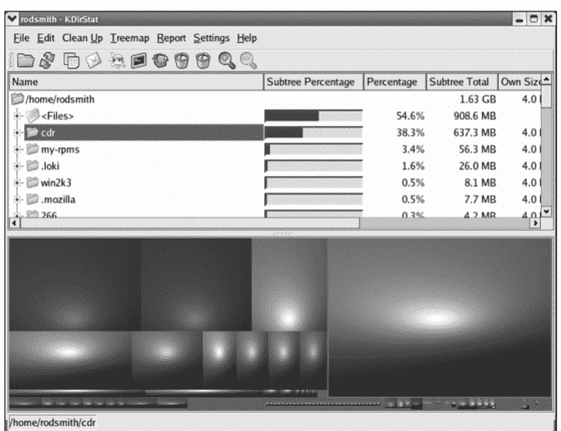

图 3-2

`KDiskStat` 程序在 GUI 中展示文件和目录的大小信息。

使用这些工具之一或多个对于追踪你的“垃圾数据（gunk）”非常有帮助。`KDirStat` 和 `XDiskUsage` 特别别用。它们的 GUI 让你轻松点击最大的文件或目录，这可以让你快速找到占用空间最大的文件。当然，这些文件并不总是垃圾——你可能有完全合理的理由来保留大文件。尽管如此，这可能是一个很好的起点，而且大型临时文件有时会在没有被清理的情况下一直存在。示例包括包文件、CD-R 镜像文件、高分辨率扫描件和音乐文件。你可能打算保留它们一小段时间，然后忘记它们，但它们会迅速消耗磁盘空间。这些 GUI 磁盘监控器将帮助你找到它们。

## 识别、删除并组织你的文件

一旦定位了占用大量磁盘空间的文件，你可能会面临几个问题：

- 这些文件是什么？
- 它们真的需要吗？

## 清理用户文件 49

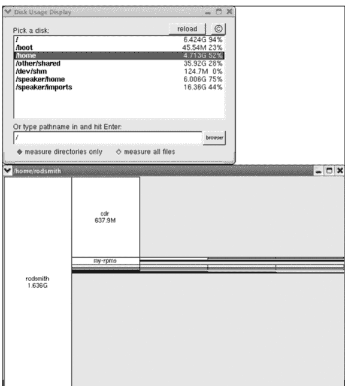

## 图 3-3

`XDiskUsage` 程序处理与 `du` 和 `df` 相关的任务。

- 我可以删除它们而不引起任何问题吗？
- 如果我删除了后来发现需要的文件，我可以通过某种方式找回它吗？
- 如果是我想保留的文件，最好的存储位置在哪里？

遗憾的是，特定文件的用途并不显而易见。

### 通过扩展名识别文件

识别文件最简单的方法之一是检查它们的扩展名。

### 常见扩展名表 3-1

| 扩展名 | 说明 |
|---|---|
| .bak | 备份文件 |
| .bz2 | 使用 bzip2 压缩的文件 |
| .c | C 源代码 |
| .cc, .cpp | C++ 源代码 |
| .conf | 配置文件 |
| .deb | Debian 包 |
| .gif | 图像文件 |
| .gz | 使用 gzip 压缩的文件 |
| .h | C 头文件 |
| .htm, .html | HTML 文档 |
| .jpg | 图像文件 |
| .mp3 | 音频文件 |
| .o | 目标代码 |
| .ogg | 音频文件 |
| .pdf | PDF 文档 |
| .pl | Perl 脚本 |
| .png | 图像文件 |

## 清理用户文件 51

### 常见扩展名表 3-1（续）

| 扩展名 | 说明 |
|---|---|
| .ps | PostScript 文件 |
| .py | Python 脚本 |
| .rpm | RPM 包 |
| .sh | Shell 脚本 |
| .so | 动态库文件 |
| .sxc | 电子表格文档 |
| .sxw | 文字处理文档 |
| .tar | 归档文件 |
| .tbz | 使用 bzip2 压缩的 tar 包 |
| .tcl | Tcl 脚本 |
| .tgz | 使用 gzip 压缩的 tar 包 |
| .txt | 文本文件 |
| .wav | 音频文件 |
| .zip | 压缩文件 |

##### 垃圾清理者的笔记：处理文件类型

Linux 文件名扩展名的一个问题是它们并不是内容的保证。你可以轻松地将（例如）PDF 文件重命名为 `.zip` 扩展名。这种结果可能会令人困惑，但这种情况通常是意外发生的或是因为误解了扩展名的含义。

虽然不是文件扩展名，但有一个文件名值得提及：`core`。某些类型的 Linux 程序会自动创建核心储（core dump），即将程序当时使用的内存内容放在名为 `core` 的文件中。（核心储之所以命名是因为它们代表核心内存，这是现在称为 RAM 的非常老的术语。）核心储对程序员有用，他们可以使用调试工具检查程序崩溃时的状态以寻找崩溃原因。如果你不是程序员，核心储就毫无用处。因此，如果你在主目录下发现名为 `core` 的文件，可以安全地删除它。这些文件占用大量的磁盘空间，因此使用 `find` 等工具（后文在“使用 find”章节中描述）搜索它们可以帮助你清理大量的浪费空间。

## 52 第 3 章

> 注意：与 Windows 不同，Linux 不使用特殊的扩展名（如 `.exe` 或 `.com`）来识别可执行程序文件。某些脚本按照惯例通过扩展名识别，但这并非强制要求，而且对于二进制程序也很少见。相反，Linux 通过一个特殊的权限位（*执行*位）来识别可执行程序。

## 使用 `file` 识别文件类型

假设你正在大扫除，删掉了一些你认为不需要的文件。然而，你遇到了一个名为 `sunflower.ras` 的文件，它让你很头疼。你盯着文件名看看，思考着它的含义，却无法弄清楚它是什么。你甚至可能把它加载到文本编辑器中，但仍然无法破解它。在你和这个文件的“胆小鬼”游戏中，这个文件获胜了。

幸运的是，一个简单的 Linux 程序可以来救你。恰恰，这个程序的名称就叫 `file`。通常，你可以通过输入程序名称后跟想要识别的文件名来使用该程序，结果就是识别信息：

- $ `sunflower.ras`

`sunflower.ras`: Sun raster image data, 1278 x 1024, 24-bit, no colormap

不幸的是，识别结果有时有点晦涩，但它应该提供一些线索。在这种情况下，输出的几个部分表明该文件是一个图形文件——它被描述为“光栅图像”，列出了像素尺寸和位深，并提到了缺少调色板。事实上，Sun 的光栅图像格式是几十种图形格式之一。有了这些信息，你应该能够将文件加载到 `GIMP` 或 `XV` 等图形程序中，并决定是否保留它。

你可以像我描述的那样使用 `file` 命令，但它还支持许多修改工作方式的选项。其中大多数选项都是高度技术性的，或者与命令查找其识别文件类型特征数据库的位置有关。这里我列了一些容易使用且帮助你完成繁重任务的选项：

- 继续——通常情况下，`file` 在找到文件类型匹配后就会停止。但在少数情况下，`file` 可能无法区分两个或多个文件类型。结果可能会导致文件类型识别错误。如果发生这种情况，请尝试 `-k` 或 `--keep going` 选项，例如 `file -k sunflower.ras`。这会让 `file` 命令继续查找匹配项并打印文件的所有可能类型。

### 清理用户文件

查看压缩文件——`gzip` 压缩系统在 Linux 上常用。此类文件通常具有 `.gz` 扩展名。如果你想识别它是压缩过的，可以传递 `-z` 或 `--uncompress` 选项来识别压缩文件本身，而不是将其识别为被 `gzip` 压缩的文件。

`file` 工具在识别文件类型（图形文件、文字处理文件等）方面最有帮助。但它无法帮助你读取文件中的数据。对于这一点，你必须将文件加载到适当的格式。糟糕的是，`file` 的识别有时是错误的。例如，`StarOffice` 和 `OpenOffice.org` 创建的文字处理文件扩展名为 `.sxw`。这些文件实际上使用了与流行的 Windows Zip 存档工具相同的格式进行预压缩，这会让 `file` 误判：

```bash
$ -k manual.sxw
```

`manual.sxw`: Zip archive data, at least v2.0 to extract

注意，即使是，`gzip` 也没有帮助；`gzip` 使用的压缩格式与 Zip 格式不同，尽管名称相似。尽管存在这个问题，`file` 仍然是一个非常有用的工具，特别是当你面对中等不常见的文件类型时。它通常可以帮助你缩小范围，并至少指向可能读取该文件的程序类。

## 使用 `strings` 查找文件信息


有时，你无法通过检查扩展名或使用 `file` 确定文件类型来弄清文件的内容。使用 `strings` 工具可以做更多的侦探工作。该程序扫描二进制文件并从中提取 ASCII 字符串。`strings` 程序会显示这些字符串供你审阅。结果通常可以帮助你识别文件。例如，你可能会注意到看起来像写给朋友信件的内容，这将指向该文件是一个文字处理文档。即使对于不包含太多纯文本的文件，使用 `strings` 也有帮助。例如，考虑对一个 JPEG 图形文件使用此命令时会发生什么：

```bash
$ sunflower.jpg
```

```
JFIF
```

```
hSeptember, 2004
```

```
CREATOR: XV Version 3.10a Rev: 12/29/94 (PCD, PNG-1.2) Quality — 85,
Smoothing — 0
```

在这些行之后还有几行意义不大的文本，但你可以从中汲获到一些有用信息。第一行包含字符串 `JFIF`，这是 JPEG 文件使用的代码。接几行包含文件中的文本，在这种情况下包括一个日期和写入文件的程序标识 `XV`。当然，你必须理解这些细节才能使其发挥作用，但如果你恰好具备知识，`strings` 可以帮助你识别文件类型（在这种情况下，`file` 也能完成工作，你需要的知识较少，但你可能会遇到 `file` 无法识别但你一眼看出的文件类型）。

即使你知道文件类型，`strings` 也有帮助。例如，你可能知道一个文件是文字处理文件。糟糕的是，`file` 的识别有时是错误的。例如，StarOffice 和 OpenOffice.org 创建的文字处理文件扩展名为 `.sxw`。这些文件实际上使用了与流行的 Windows Zip 存档工具相同的格式进行预压缩，这会让 `file` 误判：

```bash
$ -k manual.sxw
```

manual.sxw: Zip archive data, at least v2.0 to extract

注意，即使，也没有帮助；gzip 使用的压缩格式与 Zip 格式不同，尽管名称相似。尽管存在这个问题，`file` 仍然是一个非常有用的工具，特别是当你面对中等不常见的文件类型时。它通常可以帮助你缩小范围，并至少指向可能读取该文件的程序类。

## 搜索文件

清理过程不仅涉及识别系统上的文件，还包括定位某些文件。这些可能是你想要删除的文件，或者是你打算保留但想在系统中移动以改进组织的文件。如果你从根本找不到它，又如何知道需要删除或移动某个文件呢？例如，你可能知道某处有一个旧预算信息的表格，但不知道文件在哪里。在这种情况下，你需要使用工具来定位文件。两个非常有用的是 `find` 和 `grep`。

## 使用 find

最适合从命令行定位用户数据文件的程序叫做 `find`。在压缩文件中——gzip 压缩系统在 Linux 上常用。此类文件通常具有 `.gz` 扩展名。如果你想识别它是压缩过的，可以传递 `-z` 或 `--uncompress` 选项来识别压缩文件，而不是将其识别为被 gzip 压缩的文件。

`file` 工具在识别文件类型（图形文件、文字处理文件等）方面最有帮助。但它无法帮助你读取文件中的数据。对于这一点，你必须将文件加载到适当的格式。糟糕的是，`file` 的识别有时是错误的。例如，StarOffice 和 OpenOffice.org 创建的文字处理文件扩展名为 `.sxw`。这些文件实际上使用了与流行的 Windows Zip 存档工具相同的格式进行预压缩，这会让 `file` 误判：

```bash
$ -k manual.sxw
```

manual.sxw: Zip archive data, at least v2.0 to extract

注意，即使，也没有帮助；gzip 使用的压缩格式与 Zip 格式不同，尽管名称相似。尽管存在这个问题，`file` 仍然是一个非常有用的工具，特别是当你面对中等不常见的文件类型时。它通常可以帮助你缩小范围，并至少指向可能读取该文件的程序类。

## 识别文件的其他方法

除了这些强大或不寻的文件识别方法外，你还有其他工具可用。某些工具仅适用于

- 查看压缩文件——gzip 压缩系统在 Linux 上常用。此类文件通常具有 `.gz` 扩展名。如果你想识别它是压缩过的，可以传递 `-z` 或 `--uncompress` 选项来识别压缩文件本身，而不是将其识别为被 gzip 压缩的文件。

- 依靠文件浏览器——某些文件浏览器可以配置为读取部分或全部文件以显示小图像或文件摘要。对于文本文件，通常前几行出现在弹出窗口中。

- 使用应用程序——理想情况下，你应该能够将文件加载到应用程序中查看其内容。例如，你可能会将图形文件加载到图形查看器或编辑器中。然而，你可能手头没有完美的应用程序，或者你是个大忙人物，不需要坐等一会儿。在这种情况下，你可能可以使用更轻量级的程序来，该程序可以加载目标应用程序的文件。

## 第 3 章

### find 选项详解

- 深度限制——`-maxdepth` 和 `-minddepth` 级表达式将搜索限制为不少于或不少于指定的目录层级。如果你认为要搜索的文件没有（或）没有深埋在你的目录结构中，那么这个选项非常有用。

- 搜索挂载的文件系统——通常情况下，`find` 会搜索所有子目录，无论它们是否位于各自的挂载文件系统上。传递 `-mount` 或 `-xdev` 选项会导致 `find` 忽略搜索区域内对应于文件系统的目录。

- 时间搜索——`-anewer` 文件选项搜索访问时间比你指定的修改时间更晚的文件，`-cnewer` 查找状态改变比你指定的指定的更晚的文件，`-newer` 查找修改时间比你指定的修改时间更晚的文件。`-atime`、`-ctime`、`-mtime` 选项搜索指定天数前被访问、状态改变或被修改的文件。`days` 的取负值查找比指定时间更新的文件，显式的正值（如 `+12`）查找比指定时间更旧的文件，既没有正号也没有负号的值（如 `12`）查找恰好指定年龄的文件。

- 空文件——`-empty` 文件选项定位为空的文件（即长度为 0 的）。该选项还会定位没有文件的目录。这两类文件都可能（但不确定）是垃圾文件。

- 文件名——一种常见的搜索是通过文件名。`-name` 模式选项是执行此操作最基本的方法；搜索匹配模式名称。模式是指定模式的一种，类似于在命令行提示符输入文件名时使用的模式。简单来说，模式可以是你想查找的确切文件名。你也可以包含通配符，例如用 `?` 匹配任意字符或 `*` 匹配任意字符串。你可能需要将复杂的模式包含在引号中。`-name` 的变体包括 `-iname` 以不区分大小写的方式搜索；`-inamename` 根据符号链接指向的文件名搜索符号链接；以及 `-ilname`，它类似于 `-iname` 但不区分大小写。

- 所有权——`-uid` 和 `-gid` 组选项分别搜索由指定的用户 ID `UID` 和组 ID `GID` 拥有的文件。`-user` 用户名和 `-group` 组名选项按名称而非数字搜索由指定用户或组拥有的文件。

- 权限——`-perm` 模式选项搜索具有提供权限（或模式）的文件，权限可以用八进制形式（如 `644`）或符号模式（如 `+rw`）指定。在模式前加加号 `+` 意味着搜索找到存在任何指定权限位的文件。减号 `-` 表示所有权限位都必须存在。两者都不使用则意味着文件必须具有恰好指定的权限。

- 文件大小——`-type size` 选项查找匹配指定大小的文件，默认以 512 字节块为单位，但你可以添加 `k` 分别按字节（字符）或千字节搜索。如果 `n` 是显式的正数（如 `+500k`），`find` 搜索大于指定数量的文件。如果 `n` 是负数（如 `-250`），它搜索比指定数量更小的文件。当两者都不成立时（如 `300c`），则只查找恰好匹配指定大小的文件。

`-type` 选项搜索特定类型的文件。除其他值外，`code` 可以是 `c` 或 `b` 分别代表字符设备或块设备文件；`d` 代表目录；`f` 代表普通文件；或 `l`（即小写 L）代表符号链接。

这是一个很长的列表——而且它还不完整！`find` 是一个强大的命令。幸运的是，只需几个选项就能让你事半功倍。`-name` 和 `-iname` 选项特别有用。各种时间和文件大小选项也很方便。例如，假设你想找到一个已知在一年前创建的文件，并且你正在 OpenOffice.org 文字处理器中搜索一个以 `c` 开头的文件。如果你在主目录的命令行提示符下，以下命令应该找到该文件：

```
$ find . -iname "c*.sxw" -mtime -365
```

## 使用 grep

另一个搜索文件的工具是 `grep`。`find` 根据表面特征（文件名、文件类型代码等）定位文件，而 `grep` 则看得得更深：它检查文件内容，在文件内容内查找模式。要使用它，请输入命令、任何你想使用的选项以及一个要搜索的模式。你还需要包含一个要搜索的文件指定。


**注意：** 当你使用 `find` 命令时，你将文件名放在命令后的第一个位置，但在 `grep` 中，将文件名放在命令的末尾。这种差异可能是困惑的源头。我个人经常把它搞反！

`find` 和 `grep` 支持许多选项；然而，对于基本的文件查找任务，几个是最重要的：

- 忽略大小写——通常情况下，`grep` 执行区分大小写的搜索。`-i` 选项告诉程序执行不区分大小写的搜索。
- 生成摘要——通常的 `grep` 输出是文件名，后面跟着找到匹配项的文本行。（对于二进制文件中的匹配，会显示“已找到”的消息。）如果你只需要文件名，可以使用 `-l`（即小写 L）选项让 `grep` 忽略具体的行。
- 递归搜索——通常情况下，`grep` 不搜索子目录。`-r` 或 `-R` 选项告诉 `grep` 递归搜索子目录。例如，如果你想在你主目录的所有文件中找到一个字符串，你输入：

```bash
$ grep -r "pattern" .
```

### 清理用户文件

## 第 3 章

总而言之，`grep` 可以是搜索某些类型文件（文本文件、配置文件等）非常有用的工具。它的局限性与其说是 `grep` 的问题，不如说是与搜索相关的困难。

## 组织你的文件

现在你已经学会了定位和识别文件，是时候把它们组织得更好了。如果你从一个包含许多文件的目录开始，或者如果你发现你的目录结构很奇怪，解决这个问题的方法之一是组织（或重组）你的目录树。另一种方法是删除文件，将在下一节介绍。这两种方法是互补的。

将你的文件组织到子目录中很容易的，但这确实需要你创建子目录。从命令行，可以通过 `mkdir` 命令完成，该命令创建（make）一个目录，因此名称缩短：

```bash
$ mkdir newdir
```

这个示例创建了一个名为 `newdir` 的目录。你可以在 GUI 文件管理器中通过选择文件管理器菜单中的选项来完成相同的操作。寻找“编辑 > 新建 > 文件夹”或类似的选项。（具体的选项名称取决于文件管理器。）

> **提示：在 Windows 和 Mac OS 中，包含空格的文件名和目录名很常见。** 虽然 Linux 可以处理这些文件名，但从命令行来看很笨拙。你必须将整个路径包含在引号中，或者在每个空格前加上反斜杠 (`\`)。出于这种原因，Linux 用户通常使用连字符 (`-`) 而不是空格来分隔多文件名中的单词。

你现在应该准备好创建一个合理的目录结构了。具体是什么样的取决于你和你的特定需求。通常来说，为每个项目或文件类型创建子目录可以是一个很好的起点。例如，你可能会为信件、财务文档、报告和音乐文件创建单独的子目录。部分或所有子目录都有自己的子目录——例如，在信件目录中创建业务信件、个人信件和给你的立法者的信件。

这种组织的理念是创建一个易于查找你文件的逻辑结构。理想情况下，请将以下提示作为指南：

- 创建一种结构，使得任何给定文档都有单一的逻辑位置，而不是分散在多个位置。
- 在每个目录中放置少量数量的文件——例如，六个到三十个之间。如果你的目录中文件太少，你的目录结构将变得非常深，访问其内容将变得繁琐。如果你的目录中文件太多，你的目录结构会变得很浅，但文件将迷失在每个目录的文件海洋中。就像“金发女孩和三熊”一样，你想找到那个舒适的中间点。
- 使用深思熟虑且具有描述性的名称，这样你看一眼目录名称就能想起你在里面放置了什么。避免使用像 `business-stuff`（业务事务）之类的名称，而是尝试使用 `business-receipts`（业务收据）之类的名称。有时子目录可以帮助；例如，你可以有一个 `business` 目录，其中包含 `receipts` 子目录。
- 尝试安排你的目录以便易于备份。例如，如果你有一组存储正在更新的文件目录，你可能希望将这些目录分组。这样，你就可以定期地对它们进行备份。

构建好（或部分构建好）目录树后，你就可以将文件移动到相应的位置了。如果你使用 Linux GUI 环境，可以使用熟悉的拖放操作来完成。如果你在命令行下工作，请使用 `mv` 命令，它兼具移动和重命名命令的功能。要移动文件，输入命令名，后跟文件名和目标目录：

```bash
$ mv mathilda.sxw letters/personal-correspondence/
```

此命令将 `mathilda.sxw` 文件移动到 `letters/personal-correspondence` 子目录。如果你是从一堆杂乱无章的混乱开始的，你会频繁使用这个命令或其 GUI 等效操作！

提示：Linux 文本模式提供了文件名自动补全功能，这在命令行中操作文件时非常有用。输入几个字符（可能只有一个）并按 `Tab` 键。Linux 会搜索所有尽可能匹配你输入的文件名。如果只有一个文件名匹配你输入的字符，Linux 就会完成所有输入。这在输入诸如 `personal-correspondence` 的文件名和目录名时，可以节省大量的击键次数。如果 `letters` 子目录中只有一个以 `p` 开头的文件或目录，你可以省略第一个字符之后的字符！

### 何时删除未使用文件

你可能需要将文件从一个目录移动到另一个目录，以保持系统的整洁和可用。不过，如果你的问题是磁盘空间不足，良好的组织也只能帮助有限。此外，即使你有足够的磁盘空间，不必要的文件也会弄乱你的目录列表，并可能迫使你创建比需要的更多的子目录（以及更深的目录结构），使得寻找需要的文件变得更加困难。由于这些原因，你应该准备好丢弃一些旧文件，就像扔掉从去年 12 月起一直躲在冰箱背后的发霉水果蛋糕一样。

删除文件可能是困难的，特别是当你并不缺磁盘空间时。人们很容易认为这些文件在未来可能有用，即使它们现在不需要。也许你以后会写回忆录，那时你需要你保存的所有那些旧信件。在大多数情况下，这只是痴人说梦；你多年没碰过的旧文件可能永远不会再触碰，删除它们是有意义的。

最后，删除还是不删除某个文件的决定取决于你。不过，你可以问自己一些问题来帮助处理这个问题：

- 距离你阅读或修改该文件已经多久了？时间越久，它作为垃圾桶候选者的概率就越高。一年可能是一个好的删除截止日期，尽管这不应该是一条硬性规定。
- 你是否有法律、业务、个人或其他理由保留该文件？例如，税务记录的保留时间应该比一个巡回戏团长得多。
- 数据可以重新构建或再次获取吗？例如，你通常可以随时从互联网下载程序，所以删除程序包文件并不是什么风险。另一方面，数码相机的照片可能是字面上无法替代的。
- 文件有多大？特别是当磁盘空间不足时，大文件可能是一个真正的负担，但小文件并不是大问题（不过，集合中的大量小文件加起来可能会变成大问题）。
- 是否备份文件？除非你正在处理某个项目，否则自动创建的备份文件是删除的良好候选者。

这些问题应该帮助你评估遇到的每个文件，并决定如何处理它：删除还是保存。当然，你的评估随着时间的推移而改变——某些东西今天值得保留，但下个月或明年可能就不值了。因此，你可能需要经常检查你的文件并把它们清理干净。

在 Linux 中删除文件，你可以使用文本模式的 `rm` 命令或在大多数管理器中使用拖放操作。要用 `rm`，输入命令后跟要删除的文件名或多个文件名，如 `rm letters/mathilda.swx papers/quantum.doc`。通常，`rm` 不会删除目录。要删除整个目录（包括其包含的所有文件），请向 `rm` 传递 `-r` 选项以及目录名，如 `-r olddir`。

### 表 3-2 常见的 Linux 点文件

| 点文件名称 | 格式 | 目的 |
|---|---|---|
| `.bash_history` | 文件 | 在 Bash 提示符下输入的命令历史。 |
| `.bash_logout` | 文件 | 退出文本模式 Bash shell 时运行的脚本。 |
| `.bash_profile` | 文件 | 启动文本模式 Bash shell 时运行的脚本。 |
| `.bashrc` | 文件 | 启动文本模式 Bash shell 时运行的脚本。 |
| `.DCOServer_*` | 文件 | 带有计算机名称的文件名值；桌面桌面通信协议 (DCOP) 的状态文件，KDE 用它来管理程序间的通信。 |
| `.dmrc` | 文件 | KDE 显示管理器 (KDM) 配置文件；指定通过 KDM 登录时运行何种桌面环境。 |
| `.emacs.d` | 目录 | 一种流行的文本编辑器的设置。 |
| `.esd_auth` | 文件 | 觉醒声音守护进程 (ESED/ESD) 的清理文件，它是 Linux 子系统的一部分。 |
| `.fonts` | 目录 | 用户安装的字体。 |
| `.fonts.cache-l` | 文件 | `.fonts` 中用户安装的字体的列表。 |
| `.fonts.conf` | 文件 | Xft 字体配置文件。 |
| `.gconf` | 目录 | GConf 使用的配置文件，与 GNOME 相关的集中配置工具。 |
| `.gconf` | 目录 | GConf 使用的状态文件。 |


| `.gimp-1,2` 或 `.gimp-2.0` | 目录 | GIMP 的配置文件，也可能是临时存储空间。具体文件名取决于使用的 GIMP 版本。 |
| `.gnome`、`.gnome2` 和 `gnome2_private` | 目录 | GNOME 应用程序的配置。 |
| `.gtkrc` | 文件 | GIMP Toolkit (GTK+) 的配置信息，GTK+ 是 GIMP、GNOME 和许多程序使用的 GUI 开发工具。 |
| `.kde` | 目录 | KDE 应用程序的配置文件。 |
| `.macromedia` | 目录 | Macromedia 产品（如 Flash Player）的配置文件。 |
| `.mail` 或 `.Mail` | 目录 | 邮件；最好用你的邮件程序进行管理。 |
| `.metadata` | 目录 | Metacity 窗口管理器配置文件，通常由 GNOME 使用。 |
| `.mozilla` | 目录 | Mozilla 和 Mozilla Firefox 浏览器的配置文件和缓存。 |
| `.nautilus` | 目录 | GNOME 使用的 Nautilus 文件浏览器的配置文件。 |
| 点文件名 | 格式 | 目的 |
|---|---|---|
| `.rhn-applet` | 目录 | Red Hat Update Agent 程序的清理文件。 |
| `.rhn-applet.conf` | 文件 | Red Hat Update Agent 的配置文件。 |
| `.signature` | 文件 | 签名文件的传统名称，附加邮件和新闻组帖子中的几行（通常为 1–4 行）文本。 |
| `.ssh` | 目录 | 与安全 Shell (`SSH`) 客户端相关的文件。 |
| `.themes` | 目录 | 桌面环境的主题。 |
| `.wine` | 目录 | 与在 Linux 中运行 Windows 程序的 `WINE` 工具相关的配置和其他文件。 |
| `.Xauthority` | 文件 | 自动生成的文件，帮助管理到 X 服务器（GUI 环境）的连接。 |
| `.Xclients` 和 `.Xclients-default` | 文件 | 登录 GUI 会话时有时运行的脚本。（并非所有 GUI 登录方法都使用此脚本）。 |
| `.defaults` | 文件 | 某些 X 程序使用的设置文件；可设置程序默认值。 |
| `.xfce4` | 目录 | Xfce 桌面环境的配置文件。 |
| `.xinitrc` | 文件 | 从文本模式登录启动 X 时运行的脚本。 |
| `.xms` | 目录 | 与 X 多媒体系统 (`XMMS`) 相关的配置文件。 |

表 3-2 远不是可能点文件的完整列表，但它让你对它们的功能有一个初步了解。它还揭示了一个关键事实：大多数点文件的文件名与其关联的文件相似。因此，你可能通过查看点文件的名称，就能猜出使用该点文件的程序名称。某些名称在配置名称末尾加上 `rc` 或 `.conf`，如果你看到这种情况，可以尝试。

**注意：** 两个点（实际上是目录）值得特别注意。`.` 目录指向当前目录，而 `..` 指向当前目录的父目录。这就是为什么文本模式命令 `cd ..` 带你进入当前目录的父目录——你正在进入一个实际上是当前目录父目录的子目录。

点文件和目录可以通过三种方式变成垃圾：

- **它们变得不再必要。** 如果你运行了一个程序，然后再也不运行它，相关的点文件就变成了多余的混乱。虽然占用的空间可能很少，但当你寻找其他点文件时，该点文件会让你查找变得更困难。
- **它们变得太大。** 这个问题最可能影响点目录，它们有时会收集碎片文件。这可能是意外发生的（例如，如果你错误地将一个大的 CD-R 镜像文件复制到点目录），或者是因为你做了某些更改却忘记撤销（例如，添加了你需要的个人字体但后来忘了）。

在程序运行时删除其点文件（dot file），不会导致任何程序混乱。最坏的情况下，程序在重新启动时会发现文件丢失；大多数用户程序随后会退回到系统默认设置或创建一个新的点文件。

当然，如果你明确确定某个点文件属于一个没有运行的程序，那么这些预防措施可能过度了。归根结底，这由你来判断。

# 第 3 章

## 总结：清理你的主目录

现在你应该已经完成了四项重要的“清理”任务，以更好地管理用户文件：跟踪你正在使用的磁盘空间、识别你想保留的文件、为存储保留的文件创建目录和子目录，以及删除你不想要的文件。你还学习了如何处理 Linux 点文件，以及如果你不小心，这些文件会如何变成“垃圾”（gunk）的源头。点文件值得特别关注，因为它们不会显示在大多数程序列表中，而且很容易被忘记。由于它们是程序配置文件，当你删除或修改它们时，它们可能需要特殊处理。

Linux 提供了许多工具（包括基于文本和 GUI），用于管理文件、定位文件、创建和删除目录以及删除文件。你甚至可以跟踪磁盘使用情况，帮助定位占用过多磁盘空间的垃圾，并搜索特定文件和类型的文件以帮助定位特定的垃圾文件。

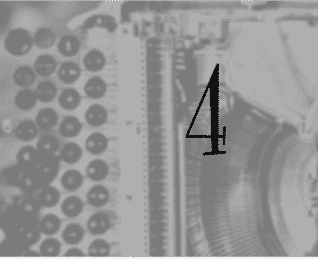

## 清理你的桌面环境

清理清单：

- 了解你偏好的桌面环境（GNOME、KDE 或其他）的特性。
- 使用最佳桌面环境功能，同时避免那些通过消耗 CPU 时间或其他资源而榨尽系统性能的功能。
- 保持桌面环境整洁。
- 调查使用流行的 GNOME 和 KDE 桌面环境替代方案的可能性。

# 第 4 章

当你将 Linux 作为桌面操作系统使用时，你很有可能会以 GUI 模式使用 Linux。Linux 的 GUI 由 XWindow 系统（简称为 X）组成，但 X 非常罕见。至少，你将配合 X 一起使用窗口管理器。窗口管理器提供窗口装饰，这些装饰提供了控制功能，让你能够在屏幕上拖动窗口、调整窗口大小等。窗口管理器通常提供某种启动程序的方法。不过，窗口管理器本身是相当简单的工具。大多数人使用桌面环境，它由窗口管理器以及一系列小应用程序组成——这些程序提供了简单实用的功能，如计算器和更改键盘重复率的工具。两个最流行的 Linux 桌面环境是 GNU 网络对象环境（GNOME, http://www.gnome.org）和 K 桌面环境（KDE, http://www.kde.org）。两者都是功能强大的桌面环境，但它们也变得相当复杂，这意味着它们是很好的垃圾收集器。知道如何处理这些垃圾，或者通过使用更简单的桌面环境甚至“裸”窗口管理器来完全跳过它们，将帮助你保持 Linux 工作环境整洁。在本章中，我将向你展示如何调整 GNOME 和 KDE，以便让这些桌面都能为你服务。

## 调整 GNOME 以获得更好的性能

正如名称所示，GNOME 最初被设计为以网络为中心的桌面环境。然而，随着它的发展，环境中大部分以网络为中心的愿景并未实现，因此 GNOME 和 KDE 在整体功能上变得非常相似。了解一些在 GNOME 中可以调整的内容将帮助你提高它的性能。你还应该采取措施保持你的 GNOME 桌面整洁。了解你哪些和不能安全地更改内容将帮助你做到这一点。

### 可调 GNOME 特性概览

我将首先向你展示 GNOME 提供的一些基础自定义功能。这将帮助你更高效地使用桌面环境。考虑图 4-1，它显示了 Fedora 3 系统上的默认 GNOME 2.8.1 配置。虽然 Fedora 更改了许多 GNOME 默认设置，但它们并没有奇怪到无法识别。（旧版本的 Fedora 对标准 GNOME 配置执行了更广泛的更改。）

大多数可配置的 GNOME 特性可以通过 GNOME 偏好（Preferences）设置，如图 4-2 所示。你可以通过双击桌面上的“在此处”（Start Here）图标打开此窗口，然后双击

## 清理你的桌面环境

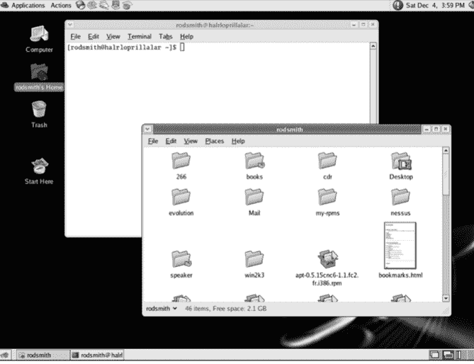

图 4-1

GNOME 许多可以自定义以适应你偏好的功能。

偏好（在某些系统上被称为桌面偏好）。你也可以从默认 GNOME 屏幕顶部的“应用程序 > 偏好”菜单访问此菜单中的各个单独项目。

## 清理你的桌面环境

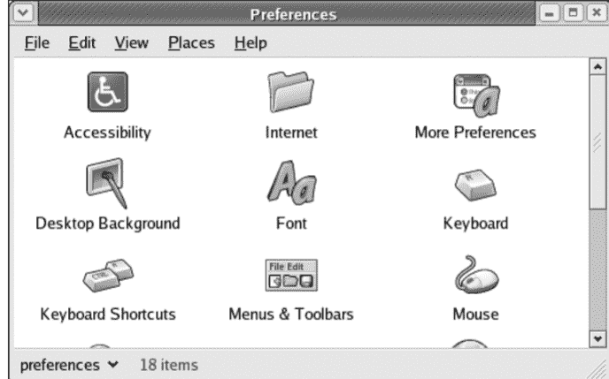

图 4-2

GNOME 许多可以自定义以适应你偏好的功能。

偏好（在某些系统上被称为桌面偏好）。你也可以从默认 GNOME 屏幕顶部的“应用程序 > 偏好”菜单访问此菜单中的各个单独项目。

你可能想要清理桌面背景的功能包括：


## 桌面背景
大多数发行版的默认桌面背景使用某种图形图像。你可以将此图像更改为提供的几个之一，或通过启动桌面背景并点击“添加壁纸”按钮指向你自己的图像。在低内存系统上，背景图像可能会消耗你希望分配给应用程序的资源，因此使用纯色可能是更好的选择。你可以点击“无壁纸”选项激活并从颜色选择器中选择颜色。

## 字体
你可以设置多个字体相关的选项，包括窗口标题中使用的字体和 GTK+ 中的默认字体。你还可以设置字体渲染选项。

## 第四章 - 74

要修改面板（Panels），请在它们上点击右键。此操作会产生一个包含各种选项的上下文菜单，但具体的可用选项取决于你点击的位置。如果你点击面板的空白区域，你能够向面板添加条目、删除面板或修改面板的属性（例如其尺寸和位置）。如果你点击现有的面板图标，你将能够调整图标而非整个面板。

## 在 GNOME 中微调文件浏览

GNOME 与所有主流的 Linux 桌面环境一样，都提供了一个文件浏览器——该程序以图形化方式显示文件和目录，并允许你对文件进行复制、删除、重命名以及其他操纵。GNOME 的文件浏览器被称为 Nautilus，图 4-1 显示了 GNOME 桌面上的一个 Nautilus 窗口。

Nautilus 提供了用户在现代操作系统文件浏览器中期望的功能。除了简单的文件操作外，Nautilus 还可以提供文件内容的预览、为不同类型的文件显示不同的图标、将文件链接到应用程序（这样你就可以通过双击文件直接将其加载到应用程序中）等。Nautilus 的许多功能都是可以配置的。你可以从“视图”（View）菜单中逐窗口进行更改，但要更改默认设置，必须选择“编辑”（Edit） > “偏好”（Preferences）。此操作将弹出图 4-3 所示的“文件管理偏好”对话框，在其中你可以设置几个默认值：

- **文件显示（File display）**——“视图”选项卡上的“默认视图”项目控制 Nautilus 如何显示文件——以图标形式或列表视图形式显示。后者包含了额外信息，例如文件类型、文件修改日期和文件大小。你可以通过“列表列”（List Columns）精确控制你想要显示的信息。
- **排列（Arrange）**——“视图”选项卡上的“排列项目”控制 Nautilus 如何对文件进行排序。你可以按名称、日期、文件类型等进行排序。
- **图标大小（Icon sizes）**——你可以为图标视图和列表视图单独设置图标大小。图标视图提供了紧凑布局的选项，这可以减少图标之间的间距。如果你显示器较小，或者在拥挤的目录中尽可能查看更多文件，向窗口中挤更多图标可能会很有用，但如果做得过度，会导致图标列表拥挤且难以阅读。
- **点击行为（Click behaviors）**——“行为”（Behavior）选项卡提供了与点击和双击行为相关的选项。你可以配置 Nautilus 在单击或双击文件时打开文件，以及设置浏览器在点击可执行文本文件（如脚本）时是打开还是运行这些文件。

## 清理你的桌面环境 - 75

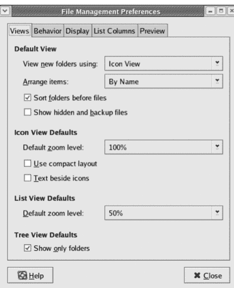

**图 4-3** 文件管理偏好对话框

Nautilus 文件管理偏好对话框控制 Nautilus 的默认设置。

- **浏览器窗口（Browser windows）**——默认的 Nautilus 窗口是文件图标的简单显示。有些人更倾向于类似于网络浏览器使用的复杂显示方式，如图 4-4 所示。要使用此类检查，请使用“行为”选项卡上的“始终在浏览器窗口中打开”项目。
- **垃圾桶选项（Trash options）**——Nautilus 维护着“垃圾桶”（图标位于桌面上，并在图 4-1 中可见）。“行为”选项卡提供了影响其运行的选项——具体包括是否在删除垃圾桶请求时进行确认，以及是否包含跳过垃圾桶的删除选项。
- **预览选项（Preview options）**——“预览”选项卡提供了与文件预览相关的选项。例如，在图 4-1 和 4-4 中，`bookmarks.html` 文件被预览了，这意味着文件浏览器本身会显示该文件的小版本。这些预览可能很有用，但也可能非常耗时，特别是当一个大目录充满了需要大量时间预览的文件时（例如包含几十张大型数字照片的目录）。

## 第四章 - 76

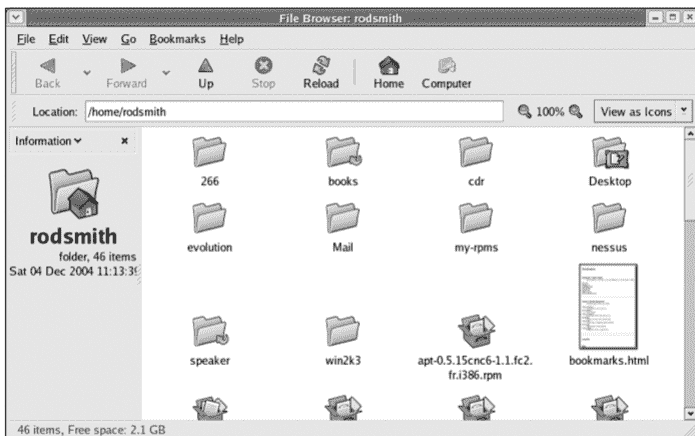

图 4-4

你可以更改 Nautilus 的显示，包含“位置”（Location）字段、前进和后退按钮以及其他类似浏览器的功能。

仔细选择你的文件浏览选项可以极大提高 GNOME 的整体性能。特别注意预览选项，如果设置不当，它们会像吸血鬼一样消耗你的系统性能。特别是，确保你只预览本地文件，并设置一个适合你文件夹的文件大小限制（“仅针对小于”选项）。你可能需要实验这些选项以了解哪些效果良好。如果你的硬盘特别慢，或者你的目录包含大量文件，你可能想要完全禁用文件预览。

大多数其他文件浏览选项属于个人偏好问题。例如，有些人喜欢浏览器风格的窗口，而另一些人则更倾向于简单的传统的风格。你只需要亲自尝试看看你更喜欢哪种。

> GunkBuster 的笔记本：设置背景和徽章

GNOME 的另一个可能很诱人但如果误用可能会导致问题的功能，是给图标和窗口附加徽章和背景。选择“编辑”（Edit） > “背景和徽章”（Backgrounds and Emblems）来查看图 4-5 所示的“背景和徽章”窗口。你可以通过以下方式选择图案、颜色或徽章：

## 清理你的桌面环境 - 77

点击此窗口左侧的相应图标。右侧的大面板将显示你所选项目的多种样式选择。图案和颜色可以应用于目录背景。

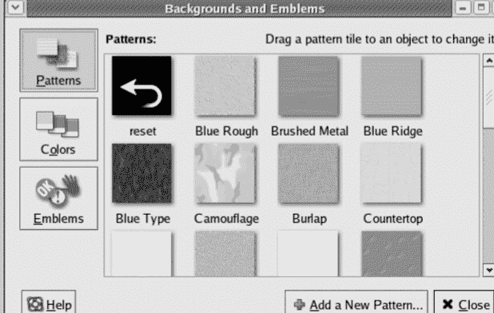

图 4-5 背景和徽章

## 第四章 - 98

### 保持你的 GNOME 整洁

GNOME 桌面实际上是由 Nautilus 维护的。GNOME 文件管理器负责处理你桌面上的图标。大多数发行版带有一个非常简单的桌面，包含指向主目录、“在此”、垃圾桶和“计算机”（提供访问可移动媒体的路径）的图标。你可以在桌面上添加特定目录的图标。注意：GNOME 桌面对应桌面目录。

要创建图标，在桌面上点击右键并选择一个选项（如“创建文件夹”、“创建文档”或“创建启动器”）在桌面上放置所选类型的图标。你也可以从 Nautilus 窗口将图标拖放到桌面来移动它。

所有这些活动的问题在于它们往往会产生混乱的环境。在大量的清理任务中，挑战在于找到合适的平衡。桌面上的少量程序启动和文档图标可以提高你的工作效率，让你更快地启动程序和访问文件。如果太多，你会很难找到你想要的图标。你必须自己决定一个合适的平衡，但作为一个通法则，尽量将数量控制在十个左右。

> 提示：如果你想快速访问大量程序或文件，你可以在桌面上的文件夹中存储这些链接。例如，5 个文件夹每个 10 个项目可以让你快速访问 50 个程序或文件，同时保持桌面整洁。

### 从全新的 GNOME 配置开始

有时 GNOME 配置会变得严重损坏。这在切换发行版时特别常见——一个发行版可能将文件存储在一个目录，而其他则存储在其他地方。结果是图标丢失、程序无法运行等等。这是一个严重的垃圾问题，但修复相对容易，不过有一个重要的警告：你将从头开始配置 GNOME。其思路是删除现有的 GNOME 配置文件。一旦完成此操作，下次启动 GNOME 时，它将从默认值开始创建新的配置文件。

# 简化你的桌面环境 79

这对于你的系统来说应该是正确的（或至少是用的）。第 3 章通俗描述了这种方法，表 3–2 列出了常见的 Linux 文件（隐藏配置文件）名称，你可以通过删除这些文件将各种程序重置为默认配置，包括 GNOME 点文件。

遗憾的是，GNOME 并没有将其配置放在一个方便的位置。如表 3–2 所示，你必须删除或移动几个点文件和目录才能将 GNOME 完全重置为默认设置：`.config`、`.local`、`.gnome`、`.gnome2`、`.gnome2_private`、`.gtkrc`、`.metacity`、`.nautilus` 和 `.themes`。不过，你可能不需要删除所有这些文件和目录。特别是 `.config` 和 `.local` 与配置工具相关，`.gtkrc` 用于 GTK+。`.metacity` 控制 GNOME 使用的 Nautilus 窗口管理器，`.nautilus` 存储 Nautilus 文件管理器的设置，而 `.themes` 存储主题。如果这些组件中的某些没有给你带来问题，你可以尝试保留它们的配置。如果你仍然遇到问题，请尝试删除更多的配置文件，直到你找到问题根源所在的文件。

> 提示：如第 3 章所述，与其删除配置文件和目录，不如尝试将它们移动到临时位置。这样，如果你发现删除它们没有帮助，就可以轻松恢复原始文件。

### 调整 KDE 以获得更好性能


KDE 在整体功能上与 GNOME 非常相似，因此简化和微调 KDE 与简化和微调 GNOME 非常相似。你可以从研究 KDE 的配置选项开始，你可能想要根据自己的喜好对其进行调整。与 GNOME 一样，KDE 的一个主要组件是它的文件管理器，你可以配置它以按你的意愿运行。你应该保持桌面整体整洁。如果你的 KDE 配置变得不稳定或不可用，你可能想从删除配置文件开始处理。

# KDE 可调整功能概览

图 4-6 显示了 Fedora 3 系统上的 KDE 3.3.1 桌面。如果你将此图与图 4-1 比较，你会发现几处相似之处。有些是因为 Fedora 为 GNOME 和 KDE 使用了相似的主题和桌面配置。另一些是因为 GNOME 和 KDE 之间更基础的相似性。你还会注意到 GNOME 和 KDE 截图之间存在某些差异，这些差异随着你观察的深入往往会变得更加重要。

## 第 4 章

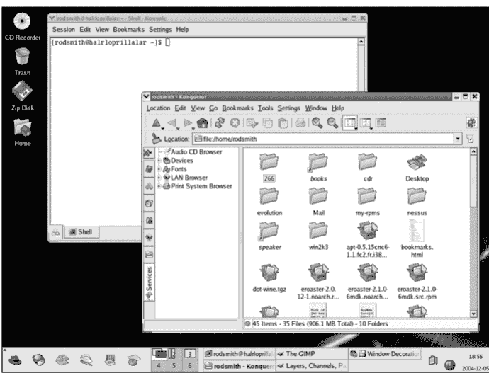

**图 4-6** KDE 功能与 GNOME 的功能相似。

> **注意：** 某些发行版提供了一个向导，让你在首次启动 KDE 时设置某些默认值。

KDE 最重要的功能可以在 KDE 控制中心（KDE Control Center）设置，该中心通常可以通过 KDE 菜单启动——即图 4-6 左下角的红帽子。（在未修改的 KDE 配置中，此图标是一个风格化的 K，但发行版经常将其更改为自己的标志）。结果使得图 4-7 有可能。你可以从窗口左侧的索引列表中选择想要调整的选项。作为响应，窗口右侧的内容会发生变化，让你能够设置你指定的选项。你可以调整的通用类别如下：

- **外观与主题**——“外观与主题”部分提供了与桌面外观相关的选项，但不涉及功能。这些包括背景图像、颜色方案、字体、图标、屏幕保护程序、窗口边框和主题。与 GNOME 一样，你可以安装从网上获取的主题。（KDE 控制中心有一个按钮，点击它可以通过 KDE Web 浏览器打开带有这些主题的网站。）

- **桌面**——此部分提供了与桌面和文件浏览相关的选项。你可以调整虚拟桌面的数量、面板（Panels）的数量和位置、哪些文件类型在文件管理器中生成预览等。

## 简化你的桌面环境

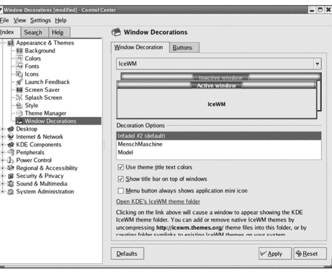

**图 4-7**

KDE 控制中心提供了调整许多 KDE 默认行为。

- **互联网与网络**——你可以从此区域调整各种网络选项。这些选项涉及网络客户端（如邮件读取器和 Web 浏览器）与网络交互的方式。你还可以激活桌面共享，允许使用其他电脑的人从远程查看并使用你的桌面。这对于进行远程演示非常方便。这些功能中的在本书的其他地方有所描述。

- **KDE 组件**——此区域提供了与 KDE 程序相关的选项。某些功能与 KDE 程序之间通信的方式有关。例如，你可以指定任何想要启动邮件读取器的 KDE 程序应启动的邮件读取器。从简化的角度来看，特别感兴趣的是 KDE 性能子区域。在这里，你可以设置影响 KDE 性能的功能，例如它是否尝试针对低内存配置进行自我优化，或尝试*预加载*（即在被调用之前加载）关键代码。你应该对这些选项进行实验；根据你的内存和正在运行的程序数量，你可能会发现某项设置会提高性能。

## 第 4 章

- **外围设备**——你可以在此区域设置与硬件相关的选项。这些选项包括屏幕分辨率、键盘重复率、鼠标跟踪速度和默认打印机。这些选项不会影响低层驱动程序配置；对于这一点，你需要使用管理工具而不是用户工具。

- **电源控制**——如果你使用的是笔记本电脑，特别应该检查此区域，它允许你设置各种节电选项和功能，这些功能在笔记本电脑上最有用。

- **区域与辅助功能**——你可以从此部分更改键盘的本地化设置、设置为灵活性降低的用户设计的选项等。

- **安全与隐私**——此部分提供了与安全和隐私相关的选项，包括密码更改工具以及在 KDE 程序中启用加密和数字签名的功能。

- **音频与多媒体**——你可以在此区域告诉 KDE 你的音频系统，启用与特定 KDE 程序中特定事件关联的声音等。但此功能不会影响低层音频驱动程序。如果你在程序中完全无法获得声音，你可能需要处理低层音频驱动程序而不是 KDE 音频配置。

- **系统管理**——此区域提供执行常见系统管理任务的方法，例如安装文件和记录登录配置。某些设置需要管理权限，并提示你点击按钮并输入 root 密码才能进行更改。其他设置（如文件安装）可以在你的主目录下进行。

大部分功能仅适用于 KDE 应用。例如，如果你设置了默认字体或声音事件，该设置将仅适用于 KDE 程序；其他程序不受影响。这对于安全功能尤为重要。例如，告诉 KDE 使用 Web 代理服务器会影响 Konquer 等 KDE 浏览器，但不会影响非 KDE Web 浏览器（如 Mozilla Firefox）。

KDE 配置使用单个位于屏幕底部的面板，而不像 GNOME 常见的两个面板。KDE 的默认面板包含与 GNOME 类似的功能，包括程序启动器、将特定窗口带到前面的页切换器、时钟等。你可以通过右键点击面板的空白部分来配置整个面板；可以通过右键点击特定组件来配置它。例如，右键点击页切换器可以更改 KDE 显示的虚拟桌面数量、页切换器中显示的每个虚拟桌面的信息等。

### 调整 KDE 的文件浏览

KDE 的文件管理器是 Konqueror。早些我在 Web 浏览器的范围内提到过 Konqueror，事实上，该程序同时处理这两项任务。如果你在 Konqueror 的“位置（Location)”字段中输入本地目录路径，它就会作为一个文件管理器运行；如果你输入一个网站地址，该程序就会作为一个 Web 浏览器运行。KDE 文件管理器也是 Web 浏览器，这意味着你可以运行更少的程序，但这也给文件管理器增加了一定程度的负担，特别是如果你倾向于使用其他程序作为 Web 浏览器。

Konqueror 的双重身份意味着，配置文件管理器部分可能比配置 GNOME 的 Nautilus 文件管理器更棘手。你可以在文件管理器窗口中通过“设置（Settings） > 配置 Konqueror（Configure Konqueror)”菜单访问 Konqueror 主配置工具。结果如图 4-8 所示。此对话框在窗口左侧将 Konqueror 选项分为几个大类。选择其中一个，窗口右侧就会出现选项。对于 Konqueror 文件管理任务最重要的主要类别如下：

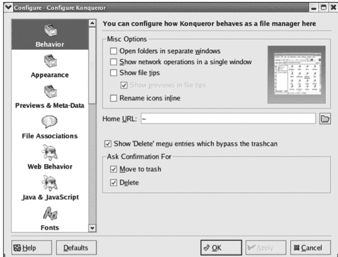

图 4-8

Konqueror 的配置对话框为文件管理器提供了异常广泛的选项。

- 行为（Behavior）——此区域包含影响 Konqueror 对你的操作反应的选项——例如打开文件夹是创建一个新窗口还是将现有窗口切换到新文件夹、当鼠标悬停在文件上时是否显示文件信息（所谓的“文件提示”）、清空垃圾桶时 Konqueror 是否请求确认等。

- 外观（Appearance）——你在这里设置一些外观选项，例如 Konqueror 使用的字体。

- 预览与元数据（Previews & Meta-Data）——此部分包含预览相关的选项。你可以启用网络和本地协议以及支持预览的文件类型，并设置其他几个选项，例如将预览限制小于你指定大小的文件。（在某些版本的 Konqueror 中，此部分被称为 Previews。）

- 文件关联（File Associations）——在此区域，你可以将文件名扩展名链接到文件类型，反过来将这些链接到用于访问文件的图标和应用程序。

Konqueror 配置对话框中这些下方的选项与其 Web 浏览器职责有关，因此如果你只对让程序作为文件管理器运行感兴趣，就不需要担心它们。

除了这些设置，你还可以通过菜单选项调整一些 Konqueror 功能。特别是，“视图（View）”菜单提供了与其文件和目录显示相关的选项——图标应该有多大；是只显示带有文件名的图标，还是显示包含文件大小、所有者和其他特性的完整列表；是使用纯色背景颜色还是使用图像作为背景等。

和 Nautilus 图标一样，Konqueror 的图标很大程度上取决于个人偏好。不过，某些选项会影响性能，并被认为在客观上是低效的。特别是，如果你的硬盘很慢、文件特别大，或者一个目录包含几十或几百个必须预览的文件，文件预览可能会变得非常繁琐。然而，如果不符合这些情况，预览将是一个很方便的功能。

#### 保持 KDE 桌面整洁

默认的 KDE 配置倾向于使用较少的桌面图标。图 4-6 显示了仅四个图标，其中两个（CD 刻录器和 Zip 磁盘）是用于外部磁盘设备的。你的系统可能没有相同的图标。有些系统会在你的 KDE 桌面中加载更多图标，你也可以这样做。右键点击桌面的空白处，在弹出的右键菜单中查看“新建（Create New）”选项下的选项。你可以创建一个文件夹、文件或设备。后两个选项实际上是子菜单的链接，每个子菜单都有自己的选项。“文件”包括常见的文档类型和程序，而“设备”指的是外部存储设备，如 Zip 磁盘和软盘。


就像 GNOME 桌面可能会混乱一样，管理 KDE 桌面混乱是一个组织和自律的问题。为经常使用的程序、文件和目录建立直接链接是有意义的。为每个程序或文件创建链接只会导致无法管理的混乱。根据经验法则，尽量将桌面图标数量保持在十个左右。如有必要，将一组相关的图标存放在文件夹中，以尽量减少在主桌面上持续显示的图标数量。

## 从全新的 KDE 配置开始

KDE 配置与其他程序的配置一样，会变得混乱或无法使用。这在你过度尝试 KDE 选项时可能会发生，导致它们变成一场毫无意义的意外。当你从一个 Linux 发行版切换到另一个时也可能发生这种情况——嵌入在第一个发行版配置文件中的许多文件、位置等在新的系统中可能会变得毫无用。

要从根本上解决此类问题，你可以删除 KDE 配置文件。不过，请务确保在 KDE 未运行时执行此操作。如果不这样做，运行中的 KDE 实例可能会变得混乱，程序可能会崩溃。当你删除其配置文件并重启 KDE 时，它将创建反映系统默认设置的配置文件。第 3 章总体描述了这一过程，该章的表 3-2 列出了许多可以删除以恢复默认设置的常用配置文件。对于 KDE 来说，其中最重要的是 `.kde`，它是许多 KDE 程序配置中的一个子目录。有时删除 `.qt` 子目录也是重要的；此子目录存放 Qt 使用的配置文件，Qt 是构建 KDE 基础上的一个库。

## 使用替代环境

GNOME 和 KDE 都是具有许多功能的流行桌面环境。遗憾的是，这两个环境的功能完备性可能成为一个问题。有些人更倾向于更轻量的环境——GNOME 和 KDE 对他们来说太笨了。

接下来的页面介绍了三种 GNOME 或 KDE 的替代方案：名为 XFce 的轻量级桌面环境、使用窗口管理器以及创建你自己的桌面环境。我还描述了如何让你的系统使用你的精简环境。

### 使用 XFce

`XFce` (`http://www.xfce.org`) 被设计为一种轻量级桌面环境。与 GNOME 和 KDE 深度借鉴 Windows 不同，`XFce` 粗略地模仿了通用桌面环境（CDE），这是一种用于 Unix 系统的商业桌面环境。`XFce` 是开源的，尽管其外观与 Mac OS 环境有些相似之处，但 `XFce` 精简得多。事实上，`XFce` 的小内存是其最大的优势之一。

在刚启动的 `Fedora 3` 系统上，启动 GNOME 消耗 44MB 内存，而启动 KDE 消耗 26MB 内存。（这两个数字都是与仅运行 GUI 登录界面对比的，登录界面本身消耗一些内存，因此这些环境使用的内存比这多。）`XFce` 的巨大优势之一是它消耗 9MB 内存——大约是 KDE 的三分，不到 GNOME 的五分之一。虽然对于拥有 1GB 或更多内存的现代计算机来说，这种差异看起来并不大，但在较小的系统上很重要。如果你在运行大型程序，几兆字节可能在大型计算机上也可能重要。此外，即使硬件相当快，`XFce` 的启动速度也比 GNOME 或 KDE 快。

那么 `XFce` 真的能够提供精简后的功能吗？`XFce` 实现这一目标的主要工具就是提供更少的功能——它默认不提供桌面图标，它的文件管理器更简单，以此类推。然而 `XFce` 仍然支持最重要的功能，例如程序启动能力、面板、任务栏以及用于更改键盘重复速率和鼠标跟踪速度等特的小程序。结果如图 4-9 所示，显示了在 `Fedora 3` 系统上运行的 `XFce 4.0.6`。此配置是

## 清理你的桌面环境

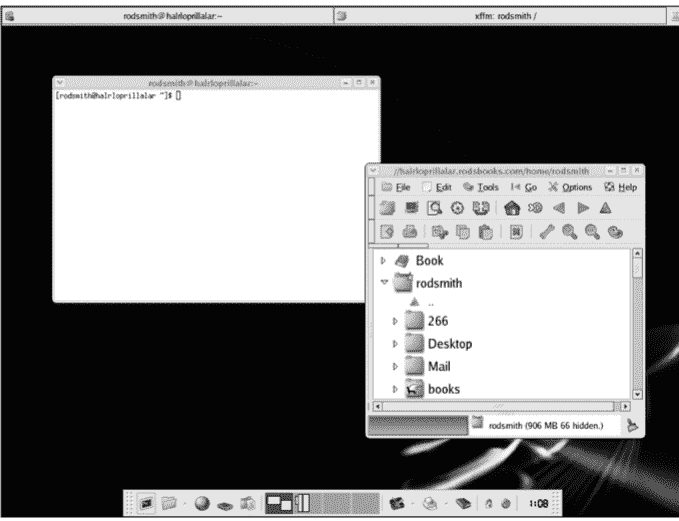

**图 4-9**

默认的 Xfce 配置比默认的 GNOME 或 KDE 配置要简单一些。

接近 Xfce 的默认设置，尽管 Fedora 提供了一个具有相同桌面背景和窗口边框的主题，这也是它在 GNOME 和 KDE 配置中所使用的。

默认情况下，任务栏允许你直接跳转到出现在屏幕顶部的任何打开窗口。Xfce 面板显示在屏幕底部。整体的 Xfce 配置通过“设置管理器”完成，如图 4-10 所示。包括面板、鼠标、键盘等。这些工具通常比其 GNOME 和 KDE 的对应品不复杂，但它们提供了最重要的选项。

与 GNOME 和 KDE 面板一样，Xfce 面板支持分页器（pager）、面板挂载应用程序以及启动程序的工具。不过，Xfce 的程序启动功能工作略有不同。通常，每个条目都会启动组中的一个主应用程序，例如浏览器组中的 Firefox Web。你通常可以点击项目侧边的箭头来获取附加选项列表，例如 Konqueror 和 Opera Web 浏览器。然后你可以通过点击它们的图标来启动其他选项。

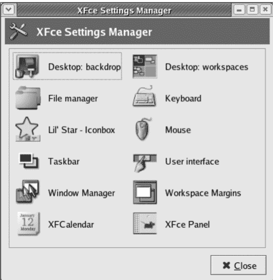

**图 4-10**

Xfce 的配置工具往往比 GNOME 和 KDE 的工具更简单。

> GunkBuster 的笔记本：使用 Xfce 添加程序启动器
>
> 默认的 Xfce 配置提供的启动器相对较少，大多数发行版并没有在这个列表中添加太多内容——它们将大部分精力放在了 GNOME 和 KDE 的配置上。因此，如果你想使用 Xfce，可能需要添加程序启动器。要这样做，请右键点击现有的类别，并在弹出的右键菜单中选择“添加项目 > 启动器”。要添加新类别，在面板的最边缘（即没有图标的地方）执行相同操作。结果将是一个对话框，你可以在其中输入命令（即你在命令行提示符中输入该程序时会输入的内容）、选择一个图标等。你可以通过右键点击现有条目并选择“属性”来更改它。结果与你创建启动器时使用的对话框相同。对于直接位于菜单上的条目，你可以勾选标记为“附加到启动器”的框，以创建一个相关程序的菜单。

与 Nautilus 或 Konqueror 相比，Xfce 文件管理器非常简单。它只提供系统的单一视图，似乎有些局限，特别是当你不习惯时。不过，如果你发现它不够用，可以运行另一个文件管理器。事实上，许多默认 Xfce 配置都为 Nautilus 和 Konqueror 启动器，所以如果你喜欢，可以使用其中一个。当然，这样做减少了运行 Xfce 而非 GNOME 或 KDE 的优势，但你可能会发现运行较大的文件管理器在性能上是值得的。如果你使用 Konqueror 作为网络浏览器，那么将其作为文件管理器可能也有意义。

总的来说，使用 Xfce 是一种释放性的体验。它可以让快速的电脑变得更快，并让一个在 GNOME 或 KDE 下运行得极其缓慢的旧系统变得可以接受。不过，如果你住在偏僻的小木屋里，Xfce 并不适合所有人。它以牺牲许多小舒适为代价换取速度优势。如果你不愿放弃这些舒适，请坚持使用 GNOME 或 KDE。如果你好奇，可以尝试一下 Xfce。接下来的章节“配置 Linux 以满足你的替代方案”将描述如何这样做。

## 使用纯净窗口管理器

精简系统的一种更激进的方法是使用窗口管理器。桌面环境是围绕窗口管理器构建的，但它们的功能远不止于此。即使精简的 Xfce 也包含面板、调整键盘重复速率和其他功能的应用程序、文件管理器等。在过去的几年里，此类程序通常不会捆绑在一起，因此你不必挑选你最喜欢的窗口管理器。你仍然可以这样做，与从 GNOME 或 KDE 切换到 Xfce 的收益相比，它的好处是进一步减少了内存需求。具体会有有多大效果将取决于你所选择的窗口管理器。例如，考虑一下 IceWM。在 Fedora 3 系统上，登录 IceWM 会话实际上增加了可用内存——IceWM 消耗的内存比 GUI 登录还要少！

显然，运行纯净窗口管理器（或至少是像 IceWM 这样精简的）的内存优势是巨大的，如果你正由于 GNOME、KDE 或 Xfce 的需求而遇到内存问题。另一方面，纯净窗口管理器确实会让环境显得非常斯华特。图 4-11 显示了一个示例：在 Fedora 3 下运行的 IceWM 1.2.17 窗口管理器。如图 4-1、4-6 和 4-9 中的 GNOME、KDE 和 Xfce 截图所示，图 4-11 包含一个命令行窗口 (`xterm`)；由于 IceWM 不包含自己的文件管理器，图 4-11 没有显示。当然，你可以在 IceWM 或任何其他窗口管理器中运行文件管理器。事实上，运行纯净窗口管理器的优势在于

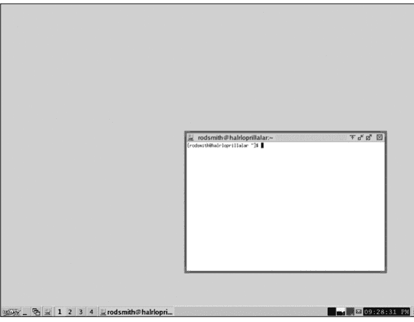

**图 4-11**

在 Fedora 3 下运行的 IceWM 1.2.17 窗口管理器

有几十个、如果不是数百个窗口管理器可用。以下是一些常见的：

- **Blackbox**：部位于 `http://blackboxwm.sf.net`，这个窗口管理器设计得非常轻量。
- **Enlightenment**：也被称为 E，这个窗口管理器非常大且功能丰富，强调可配置性。
- **FVWM**：部位于 `http://www.fwwm.org`，是 20 世纪 90 年代流行的窗口管理器。
- **FVWM 95**：这个窗口管理器是 FVWM 的分支。它添加了任务栏和模仿 Windows 95 的新样式（FVWM '95 开发时流行的样式）。
- **IceWM**：这是我最喜欢的窗口管理器。它提供了一组合理的功能，包括分页器、时钟和各种工具。


- **MWM**：Window Manager 之所以重要是因为它与 Motif 小部件有关，Motif 是一套用于创建 GUI 应用程序的流行编程工具。

- **TWM**：这个窗口管理器是最低水平的。它非常老旧，提供的功能很少，即使按照纯净窗口管理器的标准。

- **Window Maker**：这个窗口管理器旨在模拟 NeXT 计算机界面。由于 NeXT 界面是 Mac OS X 的基础；它与 Mac OS X 共享功能；在此基础上增加了，而 Window Maker 仅实现了其子集。

- **WM2**：这种奇特的窗口管理器非常斯华特，除了窗口管理器绝对要求的功能之外几乎没有其他功能。它最引人注目的特征（至少最初）是将标题栏放置在主窗口左侧，而不是像大多数窗口管理器那样放在主窗口上方。

从窗口管理器中你能得到什么？取决于你选择的窗口管理器。对于它所提供的功能，有些非常沉重。下一节“自己制作”将详细说明这一点。

这个列表远不完整。正如我所说，Linux 有几十种窗口管理器。请参阅 http://xwinman.org 获取近百个窗口管理器的列表。如果你有兴趣尝试裸窗口管理器（bare window manager），你可能应该尝试其中的几个。这需要安装软件、配置你的系统以使用它（稍后将在“配置 Linux 使用你的备选方案”中进行描述），并可能需要根据你的喜好对窗口管理器进行配置。最后这项任务非常针对窗口管理器本身。大多数配置文件并不是以它们自己命名的。许多窗口管理器不会创建或修改这些文件；如果找不到你的配置文件，它们将使用系统默认设置。你应该咨询窗口管理器的文档来学习如何创建和编辑其配置文件。

## 自定义你的环境

GNOME、KDE 和 Xfce 这样的桌面环境实际上是程序的集合——从窗口管理器、文件管理器、处理无数微小任务的小型程序，到处理不那么小任务的大型应用程序。原则上说，你可以通过创建自己的处理这些任务的程序集来组装你自己的桌面环境。例如，你可以将 Blackbox 窗口管理器、Nautilus 文件管理器、clock 桌面时钟程序等结合在一起。结果将拥有桌面环境所需的所有功能，而没有预装环境中自带的那些“垃圾”。

遗憾的是，创建你自己的桌面环境并不是没有问题的。第一个问题是涉及的巨大精力：你必须研究你安装的每一个组件、必要的软件，并配置它们以启动或从你的窗口管理器中轻松启动。这是一项非同凡的任务，最好由对 Linux 及其可用软件有丰富经验的人来处理。这种方法的第二个问题是，它不支持预装桌面环境所提供的那种集成功能。与主流桌面环境一起发布的程序被设计为协同工作。它们共享一个公共地址录。它们还响应桌面环境提供的应用内样式和主题设置（例如，默认应用程序字体）。你自己组装的程序很可能缺乏这种集成。

如果你决定尝试构建你自己的桌面环境，请从窗口管理器开始。选择一个你喜欢的并学习如何配置它。然后你可以通过安装其他组件并配置窗口管理器的程序启动工具来启动额外程序，从而添加其他组件。如果你希望某个工具一直运行，你将希望将其配置为作为你 GUI 登录脚本的一部分启动，这稍后在“配置 Linux 使用你的备选方案”中会有描述。

实际上找到所有额外程序可能是一个问题，特别是如果你对 Linux 软件领域还不非常熟悉的话。你可以使用的一个技巧是从主流桌面环境中获取组件。例如，你可能会使用来自 GNOME 的 Nautilus 文件管理器或 KDE 的 KMail 阅读器。在少数例外情况下，正式作为桌面环境一部分的小型程序和大型应用程序在那个环境之外也能工作，尽管它们可能与其他工具集成得并不良好。然而，从桌面环境中提取组件的一个问题是，它们需要大量来自主桌面环境的额外工具才能良好工作。额外的负担往往会让你的系统变得臃肿，因为它会大大增加运行本应是很小程序时的内存负载。当你尝试程序时，请监控内存使用情况。在命令行提示符输入 `free` 并研究输出，特别是 `-buffers/cache` 行，它显示了在不考虑磁盘缓存和缓冲区的情况下使用的和可用内存。如果启动一个很小的程序导致内存使用发生巨大跳跃，可能是因为该程序加载了一堆额外的垃圾。

> 注意：第 8 章“管理进程”描述了你可以追踪消耗过多内存的方法。

关于额外的软件建议，你可以查阅 Linux 软件索引，例如在 http://www.linux.org/apps/ 维护的索引。该网站的 GUI/Desktop 和 GUI/Applets 类别对于通常构成桌面环境的小型实用程序特别相关。

## 配置 Linux 使用你的备选方案

大多数 Linux 发行版都使用 GUI 工具允许你登录到你喜好的桌面环境。这些工具通常由 GNOME 显示管理器 `GDM` 或 KDE 显示管理器 `KDM` 登录程序、原始的 X 显示管理器 `XDM` 以及其他几个备选方案组成。无论如何，这些工具通常提供用户名和密码字段（`GDM` 只有在你输入用户名后才会显示密码字段；大多数其他工具同时显示两者）。`GDM` 和 `KDM` 还提供某种让你选择登录环境的方法。例如，图 4-12 显示了 Gentoo Linux 系统上的 `GDM` 登录界面。在完成登录之前，点击“Session”（会话）查看环境列表，如图所示。

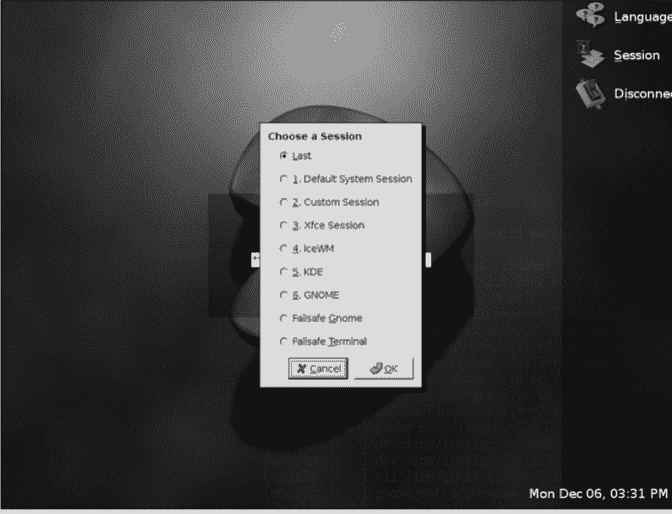

**图 4-12** `GDM` 和 `KDM` 登录工具提供了一种在登录时选择桌面环境或窗口管理器的方法。

点击你想要的那个，然后点击 OK 选择该会话类型。`KDM` 的工作方式类似，但它的选项通过名为“Session Type”（会话类型）的按钮可用。

大多数 Linux 发行版会自行配置，以便你可以轻松选择 GNOME 或 KDE，至少在你安装了这两个环境的情况下。访问 Xfce 取决于运气，而裸窗口管理器更不可能出现在这些菜单中。如果你在登录选项中没有看到喜好的环境，你有两个选择可以继续：

- 选择一个启动 X 登录脚本的会话类型。该脚本可能被称为 `.xsession` 并存储在用户的家目录下。然后你可以按照稍后描述的配置它以启动你喜好的程序。遗憾的是，这个选项在 `GDM` 和 `KDM` 中一直在消失，因此可能不存在。

- 向你的配置中添加新的会话类型。这种新会话类型将运行你指定的系统脚本。进行此更改需要 root 权限。

## 清理你的桌面

如果你遵循第二条路径，你必须首先定位登录程序查找会话的位置。大多数现代发行版使用 `/usr/share/xsessions` 来存储 `GDM` 和 `KDM` 的信息。该目录持有 `.desktop` 扩展的文件，例如 `IceWM.desktop` 来定义 IceWM 会话。这些文件提供了会话的信息，包括它的名称和启动方式。例如，一个启动裸 IceWM 会话的文件可能如下：

```
[Desktop Entry]
Encoding=UTF-8
Name=IceWM
Comment=This session logs you into IceWM
Exec=icewm-session
TryExec=icewm-session
# 目前，仅使用前三个字段
Icon=
Type=Application
```

文件中最重要的部分是 `Exec` 行，它指向会话登录脚本或启动程序。（你应该提供文件的完整路径，或者确保脚本位于常用的程序文件目录中，如 `/usr/bin`；否则 Linux 将找不到它。）桌面环境通常带有启动环境其余部分的程序，例如 `startkde` 或 `gnome-session`。某些窗口管理器也这样做；例如，`icewm` 是 IceWM 软件包的一部分。

如果你想在启动过程中不仅仅是启动单个程序，你必须创建一个脚本来完成工作。如果你的登录系统支持此选项，该脚本的形式与家目录下的 `.xsession` 脚本相同。这些脚本作为 Linux 脚本创建非常容易。它们以识别为脚本的行开头，然后为你想要启动的每个程序包含单行。例如，假设你想运行 IceWM 作为你的桌面环境，但你还想启动 Nautilus 文件管理器和 `xterm` 窗口。你的脚本看起来像这样：

```bash
#!/bin/bash
xterm &
nautilus &
icewm
```

第一行将该文件标识为 Bash 脚本；你应该在任何启动脚本中都包含此行。随后的行启动一个程序：在这种情况下，分别是 `xterm`、`nautilus` 和 `icewm`。前两个行后的 am 符号（`&`）会导致脚本继续执行。最后一行缺少这一细节；一旦 IceWM 启动，脚本就会停止运行。当 IceWM 终止（因为用户选择了注销选项）时，脚本将继续执行并自行终止。脚本会检测并返回 `GDM` 或 `KDM` 程序。如果你漏掉了前两行中的任何一个 am 符号，那么在你退出前一个程序之前，窗口管理器不会启动；如果你在最后一行添加了 am 符号，那么在你对会话进行任何操作之前，脚本以及登录会话就会终止。因此，你务必确保 am 符号使用正确！

一旦你创建了此文件并将其放在方便的地方（例如对于系统级文件存放在 `/usr/local/bin`，或者这可能是你的 `.xession` 文件），你必须将其标记为可执行文件。你可以使用 `chmod` 命令来实现，该命令会更改权限（或模式，故名如此，是 change mode 的缩写）。具体来说，你想要为所有（a）用户设置执行（x）权限：


```
# chmod a+x my-login-script
```

如果这是一个全局脚本，你就可以引用你的会话文件了。注销当前运行的任何 GUI 会话并重启 `GDM` 或 `KDM` 会话。在大多数情况下，你可以通过登录到纯文本会话并输入 `telinit 3` 然后按回车来实现。这会改变 Linux 的运行级别（runlevel），大多数发行版仅在运行级别 5 上运行 `GDM` 或 `KDM` 程序；其效果是关闭它然后重新启动。然而，某些发行版（如 Debian 和 Gentoo）以另一种方式启动 GUI 登录程序。对于这些发行版，你可能需要输入 `/etc/init.d/xdm`（在 Debian 上，你可以根据使用的程序将 `xdm` 替换为 `gdm` 或 `kdm`）。如果你在执行此过程中遇到问题，重启电脑可以解决问题，但这是一个相当激进的解决方案。

完成这些操作后，你应该能在可用登录会话列表中看到你的新会话类型。某些发行版配置为在你选择新会话时更改你的默认会话。其他发行版（包括流行的 Fedora）则要求你运行此特殊程序或编辑配置文件来更改默认设置。Fedora 会提示你执行此操作，但它让你运行一个程序（桌面切换工具），该工具在你的环境中可能并不容易访问。你可以输入 `switchdesk` 来完成这项工作；结果是弹出一个窗口，你可以从中选择你的默认环境。

## 改进 Linux GUI 的各种杂技巧

无论你使用哪种桌面环境，都可以采用几种技巧来提升你的用户体验并保持系统整洁：

- **分页器（Pagers）**——分页器是清理桌面杂乱的极佳工具。如果你想同时运行多个程序，可以在每个独立的虚拟桌面上运行每个程序，或者在每个桌面上运行几个程序。例如，你可能可以在一个虚拟桌面上运行网络相关的程序，而在另一个虚拟桌面上运行文字处理器和电子表格。这有助于减少屏幕杂乱，使在程序之间的切换变得更加容易。另一方面，你可能会忍不住启动过多的程序，这会导致性能下降，因为它们的需求将超过你可用的内存。

- **控制字体**——字体非常好玩，而且在某些情况下拥有大量字体是必要的。遗憾的是，字体过多可能会导致问题。从巨大的列表中找到正确的字体可能是困难的，而且程序性能可能会受到影响，特别是当程序尝试查看字体时。许多字体是系统级安装的，如第 12 节所述，因此参考该章节来清理系统字体。你也可以在主目录的 `.fonts` 子目录中安装字体。`GNOME` 和 `KDE` 环境提供了工具帮助你完成此操作。你应该对使用此功能保持谨慎，如果你确实这样做了，请移除任何你不使用的字体，免得它们变成杂乱。

- **简化你的样式**——样式、窗口装饰和桌面背景都属于“视觉盛宴”——它们可能很好看，但不会为你的桌面增加任何实质内容。充其量，它们无害；最坏的情况下，它们可能会消耗资源或分散你的注意力。如果你在低位深运行 `X`（16 位或更低，如 8 位），复杂的样式可能看起来很糟糕，因为你的显示器不支持那些颜色，因此使用简单的样式可能更合适。在非常旧的显示硬件上，你可以按照第 12 节描述的方法增加 `X` 颜色深度；然而，在非常旧视频硬件上，这可能会显著降低显示速度。

- **不要害怕实验**——你可以删除桌面环境的配置文件以从头开始，所以你不应该害怕对新设置进行实验。你可能会发现提高性能的方法或添加你认为非常有用的功能。当然，如果你把所有时间都花在实验上，你就没有时间做正事了！

**提示：** 如果你不想承担破坏当前配置的风险，请尝试创建一个并使用备用账户进行实验。第 9 节“账户清理”描述了 Linux 账户管理工具。专门为了尝试新功能或桌面环境创建一个账户。如果你喜欢你看到的内容，就在你的普通账户中实施更改。如果你不喜欢结果，你的主账户是完好无损的。无论如何，记得删除该账户，免得它变成杂乱！

### 总结：保持你的桌面整洁

Linux 操作系统只是一个手段，最终目的是完成生产工作。这是通过应用程序的帮助实现的。这些程序像 Linux 本身一样，容易积聚杂物。介绍如何清理每一个程序会让这本书臃肿像百科全书，因此我将只介绍三个应用程序：OpenOffice 套件、Mozilla Firefox 和 Evolution 邮件器。

虽然本章重点教你如何清理这三个程序，但你可以将这里学到的通用原则应用于其他程序。例如，你可能可以将本章中学的字体知识应用于图形程序。

#### 清理 OpenOffice.org

本次程序之旅的第一站是 OpenOffice.org (http://www.openoffice.org)。该办公软件包含一个文字处理器 (`Writer`)、电子表格 (`Calc`)、演示程序 (`Impress`)、矢量图形程序 (`Draw`) 以及将一切结合在一起的各种实用。OpenOffice.org 是 Sun StarOffice (http://www.sun.com/software/staroffice/) 的开源兄弟，后者提供了相同的功能以及一些额外功能，如导入导出过滤器。我在本章中关于 OpenOffice.org 的大部分同样适用于 StarOffice。

OpenOffice.org 的杂物会在你安装它时开始，因此你要留意如何完成此任务。OpenOffice.org 也会受到字体杂物的影响。该办公套件使用自己的字体渲染系统，了解如何安装和管理字体很重要。你也可以使用相同的工具定义打印机，尽管 OpenOffice.org 通常能自动检测你的打印机。在日常使用中，你可能需要如何处理其他程序创建的文件（主要是 Windows 和 Mac 上流行的 Microsoft Office 套件）。

#### 常用程序设置

清理清单：

- 通过正确安装 OpenOffice.org、管理其字体以及理解 OpenOffice.org 与其他程序的兼容性来清理 OpenOffice.org。
- 通过管理其字体和调整各种选项来清理 Mozilla Firefox。
- 通过组织邮件文件夹、设置合适的选项来保持 Evolution 邮件器整洁。

# OpenOffice.org 安装选项

如果你的 Linux 发行版没有带 OpenOffice.org，你有两种继续操作的选择：

## 常用应用程序的用户设置

- 从其他发行版的包中安装 OpenOffice.org。你可以找到其他发行版的 OpenOffice.org 包文件并将其安装到你自己的系统上。如果你的发行版使用 `RPM` 软件包管理器（`RPM`）文件，这种方法效果最好。你可以寻找针对其他基于 `RPM` 的发行版（如 Fedora、Madras、Red Hat 或 SUSE）的 OpenOffice.org 软件包。这种方法并不保证一定有效，因为支持库之间存在差异或其他软件包冲突。如果方法有效，通常继续进行是最佳选择，因为 `RPM` 包非常易于安装。

- 从 OpenOffice.org 网站安装软件包。当你从其官方网站下载 OpenOffice.org 时，可以选择你喜欢的语言，这是这种安装方法的优点之一。另一个优点是你可以更精细地调整在系统中安装的特定组件。你下载的文件是一个压缩包——在我写下这这段字时，`00_1.1.4_linuxIntel_install.tar.gz` 是 x86 系统的最新稳定版本。（当你读到这里时，可能已经有了 2.0 版本）。OpenOffice.org 安装包解压后，包含一个类似于 Windows 上常见的 GUI 安装程序。它提供了几个选项，其中某些选项可能会产生较少见的“混乱”安装。

安装 `RPM` 或其他发行版提供的软件包通常会产生一个相当干净的安装。按照 Linux 标准，该 GUI 过程有点奇怪，你必须选择一些相当不直观的选项，才能产生尽可能清晰的安装。

开始之前，在存储压缩包的目录的命令行提示符中输入 `tar xvzf 00_1.1.4_linuxintel_install.tar.gz` 来解压下载的压缩包。（根据你实际下载的版本需要修改文件名。）此操作会创建一个包含大量文件的子目录，其中包括 `install` 脚本和 `setup` 程序。我永远没法理解开发者为什么要在压缩包中放入两个程序（它们的名字都暗示它们用于安装）。此外，简单地不带任何选项运行这些命令中的每一个，将执行单用户安装——软件将被安装在用户的家目录下。如果有多个用户想要运行该软件，则必须为每个用户单独安装。OpenOffice.org 的安装大小约为 200MB，这累积起来会导致大量的混乱！

更干净的解决方案是执行 OpenOffice.org 开发者所说的网络安装。即使你的系统没有连接网络，也可以这样做。这种方法类似于 Linux 中安装软件的最常见方式。要进行网络安装，请遵循以下步骤：

- 1. 在 GUI 终端（如 `xterm` 窗口）中输入 `su` 并输入 root 密码获取 root 权限。
- 2. 输入 `./setup -net` 来运行设置程序执行网络安装。（如果收到抱怨程序无法连接到 `X` 服务器的消息，请返回普通用户并在 `X` 服务器上输入 `xhost + disable access controls`。然后你可以从步骤 1 重开始。）系统可能几秒钟内看起来没反应，但随后会出现一个 GUI 安装程序。


### 3. 按照安装程序的提示操作
为了获得最干净的安装，在询问安装类型时选择自定义安装。结果是一个类似于图 5-1 所示的对话框。在这里你可以选择要安装哪些组件，因此可以省略你永远需要的软件包部分。例如，图 5-1 显示省略了 Writer 组件的辅助程序和 TGA 导入过滤器。

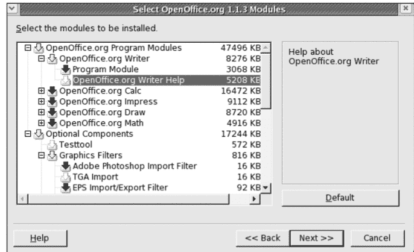

图 5-1

OpenOffice.org 安装程序允许你选择想要安装的组件。

### 4. 安装目录与启动
安装程序询问安装目录。默认情况下，该目录为 `/opt/openoffice.org1.1.4`（或你程序版本的类似路径）。这通常是一个合理的默认值，但你可能更倾向于将程序放在 `/usr/local` 或某些子目录下。

一旦程序安装完成，用户就可以启动它。取决于你的安装方法，桌面环境中可能存在相应的启动器。如果没有，或者你倾向于从命令行提示符启动 OpenOffice.org，你可以输入组件名称，例如 Writer 的 `swriter`、Calc 的 `scal`c 等。（某些发行版会将这些名称修改为以其他字母开头，而不是以 s 开头。这些名称是 OpenOffice.org StarOffice 遗产的遗留）程序文件位于 OpenOffice.org 安装目录的 `program` 子目录下。遗憾的是，此目录可能不在你的 shell 搜索路径中，因此你需要执行以下操作之一：

- **输入程序的完整路径。** 你可以输入程序的完整路径，例如 `/opt/OpenOffice.org.1.1.4/program/swriter`，而不是简单的 `swriter`。
- **将目录添加到你的路径中。** 你可以修改 `$PATH` 环境变量以包含相应的目录。此环境变量通常在 `/etc/profile` 中全局设置，也可以在个人的 `.bashrc` 文件中为个人设置。确保找到设置或修改 `$PATH` 变量的现有行，并将目录添加到其中。
- **创建符号链接。** 你可以在路径上的某个目录中创建符号链接（`/usr/local/bin` 是一个不错的选择）。`ln -s /opt/OpenOffice.org.1.1.4/program/swriter /usr/local/bin/swriter`。对每个程序重复此操作。

当用户首次启动 OpenOffice.org 时，OpenOffice.org 需要收集一些信息，例如个性化设置。在此过程中，OpenOffice.org 显示如图 5-2 所示的选择安装类型对话框。

> 警告！安装期间，用户应选择 Workstation 安装选项，而不是 Local 安装。后者会将 OpenOffice.org 程序支持文件复制到用户的家目录下——这是一个非常混乱的方法。

安装后，用户可以正常使用 OpenOffice.org 组件。由于本书是关于清理混乱的，我将不会介绍 OpenOffice.org 的大部分方面。只需说该程序运行起来就像办公套件。你可以写信、管理预算、创建演示文稿等。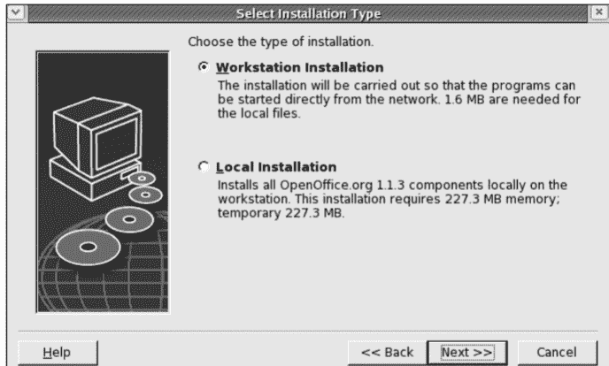

**图 5-2**

用户应选择 Workstation 安装选项，以避免在目录中重复 OpenOffice.org 程序。

## 管理 OpenOffice.org 字体

从 1.1.4 版本开始，OpenOffice.org 使用自己的字体而不是 X 提供的字体（见第12 章）。因此，如果你想在 OpenOffice.org 中使用自己的字体，必须在 OpenOffice.org 中安装它们。同样，如果你想从字体菜单中删除字体，必须在 OpenOffice.org 中进行。

> *注意：某些 Linux 发行版重新配置了 OpenOffice.org 程序，使其在系统字体目录查找字体。这些修改过的 OpenOffice.org 程序锁定此处描述的字体选项。相反，你应该按照第 12 章管理你的系统字体，OpenOffice.org 字体将随之变化。*

OpenOffice.org 可以使用 TrueType 或 Adobe Type 1（又称 ATM， Adobe ATM）字体。所有 Linux 发行版都带有多种一种或两种类型的字体。这些字体通常位于 `/usr/share/fonts` 或 `/usr/X11/lib/X11/` 的子目录下。检查这些目录以查看系统中可用的字体。TrueType 字体的文件扩展名为 `.ttf`，Type 1 字体的扩展名为 `.pfa` 或 `.pbf`。大多数其他文件名扩展名表示其他字体类型，例如位图字体，OpenOffice.org 无法使用。你可以从互联网上的许多来源下载字体，或在大多数计算机商店购买包含几十或数百种字体的光盘。

# 通用应用程序设置 105

**注意：** 字体文件名通常是难以理解的。不过，不必过于担心这一点。OpenOffice.org 字体安装程序允许你预览字体，并通过字体名称而非字体文件名来引用它们。

一旦你确定了想要安装的字体所在，就可以启动 OpenOffice.org 字体实用程序。该程序名为 `oadmin` 或 `admin.bin`。它位于 OpenOffice.org 主程序文件相同的目录中。启动该程序，你将看到一个与图 5–3 所示类似的对话框。此主窗口用于管理打印机，我稍后会描述该功能。首先，点击“字体”（Fonts）按钮来管理字体。结果是一个与图 5–4 所示相似的对话框。

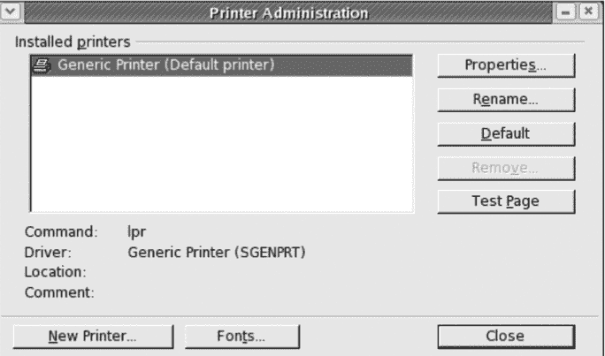

**图 5-3** OpenOffice.org 提供了一个用于管理字体和打印机的特殊程序。

**注意：** 如果你以 root 身份运行 `oadmin`，更改将影响计算机的所有用户。如果你以普通用户身份运行，更改将仅影响你本人。

一旦进入“字体”对话框，你就可以开始管理它们。如果你想删除字体，选择它们并点击“删除”（Remove）。要添加字体，点击“添加”（Add）。结果是图 5–5 所示的“添加字体”对话框。点击“源目录”（Source Directory）字段旁边的省略号 (...) 来定位字体出现的目录。（你不能直接输入名称；那样不起作用。）结果是显示字体列表，包括它们的名称和（括号中的）文件名，如图 5–5 所示。选择你想要安装的字体。如果你想创建

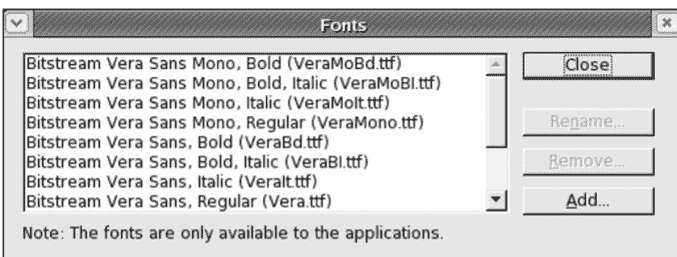

图 5-4

OpenOffice.org 按名称列出字体，区分每种样式。

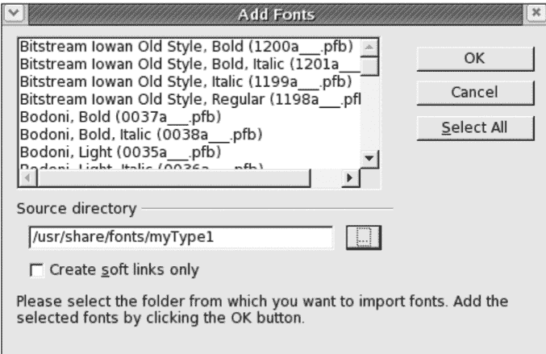

图 5-5

OpenOffice.org 字体安装程序按名称和文件名显示字体。

为了节省磁盘空间，请勾选“仅创建软链接”（Create Soft Links Only）选项。如果字体已安装在你的系统中（例如，为了 X），此选项很好；但如果你是从字体光盘中安装字体，则不适用。完成后，点击“确定”安装字体。系统会提示你已完成。然后你就可以点击“字体”对话框中的“关闭”。

## 管理 OpenOffice.org 打印机

在大多数情况下，OpenOffice 能够正确识别你的打印机。在图 5-3 中，仅列出了“通用打印机”（Generic Printer）作为一个选项；然而，如果你从 OpenOffice 组件程序中选择打印机选项，将列出所有系统。这种检测在你的系统使用通用打印系统 `CUPS` 时效果最好，`CUPS` 是现代 Linux 发行版的首选打印系统。如果你发现 OpenOffice 没有检测到你的打印机，但确定它们在其他 Linux 程序中可以工作，你可以通过告诉 `oadmin` 添加打印机来强制解决问题。要此操作，启动 `oadmin` 以看到主对话框（图 5-3）。然后你可以点击“新建打印机”（New Printer）来添加打印机。结果是一系列询问你打印机的对话框。你必须知道它的型号（或一个更流行但兼容的型号）。此过程中最困难的部分是指定一个打印到打印机的命令，如图 5-6 所示。在大多数情况下，你会输入一个指定打印机的 `lpr` 命令行，例如图 5-6 所示的示例之一（这些示例是根据 OpenOffice.org 检测到的你电脑上定义的打印机。你看到的与图 5-6 不完全匹配）。有时，你可能使用其他内容。例如，如果你正在使用某种特殊的工具以某种异常的方式打印，或者使用奇特的网络协议，你就

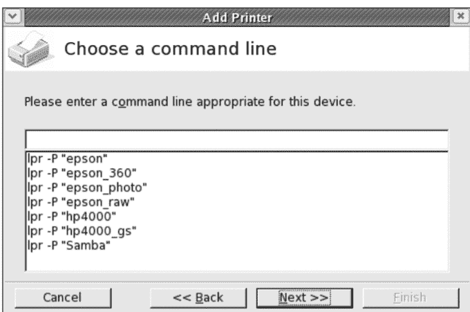

图 5-6

OpenOffice.org 打印机安装程序需要知道如何打印到你定义的任何异常打印机。

输入另一个命令。具体是什么命令，我无法说；你必须对你的本地打印系统有足够的了解才能解决这个问题。

## 文件兼容性问题


在整个办公套件领域，Microsoft Office 是霸主。许多商业和非营利组织运行 Microsoft Office 就像依赖汽一样；一旦移除，它们就会陷入停滞。在许多情况下，如果你想与此类组织做生意，你必须能够处理 Microsoft Office 文档。坦率地说，OpenOffice.org 在这方面已经已经是顶尖水平——事实上，OpenOffice.org 与 Microsoft 文档的兼容性比其他任何因素都使其成为 Linux 中不可被超越的办公套件。

尽管如此，Microsoft 的文件格式并不是 OpenOffice 的原生格式。在核心部分，OpenOffice 使用可扩展标记语言 `XML` 作为其原生文档格式。不过，OpenOffice 执行了一些不寻常的操作：它将多个 XML 文件并将它们压缩成 zip 归档。

## 第 5 章

- WordPerfect——这款占据主导地位的文字处理器适用于 Linux，尽管它多年没有看到重大的更新。你可以找到一个免费的 WordPerfect 8 版本供下载（请访问 http://www.linuxmafia.com/wpfaq/downloadwp8.html 查看网站列表）。它曾提供过付费版本，并在 2004 年中期短暂发布过，但现在很难找了；eBay 可能是你的最佳选择。WordPerfect 2000 Office 套件也发布过 Linux 版本，但该版本使用 WINE 在 Linux 下运行 Windows 二进制文件。在现代发行版上获取该版本几乎是不可能的。

- TeX、LaTeX 和 LyX——Unix 的老手们通常熟悉 TeX，这是一种排版语言，因其能够胜任地处理数学公式排版的能力而闻名。LaTeX 是 TeX 的扩展版本，而 LyX（http://www.lyx.org）为 LaTeX 添加了图形用户界面（GUI）。对于习惯传统文字处理器的普通人来说，这些程序不是很好的选择，但技术用户（数学家、科学家和工程师）通常很喜欢它们。

- DocBook——与 TeX 和 LaTeX 一样，DocBook 是一种基于文本的语言。它基于 XML 或标准通用标记语言（SGML）构建，旨在帮助编写技术文档。大量的 Linux 文档是用 DocBook 编写的，然后转换为各种格式，例如网页的超文本标记语言（HTML）、便携文档格式（PDF）文件等。

对于相对非技术的用户的通用用途，KOOffice 和 GNOME Office 均可能是 OpenOffice.org 的合理替代方案。如果你的用户特别节俭且系统资源匮乏，Siag 可能值得研究。如果你需要与其他 WordPerfect 用户交换文档，WordPerfect 是完美的，但由于它的年代久远，你必须得费额外的精力来解决安装旧库的麻烦。它也不像大多数现代程序那样漂亮。TeX、LaTeX、LyX 和 DocBook 对技术用户都是非常有用的。虽然非技术人员也可以使用它们，但这些用户可能会觉得它们很奇怪，在最坏的情况下非常难以掌握。

## 火狐浏览器 Mozilla Firefox

Mozilla（http://www.mozilla.org）是 Netscape（http://www.netscape.com）Web 浏览器的开源衍生产品。多年来，Mozilla 已经变成一个非常强大（但说实话）臃肿的 Web 浏览器。然而在 2004 年，Mozilla 推出了一个轻量级的变体，被称为 Firefox（火狐）。在诞生的几个月里，Firefox 吸引了大量的关注，不仅是在 Linux 世界。（Firefox 也适用于 Windows 和 Mac OS X。）

## 常用应用程序的用户设置

尽管 Firefox 是一个灵活的 Web 浏览器并迅速成为 Linux 下的首选浏览器，但它并非完全免疫于垃圾信息的收集。因此，我将描述它的一些陷阱，从字体问题开始。不过，大多数潜在的 Firefox 问题与安全有关；任何浏览器都可能成为安全沼泽，知道如何穿过这个沼泽将有所帮助。最后，尽管围绕 Firefox 有各种炒作，它可能并不适合你。确实存在替代浏览器，所以你应该了解一下它们。

### 改进 Firefox 的字体

使用 Linux 进行 Web 浏览时常见的抱怨之一是字体难看。有时问题出在底层的字体渲染系统。具体来说，如果你的 Web 浏览器使用的是 X 字体而不是 Xft 字体，结果可能是字体粗糙，看起来可能相当不可观，特别是当你使用某些特定字体时。为了纠正这些问题，你应该确保系统上可用 Xft 字体，如第 12 章所述。

除了此问题外，你应该检查 Firefox 的字体选项。这些选项（大多数 Firefox 配置选项）都可以在“选项”对话框中找到，通过选择“编辑 > 选项”进入。结果如图 5-7。在对话框中，点击“字体与颜色”，以获取 5-8 所示的“字体与颜色”对话框。

根据你的系统和偏好，“字体与颜色”对话框中的几个选项可能需要调整：

- 字体选择——你可以使用页面上的选择框将你的衬线字体、无衬线字体和等宽字体设置为任何你字体。如果 Web 页面没有指定字体名称，Firefox 将使用你指定的字体。

- 默认比例字体——“比例”（Proportional）字段告诉 Firefox 你是否希望将衬线字体或无衬线字体作为未指定字体的页面的默认字体。

- 显示分辨率——X 尝试以每英寸点数确定你屏幕的分辨率；然而，X 有时会搞错这个细节。在大多数情况下这不是问题，但有时结果可能是字体大得离谱或小得离谱。在“显示分辨率”字段中设置特定值会有帮助。（将屏幕的水平像素分辨率除以宽度（英寸）来确定你的分辨率。你可能需要四舍五入到该值，因为 Firefox 只提供几个选项。）

- 字体大小——“大小（像素）”字段提供了一种以像素设置你的比例字体和等宽字体默认字体大小的方法。

- 最小字体大小——“最小字体大小”字段允许你覆盖 Web 页面中对你而言太小的字体设置。

- 字体覆盖——“最小字体大小”字段允许你覆盖 Web 页面中对你而言太小的字体设置。

- 字体覆盖——“最小字体大小”字段允许你覆盖 Web 页面中对你而言太小的字体设置。

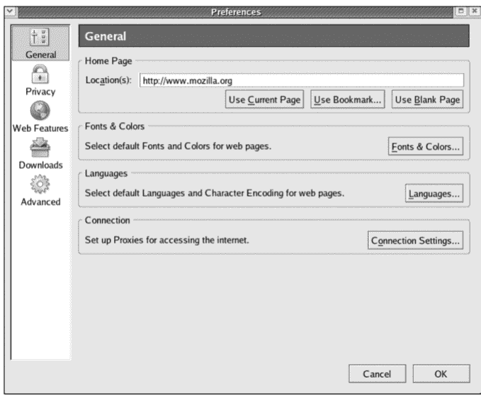

图 5-7

Firefox 选项对话框允许你调整许多 Firefox 特性。

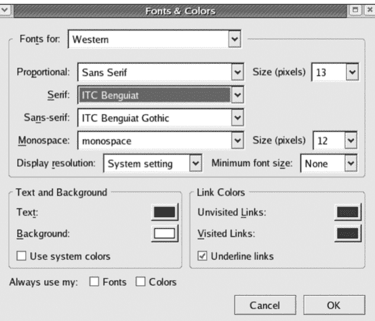

图 5-8

## 常用应用程序的用户设置

你正在运行 Windows。尽管如此，Java 和 JavaScript 仍然存在危险。为了最安全的配置，你应该禁用两者。你可以在 Firefox 主首选项对话框的“网络功能”（Web Features）部分进行此操作，如图 5–9 所示。取消勾选“启用 Java”（Enable Java）和“启用 JavaScript”（Enable JavaScript）选项。

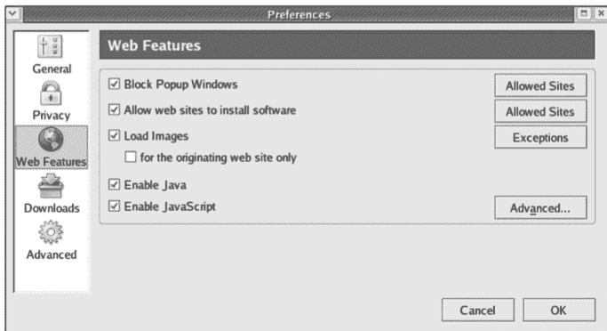

图 5–9

大多数浏览器都允许禁用 Java 和 JavaScript 以提高安全性。

> **注意：** 浏览器原生支持 JavaScript，但要运行 Java applet，你必须在系统中安装 Java 解释器。因此，即使勾选了“启用 Java”，你可能也无法运行 Java applet。不过，如果你打算禁用 Java，就不应该依赖这一局限性；因为你可能会忘记这一点，并出于与 Web 浏览器无关的原因安装了 Java 解释器，这会让你变得更加脆弱。

遗憾的是，大量的网站依赖 JavaScript 才能正常运行，较少的网站依赖 Java。因此，禁用这些功能将导致你无法正常使用许多 Web 页面。

**提示：** 你可以配置 Firefox（或任何你喜欢的浏览器）拒绝 Java 和 JavaScript。然后你可以配置另一个浏览器接受 JavaScript，再配置第三个接受 Java 和 JavaScript。当你遇到一个运行不正常的页面并怀疑它需要 Java 或 JavaScript 时，你可以启动配置为使用这些功能的浏览器。你也可以通过使用多个 Linux 账户对单个浏览器采用类似的花招。使用你的普通账户进行安全配置，然后设置额外账户，在这些账户中配置浏览器启用这些功能。你甚至可以通过 `su` 更改登录名称，在同一个显示器上从多个账户运行程序，例如在 xterm 窗口中输入 `su java` 成为 java 用户并以该用户运行浏览器。

## 第 5 章


虽然在技术上这不是 Java 或 JavaScript 的问题，但你也可以使用“网络功能”配置区域阻止其他类型的操作，例如弹出窗口。这些窗口通常被广告商使用，并且被大多数用户厌恶，因此阻止它们是有意义的。点击“阻止弹出窗口”`Block Popup Windows`行右侧的“允许站点”`Allowed Sites`按钮可以允许你指定例外。这对于让具有合法弹出窗口的站点按设计方式工作可能是必要的。

## Cookies

在现实世界中，烘好的糖、面粉、鸡蛋和其他原料确实会产生脏物。脏物可以用洗碗机、海绵或其他现实世界的清洁剂清理。基于 Web 的 cookies 是另一回事，这些虚拟告白的背后的思想是为网站提供一种跟踪用户的方法，以有利于电子商务网站“购物车”等功能。当你将商品添加到购物车时，Web 服务器会向你的电脑发送 cookie。当你完成购物时，Web 服务器会请求 cookie，你的电脑将其返回，从而让 Web 服务器能够结算正确的订单。Cookies 还可以用于长期的交易——例如，让网站记住你对表单的偏好或想要保存金额。
遗憾的是，cookies 还有另一个可能的用途：跟踪你的在线活动。许多人反对这种跟踪，认为这是对隐私的侵犯。一些糟糕的问题与在线广告商有关。少数公司主导了你看到的在线广告，并直接从它们自己的服务器发送广告，而不是从你认为正在访问的网站服务器。这一事实使得广告机构能够跟踪你访问的网站，即使这些网站彼此无关，即使它们显示不同的广告——如果广告是通过同一家机构投放的，它们就可以使用 cookies 来跟踪你。这种能力让他们获得了有关网站之间相关性的数据——例如，访问婴儿护理网站的访问者访问了汽车网站查看多面包车的信息。如果访问者先去狩猎网站，然后去色情网站，这些信息也可以添加到数据库中。结果是，在线广告商能够以前所未有的能力对个人进行跟踪。
如果这个前景让你感到困扰，你可能想要查看 Firefox 的 cookie 管理工具，这些工具可以在首选项对话框的“隐私”`Privacy`区域访问，如图 5-10 所示。“允许站点设置 Cookies”`Allow Sites to Set Cookies`选项允许成组启用 cookie 功能。勾选“仅限源网站”`For the Originating Web Site Only`会将 Firefox 接受的 cookies 限制在主网站。使用此选项可以帮助防止广告 cookies 进入你的电脑，但它并不是万无一失的方案，而且可能会产生意想不到的后果。你还可以点击“查看 Cookies”`View Cookies`查看当前设置的 cookies。结果是一个 cookies 列表，大部分看起来像乱码。你可能想要检查它们并删除那些来自你不熟悉的网站的 cookie——其中许多都是潜在的隐私侵犯工具。

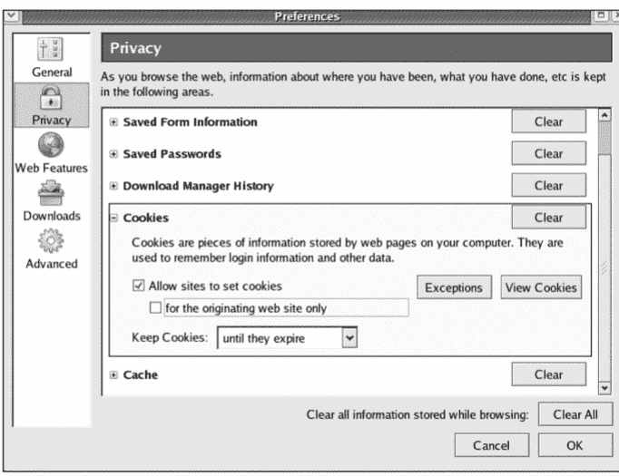

**图 5-10**

Firefox 首选项对话框的隐私部分允许你控制 Web 上的 cookies 和其他潜在的隐私威胁。

### 密码管理

越来越多的 Web 网站要求密码。记住所有这些密码是一项巨大的工程。你可能更愿意花时间背诵《奥德赛史诗》——至少它很有趣，不像密码列表。或者，你可能在所有的 Web 网站上只使用一个用户名和密码。这种方法有其问题——如果不法分子获取了你的用户名和密码，他们可以造成巨大的破坏。因此，至少你应该对敏感网站（如在线银行网站）使用唯一的密码，并将你重用的密码留给相对不靠谱的网站。
Firefox 与所有主流浏览器一样，提供了一个密码管理工具。Firefox 通常可以识别出请求密码的页面，并询问你是否要保存密码。
**注意：** 第 9 章“账户清理”`Account Degunking`包含一个描述如何构造良好密码的章节。虽然密码长度、字符类型和大小写敏感性在网站之间有所不同，但 Linux 密码原则也适用于 Web 网站密码。
首选项对话框的隐私区域提供了管理这些密码的方法。点击“保存的密码”`Saved Passwords`，你可以告诉 Firefox 是否保存密码。你还可以查看现有的密码、删除某个网站的密码，并查看你不希望 Firefox 管理的网站列表。
与其他许多计算机问题一样，让 Firefox 管理密码并不是没有缺陷的。其中之一是密码文件是脆弱的。入侵者可以窃取它并访问你所有的网站。出于这个原因，我不建议让 Firefox 管理你最敏感的密码，例如在线银行服务的密码。另一个问题是你可能会在磁盘崩溃或意外删除 Firefox 文件时丢失所有密码。如果你更换浏览器，你必须重新输入所有密码，这在最好的情况下也是件麻烦。

#### SSL 加密

你应该意识到你的网络流量是加密还是非加密的。大多数 Web 网站都不是加密的，因此在表单或 URL 中发送或返回的数据可以在中间计算机上读取，有时可以在你本地网络上的其他计算机上，或在服务器的本地网上。这一事实在传输敏感数据（如信用卡号）时是一个问题。
**警告！** 许多请求密码的网站并没有去加密密码数据。这就是为什么你应该对最敏感的网站使用唯一密码的原因之一。
幸运的是，大多数传输敏感数据的网站都使用安全套层 `SSL` 加密协议。`SSL` 提供了一种加密网络协议的方法，这意味着数据流被乱码，使得任何监控它的人只能看到乱码。
大多数采用加密网站都使用安全 HTTP `Secure HTTP`，在浏览器中通过 URL 开头的 `https://` 而非 `http://` 来识别。尽管如此，这一标识并不能100% 证明正在使用 SSL；配置不当的浏览器（或者糟糕的是，被不诚实地配置）可以使用普通的安全 HTTP 端口但不进行加密。因此，你应该始终在 Web 浏览器窗口中寻找加密状态的指示。在大多数浏览器（包括 Firefox）中，这由窗口右下角或左下角的钥匙或编码锁头图标表示。（即使在 Firefox 内部，使用的精确图标及其位置也因版本而异。）Firefox 还会将安全网站的 URL 输入框颜色改为金色，但大多数浏览器并不这样做。在向网站输入关键密码、信用卡号或其他敏感信息之前，请务必先寻找安全连接指示。

## 通用应用程序用户设置

### Firefox 的替代方案

尽管 Firefox 在其第一个版本（即 `Firefox 1.0`）发布之前和之后收到了大量关注，但它远非唯一的选择。Linux 还有其他其他 Web 浏览器：
- `Mozilla`：这个浏览器是 Firefox 的大哥——或者用你喜欢的话，它是 Firefox 的减肥加强版。`Mozilla` 整合了许多额外功能，其中一些被拆分成了独立的程序。例如，`Mozilla` 的完整版本包含一个邮件阅读器，而其他一些被拆分为独立的程序 `Thunderbird`，你可以根据需要决定是否在配合 Firefox 的同时使用它。
- `Netscape`：`Netscape` 是 `Mozilla` 的商业孪生。虽然有一个 Linux 版本，但它并未包含在大多数 Linux 发行版中，且很少使用。开源的 `Mozilla` 则更方便，因为它包含在大多数发行版中。
- `Galeon`：这个浏览器与 `Netscape`、`Mozilla` 和 `Firefox` 的关系在于它使用了相同的渲染引擎——即使用相同的软件将 HTML 转换为窗口中的格式化文本。它比 `Mozilla` 和 `Netscape` 更轻量，但没有像 `Firefox` 那么完善。如果你喜欢 `Firefox`，使用第二个浏览器可能是值得的（例如，如前文所述，启用了 Java 和 JavaScript 的浏览器）。请访问 `http://galeon.sourceforge.net` 获取更多信息。
- `Konqueror`：该程序既是 KDE 的文件浏览器也是 Web 浏览器。第 4 节“精简你的桌面环境”描述了 `Konqueror` 的几个文件管理器。作为一个 Web 浏览器，它的范围和功能与 `Firefox` 相似。`Konqueror` 的渲染引擎也曾被 Apple 用于 `Safari` Web 浏览器，因此如果你听到某个网站在没有 `Firefox` 的情况下可以在 `Safari` 上运行，你可能想尝试 `Konqueror`。
- `Opera`：这个总部位于 `http://www.opera.com` 的商业浏览器曾被视为 `Mozilla` 或（Windows 上的）`Internet Explorer` 的轻量级替代方案。`Firefox` 在很大程度上抢走了它的风头，但 `Opera` 仍然是一个出色的浏览器。你可以购买副本，也可以忍受免费版（免费版会在其菜单栏中显示广告）。
- `Lynx`：这个浏览器很特殊，因为它是基于文本的。你可以从文本模式登录运行 `Lynx`，或者在 GUI 登录的单个窗口内运行它。当然，由于是文本的，`Lynx` 不显示图形，但这一事实可以是一个优势而非缺点——图形文件通常比主网页文件大得多，因此 `Lynx` 比大多数浏览器都要快得多。`Lynx` 包含在大多数 Linux 发行版中，你可以在 `http://lynx.browser.org` 了解更多信息。


列表中缺失的是微软的 Internet Explorer。尽管这个浏览器是互联网上最流行的，但它不支持 Linux。你可以使用 `WINE Is Not an Emulator (WINE: http://www.winehq.org)` 来在 Linux 下运行 Windows 程序。除非你需要访问一个在其他浏览器上根本无法运行的网站，否则我不建议这样做。Internet Explorer 以存在严重的安全漏洞而闻名。尽管在 Linux 和 `WINE` 环境下运行时，这些漏洞不像在 Windows 下运行时时那样严重，但没有必要让自己暴露在额外的风险中。此外，配置和运行 `WINE` 可能会很复杂。除非你真的需要访问一个其他工具都无法的网站，否则为了运行 Internet Explorer 花费精力。

# 精简 Evolution

Linux 办公套件和 Web 浏览器领域各由一个程序主导。（在 Web 浏览器领域，这种主导地位在 2004 年从 Mozilla 迅速转移到了 Mozilla Firefox。）在邮件客户端领域则不如此；Linux 支持许多邮件客户端，没有人真正主导该领域。最大的邮件阅读器之一是最受欢迎的，因此我在这里描述了它。这个邮件客户端是 Novell Evolution (`http://www.novell.com/products/desktop/features/evolution.html`)。

其他 Linux 邮件客户端也可以类似的方式进行精简，尽管某些细节有所不同。

你可以精简的具体领域包括：减少杂乱（既包括程序提供给你的选项，也包括保持邮件整洁）、设置邮件的 HTML 和安全选项，以及研究使用更简单客户端的可能性。

## 减少 Evolution 中的杂乱

邮件客户端的杂乱有两种形式：程序本身提供的选项过多，以及收件箱中回视着你的邮件消息过多。这两种类型的杂乱都可以得到解决，但它们需要不同的方法。

## 配置 Evolution 以减少杂乱

Evolution 旨在成为一个功能全邮件客户端。它还兼具日历和任务管理器。尽管这些工具都很有用，但如果你很少使用其中的某些功能，可以简化 Evolution 的配置。你可以调整以下特定功能：

- 工具栏：并不是每个人都想要或需要图标栏。要开启或关闭它，请选择 `View > Toolbar`。你也可以通过点击其边缘并将其拖出主窗口。Evolution 会记住重启时是否显示工具栏，但如果你将其移动到新位置，你需要再次移动。
- 预览窗格：你可以通过选择 `View > Preview Pane` 来切换预览窗格。如果你删除了预览窗格，必须双击才能阅读。这样做时，会打开一个显示正文的新窗口。
- 消息摘要信息：Evolution 在消息列表中提供了高度可定制的摘要信息。你可以按任何字段排序、添加字段、定义要显示的数据集并在它们之间切换。要这样做，使用 Define Views 工具：点击 `View > Define Views`。结果是一个对话框，你可以在其中选择命名视图并进行编辑。添加或删除字段对于帮助组织邮件非常有，特别是当你需要存档大量邮件时。
- 头部：邮件到达时带有一组头部，这些是描述消息来源、目的地、接收消息的计算机、源邮件客户端名称等行。默认情况下，Evolution 仅呈现几个头部（`From:`、`To:`、`Subject:`、`Date:`），如图 5-11 所示。你可以通过选择 `View > Message Display > Show Full Headers` 来配置显示所有头部。`View > Message Display > Show Email source` 也会显示头部，但它会导致 Evolution 生成 HTML 格式。以这种方式显示头部对于追踪邮件传输问题或了解垃圾邮件来源主要有用。
- 字体：你可以通过 `View > Text Size > Larger` 和 `Text Size > Smaller` 临时增大或缩小显示文本的大小。要永久更改字体大小或使用不同字体，请选择 `Tools > Settings`。这将弹出设置对话框。在 Mail Preferences 区域，你可以设置 Evolution 用于消息显示的字体。（它默认使用继承 GNOME 的选项）

### 通用应用程序的用户设置

**提示：** 如果你更改了这些选项但发现自己想要更整洁的显示，你可能需要使用另一个邮件客户端，正如后文“Evolution 的替代方案”中所述。Evolution 提供了某种程度的可配置性，但某些 GUI 控制（例如切换其主要功能类型的按钮）是无法禁用的。

## 组织你的邮件

电子邮件看起来像是一场无止境的洪流。有朋友的邮件、亲戚的邮件、同事的、网络零售商的邮件，更不用提垃圾邮件了！（说真的，垃圾邮件、邮件蠕虫和病毒将在第 10 章介绍！）组织这些邮件邮件可能是一项严峻的挑战。不过，实现这一点的关键之一是将消息组织到文件夹中。

要创建文件夹，在图 5-1 的 Evolution 窗口左侧的文件夹列表中，右键点击“本地电脑”（On Computer）行，从弹出的菜单中选择“新建文件夹”（New Folder）。你可以创建一个存放任何类型消息的文件夹。你可以根据发件者、工作项目、邮件类型等创建文件夹。重要的一点（与在硬盘上组织文件一样）是有效地使用文件夹。不要让收件箱中的邮件留存太久，以免被遗忘。将重要的邮件归档，并删除你不需要的。

**注意：** 如果你使用邮局传输协议（POP）或你的 Linux 系统有自己的邮件服务器，你将在本地组织文件夹。在 Evolution 中，这是在“本地电脑”的子文件夹完成的。不过，如果你使用互联网邮件访问协议（IMAP）获取邮件，你可以选择将邮件存储在邮件服务器上。这样做允许你从多台计算机（例如台式机和笔记本电脑）访问消息。尽管，某些 ISP 会定期删除服务器上的邮件，但在依赖存储在邮件服务器上的文件夹之前，请检查你的 ISP 的邮件保留策略。你可以像在本地系统中一样在 IMAP 服务器上创建文件夹。在图 5-11 中，文件夹列表中的主项是一个 IMAP 服务器。（你的系统对应的可能不同。）右键点击它并选择“新建文件夹”，就像你想创建一个本地文件夹一样。

## 设置 HTML 和安全选项

邮件蠕虫和病毒对 Windows 系统构成了严重威胁。有时看起来每周都会有一个新的 Windows 邮件蠕虫威胁要击垮互联网，就像 1950 年代 B 级电影里的疯狂怪物一样。幸运的是，Linux 三年来一直未受此类问题的侵害。首先，Linux 在桌面端的市场份额尚不足，不足以成为编写蠕虫和病毒的恶作分子的可行目标。其次，没有哪个 Linux 邮件程序主导 Linux 邮件客户端市场，这使得编写有效的 Linux 邮件蠕虫变得非常困难。第三，Linux 邮件程序的默认设置倾向于编写得比某些流行的 Windows 邮件程序更安全。由于这些原因，邮件蠕虫对 Linux 系统的主要威胁在于必须筛选并处理那些为 Windows 编写的蠕虫。第 10 章涵盖了这一主题，描述了你可以采取的方法来帮助自动化这项令人厌恶的任务。

尽管如此，你不应该轻视邮件安全。不久前，Windows 上的邮件蠕虫纯粹是虚构作品；可以想象，某些聪明的恶分子会发现绕过与编写 Linux 邮件蠕虫相关问题冲突的方法。作为对这种可能性的防护，你应该检查邮件客户端的配置，以寻找可能的安全漏洞。在 Evolution 中，你可以从 Evolution 设置对话框进行此操作，通过选择“工具 > 设置”进入该框。点击“邮件偏好设置”（Mail Preferences）选项并选择“HTML”标签页。显示应类似于图 5-12。

为了获得绝对的安全，你应该完全禁用 HTML 选项。虽然 HTML 允许发送者在邮件中使用斜体文本，甚至是嵌入图像，但它可能成为一个安全噩梦。HTML 对网络上图像的引用允许发送者跟踪你是否以及何时阅读了消息，在你的 Web 浏览器中安装 cookie，甚至可能在你的系统上运行 Java 或 JavaScript 程序（这些程序确实可以做到）。

不幸的是，Evolution 完全禁用 HTML 的唯一选项是之前提到的针对邮件头的“视图 > 消息显示 > 显示邮件源”项。这是一个处理 HTML 的笨办法，因为你即使在不想看也必须查看所有头部。不过，Evolution 提供了限制 HTML 功能的选项。例如，默认配置是从从网络从加载 HTML 指定图像，这是明智的。如果你喜欢，可以启用自动加载图像，但我建议不要这样做。

大多数邮件客户端提供发送 HTML 邮件的选项。启用此选项允许你使用斜体、大字体、彩色文本等。正如我所说，对接收者来说最安全的配置是忽略所有 HTML 格式；因此，你的


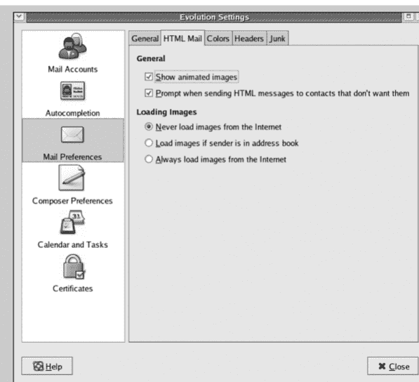

许多邮件问题与 HTML 有关。事实上，某些读者可能不知道如何解析它们。在 Evolution 中，你可以从“邮件偏好设置”控制此项。最好使用纯文本。Evolution 的去 HTML 状态如图 5-12 所示。

## Evolution 的替代方案


与其他应用程序一样，Linux 也存在替代方案。Evolution 是这些程序中功能丰富的之一，但你可能想要更轻量级、与桌面环境集成更好的、具有 Evolution 中没有的特定功能或在其他不同的程序。一些流行的替代方案包括：

- Thunderbird——该程序是 Firefox 浏览器的配套。它在设计时专门考虑了安全性，尽管这种强调在 Windows 世界比 Linux 世界更多。你可以访问 https://www.mozilla.org/products/thunderbird/ 更多。
- KMail——该程序使用 KDE（详情见 http://kmail.kde.org）。它比 Evolution 轻，但仍然提供了用户期望的功能。
- Balsa——虽然 Evolution 与 GNOME 关联，但另一个与 GNOME 相关的邮件客户端是 Balsa (http://balsa.gnome.org)。Balsa 没有多少宣传，但它是一个强大的邮件客户端，特别是对于喜欢 GNOME 但想要比 Evolution 更轻的人。
- Sylpeed——该程序 http://speed.net 是另一个关联 GNOME 的邮件客户端。它在整体功能上与 Balsa 相似，但这两个程序在许多细节上有所不同。
- Mutt——Mutt（http://www.mutt.org）可能是最流行的文本邮件器。该程序提供了大量功能，可以在文本登录或 xterm 窗口中使用。
- Emacs——多年来，Emacs 编辑器（http://www.gnu.org/software/emacs.html）积累了惊人的功能。其中之一就是处理邮件的能力。如果你已经在其他地方使用 Emacs，你可能想查看它的邮件功能。Emacs 主要是一个文本模式程序，尽管在 X 运行时它会启用 GUI 扩展。

这个列表只是冰山一角。Linux 邮件客户端特别多。如果你很挑剔并发现这些程序中没有一个适合你的口味，可以尝试进行 Web 搜索或检查 Tucows (http://linux.tucows.com/email_clients_default.html) 等网站获取更多 Linux 邮件客户端的线索。


# 清理未使用的包

## 去杂检查清单

- 了解为什么移除未使用的包是必要的。
- 确定你的系统上安装了哪些包。
- 确定哪些已安装的包是未使用的。
- 移除未使用的包。
- 保持你保留的包为最新版本。
- 了解包的依赖关系并处理由此产生的问题。

# 130 第 6 章

所有的 Linux 发行版都以包的形式交付软件——包是构成一个可运行程序或其他逻辑文件组的文件集合（例如一组相关文件）。通常情况下，一个包包含一个或多个可执行程序文件、文档文件、配置文件以及可能存在的支持库。Linux 包通常作为单个文件分发，其中包含了所有这些文件，就像 Zip 归档文件包含许多文件一样。不过，包文件还包含了关于依赖关系（第一个版本所依赖的额外包）、包描述等额外信息。大多数 Linux 发行版使用 RPM 包管理器（RPM）工具进行包管理，但有些使用其他系统。例如，Debian 及其衍生版使用 Debian 包，Slack 使用 tarballs，而 Gentoo 使用了一种独特的基于源码的系统。

一个运行中的 Linux 系统由数百个已安装的包组成。你可以添加或删除包来安装或卸载程序，但受包依赖关系、可用磁盘空间等因素限制。Linux 发行版使用的包非常有用，但可能会迅速积攒大量不必要的包。这些包会消耗磁盘空间，并像下文描述的那样导致额外问题。因此，你应该定期检查系统配置以剔除未使用的包。本章将帮助你做到。我将展示如何使用包浏览器来帮助识别已安装的包，如何确定哪些包是不必要的，以及如何删除这些不必要的包。我还将展示如何保持你的系统更新——旧的包可能包含漏洞（其中某些可能会导致安全问题），因此用新软件替换旧软件非常有帮助。最后，我将帮助你解决依赖问题——即由于依赖冲突而产生的问题。

# 为什么要清理未使用的包？

在如今硬盘容量以百 GB 计单位的世界里，你可能会怀疑清理未使用的包是否有必要。答案是多方面的。未使用的包会消耗磁盘空间、导致管理问题、带来安全风险，并使后续的系统或包升级变得复杂。这些问题中的每一个在某些系统上都至关重要，但即使其中一两个你不关心，可能至少有一个是应该关注的。因此，我将更详细地描述这些每一个问题，以便你理解“包垃圾”带来的后果。

## 减少磁盘空间占用

移除未使用的包的最明显的原因是尽地减少磁盘空间占用。如果你有数百 GB 的空闲空间，这个原因可能看起来并不重要，但如果你的系统磁盘空间很少，这就是一个重要的问题。此外，有时拥有大量的空闲空间也是重要的——例如，留出空间来创建和处理大型临时文件，如大型多媒体文件。

你还应该注意 Linux 系统由多个分区组成。大多数 Linux 包主要安装到 `/usr` 目录，该目录通常位于自己的分区上。如果不是，包就会安装在根分区 (`/`) 中。即使你在其他某些分区（例如存放用户文件的 `/home` 分区）中有大量空闲空间，在大多数包所在的地方你可能并没有多少空闲空间。你可以使用 `df` 命令来确定各个分区的空闲空间大小，正如第 3 章“清理用户文件”中描述的那样。

### 维护管理的简单性

Linux 的问题之一（特别是对于新用户来说）是一个是一个非常复杂的操作系统。你拥有引导程序、内核、系统启动脚本、守护进程、cron 任务、用户账户等。所有这些复杂性的结果就是管理负担增加。你必须管理所有这些系统，如果你犯了错误，计算机的行为可能会变得异常，甚至执行危险的操作。因此，最小化 Linux 系统的复杂性是理想的。面向桌面的发行版试图尽可能隐藏这种复杂性，但在这方面它们只能做到有限。

最小化 Linux 系统复杂性的一种方法是减少已安装包的数量——即卸载那些必要的包。以 Apache Web 服务器为例（仅举此例），如果没有安装，它就不需要进行任何形式的配置或管理。

当然，你不应该做得过头。一个没有安装任何包的 Linux 系统根本不是 Linux 系统——它是一块空白硬盘！尽管如此，从系统中移除你真的不再需要的包，是减轻运行 Linux 系统管理负担的好方法。

### 降低安全风险

无论它运行的是 Linux、FreeBSD、Mac OS、Windows 还是任何其他操作系统，任何计算机的主要问题之一都是安全。某些计算机安全问题与计算机的物理环境有关（例如门锁）或计算机的用户有关（例如他们可能会写下密码）。然而，许多计算机安全问题是由软件漏洞引起的。

某些安全漏洞与服务器有关，例如 Apache Web 服务器或 gmail 邮件服务器。服务器本质上是其他计算机上的用户可以运行的程序。因此，此类程序中的漏洞有时会让外部人员即使没有账户也能获得对你计算机的控制。

其他安全漏洞涉及本地程序——即仅供本地用户的程序。


无论它运行的是 Linux、FreeBSD、Mac OS、Windows 还是任何其他操作系统，任何计算机的主要问题之一都是安全。某些计算机安全问题与计算机的物理环境有关（例如门锁）或计算机的用户有关（例如他们可能会写下密码）。然而，许多计算机安全问题是由软件漏洞引起的。

某些安全漏洞与服务器有关，例如 Apache Web 服务器或 gmail 邮件服务器。服务器本质上是其他计算机上的用户可以运行的程序。因此，此类程序中的漏洞有时会让外部人员即使没有账户也能获得对你计算机的控制。

其他安全漏洞涉及本地程序——即仅供本地用户的程序。

# 减少升级烦恼

移除未使用的包的最后一个原因是减少复杂性。早些时候提到 Linux 包包含了依赖关系。随着包的更新，这些依赖关系可能会发生。例如，SuperProg 1.3 可能依赖 HyperLib 2.8，但 SuperProg 1.4 可能依赖 HyperLib 2.9。因此，如果你的系统中存在 SuperProg 且使用工具自动化更新过程，你会同时升级 SuperProg 和 HyperLib。

# 使用包管理工具

使用你的 Linux 发行版的包管理工具移除额外的包垃圾。这些工具因发行版而异，但两种最常见的系统是 RPM 和 Debian 包。我将简要描述这两个系统，包括它们的命令行工具。然而，对于移除不必要的包，最好的工具无疑是 GUI 包浏览器。存在许多此类浏览器，所以我将描述几种，并提供使用其中几个的示例。

`manager`，它被 Debian 及其衍生版（包括 Libranet、Ubuntu 和 Alexandros）使用。这些软件包系统之间是不兼容的——你不能使用 Debian 软件包工具安装 RPM 包，反之亦然。（尽管存在一些工具可以在格式之间进行转换，而且人们正努力更好地统一这两个系统。）尽管格式不兼容，但 RPM 和 Debian 软件包系统在整体功能和能力上是相似的。

注意：少数发行版（如 Gentoo 和 Stampede）使用它们自己的包管理工具，我在这里没有描述它们。Slackware Linux 使用带有少量额外功能的 tar 包（tarballs）作为软件包文件格式。同样，我在这里没有描述该系统。如果你的发行版没有使用 RPM 或 Debian 软件包，你将需要咨询其文档来学习如何操作软件包。

# 使用 RPM 工具

处理 RPM 软件包的基本命令行工具是 `rpm`。该程序接受各种选项来告诉它执行什么操作。通常，结果看起来如下：

```
$ rpm -e superprog
```

在这个示例中，`-e` 是一个选项，告诉 `rpm` 擦除（卸载）名为 `superprog` 的软件包。其他选项包括 `-i`（安装软件包）、`-u`（升级软件包）、`-V`（验证软件包是否正确安装）以及 `-q`（查询软件包信息）。你可以为大多数大多数选项添加额外选项来修改其行为，例如使用 `-uh` 升级软件包并显示由哈希标记（#）构成的进度条。

根据传递给 `rpm` 的选项，该程序通常期望看到包名（例如 `superprog` 或 `superprog-1.4-2`；版本号并不总是会被用到）或软件包文件名（例如 `superprog-1.4-2.1386.rpm`）。具体来说，`-e`、`-q` 和 `-V` 选项接受包名，而 `-i` 和 `-U` 选项接受软件包文件名。（你可以使用 `-qf` 选项查询未安装的软件包，该选项接受的是软件包文件名而不是包名。）

为了清理不需要的软件包，你将大量使用 `-e` 选项。你可能还会使用 `-q` 选项查询软件包，以便在删除之前了解它的作用。特别是，`-qi` 选项显示软件包的信息：

```
$ rpm -qi coreutils
```

# 清理未使用的软件包

名称：coreutils 重定位：(不可重定位)

版本：5.2.1 供应商：Red Hat, Inc.

发布版本：31 构建日期：2004年10月5日 周二 11:50:21 AM EDT

安装日期：2004年12月4日 周六 01:52:37 PM EST 主机：tweet.redhat.com

组：系统环境/基础 源 RPM：coreutils-5.2.1-31.src.rpm

大小：7307074 许可证：GPL

签名：DSA/SHA1, 2004年10月20日 周四 02:46:04 PM EDT, 密钥 ID b44269d04f2a6fd2

打包者：Red Hat, Inc. <http://bugzilla.redhat.com/bugzilla>

URL：http://alpha.gnu.org/gnu/coreutils/

摘要：GNU 核心实用工具：shell 脚本中常用的工具集

描述：

GNU 核心实用工具。此软件包是旧的 GNUutils、sh-utils 和 textutils 软件包的组合。

大部分情况下，信息都有清晰的标签。如果你你不某个标签，可以安全地忽略它。判断一个软件包是否为垃圾信息，最重要的是描述部分，它出现在输出的底部。这个示例显示了 Fedora 3 的核心实用工具；这是一个不是垃圾的软件包！

使用 `RPM` 查询软件包需要知道包名，但如果你不知道包名呢？如果你知道该软件包中的一个文件，可以使用 `-qf` 配合文件名来获取该文件所属的包名：

```
$ rpm -qf /bin/cat
coreutils-5.2.1-31
```

这些工具对于识别特定程序非常有用，但如果你想追踪系统中所有无用的垃圾信息软件包，它们并不非常适合。对于该任务，GUI 软件包浏览器（稍后描述）是更好的选择。

# 使用 Debian 软件包工具

Debian 的软件包工具和 RPM 工具的工作原理非常相似，但细节有所不同。Debian 工具中最类似于 `rpm` 的是 `dpkg`。与 `rpm` 类似，`dpkg` 接受一个或多个选项来告诉它执行什么操作。`-i` 安装软件包，`-r` 移除软件包并保留配置文件，`-P` 彻底清除软件包（即删除所有内容，包括配置文件），`-p` 显示已安装软件包的信息，`-S` 搜索拥有某个文件的软件包。例如，假设你想移除 `superprog` 软件包。以下任一命令即可：

```
# dpkg -r superprog
# dpkg -P superprog
```

如果软件包有任何配置文件，其中第一个命令不会移除这些文件。（许多软件包缺少配置文件，因此这两个命令的效果可能是相同的。）这两个命令在清理垃圾信息软件包时非常方便，但你可能也会使用 `-q` 选项查询软件包，以便在删除之前了解它的作用。特别是，`-qi` 选项显示软件包的信息：

（注：此处省略了原文中重复出现的多次 `coreutils` 详情及后续重复段落，以符合要求）

# 软件包浏览器选项

软件包浏览器是用于浏览已安装（有时是未安装）软件包信息的工具。使用软件包浏览器，你可以查看系统中所有的软件包，读取它们的描述并卸载看起来是垃圾软件包。

遗憾的是，软件包浏览器并不如它们所依赖的工具那样。许多发行版提供自己的 GUI 工具，包括 Debian 的文本模式 select 和基于图形的 Synaptic、Fedora 和 Red Hat 的软件包管理，以及 SuSE 的 YAST。

>提示：虽然 Synaptic 最初是为 Debian 创建的，但它依赖的 APT 工具已移植为使用 RPM。因此，Synaptic 可适用于基于 RPM 的发行版。访问 http://aptrpm.sourceforge.net 获取 RPM 发行版 APT 和 Synaptic 的建议。对于特定 CPU 类型的发行版，你需要调整其 `/etc/sources.list` 文件。

关于软件包浏览器的一个警告是，某些（例如 Fedora/Red Hat 软件包管理工具）会忽略不是系统安装的软件包。也就是说，如果你从第三方安装了一个软件包，它可能不会出现在软件包浏览器中。大多数软件包浏览器（包括 GNOME RPM、select 和 Synaptic）都会显示已安装的“alien”软件包。

### 使用 Red Hat 软件包管理

由于 Red Hat 及其 Fedora 变体的流行，Red Hat 的软件包管理工具非常常见。你可以从标准的 Fedora/Red Hat 桌面通过主菜单选择“系统设置（System Settings）> 添加/删除应用程序（Add/Remove Applications）”来启动此程序。或者，输入 `system-config-packages`（在某些版本的 Red Hat 中为 `redhat-config-packages`）来运行该程序。结果显示如图 6-1 所示。如果你觉得这个窗口熟悉，可能是因为 Fedora 和 Red Hat 在系统安装期间使用了它。安装后的工作方式与安装期间相同。

## 清理未使用的软件包 139

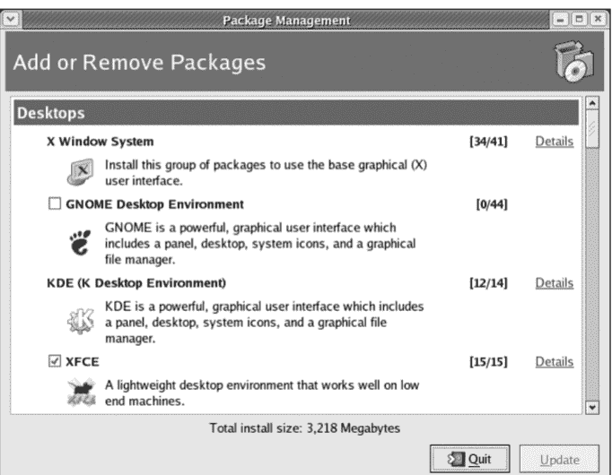

**图 6-1**

Red Hat 包管理程序为 Fedora 和 Red Hat 发行版提供了点击式的包管理功能。

要使用 Red Hat 包管理清理冗余软件包，请按照以下步骤操作：

- 1. 按照描述启动程序。


## 滚动程序类别列表

在图 6–1 中，这些是 X Window 系统、GNOME 桌面环境等。使用右侧的滚动条浏览整个列表。如果选择了某个类别，而你确定不需要该类别中的任何内容，请取消勾选名称左侧的方框。

> **警告：** 取消选择每个类别时要非常小心。有时，某个类别或至少是其中的几个程序由于某些并非显而易见的原因非常重要。某些类别无法完全取消选择，因为这些类别中的程序对于系统的基本运行非常重要。

## 滚动程序类别列表

对于每个选中的类别，点击“详细信息”`Details`按钮。结果将是一个软件包详细对话框，如图 6–2 所示。该对话框

## 140 第 6 章

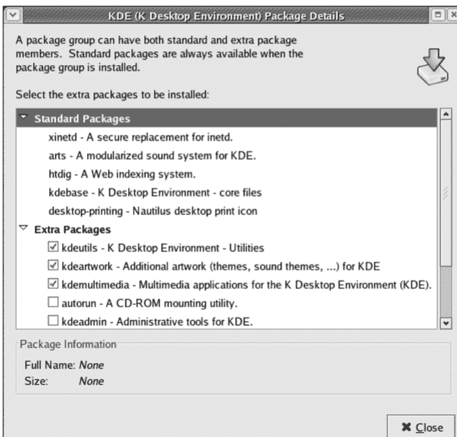

图 6-2

软件包详细对话框允许你管理单个软件包。

显示了类别中存在的单个软件包，并分为两组：该组运行所必需的标准软件包，以及可选的、可以根据意愿添加或删除的额外软件包。

在“额外软件包”区域，勾选或取消勾选你想添加或删除的软件包。完成后，点击“关闭”`Close`按钮。

> **提示：** 遗憾的是，包管理工具中提供的描述有些简短；如果你不确定某个软件包的作用，可以打开命令提示符窗口并使用 `rpm` 命令查看软件包的完整描述。例如，你可以输入 `rpm -qi kdeutils` 来了解更多关于图 6-2 所示 `kdeutils` 的信息。如果你想了解一个未安装的软件包，需要在安装介质上找到它，并输入 `rpm -qpi package-filename`，其中 `package-filename` 是软件包文件名。

## 清理未使用的软件包 141

在检查完所有软件包区域后，点击主包管理窗口中的“更新”`Update`按钮。系统会汇总你的更改并请求确认。点击“继续”`Continue`，程序将继续运行。如果你选择安装软件，程序可能会要求你插入原始安装介质。

当然，使用包管理清理未使用的软件包的诀窍在于确定哪些软件包实际上是未使用的。该主题将在稍后于“识别未使用的软件包”中介绍。

## 使用 Synaptic

Debian 基于 X 的 `Synaptic` 与 Debian 的文本模式选择工具 `select` 非常相似。这些工具也适用于基于 RPM 的发行版，但正如之前在“包浏览器的选项”中提到的，你必须首先为 RPM 安装 APT。从我个人而言，我喜欢 APT 和 `Synaptic`，即使在基于 RPM 的系统上也是如此；它们配置得当，安装和卸载软件非常平滑，而且你可以轻松浏览系统中安装的所有内容的完整软件包描述，而不仅仅是 Fedora/Red 包管理中截断的描述。在非 Debian 系统上安装 APT 的缓存是一项额外任务。如果你已经在基于 RPM 的系统上安装了 APT，输入 `apt-get install synaptic` 应该安装 `Synaptic`。在某些发行版中，你可能需要单独查找 `Synaptic`。对于 SuSE 是如此，如果无法通过 APT 安装，请在 `http://www.rpmfind.net` 上搜索。

一旦安装了 APT 和 `Synaptic`，你就可以以 root 身份在命令提示符中输入 `synaptic` 来启动程序。某些发行版还会在你的桌面环境菜单创建一个创建一个。结果类似于图 6-3，显示在 Debian 系统上运行 `Synaptic`。

> 注意：`Synaptic` 的早期版本与图 6-3 所示的版本大不同。基本功能相同，但访问某些功能的细节有所不同。图 6-3 显示的是 `Synaptic 0.55`。

使用 `Synaptic` 过滤系统中的垃圾，请浏览窗口右侧面板中的软件包列表。该面板提供了软件包的文本模式描述。如果你需要更多信息，例如依赖列表和已安装文件，可以在高亮软件包后点击“属性”`Properties`按钮。结果是一个带有多个选项卡各种信息的对话框。在主窗口中，已安装的软件包在软件包列表的 S 列中标记，如图 6-3 所示的 `kcontrol`、`kde-amusements` 和 `kde-core`。要标记某个软件包进行删除，右键点击它并选择“标记为”`Mark for`

## 142 第 6 章

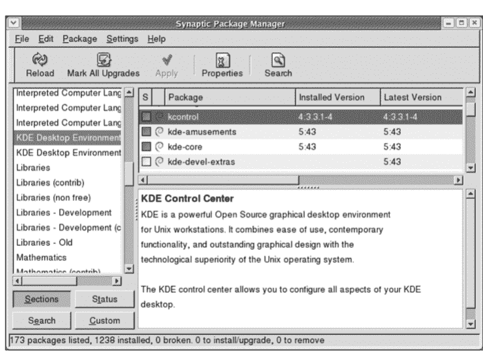

列出 173 个软件包，已安装 1238 个，0 个损坏。0 个待安装/升级，0 个移除

图 6-3

`Synaptic` 提供有关已安装和未安装软件包的详细信息。列出 173 个软件包，已安装 1238 个，0 个损坏。0 个待安装/升级，0 个移除

`Synaptic` 提供有关已安装和未安装软件包的详细信息。列出 173 个软件包，已安装 1238 个，0 个损坏。0 个待安装/升级，0 个移除

`Synaptic` 提供有关已安装和未安装软件包的详细信息。列出 173 个软件包，已安装 1238 个，0 个损坏。0 个待安装/升级，0 个移除

`Synaptic` 提供有关已安装和未安装软件包的详细信息。列出 173 个软件包，已安装 1238 个，0 个损坏。0 个待安装/升级，0 个移除

`Synaptic` 提供有关已安装和未安装软件包的详细信息。列出 173 个软件包，已安装 1238 个，0 个损坏。0 个待安装/升级，0 个移除

`Synaptic` 提供有关已安装和未安装软件包的详细信息。列出 173 个软件包，已安装 1238 个，0 个损坏。0 个待安装/升级，0 个移除

移除，你选择标记为

## 清理未使用的软件包 143

对于清理清理，将限制到已安装软件包可能是最有意义的。其他选项在你寻找特定软件包或类型的软件包时可能有用。

当你选择要移除或升级的软件包后，选择“编辑 > 应用更改”或点击应用图标。`Synaptic` 将调用底层工具执行工作。根据你的 APT 配置，如果你选择了安装任何新软件包，可能会被要求插入原始介质。

当然，对于 Fedora/Red 包管理，实际上确定哪些软件包可以删除可能比掌握删除机制更棘手。该主题将在接下来介绍。

## 识别未使用的软件包

可能清理已安装软件包中最困难的部分是确定哪些是真正未使用的。特别是如果你不熟悉 Linux，软件包名称可能非常陌生——你真的需要 `pam` 吗？可能 `pdb` 是做什么的？它是调试器——软件开发工具。遗憾的是，软件包数量之多，我无法告诉你每个的作用或是否需要。事实上，软件包随发行版而异！相反，我将提供一些提示来帮你判断。这些包括关于解释软件包描述、查找软件包额外信息、测试程序以及处理依赖关系的建议。

### 理解软件包描述

要检查的第一点，也是使用包浏览器时简单的，是软件包的描述。该描述应该提供有关软件包重要性的线索。这在使用 Debian 或其变体时尤为如此。Debian 软件包系统提供了优先级字段，如之前所述；如果该字段将软件包标记为必需，你不应该考虑删除它。即使是低优先级软件包可能对你的系统至关重要，因此你需要解释描述。

软件包描述通常提供有关软件包作用的信息——它们可能将软件包描述为办公套件、Web 服务器、一组字体或你拥有的内容。以下是这些描述中需要注意的词汇和短语：

- **库 Library**——库是一组供其他程序使用的软件例。库包的名称中经常包含 `lib` 字符串。即使某个库听起来不是你需要的，它也可能是你想要使用的某些程序所要求的，因此在删除库时应该要谨慎。另一方面，RPM 和 Debian 软件包系统如果某个库正被其他程序使用，除非你向 `utils` 提供了特殊选项，否则它们将拒绝卸载该库。因此，尝试删除被需要的库不太可能造成破坏。

- **头文件或开发包 Headers or development**——头文件是在源代码中引用库的文件。如果你不编译自己的软件，可能就不需要头包。这些包有时被描述为 `development` 开发包。

- **服务器 Server**——服务器程序具有潜在危险，大多数情况下，除非你打算运行相关的服务器，否则你不应该安装它们。一个显著的例外是 *X server* `XFree86` 或 `X.Org-X11`，它提供了 Linux 的 GUI 环境。某些发行版，如 Fedora/Red Hat 和 Android，也依赖 `xfs` 字体服务器。

- **窗口管理器 Window manager**——这是一个通过提供标题栏、调整窗口大小等来管理窗口的程序。窗口管理器在第 4 章中介绍。理论上，你可以删除除你正在使用的管理器之外的所有管理器。不过，你可能想保留 `twm` 和 `fwm`；这些是老旧但基本的窗口管理器，通常用作备用工具。注意，与桌面环境相关的窗口管理器通常安装在单独的包中，请留意窗口管理器与其他桌面环境包之间的依赖关系。

### 查找额外信息

如果你对软件包描述感到困惑，就必须去寻找额外信息。幸运的是，有几个方法可以为你提供帮助：

- **检查帮助页 man pages**。你可以在本地计算机上查找文档。尝试在命令行提示符处输入 `man`，后跟包或程序的名称，以阅读该包或程序的 man 页。帮助页是基础文档，通常以简练的风格编写。它们可能提供你判断一个软件包是否确实是所需的线索。


- **查阅额外的本地文档**。你可以查找与该包相关的文档文件。某些软件包浏览器（如 Synaptic）可以提供已安装文件的列表。查找 `documentation` 子目录中的文件并开始阅读它们。如果你使用的是基于 RPM 的系统且你的软件包浏览器未提供此类信息，在命令行提示符处输入 `rpm -ql packlename`（其中 `packlename` 是包名）以获取文件列表。

- **执行搜索**。访问你最喜欢的互联网搜索引擎，并输入包的名称。你可能会找到有帮助的搜索结果，帮助决定它是垃圾还是值得保留的东西。

- **访问软件包的页面**。有时软件包描述（特别是在基于 RPM 的系统上）会包含软件的 URL。该网站可能包含关于该包作用的有用描述。

### 测试软件包

确定一个软件包是否为垃圾的一种激进方法是对其进行测试。对于软件软件包而言，这意味着运行该程序，因此你应该使用你的软件包工具来获取包中的文件列表，注意位于 `bin` 和 `sbin` 目录下的文件，例如 `/usr/sbin/sbin` 或 `/usr/X11R6/bin`。这些目录中的文件是可执行的程序文件，因此你可以在命令行提示符处输入它们的名称来查看它们的作用什么。

> 警告：某些程序会执行危险的操作。因此，除非你已经了解该程序的作用并想学习细节，否则我建议仅将此类测试作为最后的手段。你还应该先以普通用户而非 root 身份运行未知程序。许多程序还接受 `--help` 或 `-h` 作为命令来显示基本信息，在第一次运行未知程序时传递这些选项，例如 `/usr/bin/someprog --help`。

非程序软件包无法通过这种方式测试。此类包包括库、字体和文档等。你需要通过其他方式测试此类包，例如在文本编辑器或 Web 浏览器中阅读文档文件。（不过，某些文档文件需要特殊的查看器，例如读取 man 页的 `man` 工具）。除非你知道哪些程序使用库，否则库并不容易测试——在这种情况下，你应该知道该库是否必要。

## GunkBuster 笔记本：处理依赖关系

软件包被需要通常出于两个原因之一：

- 该软件包对于基本系统功能或你的特定目的实际上是必要的。

- 该软件包被标记为另一个软件包的依赖项。例如，文字处理器可能依赖字体集合或压缩工具，如果你安装了文字处理器，就必须安装这些其他软件包。


## 保持软件更新

这些原因中的第一个很容易理解，即使对于外行人士来说，某些系统包的必要性并不总是显而易见的。然而，第二个原因可能会创建一个混乱的依赖关系。例如，你可能很容易决定不需要文字处理器所要求的压缩工具。当你尝试删除压缩包时，软件包系统应该返回一个有关依赖失败的错误信息，如示例所示：

```bash
# rpm -e unzip
error: Failed dependencies:
unzip is needed by (installed) xmms-1.2.10-9.1386
unzip is needed by (installed) openoffice.org-1.1.2-11.5.fc3.1386
```

这种尝试删除 `unzip` 包的行为（由于 `xmms` 和 `openoffice.org` 需要它）不太可能造成破坏。


```bash
# rpm -e unzip
error: Failed dependencies:
unzip is needed by (installed) xmms-1.2.10-9.1386
unzip is needed by (installed) openoffice.org-1.1.2-11.5.fc3.1386
```

这种尝试删除 `unzip` 包的行为（由于 `xmms` 和 `openoffice.org` 需要它）不太可能造成破坏。

## 保持软件更新

这些原因中的第一个是直观易懂的，即使某些系统包的必要性对于外行来说并不总是显而易见的。然而，第二个原因可能会创建一个混乱的依赖关系。例如，你可能很容易决定不需要文字处理器所要求的压缩工具。当你尝试删除压缩包时，软件包系统应该返回一个有关依赖失败的错误信息，如示例所示：

```bash
# rpm -e unzip
error: Failed dependencies:
unzip is needed by (installed) xmms-1.2.10-9.1386
unzip is needed by (installed) openoffice.org-1.1.2-11.5.fc3.1386
```

这种尝试删除 `unzip` 包的行为（由于 `xmms` 和 `openoffice.org` 需要它）不太可能造成破坏。

- **库（Library）**——库是一组供其他程序使用的软件例。库包的名称中经常包含 `lib` 字符串。即使某个库听起来不是你需要的，它也可能是你想要使用的某些程序所要求的，因此在删除库时应该要谨慎。另一方面，RPM 和 Debian 软件包系统如果某个库正被其他程序使用，除非你向 `utils` 提供了特殊选项，否则它们将拒绝卸载该库。因此，尝试删除被需要的库不太可能造成破坏。

- **头文件或开发包（Headers or development）**——头文件是在源代码中引用库的文件。如果你不编译自己的软件，可能就不需要头包。这些包有时被描述为 `development` 包。

- **服务器（Server）**——服务器程序具有潜在危险，大多数情况下，除非你打算运行相关的服务器，否则你不应该安装它们。一个显著的例外是 *X server*（`XFree86` 或 `X.Org-X11`），它提供了 Linux 的 GUI 环境。某些发行版，如 Fedora/Red Hat 和 Android，也依赖 `xfs` 字体服务器。

- **窗口管理器（Window manager）**——这是一个通过提供标题栏、调整窗口大小等来管理窗口的程序。窗口管理器在第 4 章中介绍。理论上，你可以删除除你正在使用的管理器之外的所有管理器。不过，你可能想保留 `twm` 和 `fwm`；这些是老旧但基本的窗口管理器，通常用作备用工具。注意，与桌面环境相关的窗口管理器通常安装在单独的包中，请留意窗口管理器与其他桌面环境包之间的依赖关系。

### 查找额外信息

如果你对软件包描述感到困惑，就必须去寻找额外信息。幸运的是，有几个方法可以为你提供帮助：

- **检查帮助页（man pages）**。你可以在本地计算机上查找文档。尝试在命令行提示符处输入 `man`，后跟包或程序的名称，以阅读该包或程序的 man 页。帮助页是基础文档，通常以简练的风格编写。它们可能提供你判断一个软件包是否确实是所需的线索。

- **查阅额外的本地文档**。你可以查找与该包相关的文档文件。某些软件包浏览器（如 Synaptic）可以提供已安装文件的列表。查找 `documentation` 子目录中的文件并开始阅读它们。如果你使用的是基于 RPM 的系统且你的软件包浏览器未提供此类信息，在命令行提示符处输入 `rpm -ql packlename`（其中 `packlename` 是包名）以获取文件列表。

- **执行搜索**。访问你最喜欢的互联网搜索引擎，并输入包的名称。你可能会找到有帮助的搜索结果，帮助决定它是垃圾还是值得保留的东西。

- **访问软件包的页面**。有时软件包描述（特别是在基于 RPM 的系统上）会包含软件的 URL。该网站可能包含关于该包作用的有用描述。

### 测试软件包

确定一个软件包是否为垃圾的一种激进方法是对其进行测试。对于软件软件包而言，这意味着运行该程序，因此你应该使用你的软件包工具来获取包中的文件列表，注意位于 `bin` 和 `sbin` 目录下的文件，例如 `/usr/sbin/sbin` 或 `/usr/X11R6/bin`。这些目录中的文件是可执行的程序文件，因此你可以在命令行提示符处输入它们的名称来查看它们的作用什么。

> 警告：某些程序会执行危险的操作。因此，我建议仅将此类测试作为最后的手段，除非你已经了解该程序的作用并想学习细节。你还应该先以普通用户而非 `root` 身份运行未知程序。许多程序还接受 `--help` 或 `-h` 作为命令来显示基本信息，在第一次运行未知程序时传递这些选项，例如 `/usr/bin/someprog --help`。

非程序软件包无法通过这种方式测试。此类包包括库、字体和文档等。你需要通过其他方式测试此类包，例如在文本编辑器或 Web 浏览器中阅读文档文件。（不过，某些文档文件需要特殊的查看器，例如读取 man 页的 `man` 工具）。库并不容易测试，除非你知道哪些程序使用库——在这种情况下，你应该知道该库是否必要。

## GunkBuster 笔记本：处理依赖关系

软件包被需要通常出于两个原因之一：

- 该软件包对于基本系统功能或你的特定目的实际上是必要的。
- 该软件包被标记为另一个软件包的依赖项。例如，文字处理器可能依赖字体集合或压缩工具，如果你安装了文字处理器，就必须安装这些其他软件包。


这些原因按重要性从高到低排序。保持系统更新最重要的目的是提高其安全性。如果你的系统直接连接到互联网，这一点尤为重要，特别是当你运行一个流行的服务器（如邮件服务器、Web 服务器、服务器等）时。此类服务器中的安全漏洞一旦被发现，就会被黑客迅速利用，因此你应该密切跟进以避免出现严重问题。

## 使用 Update Agent 进行软件更新

如果你使用 Fedora 或 Red Hat，系统已经安装了一个自动软件更新程序：Update Agent（又称为 `update`，程序可执行文件的名称）。如果你使用 GNOME 或 KDE 作为桌面环境运行 Fedora 或 Red Hat，Update Agent 会在后台运行并在屏幕右下角附近显示一个图标，如图 6-4 所示。（此位置取决于你的桌面设置）。如图 6-4 所示，一个带有闪烁感叹号的红色圆圈表示有可用更新。当你将鼠标悬停在圆圈上时——图 6-4 显示有 65 个更新可用。

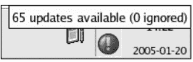

图 6-4

Update Agent 在系统有可用更新时会一目了然。

要实际执行更新，你可以点击面板上的红色 Update Agent 图标，或者在命令行窗口中输入 `update`。系统会要求你输入 `root` 密码，然后显示 Update Agent 主窗口，该窗口的作用类似于在 Windows 上安装软件时使用的“向导”——窗口提供了设置以及“前进”和“后退”按钮，允许你调整设置并完成流程（在本例中为安装更新）。一旦你跳过第一个介绍页，Update Agent 会询问你想使用哪些通道，如图 6-5 所示。通常情况下，默认选项是很好的选择，因此你应该保持此选项不变。


一旦你选择了要使用的通道并点击“前进”，Update Agent 就会下载可用更新的信息。这个过程可能从几秒钟到一多小时不等，取决于更新的数量、你的网络连接速度以及归档站点的速度。你可能会被告知某些软件包因为你之前的选择而被跳过。（某些软件包——特别是内核——升级可能比其他软件包更复杂，因此你可能选择跳过升级，直到你确定要执行（如此）。随后，Update Agent 会显示可用更新列表，如图 6-6 所示。你可以点击某个更新查看其描述。通过勾选名称左侧的框框来选择要更新的软件包，或勾选“选择所有软件包”框框来选择所有。当你点击“前进”时，系统会执行一些清理工作，下载并安装软件包。

如果你选择升级所有可用更新的软件包，面板上的红色 Update Agent 图标（图 6-4）将变为绿色。如果没有变，它将保持红色，这可能会让人心烦，但并不是什么大问题，除非你将鼠标悬停在上面，否则它不会提醒你有新更新存在，此时你将看到更新数量增加了。

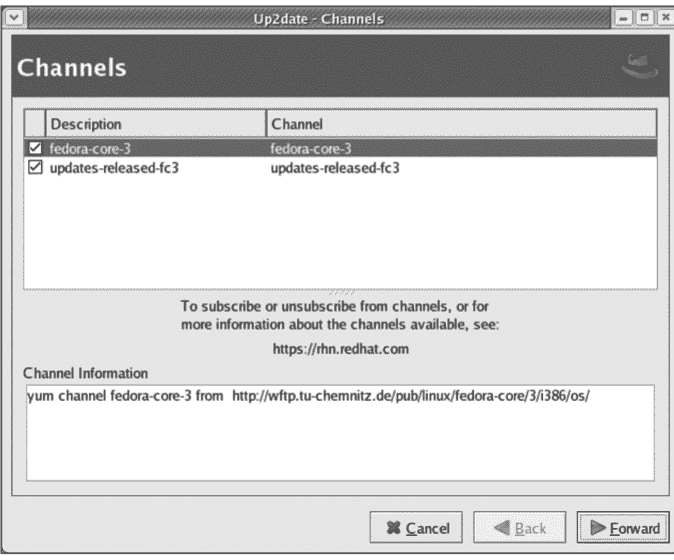

**图 6-5** Update Agent 可以从一个或多个存储库拉取软件，它称之为“通道”。

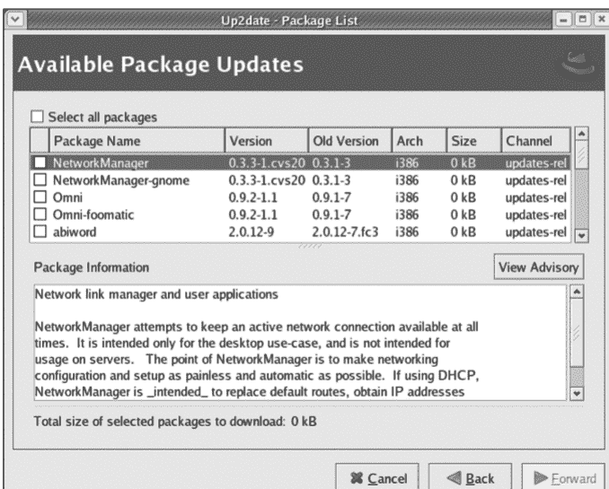

图 6-6

在继续之前，你可以检查更新并在升级操作中添加或豁免软件包。

## 使用 Synaptic 进行软件更新

Synaptic 的基本功能在本章稍前的“使用 Synaptic”部分已介绍。使用该工具进行软件更新与用它清理垃圾软件包类似；你只需选择所需的选项即可。特别是，为了开始系统更新，你应该点击按钮栏中的“Reload（重新加载）”按钮。此操作告诉 Synaptic 联系你在 `/etc/apt/sources.list` 中定义的软件包归档站点，以下载最新的软件包描述。这个过程将需要几秒钟，期间屏幕上会显示一个进度对话框。

一旦你检查了软件包描述，点击按钮栏中的“Mark All Upgrades（标记所有升级）”（见图 6-3）。该程序会询问你是否想以“智能”方式升级系统。默认方法会跳过可能导致依赖问题的更新，但“智能升级”如果能够解决它们创建的任何依赖问题，就会升级软件包。如果你不想承担问题风险，默认方法对于快速升级是很好的，但如果升级的软件包包含了新的依赖项（例如，因为开发者开始使用新的或已升级的库），那么智能升级可能是必要的。

注意：Synaptic 执行的任务与 `apt-get` 相同。特别是，默认升级等同于输入 `apt-get upgrade`，智能升级等同于输入 `apt-get dist-upgrade`。如果你倾向于在命令行提示符下操作而不是使用 GUI 工具，可以输入这些命令。假设 Synaptic 找到了可以升级的软件包，底部栏的“Apply（应用）”按钮将变为可用。你可以点击此按钮获取并安装更新。在执行之前，系统会显示一个确认对话框，其中列出了所有升级项，如图 6-7 所示。初始对话框可能包含摘要行，例如“待升级”。这些列表仅提供软件包名称（如果点击“详情”，则会显示版本）。如果你想找到有关已升级软件包的更多细节，应该取消操作

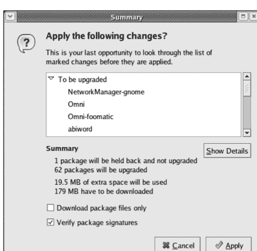

**图 6-7** 与 Update Agent一样，Synaptic 在执行操作之前会汇总更新。

## 处理依赖问题

在本章中，我提到了依赖关系。在许多方面，依赖关系是 Linux 用户在软件包管理时的心头刺，因为依赖可能会导致对软件包升级的需求。幸运的是，高级软件包管理工具如 APT、Synaptic、Red Hat 包管理、Update Agent 和 YaST 可以极大简化依赖问题的处理；然而，有时你可能需要打破规则。如果你谨慎且了解自己在做什么，这样做可行，但如果出错可能会造成混乱。

### 追踪依赖关系

如果你使用 RPM 或 Debian 软件包，通常不需要去寻找依赖关系；它们会在尝试安装、删除或升级软件包时自行显现。如果你使用 `rpm` 或 `dpkg` 工具并尝试执行破坏依赖的操作，你会收到错误消息。解决问题是你的工作。根据你尝试的操作，这可能采取几种形式：

- 删除软件包。如果你尝试删除一个软件包发现它被其他软件包依赖，你也可以删除这些软件包。当然，你应该确保这些软件包不是你需要的！

- 升级或安装额外的软件包。如果尝试升级或安装因为缺失或过时的依赖项而失败，你需要找到相应的软件包并在要升级或安装的软件包之外将其升级或安装。在实践中，你可能会发现需要升级或安装依赖项的依赖，导致需要处理许多软件包——可能是几十个。

- 寻找另一个软件包。有时你想安装的软件包需要的软件包比你已安装的更旧。例如，该软件包可能说需要 super-1.2，但你的系统有 superlib-1.9，且你的某些现有程序需要该版本的库。通常，解决此问题的最佳方法是寻找你想安装的软件包的更新版本，因为这个问题表明你正在尝试安装旧版本的程序。如果该程序已经长期没有更新，也许是时候切换到另一个程序了。

## 清理未使用的包

注意：如果你是高级用户，你可能可以重新编译旧包以使用较新的库。对于 RPM，可以通过下载源 RPM（即包含源代码而非编译后代码的 RPM）来实现这一点。然后，你可以通过输入 `rpmbuild --build package.src.rpm` 来编译该 RPM，其中 `package.src.rpm` 是源 RPM 文件。结果是一个二进制 RPM，位于 `/usr/src` 目录树的某处（具体位置取决于你的发行版和 CPU；请尝试使用 `find` 来定位它）。此过程要求你安装了各种开发工具，并且可能由于各种原因而失败。如果你确实急于在系统上运行某个旧版本或冷门的包，可以尝试一下。

如果你坚持使用你的发行版支持的软件，可能不太会遇到真正的依赖问题。最坏的情况下，你应该可以使用像 Synaptic 这样的包管理工具来保持所有同步，并且可能需要根据情况在 CD-ROM 驱动器中插拔安装光盘。

如果你开始使用未经过发行版维护者审核的软件，更有可能出现严重的依赖问题。此类包可能是为与你使用的不同的发行版构建的——例如，该包在运行 Mandrake 时可能使用了 Red Hat。在大多数情况下，只要格式正确（如 RPM），此类包就可以正常安装和运行。然而，有时会发生依赖冲突，使软件的安装或后续升级变得复杂。如果发生这种情况，你将需要按照前面描述的步骤来解决问题。

> 提示：如果你在使用基于 RPM 的发行版，可以访问 `http://www.rpmfind.net` 查找许多软件包。你可能可以使用该网站找到问题包的更新版本、缺失的支持包或其他可以帮助你绕过问题的包。然而，过度使用该网站可能会让你更深地陷入最终的依赖问题中，因为在该处找到的包可能没有在你的发行版中注册，并且可能无法通过高级包管理工具轻松地升级。

## 绕过依赖：风险自负

到目前为止，处理依赖问题的最好方法是如上述，在包管理系统中通过安装、升级或删除包来解决。然而，有时你可以通过告诉系统忽略问题来绕过依赖。如果指定的依赖过于严格，这种方法可能有效。例如，文字处理器可能会列出对一组字体的依赖，仅仅是因为程序作者认为使用该文字处理器的人有良好的字体选择，而不是因为文字处理器实际上需要这些字体。在这种情况下，绕过依赖是有意义的。同样，如果你知道依赖已通过其他方式满足，你可能也会选择忽略依赖——例如，如果你通过从源码编译安装了一个库，而不是从它自己的包中安装它。（通常来说，在大多数 Linux 发行版中，使用包比自己编译软件要好，但你可能有理由编译这样的程序）；

要覆盖依赖，你可以使用 `rpm` 或 `dpkg` 包的高级命令行选项。对于 `rpm`，你可以使用 `--nodeps` 配合 `-i`（安装）、`-U`（升级）或 `-e`（删除）选项：

```bash
# rpm -Uvh --nodeps overdependent-1.23-4.i386
```

该命令即使在 overdependent 包依赖于系统中未安装的包的情况下也会安装它。对于基于 Debian 的系统，`--ignore-depends=package` 选项的作用类似，但你必须用该选项指定包名：

```bash
# dpkg -i --ignore-depends=overdependent overdependent-1.23_4.dpkg
```

这样忽略依赖可以帮助你摆脱某些困境；然而，如果使用不当，此选项可能会导致程序失败。也许程序根本无法运行，或者无法执行它应该处理的某些操作。同样糟糕的是，像 Synaptic 这样的高级包管理器在发现系统被这样“污染”时，可能会大发雷霆。包管理器可能会在违规程序被删除或其依赖满足之前拒绝执行任何操作。即使你愿意与这些未满足的依赖共存，该程序或其他程序的未来升级也可能因为此而失败。原则上讲，你应该在包管理系统的规则内运行，而不是尝试绕过这些规则。

# 总结：移除包垃圾


包垃圾（Gunk）有两种形式：未使用的包和旧包。未使用的包占用磁盘空间，带来安全风险，并可能因为依赖关系在后期引起麻烦。旧包可能会因为它们的漏洞（特别是安全漏洞）和依赖问题引起问题。你可以借助 Linux 包管理系统，特别是像 Synaptic 和 Red Hat Package Management 等高级包浏览器来处理这两类垃圾。这些工具帮助你添加、删除和升级软件，保持你的系统精简且最新。

# 总结：防止垃圾进入你的应用程序

Linux 应用程序像 Linux 整体一样，可能会堆积垃圾。通常情况下，应用程序越大、越复杂，越容易变得垃圾化。桌面端三种最大且最流行的程序类型是办公套件、Web 浏览器和电子邮件客户端。本章描述了这些应用程序配置中可能积累的垃圾类型以及如何处理它们，重点关注每种类型程序中最大或最流行的例子。通常情况下，检查程序的设置对解决任何问题都有很大帮助。如果你对程序的性能不满意，还应该考虑替代方案；在许多情况下，一个更小、运行更快的程序可能和大程序一样好。


# 提高软件性能

清理垃圾清单：

- 理解性能低下的原因。
- 采取措施提高桌面应用程序的运行。
- 采取措施提高可靠性。
- 调整你的打印机配置。

## 什么导致了性能缓慢？

在最理想的世界里，计算机会瞬间完成工作——点击按钮重建某个东西就完成了；按键复制文件就完成了。遗憾的是，事实并非如此。计算机需要时间来执行工作。有时涉及的时间跨按人类标准来说非常短，但有时并不是。性能不佳的原因是多种，但可以分为四大类：软件问题（即软件代码本身的问题）、配置问题（影响软件，因为软件必须执行比实际需要的工作）、其他程序的干扰以及硬件问题。有时，这些类别中的问题会相互作用，将每个类别中的微小问题放大到变成真实问题的程度。理解这些问题将帮助你在处理缓慢系统时识别并避免它们。

## 软件问题

导致性能低下的第一类问题是软件。与昨天的软件相比，今天的软件非常低效，原因有几个：

- 语言选择——今天的软件几乎是用 C、C++ 和其他高级语言编写的。这些计算机语言对人类容易理解，但它们必须经过编译——即翻译成机器理解的二进制机器码。这种编译过程产生的代码比 20 年前常见的手写代码更大、效率更低。

关于这个问题，虽然针对你的 CPU 使用优化设置重新编译软件可能会带来轻微的提速。（这是 Gentoo Linux 发行版声称的优点之一。）

- 粗糙的代码——即使在同一种语言中，程序的效率也可能不相同。这在很大程度上取决于程序源代码的质量。在选择程序语言时，除非你自己修改软件，否则你并没有办法控制这个问题。不过，你可能可以找到更高效的软件。

- 用户界面——计算机用户一直追求更苛刻、更复杂的的用户界面。最初的 Macintosh 普及了 GUI，在随后的多年里，GUI 变得越来越复杂。复杂性的每一步提升都是以性能为代价的，因为支持它的代码会变得更大，并消耗更多的 CPU 时间。你防止此类改进导致速度下降的主要防御措施是使用更简单的用户界面。有时你可以使用选项禁用高耗 CPU 的用户界面来重新编译程序，但这是一个非常高级的主题。

- 复杂的功能——即使不考虑用户界面，现代程序支持的功能也比以往任何时候都要多。这种支持是需要代价的，即使你没有使用这些功能。程序本身会变得更大，其代码也会变得更复杂。面对用户界复杂性，防止这些问题的最好方法是尽可能选择简单的程序。例如，在处理文档时，选择中等规模的 Abi Word 而不是庞大的 OpenOffice.org。

- 可执行文件大小——这是上述许多因素共同导致，但它会影响代码的大小。更大的程序会消耗更多内存，这在 RAM 不足的系统上会导致更多的内存交换。即使在内存充足的系统上，大程序从磁盘加载的时间也比小程序长得多。

这些因素的结合被称为“代码膨胀”（code bloat）——即程序随着升级而变得越来越、效率越来越低的倾向。对于大多数程序来说，1.0 版本比 1.1 版本小、更高效，而 1.1 版本比 1.2 版本小、更高效，以此类推。

幸运的是，CPU 速度、RAM 大小和其他硬件的改进有助于抵消代码膨胀；然而，如果你不升级硬件，代码膨胀可能会变成严重的问题。当然，一种防御方法是坚持使用旧或更简单的程序。Linux 通常遵循 Unix 的传统，通过组合几个较小的程序来完成一项较大的任务，这意味着你可以调整软件以省略你不需要的部分。一个潜在的剧烈例子是桌面环境，正如第 4 节“清理你的桌面环境”所述。与其使用完整的 GNU 网络对象模型环境 (GNOME 或 K 桌面环境 (KDE)，你可以使用更轻量级的桌面环境，如 XFce 甚至是一个裸的窗口管理器。然后你可以从独立项目甚至从 GNOME 或 KDE 项目添加你需要的组件。但这种方法并不总是有效；例如，你无法很好地精简 Office。不过，你可以切换到替代的办公套件。

如果你面临导致你产生问题的臃胀肿肿软件，应该寻找替代品。一个好的开始点是搜索 Linux Online 的应用程序区域（http://www.linux.org/apps/）。你可以在该网站的许多类别中搜索应用程序。如果运气好，你会找到一个不像那个困扰你的程序那样的膨胀的应用。如果你已经定位了可能的替代程序，应该尝试使用你发行版的包管理工具（如第 6 节描述的工具）来安装软件。如果该包未包含你的发行版中，你可能需要从作者的网站下载。

## 配置问题

第二类性能下降因素是配置问题。这包括系统配置和账户配置。存在几个可能的问题源：

- 运行过多的程序——这个问题与下一个大类（在“干扰问题”节中描述）有很大重叠。如果你同时运行许多程序，它们将消耗内存和 CPU 时间，夺走你主程序的资源。作为用户，如果系统变得缓慢，你可以简单地关闭未正在使用的程序。作为管理员，你可以追踪并卸载或杀死不必要的程序。第 6 节和第 8 节可以帮助完成这些任务。

- 糟糕的选项——某些程序可以使用影响性能的选项启动。不过，这个问题取决于具体的程序。如果某个程序运行不佳或其他程序表现糟糕，你应该咨询该缓慢程序的文档。

- X 服务器选项——你的服务器对系统的整体性能起着重要作用，至少对于桌面系统系统是如此。糟糕的 X 服务器选项会严重降低系统的性能。有两个选项至关重要。第一个是选择正确的 X 驱动程序。大多数显卡可以通过通用驱动程序驱动，这些驱动适用于许多显卡但性能很差。更好的选择是针对你特定显卡（更准确地说是芯片）的驱动程序。另一个重要的 X 选项是色深。这通常是 8、16、24 或 32 位，对应于 256 色、65,536 色、16,777,216 色或 42 亿色。虽然更多的颜色看起来可能很美观，但增加色深也会减慢视频密集型任务的性能。对于大多数用途，超过 24 位是没有意义的，16 位可能就足够。这些以及其他的 X 配置问题在第 12 节“优化你的 X 配置”中有更详细的介绍。

- 字体问题——字体可以提供更苛刻、更复杂的界面。最初的 Macintosh 普及了 GUI，在随后的多年里，GUI 变得越来越复杂。复杂性的每一步提升都是以性能为代价的，因为支持它的代码会变得更大，并消耗更多的 CPU 时间。你防止此类改进导致速度下降的主要防御措施是使用更简单的用户界面。有时你可以使用选项禁用高耗 CPU 的用户界面来重新编译程序，但这是一个非常高级的主题。

- CPU 装饰——KDE 和 GNOME 都提供了许多旨在使其变得友好的选项。此类选项通常被称为“视觉装饰”（eye candy），它们会消耗 CPU 时间。例如启动程序时跳动的光标等。你可以进入 KDE 或 GNOME 控制面板进行查找。

- 多媒体功能——多媒体正日益占据中心，即使是传统的多媒体应用也是如此。这些选项就像视觉装饰一样，可能是很棒的奢侈品，但如果你的硬件无法处理它们，它们就会降低性能。与其他导致性能下降的功能一样，你应该寻找禁用这些功能的方法。

有一个词主导了高效优化的追求，那就是“简化”。寻找能够简化的选项——更少的高级选项、更少的程序、更少的字体等。如果你使用 KDE 或 GNOME（在另一个桌面环境中使用 GNOME），这些选项中的许多可以从 KDE 或 GNOME 控制中心禁用。例如，图 7-1 显示了 KDE 控制中心，列出了几个会导致性能下降的选项。具体来说，移动窗口显示内容和缩放窗口显示内容会在移动或缩放窗口时导致性能缓慢。如果这些

## 干扰问题

有时一个程序会影响另一个程序。这种干扰的最常见原因是对有限系统资源的竞争性——最常见的是 CPU 时间或 RAM，有时是磁盘访问、网络访问、使用扫描仪或其他。

第 8 节“进程管理”描述了如何管理运行中的程序（也称为进程），以防止它们对其他进程产生问题。简而言之，如果一个程序必须运行但不应干扰其他程序，你可以通过几种方法降低其优先级。当内核分配 CPU 时间时，低优先级进程会让任何高优先级进程优先。这样，你可以运行 CPU 密集型程序，而不会显著影响系统性能。

分配其他资源（如 RAM 和磁盘访问）不像分配 CPU 时间那样容易。通常，Linux 的自动调度系统在这项任务上通常做得可以接受。主要的例外发生在你没有足够的所需的资源时。在这种情况下，你必须

# 提升软件性能 161

终止一个或多个竞争程序或升级你的硬件。


（第 8 章描述了如何杀死运行异常的程序。）

# 硬件问题

性能下降的最后一类因素是硬件不足。当然，这在某种程度上是相对的。运行例如 KDE、OpenOffice、GIMP 或 Mozilla 来说不足的硬件，对于运行例如 IceWM、AbiWord、XV 和 Lynx 来说可能足够了——换句话说，取决于你的具体需求，这些轻量级程序可能与它们的“大哥”们相当。

- RAM——一个轻量级的桌面 Linux 系统至少应该有 128MB 的 RAM，如果你打算运行最新的大型程序、处理大文件（如高分辨率照片或音视频文件）或运行其他 Linux 密集型程序，那么 512MB 或更多是实性需求。

- 磁盘空间——Linux 桌面系统仅需 1–2GB 的磁盘空间即可舒适地安装，但为了有足够的增长空间，请为 Linux 留出 6–10GB，再加上你存储个人文件所需的空间。如果你打算存储或管理大文件，请准备至少一块 80GB 的硬盘。幸运的是，如今大硬盘已非常常见且廉价。

- 显卡——大多数 Linux 应用对它们所需的任何视频硬件都很满意，只要硬件与你的 X server 兼容。（X server 的兼容性在第 12 章有详细描述）。如今，昂贵的显卡通常是因为拥有复杂的 3D 引擎，这些引擎对于游戏（特别是 Windows 游戏）至关重要。如果你是玩家，请研究 Linux 驱动的可用性和功能——注意，显卡存在基础的 X 驱动并不一定意味着其 3D 功能得到了良好支持。如果你不是深度游戏玩家，几乎任何现代显卡都能胜任。

- 显示器——Linux 对显示器并不挑剔；然而，如果你的显示器能够显示至少 800x600 像素，许多 Linux 程序的运行效果最好，有些甚至需要 1024x768 或更大。几乎所有现代显示器配合现代显卡时都能处理此类显示，因此这对于非常老的显示器可能会成为问题。

- 鼠标——Linux 拥有所有鼠标的驱动程序。唯一的问题是，许多 Linux 程序假设鼠标至少有三个按钮。如果你的鼠标有两个按钮，你可以配置 X 将这两个按钮组合（chord）使用以模拟第三个按钮——即，如果你同时按下两个按钮，Linux 会将其视同于按下三键鼠标的中间键。不过，这种操作有点笨拙，如果你用的是双键鼠标，可能想考虑将其更换为三键型号。

尽管硬件不足会降低性能，但过去三年出售的几乎任何系统都应该很好地运行现代 Linux 发行版。（尽管升级双键鼠标可能是值得的）。长达五年的系统可能还可以用，但可能需要升级 RAM 和硬盘。某些电脑可以升级 CPU，但等到 CPU 需要升级时，其他系统通常也需要升级，因此更换电脑会更简单（可能更具成本效益）。

如果你有一台特别旧的系统，想在上面运行 Linux 且不想投入大量的硬件升级，请考虑在不运行 KDE 或 GNOME 的情况下运行 Linux。相反，运行 XFce 或裸窗口管理器。你可能希望考虑在系统上运行 Debian 或 Slackware，而不是 Fedora、Madras、Red Hat 或 SuSE。Debian 和 Slackware 的的导致性能下降的“垃圾”较少，因此在精简系统上可能需要较少的安装调优。

# Gunkbuster 笔记本：通过重新编译软件提升性能

性能调优措施涉及以某种方式更改你的系统配置。然而，提升性能的一种方法涉及以非常基础的方式重新构建你的系统。大多数 Linux 软件是用 C、C++ 或其他高级计算机语言编写的。正如本章开头提到的，这些软件必须编译才能使用。编译过程将源代码转换为计算机可以理解的二进制代码。问题在于，生成的二进制代码对于任何特定系统都可能不是最优的。当发行版维护者（如 Red Hat 或 Debian）为二进制分发版编译代码时，维护者会对你的系统做出某些假设。这些假设旨在让软件能够在尽可能广泛的计算机上运行。对于 x86 系统，这通常意味着编译后的软件将运行在从 80386 到最新的奔腾 4 以及现代 64 位系统的所有设备上，但在它们中的任何一个系统上都运行得不是最优（也许最老的那些系统除外）。其他假设涉及使用特定的库集、内置对特定功能的支持等。

另一种方法是在你自己的计算机上编译软件，理想情况下带有各种选项以让软件在你的电脑上运行得最好。如果你这样做，你的软件将获得适度的提升，因为你可以使用针对特定 CPU 的优化。对于某些软件包，你还可以选择包含你需要的功能支持，并排除你不需要的功能。

在大多数情况下，实施此类特定系统的优化是一项枯燥的任务——枯燥到你花在尝试做这件事上的时间，比你希望从系统性能提升中换回的时间还要多。不过，这条规则有几个例外。首先，优化 Linux 内核是有意义的，因为一切都依赖于内核，所以优化内核有助于优化其他所有内容。第 11 章“为你的硬件寻找驱动程序”对这个主题进行了非常简短的介绍，但这实际上是一个高级课题。

其次，重新编译你频繁使用的 CPU 密集型程序是有意义的。如果你正在运行 CPU 密集型科学模拟之类的程序，这一点最可能成立。此外，Gentoo 发行版（http://www.gentoo.org）是围绕重新编译一切的想法构建的。与其提供二进制包，Gentoo 提供了本地编译的脚本。重新编译文字处理器或浏览器可能无法提供任何实际益处。

第三，在本章中关注速度作为一个性能因素。然而，其他问题也可以被视为性能问题。在这些问题中，程序的稳定性（即对崩溃的抵抗力）尤为重要。当程序崩溃时，你通常会丢失从上次工作到崩溃之间所做的一切。重启软件并恢复思路可能需要一些时间。程序可能由于许多原因崩溃，每个潜在原因都有几种解决方法。当没有修复方法时，你可能绕过问题（例如，避免导致崩溃的情况）。最后，从长期稳定的角度来看，你应该向作者报告程序崩溃；这样，导致崩溃的 bug 就可以被修复，不再骚扰你。

## 为什么程序会崩溃？

简单的答案是程序是因为 bug 崩溃的。然而，存在多种崩溃的原因和表现，每种都有其独特的特征：

- 异常终止——在某种意义上，“纯”的崩溃类型是异常终止。也就是说，程序正在运行，突然无缘故地停止了。如果你是从命令行提示符启动程序的，你会得到一个提示符，并收到程序异常结束的消息。

- 程序挂起——另一种崩溃类型是程序*挂起*，此时程序停止响应输入。与崩溃程序不同，挂起的程序保持窗口打开并保留对启动它的任何控制台的控制权。不过，程序可能已经完全崩溃了；它不响应输入也不会保存数据。

挂起程序通常消耗大量的 CPU 时间，与崩溃程序不同，因此它们会干扰正常的系统运行。有时，很难区分挂起的程序和正在执行长时间 CPU 密集型计算的程序。你需要熟悉程序的正常运行情况，才能判断例如两分钟的无响应期是否正常。

- 僵尸进程——考虑到计算机极客的特性，像*僵尸*这样的术语被采用为正式名称是不可避免的。所有进程

## 提高软件性能

进程具有父进程——父进程启动子进程。当子进程终止时，其父进程按理应该处理一些清理工作，将子进程从 Linux 的进程表中移除。当父进程未能执行此操作时，结果就是产生“僵尸进程”（zombie）。僵尸进程会出现在进程列表中，它们通常不会消耗 CPU 时间，因此相对无害。你可以通过杀死它们的父进程来杀死僵尸进程，但这可能并不可行。（你可能希望让父进程继续运行。）

- 系统崩溃、挂起或重启——Linux 本身会自发地崩溃、挂起或重启。这可能是由于内核中的错误或硬件故障（后文将描述）引起的。幸运的是，这些问题非常罕见。由于某个程序崩溃或挂起，导致其与键盘或鼠标产生关联，系统将失去响应。如果发生这种情况，且你正在运行一个网络登录服务器，你可能可以通过远程登录并终止该问题的程序来恢复系统。（第 8 章描述了如何杀掉进程。）

- 硬件故障引起的崩溃——这类崩溃与之前的崩溃并没有本质区别；相反，硬件故障可能是任何类型崩溃的原因。最常见的情况是，坏内存（RAM）会导致各种奇怪的。有时，坏的 CPU 或组件也会导致问题。硬件问题以难以修复而闻名。如果你的硬件导致了问题，你可以运行诊断工具。内存检查程序（如 Memtest86 (http://www.memtest86.com)）是一个很好的起点。大多数硬盘制造商都提供基于 DOS 的硬件诊断工具；请查看制造商的 Web 页面获取详情。（这些工具虽然在 DOS 下运行，但通常会附带一个最小化的启动引导软盘，因此你可以通过重启到 DOS 启动引导软盘在基于 Linux 的系统上运行它们。）

- 缺少库引起的崩溃——与硬件故障一样，缺少库是崩溃的根源，而不是症状。缺少库通常会导致程序完全无法运行，如果你从命令行运行程序，你将看到类似缺少某个特定库的提示。解决方案是找到并安装该库。（尝试对缺失库的名称进行 Web 搜索，或寻找与你发行版的包管理器相似的包。）从理论上讲，如果你专门使用你发行版的包系统，且不覆盖其依赖检查，你永远不应该遇到这类问题。在实践中，这种问题可能会偶尔出现，特别是当你像第 6 章描述的那样“不顾规则”地操作时。

大多数此类崩溃类型都会导致工作丢失。（僵尸进程可能是这一规则的例外。）不幸的是，除非深入源代码来修复错误，否则对于修复由错误引发的崩溃或挂起的根本原因，你无能为力。硬件问题可以通过更换故障的硬件来修复，但追踪这些问题可能是困难的——很难区分内存、坏的 CPU 和其他硬件问题之间的差异。


如果你怀疑是程序 bug 导致了问题，你应该开始寻找该程序的更新版本。第 6 章提供了有关保持系统更新的提示；这些步骤将帮助你更新软件。你可能还想检查软件的主页，以防它提供了你尚未通过你的发行版获取的更新。有时，升级程序将修复一个 bug。毕竟，bug 都有其源头，它们通常始于新功能或对其他程序的修复，因此通过回溯软件的历史记录，你可能能够修复该 bug。

## 规避崩溃

短期内处理崩溃的一种方法是规避它们。有时，这种方法是显而易见的。在那个关于一个患者向医生抱怨的笑话中，患者说“我移动手臂时很疼”，医生回答“那就别移动手臂”，你可能可以避免使用会导致崩溃的程序功能。当所涉及的功能是你不太可能使用的，或者程序提供了另一种实现目标的方法时，这种方法是可行的。然而，在其他情况下，该功能是至关重要的——例如文字处理器中的保存选项。

如果你面临一个导致问题的 bug，可以尝试以下几种方法来规避它：

- 弄清楚触发崩溃的因素。你应该采取的第一步是确定什么导致了崩溃。是加载文件吗？是调整窗口大小吗？是在向程序中粘贴文本吗？如果崩溃是完全随机的，你很难开发出规避方案。如果特定条件触发了崩溃，你将能够更好地避免它。一旦你发现了模式，请尝试对触发模式进行变体处理。
- 尝试替代的激活方法。许多程序提供了多种激活功能的方法，例如菜单项、按钮和键盘快捷键。可以想象，但不太可能的是，其中一种方法有效而其他方法无效。
- 尝试相似的功能。有时，你可以使用与你想要的功能相似来解决问题。例如，即使结果不是理想的，也可以作为临时的规避方案。
- 尝试另一个环境。bug 有时与程序运行的环境有关，例如桌面环境、使用的字体，甚至你正在运行的内核版本。你可以尝试更改这些因素，看看它们是否有任何影响。
- 尝试另一个程序。如果这个 bug 是那种无论你尝试什么都无法摆脱的顽固 bug，你应该直接抛弃故障程序，至少在它被修复之前是。
- 寻求帮助。不要成为那种迷了路却拒绝问路的典型人物。朋友、同事或邻居可能可以提供帮助。最终，规避 bug 更多是一门艺术而非科学。

## 报告 bug

长期来看，处理 bug 的最重要的事情就是报告它们。即使你发现的 bug 看起来很易见。由一或两个个人处理的小型程序通常使用简单的 email 报告程序——向开发者发送邮件说明问题。拥有大型开发团队的大型程序通常使用 Web 报告工具。你可能需要在这些网站注册，然后填写一个包含信息的表单。如果你很幸运，开发者很快就会修复 bug。我曾在报告问题后几分钟内就收到了修复。如果你不幸运，可能需要等待几周或几个月才有行动。某些情况下，你可能需要重新编译程序以获取修复。无论如何，你必须报告它，除非别人已经报告了（但你不应该指望别人）。

如何报告 bug？这取决于程序。你应该去程序的主页查找说明。你可能会在菜单的“关于程序”选项中找到主页，或者在 man 页或其他文档中找到。作为最后手段，对程序的名称进行 Web 搜索。

# 提升软件性能 169

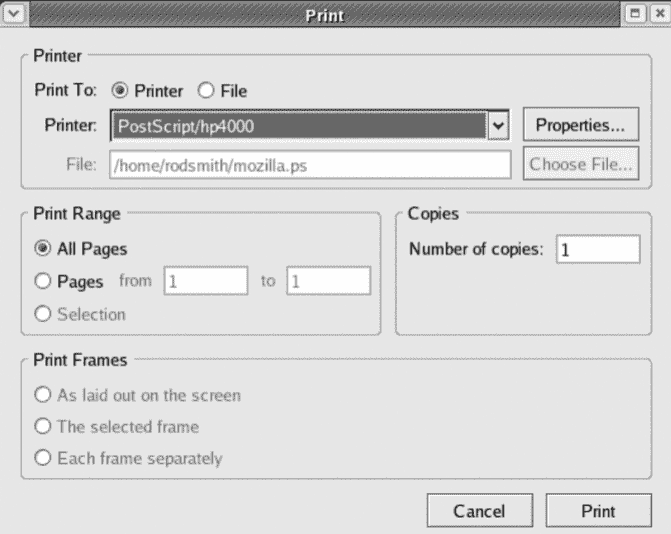

**图 7-2** 大多数 GUI 应用程序提供的打印对话框与 Windows 或 Mac OS 中使用的相似。

要充分利用 Linux 打印功能，意味着要理解这头“猛兽”。事实上，有时当你最初安装打印机时，它会完全拒绝工作；你给它发送一个打印任务，结果打印机却没有吐出任何东西。

Linux 社区正经历从一种打印范式向另一种范式的转变。原始的 Linux 打印系统完全源自 Unix，实现于 20 世纪 80 年代。该系统使用一套软件：伯克利标准发行行打印守护进程（BSD LPD）或下一代 LPR 系统。为了简单起见，我将它们统称为 LPD 打印系统。这两个工具都提供单向打印路径——应用程序数据发送到打印守护进程，由后者将其发送到打印机。应用程序无法获取有关打印机的任何信息，因此如果你需要使用不特殊的打印机功能（例如使用超宽纸的能力），应用程序必须允许你手动输入该信息。

到 2005 年，大多数 Linux 发行版已切换到一种新的打印包，通用 Unix 打印系统（CUPS）；`http://www.cups.org`。`CUPS` 提供了一个与 LPD 系统工作完全相同的兼容模式，但它还能更多。最重要的是，`CUPS` 为应用程序提供了反馈。使用 `CUPS` 的程序可以询问 `CUPS` 打印机的功能并接收这些信息。应用程序随后可以为用户提供相应的选项，例如如果打印机支持，则提供更宽的边界。

当然，为了向应用程序传递打印机信息，`CUPS` 必须了解打印机的一些。这是一个更广泛问题的一部分：任何打印系统或任何操作系统必须知道如何与打印机通信。遗憾的是，打印机具有不同的功能并使用不同的语言。这就是为什么打印机带有存放 Windows 驱动程序的 CD——当你使用 Windows 时，安装驱动程序以便 Windows 能够与打印机“对话”。没有驱动程序，你就无法使用打印机。

Unix 传统认为打印机要么是行打印机，要么是 PostScript 打印机。行打印机是简单但快速的打印机，用于打印带特殊格式的文本，但无法处理图形、多字体或其他现代打印要素。PostScript 是一种为生成打印输出而优化的计算机语言。PostScript 打印机理解 PostScript，所以如果你向 PostScript 打印机发送 PostScript 文件，结果就是生成打印输出。这种假设简化了 LPD 打印系统；应用程序只需要产生原始或 PostScript 输出并将其馈给打印系统，打印系统可以将结果传递给打印机而无需进一步处理。

遗憾的是，大多数连接到 Linux 系统的打印机并不是 PostScript 型号。因此，LPD 系统和 `CUPS` 都引入了另一个软件组件来弥补差距：`Ghostscript` (`http://cs.wisc.edu/~ghost/`)。该程序是一个运行在计算机而非打印机上的 PostScript 解释器。`Ghostscript` 可以产生几十种图形格式的任何一种输出，包括 JPEG 等传统的计算机图形格式以及大多数打印机都能理解的格式。当你配置打印系统以识别你拥有的型号时，它可以通过 `Ghostscript` 传递 PostScript 输出并发送到打印机，再由打印机产生打印输出。

Linux 的最后一个细节也值得注意：LPD 和 `CUPS` 都是支持网络的打印系统。这意味着，当你设置打印系统在本地工作时，配置它接受远程打印任务或将打印任务发送到其他系统相对简单。在实践中，大多数 Linux 发行版默认禁用了此功能作为安全措施，但该功能是存在的。特别是对于 `CUPS`，这可以极地简化网络打印配置。`CUPS` 可以自动检测由其他 `CUPS` 计算机提供的打印机。这一功能在中大型网络中尤为重要，因为这些网络可能有许多打印机且频繁更换。配置每个 `CUPS` 计算机在网络上工作，任何更改将自动传播。

总之，使用 `CUPS` 的现代 Linux 系统为应用程序提供了打印工具，提供有关打印机功能的基本信息。应用程序产生 PostScript 输出并发送到 `CUPS`，`CUPS` 通过 `Ghostscript` 传递 PostScript 以产生打印机可以理解的数据。`CUPS` 将此输出发送到打印机，再由打印机产生输出。

遗憾的是，这个序列并非万无一。`CUPS` 可能会尝试将其输出发送到错误的打印机，或者 `CUPS` 可能未配置使用正确的驱动程序（即 `CUPS` 可能给 `Ghostscript` 提供了错误的驱动程序信息）。即使排除产生大量脏输出的可能性，由于驱动程序选项欠佳，打印可能会花费过长时间。

## 清理你的打印机

现在你已经了解了一些 Linux 打印系统的组件是如何组合在一起的，是时候拿出清洁解决方案让它运行顺畅，机制中没有任何污垢迹象了。这个过程从浏览 `CUPS` 配置工具开始。然后你可以检查是否正在使用正确的输出设备，选择正确的驱动程序，设置打印机的分率和其他速度相关的选项，并（如果需要）启用网络打印。

> 注意：由于 `CUPS` 主导了 Linux 打印，此描述仅适用于 `CUPS`。如果你的系统使用 BSD LPD 或 LPR，[文本继续]

对于 USB 打印机，您应该选择 USB 打印机选项之一；然而，这些选项是动态变化的——它们应该包含打印机的名称，例如 `USB Printer #1 (EPSON Stylus Photo RX500)`。如果您只有一个 USB 打印机，它应该识别为第一个。如果您使用了 USB 打印机选项但没有一个选项包含打印机型号，这可能意味着在 `CUPS` 启动时打印机已关闭或未插好。要正确配置打印机，请按照以下步骤操作：

打开打印机。

1. 在 Linux 命令行提示符处，以 root 输入 `/etc/init.d/cups restart`。这将重启 `CUPS`，导致它重新检测 USB 打印机。（在某些发行版中，您可能需要将 `init.d` 更改为 `rc.d`）
2. 在浏览器中，重新访问 `http://localhost:631` 并开始定义或重新定义您的打印机。

完成这些后，当您尝试创建新打印机或重新定义旧打印机时，应该能看到 USB 打印机的品牌和型号作为 USB 设备选项之一。


> 提示：因为 CUPS 在每次启动时都会查看您的 USB 打印机，而且 CUPS 在计算机每次启动时都会自动启动，所以您应该确保在启动计算机之前打印机已插好并电源。如果您忘记了，您将需要重启电脑或执行步骤 1 和 2，以便 CUPS 在您能够打印之前再次检查打印机。

如果您想使用连接到另一个 CUPS 的打印机，可以这样做。如果打印机连接到运行 CUPS 的另一个系统，您应该直接跳到“启用网络打印”。一旦设置好，CUPS 应该会自动检测到其他网络打印机。然而，如果打印机由运行 LPD 的 Linux 或 Unix 系统或 Windows 系统托管，您将需要选择一种网络打印协议。特别是，LPD/LPR: Host 或 printer 选项用于 LPD 打印机，而 Windows Printer via SAMBA 选项用于处理 Windows 打印机。

对于 LPD 和 Windows 打印机，CUPS 会显示一个文本输入对话框，您可以在其中输入打印机的通用资源标识符 `URI`。它由协议代码（LPD 或 Windows 打印机分别对应 `lpd://` 或 `smb://`）、主机名和打印机名称组成。例如，要使用 LPD 打印到 gutenberg 计算机上的 canon 打印机，应输入：

```
lpd://gutenberg/canon
```

# 提高软件性能 175

许多 Windows 打印机共享需要用户名和密码。您可以在主机名之前输入这些信息：

```
smb://passwd@GUTENBERG/CANON
```

这会将 pass 作为密码，将 user 作为用户名。当然，您应该根据需要更改这些信息。如果计算机需要密码但不需要用户名，可以发送任何占位字符串作为用户名。

### 选择正确的驱动程序

在 Linux 中配置打印的一大部分工作是选择正确的驱动程序。遗憾的是，很少有打印机制造商明确支持 Linux，而那些支持的仅通过您必须从其网站下载的文件来实现。（它们通常也很有效地隐藏了这些文件。）幸运的是，打印机通过 Linux 自带的免费驱动得到了良好支持。

当进入 CUPS 配置中询问驱动程序的部分时，您将看到打印机品牌列表，随后是您所选品牌的打印机型号。如果您选择了您的打印机品牌，应该执行以下任一操作：

- **下载更多驱动程序。** 如果您的打印机制造商是“大品牌”之一（惠尔-陆、得力、爱普生、佳能等），名称缺失可能意味着您的系统缺少打印机驱动程序包。检查您的安装媒体是否有名为 `fantastic`、`gprinter-drivers` 的包，并安装找到的任何或所有这些包。您不应该像之前的那样重启 CUPS 并重新开始。

- **选择兼容型号。** 如果您的打印机是一个冷门品牌，您可能需要选择一个兼容的型号。例如，许多激光打印机可以作为惠尔-陆或 PostScript 模型工作。咨询您的打印机说明书以了解它仿真的是什么。

某些打印机在列表中以不同的名称有多个条目（例如 HP 和 Hewlett-Packard）。如果您的打印机品牌确实如此，请选择一个并继续。如果您在列表中没有看到您的型号，请返回并尝试另一个。

有时（特别是对于非常新的型号），即使列出了品牌，您也可能看不到特定的型号。如果是此类情况，您可能需要下载并安装更高版本的打印机驱动程序包，或者您的打印机可能与另一个型号的驱动程序兼容。如果您在这一方面遇到困难，可能想要查阅 Linux 打印网站 `http://www.linuxprinting.org`，您可以在查询您的打印机和型号以了解哪些驱动程序与它最匹配。您可以在那里找到关于驱动程序包、安装提示等的线索。

一旦您完成对打印机的配置或重新配置，可以点击 CUPS 配置页面上打印机区域的“打印测试页”链接。结果应该是一个单页的测试文档。如果出现乱码，可能是您选了错误的打印机型号。返回并检查您的选择。请注意，某些型号的名称非常相似，但操作上完全不同，因此请务必注意这一细节。如果没有输出，可能是您选择了错误的打印机型号，或者您可能选择了错误的输出端口。如果您的打印机有状态指示灯或 LCD 控制面板，请在打印时检查它们。如果您看到活动迹象，可能是您选了错误的驱动程序而打印机正在（工作）。

### 设置分辨率和其他选项

一旦打印机启动，您就可以点击 CUPS 配置页面上打印机区域的“配置打印机”链接。这些设置中的某些可以极大提高（或降低！）打印机的性能。要进行这些更改，请点击选项。

在定义打印机后，您可以修改分辨率和其他选项。大部分亮度、对比度等设置对于调整图形效果很有帮助，例如。

在大多数情况下，您应该保留默认设置，除非你不理解它们。特别影响速度和质量的一个选项是 Resolution。对于某些打印机，Print Quality 选项也可以影响分辨率，但使用的是如 1440x720 dpi 这样的数值。通常情况下，分辨率越高，质量越好，花费的时间越长。这种权衡取决于打印机以及您对质量和耐心的标准。您可能想要尝试不同的设置；更改后进行打印以判断质量。

当然，您可以浏览其他选项。您可能会发现一些想要调整的，例如纸盒选项或双面打印设置。之后您可能还会回到此页面。许多驱动程序提供

另一个您可能检查的选项是 Media Size。在美国，这应该设置为 Letter，但许多打印机默认设置为 A4（一种欧洲纸张）。虽然您可以使用错误的介质打印，但页边距会很奇怪。

# 提高软件性能 177

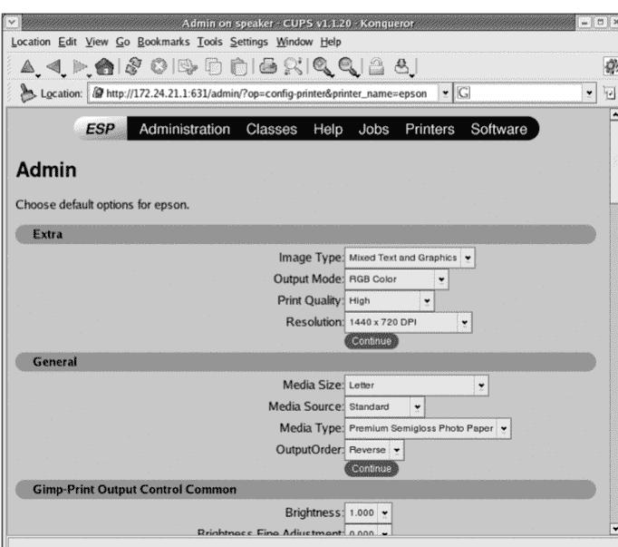

# 图 7-4

## 启用网络打印

CUPS 的巨大优势之一是它极大地简化了网络打印。你不需要在每个桌面级系统上定义每个可用的网络共享，只需要配置桌面级系统支持“浏览”（browsing）即可——这是 CUPS 的一项功能，能够自动发现远程 CUPS 打印机服务器。打印服务器也必须配置为支持浏览。完成后后，打印服务器上的更改将自动传播到客户端，因此如果你添加或删除了打印机，就不需要调整客户端。此功能在中、大型网络中最为有用，但在小型办公室甚至家庭中也很有帮助。

要在客户端上使用 CUPS 浏览功能（即你希望能够访问远程打印机的桌面级系统），你需要编辑 `/etc/cups/cupsd.conf` 文件。具体来说，找到定义 `Browsing` 值的行，并将其设置为 `On`：

```
Browsing On
```

这是 CUPS 安装时的默认值，但某些发行版出于安全考虑会将其设置为 `off`。如果你发现了一处这样的设置，请继续查找其他；有时，它在文件的某部分被设置为一种方式，稍后又被覆盖。你应该删除或注释掉所有该选项的实例。其他几个选项也会影响浏览过程，例如：

```
BrowseProtocols cups
BrowseOrder Deny,Allow
BrowseAllow from @LOCAL
```

你可能不需要调整这些选项中的任何一个。第一个指定 CUPS 使用其标准浏览协议，第二个定义了拒绝 `Deny` 或允许 `Allow` 指令是否具有优先权。`BrowseAllow` 选项尤为重要，因为它定义了 CUPS 与浏览通信的网络。`@LOCAL` 指本地网络，这对于小型（甚至中型）网络通常是正确的。如果你的网络跨越多个子网，你可能需要包含多个 `BrowseAllow` 指令，每个指令指定一个不同的子网。（如果最后这句话听起来让你像天书，那可能意味着你不需要担心它。）

在 CUPS 服务器上（即实际连接到打印机的计算机），你应该按照上述描述设置 `Browsing On` 参数。此外，你还应该设置 `BrowseAddress` 选项：

如果该行不存在，请将其放在文件末尾。与客户端上的 `BrowseAll` 类似，如果你的网络特别大，你可能需要添加更多指定子网地址的行。同样与 `BrowseAll` 一样，如果这句话对你来说没有意义，请不要担心。它可能并不适用于你。

完成这些更改后，以 root 身份输入 `/etc/init.d/cups restart` 来重启客户端和服务器上的 CUPS。（在某些系统上，你可能需要将 `init.d` 改为 `rc`）。几秒钟或最多几分钟后，CUPS 服务器上定义的所有网络打印机将在 CUPS 客户端系统上可用。打印机将出现在 CUPS Web 配置界面（图 7-3），并出现在应用程序的打印对话框中（图 7-2）。不过，你可能需要在新打印机出现之前重启应用程序。

Linux 是一个强大的操作系统，但它的问题之一并不是所有硬件都能兼容。虽然大多数打印机与 Linux 运行良好，但并非全部如此。有些打印机太新了，必要的驱动程序尚未编写。其他打印机使用专有的语言和协议，其制造商在为 Linux 开发者提供文档方面并不怎么帮助。无论哪种情况，结果都是一样的：打印机无法打印或打印效果糟糕。


如果你不幸地拥有一台打印机，或者你想更换现有的，在购买打印机时应该考虑 Linux 的兼容性。坦率地说，有一个资源可以帮助你完成这一任务：Linux 打印网站，`http://www.linuxprinting.org`。该网站提供了关于 Linux 打印的各种信息。在购买新打印机方面，该网站最好的部分是它的打印机数据库。从主页选择 `Printer Listings` 链接。结果将是一个页面，你可以在其中选择正在考虑的打印机品牌和型号。完成后，点击 `Show` 查看该型号的信息。（或者，你可以单独选择制造商来查看该公司制造的所有型号列表，然后点击型号名称查看该型号的信息。）

Linux 打印网站将打印机分为四类：

- 完美（Perfectly）——每个打印机功能通过至少一个开源 Linux 驱动包实现。对于多功能打印机，非打印功能也必须在 Linux 中可用。
- 大部分（Mostly）——大多数打印机功能可以工作，或所有功能都可以工作但产生略微异常的结果，例如颜色不完美。
- 部分（Partially）——打印机提供基本功能，但重要功能无法工作。例如，打印机可能只能黑白打印。
- 废物（Paperwork）——打印机完全无法工作。你无法使用开源 Linux 工具获得基本的打印输出。

根据我的经验，这些评级有些悲观。例如，我拥有一台 Epson Photo RX500，Linux 打印网站将其列为“部分支持”；但根据 Linux 打印网站上的描述，我将其归类为“大部分可用”。不过，为了让它工作，我确实费了了一些周折。最显著的是，我必须安装 beta 版本的 `GIMP-Print` 驱动程序。这不是我推荐初学者尝试的事情。


# 管理进程

系统瘦身清单：

- 了解 Linux 在启动时如何自动运行程序。
- 修改启动过程中启动的进程以提高性能。
- 定位消耗过多 CPU 时间或内存的程序。
- 终止失控的程序。
- 约束那些需要运行但可能干扰其他程序的程序。

## 第 184 页 8 章

进程（process）是一个正在运行的程序。在任何时刻，Linux 系统都可能支持几十甚至上百个活动进程——你的 X 服务器、你的窗口管理器、一个文字处理器、一个打印工具、一个后台设置时间的程序等等。一个经过良好“瘦身”的系统，其中某些进程是必要的，或者至少是理想的；然而，进程有时会由于某种原因在不该运行的时候以失控的方式持续运行。（第 7 章“提高性能”中介绍了一些潜在问题）。因此，了解如何管理进程对于保持系统清爽至关重要。如果你只是让一切随其自然地运行，早晚你的系统就会开始表现异常，你将不得不重启它。幸运的是：Linux 比你聪明——Linux 提供了各种工具来定位和终止行为异常的进程，或者在不杀死它们的情况下对其进行约束。首先，你应该稍微了解 Linux 是如何启动的以及构成 Linux 系统的基础程序是如何运行的。这将让你能够更改构建一切的软件基础。

### 理解 Linux 启动过程

当你启动一个典型的 Linux 系统时，会在屏幕上看到各种信息，随后是登录提示符。取决于你的发行版和设置，许多信息可能与程序的启动有关。因此，在此过程中保持留可以帮助你追踪某些“垃圾”——如果你看到一条关于启动 FTP 服务器的消息，但你又不想运行 FTP 服务器，你就知道应该寻找那个 FTP 服务器并将其禁用或删除。无论启动信息以什么种形式出现，你都可以通过重新配置启动脚本来实现你想要实现的功能。

## 错综复杂的启动网络

Linux 启动过程涉及几个步骤，如如图 8–1 所示。该图展示了一个相当简化的视图，但已经足够传达一些关键点了。

Linux 启动过程始于计算机的基本输入/输出系统（BIOS），它从磁盘读取启动扇区。该扇区包含一个引导加载程序（boot loader），这是一个很小的程序，负责接管启动过程并加载另一个加载器（二级引导加载程序）或操作系统内核（例如 Linux 内核）。针对 x86 CPU 线的 Linux 发行版带有通用引导加载程序（GRUB）或 Linux 加载器（LILO）引导加载程序。两者都能从磁盘读取主 Linux 内核文件并启动运行。


### 图 8-1

Linux 启动过程涉及几个不同的阶段，每个阶段都处理特定的任务。

> 注意：引导加载程序通常在 Linux 安装期间配置。如有必要，可以在之后更改配置。这通常发生在升级 Linux 内核时——引导加载程序必须被告知新内核文件。

一旦 Linux 内核加载，它就会开始查找硬件并执行系统检查。在传统的 Linux 系统上，启动过程的这一阶段以屏幕上滚动的消息为标志：

```
Linux version 2.6.8.1 (rodsmith@speaker) (gcc version 3.3.3 (SuSE)) #4 Sun Oct 17 10:58:55 EDT 2004
BIOS-provided RAM map:
BIOS-e280: 0000000000000000 -000000000009fc00 (usable)
BIOS-e280: 0000000000009fc00 -0000000000a0000 (reserved)
BIOS-e280: 000000000000f000 -0000000010001000 (reserved)
BIOS-e280: 0000000000001000 -0000000017ff0000 (usable)
```

## 第 186 页 8 章

```
BIOS-e820: 000000017ff8000 - 000000017ff8000 (ACPI data)
BIOS-e820: 000000017ff8000 - 0000000180000000 (ACPI NVS)
BIOS-e820: 00000000fff8000 - 0000000100000000 (reserved)
383MB LOWWMEM available.
On node 0 totalpages: 98288
DMA zone: 4096 pages, LIFO batch:1
Normal zone: 98288 pages, LIFO batch:1
High zone: 0 pages, LIFO batch:1
```

这些信息会持续到内核完成硬件初始化。如果内核失败，它会发生恐慌（panic），需要重启。如果内核成功，它会启动第一个进程 `init`，然后由 `init` 启动系统的其余部分。许多发行版将运行级别（runlevel）3定义为文本模式启动，并将运行级别5定义为启动到登录界面。（Debian 和 Gentoo 是这一规则的例外；它们尝试在 2 到 5 的所有运行级别运行 X，但如果 X 无法运行，则退回到文本模式登录。）

主流 Linux 发行版包含了几十个 SysV 启动脚本。这些脚本对于控制 Linux 系统默认运行哪些软件非常有用——通过重新配置这些脚本，你可以关闭不必要的软件，启动未运行但应该运行的软件，并进行其他修改。

> 注意：Slackware 是唯一不使用 SysV 启动脚本的主流发行版。相反，每个运行级别提供一个脚本来启动在该运行级别下应该激活的所有程序。

当然，一旦系统运行，用户就可以启动自己的进程。这仅通过用户登录发生，用户登录由本地文本模式、本地 GUI 或远程登录程序调解。主文本模式登录程序（恰其名称为 `login`）由 `init` 直接启动。某些发行版也使用 `init` 启动 GUI 登录进程，但另一些使用 SysV 启动脚本来处理此任务。大多数网络登录协议通过 SysV 启动脚本或“超级服务器”（super server）启动，超级服务器是管理其他服务器的服务器。（超级服务器是通过猜的——SysV 启动脚本启动的。）因此，用户进程和其他一切进程一样，最终追溯到 `init`。

### 干预启动过程

有时有必要在启动过程中更改某些要启动的内容。这些更改不会改变启动过程的整体轮廓（如图 8-1 所示），而是改变诸等细节，例如运行的 SysV 启动脚本。由于 SysV 启动脚本负责启动服务器和其他重要的系统组件，因此你可以通过更改这些脚本来改变 Linux 的行为。大多数发行版还提供了一种特殊的启动脚本，称为本地启动脚本，其设计目的是为了直接编辑，以启动你想要运行的程序，而这些程序没有对应的 SysV 启动脚本。你可以使用此类脚本通过运行不寻常的本地程序来帮助定制你的系统。

**注意：** 你通常不会使用这些任何启动脚本来启动用户程序（例如桌面小部件）。SysV 和其他系统启动脚本运行的是低级系统实用程序，如初始化工具、服务器和登录程序。若想在每次登录时运行某个程序，请配置你的桌面环境设置或使用用户登录文件。

### 配置 SysV 启动脚本


如前所述，SysV 启动脚本通常位于 `/etc/init.d`、`/etc/init.d/rc.d` 或 `/etc/rc.d`（有时发行版会提供链接，使得这三个位置中的两个或三个都有效）。不过，你可能并不希望 SysV 启动脚本一直运行。当然，如果你永远不想让它运行，可以像第 6 章“清理未使用的包”描述的那样卸载软件包；但这可能有些过度了。也许你想继续使用该程序但仅在某些时候启动它，或者你希望通过超级服务器（super server）而不是 SysV 启动脚本来运行程序。

注意：并非所有程序都有 SysV 启动脚本。这些脚本用于启动服务器和其他低级系统服务，只有提供 SysV 启动脚本的包才有。大多数用户程序（如文本编辑器、编译器和邮件阅读器）并不是通过 SysV 启动脚本启动的。

这就是运行级别（runlevels）派用用场。每个运行级别都有一组指定的 SysV 启动脚本。为了定义运行级别，发行版使用了 `/etc` 的子目录或主 SysV 启动脚本目录。这些子目录名称采用 `rc?` 形式，其中 `?` 是从 0 到 6 的运行级别数字。每个运行级别都包含指向 SysV 启动脚本的链接，但这些链接的名称已更改，形式为 `##` 或 `K#`。在这两种情况下，`##` 是两位数字，`script` 是原始 SysV 启动脚本名称。如果链接名称以 `S` 开头，Linux 向脚本传递停止（stop）选项，这会导致其所控制的服务启动；如果链接名称以 `K` 开头，Linux 向脚本传递停止选项，这会导致脚本停止（杀死）它所控制的服务。

# 进程管理

两位数字作为序列号；服务根据这些数字按顺序停止和启动。

这组功能使你能够控制每个运行级别中启动和停止的进程。你可以创建或重命名指向服务的链接，或者更改其在运行级别中的激活或禁用状态。这种方法的主要问题在于序列号。某些服务依赖于其他服务的激活才能启动，或者不应在其他服务之前停止。例如，网络服务器都依赖基础网络功能。在大多数发行版中，网络通过名为 `network` 或 `networking` 的 SysV 启动脚本激活，因此该脚本的启动序列号必须低于任何网络服务器的启动序列号。关机脚本的情况相反。此外，启动序列号在不同发行版之间并没有统一标准；在一个发行版中编号为 40 的服务在另一个发行版中可能编号为 55。出于这些原因，你不应该手动调整运行级别的 SysV 脚本链接。除非你对所用发行版的顺序以及特定服务的需求有深入的了解，否则你可能会出错，导致服务无法正确启动或停止，或干扰其他服务。

> 注意：Gentoo 发行版有点特殊。Gentoo 不使用带数字的运行级别，而是使用任意数量的命名运行级别。此外，Gentoo 的 SysV 脚本包含依赖信息，消除了对启动序列号的需求——如果运行了一个脚本但某些被依赖的服务尚未运行，Gentoo 仅会在继续执行之前运行该服务的启动脚本。

在实践中，管理在特定运行级别运行的 SysV 脚本最好通过特殊工具来。这些工具中某些存在于多个发行版，但另一些是高度特定特定的：

- `chkconfig`——这是一个相当基本的命令行工具，存在于大多数基于 RPM 的发行版中，包括 Fedora、Mandra、Red Hat 和 SuSE。
- `rc-update`——该程序对于 Gentoo 系统来说是 `chkconfig` 的逻辑等效工具，但其操作细节有所不同。
- `ntysv`——这是一个交互式文本模式程序，用于更改在给定运行级别运行的服务。它适用于 Fedora、Mandra 和 Red Hat。
- `sysv-rc-conf`——该程序类似于 `chkconfig` 和 `ntysv`，因为它同时提供了对 SysV 启动脚本的命令行和交互式文本模式控制。它通常用于 Debian 系统。
- Service Configuration（服务配置）——该工具又称 `system-config-services`，是 Fedora 和 Red Hat 的 GUI SysV 启动脚本处理器。
- YaST 和 YaST2——这些是 SuSE 的文本模式和 GUI 配置工具，它们提供了编辑运行级别等功能的方法。
- `ksys`——这是一个 GUI 运行级别编辑器，在操作上与 `ntysv` 相似，是 kde 的一部分。它可以用于许多流行的 Linux 发行版，但不能用于 Gentoo 或 Slackware。第一次运行 `ksys` 时，它会询问你使用的是哪种发行版，以便根据该版本的文件位置和其他功能进行调整。遗憾的是，`ksys` 不会自动处理序列号，这对于不熟悉该细节的人来说并不适用。

由于有许多管理 SysV 脚本的工具，我无法全部描述以免让你困惑。因此，我将重点介绍一个：Fedora 和 Red Hat 的服务配置工具。YaST、YaST2、`ntysv` 以及交互模式下的 `sysv-rc-conf` 都很相似，尽管大多数此类工具使用纯文本显示。要启动该程序，请在 GUI 命令行输入 `system-config-services` 或从桌面环境的主菜单选择该工具。你将看到一个类似于图 8-2 的显示。

服务配置窗口右侧显示服务的描述和状态信息。这些面板上方有一行描述运行级别——即当前系统运行级别和正在编辑的级别。（图 8-2 中的两者均为级别 5）。

要在指定的运行级别永久启用或禁用服务，请勾选或取消服务名称旁的选择框。此更改将在下次启动计算机时使服务启动或停止，但不会立即启用或禁用。要执行此操作，请点击任务栏中的 Start（启动）或 Stop（停止）按钮。你也可以点击 Restart（重启）来重启服务。此操作会关闭服务器然后重新启动，当你对服务器配置进行更改并希望立即实施这些更改时，有时是必要的。

注意：服务配置和其他其他 SysV 启动脚本管理器也处理通过 `xinetd` 超级服务器启动的服务器。在使用配置编辑器时，大多数情况下你不需要担心这种区别；然而，某些选项对于 `xinetd` 媒介服务器无效的。特别是你无法直接启动或重启此类服务器。相反，你应该启用或禁用该服务器，并通过服务配置工具中的对应项重启 `xinetd` 本身。

## 管理进程

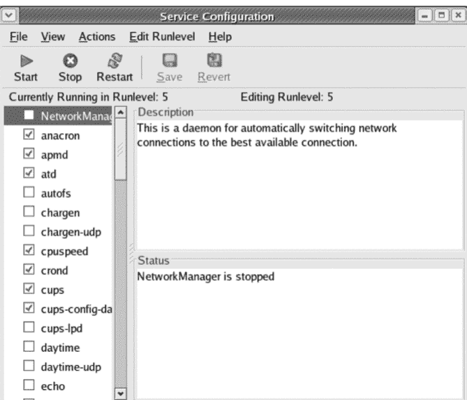

**图 8-2**

SysV 编辑器列出了运行在一个或多个运行级别（runlevels）中的服务列表，通常带有对每个脚本功能的描述。

当你启动计算机时，Linux 会进入一个运行级别。你可以通过编辑 `/etc/inittab` 中的 `id` 行来设置此默认运行级别。（该行在之前的“启动的错综复杂的网络”中描述过）。如果你想编辑特定运行级别下激活的服务，可以在“服务配置”中的“编辑运行级别”菜单中选择目标运行级别。

为了清理你的默认运行级别，请检查一遍服务列表并阅读它们的描述。如果你不理解某些内容，就让它保持现状。如果你发现某些你确定不希望默认运行的服务，请将其禁用。例如，你可能会发现 `cups-lpd` 服务处于激活状态。正如描述中指定的，这是一个允许通用打印系统（CUPS）使用旧的打印机守护进程（LPD）协议接受打印作业的服务器。如果你知道自己不想共享打印机，就可以安全地禁用此功能。（`cups-lpd` 服务器由 `xinetd` 处理，因此你需要先禁用 `cups-lpd` 然后重启 `xinetd`。）

### 使用本地启动脚本

SysV 脚本对于管理标准服务（如服务器和其他随发行版自带的其他系统工具）非常方便。但有时，你可能想做一些发行版维护者没有料到的事情。例如，你可能想运行 [Folding@Home](http://folding.stanford.edu) 程序，该程序将你的 CPU 时间捐给一个研究蛋白质分子组装的科学项目；或者你可能自己编译了一个标准服务器而不是从软件包安装它，并且你需要一些方法来启动它。假设你不想手动启动此类程序，你有两个选择：

- 你可以从头开始创建 SysV 启动脚本，或修改现有脚本以适应你的需求。如果你了解此类脚本是如何组合的，那么这是一个合适的选项，但如果你对 Linux 不熟悉，这可能会令人生畏。
- 你可以使用本地启动脚本，这是一种专门用于处理系统特定任务的特殊启动脚本。通常，你会在此脚本中放置对要启动的程序的简单调用，从而使程序在计算机启动时运行。

在这两个选项中，本地启动脚本绝对是最容易使用的。遗憾的是，虽然大多数 Linux 发行版支持此类脚本，但它们的名称和位置并没有统一标准。一些示例包括：

- Debian——`/etc/rc.boot` 中的所有可执行文件都被视为本地启动脚本，但 Debian 开发者鼓励在大多数大多数 SysV 启动脚本之前使用此工具。
- Fedora、Mandrake 和 Red Hat——`/etc/rc.d/rc.local` 文件是本地启动脚本。它在 SysV 启动脚本之后运行。
- Gentoo——`/etc/conf.d/local.start` 作为本地启动脚本。它在默认运行级别的 SysV 启动脚本之后运行。
- Slackware——`/etc/rc.d/rc.local` 文件作为本地启动脚本。它在启动过程结束时运行。


- SuSE——SuSE 本地启动脚本称为 `/etc/init.d/boot.local`。它在启动运行级别的 SysV 脚本之前运行。

要向这些脚本之一添加程序，请将其加载到文本编辑器中，并将你在命令行提示符下启动该程序的命令添加到文件末尾。例如，假设你编译了一个冷门的服务器 `megaserv`，并将其二进制文件放置在 `/usr/local/bin` 中。你可以通过在本地启动脚本文件中放置如下的一行来启动它：

```
/usr/local/bin/megaserv
```

你也可以为该调用添加你喜欢的任何选项。大多数服务器都可以这样启动，但某些非服务器程序和少数服务器应该在末尾加上 `&` 符号来启动：

```
/usr/local/bin/megaserv &
```

此符号告诉 Linux 在后台启动该程序。（大多数服务器会自动执行此操作，但大多数非服务器不会。）如果没有 `&` 符号，启动脚本将停止执行，直到程序终止。结果是启动脚本中的后续行将不会执行，且处理过程中的后续步骤（此启动脚本之外）也无法工作。

从本地启动脚本（或 SysV 启动脚本）运行的程序通常以 `root` 身份运行。对于许多服务器和其他系统程序来说这是很好的。有时，你想以普通用户运行程序。要这样做，你可以使用 `su` 命令，它可以切换用户身份。你可以在命令行提示符下使用 `su` 获取另一个用户的 root 权限，或者可以在启动脚本中使用它以普通用户身份启动程序：

```
su -c '/usr/local/bin/megaprog &' megauser
```

`-c` 选项传递一个要执行的命令（单引号内）——在此情况下为 `/usr/local/bin/megaprog`。命令以应该运行程序的用户名（如 `megauser`）结束。注意，如果需要的话，`&` 符号出现在 `su` 要执行的命令的单引号内，而不是在整个 `su` 命令行的之后。

通常，发行版提供的本地启动脚本是空的或几乎是空的。（它们可能包含一些注释和一点的清理代码。）因此，清理它们通常是不必要的。

### 定位异常程序

本地启动脚本运行的程序通常以 root 身份运行。这对于许多服务器和其他系统程序都是好的。有时，你想以普通用户运行程序。程序就像发脾气的孩子——表现糟糕。异常程序通常消耗过 CPU 时间或内存。结果会导致系统性能问题，因为资源变得不可用。第 7 章描述了这种问题的典型症状并涵盖了一些解决方案（如购买更多内存）。本章的其余部分将致力于跟踪特定的异常程序并解决问题。

### 查找 CPU 占用

Linux 内核负责为每个进程分配 CPU 时间。进程可以请求 CPU 时间，如果可用，内核就会授予该请求。大多数程序大部分时间都是空闲的——也就是说，它们不消耗 CPU。

你可以在命令行提示符下输入 `uptime` 来查看计算机的整体负载。结果是一系列系统统计数据，包括计算机运行的时间以及衡量所有程序请求可用 CPU 时间比例的三个负载平均：

```
$ uptime
15:29:54 up 24 days, 35 min, 23 users, load average: 1.73, 2.23, 1.94
```

在此示例中，负载平均分别是过去一分钟 1.73、过去 5 分钟 2.23 以及过去 15 分钟 1.94。由于负载平均是以可用 CPU 时间的比例表示的，你不需要了解计算机的 CPU 速度即可解释该值。没有进程请求 CPU 时间的计算机负载将为 0.00，而 1.00 表示单个进程请求了所有可用 CPU 时间（或多个进程的组合，每个请求的时间都少于可用时间）。负载在 0.00 到 1.00 之间表示 CPU 未被充分利用。超过 1.00 表示运行程序请求的 CPU 时间超过了可用时间，这意味着这些程序都无法获得最佳性能。

理想情况下，你的系统负载平均值应该是 1.0 或低。但在实践中，负载平均可能会高于此值，因为你在后台运行了 CPU 密集型程序，或者因为有多个人在使用计算机，每个人对 CPU 都有需求。桌面系统通常有

# 管理进程 195

负载平均低于 1.0，意味着运行中的程序对 CPU 时间的竞争很小——通常情况下，用户一次只与一个程序交互，而该程序可能不需要 100% 的可用 CPU 时间。

注意： 将 CPU 替换为更快的 CPU 可能不会降低负载平均；多个 CPU 密集型进程仍然会给它带来高负载。不过，更快的 CPU 会更快地完成单个任务。同样，使用慢 CPU 的系统可能会产生很低的 CPU 负载，但仍然看起来很缓慢，因为速度问题与 CPU 操作无关。

如果你的系统运行很缓慢并且报告的 CPU 负载高于 1.0，可能是某个进程挂起了——它陷入了无尽的循环，消耗了 CPU 时间但无所事事。也可能是你有一个或多个合法程序由于合法原因消耗了大量的 CPU 时间。无论何种，跟踪这些程序的一种好方法是使用 `top` 程序，这是一个用于跟踪资源使用的交互式文本模式程序。默认情况下，`top` 显示按 CPU 排序的进程列表，如图 8-3 所示。每隔大约两秒，列表就会刷新一次，反映启动、停止或改变所需 CPU 时间数量的进程。

检查你的进程列表，注意 `top` 输出中的最后一列（标记为 COMMAND）。查看 CPU 占用户是否出现在前几个条目中。`%CPU` 列显示程序在最后一个时间片内消耗的 CPU 时间百分比。在图 8-3 中，`FahCore_65.exe` 消耗了 97.4% 的 CPU 时间，其次是 13% 的 Xvnc。如果一个进程的该数值保持很高，说明它确实在消耗大量 CPU 时间，或者它挂起了。`TIME` 列也很有用；它显示进程消耗的 CPU 时间总量。在图 8-3 中，`FahCore_65.exe` 消耗了 5 分钟的 CPU，而 Xvnc 用了了 141 分钟的 CPU。

你如何解释这些结果？遗憾的是，仅靠 `top` 无法识别消耗过量 CPU 时间的程序；你必须结合对你系统的知识。嗯，图 8-3 是在一个我刚刚启动了 Folding@Home 程序（FahCore_65.exe）的系统上拍摄的。该程序确实消耗了大量 CPU 时间，但它是在低优先级运行的，因此不应该干扰其他程序。（`top` 输出中的 NI 列显示优先级，正数表示优先级降低。）Xvnc 进程是一个远程登录服务器，它已经运行了一天；因此，它累积了巨大的累计 CPU 时间。

# 第8章

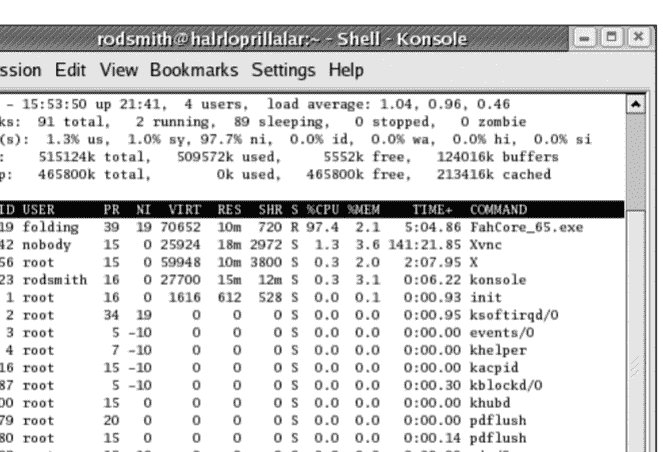

| PID | USER | PR | VIRT | RES | SHR | S | %CPU %MEM | TIME | COMMAND |
|---|---|---|---|---|---|---|---|---|---|
| 5739 | dolphin | 19 | 207052 | 13868 | 720 | R | 0.0 0.1 | 00:05.48 | Chrome_65.exe |
| 3542 | nobody | 15 | 029024 | 1897 | 117 | S | 0.0 0.1 | 00:14.21 | Xvnc |
| 3556 | root | 15 | 059948 | 12m | 380 | S | 0.0 0.3 | 02:07.95 | Xvnc |
| 3923 | root | 19 | 022700 | 15m | 120 | S | 0.3 0.1 | 00:26.22 | kworker |
| 1 | root | 16 | 01616 | 612 | 528 | S | 0.0 0.1 | 00:00.08 | system |
| 2 | root | 14 | 0 | 0 | 0 | S | 0.0 0.0 | 00:00.95 | kaskirqd/0 |
| 3 | root | 5 | 0 | 0 | 0 | S | 0.0 0.0 | 00:00.00 | events/0 |
| 4 | root | 7 | 0 | 0 | 0 | S | 0.0 0.0 | 00:00.00 | khperid |
| 16 | root | 15 | 0 | 0 | 0 | S | 0.0 0.0 | 00:00.00 | kpyid |
| 87 | root | 5 | 0 | 0 | 0 | S | 0.0 0.0 | 00:00.30 | klebd/0 |
| 100 | root | 15 | 0 | 0 | 0 | S | 0.0 0.0 | 00:00.00 | khubd |
| 179 | root | 20 | 0 | 0 | 0 | S | 0.0 0.0 | 00:00.00 | pdflush |
| 180 | root | 13 | 0 | 0 | 0 | S | 0.0 0.0 | 00:00.16 | plush |
| 182 | root | 15 | 0 | 0 | 0 | S | 0.0 0.0 | 00:00.00 | aie/0 |
| 181 | root | 15 | 0 | 0 | 0 | S | 0.0 0.0 | 00:01.16 | kswapd |


| 263 | root | 25 | 0 | 0 | 0 | S | 0.0 0.0 | 00:00.00 | kseriad |

| 381 | root | 15 | 0 | 0 | 0 | S | 0.0 0.0 | 00:00.00 | kjeum |

| 1315 | root | 6 | 1500 | 476 | 39 | S | 0.0 1 | 00:00.02 | udevd |

图 8-3：根据使用的 CPU 时间排序的顶部进程。

如果你的系统运行缓慢，并且你发现了一个无法识别或不应该消耗大量 CPU 时间的进程，如果该进程正在占用大量 CPU 时间，那么它可能就是罪祸首。如果你足够好，可以将该进程匹配到一个窗口，将其关闭或采取其他措施使其高效运行。如果没有，你可能需要通过查找程序的 `man` 页来深入识别；例如确定它为什么要消耗这么多 CPU 时间。如果你已经识别了进程并想杀死它，但无法直接访问界面（因为它是一个守护进程或未响应），请考虑“杀死进程”和“调整优先级”部分关于如何操作。无论如何，你应该记录 `top` 输出第一列中的进程 ID (`PID`)；你需要这些信息来杀死或调整它的优先级。或者，你可以使用 `top` 本身完成工作。

# 寻找内存占用户

有时程序会消耗大量内存。这可能是因为程序的设计就会消耗内存，因为它们被要求执行内存内存的任务，或者因为它们有导致请求过多内存的 Bug。无论如何，结果都是其他程序没有足够的内存。有时内存占用户本身无法获得足够的内存。

Linux 与所有现代桌面操作系统一样支持交换空间（swap space）。交换空间增加了灵活性，但它没有 RAM 快；当系统进入交换空间满足内存需求时，系统会变慢。在极端情况下，系统大部分时间会在交换空间和 RAM 之间移动，这种状态被称为抖动（thrashing）。当由于程序过度占用内存发生这种情况时，你应该尝试关闭该程序。当然，你必须首先识别该程序。

再次，`top` 是这项工作的出色工具。当首次启动时，`top` 按 CPU 时间排序。要改为按使用的内存排序，请遵循以下步骤：

- 输入 `F`（大写字母；小写 `f` 有其他效果）。结果是一个总结了 `top` 可以排序字段的屏幕。
- 输入对应你想要排序的 `top` 输出字段的字母。很好的选项是 `n`，对应 `%MEM` 列——即内存百分比。存在其他内存选项，但它们测量特定类型的内存使用，例如数据大小或使用的交换空间。
- 按回车键。结果应该是主 `top` 显示，如图 8-3 所示，但此显示将按选择的内存选项排序。

通过寻找 CPU 占用户，你可以通过查看 `top` 提供的列表查找消耗过多内存的进程。是否有进程消耗的内存远于其他进程？该值在增长吗？（如果是，这表明对内存的需求不足，可能是由于 Bug 或失控的数据处理。）如果你不确定可疑进程是什么，你可能想通过查找 `man` 条目来进一步研究；如果你的系统抖动得很厉害，执行此操作的时间可能非常长——你可能希望直接跳到终止故障进程的部分。

### 按名称查找进程

有时进程没有出现在 `top` 列表的顶部，但你仍然想终止它。如果你知道进程名称，找到它的一种方法是使用 `ps` 工具，它会创建一个进程列表。在不带任何选项的情况下，列表可能很短，因为只包含与你运行 `ps` 的 shell 相关的进程：

```
ps
PID TTY           TIME CMD
9066 pts/20    00:00:00 bash
8468 pts/20    00:00:01 nedit
28641 pts/20   00:00:01 xfig
29024 pts/20   00:00:00 xv
29079 pts/20   00:00:00 ps
```

此列表包含了 `top` 列表的部分信息——事实上，`top` 类似于 `ps` 的专门化和实时版本。你可能通过查看普通的 `ps` 列表找到所需的进程；然而，`ps` 提供了大量的选项，可以扩展它显示的进程数量、提供的信息或两者兼有。我发现特别困难的一对选项是 `ax` 和 `as`，组合列出计算机上运行的所有进程，并增加了输出中字段的数量。由于典型的 Linux 系统可能有几十或数百个运行中的进程，此命令的输出可能过了。答案是使用 Linux 管道（第 3 章描述）将结果传递给 `grep`，`grep` 是一个在其输入中搜索你指定的字符串的程序：

```
ps ax i grep xfig
28641 pts/20  S    0:01 xfig fig08-01.fig
29389 pts/26  S+   0:00 grep xfig
```

# 管理进程 199

警告！有时进程名称并不是唯一的。例如，你可能运行了多个 `xfig` 实例，在这种情况下，它们都会出现在 `ps` 的输出中。你可能可以通过注意输出中出现的任何选项来判断是哪一个进程，例如上一个例子中的 `xfig08-01.fig`（传递给程序的文件名）。在 `ps` 中添加 `u` 选项（使用 `ps` 而不是 `ps ax`）会向输出中添加用户名信息，如果有多个用户在运行同一个程序，这可能会很有用。

### 杀死失留进程

通常，处理严重异常进程的唯一方法是使用 `kill` 工具。在许多情况下，最简单的方法是使用程序自身的用户界面，但如果程序已经停止响应输入，或者它是一个服务器或其他缺乏用户界面的工具，就没选了。（不过，你可能向 SysV 启动脚本传递 `stop` 选项，或使用 GUI Sv 启动管理器来杀死服务器。）如果你已经使用 `top` 识别了异常进程，可以使用该工具来杀死这个麻烦源。还有一些 GUI 工具可以帮助完成这项工作。另一种方法是使用最基础的工具，它们（名副其实地）被称为 `kill` 和 `killall`。

### 使用 top 或 GUI 工具杀死进程

`top` 实用程序可以帮助你识别运行的进程，正如之前在“定位异常程序”中描述的那样。通常，`top` 不仅仅是一个垃圾标识器；它还是一个垃圾清理器！要按这种方式使用它，请遵循以下步骤：

- 找到之前描述的故障进程。
- 在 `top` 运行期间，按下键盘上的 `k`。程序将做出响应，在显示顶部的摘要信息和占据底部的进程列表之间提示你想要杀掉的 PID。
- 从进程列表的第一列输入你想要终止的进程的 PID 数字。程序将响应并询问你信号值。这是 Linux 向进程发送的数字代码，作为一种粗略的通信形式。表 8–1 总结了一些常用信号及其含义。
- 输入信号值并按回车键，或直接按回车键接受默认信号值 `15`。
- 如果进程在几秒钟内没有从进程列表中消失，重复步骤 2–4，但要使用更强的信号，即使用信号 `9` 而不是信号 `15`。

| 信号值 | 信号名称 | 目的 |
| :--- | :--- | :--- |
| 1 | HUP | 表示终端已关闭（“挂起”，故名如此）。服务器通常通过响应此信号来重新读取其配置文件。 |
| 2 | INT | 中断进程。当你在运行中的程序的终端中按下 Ctrl+C 时，内核会发送此信号。 |
| 3 | QUIT | 终止程序并留下核心转储文件（core dump），这是一个可以用于调试目的的文件。 |
| 9 | KILL | 不优雅地杀死进程，不给它保存文件的机会。 |
| 10 | USR1 | 此信号的效果取决于目标程序。详情请查阅程序的文档。 |
| 12 | USR2 | 此信号的效果取决于目标程序。详情请查阅程序的文档。 |
| 15 | TERM | 优雅地终止程序。程序通常可以在退出前保存保存已打开的文件并进行其他清理。 |
| 18 | CONT | 在 STOP 信号后继续操作。 |
| 19 | STOP | 挂起进程。类似于在运行中的程序的终端中按下 Ctrl+Z。 |

> 注意：表 8-1 并不完整；它只列出了一些最常用的信号。表 8-1 中的信号名称通常在名称前加上 `SIG`，例如是 `SIGKILL` 而不是 `KILL`。这些许多信号并不是终止进程的，但你可能在其他语境下发送它们，例如让服务器重新读取其配置文件。

对于杀死异常进程，通常最好从信号 15 (`TERM`) 开始，这是一种让程序终止的“礼貌”方式。如果该操作无效，信号 9 (`KILL`) 几乎总是能完成任务。如果 `KILL` 信号无效，且该进程是一个严重问题，你可能需要重启计算机。偶尔，某个进程无法被杀死但并不是主要威胁。例如，僵尸进程（在第 7 章中描述）无法直接杀死，但僵尸进程不消耗大量的系统资源，你可以安全地忽略它们。

> 注意：如果你以普通用户身份运行，你可以使用 `top` 终止自己的进程，但不能终止系统进程（由 root 拥有的）或其他用户的进程。要使用 `top` 终止任何系统进程或任意用户拥有的进程，你必须以 root 运行实用程序。

可以使用各种 GUI 工具来终止不需要的进程。其中某些工具，如 KDE 进程监控器 (`KPM`)，基本上是 `top` 的 GUI 版本，工作方式类似，但通过点击式界面操作。不过，另一个工具值得特别提及：`xkill` 是 X 服务器的一部分，用于终止单个 X 窗口。在 GUI 命令行提示窗口中，输入 `xkill`。shell 中会出现一条消息：


Select the window client you wish to kill with button `L1`....（使用 `L1` 按钮选择你想要杀死的客户端……）

鼠标光标会发生变化，当你左键点击一个窗口时，就会终止该窗口控制的进程。如果你可以看到窗口，使用 `xkill` 特别方便。

### 使用 kill 和 killall 命令

虽然你可以使用 `top` 或其他工具来杀死进程，实现这一目标最基本的方法是使用名为 `kill` 的工具。你可以通过名称或数字可选传递信号（如果省略名称或数字，`kill` 会发送 `TERM` 信号）。这样做需要你首先识别要发送信号的进程 `PID`。例如，假设你识别了一个 `PID` 为 `2872` 的异常进程。你决定用 `TERM` 信号终止它。以下任何一个命令都可以：

```
$ kill 2872
$ kill -15 2872
$ kill -s 15 2872
$ kill -TERM 2872
$ kill -15 2872
```

如果无效，在上述任何一个命令中使用 `KILL` 信号 (`9`) 代替 `TERM` (`15`)。当然，要这样使用 `kill`，你必须识别进程的 `PID`。如果你确定只有一个程序实例在运行，可以使用 `killall` 代替 `kill`。该程序的工作方式与 `kill` 类似，但它接受名称而不是 `PID`。例如，如果你想终止 `buggy`，可以使用：

```
$ killall -s TERM buggy
```

警告！某些 Unix 类系统的 `killall` 程序工作方式不同。这些 `killall` 工具不是杀死指定的名称进程，而是杀死所有运行的进程，从而关闭系统。如果你正在使用不熟悉的系统，在使用 `killall` 之前应该检查它的功能。

### 调整进程优先级

杀死垃圾进程通常有助于或必要保持系统运行顺畅；然而，这是一种激进的行为。通常，不那么极端的效果更好，特别是当问题是某个进程消耗过多 CPU 时。在这种情况下，降低进程的优先级可以产生奇效。这样做需要对进程优先级有一定的了解，所以我从这里开始。你可能想识别进程的优先级，所以下一个主题是这个。

### 什么是进程优先级？

正如之前描述的，Linux 内核负责为所有进程分配 CPU 时间。当没有足够的 CPU 时间可用时（即系统负载平均值超过 `1.0`），Linux 必须配给 CPU 时间。进程优先级是一个介于 `-20` 到 `+19` 之间的数字，代表了进程的重要性。如果你没有特别指定，默认优先级是 `0`。令人混淆的是，负数对应高优先级进程，而正数代表低优先级进程。实际调整优先级可以通过两种方式：以非标准优先级启动程序，或更改运行进程的优先级。

# 进程管理 203

内核不会赋予高优先级（即低优先级数字）的进程相对于低优先级进程的绝对优先权。例如，在上一个例子中，`megaguzzle` 将获得一些 CPU 时间，而 `supercrunch` 则不会。优先级数字确实会影响每个进程获得的 CPU 时间多寡。为了让 `supercrunch` 保持在 `-10` 的优先级，将 `megaguzzle` 的优先级从 `0` 更改为 `+10` 会减少它的 CPU 时间，再次将其优先级更改为 `+15` 将进一步减少其 CPU 时间。`-20` 和 `+19` 的极端值代表了对 CPU 时间的近乎垄占以及对其他所有任务的防御。你可能永远不会以 `-20` 的优先级运行，因为这会对其他进程产生过大的干扰。不过，你可能会使用 `+19`。一个 CPU 密集型但低优先的任务可以从这种设置中获益。例如，像 `Folding@Home` 这样的分布式计算程序消耗大量的 CPU 时间，但你可能不希望此类进程干扰你对电脑的正常使用。以 `+19` 的优先级运行它们意味着当任何其他程序需要 CPU 时，它们将占用极少 CPU 时间，但它们仍然能够有效利用进程之间的所有这些 CPU 周期。

> **注意：** 程序可以向下调整其自身的进程优先级（即向更大的数字调优）。某些低优先级的 CPU 密集型程序（包括 `Folding@Home`）在启动时会自动这样做。

## 识别进程优先级

如果一个进程正在消耗大量的 CPU 时间，你可能想检查它的当前优先级，以确定它是否真的给其他进程带来了问题。你可以通过 `ps` 或 `top` 实现这一目标。

要使用 `ps` 识别进程优先级，你必须向命令传递一个额外的选项：`-l`（小写的 `L`）。输入 `ps -l` 可以处理与当前 shell 关联的进程，但要查看所有进程及其优先级，你应该输入 `ps ax`。由于此输出很长，你可能想将其传递给 `less`（如 `ps -l | less`）以浏览内容，或使用 `grep` 搜索特定进程（如 `ps ax | grep xfig`）来查找 `xfig` 进程。

无论你如何操作，`-l` 选项都会在 `ps` 输出中添加几列新列。在这种新的输出格式中，`PID` 是第三列，优先级代码在第六列，标记为 `NI`，它代表 "nice"，这是系统用于以特定优先级启动程序的命令。（如果你按照建议的那样使用 `grep` 搜索特定进程，列标题会被删除；你需要数列数，而不是依赖列标题。）你在输出中看到的大多数程序优先级值都为 `0`，因为这是默认值。尽管尽管如此，也有一些更高或更低的值。通常具有负值（即高优先级进程）的是重要的内核或系统进程。

`top` 工具也会在标记为 `NI` 的列中显示进程优先级。（查看图 8-3；它是第四列。）由于 `top` 设计为只显示几个进程，你可能无法找到特定的进程——但如果你正在寻找运行异常的进程，CPU 大户会漂浮到 `top` 输出的最上方，因此这可以作为识别 CPU 大户并确定其优先级的方法。例如，图 8-3 显示排名最高的 CPU 用户是 `FahrCore_65.exe`，它消耗了 `97.4%` 的 CPU 时间，但优先级为 `19`。换句话说，该进程仅在其他进程不需要 CPU 周期时才消耗它们。

## 以非标准优先级启动进程

预防通常比治疗更好，本着这种精神，Linux 提供了一个简单的命令来以所需的优先级启动程序：`nice`。要使用此命令，请按以下顺序输入其名称、一个可选的优先级调整值、你想要启动的程序名称及其参数。优先级调整的形式为 `-n priority` 或 `-priority- `，其中 `priority` 是从 `-20` 到 `19` 的优先级数字。（这种第二种格式被认为是过时的，未来将不再支持。）如果你省略了优先级调整，默认使用值 `10`——即将优先级降低到接近最小的一半。例如，假设你想以优先级 `10` 启动 `supercrunch` 并让它加载 `celery.sch` 文件。以下任何一个命令都能达到效果：

```
$ nice supercrunch celery.sch
$ -n 10 supercrunch celery.sch
$ -n -10 supercrunch celery.sh
```

通过这种方式以降低优先级启动程序可以帮助避免问题，但通常没有必要。大多数 Linux 程序都表现良好，不会消耗它们需要的 CPU 时间。事实上，如果你直接与程序进行交互（例如文字处理器、Web 浏览器或邮件阅读器），你可能希望程序具有正常优先级，因为它们主要会在响应你自己的命令时请求 CPU 时间。如果给它较低的优先级，后台进程可能在你输入或或其他与程序交互时恰好请求 CPU 时间，导致程序响应变得迟钝。

总的来说，`nice` 最好适用于消耗 CPU 时间的程序，例如作为创建 MP3 或 OggVor 文件的工具、在视频文件格式之间转换、执行 CPU 密集型模拟，或将未使用的 CPU 时间捐赠给你喜爱的计算项目。此类程序往往需要几分钟甚至几小时才能完成工作，在此期间，你可能想用电脑做其他事情。通过使用 `nice` 启动此类程序，你可以全速运行其他几乎不或不占用 CPU 时间的程序；即你正在交互的那些 `nice` 程序。因为阅读器、Web 浏览器和文字处理器等程序消耗的 CPU 时间非常少，使用 `nice` 是很有意义的。你正在交互的那些 `nice` 程序。


# 进程管理 203

内核不会赋予高优先级（即低优先级数字）的进程相对于低优先级进程的绝对优先权。例如，在上一个例子中，`megaguzzle` 将获得一些 CPU 时间，而 `supercrunch` 则不会。优先级数字确实会影响每个进程获得的 CPU 时间多寡。为了让 `supercrunch` 保持在 -10 的优先级，将 `megaguzzle` 的优先级从 0 更改为 +10 会减少它的 CPU 时间，再次将其优先级更改为 +15 将进一步减少其 CPU 时间。-20 和 +19 的极端值代表了对 CPU 时间的近乎垄占以及对其他所有任务的防御。你可能永远不会以 -20 的优先级运行，因为这会对其他进程产生过大的干扰。不过，你可能会使用 +19。一个 CPU 密集型但低优先的任务可以从这种设置中获益。例如，像 Folding@Home 这样的分布式计算程序消耗大量的 CPU 时间，但你可能不希望此类进程干扰你对电脑的正常使用。以 +19 的优先级运行它们意味着当任何其他程序需要 CPU 时，它们将占用极少 CPU 时间，但它们仍然能够有效利用进程之间的所有这些 CPU 周期。

> **注意：** 程序可以向下调整其自身的进程优先级（即向更大的数字调优）。某些低优先级的 CPU 密集型程序（包括 Folding@Home）在启动时会自动。

## 识别进程优先级

如果一个进程正在消耗大量的 CPU 时间，你可能想检查它的当前优先级，以确定它是否真的给其他进程带来了问题。你可以通过 `ps` 或 `top` 实现这一目标。

要使用 `ps` 识别进程优先级，你必须向命令传递一个额外的选项：`-l`（小写的 L）。输入 `ps -l` 可以处理与当前 shell 关联的进程，但要查看所有进程及其优先级，你应该输入 `ps ax`。由于此输出很长，你可能想将其传递给 `less`（如 `ps -l | less`）以浏览内容，或使用 `grep` 搜索特定进程（如 `ps ax | grep xfig`）来查找 xfig 进程。

无论你如何操作，`-l` 选项都会在 `ps` 输出中添加几列新列。在这种新的输出格式中，PID 是第三列，优先级代码在第六列，标记为 `NI`，它代表 "nice"，这是系统用于以特定优先级启动程序的命令。（如果你按照建议的那样使用 `grep` 搜索特定进程，列标题会被删除；你需要数列数，而不是依赖列标题。）你在输出中看到的大多数程序优先级值都为 0，因为这是默认值。尽管如此，也有一些更高或更低的值。通常具有负值（即高优先级进程）的是重要的内核或系统进程。

`top` 工具也会在标记为 `NI` 的列中显示进程优先级。（查看图 8-3；它是第四列。）由于 `top` 设计为只显示几个进程，你可能无法找到特定的进程——但如果你正在寻找运行异常的进程，CPU 大户会漂浮到 `top` 输出的最上方，因此这可以作为识别 CPU 大户并确定其优先级的方法。例如，图 8-3 显示排名最高的 CPU 用户是 `FahrCore_65.exe`，它消耗了 97.4% 的 CPU 时间，但优先级为 19。换句话说，该进程仅在其他进程不需要 CPU 周期时才消耗它们。

## 以非标准优先级启动进程

预防通常比治疗更好，本着这种精神，Linux 提供了一个简单的命令来以所需的优先级启动程序：`nice`。要使用此命令，请按以下顺序输入其名称、一个可选的优先级调整值、你想要启动的程序名称及其参数。优先级调整的形式为 `-n priority` 或 `-priority-`，其中 `priority` 是从 -20 到 19 的优先级数字。（这种第二种格式被认为是过时的，未来将不再支持。）如果你省略了优先级调整，默认使用值 10——即将优先级降低到接近最小的一半。例如，假设你想以优先级 10 启动 `supercrunch` 并让它加载 `celery.sch` 文件。以下任何一个命令都能达到效果：

```
$ nice supercrunch celery.sch
$ nice -n 10 supercrunch celery.sch
$ nice -n 10 supercrunch celery.sch
```

通过这种方式以降低优先级启动程序可以帮助避免问题，但通常没有必要。大多数 Linux 程序都表现良好，不会消耗它们需要的 CPU 时间。事实上，如果你直接与程序进行交互（例如文字处理器、Web 浏览器或邮件阅读器），你可能希望程序具有正常优先级，因为它们主要会在响应你自己的命令时请求 CPU 时间。如果给它较低的优先级，后台进程可能在你输入或或其他与程序交互时恰好请求 CPU 时间，导致程序响应变得迟钝。

总的来说，`nice` 最好适用于消耗 CPU 时间的程序，例如作为创建 MP3 或 OggVor 文件的工具、在视频文件格式之间转换、执行 CPU 密集型模拟，或将未使用的 CPU 时间捐赠给你喜爱的计算项目。此类程序往往需要几分钟甚至几小时才能完成工作，在此期间，你可能想用电脑做其他事情。通过使用 `nice` 启动此类程序，你可以全速运行其他几乎不或不占用 CPU 时间的程序；即你正在交互的那些程序。因为阅读器、Web 浏览器和文字处理器等程序消耗的 CPU 时间非常少，使用 `nice` 是很有意义的。

### 总结：监控进程

Linux 计算机被视为一个动态系统，由一个管理多个进程的内核组成。即使是一个没有活跃用户程序的系统，也已经运行着几个基础的 Linux 系统进程，其中包含了许多用于处理登录、管理打印机等的进程。这些程序通过 SysV 启动脚本启动，修改运行的哪些脚本可以改变系统的特性——例如，从一个通用的 Linux 系统创建一个服务器或桌面系统。

除了登录脚本外，清理 Linux 进程还涉及定位不应运行或运行不佳的程序并对其进行处理。程序可能会因为消耗过多的 CPU 时间或内存而失控，将它们纳入控制可能涉及减少它们的 CPU 消耗或将其杀死。`top`、`kill`、`nice` 和 `renice` 等工具可以帮助完成这些任务，因此理解它们的基础知识对于保持 Linux 进程整洁至关重要。


# 账户清理

清理清单：

- 理解 Linux 中如何使用账户。
- 了解常见的账户类型和常见的特定账户。
- 使用文本界面和 GUI 工具创建和删除账户以适应系统需求。


了解为什么密码对系统安全非常重要，以及如何创建一个良好的密码。

使用文本界面和 GUI 工具为你的账户设置密码。

账户是 Linux 运行的核心，特别是对于 Linux 安全的许多方面而言。当你使用 Linux 时，你是通过账户在使用它。尽管这些账户对 Linux 的运行至关重要，但它们也可能成为垃圾的来源。你应该熟悉你系统上的账户，并知道何时删除未使用的账户以及如何删除。（不要随机删除账户；即使许多听起来很其妙的账户实际上对于正常运行也是必需的。）第二种主要的账户垃圾与密码有关。如果账户的密码很糟糕，或者密码被外部人员发现，它就会被用来进入你的系统。因此，你应该知道如何选择良好的密码、如何设置它，以及你可以采取哪些步骤来防止你的使用落入坏人手中。

## 为什么要使用账户？

如果你习惯了 Windows 9x/Me、OS/2、Mac OS 9.x 或更早版本或其他操作系统（OS），你可能会疑惑账户到底有什么大用。这些操作系统在没有账户的情况下也能运行良好，这可能让你认为账户只是一种概念。事实上，尽管简单的操作系统经常不需要账户，但它们在 Linux 中起着几个重要的作用：

- 多用户配置——账户允许你在单台系统上为多个用户保留配置。在 Unix 早期，这非常重要，因为计算机是昂贵的系统，供公司、大学或其他机构的许多用户使用。虽然现在的桌面系统通常只有一个用户，但多服务器系统仍然很常见。也许你的家庭系统被家里人都在使用，或者可能如果员工可以在办公室的任何一台电脑上工作，你的办公环境就可以简化。账户通过保持用户文件和配置分离来帮助实现。

- 多个并发用户——除了简单地为多用户提供更好的支持外，账户还帮助处理多个并发用户。也就是说，两个或更多人可以通过网络连接或专用硬件同时使用同一台计算机。如果没有账户，一个用户对桌面配置文件的更改很容易混淆另一个用户的显示。账户让各部分保持分离，简化了你对系统的使用。

- 账记录——账户允许你跟踪不同用户或不同进程的系统使用情况。如果一个用户使用了过多资源，你可以轻松地发现这一事实并与该用户交流，或者切断系统访问以防止进一步的滥用。这一功能在大型多用户系统上最重要，而家庭系统甚至是小企业使用的系统则。

- 安全级别——Linux 在系统管理和日常使用之间有着明确的区分，账户有助于这一点。特别是 root 账户是唯一允许执行某些操作的账户，例如用户直接访问大多数磁盘设备以及更改存储在标准位置的软件。这保护了多用户系统免受普通用户的意外或故意损坏。可以为其他账户或账户组实施额外的安全级别——例如，可以授予某些用户对调制解调器的读写写权限，让他们使用调制解调器的同时拒绝他们的其他能力。

事实上，账户的益处足以让流行的桌面操作系统（Windows 和 Mac OS）多年一直在向 Unix 模型偏移。Windows XP 和 Mac OS X 试图默认隐藏对账户的使用，但这只是表面，对于想要充分利用它们的人来说，很容易就能发现。大多数 Linux 发行版显式强制使用账户。如果你觉得这个 Linux 特性很奇怪或烦人，请给它一点时间。账户在你处理某些任务时设置了障碍，这些障碍是有正当理由的（主要是为了安全）。

> 警告！仅使用 root 账户就可以使用大多数 Linux 发行版，新的 Linux 用户有时会尝试这样做。但是，由于该账户的权限，除非绝对必要，否则你不应该使用它。作为 root 的一个简单类型可以轻易抹除整个操作系统！遗憾的是，至少有一个发行版（Linspired）将 root 作为默认用户账户。出于这个原因，我不建议使用 Linspired，或者至少将其重新配置为使用更常规的 Linux。

# 账户清理 211

### Gunkuster 的笔记本：使用账户

如果你的网络使用登录服务器，这部分大部分信息仍然适用。通常，系统管理账户、特殊系统账户和服务器账户都是本地定义的。因此，清理它们是有意义的。用户账户可能不在 `/etc/passwd` 和 `/etc/shadow` 中。要清理这些账户，你必须在登录服务器上操作。这些账户通常不存储在 `/etc/passwd` 和 `/etc/shadow` 文件中。它们的具体存储方式以及如何维护取决于特定的协议和网络软件套件。这个主题远超本书的范围。事实上，如果你有这样的系统，你的工资单上有一位网络专家，其职责包括清理这个系统。

### 常见但不需要账户

当你安装 Linux 时，你的发行版创建了很多账户。这些账户定义在两个文件中：`/etc/passwd` 和 `/etc/shadow`。这些文件的第一个持有基本账户信息，第二个持有密码和补充信息。你可能想审阅 `/etc/passwd` 文件以查看系统定义了哪些账户。如果你发现了不需要的账户，可以删除它们，正如后文“创建和删除账户”中描述的那样。通常情况下，账户分为四类：系统管理账户、特殊系统账户和用户账户。

> 注意：账户因发行版不同而异。如果你看到了这里没有描述的账户，或者没有看到这里描述的账户，请不要恐慌！可能你只是看到了发行版特有的特性。不过，有一种极小的概率该账户是入侵的迹象，所以你可能想调查一下该账户。在网上搜索该账户名称以及几个关键词，如 Linux 和 account。

### 审阅密码文件

首先，你应该了解 Linux 密码文件的格式，或者至少了解 `/etc/passwd`。你不需要了解这个文件的一切——只需要识别用户名和其他一些其他信息即可。通过在 shell 提示符处输入 `less /etc/passwd` 开始审阅该文件。结果应该是像这样的几行：

## 账户清理 213

```
root:x:0:0:root:/bin/bash
```

这些行非常多；即使只有一个用户账户的系统，也会会有 30 或 40 行，用于定义单个账户。每行由七个冒号分隔的字段组成：

- `Username`（用户名）——第一个字段（示例中的 root）是用户名。

- `Password`（密码）——第二个字段（示例中的 x）名义上用于加密密码；然而，出于安全考虑，所有的 Linux 发行版都将密码存储在 `/etc/shadow` 中，普通用户无法读取。`x` 表示密码是以这种方式存储的。

- `UID`——第三个字段（示例中的 0）是用户 ID（UID），是一个与账户关联的数字。Linux 在大多数情况下使用 UID 而不是用户名，但会透明地进行双向转换。如果你使用的某些少数需要 UID 而不是用户名的实用工具之一，你可能需要在 `/etc/passwd` 中查找此数字。

- `GID`——第四个字段（示例中的另一个 0）是与用户主组关联的数字。Linux 组被赋予了文件的组权限，并作为整个 Linux 安全系统的一部分。

- `GECOS`——第五个字段（示例中的 root）由于历史原因被称为通用电气综合操作系统（GECOS）。它通常包含用户的真实姓名，或者有时包含用逗号分隔的子字段，如用户的办公室号码、电话号码等。换句话说，它算是一个用于存放杂杂信息的万能字段。

- `Home directory`（家目录）——第六个字段（示例中的 `/root`）指定了用户的家目录。

- `Shell`（外壳）——第七个也是最后一个字段（示例中的 `/bin/bash`）指向用户的默认 shell——即当用户使用文本模式工具登录或在 X 中启动命令提示符实用工具时将运行的程序。

在追踪“脏乱”账户时，你必须关注账户名、UID、家目录和 shell。通常情况下，账户名就足以告诉你该账户是脏乱的；例如，你可能认出它是你几个月前为了测试而创建的账户。此类账户可以被删除。UID 对于识别账户类型非常重要，正如接下来的章节所述。此外，如果某个 UID 被重用，可能会带来麻烦，稍后也会描述。家目录和 shell 也可以为账户的功能提供线索。某些类型的账户在字段上应该具有特定的值，而其他值可能是系统被入侵的迹象。

Linux UID 具有特殊含义，值得描述一下。系统账户（即我在本章中称的系统管理账户、特殊系统账户以及某些服务器账户）的 UID 低于 100。普通用户账户的数字以 100、500 或 1000 开头，取决于发行版。对于用户账户 UID 可能落在 500 到 1000 之间的系统，最低的用户账户 UID 是该范围。这些命名约定对 Linux 内核没有特殊意义，除非 root 的 UID 值为 0，否则这些约定可以帮助你识别账户的意图用途。

**提示：安装 Linux 后，请备份你的 `/etc/passwd` 文件。以 root 身份将其复制到 `/root` 下的一个 root 可以读取的子目录，或者将其复制到软磁盘中。然后你可以使用这个“纯净”的账户数据库作为对比点。如果将来你发现了任何你不记得的账户，可以检查原始文件，查看它们在系统新安装时是否存在。如果当时存在，你就可以相当确定该账户的存在不是系统被入侵的迹象。如果它们最初不存在，它们可能是被入侵的迹象，或者是正常活动的迹象，例如为了支持你安装的服务器而添加的账户。**

## 系统管理账户


系统管理账户是用于或关联于计算机管理的账户。这些账户中最重要的是 `root`，它的 `UID` 为 `0`。事实上，任何 `UID` 为 `0` 的账户实质上都是 `root` 账户，无论它的名称是什么。因此，你应该执行一项检查，以验证 `root` 是唯一的 `UID` 为 `0` 的账户。黑客入侵计算机并添加一个 `UID` 为 `0` 的账户，或者将另一个账户的 `UID` 改为 `0`，这样他们无需实际使用 `root` 用户名或知道其密码就可以进入。如果你认为你的系统被这样入侵了，请立即断开网络并开始修复。最安全的办法是完全重新安装 Linux 并加强安全。遗憾的是，你可能不知道错误是如何引入的，所以加强安全可能会变得很糟糕。不过，像 `chrootkit` (http://www.chrootkit.org) 这样的工具对于识别你的系统安全是如何被破坏的可能有用。

此外，大多数默认 Linux 配置包含几个旨在管理但可能用于或不用于管理的账户：

- `adm`—该账户是一种次级管理账户。它存在于大多数 Linux 系统上，但通常是禁用的。它很少被使用，可以安全删除。
- `sync`—该账户的作用是调用 `/bin/sync` 作为登录 shell。该实用工具为关机准备磁盘。它通常不会被显式调用，可以安全删除。
- `shutdown`—该账户的作用是调用 `/bin/sync` 作为登录 shell。该实用工具为关机准备磁盘。它通常不会被显式调用，可以安全删除。
- `halt`—该账户的作用是调用 `/bin/sync` 作为登录 shell。该实用工具为关机准备磁盘。它通常不会被显式调用，可以安全删除。
- `operator`—该账户是某种次级管理账户。它存在于大多数 Linux 系统上，但通常是禁用的。它很少被使用，可以安全删除。
- `postmaster`—该账户与邮件系统相关。许多 Linux 发行版依赖邮件服务器，即使它不接受外部连接。
- `news`—该账户与本地 Usenet 服务器相关。大多数 Linux 系统不运行新闻服务器，因此删除该账户不会产生问题。
- `nobody`—该账户很特殊，因为它的 `UID` 是 `65534`，尽管它是系统账户。通常当程序作为低特权用户运行时使用。删除它可能会导致许多程序崩溃。

### 特殊系统账户

特殊系统账户是为了某些目的而存在的。通常 Linux 运行的以下是一些著名的系统账户：

- `bin`—理论上，该账户与二进制文件（即可执行程序）相关。在实践中，它似乎在被使用，因此可以删除。
- `daemon`—该账户被某些守护进程（即在后台运行的程序）使用。移除它可能是安全的，但如果你安装了需要它的守护进程，它的缺失会导致问题。
- `lp`—该账户拥有旧式的 BSD 分发行守护（BSD LPD）打印系统文件。如果系统使用的是较新的通用打印系统 (`CUPS`)，你可以安全地删除它。
- `mail`—该账户与邮件系统相关。许多 Linux 发行版依赖邮件服务器，即使它不接受外部连接。
- `uucp`—Unix 控制协议 (`UUCP`) 是一种旧的电话网络工具，该账户存在是为了支持 `UUCP` 实用工具。由于你没有使用此类工具，删除该账户应该是安全的。
- `man`—理论上，该账户与 Linux 手页系统相关。在实践中，它似乎在被使用，因此可以删除。
- `cron`—该账户与 Linux 的 `cron` 关联，用于按计划间隔运行应用程序。虽然该账户没有被频繁使用，但在几个工具中似乎仍有对它的遗留引用，因此我不建议删除它。
- `at`—该实用工具与 `cron` 紧密相关；它在未来时间运行程序，而不是像 `cron` 那样定期间隔运行。和 `cron` 账户一样，我不建议建议它。
- `games`—该账户用于拥有与某些游戏关联的文件。并不是所有游戏都使用该账户，但如果你在系统上玩游戏，可能应该保留它。

与系统管理账户一样，你可以删除不必要的系统账户；然而，在此之前，你应该备份你的 `/etc/password` 和 `/etc/shadow` 文件，以防该账户实际上比你最初设想的更重要。

### 服务器账户

许多服务器本身需要特定的特殊账户。事实上，特殊系统账户和服务器账户之间的界限可能是模糊的；例如，之前描述的 `lp` 和 `news` 账户与服务器紧密相连。我将它们描述为系统账户，是因为这些账户名称与它们使用的服务器软件包或协议的名称并不相同。大多数服务器以其服务器或协议命名，例如 `ftp`、`sshd`、`gdm`、`xfs`、`named`、`apache`、`cyrus`、`postfix` 和 `ntp`。它们的目的是提供唯一的账户，以便服务器以该身份运行。这种做法确保了在发生错误或配置错误时，服务器不会干扰普通用户或其他服务器或系统工具。

大多数服务器账户的家目录被设置为 `/dev/null` 或与服务器关联的目录（例如邮件服务器的邮件池目录）。由于这些账户并非设计用于用户登录，因此它们的默认 shell 被设置为 `/dev/null`、`/bin/false` 或其他无法作为实际 shell 使用的值。如果你发现某个服务器账户指定了传统的 shell（如 `/bin/bash` 或 `/bin/tcsh`）作为默认 shell，请进一步调查。此类配置可能是软件包维护者方面粗率的账户定义，也可能暗示你的系统已被攻破。

大多数服务器账户是在你安装相关服务器软件包时由 `RPM` 软件包管理器 (`RPM`) 或 Debian 软件包系统创建的，尽管少数账户可能作为 Linux 安装的一部分而存在。这些账户的问题之一是，它们在软件包被删除后通常会悬挂在那里。结果就像脖子上的鹅鸟——一个留着未使用账户所有风险的死重。

从好的一面来说，这些账户通常被配置为非登录账户，就像特殊系统账户一样。这意味着在对账户进行修改之前，它们无法被用于非法登录。尽管如此，删除它们可以规避某些可能修改它们的风险，从而略微提高安全性。出于这个原因，你应该在删除账户时表现得就像其关联服务器没有安装一样。与类似的更改一样，我建议在执行任何操作之前备份你的 `/etc/password` 和 `/etc/shadow` 文件。

## 第9章

如果你对此类账户产生怀疑，请查找创建它的软件包。（第 6 章“清理未使用的软件包”描述了软件包维护，包括软件包浏览工具。）如果存在一个与该账户同名的软件包，那么你不应该删除该账户，除非该账户是不必要的且你删除了它。如果你找不到以账户命名的软件包，那么它根本不是服务器账户（也许它是一个系统账户），服务器以一种不那么明显的方式拥有其账户，或者它是某个未安装服务器的服务器账户。如果你确定该账户名称与你未使用的服务器名称相同，请尽管删除该账户。如果不是，通过 Web 搜索可能会发现一些线索。

服务器账户的变体是程序账户。虽然这种做法并不常见，但少数非服务器程序喜欢为自己拥有账户。它们的目的以及验证和删除它们的程序与服务器账户相同。

### 用户账户

对普通用户来说，最可见账户类型是用户账户。正如你可能猜到的，这些账户供普通用户日常使用。你亲自添加了大部分用户账户，所以你应该对这些账户有很好的了解。在典型的家庭或小型办公室桌面系统上，你可能只有几个用户账户——也许只有一个你自己定义的账户。

某些发行版会自动添加一或两个用户账户。其中最常见的是 `guest`，它是低权限账户的典型名称，用于允许未知用户访问系统。例如，你可能会提供一个 `guest` 账户，允许用户在图书馆或大学计算中心的公共系统上登录并运行几个程序。

通常情况下，如果你不使用 `guest` 账户，你应该确保你的系统没有它。和其他其他不必要的账户一样，`guest` 账户是一个小的安全风险，如果你不使用它，没有理由让它存在。对于任何未使用的用户账户也是如此。

> 提示：临时创建一个用户账户可以是测试账户功能或新软件极极方法，即使在单用户系统上也是如此。这样做没有问题，但如果你创建了这样的账户，请确保在用完后删除它，不要让它变成垃圾。

### 创建和删除账户

现在你对系统中有哪些登录账户有了一些了解，你可能想要开始管理它们。出于清理垃圾的目的，这意味着删除账户，但你可能也想创建账户。例如，与其让住家里的四个人共享一个账户，你可以创建四个独立的账户，让每个人都有自己的配置和独立的文件存放地。

大多数主流 Linux 发行版都自带用于添加和删除账户的 GUI 工具，这些工具对于处理典型的账户管理任务完全足够。另一方面，用于账户维护的传统 Linux 工具是基于文本的：用于添加用户的 `useradd` 和用于删除用户的 `userdel`。这些工具提供了 GUI 工具无法比拟的功能和灵活性，而且它们可以在所有发行版的纯文本日志中使用，因此了解它们的一些知识是有益的。当你删除一个账户（特别是用户账户）时，你应该采取的额外步骤是跟踪该用户的文件并删除或归档它们。账户管理工具并不会这样做。

### 使用 GUI 工具管理账户

GUI 工具对新 Linux 用户很有吸引力，因为它们引导你完成管理账户的过程。尽管在大多数情况下，GUI 工具的灵活性不如它们的文本副本。它们在不同发行版之间也很大很大。事实上，某些发行版（如 Debian、Gentoo 和 Slackware）不使用 GUI 工具；在这些发行版中，通常的方法是使用后续节描述的 `useradd` 和 `userdel`。


与其尝试涵盖可能的 GUI 管理工具，我描述一个：Fedora 和 Red Hat 的 User Manager（也称为 `system-users`）工具。SuSE 的 YaST 和 YaST2 的编辑和创建用户工具在概念上类似的方法，但许多细节不同。在实践中，一旦你熟悉了基础，使用任何 GUI 工具都不应该有问题。但你需要知道你发行版的工具名称。

要开始使用 User Manager，你必须首先启动它。从默认 GNOME 或 KDE 菜单，你可以通过选择应用程序 > 系统设置 > 用户组来启动程序。结果是提示 root 密码（除非你最近启动过其他管理工具），然后显示如图 9-1 所示的 User Manager 。如果你在菜单上找不到相应的项目，或者你没有运行 GNOME 或 KDE，尝试在 shell 提示符窗口中以 root 身份输入 `system-config-users` 来启动程序。

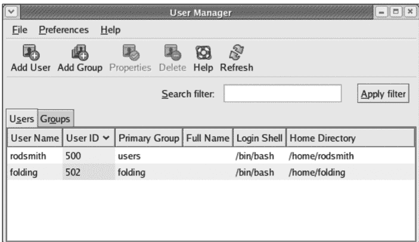

> 注意：User Manager 程序作为 `system-config-users` 软件包的一部分安装的。如果你正在运行 Fedora 或 Red Hat 但似乎无法运行该程序，请检查此软件包是否存在，如果没有安装，请安装它。第 6 章描述了软件包管理，因此请参考该章节获取有关如何执行此操作的更多详细信息。

实际上，使用 User Manager 管理账户非常简单。对于某些操作，你需要选择一个账户。（尽管在添加新用户时不需要这样做。）然后你可以可以通过菜单栏下方工具栏中指定的按钮执行各种操作：

## 账户管理

- **添加用户**—点击此按钮添加用户。结果将显示如图 9-2 所示的“新建用户”对话框。在所有字段中输入信息。（“全名”字段记录的信息存储在 `/etc/passwd` 的 `GECOS` 字段中。）在大多数情况下，你应该保持对话框下半部分的设置以及登录 shell（Login Shell）字段不变；默认值适用于大多数新账户。注意，当你输入密码时，它会显示为星号。这是一种正常的安全措施，防止别人从你肩后看到密码。请查看接下来的章节“选择良好的密码”，获取有关如何构造一个难以猜到或从密码文件中破解的密码的信息。

- **添加组**—你可以点击“添加组”来创建一个组而不是用户。Linux 管理组的方式与管理用户非常相似，但由于你可能只在拥有几十个用户的系统上才添加组，因此我没有在书中详细描述它们。

- **属性**—你可以通过点击此按钮更改现有账户的关键功能。结果将显示如图 9-3 所示的“属性”对话框。“用户数据”选项卡允许你更改创建账户时可以输入的大多数功能。“账户信息”和密码

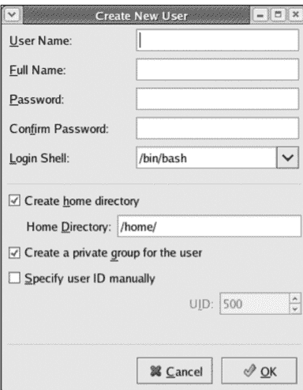

**图 9-2**

新建用户对话框提供了供你输入最重要账户信息的字段。

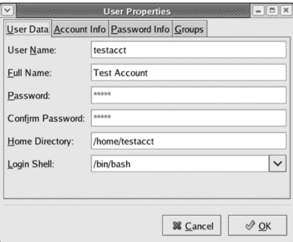

**图 9-3**

你可以使用“用户属性”对话框更改与账户相关的许多功能。

“信息”选项卡允许你更改账户和密码过期数据，如果账户在特定时间后过期（例如，如果是短期员工），这会非常有用。“组”选项卡允许将用户添加到任意数量的预存组中。如果程序的文档说明用户应该是某个组的成员，你可以使用此选项卡将用户添加到该组。

- **删除**—点击“删除”按钮删除账户。执行时会弹出确认对话框。该对话框包含一个复选框，询问你是否想要删除主目录、邮件池和临时文件。如果你想删除这些文件，请勾选此框；否则，请取消勾选。接下来的章节“删除用户文件”描述了如何手动执行。如果你想归档用户文件，请务必在删除账户之前对其进行备份，或者在删除账户时不删除文件，然后手动备份并删除原始文件。

你可以从“文件”菜单访问这些函数，如果你喜欢的话，也可以通过按钮访问。

## 使用 useradd

旧式的 Linux 系统管理员通常使用文本模式工具来添加或删除用户。虽然在运行 GUI 时如“用户管理器”之类的 GUI 工具很方便，但它们在文本模式登录下无法工作，而且它们通常不提供对更高级账户功能的访问。

文本模式用户管理工具第一个是 `useradd`，它——正如你猜的那样——将用户添加到系统。在最基本的形式中，你可以（以 root 身份）输入 `useradd` 后跟一个用户名来创建一个该用户名的账户：

```bash
# useradd jjones
```

此命令为 `jjones` 添加了一个账户。该程序没有任何输出，因此你看到的成功的唯一线索是 `/etc/passwd` 和 `/etc/shadow` 文件发生了变化，并且创建了 `/home/jjones` 目录。注意，你并没有被要求输入密码。你必须按照本章后面“设置密码”部分描述的，使用 `passwd` 单独输入密码。

正如刚才描述的，`useradd` 相比 GUI 工具的优势之一是 `useradd` 更多选项。你可能不需要使用某些冷僻的选项，但你可能想要包含这些：

- **- 更改主目录**—你可以通过通过 `-d` 选项传递新目录名称来指定 `/home` 默认之外的主目录，例如使用 `-d /home2/jjones` 将 `/home2/jjones` 作为主目录。如果你通过添加硬盘扩展了系统，并想在该磁盘上创建新账户，此选项最有用。

- **- 默认组**—`-g` 组将用户分配到指定的组而不是默认组。（在 Fedora、Red Hat 和其他一些发行版中，默认组是以用户命名的新组；在大多数其他发行版中也是如此。）在只有少数用户的小型系统中，默认值可能并不重要，但在较大的多用户系统中，组策略可能非常重要。

- **- 附加组**—你可以使用 `-G` 选项将用户添加到附加组，其中 `groups` 是一个或多个组名（如果你指定了多个组，则用逗号分隔）。

- **- 创建主目录**—`-m` 选项告诉 `useradd` 如果用户不存在主目录，则为用户创建一个主目录。此选项是 Fedora、Red Hat 和某些其他发行版的默认选项，但许多发行版默认不创建用户的主目录。如果你的系统配置为默认创建主目录，而你想强制系统不创建主目录，请传递 `-m` 选项。（等等，通常 `-m` 是创建它；文本说的是“强制……不”，但我将保留原始措辞）。

- **- 复制骨架文件**—在创建主目录时（如 `-m` 所示），`useradd` 会从 `/etc/skeleton` 复制文件。如果你想使用默认骨架文件，此选项最有用。

- **- 创建主目录**—`-m` 选项告诉 `useradd` 如果用户不存在主目录，则为用户创建一个主目录。此选项是 Fedora、Red Hat 和某些其他发行版的默认选项，但许多发行版默认不创建用户的主目录。

- **- 默认 shell**—`-s` 选项允许你为用户指定登录 shell。

- **- UID**—`-u` 选项允许你为用户指定 `UID`。

### 删除用户文件

删除账户的原因之一是清理它们占用的空间。你可以使用 `find` 查找此类文件。不过，要按所有者查找，你需要传递 `-user` 选项：

```bash
find / -user jjones
```

此命令形式仅在账户仍然存在时有效。如果你在删除账户后尝试输入此命令，`find` 会返回无效参数错误消息。并非完全丢失。如果你知道与账户关联的 `UID`，可以使用 `-uid` 参数进行搜索：

```bash
find / -uid 527
```

一旦你找到了用户的文件，就可以像删除其他文件一样，使用 `rm` 或 GUI 文件管理器来删除它们。不过，你可能需要以 root 身份执行此任务。

**注意：** Linux 允许任何对目录具有写权限的人删除该目录中的文件，无论文件所有者是谁。因此，取决于文件存储的位置，你**可能**可以作为普通用户清理几个文件。如果用户拥有该目录并拒绝其他人对该目录的写访问，你必须是 **root** 才能清理目录中的文件。如果目录设置了粘滞位（sticky bit），你也必须是 **root** 才能清理此类文件。这是一项目录功能改变了删除文件的规则，以防止文件所有者以外的任何人删除它。粘滞位通常设置用于文件交换和临时存储的目录上。

## 设置密码

保持系统没有未使用的账户是一项重要的“系统清理（degunk）”任务，但另一项清理任务涉及密码。具体来说，人们经常在系统上设置糟糕的密码。你应该学会如何选择良好的密码，并使用 GUI 或文本模式工具进行设置。这种做法对于维护系统安全大有裨益。如果你运行的是多用户系统，请确保所有用户都知道如何选择和设置良好的密码。最后一个关于密码的话题是保护密码；如果你对密码马虎并将其交给潜在的入侵者，即使是世界上最好的密码也无法保持你的系统安全。


**警告！** 保护密码非常重要，因为恶作之者可以将你的系统作为攻击他人的跳板，即使入侵者缺乏 `root` 权限。当入侵者的活动被追溯到你身上时，你可能可能需要背锅。同样糟糕的是，黑客可能会利用你被破解的账户和本地安全漏洞来获取你系统上的 `root` 权限。保护用户密码固然重要，但你应该加倍小心地保护你的 `root` 密码。这个密码不应该与你的用户密码相同，而且你应该比保护用户密码更加勤奋地保护它。如果恶作之者获得了你的 `root` 密码，你在清理系统时将穿上虚拟的生物危害防护服，而不是普通的橡胶手套了。

## 选择良好的密码

你已经在电影里看过无数次这种场景了：坏人（也许是好人——好人往往电影里经常做这种事）穿着一种只有在好莱坞才能看到的潜入办公室的服装闯入办公室。坐在电脑前，那个黑衣身影开始打字，我们看到电脑显示密码提示的镜头。在尝试两次之后，那个阴暗的入侵者露出了微笑：密码被猜到了！那竟然是电脑宠物科莫多巨龙的名字！随后，反派（或英雄）开始下载文件、破坏系统或大大作之为。

这种场景虽然在电影中很常见，但在现实生活中并不常见。基于密码的真实入侵通常是基于 `/etc/shadow` 文件的字典攻击。在此类攻击中，入侵者必须首先获得该文件的副本——它可能是从一次成功的 `root` 攻破中窃取的，或者通过某种其他方式被窃取，例如从安全措施不足的备份磁带上偷走。无论如何，入侵者都会运行一个大型字典，通过相同的加密算法对 `/etc/shadow` 中的密码进行编码。如果某个单词匹配成功，密码就被找到了。考虑到现代计算机的速度，尝试英语和其他十几种语言的每个单词，以及常见的拼写错误、组合和其他变体，是一项轻而易举的任务。在好莱坞的场景中，黑客有时会利用对受害者的了解来破入。尽管如此，这很可能被程序远程拒绝，但通过手动向系统输入密码则不会。

还存在其他发现密码的方法。有些就像观察别人输入密码一样简单。另一些涉及社交工程——欺骗人们泄露密码。这些技术中的许多可以通过稍加留心来阻止，正如稍后在“保护密码”中所描述的。

为了防止字典攻击和更具个性化的攻击，你应该学会如何选择良好的密码。目标是创建一个尽可能复杂且易记的密码。遗憾的是，这两个特征是相互矛盾的——人不像计算机，完全不擅长记忆随机的字母数字字符串。有一个非常有帮助程序是：

- 1. 选择一个基础。基础可以是两个短单词，例如 `bunpen`（来自 `bun` 和 `pen`），或者对你有意义的缩写，例如 `yiwtd`（代表 `yesterday I went to the dentist`）。如果你使用缩写，不要使用能拼成单词的缩写！我选择了六字母的基础，因为后续步骤会增加长度，而有些系统的密码最大长度为八个字符。不过，现代 Linux 系统通常不受限制。在实践中，八字符的密码应该被认为是最小安全长度。

- 2. **反转顺序。** 如果使用了两个单词，反转单词顺序。在这个例子中，结果将是 `nubpen` 和 `bumnep`（后者更好，因为 `bumnep` 不是一个单词）。你也可以反转缩写的顺序，但这可能帮助不大。

- 3. **随机化大小写。** 改变基础中某些字母的大小写。这可能会产生 `BlUnNeP` 或 `YiWiTID` 等许多可能。这对 Linux 有帮助。

- 4. **插入数字和标点符号。** 在密码中插入至少一个数字和一个标点符号。这会让密码变得难以破解得多。

# 第9章 230

**注意：** 当你以 `root` 身份更改密码时，不需要知道当前密码。在实践中，`root` 永远不需要知道用户的密码，事实上它**不应该**永远知道用户的密码。这一点稍后会提到。

## 使用 passwd

GUI 密码更改工具的文本模式等效工具是 `passwd`。在常用用法中，用户只需输入自己的名称即可提示更改：

**$ passwd**

```
Changing password for jjones
(current) UNIX password:
ter new UNIX password:
Retype new UNIX password:
passwd: password updated successfully
```

当使用 GUI 工具更改密码时，出于安全考虑，系统会提示你输入当前密码，然后你必须输入两次新密码，以确保第一次输入不包含拼写错误。

超级用户可以通过在调用 `passwd` 时添加用户名来更改任何用户的密码：

```
# passwd jjones
ter new UNIX password:
Retype new UNIX password:
passwd: password updated successfully
```

当 `root` 使用 `passwd` 时，不需要输入当前密码，只需输入新密码。

### 保护密码

很有可能，你不会在逛当地超市的货架时，故意把钥匙留在车顶上。人们经常会在密码上做类似的事情，尽管他们可能甚至没有意识到自己在这样做。在实践中，密码很难保护。存在许多窃取密码的方法，每种方法都有应对措施：

# 账户清理 231

- *窥视攻击（Shoulder surfing）——在公共和半公共环境中，潜在的入侵者会潜伏并观察你向电脑输入密码。防御方法是警惕周围环境，并在输入时尝试用身体、书籍或其他任何东西遮住键盘。如果可能，不要使用公共终端，或在他人附近时输入密码。如果你必须这样做，请频繁更改密码——并从私密位置更改。

- *网络嗅探——黑客经常安装嗅探器（一种监控网络活动的程序），以试图获取密码。网络嗅探与窥视攻击非常相似，都是试图在数据正常传输期间拦截数据。防止嗅探的常规保护是仅使用加密协议来交换密码。例如，使用 Secure Shell (`SSH`) 而不是 `Telnet` 或 `FTP` 进行远程文本模式访问和文件传输。幸运的是，在过去的十年里，未加密的远程登录协议已变得少见。遗憾的是，许多网站仍以未加密格式传输密码。

- *相同密码——为了减轻内存负担，许多人反复使用同一个密码。这种做法的缺点是，发现了你其中一个密码的入侵者将能够在许多系统上使用它。随着需要密码的网站激增，为所有网站想独特且良好的密码是不可能的。我建议你使用 Web 浏览器的“钥匙链”功能来记住所有密码（其缺点是如果你更改浏览器或丢失配置，会导致丢失大量密码），或者对有限的低安全网站使用该密码，并为你的计算机登录和高安全网站使用唯一的密码。

- *密码破解——如前所述，如果一个恶作之徒获取了你的 `/etc/shadow` 文件，入侵者可能能够破解某些用户密码。因此，你应该小心保护此文件。这包括保护对该文件的备份，特别是备份到可移动介质（磁带、软盘等等）。

- *钓鱼攻击——近期爆炸式增长的一种做法是钓鱼攻击，攻击者准备虚假的电子邮件或网站，诱导用户输入敏感信息。钓鱼攻击通常针对信用卡号而非密码，但某些攻击可能针对密码。这种做法的历史根源可以追溯到公共计算终端的虚假登录界面；攻击者运行一个看起来像登录界面的程序。该程序记录登录并看起来像用户输入了拼写错误，而实际上密码已发送给了攻击者。此类此类攻击的常规防御是保持适度的怀疑态度。一旦你知道它们存在，钓鱼邮件和网站就很容易识别。如果你有任何怀疑，

# 第9章 232

联系信息的声称来源，但不要使用电子邮件中提供的链接。在你的浏览器中手动输入真实的网站地址并找到联系信息。如果你正在使用公共终端且登录失败，这可能是合法的错误，但如果你有任何怀疑，请在登录后更改密码。

- *社会工程学——钓鱼攻击实际上是更广泛的攻击方法社会工程学的一种特定类型，在那种方法中，潜在的入侵者会索要敏感信息。当此类请求被包装在极有说服力的谎言中（有时甚至没有额外的修饰！），人们倾向于泄露许多他们不该提供的信息。一种众知的策略是攻击者给目标打电话或发送电子邮件，声称自己是系统管理员。这个冒充者随后说密码数据库已损坏，并向受害者索要账户密码以便检索。这种类型的攻击导致我之前说系统管理员不应该知道用户密码的原因。更准确地说，用户应该知道管理员永远不会向他们索要密码，以免落入陷阱。

- *翻找垃圾（Dump diving）——黑客翻找垃圾以寻找隐藏的宝藏，例如密码。这种风险是密码绝不应该写下的原因之一。如果你不把密码扔进垃圾桶，它可能会被别人发现。如果你出于任何原因写下了密码，你应该烧掉写有密码的纸，并在理想情况下更改密码。

- *不安全的文件——将密码存储在计算机文件中可能和写下来一样危险，因为许多人这样做。不幸的是，密码“钥匙链”对于许多人来说已成为必要。最好的办法是谨慎对待你的安全系统以降低风险。你可以采取的通用步骤是频繁更改密码。具体应该多久一次取决于判断。对于低安全系统，每年一次或更短就足够；对于非常敏感的系统，单次密码（在更改之前仅有效一次）可能是必要的。事实上，Linux 提供了工具帮助你强制定期更改密码。GUI 工具可能会提供此类选项（例如 Fedora 和 Red Hat 用户管理器用户属性对话框中的密码信息选项卡）， `passwd` 也支持启用这些功能。我没有强调它们是因为

**注意：** 尽管本章强调 Linux 登录密码，但这些原理适用于其他地方，事实上许多这些密码方法影响网站和其他网络密码交换。密码创建和保护的基本原理适用于任何系统上的任何密码。


作为个人用户，你可以采取所有这些步骤来保护你的密码。如果你在为其他用户管理 Linux 系统，你应该教育这些用户密码安全的重要性；许多这些应对措施是只有个人密码用户自己才能完成的。

## 总结：保持账户整洁安全

Linux 账户对于操作系统的正常运行至关重要。同时，账户可能会成为垃圾的来源。最明显的是，不必要的账户会系统混乱。这些账户可能成为安全破坏的潜在助力，特别是对于用户账户，它们可能会占用磁盘空间。因此，你应该检查你的账户并删除那些不需要的。


## 网络清理（Network Degunking）

**清理检查清单：**

- 识别并了解如何拦截基于 Web 的垃圾信息（gunk）。
- 理解拦截基于 Web 的垃圾信息产生的问题。
- 了解如何拦截垃圾邮件、蠕虫和其他电子邮件垃圾信息。
- 移除不必要的服务器并阻塞未使用的端口，以防止网络入侵者。
- 使用加密保护你的数据免在网络上被嗅探。

# 236 第 10 章

互联网一直是所有操作系统（OS）垃圾信息的主要来源。在全球网络中，总会有一些人表现得无知，或者意图足够恶意，以至于给所有人带来麻烦。幸运的是，你可以采取措施来规避这些问题中最糟糕的状况。在本章中，我将描述三大类类型的网络垃圾信息以及你针对它们的防御措施：基于 Web 的垃圾信息、电子邮件垃圾信息和网络安全威胁。诚实地说，这些类别之间存在重叠。最值得注意的是，某些类型的 Web 和电子邮件垃圾信息本身就是安全威胁。虽然本章绝非网络安全的终极定论，但我提供了足够的信息，帮助你防止最常见的网络垃圾信息给你造成严重问题。

## 清理 Web

对许多人来说，万维网（又称 WWW 或 Web）与互联网是同义词；然而，其他协议（如用于电子邮件、远程登录、设置时钟等的协议）也是互联网的一部分。尽管如此，Web 是互联网的重要组成部分，而这种显著性导致了多种类型污染 Web 的垃圾信息。了解这些类型的垃圾信息将帮助你避免它们对你造成太大的干扰。虽然你可以通过 Web 浏览器选项做很多事情，但我强调另一个工具：Web 代理服务器，它像一个过滤器，在 Web 垃圾信息到达你的 Web 浏览器之前将其移除。遗憾的是，无论你使用哪种方法来清理 Web，总会有一些垃圾信息漏进来，因为 Web 垃圾很难与某些类型的合规 Web 内容区分开。

### Web 上的垃圾

Web 可能是一个极其充满垃圾的地方。在理想状态，Web 运行顺畅，可以作为宝贵的信息源。但在糟糕的情况下，Web 可能变成一个粘稠、油腻、令人不快的领域——这正是垃圾的定义。事实上，基于 Web 的垃圾信息有许多形状和大小，包括：

- 糟糕的 HTML——Web 大部分文档都是用超文本标记语言（`HTML`）编写的。理论上，`HTML` 是一种跨平台标准，允许你的浏览器读取任何 Web 页面。在实践中，某些页面对 `HTML` 标准的遵循程度高于其他页面，某些浏览器处理特殊 `HTML` 的能力比其他浏览器更好。在实践中，针对粗糙 `HTML` 的最佳防御是准备几个浏览器；如果一个在某个页面上卡住了，另一个可能就能正常工作。
- 带有 Bug 或恶意的 JavaScript 或 Java——`JavaScript` 和 `Java` 是两种与 Web 流行的脚本语言。网站可以包含在用户计算机上运行的 `JavaScript` 或 `Java` 代码，以提供额外功能，或将 Web 服务器的一些 CPU 需求卸载到用户系统中。遗憾的是，`JavaScript` 和 `Java` 代码可能有 Bug，或者更糟，包含恶意内容。你可以禁用 Web 浏览器运行 `JavaScript` 和 `Java` 的能力，但这也会让你与一些 Web 合法内容以及一些垃圾信息隔离开。
- Cookies——某些页面会在你的计算机上使用 Cookie。这些代码帮助 Web 服务器将你的系统与你存储的个人偏好或其他数据关联起来。Cookie 可以帮助你保存偏好、在线购物并执行其他任务，但 Cookie 也可用于监视你。例如，它们允许广告商跟踪你访问的商业网站。你可以让你的 Web 浏览器拦截部分或全部 Cookie，也可以使用 Web 代理拦截 Cookie。不过，这可能会降低你某些某些 Cookie 功能的功能。
- 广告——十年前，互联网被认为是一个无广告区域——对于那些厌倦了持续广告轰炸的人来说是某种避风港。现在不再如此。现在的许多 Web 网站都带有广告。有些广告相当无害，但有些颜色或动画很烦人。也许最糟糕的是所谓的弹出窗口（pop-up）和弹出下窗口（pop-under），它们在自己的窗口中显示，你必须手动选择。现代浏览器具有可以阻塞你未请求的弹出窗口和弹出下窗口的帮助选项，代理服务器也可以帮助过滤更多广告。
- 不当内容——如果你是父母，你可能担心你不希望孩子在 Web 上看到的内容。通常，这是色情内容，但暴力内容或其他类型的网站也可能让你担心。拦截此类内容是某类 Web 代理的工作，它们通常以 Windows 上某个特定商业产品的名称 `Net Nanny` 为知。虽然原始的 `Net Nanny` 不在 Linux 上运行，但某些 Linux 代理服务器可以承担类似的角色。
- 带宽窃贼——许多此类垃圾信息（以及其他类型）的一个问题是它们会消耗你的网络带宽。例如，如果一个网站有几十个图片形式的广告，下载可能需要很长时间，减慢你获取所需信息的速度。即使你有快速的宽带连接，你可能注意到速度变慢。如果你按兆字节支付网络费用，Web 垃圾实际上会让你花钱！在 Web 浏览器中禁用某些功能（如自动显示图形）会有很大帮助。Web 也可以通过拦截特定类型的内容提供帮助。

遗憾的是，并不是所有类型的垃圾信息都能清理。例如，糟糕的 `HTML` 和带有 Bug 的 `Java` 或 `JavaScript` 是很难修复的。（尽管至少有一个 Linux 代理服务器 `FilterProxy` 尝试清理某些类型的 `HTML`。）不过，你的努力在移除 Bug 或其他不良内容方面是有效的。

### 使用清理 Web 代理

Web 代理服务器是很好的清理工具。它们可以同时为许多计算机和浏览器清理 Web，如果你想为许多计算机或浏览器实施相同的清理规则，这将极大简化你的配置工作。

要使用 Web 代理，你必须从开始选择一个。有很多，每个都有优缺点。我无法描述所有的 Web 代理服务器，所以在快速回顾热门选择后，我专注于配置和使用一个：`Privoxy` (http://www.privoxy.org)。

### 选择代理

设置代理服务器的第一步是选择一个。Linux 下有很多，包括：

- `Squid` 该代理服务器位于 http://www.squid-cache.org，主要设计作为 Web 加速器。通过缓存热门页面并从缓存返回结果而不是重复查询，`Squid` 可以提高浏览速度。这种优势在 `Squid` 服务于多个用户时最为明显。尽管有此主要功能，`Squid` 还提供了大量的可配置性，使其成为几个具有其他目标的代理服务器的基础。
- `SquidGuard` 该代理服务器构建在 `Squid` 之上，旨在根据用户、日期、时间、访问的页面等提供广泛的访问控制。你可以在 http://www.squidguard.org 了解更多信息。

## 网络清理

- `DansGuardian`——这是另一个基于 `Squid` 的代理过滤器。它旨在阻止包含攻击性内容的网站，例如色情或仇恨言论。默认设置适用于小学使用，但你可以根据需要更改默认值，使其更宽松或更严格。`DansGuardian` 过滤主要基于页面内容，而不是基于特定的待屏蔽 URL 列表。`DansGuardian` 的主代理地址是 http://www.dansguardian.org。
- `FilterProxy`——这个工具是一个通用的 Web 内容过滤过滤引擎。它的主要意图是提取广告并重写质量较的 `HTML`，但像 `Squid` 一样，如果你愿意花时间研究它，它足够灵活可以承担其他职责。请查看 http://filterproxy.sourceforge.net 了解更多信息。
- `Privoxy`——这台代理服务器总部位于 http://www.privoxy.org，基于较旧的 Internet Junkbuster（互联网垃圾清理器）。它旨在从你的网络体验中过滤广告（包括弹出广告）和 Cookie。

由于它的目的是移除大多数人认为烦人或反感的网络垃圾（即广告和 Cookie），我将在接下来的几个章节中详细介绍 `Privoxy`。不过，你可能更倾向于其他代理，但如果你想为儿童提供内容过滤器，`DansGuardian` 特别值得研究。尽管配置细节与 `Privoxy` 不同，但任何代理服务器（即配置 浏览器使用它）的操作对于任何代理服务器都是相似的。

### 运行 Privoxy


Privoxy 的配置文件通常是 `/etc/privoxy/config`，但该文件依赖 `/etc/privoxy` 中的其他几个文件来设置大多数细节——主文件只设置宽泛选项，例如 Privoxy 使用的端口号以及它用于存储详细配置的所有文件。在大多数情况下，配置 Privoxy 最简单的方法是让 Privoxy 本身来工作。但在第一次启动 Privoxy 之前，你可能需要处理一项任务：设置它使用的端口。像所有服务器一样，代理服务器在编号的端口上监听连接请求。该端口使用 `listen-address` 行设置：

```
listen-address 127.0.0.1:8118
```

此行默认设置告诉 Privoxy 使用 127.0.0.1 IP 地址和端口 8118 进行监听。如果你想为单个系统运行 Privoxy，这个配置是很好的；127.0.0.1 地址是回环地址，仅用于本地网络。因此，尽管 Privoxy 是一个服务器，但默认配置使其仅对运行它的计算机可用。

但是，有时你希望让 Privoxy 为许多计算机提供服务。在这种情况下，你应该将 Privoxy 绑定到计算机的主 IP 地址上。例如，如果计算机的 IP 地址为 192.168.1.7，你可能将 `listen-address` 修改为：

```
listen-address 192.168.1.7:8118
```

这将使 Privoxy 对其他计算机可用。如果运行它的系统直接连接到互联网，这可能会带来安全风险，因此请确保你确实想进行此更改。（如果你的网络由具有防火墙功能的路由器保护，风险会较低，但你可能需要检查路由器的配置，以确保它阻止了你用于 Privoxy 的端口。）

在所有情况下，Privoxy 的端口号也可以更改。默认的 8118 在大多数情况下都是没问题的。某些客户端使用端口 8000 或 8080 作为代理服务器的默认端口，这个值可以在客户端更改，因此在 Privoxy 中更改它意义不大。不过，你必须记住你使用的端口号。

一旦更改了地址和端口号，你就应该启动或重启 Privoxy。这通常通过 SysV 启动脚本完成：

```
# /etc/init.d/privoxy start
```

在某些发行版中，你可能需要将 `init.d` 改为 `rc`。如果 Privoxy 已经在运行且你更改了配置文件，将 `start` 改为 `restart`。

### 使用 Privoxy

要使用 Privoxy，你必须更改浏览器的配置。找到设置偏好或默认值的菜单选项。例如，对于 Mozilla Firefox，从菜单栏选择“编辑 > 首选项”。结果是一个“首选项”对话框，如图 10-1 所示。点击“连接”按钮获取“连接设置”对话框，在其中你可以指定代理，如图 10-2 所示。如果你没有使用 Mozilla Firefox，你可能需要寻找一下等同的选项。例如，在 Konqueror 中，你会选择“设置 > 配置 Konqueror”来获取“配置”对话框，然后点击此对话框左侧列表中的“代理”项。

一旦你找到了浏览器的代理服务器设置，你必须告诉浏览器如何使用该代理服务器。通常，这是通过点击选项来实现，例如图 10-2 中的“手动代理配置”，以指定

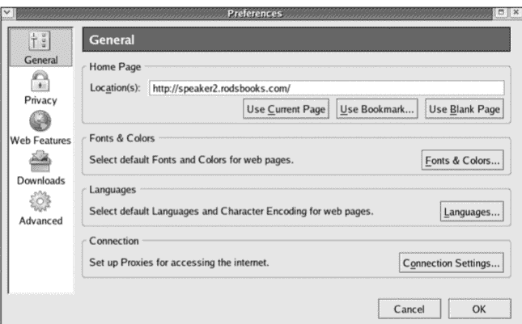

**图 10-1**

网络浏览器的偏好工具提供了使用代理服务器的方法。

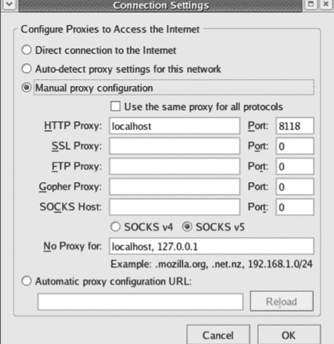

**图 10-2**

网络浏览器的偏好工具提供了使用代理服务器的方法。

## Gunkuster 笔记本：清理 Web 的风险

像 Privoxy 这样的工具的一个问题是，它们永远无法 100% 准确。代理会漏掉某些类型的垃圾，对非垃圾网站发出虚假报警，并通常会干扰某些网站的正常运行。大多数情况下，Privoxy 和其他清理代理运行良好，但有时它们会产生自己类型的垃圾。


解决此类问题的简单方法是禁用浏览器对代理的使用。你可以通过向浏览器提供异常列表来逐站点这样做，如前所述。但有时这并不起作用，因为问题出现在你正在查看的网站之外的其他引用上。临时禁用浏览器对代理的使用可以帮助解决问题，但由于在重新启用代理之前，这会将你的浏览器暴露在所有垃圾中。另一个选项是保留另一个配置不使用代理服务器的 Web 浏览器。当你遇到与代理服务器配合良好的网站时，可以运行这个 Web 浏览器。

注意，浏览器代理服务器可以被如此容易地禁用，如果你的目的是防止青少年定位色情网站等，这可能会是一个问题；他们可以简单地禁用浏览器的代理服务器设置直接上网。


# 第 10 章

## 244

在这些情况下，你确实有一个额外的工具，正如在“防止未经授权的使用端口”中所描述的防火墙设置。你可以在独立的防火墙系统中直接阻止儿童的计算机浏览，或者阻止除代理服务器软件以外的所有程序发送传出数据。遗憾的是，大多数 Linux 发行版提供的简单 GUI 工具无法配置此类规则集，因此你可能需要使用更复杂的 GUI 工具，或者设计你自己的 `iptables` 脚本来完成我在书中未描述的任务。如果你正在使用独立的硬件路由器，部分或全部的配置都可能涉及该设备，因此你可能需要查阅其文档。

## 优化你的电子邮件

广义而言，电子邮件分为两类：垃圾邮件（spam）和蠕虫（后者也称为病毒）。垃圾邮件是未经请求的批量邮件，基本上是一种骚扰。蠕虫的潜在危害性更强，因为它们是恶意程序。在实践中，蠕虫几乎总是针对 Windows 系统，所以运行 Linux 的你相当安全，但它们仍然会阻塞你的收件箱并占用你的网络带宽。事实上，存在阻止这两种垃圾信息的工具，而且垃圾邮件程序通常会同时处理这两种垃圾信息。最后，有些电子邮件本身很古怪——它们包含奇怪的字符或格式奇异。除非这些邮件恰好也是垃圾邮件或蠕虫，否则其内容并不是垃圾信息，只是看起来很像垃圾。知道如何处理此类邮件可以帮助你与发件者进行通信。

## 使用垃圾邮件和蠕虫拦截器

估计垃圾邮件和蠕虫占邮件总量的约 80%。这种无价值的邮件洪流很容易淹没你的合法邮件，导致你难以定位和回复合法信件人。为了减轻负担，存在许多工具可以从你的邮件流中过滤垃圾邮件。其中一些工具适用于任何邮件阅读器，而另一些则专为少数邮件阅读器设计。一旦你选择了反垃圾邮件工具，就必须配置它在你的系统中运行，并可能与你的电子邮件客户端配合。我将描述如何让 Evolution 邮件阅读器配合 `SpamAssassin` 工作。

## 选择邮件清理工具

你一眼就能看出什么是垃圾邮件。增强或缩小各种身体部位的产品广告、寻求帮助从国外走私物品的招募，以及声称你从未知道的账户即将关闭，这些都是明显的垃圾邮件类型——至少对于对垃圾邮件有丰富经验的人来说是显明显的。一旦你见过几次，电子邮件蠕虫也容易识别。它们通常声称来自你认识的某人，并包含一条关于你并未请求的附件的加密信息。

**注意：** 为了简洁起见，当我提到“垃圾邮件过滤”或类似词汇时，我指的是“垃圾邮件或蠕虫过滤”。大多数 Linux 垃圾邮件过滤工具在拦截蠕虫方面同样出色，因此从 Linux 的角度来看，这两个任务实际上是一个任务。

遗憾的是，计算机在识别垃圾邮件方面远不如人类。。由于严重缺乏人类技能和现实知识，计算机无法利用常识来剔除邮件。相反，程序员们想出了各种识别垃圾邮件的方法，包括创建用于发送垃圾邮件的 IP 地址黑名单、检查邮件内容中可能识别垃圾邮件的关键词，以及使用统计测试根据之前的分类来分类垃圾邮件或非垃圾邮件。其中一些工具（如 IP 地址列表）在邮件服务器上效果最好。其他工具（如统计测试）最适合在电子邮件客户端上使用。在 Linux 中，一些流行的反垃圾邮件工具包括：

- *邮件服务器选项*——所有主要的 Linux 邮件服务器包都提供反垃圾邮件工具，例如模式匹配选项和针对基于 IP 的网络黑名单的检查。如果你运行自己的邮件服务器，这些选项是最有效的，因此我在这里不介绍它们。

- *Procmail*——这个程序本身并不是真正的反垃圾邮件工具；它是 Linux 计算机本地邮件投递系统的一部分。它可以执行模式匹配并可以通过关键词或已知坏地址过滤掉垃圾邮件。你也可以使用 `Procmail` 调用其他反垃圾邮件过滤工具。如果你运行邮件服务器（这本身就是一个大话题），或者如果你想使用 Linux 的本地邮件队列功能来整合来自多个源的邮件（另一个大话题），你最可能在对抗垃圾邮件中使用 `Procmail`。

- *Bogofiler*——统计邮件过滤器于 2002 年出现，并证明了自己是强大的垃圾邮件斗士。`Bogofilter`（`http://bogofilter.sourceforge.net`）是一个快速流行的统计过滤器示例。它可以集成到邮件队列中，或从某些邮件阅读器中调用。它的主要缺点是需要垃圾邮件和非垃圾邮件的样本才能开始，因此在开始 `Bogofiler` 之前，你应该收集几天（或更久）的垃圾邮件。

- *Mailfilter*——大多数用户级反垃圾邮件工具在你下载信息并浪费了宝贵的带宽后才起作用。`Mailfilter` 的名可以在你下载之前从邮局协议（POP）账户中删除垃圾邮件，从而节省连接时间。`Mailfilter` 是一个简单的匹配器，因此没有 `Bogfilter` 和 `SpamAssassin` 这样复杂的工具那么有效且难以维护，但如果你使用的是拨号上网连接，或者当新的蠕虫失控并每天向你的收件箱填充数百兆字节的垃圾时，它可能变得特别有用。访问 `http://mailfilter.sourceforge.org` 获取更多信息。

- *SpamAssassin*——该程序总部位于 `http://spamassassin.org/`，结合了多种技术，包括模式匹配、基于 IP 的测试和统计测试。由于这些原因，`SpamAssassin` 非常庞大，但基础配置非常简单。许多 Linux 邮件阅读器都与它交互。世界在不断变化，新的反垃圾邮件技术不断开发中。

## 使用 Evolution 拦截邮件

大多数邮件阅读器都提供过滤手段。在 Linux 中，这通常通过将邮件阅读器链接到外部程序（如 `Bogfilter` 或 `SpamAssassin`）来实现。

> **警告！** 自动丢弃垃圾邮件是一个冒险的。。因为垃圾过滤器偶尔会产生误报，如果你这样做，可能会丢掉一些合法邮件。如果你将可疑邮件放在单独的文件夹中，你可以定期查看，或者在怀疑误分类时直接查看。

作为一个示例，我将描述如何配置 Evolution 使用 `SpamAssassin`。如果你使用其他邮件阅读器，程序将会有不同。如果你倾向于使用其他垃圾过滤器，此过程大部分将相同，但过滤细节会有不同。

1. 如果系统中尚未安装 Evolution 和 `SpamAssassin`。

2. 启动 Evolution，并在时配置其读取你的邮件。

3. 在 Evolution 中创建一个新文件夹来存放可疑邮件。（第 5 章描述了如何在 Evolution 中创建文件夹。）

4. 从 Evolution 菜单选择 Tools > Filters。结果是 Filters 对话框，它总结了 Evolution 安装的过滤器。默认过滤器集是空的；没有定义过滤器。

5. 在 Filters 对话框中点击 Add。这将产生图 10-4 所示的 Add Rule 对话框，你可以在其中创建过滤规则。

6. 在 Rule Name 字段中输入名称，如 `spam` 或 `SpamAssassin`。

7. 在 Add Rule 对话框的部分，选择以下选项：

在最左侧的选择器中（默认为 Server），选择 Pipe to Program。（某些版本的 Evolution 使用 Pipe Message to Shell Command 来表示此选项。）这样做时，If 区域的其他控件将发生改变，以反映适用于将消息管道到外部程序的选项。

**图 10-4** Evolution 使用过滤规则（这些规则可以匹配模式或调用外部程序）自动将电子邮件重定向到特定的文件夹。

在“Pipe to Program”（管道到程序）右侧出现的文本框中，输入 `spamassassin -e > /dev/null`。通常，SpamAssassin 会执行一些需要活动网络连接的测试。如果你离线读取邮件，可以在命令中添加 `-l`，即 `spamassassin -l -e > /dev/null`，这将禁用在线测试。

- 将“Returns”（返回）下拉框设置为“Returns Greater Than”（返回大于）。

- 将“Returns Greater Than”按钮右侧的值保持为 `0`。

- 在“Add Rule”（添加规则）对话框的相关部分，选择以下选项：

- 将最左侧的列表选择器设置为“Move to Folder”（移动到文件夹）。这是默认值）。

- 点击 <Click Here to Select a Folder>点击此处选择文件夹）按钮，并选择你之前创建的垃圾邮件文件夹。

- 点击“Then”标题正下“Add”（添加）按钮。

- 在出现的选择器中，选择“Stop Processing”（停止处理）动作。


## 点击确认

- 点击 `Add Rule` 对话框中的 `OK`。

- 如果你有多个规则，将垃圾邮件过滤器规则移动到列表中适当的位置。例如，你可能想将其放在将已知发件人的邮件移动到特定文件夹的规则之后，但在将邮件列表邮件移动到相应文件夹的规则之前。

- 点击 `Filters`（过滤器）对话框中的 `OK`。

此时，Evolution 将使用 `SpamAssassin` 来过滤你的电子邮件。此过程的关键在于调用 `SpamAssassin` 本身（正如第 7 步中创建的）。如果你愿意，也可以调用其他的垃圾邮件过滤器。

## 调整 SpamAssassin 的结果

如上述所示，简单地调用 `SpamAssassin` 将使用 `SpamAssassin` 的默认规则。但是，为了获得最佳效果，你应该调整你的 `SpamAssassin` 配置。其中一种方法是深入研究 `SpamAssassin` 配置文件，如果你不熟悉此类内容，这可能会变得有点棘手。尽管如此，进行此类更改可以帮助 `SpamAssassin` 的性能。你也可以将特定消息传递给 `SpamAssassin`，让其记录状态为垃圾邮件或非垃圾邮件，从而提高程序未来正确识别类似消息的能力。

`SpamAssassin` 使用两个配置文件：`/etc/spamassassin/local.cf` 是系统级配置文件，而 `~/.spamassassin/user_prefs` 是用户配置文件。对于桌面系统，你很可能会修改后文件。在任何一个文件中，你都可能想要更改几种类型的选项：

- 垃圾邮件阈值——`SpamAssassin` 通过给消息打分来工作。分数越高，越可能是垃圾邮件。（与统计过滤器不同，`SpamAssassin` 不会尝试为消息分配垃圾邮件概率，除非作为其自身子过滤器的一部分。）你可以更改 `required_score` 值来更改调用消息为垃圾邮件的阈值分数。将分数从默认值 `5.0` 调低可以使 `SpamAssassin` 更可能将内容识别为垃圾邮件；提高分数则降低消息被分类为垃圾邮件的概率。如果你发现 `SpamAssassin` 错误分类了太多消息，你可能需要调整此值。但要小心降低此值，否则可能会导致误报循环。

- 更改分数——与其更改整体垃圾邮件阈值，如果某个特定规则导致消息被错误分类为垃圾邮件，你可以更改其分数。这样做请使用关键字，例如通过 `MPART_ALT_DIFF 1.0` 来设置 `MPART_ALT_DIFF` 测试的分分为 `1.0`。可以从 http://spamassassin.apache.org/tests_3_0.html 获取规则列表及其默认分数，请咨询该页面。在此更改分数需要对分数以及为什么 `SpamAssassin` 将消息分类为垃圾邮件进行仔细研究。（我将描述如何操作。）

- 白名单——白名单是地址或其他邮件特征的列表，这些特征应该让邮件自动“放行”。例如，你可能想创建一个包含你的常用联系人地址的白名单。你可以使用 `whitelist_from` 选项将地址添加到 `SpamAssassin` 白名单，例如 `whitelist_from emily@example.com` 以允许任何带有该发件人地址的邮件通过。如果你想对地址建立白名单，可以将所有地址放在同一行并用空格分隔，或者创建多行 `whitelist_from` 行。`whitelist_to` 选项允许你根据收件人地址创建白名单（这对于邮件列表可能很有帮助），还有其他各种白名单选项。详细信息请咨询 `SpamAssassin` 文档。

- 语言检测——`ok_language` 选项允许你指定哪些语言是接受的。如果 `SpamAssassin` 认为消息是另一种语言，它将会被标记为垃圾邮件。此选项接受一个或多个双字母语言代码作为选项，例如 `ok_language fr` 表示接受英语和法语邮件。

还有许多其他可用选项。要获取这些选项的更多信息，输入 `perdoc Mail:SpamAssassin::Conf`。这将产生关于 `SpamAssassin` 配置文件的文档，类似于典型的 man 页（帮助手册）。

在正常运行期间，`SpamAssassin` 尝试动态更新自己。这对于它的统计规则特别重要。当 `SpamAssassin` 确定一条消息是垃圾邮件时，该消息的词会被添加到垃圾邮件列表中；当 `SpamAssassin` 将消息分类为非垃圾邮件时，它的词会被添加到非垃圾邮件词列表中。遗憾的是，这种分类有时是不正确的。对于此类情况，你可能希望微调列表。为此，你应该首先将消息提取到文本文件中。例如，在 Evolution 中，选择消息并从 Evolution 菜单栏选择 `File > Save As`（另存为）。你可以将消息保存到文本文件中。

- 研究 `SpamAssassin` 的分类。要显示 `SpamAssassin` 如何分类消息，输入 `spamassassin -t message.txt`，其中 `message.txt` 是文件名。结果是将消息回到屏幕上，随后是一系列描述在消息上触发的行。

- 手动训练统计过滤器。如果消息被误分类为垃圾邮件或非垃圾邮件，或者你有大量某类型的消息，你可以将它们传递给 `sa-learn`，它接受 `--spam` 和 `--ham` 选项分别将消息分类为垃圾邮件或非垃圾邮件。例如，输入 `sa-learn --ham message.txt`。

- 向在线数据库报告垃圾。`SpamAssassin` 的 `-r`（或 `--report`）选项将消息传递到在线数据库。要执行此操作，输入 `spamassassin -r message.txt`。一旦完成，相同的邮件将被拒绝。

- 将消息添加到白名单。你可以使用 `SpamAssassin` `-w`（或 `--add-to-whitelist`）选项将消息添加到白名单，例如 `spamassassin -w message.txt`。此过程类似于在配置文件中使用 `whitelist_from` 选项的效果，但 `-w` 选项添加的地址比你手动操作的多。

## 阅读外观奇怪的邮件

有时邮件看起来很糟糕，甚至到了无法理解。如果你收到一封邮件却完全毫无头绪，请查看可能的原因和对策：

HTML 显示为源码——越来越多的人使用 HTML 编写邮件；但如果你的邮件阅读器未配置解析 HTML，你将看到杂乱的 HTML 代码，如图 10-5 所示，该图了 KMail 显示一条 HTML 消息。某些邮件阅读器允许你通过点击按钮或点击此处查看格式化的 HTML 版本。

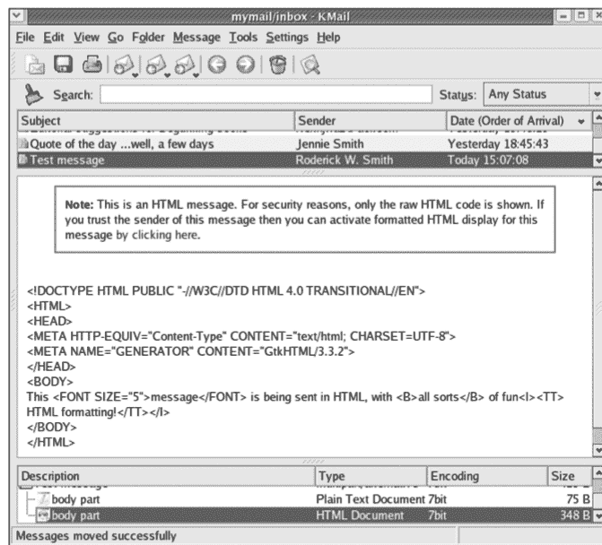

图 10-5

如果邮件阅读器默认不解析 HTML，HTML 邮件将难以阅读。

- 字体难看或大小不合适——如果你的阅读器会自动渲染 HTML（Evolution 默认就会这样做），你可能会遇到难看、太小或太大的字体。如果问题是大小不合适，请寻找字体大小选项。在 Evolution 中，这些选项位于“`View > Text Size`”（View > Text Size）菜单下。如果 HTML 中编码了奇异的字体，可能会更难处理。如果可用，禁用 HTML 解析的选项可能会有所帮助。如果你的大部分或所有消息因为字体太差而难以阅读，请在程序的配置菜单中寻找字体选项；也许你的默认设置得得不好。

- 外文字字体——大多数带有外文字字体（西里尔字母、中文或其他）的消息都是垃圾邮件，所以你应该尝试安装垃圾过滤器。（至少对于不阅读使用此类字体语言的人来说，这句话是事实的——其他人应该运用常识！）

- 不可读的附件——有时人们发送的附件无法阅读，因为它们是使用晦涩的 Windows 专用程序创建的，或者以某种奇怪的方式编码的。最好的办法是联系发送消息的人，请求帮助你阅读的信息，或者让他们以更常规的文件或附件格式重新发送消息。记住，奇怪的附件通常是 Windows 蠕病毒。显示的发送者可能并没有实际发送该消息；该系统可能感染了蠕病毒，或者另一个人的系统被感染并正在冒充显示的发送者。

## 提高你的网络安全

在整本书中，我反复提到安全是垃圾（gunk）的来源。许多安全问题集中在网络，因此这里是介绍一些网络安全问题的地方。这些包括移除不必要的服务器、阻塞网络端口、使用加密以及监控系统是否有入侵迹象。

> 警告！本章描述的步骤只是一些重要的安全程序。本书的各个章节描述了其他程序，例如保持软件更新。关于网络安全已经有整本书的作品了，所以我在这几页里只能触及一角！

### 移除不必要的服务器

Linux 有几十个、甚至数百个服务器程序可用。这些大多数服务器程序对于任何给定的 Linux 系统来说都是垃圾。即使计算机的主要功能是作为服务器系统，它可能只需要运行一或两个网络可访问的服务器。可以在该系统上运行的剩余服务器将占用磁盘空间、消耗内存并（最糟糕的是）带来安全风险。每个运行的服务器程序都是进入你计算机的潜在入口。漏洞或配置错误可能会给入侵者一个楔子，可能被用来更改关键配置文件，授予外部人员对你系统的部分或全部的控制权。由于此原因，你应该小心运行不必要的服务器，并采取步骤找出并卸载所有你不需要的内容。


移除不必要的服务器实际上是移除不必要的软件的一个特例，这在第 6 节“清理未使用的包”中描述过。如果你还没有读过那里，你应该读读。特别是，你应该熟悉你所在发行版的包管理系统——通常是 RPM 包管理器 (`RPM`) 或 Debian 软件包，但也可能是其他东西。你应该使用第 6 节描述的包浏览器来追踪你不需要的服务器包并将其删除。除此，你还可以使用特殊工具来追踪正在运行的服务器并移除它们。

## 统计你运行的服务器

网络安全足够重要，以至于你不应该停留在包管理器列表。服务器可能会在包描述中逃过你的注意，或者它可能在本地编译并安装后被遗忘了。额外的工具可以帮助你定位额外的服务器。特别是 Linux 的 `netstat` 命令是（几乎）全通用的网络工具，可以帮助跟踪开放端口——即用于接受外部连接的服务器。

要使用 `netstat` 定位开放端口，请结合使用它的 `-l`（小写 L）和 `-p` 选项。`-l` 选项导致程序显示所有监听连接的进程的信息，而 `-p` 创建额外的列通过进程 ID (`PID`) 号和名称来标识程序。后一个选项要求你拥有 root 权限获取所有 PID 和名称，所以你应该以 root 身份运行命令。输出可能很长，所以你应该通过 `less` 管道输出，以便你可以在输出中来回翻页，更好地研究结果。最后的命令看起来如下：

```
# netstat -lp | less
```

遗憾的是，该命令的输出可能包含比通常 80 列更长的行，因此你可能在执行它之前想放大终端窗口。图 10-6 显示了该命令在某处的输出：

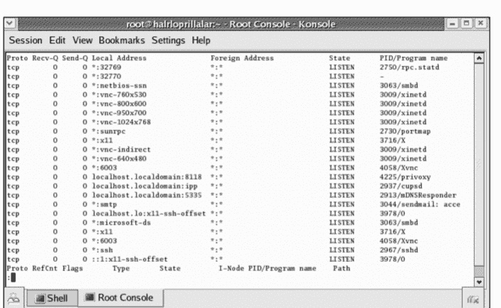

**图 10-6** `netstat` 命令可以产生大量的输出，但如果你知道如何精简它，输出可以是一个金矿。

`netstat` 命令输出中的重要列包括：

-   `Protocol（协议）`——Proto 列标识正在使用的协议。对于 TCP 端口、UDP 端口或 Unix 域接字，最常用的是 `tcp`、`udp` 或 `unix`。UDP 域接字完全是本地的，应与 TCP 和 UDP 端口配合使用。Unix 域接字并不构成风险——至少在 TCP 和 UDP 端口中不是。
-   `Local address（本地地址）`——Local Address 列标识服务器监听的 IP 地址和端口，用冒号分隔。在许多情况下，IP 地址报告为星号 (`**`)，意味着服务器正在监听所有接口。如果 IP 地址是 `127.0.0.1`，则意味着服务器仅在环回接口上监听。
-   `PID and program（PID 和程序）`——PID/Program 列通过 (`PID`) 号和名称标识程序。后一个选项要求你拥有 root 权限获取所有 PID 和名称，所以你应该以 root 身份运行命令。

### 识别运行的服务器

现在的诀窍在于解释 `netstat` 的输出。例如，在图 10-6 输出的底部，你可以发现运行在 22 端口上的 `sshd` 进程。你可能识别它属于 Secure Shell (`SSH`) 服务器。

-   你的包系统——你可能定位到服务器所属的包。输入 `servername`，其中 `servername` 是 Program 列中标识的服务器名称。这应该标识服务器的位置。然后你可以使用你的 RPM 或 Debian 包来读取其描述。
-   你的手页——输入 `man servername` 在 Linux 手页中查找有关服务器的信息。这可能不起作用，但你可以去寻找并找到它。
-   互联网搜索——使用你喜爱的互联网搜索对该程序进行搜索。这可能产生结果，但如果你输入的是数字而不是名称，不太可能找到任何内容。

## 防止未经授权的端口使用

即使你启动了不需要运行的服务器，也可能漏掉某些，或者服务器在未来的某个时刻可能会在你不知情的情况下启动。由于此原因，你可能想对未经授权的网络端口设置阻止。此类障碍通常以防火墙的形式出现，防火墙是一个在一个或小组计算机与更广泛的网络之间充当门卫的程序或计算机。

某些防火墙是为了许多计算机设计的，Gunk 笔记本侧栏“NAT 设备”涵盖了你可能考虑购买以保护小网络的某种防火墙类型。在利用 Linux 自己的工具保护单个 Linux 系统方面，尽管你将使用 `iptables` 工具或 GUI 前端来实现。该程序允许你创建多个

## 256 第 10 章

防火墙规则可以帮助你阻止对计算机的意外访问。

不幸的是，直接使用 `iptables` 需要创建可能几十条复杂的规则。幸运的是，大多数 Linux 发行版都提供了简化的 GUI 前端。例如，图 10-7 显示了 Fedora 和 Red Hat 安全级别配置（Security Level Configuration）工具，你可以在“系统设置 > 安全级别”菜单中找到它，或者在基于 X 的命令行窗口以 root 身份输入 `system-config-securitylevel`。

基础防火墙提供的选项非常有限。例如，图 10-7 所示的安全级别配置工具允许你通过勾选“信任服务”（Trusted Services）区域中的方框来启用对特定服务器的访问。如果列表中没有服务器，你可以在“其他端口”（Other Ports）字段中指定其端口号来添加它。当你将安全级别设置为“启用防火墙”（Enable Firewall）并点击 OK 时，系统应该关闭对所有其他端口的访问。

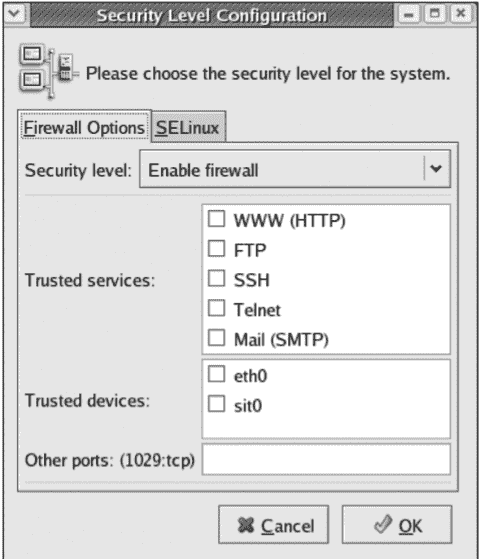

**图 10-7**

防火墙配置允许你对某些端口开放访问，同时限制对其他端口的访问。

## 网络清理 257

**提示：** 其他发行版通过其他名称提供防火墙工具，例如 SuSE 和 YaST2。如果你无法为你的发行版找到 GUI 防火墙，可以下载并运行一个通用工具来创建防火墙脚本，例如 Knetfilter (`http://expansa.sns.it/knetfilter/`)、`Firestarter` (`http://www.fs-security.com`) 或 Guarddog (`http://www.simzone.com/software/guarddog`)。或者，你可以深入研究 `iptables` 文档，在没有 GUI 工具帮助的情况下编写自己的防火墙脚本。如果你需要创建比安全级别配置等简单工具更复杂的防火墙规则，你可能需要寻求第三方工具或原始 `iptables` 脚本。

## GunkBuster 的笔记本：NAT 设备

如果你通过宽带链路（如 DSL 或调制解调器）将计算机或小型网络连接到互联网，你可能想要研究独立的网络地址转换（NAT）设备，通常称为宽带路由器或宽带防火墙。这些设备就像你的计算机正常操作一样连接到 ISP，并使用 NAT 使你的所有计算机都能通过该设备进行连接。NAT 是一种允许一台计算机“伪装”成许多计算机的技术。例如，当连接 NAT 的计算机拦截传出的连接请求并更改传出数据包中的 IP 地址时；当响应返回时，NAT 设备会还原该更改。因此，是服务器而不是客户端知道发生了变化。

这个额外的步骤具有某些优点。首先， NAT 计算机在整个互联网上只消耗一个 IP 地址，但理论上它可以服务于极其数量的计算机——对于一个拥有十几个系统的典型家庭或小型企业网络来说，这完全足够了。NAT 的另一个优势是它提供了类似于防火墙的安全性。（尽管这些设备通常被作为防火墙进行销售，但取决于你使用的定义，它们在技术上可能并不符合此类定义。）具体来说，来自互联网的入请求终止于 NAT 设备，因此黑客在没有先突破 NAT 路由器安全性的情况下，无法连接到你本地计算机上的任何不受保护的端口。

不过，NAT 路由器确实有自己的缺点。尽管 NAT 不干扰大多数协议，但它确实会慢或完全阻塞其他协议。例如，某些在线游戏和安全


协议在通过这些路由器时工作得良好。这些问题中的某些可以被规避，但你需要进行一些在线查找以找到解决方案。（它们通常针对特定设备。）

## 使用加密

互联网并不是一个安全的地方。发送到或从互联网发送的数据可能经过十个或更多计算机，并可能从更多系统上被监控（或被*嗅探*）。因此，当你通过互联网发送敏感数据（如密码或信用卡号）时，这些数据可能会被拦截并落入不友之之手。即使是看似无害的数据，理论上也可能对你不利——例如，在低安全性的 Web 论坛中冒充你的身份。

幸运的是，由于良好的加密软件可用性增加，互联网安全在过去十年中得到了极大提高。然而，为了有效，你必须*使用*这些软件。第一步是了解它们。某些类型的软件和协议包括：

- 使用旧的文件传输协议（FTP）从匿名站点下载文件是可以的，因为你没有使用密码，且文件是公开的，不包含敏感数据。Web 上使用的超文本传输协议（HTTP）也是如此。但在整个互联网的计算机之间传输敏感文件时，或者当你必须使用唯一的用户名和密码登录时，请使用 SSH，它支持加密，并且在安全很重要时比 FTP 好得多。


进入`/path/to/xxx`目录，找到`xxx.json`。

在表达式`cvar = avar + bvar`中，加法运算符（`+`）将`avar`与`bvar`相加，得到它们的和`cvar`

在`List.of(arg0, arg1, arg2)`中，`List`接口的工厂方法`of()`接受一系列的元素，返回包含它们的只读列表。

之后我们这样调用`cmd`命令：`cmd arg0 arg1 arg2`。

```
if (condVar > someVal) {console.log("xxx")}
```
[/content]

Wait that's example. Need actual processing.

Let's do proper.

[content]
## 远程登录

如果你需要登录到远程计算机以控制它，请使用`SSH`。旧的`Telnet`协议虽然可用，但对于登录会话来说非常不从心。虚拟网络计算（`VNC`）协议加密密码但不加密其他数据，因此它对于低敏感性登录或在局域网上可能是可以的，但不能用于在整个互联网上执行远程敏感任务。

## Web 交易

如第 5 章所述，在通过 Web 发送信用卡号或其他敏感数据之前，你应该确保你的 Web 浏览器已经协商了安全的 HTTP 连接，而不是传统的 HTTP 连接。在大多数情况下，Web 浏览器在使用安全连接时，会在窗口右下角显示挂锁或钥匙图标。这对于低安全性的站点是可以容忍的，例如，用于网上银行，但你应该小心，不要使用。

## 网络清理 259

### 电子邮件

大多数服务器使用的简单邮件传输协议（`SMTP`）本质上是不安全的，因此你不应该认为电子邮件是机密的。如果你必须使用电子邮件进行交换，请在两台计算机上安装加密软件，如 GNU Privacy Guard (`GPG`; http://www.gnupg.org) 并使用它加密你的消息。

### 文件共享

Windows 使用服务器消息块/通用文件系统（`SMB/CIFS`）旨在用于相对安全的本地网络。尽管`SMB/CIFS`可以使用密码，但这种加密可能很弱，且非密码数据是明文交换的。

非加密数据的最大威胁传统来自于整个互联网；因为数据在许多系统之间传递，存在许多拦截流量的机会。相比之下，本地网络一直是相对安全的，因为入侵者需要访问被攻破的本地系统甚至物理访问网络线才能拦截本地网络流量。因此，仅举一个例子，本地文件共享协议的安全性较低。同样，许多人在本地使用`Telnet`、`FTP`和其他未加密协议，即使他们做都不想在整个互联网上使用这些。

然而，无线网络协议的流行改变了这种局面。无线网络硬件的默认安全性通常很低。尽管许多设备提供了加密数据的选项，但用户通常没有启用这些功能，有时无线加密可以被较容易破解。因此，如果你正在使用无线网络，你应该做两件事：

- 阅读你的说明书并启用网络硬件上的任何内置加密。
- 不要假设你的“本地”无线流量是安全的，即使你启用了无线加密。

# 监控入侵

你应该始终记住，安全性绝不是绝对的。无论你多么仔细地移除不必要的服务器、用防火墙阻止端口，使用加密并执行其他预防性安全任务，但始终存在黑客比你领先一步的可能性。因此，你应该留意任何不速之客宾客，就像你对房子里蟑螂、老鼠和其他不受欢迎的生物的迹象保持警惕一样。

幸运的是，计算机入侵者不会在你的电脑周围留下粪便。不幸的是，这意味着你需要使用其他方法来定位他们。监控入侵者的一些方法包括：

- **了解你的系统**。如果你熟悉电脑的正常运行方式，那么你更有可能发现由入侵者引起的变化。例如，系统被攻破可能导致系统负载增加，在第8章“管理进程”中描述，或者以前运行可靠的程序变得变得不可靠，或者仅仅是表现得不同。如果你看到了变化，不要仅仅把它们当作生活之谜的一部分而付之不顾——要对它们进行调查。本书书中穿插的“去垢（deunking）”程序将帮助你追踪行为变化的源头。如果该变化似乎是由你没有安装的新软件或你没有创建的配置文件引起的，那么这可能是入侵的迹象。

- **监控日志文件**。Linux 将日志文件存储在`/var/log`及其子目录下。这些文件记录了服务器和其他关键系统进程运行的细节。此类文件经常包含入侵的线索。不幸的是，检查日志文件的每处变化将是一项全职工作，因此你可能需要将此类检查限制在某些其他事件引起你怀疑的时候。最重要的日志文件通常是`/var/log/messages`，但某些系统有特殊的日志文件，通常是`/var/log/secure`。报告你或授权用户未进行登录登录的消息会引起警报。消息丢失也可能是问题的迹象——入侵者经常会删除显示其入侵迹象的条目。他们可以在日志文件中留下可疑的间隙。条目是有时间标记的。

- **监控文件变化**。一种高级检测技术是监控系统文件的变化。诸如`Tripwire` http://www.tripwire.org 之类的工具可以帮助在加密数据库中保存你使用的所有重要文件的校验和。通过定期地将这些校验和与新创建的校验和进行比较，`Tripwire`可以相当可靠地检测入侵。不幸的是，`Tripwire`的正确配置相当繁琐，因此我没有在书中描述它。如果你的电脑直接暴露在互联网上，你应该认真考虑研究此软件。如果你怀疑被入侵并且正在使用基于 RPM 的发行版，输入 `rpm -Va` 将验证所有通过 RPM 安装的文件。程序可执行文件的更改是高度可疑的，但配置文件的更改是常见的，并且可能会淹没输出。请注意，如果入侵者使用 RPM 安装了修改过的软件，此方法失效！

## 网络去垢 261

- **检查新服务器**。入侵者有时会闯入一台服务器，然后安装或运行另一台新服务器，以便于以后返回。你可以像早些在“移除不必要的服务”中描述的那样，使用`netstat`来检测这些新服务器。因此，定期重复这种检查可以帮助你检测黑客。

- **检查可疑账户**。正如入侵者经常向你的系统添加服务器一样，他们也经常添加新账户或更改现有账户。因此，你应该定期检查你的账户数据库，如第9章“账户去垢”描述的那样，以发现账户的变化。

- **检查可疑进程**。黑客会让非服务器程序全天运行，即使在他们没有这样做时，他们在登录时运行的任何内容都会出现在进程列表中。因此，定期使用第8章描述的`ps`检查进程，可能会让你发现问题。但缺点是，一个典型的 Linux 系统可能运行几十个进程，因此识别一个可疑的进程可能是困难的。如果入侵者没有留下全天运行的东西，除非在你运行此命令时入侵者正登录，否则不会有被攻破的提示。

- **检查 rootkit**。`chrootkit`工具 http://www.chkrootkit.org 用于检查 rootkit，rootkit 是许多黑客使用的预包入侵工具。如果你怀疑你的系统可能被攻破，你应该下载该工具的最新版本并运行它。如果你的系统特别敏感，你可能想定期执行此操作。

> 警告！狡猾的入侵者经常更改系统实用程序，如`top`、`ps`和`netstat`，以隐藏他们入侵的迹象。因此，你不能依靠这些实用程序是追踪入侵者的可靠工具。为了起见，它们通常可以工作，但因为黑客通常不会替换你可能用于检测他们的所有实用程序。

你应该多久执行这些测试取决于系统的敏感程度。对于位于 NAT 路由器后的典型系统，每隔几个月或发现可疑情况时运行`chrootkit`和其他一两个测试就可以了。对于经常暴露在互联网上的敏感服务器，安装`Tripwire`并每天运行一些或更多检查，可能以自动化的方式进行是必要的。当然，对系统正常运行特征的基本关注适用于任何计算机。

## 总结：让网络垃圾远离你的电脑

互联网是一个奇妙的资源，但它也变成了垃圾的主要来源。基于网络和电子邮件的垃圾为常见。网络垃圾可以通过你的 Web 浏览器中的选项以及使用代理服务器来处理，代理服务器可以比浏览器规则清理更多类型的垃圾，并为多台计算机服务。电子邮件垃圾通常通过使用邮件阅读器来处理。除了这些形式的垃圾，互联网还可以作为入侵者的媒介。如果你的系统连接到互联网，通过删除不必要的服务器、设置防火墙和监控入侵来保护你的电脑至关重要。


# 为你的硬件寻找驱动程序

去垢清单：

- 识别硬件问题的来源。
- 知道在哪里寻找硬件驱动。
- 知道如何在 Linux 内核和其他程序中安装驱动。
- 知道如何更换硬件——在应该放弃的时候。

## 第11章 264

硬件去垢总是棘手的。识别问题真正源头的困难在于——有时看起来是硬件的问题其实不是。问题的复杂性在于大多数硬件制造商为他们的产品制作 Windows 驱动，但通常他们忽略了 Linux。因此，让任何硬件在 Linux 上工作的初始障碍是寻找驱动。虽然 Linux 自带大多数硬件的驱动，但当你安装新硬件或在旧硬件上安装 Linux 时，你应该知道在哪里寻找驱动。这些知识本身就能解决很多问题。当然，一旦找到了驱动，你就必须安装它们。最后，硬件问题有时只能通过更换硬件来解决——也许硬件坏了，也许它在 Linux 下不支持。无论哪种情况，在你花辛苦钱购买新硬件之前，你应该知道如何确定它确实需要更换，你还应该知道如何确定新硬件是否与 Linux 兼容。

## 故障排除

垃圾硬件通常会导致非常明显的问题。也许计算机崩溃，或者打印机不打印。不幸的是，这些症状并不能引导你找到问题的根源。例如，不稳定的打印机可能是因为电缆插入松动

## 通用硬件故障排除步骤

硬件故障排除可能是特别困难的，因为硬件问题往往难以捉摸。一个组件今天运行良好，明天可能失效。也许最糟糕的问题类型是那些随机发生且频率很的问题——例如每周导致一次系统崩溃的坏内存。这种时间跨度结合问题的不可预测性，使得旨在隔离原因的测试变得困难。

## 为你的硬件查找驱动程序 265

尽管硬件故障是一项艰巨的任务，但并非无法完成。一些通用步骤可以帮助你减少在这个过程中抓狂掉头发的次数：


- **做笔记。** 在深入解决硬件问题时，很容易忘记你尝试过什么，或者结果如何。做笔记可以帮助你收集和整理思路。

- **要有方法论。** 回想你高中的科学课，将你的调试会话视为一次科学实验。针对问题的原因建立相互竞争的假设，开发一个可以区分这些情况的测试，并实施该测试。例如，假设可能是电缆坏了，或者电缆没坏。测试方法可以是更换怀疑的电缆。

- **检查日志文件。** Linux 在 `/var/log` 目录下存储了各种日志文件。这些文件可能包含关于问题原因的有用线索。如果可能，在问题发生后检查文件的末尾。你还可能在 `kernel ring buffer` 中发现一些有用提示，它包含了内核的消息。在命令行提示符输入 `dmesg` 即可显示这些内容。

- **做些研究。** 尝试对与你的问题相关的关键词进行网络搜索。如果系统提供了错误信息，这种方法最有效；你可以将该信息输入搜索引擎中。我发现，搜索 Usenet 新闻组（地址为 `http://groups.google.com`）比通用的网络搜索更有可能发现有用信息。

- **确定触发条件。** 尝试找出是什么触发了该问题。这有时很难做到，因为硬件问题可能是随机发生的。不过，如果你注意到问题在某些特定情况发生时出现，请尝试该触发事件的变体。例如，如果打印机从 KWord 处理器打印文档非常慢，但从 OpenOffice.org 打印很快，请尝试 KWord 打印。你可能还会尝试从其他基于 KDE 的应用程序打印。也许你会发现问题出在一般的 KDE 上，或者与特定的打印机选项有关。这不会完全解决问题，但它将帮助你隔离故障。

- **尝试多个操作系统。** 硬件调试最困难的方面之一是确定问题是真实的硬件故障还是有 Bug 的驱动程序。在另一个操作系统中检查硬件是一个很有帮助的方法。例如，如果你的电脑支持多系统，这是最简单的；你可以尝试临时安装 FreeBSD、Windows 或其他操作系统（如果问题不在你的主硬盘上，也许可以装在另一个硬盘上）。在某些情况下，FreeDOS (`http://www.freedos.org`) 启动软盘会很有帮助。如果问题在多个操作系统中持续存在，那么它极可能是真实的硬件故障。如果它只在某一个操作系统中持续，那么很有率是驱动程序或配置问题。

- **更换硬件。** 这是可能的，尝试更换引起你问题的硬件。这并不总在经济上可行，但有时某个组件足够便宜，根据直觉更换它并不不合理。其他时候，你可以在电脑之间交换组件，甚至用更少的硬件来完成（如有必要，请朋友帮助进行临时“移植”）。例如，如果你的电脑有两个内存 DIMM，而你怀疑其中一个不稳定，你可以拔掉其中一个，测试系统，然后调换 DIMM 的位置。如果一种配置有效而另一种无效，你就找到了坏掉的内存。

这些程序不能保证能解决你的问题，但它们应该帮助你更接近解决方案。硬件故障排除可能会令人沮丧，需要勤奋、耐心和通解决解决能力才能找到大多数问题的根源。

# 常见硬件问题

尽管在 Linux 环境中可能出现的硬件问题数量极其惊人，但有几个问题特别常见。这些问题会反复一次地出现，所以当你遇到问题时，检查这些问题可能是值得的。

> 注意：有一组特别常见的硬件问题与 X 服务器配置有关。这个主题如此重要且广泛，以至于第 12 章“优化你的 X 配置”完全致力于该主题。

# 纠正系统崩溃

也许最令人沮丧的问题类型是系统崩溃——计算机直接停止响应输入并自动重启。Linux 通常是一个非常健壮的操作系统，很少发生崩溃。Linux 系统通常连续运行几个月而不重启。因此，如果你的系统发生崩溃，说明它出了问题，而那个问题几乎可以确定是硬件或驱动程序问题。

与驱动程序相关的崩溃通常可以被识别，因为有一个明确的触发事件。例如，当你尝试刻录 CD-R 时系统挂起，可能是你的 ATA 或 SCSI 控制器驱动程序不够稳定，或者你正尝试在 CD-R 刻录软件中使用不恰的选项。（通常情况下，后者不应导致系统崩溃，但如果结合驱动程序 Bug，就可能会。）如果你的系统在随机时间锁定或重启，很可能是硬件故障：

- **不稳定的电源**——问题来源之一是大多数人可能忽略的：电源。它是电脑箱里的一个矩形盒子，你将连接墙插头的电源线插入其中。电源可能太弱无法驱动所有硬件，导致在你尝试访问某些设备（如 CD-ROM 驱动器）时出现随机故障或问题。电源也可能损坏。我建议购买知名品牌，例如 PC Power and Cooling 或 Antec。廉价通用电源更容易引起问题。

- **坏的 RAM**——根据我的经验，内存故障是系统崩溃最常见的原因之一。如果你怀疑 RAM 故障，请使用 `memtest86` 等诊断工具。

- **坏的 CPU**——处理器故障很罕见，但会发生。它通常表现为负载下的系统死机或崩溃。

- **过热**——通风不良会导致组件过热。确保你的风扇正常且机箱清洁。

# 修改设备模式

Linux 高度依赖所有权和权限来控制设备访问。例如，为了播放声音，你需要访问音频设备，如 `/dev/dsp`。大多数发行版创建一个特殊组（如 `audio`）并将用户加入该组。如果发行版使用组访问方法，将用户添加到相应的组即可解决问题。

注意：此命令必须以 root 身份运行。理想情况下，你应该在尽可能少运行其他程序的情况下运行它。你可能还需要运行它几次以获得准确的读数——因为运行程序时同时发生的无关磁盘活动可能会干扰测试结果。

此命令的第一行输出（缓存读取）是缓存磁盘性能的衡量标准，这意味着它实际上是对计算机内存性能的测试。第二行（缓冲磁盘读取）是磁盘性能的衡量标准。在这种情况下，它显示的速度为 38.2MB/s。新硬盘的性能至少应该等同于此水平（此磁盘作为 Type 1 硬盘已经有一年的时间了，当你读到这段文字时，它会更老一些）。不过，如果你使用的是旧硬盘，性能可能会更糟糕。

磁盘性能不佳的原因之一是旧硬件——包括磁盘及其控制器或主机适配器。更换任何一个都可能有所帮助，但更换硬盘意味着要将 Linux 迁移到新磁盘。在进行任何激进操作之前，你可能想调查 `hdparm` 的调节选项。特别是，`-d1` 启用 DMA 模式，这与旧的 PIO 模式相比通常可以提高性能，而 `-X` 可用于设置多种 DMA 传输模式中的任何一种。在现代硬件上，以下命令应该优化磁盘性能：

警告！不恰当调整硬盘的 DMA 模式会导致磁盘挂起。磁盘挂起会导致系统“饥饿”，因此此过程非常有风险。只有在你确信硬盘性能没有达到其潜力时，才尝试尝试，然后你应该保存任何未售出的的工作，并卸载任何不需要挂载的文件系统，以防万一。

## 修复不稳定的网络连接

Linux 提供了优秀的网络支持，该系统通常运行得良好。然而，有时配置问题或硬件故障可能会导致性能问题。如果你的网络连接看起来异常缓慢或不可靠，你应该首先使用 `ifconfig` 检查一些基础统计数据：

```
$ ifconfig eth0
eth0 Link encap:Ethernet HWaddr 00:80:CB:FA:3B:0A
  inet addr:172.24.21.5 Bcast:172.24.21.255 Mask:255.255.255.0
  inet6 addr:fe80::280:c8ff:efe:3b0a/64 Scope:Link
  UP BROADCAST RUNNING MULTICAST MTU:1500 Metric:1
  RX packets:34968 errors:0 dropped:0 overruns:0 frame:0
  TX packets:340423 errors:0 dropped:0 overruns:0 carrier:0
  collisions:0 txqueuelen:1000
  RX bytes:74008469 (50.5 MIB) TX bytes:386741281 (268.8 MIB)
  Intermit:11 Base address:0xee0
```

此命令显示 `eth0`（第一个以太网卡）的状态；如果你没有使用以太网，可能需要将 `eth0` 更改为其他。完全省略设备名称也可以，但结果将是关于所有网络连接的信息，包括回环接口 (`lo`)，该接口可能并不重要。

无论如何，你应该首先查看 `RX packets` 和 `TX packets` 行。特别要查看错误和丢弃包的总数。如果这些数字很高，则表明存在问题。错误是由劣质网线或不稳定的网卡引起的，因此请更换这些组件。如果你更换网卡，请尝试使用知名品牌，如 Intel、3Com 或 Linksys。许多通用品牌使用最廉价的组件，更容易引发问题，特别是当硬件在高需求应用中被使用时。

冲突 (`collisions`) 的数量也可以作为诊断依据。当两台计算机尝试同时发送数据时，结果就像两个人试图同时说话；双方都无法理解。冲突通常表示你的网络负载过高。特别是如果你使用集线器而不是交换机连接计算机，并且你的网络流量很大，冲突是不可避免的结果。你可能通过将集线器更换为交换机来提高性能。交换机处理流量时更加智能，可以引导流量以避免冲突。

## 为你的硬件寻找驱动

### 寻找硬件驱动来源


许多硬件问题都可以追溯到驱动。因此，在你为 Linux 清理硬件时，必须对 Linux 驱动程序有所了解。这些知识的核心在于知道哪里可以寻找驱动，即它们在 Linux 系统中的安装位置，以及在你需要升级驱动时在哪里可以找到新驱动。

泛来说，驱动来源分为三类：Linux 内核、第三方内核驱动以及嵌入在非内核软件中的驱动。每种驱动都可以通过自己的方式被找到。（接下来的章节“安装驱动”将涵盖在你找到驱动后如何使其工作起来。）

### Linux 内核

Linux 驱动的主要来源是 Linux 内核。内核是任何操作系统的核心。它为程序分配 CPU 时间和内存，管理文件系统，控制网络访问，并作为硬件与内核软件之间的接口。驱动正是在这种角色中失效的；因此，内核大多数驱动的来源。（某些驱动位于软件组件中，比大多数软件更能与硬件通信。）

### 内核驱动的来源

Linux 的开放性使得寻找驱动变得很容易。具体来说，主流发行版以软件包的形式提供内核，与其他软件包一样。你可以使用第 6 章“清理未使用软件包”中描述的包管理工具升级你的内核包。如果你熟悉 Linux 管理工具，这种方法通常非常简单，但内核升级通常需要时间才能进入发行版，因此你可能需要等待才能修复它们。

- 寻找问题驱动的包。偶尔，第三方会为流行发行中的错误或缺失驱动发布驱动模块更新。此类包通常旨在填补发行版驱动覆盖的空白，而不是修复错误的驱动。

- 重新编译内核。你可以下载原始内核源码，自行编译，并使用你编译的内核。这种方法提供了最大的灵活性，但像任何自己完成的解决方案一样，需要最大的精力。

### 配置内核

如果你决定自己重新编译内核，你应该知道如何操作。这些信息对于泛理解内核模块也有帮助，因此我提供了该过程的简要概述。

首先，你必须获取内核源码副本。一个可靠的网站是 http://www.kernel.org。找到并下载完整的 Linux 内核压缩包——名为 `linux-version.tar.gz` 或 `linux-version.tar.bz` 的文件，其中 `version` 是版本号。格式为 `patch-version.tar.gz` 或 `patch-version.tar.bz` 的文件在没有前一个版本的情况下是没用的；这些文件仅提供更改，因此对于跟踪内核源码的人来说分发量小得多。

# 为你的硬件查找驱动程序 273

**注意：** Linux内核版本号由三部分组成，例如2.6.10。主版本号（本例中的 2）很少变动。第三个版本号（本例中的 10）变化相当频繁。中间的数字（本例中的 6）具有特殊含义：偶数表示**稳定版**内核，而奇数表示**开发版**内核，内核中会添加新的主要功能。除非你已经准备好处理不稳定的运行情况，并且确实需要某个已添加到此类内核但在稳定版内核中尚未提供的新功能，否则你应该避免使用开发版内核。

一旦你下载了内核源码，请在方便的位置将其解压（传统位置是 `/usr/src/`）。

```bash
# tar xvzf /path/to/linux-version.tar.gz
```

在示例中，`/path/to` 是文件所在的目录。如果你下载的是 bzip2 压缩文件（文件名以 .bz2 结尾的文件），请将 `tar xvzf` 改为 `tar xjf`。结果是一个名为 `linux-version` 的目录，其中存放着 Linux 源码。你应该通过输入 `ln -s linux-version-linux` 为该目录创建一个符号链接。

**注意：** 普通用户对 `/usr/src` 归 root 所有，因此只有 root 用户可以将内核源码提取到此目录。如果你更改了其权限以允许他人写入，普通用户就可以提取内核源文件、配置内核并对其进行编译。

此时，需要对 Linux 内核进行配置。进入 `linux` 目录并输入 `make xconfig`，它将显示一个与图 11-1 所示相似的窗口。你可以从此窗口配置内核，但请准备好花费几分钟时间，如果你不熟悉该流程，可能需要超过一小时。主要的配置区域出现在窗口左侧的窗格中。大多数选项的左侧有一个方框。点击某个区域可以在右上窗格中查看该区域的选项。如果方框是空的，则该功能不会被编译。如果包含复选标记，则该选项将直接编译到主内核文件中。（某些项目无法作为模块编译，或无法直接编译到主内核文件中。这是正常的。）当你选择一个项目时，右下窗格中通常会显示描述，但某些项目缺少描述。

**注意：** 如果你看到的不是图 11-1 所示的窗口而是错误信息，可能是你缺少了一些开发库。输入 `make menuconfig` 可能允许你使用文本模式工具而非 GUI 工具配置内核，或者你可能需要找到缺失的开发工具。


图 11-1

Linux 内核配置通过 GUI（此处所示）或文本模式工具完成。

内核包含的选项太多，我无法在这里全部列出。相反，你应该审阅它们并阅读它们的描述。如果对是否编译某项有疑问，请遵循选项提供的建议。当你配置内核时，选择 File（文件） > Quit（退出），并在生成的对话框中点击 Save（保存）。这将保存你对内核配置的更改，以便你稍后在“安装内核驱动程序”中描述的那样编译内核。

你应该意识到，从“通用”Linux 内核站点下载的内核不太可能具有与你的发行版内核匹配的默认配置。内核可能缺少重要的驱动程序——例如，你磁盘控制器的驱动程序。因此，你需要密切关注这些选项。你可能无法理解所有选项，并且很容易遗漏某些重要内容。因此，内核重新编译实际上是一项高级的去冗余技术。对于那些学习了如何操作的人来说，重新编译内核非常有用。通过省略不必要的驱动程序和选项，可以节省空间并提高性能。重新编译内核对于初学者来说可能很容易。**提示：即使你不打算重新编译内核，通过这种方式查看驱动程序也是有益的。你可能会发现一些未来非常有用的驱动，例如硬件厂商提供的驱动。**

## 第三方内核模块

内核驱动程序的主要来源是第三方内核模块。这些模块通常不是 Linux 源码树的一部分，例如 http://kernel.org。广泛来说，这些模块分为两类：

- 尚未添加到内核的开源驱动程序。由于某些原因，开发者尚未将其添加到内核，或者它们可能会被添加。

- 可能不会被添加到内核的专用驱动程序。这些通常以二进制形式发布，以支持 Linux。通常，我们建议避免使用第三方内核模块。开源版本通常处于开发阶段，这意味着它们可能不稳定，可能会导致计算机崩溃。*注意：并非所有硬件驱动程序都在制造商网站提供。事实上，许多制造商贡献了驱动程序，但也有时它们只是在自己的网页上提供。如果标准 Linux 驱动程序不稳定，你可以尝试制造商的驱动。*

当然，你可能没有太多选择可以使用第三方驱动程序。寻找它们的通常原因是标准内核中缺少了某些功能或不可靠。

某些第三方驱动程序以源码形式提供，在开源驱动程序中尤其如此。通常，你必须按照说明编译驱动程序，使其作为内核模块可用。有时你必须对内核进行补丁，这意味着将第三方代码与内核合并然后重新编译内核。如果是这种情况，请遵循驱动程序提供的说明。

某些第三方模块和许多专用驱动程序以二进制形式提供，无论是 tar 包或可以使用第 6 章描述的软件包工具安装的包。再次，你应该参考驱动程序的文档，因为安装程序在不同程序之间差异很大。

## 特定硬件软件

某些类型的硬件需要非内核驱动程序。例如显卡、打印机和扫描仪。除了显卡外，这些设备通常通过内核控制的设备连接 Linux，例如 USB 端口或并行端口。结果是内核控制与设备的通信，但非内核应用程序在更高层次控制设备，例如发送导致扫描仪扫描文档的命令。

# 为你的硬件寻找驱动程序 277

驱动程序集合出现了，例如 GIMP-Print (http://gimp-print.sourceforge.net) 和 Fomatic (http://www.linuxprinting.com/fomatic.html)。这些通常随着你的打印系统一起安装，如果你的驱动选择列表看起来很短，你可能想要查看这些包中的一个或多个。

- 扫描仪驱动——Linux 使用 Scanner Access Now Easy (SANE; http://www.sane-project.org) 软件包来控制扫描仪。该包包含了控制扫描仪的驱动程序（在 SANE 文档中称为“后端”backends），因此你可能不需要寻找标准 SANE 驱动集之外的其他驱动了。

在所有三种情况下，有时都可以获得厂商提供的和第三方驱动程序。（打印机驱动程序包是第三方开源的，但大多数 Linux 发行版现在都至少包含一个作为标准配置，它们稍微模糊了界限。）基于应用程序的驱动程序的注意事项与商业内核驱动程序相同。最重要的一点是，如果你使用它们，你可能会发现很难升级依赖它们的包。尽管如此，这些驱动程序可能非常好，甚至可能是使用某些硬件的必不可少条件。对于新的显卡来说尤为如此。一些显卡制造商，如 NVIDIA (http://www.nvidia.com)，现在很好地提供了 Linux 驱动程序，在硬件发布后就能充分利用其硬件访问。由 X.org-X11 或 XFree86 提供的开源驱动通常会滞后，因为开发者需要获取硬件并弄清楚它的工作原理才能制作驱动程序。

# 安装驱动程序


你安装驱动程序所采取的操作取决于具体的驱动程序。在所有情况下，你都应该咨询驱动程序附带文档（通常是 `README` 文件或类似的文件）。每一类驱动程序都有某些共同点，因此我在这里描述了内核驱动、X 打印机驱动和扫描仪驱动。

# 安装内核驱动

大多数 Linux 驱动程序都是内核驱动，而安装和使用新内核驱动的方法是 Linux 中任何驱动安装中最复杂、最棘手的。典型的新驱动程序安装涉及如前所述的配置新内核版本、重新编译内核、安装内核模块以及使用新内核重启。然而，有时过程会简单得多：如果你为当前内核准备了一个预编译的驱动程序模块，你应该可以在不重新配置内核或不重启系统的情况下使用它。（如果你有此类模块并想使用它们，请跳到 Gunkuster's Notebook 侧边栏“使用预编译内核模块”）

## 重新编译内核

安装作为标准 Linux 内核一部分的新驱动程序，大部分工作在于重新配置内核，如之前在“Linux 内核”中所描述的。完成后，你可以通过输入单个命令 `make` 来重新编译你的内核。你必须在内核源码主目录（通常为 `/usr/src/linux`）输入此命令。你可以作为普通用户编译内核，但前提是该用户使用了内核源码树中的所有文件和目录。

内核编译过程将从几分钟到一小时不等，取决于你选择的选项和计算机的速度。在此期间，随着内核编译过程的进行，你应该会在屏幕上看到摘要行。完成后，你将在 `/usr/src/linux/arch/i386/boot/` 目录下找到一个名为 `bzImage` 的新内核。

> **注意：** 在非 x86 系统上，内核名称可能是 `vmlin`、`vmlinuz` 或其他，且精确位置会有所不同——特别是 `i386` 将替换为系统 CPU 的代码，例如 Power 系统的 `ppc`。某些架构还使用额外的子目录，因此你可能需要稍微挖掘一下才能找到内核文件。

你应该将你的新内核文件复制到 `/boot` 目录，通常使用一个与其他内核区分的名称。附加内核版本号通常有效。例如，你可以从 `/usr/src/linux` 目录输入 `cp arch/i386/boot/bzimage-2.6.10` 将 2.6.10 内核复制到 `/boot`。你必须能够执行此命令，即使你是作为普通用户编译内核的。此命令将内核移动到标准位置，但它并不会让内核可用。对于这一点，你必须安装内核模块并准备你的系统使用新内核。

**警告！** 不要用你的新内核覆盖任何现有的内核文件！如果你这样做，并且如果你在内核配置中出了错，结果将是你无法启动计算机。虽然可以从此错误中恢复，但这需要使用紧急 Linux 启动介质重新安装已知的良好内核并重新配置系统以使用它。这是一个相当高级且混乱的清理任务，所以你最好不要冒险尝试。

## 为你的硬件寻找驱动程序

## 安装模块

要安装内核模块，请在 Linux 目录下以 root 身份输入 `make modules_install`。此命令将内核模块复制到 `/lib/modules` 的子目录下，并执行一些清理任务以使模块可访问。

> 注意：如果你正在使用 2.6.x 之前的内核，必须在输入 `modules_install` 之前先输入 `make modules`。这个额外的命令从主内核文件单独构建内核模块。对于 2.6.x 内核，Linux 更改了基础内核编译方式，使其从主内核文件单独构建内核模块，因此这个额外的步骤是不必要的。

## 启动新内核

除了配置内核之外，安装新内核最困难的部分是配置你的系统启动。内核的启动由加载程序处理，将内核加载到内存。Linux 通常使用两种加载程序：统一引导加载程序 `GRUB` 和 Linux加载器 `LILO`。`LILO` 是这两个产品中较老的，通过 `/etc/lilo.conf` 配置。`GRUB` 比 `LILO` 新，并已逐渐取代 `LILO` 多数发行版的默认引导程序。`GRUB` 通过 `/boot/grub.conf` 或 `/boot/menu.lst` 配置。要确定你的系统使用哪种加载程序，请检查这些文件。可能只有一个文件存在。但如果存在多个文件，请使用包管理器验证 `grub` 或 `lilo` 包。在这种情况下，我建议先配置你的系统使用 `GRUB`。

对于 `GRUB` 和 `LILO`，你都应该以 root 身份加载配置文件。它应该类似于列表 11-1 或 11-2，分别显示典型的 `GRUB` 和 `LILO` 配置。你不需要担心这些文件中的大多数选项。但你应该知道，文件分为两个部分：全局配置选项和每个要启动的操作系统或内核的分区。内核或操作系统分区通常但并非总是以不缩进的行开始（`GRUB` 中的 `title`，`LILO` 中的 `image=` 或 `other=`），并继续带有缩进行，直到下一个分区或文件结束。这种做法有助于你一眼识别不同的分区。要让加载程序引导新内核，你必须为它创建一个新分区。

### 11-1 典型的 GRUB 配置文件

```
default=0
timeout=10
splashimage=(hd0,4)/grub/splash.xpm.gz
title Linux
root (hd0,5)
kernel /vmmluz root=/dev/hda9
title Windows XP
root (hd0,1)
chainloader +1
boot
```

### 11-2 典型的 LILO 配置文件

```
prompt=100
timeout=/dev/hda
boot=/boot/map
map=/boot/map
install=/boot/boot.b
default=linux
lba32
image=/boot/vmlinuz
label=linux
root=/dev/hda9
read-only
other=/dev/hda2
label=windows
```

为新内核创建一个条目，请遵循以下步骤：

- 1. 以 root 身份将内核文件加载到你喜欢的文本编辑器中。
- 2. 复制现有的 Linux 段（stanza）。确保它是用于启动 Linux 或启动其他操作系统的段。在 `LILO` 中，Linux 段始终以 `image=` 开始。在 `GRUB` 和 `LILO` 中，它们都指向一个 Linux 内核文件，通常称为 `vmlinuz`、`bImage` 或这些名称的变体。
- 3. 修改段标题标签。在 `GRUB` 中，修改 `title` 行；例如，如果你安装了 2.6.10 内核，将其从 Linux 改为 Linux with 2.6.10 kernel。在 `LILO` 中，修改 `label` 行；例如，将 `label=linux` 改为 `label=linux2610`。（`LILO` 标签必须是单个单词，与 `GRUB` 不同。）
- 4. 修改复制的段以指向新内核。在 `GRUB` 中，内核在 `kernel` 行中被引用；在 `LILO` 中，它是段段的 `image=` 行。通常，你将 `vmlinuz`（大多数发行版的默认内核名称）、`bImage`（编译内核的常用名称）或其变体更改为你的内核名称。在 `LILO` 中，你必须包含内核的完整路径，例如 `image=/boot/bImage-2.6.10`。在 `GRUB` 中，当且仅当 `/boot` 是独立分区时，你才省略开头的 `/boot`。如果它是根分区上的普通目录，则包含此引用。
- 5. 将更改保存到配置文件并退出编辑器。
- 6. 如果你使用 `LILO`，请以 root 身份输入 `lilo`。此操作会将更新后的启动加载程序代码重新安装到 BIOS 能够找到的地方。`GRUB` 不需要等效的操作，因为它在启动过程中会读取其配置。

此时，新内核已经安装并准备好就绪了。由于它是内核，你必须重启计算机才能使用它。大多数发行版在 GUI 登录界面都提供了关机或重启选项，因此你应该注销并退出。如果没有提供此类选项，或者你没有在 GUI 下运行，请在 root 命令行提示符下输入 `shutdown -now`。

当系统重启时，你应该能在 `GRUB` 或 `LILO` 菜单中看到你的新内核选项。在某些 `LILO` 配置中，你必须输入标签名称。（在启动提示符处按 Tab 键会产生标签列表。）如果你没有看到新内核，说明你使用的启动加载程序不是正在使用的那一个。另一种可能是你正在使用 `LILO` 但但在更改后忘记输入 `lilo` 了。

如果一切顺利，你应该能够选择你的新内核并启动计算机。此时，系统应该正在使用新驱动程序。如果你将驱动程序编译为模块，它可能会自动加载，或者你可能需要执行模块加载命令，如 Gunkuster's Notebook 侧边栏“使用预编译内核模块”中所述。

# Gunkuster 笔记本：使用预编译内核模块

如果你获得了一个预编译的第三方驱动模块，你可能可以跳过重新编译内核直接使用它。通常，此类驱动以包的形式提供（你可以使用第 6 章介绍的包工具进行安装），或者带有特殊的安装脚本，将驱动模块放置在相应的驱动目录下。无论何种情况，你都应该阅读驱动随附的文档以学习如何安装它。


驱动安装完成后，你可能需要加载它才能使用。这通常会自动处理的，但如果没有，你可以使用 `insmod` 命令加载内核模块。输入此命令后跟模块名称，例如 `insmod floppy`。（此示例加载了标准内核软磁盘驱动程序。）如果你发现驱动在启动时没有自动加载，但你又想加载它，你有两个选择：

- 修改本地启动脚本（如第 8 章所述）以使用 `insmod` 加载模块。如果你理解系统的启动脚本处理过程，这种方法非常方便，但它被视为一种权宜之计的方法。
- 为你的模块修改 `/etc/modules.conf` 文件。在某些发行版中（如 Debian 和 Gentoo），你会修改 `/etc/modules.d` 子目录下的一个文件，然后运行一个特殊命令，而不是直接修改 `/etc/modules.conf`）。通常，你会创建一个指向模块并将其链接到特定子系统的别名行，例如 `alias eth0-via-rhine`，它会将 `via-rhine` 驱动映射到 `eth0`（第一个以太网）设备。这种方法是执行此工作的首选方法，但它要求你知道要链接设备设备名称。由于预编译二进制模块需要此类更改，其文档应该详细描述这些更改。

# 安装 X 驱动程序

要安装并使用 X 驱动程序，你必须做两件事：

- 1. 在 X 驱动程序目录下安装驱动程序。这通常是 `/usr/X11R/lib/modules/drivers` 或 `/usr/lib/modules/drivers`。如果你从制造商网站或其他来源下载了驱动程序，它可能带有安装脚本或说明；如果是，请按照它们操作。如果你只需要从一个标准驱动程序切换到另一个，可以跳过此步。
- 2. 重新配置 X 使用新驱动程序。这通过编辑后文描述的配置文件来实现。

大部分过程实际上步骤 2。X 配置文件的名称取决于你的 X 版本。大多数发行版使用 `/etc/xorg.conf`，但较新版本使用 `/etc/X11/xorg.conf.d/`。文件分为几个部分：Device、Screen、Input、Monitor 和 Server。

Device 部分指定要使用的硬件。例如：

```
Section "Device"
    Identifier "card0"
    Driver "vesa"
End
```

Screen 部分定义分辨率和深度。例如：

```
Section "Screen"
    Identifier "screen0"
    Device "card0"
    DefaultDepth 16
    SubSection "0"
        Modes 1024x768
    SubSection
End
```

Input 部分定义鼠标和键盘。例如：

```
Section "InputClass"
    Identifier "keyboard0"
    Driver "evdev"
    Option "Device" "/dev0"
End
```

Monitor 和 Server 部分定义显示器和 X 服务器本身，但这些部分很少需要修改。

## 为你的硬件寻找驱动程序

你可能需要使用包管理器安装包、运行安装程序或将文件复制到驱动程序目录。

无论你如何安装驱动程序，都需要通过编辑 `/etc/sane.d/dll.conf` 文件来激活它们。该文件由一系列行组成，每行都指向单个 SANE 驱动程序。这些行可以通过在行首使用哈希标记 (`#`) 来注释。如果你想使用某个驱动程序而它被注释了，请删除哈希标记并保存文件。

**提示：某些 Linux 发行版在 `/etc/sane.d/dll.conf` 中附带了所有驱动程序。** 另一些发行版则大部分或全部驱动程序都被注释掉了。如果扫描程序不需要探测不存在的扫描仪，它们的启动速度会更快，因此，你应该注释掉该文件中所有的行，只保留指向你正在使用的扫描仪的行。

一旦你从 `/etc/sane.d/dll.conf` 中取消了扫描仪驱动程序的注释，就应该使用 `scanimage` 来探测扫描仪：

```
$ scanimage -L
device 'epkowa:11busb:005:004' is Epson Stylus Photo RX500/RX510
flatbed scanner
```

`-l` 选项使用所有活动驱动程序探测扫描仪并报告结果。在这种情况下，找到了一个扫描仪：Epson Stylus Photo RX500 多功能扫描仪/打印机。如果此过程检测到了扫描仪，你应该能够使用扫描仪应用程序，如 XSane (`http://www.xsane.org`) 或 Kooka (`http://www.kde.org/apps/kooka/`) 来使用扫描仪。

有时如果 `scanimage -l` 没有检测到扫描仪就会出现这种情况。首先检查是否是设备权限问题（如前面“修改设备模式”中所述）。尝试以 root 身份运行命令。如果你以 root 身份可以检测到扫描仪但作为普通用户不能，则说明你的设备权限设置错误。

另一个可能的问题源是扫描仪特定的配置文件，它们位于 `/etc/sane.d`。这些文件以它们控制的扫描仪或驱动程序命名，例如，为 Epson 为其扫描仪提供的驱动程序 `epkowa.conf`，或为 Umax 扫描仪提供的 `umax.conf`。这些文件包含高度设备特定的配置选项。在大多数情况下，这些选项运行良好，但偶尔你可能需要对它们进行调整。例如，如果你以异常方式连接了扫描仪，你可能需要更改设备文件名。如果你不懂文件内容，我建议在进行研究之前不要尝试调整。尝试在 Web 上搜索“Linux”以及你的扫描仪品牌或型号数字。

## 使用最后手段：更换硬件

有时，硬件故障固化得太深，无法清除。发生这种情况时，你必须更换硬件（或不使用该硬件）。知道何时该这样做以及何时应该等待更彻底的清理，将帮助你平衡清理时间与钱包。如果你决定更换硬件，提前做一些研究将帮助你避免在配置替换品时出现更多问题——毕竟，你不想在全新的硬件上花费大量的清理精力！

### 何时更换硬件

决定更换硬件可能是一个痛苦的经历。个人而言，我觉得很难更换那些没有坏但与我的软件不兼容的硬件；毕竟，它们还是好用的！当然，“好”的意思是相对的；如果硬件与 Linux 不兼容，而 Linux 是你的主操作系统，那么它就不太好了。

从实际角度考虑，在更换硬件之前你应该进行最少量的清理。以下是你应该问的问题，将帮助你确定何时放弃清理并购买替换硬件：

- **问题的根源是什么？** 如果硬件本身有缺陷，你别无选择只能更换。（遗憾的是，修理大多数计算机组件是不经济的。）如果问题出在软件上，你可能会找到软件解决方案。
- **Linux 驱动程序支持的官方状态如何？** 根据你阅读的内容，如果该设备的 Linux 驱动程序应该可以工作，那么投入一些时间寻找软件解决方案是有意义的。但在其他情况下，Linux 驱动程序根本不存在，或者太新了，在几个月内可能无法使用。在这种情况下，你唯一的选择就是更换硬件——除非你想自己开发驱动程序！
- **你有多大把握认为问题与驱动程序有关？** 如果你坚信驱动程序导致了你的问题，那么将设备更换为使用另一个驱动程序的设备可能是一个可行的解决方案。然而，如果问题与驱动程序无关，更换设备后可能仍遇到相同的问题。例如，如果打印问题是由损坏的打印机线引起的，更换打印机但不更换电线将无法解决问题。
- **更换后会表现更好吗？** 尽管 Linux 支持大多数类别的某些设备，但你的设备类型可能非常奇特，以至于你找不到支持更好的设备。某些问题可能与非驱动程序问题有关，例如你正在使用的软件缺少某些功能（在这种情况下，你应该寻找替代的 Linux 应用程序而不是新硬件）。因此，在更换硬件之前，你应该确保替换品能够正常工作。
- **更换硬件会提供额外益处吗？** 有时，更换硬件会以某种方式提高性能，例如速度或提供额外功能。在这种情况下，你可能想尽早放弃清理。
- **硬件有多贵？** 除非你很有钱，否则硬件的成本可能是一个因素。
- **更换硬件需要多少精力？** 更换某些组件（如鼠标）是轻而易举的。其他组件（如主板）则困难得多。

### 识别 Linux 兼容硬件

如果你已经决定目前的硬件无法挽救（或者不想在上面投入更多精力），问题就变成了：如何找到可以工作的替换品？首先，你应该意识到某些设备类型的支持情况更好或更差。表 11-1 将常见设备分为三类：具有通用支持的、具有良好但非通用的支持的，以及需要仔细研究的支持的。

### 11-1 需要不同水平支持的设备

| 通用 Linux 支持（少量研究） | 良好的 Linux 支持（适度研究） | 存疑的支持（仔细研究） |
| :--- | :--- | :--- |
| CPU | 主板 | 软件调制调器（即 Winmodems） |
| 机箱和 CPU 风扇 | USB 控制器 | USB 调制调器 |
| 内存 | IEEE-1394 控制器 | 内部 DSL 调制调器 |
| ATA 和 SCSI 硬盘、SCSI 适配器 | 奇异 USB 设备 | 科学或特殊数据输入设备 |


| 内部软盘、磁带驱动器 | 硬盘和磁盘（USB 或 IEEE-1394） | |
| 网络适配器 | 显卡 | |
| 键盘（某些型号的额外键在 Linux 下不起工作） | 声卡 | |
| 鼠标 | 打印机 | |
| 显示器 | 扫描仪 | |
| 扬声器 | | |

检查兼容性的最佳方法是在互联网上进行一些研究。你应该参考的一些资源列出了：

- 你的发行版的硬件兼容性列表——大多数 Linux 发行版在其网站上提供硬件兼容列表。这些列表识别了已知可以在发行版标准配置下工作的硬件。理论上，任何两个 发行版的列表应该是几乎相同的，但由于测试优先级和支持策略的不同，实际上它们存在差异。经常，可以工作的硬件并未被列出。

- Linux Hardware Compatibility HOWTO——该文档位于 `http://www.tdp.org/HOWTO/Hardware-HOWTO/`，尝试总结适用于和不适用于 Linux 的硬件，并提供相应驱动程序的指向。

# 为您的硬件寻找驱动程序

- Linux 硬件设备类网站——一些包含 Linux 对特定类型硬件设备支持信息的网站。其中最著名的是 Linux 打印网站 (`http://www.linuxprinting.org`)、SANE 主站网站 (`http://www.sane-project.org`)、X.org-X11 页面 (`http://www.x.org`)、Linmodems 页面 (`http://www.linmodems.org`) 以及 Video for Linux 网站 (`http://www.exploits.org/v4l/`)。

- 硬件制造商网站——尽管并非所有制造商都明确支持 Linux，但某些是支持的，或者至少提供了指向标准 Linux 驱动程序的链接和相关信息。

你可以先研究设备类别，然后带着一份认为可以正常工作的设备列表去商店，或者去商店对可用硬件进行记录，并研究它们的 Linux 兼容性。事实上，你可能会进行几轮操作，在每个地点之间来回，以获取更多信息。如果你在网上购物，这会变得简单——你完全坐在舒适的椅子上就能完成所有工作。当然，如果你倾向于在本地购买，也可以这样做，这种方法也有其优势，如果证明物品有缺陷，退货会更方便。

通过做好准备工作，当你尝试在 Linux 下连接并使用设备时，不应该会有任何意外。在某些情况下，你需要安装驱动程序，但通常 Linux 随带的驱动程序就能良好地工作。许多发行版都提供了在系统启动时运行的硬件检测工具，因此某些类型的新硬件将被自动检测并配置。

# 总结：清理硬件/软件接口

硬件可能很难清理，因为它的问题往往难以追踪。不过，几个硬件故障排除提示可以帮助你这样做。许多硬件问题实际上是驱动程序问题，因此在解决此类问题时，定位并安装新驱动程序非常重要。其他硬件问题确实在于硬件本身，在这种情况下，通常的解决方案是更换硬件。当你这样做时，应该确保研究 Linux 的兼容性，以免买到的硬件比要替换的设备还要难用。


# 优化您的 X 配置

清理清单：

- 理解 X 的运行模型，以便你能够充分利用它的优势并避免它的缺点。
- 为你的系统使用适当的 X 驱动程序。
- 设置默认 X 颜色深度和分辨率以获得良好的性能和视觉效果。
- 为 3D 游戏和应用程序启用 3D 优化。
- 配置字体，使其看起来美观且显示快速。

如果你使用 Linux 作为桌面操作系统（OS），那么你很有可能正在与 X 窗口系统（简称 X）交互。X 提供了图形用户界面（GUI）的底层工具，但与 Windows 和 Mac OS 等其他系统的 GUI 相比，它有点奇怪。理解这些差异将帮助你处理 X 并为你的系统进行最优配置。这种配置始于选择最佳驱动程序来处理系统。在驱动配置之外，X 配置选项涉及颜色深度、屏幕尺寸和 3D 优化。最后，X 清理的很大一部分涉及字体。X 的字体处理系统复杂且可能引起困惑，因此它们很容易堆积垃圾信息。清理 X 字体将有助于系统运行平畅且外观良好。

# X 的角色

Linux 遵循的 Unix 哲学认为，通过组合小工具来完成任务，比创建一个单一的单体程序要好。如果你使用小程序，你可能可以在其他角色中回收或更多使用它们。使用小工具还允许你在你不喜欢某一个工具时将其替换为另一个工具。Linux 子系统遵循这一哲学，将自己拆分为几个组件：

- X——X 本身是 Linux 子系统的根基。X 与显示硬件接口，设置视频模式，并显示窗口、线条和文本等底层构造结构。X 本身并不提供生成菜单、按钮、对话框或其他更复杂的 GUI 特性所需的工具。
- 窗口管理器——窗口管理器为窗口提供装饰性和功能性的边框，并管理桌面。用户可以从多个窗口管理器中选择使用。
- 小部件集（Widget sets）——为了创建对话框、菜单等，程序员依赖被称为小部件集的工具。
- 桌面环境——桌面环境比窗口管理器更进一步。它们包含了窗口管理器和额外的支持。

# 优化 X 配置

在这些组件中，窗口管理器和桌面环境在书的其他地方有介绍，特别是第 4 章“清理你的桌面环境”。小部件集无法被用户轻松更改，尽管 X 本身可以通过多种方式进行优化。

Another important' feature of X is that it's a component atop Linux. In fact, you can completely uninstall X from the system, which makes it to [the rest of the text contains repetitive patterns]

Another important feature of X is that it's a component atop Linux. In fact, you can completely uninstall X from the system, which makes it to [the rest of the text is repetitive the

### 选择正确的驱动程序

你可能想要进行的清理工作是为系统选择最佳驱动程序。第 11 章描述了这项任务，重点是选择一个有效的驱动程序。

尽管在 x86 系统上并不常用，但另一种选择是使用缓冲区驱动程序，其称为 `fbdev`。该驱动与内核视频驱动协同工作。使用缓冲区驱动程序的优势是，无论安装什么视频硬件，你都 X 和内核之间使用单一的用户界面。使用缓冲区有两个缺点。首先，缓冲区驱动程序要少得多，因此你可能获得良好的性能。内核可能会退回到适用于大多数显卡的通用 VESA 驱动程序。其次，即使在最佳状态下，缓冲区性能通常不如 X 中的直接驱动程序。

X 还支持自己的 VESA 驱动程序（名为 `vesa`）和底层的 VGA 驱动程序（名为 `vga`）。这些驱动程序适用于所有显卡，但速度很慢。大多数视频芯片组提供高级功能来帮助快速显示线条、矩形和其他几何形状，针对特定显卡芯片组的 X 驱动程序可以利用这些功能。`VESA` 和 `VGA` 驱动程序无法使用这些功能，它们不是标准的一部分。

结论是你应该检查你的 X 配置文件（`xorg.conf`、`XFree86Config` 或 `XFree86Config-4`，位于 `/etc/X11` 或 `etc` 目录）。查找对应你显卡的设备部分（在第 11 章中描述），并确保它没有引用 `fbdev`、`vesa` 或 `vga` 驱动程序。如果是，你可能需要更改该配置，使其使用对应你显卡的直接驱动程序。第 11 章描述了一些定位驱动程序的方法。

# 提高 X 的性能和外观

当你安装 Linux 时，很可能设置了各种与 X 配置相关的选项。这些选项对你系统的性能和整体外观有影响。因此，你可能想要检查这些设置并针对你的系统进行调整。这些选项包括显示器的色彩深度、显示器的刷新率以及针对你显卡的 3D 优化。

**注意：** 现在的桌面环境已允许你从配置工具中设置色彩深度和分辨率，如第 4 节所述。然而，此类更改仅影响你本人的会话。我在这里所描述的方法会更改所有用户和所有会话的默认设置。

# 设置色彩深度

计算机使用数字来描述一切，视频显示颜色也不例外。你电脑显示器上的每个像素都表示为一个数字，而这些数字有特定的范围。例如，计算机可能使用 0 到 255 之间的数字来描述颜色，或者 0 到 65,535。显然，当有更多数字可以表示颜色时，可见的颜色就会越多。可见颜色越多，图像看起来就越漂亮，特别是当你使用计算机编辑或显示照片，或者运行带有许多彩色图标的程序时。

# 色彩深度的含义

表示颜色的数字范围被称为色彩深度。它通常被描述为位（bits），例如 8 位显示或 24 位显示。每一位都是二进制（二进制）数字，因此 8 位显示使用长度为 8 位的二进制数。这产生了 2^8 或 256 种可能的颜色。表 12-1 总结了 X 最常用的深度。

表 12-1 常见色彩深度及其支持的颜色数

| 深度 | 数量 |
| :--- | :--- |
| 1 | 2 |
| 8 | 256 |
| 15 | 32,768 |
| 16 | 65,536 |
| 24 | 16,777,216 |


| 32 | 4,294,967,296 |

基于这些信息，你可能会认为将显示器提高到可能的位深（大多数情况下为 32）是最佳做法。遗憾的是，高位深有两个问题：

- 存储信息需要显卡上的 RAM，因此高位深需要更多 RAM。
- 处理显示信息需要时间，因此高位深会减慢视频显示。

第一个问题对于现代显卡来说并不是大问题。在 32 位色彩深度下运行极高分辨率显示（1600x1200）需要大约 7.3MB 的显存。现在的色彩卡无一至少有 8MB，大多数出厂时带有 32MB、128MB 或更多内存。如果你使用非常老的显卡——例如在 2000 年左右制造的——你可能会遇到 RAM 问题。如果是这种情况，你可能需要降低位深以运行你选择的分辨，或者降低分辨率以匹配选择的位深。如果这是一个问题，你应该考虑升级显卡。即使是一张 20 美元的现代显卡可能也比旧显卡性能更好。但请确保你获得的显卡与主板兼容；许多现代显卡需要加速图形端口 (`AGP`)，而旧主板缺少这种插槽。

第二个问题（时间）确实是一个问题。如果你想要尽可能快的显示，应该在你能忍受的最低色彩深度下运行。然而，在这种状态下你应该降到多低程度，取决于你的个人喜好和硬件能力。现代显卡应该能够在 32 位色彩深度下提供对大多数人足够的性能。24 位色彩深度足以应对所有任务。人眼很难区分超过该深度提供的 1600 万种颜色。即使是 15 位或 16 位色彩深度对于许多目的也是足够的；`Linux` 桌面在这些分辨率下继续保持良好。然而，低于此水平会导致问题。在 8 位色彩深度下，`Linux` 将不得不减少许多程序图标中的颜色数量，导致许多程序看起来有些丑。数字化照片在 8 位色彩深度下也会变坏。2 位色彩深度虽然被 `X` 支持，但主要设计用于非常老的显卡，这些显卡仅在此双色模式下工作。（这种模式类似于非常老的光黑白 Macintosh 显示器。）

# 修改 X 色彩深度选项

实际设置 `X` 色彩深度需要编辑你的 `X` 配置 `xorg.conf`、`XF86Config` 或 `XF86Config-4`，它们位于 `/etc/X11` 或 `/etc`。找到该文件并寻找类似于下面的内容的行：

```conf
Section "Screen"
  Identifier "screen1"
  Device "device1"
  Monitor "monitor1"
  DefaultDepth 24

  Subsection "Display"
    Depth 24
    Modes "1280x1024" "1024x768" "800x600"
  EndSubsection
EndSection
```

此部分定义了分辨率和色彩深度子节，它们将一组分辨率与给定的色彩深度关联。例如，这个示例告诉 `X` 应该尝试使用 1280x1024、1024x768、800x600。

## 优化你的 X 配置

要更改色彩深度，你必须更改 `DefaultDepth` 行。如果你想更改分辨率，必须更改 `Modes` 行。例如，这个示例告诉 `X` 应该尝试使用 1280x1024、1024x768、800x600。


要更改色彩深度，你必须更改 `DefaultDepth` 行。如果你想更改分辨率，必须更改 `Modes` 行。例如，这个示例告诉 X 应该尝试使用 1280x1024、1024x768、800x600。

# 设置分辨率

要更改分辨率，你必须更改 `Modes` 行。你应该先列出你首选的分辨率。例如，你会在 Display 子节看到这样的一行：

`Modes "1280x1024" "1024x768" "800x600"`

要更改色彩深度，你必须更改 `DefaultDepth` 行。如果你想更改分辨率，必须更改 `Modes` 行。例如，这个示例告诉 X 应该尝试使用 1280x1024、1024x768、800x600。

要更改色彩深度，你必须更改 `DefaultDepth` 行。如果你想更改分辨率，必须更改 `Modes` 行。例如，这个示例告诉 X 应该尝试使用 1280x1024、1024x768、800x600。

要更改色彩深度，你必须更改 `DefaultDepth` 行。如果你想更改分辨率，必须更改 `Modes` 行。例如，这个示例告诉 X 应该尝试使用 1280x1024、1024x768、800x600。

要更改色彩深度，你必须更改 `DefaultDepth` 行。如果你想更改分辨率，必须更改 `Modes` 行。例如，这个示例告诉 X 应该尝试使用 1280x1024、1024x768、800x600。

要更改色彩深度，你必须更改 `DefaultDepth` 行。如果你想更改分辨率，必须更改 `Modes` 行。例如，这个示例告诉 X 应该尝试使用 1280x1024、1024x768、800x600。

要更改色彩深度，你必须更改 `DefaultDepth` 行。如果你想更改分辨率，必须更改 `Modes` 行。例如，这个示例告诉 X 应该尝试使用 1280x1024、1024x768、800x600。

要更改色彩深度，你必须更改 `DefaultDepth` 行。如果你想更改分辨率，必须更改 `Modes` 行。例如，这个示例告诉 X 应该尝试使用 1280x1024、1024x768、800x600。

要更改色彩深度，你必须更改 `DefaultDepth` 行。如果你想更改分辨率，必须更改 `Modes` 行。例如，这个示例告诉 X 应该尝试使用 1280x1024、1024x768、800x600。

要更改色彩深度，你必须更改 `DefaultDepth` 行。如果你想更改分辨率，必须更改 `Modes` 行。例如，这个示例告诉 X 应该尝试使用 1280x1024、1024x768、800x600。

要更改色彩深度，你必须更改 `DefaultDepth` 行。如果你想更改分辨率，必须更改 `Modes` 行。例如，这个示例告诉 X 应该尝试使用 1280x1024、1024x768、800x600。

要更改色彩深度，你必须更改 `DefaultDepth` 行。如果你想更改分辨率，必须更改 `Modes` 行。例如，这个示例告诉 X 应该尝试使用 1280x1024、1024x768、800x600。

要更改色彩深度，你必须更改 `DefaultDepth` 行。如果你想更改分辨率，必须更改 `Modes` 行。例如，这个示例告诉 X 应该尝试使用 1280x1024、1024x768、800x600。

要更改色彩深度，你必须更改 `DefaultDepth` 行。如果你想更改分辨率，必须更改 `Modes` 行。例如，这个示例告诉 X 应该尝试使用 1280x1024、1024x768、800x600。

要更改色彩深度，你必须更改 `DefaultDepth` 行。如果你想更改分辨率，必须更改 `Modes` 行。例如，这个示例告诉 X 应该尝试使用 1280x1024、1024x768、800x600。

要更改色彩深度，你必须更改 `DefaultDepth` 行。如果你想更改分辨率，必须更改 `Modes` 行。例如，这个示例告诉 X 应该尝试使用 1280x1024、1024x768、800x600。

要更改色彩深度，你必须更改 `DefaultDepth` 行。如果你想更改分辨率，必须更改 `Modes` 行。例如，这个示例告诉 X 应该尝试使用 1280x1024、1024x768、800x600。

要更改色彩深度，你必须更改 `DefaultDepth` 行。如果你想更改分辨率，必须更改 `Modes` 行。例如，这个示例告诉 X 应该尝试使用 1280x1024、1024x768、800x600。

要更改色彩深度，你必须更改 `DefaultDepth` 行。如果你想更改分辨率，必须更改 `Modes` 行。例如，这个示例告诉 X 应该尝试使用 1280x1024、1024x768、800x600。

要更改色彩深度，你必须更改 `DefaultDepth` 行。如果你想更改分辨率，必须更改 `Modes` 行。例如，这个示例告诉 X 应该尝试使用 1280x1024、1024x768、800x600。

# Gunkuster Notebook: 设置 LCD 的分辨率

为了获得最佳效果，你应该确保 X 运行在适用于你 LCD 显示器的适当分辨率下。如果你不知道，请咨询你的显示器手册以确定该分辨率。

过去，液晶显示器 `LCD` 显示器开始超过了传统的显示射线管 `CRT` 显示器。`LCD` 长期以来一直是笔记本电脑的主流显示类型。`LCD` 比 `CRT` 更小、更轻、更高效，但也更贵。`LCD` 也有也有一个异常的缺点：它们具有固定数量的像素。例如，大多数 17 英寸 `LCD` 显示器横向有 1280 个像素，垂直有 1024 个像素。这意味着它们可以很好地处理 1280x1024 显示，但当显卡输出大多数其他分辨率（如 1024x768）时，显示器将显示一个较小的图像，或者通过插值创建一个丑的显示。

# 设置刷新率

电脑显示器每秒以固定次数更改或刷新其显示。这种刷新率以赫兹 `Hz` 表示，例如 75Hz 的刷新率。根据一般原则，刷新率越高越好；人眼会将低刷新率感知为闪烁，即使在无法察觉的水平以下，闪烁也会导致头痛和眼部疲劳。

`CRT` 显示器的整体刷新率由两个独立的值决定，通常被称为水平刷新率和垂直刷新率，或者这些术语的微变体。现代显示器支持有限范围的水和平垂直刷新率，分别以 kHz 和 Hz 表示。`X` 可以根据显示器的能力和你你选择的视频模式计算出最佳垂直刷新率，但要做到这一点，它需要知道显示器的能力。告诉 `X` 这些能力，你必须找到 `X` 配置中的 Monitor 章节：

```config
Section "Monitor" "monitor1"
    VendorName "LiquidVideo"
    ModelName "LI7LCD2"
    HorizSync 30-80
    VertRefresh 55-75
EndSection
```

你的 Monitor 章节可能包含设置更多功能的额外行。如果是的话，请忽略它们。要调整的重要器行是 `HorizSync` 和 `VertRefresh` 行，它们分别设置水平和垂直刷新率。如果你的 `CRT` 显示器闪烁，你应该验证这些值是否正确。然而，为了做到这一点，你必须拥有显示器的文档。显示器手册通常在规格部分提供这些信息。如果你没有显示器手册，请尝试在制造商网站上搜索或进行通用的网络搜索。

> 警告！不要为 `HorizSync` 和 `VertRefresh` 行输入随机猜测！旧的显示器实际上可能会因为不符合规格的信号而损坏，因此猜测这些值有破坏你显示器的风险！现代显示器通常足够聪明可以忽略此类信号，但在这方面最好还是稳妥起见。

一旦你做了这些更改，请像在“更改颜色深度选项”中描述的那样重启 `X`。结果应该是，如果你的更改允许 `X` 这样做，`X` 将开始使用更高的刷新率。

# 300 第 12 章

**注意：** 接受模拟输入的（即为 `CRT` 显示器设计的输入）`LCD` 显示器也有水平和垂直刷新率设置，因此你可以像这里描述的那样调整它们。尽管如此，`LCD` 显示器受这些设置的影响与 `CRT` 显示器不同。因此，如果你的 `LCD` 显示器在你正在使用的分辨率下工作，调整刷新率不太可能像 `CRT` 显示器那样明显改变显示器的闪烁。不过，你可能会看到单个像素稳定性的一些细微变化。

## 启用 3D 优化

`X` 被设计为一个二维 `2D` 显示系统；它在 2D 显示器上基本以 2D 的显示文本、对话框等。虽然窗口可以显示在其他窗口“前面”，但这种效果并不是真正的三维 `3D` 效果。

不过，有一些程序利用 3D 显示功能。最常见的例子是游戏，特别是那些在 3D 环境中呈现第一人称视角的游戏。当然，显示本身并不是真正的 3D，但游戏创建了一个 3D 世界的幻象，就像照片或电影呈现 3D 世界的 2D 投影一样。


遗憾的是，创建真实的 3D 显示所需的计算非常密集。最快的 CPU 也为了执行创建令人信服的 3D 视频所需的所有微妙计算而苦不堪。因此，显卡制造商开发了 3D 显卡。这些显卡包含了图形处理器（GPU），它们专门设计用于执行专门计算以创建 3D 世界的 2D 投影。结果将大大提高第一人称游戏以及使用 3D 效果的应用程序的性能和图形图像质量。这种硬件的问题在于它需要专门的软件，而该软件在 Linux 下对所有视频卡都不可用。缺乏 3D 加速支持（现已极罕见）或没有 Linux 驱动程序的显卡仍然可以运行 3D 程序，但与具有完全 3D 支持的显卡上运行的相同程序相比，这些程序的性能将非常差。

主要的 3D 支持依赖于 OpenGL 规范，这是一个平台无关的 3D 编程接口（API）。理论上，为使用 OpenGL 编写的程序可以很容易地移植到支持 OpenGL 的其他平台，例如 Windows。OpenGL 是一个 API 规范，而不是一个程序。因此，要使用 OpenGL，你需要实现它的软件。该软件作为 `XFree864.x` 和 `X.org-X11` 的一部分分发，但它可能不会默认加载。至少，你应该检查配置文件的 Module 章节并验证它是否包含以下行：

### 优化你的 X 配置 301

```config
Load "glx"
```

此行加载 GLX 模块，它是 X 的主要 OpenGL 软件包。不幸的是，从这里开始事情变得复杂，因为每个显卡都需要自己的 OpenGL 支持。正如我所写的，这种支持来自几个来源：

- DRI—此包构建在 `XFree86 4.x` 和 `X.org-X11` 中。它包含了对各种视频芯片组的硬件加速支持，但不是所有。

- Utah GLX—这个开源项目位于 `http://utah-glx.sourceforge.net`，为多个 NVIDIA、ATI 和 Matrox 芯片组提供驱动。

- NVIDIA—该硬件制造商提供自己的驱动程序。该驱动受到 NVIDIA 用户的喜欢，一些人避免它因为它不是的。检查 NVIDIA 网页 `http://www.nvidia.com` 获取详情。

如果你足够幸运，DRI 将支持你的显卡。要使用它，你必须在配置文件的 Module 部分包含 `Load "dri"` 行：

```config
Section "DRI"
    Group 0
    Mode 0666
EndSection
```

一旦你配置了 X，重启 X（如在“更改颜色深度选项”中描述的那样），并通过运行 `glgears` 测试系统。这运行一个简单的 OpenGL 应用程序，如图 12-1 所示；窗口中的三个齿轮不断旋转，每隔几秒，在你用于启动程序的控制台中报告渲染引擎的速度，每秒（fps）。你应该让 `glgears` 窗口留在屏幕上不被其他窗口遮挡几秒钟，看看你得到什么。即使是对于没有 3D 加速的快速计算机，也不可能超过 100 fps。


### 图 12-1

`glears` 程序是一个简单的 OpenGL 应用程序，可以用于评估 OpenGL 子系统的速度。

# 配置 X 字体

在过去，关于 Linux 和 GUI 应用程序的一个常见抱怨是字体看起来很糟糕。虽然这种抱怨比几年前少听了，但 X 的字体系统仍然相当困惑，而且字体问题真的能让他们头疼。幸运的是，通过一些理解和一些配置的努力，你可以清理这些混乱局面。首先，你必须理解 Linux 如何处理字体。当然，你可能还需要找到一些值得使用的字体，所以我简要描述一下。有了基础知识和字体在手，你可以配置 Linux 的两种主要字

### 优化你的 X 配置 303

系统、X 核心字体和 Xft 字体。最后，我将提供关于如何管理字体的技巧，防止它们干扰系统。

## 理解 Linux 字体

Linux 的字体处理可能会让人困惑，因为 Linux 依赖于多个字体处理系统：

- X 核心字体——最基础的 Linux 字体系统是 X 核心系统，它是 X 直接支持的系统。X 核心字体内置在 X 中，并具有某些优势，例如可以使用网络字体服务器提供的字体。另一方面，X 核心字体相当有局限性。它们不支持某些现代功能，例如字体平滑（又称抗锯齿），即曲线和对角线使用不同深色的像素而不是黑色或白色，以减少这些特征的锯齿外观。X 核心字体也没有提供任何连接打印字体的简单方法，这增加了文字处理器和其他以打印为中心的程序的设计复杂度。

- Xft 字体——为了解决 X核心字体的问题，开发了一种名为 Xft 字体的新系统。Xft 字体支持平滑以及各种对软件开发者有帮助的特性。大多数现代 KDE 和 GNOME 程序等优先使用 Xft 而不是 X核心字体。

- 应用程序特定字体——某些程序（主要是文字处理器和其他在打印时需要复杂操作的程序）直接支持字体，跳过 X 核心字体。大多数此类程序在开发 Xft 字体时采用了这种方法，而且大多数此类程序仍在维护或正在过渡到 Xft 字体。

由于这些字体系统之间的匹配，在 Linux 中安装字体时，你可能需要安装多次——一次作为 X 核心字体，一次作为 Xft 字体，可能还在文字处理器等单独使用字体的程序中单独安装。（例如，第 5 章描述了如何在 `OpenOffice.org` 中安装字体。）

## 获取良好的字体

Linux 发行版附带多种字体，但细节在不同发行版之间差异很大。尽管如此，两种关键字体几乎总是：PostScript 打印机上常见的几种字体的克隆（作为 Ghostscript 的一部分提供），以及 `BitstreamVera` 字体。这些都是很有用的，但你可能希望超越它们。你有几种选择，包括以下几点：

### 304 第 12 章

- 微软核心字体——几年前，微软发布了数种用于 Web 的字体，并提供免费下载和使用，即使在非微软操作系统上。尽管微软已终止了该计划，其他人仍可以出于非商业目的分发这些字体的许可条款。检查 `http://corefonts.sourceforge.net` 获取如何获取和使用它们的信息。某些发行版提供了更简单的方法安装这些字体；例如，你可以使用 Debian 的 `apt-get` 安装 `mstfonts` 包，或使用 Gentoo 的 `emer` 安装 `corefonts` 包。

- 商业字体集——走进任何电脑商店，都能发现装满字体的 CD-ROM。大多数字体集包含用性存疑的字体，但大多数也包含几个相当不错的字体。从公司（如 Bitstream (`http://www.bitstream.com/fonts`)、Adobe (`http://www.adobe.com`) 和 LinoType (`http://www.linotype.com`)）购买更贵的字体集，既有 CD-ROM 也有网络版。这些字体在屏幕上以及从廉价商业 CD-ROM 打印时通常看起来更好。

- 商业软件中的字体——某些商业软件产品（如文字处理器和图形软件包）自带字体。Corel (`http://www.corel.com`) Draw 软件包因带有丰富的字体选择而值得注意，旧版本的 Draw 和其他包含字体的程序可以在清仓箱和 eBay 上以非常低的价格买到。因此，你可能考虑为了字体而购买此类程序。

- 互联网上的低成本和免费字体——许多网站致力于分发免费或低价字体。包括 `http://www.1001freefonts.com`、`http://www.fontfree.com` 以及 `free-fonts.com`。从 Linux 角度来看，一个特别有趣的网站是 Comprehensive Archive (CTAN) 字体集 `http://www.ctan.org/tex-archive/fonts/`，该网站拥有 TeX 布局软件用户喜欢的字体，在 Linux 上很流行。> 提示：如果你的系统在 Linux 和 Windows 之间双启动，可以在 Linux 中挂载 Windows 分区并直接使用其字体目录。这将让你无费即可访问 Windows 字体。但如果在 Windows 下使用 NTFS，将无法将 Linux 字体写入字体目录。你可以手动将这些文件复制到 Windows（这很麻烦），或者将整个 Windows 字体目录复制到 Linux 目录并在那里使用。

### 优化你的 X 配置 305

如果你在打印件中看到了喜欢的字体，寻找相似字体可能是困难的。可以帮助的是 WhatTheFont (`http://www.myfonts.com/WhatTheFont/`)。该网站允许你上传字体图形文件，例如杂志中几个单词的扫描图。该网站尝试将字体与其数据库匹配，指向字体源的设计者，或者相似的内容。

当你寻找字体时，尝试获取 Type 1 或 TrueType 字体（Mac 格式及更多格式）。无论你使用何种格式，在安装之前都可能想预览字体。TrueType 字体在在这方面更简单；它们由单个 `.ttf` 文件组成。


> 提示：如果你的系统在 Linux 和 Windows 之间双启动，可以在 Linux 中挂载 Windows 分区并直接使用其字体目录。这将让你无费即可访问 Windows 字体。但如果在 Windows 下使用 NTFS，将无法将 Linux 字体写入字体目录。你可以手动将这些文件复制到 Windows（这很麻烦），或者将整个 Windows 字体目录复制到 Linux 目录并在那里使用。

当你寻找字体时，尝试获取 Type 1 或 TrueType 字体（Mac 格式及更多格式）。无论你使用何种格式，在安装之前都可能想预览字体。TrueType 字体在在这方面更简单；它们由单个 `.ttf` 文件组成。

> 可以帮助的是 WhatTheFont (`http://www.myfonts.com/WhatTheFont/`)。该网站允许你上传字体图形文件，例如杂志中几个单词的扫描图。该网站尝试将字体与其数据库匹配，指向字体源的设计者，或者相似的内容。

当你寻找字体时，尝试获取 Type 1 或 TrueType 字体（Mac 格式及更多格式）。无论你使用何种格式，在安装之前都可能想预览字体。TrueType 字体在在这方面更简单；它们由单个 `.ttf` 文件组成。

> 可以帮助的是 WhatTheFont (`http://www.myfonts.com/WhatTheFont/`)。该网站允许你上传字体图形文件，例如杂志中几个单词的扫描图。该网站尝试将字体与其数据库匹配，指向字体源的设计者，或者相似的内容。

Type 1 字体很常见。无论你使用何种格式，在安装之前都可能想预览字体。TrueType 字体在在这方面更简单；它们由单个 `.ttf` 文件组成。

> 提示：如果你需要创建一个字体，请查看 FontForge (`http://www.fontforge.org/`)。这允许你浏览目录并查看你所选字体的部分文本，如图 12-2 所示。之前提到的 FontForge 也可以实现此功能。

Type 1 字体很常见。无论你使用何种格式，在安装之前都可能想预览字体。TrueType 字体在在这方面更简单；它们由单个 `.ttf` 文件组成。

# 配置 X 核心字体

X核心是配置中最繁琐的字体类型。程序涉及首先准备一个存放字体及其描述文件的字体目录，然后告诉 X 关于该字体目录的信息。

# 准备字体目录

X 字体目录可以是计算机上的任何目录。在实践中，X.org-X11 使用 `/usr/share/fonts` 的子目录作为默认字体。

如果你正在添加新字体，可以将它们放在任何你喜欢的目录中。我建议你在 `/usr/local` 或 `/opt` 下创建一个子目录，例如 `/opt/fonts`。你可能还想为不同来源或不同格式的字体创建多个子目录，例如 `/opt/fonts/type1` 和 `/opt/fonts/tt` 分别 Type 1 和 TrueType 字体。

一旦你将字体放入目录，你就需要准备该目录中字体的描述。此描述出现在名为 `fonts.dir` 的文件中。虽然理论上你可以手动创建此文件，但它的格式很敏感且有些繁琐。因此，你应该使用配置工具来协助此任务。如果你使用的是 XFree86 4.3 或更高版本，可以使用 `mkfontscale` 和 `mkfontdir` 完成工作。第一个程序根据当前目录的内容创建一个中间文件 `fonts.scale`，而 `mkfontdir` 将 `fonts.scale` 转换为 `fonts.dir` 文件。使用这些程序时，只需在字体目录下输入它们的名称即可：

```
# mkfontscale
```

```
# mkfontdir
```

## 优化你的 X 配置 307

结果应该是一个可用的 `.dir` 文件。如果你愿意，可以查阅此文件，但在你了解其格式之前，不要尝试编辑它。你可能会注意到的主要特征是字体文件名以及从文件本身提取的字体名称。

## 告诉 X 你的字体目录

要实际使用你安装的任何字体，或者从现有配置中删除整个字体目录，你通常必须编辑 X 配置文件：`xorg.conf`、`XFB86Config` 或 `X86Config-4`。无论其名称为何，该文件都包含一个带有一系列 `FontPath` 条目的节（Section）：

```
Section "Files"
```

- `FontPath "/usr/share/fonts/local/"`

- `FontPath "/usr/share/fonts/misc/"`

- `FontPath "/usr/share/fonts/100dpi/:unscaled"`

- `FontPath "/usr/share/fonts/type1/"`

- `FontPath "/usr/share/fonts/TTF/"`

- `FontPath "/usr/share/fonts/100dpi/"`

```
EndSection
```

> 注意：当你看到引用 `"unix:-"` 或 `"unix:7100"` 的 `FontPath` 条目时没有看到此类条目，说明你的系统正在使用字体服务器交付字体。这种配置在 Fedora、Red Hat 和 Mandrake 系统上最常见。你仍然可以在这些系统中直接将新的字体目录添加到 X；你只需要将它们添加到指向字体服务器的唯一现有 `FontPath` 条目之前或之后即可。

要将你准备好的字体目录添加到 X，请复制现有的 `FontPath` 行之一并将其修改为指向你的新字体目录。例如，如果你已经向 `/opt/fonts/type1` 和 `/opt/fonts/tt` 添加了字体，那么你应该在列表中添加以下几行：

- `FontPath "/opt/fonts/type1/"`

- `FontPath "/opt/fonts/tt/"`

新条目在列表中的位置决定了字体的搜索顺序。这会影响字体显示在屏幕上的速度，还会决定当两个目录包含同名字体时哪种字体具有优先权——先出现的目录具有优先。

## 308 第 12 章


图 12-3

`xfontsel` 程序显示已安装的 X 核心字体。

一旦你完成了更改，请保存文件并按照之前“更改 X 颜色深度选项”中描述的方法重启 X。现在你应该能够在应用程序中使用新字体来验证它们是否已安装，输入 `xfontsel`。此命令会弹出一个基础字体显示工具，如图 12-3 所示。在 Fnmenu 中点击可以查看已安装的字体族列表。你应该在这里看到你的新字体，当你选择其中一个字体时，它将显示在主窗口中。

许多现代程序不使用 X 核心字体，在将字体作为 X 核心字体安装后，你可能在这些应用程序中看不到你的字体。如果发生了这种情况，你应该阅读接下来的章节“配置 Xft 字体”。某些文字处理器也有它们自己的字体安装程序。

## 配置 Xft 字体

总的来说，Xft 字字体的配置比 X 核心字体更容易。事实上，某些桌面环境提供了工具来帮助这一过程。例如，图 12-4 显示了 KDE 控制中心打开了字体安装程序（Font Installer），该程序可以通过系统管理区域访问。（从 KDE 菜单打开控制中心或在 shell 提示符中输入 `control`。）要为个人使用安装字体，点击“添加字体”（Add Fonts）。结果是一个对话框，你在其中选择一个字体文件，该文件可能位于系统的任何位置，包括 CD-ROM。选择一个或多个文件，工具会将它们复制到你的 `~/.fonts` 目录，并使它们作为 Xft 字体可用。你可能需要重启应用程序来使用它们，但不需要重启 X。

默认情况下，KDE 控制中心的字体安装程序会将字体安装在你的家目录下。不过，你也可以用它安装系统级字体。要这样做，点击“管理员模式”（Administrator Mode）。你必须输入 root 密码，之后你可以使用控制中心将字体添加到任何现有系统字体目录。

## 优化你的 X 配置 309


图 12-4

KDE 控制中心提供了一个字体安装工具，你可以用它安装字体。

使用 KDE 控制中心添加字体的一个问题是，它只报告它所知的目录中的字体目录。如果你准备了一个或多个新的字体目录，可以通过编辑 `/etc/fonts/local/.xft.conf` 文件将它们添加到你的 Xft 配置中。该文件包含本地字体配置信息——即你自己更改的配置。以 root 身份用你喜欢的文本编辑器加载此文件，并寻找任何字体目录行。这些行由 `<dir>` 和 `</dir>` 字符串界定：

```
<dir>/usr/local/share/fonts</dir>
```

注意：此配置适用于 Xft 2.0，它随 X.org11 和最近版本的 FreeBSD86 发布。大多数早期版本的 FreeBSD86_4.4 带有 Xft 1.0 或 1.1，它们使用不同的配置文件。FreeBSD6 4.0.1 及更早版本不支持 Xft。


进入 `/path/to/xxx` 目录，找到 `xxx.json`。

在表达式 `cvar = avar + bvar` 中，加法运算符（`+`）将 `avar` 与 `bvar` 相加，得到它们的和 `cvar`

在 `List.of(arg0, arg1, arg2)` 中，`List` 接口的工厂方法 `of()` 接受一系列的元素，返回包含它们的只读列表。

之后我们这样调用 `cmd` 命令：`cmd arg0 arg1 arg2`。

```
if (condVar > someVal) {console.log("xxx")}
```


由于 `tar` 的流行性（包括在非备份操作中的用途）以及它作为某种“最低公约数”备份工具的特性，我稍后会详细介绍 `tar`。不过，如果你选择其他 `tar` 变，也可以应用这些原则。事实上，如果你想备份到光盘上，你必须使用其他工具来替代或补充 `tar`。

## 执行备份

`tar` 程序接受大量的函数和选项。你可以指定一个函数，并可以指定任意数量的选项。函数告诉 `tar` 要执行何种类型的操作，例如创建 `tar` 文件、从 `tar` 文件中提取数据或列出 `tar` 文件的内容。选项修改执行这些操作的方式，例如告诉 `tar` 是否调用外部压缩程序，或者在备份时显示文件列表。

典型的备份命令如下：

```
# tar --create --verbose --one-file-system --file /dev/st0 /home /usr
```

该命令可以缩写为：

```
# tar cvlf /dev/st0 /home /usr
```

这些选项告诉 `tar` 执行以下操作：

- 创建备份——正如你所预期的，`--create` 命令（缩写为 `(c)`）告诉 `tar` 创建备份。其他命令还包括 `--extract` `(x)` 用于恢复文件，以及 `--list` `(t)` 用于列出现有备份中的文件。
- 详细模式——`--verbose` `(v)` 选项告诉 `tar` 在备份时显示进度。
- 备份单个文件系统——`--one-file-system` `(l)` 选项的结果只备份一个文件系统。例如，如果你的系统有根 `(/)`、`/home` 和 `/usr` 分区，在不使用此选项的情况下备份根文件会备份所有三个分区，但使用此选项则只备份根分区，而不备份 `/home` 或 `/usr` 分区。

## 备份 Linux

在备份时应始终使用该选项，因为 Linux 使用了虚拟文件系统（如 `/proc`），这些系统不应该被备份，否则在你不使用此选项备份根文件系统时，它们会被备份。

- 指定目标文件——`--file` `(f)` 选项指定一个紧随其后的文件名，备份将存储在该文件中。在示例中，`file` 是 `/dev/st0`，它对应于 SCSI 磁带设备。如果你使用 ATA 磁带，你会使用 `/dev/ht0` 而不是 `/dev/st0`。如果你备份到可移动磁盘，你需要挂载它并在挂载点上指定一个文件。
- 指定要备份的目录——最后的选项是要备份的文件或目录——在本示例中为 `/home`、 `/`、 `/usr`。这些项的顺序意味着存储在 `/home` 中的文件恢复速度最快，然后是 `/usr` 中的文件。

虽然我没有在这个示例中展示它，但你可能想要使用的另一个选项是 `--zip` `(z)`，它用于压缩数据。`--bzip2` `(j)` 选项在压缩数据方面效果更好，但会消耗更多的 CPU 时间。中端和高端磁带机自带压缩功能，因此在使用磁带时，此选项通常是不必要的。事实上，如果在恢复数据时发生读取错误，使用磁带机的内置压缩不太可能引起问题，因此最好使用磁带机的压缩。不过，如果你在备份到可移动磁盘或为后续存储在光盘上准备磁带文件时，则需要从备份时压缩数据。

如果你的备份介质不足以存储整个备份，你有两种处理方法：

- 分块备份系统，通过指定足够填充一个介质的目录，以此此类推。
- 使用 `--multi-volume` `(M)` 选项，可能结合 `--tape-length` `N` `(l)` 选项，在介质满时让 `tar` 继续备份。

你应该始终以 `root` 身份执行全系统备份，因为只有 `root` 拥有计算机上所有文件的权限。普通用户可以备份自己的文件，但用户通常缺乏磁带设备的写入权限，如果你真的想允许用户直接写入磁带，可能需要更改权限。警告！全系统备份包含极其敏感的文件，例如密码文件。因此，你应该仔细保护你的备份介质，以防不法分子获取它们并入侵你的系统。

## 恢复数据

如果无法恢复数据，那么拥有备份也无用处。在最好的情况下，你只需要恢复几个文件。然而，你可能需要准备更全面的灾难恢复。

### 恢复少数文件

要在运行的系统上恢复几个文件是可行的，你可以反向运行 `tar` 操作。例如，假设你不小心删除了家目录 (`/home/mydir`) 中的 `important.swx` 文件：

```
$ cd /
# tar xvf /dev/st0 mydir/important.swx
```

此过程与原始命令相反，但有几处不同：

- 指定目标文件——`--file` `(f)` 选项指定紧随其后的文件名，存储备份。在本示例中，`file` 是 `/dev/st0`，对应于 SCSI 磁带设备。如果你有 ATA 磁带，你会使用 `/dev/ht0` 而不是 `/dev/st0`。如果你备份到可移动磁盘，你会挂载它并在挂载点指定一个文件。
- 指定要备份的目录——最后的选项是要备份的文件或目录——在本示例中为 `/home`、 `/`、 `/usr` 这些项的顺序意味着存储在 `/home` 中的文件恢复最快，然后是 `/usr` 中的。

### 全恢复

恢复少数文件是简单的。当磁盘崩溃或其他灾难抹除了你的整个计算机时，真正的技巧出现了。在这种情况下，最好的解决方案通常是使用 Linux 救援光盘，例如 Knoix (`http://www.knoix.org`)。这些系统是光盘上的可启动 Linux 安装。你可能需要执行以下步骤：

- 替换损坏的磁盘。
- 启动你的救援 Linux 系统。
- 在新磁盘上你的 Linux 系统创建新分区。Linux 的磁盘程序是工作的传统工具，但 GNU Parted（通过 `parted` 命令）是另一个选项。全 GUI 救援系统可能支持 QTParted，它是 Parted 的 GUI 前端。
- 在新分区上创建文件系统。GNU Parted 和 QTParted 可以完成此操作，但如果你使用 `disk` 或在 GNU Parted 或 QTParted 中明确创建分区，你必须使用 `mkfs` 创建文件系统。例如，输入 `mkfs -t ext3 /dev/hda1`。
- 将所有新准备的分区挂载到救援系统的子目录下。例如，新的根 `(/)` 分可能挂载到 `/mnt/restore`，新的 `/usr` 可能挂载到 `/mnt/restore/usr`，此类推。
- 从备份中恢复所有数据。你可以像部分恢复一样这样做，但不要为恢复指定文件名。这将恢复归档中的所有文件。你还需要临时临时上（如所述）切换到新根分区的挂载点，而不是救援系统的根目录。
- 如果你的分区分配与原始安装不同，编辑恢复的系统的 `/etc/fstab` 以反映更改。
- 将你的内核文件拷贝到 FAT 软盘上。内核文件是 `/boot/vmlinuz`（但在你的恢复挂载点中）。
- 找到 `LOADLIN.EXE` 的副本，这是一个用于启动 Linux 内核的 DOS 程序。大多数发行版的主光盘上都包含此程序。将此程序拷贝到与内核文件相同的磁盘上。
- 准备一个 DOS 启动软盘。如果你手头没有 DOS 拷贝，请下载 FreeDOS (`http://www.freedos.org`)

## 附录 A

- 11. 重启到 DOS。
- 12. 输入 `FDISK/MBR`。这将创建一个标准的 DOS 主引导记录 (`MBR`)，它对于某些 Linux 引导加载程序配置是必要的，对其他配置也没有害。（如果你正在使用第三方引导加载程序且实际上没有更换硬盘，尽管此步骤可能会导致问题并应该跳过。）
- 13. 插入内核软盘并输入 `A:\LOADLIN A\VMLINUZ root=/dev/hda1`。（将 `/dev/hda1` 更改为根分区的 Linux 标识符。）

此时，你的系统应该可以启动并正常运行。不过，你仍然需要重新安装你的统一引导加载程序 (`GRUB`) 或 Linux 加载器 (`LILO`)。在继续之前，你可能需要编辑 `GRUB` 或 `LILO` 配置文件。具体来说，你的分区标识符已经更改，必须在这些文件中更新它们，`GRUB` 对应 `/boot/grub` 目录下的 `grub.conf` 或 `menu.lst`，`LILO` 对应 `/etc/lilo.conf`。输入 `grub-install` 实际上会将 `GRUB` 安装到计算机的引导扇，而输入 `lilo` 则会为 `LILO` 执行此操作。


取决于你执行完整恢复的原因，并不是所有步骤都是必要的。例如，如果触发此过程的垃圾问题完全是软件相关的（例如由用户错误或程序缺陷导致的严重文件系统损坏），你可能不需要重新划分磁盘。

# 索引

- `-a` 或 `-all` 选项, 45
- `-new` 文件选项, 56
- `/boot`, 278, 281
- `-c` 选项, 46, 193
- `-new` 文件选项, 56
- `/dev`, 37
- `-empty` 选项, 56
- `/etc`
  - 备份, 32–33
  - 列表中的文件和子目录, 31–32
  - Linux 和 9
  - 程序配置，检查, 33
  - 启动脚本和配置文件的位置, 31
  - X 配置文件，检查, 294
- `/etc/crontab`, 31
- `/etc/cups`, 31
- `/etc/fstab`, 31
- `/etc/group`, 31
- `/etc/inetd.conf`, 30, 32
- `/etc/initab`, 32
- `/etc/modules.conf`, 32, 36–37
- `/etc/passwd`, 32
- `/etc/printcap`, 32
- `/etc/shadow`, 32
- `/etc/xinetd.conf`, 32
- `-gid get` 选项, 56
- `-h` 或 `-H` 选项, 44
- `-h` 或 `-human-readable` 选项, 46
- `/home`, 29
- `-l` 选项, 44, 58
- `-iname`, 56
- `-k` 或 `-keep-going` 选项, 52
- `-l` 选项, 44, 58
- `-iname`, 56
- `-m` 选项, 44
- `-max-depth=n` 选项, 45
- `-maxdepth` 层级, 56
- `/media`, 29
- `-mindep` 层级, 56
- `/mnt`, 29
- `-mount` 选项, 56
- `-name` 模式选项, 56
- `-perm` 模式选项, 56–57
- `-r`, `-R`, 或 `-recursive` 选项, 58
- `-s` 和 `-summarize` 选项, 45
- `-S` 或 `-summarize-dirs` 选项, 46
- `-size n` 选项, 57
- `-summarize`, 45
- `-ftype` 选项, 44
- `-T` 选项, 44
- `-tmp`, 29
- `-type code` 选项, 57
- `-uid` 选项, 56
- `-ftype` 选项, 44
- `-z` 或 `-uncompress` 选项, 53
- 3D 优化，在 X 中启用, 300–302

## A

- 异常情况, 164
- 账户
  - 创建和删除, 219–226
  - 默认 shell，识别, 224
  - 删除未使用的, 24
  - 使用 GUI 工具管理, 219–222
  - 垃圾问题, 8
  - 创建无垃圾的账户, 8
  - 注销的重要性, 25
  - 多用户, 210
  - 必要的与不必要的, 212–218
  - 网络账户, 211–212
  - 密码, 226–233
  - 删除, 224
  - 安全性, 211
  - 服务器账户, 217–218
  - 同步用户, 210
  - 特殊系统, 215–217
  - 检查可疑, 261
  - 创建系统, 224
  - 系统管理，删除和恢复, 215
  - 系统管理, 214–215
  - 理解, 210–212
  - 用户, 218
  - 用户跟踪, 210–211
  - 删除中的用户文件, 224–226
- 添加组按钮, 221
- 添加用户按钮, 221
- `adm` 账户, 215
- 高级软件包工具 (`APT`), 34, 137
- 弹窗广告, 237
- 抗锯齿, 303
- 外观与主题配置，在 KDE 中, 80
- 特定应用程序字体, 303
- 不可的附件, 252
- `at` 账户, 216
- 后端, 277
- 背景
  - 配置, 71
- `/etc` 备份, 32–33
- 宽带窃, 237
- `.bash_history`, 64
- `.bash_logout`, 64
- `.bash_profile`, 64
- `.bashrc`, 64
- 伯克利标准行打印机 (`BSD`), 169
- 位，高和低, 296
- 黑盒, 90
- 引导加载程序, 30, 184–285
- 引导消息, 186
- 引导过程, 184–193
- 引导扇区, 184–185
- 引导时间, 2
- 宽带防火墙, 257–258
- 广播路由器, 257–258
- 缺陷
  - 桌面环境, 167
  - 程序，绕过, 166–167
  - 软件，修复, 147
- 卡，来自, 159
- 通道, 148–149
- 颜色深度, 157–158
- 消除垃圾, 29
- 通用 Unix 系统 (`CUPS`)
  - 通用设置，列表, 295
  - 设置, 295–297
  - 配置工具, 171–173
- 计算机。另见中央处理器 (`CPUs`)
  - 坏的, 267
- 数据，备份, 25–26
- 守护进程, 216
- `Debian`, 323
- 软件包管理系统，功能, 135–137
- 删除按钮, 227
- 清理 Windows, 2
- 依赖关系
  - 绕过, 123–154
  - 定义, 130
  - 问题，处理, 152–154
  - 软件，冲突, 147
  - 跟踪, 33, 152–153
- 桌面环境 (`KDE`)
  - 桌面, 167
  - 组件, 70
  - 创建, 92–93
  - 识别 Linux，配置, 93–96
  - 理解, 292
- `Xfce`, 86–89
- 电子邮件
  - 清理, 244–252
  - 选择垃圾清理工具, 244–246
  - 奇特的, 250–252
  - 安全性, 123–125
- 电子邮件客户端，群, 121
- `Emacs`, 126
- 桌面
  - 在 KDE 中配置, 800
  - 无垃圾的, 6
  - 有垃圾的, 6–8
- 开发内核, 273
- 开发软件包, 144
- 设备模式，修改, 267–268
- 磁盘，跟踪用法, 42–44
- 字典攻击, 227
- 徽标，在 `GNOME` 中, 76–77
- 加密，使用, 258–259
- 启蒙, 90
- `Evolution`
  - 替代, 126
  - 阻塞垃圾问题, 246–248
  - 配置, 121–123
  - 清理垃圾, 120–126
  - 电子邮件，组织, 123
- 目录结构
  - 创建, 29
  - 删除, 29
- 磁盘空间。另见内存 (`RAM`)
  - 消耗, 131
- 显示器，高分辨率问题, 296
- 发行版。另见 `Fedora`
  - 默认, 70
- 功能，未使用的, 19–20
- 字体
  - 清理, 62–68
  - 通用，列表, 64
  - 删除, 28, 29, 66–68
  - 编辑, 6
- 文件管理, 219–220
- 文件传输 (`FTP`), 258
- 文件类型, 54–55
- 文件浏览器, 74
- 文件浏览，在, 83–84
- 文件浏览，在，调整, 74–77
- 文件浏览选项, 76
- 文件目录, 307–308
- 文件管理, 52, 353
- 文件名扩展，列表, 50–51
- 过滤器, 239
- 查找, ,,, --- 55–57
- 防火墙，使用, 255–257
- `Firefox` 对话框, 111–112
- `Firefox`，使用, 111–113
- `Foomatic`, 277
- 帧缓冲, 36, 294
- `FVWM`, 91, 95
- `Galeon`, 119
- 游戏账户, 216
- `Gecos` 字段, 213
- `Ghostscript`, 36, 267–277
- `Gid` 字段, 213
- `Gif`, 50
- `GIMP` 首选项对话框, 27–28
- `GIMP` 打印, 277
- `GNOME`
  - 应用程序配置, 64
  - 背景和徽标，设置, 76–77
  - 配置，开始于, 78–79
  - 配置工具, 27–28
  - 控制中心, 28
  - 备用桌面环境, alternative–85
  - 保持清理后的桌面, 78
  - 功能性能，调整, 70–74
  - 文件浏览，调整, 74–77
  - 文件浏览选项, 76
  - 办公套件, 19
  - 极性, 21, 70
  - 首选项窗口, 70–72
- `GNOME` 磁盘使用 (`DU`), 46–47
- `GNOME` 办公, 109
- `GNOME` `RPM`, 138
- GNU 网络模型环境 (`GNOME`);另见 `GNOME`。


# K 桌面环境 (KDE) 325

- `grep`，使用，57-59
- 组 ID (Group ID number)，修改进程，206
- 组 (Groups)
  - 默认，223
  - 用户特定的，创建，224
  - 需要添加的用户，223
  - 需要分配的用户，223
- `gtkro`，64
- GuardDog，257
- 垃圾信息/杂乱 (Gunk)
- 不足的，34, 161-162
- 不可计算的，35
- 信息性网站，289
- 识别 Linux 兼容性，287-289
- 非内核驱动程序，276-277
- 常见问题，266-270
- 故障排除程序，264-266
- 重新打包，289
- 换出，266
- 故障排除，264-270
- 误加，14
- 恶意添加，14-15
- 定义，3
- 目录及，65-66
- 点文件 (dot files) 及其，65-66
- 消除，16
- Linux 的接受度，2
- 开箱即用，11-13
- 识别和确定，2-5
- 系统配置，8-10
- GunkBuster's Notebook
- 硬件驱动
  - 安装，277-286
  - 软件包升级，172
  - 来源，271-277
- 头文件头 (Header headers)，144
- 头文件 (Headers)，在，122
- 高级语言，156
- 主目录 (Home directory)
  - 用户，更改，223
  - 用户，创建，223
- 主目录字段，213
- 水平刷新率，299
- “使用 XFence 添加程序启动器，88”
- “配置多个应用程序，27-38”
- “处理依赖关系，145-146”
- “使用 Linux 根账户进行折腾，9”
- “NA 注释，275-258”
- “一个人的垃圾是另一个人的宝宝”
- “确实，4-5”
- “解码网页的危险，223-244”
- “通过重新编译软件来提高性能，162-164”
- “设置边界和元素，76-77”
- “设置 HTML 和安全选项，123-125”
- “设置 LCD 分辨率，298”
- “使用网络账户，211-212”
- “使用预编译内核模块，282”
- “当复杂性有所帮助时，22-23”
- “处理文件类型，51-52”
- `gz`，50
- IceWM，89-91
- 导入信息，38
- 信息页 (Info pages)，38
- `int`，30, 186-187
- `INT`，202
- 与网络配置，在 KDE 中，81
- 邮件访问协议 (IMAP)，获取邮件，123
- 侵入，监控，259-261
- `gzip` 压缩系统，53
- `h`，50
- 黑客，破解者，9
- 锁定账户，215
- 死机 (Hangs)，164，另见 Crashes
- 硬盘，加速，268-269
- 硬件 (Hardware)
  - 损坏的，35
  - 引起的崩溃，165
  - 清理 (degunk)，34-36
  - 不稳定的，35
  - 杂乱 (gunk)，10
- Java
  - 有 Bug 的或恶意的，237
  - 安全，114-116
- `ij`，50
- K 桌面环境 (KDE)
  - 外观与主题部分，配置，80

## 326 .kde

- 配置的组件部分，81
- 配置，从新开始启动，85
- 配置工具，27–28
- 控制中心 (Control Center)，28, 80–81, 222, 209–308
- 替代桌面环境，85–96
- 在其中清理的桌面，84–85
- 功能执行，微调，79–82
- 在其中进行文件浏览，83–84
- 网络与网络部分，配置，81
- KDiskFree 和，46
- KMail 和，126
- KOffice 和，109
- 外设部分，配置，82
- 流行程度，210
- 库软件包，144
- 针式打印机，170
- 在 Linspire 中使用根账户，10
- Linux
  - 12 步调试程序，39
  - 复杂性，最小化，131
  - 调试策略，18
  - 桌面环境，70
  - 目录系统，29
  - 发行版，2–113
  - 文件扩展名，列表，50–51
  - 在文件系统中进行更改，37
  - 字体，在，30
  - 在 GUI 中改进，97–98
  - 对杂乱 (gunk) 的敏感性，2
  - 信息来源，37–39
  - 操作系统内核，理解，2
  - 软件包管理系统，33–34, 133–137
  - 电源部分，配置，82
  - RAM 消耗，86
  - 密码文件，212–214
  - 区域与辅助部分，配置，82
  - 安全性，确保，24–25
  - 名称，200
  - 启动程序，干预，188–193
  - 启动程序，理解，184–193
  - 系统操作，30–33
  - 系统要求，161–162
  - 网页浏览器，列表，119–220
  - 运行下的 Web 服务器，223
  - 单词，223–224
  - 安全与隐私部分，配置，82
  - `.kde`，64
  - KDirStart，47–48
  - KDiskFree，46–47
  - Linux Loader (ILO)，184–185
  - Linux 组 (UGs)，39
  - 本地脚本列表，192–193
  - 使用 GNOME 的键盘，72
  - KMail，126
  - KOffice，109
  - `ksysv`，190

### L

- LaTeX，110
- `less`，55
- `man`，37
- `man` 页面，37
- 理解，12
- 启动脚本，位置，92
- 查找主机，97
- 菜单，增加或减少，27
- `.metacity`，64
- GNOME，配置，72
- `.mozilla`，44
- Mozilla Firefox
  - 替代，119–120
  - Cookie 管理工具中，116–117
  - Firefox 对话框，111–112
  - 字体与颜色对话框，111–113
  - 字体，在，111–113
  - 密码管理，117–118
  - 安全性，119–113
  - SSL 加密，118
  - Mozilla 打印对话框，168–169
- 多媒体，系统性能，159
- `.mp3`，50
- Mult，126
- WMWM，91

### 0

- `.o`，50
- `ogg`，50
- OpenOffice.org
  - 替代，109–110
  - 清理 (degunking)，100–110
  - 文件兼容性中，108–109
  - 字体管理，在，104–106
  - 安装选项，100–104
  - 打印机管理，在，107–108
  - 选择安装类型对话框，103–104
- Opera，120
- 操作员，215
- 过热问题，267

### P

- 软件包浏览器，选项，138
- 软件包描述
  - 额外信息，查找，144–145
  - 解释，144–144
- 软件包，30
  - 清理未使用的重要性，130–133
  - 定义，130
  - 耗尽，152
  - 降级或安装，152
  - 减少磁盘空间消耗，131
  - 管理系统，理解，33–34, 137
  - 管理工具，133–142
  - 移除未使用的，131
  - 需要，145–146
  - 最小化安全风险，132
  - 测试，145–146
  - 未识别的，143–146
- 使用分页器清理 (degunking)，97
- 父级 (Parent)，186
- 密码字段，213
- 密码
  - 账户设置，226–233
  - 破解，231
  - 创建，何时，228–229
  - 提示，227


# 329

- 内存转储器 (dumper for)，232
- 执行文件，212–214
- 更改 GNOME，72
- 配合 GUI 工具使用，229
- 使用相同的，231
- 在 Mozilla Firefox 中管理，119–113
- 安全性，226

- Nautilus
  - 在对话框中，74–76
  - `.nautilus`，64

- `netstat`，253–254

- 网络
  - 连接地址，257–258
  - 启动程序，干预，188–193
  - 安装，100–13
  - 敏感性，252–261
  - 密码管理，117–118
  - 启动程序，184
  - 杂乱 (gunk) 敏感性，2
  - 信息来源，37–39
  - 字体，在，30
  - 字体，在，111–113
  - 字体，，111–113
  - 运行，，233

- 运行操作，230

- Performance
  - 性能，168–181
  - 重新编译，162–164
  - 系统要求，161–162
  - 复杂性，22–23
  - 稳定性，164
  - 性能，159

- Processes
  - 运行，230
  - 修改，205
  - 杀死，199
  - 优先级，204

- Priority
  - 运行，239–240
  - 理解，239
  - 使用，240–243

# 329

交换空间 (swap space)，以及 197

系统要求，161

显卡，以及 296

浪费的资源，以及 19

Xfc 消耗，86

`rc-update`, 189

次级启动加载器，184–185

安全 (Security)。另请参见病毒 (Viruses)；蠕虫 (Worms)

电子邮件 (E-mail)，以及 123–125

Java，以及 114

JavaScript 以及，114–116

Linux, 24

重启 (Reboots), 98, 165, 200, 266, 298

红帽 (Red Hat)

本地启动脚本，192

包管理系统用于，138–141

补丁，更新与，24

程序，线程来自，0

软件更新以及，147

无线网络以及，259

安全与隐私部分，在 KDE 中配置，82

安全级别配置工具的，256

启动脚本，位置的，192

理解，12

更新代理 (Update Agent), 65

用户管理器工具的，219–220

选择安装类型框，103–104

服务器管理器/通用互联网文件系统 (SMB/CIFS), 259

服务器程序，144

RPM 以及，34

刷新率，在 X 中设置，299–300

区域与辅助功能部分，在 KDE 中配置，82

服务器 (Servers)

计数，253–254

识别，254–255

入侵 (rusions)，检查检查，261

移除不必要的，252–255

关机，24

追踪，255

可移动存储设备，在 GNOME 中更改，72

`renice`, 206

分辨率 (Resolution)

默认打印机，277

LCD，设置，298

打印机，设置，176–177

X，在... 中设置，297–298

服务配置工具，190

`sh`, 51

Shell 字段，213

肩后窥视攻击 (Shoulder surfing)，针对密码，231

注销账户，215

赛亚办公室 (Siag Office), 109

信号名称，列表，200

信号数字，列表，200

`.rhs-applet`, 65

`.rhs-applet.conf`, 65

`rm`, 62

root

Linux, 以及，9

根账户 (Root Accounts)

解压与，9

Linspire，使用在，10

根密钥，是，261

`pm`, 34, 134–135

`.rpm`, 51

RPM 包管理器 (RPM)

`.signature`, 65

创建者，34

费迪拉 (Fedora)，以及，34

包管理系统，特征的，134–135

运行级别 (Runlevels)

默认，解压，191

定义，30, 187

服务从，启用或禁用，190

简单邮件传输协议 (SMTP), 259

骨文件 (Skeleton files)，复制，223

Slackware

启动脚本，位置的，192

SysV 启动脚本以及，187

理解，12

`.so`, 51

软件 (Software)

错误修复用于，147

依赖关系，冲突的，147

灵活性，4

改进到，147

新的，更新与，147

性能问题，156–158

问题，8

安全更新用于，147

更新，146–151

扫描仪快速易用 (SANE), 36, 277

扫描仪驱动

安装，284–286

来源，277

屏幕分辨率，在 GNOME 中配置，73

屏幕保护程序，在 GNOME 中配置，73

脚本小子 (Script kiddies), 15

声音 (Sounds)，配置，73

源代码，问题，157

垃圾邮件 (Spam)，报告，250

垃圾邮件过滤器，244–250

SpamAssassin

配置，微调，248–250

垃圾邮件过滤用于，246–248

Squid, 238

SquidGuard, 238

`.ssh`, 65

# 330 在 Mozilla Firefox 中的 SSL 加密

SSL 加密，在 Mozilla Firefox 中，118–119

稳定内核 (Stable kernels), 273

启动过程 (Startup procedure)

干预，188–193

理解，184–193

启动脚本 (Startup scripts)

定义，187

位置，192

SysV，配置为，188–191

粘滞位 (Sticky bit),226

STOP, 200

`strings`，对文件操作，53–54

样式 (Styles)，统一，97

用户服务器，187

SuSE

启动脚本，位置的，192

理解，12

交换空间 (Swap space)

内存 与，197

`.xc`, 51

`.sxw`, 51

产出，126

Synaptic

软件更新，用于，150–151

更新，141–143

同步部分，在 KDE 中配置，82

系统备份，25–26

系统配置，以及，8–10

系统操作，更新，30–33

系统资源，未使用的，19–20

System V，187

SysV，配置为，188–191

SysV 启动脚本创建或修改，192

`sysv-init`, 189

`*.tar`, 51

`.tbz`, 51

`.tcl`, 51

`.tgz`, 51

`.txt`, 51

`TERM`, 200

Linux 文档，38

Linux 硬件兼容性指南，288

主题，在 GNOME 中配置，23

卡顿，197

Thunderbird,126

`top`,195–201

触发器 (Triggers),166,255

`WM`,191

`UID` 字段，213

`UIDs`，同步，224

更新代理，用于软件更新，148–150

`uptime`,104–195

USB 打印机，选择，174

Usnet,38

用户备份，25

用户文件，解码，26–29

用户组，针对 Linux，39

用户界面，复杂度，157

用户管理器，220–222

`useradd`，使用，222–224

`userdel`，使用，224

用户名，通过...，206

用户名字段，213

`USR1`,200

`USR2`,200

UTX GL,301

用户账户，216

垂直刷新率，299

显卡，系统要求，161

病毒，2，123–124

Web

解码，36–244

交易，258

Web 论坛，针对 Linux，38

Web 代理，使用，238–244

Web 服务器，运行在，4

Web 站点

`filterquery.org`,239

`sourceforge.org`,138,146

`bolsa.gnome.org`,126

`blackbox.wm.net`,90

`blog.sourceforge.org`,245

`config.py.org/show-status`,243

`carefreots.sourceforge.org`,304

`enlightenment.org/pages/main.html`,91

`expansa.sns.it/filter`,257

`fedora.redhat.com`,112

`folding.stanford.org`,122

`gateon.sourceforge.org`,119

`glontview.sourceforge.net`,305

`gimprint.sourceforge.org`,277

`groups.google.com`,265

# 331 蠕虫 (Worms)

`http://www.ecylon.fr/vincent/`,46–47


`http://kirdist.sourceforge.org`,47
`http://kode.kde.org`,126
`http://kode.sourceforge.org`,38
`http://www.tucows.com/`
`email_clients.default`,126
`http://lynx.browser.org`,120
`http://mailfilter.sourceforge.org`,246
`http://pan.relbase.com`,38
`http://siag.no`,99
`http://spammassassin_apache.org`,246
`http://spammassassin_apache.org/tests`,0.x.html,249
`http://sylpeed.goodday.net`,126
`http://themes.freshmeat.net`,37
`http://tdp.org`,38
`http://utahkl.sourceforge.net`,301
`http://www.sun.com/software/star/standalone/`,100
`http://www.sun.com/learnabout/java/`,114
`http://xdisuisage.sourceforge.net`,47
`http://xwinmgr.org`,92
`http://1001freefonts.com`,304
`http://adobe.com`,304
`http://www.all-daybreak.com/wm2/`,91
`http://www.bitstream.com`,304
`http://wwwchrokit.org`,214,261
`http://wwarel.com`,304
`http://www.cw-wiki.edus/`
`http://www.linux.org/etc/manuals`,37
`http://www.linux.org/fonts/`,30
`http://www.linux.org/debian`,29
`http://www.linux.org/ta`,38
`http://www.linux.org/v`,25
`http://www.linux.org/archive`,36
`http://www.linux.org/free`,304
`http://www.linux.org/faint`,69
`http://www.linux.org/gnoo`,29
`http://www.linux.org/gnu`,70
`http://www.linux.org/kernel`,31
`http://www.linux.org/org`,119
`http://www.linux.org/pages`,91
`http://www.linux.org/pl`,25
`http://www.linux.org/project`,38

## 332 X

Linux 和，2, 123–124
作为网络垃圾，8
Windows, 251–252
X
3D 优化，在，启用，300–302
色深在，设置，295–297
色深度的，更改，296–297
驱动程序的，选择，294
字体目录在，准备工作，305–307
字体目录到，添加，307–308
字体在，配置，302–311
性能和外观的，改进，295–302
刷新率在，设置，299–300
分辨率在，设置，297–298
...的角色，292–294

### X 核心字体

配置，305–308
理解，303

### X 驱动程序

帧缓冲区驱动程序和，36
安装，282–284
x 或 -one-file-system 选项，46
X 服务器驱动程序，源自，276
X 服务器，系统性能和，158–159
X Window System。参见 X
Xandros, 13
`.Xauthority`, 65
`.Xclients`, 65
`.Xclients-default`, 65
`.Xdefaults`, 65
Xdev 选项，56
XDiskUsage, 47, 49
Xfce
程序启动器，带有添加，88
内存消耗的，86
使用，86–89
`xfce4`, 65
XFree86, 276, 293
Xft 字体
配置，308–310
理解，303
`.xinitrc`, 65
`.xms`, 65
`.XorgX11`, 276
XSane, 285
Y
YaST, 190, 257
YaST2, 190, 257
Z
`.zip`, 51
僵尸进程，164–165
