# Delphi Kylix 数据库开发：Windows 与 Linux 的 DataCLX

# 关于作者

**Eric Harmon** 是 Advanced Estimating Systems, Inc. 的软件开发总监，该公司位于佛罗里达州 Delray Beach。Advanced Estimating Systems 是 The EDGE 的开发商，The EDGE 是建筑估算软件的行业标准。Eric 还是 TPX（TurboPower 专家）的成员，这是一个志愿者团体，由协助 TurboPower 软件公司为其新闻组提供支持 的程序员组成。TurboPower 是用 Delphi 编写工具的主要提供商之一，面向 Delphi 程序员。Eric 于 1997 年被 TurboPower 聘为 TPX 的创始成员。他为*Visual Developer Magazine*贡献了与 Delphi 和 COM 相关的文章，并著有关于*Delphi COM Programming*的高评价书籍（MTP/New Riders, 2000）。您可以通过 Eric.Harmon@tpx.turbopower.com 联系 Eric。

**Dan Miser** 是 Borland DSP 小组的研发项目经理，他大部分时间都在研究新兴技术。Dan 曾在 Delphi 研发团队工作，他的职责包括 DataSnap 开发。Dan 的主要重点是如何让信息跨越边界共享，这使他得以与各种分布式计算技术合作，包括 MIDAS、SOAP、DCOM、RMI、J2EE、EJB、Struts 和 RDS。他还通过参与编写“Delphi x 开发者指南”、担任技术编辑、撰写杂志文章、作为 TeamB 成员参与 Borland 新闻组以及在 BorCon 上就 COM 和 MIDAS 等主题发表演讲等方式，致力于推广 Delphi。

**Ramesh Theivendran** 自 1995 年 10 月起一直是 SQL Links 研发团队的成员。在加入 Borland 之前，Ramesh 曾受聘于印度理工学院孟买分校（IITB）担任程序员，并在印度 Madras 的 Ramco Systems 担任系统分析师。他在客户端/服务器工具开发方面有超过 10 年的经验。目前，他在 Borland 的 RAD 产品小组中领导数据库连接工作，并担任 dbXExpress 的架构师。Ramesh 与妻子 Aruna 和他们的小女儿 Vineha 一起住在加利福尼亚州的 Santa Cruz。

**Philippe Bruno** 是 Scanpak Inc. 的研发总监，该公司总部位于加拿大魁北克省蒙特利尔，专注于射频识别（RFID）系统。Scanpak 是 GETS（Galley Equipment Tracking System）的创造者，这是一个专门针对航空业的资产追踪系统。他还在蒙特利尔地区的各大学和学院兼任计算机相关课程的教学。Philippe 自 1987 年以来已用多种计算机语言进行编程，但 Pascal 和 Delphi 始终是他的最爱。他也是 TPX（TurboPower 专家）的成员，他在 TurboPower 新闻组中为同行程序员提供有关串行通信、网络和协议的专业知识志愿服务。

# 题词

*献给我的妻子，Tina。*

# 致谢

写一本书不是一两个人（男或女）就能完成的，我要感谢那些帮助这本书从概念阶段变为现实的人们。

再次感谢 Sams 出版社的 Karen Wachs，她从始至终都与我合作编写这本书。她耐心地引导我完成第一本书的写作过程，并且这次又回来协助。与她合作是一种享受。谢谢，Karen！我还要感谢 Katie Robinson 和 Chip Gardner，他们对文本进行了校对，修正了我的拼写和语法错误。

感谢 Heather McNeill，她在所有生产阶段都监督这本书，确保一切顺利进行；感谢 Laurie McGuire，她提出了改善文本流畅性的方法，并确保整本书的整体质量符合标准。

我要特别感谢我的技术审稿人 Dan Miser 和 Ramesh Theivendran，他们都是 Borland 的员工，提供了大量极其有益的反馈，并指出了我犯的技术错误。Ramesh 是关键的 dbExpress 工程师之一，而 Dan 以他的 MIDAS 专业知识闻名。此外，Philippe Bruno 对最后一章和附录提供了宝贵且及时的技术评审。我无法要求更好的技术审稿人。

在这么多人的协助下，我尽力修复了所有原始稿件中可能出现的技术和排版错误。*写书*是一个非常复杂的过程，不可避免地，一些错误可能会幸存下来。如果有任何遗留的错误，那当然是我的错。

如果我无意中遗漏了任何人，我表示歉意。有许多人参与了这本书的工作，而我从未与他们有直接联系，因此我不认识他们个人。感谢所有我未专门提及名字的人。


## 告诉我们你的想法！

作为本书的读者，*你* 是我们最重要的批评者和评论家。我们珍视你的意见，并希望了解我们做对了什么、哪里可以做得更好、你希望我们在哪些领域出版更多内容，以及你愿意分享的其他任何明智之言。

作为 Sams 的联合出版人，我欢迎你的评论。你可以通过电子邮件或直接写信给我，告诉我你对这本书的哪些地方喜欢或不喜欢——以及我们可以做些什么来使我们的书籍更加出色。

> *请注意，我无法帮助你解决与本书主题相关技术问题，并且由于我收到的邮件量很大，我可能无法回复每一条信息。*

当你写信时，请确保包含本书的标题和作者，以及你的姓名和电话或传真号码。我会仔细审阅你的评论，并与参与本书编写的作者和编辑共享。

- 电子邮件：`feedback@samspublishing.com`
- 邮寄：Sams Publishing
  800 East 96th Street
  Indianapolis, IN 46240 USA

## 引言

本书讲的是 Delphi 6 和 Kylix 中的数据库编程。书中大部分代码（除了 dbExpress 章节外）在 Delphi 5 中应该也能工作，但我没有专门进行测试。

### 本书适用于谁

本书面向 Delphi 6 和 Kylix 数据库程序员。我假设你已经了解 Object Pascal 语言，并且知道如何创建 Delphi 或 Kylix 应用程序、将组件拖放到窗体上、创建并连接事件处理程序，以及执行制作可运行应用程序所需的各种任务。

此外，我还假设你具备一些关于数据库及其术语的基本知识。因此，我将在本书中解释 table、view、column 以及其他与数据库相关的术语的含义。

本书的示例应用程序还使用了一些标准组件。除了数据感知组件外，我不解释这些示例中使用的标准组件的用法，例如动作列表、按钮、列表框等。如果你需要关于这些组件的额外信息，请参阅 Delphi 或 Kylix 帮助文档，或通用的第三方 Delphi 书籍。

### 本书的组织结构

如果你是 Delphi/Kylix 数据库编程的新手，最好按顺序阅读各章节。如果你有一些数据库编程经验，并且只想了解 dbExpress（例如），你可以直接跳到相应的章节阅读。无论你是否有顺序阅读，以下是各章节内容的快速概览。

- 第 1 章 “建立和使用数据库连接”，介绍了 dbExpress，这是 Delphi 6 和 Kylix 提供的新数据访问技术。它展示了如何使用 dbExpress 连接到数据库。
- 第 2 章 “dbExpress 数据集”，继续介绍 dbExpress 概述，并讨论 dbExpress 特有的数据集组件。
- 第 3 章 “客户端数据集基础”，介绍了客户端数据集和 TClientDataSet 组件，它提供高速的内存数据集。
- 第 4 章 “高级客户端数据集操作”，继续讨论客户端数据集，并详细介绍一些更高级的客户端数据集操作。
- 第 5 章 “数据感知组件”，介绍了数据感知组件，它们提供了应用程序数据和用户界面之间的桥梁，自动显示来自数据集的信息并允许用户输入新数据。
- 第 6 章 “数据感知网格”，继续讨论数据感知组件，展示如何在网格格式中显示和编辑数据。
- 第 7 章 “数据集提供程序”，通过引入提供程序的概念，为多层数据库开发奠定基础。
- 第 8 章 “DataSnap”，展示如何通过创建独立的客户端和服务器应用程序并通过网络进行连接，来创建真正的多层数据库应用程序。
- 第 9 章 “ConMan 应用程序”，开发一个简单的联系人管理器，以实际（尽管简单）应用程序为例说明多层数据库开发技术。

### VCL 还是 CLX？

由于本书讨论的技术同样适用于 Delphi 6 和 Kylix（第 8 章 “DataSnap” 除外），书中所有的代码列表都是 CLX 列表。可下载的源代码以 CLX 和 VCL 两种形式提供，因此，如果你不编写跨平台应用程序，你可能想尝试使用 VCL 代码。

如果你对这些术语不熟悉，VCL 代表可视化组件库；它是 Delphi 支持的原始 Windows 专用类库。CLX 代表跨平台组件库（X 代表跨平台），它是 Delphi 和 Kylix 都支持的新跨平台类库。

CLX 分为四个类别：

- BaseCLX：包括 “幕后” 实用类和函数，如 TStringList、TObjectList 等。
- DataCLX：封装了 CLX 数据库功能，如 dbExpress 和数据感知组件。
- VisualCLX：包括菜单栏、工具栏、按钮、列表框等可视化组件。
- NetCLX：包括与 Internet 相关的组件。

本书中专门讨论的 CLX 部分只有 DataCLX（尽管在创建示例 CLX 应用程序时会使用 BaseCLX 和 VisualCLX 的一些部分）。

从代码列表中可以看出，除了每个单元顶部的 uses 子句外，VCL 代码和 CLX 代码几乎没有区别，因此你在阅读 CLX 代码时不应有任何困难。

为了避免在整个书中使用诸如 “Delphi 6 或 Kylix” 或 “Delphi/Kylix” 这样的笨拙表述，我使用通用术语 “Delphi”，它可以指代 Delphi 6 或 Kylix。在少数仅适用于 Delphi 6 (VCL) 的情况下，我会特别指出。

## 本书开发的组件

虽然这不是一本关于组件开发的书，但我包含了四个 VCL 特有的数据感知组件的子类，我认为你会觉得它们很有用。这些组件在第 5 章和第 6 章中有讨论。本书的源代码包括 Delphi 包 ETH，其中包含以下组件：

- **TETHDBComboBox**：数据感知组件 TDBComboBox 的子类，允许你从组合框中选择一个项目并将其索引存储在整数字段中。
- **TETHDBListBox**：数据感知组件 TDBListBox 的子类，允许你从列表框中选择一个项目并将其索引存储在整数字段中。
- **TETHDBDateTimePicker**：Win32 组件 TDateTimePicker 的数据感知版本。
- **TETHDBGrid**：TDBGrid 的子类，在用户调整列大小时触发一个事件。

## 示例应用程序

本书每一章都包含一些示例应用程序，帮助你理解正在讨论的概念。所有示例都使用 Delphi 6 编译和测试——包括 VCL 和 CLX 版本。

示例程序的源代码可以从 http://www.sampublishing.com/detail_sams.cfm?item=067232265x6 或我自己的网站 http://www.tpx.turbopower.com/~Eric.Harmon 下载。在后一种情况下，点击 “Books and Articles” 链接，然后点击页面顶部附近的下载链接。

以下列表按章节提供了本书中开发的示例应用程序路线图。

### 第 1 章

- **Events**：演示由 TSQLConnection 组件触发的不同连接事件。
- **MetaData**：展示如何从 dbExpress 连接中检索简单的元数据信息。
- **DDLSQL**：展示如何直接向 TSQLConnection 组件发送 DDL 和 SQL 命令。
- **Trans**：演示 dbExpress 中事务支持的工作方式。
- **Feedback**：展示如何提供关于 dbExpress 连接中正在发生什么情况的反馈。


## 第 2 章

- **基础（Basic）** - 演示了 `TSqlDataSet` 的基本操作。
- **高级（Advanced）** - 展示了更高级的 `TSqlDataSet` 方法和操作。
- **模式（Schema）** - 演示了如何使用 `TSqlDataSet` 从 dbExpress 连接中检索更高级的元数据信息。

## 第 3 章

- **CDS** - 演示了客户端数据集支持的基本知识。
- **Navigate** - 演示了如何在 `TClientDataSet` 中进行导航。
- **CDIndex** - 演示了如何在 `TClientDataSet` 上创建和使用索引。
- **RangeFilter** - 演示了如何通过应用范围过滤器来限制 `TClientDataSet` 中的数据量。
- **Search** - 演示了多种快速在客户端数据集中定位特定记录的方法。

## 第 4 章

- **EventLog** - 演示了由 `TClientDataSet` 触发的事件。
- **Updates** - 演示了如何通过禁用和启用数据感知控件的更新来加速数据集操作。
- **BLOBs** - 演示了如何在客户端数据集中存储图片和备注。
- **Nested** - 演示了客户端数据集如何实现主/从（master/detail）关系。
- **ChangeLog** - 演示了如何使用客户端数据集实现撤销支持。
- **Clone** - 演示了克隆操作，这是一种创建 `TClientDataSet` 副本的方法。

## 第 5 章

- **DataAware** - 演示了本章讨论的各种数据感知组件。

## 第 6 章

- **Options** - 展示了 `TDBGrid` 的各种选项是如何工作的。
- **CustomDraw** - 演示了重写 `TDBGrid` 默认绘制以提供视觉上令人兴奋的网格的正确方式。
- **CtrlGrid** - 仅限 VCL 的示例，展示了如何使用 `TDBCtrlGrid` 组件。

## 第 7 章

- **Updates** - 演示了数据集提供程序（dataset providers）的基本操作。
- **Joins** - 演示了如何正确解决通过 SQL JOIN 检索的数据。
- **DataFetch** - 演示了如何限制从数据集返回的 BLOB 和详细数据的数量，以提高应用程序性能。

## 第 8 章

- **Methods** - 演示了如何向应用程序服务器添加可调用方法。
- **LocalConn** - 演示了如何使用 multiter 技术实现单 EXE 数据库应用程序。
- **Stateless COM+** - 演示了如何创建用于 MTS 或 COM+ 的无状态应用程序服务器。

## 第 9 章

- **ConMan** - 一个完整的示例应用程序，它运用了全书讨论的许多技术，创建一个简单的联系人管理器。

关于源代码，每一章都有自己的子目录，其下又有 VCL 和 CLX 子目录。相应地，VCL 和 CLX 子目录中又为每个示例应用程序设有独立的子目录。

除了每章的子目录外，还有一个名为 Components 的独立子目录，其中包含前面提到的数据感知组件后代。Data 子目录包含在多个示例应用程序中使用的 common.gdb 数据文件以及用于创建数据库的 SQL 脚本文件（connman.sql）。

如果你在本地磁盘上维护此目录结构，示例程序应该都能开箱即用。它们被设置为使用相对路径 `..\..\..\..\Data\connman.gdb` 访问 CONMAN 数据库。如果你在运行示例程序时遇到问题，你可能需要修改它们以提供指向数据的完整路径，例如 `D:\Data\connman.gdb`。

## dbExpress

dbExpress 是 Borland 最新的数据库访问技术，Delphi 和 Kylix 均支持它。Delphi 在之前的版本中支持几种数据库访问技术，包括 BDE、ADO 和 IBX。有了这三种技术，你可能会问为什么需要一种新的技术。dbExpress 具有许多令人兴奋的特性，包括：

- **跨平台**：BDE 和 ADO 特定于 Windows 平台，而 dbExpress 目前在 Windows 和 Linux（Delphi/Kylix 支持的两个平台）下运行。如果 Borland 决定支持其他平台，如 Mac、BE 或其他，dbExpress 也将支持。
- **低开销**：dbExpress 是底层数据库引擎 API 之上的一个薄层。因此，它对数据库操作增加的开销非常少。
- **高性能**：很大程度上由于其低开销，dbExpress 具有极高的性能。它旨在与 Delphi 的客户端数据集技术协同工作。
- **易于分发**：再次由于其低开销，dbExpress 应用程序易于重新分发。典型的多层应用程序需要部署 MIDAS.DLL 和后端数据库的 dbExpress 驱动，通常大小约为 150KB。相比之下，BDE 的占用空间为 10MB。

### 本书中使用的数据库

dbExpress 可以连接到许多数据库后端，包括 InterBase、Oracle、DB2 和 MySQL。我不得不选择一个单一的数据库引擎用于本书中的示例。我选择了 InterBase，原因有四点：

- 它是免费的。任何人都可以从 Borland 的网站下载 InterBase 的免费副本，并操作本书中的任何示例。
- 它具有普遍的可访问性。InterBase 随 Delphi 和 Kylix CD 一起发行，因此如果你拥有 Delphi 6 或 Kylix 的副本，你应该已经拥有 InterBase 的副本。
- 它是可管理的。我可以轻松提供一个小型 InterBase 数据库供下载。你可以将数据库复制到本地机器即可运行。我不需要担心如何将 30MB 的 Oracle 数据库重新分发给读者。
- 它是这四个数据库引擎中我唯一拥有的一个。

### 本书中使用的约定

*Delphi/Kylix 数据库开发* 中使用了几个排版约定。为了尽可能使文本简洁清晰，这些约定已减至最少，但所使用的约定应有助于澄清某些类型的文本。具体而言，`等宽字体` 用于 Web 地址、代码列表和 Object Pascal 语法，例如 `TClientDataSet`。文件名以小写字母书写。

### 联系作者

如果你想就本书的任何问题、评论、赞扬或批评与我联系，请随时通过电子邮件 `Eric.Harmon@tpx.turbopower.com` 联系我。我会尽力尽快回复你。请理解，我每天收到大量电子邮件，因此有时可能需要一点时间。

# 建立和使用数据库连接

第 1 章

### 本章内容

- 连接和断开数据库
- 检索数据库元数据
- 执行 DDL 和 DML 语句
- 事务支持
- 在 SQL 操作期间提供反馈

在本章中，我将展示如何使用 dbExpress 连接和断开数据库，以及如何在建立连接后管理该连接。

## 连接和断开数据库

在对数据库执行任何操作之前，你必须连接到它。连接数据库可确保数据库在你的位置物理上可访问，并且你拥有连接所需的权限。

**注意**

仅仅拥有连接数据库的权限并不意味着你有权利对数据库实际*执行*任何操作。你可能会被阻止创建新表、修改数据，甚至查看现有数据。

要使用 dbExpress 连接数据库，请使用 **TSQLConnection** 组件。**TSQLConnection** 发布了一个短列表的属性，你可以使用它们来指定连接参数和属性。这些属性列于表 1.1 中。

**表 1.1** TSQLConnection 属性

| 属性 | 描述 |
| :--- | :--- |
| Connected | 一个布尔属性，你可以将其设置为 `True` 以尝试连接数据库，或设置为 `False` 以断开连接。 |
| ConnectionName | 用于建立命名连接。设置 ConnectionName 会自动设置 `DriverName`、`GetDriverFunc`、`LibraryName`、`Params` 和 `VendorLib`。有关设置命名连接的更多信息，请参见标题为“命名连接”的章节。 |
| DriverName | 指示你正在连接的数据库类型，如 InterBase、Oracle 等。 |
| GetDriverFunc | 指定由 dbExpress 驱动导出的函数名称，该函数提供对驱动的访问。 |
| KeepConnection | 当为 `True` 时，即使连接没有活动数据集，也保持与数据库的连接。当为 `False` 时，一旦所有活动数据集关闭，即断开连接。 |
| LibraryName | 指定 dbExpress 数据库驱动程序的名称，如 dbexpint.dll。 |


### 1.1 建立连接

**表 1.1 续**

| **属性** | **描述** |
| :--- | :--- |
| `LoadParamsOnConnect` | 当设置为 `True` 时，dbExpress 会在运行时从 `dbxconnections.ini` 配置文件中加载 `DriverName`、`GetDriverFunc`、`LibraryName`、`Params` 和 `VendorLib`。当设置为 `False` 时，所有属性必须在设计时进行设置。 |
| `LoginPrompt` | 当设置为 `True` 时，dbExpress 在连接到数据库时会提示用户输入用户名和密码信息。当设置为 `False` 时，应用程序必须通过 `Params` 属性直接提供用户名和密码信息。 |
| `Params` | 允许你在设计时或运行时设置特定于数据库的参数。有关更多信息，请参阅“设置数据库参数”一节。 |
| `TableScope` | 指定由 `GetTableNames` 返回的信息类型。有关此属性的更详细讨论，请参阅“检索数据库元数据”一节。 |
| `VendorLib` | 指用于连接数据库服务器的数据库厂商客户端库。例如，InterBase 提供了 `gds32.dll` 客户端库。 |

要连接到数据库，请设置适当的连接属性并执行以下两个语句之一：

```delphi
SQLConnection1.Connected := True;
```

或者

```delphi
SQLConnection1.Open;
```

这两个语句的作用相同，至于选择设置属性还是调用方法来连接数据库，取决于你的偏好。

你需要设置的属性取决于你选择使用命名连接还是未命名连接。以下两节将讨论这两种连接类型。

### 1.2 命名连接

命名连接是指在 `dbxconnections.ini` 文件中设置连接属性并为其指定名称。例如，以下示例说明了如何为会计软件包设置命名连接：

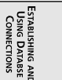

```ini
[Accounting]
BlobSize=-1
CommitRetain=False
Database=D:\InterbaseData\Accounting.gdb
DriverName=Interbase
LocaleCode=0
Password=masterkey
RoleName=Admin
ServerCharSet=ASCII
SQLDialect=1
Interbase TransIsolation=ReadComitted
User_Name=sysdba
WaitOnLocks=True
```

实际上，你可以在两个地方建立命名连接：在你的开发机器上，或最终用户的机器上。要在你的开发机器上创建命名连接，请将 TSQLConnection 组件放置到窗体或数据模块中。然后双击该组件，或右键单击组件并从弹出菜单中选择 `Edit Connection Properties`。此时将出现如图 1.1 所示的 `dBExpress Connection Editor`。

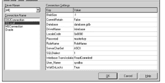

**图 1.1**  
连接编辑器帮助你轻松创建命名连接。

在连接编辑器的左侧，你会看到一个 `Driver Name` 组合框和一个 `Connection Name` 列表框。默认情况下，列表框显示你开发机器上所有现有的命名连接。如果你只想查看 Interbase、Oracle 或其他数据库服务器的命名连接，请从 `Driver Name` 组合框中选择合适的服务器。

点击列表框中的连接名称以查看该命名连接的设置，或点击工具栏上的 `Add Connection` 按钮（图标类似加号）来创建新的命名连接。

dbExpress 连接编辑器会在右侧的 Connection Settings 部分显示所选命名连接的设置。你应该为你的数据库引擎设置适当的参数。例如，对于 InterBase 连接，你至少需要设置 Database 属性。你可能还需要为 RoleName、SQLDialect 和 User_Name 输入值。

对于 Oracle 连接，你通常希望设置 Database，也可能需要为 User_Name 设置值。

> **注意**  
> 虽然你可以在命名连接中设置 Password，但我通常建议你不要这样做。如果你正在处理生产数据库，任何人都可以在你的电脑上打开连接编辑器（或简单地查看 dbxconnections.ini）来确定特定数据库的密码。因此，通常建议在运行时提供数据库密码。

如果你希望最终用户能够创建自己的命名连接，你应该将 dbxconnections.ini 与应用程序一起重新分发。你的用户可以手动编辑 dbxconnections，或者你可以编写并分发一个类似于 dbExpress 连接编辑器的实用程序，以帮助最终用户创建命名连接。

### 1.3 未命名连接

命名连接对于支持多种不同数据库服务器的应用程序很有用。然而，许多数据库应用程序是为单个数据库后端编写的。例如，你可能通过 CD 分发一个应用程序，该应用程序附带一个预创建的 InterBase 数据库，如零件列表或客户列表。在这些情况下，你的最终用户无需创建自己的数据库。他们只需访问你通过 CD 提供的数据库即可。

对于这些情况，命名连接并非必要。相反，你在设计时设置连接属性（如果你的应用程序需要在运行时让用户登录，则不包括 User_Name 和 Password）。

### 1.4 设置数据库参数

TSQLConnection 的 Params 属性包含特定于你所连接数据库服务器的设置。表 1.2 中列出的几个属性是所有数据库共有的。有关其他特定于数据库的属性的信息，请查阅你的数据库服务器文档。

**表 1.2** 通用数据库参数

| 属性 | 描述 |
| :--- | :--- |
| Database | 指定要连接的数据库。对于 InterBase 数据库，这指的是实际文件名，例如 `\SERVER\D:\RemoteData.gdb`。对于 Oracle 数据库，这指的是 TNSNames.ora 中唯一标识该数据库的条目。 |
| Password | 密码对应于 User_Name。通常不希望在设计时设置此项，因为这会绕过数据库安全性。 |
| User_Name | 在建立连接时使用的用户名。通常希望用户在运行时提供此信息。 |

你还可以在运行时访问 Params 属性来设置数据库参数，例如：

```delphi
SQLConnection1.Params.Values['Database'] := 'D:\Interbase\LocalDatabase.gdb';
```

对于 InterBase 连接，你可以用三种方式指定数据库：作为本地路径、作为 UNC 路径或作为 TCP 路径。以下是这三种结构的示例：

- `D:\Interbase\LocalDatabase.gdb`
- `\\SERVER\D:\Data\RemoteDatabase.gdb`
- `192.168.0.1:D:\Data\RemoteDatabase.gdb`

在连接数据库时，通常建议使用 UNC 路径或 TCP 路径，因为 InterBase 在某些情况下（例如从服务应用中连接数据库）使用本地路径连接数据库时会遇到困难。你可以通过使用 127.0.0.1 作为 IP 地址，使用 TCP 路径连接到本地数据库，如下所示：

`127.0.0.1:D:\Interbase\LocalDatabase.gdb`

### 1.5 控制登录

如前所述，连接的 LoginPrompt 属性决定 VCL/DataCLX 是否在运行时自动提示用户输入用户名和密码。如果你将 LoginPrompt 设置为 True，运行时将显示默认的登录对话框，如图 1.2 所示。

你可以通过处理连接的 OnLogin 事件并在那里设置适当的参数，来覆盖默认的登录对话框并自行提供获取用户名和密码的方式。以下代码片段展示了如何实现：

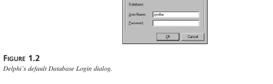

```delphi
procedure TForm1.SQLConnection1Login(Database: TSQLConnection;
  LoginParams: TStrings);
var
  TheUserName: string;
  ThePassword: string;
begin
  // 显示自定义对话框以获取 TheUserName 和 ThePassword

  LoginParams.Values[szUSERNAME] := TheUserName;
  LoginParams.Values[szPASSWORD] := ThePassword;
end;
```

### 1.6 断开数据库连接

当你完成对应用程序中数据库的访问时，应该断开连接。这将释放客户端和服务端的资源。你可以手动或自动断开数据库连接。

#### 手动断开数据库连接

手动断开数据库连接很简单。只需发出以下两个命令之一：

```delphi
SQLConnection1.Connected := False;
```

或者

```delphi
SQLConnection1.Close;
```

使用哪种方法取决于你偏好于设置属性还是调用来断开数据库连接。

#### 自动断开数据库连接

如果你希望 dbExpress 在没有打开的数据集时自动断开数据库连接，你应该设置 `SQLConnection.KeepConnection := False`。VCL/DataCLX 会监视连接上打开的数据集数量，当最后一个数据集关闭时，连接会自动断开。


## 注意

当连接建立耗时较长，或在需要频繁打开和关闭数据集的应用中，不应将 KeepConnection 设置为 False。反复连接和断开数据库（尤其是在连接耗时的情况下）会严重影响程序性能。

## 连接和断开连接事件

TSQLConnection 提供了一组事件，这些事件在连接/断开连接过程中的关键时刻触发。这些事件及其用法列表见表格 1.3。

**表 1.3 TSQLConnection 事件**

- **AfterConnect**  
  在数据库连接成功建立后触发。
- **AfterDisconnect**  
  在数据库连接断开后触发。
- **BeforeConnect**  
  在尝试建立数据库连接之前立即触发。您可以在此事件处理程序中引发异常，以阻止连接建立。
- **BeforeDisconnect**  
  在断开数据库连接之前立即触发。您可以在此事件处理程序中引发异常，以阻止连接断开。
- **OnLogin**  
  在建立连接之前触发，以便您可以在运行时提供用户名和密码。

列表 1.1 包含一个应用程序的源代码，演示了这些事件何时以及在什么情况下触发。它还展示了如何阻止用户连接或断开与数据库的连接。

### 列表 1.1 事件—MainForm.pas

```pascal
unit MainForm;

interface

uses
  SysUtils, Classes, QGraphics, QControls, QForms, QDialogs, DBXpress,
  ExtCtrls, DB, SqlExpr, QtStdCtrls, QExtCtrls;

type
TfrmMain = class(TForm)
conn: TSQLConnection;

pnlClient: TPanel;
pnlBottom: TPanel;
btnConnect: TButton;
btnDisconnect: TButton;
Label1: TLabel;
lbEvents: TListBox;
grpOptions: TGroupBox;

chkAllowConnect: TCheckBox;
chkAllowDisconnect: TCheckBox;

procedure connAfterConnect(Sender: TObject);
procedure connAfterDisconnect(Sender: TObject);
procedure connBeforeConnect(Sender: TObject);
procedure connBeforeDisconnect(Sender: TObject);
procedure connLogin(Database: TSQLConnection;
LogInParams: TStrings);
procedure btnConnectClick(Sender: TObject);
procedure btnDisconnectClick(Sender: TObject);
procedure FormClose(Sender: TObject; var Action: TCloseAction);

private

{ Private declarations }
public

{ Public declarations }
end;

var

frmMain: TfrmMain;

implementation

{$R *.xfm}

procedure TfrmMain.connAfterConnect(Sender: TObject);
begin
lbEvents.Items.Add('AfterConnect');
end;

procedure TfrmMain.connAfterDisconnect(Sender: TObject);
begin
lbEvents.Items.Add('AfterDisconnect');
end;

procedure TfrmMain.connBeforeConnect(Sender: TObject);
begin
  lbEvents.Items.Add('BeforeConnect');
  if not chkAllowConnect.Checked then
    Abort;
end;

procedure TfrmMain.connBeforeDisconnect(Sender: TObject);
begin
  lbEvents.Items.Add('BeforeDisconnect');
  if not chkAllowDisconnect.Checked then
    Abort;
end;

procedure TfrmMain.connLogin(Database: TSQLConnection;
  LoginParams: TStrings);
begin
  lbEvents.Items.Add('OnLogin');
end;

procedure TfrmMain.btnConnectClick(Sender: TObject);
begin
  lbEvents.Items.Add('---Begin Open---');
  try
    conn.Open;
  except
    on EAbort do
      lbEvents.Items.Add('Connect aborted');
    on E: Exception do
      lbEvents.Items.Add(E.Message);
  end;
  lbEvents.Items.Add('---End Open---');
  lbEvents.Items.Add('');
end;

procedure TfrmMain.btnDisconnectClick(Sender: TObject);
begin
  lbEvents.Items.Add('---Begin Close---');
  try
    conn.Close;
  except
    on EAbort do
      lbEvents.Items.Add('Disconnect aborted');

    on E: Exception do
      lbEvents.Items.Add(E.Message);
  end;
  lbEvents.Items.Add('---End Close---');
  lbEvents.Items.Add('');
end;

procedure TfrmMain.FormClose(Sender: TObject; var Action: TCloseAction);
begin
   conn.Close;
end;

end.
```

请注意代码中 *BeforeConnect* 和 *BeforeDisconnect* 事件处理程序在未选中相应复选框时调用 *Abort*。*btnConnectClick* 和 *btnDisconnectClick* 检查 *EAbort*（或其他异常），并在连接或断开连接尝试因任何原因失败时，在列表框中显示相应的消息。

图 1.3 展示了应用程序在运行时看起来的样子。列表框填充了信息性文本，确切说明了连接事件在何时以及以什么顺序触发。

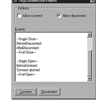

**图 1.3** *事件应用程序有助于理解连接事件。*

## 获取数据库元数据

TSQLConnection 提供了一组属性，使您能够从数据库中获取基本架构信息，包括表、字段、索引、存储过程以及存储过程参数属性。以下部分描述了如何从数据库连接中获取每种类型的信息。

### GetTableNames

您可以调用 GetTableNames 来获取数据库中的表列表，包括用户表、系统表、视图和同义词（仅限 Oracle 数据库）。

TSQLConnection.GetTableNames 在 sqliex.pas 中定义如下：

```pascal
procedure GetTableNames(List: TStrings; SystemTables: Boolean = False);
```

第一个参数指定返回表名的字符串列表。列表中现有的字符串将被清除。第二个参数指示是否仅返回系统表。

如果 SystemTables 参数设置为 True，则无论 TableScope 属性的当前设置如何（如表 1.4 所示），只有系统表会被添加到列表中。如果 SystemTables 为 False，TableScope 控制添加到列表中的表类型。

**表 1.4** TableScope 设置

| 属性 | 描述 |
| :--- | :--- |
| TsSynonym | 同义词 |
| TsSysTable | 系统表 |
| TsTable | 普通的用户定义表 |
| TsView | 视图 |

以下代码片段展示了 GetTableNames 的典型调用：

```pascal
GetTableNames(ListBox1.Items, False);
```

### GetFieldNames

GetFieldNames 用于检索给定表或视图中定义的所有字段名称。GetFieldNames 接受两个参数，定义如下：

```pascal
procedure GetFieldNames(const TableName: string; List: TStrings);
```

在第一个参数中传入要检索字段名称的表名。第二个参数指示将加载结果字段名称的列表。列表中现有的字符串将被删除。

```pascal
GetFieldNames('CONTACTS', ListBox1.Items);
```

### GetIndexNames

与 GetFieldNames 类似，GetIndexNames 用于检索给定表上定义的所有索引名称。GetIndexNames 定义如下：

```pascal
procedure GetIndexNames(const TableName: string; List: TStrings);
```

与 GetFieldNames 一样，TableName 表示您要获取索引名称的表。List 指示将加载结果索引名称的列表。列表中现有的字符串将被删除。

```pascal
GetIndexNames('CONTACTS', ListBox1.Items);
```

### GetProcedureNames

要获取数据库中的存储过程列表，请调用 GetProcedureNames 方法。GetProcedureNames 定义如下：

```pascal
procedure GetProcedureNames(List: TStrings);
```

从过程返回后，List 包含存储过程名称列表。列表中以前存储的任何信息都会被删除。

```pascal
GetProcedureNames(ListBox1.Items);
```

### GetProcedureParams

GetProcedureParams 返回给定存储过程的参数列表。定义如下：

```pascal
procedure GetProcedureParams(ProcedureName: string; List: TList);
```

第一个参数 ProcedureName 指定要检索参数名称的存储过程名称。第二个参数引用一个预先创建的 TList，过程参数将返回到该列表中。从过程返回后，List 包含存储过程的参数列表。

List 本身不能直接使用。您应该调用辅助函数 LoadParamListItems，将 TList 转换为 TParams 对象，这是一种更容易检查的结构。

以下代码片段展示了如何正确检索名为 CONTACTSBYSTATE 的存储过程的参数。


var
  listParams: TList;
  Params: TParams;
begin
  listParams := TList.Create;
  try
    SQLConnection1.GetProcoredProcedureParams('CONTACTS\BYSTATE', listParams);
    Params := TParams.Create;
    try
      LoadParamListItems(Params, listParams);

      // Do something with Params here...
    finally
      Params.Free;
    end;
  finally
    FreeProcParams(listParams);
  end;

注意此代码片段末尾对 `FreeProcParams` 的调用。`FreeProcParams` 会释放并置空 `listParams` 这个 TList，因此您无需显式释放该列表。

**列表 1.2** 展示了一个示例应用的完整源代码，该应用使用 TSQLConnection 从 InterBase 数据库中获取表、字段、索引、存储过程和参数名称。

## 列表 1.2 MetaData—MainForm.pas

```pascal
unit MainForm;

interface

uses
  SysUtils, Classes, QGraphics, QControls, QForms, QDialogs, QExtCtrls,
  DBXpress, QComCtrls, QStdCtrls, DB, SqlExpr;

type
  TfrmMain = class(TForm)
    conn: TSQLConnection;
    pnlBottom: TPanel;
    lblConnection: TLabel;
    pnlClient: TPanel;
    grpTableScope: TGroupBox;
    btnTable: TCheckBox;
    btnView: TCheckBox;
    btnSynonym: TCheckBox;
    btnSystemTable: TCheckBox;
    btnConnect: TButton;
    btnDisconnect: TButton;
    Label4: TLabel;
    Label5: TLabel;
    OpenDialog1: TOpenDialog;
    PageControl1: TPageControl;
    tabTables: TTabSheet;
    tabProcedures: TTabSheet;
    cbProcedure: TComboBox;
    Label2: TLabel;
    Label3: TLabel;
    cbTable: TComboBox;
    lbFields: TListBox;
    lbIndexes: TListBox;
    Label1: TLabel;
    Label6: TLabel;
    Label7: TLabel;
    lvParameters: TListView;
    procedure btnConnectClick(Sender: TObject);
    procedure cbTableClick(Sender: TObject);
    procedure btnDisconnectClick(Sender: TObject);
    procedure cbProcedureClick(Sender: TObject);
    procedure connAfterConnect(Sender: TObject);
    procedure connAfterDisconnect(Sender: TObject);
    procedure FormClose(Sender: TObject; var Action: TCloseAction);
  private
    { Private declarations }
  public
    { Public declarations }
  end;

var
  frmMain: TfrmMain;

implementation

{$R *.xfm}

procedure TfrmMain.btnConnectClick(Sender: TObject);

procedure CheckScope(Value: Boolean; TableScope: TTableScope);
begin
  if Value then
    conn.TableScope := conn.TableScope + [TableScope]
  else
    conn.TableScope := conn.TableScope * [TableScope];
end;

begin
  if OpenDialog1.Execute then begin
    conn.Params.Values['Database'] := OpenDialog1.FileName;
    CheckScope(btnTable.Checked, tsTable);
    CheckScope(btnView.Checked, tsView);
    CheckScope(btnSynonym.Checked, tsSynonym);
    CheckScope(btnSystemTable.Checked, tsSysTable);
    conn.Open;
  end;
end;

procedure TfrmMain.btnDisconnectClick(Sender: TObject);
begin
  conn.Close;
end;

procedure TfrmMain.cbTableClick(Sender: TObject);
begin
  conn.GetFieldNames(cbTable.Items[cbTable.ItemIndex], lbFields.Items);
  conn.GetIndexNames(cbTable.Items[cbTable.ItemIndex], lbIndexes.Items);
end;

procedure TfrmMain.cbProcedureClick(Sender: TObject);
var
  listParams: TList;
  Params: TParams;
  Index: Integer;
  Param: TParam;
  ListItem: TListItem;
begin
  listParams := TList.Create;
  try
    conn.GetProcedureParams(cbProcedure.Items[cbProcedure.ItemIndex], listParams);
    Params := TParams.Create;
    try
      LoadParamListItems(Params, listParams);

      lvParameters.Items.BeginUpdate;
      try
        lvParameters.Items.Clear;

        for Index := 0 to Params.Count - 1 do begin
          Param := Params[Index];
          ListItem := lvParameters.Items.Add;
          ListItem.Caption := Param.Name;
          case Param.DataType of
            ftUnknown: ListItem.SubItems.Add('Unknown');
            ftString: ListItem.SubItems.Add('String');
            ftSmallInt: ListItem.SubItems.Add('SmallInt');
            ftInteger: ListItem.SubItems.Add('Integer');
            ftWord: ListItem.SubItems.Add('Word');
            ftBoolean: ListItem.SubItems.Add('Boolean');
            ftFloat: ListItem.SubItems.Add('Float');
            ftCurrency: ListItem.SubItems.Add('Currency');
            ftBCD: ListItem.SubItems.Add('BCD');
            ftDate: ListItem.SubItems.Add('Date');
            ftTime: ListItem.SubItems.Add('Time');
            ftDateTime: ListItem.SubItems.Add('DateTime');
            ftBytes: ListItem.SubItems.Add('Bytes');
            ftVarBytes: ListItem.SubItems.Add('VarBytes');
            ftAutoInc: ListItem.SubItems.Add('AutoInc');
            ftBlob: ListItem.SubItems.Add('Blob');
            ftMemo: ListItem.SubItems.Add('Memo');
            ftGraphic: ListItem.SubItems.Add('Graphic');
            ftFmtMemo: ListItem.SubItems.Add('FmtMemo');
            ftParadoxOle: ListItem.SubItems.Add('ParadoxOle');
            ftDBaseOle: ListItem.SubItems.Add('DBaseOle');
            ftTypedBinary: ListItem.SubItems.Add('TypedBinary');
            ftCursor: ListItem.SubItems.Add('Cursor');
            ftFixedChar: ListItem.SubItems.Add('FixedChar');
            ftWideString: ListItem.SubItems.Add('WideString');
            ftLargeInt: ListItem.SubItems.Add('LargeInt');
            ftADT: ListItem.SubItems.Add('ADT');
            ftArray: ListItem.SubItems.Add('Array');
            ftReference: ListItem.SubItems.Add('Reference');
            ftDataSet: ListItem.SubItems.Add('DataSet');
            ftOraBlob: ListItem.SubItems.Add('OraBlob');
            ftOraClob: ListItem.SubItems.Add('OraClob');
            ftVariant: ListItem.SubItems.Add('Variant');
            ftInterface: ListItem.SubItems.Add('Interface');
            ftIDispatch: ListItem.SubItems.Add('IDispatch');
            ftGuid: ListItem.SubItems.Add('Guid');
            ftTimeStamp: ListItem.SubItems.Add('TimeStamp');
            ftFMTBcd: ListItem.SubItems.Add('FM TBcd');
          end;
        end;
      finally
        lvParameters.Items.EndUpdate;
      end;
    finally
      Params.Free;
    end;
  finally
    FreeProcParams(listParams);
  end;
end;

procedure TfrmMain.connAfterConnect(Sender: TObject);
begin
  btnTable.Enabled := False;
  btnView.Enabled := False;
  btnSynonym.Enabled := False;
  btnSystemTable.Enabled := False;

  lblConnection.Font.Color := clGreen;
  lblConnection.Caption := conn.Params.Values['Database'];

  conn.GetTableNames(cbTable.Items, btnSystemTable.Checked);
  conn.GetProcedureNames(cbProcedure.Items);

  cbTable.ItemIndex := 0;
  cbTableClick(cbTable);
  PageControl1.ActivePage := tabTables;
  ActiveControl := cbTable;

  cbProcedure.ItemIndex := 0;
  cbProcedureClick(cbProcedure);
end;

procedure TfrmMain.connAfterDisconnect(Sender: TObject);
begin
  btnTable.Enabled := True;
  btnView.Enabled := True;
  btnSynonym.Enabled := True;
  btnSystemTable.Enabled := True;

  lblConnection.Font.Color := clRed;
  lblConnection.Caption := 'Not connected';

  cbTable.Items.Clear;
  cbProcuder.Items.Clear;
  lbFields.Items.Clear;
  lbIndexes.Items.Clear;
end;

procedure TfrmMain.FormClose(Sender: TObject; var Action: TCloseAction);
begin
  conn.Close;
end;

end.
```

**图 1.4** 显示了从 CONMAN 数据库返回的表、字段和索引名称。

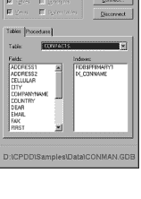

**图 1.5** 显示了 CONTACTSBSYSTATE 存储过程的参数列表。

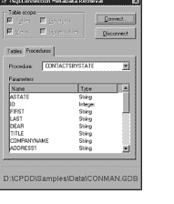

**列表 1.2** 中的大部分代码相当简单直接。然而，有两点值得注意，我想特别指出。

首先，`cbProcedureClick` 方法展示了如何循环遍历存储过程的参数，以确定其名称、类型及其他属性。

其次，VCL/DataCLX 中存在一个 bug，实际上阻止了您同时获取表、视图和系统表的元数据。如果您同时勾选“表”、“视图”和“系统表”，`GetTableNames`（位于 `connAfterConnect` 方法中）将不会返回任何信息。请在您的应用中留意这一点。如果需要获取这三种类型的所有信息，您可以执行类似以下操作：

```pascal
var
  SL: TStringList;
begin
  SL := TStringList.Create;
  try
    SQLConnection1.TableScope := [tsTable, tsView];
    SQLConnection1.GetTableNames(ListBox1.Items, False);
    SQLConnection1.GetTableNames(SL, True);
    ListBox1.Items.AddStrings(SL);
  finally
    SL.Free;
  end;
end;
```

这段代码首先仅获取表和视图信息，并将结果放入列表框。接下来，它仅获取系统表，并将结果放入一个临时字符串列表。最后，它将临时字符串列表中的字符串添加到列表框中。因此，列表框中包含表、视图和系统表。

从上述讨论中可以看出，TSQLConnection 返回的模式信息极其基础。除了存储过程参数外，唯一的数据是


TSQLConnection 对表、字段、索引和存储过程返回的是它们的名称。在下一章中，我将展示如何从数据库中检索更详细的模式信息。

## 执行 DDL 和 DML 语句

你在数据库上执行的最常见操作是 DDL（数据定义语言）和 DML（数据操作语言）语句。你可以直接通过 TSQLConnection 执行 DDL 和 DML 语句。返回游标的 DML 语句（即 SQL SELECT 语句）除了 TSQLConnection 之外，还需要一个数据集组件，正如你在第 3 章“客户端数据集基础”中将要看到的那样。

### DDL 命令

DDL 命令是操作数据库模式而非数据本身的语句。在上一节中，我展示了如何检索有关数据库模式的信息。在这一节中，我将展示如何更改数据库模式。

TSQLConnection 提供了一个名为 ExecuteDirect 的方法，你使用它来执行 DDL 命令。ExecuteDirect 接受一个参数，即要执行的 SQL 命令。成功时返回 0，失败时返回 dbExpress 错误代码。dbExpress 错误代码可以在随 Delphi 提供的文件 DBXpress.pas 中找到。

名称 ExecuteDirect 中的 Direct 部分源于该语句直接发送到数据库这一事实。该语句在执行前不会进行预处理，并且不能包含任何参数。（参数化 SQL 语句将在本章后面标题为“参数化 SQL 语句”的章节中讨论。）

> **注意**
> 
> 一些数据库不支持直接执行 SQL。在这些数据库上，dbExpress 将在内部预处理 SQL 语句，然后执行它。

### 创建表

你可以发出的最简单且最有用的 DDL 命令之一是创建数据库中一个新表的命令。假设你想创建一个名为 EMPLOYEE 的表，其结构如表 1.5 所示。你需要发出以下语句：

```sql
SQLConnection1.ExecuteDirect('CREATE TABLE EMPLOYEE (EMPNO INTEGER, ' +
    'NAME VARCHAR(30), ' +
    'HIREDATE DATE, SALARY DOUBLE PRECISION');
```

**表 1.5** 示例 `EMPLOYEE` 表定义

| 列名 | 定义 |
| :--- | :--- |
| EMPNO | INTEGER |
| NAME | VARCHAR(30) |
| HIREDATE | DATE |
| SALARY | DOUBLE PRECISION |

### 创建数据库

你不能使用 ExecuteDirect 来创建一个新的 InterBase 数据库。以下代码行不起作用：

```sql
SQLConnection1.ExecuteDirect('CREATE DATABASE ''C:\NewData.gdb''');
```

如果你尝试执行此代码，你会收到以下异常：

```
Cannot prepare a CREATE DATABASE/SCHEMA statement.
```

InterBase 客户端不允许直接执行 DDL 或 DML，因此 dbExpress 驱动程序会尝试预处理并执行 CREATE DATABASE 语句。由于 InterBase 不允许预处理 CREATE DATABASE 语句，因此会引发异常。

如果你的应用程序需要具备创建新 InterBase 数据库的能力，你需要找到另一种方法。一种方法是在程序目录中保留一个空数据库副本，当用户创建新数据库时将其复制。

我在自己的经验中发现以下方法很有用：将空数据库的副本作为资源保存在你的应用程序中。当用户创建新数据库时，将该资源保存为磁盘上用户选择的文件名的文件。下面的说明展示了如何在 Windows 环境中做到这一点。注意，这是特定于 Windows 的，不能用于 Linux 或跨平台应用程序。

首先，你需要创建一个资源脚本文件，将你的空数据库转换为资源。假设你在 D:\Interbase 目录中有一个空数据库副本，以下脚本文件创建一个名为 EMPTYDB 的资源：

```
EMPTYDB RCDATA DISCARDABLE "D:\Interbase\Empty.GDB"
```

将此脚本保存为 EmptyDB.RC。要从资源脚本创建 .RES 文件，请执行以下命令：

```
BRC32 EMPTYDB.RC
```

这将创建文件 EMPTYDB.RES，可以将其包含在你的应用程序中。在你的程序代码的某个位置，包含列表 1.3 中的代码。

**列表 1.3** 从资源创建空数据库的代码

```pascal
{$R EmptyDB.RES}  // 将空数据库添加到程序可执行文件中

procedure CreateDatabase(const DatabaseName: string);
var
  HResrc: THandle;
  Stream: TResourceStream;
begin
  HResrc := FindResource(HInstance, PChar('EMPTYDB'), RT_RCDATA);
  if HResrc <> 0 then begin
    try
      Stream := TResourceStream.Create(HInstance, 'EMPTYDB', RT_RCDATA);
      Stream.SaveToFile(DatabaseName);
    finally
      Stream.Free;
    end;
  end
  else
    raise Exception.Create('Internal error: unable to create database.');
end;
```

现在，当你要在应用程序中创建新数据库时，只需调用 CreateDatabase，并传入数据库的完整路径名，如下所示：

```
CreateDatabase( 'C:\NewDatabase.gdb' );
```

在开发应用程序的过程中，如果你更改了数据库模式，必须记住重新发出 BRC32 命令（如前所示），以重新创建 EMPTYDB.RES 文件。否则，你的应用程序内部将包含一个不正确的空数据库。

处理这种情况的另一种方法是直接从应用程序内部进行低级别的数据库 API 调用。这种方法的好处是跨平台，但你需要学习针对特定数据库后端的适当 API 命令。

### DML 命令

DDL 命令用于定义数据库模式，而 DML 命令用于操纵（读取、写入和更新）数据库中的数据。

#### 简单 SQL 语句

最简单的 DML 语句是不接受参数且不返回行的语句。例如，你可能想要删除所有 *Active* 状态为 N 的员工。为此，你需要发出以下语句：

```sql
SQLConnection1.ExecuteDirect('DELETE FROM EMPLOYEE WHERE Active = ''N''');
```

注意前面代码片段中 `'N'` 被引号包围。手动引用字符串常量的更好方法是使用 RTL 函数 **QuotedStr**。**QuotedStr** 接受一个字符串参数并返回带引号的字符串。使用 **QuotedStr** 的主要原因是它能正确处理包含引号的字符串常量。例如，给定名字 O'Toole，你知道如何手动引用它吗？正确的方式是 'O''Toole'。

使用 **QuotedStr**，你不必担心如何正确引用字符串。前面的 **ExecuteDirect** 调用变为

```sql
SQLConnection1.ExecuteDirect('DELETE FROM EMPLOYEE WHERE Active = ' +
  QuotedStr('N'));
```

#### 参数化 SQL 语句

很多时候，你想多次执行相同的基本 SQL 语句，只是更改传递给语句中参数的值。例如，假设你想向之前创建的 EMPLOYEE 表中插入多条记录。要插入一名员工 John Doe，你需要执行以下 SQL 语句：

```sql
SQLConnection1.ExecuteDirect(' INSERT INTO EMPLOYEE VALUES (123,
  ''John Doe'', ''5/15/1994'', 35000)');
```

同样，这里也可以使用 **QuotedStr** 代替手动引用字符串。

对于你想要添加的每位员工，你都会创建并执行一个类似的 SQL 语句。参数化 SQL 语句允许你创建一种语句*模板*，你可以在执行每个语句之前轻松地为每个语句输入适当的值。对于 EMPLOYEE 表，SQL INSERT 语句变为以下内容：

```sql
INSERT INTO EMPLOYEE VALUES (:EmpNumber, :Name, :Hired, :Salary)
```

要插入到数据库中的每个值都替换为一个参数。参数很容易被检测到，因为它们以冒号开头。内部地，dbExpress 组件解析 SQL 语句，并将参数转换为核心 dbExpress 代码支持的问号。反过来，dbExpress 驱动程序将问号替换为后端数据库引擎支持的参数标记。


例如，给定前文的 INSERT 语句，TSQLConnection 会将其更改为 INSERT INTO EMPLOYEE VALUES (?, ?, ?, ?)

dbExpress 驱动程序可能会用特定的数据库服务器构造来替代问号。

# 注意

> 参数不需要与表中底层列具有相同的名称。请注意前文代码片段中，我将参数命名为 EmpNumber 而不是 EmpNo，将参数命名为 Hired 而不是 DateHired。

创建 SQL 语句后，在执行之前需要填充每个参数的值。以下代码片段展示了如何实现这一操作：

```
Params := TParams.Create(nil);
try
// Create the parameters
Params.CreateParam( ftInteger , 'EmpNumber' , ptInput );
Params.CreateParam( ftString , 'Name' , ptInput );
Params.CreateParam( ftSQLDateTime , 'Hired' , ptInput );
Params.CreateParam( ftFloat , 'Salary' , ptInput );

// Assign values to the parameters
Params.ParamByName('EmpNumber').Value := 123;
Params.ParamByName('Name').Value := 'John Doe';
Params.ParamByName('Hired').Value := '5/15/1994';
Params.ParamByName('Salary').Value := 35000;

// Execute the statement
SQLConnection1.Execute('INSERT INTO EMPLOYEE VALUES (:EmpNumber, :Name, '
' :Hired, :Salary)', Params);
finally
Params.Free;
end;
```

你可能会想知道，为什么我们要这样做，而不是简单地直接执行每条语句。毕竟，创建参数并分配值需要付出更多努力。此外，在我开发机器上的时间测试表明，第二种方法花费的时间大约是第一种方法的两倍。

在需要重复执行相同语句的情况下，出于以下原因，我仍然更倾向于使用参数化查询：

# 1
## 建立和使用数据库连接

-   简单性。对于长而复杂的 SQL 语句，手动构造 SQL 语句通常很困难。考虑到在 Pascal 语言中必须将单引号加倍，正确地排列引号容易出错。
-   健壮性。假设某位员工的名字中包含引号，例如 Frank O’Donnell。如果不使用参数，引号看起来像是名字结束符。无参数 SQL 语句看起来会像这样：
    INSERT INTO EMPLOYEE VALUES (123, `Frank O'Donnell`, '5/15/1994', 35000)
    在这种情况下，名字看起来是 Frank O，而语句中的下一个字符 (D) 出现了错误。你可以通过对名字进行双引号引用来解决这个问题，如下所示：
    INSERT INTO EMPLOYEE VALUES (123, `Frank O''Donnell`, '5/15/1994', 35000)
-   使用参数时，真正的关系型数据库可以编译预编译语句，然后在后续所有对该 SQL 语句的调用中使用该编译版本。在重复发出相同的 SQL 语句时，这足以补偿准备 SQL 语句所需的额外时间。

使用 QuotedStr 自动引用字符串有助于缓解前两个“问题”。

## 返回游标的 SQL 语句

在前两节中，我讨论了简单的和参数化的 SQL 语句，但到目前为止，还没有语句从数据库服务器返回任何数据。SELECT 语句是最常用的 DML 语句。那么，为什么我在回避它呢？

这是因为 SELECT 语句返回数据，你需要有一个地方来存放返回的数据。对于 dbExpress 来说，这个位置是 TCustomSolDataSet，我将在下一章详细讨论。目前，我将快速概述如何从 TSQLConnection 检索数据。

我在上一节讨论过的 Execute 方法实际上接受第三个参数：指向结果集的指针。

```
function Execute(const SQL: string; Params: TParams; ResultSet: Pointer = nil): Integer;
```

如果你没有向 Execute 传递第三个参数，它默认为 nil，这意味着该语句不返回结果集。

> **注意**
> 如果你为 ResultSet 传递了一个 nil 值，而 SQL 命令实际上确实返回了结果集，那么结果集将被简单地丢弃。不会引发异常，也不会返回错误。

以下代码片段展示了一种执行返回结果集的 SQL 语句的方法。在下一章中，你会看到执行此操作的更简单方法。

```
SQLDataSet1 := TSQLDataSet.Create(nil);
try
SQLConnection1.Execute('SELECT * FROM EMPLOYEE', nil, SQLDataSet1);

// Do something with SQLDataSet1 here...
finally
SQLDataSet1.Free;
end;
```

上述代码还展示了执行非参数化 SELECT 语句的正确方法：只需为 Params 传递 nil 即可。

以下示例程序 DDLSQL 展示了如何创建一个测试表，用数据填充它，并以编程方式销毁该表。它还演示了如何使用 Execute 方法从表中检索数据。列表 1.4 显示了 DDLSQL 的完整代码。

## **列表 1.4 DDLSQL—MainForm.pas**

```
unit MainForm;

interface

uses
SysUtils, Types, Classes, QGraphics, QControls, QForms, QDialogs, QStdCtrls, QExtCtrls, DBXpress, DB, SqlExpr;

type
TfrmMain = class(TForm)
pnClient: TPanel;
conn: TSQLConnection;
btnCreate: TButton;
btnPopulate: TButton;
btnConnect: TButton;
btnDelete: TButton;
btnDisconnect: TButton;
btnParameters: TButton;
btnDrop: TButton;
lbOutput: TListBox;
procedure btnCreateClick(Sender: TObject);
procedure btnConnectClick(Sender: TObject);
procedure btnPopulateClick(Sender: TObject);
procedure btnDisconnectClick(Sender: TObject);
procedure btnDeleteClick(Sender: TObject);
procedure btnParametersClick(Sender: TObject);
procedure btnDropClick(Sender: TObject);
procedure connAfterConnect(Sender: TObject);
procedure connAfterDisconnect(Sender: TObject);
procedure FormClose(Sender: TObject; var Action: TCloseAction);
private
  { Private declarations }
public
  { Public declarations }
end;

var
  frmMain: TfrmMain;

implementation

{$R *.xfm}

procedure TfrmMain.btnConnectClick(Sender: TObject);
begin
  conn.Open;
end;

procedure TfrmMain.btnDisconnectClick(Sender: TObject);
begin
  conn.Close;
end;

procedure TfrmMain.btnCreateClick(Sender: TObject);
begin
  conn.ExecuteDirect('CREATE TABLE TESTING (NAME VARCHAR(20) NOT NULL, '
    + 'AGE INTEGER, PRIMARY KEY (NAME))');
  lbOutput.Items.Add('Created TESTING table');
end;

procedure TfrmMain.btnPopulateClick(Sender: TObject);
begin
  conn.ExecuteDirect('INSERT INTO TESTING VALUES ('Eric', 34)');
  conn.ExecuteDirect('INSERT INTO TESTING VALUES ('Tina', 33)');
  lbOutput.Items.Add('Added Eric and Tina to TESTING table');
end;

procedure TfrmMain.btnDeleteClick(Sender: TObject);
begin
  conn.ExecuteDirect('DELETE FROM TESTING WHERE NAME = 'Tina''');

  lbOutput.Items.Add('Deleted Tina from TESTING table');
end;

procedure TfrmMain.btnParametersClick(Sender: TObject);
const
  SQL = 'INSERT INTO TESTING VALUES (:Name, :Age)';
var
  Params: TParams;
begin
  Params := TParams.Create(nil);
  try
    Params.CreateParam(ftString, 'PName', ptInput);
    Params.CreateParam(ftInteger, 'Page', ptInput);

    // Add first name
    Params.ParamByName('PName').AsString := 'Mike';
    Params.ParamByName('Page').AsInteger := 34;
    conn.Execute(SQL, Params);

    lbOutput.Items.Add('Added Mike to TESTING table');
  finally
    Params.Free;
  end;
end;

procedure TfrmMain.btnDropClick(Sender: TObject);
begin
  conn.ExecuteDirect('DROP TABLE TESTING');

  lbOutput.Items.Add('Removed TESTING table');
end;

procedure TfrmMain.connAfterConnect(Sender: TObject);
begin
  btnConnect.Enabled := False;
  btnCreate.Enabled := True;
  btnPopulate.Enabled := True;
  btnDelete.Enabled := True;
  btnParameters.Enabled := True;
  btnDrop.Enabled := True;
  btnDisconnect.Enabled := True;

  lbOutput.Items.Add('Connected');
end;

procedure TfrmMain.connAfterDisconnect(Sender: TObject);
begin
    btnConnect.Enabled := True;
    btnCreate.Enabled := False;
    btnPopulate.Enabled := False;
    btnDelete.Enabled := False;
    btnParameters.Enabled := False;
    btnDrop.Enabled := False;
    btnDisconnect.Enabled := False;

    lbOutput.Items.Add('Disconnected');
end;

procedure TfrmMain.FormClose(Sender: TObject; var Action: TCloseAction);
begin
    conn.Close;
end;

end.
```

图 1.6 显示了运行时的 DDLSQL 程序。

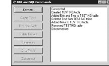

## **图 1.6**

*DDLSQL 在运行完所有按钮后的状态。*


## 事务支持

大多数 SQL 数据库（在 3.23 版本之前的 MySQL 版本是个显著的例外）都支持事务。一个事务必须满足四项准则，即所谓的**事务的 ACID 特性**。具体而言，事务具有

-   * **原子性。** 事务必须作为一个整体要么成功，要么失败。部分成功、部分失败是不可接受的。
-   * **一致性。** 事务结束后，数据必须处于一致状态。所有数据都必须符合当前的引用完整性约束。
-   * **隔离性。** 在一个事务中进行的更改在对事务提交之前，必须对其他事务不可见。
-   * **持久性。** 一旦事务提交，其更改必须是永久性的。没有任何因素（包括系统崩溃）可以改变已提交事务的效果。

用例子来描述事务是最直观的，因此我将介绍事务支持中最常被引用的一个示例。

想象一个银行，其数据库中包含客户和账户信息。用户 John Q. Customer 在该银行既有储蓄账户又有支票账户。他前往附近的 ATM 机，并决定从他的储蓄账户向支票账户转账 $100。

用 SQL 术语来说，这构成两个操作：一条记录储蓄账户提款的 INSERT 语句，以及一条记录存入支票账户的 INSERT 语句。假设 ATM 软件是使用 Delphi 和 dbExpress 编写的，它可能包含类似下面的代码：

```delphi
procedure TransferFunds(FromAccountID: Integer; ToAccountID: Integer;
  Amount: Double);
var
  SQL: string;
  Params: TParams;
begin
  Params := TParams.Create;
  try
    SQL := 'INSERT INTO ACCOUNTDETAIL (ACCOUNTID, TRANSDATE, AMOUNT) ' +
           'VALUES (:AccountId, :TransDate, :TransAmount)';
    Params.ParamByName('AccountId').Value := FromAccountID;
    Params.ParamByName('TransDate').Value := Date;
    Params.ParamByName('TransAmount').Value := -Amount;
    SQLConnection1.Execute(SQL, Params);
    
    Params.ParamByName('AccountId').Value := ToAccountID;
    Params.ParamByName('TransAmount').Value := Amount;
    SQLConnection1.Execute(SQL, Params);
  finally
   Params.Free;
end;
end;
```

从概念上讲，这段代码片段为源账户创建了一笔提款记录，并为目标账户创建了一笔存款记录。起初，这段代码似乎没有什么问题，但让我们来看看其中可能出现的情况。

如果在记录提款和记录存款之间发生断电、连接故障或其他灾难性故障，会发生什么？储蓄账户中的钱会被扣除，但永远不会被存入支票账户（这让 Customer 先生变得非常不高兴，甚至可能不再是该银行的*客户*）。

如果代码反过来，先创建存款再创建提款，则可能发生相反的情况：存款被记录，但提款从未发生（这让 Customer 先生非常高兴，并且多了 $100，但银行却亏损了）。

显然，ATM 软件需要确保提款和存款要么都发生，要么都不发生。这正是事务设计要处理的问题。

接下来的几个部分将描述如何检测给定数据库是否支持事务、如何开始（以及随后结束）事务，以及如何处理多个（和嵌套的）事务。

## 检查事务支持

如果你正在编写一个仅适用于单一数据库后端（如 Oracle 或 InterBase）的应用程序，在开始编码之前你就知道该数据库支持事务。如果你正在编写一个可以访问许多不同数据库后端的通用应用程序，你不知道选定的数据库后端是否支持事务。

TSQLConnection 提供了一种检测底层数据库引擎是否支持事务的方法：`TransactionsSupported` 属性。在检查 `TransactionsSupported` 之前，你需要建立到数据库的连接，例如：

```delphi
SQLConnection1.Open;
...
if SQLConnection1.TransactionsSupported then begin
   // 继续事务代码
end else begin
   // 不支持事务 - 采用替代代码或退出
end;
```

## 开始事务

当你确定数据库支持事务后，就可以开始一个事务。首先，调用 `SQLConnection.StartTransaction` 方法。`StartTransaction` 定义如下：

```delphi
procedure StartTransaction( TransDesc: TTransactionDesc);
```

`TTransactionDesc` 是一个记录类型，详细描述事务。其定义如下所示：

```delphi
TTransactionDesc = packed record
TransactionID : LongWord; { Transaction id }
GlobalID : LongWord; { Global transaction id }
IsolationLevel : TTransIsolationLevel; {Transaction Isolation level}
CustomIsolation : LongWord; { DB specific custom isolation }
end;
```

表 1.6 展示了 `TTransactionDesc` 记录中各个字段的意义。

### 表 1.6 TTransactionDesc 字段

| 字段 | 定义 |
|---|---|
| TransactionID | 用户定义，本地事务编号，用于在应用范围内唯一标识该事务。 |
| GlobalID | 用于 Oracle 事务，定义一个在整个 Oracle 数据库中必须唯一的事务编号。 |
| IsolationLevel | 用于指定此事务如何反应其他事务。该字段的有效值列于表 1.7。 |
| CustomIsolation | 当 IsolationLevel 设置为 x11CUSTOM 时，标识自定义隔离级别。目前没有任何 dbExpress 驱动支持此项。 |

表 1.7 展示了 `TTransactionDesc` 的 `IsolationLevel` 字段的有效设置。

### 表 1.7 有效的 IsolationLevel 值

| 字段 | 定义 |
|---|---|
| x11DIRTYREAD | 事务可以看到由其他事务做出的所有更改，即使这些更改尚未提交。Oracle 不支持此事务隔离级别。 |
| x11READCOMMITTED | 事务只能看到那些由其他事务做出的、且在本事务开始前和本事务开始后已提交的更改。 |
| x11REPEATABLEREAD | 事务只能看到那些由其他事务做出的更改，且仅当这些更改在本事务开始前已提交时。 |
| x11CUSTOM | 特定于数据库的隔离级别。CustomIsolation 指定实际的隔离级别。目前没有任何 dbExpress 驱动支持此项。 |

以下代码片段展示了如何开始一个事务。

```delphi
var
  TransDesc: TTransactionDesc;
begin
  TransDesc.TransactionID := 1;
  TransDesc.IsolationLevel := x11READCOMMITTED;
  SqlConnection1.StartTransaction(TransDesc);
end;
```

## 提交事务

在事务中执行了相应的 SQL 命令后，你可能希望*提交*该事务。这将结束该事务，并保存该事务期间所做的任何更改。提交事务很简单，只需调用 `TSQLConnection.Commit`，如下面的代码行所示：

```delphi
SqlConnection.Commit(TransDesc);
```

## 回滚事务

有时，你启动一个事务，但后来发现你不想保存该事务期间所做的更改。如果出现这种情况，你可以*回滚*事务，而不是提交它。回滚事务会结束该事务，但在该事务上下文中所做的所有更改都会被丢弃。

要回滚事务，请调用 `TSQLConnection.Rollback`，如下所示：

```delphi
SqlConnection1.Rollback(TransDesc);
```

## 多个事务

你并不限于一次只能有一个事务。事务可以嵌套或重叠。图 1.7 在概念上展示了嵌套和重叠事务的样子。


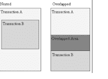

## 图 1.7
*事务可以嵌套或重叠。*

并非所有数据库都支持多事务。不幸的是，要确定数据库是否支持多事务，无法通过检查某个简单的属性来实现。`TSQLConnection` 包含一个名为 `FSupportsMultiTrans` 的私有字段，但没有公共访问接口。不过，情况并非毫无希望，你可以使用以下函数来获取该属性的值：

```pascal
function SupportsMultiTrans(conn: TSQLConnection): Boolean;
var
  Supported: LongBool;
  PropSize: SmallInt;
begin
  conn.MetaData.GetOption(eMetaSupportsTransactions, @Supported,
    SizeOf(Integer), PropSize);
  Result := Supported;
end;
```

如果数据库不支持多事务，你应当避免在事务处于活动状态时调用 `StartTransaction`。你可以通过检查 `InTransaction` 属性来测试当前是否有活动的事务，如下所示：

```pascal
if not SQLConnection1.InTransaction then
  // 此时开始事务是安全的
```

如果数据库支持多事务，你可以嵌套它们，如下面的代码片段所示：

```pascal
var
  TransOuter: TTransactionDesc;
  TransInner: TTransactionDesc;
begin
  TransOuter.TransactionID := 1;
  TransOuter.IsolationLevel := xlREADCOMMITTED;
  SQLConnection1.StartTransaction(TransOuter);
  try
    // 在此处执行一些 SQL 语句
    TransInner.TransactionID := 2;
    TransInner.IsolationLevel := xiREADCOMMITTED;
    SQLConnection1.StartTransaction(TransInner);
    try
      // 在此处执行更多的 SQL 语句
      SQLConnection1.Commit(TransInner);
    except
      SQLConnection1.Rollback(TransInner);
      raise;
    end;
    // 在此处再执行一些 SQL 语句
    SQLConnection1.Commit(TransOuter);
  except
    SQLConnection1.Rollback(TransOuter);
    raise;
  end;
end;
```

请注意，在上述代码中，事务被包裹在 `try/except` 块中。如果在执行代码过程中发生异常，事务将被回滚。

## 代码清单 1.5
Trans—MainForm.pas

```pascal
unit MainForm;

interface

uses
  SysUtils, Classes, QGraphics, QControls, QForms, QDialogs, QExtCtrls,
  DBXpress, QStdCtrls, DB, SqlExpr;

type
  TfrmMain = class(TForm)
  pnlClient: TPanel;
  conn: TSQLConnection;
  btnConnect: TButton;
  btnDisconnect: TButton;
  1bOutput: TListBox; // OCR error: '1' likely 'l', but preserving variable name style or correcting to lbOutput
  btnCommit: TButton;
  btnRollback: TButton;
  btnMultiLevel1: TButton;
  btnOverlapping: TButton;

  procedure btnConnectClick(Sender: TObject);
  procedure btnDisconnectClick(Sender: TObject);
  procedure btnCommitClick(Sender: TObject);
  procedure btnRollbackClick(Sender: TObject);
  procedure btnMultiLevellClick(Sender: TObject);
  procedure btnOverlappingClick(Sender: TObject);
  procedure connAfterConnect(Sender: TObject);
  procedure connAfterDisconnect(Sender: TObject);
  procedure FormClose(Sender: TObject; var Action: TCloseAction);
private
  { Private declarations }
public
  { Public declarations }
end;

var
  frmMain: TfrmMain;

implementation

{$R *.xfm}

function SupportsMultiTrans(conn: TSQLConnection): Boolean;
var
  Supported: LongBool;
  PropSize: SmallInt;
begin
  conn.MetaData.GetOption(eMetaSupportsTransactions, @Supported,
    SizeOf(Integer), PropSize);
  Result := Supported;
end;

procedure TfrmMain.btnConnectClick(Sender: TObject);
begin
  conn.Open;
  if conn.TransactionsSupported then
    lbOutput.Items.Add('Connection supports transactions')
  else
    lbOutput.Items.Add('Connection does not support transactions');

  if SupportsMultiTrans(conn) then
    lbOutput.Items.Add('Connection supports multiple transactions')
  else
    lbOutput.Items.Add('Connection does not support multiple transactions');
end;

procedure TfrmMain.btnDisconnectClick(Sender: TObject);
begin
  conn.Close;
end;

procedure TfrmMain.btnCommitClick(Sender: TObject);
var
  TransDesc: TTransactionDesc;
begin
  TransDesc.TransactionID := 1;
  TransDesc.IsolationLevel := xlREADCOMMITTED;
  conn.StartTransaction(TransDesc);
  conn.ExecuteDirect('DELETE FROM TODOS');
  conn.Commit(TransDesc);
  lbOutput.Items.Add('Transaction committed');
end;

procedure TfrmMain.btnRollbackClick(Sender: TObject);
var
  TransDesc: TTransactionDesc;
begin
  TransDesc.TransactionID := 1;
  TransDesc.IsolationLevel := xlREADCOMMITTED;
  conn.StartTransaction(TransDesc);
  conn.ExecuteDirect('DELETE FROM CONTACTS');
  conn.Rollback(TransDesc);
  lbOutput.Items.Add('Transaction rolled back');
end;

procedure TfrmMain.btnMultiLevelClick(Sender: TObject);
var
  TransDesc1: TTransactionDesc;
  TransDesc2: TTransactionDesc;
begin
  TransDesc1.TransactionID := 1;
  TransDesc1.IsolationLevel := xlREADCOMMITTED;
  conn.StartTransaction(TransDesc1);
  conn.ExecuteDirect('UPDATE CONTACTS SET PHONE = ''Trans 1'' WHERE ID = 3');

  TransDesc2.TransactionID := 2;
  TransDesc2.IsolationLevel := xlREADCOMMITTED;
  conn.StartTransaction(TransDesc2);
  conn.ExecuteDirect('UPDATE CONTACTS SET PHONE = ''Trans 2'' WHERE ID = 2');
  conn.Rollback(TransDesc2);
  lbOutput.Items.Add('Second transaction rolled back');

  conn.Commit(TransDesc1);
  lbOutput.Items.Add('First transaction committed');
end;

procedure TfrmMain.btnOverlappingClick(Sender: TObject);
var
  TransDesc3: TTransactionDesc;
  TransDesc4: TTransactionDesc;
begin
  TransDesc3.TransactionID := 3;
  TransDesc3.IsolationLevel := xlREADCOMMITTED;
  conn.StartTransaction(TransDesc3);
  conn.ExecuteDirect('UPDATE CONTACTS SET PHONE = ''Trans 3'' WHERE ID = 3');

  TransDesc4.TransactionID := 4;
  TransDesc4.IsolationLevel := xlREADCOMMITTED;
  conn.StartTransaction(TransDesc4);
  conn.ExecuteDirect('UPDATE CONTACTS SET PHONE = ''Trans 4'' WHERE ID = 2');

  conn.Rollback(TransDesc3);
  lbOutput.Items.Add('Transaction 3 rolled back');

  conn.Commit(TransDesc4);
  lbOutput.Items.Add('Transaction 4 committed');
end;

procedure TfrmMain.connAfterConnect(Sender: TObject);
begin
  btnConnect.Enabled := False;
  btnDisconnect.Enabled := True;
  btnCommit.Enabled := True;
  btnRollback.Enabled := True;
  btnMultiLevel.Enabled := True;
  btnOverlapping.Enabled := True;
end;

procedure TfrmMain.connAfterDisconnect(Sender: TObject);
begin
  btnConnect.Enabled := True;
  btnDisconnect.Enabled := False;
  btnCommit.Enabled := False;
  btnRollback.Enabled := False;
  btnMultiLevel1.Enabled := False;
  btnOverlapping.Enabled := False;
end;

procedure TfrmMain.FormClose(Sender: TObject; var Action: TCloseAction);
begin
  conn.Close;
end;

end.
```

图 1.8 显示了 Trans 应用运行时的情形。

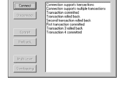

## 图 1.8
*Trans 演示了如何执行嵌套事务。*

## 在 SQL 操作期间提供反馈

在 SQL 操作执行期间提供反馈有几个很好的理由。考虑以下两点：

- 某些 SQL 操作速度很快，但某些操作则极慢。在大型数据库上执行的非常复杂的 `SELECT` 语句可能需要几分钟（甚至几小时）才能执行完毕。
- 特别是在将 `TSqlConnection` 与数据集配合使用（在第 3 章中讨论）时，连接可能会代表你执行一些 SQL 命令。为了学习和调试的目的，拦截发送到数据库的所有 SQL 命令是非常有用的。

在这两种情况下，能够以日志文件、数据库、CodeSite（来自 Raize Software，位于 www.raize.com）或其他调试工具的形式，向应用的最终用户（或向你自身）提供反馈或日志记录功能，都是很有帮助的。

### 在执行 SQL 语句时更改光标

你可以提供的最简单的反馈形式是在执行 SQL 语句时将光标更改为沙漏。要在应用中提供此功能，你只需将连接的 `SQLHourGlass` 属性设置为 `True`。由于 `SQLHourGlass` 不是发布的属性，因此你无法在设计时设置它。

```pascal
SQLConnection1.SQLHourGlass := True;
```

### 创建回调事件以监控 SQL 命令

如果你想拦截从 `TSqlConnection` 传送到数据库的每一个 SQL 命令，你可以设置所谓的跟踪回调事件。

通过调用 `TSqlConnection.SetTraceCallbackEvent` 来设置跟踪回调事件。`SetTraceCallbackEvent` 接受两个参数：用于 SQL 活动的回调事件，以及传递给回调事件的用户定义整数值。

回调事件的格式定义如下：

```pascal
TSQLCallbackEvent = function(CallType: TRACECat; CBIInfo: Pointer): CBRTType; stdcall;
```

在进入回调函数时，`CallType` 总是被设置为 `cbTRACE`。`CBInfo` 是指向 `SQLTRACEDesc` 记录的指针，其定义如下：

```pascal
SQLTRACEDesc = packed record           { trace callback info }
  pszTrace   : array [0..1023] of Char;
  eTraceCat  : TRACECat;
  ClientData : Integer;
  uTotalMsgLen : Word;
end;
```


这些字段及其含义如表 1.8 所示。

## 表 1.8
SQLTraceDesc 字段说明

| 字段 | 定义 |
| :--- | :--- |
| pszTrace | 刚刚从或发送到数据库的以 NULL 结尾的命令。 |
| eTraceCat | 刚刚发送或接收的命令类别。表 1.9 列出了该字段的可能值。 |
| ClientData | 作为 SetTraceCallbackEvent 的第二个参数传递的用户自定义值。 |
| uTotalMsgLen | pszTrace 中包含的字符串的长度（以字符计）。 |

表 1.9 描述了 eTraceCat 字段的可能值。

## 表 1.9
eTraceCat 值

| 值 | 定义 |
| :--- | :--- |
| tracePREPARE | 一条查询语句已发送到服务器进行准备。 |
| traceEXECUTE | 一条查询语句已发送到服务器进行执行。 |
| traceERROR | 服务器返回了一条错误消息。 |
| traceSTMT | 一个供数据库执行的操作已发送到服务器。 |
| traceCONNECT | 一个与连接或断开连接相关的操作已发送到服务器。 |
| traceTRANSACT | 一个与事务相关的操作已发送到服务器。 |
| traceBLOB | 一个与 BLOB 相关的操作已发送到服务器。 |
| traceVENDOR | 一个供应商特定的 API 调用已发送到服务器。 |
| traceDATAIN | 在 INSERT 或 UPDATE 命令期间，参数数据已发送到服务器。 |
| traceDATAOUT | 数据已从服务器获取。 |
| traceMISC | 不属于上述任何类别的其他任何命令。 |

> **注意**
> 并非所有这些选项目前都得到支持。其中许多是为未来扩展而设置的。目前，所有供应商调用和执行的 SQL 命令都会被跟踪。

以下代码片段设置了一个回调事件：

```
function SQLCallback(CallType: TRACECat; CBInfo: Pointer): CBTRType; stdcall; 
var 
CBI: pSQLTRACEDesc; 
begin 
CBI := pSQLTRACEDesc(CBInfo); 
ShowMessage(CBI.pszTrace); 
end;

begin 
SQLConnection1.SetTraceCallbackEvent(SQLCallback, 1); 
end;
```

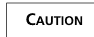

不要将 0 作为 SetTraceCallbackEvent 的第二个参数传入，否则你的回调事件永远不会被调用，你将不得不绞尽脑汁去弄清楚为什么回调事件不起作用。

要移除回调处理器，请执行以下代码行：

```
SQLConnection1.SetTraceCallbackEvent(nil, 0);
```

# TSQLMonitor

TSQLMonitor 提供了一种现成的、易于使用的机制来捕获数据库事件。你可以将数据库消息记录到列表框、日志文件或其他目标中，当它们发生时即可。你也可以允许消息在监控器的内部缓冲区中累积，并一次性将它们转储到文件（或其他目标）中。

要使用 TSQLMonitor，请将其与你的 TSQLConnection 组件一起放置在一个窗体或数据模块中。要开始记录事件，请将监控器的 SQLConnection 属性设置为 TSQLConnection 组件，并将 Active 属性设置为 True。

监控数据库消息有两种方式：你可以选择在 TSQLMonitor 获知每个消息时立即记录每个消息，或者你可以允许组件缓冲这些消息，并在稍后将其保存到日志文件或字符串列表中。以下各部分解释了这些选项。

## 在消息发生时记录

实际上，有两种不同的方法可以在消息发生时记录数据库消息。第一种是通过使用 TSQLMonitor 的 AutoSave 和 FileName 属性。将 FileName 设置为你想要创建的日志文件的名称，例如 C:\TRACE.LOG。将 AutoSave 设置为 True，组件会自动将所有数据库消息记录到指定的文件名中。如果文件不存在，它将被自动创建。如果文件已存在，消息将被追加到其中。

第二种即时记录消息的方法是为 OnTrace 或 OnLogTrace 事件编写事件处理程序。OnTrace 在组件收到指示消息已在应用程序和数据库服务器之间传递时触发。事件处理程序如下所示：

```
procedure TForm1.SQLMonitor1Trace(Sender: TObject; CBInfo: pSQLTRACEDesc;
var LogTrace: Boolean);
begin

end;
```

在事件处理程序中，如果你因某种原因不想将消息保存到内部列表，可以将 LogTrace 设置为 False。默认情况下，消息会被记录。

OnLogTrace 在消息被添加到内部跟踪列表后触发。其事件处理程序如下所示：

```
procedure TForm1.SQLMonitor1LogTrace(Sender: TObject; CBInfo: pSQLTRACEDesc);
begin

end;
```

参数与传递给 OnTrace 事件处理程序的前两个参数相同。

## 缓冲消息

你可以允许 TSQLMonitor 组件在内部列表中缓冲这些消息，而不是在每条消息到达时逐一处理。然后，你可以稍后将它们保存到文件或字符串列表中。

要将列表保存到文件，请像下面这样调用组件的 SaveToFile 方法：

```
SQLMonitor1.SaveToFile('C:\EventList.LOG');
```

或者，你可以通过访问 TraceList 属性将消息保存到字符串列表中，该属性是一个包含消息列表的 TStringList 对象。通过调用 TraceList 上的方法和/或属性，你可以访问列表中的单个行。

### 使用多种反馈机制

TSQLConnection 并没有设计成轻松支持同时向多个目标发送数据库跟踪事件。换句话说，你不能同时使用 TSQLMonitor 和用户定义的反馈事件。因此，如果你想要分配一个回调事件，你应该将 TSQLMonitor 的 Active 属性设置为 False（假设你的应用程序中也有一个 TSQLMonitor 组件）。

另一件你应该避免的事情是在分配新回调时意外覆盖现有的回调处理器。要检查是否存在现有的回调事件（包括 TSQLMonitor 组件的存在），你应该检查只读 TSQLConnection.TraceCallbackEvent 属性的值，以确保它是 nil。

如果 TSQLConnection.TraceCallbackEvent 不是 nil，则已经安装了回调处理器。此时，你有三个选择：

- 选择不安装你的反馈事件。
- 保存指向现有反馈事件的指针，调用 SetTraceCallbackEvent 安装你自己的事件处理程序，并在完成后恢复现有的回调事件。
- 保存指向现有反馈事件的指针，调用 SetTraceCallbackEvent 安装你自己的事件处理程序，并在你的新事件处理程序内部调用现有的事件处理程序。

列表 1.6 显示了一个示例应用程序的源代码，该应用程序通过 TSQLMonitor 组件或程序员定义的回调事件来跟踪数据库操作。

## 列表 1.6
反馈—MainForm.pas

```
unit MainForm;

interface

uses
  SysUtils, Classes, QGraphics, QControls, QForms, QDialogs, DBXpress,
  QExtCtrls, SqlExpr, DB, QStdCtrls;

type
  TfrmMain = class(TForm)
    conn: TSQLConnection;
    pnClient: TPanel;
    lbTrace: TListBox;
    Label1: TLabel;
    btnDump: TButton;
    btnConnect: TButton;
    btnDisconnect: TButton;
    btnExecSQL: TButton;
    btnLogTrace: TCheckBox;
    monitor: TSQLMonitor;
    cbUseCallback: TCheckBox;
    procedure btnDumpClick(Sender: TObject);
    procedure btnConnectClick(Sender: TObject);
    procedure btnDisconnectClick(Sender: TObject); 
    procedure btnExecSQLClick(Sender: TObject); 
    procedure connAfterConnect(Sender: TObject); 
    procedure connAfterDisconnect(Sender: TObject); 
    procedure FormClose(Sender: TObject; var Action: TCloseAction); 
    procedure cbUseCallBackClick(Sender: TObject); 
    procedure monitorTrace(Sender: TObject; CBIInfo: pSQLTRACEDesc;
      var LogTrace: Boolean);
  
  private
    { Private declarations }
  public
    { Public declarations }
  end;
  
  var
      frmMain: TfrmMain;
  
  implementation
  
  {$R *.xfm}
  
  function MySQLCallBack(CallType: TRACECat; CBIInfo: Pointer): CBTRType; stdcall;
  var
      CBI: pSQLTRACEDesc;
  begin
    Result := cbvUseDEF;
    if CBIInfo <> nil then begin
      CBI := pSQLTRACEDesc(CBIInfo);
      frmMain.lbTrace.Items.Add('CallBack: ' + CBI.pszTrace);
    end;
  end;
  
  procedure TfrmMain.btnConnectClick(Sender: TObject);
  begin
    conn.Open;
    
    cbUseCallBackClick(cbUseCallBack);
  end;
  
  procedure TfrmMain.btnDisconnectClick(Sender: TObject);
  begin
    conn.Close;
  end;
```


## 清单 1.6 续

```pascal
procedure TfrmMain.btnExecSQLClick(Sender: TObject);
begin
  conn.ExecuteDirect(' SELECT * FROM CONTACTS' );
end;
```

```pascal
procedure TfrmMain.btnDumpClick(Sender: TObject);
begin
  lbTrace.Items.Assign(monitor.TraceList);
end;
```

```pascal
procedure TfrmMain.monitorTrace(Sender: TObject; CBInfo: pSQLTRACEDESC;
  var LogTrace: Boolean);
begin
  if btnLogTrace.Checked then begin
    lbTrace.Items.Add(CBInfo.pszTrace);
    // 由于我们已自行处理了该消息，因此无需记录日志。
    LogTrace := False;
  end;
end;
```

```pascal
procedure TfrmMain.connAfterConnect(Sender: TObject);
begin
  btnConnect.Enabled := False;
  btnDisconnect.Enabled := True;
  btnExecSQL.Enabled := True;
  btnDump.Enabled := True;
end;
```

```pascal
procedure TfrmMain.connAfterDisconnect(Sender: TObject);
begin
  btnConnect.Enabled := True;
  btnDisconnect.Enabled := False;
  btnExecSQL.Enabled := False;
  btnDump.Enabled := False;
end;
```

```pascal
procedure TfrmMain.cbUseCallbackClick(Sender: TObject);
begin
  if cbUseCallback.Checked then begin
    monitor.Active := False;
    conn.SetTraceCallbackEvent(MySQLCallback, 1);
  end else begin
    conn.SetTraceCallbackEvent(nil, 0);
    monitor.Active := True;
  end;
end;

procedure TfrmMain.FormClose(Sender: TObject; var Action: TCloseAction);
begin
    conn.Close;
end;

end.
```

让我们来看一下 `cbUseCallbackClick` 事件处理程序。如果你勾选“使用回调”（Use Callback）复选框，代码将禁用监视器。随后，它调用 `SetTraceCallbackEvent` 来设置一个回调过程，以监控数据库消息。

当你取消勾选“使用回调”复选框时，代码会将监视器设置为活动状态。这重新建立了 `TSQLMonitor` 组件作为数据库消息的反馈机制。

另一个值得关注的是 `MonitorTrace` 方法。如果勾选了“记录日志”（Log Trace）复选框，我们会立即捕获消息并将其发送到列表框。由于我们已经处理了该消息，因此无需将其缓冲在监视器的内部列表中。因此，代码将 `LogTrace` 设置为 `False`。

图 1.9 展示了 Feedback 应用程序在运行时的状态。

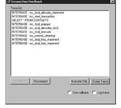

## 图 1.9 Feedback 记录发送到和接收自数据库服务器的消息

## 摘要

本章向你介绍了 `TSQLConnection` 组件，该组件用于建立和维护与 SQL 数据库的连接。具体来说，你学到了：

-   你可以创建具名的或无具名的数据库连接。
-   `TSQLConnection` 提供少量事件，用于允许或阻止数据库的连接和断开。
-   你可以轻松地从数据库连接中获取架构信息（也称为元数据），包括表、字段、索引和过程数据。
-   `TSQLConnection` 可用于对数据库执行 DDL 和 DML 命令。
-   如果数据库服务器支持事务，你可以通过连接组件控制这些事务。
-   在对数据库执行操作时，有多种机制可用于报告反馈。

下一章介绍单向数据集，它们使你能够从 SQL 连接中检索结果集。

## 建立和使用数据库连接

# 第 2 章

## dbExpress 数据集

### 本章内容

- 什么是 dbExpress 数据集？ 58
- 数据集类型 59
- 数据操作 63
- BLOB 支持 69
- 参数化查询 71
- 排序从服务器返回的数据 73
- 主从/详细关系 74
- 检索架构信息 79

前一章概述了 dbExpress 连接和 `TSQLConnection` 组件。你学习了如何连接和断开数据库、如何设置连接参数，以及如何从数据库检索架构信息。在本章中，我将介绍 dbExpress 数据集，它们使你能够从数据库连接中检索数据。

我会提及一些数据集方法，例如 `First`、`Next`、`FieldByName` 等。这些方法实际上是在 `TDataSet` 级别定义的，这意味着它们适用于所有类型的数据集（包括 BDE、ADO、dbExpress 等）。

这些方法在 Delphi 帮助文件和其他通用的 Delphi 书籍中都有详细记载——我会在第 3 章“客户端数据集基础”中应用它们。因此，这里我不会陷入繁琐的细节。相反，我会提供简短的代码片段，以展示它们在上下文中是如何使用的。

## 什么是 dbExpress 数据集？

数据集是 dbExpress 从数据库中检索数据的手段。例如，给定以下 SQL SELECT 语句：

```sql
SELECT * FROM EMPLOYEES
```

员工行将在数据集中返回。你在前一章中已经看到，`TSQLConnection` 可以直接处理不返回结果集的 SQL 语句。对于返回结果集的查询，应使用 `TSQLDataSet`（及其派生类）。

让我们花点时间讨论一下 dbExpress 数据集的特征，然后我们将进入实现它们的具体 dbExpress 类。

## dbExpress 数据集是单向的

关于 dbExpress 数据集，最重要的一点是它们是单向的。起初这可能看起来是一个巨大的劣势，但在本书的其余部分，你会看到 dbExpress 架构如何提供访问和更新数据的极其轻量级、灵活且强大的手段。

由于 dbExpress 数据集是单向的，你能做的唯一导航就是从数据集的开头移动到结尾——每次一条记录。如果你熟悉其他 Delphi 数据集（如 `TTable`、`TADODataSet` 或 `TIBDataSet`），你可能会想知道如何搜索记录或向后浏览数据集。再次强调，对这些问题的解决方案将在后续章节中变得清晰明了。

## dbExpress 数据集是只读的

dbExpress 数据集是对数据库中底层数据的只读视图。dbExpress 数据集不直接支持编辑功能，因此任何尝试编辑 dbExpress 记录的行为都会导致 Delphi 异常，如图 2.1 所示。

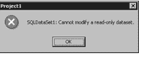

**图 2.1**  
*dbExpress 数据集是只读的。*

## dbExpress 数据集是轻量级的

由于 dbExpress 数据集是单向的且只读的，它们极其轻量级。没有针对双向光标支持、记录缓冲等基础（但昂贵）任务带来的开销。

如果你熟悉 *Borland 数据库引擎*（*BDE*），你知道 BDE 支持完整的编辑功能、数据集的前后导航以及多个数据库后端的驱动程序。然而，BDE 的安装大小约为 10MB，且 BDE 本身内存占用很大。考虑到 dbExpress（与客户端数据集结合使用，我将在后续章节中讨论）仅由总共约 400K 的两个库文件组成。进一步考虑到 dbExpress（配合客户端数据集）支持的功能甚至多于 BDE，你就会开始欣赏为什么 dbExpress 是一项如此卓越的数据库技术。

### 数据集类型

与其他 Delphi 数据库技术（如 ADO 和 IBX）一样，dbExpress 支持三种不同类型的数据集：表、查询和存储过程。这些将在以下部分中讨论。

### 表

表是对底层数据库表的直接视图。它包含表中所有列的所有行。你不能限制从表中返回的行数，也不能选择列的子集（或从另一张表连接列）。

### 查询

查询提供了一种检索底层数据库表中数据子集的方法。它还允许你将一张表的信息连接到另一张表。通常，查询允许你执行任何 `SQL SELECT` 语句并返回结果。

### 存储过程

存储过程是用底层数据库编写的程序，并存储在数据库本身中。dbExpress 存储过程使你能够从数据库存储过程中检索数据。

### 通用数据集

提供表级、查询级和存储过程访问的 dbExpress 组件分别是 `TSQLTable`、`TSQLQuery` 和 `TSQLStoredProc`。提供这些组件仅仅是为了便于从 BDE 应用程序进行转换，它们对应于 BDE 数据访问组件 `TTable`、`TQuery` 和 `TStoredProc`。

对于所有新开发，强烈建议使用通用组件 `TSQLDataSet`。`TSQLDataSet` 允许同样地访问表、查询和存储过程，并且比前面提到的任何专用组件都更加灵活。

`TSQLDataSet` 实现了几乎全部的 dbExpress 数据集功能。`TSQLTable`、`TSQLQuery` 和 `TSQLStoredProc` 继承自 `TSQLDataSet`，并添加了特定于表、查询和存储过程的行为。反过来，`TSQLDataSet` 继承自 `TDataSet`，它是所有 Delphi 数据集的根类。

表 2.1 列出了由 `TSQLDataSet` 定义的相关属性。

**表 2.1 TSQLDataSet 属性**

| 属性 | 描述 |
| :--- | :--- |
| **Active** | 设置为 `True` 以打开数据集，或设置为 `False` 以关闭数据集。你也可读取此属性以确定数据集当前是打开还是关闭。 |
| **CommandText** | `CommandText` 的使用方式取决于 `CommandType` 的值。有关 `CommandText` 的更多信息，请参阅以下部分。 |
| **CommandType** | 将 `CommandType` 设置为 `ctQuery` 以执行查询，设置为 `ctStoredProc` 以执行存储过程，或设置为 `ctTable` 以打开表。有关 `CommandType` 的更多信息，请参阅以下部分。 |
| **DataSource** | 用于在两个数据集之间建立主从/详细链接。有关更多信息，请参阅标题为“主从/详细关系”的部分。 |


# 表 2.1 续

| 属性             | 描述 |
|--------------------|---------------------------------------|
| MaxBlobSize        | 设置从 BLOB 字段返回的最大数据量。有关更多信息，请参阅标题为“BLOB 支持”的章节。 |
| ObjectView         | 当设置为 True 时，数据集提供对 ADT 字段、数组字段以及主/从关系的额外支持。有关更多信息，请参阅标题为“主/从关系”的章节。 |
| ParamCheck         | 当设置为 True 时，每当 CommandText 发生变化，数据集都会自动生成参数。如果您希望手动创建参数，请将此属性设置为 False。有关更多信息，请参阅标题为“参数化查询”的章节。 |
| Params             | 包含当前查询或存储过程的输入和输出参数列表。有关更多信息，请参阅标题为“参数化查询”的章节。 |
| SortFieldNames     | 仅在 CommandType=ctTable 时使用。定义从服务器返回数据的顺序。有关更多信息，请参阅标题为“对从服务器返回的数据进行排序”的章节。 |
| SQLConnection      | 该数据集所连接的 TSQLConnection 组件。在设置数据集的其他任何属性之前，您应该先设置此属性。 |

# 表级访问

若要访问底层数据库表，可以使用 TSQLTable 组件。其基本属性是 SQLConnection 和 TableName。如果您希望选择一个索引用于记录排序目的，还可以设置 IndexName。下面的代码片段说明了如何设置表属性并打开基于表的数据集：

```pascal
SQLTable1.SQLConnection := conn;
SQLTable1.TableName := 'CONTACTS';
SQLTable1.IndexName := 'IX_CONNAMES';
SQLTable1.Open;
```

# 查询级访问

您可以使用 TSQLQuery 创建临时查询以从数据库中检索数据。以下代码展示了如何实现这一点：

```pascal
SQLQuery1.SQLConnection := conn;
SQLQuery1.SQL.Text := 'SELECT * FROM CONTACTS WHERE COUNTRY= "United States"';
SQLQuery1.Open;
```

您还可以创建参数化查询，如下面的代码片段所示：

```pascal
SQLQuery1.SQLConnection := conn;
SQLQuery1.SQL.Text := 'SELECT * FROM CONTACTS WHERE COUNTRY = :TheCountry';
SQLQuery1.ParamByName('TheCountry').Value := 'United States';
SQLQuery1.Open;
```

参数化查询将在稍后标题为“参数化查询”的章节中更详细地讨论。

# 存储过程访问

当您需要执行服务器上的存储过程时，可以使用 TSQLStoredProc 组件，如下面的代码片段所示：

```pascal
SQLStoredProc1.StoredProcName := 'ContactsByState';
SQLStoredProc1.ParamByName('ASTATE').Value := 'FL';
SQLStoredProc1.Open;
```

同样，如果底层存储过程接受一个或多个参数，您应该使用 ParamByName 方法在查询执行前设置这些参数。

# 通用数据访问

正如前面各节所示，您可以使用几种不同的组件进行 dbExpress 数据访问（具体取决于您访问的是表、查询还是存储过程）。然而，有一个单一的、多用途的组件提供了这三个独立组件的所有功能：TSQLDataSet。

您应该在编写的所有新代码中使用 TSQLDataSet，而且在我看来，在转换现有应用程序时也应该使用它。Borland 提供独立的、专用组件是为了更容易将 BDE 应用程序转换为 dbExpress 应用程序。然而，转换为通用的 TSQLDataSet 组件所需的工作量非常少。

下面的代码片段展示了如何使用 TSQLDataSet 访问表：

```pascal
SQLDataSet1.SQLConnection := conn;
SQLDataSet1.CommandType := ctTable;
SQLDataSet1.CommandText := 'CONTACTS';
SQLDataSet1.IndexName := 'IX_CONNAMES';
SQLDataSet1.Open;
```

如您所见，它与 TSQLTable 所需的代码几乎相同。只有一行额外的代码，用于告诉数据集它正在访问的是一个表，而不是查询或存储过程。

要执行查询，您可以编写类似以下的代码：

```pascal
SQLDataSet1.SQLConnection := conn;
SQLDataSet1.CommandType := ctQuery;
SQLDataSet1.CommandText := 'SELECT * FROM CONTACTS WHERE Country = :''TheCountry''';
SQLDataSet1.ParamByName('TheCountry').Value := 'United States';
SQLDataSet1.Open;
```

这段代码也与用于 TSQLQuery 组件的代码极其相似。

下面的代码片段使用 TSQLDataSet 组件执行存储过程：

```pascal
SQLDataSet1.SQLConnection := conn;
SQLDataSet1.CommandType := ctStoredProc;
SQLDataSet1.CommandText := 'ContactsByState';
SQLDataSet1.ParamByName('ASTATE').Value := 'FL';
SQLDataSet1.Open;
```

再次注意它与 TSQLStoredProc 组件的相似之处。

在许多应用程序中，您会在设计时而非运行时设置这些属性。我展示运行时的赋值只是为了指出各种组件之间的异同。

在本书的示例中，我使用 TSQLDataSet 进行所有数据库访问。唯一的例外是 Navigate 示例（将在本章后面展示），它作为如何使用不同的 dbExpress 数据集组件的唯一示例。

## 数据操纵

既然我们已经讨论了数据访问所需的组件，让我们花几分钟讨论一下这些组件提供的方法。由于 dbExpress 数据集是一种单向只读技术，您将看到在这个领域需要覆盖的内容并不多。以下各节讨论了您将在 dbExpress 数据集上执行的最常见操作。

## 打开数据集

在数据集上设置了适当的属性后，您需要打开数据集以从数据库连接中检索数据。实际上有两种方法可以做到这一点，两者都完全相同的结果：

```pascal
SQLDataSet1.Open;
```

或者

```pascal
SQLDataSet1.Active := True;
```

如果您查看 VCL/CLX 源代码，您会发现 `TSQLDataSet.Open` 解析为对 `TDataSet.Open` 的调用，其外观如下：

```pascal
procedure TDataSet.Open;
begin
    Active := True;
end;
```

是调用 `Open` 方法还是自己设置 `Active` 属性，这纯属个人偏好。我发现我更喜欢方法调用，但两种方式都是正确的。

## 关闭数据集

关闭数据集与打开数据集一样简单：

```pascal
SQLDataSet1.Close;
```

或者

```pascal
SQLDataSet1.Active := False;
```

再次，调用 `Close` 方法除了设置 `Active := False` 之外什么也不做，因此请随意采用您喜欢的方法。

> **注意**
>
> 请记住，关闭数据库连接也会关闭所有已打开的数据集。因此，如果您有大量的已打开数据集（并且您已使用完数据库连接），您可以选择仅关闭连接，而不是手动关闭所有已打开的数据集。

## 从数据集检索字段内容

当数据集打开时，您通常想要访问结果集中的各个列（或字段）。为此，您通常调用 `FieldByName` 方法，如下所示：

```pascal
ShowMessage('The name is ' + SQLDataSet1.FieldByName('Name').AsString);
```

通常，您知道想要访问的字段名称（如前一个代码片段所示）。但是，如果您正在编写一个通用的数据库实用程序应用程序，该应用程序适用于任何 dbExpress 支持的数据库或表，您可能事先不知道正在访问的表中有哪些列。在这些情况下，您可以直接访问 `Fields` 对象，如下所示：

```pascal
ShowMessage('The first field’s contents are: ' +
   SQLDataSet1.Fields[0].AsString);
```

您还可以使用 FieldCount 属性来确定结果集中的字段数量并循环遍历它们，如下面的代码所示：

```pascal
for Index := 0 to SQLDataSet1.FieldCount - 1 do
   // Do something with SQLDataSet1.Fields[Index]
```

## 导航数据集

由于 dbExpress 数据集是单向的，支持的操作并不多。您可以执行的只有两个操作：移动到数据集的开头，以及移动到结果集中的下一条记录。这些操作在下面的代码片段中进行了说明：

```pascal
while not SQLDataSet1.EOF do
begin
   for Index := 0 to SQLDataSet1.FieldCount - 1 do
   begin
      // Do something with SQLDataSet1.Fields[Index]
      SQLDataSet1.Next;
   end;
end;
```

下面给出的代码列表是本章节迄今讨论的所有概念的示例。它说明了如何使用 TSQLTable、TSQLQuery、TSQLStoredProc 和 TSQLDataSet 组件从 ConMan 数据库中检索数据。代码列表还展示了如何使用这些组件循环遍历结果，并对数据执行某些操作。（在这种情况下，它只是使用部分字段内容加载 TListView 组件。）

列表 2.1 显示了应用程序主窗体的完整源代码。

## **列表 2.1 基础——MainForm.pas**

```pascal
unit MainForm;

interface

uses
   SysUtils, Variants, Classes, QGraphics, QControls, QForms,
   QDialogs, DBXpress, DB, SqlExpr, QStdCtrls, QComCtrls, QExtCtrls,
   QDBCtrl;

type
   TfrmMain = class(TForm)
      pnlClient: TPanel;
      pnlBottom: TPanel;
      btnConnect: TButton;
```


# **列表 2.1** 续

```pascal
conn: TSQLConnection;   
SQLTable1: TSQLTable;   
SQLQuery1: TSQLQuery;   
SQLStoredProc1: TSQLStoredProc;   
SQLDataSet1: TSQLDataSet;   
Label1: TLabel;   
lvResults: TListView;   
procedure btnConnectClick(Sender: TObject);   
private   
{ Private declarations }   
procedure OpenTable;   
procedure OpenQuery;   
procedure OpenStoredProcedure;   
procedure OpenDataset;   
procedure LoadResults(DataSet: TDataSet);   
public   
{ Public declarations }   
end;   
var   
frmMain: TfrmMain;   
implementation   
uses DataSetTypeForm;   
{$R *.xfrm}   
procedure TfrmMain.btnConnectClick(Sender: TObject);   
var   
frmDataSetType: TfrmDataSetType;   
begin   
// Ask the user whether to open the table, query, stored procedure,   
// or general-purpose dataset   
frmDataSetType := TfrmDataSetType.Create(nil);   
try   
if frmDataSetType.ShowModal = mrOk then begin   
case frmDataSetType.DatasetType of   
dtTable:    OpenTable;   
dtQuery:    OpenQuery;   
dtStoredProc: OpenStoredProcedure;   
dtDataset:    OpenDataset;   
end;
```

conn.Close;
end;
finally
  frmDataType.Free;
end;
end;

procedure TfrmMain.OpenTable;
begin
  SQLTable1.TableName := 'CONTACTS';
  SQLTable1.IndexName := 'IX_CONNNAME';
  SQLTable1.Open;

  LoadResults(SQLTable1);
end;

procedure TfrmMain.OpenQuery;
begin
  SQLQuery1.SQL_Text := 'SELECT * FROM CONTACTS ' +
    'WHERE COUNTRY = "United States"';
  SQLQuery1.Open;

  LoadResults(SQLQuery1);
end;

procedure TfrmMain.OpenStoredProcedure;
begin
  SQLStoredProc1.StoredProcedureName := 'CONTACTSBYSTATE';
  SQLStoredProc1.ParamByName('ASTATE').Value := 'FL';
  SQLStoredProc1.Open;

  LoadResults(SQLStoredProc1);
end;

procedure TfrmMain.OpenDataset;
begin
  SQLDataset1.CommandType := ctQuery;
  SQLDataset1.CommandText := 'SELECT FIRST, LAST, PHONE FROM CONTACTS ' +
    'ORDER BY LAST, FIRST';
  SQLDataset1.Open;

  LoadResults(SQLDataset1);
end;

procedure TfrmMain.LoadResults(DataSet: TDataSet);
var
  ListItem: TListItem;
begin
  lvResults.Items.BeginUpdate;
  try
    lvResults.Items.Clear;

    while not DataSet.EOF do begin
      ListItem := lvResults.Items.Add;
      ListItem.Caption := DataSet.FieldByName('FIRST').AsString;
      ListItem.SubItems.Add(DataSet.FieldByName('LAST').AsString);
      ListItem.SubItems.Add(DataSet.FieldByName('PHONE').AsString);
      DataSet.Next;
    end;
  finally
    lvResults.Items.EndUpdate;
  end;
end;
```

如代码所示，当用户点击“连接”按钮时，程序会创建一个 `TfrmDataType` 的实例（如列表 2.2 所示），提示用户选择要打开的数据集类型：表、查询、存储过程或通用数据集。用户选择数据集类型后，程序会调用四个方法之一：`OpenTable`、`OpenQuery`、`OpenStoredProcedure` 或 `OpenDataset`。这些方法分别设置所选数据集的属性，并调用 `LoadResults`。

请注意，`LoadResults` 以 `TDataSet` 作为参数，如前文所述，`TDataSet` 是所有数据集的基类。这意味着 `LoadResults` 实际上可以处理任何数据集，无论是 dbExpress 数据集、BDE 数据集，还是某些第三方数据集。

`LoadResults` 遍历数据集中的记录，将联系人的名字、姓氏和电话号码加载到 `TListView` 中。

# **列表 2.2** 基础示例—DataTypeForm.pas

```pascal
unit DataTypeForm;

interface

uses
SysUtils, Variants, Classes, QGraphics, QControls, QForms,
QDialogs, QExtCtrls, QStdCtrls;

type
	TDataSetType = (dtTable, dtQuery, dtStoredProc, dtDataset);

	TfrmDatasetType = class(TForm)
		pnlClient: TPanel;
		pnlBottom: TPanel;
		btnOk: TButton;
		btnCancel: TButton;
		grpDatasetType: TRadioGroup;
		procedure btnOkClick(Sender: TObject);
	private
		{ Private declarations }
		FDataSetType: TDataSetType;
	public
		{ Public declarations }
		property DatasetType: TDataSetType read FDataSetType;
	end;

implementation

{$R *.xfm}

procedure TfrmDatasetType.btnOkClick(Sender: TObject);
begin
	FDataSetType := TDataSetType(grpDatasetType.ItemIndex);
end;

end.
```

图 2.2 展示了基础示例应用程序在运行时的界面。

## BLOB 支持

与大多数数据集类似，dbExpress 数据集支持 BLOB 数据。BLOB 是二进制大对象（Binary Large Object）的缩写，用于存储自由格式数据（如图像、备忘录等）。

BLOB 的大小可能会变得很大，因此为了提高查询性能，您通常希望限制从数据库检索的 BLOB 数据的大小。例如，假设您有一个用于存储联系人图像的 BLOB 字段。执行返回大量结果集的查询（如 `SELECT * FROM CONTACTS`）可能会从数据库中检索数千条记录。如果每个联系人的图像平均大小为 100K，那么从服务器返回的数据量将非常庞大。当数据库连接跨越局域网，甚至更糟糕的是跨越互联网时，这个问题会进一步加剧。

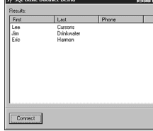

# **图 2.2**
`TSQLDataSet` 用于从数据库检索数据。

在这种情况下，您可能希望从结果集中移除 BLOB 列。您可以有两种方法来实现这一点。首先，如果您正在执行预定义的查询，只需从查询中省略 BLOB 字段即可。例如，如果您正在执行查询 `SELECT FIRST, LAST, PHONE, IMAGE FROM CONTACTS`，请将 SQL 语句修改为 `SELECT FIRST, LAST, PHONE FROM CONTACTS`。

其次，虽然上述解决方案在您确切知道要从数据库检索哪些列时效果很好，但对于通用的数据库实用工具该怎么办呢？如果您不知道列名或字段类型，可以执行如下语句：

```sql
SELECT * FROM CONTACTS
```

在这种情况下，您可以设置 `TSQLDataSet` 的 `BlobSize` 属性，以确定每个 BLOB 字段要检索的最大数据量。如果此参数为 0（默认值），则最大 BLOB 大小由关联的 `TSQLConnection` 的 `BlobSize` 参数决定。如果此参数为 –1，则数据集将检索整个 BLOB，无论其大小如何。其他任何值均构成要检索的 BLOB 的最大字节数。

# **注意**

无论您在连接级别还是在数据集级别设置 `BlobSize`，它都应用于数据集中返回的所有 BLOB 字段。没有办法只检索一个 BLOB 字段的前 100 个字节，同时检索另一个 BLOB 字段的全部内容。

## 参数化查询

在本章迄今为止展示的大多数示例中，在查询数据库时，整个查询语句都是明确指定的。例如，`SELECT * FROM CONTACTS WHERE COUNTRY = 'United States'`

虽然这样可行，但如果您打算多次执行相同的通用查询，则效率较低。例如，假设您想先检索美国的所有联系人，然后检索加拿大的所有联系人，最后检索墨西哥的所有联系人。您可以编写如下代码：

```delphi
SQLOleDataSet1.CommandType := ctQuery;
SQLOleDataSet1.CommandText := 'SELECT * FROM CONTACTS '
    + 'WHERE COUNTRY = "United States"';
SQLOleDataSet1.Open;
ProcessDataSet;
SQLOleDataSet1.Close;
```

```delphi
SQLOleDataSet1.CommandText := 'SELECT * FROM CONTACTS WHERE COUNTRY = "Canada"';
SQLOleDataSet1.Open;
ProcessDataSet;
SQLOleDataSet1.Close;
```

```delphi
SQLOleDataSet1.CommandText := 'SELECT * FROM CONTACTS WHERE COUNTRY = "Mexico"';
SQLOleDataSet1.Open;
ProcessDataSet;
```

在此示例中，`ProcessDataSet` 是一个虚构的方法，它以某种方式对查询结果进行操作。

虽然上述代码工作正常，但远非最优。每次设置 `SQLOleDataSet1.CommandText` 时，后端数据库引擎都必须解析和准备 SQL 语句。实现相同结果的一种更好方法是参数化查询，如下所示：

```delphi
SQLOleDataSet1.CommandText := 'SELECT * FROM CONTACTS WHERE COUNTRY = :Country';
```

这设置了一个名为 `Country` 的参数，它在 SQL 语句中充当占位符。通过为此参数设置不同的值，您可以针对不同的国家发出相同的 SQL 语句，如下所示：

```delphi
SQLOleDataSet1.CommandType := ctQuery;
SQLOleDataSet1.CommandText := 'SELECT * FROM CONTACTS WHERE COUNTRY = :Country';
SQLOleDataSet1.ParamByName('Country').AsString := 'United States';
SQLOleDataSet1.Open;
ProcessDataSet;
```


SQLDataSet1.Close;

SQLDataSet1.ParamByName('Country').AsString := 'Canada';
SQLDataSet1.Open;
ProcessDataSet;
SQLDataSet1.Close;

SQLDataSet1.ParamByName('Country').AsString := 'Mexico';
SQLDataSet1.Open;
ProcessDataSet;

在此场景中，SQL 语句仅在执行第一次时进行预编译。此后，由于唯一改变的是 Country 参数，因此该语句无需再次预编译。

> **注意**
> 请注意，参数的名称不必与其所引用的列名相同。在之前的示例中，该参数可以命名为 ACountry、CountryParam 或 Fred。

还有一个额外的属性控制参数的创建方式：`ParamCheck` 属性。当 `ParamCheck` 设置为 True 时，参数会由 dbExpress 自动创建（如前一个示例所示）。然而，如果您将 `ParamCheck` 设置为 False，则需要负责自行创建参数。以下代码片段展示了如何实现这一点：

SQLDataSet1.CommandType := ctQuery;
SQLDataSet1.ParamCheck := False;
SQLDataSet1.CommandText := 'SELECT * FROM CONTACTS WHERE COUNTRY = :Country';
SQLDataSet1.Params.CreateParam('Country', ftString, ptInput);
SQLDataSet1.ParamByName('Country').AsString := 'United States';
SQLDataSet1.Open;

请注意，通常只有在执行创建接受参数作为存储过程一部分的 DDL 语句时，才会将 `ParamCheck` 设置为 False。因为这样听起来有些令人困惑，让我们来看一个示例：

SQLDataSet1.CommandType := ctQuery;
SQLDataSet1.ParamCheck := False;
SQLDataSet1.CommandText :=
'CREATE PROCEDURE CONTACTSBYTITLE(ATITLE VARCHAR(20)) '
'RETURNS ( ' +
'ID INTEGER, ' +
'FIRST VARCHAR(20), ' +
'LAST VARCHAR(30), ' +
') ' +
'AS ' +
'BEGIN ' +
' FOR SELECT ID, FIRST, LAST ' +
' FROM CONTACTS ' +
' WHERE TITLE = :ATITLE ' +
' INTO :ID, :FIRST, :LAST DO ' +
' BEGIN ' +
' SUSPEND; ' +
' END ';'
SQLDataSet1.ExecSQL;

在这种情况下，存储过程体中使用的参数 ATITLE、ID、FIRST 和 LAST 根本不是 SQL 语句的参数，它们是存储过程的一部分。为了防止 dbExpress 将它们视为参数，在设置 CommandText 之前，应将 ParamCheck 设置为 False。

# 对从服务器返回的数据排序

有两种方法可以对从服务器返回的数据进行排序。一种方法涉及 TSQLTable 组件，另一种方法用于 TSQLQuery 和 TSQLDataSet 组件。我将先介绍 TSQLTable 组件。

# 对表数据排序

如果您使用的是 TSQLTable，可以在打开数据集之前设置组件的 IndexName 或 IndexFieldNames 属性。IndexName 指的是底层数据库中存储的索引名称。例如，在 ConMan 数据库中，我定义了一个名为 IX_CONNAME 的索引，它由 LAST 和 FIRST 列组成（按此顺序）。

SQLTable1.IndexName := 'IX_CONNAME';

如果您不知道底层索引的名称，可以改为设置 IndexFieldNames 属性。IndexFieldNames 是用分号分隔的字段列表，这些字段构成了索引。

SQLTable1.IndexFieldNames := 'LAST;FIRST';

> **注意**
> 您无需确保在 IndexFieldNames 属性中设置的字段上定义了索引。在后台，TSQLTable 会为其传递给数据库的 SQL 语句创建一个 ORDER BY 子句（基于 IndexFieldNames 中列出的字段）。

# 对查询数据排序

如果您使用的是 TSQLQuery 或 TSQLDataSet 组件，对结果集进行排序的方法更加直接：您只需自己向 SQL 语句添加一个 ORDER BY 子句，例如：

SQLDataSet1.CommandText := 'SELECT * FROM CONTACTS ORDER BY LAST, FIRST';

如果数据库中定义了支持 ORDER BY 子句的索引，底层数据库引擎将使用索引以提高速度。如果没有，数据库引擎会在数据返回给应用程序之前，按照请求的顺序对数据进行排序。

# 主/从关系

虽然独立的数据集很有用，但数据集通常通过主/从关系与其他数据集相关联。主/从关系（也称为一对多关系）是指一个数据集中的单条记录对应另一个数据集中的一条或多条记录的关系。

主/从关系最常见的例子使用客户、订单和物品作为其数据集。一个单个客户可以向某个供应商下多个订单。反过来，一个订单可以包含多个物品。图 2.3 展示了典型的客户、订单和物品数据集的图形表示。

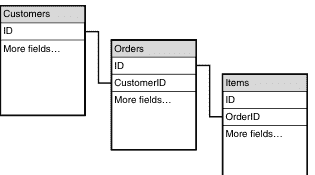

**图 2.3**
*主/从关系可以有多级。*

在 ConMan 数据库中，CONTACT 表和 ACTIVITIES 表通过 ContactID 字段以主/从关系连接。

要在应用程序中创建此主/从链接，您需要执行以下步骤：

-   将 TSQLConnection 组件放置在窗体上，并将其连接到 ConMan 数据库。
-   在窗体上放置一个 TSQLDataSet，并将其 TSQLConnection 属性设置为您在第 1 步中创建的 TSQLConnection 组件。将 Name 属性设置为 sqlContacts，将 CommandText 属性设置为 SELECT * FROM CONTACTS。这是主数据集。
-   在窗体上放置一个 TDataSource，将其 Name 属性设置为 dsContacts，并将其 DataSet 属性设置为 sqlContacts。
-   在窗体上再放置一个 TSQLDataSet。将其 Name 属性设置为 sqlActivities，将其 DataSource 属性设置为 dsContacts。这是从数据集。
-   将 sqlActivities.CommandText 设置为 SELECT * FROM ACTIVITIES WHERE ContactID = :ContactID。

这是建立主/从关系在程序代码中所需的全部内容。您应该注意以下几点：

-   从数据集的 CommandText 属性始终是一个参数化查询。参数名称实际上指的是主数据集中的列名。
-   每当主数据集更改记录时，从数据集会自动检索与当前主记录相关联的记录。

第一个点需要更多的解释。

您应该记得在“参数化查询”一节中，使用参数化查询时，通常调用 TSQLDataSet.ParamByName 来设置参数。

对于从数据集而言，参数替换稍微更加自动化。VCL/CLX 注意到从数据集的 DataSource 参数已赋值，因此它查找数据源的数据集作为参数值的来源。

例如，在 CONTACT/ACTIVITIES 示例中，sqlActivities.CommandText 包含单个参数：ContactID。当 Delphi 分配 ContactID 参数的值时，它会查看主数据集中名为 ContactID 的列。因为主数据集确实包含一个名为 ContactID 的列，所以参数的值取自该列。

> **注意**
> 您可以创建一个从数据集，该数据集仅从主数据集获取其部分参数值。在这种情况下，您必须手动设置其他参数的值。

例如，给定 SQL 语句 SELECT * FROM ACTIVITIES WHERE (ContactID = :ContactID) AND (SCHEDULED > :Earliest)，从数据集将从主数据集获取 ContactID 参数的值。您需要调用 sqlActivities.ParamByName 来设置 Earliest 参数。

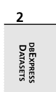

当您在主数据集中滚动时，从数据集会自动更新自身以与主数据集保持同步。

列表 2.3 展示了利用参数化查询、主/从关系和 BLOB 字段的应用程序的完整源代码。

# **列表 2.3** 高级——MainForm.pas

unit MainForm;

interface

uses
  Types, SysUtils, Variants, Classes, QGraphics, QControls, QForms,
  QDialogs, DBXpress, DB, SqlExpr, QStdCtrls, QComCtrls, QExtCtrls, FMTBcd,
  QDBCtrls;

type
  TfrmMain = class(TForm)
    pnlClient: TPanel;
    pnlBottom: TPanel;
    btnConnect: TButton;
    btnDisconnect: TButton;
    Label1: TLabel;
    DBImage1: TDBImage;
    DBText1: DBText;
    Label2: TLabel;
    Label3: TLabel;
    Label4: TLabel;
    Label5: TLabel;
    Label6: TLabel;
    Label7: TLabel;
    Label8: TLabel;
    Label9: TLabel;
    DBText2: DBText;
    DBText3: DBText;
    DBText4: DBText;
    DBText5: DBText;
    DBText6: DBText;
    DBText7: DBText;
    DBText8: DBText;
    DBText9: DBText;
    DBNavigator1: TDBNavigator;
    Bevel1: TBevel;
    Label10: TLabel;
    lvActivities: TListView;


## **列表 2.3**（续）

```pascal
Label11: TLabel;
cbCountry: TComboBox;
btnRetrieve: TButton;
conn: TSQLConnection;
sqlContacts: TSQLDataSet;
sqlContactsFIRST: TStringField;
sqlContactsLAST: TStringField;
sqlContactsDEAR: TStringField;
sqlContactsTITLE: TStringField;
sqlContactsCOMPANYNAME: TStringField;
sqlContactsADDRESS1: TStringField;
sqlContactsADDRESS2: TStringField;
sqlContactsCITY: TStringField;
sqlContactsSTATE: TStringField;
sqlContactsPOSTALCODE: TStringField;
sqlContactsCOUNTRY: TStringField;
sqlContactsPHONE: TStringField;
sqlContactsFAX: TStringField;
sqlContactsCELLULAR: TStringField;
sqlContactsPAGER: TStringField;
sqlContactsEMAIL: TStringField;
sqlContactsIMAGE: TlobField;
sqlContactsNOTES: TmemoField;
DataSource1: TDataSource;
sqlActivities: TSQLDataSet;
sqlActivitiesCONTACTID: TIntegerField;
sqlActivitiesDESCRIPTION: TStringField;
sqlActivitiesSCHEDULED: TSQLTimeStampField;
sqlActivitiesCOMPLETED: TSQLTimeStampField;
sqlContactsCONTACTID: TIntegerField;
sqlActivitiesTODOID: TIntegerField;
procedure btnConnectClick(Sender: TObject);
procedure btnNextClick(Sender: TObject);
procedure btnDisconnectClick(Sender: TObject);
procedure btnRetrieveClick(Sender: TObject);
procedure connAfterDisconnect(Sender: TObject);
procedure connAfterConnect(Sender: TObject);
procedure FormClose(Sender: TObject; var Action: TCloseAction);
procedure sqlContactsAfterScroll(DataSet: TDataSet);
private
    { Private declarations }
public
    { Public declarations }
end;
```

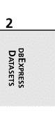

```pascal
var
  frmMain: TfrmMain;

implementation

{$R *.xfm}

procedure TfrmMain.btnConnectClick(Sender: TObject);
begin
  conn.Open;
end;

procedure TfrmMain.btnDisconnectClick(Sender: TObject);
begin
  sqlContacts.Close;
  conn.Close;
end;

procedure TfrmMain.connAfterConnect(Sender: TObject);
begin
  btnConnect.Enabled := False;
  btnDisconnect.Enabled := True;
end;

procedure TfrmMain.connAfterDisconnect(Sender: TObject);
begin
  btnConnect.Enabled := True;
  btnDisconnect.Enabled := False;
end;

procedure TfrmMain.FormClose(Sender: TObject; var Action: TCloseAction);
begin
  btnDisconnectClick(btnDisconnect);
end;

procedure TfrmMain.btnRetrieveClick(Sender: TObject);
begin
  sqlContacts.Close;
  sqlContacts.ParamByName('CountryName').Value := cbCountry.Text;
  sqlContacts.Open;
end;

procedure TfrmMain.BtnNextClick(Sender: TObject);
begin
  sqlContacts.Next;
end;

procedure TfrmMain.sqlContactsAfterScroll(DataSet: TDataSet);
var
  ListItem: TListItem;
begin
  lvActivities.Items.BeginUpdate;
  try
    lvActivities.Items.Clear;

    while not sqlActivities.EOF do begin
      ListItem := lvActivities.Items.Add;
      ListItem.Caption := DateTimeToStr(sqlActivitiesSCHEDULED.AsDateTime);
      ListItem.SubItems.Add(sqlActivitiesDESCRIPTION.AsString);
      if not sqlActivitiesCOMPLETED.IsNull then
        ListItem.Data := Pointer(1);
      sqlActivities.Next;
    end;
  finally
    lvActivities.Items.EndUpdate;
  end;
end;
```

图 2.4 展示了高级程序的实际运行效果。

## 获取模式信息

前一章介绍了如何获取数据库的基本模式信息（例如表名、索引名和存储过程名）。本节将解释如何使用 TSQLDataSet 来获取有关表和列的更详细信息。

要从数据库中获取全面的模式信息，请调用 TSQLDataSet.SetSchemaInfo，它指定要获取模式的目标对象以及要返回的模式数据类型。SetSchemaInfo 接受三个参数，定义如下：

```pascal
procedure SetSchemaInfo(SchemaType: TSchemaType; SchemaObjectName,
  SchemaPattern: string);
```

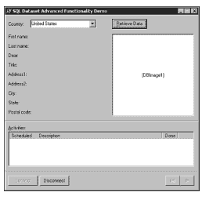

### **图 2.4**
Advanced 程序显示联系人数据及相关活动。

SchemaType 指定要返回的模式数据类型，必须是表 2.2 中列出的值之一。

| **表 2.2 TSchemaType 值** | |
| :--- | :--- |
| *值* | *返回的模式信息* |
| stNoSchema | 无模式信息。数据集返回查询或存储过程的结果，而非该对象的模式信息。 |
| stTables | 与对象名称和模式匹配的数据库表信息。 |
| stSysTables | 数据库中的系统表信息。 |
| stProcedures | 数据库中的存储过程信息。 |
| stColumns | 单个表的列信息。 |
| stProcedureParams | 单个存储过程的参数信息。 |
| stIndexes | 单个表的索引信息。 |

SchemaObjectName 指定要返回数据的表或存储过程的名称。它仅用于 stColumns、stProcedureParams 和 stIndexes 模式类型。如果模式类型是 stColumns 或 stIndexes，SchemaObjectName 指定要返回列或索引信息的表。如果模式类型是 stProcedureParams，SchemaObjectName 指定要返回参数信息的存储过程名称。

SchemaPattern 是一个用于过滤结果集中返回数据的 SQL 模式。例如，要仅返回以字母 A 开头的列，可以向 SetSchemaInfo 调用传递 A% 作为 SchemaPattern。如果不想过滤结果集，请将 SchemaPattern 设置为空字符串。

在 SchemaPattern 中，使用百分号 (%) 匹配任意长度的字符串，使用下划线 (_) 匹配单个字符。如果要在模式中包含百分号或下划线，请将其重复两次 (%% 或 __)。

检索数据库的模式数据后，可以通过调用 SetSchemaInfo 并传入 stNoSchema 作为 SchemaType，使用相同的数据集对数据库执行常规查询。

列表 2.4 展示了一个示例程序的完整源代码，该程序可以提取并显示 dbExpress 数据库的模式信息。在列表之后，我将简要概述该代码，因为此时大部分代码应当不言自明。

图 2.5 展示了 Schema 程序显示 ConMan.gdb 数据库中 CONTACTS 表的列信息时的状态。

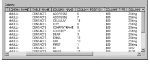

### 图 2.5
Schema 应用程序解码并显示列信息。

## 列表 2.4 模式—MainForm.pas

```pascal
unit MainForm;

interface

uses
  SysUtils, Variants, Classes, QGraphics, QControls, QForms,
  QDialogs, DBXpress, FMTBcd, Db, SqlExpr, QExctrls, QStdCtrls, QComCtrls;

type
  TfrmMain = class(TForm)
    pnlClient: TPanel;
    conn: TSQLConnection;
    dataset: TSQLDataSet;
    Label1: TLabel;
    lvColumns: TListView;
    grpSchemaType: TRadioGroup;
    Label2: TLabel;
    ecObjectName: TEdit;
    btnRetrieve: TButton;
    ecSchemaPattern: TEdit;
    Label3: TLabel;
    procedure btnRetrieveClick(Sender: TObject);
  private
    { Private declarations }
    function GetTableTypeString(TableType: Integer): string;
    function GetProcTypeString(ProcType: Integer): string;
    function GetColTypeString(ColType: Integer): string;
    function GetColDataTypeString(ColDataType: Integer): string;
    function GetColSubTypeString(ColSubType: Integer): string;
    function GetIndexTypeString(IndexType: Integer): string;
  public
    { Public declarations }
  end;

var
  frmMain: TfrmMain;

implementation

{$R *.xfm}

procedure TfrmMain.btnRetrieveClick(Sender: TObject);
var
  SchemaType: TSchemaType;
  ListColumn: TListColumn;
  ListItem: TListItem;
  Index: Integer;
begin
  SchemaType := TSchemaType(grpSchemaType.ItemIndex + 1);

  // Columns, Indexes, and Procedure Params must have a schema object name
  case SchemaType of
    stColumns,
    stIndexes,
    stProcedureParams:
      if ecObjectName.Text = '' then
        raise Exception.Create('You must enter a schema object name ' +
            'for this schema type.');
  end;
  conn.Open;
  try
    dataset.SetSchemaInfo(SchemaType, ecObjectName.Text, ecSchemaPattern.Text);
    dataset.Open;

    lvColumns.Items.BeginUpdate;
    try
      lvColumns.Items.Clear;
      lvColumns.Columns.BeginUpdate;
      try
        lvColumns.Columns.Clear;
        for Index := 0 to dataset.FieldCount - 1 do begin
          ListItem := lvColumns.Columns.Add;
          ListColumn.Caption := dataset.Fields[Index].FieldName;
        end;

        while not dataset.EOF do begin
          ListItem := lvColumns.Items.Add;

          ListItem.Caption := dataset.Fields[0].AsString;
          for Index := 1 to dataset.FieldCount - 1 do begin
            if dataset.Fields[Index].FieldName = 'TABLE_TYPE' then
              ListItem.SubItems.Add(GetTableTypeString(
                  dataset.Fields[Index].AsInteger))
            else if dataset.Fields[Index].FieldName = 'PROC_TYPE' then
              ListItem.SubItems.Add(GetProcTypeString(
                  dataset.Fields[Index].AsInteger))
            else if dataset.Fields[Index].FieldName = 'COLUMN_TYPE' then
              ListItem.SubItems.Add(GetColTypeString(
                  dataset.Fields[Index].AsInteger))
            else if dataset.Fields[Index].FieldName = 'COLUMN_DATATYPE' then
              ListItem.SubItems.Add(GetColDataTypeString(
                  dataset.Fields[Index].AsInteger))
            else if dataset.Fields[Index].FieldName = 'COLUMN_SUBTYPE' then
              ListItem.SubItems.Add(GetColSubTypeString(
                  dataset.Fields[Index].AsInteger))


# **列表 2.4** 续

```delphi
else if dataset.Fields[Index].FieldName = 'INDEX_TYPE' then
   ListItem.SubItems.Add(GetIndexTypeString(
      dataset.Fields[Index].AsInteger))
else
   ListItem.SubItems.Add(dataset.Fields[Index].AsString);
end;

dataset.Next;
end;
finally
   lvColumns.Columns.EndUpdate;
end;
finally
   lvColumns.Items.EndUpdate;
end;
finally
   conn.Close;
end;
end;

function TfrmMain.GetTableTypeString(TableType: Integer): string;
procedure Check(SQLTableType: Integer; const Desc: string);
begin
   if (TableType and SQLTableType) <> 0 then begin
      if Result <> '' then
         Result := Result + ', ';
      Result := Result + Desc;
   end;
end;
begin
   Result := '';

   Check(eSQLTable,       'Table');
   Check(eSQLView,        'View');
   Check(eSQLSynonym,     'Synonym');
   Check(eSQLSystemTable, 'System');
   Check(eSQLTempTable,   'Temp');
   Check(eSQLLocal,       'Local');

   if Result = '' then
      Result := '$' + IntToHex(TableType, 2);
end;

function TfrmMain.GetProcTypeString(ProcType: Integer): string;
procedure Check(SQLProcType: Integer; const Desc: string);
begin
   if (ProcType and SQLProcType) <> 0 then begin
      if Result <> '' then
         Result := Result + ', ';
      Result := Result + Desc;
   end;
end;
begin
   Result := '';
   
   Check(eSQLProcedure, 'Procedure');
   Check(eSQLFunction, 'Function');
   Check(eSQLPackage, 'Package');
   Check(eSQLSysProcedure, 'System');
   
   if Result = '' then
      Result := '$' + IntToHex(ProcType, 2);
end;

function TfrmMain.GetColTypeString(ColType: Integer): string;
procedure Check(SQLColType: Integer; const Desc: string);
begin
   if (ColType and SQLColType) <> 0 then begin
      if Result <> '' then
         Result := Result + ', ';
      Result := Result + Desc;
   end;
end;
begin
   Result := '';
   
   Check(eSQLRowId, 'Row Id');
   Check(eSQLRowVersion, 'Row Version');
   Check(eSQLAutoIncr, 'Auto Incr');
   Check(eSQLDefault, 'Default');
   
   if Result = '' then
      Result := '$' + IntToHex(ColType, 2);
end;

function TfrmMain.GetColDataTypeString(ColDataType: Integer): string;
begin
   case ColDataType of
      fldUNKNOWN:   Result := 'Unknown';
      fldZSTRING:   Result := 'ZString';
      fldDATE:      Result := 'Date';
      fldBLOB:      Result := 'BLOB';
      fldBOOL:      Result := 'Bool';
      fldINT16:     Result := 'Int16';
      fldINT32:     Result := 'Int32';
      fldFLOAT:     Result := 'Float';
      fldBCD:       Result := 'BCD';
      fldBYTES:     Result := 'Bytes';
      fldTIME:      Result := 'Time';
      fldTIMESTAMP: Result := 'Timestamp';
      fldUINT16:    Result := 'UInt16';
      fldUINT32:    Result := 'UInt32';
      fldFLOATIEEE: Result := 'FloatIEEE';
      fldVARYBYTES: Result := 'VarBytes';
      fldLOCKINFO:  Result := 'LockInfo';
      fldCURSOR:    Result := 'Cursor';
      fldINT64:     Result := 'Int64';
      fldUINT64:    Result := 'UInt64';
      fldADT:       Result := 'ADT';
      fldARRAY:     Result := 'Array';
      fldREF:       Result := 'RefADT';
      fldTABLE:     Result := 'Table';
      fldDATETIME:  Result := 'DateTime';
      fldFMTBCD:    Result := 'FmtBCD';
   else
      Result := '$' + IntToHex(ColDataType, 2);
   end;
end;

function TfrmMain.GetColSubTypeString(ColSubType: Integer): string;
begin
   case ColSubType of
      fldstMONEY:    Result := 'Money';
      fldstMEMO:     Result := 'Memo';
      fldstBINARY:   Result := 'Binary';
      fldstFMTMEMO:  Result := 'Fmt Memo';
      fldstOLEOBJ:   Result := 'Pdox OLE';
      fldstGRAPHIC:  Result := 'Graphic';
      fldstDBOBJ:    Result := 'dBase OLE';
      fldstTYPEDBINARY: Result := 'Typed BINARY';
      fldstACCESSOLEDB: Result := 'Access OLE';
      fldstHMEMO:    Result := 'CLOB';
      fldstHBINARY:  Result := 'BLOB';
      fldstBFILE:    Result := 'BFILE';
      fldstPASSWORD: Result := 'Password';
      fldstFIXED:    Result := 'Char';
      fldstUNICODE:  Result := 'Unicode';
      fldstAUTOINC:  Result := 'AutoInc';
      fldstADTNestedTable: Result := 'ADT Nest';
      fldstADTDATE:  Result := 'ADT Date';
   else
      Result := '$' + IntToHex(ColSubType, 2);
   end;
end;

function TfrmMain.GetIndexTypeString(IndexType: Integer): string;
procedure Check(SQLIndexType: Integer; const Desc: string);
begin
   if (IndexType and SQLIndexType) <> 0 then begin
      if Result <> '' then
         Result := Result + ', ';
      Result := Result + Desc;
   end;
end;
begin
   Result := '';
   Check(eSQLNonUnique, 'Non-unique');
   Check(eSQLUnique, 'Unique');
   Check(eSQLPrimaryKey, 'Primary');
   if Result = '' then
      Result := '$' + IntToHex(IndexType, 2);
end;
```

模式应用程序的核心部分包含在单个方法中：`btnRetrieveClick`。`btnRetrieveClick` 确定用户选择的模式类型，并确保如果请求的模式类型是列、索引或存储过程参数，用户必须输入对象名称。

一旦确定了模式类型，调用适当的 `setSchemaInfo`、打开数据集并使用模式信息加载列表视图就是一件简单的事了。某些列（即 TABLE_TYPE、PROC_TYPE、COLUMN_TYPE、COLUMN_DATATYPE、COLUMN_SUBTYPE 和 INDEX_TYPE）是位图数值列。该程序调用少数几个辅助例程来显示这些值的文本表示形式。其余列按原样显示。

运行此应用程序时您会发现，不同的模式类型返回不同的数据字段。表 2.3 至 2.7 解释了每种模式类型返回的列。

表 2.3 列出了模式类型为 `stTables` 或 `stSystemTables` 时返回的列。

| **表 2.3** | stTables 和 stSystemTables 模式列 |
|---|---|
| **列** | **描述** |
| RECNO | 绝对记录号。第一条记录为 1，第二条为 2，依此类推。 |
| CATALOG_NAME | 包含该表的目录或数据库的名称。 |
| SCHEMA_NAME | 表的所有者。 |
| TABLE_NAME | 表名。 |
| TABLE_TYPE | 代表表类型的位图值。有关此字段可能值的解释，请参阅列表 2.4 或 DBXPress.pas 的源代码。 |

表 2.4 列出了模式类型为 `stProcedures` 时返回的列。

| **表 2.4** | stProcedures 模式列 |
|---|---|
| **列** | **描述** |
| RECNO | 绝对记录号。第一条记录为 1，第二条为 2，依此类推。 |
| CATALOG_NAME | 包含该存储过程的目录或数据库的名称。 |
| SCHEMA_NAME | 存储过程的所有者。 |
| PROC_NAME | 存储过程的名称。 |
| PROC_TYPE | 代表存储过程类型的位图值。有关此字段可能值的解释，请参阅列表 2.4 或 DBXPress.pas 的源代码。 |
| IN_PARAMS | 存储过程的输入参数数量。 |
| OUT_PARAMS | 存储过程的输出参数数量。 |

表 2.5 列出了模式类型为 *stColumns* 时返回的列。

| **表 2.5** | stColumns 模式列 |
|---|---|
| **列** | **描述** |
| RECNO | 绝对记录号。第一条记录为 1，第二条为 2，依此类推。 |
| CATALOG_NAME | 包含该表的目录或数据库的名称。 |
| SCHEMA_NAME | 列的所有者。 |
| TABLE_NAME | 包含该列的表的名称。 |
| COLUMN_NAME | 列的名称。 |
| COLUMN_POSITION | 列在表定义中的基于零的位置。 |
| COLUMN_TYPE | 代表列类型的位图值。有关此字段可能值的解释，请参阅列表 2.4 或 DBXpress.pas 的源代码。 |
| COLUMN_DATATYPE | 逻辑字段类型。有关此字段可能值的解释，请参阅列表 2.4 或 DBXpress.pas 的源代码。 |
| COLUMN_TYPENAME | SQL 列类型（VARCHAR、BLOB 或类似类型）。 |
| COLUMN_SUBTYPE | 逻辑字段子类型。有关此字段可能值的解释，请参阅列表 2.4 或 DBXpress.pas 的源代码。 |
| COLUMN_LENGTH | 列的大小（以字节为单位）。 |
| COLUMN_PRECISION | 列的精度。因列类型而异。例如，对于字符串是字符数，对于 BCD 值是有效数字的位数。 |
| COLUMN_SCALE | 数值比例。对于 BCD 列，它是小数点右侧的数字位数。 |
| COLUMN_NULLABLE | 如果列可以包含 NULL 值，则为一；如果不能包含 NULL 值，则为零。 |

表 2.6 列出了模式类型为 *stProcedureParams* 时返回的列。

| **表 2.6** | stProcedureParams 模式列 |
|---|---|
| **列** | **描述** |
| RECNO | 绝对记录号。第一条记录为 1，第二条为 2，依此类推。 |
| CATALOG_NAME | 包含该存储过程的目录或数据库的名称。 |


# 表 2.6（续）

| 列 | 描述 |
| :--- | :--- |
| SCHEMA_NAME | 过程参数的所有者。 |
| PROCEDURE_NAME | 包含该参数的过程的名称。 |
| PARAM_NAME | 参数的名称。 |
| PARAM_POSITION | 参数的基于零的位置。注意，输入参数和输出参数各自拥有独立的列表，因此第一个输入参数的位置为零，第一个输出参数的位置也为零。 |
| PARAM_TYPE | 对于输入参数为 1，输出参数为 2，输入/输出参数为 3，返回值为 4。 |
| PARAM_DATATYPE | 逻辑参数类型。有关该字段可能值的解释，请参阅列表 2.4，或 DBXpress.pas 的源代码。 |
| PARAM_SUBTYPE | 逻辑参数子类型。有关该字段可能值的解释，请参阅列表 2.4，或 DBXpress.pas 的源代码。 |
| PARAM_TYPENAME | SQL 参数类型（如 VARCHAR、BLOB 等）。 |
| PARAM_LENGTH | 参数的字节大小。 |
| PARAM_PRECISION | 参数的精度。因参数类型而异。例如，对于字符串，它是字符数；对于 BCD 值，它是有效数字的位数。 |
| PARAM_SCALE | 数字比例。对于 BCD 参数，它是小数点右侧的数字位数。 |
| PARAM_NULLABLE | 如果参数可以包含 NULL 值，则为 1；如果不能包含 NULL 值，则为 0。 |

表 2.7 列出了当架构类型为 stIndexes 时返回的列。

# 表 2.7 stIndexes 架构列

| 列 | 描述 |
| :--- | :--- |
| RECNO | 绝对记录编号。第一条记录为 1，第二条为 2，依此类推。 |
| CATALOG_NAME | 包含该索引的目录或数据库的名称。 |
| SCHEMA_NAME | 索引的所有者。 |
| TABLE_NAME | 定义该索引的表的名称。 |
| INDEX_NAME | 索引的名称。 |
| COLUMN_NAME | 构成该索引的一部分的列的名称。 |
| COLUMN_POSITION | 列在索引中的位置。 |
| PKEY_NAME | 如果是主键，这是主键的名称。 |
| INDEX_TYPE | 一个位映射值，表示列的类型。有关该字段可能值的解释，请参阅列表 2.4，或 DBXpress.pas 的源代码。 |
| SORT_ORDER | 升序列为 A，降序列为 D。 |
| FILTER | 这代表过滤/范围索引上的过滤条件，或表达式索引上的表达式。例如，(LAST + FIRST)。仅某些数据库（如 Oracle）支持此功能。 |

# 摘要

本章讨论了 dbExpress 数据集组件 TSQLDataSet，包括以下关键概念：

- TSQLDataSet 是一种单向、只读、轻量级的数据访问机制。它可以用于从数据库中的表、查询或存储过程中检索数据。
- dbExpress 数据集支持两种导航选项：移动到数据集的开头以及移动到结果集中的下一条记录。
- 要从 TSQLDataSet 中检索数据，通常调用 FieldByName 方法。
- TSQLDataSet 支持 BLOB 信息。为了提高查询性能，您可以设置 TSQLDataSet 的 BlobSize 属性以指定每个 BLOB 字段要检索的最大数据量。
- 为了使重复查询更高效，您可以通过在 SQL 语句中创建占位符来实现参数化。然后，您可以为该参数设置不同的值。SQL 语句仅被编译一次——即在第一次执行时。
- 要对从数据库返回的数据进行排序，您可以在数据集的 CommandText 属性中指定 ORDER BY 子句。
- 您可以轻松地在表和查询之间建立主/从关系。
- 可以使用 dbExpress 数据集来检索数据库中表、查询和存储过程的详细架构信息。

下一章开始对客户端数据集进行为期两章的探索。

# 客户端数据集基础


# 本章内容

- 什么是客户端数据集？ 94
- 客户端数据集的优缺点 94
- 创建客户端数据集 95
- 填充和操作客户端数据集 105
- 遍历客户端数据集 113
- 客户端数据集索引 118
- 过滤器和范围 126
- 搜索 136

在之前的两章中，我讨论了 dbExpress——一种单向数据库技术。在现实世界中，大多数应用程序都支持在数据集中进行双向滚动。正如之前所述，Borland 通过一种称为客户端数据集的技术解决了双向数据集的问题。本章将介绍客户端数据集的基本操作，包括它们如何作为有用的独立工具。后续章节将重点关注更高级的客户端数据集功能，包括如何将客户端数据集连接到 dbExpress（或其他）数据库连接，以创建真正的多层应用程序。

## 什么是客户端数据集？

顾名思义，客户端数据集是位于客户端应用程序中的数据集合（与应用服务器相对）。这个名称其实有点名不副实，因为它似乎暗示客户端数据集在客户端/服务器或多层应用程序之外没有用处。然而，正如本章所示，客户端数据集在其他类型的应用程序中也非常有用，尤其是单层数据库应用程序。

> **注意**
>
> 客户端数据集最初是在 Delphi 3 中引入的，它提供了一种在 Delphi 中创建多层应用程序的方法。随着其使用的普及，它得到了增强以支持更多的单层功能。

VCL/CLX 中客户端数据集的基类是 TCustomClientDataSet。通常，您不会直接处理 TCustomClientDataSet，而是处理其直接派生类 TClientDataSet。（在第 7 章“数据集提供程序”中，我将介绍 TCustomClientDataSet 的其他派生类。）为了可读性和通用性，我在这本书中将客户端数据集统称为 TClientDataSet。

## 客户端数据集的优缺点

客户端数据集有很多优点，也有一些看似缺点的地方。优点包括

- 基于内存。客户端数据集完全驻留在内存中，因此非常适合临时表。
- 快速。由于客户端数据集基于 RAM（随机存取存储器），它们极其快速。
- 高效。客户端数据集以非常高效的方式存储数据，因此对资源友好。
- 即时索引。客户端数据集允许您即时创建和使用索引，使其具有极高的灵活性。
- 自动撤销支持。客户端数据集提供多级撤销支持，使执行“假设”操作变得容易。撤销支持在第 4 章“高级客户端数据集操作”中讨论。
- 维护聚合。客户端数据集可以自动计算一组记录的平均值、小计和总计。维护聚合在第 4 章中详细讨论。

看似缺点的地方包括

- 基于内存。这种客户端数据集的优势也可能成为劣势。由于客户端数据集驻留在 RAM 中，其大小受可用 RAM 量的限制。
- 单用户。由于存储在 RAM 中，客户端数据集本质上是单用户数据集。

当您了解客户端数据集时，您会发现这些所谓的缺点对您的应用程序完全没有损害。特别是，将客户端数据集完全基于 RAM 既有优点也有缺点。

由于它们完全存储在计算机的 RAM 中，客户端数据集对于临时表、小查找表和其他非持久化数据库需求极其有用。客户端数据集也很快，因为它们基于 RAM。在客户端数据集中插入、删除、搜索、排序和遍历都极快。

另一方面，您需要采取措施确保客户端数据集不会变得太大，因为如果尝试在内存数据集中存储巨大的数据库，会浪费宝贵的 RAM。幸运的是，客户端数据集以非常紧凑的形式存储其数据。（我将在第 7 章的“撤销支持”部分详细讨论这一点。）

由于基于内存，客户端数据集本质上是单用户的。远程机器无法访问本地机器上的客户端数据集。在第 8 章“DataSnap”中，您将学习如何将客户端数据集连接到应用程序服务器，以在支持真正多用户操作的三层配置中工作。

## 创建客户端数据集

在应用程序中使用客户端数据集类似于使用其他类型的数据集，因为它们都派生自 TDataSet。

您可以在设计时或运行时创建客户端数据集，如下节所述。


## 在设计时创建客户端数据集

  通常，你是在设计时创建客户端数据集。为此，请将 TClientDataSet 组件（位于“数据访问”选项卡上）拖放到窗体或数据模块上。这会创建该组件，但不会设置任何字段或索引定义。将组件命名为 `cdsEmployee`。

  要为客户端数据集创建字段定义，请在窗体编辑器中双击 TClientDataSet 组件。此时会显示标准的 Delphi 字段编辑器。右键单击字段编辑器，并从弹出菜单中选择 *新建字段...* 以创建新字段。此时将显示如图 3.1 所示的对话框。

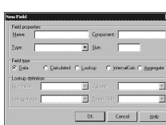

**图 3.1**  
*使用“新建字段”对话框向数据集中添加字段。*

  如果你熟悉字段编辑器，你会发现客户端数据集有一种新的可用字段类型，称为“聚合字段”。我将在下一章中详细讨论聚合字段。目前，你应该明白，你可以向客户端数据集添加数据、查找、计算和内部计算字段——就像你可以向任何数据集添加的那样。

  客户端数据集与其他数据集的区别在于，当你为一个典型的数据集创建数据字段时，你实际上只是创建了一个映射到底层数据库中某个字段的持久化字段对象。而对于客户端数据集，你是物理地在数据集中创建字段，同时生成一个持久化字段对象。在设计时，没有方法可以仅在不创建持久化字段对象的情况下在客户端数据集中创建字段。

### 数据字段

  你的客户端数据集中的大多数字段将是数据字段。数据字段表示物理上属于数据集的一部分的字段，这与计算字段或查找字段相对（这些字段将在后续部分讨论）。你可以将计算字段和查找字段视为虚拟字段，因为它们似乎存在于数据集中，但其数据实际上来自其他位置。

  让我们为数据集添加一个名为 **ID** 的字段。在字段编辑器中，在名称编辑控件中输入 **ID**。切换到类型组合框并输入 *Integer*，或从下拉列表中选择它。（组件名称已为你自动创建。）*Integer* 值是定长字段，因此 Size 编辑控件被禁用。*字段* 类型预设为 *Data*（数据），这正是我们想要的。图 3.2 显示了完成后的对话框。

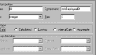

**图 3.2**  
*输入新字段信息后的“新建字段”对话框。*

  点击 **OK** 将该字段添加到客户端数据集中。你会在字段编辑器中看到列出的新 **ID** 字段。

  现在添加第二个字段，称为 **LastName**（姓氏）。右键单击字段编辑器以显示“新建字段”对话框，并在名称编辑控件中输入 **LastName**。在类型组合框中，选择 *String*。然后，将 *Size* 设置为 30——size 代表该字段允许的最大字符数。点击 **OK** 将 **LastName** 字段添加到数据集中。

  同样地，添加一个 20 个字符的 **FirstName**（名字）字段和一个 *Integer* 类型的 **Department**（部门）字段。最后，让我们添加一个 **Salary**（薪资）字段。打开“新建字段”对话框。在名称编辑控件中，输入 **Salary**。将类型设置为 *Currency*（货币）并点击 **OK**。（货币类型指示 Delphi 自动加上美元符号进行显示。）

  如果你正确执行了这些步骤，字段编辑器看起来应如图 3.3 所示。


**图 3.3**  
*添加五个字段后的字段编辑器。*

  对于这个数据集，这些字段就足够了。在下一节中，我将向你展示如何创建计算字段。

## 计算字段

  如前所述，计算字段不占用数据集中的物理空间。相反，它们是从数据集中存储的其他数据即时计算得出的。例如，你可能会创建一个计算字段，该字段将两个数据字段的值相加。在本节中，我们将创建两个计算字段：一个是标准的，一个是内部的。

> **注意**  
> 实际上，内部计算字段在数据集中确实占用空间，就像标准数据字段一样。因此，你可以像在数据字段上那样在这些字段上创建索引。索引将在本章后面讨论。

### 标准计算字段

  在本节中，我们将创建一个计算字段，用于计算年度奖金，我们假设奖金是员工薪资的百分之五。

  要创建标准计算字段，请打开“新建字段”对话框（如前一节所述）。输入名称为 *Bonus*（奖金）和类型为 *Currency*。

  在“字段类型”单选按钮组中，选择 *Calculated*（计算）。这会指示 Delphi 创建一个计算字段，而不是数据字段。点击 **OK**。

  这就是创建计算字段所需做的全部内容。现在，让我们来看看内部计算字段。

### 内部计算字段

  创建内部计算字段与创建标准计算字段几乎相同。唯一的区别在于，你在“新建字段”对话框中选择 *InternalCalc*（内部计算）作为字段类型，而不是 *Calculated*。

  这两种类型计算字段之间的另一个区别在于，标准计算字段每次需要其值时都是即时计算的，而内部计算字段只计算一次，其值存储在 RAM 中。（当然，如果作为计算基础的底层字段发生变化，内部计算字段会自动重新计算。）

  数据集的 *AutoCalcFields* 属性决定了计算字段具体在何时重新计算。如果 *AutoCalcFields* 为 *True*（默认值），计算字段将在数据集打开时、数据集进入编辑模式时，以及当窗体中的焦点从一个数据感知控件移动到另一个且当前记录已修改时进行计算。如果 *AutoCalcFields* 为 *False*，计算字段将在数据集打开时、数据集进入编辑模式时，以及从底层数据库检索记录到数据集中时进行计算。

  你可能希望使用内部计算字段而非标准计算字段有两个原因。如果你想基于计算字段对数据集建立索引，必须使用内部计算字段。（索引将在本章后面详细讨论。）此外，如果字段值的计算相对耗时，你也可以选择使用内部计算字段。因为它们只计算一次并存储在 RAM 中，内部计算字段不需要像标准计算字段那样频繁计算。

  让我们为数据集添加一个内部计算字段。该字段将命名为 *Name*，它将连接 *FirstName* 和 *LastName* 字段。我们以后可能希望在此字段上建立索引，因此我们需要将其设为内部计算字段。

  打开“新建字段”对话框，输入名称为 *Name*，类型为 *String*。将 *Size* 设置为 52（这考虑了姓的最大长度，加上名的最大长度，加上一个逗号和一个空格以分隔两者）。

  在“字段类型”单选按钮组中，选择 *InternalCalc* 并点击 **OK**。

## 为计算字段提供值

  至此，我们已经创建了计算字段。现在我们需要提供计算值的代码。*TClientDataSet* 与所有 Delphi 数据集一样，支持一个名为 *OnCalcFields* 的方法，我们需要为其提供实现体。

  再次点击客户端数据集，在对象检查器中点击 *Events*（事件）选项卡。双击 *OnCalcFields* 事件以创建事件处理程序。

  我们将首先计算 *Bonus* 字段的值。完善事件处理程序，使其看起来像这样：

```delphi
procedure TForm1.cdsEmployeeCalcFields(DataSet: TDataSet);
begin
  cdsEmployeeBonus.AsFloat := cdsEmployeeSalary.AsFloat * 0.05;
end;
```

  这很简单——我们只是获取 *Salary* 字段的值，将其乘以百分之五（0.05），并将该值存储在 *Bonus* 字段中。

  现在，让我们添加 *Name* 字段的计算。第一次（合理的）尝试看起来像这样：

```delphi
procedure TForm1.cdsEmployeeCalcFields(DataSet: TDataSet);
begin
  cdsEmployeeBonus.AsFloat := cdsEmployeeSalary.AsFloat * 0.05;
```


这虽然可行，但效率不高。Name 字段会在 Bonus 字段每次计算时都随之计算。然而，请回想一下，计算内部计算字段的频率并不需要像标准计算字段那么高。幸运的是，我们可以检查数据集的 State 属性来确定是否需要计算内部计算字段，如下所示：

```pascal
procedure TForm1.cdsEmployeeCalcFields(DataSet: TDataSet);
begin
  cdsEmployeeBonus.AsFloat := cdsEmployeeSalary.AsFloat * 0.05;
  if cdsEmployee.State = dsInternalCalc then
    cdsEmployeeName.AsString := cdsEmployeeLastName.AsString + ', ' + cdsEmployeeFirstName.AsString;
end;
```

请注意，Bonus 字段每次都会被计算，但 Name 字段仅在 Delphi 通知我们该计算内部计算字段时才会被计算。

## 查找字段

查找字段在概念上与计算字段相似，因为它们都不会物理存储在数据集中。然而，Delphi 不需要你计算查找字段的值，而是从另一个数据集中获取该值。让我们来看一个示例。

之前，我们在数据集中创建了一个 Department 字段。让我们创建一个新的 Department 数据集来存储部门信息。

在你的窗体上放置一个新的 TClientDataSet 组件并将其命名为 cdsDepartment。添加两个字段：Dept（整数）和 Description（30 个字符的字符串）。

通过双击数据集来显示 cdsEmployee 数据集的字段编辑器。打开“新字段”对话框。将字段命名为 DepartmentName，并将其 Type 设置为 String，Size 设置为 30。

在字段类型单选组中，选择 Lookup。请注意，查找定义组框中的两个字段现在已启用。在 Key Fields 组合框中，选择 Department。在 Dataset 组合框中，选择 cdsDepartment。

此时，查找定义组框中的另外两个字段是可访问的。在 Lookup Keys 组合框中，选择 Dept。在 Result Field 组合框中，选择 Description。完成的对话框应该如图 3.4 所示。

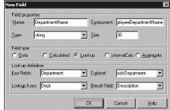

### 图 3.4
向数据集中添加一个查找字段。

关于查找字段，需要记住的重要一点是：**Key** *field* 表示基本数据集中引用查找数据集的字段。**Dataset** 指的是查找数据集。 **Lookup Keys** *组合框* 表示查找数据集中的 **Key** *field*。 **Result** *field* 是查找数据集中查找字段从中获取值的字段。

要在设计时创建数据集，您可以右键单击 TClientDataSet 组件，并从弹出菜单中选择 **Create Dataset**。

既然你已经看到了如何设计时创建客户端数据集，让我们来看看运行时创建客户端数据集需要做什么。

## 运行时创建客户端数据集

要在运行时创建客户端数据集，你需要从以下骨架代码开始：

```pascal
var
  CDS: TClientDataSet;
begin
  CDS := TClientDataSet.Create(nil);
  try
    // Do something with the client dataset here
  finally
    CDS.Free;
  end;
end;
```

创建客户端数据集后，你通常会添加字段，但也可以改为从磁盘加载客户端数据集（稍后在本章标题为“持久化客户端数据集”的部分中你会看到）。

## 向客户端数据集添加字段

要在运行时向客户端数据集添加字段，你需要使用客户端数据集的 `FieldDefs` 属性。
`FieldDefs` 支持两种添加字段的方法：`AddFieldDef` 和 `Add`。

### AddFieldDef

`TFieldDefs.AddFieldDef` 定义如下：

```pascal
function AddFieldDef: TFieldDef;
```

如你所见，`AddFieldDef` 不接受参数，并返回一个 `TFieldDef` 对象。当你拥有该 `TFieldDef` 对象时，你可以设置其属性，如下面的代码片段所示。

```pascal
var
  FieldDef: TFieldDef;
begin
  FieldDef := ClientDataSet1.FieldDefs.AddFieldDef;
  FieldDef.Name := 'Name';
  FieldDef.DataType := ftString;
  FieldDef.Size := 20;
  FieldDef.Required := True;
end;
```

### Add

向客户端数据集添加字段的更快方式是使用 `TFieldDefs.Add` 方法，其定义如下：

```pascal
procedure Add(const Name: string; DataType: TFieldType; Size: Integer = 0;
  Required: Boolean = False);
```

`Add` 方法以字段名称、数据类型、大小（针对字符串字段）以及指示该字段是否必填的标志作为参数。通过使用 `Add`，前面的代码片段变为以下单行代码：

```pascal
ClientDataSet1.FieldDefs.Add('Name', ftString, 20, True);
```

如果你可以使用 `Add`，为什么还要使用 `AddFieldDef` 呢？其中一个原因是 `TFieldDef` 除了支持 `Add` 的四个属性外，还包含更多高级属性（如字段精度、是否只读以及其他一些属性）。如果你想为字段设置这些属性，你需要通过 `TFieldDef` 进行操作。有关更多详细信息，请参阅 Delphi 中关于 `TFieldDef` 的文档。

## 创建数据集

创建完字段定义后，你需要在内存中创建空数据集。为此，调用 `TClientDataSet.CreateDataSet`，如下所示：

```pascal
ClientDataSet1.CreateDataSet;
```

如你所见，在设计时创建客户端数据集比在运行时创建要容易一些。然而，如果你经常创建临时内存数据集，或者需要在无窗体单元中创建客户端数据集，你可以以最小的麻烦在运行时创建数据集。

## 访问字段

无论你如何创建客户端数据集，在某个时刻你都需要访问字段信息——无论是用于显示、计算某些值，还是添加或修改新记录。在 Delphi 中有几种访问字段信息的方法。最简单的方法是使用持久字段。

## 持久字段

本章早些时候，当我们使用字段编辑器创建字段时，我们也为这些字段创建了持久字段对象。例如，当我们添加 LastName 字段时，Delphi 创建了一个名为 cdsEmployeeLastName 的持久字段对象。

当你知道字段对象的名称时，你可以轻松使用 Asxxx 方法族检索字段的内容。例如，要将字段作为字符串访问，你会引用 AsString 属性，如下所示：

```pascal
ShowMessage('The employee''s last name is ' +
cdsEmployeeLastName.AsString);
```

要将员工的工资作为浮点数检索，你会引用 AsFloat 属性：

```pascal
Bonus := cdsEmployeeSalary.AsFloat * 0.05;
```

有关可用访问属性的列表，请参阅 VCL/CLX 源代码和 Delphi 文档。

**注意**
你并不局限于以字段的原生格式访问其值。例如，仅仅因为 Salary 是货币字段，并不意味着你不能尝试将其作为字符串访问。以下代码以格式化货币显示员工工资：

```pascal
ShowMessage('Your salary is ' + cdsEmployeeSalary.AsString);
```

例如，如果你知道该字段包含整数值，你可以将字符串字段作为整数访问。然而，如果你尝试将字段作为整数（或其他数据类型）访问，而该字段不包含与该数据类型兼容的值，Delphi 将引发异常。

## 非持久字段

如果你在设计时创建数据集，你可能不会拥有任何持久字段对象。在这种情况下，有几种方法可以访问字段的值。

第一种方法是 `FieldName` 方法。`FieldName` 以字段名称作为参数，并返回一个临时字段对象。以下代码片段使用 `FieldName` 显示员工的姓氏：

```pascal
ShowMessage('The employee''s last name is ' +
  ClientDataSet1.FieldName('LastName').AsString);
```

**警告**
如果你使用不存在的字段名称调用 `FieldName`，Delphi 将引发异常。

访问数据集中字段的另一种方式是通过 `Field` 方法，如下所示：

```pascal
if ClientDataSet1.FindField('LastName') <> nil then
  ShowMessage('Dataset contains a LastName field');
```

使用这种技术，你可以为在运行时创建的数据集创建持久字段。

```pascal
var
  fldLastName: TField;
  fldFirstName: TField;
begin
  ..
  fldLastName := cds.FindField('LastName');
  fldFirstName := cds.FindField('FirstName');
  ..
  ShowMessage('The last name is ' + fldLastName.AsString);
end;
```

最后，你可以访问数据集的 `Fields` 属性。`Fields` 包含数据集中 `TField` 对象的列表，如下面的代码所示：

```pascal
var
  Index: Integer;
begin
  for Index := 0 to ClientDataSet1.Fields.Count - 1 do
    ShowMessage(ClientDataSet1.Fields[Index].AsString);
end;
```

你通常不会直接访问 `Fields`。假设例如给定字段是 `Fields` 列表中的第一个字段，通常并不是一种安全的编程实践。然而，存在


字段列表在以下场景中非常有用。例如，如果你有结构相同的两个客户端数据集，可以使用以下代码将一个数据集的记录添加到另一个数据集中：

```pascal
var
    Index: Integer;
begin
    ClientDataSet2.Append;
    for Index := 0 to ClientDataSet1.Fields.Count - 1 do
        ClientDataSet2.Fields[Index].AsVariant :=
            ClientDataSet1.Fields[Index].AsVariant;
    ClientDataSet2.Post;
end;
```

接下来的章节将详细讨论如何向数据集中添加记录。

## 填充和操作客户端数据集

创建客户端数据集（无论是在设计时还是运行时）后，你需要用数据填充它。填充客户端数据集有几种方法：你可以通过代码手动填充，可以从另一个数据集加载记录，也可以从文件或流中加载数据集。以下章节将讨论这些方法，以及如何修改和删除记录。

### 手动填充

向客户端数据集输入数据最基本的方式是通过 Append 和 Insert 方法，这两种方法被所有数据集所支持。它们的区别在于，Append 在数据集的末尾添加新记录，而 Insert 则立即在当前记录之前放置新记录。

我总是使用 Append 来插入新记录，因为它比 Insert 稍快一些。如果数据集建立了索引，新记录无论如何都会自动按正确顺序排序。

以下代码片段演示了如何向客户端数据集添加记录：

```pascal
cdsEmployee.Append; // 这里也可以使用 cdsEmployee.Insert;
cdsEmployee.FieldName('ID').AsInteger := 5;
cdsEmployee.FieldName('FirstName').AsString := 'Eric';
cdsEmployee.Post;
```

### 修改记录

修改现有记录与添加新记录几乎相同。与其调用 Append 或 Insert 来创建新记录，你应当调用 Edit 将数据集置于编辑模式。以下代码将当前记录的名字改为 Fred。

```pascal
cdsEmployee.Edit; // 编辑当前记录
cdsEmployee.FieldName('FirstName').AsString := 'Fred';
cdsEmployee.Post;
```

### 删除记录

要删除当前记录，只需调用 `Delete` 方法，如下所示：

```pascal
cdsEmployee.Delete;
```

如果你想要删除数据集中的所有记录，可以改用 `EmptyDataSet`，如下所示：

```pascal
cdsEmployee.EmptyDataSet;
```

### 从另一个数据集填充

dbExpress 数据集是单向的，无法向前回退滚动。这使得它们与双向数据感知控件（如 `TDBGrid`）不兼容。然而，`TClientDataSet` 可以通过*提供者*从另一个数据集（包括 dbExpress 数据集、BDE 数据集或其他客户端数据集）加载其数据。利用此功能，你可以从单向的 dbExpress 数据集加载客户端数据集，然后将 `TDBGrid` 连接到该客户端数据集，从而提供双向支持。

事实上，这种能力如此强大且重要，以至于它构成了 Delphi 多术语数据库支持的基础。

### 从文件或流填充：持久化客户端数据集

虽然客户端数据集驻留在 RAM 中，但你可以将它们保存到文件或流中，并在稍后重新加载，从而实现持久化。这是填充客户端数据集的第三种方法。

要将数据集保存到文件，请使用 `SaveToFile` 方法，其定义如下：

```pascal
procedure SaveToFile(const FileName: string = '';
Format: TDataPacketFormat = dfBinary);
```

类似地，要将数据集保存到流，请调用 `SaveToStream`，其定义如下：

```pascal
procedure SaveToStream(Stream: TStream; Format: TDataPacketFormat = dfBinary);
```

`SaveToFile` 接受你正在保存到的文件的名称。如果文件名为空，则数据将使用客户端数据集的 `FileName` 属性进行保存。

`SaveToFile` 和 `SaveToStream` 都接受一个参数，指示保存数据时使用的格式。客户端数据集可以存储为三种文件格式之一：二进制格式，或任意一种 XML 变体。表 3.1 列出了可能的格式。

**表 3.1** 加载和保存客户端数据集的数据包格式

| 值 | 描述 |
| :---- | :---------- |
| dfBinary | 数据使用专有的二进制格式存储。 |
| dfXML | 数据以 XML 格式存储。扩展字符使用转义序列表示。 |
| dfXMLUTF8 | 数据以 XML 格式存储。扩展字符使用 UTF8 表示。 |

当客户端数据集存储到磁盘时，它们被称为 MyBase 文件。MyBase 在每个文件或每个流中存储一个数据集，除非你使用嵌套数据集。

**注意**

如果你熟悉 Microsoft ADO，你可能会记得 ADO 允许你使用 XML 格式持久化数据集。ADO 和 MyBase 使用的 XML 格式不兼容。换句话说，你不能将 ADO 数据集以 XML 格式保存到磁盘，然后再将其读入客户端数据集（反之亦然）。

有时，你需要确定存储客户端数据集中包含的数据需要多少字节。例如，你可能想在将数据保存到软盘之前检查是否有足够的空间，或者你可能需要为流预分配内存。在这种情况下，你可以检查 DataSize 属性，如下所示：

```pascal
if ClientDataSet1.DataSize > AvailableSpace then
  ShowMessage('没有足够的空间存储数据');
```

DataSize 始终返回以二进制格式（dfBinary）存储数据所需的空间量。XML 格式通常需要更多的空间，也许是两倍（甚至更多）。

**注意**

确定以 XML 格式保存数据集所需空间的一种方法是，将数据集保存到内存流，然后获取由此产生的流的大小。

# 示例：创建、填充和操作客户端数据集

以下示例说明了如何在运行时创建、填充和操作客户端数据集。还提供了将数据集保存到磁盘以及加载数据集的代码。

清单 3.1 展示了 CDS (ClientDataset) 应用程序的完整源代码。

# **清单 3.1** CDS—MainForm.pas

```pascal
unit MainForm;

interface
uses
  SysUtils, Types, IdGlobal, Classes, QGraphics, QControls, QForms, QDialogs,
  QStdCtrls, DB, DBClient, QExtCtrls, QGrids, QDBGriDs, QActnList;

const
  MAX_RECS = 10000;

type
  TfrmMain = class(TForm)
    DataSource1: TDataSource;
    pnlClient: TPanel;
    pnlBottom: TPanel;
    btnPopulate: TButton;
    btnSave: TButton;
    btnLoad: TButton;
    ActionList1: TActionList;
    btnStatistics: TButton;
    Populate1: TAction;
    Statistics1: TAction;
    Load1: TAction;
    Save1: TAction;
    DBGriD1: TDBGriD;
    lblFeedback: TLabel;
    procedure FormCreate(Sender: TObject);
    procedure PopulateExecute(Sender: TObject);
    procedure StatisticsExecute(Sender: TObject);
    procedure SaveExecute(Sender: TObject);
    procedure LoadExecute(Sender: TObject);
  private
    { Private declarations }
    FCDS: TClientDataSet;
  public
    { Public declarations }
end;

var
  frmMain: TfrmMain;

implementation

{$R *.xfm}

procedure TfrmMain.FormCreate(Sender: TObject);
begin
  FCDS := TClientDataSet.Create(Self);
  FCDS.FieldDefs.Add('ID', ftInteger, 0, True);
  FCDS.FieldDefs.Add('Name', ftString, 20, True);
  FCDS.FieldDefs.Add('Birthday', ftDateTime, 0, True);
  FCDS.FieldDefs.Add('Salary', ftCurrency, 0, True);
  FCDS.CreateDataSet;
  DataSource1.DataSet := FCDS;
end;

procedure TfrmMain.Populate1Execute(Sender: TObject);
const
  FirstNames: array[0 .. 19] of string = ('John', 'Sarah', 'Fred', 'Beth',
                                         'Eric', 'Tina', 'Thomas', 'Judy', 'Robert', 'Angela', 'Tim', 'Traci',
                                         'David', 'Paula', 'Bruce', 'Jessica', 'Richard', 'Carla', 'James',
                                         'Mary');
  LastNames: array[0 .. 11] of string = ('Parker', 'Johnson', 'Jones',
                                         'Thompson', 'Smith', 'Baker', 'Wallace', 'Harper', 'Parson', 'Edwards',
                                         'Mandel', 'Stone');
var
  Index: Integer;
  t1, t2: DWord;
begin
  RandSeed := 0;

  t1 := GetTickCount;
  FCDS.DisableControls;
  try
    FCDS.EmptyDataSet;
    for Index := 1 to MAX_RECS do begin
      FCDS.Append;
      FCDS.FieldByName('ID').AsInteger := Index;
      FCDS.FieldByName('Name').AsString := FirstNames[Random(20)] + ' ' +
```


# **列表 3.1** 续

```
            LastNames[Random(12)];
        FCDS.FieldByName('Birthday').AsDateTime := StrToDate('1/1/1950') +
                Random(10000);
        FCDS.FieldByName('Salary').AsFloat := 20000.0 + Random(600) * 100;
        FCDS.Post;
    end;
    FCDS.First;
    finally
        FCDS.EnableControls;
    end;
    t2 := GetTickCount;
    lblFeedback.Caption := Format('%d ms to load %.0n records',
        [t2 - t1, MAX_RECS * 1.0]);
end;

procedure TfrmMain.Statistics1Execute(Sender: TObject);
var
    t1, t2: DWORD;
    msLocateID: DWORD;
    msLocateName: DWORD;
begin
    FCDS.First;
    t1 := GetTickCount;
    FCDS.Locate('ID', 9763, []);
    t2 := GetTickCount;
    msLocateID := t2 - t1;

    FCDS.First;
    t1 := GetTickCount;
    FCDS.Locate('Name', 'Eric Wallace', []);
    t2 := GetTickCount;
    msLocateName := t2 - t1;

    ShowMessage(Format('%d ms to locate ID 9763' +
        #13'%d ms to locate Eric Wallace' +
        #13'%.0n bytes required to store %.0n records',
        [msLocateID, msLocateName, FCDS.DataSize * 1.0, MAX_RECS * 1.0]));
end;

procedure TfrmMain.Save1Execute(Sender: TObject);
var
    t1, t2: DWORD;
begin
    t1 := GetTickCount;
    FCDS.SaveToFile('C:\\Employee.cds');
    t2 := GetTickCount;
    lblFeedback.Caption := Format('%d ms to save data', [t2 - t1]);
end;

procedure TfrmMain.LoadExecute(Sender: TObject);
var
	t1, t2: DWord;
begin
	try
		t1 := GetTickCount;
		FCDS.LoadFromFile('C:\\Employee.cds');
		t2 := GetTickCount;
		lblFeedback.Caption := Format('%d ms to load data', [t2 - t1]);
	except
		FCDS.Open;
		raise;
	end;
end;

end.
```

该应用程序包含五种方法，每一种都值得深入探究：

-   **FormCreate** 在运行时创建客户端数据集及其架构。实际上，在设计时创建数据集会更容易一些，但我想向你展示在运行时执行此操作所需的代码。该代码创建了四个字段：*员工 ID、姓名、生日* 和 *薪资*。
-   **PopulateExecute** 使用随机数据生成的 10,000 名员工来填充客户端数据集。在该方法的开始部分，我手动将 **RandSeed** 设置为 0，以确保多次运行应用程序时生成相同的数据。

**注意**

> Delphi 随机数生成器通常以当前的日期和时间作为种子。通过手动使用常量值为随机数生成器设置种子，我们可以确保每次运行程序时生成的随机数都是一致的。

-   该方法计算生成 10,000 名员工所需的大约时间，在我的计算机上大约需要半秒钟。
-   **Statistics1Execute** 只是测量执行几个 Locate 操作所需的时间，并计算在磁盘上存储数据所需的空间量（再次强调，是二进制格式）。我将在本章稍后讨论 Locate 方法。
-   **Save1Execute** 将数据保存到磁盘，文件名为 C:\Employee.cds。对于以二进制格式保存的客户端数据集，.cds 扩展名是标准的，但并非强制要求的。以 XML 格式存储的客户端数据集通常使用 .xml 扩展名。

**注意**

> 请确保点击保存按钮，因为创建的文件（C:\EMPLOYEE.CDS）将用于本章剩余的示例应用程序以及下一章中的一些示例。

-   **Load1Execute** 从文件中将数据加载到客户端数据集。如果 LoadFromFile 失败（可能是因为文件不存在或不是有效的文件格式），客户端数据集将保持在关闭状态。因此，当引发异常时，我会重新打开客户端数据集。

图 3.5 显示了 CDS 应用程序在我的计算机上运行的情况。请注意显示在定位记录上的惊人时间。即使搜索几乎整个数据集来查找 ID 9763，在我的计算机上也只需大约 10 毫秒。

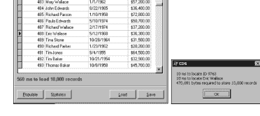

**图 3.5**

运行时的 CDS 应用程序。

# 导航客户端数据集

如果没有前进和/或后退的手段，数据集就毫无价值。Delphi 的数据集提供了许多用于遍历数据集的方法。以下各节讨论 Delphi 对数据集导航的支持。

## 顺序导航

遍历数据集最基本的方式是按顺序向前或向后移动。例如，在打印报告时，或者出于其他原因，你可能希望遍历数据集。Delphi 提供了四种简单的方法来实现这一点：

-   **First** 移动到数据集中的第一个记录。**First** 总是成功的，即使数据集为空。如果为空，**First** 会将数据集的 **EOF**（文件末尾）属性设置为 **True**。
-   **Next** 移动到数据集中的下一个记录（如果 **EOF** 属性尚未设置）。如果 **EOF** 为 **True**，则 **Next** 将失败。如果对 **Next** 的调用到达文件末尾，它会将 **EOF** 属性设置为 **True**。
-   **Last** 移动到数据集中的最后一个记录。**Last** 总是成功的，即使数据集为空。如果为空，**Last** 会将数据集的 **BOF**（文件开始）属性设置为 **True**。
-   **Prior** 移动到数据集中前一个记录（如果 **BOF** 属性尚未设置）。如果 **BOF** 为 **True**，则 **Prior** 将失败。如果对 **Prior** 的调用到达文件开始，它会将 **BOF** 属性设置为 **True**。

以下代码片段展示了如何使用这些方法来遍历数据集：

```
if not ClientDataSet1.IsEmpty then begin
    ClientDataSet1.First;
    while not ClientDataSet1.EOF do begin
        // Process the current record

        ClientDataSet1.Next;
    end;
end;

ClientDataSet1.Last;
while not ClientDataSet1.BOF do begin
    // Process the current record

    ClientDataSet1.Prior;
end;
```

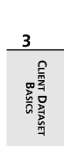

# 随机访问导航

除了 First、Next、Prior 和 Last（它们提供在数据集中的顺序移动）之外，TClientDataSet 提供了两种直接移动到特定记录的方式：书签和记录号。

## 书签

与客户端数据集一起使用的书签与纸质书籍中使用的书签非常相似：它标记了数据集中的位置，以便你以后可以快速返回。

你可以对书签执行三种操作：设置书签、返回书签和释放书签。以下代码片段展示了如何执行这三种操作：

```
var
    Bookmark: TBookmark;
begin
    Bookmark := ClientDataSet1.GetBookmark;
    try
        // Do something with ClientDataSet1 here that changes the current record
        ...
        ClientDataSet1.GotoBookmark(Bookmark);
    finally
        ClientDataSet1.FreeBookmark(Bookmark);
    end;
end;
```

你可以为一个数据集创建任意数量的书签。但是，请记住书签会分配少量内存，因此你应确保使用 FreeBookmark 释放所有书签，否则你的应用程序将发生内存泄漏。

还有一组操作可以代替 GetBookmark/GotoBookmark/FreeBookmark 用于书签。以下代码展示了这种替代方法：

```
var
    BookmarkStr: string;
begin
    BookmarkStr := ClientDataSet1.Bookmark;
    try
        // Do something with ClientDataSet1 here that changes the current record
        ...
    finally
        ClientDataSet1.Bookmark := BookmarkStr;
    end;
end;
```

由于属性 Bookmark 返回的书签是一个字符串，你在使用完时无需担心释放该字符串。与所有字符串一样，当书签超出作用域时，Delphi 会自动释放它。

## 记录号

客户端数据集支持一种在数据集中直接移动到给定记录的第二种方式：设置数据集的 RecNo 属性。RecNo 是一个从 1 开始的数字，表示当前记录相对于数据集开头的顺序号。

你可以读取 RecNo 属性以确定当前的绝对记录号，并写入 RecNo 属性以设置当前记录。关于 RecNo，有两点需要牢记：

-   尝试将 RecNo 设置为小于 1 的数字，或大于数据集中记录数的数字，分别会导致“在表开头”或“在表末尾”异常。
-   给定记录的记录号不保证是恒定的。例如，更改数据集的活动的索引会改变数据集中所有记录的记录号。

> 你可以通过检查数据集的 RecordCount 属性来确定数据集中的记录数。在设置 RecNo 时，切勿尝试将其设置为高于 RecordCount 的数字。

然而，当审慎使用时，RecNo 有其用途。例如，假设你的应用程序的用户想要删除 John Smith 记录和 Fred Jones 记录之间的所有记录。以下代码展示了如何完成此操作：

```
var
  RecNoJohn: Integer;
  RecNoFred: Integer;
  Index: Integer;
begin
  if not ClientDataSet1.Locate('Name', 'John Smith', []) then
    raise Exception.Create('Cannot locate John Smith');
  RecNoJohn := ClientDataSet1.RecNo;
  if not ClientDataSet1.Locate('Name', 'Fred Jones', []) then
    raise Exception.Create('Cannot locate Fred Jones');
  RecNoFred := ClientDataSet1.RecNo;
```


## **列表 3.2** Navigate—MainForm.pas

此代码片段首先定位两个边界记录并记住它们的绝对记录号。然后，它数据集定位到较小的记录号。如果 Fred 出现在 John 之前，则数据集已经定位到较小的记录号上。

由于记录是按顺序编号的，我们可以减去两个记录号（并加一）来确定要删除的记录数。删除一条记录会使下一条记录成为当前记录，因此一个简单的 for 循环可以处理记录的删除。

请记住，RecNo 通常不是你在数据集中进行导航的首选方法，但记住在需要时可以使用它是很有帮助的。

列表 3.2 包含了一个应用程序的完整源代码，该应用程序演示了客户端数据集的不同导航方法。

```pascal
if RecNoJohn < RecNoFred then
 // Locate John again
 ClientDataSet1.RecNo := RecNoJohn;

for Index := 1 to Abs(RecNoJohn - RecNoFred) + 1 do
 ClientDataSet1.Delete;
end;
```

```pascal
unit MainForm;

interface

uses
 SysUtils, Classes, QGraphics, QControls, QForms, QDialogs, QStDCtrls,
 DB, DBClient, QExtCtrls, QActnList, QRids, QDBGrids, QDBCtrls;

type
  TfrmMain = class(TForm)
    DataSource1: TDataSource;
    pnlClient: TPanel;
    pnlBottom: TPanel;
    btnFirst: TButton;
    btnLast: TButton;
    btnNext: TButton;
    btnPrior: TButton;
    DBGrid1: TDBGrid;
    ClientDataSet1: TClientDataSet;
    btnSetRecNo: TButton;
    DBNavigator1: TDBNavigator;
    btnGetBookmark: TButton;
    btnGoToBookmark: TButton;
procedure FormCreate(Sender: TObject);
procedure btnNextClick(Sender: TObject);
procedure btnLastClick(Sender: TObject);
procedure btnSetRecNoClick(Sender: TObject);
procedure btnFirstClick(Sender: TObject);
procedure btnPriorClick(Sender: TObject);
procedure btnGetBookmarkClick(Sender: TObject);
procedure btnGoToBookmarkClick(Sender: TObject);
private
  { Private declarations }
FBookmark: TBookmark;
public
  { Public declarations }
end;

var
  TfrmMain: TfrmMain;

implementation

{$R *.xfm}

procedure TfrmMain.FormCreate(Sender: TObject);
begin
  ClientDataSet1.LoadFromFile('C:\Employee.cds');
end;

procedure TfrmMain.btnFirstClick(Sender: TObject);
begin
  ClientDataSet1.First;
end;

procedure TfrmMain.btnPriorClick(Sender: TObject);
begin
  ClientDataSet1.Prior;
end;

procedure TfrmMain.btnNextClick(Sender: TObject);
begin
  ClientDataSet1.Next;
end;

procedure TfrmMain.btnLastClick(Sender: TObject);
begin
   ClientDataSet1.Last;
end;

procedure TfrmMain.btnSetRecNoClick(Sender: TObject);
var
   Value: string;
begin
   Value := '1';
   if InputQuery('RecNo', 'Enter Record Number', Value) then
      ClientDataSet1.RecNo := StrToInt(Value);
end;

procedure TfrmMain.btnGetBookmarkClick(Sender: TObject);
begin
   if Assigned(FBookmark) then
      ClientDataSet1.FreeBookmark(FBookmark);

   FBookmark := ClientDataSet1.GetBookmark;
end;

procedure TfrmMain.btnGoToBookmarkClick(Sender: TObject);
begin
   if Assigned(FBookmark) then
      ClientDataSet1.GoToBookmark(FBookmark)
   else
      ShowMessage('No bookmark set!');
end;
end.
```

图 3.6 展示了该程序在运行时的状态。

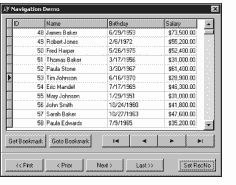

### 图 3.6
*Navigate 应用程序演示了各种导航技巧。*

## 客户端数据集索引

到目前为止，我们还没有在客户端数据集上创建任何索引，你可能会好奇它们是否（以及为什么）在通过数据集进行顺序搜索（使用 Locate）如此快的情况下仍然是必要的。

在客户端数据集上使用索引至少有以下三个原因：

- 提供更快的数据访问。单个 Locate 操作执行非常快，但如果你需要执行数千次 Locate 操作，使用索引会有明显的性能提升。
- 启用客户端数据集的即时排序。当你想要在数据感知网格中对数据进行排序时，这非常有用。
- 实现维护的聚合。

### 创建索引

与字段定义类似，索引可以在设计时或运行时创建。与通常在设计时创建的字段定义不同，你可能希望在运行时创建和销毁索引。例如，某些索引只用于很短的时间——比如，为了按特定顺序创建报告。在这种情况下，你可能希望创建索引，使用它，然后销毁它。如果你持续需要某个索引，最好在设计时创建它（或者在你第一次需要时创建它，之后不再销毁它）。

### 在设计时创建索引

要在设计时创建索引，请单击表单或数据模块上定位的 TClientDataSet 组件。在对象检查器中，双击 IndexDefs 属性。索引编辑器将出现。

要向客户端数据集添加索引，右键单击索引编辑器并选择弹出菜单中的“添加”。或者，你可以点击工具栏上的“添加”图标，或者简单地按 Ins 键。然后，返回对象检查器并设置索引的适当属性。表 3.2 显示了索引属性。

#### 表 3.2 | 索引属性

| 属性 | 描述 |
| :--- | :--- |
| Name | 索引的名称。我建议以 by 作为索引名称的前缀（例如 byName, byState 等）。 |
| Fields | 组成索引的分号分隔的字段列表。例如：`ID` 或 `Name;Salary`。 |
| DescFields | **Fields** 属性中包含的应以降序索引的字段列表。例如，如果要按姓名升序，然后按薪资降序排序，请将 **Fields** 设置为 `Name;Salary`，并将 **DescFields** 设置为 `Salary`。 |
| CaseInsFields | **Fields** 属性中包含的应以不区分大小写方式索引的字段列表。例如，如果索引基于姓和名，且两者都不区分大小写，请将 **Fields** 设置为 `Last;First`，并将 **CaseInsFields** 设置为 `Last;First`。 |
| GroupingLevel | 用于聚合。 |
| Options | 在索引上设置额外选项。这些选项在表 3.3 中讨论。 |
| Expression | 不适用于客户端数据集。 |
| Source | 不适用于客户端数据集。 |

表 3.3 显示了可以使用 **Options** 属性设置的各种索引选项。

#### 表 3.3 | 索引选项

| 选项 | 描述 |
| :--- | :--- |
| `IxPrimary` | 该索引是数据集上的主索引。 |
| `IxUnique` | 该索引是唯一的。 |
| `IxDescending` | 该索引是降序的。 |
| `IxCaseInsensitive` | 该索引不区分大小写。 |
| `IxExpression` | 不适用于客户端数据集。 |
| `IxNonMaintained` | 不适用于客户端数据集。 |

你可以在单个数据集上创建多个索引。因此，例如，你可以轻松地在 **EmployeeName** 上同时拥有升序和降序索引。

### 在运行时创建和删除索引

与字段定义（通常在设计时创建）相反，索引定义是你经常在运行时创建的东西。这样做有几个非常好的理由：

- 索引可以快速轻松地创建和销毁。因此，如果你只需要索引很短的时间（例如，为了按特定顺序打印报告），在需要时创建和销毁索引有助于节省内存。
- 当你持久化客户端数据集时，索引信息不会保存到文件或流中。当你从文件或流中加载客户端数据库时，你*必须*在你的代码中重新创建任何索引。

要创建索引，你使用客户端数据集的 `AddIndex` 方法。`AddIndex` 接受三个必需参数以及三个可选参数，定义如下：

```pascal
procedure AddIndex(const Name, Fields: string; Options: TIndexOptions;
const DescFields: string = ''; const CaseInsFields: string = '';
const GroupingLevel: Integer = 0);
```

这些参数对应于表 3.2 中列出的 `TIndexDef` 属性。以下代码片段展示了如何按姓和名创建唯一索引：

```pascal
ClientDataSet1.AddIndex('byName', 'Last;First', [ixUnique]);
```

当你决定不再需要某个索引时（请记住，如果你之后需要，可以随时重新创建它），你可以使用 `DeleteIndex` 删除它。`DeleteIndex` 接受单个参数：要删除的索引的名称。以下代码行展示了如何删除前一个代码片段中创建的索引：

```pascal
ClientDataSet1.DeleteIndex('byName');
```

### 使用索引

创建索引不会对数据集执行任何实际排序。它只是为数据创建一个可用的索引。创建索引后，你通过设置数据集的 `IndexName` 属性使其激活，如下所示：

```pascal
ClientDataSet1.IndexName := 'byName';
```

如果你在数据集上定义了两个或更多索引，你可以通过更改 `IndexName` 属性的值来快速切换。如果你想要停止使用某个索引并恢复默认的记录顺序，你可以将 `IndexName` 属性设置为空字符串，如下面的代码片段所示：

```pascal
// Do something in name order
ClientDataSet1.IndexName := 'byName';
```


## 获取索引信息

Delphi 提供了几种不同的方法来从数据集中获取索引信息。这些方法将在以下章节中讨论。

### GetIndexNames

获取索引信息最简单的方法是 `GetIndexNames`。`GetIndexNames` 接受一个参数，即一个 `TStrings` 对象，用于存储结果索引名称。下面的代码片段展示了如何将所有为数据集定义的索引名称加载到列表框中。

```pascal
ClientDataSet1.GetIndexNames(ListBox1.Items);
```

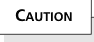

如果你在一个没有定义任何索引的数据集上执行此代码，你会发现已经为你定义了两个索引：`DEFAULT_ORDER` 和 `CHANGEINDEX`。`DEFAULT_ORDER` 内部用于按非索引顺序提供记录；`CHANGEINDEX` 内部用于提供撤销支持，这将在本章后面讨论。你不应该尝试删除这两个索引中的任何一个。

### TIndexDefs

如果你想获取关于某个索引更详细的信息，可以直接查看源头：`TIndexDefs`。`TIndexDefs` 包含所有索引的列表，以及与每个索引关联的信息（例如组成索引的字段、哪些字段是降序等）。

下面的代码片段展示了如何直接通过 `TIndexDefs` 访问索引信息。

```pascal
var
 Index: Integer;
 IndexDef: TIndexDef;
begin
 ClientDataSet1.IndexDefs.Update;

 for Index := 0 to ClientDataSet1.IndexDefs.Count - 1 do begin
  IndexDef := ClientDataSet1.IndexDefs[Index];
  ListBox1.Items.Add(IndexDef.Name);
 end;
end;
```

注意在遍历索引定义的代码之前调用了 `IndexDefs.Update`。此调用是必需的，以确保内部的 `IndexDefs` 列表是最新的。如果没有它，`IndexDefs` 可能不包含关于最近添加的索引的任何信息。

下面的应用程序展示了如何在 `TDBGrid` 中提供实时索引。它还包含获取数据集上定义的所有索引详细信息的代码。

图 3.7 显示了 CDSIndex 应用程序在运行时显示员工客户端数据集的索引信息的情况。

列表 3.3 包含了 CDSIndex 应用程序的完整源代码。

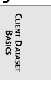

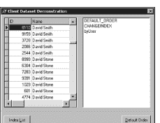

**图 3.7**
*CDIndex 展示了如何实时创建索引。*

**列表 3.3** CDIndex—MainForm.pas

```pascal
unit MainForm;

interface

uses
    SysUtils, Classes, QGraphics, QControls, QForms, QDialogs, QStdCtrls,
    DB, DBClient, QExtCtrls, QActnList, QGrids, QDBGrids;

type
    TfrmMain = class(TForm)
        DataSource1: TDataSource;
        pnlClient: TPanel;
        DBGrid1: TDBGrid;
        ClientDataSet1: TClientDataSet;
        pnlBottom: TPanel;
        btnDefaultOrder: TButton;
        btnIndexList: TButton;
        ListBox1: TListBox;
        procedure FormCreate(Sender: TObject);
        procedure DBGrid1TitleClick(Column: TColumn);
        procedure btnDefaultOrderClick(Sender: TObject);
        procedure btnIndexListClick(Sender: TObject);
    private
        { Private declarations }
    public
        { Public declarations }
    end;

var
    TfrmMain: TfrmMain;

implementation

{$R "*.xfm"}

procedure TfrmMain.FormCreate(Sender: TObject);
begin
    ClientDataSet1.LoadFromFile('C:\Employee.cds');
end;

procedure TfrmMain.DBGrid1TitleClick(Column: TColumn);
begin
    try
        ClientDataSet1.DeleteIndex('byUser');
    except
    end;

    ClientDataSet1.AddIndex('byUser', Column.FieldName, []);
    ClientDataSet1.IndexName := 'byUser';
end;

procedure TfrmMain.btnDefaultOrderClick(Sender: TObject);
begin
    // Deleting the current index will revert to the default order
    try
        ClientDataSet1.DeleteIndex('byUser');
    except
    end;

    ClientDataSet1.IndexFieldNames := '';
end;

procedure TfrmMain.btnIndexListClick(Sender: TObject);
var
    Index: Integer;
    IndexDef: TIndexDef;
begin
    ClientDataSet1.IndexDefs.Update;

    ListBox1.Items.BeginUpdate;
    try
        ListBox1.Items.Clear;

        for Index := 0 to ClientDataSet1.IndexDefs.Count - 1 do begin
            IndexDef := ClientDataSet1.IndexDefs[Index];
            ListBox1.Items.Add(IndexDef.Name);
        end;
    finally
        ListBox1.Items.EndUpdate;
    end;
end.
```

在运行时动态对网格排序的代码包含在方法 `DBGrid1TitleClick` 中。首先，如果名为 `byUser` 的临时索引存在，它会尝试删除它。如果它不存在，就会引发异常，代码简单地忽略该异常。实际应用程序不应该随意掩盖异常。相反，它应该捕获 `DeleteIndex` 调用可能引发的特定异常，并允许其他异常报告给用户。

然后，该方法创建一个名为 `byUser` 的新索引，并将其设置为当前索引。

> **注意**
>
> 虽然这段代码有效，但充其量是初级的。它不支持对多个网格列进行排序，也没有视觉指示器来显示网格按哪些列排序。对于这些问题的优雅解决方案，我强烈建议你看看 John Kaster 的 TCDSDBGrid（可在 http://codecentral.borland.com 的 Code Central 上以 ID 15099 获取）。

## 过滤器和范围

过滤器和范围提供了一种限制数据集中可见数据量的方法，类似于 SQL 语句中的 `WHERE` 子句。过滤器、范围和 `WHERE` 子句之间的主要区别在于，当你应用过滤器或范围时，它不会物理改变数据集中包含的数据。它只是限制了你在任何给定时间可以看到的数据量。

### 范围

当你要限制自己使用的那部分数据存储在一个连续的记录序列中时，范围很有用。例如，假设一个数据集包含表 3.4 中显示的数据。

**表 3.4** 范围和过滤器的示例数据

| ID | 姓名 | 生日 | 薪资 |
| :--- | :--- | :--- | :--- |
| 4 | Bill Peterson | 3/28/1957 | $60,000.00 |
| 2 | Frank Smith | 8/25/1963 | $48,000.00 |
| 3 | Sarah Johnson | 7/5/1968 | $52,000.00 |
| 1 | John Doe | 5/15/1970 | $39,000.00 |
| 5 | Paula Wallace | 1/15/1971 | $36,500.00 |

这个简化的表中的数据按生日建立索引。只有当数据集上有活动索引时，才能使用范围。

假设你想看到所有在 1960 年到 1970 年间出生的员工。因为数据按生日建立索引，你可以对数据集应用范围，如下所示：

```pascal
ClientDataSet1.SetRange(['1/1/1960', ['12/31/1970']]);
```

范围是*包含*端点的，意味着范围的端点包含在范围内。在上面的例子中，出生于 1960 年 1 月 1 日或 1970 年 12 月 31 日的员工都包含在范围内。

要移除范围，只需调用 `CancelRange`，如下所示：

```pascal
ClientDataSet1.CancelRange;
```

### 过滤器

与范围不同，过滤器在应用之前不需要设置索引。客户端数据集过滤器功能强大，提供许多类似 SQL 的功能，以及一些甚至 SQL 都不支持的选项。表 3.5 至 3.10 列出了可用于过滤器的各种函数和操作符。

**表 3.5** 过滤器比较操作符

| 函数 | 描述 | 示例 |
| :--- | :--- | :--- |
| = | 相等测试 | Name = 'John Smith' |
| <> | 不等测试 | ID <> 100 |
| < | 小于 | Birthday < '1/1/1980' |
| > | 大于 | Birthday > '12/31/1960' |
| <= | 小于或等于 | Salary <= 80000 |
| >= | 大于或等于 | Salary >= 40000 |


## **表 3.5** 续

| 函数 | 描述 | 示例 |
| :--- | :--- | :--- |
| BLANK | 空字符串字段（不用于测试 NULL 值） | `Name = BLANK` |
| IS NULL | 测试 NULL 值 | `Birthday IS NULL` |
| IS NOT NULL | 测试非 NULL 值 | `Birthday IS NOT NULL` |

## **表 3.6** 筛选逻辑运算符

| 函数 | 示例 |
| :--- | :--- |
| And | `(Name = 'John Smith') and (Birthday = '5/16/1964')` |
| Or | `(Name = 'John Smith') or (Name = 'Julie Mason')` |
| Not | `Not (Name = 'John Smith')` |

## **表 3.7** 筛选算术运算符

| 函数 | 描述 | 示例 |
| :--- | :--- | :--- |
| + | 加法。可用于数字、字符串或日期/时间。 | `Birthday + 30 < '1/1/1960'`<br>`Name + 'X' = 'SmithX'`<br>`Salary + 10000 = 100000` |
| - | 减法。可用于数字或日期/时间。 | `Birthday - 30 > '1/1/1960'`<br>`Salary - 10000 > 40000` |
| * | 乘法。仅可用于数字。 | `Salary * 0.10 > 5000` |
| / | 除法。仅可用于数字。 | `Salary / 10 > 500` |

## **表 3.8** 筛选字符串函数

| 函数 | 描述 | 示例 |
| :--- | :--- | :--- |
| Upper | 大写 | `Upper(Name) = 'JOHN SMITH'` |
| Lower | 小写 | `Lower(Name) = 'john smith'` |
| SubString | 返回字符串的一部分 | `SubString(Name,6) = 'Smith'`<br>`SubString(Name,1,4) = 'John'` |
| Trim | 去除字符串的前导和尾随字符 | `Trim(Name)`<br>`Trim(Name, '.', '.')` |
| TrimLeft | 去除字符串的前导字符 | `TrimLeft(Name, ".")` |
| TrimRight | 去除字符串的尾随字符 | `TrimRight(Name, ".")` |

## **表 3.9** 筛选日期/时间函数

| 函数 | 描述 | 示例 |
| :--- | :--- | :--- |
| Year | 返回日期值的年份部分。 | `Year(Birthday) = 1970` |
| Month | 返回日期值的月份部分。 | `Month(Birthday) = 1` |
| Day | 返回日期值的日期部分。 | `Day(Birthday) = 15` |
| Hour | 以 24 小时制返回时间值的小时部分。 | `Hour(Appointment) = 18` |
| Minute | 返回时间值的分钟部分。 | `Minute(Appointment) = 30` |
| Second | 返回时间值的秒钟部分。 | `Second(Appointment) = 0` |
| GetDate | 返回当前的日期和时间。 | `Appointment < GetDate` |
| Date | 返回日期/时间值的日期部分。 | `Date(Appointment)` |
| Time | 返回日期/时间值的时间部分。 | `Time(Appointment)` |

## **表 3.10** 其他筛选函数和运算符

| 函数 | 描述 | 示例 |
| :--- | :--- | :--- |
| LIKE | 部分字符串比较。 | `Name LIKE '%Smith%'` |
| IN | 测试多个值。 | `Year(Birthday) IN (1960, 1970, 1980)` |
| * | 部分字符串比较。 | `Name = 'John*'` |

要筛选数据集，请将其 `Filter` 属性设置为用于筛选的字符串，然后将 `Filtered` 属性设置为 `True`。例如，以下代码片段筛选出所有姓名以字母 M 开头的员工。

```delphi
ClientDataSet1.Filter := 'Name LIKE ' + QuotedStr( 'M%');
ClientDataSet1.Filtered := True;
```

若要稍后仅显示姓名以字母 P 开头的员工，只需更改筛选条件，如下所示：

```delphi
ClientDataSet1.Filter := 'Name LIKE ' + QuotedStr( 'P%');
```

若要移除筛选，请将 `Filtered` 属性设置为 `False`。您无需将 `Filter` 属性设置为空字符串来移除筛选（这意味着您可以通过将 `Filtered` 的值在 `True` 和 `False` 之间切换来开启或关闭最近的筛选）。

您可以通过处理数据集的 `OnFilterRecord` 事件（而不是设置 `Filter` 属性）来应用更高级的筛选条件。例如，假设您要筛选出所有姓氏听起来像 Smith 的员工。这可能包括 Smith、Smythe，以及可能的其他人。假设您有一个可用的 Soundex 函数，您可以编写如下所示的筛选方法：

```delphi
procedure TForm1.ClientDataSetFilterRecord(DataSet: TDataSet;
var Accept: Boolean);
begin
    Accept := Soundex(DataSet.FieldName('Lastname'),AsString)=
              Soundex('Smith');
end;
```

如果将 `Accept` 参数设置为 `True`，该记录将包含在筛选结果中。如果将 `Accept` 设置为 `False`，该记录将被隐藏。

设置好 `OnFilterRecord` 事件处理程序后，只需将 `TClientDataSet.Filtered` 设置为 `True` 即可。您完全不需要设置 `Filter` 属性。

以下示例展示了不同的筛选和范围技术。

## 列表 3.4 RangeFilter—MainForm.pas

```delphi
unit MainForm;

interface

uses
  SysUtils, Classes, QGraphics, QControls, QForms, QDialogs, QStdCtrls,
  DB, DBClient, QExtCtrls, QGrids, QDBGrids;

type
   TfrmMain = class(TForm)
     DataSource1: TDataSource;
     pnlClient: TPanel;
     pnlBottom: TPanel;
     btnFilter: TButton;
     btnRange: TButton;
     DBGird1: TDBGird;
     ClientDataSet1: TClientDataSet;
     btnClearRange: TButton;
     btnClearFilter: TButton;
     procedure FormCreate(Sender: TObject);
     procedure btnFilterClick(Sender: TObject);
     procedure btnRangeClick(Sender: TObject);
     procedure btnClearRangeClick(Sender: TObject);
     procedure btnClearFilterClick(Sender: TObject);
   private
     { Private declarations }
   public
     { Public declarations }
   end;

var
  frmMain: TfrmMain;

implementation

uses FilterForm, RangeForm;

{$R *.xfm}

procedure TfrmMain.FormCreate(Sender: TObject);
begin
  ClientDataSet1.LoadFromFile('C:\Employee.CDS');
  ClientDataSet1.AddIndex('bySalary', 'Salary', []);
  ClientDataSet1.IndexName := 'bySalary';
end;

procedure TfrmMain.btnFilterClick(Sender: TObject);
var
 frmFilter: TfrmFilter;
begin
  frmFilter := TfrmFilter.Create(nil);
try
if frmFilter.ShowModal = mrOK then begin
  ClientDataSet1.Filter := frmFilter.Filter;
  ClientDataSet1.Filtered := True;
end;
finally
  frmFilter.Free;
end;
end;

procedure TfrmMain.btnClearFilterClick(Sender: TObject);
begin
  ClientDataSet1.Filtered := False;
end;

procedure TfrmMain.btnRangeClick(Sender: TObject);
var
  frmRange: TfrmRange;
begin
  frmRange := TfrmRange.Create(nil);
  try
    if frmRange.ShowModal = mrOK then
      ClientDataSet1.SetRange([[frmRange.LowValue]], [frmRange.HighValue]);
  finally
    frmRange.Free;
  end;
end;

procedure TfrmMain.btnClearRangeClick(Sender: TObject);
begin
  ClientDataSet1.CancelRange;
end;

end.
```

如您所见，主窗体从磁盘加载员工数据集，在 *Salary* 字段上创建索引，并使该索引处于活动状态。然后，它允许用户对数据集应用范围、筛选，或者两者都应用。

列表 3.5 包含筛选窗体的源代码。筛选窗体是一个简单的窗体，允许用户选择要筛选的字段，并输入要筛选的值。

## 列表 3.5 RangeFilter—FilterForm.pas

```delphi
unit FilterForm;

interface

uses
  SysUtils, Classes, QGraphics, QControls, QForms, QDialogs, QStdCtrls,
  QExtCtrls;

type
  TfrmFilter = class(TForm)
    pnlClient: TPanel;
    pnlBottom: TPanel;
    Label1: TLabel;
    cbField: TComboBox;
    Label2: TLabel;
    cbRelationship: TComboBox;
    Label3: TLabel;
    ecValue: TEdit;
    btnOk: TButton;
    btnCancel: TButton;
  private
    function GetFilter: string;
    { Private declarations }
  public
    { Public declarations }
    property Filter: string read GetFilter;
  end;

implementation

{$R *.xfm}

{ TfrmFilter }

function TfrmFilter.GetFilter: string;
begin
  Result := Format('%s %s ''%s'',
    [cbField.Text, cbRelationship.Text, ecValue.Text]);
end;

end.
```

此窗体中唯一有趣的代码是 `GetFilter` 函数，它只是将三个输入控件的值组合成一个筛选字符串，并将其返回给主应用程序。


列表 3.6 包含范围形式的源代码。范围形式会提示用户输入薪资下限和上限。

## 列表 3.6 RangeFilter—RangeForm.pas

```pascal
unit RangeForm;

interface

uses
   SysUtils, Classes, QGraphics, QControls, QForms, QDialogs, QExtCtrls,
   QStdCtrls;

type
   TfrmRange = class(TForm)
      pnlClient: TPanel;
      pnlBottom: TPanel;
      Label1: TLabel;
      Label2: TLabel;
      ecLower: TEdit;
      ecUpper: TEdit;
      btnOk: TButton;
      btnCancel: TButton;
      procedure btnOkClick(Sender: TObject);
   private
      function GetHighValue: Double;
      function GetLowValue: Double;
      { Private declarations }
   public
      { Public declarations }
      property LowValue: Double read GetLowValue;
      property HighValue: Double read GetHighValue;
   end;

implementation

{$R *.xfm}

{ TfrmRange }

function TfrmRange.GetHighValue: Double;
begin
   Result := StrToFloat(ecUpper.Text);
end;

function TfrmRange.GetLowValue: Double;
begin
    Result := StrToFloat(ecLower.Text);
end;

procedure TfrmRange.btnOkClick(Sender: TObject);
var
    LowValue: Double;
    HighValue: Double;
begin
    try
        LowValue := StrToFloat(ecLower.Text);
        HighValue := StrToFloat(ecUpper.Text);

        if LowValue > HighValue then begin
            ModalResult := mrNone;
            ShowMessage('The upper salary must be >= the lower salary');
        end;
    except
        ModalResult := mrNone;
        ShowMessage('Both values must be a valid number');
    end;
end;
```

图 3.8 展示了 RangeFilter 应用程序的运行情况。

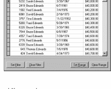

## 图 3.8

RangeFilter 对数据集应用范围过滤和筛选。

## 搜索

除了从客户端数据集中过滤掉不感兴趣的记录外，TClientDataSet 还提供了一些用于快速定位特定记录的方法。其中一些方法要求数据集上存在活动的索引，而另一些则不需要。搜索方法将在以下章节中详细介绍。

### 非索引搜索技术

在本节中，我将讨论那些不需要客户端数据集中存在活动索引的搜索技术。这些方法不使用索引，而是通过对数据集执行顺序搜索来查找第一个匹配的记录。

### Locate

Locate 也许是 TClientDataSet 搜索方法中最通用的一个。你可以使用 Locate 基于任意给定字段或字段组合来搜索记录。Locate 还可以基于部分匹配来搜索记录，并且可以执行不区分大小写的匹配。

TClientDataSet.Locate 的定义如下：

```pascal
function Locate(const KeyFields: string; const KeyValues: Variant;
  Options: TLocateOptions): Boolean; override;
```

第一个参数 KeyFields 指定要搜索的字段（或字段集合）。在搜索多个字段时，请用分号将它们分开（例如，‘Name;Birthday’）。

第二个参数 KeyValues 表示要搜索的值。值的数量必须与关键字段的数量完全匹配。如果只有一个搜索字段，你只需在此处传入要搜索的值。若要搜索多个值，你必须将值作为变体数组传入。执行此操作的一种方法是调用 VarArrayOf，如下所示：

```pascal
VarArrayOf(['John Smith', '4/15/1965'])
```

最后一个参数 Options 是一个集合，决定了搜索的执行方式。表 3.11 列出了可用的选项。

#### 表 3.11 Locate 选项

| 值 | 描述 |
| :--- | :--- |
| loPartialKey | KeyValues 不一定代表精确匹配。Locate 找到第一个字段值以 KeyValues 中指定值开头的记录。 |
| loCaseInsensitive | Locate 在搜索字符串字段时忽略大小写。 |

这两个选项仅适用于字符串字段。如果你在非字符串搜索中指定了它们，它们将被忽略。

如果找到匹配记录，Locate 返回 True；如果未找到匹配项，则返回 False。在匹配的情况下，该记录会被设为当前记录。

以下示例有助于说明这些选项：

```pascal
ClientDataSet1.Locate('Name', 'John Smith', []);
```

这搜索名称为 'John Smith' 的记录。

```pascal
ClientDataSet1.Locate('Name', 'JOHN', [loPartialKey, loCaseInsensitive]);
```
这搜索名称以 'JOHN' 开头的记录。这会找到 'John Smith'、'Johnny Jones' 和 'JOHN ADAMS'，但不会找到 'Bill Johnson'。

```pascal
ClientDataSet1.Locate('Name;Birthday', VarArrayOf(['John', '4/15/1965']), [loPartialKey]);
```

这搜索名称以 'John' 开头且生日为 1965 年 4 月 15 日的记录。在这种情况下，loPartialKey 选项仅适用于名称。尽管生日以字符串形式传入，但底层字段是日期字段，因此 loPartialKey 选项仅对该字段被忽略。

### Lookup

Lookup 在概念上与 Locate 相似，只是它不会更改当前记录指针。相反，Lookup 返回记录中一个或多个字段的值。此外，Lookup 不接受 Options 参数，因此你无法执行基于部分关键字或不分大小写的查找。

Lookup 的定义如下：

```pascal
function Lookup(const KeyFields: string; const KeyValues: Variant; const ResultFields: string): Variant; override;
```

KeyFields 和 KeyValues 指定要搜索的字段以及要搜索的值，正如 Locate 方法中那样。ResultFields 指定你想要返回数据的那些字段。例如，要返回名为 John Doe 的员工的生日，你可以编写以下代码：

```pascal
var
  V: Variant;
begin
  V := ClientDataSet1.Lookup('Name', 'John Doe', 'Birthday');
end;
```

以下代码返回 ID 号为 100 的员工的姓名和生日。

```pascal
var
V: Variant;
begin
V := ClientDataSet1.Lookup( 'ID', 100, 'Name;Birthday');
end;
```

如果未找到请求的记录，V 将被设置为 NULL。如果 ResultFields 包含单个字段名，则在从 Lookup 返回时，V 是一个包含 ResultFields 中列出的字段值的变体。如果 ResultFields 包含多个单字段名，则在从 Lookup 返回时，V 是一个包含 ResultFields 中列出的各字段值的变体数组。

> 关于变体数组的全面讨论，请参见我的著作《Delphi COM Programming》，由 Macmillan Technical Publishing 出版。

以下代码片段展示了如何访问从 Lookup 返回的结果。

```pascal
var
V: Variant;
begin
V := ClientDataSet1.Lookup( 'ID', 100, 'Name');
if not VarIsNull(V) then
ShowMessage( 'ID 100 refers to ' + V);

V := ClientDataSet1.Lookup( 'ID', 200, 'Name;Birthday');
if not VarIsNull(V) then
ShowMessage( 'ID 200 refers to ' + V[0] + ', born on ' + DateToStr(V[1]));
end;
```

### 索引搜索技术

前面提到的搜索技术不需要活动索引（实际上，它们甚至不需要数据集建立索引），但 TDataSet 还支持几种索引搜索操作。这些包括 FindKey、FindNearest 和 GetOKey，将在以下章节中讨论。

#### FindKey

FindKey 在当前索引的关键字段上搜索精确匹配。例如，如果数据集当前按 ID 索引，FindKey 将在 ID 字段上搜索精确匹配。如果数据集按姓和名索引，FindKey 将在姓和名两个字段上搜索精确匹配。

FindKey 接受一个参数，该参数指定要搜索的值。它返回一个布尔值，指示是否找到匹配的记录。如果未找到匹配项，当前记录指针保持不变。如果找到匹配记录，它将被设为当前记录。

FindKey 的参数实际上是一个值数组，因此你需要将值放在方括号中，如下面的示例所示：

```pascal
if ClientDataSet.FindKey([25]) then
    ShowMessage('Found ID 25');
...
if ClientDataSet.FindKey(['Doe', 'John']) then
    ShowMessage('Found John Doe');
```

你需要确保要搜索的值与当前索引匹配。因此，你可能希望在调用 FindKey 之前设置索引。以下代码片段说明了这一点：

```pascal
ClientDataSet1.IndexName := 'byID';
if ClientDataSet.FindKey([25]) then
    ShowMessage('Found ID 25');
...
ClientDataSet1.IndexName := 'byName';
if ClientDataSet.FindKey(['Doe', 'John']) then
    ShowMessage('Found John Doe');
```

#### FindNearest

FindNearest 的工作方式与 FindKey 相似，只是它找到大于或等于传入值的第一个记录。这取决于 KeyExclusive 属性的当前值。

如果 KeyExclusive 为 False（默认值），FindNearest 找到大于或等于传入值的第一个记录。如果 KeyExclusive 为 True，FindNearest 找到大于传入值的第一个记录。

如果 FindNearest 未找到匹配记录，它会将当前记录指针移动到数据集的末尾。

#### GotoKey

GotoKey 执行与 FindKey 相同的功能，只是你在调用 GotoKey 之前设置搜索字段的值。以下代码片段展示了如何做到这一点：

```pascal
ClientDataSet1.IndexName := 'byID';
ClientDataSet1.SetKey;
ClientDataSet1.FieldName('ID').AsInteger := 25;
ClientDataSet1.GotoKey;
```


如果索引由多个字段组成，只需在调用 `SetKey` 之后依次设置每个字段，如下所示：

```pascal
ClientDataSet1.IndexName := 'byName';
ClientDataSet1.SetKey;
ClientDataSet1.FieldName('First').AsString := 'John';
ClientDataSet1.FieldName('Last').AsString := 'Doe';
ClientDataSet1.GotoKey;
```

调用 `GotoKey` 后，您可以使用 `EditKey` 方法来编辑用于搜索的键值。例如，以下代码片段展示了如何搜索 John Doe，然后再搜索 John Smith。这两条记录的姓氏相同，因此在第二次搜索时，只需指定键的姓氏部分即可。

```pascal
ClientDataSet1.IndexName := 'byName';
ClientDataSet1.SetKey;
ClientDataSet1.FieldName('First').AsString := 'John';
ClientDataSet1.FieldName('Last').AsString := 'Doe';
ClientDataSet1.GotoKey;

// Do something with the record

// EditKey preserves the values set during the last SetKey
ClientDataSet1.EditKey;
ClientDataSet1.FieldName('Last').AsString := 'Smith';
ClientDataSet1.GotoKey;
```

### GotoNearest

`GotoNearest` 的工作原理与 `GotoKey` 类似，区别在于它会查找大于或等于传入值的第一条记录。具体行为取决于 `KeyExclusive` 属性的当前值。

如果 `KeyExclusive` 为 `False`（默认值），`GotoNearest` 会查找大于或等于在调用 `SetKey` 或 `EditKey` 后设置的字段值的第一条记录。如果 `KeyExclusive` 为 `True`，`GotoNearest` 会查找大于在调用 `SetKey` 或 `EditKey` 后设置的字段值的第一条记录。

如果 `GotoNearest` 未找到匹配的记录，它将当前记录指针移动到数据集末尾。

以下示例展示了如何在数据集上执行索引搜索和非索引搜索。清单 3.7 展示了 Search 应用程序的源代码，这是一个演示 `TClientDataSet` 所支持的各种索引和非索引搜索技术的示例程序。

### 清单 3.7 Search—MainForm.pas

```pascal
unit MainForm;

interface

uses
  SysUtils, Classes, Variants, QGraphics, QControls, QForms, QDialogs,
  QStdCtrls, DB, DBClient, QExtCtrls, QActnList, QRids, QBGrids;

type
  TfrmMain = class(TForm)
    DataSource1: TDataSource;
    pnlClient: TPanel;
    pnlBottom: TPanel;
    btnSearch: TButton;
    btnGetDBBookmark: TButton;
    btnGetBookmark: TButton;
    btnLookup: TButton;
    DBGrid1: TBDBGrid;
    ClientDataSet1: TClientDataSet;
    btnSetRecNo: TButton;
    procedure FormCreate(Sender: TObject);
    procedure btnGetBookmarkClick(Sender: TObject);
    procedure btnGetDBBookmarkClick(Sender: TObject);
    procedure btnSetRecNoClick(Sender: TObject);
    procedure btnSearchClick(Sender: TObject);
    procedure btnLookupClick(Sender: TObject);
  private
    { Private declarations }
    FBookmark: TBookmark;
  public
    { Public declarations }
  end;

var
  frmMain: TfrmMain;

implementation

uses SearchForm;

{$R *.xfm}

procedure TfrmMain.FormCreate(Sender: TObject);
begin
  ClientDataSet1.LoadFromFile('C:\Employee.cds');

  ClientDataSet1.AddIndex('byName', 'Name', []);
  ClientDataSet1.IndexName := 'byName';
end;

procedure TfrmMain.btnGetBookmarkClick(Sender: TObject);
begin
  if Assigned(FBookmark) then
    ClientDataSet1.FreeBookmark(FBookmark);

  FBookmark := ClientDataSet1.GetBookmark;
end;

procedure TfrmMain.btnGotoBookmarkClick(Sender: TObject);
begin
  if Assigned(FBookmark) then
    ClientDataSet1.GotoBookmark(FBookmark)
  else
    ShowMessage('No bookmark assigned');
end;

procedure TfrmMain.btnSetRecNoClick(Sender: TObject);
var
  Value: string;
begin
  Value := '1';
  if InputQuery('RecNo', 'Enter Record Number', Value) then
    ClientDataSet1.RecNo := StrToInt(Value);
end;

procedure TfrmMain.btnSearchClick(Sender: TObject);
var
  frmSearch: TfrmSearch;
begin
  frmSearch := TfrmSearch.Create(nil);
  try
    if frmSearch.ShowModal = mrOk then begin
      case TSearchMethod(frmSearch.grpMethod.ItemIndex) of
        smLocate:
          ClientDataSet1.Locate('Name', frmSearch.edName.Text,
            [loPartialKey, loCaseInsensitive]);
```

```pascal
        smFindKey:
          ClientDataSet1.FindKey([frmSearch.edName.Text]);

        smFindNearest:
          ClientDataSet1.FindNearest([frmSearch.edName.Text]);

        smGotoKey: begin
          ClientDataSet1.SetKey;
          ClientDataSet1.FieldName('Name').AsString :=
            frmSearch.edName.Text;
          ClientDataSet1.GotoKey;
        end;

        smGotoNearest: begin
          ClientDataSet1.SetKey;
          ClientDataSet1.FieldName('Name').AsString :=
            frmSearch.edName.Text;
          ClientDataSet1.GotoNearest;
        end;
      end;
    finally
      frmSearch.Free;
    end;
  end;
end;

procedure TfrmMain.btnLookupClick(Sender: TObject);
var
  Value: string;
  V: Variant;
begin
  Value := '1';
  if InputQuery('ID', 'Enter ID to Lookup', Value) then begin
    V := ClientDataSet1.Lookup('ID', StrToInt(Value), 'Name;Salary');
    if not VarIsNull(V) then
      ShowMessage(Format('ID %s refers to %s, who makes %s',
        [Value, V[0], FloatToStrF(V[1], ffCurrency, 10, 2)]));
  end;
end;

end.
```

清单 3.8 包含了搜索表单的源代码。该清单中唯一有趣的代码片段是 *TSearchMethod*，它定义在单元文件的顶部附近，用于确定调用哪种方法进行查找。

### 清单 3.8 Search—SearchForm.pas

```pascal
unit SearchForm;

interface

uses
  SysUtils, Classes, QGraphics, QControls, QForms, QDialogs, QExtCtrls,
  QStdCtrls;

type
  TSearchMethod = (smLocate, smFindKey, smFindNearest, smGotoKey,
                  smGotoNearest);

  TfrmSearch = class(TForm)
    pnlClient: TPanel;
    pnlBottom: TPanel;
    Label1: TLabel;
    edName: TEdit;
    grpMethod: TRadioGroup;
    btnOk: TButton;
    btnCancel: TButton;
  private
    { Private declarations }
  public
    { Public declarations }
  end;

implementation

{$R *.xfm}

end.
```

图 3.9 展示了 Search 应用程序在运行时的情景。

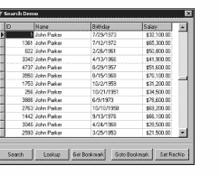

**图 3.9**
Search 演示了索引搜索和非索引搜索。

### 总结

`TClientDataSet` 是一个功能极其强大的内存数据集，支持多种高性能的排序和搜索操作。以下是本章的几个关键点：

- 您可以在设计时和运行时创建客户端数据集。本章展示了如何将它们保存到磁盘，以便在单层数据库应用程序中使用。
- 填充客户端数据集的三种基本方法是：
    - 使用 `Append` 或 `Insert` 手动填充
    - 从另一个数据集获取
    - 从文件或流获取（即通过持久化数据集）
- Delphi 中的数据集可以通过多种方式导航：顺序导航、通过书签、以及通过记录号。
- 您可以为数据集创建索引，从而快速、轻松地按特定顺序对记录进行排序，并定位符合特定条件的记录。
- 可以使用筛选器和范围来限制数据集中可见数据的数量。当相关数据存储在连续的记录序列中时，范围非常有用。与范围不同，筛选器在应用前不需要设置索引。
- `Locate` 和 `Lookup` 是用于在客户端数据集中定位特定记录的非索引搜索技术。`FindKey`、`FindNearest`、`GotoKey` 和 `GotoNearest` 是索引搜索技术。

在下一章中，我将讨论更高级的客户端数据集功能。

## 高级客户端数据集操作

# 第 4 章

## 本章内容

- 数据集事件 148
- 禁用数据感知组件 158
- BLOB（二进制大对象） 162
- 嵌套数据集 172
- 撤销支持 176
- 从另一个客户端数据集克隆数据 186
- 维护聚合 192
- 杂项属性 197

前一章介绍了 `TClientDataSet`，并详细讨论了其许多基本功能。在本章中，我将探讨更多高级的客户端数据集功能，包括：

- 数据集事件
- 禁用数据感知组件
- BLOB（二进制大对象）
- 嵌套数据集
- 撤销支持
- 从另一个客户端数据集克隆数据
- 维护聚合
- 杂项属性

### 数据集事件

客户端数据集支持大量事件。其中一些事件在单层应用程序（如本章正在开发的应用程序）中有用，而另一些则仅在多 tier（多层）应用程序中（我们将在后续章节中开发此类应用）有用。

本章讨论的数据集事件在所有应用程序（包括单层和多 tier 应用）中都有用。从广义上讲，这些事件分为三类：`Beforexxx` 通知事件、`Afterxxx` 通知事件以及其他事件。`Beforexxx` 和 `Afterxxx` 通知事件在 Delphi 中发生重要活动之前和之后触发。就本讨论而言，“重要”指的是数据集执行的日常常规活动——即您希望在发生时收到通知的活动。

一个例子有助于澄清最后一个说法：假设您想要验证对数据集的所有删除操作。一种方法是在程序中允许删除发生的每个位置向用户显示确认消息。然而，这种方法有三个缺点：

- 它是重复性的。
- 它容易出错。如果您在代码的一个位置更改了确认消息，很容易忘记在其他位置更改该消息。您可能甚至完全忘记实现确认功能。
- 当 VCL/CLX 隐式删除记录时，它不起作用。如果在数据感知网格中按下 `Ctrl+Delete`，VCL/CLX 会在无需您编写任何代码的情况下为您处理删除操作。


## 4 高级客户端数据集操作

针对这种情况，一种更好的编程方式是处理 `BeforeDelete` 事件，并在那里显示一条消息，询问用户是否确定要删除该记录。与大多数 `BeforeXxx` 事件处理程序类似，在事件处理程序内部引发异常（通常是 `Abort`）可以阻止该操作的发生。

在本节稍后，我将展示一个示例应用程序来说明这种技术。表 4.1 列出了客户端数据集的 `BeforeXxx` 事件及其用途。

### 表 4.1 客户端数据集 BeforeXxx 事件

| 事件 | 描述 |
| --- | --- |
| **BeforeCancel** | 在调用 `Cancel` 方法取消当前记录编辑之前触发。您可以利用此事件确认用户确实想要取消所做的任何更改。 |
| **BeforeClose** | 在数据集关闭之前立即调用。 |
| **BeforeDelete** | 在删除数据集中的当前记录之前立即调用。这是确认用户是否确实想要删除该记录的好地方。 |
| **BeforeEdit** | 由 `Edit` 方法在将数据集放入编辑模式之前立即触发。您可以将此事件用作限制编辑的便捷位置（通过引发 `Abort` 异常）。 |
| **BeforeInsert** | 由 `Append` 和 `Insert` 方法在将数据集放入插入模式之前立即触发。您可以将此事件用作限制编辑的一种方式（通过引发 `Abort` 异常）。 |
| **BeforeOpen** | 在数据集打开之前立即调用。 |
| **BeforePost** | 在新插入或编辑的记录数据提交到数据集之前发生。这是执行数据验证的好地方。 |
| **BeforeScroll** | 在数据集移动到新记录之前立即触发。这发生在数据集在 `First`、`Next`、`Prior` 或 `Last` 操作期间打开时；搜索期间；以及对数据集应用范围或过滤器时。 |

与 `BeforeXxx` 事件处理程序不同，这些处理程序在事件实际发生之前被触发（因此允许您阻止事件发生），`AfterXxx` 事件处理程序在事件发生后被触发，以告知您相关操作已成功完成。表 4.2 列出了与 `BeforeXxx` 事件处理程序相对应的 `AfterXxx` 事件处理程序。

### 表 4.2 客户端数据集 AfterXxx 事件

| 事件 | 描述 |
| :--- | :--- |
| AfterCancel | 在 Cancel 方法完成后触发。 |
| AfterClose | 在数据集关闭后立即发生。 |
| AfterDelete | 在数据集中的记录被删除后立即触发。 |
| AfterEdit | 在由于调用 Edit 方法而将数据集放入编辑模式之后调用。 |
| AfterInsert | 在由于调用 Insert 或 Append 方法而将数据集放入插入模式之后调用。 |
| AfterOpen | 在数据集打开后立即发生。 |
| AfterPost | 在记录成功提交到数据集之后触发。 |
| AfterScroll | 在数据集移动到新记录后立即触发。这发生在数据集在 First、Next、Prior 或 Last 操作期间打开时；搜索期间；以及对数据集应用范围或过滤器时。 |

表 4.3 列出了客户端数据集的其他值得注意的事件处理程序。

### 表 4.3 其他事件处理程序

| 事件 | 描述 |
| :--- | :--- |
| OnCalcFields | 如第 6 章“数据感知网格”中所讨论，此事件用于提供计算字段的值。 |
| OnDeleteError | 如果从数据集中删除记录时发生错误（例如，如果数据集是只读的），则触发此事件。 |
| OnEditError | 如果在将数据集放入编辑模式时发生错误（例如，如果数据集是只读的），则触发此事件。 |
| OnFilterRecord | 如第 6 章中所讨论，此事件被调用来让用户提供对数据集的高级过滤。 |
| OnNewRecord | 每当创建新记录时，但在编辑或提交到数据集之前触发。这是为记录设置默认值的好地方。在此事件处理程序内部，数据集已处于插入模式，因此不应在此事件处理程序内部调用 TClientDataSet.Insert。 |
| OnPostError | 如果尝试将记录提交到数据集时发生错误（例如键冲突），则触发此事件。 |

通过处理所有这些事件并将其调用记录到日志文件或列表框中，您可以了解很多关于数据集工作原理的知识。在以下示例中，我就是这样做的。列表 4.1 包含了 EventLog 应用程序的完整源代码。

### 列表 4.1 EventLog—MainForm.pas

```pascal
unit MainForm;

interface

uses
  SysUtils, Variants, Classes, QGraphics, QControls, QForms,
  QDialogs, DB, DBClient, QComCtrls, QGrids, QDBGrids, QExtCtrls, QStdCtrls,
  QDBCtrls;

type
  TLogEventType = (logBeforeCancel, logBeforeClose, logBeforeDelete,
    logBeforeEdit, logBeforeInsert, logBeforeOpen, logBeforePost,
    logBeforeScroll, logAfterCancel, logAfterClose, logAfterDelete,
    logAfterEdit, logAfterInsert, logAfterOpen, logAfterPost, logAfterScroll);

  TfrmMain = class(TForm)
    ClientDataSet1: TClientDataSet;
    pnlClient: TPanel;
    pnlLog: TPanel;
    grid: TDBGrid;
    lvLog: TListView;
    DataSource1: TDataSource;
    pnlBottom: TPanel;
    btnConnect: TButton;
    lblRecPos: TLabel;
    btnDisconnect: TButton;
    btnClearLog: TButton;
    DBNavigator1: TDBNavigator;
    btnOptions: TButton;
    procedure ClientDataSet1AfterCancel(DataSet: TDataSet);
    procedure ClientDataSet1AfterClose(DataSet: TDataSet);
    procedure ClientDataSet1AfterDelete(DataSet: TDataSet);
    procedure ClientDataSet1AfterEdit(DataSet: TDataSet);
    procedure ClientDataSet1AfterOpen(DataSet: TDataSet);
    procedure ClientDataSet1AfterPost(DataSet: TDataSet);
    procedure ClientDataSet1AfterScroll(DataSet: TDataSet);
    procedure btnConnectClick(Sender: TObject);
    procedure btnClearLogClick(Sender: TObject);
    procedure btnDisconnectClick(Sender: TObject);
    procedure ClientDataSet1BeforeCancel(DataSet: TDataSet);
    procedure ClientDataSet1BeforeClose(DataSet: TDataSet);
    procedure ClientDataSet1BeforeDelete(DataSet: TDataSet);
    procedure ClientDataSet1BeforeEdit(DataSet: TDataSet);
    procedure ClientDataSet1BeforeInsert(DataSet: TDataSet);
    procedure ClientDataSet1BeforeOpen(DataSet: TDataSet);
    procedure ClientDataSet1BeforePost(DataSet: TDataSet);
    procedure ClientDataSet1BeforeScroll(DataSet: TDataSet);
    procedure btnOptionsClick(Sender: TObject);
    procedure FormCreate(Sender: TObject);

private
{ Private declarations }
FLogScrollEvents: Boolean;
FPromptOnDelete: Boolean;
procedure Log(EventType: TLogEventType);
public
{ Public declarations }
end;

var
frmMain: TfrmMain;

implementation

uses OptionsForm;

{$R *.xfm}

procedure TfrmMain.Log(EventType: TLogEventType);
const
EventText: array[TLogEventType] of string = (
'BeforeCancel', 'BeforeClose', 'BeforeDelete', 'BeforeEdit',
'BeforeInsert', 'BeforeOpen', 'BeforePost', 'BeforeScroll',
'AfterCancel', 'AfterClose', 'AfterDelete', 'AfterEdit',
'AfterInsert', 'AfterOpen', 'AfterPost', 'AfterScroll');
var
ListItem: TListItem;
begin
ListItem := lvLog.Items.Add;
ListItem.Caption := EventText[EventType];
end;

procedure TfrmMain.FormCreate(Sender: TObject);
begin
FLogScrollEvents := True;
FPromptOnDelete := True;
end;

procedure TfrmMain.ClientDataSet1AfterCancel(DataSet: TDataSet);
begin
Log(LogAfterCancel);
end;

procedure TfrmMain.ClientDataSet1AfterClose(DataSet: TDataSet);
begin
Log(LogAfterClose);
end;

procedure TfrmMain.ClientDataSet1AfterDelete(DataSet: TDataSet);
begin
Log(LogAfterDelete);
end;

procedure TfrmMain.ClientDataSet1AfterEdit(DataSet: TDataSet);
begin
Log(LogAfterEdit);
end;

procedure TfrmMain.ClientDataSet1AfterInsert(DataSet: TDataSet);
begin
Log(LogAfterInsert);
end;

procedure TfrmMain.ClientDataSet1AfterOpen(DataSet: TDataSet);
begin
Log(LogAfterOpen);
end;

procedure TfrmMain.ClientDataSet1AfterPost(DataSet: TDataSet);
begin
Log(LogAfterPost);
end;
```


# 列表 4.1（续）

```pascal
procedure TfrmMain.ClientDataSet1AfterScroll(DataSet: TDataSet);
begin
  if FLogScrollEvents then
    Log(logAfterScroll);

  lblRecPos.Caption := Format('Record %d of %d',
    [DataSet.RecNo, DataSet.RecordCount]);
end;

procedure TfrmMain.ClientDataSet1BeforeCancel(DataSet: TDataSet);
begin
  Log(logBeforeCancel);
end;

procedure TfrmMain.ClientDataSet1BeforeClose(DataSet: TDataSet);
begin
  Log(logBeforeClose);
end;

procedure TfrmMain.ClientDataSet1BeforeDelete(DataSet: TDataSet);
begin
  Log(logBeforeDelete);

  if FPromptOnDelete then begin
    if MessageDlg('Are you sure you want to delete the current record?',
      mtWarning, [mbYes, mbNo], 0) <> mrYes then
      Abort;
  end;
end;

procedure TfrmMain.ClientDataSet1BeforeEdit(DataSet: TDataSet);
begin
  Log(logBeforeEdit);
end;

procedure TfrmMain.ClientDataSet1BeforeInsert(DataSet: TDataSet);
begin
  Log(logBeforeInsert);
end;

procedure TfrmMain.ClientDataSet1BeforeOpen(DataSet: TDataSet);
begin
  Log(logBeforeOpen);
end;

procedure TfrmMain.ClientDataSet1BeforePost(DataSet: TDataSet);
begin
  Log(logBeforePost);
end;

procedure TfrmMain.ClientDataSet1BeforeScroll(DataSet: TDataSet);
begin
  if FLogScrollEvents then
    Log(logBeforeScroll);
end;

procedure TfrmMain.btnConnectClick(Sender: TObject);
begin
  ClientDataSet1.LoadFromFile('C:\Employee.cds');
end;

procedure TfrmMain.btnDisconnectClick(Sender: TObject);
begin
  ClientDataSet1.Close;
end;

procedure TfrmMain.btnClearLogClick(Sender: TObject);
begin
  lvLog.Items.Clear;
end;

procedure TfrmMain.btnOptionsClick(Sender: TObject);
var
  frmOptions: TfrmOptions;
begin
  frmOptions := TfrmOptions.Create(nil);
  try
    frmOptions.LogScrollEvents := FLogScrollEvents;
    frmOptions.PromptOnDelete := FPromptOnDelete;
    if frmOptions.ShowModal = mrOK then
    begin
      FLogScrollEvents := frmOptions.LogScrollEvents;
      FPromptOnDelete := frmOptions.PromptOnDelete;
    end;
  finally
    frmOptions.Free;
  end;
end;
```

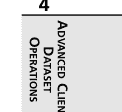

图 4.1 展示了该应用程序在运行时的情形。主窗口的上半部分是一个数据感知网格，允许用户插入、编辑和删除记录。窗口的中间部分包含一个列表视图，它记录了对数据集执行的所有操作日志。窗口的底部是用于打开和关闭数据集、清除日志以及设置演示选项的按钮。

通过点击主窗口底部的“选项…”按钮，用户可以选择是否记录滚动事件以及是否在删除前进行确认，如图 4.1 所示。

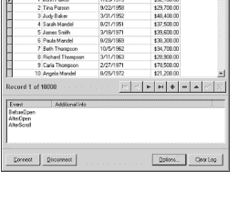

# 图 4.1 EventLog 应用程序演示了客户端数据集事件。

列表 4.2 包含了该应用程序选项窗口的源代码，它允许用户指定程序在删除记录时是否提示用户，以及程序是否将数据集事件记录到列表框中。

# 列表 4.2 EventLog—OptionsForm.pas

```pascal
unit OptionsForm;

interface

uses
  SysUtils, Variants, Classes, QGraphics, QControls, QForms,
  QDialogs, QStdCtrls, QExtCtrls;

type
  TfrmOptions = class(TForm)
    pnlClient: TPanel;
    pnlBottom: TPanel;
    btnOk: TButton;
    btnCancel: TButton;
    cbLogScrollEvents: TCheckBox;
    cbPromptOnDelete: TCheckBox;

  private
    procedure SetLogScrollEvents(const Value: Boolean);
    function GetLogScrollEvents: Boolean;
    function GetPromptOnDelete: Boolean;
    procedure SetPromptOnDelete(const Value: Boolean);
    { Private declarations }
  public
    { Public declarations }
    property LogScrollEvents: Boolean
      read GetLogScrollEvents write SetLogScrollEvents;
    property PromptOnDelete: Boolean
      read GetPromptOnDelete write SetPromptOnDelete;

  end;

implementation

{$R *.xfm}

{ TfrmOptions }

function TfrmOptions.GetLogScrollEvents: Boolean;
begin
  Result := cbLogScrollEvents.Checked;
end;

function TfrmOptions.GetPromptOnDelete: Boolean;
begin
  Result := cbPromptOnDelete.Checked;
end;

procedure TfrmOptions.SetLogScrollEvents(const Value: Boolean);
begin
  cbLogScrollEvents.Checked := Value;
end;

procedure TfrmOptions.SetPromptOnDelete(const Value: Boolean);
begin
  cbPromptOnDelete.Checked := Value;
end;

end.
```

# 禁用数据感知组件

这一主题实际上适用于所有 Delphi 数据集，但我是在客户端数据集的背景下讨论它的，因为通常不会将数据感知组件直接连接到 dbExpress 数据集。通常，数据感知组件是连接到客户端数据集的。

如本章所学，数据感知组件会主动跟踪其连接的数据集中的当前记录。虽然这通常是一件好事，但有时你希望防止数据感知组件更新。这种情况最常发生在你滚动数据集以对记录执行操作时，你不想看到所有数据感知组件快速更新。例如，请查看以下代码片段：

```pascal
var
  Bookmark: TBookmarkStr;
begin
  Bookmark := ClientDataSet1.Bookmark;
  try
    ClientDataSet1.First;
    while not ClientDataSet1.EOF do begin
      if ClientDataSet1.FieldName('Salary').AsFloat < 30000.0 then begin
        ClientDataSet1.Edit;
        ClientDataSet1.FieldName('Salary').AsFloat :=
          ClientDataSet1.FieldName('Salary').AsFloat * 1.05;
        ClientDataSet1.Post;
      end;
      ClientDataSet1.Next;
    end;
  finally
    ClientDataSet1.Bookmark := Bookmark;
  end;
end;
```

这段代码遍历数据集中的所有记录，给任何年薪低于 30,000 美元的人涨薪 5%。

从功能角度看，这段代码没有任何问题，它完成了预期的任务。它甚至记住了当前记录，以便在完成时正确重置数据集位置。

这段代码的问题在于它很慢。如果你运行在上一章中创建的包含 10,000 条记录的员工数据集上，你会看到网格随着记录被更新而滚动穿过数据集中的所有记录。（本节末尾的示例应用程序展示了这种效果。）

解决方法是在开始执行此操作之前，禁用所有连接到该数据集的数据感知组件（即 TDBGrid）。要做到这一点，只需在执行耗时操作之前调用 DisableControls 方法，并在完成后调用 EnableControls。以下代码片段显示了更新后的过程：

```pascal
var
  Bookmark: TBookmarkStr;
begin
  ClientDataSet1.DisableControls;
  try
    Bookmark := ClientDataSet1.Bookmark;
    try
      ClientDataSet1.First;
      while not ClientDataSet1.EOF do begin
        if ClientDataSet1.FieldName('Salary').AsFloat < 30000.0 then begin
          ClientDataSet1.Edit;
          ClientDataSet1.FieldName('Salary').AsFloat :=
            ClientDataSet1.FieldName('Salary').AsFloat * 1.05;
          ClientDataSet1.Post;
        end;
        ClientDataSet1.Next;
      end;
    finally
      ClientDataSet1.Bookmark := Bookmark;
    end;
  finally
    ClientDataSet1.EnableControls;
  end;
end;
```

如该代码片段所示，你希望将 DisableControls 和 EnableControls 调用之间的代码包裹在一个 try/finally 块中。如果不这样做，且代码中某处发生异常，数据感知组件将停止更新。

请注意，对 DisableControls 和 EnableControls 的调用是引用计数的。如果你在代码中调用了三次 DisableControls，那么你也需要调用三次 EnableControls，数据感知控件才会再次更新。

列表 4.3 包含了 Updates 应用程序的完整源代码。

# 列表 4.3 Updates—MainForm.pas

```pascal
unit MainForm;

interface

uses
  Types, IdGlobal, SysUtils, Variants, Classes, QGraphics, QControls, QForms,
  QDialogs, QStdCtrls, DB, DBClient, QExtCtrls, QActnList, QGrids, QDBGRids,
  QDBCtrls;

type
  TfrmMain = class(TForm)
    DataSource1: TDataSource;
    pnlClient: TPanel;
    pnlBottom: TPanel;
    btnDisableEnable: TButton;
    DBGrid1: TDBGrid;
    ClientDataSet1: TClientDataSet;
    btnBaseline: TButton;
    procedure FormCreate(Sender: TObject);
    procedure btnDisableEnableClick(Sender: TObject);
    procedure btnBaselineClick(Sender: TObject);
  private
    { Private declarations }
    procedure PerformWork;
  public
    { Public declarations }
  end;

var
  frmMain: TfrmMain;

implementation

{$R *.xfm}

procedure TfrmMain.FormCreate(Sender: TObject);
begin
  ClientDataSet1.LoadFromFile('C:\Employee.cds');
end;

procedure TfrmMain.PerformWork;
var
  Bookmark: TBookmark;
begin
  Bookmark := ClientDataSet1.GetBookmark;
  try
    ClientDataSet1.First;
    while not ClientDataSet1.EOF do begin
```


## 列表 4.3

```delphi
if ClientDataSet1.Field['Salary'].AsFloat < 30000.0 then
begin
  ClientDataSet1.Edit;
  ClientDataSet1.Field['Salary'].AsFloat :=
    ClientDataSet1.Field['Salary'].AsFloat * 1.05;
  ClientDataSet1.Post;
  end;
  ClientDataSet1.Next;
end;
ClientDataSet1.GoToBookmark(Bookmark);
finally
ClientDataSet1.FreeBookmark(Bookmark);
end;
end;

procedure TfrmMain.btnBaselineClick(Sender: TObject);
var
t1, t2: DWord;
begin
t1 := GetTickCount;
PerformWork;
t2 := GetTickCount;
ShowMessage( IntToStr( t2 - t1 ) + ' ms' );
end;

procedure TfrmMain.btnDisableEnableClick(Sender: TObject);
var
t1, t2: DWord;
begin
t1 := GetTickCount;
ClientDataSet1.DisableControls;
try
PerformWork;
finally
ClientDataSet1.EnableControls;
end;

t2 := GetTickCount;
ShowMessage( IntToStr( t2 - t1 ) + ' ms' );
end;
```

这项测试的结果令人印象深刻。基准测试（即不禁用控件的测试）在我的 1.4GHz Pentium 4 处理器上运行大约需要 19.6 秒。通过增加五行代码来禁用和重新启用数据感知组件，代码仅执行了 560 毫秒（而且完全没有烦人的屏幕活动，这也是一大优点）。

## BLOB

BLOB（二进制大对象）是现代许多数据库应用的基础组成部分。无论您是想要存储图像、格式化或未格式化的笔记、流式组件，还是其他任何字节的块；BLOB 都是您数据库编程技能中不可或缺的一部分。

在本节中，我将向您展示如何有效地在客户端数据集中存储 BLOB，以及如何在稍后检索它们。在接下来的几页中，我将特别关注笔记、图像、流式组件和通用 BLOB 存储。

与其他字段类型一样，您可以在设计时或运行时创建 BLOB 字段。下面的代码片段展示了如何在运行时创建 BLOB 字段：

```delphi
ClientDataSet1.FieldDefs.Add( 'Notes', ftBLOB );
```

这段代码创建了一个名为 **Notes** 的字段，其类型为 **ftBLOB**。

### 笔记

使用 BLOB 字段最常见的方式之一是存储笔记，即自由格式文本。对于少量文本，通常字符串字段就足够了，但如果您想要存储整个备忘录，则需要使用 BLOB 字段。

将 BLOB 作为字符串访问特别简单。您只需调用该字段的 **AsString** 方法，如下所示：

```delphi
Memo1.Text := ClientDataSet1.FieldByName('Notes').AsString;
```

同样，为了将备忘录保存回字段，您可以编写如下代码：

```delphi
ClientDataSet1.FieldByName( 'Notes' ).AsString := Memo1.Text ;
```

### 图像

BLOB 字段的另一个常见用途是存储图像。您可能希望编写一个 Delphi 应用程序来为您在数码相机上拍摄的照片建立目录，或者您可能希望在无纸化办公室中跟踪扫描文档。无论哪种情况，BLOB 字段都提供了将这些图像存储在数据库中的必要支持。

类似于格式化和未格式化的备忘录，Delphi 提供了图像的数据感知版本：**TDBImage**。然而，**TDBImage** 存在不足，因为它只能正确存储和检索位图（*.BMP 文件）。健壮的应用程序应该存储位图、JPG 以及用户可能想要存储的（几乎）任何其他图像类型。

至少有三种方法可以将多种图像类型存储在数据集中。它们包括：

- 创建一个单独的字段，用于存储图像类型。使用该字段的值来确定如何存储/加载图像。
- 向 BLOB 字段写入一个表示图像类型的值，紧接着写入图像数据。
- 使用第三方图像库为您完成这项工作。

以下部分将讨论这些选项。

## 使用单独字段存储图像类型

跟踪数据集中存储的图像类型的一种方法是添加一个单独的字段，例如命名为 `ImageType`，以跟踪图像类型。假设，为了便于讨论，您的应用程序可以存储 BMP 和 JPG。您会为每种图像类型设置常量，如下所示：

```delphi
const
IMAGE_NONE = 0;
IMAGE_BMP = 1;
IMAGE_JPG = 2;
```

通常，当 BLOB 字段为 **NULL** 时，`ImageType` 字段包含值 `IMAGE_NONE`。为了正确实现此方法，您必须记得每当用户加载图像时设置 `ImageType` 字段，并在用户清除图像时将其重置为 `IMAGE_NONE`。

## 将图像类型作为 BLOB 字段的一部分进行流式传输

通过稍微多写一些代码，您可以省去额外的字段，并将图像类型与图像本身一起存储在 BLOB 字段中。图 4.2 在概念上展示了这种方法涉及的内容。

下面的伪代码展示了您如何实现这种方法：

```text
procedure SaveImage;
begin
OpenOutputStream;
WriteImageType;
WriteImageData;
end;

procedure LoadImage;
var
   ImageType: Integer;
begin
   OpenInputStream;
   ImageType := ReadImageType;
   case ImageType of
      IMAGE_BMP: ReadBitmap;
      IMAGE_JPG: ReadJPEG;
   end;
end;
```

本节末尾提供的示例应用程序说明了这两种技术。

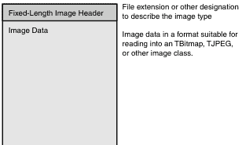

### 图 4.2

> 图像类型紧随图像数据之前，位于 BLOB 字段中。

## 第三方图像库

第三方图像库通常遵循前一部分中概述的步骤（也就是说，它们通常向流写入一个值以指示流中存储的图像类型）。图像类型之后紧接着是图像本身。

然而，其他第三方库可能始终将图像内部存储为专有格式，然后从流中读取和写入该图像格式。要点在于，一旦您选择了图像库并将其应用于您的应用程序，您就不应该期望以后可以随意将其更换为另一个不同的库。更换图像库可能需要您为您的 BLOB 数据编写一个数据转换程序。

## 注意

如果您正在寻找一个好的图像库，请查看 Skyline Tools Imaging 的 ImageLib Corporate Suite。ImageLib Corporate Suite 已多次获奖，被评为可用的最佳 Delphi 图像库（包括 *Delphi Informant Magazine* 备受推崇的读者选择奖）。我在自己的应用程序中使用 ImageLib，并高度推荐它。您可以在 `http://www.imagelib.com` 找到 Skyline Tools Imaging。

## 流式数据

除了流式传输图像外，有时您可能希望将非结构化数据流式传输到 BLOB 字段。例如，您可能希望在单个字段中存储一个整数链表。下面的代码片段展示了如何使用流将数据保存到 BLOB，然后稍后再读回来。

```delphi
procedure SaveListToBlob(List: TList);
var
    Stream: TStream;
    Num: Integer;
    Index: Integer;
begin
    Stream := ClientDataSet1.CreateBlobStream(
        ClientDataSet1.FieldByName('DATA'), bmWrite);
    try
        // Write out the number of integers
        Num := List.Count;
        Stream.Write(Num, sizeof(Num));

        for Index := 0 to List.Count - 1 do begin
            Num := Integer(List[Index]);
            Stream.Write(Num, sizeof(Num));
        end;
    finally
        Stream.Free;
    end;
end;

procedure LoadListFromBlob(List: TList);
var
    Stream: TStream;
    Count: Integer;
    Index: Integer;
    Num: Integer;
begin
  Stream := ClientDataSet1.CreateBlobStream(
            ClientDataSet1.FieldByName('DATA'), bmRead);
  try
    List.Clear;

    Stream.Read(Count, sizeof(Count));
    for Index := 0 to Count - 1 do begin
      Stream.Read(Num, sizeof(Num));
      List.Add(Pointer(Num));
    end;
  finally
    Stream.Free;
  end;
end;
```

请注意前面过程中 `Stream.Write` 和 `Stream.Read` 的使用。这两个方法都以指向要写入数据的引用作为第一个参数，以要写入的字节数作为第二个参数。保存数据块就像重复调用 `TStream.Write` 一样简单。您必须确保按写入数据的完全相同顺序读取数据，否则轻则导致异常，重则导致数据损坏。

还要注意使用 `TDataSet` 方法 `CreateBlobStream` 来创建适合数据集的 blob 流。许多初学的 Delphi 数据库程序员试图调用 `TBlobStream.Create`，如下所示：

```delphi
var
  Stream: TBlobStream;
begin
  Stream := TBlobStream.Create(...);
  try
    // Read from or write to the stream here.
  finally
    Stream.Free;
  end;
end;
```

这种方法的缺点在于，`TBlobStream` 是特定于 BDE 的。创建 `TBlobStream` 的实例将无法与非 BDE 数据集（例如 `TClientDataSet`）配合使用。为了创建能与当前数据集配合使用的 blob 流，始终调用数据集的 `CreateBlobStream` 方法，如下所示：


## 流式组件

虽然流式数据的核心概念要求程序员（即你）确保数据的读写顺序一致，但通过创建并流式化组件，你可以让 Delphi 内置的流机制替你完成这项工作。

Delphi 为派生自 `TPersistent` 的组件以及 `TCollection` 系列类的辅助函数提供了流式支持。

为了让之前描述的整数列表的流式化过程更加自动化，让我们为这些数据创建一个组件包装器。

```delphi
TIntegerItem = class(TCollectionItem)
private
    FNumber: Integer;
published
    property Number: Integer read FNumber write FNumber;
end;

TIntegerList = class(TComponent)
private
    FIntList: TCollection;
published
    property IntList: TCollection read FIntList;
end;
```

诚然，对于像整数列表这样简单的数据结构来说，这可能有点大材小用，但同样的概念也适用于包含多个字段或复杂子数据的组件。

> 注意
> 本书不在详细讨论 Delphi 流式支持的范围内。有关流式技术的更多信息，请参阅《组件编写指南》或终极参考资源——VCL/CLX 源代码本身。如果你有幸拥有 Danny Thorpe 所著的《Delphi 组件设计》一书，其中关于 Delphi 流式机制的一章也非常有参考价值。

## 文件 BLOB

BLOB 字段的另一种常见用途是将整个文件存储在 BLOB 中。例如，假设你有大量 PDF 文档需要编目，并希望允许用户阅读这些文档。

通过将 PDF 文件存储在 BLOB 字段中，你可以比较轻松地创建一个应用程序，该应用允许用户按类别或关键词搜索 PDF，并在其计算机上查看该文件。

你可以使用字段的 `LoadFromFile` 方法将外部文件加载到 BLOB 字段中，如下面的代码片段所示：

```delphi
var
  B: TBlobField;
begin
  B := ClientDataSet1.FieldByName('AttachedFile');
  B.LoadFromFile('C:\PROPOSAL.PDF');
end;
```

如果你想将文件保存回磁盘（例如，为了将其加载到 Acrobat Reader 等应用程序中），你可以编写以下代码：

```delphi
var
  B: TBlobField;
begin
  B := ClientDataSet1.FieldByName('AttachedFile');
  B.SaveToFile('C:\TEMP.PDF');
end;
```

## BLOB 字段的局限性

尽管 BLOB 非常有用，但它们确实存在几项限制。具体来说：

- 你目前无法（currently）在 BLOB 字段上执行筛选。新一代的关系型数据库（如 Informix）支持在 BLOB 上进行搜索。一旦此功能被添加到核心 dBExpress 技术中，`TClientDataSet` 很可能也会随之更新以支持该功能。
- 你无法在 BLOB 字段上执行定位（locate）或其他搜索技术。
- 第 8 章“DataSnap”中讨论的 DataSnap 数据调节（reconciliation）功能不适用于 BLOB 字段。不过，在同一章中你将看到一种变通方法。

以下示例演示了本节讨论的一些 BLOB 技术。列表 4.4 显示了 BLOB 应用程序的源代码。

### 列表 4.4 BLOBs—MainForm.pas

```delphi
unit MainForm;

interface

uses
  SysUtils, Classes, O6Graphics, QControls, QForms, QDialogs, QStdCtrls,
  DB, QDBCtrls, QExtCtrls, QComCtrls, DBClient, JPEG;

type
  TfrmMain = class(TForm)
    pnlBottom: TPanel;
    ClientDataSet1: TClientDataSet;
    DataSource1: TDataSource;
    DBNavigator1: TDBNavigator;
    PageControl1: TPageControl;
    tabNotes: TTabSheet;
    tabImage: TTabSheet;
    DBMemo1: TDBMemo;
    tabAttachment: TTabSheet;
    Label1: TLabel;
    DBText1: TDBText;
    ClientDataSet1Notes: TBlobField;
    ClientDataSet1ImageType: TStringField;
    ClientDataSet1Image: TBlobField;
    ClientDataSet1Attachment: TBlobField;
    btnLoadAttachment: TButton;
    btnSaveAttachment: TButton;
    Label2: TLabel;
    DBText2: TDBText;
    ClientDataSet1AttachedFile: TStringField;
    Bevel1: TBevel;
    Image1: TImage;
    btnLoadImage: TButton;
    btnClearImage: TButton;
    OpenPictureDialog: TOpenDialog;
    OpenDialog1: TOpenDialog;
    SaveDialog1: TSaveDialog;
  procedure FormCreate(Sender: TObject);
  procedure DataSource1DataChange(Sender: TObject; Field: TField);
  procedure btnLoadImageClick(Sender: TObject);
  procedure btnClearImageClick(Sender: TObject);
  procedure btnLoadAttachmentClick(Sender: TObject);
  procedure btnSaveAttachmentClick(Sender: TObject);
private
  { Private declarations }
public
  { Public declarations }
end;

var
  frmMain: TfrmMain;

implementation

{$R *.xfrm}

procedure TfrmMain.FormCreate(Sender: TObject);
begin
  ClientDataSet1.CreateDataSet;
end;

procedure TfrmMain.DataSource1DataChange(Sender: TObject; Field: TField);
var
  BlobStream: TStream;
  JPEGImage: TJPEGImage;
  Ext: string;
begin
  if (Field = nil) or (Field = ClientDataSet1Image) then begin
    if ClientDataSet1ImageType.AsString <> '' then begin
      BlobStream := ClientDataSet1.CreateBlobStream(ClientDataSet1Image,
        bmRead);
      try
        Ext := UpperCase(ClientDataSet1ImageType.AsString);
        if Ext = '.BMP' then
          Image1.Picture.Bitmap.LoadFromStream(BlobStream)
        else if Ext = '.JPG' then begin
          JPEGImage := TJPEGImage.Create;
          try
            JPEGImage.LoadFromStream(BlobStream);
            Image1.Picture.Assign(JPEGImage);
          finally
            JPEGImage.Free;
          end;
        end;
      finally
        BlobStream.Free;
      end;
    end else
      Image1.Picture := nil;
  end;
end;

procedure TfrmMain.btnLoadImageClick(Sender: TObject);
begin
  if OpenPictureDialog1.Execute then begin
    ClientDataSet1.Edit;
    ClientDataSet1ImageType.AsString :=
      ExtractFileExt(OpenPictureDialog1.FileName);
    ClientDataSet1Image.LoadFromFile(OpenPictureDialog1.FileName);
  end;
end;

procedure TfrmMain.btnClearImageClick(Sender: TObject);
begin
  Image1.Picture := nil;
end;

procedure TfrmMain.btnLoadAttachmentClick(Sender: TObject);
begin
  if OpenDialog1.Execute then begin
    ClientDataSet1.Edit;
    ClientDataSet1AttachedFile.AsString := OpenDialog1.FileName;
    ClientDataSet1Attachment.LoadFromFile(OpenDialog1.FileName);
  end;
end;

procedure TfrmMain.btnSaveAttachmentClick(Sender: TObject);
begin
  if SaveDialog1.Execute then
    ClientDataSet1Attachment.SaveToFile(SaveDialog1.FileName);
end;
```

BLOBs 应用程序允许你在单个记录中存储笔记、图像和文件附件。笔记是使用 **TDBMemo** 组件存储的。

我选择创建一个独立的图像类型字段，命名为 **ImageType**，以跟踪存储在 **Image** 字段中的图像类型。如果 **ImageType** 为空，则假定图像为 **NULL**。请注意图像显示的方式——该程序处理数据源的 **DataChange** 事件。如果发送到事件的 **Field** 参数为 **nil**（或者它引用的是 **Image** 字段），**Image** 组件将从 **Image** 字段加载图片，对 **BMP** 文件使用一种方法，对 **JPG** 文件使用另一种方法。当然，实际的应用程序会识别比这两种更多的图像类型。

还要注意加载图像所使用的代码与加载附件所使用的代码之间的相似性。任何文件都可以通过字段的 **LoadFromFile** 方法加载到 BLOB 字段中，并可以通过字段的 **SaveToFile** 方法保存回磁盘。

BLOBs 应用程序不会将数据保存到磁盘（尽管可以通过在代码中添加 **SaveToFile** 方法来实现），因此其实用性较低。然而，它阐明了在程序中使用 BLOB 字段正确（或者其中一种正确，就图像而言）的方式。

图 4.3 显示了该应用程序在运行时的情景。

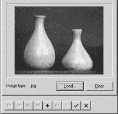

### 图 4.3

> *笔记和图像是现代许多应用程序的一部分。*

## 嵌套数据集

嵌套数据集是 **TClientDataSet** 对主从（master/detail）关系的一种回应。嵌套数据集在物理上将详细数据集*嵌套*在主数据集内部作为一个字段。图 4.4 说明了这一概念。


## 图 4.4

> Orders（订单）数据集嵌套在 Customers（客户）数据集中。

数据集可以嵌套多层，因此你可以在三个数据集之间建立祖级/父级/子级关系。你还可以创建一个拥有多个子数据集的父数据集，或者两者的混合形式（其中一个主数据集包含三个明细数据集，而每个明细数据集又包含两个明细记录）。

当将嵌套数据集保存到文件或流时，整个层次结构都会保存在单个文件或流中。要保存嵌套数据集，请在主数据集上调用 `SaveToFile` 或 `SaveToStream`，所有嵌套的数据集都会自动保存。`LoadFromFile` 和 `LoadFromStream` 将重新加载所有数据并重新建立主/明细关系。

要在设计时创建嵌套数据集，首先以通常的方式创建一个数据集。然后，向其中添加一个字段，并将其类型设置为 `DataSet`。这就完成了主数据集的创建。

要创建明细数据集，请在窗体或数据模块上放置第二个 `TClientDataSet`。创建构成明细数据集的字段。

剩下唯一的任务是将它们关联起来。为此，点击明细数据集并将其 `DataSetField` 属性设置为你在主数据集上创建的 `DataSet` 字段的名称。这就完成了。

此时，你可以将数据源和数据感知组件连接到任一分数据集。当你在主数据集中滚动时，明细数据集会自动更新，仅显示与当前主记录相关的明细记录。

以下示例应用程序展示了如何在应用程序中正确设置嵌套数据集。它包含客户和订单数据集，其中一个客户可以下许多订单。两个数据感知网格允许你浏览客户并查看每个客户的订单。

列表 4.5 包含 Nested（嵌套）应用程序的完整源代码。

### 列表 4.5 Nested—MainForm.pas

```pascal
unit MainForm;

interface

uses
  SysUtils, Variants, Classes, QGraphics, QControls, QForms,
  QDialogs, QExtCtrls, QDBCtrls, QGrids, QDBGrids, DB, DBClient, QStdCtrls;

type
  TfrmMain = class(TForm)
    pnlClient: TPanel;
    pnlBottom: TPanel;
    cdsCustomer: TClientDataSet;
    cdsOrder: TClientDataSet;
    dsCustomer: TDataSource;
    dsOrder: TDataSource;
    gridCustomer: TDBGrid;
    gridOrder: TDBGrid;
    navCustomer: TDBNavigator;
    navOrder: TDBNavigator;
    cdsCustomerName: TStringField;
    cdsCustomerAddress: TStringField;
    cdsCustomerCity: TStringField;
    cdsCustomerState: TStringField;
    cdsCustomerZip: TStringField;
    cdsCustomerPhone: TStringField;
    cdsCustomerOrders: TDataSetField;
    cdsOrderQuantity: TIntegerField;
    cdsOrderDescription: TStringField;
    cdsOrderUnitPrice: TFloatField;
    cdsOrderTotalPrice: TFloatField;
    btnLoad: TButton;
    btnSave: TButton;
    OpenDialog1: TOpenDialog;
    SaveDialog1: TSaveDialog;
    procedure cdsOrderCalcFields(DataSet: TDataSet);
    procedure FormCreate(Sender: TObject);
    procedure btnSaveClick(Sender: TObject);
    procedure btnLoadClick(Sender: TObject);
  private
    { Private declarations }
  public
    { Public declarations }
  end;

var
  frmMain: TfrmMain;

implementation

{$R "*.xfm"}

procedure TfrmMain.cdsOrderCalcFields(DataSet: TDataSet);
begin
  DataSet.FieldByName('TotalPrice').AsFloat :=
    DataSet.FieldByName('Quantity').AsInteger *
    DataSet.FieldByName('UnitPrice').AsFloat;
end;

procedure TfrmMain.FormCreate(Sender: TObject);
begin
  cdsCustomer.CreateDataSet;
end;

procedure TfrmMain.btnSaveClick(Sender: TObject);
begin
  if SaveDialog1.Execute then
    cdsCustomer.SaveToFile(SaveDialog1.FileName);
end;

procedure TfrmMain.btnLoadClick(Sender: TObject);
begin
  if OpenDialog1.Execute then
    cdsCustomer.LoadFromFile(OpenDialog1.FileName);
end;
```

查看代码可知，只有四个方法。FormCreate 创建主数据集。理解这一点很重要：它同时也创建了明细数据集。你很少需要在代码中直接操作明细数据集。

同样，btnSaveClick 和 btnLoadClick 将主数据集保存到磁盘或从磁盘加载，同时也负责保存和加载所有明细数据集。

运行此应用程序时，你必须要么从头输入一些数据，要么从文件加载数据集。随本书源代码附带一个预先创建的数据文件 NESTED.CDS。你可能想要加载此文件，而不是手动输入客户和订单。

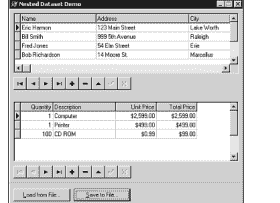

## 图 4.5

*嵌套数据集自动显示当前主记录的明细数据。*

关于这个应用程序，有几个有趣的点。首先，当你在顶部的网格中从一个客户移动到另一个客户时，该客户的订单会显示在底部的网格中。这是自动完成的，无需编码。

其次，如果你添加或修改订单，你会注意到客户记录进入编辑模式（通过当前客户记录的指示列中显示的图标来证明）。如果你在程序中操作嵌套数据集，请记住以下几点：

- 在添加或修改明细记录后，需要提交主记录。

## 撤销支持

TClientDataSet 及其派生类支持内置的撤销功能，因此你可以在应用程序中提供假设场景。例如，你可以允许用户更改数据集中某些字段的值（也许是为了绘制图表或以其他方式显示数据分析结果）。如果用户对结果不满意，他可以通过撤销其更改（逐个或成组）来恢复到以前的数据。

## 取消

你可能已经熟悉 Cancel 方法，但为了完整性，我还是在这里提一下。

最低级别的撤销支持只是在当前记录的更改被提交之前丢弃这些更改。Cancel 方法提供了这种支持：

```pascal
ClientDataSet1.Edit;
ClientDataSet1.FieldByName('Last').AsString := 'Carter';
// 在这里做更多事情，然后决定不保存更改。
ClientDataSet1.Cancel;
```

## 更改日志

为了支持更高级的撤销操作，客户端数据集包含一个更改日志。更改日志用于记录对数据集所做的每个更改，直到这些更改被合并到数据中、撤销或取消。以下部分检查了用于提交和回滚更改的不同方法。

当你调用 ToFile 或 SaveToStream 时，更改日志会随数据一起保存。当数据集从文件或流读回时，更改日志处于保存前的相同状态。这意味着你甚至可以在应用程序的多次调用之间执行撤销操作。

### LogChanges

为了使更改日志处于活动状态，数据集的 LogChanges 属性必须设置为 True（这是默认值）。如果你不打算在应用程序中提供撤销支持，可以将 LogChanges 设置为 False，从而略微减少内存需求并提高性能。

> **注意**
> 在创建将客户端数据集连接到数据集提供者的应用程序时（如第 7 章“数据集提供者”中所述），你不应该将 LogChanges 设置为 False。这是因为将 LogChanges 设置为 False 会阻止你对客户端数据集进行更改并将这些更改应用于底层数据库。

4 高级客户端数据集操作

## UndoLastChange

你可以通过调用 UndoLastChange 来撤销对数据集的最近一次更改（无论它是针对哪条记录的）。

UndoLastChange 接受一个单一的 Boolean 参数（FollowChange），指示数据集是否应定位到受撤销操作影响的记录。如果 FollowChange 为 True，客户端数据集将光标定位到被撤销或恢复的记录上。如果 FollowChange 为 False，最近修改的记录仍会被恢复，但当前记录不会改变。

```pascal
ClientDataSet1.First;
ClientDataSet1.Next;
ClientDataSet1.Edit;
ClientDataSet1.FieldNameByName( 'Last' ).AsString := 'Williams';
ClientDataSet1.Post;

ClientDataSet1.First;
ClientDataSet1.Next;
ClientDataSet1.Edit;
ClientDataSet1.FieldNameByName( 'Last' ).AsString := 'Carter';
ClientDataSet1.Post;

ClientDataSet1.Next;
ClientDataSet1.Edit;
ClientDataSet1.FieldNameByName( 'First' ).AsString := 'Sam';
ClientDataSet1.Post;

ClientDataSet.Last;

ClientDataSet1.UndoLastChange(True);
```

前面的代码片段首先修改了数据集中的第二条记录，然后修改了第一条记录，接着再次修改了第二条记录。最后，它移动到数据集的末尾。调用 UndoLastChange 仅撤销对第二条记录的第二次更改，并将数据集重新定位到第二条记录（因为向 UndoLastChange 传递了 True）。

如果你发出第二次调用 UndoLastChange，对数据集中第一条记录的修改将被撤销。第三次调用 UndoLastChange 将撤销对第二条记录的第一次修改。

## RevertRecord

RevertRecord 撤销对数据集中当前记录的所有更改。稍微修改前面的代码片段，我们得到以下内容：


```
ClientDataSet1.First;
ClientDataSet1.Next;
ClientDataSet1.Edit;
ClientDataSet1.FieldName('Last').AsString := 'Williams';
ClientDataSet1.Post;

ClientDataSet1.First;
ClientDataSet1.Edit;
ClientDataSet1.FieldName('Last').AsString := 'Carter';
ClientDataSet1.Post;

ClientDataSet1.Next;
ClientDataSet1.Edit;
ClientDataSet1.FieldName('First').AsString := 'Sam';
ClientDataSet1.Post;

ClientDataSet1.First;
ClientDataSet1.Next;

ClientDataSet.RevertRecord;
```

这段代码执行了与上一个代码片段相同的三项更改。然后，它离开第二条记录并重新回到该记录上。（这只是为了演示目的——你并不需要这样做。）最后，对 `RevertRecord` 的调用撤销了针对第二条记录所做的两项更改，但保留了对第一条记录的更改不变。

## 保存点

`SavePoint` 提供了一种建立数据库操作基准点的方法，并允许在稍后的时间点返回到该基准点。

例如，假设用户对数据集进行了修改。然后，他希望尝试进行其他一些更改，但不确定是否要保存结果。在完成第一项更改后，你可以像这样检索 `SavePoint` 的当前值：

```
var
  Baseline : Integer;
begin
  Baseline := ClientDataSet.SavePoint;
```

稍后，在对数据库进行修改之后，你可以通过设置 `SavePoint` 属性来返回到基准点：

```
ClientDataSet.SavePoint := Baseline;
```

设置 `SavePoint` 会丢弃在建立基准点之后对数据集所做的所有更改。

你还可以像这样检索多个保存点：

```
var
  Baseline1: Integer;
  Baseline2: Integer;
begin
  Baseline1 := ClientDataSet.SavePoint;
  // 在此处执行更多数据集操作
  Baseline2 := ClientDataSet.SavePoint;
```

在将 SavePoint 与 RevertRecord 或 UndoLastChange 一起使用时要小心。如果你检索了一个 SavePoint，然后撤销了超出该保存点时间的最近修改，系统会引发异常。下面所示的代码（如清单 4.6 所示）正是自找麻烦的做法：

### 清单 4.6 保存点的错误使用

```
ClientDataSet1.First;
ClientDataSet1.Next;
ClientDataSet1.Edit;
ClientDataSet1.FieldByName('Last').AsString := 'Williams';  // 更改 1
ClientDataSet1.Post;

ClientDataSet1.First;
ClientDataSet1.Edit;
ClientDataSet1.FieldByName('Last').AsString := 'Carter';   // 更改 2
ClientDataSet1.Post;

Baseline := ClientDataSet1.SavePoint;  // “堆栈”中有 2 项更改

ClientDataSet1.Next;
ClientDataSet1.Edit;
ClientDataSet1.FieldByName('First').AsString := 'Sam';    // 更改 3
ClientDataSet1.Post;

ClientDataSet1.UndoLastChange(True);  // “堆栈”中有 2 项更改
ClientDataSet1.UndoLastChange(True);  // “堆栈”中有 1 项更改
ClientDataSet1.SavePoint := Baseline;  // 在此处引发异常
```

在这个代码片段中，先进行了两项更改，然后建立了基准点。接下来，进行了第三项更改，随后撤销了第三项和第二项更改。最后，代码尝试返回到保存点。由于更改日志已经反向操作超过了保存点所在的时间点，Delphi 会引发异常。

## CancelUpdates

撤销支持的最后一级是撤销更改日志中的所有更改。要做到这一点，只需调用 `CancelUpdates`，如下所示：

```
ClientDataSet1.CancelUpdates;
```

`CancelUpdates` 通过清空更改日志来丢弃对数据集中所有记录所做的所有更改。

## ChangeCount

通过查看 `ChangeCount` 属性，你可以确定数据集中进行了多少次更改：

```
if ClientDataSet1.ChangeCount > 0 then
   ShowMessage('调用 UndoLastChange 是安全的');
```

## MergeChangeLog

在你的应用程序的某个阶段，你可能希望将更改合并到数据中，以提交对数据集所做的修改。要做到这一点，请调用 `MergeChangeLog`。`MergeChangeLog` 不接受任何参数。

### 注意

当客户端数据集连接到提供程序时，你很少直接调用 `MergeChangeLog`。相反，你调用 `ApplyUpdates`，它会在更改应用到基础数据集后调用 `MergeChangeLog`。

## StatusFilter

`StatusFilter` 属性为数据集提供了一种过滤类型，但我没有在“范围和过滤器”部分讨论它，因为它与更改日志直接相关。

当在客户端数据集中添加、修改或删除记录时，它们会被标记一种状态。该状态可以是表 4.4 中显示的一个（或多个）值。

### 表 4.4 UpdateStatus 值

| 值 | 描述 |
| :--- | :--- |
| `usUnmodified` | 记录未以任何方式被修改。 |
| `usInserted` | 记录是新插入到数据集中的。 |
| `usModified` | 记录已被修改。 |
| `usDeleted` | 记录已被删除。 |

如果你只想查看已添加到数据集中的那些记录，可以将 `StatusFilter` 设置为 `usInserted`。要仅查看已添加或已修改的记录，请将 `StatusFilter` 设置为 `usInserted, usModified`。

## 查看更改日志

因为实际上更改日志只是另一个数据集，所以你可以像处理其他任何数据集一样在网格中查看它。要做到这一点，你需要将一个数据集的更改日志数据分配给另一个数据集的数据，如下所示：

```
cdsChangeLog.Data := ClientDataSet1.Delta;
```

如果 `ClientDataSet1` 的更改日志为空，此语句将引发 `Delta is empty` 异常。因此，在尝试执行此操作之前，你始终应先检查 `ChangeCount` 属性。

以下示例应用程序演示了本节中讨论的技术。清单 4.7 包含该应用程序主窗体的源代码。

### 清单 4.7 ChangeLog—MainForm.pas

```
unit MainForm;

interface

uses
  SysUtils, Variants, Classes, QGraphics, QControls, QForms,
  QDialogs, QStdCtrls, DB, DBCClient, QExtCtrls, QActnList, QGrids, QDBGrids;

type
  TfrmMain = class(TForm)
    DataSource1: TDataSource;
    pnlClient: TPanel;
    DBGrid1: TDBGrid;
    ClientDataSet1: TClientDataSet;
    pnlBottom: TPanel;
    btnRemoveFilter: TButton;
    btnFilter: TButton;
    btnUndo: TButton;
    btnRevertRecord: TButton;
    btnCancelUpdates: TButton;
    btnSetSavepoint: TButton;
    btnGotoSavepoint: TButton;
    btnViewChangeLog: TButton;
    procedure FormCreate(Sender: TObject);
    procedure btnRemoveFilterClick(Sender: TObject);
    procedure btnFilterClick(Sender: TObject);
```

### 清单 4.7 续

```
procedure btnUndoClick(Sender: TObject);
procedure btnRevertRecordClick(Sender: TObject);
procedure btnCancelUpdatesClick(Sender: TObject);
procedure btnSetSavepointClick(Sender: TObject);
procedure btnGoToSavepointClick(Sender: TObject);
procedure btnViewChangeLogClick(Sender: TObject);
private
  { 私有声明 }
  FSavePoint: Integer;
public
  { 公共声明 }
end;

var
  frmMain: TfrmMain;

implementation

uses ChangeLogForm;
{$R *.xfm}

procedure TfrmMain.FormCreate(Sender: TObject);
begin
  ClientDataSet1.LoadFromFile('C:\Employee.cds');
  ClientDataSet1.MergeChangeLog;
end;

procedure TfrmMain.btnFilterClick(Sender: TObject);
begin
  ClientDataSet1.StatusFilter := [usInserted];
end;

procedure TfrmMain.btnRemoveFilterClick(Sender: TObject);
begin
  ClientDataSet1.StatusFilter := [];
end;

procedure TfrmMain.btnUndoClick(Sender: TObject);
begin
  ClientDataSet1.UndoLastChange(True);
end;

procedure TfrmMain.btnRevertRecordClick(Sender: TObject);
begin
  ClientDataSet1.RevertRecord;
end;

procedure TfrmMain.btnCancelUpdatesClick(Sender: TObject);
begin
  ClientDataSet1.CancelUpdates;
end;

procedure TfrmMain.btnSetSavepointClick(Sender: TObject);
begin
  FSavePoint := ClientDataSet1.SavePoint;
end;

procedure TfrmMain.btnGotoSavepointClick(Sender: TObject);
begin
  ClientDataSet1.SavePoint := FSavePoint;
end;

procedure TfrmMain.btnViewChangeLogClick(Sender: TObject);
var
  frmChangeLog: TfrmChangeLog;
begin
  if ClientDataSet1.ChangeCount > 0 then begin
    frmChangeLog := TfrmChangeLog.Create(nil, ClientDataSet1);
    try
      frmChangeLog.ShowModal;
    finally
      frmChangeLog.Free;
    end;
  end else
    ShowMessage('没有可查看的更改。');
end;
```

清单 4.8 显示了用于显示更改日志的窗体的源代码。

### 清单 4.8 ChangeLog—ChangeLogForm.pas

```
unit ChangeLogForm;

interface

uses
  SysUtils, Variants, Classes, QGraphics, QControls, QForms,
  QDialogs, QExtCtrls, QStdCtrls, QGrids, DBQGrids, DB, DBCClient;
```


# 列表 4.8 续

```delphi
type
TfrmChangeLog = class(TForm)
    pnlClient: TPanel;
    pnlBottom: TPanel;
    ClientDataSet1: TClientDataSet;
    DataSource1: TDataSource;
    DBGId1: TDBGid;
    btnClose: TButton;
    Label1: TLabel;
    procedure ClientDataSet1AfterScroll(DataSet: TDataSet);
private
    { Private declarations }
public
    { Public declarations }
    constructor Create(AOwner: TComponent;
        ADataSet: TCustomClientDataSet); reintroduce;
end;

implementation

{$R *.xfm}

{ TfrmChangeLog }

constructor TfrmChangeLog.Create(AOwner: TComponent;
    ADataSet: TCustomClientDataSet);
begin
    inherited Create(AOwner);

    ClientDataSet1.Data := ADataSet.Delta;
end;

procedure TfrmChangeLog.ClientDataSet1AfterScroll(DataSet: TDataSet);
begin
    case ClientDataSet1.UpdateDataSet of
        usUnmodified: Label1.Caption := 'Unmodified';
        usModified: Label1.Caption := 'Modified';
        usInserted: Label1.Caption := 'Inserted';
        usDeleted: Label1.Caption := 'Deleted';
    end;
end;

end.
```

图 4.6 展示了 ChangeLog 应用程序在运行时查看 EMPLOYEE.CDS 数据集变更日志的情况。

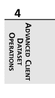

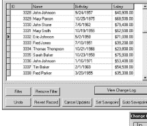

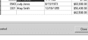

# 图 4.6

*ChangeLog 应用程序展示了如何高效存储对数据集的修改。*

请注意变更日志中的四行内容。第一行显示了新添加的员工数据。第二行显示了被删除的员工数据。第三行和第四行显示了对现有员工的修改。第三行包含了在任何修改之前员工的数据，但第四行只包含了被修改的那些字段的数据。

# 从另一个客户端数据集克隆数据

客户端数据集具有从另一个客户端数据集克隆数据的独特能力。当你克隆一个数据集时，数据的物理副本只有一份，但有两个（或更多）不同的数据集访问同一份数据副本。对一个数据集的修改会立即影响另一个数据集对该数据的视图。

你为什么要这样做？在我的项目中，我遇到过几种克隆提供了优雅解决方案的情况，否则这些情况会很棘手。以下列表概述了其中一些好处：

- 你可以在不干扰原始数据集当前记录指针的情况下遍历数据集的克隆。
- 在网格中查看数据集时，你可以使用连接到克隆的数据感知控件在对话框中插入一条新记录（而无需在网格中临时打开一条新的空行）。
- 你可以对克隆应用范围或过滤器，而不会影响原始数据集的显示。

要克隆一个数据集，请创建一个第二个客户端数据集，然后调用第二个数据集的 CloneCursor 方法，如下所示：

```delphi
var
  cdsClone: TClientDataSet;
begin
  cdsClone := TClientDataSet.Create(nil);
  try
    cdsClone.CloneCursor(ClientDataSet1, False, False);

    // Perform some operations on the clone here.
  finally
    cdsClone.Free;
  end;
end;
```

此代码片段创建 ClientDataSet1 的一个克隆，在克隆上执行一些操作，然后释放克隆。在克隆上执行的任何插入、编辑或删除操作都会自动反映在 ClientDataSet1 中。

CloneCursor 定义如下：

```delphi
procedure CloneCursor(Source: TCustomClientDataSet; Reset: Boolean;
  KeepSettings: Boolean = False); virtual;
```

Source 指代你想要克隆的客户端数据集。你无法克隆非客户端数据集，例如 BDE 数据集或 dbExpress 数据集。

Reset 和 KeepSettings 协同工作，决定克隆如何处理以下属性：

- Filter, Filtered, FilterOptions, OnFilterRecord
- IndexName
- MasterSource, MasterFields
- ReadOnly
- RemoteServer, ProviderName

如果 Reset 和 KeepSettings 都设置为 False，则所有上述属性都会从原始数据集复制到克隆。如果 Reset 为 False 且 KeepSettings 为 True，则克隆的这些属性保持不变。如果 Reset 为 True（无论 KeepSettings 的值如何），克隆上的这些属性将被清除。表 4.5 描绘了这种关系。

# 表 4.5 Reset 和 KeepSettings 之间的关系

| Reset | KeepSettings | 行为 |
| :--- | :--- | :--- |
| False | False | 属性从原始数据集复制到克隆。 |
| False | True | 克隆的属性保持不变。 |
| True | N/A | 克隆的属性被清除。 |

如果你希望克隆从原始数据集复制某些列出的属性，但不复制其他属性，你必须编写一些代码。处理这种情况的一种方法是同时将 **Reset** 和 **KeepSettings** 设置为 **False**，将之前列出的所有属性从原始数据集复制到克隆。然后，重置克隆那些被原始数据集覆盖的属性。或者，你可以将 Reset 和 KeepSettings 设置为 True，然后设置克隆上的相应属性。

> **注意**
>
> 克隆客户端数据集后，克隆不包含任何持久字段类型。这意味着你通常使用 FieldByName 来访问克隆中的字段。此外，克隆不会从原始数据集继承任何标准计算字段（内部计算字段会被继承），因此请注意不要试图访问克隆中的任何计算字段。

以下示例程序展示了如何在本节开头列出的情况下有效使用克隆的数据集。列表 4.9 包含了 Clone 应用程序的完整源代码。

# 列表 4.9 Clone—MainForm.pas

```delphi
unit MainForm;

interface
uses
  SysUtils, Variants, Classes, QGraphics, QControls, QForms,
  QDialogs, QGrids, QDBGrids, DB, DBClient, ExtCtrls, QStdCtrls;

type
  TFormMain = class(TForm)
    pnlClient: TPanel;
    pnlBottom: TPanel;
    ClientDataSet1: TClientDataSet;
    DataSource1: TDataSource;
    DBGId1: TDBGid;
    btnUpdate: TButton;
    btnInsert: TButton;
    btnRange: TButton;
    btnInsert2: TButton;
    procedure FormCreate(Sender: TObject);
    procedure FormDestroy(Sender: TObject);
    procedure btnUpdateClick(Sender: TObject);
    procedure btnInsertClick(Sender: TObject);
    procedure btnRangeClick(Sender: TObject);
    procedure btnInsert2Click(Sender: TObject);
  private
    { Private declarations }
    FCloneDS: TClientDataSet;
  public
    { Public declarations }
  end;

var
  frmMain: TfrmMain;

implementation
{$R *.xfm}

procedure TfrmMain.FormCreate(Sender: TObject);
begin
  ClientDataSet1.LoadFromFile('C:\Employee.cds');
  ClientDataSet1.AddIndex('byID', 'ID', [ixPrimary, ixUnique]);
  ClientDataSet1.IndexName := 'byID';
  FCloneDS := TClientDataSet.Create(nil);
  FCloneDS.CloneCursor(ClientDataSet1, False, False);
end;

procedure TfrmMain.FormDestroy(Sender: TObject);
begin
  FCloneDS.Free;
end;

procedure TfrmMain.btnUpdateClick(Sender: TObject);
begin
  Screen.Cursor := crHourglass;
  try
    FCloneDS.First;
    while not FCloneDS.EOF do begin
      FCloneDS.Edit;
      FCloneDS.FieldName('Salary ').AsFloat :=
        FCloneDS.FieldName(' Salary ').AsFloat * 1.10;
      FCloneDS.Post;

      FCloneDS.Next;
    end;
  finally
    Screen.Cursor := crDefault;
  end;
end;

procedure TfrmMain.btnInsertClick(Sender: TObject);
begin
  if FCloneDS.State <> dsBrowse then
    Exit;

  FCloneDS.Append;
  FCloneDS.FieldName('ID').AsInteger := 99999;
  FCloneDS.FieldName('Name').AsString := 'Eric Harmon';
  FCloneDS.FieldName(' Birthday ').AsString := '1/1/1967';
  FCloneDS.FieldName('Salary ').AsFloat := 1.00;
end;

procedure TfrmMain.btnInsert2Click(Sender: TObject);
begin
  if FCloneDS.State <> dsInsert then
    Exit;

  try
    FCloneDS.Post;
    ClientDataSet1.GotoCurrent(FCloneDS);
  except
    FCloneDS.Cancel;
    raise;
  end;
end;

procedure TfrmMain.btnRangeClick(Sender: TObject);
begin
```


## 代码清单 4.9
（续）

```pascal
Screen.Cursor := crHourglass;
try
  FCloneDS.SetRange([100], [199]);
  try
    FCloneDS.First;
    while not FCloneDS.EOF do begin
      FCloneDS.Edit;
      FCloneDS.FieldName('Salary').AsFloat := 50000.0;
      FCloneDS.Post;

      FCloneDS.Next;
    end;
  finally
    FCloneDS.CancelRange;
  end;
finally
  Screen.Cursor := crDefault;
end;
end.
```

图 4.7 展示了 Clone 应用程序在运行时的状态。

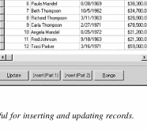

### 图 4.7
> *克隆的数据集对于插入和更新记录可能极其有用。*

查看这段代码，你可能会注意到几件事。其中之一是我在 FormCreate 方法中创建了克隆数据集，并在 FormDestroy 方法中销毁了它。我这样做是为了简化。在真实应用程序中，你通常会在需要它的方法中创建克隆，然后立即销毁它。在这个示例程序中，通过一次创建和销毁，我节省了几行代码。

“更新”按钮会遍历整个数据集，并给所有员工加薪 10%。请注意，即使代码没有调用 DisableControls（在本章开头附近有讨论），网格在遍历数据集时仍然不会滚动。这是因为网格连接到 ClientDataSet1，而更新是在克隆数据集上执行的。

“插入（第一部分）”和“插入（第二部分）”按钮在克隆上执行插入操作的两个部分。第一个按钮向数据集追加一个新记录并填入数据。第二个按钮将新记录提交到数据集，然后调用原始数据集上的 GoToCurrent 方法（将原始数据集与克隆同步）。GoToCurrent 使原始数据集跳转到克隆数据集的当前记录。

将插入操作分为两个按钮的原因是为了让你可以轻松看到插入过程中发生了什么。点击“插入（第一部分）”。现在向下滚动到网格底部。你不会看到网格中有一条对应员工 99999 的行——即新插入但尚未提交的记录。当你点击“插入（第二部分）”时，新记录会出现在网格中。相反，如果你将插入按钮事件处理程序中的代码改为使用 ClientDataSet1 而不是 FCloneDS，你会看到新记录在实际提交之前就会出现在网格中。

最后，“范围”按钮的工作方式与“更新”按钮非常相似：它对数据集应用一个范围，然后将该范围内所有员工的薪资设置为 50,000 美元。网格不会更新以反映该范围，因为该范围仅应用于克隆数据集，而不应用于 ClientDataSet1。

## 维护聚合

数据集中的记录通常不是彼此完全隔离的。很多时候，你希望获得整列或该列某一部分的总和或平均值。例如，你可能想要计算销售部门所有员工的平均薪资，或者你可能需要检索姓氏为 Jones 的员工数量。

如果你使用的是基于 SQL 的数据库，你可以发出 SQL 语句来计算这些值。例如，

```sql
SELECT AVG(SALARY) FROM EMPLOYEE WHERE DEPARTMENT = 'SALES';
SELECT COUNT(*) FROM EMPLOYEE WHERE LASTNAME = 'Jones';
```

然而，你不能直接对客户数据集执行 SQL 语句。


> 如果你通过数据库提供程序将客户数据集连接到 dBExpress 数据集，那么你可以向数据库后端发送 SQL 语句并在客户数据集中检索结果。这种技术在第 7 章中有讨论。

相反，客户数据集支持一种强大的功能，称为维护聚合。维护聚合会自动计算整个数据集（或一组记录）的总和、平均值、计数、最小值或最大值。

### 在设计时创建维护聚合

在设计时创建维护聚合类似于在设计时创建字段。与字段一样，维护聚合可以是持久性的或非持久性的。以下部分展示了如何创建每种类型。

#### 持久性聚合

你创建持久性聚合的方式与创建数据、计算或查找字段的方式非常相似。

- 1. 在窗体编辑器中右键点击客户数据集，并从弹出菜单中选择**字段编辑器**...
- 2. 按**Ins**键创建新字段。
- 3. 在**新字段**对话框中输入字段名和字段类型。对于维护聚合，字段类型应为*Aggregate*。
- 4. 在**字段类型**分组框中选择*Aggregate*单选按钮。
- 5. 点击**确定**以创建聚合。

图 4.8 展示了在添加了一个名为*AvgSalary*的聚合字段后的字段编辑器。

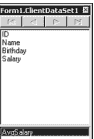

聚合创建完成后，你需要设置一些额外的属性（例如聚合表达式，以及聚合是否处于活动状态）。

- 1. 在字段编辑器中点击聚合字段。
- 2. 在**对象检查器**中，在*Expression*属性中输入聚合表达式。聚合表达式将在标题为“聚合表达式”的部分中讨论。暂时，你可以使用*Avg(Salary)*。
- 3. 将**Active**属性设置为**True**。默认情况下，聚合不处于活动状态，这意味着你无法访问它们。将**AggregatesActive**设置为**True**以激活聚合字段。

创建持久性聚合会自动创建一个类型为**TAggregateField**的组件，你可以用它来引用聚合值。然而，与大多数字段不同，你不使用**AsFloat**属性来获取聚合的值。相反，你使用**Value**属性，如下所示：

```pascal
ShowMessage('The average salary is ' + ClientDataSet1AvgSalary.Value);
```

因为**Value**是一个变体，你可以像它是字符串或浮点数一样引用它。因此，以下代码也是正确的：

```pascal
var
  AvgRaisedSalary: Double;
begin
  AvgRaisedSalary := ClientDataSet1AvgSalary.Value * 1.05;
end;
```

#### 非持久性聚合

要在设计时创建非持久性聚合，请点击窗体编辑器中的客户数据集，然后双击对象检查器中的**Aggregates**属性以显示聚合编辑器。

聚合编辑器看起来和运作起来很像字段编辑器。点击工具栏上的**添加新**按钮（或按**Ins**键）以创建新聚合。

同样，你需要设置一些额外的属性（例如聚合表达式，以及聚合是否处于活动状态）。

- 1. 在聚合编辑器中点击聚合。
- 2. 在**对象检查器**中，为聚合适中一个名称，例如**AvgSalary**。
- 3. 在**Expression**属性中输入一个聚合表达式，例如**Avg(Salary)**。
- 4. 将**Active**属性设置为**True**。
- 5. 将**AggregatesActive**设置为**True**。

与上一节不同，Delphi 不会为以这种方式使用创建的聚合创建组件。相反，你通过数据集的**Aggregates**属性访问聚合，如下所示：

```pascal
ShowMessage('The average salary is ' +
  ClientDataSet1.Aggregates.Find('AvgSalary').Value);
```

或者，如果你知道聚合的索引，你可以直接访问它：

```pascal
ShowMessage('The average salary is ' + ClientDataSet1.Aggregates[0].Value);
```

### 在运行时创建维护聚合

在运行时创建维护聚合类似于创建非持久性聚合，因为你利用了`Aggregates`属性。以下代码片段展示了如何在运行时创建聚合：

```pascal
var
  Aggregate: TAggregate;
begin
  Aggregate := ClientDataSet1.Aggregates.Add;
  Aggregate.AggregateName := 'AvgSalary';
  Aggregate.Expression := 'Avg(Salary)';
  Aggregate.Active := True;
end;
```

### 聚合表达式

在前面的代码片段中，我使用了表达式`Avg(Salary)`。正如你可能猜测的，该表达式计算`Salary`字段的平均值。

Delphi 支持表 4.6 中列出的聚合类型。

| 表 4.6 聚合类型 |
| :------------------------- | :------------------------------------------------------- |
| **聚合类型** | **描述** |
| Sum | 计算字段的总和。 |
| Avg | 计算字段的平均值。 |
| Count | 计算字段中非空白值的数量。 |
| Min | 计算字段的最小值。 |
| Max | 计算字段的最大值。 |

`Sum`和`Avg`只能用于数字字段类型；但`Count`、`Min`和`Max`可以用于数字、字符串或日期值。

聚合表达式不必是简单的表达式，如`Avg(Salary)`。它们可以包含多个函数，如`Sum(SalesPrice) - Sum(NetCost)`。然而，你不能嵌套函数。`Avg(Sum(SalesPrice))`不是一个有效的聚合表达式。

Delphi 帮助主题“指定聚合”提供了有效和无效聚合表达式的更多示例。


## 聚合

你能创建的最简单的聚合是对整个数据集进行求和或求平均值的聚合。我们之前创建的聚合是对整个数据集进行聚合的。然而，很多时候，你希望基于数据集的一部分来计算聚合值。

要创建分组聚合，首先需要确保数据集中至少定义了一个索引。就 EMPLOYEE.CDS 数据集而言，我们将在 Birthday 字段上创建一个名为 byBirthday 的索引。

1. 在应用程序的主窗体上放置一个 TClientDataSet 组件。
2. 右键单击该数据集，并在弹出菜单中选择“Load from MyBase Table...”（从 MyBase 表加载...）。
3. 选择文件 C:\EMPLOYEE.CDS 并点击“打开”。
4. 在 Birthday 字段上创建一个名为 byBirthday 的索引。（如果你忘记了如何创建索引，请参阅第 3 章“Client Dataset 基础”。）
5. 进入字段编辑器，通过从字段编辑器弹出菜单中选择“Add All Fields”（添加所有字段）来为所有数据集字段创建持久化字段。
6. 使用表达式 `Count(Birthday)` 创建一个名为 NumSameBirthday 的持久化聚合字段。Delphi 将创建一个名为 ClientDataSet1NumSameBirthday 的组件。
7. 在主窗体上放置一个 TDataSource、TDBGrid 和 TLabel，并将数据源和网格连接到客户端数据集。
8. 在数据源的 OnDataChange 事件中，编写以下代码：

   ```pascal
   Label1.Caption := ClientDataSet1NumSameBirthday.Value;
   ```

现在我们已经有了起始应用程序。如果你运行它，应该会在标签中看到值 **10000**（表明数据集中有 10,000 条记录具有非空生日）。

既然我们已经建立了基准，让我们更改聚合，使其计算具有相同生日的员工数量。

为此，请回到字段编辑器并点击 NumSameBirthday 聚合字段。在对象观察器（Object Inspector）中，将 IndexName 设置为 byBirthday。这会告诉聚合字段使用 byBirthday 索引来计算其值。接下来，将 GroupingLevel 属性设置为 1。（GroupingLevel 是一个基于 1 的值，它告诉 Delphi 在计算聚合值时使用索引的哪一部分。）

例如，假设你在 LastName;FirstName 字段上有一个索引。如果 GroupingLevel 设置为 1，则仅使用索引中的第一个字段来计算聚合。对于表达式 Avg(Salary)，该聚合将计算所有与当前记录具有相同姓氏的员工的平均工资。

如果你将 `GroupingLevel` 设置为 2，该聚合将计算所有与当前员工具有相同姓氏 *和* 相同名字的员工们的平均工资。

### 启用和禁用聚合

通常，你让聚合保持启用状态（`Active = True`）。但是，你可以通过将其 `Active` 属性设置为 `False` 来禁用单个聚合，或者通过将数据集的 `AggregatesActive` 属性设置为 `False` 来禁用所有聚合。

禁用聚合会使应用程序稍微加快速度，因为 Delphi 不需要在记录被插入、编辑或删除时不断重新计算聚合值。如果你计划一次性添加大量记录，你可能希望禁用聚合，添加记录，然后重新启用聚合，以便 Delphi 只需计算一次（在你重新启用它们时）。

### GetGroupState

你可以通过调用数据集的 `GetGroupState` 方法来确定记录在聚合中的相对位置。`GetGroupState` 返回一个值为 `gbFirst`、`gbMiddle` 或 `gbLast`（取决于当前记录是组中的第一条记录、组中的最后一条记录还是组中的其他记录）。

这里我不提供一个示例聚合应用程序，而是建议你参考 Delphi `DEMOS\MIDAS\AGGREGATE` 目录中的 *Aggregate demo*（聚合适例）。

### 杂项属性

本节列出了客户端数据集的几个额外属性，它们在逻辑上不属于前面讨论过的任何类别。

### 约束

约束提供了一种在发布记录之前验证记录数据的方法。当验证依赖于记录中两个或更多字段之间的关系时，约束最为有用。例如，如果 `Salary`（工资）字段小于员工年龄的 1000 倍，记录的数据可能会被（毫无道理地）判定为无效。换句话说，一名 30 岁的员工必须至少赚取 30,000 美元。

约束在视觉上类似于过滤器。我刚才提到的约束看起来像这样：

```
Salary >= Age * 1000
```

要创建数据集上的约束，请双击对象观察器中的 `Constraints` 属性。约束编辑器将显示出来。接下来，点击约束编辑器中的“Add New”（添加新项）工具栏按钮（或按 Ins 键）以添加一个新的约束。

回到对象观察器，将约束输入到 CustomConstraint 属性中。在 ErrorMessage 属性中，输入当约束不满足时希望显示的消息——例如，“工资必须至少是员工年龄的 1000 倍。”

图 4.9 显示了添加约束后对象观察器和约束编辑器的屏幕截图。

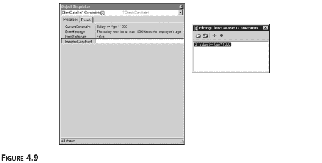

**图 4.9 设置约束。**

你并不限于为数据集使用单个约束。你可以添加所需的任意数量的约束。

当记录发布到数据集时，Delphi 会检查施加在数据集上的所有约束。如果其中某个约束失败，则会显示 ErrorMessage 属性中指定的消息，并且发布操作将被中止。

### DisableStringTrim

通常，当记录发布到数据集时，字符串末尾的空格会自动被移除。例如，如果用户在数据感知编辑控件中输入 John    （注意结尾的两个空格），实际上只有四个字符被写入数据集中的基础字段，因为数据集自动移除了额外的两个空格。

当 DisableStringTrim 属性设置为 False（这是默认值）时，客户端数据集会全局修剪字符串字段的末尾空格。但是，如果你想保留末尾空格，可以将 DisableStringTrim 设置为 True。

`DisableStringTrim` 是一个全局属性，因为它影响数据集中的所有字符串字段。它不允许你修剪 `FirstName` 字段的末尾空格，同时保留 `LastName` 字段的末尾空格。如果你想为某些字段保留末尾空格，而为其他字段移除它们，你需要将 `DisableStringTrim` 设置为 *true*，然后手动从相应的字段中移除末尾空格（也许是在数据集的 `BeforePost` 事件处理程序中）。

### ReadOnly

默认情况下，客户端数据集是读/写数据集。你可以通过将数据集的 `ReadOnly` 属性设置为 *true* 使客户端数据集变为只读（例如，如果底层数据存储在某些 CD-ROM 驱动器上）。

### 总结

除了上一章介绍的基本功能外，`TClientDataSet` 支持许多高级操作。在本章中，你学习了以下内容：

- 数据集提供了一系列事件，你可以挂钩这些事件并在特定操作发生时收到通知。此外，你可以在 `BeforeExx` 事件中引发异常以防止操作发生。
- 在长时间运行的过程中禁用数据感知控件可以显著提高性能。
- Delphi 数据集支持 BLOB（二进制大对象），可用于存储笔记、图像和其他非格式化数据。
- 嵌套数据集在客户端数据集中提供了简化的主/从支持。
- `TClientDataSet` 的回滚支持使你能在应用程序中执行假设情景。
- 通过克隆客户端数据集，你可以对数据的克隆执行操作，而不会干扰原始数据集的设置。
- 维护的聚合支持对记录组或整个数据集自动计算求和、最小值、最大值、计数和平均值。

下一章开始了关于数据感知组件的两章介绍。


## 数据感知组件

### 第 5 章

本章内容

- 什么是数据感知组件？ 202
- TDataSource 204
- 常见数据感知组件特性 205
- 简单数据感知组件 211
- 仅限 VCL 的数据感知控件 222
- 查找数据感知控件 222
- TDBNavigator 223
- 创建自定义数据感知组件 225
- 示例应用程序 232

前两章集中在客户端数据集，即 Delphi 灵活的内存储数据集上。本章将介绍数据感知组件的概念，这些组件是现成的组件，知道如何显示和编辑存储在数据库中的信息。

数据感知组件可以与不同的数据集一起使用，包括 BDE、ADO、IBX 和第三方数据集。然而，本章展示了如何将其与客户端数据集一起使用，因为当 dbExpress 作为底层数据访问技术时，它们就是这样使用的。

## 什么是数据感知组件？

数据感知组件是能够自动从数据集加载和存储信息的组件。例如，考虑一个标准的编辑控件。它有一个 Text 属性，程序员负责从中读取和写入。你从哪里获取数据，以及在用户将新字符串输入到编辑控件后对其做什么，完全由你决定。你可以将其存储在数据集中。你可以将其存储在 INI 文件或 Windows 注册表中。你甚至可能只是使用它来执行某种计算，而根本不将其存储在任何地方。

由于从数据集获取数据并显示是常见的应用需求，Delphi 提供了一组数据感知组件，这些组件与标准组件相对应。表 5.1 列出了数据感知组件及其对应的非数据感知组件。

### 表 5.1 Delphi 数据感知组件及其非数据感知对应项

| 数据感知组件 | 非数据感知对应项 |
| :--- | :--- |
| TDBText | TLabel |
| TDBEdit | TEdit |
| TDBMemo | TMemo |
| TDBCheckBox | TCheckBox |
| TDBRadioGroup | TRadioGroup |
| TDBComboBox | TComboBox |
| TDBListBox | TListBox |
| TDBLookupComboBox | TComboBox |
| TDBLookupListBox | TListBox |
| TDBImage | TImage |
| TDBGrid | TStringGrid |
| TDBRichEdit | TRichEdit (仅限 VCL 的组件) |
| TDBCtrlGrid | 无。允许以非行格式显示多个字段（仅限 VCL 的组件）。 |

**表 5.1** 续

| 数据感知组件 | 非数据感知对应项 |
| :--- | :--- |
| TDBNavigator | 无。提供一种可视化的方式，无需代码即可导航和操作数据集。 |
| TDataSource | 本身不是数据感知组件。提供数据集与一个或多个数据感知组件之间的通道。 |

正如您在表 5.1 中所见，标准组件和数据感知组件之间的相似性是显而易见的（除了可能的 `TDBLookupComboBox` 和 `TDBLookupListBox` 组件）。

除了 `TDataSource` 之外，您可以在组件调色板的 Data Controls 选项卡上找到表 5.1 中列出的所有组件。`TDataSource` 可以在 Data Access 选项卡上找到。

本章讨论的所有数据感知组件都提供了两个必须设置的属性。`DataSource` 属性引用了提供该组件与数据集之间链接的 `TDataSource` 组件。`DataField` 属性决定了数据感知组件从数据集中的哪个字段获取数据。

本章后面的部分将讨论这些组件中的每一个，除了 `TDBGrid`。由于网格是一个相当复杂的组件，我将在下一章中对其进行调查。而不是在本章中提供许多小型示例应用程序，我将把示例推迟到本章末尾。

大部分情况下，数据感知组件与其非数据感知对应项相对应，因此我在这里没有花费太多时间和篇幅来讨论它们的每个属性、事件和方法。相反，我专注于特定于组件数据感知版本的问题。如果您需要有关组件属性或方法的基本信息，请查阅在线帮助或市面上优秀的通用 Delphi 书籍。

> **注意**
>
> 一些 Delphi 程序员回避数据感知组件——主要是因为他们意识到 Visual Basic 中数据感知组件的实现问题。他们可能也回避，因为数据感知组件在 Delphi 早期日子中名声不佳。请放心，在 Delphi 下，数据感知组件表现出良好的性能特征，特别是当与 `TClientDatasets` 一起使用时（在本章中就是这样）。

## TDataSource

如表 5.1 所示，TDataSource 提供了数据集与连接到一个或多个数据感知控件之间的通道。你不能将数据感知组件直接连接到数据集。相反，你将 TDataSource 连接到数据集，然后将一个或多个数据感知组件连接到数据源（如图 5.1 所示）。

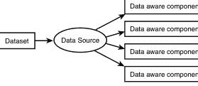

**图 5.1**
数据集、数据源和数据感知组件之间的关系。

TDataSource 是一个相当简单的组件，除了所有组件通用的 Name 和 Tag 属性外，它仅发布三个事件和三个属性。表 5.2 列出了发布的属性，表 5.3 列出了数据源的事件。OnDataChange 和 OnStateChange（最常用的事件）在本章稍后的清单 5.4 中应用。

### 表 5.2 TDataSource 属性

| 属性 | 描述 |
| :--- | :--- |
| AutoEdit | 当为 True 时，只要用户开始向连接到此数据源的数据感知组件输入内容，底层数据集就会自动进入编辑模式。当为 False 时，在用户可以向任何连接的数据感知控件输入之前，你必须明确调用数据集的 Edit 方法。 |
| DataSet | 提供到数据集中数据感知组件获取数据的链接。 |
| Enabled | 当 Enabled 为 True 时，连接到此数据源的数据感知组件显示数据集中包含的数据。当为 False 时，数据感知控件为空白。 |

### 表 5.3 TDataSource 事件

| 事件 | 描述 |
| :--- | :--- |
| OnDataChange | 当数据集当前记录的数据发生更改时触发；无论是因为数据集的游标移动到新记录，还是因为某个字段被修改。 |
| OnStateChange | 当底层数据集的 State 属性发生变化时触发。例如，当数据集从浏览模式过渡到编辑模式，或从插入模式过渡到浏览模式时。 |
| OnUpdateData | 在底层数据集向数据库提交更改之前立即触发。 |

在编写数据库应用程序时，很容易忘记 `TDataSource`。在将数据源放置到窗体并将数据感知组件连接到它之后，数据源往往似乎没有有用目的。然而，表 5.3 中列出的三个事件在许多情况下极其有用。它们的有用性示例将在本章末尾的示例应用程序中展示。

## 常见数据感知组件特性

在讨论每个单独数据感知组件的具体内容之前，有一些共同特性你应该理解。为了在应用程序中有效使用数据感知组件，你应该记住以下考虑事项：

### 从代码修改组件数据

如果你想从代码内部更改数据感知组件中显示的数值，你应该编辑底层字段，而不是试图操作数据感知组件。

例如，假设你有一个名为 `ecFirstName` 的 TDBEDIT，连接到一个名为 `FirstName` 的字段。如果你想通过编程方式设置编辑控件使其显示 *John*，你可能会想要编写以下代码：

```text
eCFirstName.Text := 'John';
```

然而，这不是正确的方法。你应该将底层字段值设置为 John，如下所示：

```text
ClientDataSet1.Edit;
ClientDataSet1FirstName.AsString := 'John';
```


如果你没有使用持久化字段对象，你应该这样操作：

```
ClientDataSet1.Edit;
ClientDataSet1.FieldName('FirstName').AsString := 'John';
```

需要记住的重点是，在尝试设置字段值之前，要调用数据集的 `Edit` 方法。如果数据集已经处于编辑或插入模式，对 `Edit` 的冗余调用不会产生任何负面影响。如果由于某种原因数据集无法被编辑（例如，数据集的 `ReadOnly` 属性被设置为 `True`），对 `Edit` 的调用将引发异常，你应该准备好妥善处理该异常。

# 控制用户何时被允许编辑数据

默认情况下，只要用户开始在数据感知组件中输入内容，VCL/CLX 就会将关联的数据集置于编辑模式。如果你想在代码中控制用户进行编辑的能力，你有四个选项：

- 将数据集的 `ReadOnly` 属性设置为 `True`，防止用户更改数据集中的任何值。这同时也防止通过代码对数据进行任何更改。
- 将底层字段的 `ReadOnly` 属性设置为 `True`。这防止用户修改该字段，也防止通过代码修改该字段。
- 将数据感知组件的 `ReadOnly` 属性设置为 `True`，防止用户更改数据集中的单一值。请注意，这对你在代码中使用前一小节所述方法进行更改没有任何影响。设置组件的 `ReadOnly` 属性并不以某种方式使字段本身变为只读。它只是防止用户通过该组件对数据进行直接修改。
- 将数据源的 `AutoEdit` 属性设置为 `False`，防止在用户开始在数据感知组件中输入时数据集自动进入编辑状态。如果你选择这条路径，你通常会在窗体上提供一个菜单项或按钮，用户点击它即可将数据集置于编辑模式。或者，你可以使用 `TDBNavigator`，将在本章后续部分进行讨论。

# 格式化字段值

数据感知组件没有内置机制来控制输入和输出时字段值的格式化，因此乍一看，你可能会认为没有办法显示格式良好的数值和字符串数据。然而，事实证明，数据格式化是在字段级别而不是组件级别处理的。因此，你可以为字段设置特定的输出格式，并且任何使用数据感知组件来显示该字段的地方都会使用相同的格式。

# 数值字段

当你将数据感知组件连接到数值字段时，组件中显示的数据将根据底层字段的 `DisplayFormat` 属性进行格式化。

`DisplayFormat` 是一个字符串属性，由最多三部分组成，用分号分隔，格式如下：

```
<Positive>;<Negative>;<Zero>
```

字符串的不同部分决定了值在分别为正数、负数或零时的显示方式。空值始终显示为空白。

表 5.4 列出了可以在 `DisplayFormat` 字符串中使用的字符。

**表 5.4** `DisplayFormat` 规范符

| 字符 | 描述 |
| :--- | :--- |
| # | 数字占位符。如果格式化后的值在该位置不需要数字，则该位置不填充。例如，使用 `###.##` 作为 `DisplayFormat` 格式化的值 1.2 将得出 1.2，没有前导或尾随空格。 |
| 0 | 数字占位符。如果格式化后的值在该位置不需要数字，则该位置用 0 填充。例如，使用 `000.00` 作为 `DisplayFormat` 格式化的值 1.2 将得出 001.20。 |
| . | 小数点。确定基数点在输出字符串中出现的位置。小数点由存储在 `DecimalSeparator` 全局变量中的字符替代。 |
| , | 千位分隔符。`DisplayFormat` 中逗号的出现表示应使用千位分隔符格式化该值。逗号在输出字符串中不占位置——它仅作为需要千位分隔符的指示。运行时，逗号由存储在 `ThousandsSeparator` 全局变量中的字符替代。 |
| E+/– | 科学计数法。如果 `DisplayFormat` 中存在 E+、E-、e+ 或 e-，则值将使用科学计数法格式化。E+ 表示所有指数前都应带有符号。E- 表示只有负指数前才带有符号。E+ 或 E- 后跟一到四个零，指定指数中要包含的最小位数。 |
| ; | 分隔符字符。用于字符串的正数、负数和零部分之间。 |
| ' 或 " | 字面量。用单引号或双引号括起来的字符会被原样复制到输出字符串中，而不会被解释为格式化字符。 |

表 5.5 列出了一些 `DisplayFormat` 设置的示例。

**表 5.5** `DisplayFormat` 设置

| 值 | DisplayFormat | 输出 |
| :--- | :--- | :--- |
| 1.2 | `##0.00` | 1.20 |
| 1.2 | `000.##` | 001.2 |
| 1 | `#0.000` | 1.000 |
| 1 | `00.##` | 1（因为不需要显示小数点，所以不显示小数点。） |
| 12.34 | `$$##0.00` | $12.34 |
| 1234.56 | `$,.00` | $1,234.56 |
| 12.345 | `X=#.##` | X=12.35（请注意，基数点左边的部分会自动扩展以显示两位数字，而基数点右边的部分会根据指定的位数进行四舍五入。） |
| 100000 | `#0.000E+00` | 10.000E+04 |
| -15 | `##0;(###);zero` | (15) |
| 0 | `##0;(###);zero` | zero |
| 10 | Room `"\#"\#0` | Room #10（引号内的 # 会原封不动地复制到输出结果中。） |

如果你仅在 `DisplayFormat` 中指定一个子字符串，它将用于格式化所有数字。要对负数或零值使用不同的输出格式，请用分号分隔规范符，如下所示：

```
$,0.00;($,0.00);<zero>
```

此 `DisplayFormat` 字符串将正数格式化为美元和美分，将负数格式化为括号内数值，将零值格式化为字符串 *<zero>*。

你可以通过简单地使规范符留空来省略字符串的一部分。在这种情况下，将使用正数格式。例如：

```
$,0.00;;<zero>
```

在这种情况下，正数和负值都使用 `$0.00` 进行格式化。零值显示为 *<zero>*。

如果 `DisplayFormat` 属性完全留空，则值将使用 15 位有效数字的通用浮点输出显示。

默认情况下，在编辑字段值时使用相同的格式。你可以通过设置字段的 `EditFormat` 属性（除了 `DisplayFormat` 属性之外，或代替 `DisplayFormat` 属性）来设置编辑时使用的不同格式。`EditFormat` 的工作方式与 `DisplayFormat` 相同：它包含一个用分号分隔的格式集，用于显示正数、负数和零值。

例如，假设你有一个浮点字段，希望显示为 15.25%，但在编辑时不希望显示百分号。你会将 `DisplayFormat` 设置为 `#.00%`，将 `EditFormat` 设置为 `#0.00`。

# 字符串字段

字符串字段没有单独的 `DisplayFormat` 和 `EditFormat` 属性。相反，它们有一个 `EditMask` 属性，用于同时显示和编辑字段的值。`EditMask` 存储一个 Paradox 风格的编辑掩码，它决定了字符串如何显示和编辑。

与 `DisplayFormat` 和 `EditFormat` 属性类似，`EditMask` 由三部分组成，用分号分隔。第一部分是格式化字符串值时要使用的掩码。第二部分包含一个 `0`，表示不应将字面量作为字符串值的一部分保存。字符串第二部分的任何其他字符都表示应将字面量作为字符串值的一部分保存。第三部分代表显示为空白或尚未输入的字符。

例如，以下 `EditMask` 接受美国社会安全号码，将连字符存储在底层字段中，并在需要输入数字的位置显示下划线。

```
000-000-0000;1;_
```

表 5.6 显示了字符串字段的有效 `EditMask` 规范符。

**表 5.6** `EditMask` 规范符

| 字符 | 描述 |
| :--- | :--- |
| L | 需要字母字符。 |
| 1 | 允许字母字符，但不是必需的。 |
| A | 需要字母数字字符。 |
| a | 允许字母数字字符，但不是必需的。 |
| C | 需要一个字符。 |
| c | 允许一个字符，但不是必需的。 |
| 0 | 需要数字字符。 |
| 9 | 允许数字字符，但不是必需的。 |
| # | 允许数字字符，或加号或减号，但不是必需的。 |


## 表 5.6（续）

| 字符 | 描述 |
| :--- | :--- |
| `:` | 时间分隔符。当该字符不是 `:` 时，它会替换为区域设置中控制面板定义的时间分隔符。 |
| `/` | 日期分隔符。当该字符不是 `/` 时，它会替换为区域设置中控制面板定义的日期分隔符。 |
| `_` | 下划线。该字符在文本中插入一个空格。编辑字段时，光标会自动跳过 `_` 字符。 |
| `;` | 分隔符。用于字符串中掩码、字面量和空白部分之间。 |
| `!` | 如果掩码的任何位置出现 `!` 字符，则额外和可选字符表示为前导空格。否则，额外和可选字符表示为尾部空格。 |
| `>` | `>` 字符之后的所有字符强制转换为大写，直到遇到 `<` 字符为止。 |
| `<` | `<` 字符之后的所有字符强制转换为小写，直到遇到 `>` 字符为止。 |
| `<>` | 接受用户输入的任何大小写字符。 |
| `\\` | 字面量。`\` 字符后面的字符将按字面意思插入到字符串中，而不会被解释为掩码字符。 |

> **注意**
>
> 掩码中的每个字符代表字符串中的一个字节——而不是一个字符。因此，在处理多字节字符集时，字符串中的每个字符在 EditMask 中由两个字符表示。例如，AA 和 LL 各代表一个多字节字符。向掩码中插入字面量时，只能输入单字节字面量字符。

表 5.7 列出了一些 EditMask 设置的示例。

## 表 5.7 EditMask 设置

| 存储值 | EditMask | 显示值 | 备注 |
| :--- | :--- | :--- | :--- |
| 5615551212 | `(000), 000-0000` | (561) 555-1212 | 电话号码。格式字符不存储。 |
| 123-456-7890 | `000-000-0000;1;_` | 123-456-7890 | 社会安全号码。格式字符（连字符）存储。 |
| 33467-0708 | `00000 -0000;1;_` | 33467-0708 | ZIP 代码。连字符存储。 |
| 5/28/01 | `199/99/00;1;_` | 5/28/01 | 日期。斜杠存储。额外空格存储在字符串开头而非末尾。 |


如果你希望使用比简单编辑掩码更复杂的功能，Delphi 内置的编辑掩码可能稍显不足。标准的数据感知组件对复杂掩码（如电话号码、社会安全号码等）的验证并不完善。因此，你可能需要考虑使用第三方库来辅助数据输入和验证。我使用的是来自 TurboPower Software 公司的 Orpheus。你可以访问 TurboPower 的 `http://www.turbopower.com` 网站了解更多信息。

## 简单数据感知组件

大多数数据感知组件属于我定义的*简单*数据感知组件类别。就本文讨论而言，简单数据感知组件是指链接到单个数据集的单条记录中的单个字段的组件。例如，一个允许你显示和编辑数据集中 `FirstName` 字段值的组件就是一个简单数据感知组件。

这与更复杂的数据感知组件形成对比；复杂组件要么显示同一数据集中的多个值（如 `TDBGrid`），要么从一个数据集查找信息以包含到另一个数据集中（如 `TDBLookupCombo` 和 `TDBLookupListBox`）。

在本节中，我将讨论简单的数据感知组件，后续章节将涵盖一些更复杂的组件。此刻不必过于担心创建数据感知组件的机制。在章节末尾，我将展示如何从一个非数据感知组件创建其数据感知派生组件。

## TDBText

`TDBText` 是所有数据感知组件中最简单的一种。它是一个仅用于显示的组件，类似于标准的 `TLabel`。要使用它，只需将一个 `TDBText` 组件放置在窗体上，并设置 `DataSource` 和 `DataField` 属性。数据将根据前几节讨论的输出格式进行显示。

## TDBEdit

`TDBEdit` 对应标准的 `TEdit` 组件。它用于显示和编辑数据集中包含的数字、字符串或日期/时间数据。

数据根据底层字段的 `DisplayFormat` 或 `EditMask` 属性进行显示，并根据 `EditFormat` 或 `EditMask` 属性（取决于字段类型）进行编辑。

## TDBMemo

`TDBMemo` 在概念上类似于 `TDBEdit`，不同的是它可以显示和编辑多行文本字段，例如未格式化的备注。`TDBMemo` 通常连接到 CLOB（字符大对象）字段，尽管你也可以用它是来编辑字符串字段。

## TDBCheckBox

`TDBCheckBox` 的使用方式类似于标准的 `TCheckBox`——用于显示和输入是/否或真/假值。`TDBCheckBox` 可以连接到桌面数据库（如 Paradox 或 Access）中的逻辑字段或是/否字段。然而，大多数 SQL 数据库并不直接支持这些字段类型。在这种情况下，你将 `TDBCheckBox` 连接到一个字符串字段，这通常是一个单字符。

要定义选中/未选中状态与底层字段数据之间的关系，你需要设置组件的 `ValueChecked` 和 `ValueUnchecked` 属性。`ValueChecked` 指复选框被标记时字段的值。`ValueUnchecked` 确定复选框未被标记时字段的值。当包含 `TDBCheckBox` 的窗体首次显示时，如果底层字段包含不等于这两个属性之一的值，复选框最初会呈灰色禁用状态。

默认情况下，这两个属性的值分别为 true 和 false。在我自己的应用程序中，我使用单个字符字段（`VARCHAR(1)`）来表示布尔字段类型。我用 T 表示 true，F 表示 false。因此，每当我将一个 `TDBCheckBox` 放置到窗体上时，我都会将 `ValueChecked` 设置为 T，将 `ValueUnchecked` 设置为 F。

### 注意

如果你决定始终使用单个字符字段来表示布尔字段类型，你可能需要考虑创建一个从 `TDBCheckBox` 派生的简单组件，该组件将 `ValueChecked` 设置为 T，将 `ValueUnchecked` 设置为 F（默认）。这样，你在使用该组件时就不必每次手动设置这些属性。

此外，你还应考虑在数据库中创建一个域来指定字符字段。这是我为自己的 InterBase 数据库创建的域：

```sql
CREATE DOMAIN DOM_BOOLEAN AS VARCHAR(1)
DEFAULT 'F' NOT NULL CHECK (VALUE IN ('F', 'T'));
```

## TDBRadioGroup

`TDBRadioGroup` 用于用户需要从短选项列表中选择一个选项的情况。默认情况下，选定项的值存储在底层数据集字段中，这意味着你通常将 `TDBRadioGroup` 组件连接到一个字符串字段。

在我的应用程序中，我发现我最常需要将选定项的索引存储在一个 `Integer` 字段中。如果你利用组件的 `Values` 属性，实现这一点很直接。`Values` 是一个字符串列表，它按以下方式与 `Items` 属性对应：

- 如果 `Values` 为空，则存储在底层数据集中的是 `Items` 属性中包含的字符串。
- 如果 `Values` 不为空，它应包含与 `Items` 属性相同数量的字符串值。当单选组中选中某项时，`Values` 属性中对应的值将被存储到数据集中。

使用第二条规则，你可以在 `Values` 属性中存储一个顺序数字列表，并将组件连接到一个 `Integer` 字段。Delphi 足够智能，会将选定项的数字表示存储在数据集中。在我的应用程序中，这通常是一个严重的限制，因此我创建了一个名为 `TETHComboBox` 的派生组件，它支持为 `Items` 属性中包含的每个字符串分配一个值。

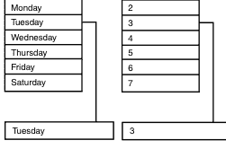

**图 5.2**
TDBRadioGroup 的 Items 和 Values 属性之间的关系。

## TDBComboBox

`TDBComboBox` 的工作原理与 `TDBRadioGroup` 类似，因为它允许用户从列表中选择一个项并将其存储在数据集中。不幸的是，它不支持 `Values` 属性，因此你无法用它将选定项的索引存储在数据集中。在我的应用程序中，这通常是一个严重的限制，因此我创建了一个名为 `TETHComboBox` 的派生组件，它支持为 `Items` 属性中包含的每个字符串分配一个值。


## 注意

`Values` 属性仅在组件的 `Style` 属性设置为 `csDropDownList`、`csOwnerDrawFixed` 或 `csOwnerDrawVariable` 时才会生效。如果样式设置为 `csDropDown` 或 `csSimple`，则 `Values` 属性会被忽略，因为在这些情况下，用户可以在组合框的编辑部分输入任何值。

列表 5.1 包含 TETHDBComboBox 组件的源代码。

## 列表 5.1 ETHDBComboBox.pas

```pascal
unit ETHDBComboBox;

interface

uses
  Windows, Messages, SysUtils, Classes, Controls, StdCtrls, DBCtrls;

type
  TETHDBComboBox = class(TDBComboBox)
  private
    { Private declarations }
    FDataLink: TFieldDataLink;
    FValues: TStrings;
    procedure DataChange(Sender: TObject);
    procedure UpdateData(Sender: TObject);
    function GetComboValue(Index: Integer): string;
    function GetComboText: string;
    procedure SetComboText(const Value: string);
    procedure SetValues(const Value: TStrings);
  protected
    { Protected declarations }
    procedure CreateWnd; override;
  public
    { Public declarations }
    constructor Create(AOwner: TComponent); override;
    destructor Destroy; override;
  published
    { Published declarations }
    property Values: TStrings read FValues write SetValues;
  end;

procedure Register;

implementation

procedure Register;
begin
   RegisterComponents('ETH', [TETHDBComboBox]);
end;

{ TETHDBComboBox }

constructor TETHDBComboBox.Create(AOwner: TComponent);
begin
   FValues := TStringList.Create;
   inherited Create(AOwner);
end;

destructor TETHDBComboBox.Destroy;
begin
   FValues.Free;
   inherited;
end;

procedure TETHDBComboBox.CreateWnd;
begin
   inherited;

   FDataLink := TFieldDataLink(SendMessage(Handle, CM_GETDATALINK, 0, 0));
   FDataLink.OnDataChange := DataChange;
   FDataLink.OnUpdateData := UpdateData;
end;

procedure TETHDBComboBox.SetValues(const Value: TStrings);
begin
   FValues.Assign(Value);
   DataChange(Self);
end;

function TETHDBComboBox.GetComboValue(Index: Integer): string;
begin
   if (Index < FValues.Count) and (FValues[Index] <> '') then
      Result := FValues[Index]
   else if Index < Items.Count then
      Result := Items[Index]
   else
      Result := '';
end;

function TETHDBComboBox.GetComboText: string;
begin
   if Style in [csDropDown, csSimple] then
      Result := Text
   else if ItemIndex >= 0 then
      Result := GetComboValue(ItemIndex)
   else
      Result := '';
end;

procedure TETHDBComboBox.SetComboText(const Value: string);
var
    I: Integer;
    Index: Integer;
    Redraw: Boolean;
begin
    if Value <> GetComboText then begin
        if Style <> csDropDown then begin
            Redraw := (Style <> csSimple) and HandleAllocated;
            if Redraw then
                SendMessage(Handle, WM_SETREDRAW, 0, 0);
        end;
    end;
    try
        if Value = '' then
            I := -1
        else begin
            I := -1;
            for Index := 0 to Items.Count - 1 do
                if Value = GetComboValue(Index) then begin
                    I := Index;
                    Break;
                end;
        end;
        ItemIndex := I;
    finally
        if Redraw then begin
            SendMessage(Handle, WM_SETREDRAW, 1, 0);
            Invalidate;
        end;
    end;
end;

if I >= 0 then
    Exit;

if Style in [csDropDown, csSimple] then
    Text := Value;
end;

procedure TETHDBComboBox.DataChange(Sender: TObject);
begin
    if not (Style = csSimple) and DroppedDown then
        Exit;

    if FDataLink.Field <> nil then
        SetComboText(FDataLink.Field.Text)
    else if csDesigning in ComponentState then
        SetComboText(Name)
    else
        SetComboText('');
end;

procedure TETHDBComboBox.UpdateData(Sender: TObject);
begin
    FDataLink.Field.Text := GetComboText;
end;
end.
```

列表 5.1 包含了一些你可能不太熟悉的代码，因此我将更详细地考察其中的一些单独例程。

`Create` 和 `Destroy` 简单地创建和释放新的 `FValues` 属性，然后将控制权传递给 `TDBComboBox` 的构造函数和析构函数。

`CreateWnd` 向组件发送 `CM_GETDATALINK` 消息，以获取组件内部 `FDataLink` 字段的引用。由于 `TETHDBComboBox` 派生自 `TDBComboBox`，我们实际上检索的是 `TDBComboBox` 的 `FDataLink`。`TDBComboBox.FDataLink` 是私有的，且 `TDBComboBox` 没有提供属性来访问该值，因此没有直接获取数据链接句柄的方法。幸运的是，`TDBComboBox` 支持 `CM_GETDATALINK` 消息，该消息可以实现相同的功能。

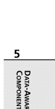

当拥有数据链接的引用时，`CreateWnd` 为 `OnDataChange` 和 `OnUpdateData` 设置新的事件处理程序。当底层字段数据发生变化时（要么是因为当前记录更改了，要么是因为给字段分配了新值），`OnDataChange` 会自动触发。当用户在组合框中选择一个值，且底层字段需要更新时，`OnUpdateData` 会触发。

`TDBComboBox` 为这两个方法提供了处理程序，但这些处理程序没有考虑到我们新的 `FValues` 属性。因此，有必要重写它们。

当你将一个字符串列表分配给 `Values` 属性时，会调用 `SetValues`，如下所示：

```pascal
ETHDBComboBox1.Values := MyStringList;
```

它首先分配该字符串列表，然后直接调用 `DataChange`，这确保组合框会更新以显示正确的数据。

`GetComboValue` 是一个辅助函数，用于获取给定索引的正确值。它首先检查 `Values` 属性，看看是否给该项分配了值。如果有，则返回该列表中的值。如果没有，则直接从 `Items` 列表中返回该值。

`GetComboText` 返回组合框中当前显示项目的文本。如果组合框允许文本输入——换句话说，如果样式是 `csDropDown` 或 `csSimple`——该函数简单地返回组合框中显示的文本。否则，它调用 `GetComboValue` 来获取当前项目的值。

`SetComboText` 则相反工作。它确定给定字符串的索引，并将该值设置为组件的当前 `ItemIndex`。

`DataChange` 如前所述，在底层字段数据发生变化时触发。该方法简单地调用 `SetComboText` 来更新组合框中显示的文本。

相反地，`UpdateData` 更新底层字段，使其包含当前选中的组合框项目的正确值。

`TDBComboBox` 的使用方式类似于 `TDBRadioGroup` 组件。如果你让 `Values` 列表为空，组合框中选中的项目将直接存储在底层字段中，该字段应该是字符串字段。如果 `Values` 列表中有内容，则对应的值存储在底层字段中，该字段可以是字符串字段或数值字段（取决于 `Values` 列表中包含的是文本还是数字）。

## TDBListBox

`TDBListBox` 在概念上与 `TDBComboBox` 相同，因为它允许用户从项目列表中选择一项。它也有与 `TDBComboBox` 相同的局限性，即不支持 `Values` 属性。基于此原因，我创建了自己的 `TDBListBox` 版本。

列表 5.2 包含 `TETHDBListBox`（支持 `Values` 属性的 `TDBListBox` 派生类）的源代码。

### 列表 5.2 ETHDBListBox.pas

```pascal
unit ETHDBListBox;

interface

uses
  Windows, Messages, SysUtils, Classes, Controls, StdCtrls, DBCtrls;

type
  TETHDBListBox = class(TDBListBox)
  private
    { Private declarations }
    FDataLink: TFieldDataLink;
    FValues: TStrings;
    procedure DataChange(Sender: TObject);
    procedure UpdateData(Sender: TObject);
    function GetListValue(Index: Integer): string;
    function IndexOfItem(const Value: string): Integer;
    procedure SetValues(const Value: TStrings);
  protected
    { Protected declarations }
    procedure CreateWnd; override;
  public
    { Public declarations }
    constructor Create(AOwner: TComponent); override;
    destructor Destroy; override;
  published
    { Published declarations }
    property Values: TStrings read FValues write SetValues;
  end;

procedure Register;

implementation

procedure Register;
begin
  RegisterComponents('ETH', [TETHDBListBox]);
end;

{ TETHDBListBox }
```


## 清单 5.2

（续）

```pascal
constructor TETHDBListBox.Create(AOwner: TComponent);
begin
    FValues := TStringList.Create;

    inherited Create(AOwner);
end;

destructor TETHDBListBox.Destroy;
begin
    FValues.Free;

    inherited;
end;

procedure TETHDBListBox.CreateWnd;
begin
    inherited;

    FDataLink := TFieldDataLink(SendMessage(Handle, CM_GETDATALINK, 0, 0));
    FDataLink.OnDataChange := DataChange;
    FDataLink.OnUpdateData := UpdateData;
end;

procedure TETHDBListBox.SetValues(const Value: TStrings);
begin
    FValues.Assign(Value);
    DataChange(Self);
end;

function TETHDBListBox.GetListValue(Index: Integer): string;
begin
    if (Index < FValues.Count) and (FValues[Index] <> '') then
        Result := FValues[Index]
    else if Index < Items.Count then
        Result := Items[Index]
    else
        Result := '';
end;

function TETHDBListBox.IndexOfItem(const Value: string): Integer;
var
    I: Integer;
    Index: Integer;
begin
   I := -1;
   for Index := 0 to Items.Count - 1 do
      if Value = GetListValue(Index) then begin
         I := Index;
         Break;
      end;

   Result := I;
end;

procedure TETHDBListBox.DataChange(Sender: TObject);
begin
   if FDataLink.Field <> nil then
      ItemIndex := IndexOfItem(FDataLink.Field.Text)
   else
      ItemIndex := -1;
end;

procedure TETHDBListBox.UpdateData(Sender: TObject);
begin
   if ItemIndex >= 0 then
      FDataLink.Field.Text := GetListValue(ItemIndex)
   else
      FDataLink.Field.Text := '';
end;
end.
```

TETHDBListBox 的源代码与 TETHDBComboBox 相似，因此此处不再详细展开。

## TDBImage

TDBImage 用于显示数据集 BLOB 字段中包含的位图。不幸的是，TDBImage 不能用于显示非位图图像（如 JPEG、PNG 等）。第 4 章“高级客户端数据集操作”解释了如何从数据库 BLOB 字段中存储和检索非位图图像。

> **注意**
>
> 清单 3.4 展示了如何在不使用 TDBImage 数据感知组件的情况下，显示来自数据集的图像数据。

## 仅限 VCL 的数据感知控件

VCL 支持一些在 CLX 下不支持的额外数据感知控件。这些控件包括：

- TDBRichEdit
- TDBChart
- TDBCtrlGrid

这些组件未包含在 CLX 中，因为它们依赖于以下之一：底层的 Win32 实现（TDBRichEdit）、尚未可用的第三方组件（TDBChart）或不受支持/已废弃的功能（TDBCtrlGrid）。

尽管如此，这些组件在 VCL 应用中仍有其用途，因此我将在本章中介绍 TDBRichEdit，并在下一章介绍 TDBCtrlGrid。由于许多应用都需要日期输入，我将在本章稍后部分介绍 Win32 TDateTimePicker 组件的数据感知实现。

TDBRichEdit 与 TDBMemo 类似，因为它用于显示和编辑多行文本。然而，TDBMemo 显示和编辑的是非格式化文本，而 TDBRichEdit 处理的是富文本（使用 RTF（富文本格式）格式化的文本）。

富文本允许用户使用不同的字体样式和格式化技术（如项目符号、编号、制表符和缩进）来格式化段落、单词或单个字符。虽然 TDBRichEdit 及其非数据感知对应组件 TRichEdit 通过一系列属性和方法支持此功能，但需要提供菜单、工具栏或两者兼具来调用相应方法的工作由你来完成。

即使不编写任何代码，TDBRichEdit 仍可用于显示格式化文本。

## 查找型数据感知控件

前面部分讨论了连接到单个数据集中单个字段的简单数据感知组件。在本节中，我将介绍查找组件。查找组件将数据存储到数据集中的单个字段，但显示来自另一个数据集的可用数据列表。

例如，假设我们正在处理一个包含 ORDERDETAIL 表和 PARTS 表的标准订单录入系统。PARTS 表由 PartNumber 字段和 Description 字段（以及其他字段）组成。ORDERDETAIL 表也包含一个 PartNumber 字段，该字段引用 PARTS 表。

在你的应用程序中，你可能希望用户能够查看零件号及其描述列表，选择一个零件，并将对应的零件号自动存储到 ORDERDETAIL 表中。

这正是查找型数据感知控件的设计目的——从一个数据集显示列表，并允许用户选择一项以存储到另一个数据集中。

为了完成与查找数据集的链接，查找型数据感知组件提供了四个额外的属性：`ListSource`、`ListField`、`KeyField` 和 `ListFieldIndex`。

- `ListSource` 引用用于检索值列表的数据集的数据源。
- `ListField` 是要在组件中显示的字段名的分号分隔列表。
- `KeyField` 确定要存储在数据集中的字段。
- `ListFieldIndex` 是一个零基数字，确定用于组件内增量搜索的字段。例如，假设你将 `ListField` 属性设置为 `FirstName;LastName`。这指示组件在列表中显示名字和姓氏。如果将 `ListFieldIndex` 设置为 1，当用户在控件中输入时，它将对 `LastName` 字段执行自动增量搜索。

查找型数据感知组件由 `TDBLookupComboBox` 和 `TDBLookupListBox` 组成。这些组件的外观和行为类似于 `TDBComboBox` 和 `TDBListBox`（分别对应），不同之处在于，它们不是手动填充项目，而是 `TDBLookupComboBox` 和 `TDBLookupListBox` 从通过组件的 `ListSource` 属性引用的数据集中检索项目。

**注意**

使用 TDBLookupComboBox 和 TDBLookupListBox 可以复制 TETHDBComboBox 和 TETHDBListBox 组件的功能。为此，创建一个 TClientDataSet，其中包含在 TETHDBComboBox 或 TETHDBListBox 中设置的 Items 和 Values 关联。如果你在应用程序中只有这种情况出现一次，你可能选择走这条路线。然而，如果你有多个此类情况，你的表单将布满查找数据集，你可能发现使用 TETHDBComboBox 和 TETHDBListBox 更为方便。

## TDBNavigator

本章讨论的其余组件用于显示和编辑数据，但 TDBNavigator 提供了一种类导航和操作数据集的手段而无需编写代码。视觉上，TDBNavigator 看起来像工具栏，因为它包含一组水平排列的预定义按钮（实际上是 TSpeedButtons），这些按钮列于表 5.8 中。

### 表 5.8：TDBNavigator 按钮

| 按钮 | 数据集方法 |
| :--- | :--- |
| [图标：第一个] | First |
| [图标：前一个] | Prior |
| [图标：下一个] | Next |
| [图标：最后一个] | Last |
| [图标：插入] | Insert |
| [图标：删除] | Delete |
| [图标：编辑] | Edit |
| [图标：确认] | Post |
| [图标：取消] | Cancel |
| [图标：刷新] | Refresh（在第 7 章“数据集提供程序”中讨论） |

当用户点击 TDBNavigator 中的某个按钮时，VCL/CLX 会自动调用对应的数据集方法。你可以通过 VisibleButtons 属性控制显示哪些按钮，该属性实现为 Pascal 集合：只需从 VisibleButtons 属性中移除你不希望显示的按钮即可。

虽然更改按钮上显示的图像的方法是可行的，但该方法并未得到良好的文档记录。TDBNavigator 封装了多个 TSpeedButtons 以显示单个图像，因此你可以通过控件数组访问单个快速按钮（如下面代码片段所示）：

```pascal
(DBNavigator1.Controls[0] as TSpeedButton).Glyph.LoadFromFile('C:\First.bmp');
```

Controls 数组中的索引是一个介于零到九之间的数字，指的是按钮在导航器按钮数组中的绝对位置。然而，访问按钮的一种更可靠的方法是使用 TNavigateBtn 枚举类型，该类型在 DBCtrls.pas 中定义如下：

```pascal
TnavigateBtn = (nbFirst, nbPrior, nbNext, nbLast, nbInsert, nbDelete, nbEdit, nbPost, nbCancel, nbRefresh);
```


使用此类型，我们可以编写以下代码作为替代：

```
(DBNavigator1.Controls[Ord(nbFirst)] as TSpeedButton).Glyph.LoadFromFile(
'C:\First.bmp');
```

## 创建你自己的数据感知组件

当你理解了为现有标准控件提供数据感知版本所需的步骤时，创建自己的数据感知组件并没有那么困难。在本节中，我提供了 Win32 `TDateTimePicker` 组件的数据感知版本的可运行代码。在这个过程中，我将概述创建数据感知组件所需的步骤。在阅读以下各节时，请参考列表 5.3 中显示的源代码。

### TFieldDataLink

`TFieldDataLink` 是一个辅助类，用于建立数据感知组件与底层数据集字段之间的链接。在编写数据感知组件时，你只需要关注 `TFieldDataLink` 提供的少数方法、属性和事件。表 5.9、5.10 和 5.11 分别列出了最常用的方法、属性和事件。

**表 5.9 TFieldDataLink 方法**

| 方法 | 描述 |
| --- | --- |
| Edit | 尝试将数据集置于编辑模式。如果数据集不允许编辑，`Edit` 将返回 `False`，否则返回 `True`。 |
| Modified | 当数据感知组件发生更改时调用 `Modified` 方法；更改原因可能是用户在其中输入，或者组件的内容通过其他方式（如点击或与组件的其他交互）发生了改变。 |
| Reset | 当发生导致底层字段内容重置为其原始值的行为时，调用 `Reset` 方法。例如，数据感知组件可能支持一个按键（如 `Ctrl+R`）来重置字段的原始值。 |

**表 5.10 TFieldDataLink 属性**

| 属性 | 描述 |
| --- | --- |
| CanModify | 只读属性。如果对应的字段可以被修改，则返回 `True`；如果不可以，则返回 `False`。如果数据集、字段或数据感知组件是只读的，`CanModify` 将返回 `False`。 |
| Control | 引用链接数据感知控件。 |
| `Field` | 引用数据感知控件所绑定的字段对象。该字段对象可能是持久字段，也可能是为非持久字段自动生成的字段对象。 |
| `FieldName` | 数据感知组件所绑定的字段的名称。 |

**表 5.11 TFieldDataLink 事件**

| 事件 | 描述 |
| --- | --- |
| `OnDataChange` | 当底层字段发生变化时触发。 |
| `OnEditingChange` | 当关联的数据源从编辑模式切换到浏览模式，或反之亦然时触发。 |
| `OnUpdateData` | 当数据感知组件中包含的数据需要写入数据集时触发。 |
| `OnActiveChange` | 当底层数据集从活动状态变为非活动状态，或反之亦然时触发。 |

以下各节解释了如何将 **TFieldDataLink** 类集成到组件中，以创建该组件的数据感知版本。它们还展示了如何正确使用上述表格中列出的方法、属性和事件。

### 设置 **TFieldDataLink**

创建数据感知组件的第一步是在组件中添加一个类型为 **TFieldDataLink** 的私有字段。

接下来，重写 **Create** 和 **Destroy** 构造函数和析构函数。

**Create** 负责创建 **TFieldDataLink** 对象并通过 **Control** 属性建立与此组件的连接。请注意，在列表 5.3 中，**Create** 方法向 **ControlStyle** 属性添加了 `csReallocatable` 设置。这告知组件它可以在 **TDBCtrlGrid** 中使用，如下章所述。

**Create** 还为 **TFieldDataLink** 的 **OnDataChange** 和 **OnUpdateData** 事件设置了事件处理程序。如果你愿意或需要，也可以为 **OnEditingChange** 和 **OnActiveChange** 事件创建处理程序，但这里我没有这样做。

**Destroy** 简单地释放 **TFieldDataLink** 组件，然后调用继承的 **Destroy** 方法。

最后，你应该处理 **CM_GETDATALINK** 消息并返回内部 TFieldDataLink 字段的引用。**CMGetDataLink** 在列表 5.3 中提供了此服务。

> **注意**
> 如果你记得在标题为“TDBComboBox”的那一节中，我们在编写 TETHDBComboBox 和 TETHDBListBox 组件时利用了 CM_GETDATALINK 消息。如果 TDBComboBox 和 TDBListBox 的作者没有提供 CM_GETDATALINK 消息处理程序，我们将无法获取组件内部 TFieldDataLink 的引用。

### 设置数据源的连接

下一步将是创建 DataSource 和 DataField 属性。这些属性只是调用 GetDataSource/SetDataSource 和 GetDataField/SetDataField。对于大多数数据感知组件，你可以直接复制列表 5.3 中呈现的用于这些方法的代码。

此外，你应该提供一个重写的 Notification 方法，该方法在关联组件被释放时调用。对于大多数数据感知组件，如果我们想让用户在设计时从窗体或数据模块中移除相关的 TDataSource 组件时得到通知，我们会这样做。如果发生这种情况，对数据源的引用不再有效，因此我们将 DataSource 属性设置为 nil。

### 响应数据集中的变化

至此，你应该创建一个 DataChange 事件处理程序。DataChange 的工作是更新数据感知组件，使其反映关联数据字段的当前状态。在本示例中，DataChange 将组件的 Date 属性设置为关联字段的值。如果没有关联字段，组件将显示今天的日期。

接下来，你应该提供 Loaded 事件的重写实现。Loaded 只是在组件处于设计模式时调用 DataChange 事件。在运行时，DataChange 会自动被调用。

### 更新数据集

既然组件在底层数据变化时能够正确更新自身，我们需要编写当组件发生变化时更新数据的代码。为此，我们需要编写 UpdateData 事件处理程序。

在许多情况下，`UpdateData` 包含一行代码，该代码从数据感知组件获取当前值并将其写入数据字段（如列表 5.3 所示）。

你还需要为数据感知组件编写一个或多个事件处理程序，这些处理程序在组件的值发生变化时触发。在许多情况下，这包括一个 Change 事件处理程序。在某些情况下，它可能需要一个 Click 处理程序来替代（或补充）Change 事件处理程序。你应该熟悉你正在处理的组件，以便知道组件值的变化可能会触发哪些事件。

在这种情况下，我重写了 `TDateTimePicker` 的 `Click` 和 `Change` 动态方法，以添加对数据链接的 `Edit` 和 `Modified` 方法的调用。逻辑如下：首先，调用 `Edit` 尝试将底层数据集置于编辑模式。接下来，调用组件的继承方法。最后，调用 `Modified` 让数据链接知道字段已被修改。

### 消息处理程序

通常，数据感知组件在焦点离开组件时更新数据集。为了做到这一点，我们必须以列表 5.3 中显示的 `CMExit` 方法的形式提供对 `CM_EXIT` 消息的消息处理程序。

`CMExit` 方法尝试更新数据集。如果由于任何原因失败，焦点将重新设置回组件并再次引发异常。通常，你可以将此消息处理程序的代码原封不动地复制到你的数据感知组件中。

### 动作处理程序

你应该在数据感知组件中提供的最后两个方法是 `ExecuteAction` 和 `UpdateAction` 的重写。这些重写方法确保组件能够与 Delphi 提供的标准 `DataSet` 动作正确配合工作。同样，你可以将此组件的代码原封不动地复制到你的数据感知组件中。

### 数据感知 TDateTimePicker

列表 5.3 包含了 `TETHDBDateTimePicker`（`TDateTimePicker` 的数据感知后代）的完整源代码。

```
LISTING 5.3  ETHDBDateTimePicker.pas

unit ETHDBDateTimePicker;

interface

uses
  Windows, Messages, SysUtils, Classes, Controls, ComCtrls, DB, DBCtrls;
```


## 代码清单 5.3
（续）

```pascal
type
  TETHDBDateTimePicker = class(TDateTimePicker)
private
{ Private declarations }
  FDataLink: TFieldDataLink;
  function GetDataField: string;
  function GetDataSource: TDataSource;
  procedure SetDataField(const Value: string);
  procedure SetDataSource(const Value: TDataSource);
  function GetField: TField;
  procedure DataChange(Sender: TObject);
  procedure UpdateData(Sender: TObject);
  procedure CMGetDataLink(var Message: TMessage); message CM_GETDATALINK;
protected
{ Protected declarations }
  procedure Loaded; override;
  procedure Notification(AComponent: TComponent;
    Operation: TOperation); override;
  procedure Change; override;
  procedure Click; override;
  procedure CMExit(var Message: TCMExit); message CM_EXIT;
public
{ Public declarations }
  constructor Create(AOwner: TComponent); override;
  destructor Destroy; override;
  function ExecuteAction(Action: TBasicAction): Boolean; override;
  function UpdateAction(Action: TBasicAction): Boolean; override;
  property Field read GetField;
published
{ Published declarations }
  property DataField: string read GetDataField write SetDataField;
  property DataSource: TDataSource read GetDataSource write SetDataSource;
end;

procedure Register;
implementation

procedure Register;
begin
  RegisterComponents( 'ETH' , [TETHDBDateTimePicker]);
end;

{ TETHDBDateTimePicker }

constructor TETHDBDateTimePicker.Create(AOwner: TComponent);
begin
    inherited Create(AOwner);

    ControlStyle := ControlStyle + [csReplicable];
    FDataLink := TFieldDataLink.Create;
    FDataLink.Control := Self;
    FDataLink.OnDataChange := DataChange;
    FDataLink.OnUpdateData := UpdateData;
end;

destructor TETHDBDateTimePicker.Destroy;
begin
    FDataLink.Free;
    FDataLink := nil;
    inherited Destroy;
end;

procedure TETHDBDateTimePicker.Loaded;
begin
    inherited Loaded;
    if (csDesigning in ComponentState) then
        DataChange(Self);
end;

procedure TETHDBDateTimePicker.Notification(AComponent: TComponent;
    Operation: TNotification);
begin
    inherited Notification(AComponent, Operation);
    if (Operation = opRemove) and
        (FDataLink <> nil) and
        (AComponent = DataSource) then
        DataSource := nil;
end;

procedure TETHDBDateTimePicker.CMGetDataLink(var Message: TMessage);
begin
    Message.Result := Integer(FDataLink);
end;

procedure TETHDBDateTimePicker.Change;
begin
    FDataLink.Edit;
    inherited Change;
    FDataLink.Modified;
end;

procedure TETHDBDateTimePicker.Click;
begin
    FDataLink.Edit;
    inherited Click;
    FDataLink.Modified;
end;

function TETHDBDateTimePicker.GetDataSource: TDataSource;
begin
    Result := FDataLink.DataSource;
end;

procedure TETHDBDateTimePicker.SetDataSource(const Value: TDataSource);
begin
    if not (FDataLink.DataSourceFixed and (csLoading in ComponentState)) then
        FDataLink.DataSource := Value;
    if Value <> nil then
        Value.FreeNotification(Self);
end;

function TETHDBDateTimePicker.GetDataField: string;
begin
    Result := FDataLink.FieldName;
end;

procedure TETHDBDateTimePicker.SetDataField(const Value: string);
begin
    FDataLink.FieldName := Value;
end;

function TETHDBDateTimePicker.GetField: TField;
begin
    Result := FDataLink.Field;
end;

procedure TETHDBDateTimePicker.DataChange(Sender: TObject);
begin
    if FDataLink.Field <> nil then
        Date := FDataLink.Field.AsDateTime
    else
        Date := Now;
end;

procedure TETHDBDateTimePicker.UpdateData(Sender: TObject);
begin
      FDataLink.Field.AsDateTime := Date;
    end;

    procedure TETHDBDateTimePicker.CMExit(var Message: TCMExit);
    begin
      try
        FDataLink.UpdateRecord;
      except
        SetFocus;
        raise;
      end;
    end;

    function TETHDBDateTimePicker.ExecuteAction(Action: TBasicAction): Boolean;
    begin
      Result := inherited ExecuteAction(Action) or (FDataLink <> nil) and
                 FDataLink.ExecuteAction(Action);
    end;

    function TETHDBDateTimePicker.UpdateAction(Action: TBasicAction): Boolean;
    begin
      Result := inherited UpdateAction(Action) or (FDataLink <> nil) and
                 FDataLink.UpdateAction(Action);
    end;

    end.
```

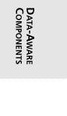

## 示例应用程序

代码清单 5.4 是一个示例应用程序，它使用了本章中讨论的许多（但并非全部）数据感知组件。从代码清单 5.4 中可以看出，该应用程序的代码量非常少。得益于 VCL/CLX，数据感知组件几乎封装了在应用程序中显示和更新数据集所需的所有内容。

## 代码清单 5.4
DataAware—MainForm.pas

```pascal
unit MainForm;

interface

uses
  SysUtils, Classes, QGraphics, QControls, QForms, QDialogs, DB, DBClient,
  QStdCtrls, QExtCtrls, QButtons, Mask, QComCtrls, QDBCtrls, QMask;

type
TfrmMain = class(TForm)
ClientDataSet1: TClientDataSet;
DataSource1: TDataSource;
cdsLookup: TClientDataSet;
dsLookup: TDataSource;
cdsLookupID: IntegerField;
cdsLookupDescription: TStringField;
DBNavigator1: TDBNavigator;
pnlBottom: TPanel;
ClientDataSet1Weekday: TStringField;
ClientDataSet1WeekdayValue: TIntegerField;
ClientDataSet1Image: TBlobField;
ClientDataSet1Active: TStringField;
ClientDataSet1Age: TIntegerField;
ClientDataSet1ItemID: TIntegerField;
ClientDataSet1Salary: TFloatField;
ClientDataSet1Enabled: TBooleanField;
LblCurrent: TLabel;
Lb1State: TLabel;
OpenDialog1: TOpenDialog;
Panel1: TPanel;
lbDSEvents: TListBox;
Label3: TLabel;
pnlClient: TPanel;
PageControl1: TPageControl;
tabSimple: TTabSheet;
txtAge: TDBText;
Label1: TLabel;
txtWeekday: TDBText;
txtSalary: TDBText;
Label6: TLabel;
Label7: TLabel;
ecAge: TDBEdit;
DBRadioGroup1: TDBRadioGroup;
cbActive: TDBCheckBox;
cbEnabled: TDBCheckBox;
ecSalary: TDBEdit;
tabComboList: TTabSheet;
Label12: TLabel;
cbWeekday: TDBComboBox;
lb1Weekday: TDBListBox;
raLookup: TTabSheet;
Label4: TLabel;
lblLookup: TDBLookupListBox;
cblLookup: TDBLookupComboBox;
tabImage: TTabSheet;
Label5: TLabel;
img: TDBImage;
btnLoad: TButton;
btnClear: TButton;
procedure FormCreate(Sender: TObject);
procedure DataSource1DataChange(Sender: TObject; Field: TField);
procedure ClientDataSet1NewRecord(DataSet: TDataSet);
procedure DataSource1StateChange(Sender: TObject);
procedure btnLoadClick(Sender: TObject);
procedure btnClearClick(Sender: TObject);
procedure DataSource1UpdateData(Sender: TObject);
  private
    { Private declarations }
  public
    { Public declarations }
  end;

var
  frmMain: TfrmMain;

implementation

{$R *.xfm}

procedure TfrmMain.FormCreate(Sender: TObject);

  procedure AddLookupItem(ID: Integer; const Description: string);
  begin
    cdsLookup.Append;
    cdsLookupID.AsInteger := ID;
    cdsLookupDescription.AsString := Description;
    cdsLookup.Post;
  end;

begin
  // Create the lookup dataset and populate with some data
  cdsLookup.CreateDataSet;
  AddLookupItem(1, 'Widgit');
  AddLookupItem(2, 'Gadget');
  AddLookupItem(3, 'Thingamabob');

  ClientDataSet1.CreateDataSet;
end;

procedure TfrmMain.ClientDataSet1NewRecord(DataSet: TDataSet);
begin
  DataSet.FieldName('Enabled').AsString := 'T';
  DataSet.FieldName('Active').AsString := 'T';
end;

procedure TfrmMain.DataSource1DataChange(Sender: TObject; Field: TField);
begin
  if Field = nil then
    lbDSEvents.Items.Add('Data Change: Field = nil')
  else
    lbDSEvents.Items.Add('Data Change: Field = ' + Field.FieldName);

  lblCurrent.Caption := Format('('Record %d of %d)',
    [ClientDataSet1.RecNo, ClientDataSet1.RecordCount]);
end;

procedure TfrmMain.DataSource1StateChange(Sender: TObject);
begin
  lbDSEvents.Items.Add('State Change');

  case DataSource1.State of
    dsInactive: lblState.Caption := 'Inactive';
    dsBrowse: lblState.Caption := 'Browse';
    dsEdit: lblState.Caption := 'Edit';
    dsInsert: lblState.Caption := 'Insert';
  end;
end;

procedure TfrmMain.DataSource1UpdateData(Sender: TObject);
begin
  lbDSEvents.Items.Add('Update Data')
end;

procedure TfrmMain.btnLoadClick(Sender: TObject);
begin
  if OpenDialog1.Execute then begin
    ClientDataSet1.Edit;
    ClientDataSet1Image.LoadFromFile(OpenDialog1.FileName);
  end;
end;

procedure TfrmMain.btnClearClick(Sender: TObject);
```


# 列表 5.4（续）

```pascal
begin
if not ClientDataSet1Image.IsNull then begin
ClientDataSet1Edit;
ClientDataSet1Image.Clear;
end;
end.
```

图 5.3 展示了该数据感知应用程序在运行时的情景。

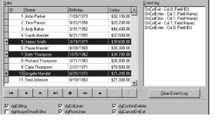

# 图 5.3
Dataware 演示了许多提供的数据感知组件的使用方法。

# 摘要

本章向您介绍了数据感知组件。我们已经涵盖的组件包括：

- **TDataSource** 在数据感知组件和数据集之间提供高层通道。
- **TDBText** 和 **TDBEdit** 适用于显示和编辑简单的字段值。
- **TDBMemo** 提供了显示和编辑未格式化多行文本的方法。
- **TDBRichEdit**（一个仅限 VCL 的数据感知组件）可用于显示和编辑格式化多行文本。
- **TDBCheckBox** 和 **TDBRadioGroup** 支持从可用选项列表中选择一项或多项选项。
- **TDBComboBox** 和 **TDBListBox** 允许用户从预定义值列表中选择字段值。作者还提供了这两个组件的派生类的代码，允许对存储在关联数据字段中的值进行更精细的控制。
- **TDBLookupComboBox** 和 **TDBLookupListBox** 在 **TDBComboBox** 和 **TDBListBox** 的基础上进一步扩展，它们从另一个数据集获取项目列表，然后将查找数据集的主键保存回正在编辑的数据集。
- **TDBImage** 用于显示存储在数据集的 **BLOB** 字段中的位图。
- **TDBNavigator** 可用于提供无需代码的数据集导航和操作形式。
- 只要稍加努力，你就可以创建标准 VCL/CLX 组件的数据感知版本。

下一章将继续讨论数据感知组件，重点介绍数据感知网格。

# 数据感知网格

## 第 6 章

### 本章内容

- TDBGrid 240
- TClientDataSetGrid 263
- TDBCtrlGrid 266
- 第三方数据感知网格 271

前一章向您介绍了数据感知组件，特别是用于显示和编辑单个字段的数据感知组件。本章讨论数据感知网格，它们可以一次显示多条记录的信息。

在本章中，我将考察三种不同的数据感知网格：**TDBGrid**、**TClientDataSetGrid** 和 **TDBCtrlGrid**。在这三者中，**TDBGrid** 是唯一同时随 Delphi 和 Kylix 标准提供的组件。**TClientDataSetGrid** 是一个衍生作品，由 John Kaster 编写，它提供了对可配置列的内建支持，以及当用户点击列标题时自动对客户数据集进行排序的代码（关于此功能的更多详情将在本章后续部分介绍）。

**TDBCtrlGrid** 随 Delphi 提供，但不随 Kylix 提供。它支持非线性网格布局——例如，网格中每条记录占据多行而非单行。

## TDBGrid

**TDBGrid** 为 Delphi 的基于网格的数据感知组件奠定了基石。使用 **TDBGrid**，你无需大量编程工作即可创建如图 6.1 所示的屏幕界面。

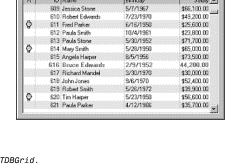

**图 6.1**  
*使用 TDBGrid 创建的示例屏幕。*

在本章稍后的部分，我们将研究生成此屏幕所需的代码。在本节中，我将探索 **TDBGrid** 组件。以下部分将介绍另外两种网格，它们要么包含在 Delphi 中，要么可免费下载。

## TDBGrid 基本操作

与前一章讨论的组件类似，**TDBGrid** 发布了一个 *DataSource* 属性，该属性间接确定网格检索数据的来源。然而，由于网格可以同时显示来自多个字段的数据，因此没有 *DataField* 属性。相反，**TDBGrid** 提供了一个 *Columns* 属性，允许你指定要在网格中显示哪些字段，以及字段的顺序和其他与显示相关的设置。这些内容将在下文“自定义列”部分详细讨论。

使用 TDBGrid 的最简单方法是将其拖放到窗体上，连接数据源，打开数据集，然后运行应用程序。如果你这样做，你将看到一个使用所有默认设置的相当普通的网格，如图 6.2 所示。

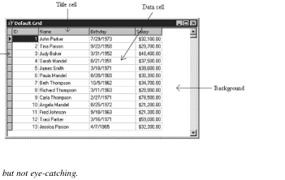

图 6.2 指出了标题单元格、数据单元格、指示单元格和网格背景的示例。通过组合使用网格的属性和事件，你可以创建一个视觉上更令人赏心悦目的网格。在以下部分中，我将详细研究这些属性和事件。

## 自定义列

通常，你希望执行的最基本级别的自定义是调整显示的列数，或者调整列的显示顺序。TDBGrid 发布了一个 Columns 属性，它提供了对网格中显示的列列表的访问。

你可以将 Columns 属性看作类似于数据集的 Fields 属性。如果没有专门定义的列，网格 simply 按它们在数据集中出现的顺序显示所有列。如果为数据集定义了持久字段，网格则只为那些字段显示列。

要为网格创建持久列对象（类似于数据集的持久字段对象），你需要使用列编辑器。

在设计时双击网格组件（或右键点击它并从弹出菜单中选择“列编辑器…”）以显示列编辑器。列编辑器的工作方式与 Delphi 中的大多数集合编辑器类似——按 Ins 键创建新的 TColumn 对象，或者右键点击并从弹出菜单中选择“添加”。

每个列都支持许多可用于自定义列外观和感觉的属性。（关于显示灵活性的极致，请参见本章稍后的“自定义绘制”部分。）这些属性列于表 6.1 中。

### 表 6.1 基本 TColumn 属性

| 属性 | 描述 |
| :--- | :--- |
| **Alignment** | 将列中显示的数据的对齐方式设置为左对齐、居中或右对齐。 |
| **Color** | 设置单个列的背景颜色。 |
| **FieldName** | 指定底层数据集中要在该列中显示的字段名称。可以显示任何字段（包括数据字段、计算字段、查找字段和汇总字段）。 |
| **Font** | 自定义用于显示列数据的字体。 |
| **ReadOnly** | 当设置为 *True* 时，即使底层字段和数据集允许编辑，列数据也不能被编辑。 |
| **Title** | 允许自定义列的标题单元格。该属性将在“列标题”部分稍后讨论。 |
| **Visible** | 当设置为 *False* 时，该列不显示。 |
| **Width** | 设置列在屏幕像素中的宽度。 |

当你设置 `FieldName` 属性时，Delphi 会自动设置 `Alignment` 和 `Width` 属性（基于字段的大小和类型）。不幸的是，即使 Delphi 将数值字段的 `Alignment` 设置为 `taRightJustify`，它也不会自动将标题的对齐方式设置为 `taRightJustify`。因此，你需要手动设置标题的对齐方式。

### **注意**

> 可以添加没有底层数据字段对应的列。为此，插入一个新列并将 `FieldName` 属性留空。这样做时，你需要手动设置列的 `Alignment` 和 `Width` 属性，并且必须使用网格的自定义绘制功能来绘制该列的单元格内容。例如，你可能希望创建一个没有关联字段的列，以在某些行中显示图标。

## 列类型

大多数列以简单字符串的形式显示和编辑。对于希望用户从值列表中选择，或希望显示一个对话框以便用户选择单元格值的情况，**TDBGrid** 支持对列的活动单元格进行两种类型的增强：

- 列可以显示一个查找组合框，以便用户从预定义的值列表中进行选择。如果列与数据集中的查找字段链接，当用户编辑该列时，列会自动显示一个可接受值的组合框。
- 列可以显示一个省略号按钮，它可以编程为显示对话框，或者在用户点击时执行其他功能。

表 6.2 中列出的属性用于设置各种列样式的选项。

**表 6.2 附加 TColumn 属性**

| 属性 | 描述 |
| :--- | :--- |
| ButtonStyle | 当设置为 **bsAuto**（默认值）时，列自动为查找字段显示组合框。你可以手动将此属性设置为 **bsEllipsis**（显示省略号按钮）或 **bsNone**（抑制查找字段的组合框）。 |
| DropDownRows | 指定当组合框展开时显示在列中的最大项目数。 |
| PickList | 对于未连接到查找字段的列，你可以在 **PickList** 属性中指定可接受的字段值列表。如果使用此属性，当列被编辑时，会自动显示组合框（除非列的 **ButtonStyle** 属性设置为 **bsNone**）。 |

对于 **ButtonStyle** 为 **bsEllipsis** 的列，当用户点击省略号按钮时，会触发网格的 **OnEditButtonClick** 事件。本节末尾提供的示例程序展示了如何响应该事件。

## 列标题

除了自定义列数据的外观，你还可以自定义列标题的外观。若要同时更改所有列标题使用的字体，你可以相应地设置网格的 **TitleFont** 属性。

然而，若要控制每个列标题，你应该使用单个列的 **Title** 属性。**Title** 属性扩展了以下属性以用于设置列标题。


**表 6.3** TColumn 标题属性

正如前文所述，Delphi 不会自动将数值字段的标题 `Alignment` 属性设置为 `tRightJustify`。因此，在创建持久列时，您应该确保检查标题的对齐方式。

# 网格选项

设置好要在网格中显示的列之后，您可以设置网格全局选项，这些选项决定了网格的整体外观和风格。表 6.4 列出了可用的选项。

**表 6.4** TDBGrid 选项

| 选项 | 描述 |
| :--- | :--- |
| dgRowSelect | 设置后，单击某一行会高亮显示整行，而不是选择单个单元格。本章稍后介绍的自定义绘制网格方法也可以手动实现行高亮。 |
| dgAlwaysShowSelection | 设置此选项即使网格没有焦点也会高亮显示当前单元格。 |
| dgConfirmDelete | 如果网格的 ReadOnly 属性未设置，此选项会导致 VCL 在用户于网格中按下 Ctrl+Delete 时显示删除确认消息。如果未设置此选项，用户按下 Ctrl+Delete 时会直接删除当前记录。请注意，即使未设置 dgEditing，Ctrl+Delete 也会删除当前记录。 |
| dgCancelOnExit | 此选项影响当用户通过 Tab 键退出网格时，对新插入行的处理方式。设置后，未输入任何数据的新插入行将被取消。如果未设置，留空的插入行将被提交到数据集。 |
| dgMultiSelect | 设置后，用户可以按住 Ctrl 键并单击各个行，从而在网格中选择多个行。 |

默认情况下，Options 设置为 [dgEditing, dgTitles, dgIndicator, dgColumnResize, dgColLines, dgRowLines, dgTabs, dgConfirmDelete, dgCancelOnExit]。我发现，当我使用 TDBGrid 时，我会关闭 dgEditing 和 dgIndicator 选项，并将网格的 ReadOnly 属性设置为 True。我不允许用户在网格中直接编辑，而是在他们按下 Enter 键时显示一个对话框，让他们在那里编辑当前记录的字段值。当然，效果可能因人而异，你可以根据自己的应用情况决定最喜欢的一组选项。

# 事件

除了前面列出的属性外，TDBGrid 还提供了许多事件，你可以响应这些事件以对流体的显示和功能进行更精细的控制。这些事件列在表 6.5 中。

**表 6.5** TDBGrid 事件

| 事件 | 描述 |
| :--- | :--- |
| OnCellClick | 当用户单击一个单元格时触发。当用户单击标题单元格、指示器或网格背景时不触发。 |
| OnColEnter | 焦点进入当前列后立即触发。 |
| OnColExit | 焦点离开当前列前立即触发。在此处理程序中调用 Abort 可防止网格切换到新列。 |
| OnColumnMoved | 用户移动列后（但未在用户调整列大小后）在运行时触发。 |
| OnDrawColumnCell | 在即将绘制单元格时触发。它用于实现自定义绘制，将在本章稍后解释。 |
| OnDrawDataCell | 已弃用，仅为保持向后兼容性而包含。 |
| OnEditButtonClick | 当用户单击单元格中的省略号按钮时触发。 |
| OnTitleClick | 当用户单击标题单元格时发生（假设设置了 dgTitles 选项）。TClientDataSet 内部使用此事件，在用户单击列标题时自动对底层数据集进行排序。 |

以下示例程序（如列表 6.1 所示）演示了不同网格事件的触发时机。下一节“自定义绘制”将更详细地探讨 OnDrawColumnCell 事件。

**列表 6.1** Options—MainForm.pas

```pascal
unit MainForm;

interface

uses
  SysUtils, Classes, Graphics, Controls, Forms, Dialogs, DB, Grids,
  DBGrids, DBClient, ExtCtrls, StdCtrls, DBCtrls;

type
  TfrmMain = class(TForm)
    ClientDataSet: TClientDataSet;
    DataSource1: TDataSource;
    pnOptions: TPanel;
    pnClient: TPanel;
    grid: TDBGrid;
    cbEditing: TCheckBox;
    cbAlwaysShowEditor: TCheckBox;
    cbTitles: TCheckBox;
    cbIndicator: TCheckBox;
    cbColumnResize: TCheckBox;
    cbColLines: TCheckBox;
    cbRowLines: TCheckBox;
    cbTabs: TCheckBox;
    cbRowSelect: TCheckBox;
    cbAlwaysShowSelection: TCheckBox;
    cbConfirmDelete: TCheckBox;
    cbCancelOnExit: TCheckBox;
    cbMultiSelect: TCheckBox;
    btnShowSelections: TButton;
    DBNavigator1: TDBNavigator;
    IbEvents: TListBox;
    Label1: TLabel;
    Label2: TLabel;
    btnClearEventLog: TButton;
    procedure FormCreate(Sender: TObject);
    procedure gridCellClick(Column: TColumn);
    procedure gridColExit(Sender: TObject);
    procedure gridColEnter(Sender: TObject);
    procedure gridColumnMoved(Sender: TObject; FromIndex,
        ToIndex: Integer);
    procedure gridEditButtonClick(Sender: TObject);
    procedure cbEditingClick(Sender: TObject);
    procedure cbAlwaysShowEditorClick(Sender: TObject);
    procedure cbTitlesClick(Sender: TObject);
    procedure cbIndicatorClick(Sender: TObject);
    procedure cbColumnResizeClick(Sender: TObject);
    procedure cbColLinesClick(Sender: TObject);
    procedure cbRowLinesClick(Sender: TObject);
    procedure cbTabsClick(Sender: TObject);
    procedure cbRowSelectClick(Sender: TObject);
    procedure cbAlwaysShowSelectionClick(Sender: TObject);
    procedure cbConfirmDeleteClick(Sender: TObject);
    procedure cbCancelOnExitClick(Sender: TObject);
    procedure cbMultiSelectClick(Sender: TObject);
    procedure btnShowSelectionsClick(Sender: TObject);
    procedure btnClearEventLogClick(Sender: TObject);
  private
    procedure RetrieveOptions;
    procedure UpdateOption(Option: TDBGridOption; Active: Boolean);
    { Private declarations }
  public
    { Public declarations }
  end;

var
    frmMain: TfrmMain;

implementation

{$R *.xfm}

procedure TfrmMain.FormCreate(Sender: TObject);
begin
    ClientDataSet1.LoadFromFile('C:\Employee.CDS');

    RetrieveOptions;
end;

// Options set/get methods

procedure TfrmMain.RetrieveOptions;
begin
    cbEditing.Checked := (dgEditing in grid.Options);
    cbAlwaysShowEditor.Checked := (dgAlwaysShowEditor in grid.Options);
    cbTitles.Checked := (dgTitles in grid.Options);
    cbIndicator.Checked := (dgIndicator in grid.Options);
    cbColumnResize.Checked := (dgColumnResize in grid.Options);
    cbColLines.Checked := (dgColLines in grid.Options);
    cbRowLines.Checked := (dgRowLines in grid.Options);
    cbTabs.Checked := (dgTabs in grid.Options);
    cbRowSelect.Checked := (dgRowSelect in grid.Options);
    cbAlwaysShowSelection.Checked := (dgAlwaysShowSelection in grid.Options);
    cbConfirmDelete.Checked := (dgConfirmDelete in grid.Options);
    cbCancelOnExit.Checked := (dgCancelOnExit in grid.Options);
    cbMultiSelect.Checked := (dgMultiSelect in grid.Options);
end;

procedure TfrmMain.UpdateOption(Option: TDBGridOption; Active: Boolean);
begin
    if Active then
        grid.Options := grid.Options + [Option]
    else
        grid.Options := grid.Options - [Option];

    RetrieveOptions;
end;

procedure TfrmMain.cbEditingClick(Sender: TObject);
begin
  UpdateOption(dgEditing, cbEditing.Checked);
end;

procedure TfrmMain.cbAlwaysShowEditorClick(Sender: TObject);
begin
  UpdateOption(dgAlwaysShowEditor, cbAlwaysShowEditor.Checked);
end;

procedure TfrmMain.cbTitlesClick(Sender: TObject);
begin
  UpdateOption(dgTitles, cbTitles.Checked);
end;

procedure TfrmMain.cbIndicatorClick(Sender: TObject);
begin
  UpdateOption(dgIndicator, cbIndicator.Checked);
end;

procedure TfrmMain.cbColumnResizeClick(Sender: TObject);
begin
  UpdateOption(dgColumnResize, cbColumnResize.Checked);
end;

procedure TfrmMain.cbColLinesClick(Sender: TObject);
begin
  UpdateOption(dgColLines, cbColLines.Checked);
end;

procedure TfrmMain.cbRowLinesClick(Sender: TObject);
begin
  UpdateOption(dgRowLines, cbRowLines.Checked);
end;

procedure TfrmMain.cbTabsClick(Sender: TObject);
begin
  UpdateOption(dgTabs, cbTabs.Checked);
end;

procedure TfrmMain.cbRowSelectClick(Sender: TObject);
begin
  UpdateOption(dgRowSelect, cbRowSelect.Checked);
end;
```


## **列表 6.1**（续）

```pascal
procedure TfrmMain.cbAlwaysShowSelectionClick(Sender: TObject);
begin
    UpdateOption(dgAlwaysShowSelection, cbAlwaysShowSelection.Checked);
end;

procedure TfrmMain.cbConfirmDeleteClick(Sender: TObject);
begin
    UpdateOption(dgConfirmDelete, cbConfirmDelete.Checked);
end;

procedure TfrmMain.cbCancelOnExitClick(Sender: TObject);
begin
    UpdateOption(dgCancelOnExit, cbCancelOnExit.Checked);
end;

procedure TfrmMain.cbMultiSelectClick(Sender: TObject);
begin
    UpdateOption(dgMultiSelect, cbMultiSelect.Checked);
end;

// Grid event handlers

procedure TfrmMain.gridColExit(Sender: TObject);
begin
    lbEvents.Items.Add('OnColExit - Col ' + IntToStr(grid.SelectedIndex) +
         ', Field ' + grid.SelectedField.FieldName + '');

// By calling Abort here, you can prevent focus from leaving this column
// Abort;
end;

procedure TfrmMain.gridColEnter(Sender: TObject);
begin
    lbEvents.Items.Add('OnColEnter - Col ' + IntToStr(grid.SelectedIndex) +
         ', Field ' + grid.SelectedField.FieldName + '');
end;

procedure TfrmMain.gridEditButtonClick(Sender: TObject);
begin
    lbEvents.Items.Add('OnEditButtonClick - Col ' +
         IntToStr(grid.SelectedIndex) + ', Field ' +
         grid.SelectedField.FieldName + '');
end;

procedure TfrmMain.gridCellClick(Column: TColumn);
begin
  lbEvents.Items.Add('OnCellClick - Col ' + IntToStr(grid.SelectedIndex) +
  ', Field ' + grid.SelectedField.FieldName + '');
end;

procedure TfrmMain.gridColumnMoved(Sender: TObject; FromIndex,
  ToIndex: Integer);
begin
  lbEvents.Items.Add('Column moved from ' + IntToStr(FromIndex) +
  ' to ' + IntToStr(ToIndex));
end;

// Command buttons

procedure TfrmMain.btnClearEventLogClick(Sender: TObject);
begin
  lbEvents.Items.Clear;
end;

procedure TfrmMain.btnShowSelectionsClick(Sender: TObject);
var
  Index: Integer;
  s: string;
begin
  if not (dgMultiSelect in grid.Options) then
    raise Exception.Create('dgMultiSelect not set');

  if grid.SelectedRows.Count = 0 then
    raise Exception.Create('No rows selected');

  for Index := 0 to grid.SelectedRows.Count - 1 do begin
    ClientDataSet1.Bookmark := grid.SelectedRows[Index];
    if s <> '' then
      s := s + #13;
    s := s + Format('id: %s', [ClientDataSet1.FieldByName('ID').AsInteger,
      ClientDataSet1.FieldByName('Name').AsString]);
  end;
  ShowMessage(s);
end;

end.
```

+   6 数据感知网格

图 6.3 展示了 Options 应用程序在运行时的状态。

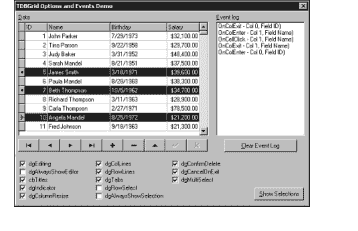

Options 应用程序允许你试验 TDBGrid 组件的选项。

## 自定义绘制

从图 6.2 中可以看出，网格的默认外观看起来不错，但并非特别引人注目。通过使用自定义绘制，我们可以显著改善网格的外观。

要在你的网格中实现自定义绘制，你需要处理网格的 OnDrawColumnCell 事件。你可能会注意到网格中包含一个类似名称的事件 OnDrawDataCell。OnDrawDataCell 是一个已过时的事件，为了与早期版本的 Delphi 保持向后兼容性而保留。你应该在任何新的编程项目中都不要使用它。

为 OnDrawColumnCell 事件新创建的处理程序看起来像这样：

```pascal
procedure TForm1.DBGrid1DrawColumnCell(Sender: TObject; const Rect: TRect;
         DataCol: Integer; Column: TColumn; State: TGridDrawState);
         begin
         end;
```

与所有网格事件一样，Sender 参数引用网格对象。Rect 指的是即将绘制的单元格的包围矩形。DataCol 是即将绘制的列的绝对位置基于零的索引。State 是一个包含表 6.6 中列出的一个或多个值的集合。

### 表 6.6 TGridDrawState 值

| 值 | 描述 |
| :--- | :--- |
| *gdSelected* | 单元格被选中。 |
| *gdFocused* | 单元格具有焦点。 |
| *gdFixed* | 单元格是固定的（即，它是指示器单元格）。 |

gdSelected 和 gdFocused 之间的差异可能会让人困惑（尤其是因为这些值会随着 Options 属性的变化而略微改变含义），所以我将在这里澄清一下。

当 dgRowSelect 未设置时（这是默认情况），只有当前单元格设置了 gdSelected 值。如果网格当前具有焦点，当前单元格除了设置 gdSelected 值外还设置了 gdFocused。

当 dgRowSelect 已设置时，当前行中的所有单元格都设置了 gdSelected 值。此外，如果网格具有焦点，该行中的第一个单元格（不包括指示器）设置了 gdFocused。当使用 dgRowSelect 时，你可能希望忽略 gdFocused 值，因为它没有实际意义。

## DefaultDrawing 属性

网格的 DefaultDrawing 属性决定了网格中的绘制方式。当此属性为 True（默认值）时，VCL/CLX 以常规方式绘制网格中的每个单元格，然后将在控制权传递给你设置的 OnDrawColumnCell 处理程序。OnDrawColumnCell 对网格中的每个单元格都会被调用，因此你希望确保你写在该事件处理程序中的代码执行速度很快。

当 DefaultDrawing 为 False 时，Delphi 用适当的背景颜色绘制单元格，并设置网格的 Brush 和 Font 属性以准备绘制单元格。然后，它调用 OnDrawColumnCell，以便你可以自己绘制单元格的内容。

在实践中，你会发现当你实现自定义绘制时，Delphi 的默认绘制代码大约完成了你需要的大部分工作。你可能只想更改选中单元格的颜色，在特定列中绘制图像，或者也许用红色绘制负值。

DefaultDrawing 属性可能会让人联想到两种极端情况。一方面，如果它为 True，则使用其默认设置绘制单元格，然后你反过来在它上面进行绘制。另一方面，如果它为 False，你需要手动绘制每一个单元格——甚至那些不需要特殊绘制的单元格。

幸运的是，情况并非如此。解决方案是将 DefaultDrawing 设置为 False，然后在 OnDrawColumnCell 事件处理程序中调用网格的 DefaultDrawColumnCell，如下所示：

```pascal
procedure TForm1.DBGrid1DrawColumnCell(Sender: TObject; const Rect: TRect;
DataCol: Integer; Column: TColumn; State: TGridDrawState);
begin
if Column.FieldName = 'Salary' then begin
if Column.Field.AsFloat > 50000.0 then begin
DBGrid1.Canvas.Brush.Color := clYellow;
if gdFocused in State then
DBGrid1.Canvas.Font.Color := clRed;
end;
end;
DBGrid1.DefaultDrawColumnCell(Rect, DataCol, Column, State);
end;
```

这段代码片段仅改变了 Salary 列的绘制方式。如果工资大于 50,000 美元，则单元格的背景用黄色绘制。如果单元格具有焦点，则工资用红色绘制。

对于所有其他单元格，以及小于或等于 50,000 美元的工资，单元格将正常绘制。对 DefaultDrawColumnCell 的调用会在对画刷和字体颜色进行适当更改（如果有）之后处理单元格的绘制。

按照 Delphi 内部 VCL/CLX 绘制代码的工作方式，你在这个处理程序中只需要设置画布的 Brush 和 Font 属性，使其反映你在绘制单元格时要使用的颜色和字体。然后，对 DefaultDrawColumnCell 的调用将使用你指定的设置来绘制单元格内容。


请注意，在前面的代码片段中，我检查了列的 FieldName 属性，以查看代码是否正在绘制 Salary 列。你可能会想用 DataCol 参数来检查这一点。然而，DataCol 是正在绘制的单元格基于零的绝对索引。如果用户在运行时重新排列列，这个值会发生变化。

以下示例程序演示了自定义绘制网格单元格的几种方法。列表 6.2 包含 CustomDraw 应用程序的完整源代码。

## 列表 6.2 CustomDraw—MainForm.pas

```pascal
unit MainForm;
interface
```


## 列表 6.2（续）

```pascal
uses
  SysUtils, Types, Classes, QGraphics, QControls, QForms, QDialogs, DB,
  DBClient, QGrids, QDBGrids, QExtCtrls, DateUtils;

type
  TfrmMain = class(TForm)
    pnlClient: TPanel;
    DBGrid1: TDBGrid;
    DataSource1: TDataSource;
    ClientDataSet1: TClientDataSet;
    Image1: TImage;
  private
    { Private declarations }
  public
    { Public declarations }
    procedure FormCreate(Sender: TObject);
    procedure DBGrid1DrawColumnCell(Sender: TObject; const Rect: TRect;
      DataCol: Integer; Column: TColumn; State: TGridDrawState);
  end;

var
  frmMain: TfrmMain;

implementation

{$R *.xfm}

procedure TfrmMain.FormCreate(Sender: TObject);
begin
  ClientDataSet1.LoadFromFile('C:\Employee.CDS');
end;

procedure TfrmMain.DBGrid1DrawColumnCell(Sender: TObject;
  const Rect: TRect; DataCol: Integer; Column: TColumn;
  State: TGridDrawState);
var
  RetirementBirthdate: TDateTime;
  X: Integer;
begin
  if Odd(ClientDataSet1.RecNo) then
    DBGrid1.Canvas.Brush.Color := clAqua
  else
    DBGrid1.Canvas.Brush.Color := clWhite;

  if gdSelected in State then begin
    DBGrid1.Canvas.Font.Color := clGreen;
    DBGrid1.Canvas.Font.Style := [fsBold];
  end;

  if Column.ID = 0 then begin
    DBGrid1.Canvas.FillRect(Rect);

    RetirementBirthdate := IncYear(Date, -50);
    if ClientDataSet1.FieldByName('Birthday').AsDateTime <=
        RetirementBirthdate then begin
      // Eligible for retirement
      X := (Column.Width - Image1.Picture.Width) div 2 + Rect.Left;
      DBGrid1.Canvas.Draw(X, Rect.Top, Image1.Picture.Graphic);
    end;
  end
  else
    DBGrid1.DefaultDrawColumnCell(Rect, DataCol, Column, State);
end;
```

图 6.1 展示了 CustomDraw 应用程序在运行时的情况。

在列表 6.2 的 `DBGrid1DrawColumnCell` 方法中发生了几件事情。首先，奇数行使用 `clAqua` 作为背景色绘制，偶数行使用 `clWhite` 作为背景色绘制。这使网格呈现出支票簿风格的视觉效果。

其次，当前行（由 *State* 参数包含 *gdSelected* 选项这一事实确定）以粗体绿色字体绘制。*State* 参数包含 *gdSelected* 选项，是因为在网格的选项中指定了 *dgRowSelect*。

最后，代码检查员工的出生日期。如果员工年满 50 岁（或更大），则在第一列绘制一个时钟图标。第一列的 ID 为 **0**。请注意，代码没有检查 *DataCol* 参数来查看其是否为 **0**，因为用户可以在运行时重新排列列。相反，它检查列的 ID，这是一个在设计时确定的基于零的整数，不会改变。

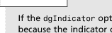

> 如果 *dgIndicator* 选项被打开，列 ID 将是 **1** 而不是 **0**，因为指示列的 ID 将是 **0**。

## 常见网格问题的解决方案

在本节中，我将尝试回答一些关于 `TDBGrid` 组件的常见问题。这些问题的解决方案并不过分困难，但在大多数情况下，它们涉及的操作不仅仅是调用方法或设置属性那么简单。

### 确定当前行或列

有时你可能需要确定当前聚焦的是哪一行、哪一列或哪个单元格。根据你需要的信息，有几种处理方法。

如果你只需要知道哪一行具有焦点，最简单的方法是检查底层数据集。数据集的当前记录就是具有焦点的记录。因此，如果你想要获取当前 `Salary` 列的值，可以执行以下操作：

```pascal
var
  CurrentSalary: Double;
begin
  CurrentSalary := DBGrid1.DataSource.DataSet.FieldByName('Salary').AsFloat;
  ...;
end;
```

要获取具有焦点的列的索引，可以访问网格的 `SelectedIndex` 属性。`SelectedIndex` 是一个基于零的数字，表示所选列的绝对位置。`SelectedIndex` 会根据指示器进行调整，因此如果存在指示器，第一个数据列的索引为 1。如果未显示指示器，第一个数据列的索引为 0。

要检索当前列的字段对象，可以引用网格的 `SelectedField` 属性。`SelectedField` 返回底层数据集的 `TField` 对象，因此你可以直接访问它以获取当前单元格的值。

```pascal
ShowMessage('The current cell value is ' + DBGrid1.SelectedField.AsString);
```

**注意**

如果当前列未连接到数据集字段，`SelectedIndex` 将返回 -1，`SelectedField` 将返回 `nil`。如果你在网格中显示任何未绑定到字段的列，在尝试对 `SelectedIndex` 或 `SelectedField` 属性执行任何操作之前，始终应该检查是否为 -1 或 `nil`。

### 获取给定鼠标坐标处的单元格

稍加努力，你就可以确定任意鼠标位置处单元格的行和列。通常，你不需要这样做，因为你可以使用数据集的当前记录以及网格的 `SelectedIndex` 或 `SelectedField` 属性来确定当前单元格。然而，你可能想了解的不是当前单元格的另一个单元格。

例如，假设你想编写一个事件处理程序来跟踪鼠标的当前位置，并提供该位置字段的详细信息。一个更有野心的项目可能是编写代码，当鼠标悬停在内容过长而无法在单元格中完全显示的单元格上时显示工具提示。

在这两种情况下，你都可以调用网格的 `MouseCoord` 方法，传入相对于网格控件的鼠标 X 和 Y 坐标。`MouseCoord` 返回一个 `TGridCoord` 结构，其中包含表示该鼠标位置处单元格的绝对列和行索引的 X 和 Y 字段。

`TGridCoord` 的 X 和 Y 值需要稍作解释。这些是绝对索引，意味着它们考虑了指示列和标题行。如果显示指示器，第一个数据列的 X 位置为 1。如果未显示指示器，则为 0。对于行也是如此：如果未显示网格标题（网格的 `Options` 属性中未设置 `dgTitles`），则第一行数据的 Y 位置为 0。如果显示标题，则为 1。

如果鼠标位置不在单元格上（例如，鼠标位于网格的背景区域），返回的 `TGridCoord` 的 X 和 Y 值均为 -1。

下面的代码片段展示了如何更新一个标签，以显示当前鼠标位置处单元格的 X 和 Y 位置以及字段名称。

```pascal
procedure TForm1.DBGrid1MouseMove(Sender: TObject; Shift: TShiftState; X,
  Y: Integer);
var
  GC: TGridCoord;
  IndicatorOffset: Integer;
  TitleOffset: Integer;
begin
  GC := DBGrid1.MouseCoord(X, Y);
  if GC.X = -1 then
    Label1.Caption := IntToStr(GC.X) + ', ' + IntToStr(GC.Y)
  else begin
    if dgIndicator in DBGrid1.Options then
      IndicatorOffset := 1
    else
      IndicatorOffset := 0;

    if dgTitles in DBGrid1.Options then
      TitleOffset := 1
    else
      TitleOffset := 0;

    if GC.X < IndicatorOffset then
      Label1.Caption := IntToStr(GC.X) + ', ' + IntToStr(GC.Y) + ' - Indicator'
    else
      Label1.Caption := IntToStr(GC.X) + ', ' + IntToStr(GC.Y) + ' : ' +
        DBGrid1.Columns[GC.X - IndicatorOffset].FieldName;
  end;
end;
```

在该代码片段的末尾有一个注释，解释如何检索相应单元格的数据。以下是执行此操作所需的代码（假设网格连接到客户端数据集）：

```pascal
var
  ClonedDS: TClientDataSet;
  FieldValue: string;
begin
  ...
  ClonedDS := TClientDataSet.Create(nil);
  try
    ClonedDS.CloneCursor(DBGrid1.DataSource.DataSet);
    ClonedDS.RecNo := GC.Y - TitleOffset;

    // Now access the fields of the cloned dataset
    FieldValue := ClonedDS.FieldByName(DBGrid1.Columns[GC.X -
      IndicatorOffset].FieldName).AsString;
  finally
    ClonedDS.Free;
  end;
end;
```

### 手动设置编辑模式

如果 `dgAlwaysShowEditor` 为 True，当用户进入单元格时，网格会自动进入编辑模式。如果 `dgAlwaysShowEditor` 为 False，当用户按下 F2 键时，网格会进入编辑模式。（用户可以简单地开始输入值以覆盖单元格的内容。）然而，如果（为了与另一个软件包兼容）你希望用户在按下不同的键时进入编辑模式——比如按 F9 而不是 F2 怎么办？

要实现这一点，你需要控制网格进入编辑模式的时机。执行此操作的最佳位置是网格的 OnKeyDown 事件。在该处理程序中，将网格的 EditMode 属性设置为 True 以进入编辑模式。

下面的代码片段展示了如何在用户按下 F9 时进入编辑模式（而不是在按下 F2 时）。


## 注意

要使此代码生效，必须确保 `dgEditing` 选项已设置。如果未设置，即使代码将 `EditorMode` 设置为 True，网格也不会进入编辑模式。

```pascal
procedure TForm1.DBGrid1KeyDown(Sender: TObject; var Key: Word;
Shift: TShiftState);
begin
  if Shift = [] then begin
    case Key of
      VK_F2: Key := 0;
      VK_F9: DBGrid1.EditorMode := True;
    end;
  end;
end;
```

## 检测列何时被调整大小

TDBGrid 提供了 `OnColumnMoved` 事件，但没有提供 `OnColumnSized` 事件。这意味着您可以轻松得知列何时被移动，但确定列何时被调整大小则较为困难。幸运的是，我们可以通过编写一个网格子类，并仅重写单个方法来实现此功能。

列表 6.3 包含了 TETHDBGrid 组件的源代码。

### 列表 6.3 ETHDBGrid.pas

```pascal
unit ETHDBGrid;

interface

uses
  Windows, Messages, SysUtils, Classes, Controls, Grids, DBGrids;

type
  TETHDBGrid = class(TDBGrid)
  private
    { Private declarations }
    FOnColumnSized: TNotifyEvent;
  protected
    { Protected declarations }
    procedure ColWidthsChanged; override;
  public
    { Public declarations }
  published
    { Published declarations }
    property OnColumnSized: TNotifyEvent
      read FOnColumnSized write FOnColumnSized;
  end;

procedure Register;

implementation

procedure Register;
begin
  RegisterComponents('ETH', [TETHDBGrid]);
end;

{ TETHDBGrid }

procedure TETHDBGrid.ColWidthsChanged;
begin
  inherited ColWidthsChanged;

  if Assigned(FOnColumnSized) then
    FOnColumnSized(Self);
end;

end.
```

重写的 `ColWidthsChanged` 方法会调用继承的版本，然后触发 `OnColumnSized` 事件（如果您在应用程序中为其提供了事件处理程序）。

此代码的作用仅仅是通知您列已被调整大小。它不会告诉您哪一列被调整了，旧宽度是多少，或者新宽度是多少。提供这些额外信息需要更多的工作，并且会重复 TDBGrid 中大量的代码。我倾向于保持我的子类组件简单直接。

> **注**
>
> TClientDataSetGrid（将在本章稍后讨论）也不提供此事件处理程序。因此，如果您打算在应用程序中使用 TClientDataSetGrid 代替 TDBGrid，可能需要修改此处显示的代码，使其从 TClientDataSetGrid 派生。

## 持久化网格设置

用户期望自定义设置能在多次程序调用期间保持持久，网格设置也不例外。当用户调整网格中的列大小或重新排列列顺序时，他们通常期望下次运行应用程序时，列的顺序和大小与上次相同。

持久化网格列设置并不难。您可以采用两种方法：

-   将设置保存到一个流或单独的文件中。
-   将设置保存到 Windows 注册表或 ini 文件中。

第一种选项更简单，因此我将首先介绍它。`TDBGrid` 的 `Columns` 属性提供了 `SaveToFile` 和 `SaveToStream` 方法，您可以使用这些方法将列配置保存到文件或流中，且只需最少的麻烦。以下代码片段展示了如何将列设置保存到文件：

```pascal
DBGrid1.Columns.SaveToFile('GRID.CFG');
```

类似地，要重新加载设置：

```pascal
DBGrid1.Columns.LoadFromFile('GRID.CFG');
```

这种方法的缺点是，如果应用程序中有很多不同的网格，您需要为每个网格使用单独的配置文件来持久化设置。如果是这种情况，您可能希望查看 `SaveToStream` 而不是 `SaveToFile`。只需稍加努力，您就可以使用 `SaveToStream` 将网格的列配置保存到 ini 文件或 Windows 注册表。以下过程将列信息保存到 ini 文件：

```pascal
procedure SaveColumnConfiguration(const FileName: string; Grid: TDBGrid;
    const SectionName: string; const Name: string);
var
    Ini: TIniFile;
    MemStream: TMemoryStream;
begin
    MemStream := TMemoryStream.Create;
    try
        Grid.Columns.SaveToStream(MemStream);
        MemStream.Seek(0, soFromBeginning);

        Ini := TIniFile.Create(FileName);
        try
            Ini.WriteBinaryStream(SectionName, Name, MemStream);
        finally
            Ini.Free;
        end;
    finally
        MemStream.Free;
    end;
end;
```

这段代码首先创建一个内存流，并将列配置保存到该流中。然后，它将流写入 ini 文件。通过稍作修改，您可以更改此代码以使用 Windows 注册表代替 ini 文件。

类似地，以下过程从 ini 文件加载列信息：

```pascal
procedure LoadColumnConfiguration(const FileName: string; Grid: TDBGrid;
const SectionName: string; const Name: string);
var
    ini: TIniFile;
    MemStream: TMemoryStream;
begin
    MemStream := TMemoryStream.Create;
    try
        ini := TIniFile.Create(FileName);
        try
            ini.ReadBinaryStream(SectionName, Name, MemStream);
            if MemStream.Size > 0 then
                Grid.Columns.LoadFromStream(MemStream);
        finally
            ini.Free;
        end;
    finally
        MemStream.Free;
    end;
end;
```

## 局限性

尽管 TDBGrid 功能强大，但它仍有一些局限性。最明显的一个是它不显示备注（memos）或图像。您可以使用网格的自绘功能手动绘制图像或备注，但由于每个网格行的高度相同，当一个备注长三行而另一个长三十行时，这可能会导致困难。

许多可用的第三方网格都移除了此限制（以及其他限制）。在本章末尾，我们将快速概述一些您可能想要研究的第三方网格。

## TClientDataSetGrid

TClientDataSetGrid 是由 John Kaster 编写的 TDBGrid 子类。它利用了客户端数据集的一些功能，提供当用户单击列标题时自动对网格进行排序的功能。

此外，TClientDataSetGrid 可以自动将列信息持久化到单独的配置文件，并从中读取。它不支持将列信息保存和加载到 ini 文件或 Windows 注册表，因此您可能仍希望利用上一节中提供的 `SaveColumnConfiguration` 和 `LoadColumnConfiguration` 过程。（`TClientDataSetGrid` 可在 [Code Central](http://codecentral.borland.com) 上以 ID 15099 获得。）

### 自动排序

如前所述，`TClientDataSetGrid` 允许用户按升序或降序对网格进行排序，可以针对单列或多列。它甚至可以将一列按升序排序，另一列按降序排序。

要启用此功能，必须将组件的 `TitleSort` 属性设置为 `True`（默认值为 `False`，允许该组件与非客户端数据集一起使用）。如果您将 `TitleSort` 设置为 `True`，`TClientDataSetGrid` 将无法与未从 `TCustomClientDataSet` 派生的数据集配合使用。

为指示当前排序顺序，`TClientDataSetGrid` 在排序列的标题中绘制三维箭头。用于绘制这些箭头的颜色通过 `ArrowColor`、`ArrowHighlight` 和 `ArrowShade` 属性设置。

图 6.4 展示了网格按 Name 排序，然后按 Birthday 排序时的外观。

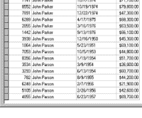

**图 6.4**  
*TClientDataSetGrid 提供关于当前排序顺序的视觉反馈。*

要进行排序，请单击其中一个列标题。该列的标题单元格中会绘制一个向上箭头。若要切换为降序，请再次单击该列标题。

如果您想对多列进行排序，请按住 Shift 键并单击要排序的下一个列标题。按住 Shift 键第二次单击列标题，将仅对该列进行降序排序。按住 Shift 键第三次单击该列，会将其从当前排序顺序中移除。对您想要排序的每一列重复此操作。


说难做易。如果前面的解释听起来很复杂，不妨亲自试一试：点击列标题，或者按住 Shift 键并点击列标题，观察其效果。

## 列自定义

除了自动排序功能外，**TClientDataSetGrid** 还提供了一个独立的对话框，可用于设置网格中可见的列（如图 6.5 所示）。要显示此对话框，请调用网格的 **ConfigureColumns** 方法，如下所示：

```python
CClientDataSetGrid1.ConfigureColumns;
```


**图 6.5**  
*TClientDataSetGrid 允许用户隐藏其不想看到的列。*

使用此对话框，用户可以隐藏或显示单个列。

如果您希望网格自动保存并恢复其列配置（包括列顺序以及单个列的可见性状态），请将 **ConfigFile** 属性设置为您希望用于持久化列信息的文件名称。请确保为每个网格使用不同的文件名，因为当前版本的组件不支持在单个文件中保存多个配置。

### 注意

> 由于 **TClientDataSetGrid** 的代码是免费提供的，我希望看到一些富有进取心的 Delphi 程序员在未来为其提供增强功能。我个人的愿望列表包括：
>
> - 将列配置保存和加载到 ini 文件以及 Windows 注册表中。
> - 增强 **列配置** 对话框，使其除了隐藏或显示列之外，还支持重新排序列。
> - 增强 **列配置** 对话框，使其支持锁定单个列，以便这些列无法被隐藏或移动。
> - 添加对 **OnColumnSized** 事件的支持。

## TDBCtrlGrid

我不会在 **TDBCtrlGrid** 上花太多时间，因为它不兼容 CLX，并且目前也没有关于 **TDBCtrlGrid** 的新开发。

**TDBCtrlGrid** 是一个类似网格的组件，尽管它依赖于其他数据感知组件来执行实际的数据输入和输出。要在应用程序中使用 **TDBCtrlGrid**，请将其拖放到窗体上，并将 **DataSource** 属性连接到您的数据源。然后，使用其他数据感知组件（如 **TDBEdit**、**TDBCheckBox** 等）来填充网格。

**TDBCtrlGrid** 在运行时复制这些组件，为网格中显示的每条记录显示相应的组件。网格中的每个单元格对应数据集中的单个记录。

大多数数据感知控件都是可复制的（即，它们可用于 **TDBCtrlGrid** 中）。有些则不是（包括我在前一章中创建的 **TDateTimePicker** 组件）。为了使控件可复制，它必须在其 **ControlStyle** 属性中包含 **csReplicable** 选项（通常在组件的构造函数中设置）。以下是 **TDBEdit** 构造函数中的一段代码：

```pascal
constructor TDBEdit.Create(AOwner: TComponent);
begin
   inherited Create(AOwner);
   inherited ReadOnly := True;
   ControlStyle := ControlStyle + [csReplicable];
   ...
end;
```

以下各节讨论了 **TDBCtrlGrid** 引入的属性和事件。

### 属性

**TDBCtrlGrid** 引入了一组可用于自定义其外观和感觉的属性。表 6.7 列出了这些属性。

**表 6.7 TDBCtrlGrid 属性**

| 属性 | 描述 |
| :------------------------------------ | :------------------------------------------------------------------------------------------------------------------------------------------------------------------------------------------------------------------------------------------------------------------------------------------------------------------------------------------------------------------------------------------------------------------------------------------------------------------------------------------------------------------------------------------------------------------------------------------------------------------------------------------------------------------------------------------------------------------------------------------------------ |
| AllowInsert | 当为 True 时，用户可以滚动超出网格中的最后一条记录以插入新记录。 |
| AllowDelete | 当为 True 时，用户可以通过按 Ctrl+Delete 删除当前记录。 |
| ColCount | 确定网格中显示的列数。 |
| Orientation | 确定网格显示更多数据时的滚动方向。 |
| PanelBorder | 可能的值为 gbNone 和 gbRaised。gbRaised 使网格具有凸起的外观。通过将 PanelBorder 设置为 gbNone 并将 TDBCtrlGrid 放置在一个具有所需倒角的窗体面板上，可以实现其他外观，例如凹陷或凸起。 |
| PanelHeight | 指单个面板（单元格）的高度（以像素为单位）。 |
| PanelWidth | 指单个面板（单元格）的宽度（以像素为单位）。 |
| RowCount | 确定网格中一次显示的行数。 |
| SelectedColor | 确定当前单元格的背景颜色。 |
| ShowFocus | 当为 True 时，在当前单元格周围绘制焦点矩形。 |

ColCount、PanelWidth 和 Width 属性直接相关。ColCount × PanelWidth 大约等于 Width（考虑网格边框和垂直滚动条）。只要 Align 设置不阻止，设置 ColCount 会自动调整 Width。（例如，将 Align 设置为 aClient 时，不允许网格调整大小。在这种情况下，设置 ColCount 会自动调整 PanelWidth。）

类似地，RowCount、PanelHeight 和 Height 属性也相互关联。设置其中一个属性会影响其他属性。

### 事件

**TDBCtrlGrid** 仅包含一个名为 OnPaintPanel 的新事件。OnPaintPanel 在即将绘制每个面板之前触发。OnPaintPanel 如下所示：

```pascal
procedure TForm1.DBCtrlGrid1PaintPanel(DBCtrlGrid: TDBCtrlGrid; Index: Integer);
begin
end;
```

Index 指的是即将绘制的面板的基于零的索引，其数值在 0 到 RowCount-1 之间（包含两端）。

您可能会注意到，传递给此函数时没有 Rect 参数，因此乍一看很难确定当前单元格的边界矩形。进入此方法时，网格画布的原点被设置为当前面板的左上角。换句话说，画布上的点 (0, 0) 指的是面板的左上角。点 (PanelWidth, PanelHeight) 指的是右下角。这使得您可以使用画布进行诸如在面板上绘制背景图像等操作（如下面取自列表 6.4 的代码片段所示）。

```pascal
procedure TForm1.DBCtrlGrid1PaintPanel(DBCtrlGrid: TDBCtrlGrid;
Index: Integer);
begin
if Index <> DBCtrlGrid1.PanelIndex then
DBCtrlGrid1.Canvas.Draw(0, 0, Image1.Picture.Graphic);
end;
```

此代码检查传入方法的索引，以查看我们是否正在绘制当前面板。（公共属性 PanelIndex 包含当前面板的编号。）所有非当前面板都用背景图形绘制。

列表 6.4 包含了 CtrlGrid 演示应用程序的完整源代码，该程序允许您试用 **TDBCtrlGrid** 的一些属性。

**列表 6.4 CtrlGrid—MainForm.pas**

```pascal
unit MainForm;

interface

uses
Windows, Messages, SysUtils, Variants, Classes, Graphics, Controls, Forms,
Dialogs, dbagrids, ExtCtrls, DB, DBClient, StdCtrls, Mask, DBCtrls,
ComCtrls;

type
TForm1 = class(TForm)
ClientDataSet1: TClientDataSet;
DataSource1: TDataSource;
pnlClient: TPanel;
DBCtrlGrid1: TDBCtrlGrid;
ecID: TDBEdit;
ecName: TDBEdit;
ecSalary: TDBEdit;
Label1: TLabel;
Label2: TLabel;
Label3: TLabel;
Label4: TLabel;
ecBirthday: TDBEdit;
panBottom: TPanel;
cbAllowInsert: TCheckBox;
cbAllowDelete: TCheckBox;
ecRowCount: TEdit;
ecColCount: TEdit;
cbShowFocus: TCheckBox;
Label5: TLabel;
Label6: TLabel;
Label7: TLabel;
cbOrientation: TComboBox;
Image1: TImage;
procedure FormCreate(Sender: TObject);
procedure cbAllowInsertClick(Sender: TObject);
procedure cbAllowDeleteClick(Sender: TObject);
procedure cbShowFocusClick(Sender: TObject);
procedure ecRowCountChange(Sender: TObject);
procedure ecColCountChange(Sender: TObject);
procedure cbOrientationClick(Sender: TObject);
procedure DBCtrlGrid1PaintPanel(DBCtrlGrid: TDBCtrlGrid;
Index: Integer);
private
{ 私有声明 }
public
{ 公共声明 }
end;

var
Form1: TForm1;

implementation
{$R *.dfm}

procedure TForm1.FormCreate(Sender: TObject);
begin
ClientDataSet1.LoadFromFile('C:\Employee.cds');
end;

procedure TForm1.cbAllowInsertClick(Sender: TObject);
begin
DBCtrlGrid1.AllowInsert := cbAllowInsert.Checked;
end;
```


## 列表 6.4
（续）

```pascal
procedure TForm1.cbAllowDeleteClick(Sender: TObject);
begin
  DBCtrlGrid1.AllowDelete := cbAllowDelete.Checked;
end;

procedure TForm1.cbShowFocusClick(Sender: TObject);
begin
  DBCtrlGrid1.ShowFocus := cbShowFocus.Checked;
end;

procedure TForm1.ecRowCountChange(Sender: TObject);
begin
  try
    DBCtrlGrid1.RowCount := StrToInt(ecRowCount.Text);
  except
    DBCtrlGrid1.RowCount := 1;
  end;
end;

procedure TForm1.ecColCountChange(Sender: TObject);
begin
  try
    DBCtrlGrid1.ColCount := StrToInt(ecColCount.Text);
  except
    DBCtrlGrid1.ColCount := 1;
  end;
end;

procedure TForm1.cbOrientationClick(Sender: TObject);
begin
  DBCtrlGrid1.Orientation := TDBCtrlGridOrientation(cbOrientation.ItemIndex);
end;

procedure TForm1.DBCtrlGrid1PaintPanel(DBCtrlGrid: TDBCtrlGrid;
  Index: Integer);
begin
  if Index <> DBCtrlGrid.PanelIndex then
    DBCtrlGrid.Canvas.Draw(0, 0, Image1.Picture.Graphic);
end;
```

图 6.6 展示了 CtrlGrid 在运行时的状态。


图 6.6
CrtGrid 演示了 TDBCtrlGrid 的行为。

## 第三方数据感知网格

尽管 TDBGrid 和 TClientDataSetGrid 是有用的网格组件，但它们的灵活性和功能远不及第三方数据感知网格所提供的。本节列出了几个更流行的第三方数据感知网格，如果您希望拥有比内置 Delphi 网格更多的功能，可以深入研究这些网格。

表 6.8 列出了一些更知名的第三方 TDBGrid 替代品。

### 表 6.8 TDBGrid 替代组件

| 产品 | 描述 |
| :--- | :--- |
| Orpheus | TurboPower Software Company 旗舰 Delphi-VCL 附加库包含两个数据感知网格组件，可用于格式化数据输入、多级数据显示以及列的自动小计和总计。请访问 www.turbopower.com 获取关于 Orpheus 的更多信息或下载免费试用版。 |
| InfoPower 2000 | 这个流行的通用 Delphi 库包含 TwnoDBGrid 组件，其工作方式类似于 TDBGrid，并增加了新功能（如备忘录显示和自动页脚）。请访问 www.wol12wo11.com 获取关于 InfoPower 产品的更多信息。 |
| ExpressQuantumGrid | 一个功能极其强大的 TDBGrid 替代品，提供众多高级网格功能——这里无法一一列举。一些显著的特性包括多行数据显示、运行时数据排序和分组，以及广泛的自定义功能（包括设计时和运行时）。如需更多信息，请访问 www.devexpress.com。 |
| TopGrid | 提供其强大网格组件的数据感知和非数据感知版本，允许显示和编辑多行备注、包含控件（如组合框和复选框）的单元格，以及众多自定义功能。您可以在 www.objectinsight.com/TopGridoverview.htm 找到 TopGrid。 |
| 其他 | 还有许多其他免费、共享和商业网格可供 Delphi 和 Kylix 程序员使用。本表中列出的只是当前 commercially available 的一些更流行、更广为人知的网格。 |

## 摘要

本章继续讨论数据感知组件，概述了数据感知网格，允许同时在屏幕上显示数据集的多行数据。具体来说，本章教会了您以下内容：

- 您可以通过在窗体上放置一个 `TDBGrid` 组件并使用默认值来快速创建一个粗糙的网格。要自定义结果网格中的列，请使用 `Columns` 属性。
- 存在各种网格选项，用于更改网格的外观和感受。（总结请见表 6.4。）
- 您可以使用各种网格事件来控制用户点击单元格或执行其他操作时发生的情况。（总结请见表 6.5。）
- 要完全控制网格的外观，请使用 `OnDrawColumnCell` 事件。
- `TClientDataSetGrid` 是一个免费组件，可用于自动列排序和额外的列自定义。
- `TDBCtrlGrid` 是一个特定的 VCL 组件，提供了将单个记录的数据安排成非线性格式的功能。

此外，本章还展示了如何处理几种常见的网格问题，例如检测列何时被移动以及持久化列状态。

下一章开始对客户端数据集进行为期两章的探索。

# 数据集提供程序

第 7 章

## 本章内容

- 什么是数据集提供程序？ 274
- 连接到数据集 275
- 解决数据更改 276
- 提供程序选项 293
- 提供程序事件 295
- 在服务器上更改字段值 297
- 拦截数据 298
- 可选参数 300
- 主/从关系 301
- 从存储过程和联接中提供和解决数据 302
- 连接到本地数据库 308

在本书的前面部分，您学习了 dbExpress——一种高性能、低开销的数据库技术。您了解到它是只读且单向的，这使得在大多数交互式数据库应用程序中直接使用起来比较繁琐。

后来，我向您介绍了客户端数据集。客户端数据集特别适用于数据库应用程序的前端，因为它们快速、灵活且功能强大。然而，由于基于 RAM，它们本质上是单用户的。此外，它们读取和写入专有的文件格式。

到目前为止，这些看起来像是用于解决不同类型编程问题的不同技术。本章和下一章将它们联系起来，展示如何使用客户端数据集读取和写入数据，同时使用 dbExpress 作为底层数据库技术。

本章展示了如何使用提供程序创建多层数据库应用程序。

## 什么是数据集提供程序？

数据集提供程序在客户端数据集和外部数据存储之间形成一条通道——通常是另一个数据集，如 TSQLDataSet。它应请求向客户端数据集提供数据，并在客户端更改数据时将其发送回底层数据存储——一种称为 *解决*（resolving）的技术。

用于实现此功能的组件是 TDataSetProvider，位于组件面板的数据访问选项卡中。

> **注意**
> 
> 关于数据集提供程序，并没有专门与 dbExpress 绑定的特性。本章中提供的信息也适用于其他数据库技术，如 BDE 和 dbGo（以前称为 ADOExpress）。
> 
> 数据集若要与 TDataSetProvider 兼容，它必须支持 IProviderSupport 接口，该接口在 DB.pas 中定义如下：

```
IProviderSupport = interface
  procedure PSEndTransaction(Commit: Boolean);
  procedure PSExecute;
  function PSExecuteStatement(const ASQL: string; AParams: TParams;
    ResultSet: Pointer = nil): Integer;
  procedure PSGetAttributes(List: TList);
  function PSGetDefaultOrder: TIndexDef;
  function PSGetKeyFields: string;
  function PSGetParams: TParams;
  function PSGetQuoteChar: string;
  function PSGetTableName: string;
  function PSGetIndexDefs(IndexTypes: TIndexOptions = [ixPrimary, ixNonMaintained]): TIndexDefs;
  function PSGetUpdateException(E: Exception;
        Prev: EUpdateError): EUpdateError;
  function PSInTransaction: Boolean;
  function PSQLBased: Boolean;
  function PSQLSupported: Boolean;
  procedure PSReset;
  procedure PSSetParams(AParams: TParams);
  procedure PSSetCommandText(const CommandText: string);
  procedure PSStartTransaction;
  function PSUpdateRecord(UpdateKind: TUpdateKind;
        Delta: TDataSet): Boolean;
end;
```

TDataSet 为这些方法实现了存根函数，它们通常什么也不做或引发异常。Delphi 中附带的数据集（BDE、dbExpress 和 dbGo）重写了这些方法以提供特定实现。

## 连接到数据集

在本节中，我将展示如何将客户端数据集连接到另一个数据集。为此，请遵循以下步骤：

1. 启动一个新应用程序，并将 TSQLConnection 和 TSQLDataSet 放在主窗体上。使用第 1 章和第 2 章中讨论的技术将这些组件连接到数据库。
2. 将 TDataSetProvider 放在主窗体上。将 DataSet 属性设置为 TSQLDataSet 组件。暂时将其他所有属性保留为默认值。
3. 将 TClientDataSet 放在主窗体上。将其 ProviderName 属性设置为上一步创建的数据集提供程序。
4. 将 TDataSource 组件连接到客户端数据集，并将 TDBGrid 组件连接到数据源。
5. 为窗体的 FormCreate 事件创建一个事件处理程序，并为其添加以下代码行：`ClientDataSet1.Open;`
6. 运行应用程序。

如果您正确设置了所有内容，应该会在网格中看到 dbExpress 数据库中的数据。请注意，您可以向前和向后滚动数据，并且

可以对数据进行修改。但是，如果你离开应用程序并再次运行它，你会发现对数据库的任何修改都未被保存。我们将在下一节中解决这一问题。现在，我只想让你看到建立客户端数据集与另一数据集之间关系有多简单。这种关系很重要，因为 dbExpress 数据集本身不支持编辑或双向滚动——它们必须连接到客户端数据集才能提供这些功能。

图 7.1 展示了连接到 CONMAN 数据库后上述步骤的执行结果。


*示例应用程序在设计时和运行时。*

你应该让这个示例应用程序保留在 Delphi 中或将其保存到磁盘的某个位置；我们将在随后的章节中对其加以完善。

## 解决数据变更

正如你在第 4 章中回忆到的，客户端数据集将数据更改存储在日志中，而不是立即将更改应用到底层数据。因此，当你在上一节中修改网格中的数据时，这些更改并未反映在底层数据库中。

### 应用更新

要将更改永久保存到数据库，你需要调用客户端数据集的 `ApplyUpdates` 方法。`ApplyUpdates` 会检测到数据集已连接到提供程序，并负责通过该提供程序将更改发送回数据库。

在你的示例应用程序中添加一个按钮，并为其创建 OnClick 处理程序。在 OnClick 处理程序中，添加以下代码：

```
if ClientDataSet.ApplyUpdates(0) > 0 then
  ShowMessage('Failed to update database');
```

现在再次运行应用程序，修改一些数据，然后点击按钮。如果你退出应用程序并重新运行它，你会发现这些更改确实已保存到数据库中。

对 ApplyUpdates 的调用接受一个参数，该参数指示错误的“容忍级别”。在这种情况下，我指定了零错误容忍级别。这意味着如果更新过程中发生任何错误，更改将被回滚，并且任何更新都不会提交到底层数据库。

**注意**

在将数据解决到数据库时，VCL/CLX 会自动在事务中包装这些更新，因此要么所有更改都生效，要么都不生效。在这种情况下，你无需编写任何处理事务的代码。

有时，你愿意在解决数据时容忍一个或多个错误。例如，如果用户在网格中修改了三行数据，但只有两个更改能成功保存，你可能仍然希望保存那两个更改。如果属于这种情况，请将允许的最大错误数传递给 ApplyUpdates。如果你不关心发生多少错误，可以传递参数 –1 调用 ApplyUpdates。

在调用 ApplyUpdates 之后，任何成功的更新都会从客户端数据集的变更日志中移除。如果有行无法更新，它们会保留在变更日志中。

你可能会想知道为什么提供程序无法将更改保存到底层数据库。最常见的原因是，当你在查看某一行数据时，另一个用户修改了同一行数据，或者在你有机会保存更改之前删除了该行。其他原因可能包括与数据库服务器的连接中断。

**注意**

TDataSetProvider 和 TClientDataSet 让你能够控制如何检测和应对数据冲突。本章稍后，我将介绍你可以使用的一些不同技术。

## 解决到数据集

TDataSetProvider 发布了一个名为 ResolveToDataSet 的属性。默认情况下，它为 *False*，表示提供程序直接将数据解决到与提供程序的 *DataSet* 相关联的数据库服务器。这通常是解决数据最有效的方式。

在某些情况下，你必须将 *ResolveToDataSet* 设置为 *True*。最常见的原因如下：

-   提供程序的 *DataSet* 未连接到数据库——例如，它是一个 TClientDataSet。
-   提供程序的 *DataSet* 不提供 IProviderSupport 接口的必要实现。

在这些情况下，更新将被应用到由提供程序的 *DataSet* 属性引用的数据集。然后，你可以处理提供程序的 *AfterApplyUpdates* 方法，使这些更改持久化（例如，对于 *TClientDataSet*，你可以调用数据集的 *SaveToFile* 方法）。*AfterApplyUpdates* 以及其他提供程序事件在本章后面题为“提供程序事件”的部分中讨论。

## 调整错误

默认情况下，如果在调整过程中发生一个或多个错误，*ApplyUpdates* 将返回大于零的数字，表示发生的错误数量。如果你只想知道是否有错误，这样就可以了。然而，它没有给你控制如何处理调整错误的任何手段。

为了对调整错误进行最大程度的控制，你应该为客户端数据集的 *OnReconcileError* 事件提供一个事件处理程序。一个空的处理程序看起来如下：

```
procedure TForm1.ClientDataSetReconcileError(
 DataSet: TCustomClientDataSet; E: EReconcileError;
 UpdateKind: TUpdateKind; var Action: TReconcileAction);
Begin
end;
```

*DataSet* 指发生调整错误的客户端数据集。*E* 是一个提供有关错误更多信息的异常。*UpdateKind* 是 *表 7.1* 中列出的值之一。你应该将 *Action* 设置为 *表 7.2* 中列出的值之一，以指示 VCL 针对问题记录采取什么操作。

*OnReconcileError* 事件为每个问题记录触发一次。如果八个更新被解决回提供程序，其中两个与另一个用户之前做的更改冲突，那么 *OnReconcileError* 将被触发两次。根据针对每个记录采取的操作，*ApplyUpdates* 返回的数字可能是 0、1 或 2。这在 *表 7.2* 中有更详细的说明。

`ApplyUpdates` 返回的值还取决于传递给 `ApplyUpdates` 的参数。返回值永远不会比参数指定的值大于一。例如，如果你向 `ApplyUpdates` 传递 0（通常就是这样做的），返回值将是 0 或 1。

### 表 7.1 UpdateKind 值

| 值 | 描述 |
| :--- | :--- |
| ukInsert | 该记录是新插入的记录。 |
| ukModify | 对现有记录进行了修改。 |
| ukDelete | 该记录指代已删除的记录。 |

### 表 7.2 TReconcileAction 值

| 值 | 描述 |
| :--- | :--- |
| raSkip | 不将此记录上的更新应用到该记录。未应用的更改保留在客户端数据集的变更日志中。此记录将计入 `ApplyUpdates` 的返回值中。 |
| raAbort | 中止整个操作。底层数据库完全不会进行任何更新，所有更改都保留在客户端数据集的变更日志中。所有记录都计入 `ApplyUpdates` 的返回值中。 |
| raMerge | 将该记录与底层数据库中的记录合并。仅当记录中更改的字段没有与他人更改的字段发生冲突时，此操作才有效。此记录不会计入 `ApplyUpdates` 的返回值中。为了使此选项可用，你必须在主键的所有字段上设置 `pfnKey` 标志（将在题为“更新模式”的部分中讨论）。 |
| raCorrect | 表示在 OnReconcileError 事件处理程序中对该记录进行了更改。VCL/CLX 应尝试使用新的字段值再次尝试更新。 |
| raCancel | 取消对该记录的更改，恢复到原始记录数据。此记录不会计入 `ApplyUpdates` 的返回值中。 |
| raRefresh | 取消对该记录的更改并从数据库重新读取记录数据。此记录不会计入 `ApplyUpdates` 的返回值中。为了使此选项可用，你必须为主键中的所有字段设置 `pfnKey` 标志。 |


幸运的是，在大多数情况下，您不必担心为 OnReconcileError 编写复杂的事件处理程序。Delphi 提供了一个预先编写好的类，您可以使用它来处理协调错误。要使用此类，请执行以下步骤：

1.  从 Delphi 主菜单中，选择“文件”、“新建”、“其他”。
2.  在“新单元”对话框的“对话框”选项卡上，选择“协调错误对话框”图标。确保在图标列表下方的选项按钮中选中了“复制”（参见图 7.2）。
3.  点击“确定”。
4.  将生成的单元保存为类似 ReconcileErrorForm.pas 的名称。（名称并不重要）。
5.  将新单元添加到包含客户端数据集的窗体的 uses 子句中（在本例中，它是主窗体）。
6.  将以下代码添加到客户端数据集的 OnReconcileError 事件中：
    `Action := HandleReconcileError( DataSet, UpdateKind, E);`

这里我不会详细介绍 HandleReconcileError 的内部工作原理。你应该查看该单元的源代码，以了解其工作机制。


**图 7.2**
*将 TReconcileErrorForm 插入到你的应用程序中。*

清单 7.1 包含了 Updates 示例应用程序主窗体的源代码，它展示了本章到目前为止讨论的概念。

# **清单 7.1** Updates—MainForm.pas

```pascal
unit MainForm;

interface

uses
  SysUtils, Variants, Classes, QGraphics, QControls, QForms,
  QStdCtrls, QDialogs, QExtCtrls, DBXpress, FMTCBD, QGrids, QDBGrids, DB, Provider, DBClient, SqlExpr, QDBCtrl, QTypes;

type
  TfrmMain = class(TForm)
    pnlClient: TPanel;
    pnlBottom: TPanel;
    SQLConnection1: TSQLConnection;
    SQLDataSet1: TSQLDataSet;
    ClientDataSet1: TClientDataSet;
    DataSetProvider1: TDataSetProvider;
    DataSource1: TDataSource;
    DBGrid1: TDBGrid;
    btnApplyUpdates: TButton;
    btnCancelUpdates: TButton;
    lbUpdates: TLabel;
    Timer1: TTimer;
    DBNavigator1: TDBNavigator;
    SQLDataSet1CONTACTID: TIntegerField;
    SQLDataSet1FIRST: TStringField;
    SQLDataSet1LAST: TStringField;
    SQLDataSet1DEAR: TStringField;
    SQLDataSet1TITLE: TStringField;
    SQLDataSet1COMPANYNAME: TStringField;
    SQLDataSet1ADDRESS1: TStringField;
    SQLDataSet1ADDRESS2: TStringField;
    SQLDataSet1CITY: TStringField;
    SQLDataSet1STATE: TStringField;
    SQLDataSet1POSTALCODE: TStringField;
    SQLDataSet1COUNTRY: TStringField;
    SQLDataSet1PHONE: TStringField;
    SQLDataSet1FAX: TStringField;
    SQLDataSet1CELLULAR: TStringField;
    SQLDataSet1PAGER: TStringField;
    SQLDataSet1EMAIL: TStringField;
    SQLDataSet1IMAGE: TBlobField;
    SQLDataSet1NOTES: TMemoField;
    sqlID: TSQLDataSet;
    lbEvents: TListBox;
    Label1: TLabel;
    btnClearEventLog: TButton;
    procedure FormCreate(Sender: TObject);
    procedure Timer1Timer(Sender: TObject);
    procedure btnApplyUpdatesClick(Sender: TObject);
    procedure btnCancelUpdatesClick(Sender: TObject);
    procedure ClientDataSetReconcileError(DataSet: TCustomClientDataSet;
      E: EReconcileError; UpdateKind: TUpdateKind;
      var Action: TReconcileAction);
    procedure DataSetProvider1BeforeUpdateRecord(Sender: TObject;
      SourceDS: TDataSet; DeltaDS: TCustomClientDataSet;
      UpdateKind: TUpdateKind; var Applied: Boolean);
    procedure DataSetProvider1AfterApplyUpdates(Sender: TObject;
      var OwnerData: OleVariant);
    procedure DataSetProvider1AfterExecute(Sender: TObject;
      var OwnerData: OleVariant);
    procedure DataSetProvider1AfterGetParams(Sender: TObject;
      var OwnerData: OleVariant);
    procedure DataSetProvider1AfterGetRecords(Sender: TObject;
      var OwnerData: OleVariant);
    procedure DataSetProvider1AfterRowRequest(Sender: TObject;
      var OwnerData: OleVariant);
    procedure DataSetProvider1AfterUpdateRecord(Sender: TObject;
      SourceDS: TDataSet; DeltaDS: TCustomClientDataSet;
      UpdateKind: TUpdateKind);
    procedure DataSetProvider1BeforeApplyUpdates(Sender: TObject;
      var OwnerData: OleVariant);
    procedure DataSetProvider1BeforeExecute(Sender: TObject;
      var OwnerData: OleVariant);
    procedure DataSetProvider1BeforeGetParams(Sender: TObject;
      var OwnerData: OleVariant);
    procedure DataSetProvider1BeforeGetRecords(Sender: TObject;
      var OwnerData: OleVariant);
    procedure DataSetProvider1BeforeRowRequest(Sender: TObject;
      var OwnerData: OleVariant);
    function DataSetProvider1DataRequest(Sender: TObject;
      Input: OleVariant): OleVariant;
    procedure DataSetProvider1GetData(Sender: TObject;
      DataSet: TCustomClientDataSet);
    procedure DataSetProvider1GetDatasetProperties(Sender: TObject;
      DataSet: TDataSet; out Properties: OleVariant);
    procedure DataSetProvider1GetTableName(Sender: TObject;
      DataSet: TDataSet; var TableName: string);
    procedure DataSetProvider1UpdateData(Sender: TObject;
      DataSet: TCustomClientDataSet);
    procedure DataSetProvider1UpdateError(Sender: TObject;
      DataSet: TCustomClientDataSet; E: UpdateError;
      UpdateKind: TUpdateKind; var Response: TResolverResponse);
    procedure ClientDataSet1AfterApplyUpdates(Sender: TObject;
      var OwnerData: OleVariant);
    procedure ClientDataSet1AfterExecute(Sender: TObject;
      var OwnerData: OleVariant);
    procedure ClientDataSet1AfterGetParams(Sender: TObject;
      var OwnerData: OleVariant);
    procedure ClientDataSet1AfterGetRecords(Sender: TObject;
      var OwnerData: OleVariant);
    procedure ClientDataSet1AfterRefresh(DataSet: TDataSet);
    procedure ClientDataSet1AfterRowRequest(Sender: TObject;
      var OwnerData: OleVariant);
    procedure ClientDataSet1BeforeApplyUpdates(Sender: TObject;
      var OwnerData: OleVariant);
    procedure ClientDataSet1BeforeExecute(Sender: TObject;
      var OwnerData: OleVariant);
    procedure ClientDataSet1BeforeGetParams(Sender: TObject;
      var OwnerData: OleVariant);
    procedure ClientDataSet1BeforeGetRecords(Sender: TObject;
      var OwnerData: OleVariant);
    procedure ClientDataSet1BeforeRefresh(DataSet: TDataSet);
    procedure ClientDataSet1BeforeRowRequest(Sender: TObject;
      var OwnerData: OleVariant);
    procedure btnClearEventLogClick(Sender: TObject);
  private
    function GetNextID: Integer;
    procedure Log(const s: string);
    { Private declarations }
  public
    { Public declarations }
  end;

var
  frmMain: TfrmMain;

implementation

uses RecErrorForm;

{$R *.xfm}

procedure TfrmMain.FormCreate(Sender: TObject);
begin
  ClientDataSet1.Open;
end;

procedure TfrmMain.Timer1Timer(Sender: TObject);
begin
  lbUpdates.Caption := IntToStr(ClientDataSet1.ChangeCount) + ' Update(s)';
end;

procedure TfrmMain.btnApplyUpdatesClick(Sender: TObject);
begin
  ShowMessage('ApplyUpdates returned a value of ' +
    IntToStr(ClientDataSet1.ApplyUpdates(0)));
end;

procedure TfrmMain.btnCancelUpdatesClick(Sender: TObject);
begin
  ClientDataSet1.CancelUpdates;
end;

procedure TfrmMain.ClientDataSetReconcileError(
  DataSet: TCustomClientDataSet; E: EReconcileError;
  UpdateKind: TUpdateKind; var Action: TReconcileAction);
begin
  Action := HandleReconcileError(DataSet, UpdateKind, E);
end;

function TfrmMain.GetNextID: Integer;
begin
  sqlID.ExecSQL;
  Result := sqlID.ParamByName('AValue').AsInteger;
end;

procedure TfrmMain.DataSetProvider1BeforeUpdateRecord(Sender: TObject;
  SourceDS: TDataSet; DeltaDS: TCustomClientDataSet;
  UpdateKind: TUpdateKind; var Applied: Boolean);
begin
  Log('TDataSetProvider.BeforeUpdateRecord');

  if UpdateKind = ukInsert then
    if DeltaDS.FieldByName('ID').OldValue <= 0 then
      DeltaDS.FieldByName('ID').NewValue := GetNextID;
end;

procedure TfrmMain.Log(const s: string);
begin
  lbEvents.Items.Add(s);
end;

procedure TfrmMain.DataSetProvider1AfterApplyUpdates(Sender: TObject;
  var OwnerData: OleVariant);
begin
  Log('TDataSetProvider.AfterApplyUpdates');
end;

procedure TfrmMain.DataSetProvider1AfterExecute(Sender: TObject;
  var OwnerData: OleVariant);
begin
  Log('TDataSetProvider.AfterExecute');
end;

procedure TfrmMain.DataSetProvider1AfterGetParams(Sender: TObject;
  var OwnerData: OleVariant);
begin
  Log('TDataSetProvider.AfterGetParams');
end;

procedure TfrmMain.DataSetProvider1AfterGetRecords(Sender: TObject;
  var OwnerData: OleVariant);
begin
  Log('TDataSetProvider.AfterGetRecords');
end;

procedure TfrmMain.DataSetProvider1AfterRowRequest(Sender: TObject;
  var OwnerData: OleVariant);
begin
  Log('TDataSetProvider.AfterRowRequest');
end;

procedure TfrmMain.DataSetProvider1AfterUpdateRecord(Sender: TObject;
  SourceDS: TDataSet; DeltaDS: TCustomClientDataSet;
  UpdateKind: TUpdateKind);
begin
  Log('TDataSetProvider.AfterUpdateRecord');
end;

procedure TfrmMain.DataSetProvider1BeforeApplyUpdates(Sender: TObject;
  var OwnerData: OleVariant);
begin
  Log('TDataSetProvider.BeforeApplyUpdates');
end;
```


# 列表 7.1 续

```delphi
begin
   Log('TDataSetProvider.BeforeApplyUpdates');
end;

procedure TfrmMain.DataSetProvider1BeforeExecute(Sender: TObject;
  var OwnerData: OleVariant);
begin
   Log('TDataSetProvider.BeforeExecute');
end;

procedure TfrmMain.DataSetProvider1BeforeGetParams(Sender: TObject;
  var OwnerData: OleVariant);
begin
   Log('TDataSetProvider.BeforeGetParams');
end;

procedure TfrmMain.DataSetProvider1BeforeGetRecords(Sender: TObject;
  var OwnerData: OleVariant);
begin
   Log('TDataSetProvider.BeforeGetRecords');
end;

procedure TfrmMain.DataSetProvider1BeforeRowRequest(Sender: TObject;
  var OwnerData: OleVariant);
begin
   Log('TDataSetProvider.BeforeRowRequest');
end;

function TfrmMain.DataSetProvider1DataRequest(Sender: TObject;
  Input: OleVariant): OleVariant;
begin
   Log('TDataSetProvider.OnDataRequest');
end;

procedure TfrmMain.DataSetProvider1GetData(Sender: TObject;
  DataSet: TCustomClientDataSet);
begin
   Log('TDataSetProvider.OnGetData');
end;

procedure TfrmMain.DataSetProvider1GetDataSetProperties(Sender: TObject;
  DataSet: TDataSet; out Properties: OleVariant);
begin
   Log('TDataSetProvider.OnDataSetProperties');
end;

procedure TfrmMain.DataSetProvider1GetTableName(Sender: TObject;
          DataSet: TDataSet; var TableName: String);
begin
   Log('TDataSetProvider.OnGetTableName');
end;

procedure TfrmMain.DataSetProvider1UpdateData(Sender: TObject;
          DataSet: TCustomClientDataSet);
begin
   Log('TDataSetProvider.OnUpdateData');
end;

procedure TfrmMain.DataSetProvider1UpdateError(Sender: TObject;
          DataSet: TCustomClientDataSet; E: EUpdateError; UpdateKind: UpdateKind;
          var Response: TResolveResponse);
begin
   Log('TDataSetProvider.OnUpdateError');
end;

procedure TfrmMain.ClientDataSet1AfterApplyUpdates(Sender: TObject;
          var OwnerData: OleVariant);
begin
   Log('TClientDataSet.AfterApplyUpdates');
end;

procedure TfrmMain.ClientDataSet1AfterExecute(Sender: TObject;
          var OwnerData: OleVariant);
begin
   Log('TClientDataSet.AfterExecute');
end;

procedure TfrmMain.ClientDataSet1AfterGetParams(Sender: TObject;
          var OwnerData: OleVariant);
begin
   Log('TClientDataSet.AfterGetParams');
end;

procedure TfrmMain.ClientDataSet1AfterGetRecords(Sender: TObject;
          var OwnerData: OleVariant);
begin
   Log('TClientDataSet.AfterGetRecords');
end;

procedure TfrmMain.ClientDataSet1AfterRefresh(DataSet: TDataSet);
begin
  Log('TClientDataSet.AfterRefresh');
end;

procedure TfrmMain.ClientDataSet1AfterRowRequest(Sender: TObject;
  var OwnerData: OleVariant);
begin
  Log('TClientDataSet.AfterRowRequest');
end;

procedure TfrmMain.ClientDataSet1BeforeApplyUpdates(Sender: TObject;
  var OwnerData: OleVariant);
begin
  Log('TClientDataSet.BeforeApplyUpdates');
end;

procedure TfrmMain.ClientDataSet1BeforeExecute(Sender: TObject;
  var OwnerData: OleVariant);
begin
  Log('TClientDataSet.BeforeExecute');
end;

procedure TfrmMain.ClientDataSet1BeforeGetParams(Sender: TObject;
  var OwnerData: OleVariant);
begin
  Log('TClientDataSet.BeforeGetParams');
end;

procedure TfrmMain.ClientDataSet1BeforeGetRecords(Sender: TObject;
  var OwnerData: OleVariant);
begin
  Log('TClientDataSet.BeforeGetRecords');
end;

procedure TfrmMain.ClientDataSet1BeforeRefresh(DataSet: TDataSet);
begin
  Log('TClientDataSet.BeforeRefresh');
end;

procedure TfrmMain.ClientDataSet1BeforeRowRequest(Sender: TObject;
  var OwnerData: OleVariant);
begin
  Log('TClientDataSet.BeforeRowRequest');
end;

procedure TfrmMain.btnClearEventLogClick(Sender: TObject);
begin
  lbEvents.Items.Clear;
end;
```

在计算机上运行两次此应用程序。在第一个实例中，将 John 的名字改为 Eddie 并应用更新。在第二个实例中，你会注意到记录的名字仍然显示为 John。将 John 的姓氏改为 Smith 并应用更新。此时将触发 OnReconcileError 事件，表明在此期间其他人已更改了该记录（见图 7.3）。


**图 7.3**

*Delphi 的协调错误处理程序允许用户决定如何处理记录冲突。*

默认情况下，此对话框仅显示冲突的值——换句话说，就是被其他用户更改的字段。取消选中“仅显示冲突字段”复选框以显示所有字段值。如果你这样做，你会发现此应用程序将 LAST 字段从 Lombardo 改为了 Smith。另一个应用程序将 FIRST 字段从 John 改为了 Eddie。

对话框的右上角包含一组选项按钮，用户可以使用这些按钮来指示 Delphi 如何处理错误。这些选项按钮对应于 TReconcileAction 的 raSkip、raCancel、raCorrect、raRefresh 和 raMerge 值。列表中没有 raAbort 选项，但单击“取消”按钮会导致事件处理程序返回 raAbort 值。


与本书中介绍的其他几个示例应用程序一样，Updates 应用程序包含一个事件日志列表框，显示数据提供程序和客户端数据集在何时以及按什么顺序触发了哪些感兴趣的事件。本章后面标题为“提供程序事件”的部分讨论了这些事件。

### 解决 BLOB 字段的变更

TDataSetProvider 不会自动检查 BLOB 字段（包括备忘录）的冲突。如果两个用户更改了 BLOB 字段或备忘录的内容，第二个用户的更改将无警告地覆盖第一个用户的更改。

处理这种情况的最佳方法可能是为每个 BLOB 字段在数据库中创建一个对应的整数字段。整数字段包含 BLOB 字段的“更新编号”。例如，如果数据库表包含一个名为 IMAGE 的列，请添加一个名为 IMAGEUNIQUE 的整型列，或类似的名称。为 IMAGE 列创建一个触发器，以便每当 IMAGE 列的值发生变化时，IMAGEUNIQUE 列都会递增。

使用此技术，你的应用程序可以检测 IMAGEUNIQUE 列上的更改，这表明 IMAGE 列也发生了更改。

### 从服务器刷新数据

前面的章节讨论了 TDBNavigator 组件，除了一个按钮——刷新按钮除外。

TDBNavigator 的刷新按钮（调用 TDataSet.Refresh 方法）用于从底层数据库刷新数据集。对于 TClientDataSet，Refresh 通过数据提供程序重新获取所有行来刷新数据。

> **注意**
>
> 如果数据集的变更日志不为空，Refresh 将引发异常。在直接调用 TClientDataSet.Refresh 之前，你应该检查 ChangeCount 属性，看它是否为零。如果非零，请先应用或取消更新（使用 ApplyUpdates 或 CancelUpdates），或者不要调用 Refresh。

在发生协调错误并且你希望从底层数据库获取最新数据的情况下，从提供程序刷新数据是有用的。你还可以在其他时间调用它，以确保本地数据副本是最新的。

除了调用 `Refresh` 来刷新整个数据集外，你还可以调用 `TClientDataSet.RefreshRecord` 来仅刷新当前记录。如果数据集的变更日志不为空，`RefreshRecord` 不会引发异常。相反，它会保持整个变更日志完整，包括对已刷新记录所做的任何更改。

> **说明**
>
> `RefreshRecord` 要求主键中的所有字段都设置了 `pfrnKey`（如下节所述）。此外，通常仅在当前记录的 `UpdateSetStatus` 为 `usUnmodified` 时才调用 `RefreshRecord`。
>
> ```delphi
> if ClientDataSet1.UpdateSetStatus = usUnmodified then
>     ClientDataSet1.RefreshRecord;
> ```

### 更新模式

在将数据解析到数据库时，`TDataSetProvider` 会自动构建必要的 SQL 语句，并将其发送到服务器以执行更新。此类 SQL 语句的一个示例是

```sql
UPDATE CONTACTS SET LAST = 'Smith' WHERE ID = 5
```

`TDataSetProvider` 允许你控制 SQL 语句的构建方式。第一级控制由 `TDataSetProvider.UpdateMode` 属性提供。`UpdateMode` 可以设置为表 7.3 中所示的值之一。

**表 7.3** UpdateMode 值

| 值 | 描述 |
| :--- | :--- |
| `upWhereAll` | 所有指定字段都包含在 `WHERE` 子句中。 |
| `upWhereChanged` | 仅键字段以及已修改的字段包含在 `WHERE` 子句中。 |
| `upWhereKeyOnly` | 仅键字段包含在 `WHERE` 子句中。 |

假设有一个名为 `EMPLOYEES` 的表，有四个列：`ID`、`NAME`、`BIRTHDAY` 和 `SALARY`。`ID` 是该表的主键。表中的一个特定记录包含的值是 `1`、"John Smith"、`5/1/1958` 和 `$40,000`。

以下 SQL 语句展示了在假设 John Smith 的 `SALARY` 字段从 $40,000 更改为 $45,000 的情况下，针对 `UpdateMode` 的各种设置将生成什么 SQL 语句。


当 `UpdateMode = upWhereAll` 时，SQL 语句如下：

```sql
UPDATE EMPLOYEES SET SALARY TO 45000 WHERE (ID = 1) AND (NAME = 'John Smith')
AND (BIRTHDAY = '5/1/1958') AND (SALARY = 40000)
```

当 `UpdateMode = upWhereChanged` 时，SQL 语句如下：

```sql
UPDATE EMPLOYEES SET SALARY TO 45000 WHERE (ID = 1) AND (SALARY = 40000)
```

最后，当 `UpdateMode = upWhereKeyOnly` 时，SQL 语句如下：

```sql
UPDATE EMPLOYEES SET SALARY TO 45000 WHERE ID = 1
```

表 7.3 描述了指定字段和键字段。那么，究竟什么才算作指定字段或键字段呢？在服务器数据模块中创建的每个持久字段都有一个 `ProviderFlags` 属性，该属性用于指示提供程序如何处理该字段。`ProviderFlags` 是一个集合属性，可以包含表 7.4 中列出的任何或所有值。

`ProviderFlags` 是 `TField` 的属性，这意味着你不需要拥有持久字段即可使用 `ProviderFlags`。你可以为非持久字段设置 `ProviderFlags`，如下所示：

`SQLClients.FieldByName('ID').ProviderFlags := [pfInWhere, pfInKey];`

### 表 7.4 UpdateMode 值

| 值 | 描述 |
| :---- | :---------- |
| pfUpdate | 该字段可以被修改。 |
| pfInWhere | 当 UpdateMode 设置为 upWhereAll 或 upWhereChanged 时，该字段包含在 WHERE 子句中。 |
| pfInKey | 该字段是主键的一部分，并控制诸如通过调用 RefreshRecord 来刷新记录以及合并等协调选项等功能。 |
| pfHidden | 该字段仅作为使每条记录唯一的方式包含在发送至客户端和从客户端接收的数据包中。客户端数据集无法查看或修改该字段。 |

> **注意**
> 非持久字段也有一个 `ProviderFlags` 属性，它会自动设置为 [pfInUpdate, pfInWhere]。

继续以之前提到的 EMPLOYEES 表示例，你需要为表设置持久字段，如表 7.5 所示。

**表 7.5** *虚构 EMPLOYEES 表字段的 ProviderFlags 设置*

| 字段 | ProviderFlags |
|---|---|
| ID | [pfInUpdate, pfInWhere, pfInKey] |
| NAME | [pfInUpdate, pfInWhere] |
| BIRTHDAY | [pfInUpdate, pfInWhere] |
| SALARY | [pfInUpdate, pfInWhere] |

**ID** 是该表的主键。

**NAME**、**BIRTHDAY** 和 **SALARY** 都可以更新，并且当提供程序的 *UpdateMode* 属性设置为 *upWhereAll* 时，它们都应该包含在更新 SQL 语句的 *WHERE* 子句中。

## 提供程序选项

*TDataSetProvider* 支持各种选项，这些选项决定了数据发送至客户端数据集的方式、允许对数据进行哪些更改，以及如何处理数据的更新。*TDataSetProvider.Options* 是一个集合属性，允许你按喜好自定义这些选项。

表 7.6 展示了 *Options* 属性的有效设置。

**表 7.6** *TDataSetProvider 选项*

| 选项 | 描述 |
|---|---|
| poFetchBlobsOnDemand | 当为 *True* 时，BLOB 不作为数据包的一部分从服务器返回。客户端应用程序必须调用 *TClientDataSet.FetchBlobs* 来检索 BLOB 数据。当为 *False* 时，BLOB 作为数据包的一部分返回。 |
| poFetchDetailsOnDemand | 当提供程序是主/从关系的一部分时使用。当为 *True* 时，从记录不作为数据包的一部分从服务器返回。客户端应用程序必须调用 *TClientDataSet.FetchDetails* 来检索从记录。当为 *False* 时，从记录作为数据包的一部分返回。 |
| poIncFieldProps | 当为 *True* 时，字段属性（包括 *Alignment*、*Currency*、*DisplayFormat*、*DisplayLabel*、*DisplayValues*、*DisplayWidth*、*EditFormat*、*EditMask*、*MaxValue*、*MinValue* 和 *Visible*）将随数据一起发送到客户端。 |
| poCascadeDeletes | 当提供程序是主/从关系的一部分时使用。当为 True 时，删除主记录时服务器会自动删除从记录。 |
| poCascadeUpdates | 当提供程序是主/从关系的一部分时使用。当为 True 时，主记录的键值发生变化时，服务器会自动更新从记录。 |
| poReadOnly | 当为 True 时，无法编辑客户端数据集内的数据。 |
| poAllowMultiRecordUpdates | 当为 True 时，允许影响多个记录的更新。当为 False 时，影响不止一条记录的更新将引发异常。 |
| poDisableInserts | 当为 True 时，客户端数据集将无法 `Insert` 或 `Append` 新记录。 |
| poDisableEdits | 当为 True 时，客户端数据集将无法 `Edit` 现有记录。 |
| poDisableDeletes | 当为 True 时，客户端数据集将无法 `Delete` 现有记录。 |
| poNoReset | 当为 True 时，AS_GetRecords 的调用将忽略重置标志。 |
| poAutoRefresh | 当为 True 时，提供程序会自动使用数据库中的最新数据刷新已更新的记录。值得注意的是，截至第 6 版，Delphi 中尚未实现此选项。 |
| poPropagateChanges | 当为 True 时，在 `BeforeUpdateRecord` 或 `AfterUpdateRecord` 事件处理程序中发生的任何数据更改都会发送回客户端。 |
| poAllowCommandText | 当为 True 时，客户端数据集可以覆盖提供程序数据集的 `CommandText` 属性。当为 False 时，尝试设置客户端数据集的 `CommandText` 属性会引发异常。 |
| poRetainServerOrder | 当为 True 时，提示客户端数据集不要尝试对从服务器返回的数据进行排序。 |

在本文写作时，`poAutoRefresh` 选项尚未实现。当数据库自动填充字段值时，`poAutoRefresh` 将有助于从数据库刷新已更新的记录。

例如，数据库可能包含一个触发器，使用生成器自动生成表的主键。在将新记录提交到数据库时，该字段的值可能为 NULL。在提交操作期间，数据库将填充主键的值，随后 `poAutoRefresh` 会重新读取记录，以便 Delphi 应用程序获知主键的值。

如果没有 `poAutoRefresh` 选项，你仍然可以为记录自动生成主键值，但你需要在服务器端数据模块中做一些额外的工作。该技术将在后面标题为“在服务器上更改字段值”的部分中解释。

## 提供程序事件

TDataSetProvider 发布两种类型的事件——OnXxx 和 BeforeXxx/AfterXxx。BeforeXxx/AfterXxx 事件在提供程序中发生“有趣”事件（例如将更新应用到底层数据库时）的前后触发。

表 7.7 列出了 TDataSetProvider 支持的 Before 和 After 事件。

**表 7.7 TDataSetProvider BeforeXxx/AfterXxx 事件**

| 事件 | 描述 |
|---|---|
| AfterApplyUpdates | 在数据库更新完成后触发。 |
| AfterExecute | 在服务器执行最终向客户端返回数据的查询或存储过程后触发。 |
| AfterGetParams | 在服务器将输出参数从数据集返回给客户端数据集后触发。 |
| AfterGetRecords | 在提供程序创建用于发送至客户端的数据包后触发。 |
| AfterRowRequest | 在提供程序因调用 TClientDataSet.RefreshRecord 或其他获取数据的方法而刷新当前记录后触发。 |
| AfterUpdateRecord | 在记录成功更新后触发。 |
| BeforeApplyUpdates | 在更新应用到数据库之前触发。 |
| BeforeExecute | 在服务器执行查询或存储过程之前触发。 |
| BeforeGetParams | 在服务器将输出参数从数据集返回给客户端数据集之前触发。 |
| BeforeGetRecords | 在提供程序创建用于发送至客户端的数据包之前触发。 |
| BeforeRowRequest | 在提供程序因调用 TClientDataSet.RefreshRecord 或其他获取数据的方法而刷新当前记录之前触发。 |
| BeforeUpdateRecord | 在每条记录的更新应用到数据库之前触发。 |

大多数 BeforeXXX 和 AfterXXX 事件都会传递一个名为 OwnerData 的参数。OwnerData 是一个变体（variant），包含用户定义的数据。在 `ApplyUpdates` 等某些方法调用期间，数据从客户端数据集传递到提供程序，然后再传回客户端数据集。流程如下：

在客户端数据集的 BeforeXXX 事件（例如 BeforeGetRecords）中，可以将 OwnerData 设置为你想要传递给提供程序的任何内容。因为它是一个变体，所以可以包含简单的值（如整数）或更复杂的内容（如值数组）。

当流程传递到提供程序时，OwnerData 参数会被传递给提供程序的 BeforeXXX 事件。如有需要，可以在 BeforeXXX 事件中更改 OwnerData 的值。

接下来，流程继续到提供程序的 AfterXXX 事件，如有必要，在此处可以再次更改 OwnerData。

最后，流程传递到客户端数据集的 AfterXXX 事件，此时你可以检查（可能已被修改的）OwnerData 值。客户端数据集的 AfterXXX 事件是流程的终点，因此在客户端数据集的 AfterXXX 事件中没有理由修改 OwnerData 的值。

下一章展示了一个示例，说明如何使用 OwnerData 参数来实现无状态服务器。OnXXX 事件被触发，以便应用程序代码能够“挂钩”到向客户端提供数据并将其解析回服务器过程中的各个阶段。表 7.8 列出了 TDataSetProvider 组件支持的事件及其用途。

**表 7.8 TDataSetProvider OnXXX 事件**

| 事件 | 描述 |
| :--- | :--- |
| OnGetData | 在从底层数据库获取数据后、但将数据返回给客户端之前触发。你可以处理此事件，在将数据传递给客户端之前以某种方式修改数据。例如，你可以加密字段、压缩数据，或剔除客户端不应看到的某些数据。本章后面的“拦截数据”部分将讨论此事件。 |


## 表 7.8 续

| 事件 | 描述 |
|---|---|
| OnGetDataSetProperties | 在从底层数据库获取数据之后，但将数据返回给客户端之前触发。使用可选参数（在本章后面的“可选参数”一节中讨论），你可以向客户端发送额外信息。 |
| OnGetTableName | 当提供程序从连接或存储过程返回数据时使用。你可以处理此事件以指示提供程序将更新应用到哪个表。此选项在本章后面“提供和解析连接数据”一节中讨论。 |
| OnUpdateData | OnUpdateData 是 OnGetData 的对应事件。它在更新发送到数据库服务器之前触发。你可以处理此事件以在数据保存到数据库之前对其进行解密，例如。此事件在本章后面的“拦截数据”一节中讨论。 |
| OnUpdateError | 在协调数据时发生错误时触发。如果你不处理此事件，错误将返回给客户端应用程序。你可以处理此事件以忽略某些错误，或者在返回给客户端之前在服务器端尝试更正它们。 |

一些更有趣的事件将在随后的章节中详细讨论。

## 在服务器上更改字段值

有时，你希望服务器对客户端传递给它的数据进行修改。最常见的例子是当表包含一个作为该表主键的 ID 字段时。数据库服务器通常负责为每个单独记录分配唯一的 ID。

为了完成此操作，你必须遵循以下步骤：

- 1. 在数据库中创建一个将返回下一个唯一 ID 的存储过程。
- 2. 在 `TDataSetProvider` 的 `Options` 属性中包含 `poPropagateChanges` 设置。
- 3. 在 ID 字段的 `ProviderFlags` 中包含 `pfInKey` 设置。
- 4. 为提供程序的 `BeforeUpdateRecord` 事件提供事件处理程序。


在针对新插入记录的 **BeforeUpdateRecord** 事件处理程序中，获取 ID 字段的下一个值并将其分配给该记录。下面的代码片段展示了 **BeforeUpdateRecord** 事件处理程序的典型实现。

```pascal
procedure TfrmMain.DataSetProvider1BeforeUpdateRecord(Sender: TObject; SourceDS: TDataSet; DeltaDS: TCustomClientDataSet; UpdateKind: TUpdateKind; var Applied: Boolean);
begin
  if UpdateKind = ukInsert then
  if DeltaDS.FieldName('ID').OldValue <= 0 then
    DeltaDS.FieldName('ID').NewValue := GetNextID;
end;
```

其中 **GetNextID** 如下所示：

```pascal
function TfrmMain.GetNextID: Integer;
begin
  sqlID.ExecSQL;
  Result := sqlID.ParamByName('AValue').AsInteger;
end;
```

`sqlID` 是一个在数据库服务器上执行存储过程的 `TSQLDataSet` 组件，该存储过程反过来在一个名为 `AValue` 的输出参数中返回下一个唯一 ID 号。

此时我不提供使用此技术的程序示例，但你将在本章后面的示例中看到此技术的实现。

## 拦截数据

表 7.4 列出了两个事件，**OnGetData** 和 **OnUpdateData**，它们可用于拦截数据从提供程序到客户端的传输过程，以及从客户端到提供程序的传输过程。

在本章中，我们只处理一个应用程序；换言之，客户端和服务器部分的数据都包含在同一个应用程序中。在下一章中，我们将创建可能位于不同机器上的客户端和服务器应用程序，这些机器可能位于走廊的另一头，也可能位于不同的洲。

当数据在机器之间传输时，不幸的是，总是存在某个黑客试图窃听数据交换的可能性。如果数据包含任何敏感信息，例如账号或类似信息，你可能需要考虑在通过线路或网络发送该数据之前对其进行加密。

**OnGetData** 和 **OnUpdateData** 提供了服务器端实现此功能的两个挂钩。下面的代码片段展示了 **OnGetData** 和 **OnUpdateData** 的实现，它们在数据前往客户端时加密数据，在数据返回时解密数据。代码中引用的 **EncryptData** 和 **DecryptData** 函数是假设的子程序，如果你要在自己的应用程序中实现此功能，你需要提供这些函数。

### 注意

对于支持 DES、Blowfish 和 Rijndael (AES) 等加密标准的良好第三方加密库，请查看 TurboPower Software 的 LockBox 产品，网址为 `www.tpx.turbopower.com/products/LockBox`。

```pascal
procedure TForm1.ProviderGetData(Sender: TObject;
  DataSet: TCustomClientDataSet);
begin
  while not DataSet.EOF do begin
    DataSet.Edit;
    DataSet.FieldName('AccountNumber').AsString :=
      EncryptData(DataSet.FieldName('AccountNumber').AsString);
    DataSet.Post;
    DataSet.Next;
  end;
end;
```

```pascal
procedure TfrmMain.DataSetProvider1UpdateData(Sender: TObject;
  DataSet: TCustomClientDataSet);
begin
  while not DataSet.EOF do begin
    if DataSet.UpdateStatus <> usDeleted then begin
      DataSet.Edit;
      DataSet.FieldName('AccountNumber').AsString :=
        DecryptData(DataSet.FieldName('AccountNumber').AsString);
      DataSet.Post;
      DataSet.Next;
    end;
  end;
end;
```

在客户端，`AccountNumber` 字段将是加密的。`ClientDataSet1.FieldName('AccountNumber').AsString` 将返回一个加密的账号代码，你应在显示之前对其进行解密。请注意，这里显示的代码是加密/解密数据的一种相当简单的实现方式。一方面，只有账号被加密和解密。在真实的应用程序中，你可能希望通过遍历数据集中的所有字段来加密和解密所有字符串字段。

## 可选参数

可选参数是与传递给客户端的数据集相关的自定义数据。可选参数与整个数据集相关，而不是与单个记录相关。你可以使用可选参数将数据传回客户端，例如提供数据的日期和时间、在服务器上运行查询所需的时间，或其他任何数据。

为了将可选参数传递给客户端，请为 `TDataSetProvider` 的 `OnGetDataSetProperties` 事件提供事件处理程序。在此事件处理程序中，使用 `Properties` 参数设置要发送回客户端的值。下面的代码片段展示了如何同时发送执行查询所需的时间和查询执行的时间。

```pascal
procedure TForm1.DataSetProvider1GetDataSetProperties(Sender: TObject;
DataSet: TDataSet; out Properties: OleVariant);
begin
Properties := VarArrayCreate([0, 1], varVariant);
Properties[0] := VarArrayOf(['TimeQueried', Now, True]);
Properties[1] := VarArrayOf(['QueryPerformance', FTimeToQuery, True]);
end;
```

`Properties` 是一个变体数组的变体数组。此代码片段创建了一个包含两个变体的数组。数组中的每个变体都是三个值的数组：可选参数的名称、参数的值，以及一个布尔值，该布尔值指示可选参数是否应作为 delta 的一部分发送回服务器。

在此示例中，`FTimeToQuery` 是一个使用以下代码计算的私有变量：

```pascal
procedure TForm1.SQLDataSet1BeforeOpen(DataSet: TDataSet);
begin
FTimeToQuery := GetTickCount;
end;

procedure TForm1.SQLDataSet1AfterOpen(DataSet: TDataSet);
begin
FTimeToQuery := GetTickCount - FTimeToQuery;
end;
```

`SQLDataSet1` 是 `TDataSetProvider` 的底层数据集。

在客户端，你可以使用以下代码获取这些值：

```pascal
procedure TForm1.btnGetPropertiesClick(Sender: TObject);
var
QP: Word;
TimeQueried: TDateTime;
begin
QP := ClientDataSet1.GetOptionalParam('QueryPerformance');
TimeQueried := ClientDataSet1.GetOptionalParam('TimeQueried');
```


```pascal
ShowMessage('The query took ' + IntToStr(OP) + 'ms and was executed on ' +
DateToStr(TimeQueried) + ' at ' + TimeToStr(TimeQueried));
end;
```

## 主从关系

回到第 2 章“dbExpress 数据集”，你学习了如何在两个或更多 dbExpress 数据集之间创建主从关系。

随后，在第 4 章中，你学习了如何创建嵌套的 TClientDataSet，从而在 TClientDataSet 层级建立主从关系。

使用提供程序（Provider），你将在服务器端数据模块上建立主从关系，使用 TSQLDataSet 组件。然后，你只需将 TDataSetProvider 组件连接到主数据集。在客户端数据模块上放置一个 TClientDataSet 组件并将其连接到主数据集的提供程序。这将自动在客户端创建一个嵌套数据集。

最佳实践是分别为 dbExpress 组件和数据集提供程序创建一个是服务器端数据模块，另一个用于客户端数据集。我将这些数据模块称为服务器端数据模块和客户端数据模块。本章后面“连接到本地数据库”部分将对此进行更详细的解释。

本书下载内容中包含的 MasterDetail 示例应用程序演示了这种技术。这里没有列出代码，因为几乎不需要编写代码——所有操作都在设计时完成。

图 7.4 展示了设计时 MasterDetail 应用程序的主窗体。为了简单起见，我将数据库组件直接放在主窗体上，而不是为服务器和客户端创建独立的数据模块。


**图 7.4**
主从关系所需的组件。

## 从存储过程和连接中提供及解决数据

到目前为止，本章中的示例都侧重于使用简单的 select 语句（如 `SELECT * FROM CONTACTS`）从单个表中提供数据。通常，数据是从服务器上的存储过程提供，或者作为多个表之间的连接生成，如下面两个代码片段所示：

```sql
// Stored procedure
SELECT * FROM CONTACTSBYSTATE('FL');

// Join
SELECT CONTACTS.FIRST, CONTACTS.LAST, TODOS.SCHEDULED, TODOS.DESCRIPTION
FROM CONTACTS, TODOS
WHERE CONTACTS.ID = TODOS.CONTACTID;
```

### 从存储过程中提供及解决数据

在上面的示例中，存储过程返回给定州（在此例中为佛罗里达州）的所有联系人。**TDataSetProvider** 试图智能地确定在解决数据时更新哪个数据库表，但在这种情况下，**CONTACTSBYSTATE** 是一个存储过程，而不是一个表。

**TDataSetProvider** 需要一点帮助来知道应该用哪些数据变化更新哪个表。为此，你需要为提供程序的 **OnGetTableName** 事件提供事件处理程序。在事件处理程序中，指定要更新的表名，如下所示：

```pascal
procedure TForm1.DataSetProvider1GetTableName(Sender: TObject;
          DataSet: TDataSet; var TableName: String);
begin
    TableName := 'CONTACTS';
end;
```

此外，你需要将存储过程数据集中所有不被更新的字段的 **ProviderFlags** 设置为 []。

### 从连接中提供及解决数据

根据定义，连接（Join）返回来自多个表的数据。在许多情况下，用户只能更新其中一个表的数据。例如，在之前显示的 select 语句中，数据从 **CONTACTS** 表和 **TODOS** 表中检索。在客户端，用户可以添加一个新的 **TODO** 到列表中，但唯一受影响的表是 **TODOS** 表。（假设，如果用户想要添加一个新联系人，他通常不会在查看 todos 的同一屏幕上这样做）。

如果是这种情况，你可以按照之前说明的方法，在 OnGetTableName 事件处理程序中指定 **TODOS** 表名。

然而，有时用户能够同时更新多个表。为了处理这种情况，你需要编写一些代码。再次，我们转向 TDataSetProvider 的 **BeforeUpdateRecord** 事件处理程序。诀窍是在事件处理程序内部对各个表应用必要的更新。

以下代码片段展示了如何同时向多个表应用更新的通用大纲。这不是可编译的代码。

```pascal
procedure TForm1.SQLClientDataSet1BeforeUpdateRecord(Sender: TObject;  
    SourceDS: TDataSet; DeltaDS: TCustomClientDataSet; UpdateKind: TUpdateKind;
    var Applied Boolean);
var
    SQL: string;
    Connection: TSQLConnection;
begin
    // Obtain a pointer to the connection from the source dataset
    Connection := (SourceDS as TCustomSQLDataSet).SQLConnection;
    
    case UpdateKind of
    ukInsert: begin
        // Insert into the first table
        SQL := // SQL INSERT STATEMENT FOR TABLE 1
        Connection.Execute(SQL, nil, nil);
        
        // Insert into the second table
        SQL := // SQL INSERT STATEMENT FOR TABLE 2
        Connection.Execute(SQL, nil, nil);
    end;
    
    ukModify: begin
        // Update the first table
        SQL := // SQL UPDATE STATEMENT FOR TABLE 1
        Connection.Execute(SQL, nil, nil);
        
        // Update the second table
        SQL := // SQL UPDATE STATEMENT FOR TABLE 2
        Connection.Execute(SQL, nil, nil);
    end;
    
    ukDelete: begin
        // Delete from the first table
        SQL := // SQL DELETE STATEMENT FOR TABLE 1
        Connection.Execute(SQL, nil, nil);
        
        // Delete from the second table
        SQL := // SQL DELETE STATEMENT FOR TABLE 2
        Connection.Execute(SQL, nil, nil);
    end;
end;

Applied := True;
end;
```


正如前面列表所示，总体思路是确定正在进行的操作类型（插入、修改或删除），然后调用 TSqlConnection 组件直接执行适当的 SQL 语句。在方法末尾，将 **Applied** 设置为 True，以便提供程序知道你已经手动处理了更新。

这个过程同样适用于三个、四个或 *n* 个表的连接。

下面的示例展示了如何在简单的双向连接中解决更新。

**清单 7.2** 包含 Joins 应用程序主窗体的源代码。

### 清单 7.2 Joins—MainForm.pas

```pascal
unit MainForm;
interface
uses
  SysUtils, Types, Classes, Graphics, Controls, Forms, Dialogs,
  StdCtrls, DBXpress, FMTBcd, DB, SQLExpr, Grids, QDBGrids, Provider,
  DBClient, Variants;

type
  TfrmMain = class(TForm)
    DataSource1: TDataSource;
    DBGrid1: TDBGrid;
    SQConnection1: TSqlConnection;
    SQLDataSet1: TSQLDataSet;
    DataSetProvider1: TDataSetProvider;
    ClientDataSet1: TClientDataSet;
    sqLID: TSQLDataSet;
    btnApplyUpdates: TButton;
    procedure FormCreate(Sender: TObject);
    procedure DataSetProvider1BeforeUpdateRecord(Sender: TObject;
      SourceDS: TDataSet; DeltaDS: TCustomClientDataSet;
      UpdateKind: TUpdateKind; var Applied: Boolean);
    procedure btnApplyUpdatesClick(Sender: TObject);
    procedure ClientDataSet1NewRecord(DataSet: TDataSet);
```

**清单 7.2 续**

```pascal
private
    { Private declarations }
    FNextID: Integer;
    function GetNextID: Integer;
public
    { Public declarations }
end;

var
    TfrmMain: TfrmMain;

implementation

{$R *.xfm}

procedure TfrmMain.FormCreate(Sender: TObject);
begin
    ClientDataSet1.Open;
end;

procedure TfrmMain.ClientDataSet1NewRecord(DataSet: TDataSet);
begin
    Dec(FNextID);
    DataSet.FieldByName('CONTACTID').AsInteger := FNextID;
end;

function TfrmMain.GetNextID: Integer;
begin
    sqlID.ExecSQL;
    Result := sqlID.ParamByName('AValue').AsInteger;
end;

procedure TfrmMain.DataSetProvider1BeforeUpdateRecord(Sender: TObject;
    SourceDS: TDataSet; DeltaDS: TCustomClientDataSet;
    UpdateKind: TUpdateKind; var Applied: Boolean);
var
    SQL: string;
    Connection: TSQLConnection;
    ID: Integer;
begin
    // Obtain a pointer to the connection from the source dataset
    Connection := (SourceDS as TCustomSQLDataSet).SQLConnection;

case UpdateKind of
    ukInsert: begin
        ID := GetNextID;
```


## 清单 7.2（续）

```pascal
// Insert into the first table
SQL := Format('INSERT INTO CONTACTS (CONTACTID, FIRST, LAST) ' +
             'VALUES (%d, %s, %s)',
             [ID, QuotedStr(DeltaDS.FieldName('FIRST').NewValue),
             QuotedStr(DeltaDS.FieldName('LAST').NewValue)]);
Connection.Execute(SQL, nil, nil);

// Insert into the second table
SQL := Format('INSERT INTO CONTACTS2 (CONTACTID, SPOUSE) ' +
             'VALUES (%d, %s)',
             [ID, QuotedStr(DeltaDS.FieldName('SPOUSE').NewValue)]);
Connection.Execute(SQL, nil, nil);
end;
```

```pascal
ukModify: begin
// Update the first table
SQL := '';

if not VarIsEmpty(DeltaDS.FieldName('FIRST').NewValue) then
  SQL := SQL + Format('FIRST = %s',
              [QuotedStr(DeltaDS.FieldName('FIRST').NewValue)]);

if not VarIsEmpty(DeltaDS.FieldName('LAST').NewValue) then begin
  if SQL <> '' then
    SQL := SQL + ', ';
  SQL := SQL + Format('LAST = %s',
              [QuotedStr(DeltaDS.FieldName('LAST').NewValue)]);
end;

if SQL <> '' then begin
  ID := DeltaDS.FieldName('CONTACTID').OldValue;
  SQL := Format('UPDATE CONTACTS SET %s ' +
          'WHERE CONTACTID = %d', [SQL, ID]);
  Connection.Execute(SQL, nil, nil);
end;

// Update the second table
SQL := '';

if not VarIsEmpty(DeltaDS.FieldName('SPOUSE').NewValue) then begin
  ID := DeltaDS.FieldName('CONTACTID').OldValue;

  if VarIsNull(DeltaDS.FieldName('SPOUSE').OldValue) then
    SQL := Format('INSERT INTO CONTACTS2 (CONTACTID, SPOUSE) ' +
             'VALUES (%d, %s)',
   [ID, QuotedStr(DeltaDS.FieldName('SPOUSE').NewValue)])
   else
      SQL := Format('UPDATE CONTACTS2 SET SPOUSE = %s '
         'WHERE CONTACTID = %d',
         [QuotedStr(DeltaDS.FieldName('SPOUSE').NewValue), ID]);

   Connection.Execute(SQL, nil, nil);
end;
end;

ukDelete: begin
   ID := DeltaDS.FieldName('CONTACTID').OldValue;

   // Delete from the second table
   SQL := Format('DELETE FROM CONTACTS2 WHERE CONTACTID = %d', [ID]);
   Connection.Execute(SQL, nil, nil);

   // Delete from the first table
   SQL := Format('DELETE FROM CONTACTS WHERE CONTACTID = %d', [ID]);
   Connection.Execute(SQL, nil, nil);
end;
end;

   Applied := True;
end;

procedure TfrmMain.btnApplyUpdatesClick(Sender: TObject);
begin
   ClientDataSet1.ApplyUpdates(0);
end;
end.
```


**CONMAN** 数据库包含一个 **CONTACTS2** 表，该表与 **CONTACTS** 表具有一对一的对应关系。**CONTACTS2** 仅用于本示例的数据库目的。

**DataSetProvider1BeforeUpdateRecord** 方法通过动态构建适当的 SQL 语句并将其直接发送到数据库来处理所有插入、修改和删除请求。

为了保持 SQL 语句的简洁，此示例应用程序仅处理 **CONTACTS** 表中的两个字段和 **CONTACTS2** 表中的一个字段。

### 连接到本地数据库

本章说明如何在多级应用程序中利用数据提供程序，其中客户端和服务器在物理上都位于同一个可执行文件中。即使在这种安排下，将应用程序结构组织成一种形式也是有益的，这样如果你决定迁移到独立的服务器和客户端应用程序，将服务器移至其自身应用程序中将相对简单。

为此，你应该将服务器端组件放在与客户端组件不同的数据模块中。在这种安排下，你的应用程序将具有以下结构：

- **服务器数据模块** 包含数据库连接，以及必要的数据集和数据提供程序。
- **客户端数据模块** 包含客户端数据集和（可选的）数据源。
- **窗体和单元** 应用程序中的窗体和支持单元将引用客户端数据模块中的数据。

除了服务器数据模块内部之外，你不应该引用服务器端的任何组件，包括数据库连接或数据集。所有数据访问都应通过客户端数据模块进行。如果你对你的代码施加这一限制，它将大大有助于简化将服务器数据模块移至其自身应用程序的过程。

### 使用位于不同窗体上的数据提供程序

当您将数据访问组件和数据提供程序移到单独的数据模块上后，客户端数据集将无法直接连接到数据集提供程序。换句话说，`TClientDataSet` 的 `ProviderName` 属性不会在其下拉列表中列出该提供程序，因为该提供程序不在同一个窗体（或数据模块）上。

为了将服务器端数据模块上的数据提供程序访问提供给客户端数据集，你需要调用 `TClientDataSet.SetProvider` 或使用 `TLocalConnection` 组件，后者将在下一章中讨论。

目前，在运行时，你可以调用 `TClientDataSet.SetProvider` 来建立与不同窗体或数据模块上的提供程序的连接。下面这行代码显示了如何执行此操作：

```pascal
ClientDataSet1.SetProvider(ServerDM.PvContacts);
```

### 一站式购物：TSQLClientDataSet

如果你编写了大量使用 dbExpress 的应用程序，并且不打算预先规划以便轻松迁移到独立的应用程序服务器，你可能会发现 `TSQLClientDataSet` 组件在某种程度上简化了你的应用程序。

`TSQLClientDataSet` 将 `TSQLDataSet`、`TDataSetProvider` 和 `TClientDataSet` 组件封装到一个组件中。你仍然需要按照第 2 章的说明设置 `TSQLConnection` 组件，但之后你可以将单个 `TSQLClientDataSet` 组件放在你的数据模块上，而不是为每个数据集设置三个组件。

使用 `TSQLClientDataSet` 的缺点是，如果你后来决定迁移到独立的应用程序服务器，你需要在服务器端创建新的 `TSQLDataSet` 和 `TDataSetProvider` 组件，然后在客户端用 `TClientDataSet` 组件替换 `TSQLClientDataSet` 组件。此外，`TSQLClientDataSet` 限制了对单个提供程序和数据集事件的控制程度。

一开始设置单独的组件并不费多少额外精力，而且这使得未来迁移到多级应用程序变得更加容易。因此，我不建议在大多数应用程序中完全使用 `TSQLClientDataSet`。

### 限制服务器返回的数据量

默认情况下，当你打开一个客户端数据集时，服务器端数据集返回的所有数据都会返回到客户端应用程序。在许多情况下，这是可以接受的。在其他情况下，你可能希望限制一次返回的记录数。例如，如果查询返回一个包含 10,000 条记录的结果集，当客户端应用程序位于缓慢的局域网（LAN）甚至更慢的广域网（WAN）的另一端时，一次将所有记录返回给客户端可能不是一个好主意。

为了限制从服务器一次返回的数据量，请设置 `TClientDataSet` 的 `PacketRecords` 属性。默认情况下，此属性设置为 -1，这意味着应从服务器一次返回所有记录。

如果你将 `PacketRecords` 设置为大于零的数字，它将确定在给定时间内从服务器返回的最大记录数。当 `PacketRecords` 设置为零时，服务器仅返回元数据信息——不返回实际行数据。

通常，无论你是在代码中使用 `Next` 命令滚动浏览客户端数据集，还是通过数据感知组件（如 `TDBGrid`）使用，每个数据数据包都会自动从服务器获取。如果你将 `TClientDataSet.FetchOnDemand` 设置为 `False`，则不会自动检索额外的数据包。在这种情况下，你必须调用 `TClientDataSet.GetNextPacket` 从服务器返回下一个数据包。


## 手动获取 BLOB

限制从服务器发送到客户端的数据量的一种方法是手动获取 BLOB 数据，而不是自动获取。默认情况下，BLOB 数据会由提供程序（provider）随数据包中的其他数据一起返回。但是，如果你并不总是需要 BLOB 信息，你可以启用 `DataSetProvider` 的 `poFetchBlobsOnDemand` 选项。此外，你还需要将 `TClientDataSet.FetchOnDemand` 设置为 `False`。

> **注意**
>
> 如果你的客户端应用根本不需要 BLOB 数据，你应该更改 `TSQLDataSet` 的 `CommandText` 属性，使 `SELECT` 语句不从数据库中检索 BLOB 字段。`poFetchBlobsOnDemand` 用于客户端应用有时需要 BLOB 数据但并非总是需要的情况。

当你设置 `poFetchBlobsOnDemand` 选项时，BLOB 数据不会返回到客户端数据集。如果你尝试访问客户端数据集中的 BLOB 字段，将引发异常。如果客户端需要当前记录的 BLOB 信息，它应该调用客户端数据集的 `FetchBlobs` 方法，如下所示：

```pascal
ClientDataSet1.FetchBlobs;
```

`FetchBlobs` 仅检索当前记录的所有 BLOB 字段。如果数据集包含三个 BLOB 字段，则没有方法仅从服务器检索单个 BLOB 值——`FetchBlobs` 将返回所有三个 BLOB。

请注意，如果客户端数据集的 `FetchOnDemand` 属性设置为 `True`，客户端数据集将自动调用 `FetchBlobs`。要手动获取 BLOB，你必须在提供程序上设置 `poFetchBlobsOnDemand` 选项，并同时设置客户端数据集的 `FetchOnDemand` 属性。

## 手动获取明细记录

限制服务器返回数据量的另一种方法是手动获取主从关系（master/detail relationship）中的明细记录。默认情况下，所有明细记录（以嵌套数据集的形式）会随主记录一起发送到客户端。如果你并不总是需要明细信息，你可以启用 `DataSetProvider` 的 `poFetchDetailsOnDemand` 选项。

当你设置 `poFetchDetailsOnDemand` 选项时，明细数据不会返回到客户端数据集。任何嵌套数据集的 `RecordCount` 都将返回 -2147483648（-MaxInt - 1）。如果客户端需要当前记录的明细信息，它应该调用客户端数据集的 `FetchDetails` 方法，如下所示：

```pascal
ClientDataSet1.FetchDetails;
```

与获取 BLOB 一样，你必须将客户端数据集的 `FetchOnDemand` 属性设置为 `False`，否则即使提供程序设置了 `FetchDetailsOnDemand` 选项，客户端数据集也会自动调用 `FetchDetails`。

`FetchDetails` 仅检索当前记录的所有明细字段。如果数据集包含三个嵌套数据集，则没有方法仅检索单个嵌套数据集的明细——`FetchDetails` 将返回所有三个嵌套数据集的记录。

以下示例应用程序说明了如何使用 `FetchBlobs` 和 `FetchDetails` 来限制从服务器返回的数据量。

### 清单 7.3 DataFetch—MainForm.pas

```pascal
unit MainForm;

interface

uses
  SysUtils, Types, Classes, QGraphics, QControls, QForms, QDialogs,
  QStdctrls, DBXpress, FMTCd, Provider, SqlExpr, DB, DBClient, QGrids,
  ODBGrids, QDBCtrl;

type
  TfrmMain = class(TForm)
    cdsContacts: TClientDataSet;
    conn: TSQLConnection;
    sqlContacts: TSQLDataSet;
    pvContacts: TDataSetProvider;
    sqlTodos: TSQLDataSource;
    dsContacts: TDataSource;
    dsClientContacts: TDataSource;
    gridContacts: TDBGrid;
    btnFetchBlobs: TButton;
    btnFetchDetails: TButton;
    cdsTodos: TClientDataSet;
    cdsContactsID: TIntegerField;
    cdsContactsFIRST: TStringField;
    cdsContactsLAST: TStringField;
    cdsContactsDEAR: TStringField;
    cdsContactsTITLE: TStringField;
    cdsContactsCOMPANYNAME: TStringField;
    cdsContactsADDRESS1: TStringField;
    cdsContactsADDRESS2: TStringField;
    cdsContactsCITY: TStringField;
    cdsContactsSTATE: TStringField;
    cdsContactsPOSTALCODE: TStringField;
    cdsContactsCOUNTRY: TStringField;
    cdsContactsPHONE: TStringField;
    cdsContactsFAX: TStringField;
    cdsContactsCELLULAR: TStringField;
    cdsContactsPAGER: TStringField;
    cdsContactsEMAIL: TStringField;
    cdsContactsIMAGE: TBlobField;
    cdsContactsNOTES: TMemoField;
    cdsContactssqlTodos: TDataSetField;
    lblDetails: TLabel;
    lblBlobs: TLabel;
  procedure FormCreate(Sender: TObject);
  procedure btnFetchDetailsClick(Sender: TObject);
  procedure btnFetchBlobsClick(Sender: TObject);
  procedure cdsContactsAfterScroll(DataSet: TDataSet);
  private
  procedure ShowTodoCount;
  { Private declarations }
  public
  { Public declarations }
  end;

var
  frmMain: TfrmMain;

implementation

{$R *.xfm}

procedure TfrmMain.FormCreate(Sender: TObject);
begin
  cdsContacts.Open;
end;

procedure TfrmMain.btnFetchDetailsClick(Sender: TObject);
begin
  cdsContacts.FetchDetails;
  ShowTodoCount;
end;

procedure TfrmMain.btnFetchBlobsClick(Sender: TObject);
begin
  cdsContacts.FetchBlobs;
  ShowTodoCount;
end;

procedure TfrmMain.cdsContactsAfterScroll(DataSet: TDataSet);
begin
  ShowTodoCount;
end;

procedure TfrmMain.ShowTodoCount;
var
  TestStream: TStream;
begin
  try
    TestStream := cdsContacts.CreateBlobStream(cdsContactsNOTES, bmRead);
    TestStream.Free;
    lblBLOBs.Caption := 'BLOBs have been fetched for this record';
  except
    lblBLOBs.Caption := 'BLOBs have not been fetched for this record';
  end;

  case cdsTodos.RecordCount of
    MaxInt - 1:
      lblDetails.Caption := 'Todos have not been fetched for this record';
    1:
      lblDetails.Caption := '1 todo has been fetched for this record';
    else
      lblDetails.Caption := IntToStr(cdsTodos.RecordCount) +
        ' todos have been fetched for this record';
  end;
end;
end.
```

在这个应用程序中发生了一些有趣的事情。让我们逐一查看这些方法。

首先，让我们来看看应用程序的结构。

图 7.5 展示了 DataFetch 应用程序在设计时的主窗体。


**图 7.5**
DataFetch 主窗体，显示了组件之间的关系。

两个 dBExpress 数据集——`sqlContacts` 和 `sqlTodos`——通过主从关系连接。一个 `TDataSetProvider` 连接到 `sqlContacts`（主）数据集。请记住，明细数据集不需要提供程序。这就构成了方程式的服务端部分。

接下来，两个客户端数据集——`cdsContacts` 和 `cdsTodos`——代表客户端端的表。`cdsTodos` 是 `cdsContacts` 数据集内的一个嵌套数据集。

`FormCreate` 方法打开 `cdsContacts` 客户端数据集。这会引发链式反应，打开 `sqlContacts` dBExpress 数据集并通过 `pvContacts` 提供程序将结果发送回客户端。

窗体上有两个按钮，分别标记为 *Fetch Details* 和 *Fetch Blobs*，分别调用 `btnFetchDetailsClick` 和 `btnFetchBlobsClick` 事件。这两个事件进而调用客户端数据集的 `FetchDetails` 和 `FetchBlobs` 方法。然后它们调用 `ShowTodoCount` 方法，我们将稍后对此进行考察。

每当 `cdsContacts` 数据集上的当前记录发生变化时，就会触发 `cdsContactsAfterScroll`。它也会调用 `ShowTodoCount`。

`cdsContactsApplyUpdates` 是一个连接到 `cdsContacts` 的 AfterDelete 和 AfterPost 事件的方法。它的作用是确保每当 `cdsContacts` 数据集中的记录被提交时，它都会自动解析回到底层数据库。这消除了示例应用程序中放置应用更新按钮的需要。

`ShowTodoCount` 是一个检查当前联系人记录是否已获取 BLOB 和/或明细的方法。要检查 BLOB 的状态，它尝试在 NOTES 字段上创建一个 BLOB 流。如果 BLOB 尚未获取，对 `CreateBlobStream` 的调用将引发异常，程序相应地更新主窗体上的标签。


要检查当前联系人是否已获取详细信息，代码会查看 `cddsTodos.RecordCount`。如果尚未获取详细信息，`RecordCount` 的值将为 `MaxInt - 1`。图 7.6 显示了 DataFetch 应用程序在运行时的主窗体。


## **图 7.6**
*DataFetch 展示了如何按需获取详细信息和 BLOB。*

## 摘要

本章向你介绍了提供程序（Providers）和多层数据库开发，包括以下关键概念：

-   `DatasetProvider` 是客户端数据集与外部数据存储之间的通道。它根据请求向客户端数据集提供数据，并在客户端应用更新时将数据解析回数据库。
-   你需要调用客户端数据集的 `ApplyUpdates` 方法来永久保存对数据库的更改。
-   为了对和解错误进行最大程度的控制，你应该为客户端数据集的 `OnReconcileError` 事件提供事件处理程序。Delphi 自带一个预编写的函数，名为 `HandleReconcileError`，你可以使用它来促进此过程。
-   通过调用 `TClientDataSet.Refresh`，你可以确保客户端始终拥有来自服务器的最新数据副本。
-   你可以将提供程序的更新模式设置为 `upWhereAll`、`upWhereChanged` 或 `upWhereKeyOnly`，以更精细地控制每条记录的更新方式。
-   你可以利用大量的提供程序选项和事件，以对整个提供/解析过程进行更精细的控制。
-   在服务器端组件上创建主/详情关系时，客户端数据集会将该关系表示为嵌套数据集。
-   通过处理提供程序的 `OnGetTableName` 事件，你可以更新从存储过程中返回的数据。
-   通过处理提供程序的 `BeforeUpdateRecord` 事件，你可以更新从联接操作中返回的数据。
-   你可以在运行时调用 `TClientDataSet.SetProvider` 以建立位于不同窗体或数据模块中的客户端数据集与提供程序之间的连接。
-   为了替代单独的 `TSQLDataSet`、`TDataSetProvider` 和 `TClientDataSet` 组件，请使用 `TSQLClientDataSet`。
-   为了限制服务器单次返回的数据量，请设置提供程序的 `poFetchBlobsOnDemand` 和/或 `poFetchDetailsOnDemand` 选项，然后手动调用 `TClientDataSet.FetchBlobs` 或 `TClientDataSet.FetchDetails`。

下一章将进一步扩展本讨论，向你展示如何创建具有独立服务器和客户端可执行文件的多层应用程序。

# DataSnap

# 第 8 章

# 本章内容

-   什么是 DataSnap？ 318
-   创建应用程序服务器 318
-   创建客户端应用程序 329
-   一个完整的示例 336
-   公文包模型 340
-   无状态服务器 341
-   在多个客户端数据集之间共享连接 343
-   在多个服务器之间中介连接 348

上一章概述了提供程序，并解释了如何在客户端和应用程序服务器位于单个可执行文件中的多层应用程序中使用它们。

本章扩展了这一讨论，向你展示如何创建客户端和应用程序服务器位于不同可执行文件中的多层数据库应用程序，这些文件可能运行在同一台机器上，或者更有可能运行在两台独立的计算机上。

Delphi 支持多种底层协议以连接到应用程序服务器，包括 DCOM、CORBA、HTTP 和 SOAP。本书并不试图详细解释这些技术中的任何一种。相反，它描述了如何为每项技术设置所需的连接组件。假设你已经安装了必要的软件，并且用于连接到应用程序服务器的协议功能正常。

## 什么是 DataSnap？

DataSnap 是一种允许客户端应用程序连接到应用程序服务器中提供程序的技术。DataSnap 由一组组件实现，这些组件可用于通过套接字、DCOM、CORBA、HTTP 和 SOAP 等底层技术连接不同的机器。

> **注意**
> 在 Delphi 的早期版本中，DataSnap 曾名为 MIDAS。由于国际商标考量，MIDAS 的名称已更改为 DataSnap。

## 创建应用程序服务器

本节描述了创建应用程序服务器所需的步骤。应用程序服务器包含连接到底层数据库并向客户端应用程序提供结果数据所需的所有代码。正如你将在本节后面学到的，应用程序服务器还可以向客户端提供其他可能非数据库相关的服务。

### 远程数据模块

在创建应用程序服务器时，首要任务是设置一个或多个远程数据模块。远程数据模块 simply 是一个可以从客户端应用程序远程访问的数据模块。远程数据模块包含我们在上一章中放置在服务器端数据模块上的组件。

在许多（如果不是大多数）应用程序服务器中，单个远程数据模块就足够了。然而，如果你愿意，可以在单个应用程序服务器中创建多个远程数据模块。这样做的某些原因包括：

-   应用程序服务器需要连接到多个数据库，并且你希望为每个数据库连接创建一个不同的远程数据模块。
-   两种类型的用户将运行此应用程序——也许是“普通”用户和管理员。你可能希望创建两个单独的远程数据模块，其中用于管理员的远程数据模块包含用于敏感数据的额外表或查询。
-   一个数据模块用于提供对底层数据库的访问，另一个数据模块用于提供其他非数据感知服务，例如数值计算。此功能将在后面“向远程数据模块添加方法”一节中讨论。

### 创建远程数据模块

为非 SOAP 应用程序创建远程数据模块是一个直接的操作。

-   创建一个新的应用程序，该应用程序将作为应用程序服务器。
-   从 Delphi 的主菜单中选择 文件、新建、其他。显示 Delphi 的“新建项”对话框。选择“多层”选项卡。“新建项”对话框应如图 8.1 中所示。
-   从列表中选择一个远程数据模块，然后单击“确定”。不同的数据模块将在后续部分中讨论。


## **图 8.1**

Delphi 支持三种远程数据模块——远程数据模块、事务数据模块和 CORBA 数据模块。

### 创建标准远程数据模块

本书中呈现的示例均使用标准远程数据模块。这种类型的数据模块用于通过套接字、DCOM 或 HTTP 连接进行连接的客户端。

要创建 TRemoteDataModule，请在“新建项”对话框的“多层”页面中选择“远程数据模块”，然后单击“确定”。将出现图 8.2 中所示的对话框。


## **图 8.2**

*创建标准远程数据模块。*

为数据模块输入一个 CoClass 名称，例如 **ContractDataServer** 或其他有意义的名称。应用程序名称和 CoClass 共同构成了引用远程数据模块的名称。例如，如果应用程序名称是 ContractServer，CoClass 名称是 ContractDataServer，则远程数据模块从客户端应用程序引用为 **ContractServer.ContractDataServer**。

选择要为远程数据模块使用的实例化类型。表 8.1 列出了此选择的可能值。

**表 8.1** *实例化值*

| 值 | 描述 |
| :--- | :--- |
| Internal | 远程数据模块不能从外部客户端创建。内部远程数据模块始终从服务器应用程序内部创建。 |
| Single Instance | 每个尝试连接服务器的客户端都会导致服务器可执行文件的单独实例运行。 |
| Multiple Instance | 仅运行服务器可执行文件的一个副本，但它将为连接到它的每个客户端实例化一个单独的远程数据模块。 |

在大多数情况下，你应该将实例化组合框保持设置为 **Multiple Instance**。

最后，选择要为远程数据模块使用的线程模型。表 8.2 列出了线程模型组合的可能值。


## 表 8.2 线程模型值

| 值 | 描述 |
| :--- | :--- |
| Single（单线程） | 数据模块一次仅接收来自单个客户端的请求。因此，你无需处理线程问题。 |
| Apartment（公寓线程） | 数据模块的每个实例一次仅处理单个请求。然而，服务器可能同时处理分布在多个数据模块上的多个请求。因此，你需要处理全局数据的多线程问题。 |
| Free（自由线程） | 数据模块可以同时接收来自多个客户端的多个请求。除了处理全局数据的线程冲突外，你还必须保护实例数据。 |
| Both（两者） | 与*Free*模型相同，唯一区别是回调到客户端接口的调用会被串行化。 |
| Neutral（中性线程） | 多个客户端可以同时向同一个数据模块发起请求，但 COM 确保没有两个请求会相互冲突。这仅在 COM+ 下受到支持。当不在 COM+ 下运行时，此模型被当作*Apartment*模型处理。 |

填入适当的值后（*Instancing* 和 *Threading Model* 的默认值在大多数情况下即可满足需求），你可以点击**确定**按钮来创建远程数据模块。

## 创建 MTS 远程数据模块

在 MTS 或 COM+ 下安装的应用服务器应使用 `TMTSDataModule`。这些数据模块也可用于通过套接字、DCOM 或 HTTP 连接连接的客户端。

`TMTSDataModules` 只能在 ActiveX 库中创建，而不能在应用程序中创建。

要创建 `TMTSDataModule`，请在“新建项”对话框的多层页面中选择*事务数据模块*。随后将出现如图 8.3 所示的对话框。


### 图 8.3
*创建事务远程数据模块。*

为数据模块输入一个 CoClass 名称，例如 ContactDataServer 或其他有意义的名称。

选择用于远程数据模块的线程模型。事务数据模块支持表 8.2 中的 Single、Apartment 和 Both 线程模型。

最后，选择用于数据模块的事务模型。由于本书不会创建 TMTSDataModules，关于不同事务模型的解释请参阅 Delphi 帮助文档。

点击确定以创建 TMTSDataModule。

## 创建 CORBA 远程数据模块

如果你希望使用应用程序服务器通过 CORBA 连接向客户端提供数据，则应创建 TCORBADataModule。

要创建 TCORBADataModule，请在“新建项”对话框的多层页面中选择 CORBA 数据模块并点击确定。随后将出现如图 8.4 所示的对话框。


### 图 8.4
创建 CORBA 远程数据模块。

为数据模块输入一个 CoClass 名称，例如 ContactDataServer 或其他有意义的名称。

选择用于远程数据模块的实例化类型和线程模型。由于本书不会创建 TCORBADataModules，关于 CORBA 数据模块的有效实例化类型和线程模型的解释请参阅 Delphi 帮助文档。

点击确定以创建 TCORBADataModule。

## 创建 SOAP 远程数据模块

TSOAPDataModule 用于向那些配置为从 Web 服务访问数据的客户端提供数据。

要为 SOAP 应用程序服务器创建远程数据模块，请执行以下步骤。

- 从 Delphi 主菜单中选择 文件、新建、其他。此时会显示 Delphi 的“新建项”对话框。选择 WebServices 选项卡。
- 在“新建项”对话框中选择**SOAP 服务器应用程序**并点击确定。随后将出现如图 8.5 所示的对话框。


### 图 8.5
Delphi 支持五种类型的 SOAP 服务器应用程序。

- 选择要创建的 SOAP 服务器应用程序类型。如果你正在创建 Web 应用程序调试器可执行文件，请输入一个 CoClass 名称，用于 Web 应用程序调试器调用你的 Web 模块时使用的 COM 对象。点击确定以创建 SOAP 服务器应用程序。
- 再次从 Delphi 主菜单中选择 文件、新建、其他。在“新建项”对话框中选择 WebServices 选项卡。
- 在 WebServices 选项卡中选择 SOAP 服务器数据模块并点击确定。随后将出现如图 8.6 所示的对话框。


### 图 8.6
创建 SOAP 服务器数据模块。

- 为数据模块输入一个类名并点击确定。类名可以是你想要的任何名称，例如 MyDataServer、CustomerDataServer 或其他有意义的名称。

### 在远程数据模块上放置组件

无论你创建哪种远程数据模块，现在都是时候填入组件了。

基本上，放在远程数据模块上的组件与第 7 章中放在服务器端数据模块上的组件相同——即数据库连接组件、数据集和提供程序。

由于我们在这些示例中使用 dbExpress，这意味着你将用 TSQLConnection、一个或多个 TSQLDataSet 以及一个或多个 TDataSetProvider 组件来填充数据模块。如果你使用的是 BDE、ADO 或第三方数据库服务器而不是 dbExpress，则应使用相应的第三方连接和数据集组件。

### 向远程数据模块添加方法

除了以数据集形式提供数据外，远程数据模块还可以向客户端应用程序提供其他服务。这些服务可以包括从返回服务器机器的日期和时间到计算 pi 值到 1,000 位小数位等任何内容。

要向远程数据模块添加方法，请在远程数据模块的源代码编辑器中任意位置右键单击。从上下文菜单中选择“添加到接口”菜单项。随后将出现“添加到接口”对话框。

在声明编辑框中键入新方法调用的声明并点击确定。图 8.7 展示了一个已填写的“添加到接口”对话框。


### 图 8.7
向远程数据模块添加方法。

当你点击确定时，Delphi 会根据你刚才输入的声明为你编写一个空方法。此时，你需要完善该方法调用。下面的代码片段展示了在图 8.7 中创建的简单 GetServerTime 方法。

```pascal
function TMethodsDM.GetServerTime: TDateTime;
begin
  Result := Now;
end;
```

在本章的后面部分，你将看到如何从客户端应用程序调用此方法。

## 回调

除了接收来自客户端的调用外，服务器应用程序还可以使用回调接口向客户端应用程序发起调用。

> **注意**
> 本节假设你具备一些关于接口、接口的用途以及如何使用它们的知识。如果你不具备这些知识，我建议查阅我的书《Delphi COM 编程》。

要创建回调接口，请从 Delphi 主菜单中选择 查看、类型库。此时将出现如图 8.8 所示的类型库编辑器。


### 图 8.8
创建回调接口。

点击“新建接口”按钮（工具栏上的第一个按钮）并将新接口命名为具有原创性的名称，如 `ITestCallback`。现在点击“新建方法”工具栏按钮，并将新方法命名为 `Test`。为了简单起见，`Test` 不接受任何参数也不返回结果。

关闭类型库编辑器。

现在，既然服务器应用程序已经知道了 `ITestCallback`，你需要一种方式让客户端将 `ITestCallback` 接口传递给服务器。这是通过创建一个服务器方法来实现的，该方法接受一个类型为 `ITestCallback` 的参数，并将值保存在远程数据模块本地的变量中，如下所示：

```pascal
type
TMethodsDM = class(TRemoteDataModule, IMethodsDM)
...
private
{ Private declarations }
FCallBack: ITestCallBack;
...
end;
...
procedure TMethodsDM.SetCallback(const Callback: ITestCallBack);
begin
  FCallBack := Callback;
end;
```

客户端应用程序将在某个时刻调用此方法以与服务器建立回调接口。随后，服务器可以稍后对该接口发起调用。

这种技术在 Methods 示例应用程序中进行了演示，该应用程序将在本章稍后“完整示例”部分中介绍。

> **注意**
> 对于某些类型的连接，回调存在一些限制（将在本章稍后“创建客户端应用程序”部分讨论）。首先，当使用套接字连接时，必须确保将 TSocketConnection.SupportsCallback 设置为 True。此外，回调接口必须派生自 IDispatch。其次，TWebConnection 和 TSOAPConnection 完全不支持回调，因此如果你打算使用 HTTP 作为客户端和服务器应用程序之间的通信协议，请务必记住这一点。

## 创建应用程序服务器用户界面

通常，应用程序服务器将在专用服务器机器上运行，该机器不作为工作站使用。经常没有人坐在服务器前查看错误消息、输入数据、响应提示等。因此，应用程序服务器通常不会具有很多用户界面。

然而，为应用程序服务器提供最基本的用户界面通常很有用，用于显示信息，例如已登录的用户数量、数据库统计信息或其他相关信息。即使你不想将此用户界面随应用程序分发，它在调试多层应用程序时也极其有价值，因为你可以借此查看当前连接到服务器的连接列表。

图 8.9 展示了这样一个最基本的用户界面示例。


## 图 8.9

*具有最小用户界面的应用程序服务器。*

要创建此界面，你需要做的只是在每次创建或销毁远程数据模块时通知主窗体。一个合适的执行位置是数据模块的 `OnCreate` 和 `OnDestroy` 事件处理程序。

列表 8.1 展示了 MethodsServer 应用程序服务器主窗体的源代码（本章稍后会详细介绍）。这段代码是应用程序服务器主窗体的典型代表。

### 列表 8.1 MethodsServer—MainForm.pas

```pascal
unit MainForm;

interface

uses
    Windows, Messages, SysUtils, Variants, Classes, Graphics, Controls, Forms,
    Dialogs, StdCtrls;

const
    UM_CONNECT = WM_USER + 1;

type
    TfrmMain = class(TForm)
        lb1Connections: TLabel;
    private
        { Private declarations }
        FConnections: Integer;
    procedure UpdateConnections;
    procedure UMConnect(var Msg: TMessage); message UM_CONNECT;
    public
        { Public declarations }
    end;

var
    frmMain: TfrmMain;

implementation

{$R *.dfm}

{ TfrmMain }

procedure TfrmMain.UMConnect(var Msg: TMessage);
begin
  FConnections := FConnections + Msg.WParam;
  UpdateConnections;
end;

procedure TfrmMain.UpdateConnections;
begin
  if FConnections = 1 then
    lblConnections.Caption := '1 connection'
  else
    lblConnections.Caption := IntToStr(FConnections) + ' connections';
end;
```

远程数据模块随后会在创建和销毁时调用主窗体的 Connect 和 Disconnect 方法，如下面的代码片段所示。

```pascal
procedure TMethodsDM.RemoteDataModuleCreate(Sender: TObject);
begin
  PostMessage(frmMain.Handle, UM_CONNECT, 1, 0); 
end;

procedure TMethodsDM.RemoteDataModuleDestroy(Sender: TObject);
begin
  PostMessage(frmMain.Handle, UM_CONNECT, -1, 0);
end;
```

## 准备测试应用程序服务器

当完成应用程序服务器的编写后，你应该将其安装到服务器机器上并注册以便测试。我强烈建议你在将服务器移到另一台计算机上进行测试之前，先在开发机器上进行测试，原因有二：

- *当你刚开始创建应用程序服务器时，你可能会发现犯了很多错误。你经常需要修改、重新编译并重新部署应用程序服务器。在本地开发机器上这样做要容易得多。*
- *你的应用程序服务器在调试完成之前可能会挂起或崩溃。让你的开发机器崩溃比让生产服务器崩溃要好得多。*

在本地调试完应用程序服务器后，你应该将其移动到服务器机器上进行进一步的测试和调试。

对于实现 `TRemoteDataModule` 的应用程序服务器，注册服务器只需运行它一次即可。运行服务器会自动将其注册到计算机上。当你修改应用程序服务器或将其移动到新的目录或计算机以进行测试时，你应该再次运行它。

其他远程数据模块，如 `TMtsDataModule` 或 `TCorbaDataModule`，将要求使用 MTS 或 CORBA 注册服务器。

## 创建客户端应用程序

既然应用程序服务器已经创建并注册完毕，现在是时候创建客户端应用程序了。

客户端应用程序在功能上与上一章创建的应用程序相同，只是它不包含服务器端数据模块。此外，客户端应用程序中的数据模块将包含一个远程连接组件，这一点将在以下章节中讨论。

要开始创建客户端应用程序，请从 Delphi 主菜单中选择“文件”、“新建”，然后选择“应用程序”（此时，CLX 应用程序不支持 DataSnap）。

现在创建一个数据模块，用于容纳从应用程序服务器检索数据的客户端数据集。

### 连接到本地数据库连接

在上一章中，你学习了如何连接到位于同一窗体或数据模块上的提供程序。你还学习了如何在运行时调用 `TClientDataSet.SetProvider` 以连接到不同窗体或数据模块上的提供程序。

本节将展示如何使用 `TLocalConnection` 组件在设计时连接到不同窗体或数据模块上的提供程序。

要建立本地连接，请执行以下操作：

1. 将一个 `TLocalConnection` 放置到包含服务器端数据集和提供程序的数据模块上。`TLocalConnection` 位于组件面板的 DataSnap 页面上，与远程连接组件在一起。
2. 将服务器端数据模块添加到客户端数据模块的 uses 子句中。


3. 在客户端数据模块中，将客户端数据集的 RemoteServer 属性设置为 TLocalConnection 组件。
4. 在客户端数据集的 ProviderName 属性中，从下拉列表中选择提供程序。

完成这些步骤后，你只需打开客户端数据集即可从数据库将数据拉取到客户端数据集中。

随本书源代码包含的 LocalConn 应用程序示例展示了设置使用本地连接访问数据的应用程序的正确方法。由于该应用程序中几乎没有非由 Delphi 为你生成的源代码，因此这里没有列出源代码。

## 连接到远程数据库连接

远程连接组件允许你访问位于客户端应用程序之外的独立可执行文件中的提供程序。服务器应用程序可能位于同一台机器上，也可能位于半个地球之外。

TLocalConnection 组件放置在服务器端数据模块上，与 dbExpress 数据集和提供程序一起，而远程连接组件则放置在客户端的数据模块上，与客户端数据集组件一起。Delphi 支持五种类型的远程连接。

以下章节讨论 Delphi 支持的远程连接组件。

## 套接字连接

TSocketConnection 使用套接字作为应用程序服务器和客户端应用程序之间的传输介质。它是最简单且最易于设置和使用的连接协议，也是本书示例中所使用的一种。使用套接字时不需要额外的软件或许可费用（除了标准的 DataSnap 许可问题，这些问题在本书附录 A 中讨论）。此外，任何拥有 TCP/IP 地址的机器都支持套接字。

表 8.3 TSocketConnection 属性

| 属性 | 描述 |
| :--- | :--- |
| Address | 指定要连接的远程机器的 IP 地址。你可以通过设置 Host 属性而不是 Address 属性来指定远程机器的名称，代替 IP 地址。 |
| Host | 指定要连接的远程机器的名称。你可以通过设置 Address 属性而不是 Host 属性来指定远程机器的 IP 地址，代替名称。 |
| InterceptGUID | 指定拦截客户端和应用程序服务器之间发送的数据包的 COM 对象的 GUID。你可以通过设置 InterceptName 属性而不是 InterceptGUID 来指定 COM 对象的 ProgID，代替 GUID。数据拦截器将在本章稍后的“拦截数据包”部分中讨论。 |
| InterceptName | 指定拦截客户端和应用程序服务器之间发送的数据包的 COM 对象的 ProgID。你可以通过设置 InterceptGUID 属性而不是 InterceptName 来指定 COM 对象的 GUID，代替 ProgID。数据拦截器将在本章稍后的“拦截数据包”部分中讨论。 |
| Port | 指定套接字服务器用于监听套接字请求的端口。默认情况下，设置为 211。 |
| ServerGUID | 指定客户端将连接的应用程序服务器的 GUID。你可以使用 ServerName 属性设置服务器名称，代替 ServerGUID。 |
| ServerName | 指定客户端将连接的应用程序服务器的名称。你可以使用 ServerGUID 属性设置服务器 GUID，代替 ServerName。 |
| SupportCallbacks | 如果服务器支持回调到客户端应用程序，请设置为 True。如果此属性为 True，服务器上必须存在 WinSock 2。当为 False 时，服务器机器不需要 WinSock 2 即可正常运行，但它也不支持回调。 |

## 套接字服务器

要使用套接字连接远程应用程序服务器，你必须在服务器机器上运行一个套接字服务器。虽然你可以编写自己的套接字服务器，但 Delphi 附带了一个预编写的服务器，名为 ScktSrvr。服务器的源代码包含在 VCL 源代码中，因此你可以修改它或将其作为编写自己服务器的基础。


在尝试通过套接字连接到应用程序服务器之前，必须先运行远程机器上的套接字服务器。如果未先运行套接字服务器，对服务器的连接尝试将会出现挂起现象，并最终超时。

## **注意**

您可以在 Windows NT 机器上通过运行 `scktssrv -install` 将套接字服务器安装为服务。要移除该服务，请运行 `scktssrv -uninstall`。安装为服务后，在您首次运行之前，必须重启计算机或手动启动该服务。

Borland 套接字服务器通常不显眼地驻留在托盘区。然而，您可以双击它来打开套接字服务器，如图 8.10 所示。


## **图 8.10**

*套接字服务器允许您设置套接字服务器的端口号及其他属性。*

套接字服务器默认监听的端口为 211。除非您有充分的理由，否则建议将其保留为默认值。如果更改了端口，您还需要更改任何客户端应用程序中的 `TSocketConnection` 组件，使其使用相同的端口。

拦截 GUID 可以设置为用于拦截客户端和服务器之间传输的数据包所用的 COM 对象的 GUID。下一节将对此进行更详细的讨论。

## 拦截数据包

某些应用程序可能涉及敏感数据，如账号等。默认情况下，服务器和客户端应用程序之间传输的数据既未加密也未压缩，这意味着任何足够聪明的人只要知道如何监听套接字服务器端口，就可以获取这些数据。

在使用套接字时，您可以编写一个 COM 对象来拦截通过套接字连接发送的数据。该对象可以压缩、加密或以其他方式修改数据，以防备窥探。

要实现拦截器对象，您需要执行以下步骤：

1. 编写一个实现 `IDataIntercept` 接口的 COM 对象。由于 Delphi 附带了一个演示，展示了如何编写此对象（位于 `C:\Program Files\Borland\Delphi6\Demos\Midas\Intcpt`），因此本书不再重复该示例。
2. 在服务器机器和所有客户端机器上注册该 COM 对象。
3. 将 `TSocketConnection` 的 `ServerName` 属性设置为应用程序服务器的名称。
4. 在套接字服务器内部，将 `Intercept Name` 设置为相同的名称。
5. 照常运行应用程序。

建议在未加入拦截器的情况下调试应用程序，以确保其正常工作，然后再将拦截器加入其中。

## DCOM 连接

`TDCOMConnection` 使用分布式 COM (DCOM) 作为其底层协议，因此将其绑定到 Windows 操作系统。正确设置 DCOM 有点棘手，特别是当应用程序服务器没有运行在 Windows 域服务器上时。

我假设在这一点上，如果您打算使用 `TDCOMConnection`，那么您已经知道如何设置和使用 DCOM。如果您需要有关配置 DCOM 的额外信息，可以参考我的 COM 书籍，或者查看 Dan Miser 在 www.danismiser.com 上的网页。

表 8.4 列出了 `TDCOMConnection` 最重要的属性。

### 表 8.4 TDCOMConnection 属性

| 属性 | 描述 |
| :--- | :--- |
| ComputerName | 指定要连接到的远程计算机的名称。如果 ComputerName 为空，TDCOMConnection 假定应用程序服务器位于本地机器上。 |
| ServerGUID | 指定客户端将连接到的应用程序服务器的 GUID。您可以使用 ServerName 属性代替 ServerGUID 来设置服务器名称。 |
| ServerName | 指定客户端将连接到的应用程序服务器的名称。您可以使用 ServerGUID 属性代替 ServerName 来设置服务器 GUID。 |

## HTTP 连接

`TWebConnection` 使用 HTTP 作为其传输协议，这使其适用于编写运行在 Internet 上的应用程序。与套接字连接相比，HTTP 提供了一些额外的功能，使您可以利用 SSL 安全特性。此外，您还可以连接到位于防火墙后面的服务器计算机。

在使用 `TWebConnection` 时，您必须确保随服务器应用程序一起重新分发 Web 服务器应用程序（`httpsvr.dll`）。`httpsvr.dll` 是一个 ISAPI 扩展，它代理客户端到服务器应用程序上 COM 对象的 HTTP 调用。此外，客户端机器必须包含 `wininet.dll` 的副本。`Wininet.dll` 包含在 Internet Explorer 3.0 及更高版本中。

表 8.5 列出了 `TWebConnection` 最重要的属性。

### 表 8.5 TwebConnection 属性

| 属性 | 描述 |
| :--- | :--- |
| Password | 用于在主机上认证的有效密码。如果主机不需要认证，此项可以留空。 |
| Proxy | 以分号分隔的代理服务器列表，可用于解析主机的 IP 地址。 |
| ServerGUID | 指定客户端将连接到的应用程序服务器的 GUID。您可以使用 ServerName 属性代替 ServerGUID 来设置服务器名称。 |
| ServerName | 指定客户端将连接到的应用程序服务器的名称。您可以使用 ServerGUID 属性代替 ServerName 来设置服务器 GUID。 |
| URL | 用于定位主机上的 httpsvr 的 URL。 |
| UserName | 用于在主机上认证的有效用户名。如果主机不需要认证，此项可以留空。 |

## SOAP 连接

`TSOAPConnection` 使用 SOAP 在客户端和服务器应用程序之间进行通信。`TSOAPConnection` 类似于 `TWebConnection`，因为它们都使用 HTTP 作为底层协议。

与 `TWebConnection` 一样，客户端机器必须包含 `wininet.dll` 的副本。

表 8.6 列出了 `TSOAPConnection` 最重要的属性。

### 表 8.6 TSOAPConnection 属性

| 属性 | 描述 |
| :------- | :---------- |
| Password | 用于在主机上认证的有效密码。如果主机不需要认证，此项可以留空。 |
| Proxy | 以分号分隔的代理服务器列表，可用于解析主机的 IP 地址。 |
| URL | 用于定位主机上的应用程序服务器的 URL。 |
| UserName | 用于在主机上认证的有效用户名。如果主机不需要认证，此项可以留空。 |

## CORBA 连接

`TCORBAConnection` 使用 CORBA 或 IIOP 作为其底层协议。要建立到应用程序服务器的 CORBA 连接，您必须在网络中的某处运行 CORBA Smart Agent。

表 8.7 列出了 `TCORBAConnection` 最重要的属性。

### 表 8.7 TCORBAConnection 属性

| 属性 | 描述 |
| :------- | :---------- |
| HostName | 指定应用程序服务器所在的机器。如果此属性为空，连接组件将连接到支持 RepositoryID 属性指定的接口的第一个可用机器。 |
| ObjectName | 如果 RepositoryID 指定的接口必须由对象的特定实例实现，则设置此属性。如果只有一个对象支持指定的接口，则留空此属性。 |
| RepositoryID | 指定要连接的 CORBA 数据模块。可以采用两种形式之一：`IDL:ProjectName/CorbaDataModuleName:1.0` 或 `ProjectName/CorbaDataModuleName` |

## 完整示例

以下示例使用 `TSocketConnection` 远程连接到应用程序服务器。它还演示了如何调用服务器上的额外方法，以及服务器如何回调接口来调用客户端上的方法或向客户端应用程序触发事件。

清单 8.2 包含服务器远程数据模块的源代码。

### 清单 8.2 MethodsServer—ServerDataModule.pas

```pascal
unit ServerDataModule;

{$WARN SYMBOL_PLATFORM OFF}

interface

uses
    Windows, Messages, SysUtils, Classes, ComServ, ComObj,
    VCLCom, DataBkr, DBClient, MethodsServer_TLB, StdVcl,
    DBXPress, FMTBcd, DB, SqlExpr, Provider, Variants;

type
  TMethodsDM = class(TRemoteDataModule, IMethodsDM)
    conn: TSQLConnection;
    sqlContacts: TSQLDataSet;
    pvContacts: TDataSetProvider;
    procedure RemoteDataModuleCreate(Sender: TObject);
    procedure RemoteDataModuleDestroy(Sender: TObject);
  private
    { Private declarations }
    FCallback: OleVariant;
  protected
    class procedure UpdateRegistry(Register: Boolean;
      const ClassID, ProgID: string); override;
    function GetServerTime: TDateTime; safecall;
    procedure SetCallback(Callback: OleVariant); safecall;
    procedure TestCallbacks; safecall;
  public
    { Public declarations }
  end;

implementation
```


## 清单 8.2

```pascal
uses
  MainForm;

{$R "*.DFM"}

class procedure TMethodsDM.UpdateRegistry(Register: Boolean;
  const ClassID, ProgID: string);
begin
  if Register then
  begin
    inherited UpdateRegistry(Register, ClassID, ProgID);
    EnableSocketTransport(ClassID);
    EnableWebTransport(ClassID);
  end
  else
  begin
    DisableSocketTransport(ClassID);
    DisableWebTransport(ClassID);
    inherited UpdateRegistry(Register, ClassID, ProgID);
  end;
end;

function TMethodsDM.GetServerTime: TDateTime;
begin
  Result := Now;
end;

procedure TMethodsDM.TestCallbacks;
var
  Index: Integer;
begin
  if not VarIsEmpty(FCallback) then
    for Index := 1 to 3 do
      FCallback.Test;
end;

procedure TMethodsDM.SetCallback(Callback: OleVariant);
begin
  FCallback := Callback;
end;

procedure TMethodsDM.RemoteDataModuleCreate(Sender: TObject);
begin
  PostMessage(frmMain.Handle, UM_CONNECT, 1, 0);
end;
```

## 清单 8.2（续）

```pascal
procedure TMethodsDM.RemoteDataModuleDestroy(Sender: TObject);
begin
  PostMessage(frmMain.Handle, UM_CONNECT, -1, 0);
end;

initialization
  TComponentFactory.Create(ComServer, TMethodsDM,
    Class_MethodsDM, ciMultiInstance, tmApartment);
end.
```

清单 8.3 包含了客户端应用程序主窗体（main form）的源代码。

## 清单 8.3 MethodsClient—MainForm.pas

```pascal
unit MainForm;

interface

uses
  Windows, Messages, SysUtils, Variants, Classes, Graphics, Controls, Forms,
  Dialogs, DB, Grids, DBGrids, StdCtrls, MethodsServer_TLB, ComObj, ActiveX;

type
  TTest = class(TAutoIntfObject, ITestCallback)
  protected
    procedure Test; safecall;
  end;

  TfrmMain = class(TForm)
  DBGrid1: TDBGrid;
  DataSource1: TDataSource;
  btnGetServerTime: TButton;
  btnTestCallbacks: TButton;
  procedure FormCreate(Sender: TObject);
  procedure btnGetServerTimeClick(Sender: TObject);
  procedure btnTestCallbacksClick(Sender: TObject);
  private
    { Private declarations }
    FTest: TTest;
  public
    { Public declarations }
  end;
```

## 清单 8.3（续）

```pascal
var
  frmMain: TfrmMain;

implementation

uses
  DataModule;

{$R *.dfm}

procedure TfrmMain.FormCreate(Sender: TObject);
begin
  DM.cdsContacts.Open;
end;

procedure TfrmMain.btnGetServerTimeClick(Sender: TObject);
var
  D: TDateTime;
begin
  D := DM.SocketConnection1.AppServer.GetServerTime;
  ShowMessage(TimeToStr(D));
end;

procedure TfrmMain.btnTestCallbacksClick(Sender: TObject);
var
  typeLib: ITypeLib;
begin
  OleCheck(LoadRegTypeLib(LIBID_MethodsServer, 1, 0, 0, typeLib));
  FTest := TTest.Create(typeLib, ITestCallback);
  DM.SocketConnection1.AppServer.SetCallback(FTest as IDispatch);
  DM.SocketConnection1.AppServer.TestCallbacks;
end;

procedure TTest.Test;
begin
  ShowMessage('In callback');
end;

end.
```

## 公文包模式

多层应用程序很适合一种称为“公文包模式”（briefcase model）的方式。在办公室时，用户通常已连接到服务器，并使用实时数据运行应用程序。在离开办公室之前，用户会将可能需要使用的任何数据下载到其本地机器上，以便在离开办公室期间使用。公文包模式的一般概述如下：

在办公室时，用户直接从应用程序服务器处理实时数据。在路上时，用户处理数据的本地副本，并根据需要对数据进行添加或修改。返回办公室后，用户重新连接到服务器，并将所有更新同步回服务器。

这种“魔力”是通过你在本书中已经学习过的技术来实现的。当连接到服务器时，数据集提供器（dataset providers）向客户端应用程序的客户端数据集提供数据的实时副本。在用户离开办公室之前，通过调用 `TClientDataSet.SaveToFile` 将数据保存为本地文件。

在路上时，客户端无法连接到应用程序服务器；相反，它通过调用 `TClientDataSet.LoadFromFile` 加载数据的本地副本。变更会累积在更改日志中，并在用户退出应用程序之前通过调用 `TClientDataSet.SaveToFile` 进行持久化保存。

当用户返回办公室时，客户端应用程序再次调用 `TClientDataSet.LoadFromFile` 加载数据的本地副本，但随后调用 `TClientDataSet.ApplyUpdates` 以将所有更新解决并同步回应用程序服务器。

请注意，服务器应用程序没有任何变化——只有客户端应用程序包含支持公文包模式的代码。

由于 Delphi 附带了一个有用的公文包演示应用程序，我不会在此处重复其功能。相反，我建议你查看 Delphi 的演示。对于典型的 Delphi 安装，请查看 `C:\Program Files\Borland\Delphi6\Demos\Midas\Briefcase`。

> **注意**
> 你可以在应用程序中不直接调用 LoadFromFile 和 SaveToFile，而是简单地将客户端数据集的 FileName 属性分配为要保存和加载的本地文件名。Delphi 会在适当的时间负责加载和保存数据。

## 无状态服务器

在上一章中，我向你展示了如何限制从应用程序服务器在给定时间内返回的数据量。限制从服务器返回数据量的缺点是，每次获取新的数据包时，你必须让服务器知道从何处开始检索数据。Delphi 数据库应用程序是*无状态*的（stateless），这意味着服务器端的数据库组件不会跟踪它们在数据集中的当前位置。当提供器从 TSQLDataSet 或其他数据集组件中检索数据时，数据集被打开，数据被发送到提供器，然后数据集被关闭。由于数据集只被访问很短的时间，单个服务器端数据集可以为多个客户端应用程序提供服务，从而减少内存负载并提高性能。对于本地连接，这不是什么大问题，但在使用远程连接时，这是一个重要的考虑因素。概念上，无状态服务器上的增量数据获取工作原理如下：

- 提供器获取一组记录，记住该批次中最后一条记录的 ID。
- 提供器通知客户端应用程序最后一条记录。
- 客户端记住最后获取的记录。
- 当客户端从服务器获取下一批记录时，它通知服务器之前检索的最后一条记录。
- 服务器检索在之前检索的最后一条记录之后发生的下一批记录。

为了实现无状态服务器，你需要为服务器上的三个提供器事件以及客户端上的两个客户端数据集事件提供事件处理程序。让我们从服务器开始：

在应用程序服务器中，你需要将 TSQLDataSet 设置为参数化查询，如下所示：

```sql
SELECT * FROM CONTACTS WHERE ID > :MinID ORDER BY ID
```

这将只选择 ID 大于已经获取的最后 ID 的联系人。现在，为提供器的 GetData 事件提供事件处理程序。在此事件中，你将保存从联系人表中检索到的最后一个 ID。

```pascal
procedure TStatelessServerData.pvContactsGetData(Sender: TObject;
  DataSet: TCustomClientDataSet);
begin
  DataSet.Last;
  pvContacts.Tag := DataSet.FieldByName('ID').AsInteger;
end;
```

对 **DataSet.Last** 的调用并不是直接作用于 **TSQLDataSet** 组件。相反，它移动到即将发送回客户端应用程序的记录批次的最后一条记录。该最后获取记录的 ID 会临时保存在提供器的 **Tag** 属性中。

接下来，为提供器的 **AfterGetRecords** 事件处理程序编写事件处理程序。在此处理程序中，你将通过 **OwnerData** 参数将最后检索到的 ID 传回客户端应用程序。

```pascal
procedure TStatelessServerData.pvContactsAfterGetRecords(Sender: TObject;
  var OwnerData: OleVariant);
begin
  OwnerData := pvContacts.Tag;
end;
```

最后，在服务器上，你需要处理提供器的 **BeforeGetRecords** 事件处理程序。在此事件中，你将设置 **MinID** 参数的值，以便查询知道下一条要获取的记录。下面的代码片段展示了如何做到这一点：

```pascal
procedure TStatelessServerData.pvContactsBeforeGetRecords(Sender: TObject;
  var OwnerData: OleVariant);
begin
  if not VarIsEmpty(OwnerData) then begin
    sqlContacts.Params.ParamValues['MinID'] := OwnerData;
    sqlContacts.Refresh;
  end;
end;
```

这就是你在服务器上需要做的一切。在客户端应用程序中，你需要首先为客户端数据集的 **AfterGetRecords** 事件提供事件处理程序。在此事件处理程序中，你将保存从服务器检索到的最后一个 ID，如下面的代码片段所示：

```pascal
procedure TForm1.cdsContactsAfterGetRecords(Sender: TObject;
  var OwnerData: OleVariant);
begin
  cdsContacts.Tag := OwnerData;
end;
```

在此示例中，最后检索到的 ID（在 **OwnerData** 参数中提供）再次存储在客户端数据集的 **Tag** 属性中。你也可以设置一个名为 **FLastContactID** 的窗体变量来保存该 ID。

最后，为客户端数据集的 **BeforeGetRecords** 事件提供事件处理程序。在此事件处理程序中，你将最后检索到的 ID 传回服务器，以便它知道从何处开始获取数据。


## 在多个客户端数据集之间共享连接

```
procedure TForm1.cdsContactsBeforeGetRecords(Sender: TObject; var OwnerData: OleVariant); begin if cdsContacts.Active then OwnerData := cdsContacts.Tag; end;
```

无状态应用程序示例将这些概念整合到一个无状态服务器和客户端中。由于大部分源代码之前已经以代码片段的 形式列出，这里就不再重复展示了。

一些实际的应用程序允许用户在连接协议之间进行选择；例如，用户可以选择套接字连接、DCOM 连接或 HTTP 连接。通过这种方式，客户端应用程序让用户决定哪种连接类型最适合特定情况。

为了支持多种连接类型，您需要在客户端的数据模块上放置多个连接组件。例如，您可以在数据模块上放置一个 TSocketConnection、一个 TDCOMConnection 和一个 TWebConnection 组件。从一种连接切换到另一种连接意味着您需要在运行时将每个 TClientDataSet 组件的 RemoteServer 属性设置为正确的连接。

在小的示例应用程序中，这不是一个大问题，因为大多数示例仅使用一个或两个客户端数据集。然而，大多数实际应用包含的数量远不止于此。例如，我目前正在开发一个在客户端应用程序中使用了超过 50 个 TClientDataSet 组件的应用程序。

为了便于从一个连接组件切换到另一个，Delphi 提供了 TConnectionBroker 组件。要使用 TConnectionBroker，请在客户端的数据模块上放置一个，并将每个 TClientDataSet 组件的 ConnectionBroker 属性设置为该 TConnectionBroker。然后，将 TConnectionBroker 的 RemoteServer 属性设置为正确的连接组件。切换连接就变成了一个简单的任务，只需将连接代理的 RemoteServer 属性更改为所需的连接组件即可。

除了能够轻松地在连接之间切换外，使用连接代理还有一个优势。如果您在代码中对应用程序服务器进行调用，例如以下代码：

```
SocketConnection1.AppServer. ExecuteSomeMethod;
```

如果连接类型发生变化，您不需要更改该代码。相反于在 `SocketConnection`（或任何其他连接组件）上调用方法，您可以在连接代理上调用，如下所示：

```
ConnectionBroker1.Connection.AppServer.ExecuteSomeMethod;
```

这样，无论活动连接是什么，代码都能正常工作。

### 在多个服务器之间代理连接

在大规模开发中，单个应用程序服务器实例可能不足以处理连接到它的大量客户端。您可能还希望在多台服务器机器上运行应用程序服务器的副本，以便当一台机器宕机时，客户端仍然可以连接到运行在另一台服务器机器上的应用程序服务器。

在运行多个应用程序服务器副本时，客户端需要在运行时选择其中一个的方式。如果它选择的服务器当前已宕机，它应该尝试使用另一个服务器。

为了在您的应用程序中整合连接代理，请将一个 `TSimpleObjectBroker` 组件放置到客户端的数据模块上。在 `Servers` 属性中，输入客户端应用程序可以尝试连接的服务器列表。将连接对象的 `ObjectBroker` 属性设置为 `TSimpleObjectBroker` 的名称。

当 `TSimpleObjectBroker` 的 `LoadBalanced` 属性设置为 `False` 时，客户端将尝试连接到 `Servers` 属性中的第一个服务器。如果该连接失败，它将尝试第二个服务器，依此类推。当 `LoadBalanced` 为 `True` 时，该代理仅尝试为当前客户端应用程序中的每个连接选择不同的服务器。如果客户端应用程序只包含一个远程连接，将 `LoadBalanced` 设置为 `True` 将不起作用。

更常见的场景是运行多个应用程序服务器实例，并有多个客户端连接到服务器。在这种情况下，您最好的选择是在运行时随机化服务器列表，以便每个客户端都有潜力连接到不同的服务器。

例如，假设您有三个服务器，分别命名为 Server1、Server2 和 Server3。如果有六个客户端应用程序实例，并且您为每个客户端随机化服务器的顺序，那么每个客户端的服务器顺序可能是：

- 客户端 1：Server1, Server2, Server3
- 客户端 2：Server1, Server3, Server2
- 客户端 3：Server2, Server1, Server3
- 客户端 4：Server2, Server3, Server1
- 客户端 5：Server3, Server1, Server2
- 客户端 6：Server3, Server2, Server1

假设所有服务器都在运行，这将使负载在三个服务器上均匀分布，每个服务器连接两个客户端。

## 摘要

本章讨论了 DataSnap，即 Delphi 用于多层数据库开发的远程访问技术。

- 创建独立应用程序服务器的第一步是设置一个或多个远程数据模块。Delphi 支持创建标准、MTS、CORBA 和 SOAP 远程数据模块。
- 要创建用于应用程序服务器方法，请使用“添加到接口”菜单项。要创建回调接口，请使用类型库编辑器创建一个新的接口。
- 要为应用程序服务器创建简单的用户界面，每当创建或销毁远程数据模块时，向主窗体发送一条自定义消息。在数据模块的 **OnCreate** 和 **OnDestroy** 事件处理程序中执行此操作是一个合理的选择。
- 您可以使用多种连接协议从客户端应用程序连接到应用程序服务器，包括 TSocketConnection、TDCOMConnection、TWebConnection、TSOAPConnection 和 TCORBAConnection。
- 公文包模型允许您的应用程序将数据下载到本地机器，以便在无法连接到服务器时使用。
- 为了方便在大型应用程序中使用多个应用程序服务器，Delphi 提供了 TConnectionBroker 组件。

下一章介绍一个完整的应用程序，该应用程序使用了本章以及本书其余部分讨论的许多技术。

# ConMan 应用程序

第 9 章

## 本章内容

- 什么是 ConMan？ 348
- 数据库结构 349
- 代码概览 352
- 服务器应用程序 352
- 客户端应用程序 358
- 改进空间 373

在本书中，我讨论了许多在 Delphi 和 Kylix 中编写数据库应用程序的技术。在此期间，我展示了许多小型示例应用程序，以巩固每章讨论的许多重要要点。

在本章中，我将展示一个完整的多用户数据库应用程序，其中包含本书讨论的许多思想。该应用程序名为 ConMan（Contact Manager 的缩写）。

## 什么是 ConMan？

ConMan 是一个相当简单的联系人管理器，可用于记住重要客户、朋友和家人的姓名、地址和电话号码。您还可以为每个联系人输入备注并存储提醒。

多个用户可以同时运行此应用程序，并且该应用程序中的条款允许用户将数据库存储到本地机器上，以便在离开办公室时使用（公文包模型）。

虽然 ConMan 展示了许多重要的多用户数据库概念，但它不会很快取代您生产级别的联系人管理器（如 ACT! 或 GoldMine）。ConMan 缺少商业联系人管理器的许多重要功能，包括拨号、自动使用您喜欢的文字处理器写信、传真和备忘录等。ConMan 的目的不是要编写一个可销售的产品。毕竟，如果真是那样，我也不会免费在数据库书中提供源代码。其目的是展示一个利用重要的 Delphi 数据库技术的真实应用程序，让您对如何在自己的应用程序中利用相同的技术有具体的理解。

图 9.1 显示了 ConMan 的运行状态。

由于 ConMan 利用了 Kylix 尚不支持的技术——如 DataSnap——因此仅作为 VCL 应用程序呈现。


## 图 9.1

ConMan 显示联系人的信息，包括他或她的照片、备注和计划任务。

## 数据库结构

你已经在之前章节提供的示例程序中访问过 ConMan 数据库中的一些表。清单 9.1 包含了用于创建新的空 CONMAN 数据库的部分 SQL 脚本。

**Contacts** 表用于存储公司名称、地址、电话号码等信息。每个联系人创建一个记录，因此如果同一公司存在多个联系人，公司数据将与每个联系人一起存储。

> 实际上，此数据库还应包含一个 *Companies* 表，每个联系人持有指向其所关联公司的引用。为了保持此应用程序的可管理性，我选择将公司和联系人数据都存储在 *Contacts* 表中。

Todos 表存储每个联系人的提醒事项。例如，你可能希望存储一个提醒，在给定日期致电某位联系人以进行订购。Todos 表和 Contacts 表通过 Todos 表的 ContactID 字段进行链接。

除了表之外，数据库还包含一个名为 ContactsByState 的存储过程。此过程提供用于第 1 章和第 2 章所示示例应用程序；它不会在 ConMan 应用程序中使用。

最后，脚本创建了一个生成器，用于填充 Contacts 和 Todos 表的主键，以及两个触发器，分别在插入新联系人和待办事项时运行。触发器确保新的联系人和待办事项始终获得唯一的主键。

### 清单 9.1 ConMan.SQL

```sql
/* Table: CONTACTS , Owner: SYSDBA */

CREATE TABLE CONTACTS
(
CONTACTID INTEGER NOT NULL,
FIRST VARCHAR(20),
LAST VARCHAR(30),
DEAR VARCHAR(40),
TITLE VARCHAR(30),
COMPANYNAME VARCHAR(50),
ADDRESS1 VARCHAR(50),
ADDRESS2 VARCHAR(50),
CITY VARCHAR(30),
STATE VARCHAR(20),
POSTALCODE VARCHAR(10),
COUNTRY VARCHAR(30),
PHONE VARCHAR(20),
FAX VARCHAR(20),
CELLULAR VARCHAR(20),
PAGER VARCHAR(20),
EMAIL VARCHAR(40),
IMAGE BLOB SUB_TYPE 0 SEGMENT SIZE 4096,
NOTES BLOB SUB_TYPE TEXT SEGMENT SIZE 4096,
PRIMARY KEY (CONTACTID)
);

CREATE UNIQUE INDEX IX_CONNAME ON CONTACTS (LAST, FIRST);

CREATE TABLE TODOS
(
TODOID        INTEGER NOT NULL,
CONTACTID     INTEGER NOT NULL,
DESCRIPTION   VARCHAR (50),
SCHEDULED     TIMESTAMP,
COMPLETED     TIMESTAMP,
PRIMARY KEY (TODOID),
FOREIGN KEY (CONTACTID) REFERENCES CONTACTS (CONTACTID) ON DELETE CASCADE
);

/* Generators */
CREATE GENERATOR ID_GENERATOR;

SET TERM ^ ;

/* Stored Procedures */
CREATE PROCEDURE ID_GEN
RETURNS (
  AVALUE INTEGER
)
AS
BEGIN
  AValue = GEN_ID (ID_GENERATOR, 1);
END ^

CREATE TRIGGER CONTACTS_INSERT FOR CONTACTS
ACTIVE BEFORE INSERT POSITION 0
AS
BEGIN
  IF (New.CONTACTID IS NULL) THEN
    New.CONTACTID = GEN_ID (ID_GENERATOR, 1);
END ^

CREATE TRIGGER TODOS_INSERT FOR TODOS
ACTIVE BEFORE INSERT POSITION 0
AS
BEGIN
  IF (New.TODOID IS NULL) THEN
    New.TODOID = GEN_ID (ID_GENERATOR, 1);
END ^

SET TERM ; ^
```


## 代码概览

ConMan 被划分为一个应用服务器和一个客户端，提供真正的多层功能。

ConMan 的整个源代码包含在七个单元中——其中两个由 Delphi 自动为我们编写。服务器端源单元包括以下：

- `MainForm.pas` 包含服务器主窗体的代码（它只显示当前连接的客户端数量）。
- `RemoteDataModule.pas` 容纳远程数据模块，数据库连接组件位于此处。
- `ConManServer_TLB.pas` 应用服务器的类型库导入文件。Delphi 自动创建和维护此单元。

客户端应用程序由以下单元组成：

- `DataModule.pas` 客户端数据模块，包括 DataSnap 组件和 `TClientDataSets`。
- `RecErrorForm.pas` 处理协调错误的窗体。此窗体由 Delphi 自动生成（有关处理协调错误的更多信息，请参见第 7 章）。
- `MainForm.pas` 应用程序的主窗体。
- `TodoForm.pas` 便于添加或编辑待办事项的窗体。

以下各节更详细地描述服务器端和客户端应用程序。

## 服务器应用程序

如前一节所述，应用服务器由三个源文件组成，其中只有两个需要你编写代码。

清单 9.2 包含了应用程序服务器远程数据模块的源代码。从图 9.2 可以看出，远程数据模块包含六个组件。这些组件是

- `conn` 一个用于连接数据库的 `TSQLConnection` 组件。
- `sqlContacts` 一个用于从 Contacts 表检索数据的 `TSQLDataSet` 组件。
- `sqlTodos` 一个用于从 Todos 表检索数据的 `TSQLDataSet` 组件。
- `sqlID` 一个调用数据库中存储过程 `ID_GEN` 以检索每个插入记录的唯一 ID 的 `TSQLDataSet`。
- `dsContacts` 一个用于在 sqlContacts 和 sqlTodos 之间建立服务器端主从关系的 `TDataSource` 组件。
- `pvContacts` 一个用于向客户端应用程序提供联系人和待办事项记录的 `TDataSetProvider` 组件。由于联系人和待办事项通过主从关系连接，因此只需在主级别需要一个提供器（如果你需要重新了解服务器端主从关系，请参见第 7 章）。

图 9.2 显示了设计时的远程数据模块。


远程数据模块及其数据访问组件。

### 清单 9.2 ConManServer—RemoteDataModule.pas

```pascal
unit RemoteDataModule;

{$WARN SYMBOL_PLATFORM OFF}

interface

uses
  Windows, Messages, SysUtils, Classes, ComServ, ComObj, VCLCom, DataBkr,
  DBClient, ConManServer_TLB, StdVcl, DBXpress, FMVCbd, DB, SqlExpr,
  Provider;

type
  TConManDataServer = class(TRemoteDataModule, IConManDataServer)
    conn: TSQLConnection;
    sqlContacts: TSQLDataSet;
    sqlTodos: TSQLDataSet;
    dsContacts: TDataSource;
    pvContacts: TDataSetProvider;
    sqlID: TSQLDataSet;
    sqlContactsCONTACTID: TIntegerField;
    sqlContactsFIRST: TStringField;
    sqlContactsLAST: TStringField;
    sqlContactsDEAR: TStringField;
    sqlContactsTITLE: TStringField;
    sqlContactsCOMPANYNAME: TStringField;
    sqlContactsADDRESS1: TStringField;
    sqlContactsADDRESS2: TStringField;
    sqlContactsCITY: TStringField;
    sqlContactsSTATE: TStringField;
    sqlContactsPOSTALCODE: TStringField;
    sqlContactsCOUNTRY: TStringField;
    sqlContactsFAX: TStringField;
    sqlContactsCELLULAR: TStringField;
    sqlContactsPAGER: TStringField;
    sqlContactsEMAIL: TStringField;
    sqlContactsIMAGE: TBlobField;
    sqlContactsNOTES: TMemoField;
    sqlTodosTODOID: TIntegerField;
    sqlTodosCONTACTID: TIntegerField;
    sqlTodosDESCRIPTION: TStringField;
    sqlTodosSCHEDULED: TSQLTimeStampField;
    sqlTodosCOMPLETED: TSQLTimeStampField;
    procedure RemoteDataModuleCreate(Sender: TObject);
    procedure RemoteDataModuleDestroy(Sender: TObject);
    procedure pvContactsBeforeUpdateRecord(Sender: TObject;
      SourceCDS: TDataSet; DeltaCDS: TCustomClientDataSet;
      UpdateKind: TUpdateKind; var Applied: Boolean);

  private
    { Private declarations }
    function GetNextID: Integer;
  protected
    class procedure UpdateRegistry(Register: Boolean;
      const ClassID, ProgID: string); override;
  public
    { Public declarations }
  end;

implementation

uses MainForm;

resourcestring
SDatabaseIsOpen = 'Cannot perform this operation on an open database';

{$R *.DFM}

class procedure TConManDataServer.UpdateRegistry(Register: Boolean;
  const ClassID, ProgID: string);
begin
  if Register then
    begin
      inherited UpdateRegistry(Register, ClassID, ProgID);
      EnableSocketTransport(ClassID);
      EnableWebTransport(ClassID);
    end
  else
    begin
      DisableSocketTransport(ClassID);
      DisableWebTransport(ClassID);
      inherited UpdateRegistry(Register, ClassID, ProgID);
    end;
end;

procedure TConManDataServer.RemoteDataModuleCreate(Sender: TObject);
begin
  PostMessage(frmMain.Handle, UM_CONNECT, 1, 0);
end;

procedure TConManDataServer.RemoteDataModuleDestroy(Sender: TObject);
begin
  PostMessage(frmMain.Handle, UM_CONNECT, -1, 0);
end;

procedure TConManDataServer.pvContactsBeforeUpdateRecord(Sender: TObject;
  SourceDS: TDataSet; DeltaDS: TCustomClientDataSet;
  UpdateKind: TUpdateKind; var Applied: Boolean);
begin
  if UpdateKind = ukInsert then
    if SourceDS = sqlContacts then begin
      if DeltaDS.FieldByName('CONTACTID').OldValue <= 0 then
        DeltaDS.FieldByName('CONTACTID').NewValue := GetNextID;
      end
    else begin
      if DeltaDS.FieldByName('TODOID').OldValue <= 0 then
        DeltaDS.FieldByName('TODOID').NewValue := GetNextID;
    end;
end;

function TConManDataServer.GetNextID: Integer;
begin
  sqlID.ExecSQL;
  Result := sqlID.ParamByName('AValue').AsInteger;
end;
```


end;

initialization
  TComponetFactory.Create(ComServer, TConManDataServer,
    Class_ConManDataServer, ciMultiInstance, tmApartment);
end.

请注意，RemoteDataModuleCreate 和 RemoteDataModuleDestroy 方法会向主窗体发送 UM_CONNECT 消息。我们将在清单 9.3 中看到主窗体如何响应该消息并相应地更新其用户界面。

pvContactsBeforeUpdateRecord 会在对数据库进行更新之前自动调用。由于 sqlContacts 和 sqlTodos 以主/从关系连接，因此该方法会为这两个数据集调用。如果正在插入新记录，代码将检查该记录的主键是否小于或等于零（你将看到客户端侧生成的主键为负值，我将在讨论客户端代码时解释这一点）。如果是这样，代码将调用 GetNextID 方法，该方法执行 GEN_ID 存储过程以获取记录的下一个可用 ID。

### 清单 9.3
清单 9.3 包含应用程序服务器主窗体的源代码。如第 8 章所述，应用程序服务器通常不显示主窗体，但我发现显示一个小的主窗体来显示活动连接数通常很有用。

```pascal
unit MainForm;

interface

uses
  Windows, Messages, SysUtils, Variants, Classes, Graphics, Controls, Forms,
  Dialogs, ExtCtrls, ComCtrls;

const
  UM_CONNECT = WM_USER + 101;

type
  TfrmMain = class(TForm)
    StatusBar1: TStatusBar;
    pnlConnections: TPanel;
    Timer1: TTimer;
    procedure Timer1Timer(Sender: TObject);
  private
    { Private declarations }
    FConnections: Integer;
    procedure UMConnect(var Msg: TMessage); message UM_CONNECT;
  public
    { Public declarations }
  end;

var
  frmMain: TfrmMain;

implementation

resourcestring
  SOneConnection = '1 Connection';
  SConnections   = '%d Connections';
  SHeapAllocated = '%s bytes allocated';

{$R *.dfm}

{ TfrmMain }

procedure TfrmMain.UMConnect(var Msg: TMessage);
begin
  Inc(FConnections, Msg.WParam);
  if FConnections = 1 then
    pnlConnections.Caption := SOneConnection
  else
    pnlConnections.Caption := Format(SConnections, [FConnections]);
end;

procedure TfrmMain.Timer1Timer(Sender: TObject);
var
  HS: THeapStatus;
begin
  HS := GetHeapStatus;

  StatusBar1.SimpleText := Format(SHeapAllocated,
    [FloatToStrf(HS.TotalAllocated, ffNumber, 10, 0)]);
end;
end.
```

清单 9.3 定义了一个用户自定义消息 `UM_CONNECT`。远程数据模块在创建和销毁时向主窗体发送此消息。`UMConnect` 方法响应 `UM_CONNECT` 消息触发，并更新显示当前连接到应用程序服务器的连接数的标签。

清单 9.3 中唯一的其他代码是 `Timer1Timer` 方法，它每秒触发一次，以显示应用程序服务器当前使用的 RAM 量。图 9.3 显示了运行时应用程序服务器。


## 客户端应用程序

有了应用程序服务器，我们现在可以将注意力转向客户端应用程序。我们要查看的第一个单元是数据模块。

### 清单 9.4
Coman—DataModule.pas

```pascal
unit DataModule;

interface

uses
  SysUtils, Classes, SConnect, DB, DBClient, MConnect, Dialogs;

type
  TDM = class(TDataModule)
    SocketConnection1: TSocketConnection;
    cdsContacts: TClientDataSet;
    cdsTodos: TClientDataSet;
    cdsContactsCONTACTID: TIntegerField;
    cdsContactsFIRST: TStringField;
    cdsContactsLAST: TStringField;
    cdsContactsDEAR: TStringField;
    cdsContactsTITLE: TStringField;
    cdsContactsCOMPANYNAME: TStringField;
    cdsContactsADDRESS1: TStringField;
    cdsContactsADDRESS2: TStringField;
    cdsContactsCITY: TStringField;
    cdsContactsSTATE: TStringField;
    cdsContactsPOSTALCODE: TStringField;
    cdsContactsCOUNTRY: TStringField;
    cdsContactsPHONE: TStringField;
    cdsContactsFAX: TStringField;
    cdsContactsCELLULAR: TStringField;
    cdsContactsPAGER: TStringField;
    cdsContactsEMAIL: TStringField;
    cdsContactsIMAGE: TlobField;
    cdsContactsNOTES: TMemoField;
    cdsTodosasgTodos: TDataSetField;
    cdsTodosTOPCOD: TIntegerField;
    cdsTodosCONTACTID: TIntegerField;
    cdsTodosDESCRIPTION: TStringField;
    cdsTodosSCHEDULED: TSQLTimeStampField;
    cdsTodosCOMPLETED: TSQLTimeStampField;
    cdsContactsFullName: TStringField;
    procedure DataModuleCreate(Sender: TObject);
    procedure SocketConnectionBeforeConnect(Sender: TObject);
    procedure cdsContactsReconcileError(DataSet: TCustomClientDataSet;
      E: EReconcileError; UpdateKind: TUpdateKind;
      var Action: TReconcileAction);
    procedure cdsContactsCalcFields(DataSet: TDataSet);
    procedure DataModuleDestroy(Sender: TObject);
    procedure cdsContactsNewRecord(DataSet: TDataSet);
    procedure cdsTodosNewRecord(DataSet: TDataSet);
  private
    { Private declarations }
  public
    { Public declarations }
    function GetNextID(DataSet: TCustomClientDataSet;
      const PrimaryKey: string): Integer;
  end;

var
  DM: TDM;

implementation

uses RecErrorForm;

resource string
  SConnectCaption = 'Database Server';
  SConnectPrompt  = 'Server:';

{$R *.dfm}

procedure TDM.DataModuleCreate(Sender: TObject);
begin
  cdsContacts.Open;
end;

procedure TDM.DataModuleDestroy(Sender: TObject);
begin
  cdsContacts.Close;
  SocketConnection1.Close;
end;

// Dataset events

procedure TDM.cdsContactsNewRecord(DataSet: TDataSet);
begin
  DataSet.FieldByName('CONTACTID').AsInteger :=
    GetNextID(DataSet as TCustomClientDataSet, 'CONTACTID');
end;

procedure TDM.cdsContactsCalcFields(DataSet: TDataSet);
begin
  DataSet.FieldByName('FullName').AsString :=
    DataSet.FieldByName('FIRST').AsString + ' ' +
    DataSet.FieldByName('LAST').AsString;
end;

procedure TDM.cdsContactsReconcileError(DataSet: TCustomClientDataSet;
  E: EReconcileError; UpdateKind: TUpdateKind;
  var Action: TReconcileAction);
begin
  Action := HandleReconcileError(DataSet, UpdateKind, E);
end;

procedure TDM.cdsTodosNewRecord(DataSet: TDataSet);
begin
  DataSet.FieldByName('TODOID').AsInteger :=
    GetNextID(DataSet as TCustomClientDataSet, 'TODOID');
end;

function TDM.GetNextID(DataSet: TCustomClientDataSet;
  const PrimaryKey: string): Integer;
var
  CloneDS: TClientDataSet;
begin
  CloneDS := TClientDataSet.Create(nil);
  try
    CloneDS.CloneCursor(DataSet, False);
    CloneDS.IndexFieldNames := PrimaryKey;
    CloneDS.First;
    if CloneDS.FieldByName(PrimaryKey).AsInteger > 0 then
      Result := -1
    else
      Result := CloneDS.FieldByName(PrimaryKey).AsInteger - 1;
  finally
    CloneDS.Free;
  end;
end;

// Connection events

procedure TDM.SocketConnection1BeforeConnect(Sender: TObject);
var
  Server: string;
begin
  if InputQuery($ConnectCaption, $ConnectPrompt, Server) then
    SocketConnection1.Address := Server;
end;
end.
```

感兴趣的前两个方法是 DataModuleCreate 和 DataModuleDestroy 方法。DataModuleCreate 打开 cdsContacts 表，该表试图从文件 CONMAN.CDS 加载本地数据，因为组件的 FileName 属性设置为 CONMAN.CDS。如果文件不存在，程序将显示一个空白屏幕——它不会自动尝试连接到应用程序服务器。

DataModuleDestroy 关闭 cdsContacts 表，并且如果已建立连接，也关闭到应用程序服务器的连接。由于设置了 cdsContacts.FileName 属性，程序会自动将数据写入文件 CONMAN.CDS。此外，todo 数据集也存储在同一个 CDS 文件中，因为它是 cdsContacts 的嵌套数据集。

cdsContactsNewRecord 和 cdsTodosNewRecord 事件会调用本地方法 GetNextID。GetNextID 克隆相关数据集并移动到该数据集中的第一条记录。第一条记录是具有最低编号 ID 的记录。然后将下一个较低的编号分配给该记录的 ID，以确保该记录具有负主键。

这样做的目的是确保所有尚未添加到数据库中的记录都具有负 ID。服务器端的数据模块检查负 ID，然后调用数据库的 GEN_ID 存储过程以分配唯一的 ID。这确保了无论记录是从哪台计算机添加的，所有添加的记录都会获得唯一的 ID。（请记住，可能有多个用户同时在运行此应用程序。）

**注意**

使用克隆数据集检索下一个负 ID 的一种替代方法是设置一个私有变量，并在程序启动时检索下一个 ID。这样，你只需递减该变量即可获得下一个 ID。我不这样做的原因是，在实际应用中，我的数据模块中有时会有 40 或 50 个数据集。我不喜欢设置 40 或 50 个变量——每个数据集一个。相反，我使用通用函数在需要时检索下一个 ID。请注意，克隆数据集会临时需要一小部分内存，并且执行时也需要一小段时间。如果你需要尽可能快地生成临时 ID，应考虑使用私有变量。

清单 9.5 包含客户端主窗体的源代码，这里包含了该应用程序的大部分代码。

### 清单 9.5
ConMan—MainForm.pas

```pascal
unit MainForm;

interface

uses
    Windows, Messages, SysUtils, Variants, Classes, Graphics, Controls, Forms,
    Dialogs, DBActns, StdActns, ComCtrls, BandActn, ExtCtrls, Menus, Grids, DBGrids,
    DB, StdCtrls, DBCtrl, Mask, ExtDlgs;

type
    TfrmMain = class(TForm)
    StatusBar1: TStatusBar;
    ImageList1: TImageList;
```


## ConMan 应用程序

# 列表 9.5（续）

```pascal
MainMenu1: TMainMenu;
ActionList1: TActionList;
FileExit1: TFileExit;
EditCut1: TEditCut;
EditCopy1: TEditCopy;
EditPaste1: TEditPaste;
EditSelectAll1: TEditSelectAll;
EditUndo1: TEditUndo;
EditDelete1: TEditDelete;

DataSetFirst1: TDataSetFirst;
DataSetPrior1: TDataSetPrior;
DataSetNext1: TDataSetNext;
DataSetLast1: TDataSetLast;
DataSetInsert1: TDataSetInsert;
DataSetDelete1: TDataSetDelete;
DataSetEdit1: TDataSetEdit;
DataSetPost1: TDataSetPost;
DataSetCancel1: TDataSetCancel;
DataSetRefresh1: TDataSetRefresh;

File1: TMenuItem;
Exit1: TMenuItem;
Edit1: TMenuItem;
Copy1: TMenuItem;
Cut1: TMenuItem;
Paste1: TMenuItem;
SelectAll1: TMenuItem;
Delete1: TMenuItem;
Undo1: TMenuItem;
N1: TMenuItem;

ToolBar1: TToolBar;
ToolButton1: TToolButton;
ToolButton2: TToolButton;
ToolButton3: TToolButton;

pnlClient: TPanel;
PageControl1: TPageControl;
PageGrid: TTabSheet;
tabForm: TTabSheet;
gridContacts: TDBGrid;
pnlTodos: TPanel;
dsContacts: TDataSource;
dsTodos: TDataSource;
PageControl2: TPageControl;
tabTodos: TTabSheet;
tabNotes: TTabSheet;
gridTodos: TDBGrid;

memoNotes: TDBMemo;
Dataset1: TMenuItem;
First1: TMenuItem;
Prior1: TMenuItem;
Next1: TMenuItem;
Last1: TMenuItem;
N2: TMenuItem;
Insert1: TMenuItem;
Edit2: TMenuItem;
Post1: TMenuItem;
Delete2: TMenuItem;
Cancel1: TMenuItem;
N3: TMenuItem;
Refresh1: TMenuItem;
FileConnect1: TAction;
ConnectToDatabaseServer1: TMenuItem;
N4: TMenuItem;
DataSetNumUpdates: TAction;
DataSetApplyUpdates: TAction;
DataSetCancelUpdates: TAction;
N5: TMenuItem;
ApplyUpdates1: TMenuItem;
CancelUpdates1: TMenuItem;
popupTodos: TPopupMenu;
Markdown1: TMenuItem;
TodoMarkDone1: TAction;
TodoAdd: TAction;
AddTodo1: TMenuItem;
N6: TMenuItem;
btnLoadImage: TButton;
btnClearImage: TButton;
ImageLoad1: TAction;
ImageClear1: TAction;
OpenPictureDialog1: TOpenPictureDialog;
ToolButton4: TToolButton;
ToolButton5: TToolButton;
ToolButton6: TToolButton;
ToolButton7: TToolButton;
ToolButton8: TToolButton;
ToolButton9: TToolButton;
ToolButton10: TToolButton;
ToolButton11: TToolButton;
ToolButton12: TToolButton;
ToolButton13: TToolButton;
ToolButton14: TToolButton;
ToolButton16: TToolButton;
ToolButton17: TToolButton;
ImgPhoto: TImage;
TodoEdit: TAction;
TodoDelete: TAction;
EditTodo1: TMenuItem;

PageControl3: TPageControl;
tabClientGeneral: TTabSheet;
tabClientAddress: TTabSheet;
tabClientPhones: TTabSheet;
Label1: TLabel;
ecCompanyName: TDBEdit;
Label2: TLabel;
ecFirst: TDBEdit;
Label3: TLabel;
ecLast: TDBEdit;
Label4: TLabel;
ecDear: TDBEdit;
Label5: TLabel;
ecTitle: TDBEdit;
Label6: TLabel;
ecAddress1: TDBEdit;
ecAddress2: TDBEdit;
Label7: TLabel;
Label8: TLabel;
ecCity: TDBEdit;
ecState: TDBEdit;
Label9: TLabel;
Label10: TLabel;
ecPostalCode: TDBEdit;
ecCountry: TDBEdit;
Label11: TLabel;
Label12: TLabel;
ecPhone: TDBEdit;
Label13: TLabel;
ecFax: TDBEdit;
ecCellular: TDBEdit;
Label14: TLabel;
Label15: TLabel;
ecPager: TDBEdit;
ecEmail: TDBEdit;
Label16: TLabel;
DeleteTodo1: TMenuItem;
procedure FileConnectUpdate(Sender: TObject);
procedure FileConnect1Execute(Sender: TObject);
procedure StatusBar1DrawPanel(StatusBar: TStatusBar;
Panel: TStatusPanel; const Rect: TRect);
procedure DataSNumUpdatesUpdate(Sender: TObject);
procedure DataSetApplyUpdatesExecute(Sender: TObject);
procedure DataSChangeUpdatesExecute(Sender: TObject);
procedure OnHaveUpdates(Sender: TObject);
procedure ToDoMarkDone1Execute(Sender: TObject);
procedure TodoAddExecute(Sender: TObject);
procedure ToDoMarkDone1Update(Sender: TObject);
procedure ImageLoad1Execute(Sender: TObject);
procedure ImageClear1Execute(Sender: TObject);
procedure FormCloseQuery(Sender: TObject; var CanClose: Boolean);
procedure dsContactDataChange(Sender: TObject; Field: TField);
procedure FormCreate(Sender: TObject);
procedure ToDoEditExecute(Sender: TObject);
procedure ToDoEditUpdate(Sender: TObject);
procedure ToDoDeleteExecute(Sender: TObject);
private
procedure DoConnectDisconnect(Sender: TObject);
{ 私有声明 }
public
{ 公共声明 }
end;

var
frmMain: TfrmMain;

implementation

uses DataModule, ToDoForm;

resourcestring
SConnect = '&连接到数据库服务器';
SDisconnect = '&断开数据库服务器连接';
SoneUpdate = '1 项更新待定';
SUpdates = '%d 项更新待定';
Sonline = '在线';
Soffline = '离线';
SChangesPending = '当前联系人已更改。' +
'您要保存对此记录的更改吗？';

{SR "*.dfm"}

// 窗体事件处理程序

procedure TfrmMain.FormCreate(Sender: TObject);
begin
  DM.SocketConnection1.AfterConnect := DoConnectDisconnect;
  DM.SocketConnection1.AfterDisconnect := DoConnectDisconnect;
end;

procedure TfrmMain.FormCloseQuery(Sender: TObject; var CanClose: Boolean);
begin
  if DM.cdsContacts.State <> dsBrowse then begin
    case MessageDlg(SChangesPending, mtWarning, [mbYes, mbNo, mbCancel], 0) of
      mrYes:  DM.cdsContacts.Post;
      mrNo:   DM.cdsContacts.Cancel;
      mrCancel: CanClose := False;
    end;
  end;
end;

procedure TfrmMain.DoConnectDisconnect(Sender: TObject);
begin
  // 重绘状态栏以反映新的连接状态
  StatusBar1.Invalidate;
end;

// 状态栏事件处理程序

procedure TfrmMain.StatusBar1DrawPanel(StatusBar: TStatusBar;
  Panel: TStatusPanel; const Rect: TRect);
begin
  if Panel.Index = 0 then begin
    if DM.SocketConnection1.Connected then begin
      StatusBar.Canvas.Font.Color := clGreen;
      StatusBar.Canvas.TextRect(Rect, Rect.Left + 2, Rect.Top + 1, '在线');
    end
    else begin
      StatusBar.Canvas.Font.Color := clRed;
      StatusBar.Canvas.TextRect(Rect, Rect.Left + 2, Rect.Top + 1, '离线');
    end;
  end;
end;

// 数据组件事件处理程序

procedure TfrmMain.cdsContactsDataChange(Sender: TObject; Field: TField);
var
  BlobStream: TStream;
begin
  if (Field = nil) or (Field = DM.cdsContactsIMAGE) then begin
    BlobStream := DM.cdsContacts.CreateBlobStream(DM.cdsContactsIMAGE, bmRead); 
    try
      if BlobStream.Size = 0 then
        imgPhoto.Picture := nil
      else
        imgPhoto.Picture.Bitmap.LoadFromStream(BlobStream);
    finally
      BlobStream.Free;
    end;
  end;
end;

// 图像控件

procedure TfrmMain.ImageLoad1Execute(Sender: TObject);
begin
  if OpenPictureDialog1.Execute then begin
    DM.cdsContacts.Edit;
    DM.cdsContactsIMAGE.LoadFromFile(OpenPictureDialog1.FileName);
  end;
end;

procedure TfrmMain.ImageClear1Execute(Sender: TObject);
begin
  DM.cdsContacts.Edit;
  DM.cdsContactsIMAGE.Clear;
end;

// 文件菜单

procedure TfrmMain.FileConnect1Execute(Sender: TObject);
begin
  DM.SocketConnection1.Connected := not DM.SocketConnection1.Connected;
end;

procedure TfrmMain.FileConnect1Update(Sender: TObject);
begin
    with Sender as TAction do begin
        if DM.SocketConnection1.Connected then
            Caption := SDisconnect
        else
            Caption := SConnect
    end;
end;

// 数据集菜单
procedure TfrmMain.DataSetApplyUpdatesExecute(Sender: TObject);
begin
    if DM.cdsContacts.ApplyUpdates(0) = 0 then
        DM.cdsContacts.Refresh;
end;

procedure TfrmMain.DataSetCancelUpdatesExecute(Sender: TObject);
begin
    DM.cdsContacts.CancelUpdates;
end;

procedure TfrmMain.OnHaveUpdates(Sender: TObject);
begin
    (Sender as TAction).Enabled := (DM.cdsContacts.ChangeCount > 0);
end;

procedure TfrmMain.DataSetNumUpdatesUpdate(Sender: TObject);
begin
    if DM.cdsContacts.ChangeCount = 1 then
        StatusBar1.Panels[1].Text := SOneUpdate
    else
        StatusBar1.Panels[1].Text := Format(SUpdates, [DM.cdsContacts.ChangeCount]);
end;

// 待办事项弹出菜单
procedure TfrmMain.TodoAddExecute(Sender: TObject);
var
    frmTodo: TfrmTodo;
    DT: TDateTime;
```


## 列表 9.5 续

```
begin
    frmTodo := TfrmTodo.Create(nil);
    try
        if frmTodo.ShowModal = mrOk then begin
            DM.cdsTodos.Append;
            DM.cdsTodosDescriptionAsString := frmTodo.ecDescription.Text;
            DT := frmTodo.dtDate.Date;
            ReplaceTime(DT, frmTodo.dtTime.Time);
            DM.cdsTodosScheduled.AsDateTime := DT;
            DM.cdsTodos.Post;
        end;
    finally
        frmTodo.Free;
    end;
end;

procedure TfrmMain.TodoEditExecute(Sender: TObject);
var
    frmTodo: TfrmTodo;
    DT: TDateTime;
begin
    frmTodo := TfrmTodo.Create(nil);
    try
        frmTodo.ecDescription.Text := DM.cdsTodosDescriptionAsString;
        frmTodo.dtDate.Date := DM.cdsTodosScheduled.AsDateTime;
        frmTodo.dtTime.Time := DM.cdsTodosScheduled.AsDateTime;
        if frmTodo.ShowModal = mrOk then begin
            DM.cdsTodos.Edit;
            DM.cdsTodosDescriptionAsString := frmTodo.ecDescription.Text;
            DT := frmTodo.dtDate.Date;
            ReplaceTime(DT, frmTodo.dtTime.Time);
            DM.cdsTodosScheduled.AsDateTime := DT;
            DM.cdsTodos.Post;
        end;
    finally
        frmTodo.Free;
    end;
end;

procedure TfrmMain.TodoEditUpdate(Sender: TObject);
begin
    (Sender as TAction).Enabled := not DM.cdsTodos.IsEmpty;

procedure TfrmMain.TodoDeleteExecute(Sender: TObject);
begin
DM.cdsTodos.Delete;
end;

procedure TfrmMain.TodoMarkDone1Execute(Sender: TObject);
begin
DM.cdsTodos.Edit;
DM.cdsTodosCompleted.AsDateTime := Now;
DM.cdsTodos.Post;
end;

procedure TfrmMain.TodoMarkDone1Update(Sender: TObject);
begin
(Sender as TAction).Enabled := (not DM.cdsContacts.IsEmpty) and
(not DM.cdsTodos.IsEmpty) and DM.cdsTodosCompleted.IsNull;
end;

end.
```

列表 9.5 中显示的源代码值得一些讨论。我在源代码中将相关的一组事件处理程序进行了分组。

窗体的 `OnCreate` 事件处理程序将数据模块的 `TSocketConnection.AfterConnect` 和 `AfterDisconnect` 事件处理程序设置为指向主窗体的 `DoConnectDisconnect` 方法。这样，当与应用程序服务器建立连接或断开连接时，主窗体将获知连接或断开事件。`DoConnectDisconnect` 仅仅是使状态栏失效，随后状态栏将被更新以显示新的连接状态。

这些事件处理程序是在运行时而非设计时分配的，因为事件处理程序不位于与数据模块相同的单元中。由于数据模块不使用主窗体，因此无法在设计时分配事件处理程序。

`dsContactsDataChange` 在联系人数据源检测到数据更改时触发。该事件处理程序检查被修改的字段是否为 nil（意味着联系人记录已更改）或是否引用 IMAGE 字段（意味着当前记录的图像已更改）。如果是，代码将从数据集加载当前图像并将其显示在主窗体上。

当用户为当前联系人加载新图像或清除联系人的图像时，分别触发 `ImageLoad1Execute` 和 `ImageClear1Execute`。这两个事件处理程序都将联系人数据集置于编辑模式，然后分别清除图像或加载新图像。作为这两个事件中任一个的结果，`dsContactsDataChange` 会自动触发，从而导致显示的图像更新。


文件菜单上唯一有趣的动作是“连接/断开”菜单项。`FileConnect1Execute` 简单地切换套接字连接的 `Connected` 属性，以连接到或断开与应用程序服务器的连接。`FileConnect1Update` 负责根据当前的连接状态适当地设置动作的标题。

最后，待办事项弹出菜单包含几个用于操作当前联系人待办事项的动作。`ToDoAddExecute` 和 `ToDoEditExecute` 显示 `frmToDo` 窗体，允许用户输入或修改待办事项。`ToDoMarkDone1Execute` 将当前待办事项的完成日期和时间设置为当前日期和时间。

主窗体中的其余代码应该相当通俗易懂，因此我将不再详细讲解。

该应用程序中的最后一个单元是 `ToDoForm.pas`。列表 9.6 包含该文件的源代码，它允许用户为联系人输入新的待办事项或编辑现有的待办事项。

## 列表 9.6 ConMan—ToDoForm.pas

```
unit ToDoForm;
interface
uses
  Windows, Messages, SysUtils, Variants, Classes, Graphics, Controls, Forms,
  Dialogs, ExtCtrls, ComCtrls, StdCtrls;
type
  TfrmTodo = class(TForm)
    pnlClient: TPanel;
    pnlBottom: TPanel;
    Label1: TLabel;
    ecDescription: TEdit;
    Label2: TLabel;
    dtDate: TDateTimePicker;
    dtTime: TDateTimePicker;
    Label3: TLabel;
    btnCancel: TButton;
    btnOk: TButton;
    procedure FormCreate(Sender: TObject);
  private
    { Private declarations }
  public
    { Public declarations }
  end;

implementation

{$R *.dfm}

procedure TfrmTodo.FormCreate(Sender: TObject);
begin
dtDate.Date := Date;
dtTime.Time := StrToTime('12:00 pm');
end;

end.
```

待办窗体的 `FormCreate` 处理程序简单地将待办事项的日期和时间默认为当前日期的中午。用户将相应地修改日期和时间。

## 改进空间

由于 ConMan 是一个示例应用程序，因此有很大的改进空间。除了本章开头“什么是 ConMan？”部分中提到的遗漏之外，以下改进将成为该应用程序的有用补充：

-   一个弹出对话框，提醒用户待办事项即将到期。
-   一个显示所有联系人待办事项列表的屏幕，按日期排序。
-   将待办事项分配给特定用户的能力，以提供基本的调度功能。
-   查询数据库的能力。随着数据库增大，将所有数据加载到客户机可能需要相当长的时间。

如果你认为合适，我将把这些建议的实现留给你。这将为你提供一个起点，让你能够自行学习多层开发技术。

## 摘要

本章将前面各章讨论的许多概念整合在一起，创建了一个完整的多层数据库应用程序。具体而言，该应用程序实现了以下内容：

-   应用程序服务器利用 dBExpress 组件（如 `TSQLConnection` 和 `TSQLDataSet`）连接到 InterBase 数据库。这些组件在第 1 章和第 2 章中有讨论。
-   应用程序服务器包含一个最小用户界面，显示当前连接数以及服务器使用的 RAM 量，如第 8 章所示。
-   服务器的 `pvContactsBeforeUpdateRecord` 事件处理程序展示了如何在发布到数据库之前确保每条记录具有唯一的主键，这在第 7 章中有讨论。
-   客户端应用程序在 `cdsContact` 数据集上使用了计算字段。计算字段在第 3 章中有讨论。
-   客户端应用程序的 `dsContactsDataChange` 事件处理程序负责在不可感知数据的 `TImage` 组件中显示来自数据集的图像。这一概念在第 4 章中有讨论。
-   客户端应用程序的 `cdsContactsReconcileError` 事件处理程序利用了 Delphi 内置的对账表单来处理对账错误，这在第 7 章中有讨论。

# 重新分发 dbExpress 应用程序

# 附录 A

# 本附录内容

-   可重新分发的文件 376
-   许可问题 378
-   基于 CD-ROM 的应用程序 378

本附录告诉你在编写完数据库应用程序后，重新分发它们所需的知识点。由于本书假设你使用 dbExpress 作为应用程序的数据访问技术，因此我不会解释如何重新分发 BDE 或 ADO。相反，我将专门集中在 dbExpress 和 DataSnap 上。

## 可重新分发的文件

重新分发使用 dbExpress 和 DataSnap 构建的应用程序非常简单——特别是如果你习惯于摆弄巨大的基于 BDE 或 ADO 的安装集。为了支持 dbExpress 和 DataSnap，你只需要随应用程序重新分发两个文件。

> **注意**
> 
> 这仅仅是两个文件，除此之外你可能还需要重新分发应用程序需要的其他任何东西。例如，如果你启用运行时包构建应用程序，你还需要重新分发该应用程序所需的运行时包。

## 重新分发 Windows 应用程序

对于在 Microsoft Windows 下运行的 VCL 或 CLX 应用程序，你需要重新分发应用程序所使用的数据库后端的驱动程序。数据库引擎及其相关的 Windows 驱动程序列于表 A.1 中。

**表 A.1 dbExpress Windows 驱动程序**

| 数据库 | Windows 驱动程序 |
| :--- | :--- |
| InterBase | Dbexpint.dll |
| Oracle | Dbexpora.dll |
| DB2 | Dbexpdb2.dll |
| MySQL | Dbexppmys.dll |

除了 dbExpress 驱动程序之外，你还需要重新分发 MIDAS.DLL，其中包含客户端数据集技术所需的代码。

你可以将 dbExpress 驱动程序和 MIDAS.DLL 放在应用程序可以找到它们的任何位置，这可能是应用程序目录或 **SYSTEM32** 目录。这两个文件都不需要向 Windows 注册。


如果可以的话，你可以通过在项目的 uses 子句中引入 MIDASLib 并重新编译，将 DataSnap 静态链接到你的客户端应用程序中。这样做的话，你不需要随客户端应用程序重新分发 MIDAS.DLL（不过，它仍需随服务器应用程序重新分发）。

你还可以通过链接适当的文件将 dbExpress 驱动程序静态链接到应用程序中，具体文件如表 A.2 所列。

| 数据库 | 单元 |
| :--- | :--- |
| InterBase | Dbexpint |
| Oracle | Dbexpora |
| DB2 | dbexpdb2 |
| MySQL | Dbexpmy |

> **注意**
> 尽管 Delphi 6 支持将 dbExpress 和/或 DataSnap 静态链接到应用程序，但你应注意，静态链接是一项新技术，并非与所有 DataSnap 代码完全兼容。例如，尝试调用 TClientDataSet.SaveToFile 将客户端数据集保存为 XML 文件时，静态链接时的保存格式与动态链接时不同。总之，如果你决定静态链接应用程序，请在发布给客户之前进行彻底测试。

## 重新分发 Linux 应用程序

对于在 Linux 下运行的 CLX 应用程序，你需要重新分发相应的 Linux dbExpress 驱动程序。表 A.3 列出了 dbExpress 当前支持的数据库引擎以及相关的 Linux 驱动程序。

| 数据库 | Linux 驱动程序 |
| :--- | :--- |
| InterBase | libsql.so |
| Oracle | libsqlor.so |
| DB2 | libsqlbd2.so |
| MySQL | libsqlmy.so |

除了 dbExpress 驱动程序外，你还需要重新分发 LIBMIDAS.SO。可重新分发的文件应放置在 `/home/<usrname>/delphidir/bin` 目录下。

## 许可问题

如果你编写的是处理本地数据的数据库应用程序（即数据不在机器之间传输），则无需担心应用程序的许可费用。然而，如果数据包从一台机器传输到另一台机器，你就需要向 Borland 支付少量重新分发费用，以使用 DataSnap 技术。

关于何时需要支付重新分发费用以及具体金额的详细信息，请访问 Borland 的网站 `http://www.borland.com/midas`。

## 基于 CD-ROM 的应用程序

许多数据库应用程序的一个常见需求是能够访问 CD 上的（只读）数据库。此类应用程序（如通讯录、零件数据库等）通常随 CD 上的大型数据库一起重新分发。最终用户无需更新数据——用户只需从 CD 访问数据。

要在 CD 上重新分发只读的 InterBase 数据库，你需要首先对该数据库运行 `gfix` 命令，如下所示：

```
gfix -read-only mydata.gdb
```

这将把数据库标记为只读。

在你的应用程序中，你应为所有数据提供程序设置 `poReadOnly` 选项，并将任何 `TClientDataSet` 的 `ReadOnly` 属性设置为 `True`。这将确保任何与数据库相关的组件不会尝试更新数据库中的任何数据。

# 附录：dbExpress Plus


## 附录内容

- 什么是 dbExpress Plus？ 380
- 更多信息 384

本附录简要介绍了 dbExpress Plus，这是 Thomas Miller 开发的 dbExpress 开源附加库。dbExpress Plus 可以从 CodeCentral 的 codecentral.borland.com 下载。ID 为 #15945。

## 什么是 dbExpress Plus？

dbExpress Plus 是一项开源工作，旨在通过在三个关键领域引入新组件来扩展 dbExpress：

- 脚本化
- 增强的元数据
- 数据泵送

以下章节简要介绍了这些组件。

## 脚本化

TSQLScript 提供了一种通过所谓的脚本一次性执行多个 SQL 语句的方法。你可能熟悉 SQL 脚本文件。下面的片段显示了一个简单的脚本文件。这实际上是用于创建 CONMAN 数据库的 SQL 脚本的一部分。

```
CREATE TABLE CONTACTS
(
    CONTACTID    INTEGER NOT NULL,
    FIRST        VARCHAR(20),
    LAST         VARCHAR(30),
    DEAR         VARCHAR(40),
    TITLE        VARCHAR(30),
    COMPANYNAME  VARCHAR(50),
    ADDRESS1     VARCHAR(50),
    ADDRESS2     VARCHAR(50),
    CITY         VARCHAR(30),
    STATE        VARCHAR(20),
    POSTALCODE   VARCHAR(10),
    COUNTRY      VARCHAR(30),
    PHONE        VARCHAR(20),
    FAX          VARCHAR(20),
    CELLULAR     VARCHAR(20),
    PAGER        VARCHAR(20),
    EMAIL        VARCHAR(40),
    IMAGE        BLOB SUB_TYPE 0 SEGMENT SIZE 4096,
    NOTES        BLOB SUB_TYPE TEXT SEGMENT SIZE 4096,
    PRIMARY KEY (CONTACTID)
);

CREATE UNIQUE INDEX IX_CONTACTNAME ON CONTACTS (LAST, FIRST);

CREATE TABLE TODOS
(
    TODOID      INTEGER NOT NULL,
    CONTACTID   INTEGER NOT NULL,
    DESCRIPTION VARCHAR(50),
    SCHEDULED   TIMESTAMP,
    COMPLETED   TIMESTAMP,
    PRIMARY KEY (TODOID),
    FOREIGN KEY (CONTACTID) REFERENCES CONTACTS (CONTACTID) ON DELETE CASCADE
);
```

通常，你需要通过调用 TSQLConnection.ExecuteDirect 三次，每次针对一条语句，来分别执行这三条语句（CREATE TABLE、CREATE INDEX 和 CREATE TABLE）。

使用 TSQLScript，你可以使用以下两行代码：

```
SQLScript1.SQL.LoadFromFile($ScriptFile);
SQLScript1.ExecuteDirect;
```

此代码片段假设 $ScriptFile 是一个包含 SQL 脚本文件文件名的字符串变量。

## 增强的元数据

TSQLMetadata 提供了额外的、易于使用的方法来从数据库中检索元数据信息。因为它派生自 TSQLConnection，所以在需要增强元数据的项目中，你可以使用 TSQLMetadata 代替 TSQLConnection。

### 检索表、视图和字段名称

TSQLMetadata 允许通过 GetTableName、GetSysTableName、GetViewName 和 GetSynonymName 方法，轻松检索表名、系统表名、视图名和同义词名。这些方法中的每一个都接受一个参数，该参数指定了一个字符串列表，结果将返回到该列表中。

```
TSQLMetadata.GetTableNames(ListBox1.Items);
```

TSQLMetadata.GetFieldNames 检索组成表的字段。传入表名以检索字段名称到一个字符串列表作为结果，并传入一个标志，指示字段应按照声明顺序返回还是按字母顺序返回。TSQLMetadata.GetFieldNames 定义如下：

```
procedure GetFieldNames(const ATableName: string; AList: TStrings; ASortOrder: TMetadataSortOrder = soPosition); overload;
```

默认情况下，字段按声明顺序返回。通过将 soName 作为最终参数传递给 `GetFieldNames`，字段名将按字母顺序返回。

### 检索额外的字段元数据

如果你想检索字段的额外元数据，请调用 `TSQLMetadata.GetFieldMetaData`，其定义如下：

```
function GetFieldMetaData(const ATableName, AColumnName: string): TFieldMetaData;
```

此方法接受表名和字段名作为参数，并返回一个包含有关相关字段信息的 `TFieldMetaData` 记录。`TFieldMetaData` 定义如下：

```
TFieldMetaData = record
    ColumnName: string;
    ColumnPosition: LongInt;
    ColumnDataType: LongInt;
    ColumnTypeName: string;
    ColumnSubType: LongInt;
    ColumnLength: LongInt;
    ColumnPrecision: LongInt;
    ColumnScale: LongInt;
    ColumnNullable: LongInt;  // 1=不可为空, 0=可为空
end;
```

如你所见，它指定了列（或字段）名称、基于零的索引、列中包含的数据类型以及其他有关该字段的 pertinent 信息。

### 检索索引数据

`TSQLMetadata` 提供的一个有用方法是获取有关表中索引的信息。提供了两种形式。第一种形式在给定名称的情况下检索任何索引的信息。为此提供了两种方法。

```
procedure GetIndexFieldNames(const ATableName, AIndexName: string; AList: TStrings);
```

`GetIndexFieldNames` 返回一个由组成表 ATableName 上索引 AIndexName 的字段组成的字符串列表。

```
function GetIndexFields(const ATableName, AIndexName: string): string;
```

`GetIndexFields` 以分号分隔列表的形式返回相同的列表。

索引数据检索的第二种形式是检索有关主键的数据，而不是任意索引。要检索组成主键的字段列表，你可以将主键名称传递给 `GetIndexFieldNames` 或 `GetIndexFields`。然而，你可能


知道主键的名称。在这种情况下，你可以调用 `GetPrimaryKeyFieldNames` 或 `GetPrimaryKeyFields` 中的任意一个。

```
procedure GetPrimaryKeyFieldNames(const ATableName: string;  
                                  AList: TStrings);
function GetPrimaryKeyFields(const ATableName: string): string;
```

这两个方法执行的功能与 `GetIndexFieldNames` 和 `GetIndexFields` 相同，只是它们始终针对主键进行操作。

## 附加方法

TSQLMetaData 还提供了一系列方法，用于返回给定表的 `INSERT`、`UPDATE` 和 `SELECT` SQL 语句。这三个方法如下所示：

```
function GetInsertStatement(const ATableName: string;
                            ASQL: TStrings): Integer;
function GetUpdateStatement(const ATableName: string;
                           ASQL: TStrings): Integer;
function GetSelectStatement(const ATableName: string;
                            ASQL: TStrings): Integer;
```

给定一个表名，这三个方法会在 `ASQL` 参数中返回相应的 `INSERT`、`UPDATE` 或 `SELECT` SQL 语句。

## 数据泵

TSQLDataPump 为 BDE 的 `TBatchMove` 组件提供了解决方案，允许你轻松地将数据从一个表移动到另一个表。

为此，TSQLDataPump 发布了 `SQLMetaDataSource` 和 `SQLMetaDataDestination` 属性，它们分别引用指向源数据库连接和目标数据库连接的 TSQLMetaData 组件。

指定源和目标数据库后，将 `SQLSource` 属性设置为源数据库的有效 `SELECT` 语句，例如：

```
SELECT EMP_NO,  FIRST_NAME,  LAST_NAME,  PHONE_EXT,  HIRE_DATE,  DEPT_NO,
       JOB_CODE,  JOB_GRADE,  JOB_COUNTRY,  SALARY FROM  EMPLOYEE
```

接下来，将 `DestinationTable` 属性设置为目标数据库中表的名称，然后双击 `DestinationFields` 属性，该属性允许你建立源表中字段与目标表中字段之间的映射关系。

最后，将 `DataMoveMode` 设置为要执行的操作。表 B.1 列出了可用的模式。

## 表 B.1 有效的 DataMoveMode 值

| 值 | 描述 |
| :--- | :--- |
| dmAlwaysInsert | 将所有选定的记录插入到目标表中。 |
| dmAppend | 将选定的记录追加到目标表中。 |
| dmAppendUpdate | 如果记录已存在于目标表中，则更新该记录。否则，将记录追加到目标表中。 |
| dmDelete | 从目标表中删除匹配的记录。 |
| dmUpdate | 更新目标表中匹配的记录。 |

此时，所有必需的属性都已设置，你只需要调用 TSQLDataPump.Execute 来执行批量移动操作即可。

## 更多信息

以上仅简要概述了 dbExpress Plus 提供的功能。由于它是一个开源项目，因此可以推断，其代码可能会增长以提供比此处讨论的更多的功能。dbExpress Plus 的下载版本还附带一个演示应用程序，展示了如何使用本附录中讨论的许多方法。

## 索引

## 符号

- + (加法) 运算符，128
- * (星号) 运算符，129
- \ (反斜杠)，210
- / (数据分隔符)，210
- . (小数点)，207
- # (数字占位符)，207
- 0 (数字占位符)，207
- [db] (除法) 运算符，128
- " (双引号)，207
- = (相等测试) 运算符，127
- ! (感叹号)，210
- > (大于) 运算符，127
- >= (大于或等于) 运算符，127
- > (大于号)，210
- <> (大于/小于号)，210
- <> (不等测试) 运算符，127
- < (小于) 运算符，127
- <= (小于或等于) 运算符，127
- < (小于号)，210
- [ts] (乘法) 运算符，128
- # (井号)，209
- ; (分隔字符)，207, 210
- ‘ (单引号)，207
- 0 说明符，209
- 9 说明符，209
- − (减法) 运算符，128
- , (千位分隔符)，207
- : (时间分隔符)，210
- _ (下划线)，210

## **A**

- A 说明符，209
- 访问
    - 字段 (客户端数据集)，103
    - *非持久字段*，104-105
    - *持久字段*，103
    - Fields 对象，64
    - 不同表单上的提供程序，308
- ACID (*原子性、一致性、隔离性、持久性*)
    - 属性，37
    - 操作处理程序，228
- 激活索引 (客户端数据集)，121
- Active 属性，60
- 添加连接按钮，10
- Add 方法，102
- 添加到接口命令 (远程数据模块上下文菜单)，324
- 添加到接口对话框，324
- AddFieldDef 方法，102
- AddIndex 方法，121
- 添加
    - 字段 (客户端数据集)，102
    - 方法 (远程数据模块)，324
- 加法 (+) 运算符，128
- Address 属性，331
- **高级应用程序 (*MainForm.pas*)，代码列表，76-79**
- 优势
    - 客户端数据集，94-95
    - ConMan，373
- AfterApplyUpdates 事件，295
- AfterCancel 事件，150
- AfterClose 事件，150
- AfterConnect 事件，14
- AfterDelete 事件，150
- AfterDisconnect 事件，14
- AfterEdit 事件，150
- AfterExecute 事件，295
- AfterGetParams 事件，295
- AfterGetRecords 事件，295, 342
- AfterInsert 事件，150
- AfterOpen 事件，150
- AfterPost 事件，150
- AfterRowRequest 事件，295
- AfterScroll 事件，150
- AfterUpdateRecord 事件，295
- 聚合表达式，195
- Aggregete 字段，96
- 聚合类型，195
- 聚合
    - 跨数据集，196-197
    - 确定记录位置，197
    - 启用/禁用，197
    - 分组，196
    - 维护，192-193
        - *在设计时创建*，193-195
        - *在运行时创建*，195
- Aggregates 属性，194-195
- Alignent 属性，242-244
- AllowDelete 属性，267
- AllowInsert 属性，267
- And 运算符，128
- A partment 值，321
- Append 方法，105
- 应用程序服务器
    - ConMan，352-353
    - 创建，318
    - 测试，328-329
- 应用程序。**另请参见单独的应用程序**
    - 客户端
    - ConMan，358, 361-362, 371-372
    - *CORBA 连接*，335
    - *创建*，329-330
    - *DCOM 连接*，333
    - *HTTP 连接*，334
    - *拦截数据包*，333
    - *多种连接类型*，343-344
    - *SOAP 连接*，335
    - *套接字连接*，330
    - *套接字服务器*，331–332
    - *RangeFilter*，135
    - *再分发*，376
        - *基于 CD-ROM*，378
        - *费用*，378, 377–378
        - *Windows*，376–377
    - *服务器，创建用户界面*，326–328

- ApplyUpdates 方法，276–277
- 算术运算符 (过滤器)，128
- AsString 方法，162
- AsString 属性，103
- 星号 (*) 运算符，129
- AutoCalcFields 属性，98
- AutoEdit 属性，204
- 自动排序 (网格)，264–265
- AutoSave 属性，49
- Avg 聚合类型，195
- BDE (Borland 数据库引擎)，59
- BeforeApplyUpdates 事件，295
- BeforeCancel 事件，149
- BeforeClose 事件，149
- BeforeConnect 事件，14
- BeforeDelete 事件，149
- BeforeDisconnect 事件，14
- BeforeEdit 事件，149
- BeforeExecute 事件，295
- BeforeGetParams 事件，295
- BeforeGetRecords 事件，295, 342
- BeforeInsert 事件，149
- BeforeOpen 事件，149
- BeforePost 事件，149
- BeforeRowRequest 事件，296
- BeforeScroll 事件，149
- BeforeUpdateRecord 事件，296
- 二进制大对象。见 BLOBs
- BLANK 运算符，128
- BLOB 列，移除，70
- BLOBs (二进制大对象)，162
    - 手动获取，310
    - 字段限制，168–169, 172
    - 解决更改，290
    - 存储文件，168
        - 图像，162–164
        - 注释，162
        - 流式数据，165–167
        - 流组件，167
    - 支持，69–70
- BLOBs 应用程序 (MainForm.pas)，代码列表，169–171
- BlobSize 属性，70
- 书签，114–115
- Borland 数据库引擎 (BDE)，59
- Borland 网站，378
- Both 值，321
- btrfiescamodel，340
- btnRetrieveClick 方法，87
- 缓冲消息，50
- 按钮
    - 添加连接，10
    - 取消，224
    - 删除，224
    - 编辑，224
    - 第一个，224
    - 插入，224
    - 最后一个，224
    - 新接口，325
    - 下一个，224
    - 应用，224
    - 上一个，224
    - 刷新，224, 290
    - TDbNavigator，224
- ButtonStyle 属性，243


## C

- c 说明符，209
- 计算字段，98
    - 内部，98-99
    - 提供值，99-100
    - 标准，98
- 回调处理程序，移除，49
- 回调事件，跟踪（SQL 操作反馈），47-49
- 回调，325-326
- 取消按钮，224
- Cancel 方法，177
- CancelUpdates 属性，181
- CanModify 属性，225
- Caption 属性，244
- CaseInsFields 属性，120
- cbProcedurClick 方法，25
- cbUseCallbackClick 事件处理程序，54
- 基于 CD-ROM 的应用程序，重新分发，378
- CDS (ClientDataset) 应用程序
    - (MainForm.pas)，代码列表，108-111
- CDSIndex 应用程序
    - (MainForm.pas)，代码列表，124-126
- 单元格（网格），257-259
- 更改日志，177
- 属性
    - CancelUpdates，181
    - ChangeCount，181
    - LogChanges，177
    - MergeChangeLog，181
    - RevertRecord，178-179
    - SavePoint，179-180
    - StatusFilter，181-182
    - UndoLastChange，178
- 查看，182, 186
- ChangeCount 属性，181
- CHANGEINDEX 索引，123
- ChangeLog 应用程序，代码列表
    - ChangeLogForm.pas，184-185
    - MainForm.pas，182-185
- 更改
    - 光标（SQL 操作反馈），47
    - 字段数据（服务器），297-298
- 复选框
    - 日志跟踪，54
    - 使用回调，54
- 类
    - TCustomClientDataSet，94
    - TFieldDataLink，225-226

### 客户端应用程序

- ConMan，358, 361-362, 371-372
- CORBA 连接，335
- 创建，329
    - 本地连接，329-330
    - 远程连接，330
- DCOM 连接，333
- HTTP 连接，334
- 拦截数据包，333
- 多种连接类型，343-344
- SOAP 连接，335
- 套接字连接，330
- 套接字服务器，331-332

### 客户端数据集

- 优点，94
- 缺点，94-95
- 克隆，186-188, 191-192
- 创建，95
    - 设计时，96
    - 示例，108
    - 运行时，101-103
- 字段定义，创建，96
- 字段
    - 访问，103-105
    - 添加，102
    - 计算字段，98-100
    - 数据，96-97
    - 查找，100-101
- 文件格式，107
- 索引，118-119
    - 激活，121
    - 创建，119-121
    - 检索信息，122-123
    - 在索引之间切换，121-122
- 操作
    - 删除记录，106
    - 示例，108
    - 修改记录，105-106
- 导航，113
    - 代码列表，116-118
    - 随机访问导航，114-116
    - 顺序导航，113
- 填充，105
    - 示例，108
    - 从文件，106-107
    - 从流，106-107
    - 从另一个数据库，106
    - 手动，105

- ClientData 字段，48
- Clone 应用程序
    - (MainForm.pas)，代码列表，188-191
- CloneCursor 方法，187
- 克隆客户端数据集，186-188, 191-192
- 关闭
    - 数据库连接，64
    - 数据集，64
- CExit 方法，228
- Code Central 网站，264, 380

### 代码列表

- Advanced 应用程序
    - (MainForm.pas)，76-79
- Basic 应用程序
    - DatasetTypeForm.pas，68-69
    - MainForm.pas，65-68
- BLOBS 应用程序
    - (MainForm.pas)，169-171
- CDS (ClientDataset) 应用程序
    - (MainForm.pas)，108-111
- CDSIndex 应用程序
    - (MainForm.pas)，124-126
- ChangeLog 应用程序
    - ChangeLogForm.pas，184-185
    - MainForm.pas，182-185
- Clone 应用程序
    - (MainForm.pas)，188-191
- ConMan
    - DataModule.pas，358-361
    - MainForm.pas，362-371
    - TodoForm.pas，372-373
- ConMan.SQL，350-351
- ConManServer
    - MainForm.pas，356-357
    - RemoteDataModule.pas，353-357, 359-361, 363-371, 373
- 从资源创建空数据库，29
- CtrlGrid 应用程序
    - (MainForm.pas)，268-270
- CustomDraw
    - (MainForm.pas)，254-256
- DataAware 应用程序
    - (MainForm.pas)，232-236
- DataFetch 应用程序
    - (MainForm.pas)，311-313
- DDLSQL
    - (MainForm.pas)，33-36
- ETHDBComboBox.pas，214-217, 220-221
- ETHDBDateTimePicker.pas，228-236
- ETHDBGrid.pas，260-261
- ETHDBListBox.pas，219-221
- EventLog 应用程序
    - MainForm.pas，151-155
    - OptionsForm.pas，156-157
- Events 应用程序
    - (MainForm.pas)，14-17
- 反馈
    - (MainForm\*.pas)，51-54
- Joins 应用程序
    - (MainForm\*.pas)，304-307, 312-313
- MetaData
    - (MainForm\*.pas)，20-25
- Method$Client 应用程序
    - (MainForm\*.pas)，338-339
- Method$Server 应用程序
    - MainForm\*.pas，327-328
- Server$DataModule
    - pas，336-339
- 导航客户端数据集，116-118
- Nested 应用程序
    - (MainForm\*.pas)，174-175
- 选项
    - (MainForm\*.pas)，246-251
- RangeFilter
    - FilterMainForm\*.pas，133
    - MainForm\*.pas，130-132
    - RangeForm\*.pas，134-135
- SavePoint 属性，180
- Schema 应用程序
    - (MainForm\*.pas)，81-87
- Search 应用程序
    - MainForm\*.pas，141-143
    - SearchForm\*.pas，144
- Trans 应用程序
    - (MainForm\*.pas)，42-46
- Updates 应用程序
    - (MainForm\*.pas)，159-161, 281-289

- ColCount 属性，267
- col (.)，210
- Color 属性，242-244
- 列（网格）
    - 当前，确定，257
    - 鼠标坐标，确定，257-259
- 列标题，243-244
- 列类型，243
- 列
    - BLOB，移除，70
    - 自定义，241-242, 265
    - 列标题，243-244
    - 列类型，243
    - 调整大小，检测，260-261
    - 模式
        - stColumns 值，89
        - stIndexs 值，90-91
        - stProcedureParams 值，89-90
        - stProcedures 值，88
        - stSystemTables 值，88
        - stTables 值，88
- 列编辑器，242
- Columns 属性，240-241
- 组合框
    - 驱动名称，10
    - 实例化，320
    - 线程模型，321
- 逗号 (,)，207
- 命令
    - DDL，27
        - 数据库，创建，28-29
        - 执行，27
        - 表，创建，27-28
    - DML，29
    - 参数化 SQL 语句，30-32
    - SELECT 语句，32-33
    - 简单 SQL 语句，30
    - 文件菜单（新建），319
    - gfix，378
    - 新建菜单（其他），280, 319
    - 远程数据模块上下文菜单（添加到接口），324
    - CommandText 属性，60, 310
    - CommandType 属性，60
- 提交事务，40
- 比较运算符（过滤器），127-128

### 组件

- conn，352
- 数据感知，202-203
    - 控制用户编辑，206
    - 创建，225
    - 禁用，158-159, 162
    - 格式化/编辑字段值，206
- 数值字段，207-209
- 字符串字段，209-210
- 从代码修改数据，205-206
- 非数据感知等效项，202-203
- simple. 参见 simple 数据感知组件
- data-aware. 参见各个组件
- dsContacts，353
- 填充远程数据模块，324
- pvContacts，353
- sqlContacts，352
- sqlLD，352
- sqlTodos，352
- 流（BLOBs），167
- TClientDataSet，94。另参见 客户端数据集
- TClientDataSetGrid，261-264
    - 自动排序，264-265
    - 列，自定义，265
- TConnectionBroker，343
- TCORBAConnection，335
- TDataSetProvider，274, 293-295
- TDBCheckBox，212
- TDBComboBox，213, 217-218
- TDBCtrlGrid，266
    - 事件，267-268
    - 属性，267
- TDBEdit，212
- TDBGrid，240-241
    - 自定义绘制，252-254
    - 自定义列，241-244
    - 编辑模式，设置，259-260
    - 事件，245-246
    - 网格选项，244-245
    - 网格设置，持久化，262-263
    - 限制，263
    - 调整大小的列，检测，260-261
    - 行/列/单元格，确定，257-259
- TDBImage，221
- TDBListBox，218-221
- TDBLookupComboBox，223
- TDBLookupListBox，223
- TDBMemo，212
- TDBNavigator，223-225, 290
- TDBRadioGroup，213
- TDBText，211
- TDCOMConnection，333-334
- TFieldDataLink，226-227
- TLocalConnection，329-330
- TSimpleObjectBroker，344
- TSOAP，335
- TSocketConnection，330-331
- TSQLClientDataSet，309
- TSQLDataPump，383
- TSQLDataSet，60
    - 通用数据访问，62-63
    - 属性，60-61
    - 查询级访问，61-62
    - 存储过程访问，62
    - 表级访问，61
- TSQLMetaData，381
    - 字段元数据，382
    - 索引数据，382-383
    - 方法，383
    - 表视图/字段名称，381-382
- TSQLMonitor，49, 54
- TSQLQuery，60
- TSQLScript，380-381
- TSQLStoredProc，60
- TSQLTable，60
- TWebConnection，334


## 计算机名称属性，333
## 配置文件属性，265
## ConfigureColumns 方法，265
## ConMan，348
- 优缺点，373
- 应用程序服务器，352-353
- 客户端应用程序，358，361-362，371-372
- 数据库结构，349-350
- 代码清单
  - DataModule.pas，358-361
  - MainForm.pas，362-371
  - ToDoForm.pas，372-373
- ConMan.SQL，代码清单，350-351
- ConManServer_TLB.pas，352
- conn 组件，352

## 连接事件，14，17
## Connected 属性，8

### 连接数据库，8-9
- dbExpress，8
  - 本地，308
  - 命名连接，9-11
  - 设置数据库参数，11-12
  - 未命名连接，11
- 连接数据库，275-276
- 连接中介，344-345
- 连接编辑器，10-11
- 连接名称列表框，10
- ConnectionName 属性，8

### 连接
- 数据库，关闭，64
- DCOM（分布式 COM），333
- HTTP，334
- 创建
  - 本地，329-330
  - 远程，330
  - 命名，9-11
  - SOAP，335
  - 套接字，330
  - 未命名，11

## 约束，197-198
## Constraints 属性，197
## 联系人表，349
## ContactsByState 过程，350
## Control 属性，225

## 控制登录，12-13

### 控件（数据感知）
- 查找，222-223
- 仅限 VCL，222

## 创建 CORBA 远程数据模块，322
## Count 聚合类型，195
## CreateBlobStream 方法，166

### 创建
- 应用程序服务器，318
- 回调，325-326
- 客户端应用程序，329
- 本地连接，329-330
- 远程连接，330

## 客户端数据集，95
- 设计时，96
- 示例，108
- 运行时，101-103

## 数据感知组件，225

## 数据库（DDL 命令），28-29
## DataChange 事件处理程序，227

## 从资源中获取空数据库，代码清单，29

## 字段定义（客户端数据集），96

## 分组聚合，196

### 索引（客户端数据集），119
- 设计时，119-120
- 运行时，121

### 维护的聚合
- 设计时，193-195
- 运行时，195

### 主/从
- 关系，74-76

### 远程数据模块，319
- CORBA 远程数据模块，322
- MTS 远程数据模块，321-322
- SOAP 远程数据模块，322-323
- 标准远程数据模块，320-321

## 表（DDL 命令），27-28
## TColumn 对象，242

## 用户界面（服务器应用程序），326-328

## CtrlGrid 应用程序（MainForm.pas），代码清单，268-270

## 光标，更改（SQL 操作反馈），47

## 自定义绘制，252-254
## CustomConstraint 属性，198
## CustomDraw（MainForm.pas），代码清单，254-256
## CustomIsolation 字段，39
## 自定义列，241-242，265
## 列标题，243-244
## 列类型，243

## D

## Dan Miser 网站，333

## 数据
- 字段（服务器），更改，297-298
- 拦截，298-299
- 排序，73
- 查询，74
- 表，73
- 返回数据，限制，309-311，314-315
- 服务器数据，刷新，290-291
- 流式数据，存储（BLOB），165-168

## 数据冲突，277

## 数据定义语言（DDL）语句，27
## 数据字段，96-97
## 数据操纵语言（DML）语句，27

### 数据模块，远程，318-319
- 添加方法，324
- 创建，319-322
- 填充组件，324

## 数据包，拦截，333
## 数据泵送（dbExpress Plus），383-384
## 数据源，设置连接，227

### 数据感知组件，202-203
- 控制用户编辑，206
- 创建，225
- 禁用，158-159，162
- 格式化/编辑字段值，206
  - 数值字段，207-209
  - 字符串字段，209-210
- 从代码修改数据，205-206
- 非数据感知等效物，202-203
- 简单的，211
- TDBCheckBox，212
- TDBComboBox，213，217-218
- TDBEdit，212
- TDBImage，221
- TDBListBox，218-221
- TDBLookupComboBox，223
- TDBLookupListBox，223
- TDBMemo，212
- TDBRadioGroup，213
- TDBText，211
- TDataSource，204-205
- TDBNavigator，223-225

### 数据感知控件
- 查找，222-223
- 仅限 VCL，222

### 数据感知网格
- TClientDataSetGrid，261，263-264
  - 自动排序，264-265
  - 列，自定义，265
- TDBCtrlGrid，266
  - 事件，267-268
  - 属性，267
- TDBGrid，240-241
  - 自定义绘制，252-254
  - 自定义列，241-244
  - 编辑模式，设置，259-260
  - 事件，245-246
  - 滑动，244-245
  - 滑动选项，244-245
  - 滑动设置，245-246
  - 持久化，262-263
    - 局限性，263
    - 调整大小后的列，263
    - 检测，260-261
    - 行/列/单元格，260-261
    - 确定，257-259
  - 第三方，271-272
    - ExpressQuantumGrid，271
    - InfoPower 2000，271
    - Orpheus，271
    - TopGrid，272

## DataAware 应用程序（MainForm.pas），代码清单，232-236

## 数据库连接，关闭，64

## 数据库事件
- 监控，49
  - 缓冲消息，50
  - 记录消息，49-50

## 数据库登录对话框，12

## 数据库元数据，获取，18

## 数据库参数，11-12

## Database 属性，12
## 数据库结构（ConMan），349-350

### 数据库
- 连接，8-9
- 控制登录，12-13

## dbExpress，8
- 命名连接，9-11
- 设置数据库参数，11-12
- 未命名连接，11

### 创建（DDL 命令），28-29
### 从资源中创建空数据库，代码清单，29
### 断开连接，13
- 自动，13-14
- 手动，13
### 本地，连接，308
### 保存更改，276-277

## 创建 DataChange 事件处理程序，227

## DataFetch 应用程序（MainForm.pas），代码清单，311-313

## DataModule.pas，352，358-361

## DataModuleCreate 方法，361
## DataModuleDestroy 方法，361

## DataMoveMode 值，384

### 数据集事件，148
- AfterXxx 事件，149-150
- BeforeXxx 事件，149
- 事件处理程序，150

## dataset 属性，204

## 数据集提供程序，274-275

### 数据集
- 聚合，196-197
- 客户端，94
  - 优缺点，94-95
  - 计算字段，98-100
  - 克隆，186-188，191-192
  - 创建，95-96，101-103，108
  - 数据字段，96-97
  - 字段定义，创建，96
  - 字段，访问，103-105
  - 字段，添加，102
  - 文件格式，107
  - 索引。参见客户端数据集，索引
  - 查找字段，100-101
  - 操纵，105-108
  - 导航，113-118
  - 填充，105-108
- 关闭，64
- 连接，275-276
- 约束，197-198
- dbExpress，58-59
- 字段内容，获取，64-65
- 导航，65，68
- 嵌套，172-176
- 打开，63-64
- 解析到，278
- 响应更改，227
- 更新，227-228

## DatasetTypeForm.pas（基本应用程序），代码清单，68-69

## DataSize 属性，107

## DataSnap，318

## DataSource 属性，60，240

## Date 函数，129

## 日期分隔符（,），210

## 日期/时间函数（过滤器），129

## Day 函数，129

### dbExpress
- 连接数据库，8
- Linux 驱动程序，377
- 静态链接驱动程序单元，377

## dbExpress 连接编辑器，10-11

## dbExpress 数据集，58-59

## dbExpress Plus，380
- 数据泵送，383-384
- 元数据，381-383
- 脚本，380-381

## dbExpress Windows 驱动程序，376

## DCOM（分布式 COM）连接，333

## DDL（数据定义语言）语句，27

## DDL 命令，27
- 创建表，28
- 数据库，创建，28-29
- 执行，27
- 表，创建，27

## DALSOL（MainForm.pas），代码清单，33-36

## 小数点（.），207

## Declaration 编辑框，324

## DefaultDrawing 属性，253-254

## DEFAULT ORDER 索引，123

## 删除按钮，224

## Delete 方法，106

## DeleteIndex 方法，121

### 删除
- 索引（客户端数据集），121
- 记录（客户端数据库），106

## Delphi Randomizer，111

## DescFields 属性，120

### 设计时
- 客户端数据库，创建，96
- 索引，创建，119-120
- 维护的聚合，创建，193-195

## 详细记录，手动获取，310-311，314-315

### 检测
- 调整大小后的列，260-261
- 事务支持，38

### 确定
- 记录在聚合中的位置，197
- 行/单元格
  - 当前，257
  - 鼠标坐标，257-259

## Developer Express 网站，272

## dgAlwaysShowEditor 选项，244，259

## dgAlwaysShowSelection 选项，245

## dgCancelOnExit 选项，245

## dgCoLines 选项，244

## dgColumnResize 选项，244

## dgConfirm 选项，245

## dgEditing 选项，244，260

## dgIndicant 选项，244

## dgMultiSelect 选项，245

## dgRowLines 选项，244

## dgRowSelect 选项，245，253


## 索引

dgTabs 选项，244
dgTitles 选项，244
对话框
- 添加到界面，324
- 数据库登录，12
    - 新字段，97
    - 新项目，280, 319
Dialogs（对话框）选项卡，280
数字占位符，207
DisableControls（禁用控件）方法，159
DisableStringTrim（禁用字符串修剪）属性，198-199
禁用
- 聚合，197
- 数据感知组件，158-159, 162
缺点
- 客户端数据集，95
- ConMan，373
断开连接事件，14, 17
从数据库断开连接，13
- 自动，13-14
- 手动，13
DisplayFormat（显示格式）属性，207-209
- 设置，208
- 规范符，207
分布式 COM 连接，333
除法（[div]）运算符，128
dmAlwaysInsert（始终插入）值，384
DmAppend（追加）值，384
dmAppendUpdate（追加更新）值，384
DmDelete（删除）值，384
DML（数据操纵语言）
- 语句，27
DML 命令，29
- SELECT 语句，32-33
- SQL 语句
    - 参数化，30-32
    - 简单，30
DmUpdate（更新）值，384
双引号（"），207
绘图，252-254
驱动程序名称组合框，10
DriverName（驱动程序名称）属性，8
- 驱动程序
    - Linux，377
    - 统计链接，377
    - Windows，376
DropDownRows（下拉行数）属性，243
dsContacts 组件，353
字段值，206
- 数字字段，207-209
- 字符串字段，209-210
EditId 方法，140
EditMask（编辑掩码）属性，209
- 设置，210-211
- 规范符，209-210
EditMode（编辑模式）属性，259
编辑器（列），242
空数据库，从资源创建（代码列表），29
EmptyDataSet（空数据集）方法，106
EnableControls（启用控件）方法，159
Enabled（启用）属性，204
启用聚合，197
加密库，299
相等测试（=）运算符，127
ETHDBComboBox.pas，代码列表，214-217, 220-221
ETHDBDateTimePicker.pas，代码列表，228-236
ETHDBGid.pas，代码列表，260-261
ETHDBListBox.pas，代码列表，219-221
eTraceCat 字段，48
事件处理程序
- cbUseCallbackClick，54
- DataChange（数据改变），227

## E

E+/-，207
编辑框，
- 声明，324
- Edit（编辑）按钮，224
- Edit 方法，105, 225
- 编辑模式，设置，259-260
编辑
- 数据感知组件数据，206
- 无状态服务器，341-343
- 写入，50
EventLog 应用程序，代码列表
- MainForm.pas，151-155
- OptionsForm.pas，156-157
事件
- AfterApplyUpdates（在应用更新后），295
- AfterCancel（在取消后），150
- AfterClose（在关闭后），150
- AfterConnect（在连接后），14
- AfterDelete（在删除后），150
- AfterDisconnect（在断开连接后），14
- AfterEdit（在编辑后），150
- AfterExecute（在执行后），295
- AfterGetParams（在获取参数后），295
- AfterGetRecords（在获取记录后），295, 342
- AfterInsert（在插入后），150
- AfterOpen（在打开后），150
- AfterPost（在提交后），150
- AfterRowRequest（在请求行后），295
- AfterScroll（在滚动后），150
- AfterUpdateRecord（在更新记录后），295
- BeforeApplyUpdates（在应用更新前），295
- BeforeCancel（在取消前），149
- BeforeClose（在关闭前），149
- BeforeConnect（在连接前），14
- BeforeDelete（在删除前），149
- BeforeDisconnect（在断开连接前），14
- BeforeEdit（在编辑前），149
- BeforeExecute（在执行前），295
- BeforeGetParams（在获取参数前），295
- BeforeGetRecords（在获取记录前），295, 342
- BeforeInsert（在插入前），149
- BeforeOpen（在打开前），149
- BeforePost（在提交前），149
- BeforeRowRequest（在请求行前），296
- BeforeScroll（在滚动前），149
- BeforeUpdateRecord（在更新记录前），296
- 连接|断开连接，14, 17
- 数据库，监控，49-50
- 数据集，148-150
- OnActiveChange（活动状态改变时），226
- OnCalcFields（计算字段时），150
- OnCellClick（单元格点击时），245
- OnColEnter（列进入时），245
- OnColExit（列退出时），246
- OnColumnMoved（列移动时），246
- OnDataChange（数据改变时），205, 226
- OnDeleteError（删除错误时），150
- OnDrawColumnCell（绘制列单元格时），246, 252
- OnDrawDataCell（绘制数据单元格时），246, 252
- OnEditButtonClick（编辑按钮点击时），246
- OnEditError（编辑错误时），150
- OnEditingChange（编辑状态改变时），226
- OnFilterRecord（过滤记录时），130, 150
- OnGetData（获取数据时），296-298, 341
- OnGetDataSetProperties（获取数据集属性时），297
- OnGetTableName（获取表名时），297
- OnLogin（登录时），12, 14
- OnLogTrace（记录跟踪时），50
- OnNewRecord（新记录时），150
- OnPaintPanel（绘制面板时），267-268
- OnPostError（提交错误时），150
- OnReconcileError（协调错误时），278
- OnStateChange（状态改变时），205
- OnTitleClick（标题点击时），246
- OnTrace（跟踪时），50
- OnUpdateData（更新数据时），205, 226, 297-298
- OnUpdateError（更新错误时），297
- TDataSetProvider
    - 组件，295-297
- TDataSource，205
- TDBCtrlGrid
    - 组件，267-268
- TDBGrid，245-246
- TFieldDataLink，226
Events 应用程序（MainForm.pas），代码列表，14-17
感叹号（!），210
ExecuteAction（执行操作）方法，228
ExecuteDirect（直接执行）方法，27-28
执行 DDL
- 命令，27
Expression（表达式）属性，120
表达式
- （聚合），195
ExpressQuantumGrid，271

## F

反馈
- MainForm.pas，代码列表，51-54
- SQL 操作，46-47
    - 改变光标，47
    - 多重反馈，50-51, 54
    - 跟踪回调事件，47-49
费用，重新分发应用程序，378
FetchBlobs（获取 BLOB）方法，310
FetchDetails（获取详情）方法，310
获取
- BLOB，310
- 详情记录，310-311, 314-315
FetchOnDemand（按需获取）属性，310-311
字段数据（服务器），改变，297-298
字段定义（客户端数据集），创建，96
字段名称，检索，18-19, 381-382
字段对象，检索，257
Field（字段）属性，226
字段值，格式化/编辑，206
- 数字字段，207-209
- 字符串字段，209-210
FieldByName（按名称获取字段）方法，104
FieldCount（字段计数）属性，65
FieldDefs（字段定义）属性，102
FieldName（字段名称）属性，226, 242
字段
- Agggregate（聚合），96
- BLOB
    - 限制，168-169, 172
    - 解决更改，290
- 计算型，98
- 内部，98-99
    - 提供值，99-100
- 标准，98
- 客户端数据集
    - 访问，103-105
    - 添加，102
- ClientData，48
- CustomIsolation，39
- 数据，96-97
- cTraceCat，48
- FSupportsMultiTrans，41
- GlobalID，39
- IsolationLevel（隔离级别），39-40
- 查找，100-101
- 元数据，检索，382
- 非持久，104-105
- 持久，103
- pszTrace，48
- 从数据集检索内容，64-65
- 分离存储图像（BLOB），163
- TransactionID（事务 ID），39
- uTotalMsgLen，48
Fields（字段）对象，访问，64
Fields 属性，104, 120
文件格式（客户端数据集），107
文件菜单命令（新建），319
FileName（文件名称）属性，49
文件
- BLOB，存储，168
- MyBase，107
Filter（过滤器）属性，130
FilterForm.pas（RangeFilter 应用程序），代码列表，133
过滤器，126-127, 130
- 算术运算符，128
- 比较运算符，127-128
- 日期/时间函数，129
- 函数，129
- 逻辑运算符，128
- 运算符，129
- 字符串函数，128-129
FindField（查找字段）方法，104
FindKey（查找键）方法，138-139
FindNearest（查找最近）方法，139
First（第一）按钮，224
First 方法，113
Font（字体）属性，242-244
格式，文件（客户端数据集），107
格式化字段值，206
- 数字字段，207-209
- 字符串字段，209-210

## G

FormCreate 方法，111, 175
Free（释放）值，321
释放书签，114
FSupportsMultiTrans 方法，121
字段，12
函数
- Date（日期），129
- 日期/时间（过滤器），129
- Day（日），129
- 过滤器，129
- GetDate（获取日期），129
- Hour（小时），129
- Lower（小写），128
- Minute（分钟），129
- Month（月），129
- Second（秒），129
- 字符串（过滤器），128-129
- SubString（子字符串），128
- Time（时间），129
- Trim（修剪），128
- TrimLeft（左修剪），128
- TrimRight（右修剪），129
- Upper（大写），128
- Year（年），129

GetFieldNames（获取字段名称）
- 属性，18-19
GetGroupState（获取分组状态）
- 方法，197
GetIndexNames（获取索引名称）
- 方法，121
- 属性，19
GetProcedureNames（获取存储过程名称）
- 属性，19
GetProcudureParams（获取存储过程参数）
- 属性，19-20, 25-27
GetTableNames（获取表名称）
- 属性，18

gfix 命令，378
GlobalID 字段，39
GotoKey（跳转至键）方法，139-140
GotoNearest（跳转至最近）方法，140
- 大于（>）
    - 运算符，127
- 大于或等于
    - （>=）运算符，127
- 大于号（>），
    - 210
- 大于/小于
    - 符号（< >），210

gdfixed 值，253
gdFocused 值，253
gdSelected 值，253
通用数据访问（TSQLDataSet 组件），62-63
GetDate 函数，129
GetDriverFunc 属性，8

网格选项（TDGrid），244-245
网格设置，持久化，262-263
- 数据感知。参见各个数据感知网格
    - 排序，126, 264-265

创建分组聚合，196
GroupingLevel（分组级别）属性，120

## H-I

处理程序（回调），移除，49
Host（主机）属性，331
HostName（主机名称）属性，335
Hour 函数，129
HTTP 连接，334
- 图标，Reconcile Error Dialog（协调错误对话框），280
- ImageLib Corporate Suite，165

图像（BLOB），存储，162-164
IN 运算符，129
- 索引名称，检索，19
- IndexDefs（索引定义）属性，119

索引搜索
- 方法，138
    - FindKey，138-139
    - FindNearest，139
    - GotoKey，139-140
    - GotoNearest，140

索引
- CHANGEINDEX，123
- 客户端数据集，118-119
    - 激活，121
    - 创建，119-121
    - 删除，121
    - 检索信息，122-123
    - 在索引之间切换，121-122
- 数据，检索，382-383


# DEFAULT_ORDER
DEFAULT_ORDER，123

检索，257

## IndexFieldNames
属性，73, 122

## IndexName 属性
73

## 不等测试 (< >)
运算符，127

## InfoPower 2000
271

## Insert 按钮
224

## Insert 方法
105

## Instancing 组合框
320

## InterceptGUID 属性
331

## 拦截
数据，298-299
数据包，333

## InterceptName 属性
331

## 接口 (回调)
创建，325-326
限制，326

## 内部计算字段
98-99

## Internal 值
320

## InTransaction 属性
41

## IS NOT NULL 运算符
128

## IS NULL 运算符
128

## IsolationLevel 字段
39-40

## IxCaseInsensitive 选项
120

## IxDescending 选项
120

## IxExpression 选项
120

## IxNonMaintained 选项
120

## IxPrimary 选项
120

## IxUnique 选项
120

# J-K

## 连接，提供/解决数据
302-304, 307

## Joins 应用程序
(MainForm.pas)，代码列表，304-307, 312-313

## KeepConnection 属性
8

## KeepSettings 属性
187-188

## KeyFields 参数
136

## KeyValues 参数
136

# L

## L 说明符
209

## Last 按钮
224

## Last 方法
113

## 小于 (<) 运算符
127

## 小于或等于 (<=) 运算符
127

## 小于号 (<)
210

## LibraryName 属性
8

## 许可协议
378

## LIKE 运算符
129

## 限制
回调，326
字段 (BLOBs)，168-169, 172
TDBGrid 组件，263

## 限制返回的数据
309

## BLOBs，手动获取
310

## 详细记录，手动获取
310-311, 314-315

# Linux

应用程序，再分发，377-378
驱动程序，377

## 列表框，Connection Name
10

## LoadExecute 方法
112

## LoadBalanced 属性
344

## LoadFromFile 方法
168

## LoadParamsOnConnect 属性
9

## 本地连接
(客户端应用程序)，创建，329-330

## 本地数据库，连接
308

## loCaseInsensitive 选项
136

## Locate 方法
136-137

## Log Trace 复选框
54

## LogChanges 属性
177

## 记录日志消息
49-50

## 逻辑运算符 (过滤器)
128

## 登录，控制
12-13

## LoginPrompt 属性
9

## 查找数据感知控件
222-223

## 查找字段
100-101

## Lookup 方法
137-138

## loPartialKey 选项
136

## Lower 函数
128

# M

## MainForm.pas 代码列表
352

- 高级应用程序，76-79
- 基本应用程序，65-68
- BLOBs 应用程序，169-171
- CDS (ClientDataset) 应用程序，108-111
- CDSIndex，124-126
- ChangeLog 应用程序，182-185
- Clone 应用程序，188-191
- ConMan 应用程序，362-371
- ConManServer 应用程序，356-357
- CtrlGrid 应用程序，260-270
- CustomDraw 应用程序，254-256
- DataAware 应用程序，232-236
- DataFetch 应用程序，311-313
- DDLSQL 应用程序，33-36
- EventLog 应用程序，151-155
- Events 应用程序，14-17
- 反馈，51-54
- Joins 应用程序，304-307, 312-313
- MetaData，20-25
- MethodsClient 应用程序，338-339
- MethodsServer 应用程序，327-328
- 导航客户端数据集，116-118
- Nested 应用程序，174-175
- 选项，246-251
- RangeFilter 应用程序，130-132
- Schema 应用程序，81-87
- Search 应用程序，141-143
- Trans，42-46
- Updates 应用程序，159-161, 281-289

## 维护的聚合
192-193
在设计时创建，193

### 非持久聚合
194-195

### 持久聚合
193-194
在运行时创建，195

## 操作客户端数据集
删除记录，106
示例，108
修改记录，105-106

## 手动填充客户端数据集
105

## 主/明细关系
74-76, 301

## Max 聚合类型
195

## MaxBlobSize 属性
61

## MergeChangeLog 属性
181

## 消息处理器
228

## 消息
缓冲，50
日志记录，49-50

## 元数据 (dbExpress Plus)
381-383

## MetaData 应用程序 (MainForm.pas)
代码列表，20-25

## 方法

- Add, 102
- AddFieldDef, 102
- AddIndex, 121
- 添加到远程数据模块，324
- Append, 105
- ApplyUpdates, 276-277
- AsString, 162
- btnRetrieveClick, 87
- Cancel, 177
- cbProcedureClick, 25
- CloneCursor, 187
- CMExit, 228
- ConfigureColumns, 265
- CreateBlobStream, 166
- DataModuleCreate, 361
- DataModuleDestroy, 361
- Delete, 106
- DeleteIndex, 121
- DisableControls, 159
- Edit, 105, 225
- EditKey, 140
- EmptyDataSet, 106
- EnableControls, 159
- Execute Direct, 27-28
- ExecuteAction, 228
- FetchBlobs, 310
- FetchDetails, 310
- FieldByName, 104
- FindField, 104
- FindKey, 138-139
- FindNearest, 139
- First, 113
- FormCreate, 111, 175
- GetGroupState, 197
- GetIndexNames, 122
- GotoKey, 139-140
- GotoNearest, 140
- Insert, 105
- Last, 113
- LoadExecute, 112
- LoadFromFile, 168
- Locate, 136-137
- Lookup, 137-138
- Modified, 225
- MonitorTrace, 54
- Next, 113
- OnCalcFields, 99
- PopulateExecute, 111
- Prior, 113
- Refresh, 290
- RefresRecord, 291
- Reset, 225
- SaveExecute, 112
- SaveToFile, 50, 106
- SaveToStream, 106
- StartTransaction, 39
- StatisticsExecute, 112
- TFieldDataLink, 225
- TIndexDefs, 123
- TSQLMetaData 组件，383
- UpdateAction, 228

## MethodsClient 应用程序
(MainForm.pas)，代码列表，338-339

## MethodsServer 应用程序，代码列表

- MainForm.pas, 327-328
- ServerDataModule.pas, 336-339

## Microsoft ADO
与 MyBase 的不兼容性，107

## MIDAS
318

## Min 聚合类型
195

## Minute 函数
129

## 模式，更新
291-293

## Modified 方法
225

## 修改

- 数据感知组件
  - 来自代码的数据，205-206
- 记录 (客户端数据库)，105-106

## 监控数据库事件
49

- 缓冲消息，50
- 记录日志消息，49-50

## MonitorTrace 方法
54

## Month 函数
129

## MTS 远程数据模块
创建，321-322

## 多种连接类型
(客户端应用程序)，343-344

## 多重反馈
(SQL 操作)，50-51, 54

## Multiple Instance 值
320

## 多重事务
40-42

## 乘法 ([ts])
运算符，128

## Multitier 选项卡
319

## MyBase
与 Microsoft ADO 的不兼容性，107

## MyBase 文件
107

# N

## Name 属性
120

## 命名连接
9-11

## 导航客户端数据集
113

- 随机访问导航，114-116
- 顺序导航，113

## 数据集
65, 68

## Nested 应用程序 (MainForm.pas)
代码列表，174-175

## 嵌套数据集
172-176

## 嵌套事务
40

## Neutral 值
321

## New 命令 (File 菜单)
319

## New Field 对话框
97

## New Interface 按钮
325

## New Items 对话框
280, 319

## New 菜单命令 (Other)
280, 319

## New Method 工具栏按钮
325

## Next 按钮
224

## Next 方法
113

## 非索引搜索方法
136

- Locate 方法，136-137
- Lookup 方法，137-138

## 非持久聚合
在设计时创建，194-195

## 非持久字段
104-105

## Not 运算符
128

## 备注 (BLOBs)
存储，162

## 数字字段
格式化/编辑，207-209

# O

## Object-Insight 网站
272

## ObjectBroker 属性
344

## ObjectName 属性
335

## 对象

- 字段，检索，257
- Fields，访问，64
- TColumn，创建，242
- TFieldDef, 102

## ObjectView 属性
61

## OnActiveChange 事件
226

## OnCalcFields 事件
150

## OnCalcFields 方法
99

## OnCellClick 事件
245

## OnColEnter 事件
245

## OnColExit 事件
246

## OnColumnMoved 事件
246

## OnDataChange 事件
205, 226

## OnDeleteError 事件
150

## OnDrawColumnCell 事件
246, 252

## OnDrawDataCell 事件
246, 252

## 一对多关系
74

## OnEditButtonClick 事件
246

## OnEditError 事件
150

## OnEditingChange 事件
226

## OnFilterRecord 事件
130, 150

## OnGetData 事件
296-298, 341

## OnGetDataSetProperties 事件
297

## OnGetTableName 事件
297

## OnLogin 事件
12, 14

## OnLogTrace 事件
50

## OnNewRecord 事件
150

## OnPaintPanel 事件
267-268

## OnPostError 事件
150

## OnReconcileError 事件
278

## OnStateChange 事件
205

## OnTitleClick 事件
246

## OnTrace 事件
50

## OnUpdateData 事件
205, 226, 297-298

## OnUpdateError 事件
297

## 打开数据集
63-64

## 运算符

- 加法 (+), 128
- And, 128
- 算术 (过滤器), 128
- 星号 (*), 129
- BLANK, 128
- 比较 (过滤器), 127-128
- 除法 ([db]), 128
- 相等测试 (=), 127
- 过滤器, 129
- 大于 (>), 127
- 大于或等于 (>=), 127
- IN, 129
- 不等测试 (< >), 127
- IS NOT NULL, 128
- IS NULL, 128
- 小于 (<), 127
- 小于或等于 (<=), 127
- LIKE, 129
- 逻辑 (过滤器), 128
- 乘法 ([ts]), 128
- Not, 128
- Or, 128
- 减法 (-), 128

## 可选参数
300-301

## 选项

- dgAlwaysShowEditor, 244, 259
- dgAlwaysShowSelection, 245
- gxCancelOnExit, 245
- dgColLines, 244
- dgColumnResize, 244
- dgConfirm, 245
- dgEditing, 244, 260
- dgIndicator, 244
- dgMultiSelect, 245
- dgRowLines, 244
- dgRowSelect, 245, 253
- dgTabs, 244
- dgTitles, 244
- 网格 (TDBGrid), 244-245
- IxCaseInsensitive, 120
- IxDescending, 120
- IxExpression, 120
- IxNonMaintained, 120
- IxPrimary, 120
- IxUnique, 120
- loCaseInsensitive, 136
- loPartialKey, 136
- MainForm.pas, 代码列表, 246-251
- poAllowCommandText, 294
- poAllowMultiRecordUpdates, 294
- poAutoRefresh, 294
- poCascadeUpdates, 294
- poDisableDeletes, 294
- poDisableEdits, 294
- poDisableInserts, 294
- poFetchBlobsOnDemand, 293, 310
- poFetchDetailsOnDemand, 293, 310
- poNoFieldProps, 293
- poNoReset, 294
- poPropagateChanges, 294
- poReadOnly, 294
- poRetainServerOrder, 294
- TDataSetProvider 组件, 293-295

## Options 参数
136

## Options 属性
120, 293-294

## OptionsForm.pas
(EventLog 应用程序)，代码列表，156-157

## Or 运算符
128

## 数据排序
73

- 查询，74
- 表，73

## Orientation 属性
267

## Orpheus
271

## Other 命令 (New 菜单)
280, 319

## 重叠事务
40

# P

## PacketRecords 属性
309

## PanelBorder 属性
267

## PanelHeight 属性
267


## 索引

- **PanelWidth** 属性，267
- **ParamCheck** 属性，61，72-73
- **参数化查询**，71-73，75
- **参数化 SQL 语句**，30-32
- **参数**
    - 数据库，11-12
    - **KeyFields**，136
    - **KeyValues**，136
    - 可选，300-301
    - **Options**，136
    - **Properties**，300
    - 检索，19-20，25-27
- **Params** 属性，9-12，61
- **Password** 属性，12，334-335
- **密码**，设置（命名连接），11
- **句点 (.)**，207
- **持久聚合**，在设计时创建，193-194
- **持久字段**，103
- **持久化网格设置**，262-263
- **pfhidden** 值，292
- **pflnkKey** 值，292
- **pflnUpdate** 值，292
- **pflnWhere** 值，292
- **PickList** 属性，243
- **poAllowCommandText** 选项，294
- **poAllowMultiRecordUpdates** 选项，294
- **poAutoRefresh** 选项，294
- **poCascadeUpdates** 选项，294
- **poDisableDeletes** 选项，294
- **poDisableEdits** 选项，294
- **poDisableInserts** 选项，294
- **poFetchBlobsOnDemand** 选项，293，310
- **poFetchDetailsOnDemand** 选项，293，310
- **polnclFieldProps** 选项，293
- **poNoReset** 选项，294
- **poPropagateChanges** 选项，294
- **Populate lE XEcute** 方法，111
- **填充**
    - 客户端数据集，105-108
    - 远程数据模块，324
- **poReadOnly** 选项，294
- **poRetainServerOrder** 选项，294
- **Port** 属性，331
- **Post** 按钮，224
- **井号 (#)**，207-209
- **Prior** 按钮，224
- **Prior** 方法，113
- **过程**
    - ContactByState，350
    - 存储过程，提供/解析数据，302。另见数据集
- **属性**
    - **Active**，60
    - **Address**，331
    - **Aggregates**，194-195
    - **Aligment**，242-244
    - **AlloDelete**，267
    - **AlloInsling**，267
    - **AsString**，103
    - **AutoCalcFields**，98
    - **AutoEdit**，204
    - **AutoSave**，49
    - **BlobSize**，70
    - **ButtonStyle**，243
    - **CancelUpdates**，181
    - **CanModify**，225
    - **Caption**，244
    - **CaselnsFields**，120
    - **ChangeCount**，181
    - **ColCount**，267
    - **Color**，242-244
    - **Columns**，240-241
    - **CommandText**，60，310
    - **CommandType**，60
    - **ComputerName**，333
    - **ConfigFile**，265
    - **Constraints**，197
    - **Control**，225
    - **CustomContraint**，198
    - **Database**，12
    - **DataSet**，204
    - **DataSource**，107
    - **Data Size**，60，240
    - **De/aultDrawing**，253-254
    - **DescFields**，120
    - **DisableStringTrim**，198-199
    - **DispayFormat**，207-209
        - 设置，208
        - 说明符，207
    - **DropDownRows**，243
    - **EditMask**，209
        - 设置，210-211
        - 说明符，209-210
    - **EditMode**，259
    - **Enabled**，204
    - **Expression**，120
    - **FetchOnDemand**，310-311
    - **Field**，226
    - **FieldCount**，65
    - **FieldDefs**，102
    - **FieldName**，226，242
    - **Fields**，104，120
    - **File Name**，49
    - **Filter**，130
    - **Font**，242，244
    - **GetFieldNames**，18-19
    - **GetIndexNames**，19
    - **GetProcedureNames**，19
    - **GetProcedureParams**，19-20，25-27
    - **GetTableNames**，18
    - **GroupingLevel**，120
    - **Host**，331
    - **HostName**，335
    - **IndexDefs**，119
    - **IndexFieldNames**，73，122
    - **IndexName**，73
    - **InterceptGUID**，331
    - **InterceptName**，331
    - **InTransaction**，41
    - **KeepSettings**，187-188
    - **LoadBalanced**，344
    - **LogChanges**，177
    - **MaxBlobSize**，61
    - **MergeChangeLog**，181
    - **Name**，120
    - **ObjectBroker**，344
    - **ObjectName**，335
    - **ObjectView**，61
    - **Options**，120，293-294
    - **Orientation**，267
    - **PacketRecord**，309
    - **PanelBorder**，267
    - **ParamCheck**，61，72-73
    - **ParamHeight**，267
    - **PanelWidth**，267
    - **Params**，61
    - **Password**，12，334-335
    - **PickList**，243
    - **Port**，331
    - **ProviderFlags**，292-293
    - **Proxy**，334-335
    - **ReadOnly**，199，242
    - **RecNo**，115-116
    - **RepositoryID**，335
    - **Reset**，187-188
    - **ResolveToDataSet**，278
    - **RevertRecord**，178-179
    - **RowCount**，267
    - **SavePoint**，179-180
    - **SelectedColor**，267
    - **SelectedField**，257
    - **SelectedIndex**，257
    - **ServerGUID**，331-334
    - **ServerName**，331，334
    - **ShowFocus**，267
    - **SortFieldName**，61
    - **Source**，120
    - **SQLConnection**，61
    - **SQLHourGlass**，47
    - **StatusFilter**，181-182
    - **SupportCallbacks**，331
    - **TableScope**，18
    - **TColumn**，242-243
    - **TCORBAConnection**
        - 组件，335
    - **TDataSource**，204
    - **TDBCtrlGrid**
        - 组件，267
    - **TDCOMConnection**，333-334
    - **TFieldDataLink**，225-226
    - **Title**，242-244
    - **TitleSort**，264
    - **TraceList**，50
    - **TransactionSupported**，38
    - **TSOAPConnection**，335
    - **TSocketConnection**
        - 组件，331
    - **TSQLConnection**，8-9
        - **Connected**，8
        - **ConnectionName**，8
        - **DriverName**，8
        - **GetDriverFunc**，8
        - **KeepConnection**，8
        - **LibraryName**，8
        - **LoadParamsOnConnect**，9
        - **LoginPrompt**，9
        - **Params**，9，11-12
        - **TableScope**，9
        - **VendorLib**，9
    - **TSQLDataSet**
        - 组件，60-61
    - **TWebConnection**
        - 组件，334
    - **UndoLastChange**，178
    - **UpdateMode**，291
    - **URL**，334-335
    - **UserName**，12，334-335
    - **Values**，214
    - **Visible**，242
    - **Width**，242
- **Properties 参数**，300
- **ProviderFlags 属性**，292-293
- **提供程序**，在不同表单上访问，308
- **提供**
    - 数据
        - *联接*，302-304，307
        - *存储过程*，302
    - 值（计算字段），99-100
- **Proxy 属性**，334-335
- **pszTrace 字段**，48
- **pvContacts 组件**，353

## Q-R

- **查询**。另见数据集
    - 数据排序，74
    - 参数化，71-75
- **查询级访问 (TSQLDataSet 组件)**，61-62
- **raAbort 值**，279
- **raCancel 值**，279
- **raCorrect 值**，279
- **Raise Software 网站**，47
- **raMerge 值**，279
- **随机访问导航 (客户端数据集)**，114-116
    - 书签，114-115
    - 记录号，115
- **Randomizer**，111
- **RangeFilter**
    - 应用，代码列表
        - **FilterForm.pas**，133
        - **MainForm.pas**，130-132
        - **RangeForm.pas**，134-135
- **RangeForm.pas (RangeFilter 应用)**，代码列表，134-135
- **范围**，126-127
- **raRefresh 值**，279
- **raSkip 值**，279
- **ReadOnly 属性**，199，242
- **RecErrorForm.pas**，352
- **RecNo 属性**，115-116
- **Reconcile 错误对话框图标**，280
- **协调错误**，278-280，289-290
- **记录号**，115
- **记录**
    - 删除（客户端数据库），106
    - 确定在聚合中的位置，197
    - 修改（客户端数据库），105-106
- **TransactionDesc**，39
- **再分发的**
    - **应用程序**，376
        - 基于 CD-ROM，378
        - 源数据，378
        - Linux，377-378
        - Windows，376-377
- **Refresh 按钮**，224，290
- **Refresh 方法**，290
- **刷新数据 (服务器)**，290-291
- **RefreshRecord 方法**，291
- **关系**
    - 主/从，74-76，301
    - 一对多，74
- **远程连接 (客户端应用程序)**，创建，330
- **远程数据模块上下文菜单**
    - 命令（添加到接口），324
- **远程数据模块**，318-319
    - 创建，319
    - *CORBA 远程数据模块*，322
    - *MTS 远程数据模块*，321-322
    - *SOAP 远程数据模块*，322-323
    - *标准远程数据模块*，320-321
    - 添加方法，324
    - 通过组件填充，324

## R

- **RemoteDataModule.pas** (comManServer 应用)，代码列表，352-357，359-361，363-371，373
- **移除**
    - BLOB 列，70
    - 回调处理程序，49
- **RepositoryID**
    - 属性，335
- **Reset 方法**，225
- **Reset 属性**，187-188
- **调整大小的列**，检测，260-261
- **ResolveToDataSet 属性**，278
- **解析**，274
    - BLOB 字段的更改，290
    - 数据
        - *联接*，302-304，307
        - *存储过程*，302
    - 数据集，278
- **响应数据集更改**，227
- **结果集**，返回，33
- **检索**
    - 数据库元数据，18
    - 字段内容（数据集），64-65
    - 字段元数据，382
    - 字段名称，18-19
    - 字段对象，257
    - 索引数据，382-383
    - 索引信息（客户端数据集），122
        - *GetIndexNames* 方法，122
        - *TIndexDefs* 方法，123
    - 索引名称，19
    - 索引，257
    - 参数，19-20，25-27
    - 架构信息，79-81，87-88
    - 存储过程，19
    - 表/视图/字段名称，381
    - 表，18
- **返回数据**，限制，309
- **BLOB**，手动获取，310
- **详细记录**，手动获取，310-311，314-315
- **返回**
    - 书签，114
    - 结果集，33
- **RevertRecord 属性**，178-179
- **回滚事务**，40
- **行 (网格)**，确定
    - 当前行，257
    - 鼠标坐标，257-259
- **RowCount 属性**，267
- **运行时**
    - 创建客户端数据集，101-103
    - 创建索引，121
    - 创建维护聚合，195
    - 删除索引，121

## S

- **Save1E XExecute 方法**，112
- **SavePoint 属性**，179-180
- **SaveToFile 方法**，50，106
- **SaveToStream 方法**，106
- **保存数据库更改**，276-277
- **Schema 应用** (MainForm.pas)，代码列表，81-87
- **架构列**
    - stColumns 值，89
    - stIndices 值，90-91
    - stProcedurParams 值，89-90
    - stProcedures 值，88
    - stSystemTables 值，88
    - stTables 值，88
- **架构信息**，检索，79-81，87-88
- **科学记数法 (E+/–)**，207
- **ScktSrvr**，331-332


## 索引

### 脚本
- dbExpress Plus，380-381

### 搜索应用程序
- 代码列表
  - MainForm.pas，141-143
  - SearchForm.pas，144
- 搜索方法，136
  - FindKey，138-139
  - FindNearest，139
  - GotoKey，139-140
  - GotoNearest，140
  - 索引（indexed），136
  - Locate 方法，136-137
  - Lookup 方法，137-138
- SearchForm.pas（搜索应用程序），代码列表，144

### 第二个函数
- 129

### SELECT 语句
- 32-33

### SelectedColor 属性
- 267

### SelectedField 属性
- 257

### SelectedIndex 属性
- 257

### 独立字段
- 存储图像（BLOBs），163

### 分隔符
- (,)，207, 210

### 顺序导航
- 客户端数据集，113

### 服务器应用程序
- 回调
  - 创建，325-326
  - 局限性，326
- 用户界面，创建，326-328

### ServerDataModule.pas
- （MethodsServer 应用程序），代码列表，336-339

### ServerGUID 属性
- 331-334

### ServerName 属性
- 331, 334

### 服务器
- 应用程序
  - 创建，318
  - 测试，328-329
- 数据，刷新，290-291
- 字段数据，更改，297-298
- 套接字，331-332
- 无状态，341-343

### 设置
- 书签，114
- 数据库参数，11-12
- 编辑模式，259-260
- 密码（命名连接），11

### 配置
- 连接到数据源，227
- TFieldData.link 组件，226-227

### 设置项
- DisplayFormat 属性，208
- EditMask 属性，210-211
- TableScope 属性，18

### ShowFocus 属性
- 267

### 简单数据感知组件
- 211

### TDBCheckBox
- 212

### TDBComboBox
- 213, 217-218

### TDBEdit
- 212

### TDBImage
- 221

### TDBListBox
- 218-221

### TDBLookupComboBox
- 223

### TDBLookupListBox
- 223

### TDBMemo
- 212

### TDBRadioGroup
- 213

### TDBText
- 211

### 简单 SQL 语句
- 30

### Single Instance 值
- 320

### 单引号
- (’)，207

### Single 值
- 321

### Skyline Tools Imaging
- （ImageLib Corporate Suite），165
- 网站，165

### SOAP 连接
- 335

### SOAP 远程数据
- 模块，创建，322-323

### 套接字连接
- 330

### 套接字服务器
- 331-332

### SortFieldNames 属性
- 61

### 排序网格
- 126, 264-265

### Source 属性
- 120

### 说明符
- 0, 209
- 9, 209
- A, 209
- c, 209
- DisplayFormat 属性，207
- EditMask 属性，209-210
- l, 209

### SQL 操作
- 反馈，46-47
- 更改游标，47
- 多重反馈，50-51, 54
- 跟踪回调事件，47-49

### SQL 语句
- 参数化，30-32
- 结果集，返回，33
- 简单，30

### SqlConnection 属性
- 61

### sqlContacts 组件
- 352

### SQLHourGlass 属性
- 47

### sqlILD 组件
- 352

### sqlTodos 组件
- 352

### 标准计算字段
- 98

### 标准远程数据模块
- 创建，320-321

### 启动事务
- 39-40

### StartTransaction 方法
- 39

### 无状态服务器
- 341-343

### 语句
- DDL（数据定义语言），27
- DML，27
- SELECT，32-33
- SQL
  - 参数化，30-32
  - 结果集，返回，33
  - 简单，30

### 静态链接
- 377

### 静态链接驱动单元
- 377

### StatisticsExecute 方法
- 112

### StatusFilter 属性
- 181-182

### stColumns 值
- 80, 89

### stIndexes 值
- 80, 90-91

### stNoSchema 值
- 80

### 存储过程
- 访问（TSQLDataSet 属性），62
- 提供/解析数据的存储过程，302
- 检索，19

### 存储过程
- 60
- 另见：数据集

### 存储
- 文件，168
- 图像，162-164
- 注释，162
- 流式数据，165-167

### stProcedureParams 值
- 80, 89-90

### stProcedures 值
- 80, 88

### 流式数据
- BLOBs，存储，165-167

### 流式图像
- BLOBs，163-164

### 流式组件
- BLOBs，167

### 字符串字段
- 格式化/编辑，209-210

### 字符串函数
- 过滤器，128-129

### stSysTables 值
- 80

### stSystemTables 值
- 模式列，88

### stTables 值
- 80, 88

### SubString 函数
- 128

### 减法
- (+) 运算符，128

### Sum 聚合类型
- 195

### 支持
- BLOB（二进制大对象），69-70
- 事务，37-38
- 撤销，176-177

### SupportCallbacks 属性
- 331

### 索引间的切换
- 客户端数据集，121-122

## T

### 表名
- 检索，381-382

### 表级访问
- TSQLDataSet 组件，61

### 表
- 59
- 另见：数据集

### Contactas
- 349

### 创建
- DDL 命令，27-28

### 排序数据
- 73

### 检索
- 18

### Todos
- 350

### TableScope 属性
- 9, 18

### 选项卡
- Dialogs，280
- Multiiter，319
- WebServices，323

### TClientDataSet
- 组件，94
- 另见：客户端数据集

### TClientDataSetGrid
- 组件，261-264
- 自动排序，264-265
- 列，自定义，265

### TColumn 对象
- 创建，242

### TColumn 属性
- 242-243

### TConnectionBroker
- 组件，343

### TCORBAConnection
- 组件，335

### TCustomClientDataSet
- 类，94

### TDataSetProvider
- 组件，274, 293-297

### TDataSource
- 组件，204-205

### TDataSource 事件
- 205

### TDataSource 属性
- 204

### TDBCheckBox
- 组件，212

### TDBComboBox
- 组件，213, 217-218

### TDBCtrlGrid
- 组件，266
- 事件，267-268
- 属性，267

### TDBEdit 组件
- 212

### TDBGrid 组件
- 240-241
- 列，自定义，241-244
- 自定义绘制，252-254
- 编辑模式，设置，259-260
- 事件，245-246
- 网格选项，244-245
- 网格设置，持久化，262-263
- 局限性，263
- 调整大小后的列，检测，260-261
- 行/列/单元格，确定，257-259

### TDBGrid 选项
- 244-245

### TDBImage 组件
- 221

### TDBListBox
- 组件，218-219, 221

### TDBLookupComboBox
- 组件，223

### TDBLookupListBox
- 组件，223

### TDBMemo 组件
- 212

### TDBNavigator 按钮
- 224

### TDBNavigator
- 组件，223-225, 290

### TDBRadioGroup
- 组件，213

### TDBText 组件
- 211

### TDCOMConnection
- 组件，333-334

### 测试应用程序服务器
- 328-329

### TFieldDataLink 类
- 225-226

### TFieldDataLink
- 组件，226-227

### TFieldDataLink 事件
- 226

### TFieldDataLink 方法
- 225

### TFieldDataLink 属性
- 225-226

### TFieldDef 对象
- 102

### TGridDrawState 值
- 253

### 第三方数据感知网格
- 271-272
- ExpressQuantumGrid，271
- InfoPower 2000，271
- Orpheus，271
- TopGrid，272

### 第三方图像库
- 存储图像（BLOBs），164

### 千位分隔符
- (,)，207

### 线程模型组合框
- 321

### Time 函数
- 129

### 时间分隔符
- (.)，210

### TIndexDefs 方法
- 123

### Title 属性
- 242-244

### TitleSort 属性
- 264

### TLocalConnection 组件
- 329-330

### TodoForm.pas
- 代码列表，352, 372-373

### Todos 表
- 350

### 工具栏按钮
- New Method，325

### TopGrid
- 272

### 跟踪回调事件
- SQL 操作反馈，47-49

### traceBLOB 值
- 48

### traceDATAIN 值
- 48

### traceDATAOUT 值
- 48

### traceERROR 值
- 48

### TraceList 属性
- 50

### traceMISC 值
- 48

### traceQEXECUTE 值
- 48

### traceQPREPARE 值
- 48

### traceSTMT 值
- 48

### traceTRANSACT 值
- 48

### traceVENDOR 值
- 48

### Trans 应用程序
- MainForm.pas，代码列表，42-46

### TransactionDesc 记录
- 39

### TransactionID 字段
- 39

### 事务
- 37-38
- ACID（原子性、一致性、隔离性、持久性）特性，37
- 提交，40
- 多个，40-42
- 嵌套，40
- 重叠，40
- 回滚，40
- 启动，39-40
- 支持，37-38

### TransactionSupported 属性
- 38

### TReconciliationAction 值
- 279

### Trim 函数
- 128

### TrIMLeft 函数
- 129

### TrIMRight 函数
- 129

### TSchemaType 值
- 80

### TSimpleObjectBroker 组件
- 344

### TSOAPConnection 组件
- 335

### TSocketConnection 组件
- 330-331

### TSQLClientDataSet 组件
- 309

### TSQLConnection 组件
- 事件，14, 17
- 属性，8-9
  - Connected，8
  - ConnectionName，8
  - DriverName，8
  - GetDriverFunc，8
  - KeepConnection，8
  - LibraryName，8
  - LoadParamsOnConnect，9
  - LoginPrompt，9
  - Params，9, 11-12
  - TableScope，9
  - VendorLib，9

### TSQLDataPump 组件
- 383

### TSQLDataSet 组件
- 60
- 通用数据访问，62-63
- 属性，60-61
- 查询级访问，61-62
- 存储过程访问，62
- 表级访问，61

### TSQLTableData 组件
- 381
- 方法，383
- 检索字段元数据，382
- 索引数据，382-383
- 表/视图/字段名，381-382

### TSQLMonitor 组件
- 49, 54


## 索引

- TSQuery 组件, 60
- TSQuery 组件, 380-381
- TSQueryStoredProc 组件, 60
- TSQuery 组件, 60
- TSQueryTable 组件, 60
- TUpdateKind 值, 279
- TUpdateMode 值, 291-292
- TUpdateStatus 值, 181
- TurboPower 软件公司网站, 211
- TurboPower 软件网站, 299
- TurboPower 网站, 271
- TWebConnection 组件, 334

### U

- ukDelete 值, 279
- ukInsert 值, 279
- ukModify 值, 279
- 下划线 (_), 210
- 撤销支持, 176-177
  - Cancel 方法, 177
  - 更改日志, 177
  - CancelUpdates 属性, 181
  - ChangeCount 属性, 181
  - LogChanges 属性, 177
  - MergeChangeLog 属性, 181
  - RevertRecord 属性, 178-179
  - SavePoint 属性, 179-180
  - StatusFilter 属性, 181-182
  - UndoLastChange 属性, 178
  - 查看, 182, 186
- UndoLastChange 属性, 178
- 未命名连接, 11
- 更新模式, 291-293
- UpdateAction 方法, 228
- UpdateMode 属性, 291
- Updates 应用程序 (MainForm.pas), 代码列表, 159-161, 281-289
- 更新数据集, 227-228
- Upper 函数, 128
- upWhereAll 值, 291
- upWhereChanged 值, 291
- upWhereKeyOnly 值, 291
- URL 属性, 334-335
- usDeleted 值, 181
- Use Callback 复选框, 54
- 用户界面 (服务器应用程序), 创建, 326-328
- UserName 属性, 12, 334-335
- usInserted 值, 181
- usModified 值, 181
- usUnmodified 值, 181
- uTotalMsgLen 字段, 48

### V

- 值
  - Apartment, 321
  - Both, 321
  - DataMoveMode, 384
  - dmAlwaysInsert, 384
  - DmAppend, 384
  - DmAppendUpdate, 384
  - DmDelete, 384
  - DmUpdate, 384
  - Free, 321
  - gdFixed, 253
  - gdFocused, 253
  - gdSelected, 253
  - Internal, 320
  - Multiple Instance, 320
  - Neutral, 321
  - pHidden, 292
  - pfInKey, 292
  - pfInUpdate, 292
  - pfInWhere, 292
  - 提供 (计算字段), 99-100
  - raAbort, 279
  - raCancel, 279
  - raCorrect, 279
  - raRefresh, 279
  - raRefresh, 279
  - raSkip, 279
  - Single, 321
  - Single Instance, 320
  - stColumns, 80, 89
  - stIndexes, 80, 90-91
  - stNoSchema, 80
  - stProcessorParams, 80, 89-90
  - stProcedures, 80, 88
  - stSysTables, 80
  - stSystemTables, 88
  - stTables, 80, 88
  - TGridDrawState, 253
  - traceBLOB, 48
  - traceDATIN, 48
  - traceDATAOUT, 48
  - traceERROR, 48
  - traceMISC, 48
  - traceEXECUTE, 48
  - traceQPREPARE, 48
  - traceSTMT, 48
  - traceTRANSACT, 48
  - traceVENDOR, 48
  - TReconciliationAction, 279
  - TSchemaType, 80
  - TUpdateKind, 279
  - TUpdateMode, 291-292
  - TUpdateStatus, 181
  - ukDelete, 279
  - ukInsert, 279
  - ukModify, 279
  - upWhereAll, 291
  - upWhereChanged, 291
  - upWhereKeyOnly, 291
  - usDeleted, 181
  - usInserted, 181
  - usModified, 181
  - usUnmodified, 181
  - xiCUSTOM, 40
  - xiDIRTYREAD, 39
  - xiREADCOMMITTED, 39
  - xiREPEATABLEREAD, 40
- Values 属性, 214
- 仅适用于 VCL 的数据感知控件, 222
- VendorLib 属性, 9
- 视图名称,
  - 检索, 381-382
- 查看更改日志, 182, 186
- Visible 属性, 242

### W

- 网站
  - Borland, 378
  - Code Central, 264, 380
  - Dan Misel, 333
  - Developer Express, 272
  - Object-Insight, 272
  - Raize Software, 47
  - Skyline Tools Imaging, 165
  - TurboPower Software, 211, 271, 299
  - Woll2Woll, 271
- WebServices 选项卡, 323
- Width 属性, 242
- Windows 应用程序,
  - 再分发, 376-377
- Windows 驱动程序, 376
- Woll2Woll 网站, 271
- 编写事件处理程序, 50

### X-Z

- xiCUSTOM 值, 40
- xiDIRTYREAD 值, 39
- xiREADCOMMITTED 值, 39
- xiREPEATABLEREAD 值, 40
- Year 函数, 129
- 零 (0), 207

