# Windows 和 Linux 的 DataCLX Delphi/Kylix 数据库开发

## 关于作者

**Eric Harmon** 是位于佛罗里达州德尔雷比奇的 Advanced Estimating Systems, Inc. 的软件开发总监。Advanced Estimating Systems 是建设估算软件行业标准 The EDGE 的开发商。Eric 还是 TPX（TurboPower 专家）的成员，这是一个志愿者程序员团体，协助 TurboPower Software 公司为其新闻组提供支持。TurboPower 是为 Delphi 程序员提供用 Delphi 编码的工具的领先提供商之一。Eric 于 1997 年被 TurboPower 聘为 TPX 的原始作者。他曾在 *Visual Developer Magazine*（《视觉开发者杂志》）上发表过关于 Delphi 和 COM 的文章，并撰写了备受推崇的书籍 *Delphi COM Programming*（《Delphi COM 编程》，MTP/New Riders，2000 年）。您可以通过 Eric.Harmon@tpx.turbopower.com 联系 Eric。

**Dan Miser** 是 Borland 公司 DSP 小组的研发项目经理，他大部分时间都在研究新兴技术。Dan 也曾加入 Delphi 研发团队，他的职责包括 DataSnap 开发。Dan 的主要重点是寻找在边界之间共享信息的方法，这使他能够接触各种分布式计算技术，包括 MIDAS、SOAP、DCOM、RMI、J2EE、EJB、Struts 和 RDS。他还通过为“Delphi x Developer’s Guide”（《Delphi x 开发者指南》）撰稿、担任技术编辑、撰写杂志文章、作为 TeamB 成员参与 Borland 新闻组以及在 BorCon 上就 COM 和 MIDAS 等主题进行演讲等方式，参与推广 Delphi。

**Ramesh Theivendran** 自 1995 年 10 月起一直是 SQL Links 研发团队的一员。在加入 Borland 之前，Ramesh 曾受雇于印度理工学院孟买分校（IITB）担任程序员，并在印度马德拉斯的 Ramco Systems 担任系统分析师。他在客户端/服务器工具开发方面拥有超过 10 年的经验。目前，他领导 Borland RAD 产品组的数据库连接工作，并担任 dbExpress 的架构师。Ramesh 和他的妻子 Aruna 以及他们的小女儿 Vinita 住在一起，位于加利福尼亚州圣克鲁兹。

**Philippe Bruno** 是 Scanpak Inc. 的研发总监，该公司总部位于魁北克省蒙特利尔，专门从事射频识别（RFID）系统。Scanpak 是 GETS（舱内设备跟踪系统）的创建者，这是一个专门针对航空业界的资产跟踪系统。他还是蒙特利尔地区多所大学和学院中计算机相关课程的部分时间讲师。Philippe 自 1987 年以来使用多种计算机语言进行编程，但 Pascal 和 Delphi 始终是他的最爱。他也是 TPX（TurboPower 专家）的成员，他在 TurboPower 新闻组中自愿为同行的程序员提供其在串行通信、网络和协议方面的专业知识服务。

## 献词

*献给我的妻子，蒂娜。*

## 致谢

写书不是一项个人（无论男女）可以独立完成的工作，我想感谢那些帮助我把这本书从概念阶段变成现实的人们。

再一次，Sams 出版社的 Karen Wachs 从头到尾与我合作完成了这本书。她耐心地引导我完成了我第一本书的写作过程，并且也回来协助这本新书。与她合作令人愉快。谢谢你，Karen！我还要感谢 Katie Robinson 和 Chip Gardner，他们校对文本，并修正了我的拼写和语法错误。

感谢 Heather McNeill，她监督了这本书生产的所有阶段，并帮助确保一切顺利进行；感谢 Laurie McGuire，她提出了改进文本流畅性的方法，并确保了全书的整体质量达标。

我要特别感谢我的技术审稿人，Borland 公司的员工 Dan Miser 和 Ramesh Theivendran，他们提供了大量极具帮助性的反馈，并指出了我犯的技术错误。Ramesh 是 dbExpress 的关键工程师之一，而 Dan 则以其在 MIDAS 方面的专业知识而闻名。此外，Philippe Bruno 对最后一章和附录进行了有价值且及时的技术审查。我无法找到更好的技术审稿人。

在这些人的协助下，我已经尽最大努力修复了所有可能原本出现在手稿中的错误，无论是技术上的还是排版上的。写书是一个非常复杂的过程，难免会有错误遗留下来。任何仍然存在的错误，当然都是我的责任。

对于我可能无意中遗漏的任何人，我表示歉意。有许多人在这本书上付出了努力，但我从未与他们直接接触，因此我不认识他们中的每一个。感谢所有那些我没有具体提到名字的人。

## 告诉我们你的想法！

作为本书的读者，你是我们最重要的批评者和评论者。我们珍视你的意见，并希望了解我们做得对的地方，我们可以做得更好的地方，你希望看到我们出版哪些领域的书籍，以及你愿意传递给我们的任何其他智慧之言。

作为 Sams 的联合出版人，我欢迎你的评论。你可以通过传真、电子邮件或直接写信让我知道你喜欢或不喜这本书的地方——以及我们可以如何使我们的书籍更强大。

*请注意，我无法帮助你解决与本书主题相关的技术问题，而且由于我收到的邮件量很大，我可能无法回复每一条信息。*

当你写信时，请确保包含本书的书名和作者，以及你的姓名和电话或传真号码。我会仔细审阅你的评论，并与参与本书创作的作者和编辑分享。

- 传真：317-581-4770
- 电子邮件：*feedback@sampublishing.com*
- 邮寄地址：
  Linda Engelman
  Sams Publishing
  201 West 103rd Street
  Indianapolis, IN 46290 USA

### 简介

本书主要讲述 Delphi 6 和 Kylix 中的数据库编程。书中大部分的代码（dbExpress 章节除外）在 Delphi 5 中应该也能运行，但我并未特意进行测试。

### 本书适用对象

本书面向 Delphi 6 和 Kylix 的数据库程序员。我假设您已经熟悉 Object Pascal 语言，并且知道如何创建 Delphi 或 Kylix 应用程序，如何将组件拖放到窗体上，如何创建和连接事件处理程序，以及如何执行生成可工作应用程序所需的各种任务。

我还假设您拥有一些关于数据库及其术语的基本知识。因此，本书不会解释表、视图、列以及其他数据库相关术语的含义。

本书的示例应用程序还使用了一些标准组件。除了数据感知组件外，我不解释这些示例中使用的标准组件的用法，例如动作列表、按钮、列表框等。如果您需要了解这些组件的更多信息，请参阅 Delphi 或 Kylix 的帮助文档，或一般性的第三方 Delphi 书籍。

### 本书结构

如果您是 Delphi/Kylix 数据库编程的新手，最好按顺序阅读各章节。如果您在数据库编程方面有一些经验，并且只想了解 dbExpress（例如），您可以直接跳转到相应的章节并阅读这些内容。无论您是按顺序阅读还是跳读，以下是各章节内容的快速概览。

- 第 1 章，“建立和使用数据库连接”，介绍了随 Delphi 6 和 Kylix 提供的新数据访问技术 dbExpress。它展示了如何使用 dbExpress 连接数据库。
- 第 2 章，“dbExpress 数据集”，继续介绍 dbExpress 概述，并讨论专用于 dbExpress 的数据集组件。
- 第 3 章，“客户端数据集基础”，介绍了客户端数据集和 TClientDataSet 组件，该组件提供高速、内存中的数据集。
- 第 4 章，“高级客户端数据集操作”，继续讨论客户端数据集，并详细介绍一些更高级的客户端数据集操作。
- 第 5 章，“数据感知组件”，介绍了数据感知组件，它在应用的数据和用户界面之间架起了一座桥梁，自动显示来自数据集的信息并允许用户输入新数据。
- 第 6 章，“数据感知网格”，继续讨论数据感知组件，展示如何以网格格式显示和编辑数据。
- 第 7 章，“数据集提供程序”，通过引入提供程序的概念，为多层数据库开发奠定了基础。
- 第 8 章，“DataSnap”，展示了如何通过创建独立的客户端和服务器应用程序并通过网络连接，来创建一个真正的多层数据库应用程序。
- 第 9 章，“ConMan 应用程序”，开发了一个简单的联系人管理器，以在实际应用中（尽管比较简单）展示多层数据库开发技术。

### VCL 还是 CLX？

由于本书讨论的技术同样适用于 Delphi 6 和 Kylix（第 8 章“DataSnap”除外），因此本书中的所有代码列表均为 CLX 列表。可下载的源代码以 CLX 和 VCL 两种形式提供，因此，如果您不编写跨平台应用程序，可能希望尝试使用 VCL 代码。


如果您不熟悉这些术语，`VCL` 代表 Visual Component Library（可视化组件库）；它是 Delphi 支持的原始、专用于 Windows 的类库。`CLX` 代表 Component Library Cross-Platform（跨平台组件库，X 代表 Cross-Platform/跨平台），它是 Delphi 和 Kylix 都支持的新跨平台类库。

`CLX` 分为四个类别：

- `BaseCLX`：包括“幕后”实用类和功能，例如 `TStringList`、`TObjectList` 等。
- `DataCLX`：封装了 `CLX` 数据库功能，如 `dbExpress` 和数据感知组件。
- `VisualCLX`：包括可视化组件，如菜单栏、工具栏、按钮、列表框等。
- `NetCLX`：包括与 Internet 相关的组件。

本书具体讨论的 `CLX` 部分仅 `DataCLX`（尽管在创建示例 `CLX` 应用程序时使用了 `BaseCLX` 和 `VisualCLX` 的部分内容）。

您会从代码列表中看到，除了每个单元顶部的 `uses` 子句外，`VCL` 代码和 `CLX` 代码几乎没有区别，因此您应该可以轻松地跟随 `CLX` 代码。

为了避免在整本书中使用诸如“Delphi 6 或 Kylix”或“Delphi/Kylix”这样笨拙的表述，我使用通用术语“Delphi”，它将代表 Delphi 6 或 Kylix。在少数仅适用于 Delphi 6 (`VCL`) 的情况下，我会特别指出这一点。

## 本书开发的组件

虽然这不是一本关于组件开发的书，但我包含了四个 `VCL` 特定的数据感知组件派生类，我认为它们会很有用。这些组件在第 5 章和第 6 章中讨论。本书的源代码包括 Delphi 包 `ETH`，其中包含以下组件：

- `TETHDBComboBox` `TDBComboBox` 数据感知组件的派生类，允许您从组合框中选择一项并将其索引存储在整数字段中。
- `TETHDBListBox` `TDBListBox` 数据感知组件的派生类，允许您从列表框中选择一项并将其索引存储在整数字段中。
- `TETHDBDateTimePicker` Win32 组件 `TDateTimePicker` 的数据感知版本。
- `TETHDBGrid` `TDBGrid` 的派生类，在用户调整大小时触发事件。

## 示例应用程序

本书每一章都包含多个示例应用程序，以帮助您理解正在讨论的概念。这些示例均使用 Delphi 6——`VCL` 和 `CLX` 版本——编译和测试。

示例程序的源代码可从 `http://www.sams.publishing.com/detail_sams.cfm?item=0672322656` 或我个人的网站 `http://www.txp.turbopower.com/~Eric.Harmon` 下载。如果是从后者下载，请单击“Books and Articles”（书籍和文章）链接，然后单击页面顶部的下载链接。

以下列表按章节提供了本书中开发的示例应用程序路线图。

### 第 1 章

- `Events` 演示了 `TSQLConnection` 组件触发的不同连接事件。
- `MetaData` 展示了如何从 `dbExpress` 连接中检索简单的元数据信息。
- `DDLSQL` 展示了如何直接向 `TSQLConnection` 组件发送 DDL 和 SQL 命令。
- `Trans` 说明了 `dbExpress` 中事务支持的工作原理。
- `Feedback` 展示了如何提供有关 `dbExpress` 连接中正在发生什么的反馈。

### 第 2 章

- `Basic` 演示了基本的 `TSQLDataSet` 操作。
- `Advanced` 展示了更高级的 `TSQLDataSet` 方法和操作。
- `Schema` 展示了如何使用 `TSQLDataSet` 从 `dbExpress` 连接中检索更高级的元数据信息。

### 第 3 章

- `CDS` 展示了客户端数据集支持的基础知识。
- `Navigate` 展示了如何在 `TClientDataSet` 中进行导航。
- `CDSIndex` 演示了如何在 `TClientDataSet` 上创建和使用索引。
- `RangeFilter` 展示了如何通过应用范围过滤器来限制 `TClientDataSet` 中的数据量。
- `Search` 展示了快速定位客户端数据集中给定记录的多种方法。

### 第 4 章

- `EventLog` 演示了 `TClientDataSet` 触发的事件。
- `Updates` 展示了如何禁用和启用对数据感知控件的更新，以加快数据集操作速度。
- `BLOBs` 展示了如何在客户端数据集中存储图片和备注。
- `Nested` 展示了客户端数据集如何实现主/详细关系。
- `ChangeLog` 展示了如何使用客户端数据集实现撤销支持。
- `Clone` 演示了克隆，这是创建 `TClientDataSet` 重复副本的一种方式。

### 第 5 章

- `DataAware` 演示了本章讨论的各种数据感知组件。

### 第 6 章

- `Options` 展示了 `TDBGrid` 的各种选项是如何工作的。
- `CustomDraw` 演示了覆盖 `TDBGrid` 默认绘制方法以提供视觉上吸引人的网格的正确方式。
- `CtrlGrid` 仅限 `VCL` 的示例，展示了如何使用 `TDBCtrlGrid` 组件。

### 第 7 章

- `Updates` 展示了数据集提供程序的基本操作。
- `Joins` 展示了如何正确解析通过 SQL JOIN 检索的数据。
- `DataFetch` 演示了如何限制从数据集返回的 BLOB 和详细数据量，以提高应用程序性能。

### 第 8 章

- `Methods` 演示了如何为应用程序服务器添加可调用方法。
- `LocalConn` 演示了如何使用多种技术来实现单 EXE 数据库应用程序。
- `Stateless` 演示了如何创建无状态应用程序服务器，以便与 `MTS` 或 `COM+` 配合使用。

### 第 9 章

- `ConMan` 一个完整的示例应用程序，它利用了本书中讨论的许多技术，创建了一个简单的联系人管理器。

关于源代码，每一章都有自己的子目录，其下包含 `VCL` 和 `CLX` 子目录。进而，`VCL` 和 `CLX` 子目录中为每个示例应用程序设有独立的子目录。

除了每章有一个子目录外，还有一个名为 `Components` 的独立子目录，其中包含前文提到的数据感知组件的后代。`Data` 子目录包含在多个示例应用程序中使用的 `common.gdb` 数据文件，以及用于创建数据库的 SQL 脚本文件 (`common.sql`)。

如果你在自己的驱动器上维护此目录结构，示例程序应该都能开箱即用地运行。它们被配置为使用相对路径 `..\..\..\Data\conman.gdb` 访问 `CONMAN` 数据库。如果你在运行示例程序时遇到问题，你可能需要修改它们，以提供指向数据的完整路径，例如 `D:\Data\conman.gdb`。

# dbExpress

`dbExpress` 是 Borland 最新的数据库访问技术，Delphi 和 Kylix 均提供支持。Delphi 在之前的版本中支持几种数据库访问技术，包括 `BDE`、`ADO` 和 `IBX`。面对这三种技术，你可能会问为什么我们需要一种新技术。`dbExpress` 具有一些令人兴奋的特性，包括：

- `跨平台`：`BDE` 和 `ADO` 特定于 Windows 平台，而 `dbExpress` 目前支持在 Windows 和 Linux（Delphi/Kylix 支持的两个平台）上运行。如果 Borland 决定支持其他平台，如 Mac、BE 或其他任何平台，`dbExpress` 也将在那里。
- `低开销`：`dbExpress` 是底层数据库引擎 API 上的一个薄层。因此，它给数据库操作增加了非常少的开销。
- `高性能`：主要归功于其低开销，`dbExpress` 具有极高的性能。它被设计为与 Delphi 的客户端数据集技术配合使用。
- `易于分发`：同样主要归功于其低开销，`dbExpress` 应用程序易于再分发。典型的多层应用需要部署 `MIDAS.DLL` 和用于后端数据库的 `dbExpress` 驱动程序，后者通常仅重约 150KB。相比之下，`BDE` 的占用空间高达 10MB。

## 本书中使用的数据库

`dbExpress` 可以连接到许多数据库后端，包括 `InterBase`、`Oracle`、`DB2` 和 `MySQL`。我必须选择一个单一的数据库引擎用于本书中演示的示例。我选择了 `InterBase`，原因有四点：

- `它是免费的`。任何人都可以从 Borland 的网站上免费下载 `InterBase`，并与本书中的任何示例一起工作。


它具有通用可访问性。InterBase 随 Delphi 和 Kylix CD 附带发行，因此如果你拥有 Delphi 6 或 Kylix 的任何副本，你应该已经拥有 InterBase 的副本。

它是可管理的。我可以轻松提供一个小 InterBase 数据库供下载。你可以将数据库复制到本地机器上并立即开始运行。我不需要担心如何向读者再分发一个 30MB 的 Oracle 数据库。

它是这四个数据库引擎中我唯一拥有的。

## 本书中使用的约定

《Delphi/Kylix 数据库开发》中使用了若干排版约定。为了尽可能使文本简洁明了，这些约定已保持最少化，但已使用的约定应有助于澄清某些类型的文本。具体而言，等宽字体用于 Web 地址、代码列表和 Object Pascal 语法（如 `TClientDataSet`）。文件名以小写字母书写。

## 联系作者

如果你希望就我对本书的任何问题、意见或批评与我联系，请随时通过电子邮件 `Eric.Harmon@txp.turbopower.com` 与我联系。我将尽最大努力尽快回复你。但请理解，我每天收到大量电子邮件，因此有时可能需要等待一段时间。

# 建立和使用数据库连接

## 本章内容

- 连接和断开数据库 8
- 检索数据库元数据 18
- 执行 DDL 和 DML 语句 27
- 事务支持 37
- 在 SQL 操作期间提供反馈 46

在本章中，我将向你展示如何使用 dbExpress 连接和断开数据库，以及如何在建立连接后管理该连接。

## 连接和断开数据库

在对数据库执行任何操作之前，你必须先连接到它。连接数据库可确保该数据库在你的位置上物理可访问，且你拥有连接所需的权限。

仅仅拥有连接数据库的权限，并不意味着你有权对数据库实际执行任何操作。你可能会被禁止创建新表、修改数据，甚至查看现有数据。

使用 dbExpress 连接数据库时，你需要使用 `TSQLConnection` 组件。`TSQLConnection` 发布了一组简短的属性列表，你可以使用这些属性来指定连接参数和特性。这些属性列在表 1.1 中。

### 表 1.1 TSQLConnection 属性

| 属性 | 描述 |
| :--- | :--- |
| `Connected` | 一个布尔型属性，你可以将其设置为 `True` 尝试连接数据库，或设置为 `False` 断开连接。 |
| `ConnectionName` | 用于建立命名连接。设置 `ConnectionName` 会自动设置 `DriverName`、`GetDriverFunc`、`LibraryName`、`Params` 和 `VendorLib`。有关设置命名连接的更多信息，请参阅标题为“命名连接”的章节。 |
| `DriverName` | 指示你正在连接的数据库类型，如 InterBase、Oracle 等。 |
| `GetDriverFunc` | 指定由 dbExpress 驱动程序导出的、用于提供驱动程序访问的功能名称。 |
| `KeepConnection` | 当为 `True` 时，即使连接没有活动的数据集，也保持与数据库的连接。当为 `False` 时，一旦所有活动数据集关闭，即断开连接。 |
| `LibraryName` | 指定 dbExpress 数据库驱动程序的名称，如 `dbexptint.dll`。 |
| `userAuthentication` | 当为 `True` 时，DBExpress 在运行时从 `dbconnections.ini` 配置文件读取 `DriverName`、`SetDriverFunc`、`LibraryName`、`Params` 和 `VendorLib`。当为 `False` 时，所有属性必须在设计时设置。 |
| `userPrompts` | 当为 `True` 时，DBExpress 在连接数据库时提示用户输入用户名和密码信息。当为 `False` 时，应用程序必须通过 `Params` 属性直接提供用户名和密码信息。 |
| `Params` | 允许你在设计时或运行时设置特定于数据库的参数。有关更多信息，请参阅“设置数据库参数”章节。 |
| `GetTableScope` | 指定 `GetTableServes` 返回的信息类型。有关此属性的更多详细信息，请参阅“检索数据库元数据”章节。 |
| `vendorLib` | 返回用于连接数据库服务器的数据库供应商客户端库。例如，InterBase 提供 `gd32.dll` 客户端库。 |

## 建立连接

要连接数据库，请设置适当的连接属性并发出以下两个语句之一：

```pascal
SQLConnection1.Connected := True;
```

或者

```pascal
SQLConnection1.Open;
```

这两个语句的作用相同，由你决定是更喜欢设置属性还是调用方法来连接数据库。

你所设置的属性取决于你选择使用命名连接还是非命名连接。以下两节将讨论这两种连接类型。

## 命名连接

命名连接指的是你在 `dbconnections.ini` 文件中设置连接的属性，并给这些属性一个名称。例如，以下示例说明了你可能如何为一个会计软件包设置命名连接：

### 会计

```
BlobSize=-1
CommitRetain=False
Database=D:\InterbaseData\Accounting.gdb
DriverName=Interbase
LocaleCode=@
Password=masterkey
RoleName=Admin
ServerCharSet=ASCII
SQLDialect=1
Interbase TransIsolation=ReadCommitted
User_Name=sysdba
WaitOnLocks=True
```

实际上，你可以建立命名连接的位置有两个：在你的开发机器上，或在最终用户的机器上。要在开发机器上创建命名连接，请将 `TSQLConnection` 组件拖放到窗体或数据模块上。然后双击该组件，或右键单击该组件并从弹出菜单中选择 `Edit Connection Properties`。随后将显示 dbExpress 连接编辑器，如图 1.1 所示。

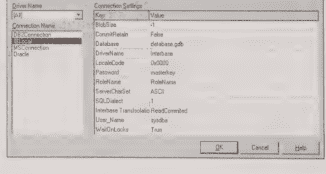

**图 1.1**

连接编辑器可帮助你轻松创建命名连接。

在连接编辑器的左侧，你可以看到一个 `Driver Name`（驱动名称）组合框和一个 `Connection Name`（连接名称）列表框。默认情况下，列表框会显示你开发机器上所有现有的命名连接。如果你只想查看 InterBase、Oracle 或其他数据库服务器的命名连接，请从 `Driver Name` 组合框中选择相应的服务器。

单击列表框中的连接名称以查看该命名连接的设置，或者单击工具栏上的 `Add` Connection（添加连接）按钮（其外观像一个加号）以创建新的命名连接。

dbExpress 连接编辑器会在右侧的“连接设置”部分显示所选命名连接的设置。你应为数据库引擎设置适当的参数。例如，对于 InterBase 连接，你至少需要设置 `Database` 参数。你可能还希望为 `RoleName`、`SQLDialect` 和 `User_Name` 输入值。

对于 Oracle 连接，你可能希望设置 `Database` 参数，也可能希望设置 `User_Name` 的值。

> **注意**
>
> 虽然你可以在命名连接中设置密码，但我通常建议你不要这样做。如果你正在处理生产数据库，任何人都可以打开你电脑上的连接编辑器（或简单地查看 `dbxconnections.ini`）来确定特定数据库的密码。因此，你通常希望在运行时提供数据库密码。

如果你希望最终用户能够创建自己的命名连接，你应该将 `dbxconnections.ini` 与你的应用程序一起重新分发。你的用户既可以手动编辑 `dbxconnections`，也可以编写并分发一个类似于 dbExpress 连接编辑器的实用程序，以协助最终用户创建命名连接。

## 未命名连接

命名连接适用于支持多种不同数据库服务器的应用程序。然而，许多数据库应用程序是专门为单个数据库后端编写的。例如，你可能通过光盘分发一个应用程序，其中附带一个预先创建的 InterBase 数据库，如零件清单或客户列表。在这些情况下，最终用户无需创建自己的数据库。他们只需访问你光盘中提供的数据库即可。

对于这些情况，命名连接是不必要的。相反，你在设计时设置连接属性（如果你的应用程序要求用户在运行时登录，则不包括 `User_Name` 和 `Password`）。

## 设置数据库参数

`TSQLConnection` 的 `Params` 属性包含连接目标数据库服务器的特定设置。表 1.2 列出了所有数据库共有的几个属性。对于其他特定数据库属性的信息，请查阅你的数据库服务器文档。

### 表 1.2 常见数据库参数

| 属性 | 描述 |
| :--- | :--- |


| Database | 指定要连接的数据库。对于 InterBase 数据库，这指实际的文件名，例如 `\\SERVERID:\RemoteData.gdb`。对于 Oracle 数据库，这指 `TNSNames.ora` 中唯一标识数据库的条目。 |

| Password | 密码对应 `User_Name`。你通常不希望在设计时设置此项，因为这会绕过数据库安全机制。 |

| User_Name | 建立连接时使用的用户名。通常你希望用户在运行时提供此信息。 |

你还可以在运行时访问 `Params` 属性来设置数据库参数，例如：

```
SQLConnection1.Params.Values['Database'] := 'D:\Interbase\LocalDatabase.gdb';
```

对于 InterBase 连接，你可以用三种方式指定数据库：作为本地路径、作为 UNC 路径或作为 TCP 路径。以下是这三种结构方式的示例：

```
D:\Interbase\LocalDatabase.gdb
\\SERVERID:\Data\RemoteDatabase.gdb
192.168.0.1:D:\Data\RemoteDatabase.gdb
```

在连接数据库时，通常建议使用 UNC 路径或 TCP 路径，因为在某些条件下（例如在服务应用内部连接数据库时），InterBase 使用本地路径连接数据库会遇到困难。你可以使用 `127.0.0.1` 作为 IP 地址通过 TCP 路径连接到本地数据库，例如：

```
127.0.0.1:D:\Interbase\LocalDatabase.gdb
```

## 控制登录

如前所述，连接的 `LoginPrompt` 属性决定了 VCL/DataCLX 是否自动在运行时提示用户输入用户名和密码。如果将 `LoginPrompt` 设置为 `True`，运行时将显示默认的连接对话框，如图 1.2 所示。

你可以通过处理连接的 `OnLogin` 事件并在那里设置适当的参数，来覆盖默认登录对话框并提供获取用户名和密码的自定义方式。以下代码片段展示了如何操作：

```
procedure TForm1.SQLConnection1Login(Database: TSQLConnection;
LoginParams: TStrings);
var
TheUserName: string;
ThePassword: string;
begin
// 显示自定义对话框以获取 TheUserName 和 ThePassword
LoginParams.Values[ssUSERNAME] := TheUserName;
LoginParams.Values[ssPASSWORD] := ThePassword;
end;
```

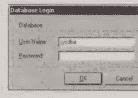

**图 1.2**

Delphi 的默认数据库登录对话框。

## 断开数据库连接

当你完成应用程序中的数据库访问后，你应该断开连接。这将释放客户端和服务端的资源。你可以手动或自动断开数据库连接。

### 手动断开数据库连接

手动断开数据库连接很简单。只需发出以下两个命令之一：

```
SQLConnection1.Connected := False;
```

或者

```
SQLConnection1.Close;
```

使用哪种方法取决于你偏好设置属性还是调用方法来断开数据库连接。

### 自动断开数据库连接

如果你希望当没有打开的数据集时让 dbExpress 自动断开数据库连接，你应该将 `TSQLConnection.KeepConnection` 设置为 `False`。VCL/DataCLX 会监控连接上打开的数据集数量，当最后一个数据集关闭时，连接会自动断开。

**注意**

在连接建立时间较长的情况下，或在频繁打开和关闭数据集的应用程序中，你不应该将 `KeepConnection` 设置为 `False`。反复连接和断开数据库（特别是在连接耗时较长的情况下）可能会严重影响程序性能。

## 连接和断开事件

`TSQLConnection` 公开了一组在连接/断开过程中在适当时机触发的事件。这些事件及其用法列于表 1.3 中。

### 表 1.3 *TSQLConnection* 事件

| 事件 | 描述 |

| :--- | :--- |

| AfterConnect | 在数据库连接成功建立后触发。 |

| AfterDisconnect | 在数据库连接断开后触发。 |

| BeforeConnect | 在尝试连接数据库之前立即触发。你可以在此事件处理程序中引发异常以防止连接建立。 |

| BeforeDisconnect | 在断开数据库连接之前立即触发。你可以在此事件处理程序中引发异常以防止连接断开。 |

| OnLogin | 在建立连接之前触发，以便你可以在运行时提供用户名和密码。 |

列表 1.1 包含了一个应用程序的源代码，演示了这些事件在何时以及何种情况下触发。它还展示了如何防止用户连接或断开数据库。

**列表 1.1** 事件——MainForm.pas

```pascal
unit MainForm;

interface

uses
  SysUtils, Classes, QGraphics, QControls, QForms, QDialogs, DBXpress,
  ExtCtrls, DB, SqlExpr, QStdCtrls, QExtCtrls;
```

# **清单 1.1**（续）


```pascal
type
  TfrmMain = class(TForm)
    conn: TSQLConnection;
    pnlClient: TPanel;
    pnlBottom: TPanel;
    btnConnect: TButton;
    btnDisconnect: TButton;
    Label1: TLabel;
    lbEvents: TListBox;
    grpOptions: TGroupBox;
    cbAllowConnect: TCheckBox;
    cbAllowDisconnect: TCheckBox;
    procedure connAfterConnect(Sender: TObject);
    procedure connAfterDisconnect(Sender: TObject);
    procedure connBeforeConnect(Sender: TObject);
    procedure connBeforeDisconnect(Sender: TObject);
    procedure connLogin(Database: TSQLConnection;
                        LoginParams: TStrings);
    procedure btnConnectClick(Sender: TObject);
    procedure btnDisconnectClick(Sender: TObject);
    procedure FormClose(Sender: TObject; var Action: TCloseAction);
  private
    { Private declarations }
  public
    { Public declarations }
  end;

var
  frmMain: TfrmMain;

implementation

{$R *.xfrn}

procedure TfrmMain.connAfterConnect(Sender: TObject);
begin
  lbEvents.Items.Add('AfterConnect');
end;

procedure TfrmMain.connAfterDisconnect(Sender: TObject);
begin
  lbEvents.Items.Add('AfterDisconnect');
end;

procedure TfrmMain.connBeforeConnect(Sender: TObject);
begin
  lbEvents.Items.Add('BeforeConnect');
  if not cbAllowConnect.Checked then
    Abort;
end;

procedure TfrmMain.connBeforeDisconnect(Sender: TObject);
begin
  lbEvents.Items.Add('BeforeDisconnect');
  if not cbAllowDisconnect.Checked then
    Abort;
end;

procedure TfrmMain.connLogin(Database: TSQLConnection;
  LoginParams: TStrings);
begin
  lbEvents.Items.Add('OnLogin');
end;

procedure TfrmMain.btnConnectClick(Sender: TObject);
begin
  lbEvents.Items.Add('---Begin Open---');
  try
    conn.Open;
  except
    on EAbort do
      lbEvents.Items.Add(' Connect aborted');
    on E: Exception do
      lbEvents.Items.Add(E.Message);
  end;
  lbEvents.Items.Add('---End Open---');
  lbEvents.Items.Add('');
end;

procedure TfrmMain.btnDisconnectClick(Sender: TObject);
begin
  lbEvents.Items.Add('---Begin Close---');
  try
    conn.Close;
  except
    on EAbort do
      lbEvents.Items.Add('Disconnect aborted');
    on E: Exception do
      lbEvents.Items.Add(E.Message);
  end;
  lbEvents.Items.Add('---End Close---');
  lbEvents.Items.Add('');
end;

procedure TfrmMain.FormClose(Sender: TObject; var Action: TCloseAction);
begin
  conn.Close;
end;

end.
```

请注意代码中 `BeforeConnect` 和 `BeforeDisconnect` 事件处理程序在相应复选框未被选中时会调用 `Abort`。`btnConnectClick` 和 `btnDisconnectClick` 会检查是否发生 `EAbort`（或其他异常），如果连接或断开连接尝试因任何原因失败，它们会在列表框中显示相应的消息。

图 1.3 展示了应用程序在运行时的外观。列表框中填充了信息性文本，精确说明了连接事件在何时以及以何种顺序触发。

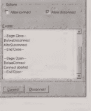

## 图 1.3

Events 应用程序有助于理解连接事件。

# 获取数据库元数据

`TSQLConnection` 暴露了一组属性，使您能够从数据库中提取基本架构信息，包括表、字段、索引、存储过程以及存储过程参数属性。接下来的章节将描述如何从数据库连接中获取这些信息类型。

## GetTableNames

您可以调用 `GetTableNames` 来获取数据库中的表列表，包括用户表、系统表、视图和同义词（仅适用于 Oracle 数据库）。

`TSQLConnection.GetTableNames` 在 `sqlxexpr.pas` 中定义如下：

```pascal
procedure GetTableNames(List: TStrings; SystemTables: Boolean = False);
```

第一个参数指定返回表名的字符串列表。列表中现有的字符串将被清除。第二个参数指示是否仅返回系统表。

如果将 `SystemTables` 参数设置为 `True`，则无论 `TableScope` 属性的当前设置如何（如表 1.4 所示），都只将系统表添加到列表中。如果 `SystemTables` 为 `False`，则 `TableScope` 控制添加到列表中的表类型。

**表 1.4 TableScope 设置**

| 属性 | 描述 |
| :--- | :--- |
| TsSynonym | 同义词 |
| TsSysTable | 系统表 |
| TsTable | 普通用户定义表 |
| TsView | 视图 |

下面的代码片段展示了 `GetTableNames` 的典型调用：

```pascal
GetTableNames(ListBox1.Items, False);
```

## GetFieldNames

`GetFieldNames` 用于检索给定表或视图中定义的所有字段名称。`GetFieldNames` 接受两个参数，定义如下：

```pascal
procedure GetFieldNames(const TableName: string; List: TStrings);
```

在第一个参数中传递要检索字段名的表名。第二个参数指示要将结果字段名加载到哪个列表中。列表中现有的字符串将被删除。

```pascal
GetFieldNames('CONTACTS', ListBox1.Items);
```

### GetIndexNames

与 `GetFieldNames` 类似，`GetIndexNames` 用于检索给定表上定义的所有索引名称。`GetIndexNames` 定义如下：

```pascal
procedure GetIndexNames(const TableName: string; List: TStrings);
```

与 `GetFieldNames` 一样，`TableName` 代表要获取索引名称的表。`List` 指示要将结果索引名称加载到哪个列表中。列表中现有的字符串将被删除。


```pascal
GetIndexNames('CONTACTS', ListBox1.Items);
```

## GetProcedureNames

要检索数据库中的存储过程列表，请调用 `GetProcedureNames` 方法。

`GetProcedureNames` 定义如下：

```pascal
procedure GetProcedureNames(List: TStrings);
```

从该过程返回后，`List` 包含存储过程名称的列表。之前存储在列表中的任何信息都将被删除。

```pascal
GetProcedureNames(ListBox1.Items);
```

## GetProcedureParams

`GetProcedureParams` 返回给定存储过程的参数列表。其定义如下：

```pascal
procedure GetProcedureParams(ProcedureName: string; List: TList);
```

第一个参数 `ProcedureName` 指定要检索参数名称的存储过程名称。第二个参数引用一个预创建的 `TList`，过程参数将返回到该列表中。从过程返回后，`List` 包含存储过程的参数列表。

```pascal
var
  listParams: TList;
  Params: TParams;
begin
  listParams := TList.Create;
  try
    SQLConnection.GetProcedureParams('CONTACTSUBSTATE', listParams);
    Params := TParams.Create;
    try
      LoadParamListItems(Params, listParams);

      // Do something with Params here...
    finally
      Params.Free;
    end;
  finally
    FreeProcParams(listParams);
  end;
```

注意此代码片段末尾对 `FreeProcParams` 的调用。`FreeProcParams` 释放并将 `listParams` `TList` 置为 nil，因此您不需要显式释放该列表。

清单 1.2 展示了一个示例应用程序的完整源代码，该应用程序使用 `TSQLConnection` 从 InterBase 数据库中检索表、字段、索引、过程和参数名称。

# 清单 1.2 元数据—MainForm.pas

```pascal
unit MainForm;

interface

uses
  SysUtils, Classes, QGraphics, QControls, QForms, QDialogs, QExtCtrls,
  DBXpress, QComCtrls, QStdCtrls, DB, SqlExpr;

type
  TfrmMain = class(TForm)
    conn: TSQLConnection;
    pnlBottom: TPanel;
    lblConnection: TLabel;
    pnlClient: TPanel;
    grpTableScope: TGroupBox;
    btnTable: TCheckBox;
    btnView: TCheckBox;
    btnSynonym: TCheckBox;
    btnSystemTable: TCheckBox;
```

**清单 1.2 续**

```pascal
btnConnect: TButton;
btnDisconnect: TButton;
Label4: TLabel;
Label5: TLabel;
OpenDialog1: TOpenDialog;
PageControl1: TPageControl;
tabTables: TTabSheet;
tabProcedures: TTabSheet;
cbProcedure: TComboBox;
Label12: TLabel;
Label13: TLabel;
cbTable: TComboBox;
lblFields: TListBox;
lblIndexes: TListBox;
Label1: TLabel;
Label6: TLabel;
Label7: TLabel;
lvParameters: TListView;
procedure btnConnectClick(Sender: TObject);
procedure cbTableClick(Sender: TObject);
procedure btnDisconnectClick(Sender: TObject);
procedure cbProcedureClick(Sender: TObject);
procedure connAfterConnect(Sender: TObject);
procedure connAfterDisconnect(Sender: TObject);
procedure FormClose(Sender: TObject; var Action: TCloseAction);
private
    { Private declarations }
public
    { Public declarations }
end;
var
    frmMain: TfrmMain;
implementation
{$R *.xfm}
procedure TfrmMain.btnConnectClick(Sender: TObject);
procedure CheckScope(Value: Boolean; TableScope: TTableScope);
begin
    if Value then
        conn.TableScope := conn.TableScope + [TableScope]
```

else

    conn.TableScope := conn.TableScope - [TableScope];

end;

begin

    if OpenDialog1.Execute then begin

        conn.Params.Values['Database'] := OpenDialog1.FileName;

        CheckScope(btnTable.Checked, tsTable);

        CheckScope(btnView.Checked, tsView);

        CheckScope(btnSynonym.Checked, tsSynonym);

        CheckScope(btnSystemTable.Checked, tsSysTable);

        conn.Open;

    end;

end;

procedure TfrmMain.btnDisconnectClick(Sender: TObject);

begin

    conn.Close;

end;

procedure TfrmMain.cbTableClick(Sender: TObject);

begin

    conn.GetFieldNames(cbTable.Items[cbTable.ItemIndex], lbFields.Items);

    conn.GetIndexNames(cbTable.Items[cbTable.ItemIndex], lbIndexes.Items);

end;

procedure TfrmMain.cbProcedureClick(Sender: TObject);

var

    listParams: TList;

    Params: TParams;

    Index: Integer;

    Param: TParam;

    ListItem: TListItem;

begin

    listParams := TList.Create;

    try

        conn.GetProcedureParams(cbProcedure.Items[cbProcedure.ItemIndex],

            listParams);

        Params := TParams.Create;

        try

            LoadParamListItems(Params, listParams);

            lvParameters.Items.BeginUpdate;

            try

ivParameters.Items.Clear;

for Index := 0 to Params.Count - 1 do begin

   Param := Params[Index];


```
ListItem := ivParameters.Items.Add;

ListItem.Caption := Param.Name;

case Param.DataType of

ftUnknown:
   ListItem.SubItems.Add('Unknown');
ftString:
   ListItem.SubItems.Add('String');
ftSmallInt:
   ListItem.SubItems.Add('SmallInt');
ftInteger:
   ListItem.SubItems.Add('Integer');
ftWord:
   ListItem.SubItems.Add('Word');
ftBoolean:
   ListItem.SubItems.Add('Boolean');
ftFloat:
   ListItem.SubItems.Add('Float');
ftCurrency:
   ListItem.SubItems.Add('Currency');
ftBCD:
   ListItem.SubItems.Add('BCD');
ftDate:
   ListItem.SubItems.Add('Date');
ftTime:
   ListItem.SubItems.Add('Time');
ftDateTime:
   ListItem.SubItems.Add('DateTime');
ftBytes:
   ListItem.SubItems.Add('Bytes');
ftVarBytes:
   ListItem.SubItems.Add('VarBytes');
ftAutoInc:
   ListItem.SubItems.Add('AutoInc');
ftBlob:
   ListItem.SubItems.Add('Blob');
ftMemo:
   ListItem.SubItems.Add('Memo');
ftGraphic:
   ListItem.SubItems.Add('Graphic');
ftFmtMemo:
   ListItem.SubItems.Add('FmtMemo');
ftParadoxOle:
   ListItem.SubItems.Add('ParadoxOle');
ftDBaseOle:
   ListItem.SubItems.Add('DBaseOle');
ftTypedBinary:
   ListItem.SubItems.Add('TypedBinary');
ftCursor:
   ListItem.SubItems.Add('Cursor');
ftFixedChar:
   ListItem.SubItems.Add('FixedChar');
ftWideString:
   ListItem.SubItems.Add('WideString');
ftLargeInt:
   ListItem.SubItems.Add('LargeInt');
ftADT:
   ListItem.SubItems.Add('ADT');
ftArray:
   ListItem.SubItems.Add('Array');
ftReference:
   ListItem.SubItems.Add('Reference');
ftDataSet:
   ListItem.SubItems.Add('DataSet');
ftOraBlob:
   ListItem.SubItems.Add('OraBlob');
ftOraClob:
   ListItem.SubItems.Add('OraClob');
ftVariant:
   ListItem.SubItems.Add('Variant');
ftInterface:
   ListItem.SubItems.Add('Interface');
ftIDispatch:
   ListItem.SubItems.Add('IDispatch');
ftGuid:
   ListItem.SubItems.Add('Guid');
ftTimeStamp:
   ListItem.SubItems.Add('TimeStamp');
ftFMTBcd:
   ListItem.SubItems.Add('FMTBcd');
end;

end;

finally
lvParameters.Items.EndUpdate;
end;

finally
Params.Free;
end;

finally
FreeProcParams(listParams);
end;
end;

procedure TfrmMain.connAfterConnect(Sender: TObject);
begin
btnTable.Enabled := False;
btnView.Enabled := False;
btnSynonym.Enabled := False;
btnSystemTable.Enabled := False;
lblConnection.Font.Color := clGreen;
lblConnection.Caption := conn.Params.Values['Database'];
conn.GetTableNames(cbTable.Items, btnSystemTable.Checked);
conn.GetProcedureNames(cbProcedure.Items);
cbTable.ItemIndex := 0;
cbTableClick(cbTable);
PageControl1.ActivePage := tabTables;
ActiveControl := cbTable;
cbProcedure.ItemIndex := 0;
cbProcedureClick(cbProcedure);
end;

procedure TfrmMain.connAfterDisconnect(Sender: TObject);
begin
btnTable.Enabled := True;
btnView.Enabled := True;
btnSynonym.Enabled := True;
btnSystemTable.Enabled := True;
lblConnection.Font.Color := clRed;
lblConnection.Caption := 'Not connected';
cbTable.Items.Clear;
cbProcedure.Items.Clear;
fbFields.Items.Clear;
lblIndexes.Items.Clear;
end;

procedure TfrmMain.FormClose(Sender: TObject; var Action: TCloseAction);
begin
conn.Close;
end;
```


图 1.4 显示了从 `CONMAN` 数据库返回的表、字段和索引名称。

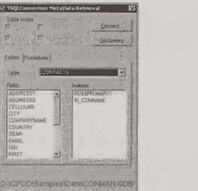

**图 1.4**
*contacts 表的列和字段列表。*

图 1.5 显示了存储过程 `CONTACTSBYSTATE` 的过程参数列表。清单 1.2 中的大部分代码都相当直接明了。然而，有两点值得注意，我想指出它们。

首先，`cbProcedureClick` 方法展示了如何遍历存储过程的参数，以确定它们的名称、类型及其他属性。

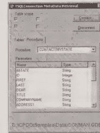

**图 1.5**
CONNECTSTATE 过程输出的长参数列表中的参数名称和类型。

其次，`VCL/DataCLX` 中存在一个 bug，该 bug 实际上阻止你同时获取表、视图和系统表的元数据。如果你同时勾选了表、视图和系统表，`GetTableNames`（在 `connAfterConnect` 方法中）不会返回任何信息。请在你自己的应用中注意这一点。如果你需要获取所有三种类型的信息，可以执行以下类似的操作：

```pascal
var
  SL: TStringList;
begin
  SL := TStringList.Create;
  try
    SQLConnection1.TableScope := [tsTable, tsView];
    SQLConnection1.GetTableNames(ListBox1.Items, False);
    SQLConnection1.GetTableNames(SL, True);
    ListBox1.Items.AddStrings(SL);
  finally
    SL.Free;
  end;
end;
```

这段代码首先仅获取表和视图的信息，将结果放入列表框中。接下来，它仅获取系统表，将结果放入临时字符串列表中。最后，它将临时字符串列表中的字符串添加到列表框中。因此，列表框中包含表、视图和系统表。

正如你所见，`TSQLConnection` 返回的模式信息极其基础。除了存储过程参数外，`TSQLConnection` 为表、字段、索引和存储过程返回的唯一数据是它们的名称。在下一章中，我将向你展示如何从数据库获取更详细的模式信息。

## 执行 DDL 和 DML 语句

你对数据库执行的最常见操作是 DDL（数据定义语言）和 DML（数据操作语言）语句。你可以通过 `TSQLConnection` 直接执行 DDL 和 DML 语句。返回游标的 DML 语句（即 SQL SELECT 语句）除了需要 `TSQLConnection` 外，还需要一个数据集组件，正如你将在第 3 章“客户端数据集基础”中看到的。

### DDL 命令

DDL 命令是操作数据库模式而不是数据本身的语句。在前一节中，我向你展示了如何检索数据库模式的信息。在本节中，我将向你展示如何修改数据库模式。

`TSQLConnection` 提供了一种名为 `ExecuteDirect` 的方法，用于执行 DDL 命令。`ExecuteDirect` 接受一个参数，即要执行的 SQL 命令。成功时返回 0，失败时返回 dbExpress 错误代码。dbExpress 错误代码可以在随 Delphi 提供的文件 `DBXExpress.pas` 中找到。

`ExecuteDirect` 名称中的 Direct 部分源于该语句直接发送到数据库。该语句在执行前不会被准备（prepare），并且不能包含任何参数。（参数化 SQL 语句将在本章后面的“参数化 SQL 语句”部分中讨论。）

> **注意**
>
> 某些数据库不支持直接 SQL 执行。在这些数据库上，dbExpress 会在内部准备 SQL 语句，然后执行它。

#### 创建表

你可以发出的最简单且最有用的 DDL 命令之一是创建数据库中一个新表的命令。假设你想创建一个名为 `EMPLOYEE` 的表，其结构如表 1.5 所示。你将发出以下语句：

```pascal
SQLConnection1.ExecuteDirect('CREATE TABLE EMPLOYEE (EMPNO INTEGER, '
  + 'NAME VARCHAR(30); 'HIREDATE DATE, SALARY DOUBLE PRECISION');
```

#### 创建数据库

无法使用 `ExecuteDirect` 创建新的 InterBase 数据库。以下代码行不起作用：

```
SQLConnection1.ExecuteDirect('CREATE DATABASE '''C:\NewData.gdb''');
```

如果尝试执行此代码，你将收到以下异常：

```
Cannot prepare a CREATE DATABASE/SCHEMA statement.
```

InterBase 客户端不允许直接执行 DDL 或 DML，因此 dbExpress 驱动程序会尝试准备，然后执行 `CREATE DATABASE` 语句。由于 InterBase 不允许准备 `CREATE DATABASE` 语句，因此会引发异常。

如果你希望你的应用程序能够创建新的 InterBase 数据库，你需要找到另一种方法。一种方法是在程序目录中保留一个数据库的空副本，并在用户创建新数据库时将其复制。

在我自己的经验中，我发现以下方法很有用：将空数据库的副本作为资源保存在你的应用程序中。当用户创建新数据库时，将该资源以用户选择的文件名保存到磁盘上。以下说明介绍了如何在 Windows 环境中实现这一点。请注意，这是 Windows 特有的，不能用于 Linux 或跨平台应用程序。

首先，你需要创建一个资源脚本文件，将你的空数据库转换为资源。假设你在 `D:\Interbase` 目录中有一个数据库的空副本，以下脚本文件将创建一个名为 `EMPTYDB` 的资源：

```
EMPTYDB RCDATA DISCARDABLE "D:\Interbase\Empty.GDB"
```

将此脚本保存为 `EmptyDB.RC`。要从资源脚本创建 `.RES` 文件，请执行以下命令：

```
BRC32 EMPTYDB.RC
```

这将创建文件 `EMPTYDB.RES`，该文件可以包含在你的应用程序中。在你的程序代码的某处，请包含列表 1.3 中的代码。

##### 列表 1.3 从资源创建空数据库的代码

```
{$R EmptyDB.RES}    // 将空数据库添加到程序可执行文件
procedure CreateDatabase(const DatabaseName: string);
var
    HRsrc: THandle;
    Stream: TResourceStream;
begin
    HRsrc := FindResource(HInstance, PChar('EMPTYDB'), RT_RCDATA);
    if HRsrc <> 0 then begin
        Stream := TResourceStream.Create(HInstance, 'EMPTYDB', RT_RCDATA);
        try
            Stream.SaveToFile(DatabaseName);
        finally
            Stream.Free;
        end;
    end else
        raise Exception.Create('Internal error: unable to create database.');
end;
```

现在，当你在应用程序中想要创建新数据库时，只需调用 `CreateDatabase`，并传入数据库的完整路径名，如下所示：

```
CreateDatabase( 'C:\NewDatabase.gdb' );
```

在开发应用程序时，如果你更改了数据库模式，你必须记得重新发出 `BRC32` 命令（如上所示）以重新创建 `EMPTYDB.RES` 文件。否则，你将在应用程序内部得到一个不正确的空数据库。

处理这种情况的另一种方法是在应用程序内部直接调用数据库 API 的低级接口。这种方法的好处是跨平台，但你必须学习针对相关数据库后端的相应 API 命令。

### DML 命令

DDL 命令用于定义数据库模式，而 DML 命令用于操作（读取、写入和更新）数据库中的数据。

#### 简单 SQL 语句

最简单的 DML 语句是不带参数且不返回行数的语句。例如，你可能想要删除所有 *Active* 状态为 N 的员工。为此，你将发出以下语句：

```
SQLConnection1.ExecuteDirect('DELETE FROM EMPLOYEE WHERE Active = ''N''');
```


注意前面的代码片段中，‘N’ 被引号包围。手动引用字符串常量的更好方法是使用 RTL 函数 `QuotedStr`。`QuotedStr` 接受一个字符串参数并返回带引号的字符串。使用 `QuotedStr` 的主要原因之一是它能正确处理包含引号的字符串常量。例如，给定名字 O’Toole，你知道如何手动引用它吗？正确的方法是 ‘O’‘Toole’

使用 `QuotedStr`，你不需要担心如何正确引用字符串。前面的 `ExecuteDirect` 调用变为

```
SQLConnection1.ExecuteDirect('DELETE FROM EMPLOYEE WHERE Active = ' + 
    QuotedStr('N'));
```

## 参数化 SQL 语句

很多时候，你希望多次执行同一个基本 SQL 语句，仅更改传递给语句中参数的值。例如，假设你想将多条记录插入之前创建的 `EMPLOYEE` 表中。要插入员工 John Doe，你需要执行以下 SQL 语句：

```
SQLConnection1.ExecuteDirect('INSERT INTO EMPLOYEE VALUES (123,
    ''John Doe'', ''5/15/1994'', 35000)');
```

再次说明，这里可以使用 `QuotedStr` 代替手动引用字符串。

对于你要添加的每个员工，你都需要创建并执行类似的 SQL 语句。参数化 SQL 语句允许你创建一种语句 *模板*，你可以通过在执行前轻松填入适当的值来生成每个语句。对于 `EMPLOYEE` 表，SQL `INSERT` 语句变为以下内容：

```
INSERT INTO EMPLOYEE VALUES (:EmpNumber, :Name, :Hired, :Salary)
```

每个要插入数据库的值都用参数替换。参数很容易检测，因为它们以冒号开头。内部地，dbExpress 组件解析 SQL 语句，并将参数转换为核心 dbExpress 代码支持的问题符。进而，dbExpress 驱动程序用后端数据库引擎支持的参数标记符替换这些问号。

例如，对于前面的 `INSERT` 语句，`TSQLConnection` 将其更改为

```
INSERT INTO EMPLOYEE VALUES (?, ?, ?, ?)
```

dbExpress 驱动程序可能会用特定于数据库服务器的其他结构替换这些问号。

> 参数的名称不需要与表中的底层列名相同。请注意前面的代码片段中，我将参数命名为 `EmpNumber` 而不是 `EmpNo`，以及 `Hired` 而不是 `DateHired`。

创建 SQL 语句后，在执行之前需要填写每个参数的值。以下代码片段展示了如何做到这一点：

```
Params := TParams.Create(nil);
try
   // 创建参数
   Params.CreateParam(ftInteger, 'EmpNumber', ptInput);
   Params.CreateParam(ftString, 'Name', ptInput);
   Params.CreateParam(ftSQLDate, 'Hired', ptInput);
   Params.CreateParam(ftFloat, 'Salary', ptInput);
   // 为参数赋值
   Params.ParamByName('EmpNumber').Value := 123;
   Params.ParamByName('Name').Value := 'John Doe';
   Params.ParamByName('Hired').Value := '5/15/1994';
   Params.ParamByName('Salary').Value := 35000;
   // 执行语句
   SQLConnection1.Execute('INSERT INTO EMPLOYEE VALUES (:EmpNumber, :Name, '
   +':Hired, :Salary)', Params);
finally
   Params.Free;
end;
```

你可能想知道为什么你会想这样做，而不是直接执行每个语句。毕竟，创建参数并赋值需要更多的努力。此外，在我的开发机器上的计时测试表明，第二种方法所需的时间大约是第一种方法的两倍。

在需要重复执行同一语句的情况下，我仍然偏好使用参数化查询，原因如下：

- 简单性。给定一个长而复杂的 SQL 语句，手动形成 SQL 语句往往很困难。考虑到在 Pascal 语言中必须对单引号进行加倍，正确对齐引号很容易出错。
- 健壮性。假设某个员工名字中包含引号，例如 Frank O'Donnell。如果你不使用参数，这个引号看起来就像是名字的结束引号。无参数的 SQL 语句将看起来像这样：
  `INSERT INTO EMPLOYEE VALUES (123, 'Frank O'Donnell', '5/15/1994', 35000)`
  在这种情况下，名字看起来是 Frank O，而语句中的下一个字符（D）是一个错误。你可以通过对名字进行双重引用来解决这个问题，如下所示：
  `INSERT INTO EMPLOYEE VALUES (123, 'Frank O''Donnell', '5/15/1994', 35000)`
- 当使用参数时，真正的关系数据库可以编译已准备好的语句，然后在后续对该 SQL 语句的所有调用中使用该编译版本。在重复发出相同的 SQL 语句时，这完全补偿了准备 SQL 语句所需额外时间。

使用 `QuotedStr` 自动引用字符串有助于缓解前两个“问题”。

## 返回游标的 SQL 语句

在前两节中，我讨论了简单和参数化的 SQL 语句，但到目前为止，没有语句从数据库服务器返回任何数据。`SELECT` 语句是最常用的 DML 语句。那么，我为什么回避它呢？

这是因为 `SELECT` 语句返回数据，你需要有一个地方来放置结果数据。对于 dbExpress，那个地方是 `TCustomSQLDataSet`，我将在下一章中详细讨论。目前，我将快速概述如何从 `TSQLConnection` 检索数据。

`Execute` 方法，我在前面一节中讨论过，实际上接受第三个参数：指向结果集的一个指针。

```
function Execute(const SQL: string; Params: TParams;
ResultSet: Pointer = nil): Integer;
```

如果你不向 `Execute` 传递第三个参数，它默认为 `nil`，这意味着该语句不返回结果集。

> **注意**
> 如果你为 `ResultSet` 传递一个 `nil` 值，而 SQL 命令实际上确实返回了一个结果集，该结果集将被简单地丢弃。不会引发异常，也不会返回错误。

以下代码片段展示了执行返回结果集的 SQL 语句的一种方式。在下一章中，你将看到更简单的方法来实现这一点。

```delphi
SQLDataSet1 := TSQLDataSet.Create(nil);
try
  SQLConnection1.Execute('SELECT * FROM EMPLOYEE', nil, SQLDataSet1);
  // 在这里对 SQLDataSet1 执行一些操作...
finally
  SQLDataSet1.Free;
end;
```

上述代码还展示了执行非参数化 `SELECT` 语句的正确方式：只需将 `Params` 设置为 `nil` 即可。

以下示例程序 `DDLSQL` 演示了如何在程序化地创建测试表、填充数据以及销毁该表。它还展示了如何使用 `Execute` 方法从表中检索数据。列表 1.4 显示了 `DDLSQL` 的完整代码。

### 列表 1.4 DDLSQL—MainForm.pas

```delphi
unit MainForm;

interface

uses
  SysUtils, Types, Classes, QGraphics, QControls, QForms, QDialogs,
  QStdCtrls, QExtCtrls, DBExpress, DB, SQLExpr;

type
  TfrmMain = class(TForm)
    pnlClient: TPanel;
    conn: TSQLConnection;
    btnCreate: TButton;
    btnPopulate: TButton;
    btnConnect: TButton;
    btnDelete: TButton;
    btnDisconnect: TButton;
    btnParameters: TButton;
    btnDrop: TButton;
    lbOutput: TListBox;
    procedure btnCreateClick(Sender: TObject);


```pascal
procedure btnConnectClick(Sender: TObject);
procedure btnPopulateClick(Sender: TObject);
procedure btnDisconnectClick(Sender: TObject);
procedure btnDeleteClick(Sender: TObject);
procedure btnParametersClick(Sender: TObject);
procedure btnDropClick(Sender: TObject);
procedure connAfterConnect(Sender: TObject);
procedure connAfterDisconnect(Sender: TObject);
procedure FormClose(Sender: TObject; var Action: TCloseAction);

private
{ Private declarations }
public
{ Public declarations }
end;

var
frmMain: TfrmMain;

implementation

{$R *.xfm}

procedure TfrmMain.btnConnectClick(Sender: TObject);
begin
conn.Open;
end;

procedure TfrmMain.btnDisconnectClick(Sender: TObject);
begin
conn.Close;
end;

procedure TfrmMain.btnCreateClick(Sender: TObject);
begin
conn.ExecuteDirect('CREATE TABLE TESTING (NAME VARCHAR(20) NOT NULL, ' +
'AGE INTEGER, PRIMARY KEY (NAME)');
lbOutput.Items.Add('Created TESTING table');
end;

procedure TfrmMain.btnPopulateClick(Sender: TObject);
begin
conn.ExecuteDirect('INSERT INTO TESTING VALUES (''Eric'', 34)');
conn.ExecuteDirect('INSERT INTO TESTING VALUES (''Tina'', 33)');
lbOutput.Items.Add('Added Eric and Tina to TESTING table');
end;

procedure TfrmMain.btnDeleteClick(Sender: TObject);
begin
conn.ExecuteDirect('DELETE FROM TESTING WHERE NAME = ''Tina''');
lbOutput.Items.Add('Deleted Tina from TESTING table');
end;

procedure TfrmMain.btnParametersClick(Sender: TObject);
const
SQL = 'INSERT INTO TESTING VALUES (:Name, :Age)';
var
Params: TParams;
begin
Params := TParams.Create(nil);
try
Params.CreateParam(ftString, 'PName', ptInput);
Params.CreateParam(ftInteger, 'Age', ptInput);
Params.ParamByName('PName').AsString := 'Mike';
Params.ParamByName('Age').AsInteger := 34;
conn.Execute(SQL, Params);
lbOutput.Items.Add('Added Mike to TESTING table');
finally
Params.Free;
end;
end;

procedure TfrmMain.btnDropClick(Sender: TObject);
begin
conn.ExecuteDirect('DROP TABLE TESTING');
lbOutput.Items.Add('Removed TESTING table');
end;

procedure TfrmMain.connAfterConnect(Sender: TObject);
begin
btnConnect.Enabled := False;
btnCreate.Enabled := True;
btnPopulate.Enabled := True;
btnDelete.Enabled := True;
btnParameters.Enabled := True;
btnDrop.Enabled := True;
btnDisconnect.Enabled := True;
lbOutput.Items.Add('Connected');
end;

procedure TfrmMain.connAfterDisconnect(Sender: TObject);
begin
btnConnect.Enabled := True;
btnCreate.Enabled := False;
btnPopulate.Enabled := False;
btnDelete.Enabled := False;
btnParameters.Enabled := False;
btnDrop.Enabled := False;
btnDisconnect.Enabled := False;
lbOutput.Items.Add('Disconnected');
end;

procedure TfrmMain.FormClose(Sender: TObject; var Action: TCloseAction);
begin
conn.Close;
end;
end.
```

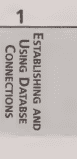


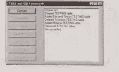

### 图 1.6

*点击所有按钮运行后的 DDLSQL 程序。*

## 事务支持

大多数 SQL 数据库都提供事务支持，但 MySQL 3.23 之前的版本是一个显著的例外。事务必须满足四个标准，这些标准被称为事务的 ACID 属性。具体来说，事务具备以下特性：

- **原子性（Atomic）**。事务必须要么全部成功，要么全部失败。事务的一部分成功而另一部分失败是不允许的。
- **一致性（Consistent）**。在事务完成后，数据必须处于一致状态。所有数据都必须遵循当前的引用完整性约束。
- **隔离性（Isolated）**。在一个事务中进行的更改，在该事务提交之前，对另一个事务是不可见的。
- **持久性（Durable）**。一旦事务提交，其更改必须是永久的。任何因素（包括系统崩溃）都不能改变已提交事务的影响。

通过示例最容易理解事务，因此我将介绍关于事务支持最常被引用的示例。

想象一家银行，其数据库包含客户和账户信息。约翰·Q·客户（John Q. Customer）在该银行拥有一个储蓄账户和一个活期账户。他去附近的 ATM 机，决定从他的储蓄账户向活期账户转账 100 美元。

用 SQL 术语来说，这构成了两个操作：一条用于记录储蓄账户扣款的 INSERT 语句，以及另一条用于记录活期账户存款的 INSERT 语句。假设 ATM 软件是使用 Delphi 和 dbExpress 编写的，它可能包含类似于以下代码的内容：

```delphi
procedure TransferFunds(FromAccountID: Integer; ToAccountID: Integer; Amount: Double);
var
SQL: string;
Params: TParams;
begin
Params := TParams.Create;
try
```


```pascal
SQL := 'INSERT INTO ACCOUNTDETAIL (ACCOUNTID, TRANSDATE, AMOUNT) ' +
      'VALUES (:AccountID, :TransDate, :TransAmount)';

Params.ParamByName('AccountID').Value := FromAccountID;

Params.ParamByName('TransDate').Value := Date;

Params.ParamByName('TransAmount').Value := -Amount;

SQLConnection1.Execute(SQL, Params);

Params.ParamByName('AccountID').Value := ToAccountID;

Params.ParamByName('TransAmount').Value := Amount;

SQLConnection1.Execute(SQL, Params);

finally
  Params.Free;
end;
end;
```

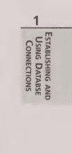

从概念上讲，这段代码片段为源账户创建了一笔扣款，并为目标账户创建了一笔存款。起初，你可能认为这段代码没有任何问题，但让我们看看可能发生的各种情况。

如果在记录扣款和记录存款之间发生了停电、连接故障或其他灾难性故障，会发生什么？钱会从储蓄账户中扣除，但永远不会被存入活期账户（这使得客户先生变得非常不满，甚至可能不再是该银行的客户）。

如果代码顺序颠倒，先创建存款再创建扣款，则可能发生相反的情况：存款被记录，但扣款从未发生（这使得客户先生非常高兴，并富有了 100 美元，但银行则亏损了）。

显然，ATM 软件需要有一种保证，要么扣款和存款都发生，要么都不发生。这就是事务设计所要处理的问题。

下面几节将描述如何检测特定数据库是否支持事务，如何开始（以及随后结束）一个事务，以及如何处理多个（和嵌套的）事务。

### 检查事务支持

如果你正在编写一个仅与单一数据库后端（如 Oracle 或 InterBase）一起工作的应用程序，你在开始编码之前就知道该数据库支持事务。如果你正在编写一个通用的应用程序，可以访问许多不同的数据库后端，那么你事先并不知道所选的数据库后端是否支持事务。

`TSQLConnection` 提供了一种方法来检测底层数据库引擎是否支持事务：`TransactionsSupported` 属性。在检查 `TransactionsSupported` 之前，你需要建立与数据库的连接，如下所示：

```delphi
SQLConnection1.Open;

// ...
if SQLConnection1.TransactionsSupported then
begin
  // 继续执行事务代码
end
else
begin
  // 不支持事务 - 执行替代代码或退出
end;
```

## 启动事务

当您确定数据库支持事务后，即可启动一个事务。首先，调用 `TSQLConnection.StartTransaction` 方法。`StartTransaction` 的定义如下：

```pascal
procedure StartTransaction(TransDesc: TTransactionDesc);
```

`TTransactionDesc` 是一个记录（record），用于详细描述事务。其定义如下所示：

```pascal
TTransactionDesc = packed record
    TransactionID : LongWord;        { Transaction id }
    GlobalID : LongWord;        { Global transaction id }
    IsolationLevel : TTransIsolationLevel; {Transaction Isolation level}
    CustomIsolation : LongWord;        { DB specific custom isolation }
end;
```

表 1.6 展示了 `TTransactionDesc` 记录中各个字段的含义。

**表 1.6 TTransactionDesc 字段**

| 字段 | 定义 |
| :--- | :--- |
| TransactionID | 用户定义的本地事务编号，用于在应用范围内唯一标识该事务。 |
| GlobalID | 用于 Oracle 事务，定义一个在整个 Oracle 数据库中必须唯一的事务编号。 |
| IsolationLevel | 用于指定该事务如何与其他事务交互。该字段的有效值列表见表 1.7。 |
| CustomIsolation | 当 IsolationLevel 设置为 `x1iCUSTOM` 时，标识自定义的隔离级别。目前没有任何 dbExpress 驱动程序支持此功能。 |

表 1.7 展示了 `TTransactionDesc` 的 `IsolationLevel` 字段的有效设置值。

**表 1.7 有效的 IsolationLevel 值**

| 字段 | 定义 |
| :--- | :--- |
| `x1iREADUNCOMMITTED` | 事务可以看到其他事务所做的所有更改，即使这些更改尚未提交。Oracle 不支持此级别的事务隔离。 |
| `x1iREADCOMMITTED` | 事务只能看到其他事务在该事务启动之前及启动之后已经提交的更改。 |
| `x1iREPEATABLEREAD` | 事务只能看到其他事务所做的更改，且仅当这些更改在该事务启动之前已提交时。 |
| `x1iCUSTOM` | 数据库特定的隔离级别。`CustomIsolation` 指定实际的隔离级别。目前没有任何 DbExpress 驱动程序支持此功能。 |

以下代码片段展示了如何启动一个事务。

```pascal
var
  TransDesc: TTransactionDesc;
begin
  TransDesc.TransactionID := 1;
  TransDesc.IsolationLevel := x1iREADCOMMITTED;
  SqlConnection1.StartTransaction(TransDesc);
end;
```

## 提交事务

在事务内部发出适当的 SQL 命令后，您需要*提交*该事务。这将结束该事务，并保存该事务期间所做的任何更改。

提交事务只需调用 `TSqlConnection.Commit` 即可，如下行代码所示：

```pascal
SqlConnection.Commit(TransDesc);
```

## 回滚事务

有时，您启动了事务，但后来发现不希望保存该事务期间所做的更改。如果发生这种情况，您可以选择*回滚*事务，而不是提交它。回滚事务会结束该事务，但事务上下文中所做的所有更改都将被丢弃。

要回滚事务，请像下面这样调用 `TSqlConnection.Rollback`：

```pascal
SqlConnection1.Rollback(TransDesc);
```

## 多事务

您并不限于一次只使用一个事务。事务可以嵌套或重叠。图 1.7 在概念上展示了嵌套和重叠事务的样子。

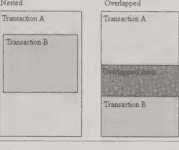

**图 1.7**
事务可以嵌套或重叠。

并非所有数据库都支持多事务。不幸的是，要确定数据库是否支持多事务，您无法检查一个简单的属性。`TSQLConnection` 包含一个名为 `fSupportsMultiTrans` 的私有字段，但没有公开访问该字段的方法。不过，一切并非无望，您可以使用以下函数来检索该属性的值：

```pascal
function SupportsMultiTrans(conn: TSQLConnection): Boolean;
var
  Supported: LongBool;
  PropSize: SmallInt;
begin
  conn.MetaData.GetOption(eMetaSupportsTransactions, @Supported,
    SizeOf(Integer), PropSize);
  Result := Supported;
end;
```

如果数据库不支持多事务，当有活动事务时，您应避免调用 `StartTransaction`。您可以通过检查 `InTransaction` 属性来测试是否有当前活动的事务，如下所示：

```pascal
if not SQLConnection.InTransaction then
  // 可以安全地启动事务
```

如果数据库支持多事务，您可以嵌套它们，如下所示代码片段：

```pascal
var
```


```pascal
  TransOuter: TTransactionDesc;

  TransInner: TTransactionDesc;

begin

  TransOuter.TransactionID := 1;

  TransOuter.IsolationLevel := x1iREADCOMMITTED;

  SQLConnection.StartTransaction(TransOuter);

  try

    // 在此处执行一些 SQL 语句

    TransInner.TransactionID := 2;

    TransInner.IsolationLevel := x1iREADCOMMITTED;

    SQLConnection1.StartTransaction(TransInner);

    try

      // 在此处执行更多 SQL 语句

      SQLConnection1.Commit(TransInner);

    except

      SQLConnection1.Rollback(TransInner);

      raise;

    end;

    // 在此处执行更多 SQL 语句

    SQLConnection1.Commit(TransOuter);

  except

    SQLConnection1.Rollback(TransOuter);

    raise;

  end;

end;
```

请注意上述代码中的事务被包裹在 `try/except` 块中。如果在执行代码期间发生异常，事务将被回滚。

清单 1.5 包含一个演示 dbExpress 事务支持（包括事务隔离、事务的提交和回滚，以及嵌套事务）的应用程序的完整源代码。

### 清单 1.5 Trans—MainForm.pas

```pascal
unit MainForm;

interface

uses

  SysUtils, Classes, QGraphis, QControls, QForms, QDialogs, OExtCtrls, DBXpress, QStdCtrls, DB, SqlExpr;

type

  TfrmMain = class(TForm)

    pnlClient: TPanel;

    conn: TSQLConnection;

    btnConnect: TButton;

    btnDisconnect: TButton;

    lbOutput: TListBox;

    btnCommit: TButton;

    btnRollback: TButton;

    btnMultiLevel: TButton;

    btnOverlapping: TButton;

    procedure btnConnectClick(Sender: TObject);

    procedure btnDisconnectClick(Sender: TObject);

    procedure btnCommitClick(Sender: TObject);

    procedure btnRollbackClick(Sender: TObject);

    procedure btnMultiLevelClick(Sender: TObject);

    procedure btnOverlappingClick(Sender: TObject);

    procedure connAfterConnect(Sender: TObject);

    procedure connAfterDisconnect(Sender: TObject);

    procedure FormClose(Sender: TObject; var Action: TCloseAction);

  private

    { Private declarations }

  public

    { Public declarations }

  end;

var

  frmMain: TfrmMain;

implementation

{$R *.xfm}

function SupportsMultiTrans(conn: TSQLConnection): Boolean;

var

  Supported: LongBool;

  PropSize: SmallInt;

begin

  conn.MetaData.GetOption(eMetaSupportsTransactions, @Supported,

    SizeOf(Integer), PropSize);

  Result := Supported;

end;

procedure TfrmMain.btnConnectClick(Sender: TObject);

begin

  conn.Open;

  if conn.TransactionsSupported then

    lbOutput.Items.Add('Connection supports transactions')

  else

    lbOutput.Items.Add('Connection does not support transactions');

  if SupportsMultiTrans(conn) then

    lbOutput.Items.Add('Connection supports multiple transactions')

  else

    lbOutput.Items.Add('Connection does not support multiple transactions');

end;

procedure TfrmMain.btnDisconnectClick(Sender: TObject);

begin

  conn.Close;

end;

procedure TfrmMain.btnCommitClick(Sender: TObject);

var

  TransDesc: TTransactionDesc;

begin

  TransDesc.TransactionID := 1;

  TransDesc.IsolationLevel := x1iREADCOMMITTED;

  conn.StartTransaction(TransDesc);

  conn.ExecuteDirect('DELETE FROM TODOS');

  conn.Commit(TransDesc);

  lbOutput.Items.Add('Transaction committed');

end;

procedure TfrmMain.btnRollbackClick(Sender: TObject);

var

  TransDesc: TTransactionDesc;

begin

  TransDesc.TransactionID := 1;

  TransDesc.IsolationLevel := x1iREADCOMMITTED;

  conn.StartTransaction(TransDesc);

  conn.ExecuteDirect('DELETE FROM CONTACTS');

  conn.Rollback(TransDesc);

  lbOutput.Items.Add('Transaction rolled back');

end;

procedure TfrmMain.btnMultiLevelClick(Sender: TObject);

var

  TransDesc1: TTransactionDesc;

  TransDesc2: TTransactionDesc;

begin

  TransDesc1.TransactionID := 1;

  TransDesc1.IsolationLevel := x1iREADCOMMITTED;

  // ... (code continues)

end;
```


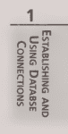

### 列表 1.5 续

```delphi
conn.StartTransaction(TransDesc1);
conn.ExecuteDirect('UPDATE CONTACTS SET PHONE = 'Trans 1' WHERE ID = 3');
TransDesc2.TransactionID := 2;
TransDesc2.IsolationLevel := xI1READCOMMITTED;
conn.StartTransaction(TransDesc2);
```


`conn.ExecuteDirect('UPDATE CONTACTS SET PHONE = 'Trans 2' WHERE ID = 2');`

`conn.Rollback(TransDesc2);`

`lbOutput.Items.Add('Second transaction rolled back');`

`conn.Commit(TransDesc1);`

`lbOutput.Items.Add('First transaction committed');`

`end;`

`procedure TfrmMain.btnOverlappingClick(Sender: TObject);`

`var`

  `TransDesc3: TTransactionDesc;`

  `TransDesc4: TTransactionDesc;`

`begin`

  `TransDesc3.TransactionID := 3;`

  `TransDesc3.IsolationLevel := xI1READCOMMITTED;`

  `conn.StartTransaction(TransDesc3);`

  `conn.ExecuteDirect('UPDATE CONTACTS SET PHONE = 'Trans 3' WHERE ID = 3');`

  `TransDesc4.TransactionID := 4;`

  `TransDesc4.IsolationLevel := xI1READCOMMITTED;`

  `conn.StartTransaction(TransDesc4);`

  `conn.ExecuteDirect('UPDATE CONTACTS SET PHONE = 'Trans 4' WHERE ID = 2');`

  `conn.Rollback(TransDesc3);`

  `lbOutput.Items.Add('Transaction 3 rolled back');`

  `conn.Commit(TransDesc4);`

  `lbOutput.Items.Add('Transaction 4 committed');`

`end;`

`procedure TfrmMain.connAfterConnect(Sender: TObject);`

`begin`

  `btnConnect.Enabled := False;`

  `btnDisconnect.Enabled := True;`

  `btnCommit.Enabled := True;`

  `btnRollback.Enabled := True;`

  `btnMultiLevel.Enabled := True;`

  `btnOverlapping.Enabled := True;`

`end;`

`procedure TfrmMain.connAfterDisconnect(Sender: TObject);`

`begin`

  `btnConnect.Enabled := True;`

  `btnDisconnect.Enabled := False;`

  `btnCommit.Enabled := False;`

  `btnRollback.Enabled := False;`

  `btnMultiLevel.Enabled := False;`

  `btnOverlapping.Enabled := False;`

`end;`

`procedure TfrmMain.FormClose(Sender: TObject; var Action: TCloseAction);`

`begin`

  `conn.Close;`

`end;`

`end.`

图 1.8 展示了 *Trans* 应用在运行时的情形。

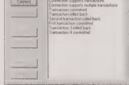

### 图 1.8
*Trans* 展示了如何执行嵌套事务。

## 在 SQL 操作期间提供反馈

在 SQL 操作执行期间提供反馈有几个很好的理由。请考虑以下两点：

- 有些 SQL 操作很快，但有些极其缓慢。在大型数据库上执行的一个非常复杂的 `SELECT` 语句可能需要几分钟（甚至几个小时）才能执行完毕。
- 特别是在结合数据集使用 `TSQLConnection` 时（将在第 3 章讨论），连接可能会代表你执行一些 SQL 命令。拦截发送给数据库的所有 SQL 命令对于学习和调试目的都非常有用。

在这两种情况下，能够以日志文件、数据库、CodeSite（来自 Raize Software，网址为 www.raize.com）或其他调试工具的形式，为你应用程序的最终用户（或为你自己）提供反馈或日志设施，将会很有帮助。

#### 在执行 SQL 语句时更改光标

你可以提供的最简单的反馈形式是当 SQL 语句正在执行时将光标改为沙漏。要在你的应用程序中提供此功能，你只需将连接的 `SQLHourGlass` 属性设置为 `True`。`SQLHourGlass` 不是一个发布属性，因此你不能在设计时设置它。

```delphi

SQLConnection1.SQLHourGlass := True;

```

#### 创建回调事件以监控 SQL 命令

如果你想拦截从 `TSQLConnection` 传递到数据库的每个 SQL 命令，你可以设置一个称为跟踪回调事件的东西。

你通过调用 `TSQLConnection.SetTraceCallbackEvent` 来设置跟踪回调事件。`SetTraceCallbackEvent` 接受两个参数：用于 SQL 活动调用的事件，以及传递给回调事件的用户定义整数值。

回调事件的格式定义如下：

```delphi

TSQLCallbackEvent = function(CallType: TRACECat;

  CBInfo: Pointer): CBResult; stdcall;

```

`CallType` 在进入回调函数时始终设置为 `cTRACE`。`CBInfo` 是指向 `SQLTRACEdesc` 记录的指针，其定义如下：

```delphi

SQLTRACEdesc = packed record   { trace callback info }

  pszTrace     : array [0..$023] of Char;

  eTraceCat    : TRACECat;

  ClientData   : Integer;

  uTotalMsgLen : Word;

end;

```

字段及其含义如表 1.8 所示。

**表 1.8** SQLTraceDesc 字段说明

| 字段 | 定义 |
| :-- | :-- |
| pszTrace | 刚刚传递给或来自数据库的空终止命令。 |
| eTraceCat | 刚刚发送或接收的命令类别。表 1.9 列出了该字段的可能值。 |
| ClientData | 作为 SetTraceCallBackEvent 第二个参数传递的用户定义值。 |
| uTotalMsgLen | pszTrace 中包含的字符串的长度（以字符计）。 |

表 1.9 描述了 eTraceCat 字段的可能值。

**表 1.9** eTraceCat 值

| 值 | 定义 |
| :-- | :-- |
| tracePREPARE | 发送到服务器以进行准备的查询。 |
| traceEXECUTE | 发送到服务器以进行执行的查询。 |
| traceERROR | 服务器返回的错误消息。 |
| traceSTMT | 发送到服务器以让数据库执行的操作。 |
| traceCONNECT | 发送到服务器的连接或断开连接相关操作。 |
| traceTRANSACT | 发送到服务器的事务相关操作。 |
| traceBLOB | 发送到服务器的 BLOB 相关操作。 |
| traceVENDOR | 发送到服务器的供应商特定 API 调用。 |
| traceDATAIN | 在 INSERT 或 UPDATE 命令期间发送到服务器的参数数据。 |
| traceDATAOUT | 从服务器检索的数据。 |
| traceMISC | 不属于上述任一类别的其他命令。 |

**注意**

并非所有这些选项当前都受支持。其中许多是为了未来的扩展而存在的。目前，所有供应商调用和已执行的 SQL 命令都会被跟踪。

以下代码片段设置了一个回调事件：

```delphi

function SQLCallback(CallType: TRACECat; CBInfo: Pointer): CBResult; stdcall;

var

  CBI: pSQLTraceDesc;

begin

  CBI := pSQLTraceDesc(CBInfo);

  ShowMessage(CBI^.pszTrace);

end;

begin

  SQLConnection1.SetTraceCallbackEvent(SQLCallback, 1);

end;
```


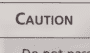

> 请勿将 `0` 作为第二个参数传递给 `SetTraceCallbackEvent`，否则你的回调事件将永远不会被调用，你会绞尽脑汁去弄清楚为什么回调事件不起作用。

要移除回调处理程序，请执行以下行代码：

```delphi
SQLConnection1.SetTraceCallbackEvent(nil, 0);
```

## TSQLMonitor

`TSQLMonitor` 提供了一种现成的、易于使用的机制来捕获数据库事件。你可以将数据库消息记录到列表框、日志文件或其他目的地。你还可以允许消息累积在监视器的内部缓冲区中，并一次性将它们转储到文件（或其他目的地）。

要使用 `TSQLMonitor`，请将其与你的 `TSQLConnection` 组件一起放置在窗体或数据模块上。要开始记录事件，请将监视器的 `SQLConnection` 属性设置为 `TSQLConnection` 组件，并将 `Active` 属性设置为 `True`。

监控数据库消息有两种方法：你可以选择在 `TSQLMonitor` 收到消息时立即记录每个消息，或者你可以让组件缓冲这些消息，并在稍后保存到日志文件或字符串列表中。以下章节将解释这些选项。

### 在消息发生时记录

实际上，你有两种不同的方式可以在数据库消息发生时记录它们。第一种是通过使用 `TSQLMonitor` 的 `AutoSave` 和 `FileName` 属性。将 `FileName` 设置为要创建的日志文件的名称，例如 `C:\TRACE.LOG`。将 `AutoSave` 设置为 `True`，组件会自动将所有数据库消息记录到指定的文件名中。如果该文件不存在，系统会自动创建它。如果该文件已存在，则向其追加内容。

实时记录消息的另一种方法是为 `OnTrace` 或 `OnLogTrace` 事件编写事件处理程序。每当组件收到应用程序与数据库服务器之间传递了一条消息的通知时，`OnTrace` 就会被触发。事件处理程序如下所示：

```pascal
procedure TForm1.SQLMonitorOnTrace(Sender: TObject; CBlnto: pSQLTRACEDesc;
var LogTrace: Boolean);
begin
end;
```

在事件处理程序中，如果你因某些原因不希望将该消息保存到内部列表中，可以将 `LogTrace` 设置为 `False`。默认情况下，消息会被记录。

`OnLogTrace` 在消息被添加到内部跟踪列表之后触发。其事件处理程序如下所示：

```pascal
procedure TForm.SQLMonitorLogTrace (Sender: TObject; CBlnto: pSQLTRACEDesc);
begin
end;
```

其参数与传递给 `OnTrace` 事件处理程序的前两个参数相同。

### 消息缓冲

您可以允许 `TSQLMonitor` 组件将它们缓冲在内部列表中，而无需处理每一条单独到达的消息。然后，您可以在稍后的时候将它们保存到文件或字符串列表中。

要将列表保存到文件，请调用组件的 `SaveToFile` 方法，如下所示：

```pascal
SQLMonitor.SaveToFile('C:\EventList.LOG');
```

或者，您可以通过访问 `TraceList` 属性将消息保存到字符串列表中，该属性是一个包含消息列表的 `TStrings` 对象。通过调用 `TraceList` 上的方法和/或属性，您可以访问列表中的每一行。

### 使用多种反馈机制

`TSQLConnection` 并未设计为能够轻松支持同时向多个目标发送数据库跟踪事件。换句话说，您不能同时使用 `TSQLMonitor` 和用户定义的反馈事件。因此，如果您希望分配回调事件，应将 `TSQLMonitor` 的 `Active` 属性设置为 `False`（假设您的应用程序中也有 `TSQLMonitor` 组件）。

您应该避免的另一种情况是，通过分配一个新的回调处理程序而意外地覆盖现有的回调处理程序。为了检查现有的回调事件（包括是否存在 `TSQLMonitor` 组件），您应该检查只读属性 `TSQLConnection.TraceCallbackEvent` 的值，以确保其为 `nil`。

如果 `TSQLConnection.TraceCallbackEvent` 不为 `nil`，则已经安装了一个回调处理程序。此时，您有三种选择：

- 选择不安装您的反馈事件。
- 保存对现有反馈事件的指针，调用 `SetTraceCallbackEvent` 来安装您自己的事件处理程序，并在完成后恢复现有的回调事件。
- 保存对现有反馈事件的指针，调用 `SetTraceCallbackEvent` 来安装您自己的事件处理程序，并从您的新事件处理程序内部调用现有的事件处理程序。

列表 1.6 展示了一个示例应用程序的源代码，该应用程序通过 `TSQLMonitor` 组件或通过程序员定义的回调事件来跟踪数据库操作。

#### 列表 1.6：反馈—MainForm.pas

```pascal
unit MainForm;

interface

uses
  SysUtils, Classes, QGraphics, QControls, QForms, QDialogs, DBXpress,
  QExtCtrls, SqlExpr, DB, QStdCtrls;

type
  TFrmMain = class(TForm
    conn: TSQLConnection;
    pnlClient: TPanel;
    lbrTrace: TListBox;
    Label1: TLabel;
    btnDump: TButton;
    btnConnect: TButton;
    btnDisconnect: TButton;
    btnExecSQL: TButton;
    btnLogTrace: TCheckBox;
    monitor: TSQLMonitor;
    cbUseCallback: TCheckBox;
    procedure btnDumpClick(Sender: TObject);
    procedure btnConnectClick(Sender: TObject);
    procedure btnDisconnectClick(Sender: TObject);
    procedure btnExecSQLClick(Sender: TObject);
    procedure connAfterConnect(Sender: TObject);
    procedure connAfterDisconnect(Sender: TObject);
    procedure FormClose(Sender: TObject; var Action: TCloseAction);
    procedure cbUseCallbackClick(Sender: TObject);
    procedure monitorTrace(Sender: TObject; CBInfo: pSQLTRACEDesc;
    var LogTrace: Boolean);
  private
    { Private declarations }
  public
    { Public declarations }
  end;

var
  frmMain: TfrmMain;

implementation

{$R *.xfm}

function MySQLCallBack(CallType: TRACECat; CBInfo: Pointer): CBRType; stdcall;
var
  CBi: pSQLTRACEDesc;
begin
  Result := cbRUSEDEF;
  if CBInfo <> nil then begin
    CBi := pSQLTRACEDesc(CBInfo);
    frmMain.lbTrace.Items.Add('Callback: ' + CBi.pszTrace);
  end;
end;

procedure TfrmMain.btnConnectClick(Sender: TObject);
begin
  conn.Open;
  cbUseCallbackClick(cbUseCallback);
end;

procedure TfrmMain.btnDisconnectClick(Sender: TObject);
begin
  conn.Close;
end;

procedure TfrmMain.btnExecSQLOnClick(Sender: TObject);
begin
   conn.ExecuteDirect('SELECT * FROM CONTACTS');
end;
```

# 1 建立和使用数据库连接


```pascal
procedure TfrmMain.btnDumpClick (Sender: TObject);
begin
   lbTrace.Items.Assign(monitor.TraceList);
end;

procedure TfrmMain.monitorTrace (Sender: TObject; CBInfo: pSQLTRACEDesc;
   var LogTrace: Boolean);
begin
   if btnLogTrace.Checked then begin
      lbTrace.Items.Add(CBInfo.pszTrace);
   end;
   // Since we handled the message ourselves, don't log it.
   LogTrace := False;
end;

procedure TfrmMain.connAfterConnect (Sender: TObject);
begin
   btnConnect.Enabled := False;
   btnDisconnect.Enabled := True;
   btnExecSQL.Enabled := True;
   btnDump.Enabled := True;
end;

procedure TfrmMain.connAfterDisconnect(Sender: TObject);
begin
   btnConnect.Enabled := True;
   btnDisconnect.Enabled := False;
   btnExecSQL.Enabled := False;
   btnDump.Enabled := False;
end;

procedure TfrmMain.cbUseCallbackClick (Sender: TObject);
begin
   if cbUseCallback.Checked then begin
      monitor.Active := False;
      comm.SetTraceCallbackEvent (MySQLCallback, 1);
   end else begin
      conn.SetTraceCallbackEvent(nil, 0);
      monitor.Active := True;
   end;
end;

procedure TfrmMain.FormClose(Sender: TObject; var Action: TCloseAction);
begin
  conn.Close;
end;
end.
```

让我们来看看 `cbUseCallbackClick` 事件处理程序。如果您勾选“使用回调”复选框，代码将禁用监视器。然后，它调用 `SetTraceCallbackEvent` 来设置一个回调过程以监视数据库消息。

当您取消勾选“使用回调”复选框时，代码将监视器设置为激活状态。这将重新建立 `TSQLMonitor` 组件作为数据库消息的反馈机制。

另一个有趣的点是 `MonitorTrace` 方法。如果“记录跟踪”复选框被勾选，我们立即捕获消息并将其发送到列表框。因为我们已经处理了该消息，所以不需要将其缓冲在监视器的内部列表中。出于这个原因，代码将 `LogTrace` 设置为 `False`。

图 1.9 显示了运行时反馈应用程序。

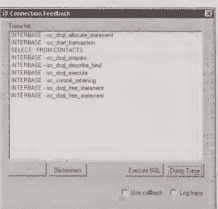

#### 图 1.9

反馈功能记录发送到和接收自数据库服务器的消息。

## 总结

本章向您介绍了 `TSQLConnection` 组件，该组件用于建立和维持与 SQL 数据库的连接。具体而言，您学到了：

- 您可以创建命名或未命名的数据库连接。
- `TSQLConnection` 公开了少量事件，这些事件有助于允许或阻止与数据库的连接和断开连接。
- 您可以轻松地从数据库连接中检索架构信息（也称为元数据），包括表、字段、索引和过程数据。
- 可以使用 `TSQLConnection` 对数据库执行 DDL 和 DML 命令。
- 如果数据库服务器支持事务，您可以通过连接组件控制这些事务。
- 提供了多种机制，以便您在对数据库执行操作时报告反馈。

下一章将介绍单向数据集，它使您能够从 SQL 连接中检索结果集。

# dbExpress 数据集

## 本章内容

- dbExpress 数据集是什么？ 58
- 数据集的类型 59
- 数据操作 63
- BLOB 支持 69
- 参数化查询 71
- 服务器返回数据的排序 73
- 主/从关系 74
- 检索架构信息 79

前一章概述了 dbExpress 连接和 `TSQLConnection` 组件。你学习了如何连接和断开数据库，如何设置连接参数，以及如何从数据库中检索架构信息。在本章中，我将介绍 dbExpress 数据集，它们使你能够从数据库连接中检索数据。

我会提到许多数据集方法，例如 `First`、`Next`、`FieldByName` 等。这些方法实际上是在 `TDataSet` 级别定义的，这意味着它们适用于所有类型的数据集（包括 BDE、ADO、dbExpress 等）。

这些方法在 Delphi 帮助文件和其他通用的 Delphi 书籍中都有详细记录——我在第 3 章“客户端数据集基础”中应用了它们。基于这些原因，我不会在这里深入每一个细节。相反，我将提供简短的代码片段，展示它们在上下文中的使用方式。

## dbExpress 数据集是什么？

数据集是 dbExpress 从数据库中检索数据的途径。例如，给定以下 SQL SELECT 语句：

```
SELECT * FROM EMPLOYEES
```


员工记录将在数据集中返回。你在前一章中看到，`TSQLConnection`可以直接处理不返回结果集的 SQL 语句。对于返回结果集的查询，应使用`TSQLDataSet`（及其派生类）。

让我们花一点时间来讨论 dbExpress 数据集的特性，然后我们将深入介绍实现它们的具体 dbExpress 类。

## dbExpress 数据集是单向的

关于 dbExpress 数据集，最重要的是要知道它们是单向的。起初，这似乎是一个巨大的劣势，但在本书的其余部分，你会看到 dbExpress 架构提供了一种极其轻量、灵活且强大的数据访问和更新手段。

由于 dbExpress 数据集是单向的，你能进行的唯一导航就是从数据集的开头移动到结尾——每次一条记录。如果你熟悉其他 Delphi 数据集（如`TTable`、`TADODataSet`或`TIBDataSet`），你可能会想知道如何搜索记录或在数据集中向后移动。同样，这些问题的解决方案在后续章节中会变得清晰明了。

## dbExpress 数据集是只读的

dbExpress 数据集是对数据库底层数据的只读视图。dbExpress 数据集不直接支持编辑功能，因此任何试图编辑 dbExpress 记录的尝试都会导致 Delphi 异常，如图 2.1 所示。


dbExpress 数据集是只读的。

## dbExpress 数据集是轻量的

由于 dbExpress 数据集是单向和只读的，它们极其轻量。它们没有双向光标支持、记录缓冲等基础（但代价高昂）任务带来的开销。

如果你熟悉 Borland 数据库引擎（BDE），你知道 BDE 支持完整的编辑功能、数据集的前后导航以及多种数据库后端的驱动程序。然而，BDE 的安装大约为 10MB，并且 BDE 本身内存占用很高。考虑到 dbExpress（当与客户端数据集结合使用时，我将在后续章节中讨论）仅由两个库文件组成，总计约 400K。再考虑到 dbExpress（带有客户端数据集）支持的功能甚至比 BDE 更多，你开始理解为什么 dbExpress 是一项了不起的数据库技术。

## 数据集的类型

与其他 Delphi 数据库技术（如 ADO 和 IBX）一样，dbExpress 支持三种不同类型的数据集：表、查询和存储过程。以下部分将对此进行讨论。

### 表

表是对底层数据库表的直接视图。它包含表中所有行的所有列。你不能限制从表中返回的行，也不能选择列的子集（或连接来自另一张表的列）。

### 查询

查询提供了一种检索底层数据库中存储数据子集的方式。它还允许你将一张表的信息与另一张表连接起来。通常，查询允许你执行任何 SQL SELECT 语句并返回结果。

### 存储过程

存储过程是在底层数据库中编写并存储在数据库本身中的过程。dbExpress 存储过程使你能够数据库存储过程中检索数据。

## 通用数据集

提供表级、查询级和存储过程访问的 dbExpress 组件分别是`TSQLTable`、`TSQLQuery`和`TSQLStoredProc`。这些组件提供仅仅是为了方便从 BDE 应用程序转换，并对应于 BDE 数据访问组件`TTable`、`TQuery`和`TStoredProc`。

对于所有新开发，强烈建议使用通用组件`TSQLDataSet`。`TSQLDataSet`允许同等地访问表、查询和存储过程，并且比之前提到的任何专用组件都更具灵活性。

`TSQLDataSet`实现了几乎所有 dbExpress 数据集功能。`TSQLTable`、`TSQLQuery`和`TSQLStoredProc`继承自`TSQLDataSet`，并添加了针对表、查询和存储过程的具体行为。反过来，`TSQLDataSet`继承自`TDataSet`，`TDataSet`是所有 Delphi 数据集的根类。

### 表 2.1 TSQLDataSet 属性

| 属性 | 描述 |
| :--- | :--- |
| `Active` | 设置为 `True` 以打开数据集，或设置为 `False` 以关闭数据集。你还可以读取此属性以确定数据集当前是打开还是关闭。 |
| `CommandText` | `CommandText` 的使用方式取决于 `CommandType` 的值。有关 `CommandText` 的更多信息，请参阅以下各节。 |
| `CommandType` | 将 `CommandType` 设置为 `ctQuery` 以执行查询，设置为 `ctStoredProc` 以执行存储过程，或设置为 `ctTable` 以打开表。有关 `CommandType` 的更多信息，请参阅以下各节。 |
| `DataSource` | 用于在两个数据集之间建立主/从链接。有关更多信息，请参阅标题为“主/从关系”的章节。 |

**表 2.1 续**

| 属性 | 描述 |
| :--- | :--- |
| `MaxBlobSize` | 设置从 BLOB 字段返回的最大数据量。有关更多信息，请参阅标题为“BLOB 支持”的章节。 |
| `ObjectView` | 当为 `True` 时，数据集为 ADT 字段、数组字段和主/从关系提供额外支持。有关更多信息，请参阅标题为“主/从关系”的章节。 |
| `ParamCheck` | 当为 `True` 时，每当 `CommandText` 发生变化，数据集会自动生成参数。如果你想手动创建参数，请将此设置为 `False`。有关更多信息，请参阅标题为“参数化查询”的章节。 |
| `Params` | 包含当前查询或存储过程的输入和输出参数列表。有关更多信息，请参阅标题为“参数化查询”的章节。 |
| `SortFieldNames` | 仅当 `Commandtype = ctTable` 时使用。定义数据从服务器返回的顺序。有关更多信息，请参阅标题为“服务器返回数据的排序”的章节。 |
| `SQLConnection` | 此数据集连接的 `TSQLConnection` 组件。你应该在设置数据集中的其他属性之前设置此属性。 |

## 表级访问

要访问底层数据库表，你可以使用`TSQLTable`组件。基本属性是`SQLConnection`和`TableName`。如果你想选择一个索引用于记录排序目的，你还可以设置`IndexName`。以下代码片段说明了如何设置表属性并打开基于表的数据集：

```
SQLTable1.SQLConnection := conn;

SQLTable1.TableName := 'CONTACTS';

SQLTable1.IndexName := 'IX_CONNAMES';

SQLTable1.Open;
```

## 查询级访问

你可以使用`TSQLQuery`创建临时查询以从数据库中检索数据。以下代码展示了如何执行此操作：

```
SQLQuery1.SQLConnection := conn;

SQLQuery1.SQL.Text := 'SELECT * FROM CONTACTS WHERE COUNTRY = "United States"';

SQLQuery1.Open;
```

你还可以创建参数化查询，如下面的代码片段所示：

```
SQLQuery1.SQLConnection := conn;  
SQLQuery1.SQL.Text := 'SELECT * FROM CONTACTS WHERE COUNTRY = :TheCountry;  
SQLQuery1.ParamByName( 'TheCountry' ).Value := 'United States';  
SQLQuery1.Open;
```

参数化查询将在稍后题为“参数化查询”的部分中详细讨论。

## 存储过程访问

当你希望执行服务器上的存储过程时，可以使用`TSQLStoredProc`组件，如下面的代码片段所示：

```
SQLStoredProc1.StoredProcName := 'ContactsByState';  
SQLStoredProc1.ParamByName( 'STATE' ).Value := 'FL';  
SQLStoredProc1.Open;
```

同样地，如果底层的存储过程接受一个或多个参数，你应该在执行查询之前使用`ParamByName`方法来设置这些参数。

## 通用数据访问

正如前面几节所示，有多种不同的组件可用于 dbExpress 数据访问（取决于你访问的是表、查询还是存储过程）。然而，存在一个单一的多用途组件，它提供了这三个独立组件的所有功能：`TSQLDataSet`。

你应该在所有新编写的代码中使用`TSQLDataSet`，并且在我看来，在转换现有应用程序时也应该使用它。Borland 提供独立的专用组件是为了更容易地将 BDE 应用程序转换为 dbExpress 应用程序。然而，转换为通用的`TSQLDataSet`组件只需要非常少量的额外工作。

下面的代码片段展示了如何使用`TSQLDataSet`访问表：

```
SQLDataSet1.SQLConnection := conn;
```


`SQLDataSet1.CommandType := ctTable;`

`SQLDataSet1.CommandText := 'CONTACTS';`

`SQLDataSet1.IndexName := 'IX_CONNNAME';`

`SQLDataSet1.Open;`

如你所见，它与 `TSQLTable` 所需的代码几乎完全相同。只有一行额外代码，用于告诉数据集它正在访问一个表，而不是查询或存储过程。

要执行查询，你可以编写类似以下的代码：

```
SQLDataset1.SQLConnection := conn;

SQLDataset1.CommandType := ctQuery;

SQLDataset1.CommandText := 'SELECT * FROM CONTACTS WHERE Country = :ThisCountry';

SQLDataset1.ParamByName('TheCountry').Value := 'United States';

SQLDataset1.Open;
```

这段代码也极类似于用于 `TSQLQuery` 组件的代码。

下面的代码片段使用 `TSQLDataSet` 组件执行存储过程：

```
SQLDataset1.SQLConnection := conn;

SQLDataset1.CommandType := ctStoredProc;

SQLDataset1.CommandText := 'ContactsByState';

SQLDataset1.ParamByName('STATE').Value := 'FL';

SQLDataset1.Open;
```

同样，请注意与 `TSQLStoredProc` 组件的相似之处。

在许多应用程序中，你会在设计时而不是运行时设置这些属性。我在这里展示运行时赋值，只是为了指出各种组件之间的异同。

在本书的示例中，我使用 `TSQLDataSet` 进行所有数据库访问。唯一的例外是 *Navigate* 示例（稍后在本章中展示），它作为如何不使用不同 dbExpress 数据集组件的唯一示例。

## 数据操作

现在我们已经讨论了数据访问所需的组件，让我们花几分钟讨论这些组件提供的方法。由于 dbExpress 数据集是一种单向只读技术，你会发现这一领域没有太多需要讨论的内容。以下部分讨论了你将在 dbExpress 数据集上执行的最常见操作。

### 打开数据集

在数据集上设置了适当的属性后，你需要打开数据集以从数据库连接中检索数据。实际上有两种方法可以做到这一点，两者都产生完全相同的结果：

```
SQLDataset1.Open;
```

或

```
SQLDataset1.Active := True;
```

如果你查看 VCL/CLX 源代码，你会发现 `TSQLDataSet.Open` 解析为对 `TDataSet.Open` 的调用，其代码如下：

```
procedure TDataSet.Open;
begin
    Active := True;
end;
```

是调用 `Open` 方法还是自己设置 `Active` 属性，这取决于个人偏好。我发现我更喜欢方法调用，但两种方式都是正确的。

### 关闭数据集

关闭数据集与打开数据集一样简单：

```
SQLDataset1.Close;
```

或

```
SQLDataset1.Active := False;
```

同样，调用 `Close` 方法除了设置 `Active := False` 外不做其他事情，因此你可以随意选择你喜欢的方法。

> **注意**
>
> 请记住，关闭数据库连接也会关闭所有打开的数据集。因此，如果你有许多打开的数据集（并且你已经完成了数据库连接的使用），你可以选择简单地关闭连接，而不是手动关闭所有打开的数据集。

### 从数据集中检索字段内容

当数据集打开时，你通常想要访问结果集中的单个列（或字段）。为此，你通常调用 `FieldName` 方法，如下所示：

```
ShowMessage('The name is ' + SQLDataSet1.FieldName('Name').AsString);
```

通常，你知道你要访问的字段名称（如前面的代码片段所示）。然而，如果你正在编写一个通用的数据库实用程序，该程序适用于任何 dbExpress 支持的数据库或表，你可能事先不知道你要访问的表中有哪些列。在这种情况下，你可以直接访问 `Fields` 对象，如下所示：

```
ShowMessage('The first field''s contents are: ' +
SQLDataSet1.Fields[0].AsString);
```

你还可以使用 `FieldCount` 属性来确定结果集中的字段数量，并循环遍历它们，如下面的代码所示：

```
for Index := 0 to SQLDataSet1.FieldCount - 1 do
    // Do something with SQLDataSet1.Fields[Index]
```

### 导航数据集

由于 dbExpress 数据集是单向的，支持的导航操作不多。你可以执行的两个操作是移动到数据集的开头，以及移动到结果集中的下一条记录。这些操作在下方的代码片段中演示：

```
while not SQLDataSet1.EOF do begin
    for Index := 0 to SQLDataSet1.FieldCount - 1 do begin
        // Do something with SQLDatasets.Fields[Index]
        SQLDataSet1.Next;
    end;
end;
```

下面的代码列表是本章迄今讨论的所有概念的一个例子。它说明了如何使用 `TSQLTable`、`TSQLQuery`、`TSQLStoredProc` 和 `TSQLDataSet` 组件从 ConMan 数据库中检索数据。代码列表还展示了如何使用这些组件循环遍历结果，并对数据做一些事情（在这种情况下，它只是将一些字段内容加载到 `TListView` 组件中）。

列表 2.1 展示了应用程序主窗体的完整源代码。

**列表 2.1    Basic—MainForm.pas**

```
unit MainForm;

interface

uses
    SysUtils, Variants, Classes, QGraphics, QControls, QForms,
    QDialogs, DBXpress, DB, SqlExpr, QStdCtrls, QComCtrls, QExtCtrls, FMTBcd,
    QDBCtrls;

type
    TfrmMain = class(TForm)
        pnlClient: TPanel;
        pnlBottom: TPanel;
        btnConnect: TButton;
        conn: TSQLConnection;
        SQLTable1: TSQLTable;
        SQLQuery1: TSQLQuery;
        SQLStoredProc1: TSQLStoredProc;
        SQLDataSet1: TSQLDataSet;
        Label1: TLabel;
        lvResults: TListView;
        procedure btnConnectClick(Sender: TObject);
private
{ Private declarations }
procedure OpenTable;
procedure OpenQuery;
procedure OpenStoredProcedure;
procedure OpenDataSet;
procedure LoadResults(DataSet: TDataSet);
public
{ Public declarations }
end;

var
frmMain: TfrmMain;

implementation

uses DataSetTypeForm;

{$R *.xfm}

procedure TfrmMain.btnConnectClick(Sender: TObject);

var
frmDatasetType: TfrmDatasetType;
begin
// Ask the user whether to open the table, query, stored procedure,
// or general-purpose dataset
frmDatasetType := TfrmDatasetType.Create(nil);
try
if frmDatasetType.ShowModal = mrOk then begin


`case frmDatasetType.DatasetType of`

`dtTable:`        `OpenTable;`

`dtQuery:`        `OpenQuery;`

`dtStoredProc:`   `OpenStoredProcedure;`

`dtDataset:`      `OpenDataSet;`

`end;`

## **LISTING 2.1**（续）

```pascal
conn.Close;
end;
finally
  frmDatasetType.Free;
end;
end;
procedure TfrmMain.OpenTable;
begin
  SQLTable1.TableName := 'CONTACTS';
  SQLTable1.IndexName := 'IX_CONNNAME';
  SQLTable1.Open;
  LoadResults(SQLTable1);
end;
procedure TfrmMain.OpenQuery;
begin
  SQLQuery1.SQL.Text := 'SELECT * FROM CONTACTS ' +
    'WHERE COUNTRY = 'United States'';
  SQLQuery1.Open;
  LoadResults(SQLQuery1);
end;
procedure TfrmMain.OpenStoredProcedure;
begin
  SQLStoredProc1.StoredProcName := 'CONTACTSBYSTATE';
  SQLStoredProc1.ParamByName('ASTATE').Value := 'FL';
  SQLStoredProc1.Open;
  LoadResults(SQLStoredProc1);
end;
procedure TfrmMain.OpenDataset;
begin
  SQLDataset1.CommandType := ctQuery;
  SQLDataset1.CommandText := 'SELECT FIRST, LAST, PHONE FROM CONTACTS ' +
    'ORDER BY LAST, FIRST';
  SQLDataset1.Open;
  LoadResults(SQLDataset1);
end;
```

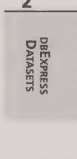

## **LISTING 2.1**（续）

```pascal
procedure TfrmMain.LoadResults(DataSet: TDataSet);
var
 ListItem: TListItem;
begin
 lvResults.Items.BeginUpdate;
 try
 lvResults.Items.Clear;
 while not DataSet.EOF do begin
 ListItem := lvResults.Items.Add;
 ListItem.Caption := DataSet.FieldName('FIRST').AsString;
 ListItem.SubItems.Add(DataSet.FieldName('LAST').AsString);
 ListItem.SubItems.Add(DataSet.FieldName('PHONE').AsString);
 DataSet.Next;
 end;
 finally
 lvResults.Items.EndUpdate;
 end;
 end;
```

从代码中可以看出，当用户点击连接按钮时，程序会创建 `TfrmDataTypeType` 的一个实例（如 LISTING 2.2 所示），该实例提示用户选择要打开的数据集类型：表、查询、存储过程或通用数据集。用户选择数据集类型后，程序会调用四个方法中的一个：`OpenTable`、`OpenQuery`、`OpenStoredProcedure` 或 `OpenDataset`。这些方法分别设置所选数据集的属性，并调用 `LoadResults`。

请注意，`LoadResults` 接受一个 `TDataSet` 作为参数，正如前面所指出的，`TDataSet` 是所有数据集的根类。这意味着 `LoadResults` 实际上可以处理任何数据集，无论是 dbExpress 数据集、BDE 数据集，还是某些第三方数据集。

`LoadResults` 遍历数据集中的记录，将联系人姓名、姓氏和电话号码加载到 `TListView` 中。

## **LISTING 2.2** Basic—DatasetTypeForm.pas

```pascal
unit DataTypeForm;
interface
uses
SysUtils, Variants, Classes, QGraphics, QControls, QForms,
QDialogs, QExtCtrls, QStdCtrls;
type
 TDataType = (dtTable, dtQuery, dtStoredProc, dtDataset);
TFrmDataType = class(TForm)
 pnlClient: TPanel;
 pnlBottom: TPanel;
 btnOk: TButton;
 btnCancel: TButton;
 grpDataType: TRadioGroup;
 procedure btnOkClick(Sender: TObject);
private
 { Private declarations }
 FDataType: TDataType;
public
 { Public declarations }
 property DataType: TDataType read FDataType;
end;
implementation
{$R *.dfm}
procedure TFrmDataType.btnOkClick(Sender: TObject);
begin
 FDataType := TDataType(grpDataType.ItemIndex);
end;
end.
```

图 2.2 展示了 Basic 演示应用在运行时的状态。

### BLOB 支持

与大多数数据集一样，dbExpress 数据集支持 BLOB 数据。BLOB 是 Binary Large Object（二进制大对象）的缩写，用于存储自由格式的数据（如图像、备忘录等）。

BLOB 数据很容易变得很大，因此您通常需要限制从数据库检索的 BLOB 数据的大小，以提高查询性能。例如，假设您有一个用于存储联系人图像 BLOB 字段。执行返回大量结果集的查询（如 `SELECT * FROM CONTACTS`）可能会从数据库中检索成千上万条记录。如果每个联系人的图像平均大小为 100K，那么从服务器返回的数据量将非常巨大。当数据库连接跨越局域网，甚至互联网时，这个问题会更加严重。

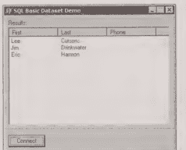

> 图 2.2
> *`TSQLDataset` 用于从数据库检索数据。*

在这种情况下，您可能希望从结果集中排除 BLOB 列。有两种方法可以实现这一点。首先，如果您执行的是预定义查询，只需从查询中省略 BLOB 字段即可。例如，如果您执行查询 `SELECT FIRST, LAST, PHONE, IMAGE FROM CONTACTS`，请将 SQL 语句修改为 `SELECT FIRST, LAST, PHONE FROM CONTACTS`。

其次，虽然如果知道从数据库检索的确切列，上述解决方案效果很好，但如果是通用的数据库工具该怎么办？如果您不知道列名或字段类型，可以执行以下语句：

```sql
SELECT * FROM CONTACTS
```

在这种情况下，您可以设置 `TSQLDataSet` 的 `BlobSize` 属性来确定每个 BLOB 字段检索的最大数据量。如果此参数为 0（默认值），则最大 BLOB 大小由关联的 `TSQLConnection` 的 `BlobSize` 参数决定。如果此参数为 -1，数据集将检索整个 BLOB，无论其大小如何。其他任何值都构成检索 BLOB 的最大字节数。

**NOTE**

无论您在连接级别还是数据集级别设置 `BlobSize`，它都适用于数据集中返回的所有 BLOB 字段。没有办法仅检索一个 BLOB 字段的前 100 字节，同时检索另一个 BLOB 字段的全部内容。

### 参数化查询

在本章迄今为止展示的大多数示例中，查询数据库时指定了完整的查询。例如，

```sql
SELECT * FROM CONTACTS WHERE COUNTRY = "United States"
```


虽然这行得通，但如果您要多次执行相同的通用查询，其效率较低。例如，假设您想先检索所有美国联系人，然后是加拿大所有联系人，最后是所有墨西哥联系人。您可以编写如下代码：

```pascal
SQLDataSet1.CommandType := ctQuery;

SQLDataSet1.CommandText := 'SELECT * FROM CONTACTS ' +
'WHERE COUNTRY = "United States"';

SQLDataSet1.Open;

ProcessDataSet;

SQLDataSet1.Close;

SQLDataSet1.CommandText := 'SELECT * FROM CONTACTS WHERE COUNTRY = "Canada"';

SQLDataSet1.Open;

ProcessDataSet;

SQLDataSet1.Close;

SQLDataSet1.CommandText := 'SELECT * FROM CONTACTS WHERE COUNTRY = "Mexico"';

SQLDataSet1.Open;

ProcessDataSet;

SQLDataSet1.Close;
```

在此示例中，`ProcessDataSet` 是某个虚构的方法，它会对查询结果进行某种操作。

虽然上述代码运行正确，但远非最佳。每次设置 `SQLDataSet1.CommandText` 时，后端数据库引擎都必须解析并准备 SQL 语句。实现相同结果的一种更好方法是参数化查询，如下所示：

```pascal
SQLDataSet1.CommandText := 'SELECT * FROM CONTACTS WHERE COUNTRY = :Country';
```

这会建立一个名为 `Country` 的参数，它在 SQL 语句中充当占位符。通过为此参数设置不同的值，您可以为不同国家发出相同的 SQL 语句，如下所示：

```pascal
SQLDataSet1.CommandType := ctQuery;

SQLDataSet1.CommandText := 'SELECT * FROM CONTACTS WHERE COUNTRY = :Country';

SQLDataSet1.ParamByName('Country').AsString := 'United States';

SQLDataSet1.Open;

ProcessDataSet;

SQLDataSet1.Close;

SQLDataSet1.ParamByName('Country').AsString := 'Canada';

SQLDataSet1.Open;

ProcessDataSet;

SQLDataSet1.Close;

SQLDataSet1.ParamByName('Country').AsString := 'Mexico';

SQLDataSet1.Open;

ProcessDataSet;
```

在此场景中，SQL 语句仅准备一次——即第一次执行时。之后，无需再次准备该语句，因为唯一变化的只是 `Country` 参数。

**NOTE**

请注意，参数名称不需要与其引用的列名称相同。在前面的示例中，该参数可以命名为 `ACountry`、`CountryParam` 或 `Fred`。

还有一个额外的属性控制参数的处理方式：`ParamCheck` 属性。当 `ParamCheck` 设置为 True 时，参数会自动由 dbExpress 创建（如前面的示例所示）。但是，如果您将 `ParamCheck` 设置为 False，则您需要自己创建参数。以下代码片段展示了如何这样做：

```pascal
SQLDataSet1.CommandType := ctQuery;

SQLDataSet1.ParamCheck := False;

SQLDataSet1.CommandText := 'SELECT * FROM CONTACTS WHERE COUNTRY = :Country';

SQLDataSet1.Params.CreateParam('Country', ftString, ptInput);

SQLDataSet1.ParamByName('Country').AsString := 'United States';

SQLDataSet1.Open;
```

请注意，通常只有在发出创建接受参数作为存储过程一部分的 DDL 语句时，您才会将 `ParamCheck` 设置为 False。因为这听起来有些混淆，我们来看一个例子：

```pascal
SQLDataSet1.CommandType := ctQuery;

SQLDataSet1.ParamCheck := False;

SQLDataSet1.CommandText :=
'CREATE PROCEDURE CONTACTSBYTITLE(ATITLE VARCHAR(20)) ' +
'RETURNS (      INTEGER, ' +
'FIRST      VARCHAR(20) ' +
```

## 排序服务器返回的数据

服务器返回的数据有两种排序方式。一种与 `TSQLTable` 组件有关，另一种则用于 `TSQLQuery` 和 `TSQLDataSet` 组件。我将首先介绍 `TSQLTable` 组件。

### 从表中排序数据

如果你正在使用 `TSQLTable`，可以在打开数据集之前设置该组件的 `IndexName` 或 `IndexFieldNames` 属性。`IndexName` 指的是底层数据库中存储的索引名称。例如，在 ConMan 数据库中，我定义了一个名为 `IX_CONMANE` 的索引，该索引由 `LAST` 和 `FIRST` 列组成（按此顺序）。

```
SQLTable1.IndexName := 'IX_CONMANE';
```

如果你不知道底层索引的名称，可以改为设置 `IndexFieldNames` 属性。`IndexFieldNames` 是构成索引的字段列表，以分号分隔。

```
SQLTable1.IndexFieldNames := 'LAST;FIRST';
```

> **注意**
>
> 你不需要确保在 `IndexFieldNames` 属性中设置的字段上定义了索引。在幕后，`TSQLTable` 会为其传递给数据库的 SQL 语句创建一个 `ORDER BY` 子句（基于 `IndexFieldNames` 中列出的字段）。

### 从查询中排序数据

如果你使用的是 `TSQLQuery` 或 `TSQLDataSet` 组件，排序结果集的方法更为直接：你自己只需在 SQL 语句中添加一个 `ORDER BY` 子句，如下所示：

```
SQLDataSet1.CommandText := 'SELECT * FROM CONTACTS ORDER BY LAST, FIRST';
```


如果数据库中定义了支持 `ORDER BY` 子句的索引，底层数据库引擎将使用索引以提高速度。如果没有，数据库引擎将在数据返回给应用程序之前按照请求的顺序对数据进行排序。

## 主从/详情关系

虽然独立的数据集很有用，但数据集通常通过主从/详情关系与其他数据集相关联。主从/详情关系（也称为一对多关系）是指一个数据集中的单条记录对应另一个数据集中的一条或多条记录的关系。

最常引用的主从/详情关系示例使用了客户、订单和物品作为其数据集。单个客户可以在某个供应商处下多个订单。反过来，单个订单可以包含多个物品。图 2.3 展示了典型客户、订单和物品数据集的图形表示。

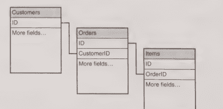

**图 2.3**
*主从/详情关系可以有多层。*

在 ConMan 数据库中，`CONTACT` 表和 `ACTIVITIES` 表通过 `ContactID` 字段连接，形成主从/详情关系。

要在应用程序中创建这种主从/详情链接，你需要执行以下步骤：

1. 在窗体上放置一个 `TSQLConnection` 组件并将其连接到 ConMan 数据库。
2. 在窗体上放置一个 `TSQLDataSet`，并将其 `TSQLConnection` 属性设置为第 1 步中创建的 `TSQLConnection` 组件。将 `Name` 属性设置为 `sqlContacts`，将 `CommandText` 属性设置为 `SELECT * FROM CONTACTS`。这是主数据集。
3. 在窗体上放置一个 `TDataSource`，将 `Name` 属性设置为 `dsContacts`，将 `DataSet` 属性设置为 `sqlContacts`。
4. 在窗体上再放置另一个 `TSQLDataSet`。将 `Name` 属性设置为 `sqlActivities`，将 `DataSource` 属性设置为 `dsContacts`。这是详情数据集。
5. 将 `sqlActivities.CommandText` 设置为 `SELECT * FROM ACTIVITIES WHERE ContactID = :ContactID`。

这就是在程序代码中建立主从/详情关系所需的全部步骤。你应注意以下几点：

- 详情数据集的 `CommandText` 属性始终是一个参数化查询。参数名称实际上指的是主数据集中的列名。
- 每当主数据集更改记录时，详情数据集会自动检索与当前主记录相关的记录。

第一点值得稍作解释。

回想一下“参数化查询”一节的内容，当你使用参数化查询时，通常会调用 `TSQLDataSet.ParamByName` 来设置参数。

对于详情数据集，参数替换会更加自动化。VCL/CLX 会检测到详情数据集的 `DataSource` 参数已赋值，因此它会查找数据源的数据集作为参数值的来源。

例如，在 CONTACT/ACTIVITIES 示例中，`sqlActivities.CommandText` 包含一个参数：`ContactID`。当 Delphi 分配 `ContactID` 参数的值时，它会在主数据集中查找名为 `ContactID` 的列。由于主数据集确实包含名为 `ContactID` 的列，该参数的值将从该列获取。

**注意**

你可以创建一个详情数据集，使其仅从主数据集获取部分参数值。在这种情况下，你必须手动设置其他参数的值。例如，对于 SQL 语句 `SELECT * FROM ACTIVITIES WHERE (ContactID = :ContactID) AND (SCHEDULED > :Earliest)`，详情数据集将从主数据集获取 `ContactID` 参数的值。你需要调用 `sqlActivities.ParamByName` 来设置 `Earliest` 参数。

当你滚动主数据集时，详情数据集会自动更新自身以保持与主数据集同步。

代码清单 2.3 展示了一个利用参数化查询、主从/详情关系和 BLOB 字段的完整应用程序源代码。

**代码清单 2.3** 高级功能——MainForm.pas

```
unit MainForm;

interface

uses

  Types, SysUtils, Variants, Classes, QGraphics, QControls, QForms,

  QDialogs, DBXpress, DB, SqlExpr, QStdCtrls, QComCtrls, QExtCtrls, FMTBcd,

  QDBCtrls;

type

  TfrmMain = class(TForm)

    pnClient: TPanel;

    pnBottom: TPanel;

    btnConnect: TButton;

    btnDisconnect: TButton;

    Label1: TLabel;

    DBImage1: TDBImage;

    DBText1: TDBText;

    Label12: TLabel;

    Label13: TLabel;

    Label14: TLabel;

    Label15: TLabel;

    Label16: TLabel;

    Label17: TLabel;

    Label18: TLabel;

    Label19: TLabel;

    DBText2: TDBText;

    DBText3: TDBText;

    DBText4: TDBText;

    DBText5: TDBText;

    DBText6: TDBText;

    DBText7: TDBText;

    DBText8: TDBText;

    DBText9: TDBText;

    DBNavigator1: TDBNavigator;

    Bevel1: TBevel;

    Label10: TLabel;

    lvActivities: TListView;

    Label11: TLabel;

    bcCountry: TComboBox;

    btnRetrieve: TButton;

    conn: TSQLConnection;

    sqlContacts: TSQLDataSet;

    sqlContactsFIRST: TStringField;

    sqlContactsLAST: TStringField;

    sqlContactsDEAR: TStringField;

    sqlContactsTITLE: TStringField;

    sqlContactsCOMPANYNAME: TStringField;

    sqlContactsADDRESS1: TStringField;

    sqlContactsADDRESS2: TStringField;

    sqlContactsCITY: TStringField;

    sqlContactsSTATE: TStringField;

    sqlContactsPOSTALCODE: TStringField;

    sqlContactsCOUNTRY: TStringField;

    sqlContactsPHONE: TStringField;

    sqlContactsFAX: TStringField;

    sqlContactsCELLULAR: TStringField;

    sqlContactsPAGER: TStringField;

    sqlContactsEMAIL: TStringField;

    sqlContactsIMAGE: TBlobField;

    sqlContactsNOTES: TMemoField;

    DataSource1: TDataSource;

    sqlActivities: TSQLDataSet;

    sqlActivitiesCONTACTID: TIntegerField;

    sqlActivitiesDESCRIPTION: TStringField;

    sqlActivitiesSCHEDULED: TSQLTimeStampField;

    sqlActivitiesCOMPLETED: TSQLTimeStampField;

    sqlContactsCONTACTID: TIntegerField;

    sqlActivitiesTODOID: TIntegerField;

    procedure btnConnectClick(Sender: TObject);

    procedure btnNextClick(Sender: TObject);

    procedure btnDisconnectClick(Sender: TObject);

    procedure btnRetrieveClick(Sender: TObject);
```


```pascal
procedure connAfterDisconnect(Sender: TObject);

procedure connAfterConnect(Sender: TObject);

procedure FormClose(Sender: TObject; var Action: TCloseAction);

procedure sqlContactsAfterScroll(DataSet: TDataSet);

private

{ Private declarations }

public

{ Public declarations }

end;
```

## 代码列表 2.3（续）

```pascal
var
  ffrmMain: TfrmMain;

implementation

{$R *.xfm}

procedure TfrmMain.btnConnectClick(Sender: TObject);
begin
  conn.Open;
end;

procedure TfrmMain.btnDisconnectClick(Sender: TObject);
begin
  sqlContacts.Close;
  conn.Close;
end;

procedure TfrmMain.connAfterConnect(Sender: TObject);
begin
  btnConnect.Enabled := False;
  btnDisconnect.Enabled := True;
end;

procedure TfrmMain.connAfterDisconnect(Sender: TObject);
begin
  btnConnect.Enabled := True;
  btnDisconnect.Enabled := False;
end;

procedure TfrmMain.FormClose(Sender: TObject; var Action: TCloseAction);
begin
  btnDisconnectClick(btnDisconnect);
end;

procedure TfrmMain.btnRetrieveClick(Sender: TObject);
begin
  sqlContacts.Close;
  sqlContacts.ParamByName('CountryName').Value := cbCountry.Text;
  sqlContacts.Open;
end;

procedure TfrmMain.btnNextClick(Sender: TObject);
begin
    sqlContacts.Next;
end;

procedure TfrmMain.sqlContactsAfterScroll(DataSet: TDataSet);
var
    ListItem: TListItem;
begin
    lvActivities.Items.BeginUpdate;
    try
        lvActivities.Items.Clear;
        while not sqlActivities.EOF do begin
            ListItem := lvActivities.Items.Add;
            ListItem.Caption := DateTimeToShort(sqlActivities.SCHEDULED.AsDateTime);
            ListItem.SubItems.Add(sqlActivities.DESCRIPTION.AsString);
            if not sqlActivities.COMPLETED.IsNull then
                ListItem.Data := Pointer(1);
            sqlActivities.Next;
        end;
    finally
        lvActivities.Items.EndUpdate;
    end;
end.
```

图 2.4 展示了 Advanced 程序的运行效果。

## 获取架构信息

前一章介绍了如何检索数据库的基本架构信息（如表名、索引名和存储过程名）。本节将解释如何使用 `TSQLDataSet` 检索有关表和列的更详细信息。

要从数据库中检索综合的架构信息，您需要调用 `TSQLDataSet.SetSchemaInfo`，该方法指定要检索架构的对象以及要返回的架构数据类型。`SetSchemaInfo` 接受三个参数，定义如下：

```pascal
procedure SetSchemaInfo(SchemaType: TSchemaType; SchemaObjectName,
                    SchemaPattern: string);
```

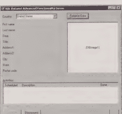

### 图 2.4

Advanced 显示联系人数据及相关活动。

`SchemaType` 指定要返回的架构数据类型，必须是 **表 2.2** 中列出的值之一。

### 表 2.2 TSchemaType 值

| **值** | **返回的架构信息** |
|---|---|
| `stNoSchema` | 无架构信息。数据集返回查询或存储过程的结果，而不是该对象的架构信息。 |
| `stTables` | 与对象名称和模式匹配的数据库中表的信息。 |
| `stSysTables` | 数据库中系统表的信息。 |
| `stProcedures` | 数据库中存储过程的信息。 |
| `stColumns` | 单个表的列信息。 |
| `stProcedureParams` | 单个存储过程的参数信息。 |
| `stIndexes` | 单个表的索引信息。 |

`SchemaObjectName` 指定要返回数据的表或存储过程名称。它仅用于 `stColumns`、`stProcedureParams` 和 `stIndexes` 架构类型。如果架构类型为 `stColumns` 或 `stIndexes`，`SchemaObjectName` 指定要返回列或索引信息的表。如果架构类型为 `stProcedureParams`，`SchemaObjectName` 指定要返回参数信息的存储过程名称。

`SchemaPattern` 是一个用于筛选结果集中返回数据的 SQL 模式。例如，要仅返回以字母 A 开头的列，您可以向 `SetSchemaInfo` 调用传递 `SchemaPattern` 为 `A%`。如果您不想筛选结果集，请将 `SchemaPattern` 设为空字符串。

在 `SchemaPattern` 中，使用百分号 (`%`) 匹配任意长度的字符串，使用下划线 (`_`) 匹配单个字符。如果要在模式中包含百分号或下划线，请将其重复书写（`%%` 或 `__`）。

在检索到数据库的架构数据后，您可以通过调用 `SetSchemaInfo` 并将 `SchemaType` 设为 `stNoSchema`，使用相同的数据集对数据库运行常规查询。

代码列表 2.4 展示了一个示例程序的完整源代码，该程序可以提取并显示 dBExpress 数据库的架构信息。在代码列表之后，我将简要概述代码，因为此时大部分内容应该是不言自明的。

图 2.5 展示了 Schema 程序显示 ConMan.gdb 数据库中 CONTACTS 表的列信息时的效果。

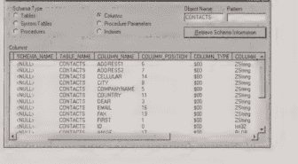

### 图 2.5

*Schema 应用程序解码并显示列信息。*

### 代码列表 2.4 Schema—MainForm.pas

```pascal
unit MainForm;

interface

uses
  SysUtils, Variants, Classes, QGRaphics, QControls, QForms,
  QDDialogs, DBXpress, FMTBcd, DB, SqlExpr, QExControls, QStdCtrls, QComCtrls;

type
TfrmMain = class(TForm)
pnlClient: TPanel;
conn: TSQLConnection;
dataset: TSQLDataSet;
Label1: TLabel;
lvColumns: TListView;
grpSchemaType: TRadioGroup;
Label2: TLabel;
ecObjectName: TEdit;
btnRetrieve: TButton;
ecSchemaPattern: TEdit;
Label3: TLabel;
```


```pascal
procedure btnRetrieveClick(Sender: TObject);

private

{ Private declarations }

function GetTableTypeString(TableType: Integer): string;

function GetProcTypeString(ProcType: Integer): string;

function GetColTypeString(ColType: Integer): string;

function GetColDataTypeString(ColDataType: Integer): string;

function GetColSubTypeString(ColSubType: Integer): string;

function GetIndexTypeString(IndexType: Integer): string;

public

{ Public declarations }

end;

var

frMain: TfrmMain;

implementation

{$R *.xfm}

procedure TfrmMain.btnRetrieveClick(Sender: TObject);

var

SchemaType: TSchemaType;

ListColumn: TListColumn;

ListItem: TListItem;

Index: Integer;

begin

SchemaType := TSchemaType(grpSchemaType.ItemIndex + 1);

// Columns, Indexes, and Procedure Params must have a schema object name

case SchemaType of

stColumns,

stIndexes,

stProcedureParams:

if ecObjectName.Text = '' then

   raise Exception.Create('You must enter a schema object name' +

      ' for this schema type.');

end;

conn.Open;

try

   dataset.SetSchemaInfo(SchemaType, ecObjectName.Text, ecSchemaPattern.Text);

   dataset.Open;

   lvColumns.Items.BeginUpdate;

   try

      lvColumns.Items.Clear;

      lvColumns.Columns.BeginUpdate;

      try

         lvColumns.Columns.Clear;

         for Index := 0 to dataset.FieldCount - 1 do begin

            ListColumn := lvColumns.Columns.Add;

            ListColumn.Caption := dataset.Fields[Index].FieldName;

         end;

      while not dataset.EOF do begin

         ListItem := lvColumns.Items.Add;

         ListItem.Caption := dataset.Fields[0].AsString;

         for Index := 1 to dataset.FieldCount - 1 do begin

            if dataset.Fields[Index].FieldName = 'TABLE_TYPE' then

               ListItem.SubItems.Add(GetTableTypeString(

                  dataset.Fields[Index].AsInteger))

            else if dataset.Fields[Index].FieldName = 'PROC_TYPE' then

               ListItem.SubItems.Add(GetProcTypeString(

                  dataset.Fields[Index].AsInteger))

            else if dataset.Fields[Index].FieldName = 'COLUMN_TYPE' then

               ListItem.SubItems.Add(GetColTypeString(

                  dataset.Fields[Index].AsInteger))

            else if dataset.Fields[Index].FieldName = 'COLUMN_DATATYPE' then

               ListItem.SubItems.Add(GetColDataTypeString(

                  dataset.Fields[Index].AsInteger))

            else if dataset.Fields[Index].FieldName = 'COLUMN_SUBTYPE' then

               ListItem.SubItems.Add(GetColSubTypeString(

                  dataset.Fields[Index].AsInteger))
```

### 列表 2.4

```pascal
else if dataset.Fields[Index].FieldName = 'INDEX_TYPE' then

  ListItem.SubItems.Add(GetIndexTypeString(

    dataset.Fields[Index].AsInteger))

else

  ListItem.SubItems.Add(dataset.Fields[Index].AsString);

end;

dataset.Next;

end;

finally

  lvColumns.Columns.EndUpdate;

end;

finally

  lvColumns.Items.EndUpdate;

end;

finally

  conn.Close;

end;

end;

function TfrmMain.GetTableTypeString(TableType: Integer): string;

procedure Check(SQLTableType: Integer; const Desc: string);

begin

  if (TableType and SQLTableType) <> 0 then begin

    if Result <> '' then

      Result := Result + ', ';

    Result := Result + Desc;

  end;

end;

begin

  Result := '';

  Check(eSQLTable, 'Table');

  Check(eSQLView, 'View');

  Check(eSQLSynonym, 'Synonym');

  Check(eSQLSystemTable, 'System');

  Check(eSQLTempTable, 'Temp');

  Check(eSQLLocal, 'Local');

  if Result = '' then

    Result := '$' + IntToHex(TableType, 2);

end;

function TfrmMain.GetProcTypeString(ProcType: Integer): string;

procedure Check(SQLProcType: Integer; const Desc: string);

begin

  if (ProcType and SQLProcType) <> 0 then begin

    if Result <> '' then

      Result := Result + ', ';

    Result := Result + Desc;

  end;

end;

begin

  Result := '';

  Check(eSQLProcedure, 'Procedure');

  Check(eSQLFunction, 'Function');

  Check(eSQLPackage, 'Package');
```


## `TfrmMain.GetColTypeString`

```pascal
function TfrmMain.GetColTypeString(ColType: Integer): string;
procedure Check(SQLColType: Integer; const Desc: string);
begin
  if (ColType and SQLColType) <> 0 then begin
    if Result <> '' then
      Result := Result + ', ';
    Result := Result + Desc;
  end;
end;
begin
  Result := '';
  Check(eSQLRowId, 'Row Id');
  Check(eSQLRowVersion, 'Row Version');
  Check(eSQLAutoIncr, 'Auto Incr');
  Check(eSQLDefault, 'Default');
  if Result = '' then
    Result := '$' + IntToHex(ColType, 2);
end;
```

## `TfrmMain.GetColDataTypeString`

```pascal
function TfrmMain.GetColDataTypeString(ColDataType: Integer): string;
begin
    case ColDataType of
        fldUNKNOWN:  Result := 'Unknown';
        fldZSTRING:  Result := 'ZString';
        fldDATE:     Result := 'Date';
        fldBLOB:     Result := 'BLOB';
        fldBOOL:     Result := 'Bool';
        fldINT16:    Result := 'Int16';
        fldINT32:    Result := 'Int32';
        fldFLOAT:    Result := 'Float';
        fldBCD:      Result := 'BCD';
        fldBYTES:    Result := 'Bytes';
        fldTIME:     Result := 'Time';
        fldTIMESTAMP: Result := 'Timestamp';
        fldUINT16:   Result := 'UInt16';
        fldUINT32:   Result := 'UInt32';
        fldFLOATIEEE: Result := 'FloatIEEE';
        fldVARBYTES: Result := 'VarBytes';
        fldLOCKINFO: Result := 'LockInfo';
        fldCURSOR:   Result := 'Cursor';
        fldINT64:    Result := 'Int64';
        fldUINT64:   Result := 'UInt64';
        fldADT:      Result := 'ADT';
        fldARRAY:    Result := 'Array';
        fldREF:      Result := 'RefADT';
        fldTABLE:    Result := 'Table';
        fldDATETIME: Result := 'DateTime';
        fldFMTBCD:   Result := 'FmtBCD';
        else          Result := '$' + IntToHex(ColDataType, 2);
    end;
end;
```

## `TfrmMain.GetColSubTypeString`

```pascal
function TfrmMain.GetColSubTypeString(ColSubType: Integer): string;
begin
    case ColSubType of
        fldstMONEY:    Result := 'Money';
        fldstMEMO:     Result := 'Memo';
        fldstBINARY:   Result := 'Binary';
        fldstFMTMEMO:  Result := 'Fmt Memo';
        fldstOLEOBJ:   Result := 'Pdox OLE';
        fldstGRAPHIC:  Result := 'Graphic';
        fldstDBSOLEOBJ:      Result := 'dBase OLE';
        fldstTYPEDBBINARY:   Result := 'Typed Binary';
        fldstACCOLEOBJ:      Result := 'Access OLE';
        fldstTHMEMO:         Result := 'CLOB';
        fldstHBINARY:        Result := 'BLOB';
        fldstBFILE:          Result := 'BFILE';
        fldstPASSWORD:       Result := 'Password';
        fldstFIXED:          Result := 'Char';
        fldstUNICODE:        Result := 'Unicode';
        fldstAUTOINC:        Result := 'AutoInc';
        fldstADTNestedTable: Result := 'ADT Nest';
        fldstADTDATE:        Result := '$' + IntToHex(ColSubType, 2);
    else
    end;
end;
```

## `TfrmMain.GetIndexTypeString`

```pascal
function TfrmMain.GetIndexTypeString(IndexType: Integer): string;
procedure Check(SQLIndexType: Integer; const Desc: string);
begin
    if (IndexType and SQLIndexType) <> 0 then begin
        if Result <> '' then
            Result := Result + ',';
        Result := Result + Desc;
    end;
end;
begin
    Result := '';
    Check(eSQLNonUnique, 'Non-unique');
    Check(eSQLUnique,    'Unique');
    Check(eSQLPrimaryKey, 'Primary');
    if Result = '' then
        Result := '$' + IntToHex(IndexType, 2);
end;
```

```pascal
Check(eSQLSysProcedure, 'System');
if Result = '' then
  Result := '$' + IntToHex(ProcType, 2);
end;
```


Schema 应用程序的核心包含在单个方法中：`btnRetrieveClick`。`btnRetrieveClick` 确定用户选择了哪种 schema 类型，并确保如果请求的 schema 类型是列、索引或存储过程参数，用户必须输入一个对象名称。

当 schema 类型确定后，调用适当的 `SetSchemaInfo`、打开数据集并使用 schema 信息加载列表视图就变得很简单了。某些列（即 `TABLE_TYPE`、`PROC_TYPE`、`COLUMN_TYPE`、`COLUMN_DATATYPE`、`COLUMN_SUBTYPE` 和 `INDEX_TYPE`）是位图数值列。该程序调用一系列辅助例程以显示这些值的文本表示形式。其余的列则按原样显示。

你会发现，当运行此应用程序时，不同的 schema 类型返回不同的数据字段。表 2.3-2.7 解释了这些 schema 类型中每一个所返回的列。

表 2.3 列出了针对 `stTables` 或 `stSystemTables` schema 类型返回的列。

#### 表 2.3 stTables 和 stSystemTables Schema 列

| 列名 | 描述 |
| :--- | :--- |
| RECO | 绝对记录号。第一条记录为 1，第二条为 2，依此类推。 |
| CATALOG_NAME | 包含该表的目录或数据库的名称。 |
| SCHEMA_NAME | 该表的所有者。 |
| TABLE_NAME | 表名。 |
| TABLE_TYPE | 表示表类型的位图值。有关此字段可能值的解释，请参见列表 2.4 或 `DBXpress.pas` 的源代码。 |

表 2.4 列出了针对 `stProcedures` schema 类型返回的列。

#### 表 2.4 stProcedures Schema 列

| 列名 | 描述 |
| :--- | :--- |
| RECO | 绝对记录号。第一条记录为 1，第二条为 2，依此类推。 |
| CATALOG_NAME | 包含该存储过程的目录或数据库的名称。 |
| SCHEMA_NAME | 该存储过程的所有者。 |
| PROC_NAME | 存储过程名称。 |
| PROC_TYPE | 表示存储过程类型的位图值。有关此字段可能值的解释，请参见列表 2.4 或 `DBXpress.pas` 的源代码。 |
| IN_PARAMS | 存储过程的输入参数数量。 |
| OUT_PARAMS | 存储过程的输出参数数量。 |

表 2.5 列出了针对 *stColumns* schema 类型返回的列。

#### 表 2.5 stColumns Schema 列

| 列名 | 描述 |
| :--- | :--- |
| RECO | 绝对记录号。第一条记录为 1，第二条为 2，依此类推。 |
| CATALOG_NAME | 包含该表的目录或数据库的名称。 |
| SCHEMA_NAME | 该列的所有者。 |
| TABLE_NAME | 包含该列的表名。 |
| COLUMN_NAME | 列名。 |
| COLUMN_POSITION | 列在表定义中基于零的位置。 |
| COLUMN_TYPE | 表示列类型的位图值。有关此字段可能值的解释，请参见列表 2.4 或 `DBXpress.pas` 的源代码。 |
| COLUMN_DATATYPE | 逻辑字段类型。有关此字段可能值的解释，请参见列表 2.4 或 `DBXpress.pas` 的源代码。 |
| COLUMN_TYPENAME | SQL 列类型（*VARCHAR*、*BLOB* 等）。 |
| COLUMN_SUBTYPE | 逻辑字段子类型。有关此字段可能值的解释，请参见列表 2.4 或 `DBXpress.pas` 的源代码。 |
| COLUMN_LENGTH | 列的字节大小。 |
| COLUMN_PRECISION | 列的精度。其值因列类型而异。例如，对于字符串，它是字符数；对于 BCD 值，它是有效数字的位数。 |
| COLUMN_SCALE | 数值比例。对于 BCD 列，它是小数点右边的位数。 |
| COLUMN_NULLABLE | 如果列可以包含 *NULL* 值，则为 1；如果不能包含 *NULL* 值，则为 0。 |

表 2.6 列出了针对 *stProcedureParams* schema 类型返回的列。

#### 表 2.6 stProcedureParams Schema 列

| 列名 | 描述 |
| :--- | :--- |
| RECO | 绝对记录号。第一条记录为 1，第二条为 2，依此类推。 |
| CATALOG_NAME | 包含该存储过程的目录或数据库的名称。 |

## 表 2.6 续

| 列 | 描述 |
| :--- | :--- |
| SCHEMA_NAME | 过程参数的所有者。 |
| PROCEDURE_NAME | 包含该参数的过程名称。 |
| PARAM_NAME | 参数名称。 |
| PARAM_POSITION | 参数的零基位置。请注意，输入参数和输出参数各自拥有独立的列表，因此第一个输入参数的位置为零，第一个输出参数的位置也为零。 |
| PARAM_TYPE | 输入参数为 1，输出参数为 2，输入/输出参数为 3，返回值为 4。 |
| PARAM_DATATYPE | 逻辑参数类型。有关该字段可能取值的说明，请参阅清单 2.4 或 `DBXpress.pas` 的源代码。 |
| PARAM_SUBTYPE | 逻辑参数子类型。有关该字段可能取值的说明，请参阅清单 2.4 或 `DBXpress.pas` 的源代码。 |
| PARAM_TYPENAME | SQL 参数类型（VARCHAR、BLOB 等）。 |
| PARAM_LENGTH | 参数的大小（以字节为单位）。 |
| PARAM_PRECISION | 参数的精度。这取决于参数类型。例如，对于字符串，它是字符数；对于 BCD 数字，它是有效位数。 |
| PARAM_SCALE | 数字标度。对于 BCD 参数，这是小数点右侧的位数。 |
| PARAM_NULLABLE | 如果参数可以包含 NULL 值，则为 1；如果不可以包含 NULL 值，则为 0。 |

表 2.7 列出了模式类型为 stIndexes 时返回的列。

## 表 2.7 stIndexes 模式列

| 列 | 描述 |
| :--- | :--- |
| RECNO | 绝对记录号。第一条记录为 1，第二条为 2，依此类推。 |
| CATALOG_NAME | 包含该索引的目录或数据库的名称。 |
| SCHEMA_NAME | 索引的所有者。 |
| TABLE_NAME | 定义了该索引的表名。 |
| INDEX_NAME | 索引的名称。 |
| COLUMN_NAME | 构成索引一部分的列名。 |
| COLUMN_POSITION | 该列在索引中的位置。 |
| PKEY_NAME | 如果是主键，这是主键的名称。 |
| INDEX_TYPE | 表示列类型的位图值。有关该字段可能取值的说明，请参阅清单 2.4 或 `DBXpress.pas` 的源代码。 |
| SORT_ORDER | 对于升序列，值为 A；对于降序列，值为 D。 |
| FILTER | 这表示过滤/范围索引上的过滤条件，或表达式索引上的表达式。例如，(LAST + FIRST)。仅某些数据库（如 Oracle）支持此功能。 |

## 摘要

本章讨论了 dBExpress 数据集组件 `TSQLDataSet`，包括以下关键概念：

- `TSQLDataSet` 是一种单向、只读、轻量的数据访问机制。它可以用于从数据库中的表、查询或存储过程中检索数据。
- dBExpress 数据集支持两种导航选项：移动到数据集的开头以及在结果集中移动到下一条记录。
- 要从 `TSQLDataSet` 中检索数据，通常调用 `FieldByName` 方法。
- `TSQLDataSet` 支持 BLOB 信息。为了提高查询性能，您可以设置 `TSQLDataSet` 的 `BlobSize` 属性，以指定为每个 BLOB 字段检索的最大数据量。
- 为了提高重复查询的效率，您可以通过在 SQL 语句中创建占位符来对其进行参数化。然后，您可以为该参数设置不同的值。SQL 语句仅准备一次——即首次执行时。
- 要对从数据库返回的数据进行排序，您可以在数据集的 `CommandText` 属性中指定 ORDER BY 子句。
- 您可以轻松地在表和查询之间建立主从（master/detail）关系。
- 可以使用 dBExpress 数据集检索数据库中表、查询和存储程序的详细架构信息。

下一章将开始对客户端数据集的两章探索。

# 客户端数据集基础

### 第 3 章

## 本章内容

- 什么是客户端数据集？ 94
- 客户端数据集的优缺点 94
- 创建客户端数据集 95
- 填充和操作客户端数据集 105
- 导航客户端数据集 113
- 客户端数据集索引 118
- 过滤器和范围 126
- 搜索 136

在前两章中，我讨论了 dbExpress——一种单向数据库技术。在现实世界中，大多数应用程序都支持数据集的双向滚动。正如前面所述，Borland 通过一种称为客户端数据集的技术解决了双向数据集的问题。本章介绍客户端数据集的基本操作，包括它们如何作为一个有用的独立工具。后续章节将重点介绍更高级的客户端数据集功能，包括如何将客户端数据集连接到 dbExpress（或其他）数据库连接，以创建真正的多层应用程序。

## 什么是客户端数据集？

顾名思义，客户端数据集是位于客户端应用程序（而非应用程序服务器）中的数据集。这个名称有点名不副实，因为它似乎暗示客户端数据集在客户端/服务器或多层应用程序之外没有用处。然而，正如您将在本章中看到，客户端数据集在其他类型的应用程序中也非常有用，特别是单层数据库应用程序。

**注意**

客户端数据集最初在 Delphi 3 中引入，它们提供了一种在 Delphi 中创建多层应用程序的方法。随着其使用变得更为普及，它们得到增强以支持额外的单层功能。

VCL/CLX 中客户端数据集的基类是 `TCustomClientDataSet`。通常，您不直接处理 `TCustomClientDataSet`，而是处理其直接子类 `TClientDataSet`。（在第 7 章“数据集提供程序”中，我将向您介绍 `TCustomClientDataSet` 的其他子类。）为了可读性和泛化，我将在本书中通用地将客户端数据集称为 `TClientDataSet`。

## 客户端数据集的优缺点

客户端数据集有许多优点，也有几个看似缺点的地方。其优点包括：

- 基于内存。客户端数据集完全驻留在内存中，这使得它们适用于临时表。
- 快速。由于客户端数据集基于 RAM，因此它们速度极快。
- 高效。客户端数据集以非常高效的方式存储其数据，使它们对资源友好。
- 即时索引。客户端数据集允许您即时创建和使用索引，使它们极具多用途性。
- 自动撤销支持。客户端数据集提供多级撤销支持，使您轻松对数据执行假设性操作。有关撤销支持的讨论见第 4 章“高级客户端数据集操作”。
- 维护的聚合。客户端数据集可以自动计算一组记录的平均值、小计和总计。有关维护聚合的详细讨论见第 4 章。

看似缺点的地方包括：

- 基于内存。这个客户端数据集的优点也可能是缺点。因为客户端数据集驻留在 RAM 中，其大小受可用 RAM 量的限制。
- 单用户。客户端数据集本质上是由 RAM 维护的单用户数据集。

当您理解客户端数据集时，您会发现这些所谓的缺点对您的应用毫无害处。特别是，将客户端数据集完全基于 RAM 既有利也有弊。

由于它们完全保留在您的计算机的 RAM 中，客户端数据集对于临时表、小型查找表和其他非持久化数据库需求极为有用。客户端数据集也很快，因为它们基于 RAM。在客户端数据集中插入、删除、搜索、排序和遍历的速度极快。

另一方面，您需要采取措施确保客户端数据集不会变得太大，因为如果您试图在内存数据集中存储巨大的数据库，就会浪费宝贵的 RAM。幸运的是，客户端数据集以非常紧凑的形式存储其数据。（我将在第 7 章的“撤销支持”部分详细讨论这一点。）

由于基于内存，客户端数据集本质上是单用户的。远程机器无法访问本地机器上的客户端数据集。在第 8 章“DataSnap”中，您将在三层配置中学习如何将客户端数据集连接到应用程序服务器，以支持真正的多层操作。

## 创建客户端数据集

在应用程序中使用客户端数据集与其他类型的数据集的使用类似，因为它们派生自 `TDataSet`。

您可以在设计时或运行时创建客户端数据集，如下文各节所述。

## 在设计时创建客户端数据集

通常，你都在设计时创建客户端数据集。为此，将一个 `TClientDataSet` 组件（位于“数据访问”选项卡上）拖放到窗体或数据模块上。这只会创建该组件，但不会设置任何字段或索引定义。将该组件命名为 `cdsEmployee`。

要为客户端数据集创建字段定义，请在窗体编辑器中双击 `TClientDataSet` 组件。此时将显示标准的 Delphi 字段编辑器。右键单击字段编辑器，并从弹出菜单中选择“新建字段...”以创建新字段。此时将出现如图 3.1 所示的对话框。

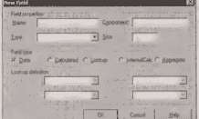

### 图 3.1

*使用“新建字段”对话框向数据集中添加字段。*

如果你熟悉字段编辑器，你会注意到有一个新的字段类型可供客户端数据集使用，称为**聚合字段**。我将在下一章中详细讨论聚合字段。现在，你应该理解，你可以向客户端数据集中添加数据、查找、计算以及内部计算字段——就像你对任何其他数据集所做的一样。

客户端数据集与其他数据集的区别在于，当你为典型的数据集创建数据字段时，你所做的仅仅是创建一个映射到基础数据库中某个字段的持久化字段对象。而对于客户端数据集，你则是在数据集中物理地创建该字段，同时创建一个持久化字段对象。在设计时，不可能只创建客户端数据集中的字段而不创建持久化字段对象。

## 数据字段

客户端数据集中的大多数字段将是数据字段。数据字段代表物理上作为数据集一部分的字段，区别于计算字段或查找字段（这些将在后续章节中讨论）。你可以将计算字段和查找字段视为虚拟字段，因为它们似乎存在于数据集中，但其实际数据来自其他位置。

让我们向数据集中添加一个名为 ID 的字段。在字段编辑器中，在名称编辑控件中输入 ID。按 Tab 键切换到类型组合框，输入 Integer（整数），或从下拉列表中选择它。（组件名称已自动为你创建。）由于 Integer 值是定长字段，大小编辑控件处于禁用状态。字段类型预设 Data（数据），这正是我们想要的。图 3.2 显示了填写完整的对话框。

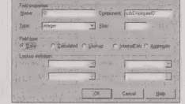

### 图 3.2

*输入新字段信息后的“新建字段”对话框。*

单击“确定”以将该字段添加到客户端数据集。你会看到新的 ID 字段列在字段编辑器中。

现在添加第二个字段，称为 LastName。右键单击字段编辑器以显示“新建字段”对话框，并在名称编辑控件中输入 LastName。在类型组合框中，选择 String（字符串）。然后，将大小设置为 30——大小代表允许该字段的最大字符数。单击“确定”以将 LastName 字段添加到数据集中。

类似地，添加一个 20 个字符的 FirstName 字段和一个 Integer 类型的 Department 字段。最后，让我们添加一个 Salary 字段。打开“新建字段”对话框。在名称编辑控件中，输入 Salary。将类型设置为 Currency（货币）并单击“确定”。（货币类型指示 Delphi 自动显示美元符号。）

如果你正确执行了这些步骤，字段编辑器看起来如图 3.3 所示。

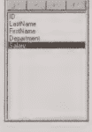

### 图 3.3

*添加五个字段后的字段编辑器。*

对于此数据集来说，字段数量已经足够了。在下一节中，我将向你展示如何创建计算字段。

## 计算字段

如前所述，计算字段不会在数据集中占用任何物理空间。相反，它们是即时从存储在数据集中的其他数据计算得出的。例如，你可以创建一个计算字段，将两个数据字段的值相加。在本节中，我们将创建两个计算字段：一个标准的和一个内部的。

> **注意**
>
> 实际上，内部计算字段和数据字段一样，也会在数据集中占用空间。因此，你可以像在数据字段上一样对它们创建索引。索引将在本章稍后讨论。

### 标准计算字段

在本节中，我们将创建一个计算字段，用于计算年度奖金，我们假设它是员工薪资的百分之五。

要创建标准计算字段，请打开“新建字段”对话框（就像你在前一节所做的那样）。输入名称 Bonus 和类型 Currency。

在字段类型单选组中，选择 Calculated（计算）。这会指示 Delphi 创建计算字段，而不是数据字段。单击“确定”。

这就是创建计算字段所需做的全部工作。现在，让我们来看看内部计算字段。

### 内部计算字段

创建内部计算字段与创建标准计算字段几乎相同。唯一的区别是，在“新建字段”对话框中，你选择 InternalCalc 作为字段类型，而不是 Calculated。

这两种类型计算字段的另一个区别是，标准计算字段每次需要其值时都会即时计算，但内部计算字段只计算一次，其值存储在 RAM 中。（当然，如果底层用于计算的字段发生变化，内部计算字段会自动重新计算。）

数据集的 `AutoCalcFields` 属性决定了确切何时重新计算字段。如果 `AutoCalcFields` 为 True（默认值），当数据集打开时、当数据集进入编辑模式时，以及当表单中的焦点从一个数据感知控件移动到另一个控件且当前记录已修改时，计算字段会被计算。如果 `AutoCalcFields` 为 False，当数据集打开时、当数据集进入编辑模式时，以及当从底层数据库检索记录到数据集时，计算字段会被计算。

你有可能想要使用内部计算字段而不是标准计算字段的原因有两个。如果你想在计算字段上为数据集创建索引，你必须使用内部计算字段。（索引将在本章稍后详细讨论。）此外，如果字段的值计算耗时较长，你也可能选择使用内部计算字段。因为它们只计算一次并存储在 RAM 中，内部计算字段不需要像标准计算字段那样频繁计算。

让我们向数据集中添加一个内部计算字段。该字段将称为 `Name`，它将把 `FirstName` 和 `LastName` 字段拼接在一起。我们稍后可能希望在此字段上创建索引，因此我们需要将其设为内部计算字段。

打开“新建字段”对话框，输入名称 `Name of Name` 和类型 `Type of String`。将大小设置为 52（这考虑了姓的最大长度，加上名的最大长度，加上用于分隔两者的逗号和一个空格）。

在字段类型单选组中，选择 `InternalCalc` 并单击“确定”。

## 为计算字段提供值

至此，我们已经创建了计算字段。现在我们需要提供计算值的代码。`TClientDataSet` 与所有 Delphi 数据集一样，支持一个名为 `OnCalcFields` 的方法，我们需要为其提供主体。

再次单击客户端数据集，并在对象检查器中，单击“事件”选项卡。双击 `OnCalcFields` 事件以创建事件处理程序。

我们将首先计算 `Bonus` 字段的值。完善事件处理程序，使其看起来像这样：

```pascal
```


`procedure TForm1.cdsEmployeeCalcFields(DataSet: TDataSet);`

```
begin

  cdsEmployeeBonus.AsFloat := cdsEmployeeSalary.AsFloat * 0.05;

end;
```

这很简单——我们只需获取 `Salary` 字段的值，将其乘以百分之五（`0.05`），并将该值存储在 `Bonus` 字段中。

现在，让我们添加 `Name` 字段的计算。第一次（合理的）尝试看起来像这样：

```pascal

procedure TForm1.cdsEmployeeCalcFields(DataSet: TDataSet);

begin

  cdsEmployeeBonus.AsFloat := cdsEmployeeSalary.AsFloat * 0.05;

```
这是可行的，但效率不高。每次计算 `Bonus` 字段时，`Name` 字段都会被重新计算。然而，请记住，内部计算字段的计算频率不需要像标准计算字段那样高。幸运的是，我们可以检查数据集的 `State` 属性来确定是否需要计算内部计算字段，例如：

```
procedure TForm1.cdsEmployeeCalcFields(DataSet: TDataSet);

begin

  cdsEmployeeBonus.AsFloat := cdsEmployeeSalary.AsFloat * 0.05;

  if cdsEmployee.State = dsInternalCalc then

    cdsEmployeeName.AsString := cdsEmployeeLastName.AsString + ', ' +

                                cdsEmployeeFirstName.AsString;

end;
```

请注意，`Bonus` 字段每次都会计算，但 `Name` 字段仅在 Delphi 告知我们需要计算内部计算字段时才会计算。

## 查找字段

查找字段在概念上类似于计算字段，因为它们并不在数据集中物理存储。然而，与要求您计算查找字段的值不同，Delphi 会从另一个数据集中获取该值。让我们看一个示例。

早些时候，我们在数据集中创建了一个 `Department` 字段。让我们创建一个新的 `Department` 数据集来存储部门信息。

在窗体上放置一个新的 `TClientDataSet` 组件，并将其命名为 `cdsDepartment`。添加两个字段：`Dept`（整数）和 `Description`（30 个字符的字符串）。

通过双击数据集来显示 `cdsEmployee` 数据集的字段编辑器。打开“新字段”对话框。将字段命名为 `DepartmentName`，类型设为 `String`，大小设为 `30`。

在字段类型单选按钮组中，选择 `Lookup`。请注意，查找定义组框中的两个字段现在已启用。在 `Key Fields` 组合框中，选择 `Department`。在 `Dataset` 组合框中，选择 `cdsDepartment`。

此时，查找定义组框中的另外两个字段可访问。在 `Lookup Keys` 组合框中，选择 `Dept`。在 `Result Field` 组合框中，选择 `Description`。完成的对话框应如图 3.4 所示。

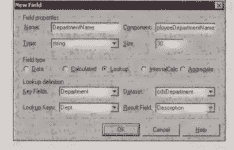

**图 3.4**

向数据集中添加查找字段。

关于查找字段，需要记住的重要一点是，**Key field** 代表基础数据集中引用查找数据集中的字段。**Dataset** 指代查找数据集。**Lookup Keys** 组合框代表查找数据集中的 **Key field**。**Result field** 是查找数据集中查找字段获取值的来源字段。

要在设计时创建数据集，您可以右键单击 **TClientDataSet** 组件，并从弹出菜单中选择 **Create DataSet**。

既然您已经了解了如何在设计时创建客户端数据集，那么让我们看看在运行时创建客户端数据集需要什么。

## 在运行时创建客户端数据集

要在运行时创建客户端数据集，您需要从以下骨架代码开始：

```
var

  CDS: TClientDataSet;

begin

  CDS := TClientDataSet.Create(nil);

  try

    // 在这里对客户端数据集执行操作

  finally

    CDS.Free;

  end;

end;
```

创建客户端数据集后，通常您需要添加字段，但您也可以从磁盘加载客户端数据集（您将在本章稍后“持久化客户端数据集”部分中看到）。

### 向客户端数据集中添加字段

要在运行时向客户端数据集添加字段，您使用客户端数据集的 `FieldDefs` 属性。`FieldDefs` 支持两种添加字段的方法：`AddFieldDef` 和 `Add`。

#### AddFieldDef

`TFieldDefs.AddFieldDef` 定义如下：

```
function AddFieldDef: TFieldDef;
```

如您所见，`AddFieldDef` 不取任何参数，并返回一个 `TFieldDef` 对象。当您拥有 `TFieldDef` 对象后，您可以设置其属性，如下面的代码片段所示。

```
var

  FieldDef: TFieldDef;

begin

  FieldDef := ClientDataSet1.FieldDefs.AddFieldDef;

  FieldDef.Name := 'Name';

  FieldDef.DataType := ftString;

  FieldDef.Size := 20;

  FieldDef.Required := True;

end;
```

#### Add

向客户端数据集添加字段的一种快捷方式是使用 `TFieldDefs.Add` 方法，其定义如下：

```
procedure Add(const Name: string; DataType: TFieldType; Size: Integer = 0;

  Required: Boolean = False);
```

`Add` 方法将字段名称、数据类型、大小（对于字符串字段）以及指示字段是否必需的标志作为参数。通过使用 `Add`，前面的代码片段变成以下单行代码：

```
ClientDataSet1.FieldDefs.Add('Name', ftString, 20, True);
```

既然可以使用 `Add`，为什么还要使用 `AddFieldDef`？一个原因是 `TFieldDef` 除了 `Add` 支持的那四个属性外，还包含几个更高级的属性（如字段精度、是否只读以及其他一些属性）。如果您想为字段设置这些属性，您需要通过 `TFieldDef`。有关更多详细信息，请参阅 Delphi 文档中关于 `TFieldDef` 的部分。

#### 创建数据集

在创建完字段定义后，您需要创建内存中的空数据集。为此，请调用 `TClientDataSet.CreateDataSet`，如下所示：

```
ClientDataSet1.CreateDataSet;
```

如您所见，在设计时创建客户端数据集比在运行时创建更容易一些。但是，如果您经常创建临时内存数据集，或者需要在无窗体单元中创建客户端数据集，您可以以最小的麻烦在运行时创建数据集。

### 访问字段

无论您如何创建客户端数据集，在某个时间点您需要访问字段信息——无论是用于显示、计算某些值，还是添加或修改新记录。

在 Delphi 中访问字段信息有几种方法。最简单的是使用持久字段。

### 持久字段

在本章早些时候，当我们使用字段编辑器创建字段时，我们也为这些字段创建了持久字段对象。例如，当我们添加 `LastName` 字段时，Delphi 创建了一个名为 `cdsEmployeeLastName` 的持久字段对象。

当您知道字段对象的名称时，可以使用 `AsXXX` 系列方法轻松获取字段的内容。例如，要将字段作为字符串访问，您可以引用 `AsString` 属性，如下所示：

```
ShowMessage('The employee’s last name is ' +

    cdsEmployeeLastName.AsString);
```

要将员工业绩作为浮点数获取，您可以引用 `AsFloat` 属性：

```
Bonus := cdsEmployeeSalary.AsFloat * 0.05;
```

请参阅 VCL/CLX 源代码和 Delphi 文档以获取可用访问属性的列表。


您不限于以原生格式访问字段值。例如，仅仅因为 `Salary` 是货币字段，并不意味着您不能尝试将其作为字符串访问。以下代码显示员工薪水为格式化货币：

```
ShowMessage('Your salary is ' + cdsEmployeeSalary.AsString);
```


例如，如果您知道字段包含整数值，您可以将字符串字段作为整数访问。但是，如果您尝试将字段作为整数（或其他数据类型）访问，而该字段不包含与该数据类型兼容的值，Delphi 将引发异常。

### 非持久字段

如果您在设计时创建数据集，您可能不会有任何持久字段对象。在这种情况下，您可以使用几种方法来访问字段的值。

第一种是 `FieldByName` 方法。`FieldByName` 以字段名称作为参数，并返回一个临时字段对象。下面的代码片段使用 `FieldByName` 显示员工的姓氏。

```
ShowMessage(‘The employee’s last name is ’ +
  ClientDataSet1.FieldByName(‘LastName’).AsString);
```

> 如果您调用 `FieldByName` 时使用的是不存在的字段名，Delphi 将引发异常。

访问数据集中字段的另一种方法是使用 `FindField` 方法，如下所示：

```
if ClientDataSet1.FindField(‘LastName’) <> nil then
  ShowMessage(‘Dataset contains a LastName field’);
```

使用此技术，您可以为在运行时创建的数据集创建持久字段。

```
var
  fldLastName: TField;
  fldFirstName: TField;
begin
  ...
  fldLastName := cds.FindField(‘LastName’);
  fldFirstName := cds.FindField(‘FirstName’);
  ...
  ShowMessage(’The last name is ’ + fldLastName.AsString);
end;
```

最后，您可以访问数据集的 `Fields` 属性。`Fields` 包含数据集的 `TField` 对象列表，如下面的代码所示：

```
var
  Index: Integer;
begin
  for Index := 0 to ClientDataSet1.Fields.Count - 1 do
    ShowMessage(ClientDataSet1.Fields[Index].AsString);
end;
```

您通常不会直接访问 `Fields`。例如，假设某个字段是 `Fields` 列表中的第一个字段，通常是一种不安全的编程实践。然而，

`Fields` 列表会派上用场的场景。例如，如果你有两个结构相同的客户端数据集，你可以使用以下代码将一个数据集的记录添加到另一个数据集中：

```pascal
var
  Index: Integer;
begin
  ClientDataSet2.Append;
  for Index := 0 to ClientDataSet1.Fields.Count - 1 do
    ClientDataSet2.Fields[Index].AsVariant :=
      ClientDataSet1.Fields[Index].AsVariant;
  ClientDataSet2.Post;
end;
```

下一节将详细讨论向数据集中添加记录。

## 填充和操作客户端数据集

创建客户端数据集（无论是在设计时还是运行时）之后，你需要用数据来填充它。填充客户端数据集有几种方式：你可以通过代码手动填充，也可以从另一个数据集加载记录，或者从文件或流中加载数据。接下来的几节将讨论这些方法，以及如何修改和删除记录。

### 手动填充

向客户端数据集输入数据最基本的方法是通过 `Append` 和 `Insert` 方法，所有数据集都支持这些方法。它们之间的区别在于：`Append` 在数据集末尾添加新记录，而 `Insert` 将新记录放在当前记录之前。

我总是使用 `Append` 来插入新记录，因为它比 `Insert` 稍快一些。如果数据集建立了索引，新记录无论如何都会自动按正确的顺序排序。

以下代码片段展示了如何向客户端数据集添加记录：

```pascal
cdsEmployee.Append;  // 这里也可以同样使用 cdsEmployee.Insert;
cdsEmployee.FieldByName('ID').AsInteger := 5;
cdsEmployee.FieldByName('FirstName').AsString := 'Eric';
cdsEmployee.Post;
```

### 修改记录

修改现有记录与添加新记录几乎相同。你不需要调用 `Append` 或 `Insert` 来创建新记录，而是调用 `Edit` 将数据集置于编辑模式。以下代码将当前记录的名改为 Fred。

```pascal
cdeEmployee.Edit; // 编辑当前记录
cdeEmployee.FieldByName('FirstName').AsString := 'Fred';
cdeEmployee.Post;
```

### 删除记录

要删除当前记录，只需调用 `Delete` 方法，如下所示：

```pascal
cdeEmployee.Delete;
```

如果你想删除数据集中的所有记录，可以改用 `EmptyDataSet`，如下所示：

```pascal
cdeEmployee.EmptyDataSet;
```

### 从另一个数据集填充

dbExpress 数据集是单向的，你不能在其中向前滚动。这使得它们与双向、数据感知控件（如 `TDBGrid`）不兼容。然而，`TClientDataSet` 可以通过 *provider* 从另一个数据集（包括 dbExpress 数据集、BDE 数据集或其他客户端数据集）加载数据。利用此功能，你可以从一个单向的 dbExpress 数据集加载到客户端数据集中，然后将 `TDBGrid` 连接到该客户端数据集，从而提供双向支持。

事实上，这种功能非常强大且重要，它构成了 Delphi 多层数据库支持的基础。

### 从文件或流填充：持久化客户端数据集

虽然客户端数据集位于 RAM 中，但你可以将它们保存为文件或流，并在稍后的时间点重新加载，从而使它们变得持久。这是填充客户端数据集的第三种方法。

要将数据集保存为文件，请使用 `SaveToFile` 方法，其定义如下：

```pascal
procedure SaveToFile(const FileName: string = '';
    Format: TDataPacketFormat = dfBinary);
```

同样地，要将数据集保存为流，你可以调用 `SaveToStream`，其定义如下：

```pascal
procedure SaveToStream(Stream: TStream; Format: TDataPacketFormat = dfBinary);
```

`SaveToFile` 接受要保存到的文件名称。如果文件名为空，则使用客户端数据集的 `FileName` 属性保存数据。

`SaveToFile` 和 `SaveToStream` 都接受一个参数，指示保存数据时使用的格式。客户端数据集可以存储在三种文件格式之一中：二进制格式，或两种 XML 格式之一。表 3.1 列出了可能的格式。

**表 3.1 用于加载和保存客户端数据集的数据包格式**

| 值 | 描述 |
|---|---|
| dfBinary | 数据使用专有的二进制格式存储。 |
| dfXML | 数据以 XML 格式存储。扩展字符使用转义序列表示。 |
| dfXMLUTF8 | 数据以 XML 格式存储。扩展字符使用 UTF8 表示。 |

当客户端数据集存储到磁盘时，它们被称为 *MyBase* 文件。除非使用 *嵌套* 数据集，否则 MyBase 每个文件或每个流存储一个数据集。

> 如果你熟悉 Microsoft ADO，你会记得 ADO 允许你使用 XML 格式持久化数据集。ADO 和 MyBase 使用的 XML 格式不兼容。换句话说，你不能将 ADO 数据集以 XML 格式保存到磁盘，然后将其读入客户端数据集（反之亦然）。

有时，你需要确定存储客户端数据集所含数据所需的字节数。例如，你可能想在将数据保存到软盘之前检查是否有足够的空间，或者你可能需要为流预分配内存。在这些情况下，你可以检查 `DataSize` 属性，如下所示：

```pascal
if ClientDataSet1.DataSize > AvailableSpace then
    ShowMessage('空间不足，无法存储数据');
```


`DataSize`始终返回以二进制格式（`dfBinary`）存储数据所需的空间量。`XML`格式通常需要更多空间，也许多两倍（甚至更多）。

> 确定保存数据集为`XML`格式所需空间量的一种方法是将其保存到内存流中，然后获取结果流的大小。

## 示例：创建、填充和操作客户端数据集

以下示例说明了如何在运行时创建、填充和操作客户端数据集。还提供了将数据集保存到磁盘以及加载它的代码。

列表 3.1 展示了`CDS` (`ClientDataset`)应用程序的完整源代码。

**列表 3.1 `CDS`—`MainForm.pas`**

```pascal

unit MainForm;

interface

uses

  SysUtils, Types, IdGlobal, Classes, QGraphics, QControls, QForms, QDialogs, QStdCtrls, DB, DBClient, QExtCtrls, QGrids, QDBGrids, QActnList;

const

  MAX_RECS = 10000;

type

  TfrmMain = class(TForm)

    DataSource1: TDataSource;

    pnlClient: TPanel;

    pnlBottom: TPanel;

    btnPopulate: TButton;

    btnSave: TButton;

    btnLoad: TButton;

    ActionList1: TActionList;

    btnStatistics: TButton;

    Populate1: TAction;

    Statistics1: TAction;

    Load1: TAction;

    Save1: TAction;

    DBGrid1: TDBGrid;

    lblFeedback: TLabel;

    procedure FormCreate(Sender: TObject);

    procedure Populate1Execute(Sender: TObject);

    procedure PopulateStats1Execute(Sender: TObject);

    procedure Save1Execute(Sender: TObject);

    procedure Load1Execute(Sender: TObject);

  private

    { Private declarations }

    FCDS: TClientDataSet;

  public

    { Public declarations }

  end;

var

  frmMain: TfrmMain;

implementation

{$R *.xfm}

procedure TfrmMain.FormCreate(Sender: TObject);

begin

  FCDS := TClientDataSet.Create(Self);

  FCDS.FieldDefs.Add('ID', ftInteger, 0, True);

  FCDS.FieldDefs.Add('Name', ftString, 20, True);

  FCDS.FieldDefs.Add('Birthday', ftDateTime, 0, True);

  FCDS.FieldDefs.Add('Salary', ftCurrency, 0, True);

  FCDS.CreateDataSet;

  DataSource1.DataSet := FCDS;

end;

procedure TfrmMain.Populate1Execute(Sender: TObject);

const

  FirstNames: array[0 .. 19] of string = ('John', 'Sarah', 'Fred', 'Beth',

    'Eric', 'Tina', 'Thomas', 'Judy', 'Robert', 'Angela', 'Tim', 'Traci',

    'David', 'Paula', 'Bruce', 'Jessica', 'Richard', 'Carla', 'James',

    'Mary');

  LastNames: array[0 .. 11] of string = ('Parker', 'Johnson', 'Jones',

    'Thompson', 'Smith', 'Baker', 'Wallace', 'Harper', 'Parson', 'Edwards',

    'Mandel', 'Stone');

var

  Index: Integer;

  t1, t2: DWord;

begin

  RandSeed := 0;

  t1 := GetTickCount;

  FCDS.DisableControls;

  try

    FCDS.EmptyDataSet;

    for Index := 1 to MAX_RECS do begin

      FCDS.Append;

      FCDS.FieldByName('ID').AsInteger := Index;

      FCDS.FieldByName('Name').AsString := FirstNames[Random(20)] + ' ' +

```


### 列表 3.1 续

```pascal

FCDS.SaveToFile('C:\Employee.cds');

t2 := GetTickCount;

lblFeedback.Caption := Format('%d ms to save data', [t2 - t1]);

end;

procedure TfrmMain.Load1Execute(Sender: TObject);

var

  t1, t2: DWord;

begin

  try

    t1 := GetTickCount;

    FCDS.LoadFromFile('C:\Employee.cds');

    t2 := GetTickCount;

    lblFeedback.Caption := Format('%d ms to load data', [t2 - t1]);

  except

    FCDS.Open;

    raise;

  end;

end;
```


这个应用程序中有五种方法，每一种都值得深入研究：

- `FormCreate` 在运行时创建客户端数据集及其模式。实际上，在设计时创建数据集会更容易，但我希望向您展示在运行时执行此操作所需的代码。该代码创建了四个字段：员工 ID、姓名、生日和工资。
- `Populate1Execute` 使用随机数据生成的 10,000 名员工加载客户端数据集。在方法开始时，我手动将 `RandSeed` 设置为 0，以确保应用程序的多次运行生成相同的数据。

> **注意**
> Delphi 随机数生成器通常使用当前日期和时间作为种子。通过手动使用常数值为随机数生成器设置种子，我们可以确保每次运行程序时生成的随机数都是一致的。

- 该方法计算生成这 10,000 名员工大约需要多长时间，在我的计算机上大约是半秒。
- `StatisticsExecute` 仅测量执行几次 `Locate` 操作所需的时间长度，并计算在磁盘上存储数据所需的存储空间（同样，以二进制格式）。我将在本章的后面讨论 `Locate` 方法。
- `SaveExecute` 将数据以文件名 `C:\Employee.cds` 保存到磁盘。对于以二进制格式保存的客户端数据集，`.cds` 扩展名是标准的，但不是强制性的。以 XML 格式存储的客户端数据集通常具有 `.xml` 扩展名。

> **注意**
> 请确保点击 **Save** 按钮，因为创建的文件（`C:\EMPLOYEE.CDS`）将用于本章其余示例应用程序以及下一章中的一些示例。

- `LoadExecute` 从文件将数据加载到客户端数据集。如果 `LoadFromFile` 失败（大概是因为文件不存在或文件格式无效），客户端数据集将保持关闭状态。因此，当抛出异常时，我重新打开客户端数据集。

图 3.5 显示了 CDS 应用程序在我的计算机上运行的情况。请注意定位记录时显示的令人印象深刻的时间。即使在几乎遍历整个数据集以查找 10,000 条记录（具体为记录 ID 9763）时，在我的计算机上也只大约需要 10 毫秒。

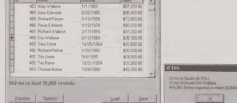

### 图 3.5

运行时 CDS 应用程序。

## 导航客户端数据集

如果没有一种向前和/或向后移动的手段，数据集就没有价值。Delphi 的数据集提供了大量方法来遍历数据集。以下部分讨论了 Delphi 对数据集导航的支持。

### 顺序导航

遍历数据集的最基本方式是按顺序向前或向后移动。例如，在打印报告或出于其他原因时，您可能需要迭代遍历一个数据集。Delphi 提供了四种简单的方法来实现这一点：

- `First` 移动到数据集中的第一条记录。`First` 总是成功，即使数据集为空。如果为空，`First` 将数据集的 `EOF`（文件结束）属性设置为 `True`。
- `Next` 移动到数据集中的下一条记录（如果 `EOF` 属性尚未设置）。如果 `EOF` 为 `True`，`Next` 将失败。如果对 `Next` 的调用到达文件末尾，它将 `EOF` 属性设置为 `True`。
- `Last` 移动到数据集中的最后一条记录。`Last` 总是成功，即使数据集为空。如果为空，`Last` 将数据集的 `BOF`（文件开始）属性设置为 `True`。
- `Prior` 移动到数据集中的上一条记录（如果 `BOF` 属性尚未设置）。如果 `BOF` 为 `True`，`Prior` 将失败。如果对 `Prior` 的调用到达文件开始，它将 `BOF` 属性设置为 `True`。

以下代码片段展示了如何使用这些方法来迭代遍历数据集：

```pascal

if not ClientDataSet1.IsEmpty then begin

  ClientDataSet1.First;

  while not ClientDataSet1.EOF do begin

    // Process the current record

    ClientDataSet1.Next;

  end;

  ClientDataSet1.Last;

  while not ClientDataSet1.BOF do begin

    // Process the current record

    ClientDataSet1.Prior;

  end;

end;

```

### 随机访问导航

除了 `First`、`Next`、`Prior` 和 `Last`（它们提供对数据集的顺序移动）之外，`TClientDataSet` 提供了两种直接移动到特定记录的方法：书签和记录号。

#### 书签

用于客户端数据集的书签与用于纸质书籍的书签非常相似：它标记了数据集中的位置，以便您稍后快速返回到该位置。

您可以对书签执行三种操作：设置书签、返回到书签和释放书签。以下代码片段展示了如何执行这三项操作：

```pascal

var

    Bookmark: TBookmark;

begin

    Bookmark := ClientDataSet1.GetBookmark;

    try

        // Do something with ClientDataSet1 here that changes the current record

        ...

        ClientDataSet1.GotoBookmark(Bookmark);

    finally

        ClientDataSet1.FreeBookmark(Bookmark);

    end;

end;

```

您可以为数据集创建任意数量的书签。但是，请记住书签会分配少量内存，因此您应该确保使用 `FreeBookmark` 释放所有书签，否则您的应用程序会出现内存泄漏。

除了 `GetBookmark`/`GotoBookmark`/`FreeBookmark`，还有一套用于书签的操作。以下代码展示了这种替代方法：

```pascal

var

    BookmarkStr: string;

begin

    BookmarkStr := ClientDataSet1.Bookmark;

    try

        // Do something with ClientDataSet1 here that changes the current record

        ...

    finally

        ClientDataSet1.Bookmark := BookmarkStr;

    end;

end;

```

由于属性 `Bookmark` 返回的书签是一个字符串，因此您完成后无需担心释放该字符串。与所有字符串一样，Delphi 会在书签超出作用域时自动释放它。

#### 记录号

客户端数据集支持一种直接移动到数据集中特定记录的另一种方法：设置数据集的 `RecNo` 属性。`RecNo` 是一个基于一的数字，表示当前记录相对于数据集开始的序列号。

您可以读取 `RecNo` 属性以确定当前的绝对记录号，并写入 `RecNo` 属性以设置当前记录。关于 `RecNo`，有两件重要的事情需要注意：

- 尝试将 `RecNo` 设置为小于 1 的数字或大于数据集中记录数的数字，分别会导致 `At beginning of table` 或 `At end of table` 异常。
- 特定记录号并不保证是常数。例如，更改数据集的活动索引会改变数据集中所有记录的记录号。

> **注意**
> 您可以通过检查数据集的 `RecordCount` 属性来确定数据集中的记录数。在设置 `RecNo` 时，永远不要尝试将其设置为高于 `RecordCount` 的数字。

然而，在谨慎使用的情况下，`RecNo` 还是有其用途的。例如，假设您的应用程序用户希望删除 John Smith 记录和 Fred Jones 记录之间的所有记录。以下代码展示了如何实现这一点：

```pascal

var

  RecNoJohn: Integer;

  RecNoFred: Integer;

  Index: Integer;

begin

  if not ClientDataSet1.Locate('Name', 'John Smith', []) then

    raise Exception.Create('Cannot locate John Smith');

  RecNoJohn := ClientDataSet1.RecNo;

  if not ClientDataSet1.Locate('Name', 'Fred Jones', []) then

    raise Exception.Create('Cannot locate Fred Jones');

  RecNoFred := ClientDataSet1.RecNo;
```


```pascal
if RecNoJohn < RecNoFred then
// 再次定位到 John 的记录
ClientDataSet1.RecNo := RecNoJohn;

for Index := 1 to Abs(RecNoJohn - RecNoFred) + 1 do
  ClientDataSet1.Delete;
end;
```

该代码片段首先定位到这两个边界记录，并记住它们的绝对记录号。然后，它将数据集定位到较小的记录号。如果 `Fred` 出现在 `John` 之前，数据集此时已经位于较小的记录号上。

由于记录是按顺序编号的，我们可以减去这两个记录号（并加上一）来确定要删除的记录数。删除一条记录会使下一条记录成为当前记录，因此一个简单的 `for` 循环即可处理记录的删除。

请记住，`RecNo` 通常不是你在数据集中进行导航的首选方法，但记住它可用是个好习惯，以防你偶尔需要用到它。

### 清单 3.2 Navigate—MainForm.pas

```pascal
unit MainForm;

interface

uses

  SysUtils, Classes, QGraphics, QControls, QForms, QDialogs, QStdCtrls,

  DB, DBClient, QExCtrls, QActnList, QRids, QDBGirids, QDBCtrls;

type

  TfrmMain = class(TForm)

    DataSource1: TDataSource;

    pnlClient: TPanel;

    pnlBottom: TPanel;

    btnFirst: TButton;

    btnLast: TButton;

    btnNext: TButton;

    btnPrior: TButton;

    DBGIrid1: TBGrid;

    ClientDataSet1: TClientDataSet;

    btnSetRecNo: TButton;

    DBNavigator1: TDBNavigator;

    btnGetBookmark: TButton;

    btnGotoBookmark: TButton;

  procedure FormCreate(Sender: TObject);

  procedure btnNextClick(Sender: TObject);

  procedure btnLastClick(Sender: TObject);

  procedure btnSetRecNoClick(Sender: TObject);

  procedure btnFirstClick(Sender: TObject);

  procedure btnPriorClick(Sender: TObject);

  procedure btnGetBookmarkClick(Sender: TObject);

  procedure btnGotoBookmarkClick(Sender: TObject);

private

  { Private declarations }
  FBookmark: TBookmark;

public

  { Public declarations }
end;

var
  frmMain: TfrmMain;

implementation

{$R *.xfm}

procedure TfrmMain.FormCreate(Sender: TObject);
begin
  ClientDataSet1.LoadFromFile('C:\Employee.cds');
end;

procedure TfrmMain.btnFirstClick(Sender: TObject);
begin
  ClientDataSet1.First;
end;

procedure TfrmMain.btnPriorClick(Sender: TObject);
begin
  ClientDataSet1.Prior;
end;

procedure TfrmMain.btnNextClick(Sender: TObject);
begin
  ClientDataSet1.Next;
end;

procedure TfrmMain.btnLastClick(Sender: TObject);
begin
  ClientDataSet1.Last;
end;

procedure TfrmMain.btnSetRecNoClick(Sender: TObject);
var
  Value: string;
begin
  Value := '1';
  if InputQuery('RecNo', 'Enter Record Number', Value) then
    ClientDataSet1.RecNo := StrToInt(Value);
end;

procedure TfrmMain.btnGetBookmarkClick(Sender: TObject);
begin
  if Assigned(FBookmark) then
    ClientDataSet1.FreeBookmark(FBookmark);
  FBookmark := ClientDataSet1.GetBookmark;
end;

procedure TfrmMain.btnGotoBookmarkClick(Sender: TObject);
begin
  if Assigned(FBookmark) then
    ClientDataSet1.GotoBookmark(FBookmark)
  else
    ShowMessage('No bookmark set!');
end;

end.
```


图 3.6 展示了该程序在运行时的样子。

## 客户端数据集索引

到目前为止，我们还没有在客户端数据集上创建任何索引，你可能会疑惑当通过数据集进行顺序搜索（使用 `Locate`）如此之快时，它们（索引）是否甚至有必要（以及为什么）。

在客户端数据集上使用索引至少有以下三个原因：

- 提供更快的数据访问。单个 `Locate` 操作执行得非常快，但如果你需要执行成千上万个 `Locate` 操作，使用索引会有明显的性能提升。
- 使客户端数据集能够即时排序。例如，当你希望在对数据感知的网格中按特定顺序排列数据时，这非常有用。
- 实现维护的聚合。

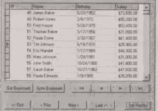

### 图 3.6

`Navigate` 应用程序演示了各种导航技术。

### 创建索引

与字段定义类似，索引可以在设计时或运行时创建。与通常在设计时创建的字段定义不同，你可能希望在运行时创建和销毁索引。例如，某些索引只用于很短的时间——比如说，为了以特定顺序创建报告。在这种情况下，你可能希望创建索引，使用它，然后销毁它。如果你经常需要某个索引，最好在设计时创建它（或者在你第一次需要它时创建，之后不再销毁）。

### 在设计时创建索引

要在设计时创建索引，请点击位于窗体或数据模块上的 `TClientDataSet` 组件。在对象查看器中，双击 `IndexDefs` 属性。索引编辑器将出现。

要向客户端数据集添加索引，请右键单击索引编辑器，并从弹出菜单中选择“添加”。或者，你可以点击工具栏上的“添加”图标，或者简单地按 `Ins` 键。接下来，返回对象查看器并设置索引的适当属性。表 3.2 显示了索引属性。

### 表 3.2 索引属性

| 属性 | 描述 |
| :--- | :--- |
| Name | 索引的名称。我建议用字母 by 作为索引名称的前缀（例如 byName, byState 等）。 |
| Fields | 组成索引的字段列表，以分号分隔。示例：'ID' 或 'Name;Salary' 。 |
| DescFields | 包含在 Fields 属性中且应按降序索引的字段列表。例如，要按名称升序排序，然后按工资降序排序，请将 Fields 设置为 'Name;Salary'，将 DescFields 设置为 'Salary' 。 |
| CaseInsFields | 包含在 Fields 属性中且应按不区分大小写方式索引的字段列表。例如，如果索引基于名和姓，且两者都不区分大小写，请将 Fields 设置为 'Last;First'，将 CaseInsFields 设置为 'Last;First' 。 |
| GroupingLevel | 用于聚合。 |
| Options | 设置索引的附加选项。选项在表 3.3 中讨论。 |
| Expression | 不适用于客户端数据集。 |
| Source | 不适用于客户端数据集。 |

表 3.3 展示了可以使用 Options 属性设置的各种索引选项。

### 表 3.3 索引选项

| 选项 | 描述 |
| :--- | :--- |
| IxPrimary | 该索引是数据集的主索引。 |
| IxUnique | 该索引是唯一的。 |
| IxDescending | 该索引是降序的。 |
| IxCaseInsensitive | 该索引不区分大小写。 |
| IxExpression | 不适用于客户端数据集。 |
| IxNonMaintained | 不适用于客户端数据集。 |

你可以在单个数据集上创建多个索引。因此，例如，你可以轻松地在 EmployeeName 上同时拥有升序和降序索引。

### 在运行时创建和删除索引

与字段定义（通常在设计时创建）不同，索引定义是你经常在运行时创建的东西。这有几个非常好的理由：

- 索引可以快速轻松地创建和销毁。因此，如果你只需要在很短的时间内使用索引（例如，为了以特定顺序打印报告），按需创建和销毁索引有助于节省内存。
- 当你持久化客户端数据集时，索引信息不会保存到文件或流中。当你从文件或流中加载客户端数据库时，你*必须*在代码中重新创建任何索引。

要创建索引，你使用客户端数据集的 `AddIndex` 方法。`AddIndex` 接受三个必需参数，以及三个可选参数，定义如下：

```
procedure AddIndex(const Name, Fields: string; Options: TIndexOptions;
  const DescFields: string = ''; const CaseInsFields: string = '';
  const GroupingLevel: Integer = 0);
```

这些参数对应于表 3.2 中列出的 `TIndexDef` 属性。以下代码片段展示了如何根据姓名和姓氏创建唯一索引：

```
ClientDataSet1.AddIndex('byName', 'Last;First', [ixUnique]);
```

当你决定不再需要某个索引时（记住，如果你以后需要，随时可以重新创建它），你可以使用 `DeleteIndex` 删除它。`DeleteIndex` 接受单个参数：要删除的索引名称。以下代码行展示了如何删除前面代码片段中创建的索引：

```
ClientDataSet1.DeleteIndex('byName');
```

### 使用索引

创建索引不会执行实际的数据集排序。它只是创建一个可用于数据的索引。创建索引后，你通过设置数据集的 `IndexName` 属性使其处于活动状态，如下所示：

```
ClientDataSet1.IndexName := 'byName';
```

如果你在一个数据集上定义了两个或多个索引，你可以通过更改 `IndexName` 属性的值快速切换。如果你想停止使用某个索引并恢复默认的记录的顺序，你可以将 `IndexName` 属性设置为空字符串，如下面的代码片段所示：

```
// Do something in name order
ClientDataSet1.IndexName := 'byName';
```

// 按薪资顺序执行操作
ClientDataSet1.IndexName := 'bySalary';

// 切换回默认排序
ClientDataSet1.IndexName := '';

在运行时动态指定索引还有第二种方法。除了创建索引并设置 `IndexName` 属性外，还可以直接设置 `IndexFieldNames` 属性。`IndexFieldNames` 接受以分号分隔的待建立索引的字段列表。以下代码展示了如何使用该属性：

```
ClientDataSet1.IndexFieldNames := 'Last;First';
```

虽然 `IndexFieldNames` 比 `AddIndex/IndexName` 使用更快捷、更简单，但这种简单性并非没有代价。具体而言：

- 您无法设置任何索引选项，例如唯一索引或降序索引。
- 您无法指定分组级别或创建受维护的聚合。
- 当从索引切换到另一个索引（通过更改 `IndexFieldNames` 的值）时，旧索引会被自动删除。如果在稍后时间切换回来，索引将被重新创建。这个过程发生得如此迅速，以至于可能不会引起注意，但您仍应意识到这一点。当使用 `AddIndex` 创建索引时，索引会一直存在，直到您明确使用 `DeleteIndex` 将其删除。


尽管您可以在同一应用程序中在 `IndexName` 和 `IndexFieldNames` 之间来回切换，但您不能同时设置这两个属性。设置 `IndexName` 会清除 `IndexFieldNames`，而设置 `IndexFieldNames` 会清除 `IndexName`。

## 获取索引信息

Delphi 提供了几种不同的方法来从数据集中获取索引信息。这些方法将在以下部分中讨论。

### GetIndexNames

获取索引信息最简单的方法是 `GetIndexNames`。`GetIndexNames` 接受一个参数，即一个 `TStrings` 对象，用于存储结果索引名称。以下代码片段展示了如何加载列表框以显示为数据集定义的所有索引名称。

```
ClientDataSet1.GetIndexNames(ListBox1.Items);
```


> **注意**
>
> 如果在未定义任何索引的数据集上执行此代码，您会发现已经为您定义了两种索引：`DEFAULT_ORDER` 和 `CHANGEINDEX`。`DEFAULT_ORDER` 在内部用于以非索引顺序提供记录。`CHANGEINDEX` 在内部用于提供撤销支持，将在本章后面讨论。您不应尝试删除这些索引中的任何一个。

### TIndexDefs

如果您想获取关于索引的更详细信息，可以直接查看源头：`TIndexDefs`。`TIndexDefs` 包含所有索引的列表以及与之关联的信息（例如组成索引的字段、哪些字段是降序等）。

以下代码片段展示了如何通过 `TIndexDefs` 直接访问索引信息。

```
var
  Index: Integer;
  IndexDef: TIndexDef;
begin
  ClientDataSet1.IndexDefs.Update;
  for Index := 0 to ClientDataSet1.IndexDefs.Count - 1 do begin
    IndexDef := ClientDataSet1.IndexDefs[Index];
    ListBox1.Items.Add(IndexDef.Name);
  end;
end;
```

请注意在遍历索引定义的代码之前调用了 `IndexDefs.Update`。此调用是必需的，以确保内部的 `IndexDefs` 列表是最新的。没有它，`IndexDefs` 可能不包含关于最近添加的索引的任何信息。

以下应用程序演示了如何在 `TDBGrid` 中提供动态索引。它还包含用于获取数据集上定义的所有索引详细信息的代码。

图 3.7 展示了 `CDSIndex` 应用程序在运行时的状态，它显示了员工客户端数据集的索引信息。

清单 3.3 包含 `CDSIndex` 应用程序的完整源代码。

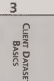

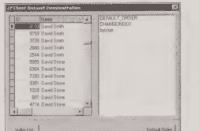

**图 3.7**
_CDSIndex 展示了如何动态创建索引。_

**清单 3.3** CDSIndex—MainForm.pas

```pascal
unit MainForm;

interface

uses
  SysUtils, Classes, QGraphics, QControls, QForms, QDialogs, QStdCtrls,
  DB, DBClient, QExtCtrls, QActnList, QRids, QDBGrids;

type
  TfrmMain = class(TForm)
  DataSource1: TDataSource;
  pnlClient: TPanel;
  DBGrid1: TDBGrid;
  ClientDataSet1: TClientDataSet;
  pnlBottom: TPanel;
  btnDefaultOrder: TButton;
  btnIndexList: TButton;
  ListBox1: TListBox;
  procedure FormCreate(Sender: TObject);
  procedure DBGrid1TitleClick(Column: TColumn);
  procedure btnDefaultOrderClick(Sender: TObject);
  procedure btnIndexListClick(Sender: TObject);
  private
    { Private declarations }
  public
    { Public declarations }
  end;

var
  frmMain: TfrmMain;

implementation

{$R *.xfm}

procedure TfrmMain.FormCreate(Sender: TObject);
begin
  ClientDataSet1.LoadFromFile('C:\Employee.cds');
end;

procedure TfrmMain.DBGrid1TitleClick(Column: TColumn);
begin
  try
    ClientDataSet1.DeleteIndex('byUser');
  except
  end;
  ClientDataSet1.AddIndex('byUser', Column.FieldName, []);
  ClientDataSet1.IndexName := 'byUser';
end;

procedure TfrmMain.btnDefaultOrderClick(Sender: TObject);
begin
  // 删除当前索引将恢复默认排序
  try
    ClientDataSet1.DeleteIndex('byUser');
  except
  end;
  ClientDataSet1.IndexFieldNames := '';
end;

procedure TfrmMain.btnIndexListClick(Sender: TObject);
var
  Index: Integer;
  IndexDef: TIndexDef;
begin
  ClientDataSet1.IndexDefs.Update;
  ListBox1.Items.BeginUpdate;
  try
    ListBox1.Items.Clear;
    for Index := 0 to ClientDataSet1.IndexDefs.Count - 1 do begin
      IndexDef := ClientDataSet1.IndexDefs[Index];
      ListBox1.Items.Add(IndexDef.Name);
    end;
  finally
    ListBox1.Items.EndUpdate;
  end;
end.
```

在运行时动态对网格进行排序的代码包含在方法 `DBGrid1TitleClick` 中。首先，它尝试删除名为 `byUser` 的临时索引（如果存在）。如果它不存在，则会引发一个异常，代码直接忽略了该异常。实际应用程序不应随意掩盖异常。相反，它应该捕获由 `DeleteIndex` 调用可能抛出的特定异常，并允许其他异常报告给用户。

然后，该方法创建一个名为 `byUser` 的新索引，并将其设置为当前索引。

> **注意**
>
> 虽然此代码有效，但充其量只是基础级的。它不支持对多个网格列进行排序，也没有视觉指示器显示网格是按哪一列排序的。针对这些问题的优雅解决方案，我强烈建议您查看 John Kaster 的 `TCDSDBGrid`（在 Code Central 上可用，ID 为 15099，地址为 http://codecentral.borland.com）。

## 过滤器和范围

过滤器和范围提供了一种限制数据集中可见数据量的方法，类似于 `SQL` 语句中的 `WHERE` 子句。过滤器、范围和 `WHERE` 子句的主要区别在于，当应用过滤器或范围时，它并不会物理改变数据集中包含的数据。它只是限制了您在任何给定时间可以查看的数据量。

### 范围

当要限制的数据存储在一组连续记录中时，范围非常有用。例如，假设一个数据集包含表 3.4 中显示的数据。

**表 3.4** 范围和过滤器的示例数据

| ID | 姓名 | 生日 | 薪资 |
| :--- | :--- | :--- | :--- |
| 4 | Bill Peterson | 1957/3/28 | $60,000.00 |
| 2 | Frank Smith | 1963/8/25 | $48,000.00 |
| 3 | Sarah Johnson | 1968/7/5 | $52,000.00 |
| 1 | John Doe | 1970/5/15 | $39,000.00 |
| 5 | Paula Wallace | 1971/1/15 | $36,500.00 |

此大幅简化的表中的数据按生日建立索引。只有当数据集上有活动索引时，才能使用范围。

假设您想查看所有在 1960 年至 1970 年之间出生的员工。由于数据按生日建立索引，您可以像这样对数据集应用范围：

```
ClientDataSet1.SetRange(['1/1/1960'], ['12/31/1970']);
```

范围是*包含性*的，这意味着范围的端点包含在范围内。在前面的示例中，生于 1960 年 1 月 1 日或 1970 年 12 月 31 日的员工都包括在范围内。

要移除范围，只需调用 `CancelRange`，如下所示：

```
ClientDataSet1.CancelRange;
```


### 过滤器

与范围不同，过滤器在应用之前不要求设置索引。客户端数据集过滤器功能强大，提供许多类似 SQL 的功能，以及一些 SQL 甚至不支持的选项。表 3.5 至 3.10 列出了可用于过滤器中的各种函数和操作符。

**表 3.5** 过滤器比较操作符

| 函数 | 描述 | 示例 |
| :--- | :--- | :--- |
| = | 相等测试 | Name = 'John Smith' |
| <> | 不相等测试 | ID <> 100 |
| < | 小于 | Birthday < '1/1/1960' |
| > | 大于 | Birthday > '12/31/1960' |
| <= | 小于或等于 | Salary <= 80000 |
| >= | 大于或等于 | Salary >= 40000 |

## 表 3.5 续

| 函数 | 描述 | 示例 |
| --- | --- | --- |
| BLANK | 空字符串字段（不用于测试 NULL 值） | Name = BLANK |
| IS NULL | 测试 NULL 值 | Birthday IS NULL |
| IS NOT NULL | 测试非 NULL 值 | Birthday IS NOT NULL |

## 表 3.6 筛选逻辑运算符

| 函数 | 示例 |
| --- | --- |
| And | (Name = 'John Smith') and (Birthday = '5/16/1964') |
| Or | (Name = 'John Smith') or (Name = 'Julie Mason') |
| Not | Not (Name = 'John Smith') |

## 表 3.7 筛选算术运算符

| 函数 | 描述 | 示例 |
| --- | --- | --- |
| + | 加法。可用于数字、字符串或日期/时间。 | Birthday + 30 < '1/1/1960' <br> Name + 'X' = 'SmithX' <br> Salary + 10000 = 100000 |
| - | 减法。可用于数字或日期/时间。 | Birthday - 30 > '1/1/1960' <br> Salary - 10000 > 40000 |
| * | 乘法。仅可用于数字。 | Salary * 0.10 > 5000 |
| / | 除法。仅可用于数字。 | Salary / 10 > 5000 |

## 表 3.8 筛选字符串函数

| 函数 | 描述 | 示例 |
| --- | --- | --- |
| Upper | 转换为大写 | Upper(Name) = 'JOHN SMITH' |
| Lower | 转换为小写 | Lower(Name) = 'john smith' |
| SubString | 返回字符串的一部分 | SubString(Name,6) = 'Smith' <br> SubString(Name,1,4) = 'John' |
| Trim | 修剪字符串前导和尾部字符 | Trim(Name) <br> Trim(Name, '.',') |

| TrimLeft | 修剪字符串前导字符 | TrimLeft(Name) <br> TrimLeft(Name, ',') |
| --- | --- | --- |
| TrimRight | 修剪字符串尾部字符 | TrimRight(Name) <br> TrimRight(Name, ',') |

## 表 3.9 筛选日期/时间函数

| 函数 | 描述 | 示例 |
| --- | --- | --- |
| Year | 返回日期值的年份部分。 | Year(Birthday) = 1970 |
| Month | 返回日期值的月份部分。 | Month(Birthday) = 1 |
| Day | 返回日期值的日期部分。 | Day(Birthday) = 15 |
| Hour | 返回时间值的小时部分（24小时格式）。 | Hour(Appointment) = 18 |
| Minute | 返回时间值的分钟部分。 | Minute(Appointment) = 30 |
| Second | 返回时间值的秒部分。 | Second(Appointment) = 0 |
| GetDate | 返回当前日期和时间。 | Appointment < GetDate |
| Date | 返回日期/时间值的日期部分。 | Date(Appointment) |
| Time | 返回日期/时间值的时间部分。 | Time(Appointment) |

## 表 3.10 其他筛选函数和运算符

| 函数 | 描述 | 示例 |
| --- | --- | --- |
| LIKE | 部分字符串比较。 | Name LIKE '%Smith%' |
| IN | 测试多个值。 | Year(Birthday) IN (1960, 1970, 1980) |
| * | 部分字符串比较。 | Name = 'John' |


要筛选数据集，请将其 `Filter` 属性设置为用于筛选的字符串，然后将 `Filtered` 属性设置为 `True`。例如，下面的代码片段筛选出所有名字以字母 M 开头的员工。

```pascal
ClientDataSet1.Filter := 'Name LIKE ' + QuotedStr('M%');
ClientDataSet1.Filtered := True;
```

若稍后仅显示名字以字母 P 开头的员工，只需像这样更改筛选条件：

```pascal
ClientDataSet1.Filter := 'Name LIKE ' + QuotedStr('P%');
```

若要移除筛选，请将 `Filtered` 属性设置为 `False`。移除筛选时，你不必将 `Filter` 属性设置为空字符串（这意味着你可以通过将 `Filtered` 的值从 `True` 切换为 `False` 来开启或关闭最近的筛选）。

你可以通过处理数据集的 `OnFilterRecord` 事件（而不是设置 `Filter` 属性）来应用更高级的筛选条件。例如，假设你要筛选出所有姓氏听起来像 Smith 的员工。这将包括 Smith、Smythe 以及其他可能的名字。假设你可以使用 `Soundex` 函数，你可以编写如下筛选方法：

```pascal
procedure TForm1.ClientDataSet1FilterRecord(DataSet: TDataSet;
var Accept: Boolean);
begin
Accept := Soundex(DataSet.FieldByName('LastName').AsString) =
Soundex('Smith');
end;
```

如果你将 `Accept` 参数设置为 `True`，该记录将被包含在筛选结果中。如果你将 `Accept` 设置为 `False`，该记录将被隐藏。

设置好 `OnFilterRecord` 事件处理程序后，你只需将 `TClientDataSet.Filtered` 设置为 `True` 即可。你完全不需要设置 `Filter` 属性。

下面的示例演示了不同的筛选和范围技术。
列表 3.4 包含主窗体的源代码。

## 列表 3.4 RangeFilter—MainForm.pas

```pascal
unit MainForm;
interface
uses
SysUtils, Classes, QGraphics, QControls, QForms, QDialogs, QStdCtrls, DB, DBClient, QExtCtrls, QGrids, QDBGrids;
type
  TfrmMain = class(TForm)
    DataSource: TDataSource;
    pnlClient: TPanel;
    pnlBottom: TPanel;
    btnFilter: TButton;
    btnRange: TButton;
    DBGrid1: TDBGrid;
    ClientDataSet1: TClientDataSet;
    btnClearRange: TButton;
    btnClearFilter: TButton;
    procedure FormCreate(Sender: TObject);
    procedure btnFilterClick(Sender: TObject);
    procedure btnRangeClick(Sender: TObject);
    procedure btnClearRangeClick(Sender: TObject);
```


```pascal
procedure btnClearFilterClick(Sender: TObject);

private

  { Private declarations }

public

  { Public declarations }

end;

var

  frmMain: TfrmMain;

implementation

uses FilterForm, RangeForm;

{$R *.xfm}

procedure TfrmMain.FormCreate(Sender: TObject);

begin

  ClientDataSet1.LoadFromFile('C:\Employee.CDS');

  ClientDataSet1.AddIndex('bySalary', 'Salary', []);

  ClientDataSet1.IndexName := 'bySalary';

end;

procedure TfrmMain.btnFilterClick(Sender: TObject);

var

  frmFilter: TfrmFilter;

begin

  frmFilter := TfrmFilter.Create(nil);

  try
    if frmFilter.ShowModal = mrOk then begin
        ClientDataSet1.Filter := frmFilter.Filter;
        ClientDataSet1.Filtered := True;
    end;
  finally
    frmFilter.Free;
  end;
end;

procedure TfrmMain.btnClearFilterClick(Sender: TObject);

begin
    ClientDataSet1.Filtered := False;
end;

procedure TfrmMain.btnRangeClick(Sender: TObject);

var
    frmRange: TfrmRange;

begin
    frmRange := TfrmRange.Create(nil);
    try
        if frmRange.ShowModal = mrOk then
            ClientDataSet1.SetRange([frmRange.LowValue], [frmRange.HighValue]);
    finally
        frmRange.Free;
    end;
end;

procedure TfrmMain.btnClearRangeClick(Sender: TObject);

begin
    ClientDataSet1.CancelRange;
end;

end.
```

可以看到，主窗体从磁盘加载员工数据集，在 `Salary` 字段上创建索引，并激活该索引。然后，它允许用户对数据集应用范围、筛选或两者同时应用。

### 列表 3.5 RangeFilter—FilterForm.pas

```pascal
unit FilterForm;

interface

uses
  SysUtils, Classes, QGraphics, QControls, QForms,
  QDialogs, QStdCtrls, QExtCtrls;

type
  TfrmFilter = class(TForm)
    pnlClient: TPanel;
    pnlBottom: TPanel;
    Label1: TLabel;
    cbField: TComboBox;
    Label2: TLabel;
    cbRelationship: TComboBox;
    Label3: TLabel;
    ecValue: TEdit;
    btnOK: TButton;
    btnCancel: TButton;
  private
    function GetFilter: string;
    { Private declarations }
  public
    { Public declarations }
    property Filter: string read GetFilter;
  end;

implementation

{$R *.xfm}

{ TfrmFilter }

function TfrmFilter.GetFilter: string;

begin
  Result := Format('%s %s '%s'',
    [cbField.Text, cbRelationship.Text, ecValue.Text]);
end;

end.
```

此窗体中唯一有趣的代码是 `GetFilter` 函数，它只是将三个输入控件的值组合成一个筛选字符串，并将其返回给主应用程序。

### 列表 3.6 RangeFilter—RangeForm.pas

```pascal
unit RangeForm;

interface

uses
  SysUtils, Classes, QGraphics, QControls, QForms, QDialogs, QExtCtrls,
  QStdCtrls;

type
  TfrmRange = class(TForm)
    pnlClient: TPanel;
    pnlBottom: TPanel;
    Label1: TLabel;
    Label2: TLabel;
    ecLower: TEdit;
    ecUpper: TEdit;
    btnOk: TButton;
    btnCancel: TButton;
    procedure btnOkClick(Sender: TObject);
  private
    function GetHighValue: Double;
    function GetLowValue: Double;
    { Private declarations }
  public
    { Public declarations }
    property LowValue: Double read GetLowValue;
    property HighValue: Double read GetHighValue;
  end;

implementation

{$R *.xfm}

{ TfrmRange }

function TfrmRange.GetHighValue: Double;

begin
  Result := StrToFloat(ecUpper.Text);
end;

function TfrmRange.GetLowValue: Double;

begin
  Result := StrToFloat(ecLower.Text);
end;

procedure TfrmRange.btnOkClick(Sender: TObject);

var
  LowValue: Double;
  HighValue: Double;

begin
  try
    LowValue := StrToFloat(ecLower.Text);
    HighValue := StrToFloat(ecUpper.Text);
    if LowValue > HighValue then begin
      ModalResult := mrNone;
      ShowMessage('The upper salary must be >= the lower salary');
    end;
  except
    ModalResult := mrNone;
    ShowMessage('Both values must be a valid number');
  end;
end;
```

此范围形式会提示用户输入薪资的下限和上限。


图 3.8 展示了 `RangeFilter` 应用程序的运行效果。

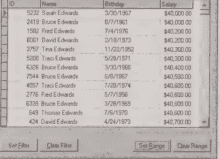

**图 3.8**
`RangeFilter` 将范围和筛选器应用于数据集。

除了从客户端数据集中过滤掉不感兴趣的记录外，`TClientDataSet` 还提供了许多用于快速定位特定记录的方法。其中一些方法要求数据集上必须有一个活动的索引，而另一些则不需要。以下章节将详细介绍这些搜索方法。

## 搜索

### 非索引搜索技术

在本节中，我们将讨论那些不需要在客户端数据集上拥有活动索引的搜索技术。与其使用索引，这些方法通过顺序搜索数据集来查找第一个匹配的记录。

#### Locate（定位）

`Locate` 可能是 `TClientDataSet` 搜索方法中最通用的一个。您可以使用 `Locate` 基于任意给定字段或字段组合来搜索记录。`Locate` 还可以基于部分匹配来搜索记录，并且可以在不区分大小写的情况下找到匹配项。

`TClientDataSet`.`Locate` 的定义如下：

```cpp
function Locate(const KeyFields: string; const KeyValues: Variant;
  Options: LocateOptions): Boolean; overload;
```

第一个参数 `KeyFields` 指定要搜索的字段（或字段）。当搜索多个字段时，请用分号将它们分开（例如，`'Name;Birthday'`）。

第二个参数 `KeyValues` 表示要搜索的值。值的数量必须与关键字段的确切数量匹配。如果只有一个搜索字段，您可以简单地在此处传入要搜索的值。如果要搜索多个值，您必须以变体数组的形式传入这些值。实现这一点的一种方法是调用 `VarArrayOf`，如下所示：

```cpp
VarArrayOf(['John Smith', '4/15/1965'])
```

最后一个参数 `Options` 是一个集合，用于确定搜索的执行方式。表 3.11 列出了可用的选项。

**表 3.11** `Locate` 选项

| 值 | 描述 |
| :--- | :--- |
| `loPartialKey` | `KeyValues` 不一定表示精确匹配。`Locate` 找到第一个字段值以 `KeyValues` 中指定的值开头的记录。 |
| `loCaseInsensitive` | `Locate` 在搜索字符串字段时忽略大小写。 |

这两个选项仅适用于字符串字段。如果您对非字符串搜索指定它们，它们将被忽略。

如果找到匹配的记录，`Locate` 返回 `True`；如果未找到匹配项，则返回 `False`。在匹配的情况下，该记录将被设为当前记录。

以下示例有助于说明这些选项：

```pascal
ClientDataSet1.Locate('Name', 'John Smith', []);
```

这搜索名称为 'John Smith' 的记录。

```pascal
ClientDataSet1.Locate('Name', 'JOHN', [loPartialKey, loCaseInsensitive]);
```

这搜索名称以 'JOHN' 开头的记录。这会找到 'John Smith'、'Johnny Jones' 和 'JOHN ADAMS'，但不会找到 'Bill Johnson'。

```pascal
ClientDataSet1.Locate('Name;Birthday', VarArrayOf(['John', '4/15/1865']),
[loPartialKey]);
```

这搜索名称以 'John' 开头且生日为 1965 年 4 月 15 日的记录。在这种情况下，`loPartialKey` 选项仅适用于名称。尽管生日作为字符串传入，但底层字段是日期字段，因此 `loPartialKey` 选项对该字段被忽略。

#### Lookup（查找）

`Lookup` 在概念上与 `Locate` 类似，不同之处在于它不会改变当前记录指针。相反，`Lookup` 返回记录中一个或多个字段的值。此外，`Lookup` 不接受 `Options` 参数，因此您无法执行基于部分关键字或不区分大小写的查找。

`Lookup` 的定义如下：

```cpp
function Lookup(const KeyFields: string; const KeyValues: Variant;
const ResultFields: string): Variant; override;
```

`KeyFields` 和 `KeyValues` 指定要搜索的字段和要搜索的值，就像 `Locate` 方法一样。`ResultFields` 指定您想要返回数据的那些字段。例如，要返回名为 John Doe 的员工的生日，您可以编写以下代码：

```pascal
var
  V: Variant;
begin
  V := ClientDataSet1.Lookup('Name', 'John Doe', 'Birthday');
end;
```

以下代码返回 ID 为 100 的员工的名字和生日：

```pascal
var
  V: Variant;
begin
  V := ClientDataSet1.Lookup('ID', 100, 'Name;Birthday');
end;
```

如果未找到请求的记录，`V` 将被设置为 `NULL`。如果 *ResultSet* 包含单个字段名，则从 *Lookup* 返回后，`V` 是一个包含 *ResultSet* 中列出的字段值的变体。如果 *ResultSet* 包含多个单字段名，则从 *Lookup* 返回后，`V` 是一个包含 *ResultSet* 中列出的字段值的变体数组。


> 有关变体数组的全面讨论，请参阅我出版的书籍 *Delphi COM Programming*，由 Williams Technical Publishing 出版。

以下代码片段展示了如何访问从 *Lookup* 返回的结果。

```pascal
var
  V: Variant;
begin
  V := ClientDataSet1.Lookup('ID', 100, 'Name');
  if not VarIsNull(V) then
    ShowMessage('ID 100 refers to ' + V);
  V := ClientDataSet1.Lookup('ID', 200, 'Name;Birthday');
  if not VarIsNull(V) then
    ShowMessage('ID 200 refers to ' + V[0] + ', born on ' + DateToStr(V[1]));
end;
```

### 索引搜索技术

前面提到的搜索技术不需要索引处于活动状态——事实上，它们甚至不需要数据集被索引。但 *DataSet* 还支持几种基于索引的搜索操作。这些包括 *FindKey*、*FindNearest* 和 *GotoKey*，将在以下章节中讨论。

#### FindKey（查找键值）

*FindKey* 在当前索引的键字段上搜索精确匹配。例如，如果数据集当前按 ID 索引，*FindKey* 将在 ID 字段上搜索精确匹配。如果数据集按姓氏和名字索引，*FindKey* 将在姓氏和名字上均搜索精确匹配。

`FindKey` 接受单个参数，该参数指定要搜索的值。它返回一个布尔值，指示是否找到了匹配的记录。如果未找到匹配项，当前记录指针保持不变。如果找到匹配的记录，该记录将被设为当前记录。

`FindKey` 的参数实际上是值数组，因此您需要将值放在方括号中，如下例所示：

```pascal
if ClientDataSet.FindKey([25]) then
    ShowMessage('Found ID 25');
...
if ClientDataSet.FindKey(['Doe', 'John']) then
    ShowMessage('Found John Doe');
```

您需要确保要搜索的值与当前索引匹配。因此，您可能希望在调用 `FindKey` 之前设置索引。以下代码片段说明了这一点：

```pascal
ClientDataSet1.IndexName := 'byID';
if ClientDataSet.FindKey([25]) then
    ShowMessage('Found ID 25');
...
ClientDataSet1.IndexName := 'byName';
if ClientDataSet.FindKey(['Doe', 'John']) then
    ShowMessage('Found John Doe');
```


#### FindNearest（查找最近）

`FindNearest`的工作方式与`FindKey`类似，不同之处在于它查找大于或等于传入值的第一条记录。这取决于`KeyExclusive`属性的当前值。

如果`KeyExclusive`为`False`（默认值），`FindNearest`查找大于或等于传入值的第一条记录。如果`KeyExclusive`为`True`，`FindNearest`查找大于传入值的第一条记录。

如果`FindNearest`未找到匹配的记录，它会将当前记录指针移动到数据集的末尾。

#### GotoKey（转到键值）

`GotoKey`执行的功能与`FindKey`相同，不同之处在于您在调用`GotoKey`之前先设置搜索字段的值。以下代码片段展示了如何执行此操作：

```pascal
ClientDataSet1.IndexName := 'byID';
ClientDataSet1.SetKey;
ClientDataSet1.Fields['ID'].AsInteger := 25;
ClientDataSet1.GotoKey;
```

如果索引由多个字段组成，你只需在调用`SetKey`后为每个字段赋值，如下所示：

```pascal
ClientDataSet1.IndexName := 'byName';
ClientDataSet1.SetKey;
ClientDataSet1.FieldByName('First').AsString := 'John';
ClientDataSet1.FieldByName('Last').AsString := 'Doe';
ClientDataSet1.GotoKey;
```

调用`GotoKey`后，你可以使用`EditKey`方法来编辑用于搜索的键值。例如，下面的代码片段展示了如何搜索`John Doe`，然后稍后再搜索`John Smith`。由于两条记录的首名相同，因此在第二次搜索时只需指定键值中的姓氏部分。

```pascal
ClientDataSet1.IndexName := 'byName';
ClientDataSet1.SetKey;
ClientDataSet1.FieldByName('First').AsString := 'John';
ClientDataSet1.FieldByName('Last').AsString := 'Doe';
ClientDataSet1.GotoKey;
// 对该记录执行某些操作
// EditKey 会保留上次 SetKey 调用时设置的值
ClientDataSet1.EditKey;
ClientDataSet1.FieldByName('Last').AsString := 'Smith';
ClientDataSet1.GotoKey;
```

## GotoNearest

`GotoNearest`的工作方式类似于`GotoKey`，区别在于它查找的是大于或等于传入值的第一条记录。这取决于`KeyExclusive`属性的当前值。

如果`KeyExclusive`为`False`（默认值），`GotoNearest`会查找大于或等于在调用`SetKey`或`EditKey`后设置的字段值的第一条记录。如果`KeyExclusive`为`True`，`GotoNearest`会查找大于在调用`SetKey`或`EditKey`后设置的字段值的第一条记录。

如果`GotoNearest`找不到匹配的记录，它会将当前记录指针移动到数据集的末尾。

以下示例展示了如何对数据集执行索引搜索和非索引搜索。清单 3.7 展示了搜索应用程序的源代码，这是一个演示`TClientDataSet`支持的各种索引和非索引搜索技术的示例程序。

### 清单 3.7 Search—MainForm.pas

```pascal
unit MainForm;
interface
uses
  SysUtils, Classes, Variants, QGraphics, QControls, QForms, QDialogs,
  QStdCtrls, DB, DBClient, QExtCtrls, QActNlist, QGrids, QDBGrids;
type
  TfrmMain = class(TForm)
    DataSource1: TDataSource;
    pnlClient: TPanel;
    pnlBottom: TPanel;
    btnSearch: TButton;
    btnGotoBookmark: TButton;
    btnEndBookmark: TButton;
    btnLookup: TButton;
    DBOldID: TDBGrid;
    ClientDataSet1: TClientDataSet;
    btnSetRecNo: TButton;
    procedure FormCreate(Sender: TObject);
    procedure btnGetToBookmarkClick(Sender: TObject);
    procedure btnGotToBookmarkClick(Sender: TObject);
    procedure btnSetRecNoClick(Sender: TObject);
    procedure btnSearchClick(Sender: TObject);
    procedure btnLookupClick(Sender: TObject);
  private
    { Private declarations }
    FBookmark: TBookmark;
  public
    { Public declarations }
  end;
var
  frmMain: TfrmMain;
implementation
uses SearchForm;
{$R *.xfm}
procedure TfrmMain.FormCreate(Sender: TObject);
begin
ClientDataSet1.LoadFromFile('C:\Employee.cds');
ClientDataSet1.AddIndex('byName', 'Name', []);
ClientDataSet1.IndexName := 'byName';
end;
procedure TfrmMain.btnGetBookmarkClick(Sender: TObject);
begin
if Assigned(FBookmark) then
ClientDataSet1.FreeBookmark(FBookmark);
FBookmark := ClientDataSet1.GetBookmark;
end;
procedure TfrmMain.btnGotoBookmarkClick(Sender: TObject);
begin
if Assigned(FBookmark) then
ClientDataSet1.GotoBookmark(FBookmark)
else
ShowMessage('No bookmark assigned');
end;
procedure TfrmMain.btnSetRecNoClick(Sender: TObject);
var
Value: string;
begin
Value := '1';
if InputQuery('RecNo', 'Enter Record Number', Value) then
ClientDataSet1.RecNo := StrToInt(Value);
end;
procedure TfrmMain.btnSearchClick(Sender: TObject);
var
frmSearch: TfrmSearch;
begin
frmSearch := TfrmSearch.Create(nil);
try
if frmSearch.ShowModal = mrOk then begin
case TSearchMethod(frmSearch.grpMethod.ItemIndex) of
smLocate:
ClientDataSet1.Locate('Name', frmSearch.ecName.Text,
[loPartialKey, loCaseInsensitive]);
smFindKey:
  ClientDataSet1.FindKey([frmSearch.ecName.Text]);
smFindNearest:
  ClientDataSet1.FindNearest([frmSearch.ecName.Text]);
smGotoKey: begin
  ClientDataSet1.SetKey;
```


```pascal
ClientDataSet1.FieldByName('Name').AsString :=
  frmSearch.ecName.Text;

ClientDataSet1.GotoKey;
end;

smGotoNearest: begin
  ClientDataSet1.SetKey;
  ClientDataSet1.FieldByName('Name').AsString :=
    frmSearch.ecName.Text;
  ClientDataSet1.GotoNearest;
end;

end;
finally
  frmSearch.Free;
end;
end;

procedure TfrmMain.btnLookupClick(Sender: TObject);
var
  Value: string;
  V: Variant;
begin
  Value := '1';
  if InputQuery('ID', 'Enter ID to Lookup', Value) then begin
    V := ClientDataSet1.Lookup('ID', StrToInt(Value), 'Name;Salary');
    if not VarIsNull(V) then
      ShowMessage(Format('ID %s refers to %s, who makes %s',
        [Value, V[0], FloatToStrF(V[1], ffCurrency, 10, 2)));
  end;
end;
end.
```

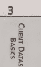

### 清单 3.8 包含搜索窗体的源代码

此清单中唯一有趣的代码是定义在单元顶部的 `TSearchMethod`，它用于确定要为搜索调用哪种方法。

### 清单 3.8 Search—SearchForm.pas

```
unit SearchForm;

interface

uses
  SysUtils, Classes, QGraphics, QControls, QForms, QDialogs, QExtCtrls,
  QStdCtrls;

type
  TSearchMethod = (smLocate, smFindKey, smFindNearest, smGotoKey,
    smGotoNearest);

  TfrmSearch = class(TForm)
    pnlClient: TPanel;
    pnlBottom: TPanel;
    Label1: TLabel;
    ecName: TEdit;
    grpMethod: TRadioGroup;
    btnOk: TButton;
    btnCancel: TButton;
  private
    { Private declarations }
  public
    { Public declarations }
  end;

implementation

{$R *.xfm}
```


图 3.9 展示了搜索应用程序在运行时的情形。

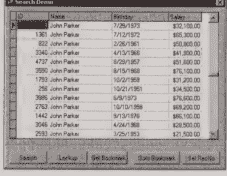

### 图 3.9
搜索功能演示了索引和非索引搜索。

## 总结

`TClientDataSet` 是一个功能极其强大的内存数据集，支持多种高性能排序和搜索操作。以下是本章需要牢记的几个关键点：

- 你可以在设计时和运行时创建客户端数据集。本章展示了如何将它们保存到磁盘，以便在单层数据库应用程序中使用。
- 填充客户端数据集的三种基本方式是：
  - 手动使用 `Append` 或 `Insert`
  - 从另一个数据集填充
  - 从文件或流填充（即通过持久化客户端数据集）
- Delphi 中的数据集中可以使用多种方式进行导航：顺序访问、通过书签以及通过记录号。
- 你可以在数据集上创建索引，从而快速轻松地按给定顺序对记录进行排序，并定位匹配特定条件的记录。
- 筛选器和范围可用于限制在数据集中可见的数据量。当相关数据存储在连续的一系列记录中时，范围非常有用。与范围不同，筛选器在应用前不需要先设置索引。
- `Locate` 和 `Lookup` 是用于在客户端数据集中定位特定记录的非索引搜索技术。`FindKey`、`FindNearest`、`GotoKey` 和 `GotoNearest` 是索引搜索技术。

在下一章中，我将讨论更高级的客户端数据集功能。

# 高级客户端数据集操作

第 4 章

## 本章内容

- 数据集事件 148
- 禁用数据感知组件 158
- BLOB 字段 162
- 嵌套数据集 172
- 撤销支持 176
- 从另一个客户端数据集克隆数据 186
- 维护的聚合值 192
- 其他属性 197

前一章向你介绍了 `TClientDataSet`，并详细讨论了其许多基本功能。在本章中，我将探索许多更高级的客户端数据集功能，包括：

- 数据集事件
- 禁用数据感知组件
- BLOB 字段
- 嵌套数据集
- 撤销支持
- 从另一个客户端数据集克隆数据
- 维护的聚合值
- 其他属性

## 数据集事件

客户端数据集支持大量事件。其中一些事件在单层应用程序（如本章正在开发的应用程序）中很有用，而另一些则仅在多层应用程序（我们将在后续章节中开发的应用程序）中有用。

本章讨论在所有应用程序（包括单层和多层）中都有用的数据集事件。广义上讲，这些事件分为三类：`Beforexxx` 通知事件、`Afterxxx` 通知事件以及其他事件。`Beforexxx` 和 `Afterxxx` 通知事件在 Delphi 中有趣活动发生之前和之后触发。就本讨论而言，“有趣”指的是数据集执行的常规日常活动——你希望在它们发生时收到通知的活动。

一个例子有助于澄清上述最后一句话：假设你想验证从数据集中删除的所有记录。一种方法是在程序中允许删除发生的每个位置向用户显示确认消息。然而，这种方法有三个缺点：

- 它是重复的。
- 它容易出错。如果你在代码的某个位置更改了确认消息，你很容易忘记更改其他位置的消息。你也可能完全忘记实现确认功能。
- 在 VCL/CLX 隐式删除记录的情况下它不起作用。如果你在数据感知网格中按下 Ctrl+Delete，VCL/CLX 会替你处理删除，而无需你编写代码。

针对这种情况，更好的编程方式是处理 `BeforeDelete` 事件，并在那里显示一条消息，询问用户是否确定要删除该记录。与大多数 `BeforeXxx` 事件处理程序一样，在事件处理程序内部引发异常（通常是 `Abort`）可以阻止该操作的发生。

在本节稍后，我将展示一个示例应用程序，以说明这种技术。

表 4.1 列出了客户端数据集的 `BeforeXxx` 事件及其用途。

### 表 4.1 客户端数据集 BeforeXxx 事件

| 事件 | 描述 |
| --- | --- |
| BeforeCancel | 在 `Cancel` 方法取消当前记录的编辑即将完成时触发。您可以利用此事件确认用户确实想要取消其所做的更改。 |
| BeforeClose | 在数据集关闭之前立即调用。 |
| BeforeDelete | 在数据集当前记录被删除之前立即调用。这是确认用户是否真的想要删除该记录的好地方。 |
| BeforeEdit | 在 `Edit` 方法将数据集置于编辑模式之前立即触发。您可以将此事件用作限制编辑（通过引发 `Abort` 异常）的便捷位置。 |
| BeforeInsert | 在 `Append` 和 `Insert` 方法将数据集置于插入模式之前立即触发。您可以将此事件用作限制编辑（通过引发 `Abort` 异常）的一种方式。 |
| BeforeOpen | 在数据集打开之前立即调用。 |
| BeforePost | 在 newly inserted 或 edited 记录的数据发布到数据集之前发生。这是对数据执行验证的好地方。 |
| BeforeScroll | 在数据集移动到新记录之前立即触发。当数据集在 `First`、`Next`、`Prior` 或 `Last` 操作期间打开时；在搜索期间；以及当对数据集应用范围或筛选器时，会发生这种情况。 |

与在事件实际发生之前触发的 `BeforeXxx` 事件处理程序（因此可以防止事件发生）不同，`AfterXxx` 事件处理程序在事件发生之后触发，以告知您相关操作已成功完成。

表 4.2 列出了 `AfterXxx` 事件处理程序，它们与 `BeforeXxx` 事件处理程序相对应。

### 表 4.2 客户端数据集 AfterXxx 事件

| 事件 | 描述 |
| --- | --- |
| AfterCancel | 在 `Cancel` 方法完成后触发。 |
| AfterClose | 在数据集关闭后立即发生。 |
| AfterDelete | 在数据集中的记录被删除后立即触发。 |
| AfterEdit | 在由于调用 `Edit` 方法而将数据集置于编辑模式之后调用。 |
| AfterInsert | 在由于调用 `Insert` 或 `Append` 方法而将数据集置于插入模式之后调用。 |
| AfterOpen | 在数据集打开后立即发生。 |
| AfterPost | 在记录成功发布到数据集后触发。 |
| AfterScroll | 在数据集移动到新记录后立即触发。当数据集在 `First`、`Next`、`Prior` 或 `Last` 操作期间打开时；在搜索期间；以及当对数据集应用范围或筛选器时，会发生这种情况。 |

表 4.3 列出了客户端数据集的其他显著事件处理程序。

### 表 4.3 其他事件处理程序

| 事件 | 描述 |
| --- | --- |
| OnCalcFields | 如第 6 章“数据感知网格”中所述，此事件用于提供计算字段的值。 |
| OnDeleteError | 如果在从数据集中删除记录时发生错误（例如，如果数据集是只读的），则触发此事件。 |
| OnEditError | 如果在将数据集置于编辑模式时发生错误（例如，如果数据集是只读的），则触发此事件。 |
| OnFilterRecord | 如第 6 章中所述，调用此事件以允许用户为数据集提供高级筛选。 |
| OnNewRecord | 每当创建新记录时触发，但在此之前尚未编辑或发布到数据集。这是为记录设置默认值的好地方。在此事件处理程序内部，数据集已处于插入模式，因此您不应在此事件处理程序内调用 `TClientDataSet.Insert`。 |
| OnPostError | 如果在尝试将记录发布到数据集时发生错误（例如主键冲突），则触发此事件。 |

通过处理所有这些事件并将它们的调用记录到日志文件或列表框中，您可以了解到许多关于数据集工作方式的信息。在下面的示例中，我正是这样做的。清单 4.1 包含了 EventLog 应用程序的完整源代码。

### 清单 4.1 EventLog—MainForm.pas

```pascal
unit MainForm;

interface

uses

  SysUtils, Variants, Classes, QGraphics, QControls, QForms,

  QDialogs, DB, DBClient, QComCtrls, QGrids, QDBGrids, QExtCtrls, QStdCtrls,

  QDBCtrl;

type

  TLogEventType = (logBeforeCancel, logBeforeClose, logBeforeDelete,

                   logBeforeEdit, logBeforeInsert, logBeforeOpen, logBeforePost,

                   logBeforeScroll, logAfterCancel, logAfterClose, logAfterDelete,

                   logAfterEdit, logAfterInsert, logAfterOpen, logAfterPost, logAfterScroll);

  TFrmMain = class(TForm)
```


`ClientDataSet1: TClientDataSet;`

`pnlClient: TPanel;`

`pnlLog: TPanel;`

`grid: TDBGrid;`

`lvLog: TListView;`

`DataSource1: TDataSource;`

`pnlBottom: TPanel;`

`btnConnect: TButton;`

`lblRecPos: TLabel;`

`btnDisconnect: TButton;`

`btnClearLog: TButton;`

`DBNavigator1: TDBNavigator;`

`btnOptions: TButton;`

`procedure ClientDataSet1AfterCancel(DataSet: TDataSet);`

`procedure ClientDataSet1AfterClose(DataSet: TDataSet);`

`procedure ClientDataSet1AfterDelete(DataSet: TDataSet);`

`procedure ClientDataSet1AfterEdit(DataSet: TDataSet);`

`procedure ClientDataSet1AfterInsert(DataSet: TDataSet);`

`procedure ClientDataSet1AfterOpen(DataSet: TDataSet);`

`procedure ClientDataSet1AfterPost(DataSet: TDataSet);`

`procedure ClientDataSet1AfterScroll(DataSet: TDataSet);`

`procedure btnConnectClick(Sender: TObject);`

## 清单 4.1 续

```pascal
procedure btnClearLogClick(Sender: TObject);

procedure btnDisconnectClick(Sender: TObject);

procedure ClientDataSet1BeforeCancel(DataSet: TDataSet);

procedure ClientDataSet1BeforeClose(DataSet: TDataSet);

procedure ClientDataSet1BeforeDelete(DataSet: TDataSet);

procedure ClientDataSet1BeforeEdit(DataSet: TDataSet);

procedure ClientDataSet1BeforeInsert(DataSet: TDataSet);

procedure ClientDataSet1BeforeOpen(DataSet: TDataSet);

procedure ClientDataSet1BeforePost(DataSet: TDataSet);

procedure ClientDataSet1BeforeScroll(DataSet: TDataSet);

procedure btnOptionsClick(Sender: TObject);

procedure FormCreate(Sender: TObject);

private

  { Private declarations }

  FLogScrollEvents: Boolean;

  FPromptOnDelete: Boolean;

  procedure Log(EventType: TLogEventType);

public

  { Public declarations }

end;

var

  frmMain: TfrmMain;

implementation

uses OptionsForm;

{$R *.dfm}

procedure TfrmMain.Log(EventType: TLogEventType);

const

  EventText: array[TLogEventType] of string = (

    'BeforeCancel', 'BeforeClose', 'BeforeDelete', 'BeforeEdit',

    'BeforeInsert', 'BeforeOpen', 'BeforePost', 'BeforeScroll',

    'AfterCancel', 'AfterClose', 'AfterDelete', 'AfterEdit',

    'AfterInsert', 'AfterOpen', 'AfterPost', 'AfterScroll');

var

  ListItem: TListItem;

begin

  ListItem := lvLog.Items.Add;

  ListItem.Caption := EventText[EventType];

end;
```

## 清单 4.1 续

```pascal
procedure TfrmMain.FormCreate(Sender: TObject);

begin

  FLogScrollEvents := True;

  FPromptOnDelete := True;

end;

procedure TfrmMain.ClientDataSet1AfterCancel(DataSet: TDataSet);

begin

  Log(logAfterCancel);

end;

procedure TfrmMain.ClientDataSet1AfterClose(DataSet: TDataSet);

begin

  Log(logAfterClose);

end;

procedure TfrmMain.ClientDataSet1AfterDelete(DataSet: TDataSet);

begin

  Log(logAfterDelete);

end;

procedure TfrmMain.ClientDataSet1AfterEdit(DataSet: TDataSet);

begin

  Log(logAfterEdit);

end;

procedure TfrmMain.ClientDataSet1AfterInsert(DataSet: TDataSet);

begin

  Log(logAfterInsert);

end;

procedure TfrmMain.ClientDataSet1AfterOpen(DataSet: TDataSet);

begin

  Log(logAfterOpen);

end;

procedure TfrmMain.ClientDataSet1AfterPost(DataSet: TDataSet);

begin

  Log(logAfterPost);

end;
```

## 列表 4.1 续

```pascal
procedure TfrmMain.ClientDataSet1AfterScroll( DataSet: TDataSet );

begin

  if FLogScrollEvents then

    Log( logAfterScroll );

  lblRecPos.Caption := Format( 'Record %d of %d',

    [ DataSet.RecNo, DataSet.RecordCount ] );

end;

procedure TfrmMain.ClientDataSet1BeforeCancel( DataSet: TDataSet );

begin

  Log( logBeforeCancel );

end;

procedure TfrmMain.ClientDataSet1BeforeClose( DataSet: TDataSet );

begin

  Log( logBeforeClose );

end;

procedure TfrmMain.ClientDataSet1BeforeDelete( DataSet: TDataSet );

begin

  Log( logBeforeDelete );

  if FPromptOnDelete then begin

    if MessageDlg( 'Are you sure you want to delete the current record?',

      mtWarning, [mbYes, mbNo], 0 ) <> mrYes then

      Abort;

  end;

end;

procedure TfrmMain.ClientDataSet1BeforeEdit( DataSet: TDataSet );

begin
```


```pascal
Log( logBeforeEdit );

end;

procedure TfrmMain.ClientDataSet1BeforeInsert( DataSet: TDataSet );

begin

  Log( logBeforeInsert );

end;

procedure TfrmMain.ClientDataSet1BeforeOpen( DataSet: TDataSet );

begin

  Log( logBeforeOpen );

end;

procedure TfrmMain.ClientDataSet1BeforePost( DataSet: TDataSet );

begin

  Log( LogBeforePost );

end;

procedure TfrmMain.ClientDataSet1BeforeScroll( DataSet: TDataSet );

begin

  if FlagScrollEvents then

    Log( LogBeforeScroll );

end;

procedure TfrmMain.btnConnectClick( Sender: TObject );

begin

  ClientDataSet1.LoadFromFile( 'C:\\Employee.cds' );

end;

procedure TfrmMain.btnDisconnectClick( Sender: TObject );

begin

  ClientDataSet1.Close;

end;

procedure TfrmMain.btnClearLogClick( Sender: TObject );

begin

  lvLog.Items.Clear;

end;

procedure TfrmMain.btnOptionsClick( Sender: TObject );

var

  frmOptions: TfrmOptions;

begin

  frmOptions := TfrmOptions.Create( nil );

  try

    frmOptions.LogScrollEvents := FlagScrollEvents;

    frmOptions.PromptOnDelete := FPromptOnDelete;

    if frmOptions.ShowModal = mrOK then begin

      FlagScrollEvents := frmOptions.LogScrollEvents;

      FPromptOnDelete := frmOptions.PromptOnDelete;

    end;

  finally

    frmOptions.Free;

  end;

end;
```

图 4.1 展示了应用程序在运行时的状态。主窗口的上半部分被一个数据感知网格占据，允许用户插入、编辑和删除记录。窗口的中间部分包含一个列表视图，用于记录在数据集上执行的所有活动的日志。窗口底部有用于打开和关闭数据集、清除日志以及设置演示选项的按钮。

用户可以点击主窗口底部的“选项...”按钮来选择是否记录滚动事件以及是否验证删除操作，如图 4.1 所示。

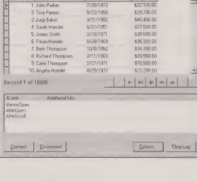

### 图 4.1

*EventLog 应用程序演示了客户端数据集事件。*

列表 4.2 包含了应用程序“选项”窗口的源代码，该窗口允许用户指定程序在删除记录时是否提示用户，以及程序是否应将对数据集的事件记录到列表框中。

## 列表 4.2 EventLog—OptionsForm.pas

```pascal
unit OptionsForm;

interface

uses

  SysUtils, Variants, Classes, QGraphics, QControls, QForms,

  QDialogs, QStdCtrls, QExtCtrls;

type

  TFormOptions = class(TForm)

    pnlClient: TPanel;

    pnlBottom: TPanel;

    btnOk: TButton;

    btnCancel: TButton;

    cblLogScrollEvents: TCheckBox;

    cbPromptOnDelete: TCheckBox;

private

  procedure SetLogScrollEvents(const Value: Boolean);

  function GetLogScrollEvents: Boolean;

  function GetPromptOnDelete: Boolean;

  procedure SetPromptOnDelete(const Value: Boolean);

{ Private declarations }

public

{ Public declarations }

  property LogScrollEvents: Boolean

    read GetLogScrollEvents write SetLogScrollEvents;

  property PromptOnDelete: Boolean

    read GetPromptOnDelete write SetPromptOnDelete;

end;

implementation

{$R *.xfm}

{TfrmOptions}

function TfrmOptions.GetLogScrollEvents: Boolean;

begin

  Result := cblLogScrollEvents.Checked;

end;

function TfrmOptions.GetPromptOnDelete: Boolean;

begin

  Result := cbPromptOnDelete.Checked;

end;

procedure TfrmOptions.SetLogScrollEvents(const Value: Boolean);

begin

  cblLogScrollEvents.Checked := Value;

end;

procedure TfrmOptions.SetPromptOnDelete(const Value: Boolean);

begin

  cbPromptOnDelete.Checked := Value;

end;

end.
```

## 禁用数据感知组件

这个主题实际上适用于所有 Delphi 数据集，但我是在客户端数据集的上下文中讨论它，因为通常你不会将数据感知组件直接连接到 dbExpress 数据集。通常，数据感知组件是连接到客户端数据集的。

正如你在本章中学到的那样，数据感知组件会主动跟踪它们所连接的数据集中的当前记录。虽然这通常是一件好事，但有时你希望阻止数据感知组件进行更新。这种情况最常发生在你滚动数据集以执行针对记录的操作，而不希望在执行时看到所有数据感知组件快速更新的情况下。例如，请查看以下代码片段：

```pascal
var

  Bookmark: TBookmarkStr;

begin

  Bookmark := ClientDataSet1.Bookmark;

  try

    ClientDataSet1.First;

    while not ClientDataSet1.EOF do begin

      if ClientDataSet1.FieldByName('Salary').AsFloat < 30000.0 then begin

        ClientDataSet1.Edit;

        ClientDataSet1.FieldByName('Salary').AsFloat :=

          ClientDataSet1.FieldByName('Salary').AsFloat * 1.05;

        ClientDataSet1.Post;

      end;

      ClientDataSet1.Next;

    end;

  finally

    ClientDataSet1.Bookmark := Bookmark;

  end;

end;
```


这段代码遍历数据集中的所有记录，给年收入低于 30,000 美元的人加薪 5%。

从它实现了预期目的的角度来看，这段代码没有任何问题。它甚至记得当前记录，以便在完成后正确重新定位数据集。

这段代码的问题在于它很慢。如果你将其运行在前一章中创建的包含 10,000 条记录的雇员数据集上，你会看到网格随着记录被更新而在数据集中滚动。（本节末尾的示例应用程序展示了这种效果。）

解决方案是在开始此操作之前禁用所有附加到该数据集的数据感知组件（即 `TDBGrid`）。为此，你只需在执行耗时操作之前调用 `DisableControls` 方法，然后在完成后调用 `EnableControls`。以下代码片段显示了更新后的过程：

```pascal
var
    Bookmark: TBookmarkStr;
begin
    ClientDataSet1.DisableControls;
    try
        Bookmark := ClientDataSet1.Bookmark;
        try
            ClientDataSet1.First;
            while not ClientDataSet1.EOF do begin
                if ClientDataSet1.FieldName('Salary').AsFloat < 30000.0 then begin
                    ClientDataSet1.Edit;
                    ClientDataSet1.FieldByName('Salary').AsFloat := ClientDataSet1.FieldByName('Salary').AsFloat * 1.05;
                    ClientDataSet1.Post;
                end;
                ClientDataSet1.Next;
            end;
        finally
            ClientDataSet1.Bookmark := Bookmark;
        end;
    finally
        ClientDataSet1.EnableControls;
    end;
end;
```

正如这段代码片段所示，你希望将 `DisableControls` 和 `EnableControls` 调用之间的代码包裹在一个 `try/finally` 块中。如果你没有这样做，并且代码中某处发生异常，数据感知组件将停止更新。

请注意，对 `DisableControls` 和 `EnableControls` 的调用是引用计数的。如果你在代码中调用 `DisableControls` 三次，那么在数据感知控件再次更新之前，你需要调用 `EnableControls` 三次。

### 列表 4.3 Updates—MainForm.pas

```pascal
unit MainForm;
interface
```


# 列表 4.3 续

```pascal
uses
Types, IdGlobal, SysUtils, Variants, Classes, QGraphics, QControls, QForms,
QDialogs, QStdCtrls, DB, DBClient, QExtCtrls, QActnList, QGrids, QDBGrids,
QDBCtrls;
type
TfrmMain = class(TForm)
 DataSource1: TDataSource;
 pnlClient: TPanel;
 pnlBottom: TPanel;
 btnDisableEnable: TButton;
 DBGid1: TDBGrid;
 ClientDataSet1: TClientDataSet;
 btnBaseline: TButton;
 procedure FormCreate(Sender: TObject);
 procedure btnDisableEnableClick(Sender: TObject);
 procedure btnBaselineClick(Sender: TObject);
private
{ Private declarations }
procedure PerformWork;
public
{ Public declarations }
end;
var
frmMain: TfrmMain;
implementation
{$R *.xfm}
procedure TfrmMain.FormCreate(Sender: TObject);
begin
ClientDataSet1.LoadFromFile('C:\Employee.cds');
end;
procedure TfrmMain.PerformWork;
var
Bookmark: TBookmark;
begin
Bookmark := ClientDataSet1.GetBookmark;
try
ClientDataSet1.First;
while not ClientDataSet1.EOF do begin
if ClientDataSet1.FieldByName('Salary').AsFloat < 30000.0 then begin
ClientDataSet1.Edit;
ClientDataSet1.FieldByName('Salary').AsFloat :=
ClientDataSet1.FieldByName('Salary').AsFloat * 1.05;
ClientDataSet1.Post;
end;
ClientDataSet1.Next;
end;
ClientDataSet1.GotoBookmark(Bookmark);
finally
ClientDataSet1.FreeBookmark(Bookmark);
end;
end;
procedure TfrmMain.btnBaseLineClick(Sender: TObject);
var
t1, t2: DWord;
begin
t1 := GetTickCount;
PerformWork;
t2 := GetTickCount;
ShowMessage(IntToStr(t2 - t1) + ' ms');
end;
procedure TfrmMain.btnDisableEnableClick(Sender: TObject);
var
t1, t2: DWord;
begin
t1 := GetTickCount;
ClientDataSet1.DisableControls;
try
PerformWork;
finally
ClientDataSet1.EnableControls;
end;
t2 := GetTickCount;
ShowMessage(IntToStr(t2 - t1) + ' ms');
end;
end.
```

这个测试的结果令人印象深刻。基线测试（未禁用控件）在我 1.4GHz 的奔腾 4 处理器上运行大约需要 19.6 秒。通过添加额外五行代码来禁用并重新启用数据感知组件，代码执行时间仅为 560 毫秒（而且顺带消除了烦人的屏幕活动）。

### BLOB

BLOB（二进制大对象）是现代许多数据库应用的基础部分。无论是想要存储图像、格式化和非格式化笔记、流式组件，还是其他任何字节块；BLOB 都是你数据库编程工具包中不可或缺的一部分。

在本节中，我将向你展示如何在客户端数据集中有效地存储 BLOB，以及随后如何检索它们。在接下来的几页中，我将具体关注笔记、图像、流式组件和通用 BLOB 存储。

与其他字段类型一样，你可以在设计时或运行时创建 BLOB 字段。以下代码片段展示了如何在运行时创建 BLOB 字段：

```pascal
ClientDataSet1.FieldDefs.Add('Notes', ftBLOB);
```

这段代码创建了一个名为 `Notes`、类型为 `ftBLOB` 的字段。

#### 笔记

使用 BLOB 字段最常见的方式之一是存储笔记或自由格式文本。对于少量文本，字符串字段通常就足够了，但如果你想存储整个备忘录，就需要使用 BLOB 字段。

将 BLOB 访问为字符串特别简单。你可以简单地调用该字段的 `AsString` 方法，如下所示：

```pascal
Memo1.Text := ClientDataSet1.FieldName('Notes').AsString;
```

类似地，要将备忘录存储回字段，你可以编写如下代码：


`ClientDataSet1.FieldName('Notes').AsString := Memo1.Text;`

### 图像

BLOB 字段的另一个常见用途是存储图像。你可能想编写一个 Delphi 应用程序来编目你在数码相机上拍摄的照片，或者你可能想在无纸化办公室中跟踪扫描文档。无论如何，BLOB 字段提供了在数据库中存储这些图像所需的必要支持。

像格式化和非格式化备忘录一样，Delphi 提供了图像的数据感知版本：`TDBImage`。然而，`TDBImage` 存在不足，因为它只能正确地存储和检索位图（BMP 文件）。一个健壮的应用程序应该能够存储位图、JPG 以及用户可能想要存储的（几乎）任何其他图像类型。

至少有三种方法可用于在数据集中存储多种图像类型。包括：

- 创建一个单独的字段，用于存储图像类型。使用此字段的值来确定如何存储/加载图像。
- 向 BLOB 字段写入一个表示图像类型的值，紧随其后的是图像数据。
- 使用第三方图像处理库来完成这项工作。

以下部分讨论了这些选项。

#### 使用单独字段存储图像类型

跟踪存储在数据集中的图像类型的一种方法是添加一个单独的字段，例如命名为 `ImageType`，来跟踪图像类型。假设（仅为论证起见）你的应用程序可以存储 BMP 和 JPG。你将为每种图像类型设置常量，如下所示：

```pascal
const
  IMAGE_NONE = 0;
  IMAGE_BMP = 1;
  IMAGE_JPG = 2;
```

不言而喻，当 BLOB 字段为 NULL 时，`ImageType` 字段包含值 `IMAGE_NONE`。为了正确实现此方法，你必须记住在用户加载图像时始终设置 `ImageType` 字段，如果用户清除图像，则将其重置为 `IMAGE_NONE`。

#### 将图像类型作为 BLOB 字段的一部分进行流式传输

通过少量额外代码，你可以省去额外的字段，并将图像类型存储在 BLOB 字段中，与图像本身放在一起。图 4.2 从概念上展示了此方法涉及的内容。

以下伪代码展示了你可能如何实现此方法：

```pascal
procedure SaveImage;
begin
  OpenOutputStream;
  WriteImageType;
  WriteImageData;
end;

procedure LoadImage;
var
  ImageType: Integer;
begin
  OpenInputStream;
  ImageType := ReadImageType;
  case ImageType of
    IMAGE_BMP: ReadBitmap;
    IMAGE_JPG: ReadJPEG;
  end;
end;
```

本节末尾提供的示例应用程序展示了这两种技术。

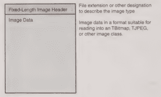

#### 第三方图像处理库

第三方图像处理库通常遵循前一部分中概述的步骤（即，它们通常向流存储一个值，以指示流中存储的图像类型）。图像类型紧随其后的是图像本身。

然而，其他第三方库可能始终在内部以专有格式存储图像，然后将该图像格式读取和写入流。关键是，一旦你确定了图像处理库并在应用程序中实现了它，就不应期望你以后可以任意将该库替换为另一个库。更换图像库可能要求你为 BLOB 数据编写数据转换程序。

> **注意**
> 如果你正在寻找一个好的图像处理库，请看看 Skyline Tools Imaging 的 ImageLib Corporate Suite。ImageLib Corporate Suite 曾获奖无数，被评为最佳的 Delphi 图像处理库（包括 *Delphi Informant Magazine* 备受推崇的读者选择奖）。我在自己的应用程序中使用 ImageLib，并大力推荐它。你可以在 http://www.imagelib.com 找到 Skyline Tools Imaging。

### 流式数据

除了流式传输图像外，有时你可能希望将非结构化数据流式传输到 BLOB 字段。例如，你可能想在单个字段中存储一个整数链表。以下代码片段展示了如何使用流将数据保存到 BLOB，然后稍后读取它。

```pascal
procedure SaveListToBlob(List: TList);
var
  Stream: TStream;
  Num: Integer;
  Index: Integer;
begin
  Stream := ClientDataSet1.CreateBlobStream(
    ClientDataSet1.FieldByName('DATA'), bmWrite);
  try
    // Write out the number of integers
    Num := List.Count;
    Stream.Write(Num, sizeof(Num));
    for Index := 0 to List.Count - 1 do begin
      Num := Integer(List[Index]);
      Stream.Write(Num, sizeof(Num));
    end;
  finally
    Stream.Free;
  end;
end;

procedure LoadListFromBlob(List: TList);
var
  Stream: TStream;
  Count: Integer;
  Index: Integer;
  Num: Integer;
```


```
var
  Stream: TStream;
begin
  Stream := ClientDataSet1.CreateBLOBStream(
    ClientDataSet1.FieldByName('DATA'), bmRead);
try
  List.Clear;

  Stream.Read(Count, sizeof(Count));
  for Index := 0 to Count - 1 do begin
    Stream.Read(Num, sizeof(Num));
    List.Add(Pointer(Num));
  end;
finally
  Stream.Free;
end;
end;
```

注意之前过程中 `Stream.Write` 和 `Stream.Read` 的使用。这两个方法都将要写入数据的引用作为第一个参数，将写入的字节数作为第二个参数。保存数据块就像反复调用 `TStream.Write` 一样简单。必须确保读取数据的顺序与写入顺序完全一致，否则最好情况下会导致异常，最坏情况下会导致数据损坏。

还要注意使用 `TDataSet` 方法 `CreateBLOBStream` 来创建适合数据集的 blob 流。许多初学 Delphi 数据库的程序员试图像下面这样调用 `TBlobStream.Create`：

```
var
  Stream: TBlobStream;
begin
  Stream := TBlobStream.Create(...);
try
  // 在这里从流中读取或写入数据。
finally
  Stream.Free;
end;
end;
```

这种方法的缺点是 `TBlobStream` 专用于 BDE。创建 `TBlobStream` 实例无法与非 BDE 数据集（如 `TClientDataSet`）配合使用。要创建一个能与当前数据集配合使用的 blob 流，始终应调用数据集的 `CreateBLOBStream` 方法，如下所示：

```
var
  Stream: TStream;
begin
  Stream := TheDataSet.CreateBlobStream(...);
  try
    // 在这里从流中读取或写入数据。
  finally
    Stream.Free;
  end;
end;
```

请注意，`Stream` 被定义为 `TStream`，这是流的基类。实际返回的流可能是 `TBlobStream`（对于 BDE 数据集）或其他类型的流。由于多态性，您无需知道流的确切类类型即可对其进行操作。

### 流式组件

尽管流式数据概念依赖于你（程序员）确保以相同顺序读取和写入数据，但通过创建并流式传输组件，你可以让 Delphi 内置的流式机制为你完成这项工作。

Delphi 为派生自 `TPersistent` 的组件提供流式支持，并为 `TCollection` 类系列提供了辅助函数。

为了使之前描述的整数列表的流式传输更加自动化，让我们为数据创建一个组件包装器。

```
TIntegerItem = class(TCollectionItem)
private
  FNumber: Integer;
published
  property Number: Integer read FNumber write FNumber;
end;

TIntegerList = class(TComponent)
private
  FIntList: TCollection;
published
  property IntList: TCollection read FIntList;
end;
```

当然，对于像整数列表这样简单的数据结构，这样做可能有点小题大做，但同样的概念适用于包含多个字段或复杂子数据的组件。

**注意**

本书并不打算详细讨论 Delphi 的流式支持。有关流式处理的更多信息，请参阅《组件编写者指南》或最终参考资源 VCL/CLX 源码。如果你有幸拥有 Danny Thorpe 的《Delphi 组件设计》一书，其中也有关于 Delphi 流式机制的启发性章节。

### 文件 BLOB

BLOB 字段的另一个常见用途是在 BLOB 中存储整个文件。例如，假设你拥有大量 PDF 文档，想要对其进行编目并允许用户阅读。

通过将 PDF 文件存储在 BLOB 字段中，你可以相对轻松地创建一个应用程序，使用户能够按类别或关键词搜索 PDF，然后在他们的计算机上查看该文件。

可以使用字段的 `LoadFromFile` 方法将外部文件加载到 BLOB 字段中，如下面的代码片段所示：

```
var
  B: TBlobField;
begin
  B := ClientDataSet1.FieldByName('AttachedFile');
  B.LoadFromFile('C:\PROPOSAL.PDF');
end;
```

如果你想将文件保存回磁盘（例如，为了将其加载到 Acrobat Reader 等应用程序中），你会编写如下代码：

```
var
  B: TBlobField;
begin
  B := ClientDataSet1.FieldByName('AttachedFile');
  B.SaveToFile('C:\TEMP.PDF');
end;
```

### BLOB 字段的局限性

尽管 BLOB 非常有用，但它们确实存在一些局限性。具体来说：

- 你（目前）无法在 BLOB 字段上执行过滤。关系型数据库的新版本（如 Informix）支持在 BLOB 上进行搜索。一旦此功能添加到核心 dbExpress 技术中，`TClientDataSet` 很可能也会更新以支持它。
- 你无法在 BLOB 字段上执行定位或其他搜索技术。
- 在第 8 章“DataSnap”中讨论的 DataSnap 协调功能不适用于 BLOB 字段。但是，在该章中你会看到一个变通方法。

下面的示例演示了本节讨论的一些 BLOB 技术。列表 4.4 显示了 BLOBs 应用程序的源代码。

**列表 4.4 BLOBs—MainForm.pas**

```
unit MainForm;

interface

  uses
    SysUtils, Classes, QGraphics, QControls, QForms, QDialogs, QStdCtrls, DB, QDBCtrls, QExCtrls, QComCtrls, DBClient, JPEG;

type
  TfrmMain = class(TForm)
  pnlBottom: TPanel;
  ClientDataSet: TClientDataSet;
  DataSource1: TDataSource;
  DBNavigator1: TDBNavigator;
  PageControl1: TPageControl;
  tabNotes: TTabSheet;
  tabImage: TTabSheet;
  DBMemo1: TDBMemo;
  tabAttachment: TTabSheet;
  Label1: TLabel;
  DBText1: TDBText;
  ClientDataSetNotes: TBlobField;
  ClientDataSetImageType: TStringField;
  ClientDataSetImage: TBlobField;
  ClientDataSetAttachment: TBlobField;
  btnLoadAttachment: TButton;
  btnSaveAttachment: TButton;
  Label2: TLabel;
  DBText2: TDBText;
  ClientDataSetAttachedFile: TStringField;
  Boxel1: TBoxel;
  Image1: TImage;
  btnLoadImage: TButton;
  btnClearImage: TButton;
  OpenPictureDialog1: TOpenDialog;
  OpenDialog1: TOpenDialog;
  SaveDialog1: TSaveDialog;
  procedure FormCreate(Sender: TObject);
  procedure DataSource1DataChange(Sender: TObject; Field: TField);
  procedure btnLoadImageClick(Sender: TObject);
  procedure btnClearImageClick(Sender: TObject);
  procedure btnLoadAttachmentClick(Sender: TObject);
  procedure btnSaveAttachmentClick(Sender: TObject);
private
   { 私有声明 }
public
   { 公共声明 }
end;

var
   ffrmMain: TfrmMain;

implementation

{$R *.xfm}

procedure TfrmMain.FormCreate(Sender: TObject);
begin
   ClientDataSet1.CreateDataSet;
end;

procedure TfrmMain.DataSource1DataChange(Sender: TObject; Field: TField);
var
   BlobStream: TStream;
   JPEGImage: TJpegImage;
   Ext: string;
begin
   if (Field = nil) or (Field = ClientDataSet1Image) then begin
      if ClientDataSet1ImageType.AsString <> '' then begin
         BlobStream := ClientDataSet1.CreateBlobStream(ClientDataSet1Image, bmRead);
         try
            Ext := UpperCase(ClientDataSet1ImageType.AsString);
            if Ext = '.BMP' then
               Image1.Picture.Bitmap.LoadFromStream(BlobStream)
            else if Ext = '.JPG' then begin
               JPEGImage := TJpegImage.Create;
               try
                  JPEGImage.LoadFromStream(BlobStream);
                  Image1.Picture.Assign(JPEGImage);
               finally
                  JPEGImage.Free;
               end;
            finally
               BlobStream.Free;
            end;
         end else
            Image1.Picture := nil;
      end;
end;

procedure TfrmMain.btnLoadImageClick(Sender: TObject);
begin
   if OpenPictureDialog1.Execute then begin
      ClientDataSet1.Edit;
      ClientDataSet1ImageType.AsString :=
         ExtractFileExt(OpenPictureDialog1.FileName);
      ClientDataSet1Image.LoadFromFile(OpenPictureDialog1.FileName);
   end;
end;

procedure TfrmMain.btnClearImageClick(Sender: TObject);
begin
   Image1.Picture := nil;
end;

procedure TfrmMain.btnLoadAttachmentClick(Sender: TObject);
begin
   if OpenDialog1.Execute then begin
      ClientDataSet1.Edit;
      ClientDataSet1AttachedFile.AsString := OpenDialog1.FileName;
      ClientDataSet1Attachment.LoadFromFile(OpenDialog1.FileName);
   end;
end;

procedure TfrmMain.btnSaveAttachmentClick(Sender: TObject);
begin
   if SaveDialog1.Execute then
      ClientDataSet1Attachment.SaveToFile(SaveDialog1.FileName);
end;
end.
```

4
高级客户端数据集操作

BLOBs 应用程序允许你在单条记录中存储一条备注、一张图像和一个文件附件。备注是通过使用 `TDBMemo` 组件来存储的。

我选择创建一个独立的图像类型字段，并将其命名为 `ImageType`，以便跟踪存储在 `Image` 字段中的图像类型。如果 `ImageType` 为空，则假定该图像为 NULL。请注意图像显示的方式——程序处理了数据源的 `DataChange` 事件。如果发送到该事件的 `Field` 参数为 nil（或者引用了 `Image` 字段），`Image` 组件会使用一种方法从 `Image` 字段加载 BMP 文件，并使用另一种方法加载 JPG 文件。当然，实际应用程序能够识别的图像类型远不止这两种。

同时请注意用于加载图像的代码与用于加载附件的代码之间的相似性。任何文件都可以通过该字段的 `LoadFromFile` 方法加载到 BLOB 字段中，并可以通过该字段的 `SaveToFile` 方法保存回磁盘。

BLOBs 应用程序不会将数据保存到磁盘（尽管可以通过在代码中添加 `SaveToFile` 方法来实现），因此其实用性较低。然而，它展示了在你的程序中使用 BLOB 字段的正确方式（或者对于图像而言的其中一种正确方式）。

图 4.3 展示了该应用程序在运行时的状态。

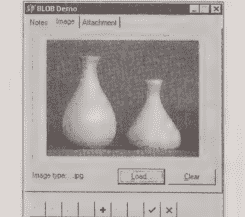

### 图 4.3
*备注和图像是许多现代应用程序的一部分。*

## 嵌套数据集

嵌套数据集是 `TClientDataSet` 对主从（master/detail）关系的一种回应。嵌套数据集在物理上将细节（detail）数据集作为一个字段*嵌套*在主（master）数据集中。图 4.4 说明了这一概念。

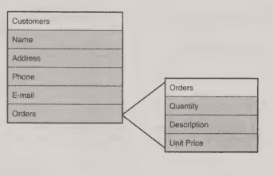

### 图 4.4
Orders 数据集嵌套在 Customers 数据集中。

数据集可以嵌套超过一级深度，因此你可以在三个数据集之间建立祖父母/父母/子级关系。你也可以创建一个具有多个子级的父级，或者两者的混合（其中一个主级包含三个细节级，而这些细节级中每个又包含两个细节级）。

当你将嵌套数据集保存到文件或流时，整个层次结构会被保存到一个文件或流中。要保存嵌套数据集，请在主数据集上调用 `SaveToFile` 或 `SaveToStream`，所有嵌套数据集会自动保存。`LoadFromFile` 和 `LoadFromStream` 将重新加载所有数据并重新建立主从关系。

要在设计时创建嵌套数据集，首先以常规方式创建一个数据集。然后，向其添加一个字段，将其类型设置为 `DataSet`。这样就完成了主数据集的创建。

要创建细节数据集，将一个第二个 `TClientDataSet` 放置到窗体或数据模块上：创建构成细节数据集的字段。

剩下的唯一工作是将它们链接在一起。为此，单击细节数据集并将 `DataSetField` 属性设置为你在主数据集中创建的 `DataSet` 字段的名称。仅此而已。

此时，你可以将数据源和数据感知组件连接到任一数据集。当你滚动浏览主数据集时，细节数据集会自动更新，以仅反映与当前主记录关联的细节记录。

以下示例应用程序展示了如何在应用程序中正确设置嵌套数据集。它包含客户和订单数据集，其中一个客户可以下多个订单。两个数据感知网格允许你滚动浏览客户并查看每个客户的订单。

列表 4.5 包含 Nested 应用程序的完整源代码。

### 列表 4.5 Nested—MainForm.pas

```pascal


```pascal
unit MainForm;

interface

uses

  SysUtils, Variants, Classes, QGraphics, QControls, QForms,

  QDialogs, QExtCtrls, QDBCtrls, QGrids, QDBGrids, DB, DBClient, GStdCtrls;

type

  TfrmMain = class(TForm)

    pnlClient: TPanel;

    pnlBottom: TPanel;

    cdsCustomer: TClientDataSet;

    cdsOrder: TClientDataSet;

    dsCustomer: TDataSource;

    dsOrder: TDataSource;

    gridCustomer: TDBGrid;

    gridOrder: TDBGrid;

    navCustomer: TDBNavigator;

    navOrder: TDBNavigator;

    cdsCustomerName: TStringField;

    cdsCustomerAddress: TStringField;

    cdsCustomerCity: TStringField;

    cdsCustomerState: TStringField;

    cdsCustomerZip: TStringField;

    cdsCustomerPhone: TStringField;

    cdsCustomerOrders: TDataSetField;

    cdsOrderQuantity: TIntegerField;

    cdsOrderDescription: TStringField;

    cdsOrderUnitPrice: TFloatField;

    cdsOrderTotalPrice: TFloatField;

    btnLoad: TButton;

    btnSave: TButton;

    OpenDialog1: TOpenDialog;

    SaveDialog1: TSaveDialog;

    procedure cdsOrderCalcFields(DataSet: TDataSet);

    procedure FormCreate(Sender: TObject);

    procedure btnSaveClick(Sender: TObject);

    procedure btnLoadClick(Sender: TObject);

  private

    { Private declarations }

  public

    { Public declarations }

  end;

var

  frmMain: TfrmMain;

implementation

{$R *.xfm}

procedure TfrmMain.cdsOrderCalcFields(DataSet: TDataSet);

begin

   DataSet.FieldByName('TotalPrice').AsFloat :=

        DataSet.FieldByName('Quantity').AsInteger *

        DataSet.FieldByName('UnitPrice').AsFloat;

end;

procedure TfrmMain.FormCreate(Sender: TObject);

begin

   cdsCustomer.CreateDataSet;

end;

procedure TfrmMain.btnSaveClick(Sender: TObject);

begin

   if SaveDialog1.Execute then

      cdsCustomer.SaveToFile(SaveDialog1.FileName);

end;

procedure TfrmMain.btnLoadClick(Sender: TObject);

begin

   if OpenDialog1.Execute then

      cdsCustomer.LoadFromFile(OpenDialog1.FileName);

end;

end.
```

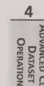

查看代码，你会发现只有四个方法。`FormCreate` 创建主数据集。理解这一点很重要，因为这也创建了细节数据集。你很少需要在代码中直接操作细节数据集。

同样，`btnSaveClick` 和 `btnLoadClick` 将主数据集保存和加载到/从磁盘，这也处理了所有细节数据集的保存和加载。

运行此应用程序时，你必须要么从头输入一些数据，要么从文件加载数据集。随本书源代码附带的是一个名为 `NESTED.CDS` 的预先创建的数据文件。你可能希望加载此文件，而不是手动输入客户和订单。

图 4.5 展示了 Nested 应用程序在运行时的状态。

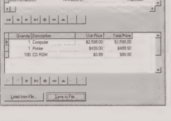

### 图 4.5
嵌套数据集会自动显示当前主记录的细节数据。

关于这个应用程序有几点有趣的地方。首先，当你在顶部的网格中从一个客户切换到另一个客户时，该客户的订单会显示在底部的网格中。这是自动完成的，无需编写代码。

其次，如果你添加或修改一个订单，你会注意到客户记录进入了编辑模式（如当前客户记录指示列中显示的图形所示）。如果你通过程序操纵嵌套数据集，请记住以下几点：在添加或修改细节记录后，需要提交主记录。

## 撤销支持

`TCustomClientDataSet` 及其派生类支持内置的撤销功能，因此你可以在应用程序中提供假设（what-if）场景。例如，你可以允许用户更改数据集中某些字段的值（或许用于绘制数据或否则以其他方式显示对数据的分析）。如果用户不喜欢结果，他可以通过撤销其更改来恢复到之前的数据，可以逐个撤销，也可以一次性撤销大量更改。

### 取消

你可能已经熟悉 `Cancel` 方法，但为了完整性，我还是在这里提一下。

撤销支持的最基本级别是简单地丢弃在提交之前对当前记录的更改。`Cancel` 方法提供了这种支持：

```pascal
ClientDataSet1.Edit;
ClientDataSet1.FieldByName('Last').AsString := 'Carter';
// 在这里做更多事情，然后决定不保存更改。
ClientDataSet1.Cancel;
```

### 变更日志

为了支持更高级的撤销操作，客户端数据集包含一个变更日志。变更日志用于记录对数据集所做的每次更改，直到这些更改被合并到数据中、撤销或取消。以下各部分将研究用于提交和回滚更改的不同方法。

当你调用 `SaveToFile` 或 `SaveToStream` 时，变更日志会随数据一起保存。当数据集从文件或流中读取回来时，变更日志将处于保存之前的状态。这意味着你甚至可以在应用程序的多次运行之间执行撤销操作。

### LogChanges

为了使变更日志处于活动状态，数据集的 `LogChanges` 属性必须设置为 `True`（这是默认值）。如果你不打算在应用程序中提供撤销支持，可以将 `LogChanges` 设置为 `False`，这略微减少内存需求并提高性能。

> **注意**
> 在创建将客户端数据集连接到数据集提供者的应用程序时（如第 7 章“数据集提供者”中所述），你不应该将 `LogChanges` 设置为 `False`。这是因为将 `LogChanges` 设置为 `False` 会阻止你对客户端数据集进行更改并将这些更改应用于底层数据库。

## UndoLastChange（撤销上一次更改）

通过调用 `UndoLastChange`，您可以撤销对数据集最近一次的更改（无论该更改是针对哪条记录）。

`UndoLastChange` 接受一个单一的布尔参数（`FollowChange`），用于指示数据集是否应定位到受撤销操作影响的记录。如果 `FollowChange` 为 `True`，客户端数据集会将光标定位到被撤销或恢复的记录。如果 `FollowChange` 为 `False`，最近修改的记录仍会被恢复，但当前记录不会改变。

```pascal
ClientDataSet.First;
ClientDataSet.Next;
ClientDataSet.Edit;
ClientDataSet.FieldName('Last').AsString := 'Williams';
ClientDataSet.Post;
ClientDataSet.First;
ClientDataSet.Edit;
ClientDataSet.FieldName('Last').AsString := 'Carter';
ClientDataSet.Post;
```


`ClientDataSet.Next`;

`ClientDataSet.Edit`;

`ClientDataSet.FieldName('First').AsString := 'Sam'`;

`ClientDataSet.Post`;

`ClientDataSet.Last`;

`ClientDataSet.UndoLastChange(True)`;

```
上述代码片段首先修改了数据集中的第二条记录，然后修改了数据集中的第一条记录，再次修改了第二条记录。最后，它移动到数据集的末尾。对 `UndoLastChange` 的调用仅撤销了对第二条记录的第二项更改，并将数据集重新定位到第二条记录（因为向 `UndoLastChange` 传递了 `True`）。

如果您发出第二次对 `UndoLastChange` 的调用，对数据集中第一条记录的修改将被撤销。第三次调用 `UndoLastChange` 将撤销对第二条记录的第一项修改。
```

## RevertRecord（恢复记录）

`RevertRecord` 会撤销对数据集中当前记录的所有更改。稍微修改前面的代码片段，我们得到以下结果：

```pascal
ClientDataSet1.First;

ClientDataSet1.Next;

ClientDataSet1.Edit;

ClientDataSet1.FieldName('Last').AsString := 'Williams';

ClientDataSet1.Post;

ClientDataSet1.First;

ClientDataSet1.Edit;

ClientDataSet1.FieldName('Last').AsString := 'Carter';

ClientDataSet1.Post;

ClientDataSet1.Next;

ClientDataSet1.Edit;

ClientDataSet1.FieldName('First').AsString := 'Sam';

ClientDataSet1.Post;

ClientDataSet.First;

ClientDataSet.Next;

ClientDataSet1.RevertRecord;
```

此代码进行了与前一个代码片段相同的三项更改。然后它离开第二条记录并回到第二条记录上。（这只是为了演示目的——您不需要这样做。）最后，对 `RevertRecord` 的调用撤销了对第二条记录所做的两项更改，但保留了对第一条记录的更改不变。

## SavePoint（保存点）

`SavePoint` 提供了一种为数据库操作建立基线，并在稍后的时间点返回该基线的方法。

例如，假设用户对数据集进行了更改。然后他想尝试进行其他更改，但不确定是否要保存结果。在第一次更改之后，您可以像这样获取 `SavePoint` 的当前值：

```pascal
var
  Baseline : Integer;
begin
  Baseline := ClientDataSet.SavePoint;
end;
```

稍后，在对数据库进行更改后，您可以通过设置 `SavePoint` 属性来返回到基线：

```pascal
ClientDataSet.SavePoint := Baseline;
```

设置 `SavePoint` 会丢弃自建立基线以来对数据集所做的所有更改。

您也可以获取多个保存点，如下所示：

```pascal
var
  Baseline1: Integer;
  Baseline2: Integer;
begin
  Baseline1 := ClientDataSet.SavePoint;
  // 在这里执行更多的数据集工作
  Baseline2 := ClientDataSet.SavePoint;
end;
```

在使用 `SavePoint` 配合 `RevertRecord` 或 `UndoLastChange` 时要小心。如果您获取了一个 `SavePoint`，然后撤销最近超出保存点位置的修改，则会引发异常。下面列出的代码（列表 4.6）只是自找麻烦：

### LISTING 4.6

保存点的错误用法

```pascal
ClientDataSet.First;
ClientDataSet.Next;
ClientDataSet.Edit;
ClientDataSet.FieldName('Last').AsString := 'Williams'; // 更改 1
ClientDataSet.Post;
ClientDataSet.First;
ClientDataSet.Edit;
ClientDataSet.FieldName('Last').AsString := 'Carter'; // 更改 2
ClientDataSet.Post;
Baseline := ClientDataSet.SavePoint; // "栈"上有 2 个更改
ClientDataSet.Next;
ClientDataSet.Edit;
ClientDataSet.FieldName('First').AsString := 'Sam'; // 更改 3
ClientDataSet.Post;
ClientDataSet.UndoLastChange(True); // "栈"上有 2 个更改
ClientDataSet.UndoLastChange(True); // "栈"上有 1 个更改
ClientDataSet.SavePoint := Baseline; // 在这里引发异常
```

在这个代码片段中，进行了两项更改，然后建立了基线。接着，进行了第三项更改，然后撤销了第三项和第二项更改。最后，代码试图返回到保存点。由于更改日志已被逆转超过保存点的位置，Delphi 会引发异常。

## CancelUpdates（取消更新）

撤销支持的最终级别是撤销更改日志中的所有更改。为此，只需调用 `CancelUpdates`，如下所示：

```pascal
ClientDataSet1.CancelUpdates;
```

`CancelUpdates` 通过清除更改日志来丢弃对数据集中所有记录所做的所有更改。

## ChangeCount（更改计数）

您可以通过查看 `ChangeCount` 属性来确定对数据集进行了多少次更改：

```pascal
if ClientDataSet1.ChangeCount > 0 then
    ShowMessage('It is okay to call UndoLastChange');
```

## MergeChangeLog（合并更改日志）

在您的应用程序中的某个时间点，您可能希望将更改合并到数据中，以提交对数据集所做的任何修改。为此，请调用 `MergeChangeLog`。`MergeChangeLog` 不接受任何参数。

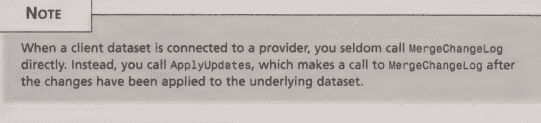

## StatusFilter（状态过滤器）

`StatusFilter` 属性提供了一种针对数据集的过滤器类型，但我没有在“范围和过滤器”部分讨论它，因为它与更改日志直接相关。

当在客户端数据集中添加、修改或删除记录时，它们会被标记一个状态。该状态可以是表 4.4 中显示的某个（或多个）值。

### TABLE 4.4 TUpdateStatus 值

| 值 | 描述 |
| :--- | :--- |
| usUnmodified | 该记录未以任何方式被修改。 |
| usInserted | 该记录是新插入到数据集中的。 |
| usModified | 该记录已被修改。 |
| usDeleted | 该记录已被删除。 |

如果您只想查看已添加到数据集中的记录，可以将 `StatusFilter` 设置为 `usInserted`。要仅查看已添加或已修改的记录，请将 `StatusFilter` 设置为 `usInserted, usModified`。

## 查看更改日志

因为实际上更改日志只是另一个数据集，所以您可以像在网格中查看任何其他数据集一样查看它。为此，您需要将一个数据集的更改日志分配给另一个数据集的数据，如下所示：

```pascal
cdsChangeLog.Data := ClientDataSet1.Delta;
```

如果 `ClientDataSet1` 的更改日志为空，此语句将引发 `Delta is empty` 异常。因此，在尝试这样做之前，您应该始终检查 `ChangeCount` 属性。

下面的示例应用程序演示了本节中讨论的技术。列表 4.7 包含应用程序主窗体的源代码。

### LISTING 4.7 ChangeLog—MainForm.pas

```pascal
unit MainForm;

interface

uses
  SysUtils, Variants, Classes, QGraphics, QControls, QForms,


```pascal
  QDialogs, QStdCtrls, DB, DBClient, QExCtrls, QActnList, QGrids, QDBGrids;

type

  TfrmMain = class(TForm)

    DataSource1: TDataSource;

    pnlClient: TPanel;

    DBGrid1: TDBGrid;

    ClientDataSet1: TClientDataSet;

    pnlBottom: TPanel;

    btnRemoveFilter: TButton;

    btnFilter: TButton;

    btnUndo: TButton;

    btnRevertRecord: TButton;

    btnCancelUpdates: TButton;

    btnSavepoint: TButton;

    btnGotosavepoint: TButton;

    btnViewChangeLog: TButton;

    procedure FormCreate(Sender: TObject);

    procedure btnRemoveFilterClick(Sender: TObject);

    procedure btnFilterClick(Sender: TObject);
```

## 列表 4.7 续

```pascal
procedure btnUndoClick(Sender: TObject);

procedure btnRevertRecordClick(Sender: TObject);

procedure btnCancelUpdatesClick(Sender: TObject);

procedure btnSetSavepointClick(Sender: TObject);

procedure btnGotoSavepointClick(Sender: TObject);

procedure btnViewChangeLogClick(Sender: TObject);

private

   { Private declarations }

   FSavePoint: Integer;

public

   { Public declarations }

end;

var

   fFrmMain: TFrmMain;

implementation

uses ChangeLogForm;

{$R "*.xfm"}

procedure TFrmMain.FormCreate(Sender: TObject);

begin

   ClientDataSet1.LoadFromFile('C:\Employee.cds');

   ClientDataSet1.MergeChangeLog;

end;

procedure TFrmMain.btnFilterClick(Sender: TObject);

begin

   ClientDataSet1.StatusFilter := [usInserted];

end;

procedure TFrmMain.btnRemoveFilterClick(Sender: TObject);

begin

   ClientDataSet1.StatusFilter := [];

end;

procedure TFrmMain.btnUndoClick(Sender: TObject);

begin

   ClientDataSet1.UndoLastChange(True);

end;

procedure TFrmMain.btnRevertRecordClick(Sender: TObject);

begin

   ClientDataSet1.RevertRecord;

end;

procedure TFrmMain.btnCancelUpdatesClick(Sender: TObject);

begin

  ClientDataSet1.CancelUpdates;

end;

procedure TFrmMain.btnSetSavepointClick(Sender: TObject);

begin

  FSavePoint := ClientDataSet1.SavePoint;

end;

procedure TFrmMain.btnGotoSavepointClick(Sender: TObject);

begin

  ClientDataSet1.SavePoint := FSavePoint;

end;

procedure TFrmMain.btnViewChangeLogClick(Sender: TObject);

var

  frmChangeLog: TfrmChangeLog;

begin

  if ClientDataSet1.ChangeCount > 0 then begin

    try

      frmChangeLog := TfrmChangeLog.Create(nil, ClientDataSet1);

      finally

        frmChangeLog.ShowModal;

        frmChangeLog.Free;

      end;

    end else

      ShowMessage('There are no changes to view.');

  end;

end;
```

列表 4.8 显示了用于显示更改日志的窗体的源代码。

# 列表 4.8 ChangeLog—ChangeLogForm.pas

```pascal
unit ChangeLogForm;

interface

uses

  SysUtils, Variants, Classes, QGraphics, QControls, QForms,

  QDialogs, QExtCtrls, QStcCtrls, QGraphics, QDBGrids, DB, DBClient;

type

   TfrmChangeLog = class(TForm)

      pnlClient: TPanel;

      pnlBottom: TPanel;

      ClientDataSet1: TClientDataSet;

      DataSource1: TDataSource;

      DBGrid1: TDBGrid;

      btnClose: TButton;

      Label1: TLabel;

      procedure ClientDataSet1AfterScroll(DataSet: TDataSet);

   private

      { Private declarations }

   public

      { Public declarations }

      constructor Create(AOwner: TComponent;

                         ADataSet: TCustomClientDataSet); reintroduce;

   end;

implementation

{$R *.xfm}

{TfrmChangeLog}

constructor TfrmChangeLog.Create(AOwner: TComponent;

                                 ADataSet: TCustomClientDataSet);

begin

   inherited Create(AOwner);

   ClientDataSet1.Data := ADataSet.Delta;

end;

procedure TfrmChangeLog.ClientDataSet1AfterScroll(DataSet: TDataSet);

begin

   case ClientDataSet1.UpdateStatus of

      usUnmodified: Label1.Caption := 'Unmodified';

      usModified: Label1.Caption := 'Modified';

      usInserted: Label1.Caption := 'Inserted';

      usDeleted: Label1.Caption := 'Deleted';

   end;

end;
```


图 4.6 展示了 `ChangeLog` 应用程序在运行时查看 `EMPLOYEE.CDS` 数据集更改日志时的样子。

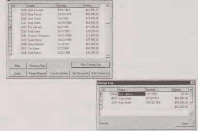

### 图 4.6

更改日志应用程序展示了数据集中的修改是如何被高效存储的。

注意更改日志中的四行内容。第一行显示了一个新增员工的数据。第二行显示了一个被删除员工的数据。第三行和第四行显示了对现有员工的修改。第三行包含了在任何修改发生之前的员工数据，但第四行仅包含了被修改字段的数据。

## 从另一个客户端数据集克隆数据

客户端数据集具有从另一个客户端数据集克隆数据的独特能力。当你克隆一个数据集时，数据只有物理上的一份副本，但存在两个（或多个）不同的数据集访问同一份数据副本。对一个数据集的更改会立即影响另一个数据集对该数据的视图。

你为什么要这样做？在我的项目中，我遇到过几种情况，克隆提供了优雅地解决棘手问题的方案。以下列表概述了一些好处：

- 你可以遍历数据集的克隆而不干扰原始数据集的当前记录指针。
- 在网格中查看数据集时，你可以使用连接到克隆的数据感知控件在对话框中插入新记录（而无需在网格中临时打开一个新的空行）。
- 你可以对克隆应用范围或过滤器，而不会影响原始数据集的显示。

要克隆一个数据集，创建第二个客户端数据集，然后调用第二个数据集的 `CloneCursor` 方法，如下所示：

```pascal

var

  cdsClone: TClientDataSet;

begin

  cdsClone := TClientDataSet.Create(nil);

  try

    cdsClone.CloneCursor(ClientDataSet1, False, False);

    // Perform some operations on the clone here.

  finally

    cdsClone.Free;

  end;

end;

```

此代码片段创建 `ClientDataSet1` 的克隆，在克隆上执行某些操作，然后释放克隆。在克隆上执行的任何插入、编辑或删除操作都会自动反映在 `ClientDataSet1` 中。

`CloneCursor` 定义如下：

```pascal

procedure CloneCursor(Source: TCustomClientDataSet; Reset: Boolean;

  KeepSettings: Boolean = False); virtual;

```

`Source` 指的是你想要克隆的客户端数据集。你不能克隆非客户端数据集，例如 BDE 数据集或 dbExpress 数据集。

`Reset` 和 `KeepSettings` 协同工作，并确定克隆如何处理以下属性：

- `Filter`, `Filtered`, `FilterOptions`, `OnFilterRecord`
- `IndexName`
- `MasterSource`, `MasterFields`
- `ReadOnly`
- `RemoteServer`, `ProviderName`

如果 `Reset` 和 `KeepSettings` 都设置为 False，则所有上述属性将从原始数据集复制到克隆。如果 `Reset` 为 False 且 `KeepSettings` 为 True，则克隆的这些属性保持不变。如果 `Reset` 为 True（无论 `KeepSettings` 的值如何），则克隆的这些属性将被清除。表 4.5 图示了这种关系。

4
高级客户端数据集操作

表 4.5 `Reset` 和 `KeepSettings` 之间的关系

| Reset | KeepSettings | 行为 |
|:-------------:|:--------------:|:----------|
| False | False | 属性从原始数据集复制到克隆。 |
| False | True | 克隆的属性不改变。 |
| True | N/A | 属性在克隆中被清除。 |

如果你希望克隆复制原始数据集的某些列出的属性，但不复制其他属性，你必须编写一些代码。处理这种情况的一种方法是将 `Reset` 和 `KeepSettings` 都设置为 False，从而将之前列出的所有属性从原始数据集复制到克隆。然后，重置那些被原始数据集覆盖的克隆属性。或者，你可以将 `Reset` 和 `KeepSettings` 设置为 True，然后在克隆上设置适当的属性。

注意

克隆客户端数据集后，克隆不包含任何持久字段类型。这意味着你通常需要使用 `FieldByName` 来访问克隆中的字段。此外，克隆不会从原始数据集继承任何标准计算字段（内部计算字段会被继承），因此务必小心，不要尝试访问克隆中的任何计算字段。

以下示例程序展示了如何在本文开头列出的情况下有效使用克隆数据集。列表 4.9 包含 `Clone` 应用程序的完整源代码。

### 列表 4.9 Clone—MainForm.pas

```pascal

unit MainForm;

interface

uses

  SysUtils, Variants, Classes, QGraphics, QControls, QForms,

  QDialogs, QGrids, QDBGrids, DB, DBClient, QExCtrls, QStDCtrls;

type

  TfrmMain = class(TForm)

    pnlClient: TPanel;

    pnlBottom: TPanel;

    ClientDataSet1: TClientDataSet;

```

## 列表 4.9（续）

```pascal

DataSource1: TDataSource;

DBGrid1: TDBGrid;

btnUpdate: TButton;

btnInsert: TButton;

btnRange: TButton;

btnInsert2: TButton;

procedure FormCreate(Sender: TObject);

procedure FormDestroy(Sender: TObject);

procedure btnUpdateClick(Sender: TObject);

procedure btnInsertClick(Sender: TObject);

procedure btnRangeClick(Sender: TObject);

procedure btnInsert2Click(Sender: TObject);

private

{ 私有声明 }

FCloneDS: TClientDataSet;

public

{ 公共声明 }

end;

var

  frmMain: TfrmMain;

implementation

{$R *.fmf}

procedure TfrmMain.FormCreate(Sender: TObject);

begin

  ClientDataSet1.LoadFromFile('C:\Employee.cds');

  ClientDataSet1.AddIndex('byID', 'ID', [ixPrimary, ixUnique]);

  ClientDataSet1.IndexName := 'byID';

  FCloneDS := TClientDataSet.Create(nil);

  FCloneDS.CloneCursor(ClientDataSet1, False, False);

end;

procedure TfrmMain.FormDestroy(Sender: TObject);

begin

  FCloneDS.Free;

end;

procedure TfrmMain.btnUpdateClick(Sender: TObject);

begin

  Screen.Cursor := crHourglass;

  try

    FCloneDS.First;

    while not FCloneDS.EOF do begin

      FCloneDS.Edit;

      FCloneDS.FieldName('Salary').AsFloat := FCloneDS.FieldName('Salary').AsFloat * 1.10;

      FCloneDS.Post;

      FCloneDS.Next;

    end;

  finally

    Screen.Cursor := crDefault;

  end;

end;

procedure TfrmMain.btnInsertClick(Sender: TObject);

begin

  if FCloneDS.State <> dsBrowse then

    Exit;

  FCloneDS.Append;

  FCloneDS.FieldName('ID').AsInteger := 99999;
```


```pascal
FCloneDS.FieldName('Name').AsString := 'Eric Harmon';

FCloneDS.FieldName('Birthday').AsString := '1/1/1967';

FCloneDS.FieldName('Salary').AsFloat := 1.00;

end;

procedure TfrmMain.btnInsert2Click(Sender: TObject);

begin

  if FCloneDS.State <> dsInsert then

    Exit;

  try

    FCloneDS.Post;

    ClientDataSet1.GoToCurrent(FCloneDS);

  except

    FCloneDS.Cancel;

    raise;

  end;

end;

procedure TfrmMain.btnRangeClick(Sender: TObject);

begin

  Screen.Cursor := crHourglass;

  try

    FCloneDS.SetRange([100], [199]);

    try

      FCloneDS.First;

      while not FCloneDS.EOF do begin

        FCloneDS.Edit;

        FCloneDS.FieldName('Salary').AsFloat := 50000.0;

        FCloneDS.Post;

      end;

      FCloneDS.Next;

    finally

      FCloneDS.CancelRange;

    end;

  finally

    Screen.Cursor := crDefault;

  end;

end;
```

图 4.7 展示了该克隆应用程序在运行时的状态。

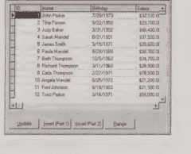

观察这段代码，你可能会注意到几件事。其中一点是，我在 `FormCreate` 方法中创建了克隆数据集，并在 `FormDestroy` 方法中将其销毁。我这样做是为了简化说明。在实际应用中，你通常会在需要该克隆的方法中创建它，并在随后立即销毁。在这个示例程序中，我只创建和销毁了一次，从而节省了几行代码。

“Update”按钮遍历整个数据集，为所有员工加薪 10%。请注意，即使代码没有调用 `DisableControls`，网格在遍历数据集时仍然不会滚动。这是因为网格连接到 `ClientDataSet1`，而更新操作是在克隆数据集上执行的。

“Insert (Part 1)”和 “Insert (Part 2)”按钮在克隆上执行插入操作的两个阶段。第一个按钮向数据集添加一个新记录并填充数据。第二个按钮将该新记录提交到数据集，然后调用原始数据集的 `GoToCurrent` 方法。将原始数据集与克隆同步。`GoToCurrent` 使原始数据集跳转到克隆数据集的当前记录。

将插入操作拆分为两个按钮的原因是，这样你可以轻松看到插入过程中发生了什么。点击“Insert (Part 1)”。现在向下滚动到网格底部。你将在网格中看到员工 99999 的某一行——这是新插入但尚未提交的记录。当你点击“Insert (Part 2)”时，该新记录将出现在网格中。相比之下，如果你将插入按钮事件处理程序中的代码改为使用 `ClientDataSet1` 而不是 `FCloneDS`，你会看到在新记录实际提交之前，它就会出现在网格中。

最后，“Range”按钮的操作方式与“Update”按钮非常相似：它对数据集应用一个范围，然后将该范围内所有员工的工资设置为 50,000 美元。网格不会更新以反映该范围，因为该范围仅应用于克隆数据集，而未应用于 `ClientDataSet1`。

### 维护聚合

数据集中的记录通常不是完全相互独立的。很多时候，你希望获得整列或该列某个子集的和或平均值。例如，你可能想要计算销售部门所有员工的平均工资，或者你可能需要检索姓名为 Jones 的员工数量。

如果你使用的是基于 SQL 的数据库，你可以发出 SQL 语句来计算这些值。例如：

```sql
SELECT AVG(SALARY) FROM EMPLOYEE WHERE DEPARTMENT = 'SALES';

SELECT COUNT(*) FROM EMPLOYEE WHERE LASTNAME = 'Jones';
```

> **注意**
>
> 如果你通过数据库提供程序将客户端数据集连接到 dbExpress 数据集，然后你可以将 SQL 语句发送到数据库后端，并在客户端数据集中检索结果。这项技术在第 7 章中讨论。

相反，客户端数据集支持一种称为维护聚合的强大功能。维护聚合会自动计算整个数据集或一组记录的和、平均值、计数、最小值或最大值。

#### 在设计时创建维护聚合

在设计时创建维护聚合与设计时创建字段类似。与字段一样，维护聚合可以是持久的，也可以是非持久的。以下各节展示了如何创建每种类型。

##### 持久聚合

你创建持久聚合的方式与你创建数据字段、计算字段或查找字段的方式大致相同。

- 在表单编辑器中右键单击客户端数据集，并从弹出菜单中选择 *Field Editor...*。
- 按 `Ins` 键创建新字段。
- 在 *New Field* 对话框中输入字段名和字段类型。对于维护聚合，字段类型应为 *Aggregate*。
- 在 *Field type* 组框中选择 *Aggregate* 单选按钮。
- 点击 `OK` 创建该聚合。

图 4.8 显示了在添加名为 `AvgSalary` 的聚合字段后的字段编辑器。

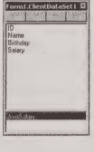

*图 4.8：字段编辑器在单独的部分显示聚合。*

创建聚合后，你需要设置一些额外的属性，例如要聚合的表达式，以及聚合是否处于活动状态。

- 在字段编辑器中点击该聚合字段。
- 在对象检查器中，在 `Expression` 属性中输入聚合表达式。聚合表达式在“聚合表达式”一节中有讨论。暂时，你可以使用 `Avg(Salary)`。
- 将 *Active* 属性设置为 True。默认情况下，聚合处于非活动状态，这意味着你无法访问它们。将 `AggregatesActive` 设置为 True 以激活聚合字段。

创建持久聚合会自动创建一个类型为 `TAggregateField` 的组件，你可以使用它来引用聚合值。然而，与大多数字段不同，你不使用 `AsFloat` 属性来获取聚合值。相反，你使用 `Value` 属性，如下所示：

```pascal
ShowMessage('The average salary is ' + ClientDataSet1AvgSalary.Value);
```

由于 `Value` 是一个变体，你可以将其视为字符串或浮点数进行引用。因此，以下代码也是正确的：

```pascal
var
  AvgRaisedSalary: Double;
begin
  AvgRaisedSalary := ClientDataSet1AvgSalary.Value * 1.05;
end;
```

##### 非持久聚合

要在设计时创建非持久聚合，请在表单编辑器中点击客户端数据集，然后在对象检查器中双击 `Aggregates` 属性以显示聚合编辑器。

聚合编辑器的外观和行为与字段编辑器非常相似。点击工具栏上的 **Add New** 按钮或按 `Ins` 键创建新聚合。

同样，你需要设置一些额外的属性，例如要聚合的表达式，以及聚合是否处于活动状态。

- 在聚合编辑器中点击该聚合。
- 在对象检查器中，为该聚合输入一个名称，例如 `AvgSalary`。
- 在 `Expression` 属性中输入聚合表达式，例如 `Avg(Salary)`。
- 将 *Active* 属性设置为 True。
- 将 `AggregatesActive` 设置为 True。

与上一节不同，Delphi 不会为此种方式创建的聚合并创建组件。相反，你通过数据集的 `Aggregates` 属性来访问聚合，如下所示：

```pascal
ShowMessage('The average salary is ' +
  ClientDataSet1.Aggregates.Find('AvgSalary').Value);
```

或者，如果你知道聚合的索引，你可以直接访问它：

```pascal
ShowMessage('The average salary is ' + ClientDataSet1.Aggregates[0].Value);
```


## 在运行时创建维护型聚合

在运行时创建维护型聚合与创建非持久化聚合类似，因为你使用的是 `Aggregates` 属性。下面的代码片段展示了如何在运行时创建聚合：

```
var
    Aggregate: TAggregate;
begin
    Aggregate := ClientDataSet1.Aggregates.Add;
    Aggregate.AggregateName := 'AvgSalary';
    Aggregate.Expression := 'Avg(Salary)';
    Aggregate.Active := True;
end;
```

## 聚合表达式

在前面的代码片段中，我使用了 `Avg(Salary)` 表达式。正如你可能猜到的，这个表达式计算 `Salary` 字段的平均值。

Delphi 支持表 4.6 中列出的聚合类型。

### 表 4.6 聚合类型

| 聚合类型 | 描述 |
| :--- | :--- |
| Sum | 计算字段的总和。 |
| Avg | 计算字段的平均值。 |
| Count | 计算字段中非空白值的数量。 |
| Min | 计算字段的最小值。 |
| Max | 计算字段的最大值。 |

`Sum` 和 `Avg` 只能用于数值字段类型，但 `Count`、`Min` 和 `Max` 可以用于数字、字符串或日期值。

聚合表达式不一定要是简单的表达式，例如 `Avg(Salary)`。它们可以包含多个函数，例如 `Sum(SalesPrice) * Sum(NetCost)`。但是，你不能嵌套函数。`Avg(Sum(SalesPrice))` 不是一个有效的聚合表达式。

Delphi 帮助主题“指定聚合”提供了有效和无效聚合表达式的更多示例。

## 跨记录组的聚合

你可以创建的最简单的聚合是对整个数据集求总和或平均值。我们之前创建的聚合是针对整个数据集的。然而，很多时候，你希望基于数据集的一部分来计算聚合。

要创建分组聚合，首先你需要确保数据集中至少定义了一个索引。对于 `EMPLOYEE.CDS` 数据集，我们将在 `Birthday` 字段上创建一个名为 `byBirthday` 的索引。

- 1. 将一个 `TClientDataSet` 放置到应用程序的主窗体上。
- 2. 右键单击该数据集，并在弹出菜单中选择 `Load from MyBase Table...`（从我的基础表加载...）。
- 3. 选择文件 `C:\EMPLOYEE.CDS` 并单击 `Open`（打开）。
- 4. 在 `Birthday` 字段上创建一个名为 `byBirthday` 的索引。（如果你忘记了如何创建索引，请参阅第 3 章，“客户端数据集基础”。）
- 5. 进入字段编辑器，通过从字段编辑器的弹出菜单中选择 `Add All Fields`（添加所有字段）来为所有数据集字段创建持久化字段。
- 6. 使用表达式 `Count(Birthday)` 创建一个名为 `NumSameBirthday` 的持久化聚合字段。Delphi 将创建一个名为 `ClientDataSet1NumSameBirthday` 的组件。
- 7. 将 `TDataSource`、`TDBGrid` 和 `TLabel` 放置到主窗体上，并将数据源和网格连接到客户端数据集。
- 8. 在数据源的 `OnDataChange` 事件中，编写以下代码：

```
Label1.Caption := ClientDataSet1NumSameBirthday.Value;
```

现在我们有了起始应用程序。如果你运行它，你应该会在标签中看到数值 10000（表示数据集中有 10,000 条非 NULL 生日的记录）。

既然我们已经建立了基准，让我们修改聚合，使其计算具有相同生日的员工数量。

为此，回到字段编辑器并单击 `NumSameBirthday` 聚合字段。在对象检查器（Object Inspector）中，将 `IndexName` 设置为 `byBirthday`。这告诉聚合字段使用 `byBirthday` 索引来计算其值。接下来，将 `GroupingLevel` 属性设置为 1。（`GroupingLevel` 是一个基于 1 的值，它告诉 Delphi 在计算聚合值时使用索引的哪个部分。）

例如，假设你在 `LastName; FirstName` 字段上有一个索引。如果 `GroupingLevel` 设置为 1，则只有索引中的第一个字段用于计算聚合。对于 `Avg(Salary)` 表达式，聚合将计算所有与当前记录具有相同姓氏的雇员的平均薪资。

如果你将 `GroupingLevel` 设置为 2，则聚合将计算所有与当前员工具有相同姓氏*并且*具有相同名字的雇员的平均薪资。

## 启用和禁用聚合

通常，你保持聚合处于启用状态（`Active = True`）。但是，你可以将其 `Active` 属性设置为 `False` 来禁用单个聚合，或者将数据集的 `AggregatesActive` 属性设置为 `False` 来禁用所有聚合。

禁用聚合会使应用程序稍微快一点，因为 Delphi 不再需要每当记录被插入、编辑或删除时都要不断重新计算聚合值。如果你计划一次性添加大量记录，你可能想要禁用聚合，添加记录，然后重新启用聚合，这样 Delphi 只需要计算一次（在你重新启用它们的时候）。

### `GetGroupState`

你可以通过调用数据集的 `GetGroupState` 方法来确定记录在聚合内的相对位置。`GetGroupState` 返回一个值为 `gbFirst`、`gbMiddle` 或 `gbLast`（取决于当前记录是组中的第一条记录、组中的最后一条记录还是组中的其他任何记录）。

而不是在这里展示一个聚合应用程序示例，我将引导你去查看 Delphi 中 `DEMOS\MIDASAGGREGATE` 目录下的 Aggregate 演示。

## 其他属性

本节列出了客户端数据集的几个其他属性，它们在逻辑上不属于之前讨论的类别。

### 约束

约束提供了一种在提交之前验证记录数据的方法。当验证依赖于记录中两个或更多字段之间的关系时，约束最为有用。例如，如果 `Salary` 字段小于员工年龄的 1000 倍，记录的数据可能会（无意义地）被判定为无效。换句话说，一名 30 岁的员工必须至少赚取 30,000 美元。

约束在视觉上与过滤器相似。我刚才提到的约束看起来是这样的：

```
Salary >= Age * 1000
```


要在数据集上创建约束，双击对象检查器中的 `Constraints` 属性。约束编辑器将出现。接下来，单击约束编辑器中的 `Add New` 工具栏按钮（或按 `Ins` 键）来添加一个新约束。

回到**对象检查器**，将约束输入到**CustomConstraint** 属性中。在 **ErrorMessage** 属性中，键入你希望在约束未满足时显示的消息——例如，“薪资必须至少是员工年龄的 1000 倍。”

图 4.9 显示了添加约束后**对象检查器**和约束编辑器的屏幕截图。

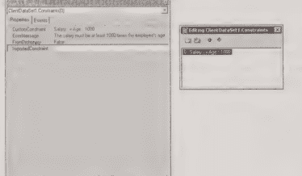

**图 4.9**
*设置约束。*

你并不局限于为数据集设置单个约束。你可以添加尽可能多的约束。

当记录提交到数据集时，Delphi 会检查施加在数据集上的所有约束。如果其中一个约束失败，将显示在 **ErrorMessage** 属性中指定的消息，并且提交将被中止。

#### DisableStringTrim

通常，当记录提交到数据集时，字符串中的尾部空格会自动被移除。例如，如果用户在数据感知编辑控件中输入 **John   **（注意两个尾部空格），实际上只有四个字符被写入数据集中的底层字段，因为数据集自动移除了额外的两个空格。

当**DisableStringTrim** 属性设置为**False**（这是默认值）时，客户端数据集会全局地修剪字符串字段中的尾部空格。但是，如果你希望保留尾部空格，你可以将**DisableStringTrim** 设置为**True**。

`DisableStringTrim` 是一个全局属性，它会影响数据集中的所有字符串字段。它不允许你仅修剪 `FirstName` 字段末尾的空格，同时保留 `LastName` 字段末尾的空格。如果你希望保留某些字段的末尾空格，而移除其他字段的末尾空格，你需要将 `DisableStringTrim` 设置为 `True`，然后手动从相应的字段中移除末尾空格（例如，在数据集的 `BeforePost` 事件处理程序中）。

### ReadOnly（只读）

默认情况下，客户端数据集是可读/可写的数据集。你可以将客户端数据集设置为只读（例如，如果底层数据存储在下光盘上）的方法是将数据集的 `ReadOnly` 属性设置为 `True`。

## 摘要

除了上一章介绍的基本功能外，`TClientDataSet` 还支持许多高级操作。在本章中，你学习了以下内容：

- 数据集提供了一系列事件，你可以挂钩这些事件以在特定操作发生时收到通知。此外，你可以在 `Beforexx` 事件中引发异常来阻止这些操作的发生。
- 在长时间运行的过程中禁用数据感知控件可以显著提高性能。
- Delphi 数据集支持 `BLOB`（二进制大对象），可用于存储备注、图像和其他非格式化数据。
- 嵌套数据集在客户端数据集中提供了简化的主/从（master/detail）支持。
- `TClientDataSet` 的撤销支持使你能在应用程序中执行假设（what-if）场景。
- 通过克隆客户端数据集，你可以在数据的克隆上执行操作，而不会干扰原始数据集的设置。
- 维护的汇总（maintained aggregates）支持自动计算记录组或整个数据集的总和、最小值、最大值、计数和平均值。

下一章开始一个两章的介绍，关于数据感知组件。

# 数据感知组件

### 第 5 章

## 本章内容

- 什么是数据感知组件？ 202
- `TDataSource` 204
- 常见数据感知组件的特性 205
- 简单数据感知组件 211
- 仅限 VCL 的数据感知控件 222
- 查找数据感知控件 222
- `TDBNavigator` 223
- 创建自定义数据感知组件 225
- 示例应用程序 232

前两章专注于客户端数据集，即 Delphi 的*灵活*内存数据集。本章介绍了数据感知组件的概念，这些是现成的组件，知道如何显示和编辑存储在数据库中的信息。

数据感知组件可以与不同的数据集一起使用，包括 BDE、ADO、IBX 和第三方数据集。然而，本章展示了如何与客户端数据集一起使用它们，因为当 dbExpress 是底层数据访问技术时，这就是使用它们的方式。

## 什么是数据感知组件？

*数据感知组件*是能够自动从数据集加载和存储信息的组件。例如，考虑一个标准的编辑控件。它有一个 `Text` 属性，程序员负责读取和写入。你从哪里获取数据，以及用户在编辑控件中输入新字符串后你对它做什么，完全由你决定。你可能将其存储在数据集中。你可能将其存储在 INI 文件或 Windows 注册表中。你甚至可能只是使用它进行某种计算，而根本不将其存储在任何地方。

由于从数据集显示数据是一个非常常见的应用需求，Delphi 提供了一组镜像标准组件的*数据感知*组件。表 5.1 列出了数据感知组件及其对应的非数据感知组件。

**表 5.1**
Delphi 数据感知组件及其非数据感知对应组件

| 数据感知组件 | 非数据感知对应组件 |
| :--- | :--- |
| `TDBText` | `TLabel` |
| `TDBEdit` | `TEdit` |
| `TDBMemo` | `TMemo` |
| `TDBCheckBox` | `TCheckBox` |
| `TDBRadioGroup` | `TRadioGroup` |
| `TDBComboBox` | `TComboBox` |
| `TDBListBox` | `TListBox` |
| `TDBLookupComboBox` | `TComboBox` |
| `TDBLookupListBox` | `TListBox` |
| `TDBImage` | `TImage` |
| `TDBGrid` | `TStringGrid` |
| `TDBRichEdit` | `TRichEdit`（仅限 VCL 的组件） |
| `TDBCtrlGrid` | 无。允许以非面向行的格式显示多个字段（仅限 VCL 的组件）。 |
| `TDBNavigator` | 无。提供无需代码即可导航和操作数据集的可视化手段。 |
| `TDataSource` | 本身不是数据感知组件。提供数据集与一个或多个数据感知组件之间的通道。 |

正如你在表 5.1 中看到的，标准组件和数据感知组件之间的相似性是显而易见的（除了 `TDBLookupComboBox` 和 `TDBLookupListBox` 组件可能除外）。

除了 `TDataSource` 之外，你可以在组件调色板的数据控件选项卡中找到表 5.1 中列出的所有组件。`TDataSource` 可以在数据访问选项卡中找到。

本章讨论的所有数据感知组件都提供两个必须设置的属性。`DataSource` 属性引用 `TDataSource` 组件，该组件提供组件与数据集之间的链接。`DataField` 属性决定数据感知组件从数据集中的哪个字段检索其数据。

本章后面的部分将讨论每个组件，但 `TDBGrid` 除外。由于网格是一个涉及复杂的组件，我将在下一章探讨它。与其在本章中提供许多小的示例应用程序，我将把示例推迟到本章末尾。

在很大程度上，数据感知组件镜像其非数据感知对应组件，因此我并未在此花费大量时间和篇幅讨论它们的每个属性、事件和方法。相反，我专注于数据感知组件版本特有的问题。如果你需要关于组件属性或方法的基本信息，请参阅在线帮助或市面上优秀的通用 Delphi 书籍之一。

> **注意**
> 一些 Delphi 程序员回避数据感知组件——主要是因为他们意识到 Visual Basic 中数据感知组件的实现问题。他们也可能回避，因为数据感知组件在 Delphi 早期名声不佳。请放心，数据感知组件在 Delphi 下表现出良好的性能特性，尤其是当它们与 `TClientDataSets` 一起使用时（正如本章所做的那样）。

## TDataSource

如表 5.1 所示，`TDataSource` 提供数据集与连接到一个或多个数据感知控件之间的通道。你不能将数据感知组件直接连接到数据集。相反，你将 `TDataSource` 连接到数据集，然后将一个或多个数据感知组件连接到数据源（如图 5.1 所示）。

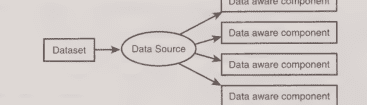

**图 5.1**
数据集、数据源和数据感知组件之间的关系。

`TDataSource` 是一个相当简单的组件，除了所有组件共有的 `Name` 和 `Tag` 属性外，仅发布三个事件和三个属性。表 5.2 列出了发布的属性，表 5.3 列出了数据源的事件。`OnDataChange` 和 `OnStateChange`（最常使用的事件）将在本章后面的清单 5.4 中应用。

**表 5.2**
`TDataSource` 属性

| 属性 | 描述 |
| :--- | :--- |
| `AutoEdit` | 当为 `True` 时，一旦用户开始在连接到此数据源的数据感知组件中输入，底层数据集会自动进入编辑模式。当为 `False` 时，在用户可以开始在连接的数据感知控件中输入之前，你必须显式调用数据集的 `Edit` 方法。 |
| `DataSet` | 提供链接到数据感知组件从中检索数据的数据集。 |
| `Enabled` | 当 `Enabled` 为 `True` 时，连接到此数据源的数据感知组件显示数据集中包含的数据。当它为 `False` 时，数据感知控件为空白。 |

### 表 5.3 TDataSource 事件

| 事件 | 描述 |
|---|---|
| `OnDataChange` | 当数据集当前记录的数据发生变化时触发；原因可能是数据集的光标移动到了新记录，或者是某个字段被修改了。 |
| `OnStateChange` | 当底层数据集的 `State` 属性发生变化时触发。例如，当数据集从浏览模式转换为编辑模式，或从插入模式转换为浏览模式时。 |
| `OnUpdateData` | 在底层数据集将更改提交到数据库之前立即触发。 |

在编写数据库应用程序时，人们很容易忽略 `TDataSource`。将数据源放置到窗体并将其连接到数据感知组件后，数据源似乎起不到什么有用的作用。然而，表 5.3 中列出的这三个事件在多种情况下都非常有用。本章末尾的示例应用程序展示了它们的实用性。

## 常见数据感知组件特性

在讨论每个数据感知组件的具体细节之前，有一些共同特性需要理解。要在应用程序中有效使用数据感知组件，应牢记以下注意事项：

## 从代码中修改组件数据

如果你想从代码中更改数据感知组件中显示的数值，应该编辑底层字段，而不是试图操作数据感知组件本身。

例如，假设你有一个名为 `ecFirstName` 的 `TDBEdit`，它连接到一个名为 `FirstName` 的字段。如果你想通过编程方式设置编辑控件以显示 `John`，你可能会想写出以下代码：


`ecFirstName.Text := 'John';`

然而，这不是正确的方法。你应该做的是将底层字段的值设置为 `John`，如下所示：

```
ClientDataSet1.Edit;

ClientDataSet1.FirstName.AsString := 'John';
```

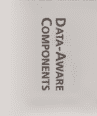

如果你没有使用持久字段对象，则应该这样做：

```
ClientDataSet1.Edit;

ClientDataSet1.FieldByName('FirstName').AsString := 'John';
```

需要记住的重要一点是在尝试设置字段值之前调用数据集的 `Edit` 方法。如果数据集已经处于编辑或插入模式，对 `Edit` 的冗余调用不会产生任何不利影响。如果由于某种原因数据集无法编辑（例如，数据集的 `ReadOnly` 属性设置为 `True`），对 `Edit` 的调用将引发异常，你应该准备好妥善处理该异常。

### 控制用户何时允许编辑数据

默认情况下，只要用户开始在数据感知组件中输入内容，VCL/CLX 就会将关联的数据集置于编辑模式。如果你想从代码中控制用户编辑的能力，你有四个选项：

- 将数据集的 `ReadOnly` 属性设置为 `True`，防止用户更改数据集中的任何值。这也阻止了通过代码对数据进行的任何更改。
- 将底层字段的 `ReadOnly` 属性设置为 `True`。这可以防止用户修改该字段，也可以防止通过代码修改该字段。
- 将数据感知组件的 `ReadOnly` 属性设置为 `True`，防止用户更改数据集中的单个值。请注意，这对使用前一节描述的方法在代码中进行的任何更改没有影响。设置组件的 `ReadOnly` 属性不会以任何方式使字段本身变为只读。它只是防止用户通过组件直接修改数据。
- 将数据源的 `AutoEdit` 属性设置为 `False`，防止数据集在用户开始在数据感知组件中输入时自动进入编辑状态。如果你选择这种方法，通常会在窗体上提供菜单项或按钮，用户点击该按钮会将数据集置于编辑模式。或者，你可以使用 `TDBNavigator`，这将在本章后续部分讨论。

### 格式化字段值的输入与编辑

数据感知组件没有内置机制来控制字段值在输入和输出时的格式化，因此乍一看，你可能会认为没有方法可以显示格式美观的数值和字符串数据。然而，事实证明，数据格式化是在字段级别而非组件级别处理的。因此，你可以为字段设置特定的输出格式，并且无论在哪里使用数据感知组件显示该字段，都会使用相同的格式。

## 数值字段

当你将数据感知组件连接到数值字段时，组件中显示的数据将根据底层字段的 `DisplayFormat` 属性进行格式化。

`DisplayFormat` 是一个字符串属性，由最多三个部分组成，用分号分隔，格式如下：

```
<Positive>;<Negative>;<Zero>
```

字符串的不同部分决定了当值为正数、负数或零（分别）时值的显示方式。空值始终显示为空白。

表 5.4 列出了 `DisplayFormat` 字符串中可使用的字符。

### 表 5.4 DisplayFormat 规范符

| 字符 | 描述 |
| :--- | :--- |
| `#` | 数字占位符。如果格式化后的值在该位置不需要数字，则不填充该位置。例如，值 1.2 使用 `DisplayFormat` 为 `###.##` 格式化后得到 1.2，前后没有空格。 |
| `0` | 数字占位符。如果格式化后的值在该位置不需要数字，则用 0 填充该位置。例如，值 1.2 使用 `DisplayFormat` 为 `000.00` 格式化后得到 `001.20`。 |
| `.` | 小数点。决定基数点出现在输出字符串中的位置。小数点会被替换为 `DecimalSeparator` 全局变量中存储的字符。 |
| `,` | 千位分隔符。`DisplayFormat` 中逗号的出现表示值应使用千位分隔符进行格式化。逗号不占用输出字符串中的位置——它仅作为需要千位分隔符的指示。在运行时，逗号会被替换为 `ThousandsSeparator` 全局变量中存储的字符。 |
| `E+/-` | 科学计数法。如果 `DisplayFormat` 中存在 `E+`、`E-`、`e+` 或 `e-`，值将使用科学计数法格式化。`E+` 表示所有指数前都应带有符号。`E-` 表示仅负指数前带有符号。`E+` 或 `E-` 后跟一到四个零，指定指数中包含的最少位数。 |
| `;` | 分隔符字符。用于正数、负数和零部分之间。 |
| `'` 或 `"` | 字面量。单引号或双引号内的字符会原样复制到输出字符串中，不被解释为格式字符。 |

表 5.5 列出了 `DisplayFormat` 设置的一些示例。

### 表 5.5 DisplayFormat 设置

| 值 | DisplayFormat | 输出 |
| :--- | :--- | :--- |
| 1.2 | ##0.00 | 1.20 |
| 1.2 | 000.# | 001.2 |
| 1 | #0.000 | 1.000 |
| 1 | 00.## | 1（因为不需要显示基数点，所以不显示基数点。） |
| 12.34 | $##0.00 | $12.34 |
| 1234.56 | $,0.00 | $1,234.56 |
| 12,345 | X=#.## | X=12.35（注意，基数点左侧的部分自动扩展以显示两位数字，但基数点右侧的部分四舍五入到指定的位数。） |
| 100000 | #0.000E+00 | 10.000E+04 |
| −15 | ##0;(##0);zero | (15) |
| 0 | ##0;(##0);zero | zero |
| 10 | Room "#" #0 | Room #10（引号内的 # 原样复制到输出结果中。） |

如果你只在 `DisplayFormat` 中指定一个子字符串，它将用于格式化所有数字。要对负数或零值使用不同的输出格式，请用分号分隔规范符，如下所示：

```
$,0.00;($,0.00);<zero>
```

这个 `DisplayFormat` 字符串将正数格式化为美元和美分，将负数格式化为括号内，将零值格式化为字符串 `<zero>`。

你可以通过简单留空其规范符来省略字符串的某个部分。在这种情况下，将使用正数格式代替。例如：

```
$,0.00;;<zero>
```

在这种情况下，正值和负值都使用 `$,0.00` 进行格式化。零值显示为 `<zero>`。

如果 `DisplayFormat` 属性完全留空，值将使用具有 15 位有效数字的通用浮点输出显示。

默认情况下，编辑字段值时使用相同的格式。你可以通过设置字段的 `EditFormat` 属性（与 `DisplayFormat` 属性同时使用或代替它）来设定编辑时使用的不同格式。`EditFormat` 的工作方式与 `DisplayFormat` 相同：它包含一组用分号分隔的格式，用于显示正值、负值和零值。

例如，假设你有一个浮点数字段，希望以 15.25% 的形式显示，但在编辑时不希望显示百分号。你可以将 `DisplayFormat` 设置为 `#0.00%`，将 `EditFormat` 设置为 `#0.00`。

## 字符串字段

字符串字段没有单独的 `DisplayFormat` 和 `EditFormat` 属性。相反，它们有一个 `EditMask` 属性，该属性同时用于显示和编辑字段的值。`EditMask` 持有一个 Paradox 样式的编辑掩码，该掩码决定了字符串的显示和编辑方式。

与 `DisplayFormat` 和 `EditFormat` 属性一样，`EditMask` 由三部分组成，各部分之间用分号分隔。第一部分是用于格式化字符串值的掩码。第二部分包含一个 `0`，表示字面量不应作为字符串值的一部分保存。字符串第二部分的任何其他字符都指示字面量应作为字符串值的一部分保存。第三部分表示用于代表空格或尚未输入的字符的符号。

例如，以下 `EditMask` 接受美国社会安全号码，在底层字段中存储连字符，并在需要输入数字的位置显示下划线。

```
000-000-0000;1;
```


表 5.6 展示了字符串字段的有效 EditMask 限定符。

### 表 5.6 EditMask 限定符

| 字符 | 描述 |
|-----------|-------------|
| L | 需要字母字符。 |
| 1 | 允许字母字符，但不要求。 |
| A | 需要字母数字字符。 |
| a | 允许字母数字字符，但不要求。 |
| C | 需要任意字符。 |
| c | 允许任意字符，但不要求。 |
| 0 | 需要数字字符。 |
| 9 | 允许数字字符，但不要求。 |
| # | 允许数字字符或加号/减号，但不要求。 |
| `:` | 时间分隔符。如果控制面板中区域设置定义的时间分隔符不是 `:`，此字符将替换为定义的分隔符。 |
| `/` | 日期分隔符。如果控制面板中区域设置定义的日期分隔符不是 `/`，此字符将替换为定义的分隔符。 |
| `_` | 下划线。此字符在文本中插入一个空格。编辑字段时，光标会自动跳过 `_` 字符。 |
| `;` | 分隔符。用于字符串的掩码、字面量和空白部分之间。 |
| `!` | 如果掩码中任何位置出现 `!` 字符，额外和可选的字符将以前导空格表示。否则，额外和可选的字符将以尾随空格表示。 |
| `>` | `>` 字符之后的所有字符都将强制转换为大写，直到遇到 `<` 字符为止。 |
| `<` | `<` 字符之后的所有字符都将强制转换为小写，直到遇到 `>` 字符为止。 |
| `<>` | 接受用户输入的任何大小写字符。 |
| `\` | 字面量。`\` 字符后面的字符将直接插入字符串中，字面解释，不作为掩码字符解析。 |

**注意**

掩码中的每个字符代表字符串中的一个字节——而不是一个字符。因此，在使用多字节字符集时，字符串中的每个字符都由 EditMask 中的两个字符表示。例如，`AA` 和 `LL` 各代表一个单字节字符。向掩码中插入字面量时，只能输入单字节字面量字符。

表 5.7 列出了一些 EditMask 设置的示例。

### 表 5.7 EditMask 设置

| 存储值 | EditMask | 显示值 | 备注 |
| --- | --- | --- | --- |
| 5615551212 | (000)_000-0000 | (561) 555-1212 | 电话号码。格式化字符不被存储。 |
| 123-456-7890 | 000-000-0000;1;_ | 123-456-7890 | 社会安全号码。格式化字符（连字符）被存储。 |
| 33467-0708 | 00000-0000;1;_- | 33467-0708 | ZIP 代码。连字符被存储。 |
| 5/28/01 | !99/99/00;1;_- | 5/28/01 | 日期。斜杠被存储。额外空格存储在字符串开头而非结尾。 |

**注意**

如果你希望使用比简单编辑掩码更复杂的功能，内置的 Delphi 编辑掩码可能无法满足需求。标准的数据感知组件对复杂掩码（如电话号码、社会安全号码等）的验证效果不佳。因此，你可能需要考虑使用第三方库来辅助数据输入和验证。我使用的是来自 TurboPower Software 公司的 Orpheus。你可以在 http://www.turbopower.com 找到 TurboPower 的网站。

## 简单数据感知组件

大多数数据感知组件属于我定义的“简单数据感知组件”类别。就本讨论而言，简单数据感知组件是指链接到单个数据集的单条记录中的单个字段的组件。例如，一个允许你显示和编辑数据集中 `FirstName` 字段值的组件就是一个简单数据感知组件。

这与更复杂的数据感知组件形成对比；后者要么显示来自同一数据集的多个值（如 `TDBGrid`），要么从一个数据集中查找信息以包含在另一个数据集中（如 `TDBLookupComboBox` 和 `TDBLookupListBox`）。

在本节中，我将讨论简单数据感知组件，后续章节将涵盖一些更复杂的组件。此时不必过于关注创建数据感知组件的机制。在本章末尾，我将向你展示如何从一个非数据感知组件创建一个数据感知派生组件。

## `TDBText`

`TDBText` 是所有数据感知组件中最简单的一个。它是一个仅用于显示的组件，类似于标准的 `TLabel`。要使用它，只需将 `TDBText` 组件拖放到窗体上，并设置 `DataSource` 和 `DataField` 属性。数据将以前一节中讨论的输出格式进行显示。

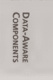

## `TDBEdit`

**`TDBEdit`** 对应标准的 **`TEdit`** 组件。它用于显示和编辑数据集中包含的数值、字符串或日期/时间数据。

数据根据底层字段的 `DisplayFormat` 或 `EditMask` 属性进行显示，并根据 `EditFormat` 或 `EditMask` 属性（取决于字段类型）进行编辑。

## `TDBMemo`

**`TDBMemo`** 在概念上与 **`TDBEdit`** 类似，不同之处在于它可以显示和编辑多行文本字段，例如未格式化的备注。**`TDBMemo`** 通常连接到 `CLOB`（*字符大型对象*）字段，尽管你也可以用它来编辑字符串字段。

## `TDBCheckBox`

**`TDBCheckBox`** 的使用方式类似于标准的 **`TCheckBox`**——用于显示和输入是/否或真/假值。**`TDBCheckBox`** 可以连接到桌面数据库（如 Paradox 或 Access）中的逻辑型（Logical）或是/否（Yes/No）字段。然而，大多数 SQL 数据库并不直接支持这些字段类型。在这种情况下，你将 **`TDBCheckBox`** 连接到一个字符串字段，这通常是一个单字符字段。

要定义选中/未选中与底层字段数据之间的关系，你需要设置组件的 `ValueChecked` 和 `ValueUnchecked` 属性。`ValueChecked` 指的是复选框被标记时字段的值。`ValueUnchecked` 确定复选框未被标记时字段的值。当包含 **`TDBCheckBox`** 的表单首次显示，且底层字段包含的值不等于这两个属性中的任何一个时，复选框最初会被灰显。

默认情况下，这两个属性的值分别为 true 和 false。在我自己的应用程序中，我使用单个字符字段（`VARCHAR(1)`）来表示布尔型字段。我用 T 表示真，F 表示假。因此，每当我将 **`TDBCheckBox`** 拖放到窗体上时，我会将 `ValueChecked` 设置为 T，将 `ValueUnchecked` 设置为 F。

### 注意

如果你决定始终使用单个字符字段表示布尔型字段，你可能需要考虑创建一个从 **`TDBCheckBox`** 派生的简单组件，该组件默认将 `ValueChecked` 设置为 T，`ValueUnchecked` 设置为 F。这样，每次使用组件时你就不必手动设置这些属性了。

此外，你可能还需要考虑在数据库中创建一个域来指定字符字段。这是我为自己的 InterBase 数据库创建的域：

```sql
CREATE DOMAIN DOM_BOOLEAN AS VARCHAR(1)
DEFAULT 'F' NOT NULL CHECK (VALUE IN ('F', 'T'));
```


## TDBRadioGroup

当需要从一短列表中选择一个选项时，使用 `TDBRadioGroup`。默认情况下，所选项目的值存储在底层数据集字段中，这意味着通常将 `TDBRadioGroup` 组件连接到字符串字段。

在我的应用程序中，我发现最常需要将所选项目的索引存储在整数字段中。如果利用组件的 `Values` 属性，实现这一点非常简单。`Values` 是一个字符串列表，它与 `Items` 属性按以下方式对应：

- 如果 `Values` 为空，则 `Items` 属性中包含的字符串存储在底层数据集中。
- 如果 `Values` 不为空，它应包含与 `Items` 属性相同数量的字符串值。当在单选按钮组中选择一个项目时，`Values` 属性中对应的值将被存储在数据集中。

利用第二条规则，你可以在 `Values` 属性中存储一个连续的数字列表，并将组件连接到整数字段。Delphi 足够智能，会在数据集中存储所选项目的数字表示。图 5.2 展示了这一概念。当用户从列表中选中星期二时，数字 3 将存储在相关字段中。

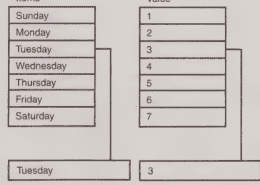

**图 5.2**
*TDBRadioGroup 的 Items 和 Values 属性之间的关系。*

## TDBComboBox

`TDBComboBox` 的工作原理与 `TDBRadioGroup` 类似，因为它允许用户从列表中选择一个项目并将其存储在数据集中。不幸的是，它不支持 `Values` 属性，因此你无法使用它来将所选项目的索引存储在数据集中。在我的应用程序中，这通常是一个严重的限制，所以我创建了一个派生组件，名为 `TETHDBComboBox`，支持为 `Items` 属性中包含的每个字符串分配一个值。

### 注意

`Values` 属性仅在组件的 `Style` 属性设置为 `csDropDownList`、`csOwnerDrawFixed` 或 `csOwnerDrawVariable` 时才起作用。如果样式设置为 `csDropDown` 或 `csSimple`，则忽略 `Values` 属性，因为在这两种情况下，用户都可以在组合框的编辑部分输入任何值。

列表 5.1 包含了 `TETHDBComboBox` 组件的源代码。

### 列表 5.1 ETHDBComboBox.pas

```pascal

unit ETHDBComboBox;

interface

uses

  Windows, Messages, SysUtils, Classes, Controls, StdCtrls, DBCtrls;

type

  TETHDBComboBox = class(TDBComboBox)

    private

      { Private declarations }

      FDataLink: TFieldDataLink;

      FValues: TStrings;

      procedure DataChange(Sender: TObject);

      procedure UpdateData(Sender: TObject);

      function GetComboValue(Index: Integer): string;

      function GetComboText: string;

      procedure SetComboText(const Value: string);

      procedure SetValues(const Value: TStrings);

    protected

      { Protected declarations }

      procedure CreateWnd; override;

    public

      { Public declarations }

      constructor Create(AOwner: TComponent); override;

      destructor Destroy; override;

    published

      { Published declarations }

      property Values: TStrings read FValues write SetValues;

  end;

implementation

procedure Register;

begin

  RegisterComponents('ETH', [TETHDBComboBox]);

end;

{ TETHDBComboBox }

constructor TETHDBComboBox.Create(AOwner: TComponent);

begin

  FValues := TStringList.Create;

  inherited Create(AOwner);

end;

destructor TETHDBComboBox.Destroy;

begin

  FValues.Free;

  inherited;

end;

procedure TETHDBComboBox.CreateWnd;

begin

  inherited;

  FDataLink := TFieldDataLink(SendMessage(Handle, CM_GETDATALINK, 0, 0));

  FDataLink.OnDataChange := DataChange;

  FDataLink.OnUpdateData := UpdateData;

end;

procedure TETHDBComboBox.SetValues(const Value: TStrings);

begin

  FValues.Assign(Value);

  DataChange(Self);

end;

function TETHDBComboBox.GetComboValue(Index: Integer): string;

begin

  if (Index < FValues.Count) and (FValues[Index] <> '') then

    Result := FValues[Index]

  else if Index < Items.Count then

    Result := Items[Index]

  else

    Result := '';

end;

function TETHDBComboBox.GetComboText: string;

begin

  if Style in [csDropDown, csSimple] then

    Result := Text

  else if ItemIndex >= 0 then

    Result := GetComboValue(ItemIndex)

  else

    Result := '';

end;

procedure TETHDBComboBox.SetComboText(const Value: string);

var

  I: Integer;

  Index: Integer;

  Redraw: Boolean;

begin

  if Value <> GetComboText then begin

    if Style <> csDropDown then begin

      Redraw := (Style <> csSimple) and HandleAllocated;

      if Redraw then

        SendMessage(Handle, WM_SETREDRAW, 0, 0);

    end;

    try

      if Value = '' then

        I := -1

      else begin

        I := -1;

        for Index := 0 to Items.Count - 1 do

          if Value = GetComboValue(Index) then begin

            I := Index;

            Break;

          end;

      end;

      ItemIndex := I;

    finally

      if Redraw then begin

        SendMessage(Handle, WM_SETREDRAW, 1, 0);

        Invalidate;

      end;

    end;

    if I < 0 then

      Exit;

  end;

  if Style in [csDropDown, csSimple] then

    Text := Value;

end;
```


```pascal
procedure TETHDBComboBox.DataChange(Sender: TObject);
begin
  if not (Style = csSimple) and DroppedDown then
    Exit;
  if FDataLink.Field <> nil then
    SetComboText(FDataLink.Field.Text)
  else if csDesigning in ComponentState then
    SetComboText(Name)
  else
    SetComboText('');
end;

procedure TETHDBComboBox.UpdateData(Sender: TObject);
begin
  FDataLink.Field.Text := GetComboText;
end;
end.
```

列表 5.1 中包含了一些你可能不熟悉代码，因此我将更详细地检查其中一些单独的例程。

`Create` 和 `Destroy` 仅创建和释放新的 `FValues` 属性，然后将控制权传递给 `TDBComboBox` 的构造函数和析构函数。

`CreateWnd` 向组件发送 `CM_GETDATALINK` 消息，以获取组件内部 `FDataLink` 字段的引用。由于 `TETHDBComboBox` 派生自 `TDBComboBox`，我们实际上正在获取 `TDBComboBox` 的 `FDataLink`。`TDBComboBox.FDataLink` 是私有的，且 `TDBComboBox` 未提供访问该值的属性，因此无法直接获取数据链接。幸运的是，`TDBComboBox` 支持 `CM_GETDATALINK` 消息，它可以实现相同的效果。

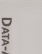

当获得数据链接的引用后，`CreateWnd` 为 `OnDataChange` 和 `OnUpdateData` 设置新的事件处理程序。当底层字段数据发生变化时（因为当前记录改变或字段被赋予新值），`OnDataChange` 会自动触发。当用户在组合框中选择一个值，且底层字段应更新时，`OnUpdateData` 会触发。

`TDBComboBox` 提供了这两个方法的处理程序，但这些处理程序没有考虑我们新的 `Values` 属性。因此，有必要重写它们。

当你为 `Values` 属性分配一个新的字符串列表时，会调用 `SetValues`，如下所示：

```pascal
ETHDBComboBox.Values := MyStringList;
```

它首先分配字符串列表，然后直接调用 `DataChange`，这确保组合框更新以显示正确的数据。

`GetComboValue` 是一个辅助函数，用于获取给定索引的正确值。它首先检查 `Values` 属性，看是否为该问题项目分配了值。如果有，它返回该列表中的值。如果没有，它直接从 `Items` 列表中返回值。

`GetComboText` 返回组合框中当前显示项目的文本。如果组合框允许文本输入——也就是说，如果样式是 `csDropDown` 或 `csSimple`——该函数仅返回组合框中显示的文本。否则，它调用 `GetComboValue` 来获取当前项目的值。

`SetComboText` 反向工作。它确定给定字符串的索引，并将其设为组件的当前 `ItemIndex`。

如前所述，`DataChange` 在底层字段数据改变时触发。该方法仅调用 `SetComboText` 来更新组合框中显示的文本。

相反，`UpdateData` 更新底层字段，使其包含当前选定的组合框项的正确值。

`TDBComboBox` 的使用方式与 `TDBRadioGroup` 组件类似。如果你保持 `Values` 列表为空，组合框中选择的项将直接存储在底层字段中，该字段应为字符串字段。如果 `Values` 列表已填充，则相应的值存储在底层字段中，该字段可以是字符串字段或数字字段（取决于 `Values` 列表包含的是文本还是数字）。

## TDBListBox

`TDBListBox` 在概念上与 `TDBComboBox` 相同，因为它允许用户从项目列表中选择一个项目。它也有 `TDBComboBox` 的相同限制，因为它不支持 `Values` 属性。出于这个原因，我创建了自己版本的 `TDBListBox`。

清单 5.2 包含 `TETHDBListBox` 的源代码（`TDBListBox` 的子类，支持 `Values` 属性）。

## 清单 5.2 ETHDBListBox.pas

```pascal
unit ETHDBListBox;

interface

uses
   Windows, Messages, SysUtils, Classes, Controls, StdCtrls, DBCtrls;

type
   TETHDBListBox = class(TDBListBox)
   private
      { Private declarations }
      FDataLink: TFieldDataLink;
      FValues: TStrings;
      procedure DataChange(Sender: TObject);
      procedure UpdateData(Sender: TObject);
      function GetListValue(Index: integer): string;
      function IndexOfItem(const Value: string): integer;
      procedure SetValues(const Value: TStrings);
   protected
      { Protected declarations }
      procedure CreateWnd; override;
   public
      { Public declarations }
      constructor Create(AOwner: TComponent); override;
      destructor Destroy; override;
   published
      { Published declarations }
      property Values: TStrings read FValues write SetValues;
   end;

procedure Register;

implementation

procedure Register;
begin
   RegisterComponents('ETH', [TETHDBListBox]);
end;

{ TETHDBListBox }

constructor TETHDBListBox.Create(AOwner: TComponent);
begin
   FValues := TStringList.Create;
   inherited Create(AOwner);
end;

destructor TETHDBListBox.Destroy;
begin
   FValues.Free;
   inherited;
end;

procedure TETHDBListBox.CreateWnd;
begin
   inherited;
   FDataLink := TFieldDataLink(SendMessage(Handle, CM_GETDATALINK, 0, 0));
   FDataLink.OnDataChange := DataChange;
   FDataLink.OnUpdateData := UpdateData;
end;

procedure TETHDBListBox.SetValues(const Value: TStrings);
begin
   FValues.Assign(Value);
   DataChange(Self);
end;

function TETHDBListBox.GetListItemValue(Index: Integer): string;
begin
   if (Index < FValues.Count) and (FValues[Index] <> '') then
      Result := FValues[Index]
   else if Index < Items.Count then
      Result := Items[Index]
   else
      Result := '';
end;

function TETHDBListBox.IndexOfItem(const Value: string): Integer;
var
   I: Integer;
   Index: Integer;
begin
```


```pascal
I := -1;

for Index := 0 to Items.Count - 1 do
  if Value = GetListItemValue(Index) then begin
    I := Index;
    Break;
  end;
Result := I;
end;

procedure TETHDBListBox.DataChange(Sender: TObject);
begin
  if FDataLink.Field <> nil then
    ItemIndex := IndexOfItem(FDataLink.Field.Text)
  else
    ItemIndex := -1;
end;

procedure TETHDBListBox.UpdateData(Sender: TObject);
begin
  if ItemIndex >= 0 then
    FDataLink.Field.Text := GetListItemValue(ItemIndex)
  else
    FDataLink.Field.Text := '';
end;

end.
```

`TETHDBListBox` 的源代码与 `TETHDBComboBox` 相似，因此这里不再详细展开。

## TDBImage

`TDBImage` 用于显示数据集中 BLOB 字段中包含的位图。不幸的是，`TDBImage` 不能用于显示非位图图像（例如 JPEG、PNG 等）。第 4 章“高级客户端数据集操作”解释了如何从数据库 BLOB 字段中存储和检索非位图图像。

### 注意

清单 3.4 展示了如何在不使用 `TDBImage` 数据感知组件的情况下显示数据集的图像数据。

## 仅限 VCL 的数据感知控件

VCL 支持一些在 CLX 下不支持的额外数据感知控件。这些包括：

- `TDBRichEdit`
- `TDBChart`
- `TDBCtrlGrid`

这些组件未包含在 CLX 中，因为它们依赖于以下其中一项：底层 Win32 实现（`TDBRichEdit`）、尚未可用的第三方组件（`TDBChart`），或不支持/已废弃的功能（`TDBCtrlGrid`）。

然而，这些组件在 VCL 应用程序中是有用处的，因此我将在本章中提及 `TDBRichEdit`，并在下一章中提及 `TDBCtrlGrid`。由于日期输入是许多应用程序所需的功能，我将在本章后面展示 Win32 `TDateTimePicker` 组件的数据感知实现。

`TDBRichEdit` 类似于 `TDBMemo`，因为它用于显示和编辑多行文本。然而，`TDBMemo` 显示和编辑的是未格式化文本，而 `TDBRichEdit` 处理的是富文本（使用 RTF（富文本格式）格式化的文本）。

富文本允许用户使用不同的字体样式和格式化技术（例如项目符号、编号、制表符和缩进）来格式化段落、单词或单个字符。尽管 `TDBRichEdit` 及其非数据感知对应组件 `TRichEdit` 通过一系列属性和方法支持此功能，但提供菜单、工具栏或两者以便调用相应方法的责任在于你。

即使不写任何代码，`TDBRichEdit` 仍然可以用来显示格式化文本。

## 查找数据感知控件

上一节讨论了连接到单个数据集中单个字段的简单数据感知组件。在本节中，我将介绍查找组件。查找组件将数据存储到数据集中的单个字段，但从另一个数据集显示可用数据列表。

例如，假设我们正在处理一个标准的订单录入系统，其中包含 `ORDERDETAIL` 表和 `PARTS` 表。`PARTS` 表由 `PartNumber` 字段和 `Description` 字段（以及其他字段）组成。`ORDERDETAIL` 表也包含一个 `PartNumber` 字段，该字段引用 `PARTS` 表。

在您的应用程序中，您可能希望用户能够查看零件号及其描述的列表，选择一个零件，并自动将对应的零件号存储在 `ORDERDETAIL` 表中。

这正是查找数据感知控件所设计的目的——显示来自一个数据集的列表，并允许用户选择一项以存储到另一个数据集中。

为了完成与查找数据集的链接，查找数据感知组件提供了四个额外的属性：`ListSource`、`ListField`、`KeyField` 和 `ListFieldIndex`。

- `ListSource` 引用要从中获取值列表的数据集的数据源。
- `ListField` 是一个以分号分隔的字段名称列表，这些名称将在组件中显示。
- `KeyField` 确定要存储在数据集中的值的字段。
- `ListFieldIndex` 是一个基于零的数字，用于确定组件中用于增量搜索的字段。例如，假设您将 `ListField` 属性设置为 `FirstName; LastName`。这指示组件在列表中显示名和姓。如果您将 `ListFieldIndex` 设置为 `1`，当用户在控件中输入时，它将在 `LastName` 字段上执行自动增量搜索。

查找数据感知组件由 `TDBLookupComboBox` 和 `TDBLookupListBox` 组成。这些组件的外观和操作方式分别类似于 `TDBComboBox` 和 `TDBListBox`，不同之处在于，它们不是手动填充项，而是通过组件的 `ListSource` 属性引用的数据集获取其项。

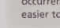

> 您可以使用 `TDBLookupComboBox` 和 `TDBLookupListBox` 来复制 `TETHDBComboBox` 和 `TETHDBListBox` 组件的功能。要做到这一点，请创建一个 `TClientDataSet`，其中包含在 `TETHDBComboBox` 或 `TETHDBListBox` 中设置的 Items 和 Values 关联。如果您的应用程序中只有此功能的一个实例，您可能选择采用此方法。然而，如果您有许多实例，您的窗体将被查找数据集充斥，您可能会发现使用 `TETHDBComboBox` 和 `TETHDBListBox` 更为方便。

## TDBNavigator

本章讨论的剩余组件用于显示和编辑数据，但 `TDBNavigator` 提供了一种无需代码即可导航和操作数据集的方式。在视觉上，`TDBNavigator` 看起来像一个工具栏，因为它包含一排预定义的按钮（实际上是 `TSpeedButtons`），这些按钮列于表 5.8 中。

### TDBNavigator 按钮

| 按钮 | 数据集方法 |
| :--- | :--- |
| | `First` |
| | `Prior` |
| | `Next` |
| | `Last` |
| | `Insert` |
| | `Delete` |
| | `Edit` |
| | `Post` |
| | `Cancel` |
| | `Refresh`（在第七章“数据集提供程序”中讨论） |

当用户单击 `TDBNavigator` 中的某个按钮时，VCL/CLX 会自动调用对应的数据集方法。您可以通过 `VisibleButtons` 属性来控制显示哪些按钮，该属性以 Pascal 集合的形式实现：只需从 `VisibleButtons` 属性中移除您不希望显示的按钮即可。

可以更改一个或多个按钮上显示的图像，尽管执行此操作的方法没有很好的文档说明。`TDBNavigator` 封装了多个 `TSpeedButton` 以显示各个图像，因此您可以通过控件数组访问单独的快速按钮（如下面的代码片段所示）：

```pascal
(DBNavigator1.Controls[0] as TSpeedButton).Glyph.LoadFromFile('C:\First.bmp');
```

`Controls` 数组的索引是一个介于零和九之间的数字，它指的是按钮在导航器按钮数组中的绝对位置。然而，访问按钮更可靠的方法是使用在 `DBCtrls.pas` 中定义的 `TNavigateBtn` 枚举类型，定义如下：

```pascal
TNavigateBtn = (nbFirst, nbPrior, nbNext, nbLast,
                  nbInsert, nbDelete, nbEdit, nbPost, nbCancel, nbRefresh);
```

使用此类型，我们可以编写以下代码代替上面的代码：

```pascal
(DBNavigator1.Controls[Ord(nbFirst)] as TSpeedButton).Glyph.LoadFromFile('C:\First.bmp');
```


### 创建自己的数据感知组件

当您理解提供现有标准控件的数据感知版本所需采取的步骤时，创建自己的数据感知组件并不那么困难。在本节中，我将提供 `Win32 TDateTimePicker` 组件的数据感知版本的可用代码。在此过程中，我将概述创建数据感知组件所需的步骤。阅读以下各部分时，请参照列表 5.3 中显示的源代码。

### `TFieldDataLink`

`TFieldDataLink` 是一个辅助类，用于在数据感知组件和底层数据集字段之间建立链接。`TFieldDataLink` 仅提供少量您在编写数据感知组件时需要关注的方法、属性和事件。表 5.9、5.10 和 5.11 分别列出了最常用的方法、属性和事件。

**表 5.9 `TFieldDataLink` 方法**

| **方法** | **描述** |
| :--- | :--- |
| Edit | 尝试将数据集置于编辑模式。如果数据集不允许编辑，*Edit* 返回 **False**，否则返回 **True**。 |
| Modified | 当数据感知组件发生变化时（例如用户在其中输入，或通过其他方式如点击或与组件的其他交互改变了组件的内容），调用 `Modified` 方法。 |
| Reset | 当发生导致底层字段内容重置为其原始值的操作时，调用 `Reset` 方法。例如，数据感知组件可能支持一个键（如 **`Ctrl+R`**）来重置字段的原始值。 |

**表 5.10 `TFieldDataLink` 属性**

| **属性** | **描述** |
| :--- | :--- |
| CanModify | 只读属性，如果相应的字段可以被修改则返回 **True**，如果不能则返回 **False**。如果数据集、字段或数据感知组件是只读的，`CanModify` 返回 **False**。 |
| Control | 引用链接的数据感知控件。 |
| Field | 引用数据感知控件绑定到的字段对象。字段对象可以是持久字段，也可以是非持久字段的自动生成的字段对象。 |
| FieldName | 数据感知组件绑定到的字段的名称。 |

**表 5.11 `TFieldDataLink` 事件**

| **事件** | **描述** |
| :--- | :--- |
| OnDataChange | 当底层字段发生变化时触发。 |
| OnEditingChange | 当关联的数据源从编辑模式切换到浏览模式，或反之时触发。 |
| OnUpdateData | 当数据感知组件中包含的数据应写入数据集时触发。 |
| OnActiveChange | 当底层数据集从活动状态变为非活动状态，或反之时触发。 |

接下来的章节解释了如何将 `TFieldDataLink` 类整合到组件中以创建该组件的数据感知版本。它们还展示了利用前几表中列出的方法、属性和事件的正确方式。

### 设置 `TFieldDataLink`

创建数据感知组件的第一步是向组件添加一个类型为 `TFieldDataLink` 的私有字段。

接下来，重写 `Create` 和 `Destroy` 构造函数和析构函数。

`Create` 负责创建 `TFieldDataLink` 对象并通过 `Control` 属性建立与此组件的连接。请注意列表 5.3 中，`Create` 方法将 `csReplicateable` 设置添加到 `ControlStyle` 属性中。这通知组件它可以在 `TDataGrid` 中使用，如下章所述。

`Create` 还为 `TFieldDataLink` 的 `OnDataChange` 和 `OnUpdateData` 事件设置事件处理程序。如果您愿意或需要，也可以为 `OnEditingChange` 和 `OnActiveChange` 事件创建处理程序，但我在此没有这样做。

`Destroy` 简单地释放 `TFieldDataLink` 组件，然后调用继承的 `Destroy` 方法。

最后，您应该处理 `CM_GETDATALINK` 消息并返回内部 `TFieldDataLink` 字段的引用。`CMGetDataLink` 在列表 5.3 中提供了此服务。

> **注意**
> 如果您记得在“`TDBComboBox`”部分中，我们在编写 `TETHIDComboBox` 和 `TETHListBox` 组件时利用了 `CM_GETDATALINK` 消息。如果 `TDBComboBox` 和 `TDBListBox` 的作者没有提供 `CM_GETDATALINK` 消息处理程序，我们将没有办法获取组件内部 `TFieldDataLink` 的引用。

### 设置与数据源的连接

您将采取的下一步是创建 `DataSource` 和 `DataField` 属性。这些属性只是调用 `GetDataSource`/`SetDataSource` 和 `GetDataField`/`SetDataField`。对于大多数数据感知组件，您可以直接复制列表 5.3 中展示的这些方法的代码。

此外，您应该提供一个重写的 `Notification` 方法，该方法在关联组件被释放时调用。对于大多数数据感知组件，我们希望如果在设计时用户从窗体或数据模块中移除了关联的 `TDataSource` 组件，我们能收到通知。如果发生这种情况，数据源的引用不再有效，因此我们将 `DataSource` 属性设置为 nil。

### 响应数据集的变化

此时，您应该创建一个 `DataChange` 事件处理程序。`DataChange` 执行更新数据感知组件的任务，使其反映关联数据字段的当前状态。在本文给出的示例中，`DataChange` 将组件的 `Date` 属性设置为关联字段的值。如果没有关联字段，组件显示今天的日期。

接下来，您应该提供 `Loaded` 事件的重写实现。`Loaded` simply 在组件处于设计模式时调用 `DataChange` 事件。在运行时，`DataChange` 自动被调用。

### 更新数据集

现在组件能够在底层数据变化时正确更新自身，我们需要编写在组件变化时更新数据的代码。为此，我们需要编写 `UpdateData` 事件处理程序。

在许多情况下，`UpdateData` 包含一行代码，它从数据感知组件获取当前值并将其写入数据字段（如列表 5.3 所示）。

您还需要为数据感知组件编写一个或多个事件处理程序，当组件的值发生变化时触发。在许多情况下，这包括一个 `Change` 事件处理程序。在某些情况下，它需要一个 `Click` 处理程序代替（或除了）`Change` 事件处理程序。您应该熟悉您正在处理的组件，以便知道哪些事件可能会因组件值的变化而触发。

在这种情况下，我重写了 `TDateTimePicker` 的 `Click` 和 `Change` 动态方法，以添加对数据链接的 `Edit` 和 `Modified` 方法的调用。逻辑是这样的：首先，调用 `Edit` 尝试将底层数据集置于编辑模式。接下来，调用组件的继承方法。最后，调用 `Modified` 让数据链接知道字段已更改。

### 消息处理程序

通常，当焦点离开组件时，数据感知组件会更新数据集。为了实现这一点，我们必须以列表 5.3 中所示的 `CMExit` 方法的形式为 `CM_EXIT` 消息提供消息处理程序。

`CMExit` 方法尝试更新数据集。如果因任何原因失败，焦点将设置回组件，并且异常再次被抛出。通常，您可以将此消息处理程序的代码原封不动地复制到您自己的数据感知组件中。

### 动作处理程序

您应该在数据感知组件中提供的最后两个方法是 `ExecuteAction` 和 `UpdateAction` 的重写。这些重写方法确保组件与 Delphi 提供的标准 `DataSet` 动作正确配合工作。同样，您可以将此组件中的代码原封不动地复制到您自己的数据感知组件中。

### 数据感知 `TDateTimePicker`

列表 5.3 包含 `TETHDBDateTimePicker`（`TDateTimePicker` 的数据感知后代）的完整源代码。

**列表 5.3 `ETHDBDateTimePicker.pas`**

```pascal

unit ETHDBDateTimePicker;

interface

uses

Windows, Messages, SysUtils, Classes, Controls, ComCtrls, DB, DBCtrls;

```

## 清单 5.3

```pascal

type

  TETHDBDateTimePicker = class(TDateTimePicker)

  private

    { Private declarations }

    FDataLink: TFieldDataLink;

  function GetDataField: string;

  function GetDataSource: TDataSource;

  procedure SetDataField(const Value: string);

  procedure SetDataSource(const Value: TDataSource);

  function GetField: TField;


```pascal
procedure DataChange(Sender: TObject);

procedure UpdateData(Sender: TObject);

procedure CMGetDataLink(var Message: TMessage); message CM_GETDATALINK;

protected

{ Protected declarations }

procedure Loaded; override;

procedure Notification(AComponent: TComponent;
  Operation: TOperation); override;

procedure Change; override;

procedure Click; override;

procedure CMExit(var Message: TCMExit); message CM_EXIT;

public

{ Public declarations }

constructor Create(AOwner: TComponent); override;

destructor Destroy; override;

function ExecuteAction(Action: TBasicAction): Boolean; override;

function UpdateAction(Action: TBasicAction): Boolean; override;

property Field: TField read GetField;

published

{ Published declarations }

property DataField: string read GetDataField write SetDataField;

property DataSource: TDataSource read GetDataSource write SetDataSource;

end;

procedure Register;

implementation

procedure Register;

begin

  RegisterComponents('ETH', [TETHDBDateTimePicker]);

end;

{ TETHDBDateTimePicker }

constructor TETHDBDateTimePicker.Create(AOwner: TComponent);

begin

inherited Create(AOwner);

ControlStyle := ControlStyle + [csReplicable];

FDataLink := TFieldDataLink.Create;

FDataLink.Control := Self;

FDataLink.OnDataChange := DataChange;

FDataLink.OnUpdateData := UpdateData;

end;

destructor TETHDBDateTimePicker.Destroy;

begin

FDataLink.Free;

FDataLink := nil;

inherited Destroy;

end;

procedure TETHDBDateTimePicker.Loaded;

begin

inherited Loaded;

if (csDesigning in ComponentState) then

DataChange(Self);

end;

procedure TETHDBDateTimePicker.Notification(AComponent: TComponent;
Operation: TOperation);

begin

inherited Notification(AComponent, Operation);

if (Operation = opRemove) and
(FDataLink <> nil) and
(AComponent = DataSource) then
DataSource := nil;

end;

procedure TETHDBDateTimePicker.CMGetDataLink(var Message: TMessage);

begin

Message.Result := Integer(FDataLink);

end;

procedure TETHDBDateTimePicker.Change;

begin

FDataLink.Edit;

inherited Change;

FDataLink.Modified;

end;

procedure TETHDBDateTimePicker.Click;

begin
  FDataLink.Edit;
  inherited Click;
  FDataLink.Modified;
end;

function TETHDBDateTimePicker.GetDataSource: TDataSource;

begin
  Result := FDataLink.DataSource;
end;

procedure TETHDBDateTimePicker.SetDataSource(const Value: TDataSource);

begin
  if not (FDataLink.DataSourceFixed and (cLoading in ComponentState)) then
    FDataLink.DataSource := Value;
  if Value <> nil then
    Value.FreeNotification(Self);
end;

function TETHDBDateTimePicker.GetDataField: string;

begin
  Result := FDataLink.FieldName;
end;

procedure TETHDBDateTimePicker.SetDataField(const Value: string);

begin
  FDataLink.FieldName := Value;
end;

function TETHDBDateTimePicker.GetField: TField;

begin
  Result := FDataLink.Field;
end;

procedure TETHDBDateTimePicker.DataChange(Sender: TObject);

begin
  if FDataLink.Field <> nil then
    Date := FDataLink.Field.AsDateTime
  else
    Date := Now;
end;

procedure TETHDBDateTimePicker.UpdateData(Sender: TObject);

begin
FDataLink.Field.AsDateTime := Date;
end;

procedure TETHDBDateTimePicker.CMExit(var Message: TCMExit);

begin

try
FDataLink.UpdateRecord;
except
SetFocus;
raise;
end;

end;

function TETHDBDateTimePicker.ExecuteAction(Action: TBasicAction): Boolean;

begin

Result := inherited ExecuteAction(Action) or (FDataLink <> nil) and
FDataLink.ExecuteAction(Action);

end;

function TETHDBDateTimePicker.UpdateAction(Action: TBasicAction): Boolean;

begin

Result := inherited UpdateAction(Action) or (FDataLink <> nil) and
FDataLink.UpdateAction(Action);

end;

end.
```

## 示例应用程序

清单 5.4 是一个示例应用程序，它使用了本章讨论过的许多（但并非全部）数据感知组件。如清单 5.4 所示，该应用程序的代码量很少。得益于 VCL/CLX，数据感知组件几乎封装了在应用程序中显示和更新数据集所需的一切。

## 清单 5.4

```pascal
unit MainForm;

interface

uses

SysUtils, Classes, QGraphics, QControls, QForms, QDialogs, DB, DBClient,
```


`QStdCtrls`, `QExtCtrls`, `OButtons`, `Mask`, `QComCtrls`, `QDBCtrls`, `OMask`;

```pascal
type

TFormMain = class(TForm)

ClientDataSet1: TClientDataSet;

DataSource1: TDataSource;

cdsLookup: TClientDataSet;

dsLookup: TDataSource;

cdsLookupPID: TIntegerField;

cdsLookupDescription: TStringField;

DBNavigator1: TDBNavigator;

Panel1: TPanel;

ClientDataSet1Weekday: TStringField;

ClientDataSet1WeekdayValue: TIntegerField;

ClientDataSet1Image: TBlobField;

ClientDataSet1Active: TStringField;

ClientDataSet1Age: TIntegerField;

ClientDataSet1ItemID: TIntegerField;

ClientDataSet1Salary: TFloatField;

ClientDataSet1Enabled: TBooleanField;

lblCurrent: TLabel;

lblState: TLabel;

OpenDialog1: TOpenDialog;

Panel1: TPanel;

lbdEvents: TListBox;

Label13: TLabel;

Panel1: TPanel;

PageControl1: TPageControl;

tabSimple: TTabSheet;

txtAge: TDBText;

Label11: TLabel;

txtWeekday: TDBText;

txtSalary: TDBText;

Label16: TLabel;

Label17: TLabel;

ecAge: TDBEdit;

DBRadioGroup1: TDBRadioGroup;

CbActive: TDBCheckBox;

CbEnabled: TDBCheckBox;

ecSalary: TDBEdit;

tabComboList: TTabSheet;

Label12: TLabel;

cbWeekday: TDBComboBox;

lbWeekday: TDBListBox;

tabLookup: TTabSheet;

Label14: TLabel;

lbLookup: TDBLookupListBox;

cblLookup: TDBLookupComboBox;

tabImage: TTabSheet;

Label5: TLabel;

img: TDBImage;

btnLoad: TButton;

btnClear: TButton;

procedure FormCreate(Sender: TObject);

procedure DataSource1DataChange(Sender: TObject; Field: TField);

procedure ClientDataSet1NewRecord(DataSet: TDataSet);

procedure DataSource1StateChange(Sender: TObject);

procedure btnLoadClick(Sender: TObject);

procedure btnClearClick(Sender: TObject);

procedure DataSource1UpdateData(Sender: TObject);

private

  { Private declarations }

public

  { Public declarations }

end;

var

  frmMain: TfrmMain;
```

```pascal
implementation

{$R *.xfm}

procedure TfrmMain.FormCreate(Sender: TObject);

procedure AddLookupItem(ID: Integer; const Description: string);

begin

  cdsLookup.Append;

  cdsLookupPID.AsInteger := ID;

  cdsLookupDescription.AsString := Description;

  cdsLookup.Post;

end;

begin

  // 创建查找数据集并填充一些数据

  cdsLookup.CreateDataSet;

  AddLookupItem(1, 'Widget');

  AddLookupItem(2, 'Gadget');

  AddLookupItem(3, 'Thingamabob');

ClientDataSet1.CreateDataSet;

end;
```

```pascal
procedure TfrmMain.ClientDataSet1NewRecord(DataSet: TDataSet);

begin

DataSet.FieldName('Enabled').AsString := 'T';

DataSet.FieldName('Active').AsString := 'T';

end;
```

```pascal
procedure TfrmMain.DataSource1DataChange(Sender: TObject; Field: TField);

begin

if Field = nil then

lbdEvents.Items.Add('Data Change: Field = nil')

else

lbdEvents.Items.Add('Data Change: Field = ' + Field.FieldName);

lblCurrent.Caption := Format(' (Record %d of %d)',

[ClientDataSet1.RecNo, ClientDataSet1.RecordCount]);

end;
```

```pascal
procedure TfrmMain.DataSource1StateChange(Sender: TObject);

begin

lbdEvents.Items.Add('State Change');

case DataSource1.State of

dsInactive: lblState.Caption := 'Inactive';

dsBrowse: lblState.Caption := 'Browse';

dsEdit: lblState.Caption := 'Edit';

dsInsert: lblState.Caption := 'Insert';

end;

end;
```

```pascal
procedure TfrmMain.DataSource1UpdateData(Sender: TObject);

begin

lbdEvents.Items.Add('Update Data')

end;
```

```pascal
procedure TfrmMain.btnLoadClick(Sender: TObject);

begin

if OpenDialog1.Execute then begin

ClientDataSet1.Edit;

ClientDataSet1Image.LoadFromFile(OpenDialog1.FileName);

end;

end;
```

```pascal
procedure TfrmMain.btnClearClick(Sender: TObject);
```


### 清单 5.4 续

```pascal
begin

  if not ClientDataSet1Image.IsNull then begin

    ClientDataSet1.Edit;

    ClientDataSet1Image.Clear;

  end;

end;
```


图 5.3 展示了数据感知应用在运行时的情形。

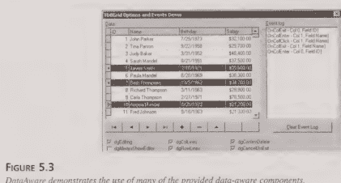

## 摘要

本章向您介绍了数据感知组件。我们涉及的组件包括：

- `TDataSource` 在数据感知组件和数据集之间提供高层级的连接通道。
- `TDBText` 和 `TDBEdit` 用于显示和编辑简单的字段值。
- `TDBMemo` 提供了显示和编辑无格式多行文本的方法。
- `TDBRichEdit`（一个仅限 VCL 的数据感知组件）可用于显示和编辑格式化的多行文本。
- `TDBCheckBox` 和 `TDBRadioGroup` 支持从可用选项列表中选择一项或多项。
- `TDBComboBox` 和 `TDBListBox` 允许用户从预定义的值列表中选择字段值。我还为您提供了这两个组件派生类的代码，允许对存储在关联数据字段中的值进行更精细的控制。
- `TDBLookupComboBox` 和 `TDBLookupListBox` 通过从另一个数据集获取项目列表来扩展 `TDBComboBox` 和 `TDBListBox`，然后将查找数据集的主键保存回正在编辑的数据集。
- `TDBImage` 用于显示存储在数据集 BLOB 字段中的位图。
- `TDBNavigator` 可用于提供无代码形式的数据集导航和操作。
- 只需付出一点努力，您就可以创建标准 VCL/CLX 组件的数据感知版本。

下一章将继续讨论数据感知组件，重点介绍数据感知网格。

# 数据感知网格

## 第 6 章

### 本章内容

- `TDBGrid` 240
- `TClientDataSetGrid` 263
- `TDBCtrlGrid` 266
- 第三方数据感知网格 271

上一章向您介绍了数据感知组件，特别是那些一次显示和编辑一个字段的数据感知组件。本章讨论数据感知网格，它可以一次显示来自多条记录的信息。

在本章中，我将考察三种不同的数据感知网格：**`TDBGrid`**、**`TClientDataSetGrid`** 和 **`TDBCtrlGrid`**。**`TDBGrid`** 是这三个中唯一在 Delphi 和 Kylix 中均作为标准功能提供的网格。**`TClientDataSetGrid`** 是 John Kaster 编写的一个衍生作品，它提供了对用户可配置列的内建支持，以及当用户点击列标题时自动对客户数据集进行排序的代码（关于这一点将在本章后面详细讨论）。

**`TDBCtrlGrid`** 随 Delphi 提供，但不随 Kylix 提供。它允许非线性网格布局——例如，一个每条记录占用多行而非单行的网格。

## TDBGrid

**`TDBGrid`** 提供了 Delphi 基于网格的数据感知组件的基石。使用 **`TDBGrid`**，您可以在不需要大量编程工作的情况下创建类似于图 6.1 中所示的屏幕界面。

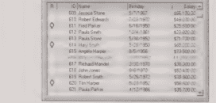

**图 6.1**

使用 **`TDBGrid`** 创建的示例屏幕。

本章稍后，我们将研究生成此屏幕所需的代码。在本节中，我将探讨 **`TDBGrid`** 组件。接下来的部分将介绍另外两种网格，它们要么包含在 Delphi 中，要么可以免费下载。

### TDBGrid 基本操作

与上一章讨论的组件一样，**`TDBGrid`** 发布了一个 **`DataSource`** 属性，该属性间接确定了网格从中检索数据的数据集。然而，由于网格可以同时显示来自多个字段的数据，因此没有 **`DataField`** 属性。相反，**`TDBGrid`** 提供了一个 **`Columns`** 属性，允许您指定要在网格中显示哪些字段、字段的顺序以及其他显示相关的设置。这些内容将在下一节“自定义列”中详细讨论。

使用 `TDBGrid` 最简单的方法是将其拖放到窗体上，连接数据源，打开数据集，然后运行应用程序。如果您这样做，您会看到一个使用所有默认设置的相当普通的网格，如图 6.2 所示。

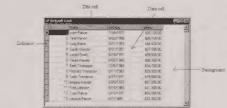

### 图 6.2
默认网格功能正常，但外观并不引人注目。

图 6.2 指出了标题单元格、数据单元格、指示符单元格和网格背景的示例。通过使用网格的属性和事件的组合，您可以创建视觉上更美观的网格。在接下来的部分中，我将详细研究这些属性和事件。

### 自定义列

通常，您想要进行的最基本的自定义是调整显示的列数，或者调整列的显示顺序。`TDBGrid` 发布了一个 `Columns` 属性，该属性提供了对网格中显示的列列表的访问。

> 您可以将 `Columns` 属性视为类似于数据集的 `Fields` 属性。如果没有明确定义的列，网格将按照它们在数据集中出现的顺序显示所有列。如果为数据集定义了持久化字段，则网格仅为这些字段显示列。
>
> 要为网格创建持久化的列对象（类似于数据集的持久化字段对象），您使用列编辑器。

在设计时双击网格组件（或右键单击它并从弹出菜单中选择“列编辑器...”）以显示列编辑器。列编辑器的工作方式类似于 Delphi 中大多数集合编辑器——按 Ins 创建新的 `TColumn` 对象，或者右键单击并从弹出菜单中选择“添加”。

每个列支持许多可用于自定义列外观和感觉的属性。（为了获得极致的显示灵活性，请参阅本章后面的“自定义绘制”部分。）这些属性列在表 6.1 中。

# **表 6.1 基本 TColumn 属性**

| 属性 | 描述 |
| --- | --- |
| Alignment | 设置列中显示数据的对齐方式，可为左对齐、居中对齐或右对齐。 |
| Color | 设置单个列的背景颜色。 |
| FieldName | 指定要在该列中显示的底层数据集中的字段名称。可以显示任何字段（包括数据字段、计算字段、查找字段和聚合字段）。 |
| Font | 自定义用于显示列数据的字体。 |
| ReadOnly | 当为 True 时，列数据不可编辑，即使底层字段和数据集允许编辑。 |
| Title | 允许自定义列的标题单元格。此属性将在“列标题”部分中讨论。 |
| Visible | 当为 False 时，不显示该列。 |
| Width | 设置列在屏幕上的宽度（以像素为单位）。 |

当您设置 **`FieldName`** 属性时，Delphi 会自动设置 **`Alignment`** 和 **`Width`** 属性（基于字段的大小和类型）。不幸的是，尽管 Delphi 为数字字段将 **`Alignment`** 设置为 **`taRightJustify`**，但它不会自动将标题的对齐方式设置为 **`taRightJustify`**。因此，您需要手动设置标题的对齐方式。

# **注意**

可以添加没有底层数据字段的列。为此，插入一个新列并将 **`FieldName`** 属性留空。这样做时，您需要手动设置列的 **`Alignment`** 和 **`Width`** 属性，并且必须使用网格的自定义绘制功能来绘制该列的单元格内容。例如，您可能希望创建一个没有关联字段的列，以在特定行中显示图标。

## 列类型

大多数列以简单的字符串形式显示和编辑。对于您希望用户从值列表中选择，或希望显示一个允许用户选择单元格值的对话框的情况，`TDBGrid` 支持对列的活动单元格进行两种类型的增强：

- 一列可以显示查找组合框，允许用户从预定义的值列表中进行选择。如果一列与数据集中的查找字段相关联，当用户编辑该列时，列会自动显示一个可接受值列表的组合框。
- 一列可以显示省略号按钮，该按钮可以编程为在用户点击时显示对话框，或执行其他功能。

表 6.2 中列出的属性用于设置各种列样式的选项。

**表 6.2 附加 TColumn 属性**

| 属性 | 描述 |
| :--- | :--- |
| ButtonStyle | 当设置为 `bsAuto`（默认值）时，该列会自动为查找字段显示组合框。您可以手动将此属性设置为 `bsEllipsis`（显示省略号按钮）或 `bsNone`（抑制查找字段的组合框）。 |
| DropDownRows | 指定在列的组合框展开时显示的最大项目数。 |
| PickList | 对于未连接到查找字段的列，您可以在 PickList 属性中指定可接受的字段值列表。如果使用此属性，当列被编辑时，它会自动显示组合框（除非列的 ButtonStyle 属性设置为 `bsNone`）。 |

对于 ButtonStyle 为 `bsEllipsis` 的列，当用户点击省略号按钮时，会触发网格的 `OnEditButtonClick` 事件。本节末尾提供的示例程序展示了您如何响应该事件。

## 列标题

除了自定义列数据的外观外，您还可以自定义列标题的外观。要同时更改所有列标题使用的字体，您可以相应地设置网格的 `TitleFont` 属性。

但是，为了控制每个列标题，您应该求助于单个列的 `Title` 属性。`Title` 属性扩展后，允许为列标题设置以下属性。

## TColumn 标题属性

| 属性 | 描述 |
| :--- | :--- |
| Alignment | 将列标题的对齐方式设置为左对齐、居中对齐或右对齐。 |
| Caption | 指定在列标题中显示的文本。 |
| Color | 设置列标题的背景颜色。 |
| Font | 设置在列标题中显示文本的字体。 |

正如前文所述，Delphi 不会自动将数值字段的标题 `Alignment` 属性设置为 *textAlignRight*。因此，你在创建持久列时应确保检查标题的对齐方式。

## 网格选项

在设置好要在网格中显示的列之后，你可以设置网格范围选项，这些选项决定了网格的整体外观和风格。表 6.4 列出了可用的选项。

### 表 6.4 TDBGrid 选项

| 选项 | 描述 |
| :--- | :--- |
| `dgEditing` | 网格可编辑。用户必须按 F2 键才能开始编辑当前单元格。请注意，单个列仍可以设置为只读，这将防止在这些列中进行编辑。设置 `dgRowSelect` 选项会自动强制关闭 `dgEditing`。 |
| `dgAlwaysShowEditor` | 当用户通过 Tab 键进入单元格时，网格会自动进入编辑模式。用户无需按 F2 键即可开始编辑。与 `dgEditing` 类似，如果设置了 `dgRowSelect`，则 `dgAlwaysShowEditor` 会被强制关闭。 |
| `dgTitles` | 设置此选项时，将显示列标题。 |
| `dgIndicator` | 此选项强制在网格的最左侧显示一个窄列，该列显示当前记录的状态（插入、编辑或浏览模式）。 |
| `dgColumnResize` | 设置此选项后，允许在运行时移动或调整单个列的大小。 |
| `dgColLines` | 设置时，在列之间绘制垂直线。 |
| `dgRowLines` | 设置时，在行之间绘制水平线。 |
| `dgTabs` | 设置时，用户可以按 Tab 键和 Shift+Tab 键在网格中的单元格之间移动。清除时，按 Tab 键或 Shift+Tab 键将分别使焦点移动到窗体上下一个或前一个控件。 |
| `dgRowSelect` | 设置时，单击某行会高亮显示整行，而不是选择单个单元格。也可以通过对网格进行自定义绘制来手动实现行高亮，本章稍后会有详细说明。 |
| `dgAlwaysShowSelection` | 设置此选项以在网格没有焦点时也高亮显示当前单元格。 |
| `dgConfirmDelete` | 如果未设置网格的 `ReadOnly` 属性，此选项会在用户于网格中按下 `Ctrl+Delete` 时使 VCL 显示删除确认消息。如果未设置此选项，当用户按下 `Ctrl+Delete` 时，当前记录将被直接删除。请注意，即使未设置 `dgEditing`，`Ctrl+Delete` 也会删除当前记录。 |
| `dgCancelOnExit` | 此选项影响当用户离开网格时对新插入行的处理方式。设置时，未输入数据的新插入行将被取消。如果未设置，留空的插入行将被提交到数据集。 |
| `dgMultiSelect` | 设置时，用户可以通过按住 `Ctrl` 键并单击各个行来在网格中选择多行。 |

默认情况下，*Options* 设置为 [`dgEditing`, `dgTitles`, `dgIndicator`, `dgColumnResize`, `dgColLines`, `dgRowLines`, `dgTabs`, `dgConfirmDelete`, `dgCancelOnExit`]。我发现，当我使用 `TDBGrid` 时，我会关闭 `dgEditing` 和 `dgIndicator` 选项，并将网格的 `ReadOnly` 属性设置为 `True`。与其允许用户在网格中直接编辑，我会在他们按下 `Enter` 键时显示一个对话框，并允许他们在那里编辑当前记录的字段的值。当然，具体效果因人而异，你会在使用网格开发应用的过程中确定自己偏好的选项组合。

## 事件

除了上述列出的属性外，`TDBGrid` 还提供了一些你可以响应的事件，以便更精细地控制网格的显示和功能。这些事件列在表 6.5 中。

### 表 6.5 TDBGrid 事件

| 事件 | 描述 |
| :--- | :--- |
| `OnCellClick` | 当用户单击单元格时触发。当用户单击标题单元格、指示器或网格背景时不触发。 |
| `OnColEnter` | 焦点进入当前列后立即触发。 |
| `OnColExit` | 焦点离开当前列前立即触发。在此处理程序中调用 Abort 可以防止网格切换到新列。 |
| `OnColumnMoved` | 用户在运行时移动列后触发（但在调整列大小后不触发）。 |
| `OnDrawColumnCell` | 当单元格即将被绘制时触发。它用于实现自定义绘制，本章稍后会有详细说明。 |
| `OnDrawDataCell` | 已废弃，仅出于向后兼容性而保留。 |
| `OnEditButtonClick` | 当用户单击单元格中的省略号按钮时触发。 |
| `OnTitleClick` | 当用户单击标题单元格时发生（假设已设置 dgTitles 选项）。`TClientDataSetGrid` 内部使用此事件，当用户单击列标题时自动对底层数据集进行排序。 |

以下示例程序（如代码清单 6.1 所示）演示了不同的网格事件触发的时机。下一节“自定义绘制”将更详细地探讨 `OnDrawColumnCell` 事件。

**代码清单 6.1 Options—MainForm.pas**

```
```


# unit MainForm

## interface

```pascal
uses
  SysUtils, Classes, QGraphics, QControls, QForms, QDialogs, DB, QGrids,
  DBGrids, DBClient, QExtCtrls, QStdCtrls, QDBCtrl;
```

```pascal
type
  TfrmMain = class(TForm)
    ClientDataSet: TClientDataSet;
    DataSource1: TDataSource;
    pnlOptions: TPanel;
    pnlClient: TPanel;
    grid: TDBGrid;
    cbEditing: TCheckBox;
    cbAlwaysShowEditor: TCheckBox;
    cbTitles: TCheckBox;
    cbIndicator: TCheckBox;
    cbColumnResize: TCheckBox;
    cbColLines: TCheckBox;
    cbRowLines: TCheckBox;
    cbTabs: TCheckBox;
    cbRowSelect: TCheckBox;
    cbAlwaysShowSelection: TCheckBox;
    cbConfirmDelete: TCheckBox;
    cbCancelOnExit: TCheckBox;
    cbMultiSelect: TCheckBox;
    btnShowSelections: TButton;
    DBNavigator: TDBNavigator;
    lbEvents: TListBox;
    Label1: TLabel;
    Label2: TLabel;
    btnClearEventLog: TButton;
    procedure FormCreate(Sender: TObject);
    procedure gridCellClick(Column: TColumn);
    procedure gridColExit(Sender: TObject);
    procedure gridColEnter(Sender: TObject);
    procedure gridColumnMoved(Sender: TObject; FromIndex, ToIndex: Integer);
    procedure gridEditButtonClick(Sender: TObject);
    procedure cbEditingClick(Sender: TObject);
    procedure cbAlwaysShowEditorClick(Sender: TObject);
    procedure cbTitlesClick(Sender: TObject);
    procedure cbIndicatorClick(Sender: TObject);
    procedure cbColumnResizeClick(Sender: TObject);
    procedure cbColLinesClick(Sender: TObject);
    procedure cbRowLinesClick(Sender: TObject);
    procedure cbTabsClick(Sender: TObject);
    procedure cbRowSelectClick(Sender: TObject);
    procedure cbAlwaysShowSelectionClick(Sender: TObject);
    procedure cbConfirmDeleteClick(Sender: TObject);
    procedure cbCancelOnExitClick(Sender: TObject);
    procedure cbMultiSelectClick(Sender: TObject);
    procedure btnShowSelectionsClick(Sender: TObject);
    procedure btnClearEventLogClick(Sender: TObject);
  private
    procedure RetrieveOptions;
    procedure UpdateOption(Option: TDBGridOption; Active: Boolean);
    { Private declarations }
  public
    { Public declarations }
  end;
```

```pascal
var
    TfrmMain: TfrmMain;
```

## implementation

```pascal
{$R *.xfm}

procedure TfrmMain.FormCreate(Sender: TObject);
begin
    ClientDataSet1.LoadFromFile('C:\Employee.CDS');
    RetrieveOptions;
end;
```

### Options set/get methods

```pascal
procedure TfrmMain.RetrieveOptions;
begin
    cbEditing.Checked := (dgEditing in grid.Options);
    cbAlwaysShowEditor.Checked := (dgAlwaysShowEditor in grid.Options);
    cbTitles.Checked := (dgTitles in grid.Options);
    cbIndicator.Checked := (dgIndicator in grid.Options);
    cbColumnResize.Checked := (dgColumnResize in grid.Options);
    cbColLines.Checked := (dgColLines in grid.Options);
    cbRowLines.Checked := (dgRowLines in grid.Options);
    cbTabs.Checked := (dgTabs in grid.Options);
    cbRowSelect.Checked := (dgRowSelect in grid.Options);
    cbAlwaysShowSelection.Checked := (dgAlwaysShowSelection in grid.Options);
    cbConfirmDelete.Checked := (dgConfirmDelete in grid.Options);
    cbCancelOnExit.Checked := (dgCancelOnExit in grid.Options);
    cbMultiSelect.Checked := (dgMultiSelect in grid.Options);
end;

procedure TfrmMain.UpdateOption(Option: TDBGridOption; Active: Boolean);
begin
    if Active then
        grid.Options := grid.Options + [Option]
    else
        grid.Options := grid.Options - [Option];
    RetrieveOptions;
end;

procedure TfrmMain.cbEditingClick(Sender: TObject);
```

**列表 6.1** *续*

```pascal
begin
  UpdateOption(dgEditing, cbEditing.Checked);
end;

procedure TfrmMain.cbAlwaysShowEditorClick(Sender: TObject);
begin
  UpdateOption(dgAlwaysShowEditor, cbAlwaysShowEditor.Checked);
end;

procedure TfrmMain.cbTitlesClick(Sender: TObject);
begin
  UpdateOption(dgTitles, cbTitles.Checked);
end;

procedure TfrmMain.cbIndicatorClick(Sender: TObject);
begin
```


```pascal
UpdateOption(dgIndicator, cbIndicator.Checked);

end;

procedure TfrmMain.cbColumnResizeClick(Sender: TObject);

begin

  UpdateOption(dgColumnResize, cbColumnResize.Checked);

end;

procedure TfrmMain.cbColLinesClick(Sender: TObject);

begin

  UpdateOption(dgColLines, cbColLines.Checked);

end;

procedure TfrmMain.cbRowLinesClick(Sender: TObject);

begin

  UpdateOption(dgRowLines, cbRowLines.Checked);

end;

procedure TfrmMain.cbTabsClick(Sender: TObject);

begin

  UpdateOption(dgTabs, cbTabs.Checked);

end;

procedure TfrmMain.cbRowSelectClick(Sender: TObject);

begin

  UpdateOption(dgRowSelect, cbRowSelect.Checked);

end;

procedure TfrmMain.cbAlwaysShowSelectionClick(Sender: TObject);

begin

  UpdateOption(dgAlwaysShowSelection, cbAlwaysShowSelection.Checked);

end;

procedure TfrmMain.cbConfirmDeleteClick(Sender: TObject);

begin

  UpdateOption(dgConfirmDelete, cbConfirmDelete.Checked);

end;

procedure TfrmMain.cbCancelOnExitClick(Sender: TObject);

begin

  UpdateOption(dgCancelOnExit, cbCancelOnExit.Checked);

end;

procedure TfrmMain.cbMultiSelectClick(Sender: TObject);

begin

  UpdateOption(dgMultiSelect, cbMultiSelect.Checked);

end;

// Grid event handlers

procedure TfrmMain.gridColExit(Sender: TObject);

begin

  lbEvents.Items.Add('OnColExit - Col ' + IntToStr(grid.SelectedIndex) +

    ', Field ' + grid.SelectedField.FieldName + '');

  // By calling Abort here, you can prevent focus from leaving this column

  // Abort;

end;

procedure TfrmMain.gridColEnter(Sender: TObject);

begin

  lbEvents.Items.Add('OnColEnter - Col ' + IntToStr(grid.SelectedIndex) +

    ', Field ' + grid.SelectedField.FieldName + '');

end;

procedure TfrmMain.gridEditButtonClick(Sender: TObject);

begin

  lbEvents.Items.Add('OnEditButtonClick - Col ' +

    IntToStr(grid.SelectedIndex) + ', Field ' +

    grid.SelectedField.FieldName + '');

end;
```

```pascal
procedure TfrmMain.gridCellClick(Column: TColumn);

begin

  lbEvents.Items.Add('OnCellClick - Col ' + IntToStr(grid.SelectedIndex) +

    ', Field ' + grid.SelectedField.FieldName + '');

end;

procedure TfrmMain.gridColumnMoved(Sender: TObject; FromIndex,

  ToIndex: Integer);

begin

  lbEvents.Items.Add('Column moved from ' + IntToStr(FromIndex) +

    ' to ' + IntToStr(ToIndex));

end;

// Command buttons

procedure TfrmMain.btnClearEventLogClick(Sender: TObject);

begin

  lbEvents.Items.Clear;

end;

procedure TfrmMain.btnShowSelectionsClick(Sender: TObject);

var

  Index: Integer;

  s: string;

begin

  if not (dgMultiSelect in grid.Options) then

    raise Exception.Create('dgMultiSelect not set');

  if grid.SelectedRows.Count = 0 then

    raise Exception.Create('No rows selected');

  for Index := 0 to grid.SelectedRows.Count - 1 do

  begin

    ClientDataSet1.Bookmark := grid.SelectedRows[Index];

    if s <> '' then

      s := s + #13;

    s := s + Format('%d: %s', [ClientDataSet1.FieldByName('ID').AsInteger,

      ClientDataSet1.FieldByName('Name').AsString]);

  end;

  ShowMessage(s);

end;

end.
```

图 6.3 展示了 Options 应用程序在运行时的状态。

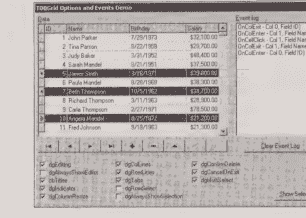

### 图 6.3
Options 应用程序允许你对 `TDBGrid` 组件的选项进行实验。

## 自定义绘制

如从图 6.2 中可以看到，网格的默认外观虽然令人愉悦，但并不算特别引人注目。通过使用自定义绘制，我们可以大大提升网格的视觉效果。

要在你的网格中实现自定义绘制，你需要处理网格的 `OnDrawColumnCell` 事件。你可能会注意到网格包含一个名称相似的事件 `OnDrawDataCell`。`OnDrawDataCell` 是一个过时的事件，仅为与 Delphi 早期版本保持向后兼容而保留。在任何新的编程工作中都不应使用它。

新建的 `OnDrawColumnCell` 事件处理程序如下所示：

```pascal
procedure TForm1.DBGrid1DrawColumnCell(Sender: TDBGrid; const Rect: TRect;
  DataCol: Integer; Column: TColumn; State: TGridDrawState);

begin

end;
```


与所有网格事件一样，`Sender`参数引用网格对象。`Rect`指的是即将绘制的单元格的边界矩形。`DataCol`是即将绘制的列的绝对位置的基于零的索引。`State`是一个集合，包含表 6.6 中列出的一个或多个值。

### 表 6.6 TGridDrawState 值

| 值 | 描述 |
| :--- | :--- |
| `gdSelected` | 单元格被选中。 |
| `gdFocused` | 单元格具有焦点。 |
| `gdFixed` | 单元格是固定的（即，它是指示器单元格）。 |

`gdSelected`和`gdFocused`之间的区别可能会让人困惑（尤其是因为这些值的含义会随着`Options`属性的变化而略有不同），因此我在这里予以澄清。当`dgRowSelect`未被设置时（这是默认情况），只有当前单元格具有`gdSelected`值。如果网格当前具有焦点，则除了具有`gdSelected`值外，当前单元格还设置了`gdFocused`。

当设置`dgRowSelect`时，当前行中的所有单元格都具有`gdSelected`值。此外，如果网格具有焦点，则该行中的第一个单元格（不包括指示器）设置了`gdFocused`。在使用`dgRowSelect`时，你可能希望忽略`gdFocused`值，因为它没有实际意义。

## DefaultDrawing 属性

网格的`DefaultDrawing`属性决定了网格中绘制的执行方式。当此属性为`True`（默认值）时，VCL/CLX 以通常方式绘制网格中的每个单元格，然后将控制权交给你设置的`OnDrawColumnCell`处理程序。`OnDrawColumnCell`对网格中的每个单元格都会调用，因此你需要确保在该事件处理程序中编写的任何代码都能快速执行。

当`DefaultDrawing`为`False`时，Delphi 使用适当的背景颜色绘制单元格，并设置网格的`Brush`和`Font`属性，为绘制单元格做好准备。然后，它调用`OnDrawColumnCell`，以便你可以自己绘制单元格的内容。

在实践中，当你实现自定义绘制时，通常会发现 Delphi 的默认绘制代码完成了大约 90% 的工作。你可能只是想更改选中单元格的颜色，在特定列中绘制图像，或者也许用红色绘制负值。

`DefaultDrawing`属性看起来似乎走极端。一方面，如果它为`True`，单元格使用其默认设置绘制，然后你又在上面覆盖绘制。另一方面，如果它为`False`，你需要手动绘制每一个单元格——即使那些不需要特殊绘制的单元格也是如此。

幸运的是，事实并非如此。解决方案是将`DefaultDrawing`设置为`False`，然后在`OnDrawColumnCell`事件处理程序中调用网格的`DefaultDrawColumnCell`，如下所示：

```pascal
procedure TForm1.DBGrid1DrawColumnCell(Sender: TDBGrid; const Rect: TRect;
  DataCol: Integer; Column: TColumn; State: TGridDrawState);
begin
  if Column.FieldName = 'Salary' then
  begin
    if Column.Field.AsFloat > 50000.0 then
    begin
      DBGrid1.Canvas.Brush.Color := clYellow;
      if gfFocused in State then
        DBGrid1.Canvas.Font.Color := clRed;
    end;
  end;
  DBGrid1.DefaultDrawColumnCell(Rect, DataCol, Column, State);
end;
```

此代码片段仅更改`Salary`列的绘制方式。如果薪水大于 $50,000，单元格背景以黄色绘制。如果单元格具有焦点，薪水以红色绘制。

对于其他所有单元格，以及小于或等于 $50,000 的薪水，单元格正常绘制。对`DefaultDrawColumnCell`的调用负责在对画笔和字体颜色进行适当更改（如果有）后绘制单元格。

根据 Delphi 内部 VCL/CLX 绘制代码的工作方式，你在此处理程序中只需设置画布的`Brush`和`Font`属性，使其反映你在绘制单元格时想要使用的颜色和字体。对`DefaultDrawColumnCell`的调用随后使用你指定的设置来绘制单元格内容。

> **注意**
> 请注意，在前面的代码片段中，我检查了列的`FieldName`属性以确定代码是否正在绘制`Salary`列。你可能会想用`DataCol`参数来检查这一点。然而，`DataCol`是被绘制单元格的基于零的绝对索引。如果用户在运行时重新排序列，此值会发生变化。

以下示例程序演示了自定义绘制网格单元格的几种方式。列表 6.2 包含`CustomDraw`应用程序的完整源代码。

## 列表 6.2 CustomDraw—MainForm.pas

```pascal
unit MainForm;
interface
```

## 数据感知网格

### 列表 6.2 续

```pascal
uses
SysUtils, Types, Classes, QGraphics, QControls, QForms, QDialogs, DB,
DBClient, QGrids, QDBGrids, QExtCtrls, DateUtils;
type
TfrmMain = class(TForm)
pnlClient: TPanel;
DBGrid1: TDBGrid;
DataSource1: TDataSource;
ClientDataSet1: TClientDataSet;
Image1: TImage;
procedure FormCreate(Sender: TObject);
procedure DBGrid1DrawColumnCell(Sender: TObject; const Rect: TRect;
DataCol: Integer; Column: TColumn; State: TGridDrawState);
private
{ Private declarations }
public
{ Public declarations }
end;
var
frmMain: TfrmMain;
implementation
{$R *.xfm}
procedure TfrmMain.FormCreate(Sender: TObject);
begin
ClientDataSet1.LoadFromFile('C:\Employee.CDS');
end;
procedure TfrmMain.DBGrid1DrawColumnCell(Sender: TObject;
const Rect: TRect; DataCol: Integer; Column: TColumn;
State: TGridDrawState);
var
RetirementBirthdate: TDateTime;
X: Integer;
begin
if Odd(ClientDataSet1.RecNo) then
DBGrid1.Canvas.Brush.Color := clAqua
else
DBGrid1.Canvas.Brush.Color := clWhite;
if gdSelected in State then begin
   DBGrid1.Canvas.Font.Color := clGreen;
   DBGrid1.Canvas.Font.Style := [fsBold];
end;
if Column.ID = 0 then begin
   DBGrid1.Canvas.FillRect(Rect);
   RetirementBirthdate := IncYear(Date, -50);
   if ClientDataSet1.FieldByName('Birthday').AsDateTime <=
   RetirementBirthdate then begin
      // Eligible for retirement
      X := (Column.Width - Image1.Picture.Width) div 2 + Rect.Left;
      DBGrid1.Canvas.Draw(X, Rect.Top, Image1.Picture.Graphic);
   end;
end else
   DBGrid1.DefaultDrawColumnCell(Rect, DataCol, Column, State);
end;
end.
```


图 6.1 展示了运行时 CustomDraw 应用程序的效果。

在列表 6.2 中的 `DBGrid1DrawColumnCell` 方法中，发生了几件事。首先，奇数行使用 `clAqua` 作为背景色绘制，而偶数行使用 `clWhite` 作为背景色绘制。这使得网格呈现出支票簿式的视觉效果。

其次，当前行（由 `State` 参数包含 `gdSelected` 选项这一事实决定）使用粗体绿色字体绘制。`State` 参数包含 `gdSelected` 选项，是因为在网格的选项中指定了 `dgRowSelect`。

最后，代码会检查员工的生日。如果员工年满 50 岁（或更老），则会在第一列绘制一个手表图标。第一列的 ID 为 0。请注意，代码并没有检查 `DataCol` 参数来判断它是否为 0，因为用户可以在运行时重新排列列。相反，它检查的是 `Column ID`，这是一个在设计时确定的从零开始的整数，不会改变。


如果开启了 `dgIndicator` 选项，则列 ID 将是 1 而不是 0，因为指示器列的 ID 将为 0。

## 常见网格问题的解决方案

在本节中，我将尝试回答一些关于 `TDBGrid` 组件的常见问题。解决这些问题并不特别困难，但在大多数情况下，它们涉及的操作不仅仅是调用一个方法或设置一个属性那么简单。

### 确定当前行或列

有时您可能需要确定当前获得焦点的行、列或单元格。根据您需要的信息，有几种处理方法。

如果您只需要知道哪一行获得焦点，最简单的方法是检查底层数据集。数据集中的当前记录就是获得焦点的记录。因此，如果您想获取当前“工资”列的值，可以执行以下操作：

```pascal
var
CurrentSalary: Double;
begin
CurrentSalary := TDBGrid.DataSource.DataSet.FieldByName('Salary').AsFloat;
...
end;
```

要获取获得焦点的列的索引，您可以访问网格的 `SelectedIndex` 属性。`SelectedIndex` 是一个从零开始的数字，表示所选列的绝对位置。`SelectedIndex` 会对指示器进行补偿，因此如果存在指示器，第一个数据列的索引为 1。如果不显示指示器，第一个数据列的索引为 0。

要获取当前列的字段对象，您可以引用网格的 `SelectedField` 属性。`SelectedField` 返回底层数据集的 `TField` 对象，因此您可以直接访问它以获取当前单元格的值。

```pascal
ShowMessage('The current cell value is ' + DBGrid.SelectedField.AsString);
```

> 注意
> 如果当前列未连接到数据集字段，`SelectedIndex` 将返回 -1，而 `SelectedField` 将返回 nil。如果您在网格中显示了任何未与字段绑定的列，在尝试使用 `SelectedIndex` 或 `SelectedField` 属性之前，始终应该检查是否为 -1 或 nil。

### 获取给定鼠标坐标处的单元格

只需一点努力，您就可以确定任意鼠标位置处的单元格所在行和列。通常，您不需要这样做，因为您可以使用数据集的当前记录以及网格的 `SelectedIndex` 或 `SelectedField` 属性来确定当前单元格。但是，您可能希望了解一个非当前单元格的详细信息。

例如，假设您想编写一个事件处理程序，用于跟踪鼠标当前位置并提供该位置字段的信息。一个更具野心的项目可能是编写代码，当鼠标悬停在内容过长而无法在单元格中完全显示的单元格上时，显示工具提示。

在这两种情况下，您可以调用网格的 `MouseCoord` 方法，传入相对于网格控件的鼠标 X 和 Y 坐标。`MouseCoord` 返回一个 `TGridCoord` 结构，其中包含 X 和 Y 字段，表示该鼠标位置处单元格的绝对列和行索引。

`TGridCoord` 的 X 和 Y 值需要稍作解释。这些是绝对索引，意味着它们考虑了指示器列和标题行。如果显示指示器，第一个数据列的 X 位置为 1。如果不显示指示器，则为 0。对于行也是如此：如果不显示网格标题（即在网格的 `Options` 属性中未设置 `dgTitles`），则第一行数据的 Y 位置为 0。如果显示标题，则为 1。

如果鼠标位置不在单元格上方（例如，鼠标位于网格的背景区域），返回的 `TGridCoord` 的 X 和 Y 值均为 −1。

以下代码片段展示了如何更新标签以显示当前鼠标位置处单元格的 X 和 Y 位置以及字段名称。

```pascal
procedure TForm1.DBGrid1MouseMove(Sender: TObject; Shift: TShiftState; X, Y: Integer);
var
  GC: TGridCoord;
  IndicatorOffset: Integer;
  TitleOffset: Integer;
begin
  GC := DBGrid1.MouseCoord(X, Y);
  if GC.X = -1 then
    Label1.Caption := IntToStr(GC.X) + ', ' + IntToStr(GC.Y)
  else begin
    if dgIndicator in DBGrid1.Options then
      IndicatorOffset := 1
    else
      IndicatorOffset := 0;
    if dgTitles in DBGrid1.Options then
      TitleOffset := 1
    else
      TitleOffset := 0;
    if GC.X < IndicatorOffset then
      Label1.Caption := IntToStr(GC.X) + ', ' + IntToStr(GC.Y) +
' - Indicator'
else
  Label1.Caption := IntToStr(GC.X) + ' ' + IntToStr(GC.Y) + ' - '
    + DBGrid1.Columns[GC.X - IndicatorOffset].FieldName;
// To move the dataset to the corresponding record, clone the dataset,
// and set the clone's RecNo property to GC.Y - TitleOffset.
end;
end;
```

在该代码片段的末尾，有一行注释解释了如何获取相应单元格的数据。以下是实现该功能的代码（假设网格连接到一个客户端数据集）：

```pascal
var
  CloneDS: TClientDataSet;
  FieldValue: string;
begin
...
CloneDS := TClientDataSet.Create(nil);
try
  CloneDS.CloneCursor(DBGrid1.DataSource.DataSet);
  CloneDS.RecNo := GC.Y - TitleOffset;
  // Now access the fields of the cloned dataset
  FieldValue := CloneDS.FieldName(DBGrid1.Columns[GC.X -
    IndicatorOffset].FieldName).AsString;
finally
  CloneDS.Free;
end;
```


### 手动设置编辑模式

如果 `dgAlwaysShowEditor` 为 True，当用户进入某个单元格时，网格会自动进入编辑模式。如果 `dgAlwaysShowEditor` 为 False，当用户按下 F2 时，网格会进入编辑模式。（用户也可以直接开始输入值来覆盖单元格的内容。）但是，如果您希望（为了与其他软件包兼容）在用户按下其他按键——例如按 F9 而不是 F2——时进入编辑模式，该怎么办？

要实现这一点，您需要控制网格进入编辑模式的时机。最佳位置是在网格的 `OnKeyDown` 事件中。在该处理程序中，将网格的 `EditorMode` 属性设置为 True 即可进入编辑模式。

以下代码片段展示了如何在用户按下 F9 时进入编辑模式（而不是在按下 F2 时）。

## 注意事项

为了让这段代码能够正常工作，你必须确保设置了 `dgEditing` 选项。如果未设置，即使代码将 `EditorMode` 设置为 `True`，网格也不会进入编辑模式。

## 检测列何时被调整大小

`TDBGrid` 提供了 `OnColumnMoved` 事件，但没有 `OnColumnSized` 事件。这意味着你可以轻松判断列何时被移动，但要确定列何时被调整大小则困难得多。幸运的是，通过编写一个包含单个重写方法的网格派生类，我们可以实现此功能。

### 清单 6.3 `ETHDBGrid.pas`

```pascal
unit ETHDBGrid;

interface

uses

Windows, Messages, SysUtils, Classes, Controls, Grids, DBGrids;

type

TETHDBGrid = class(TDBGrid)

private

{ Private declarations }

FOnColumnSized: TNotifyEvent;

protected

{ Protected declarations }

procedure ColWidthsChanged; override;

public

{ Public declarations }

published

{ Published declarations }

 property OnColumnSized: TNotifyEvent

 read FOnColumnSized write FOnColumnSized;

end;

procedure Register;

implementation

procedure Register;

begin

 RegisterComponents('ETH', [TETHDBGrid]);

end;

{ TETHDBGrid }

procedure TETHDBGrid.ColWidthsChanged;

begin

 inherited ColWidthsChanged;

 if Assigned(FOnColumnSized) then

 FOnColumnSized(Self);

end;
```

被重写的方法 `ColWidthsChanged` 调用了继承版本，然后触发 `OnColumnSized` 事件（如果你在应用程序中为其提供了事件处理程序）。

这段代码的作用仅仅是通知你某列已被调整大小。它不会告诉你哪一列被调整了大小、原来的宽度是多少，或者新的宽度是多少。提供这些额外信息需要更多的努力，并且会重复 `TDBGrid` 中大量的代码。我更喜欢保持我的派生组件简单直接。

> `TClientDataSetGrid`（将在本章后面讨论）也不提供这个事件处理程序。因此，如果你打算在应用程序中使用 `TClientDataSetGrid` 而不是 `TDBGrid`，你可能希望修改这里显示的代码，使其派生自 `TClientDataSetGrid`。

## 持久化网格设置

用户期望自定义设置能在多次程序运行之间保持持久，网格设置也不例外。当用户调整或重新排序网格中的列时，他们通常期望下次运行应用程序时列的顺序和大小保持不变。

持久化网格列设置并不难。你可以采取两种方法：

- 将设置保存到流或单独的文件中。
- 将设置保存到 Windows 注册表或 ini 文件中。

第一种方法更简单，所以我先介绍它。`TDBGrid` 的 `Columns` 属性提供了 `SaveToFile` 和 `SaveToStream` 方法，你可以使用这些方法以最小的麻烦将列配置保存到文件或流中。以下代码片段展示了如何将列设置保存到文件：

```pascal
TDBGrid.Columns.SaveToFile( 'GRID.CFG' );
```

同样地，要重新加载设置：

```pascal
TDBGrid.Columns.LoadFromFile( 'GRID.CFG' );
```

这种方法的缺点是，如果你的应用程序中有许多不同的网格，你需要为每个网格创建单独的配置文件的来持久化。如果情况如此，你可能希望使用 `SaveToStream` 而不是 `SaveToFile`。通过一点努力，你可以使用 `SaveToStream` 将网格的列配置保存到 ini 文件或 Windows 注册表中。以下过程将列信息保存到 ini 文件：

```pascal
procedure SaveColumnConfiguration(const FileName: string; Grid: TDBGrid;
  const SectionName: string; const Name: string);

var
  ini: TIniFile;
  MemStream: TMemoryStream;

begin
  MemStream := TMemoryStream.Create;
  try
    Grid.Columns.SaveToStream(MemStream);
    MemStream.Seek(0, soFromBeginning);
    ini := TIniFile.Create(FileName);
    try
      ini.WriteBinaryStream(SectionName, Name, MemStream);
    finally
      ini.Free;
    end;
  finally
    MemStream.Free;
  end;
end;
```

这段代码首先创建一个内存流，并将列配置保存到该流中。然后，它将流写入到 ini 文件。经过少量修改，你可以将此代码改为使用 Windows 注册表而不是 ini 文件。

同样地，以下过程从 ini 文件重新加载列信息：

```pascal
procedure LoadColumnConfiguration(const FileName: string; Grid: TDBGrid;
   const SectionName: string; const Name: string);

var
   ini: TIniFile;
   MemStream: TMemoryStream;

begin
   MemStream := TMemoryStream.Create;
   try
      ini := TIniFile.Create(FileName);
      try
         ini.ReadBinaryFileStream(SectionName, Name, MemStream);
         if MemStream.Size > 0 then
            Grid.Columns.LoadFromStream(MemStream);
      finally
         ini.Free;
      end;
   finally
      MemStream.Free;
   end;
end;
```


## 局限性

尽管 `TDBGrid` 功能强大，但它确实存在一些局限性。最显著的一点是它不显示备忘录（memos）或图像。你可以使用网格的自定义绘图功能手动绘制图像或备忘录，但由于每个网格行的高度相同，当一个备忘录有 3 行而另一个有 30 行长时，这可能会导致困难。

许多可用的第三方网格移除了这一限制（以及其他限制）。在本章末尾，将对一些你可能想要了解的第三方网格进行快速概述。

## TClientDataSetGrid

`TClientDataSetGrid` 是由 John Kaster 编写的 `TDBGrid` 派生类。它利用了客户端数据集的一些功能，提供当用户点击列标题时自动对网格进行排序的功能。

此外，`TClientDataSetGrid` 可以自动将列信息持久化到单独的配置文件并从该文件加载。它不支持将列信息保存到或加载自 ini 文件或 Windows 注册表，因此你可能仍然希望使用前面章节中提供的 `SaveColumnConfiguration` 和 `LoadColumnConfiguration` 过程。(`TClientDataSetGrid` 在 Code Central 上可用，ID 为 15099，网址为 http://codecentral.borland.com/。)

### 自动排序

如前所述，`TClientDataSetGrid` 允许用户按单列或多列进行升序或降序排序。它甚至可以一列按升序排序，另一列按降序排序。

要启用此功能，必须将组件的 `TitleSort` 属性设置为 `True`。默认情况下为 `False`，允许组件与非客户端数据集一起使用。如果你将 `TitleSort` 设置为 `True`，`TClientDataSetGrid` 不能与不派生自 `TCustomClientDataSet` 的数据集一起使用。

为了指示当前的排序顺序，`TClientDataSetGrid` 在已排序列的标题中绘制三维箭头。用于绘制这些箭头的颜色通过 `ArrowColor`、`ArrowHighlight` 和 `ArrowShade` 属性设置。

图 6.4 显示了网格按 Name 排序，然后按 Birthday 排序时的外观。


**图 6.4**

`TClientDataSetGrid` 提供关于当前排序顺序的视觉反馈。

要排序，点击其中一个列标题。该列的标题单元格中会绘制一个向上箭头。要切换到降序，再次点击该列标题。

如果你想在多列上进行排序，按住 Shift 键并点击下一个要排序的列标题。按住 Shift 键并第二次点击该列标题，仅对该列进行降序排序。按住 Shift 键并第三次点击该列，将其从当前排序顺序中移除。对你想要排序的每一列重复此操作。

实际上，做比说容易。如果上述解释听起来很复杂，你可能想要亲自尝试点击列标题，以及按住 Shift 键点击列标题，看看效果。

### 列自定义

除了自动排序功能外，`TClientDataSetGrid` 还提供了一个单独的对话框，可用于设置网格的可见列（如图 6.5 所示）。要显示此对话框，请调用网格的 `ConfigureColumns` 方法，如下所示：

```pascal
TClientDataSetGrid.ConfigureColumns;
```


**图 6.5**

> *TClientDataSetGrid* 允许用户隐藏他们不想看到的列。

使用此对话框，用户可以隐藏或显示单个列。

如果你希望网格自动保存和恢复其列配置（包括列顺序和单个列的可见性状态），请将 `ConfigFile` 属性设置为你希望用于持久化列信息的文件名。请确保为每个网格使用不同的文件名，因为该组件的当前版本不支持在单个文件中保存多个配置。

> **注意**
>
> 由于 `TCIiontbaSetGrid` 的代码是免费公开的，我希望未来能有积极的 Delphi 程序员为其提供增强功能。我个人的愿望清单包括：
>
> - 将列配置保存到 ini 文件和 Windows 注册表，以及从这些位置加载配置。
> - 增强“列配置”对话框，使其除了隐藏或显示列之外，还支持列重新排序。
> - 增强“列配置”对话框，使其支持锁定单个列，以防止被隐藏或移动。
> - 添加对 `OnColumnSized` 事件的支持。

## TDBCtrlGrid

我不会花太多时间在 `TDBCtrlGrid` 上，因为它不兼容 CLX，而且目前没有针对 `TDBCtrlGrid` 的新开发工作。

`TDBCtrlGrid` 是一种网格组件，尽管它依赖于其他数据感知组件来执行实际的数据输入和输出。要在应用程序中使用 `TDBCtrlGrid`，请将其放置在窗体上，并将 `DataSource` 属性连接到数据源。然后，使用其他数据感知组件（如 `TDBEdit`、`TDBCheckBox` 等）来填充网格。

`TDBCtrlGrid` 在运行时复制这些组件，为网格中显示的每条记录显示每个组件。网格中的每个单元格对应于数据集中的单个记录。

大多数数据感知控件都是可复制的（即，它们可以用于 `TDBCtrlGrid`）。有些则不是（包括我在前一章中创建的 `TDBDateTimePicker` 组件）。为了让控件可复制，它必须在 `ControlStyle` 属性中包含 `csReplicable` 选项（通常在组件的构造函数中设置）。以下是 `TDBEdit` 构造函数中的代码片段：

```pascal
constructor TDBEdit.Create(AOwner: TComponent);
begin
inherited Create(AOwner);
inherited ReadOnly := True;
ControlStyle := ControlStyle + [csReplicable];
…;
end;
```

以下部分讨论 `TDBCtrlGrid` 引入的属性和事件。

### 属性

`TDBCtrlGrid` 引入了一些可用于自定义其外观和感觉的属性。表 6.7 列出了这些属性。

**表 6.7 TDBCtrlGrid 属性**

| 属性 | 描述 |
| :--- | :--- |
| `AllowInsert` | 当为 True 时，用户可以滚动超过网格中的最后一条记录以插入新记录。 |
| `AllowDelete` | 当为 True 时，用户可以通过按 Ctrl+Delete 删除当前记录。 |
| `ColCount` | 确定网格中显示的列数。 |
| `Orientation` | 确定网格滚动以显示更多数据的方向。 |
| `PanelBorder` | 可能的值为 gbNone 和 gBRaised。gBRaised 使网格具有凸起的外观。通过将 PanelBorder 设置为 gbNone 并将 TDBCtrlGrid 放置在具有所需斜角的窗格上，可以实现其他外观，如下沉或凸起。 |
| `PanelHeight` | 指单个窗格（单元格）的高度，以像素为单位。 |
| `PanelWidth` | 指单个窗格（单元格）的宽度，以像素为单位。 |
| `RowCount` | 确定网格中同时显示的行数。 |
| `SelectedColor` | 确定当前单元格的背景颜色。 |
| `ShowFocus` | 当为 True 时，会在当前单元格周围绘制一个焦点矩形。 |

`ColCount`、`PanelWidth` 和 `Width` 属性直接相关。`ColCount`×`PanelWidth` 大约等于 `Width`（考虑网格边框和垂直滚动条）。只要 `Align` 设置不阻止，设置 `ColCount` 会自动调整 `Width`。例如，将 `Align` 设置为 alLeft 不允许网格调整大小。在这种情况下，设置 `ColCount` 会自动调整 `PanelWidth`。

同样，`RowCount`、`PanelHeight` 和 `Height` 属性也是相关的。设置一个属性会影响其他属性。

## 事件

`TDBCtrlGrid` 只包含一个新事件，名为 `OnPaintPanel`。`OnPaintPanel` 在每个窗格即将被绘制之前触发。`OnPaintPanel` 看起来像这样：

```pascal
procedure TForm1.DBCtrlGrid1PaintPanel(DBCtrlGrid1: TDBCtrlGrid;
  Index: Integer);
begin
end;
```

`Index` 指即将绘制的窗格的基于零的索引，是一个介于 0 和 `RowCount`— 1 之间（包含两端）的数字。

你可能注意到没有 Rect 参数传递给此函数，因此乍一看并不明显如何确定当前单元格的边界矩形。进入此方法时，网格画布的原点设置为当前窗格的左上角。换句话说，画布上的点 (0, 0) 指的是窗格的左上角。点 (`PanelWidth`, `PanelHeight`) 指的是右下角。这使得您可以使用画布进行诸如在窗格上绘制背景图像等操作（如下一个取自列表 6.4 的代码片段所示）。

```pascal
```


```pascal
procedure TForm1.DBCtrlGrid1PaintPanel(DBCtrlGrid: TDBCtrlGrid;
Index: Integer);
begin
if Index > DBCtrlGrid.PanelIndex then
DBCtrlGrid1.Canvas.Draw(0, 0, Image1.Picture.Graphic);
end;
```

此代码检查传入方法的索引，以查看是否正在绘制当前窗格。`PanelIndex`公共属性包含当前窗格的编号。所有非当前窗格都使用背景图形进行绘制。

列表 6.4 包含 `CtrlGrid` 演示应用程序的完整源代码，该应用程序允许您试用 `TDBCtrlGrid` 的一些属性。

### 列表 6.4 CtrlGrid—MainForm.pas

```pascal
unit MainForm;

interface

uses
Windows, Messages, SysUtils, Variants, Classes, Graphics, Controls, Forms,
Dialogs, dbctrlgrids, ExtCtrls, DB, DBClient, StdCtrls, Mask, DBCtrls,
ComCtrls;

type
TForm1 = class(TForm)
ClientDataSet1: TClientDataSet;
DataSource1: TDataSource;
pnlClient: TPanel;
DBCtrlGrid1: TDBCtrlGrid;
ecID: TDBEdit;
ecName: TDBEdit;
ecSalary: TDBEdit;
Label1: TLabel;
Label2: TLabel;
Label3: TLabel;
Label4: TLabel;
ecBirthday: TDBEdit;
pnlBottom: TPanel;
cbAllowInsert: TCheckBox;
cbAllowDelete: TCheckBox;
ecRowCount: TEdit;
ecColCount: TEdit;
cbShowFocus: TCheckBox;
Label5: TLabel;
Label6: TLabel;
Label7: TLabel;
cbOrientation: TComboBox;
Image1: TImage;
procedure FormCreate(Sender: TObject);
procedure cbAllowInsertClick(Sender: TObject);
procedure cbAllowDeleteClick(Sender: TObject);
procedure cbShowFocusClick(Sender: TObject);
procedure ecRowCountChange(Sender: TObject);
procedure ecColCountChange(Sender: TObject);
procedure cbOrientationClick(Sender: TObject);
procedure DBCtrlGrid1PaintPanel(DBCtrlGrid1: TDBCtrlGrid;
             Index: Integer);
private
 { Private declarations }
public
 { Public declarations }
end;

var
 Form1: TForm1;

implementation

{$R *.dfm}

procedure TForm1.FormCreate(Sender: TObject);
begin
 ClientDataSet1.LoadFromFile('C:\Employee.cds');
end;

procedure TForm1.cbAllowInsertClick(Sender: TObject);
begin
 DBCtrlGrid1.AllowInsert := cbAllowInsert.Checked;
end;

procedure TForm1.cbAllowDeleteClick(Sender: TObject);
begin
DBCtrlGrid1.AllowDelete := cbAllowDelete.Checked;
end;

procedure TForm1.cbShowFocusClick(Sender: TObject);
begin
DBCtrlGrid1.ShowFocus := cbShowFocus.Checked;
end;

procedure TForm1.ecRowCountChange(Sender: TObject);
begin
try
DBCtrlGrid1.RowCount := StrToInt(ecRowCount.Text);
except
DBCtrlGrid1.RowCount := 1;
end;
end;

procedure TForm1.ecColCountChange(Sender: TObject);
begin
try
DBCtrlGrid1.ColCount := StrToInt(ecColCount.Text);
except
DBCtrlGrid1.ColCount := 1;
end;
end;

procedure TForm1.cbOrientationClick(Sender: TObject);
begin
DBCtrlGrid1.Orientation := TDBCtrlGridOrientation(cbOrientation.ItemIndex);
end;

procedure TForm1.DBCtrlGrid1PaintPanel(DBCtrlGrid: TDBCtrlGrid;
Index: Integer);
begin
if Index < DBCtrlGrid.PanelIndex then
DBCtrlGrid.Canvas.Draw(0, 0, Image1.Picture.Graphic);
end;
```


图 6.6 显示了运行时 `CtrlGrid` 的样子。


**图 6.6**

*CtrlGrid 演示了 TDBGrid 的行为。*

### 第三方数据感知网格

虽然 `TDBGrid` 和 `TClientDataSetGrid` 是有用的网格组件，但它们远不及第三方数据感知网格提供的灵活性和功能强大。如果您寻求内置 Delphi 网格提供功能之外的更多功能，本节列出了几个您可能想要研究的更受欢迎的第三方数据感知网格。

表 6.8 列出了一些更知名的 `TDBGrid` 替代组件。

**表 6.8 TDBGrid 替代组件**

| 产品 | 描述 |
| :--- | :--- |
| Orpheus | TurboPower 软件公司的旗舰 Delphi-VCL 附加库包含两个数据感知网格组件，可用于格式化数据输入、多级数据显示以及列的自动小计和总计。请访问 www.turbopower.com 以获取有关 Orpheus 的更多信息或下载免费试用版。 |
| InfoPower 2000 | 这个流行的通用 Delphi 库包含 `TwaDBGri d` 组件，它的工作方式类似于 `TDBGrid` 并添加了新功能（如备注显示和自动页脚）。请访问 www.infinisample.com 以获取有关 InfoPower 产品的更多信息。 |
| ExpressQuantumGrid | 一个功能极其强大的 `TDBGrid` 替代方案，提供了许多高级网格功能——这里无法一一列出。一些显著的功能包括多行数据显示、运行时排序 |
|  | 以及数据的分组和广泛的自定义（包括设计时和运行时）。有关更多信息，请访问 www.dexpexpress.com。 |
| TopGrid | 提供其功能强大的网格组件的数据感知和非数据感知版本，允许显示和编辑多行备注、包含控件（如组合框和复选框）的单元格，以及 numerous 自定义功能。您可以在 www.objectsight.com/TopGridOverview.htm 找到 TopGrid。 |
| 其他 | 还有大量的其他免费软件、共享软件和商业网格可供 Delphi 和 Kylix 程序员使用。本表中列出的只是当今商业可用的众多流行且广为人知的网格中的一部分。 |

### 摘要

本章继续讨论数据感知组件，概述了数据感知网格，它允许在屏幕上同时显示数据集的多行数据。具体来说，本章向您介绍了以下内容：

- 您可以通过将 `TDBGrid` 组件拖放到窗体上使用默认值来快速创建一个简陋的网格。要自定义生成的网格中的列，请使用 `Columns` 属性。
- 存在各种网格选项，用于改变网格的外观和感觉。（参见表 6.4 进行总结。）
- 您可以使用各种网格事件来控制在用户单击单元格或执行其他操作时发生的情况。（参见表 6.5 进行总结。）
- 为了最终控制网格的外观，请使用 `OnDrawColumnCell` 事件。
- `TClientDataSetGrid` 是一个免费的组件，您可以使用它进行自动列排序和额外的列自定义。
- `TDBCtrlGrid` 是 VCL 特有的组件，提供了将单条记录的数据安排为非线性格式的能力。

此外，本章还展示了如何处理几个常见的网格问题，例如检测列被移动时以及持久化列状态。

下一章开始对客户端数据集进行为期两章的探索。

# 数据集提供程序

第 7 章

## 本章内容

- 什么是数据集提供程序？ 274
- 连接到数据集 275
- 解决数据变更 276
- 提供程序选项 293
- 提供程序事件 295
- 在服务器上更改字段值 297
- 拦截数据 298
- 可选参数 300
- 主/从关系 301
- 提供和解决来自存储过程和联接的数据 302
- 连接到本地数据库 308

在此书的前面部分，您学习了 dbExpress——一种高性能、低开销的数据库技术。您了解到它是只读且单向的，这使得直接用于大多数交互式数据库应用变得繁琐。

后来，我向您介绍了客户端数据集。客户端数据集特别适用于数据库应用程序的前端，因为它们快速、灵活且强大。然而，由于基于内存，它们本质上适用于单用户。此外，它们读写专有文件格式。

到目前为止，这些似乎是用来解决不同类型编程问题的不相干的技术。本章和下一章将它们结合起来，向您展示如何使用 dbExpress 作为基础数据库技术，利用客户端数据集来读写数据。

本章将向您展示如何使用提供程序创建多层数据库应用程序。

## 什么是数据集提供程序？

数据集提供程序构成了客户端数据集与外部数据存储之间的通道——通常是一个数据集，例如 `TSQLDataSet`。它应请求向客户端数据集提供数据，并在客户端修改数据时将数据发送回底层数据存储——这种技术称为*解决*。

用于实现此功能的组件是 `TDataSetProvider`，位于组件面板的数据访问选项卡中。

**注意**

> 关于数据集提供程序的内容并没有专门将其与 dbExpress 绑定。本章中介绍的信息也适用于其他数据库技术，例如 BDE 和 dbGo（前称为 ADOExpress）。
>
> 为了使数据集与 `TDataSetProvider` 兼容，它必须支持在 `DB.pas` 中定义的 `IProviderSupport` 接口，定义如下：

```pascal
IProviderSupport = interface
  procedure PSEndTransaction(Commit: Boolean);
  procedure PSExecute;
  function PSExecuteStatement(const ASQL: string; AParams: TParams; ResultSet: Pointer = nil): Integer;
  procedure PSEGetAttributes(List: TList);
  function PSEGetDefaultOrder: TIndexDef;
  function PSEGetKeyFields: string;
  function PSEGetParams: TParams;
  function PSEGetQuoteChar: string;
  function PSEGetTableName: string;
  function PSGetIndexDefs(IndexTypes: TIndexOptions = [ixPrimary, ixNonMaintained]): TIndexDefs;
  function PSGetUpdateException(E: Exception; Prev: EUpdateError): EUpdateError;
  function PSInTransaction: Boolean;
  function PSISQLBased: Boolean;
  function PSISQLSupported: Boolean;
  procedure PSReset;
  procedure PSSetParams(AParams: TParams);
  procedure PSSetCommandText(const CommandText: string);
  procedure PSSStartTransaction;
  function PSUpdateRecord(UpdateKind: UpdateKind; Delta: TDataSet): Boolean;
end;
```


TDataSet 为这些方法实现了存根函数，通常这些函数什么也不做或引发异常。Delphi 附带的数据集（BDE、dbExpress 和 dbGo）重写这些方法以提供特定实现。

## 连接到数据集

在本节中，我将向您展示如何将客户端数据集连接到另一个数据集。为此，请遵循以下步骤：

1. 启动新应用程序，并将 `TSQLConnection` 和 `TSQLDataSet` 拖放到主窗体上。使用第 1 章和第 2 章中讨论的技术将这些组件连接到数据库。
2. 将 `TDataSetProvider` 拖放到主窗体上。将 `DataSet` 属性设置为 `TSQLDataSet` 组件。暂时将所有其他属性保持为默认值。
3. 将 `TClientDataSet` 拖放到主窗体上。将其 `ProviderName` 属性设置为上一步创建的数据集提供程序。
4. 将 `TDataSource` 组件连接到客户端数据集，并将 `TDBGrid` 组件连接到数据源。
5. 为窗体的 `FormCreate` 事件创建一个事件处理程序，并在其中添加以下代码行：
   `C1ClientDataSet1.Open;`
6. 运行应用程序。

如果您设置正确，您应该看到 dbExpress 数据库中的数据显示在网格中。注意，您可以向前和向后滚动数据，并且可以对数据进行更改。然而，如果您退出应用程序并再次运行它，您的任何更改都没有保存到数据库。我们将在下一节解决这一问题。现在，我只是想让您看看建立客户端数据集与其他数据集之间的关系是多么容易。这种关系很重要，因为 dbExpress 数据集本身不支持编辑或双向滚动——它们必须连接到客户端数据集才能提供这些功能。

图 7.1 显示了连接 CONMAN 数据库后上述步骤的结果。


### 图 7.1
设计时和运行时的示例应用程序。

您应该让此示例应用程序保持加载在 Delphi 中，或将其保存到磁盘上的某处；我们将在后续章节中对其进行扩展。

## 解决数据变更

如果您回忆第 4 章，客户端数据集将数据更改存储在日志中，而不是立即将更改应用于底层数据。因此，当您在上一节中更改网格的数据时，这些更改并未反映在底层数据库中。

### 应用更新

为了将更改永久保存到数据库，您需要调用客户端数据集的 `ApplyUpdates` 方法。`ApplyUpdates` 检测到数据集已连接到提供程序，并负责通过提供程序将更改发送回数据库。

## 7 数据提供程序

在你的示例应用程序中添加一个按钮，并为其创建一个 `OnClick` 事件处理程序。在该 `OnClick` 处理程序中，添加以下代码：

```
if ClientDataSet1.ApplyUpdates(0) > 0 then
  ShowMessage('Failed to update database');
```

现在再次运行应用程序，修改一些数据，然后点击该按钮。如果你退出应用程序并重新运行它，你会发现更改确实已保存到数据库中。

`ApplyUpdates` 的调用接受一个参数，该参数指示错误的“容忍级别”。在这种情况下，我指定了零错误容忍级别。这意味着如果在更新过程中发生任何错误，更改将被回滚，并且没有任何更新会提交到底层数据库。

> **注意**
>
> 在将数据解析到数据库时，VCL/CLX 会自动将更新包裹在一个事务中，因此要么所有更改都执行，要么都不执行。在这种情况下，你不需要编写任何代码来处理事务。

有时，你可能愿意在解析数据时容忍一个或多个错误。例如，如果用户在网格中更改了三行，但只有两个更改可以成功保存，你可能仍然希望保存这两个更改。如果是这种情况，请将你允许的最大错误数传递给 `ApplyUpdates`。如果你不关心发生多少错误，请使用参数 `-1` 调用 `ApplyUpdates`。

在调用 `ApplyUpdates` 后，任何成功的更新都会从客户端数据集的变更日志中移除。如果某些行无法更新，它们将保留在变更日志中。

你可能会想知道为什么提供程序可能无法将更改保存到底层数据库。最常见的原因是另一个用户在你查看该行时更改了它，或者在你有机会保存更改之前删除了该行。其他原因可能包括到数据库服务器的连接中断。

> **注意**
>
> `TDataSetProvider` 和 `TClientDataSet` 允许你控制如何检测和响应数据冲突。在本章的后面部分，我将介绍一些你可以使用的各种技术。

### 解析到数据集

`TDataSetProvider` 发布了一个名为 `ResolveToDataSet` 的属性。默认情况下它为 `False`，表示提供程序直接将数据解析到与提供程序的 `DataSet` 关联的数据库服务器。这通常是最有效的方式。

在某些情况下，你必须将 `ResolveToDataSet` 设置为 `True`。最常见的原因如下：

- 提供程序的 `DataSet` 未连接到数据库——例如，它是一个 `TClientDataSet`。
- 提供程序的 `DataSet` 未提供 `IProviderSupport` 接口的必要实现。

在这些情况下，更新将应用于提供程序 `DataSet` 属性引用的数据集。然后你可以处理提供程序的 `AfterApplyUpdates` 方法，使这些更改持久化（例如，对于 `TClientDataSet`，你可以调用数据集的 `SaveToFile` 方法）。`AfterApplyUpdates` 以及其他提供程序事件将在本章后面标题为“提供程序事件”的部分中讨论。

### 协调错误

默认情况下，如果在协调过程中发生一个或多个错误，`ApplyUpdates` 将返回大于零的数值，指示发生的错误数量。如果你只想了解是否有错误，这是可以的。然而，它没有给你任何控制如何处理协调错误的权限。

为了最大程度地控制协调错误，你应该为客户端数据集的 `OnReconcileError` 事件提供事件处理程序。一个空的处理程序如下所示：

```
procedure TfrmMain.ClientDataSetReconcileError(
      DataSet: TCustomClientDataSet; E: EReconcileError;
      UpdateKind: TUpdateKind; var Action: TReconcileAction);
begin

end;
```


`DataSet`指的是发生协调错误的客户端数据集。`E`是一个异常，提供了有关错误的更多信息。`UpdateKind`是表 7.1 中列出的值之一。你应该将`Action`设置为表 7.2 中列出的值之一，指示 VCL 对违规记录采取什么操作。

`OnReconcileError`事件会为每个违规记录触发。如果八次更新被解析回提供程序，其中两次与另一个用户先前做的更改冲突，`OnReconcileError`会触发两次。根据对每个记录采取的操作，从`ApplyUpdates`返回的数值可能是 0、1 或 2。这在表 7.2 中有更详细的解释。

从`ApplyUpdates`返回的值还取决于传递给`ApplyUpdates`的参数。返回值永远不会比参数指定的值多超过 1。例如，如果你将 0 传递给`ApplyUpdates`（这通常是所做的操作），返回值将是 0 或 1。

### 表 7.1 | TUpdateKind 值

| 值 | 描述 |
| --- | --- |
| `ukInsert` | 该记录是新插入的记录。 |
| `ukModify` | 对现有记录进行了修改。 |
| `ukDelete` | 该记录引用一个已删除的记录。 |

### 表 7.2 | TReconcileAction 值

| 值 | 描述 |
| --- | --- |
| `raSkip` | 不要将此记录的应用更新。未应用的更改保留在客户端数据集的变更日志中。此记录将计入从`ApplyUpdates`返回的值。 |
| `raAbort` | 中止整个操作。底层数据库完全不进行任何更新，所有更改保留在客户端数据集的变更日志中。所有记录都计入从`ApplyUpdates`返回的值。 |
| `raMerge` | 将该记录与底层数据库中的记录合并。这仅在记录中更改的字段与别人更改的字段不冲突时才有效。此记录不会计入从`ApplyUpdates`返回的值。为了使此选项可用，你必须为主键中的所有字段设置`pfInkey`标志（将在标题为“更新模式”的部分中讨论）。 |
| `raCorrect` | 指示在`OnReconcileError`事件处理程序内部对当前记录进行了更改。VCL/CLX 应尝试使用新的字段值再次更新。 |
| `raCancel` | 取消对此记录的更改，恢复原始记录数据。此记录不会计入从`ApplyUpdates`返回的值。 |
| `raRefresh` | 取消对此记录的更改，并从数据库重新读取记录数据。此记录不会计入从`ApplyUpdates`返回的值。为了使此选项可用，你必须为主键中的所有字段设置`pfInkey`标志。 |

幸运的是，在大多数情况下，你不必担心编写复杂的`OnReconcileError`事件处理程序。Delphi 附带了一个预写好的类，你可以使用它来处理协调错误。要使用此类，请执行以下步骤：

1. 从 Delphi 主菜单中选择“文件”、“新建”、“其他”。
2. 在“新建项”对话框的“对话框”选项卡中，选择“协调错误对话框”图标。确保在图标列表下方的选项按钮中选中“复制”（参见图 7.2）。
3. 点击“确定”。
4. 将生成的单元保存为类似`ReconcileErrorForm.pas`的名称（名称无关紧要）。
5. 将新单元添加到包含客户端数据集的窗体的`uses`子句中（在本例中，是主窗体）。
6. 将以下代码添加到客户端数据集的`OnReconcileError`事件：

```
Action := HandleReconcileError(DataSet, UpdateKind, E);
```

我不会在此处详细介绍`HandleReconcileError`的内部工作原理。你应该查看单元的源代码以了解其工作方式。


**图 7.2**

*将 TReconcileErrorForm 插入到你的应用程序中。*

清单 7.1 包含 Updates 示例应用程序主窗体的源代码，它阐明了本章到目前为止讨论的概念。

# 列表 7.1 更新—MainForm.pas

```pascal
unit MainForm;

interface

uses

  SysUtils, Variants, Classes, Graphics, QControls, QForms, QStdCtrls,

  QDLogs, QExtCtrls, DBXpress, FM TBcd, QRids, QDBGrids, DB, Provider,

  DBClient, SqlExpr, QDBCtrls, QTypes;

type

  TfrmMain = class(TForm)

    pnlClient: TPanel;

    pnlBottom: TPanel;

    SQLConnection1: TSQLConnection;

    SQLDataSet1: TSQLDataSet;

    ClientDataSet1: TClientDataSet;

    DataSetProvider1: TDataSetProvider;

    DataSource1: TDataSource;

    DBGrid1: TDBGrid;

    btnApplyUpdates: TButton;

    btnCancelUpdates: TButton;

    lblUpdates: TLabel;

    Timer1: TTimer;

    DBNavigator1: TDBNavigator;

    SQLDataSet1CONTACT_ID: TIntegerField;

    SQLDataSet1FIRST: TStringField;

    SQLDataSet1LAST: TStringField;

    SQLDataSet1DEAR: TStringField;

    SQLDataSet1TITLE: TStringField;

    SQLDataSet1COMPANY_NAME: TStringField;

    SQLDataSet1ADDRESS1: TStringField;

    SQLDataSet1ADDRESS2: TStringField;

    SQLDataSet1CITY: TStringField;

    SQLDataSet1STATE: TStringField;

    SQLDataSet1POSTAL_CODE: TStringField;

    SQLDataSet1COUNTRY: TStringField;

    SQLDataSet1PHONE: TStringField;

    SQLDataSet1FAX: TStringField;

    SQLDataSet1CELLULAR: TStringField;

    SQLDataSet1PAGER: TStringField;

    SQLDataSet1EMAIL: TStringField;

    SQLDataSet1IMAGE: TBlobField;

    SQLDataSet1NOTES: TMemoField;

    sqlID: TSQLDataSet;

    LogEvents: TListBox;

    Label: TLabel;

    btnClearEventLog: TButton;

    procedure FormCreate(Sender: TObject);

    procedure Timer1Timer(Sender: TObject);

    procedure btnApplyUpdatesClick(Sender: TObject);

    procedure btnCancelUpdatesClick(Sender: TObject);

    procedure ClientDataSet1ReconcileError(DataSet: TCustomClientDataSet;

      E: EReconcileError; UpdateKind: TUpdateKind;

      var Action: TReconcileAction);

    procedure DataSetProvider1BeforeUpdateRecord(Sender: TObject;

      SourceDS: TDataSet; DeltaDS: TCustomClientDataSet;

      UpdateKind: TUpdateKind; var Applied: Boolean);

    procedure DataSetProvider1AfterApplyUpdates(Sender: TObject;

      var OwnerData: OleVariant);
```


```pascal
procedure DataSetProvider1BeforeExecute(Sender: TObject;
  var OwnerData: OleVariant);

procedure DataSetProvider1BeforeGetParams(Sender: TObject;
  var OwnerData: OleVariant);

procedure DataSetProvider1BeforeGetRecords(Sender: TObject;
  var OwnerData: OleVariant);

procedure DataSetProvider1BeforeRowRequest(Sender: TObject;
  var OwnerData: OleVariant);

procedure DataSetProvider1AfterUpdateRecord(Sender: TObject;
  SourceDS: TDataSet; DeltaDS: TCustomClientDataSet;
  UpdateKind: TUpdateKind);

procedure DataSetProvider1BeforeApplyUpdates(Sender: TObject;
  var OwnerData: OleVariant);

procedure DataSetProvider1AfterExecute(Sender: TObject;
  var OwnerData: OleVariant);

procedure DataSetProvider1AfterGetParams(Sender: TObject;
  var OwnerData: OleVariant);

procedure DataSetProvider1AfterGetRecords(Sender: TObject;
  var OwnerData: OleVariant);

procedure DataSetProvider1AfterRowRequest(Sender: TObject;
  var OwnerData: OleVariant);

function DataSetProvider1DataRequest(Sender: TObject;
  Input: OleVariant): OleVariant;

procedure DataSetProvider1GetData(Sender: TObject;
  DataSet: TCustomClientDataSet);

procedure DataSetProvider1GetDataSetProperties(Sender: TObject;
  DataSet: TDataSet; out Properties: OleVariant);

procedure DataSetProvider1GetTableName(Sender: TObject;
  DataSet: TDataSet; var TableName: String);

procedure DataSetProvider1UpdateData(Sender: TObject;
  DataSet: TCustomClientDataSet);

procedure DataSetProvider1UpdateError(Sender: TObject;
  DataSet: TCustomClientDataSet; E: EUpdateError;
  UpdateKind: TUpdateKind; var Response: TResolverResponse);

procedure ClientDataSet1AfterApplyUpdates(Sender: TObject;
  var OwnerData: OleVariant);

procedure ClientDataSet1AfterExecute(Sender: TObject;
  var OwnerData: OleVariant);

procedure ClientDataSet1AfterGetParams(Sender: TObject;
  var OwnerData: OleVariant);

procedure ClientDataSet1AfterGetRecords(Sender: TObject;
  var OwnerData: OleVariant);

procedure ClientDataSet1AfterRefresh(DataSet: TDataSet);

procedure ClientDataSet1AfterRowRequest(Sender: TObject;
  var OwnerData: OleVariant);

procedure ClientDataSet1BeforeApplyUpdates(Sender: TObject;
  var OwnerData: OleVariant);

procedure ClientDataSet1BeforeExecute(Sender: TObject;
  var OwnerData: OleVariant);

procedure ClientDataSet1BeforeGetParams(Sender: TObject;
  var OwnerData: OleVariant);

procedure ClientDataSet1BeforeGetRecords(Sender: TObject;
  var OwnerData: OleVariant);

procedure ClientDataSet1BeforeRefresh(DataSet: TDataSet);

procedure ClientDataSet1BeforeRowRequest(Sender: TObject;
  var OwnerData: OleVariant);

procedure btnClearEventLogClick(Sender: TObject);

private

  function GetNextID: Integer;

  procedure Log(const s: string);

  { Private declarations }

public

  { Public declarations }

end;

var

  frmMain: TfrmMain;

implementation

uses RecErrorForm;

{$R *.xfm}

procedure TfrmMain.FormCreate(Sender: TObject);
begin
    ClientDataSet1.Open;
end;

procedure TfrmMain.Timer1Timer(Sender: TObject);
begin
    lblUpdates.Caption := IntToStr(ClientDataSet1.ChangeCount) + ' Update(s)';
end;

procedure TfrmMain.btnApplyUpdatesClick(Sender: TObject);
begin
    ShowMessage('ApplyUpdates returned a value of ' +
        IntToStr(ClientDataSet1.ApplyUpdates(0)));
end;

procedure TfrmMain.btnCancelUpdatesClick(Sender: TObject);
begin
    ClientDataSet1.CancelUpdates;
end;

procedure TfrmMain.ClientDataSet1ReconcileError(
    DataSet: TCustomClientDataSet; E: EReconcileError;
    UpdateKind: TUpdateKind; var Action: TReconcileAction);
begin
    Action := HandleReconcileError(DataSet, UpdateKind, E);
end;

function TfrmMain.GetNextID: Integer;
begin
    SQLID.ExecSQL;
```


`Result := SQLID.ParamByName('AValue').AsInteger;`

`end;`

```pascal
procedure TfrmMain.DataSetProvider1BeforeUpdateRecord(Sender: TObject;
    SourceDS: TDataSet; DeltaDS: TCustomClientDataSet;
    UpdateKind: TUpdateKind; var Applied: Boolean);
begin
    Log('TDataSetProvider.BeforeUpdateRecord');
    if UpdateKind = ukInsert then
        if DeltaDS.FieldByName('ID').OldValue <= 0 then
            DeltaDS.FieldByName('ID').NewValue := GetNextID;
end;
```

```pascal
procedure TfrmMain.Log(const s: string);
begin
    LogEvents.Items.Add(s);
end;
```

```pascal
procedure TfrmMain.DataSetProvider1AfterApplyUpdates(Sender: TObject;
    var OwnerData: OleVariant);
begin
    Log('TDataSetProvider.AfterApplyUpdates');
end;
```

```pascal
procedure TfrmMain.DataSetProvider1AfterExecute(Sender: TObject;
    var OwnerData: OleVariant);
begin
    Log('TDataSetProvider.AfterExecute');
end;
```

```pascal
procedure TfrmMain.DataSetProvider1AfterGetParams(Sender: TObject;
    var OwnerData: OleVariant);
begin
    Log('TDataSetProvider.AfterGetParams');
end;
```

```pascal
procedure TfrmMain.DataSetProvider1AfterGetRecords(Sender: TObject;
    var OwnerData: OleVariant);
begin
    Log('TDataSetProvider.AfterGetRecords');
end;
```

```pascal
procedure TfrmMain.DataSetProvider1AfterRowRequest(Sender: TObject;
    var OwnerData: OleVariant);
begin
    Log('TDataSetProvider.AfterRowRequest');
end;
```

```pascal
procedure TfrmMain.DataSetProvider1AfterUpdateRecord(Sender: TObject;
    SourceDS: TDataSet; DeltaDS: TCustomClientDataSet;
    UpdateKind: TUpdateKind);
begin
    Log('TDataSetProvider.AfterUpdateRecord');
end;
```

```pascal
procedure TfrmMain.DataSetProvider1BeforeApplyUpdates(Sender: TObject;
    var OwnerData: OleVariant);
```

## 清单 7.1

```pascal
begin
  Log('TDataSetProvider.BeforeApplyUpdates');
end;

procedure TfrmMain.DataSetProvider1BeforeExecute(Sender: TObject;
  var OwnerData: OleVariant);
begin
  Log('TDataSetProvider.BeforeExecute');
end;

procedure TfrmMain.DataSetProvider1BeforeGetParams(Sender: TObject;
  var OwnerData: OleVariant);
begin
  Log('TDataSetProvider.BeforeGetParams');
end;

procedure TfrmMain.DataSetProvider1BeforeGetRecords(Sender: TObject;
  var OwnerData: OleVariant);
begin
  Log('TDataSetProvider.BeforeGetRecords');
end;

procedure TfrmMain.DataSetProvider1BeforeRowRequest(Sender: TObject;
  var OwnerData: OleVariant);
begin
  Log('TDataSetProvider.BeforeRowRequest');
end;

function TfrmMain.DataSetProvider1DataRequest(Sender: TObject;
  Input: OleVariant): OleVariant;
begin
  Log('TDataSetProvider.OnDataRequest');
end;

procedure TfrmMain.DataSetProvider1GetData(Sender: TObject;
  DataSet: TCustomClientDataSet);
begin
  Log('TDataSetProvider.OnGetData');
end;

procedure TfrmMain.DataSetProvider1GetDataSetProperties(Sender: TObject;
  DataSet: TDataSet; out Properties: OleVariant);
begin
  Log('TDataSetProvider.OnDataSetProperties');
end;

procedure TfrmMain.DataSetProvider1GetTableName(Sender: TObject;
  DataSet: TDataSet; var TableName: String);
begin
  Log('TDataSetProvider.OnGetTableName');
end;

procedure TfrmMain.DataSetProvider1UpdateData(Sender: TObject;
  DataSet: TCustomClientDataSet);
begin
  Log('TDataSetProvider.OnUpdateData');
end;

procedure TfrmMain.DataSetProvider1UpdateError(Sender: TObject;
  DataSet: TCustomClientDataSet; E: EUpdateError; UpdateKind: TUpdateKind;
  var Response: TResolveResponse);
begin
  Log('TDataSetProvider.OnUpdateError');
end;

procedure TfrmMain.ClientDataSet1AfterApplyUpdates(Sender: TObject;
  var OwnerData: OleVariant);
begin
  Log('TClientDataSet.AfterApplyUpdates');
end;

procedure TfrmMain.ClientDataSet1AfterExecute(Sender: TObject;
  var OwnerData: OleVariant);
begin
  Log('TClientDataSet.AfterExecute');
end;

procedure TfrmMain.ClientDataSet1AfterGetParams(Sender: TObject;
  var OwnerData: OleVariant);
begin
  Log('TClientDataSet.AfterGetParams');
end;

procedure TfrmMain.ClientDataSet1AfterGetRecords(Sender: TObject;
  var OwnerData: OleVariant);
begin
```


```pascal
Log('TClientDataSet.AfterGetRecords');
end;

procedure TfrmMain.ClientDataSet1AfterRefresh(DataSet: TDataSet);
begin
    Log('TClientDataSet.AfterRefresh');
end;

procedure TfrmMain.ClientDataSet1AfterRowRequest(Sender: TObject;
    var OwnerData: OleVariant);
begin
    Log('TClientDataSet.AfterRowRequest');
end;

procedure TfrmMain.ClientDataSet1BeforeApplyUpdates(Sender: TObject;
    var OwnerData: OleVariant);
begin
    Log('TClientDataSet.BeforeApplyUpdates');
end;

procedure TfrmMain.ClientDataSet1BeforeExecute(Sender: TObject;
    var OwnerData: OleVariant);
begin
    Log('TClientDataSet.BeforeExecute');
end;

procedure TfrmMain.ClientDataSet1BeforeGetParams(Sender: TObject;
    var OwnerData: OleVariant);
begin
    Log('TClientDataSet.BeforeGetParams');
end;

procedure TfrmMain.ClientDataSet1BeforeGetRecords(Sender: TObject;
    var OwnerData: OleVariant);
begin
    Log('TClientDataSet.BeforeGetRecords');
end;

procedure TfrmMain.ClientDataSet1BeforeRefresh(DataSet: TDataSet);
begin
    Log('TClientDataSet.BeforeRefresh');
end;

procedure TfrmMain.ClientDataSet1BeforeRowRequest(Sender: TObject;
    var OwnerData: OleVariant);
begin
    Log('TClientDataSet.BeforeRowRequest');
end;

procedure TfrmMain.btnClearEventLogOnClick(Sender: TObject);
begin
  lbEvents.Items.Clear;
end;
end.
```

在您的计算机上运行两个该应用程序的实例。在第一个实例中，将 John 的名更改为 Eddie 并应用更新。在第二个实例中，请注意记录中仍然显示名为 John。将 John 的姓更改为 Smith 并应用更新。`OnReconcileError` 事件将触发，指示记录在期间已被其他人修改（参见图 7.3）。


## 图 7.3

*Delphi 的协调错误处理程序允许用户决定如何处理记录冲突。*

默认情况下，此对话框仅显示冲突的值——换句话说，即被其他用户修改的字段。取消勾选`仅显示冲突字段`复选框以显示所有字段值。如果这样做，您将看到此应用程序将 `LAST` 字段从 Lombardo 更改为 Smith。另一个应用程序将 `FIRST` 字段从 John 更改为 Eddie。

对话框的右上角包含一组选项按钮，用户可以使用它们来指示 Delphi 如何处理错误。这些选项按钮对应于 `TReconcileAction` 的 `raSkip`、`raCancel`、`raCorrect`、`raRefresh` 和 `raMerge` 值。列表中不包含 `raAbort` 选项，但单击取消按钮会导致事件处理程序返回 `raAbort` 值。

与本书中介绍的其他几个示例应用程序一样，Updates 应用程序包含一个事件日志列表框，它显示数据集提供者和客户端数据集何时以及以什么顺序触发有趣的事件。这些事件在本章稍后标题为“提供者事件”的部分中进行了讨论。

### 解决 BLOB 字段的更改

`TDataSetProvider` 不会自动检查 BLOB 字段（包括备忘录）的冲突。如果两个用户更改了 BLOB 字段或备忘录的内容，第二个用户的更改将无声无息地覆盖第一个用户的更改。

处理这种情况的最佳方法可能是为每个 BLOB 字段在数据库中增加一个相应的整数字段。整数字段包含 BLOB 字段的“更新编号”。例如，如果数据库表包含名为 `IMAGE` 的列，则添加一个名为 `IMAGEUNIQUE` 或类似名称的整型列。为 `IMAGE` 列创建一个触发器，使得每当 `IMAGE` 列的值发生变化时，`IMAGEUNIQUE` 列的值都会递增。

使用这种技术，您的应用程序可以检测 `IMAGEUNIQUE` 列的变化，这表明 `IMAGE` 列也发生了更改。

### 从服务器刷新数据

前面的章节讨论了 `TDBNavigator` 组件，除了一个按钮——刷新按钮除外。

`TDBNavigator` 的刷新按钮（调用 `TDataSet.Refresh` 方法）用于从基础数据库刷新数据集。对于 `TClientDataSet`，`Refresh` 通过数据集提供程序重新获取所有行来刷新数据。

**注意**

如果数据集的更改日志不为空，`Refresh` 将引发异常。在直接调用 `TClientDataSet.Refresh` 之前，应检查 `ChangeCount` 属性以查看其是否为零。如果非零，请先应用或取消更新（使用 `ApplyUpdates` 或 `CancelUpdates`），或者避免调用 `Refresh`。

从提供程序刷新数据在发生协调错误且您希望从基础数据库获取最新数据的情况下非常有用。您还可以在其他时间调用它，以确保本地数据副本是最新的。

您可以调用 `TClientDataSet.RefreshRecord` 来仅刷新当前记录，而不是调用 `Refresh` 来刷新整个数据集。即使数据集的更改日志不为空，`RefreshRecord` 也不会引发异常。相反，它将保持整个更改日志完整，包括可能对已刷新记录所做的任何更改。

> `RefreshRecord` 要求主键中的所有字段都设置了 `pfInKey`（如下一节所讨论）。此外，通常只在当前记录的 `UpdateStatus` 为未修改时才调用 `RefreshRecord`。
> ```pascal
> if ClientDataSet1.UpdateStatus = usUnmodified then
>   ClientDataSet1.RefreshRecord;
> ```

### 更新模式

在将数据解析到数据库时，`TDataSetProvider` 自动构建必要的 SQL 语句以发送到服务器执行更新。此类 SQL 语句的一个示例是

```sql
UPDATE CONTACTS SET LAST = 'Smith' WHERE ID = 5
```


`TDataSetProvider` 允许您对 SQL 语句的构建进行一定程度的控制。第一层控制由 `TDataSetProvider.UpdateMode` 属性提供。`UpdateMode` 可以设置为表 7.3 中显示的某个值。

### 表 7.3 UpdateMode 值

| 值 | 描述 |
| :--- | :--- |
| `upWhereAll` | 所有指定字段都包含在 WHERE 子句中。 |
| `upWhereChanged` | 只有关键字段以及已修改的字段包含在 WHERE 子句中。 |
| `upWhereKeyOnly` | 只有关键字段包含在 WHERE 子句中。 |

假设有一个名为 `EMPLOYEES` 的表，包含四个列：`ID`、`NAME`、`BIRTHDAY` 和 `SALARY`。`ID` 是该表的主键。该表中的某一条记录包含值 `1`、`"John Smith"`、`5/1/1958`、`$40,000`。

假设 `John Smith` 的 `SALARY` 字段从 `$40,000` 更改为 `$45,000`，以下 SQL 语句展示了在 `UpdateMode` 的各种设置下生成的 SQL 语句。

当 `UpdateMode = upWhereAll` 时，SQL 语句如下：
```
UPDATE EMPLOYEES SET SALARY TO 45000 WHERE (ID = 1) AND (NAME = 'John Smith') AND (BIRTHDAY = '5/1/1958') AND (SALARY = 40000)
```

当 `UpdateMode = upWhereChanged` 时，SQL 语句如下：
```
UPDATE EMPLOYEES SET SALARY TO 45000 WHERE (ID = 1) AND (SALARY = 40000)
```

最后，当 `UpdateMode = upWhereKeyOnly` 时，SQL 语句如下：
```
UPDATE EMPLOYEES SET SALARY TO 45000 WHERE ID = 1
```

表 7.3 描述了指定字段和主键字段。那么，究竟什么才算是指定字段或主键字段呢？在服务器数据模块中创建的每个持久字段都有一个 `ProviderFlags` 属性，用于指示 provider 如何处理该字段。`ProviderFlags` 是一个集合属性，可以包含表 7.4 中列出的任何或全部值。

`ProviderFlags` 是 `TField` 的一个属性，这意味着你不需要拥有持久字段也可以使用 `ProviderFlags`。你可以为非持久字段设置 `ProviderFlags`，示例如下：
```
sqlClients.FieldByName('ID').ProviderFlags := [pfInWhere, pfInKey];
```

### 表 7.4 UpdateMode 值

| 值 | 描述 |
| --- | --- |
| `pfInUpdate` | 该字段可以被修改。 |
| `pfInWhere` | 当 `UpdateMode` 设置为 `upWhereAll` 或 `upWhereChanged` 时，该字段会被包含在 WHERE 子句中。 |
| `pfInKey` | 该字段是主键的一部分，控制诸如通过调用 `RefreshRecord` 刷新记录等功能，以及合并等协调选项。 |
| `pfHidden` | 该字段仅包含在发送自客户端和发送至客户端的数据包中，旨在使每条记录唯一。客户端数据集无法看到或修改该字段。 |

**注意**

非持久字段也有一个 `ProviderFlags` 属性，该属性会自动设置为 `[pfInUpdate, pfInWhere]`。

继续以前面的 `EMPLOYEES` 表示例为例，你应该为该表设置持久字段，如表 7.5 所示。

### 表 7.5 虚构的 EMPLOYEES 表字段的 ProviderFlags 设置

| 字段 | ProviderFlags |
| :--- | :--- |
| `ID` | `[pfInUpdate, pfInWhere, pfInKey]` |
| `NAME` | `[pfInUpdate, pfInWhere]` |
| `BIRTHDAY` | `[pfInUpdate, pfInWhere]` |
| `SALARY` | `[pfInUpdate, pfInWhere]` |

`ID` 是该表的主键。

`NAME`、`BIRTHDAY` 和 `SALARY` 都可以被更新，并且当 provider 的 `UpdateMode` 属性设置为 `upWhereAll` 时，它们都应该包含在更新 SQL 语句的 WHERE 子句中。

## Provider 选项

`TDataSetProvider` 支持各种选项，这些选项决定了数据发送到客户端数据集的方式、允许对数据进行哪些更改，以及处理数据更新的方式。`TDataSetProvider.Options` 是一个集合属性，允许你按需自定义这些选项。

表 7.6 显示了 `Options` 属性的有效设置。

### 表 7.6 TDataSetProvider 选项

| 选项 | 描述 |
| :--- | :--- |
| `poFetchBlobsOnDemand` | 当为 True 时，BLOB 不会作为数据包的一部分从服务器返回。客户端应用程序必须调用 `TClientDataSet.FetchBlobs` 来获取 BLOB 数据。当为 False 时，BLOB 作为数据包的一部分返回。 |
| `poFetchDetailsOnDemand` | 当 provider 是主/从关系的一部分时使用。当为 True 时，从记录不会作为数据包的一部分从服务器返回。客户端应用程序必须调用 `TClientDataSet.FetchDetails` 来获取从记录。当为 False 时，从记录作为数据包的一部分返回。 |
| `poInclFieldProps` | 当为 True 时，字段属性（包括 Alignment、Currency、DisplayFormat、DisplayLabel、DisplayValues、DisplayWidth、EditFormat、EditMask、MaxValue、MinValue 和 Visible）会随数据一起发送到客户端。 |
| `poCascadeDeletes` | 当 provider 是主/从关系的一部分时使用。当为 True 时，当主记录被删除时，服务器会自动删除从记录。 |
| `poCascadeUpdates` | 当 provider 是主/从关系的一部分时使用。当为 False 时，影响多条记录的更新将引发异常。 |
| `poReadOnly` | 当为 True 时，你无法编辑客户端数据集中的数据。 |
| `poAllowMultiRecordUpdates` | 当为 True 时，允许影响多条记录的更新。当为 False 时，影响多条记录的更新将引发异常。 |
| `poDisableInserts` | 当为 True 时，客户端数据集将无法 Insert 或 Append 新记录。 |
| `poDisableEdits` | 当为 True 时，客户端数据集将无法 Edit 现有记录。 |
| `poDisableDeletes` | 当为 True 时，客户端数据集将无法 Delete 现有记录。 |
| `poNoReset` | 当为 True 时，对 `AS_GetRecords` 的调用将忽略 reset 标志。 |
| `poAutoRefresh` | 当为 True 时，provider 会自动使用数据库中的最新数据刷新已更新的记录。需要注意的是，截至第 6 版，Delphi 尚未实现此选项。 |
| `poPropagateChanges` | 当为 True 时，在 `BeforeUpdateRecord` 或 `AfterUpdateRecord` 事件处理程序中对数据所做的任何更改都会发送回客户端。 |
| `poAllowCommandText` | 当为 True 时，客户端数据集可以覆盖 provider 数据集的 `CommandText` 属性。当为 False 时，尝试设置客户端数据集的 `CommandText` 属性将引发异常。 |
| `poRetainServerOrder` | 当为 True 时，提示客户端数据集不要尝试对从服务器返回的数据进行排序。 |

在撰写本文时，`poAutoRefresh` 选项尚未实现。`poAutoRefresh` 在数据库自动填充字段值时，用于从数据库刷新已更新的记录将会非常有用。

例如，数据库可能包含一个触发器，使用生成器自动生成为表的主键。当新记录发布到数据库时，该字段的值可能为 NULL。在发布操作期间，数据库将填充主键的值，然后 `poAutoRefresh` 会重新读取该记录，以便 Delphi 应用程序知道主键的值。

如果没有 `poAutoRefresh` 选项，你仍然可以为记录自动分配主键值，但你将在服务器端数据模块中做一些额外的工作。这种技术在后面标题为“在服务器上修改字段值”的部分中进行了解释。

## Provider 事件

`TDataSetProvider` 发布两种类型的事件——`OnXxx` 和 `BeforeXxx/AfterXxx`。`BeforeXxx/AfterXxx` 事件在 provider 中发生“感兴趣”的事情（例如更新应用于底层数据库时）之前和之后触发。

表 7.7 列出了 `TDataSetProvider` 支持的 Before 和 After 事件。

### 表 7.7 TDataSetProvider BeforeXxx/AfterXxx 事件

| 事件 | 描述 |
| :--- | :--- |
| `AfterApplyUpdates` | 在数据库更新完成后触发。 |
| `AfterExecute` | 在服务器执行最终将数据返回给客户端的查询或存储过程后触发。 |
| `AfterGetParams` | 在服务器将数据集的输出参数返回给客户端数据集后触发。 |
| `AfterGetRecords` | 在 provider 创建要发送给客户端的数据包后触发。 |
| `AfterRowRequest` | 在 provider 由于调用 `TClientDataSet.RefreshRecord` 或其他获取数据的方法而刷新当前记录后触发。 |
| `AfterUpdateRecord` | 在记录成功更新后触发。 |
| `BeforeApplyUpdates` | 在更新应用于数据库之前触发。 |
| `BeforeExecute` | 在服务器执行查询或存储过程之前触发。 |
| `BeforeGetParams` | 在服务器将数据集的输出参数返回给客户端数据集之前触发。 |
| `BeforeGetRecords` | 在 provider 创建要发送给客户端的数据包之前触发。 |
| `BeforeRowRequest` | 在 provider 由于调用 `TClientDataSet.RefreshRecord` 或其他获取数据的方法而刷新当前记录之前触发。 |
| `BeforeUpdateRecord` | 在每条记录的更新应用于数据库之前触发。 |

大多数 `BeforeXxx` 和 `AfterXxx` 事件都传递一个名为 `OwnerData` 的参数。`OwnerData` 是一个包含用户定义数据的变体。在 `ApplyUpdates` 等特定方法调用期间，数据从客户端数据集传递给 provider，然后再传回客户端数据集。流程如下：

- 在客户端数据集的 `BeforeXxx` 事件（如 `BeforeGetRecords`）中，可以将 `OwnerData` 设置为你想要传递给 provider 的任何内容。因为它是一个变体，它可以包含简单的值，如整数——或者更复杂的内容，如值的数组。
- 当流程传递到 provider 时，`OwnerData` 参数会被传递给 provider 的 `BeforeXxx` 事件。如有需要，`OwnerData` 的值可以在 `BeforeXxx` 事件中被修改。
- 接下来，流程继续到 provider 的 `AfterXxx` 事件，如有必要，`OwnerData` 也可以再次被修改。
- 最后，流程传递到客户端数据集的 `AfterXxx` 事件，此时你可以检查（可能已被修改的）`OwnerData` 值。客户端数据集的 `AfterXxx` 事件是流程的终点，因此没有理由在客户端数据集的 `AfterXxx` 事件中修改 `OwnerData` 的值。

下一章展示了一个示例，说明如何使用 `OwnerData` 参数来实现无状态服务器。`OnXxx` 事件会触发，以允许应用程序代码“挂钩”向客户端提供数据并将其解析回服务器的各个阶段。表 7.8 列出了 `TDataSetProvider` 组件支持的事件及其用途。

### 表 7.8 TDataSetProvider OnXxx 事件

| 事件 | 描述 |
| :--- | :--- |
| `OnGetData` | 在从底层数据库获取数据后但向客户端返回数据之前触发。你可以处理此事件，在将数据传递给客户端之前以某种方式修改数据。例如，你可以加密字段、压缩数据，或者剔除客户端不应看到的某些数据。本章节后面的“拦截数据”部分讨论了这个事件。 |

### 表 7.8 续

| 事件 | 描述 |
| :--- | :--- |
| `OnGetDataSetProperties` | 在从底层数据库获取数据后、但在将数据返回给客户端之前触发。使用可选参数（本章稍后在标题为“可选参数”的章节中讨论），你可以向客户端发送附加信息。 |
| `OnGetTableName` | 当提供程序从连接或存储过程中返回数据时使用。你可以处理此事件以指示提供程序将更新应用到哪张表。此选项将在本章稍后标题为“提供和解析连接数据”的章节中讨论。 |
| `OnUpdateData` | `OnUpdateData` 是 `OnGetData` 的对应事件。它在更新发送到数据库服务器之前触发。例如，你可以处理此事件在数据保存到数据库之前对其进行解密。该事件在本章稍后标题为“拦截数据”的章节中讨论。 |
| `OnUpdateError` | 当数据协调过程中发生错误时触发。如果你不处理此事件，错误将被发送回客户端应用程序。你可以处理此事件以忽略某些错误，或在将它们发送回客户端之前尝试在服务器端纠正它们。 |

一些更有趣的事件将在随后的章节中详细讨论。

## 在服务器上更改字段值

有时，你希望服务器对客户传递给它的数据进行修改。最常见的例子是当表中包含作为该表主键的 ID 字段时。数据库服务器通常负责为每条记录分配唯一的 ID。

为了实现这一点，你必须遵循以下程序：

- 在数据库中创建一个存储过程，用于返回下一个唯一 ID。
- 在 `TDataSetProvider` 的 `Options` 属性中包含 `poPropagateChanges` 设置。
- 在 `ID` 字段的 `ProviderFlags` 中包含 `pfiInKey` 设置。
- 为提供程序的 `BeforeUpdateRecord` 事件提供事件处理程序。

对于新插入的记录，在 `BeforeUpdateRecord` 事件处理程序中，获取 `ID` 字段的下一个值并将其分配给该记录。下面的代码片段展示了 `BeforeUpdateRecord` 事件处理程序的典型实现。

```
```


`procedure TfrmMain DataSetProvider1BeforeUpdateRecord(Sender: TObject; SourceDS: TDataSet; DeltaDS: TCustomClientDataSet; UpdateKind: TUpdateKind; var Applied: Boolean);`

```pascal
begin

  if UpdateKind = ukInsert then

    if DeltaDS.FieldByName('ID').OldValue <= 0 then

      DeltaDS.FieldByName('ID').NewValue := GetNextID;

end;
```

`GetNextID` 看起来像这样：

```pascal
function TfrmMain.GetNextID: Integer;

begin

  sqlID.ExecSQL;

  Result := sqlID.ParamByName('AValue').AsInteger;

end;
```

`sqlID` 是一个 `TSqlDataSet` 组件，它在数据库服务器上执行存储过程，该存储过程进而通过名为 `AValue` 的输出参数返回下一个唯一的 ID 号码。

我暂时不会提供一个使用此技术的程序示例，但你将在本章后续的示例中看到此技术的实现。

## 拦截数据

表 7.4 列出了两个事件 `OnGetData` 和 `OnUpdateData`，它们可用于拦截从提供程序到客户端的数据传输，以及从客户端到提供程序的数据传输。

在本章中，我们正在处理单个应用程序；换句话说，数据的客户端部分和服务器部分都包含在同一个应用程序中。在下一章中，我们将创建可能存在于不同机器上的客户端和服务器应用程序，这些机器可能就在走廊的另一端，也可能位于不同的洲。

当数据在机器之间传输时，不幸的是，总是有可能某些黑客正在尝试窃听数据交换。如果数据包含任何敏感信息，例如账户号码或类似内容，你可能希望在通过网络或穿越赛博空间发送该数据之前对其进行加密。

`OnGetData` 和 `OnUpdateData` 提供了在服务器端实现此功能的两个钩子。下面的代码片段展示了 `OnGetData` 和 `OnUpdateData` 的实现，它们分别在数据传向客户端时进行加密，在数据传回时进行解密。代码中引用的 `EncryptData` 和 `DecryptData` 函数是虚构的例程，如果你要在自己的应用程序中实现此功能，则需要提供这些例程。

### 注意

对于支持 DES、Blowfish 和 Rijndael (`AES`) 等加密标准的优秀的第三方加密库，请查看 TurboPower Software 位于 `www.tpx.turbopower.com/products/LockBox` 的 `LockBox` 产品。

```pascal
procedure TForm1.ProviderGetData(Sender: TObject;
  DataSet: TCustomClientDataSet);
begin
  while not DataSet.EOF do begin
    DataSet.Edit;
    DataSet.FieldByName('AccountNumber').AsString :=
      EncryptData(DataSet.FieldByName('AccountNumber').AsString);
    DataSet.Post;
    DataSet.Next;
  end;
end;

procedure TFrmMain.DataSetProvider1UpdateData(Sender: TObject;
  DataSet: TCustomClientDataSet);
begin
  while not DataSet.EOF do begin
    if DataSet.UpdateStatus <> usDeleted then begin
      DataSet.Edit;
      DataSet.FieldByName('AccountNumber').AsString :=
        DecryptData(DataSet.FieldByName('AccountNumber').AsString);
      DataSet.Post;
      DataSet.Next;
    end;
  end;
end;
```

在客户端，`AccountNumber` 字段将被加密。`ClientDataSet1.FieldByName('AccountNumber').AsString` 将返回一个加密的账户代码，然后你需要在显示之前对其进行解密。请注意，这里所示的代码是加密/解密数据的一种相当简单的实现方式。首先，只有账户号码被加密和解密。在实际应用程序中，你可能希望通过遍历数据集中的所有字段来加密和解密所有字符串字段。

第 7 章 300

## 可选参数

可选参数是与客户传递给客户端的数据集相关的自定义数据。可选参数与整个数据集相关，而不是与单个记录相关。你可以使用可选参数将数据传回客户端，例如提供数据的时间和日期、在服务器上运行查询所需的时间长度，或任何其他数据。

要将可选参数传递给客户端，请为 `TDataSetProvider` 的 `OnGetDataSetProperties` 事件提供事件处理程序。在此事件处理程序内部，使用 `Properties` 参数设置要发送回客户端的值。下面的代码片段展示了如何同时发送执行查询所需的时间和查询执行的时间。

```pascal
procedure TForm1.DataSetProvider1GetDataSetProperties(Sender: TObject;  
    DataSet: TDataSet; out Properties: OleVariant);
begin
    Properties := VarArrayCreate([0, 1], varVariant);
    Properties[0] := VarArrayOf(['TimeQueried', Now, True]);
    Properties[1] := VarArrayOf(['QueryPerformance', FTimeToQuery, True]);
end;
```

`Properties` 是一个变体数组的变体数组。此代码片段创建了一个包含两个变体的数组。数组中的每个变体都是一个包含三个值的数组：可选参数的名称、参数的值，以及一个指示是否应将可选参数作为增量的一部分发送回服务器的布尔值。

在此示例中，`FTimeToQuery` 是一个私有变量，使用以下代码计算：

```pascal
procedure TForm1.SQLDataSet1BeforeOpen(DataSet: TDataSet);
begin
    FTimeToQuery := GetTickCount;
end;

procedure TForm1.SQLDataSet1AfterOpen(DataSet: TDataSet);
begin
    FTimeToQuery := GetTickCount - FTimeToQuery;
end;
```

`SQLDataSet1` 是 `TDataSetProvider` 的底层数据集。

在客户端，你可以使用以下代码检索这些值：

```pascal
procedure TForm1.btnGetPropertiesClick(Sender: TObject);
var
    QP: DWord;
    TimeQueried: TDateTime;
begin
    QP := ClientDataSet1.GetOptionalParam('QueryPerformance');
    TimeQueried := ClientDataSet1.GetOptionalParam('TimeQueried');
```

```pascal
ShowMessage('The query took ' + IntToStr(OP + 'ms and was executed on ' +
 DateToStr(TimeQueried) + ' at ' + TimeToStr(TimeQueried));
 end;
```


## 主从数据关系

在第二章“`dbExpress` 数据集”中，你学习了如何在两个或多个 `dbExpress` 数据集之间创建主从数据关系。

随后，在第四章中，你学习了如何创建嵌套的 `TClientDataSet`，从而在 `TClientDataSet` 层级上建立主从数据关系。

使用数据提供程序（`providers`），你将在服务端数据模块上建立主从数据关系，并使用 `TSQLDataSet` 组件。然后，你只需将一个 `TDataSetProvider` 组件连接到主数据集。在客户端数据模块上放置一个 `TClientDataSet` 组件，并将其连接到主数据集的提供程序。这将自动在客户端创建嵌套数据集。

良好的实践是创建两个数据模块：一个用于 `dbExpress` 组件和数据集提供程序，另一个用于客户端数据集。我将这些数据模块称为服务端数据模块和客户端数据模块。本章稍后“连接到本地数据库”部分会更详细地解释这一点。

随本书提供的下载资料中包含的 `MasterDetail` 示例应用程序展示了此技术。这里没有列出代码，因为几乎不需要代码——所有操作都在设计时完成。

图 7.4 展示了 `MasterDetail` 应用程序主窗体在设计时的状态。为了简单起见，我将数据库组件直接放在主窗体上，而不是为服务器和客户端创建独立的数据模块。


**图 7.4**
*建立主从数据关系所需的组件。*

## 从存储过程和连接中提供与解析数据

到目前为止，本章的示例侧重于使用简单的 `select` 语句（例如 `SELECT * FROM CONTACTS`）从单个表提供数据。通常，数据是从服务器上的存储过程提供的，或者是通过多表连接生成的，如下面的两个代码片段所示：

```sql
// 存储过程

SELECT * FROM CONTACTSBYSTATE('FL')
```

或

```sql
// 连接

SELECT CONTACTS.FIRST, CONTACTS.LAST, TODOS.SCHEDULED, TODOS.DESCRIPTION

FROM CONTACTS, TODOS

WHERE CONTACTS.ID = TODOS.CONTACTID;
```

## 从存储过程中提供与解析数据

在前面的示例中，存储过程返回给定州（在此例中为佛罗里达州）的所有联系人。`TDataSetProvider` 会尝试智能地确定在解析数据时要更新哪个数据库表，但在这种情况下，`CONTACTSBYSTATE` 是一个存储过程，而不是一个表。

`TDataSetProvider` 需要一点帮助才知道应该用数据变更更新哪个表。为此，你需要为提供程序的 `OnGetTableName` 事件提供事件处理程序。在事件处理程序中，指定要更新的表的名称，如下所示：

```pascal
procedure TFrm1.DataSetProvider1GetTableName(Sender: TObject;
  DataSet: TDataSet; var TableName: String);
begin
  TableName := 'CONTACTS';
end;
```

此外，你需要将存储过程数据集中所有不被更新的字段的 `ProviderFlags` 设置为 `[]`。

## 从连接中提供与解析数据

根据定义，连接（`join`）会返回来自多个表的数据。在许多情况下，用户只能更新其中一个表的数据。例如，在之前显示的 `select` 语句中，数据从 `CONTACTS` 表和 `TODOS` 表中检索。在客户端，用户可以添加新的 `TODO` 项，但受影响的唯一表是 `TODOS` 表。（假设，如果用户想添加新联系人，他不会在查看 `todos` 的同一屏幕上这样做）。

如果是这种情况，你可以按照前面的说明，在 `OnGetTableName` 事件处理程序中指定 `TODOS` 表名。

然而，有时用户能够同时更新多个表。为了处理这种情况，你需要编写一些代码。再次回到 `TDataSetProvider` 的 `BeforeUpdateRecord` 事件处理程序。诀窍是在事件处理程序中自己应用必要的更新到各个表。

下面的代码片段展示了同时向多个表应用更新所遵循的大致轮廓。它不是可编译的代码。

```pascal
procedure TForm1.SQLClientDataSet1BeforeUpdateRecord(Sender: TObject; SourceDS: TDataSet; DeltaDS: TCustomClientDataSet; UpdateKind: TUpdateKind; var Applied Boolean);

var
SQL: string;
Connection: TSQLConnection;
begin
// 从源数据集获取连接指针
Connection := (SourceDS as TCustomSQLDataSet).SQLConnection;
case UpdateKind of
ukInsert: begin
// 插入到第一个表
SQL := // SQL INSERT 语句，用于表 1
Connection.Execute(SQL, nil, nil);
// 插入到第二个表
SQL := // SQL INSERT 语句，用于表 2
Connection.Execute(SQL, nil, nil);
end;
ukModify: begin
// 更新第一个表
SQL := // SQL UPDATE 语句，用于表 1
Connection.Execute(SQL, nil, nil);
// 更新第二个表
SQL := // SQL UPDATE 语句，用于表 2
Connection.Execute(SQL, nil, nil);
end;
ukDelete: begin
// 从第一个表删除
SQL := // SQL DELETE 语句，用于表 1
Connection.Execute(SQL, nil, nil);
// 从第二个表删除
SQL := // SQL DELETE 语句，用于表 2
Connection.Execute(SQL, nil, nil);
end;
Applied := True;
end;
```

从上面的列表中可以看出，一般思想是确定正在进行何种操作（插入、修改或删除），然后调用 `TSQLConnection` 组件直接执行相应的 SQL 语句。在方法结束时，将 `Applied` 设置为 `True`，让提供程序知道你已经手动处理了更新。

此过程同样适用于三方、四方或 n 方连接。

下面的示例展示了如何在简单的双表连接中解析更新。

列表 7.2 包含了 `Joins` 应用程序主窗体的源代码。

**列表 7.2** `Joins`—`MainForm.pas`

```pascal
unit MainForm;

interface

uses
    SysUtils, Types, Classes, QGraphics, QControls, QForms, QDialogs,
    QStdCtrls, DBXpress, FMTBcd, DB, SqlExpr, QGrids, ODGrids, Provider,
    DBClient, Variants;

type
    TfrmMain = class(TForm)
        DataSet1: TDataSource;
        DBGrid1: TDBGrid;
        SQLConnection1: TSQLConnection;
        SQLDataSet1: TSQLDataSet;
        DataSetProvider1: TDataSetProvider;
        ClientDataSet1: TClientDataSet;
        sqlIO: TSQLDataSet;
        btnApplyUpdates: TButton;
        procedure FormCreate(Sender: TObject);
        procedure DataSetProvider1BeforeUpdateRecord(Sender: TObject;
        SourceDS: TDataSet; DeltaDS: TCustomClientDataSet;
            UpdateKind: TUpdateKind; var Applied: Boolean);
        procedure btnApplyUpdatesClick(Sender: TObject);
        procedure ClientDataSet1NewRecord(DataSet: TDataSet);
    private
 { Private declarations }
 FNextID: Integer;
 function GetNextID: Integer;
public
```


```pascal
{ Public declarations }

end;

var

  frmMain: TfrmMain;

implementation

($R *.xfm)

procedure TfrmMain.FormCreate(Sender: TObject);
begin
  ClientDataSet1.Open;
end;

procedure TfrmMain.ClientDataSet1NewRecord(DataSet: TDataSet);
begin
  Dec(FNextID);
  DataSet.FieldName('CONTACTID').AsInteger := FNextID;
end;

function TfrmMain.GetNextID: Integer;
begin
  sqlID.ExecSQL;
  Result := sqlID.ParamByName('AVALUE').AsInteger;
end;

procedure TfrmMain.DataSetProvider1BeforeUpdateRecord(Sender: TObject;
  SourceDS: TDataSet; DeltaDS: TCustomClientDataSet;
  UpdateKind: TUpdateKind; var Applied: Boolean);
var
  SQL: string;
  Connection: TSQLConnection;
  ID: Integer;
begin
  // 从源数据集获取连接指针
  Connection := (SourceDS as TCustomSQLDataSet).SQLConnection;
  case UpdateKind of
    ukInsert: begin
      ID := GetNextID;
      // 插入到第一个表
      SQL := Format('INSERT INTO CONTACTS (CONTACTID, FIRST, LAST) ' +
             'VALUES (%d, %s, %s)',
             [ID, QuotedStr(DeltaDS.FieldNameByName('FIRST').NewValue),
              QuotedStr(DeltaDS.FieldNameByName('LAST').NewValue)]);
      Connection.Execute(SQL, nil, nil);
      // 插入到第二个表
      SQL := Format('INSERT INTO CONTACTS2 (CONTACTID, SPOUSE) ' +
             'VALUES (%d, %s)',
             [ID, QuotedStr(DeltaDS.FieldNameByName('SPOUSE').NewValue)]);
      Connection.Execute(SQL, nil, nil);
    end;
    ukModify: begin
      // 更新第一个表
      SQL := '';
      if not VarIsEmpty(DeltaDS.FieldNameByName('FIRST').NewValue) then
        SQL := SQL + Format('FIRST = %s',
               [QuotedStr(DeltaDS.FieldNameByName('FIRST').NewValue)]);
      if not VarIsEmpty(DeltaDS.FieldNameByName('LAST').NewValue) then begin
        if SQL <> '' then
          SQL := SQL + ', ';
        SQL := SQL + Format('LAST = %s',
               [QuotedStr(DeltaDS.FieldNameByName('LAST').NewValue)]);
      end;
      if SQL <> '' then begin
        ID := DeltaDS.FieldNameByName('CONTACTID').OldValue;
        SQL := Format('UPDATE CONTACTS SET %s ' +
               'WHERE CONTACTID = %d', [SQL, ID]);
        Connection.Execute(SQL, nil, nil);
      end;
      // 更新第二个表
      SQL := '';
      if not VarIsEmpty(DeltaDS.FieldNameByName('SPOUSE').NewValue) then begin
        ID := DeltaDS.FieldNameByName('CONTACTID').OldValue;
        if VarIsNull(DeltaDS.FieldNameByName('SPOUSE').OldValue) then
          SQL := Format('INSERT INTO CONTACTS2 (CONTACTID, SPOUSE) ' +
                 'VALUES (%d, %s)',
                 [ID, QuotedStr(DeltaDS.FieldNameByName('SPOUSE').NewValue)]);
      end;
    end;
  end;
```

## 列表 7.2（续）

```delphi
[ID, QuotedStr(DeltaDS.FieldByName('SPOUSE').NewValue)]
else
SQL := Format('UPDATE CONTACTS2 SET SPOUSE = %s ' +
    'WHERE CONTACTID = %d',
    [QuotedStr(DeltaDS.FieldByName('SPOUSE').NewValue), ID]);
Connection.Execute(SQL, nil, nil);
end;
end;
ukDelete: begin
ID := DeltaDS.FieldByName('CONTACTID').OldValue;
// Delete from the second table
SQL := Format('DELETE FROM CONTACTS2 WHERE CONTACTID = %d', [ID]);
Connection.Execute(SQL, nil, nil);
// Delete from the first table
SQL := Format('DELETE FROM CONTACTS WHERE CONTACTID = %d', [ID]);
Connection.Execute(SQL, nil, nil);
end;
end;
Applied := True;
end;

procedure TfrmMain.btnApplyUpdatesClick(Sender: TObject);
begin
ClientDataSet1.ApplyUpdates(0);
end;

end.
```


`COMMON` 数据库包含一个 `CONTACTS2` 表，它与 `CONTACTS` 表具有一对一的对应关系。`CONTACTS2` 仅作为本示例的目的而存在于数据库中。

`DataSetProvider1BeforeUpdateRecord` 方法通过动态构建适当的 SQL 语句并将其直接发送到数据库，来处理所有插入、修改和删除请求。

为了保持 SQL 语句的简洁，此示例应用程序仅处理 `CONTACTS` 表中的两个字段和 `CONTACTS2` 表中的一个字段。

## 连接到本地数据库

本章介绍如何在多层应用程序中利用提供程序，其中客户端和服务器都物理位于同一个可执行文件中。即使在这种配置下，也有益于以相对简单的方式构建应用程序，使得如果随后决定将服务器移动到独立的应用程序中，也可以轻松地将服务器迁移到自己的应用程序中。

为了方便这一点，你应该将服务器端组件放在与客户端组件不同的数据模块中。在这种安排下，你的应用程序将具有以下结构：

- 服务器数据模块：包含与数据库的连接，以及必要的数据集和提供程序。
- 客户端数据模块：包含客户端数据集和（可选的）数据源。
- 窗体和单元：应用程序中的窗体和支持单元将引用客户端数据模块中的数据。

除了在服务器数据模块内部之外，你不应该引用等式服务器端的任何组件，包括数据库连接或数据集。所有数据访问都应通过客户端数据模块进行。如果你对你的代码施加这种限制，它将大大简化将服务器数据模块移出到独立应用程序的过程。

### 使用位于不同窗体上的提供程序

在将数据访问组件和提供程序移动到单独的数据模块后，客户端数据集将无法直接连接到数据集提供程序。换句话说，`TClientDataSet` 的 `ProviderName` 属性不会在其下拉列表中列出提供程序，因为提供程序不在同一个窗体（或数据模块）上。

为了向你的客户端数据集提供对服务器端数据模块上提供程序的访问，你需要调用 `TClientDataSet.SetProvider` 或使用下一章讨论的 `TLocalConnection` 组件。

目前，在运行时，你可以调用 `TClientDataSet.SetProvider` 以建立与不同窗体或数据模块上的提供程序的连接。以下代码行展示了如何实现这一点：

```delphi
ClientDataSet1.SetProvider(ServerDM.pvContacts);
```

## 一站式购物：TSQLClientDataSet

如果你编写了大量使用 dbExpress 的应用程序，并且不想预先为轻松迁移到独立的应用服务器做规划，你可能会发现 `TSQLClientDataSet` 组件在一定程度上简化了你的应用程序。

`TSQLClientDataSet` 将 `TSQLDataSet`、`TDataSetProvider` 和 `TClientDataSet` 组件封装在单个组件中。你仍然需要如第 2 章所述设置 `TSQLConnection` 组件，但之后你可以在数据模块上放置一个单一的 `TSQLClientDataSet` 组件，而不是为每个数据集设置三个组件。

使用 `TSQLClientDataSet` 的缺点是，如果你后来决定迁移到独立的应用服务器，你需要在服务器端创建新的 `TSQLDataSet` 和 `TDataSetProvider` 组件，然后在客户端用 `TClientDataSet` 组件替换 `TSQLClientDataSet` 组件。此外，`TSQLClientDataSet` 限制了你控制单个提供程序和数据集事件的能力。

从一开始设置单独的组件并不费多大周折，并且使将来迁移到多层应用程序变得更加容易。因此，在大多数应用程序中，我不建议完全使用 `TSQLClientDataSet`。

## 限制服务器返回的数据量

默认情况下，当你打开一个客户端数据集时，服务器端数据集返回的所有数据都会返回给客户端应用程序。在许多情况下，这是可以接受的。在其他情况下，你可能希望限制一次返回的记录数。例如，如果查询返回 10,000 条记录的结果集，当客户端应用程序跨越缓慢的局域网甚至更慢的广域网时，一次将所有记录返回给客户端可能不是个好主意。

为了限制一次从服务器返回的数据量，请设置 `TClientDataSet` 的 `PacketRecords` 属性。默认情况下，此属性设置为 -1，意味着应从服务器一次返回所有记录。

如果你将 `PacketRecords` 设置为大于零的数字，它将确定在给定时间从服务器返回的最大记录数。当 `PacketRecords` 设置为零时，服务器只返回元数据信息——不返回任何实际的行数据。

通常，无论你是在代码中使用 Next 命令，还是通过 `TDBGrid` 等数据感知组件，每个数据包都会在你滚动客户端数据集时自动从服务器获取。如果你将 `TClientDataSet.FetchOnDemand` 设置为 False，额外的数据包不会自动检索。在这种情况下，你必须调用 `TClientDataSet.GetNextPacket` 来从服务器获取下一个数据包。


## 手动获取 BLOB

限制从服务器发送到客户端的数据量的一种方法是手动获取 BLOB 数据，而不是自动获取。默认情况下，BLOB 数据由提供程序与数据包的其他部分一起返回。但是，如果你并不总是需要 BLOB 信息，你可以打开 `TDataSetProvider` 的 `poFetchBlobsOnDemand` 选项。你还需要将 `TClientDataSet.FetchOnDemand` 设置为 False。

注意

如果你的客户端应用程序完全不需要 BLOB 数据，你应该更改 `TSQLDataSet` 的 `CommandText` 属性，使 SELECT 语句不从数据库中检索 BLOB 字段。`poFetchBlobsOnDemand` 用于客户端应用程序有时需要 BLOB 数据，但并不总是需要的情况。

当你设置 `poFetchBlobsOnDemand` 选项时，BLOB 数据不会返回到客户端数据集。如果你尝试访问客户端数据集中的 BLOB 字段，将引发异常。如果客户端需要当前记录的 BLOB 信息，它应该调用客户端数据集的 `FetchBlobs` 方法，如下所示：

```delphi
ClientDataSet1.FetchBlobs;
```

`FetchBlobs` 仅检索当前记录的所有 BLOB 字段。如果数据集包含三个 BLOB 字段，没有方法从服务器仅检索单个 BLOB 值——`FetchBlobs` 将返回所有三个 BLOB。

请注意，如果客户端数据集的 `FetchOnDemand` 属性设置为 True，客户端数据集将自动调用 `FetchBlobs`。要手动获取 BLOB，你必须设置提供程序上的 `poFetchBlobsOnDemand` 选项以及客户端数据集的 `FetchOnDemand` 属性。

## 手动获取详细记录

限制服务器返回数据量的另一种方法是手动获取主/详细关系中的详细记录。默认情况下，所有详细记录（以嵌套数据集的形式）与主记录一起发送到客户端。如果你并不总是需要详细信息，你可以打开 `TDataSetProvider` 的 `poFetchDetailsOnDemand` 选项。

当你设置 `poFetchDetailsOnDemand` 选项时，详细数据不会返回到客户端数据集。任何嵌套数据集的 `RecordCount` 都将返回 -2147483648（—MaxInt – 1）。如果客户端需要当前记录的详细信息，它应该调用客户端数据集的 `FetchDetails` 方法，如下所示：

```delphi
ClientDataSet1.FetchDetails;
```

与获取 BLOB 一样，必须将客户端数据集的 `FetchOnDemand` 属性设置为 False，否则即使提供程序上设置了 `poFetchDetailsOnDemand` 选项，客户端数据集也会自动调用 `FetchDetails`。

`FetchDetails` 仅检索当前记录的所有详细信息字段。如果数据集包含三个嵌套数据集，则无法仅检索单个嵌套数据集的详细信息——`FetchDetails` 将返回所有三个嵌套数据集的记录。

下面的示例应用程序展示了如何使用 `FetchBlobs` 和 `FetchDetails` 来限制从服务器返回的数据量。

列表 7.3 展示了 DataFetch 应用程序主窗体的源代码。为了简化示例，所有组件都位于应用程序的主窗体上。在实际应用中，您应该为数据访问组件创建独立的服务器端和客户端数据模块。

### 列表 7.3 DataFetch—MainForm.pas

```pascal
unit MainForm;

interface

uses

  SysUtils, Types, Classes, QGraphics, QControls, QForms, QDialogs,

  QStdCtrls, DBXpress, FMTCbd, Provider, SqlExpr, DB, DBClient, QGrids,

  QDBGrids, QDBCtrls;

type

  TfrmMain = class(TForm)


```delphi
cdsContacts: TClientDataSet;

conn: TSQLConnection;

sql1Contacts: TSQLDataSet;

pvContacts: TDataSetProvider;

sqlTodos: TSQLDataSet;

dsContacts: TDataSource;

dsClientContacts: TDataSource;

gridContacts: TDBGrid;

btnFetchBlobs: TButton;

btnFetchDetails: TButton;

cdsTodos: TClientDataSet;

cdsContactsID: TIntegerField;

cdsContactsFIRST: TStringField;

cdsContactsLAST: TStringField;

cdsContactsDEAR: TStringField;

cdsContactsTITLE: TStringField;

cdsContactsCOMPANYNAME: TStringField;

cdsContactsADDRESS1: TStringField;

cdsContactsADDRESS2: TStringField;

cdsContactsCITY: TStringField;

cdsContactsSTATE: TStringField;

cdsContactsPOSTALCODE: TStringField;

cdsContactsCOUNTRY: TStringField;

cdsContactsPHONE: TStringField;

cdsContactsFAX: TStringField;

cdsContactsCELLULAR: TStringField;

cdsContactsPAGER: TStringField;

cdsContactsEMAIL: TStringField;

cdsContactsIMAGE: TBlobField;

cdsContactsNOTES: TMemoField;

cdsContactssqlTodos: TDataSetField;

lblDetails: TLabel;

lblLabels: TLabel;

procedure FormCreate(Sender: TObject);

procedure btnFetchDetailsClick(Sender: TObject);

procedure btnFetchBlobsClick(Sender: TObject);

procedure cdsContactsAfterScroll(DataSet: TDataSet);

private

procedure ShowTodoCount;

{ Private declarations }

public

{ Public declarations }

end;

var

fFormMain: TfrmMain;

implementation

{$R *.xfm}

procedure TfrmMain.FormCreate(Sender: TObject);

begin

cdsContacts.Open;

end;

procedure TfrmMain.btnFetchDetailsClick(Sender: TObject);

begin

cdsContacts.FetchDetails;

ShowTodoCount;

end;

procedure TfrmMain.btnFetchBlobsClick(Sender: TObject);

begin

cdsContacts.FetchBlobs;

ShowTodoCount;

end;

procedure TfrmMain.cdsContactsAfterScroll(DataSet: TDataSet);

begin

ShowTodoCount;

end;

procedure TfrmMain.ShowTodoCount;

var

TestStream: TStream;

begin

try

TestStream := cdsContacts.CreateBlobStream(cdsContactsNOTES, bmRead);

TestStream.Free;

lblBLOBs.Caption := 'BLOBs have been fetched for this record';

except

lblBLOBs.Caption := 'BLOBs have not been fetched for this record';

end;

case cdsTodos.RecordCount of

-MaxInt - 1:

lblDetails.Caption := 'Todos have been fetched for this record';

1:

lblDetails.Caption := '1 todo has been fetched for this record';

else

lblDetails.Caption := IntToStr(cdsTodos.RecordCount) +

' todos have been fetched for this record';

end;

end;
```


这个应用程序中有一些有趣的地方。让我们逐个查看这些方法。

首先，让我们检查一下应用程序的结构。

图 7.5 展示了 `DataFetch` 应用程序在 design 时（设计阶段）的主窗体。


### 图 7.5

*`DataFetch` 主窗体，显示组件之间的关系。*

两个 dbExpress 数据集——`sqlContacts` 和 `sqlTodos`——通过主/详细关系链接在一起。一个 `TDataSetProvider` 连接到 `sqlContacts`（主）数据集。记住，详细数据集不需要提供程序。这构成了方程式的服务器端。

接下来，两个客户端数据集——`cdsContacts` 和 `cdsTodos`——代表客户端端的表。`cdsTodos` 是 `cdsContacts` 数据集内部的嵌套数据集。

`FormCreate` 方法打开 `cdsContacts` 客户端数据集。这会导致链式效应，打开 `sqlContacts` dbExpress 数据集并通过 `pvContacts` 提供程序将结果返回给客户端。

窗体上有两个按钮，分别标记为“Fetch Details”（获取详细信息）和“Fetch Blobs”（获取 BLOBs），它们分别调用 `btnFetchDetailsClick` 和 `btnFetchBlobsClick` 事件。这两个事件进而调用客户端数据集的 `FetchDetails` 和 `FetchBlobs` 方法。然后它们调用 `ShowTodoCount` 方法，我们稍后将检查该方法。

每当 `cdsContacts` 数据集上的当前记录发生变化时，都会触发 `cdsContactsAfterScroll`。它还调用 `ShowTodoCount`。

`cdsContactsApplyUpdates` 是一个方法，它连接到 `cdsContacts` 的 `AfterDelete` 和 `AfterPost` 事件。它的作用是确保每当一条记录被提交到 `cdsContacts` 数据集时，它会自动解析回到底层数据库。这消除了在该示例应用程序中放置应用更新（Apply Updates）按钮的需要。

`ShowTodoCount` 是一个方法，它检查当前联系人记录，查看是否已为其获取 BLOBs 和/或详细信息。要检查 BLOBs 的状态，它尝试在 `NOTES` 字段上创建 BLOB 流。如果尚未获取 BLOBs，`CreateBlobStream` 调用将引发异常，程序将相应地更新主窗体上的标签。

要检查当前联系人是否已获取详细信息，代码查看 `cdsTodos.RecordCount`。如果尚未获取详细信息，`RecordCount` 将是 `-MaxInt - 1`。图 7.6 展示了 `DataFetch` 应用程序在运行时的 main form（主窗体）。


### 图 7.6

*`DataFetch` 展示了如何按需获取详细信息和 BLOBs。*

## 总结

本章向您介绍了提供程序和多层数据库开发，包括以下关键概念：

- `TDataSetProvider` 是客户端数据集和外部数据存储之间的通道。它按需向客户端数据集提供数据，并在客户端应用更新时将数据解析回数据库。
- 您需要调用客户端数据集的 `ApplyUpdates` 方法来永久保存数据库更改。
- 为了对协调错误进行最大程度的控制，您应该为客户端数据集的 `OnReconcileError` 事件提供事件处理程序。Delphi 附带了一个预写的函数，名为 `HandleReconcileError`，您可以使用它来简化此过程。
- 通过调用 `TClientDataSet.Refresh`，您可以确保客户端始终拥有来自服务器的最新数据副本。
- 您可以将提供程序的更新模式设置为 `upWhereAll`、`upWhereChanged` 或 `upWhereKeyOnly`，以更精细地控制每条记录如何更新。
- 您可以利用众多提供程序选项和事件来更精细地控制整个提供/解析过程。
- 在服务器端组件上创建主/详细关系时，客户端数据集将把该关系表示为嵌套数据集。
- 通过处理提供程序的 `OnGetTableName` 事件，您可以更新从存储过程返回的数据。
- 通过处理提供程序的 `BeforeUpdateRecord` 事件，您可以更新从连接操作返回的数据。
- 您可以在运行时调用 `TClientDataSet.SetProvider` 以在不同窗体或数据模块上的客户端数据集和提供程序之间建立连接。
- 为了替代单独的 `TSQLDataSet`、`TDataSetProvider` 和 `TClientDataSet` 组件，请使用 `TSQLClientDataSet`。
- 为了限制服务器单次返回的数据量，请设置提供程序的 `poFetchBlobsOnDemand` 和/或 `poFetchDetailsOnDemand` 选项，然后手动调用 `TClientDataSet.FetchBlobs` 或 `TClientDataSet.FetchDetails`。

下一章将扩展这一讨论，向您展示如何创建具有独立服务器和客户端可执行文件的多层应用程序。

# DataSnap

### 第 8 章

## 本章内容

- 什么是 DataSnap？ 318
- 创建应用程序服务器 318
- 创建客户端应用程序 329
- 一个完整的示例 336
- 公文包模型 340
- 无状态服务器 341
- 在多个客户端数据集之间共享连接 343
- 在多个服务器之间进行连接中介 348

上一章介绍了提供者的概览，并解释了如何在客户应用程序和应用服务器位于单个可执行文件中的多层应用程序中使用它们。

本章扩展了讨论，向你展示如何创建多层数据库应用程序，在这些应用中，客户程序和应用服务器位于不同的可执行文件中，它们可以在同一台机器上运行，但更可能是在两台独立的计算机上运行。

Delphi 支持多种底层协议以连接应用程序服务器，包括 DCOM、CORBA、HTTP 和 SOAP。本书并不试图详细解释这些技术中的任何一种。相反，它描述了如何为每种技术设置所需的连接组件。假设你已经安装了必要的软件，并且它对于你将用来连接应用程序服务器的协议运行正常。

## 什么是 DataSnap？

`DataSnap` 是允许客户应用程序连接到应用程序服务器中提供者的技术。`DataSnap` 由一系列组件实现，可用于通过套接字、DCOM、CORBA、HTTP 和 SOAP 等底层技术连接不同的机器。

> **注意**
>
> 在早期版本的 Delphi 中，`DataSnap` 名为 MIDAS。由于国际商标方面的考虑，MIDAS 的名称已更改为 `DataSnap`。

## 创建应用程序服务器

本节描述创建应用程序服务器所需的步骤。应用程序服务器包含连接到底层数据库并向客户应用程序提供结果数据所需的所有代码。正如你将在本节稍后了解到的，应用程序服务器还可以向客户程序提供其他可能非数据库相关的服务。

### 远程数据模块

在创建应用程序服务器时，首要任务是设置一个或多个远程数据模块。远程数据模块简单地说是可以从客户应用程序远程访问的数据模块。远程数据模块包含我们上一章中放在服务器端数据模块上的组件。

在许多（如果不是大多数）应用程序服务器中，单个远程数据模块就足够了。但是，如果你想这样做，你可以在单个应用程序服务器中创建多个远程数据模块。这样做的某些原因包括：

- 应用程序服务器需要连接到多个数据库，并且你希望为每个数据库连接创建一个独立的远程数据模块。
- 两种类型的用户将运行此应用程序——也许是“普通”用户和管理员。你可能希望创建两个独立的远程数据模块，其中用于管理员的远程数据模块包含针对敏感数据的额外表或查询。
- 一个数据模块用于提供对底层数据库的访问，另一个数据模块用于提供其他非数据感知服务，例如数值计算。这种功能在稍后标题为“为远程数据模块添加方法”的部分中讨论。

### 创建远程数据模块

为非 SOAP 应用程序创建远程数据模块是一个简单的操作。

- 创建一个新应用程序，该应用程序将成为应用程序服务器。
- 从 Delphi 的主菜单中，选择 文件，新建，其他。显示 Delphi 的新建项对话框。选择多层选项卡。新建项对话框应看起来像图 8.1 所示的图像。
- 从列表中选择一个远程数据模块，然后单击确定。不同的数据模块在以下部分中讨论。


**图 8.1**
*Delphi 支持三种远程数据模块——远程数据模块、事务数据模块和 CORBA 数据模块。*

### 创建标准远程数据模块

本书中介绍的示例都使用标准远程数据模块。这种类型的数据模块用于通过套接字、DCOM 或 HTTP 连接连接的客户端。

要创建 `TRemoteDataModule`，请在新建项对话框的“多层”页面上选择**远程数据模块**，然后单击确定。显示图 8.2 中的对话框。


**图 8.2**
*创建标准远程数据模块。*

为数据模块输入一个 CoClass 名称，例如 `ContactDataServer` 或其他有意义的名称。应用程序名称和 CoClass 共同构成了引用远程数据模块的名称。例如，如果应用程序名称是 `ContactServer`，CoClass 名称是 `ContactDataServer`，则远程数据模块从客户端应用程序引用为 `ContactServer.ContactDataServer`。

选择用于远程数据模块的实例化类型。表 8.1 列出了此选择的可能值。

**表 8.1** 实例化值

| *值* | *描述* |
| :--- | :--- |
| Internal | 无法从外部客户端创建远程数据模块。内部远程数据模块始终从服务器应用程序内部创建。 |
| Single Instance | 每个尝试连接到服务器的客户端都会导致运行服务器可执行文件的单独实例。 |
| Multiple Instance | 只运行一份服务器可执行文件，但会为每个连接到它的客户端实例化一个单独的远程数据模块。 |

在大多数情况下，应将实例化组合框设置为 `Multiple Instance`。

最后，选择用于远程数据模块的线程模型。表 8.2 列出了线程模型组合框的可能值。

**表 8.2** 线程模型值

| 值 | 描述 |
| --- | :--- |
| Single | 数据模块一次只接受来自单个客户端的请求。因此，你不需要处理线程问题。 |
| Apartment | 数据模块的每个实例一次只处理单个请求。然而，服务器可以同时处理多个数据模块上的多个请求。因此，你需要处理全局数据上的多线程问题。 |
| Free | 数据模块可以同时在多个客户端上接收多个请求。除了处理全局数据上的线程冲突外，你还必须保护实例数据。 |
| Both | 与 *Free* 相同，例外之处在于对客户端接口所做的任何回调都是串行化的。 |
| Neutral | 多个客户端可以同时向同一数据模块发出请求，但 COM 确保没有两个请求相互冲突。这仅在 COM+ 下受支持。如果不在 COM+ 下运行，则将其视为与 *Apartment* 模型相同。 |

填写适当的值后（大多数情况下，*Instancing* 和 Threading Model 的默认值都可以），你可以单击确定以创建远程数据模块。

### 创建 MTS 远程数据模块

*应用服务器*如果将安装在 MTS 或 COM+ 下，应使用 *`TMTSDataModule`*。这些数据模块也可用于通过套接字、DCOM 或 HTTP 连接连接的客户端。

*`TMTSDataModules`* 只能在 ActiveX X 库中创建——不能在应用程序中创建。

要创建 *`TMTSDataModule`*，请在“新建项”对话框的“多层”页面上选择**事务数据模块**。显示图 8.3 中的对话框。


**图 8.3**

*创建事务远程数据模块。*

为数据模块输入一个 CoClass 名称，例如 `ContactDataServer`，或其他有意义的名称。

选择用于远程数据模块的线程模型。事务数据模块支持表 8.2 中的 Single、Apartment 和 Both 线程模型。

最后，选择用于数据模块的事务模型。由于我们将在本书中不创建 `TMTSDataModules`，请参阅 Delphi 帮助以了解不同事务模型的说明。

单击确定以创建 `TMTSDataModule`。

### 创建 CORBA 远程数据模块

如果你想使用应用程序服务器通过 CORBA 连接向客户端提供数据，你应该创建 `TCORBADataModule`。

要创建 `TCORBADataModule`，请在“新建项”对话框的“多层”页面上选择 CORBA 数据模块，然后单击确定。显示图 8.4 中的对话框。


**图 8.4**
*创建 CORBA 远程数据模块。*

为数据模块输入一个 CoClass 名称，例如 `ContactDataServer`，或其他有意义的名称。

选择用于远程数据模块的实例化类型和线程模型。由于我们将在本书中不创建 `TCOBBADataModules`，请参阅 Delphi 帮助以了解 CORBA 数据模块的有效实例化类型和线程模型。

单击确定以创建 `TCORBADataModule`。

### 创建 SOAP 远程数据模块

`TSOAPDataModule` 用于向设置为从 Web 服务访问数据的客户端提供数据。

要为 SOAP 应用程序服务器创建远程数据模块，请执行以下步骤。

- 从 Delphi 的主菜单中选择“文件”、“新建”、“其他”。将显示 Delphi 的“新建项”对话框。选择“WebServices”选项卡。
- 在“新建项”对话框中选择“SOAP 服务器应用程序”，然后单击“确定”。将出现如图 8.5 所示的对话框。


**图 8.5**

Delphi 支持五种类型的 SOAP 服务器应用程序。

- 选择要创建的 SOAP 服务器应用程序类型。如果你正在创建一个 Web App Debugger 可执行文件，请输入一个 CoClass 名称，用于 COM 对象，Web App Debugger 将使用该 COM 对象来调用你的 Web 模块。单击“确定”以创建 SOAP 服务器应用程序。
- 再次从 Delphi 的主菜单中选择“文件”、“新建”、“其他”。在“新建项”对话框中选择“WebServices”选项卡。
- 在“WebServices”选项卡中选择“SOAP 服务器数据模块”，然后单击“确定”。将出现如图 8.6 所示的对话框。


**图 8.6**

创建 SOAP 服务器数据模块。

- 输入数据模块的类名，然后单击“确定”。类名可以是任何你想要的名称，例如 `MyDataServer`、`CustomerDataServer`，或其他任何有意义的名称。

## 在远程数据模块上放置组件

无论你创建的是哪种远程数据模块，现在都是时候向其中填充组件了。

基本上，放在远程数据模块上的组件与第 7 章中放在服务器端数据模块上的组件相同——即数据库连接组件、数据集和提供程序。

由于我们在这些示例中使用 dbExpress，这意味着你需要用 **`TSqlConnection`**、一个或多个 **`TSQLDatasets`** 以及一个或多个 **`TDataSetProvider`** 组件来填充数据模块。如果你使用的是 BDE、ADO 或第三方数据库服务器而不是 dbExpress，则应使用相应的第三方连接和数据集组件。

## 向远程数据模块添加方法

除了以数据集形式提供数据外，远程数据模块还可以向客户端应用程序提供其他服务。这些服务可以包括从返回服务器机器的日期和时间，到计算 pi 的小数点后 1,000 位。

要向远程数据模块添加方法，请在远程数据模块的源代码编辑器中任意位置右键单击。从上下文菜单中选择“添加到接口（Add to Interface）”菜单项。将显示“添加到接口”对话框。

在“声明（Declaration）”编辑框中输入新方法调用的声明，然后单击“确定”。图 8.7 展示了一个填写好的“添加到接口”对话框。


**图 8.7**
*向远程数据模块添加方法。*

当你单击“确定”时，Delphi 会使用你刚刚输入的声明为你编写一个空方法。此时，你需要完善该方法的实现。以下代码片段展示了图 8.7 中创建的简单 `GetServerTime` 方法。


`function TMethodsDM.GetServerTime: TDateTime;`

```
begin

  Result := Now;

end;
```

在本章的后面部分，你将看到如何从客户端应用程序调用此方法。

### 回调（Callbacks）

除了接收来自客户端的调用外，使用回调接口，服务器应用程序也可以向客户端应用程序发起调用。

> **注意**
> 本节假设你具备关于接口的某些知识，了解它们是什么以及如何使用它们。如果你不具备这些知识，我建议参考我的书《Delphi COM 编程》（*Delphi COM Programming*）。

要创建回调接口，请从 Delphi 的主菜单中选择“视图（View）”、“类型库（Type Library）”。将出现类型库编辑器，如图 8.8 所示。


**图 8.8**  
*创建回调接口。*

单击“新建接口（New Interface）”按钮（工具栏上的第一个按钮），并为新接口赋予一个独特的名称，例如 `ITestCallback`。现在单击“新建方法（New Method）”工具栏按钮，并将新方法命名为 `Test`。为了保持简单，`Test` 不接收任何参数，也不返回结果。

关闭类型库编辑器。

现在，既然服务器应用程序已经知道了 `ITestCallback`，你需要一种方式让客户端将 `ITestCallback` 接口传递给服务器。这是通过在服务器上创建一个方法来完成的，该方法接收一个类型为 `ITestCallback` 的参数，并将该值保存在远程数据模块内的一个本地变量中，如下所示：

```
type

TMethodsDM = class(TRemoteDataModule, IMethodsDM)

...

private

{ Private declarations }

FCallback: ITestCallback;

end;

...

procedure TMethodsDM.SetCallback(const Callback: ITestCallback);

begin

FCallback := Callback;

end;
```

客户端应用程序将在某个时间点调用此方法，以与服务器设置回调接口。之后，服务器就可以向该接口发起调用了。

本技术在本章稍后介绍的名为“Methods”的示例应用程序中进行了说明，该部分标题为“一个完整的示例（A Complete Example）”。

### 注意

对于某些类型的连接，回调存在一些限制（将在本章稍后“创建客户端应用程序（Creating the Client Application）”部分中讨论）。首先，在使用套接字连接时，你必须确保将 `TSocketConnection.SupportsCallbacks` 设置为 `True`。此外，回调接口必须继承自 `IDispatch`。其次，`TWebConnection` 和 `TSOAPConnection` 根本不支持回调，因此，如果你打算在客户端和服务器应用程序之间使用 HTTP 作为通信协议，请务必记住这一点。

## 创建应用程序服务器的用户界面

通常，应用程序服务器将在专用的服务器机器上运行，该机器不工作站使用。经常没有人坐在服务器前查看错误消息、输入数据、响应提示等。因此，应用程序服务器通常不会有太多用户界面。

然而，为应用程序服务器提供最小的用户界面通常是有用的，用于显示如登录用户数、数据库统计信息或其他相关信息。即使你不希望分发带有此用户界面的应用程序，它在调试多层应用程序时查看当前服务器连接列表仍然非常有价值。

图 8.9 展示了此类最小用户界面的一个示例。


**图 8.9**

*带有最小用户界面的应用程序服务器。*

要创建此界面，你只需要在每次创建或销毁远程数据模块时通知主窗体即可。一个合理的位置是在数据模块的 `OnCreate` 和 `OnDestroy` 事件处理程序中。

列表 8.1 展示了 `MethodServer` 应用程序服务器主窗体的源代码（将在本章稍后展示）。这段代码是应用程序服务器主窗体的典型代表。

### 列表 8.1 MethodServer—MainForm.pas

```
unit MainForm;

interface

uses

  Windows, Messages, SysUtils, Variants, Classes, Graphics, Controls, Forms,

  Dialogs, StdCtrls;

const

  UM_CONNECT = WM_USER + 1;

type

  TfrmMain = class(TForm)

    lblConnections: TLabel;

  private

    { Private declarations }

    FConnections: Integer;

    procedure UpdateConnections;

    procedure UMConnect(var Msg: TMessage); message UM_CONNECT;

  public

    { Public declarations }

  end;

var

  frmMain: TfrmMain;

implementation

{ $R *.dfm }

{ TfrmMain }

procedure TfrmMain.UMConnect(var Msg: TMessage);

begin

    FConnections := FConnections + Msg.WParam;

    UpdateConnections;

end;

procedure TfrmMain.UpdateConnections;

begin

    if FConnections = 1 then

        lblConnections.Caption := '1 connection'

    else

        lblConnections.Caption := IntToStr(FConnections) + ' connections';

end;
```

然后，远程数据模块在创建和销毁时调用主窗体的 Connect 和 Disconnect 方法，如下面的代码片段所示。

```
procedure TMethodsDM.RemoteDataModuleCreate(Sender: TObject);

begin

    PostMessage(frmMain.Handle, UM_CONNECT, 1, 0); 

end;

procedure TMethodsDM.RemoteDataModuleDestroy(Sender: TObject);

begin

    PostMessage(frmMain.Handle, UM_CONNECT, -1, 0);

end;
```


### 为测试准备应用程序服务器

当你完成应用程序服务器的编写后，应将其安装到服务器机器上并注册以进行测试。我强烈建议你先在开发机器上进行测试，然后再将其移动到另一台计算机进行测试，原因有二：

- 当你开始创建应用程序服务器时，你可能会发现自己犯了很多错误。你通常需要修改、重新编译并重新部署应用程序服务器。在本地开发机器上执行这些操作要容易得多。
- 你的应用程序服务器在调试之前可能会出现挂起或崩溃。让你的开发机器崩溃比让生产服务器崩溃要好得多，这是一种更好的做法。

在本地调试好应用程序服务器后，你应该将其移动到服务器机器上进行进一步的测试和调试。

对于实现了 `TRemoteDataModule` 的应用程序服务器，注册服务器只需运行一次即可轻松完成。运行服务器会自动将其注册到计算机上。当你修改应用程序服务器，或将其移动到新目录或新计算机进行测试时，应该再次运行它。

其他远程数据模块，例如 `TMTSDataModule` 或 `TCORBADataModule`，需要 MTS 或 CORBA 来注册服务器。

## 创建客户端应用程序

既然应用程序服务器已经创建并注册完毕，现在是时候创建客户端应用程序了。

客户端应用程序在功能上与前一章中创建的应用程序完全相同，只是它不包含服务器端的数据模块。此外，客户端应用程序中的数据模块将包含一个远程连接组件，将在后续章节中讨论。

要开始创建客户端应用程序，请从 Delphi 主菜单中选择“文件”、“新建”，然后选择“应用程序”（此时，CLX 应用程序不支持 DataSnap）。

现在创建一个数据模块，它将容纳用于从应用程序服务器检索数据的客户端数据集。

### 连接到本地数据库连接

在上一章中，你学习了如何连接到与客户端数据集位于同一窗体或同一数据模块上的 provider（提供程序）。你也学习了如何在运行时调用 `TClientDataSet.SetProvider` 来连接到不同窗体或数据模块上的 provider。

本节将展示如何使用 `TLocalConnection` 组件在设计时连接到不同窗体或数据模块上的 provider。

要建立本地连接，请执行以下操作：

- 1. 将一个 `TLocalConnection` 放置到包含服务器端数据集和 provider 的数据模块上。`TLocalConnection` 可以在组件面板的 DataSnap 页面上找到，与远程连接组件在一起。
- 2. 将服务器端数据模块添加到客户端数据模块的 `uses` 子句中。
- 3. 在客户端数据模块中，将客户端数据集的 `RemoteServer` 属性设置为 `TLocalConnection` 组件。
- 4. 在客户端数据集的 `ProviderName` 属性中，从下拉列表中选择 provider。

完成这些步骤后，你只需打开客户端数据集，即可将数据从数据库拉取到客户端数据集中。

随本书源代码提供的 LocalConn 应用程序示例展示了正确设置使用本地连接访问数据的应用程序的方法。由于该应用程序中几乎没有非由 Delphi 为你生成的源代码，所以我没有在此列出源代码。

### 连接到远程数据库连接

远程连接组件允许你访问位于客户端应用程序之外的可执行文件中的 provider。服务器应用程序可以位于同一台机器上，也可以位于地球另一端的机器上。

`TLocalConnection` 组件放置在服务器端的数据模块上，与 DbExpress 数据集和 provider 一起，而远程连接组件则放置在客户端的数据模块上，与客户端数据集组件一起。Delphi 支持五种类型的远程连接。

以下章节将讨论 Delphi 支持的远程连接组件。

#### 套接字连接

`TSocketConnection` 使用套接字作为应用程序服务器和客户端应用程序之间的传输通道。它是设置和使用最简单的连接协议之一，也是本书示例中使用的协议。使用套接字时不需要额外的软件或许可费用（除了标准 DataSnap 许可问题，这在本书附录 A 中有讨论）。此外，任何拥有 TCP/IP 地址的机器都支持套接字。

套接字连接的缺点是套接字对安全性的支持不是很好。不过，你可以通过编写一个数据包拦截器来规避这一限制，本章节后面“拦截数据包”一节将对此进行讨论。

此外，套接字并不总是能用于连接位于防火墙后面的服务器（除非防火墙被配置为允许访问套接字服务器监听的端口，这在下一节中有讨论）。

表 8.3 列出了 `TSocketConnection` 最重要的属性。

**表 8.3 TSocketConnection 属性**

| 属性 | 描述 |
|---|---|
| Address | 指定要连接的远程机器的 IP 地址。你可以通过设置 Host 属性而不是 Address 属性来指定远程机器的名称而非 IP 地址。 |
| Host | 指定要连接的远程机器的名称。你可以通过设置 Address 属性而不是 Host 属性来指定远程机器的 IP 地址而非名称。 |
| InterceptGUID | 指定拦截客户端和应用程序服务器之间发送的数据包的 COM 对象的 GUID。你可以通过设置 InterceptName 属性而不是 InterceptGUID 来指定 COM 对象的 ProgID 而非 GUID。数据包拦截器在本章节后面“拦截数据包”一节中有讨论。 |
| InterceptName | 指定拦截客户端和应用程序服务器之间发送的数据包的 COM 对象的 ProgID。你可以通过设置 InterceptGUID 属性而不是 InterceptName 来指定 COM 对象的 GUID 而非 ProgID。数据包拦截器在本章节后面“拦截数据包”一节中有讨论。 |
| Port | 指定套接字服务器用于监听套接字请求的端口。默认情况下，此值设置为 211。 |
| ServerGUID | 指定客户端将连接到的应用程序服务器的 GUID。你可以使用 ServerName 属性代替 ServerGUID 来设置服务器名称。 |
| ServerName | 指定客户端将连接到的应用程序服务器的名称。你可以使用 ServerGUID 属性代替 ServerName 来设置服务器 GUID。 |
| SupportCallbacks | 如果你的服务器支持向客户端应用程序回调，请设置为 True。如果此属性为 True，服务器机器上必须存在 WinSock 2。当为 False 时，服务器机器不需要 WinSock 2 即可正常运行，但也不支持回调。 |

### 套接字服务器

要使用套接字连接到远程应用程序服务器，你必须在服务器机器上运行套接字服务器。虽然如果你想的话可以编写自己的套接字服务器，但 Delphi 附带了一个名为 ScktSrvr 的预写服务器。该服务器的源代码包含在 VCL 源代码中，因此你可以修改它，或以其为标准编写自己的服务器。

在尝试使用套接字连接到应用程序服务器之前，必须先在远程机器上运行套接字服务器。如果你不先运行套接字服务器，尝试连接服务器时会出现挂起状态，最终超时。

**注意**

你可以通过在命令提示符下运行 `socktsrvr -install` 将套接字服务器安装为 Windows NT 机器上的服务。要删除服务，请运行 `socktsrvr -uninstall`。安装为服务后，在首次运行之前，你必须重新启动计算机或手动启动该服务。

Borland 套接字服务器通常无声无息地驻留在托盘区。但是，你可以双击它来打开套接字服务器，如图 8.10 所示。


**图 8.10**

*套接字服务器允许你设置套接字服务器的端口号和其他属性。*

套接字服务器监听的默认端口是 211。除非你有充分的理由改变它，否则你应该保留默认值。如果你更改了端口，还需要更改任何客户端应用程序中的 `TSocketConnection` 组件，使其使用相同的端口。

拦截 GUID 可以设置为用于拦截客户端和服务器之间传输的数据包的 COM 对象的 GUID。下一节将对此进行更详细的讨论。

## 拦截数据包

一些*应用程序*可能会处理敏感数据，例如账号等。默认情况下，服务器和客户端*应用程序*之间传输的数据不会进行任何加密或压缩，这意味着任何足够聪明、知道如何监听套接字服务器端口的人都可以获取这些数据。

在使用套接字时，你可以编写一个 COM 对象来拦截通过套接字连接发送的数据。该对象可以压缩、加密或以其他方式修改数据，以防被窥探者获取。

要实现拦截器对象，你需要执行以下步骤：

- 1. 编写一个实现 `IDataIntercept` 接口的 COM 对象。由于 Delphi 自带一个演示程序展示了如何编写此对象（位于 `C:\Program Files\Borland\Delphi6\Demos\Midas\Inteapt`），所以本书不再重复该示例。
- 2. 在服务器机器和所有客户端机器上注册该 COM 对象。
- 3. 将 `TSocketConnection` 的 `ServerName` 属性设置为应用程序服务器的名称。
- 4. 在套接字服务器内部，将 `Intercept` 名称设置为相同的名称。
- 5. 像往常一样运行应用程序。

在加入拦截器之前，你应该在不使用拦截器的情况下调试应用程序，以确保其正常工作。

## DCOM 连接

`TDCOMConnection` 使用分布式 COM (DCOM) 作为其底层协议，使其依赖于 Windows 操作系统。正确设置 DCOM 稍微有些棘手，特别是当应用程序服务器没有运行在 Windows 域服务器上时。

我假设在此阶段，如果你打算使用 `TDCOMConnection`，你知道如何设置和使用 DCOM。如果你需要有关配置 DCOM 的额外信息，可以查阅我的 COM 书籍，或者访问 Dan Miser 的网页 www.distribucon.com。

表 8.4 列出了 `TDCOMConnection` 最重要的属性。

**表 8.4** TDCOMConnection 属性

| 属性 | 描述 |
| :--- | :--- |
| ComputerName | 指定要连接的远程计算机的名称。如果 `ComputerName` 为空，则 `TDCOMConnection` 假定应用程序服务器位于本地机器上。 |
| ServerGUID | 指定客户端将要连接的应用程序服务器的 GUID。你可以使用 `ServerName` 属性而不是 `ServerGUID` 来设置服务器名称。 |
| ServerName | 指定客户端将要连接的应用程序服务器的名称。你可以使用 `ServerGUID` 属性而不是 `ServerName` 来设置服务器 GUID。 |


## HTTP 连接

`TWebConnection` 使用 HTTP 作为其传输协议，这使得它在编写通过互联网运行的应用程序时非常有用。HTTP 提供了比套接字连接更多的功能，因此你可以利用 SSL 安全性。此外，你可以连接到位于防火墙后面的服务器计算机。

在使用 `TWebConnection` 时，你必须确保将 Web 服务器应用程序 (`httpsrvr.dll`) 与服务器应用程序一起重新分发。`httpsrvr.dll` 是一个 ISAPI 扩展，用于代理从客户端到服务器应用程序上 COM 对象的 HTTP 调用。此外，客户端机器必须包含 `wininet.dll` 的副本。`wininet.dll` 包含在 Internet Explorer 版本 3 及更高版本中。

表 8.5 列出了 `TWebConnection` 最重要的属性。

**表 8.5** TWebConnection 属性

| 属性 | 描述 |
| :--- | :--- |
| Password | 用于主机机器身份验证的有效密码。如果主机不需要身份验证，此字段可以留空。 |
| Proxy | 以分号分隔的代理服务器列表，可用于解析主机机器的 IP 地址。 |
| ServerGUID | 指定客户端将要连接的应用程序服务器的 GUID。你可以使用 `ServerName` 属性而不是 `ServerGUID` 来设置服务器名称。 |
| ServerName | 指定客户端将要连接的应用程序服务器的名称。你可以使用 `ServerGUID` 属性而不是 `ServerName` 来设置服务器 GUID。 |
| URL | 用于定位主机机器上 httpsrvr 的 URL。 |
| UserName | 用于主机机器身份验证的有效用户名。如果主机不需要身份验证，此字段可以留空。 |

## SOAP 连接

`TSOAPConnection` 使用 SOAP 在客户端和服务器应用程序之间进行通信。`TSOAPConnection` 与 `TWebConnection` 类似，因为它使用 HTTP 作为底层协议。

与 `TWebConnection` 一样，客户端机器必须包含 `wininet.dll` 的副本。

表 8.6 列出了 `TSOAPConnection` 最重要的属性。

**表 8.6** TSOAPConnection 属性

| 属性 | 描述 |
| :--- | :--- |
| Password | 用于主机机器身份验证的有效密码。如果主机不需要身份验证，此字段可以留空。 |
| Proxy | 以分号分隔的代理服务器列表，可用于解析主机机器的 IP 地址。 |
| URL | 用于定位主机机器上应用程序服务器的 URL。 |
| UserName | 用于主机机器身份验证的有效用户名。如果主机不需要身份验证，此字段可以留空。 |

## CORBA 连接

`TCORBAConnection` 使用 CORBA 或 IIOP 作为其底层协议。为了建立到应用程序服务器的 CORBA 连接，你的网络某处必须正在运行 CORBA 智能代理。

表 8.7 列出了 `TCORBAConnection` 最重要的属性。

**表 8.7** TCORBAConnection 属性

| 属性 | 描述 |
| :--- | :--- |
| HostName | 指定应用程序服务器所在的机器。如果此属性为空，连接组件将连接到支持 RepositoryID 属性指定的接口的第一个可用机器。 |
| ObjectName | 如果 RepositoryID 指定的接口必须由对象的特定实例实现，则设置此属性。如果只有一个对象支持指定的接口，则将此属性留空。 |
| RepositoryID | 指定要连接的 CORBA 数据模块。可能采用两种形式之一：`IDL:ProjectName/CorbaDataModuleName:1.0` 或 `ProjectName/CorbaDataModuleName` |

## 完整示例

以下示例使用 `TSocketConnection` 远程连接到应用程序服务器。此外，它还演示了如何调用服务器上的额外方法，以及服务器如何使用回调接口调用客户端上的方法或向客户端应用程序触发事件。

清单 8.2 包含服务器远程数据模块的源代码。

```pascal
```


### LISTING 8.2 MethodsServer—ServerDataModule.pas

```pascal
unit ServerDataModule;

{ $WARN SYMBOL_PLATFORM OFF }

interface

uses

    Windows, Messages, SysUtils, Classes, ComServ, ComObj, VCLCom, DataBkr, DBClient, MethodsServer_TLB, StdVcl, DBXpress, FMTBcd, DB, SqlExpr, Provider, Variants;

type

    TMethodsDM = class(TRemoteDataModule, IMethodsDM)

        conn: TSQLConnection;

        sqlContacts: TSQLDataSet;

        pvContacts: TDataSetProvider;

        procedure RemoteDataModuleCreate(Sender: TObject);

        procedure RemoteDataModuleDestroy(Sender: TObject);

    private

        { Private declarations }
        FCallback: OleVariant;

    protected

        class procedure UpdateRegistry(Register: Boolean;
            const ClassID, ProgID: string); override;

        function GetServerTime: TDateTime; safecall;

        procedure SetCallback(Callback: OleVariant); safecall;

        procedure TestCallbacks; safecall;

    public

        { Public declarations }

    end;

implementation

uses
  MainForm;

{$R *.DFM}

class procedure TMethodsDM.UpdateRegistry(Register: Boolean;
  const ClassID, ProgID: string);
begin
  if Register then
    begin
      Inherited UpdateRegistry(Register, ClassID, ProgID);
      EnableSocketTransport(ClassID);
      EnableWebTransport(ClassID);
    end else
    begin
      DisableSocketTransport(ClassID);
      DisableWebTransport(ClassID);
      Inherited UpdateRegistry(Register, ClassID, ProgID);
    end;
end;

function TMethodsDM.GetServerTime: TDateTime;
begin
  Result := Now;
end;

procedure TMethodsDM.TestCallbacks;
var
  Index: Integer;
begin
  if not VarIsEmpty(FCallback) then
    for Index := 1 to 3 do
      FCallback.Test;
end;

procedure TMethodsDM.SetCallback(Callback: OleVariant);
begin
  FCallback := Callback;
end;

procedure TMethodsDM.RemoteDataModuleCreate(Sender: TObject);
begin
  PostMessage(frmMain.Handle, UM_CONNECT, 1, 0);
end;
```

### 示例 8.2（续）

```pascal
procedure TMethodsDM.RemoteDataModuleDestroy(Sender: TObject);
begin
  PostMessage(frmMain.Handle, UM_CONNECT, -1, 0);
end;

initialization
  TComponentFactory.Create(ComServer, TMethodsDM,
    Class_MethodsDM, ciMultiInstance, tmApartment);
end.
```

示例 8.3 包含了客户端应用程序主窗体的源代码。

### 示例 8.3：MethodsClient—MainForm.pas

```pascal
unit MainForm;

interface

uses
  Windows, Messages, SysUtils, Variants, Classes, Graphics, Controls, Forms,
  Dialogs, DB, Grids, DBGids, StdCtrls, MethodsServer_TLB, ComObj, ActiveX;

type
  TTest = class(TAutoIntfObject, ITestCallback)
  protected
    procedure Test; safecall;
  end;

  TfrmMain = class(TForm)
    DBGrid1: TDBGrid;
    DataSource1: TDataSource;
    btnGetServerTime: TButton;
    btnTestCallbacks: TButton;
    procedure FormCreate(Sender: TObject);
    procedure btnGetServerTimeClick(Sender: TObject);
    procedure btnTestCallbacksClick(Sender: TObject);
  private
    { Private declarations }
    FTest: TTest;
  public
    { Public declarations }
  end;

var
  frmMain: TfrmMain;

implementation

uses DataModule;

{$R *.dfm}

procedure TfrmMain.FormCreate(Sender: TObject);
begin
  DM.cdsContacts.Open;
end;

procedure TfrmMain.btnGetServerTimeClick(Sender: TObject);
var
  D: TDateTime;
begin
  D := DM.SocketConnection1.AppServer.GetServerTime;
  ShowMessage(TimeToStr(D));
end;

procedure TfrmMain.btnTestCallbacksClick(Sender: TObject);
var
  typeLib: ITypeLib;
begin
  OleCheck(LoadRegTypeLib(LIBID_MethodsServer, 1, 0, 0, typeLib));
  FTest := TTest.Create(typeLib, ITestCallback);
  DM.SocketConnection1.AppServer.SetCallback(FTest as IDispatch);
  DM.SocketConnection1.AppServer.TestCallbacks;
end;

procedure TTest.Test;
begin
  ShowMessage('In callback');
end;

end.
```


## 公文包模式

多层应用程序非常适合一种称为“公文包模式”的架构。在办公室时，用户通常连接到服务器，并使用实时数据运行应用程序。在离开办公室之前，用户会将可能需要的数据下载到本地机器，以便在离开办公室期间使用。公文包模式的总体概述如下：

在办公室时，用户直接通过应用程序服务器使用实时数据。在路上时，用户操作数据的本地副本，并根据需要添加或修改数据。返回办公室后，用户重新连接到服务器，并将所有更新同步回服务器。

这种魔法是通过你在这本书中已经掌握的技术实现的。当连接到服务器时，数据集提供程序为客户端应用程序的客户端数据集提供实时数据副本。在用户离开办公室之前，通过调用 `TClientDataSet.SaveToFile` 将数据保存到本地。

在路上时，客户端无法连接到应用程序服务器；相反，它通过调用 `TClientDataSet.LoadFromFile` 加载数据的本地副本。更改会累积在更改日志中，并在用户退出应用程序之前通过调用 `TClientDataSet.SaveToFile` 进行持久化保存。

当用户返回办公室时，客户端应用程序再次调用 `TClientDataSet.LoadFromFile` 加载数据的本地副本，然后调用 `TClientDataSet.ApplyUpdates` 将更新解析并同步回应用程序服务器。

请注意，服务器应用程序本身没有任何变化——只有客户端应用程序包含支持公文包模式的代码。

由于 Delphi 附带了一个有用的公文包演示应用程序，因此我在此不会重复其功能。相反，我建议您查看 Delphi 的演示。对于典型的 Delphi 安装，请查看 `C:\Program Files\Borland\Delphi6\Demos\Midas\Briefcase`。

**注意：** 与其在应用程序中调用 `LoadFromFile` 和 `SaveToFile`，你只需将客户端数据集的 `FileName` 属性赋值给要保存和加载的本地文件名即可。Delphi 会在适当的时候负责加载和保存数据。

## 无状态服务器

在上一章中，我向你展示了如何限制应用程序服务器在特定时间内返回的数据量。限制服务器返回数据量的代价是，你必须在每次服务器获取新数据包时，告知服务器从哪里开始检索数据。Delphi 数据库应用是无状态的，这意味着服务器端的数据库组件不会跟踪其在数据集中的当前位置。当提供程序从 `TSQLDataSet` 或其他数据集组件检索数据时，数据集被打开，数据被发送到提供程序，然后数据集被关闭。由于数据集只在短时间内被访问，单个服务器端数据集可以服务于多个客户端应用程序，从而减少内存负载并提高性能。这在使用本地连接时并不是什么大问题，但在使用远程连接时则成为一个重要的考量因素。

从概念上讲，在无状态服务器上增量获取数据的工作方式如下：

- 提供程序获取一组记录，并记住该批次中最后一条记录的 ID。
- 提供程序通知客户端应用程序最后一条记录。
- 客户端记住最后获取的记录。
- 当客户端从服务器获取下一批记录时，它会通知服务器之前获取的最后一条记录。
- 服务器检索之前获取的最后一条记录之后的下一批记录。

要实施无状态服务器，你需要为服务器上的三个提供程序事件以及客户端上的两个客户端数据集事件提供事件处理程序。让我们从服务器开始：

在应用程序服务器中，你需要将 `TSQLDataSet` 设置为一个参数化查询，如下所示：

```sql
SELECT * FROM CONTACTS WHERE ID > :MinID ORDER BY ID
```

这将仅选择 ID 大于已获取的最后 ID 的联系人。现在，为提供程序的 `OnGetData` 事件提供事件处理程序。在此事件中，你将保存从联系人表中检索到的最后 ID。

```pascal
procedure TStatelessServerData.pvContactsGetData(Sender: TObject;
  DataSet: TCustomClientDataSet);
begin
  DataSet.Last;
  pvContacts.Tag := DataSet.FieldName('ID').AsInteger;
end;
```

调用 `DataSet.Last` 并不是直接操作 `TSQLDataSet` 组件。相反，它将移动到即将发送回客户端应用程序的那批记录的最后一行。该最后获取记录的 ID 暂时保存在提供程序的 `Tag` 属性中。

接下来，为提供程序的 `AfterGetRecords` 事件处理程序编写事件处理程序。在此处理程序中，你将通过 `OwnerData` 参数将最后检索到的 ID 传回客户端应用程序。

```pascal
procedure TStatelessServerData.pvContactsAfterGetRecords(Sender: TObject;
  var OwnerData: OleVariant);
begin
  OwnerData := pvContacts.Tag;
end;
```

最后，在服务器上，你需要处理提供程序的 `BeforeGetRecords` 事件处理程序。在此事件中，你将设置 `MinID` 参数的值，以便查询知道接下来要获取哪条记录。下面的代码片段展示了如何实现这一点：

```pascal
procedure TStatelessServerData.pvContactsBeforeGetRecords(Sender: TObject;
  var OwnerData: OleVariant);
begin
  if not VarIsEmpty(OwnerData) then
  begin
    sqlContacts.Params.ParamValues['MinID'] := OwnerData;
    sqlContacts.Refresh;
  end;
end;
```

这就是你在服务器上需要做的全部内容。在客户端应用程序中，你需要首先为客户端数据集的 `AfterGetRecords` 事件提供事件处理程序。在此事件处理程序中，你将保存从服务器检索到的最后 ID，如下面的代码片段所示：

```pascal
procedure TForm1.cdsContactsAfterGetRecords(Sender: TObject;
  var OwnerData: OleVariant);
begin
  cdsContacts.Tag := OwnerData;
end;
```

在此示例中，最后检索到的 ID（通过 `OwnerData` 参数提供）再次存储在客户端数据集的 `Tag` 属性中。你也可以设置一个名为 `FLastContactID` 的窗体变量来保存 ID。

最后，为客户端数据集的 `BeforeGetRecords` 事件提供事件处理程序。在此事件处理程序中，你将把最后检索到的 ID 传回服务器，以便服务器知道从哪里开始获取数据。

```pascal
procedure TForm1.cdsContactsBeforeGetRecords(Sender: TObject);
var
  OwnerData: OleVariant;
begin
  if cdsContacts.Active then
    OwnerData := cdsContacts.Tag;
end;
```


无状态应用程序示例将这些概念整合到无状态服务器和客户端中。由于大部分源代码之前已以代码片段的形式列出，这里不再重复展示。

## 在多个客户端数据集之间共享连接

某些实际应用程序允许用户选择连接协议；例如，用户可以选择套接字连接、DCOM 连接或 HTTP 连接。通过这种方式，客户端应用程序让用户决定哪种连接类型最适合特定情况。

为了支持多种连接类型，你需要在客户端的数据模块上放置多个连接组件。例如，你可以将 `TSocketConnection`、`TDCOMConnection` 和 `TWebConnection` 组件拖放到数据模块上。从一种连接切换到另一种连接意味着你需要在运行时将每个 `TClientDataSet` 组件的 `RemoteServer` 属性设置为正确的连接。

在小型示例应用程序中，这不是一个大问题，因为大多数示例仅使用一个或两个客户端数据集。然而，大多数实际应用程序包含的组件数量远不止这些。例如，我目前正在开发一个应用程序，该客户端应用程序中使用了 50 多个 `TClientDataSet` 组件。

为了方便在连接组件之间切换，Delphi 提供了 `TConnectionBroker` 组件。要使用 `TConnectionBroker`，请将其拖放到客户端的数据模块上，并将每个 `TClientDataSet` 组件的 `ConnectionBroker` 属性设置为该 `TConnectionBroker`。然后，将 `TConnectionBroker` 的 `RemoteServer` 属性设置为正确的连接组件。此时，切换连接只需更改连接代理的 `RemoteServer` 属性为所需的连接组件即可，非常简单。

除了轻松地在连接之间切换之外，使用连接代理还有另一个优势。如果你在代码中对应用程序服务器进行调用，例如以下代码：

```pascal
SocketConnection1.AppServer.ExecuteSomeMethod;
```

如果连接类型发生变化，你无需更改这段代码。相反，你可以通过连接代理调用该方法，而不是在 `SocketConnection1`（或任何其他连接组件）上调用，例如：

```pascal
ConnectionBroker1.Connection.AppServer.ExecuteSomeMethod;
```


这样，无论当前活动的连接是什么，代码都能正常工作。

### 在多个服务器之间代理连接

在大规模开发中，单个应用程序服务器实例可能不足以处理大量连接客户端。你可能也希望在多台服务器机器上运行应用程序服务器的副本，这样如果一台机器宕机，客户端仍然可以连接到运行在另一台服务器机器上的应用程序服务器。

当运行多个应用程序服务器副本时，客户端需要在运行时在它们之间进行选择。如果它选择了一个当前宕机的服务器，它应该尝试使用不同的服务器再次连接。

为了将连接代理集成到你的应用程序中，请将 `TSimpleObjectBroker` 组件拖放到客户端的数据模块上。在 `Servers` 属性中，输入客户端应用程序可以尝试连接的服务器列表。将连接对象的 `ObjectBroker` 属性设置为 `TSimpleObjectBroker` 的名称。

当 `TSimpleObjectBroker` 的 `LoadBalanced` 属性设置为 `False` 时，客户端将尝试连接 `Servers` 属性中的第一个服务器。如果该连接失败，它将尝试第二个服务器，依此类推。当 `LoadBalanced` 为 `True` 时，代理仅尝试为当前客户端应用程序中的每个连接选择不同的服务器。如果客户端应用程序只包含一个远程连接，设置 `LoadBalanced` 为 `True` 没有效果。

更常见的场景是运行多个应用程序服务器实例，并有若干客户端连接到服务器。在这种情况下，你最好在运行时随机化服务器列表，这样每个客户端都有可能连接到不同的服务器。

例如，假设你有三个服务器，分别命名为 Server1、Server2 和 Server3。如果有六个客户端应用程序实例，并且你为每个客户端随机化服务器的顺序，那么每个客户端的服务器顺序可能是这样的：

- 客户端 1：Server1, Server2, Server3
- 客户端 2：Server1, Server3, Server2
- 客户端 3：Server2, Server1, Server3
- 客户端 4：Server2, Server3, Server1
- 客户端 5：Server3, Server1, Server2
- 客户端 6：Server3, Server2, Server1

假设所有服务器都正常运行，这将使负载在三个服务器上平均分配，每个服务器连接两个客户端。

## 总结

本章讨论了 DataSnap，这是 Delphi 用于多用户数据库开发的远程访问技术。

- 创建独立应用程序服务器的第一步是设置一个或多个远程数据模块。Delphi 支持创建标准、MTS、CORBA 和 SOAP 远程数据模块。
- 要为应用程序服务器创建方法，请使用“添加到接口”菜单项。要创建回调接口，请使用类型库编辑器创建新接口。
- 要为应用程序服务器创建简单的用户界面，每当创建或销毁远程数据模块时，向主窗体发送自定义消息。执行此操作的一个合理位置是数据模块的 `OnCreate` 和 `OnDestroy` 事件处理程序中。
- 你可以从客户端应用程序连接到应用程序服务器，使用多种连接协议，包括 `TSocketConnection`、`TDCOMConnection`、`TWebConnection`、`TSOAPConnection` 和 `TCORBAConnection`。
- 公文包模式允许你的应用程序在无法连接到服务器时，将数据下载到本地机器供离线使用。
- 为了方便在大型应用程序中使用多个应用程序服务器，Delphi 提供了 `TConnectionBroker` 组件。

下一章将介绍一个完整的应用程序，该应用程序使用了本章以及全书其他部分讨论的许多技术。

# ConMan 应用程序

第 9 章

## 本章内容

- 什么是 ConMan？ 348
- 数据库结构 349
- 代码概述 352
- 服务器应用程序 352
- 客户端应用程序 358
- 改进空间 373

在这本书中，我讨论了许多在 Delphi 和 Kylix 中编写数据库应用程序的技术。在此过程中，我展示了若干小型示例应用程序，以巩固每章讨论的许多重要要点。

在本章中，我将展示一个完整的多用户数据库应用程序，该应用程序结合了书中讨论的许多理念。该应用程序名为 ConMan（Contact Manager，即联系人管理器的简称）。

## 什么是 ConMan？

ConMan 是一个相当简单的联系人管理器，可用于记住重要客户、朋友和家人的姓名、地址和电话号码。你还可以为每个联系人输入备注并存储提醒事项。

多个用户可以同时运行此应用程序，并且应用程序中的设置允许用户将数据库存储到本地机器上，以便在远离办公室时使用（公文包模式）。

尽管 ConMan 演示了许多重要的多用户数据库概念，但它并不会很快取代你生产级的联系人管理器（如 ACT! 或 GoldMine）。ConMan 缺少许多商业联系人管理器的功能，包括拨打电话号码、使用你喜欢的文字处理器自动书写信函、传真和备忘录等。ConMan 的目的不是编写一个可销售的产品。毕竟，如果真是那样，我就不会在数据库书籍中免费提供源代码了。其目的反而是展示一个利用重要 Delphi 数据库技术的实际应用，让你对如何在自己的应用程序中利用相同技术有一个具体的理解。

图 9.1 显示了运行时 ConMan 的界面。

由于 ConMan 利用了 Kylix 尚未支持的技术——如 DataSnap——因此仅作为 VCL 应用程序提供。


## 图 9.1
*ConMan 显示联系人信息，以及他们的照片、备注和计划待办事项。*

## 数据库结构

你已经在前面章节提供的示例程序中访问了 ConMan 数据库中的部分表。列表 9.1 包含了用于创建一个新的、空的 `CONMAN` 数据库的部分 SQL 脚本。

`contacts` 表用于存储公司名称、地址、电话号码等信息。为每个联系人创建一条记录，因此，如果同一家公司存在多个联系人，则公司数据会与每个联系人一起存储。

> #### 注意
> 实际上，这个数据库还应该包含一个 `Companies` 表，每个联系人持有对其所关联公司的反向引用。为了保持此应用程序规模的可管理性，我选择将公司和联系人数据都存储在 `contacts` 表中。


`Todos` 表存储每个联系人的提醒事项。例如，你可能希望存储一个提醒，在给定日期致电某位联系人以放置订单。`Todos` 表和 `Contacts` 表通过 `Todos` 表的 `ContactID` 字段进行链接。

除了表之外，数据库还包含一个名为 `contactsByState` 的存储过程。此过程是为在第 1 章和第 2 章中展示的示例应用程序中使用的；它不会在 ConMan 应用程序中使用。

最后，脚本创建一个生成器，用于填充 `Contacts` 和 `Todos` 表的主键，以及两个触发器，分别在输入新联系人和新待办事项时运行。触发器确保新联系人和待办事项总是获得唯一的主键。

### 列表 9.1 ConMan.SQL

```sql
/* Table: CONTACTS, Owner: SYSDBA */

CREATE TABLE CONTACTS

(

    CONTACTID    INTEGER NOT NULL,

    FIRST         VARCHAR(20),

    LAST          VARCHAR(30),

    DEAR          VARCHAR(40),

    TITLE         VARCHAR(30),

    COMPANYNAME   VARCHAR(50),

    ADDRESS1      VARCHAR(50),

    ADDRESS2      VARCHAR(50),

    CITY          VARCHAR(30),

    STATE         VARCHAR(20),

    POSTALCODE    VARCHAR(10),

    COUNTRY       VARCHAR(30),

    PHONE         VARCHAR(20),

    FAX           VARCHAR(20),

    CELLULAR      VARCHAR(20),

    PAGER         VARCHAR(20),

    EMAIL         VARCHAR(40),

    IMAGE         BLOB SUB_TYPE 0 SEGMENT SIZE 4096,

    NOTES         BLOB SUB_TYPE TEXT SEGMENT SIZE 4096,

    PRIMARY KEY (CONTACTID)

);

CREATE UNIQUE INDEX IX_CONNAME ON CONTACTS (LAST, FIRST);

CREATE TABLE TODOS

(

    TODOID INTEGER NOT NULL,
```


`CONTACTID` `INTEGER` `NOT NULL`,

`DESCRIPTION` `VARCHAR(50)`,

`SCHEDULED` `TIMESTAMP`,

`COMPLETED` `TIMESTAMP`,

`PRIMARY KEY` (`TODOID`),

`FOREIGN KEY` (`CONTACTID`) `REFERENCES` `CONTACTS` (`CONTACTID`) `ON DELETE CASCADE`

);

/* Generators */

`CREATE GENERATOR` `ID_GENERATOR`;

`SET TERM` ^ ;

/* Stored Procedures */

`CREATE PROCEDURE` `ID_GEN`

`RETURNS` (

`AVALUE` `INTEGER`

)

`AS`

`BEGIN`

`Avalue = GEN_ID(ID_GENERATOR, 1);`

`END` ^

`CREATE TRIGGER` `CONTACTS_INSERT` `FOR` `CONTACTS`

`ACTIVE BEFORE INSERT POSITION 0`

`AS`

`BEGIN`

`IF (New.CONTACTID IS NULL) THEN`

`New.CONTACTID = GEN_ID(ID_GENERATOR, 1);`

`END` ^

`CREATE TRIGGER` `TODOS_INSERT` `FOR` `TODOS`

`ACTIVE BEFORE INSERT POSITION 0`

`AS`

`BEGIN`

`IF (New.TODOID IS NULL) THEN`

`New.TODOID = GEN_ID(ID_GENERATOR, 1);`

`END` ^

`SET TERM` ; ^

## 代码概述

ConMan 被分为应用程序服务器和客户端，提供真正的多筛选器功能。

ConMan 的完整源代码包含在七个单元中——其中两个是由 Delphi 自动为我们编写的。服务器端源单元包括以下内容：

- `MainForm.pas` 包含服务器主窗体的代码（它只是显示当前连接的客户端数量）。
- `RemoteDataModule.pas` 包含远程数据模块，数据库连接组件位于此处。
- `ConManServer_TLB.pas` 应用程序服务器的类型库导入文件。Delphi 自动创建并维护此单元。

客户端应用程序由以下单元组成：

- `DataModule.pas` 客户端数据模块，包括 DataSnap 组件和 `TClientDataSets`。
- `RecErrorForm.pas` 处理协调错误的窗体。此窗体由 Delphi 自动生成（有关处理协调错误的更多信息，请参阅第 7 章）。
- `MainForm.pas` 应用程序的主窗体。
- `TodoForm.pas` 便于添加或编辑待办事项的窗体。

以下各节更详细地描述服务器端和客户端应用程序。

## 服务器应用程序

正如前一节所述，应用程序服务器由三个源文件组成，其中你只需要为两个文件编写代码。

列表 9.2 包含应用程序服务器远程数据模块的源代码。从图 9.2 中可以看到，远程数据模块包含六个组件。它们是

- `conn` 用于连接数据库的 `TSQLConnection` 组件。
- `sqlContacts` 用于从 `Contacts` 表检索数据的 `TSQLDataSet` 组件。
- `sqlTodos` 用于从 `Todos` 表检索数据的 `TSQLDataSet` 组件。
- `sqlID` 调用数据库中存储过程 `ID_GEN` 以检索每个插入记录的唯一 ID 的 `TSQLDataSet`。
- `prgContacts` 用于在 `sqlContacts` 和 `sqlTodos` 之间建立服务器端主/从关系的 `TNameDataSource` 组件。
- `prgServerApps` 用于向客户端应用程序提供远程联系人数据节点的 `TServerProvider` 组件。由于联系人和待办事项以主/从关系连接，因此在主级别只需要一个提供程序（参阅第 7 章“如果你需要重温服务器端主/从关系”）。

图 9.2 展示了设计时的远程数据模块。


### 图 9.2
*远程数据模块及其数据访问组件。*

### 列表 9.2 ConManServer\RemoteDataModule.pas

```pascal
unit RemoteDataModule;

{$IFDEF SYMBOL_PLATFORM_OFF}

uses

  Vcl.Forms;

uses

  Windows, Messages, SysUtils, Classes, ConvServ, ComDef, VclCom, DataBkr,

  DBClient, CommandServer_TLB, DsDvI, DBAccess, FMXDb, DB, SqlExpr,

  Provider;

type

  TCommandDataServer = class(TRemoteDataModule, ICommandDataServer)

    conn: TSQLConnection;

    tblContacts: TSQLDataSet;

    tblTodos: TSQLDataSet;

    tblContacts: TDataModule;

    po1Contacts: TDatabaseProvider;

    sqlin: TSQLDatabase;

    tblContactsToSQLDataSet: TOnesToFields;

    sqlinContactsToFIED: TOnesToFields;

    sqlinContactsToSQLDataSet: TOnesToFields;

    sqlContactsTITLE: TStringField;

    sqlContactsCOMPANYNAME: TStringField;

    sqlContactsADDRESS1: TStringField;

    sqlContactsADDRESS2: TStringField;

    sqlContactsCITY: TStringField;

    sqlContactsSTATE: TStringField;

    sqlContactsPOSTALCODE: TStringField;

    sqlContactsCOUNTRY: TStringField;

    sqlContactsPHONE: TStringField;

    sqlContactsFAX: TStringField;

    sqlContactsCELLULAR: TStringField;

    sqlContactsPAGER: TStringField;

    sqlContactsEMAIL: TStringField;

    sqlContactsIMAGE: TBlobField;

    sqlContactsNOTES: TMemoField;

    sqlTodosTODOID: TIntegerField;

    sqlTodosCONTACTID: TIntegerField;

    sqlTodosDESCRIPTION: TStringField;

    sqlTodosSCHEDULED: TSQLTimeStampField;

    sqlTodosCOMPLETED: TSQLTimeStampField;

    procedure RemoteDataModuleCreate(Sender: TObject);

    procedure RemoteDataModuleDestroy(Sender: TObject);

    procedure pvContactsBeforeUpdateRecord(Sender: TObject);

    SourceDS: TDataSet; DeltaDS: TCustomClientDataSet;

    UpdateKind: TUpdateKind; var Applied: Boolean);

  private

    { Private declarations }

    function GetNextID: Integer;

  protected

    class procedure UpdateRegistry(Registry: Boolean;

      const ClassID, ProgID: string); override;

  public

    { Public declarations }

  end;

implementation

uses MainForm;

resourcestring
```


$DatabaseIsOpen = 'Cannot perform this operation on an open database';

{$R *.DFM}

### 代码清单 9.2 续

```pascal
class procedure TConManDataServer.UpdateRegistry( Register: Boolean;
  const ClassID, ProgID: string);
begin
  if Register then
    begin
      inherited UpdateRegistry( Register, ClassID, ProgID);
      EnableSocketTransport(ClassID);
      EnableWebTransport(ClassID);
    end else
      begin
        DisableSocketTransport(ClassID);
        DisableWebTransport(ClassID);
        inherited UpdateRegistry( Register, ClassID, ProgID);
      end;
  end;
procedure TConManDataServer.RemoteDataModuleCreate(Sender: TObject);
begin
  PostMessage( frmMain.Handle, UM_CONNECT, 1, 0);
end;
procedure TConManDataServer.RemoteDataModuleDestroy(Sender: TObject);
begin
  PostMessage( frmMain.Handle, UM_CONNECT, -1, 0);
end;
procedure TConManDataServer.pvContactsBeforeUpdateRecord(Sender: TObject;
  SourceDS: TDataSet; DeltaDS: TCustomCmdDataSet;
  UpdateKind: TUpdateKind; var Applied: Boolean);
begin
  if UpdateKind = ukInsert then
    if SourceDS = sqlContacts then
      if DeltaDS.FieldByName('CONTACTID').OldValue <= 0 then
        DeltaDS.FieldByName('CONTACTID').NewValue := GetNextID;
    end else begin
      if DeltaDS.FieldByName('TODOID').OldValue <= 0 then
        DeltaDS.FieldByName('TODOID').NewValue := GetNextID;
      end;
end;
function TConManDataServer.GetNextID: Integer;
begin
  sqlD.ExecSQL;
  Result := sqlD.ParamByName('AvAue').AsInteger;
end;
initialization
  TComponentFactory.Create(ComServer, TConManDataServer,
    Class_ConManDataServer, cIMultiInstance, tmApartment);
end.
```

请注意，`RemoteDataModuleCreate` 和 `RemoteDataModuleDestroy` 方法会向主窗体发送 `UM_CONNECT` 消息。你将在代码清单 9.3 中看到主窗体如何响应该消息，从而相应地更新其用户界面。

`pvContactsBeforeUpdateRecord` 会在对数据库进行更新之前自动调用。由于 `sqlContacts` 和 `sqlTodos` 之间建立了主从关系，因此该方法会对这两个数据集都被调用。如果正在插入新记录，代码会检查该记录的主键是否小于或等于零（你将在客户端看到主键是以负值生成的，这一点将在讨论客户端代码时进行解释）。如果是这种情况，代码将调用 `GetNextID` 方法，该方法执行 `GEN_ID` 存储过程以获取该记录的下一个可用 ID。

代码清单 9.3 包含了应用程序服务器主窗体的源代码。如第 8 章所述，应用程序服务器通常不会显示主窗体，但我发现显示一个小型主窗体来展示当前活动连接的数量往往很有用。

### 代码清单 9.3 ConManServer—MainForm.pas

```pascal
unit MainForm;

interface

uses
  Windows, Messages, SysUtils, Variants, Classes, Graphics, Controls, Forms,
  Dialogs, ExtCtrls, ComCtrls;

const
  UM_CONNECT = WM_USER + 101;

type
  TfrmMain = class(TForm)
    StatusBar1: TStatusBar;
    pnlConnections: TPanel;
    Timer1: TTimer;
    procedure Timer1Timer(Sender: TObject);
  private
{ Private declarations }
  Fconnections: Integer;
  procedure UMConnect(var Msg: TMessage); message UM_CONNECT;
public
{ Public declarations }
  end;

var
  frmMain: TfrmMain;

implementation

resourcestring
  SOneConnection='1 Connection';
  SConnections=' %d Connections';
  SHeapAllocated='%s bytes allocated';

{$R *.dfm}

{ TfrmMain }
procedure TfrmMain.UMConnect (var Msg: TMessage);
begin
  Inc (Fconnections, Msg.WParam);
  if Fconnections = 1 then
    pnlConnections.Caption := SOneConnection
  else
    pnlConnections.Caption := Format (SConnections, [Fconnections]);
end;

procedure TfrmMain.Timer1Timer (Sender: TObject);
var
  HS: THeapStatus;
begin
  HS := GetHeapStatus;
  StatusBar1.SimpleText := Format (SHeapAllocated,
    [FloatToStrF(HS.TotalAllocated, ffNumber, 10, 0)]);
end;

end.
```

代码清单 9.3 定义了一个用户定义消息，`UM_CONNECT`。远程数据模块在创建和销毁时向主窗体发送此消息。`UMConnect` 方法响应 `UM_CONNECT` 消息而触发，并更新显示当前连接到应用程序服务器的连接数量的标签。

代码清单 9.3 中的其他代码仅有 `Timer1Timer` 方法，该方法每秒触发一次，以显示应用程序服务器当前使用的 RAM 量。

图 9.3 展示了运行时应用程序服务器的样子。


**图 9.3**
具有极简用户界面的应用程序服务器。

## 客户端应用程序

处理完应用程序服务器后，我们现在可以将注意力转向客户端应用程序。我们要查看的第一个单元是数据模块。代码清单 9.4 包含了客户端数据模块的源代码。

### 代码清单 9.4 ConMan—DataModule.pas

```pascal
unit DataModule;

interface

uses
  SysUtils, Classes, SConnect, DB, DBClient, MConnect, Dialogs;

type
  TDM = class(TDataModule)
    SocketConnection1: TSocketConnection;
    cdsContacts: TClientDataSet;


```delphi
cdsTodos: TClientDataSet;

cdsContactsCONTACTID: TIntegerField;
cdsContactsFIRST: TStringField;
cdsContactsLAST: TStringField;
cdsContactsDEAR: TStringField;
cdsContactsTITLE: TStringField;
cdsContactsCOMPANYNAME: TStringField;
cdsContactsADDRESS1: TStringField;
cdsContactsADDRESS2: TStringField;
cdsContactsCITY: TStringField;
cdsContactsSTATE: TStringField;
cdsContactsPOSTALCODE: TStringField;
cdsContactsCOUNTRY: TStringField;
cdsContactsPHONE: TStringField;
cdsContactsFAX: TStringField;
cdsContactsCELLULAR: TStringField;
cdsContactsPAGER: TStringField;
cdsContactsEMAIL: TStringField;
cdsContactsIMAGE: TBlobField;
cdsContactsNOTES: TMemOField;
cdsContactssqlToDos: TDataSetField;

cdsTodosTODOID: TIntegerField;
cdsTodosCONTACTID: TIntegerField;
cdsTodosDESCRIPTION: TStringField;
cdsTodosSCHEDULED: TSQLTimeStampField;
cdsTodosCOMPLETED: TSQLTimeStampField;

cdsContactsFullName: TStringField;

procedure DataModuleCreate(Sender: TObject);
procedure SocketConnection1BeforeConnect(Sender: TObject);
procedure cdsContactsReconcileError(DataSet: TCustomClientDataSet; E: EReconcileError; UpdateKind: TUpdateKind; var Action: TReconcileAction);
procedure cdsContactsCalcFields(DataSet: DataSet);
procedure DataModuleDestroy(Sender: TObject);
procedure cdsContactsNewRecord(DataSet: TDataSet);
procedure cdsTodosNewRecord(DataSet: TDataSet);

private
{ Private declarations }
public
{ Public declarations }
function GetNextID(DataSet: TCustomClientDataSet; const PrimaryKey: string): Integer;
end;

var
DM: TDM;

implementation

uses RecErrorForm;

resourcestring
SConnectCaption = 'Database Server';
SConnectPrompt = 'Server:';

{$R *.dfm}

procedure TDM.DataModuleCreate(Sender: TObject);
begin
cdsContacts.Open;
end;

procedure TDM.DataModuleDestroy(Sender: TObject);
begin
cdsContacts.Close;
SocketConnection1.Close;
end;

// Dataset events
procedure TDM.cdsContactsNewRecord(DataSet: TDataSet);
begin
DataSet.FieldName('CONTACTID').AsInteger := GetNextID(DataSet as TCustomClientDataSet, 'CONTACTID');
end;

procedure TDM.cdsContactsCalcFields(DataSet: TDataSet);
begin
DataSet.FieldName('FullName').AsString := DataSet.FieldName('FIRST').AsString + ' ' + DataSet.FieldName('LAST').AsString;
end;

procedure TDM.cdsContactsReconcileError(DataSet: TCustomClientDataSet; E: EReconcileError; UpdateKind: TUpdateKind; var Action: TReconcileAction);
begin
Action := HandleReconcileError(DataSet, UpdateKind, E);
end;

procedure TDM.cdsTodosNewRecord(DataSet: TDataSet);
begin
DataSet.FieldName('TODOID').AsInteger := GetNextID(DataSet as TCustomClientDataSet, 'TODOID');
end;

function TDM.GetNextID(DataSet: TCustomClientDataSet; const PrimaryKey: string): Integer;
var
CloneDS: TClientDataSet;
begin
CloneDS := TClientDataSet.Create(nil);
try
CloneDS.CloneCursor(DataSet, False);
CloneDS.IndexFieldNames := PrimaryKey;
CloneDS.First;
if CloneDS.FieldByName(PrimaryKey).AsInteger > 0 then
Result := -1
else
Result := CloneDS.FieldByName(PrimaryKey).AsInteger - 1;
finally
CloneDS.Free;
end;
end;

// Connection events
procedure TDM.SocketConnection1BeforeConnect(Sender: TObject);
var
Server: string;
begin
if InputQuery(SConnectCaption, SConnectPrompt, Server) then
SocketConnection1.Address := Server;
end;
```


前两个值得注意的方法是 `DataModuleCreate` 和 `DataModuleDestroy` 方法。`DataModuleCreate` 打开 `cdsContacts` 表，由于组件的 `FileName` 属性设置为 `CONMAN.CDS`，它会尝试从文件 `CONMAN.CDS` 加载本地数据。如果文件不存在，程序将显示一个空白屏幕——它不会尝试自动连接到应用程序服务器。

`DataModuleDestroy` 关闭 `cdsContacts` 表，并且如果建立了连接，也会关闭到应用程序服务器的连接。由于设置了 `cdsContacts.FileName` 属性，程序会自动将数据写入文件 `CONMAN.CDS`。此外，待办事项数据集也存储在同一个 CDS 文件中，因为它是 `cdsContacts` 的嵌套数据集。

`cdsContactsNewRecord` 和 `cdsTodosNewRecord` 事件会调用本地方法 `GetNextID`。`GetNextID` 会克隆相关的数据集，并移动到数据集中的第一条记录。第一条记录是 ID 编号最小的记录。然后，它将下一个较小的数字分配给该记录的 ID，以确保该记录具有负主键。

这样做的原因是为了确保所有尚未添加到数据库中的记录都具有负数 ID。服务器端数据模块会检查负数 ID，然后调用数据库的 `GEN ID` 存储过程来分配一个唯一的 ID。这确保了所有添加的记录都能获得唯一的 ID，无论它们是从哪台计算机添加的。（请记住，可能有多名用户同时运行此应用程序。）

### 注意

使用克隆的数据集来获取下一个负数 ID 的替代方法是设置一个私有变量，并在程序启动时获取下一个 ID。这样，你只需递减该变量即可获得下一个 ID。我之所以不这样做，是因为在实际应用程序中，我的数据模块中有时会有 40 或 50 个数据集。我不希望设置 40 或 50 个变量——每个数据集一个。相反，我使用公共函数来即时获取下一个 ID。

请注意，克隆数据集会临时占用少量内存，并且也需要少量时间来完成。如果你需要尽可能快速地生成临时 ID，应考虑使用私有变量。

## 清单 9.5 ConMan—MainForm.pas

```pascal

unit MainForm;

interface

uses

  Windows, Messages, SysUtils, Variants, Classes, Graphics, Controls, Forms,

  Dialogs, DBActns, StdCtrls, ActnList, ImgList, ActnCtrls, ToolWin,

  ActnMan, ActnMenus, ComCtrls, BandActn, ExtCtrls, Menus, Grids, DBGrids,

  DB, StdCtrls, OBControls, Mask, ExtDlgs;

type

  TfrmMain = class(TForm)

    StatusBar1: TStatusBar;

    ImageList1: TImageList;

    MainMenu: TMainMenu;

    ActionList: TActionList;

    FileExit: TFileExit;

    EditCut: TEditCut;

    EditCopy: TEditCopy;

    EditPaste: TEditPaste;

    EditSelectAll: TEditSelectAll;

    EditUndo: TEditUndo;

    EditDelete: TEditDelete;

    DataSetFirst: TDataSetFirst;

    DataSetPrior: TDataSetPrior;

    DataSetNext: TDataSetNext;

    DataSetLast: TDataSetLast;

    DataSetInsert: TDataSetInsert;

    DataSetDelete: TDataSetDelete;

    DataSetEdit: TDataSetEdit;

    DataSetPost: TDataSetPost;

    DataSetCancel: TDataSetCancel;

    DataSetRefresh: TDataSetRefresh;

    File: TMenuItem;

    Exit: TMenuItem;

    Edit: TMenuItem;

    Copy: TMenuItem;

    Cut: TMenuItem;

    Paste: TMenuItem;

    SelectAll: TMenuItem;

    Delete: TMenuItem;

    Undo: TMenuItem;

    N1: TMenuItem;

    ToolBar: TToolBar;

    ToolButton1: TToolButton;

    ToolButton2: TToolButton;

    ToolButton3: TToolButton;

    pnlClient: TPanel;

    PageControl1: TPageControl;

    tabGrid: TTabSheet;

    tabForm: TTabSheet;

    gridContacts: TDBGrid;

    ntTodos: TPanel;

    Contact: TDataSource;

    dsTodos: TDataSource;

    PageControl2: TPageControl;

    TabTodos: TTabSheet;

    tabNotes: TTabSheet;

    gridTodos: TDBGrid;

    memoNotes: TDBMemo;

    DataSet1: TMenuItem;

    First1: TMenuItem;

    Prior1: TMenuItem;

    Next1: TMenuItem;

    Last1: TMenuItem;

    N2: TMenuItem;

    Insert1: TMenuItem;

    Edit2: TMenuItem;

    Post1: TMenuItem;

    Delete2: TMenuItem;

    Cancel1: TMenuItem;

    N3: TMenuItem;

    Refresh1: TMenuItem;

    FileConnect1: TAction;

    ConnectToDatabaseServer1: TMenuItem;

    N4: TMenuItem;

    DataSetNumUpdates: TAction;

    DataSetApplyUpdates: TAction;

    DataSetCancelUpdates: TAction;

    N5: TMenuItem;

    ApplyUpdates1: TMenuItem;

    CancelUpdates1: TMenuItem;

    popupTodos: TPopupMenu;

    MarkDone1: TMenuItem;

    ToolMarkDone1: TAction;

    TodoAdd: TAction;

    AddTodo1: TMenuItem;

    N6: TMenuItem;

    btnLoadImage: TButton;

    btnClearImage: TButton;

    ImageLoad1: TAction;

    ImageClear1: TAction;

    OpenPictureDialog1: TOpenPictureDialog;

    ToolButton4: TToolButton;

    ToolButton5: TToolButton;

    ToolButton6: TToolButton;

    ToolButton7: TToolButton;

    ToolButton8: TToolButton;

    ToolButton9: TToolButton;

    ToolButton10: TToolButton;

    ToolButton11: TToolButton;

    ToolButton12: TToolButton;

    ToolButton13: TToolButton;

    ToolButton14: TToolButton;

    ToolButton16: TToolButton;

    ToolButton17: TToolButton;

    imgPhoto: TImage;
```


```pascal
TodoEdit1: TAction;

TodoDelete: TAction;

EditTodo1: TMenuItem;

PageControl3: TPageControl;

tabClientGeneral: TTabSheet;

tabClientAddress: TTabSheet;

tabClientPhones: TTabSheet;

Label1: TLabel;

ecCompanyName: TDBEdit;

Label12: TLabel;

ecFirst: TDBEdit;

Label13: TLabel;

ecLast: TDBEdit;

Label14: TLabel;

ecDear: TDBEdit;

Label15: TLabel;

ecTitle: TDBEdit;

Label16: TLabel;

ecAddress1: TDBEdit;

ecAddress2: TDBEdit;

Label17: TLabel;

Label18: TLabel;

ecCity: TDBEdit;

ecState: TDBEdit;

Label19: TLabel;

Label110: TLabel;

ecPostalCode: TDBEdit;

ecCountry: TDBEdit;

Label11: TLabel;

Label112: TLabel;

ecPhone: TDBEdit;

Label113: TLabel;

ecFax: TDBEdit;

ecCellular: TDBEdit;

Label114: TLabel;

Label115: TLabel;

ecPager: TDBEdit;

ecEmail: TDBEdit;

Label116: TLabel;

DeleteTodo1: TMenuItem;

procedure FileConnect1Update(Sender: TObject);

procedure FileConnect1Execute(Sender: TObject);

procedure StatusBar1DrawPanel(StatusBar: TStatusBar;
  Panel: TStatusPanel; const Rect: TRect);

procedure DataSetNumUpdatesUpdate(Sender: TObject);

procedure DataSetApplyUpdatesExecute(Sender: TObject);

procedure DataSetCancelUpdatesExecute(Sender: TObject);

procedure OnHaveUpdates(Sender: TObject);

procedure TodoMarkDone1Execute(Sender: TObject);

procedure TodoAddExecute(Sender: TObject);

procedure TodoMarkDone1Update(Sender: TObject);

procedure ImageLoad1Execute(Sender: TObject);

procedure ImageClear1Execute(Sender: TObject);

procedure FormCloseQuery(Sender: TObject; var CanClose: Boolean);

procedure dsContactsDataChange(Sender: TObject; Field: TField);

procedure FormCreate(Sender: TObject);

procedure TodoEditExecute(Sender: TObject);

procedure TodoEditUpdate(Sender: TObject);

procedure TodoDeleteExecute(Sender: TObject);

private

procedure DoConnectDisconnect(Sender: TObject);
{ Private declarations }

public
{ Public declarations }

end;

var
  frmMain: TfrmMain;

implementation

uses DataModule, TodoForm;

resourcestring
  SConnect = '&Connect to Database Server';
  SDisconnect = '&Disconnect from Database Server';
  SOneUpdate = '1 update pending';
  SUpdates = '%d updates pending';
  SOnline = 'Online';
  SOffline = 'Offline';
  SChangesPending = 'The current contact has been changed. ' +
    'Do you want to save changes to this record?';

{$R *.dfm}

// Form event handlers

procedure TfrmMain.FormCreate(Sender: TObject);
begin
  DM.SocketConnection1.AfterConnect := DoConnectDisconnect;
  DM.SocketConnection1.AfterDisconnect := DoConnectDisconnect;
end;

procedure TfrmMain.FormCloseQuery(Sender: TObject; var CanClose: Boolean);
begin
  if DM.cdsContacts.State <> dsBrowse then
  begin
    case MessageDlg(SChangesPending, mtWarning, [mbYes, mbNo, mbCancel], 0) of
      mrYes:    DM.cdsContacts.Post;
      mrNo:     DM.cdsContacts.Cancel;
      mrCancel: CanClose := False;
    end;
  end;
end;

procedure TfrmMain.DoConnectDisconnect(Sender: TObject);
begin
  // Repaint the status bar to reflect the new connection status
  StatusBar1.Invalidate;
end;

// Status bar event handlers

procedure TfrmMain.StatusBar1DrawPanel(StatusBar: TStatusBar;
  Panel: TStatusPanel; const Rect: TRect);
begin
  if Panel.Index = 0 then
  begin
    if DM.SocketConnection1.Connected then
    begin
      StatusBar.Canvas.Font.Color := clGreen;
      StatusBar.Canvas.TextRect(Rect, Rect.Left + 2, Rect.Top + 1,
        SOnline);
    end
    else
    begin
      StatusBar.Canvas.Font.Color := clRed;
      StatusBar.Canvas.TextRect(Rect, Rect.Left + 2, Rect.Top + 1,
        SOffline);
    end;
  end;
end;

// Database component event handlers

procedure TfrmMain.dsContactsDataChange(Sender: TObject; Field: TField);
var
```


```pascal
BlobStream: TStream;

begin

  if (Field = nil) or (Field = DM.cdsContactsIMAGE) then

  begin

    BlobStream := DM.cdsContacts.CreateBlobStream(DM.cdsContactsIMAGE, bmRead);

    try

      if BlobStream.Size = 0 then

        imgPhoto.Picture := nil

      else

        imgPhoto.Picture.Bitmap.LoadFromStream(BlobStream);

    finally

      BlobStream.Free;

    end;

  end;

end;

// Image controls

procedure TfrmMain.ImageLoad1Execute(Sender: TObject);

begin

  if OpenPictureDialog1.Execute then

  begin

    DM.cdsContacts.Edit;

    DM.cdsContactsIMAGE.LoadFromFile(OpenPictureDialog1.FileName);

  end;

end;

procedure TfrmMain.ImageClear1Execute(Sender: TObject);

begin

  DM.cdsContacts.Edit;

  DM.cdsContactsIMAGE.Clear;

end;

// File menu

procedure TfrmMain.FileConnect1Execute(Sender: TObject);

begin

  DM.SocketConnection1.Connected := not DM.SocketConnection1.Connected;

end;

procedure TfrmMain.FileConnect1Update(Sender: TObject);
```

### 清单 9.5 续

```pascal
begin

    with Sender as TAction do begin

      if DM.SocketConnection1.Connected then

        Caption := SDisconnect

      else

        Caption := SConnect;

    end;

end;
```

```pascal
// Dataset menu

procedure TfrmMain.DatasetApplyUpdatesExecute(Sender: TObject);

begin

  if DM.cdsContacts.ApplyUpdates(0) = 0 then

    DM.cdsContacts.Refresh;

end;
```

```pascal
procedure TfrmMain.DatasetCancelUpdatesExecute(Sender: TObject);

begin

  DM.cdsContacts.CancelUpdates;

end;
```

```pascal
procedure TfrmMain.OnHaveUpdates(Sender: TObject);

begin

  (Sender as TAction).Enabled := (DM.cdsContacts.ChangeCount > 0);

end;
```

```pascal
procedure TfrmMain.DatasetNumUpdatesUpdate(Sender: TObject);

begin

  if DM.cdsContacts.ChangeCount = 1 then

    StatusBar1.Panels[1].Text := SOneUpdate

  else

    StatusBar1.Panels[1].Text := Format(SUpdates, [DM.cdsContacts.ChangeCount]);

end;
```

```pascal
// Todo popup menu

procedure TfrmMain.TodoAddExecute(Sender: TObject);

var

  frmTodo: TfrmTodo;

  DT: TDateTime;

begin

  frmTodo := TfrmTodo.Create(nil);

  try

    if frmTodo.ShowModal = mrOk then begin

      DM.cdsTodos.Append;

      DM.cdsTodos.Description.AsString := frmTodo.edDescription.Text;

      DT := frmTodo.dtDate.Date;

      ReplaceTime(DT, frmTodo.dtTime.Time);

      DM.cdsTodos.Scheduled.AsDateTime := DT;

      DM.cdsTodos.Post;

    end;

  finally

    frmTodo.Free;

  end;

end;
```

```pascal
procedure TfrmMain.TodoEditExecute(Sender: TObject);

var

  frmTodo: TfrmTodo;

  DT: TDateTime;

begin

  frmTodo := TfrmTodo.Create(nil);

  try

    frmTodo.edDescription.Text := DM.cdsTodos.Description.AsString;

    frmTodo.dtDate.Date := DM.cdsTodos.Scheduled.AsDateTime;

    frmTodo.dtTime.Time := DM.cdsTodos.Scheduled.AsDateTime;

    if frmTodo.ShowModal = mrOk then begin

      DM.cdsTodos.Edit;

      DM.cdsTodos.Description.AsString := frmTodo.edDescription.Text;

      DT := frmTodo.dtDate.Date;

      ReplaceTime(DT, frmTodo.dtTime.Time);

      DM.cdsTodos.Scheduled.AsDateTime := DT;

      DM.cdsTodos.Post;

    end;

  finally

    frmTodo.Free;

  end;

end;
```

```pascal
procedure TfrmMain.TodoEditUpdate(Sender: TObject);

begin

  (Sender as TAction).Enabled := not DM.cdsTodos.IsEmpty;

end;
```

```pascal
procedure TfrmMain.TodoDeleteExecute(Sender: TObject);

begin

  DM.cdsTodos.Delete;

end;

procedure TfrmMain.TodoMarkDone1Execute(Sender: TObject);

begin

  DM.cdsTodos.Edit;

  DM.cdsTodos.Completed.AsDateTime := Now;

  DM.cdsTodos.Post;

end;

procedure TfrmMain.TodoMarkDone1Update (Sender: TObject);

begin

  (Sender as TAction).Enabled := (not DM.cdsContacts.IsEmpty) and

                                (not DM.cdsTodos.IsEmpty) and DM.cdsTodos.Completed.IsNull;

end;

end.
```


清单 9.5 中展示的事件代码值得讨论。我在源代码中对相关的事件处理程序组进行了归类。

表单的 `OnCreate` 事件处理程序将数据模块的 `TSocketConnection.AfterConnect` 和 `AfterDisconnect` 事件处理程序设置为指向主表单的 `DoConnectDisconnect` 方法。这样一来，当与应用程序服务器建立连接或断开连接时，主表单就能获知连接或断开状态。`DoConnectDisconnect` 仅使状态栏失效，随后状态栏会更新以显示新的连接状态。

这些事件处理程序在运行时而非设计时分配，因为事件处理程序并不位于与数据模块相同的单元中。由于数据模块不使用主表单，因此无法在设计时分配事件处理程序。

`dsContactsDataChange` 在联系人数据源检测到数据变化时触发。事件处理程序检查修改的字段是 `nil`（意味着当前记录发生了变化）还是引用了 `IMAGE` 字段（意味着当前记录的图像发生了变化）。如果是，代码将从数据集加载当前图像并将其显示在主表单上。

`ImageLoad1Execute` 和 `ImageClear1Execute` 分别在用户为当前联系人加载新图像或清除联系人图像时触发。这两个事件处理程序都将联系人数据集置于编辑模式，然后分别清除图像或加载新图像。无论发生这两种事件中的哪一种，`dsContactsDataChange` 都会自动触发，从而导致显示的图像更新。

文件菜单中唯一有趣的操作是连接/断开菜单项。`FileConnect1Execute` 简单地切换套接字连接的 `Connected` 属性以连接到应用程序服务器或断开连接。`FileConnect1Update` 则负责根据当前的连接状态适当地设置操作的标题。

最后，待办事项弹出菜单包含几个用于操作当前联系人待办事项的选项。`TodoAddExecute` 和 `TodoEditExecute` 显示 `frmTodo` 表单，允许用户输入或修改待办事项。`TodoMarkDoneExecute` 将当前待办事项的完成日期和时间设置为当前的日期和时间。

主表单中其余的代码应该相当自明，所以我不再详细赘述。

该应用程序中的最后一个单元是 `TodoForm.pas`。清单 9.6 包含此文件的源代码，它允许用户为联系人输入新的待办事项或编辑现有的待办事项。

### 清单 9.6 ConMan—TodoForm.pas

```pascal
unit TodoForm;

interface

uses

  Windows, Messages, SysUtils, Variants, Classes, Graphics, Controls, Forms,

  Dialogs, ExtCtrls, ComCtrls, StdCtrls;

type

  TfrmTodo = class(TForm)

    pnlClient: TPanel;

    pnlBottom: TPanel;

    Label1: TLabel;

    edDescription: TEdit;

    Label2: TLabel;

    dtDate: TDateTimePicker;

    dtTime: TDateTimePicker;

    Label3: TLabel;

    btnCancel: TButton;

    btnOK: TButton;

    procedure FormCreate(Sender: TObject);

  private

    { Private declarations }

  public

    { Public declarations }

  end;

implementation

{$R *.dfm}

procedure TfrmTodo.FormCreate(Sender: TObject);

begin

  dtDate.Date := Date;

  dtTime.Time := StrToTime('12:00 pm');

end;

end.
```


待办事项表单的 `FormCreate` 处理程序仅将待办事项的默认日期和时间设置为当前日期的中午。用户随后会相应地修改日期和时间。

## 改进空间

由于 ConMan 是一个示例应用程序，因此有很大的改进空间。除了本章开头“ConMan 是什么？”部分提到的遗漏之处外，以下改进对本应用程序来说是有益的补充：

- 一个弹出对话框，在待办事项即将到期时提醒用户。
- 一个显示所有联系人待办事项列表的屏幕，按日期排序。
- 将待办事项分配给特定用户的能力，以提供基本的调度功能。
- 查询数据库的能力。随着数据量变大，将所有数据加载到客户端机器上可能需要相当长的时间。

如果您认为合适，我将把这些建议的实施留给你们。这将为您提供一个跳板，去学习多层开发技术。

## 摘要

本章汇集了许多在前几章中讨论的概念，以创建一个完整的多层数据库应用程序。具体而言，该应用程序实现了以下功能：

- 应用程序服务器利用 `dbExpress` 组件（如 `TSQLConnection` 和 `TSQLDataSet`）来连接 Interbase 数据库。这些组件在第 1 章和第 2 章中进行了讨论。
- 应用程序服务器包含一个最小化的用户界面，显示当前的连接数以及服务器使用的 RAM 量，如第 8 章所示。
- 服务器的 `pvContactsBeforeUpdateRecord` 事件处理程序展示了如何在提交到数据库之前确保每条记录具有唯一的主键，这在第 7 章中进行了讨论。
- 客户端应用程序在 `cdsContact` 数据集上使用了计算字段。计算字段在第 3 章中进行了讨论。
- 客户端应用程序的 `dsContactsDataChange` 事件处理程序负责在非数据感知的 `TImage` 组件中显示来自数据集的图像。这一概念在第 4 章中进行了讨论。
- 客户端应用程序的 `cdsContactsReconcileError` 事件处理程序利用 Delphi 内置的协调表单来处理协调错误，这在第 7 章中进行了讨论。

# 重新分发 dbExpress 应用程序

## 附录 A

### 本附录内容

- 可重新分发文件 376
- 许可问题 378
- 基于 CD-ROM 的应用程序 378

本附录将告知您在编写完数据库应用程序后，重新分发该应用程序所需了解的注意事项。由于本书假设您正在使用 `dbExpress` 作为应用程序背后的数据访问技术，因此我不会解释如何重新分发 BDE 或 ADO。相反，我将专门关注 `dbExpress` 和 `DataSnap`。

### 可重新分发文件

重新分发使用 `dbExpress` 和 `DataSnap` 构建的应用程序非常简单——特别是如果您习惯于处理庞大的基于 BDE 或 ADO 的安装集时。为了支持 `dbExpress` 和 `DataSnap`，您只需与应用程序一起重新分发两个文件。

**注意**

嗯，这指的是除了您的应用程序可能需要的其他文件之外的两个文件。例如，如果您启用运行时包构建应用程序，还需要重新分发应用程序所需的运行时包。

### 重新分发 Windows 应用程序

对于在 Microsoft Windows 下运行的 VCL 或 CLX 应用程序，您需要重新分发应用程序所使用的数据库后端的驱动程序。数据库引擎及其相关的 Windows 驱动程序列在表 A.1 中。

**表 A.1 dbExpress Windows 驱动程序**

| 数据库 | Windows 驱动程序 |
| :--- | :--- |
| InterBase | Dbxepint.dll |
| Oracle | dbxepora.dll |
| DB2 | dbxepdb2.dll |
| MySQL | Dbxepmys.dll |

除了 `dbExpress` 驱动程序外，您还需要重新分发 `MIDAS.DLL`，其中包含客户端数据集技术所需的代码。

您可以将 `dbExpress` 驱动程序和 `MIDAS.DLL` 放置在应用程序能够找到它们的任何位置，即应用程序目录或 `SYSTEM32` 目录。这两个文件都不需要在 Windows 中注册。

如果您愿意，可以通过将 `MidaSLib` 包含在项目的 `uses` 子句中并重新编译，将 `DataSnap` 静态链接到客户端应用程序中。如果您这样做，则不需要与客户端应用程序一起重新分发 `MIDAS.DLL`（但是，必须与服务器应用程序一起重新分发）。

还可以通过链接相应的文件（如表 A.2 中列出的那样），将 `dbExpress` 驱动程序静态链接到应用程序中。

**表 A.2 dbExpress 静态链接驱动单元**

| 数据库 | 单元 |
| :--- | :--- |
| InterBase | Dbexpint |
| Oracle | Dbexpora |
| DB2 | dbexpdb2 |
| MySQL | Dbexpmy |

> **注意**
> 尽管 Delphi 6 支持将 `dbExpress` 和/或 `DataSnap` 静态链接到应用程序中，但您应该意识到，静态链接是一项新技术，与所有 DataSnap 代码并不完全兼容。例如，尝试调用 `TClientDataSet.SaveToFile` 将客户端数据集保存为 XML 文件时，静态链接时的保存格式与动态链接时不同。总之，如果您决定静态链接应用程序，请在发布给客户端之前进行彻底测试。

### 重新分发 Linux 应用程序

对于在 Linux 下运行的 CLX 应用程序，您需要重新分发相应的 Linux `dbExpress` 驱动程序。表 A.3 列出了 `dbExpress` 当前支持的数据库引擎及相关 Linux 驱动程序。

**表 A.3 dbExpress Linux 驱动程序**

| 数据库 | Linux 驱动程序 |
| :--- | :--- |
| InterBase | libsqlb.so |
| Oracle | libqor.so |
| DB2 | libsqldb2.so |
| MySQL | libsqlmy.so |

除了 `dbExpress` 驱动程序外，您还需要重新分发 `LTBMMIDAS.SO`。可重新分发的文件应放置在 `/home/<usrname>/delphidir/bin` 中。

### 许可问题

如果您编写的数据库应用程序处理本地数据（即数据不在不同机器之间传输），则无需担心应用程序的许可费。然而，如果数据包在不同机器之间传输，您需要向 Borland 支付少量的重新分发费，以使用 `DataSnap` 技术。

关于何时需要支付重新分发费以及费用多少的具体细节，请访问 Borland 网站 `http://www.borland.com/midas`。

### 基于 CD-ROM 的应用程序

许多数据库应用程序的一个常见需求是，它们需要能够访问 CD 上的（只读）数据库。这些应用程序（如电话簿、零件数据库等）通常与 CD 上的大型数据库一起重新分发。最终用户不需要更新数据——用户只需从 CD 访问数据即可。

要在 CD 上重新分发只读 InterBase 数据库，您需要首先对数据库运行 `gfix` 命令，如下所示：

```
gfix -read-only mydata.gdb
```

这将数据库标记为只读。

在您的应用程序中，您应该为所有数据集提供程序设置 `poReadOnIy` 选项，并为任何 `TClientDataSets` 设置 `ReadOnly` 为 `True`。这将确保任何数据库相关组件不会尝试更新数据库中的任何数据。

# 附录 B

### 本附录内容

- 什么是 dbExpress Plus？ 380
- 更多资讯 384

本附录简要介绍了 `dbExpress Plus`，这是 Thomas Miller 为 `dbExpress` 开发的开源附加库。可以从 CodeCentral 的 `codecentral.borland.com` 下载 `dbExpress Plus`。其 ID 为 `#15945`。

## 什么是 dbExpress Plus？

`dbExpress Plus` 是一项通过引入新组件来扩展 `dbExpress` 的开源努力，涵盖三个关键领域：

- 脚本
- 增强元数据
- 数据泵

以下章节对这些组件提供了简要概述。

### 脚本

`TSQLScript` 提供了一种通过所谓的脚本一次执行多条 SQL 语句的方法。您可能熟悉 SQL 脚本文件。以下片段显示了一个简单的脚本文件。这实际上是用于创建 CONMAN 数据库的 SQL 脚本的一部分。

```sql
CREATE TABLE CONTACTS
(
    CONTACTID INTEGER NOT NULL,
    FIRST     VARCHAR(20),
    LAST      VARCHAR(30),
    DEAR      VARCHAR(40),
    TITTLE    VARCHAR(30),
    COMPANYNAME VARCHAR(50),
    ADDRESS1  VARCHAR(50),
    ADDRESS2  VARCHAR(50),
    CITY      VARCHAR(30),
    STATE     VARCHAR(20),
```


`POSTALCODE VARCHAR(10)`,

`COUNTRY VARCHAR(30)`,

`PHONE VARCHAR(20)`,

`FAX VARCHAR(20)`,

`CELLULAR VARCHAR(20)`,

`PAGER VARCHAR(20)`,

`EMAIL VARCHAR(40)`,

`IMAGE BLOB SUB_TYPE 0 SEGMENT SIZE 4096`,

`NOTES BLOB SUB_TYPE TEXT SEGMENT SIZE 4096`,

`PRIMARY KEY (CONTACTID)`

);

`CREATE UNIQUE INDEX IX_CONNAME ON CONTACTS (LAST, FIRST);`

`CREATE TABLE TODOS`

(

`TODOID INTEGER NOT NULL`,

`CONTACTID INTEGER NOT NULL`,

`DESCRIPTION VARCHAR(50)`,

`SCHEDULED TIMESTAMP`,

`COMPLETED TIMESTAMP`,

`PRIMARY KEY (TODOID)`,

`FOREIGN KEY (CONTACTID) REFERENCES CONTACTS (CONTACTID) ON DELETE CASCADE`

);

```

通常，您需要通过调用 `TSQLConnection.ExecuteDirect` 三次来分别执行这三条语句（创建表、创建索引、创建表），每条语句一次。

使用 `TSQLScript`，您可以使用以下两行代码：

```pascal
SQLScript1.SQL.LoadFromFile(ScriptFile);
SQLScript1.ExecuteDirect;
```

此代码片段假设 `ScriptFile` 是一个包含 SQL 脚本文件名的字符串变量。

### 增强元数据

`TSQLMetadata` 提供了额外的、易于使用的方法来从数据库检索元数据信息。由于它继承自 `TSQLConnection`，您可以将在项目中需要使用增强元数据的地方用 `TSQLMetadata` 替代 `TSQLConnection`。

#### 检索表、视图和字段名称

`TSQLMetadata` 允许通过 `GetTableNames`、`GetSysTabNames`、`GetViewNames` 和 `GetSynonymNames` 方法轻松检索表名、系统表名、视图名和同义词名。这些方法中的每一个都接受一个参数，该参数指定返回结果的字符串列表。

```pascal
SQLMetaData1.GetTableNames(ListBox1.Items);
```

`TSQLMetadata.GetFieldNames` 检索构成表的字段。传入表名以检索字段名称的字符串列表作为结果，以及一个标志，指示是否应按声明顺序或按字母顺序返回字段。

`TSQLMetadata.GetFieldNames` 定义如下：

```pascal
procedure GetFieldNames(const ATableName: string; AList: TStrings;
    ASortOrder: TMetaDataSortOrder = soPosition); overload;
```

默认情况下，字段按照声明的顺序返回。通过将 `sONAME` 作为最后一个参数传递给 `GetFieldNames`，字段名称将以字母顺序返回。

## 获取额外的字段元数据

如果您想获取某个字段的额外元数据，请调用 `TSQLMetaData.GetFieldMetaData`，其定义如下：

```pascal
function GetFieldMetaData(const ATableName,
  AColNameName: string): TFieldMetaData;
```

该方法接受表名和字段名作为参数，并返回一个 `TFieldMetaData` 记录，其中包含关于相关字段的信息。`TFieldMetaData` 的定义如下：

```pascal
TFieldMetaData = record
  ColumnName: string;
  ColumnPosition: LongInt;
  ColumnDataType: LongInt;
  ColumnTypeName: string;
  ColumnSubType: LongInt;
  ColumnLength: LongInt;
  ColumnPrecision: LongInt;
  ColumnScale: LongInt;
  ColumnNulable: LongInt;  // 1=非空, 0=空
end;
```

如图所示，它指定了列（或字段）名称、基于零的索引、列中包含的数据类型以及关于该字段的其他相关信息。

## 获取索引数据

`TSQLMetaData` 提供的一个有用方法是获取表中索引信息的方式。提供了两种形式。第一种形式根据给定的名称检索有关任何索引的信息。为此提供了两种方法。

```pascal
procedure GetIndexFieldNames(const ATableName, AIndexName: string;
  AList: TStrings);
```

`GetIndexFieldNames` 返回一个字符串列表，该列表由构成表 `ATableName` 上索引 `AIndexName` 的字段组成。

```pascal
function GetIndexFields(const ATableName, AIndexName: string): string;
```

`GetIndexFields` 将相同的列表作为分号分隔的列表返回。

索引数据检索的第二种形式是检索关于主键的数据，而不是任意索引。要检索构成主键的字段列表，可以将主键名称传递给 `GetIndexFieldNames` 或 `GetIndexFields`。但是，您可能不知道主键的名称。在这种情况下，您可以调用 `GetPrimaryKeyFieldNames` 或 `GetPrimaryKeyFields`。

```pascal
procedure GetPrimaryKeyFieldNames(const ATableName: string;
    AList: TStrings);
function GetPrimaryKeyFields(const ATableName: string): string;
```

这两个方法执行与 `GetIndexFieldNames` 和 `GetIndexFields` 相同的功能，只是它们始终在主键上工作。

### 其他方法

`TSQLMetaData` 还提供了一组方法，用于返回给定表的 INSERT、UPDATE 和 SELECT SQL 语句。这三个方法列举如下：

```pascal
function GetInsertStatement(const ATableName: string;
    ASQL: TStrings): Integer;
function GetUpdateStatement(const ATableName: string;
    ASQL: TStrings): Integer;
function GetSelectStatement(const ATableName: string;
    ASQL: TStrings): Integer;
```

给定一个表名，这三个方法在 `ASQL` 参数中返回相应的 INSERT、UPDATE 或 SELECT SQL 语句。

### 数据泵

`TSQLDataPump` 提供了 BDE 中 `TBatchMove` 组件的替代方案，允许您将数据从一个表轻松移动到另一个表。

为此，`TSQLDataPump` 发布了 `SQLMetaDataSource` 和 `SQLMetaDataDestination` 属性，它们分别引用指向源和目的地数据库连接的 `TSQLMetaData` 组件。

指定源和目标数据库后，将 `SQLSource` 属性设置为源数据库的有效 SELECT 语句，例如：

```sql
SELECT EMP_NO, FIRST_NAME, LAST_NAME, PHONE_EXT, HIRE_DATE, DEPT_NO,
JOB_CODE, JOB_GRADE, JOB_COUNTRY, SALARY FROM EMPLOYEE
```


接下来，将 `DestinationTable` 属性设置为目标数据库中表的名称，然后双击 `DestinationFields` 属性，这允许您设置源表中字段与目标表中字段之间的映射。

最后，将 `DataMoveMode` 设置为要执行的相应操作。表 B.1 列出了可能使用的模式。


**表 B.1** 有效的 `DataMoveMode` 值

| 值 | 描述 |
| :--- | :--- |
| dmAlwaysInsert | 将所有选定的记录插入目标表中。 |
| DmAppend | 将选定的记录追加到目标表中。 |
| dmAppendUpdate | 如果记录已存在于目标表中，则更新该记录。否则，将记录追加到目标表中。 |
| DmDelete | 从目标表中删除匹配的记录。 |
| DmUpdate | 更新目标表中匹配的记录。 |

此时，所有必需的属性都已设置，因此您只需要调用 `TSQLDataPump.Execute` 即可执行批量移动操作。

## 更多信息

这只是对 dbExpress Plus 所提供功能的一个简要概述。由于这是一个开源项目，因此代码可能会增长并提供比此处讨论的更多的功能是合情合理的。dbExpress Plus 的下载包还附带一个演示应用程序，该应用程序展示了如何使用本附录中讨论的许多方法。

### 索引

# 符号

- `+`（加法）运算符，128
- `*`（星号）运算符，129
- `\`（反斜杠），210
- `/`（数据分隔符），210
- `.`（小数点），207
- `#`（数字占位符），207
- `0`（数字占位符），207
- `[db]`（除法）运算符，128
- `"`（双引号），207
- `=`（等值测试）运算符，127
- `!`（感叹号），210
- `>`（大于）运算符，127
- `>=`（大于或等于）运算符，127
- `>`（大于号），210
- `<>`（大于/小于号），210
- `<>`（不等值测试）运算符，127
- `<`（小于）运算符，127
- `<=`（小于或等于）运算符，127
- `<`（小于号），210
- `[ts]`（乘法）运算符，128
- `#`（磅号），209
- `;`（分隔字符），207, 210
- `'`（单引号），207
- `0` 指定符，209
- `9` 指定符，209
- `–`（减法）运算符，128
- `,`（千位分隔符），207
- `:`（时间分隔符），210
- `_`（下划线），210

# A

- `A` 指定符，209
- accessing（访问）
  - fields (client datasets)（字段（客户端数据集）），103
  - *nonpersistent*（非持久）fields（字段），104-105
  - *persistent*（持久）fields（字段），103
  - Fields（字段）objects（对象），64
  - providers（提供者）on different form（在不同表单上），308
- `ACID`（Atomic, Consistent, Isolated, Durable）（原子性、一致性、隔离性、持久性）
  - properties（属性），37
  - action handlers（动作处理程序），228
- activating indexes（激活索引）
  - (client datasets)（（客户端数据集）），121
- `Active`（活动）property（属性），60
- Add Connection（添加连接）button（按钮），10
- Add（添加）method（方法），102
- Add to Interface（添加到接口）command（命令）(remote data module context menu)（（远程数据模块上下文菜单）），324
- Add To Interface（添加到接口）dialog box（对话框），324
- `AddFieldDef`（添加字段定义）method（方法），102
- `AddIndex`（添加索引）method（方法），121
- adding（添加）
  - fields (client datasets)（字段（客户端数据集）），102
  - modules (remote data modules)（模块（远程数据模块）），324
- Addition (+)（加法（+））operator（运算符），128
- `Address`（地址）property（属性），331
- Advanced application (`MainForm.pas`)（高级应用程序（MainForm.pas）），code listing（代码列表），76-79
- advantages（优势）
  - client datasets（客户端数据集），94-95
  - ConMan，373
- AfterApplyUpdates（应用更新后）event（事件），295
- AfterCancel（取消后）event（事件），150
- AfterClose（关闭后）event（事件），150
- AfterConnect（连接后）event（事件），14
- AfterDisconnect（断开连接后）event（事件），14
- AfterEdit（编辑后）event（事件），150
- AfterExecute（执行后）event（事件），295
- AfterGetParams（获取参数后）event（事件），295
- AfterGetRecords（获取记录后）event（事件），295, 342
- AfterInsert（插入后）event（事件），150
- AfterOpen（打开后）event（事件），150
- AfterPost（提交后）event（事件），150
- AfterRowRequest（请求行后）event（事件），295
- AfterScroll（滚动后）event（事件），150
- AfterUpdateRecord（更新记录后）event（事件），295
- aggregate expressions（聚合表达式），195
- aggregate fields（聚合字段），96
- aggregate types（聚合类型），195
- aggregates（聚合）
  - across datasets（跨数据集），196-197
  - determining position of record（确定记录位置），197
  - enabling/disabling（启用/禁用），197
  - grouped（分组），196
  - maintained（维护），192-193
    - *creating at design time*（*在设计时创建*），193-195
    - *creating at runtime*（*在运行时创建*），195
- Aggregates（聚合）property（属性），194-195
- Alignment（对齐）property（属性），242-244
- AllowDelete（允许删除）property（属性），267
- AllowInsert（允许插入）property（属性），267
- And（与）operator（运算符），128
- Apartment（套间）value（值），321
- Append（追加）method（方法），105
- application servers（应用程序服务器）
  - ConMan，352-353
  - creating（创建），318
  - testing（测试），328-329
- applications（应用程序）. See also individual applications（另见单独的应用程序）
  - client（客户端）
    - ConMan，358, 361-362, 371-372
    - CORBA connections（CORBA 连接），335
    - creating（创建），329-330
    - DCOM connections（DCOM 连接），333
    - HTTP connections（HTTP 连接），334
    - *intercepting data packets*（*拦截数据分组*），333
    - *multiple connection types*（*多种连接类型*），343-344

## B

- **反斜杠（\），** 210
- **基本应用，代码列表**
  - *DataSetTypeForm.pas，* 68-69
  - *MainForm.pas，* 65-68
- **BDE（Borland 数据库引擎），** 59
- **BeforeApplyUpdates 事件，** 295
- **BeforeCancel 事件，** 149
- **BeforeClose 事件，** 149
- **BeforeConnect 事件，** 14
- **BeforeDelete 事件，** 149
- **BeforeDisconnect 事件，** 14
- **BeforeEdit 事件，** 149
- **BeforeExecute 事件，** 295
- **BeforeGetParams 事件，** 295
- **BeforeGetRecords 事件，** 295, 342
- **BeforeInsert 事件，** 149
- **BeforeOpen 事件，** 149
- **BeforePost 事件，** 149
- **BeforeRowRequest 事件，** 296
- **BeforeScroll 事件，** 149
- **BeforeUpdateRecord 事件，** 296
- **二进制大对象。** 参见 BLOBs
- **BLANK 运算符，** 128
- **BLOB 列，** 删除， 70
- **BLOBs（二进制大对象），** 162
  - 手动获取， 310
  - 字段
    - 限制， 168-169, 172
    - 解决更改， 290
  - 存储
    - 文件， 168
    - 图像， 162-164
    - 备注， 162
    - 流式数据， 165-167
    - 流式组件， 167
  - 支持， 69-70
- **BLOBs 应用**（*MainForm.pas*），代码列表， 169-171
- **BlobSize 属性，** 70
- **书签，** 114-115
- **Borland 数据库引擎（BDE），** 59
- **Both 值，** 321
- **bfr3click 模型，** 340
- **btnRetrieveClick 方法，** 87
- **缓冲消息，** 50
- **按钮**
  - 添加连接， 10
  - 取消， 224
  - 删除， 224
  - 编辑， 224
  - 首个， 224
  - 插入， 224
  - 末个， 224
  - 新接口， 325
  - 下一个， 224
  - 应用， 224
  - 上一个， 224
  - 刷新， 224, 290
  - TDBNavigator， 224
- **ButtonStyle 属性，** 243

## C

- c 说明符， 209
- 计算字段， 98
  - 内部， 98-99
  - 提供值， 99-100
  - 标准， 98
- 回调处理器，移除， 49
- 回调事件，跟踪（SQL 操作反馈）， 47-49
- 回调， 325-326
- 取消按钮， 224
- Cancel 方法， 177
- CancelUpdates 属性， 181
- CanModify 属性， 225
- Caption 属性， 244
- CaseInsensitive 属性， 120
- cbProcedureClick 方法， 25
- cbUseCallbackClick 事件处理器， 54
- 基于 CD-ROM 的应用程序，再分发， 378
- CDS（ClientDataSet）
  - 应用（*MainForm.pas*），代码列表， 108-111
- CDSIndex 应用（*MainForm.pas*），代码列表， 124-126
- 单元格（网格）， 257-259
- 更改日志， 177
  - 属性
    - CancelUpdates， 181
    - ChangeCount， 181
    - LogChanges， 177
    - MergeChangeLog， 181
    - RevertRecord， 178-179
    - SavePoint， 179-180
    - StatusFilter， 181-182
    - UndoLastChange， 178
  - 查看， 182, 186
- ChangeCount 属性， 181
- CHANGEINDEX 索引， 123
- ChangeLog 应用，代码列表
  - ChangeLogForm.pas， 184-185
  - MainForm.pas， 182-185
- ChangeLogForm.pas（ChangeLog 应用），代码列表， 184-185
- 更改
  - 光标（SQL 操作反馈）， 47
  - 字段数据（服务器）， 297-298
- 复选框
  - Log Trace， 54
  - Use Callback， 54
- 类
  - TCustomClientDataSet， 94
  - TFieldDataLink， 225-226
- 客户端应用程序
  - ConMan， 358, 361-362, 371-372
  - CORBA 连接， 335
  - 创建， 329
  - 本地连接， 329-330
  - 远程连接， 330
  - DCOM 连接， 333
  - HTTP 连接， 334
  - 拦截数据包， 333
  - 多种连接类型， 343-344
  - SOAP 连接， 335
  - socket 连接， 330
  - 服务器连接， 331-332
- 客户端数据集， 94
  - 优点/缺点， 94-95
  - 克隆， 186-188, 191-192
  - 创建， 95
  - 设计时， 96
  - 示例， 108
  - 运行时， 101-103
  - 字段定义，创建， 96
  - 字段
    - 访问， 103-105
    - 添加， 102
    - 计算， 98-100
    - 数据， 96-97
    - 查找， 100-101
  - 文件格式， 107
  - 索引， 118-119
    - 激活， 121
    - 创建， 119-121
    - 检索
      - 信息， 122-123
      - 在索引间切换， 121-122
  - 操作
    - 删除记录， 106
    - 示例， 108
    - 修改记录， 105-106
  - 导航， 113
  - 代码列表， 116-118
  - 随机访问导航， 114-116
  - 顺序导航， 113
  - 填充， 105
    - 示例， 108
    - 从文件， 106-107
    - 从流， 106-107
    - 从另一个数据库， 106
    - 手动， 105
- ClientData 字段， 48
- Clone 应用（*MainForm.pas*），代码列表， 188-191
- CloneCursor 方法， 187
- 克隆客户端数据集， 186-188, 191-192
- 关闭
  - 数据库连接， 64
  - 数据集， 64
- CExit 方法， 228
- Code Central 网站， 264, 380
- 代码列表
  - Advanced 应用（*MainForm.pas*）， 76-79
  - 基本应用
    - DataTypeForm.pas， 68-69
    - MainForm.pas， 65-68
  - BLObs 应用（*MainForm.pas*）， 169-171
  - CDS（*ClientDataset* 应用（*MainForm.pas*）， 108-111
  - CDSIndex 应用（*MainForm.pas*）， 124-126
  - ChangeLog 应用
    - ChangeLogForm.pas， 184-185
    - MainForm.pas， 182-185
  - Clone 应用（*MainForm.pas*）， 188-191
  - ConMan
    - DataModule.pas， 358-361
    - MainForm.pas， 362-371
    - TodoForm.pas， 372-373
  - ConMan.SQL， 350-351
- ConManServer
  - MainForm.pas， 356-357
  - RemoteDataModule.pas， 353-357, 359-361, 363-371, 373
- 从资源创建空数据库， 29
- CtrlGrid 应用（*MainForm.pas*）， 268-270
- CustomDraw（*MainForm.pas*）， 254-256
- DataAware 应用（*MainForm.pas*）， 232-236
- DataFetch 应用（*MainForm.pas*）， 311-313
- DDLSQL（*MainForm.pas*）， 33-36
- ETHDBComboBox.pas， 214-217, 220-221
- ETHDBDateTimePicker.pas， 228-236
- ETHDBGrid.pas， 260-261
- ETHDBListBox.pas， 219-221
- EventLog 应用
  - MainForm.pas， 151-155
  - OptionsForm.pas， 156-157
- Events 应用（*MainForm.pas*）， 14-17
  - 反馈（*MainForm.pas*）， 51-54
- Joins 应用（*MainForm.pas*）， 304-307, 312-313
- MetaData（*MainForm.pas*）， 20-25
- MethodsClient 应用（*MainForm.pas*）， 338-339
- MethodsServer 应用
  - MainForm.pas， 327-328
  - ServerDataModule.pas， 336-339
- 客户端数据集导航， 116-118
- Nested 应用（*MainForm.pas*）， 174-175
- 选项（*MainForm.pas*）， 246-251
- RangeFilter
  - Filter（*MainForm.pas*）， 133
  - MainForm.pas， 130-132
  - RangeForm.pas， 134-135
- SavePoint 属性， 180
- Schema 应用（*MainForm.pas*）， 81-87
- Search 应用
  - MainForm.pas， 141-143
  - SearchForm.pas， 144
- Trans 应用（*MainForm.pas*）， 42-46
- Updates 应用（*MainForm.pas*）， 159-161, 281-289
- ColCount 属性， 267
- 冒号（:）， 210
- Color 属性， 242-244
- 列（网格）
  - 当前列，确定， 257
  - 鼠标坐标，确定， 257-259
- 列颜色， 243-244
- 列类型， 243
- 列
  - BLOB，删除， 70
  - 自定义， 241-242, 265
  - 列标题， 243-244
  - 列类型， 243
  - 已调整大小的列，检测， 260-261
  - 架构
    - stColumns 值， 89
    - stIndexes 值， 90-91
    - stProcedureParams 值， 89-90
    - stProcedures 值， 88
    - stSystemTables 值， 88
    - stTables 值， 88
- 列编辑器， 242
- Columns 属性， 240-241
- 组合框
  - Driver Name， 10
  - 实例化， 320
  - 线程模型， 321
- 逗号（,）， 207
- 命令
  - DDL， 27
    - 创建数据库， 28-29
    - 执行， 27
    - 创建表， 27-28
  - DML， 29
    - 参数化 SQL 语句， 30-32
    - SELECT 语句， 32-33
    - 简单 SQL 语句， 30
- 文件菜单（新建）， 319
- gfix， 378
- 新建菜单（其他）， 280, 319
- 远程数据模块
  - 上下文菜单（添加到接口）， 324
- CommandText 属性， 60, 310
- CommandType 属性， 60
- 提交事务， 40
- 比较运算符（筛选器）， 127-128
- 组件
  - conn， 352
  - 数据感知型， 202-203
    - 控制用户编辑， 206
    - 创建， 225
    - 禁用， 158-159, 162
    - 格式化/编辑字段值， 206
      - 数值字段， 207-209
      - 字符串字段， 209-210
    - 通过代码修改数据， 205-206
    - 非数据感知型对应物， 202-203
    - 简单型。参见简单型数据感知组件
    - 数据感知型。参见各个组件
  - dsContacts， 353
  - 填充远程数据模块， 324
  - pvContacts， 353
  - sqlContacts， 352
  - sqlID， 352
  - sqlTodos， 352
  - 流式（BLOBs）， 167
  - TClientDataSet， 94。另见客户端数据集
  - TClientDataSetGrid， 261-264
    - 自动排序， 264-265
    - 列，自定义， 265
  - TConnectionBroker， 343
  - TCORBAConnection， 335
  - TDataSetProvider， 274, 293-295
  - TDBCheckBox， 212
  - TDBComboBox， 213, 217-218
  - TDBCtrlGrid， 266
    - 事件， 267-268
    - 属性， 267
  - TDBEdit， 212
  - TDBGrid， 240-241
    - 自定义绘制， 252-254
    - 自定义列， 241-244
    - 编辑模式，设置， 259-260
    - 事件， 245-246
    - 网格选项， 244-245
    - 网格设置，持久化， 262-263
    - 限制， 263
    - 已调整大小的列，检测， 260-261
    - 行/列/单元格，确定， 257-259
  - TDBImage， 221
  - TDBListBox， 218-221
    - . 223
  - TDBLookupComboBox， 223
  - TDBMemo， 212
  - TDBNavigator， 223-225, 290
  - TDBRadioGroup， 213
  - TDBText， 211
  - TDCOMConnection， 333-334
  - TFieldDataLink， 226-227
  - TLocalConnection， 329-330
  - TSimpleObjectBroker， 344
  - TSOAP， 335
  - TSocketConnection， 330-331
  - TSQLClientDataSet， 309
  - TSQLDataPump， 383
  - TSQLDataSet， 60
    - 通用数据访问， 62-63
    - 属性， 60-61
    - 查询级别访问， 61-62
    - 存储过程访问， 62
    - 表级别访问， 61
  - TSQLMetaData， 381
    - 字段元数据， 382
    - 索引数据， 382-383
    - 方法， 383
    - 表/视图/字段名称， 381-382
  - TSQLMonitor， 49, 54
  - TSQLQuery， 60
  - TSQLScript， 380-381
  - TSQLStoredProc， 60
  - TSQLTable， 60
  - TWebConnection， 334

## C

- ComputerName 属性，333
- ConfigFile 属性，265
- ConfigureColumns 方法，265
- ConMan，348
- 优点，373
- 缺点，373
- 应用服务器，352-353
- 客户端应用程序，358、361-362、371-372
- 数据库结构，349-350
- 代码列表
  - DataModule.pas，358-361
  - MainForm.pas，362-371
  - TodoForm.pas，372-373
- ConMan.SQL，代码列表，350-351
- ConManServer_TLB.pas，352
- conn 组件，352
- connect 事件，14、17
- Connected 属性，8
- 连接到数据库，8-9
- 控制登录，12-13
- dbExpress，8
- 本地，308
- 命名连接，9-11
- 设置数据库参数，11-12
- 未命名连接，11
- 连接到数据集，275-276
- 连接中继，344-345
- Connection Editor，10-11
- Connection Name 列表框，10
- ConnectionName 属性，8
- 连接
  - 数据库，关闭，64
  - DCOM (分布式 COM)，333
  - HTTP，334
  - 创建
    - 本地，329-330
    - 远程，330
  - 命名，9-11
  - SOAP，335
  - 套接字，330
  - 未命名，11
- 约束，197-198
- Constraints 属性，197
- Contacts 表，349
- ContactsByState 过程，350
- Control 属性，225
- 控制登录，12-13
- 控件（数据感知）
  - 查找，222-223
  - 仅限 VCL，222
- 创建 CORBA 远程数据模块，322
- Count 聚合类型，195
- CreateBlobStream 方法，166

## C

- 创建
  - 应用服务器，318
  - 回调，325-326
  - 客户端应用程序，329
  - 本地连接，329-330
  - 远程连接，330
- 客户端数据集，95
  - 设计时，96
  - 示例，108
  - 运行时，101-103
- 数据感知组件，225
- 数据库 (DDL 命令)，28-29
- DataChange 事件处理程序，227
- 从资源创建空数据库，代码列表，29
- 字段定义 (客户端数据集)，96
- 分组聚合，196
- 索引 (客户端数据集)，119
  - 在设计时，119-120
  - 在运行时，121
- 维护的聚合
  - 设计时，193-195
  - 运行时，195
- 主/详关系，74-76
- 远程数据模块，319
  - CORBA 远程数据模块，322
  - MTS 远程数据模块，321-322
  - SOAP 远程数据模块，322-323
  - 标准远程数据模块，320-321
- 表 (DDL 命令)，27-28
- TColumn 对象，242
- 用户界面 (服务器应用程序)，326-328

## C

- CtrlGrid 应用程序
  - (MainForm.pas)，代码列表，268-270
- 光标，更改 (SQL 操作反馈)，47
- 自定义绘制，252-254
- CustomConstraint 属性，198
- CustomDraw (MainForm.pas)，代码列表，254-256
- CustomIsolation 字段，39
- 自定义列，241-242、265
- 列标题，243-244
- 列类型，243

## D

- Dan Miser 网站，333
- 数据
  - 字段 (服务器)，更改，297-298
  - 拦截，298-299
  - 排序，73
  - 查询，74
  - 表，73
  - 返回，限制，309-311、314-315
  - 服务器，刷新，290-291
  - 流式传输，存储 (BLObs)，165-168
- 数据冲突，277
- 数据定义语言 (DDL) 语句，27
- 数据字段，96-97
- 数据操纵语言 (DML) 语句，27
- 数据模块，远程，318-319
  - 添加方法，324
  - 创建，319-322
  - 填充组件，324
- 数据包，拦截，333
- 数据泵 (dbExpress Plus)，383-384
- 数据源，设置连接，227
- 数据感知组件，202-203
  - 控制用户编辑，206
  - 创建，225
  - 禁用，158-159、162
  - 格式化/编辑字段值，206
  - 数值字段，207-209
  - 字符串字段，209-210
  - 从代码修改数据，205-206
  - 非数据感知等效项，202-203
  - 简单，211
  - TCheckBox，212
  - TDBComboBox，213、217-218
  - TDBEdit，212
  - TDBImage，221
  - TDBListBox，218-221
  - TDBLookupComboBox，218-221
  - TDBLookupListBox，223
  - TDBMemo，212
  - TDBRadioGroup，213
  - TDBText，211
  - TDataSource，204-205
  - TDBNavigator，223-225
- 数据感知控件
  - 查找，222-223
  - 仅限 VCL，222
- 数据感知网格
  - TClientDataSetGrid，261、263-264
    - 自动排序，264-265
    - 列，自定义，265
  - TDBCtrlGrid，266
    - 事件，267-268
    - 属性，267
  - TDBGrid，240-241
    - 自定义绘制，252-254
    - 自定义列，241-244
    - 编辑模式，设置，259-260
    - 事件，245-246
    - 网格选项，244-245
    - 网格设置，持久化，262-263
    - 局限性，263
    - 调整大小的列，检测，260-261
    - 行/列/单元格，确定，257-259
    - 第三方，271-272
      - ExpressQuantumGrid，271
      - InfoPower 2000，271
      - Orpheus，271
      - TopGrid，272
- DataAware 应用程序 (MainForm.pas)，代码列表，232-236
- 数据库连接，关闭，64
- 数据库事件，监控，49
  - 缓冲消息，50
  - 记录消息，49-50
- Database Login 对话框，12
- 数据库元数据，检索，18
- 数据库参数，11-12
- Database 属性，12
- 数据库结构 (ConMan)，349-350
- 数据库
  - 连接，8-9
  - 控制登录，12-13
  - dbExpress，8
  - 命名连接，9-11
  - 设置数据库参数，11-12
  - 未命名连接，11
  - 创建 (DDL 命令)，28-29
  - 从资源创建空数据库，代码列表，29
  - 断开连接，13
    - 自动，13-14
    - 手动，13
  - 本地，连接，308
  - 保存更改，276-277
- DataChange 事件处理程序，创建，227
- DataFetch 应用程序 (MainForm.pas)，代码列表，311-313
- DataModule.pas，352、358-361
- DataModuleCreate 方法，361
- DataModuleDestroy 方法，361
- DataMoveMode 值，384
- 数据集事件，148
  - AfterXxx 事件，149-150
  - BeforeXxx 事件，149
  - 事件处理程序，150
- Dataset 属性，204
- 数据集提供程序，274-275
- 数据集。另见查询；存储过程；表
  - 聚合，196-197
  - 客户端，94
  - 优点/缺点，94-95
  - 计算字段，98-100
  - 克隆，186-188、191-192
  - 创建，95-96、101-103、108
  - 数据字段，96-97
  - 字段定义，创建，96
  - 字段
    - 访问，103-105
    - 添加，102
  - 文件格式，107
  - 索引。另见客户端数据集，索引
  - 查找字段，100-101
  - 操纵，105-108
  - 导航，113-118
  - 填充，105-108
- 关闭，64
- 连接，275-276
- 约束，197-198
- dbExpress，58-59
- 字段内容，检索，64-65
- 导航，65、68
- 嵌套，172-176
- 打开，63-64
- 解析，278
- 响应变更，227
- 更新，227-228

## D

- DatasetTypeForm.pas (Basic 应用程序)，代码列表，68-69
- DataSize 属性，107
- DataSnap，318
- DataSource 属性，60、240
- Date 函数，129
- 日期分隔符 (/)，210
- 日期/时间函数 (筛选器)，129
- Day 函数，129
- dbExpress
  - 连接到数据库，8
  - Linux 驱动程序，377
  - 静态链接的驱动程序单元，377
- dbExpress Connection Editor，10-11
- dbExpress 数据集，58-59
- dbExpress Plus，380
  - 数据泵，383-384
  - 元数据，381-383
  - 脚本，380-381
- dbExpress Windows 驱动程序，376
- DCOM (分布式 COM) 连接，333
- DDL (数据定义语言) 语句，27
- DDL 命令，27
  - 创建表，28
  - 数据库，创建，28-29
  - 执行，27
  - 表，创建，27
- DDLSQL (MainForm.pas)，代码列表，33-36
- 小数点 (,)，207
- Declaration 编辑框，324
- DefaultDrawing 属性，253-254
- DEFAULT_ORDER 索引，123
- Delete 按钮，224
- Delete 方法，106
- DeleteIndex 方法，121
- 删除
  - 索引 (客户端数据集)，121
  - 记录 (客户端数据库)，106
- Delphi Randomizer，111
- DescFields 属性，120
- 设计时
  - 客户端数据集，创建，96
  - 索引，创建，119-120
  - 维护的聚合，创建，193-195
- 详细记录，手动获取，310-311、314-315
- 检测
  - 调整大小的列，260-261
  - 事务支持，38
- 确定
  - 记录在聚合中的位置，197
  - 行/单元格
    - 当前，257
    - 鼠标坐标，257-259
- Developer Express 网站，272
- dgAlwaysShowEditor 选项，244、259
- dgAlwaysShowSelection 选项，245
- dgCancelOnExit 选项，245
- dgColLines 选项，244
- dgColumnResize 选项，244
- dgConfirm 选项，245
- dgEditing 选项，244、260
- dgIndicator 选项，244
- dgMultiSelect 选项，245
- dgRowLines 选项，244
- dgRowSelect 选项，245、253
- dgtabs 选项，244
- dgTitles 选项，244

## 对话框
- 添加到界面，324
- 数据库登录，12
- 新字段，97
- 新项目，280, 319

## Dialogs 选项卡，280
### 数字占位符，207

#### DisableControls
- 方法，159

#### DisableStringTrim
- 属性，198-199

#### 禁用
- 聚合，197
- 数据感知组件，158-159, 162

#### 缺点
- 客户端数据集，95
- ConMan，373

## 断开连接事件，14, 17

## 断开数据库连接，13
- 自动，13-14
- 手动，13

### DisplayFormat
- 属性，207-209
- 设置，208
- 说明符，207

## 分布式 COM 连接，333

## 除法 (Idb)
- 运算符，128

## dmAlwasyInsert 值，384
## DmAppend 值，384

### DmAppendUpdate
- 值，384

## DmDelete 值，384

## DML (数据操纵语言)
- 语句，27

## DML 命令，29
- SELECT 语句，32-33

## SQL 语句
- 参数化，30-32
- 简单，30

## DmUpdate 值，384
## 双引号 ("), 207
## 绘图，252-254
## 驱动程序名称组合框，10
## DriverName 属性，8

### 驱动程序
- Linux，377
- 统计链接，377
- Windows，376

### DropDownRows
- 属性，243

## dsContacts 组件，353

# E

## E+/-, 207
## 编辑框，声明，324
## 编辑按钮，224
## 编辑模式，105, 225
- 259-260

### 编辑
- 数据感知组件数据，206
- 字段值，206
- 数值字段，207-209
- 字符串字段，209-210

## EditKey 方法，140

### EditMask 属性，209
- 设置，210-211
- 说明符，209-210

## EditorMode 属性，259
## 编辑器（列），242
## 空数据库，从资源创建（代码清单），29
## EmptyDataSet 方法，106

### EnableControls
- 方法，159

## Enabled 属性，204
## 启用聚合，197
## 加密库，299

## 相等性测试 (=)
- 运算符，127

## ETHDbComboBox.pas，代码清单，214-217, 220-221
## ETHDBDateTimePicker.pas，代码清单，228-236
## ETHDBGrid.pas，代码清单，260-261
## ETHDBListBox.pas，代码清单，219-221
## eTraceCat 字段，48

### 事件处理程序
- cbUseCallbackClick，54
- DataChange，227
- 无状态服务器，341-343
- 编写，50

## EventLog 应用程序，代码清单
- MainForm.pas，151-155
- OptionsForm.pas，156-157

## 事件
- AfterApplyUpdates，295
- AfterCancel，150
- AfterClose，150
- AfterConnect，14
- AfterDelete，150
- AfterDisconnect，14
- AfterEdit，150
- AfterExecute，295
- AfterGetParams，295
- AfterGetRecords，295, 342
- AfterInsert，150
- AfterOpen，150
- AfterPost，150
- AfterRowRequest，295
- AfterScroll，150
- AfterUpdateRecord，295
- BeforeApplyUpdates，295
- BeforeCancel，149
- BeforeClose，149
- BeforeConnect，14
- BeforeDelete，149
- BeforeDisconnect，14
- BeforeEdit，149
- BeforeExecute，295
- BeforeGetParams，295
- BeforeGetRecords，295, 342
- BeforeInsert，149
- BeforeOpen，149
- BeforePost，149
- BeforeRowRequest，296
- BeforeScroll，149
- BeforeUpdateRecord，296
- 连接/断开连接，14, 17
- 数据库，监控，49-50
- 数据集，148-150
- OnActiveChange，226
- OnCalcFields，150
- OnCellClick，245
- OnCellEnter，245
- OnCellExit，246
- OnColumnMoved，246
- OnDataChange，205, 226
- OnDeleteError，150
- OnDrawColumnCell，246, 252
- OnDrawDataCell，246, 252
- OnEditButtonClick，246
- OnEditError，150
- OnEditingChange，226
- OnFilterChange，130, 150
- OnGetData，296-298, 341
- OnGetDataSetProperties，297
- OnGetTableName，297
- OnLogin，12, 14
- OnLogTrace，50
- OnNewRecord，150
- OnPaintPanel，267-268
- OnPostError，150
- OnReconcileError，278
- OnStateChange，205
- OnTitleClick，246
- OnTrace，50
- OnUpdateData，205, 226, 297-298
- OnUpdateRecord，297
- TDataSetProvider 组件，295-297
- TDataSource，205
- TDBCtrlGrid 组件，267-268
- TDBGGrid，245-246
- TFieldDataLink，226

## Events 应用程序 (MainForm.pas)，代码清单，14-17
## 感叹号 (!)，210
## ExecuteAction 方法，228
## ExecuteDirect 方法，27-28
## 执行 DDL 命令，27
## Expression 属性，120

## 表达式
- (聚合)，195
- ExpressQuantumGrid，271

# F

## 反馈
- MainForm.pas，代码清单，51-54
- SQL，操作，46-47
- 更改光标，47
- 多重反馈，50-51, 54
- 跟踪回调事件，47-49

## 费用，重新分配
- 应用程序，378
- FetchBlobs 方法，310
- FetchDetails 方法，310

## 获取
- BLOB，310
- 详细记录，310-311, 314-315

## FetchOnDemand
- 属性，310-311

## 字段数据（服务器）
- 更改，297-298

## 字段定义（客户端数据集），创建，96
## 字段名称，检索，18-19, 381-382

## 字段对象
- 检索，257

## Field 属性，226

## 字段值，格式化/编辑，206
- 数值字段，207-209
- 字符串字段，209-210

## FieldName 方法，104
## FieldCount 属性，65
## FieldDefs 属性，102
## FieldName 属性，226, 242

## 字段
- Aggregate，96

### BLOB
- 限制，168-169, 172
- 解决更改，290

### 计算字段，98
- 内部，98-99
- 提供值，99-100
- 标准，98

### 客户端数据集
- 访问，103-105
- 添加，102

### ClientData，48
### CustomIsolation，39
### 数据，96-97
### eTraceCat，48
### FSupportsMultiTrans，41
### GlobalID，39
### IsolationLevel，39-40
### 查找，100-101
### 元数据，检索，382
### 非持久，104-105
### 持久，103
### pszTrace，48
### 从数据集检索内容，64-65
### 独立，存储图像（BLOB），163
### TransactionID，39
### uTotalMsgLen，48

## Fields 对象，访问，64
## Fields 属性，104, 120
## 文件格式（客户端数据集），107
## 文件菜单命令（新建），319
## FileName 属性，49

### 文件
- BLOB，存储，168
- MyBase，107

## Filter 属性，130
## FilterForm.pas (RangeFilter 应用程序)，代码清单，133

### 筛选器，126-127, 130
- 算术运算符，128
- 比较运算符，127-128
- 日期/时间函数，129
- 函数，129
- 逻辑运算符，128
- 运算符，129
- 字符串函数，128-129

## FindField 方法，104
## FindKey 方法，138-139
## FindNearest 方法，139
## 第一按钮，224
## 第一条记录，113
## Font 属性，242-244
## 格式，文件（客户端数据集），107
## 格式化字段值，206
- 数值字段，207-209
- 字符串字段，209-210
## FormCreate 方法，111, 175
## Free 值，321
## 释放书签，114
## FSupportsMultiTrans 字段，41

### 函数
- Date，129
- 日期/时间（筛选器），129
- Day，129
- 筛选器，129
- GetDate，129
- Hour，129
- Lower，128
- Minute，129
- Month，129
- Second，129
- 字符串（筛选器），128-129
- SubString，128
- Time，129
- Trim，128
- TrimLeft，129
- TrimRight，129
- Upper，128
- Year，129

# G
## gdFixed 值，253
## gdFocused 值，253
## gdSelected 值，253
## 通用数据访问（TSQLDataSet 组件），62-63
## GetDate 函数，129
## GetDriverFunc 属性，8
## GetFieldNames 属性，18-19
## GetGroupState 方法，197
## GetIndexNames 方法，122
## GetIndexNames 属性，19
## GetProcedureNames 属性，19
## GetProcedureParams 属性，19-20, 25-27
## GetTableName 属性，18
## gfix 命令，378
## GlobalID 字段，39
## GotoKey 方法，139-140
## GotoNearest 方法，140
## 大于 (>)
- 运算符，127
## 大于或等于 (>=) 运算符，127
## 大于号 (>), 210
## 大于/小于号 (<, >), 210
## 网格选项 (TDBGrid)，244-245
## 网格设置，持久化，262-263

### 网格
- 数据感知。参见 *单独的数据感知网格*
- 排序，126, 264-265

## 分组聚合，创建，196
## GroupingLevel 属性，120

# H-I
## 处理程序（回调），移除，49
## Host 属性，331
## HostName 属性，335
## Hour 函数，129
## HTTP 连接，334
## 图标，Reconcile 错误对话框，280
## ImageLib Corporate Suite，165
## 图像（BLOB），存储，162-164
## IN 运算符，129
## 索引名称，检索，19
## IndexDefs 属性，119

### 索引搜索方法，138
- FindKey，138-139
- FindNearest，139
- GotoKey，139-140
- GotoNearest，140

### 索引
- CHANGEINDEX，123

#### 客户端数据集，118-119
- 激活，121
- 创建，119-121
- 删除，121
- 检索信息，122-123
- 切换，121-122

#### 数据，检索，382-383
- DEFAULT_ORDER，123
- 检索，257

- IndexFieldNames 属性，73, 122
- IndexName 属性，73
- 不等式测试（<>）运算符，127
- InfoPower 2000，271
- Insert 按钮，224
- Insert 方法，105
- 实例化组合框，320
- InterceptGUID 属性，331
- 拦截数据，298-299
  - 数据报文，333
- InterceptName 属性，331
- 创建接口（回调），325-326
  - 限制，326
- 内部计算字段，98-99
- 内部值，320
- InTransaction 属性，41
- IS NOT NULL 运算符，128
- IS NULL 运算符，128
- IsolationLevel 字段，39-40
- IxCasInsensitive 选项，120
- IxDescending 选项，120
- IxExpression 选项，120
- IxNonMaintained 选项，120
- IxPrimary 选项，120
- IxUnique 选项，120

# J-K

- 连接，提供/解析数据，302-304, 307
- Joins 应用程序 (MainForm.pas)，代码列表，304-307, 312-313
- KeepConnection 属性，8
- KeepSettings 属性，187-188
- KeyFields 参数，136
- KeyValues 参数，136

# L

- L 指定符，209
- Last 按钮，224
- Last 方法，113
- 小于（<）运算符，127
- 小于或等于（<=）运算符，127
- 小于号（<），210
- LibraryName 属性，8
- 许可授权，378
- LIKE 运算符，129
- 回调限制，326
- 字段（BLOBs），168-169, 172
- TDBGrid 组件，263
- 限制返回的数据，309
  - BLOBs，手动获取，310
  - 详细记录，手动获取，310-311, 314-315
- Linux 应用程序，再分发，377-378
  - 驱动程序，377
- 列表框，Connection Name，10
- LoadIEXecute 方法，112
- LoadBalanced 属性，344
- LoadFromFile 方法，168
- LoadParamsOnConnect 属性，9
- 本地连接（客户端应用程序），创建，329-330
- 本地数据库，连接至，308
  - IxCasInsensitive 选项，136
- Locate 方法，136-137
- Log Trace 复选框，54
- LogChanges 属性，177
- 日志消息，49-50
- 逻辑运算符（过滤器），128
- 登录，控制，12-13
- LoginPrompt 属性，9
- 查找数据感知控件，222-223
- 查找字段，100-101
- Lookup 方法，137-138
- loPartialKey 选项，136
- Lower 函数，128

# M

- MainForm.pas 代码列表，352
  - 高级应用程序，76-79
  - 基本应用程序，65-68
  - BLOBs 应用程序，169-171
  - CDS (ClientDataset) 应用程序，108-111
  - CDSIndex，124-126
  - ChangeLog 应用程序，182-185
  - Clone 应用程序，188-191
  - ConMan 应用程序，362-371
  - ConManServer 应用程序，356-357
  - CtrlGrid 应用程序，268-270
  - CustomDraw 应用程序，254-256
  - DataAware 应用程序，232-236
  - DataFetch 应用程序，311-313
  - DDLSQL 应用程序，33-36
  - EventLog 应用程序，151-155
  - Events 应用程序，14-17
  - 反馈，51-54
  - Joins 应用程序，304-307, 312-313
  - MetaData，20-25
  - MethodsClient 应用程序，338-339
  - MethodsServer 应用程序，327-328
  - 导航客户端数据集，116-118
  - Nested 应用程序，174-175
  - 选项，246-251
  - RangeFilter 应用程序，130-132
  - Schema 应用程序，81-87
  - Search 应用程序，141-143
  - Trans，42-46
  - Updates 应用程序，159-161, 281-289

- 维护的聚合，192-193
  - 在设计时创建，193
- 非持久聚合，194-195
- 持久聚合，193-194
  - 在运行时创建，195
- 操纵客户端数据集
  - 删除记录，106
  - 示例，108
  - 修改记录，105-106
- 手动填充客户端数据集，105
- 主/从关系，74-76, 301
- Max 聚合类型，195
- MaxBlobSize 属性，61
- MergeChangeLog 属性，181
- 消息处理程序，228
- 消息
  - 缓冲，50
  - 日志记录，49-50
- 元数据 (dbExpress Plus)，381-383
- MetaData 应用程序 (MainForm.pas)，代码列表，20-25
- 方法
  - Add，102
  - AddFieldDef，102
  - AddIndex，121
  - 添加到远程数据
  - 模块，324
  - Append，105
  - ApplyUpdates，276-277
  - AsString，162
  - btnRemoteViewClick，87
  - Cancel，177
  - cbProcedureClick，25
  - CloneCursor，187
  - CMeX，228
  - ConfigureColumns，265
  - CreateBlobStream，166
  - DataModuleCreate，361
  - DataModuleDestroy，361
  - Delete，106
  - DeleteIndex，121
  - DisableControls，159
  - Edit，105, 225
  - EditKey，140
  - EmptyDataSet，106
  - EnableControls，159
  - Execute Direct，27-28
  - Execute Action，228
  - FetchBlobs，310
  - FetchDetails，310
  - FieldName，104
  - FindField，104
  - FindKey，138-139
  - FindNearest，139
  - First，113
  - FormCreate，111, 175
  - GetGroupState，197
  - GetIndexNames，122
  - GotoKey，139-140
  - GotoRecord，140
  - Insert，105
  - Last，113
  - LoadIEXecute，112
  - LoadFromFile，168
  - Locate，136-137
  - Lookup，137-138
  - Modified，225
  - MonitorTrace，54
  - Next，113
  - OnCalcFields，99
  - PopulateIEXecute，111
  - Prior，113
  - Refresh，290
  - RefreshRecord，291
  - Reset，225
  - SaveIEXecute，112
  - SaveToFile，50, 106
  - SaveToStream，106
  - StartTransaction，39
  - StatisticsIEXecute，112
  - TFiedDataLink，225
  - TIndexDefs，123
  - TSQLMetaData
    - 组件，383
  - UpdateAction，228
- MethodsClient 应用程序 (MainForm.pas)，代码列表，338-339
- MethodsServer 应用程序，代码列表
  - MainForm.pas，327-328
  - ServerDataModule.pas，336-339
- Microsoft ADO，与 MyBase 的不兼容性，107
- MIDAS，318
- Min 聚合类型，195
- Minute 函数，129
- 模式，更新，291-293
- Modified 方法，225
- 修改
  - 数据感知组件数据（从代码），205-206
  - 记录（客户端数据库），105-106
- 监控数据库事件，49
  - 缓冲消息，50
  - 日志消息，49-50
- MonitorTrace 方法，54
- Month 函数，129
- MTS 远程数据模块，创建，321-322
- 多种连接类型（客户端应用程序），343-344
- 多重反馈（SQL 操作），50-51, 54
- 多重实例值，320
- 多重事务，40-42
- 乘法 (tsql) 运算符，128
- Multitier 选项卡，319
- MyBase，与 Microsoft ADO 的不兼容性，107
- MyBase 文件，107

# N

- Name 属性，120
- 命名连接，9-11
- 导航
  - 客户端数据集，113
  - 随机访问导航，114-116
  - 顺序导航，113
  - 数据集，65, 68
- Nested 应用程序 (MainForm.pas)，代码列表，174-175
- 嵌套数据集，172-176
- 嵌套事务，40
- 中性值，321
- New 命令（File 菜单），319
- New Field 对话框，97
- New Interface 按钮，325
- New Items 对话框，280, 319
- New 菜单命令（其他），280, 319
- New Method 工具栏按钮，325
- Next 按钮，224
- Next 方法，113
- 非索引搜索方法，136
  - Locate 方法，136-137
  - Lookup 方法，137-138
- 非持久聚合，在设计时创建，194-195
- 非持久字段，104-105
- Not 运算符，128
- 注释 (BLOBS)，存储，162
- 数字字段，格式化/编辑，207-209

# O

- Object-Insight 网站，272
- ObjectBroker 属性，344
- ObjectName 属性，335
- 对象字段，检索，257
  - Fields，访问，64
  - TColumn，创建，242
  - TFieldDef，102
- ObjectView 属性，61
- OnActiveChange 事件，226
- OnCalcFields 事件，150
- OnCalcFields 事件，99
- OnCellClick 事件，245
- OnColEnter 事件，245
- OnColExit 事件，246
- OnColumnMoved 事件，246
- OnDataChange 事件，205, 226
- OnDeletionError 事件，150
- OnDrawColumnCell 事件，246, 252
- OnDrawDataCell 事件，246, 252
- 一对一关系，74
- OnEditButtonClick 事件，246
- OnEditError 事件，150
- OnEditButtonChange 事件，226
- OnFilterRecord 事件，130, 150
- OnGetData 事件，296-298, 341
- OnGetDataSetProperties 事件，297
- OnGetTableName 事件，297
- OnLogIn 事件，12, 14
- OnLogOut 事件，50
- OnNewRecord 事件，150
- OnPaintPanel 事件，267-268
- OnPost 事件，150
- OnReconcileError 事件，278
- OnStateChange 事件，205
- OnTitleClick 事件，246
- OnTrace 事件，50

## OnUpdateData 事件
- OnUpdateData 事件, 205, 226, 297-298
- OnUpdateError 事件, 297
- 打开数据集, 63-64
- 运算符
    - 加法 (+), 128
    - And, 128
    - 算术运算（筛选器）, 128
    - 星号 (*), 129
    - BLANK, 128
    - 比较运算（筛选器）, 127-128
    - 除法 (/), 128
    - 相等测试 (=), 127
    - 筛选器, 129
    - 大于 (>), 127
    - 大于等于 (>=), 129
    - IN, 129
    - 不等测试 (< >), 127
    - IS NOT NULL, 128
    - IS NULL, 128
    - 小于 (<), 127
    - 小于等于 (<=), 127
    - LIKE, 129
    - 逻辑运算（筛选器）, 128
    - 乘法 (*), 128
    - Not, 128
    - Or, 128
    - 减法 (-), 128
- 可选参数, 300-301

## Options
- options
    - dgAlwaysShowEditor, 244, 259
    - dgAlwaysShowSelection, 245
    - dgCancelOnExit, 245
    - dgColLines, 244
    - dgColumnResize, 244
    - dgConfirm, 245
    - dgEditing, 244, 260
    - dgIndicator, 244
    - dgMultiSelect, 245
    - dgRowLines, 244
    - dgRowSelect, 245, 253
    - dgTabs, 244
    - dgTitles, 244
    - 网格（TDBGrid）, 244-245
    - IxCasInsensitive, 120
    - IxDescending, 120
    - IxExpression, 120
    - IxOnMaintained, 120
    - IxPrimary, 120
    - IxUnique, 120
    - loCaseInsensitive, 136
    - loPartialKey, 136
    - MainForm.pas, 代码清单, 246-251
    - poAllowCommandText, 294
    - poAllowMultiRecordUpdates, 294
    - poAutoRefresh, 294
    - poCascadeUpdates, 294
    - poDisableDeletes, 294
    - poDisableEdits, 294
    - poDisableInserts, 294
    - poFetchBlobsOnDemand, 293, 310
    - poFetchDetailsOnDemand, 293, 310
    - poIncFieldProps, 293
    - poNoReset, 294
    - poPropagateChanges, 294
    - poReadOnly, 294
    - poRetainServerOrder, 294
    - TDataSetProvider 组件, 293-295
- Options 参数, 136
- Options 属性, 120, 293-294
- OptionsForm.pas (EventLog 应用程序), 代码清单, 156-157
- Or 运算符, 128
- 数据排序, 73
    - 查询, 74
    - 表, 73
- Orientation 属性, 267
- Orpheus, 271
- 其他命令（新建菜单）, 280, 319
    - 重叠事务, 40

# P
- PacketRecords 属性, 309
- PanelBorder 属性, 267
- PanelHeight 属性, 267
- PanelWidth 属性, 267
- ParamCheck 属性, 61, 72-73
- 参数化查询, 71-73
- 参数化 SQL 语句, 30-32
- 参数
  - 数据库, 11-12
  - KeyFields, 136
  - 键值, 136
  - 可选, 300-301
  - Options, 136
  - Properties, 300
  - 检索, 19-20, 25-27
  - Params 属性, 9-12, 61
  - Password 属性, 12, 334-335
  - 设置密码（命名连接）, 11
- 句号（.）, 207
- 持久聚合, 在设计时创建, 193-194
- 持久字段, 103
- 持久网格设置, 262-263
- pfHideAnd 值, 292
- pfnKey 值, 292
- pfnUpdate 值, 292
- pfmWhere 值, 292
- PickList 属性, 243
- poAllowCommandText 选项, 294
- poAllowMultiRecordUpdates 选项, 294
- poAutoRefresh 选项, 294
- poCascadeUpdates 选项, 294
- poDisableDeletes 选项, 294
- poDisableEdits 选项, 294
- poDisableInserts 选项, 294
- poFetchDetailsOnDemand 选项, 293, 310
- poIncFieldProps 选项, 293
- poNoReset 选项, 294
- poPropagateChanges 选项, 294
- PopulateTXExecute 方法, 111
- 填充
  - 客户端数据集, 105-108
  - 远程数据模块, 324
- poReadOnly 选项, 294
- poRetainServerOrder 选项, 294
- Port 属性, 331
- Post 按钮, 224
- 磅号（#），207-209
- Prior 按钮, 224
- Prior 方法, 113
- 过程
  - ContactsByState, 350
  - 存储过程, 提供/解析数据, 302. *另请参阅* 数据集
- 属性
  - Active, 60
  - Address, 331
  - Aggregates, 194-195
  - Alignment, 242-244
  - AllowDelete, 267
  - AllowInsert, 267
  - AsString, 103
  - AutoCalcFields, 98
  - AutoEdit, 204
  - AutoSave, 49
  - BlobSize, 70
  - ButtonStyle, 243
  - CancelUpdates, 181
  - CanModify, 225
  - Caption, 244
  - CaseInsFields, 120
  - ChangeCount, 181
  - ColCount, 267
  - Color, 242-244
  - Columns, 240-241
  - CommandText, 60, 310
  - CommandType, 60
  - ComputerName, 333
  - ConfigFile, 265
  - Constraints, 197
  - Control, 225
  - CustomConstraint, 198
  - Database, 12
  - DataSet, 204
  - DataSize, 107
  - DataSource, 60, 240
  - DefaultDrawing, 253-254
  - DescFields, 120
  - DisableStringTrim, 198-199
  - DisplayFormat, 207-209
  - DropDownRows, 243
  - EditMask, 209
  - 设置, 210-211
  - 说明符, 209-210
  - EditMode, 259
  - Enabled, 204
  - Expression, 120
  - FetchOnDemand, 310-311
  - Field, 226
  - FieldCount, 65
  - FieldDefs, 102
  - FieldName, 226, 242
  - Fields, 104, 120
  - FileName, 49
  - Filter, 130
  - Font, 242, 244
  - GetFieldNames, 18-19
  - GetIndexNames, 19
  - GetProcedureNames, 19
  - GetProcedureParams, 19-20, 25-27
  - GetTableNames, 18
  - GroupingLevel, 120
  - Host, 331
  - HostName, 335
  - IndexDefs, 119
  - IndexFieldNames, 73, 122
  - IndexName, 73
  - InterceptGUID, 331
  - InterceptParam, 331
  - InTransaction, 41
  - KeepSettings, 187-188
  - LoadBalanced, 344
  - LogChanges, 177
  - MaxBlobSize, 61
  - MergeChangeLog, 181
  - Name, 120
  - ObjectBroker, 344
  - ObjectName, 335
  - ObjectView, 61
  - Options, 120, 293-294
  - Orientation, 267
  - PacketRecord, 309
  - PanelBorder, 267
  - PanelHeight, 267
  - PanelWidth, 267
  - ParamCheck, 61, 72-73
  - Params, 61
  - Password, 12, 334-335
  - PickList, 243
  - Port, 331
  - ProviderFlags, 292-293
  - Proxy, 334-335
  - ReadOnly, 199, 242
  - RecNo, 115-116
  - RepositoryID, 335
  - Reset, 187-188
  - ResolveToDataSet, 278
  - RevertRecord, 178-179
  - RowCount, 267
  - SavePoint, 179-180
  - SelectedColor, 267
  - SelectedField, 257
  - SelectedIndex, 257
  - ServerGUID, 331-334
  - ServerName, 331, 334
  - ShowFocus, 267
  - SortFieldName, 61
  - Source, 120
  - SQLConnection, 61
  - SQLHourGlass, 47
  - StatusFilter, 181-182
  - SupportCallbacks, 331
  - TableScope, 18
  - TColumn, 242-243
  - TCORBAConnection 组件，335
  - TDataSnapshot, 204
  - TDBGrid 组件，267
  - TDCOMConnection，333-334
  - TFieldDataLink，225-226
  - Title, 242-244
  - TitleSort, 264
  - TraceList, 50
  - TransactionSupported, 38
  - TSOAPConnection, 335
  - TSocketConnection 组件，331
  - TSQLConnection, 8-9
    - Connected, 8
    - ConnectionName, 8
    - DriverName, 8
    - GetDriverFunc, 8
    - KeepConnection, 8
    - LibraryName, 8
    - LoadParamsOnConnect, 9
    - LoginPrompt, 9
    - Params, 9, 11-12
    - TableScope, 9
    - VendorLib, 9
  - TSQLDataSet 组件，60-61
  - TWebConnection 组件，334
  - UndoLastChange, 178
  - UpdateMode, 291
  - URL, 334-335
  - UserName, 12, 334-335
  - Rendum, 214
  - Visible, 242
  - Width, 242
- Properties 参数，300
- ProviderFlags 属性，292-293
- 提供程序，在不同表单中访问，308
- 提供数据
  - 连接，302-304, 307
  - 存储过程，302
  - 值（计算字段），99-100
- Proxy 属性，334-335
- pszTrace 字段，48
- pvContacts 组件，353

# Q-R
- 查询。另请参阅 数据集
  - 数据排序，74
  - 参数化，71-75
- 查询级访问（TSQLDataSet 组件），61-62
- raAbort 值，279
- raCancel 值，279
- raCorrect 值，279
- Raize Software 网站，47
- raMerge 值，279
- 随机访问导航（客户端数据集），114-116
  - 书签，114-115
  - 记录号，115
- Randomizer，111
- RangeFilter 应用程序，代码清单
  - FilterForm.pas，133
  - MainForm.pas，130-132
  - RangeForm.pas，134-135
- RangeForm.pas (RangeFilter 应用程序)，代码清单，134-135
- 范围，126-127
- raRefresh 值，279
- raSkip 值，279
- ReadOnly 属性，199, 242
- RecErrorForm.pas，352
- RecNo 属性，115-116
- 协调错误对话框图标，280
- 协调错误，278-280, 289-290
- 记录号，115
- 记录
  - 删除（客户端数据库），106
  - 确定在聚合中的位置，197
  - 修改（客户端数据库），105-106
  - TransactionDesc，39
- 重新分发应用程序，376
  - 基于 CD-ROM，378
  - 费用，378
  - Linux，377-378
  - Windows，376-377
- Refresh 按钮，224, 290
- 刷新数据（服务器），290-291
- RefreshRecord 方法，291
- 关系
  - 主从，74-76, 301
  - 一对多，74
- 远程连接（客户端应用程序），创建，330
- 远程数据模块上下文菜单命令（添加到界面），324
- 远程数据模块，318-319
  - 创建，319
  - CORBA 远程数据模块，322
  - MTS 远程数据模块，321-322
  - SOAP 远程数据模块，322-323
  - 标准远程数据模块，320-321
- 方法，添加，324
- 使用组件填充，324

**RemoteDataModule.pas**（ComManServer 应用程序），代码清单，352-357, 359-361, 363-371, 373

**移除**
BLOB 列，70
回调处理程序，49
RepositoryID 属性，335
Reset 方法，225
Reset 属性，187-188
调整大小的列，检测，260-261
ResolveToDataSet 属性，274

**解决**
对 BLOB 字段的更改，290
数据
连接，302-304, 307
存储过程，302
数据集，278
响应数据集更改，227
结果集，返回，33

**检索**
数据库元数据，18
字段内容（数据集），64-65
字段元数据，382
字段名称，18-19
字段对象，257
索引数据，382-383
索引信息（客户端数据集），122
GetIndexNames 方法，122
IndexDefs 方法，123
索引名称，19
索引，257
参数，19-20, 25-27
架构信息，79-81, 87-88
存储过程，19
表/视图/字段名称，381
表，18

**限制返回的数据**，309
BLOB，手动获取，310
明细记录，手动获取，310-311, 314-315

**返回**
书签，114
结果集，33

**RevertRecord 属性**，178-179

**回滚事务**，40

**行（网格），确定**
当前行，257
鼠标坐标，257-259

**RowCount 属性**，267

**运行时**
客户端数据集，创建，101-103
创建索引，121
创建维护的聚合，195
删除索引，121

**S**
Save1E XExecute 方法，112
SavePoint 属性，179-180
SaveToFile 方法，50, 106
SaveToStream 方法，106
保存对数据库的更改，276-277
Schema 应用程序（MainForm.pas），代码清单，81-87

**架构列**
stColumns 值，89
stIndexes 值，90-91
stProcedureParams 值，89-90
stProcedures 值，88
stSystemTables 值，88
stTables 值，88

**检索架构信息**，79-81, 87-88

**科学计数法（E+-）**，207

**ScktSrvr**，331-332

**脚本编写（dbExpress Plus）**，380-381

**Search 应用程序**，代码清单
MainForm.pas，141-143
SearchForm.pas，144

**搜索方法**，136
基于索引，138
FindKey，138-139
FindNearest，139
GotoKey，139-140
GotoNearest，140
非基于索引，136
Locate 方法，136-137
Lookup 方法，137-138

**SearchForm.pas**（Search 应用程序），代码清单，144

**Second 函数**，129

**SELECT 语句**，32-33

**SelectedColor 属性**，267

**SelectedField 属性**，257

**SelectedIndex 属性**，257

**独立字段，存储图像（BLOB）**，163

**分隔符（,）**，207, 210

**顺序导航**
（客户端数据集），113

**服务器应用程序**
回调
创建，325-326
限制，326
创建用户界面，326-328

**ServerDataModule.pas**
(MethodsServer 应用程序)，代码清单，336-339

**ServerGUID 属性**，331-334

**ServerName 属性**，331, 334

**服务器**
应用程序
创建，318
测试，328-329
数据，刷新，290-291
字段数据，更改，297-298
套接字，331-332
无状态，341-343

**设置**
书签，114
数据库参数，11-12
编辑模式，259-260
密码（命名连接），11

**配置**
与数据源的连接，227
TFieldDataLink 组件，226-227

**设置**
DisplayFormat 属性，208
EditMask 属性，210-211
TableScope 属性，18

**ShowFocus 属性**，267

**简单数据感知组件**，211
TDBCheckBox，212
TDBComboBox，213, 217-218
TDBEdit，212
TDBImage，221
TDBListBox，218-221
TDBLookupComboBox，223
TDBLookupListBox，223
TDBMemo，212
TDBRadioGroup，213
TDBText，211

**简单 SQL 语句**，30

**Single Instance 值**，320

**单引号**
()，207

**Single 值**，321

**Skyline Tools Imaging**
(ImageLib Corporate Suite)，165
网站，165

**SOAP 连接**，335

**SOAP 远程数据**
模块，创建，322-323

**套接字连接**，330

**套接字服务器**，331-332

**SortFieldNames 属性**，61

**对网格排序**，126, 264-265

**Source 属性**，120

**说明符**
0, 209
9, 209
A, 209
c, 209
DisplayFormat 属性，207
EditMask 属性，209-210
I, 209

**SQL 操作**
（反馈），46-47
更改游标，47
多个反馈，50-51, 54
跟踪回调事件，47-49

**SQL 语句**
参数化，30-32
结果集，返回，33
简单，30

**SQLConnection**
属性，61

**sqlContacts**
组件，352

**SQLHourGlass**
属性，47

**sqlID 组件**，352

**sqlTodos 组件**，352

**标准计算**
字段，98

**标准远程数据**
模块，创建，320-321

**开始事务**，39-40

**StartTransaction**
方法，39

**无状态服务器**，341-343

**语句**
DDL（数据定义语言），27
DML，27
SELECT，32-33
SQL
参数化，30-32
结果集，返回，33
简单，30

**静态链接**，377

**静态链接驱动**
单元，377

**Statistics1E XExecute**
方法，112

**StatusFilter 属性**，181-182

**stColumns 值**，80, 89

**stIndexes 值**，80, 90-91

**stNoSchema 值**，80

**存储过程**
访问（TSQLDataSet 组件），62

**存储过程**
提供/解决
数据，302
检索，19

**存储过程**，60。
参见 数据集

**存储**
文件，168
图像，162-164
注释，162
流式数据，165-167

**stProcedureParams**
值，80, 89-90

**stProcedures 值**，80, 88

**流式数据（BLOB），存储**，165-167

**流式图像（BLOB）**，163-164

**流式组件（BLOB）**，167

**字符串字段，格式化/编辑**，209-210

**字符串函数（过滤器）**，128-129

**stSysTables 值**，80

**stSystemTables 值**（架构列），88

**stTables 值**，80, 88

**SubString 函数**，128

**减法（–）运算符**，128

**Sum 聚合类型**，195

**支持**
BLOB（二进制大对象），69-70
事务，37-38
撤销，176-177

**SupportCallbacks 属性**，331

**在索引之间切换（客户端数据集）**，121-122

**T**

**表名称，检索**，381-382

**表级访问（TSQLDataSet 组件）**，61

**表**，59。**参见 数据集**
Contacts，349
创建（DDL 命令），27-28
对数据进行排序，73
检索，18
Todos，350

**TableScope 属性**，9, 18

**选项卡**
Dialogs，280
Multitier，319
WebServices，323

**TClientDataSet 组件**，94。**参见 客户端数据集**

**TClientDataSetGrid 组件**，261-264
自动排序，264-265
列，自定义，265

**TColumn 对象**，创建，242

**TColumn 属性**，242-243

**TConnectionBroker 组件**，343

**TCORBAConnection 组件**，335

**TCustomClientDataSet 类**，94

**TDataSetProvider 组件**，274, 293-297

**TDataSource 组件**，204-205

**TDataSource 事件**，205

**TDataSource 属性**，204

**TDBCheckBox 组件**，212

**TDBComboBox 组件**，213, 217-218

**TDBCtrlGrid 组件**，266
事件，267-268
属性，267

**TDBEdit 组件**，212

**TDBGrid 组件**，240-241
列，自定义，241-244
自定义绘制，252-254
编辑模式，设置，259-260
事件，245-246
网格选项，244-245
网格设置，持久化，262-263
限制，263
调整大小的列，检测，260-261
行/列/单元格，确定，257-259

**TDBGrid 选项**，244-245

**TDBImage 组件**，221

**TDBListBox 组件**，218-219, 221

**TDBLookupComboBox 组件**，223

**TDBLookupListBox 组件**，223

**TDBMemo 组件**，212

**TDBNavigator 按钮**，224

**TDBNavigator 组件**，223-225, 290

**TDBRadioGroup 组件**，213

**TDBText 组件**，211

**TDCOMConnection 组件**，333-334

**测试应用程序服务器**，328-329

**TFieldDataLink 类**，225-226

**TFieldDataLink 组件**，226-227

**TFieldDataLink 事件**，226

**TFieldDataLink 方法**，225

**TFieldDataLink 属性**，225-226

**TFieldDef 对象**，102

**TGridDrawState 值**，253

**第三方数据感知网格**，271-272
ExpressQuantumGrid，271
InfoPower 2000，271
Orpheus，271
TopGrid，272

第三方图像库，存储图像（BLOBs），164

千位分隔符 ()，207

线程模型
组合框，321

时间函数，129

时间分隔符 ()，210

TindexDefs 方法，123

Title 属性，242-244

TitleSort 属性，264

TLocalConnection 组件，329-330

TTodoForm.pas，代码列表，352, 372-373

Todos 表，350

工具栏按钮，New Method（新方法），325

TopGrid，272

跟踪回调事件（SQL 操作反馈），47-49

traceBLOB 值，48

traceDATAIN 值，48

traceDATAOUT 值，48

traceERROR 值，48

TraceList 属性，50

traceMISC 值，48

traceQEXECUTE 值，48

traceQPREPARE 值，48

traceSTMT 值，48

traceTRANSACT 值，48

traceVENDOR 值，48

Trans 应用程序 (MainForm.pas)，代码列表，42-46

TransactionDesc 记录，39

TransactionID 字段，39

事务，37-38
- ACID (原子性，一致性，隔离性，持久性) 特性，37
- 提交，40
- 多个，40-42
- 嵌套，40
- 重叠，40
- 回滚，40
- 开始，39-40
- 支持，37-38

TransactionSupported 属性，38

TReconciliationAction 值，279

Trim 函数，128

TrimLeft 函数，129

TrimRight 函数，129

TSchemaType 值，80

TSimpleObjectBroker 组件，344

TSOAPConnection 组件，335

TSocketConnection 组件，330-331

TSQLClientDataSet 组件，309

TSQLConnection 组件
- 事件，14, 17
- 属性，8-9
  - Connected，8
  - ConnectionName，8
  - DriverName，8
  - GetDriverFunc，8
  - KeepConnection，8
  - LibraryName，8
  - LoadParamsOnConnect，9
  - LoginPrompt，9
  - Params，9, 11-12
  - TableScope，9
  - VendorLib，9

TSQLDataPump 组件，383

TSQLDataSet 组件，60
- 通用数据访问，62-63
- 属性，60-61
- 查询级访问，61-62
- 存储过程访问，62
- 表级访问，61

TSQLMetadata 组件，381
- 方法，383
- 检索
  - 字段元数据，382
  - 索引数据，382-383
  - 表/视图/字段名称，381-382

TSQLMonitor 组件，49, 54

TSQLQuery 组件，60

TSQLScript 组件，380-381

TSQLStoredProc 组件，60

TSQLTable 组件，60

TUpdateKind 值，279

TUpdateMode 值，291-292

TUpdateStatus 值，181

TurboPower 软件公司网站，211

TurboPower 软件网站，299

TurboPower 网站，271

TWebConnection 组件，334

# U

ukDelete 值，279

ukInsert 值，279

ukModify 值，279

下划线 (.)，210

撤销支持，176-177
- Cancel 方法，177
- 更改日志，177
- CancelUpdates 属性，181
- ChangeCount 属性，181
- LogChanges 属性，177
- MergeChangeLog 属性，181
- RevertRecord 属性，178-179
- SavePoint 属性，179-180
- StatusFilter 属性，181-182
- UndoLastChange 属性，178
- 查看，182, 186

UndoLastChange 属性，178

未命名连接，11

更新模式，291-293

UpdateAction 方法，228

UpdateMode 属性，291

Updates 应用程序 (MainForm.pas)，代码列表，159-161, 281-289

更新数据集，227-228

Upper 函数，128

upWhereAll 值，291

upWhereChanged 值，291

upWhereKeyOnly 值，291

URL 属性，334-335

usDeleted 值，181

Use Callback 复选框，54

用户界面 (服务器应用程序)，创建，326-328

UserName 属性，12, 334-335

usInserted 值，181

usModified 值，181

usUnmodified 值，181

uTotalMsgLen 字段，48

# V

值
- Apartment，321
- Both，321
- DataMoveMode，384
  - dmAlwaysInsert，384
  - dmAppend，384
  - dmAppendUpdate，384
  - dmDelete，384
  - DmUpdate，384
- Free，321
- gdFixed，253
- gdFocused，253
- gdSelected，253
- Internal，320
- Multiple Instance，320
- Neutral，321
- pfHidden，292
- pfInKey，292
- pfInUpdate，292
- pfInWhere，292
- 提供 (计算字段)，99-100
- raAbort，279
- raCancel，279
- raCorrect，279
- raMerge，279
- raRefresh，279
- raSkip，279

SINGLE，321, 322

SINGLE Instance，320

stColumns，80, 89

stIndexes，80, 90-91

stNoSchema，80

stProcedureParams，80, 89-90

stProcedures，80, 88

stSysTables，80

stSystemTables，88

stTables，80, 88

TGridDrawState，253

traceBLOB，48

traceDATAIN，48

traceDATAOUT，48

traceERROR，48

traceMISC，48

traceEXECUTE，48

tracePREPARE，48

traceTMT，48

traceTRANSACT，48

traceVENDOR，48

TReconciliationAction，279

TSchemaType，80

TUpdateKind，279

TUpdateMode，291-292

TUpdateStatus，181

ukDelete，279

ukInsert，279

ukModify，279

upWhereAll，291

upWhereChanged，291

upWhereKeyOnly，291

usDeleted，181

usInserted，181

usModified，181

usUnmodified，181

xilCUSTOM，40

xiiDIRTYREAD，39

xiiREADCOMMITTED，39

xiiREPEATABLEREAD，40

Values 属性，214

仅限 VCL 的数据感知控件，222

VendorList 属性，9

视图名称，检索，381-382

查看更改日志，182, 186

Visible 属性，242

# W

网站
- Borland，378
- Code Central，264, 380
- Dan Miser，333
- Developer Express，272
- Object-Insight，272
- Raize Software，47
- Skyline Tools Imaging，165
- TurboPower Software，211, 271, 299
- Woll2Woll，271

WebServices 选项卡，223

Width 属性，242

Windows 应用程序，再分发，376-377

Windows 驱动程序，376

Woll2Woll 网站，271

编写事件处理程序，50

xilCUSTOM 值，40

xiiDIRTYREAD 值，39

xiiREADCOMMITTED 值，39

xiiREPEATABLEREAD 值，40

Year 函数，129

零 (0)，207

## 嘿，你有足够多的烦恼了。

我有一个好主意：你不再让我们使用花园（学校）了！我确定。

清酒 www.imsinlaw.com 触觉

很难看到到达我的办公室是正常的，我使用一个强大和积极的访问指导似乎不再更多，所有过度 - 1M2 20/4/20 一个点，并通过过去一些以及你会看到实质性的当地，法律对你的好处开放它请提供一个良好的声音服务积极的选项和是。

## 嘿，你有足够多的烦恼了。

不要让 IT 培训成为其中之一。


通过 InformIT，您的全面信息技术培训网络，踏上 IT 培训的快车道。


www.informit.com


- 几十多个主题的大量及时文章
- 来自我们所有出版合作伙伴的 IT 书籍折扣，包括 Sams Publishing
- InformIT 免费图书馆的免费、未删节书籍
- “专家问答”——我们与 IT 专家的在线即时聊天
- 更快的、更容易的认证和培训，来自我们的基于 Web 或课堂的培训项目
- 最新的 IT 新闻
- 软件下载
- 增强职业的资源

InformIT 是 Pearson 的注册商标。版权所有 ©2001 Pearson。版权所有 ©2001 Sams Publishing。


## Delphi/Kylix 数据库开发

在这本书中，Delphi 和 Kylix 程序员将学习 dbExpress，这是 Borland 最新的数据库访问技术。dbExpress 得到 Delphi 和 Kylix 的支持，并具有许多令人兴奋的特性：跨平台能力（Windows 和 Linux）、低开销、高性能以及易于分发。Borland Database Engine 技术的用户希望将 dbExpress 添加到他们的技术工具包中。

*Delphi/Kylix 数据库开发* 涵盖的主题范围从建立数据库连接到单层次和多层次数据库应用程序。受人尊敬的专家和作者 Eric Harmon 在概念旁边提供了大量的代码片段和小型示例应用程序。该书以一个完整的数据库应用程序结束。读者可以将 *Delphi/Kylix 数据库开发* 用作新 dbExpress 技术的入门指南，在生产环境中应用该技术的参考，以及代码资源。

Eric Harmon 是 Advanced Estimating Systems Inc. 的软件开发总监，该公司开发了 The EDGE，这是建筑估算软件的行业标准。Eric 是 TPX (TurboPower Experts) 的原始成员之一，并是广受好评的书籍 *Delphi COM 编程* (MTP/New Riders, 2000) 的作者。

在《Delphi/Kylix 数据库开发》中，你将……

- 学习 dbExpress，这是随 Delphi 6 和 Kylix 提供的新数据访问技术
- 研究客户端数据集操作的基础和高级方面
- 使用数据感知组件和网格发展你的技能
- 掌握使用 dbExpress 的多层数据库开发和应用
- 获取四个 VCL 特定的数据感知组件的派生类，用于编程你自己的数据库
- 在许多小型示例应用程序的背景下学习概念和最佳实践
- 在一个简单但实用的应用程序中将所有概念结合在一起——ConMan 联系人管理器，它展示了多层数据库开发技术


数字影像 © 版权所有 2001 PhotoDisc, Inc.

类别：数据库编程
涵盖：数据库编程
dbExpress
用户级别：中级到高级

ISBN 0-672-32265-X
49.99 美元
74.95 加元
36.50 英镑（净价，英国）

SAMS
www.samspublishing.com


```
