# 在 EMC Symmetrix DMX 上部署 Linux、UNIX 和 Windows 上的 DB2


Roger E. Sanders

Paul Pendle

Aamer Sachedin


https://archive.org/details/isbn_97816058554788

# 第 2 章 EMC 基础产品

- 2.1 引言................................................................ 62

### 4.7.1 RAID 建议 ................................................. 139

| 标题 | 页码 |
|---|---|
| 43 磁盘级无共享（Shared nothing）配置 ....................................... 137 |
| 44 Symmetrix DMX 上的无共享配置 ................... 138 |
| 45 包括磁盘在内的全共享——多个分区组 .............. 140 |
| 46 包括磁盘在内的全共享——多个数据库................................ 141 |
| SMS 和 DMS 表空间的差异 ............................................................ 44 |
| db2set 命令选项 ................................................................................................ 50 |
| SYMLCIset命令............................................................................................... 65 |
| TimeFinder 设备类型总结................................................................................ 87 |
| 数据对象 SRM 命令............................................................................................ 90 |
| 数据对象映射命令............................................................................... 90 |
| 检查文件系统映射的文件系统 SRM 命令............................................... 91 |
| 检查逻辑卷映射的文件系统 SRM 命令........................................... 91 |
| SRM 统计命令........................................................................................... 91 |
| 各种 RAID 配置的 DB2_PARALLEL_IO 设置................................ 120 |
| 各种 Symmetrix DMX 配置的推荐区大小.............................. 122 |
| Symmetrix DMX 存储阵列建议值值....................................... 124 |
| Symmetrix DMX 存储阵列建议传输速率........................................... 125 |

# 前言

作为改进和增强其产品线性能和能力努力的一部分，EMC 定期发布硬件和软件修订版本。因此，本文档描述的某些功能可能不受当前使用的所有软件或硬件版本支持。有关产品功能的最新信息，请参阅产品发布说明。

本文提供了适用于 Linux、UNIX 和 Windows (LUW) 的 DB2 9.5 的高级概述，并对用于存储和管理 DB2 LUW 数据库的 EMC 产品和工具进行了通用描述。它还提供了如何在 EMC Symmetric DMX 上部署 DB2 LUW 数据库以实现最佳性能的信息。虽然大部分内容侧于单分区数据库，但也涵盖了多分区数据库的考虑因素。

本文主要为具有 Linux、UNIX 和 Windows 版 DB2 9.5 工作经验的 IT 专业人员编写，这些人员计划在 Symmetric DMX 上部署一个或多个 DB2 LUW 数据库。然而，任何想要学习在 Symmetric DMX 存储系统上部署 DB2 LUW 数据库最佳方法的个人都将从本书中的信息中受益。

# 读者群

预计文档读者熟悉以下主题：

- Symmetric 操作环境
- Linux、UNIX 和 Windows 版 DB2 操作和概念

其他 EMC 出版物包括：

- Symmetric DMX-4 产品指南
- Symmetric Remote Data Facility (SRDF) 产品指南
- EMC Solutions Enabler Symmetric SRDF CLI 产品指南
- EMC Solutions Enabler Symmetric TimeFinder CLI 产品指南

其他 IBM 出版物：

- IBM DB2 版本 9.5，数据库性能调优

获取更多 DB2 参考资料，请参阅：

```
http://publib.boulder.ibm.com/infocenter/db2luw/v95/index.jsp
http://www.ibm.com/redb-
```

# 相关文档

在 EMC Symmetric DMX 上部署 Linux、UNIX 和 Windows 版 DB2 13

# 作者出版物包括：

- DB2 9 基础：认证考试学习指南
- Linux、UNIX 和 Windows 版 DB2 9 数据库管理：认证考试学习指南

# 本档中使用的约定

EMC 使用以下约定来处理特殊通知。

> 注意（Note）：注释提供了重要的信息，但与危险无关。

# 重要提示

重要通知包含了对软件或硬件运行至关重要的信息。

# 字体约定

EMC 在本文档中使用以下样式约定：

**正体（Normal）**

用于正文（非过程性）文本中，表示：

- 界面元素名称（如窗口、对话框、按钮、字段和菜单的名称）
- 资源、属性、池、布尔表达式、按钮、DQL 语句、关键字、子句、环境变量、函数、工具名称
- URL 路径、文件名、目录名、计算机名、文件名、链接、组、服务密钥、文件系统、通知

**粗体（Bold）**

用于正文（非过程性）文本中，表示：

- 命令、守护进程、选项、程序、进程、服务、应用程序、工具、内核、通知、系统调用、手册页名称

用于过程中的：

- 界面元素名称（如窗口、对话框、按钮、字段和菜单的名称）
- 用户具体选择、点击、按下或输入的内容

用于所有文本（包括过程中的）：

- 文中引用的出版物的完整标题
- 强调（例如，新术语）
- 变量

**斜体（Italic）**

用于：

- 系统输出，例如错误消息或脚本
- 在正文之外显示的 URL、完整路径、文件名、提示符和语法结构

**等宽粗体（Courier bold）**

用于：

- 特的用户输入（如命令）

**等宽斜体（Courier italic）**

用于过程中的：

- 命令行上的变量
- 用户输入变量

# DB2 命令/SQL 语句语法约定

书中随处可见 DB2 9 管理命令和 SQL 语句的示例。当演示 DB2 命令或 SQL 语句时，使用以下约定：

- `[]` 方括号内的参数或项目是必需的，必须提供。
- `>` 角括号内的参数或项目是可选的，不必提供。
- `|` 竖线表示在列出的项目中可以指定仅限一个。
- 逗号后跟三个点（省略号）表示 DB2 命令或 SQL 语句中可以包含多个实例。

以下示例说明了每种约定：

# 示例 1

```
REFRESH TABLE [TableName, ...]
<INCREMENTAL | NONINCREMENTAL>
```

在此示例中，必须提供 `TableName` 值，如花括号 (`{}`) 所示，并且由于 `TableName` 参数后面的省略号 (`...`) 可以提供多个 `TableName` 值。`INCREMENTAL` 和 `NONINCREMENTAL` 是可选的，如角括号 (`<>`) 所示，可以指定其中之一，但不能同时指定，如竖线 (`|`) 所示。

# 示例 2

```
CREATE SEQUENCE [SequenceName]
<AS [SMALLINT | INTEGER | BIGINT | DECIMAL]>
<START WITH [StartingNumber]>
<INCREMENT BY [1 | Increment]>
<NO MINVALUE | MINVALUE [MinValue]>
<NO MAXVALUE | MAXVALUE [MaxValue]>
<NO CYCLE | CYCLE>
<NO CACHE | CACHE 20 [CacheValue]>
<NO ORDER | ORDER>
```

在此示例中，必须提供 `SequenceName` 值，如花括号 (`{}`) 所示。然而，其他所有内容都是可选的，在许多情况下，提供了可用选项值列表（例如 `NO CYCLE` 和 `CYCLE`），但仅能指定其中一个，如竖线 (`|`) 所示。此外，当提供了某些选项时（例如 `START WITH`、`INCREMENT BY`、`MINVALUE`、`MAXVALUE` 和 `CACHE`），必须提供相应的值，如选项随后的花括号 (`{}`) 所示。

注意（Note）：SQL 是一种不区分大小写的语言，但命令语法演示使用大写字母，而用户提供的元素（如表名和列名）使用小写字母。然而，示例可以使用任何大小写输入。

# 前言

# 编写本技术书籍的团队

本技术书籍由来自 EMC 的工程师团队和来自 IBM 多伦多实验室的一位 DB2 专家共同编写。

- Roger E Sanders
- Paul Pendle 是 EMC 及应用团队的咨询系统集成工程师。Paul 是 EMC 的 10 年老兵，负责协调 IBM 多伦多实验室与 EMC 的技术团队，以促进集成与兼容性。在加入 EMC 之前的 20 年里，Paul 曾在多家软件和硬件公司从事涉及大型机和分布式系统的存储系统数据交互工作，侧重于数据模型的物理和逻辑设计以及查询性能优化。
- Aamer Sachedina 是 IBM 多伦多实验室的高级技术人员 (STSM)，他在那里担任 DB2 for LUW 内核架构师约 10 年。Aamer 参与了缓冲池管理、页面清理、预取、存储管理和高可用性的架构与设计。Aamer 拥有多项专利，还是 IBM 大师级发明家（Master Inventor），该称号专门授予对 IBM 知识产权做出重大贡献的发明者。

对本书的额外贡献：

- Geraldine Ledoux，集成客户运营，EMC 公司，马霍普金顿

我们希望听取您的意见！

您对我们技术书籍的反馈对我们至关重要！我们希望书籍尽可能有用且具有相关性，因此请随时对本书或任何其他技术书籍发送您的评论、意见和想法：

```
TechBooks@emc.com
```

适用于 Linux、UNIX 和 Windows 的 DB2 9.5 版本是 IBM 针对开放系统混合数据库管理系统的最新版本。除了 DB2 9 版本中引入的功能外，9.5 版本还提供了重要的新功能和增强，以满足业务需求，无论这些需求是整合跨部门的业务数据、降低成本、创造业务价值，还是为公司宝贵信息资产提供安全且具韧性的系统。

本章旨在向您介绍构成 DB2 9.5 系列核心的各种产品，以及用于辅助管理和维护 DB2 服务器、实例和数据库对象的常用工具集。本章还旨在向您展示如何配置服务器、实例或数据库，演示创建新数据库时会发生什么，并为您提供数据库数据物理存储方式的概述。主题包括：

DB2 是 DATABASE 2 的缩写，诞生于 1983 年的 MVS 系统。1987 年，DB2 作为 OS/2/1 扩展版上的数据库管理器进入个人电脑 (PC) 世界；一年后，它作为 IBM AS/400 服务器的 SQL/400 出现。1992 年，DB2 成为 OS/2 上的独立产品（此时更名为 DB2/2），1993 年，DB2 出现在 AIX 上（这引发了另一次更名，DB2/2 变为 DB2 for Common Servers）。1994 年，DB2 的新版本被引入 HP-UX 和 Solaris，1995 年引入 Windows，1999 年引入 Linux。（在此期间，名称再次发生变化，DB2 for Common Servers 变为 DB2 通用数据库或 `DB2 UDB`）。

- DB2 Everplace。DB2 Everplace 是一个占用极小（约 350 KB）的关系型数据库和高性能数据同步解决方案，允许企业级应用和数据扩展到个人数字助理 (PDA)、手持计算机 (HPC) 和智能手机等移动设备。DB2 可以用作驻留在移动设备上的本地独立数据库，也可以在连接可用时从远程服务器访问信息。DB2 Everplace 还可以嵌入到移动设备中以增加其功能。

- DB2 Express。之前的 DB2 运行在多种平台（AIX, HP-UX, Linux, Solaris, Windows 和 z/OS）上，并提供多个版本——其中每个版本都是为了满足特定的业务需求而设计的。这些版本带有提供额外存储能力和高级连接的广泛附加套件，统称为 DB2 系列。构成 DB2 系列核心的实体包括：

（注：此处原文存在内容重复，已根据指令要求处理并翻译）

- DB2 Express。DB2 Express 版本（或 Express）是一个入门级服务器，设计用于在具有两个 CPU（双核处理器被视为单个 CPU）、4 GB 内存且运行支持的 Linux, Solaris 或 Windows 的微机上。DB2 Express 包含丰富的功能集，可以满足大多数需求；对于需要额外功能的环境，可以提供额外的附加组件。

- DB2 Express-C。DB2 Express-C 是一个免费的入门级数据服务器，设计用于在具有两个 CPU、4 GB 内存且运行支持的 Linux 或 Windows 的微机上。DB2 Express-C 旨在用于评估目的，以及 C++, Java, .NET, PHP 等应用程序。本质上，DB2 Express-C 是 DB2 Express 的子集，作为 DB2 Express 的插件可用。

**DB2 Personal 版**。DB2 Personal 版 (PE) 是一个单用户、全功能的关系型数据库系统，非常适合桌面或笔记本电脑部署。通过 DB2 Personal，用户可以创建、操作和管理任意数量的本地数据库；受控数据库可以进行远程管理。运行 DB2 的 PC 可以作为远程客户端访问 DB2 Personal，但必须为每个访问 DB2 Personal 的用户获取许可。

**DB2 工作组版**。DB2 工作组版 (WSE) 是一个多用户客户端/服务器数据库管理系统，设计用于具有 4 个 CPU、16 GB 内存且运行以下任何操作系统：AIX, HP-UX, Solaris, Linux (32 位和 64 位)、Novell Enterprise Server 以及 Windows (32 位和 64 位)。

DB2 工作组版包含了 DB2 Express 的所有功能，并为较大的服务器提供了扩展性。因此，它是用户数量较少的小型业务环境和部门的理想数据服务器。

**DB2 企业版**。DB2 企业版 (ESE) 是一个多用户、支持 Web 的客户端/服务器数据库管理系统，可以轻松处理高量交易处理、TB 级数据仓库以及来自 SAP 等供应商的关键任务应用程序。它设计用于在任何规模的服务器（从一个到数百个 CPU）上运行，支持以下任何操作系统：AIX, HP-UX, Solaris, Linux (32 位和 64 位)、Novell Enterprise Server 以及 Windows (32 位和 64 位)。

DB2 企业版包含了 DB2 工作组版的所有功能，以及处理高用户负载和提供 24x7x65 性所需的功能，包括：

- 高可用灾难恢复 (HADR)
- 数据分区
- 表（范围）分区
- 在线表和索引重组
- 物化查询表
- 多维数据聚类
- 全查询并行
- 连接连接器
- DB2 控制器
- 多平台服务器自动化 (TSA MP)

DB2 企业版还配备了紧密集的连接产品 (DB2 Connect)，允许其使用分布式数据库架构 (DRDA) 协议参与异构网络。这允许最多 5 个用户与基于 iSeries 和 2Series 的数据库、Informix 动态服务器 (IDS) 数据库以及 CICS、VSAM 和 IMS 等基础资源进行交互。

DB2 Enterprise Server Edition 是构建多 TB 数据仓库、高可用、高量在线事务处理（OLTP）系统或基于 Web 的商业智能（BI）解决方案的理想基础。

- **DB2 Data Warehouse Edition**。DB2 Data Warehouse Edition 是用于动态数据仓库的顶尖 DB2。它专为今天的数据中心设计，在这些数据中心中，在线事务处理（OLTP）和决策支持已合并到信息管理系统中。这个用于开发基于仓库分析的集成平台包含了仓库构建和管理的核心组件，以及嵌入数据挖掘和多维联分析处理（OLAP）的 Web 应用程序。


DB2 Data Warehouse Edition 的核心引擎是 DB2 Enterprise Server Edition 和 DB2 数据库分区功能。（DB2 Enterprise Server Edition 包含了物化查询簇、星型优化器和多维簇；DB2 数据库分区功能为执行管理任务提供了并行性，并为支持超大型数据库和复杂工作负载提供了扩展性。）

- **DB2 for i/OS**。DB2 for i/OS 利用了 System i 的按需能力（例如动态分区），来快速响应变化的工作负载，以确保动态环境下的业务连续性。与其他 DB2 版本不同，DB2 for i/OS 是直接构建在操作系统中的。因此，其版本/发布命名将与 DB2 for i/OS 的版本/发布编号方案不同，而非 DB2 for Linux、UNIX 和 Windows 的版本/发布方案。DB2 for i/OS 的当前级别是版本 6 发布 1（V6R1）。

DB2 for i/OS 的成本查询优化器、独特的单级架构和数据库并行功能允许它在 iSeries SMP 配置中实现近线性的扩展。如果需要额外的功能，有几种实用程序可用（包括用于数据复制、并行处理和查询管理的实用程序），它们可以添加到核心数据库功能中，也可以包含在 System i 企业级捆包中。

- **DB2 for z/OS**。DB2 for z/OS 是一种多功能、全功能的数据库管理系统，专为 z/OS（IBM 的旗舰操作系统）设计而生。十多年来，IBM 主机一直是数据和事务服务的领导者；DB2 9 for z/OS 构建在 IBM 主机所提供的价值之上，以简化满足合规性 IT 基础设施成本的努力，并简化 System z29 操作系统上的数据服务。

所有可用的 DB2 系列以及每个版本主要设计的计算环境类型，见第 21 页的图 1。

| DB2 家族版本 |
| :--- |
| DB2 for z/OS |
| DB2 for i/OS |
| DB2 Data Warehouse Edition |
| DB2 Workgroup Server Edition |
| DB2 Enterprise Server Edition |
| DB2 Express |
| DB2 Express-C |
| DB2 Personal Edition |
| DB2 Everyplace |

除了 DB2 Everyplace、DB2 for i/OS 和 DB2 for z/OS 之外，DB2 的每个版本都带有一套全面的工具，旨在协助管理和维护 DB2 实例、数据库和数据对象。这些工具中的大多数具有图形用户界面（GUI）；然而，使用可用 GUI 工具执行的大多数任务，也可以通过从操作系统提示符、DB2 命令编辑器或 DB2 命令行处理器发布等效 DB2 命令来完成。在这些工具中，最经常使用的是：

- 控制中心（Control Center）
- 命令编辑器（Command Editor）
- 配置向导（Configuration Assistant）
- 命令行处理器（Command Line Processor）

在可用的 DB2 GUI 工具中，控制中心是最重要且多功能的。控制中心提供了整个系统的清晰、简洁视图，并作为管理 DB2 系统和执行常见管理任务的中心点。通过控制中心，用户可以：

- 创建和删除实例。
- 创建和删除（删除）DB2 数据库。
- 编目录和取消编目录。
- 配置实例和数据库。
- 创建、修改和删除缓冲池、表空间、表、视图、索引、别名、触发器、架构和用户定义数据类型（UDIs）。
- 授予和撤销权限和许可。
- 导出、导入或加载数据。
- 重组表并收集表统计。
- 备份和恢复数据库及表空间。
- 系统之间同步数据。
- 管理数据库连接。
- 监控资源并跟踪发生的事件。
- 分析查询。
- 调度作业无人运行。

控制中心界面使用三种不同的视图之一呈现：

- **基础（Basic）**。基础视图显示数据库、表、视图和存储过程等基本对象，并限制了你对这些对象可以执行的操作。如果你只想执行核心的 DB2 数据库操作，则应使用此视图。
- **高级（Advanced）**。高级视图显示控制中心中的所有可用对象，并允许你执行所有可用操作。如果你在企业环境中工作和/或如果你想连接到 DB2 for i/OS 或 DB2 for z/OS，则应使用此视图。
- **自定义（Custom）**。自定义视图使你能够定制对象树和允许的操作，以满足你的特定需求。

图 2 显示了在 Windows XP 服务器上使用高级视图时控制中心的样子。

图 2 控制中心（高级视图）

如果你仔细观察图 2，你会发现控制中心由以下元素组成：

- 菜单栏，允许用户执行任何可用功能。
- 工具栏，用于启动其他可用工具。第 24 页的图 3 指出了可以直接从控制中心调用的工具。

DB2 的全面工具集

## DB2 9.5 版 Linux、UNIX 和 Windows 介绍

需要注意的是，从控制中心工具栏调用的每个工具也可以通过控制中心的菜单栏调用。

- 对象窗格（位于控制中心左侧），包含可以从控制中心管理的每个对象类型的分级表示。
- 内容窗格（位于控制中心右上方），包含与所选对象类型对应的现有对象列表。（例如，如果在对象窗格中选择了表类型，则内容窗格将列出所有可用表。）
- 对象详情窗（位于控制中心右下方），包含对象树或内容窗格中所选对象的详细信息。

### 1.2.2 命令编辑器

命令编辑器是一个交互式 GUI ，用于生成、执行和操作 SQL 语句和 DB2 命令；处理输出结果；以及查看解释语句访问计划的图形表示。通过命令编辑器，用户可以：

- 执行 SQL 语句
- 查看 SQL 语句和 DB2 命令的执行结果，并查看查询产生的结果。
- 将 SQL 语句和 DB2 命令的执行结果保存到外部文件。
- 创建并保存 SQL 语句和 DB2 命令序列，以便由任务中心调用。（然后可以调度脚本文件在特定时间或频率运行）
- 使用 SQL 助手工具构建复杂查询。
- 在执行之前（或之后）检查 SQL 语句相关的执行计划和统计信息。

图 4 显示了建立数据库连接后命令编辑器的样子。

图 4

# 命令编辑器

如图 4 所示，命令编辑器由三个页面组成（通过标签页访问）：命令页、查询结果页和访问计划页。用户可以在命令页上输入并执行 SQL 语句或 DB2 命令、创建并保存脚本、运行现有脚本或调度任务。一旦执行查询，用户可以在查询结果页上查看结果（如果有的话）。在访问计划页上，用户可以查看在命令页上指定的任何可解释语句的访问计划。（如果在命令页上指定了多个 SQL 语句，则仅为遇到的第一个语句创建访问计划。）

配置助手是一个交互式 GUI 应用程序，允许用户配置客户端，以便其能够访问存储在远程 DB2 服务器上的数据库。为了访问另一台服务器/系统上的实例或数据库，必须首先在客户端工作站的节点目录中注册该系统，并将有关远程数据库的信息注册到数据库目录（同样位于客户端工作站上）中。配置助手提供了一种快速注册节点和数据库的方法，而无需了解执行这些任务时涉及的内在复杂性。由于配置助手维护了应用程序可以连接的数据库列表，在未安装全套 GUI 工具的情况下，它可以作为控制中心（Control Center）的轻量级替代方案。

通过配置助手，用户可以：

- 注册新数据库。
- 对现有数据库进行操作或取消注册。
- 绑定应用程序。
- 设置 DB2 环境/注册表变量。
- 配置 DB2 数据库管理器实例。
- 配置 ODBC/CLI 参数。
- 导入和导出配置信息。
- 修改密码。
- 测试连接。

第 27 页的图 5 显示了配置助手在 Windows XP 服务器上的外观。

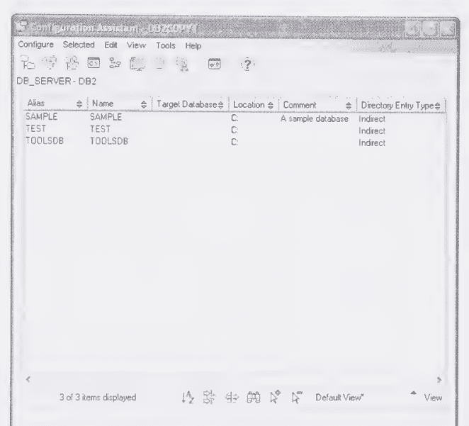

图 5 配置助手

命令行处理器 (CLP) 是一个面向文本的应用程序，允许用户发布 DB2 命令、系统命令和 SQL 语句，并查看执行语句/命令的结果。命令行处理器可以用三种模式运行。

- **命令模式。** 当命令行处理器以命令模式运行时，用户只需在系统提示符处通过 `db2` 字符输入 DB2 命令或 SQL 语句。例如，命令 `CONNECT TO sample`。如果命令包含对所用系统具有特殊含义的字符，必须用引号括起来以确保其正确执行（例如，`db2 SELECT COUNT(*) FROM employee`）。如果要执行的单行命令过长无法容，可以在行尾放置一个空格后跟行延续连接符 (^)，这样命令的其余部分就可以新行继续。

- **交互模式。** 当命令行处理器以交互式输入模式运行时，系统会自动提供 `db2` 前缀（特征为每个执行的命令/SQL 语句显示 `db2 =>` 输入提示符）。要在交互输入模式下运行命令行处理器，只需在系统提示符处输入命令 `db2`。要退出交互模式，在命令行处理器提示符处输入命令 `quit`。除此之外，适用于命令行处理器命令模式的规则也适用于交互输入模式。

- **批模式。** 当命令行处理器处于批模式时，假设所有要执行的命令和 SQL 语句都存储在一个 ASCII 格式的文本文件中。运行批处理时，命令 `db2` 不应放在存储在该文件中的命令/语句之前。要在批模式下运行命令行处理器，只需在系统提示符处输入命令 `db2 -f xxxxxxx`（其中 xxxxx 是包含要执行命令集的文件名）。

图 6 显示了命令行处理器在 Windows 服务器上处于交互输入模式下的外观。

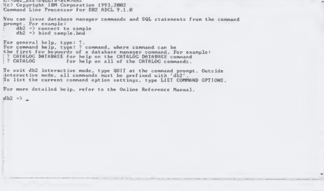

图 6 命令行处理器（交互式输入模式）

在调用命令行处理器时，可以指定各种命令行选项；可以通过在系统提示符或命令行处理器提示符（当命令行处理器以交互输入模式运行时）执行命令 `LIST COMMAND OPTIONS` 来获取所有可用选项列表。

Linux、UNIX 和 Windows 版 DB2 9.5 将世界视为一个分层的对象结构。安装 DB2 的工作站（或服务器）占据了该层级结构的最高层。在安装过程中，名为 DB2 管理器（DB2 Manager）的后台进程程序文件会被物理复制到服务器上的特定位置，并创建一个 DB2 数据库管理器实例。（特定系统的默认实例由环境变量 `DB2INSTANCE` 定义，这是大多数操作所使用的实例。）

实例占据层级结构的第二层，负责管理其控制范围内的系统资源和数据库。虽然最初只创建一个实例，但可以存在多个实例。每个实例的行为都像是一个独立的 DB2 安装程序，尽管系统内的所有实例都共享相同的 DB2 管理器程序文件（除非每个实例运行不同版本的 DB2）。尽管多个实例共享相同的二进制代码，但每个实例都独立于其他实例运行，并拥有自己的环境，可以通过修改其关联配置的内容进行更改。

每个实例控制对一个或多个数据库的访问；数据库负责数据的存储、修改和检索。与实例一样，数据库之间也是独立工作的。每个数据库都有自己的一套可授予权限和许可，用于管理用户如何与数据以及其控制的数据库对象交互。从用户的角度来看，数据库是用于存储数据的表集合（最好以某种方式相关联）。然而，从数据库管理员的角度来看，DB2 9.5 数据库远不止于此；数据库是一个由许多物理和逻辑组件组成的实体。其中某些组件有助于确定数据的组织方式，而另一些组件则决定数据的存储位置。第 30 页的图 7 显示了系统、实例和数据库之间的层次关系。

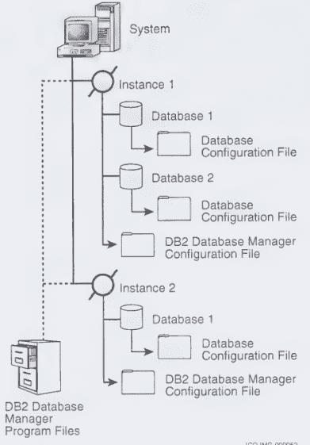

图 7 系统、实例和数据库之间的层次关系

### 1.3.1 DB2 管理服务器 (DAS) 实例

随 DB2 提供的工具（如控制中心和配置助手）需要一个独立于且与工作站定义的其他实例并发运行的实例。出于因此，在 DB2 安装过程中还会创建一个名为 DB2 管理服务器 (DAS) 实例的特殊实例。与其他实例不同，单个工作站上只能存在一个 DAS 实例（DB2 全局配置注册表 `DB2ADMIN` 包含了特定工作站定义的 DAS 实例名称）。

注意：要从远程客户端管理服务器，用户必须对使用的 DAS 实例具有系统管理员 (SYSADM) 权限，且数据库已在工作站上注册；此外，对于远程实例和数据库，用户必须拥有执行管理任务的权限和许可。

除了能够远程管理 DB2 服务器外，DAS 实例还协助控制中心和配置助手：

- 提供作业（任务）管理，包括调度和运行包含 DB2 命令和操作系统命令的用户自定义脚本/批处理文件。
- 调度作业、查看已完成作业的结果，并对远程或本地执行的作业执行管理任务（通过使用任务中心）。
- 通过 DB2 发现功能提供有关其他 DAS 实例、DB2 实例和数据库配置信息的方法。（配置助手和控制中心使用此类信息来简化和自动化客户端到 DB2 服务器的配置；如果该服务器的 DAS 实例未运行，任一工具都无法“发现”该服务器。）

DB2 9.5 使用了逻辑和物理存储模型，这些模型由不同但相互相关的对象组成。存在四类对象，它们是：

- **系统对象。** 系统对象由注册表变量、实例配置文件和单个数据库配置文件组成。注册表变量在系统级别设置，并可以影响驻在特定服务器上的任何实例：实例配置文件（也称为 DB2 数据库管理器配置文件）在实例创建过程中创建并分配给单个实例。配置文件中的值控制了如何为特定实例分配资源，且对这些值的更改会影响受该实例控制的每一个数据库。同样，数据库配置文件在数据库创建过程中创建并分配给单个数据库。数据库配置中的值控制了如何为该特定数据库分配资源，对这些值的更改可能会影响性能和资源利用率。

- **恢复对象。** 恢复对象由事务日志文件和恢复历史文件组成。这些文件在创建数据库时自动创建。恢复日志文件与数据库备份映像和事务日志结合一起使用，以协调数据库操作。恢复历史文件包含有关每次执行的备份操作的信息，而事务日志则包含了最近执行的数据库操作记录。如果数据库从应用程序、用户或系统错误中恢复，可以重放事务日志文件中的事件，将数据库恢复到一致且稳定的状态，或者恢复到错误发生时间点之前的状态——即启用前滚恢复（roll-forward recovery）。你无法直接修改事务日志文件或恢复历史文件；但你可以控制事务日志文件的物理存储位置。

- **存储对象。** 存储对象控制数据的物理存储位置，以及在正常运行期间数据在存储和内存之间的移动方式。使用了三种类型的存储对象，它们是：

  - **缓冲池（Buffer pools）。** 缓冲池是内存的一个区域，专门用于缓存从物理存储中读取的数据页。当需要数据来解析查询时，会在物理存储中定位数据页并将其传输到缓冲池，并在其中进行读取或修改。如果页面被修改，它最终会被复制回物理存储；但在所有数据库的连接终止之前，该空间将保持被占用。此外，每当检索页面时，DB2 数据库管理器都会使用一组启发式算法来确定哪些页面将是需要的，并同时检索这些页面（这被称为预取）。页面滞留和预取是为了提高整体性能；存储在内存中的数据访问速度远比存储在磁盘上快。

  - **容器（Containers）。** 容器是 DB2 数据库管理器保留访问权限的某种物理存储形式。容器可以是可能存在也可以不存在的目录、可能存在也可以不存在的固定大小预分配文件，可以是操作系统识别的物理（原始）设备。（在 Linux 和 UNIX 操作系统上，设备上的物理设备可以是任何使用字符接口的逻辑卷；在 Windows 系统上，可以是任何未格式化的分区或任何物理磁盘）。

  - **表空间（Table spaces）。** 表空间用于控制数据的物理存储位置，并在数据库对象（如表、索引和视图）与实际存储对象一个或多个容器（即目录、文件或原始设备）之间提供一个间接层。单个表空间可以跨多个容器，但每个容器只能属于一个表空间。

- **数据（或数据库）对象。** 数据对象——又称为数据库对象——用于逻辑地存储和操作数据，并控制所有用户数据（以及某些系统数据）的组织方式。数据对象包括表、索引、视图、别名、模式、触发器、用户定义类型、用户定义函数和序列。

创建 DB2 9.5 数据库有两种方法：使用创建数据库向导（Create Database Wizard）或使用 `CREATE DATABASE` 命令。在 `CREATE DATABASE` 命令的最简单形式下，其语法如下：

```sql
CREATE [DATABASE] [DatabaseName]
```

其中：

- Database — 指定创建后分配给数据库的唯一名称
- 可以由 a-z、A-Z、0-9、$ 和 _（下划线）字符组成
- 不能以数字开头
- 不能以 `SYS`、`DB` 或 `IBM` 开头
- 不能与该实例内的任何数据库名称相同

当执行此 `CREATE DATABASE` 命令时，数据库的特性（如存储位置）由默认值决定。如果你希望更改这些默认特性，必须使用更复杂的 `CREATE DATABASE` 命令。

如果你倾向于使用图形用户界面，可以使用创建数据库向导来构建数据库（创建数据库向导设计用于收集信息，然后创建具有这些特性的数据库）。通过在控制中心（Control Center）中选择相应的项目来启动创建数据库向导。第 35 页的图 8 显示了必须选择以激活创建数据库向导的控制中心菜单；第 36 页的图 9 显示了首次启动时创建数据库向导的界面。

![img/9d79d79aef40e6535a55940911009e_36_0.png] 图8 从控制中心调用创建数据库向导

创建 9.5 数据库 35

![img/9d79d79aef40e6535a55940911009e_37_0.png] 图9

创建数据库向导的第一部分

一旦显示数据库向导，你只需按照每个面板上显示的说明来定义要创建的数据库特性。当你为 DB2 数据库管理器提供了足够的信息时，向导右下角的“完成”按钮（见图 9）将可用。点击此按钮后，将根据提供的信息创建数据库。

无论如何启动过程，每当创建一个新的 DB2 9.5 数据库时，都会按顺序执行以下任务：


1. 在相应位置创建所有所需的目录和子目录。每个 DB2 数据库的信息都存储在一个特殊的层次目录树中。该树的实际创建位置由`CREATE DATABASE`命令提供的信息决定——如果没有提供位置，则在与创建数据库的实例相关的`dfpath`数据库管理器配置参数所指定的位置创建。该树的根目录被分配为实例名称。该目录将包含一个对应分区的子目录。如果数据库是分区数据库，该目录将命名为`NODEXXXX`，其中`XXXX`是分配给分区的唯一数字；如果数据库是非分区数据库，该目录将命名为`NODE0000`。节点名称目录，在该目录将为每个已创建的数据库包含子目录，其中一个子目录包含用于存放数据库数据的容器。

用于存放数据库数据容器的子目录名称与为数据库指定的名称相同；包含数据库基础文件的子目录名称与在创建过程中分配给数据库的令牌（`token`）相对应（第一个数据库的子目录将命名为`SQL00001`，第二个数据库的子目录命名为`SQL00002`，依此类推）。

图 10 展示了这种目录层次结构在非分区数据库环境中典型的样貌。

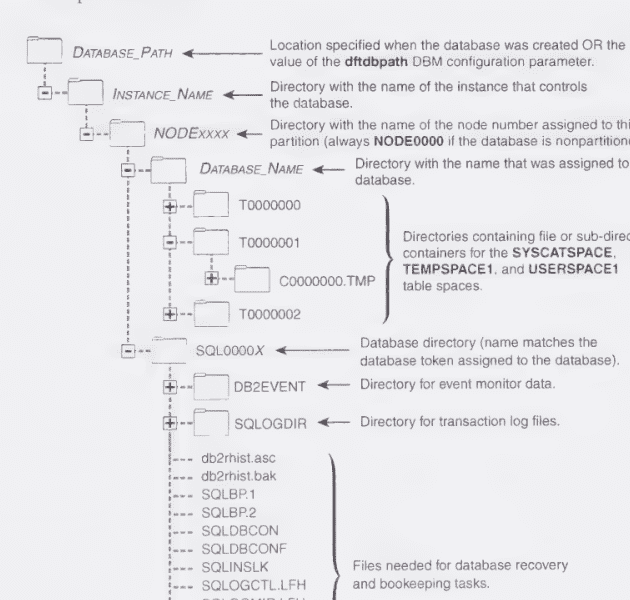

## 重要

切勿尝试修改此目录结构或存储其中的任何文件。此类操作可能会破坏一个或多个数据库或导致它们无法使用。

系统会创建用于管理、监控和数据库恢复的文件。

在分配了数据库令牌名称的子目录创建后，该目录中会创建以下文件：

- `db2rhist.asc` — 此文件包含有关备份操作、恢复操作、表加载操作、表重组操作、空间分配以及类似的数据库更改的历史信息（即恢复历史文件）。
- `db2rhist.bak` — 此文件是`db2rhist.asc`的备份副本。
- `SQLBP.1` — 此文件包含缓冲池信息。
- `SQLBP.2` — 此文件是`SQLBP.1`的备份副本。
- `SQLDBCON` — 此文件包含数据库配置信息。
- `SQLDBCNF` — 此文件包含用于确保数据库仅分配给 DB2 Manager 的一个实例的信息。
- `SQLOGCTL.LFH` — 此文件包含有关活动事务日志文件的信息。恢复操作使用此文件中存储的信息来确定从日志回溯多远开始恢复过程。
- `SQLOGMIR.LFH` — 这是`SQLCTL.LFH`的镜像副本。
- `SQLGSF.1` — 此文件包含与自动存储相关的存储路径。
- `SQLGSF.2` — 此文件是`SQLGSF.1`的备份副本。
- `SQLSPCS.1` — 此文件包含表空间信息。
- `SQLSPCS.2` — 此文件是`SQLSPCS.1`的备份副本。
- `SQLTMPLK` — 此文件包含有关临时表空间的信息。

创建两个子目录`DB2EVENT`和`SQLLOGDIR`；并创建命名为`S0000000.LOG`、`S0000001.LOG`和`S0000002.LOG`的详细事件监器文件，存储在`SQLLOGDIR`目录中。这三个文件用于在对数据库执行 SQL 操作时存储事务记录。

为数据库创建一个缓冲池。

在数据库创建过程中，会创建一个缓冲池并将其命名为`IBMDEFAULTBP`。在默认情况下，在 Linux 和 UNIX 平台上，此缓冲池的大小为 1,000 KB（千字节）页；在 Windows 平台上，此缓冲池的大小为 250 KB 页。此缓冲池（以及可能存在的任何其他缓冲池）实际使用的内存是在建立到数据库的第一个连接时分配的，并在所有到数据库的连接都终止时释放的。

创建两个普通表空间和一个临时表空间。

在创建缓冲池`IBMDEFAULTBP`之后，会创建三个表空间并将它们与该缓冲池关联。这三个表空间如下：

- 一个名为`SYCSSPACE`的普通表空间，用于存储与数据库相关的系统目录表和视图
- 一个名为`USERS1`的普通表空间，用于存储所有用户定义对象（如表、索引等）以及用户数据
- 一个名为`TEMPSPACE1`的系统临时表，用于数据排序、表重组和创建索引等操作的临时存储区域

除非另有说明，`SYSCSPACE`和`USERSPACE1`是 DMS FILE 表空间，`TEMSPACE1`是 SMS 表空间；这些每个表的特征可以作为`CREATE DATABASE`命令或数据库创建向导的输入。

5. 创建系统目录表和视图。

在创建表`SYSCSPACE`后，在该表内部构造了一组特殊的表，称为系统目录表。DB2 数据库管理器使用系统目录表来跟踪对象定义、数据库对象依赖关系、数据库对象权限、列数据类型、表约束和对象关系等信息。在创建系统目录表的同时，还会创建一组系统目录视图，这些视图通常用于访问存储在系统目录表中的数据。系统目录表和视图无法通过 SQL 语句进行修改（但可以查看其内容）。相反，每当发生以下事件之一时，DB2 Manager 都会对其进行修改：

- 创建、更改或删除数据库对象（如表、视图或索引）。
- 授予或撤销授权或权限。
- 为表收集统计信息。
- 将包（`Packages`）绑定到数据库。

在大多数情况下，当对象创建时，数据库对象的完整特征都存储在一个或多个系统目录表中。然而，在某些情况下（例如定义触发器和约束时），用于创建该对象的实际 DB2.5 SQL 会存储在内部。

6. 在系统和本地数据库目录（创建的系统或本地数据库目录）中对数据库进行编编。

DB2 数据库管理器使用系统目录表来跟踪对象定义、数据库对象依赖关系、数据库对象权限、列数据类型、表约束和对象关系等信息。在创建系统目录表的同时，还会创建一组系统目录视图，这些视图通常用于访问存储在系统目录表中的数据。系统目录表和视图无法通过 SQL 语句进行修改（但可以查看其内容）。相反，每当发生以下事件之一时，DB2 Manager 都会对其进行修改：

- 创建、更改或删除数据库对象（如表、视图或索引）。
- 授予或撤销授权或权限。
- 为表收集统计信息。
- 将包（`Packages`）绑定到数据库。

在大多数情况下，当对象创建时，数据库对象的完整特征都存储在一个或多个系统目录表中。然而，在某些情况下（例如定义触发器和约束时），用于创建该对象的 DB2.5 SQL 会存储在内部。

7. 初始化数据库的配置文件。

数据库配置文件中的某些参数（如代码集、区域和排序顺序）将使用`CREATE DATABASE`命令或数据库创建向导的输入进行设置，其他则分配系统默认值。

## Linux, UNIX 和 Windows 版 DB2 9.5 简介

除非另有说明，`SYSCSPACE`和`USERSPACE1`是 DMS FILE 表空间，`TEMSPACE1`是 SMS 表空间；这些每个表的特征可以作为`CREATE DATABASE`命令或数据库创建向导的输入。

8. 创建模式。

模式用于在逻辑上分类和分组数据库中的其他对象。一旦创建了系统目录表和视图，将创建以下模式：`SYSIBM`、`SYSCAT`、`SYSSTAT`和`SYSFSUN`。名为`SYSIBM`的特殊用户是每个模式的所有者。

9. 将一组实用程序绑定到数据库。

某些可用于数据库的 DB2 实用程序需要创建包。此类包通过绑定一组预定义的 DB2 绑定文件来创建（使用的绑定文件存储在数据库`db2bind.lst`中）。

10. 向适当的用户授予权限。

要连接并使用特定的数据库，用户必须拥有该数据库所需的权限。因此，除非另有说明，每当创建一个新数据库时，都会授予以下权限：

- 数据库管理员 (DBADM) 权限以及 CONNECT、CREATAB、BINDADD、CREATE_NOT_FENCED、IMPLICIT_SCHEMA 和 LOAD 权限授予创建数据库的用户。
- 表空间`USSPACE1`的 USE 权限授予组
- CONNECT、CREATAB、BINDADD 和 IMPLICIT_SCHEMA 权限授予组组
- 每个系统目录表的 SELECT 权限授予 PUBLIC 组
- `SYSIBM`模式中找到的所有过程的 EXECUTE 权限授予 PUBLIC 组
- `SYSFUN`模式中所有函数的 EXECUTE WITH GRANT 权限授予 PUBLIC 组
- 为每个成功绑定的实体 BIND 和 EXECUTE 权限授予 PUBLIC 组。

11. 启用若干自动功能。

为了方便管理，每当创建一个新数据库时，都会启用以下自动功能：

- 自动维护（数据库备份、表和索引重组、数据访问优化和统计分析）
- 自调优内存管理器（包缓存、锁定内存、排序内存、数据库共享内存和缓冲池内存）
- 实用程序节流
- 健康监器

12. 启动配置顾问。

配置顾问工具旨在根据您提供的数据库信息建议修改哪些配置参数，从而帮助您调整性能并平衡内存需求。在 DB2 9 中，每当您创建数据库时，都会调用配置顾问，除非通过将`DB2_ENABLE_AUTONFIG_DEFAULT`注册表变量赋值为 NO 来更改默认行为。

早些时候，我们看到表空间用于控制数据的物理存储位置，并在数据库对象（如表、索引和视图）与一个或多个容器（如目录、文件或原始设备，即对象数据实际所在的地方）之间提供了一个间接层。数据以 4 KB、8 KB、16 KB 或 32 KB 块（称为*页*，`pages`）的形式在容器与之间之间传输；当一个表空间跨越多个容器时，数据会以称为*区*（`extents`）的页为组，以轮询方式写入分配给该表空间的每个容器。这有助于在所有用到的容器之间平衡数据。图 11 显示了页、区和表容器之间的关系。

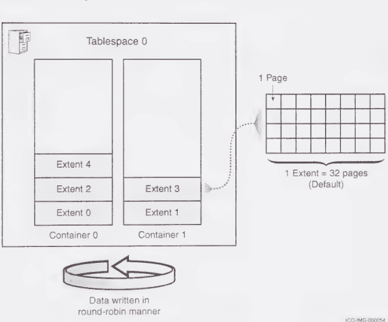

图 11 数据如何写入表空间容器

> 注意：当使用多个容器存储一个表空间的数据时，每个容器能容的最大数据量由最小的容器决定。例如，如果一个表空间使用一个 10 MB（兆字节）的容器和另一个大小为 12 MB 的容器，则第二个容器的 2 MB 将无法使用；该表空间可用的最大存储量将为 20 MB。因此，应尽可能保持容器相等。

可以存在两种类型的表空间：系统管理空间（SMS）表空间和数据库管理空间（DMS）表空间。对于 SMS 表空间，只能使用目录容器进行存储，并由操作系统的文件管理器负责控制该空间的使用方式。SMS 存储模型由许多文件组成（每个文件代表一个表、索引或长数据对象），这些文件存在于文件系统中——用户决定文件的位置，DB2 数据库管理器分配文件，而文件系统负责管理它们的增长。对于 DMS 表空间，可以使用文件和/或设备容器进行存储，由 DB2 数据库管理器负责控制该空间的使用方式。在 DB2 9.5 中，DMS 表中对象的初始空间分配为两个区；SMS 表中对象的初始空间分配为一个区。SMS 和 DMS 表空间之间的其他差异可见表 1。

| SMS 表空间 | DMS 表空间 |
|---|---|
| 空间由操作系统的文件管理器分配和管理。 | 空间在指定时，由 DB2 数据库管理器分配和管理。 |
| 只能使用目录容器进行存储；不能使用文件和设备容器。 | 可以使用文件或设备容器作为存储；不能使用目录容器。 |
| 表空间创建后，无法添加额外的容器（使用`ALTERSPACE` SQL 语句）。 | 表空间创建后，可以为其添加额外的容器。当添加新容器时，现有数据会自动在新的容器集中进行重新平衡，以保持最佳的 I/O 效率。 |
| 按照需要分配空间。 | 预分配空间。 |
| 表空间创建后，无法更改容器的大小。 | 表空间创建后，可以增加或减少容器的大小。 |
| 常规数据和长数据存储在同一个表空间中。 | 常规数据和长数据可以分散在多个空间中（常规数据可以位于表空间中，而长数据位于其他空间中）。 |
| 表空间更容易创建和管理。 | 表访问速度略慢，但整体性能更好。 |

SMS 和 DMS 表空间都根据它们旨在存储的数据类型进行分类，分为三类：常规、长和临时。常规数据和索引数据存储在常规表空间中，而长字段和大型对象数据存储在大型表空间中——前提是使用了表空间。临时表空间进一步分为系统临时或用户临时。系统临时空间用于存储执行某些操作时产生的数据（例如排序、重组表和创建索引），而用户临时空间用于存储特定的全局临时表。

如果数据库启用了自动存储，就可以存在另一种类型的表空间——自动存储表空间。乍一看，自动存储表空间是 SMS 和 DMS 表空间的扩展：常规和大型表空间作为 DMS 表空间创建；而系统和用户临时表空间作为 SMS 表空间创建。与 SMS 表空间不同，自动存储表空间不需要容器定义；DB2 数据库管理器会自动分配容器。

之前提到，当创建 DB2 数据库时，会创建一个名为`IBMDEFAULT`的缓冲池，并作为数据库初始化过程的一部分创建三个与之关联的表空间。这三个表空间对于小型数据库已经足够；然而，大型数据库通常由许多缓冲池和表空间对象组成。可以通过执行`CREATE TABLE` SQL 语句或使用表空间向导来创建额外的表空间，表空间向导可以通过从控制中心的表空间菜单中选择相应的操作来激活。图 11 显示了激活表空间向导必须选择的控制中心菜单项；第 44 页的图 13 显示了创建表空间向导的第一页可能的样子。

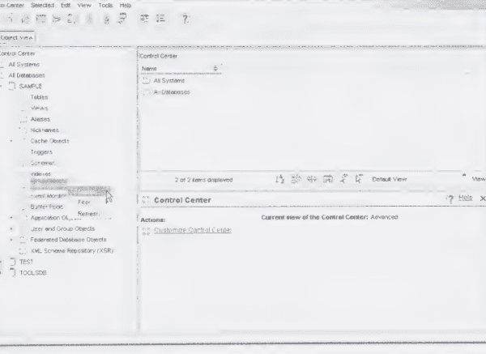

图 12 从控制中心调用创建表空间向导

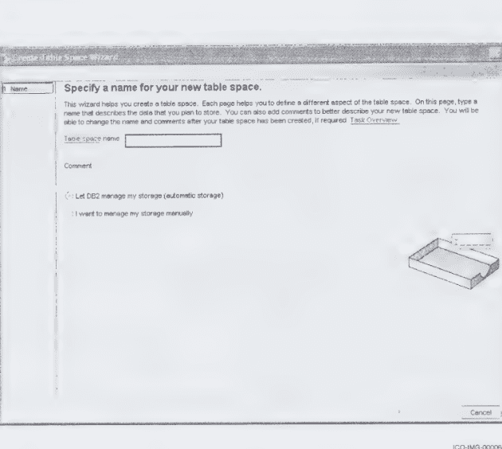

图 13 创建表空间向导的第一页

## 1.6.2 修改现有表空间

由于 SMS 表空间依赖操作系统进行物理空间管理，在成功创建后很少需要修改。另一方面，必须密切监控 DMS 表空间，以确保用于存储的固定大小预分配文件或原始设备始终有可用空间满足数据库需求。当 DMS 表空间的可用空间变得非常低（通常小于 10%）时，可以通过增加其一个或多个容器的大小或向其添加一个或多个容器来增加可用空间。通过执行`ALTER TABLESPACE` SQL 语句，可以调整现有表的大小，为现有表空间提供新容器，并更改现有表空间的属性。还可以使用更改表空间对话框更改表空间，该对话框可以通过从控制中心的表空间菜单中选择相应的操作来激活。

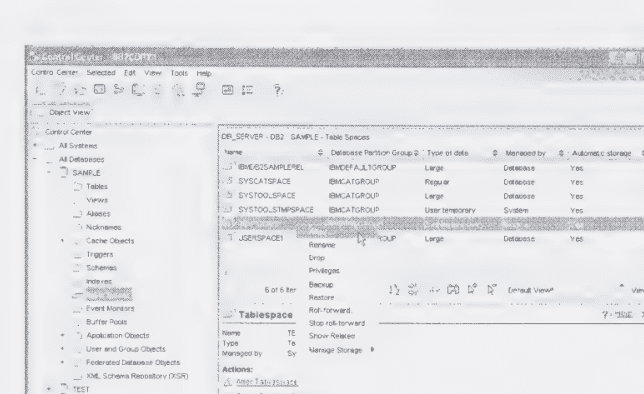

图 14 从控制中心调用修改表空间（Alter Table Space）对话框

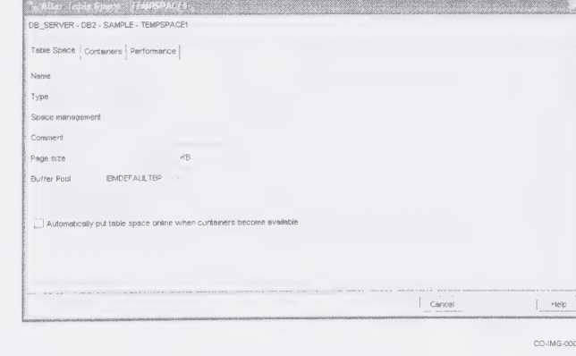

图 15 修改表空间对话框的第一页

## 更深入地审了解表空间

此前，我们看到，如果数据库启用了自动存储空间，则其表空间的容器-空间-管理特性由 DB2 数据库管理器决定。虽然可以使用`ALTER TABLESPACE`命令为现有的 DMS（数据库存储器）表空间添加新容器，但它无法用于为自动存储空间添加新容器。那么，在数据库创建后，你如何向用于自动存储表空间的路径集合中添加新的存储呢？要执行此类操作，你必须使用`ALTER DATABASE`语句。该语句的基本语法如下：

```
ALTER DATABASE [DatabaseName]
ADD STORAGE '/[Container1]', ...
```

其中：

- *DatabaseName* — 通过名称标识数据库，该数据库将在其用于自动存储的容器池中添加新容器。
- *Container* — 标识一个或多个新的存储位置（容器），这些位置将向添加到用于自动存储表空间的存储位置集合中。

因此，如果你想为名为 SAMPLE 的、配置了自动存储且运行在 UNIX 系统上的数据库添加存储位置`/data/path1`和`/data/path2`，可以通过执行如下所示所示的`ALTER DATABASE` SQL 语句来实现：

```
ALTER DATABASE sample
ADD STORAGE '/data/path1', '/data/path2'
```

## 1.7 更深入地审视事务日志

事务（也称为工作单元）是分组组合为单个单元的一个或多个 SQL 操作的序列，通常在应用程序过程中执行。单个事务的启动和终止定义了数据库内部数据一致性的点：要么事务内执行的所有操作的影响都应用于数据库并持久化（提交），要么执行的所有操作的影响都被撤销（回滚），数据库恢复到事务启动之前的状态。

在大多数情况下，事务是在建立数据库连接后首次执行可执行 SQL 语句时启动的，或者在预存事务终止后立即启动。实例可以使用名为“自动提交”（`automatic commit`）的功能进行隐式终止（在这种情况下，每个可执行的 SQL 语句被视为单个事务，如果语句执行成功，则该语句的任何更改将应用于数据库；如果语句失败，则丢弃），也可以通过`COMMIT`或`ROLLBACK` SQL 语句显式终止。

事务日志是一个用于跟踪事务在发生时对数据库所更改的过程。每执行一次更新或删除操作，包含要更新/删除记录的页面将从存储中检索并复制到相应的缓冲区池中，在那里由更新/删除操作进行修改。（如果通过插入创建了新记录，则该记录将直接在相应的缓冲区池中创建。）一旦记录被修改（或插入），反映该修改/插入的记录就会写入日志缓冲区，日志缓冲区本身是内存中的一个指定存储区域。（日志缓冲区的实际内存大小由`logdatabase`配置参数控制。）如果执行了插入操作，则一个包含新行的记录将被写入日志缓冲区；如果执行了删除操作，则一个包含行原始值的记录将被写入日志缓冲区；如果执行了更新操作，则原始值被行的新值覆盖，并写入日志缓冲区。（如果没有发生替换，则将使用“之前”行和“之后”行执行异或（Exclusive OR）操作，并将结果写入日志缓冲区。）此类记录以及指示事务是负责提交还是回滚更改的记录，构成了日志缓冲区中存储的大部分记录。

当缓冲区 I/O 页面被清除时（I/O 页面清理程序是负责按预定义间隔写入修改页面的特殊代理）、日志缓冲区变满，或事务终止（通过提交或回滚）时，日志缓冲区中的所有记录都会立即写入一个或多个日志文件。这样做是为了尽可能减少在系统故障时可能丢失的日志记录数量。一旦与特定事务相关的日志记录外部化到一个或多个日志文件中，事务的影响就会记录在数据库中，例如在相应的表空间上执行。修改后的页面保留在内存中，如有需要可以快速访问——最终，当从存储中检索到新的页面时，它们将被覆盖。事务日志过程可以参见第 48 页的图 16。


```
INSERT INTO table1
VALUES (4096, 'CHICAGO')
UPDATE table1
SET coll = 2048
WHERE col2 = 'NEW YORK'
COMMIT
```

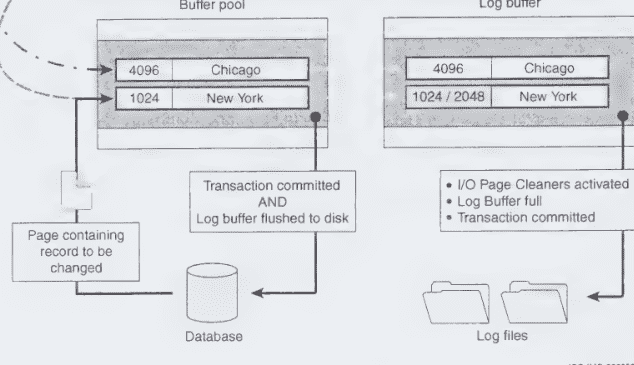


图 16 事务日志过程。指示事务是负责提交还是回滚更改的记录，构成了日志缓冲区中存储的大部分记录。一旦与特定事务相关的日志记录外部化到一个或多个日志文件中，事务的影响就会记录在数据库中，例如在相应的表空间上执行。

此前，我们看到，如果数据库启用了自动存储空间，则其表空间的容器-空间-管理特性由 DB2 数据库管理器决定。虽然可以使用 `ALTER TABLESPACE` 命令为现有的 DMS 表空间添加新容器，但它无法用于为自动存储空间添加新容器。那么，在数据库创建后，你如何向用于自动存储表空间的路径集合中添加新的存储呢？要执行此类操作，你必须使用 `ALTER DATABASE` 语句。该语句的基本语法如下：

```
ALTER DATABASE [DatabaseName]
ADD STORAGE '/[Container1]', ...
```

其中：

- *DatabaseName* — 通过名称标识数据库，该数据库将在其用于自动存储的容器池中添加新容器。

- *Container* — 标识一个或多个新的存储位置（容器），这些位置将添加到用于自动存储表空间的存储位置集合中。

因此，如果你想为名为 SAMPLE 的、配置了自动存储且运行在 UNIX 系统上的数据库添加存储位置 `/data/path1` 和 `/data/path2`，可以通过执行如下所示的 `ALTER DATABASE` SQL 语句来实现：

```
ALTER DATABASE sample
ADD STORAGE '/data/path1', '/data/path2'
```

## 1.7 更深入地审视事务日志

事务（也称为工作单元）是分组组合为单个单元的一个或多个 SQL 操作的序列，通常在应用程序过程中执行。事务的启动和终止定义了数据库内部数据一致性的点：要么事务内执行的所有操作的影响都应用于数据库并持久化（提交），要么执行的所有操作的影响都被撤销（回滚），数据库恢复到事务启动之前的状态。

在大多数情况下，事务是在建立数据库连接后首次执行可执行 SQL 语句时启动的，或者在预存事务终止后立即启动。实例可以使用名为“自动提交”（automatic commit）的功能进行隐式终止（在这种情况下，每个可执行的 SQL 语句被视为单个事务，如果语句执行成功，则该语句的任何更改将应用于数据库；如果语句失败，则丢弃），也可以通过 `COMMIT` 或 `ROLLBACK` SQL 语句显式终止。

事务日志是一个用于跟踪事务在发生时对数据库所更改的过程。每执行一次更新或删除操作，包含要更新/删除记录的页面将从存储中检索并复制到相应的缓冲区池中，在那里由更新/删除操作进行修改。（如果通过插入创建了新记录，则该记录将直接在相应的缓冲区池中创建。）一旦记录被修改（或插入），反映该修改/插入的记录就会写入日志缓冲区，日志缓冲区本身是内存中的一个指定存储区域。（日志缓冲区的实际内存大小由 `logdatabase` 配置参数控制。）如果执行了插入操作，则一个包含新行的记录将被写入日志缓冲区；如果执行了删除操作，则一个包含行原始值的记录将被写入日志缓冲区；如果执行了更新操作，则原始值被行的新值覆盖，并写入日志缓冲区。（如果没有发生替换，则将使用“之前”行和“之后”行执行异或（Exclusive OR）操作，并将结果写入日志缓冲区。）此类记录以及指示事务是负责提交还是回滚更改的记录，构成了日志缓冲区中存储的大部分记录。

当缓冲区 I/O 页面被清除时（I/O 页面清理程序是负责按预定义间隔写入修改页面的特殊代理）、日志缓冲区变满，或事务终止（通过提交或回滚）时，日志缓冲区中的所有记录都会立即写入一个或多个日志文件。这样做是为了尽可能减少在系统故障时可能丢失的日志记录数量。一旦与特定事务相关的日志记录外部化到一个或多个日志文件中，事务的影响就会记录在数据库中，例如在相应的表空间上执行。修改后的页面保留在内存中，如有需要可以快速访问——最终，当从存储中检索到新的页面时，它们将被覆盖。事务日志过程可以参见第 48 页的图 16。

# Linux、UNIX 和 Windows 上的 DB2 9.5 介绍

```
INSERT INTO table1
VALUES (4096, 'CHICAGO')
UPDATE table1
SET coll = 2048
WHERE col2 = 'NEW YORK'
COMMIT
```


图 16 事务日志过程。指示事务是负责提交还是回滚更改的记录，构成了日志缓冲区中存储的大部分记录。一旦与特定事务相关的日志记录外部化到一个或多个日志文件中，事务的影响就会记录在数据库中，例如在相应的表空间上执行。

## 1.8 DB2 9.5 环境

此前，我们看到，如果数据库启用了自动存储空间，则其表空间的容器-空间-管理特性由 DB2 数据库管理器决定。虽然可以使用 `ALTER TABLESPACE` 命令为现有的 DMS 表空间添加新容器，但它无法用于为自动存储空间添加新容器。那么，在数据库创建后，你如何向用于自动存储表空间的路径集合中添加新的存储呢？要执行此类操作，你必须使用 `ALTER DATABASE` 语句。该语句的基本语法如下：

```
ALTER DATABASE [DatabaseName]
ADD STORAGE '/[Container1]', ...
```

其中：

- *DatabaseName* — 通过名称标识数据库，该数据库将在其用于自动存储的容器池中添加新容器。

- *Container* — 标识一个或多个新的存储位置（容器），这些位置将添加到用于自动存储表空间的存储位置集合中。

```
<null>
<-r [InstanceName]>
<-n [DASName] <-u [UserID] <-p [Password]>>>
<-l | -lr>
<-v>
<-ul | -ur>
<-h | -?>
```

其中：

* *Variable*（变量）—— 标识要显示、设置或删除的注册表变量名。

* *Value*（值）—— 标识要赋给指定注册表变量的值。如果没有提供值但指定了注册表变量，则删除该注册表变量。

* *InstanceName*（实例名称）—— 标识与指定的注册表变量关联的实例配置文件。

* *DASName*（DAS 名称）—— 标识存放 DB2 管理实例的节点名称。

* *UserID*（用户 ID）—— 标识将用于连接到 DB2 管理服务器实例的身份验证 ID。

* *Password*（密码）——标识（将用于连接到 DB2 管理服务器实例的身份验证 ID 密码。

此命令的所有其他选项均见表 2。

### db2set 命令选项（第 1 页，共 2 页）

| 选项 | 含义 |

| :--- | :--- |

| -g | 表示要显示、设置或删除全局配置文件变量。 |

| -gl | 表示要显示、设置或删除存储在 LDAP 中的全局配置文件变量。此选项仅在注册表变量 `DB2_ENABLE_LDAP` 设置为 YES 时有效。 |

| -i | 表示要显示、设置或删除实例配置文件变量。 |

| -all | 表示显示下文定义的注册表变量的所有出现情况：环境（由 `[-e]` 标识）、节点级注册表（由 `[-n]` 标识）、实例级注册表（由 `[-i]` 标识）、全局级注册表（由 `[-g]` 标识）。 |

| -null | 表示将指定注册表层级的变量值设置为 NULL（空）。 |

| -r | 表示重置给定实例的配置文件注册表。 |

| -n | 表示指定一个远程 DB2 管理服务器实例名称。 |

| -u | 表示指定一个将用于连接到 DB2 管理服务器实例的身份验证 ID。 |

| -p | 表示提供了身份验证 ID 的密码。 |

| -l | 表示列出所有实例配置文件。 |

| -lr | 表示列出所有支持的注册表变量。 |

### 表 2 db2set 命令选项（第 2 页，共 2 页）

| 选项 | 含义 |

| :--- | :--- |

| -v | 表示以详细模式执行 `db2set` 命令。 |

| -ul | 访问用户配置文件变量。（此参数仅在 Windows 操作系统支持。） |

| -ur | 刷新用户配置文件变量。（此参数仅在 Windows 操作系统支持。） |

| -h | ? | 显示帮助信息。当指定此选项时，将忽略所有其他选项，仅显示帮助信息。 |

需要注意的是，如果在不带选项的情况下执行 `db2set` 命令，将返回一个包含为当前（默认）实例已设置的所有注册表变量及其值的列表。

因此，如果你想查找每个配置文件设置了哪些注册表变量，可以通过执行如下所示的 `db2set` 命令来实现：

```
db2set -all
```

另一方面，如果你想查看所有 DB2 实例的 `DB2_PARALLEL_IO` 注册表变量的当前值，可以通过执行类似所示的 `db2set` 命令来实现：

```
db2set -l DB2_PARALLEL_IO
```

最后，如果你想为服务器上所有 DB2 实例的 `DB2_PARALLEL_IO` 注册表变量分配值 8，可以通过执行如下所示的 `db2set` 命令来实现：

```
db2set -l DB2_PARALLEL_IO
```

# Linux, UNIX, Windows 版 DB2 9.5 介绍

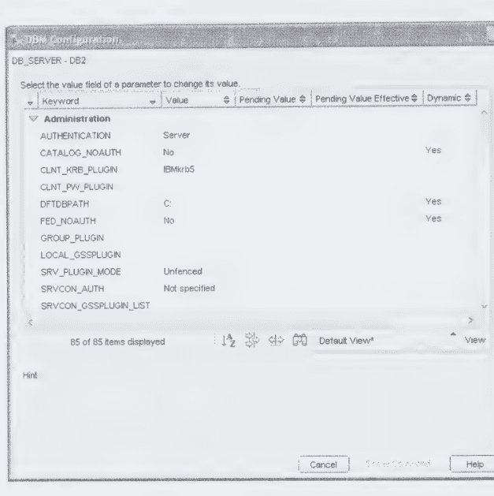

图 20 DBM 配置对话框

### 1.8.3 配置数据库

每当创建一个新实例时，都会创建并初始化 DB2 数据库管理器配置文件；同样，每当创建一个新数据库时，都会创建并初始化数据库配置文件。每个数据库配置文件由约 105 个不同的参数组成。正如 DB2 数据库管理器实例配置参数控制分配给单个 DB2 数据库管理器实例的系统资源量一样，许多配置文件参数控制着在正常运行期间分配给数据库的系统资源量。

可以通过执行 `GET DATABASE CONFIGURATION` 命令来显示特定数据库配置文件的内容。该命令的语法为：

```
GET [DATABASE | DB] [CONFIGURATION | CONFIG | CFG]
FOR [DatabaseAlias]
<SHOW DETAIL>
```

其中：

- *DatabaseAlias* — 指定要显示配置信息的数据库的别名。

在 EMC Symmetrix DMX 上部署 Linux、UNIX 和 Windows 版 DB2

因此，如果您想查看名为 SAMPLE 的数据库的内容，可以执行如下所示 `GET DATABASE CONFIGURATION` 命令：

通过执行 `UPDATE DATABASE CONFIGURATION` 命令可以更改分配给特定数据库配置文件参数的值。其语法为：

```
UPDATE [DATABASE | DB]
[CONFIGURATION | CONFIG | CFG]
FOR [DatabaseAlias]
USING [[Parameter] [Value] |
[Parameter] [Value] AUTOMATIC |
[Parameter] AUTOMATIC |
[Parameter] MANUAL, ...]]
<IMMEDIATE | DEFERRED>
```

其中：

- *DatabaseAlias* — 指定要修改配置信息的数据库的别名。

- *Parameter* — 指定要修改其值的一个或多个数据库配置参数（通过关键字）。（在许多情况下，参数的关键字与参数名称本身相同。）

- *Value* — 指定要给所指定的数据库配置参数分配的新值。

再次强调，如果将参数的值指定为 `AUTOMATIC` 关键字，DB2 将自动调整参数值以反映当前的资源需求。如果在指定 `AUTOMATIC` 关键字的同时指定了值，则提供的值可能会影响执行的自动计算。

如果在执行 `UPDATE DATABASE CONFIGURATION` 命令时指定了 `DEFERRED` 子句，则在所有到相应数据库的连接终止并建立新连接之前，对数据库配置文件的更改不会生效。如果指定了 `IMMEDIATE` 子句，或者未指定任何一个，则对数据库配置文件的所有更改将立即生效——前提是可用所需的资源。（在数据库配置更改期间针对数据库运行的应用程序将在下次执行 SQL 语句时看到更改。）

所以，如果您想配置一个名为 SAMPLE 的数据库，让任何连接到数据库的应用程序在回滚当前事务之前最多等待 10,000 秒以获取锁，可以执行如下所示 `UPDATE DATABASE CONFIGURATION` 命令：

```
UPDATE DB CFG FOR sample USING LOCKTIMEOUT 10000
```

您可以使用数据库配置对话框来查看或更改数据库配置文件的内容，可以通过从控制中心（Control Center）的数据库菜单中选择“配置参数”（Configure Parameters）操作来激活。第 58 页的图 21 显示了激活数据库配置对话框必须选择的控制中心菜单项；第 59 页的图 22 显示了该对话框在激活后的外观。

# Linux, UNIX, 和 Windows 版 DB2 9.5 介绍

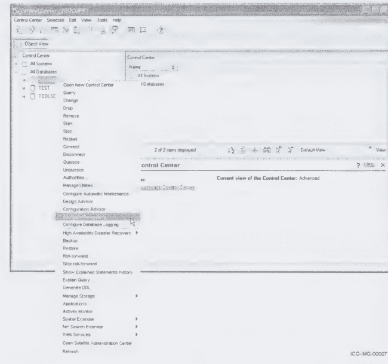

图 21 从控制中心调用数据库配置对话框

# Linux, UNIX, 和 Windows 版 DB2 9.5 介绍

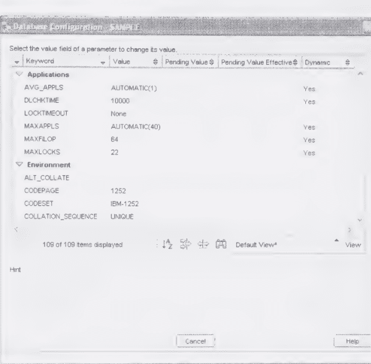

图 22 数据库配置对话框

# 2 EMC 基础产品

本章介绍了本文中讨论的 EMC 基础产品，并提供了一种适用于 Symmetrix 和开放系统组合环境解决方案：

- 2.1 引言 ................................................................. 62

- 2.2 EMC Symmetrix DMX.................................................................. 64

- 2.3 EMC Solutions. Enabler基础管理 ................ 65

- 2.4 EMC Change Tracker................................................................ 66

- 2.5 EMC Symmetrix Remote Data Facility ............................ 67

- 2.6 EMC TimeFinder.................................................................. 80

- 2.7 EMC Storage Resource Management ........................ 89

- 2.8 EMC PowerPath ................................................................ 92

## 2.1 引言

EMC® 提供了许多支持 Symmetrix® 系统上应用环境的硬件和软件产品。以下重点介绍并讨论的产品已在适用于 Linux、Unix 和 Windows 的 DB2 中使用/或经过测试。

EMC Symmetrix — Symmetrix 系统具有高水平性能、数据完整性、可靠性和可用性。本章将对所使用的 EMC 产品进行技术概述。

EMC Symmetrix — EMC 提供广泛的高端存储解决方案产品，旨在满足关键任务数据库和应用程序的需求。Symmetrix 系统是全冗余、高可用的存储处理器，提供非中断的组件更换和代码升级。

EMC Infinity 环境 — 以前代 Symmetrix 系统之间的 Infinity 互操作性使其能够连接到大量的服务器类型、操作系统以及各种网络连接元件（从 HBA 和驱动程序到交换机和磁带系统）。

EMC Solutions Enabler — Solutions Enabler 是一个包含 SYMAPI 运行时库和 SYMLCI 命令接口的包。SYMAPI 提供指向 Infinity 环境的接口。SYMLCI是一组可以从命令行或脚本中调用的命令。这些命令用于监控设备配置和状态，并对存储复内的设备和数据对象执行控制操作。

- SRDF 组件扩展了 Solutions Enabler 的 SYMLCI 命令集，包含了专门管理 SRDF 的命令。

EMC SRDF 一致性组 — SRDF 一致性组是相关 Symmetrix 设备的集合，协同维护数据完整性。一致性组中的设备可以跨多个 Symmetrix 系统。

EMC TimeFinder — TimeFinder 家族产品能够在单个 Symmetrix 系统实现基于 Linux 的复制。数据使用阵列资源从 Symmetrix 设备复制，不占用 CPU 或 I/O。在创建副本时，源 Symmetrix 设备保持在线进行常规 I/O 操作。TimeFinder 家族拥有三个独立的软件产品：TimeFinder/Mirror、Clone 和 TimeFinder/Snap：


`TimeFinder/Mirror`允许用户配置特定的业务连续性卷（BCV），创建`Symmetry`设备的镜像。通过BCV，`TimeFinder`创建一个可以重新利用的时间点副本。`TimeFinder/Mirror`组件扩展了`Solutions Enabler`的基础`SYMLCI`命令集，包含了专门管理`Symmetry` BCV和标准设备的命令。

`TimeFinder/Clone`允许用户从单个源设备在多个目标设备上同时制作数据。数据在激活后立即可用，即使过程尚未完成。数据可以从单个源设备复制到多16个目标设备。源设备可以是`Symmetry`标准设备或`TimeFinder` BCV。

`TimeFinder/Snap`允许用户在`Symmetrix DMX`阵列配置特殊设备，称为虚拟设备（VDEV）和保存设备（SAVDEV）。这些设备可用于从单个源设备同时在多个目标设备上创建基于指针的节省空间的数据副本。数据在获取后立即可供目标设备主机使用。数据可以从单个源设备复制到多达128个VDEV。源设备可以是标准设备也可以是`TimeFinder` BCV设备。目标设备是VDEV，而SAVDEV是用于存储源设备或目标设备变化内容的虚拟设备。

`EMC Change Tracker` — `EMC Change Tracker`软件测量`Symmetrix`卷或卷组上数据的变化。`Change Tracker`软件通常用作规划工具，用于分析和设计使用`EMC TimeFinder`或`SRDF`组件在远程站点存储数据的配置。

解决方案启用器（`Solutions Enabler`）存储资源管理（SRM）组件 — SRM组件扩展了`Solutions Enabler`的基础`SYMLCI`命令集，包含了允许用户系统地查找和检查主机、指定关系型数据库或`EMC`企业级存储中各种对象属性的命令。SRM命令为关系型数据库、文件系统、逻辑卷和卷组提供了映射支持以及性能统计。

`EMC PowerPath` — `PowerPath`是一种基于主机的软件，提供I/O路径管理。`PowerPath`在多个存储系统、多个企业级操作系统上运行，并提供对主机应用程序和数据库透明的故障转移和负载均衡。

## 2.2 EMC Symmetrix DMX

所有`Symmetrix`系统都提供高级数据复制能力、对大型机和开放系统的全面支持以及灵活的连接选项，包括光纤、`FICON`、`ESCON`、千兆以太网和`iSCSI`。

`Symmetrix`存储系统之间的互操作性允许客户将存储解决方案从一代迁移到下一代，在需求扩大的同时保护其投资。

`Symmetrix DMX`增强缓存定向技术支持多个全局内存定向，允许配置包含数百GB全局内存的内容。请参阅相应的`EMC Symmetrix DMX`产品指南获取有关全局内存设备类型和允许的最大内存量的信息。

`Symmetrix`板载数据完整性功能包括：

- 连续的缓存和磁盘数据完整性检查以及错误检测/纠正
- 故障隔离
- 非中断性硬件和软件升级
- 自动诊断和电话告警（`phone-home`）能力

在软件层面，高级完整性功能确保信息始终受到保护并可用。通过选择`RAID 1`（镜像）、`RAID 1+0`、高性能`RAID 5`（3+1和7+1）以及`RAID 6`保护，用户可以灵活选择最符合信息价值和性能要求的保护级别。`Symmetrix DMX`是`EMC`提供的最新一代高端存储解决方案。

从主机操作系统的角度来看，`Symmetrix`系统表现为通过一个或多个I/O控制器连接的多个物理设备。主机操作系统使用物理设备名称对这些设备进行寻址。每个物理设备包含属性、供应商ID、产品ID、修订级别和序列ID。主机物理设备映射到`Symmetrix`设备。反之，`Symmetrix`设备是物理磁盘部分称为“超卷”（`hypervolume`）的虚拟表示。

## 2.3 EMC Solutions Enabler 基础管理

`EMC Solutions Enabler`软件包件包含所有基础管理软件，为主机提供`SYMAP1`共享库和基础`Symmetrix`命令行界面（`SYMLCI`）。`Solutions Enabler`（`SYMLCI`）系列中的其他可选子组件允许用户扩展`Symmetrix`系统的功能。三个主要组件是：

- `Solutions Enabler SYMLCI SRDF`，`SRDF/CG`和`SRDF/A`
- `Solutions Enabler SYMLCI TimeFinder/Mirror`，`TimeFinder/CG`，`TimeFinder/Snap`，`TimeFinder/Clone`
- `Solutions Enabler SYMLCI`存储资源管理（SRM）

这些组件将在后文中讨论。

`SYMLCI`位于主机上，用于监控和控制`Symmetrix`存储阵列的操作。`SYMLCI`命令通过命令行或脚本调用称为“门控”（`gatekeepers`）的特殊设备。门控是从磁盘上划分出的微小设备，作为`SYMLCI`命令的`SCSI`目标。`SYMLCI`用于命令行或脚本中对设备和数据对象进行操作，它还监控存储环境的配置和状态。这些信息维护在主机数据库中。

表3列出了书中使用的`SYMLCI`基础命令。

表3 `SYMLCI`基础命令（第1页）

| 命令 | 参数 | 描述 |
|---|---|---|
| `symdg` | `create` | 对设备组（`dg`）执行操作，创建一个空设备组 |
| | `delete` | 删除组 |
| | `rename` | 重命名设备组 |
| | `release` | 释放与设备组设备相关的外部锁 |
| | `list` | 显示主机已知的所有设备组列表 |
| | `show` | 显示设备组的详细信息以及相关的门控或BCV设备 |
| `symcg` | `create` | 对复合组（`cg`）执行操作，创建一个空复合组 |
| | `add` | 向复合组添加设备 |
| | `remove` | 从复合组中删除设备 |
| | `delete` | 删除复合组 |
| | `rename` | 重命名复合组 |

表3 `SYMCLI`基础命令（第2页）

| 命令 | 参数 | 描述 |
|---|---|---|
| | `release` | 释放与复合组设备相关的外部锁 |
| | `hold` | 锁定复合组中的设备 |
| | `unfold` | 取消复合组设备的锁定 |
| | `list` | 显示主机已知的所有复合组列表 |
| | `show` | 显示复合组的详细信息，以及相关的门控或BCV设备 |
| `symld` | | 对组中的设备执行操作 |
| | `add` | 向设备组添加设备并为设备分配逻辑名称 |
| | `list` | 列出设备组中的所有设备以及任何相关的BCV设备 |
| | `remove` | 从设备组中删除设备 |
| | `rename` | 重命名设备组中的设备 |
| | `show` | 显示设备组中设备的详细信息 |
| `symbv` | | 对BCV对执行操作 |
| | `list` | 列出BCV设备 |
| | `associate` | 将BCV设备关联到设备组 - 执行BCV设备操作时需要执行 |
| | `disassemble` | 将BCV设备从设备组中移除 |

## 2.5 EMC Symmetrix 远程数据设施

`EMC Solutions En`中的`Symmetrix`远程数据设施（`SRDF`）组件扩展了基本的`SYMCLI`命令集，使用户能够管理`SRDF`。`SRDF`是一种业务连续性解决方案，提供与主机无关的镜像存储解决方案，用于将站点数据复制到一个或多个物理隔离的目标`Symmetrix`系统中。简单来说，`SRDF`是多个`Symmetrix`系统的配置，其目的是在多个位置维护逻辑数据的多个副本。

`SRDF`对用户、应用程序、数据库和主机处理器透明，能够将生产环境或主（源）站点的数据同步复制到备用（目标）站点。本地`SRDF`设备（称为源（R1）设备）与远程目标（R2）设备配置为伙伴关系。虽然R2设备被镜像到远程主机，但在R2设备与其R1设备同步后，R2设备可以随时从R1设备中拆分，使R2设备再次对其主机完全可访问。拆分后，目标（R2）设备包含有效数据，并可以通过其原始数据地址执行连续性任务。

`SRDF`需要配置特定的源`Symmetrix`卷（R1）镜像到目标`Symmetrix`卷（R2）。当`SRDF`在同步模式下运行时，如果主站点无法继续处理，备用站点的数据将实时对应I/O比例。当主系统宕机时，`SRDF`能够快速切换到数据的备用副本，使关键信息在几分钟内可用。业务运营和相关应用程序将以最小的中断恢复完整功能。

图23展示了一个基本的`SRDF`配置，其中两个`Symmetrix`之间的连接通过`ESCON`、光纤或千兆以太网提供。R1和R2卷之间的连接通过称为RA组的设备逻辑分组实现。RA组独立于第68页第2.5.3节“`SRDF`设备组和复合组”中定义和讨论的设备和复合组。

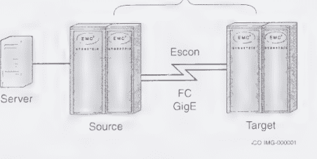

图23 基本同步`SRDF`配置

### 2.5.1 SRDF 优势

`SRDF`提供以下功能和优势：

- 高数据可用性
- 高性能
- 灵活的配置
- 主机和应用程序软件透明性
- 组件或链路故障的自动恢复
- 灾难后恢复时间显著减少
- 提高恢复过程的完整性
- 降低备份和恢复成本
- 降低灾难恢复的复杂性、规划、测试等
- 支持跨越多个服务器和`Symmetrix`系统上的多个数据库的业务连续性

### 2.5.2 SRDF 运行模式

`SRDF`目前支持以下运行模式：

- 同步模式（`SRDF/S`）：提供源`Symmetrix`系统与目标`Symmetrix`系统之间数据的实时镜像。在提交应用程序I/O之前，数据会同时实时写入两个系统的缓存中，以确保最高程度的数据可用性。在向本地主机发送确认信号之前，数据必须成功存储在本地和远程的`Symmetrix`系统中。这主要用于距离小于200公里的大城市地区。

- 异步模式（`SRDF/A`）：在任何距离下均始终维护一个依赖写入的一致性数据副本，且对应用程序产生任何影响。需要跨距离复制数据的应用程序选择有限，`SRDF/A`提供了高性能、远距离复制并降低了电信成本，在平衡现有管理能力的同时，对主机性能没有影响。

- 自适应复制模式：无论顺序或一致性如何，都将数据从源设备传输到目标设备，且不对主机性能产生影响。这在数据中心迁移、整合和数据移动环境期间传输大量数据时特别有用。自适应复制模式是`Symmetrix`自动复制解决方案的数据移动机制。

### 2.5.3 SRDF 设备组和复合组

运行在`Symmetrix`系统上的应用程序通常涉及多个设备。因此，设备组或复合组必须确保所有相关的`Symmetrix`设备都执行操作。设备组或复合组是用户定义的、跨多个`Symmetrix`系统或RA组的设备。设备组是CLI命令可以执行的单个`Symmetrix`系统。另一方面，复合组可以跨多个`Symmetrix`系统和RA组。设备组或复合组类型可能包含R1或R2设备。相应的，`symdg`/`symld`命令用于创建和管理设备组和复合组。

### 2.5.4 SRDF 一致性组

`SRDF`一致性组是为一致性保护用的设备集合。其目的是保护跨多个RA组和/或`Symmetrix`系统的应用程序完整性。`SRDF`一致性组使用`PowerPath`或一致性组辅助（ECA）提供零数据丢失的灾难恢复。零数据丢失意味着灾难发生时完成的所有事务在目标端均可用。

当应用程序数据量变得非常时，基于主机的备份或决策支持查询所需的时间成为关键因素。为了备份而停止或关闭应用程序的时间已不可接受。`SRDF`一致性组允许用户在不中断服务的情况下，秒级远程镜像最大的数据环境的可启动副本。

一致性组是`SRDF`设备（R1或R2）的组合，用于维护跨`Symmetrix`系统的应用程序完整性。如果是源（R1）设备，`EMC`软件会拦截来自一致性组中所有R1设备的写入，停止向目标R2设备的数据流。这种挂起（触发一致性组）确保了在一致性组触发的时间点具有依赖写入一致性的R2数据库副本。

触发一致性组可以自动或手动发生。自动触发的情景包括：

- 一个或多个R1设备无法向其相应的R2设备传播更改
- R2设备故障
- `SRDF` R1侧或R2侧故障

在自动触发期间，`Symmetrix`系统完成R1设备的写入，这表明写入未传播到R2设备。`EMC`软件拦截I/O并指示`Symmetrix`挂起一致性组中所有R1源设备的向R2侧进一步写入。一旦挂起完成，一致性组中所有R1设备的写入继续进行，但在`SRDF`镜像恢复之前，这些写入不会传播到目标。

显式触发发生在调用`symcli -cg split`命令时。排序或拆分一致性组会在R2目标站点创建一个按需的可启动数据库副本。BCV设备与R2设备同步后，在触发一致性组后进行拆分，从而创建第二个依赖写入一致的数据副本。

# EMC Foundation 产品

`EMC`一致性组在`SRDF`配置中维护跨多个`Symmetrix`系统的应用程序的一致性，如图24所示，监控从一致性组内的源（R1）设备到其对应目标（R2）设备的数据传播。一致性组在滚动灾难（`rolling disaster`）期间提供完整性保护。

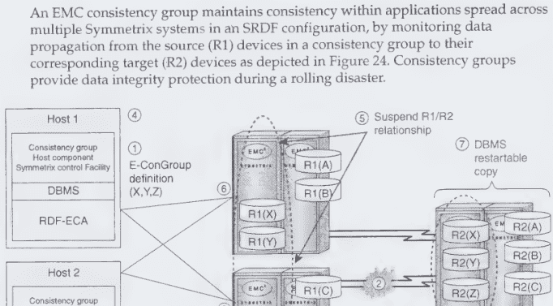

图24 `SRDF`一致性组

一致性组保护定义包含源`Symmetrix`上的卷X、Y和Z。该一致性组定义必须包含所有需要维护依赖写入一致性的设备，并驻存在于所有参与这些设备I/O操作的参与主机上。CKD（大型机）和FBA（UNIX/Windows）设备可以在逻辑上分在一起。在某些情况下，可以将整个处理环境定义在一个一致性组中，以确保依赖写入一致性。

前述描述的滚动灾难阻止了更改从卷Z到远程站的复制。

由于前驱日志写入卷Z无法传播到远程`Symmetrix`系统，将发生一致性组跳变（`trip`）。

组跳变（`Group trip`）会保持在逻辑分组设备上无法复制的写入操作。这些写入由UNIX/Windows主机上的`PowerPath`和大型机主机上的IOS（或UNIX/Windows和大型机主机上的`SRDF-ECA`）保留，持续时间足够长，以确保参与一致性组的所有`Symmetrix`系统的I/O完成。第一次I/O将设备状态更改为挂起-等待（`suspend-pending`）状态。

第二次I/O对逻辑分组设备的R1 / R2关系执行挂起操作，这将立即禁用所有到远程站的复制。组之外的所有其他设备将继续复制，前提是通信链路可用。关系挂起后，前驱写入的完成状态将确认返回给发布主机。此外，所有在一致性组跳变操作期间保留的写入都将被释放。

在`EMC Symmetrix DMX`上为Linux、UNIX和Windows部署DB2

# EMC Foundation 产品

在每个`Symmetrix`的第二次I/O完成后，I/O将释放，允许前驱日志写入完成并返回主机。依赖数据写入由DBMS发出并到达X，但不会复制到R(X)。

当此类滚动灾难发生完全故障时，远程站的依赖写入一致性将得到保护。如果没有发生灾难且故障链路重新激活，则可以恢复一致性组的复制。`EMC`建议在远程恢复期间创建依赖写入一致性镜像的副本。一旦`SRDF`进程达到同步状态，即可在远程站实现依赖写入一致性的的副本。

## 2.5.5 SRDF 术语

本节描述了与`SRDF`操作相关的各种术语。

### 2.5.5.1 挂起（Suspend）和恢复（resume）操作

挂起和恢复操作的实际用途通常涉及意外情况，即希望立即挂起通过`SRDF`链路在R1和R2设备之间的I/O。通过这种方式，可以停止数据传播问题。当配合一致性组使用挂起操作时，将在R2上执行立即备份，而不影响来自本地主机的I/O。然后可以通过R1和R2恢复I/O并恢复到正常运行。

### 2.5.5.2 建立（Establish）和分裂（split）操作

建立和分裂操作通常用于计划的情况，即希望在不干扰对R1设备正常写入的情况下，使用数据的R2副本。对数据点快进行拆分允许各种业务连续性任务访问R2设备上的数据。拆分`SRDF`对以提供精确的数据库副本具有易用性，这使得在源`Symmetrix`系统继续处理的同时，从目标`Symmetrix`数据执行计划的备份操作、报告生成操作或新应用程序测试变得非常方便。

R2副本还可用于通过需要大量人工干预的恢复演练、复杂的程序和应用程序服务中断来测试灾难恢复计划。可以测试向新版本的升级，或对实际代码进行更改，而不会影响在线生产服务器。例如，可以在数据库的R2副本上运行修改后的服务器代码，直到升级后的副本无错误运行后，再升级生产服务器。

在对生产数据的绝对实时复制并非必需的情况下，用户可以选择定期拆分`SRDF`对，并使用R2副本进行查询和报告生成。可以重新建立`SRDF`对以为R2设备提供增量更新。刷新R2设备的能力为数据处理和报告提供了最新信息。

### 2.5.5.3 故障转移（Failover）和故障回（failback）操作

故障转移和故障回操作的实际用途通常涉及将业务从生产地切换到远程地（故障转移）或相反（故障回）。一旦发生故障转移，将使用同步应用程序数据的远程（R2）副本继续正常操作。生产地的计划维护是可能需要转移到R2站的一个示例。

测试灾难恢复计划是临时转移到远程站的主要原因。传统的灾难恢复程序涉及自定义软件和复杂的程序。离线介质必须电传输或物理运输到恢复现场。随后通常会进行耗时的恢复和应用程序日志。

`EMC Symmetrix`远程数据设施

# EMC Foundation 产品

`SRDF`故障转移/回操作通过增量更新已更改的特定跟踪显著缩短了恢复时间；这可以在几分钟内完成从转储数据库卷完全加载可能需要几小时的工作。

### 2.5.5.4 更新（Update）操作


更新操作允许用户在故障转移后重新同步`R1`，同时在`R2`上继续运行应用程序服务。这有助于减少`R1`端所需的时间。更新操作是故障转移/回切功能的子集。实际用途通常涉及`R1`几乎与`R2`同步的情况。在使用更新时，`-until`指定了同步完成之前允许的无效跟踪数。

## 并发 SRDF (Concurrent SRDF)

并发 SRDF 意味着有两个`R2`设备配置为一个`R1`的并发镜像。使用并发 SRDF 对可以在两个远程位置创建相同数据的副本。当两个`R2`设备从源`R1`分离时，可以独立访问每个目标站点。

## R1/R2 交换（Swap）

交换 SRDF 对的`R1/R2`设备会导致源`R1`设备变成目标`R2`设备，反之亦然。交换允许`R2`站接管操作，同时在原始站点保留远程镜像。交换对于应用程序从`R1`站转移到`R2`站特别有用。SRDF 交换适用于 5567 或更高版本的 Director。

## 数据移动（Data Mobility）

数据移动是一种限制 SRDF 设备仅以自适应模式运行的 SRDF 配置。这是一种较低的许可选项，通常用于数据迁移。它允许数据以自适应模式从源到目标传输，除非与 TimeFinder 结合使用，否则它不是针对 DR 需求的解决方案。

## 动态 SRDF (Dynamic SRDF)

动态 SRDF 允许在 Symmetrix 系统运行时从非 SRDF 设备创建 SRDF 对。历史上，源和目标 SRDF 设备配对是静态的，需要 EMC 人员的协助。此功能为决定复制保护的数据提供了更大的灵活性。

可以在 SRDF 交换环境中创建 RA 组。RA 组代表两个 Symmetrix 系统之间的逻辑连接。RA 组曾局限于配置时定义的静态 RA 组。但现在可以在 Symmetrix 系统运行时创建、修改和删除 RA 组。这为形成与 SRDF 对相关的链路提供了更大的灵活性。

## SRDF 控制操作

本节描述了通过 Solutions Enabler `symrdf` 命令可以执行的典型控制操作。

Solutions Enabler SYMCLI SRDF 命令对 SRDF 设备执行以下基本控制操作：

- Establish（建立）：通过从源端（`R1`）侧到目标端（`R2`）侧启动数据复制，建立同步的 SRDF 对。此操作可以是全量建立或增量建立。此过程会丢弃`R2`卷上的更改。
- Restore（恢复）：从目标端（`R2`）侧到源端（`R1`）侧重新同步数据复制过程。此操作可以是全量恢复或增量恢复。此过程会丢弃`R1`卷上的更改。
- Split（拆分）：停止设备组中 SRDF 对的镜像，并启用`R2`设备的写入。
- Swap（交换）：交换源卷和目标卷上的源端（`R1`）和目标（`R2`）标记。
- Failover（故障转移）：将数据处理从源端（`R1`）侧切换到目标端（`R2`）侧。如果源卷（`R1`）仍然可用，则对其进行禁用写入。
- Failback（回切）：将数据处理从目标端（`R2`）侧切换回源端（`R1`）侧。如果目标端卷（`R2`）仍然可用，则对其进行禁用写入。

### 建立 SRDF 对

建立 SRDF 对会启动远程镜像——即从源端（`R1`）设备到目标端（`R2`）设备的数据复制过程。SRDF 对通过两种方式产生：

- 在配置时，通过 SRDF 设备的配对进行建立。这是前文讨论的静态配对配置。
- 在动态配对配置期间的任何时候，根据需要创建 SRDF 对。

通常在 SRDF 对完成初始配置并通过 SRDF 链路连接后，会执行全量建立（`symrdf establish-full`）。在完成首次全量建立后，用户可以执行增量建立，此时`R1`设备仅向`R2`设备复制在关系拆分（split）或挂起（suspended）期间更新的新数据。

要在设备组或复合组中的所有 SRDF 对上启动建立操作，所有对必须处于拆分（split）或挂起（suspended）状态。使用`symrdf query`命令检查设备组或复合组中 SRDF 对的状态。

当建立操作启动时，系统会对其主机上的`R2`设备禁用写入并合并轨道表。合并过程会创建一个需要复制到目标卷的轨道位图，在此过程中会丢弃目标卷上的更改。当建立操作完成且 SRDF 对处于同步（synchronized）状态时，`R1`设备和`R2`设备包含相同的数据，并一直保持一致，直到被管理命令中断或意外故障。图 25 展示了 SRDF 建立和恢复操作：

### SRDF 建立和恢复控制操作

建立操作可以由连接到任一 Symmetrix 系统的主机启动，前提是该主机上已构建了适当的设备组。以下命令为名为`MyDevGrp`的设备组中的所有 SRDF 对启动增量建立操作：

```
symrdf -g MyDevGrp establish -noprompt
```

当需要对目标（`R2`）设备进行读/写访问时，可以对该 SRDF 对进行拆分（split）。当拆分完成后，目标主机可以访问`R2`设备进行操作。`R2`设备包含有效数据，并可用于业务连续性任务或在设备数据丢失时恢复到`R1`设备。

当 SRDF 对处于拆分（split）状态时，仍然发生指向`R1`的 I/O。每个 Symmetrix 更改通过位图跟踪，并在恢复 SRDF 镜像操作时进行协调。要启动拆分，SRDF 对必须处于以下状态之一：

- 同步（Synchronized）
- 挂起（Suspended）
- `R1`已更新（`R1` updated）
- 同步中（SyncInProg）（拆分时指定了`-symforce`一组*非写入一致且不可用的*`R2`设备）

拆分（split）操作可以从任一主机启动。以下命令对名为`MyDevGrp`的设备组中的所有 SRDF 对启动拆分操作：

```
symrdf -g MyDevGrp split -noprompt
```

`symrdf split`命令的功能与`symrdf suspend`和`symrdf rw_enable R2`命令相同。此外，拆分和挂起操作与 SRDF 一致组具有相同的特性。因此，当 SRDF 对位于单个设备组时，用户可以拆分所示的设备组中的 SRDF 对，并在`R2`设备上拥有可重启的副本。如果应用程序跨越多个 Symmetrix 系统或多个组，请将 SRDF 对包含在一致组中实现相同结果。


### 拆分 SRDF 对

### 恢复 SRDF 对

当必须将目标（`R2`）数据复制回源（`R1`）设备时，使用 SRDF restore 命令（见第 74 页图 25）。当拆分时，`R2`设备包含有效数据，可用于业务连续性任务（如运行新应用程序）或恢复到`R1`设备。此外，如果需要保留`R2`设备上运行应用程序的结果，将更改的数据和应用程序移动到`R1`设备是另一个选项。

用户可以执行全量或增量恢复。全量恢复将`R2`设备的所有内容复制到`R1`设备。增量恢复快得多，因为它只复制 SRDF 对拆分期间`R2`设备上更新的新数据。`R1`设备上的任何轨道都由`R2`设备上相应的轨道替换。

要启动恢复，SRDF 对必须已处于拆分（split）状态。恢复操作可以从任一主机启动。对名为`MyDevGrp`的设备组中的所有 SRDF 对执行以下增量恢复（全量恢复添加`--full`选项）：

```
symrdf -g MyDevGrp restore -noprompt
symrdf -g MyDevGrp restore -noprompt -full
```

当`R1`和`R2`设备包含相同数据时，恢复操作完成。此时 SRDF 对处于同步状态，可以通过以下命令重新建立：

```
symrdf -g MyDevGrp establish -noprompt
```

### 故障转移和回切操作

同步 SRDF 对允许用户在源站点操作中断或计划维护期间，将数据处理操作切换到目标站点。这种从源到目标的切换被称为故障转移（failover）。当源站点操作恢复正常时，使用回切（failback）操作重新建立源和目标之间的 I/O 通信，同步站点之间的数据，并如图 26 所示恢复`R1`设备的正常操作。


图 26 SR 故障转移和回切控制操作

故障转移和回切操作将处理从源站点迁移到目标站点或反之。这可能也不意味着数据的移动。

#### 故障转移

计划维护或存储系统问题可能会中断源站点生产数据的访问。在这种情况下，可以从任一主机启动故障转移操作，使`R2`设备对其主机开启。在发布故障转移之前，必须停止`R1`卷上的所有应用程序服务。这是因为故障转移操作会将`R1`卷变为只读。以下命令对`MyDevGrp`设备组中的所有 SRDF 对启动故障转移：

```
symrdf -g MyDevGrp failover -noprompt
```

要启动故障转移，SRDF 对必须已处于以下状态之一：

- 同步（Synchronized）
- 挂起（Suspended）
- `R1`已更新（`R1` updated）
- 分（Partitioned）（在目标站点调用此操作时）

故障转移操作：

- 挂起 SRDF 链路上的数据流量
- 对`R1`设备禁用写入
- 对`R2`设备启用写入

#### 回切

为了在`R1`侧恢复正常操作，将启动回切（`R1`设备接管）操作。这意味着必须停止`R2`设备上的读/写操作，并启动`R1`设备上的读写操作。当启动回切命令时，`R2`对其主机变为只读，而`R1`对其主机变为读写启用。以下命令对`MyDevGrp`设备组中的所有 SRDF 对执行回切操作：

```
symrdf -g MyDevGrp failback -noprompt
```

SRDF 对必须已处于以下状态之一，回切操作才能成功：

- 故障转移（Failed over）
- 源端挂起且禁用写入
- 源端挂起且未就绪
- `R1`已更新（`R1` Updated）
- `R1`更新中（`R1` UpdnProg）

注意：SRDF/A 的默认配置是值最多落后于源卷数据状态两个周期。在 SRDF/A 的默认配置下，这等同于 60 秒。

SRDF/A 提供了一种对性能影响极小的远距离复制解决方案，能够保持指定业务过程中应用程序数据的一致性。这种级别的保护适用于灾难恢复（DR）环境，该环境在`R2`站点始终需要一个可启动的数据副本。依赖写入一致性在差异集（delta set）上得到保证。如果`R1`站点发生灾难或在数据传输期间丢失 SRDF 链路，将丢弃部分差异数据。这确保了`R2`的一致性，最大数据丢失为两个 SRDF/A 周期。

### 启用 SRDF/A

要将远程镜像对`prod`组设置为异步模式（SRDF/A），请输入：

```bash
symrdf -g <device_group> set mode async -noprompt
```

### SRDF/A 优势

SRDF/A 模式提供以下功能和优势：

- 对于具有应用程序一致性的远距离数据复制，具有较低的操作成本。
- 提高链路利用率，从而降低链路带宽需求。
- 始终在`R2`设备上维护具有依赖写入一致性的时间点镜像。
- 支持所有当前的 SRDF 拓扑，包括点对点和交换架构（switched fabric）。
- 在任何距离下运行，且不会为`R1`主机增加响应时间。
- Symmetrix 阵列支持的所有主机和数据仿真类型（如 FBA、CKD 和 AS/400）。
- 最小化对后端设备的影响。
- 提供等同于写入本地非 SRDF 设备的应用程序响应时间。
- 允许在`R1`和`R2`站点之间进行恢复、故障转移和平归。

### 支持 SRDF/A 的设备

使用以下命令显示支持 SRDF/A 的设备列表：

```bash
symrdf list -rdffa
```

### SRDF/A 会话状态

当一组设备设置为异步模式时，组内支持 SRDF/A 的设备被视为 SRDF/A 会话的一部分。要检查 SRDF/A 会话状态，请使用以下命令之一：

```bash
symdg show <device_group>
symcg show <composite_group>
```

会话状态显示为活动（active）或非活动（inactive）：

- Inactive - SRDF/A 设备在链路上的处于就绪或未就绪状态。
- Active - SRDF/A 模式已激活，SRDF/A 会话数据当前正以运行周期传输到`R2`。

## EMC SRDF/Cluster Enabler 解决方案

用于 MSCS 的 EMC SRDF/Cluster Enabler (SRDF/CE) 是一种集成解决方案，结合了跨距离的 SRDF 和集群保护。EMC SRDF/CE 提供了容灾能力，使集群能够跨越地理位置分离的 Symmetrix 系统。它作为微软集群服务（MSCS）的软件扩展（MMC 植入项）运行。SRDF/CE 通过利用 SRDF 的灾难后启动能力来实现这一功能。SRDF 允许 MSCS 在两个不同位置拥有两组完全相同的应用程序数据。当集群系统进行故障转移或故障归时，SRDF/CE 会自动被调用，以执行实现请求操作所需的 SRDF 功能。

图 27 展示了使用双向 SRDF 的两个四节点地理分布型 EMC SRDF/CE 集群的硬件配置。

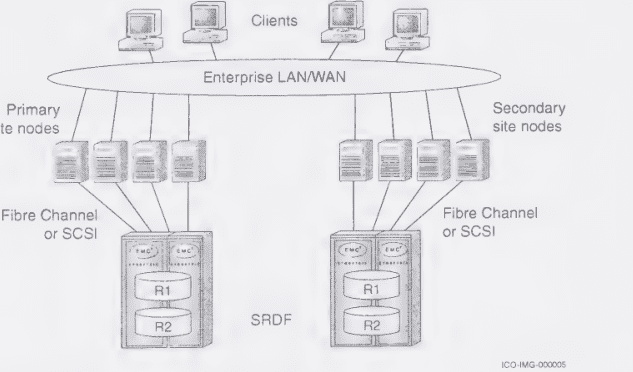

图 27 地理分布的四节点 EMC SRDF/CE 集群

## EMC TimeFinder

TimeFinder 组件扩展了基本的 SYMCLI 命令集，包含了 TimeFinder 或业务连续性命令，允许对本地复制环境内的设备对进行控制操作。本节专门描述了以下功能：

- TimeFinder/Mirror - 业务连续性值（BCV）的通用监控和控制操作
- TimeFinder/CG - 一致性组
- TimeFinder/Clone - 克隆复制会话
- TimeFinder/Snap - 快照复制会话

`symmir`和`symbvc`等命令对 TimeFinder/Mirror 环境内的设备对执行广泛的监控和控制操作。TimeFinder/Clone 命令`symclone`在非标准设备对（如标准/标准、BCV/BCV）上创建源设备的时间点副本。TimeFinder/Snap 命令`symsnap`在源设备和多个虚拟目标设备之间创建虚拟设备复制会话。这些虚拟设备仅指向源设备上更改的数据块的指针，而不是数据的完整副本。每个产品都需要特定的许可来执行监控和控制操作。

配置和控制远程 BCV 设备对需要之前讨论过的 EMC SRDF 业务连续性软件。带有 SRDF 的 TimeFinder 配置为生产数据提供了多个本地和远程副本。

图 28 展示了 Symmetrix 系统中 TimeFinder/Mirror 配置的应用示例。

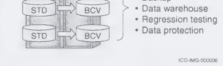

### TimeFinder/Mirror 建立（Establish）操作

BCV 设备可以进行全量或增量建立。在对 Symmetrix 系统进行配置和初始化后，BCV 设备不包含数据。BCV 设备与标准设备一样，具有唯一的主机地址，并可以对其连接的主机在线并处于就绪状态。当标准设备首次与 BCV 设备配对时，必须使用全量建立操作。可以对 BCV 设备进行增量建立，以重新同步自上次建立操作以来标准设备上发生的任何数据。

> 注意：当建立 BCV 时，任何主机都无法访问它们。

Symmetrix 系统允许每个逻辑卷最多有四个镜像。位置通常指定为`M1`、`M2`、`M3`和`M4`。未保护的 BCV 可以作为标准设备的第二、第三或第四个镜像位置。然而，主机在逻辑上将 Symmetrix `M1/M2`镜像设备视为单个设备。

要将 BCV 分配为标准 Symmetrix 设备的镜像，则使用名为`establish`命令。建立 BCV 设备对的一种方法是允许标准/BCV 设备配对算法从设备组内的多个设备中任意创建 BCV 设备对：

```bash
symmir -g MyDevGrp establish
```

使用这种方法，TimeFinder/Mirror 检查是否存在任何分配（在设备组的多个设备之间指定首选的 BCV 匹配）。TimeFinder/Mirror 会检查是否存在设备关系。

### TimeFinder 分离（Split）操作

分离 BCV 对是 TimeFinder/Mirror 操作，用于将 BCV 分离并使标准设备就绪。在分离 BCV 时，系统必须执行在繁忙的 Symmetrix 系统上可能需要几毫秒的任务。这些任务涉及分离 BCV 的一系列步骤：

- 短暂暂停标准设备的 I/O。
- 标准设备尚未写入 BCV 的待写轨道复制到缓存中，以便写入 BCV。
- 将 BCV 从标准设备分离。
- 将 BCV 设备状态更改为就绪。

#### 常规分离（Regular split）

常规分离是 TimeFinder/Mirror 自诞生以来存在的分离类型。在常规分离中（工程版本 5568 之前），在从 BCV 分离之前，来自生产主机的 I/O 活动不会被接受。因此，尝试访问常规分离的应用在常规分离期间会经历短暂等待。一旦分离完成，就不会再产生额外开销。

在工程版本 5568 中，任何分离操作都是即时分离。常规分离对于早期版本以及执行常规分离的当前应用程序仍然有效。然而，在工程版本 5568 中执行常规分离的当前应用程序实际上执行的是即时分离。这不再需要，因为即时分离模式已成为默认行为。在随后的工程版本中使用`-instant`标志是有益的，否则默认设置是等待常规分离完成。

#### 即时分离（Instant split）

即时分离通过将过程分为前景分离和后台分离，缩短了分离期间的等待时间。在即时分离期间，系统几乎立即执行前景分离并向主机返回成功状态。这种瞬时执行使得生产卷的 I/O 干扰降至最低。此外，一旦前景分离完成，主机即可访问

# EMC 基础产品


处理完成。后台拆分继续拆分 BCV 对直到完成。当包含 `-instant` 选项或默认包含时，`SYMLCI` 在前台拆分后立即返回，允许在 BCV 对在后台进行拆分时执行其他操作。

以下操作对 `MyDevGrp` 中的所有 BCV 对执行即时拆分，并允许 `SYMLCI` 在后台拆分进行时返回到服务器进程：

```
symmir -g MyDevGrp split -instant -noprompt
```

以下 `symmir` 查询示例命令检查复合组 `MyConGrp` 的拆分进度。`-bg` 选项用于查询后台拆分的状态：

```
symmir -cg MyConGrp query -bg
```

## 2.6.3 TimeFinder 恢复操作

BCV 设备可用于在标准卷上进行全量或增量数据恢复。类似于全量建立操作，全量恢复会将 BCV 设备的全部内容复制到标准设备。执行恢复的设备可以在设备组、复合组或设备文件中定义。例如：

```
symmir -g MyDevGrp -full restore -noprompt
symmir -cg MyConGrp -full restore -noprompt
symmir -f MyFile -sid 109 restore -noprompt
```

增量恢复过程与全量恢复过程的效果相同，但有一个显著节省时间的例外。BCV 仅将 BCV 对进行拆分期间在 BCV 设备上更新的新数据复制到标准设备。BCV 设备相应轨道上的数据还会覆盖标准设备上任何已更改的轨道。这最大化地提高了重同步过程的效率。此过程非常有用，例如，如果在 BCV 设备上完成对数据库更新版本或新应用程序的测试或验证，用户希望在标准设备上迁移并利用已测试的数据或应用程序副本。

> 只有当两个卷存在 TimeFinder 关系时，才能对标准卷进行增量恢复。

## 2.6.4 TimeFinder 一致性拆分

TimeFinder 一致性拆分允许你在不中断在线服务的情况下，拆分出应用程序的依赖写入且可重启的镜像。一致性拆分有助于避免在不静止或停止应用程序的情况下拆分应用程序相关的 BCV 时可能出现的不一致和重启问题。一致性拆分使用 Ingenuity 一致性辅助 (ECA) 功能实现。此功能需要 TimeFinder/CF 许可证。

在 EMC Symmetrix DMX 上部署 Linux、UNIX 和 Windows DB2

### 2.6.4.1 Ingenuity 一致性辅助

Symmetrix 操作系统的 Ingenuity 一致性辅助 (ECA) 功能可用于跨异构环境执行一致性拆分操作。此功能需要 TimeFinder/GC 许可证，并使用 `split` 命令的 `consistent` 选项。

使用 ECA 从标准设备一致拆分 BCV 设备时，必须有一个没有数据库的控制主机或具有专用网关通道的数据库主机。专用通道不能用于服务其他设备或冻结 I/O。例如，要拆分设备组，执行：

```
symmir -g MyDevGrp split -consistent -noprompt
```

图 29 展示了跨越三个访问 Symmetrix 系统设备的数据库主机的 ECA 拆分。

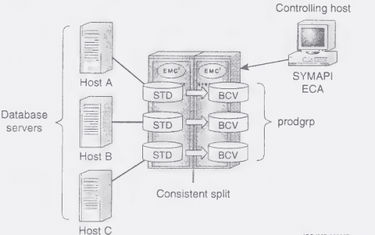

图 29

为了对目标应用程序进行一致性拆分，必须在控制主机上创建设备组或复合组。创建设备组可以包含维护业务连续性所需的所有设备。例如，如果定义的设备组包含了主机 A、B 和 C 访问的所有设备（见图 29），则可以使用单个命令对这些主机相关的所有 BCV 对进行一致性拆分。

然而，如果定义的设备组仅包含主机 A 访问的设备，则可以拆分与主机 A 相关的 BCV 对而不影响其他主机。图 29 中的实线垂直线表示在即时拆分过程中，ECA 对 I/O 的挂留，从而在 BCV 中创建依赖写入的一致镜像。

第 84 页的图 30 展示了与数据库管理系统 (DBMS) 使用本地一致性拆分。

# EMC 基础产品

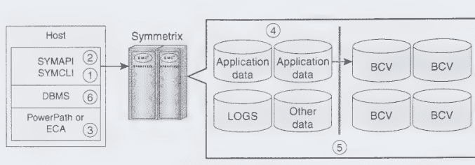

图 30 本地 Symmetrix 系统上的 ECA 一致性拆分

当从生产主机带 ECA 发出 `split` 命令时，将按照图 30 中的事件序列创建一致的数据库镜像：

1. 设备组、设备文件或复合组识别持有数据库的标准设备。
2. `SYMAPI` 与 Symmetrix Ingenuity 通信以验证所有识别出的 BCV 对均可以拆分。
3. `SYMAPI` 与 Symmetrix Ingenuity 通信打开 ECA 窗口（Symmetrix Ingenuity 中延迟写入的时间），发出即时拆分并通过关闭窗口释放写入。
4. ECA 挂起对持有数据库的标准设备的写入，DBMS 无法向这些设备写入，随后等待这些设备可用后再恢复任何进一步写入活动：对设备的读取活动不受影响，除非尝试从具有写入队列的设备上进行读取。
5. `SYMAPI` 与 Symmetrix Ingenuity 通信以确认拆分。BCV 现在包含数据库的一致镜像。
6. ECA 释放对持有数据库的标准设备的写入，DBMS 现在可以向这些设备写入。

（注：原文中存在大量重复的 OCR 错误，翻译时已进行去重处理。）

## 2.6.6.1 克隆复制会话

TimeFinder/Clone 功能通过复制会话（copy sessions）控制，会话将源设备和目标设备配对。会话维护在 Symmetrix 系统上，可以通过查询来验证设备对的当前状态。必须先创建一个会话来定义并设置 TimeFinder/Clone 设备。随后激活该会话，主机即可访问目标设备。当不再需要这些信息时，可以终止会话。TimeFinder/Clone 操作通过主机上的 `symclone` 命令控制，用于创建、激活和终止复制会话。

图 31 展示了一个复制会话，其中控制主机使用 `symclone` 命令在目标设备 `DEV005` 上创建标准设备 `DEV001` 的 TimeFinder/Clone 克隆。

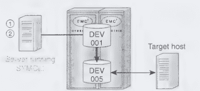

1. `symclone create`
2. `symclone activate`

**图 31 使用 `symclone` 命令创建复制会话**

`symclone` 命令用于启用克隆操作。克隆操作分为两个阶段：创建和激活。创建阶段构建源和目标的目标位图，这些位图将在稍后的激活或复制阶段使用。除非使用了 `-precopy` 选项，否则创建配对会话不会开始从源卷复制到目标卷。

例如，要在设备组 `MyDevGrp` 中的所有标准设备和 BCV 上创建克隆会话，请使用以下命令：

```
symclone -g MyDevGrp create -noprompt
```

激活克隆会话将启用数据复制。如果使用了 `-copy` 关键字，数据可能会立即复制。如果没有使用 `-copy` 关键字，只有在从目标卷访问轨道或在源卷上发生更改时，才会复制轨道。

通过上一个 `create` 命令建立的克隆会话可以使用以下命令完成激活：

```
symclone -g MyDevGrp activate -noprompt
```

## 2.6.7 TimeFinder/Snap 操作

Symmetrix DMX 列提供了另一种创建应用程序数据副本的技术。这种名为 TimeFinder/Snap 的功能允许用户从单个源设备在多个设备上同时创建基于指针的节省空间的数据副本。数据可以被实时访问。TimeFinder/Snap 允许数据从一个源设备复制到多达 128 个目标设备。源设备可以是 Symmetrix 标准设备，也可以由 TimeFinder/Mirror 控制的 BCV；但工作在克隆模式下的 BCV 除外。目标设备是 Symmetrix 虚拟设备（VDEV），通过使用跟踪数据的指针来消耗忽略不计的物理存储。

VDEV 是一个主机可寻的 Symmetrix 设备，在配置 DMX 系统时创建具有特殊属性。然而，与包含完整数据卷的 BCV 不同，VDEV 是一种逻辑设备，具有一种节省空间的方法来创建即时时间点副本。虚拟设备激活后对源设备进行的更新会导致更改轨道的预更新镜像被复制。随后，虚拟设备的间接指针将更新为指向源设备上的原始轨道数据，从而提供卷的时间点镜像。TimeFinder/Snap 使用这种写时复制（copy-on-write）技术来节省磁盘空间，因为只有源端轨道的更改会导致增量存储消耗。

`synsnap create` 和 `synmap activate` 命令用于创建源/目标 Snap 对。

表 4 总结了 TimeFinder/Snap 操作中使用的设备之间的差异。

| 设备 | 描述 |
| :--- | :--- |
| 虚拟设备 (Virtual device) | 一种逻辑镜像，通过跟踪数据的指针节省磁盘空间，激活后即可立即访问。Snap 数据使用写时复制技术。 |
| 保存设备 (Save device) | 一种主机不可访问的设备，仅通过指向它的虚拟设备访问。保存设备提供物理空间池，用于存储虚拟设备指向的 snap 副本。 |
| BCV | 完整卷镜像，在与其源设备同步后具有有效数据。仅在从镜像的源设备拆分时可访问。 |

### 2.6.7.1 Snap 复制会话

TimeFinder/Snap 功能通过复制会话管理，会话将源设备和目标设备配对。会话维护在 Symmetrix 系统上，可以通过查询验证设备的当前状态。必须创建一个会话——此过程定义操作中的 Snap 设备。在随后的激活中，目标虚拟设备将对主机可见。除非主机虚拟设备更改了数据，否则虚拟设备始终呈现激活时点源设备的冻结副本。当不再需要这些信息时，可以终止会话。

TimeFinder/Snap 操作通过主机上的 `synsnap` 命令控制，用于创建、激活和恢复本节描述的 TimeFinder/Snap 操作。本节解释了如何通过 `SYMLCI` 管理参与复制会话的设备。图 32 展示了一个虚拟复制会话，其中控制主机在目标设备 `VDEV005` 上创建标准设备 `VDEV001` 的副本。

控制主机

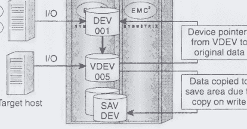

1. `synmap create`
2. `synmap activate`

ICO-IMG-000010

**图 32 标准设备到目标的 TimeFinder/Snap 克隆**

`synmap` 命令用于启用克隆操作。克隆操作分为两个阶段：创建和激活。创建阶段构建源和目标位图，这些位图将在稍后的激活或复制阶段使用。创建配对会话不会开始从源卷复制到目标卷，除非使用了 `-precopy` 选项。

例如，要在设备组 `MyDevGrp` 中的所有标准设备和 BCV 上创建克隆会话，请使用以下命令：

```
synmap -g MyDevGrp create -noprompt
```

激活克隆会话将启用数据复制。如果使用了 `-copy` 关键字，数据可能会立即复制。如果没有使用 `-copy` 关键字，只有在从目标卷访问或在源卷上发生更改时，才会复制轨道。

通过上一个 `create` 命令建立的克隆会话可以使用以下命令完成激活：

```
synmap -g MyDevGrp activate -noprompt
```

## 2.7 EMC 存储资源管理

EMC Solutions Enabler 的存储资源管理（SRM）组件扩展了 `SYMCLI` 命令集，包含了允许用户发现和检查主机上各种对象的命令。

- `SYMCLI` 支持以下领域的 SRM：
  - 数据对象和文件
  - 关系型数据库
  - 文件系统
  - 逻辑卷和卷组
  - 性能统计

SRM 允许用户检查存储设备的映射以及数据文件的特性。这些命令允许检查范围数据文件或对象之间的关系，以及它们在存储设备上的映射。SRM 命令结合 TimeFinder 和 SRDF 一起使用，创建备份的时间点副本。

图 33 概述了在数据库环境中使用 SRM 命令结合 TimeFinder 的过程。

| 主机 | SRM | EMCC² 数据 | EMCC² |
| :--- | :--- | :--- | :--- |
| `SYMAPI` `SYMCLI` | ① `SYMCLI` 命令 | DEV 001 | BCV 001 |
| DBMS | ② 调用数据库 识别设备 | DEV 002 | BCV 002 |
| PowerPath or ECA | ③ 映射数据库元数据和 `SYMCLI` 数据库 | DEV 003 | BCV 003 |
| | ④ TimeFinder SPLIT | DEV 004 | BCV 004 |

**图 33 SRM 命令**

主机安装了具有有效 TimeFinder 和 SRM 许可证的 EMC Solutions Enabler。此外，主机还需要 PowerPath 或 ECA，并与支持的 DBMS 系统配合。如 TimeFinder 拆分操作节所述，拆分 BCV 时，系统必须执行在 Symmetrix 系统上可能需要几秒的维护任务。这些任务涉及一系列步骤（如图 33 所示），导致 BCV 与其配对的标准设备分离：

1. 使用 SRM 基础映射命令，首先查询 Symmetrix 系统以显示任何物理设备、逻辑卷、文件、目录和/或文件系统的逻辑物理映射信息。
2. 使用数据库映射命令，查询 Symmetrix 以显示物理和逻辑数据库信息。


# EMC Foundation 产品

- 3. 接下来，使用数据库映射命令进行转换：
  - 将指定的设备映射到设备组或一致性组，或
  - 将指定表空间的设备映射到设备组或一致性组。
- 4. `BCV` 从标准设备中拆分。

表 5 列出了用于检查数据对象映射的 `SYMCLI` 命令。

| 命令 | 参数 | 动作 |
|---|---|---|
| `symrlv` | `pd` | 显示任何物理设备的逻辑到物理映射信息。 |
| | `lv` | 显示逻辑卷的逻辑到物理映射信息。 |
| | `file` | 显示文件的逻辑到物理映射信息。 |
| | `dir` | 显示目录的逻辑到物理映射信息。 |
| | `fs` | 显示文件系统的逻辑到物理映射信息。 |

`SRM` 命令允许用户检查主机数据库映射和数据库的特性能。这些命令提供了用于列描述各种数据库、其结构、文件、表空间和用户模式的列表和属性。通常情况下，数据库命令适用于 `Oracle`、`Informix`、`SQL Server`、`Sybase`、`Microsoft Exchange`、`SharePoint Portal Server` 以及 `DB2 LUA` 数据库应用程序。

表 6 列出了用于检查数据库对象映射的 `SYMCLI` 命令。

## 数据对象映射命令

| 命令 | 参数 | 动作 |
|---|---|---|
| `symdrb` | `list` | 列出各种物理和逻辑数据库对象：可用的当前关系型数据库实例；数据库的表空间、表或模式；表空间或模式的文件、段或表 |
| | `show` | 显示数据库对象的信息：数据库的表空间、文件或模式；指定表空间或模式的文件、段或表 |
| `rdb2dg` | | 将指定数据库的设备转换到设备组。 |
| `rdb2cg` | | 将指定表空间的设备转换到复合组或一致性组。 |
| `tbs2cg` | | 将指定表空间的设备转换到复合组。仅转换数据数据库文件。 |
| `tbs2dg` | | 将指定表空间的设备转换到设备组。仅转换数据数据库文件。 |

`SYMCLI` 文件系统 `SRM` 命令允许用户调查操作系统正在使用的文件系统。该命令提供了描述文件系统、目录和文件以及它们到物理设备和区（`extents`）的映射的列表和属性。

在 `EMC Symmetrix DMX` 上为 `Linux`、`UNIX` 和 `Windows` 部署 `DB2`

表 7 列出了用于检查文件系统映射的 `SYMCLI` 命令。

### 表 7 用于检查文件系统映射的文件系统 `SRM` 命令

| 命令 | 参数 | 动作 |
|---|---|---|
| `symhosts` | `list` | 显示文件系统、文件或目录的列表 |
| | `show` | 显示有关文件系统或系统对象的详细信息。 |

`SYMCLI` 逻辑卷 `SRM` 命令允许用户将逻辑卷映射到由逻辑卷管理器（`LVM`）定义的底层存储架构的详细视图。`LVM` 是高级应用程序通过策略性放置数据来提高性能的手段。

表 8 列出了用于检查逻辑卷映射的 `SYMCLI` 命令。

| 命令 | 参数 | 动作 |
|---|---|---|
| `symvg` | `deport` | 导出指定的卷组以便以后导入。 |
| | `import` | 导入指定的卷组。 |
| | `list` | 显示由逻辑卷管理器在主机系统定义的卷组列表。 |
| | `rescan` | 重新扫描所有卷组。 |
| | `show` | 显示有关卷组的详细信息。 |
| | `vg2cg` | 将卷组转换到复合组。 |
| | `vg2dg` | 将卷组转换到设备组。 |
| `symmlv` | `list` | 显示指定卷组上的逻辑卷列表。 |
| | `show` | 显示逻辑卷的详细信息（包括区数据）。 |

`SRM` 性能统计命令允许用户检索有关主机的 `CPU`、磁盘和内存的统计信息。

表 9 列出了统计命令。

### 表 9 `SRM` 统计命令

| 命令 | 参数 | 动作 |
|---|---|---|
| `symhost` | `show` | 显示主机配置信息。 |
| | `stats` | 显示性能统计数据。 |

# EMC Foundation 产品

## 2.8 EMC PowerPath

`EMC PowerPath` 是一种基于主机的软件，与网络系统协同智能管理 `I/O` 路径。`PowerPath` 管理到存储阵列的多条路径。支持多路径能够在路径故障中恢复，因为 `PowerPath` 会自动检测路径故障并将 `I/O` 重定向到其他可用路径。`PowerPath` 还可以使用复杂的算法为用户可以设置的多种管理策略提供动态负载均衡。在 `PowerPath` 的帮助下，管理员能够确保路径对存储具有高可用访问性，并获得最佳性能。

`PowerPath` 路径管理的一个关键特性是动态多路径负载均衡。没有 `PowerPath`，管理员必须静态地对路径进行负载均衡以提高性能。根据当前使用情况，管理员可能会在一条路径上配置三个高频使用的逻辑设备，在第二条路径上配置中度使用的逻辑设备，在第三条路径上配置 20 个低频使用的逻辑设备。随着 `I/O` 路径的变化，这些静态配置的路径可能会变得平衡，导致性能受损。此时管理员必须重新配置路径，并响应主机与存储系统之间 `I/O` 流量的变化继续重新配置。

`PowerPath` 设计用于并发使用所有路径，它将逻辑设备的 `I/O` 请求分发到所有可用路径上，而不是要求单条路径承担整个 `I/O` 负担。`PowerPath` 可以将所有逻辑设备的 `I/O` 分配到这些逻辑设备共享的路径上，使所有路径达到均匀平衡。`PowerPath` 基于主机的基础平衡 `I/O`，并维护所有 `I/O` 路径的统计数据。对于每个请求，它根据负载均衡和故障转移策略选择负载最小的可用路径。除了提高 `I/O` 性能外，动态负载均衡减少了管理时间和机时间，因为管理员不再需要管理逻辑设备的路径。使用 `PowerPath`，可以动态更改单个设备的路径配置和策略，立即生效且不对应用程序产生任何中断。

`PowerPath` 提供以下功能和优势：

- 多路径，提高可用性和性能 —— `PowerPath` 支持逻辑设备与主机总线适配器（`HBA`，主机发布 `I/O` 请求的设备）之间的多路径。拥有多路径使得即使特定路径不可用，主机也能访问逻辑设备。此外，多路径可以共享逻辑设备的 `I/O` 负载。
- 动态多路径负载均衡 —— `PowerPath` 持续 `I/O` 均衡提升了主机管理重负载 `I/O` 负载的能力。`PowerPath` 根据负载的变化动态调整路径性能，消除了重复静态配置的需要。
- 主动 `I/O` 路径测试和自动路径恢复 —— `PowerPath` 定期测试故障路径以确定其可用。当路径恢复时，`PowerPath` 会自动恢复到 `I/O`。它还会定期测试可用路径以确保其运行正常。
- 自动路径故障转移 —— `PowerPath` 自动将故障 `I/O` 路径的数据重定向到备用路径。这消除了应用程序停机；故障转移是透明的且对应用程序无干扰。
- 增强的高可用集群支持 —— `PowerPath` 在集群环境中特别有利，因为它可以防止操作中断和昂贵的停机。`PowerPath` 的路径故障转移能力在路径断开时（只要有其他路径）可以避免节点故障转移，保持活动节点的无中断支持。
- 一致拆分 —— `PowerPath` 允许用户通过在前景拆分期间在主机级挂起设备写入秒来执行一致拆分。`PowerPath` 软件提供了挂起和恢复能力，避免了在未先静默数据库的情况下拆分相关 `BCV` 时可能出现的不性和重启问题。
- 一致性组 —— 一致性组是 `Symmetrix` 设备的复合组，经过特殊配置以同步动作，维护由开放系统主机计算机控制的跨多个 `SRDF` 阵列的数据库完整性。

# 在 EMC Symmetrix DMX 上部署适用于 Linux、UNIX 和 Windows 的 DB2 9.5 数据库

“在 `EMC Symmetrix DMX` 存储上部署适用于 `Linux`、`UNIX` 和 `Windows` (`LUW`) 的 `DB2` 数据库的最佳方法是什么？”这是考虑迁移到 `IBM` 最新版本 `DB2` 的 `EMC` 经常提出的问题。`IBM` 对于 `SAN` 环境下部署 `DB2 LUW` 有一些基本指南；然而，在 `Symmetrix DMX` 上设计数据库布局时，需要深入理解数据库的需求，并结合所用主机和存储环境的知识。

本章旨在为在 `EMC Symmetrix DMX` 阵列上布局 `DB2 LUW` 数据库提供建议，并传递 `IBM` 在 `SAN` 环境中部署 `DB2 LUW` 数据库的基本指南。本章还将为您提供许多 `DB2 LUW` 存储相关环境注册变量和配置参数的建议设置。主题包括：

- 3.1 性能设计...... 96
- 3.2 RAID 100
- 3.3 条带 (`Striping`) 104
- 3.4 影响 `DB2` 数据库性能的布局考虑因素 ...... 108
- 3.5 其他布局考虑因素...... 111
- 3.6 在 `Symmetrix DMX` 上部署 `DB2 9.5` 数据库的建议 ... 113
- 3.7 当存储容器位于 `RAID` 设备上时优化表空间性能 118
- 3.8 远程复制考虑因素 ...... 126

## 3.1 性能设计

在 `Symmetrix DMX` 上设计任何布局的主要目标是最大化 `I/O` 在阵列组件之间的分布，从而减少或消除系统中任何潜在的瓶颈。在 `Symmetrix DMX` 阵列内部，有许多需要考虑的领域：

- 前端连接：包括来自 `Symmetrix DMX` 的连接数以及使用的光纤通信基础设施（即点对点、光纤通道环路或通过光纤交换机进行 `Fabric` 连接）。
- 缓存：所有 `I/O` 请求都通过 `Symmetrix DMX` 上的缓存。因此，如果缓存量不足，`I/O` 可能会受到不利影响。
- 后端：包括后端控制器的数量以及所用物理磁盘磁柱的数量和特性（即速度和大小）。需要合理布局数据以确保满意的性能。

### 3.1.1 前端连接

前端连接的优化需要理解在主机与 `Symmetrix DMX` 之间传输的 `I/O` 请求（包括读和写）的数量和大小。每个前端控制器端口、前端控制器处理器和前端控制器板能够处理的 `I/O` 数量是有限制的。此外，`SAN` 扇出数（即通过光纤交换机连接到单个前端端口的主机数量）也需要仔细管理。

在优化前端性能时，必须决定以下特性中哪些最重要：

- 每秒读输出操作数 (`IOPS`)
- 吞吐量 (`MB/s`)
- `IOPS` 和吞吐量的结合

在在线事务处理 (`OLTP`) 数据库应用程序中，`I/O` 通常是较小且随机的，`IOPS` 是最重要的因素。在决策支持系统 (`DSS`) 中，事务通常执行大型顺序扫描或索引扫描，吞吐量是更关键的因素。在某些数据库环境中，需要对类 `OLTP` 和类 `DSS` 的 `I/O` 进行比较。为每种环境优化性能通常需要更改所使用的 `DB` 表大小。

在 `Symmetrix DMX` 上，通过使用 4 KB (4096 字节)的小页大小可以获得最大的 `IOPS`。因此，对于 `OLTP` 应用，通常使用的页大小为 4 KB 或 8 KB，`Symmetrix DMX` 提供更高的 `IOPS`，但吞吐量较低。`DSS` 应用的情况则相反，其通常使用较大的页大小（16 KB 或 32 KB）。当使用 32 KB 的页大时，`Symmetrix DMX` 提供更高的吞吐量，但 `IOPS` 较低。

到 `Symmetrix DMX` 的每个光纤通道连接都能提供一定量的吞吐量（单位 `MB/s`）。在实践中，每个通道的可用吞吐量远低于标值（由于开销），并取决于 `I/O` 大小。因此，将总吞吐量规划为最大值的 70% 是一种良好的做法，并将确保 `Symmetrix DMX` 与主机之间的连接有可用带宽。增加来自主机的 `I/O` 大会减少可以执行的 `IOPS` 数量，但会增加通道上的整体吞吐量 (`MB/s`)。

### 3.1.2 缓存

缓存由于 `Symmetrix` 性能中起着重要作用，因为它在全局主机与物理存储之间的数据传输中起着介质作用。`Symmetrix DMX` 系统基于这样一个原理：与总子系统存储容量相比，任何给定时刻的数据工作集都是相对较小的。因此，如果可用缓存足够，工作集位于缓存中，性能将显著提高，因为内存的读写远快于磁盘的读写。实际实现的性能取决于以下原则：

- 引用局部性：如果某条信息被使用，则其附近的信息稍后可能会被使用。
- 数据重用：如果某条信息被使用，很快可能会被重用。

在 `Symmetrix DMX` 系统中，通道控制器和磁盘控制器共享全局内存（缓存）通道控制器连接到 `CPU` 和全局内存，而磁盘控制器连接到全局内存和物理磁盘。称为基于缓存 (`TBC`) 的特殊算法将全局内存分为数百个槽位，使用 4 字节表示每个槽位，属性包含系统上次访问槽位的时间、是否等待写入等。

当通道控制器接收到主机的请求时，它检查全局内存目录表以查看请求的数据是否已在缓存中。如果找到了请求的数据，通道控制器将其传输到主机（通过通道接口）并更新全局目录表。然而，如果内存中未找到请求的数据，`Symmetrix DMX` 使用最近最未使用 (`LRU`) 算法确定哪些数据将被丢弃以腾出空间。然后，磁盘控制器从磁盘检索数据存储在全局内存中并向通道控制器发送信号数据数据就绪。最后，通道控制器从缓存中检索数据并传输到主机。由于，由于请求的数据不在全局内存中，`Symmetrix` 必须在磁盘上搜索数据并传输到缓存，这为读取操作增加了寻道延迟。

当通道控制器接收写入写入时，它尝试将块存储在一个或多个缓存槽位中。如果槽位可用，输入的数据移动到标记为“等待写入”的槽位，并向主机发送确认。在随后的某一点，磁盘异步地从缓存中导出数据。（这取决于整体系统磁盘活动和缓存的可用性）。如果缓存槽位不可用，磁盘控制器立即将所有等待写入的数据分离到磁盘。（`Symmetrix` 系统在此过程中使用处理器管理扇区）。一旦可用足够的全局内存空间，通道控制器继续将块直接存储在缓存槽位中。

# DB2 9.5 用于 Linux、Unix 和 Windows 数据库

读取操作可以根据需要使用缓存来满足主机请求（假设有空闲缓存槽），但 `Symmetrix DMX` 限制了发送到单个设备的写入操作次数。这种“写入等待限制”旨在防止对单个卷具有高写入率的应用程序消耗所有可用存储阵列缓存，从而以牺牲其他卷的读取/或写入操作为代价。如果达到了设备的写入等待限制，则在处理任何新写入请求之前，必须将该设备的所有等待写入数据刷入磁盘（`destaged`）。这种强制刷入磁盘的操作将该特定卷的写入速度限制在物理磁盘速度上，这会显著降低性能。

除了写入等待限制外，存储子系统级还施加了某些限制。当达到这些限制时，`DMX` 将以“优先级降级”模式运行。在这种模式下，将写入刷入磁盘是磁盘适配器的最高优先级任务；结果是主机读取和写入性能的下降。

缓存板的数量也会对性能产生细微影响。在比较具有相同缓存量的 `Symmetrix DMX` 阵列时，增加板卡数量（例如，四块每块 16 GB 的缓存板或两块每块 32 GB 的缓存板）对 `DSS` 应用的性能有微小的积极影响。这是因为前端直连接器与缓存之间的路径增加，具有提高整体吞吐量的效果。然而，配置额外的板卡对高吞吐量环境（如 `OLT` 工作负载）有所帮助，而在 `IOPS` 比吞吐量更关键的环境中，额外的缓存直连接器无法提供性能收益。这是因为每个板卡上 `CPU` 的处理能力限制了每个端口或直连接器的 `IOPS` 数量。

### 3.1.3 后端

磁盘技术的进步尚未跟上存储阵列其他部分（如直连接器和带宽）的发展。因此，`Symmetrix DMX` 中的某些瓶颈直接归因于驱动器的限制。为了减少或消除 `Symmetrix DMX` 后端性能问题，应注意将 `I/O` 分布在尽可能多的后端直连接器物理磁头上（而不是为特定应用程序分配特定的直连接器磁头）。

确保最佳后端性能最重要的事项之一是处理预期的 `I/O` 负载。每个物理磁盘都能执行有限次数的操作，`Symmetrix DMX Infinity` 环境中的所有算法都将有助于减少对磁盘的读写次数，特别是支持随机操作，而随机操作仍然是一个限制因素。如果没有足够的物理磁盘来处理 `I/O` 负载，性能将受到影响。因此，为 `DB2 LU` 工作负载使用多少磁盘磁头的决策应该基于 `I/O` 性能需求，而不是预期的存储容量。

还应重点关注在所有物理磁头上平衡 `I/O` 负载。如果能预先知道可用空间的 `I/O` 模式，可以通过将产生大量 `I/O` 的表集存储在不同的物理磁盘上，最大限地减少冲突并提高性能。然而，由于 `I/O` 模式可能会随时间变化，在所有磁盘上平衡 `I/O` 负载可能仍然是解决方案。`Symmetrix Optimizer` 还可以帮助减少单个物理磁头上超卷（`hypervolumes`）之间的 `I/O` 冲突（如果工作负载需求发生，`Symmetrix Optimizer` 是帮助减少物理磁头冲突的宝贵工具）。使用时，`Symmetrix Optimizer` 会寻找单个超卷上的 `I/O` 冲突，并在发现冲突情况时，非中断性地将超卷移动到另一块磁盘上的新位置。

数据在磁盘上的放置位置也会影响性能。由于磁盘的旋转特性，磁盘外部分的磁道性能优于靠近中心的磁道。虽然 `Symmetrix DMX Engine` 环境中的算法可以平滑这种变化，但通过将高 `I/O` 指向磁盘的外边缘可以提高性能。磁头上超卷之间的磁盘移动是最小的。跨越盘片的磁盘移动（寻道时间）是 `I/O` 性能延迟的大来源。将接收高 `I/O` 活动的超卷彼此靠近放置可能会减少磁头移动，从而提高磁盘性能。

## 3.1.4 其他考虑

除了前端连接、缓存利用和后端配置外，还有一些额外因素会影响给定数据库配置的布局选择。这些因素包括：

- 主机总线适配器。主机总线适配器（`HBA`）是一种电路板和/或集成电路适配器，为服务器和存储设备提供物理连接。（`HBA` 及其相关的磁盘子系统有时被称为磁盘通道。）由于 `HBA` 减轻了主机微处理器处理数据存储和检索任务的负担，它可以提高服务器性能。但是，如果配置的 `HBA` 数量不足，它们可能会成为瓶颈。在设计 `DB2` 数据库系统时，应考虑所需的吞吐量，并相应地配置数量的 `HBA`。

- 主机地址限制。在许多主机平台上，单个 `HBA` 可寻址的 `LUN` 数量受到限制。例如，在 `AIX` 上可以呈现的最大 `LUN` 数为 512，而在其他操作系统上，最大数为 256。在设计数据库存储基础设施时必须考虑此限制。

## 3.2 RAID

独立磁盘冗余阵列（`RAID`）技术提供了磁盘故障的保护（通过冗余）、性能的大幅提升（通过在磁盘间分布信息）以及高可用性。`RAID` 有多种不同的实现级别：

- `RAID 1`：`RAID 1` 简单来说磁盘镜像。`RAID 1` 配置由两个磁盘组成，每次写入都会写入两个磁盘。环境允许读取两个数据副本以满足不在缓存中的请求。如果磁盘故障，则使用镜像驱动器进行恢复。`RAID 1` 提供了高可用性和性能，但因为它双倍了使用的磁头数量，成本更高。

- `RAID 5`：`RAID 5` 通过在阵列使用的所有磁头上条带化写入数据并为每个条带计算校验值来提供保护，然后将校验值存储在阵列中的所有驱动器中。校验值仅仅是一种冗余检查，确保在不使用重复磁盘的情况下保护数据保护；如果阵列中的任何磁盘发生故障，可以使用校验值结合剩余驱动器重新创建故障磁盘的内容，从而防止数据丢失。`RAID 5` 提供了良好的可用性和性能，且成本比 `RAID 1` 低。

- `RAID 6`：`RAID 6` 是 `RAID 5` 的扩展，具有双校验。它通过在阵列使用的所有磁头上条带化写入数据并为每个条带计算两个校验值来提供保护，并将这些校验值存储在所有驱动器中。双校验的目标是提高容错能力；`RAID 6` 在两个磁盘驱动器同时故障时提供容错，而 `RAID 5` 最多只能处理一次故障。这使得 `RAID 6` 组更加实用，特别是对于高可用性系统。

- `RAID 1+0` 是镜像磁盘（`RAID 1`）和条带（`RAID 0`）的结合。在 `Symmetrix DMX` 中，`RAID 1+0` 配置通过从两个或多个 `RAID` 对构建一个条带化元卷（`metavolume`）来创建。

要理解校验是如何工作的，可以把磁盘上的每个数据块想象成一个非常大的整数（长度为 32,768 位），而 `RAID` 负责使用这些整数进行简单的数学运算——每个校验块可以被视为该条带中所有数据块之和的大型整数。图 34 展示了一个简单的示例。

| 数据值 1 | 数据值 2 | 数据值 3 | 校验值 |
| --- | --- | --- | --- |
| 3 | 7 | 2 | 12 |

图 34 `RAID 5` 3+1 配置中校验的简单示例

在图 34 所示的示例中，如果 `RAID` 组中的某一个数据磁盘发生故障（例如包含“数据值 2”的磁盘），可以通过执行类似下面的简单算术运算重新重建存储在该磁盘上的数据：

```


`Data Value 2 = Parity Value - Data Value 1 - Data Value 3`

`Data Value 2 = 12 - 3 - 2`

`Data Value 2 = 7`

大多数校验方案使用逻辑异或（也称为 X-OR）操作而不是加减法来计算校验值，但最终结果是相同的。对小数字使用加减法使得该过程更容易说明。

在 `Symmetrix DMX` 中，`RAID 5` 可以配置为 `RAID 5 3+1`（75% 可用）或 `RAID 5 7+1`（87.5% 可用）。在任何情况下，数据都通过跨越四轨道宽的条带分布在 `RAID` 的所有磁盘上，校验块在 `RAID` 阵列的所有磁盘之间循环。（第一个条带的校验存储在第一个磁盘上，第二个条带的校验存储在第二个磁盘上，依此类推）。第 102 页的图 35 阐明了 `RAID 5 3+1` 配置中数据和校验值是如何进行条带化的。

## RAID 5 3+1 阵列

| 磁盘 1 | 磁盘 2 | 磁盘 3 | 磁盘 4 |
|---|---|---|---|
| 校验 1 - 12 | 数据 1 - 4 | 数据 5 - 8 | 数据 9 - 12 |
| 数据 13 - 16 | 校验 13 - 24 | 数据 17 - 20 | 数据 21 - 24 |
| 数据 25 - 28 | 数据 29 - 32 | 校验 25 - 36 | 数据 33 - 36 |
| 数据 37 - 40 | 数据 41 - 44 | 数据 45 - 48 | 校验 37 - 48 |

- 条带大小（使用了 4 轨道）


图 35 RAID 5 3+1 条带化

### 3.2.1 RAID 保护建议

传统上，`RAID 1` 是 `Symmetrix` 存储环境中 `RAID` 保护的主要选择。因为与其他 `RAID` 实现相比，`RAID 1` 提供了最高的可用性和性能，而且最初，诸如 `Symmatrix Optimizer`（通过非破坏性迁移超卷来减少对物理磁柱的争用）和动态镜像服务策略（通过优化从两个镜像的读取来提高读取性能）等功能仅适用于镜像（`RAID 1`）卷。然而，随着 `Enigity` 操作系统 5670 版本的发布以及对 `RAID 5` 的支持，这些功能变得可用……虽然镜像存储仍然是 `Symmetrix DMX` 上推荐使用的 `RAID` 配置……

使用 `Symmetrix DMX` 存储的应用程序的可用性和性能需求有助于决定使用合适的 `RAID` 级别。`DB2 LUW` 数据库可以部署在 `RAID 1` 保护磁盘、`RAID 5` 保护磁盘、`RAID 6` 保护磁盘以及 `RAID 1+0` 保护磁盘上，或者这些保护的组合。关键任务数据库是 `RAID 1` 保护卷的候选对象，而用于开发、测试、QA 和报告的数据库是 `RAID 5` 或 `RAID 6` 的良好候选对象。决策支持系统（DSS）数据库也是如此。在许多环境中，性能需求通常随着进行快速写入的需求而增长（数据仓库通常在非工作时间段加载，报告在给定的时间窗口内使用；另一方面，读取可以在数据仓库未加载的任何时间发生。）由于 `RAID 5` 或 `RAID 6` 的写入没有惩罚（因为计算和写入校验数据的努力，写入会有轻微惩罚），这些类型的应用程序通常是 `RAID 5` 和 `RAID 6` 存储部署的良好候选。

除了写入性能惩罚外，磁盘故障是决定使用 `RAID 1`、`RAID 5` 还是 `RAID 6` 保护时必须考虑的另一个主要因素。当包含 `RAID 5` 或 `RAID 6` 成员的磁盘时，有两个领域可能会影响——性能和数据可用性。只要 `RAID 5` 或 `RAID 6` 阵列以降级模式运行，性能就会受到负面影响。（在此期间，必须使用校验和 `RAID` 阵列内其他磁盘磁柱上的数据信息来重建数据。）在重建过程中（即更换故障磁盘时发生），性能也会受到影响。如果多个驱动器同时故障，数据可用性可能会受到影响。这种事件在 `RAID 6` 中概率较低，但在 `RAID 5` 中较高。

## 条带化

尽管磁盘尺寸和速度近年来大幅增加，但主机技术并未跟上。因此，为了避免主机瓶颈，某些条带化是关键的。通常条带化可以在主机级别实现。使用何种形式的条带化取决于数据库。

### 3.3.1 主机条带化

主机条带化涉及逻辑卷管理器。例如，在 `HP-UX` 中，可以使用如下命令创建卷：

```
lvcreate -i 4 -L 1024 -n stripevol activevg
```


在此示例中，在`activevg`上创建一个条带大小为4的卷。通常不建议在数据库环境中使用主机条带化，使用`SRDF/S`除外。对于此类卷，建议使用较小的条带大小（例如 32 KB）。

### 3.3.2 存储阵列条带化（Symmet卷）

主机条带化的替代方案是在`Symmetrix`层进行条带化。除了`RAID 5`和`RAID 6`发生的条带化外，相同`RAID`类型（`RAID 1`、`RAID 5`或`RAID 6`）的单个`Symmetrix`卷可以组合成一个称为元卷（`metamume`）的虚拟化设备。创建元卷有很多原因，包括：

- 创建大于 5670 和 5671 操作系统环境中可用的最大卷的设备（目前小于 31 GB）。
- 减少呈现前端交换器或主机总线适配（`HBA`）的卷数量。元卷作为单个`LUN`呈现给`HBA`，尽管它由大量卷组成。
- 通过在更多物理磁柱上扩展`I/O`来提高`LUN`的性能。

支持两种类型的元卷：连接和条带。两种类型都选择并组合形成通过前端交换器和`HBA`呈现给主机的单个`LUN`。区别在于处理`I/O`的方式。对连接元卷的写入从元头开始，直到移动到下一个物理设备。另一方面，对条带化元卷的写入同时写入每个物理设备。第 105 页的图 36 展示了由四个卷组成的连接元卷可能的样子；第 106 页的图 37 展示了由相同的四个卷组成的条带化元卷。


图 36 连接元卷

部署 Linux、UNIX 和 Windows 上的 DB2 9.5

可以创建包含多达 255 个超卷的元卷，尽管在实践中，元卷通常由 4 到 16 个成员组成。目前，元卷唯一可用的条带大小为 960 KB。

在数据仓库环境中，元卷可以由`RAID 5`或`RAID 6`超卷组成，但建议对成员进行合并（`concatenated`）而非条带化（`striped`）。对于`OLTP`环境，由超卷组成且受`RAID 5`或`RAID 6`保护的条带化元卷优于合并型元卷。

### 3.3.4 基于数据库的条带

在`DB2 LUW`中，基于数据库的条带涉及创建跨多个存储容器的表空间。在第 1 章中我们看到表空间用于控制数据的物理存储位置，并在数据库对象（如表、索引和视图）与存储数据的一个或多个容器（即目录、文件或原始设备）之间提供一个间接层。数据以 4 KB、8 KB、16 KB 或 32 KB 块（称为页）传输到容器中，当表空间跨越多个容器时，数据以页组（称为区）为单位，以轮询方式写入该表空间所使用的每个容器中。因此，数据跨容器进行条带化；所使用的条带大小为一个区。

### 3.3.4 条带考虑因素

使用基于主机的条带化时，需要`CPU`周期来管理条带；这反过来会影响性能。然而，对性能的微小影响被以下事实抵消：条带化卷组中的每个设备都维护一个`I/O`队列，与在主机上仅有一个单个`I/O`队列的`Symmetrix`元卷相比，可能会提高性能。然而在`DB2 LUW`环境中，仅在使用同步`SRDF`时建议对存储事务日志文件使用基于主机的条带，主机上的条带大小可以调整为比当前`Symmetrix`元卷更小的增量。需要注意的是，向现有的条带化逻辑卷添加更多存储空间可能需要大量工作——在某些情况下，必须备份数据、重新配置逻辑卷并恢复数据才能实现成功扩展。

在`EMC Symmetrix DMX`上部署适用于 Linux、UNIX 和 Windows 的 DB2

在许多环境中，客户通过将所有所需的存储分配为四路条带化元卷，在`Symmetrix DMX`上实现了高性能的后端布局。这种方法确保了呈现给主机的任何卷都是条带化的，并减少了在特定磁盘磁柱上发生竞争的可能性。

`DB2 LUW`环境中一种正日益流行的方法是结合使用基于数据库和基于阵列的条带。这种配置被称为“双条带”（`double stripe`），它利用了`Symmetrix`阵列中的条带化元卷，将其呈现给主机，然后在数据库级别再次对其进行条带化。这种配置在读取访问规模较小且具有高度随机性的数据库环境中具有许多优势；`I/O`模式是伪随机的，数据访问分布在大量的物理磁柱上，从而降低了任何特定磁盘发生竞争的概率。

双条带的另一种方法是将`RAID 5`或`RAID 6`保护与`Symmetrix`元卷结合。`RAID 5`超卷使用 128 KB 的条带大小（`DMX-3`及后续版本为 256 KB）在四个或八个物理磁盘上对数据进行条带化。`Symmetrix`元卷以 960 KB 的条带大小对两个或多个超卷进行条带化。然而，在使用这种方法执行双条带时，必须确保数据成员不会落到相同的物理磁柱上。否则，性能可能会受到不利影响。

同样重要的是，虽然通过结合基于主机的条带化、`RAID 5`或`RAID 6`保护以及`Symmetrix`元卷来实现数据的三条带（`triple stripe`），但`EMC`不建议使用这种配置，因为这种配置增加了数据的复杂性，且测试显示它实际上对性能有害。

数据还可以通过结合基于主机的条带化与基于数据库及基于存储的条带来实现条带化。然而，除了最大的数据库配置外，否则不建议进行这种组合——这种级别的条带化会干扰`Symmetrix`的预取算法，除非与存储的交互涉及非常大的表和/或索引扫描，从而导致三层条带配置中的所有磁盘上产生顺序访问模式。

### 3.4 影响 DB2 数据库性能的布局考虑因素

数据在磁盘磁柱上的物理放置可能会对`DB2 LUW`数据库性能产生重大影响。影响数据库性能的放置因素包括：

- 物理磁柱上的超卷选择
- 数据库文件跨超卷/磁柱的分布
- `I/O`数据是否连续存储在所使用的超卷/磁柱上（最小化寻道时间）
- 文件跨物理磁柱和后端控制器的分布（以减少组件瓶颈）

#### 3.4.1 影响磁盘性能的特性

有许多会影响磁盘性能的特性。具体而言，它们的特性是：

- 驱动器定位（寻道时间）。这是执行机构将头从当前位置移动到新位置所需的时间。
- 旋转（`Rotational latency`）。这是所需数据旋转到磁头下方的时间。
- 接口速度。这是磁盘与主机之间的数据传输速率。
- 面密度（`Areal density`）。这是磁盘表面可以存储的数据量。
- 容量（`Capacity`）。指驱动器可以容的总存储卷。

#### 3.4.3 后端数据分布的最大化

早些时候我们看到，不应将数据存储在一个物理驱动器上，而应该尽可能均匀地分布在尽可能多的`Symmetrix DMX`物理磁盘磁道上。通过将数据扩展到`Symmetrix`的后端，可以最大限度地减少或消除任何组件的`I/O`瓶颈。

随着最近`Symmetrix DMX`组件的改进（例如更快的`CPU`和`Direct MX`架构），新实现中最常见的瓶颈是竞争，无论是发生在后端交换器上还是磁盘磁道上。为了减少此类竞争问题，应尽对每个将要使用`Symmetrix`存储的应用程序进行详细的`I/O`要求检查。并利用在此过程中获得的信息，制定一个详细的布局，以在后端交换器和物理磁道之间平衡预期的`I/O`要求。

目前有许多优化后端交换器和磁道布局的方法，例如：

- 一种方法涉及根据`EMC ControlCenter²`收集的信息，使用（如`Microsoft Excel`等软件软件包）创建按物理存储和物理磁道划分的超卷（`hypervolumes`）映射。通过使用此后端映射和信息（最好按`I/O`要求分类：高/中/低或按预期速率），可以将物理数据均匀地分布在交换器和物理磁道上。遗憾的是，生成的映射可能极其复杂，整个过程可能非常耗时。在配置中使用`RAID 5`或`RAID 6`超卷时会增加额外的复杂性。由于在这些环境中每个超卷跨越多个物理磁道，因此通过唯一映射`I/O`获得的信息并不值得投入的时间和精力。

- 另一种方法是对每个可用卷进行排名以预测`I/O`。排名后，可以为每个元素分配一个超卷或后端。由于`BIN`文件创建工具始终可能会将连续的超卷编号分散在后端的不同元素上，这种方法通常可以在`Symmetrix DMX Optimizer`可用的磁道和后端交换器之间提供合理的`I/O`分散；这种分散`I/O`的方法通常对于最大化所有`DMX`组件的`I/O`是有效的的。

#### 3.4.4 最小化磁头移动（寻道时间）

早些时候我们看到，对于使用整个磁盘的磁盘组件，磁头移动（称为寻道时间）仍然是延迟的最大来源。磁盘延迟是由接口或旋转速度引起的，这些无法通过布局考虑来控制；然而，长寻道时间引起的延迟是可以控制的。（这是与磁盘性能相关的特定高性能区域的唯一特征。）因此，在为`Symmetrix DMX`上的`DB2 LUW`数据库设计存储布局时，将高`I/O`数据放置在所用物理磁盘的相邻超卷上，以度地减少磁头移动是非常重要的。

利用记录的后端磁道映射，可以将高`I/O`数据放置在它们分组在一起的物理磁道上。对于将`I/O`数据放置在磁道的其他部分（即物理磁道的最高部分）还是放置在磁道中心最好，建议存在差异。因此，由于没有共识，将`I/O`数据放置在磁道外部的历史建议仍然是一个合理的建议：将高`I/O`数据一起放置在磁道的外部，有助于在读取和写入磁道上的每个超卷时减少磁头移动，从而提高整体性能。

### 3.5 其他布局考虑因素

除了前几节中描述的布局考虑因素外，对于想要优化`Symmetrix DMX`阵列上`DB2 LUW`数据库性能的`DBA`或存储管理员来说，几个附加因素可能非常重要。需要考虑的一些额外因素包括：

- 使用`SRDF/S`进行灾难恢复的计划。
- 使用`TimeFinder/Mirror`、`TimeFinder/Clone`或`TimeFinder/Snap`创建数据库副本的计划。

#### 3.5.1 使用同步 SRDF

当使用同步`SRDF` (`SRDF/S`) 进行数据库灾难恢复时，必须考虑两个主要问题。第一个是每个写入操作增加的固有延迟。这种延迟发生是因为每个写入必须先写入本地和远程`Symmetrix DMX`的缓存中，才能向主机发送确认。

第二个问题围绕条带（`stripping`）。`Symmetrix`中配置的每个超卷一次仅允许通过`SRDF`链路发送一个`I/O`。当多个`I/O`写入单个超卷时，会导致性能下降，因为随后的写入必须等待前面的操作完成。这种性能下降主要发生在与应用程序线程同步的日志的事务条带写入中。在这些情况下，对活动日志进行主机级条带可能特别有用；对于事务使用主机级条带，建议条带大小为 32 KB（不建议对表容器使用主机级条带，因为缓冲池是异步于应用程序线程执行的）。还建议尽可能使页面内容对齐——页面结果会导致延迟增加。

明智地组织数据库存储以利于恢复是安全的。阵列复制技术在磁盘级（以及主机级）复制卷，`DB2 LUW`数据库使用的所有存储容器都应创建在一组专用于数据库的磁盘上；与其他应用程序共享磁盘会导致阵列产生不必要的工作，并可能导致目标卷上的空间浪费。（对于 UNIX，确保容器位于专用于数据库的卷组中。）

除了将数据库隔离到自己的专用日志外，活动日志和任何与数据库相关的归档日志都应存储在单独卷中。这种划分允许在需要恢复操作时独立地对数据库及其日志进行操作。

#### 3.5.2 使用 TimeFinder/Mirror

当`DBA`想要创建数据库的备份映像或副本时，数据库复制是非常用的。在`Symmetrix`上布局数据库时，一个常见问题是`BCV`（备份卷）应该与生产数据共享相同的物理磁道，还是应该隔离在单独磁盘上。

将`BCV`分散在所有可用磁道上的主要好处是减少竞争。利用`BCV`的负载（如备份）可能会产生高`I/O`；另一个缺点是同一磁道上的`BCV`会因为寻道时间增加对性能产生不利影响。

`BCV`的合适位置取决于用户偏好预期负载。通常，建议`BCV`与生产数据共享相同的物理磁道。然而，在`BCV`同步和利用影响应用程序的情况下（例如必须 24/7 可且具有高`I/O`数据库），将`BCV`存储在自己的物理磁道上是有益的。

#### 3.5.3 使用 TimeFinder/Clone

`TimeFinder/Clone`提供了类似于`TimeFinder/Mirror`的卷复制技术的许多优点，但不需要硬件镜像位置。然而，使用`TimeFinder/Clone`时必须考虑两个性能因素。第一个是写时复制（`COFW`），由于源卷上的数据发生变化，需要将其从源卷复制到目标卷。这种惩罚只影响源卷的写入。另一个潜在惩罚发生在读取`TimeFinder/Clone`目标卷时，尚未复制到目标卷的轨迹必须从源卷读取。源卷上的这种额外负载会不利影响高负载系统的性能。这两种惩罚都可以通过使用`TimeFinder/Clone`的预复制（`precopy`）能力很大程度上消除。

#### 3.5.4 使用 TimeFinder/Snap

`TimeFinder/Snap`提供了类似于`TimeFinder/Mirror`或`TimeFinder/Clone`等卷复制技术的许多优点，但源成本大大降低。然而，使用`TimeFinder/Snap`时必须考虑两个性能因素。第一个写时复制（`COFO`），由于数据发生变化，需要将数据从生产超卷复制到“Save”区域。幸运的是，这种惩罚只影响对源卷的写入。另一个潜在惩罚发生在访问`TimeFinder`快照时。尚未复制到“Save”区域的轨迹必须从源卷读取。源卷上的这种额外负载会不利影响高负载系统的性能。

### 3.6 在 Symmetrix DMX 上部署 DB2 5 数据库的建议

到为止，我们已经介绍了在`Symmetrix DMX`上设计`DB2 LUW`数据库布局时需要注意的一些，并看到了某些决策如何对数据库性能产生重大影响。但我们还没有回答这个问题：“在`EMC Symmetrix DMX`存储上部署适用于 Linux、UNIX 和 Windows (`DB2 LUW`) 的 DB2 5 的最佳方法是什么？”

在`SAN`环境中部署`DB2`数据仓库时，IBM 有一种特殊的配置被称为“平衡数据仓库”（`Balanced Warehouse`，以前称为“BCU”）。平衡仓库是一个经过良好定义、测试、练习和压力测试的配置，专门为数据仓库工作负载设计。数据仓库设计、服务器配置、`LV`设置、布线和存储配置都是根据非常严格的指南进行专门布局的。然而，平衡配置是基于 IBM 硬件和软件构建的——它没有考虑到`Symmetrix DMX`的特性。平衡仓库也没有解决`OLTP`环境。以下建议同时适用于`OLTP`和`DSS`环境，是在审阅数据仓库文档并咨询 IBM DB2 专家后得出的。

由于驱动器速度与`CPU`性能之间的差距，IBM 保守地估计需要 20 个头来保持一个`CPU`（或内核）忙碌。这意味着，如果你的存储系统由 14 GB、15,000 rpm 的磁盘驱动器组成，大约需要 3 TB 的存储空间给每个`CPU`，除非你正在部署一个大型数据仓库，否则其中 50% 或更多将处于“浪费”，仅仅是为了确保数据库服务器不会成为`I/O`瓶颈。大多数公司并不愿意这样做。

DB2 的缓冲池技术在将频繁访问的数据和索引保留在内存中并将一次性访问数据排除在外方面表现出色；一次性数据备份镜像和输入文件不存储在缓冲池中。因此，DB2 缓冲命中率通常在 90% 左右更高。未导致缓冲命中的请求需要存储子系统的`I/O`。由于`Symmetrix DMX`具有极大的缓存能力（高达 25 GB），此类`I/O`请求经常从缓存中满足，而不需要额外的`I/O`。凭借`Enginity`运行环境中提供的所有复杂的`LRU`和高级预取算法，已测量出`OLTP`工作负载的缓存命中率为 90%，而数据仓库和`DSS`工作负载的命中率通常为 60%。因此，在`Symmetrix DMX`中，缓存表现为 DB2 缓冲池的扩展。

#### 3.6.1 典型的存储布局

假设每个`CPU`需要 20 个头来防止数据库服务器成为`I/O`密集型，那么利用所有这些头的最佳方法是什么？为了回答这个问题，我们必须首先考虑用于保护数据的`RAID`保护方案。根据 IBM DB2 专家的意见，一个好的经验法是：使用`RAID 5`技术保护表空间数据（用户数据、索引等）以及事务日志，并使用`RAID 1`或`RAID 1+0`技术保护 DB2 元数据。由于推荐了两种不同的`RAID`技术，理想情况下，应该将 20 个头分为两组，每组都由不同的`RAID`技术进行保护。

一旦磁盘配置了`RAID`保护，则应在受`RAID 1/RAID 10`保护的磁盘组上创建一个高冗余的`LUN`，而在受`RAID 5`保护的磁盘组上创建一个或多个额外的`LUN`。此外，在每个`LUN`上应创建一个（且仅创建一个）文件系统。图 38 显示了此类配置在`Symmetric DMX`上的外观。需要注意的是，此插图中描的柱可以代表物理头，也可以代表超卷（`hypervolumes`）。如果使用物理头（例如在专用的磁盘数据仓库环境中），建议为创建的每个`LUN`/文件系统使用连接元卷（`concatenated metavolumes`）。

图 38 在`Symmetric DMX`上针对非分区 DB2 数据库或分区 DB2 数据库的单个数据库分区的示例存储布局建议

在涉及数据条带时，建议使用两级条带——所用存储硬件提供的条带，以及 DB2 在数据跨越多个表空间容器或数据库分区时执行的条带。除了第 104 页第 3.3.1 节中提到的外，应避免在主机端进行逻辑卷管理器条带化。

因此，如果你想创建一个`DMS`表空间，将其数据跨越在图 38 所示受`RAID 5`保护的磁盘上创建的文件系统，你可以通过执行如下`CREATE TABLESPACE` SQL 语句来实现：

```
CREATE TABLESPACE my_t MANAGED BY DATABASE USING
FILE '/data1fs/myctr1' 20000,
FILE '/data2fs/myctr2' 20000,
FILE '/data3fs/myctr3' 20000,
FILE '/data4fs/myctr4' 20000
```

在 DB2 for Linux、UNIX 和 Windows 早期，使用原始设备作为存储容器的`DMS`表空间性能可能比使用文件容器的`DMS`表空间更好。随着技术的提高，使用原始设备作为存储容器的`DMS`表空间与使用文件作为容器的`DMS`表空间之间的性能差距已经缩小。因此，如果你想创建一个`DMS`表空间，将其数据跨越在图 38 所示受`RAID 5`保护的磁盘上创建的文件系统，你可以通过执行如下`CREATE TABLESPACE` SQL 语句来实现：


```
CREATE TABLESPACE my_t MANAGED BY DATABASE USING

FILE '/data1fs/myctr1' 20000,

FILE '/data2fs/myctr2' 20000,

FILE '/data3fs/myctr3' 20000,

FILE '/data4fs/myctr4' 20000
```

（注：OCR 文本在源文件中存在重复，此处已处理唯一内容）。

### 3.6.2 关于文件系统缓存的说明

在操作系统中，典型的读取操作涉及将数据从存储移动到文件系统缓存，然后将数据从缓存拷贝到应用程序缓冲区。同样，写入操作涉及将数据从应用程序缓冲区拷贝到文件系统缓存，然后将数据从缓存拷贝到存储。由于 DB2 数据库管理器使用池管理自己的数据缓存，如果缓冲池的大小设置当，则不需要文件系统级别的缓存。在某些情况下，在文件系统级和 DB2 缓冲区同时进行缓存会导致性能下降。在没有双重缓存的情况下，大多数文件系统都有禁用文件缓存的功能。（在 Linux 和 Unix 上，这通过在挂载文件系统时使用 `FILE_NO_BUFFERING` 标志来实现。某些文件系统（如 JFS2）支持增强、高性能的直接 I/O，称为并发 I/O 或 CIO）。

在 DB2 LUW 9.5 版本之前，使用文件系统缓存是隐含的，可以通过创建新表空间时指定 `NO FILE SYSTEM CACHING` 来禁用它，或使用 `ALTER TABLESPACE` 语句来禁用。在 9.5 版本中，创建新表空间时默认禁用文件系统缓存（`NO FILE SYSTEM CACHING`）。

...已创建。此更改适用于 AIX、Linux、Solaris 和 Windows，但以下情况除外，默认行为继续保持为文件系统缓存（`FILE SYSTEM CACHING`）：

- AIX JFS2
- Solaris-VxFS
- Linux for System z
- 所有 SMS 临时表空间文件
- SMS 永久表空间中的长字段 (LF) 数据和大对象 (LOB) 数据文件

建议避免使用禁用文件系统缓存的挂载点选项，并使用 `NO FILE SYSTEM CACHING` 子句在表级禁用文件系统缓存。当把 `NO FILE SYSTEM CACHING` 标志应用于表时，DB2 数据库管理器将在存在该特的文件系统上自动利用 CIO（直接 I/O）。这种行为可能有助于减少文件系统缓存的内存需求，为其他用户释放更多内存。

注意：在 AIX JFS2 文件系统中，块大小为 4 KB，用于 CIO（通过不使用文件系统缓存实现）需要与文件系统块大小对齐。长字段 (LF) 和 LOB 数据访问可以按 512 字节或 1024 字节对齐（这比默认的 4 KB 块大小小）。未对齐访问会导致 AIX JFS2 禁用表空间容器的 CIO。因此，建议客户使用默认的文件块大小，并将数据从表空间分离。将 LF 和 LOB 数据分离到单独的表空间，其优势在于（如果需要）可以对这些类型的数据使用文件系统缓存，因为 DB2 不在其缓冲池中缓存 LF 和 LOB 数据。

## 3.6.3 数据库布局的其他原则

在 SAN 环境中部署 DB2 LUW 数据库时，适用于任何类型数据库的额外建议包括：

- 尽可能将活动日志和归档日志放在不同的磁盘柱道（spindles）上。这可以尽力减少在向归档写入的同时读取上一个活动日志时的磁盘竞争。
- 如果你决定将数据库分区放在特定的磁盘柱道上，请考虑将索引数据与相应的表数据分离。从不同的物理设备处理表读取中的索引结果会更有效。这同时也减少了磁盘竞争和磁头移动。
- 如果你决定将数据库部分内容放在特定的柱道上，请尽可能将临时表空间与索引和表隔离。此外，让临时表空间分布在多个容器中。容器通常涉及长顺序写入和读取——这种对数据的顺序访问应与更具随机访问的对象类型隔离，以限制磁头移动并提高性能。

在做出任何影响数据库布局的建议之前，关键是要理解针对数据库的表空间及其他元素（日志、临时表空间等）执行的 I/O 类型（顺序或随机）、大小（页或区）以及数量（低、中、高）。如果对数据元素和预期的访问模式没有清晰的理解，在物理柱道上可能会出现严重的竞争问题，导致数据库性能低。了解应用程序、数据元素和访问模式对于确保数据库环境的高性能至关重要。

## 3.7 当存储容器位于 RAID 设备上时优化表空间性能

无论为 DB2 LUW 数据库环境如何配置存储，建议对每个使用 RAID 设备的表空间执行以下操作：

- 尽可能为每个表空间在跨越多个文件系统中定义多个容器。
- 如果表空间跨越多个物理磁盘，使用 `DB2_PARALLEL_IO` 注册表变量启用并行 I/O。
- 将表空间的区大小（extent size）设置为 RAID 条带大小（stripe size）或其倍数——如果使用了条带化（如果使用 RAID 1，在大多数情况下默认区大小即可）。
- 确保表空间的预取大小（prefetch size）为以下之一：
  - 设置为 `AUTOMATIC`（自动）
  - RAID 条带大小乘以使用的 RAID 设备数量（或该产品的倍数），且是表空间区大小的倍数。

## 3.71 DB2_PARALLEL_IO 注册表变量

从表空间读取数据时，如果表空间跨越一个容器，DB2 将自动使用并行 I/O。然而，在某些情况下，为单容器表空间启用并行 I/O 也会有利。例如，如果容器创建在由多个物理磁盘组成的 RAID 设备上，如果恰当执行读取操作，性能可能会得到提高。这就是 `DB2_PARALLEL_IO` 注册表变量大显用场。

`DB2_PARALLEL_IO` 注册表变量用于强制 DB2 LUW 对只有一个容器的表空间，或容器位于多个物理磁盘上的表空间使用并行 I/O。分配给此注册表变量的值也会影响具有多个容器的表空间。如果未设置此注册表变量，则 I/O 并行程度等于表空间所使用的容器数量。相反，如果为此注册表变量赋值，则所使用的 I/O 并行程度为容器数量乘以 `DB2_PARALLEL_IO` 注册表变量中存储的值。另一种理解是，表空间的性能等于预取大小除以表空间的区。

例如，如果未设置 `DB2_PARALLEL_IO` 注册表变量且表空间使用四个容器包含一个预取请求，该请求将被拆分为四个（并行）。或者，如果表空间有两个容器且其预取大小是区大小的四倍，则每个预取请求将拆分为两个请求，每个请求包含两个区。此外，如果表空间容器位于单个专用磁盘上，如果恰当执行读取操作，性能可能会得到提高。这就是 `DB2_PARALLEL_IO` 注册表变量大显用场。

# 在 Linux、UNIX 和 Windows 数据库上部署 DB2

表 10 指出了针对特定的 Symmetrix DMX 磁盘配置为 `DB2_PARALLEL_IO` 注册表变量分配正确值。（在 RAID 5 配置中，组中的一个磁盘在逻辑上被认为仅提供校验数据，因此不包含在计算内。）

| RAID 配置 | 元卷数量（Metavolume count） | DB2_PARALLEL_IO 设置 |
|---|---|---|
| RAID 1 | 无 | 1 |
| RAID 1 | 4 路 | 4 |
| RAID 1 | 8 路 | 8 |
| RAID 5 (3+1) | 无 | 3 |
| RAID 5 (3+1) | 4 路 | 12 |
| RAID 5 (3+1) | 8 路 | 24 |
| RAID 5 (7+1) | 无 | 7 |
| RAID 5 (7+1) | 4 路 | 28 |
| RAID 6 | n 路 | n - 2 |

表 10 各种 RAID 配置下的 `DB2_PARALLEL_IO` 设置

### 3.7.2 DB2_USE_PAGE_CONTAINER_TAG 变量

在 DB LUW 7 及更早版本中，每当创建 DBMS 表时，每个容器的开头都会存储一个页标签（page tag）用于标识。剩余的页面则用于存储，并分组为区大小（extent-size）的数据块。正如我们刚刚看到的，当使用 RAID 设备进行表存储时，建议创建表空间的区大小等于或是 RAID 跨带（stripe）的倍数。然而，由于单页容器区无法与 RAID 跨带对齐，这通常会导致 I/O 请求访问的物理磁盘多于优化值。为了消除这个问题，使用了 `DB2_STRIPED_CONTAINERS` 注册表变量来告诉 DB2 在每个表容器中使用一个完整的区来存储标识标签。如果此变量设置为 ON，则创建的每个表空间都会存储容器标签。

从 DB LUW 8.1 版本开始，表空间容器标签存储在完整的区中，且不再支持 `DB2_STRIPED_CONTAINERS` 注册表变量。然而，现在有一个新的变量 `DB2_USE_PAGE_CONTAINER_TAG` 注册表变量，如果此变量设置为 ON，表空间容器标签将写入单个页面而不是整个区。当使用 RAID 1 以外的设备作为表空间存储容器时，不应启用此注册表变量。

### 3.7.3 NUM_IOSERVERS 数据库配置参数

I/O 服务器（均已预取）代表数据库代理执行备份工具（Backup）和恢复工具（Restore）等程序的预取 I/O 和异步 I/O。`num_ioservers` 数据库配置参数用于指定数据库在任何给定时间点可以同时运行的 I/O 服务器数量（I/O 服务器将等待直到其发起的 I/O 操作正在进行中）。非预取 I/O 直接从数据库代理调度，因此不受 `num_ioservers` 数据库配置赋值的限制。

若要充分利用使用自动存储的数据库中的 I/O 设备，为此配置参数分配的较好值是 `AUTOMATIC`。

如果您没有使用自动存储或无法识别 `AUTOMATIC` 值（如 DB2 早期版本所示），则该配置参数应分配一个比数据库所在的物理设备多一或两个数字。配置几个额外的 I/O 服务器但不使用它们，比配置足够的数量要好，因为每个 I/O 服务器都带有极少的开销；任何未使用的 I/O 服务器将保持空闲状态。遗憾的是，Symmetric DMS 对 DB2 LUW 数据库而言并不透明，这个数字可能也是如此。

呈现给主机的超卷（hypervolume）可能由一个或多个头磁盘阵列（HDA）提供，多个超卷可以由同一个 HDA 服务。了解存储的布局对于为 `num_ioservers` 数据库配置参数分配意义值至关重要。

### 3.7.4 表大小（Table size extent）

在第 1.6 节“深入观察表空间”中，我们提到以 4 KB、8 KB、16 KB 或 32 KB 块（称为页）在容器之间传输数据；当表空间跨越多个容器时，数据将以区（extents，即页组）的形式以轮询方式写入分配给该表空间的每个容器。因此，如果使用了多个容器，表空间的区大小本质上就是该表空间的跨带大小。表空间的区是在表空间创建过程中定义的，在不删除并重新创建表空间的情况下无法更改。因此，在表空间填充数据之前选择正确的大小至关重要。

在决定使用的区大时，应考虑存储在表空间中的表的大小和类型。

- 数据对象（data object）——存储常规列数据的地方。
- 索引对象（index object）——存储表上定义的所有索引的地方。
- 长字段对象（long field object）——如果表有一个或多个 LONG 列，这里是存储长字段数据的地方。
- LOB 对象（LOB objects）——如果表有一个或多个 LOB 列，则每个对象用于存储一个 LOB。

当存储位于 RAID 设备上时优化表空间性能

| 页大小 | LUN 配置 | 推荐的区大小 (DMX-2; DMX-3) | 注释 |
|---|---|---|---|
| 4 KB | RAID 5 | 32 页; 64 页 | |
| 4 KB | 元卷 (Metavolume) | 240 页; 480 页 | 对于某些应用程序可能太大了。使用 120 或 60 可能会在磁盘层面产生一些排队。 |
| 4 KB | RAID 5 元卷 | 32 页; 64 页 | |
| 8 KB | RAID 5 | 16 页; 32 页 | |
| 8 KB | 元卷 | 120 页; 240 页 | 对于某些应用程序可能太大了。使用 120 或 60 可能会在磁盘层面产生一些排队。 |
| 8 KB | RAID 5 元卷 | 16 页; 32 页 | |
| 16 KB | RAID 5 | 8 页; 16 页 | |
| 16 KB | 元卷 | 60 页; 120 页 | |
| 16 KB | RAID 5 元卷 | 8 页; 16 页 | |
| 32 KB | RAID 5 | 4 页; 8 页 | 对于大型数据仓库可能太小了。考虑使用 4 的倍数，如 8、16 或 32。 |
| 32 KB | 元卷 | 30 页; 60 页 | |
| 32 KB | RAID 5 元卷 | 4 页; 8 页 | |

## 3.7.5 空间预取大小 (Space prefetch size)

当从 DB2 LU 数据库检索一个或少数几个连续页时，数据会一次一次从存储传输到内存。当需要大量数据时，DB2 会从磁盘检索一个或多个额外的页面，预期这些页面也将会被需要。这种行为被称为预取（prefetching），将索引和数据页预取到内存中可以通过减少 I/O 等待时间提高性能。

与区（extent）一样，表的预取大小是在表空间创建过程中定义的；与区不同的是，表的预取大小在表空间填充后可以更改。在决定使用什么最佳预取大小时，最好且最方便的方法是让 DB2 数据库管理器做出决定。这通过将表空间预取大小配置参数分配 `AUTOMATIC`，或者在创建新表空间时为 `db_prefetch_size` 参数分配 `AUTOMATIC` 值来实现。例如，创建一个名为 `_TBSP_` 的 DBMS 空间，让 DB2 数据库管理器决定使用的最佳预取大小，你需要执行如下所示的 `CREATE TABLESPACE` 语句：

```sql
CREATE TABLESPACE my_tsp

MANAGED BY DATABASE

USING FILE '/home/my_tsp.dat' EXTENT 2M

PREFETCHSIZE AUTOMATIC
```

如果以此方式创建表，DB2 将通过求解以下方程确定使用的最佳预取大小（并定期更新该值）：

- 预取大小 = 表空间容器数 * 每个容器的物理磁盘数 * 区的大小

每个容器的物理磁盘数默认为 1，除非通过 `DB2_PARALLEL_IO` 注册表变量指定了不同的值。

## 3.7.6 开销 (Overhead)

开销指的是 I/O 开销以及磁盘延迟时间，其中包括磁盘寻道时间（以毫秒计），用于在查询优化期间确定 I/O 成本。对于使用 DB2 9 或更高版本创建的数据库，默认的 I/O 控制器和磁盘寻道及延迟时间为 7.5 毫秒。对于从之前的 DB2 版本迁移到 9 或更高版本的数据库，默认值为 12.67 毫秒。

可以使用以下公式帮助估计开销成本：

> 开销 = 平均寻道时间（毫秒） * (0.5 * 旋转延迟)

其中 0.5 代表半次旋转开销，旋转延迟按每次完整旋转的毫秒数计算，如下：

```
(1 / RPM) * 60 * 1000
```

（此处你除以每分钟旋转数得到每旋转旋转，乘以每分钟 60 秒，最后乘以每秒 1,000 毫秒。）

例如，如果驱动器的额定为 7,200 rpm，其旋转延迟计算如下：

```
(1 / 7200) * 60 * 1000 = 8.328 毫秒
```

当存储容器位于 RAID 设备上时优化表空间性能

假设此磁盘的平均寻道时间为 11 毫秒，则开销的计算如下：

```
Overhead = 11 + (0.5 * 8.328)

= 15.164 毫秒
```

表 12 显示了 Symmetrix DMX 存储阵列的建议开销值。

| 磁盘容量 | 开销 |
|---|---|
| 73 GB - 10,000 rpm | 8.6 ms |
| 73 GB - 15,000 rpm | 5.6 ms |
| 146 GB - 10,000 rpm | 8.6 ms |
| 146 GB - 15,000 rpm | 5.6 ms |
| 73 GB / 146 GB - 闪存驱动 | 0.0 ms |

## 3.7.7 传输率 (Transfer rate)

传输率是指将一个页读入内存所需（毫秒）。此值也用于确定 I/O 查询优化的成本。对于使用 DB2 LU 9 或更高版本创建的数据库，将一个页读入内存的默认时间为 0.06 毫秒。对于从之前的 DB2 版本迁移到 9 或更高版本的数据库，默认值为 0.18 毫秒。

如果每个表容器都是物理磁盘，你可以使用以下公式估计每页的毫秒传输成本：

```
Transfer rate = (1 / Spec_rate) * 1000 / 1024000 * Page size
```

（其中 `Spec_rate` 代表传输率的磁盘规格，单位为 MB/秒，乘以每秒 1000 毫秒，除以每 MB 1,024,000 字节，乘以字节单位的页大小。）

例如，如果磁盘驱动器的规格率为 3 MB/秒且使用 4K 的页大小，传输率可以计算为：

```
Transfer rate = (1 / 3) * 1000 / 1024000 * 4096

= 每页 13.3332 毫秒
```


如果表容器不是物理磁盘，而是磁盘阵列（例如 RAID），则在尝试确定合适的传输率时必须考虑额外的因素。如果阵列较小，你可以将磁盘规格传输率（`Spec_rate`）乘以使用的磁盘数量，假设瓶颈在磁盘层面。然而，如果阵列中的磁盘数量很大，瓶颈可能不在磁盘层面，而是在其他 I/O 子系统组件之一上，例如磁盘控制器、I/O 总线或系统总线。在这种情况下，你不能假设 I/O 吞吐能力是磁盘规格传输率与磁盘数量的乘积。相反，你必须在顺序扫描期间测量实际 I/O 速率（MB/s），并将结果除以组成表空间的容器数量。

例如，对于具有四个容器的表空间的表，测得顺序 I/O 速率为 100 MB/秒，意味着每个容器 25 MB/秒，或者传输率为 `(1/25) * 1000 / 1024000 * 4096 = 每页 163.84 毫秒`。

表 13 显示了对称存储阵列的建议传输率。

| 磁盘容量 | 4 KB 页 | 8 KB 页 | 16 KB 页 | 32 KB 页 |
|---|---|---|---|---|
| 73 GB - 10,000 rpm | 8.6 ms | 4.3 ms | 2.2 ms | 1.1 ms |
| 73 GB - 15,000 rpm | 5.6 ms | 2.8 ms | 1.4 ms | 0.7 ms |
| 146 GB - 10,000 rpm | 8.6 ms | 4.3 ms | 2.2 ms | 1.1 ms |
| 146 GB - 15,000 rpm | 5.6 ms | 2.8 ms | 1.4 ms | 0.7 ms |
| 73 GB / 146 GB - 闪存驱动 | 0.0 ms | 0.0 ms | 0.0 ms | 0.0 ms |

# 在 Linux、UNIX 和 Windows 上部署 DB2 9.5

要确定特定时间内的事务提交率，请在所需监控窗口的开始和结束时执行以下查询：

```sql
SELECT (COMMIT_SQL_STMTS + ROLLBACK_SQL_STMTS)
AS to_commit
FROM TABLE (SNAPSHOT_DATABASE('PROD', -1))
AS snapshot_database
```

用第二次查询的结果减去第一次查询的结果，并除以监控窗口内的秒数。如果提交率低于每秒一次，建议将 `mincommit` 设置为 1；如果提交率大于每秒三次，则为 `mincommit` 配置参数分配一个大于 1 的值可能会提高性能。需要注意的是，`mincommit` 数据库配置参数对 AIX 5.2 及更高版本无效，且从 DB2 8.1 FixPack4 开始，将 `mincommit` 参数值大于 1 对 DB2 的执行没有影响。

## 3.8.3 临时表复制

临时表主要用于存储临时数据和 SQL 排序的中间结果，并为系统执行排序和数据分组等操作提供存储区域。存储在临时表中的数据更改通常不需要复制到远程复制。如果能够在不损害数据库一致性的情况下减少需要传输的数据量，就可以减少远程复制所需的带宽并实现性能提升。

为了防止复制存储在临时表空间中的数据，应将系统临时表空间和用户临时表空间隔离到未进行复制的 LUN 上。这些 LUN 仅应为临时表数据设计，而不应包含远程站点所需的任何信息。不将临时表数据复制到远程站点的一个影响是，本地和远程站点都将拥有未复制的临时表空间，而这些空间必须重新创建。这是通过在复制站点启动数据库，使临时表空间处于“等待删除”（Drop Pending）状态，然后创建每个预期的临时表空间来实现。可以通过执行如下 `RESTART DATABASE` 命令来使数据库启动或处于“等待删除”状态：

```sql
RESTART DATABASE (Alias) DROP PENDING TABLESPACES ( <TableName>, )
```

其中：

- `DBAlias` — 通过别名识别要以“数据库等待”（Database Pending）状态启动的数据库。
- `TableName` — 识别要置于“等待删除”状态的一个或多个表空间。

如果您想启动名为 `TEMPSPACE` 的数据库并将一个临时表名置于“等待删除”状态，可以执行如下 `RESTART DATABASE` 命令：

```sql
RESTART DATABASE sample DROP PENDING TABLESPACES (tablespace)
```

一旦数据库成功启动，您可以使用 `DROP` SQL 语句删除每个置于“等待删除”状态的表空间，并使用 `CREATE TABLESPACE` 语句重新创建它们。

# 远程复制的考虑因素

适用于 Linux、UNIX 和 Windows 的 DB2 企业服务器版（ESE）的一个非常实用的特性是其可扩展性；通过 DB2 ESE，数据库管理员有能力创建所谓的“多分区（或分区）数据库”。多分区数据库是一种配置已配置为使用通用组件（即数据库分区功能（DPF））将其数据分发在两个或多个多分区数据库上的数据库。（要利用 ESE 的 DPF 优势，用户必须同时拥有 DB2 ESE 许可证和 DPF 许可证。）数据库分区本质上是大型数据库的一个小部分，像独立数据库一样运行。

正如您所想象的，多分区数据库比单分区数据库更复杂。本章旨在为您提供多分区数据库的概述，并提供关于在 EMC Symmetrix DMX 阵列上布局 DB2 LUW 分区数据库的建议。主题包括：

- 4.1 分区 DB2 数据库环境........................................................... 130
- 4.2 创建分区数据库...............................................................131
- 4.3 跨分区数据平衡................................................................133
- 4.4 共享磁盘考虑因素........................................................... 135
- 4.5 不共享磁盘的挑战...............................................................136
- 4.6 共享全阵列上的“无共享”设计.......................... 137
- 4.7 分区数据库特定建议.............................................. 139
- 4.8 多个数据库分区组共享磁盘 ................. 140
- 4.9 多个分区数据库共享磁盘...................................... 141

## 4.1 分区 DB2 数据库环境

顾其实义，分区数据库是跨越两个或多个数据库分区的数据库，允许数据分布在所使用的每个分区上。有时，一个数据库节点或 DB2 数据库分区包含其自己的数据、索引、配置文件和事务日志文件，并且仅是更大型数据库的一部分。数据检索和更新请求会自动分解为子请求，并在所有相关的数据库分区之间并行执行。数据库跨越多个数据库分区的特性对于使用 SQL 语句的用户来说是透明的。

在大多数分区数据库环境中，每个数据库分区都位于自己的物理工作站（服务器）上，并拥有自己的处理器、内存和磁盘。正因如此，该环境被称为“无共享”环境，因为分区之间不共享内存和存储器。相反，数据库分区通过名为通信管理器的通信设施相互连接。图 39 阐了一个典型的 LUW 环境。（注：根据提供的源文件，文本在此处结束）。

## 分区数据库的考虑因素

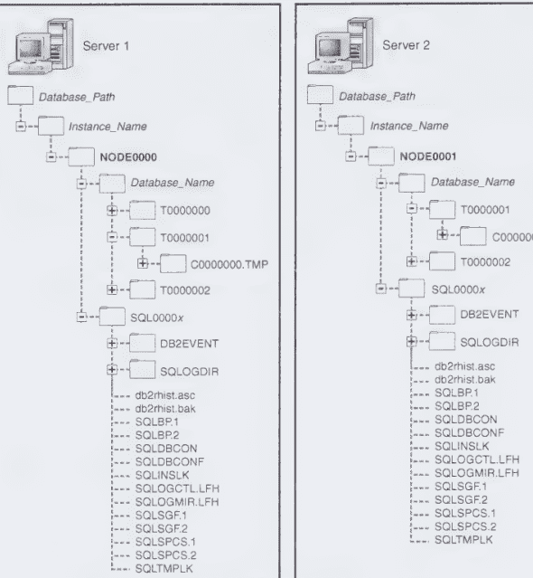

图 40 跨越两个分区的 DB2 数据库的典型目录层次树

## 4.3 在分区间平衡数据

在分区数据库环境中，可以定义一个或多个数据库分区的具名子集。你定义的每个子集被称为数据库分区组（database partition group）。一个数据库分区组最少包含一个数据库分区，也可以跨越数据库中的所有数据库分区。每当创建分区数据库时，系统会自动创建三个数据库分区组。其中一个是 `IBMCATGROUP`，这是包含系统目录（`SYSCSPACE`）的表空间使用的数据库分区组。另一个是 `IBMDEFAULTGROUP`，这是用于用户定义表的默认数据库分区组。第三个名为 `IBMGROUP`，是用于系统临时表空间的默认分区组。（可以在声明的临时表空间创建用户临时表空间：`IBMDEFAULTGROUP` 或任何用户创建的数据库分区组，但不能在 `IBMTEMPGROUP` 中创建。）

当你想在分区数据库中创建表时，应首先创建一个或多个数据库分区组，用以控制表空间存储的位置（你也可以选择使用默认数据库分区组：`IBMDEFAULTGROUP`）。一旦定义了适当的分区组，你就可以为每个组创建所需的表空间。创建的每个表空间都分布在所用数据库组中标识的所有数据库分区上；每个被使用的分区都将拥有自己的一组表空间容器，并“拥有”存储在那的数据。最后，你在适当的表空间中创建所需的表。

在分区数据库中创建表空间时，表空间所属的分区组决定了该表空间物理创建在哪个数据库分区上。表空间只能属于一个分区组，但一个分区组可以包含多个表空间。图 41 显示了数据库分区、分区组和表空间之间的一多多关系。

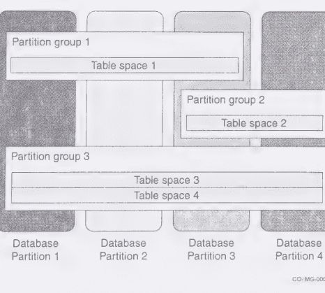

图 41 数据库分区、分区组和表空间

## 分区数据库的考虑因素

表空间创建后，没有办法动态更改它所所属的分区组。如果你想更改已创建的表空间的分区组，必须删除该表空间并使用新的分区组重新创建。

当数据存储在跨越多个数据库分区的表中时，它是使用哈希算法进行分布的，该算法利用所谓的“分区键”（partitioning key）。分区键是数据分区中每个表行所所属的一个或多个列的有序集合。选择良好的分区键将导致数据在各个分区之间实现均匀分布。反之，选择不当的分区键会导致数据分布倾斜，并导致每个被用分区的负载不平衡。分区键通常能提供良好平衡的数据分布。影响分区键选择的因素有很多——主要因素是分区键中的列也必须位于表的主键中。对于这一点，表的分区键通常被用作分区依据，因为它具有高基数（cardinality）。

如果你担心数据没有分到所有可用的数据库分区上，可以使用简单的查询来衡量数据分布。该查询的语法如下：

```sql
SELECT DBARTITIONNUM(PartitionKey) AS partnum,
COUNT(*) AS rowcount
FROM [PartitionedTable]
GROUP BY DBARTITIONNUM(PARTITIONKEYS)
ORDER BY 1
```


其中：

- `PartitionKey` — 标识构成用于分区表的分区键的列集合。
- `PartitionTable` — 通过名称标识分区表。

> 注意：表分区（也称为范围分区）是 DB2.9 中引入的一种数据组织方案，其中根据一个或多个列的值，将表数据划分到多个称为“分区”或“范围”的存储对象中。每个数据分区单独存储，存储对象可以位于不同的表空间中、位于同一个空间中，或者两者的结合。表分区可以提高性能，并消除使用 DB2 创建分区数据库的需要。表分区也可以与 DPE 结合使用。

### 4.3.1 关于广播的说明

当单表的数据分布在多个分区（并可能跨越多个服务器）时，由于数据从各个分区连接并作为结果返回给用户，可能会面临一些运行时性能挑战。由于一个分区的数据与另一个分区的数据连接而产生的网络活动被称为“广播”（broadcasting）。不幸的是，广播会对数据库性能产生负面影响。

在设计分区数据库时，建议尝试在同一分区内连接大表的列。这在某种程度上取决于用于两个连接表所选的分区键。

## 4.4 共享磁盘考虑因素

如果存储阵列向三个不同的服务器呈现同一个物理磁盘的三个不同部分，则每个服务器都将其各自的部分视为一个独立的磁盘。如果数据库分区存储在这些服务器的每一个上，DB2 也会假设每个服务器都有自己独立的物理磁盘。如果随后创建一个跨越所有三个数据库分区的表空间，其结果将类似于图 42 所示的配置。

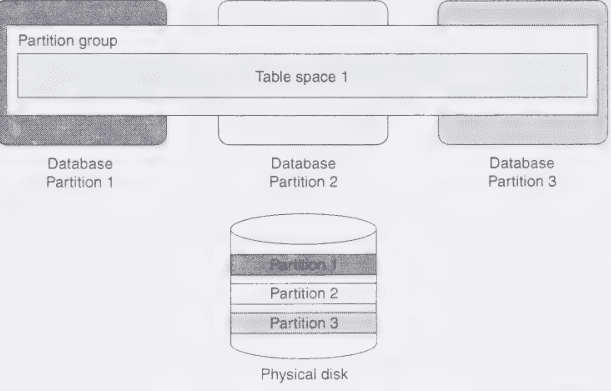

图 42 跨越三个数据库分区的表空间

分区数据库的考虑因素

Symmetrix DMX 使用缓存来缓解磁盘的影响。最后，存储中复杂的队列机制确保磁盘处于忙状态而不会产生长时间等待。

### 4.5 共享磁盘的挑战

当存储阵列中的磁盘专用给单个分区时，满足每个分区的 IOPS 要求可能是一个挑战。为了理解这一点，可以看一个例子。在 IBM 仓库环境中，目标是每个 GB 具有两个 IOPS。这意味着对于 73 GB 的磁盘，需要 146 IOPS。这个数字在 15000 转磁盘的规格范围内（取决于缓存大小）。但如果磁盘尺寸翻倍到下一个增量 146 GB 呢？为了保持每 GB 两个 IOPS，磁盘必须进行短缩，只使用前 73 GB。这将减少寻道并使磁盘性能类似于 73 GB 磁盘。当然，通过这种方法，磁盘容量的一半将无法利用。然而，磁盘未使用的部分可以用于备份或其他低容量活动。当然，当对该区域进行写入或读取时，整个磁盘的吞吐量将受到负面影响。

### 4.5.1 分配的粒度

许多阵列能够由来自多个磁盘的碎片组成一个 LUN。这增加了分区“拥有”的磁盘数量，从而降低了分配的粒度。在无共享的分区环境中，这意味着磁盘无法与数据库中的任何其他分区共享。这增加了数据库的有效存储单元。例如，如果在 RAID 5+3+1 数组中使用 146 GB磁盘，每个分区的最小分配单元为 4 * 146，即 584 GB 的存储空间。现在，假设一个数据库由 16 个分区组成。在这种情况下，最小增长单元是 16 * 584，即 9.3 TB。在大多数情况下，这可能是一个不可接受的量。因此，分区数据库的设计应尽可能提供较低水平的粒度。显然，较小的磁盘在这方面有帮助，但如果没有较小的磁盘，可以使用较小的 RAID 组。

在 DB2 for Linux, UNIX 和 Windows 上部署于 EMC Symmetrix DMX

## 4.6 在全共享阵列上的无共享设计

通过细致的规划，可以在“全共享”存储阵列上实现“无共享”设计。需要注意的是，在 Symmetrix DMX 上的“无共享”实现并不需要隔离 Symmetrix 缓存、独占前端主机交换器，也不需要隔离后端交换器。本质上，无共享设计针对的是物理磁盘本身。

在 Symmetrix DMX 存储阵列上，成功的分区数据库布局将确保没有任何两个表空间的容器（containers）位于同一个物理磁柱（spindle）上。通过遵循这一简单规则，可以避免全表扫描期间可能发生的冲突。图 43 展示了一个存储阵列，其中阵列内指定的磁盘组专门用于单个数据库分区。（图中的每个数据库分区被描绘为“拥有”8 个物理磁盘磁柱）。

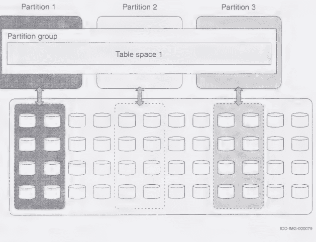

图 43 磁盘级无共享配置

为单个数据库分区分配磁盘很容易。当然，挑战在于提供足够数量磁盘头以满足每个数据库分区的吞吐量需求。在实施之前必须进行仔细分析，以确定所选配置是否能提供所需的性能。

第138页的图 44 展示了 Symmetrix DMX 上的无共享实现。在这里，每列磁盘代表一个 RAID 5 (3+1) 组；每个数据库分区由八个磁盘组成，由两个 RAID 5 (3+1) 组构成。空间分配单位约为 270 GB 原始容量，或 200 GB 可用容量。再次，挑战在于向每个分区提供少量磁盘时如何满足应用的性能需求。

## 分区数据库的考虑因素

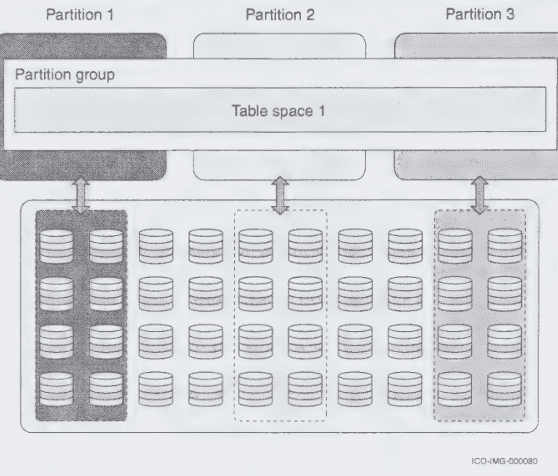

图 44 Symmetrix DMX 上的无共享配置

当使用 Symmetrix DMX 的更高级功能（如元卷/metavolumes）时，最小分区分配单元非常大。在 Symmetrix DMX 上设计无共享配置时，除非是针对最大的分区数据库配置，否则不建议使用此类功能。

## 4.7 分区数据库的特定建议

遵循以下最佳实践，可以使分区数据库成功部署在 Symmetrix DMX 存储上。

### 4.7.1 RAID 建议

由于 RAID 5 在价格和性能之间提供了经济的折中，它是分区数据仓库的极佳选择——特别是当数据库活动中写操作占比 10% 或以下时。虽然 RAID 5 配置在写操作时会产生中等的性能损耗，但数据仓库活动通常是读密集型的，因此受这种性能损耗的影响不像高写入的 OLTP 数据库那样大。与 RAID 1 相比，RAID 5 配置可以提供的额外空间对于大型数据仓库来说是一个重大的经济激励。

在分区数据库环境中，建议所有用于存放表空间数据的存储设备都使用 RAID 5。活动日志也可以放置在 RAID 5 设备上，因为数据仓库环境中日志的写入速率通常非常低。

RAID 5+1 是 Symmetrix DMX 的优配置。每个 RAID 组（即该组中的所有磁盘）必须由单个数据库分区拥有（不与数据库的其他分区共享），除非实施了第 4.6 节和 4.7 节描述的方法。

### 4.7.2 LUN 大

理想情况下，RAID 5 超卷/LUN 应该在 30 GB 到 60 GB 之间。更多的 LUN 允许从主机队列更多的 I/O 请求；然而，超卷会增加服务器启动所需，这对于非常大的数据库规模可能是一个关注点。较少的超卷可以缩短启动服务器所需的时间，但可能无法实现更细粒度的存储分配方法。（呈现给服务器的 LUN 数量取决于所使用的 HBA 配置。）

### 4.7.3 临时表空间

在数据仓库环境中，临时表空间可能是数据库中受影响最大的表空间，特别是在请求的数量方面。理想情况下，临时表空间应该放在 RAID 1 LUN 上，以避免 RAID 5 的写惩罚，并将临时表空间数据与普通表空间数据隔离开。在实际上，临时表空间所需的空间通常不值得为了隔离目的而独占磁柱。因此，临时表空间数据通常与普通表空间数据共同存放。由于由于，建议将临时表空间分布在数据库拥有的所有磁柱上。这样，处理临时数据的 I/O 负担就可以分摊到尽可能多的磁柱。

### 4.7.4 分区内的容器条带化

当 LUN 从同一个 RAID 组划分给主机时，每个 LUN 都应避免从这些 LUN 为同一个表空间提供多个容器。管理和控制此类配置最简单的方法是创建一个跨越所有来自同一 RAID 组 LUN 的非条带逻辑卷。该逻辑卷应仅提供一个表容器。

## 分区数据库的考虑因素

### 4.7.5 逻辑卷管理器

尽管上一节概述了说明，呈现给主机的每个 LUN 都应该被制作逻辑卷。这将防止逻辑卷管理器（LVM）条带，这对于 DB2 来说通常不是好事。

## 4.8 多分区组共享磁盘

之前我们看到，在分区数据库环境中，并不限制每个表和表空间跨越所有分区。DB2 支持部分去聚集（partial declustering），这意味着你可以将表空间分布在数据库子集上。用户可以通过分区组来确定数据分布在哪些以及多少数据库分区上。

图 45 显示了一种布局，其中四个分区组拥有分配给数据库的物理磁盘的一部分。每个分区组跨每个磁盘，但每个磁盘可以分配给多个组。（给定的表空间分布在单个分区组上。）这样，特定的分区将处理给定的读取请求，生成的并行操作之间不会产生冲突。

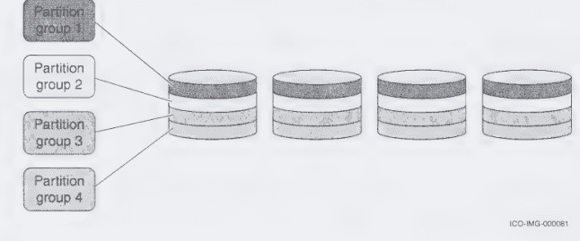

图 45 全共享磁盘——多分区组

在这样的配置下，有人认为由于只有数据库子集可以处理任何单个表扫描，DB2 提供的并行性降低了。同样也可以认为，磁盘本身决定了 I/O 并行性，由于每个分区组都可以访问每个磁盘，可以实现最大水平的并行。

## 4.9 多分区数据库共享磁盘

在共享阵列上布局分区数据库的另一种解决方案是在分区数据库之间共享磁柱，但在同一个数据库内部共享磁柱。这一概念基于数据库在不同时间有峰值和低谷，并且即使位于同一组物理磁盘上的不同数据库之间也可能发生冲突，冲突不能归因于单个数据库的单个查询。图 46 展示了此类配置看起来的样子。

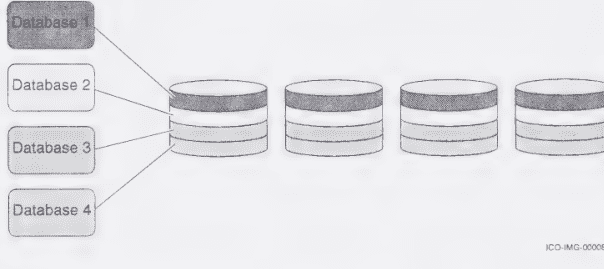

图 46 全共享磁盘——多数据库

# 术语表

本术语表包含与磁盘存储子系统相关的术语。书中使用了其中许多术语。

# A

- **执行器 (actuator)**
  一组寻道臂及其附的读写头，作为独立组件在头臂组件 (HDA) 内部移动。
- **适配器 (adapter)**
  提供通道器与磁盘设备（SCSI 适配器）、通道器与并行通道（Bus & Tag 适配器）、通道器与串行适配器之间物理接口的显卡。
- **备用道 (alternate track)**
  指定的用于存储缺陷主道数据的道。另见“主道 (primary track)”。

# C

- **缓存 (cache)**
  随机访问电子存储器，用于保留频繁使用的数据，以便通道更快地访问。
- **缓存槽 (cache slot)**
  等同于一个道的缓存单元。
- **通道通道器 (channel director)**
  Symmetrix 子系统中负责主机通道与数据存储之间接口的组件。它在通道和缓存之间传输数据。
- **CKD**
  计数-键数据（Count Key Data），一种采用自定义记录格式的数据记录格式。每个记录由一个计数区域（用于识别记录及其格式）、一个可选键区域（可能用于识别数据区域内容）以及一个包含记录用户数据的数据区域组成。CKD 也可以指采用 CKD 记录格式的设备所接受的一组通道命令。
- **控制器 ID (controller ID)**
  磁盘连接到以执行 E 操作的通道器的控制器识别号。Symmetrix 仅有一个控制器 ID。

# D

- **DASD**
  直接访问存储设备，一种提供计算机数据非易失性存储并能对该数据进行随机访问的设备。
- **数据可用性 (data availability)**
  应用程序对任何及所有用户数据的访问。
- **延迟快速写入 (delayed fast write)**
  缓存中没有空间存放写入操作呈现的数据。
- **下存 (destage)**
  将新数据或更新的数据从缓存异步写入磁盘设备的过程。
- **设备 (device)**
  Symmetrix 子系统中一个具有唯一寻址的部分，由一组寻道臂、相关的磁盘表面以及定位、读取和写入数据所需的电子电路组成。另见“卷 (volume)”。
- **设备地址 (device address)**
  在 MVS 环境下，唯一定义通道路径上物理 I/O 设备的十六进制值。另见“单元地址 (unit address)”。
- **设备号 (device number)**
  在逻辑上标识字符串（string）中磁盘设备的值。
- **诊断 (diagnostics)**
  用于检查、检测和纠正故障组件的系统级测试或固件。这些测试是全方位且自动触发的。
- **通道器 (director)**
  Symmetrix 子系统中允许 Symmetrix 在主机通道与磁盘设备之间传输数据的组件。另见“通道通道器”。
- **磁盘通道器 (disk director)**
  Symmetrix 子系统中负责缓存与磁盘设备之间提供接口的组件。
- **双发起器 (dual-initiator)**
  Symmetrix 的一项功能，当磁盘通道器或其服务的设备管理硬件发生故障时，它会自动为由该磁盘通道器直接服务的磁盘设备创建一个备份数据路径。
- **动态备用 (dynamic sparing)**
  Symmetrix 的一项功能，自动将数据从故障磁盘设备传输到可用的备用磁盘设备，而不影响数据可用性。此功能支持 Symmetrix 子系统中所有的非镜像设备。

# E

- **ESCON**
  企业级系统连接（Enterprise Systems Connection），一组 IBM 及供应商的产品，使用光纤技术和称为 ESCON 通道器的动态修改交换机将主机计算机相互连接，并与附加存储、本地工作站和其他设备连接。另见“ESCON 通道器”。
- **ESCON 通道器**
  将 ESCON 通道连接到 Symmetrix 串行通道接口时，提供动态切换功能和扩展链路长度（具有 XDF 能力）的设备。
- **快速写入 (fast write)**
  在 Symmetrix 中，指以缓存速度进行的写入操作，不需要立即传输数据。数据被直接写入缓存，并供稍后下存。
- **FBA**
  固定块架构（Fixed Block Architecture），使用固定大小数据块的磁盘设备数据存储格式。
- **帧 (frame)**
  ESCON 环境下的数据包格式。另见“ESCON”。
- **FRU**
  现场可更换单元（Field Replaceable Unit），由维修人员作为单一实体更换或添加的组件。

# gatekeeper
Symmetrix 存储子系统上的小型逻辑卷，用于将命令从主机传递到 Symmetrix 存储子系统。Gatekeeper 配置在标准 Symmetrix 磁盘上。

# GB
千字节，$10^9$ 字节。

# H

# 头磁盘组件 (head and disk assembly)
Symmetrix 子系统中的一种包含磁盘和执行器的现场可更换单元。

# 主地址 (home address)
CKD 轨道上的第一个字段，用于标识该道并定义其运行状态。主地址写在每个道的索引点之后。另见“CKD”。

# 超卷扩展 (hyper-volume extension)
利用单个物理磁盘设备的完整格式化容量，在其上定义多个逻辑卷的能力。这些逻辑卷的大小可由用户选择。最小卷大小为一个柱面，最大大小取决于磁盘设备容量和所选的仿真模式。

# I

# ID
标识符（Identifier），用于识别程序、设备、控制器或系统的位序列或字符序列。

# IML
初始微程序加载（Initial micro program loading）。

# 索引标记 (index marker)
表示道的物理起始和结束。

# 索引点 (index point)
磁盘表面上确定道起始的参考点。

# I/O 设备 (I/O device)
可寻址的输入输出单元，例如磁盘设备。

# K

# K
千（Kilobyte），1024 字节。

# L

# 最少使用算法 (LRU)
通过移除最少使用的数据来识别并释放缓存的算法。

# 逻辑卷 (logical volume)
定义的存储设备。在 5200 中，可以将一个物理设备定义为一个或两个逻辑卷。

# 长缺失 (long miss)
请求的数据不在缓存中，且正在获取过程中。

# 链路冗余码 (LRC)
记录中累积字节的异或（XOR）。

# M
- MB
兆字节（Megabyte），$10^6$ 字节。
- 镜像 (mirroring)
Symmetrix 在独立磁盘上维护指定卷的两个副本。写入期间会自动更新。如果一个磁盘设备故障，Symmetrix 会使用另一个磁盘设备。
- 镜像对 (mirrored pair)
数据在两个设备上各记录一次的逻辑卷。

# P
- 物理 ID (physical ID)
  执行 E 操作的 Symmetrix 通道器的物理识别号。该值每安装一个自动增加一。该号在主机系统中必须是唯一的。它被称为 SCU_ID。
- 主道 (primary track)
存储数据的原始道。另见“备用道 (alternate track)”。
- 提升 (promotion)
将磁盘设备上的数据移动到缓存的过程。

# R
- 读命中 (read hit)
读取操作的数据在缓存中。
- 读缺失 (read miss)
读取操作的数据不在缓存中。
- 记录零 (record zero)
主地址后的第一个记录。

# S
- 清扫 (scrubbing)
读取、检查纠错位并将纠正后的数据写回源设备的过程。
- SCSI 适配器 (SCSI adapter)
Symmetry 子系统中提供磁盘通道器与磁盘设备之间物理接口的显卡。
- 短缺失 (short miss)
请求的数据不在缓存中，但正在获取过程中。
- SSID
对于 3990 存储控制仿真，此值标识逻辑 DASD 的物理组件。SSID 在主机系统中必须是唯一的数字。它应该是偶数并从零开始。
- 阶段写入 (stage)
将数据从磁盘设备写入到缓存的过程。
- 存储控制单元 (storage control unit)
Symmetrix 子系统中负责连接 Symmetrix 到主机通道的组件。它执行通道命令并与磁盘通道器和缓存通信。另见“通道通道器”。
- 字符串 (string)
共享同一个磁盘通道器的系列连接磁盘设备。

# U
- 单元地址 (unit address)
  在 MVS 环境下，唯一定义通道路径上物理 I/O 设备的十六进制值。另见“设备地址 (device address)”。

# V

**volume**（卷）指代存储设备的通用术语。在 Symmetrix 子系统中，卷对应于单个磁盘设备。

# W

**write hit**（写入命中）缓存中有足够空间存储写入操作所提供的数据。

**write miss**（写入未命中）缓存中没有空间存储写入操作所提供的数据。

在 EMC Symmetrix DMX 上部署部署适用于 Linux、UNIX 和 Windows 的 DB2

# A

- 致执行器定位（寻道时间） 108
- ALTER DATABASE 46
- ALTER TABLESPACE 44, 115
- Alter Tablespace 对话框 44
- 面积密度 108

# B

- 后端 96, 98
- 广播 134
- 缓冲池 I/O 126
- 缓冲池 32

# C

- 缓存 96, 97
- 命令
- 更改跟踪 (synchmg) 66
- COMMIT 47
- 并发 SRDF 72
- 配置
    - 数据库: 56
    - 实例 53
    - 服务器 49
    - 容器 32
- CREATE DATABASE 34, 115, 131
- 创建数据库向导 34
- 创建表空间向导 43
- CREATE TABLESPACE 43, 114

# D

- 数据重用 97
- 数据库 29
- 数据库节点 130
- 数据库分区 130
- 数据库分区组 133
- 数据库分区功能 129
- 基于数据库的条带化 106
- DB2 管理服务器 (DAS) 30
- DB2 家族
    - DB2 数据仓库 (DWE) 220
    - DB2 企业服务器 (ESE) 191
    - DB2 Everyplace 18
    - DB2 Express 18
    - DB2 Express-C 18
    - DB2 for AI/OS 20
    - DB2 for z/OS 20
    - DB2 个人版 19
    - DB2 工作组服务器版 (WSE) 19
- DB2 对象
    - 数据对象 33
    - 恢复对象 72
    - 存储对象 32
    - 系统对象 32
- DB2 注册表管理工具 51
- DB2 工具 72
- 命令编辑器 24
- 命令行处理器 27
- 配置助手 26
- Center Center 72
- DB2_ENABLE_AUTONFIG_DEFAULT 40
- DB2_PARALLEL_IO 118
- DB2_PARALLEL_IO 注册表变量 118
- DB2_STRIPED_CONTAINERS 120
- DB2_USE_PAGE_CONTAINER_TAG 120
- DB2_USE_PAGE_CONTAINER_TAG 注册表变量
- DB2ADMINSERVER 30
- DB2INSTANCE 29
- dbnodes.cfg 131
- dbset 49
- d2ubind 40
- DBM 配置对话话框 54
- 设备写入等待限制 98
- dft_prefetch 33
- dtdb_path 36
- 驱动器缓存容量和算法 108
- DSS 96
- 动态镜像服务器策略 102

# E

- EMC 集群跟踪器 63, 66
- EMC Infinity 操作系统 62
- EMC PowerPath 63, 92
- EMC Solutions Enabler 62, 65
- EMC SRDF 配置组 62
- EMC SRDF/Cluster 启用解决方案 79

在 EMC Symmetrix DMX 上部署适用于 Linux, Unix 和 Windows 的 DB2

# EMC 存储资源管理 89

- EMC Symmetrix 62
- EMC Symmetrix DMX 64
- EMC Symmetrix 远程数据设施 62
- TimeFinder/ 62, 80
- TimeFinder/Clone 62
- TimeFinder/Mirror 62
- TimeFinder/Snap 63
- 范围大小 121

# O

- OLTP 96
- 开销 123

# P

- 奇校验 101
- 分区键 134
- 预取大小 123
- 预取 123
- 优先级存储 98

# F

- 快速通信管理器 130
- FCM 130
- 文件系统缓存 116
- FILE_FLAG_NO_BUFFERING 115
- 前端连接 99

# R

- RAID 100
- RAID 1 100, 139
- RAID 1+0 101
- RAID 5 100, 139
- RAID 6 100
- 范围分区 134
- 独立磁盘冗余阵 100
- 注册表变量 49
- RESTART DATABASE 127
- ROLLBACK 42
- 旋转延迟 108

# G

- GET DATABASE CONFIGURATION 56
- GET DATABASE MANAGER CONFIGURATION 53

# S

- 模式 39
- 寻道时间
    - 最小化 110
- 服务器 29
- 共享磁盘 135
- shared-hot: 130
- Solutions Enabler 管理 (SRM)
    - 组件 63

# H

- HADR 19
- 哈希算法 134
- 适配器 99
- 存储条带化 104
- 卷 105
- 冲突 109

# I

- I/O 缓存 47
- IBMCATGROUP 133
- IBMDEFAULTBP 38
- IBMDEFAULTGROUP 133
- 接口速度 99

# SRDF

- 优势 67
- 配置组 69
- 建立 SRDF 73
- 恢复 76
- 故障转移 76
- 故障恢复 71
- 运行模式 68
- 基于存储的条带化 105
- 在 SRDF 上划分 74
- 挂起 71

# L

- 最少用 97
- 局部性 97
- 日志 47

# M

- 列表 126

# N

- 节点 130

# T

- 范围分区 134
- 表空间 31
- 模式 39
- 吞吐量 96

# U

- 数据库配置 57
- 数据库管理器 54
- 写入操作 72
- 使用 11
