# 桌面端 Linux 部署指南

Haletky, Edward.

> 意识到保护已写内容的重要性，爱尔塞维尽可能使用无酸纸印刷书籍。

申请已提交。

本书的目录记录可从英国图书馆获取。

> 给爸爸，他总是告诉我们要聪明。（1938年4月10日至2004年10月8日）

- 内容 vii
- 致谢 xiii
- 关于本书书 xv
- 要求

# 致谢

我要感谢我的妻子 Romy 以及我的家人在本书写作期间提供的持续支持。Romy 通过尽量减少“家务清单”并鼓励我继续写下去，为我撰写这本书留出了充足的时间。Romy 还捐赠了她的博士论文，作为对 Linux 许多可用文档工具的最佳测试：书中包含了她的作品。感谢你，Romy；我深表你的支持。

此外，我要感谢我的朋友 Chris 和 Pat 在这些章节从文字处理器初稿后为我检查技术错误，并用他们富有见解的问题和建议让我保持警觉。非常感谢！此外，我还要感谢 Pat 提供了关于 iPAQ 的章节内容；他拥有一台这样的设备，而我只有一台 Palm 设备。

最后，我要感谢我的朋友、同事和家人的支持与鼓励。

这本书不仅仅是一个起点，它是我构建可用的 Linux 企业桌面环境的配方，其意义远超了迁移到 Linux，而是进入了“集成”的概念。本书致力于应对将 Linux 集成到企业环境的挑战，同时最大限度地降低学习曲线且不损失功能。本书介绍了构建集成环境所需的工具，以及在桌面使用 Linux 所产生的成本和支持考虑。书中还包含了我组装笔记本电脑的个人方案（见第 13 章）。

# 关于本书

本书涵盖了红帽企业 Linux (Red Hat Enterprise Linux) 3 和 4、SUSE 企业 Linux (Enterprise) 9 以及 Mandrake Linux，提供了必要的工具，让读者能够在以微软为中心的网络环境中使用 Linux。对于创建集成的 Linux 企业桌面来说，这是一份无价参考资料！

电子邮箱：books@astroarch.com

网站：http://www.astroarch.com/~elh/books

# 要求

看看桌面电脑的世界，你会看到无数解决方案，从 Windows 98 及其他版本到各种类型的 Macintosh 电脑，再到作为新兴明星的 Linux。虽然我们知道 Windows 和 Macintosh 是竞争对手，而且有越来越多的眼睛正在研究 Linux 作为解决 IT 成本上升的方案。尽管如此，许多人仍不愿或尚未准备好尝试并使用这个开源操作系统。因此，需要更多信息，需要一种触手可及的资源，既能解决在非以 Linux 为中心的桌面世界中使用 Linux 的固有问题，又能为 IT 经理和那些清晰了解 Linux 基础的系统管理员提供信息来源。

有必要根据桌面用户的需求来描述本书的完整范围。这些需求将决定本书后续每个章节要回答的问题，并源于两个基础问题：

1. Linux 已经准备好作为桌面投入使用了吗？
2. Linux 已经准备好作为企业桌面了吗？

这两个问题的简单答案都是肯定的。Linux 已经准备好了，但情况比这要复杂得多。让我们来看两个不同的场景，并尝试完善我们的答案。

第一种场景是使用 Linux 替代所有现有机器，从文件服务器到桌面：这是一个同质化的 Linux 解决方案，不会与任何其他类型的系统交互。第二种场景是一个异构解决方案，其中 Linux 可以充当桌面、服务器等。虽然首种场景是许多 Linux 开发者的梦想，但第二种场景是一个更诚实的世界观。

场景一是一个响亮的肯定。在企业环境中，一切运行都符合预期。

场景二是一个带掌声的（尴尬的）肯定。一切都能运行，但它需要更多的混合模式桌面，即使用 Linux 作为操作系统，并可能使用 Wine 和 VMware 等工具来完成互操作性需求。

在牢记场景二的情况下，我们应该将 Linux 视为一种赋能工具，它拥有一些原生应用，以及使用可能没有 Linux 等效应用的非原生应用的工具。每一章都从这个世界观来看桌面，并回答管理员面临的问题，即必须解决维护一个成功交互的异构环境的问题，并确定管理员能为做决策的 IT 经理带来的成本和效益。

虽然本书可以被视为一份常见问题解答 (FAQ) 列表、一套操作文档集，或者一份强力工具或黑科技列表，但我将回答 IT 经理的问题：“在企业桌面使用 Linux 的成本是什么？”以及系统管理员的问题：“在企业桌面上实施 Linux 涉及哪些内容？”为了得出这些信息，我们必须首先访问企业桌面的需求。

需求列表取自我在企业环境常用桌面——笔记本电脑上的经验，这台笔记本电脑必须被所有描述的用户类型能够使用。我们处理此列表是为了满足三种不同用户类型的需求：

1. 远程办公者——设置家庭办公室桌面的工具和需求
2. 企业办公室用户——在企业办公室或隔位间设置高效 Linux 桌面的工具和需求
3. 奔波战士——在笔记本电脑上设置实用 Linux 环境的工具和需求

需求根据工具的分类对这些环境进行了划分。需求的顺序（以及章节的顺序）引导读者从连接基础到更深奥的桌面工具的最后润色。需要注意的是，我们的需求列表使用了大线条的笔触；你的环境可能不需要书中讨论的所有工具，并可能需要这里未讨论的其他工具。

交换—单用户和组帐户

打印—基于 Windows 的打印机访问

文件共享—基于 Windows 的文件共享

Palm OS 桌面和 HotSync—Documents-To-Go

带有 Word/Excel 插件的网页浏览器

IRC

了解这些工具在你当前环境中的用方法，将有助于确定在 Linux 系统上需要进行哪些操作以实现相同的结果，无论你的新 Linux 桌面是否必须更改以反映中央服务器处理事务的方式。这类知识甚至可能影响你的安全设置。

最后，提前计划还将帮助你理解当人们从一个操作系统切换到另一个操作系统时可能需要的培训。必须提前理解的是，Linux 上看似相同的工具其行为与 Microsoft 环境中的工具并不完全相同。这些工具的安装和配置不仅在 Linux 和 Microsoft 之间，在不同的 Linux 发行版之间也存在着截然不同的情况。本书将集中介绍 Red Hat Enterprise Linux 版本 3 工作站（RHEL3 或 RHEL3-WS）。在可能的情况下，我们还将查看 SuSE、Mandrake 和 Fedora Linux 发行版。

总结：你可以利用章节列表提前创建一份你所需的工具清单。注意你所选择的工具中任何由于本地系统设置、公司使用指南或安全要求而所需的特定功能。最后，确保你理解在迁移到新 Linux 环境时将所需的学习。

## 虚拟专用网络 (VPN) 连接

越来越多的“移动办公人员”（road warriors）需要通过虚拟专用网络 (VPN) 连接到公司环境。本章将介绍使用 Linux 连接到公司局域网的三种可能方法。它不会涵盖调制调器的设置，但将涵盖实现 VPN 所需软件的设置。目标不是提供关于如何选择的详细指南，而是提供如何实现必要组件及其相关成本的实用知识。

## 2.1 我如何使用 PPTP 连接？

PPTP（点对点隧道协议）需要向内核添加模块，并使用 `pptpconfig` 和其他系统修改进行特殊设置来实现 PPTP 协议。http://ppptclient.net 是一个非常好的网站，为 Linux  PPTP 提供了极好的参考。虽然我们不会讨论每一个发行版，但步骤对所有版本来说通常是相同的。由于使用 PPTP 需要 root 权限，因此使用 `sudo` 或类似的工具来控制对这一关键组件的访问，或者配合 `pptpcommand` 使用 PPTP 服务并不是一个坏主意。

### 2.1.1 RHEL3

在 RHEL3 中安装 PPTP 时，你需要向内核添加模块以添加所需的加密。一旦添加了这些模块，只需要在配置文件中正确定义一切，然后启动 PPTP 配置即可。作为一个额外奖励，当前的 currentTP 模块已被编译为使用动态内核支持 (DKMS)。当内核升级时，DKMS 会为你提供帮助，因为你不需要记住手动重新编译模块。重新编译将自动发生，从而在内核因安全或修复原因而升级时减少支持问题。DKMS 还会为向每个主机分发第三方模块提供一种更简单的方法。以下是使用 DKMS 形式模块安装 PPTP 的必要步骤。请注意，此安装 DKMS 是 RPM 格式的。其他 Linux 版本有其他格式可用。

```
# rpm -ivh pptp-2.4.3-0.cvs.20040527.1386.rpm pptp-linux-1.4.23-1tkf-pptp-0.0.3-1dkms.noarch.rpm kernel_pptp-0.0.3-1dkms.noarch.rpm
```

DKMS: 添加完成。

正在为模块构建准备内核 2.4.21-15.0.EL（这并非编译内核，只是准备内核符号）。正在存储当前的 .config 以完成后恢复。运行 Red Hat 准备程序：DKMS: 构建完成。DKMS: 安装完成。

```
# service dkms_autoinstall start
# chkconfig dkms_autoinstall on
# modprobe -v ppp_
# lsmod | grep ppp
```

| 模块 | 大小 | 使用 |


| :--- | :--- | :--- |

| ppp_pppe | 13816 | 0 (unused) |

| ppp_generic | 24436 | 0 |

| pphc | 6672 | 0 |

```
# pptpconfig
# pptpcommand
```

配置 PPTP 有两种方法：`pptpconfig` 和 `pptpcommand`，是一个字符图形化工具。`pptpcommand` 还有一个可以在你的网络启动后启动的服务（`pptpconfig` 没有此能力）。两者都必须以 root 身份运行。RHEL3 上的 `pptpconfig` 在启动时会自动询问 root 密码，而 `pptpcommand` 则要求用户以 root 登录后启动。在使用 `pptpcommand` 甚至 `pptpconfig` 之前，最好检查公司安全策略，自动登录 VPN 可能不被允许。虽然 `pptpcommand` 确实方便，但它不适合胆小者，且本文未将其涵盖。在运行 `pptpconfig` 时，你将使用以下屏幕进行配置（见图 2.1、2.2 和 2.3）：

图 2.1 展示了服务器信息框。你需要填写你的服务器信息以及路由、DNS、加密和杂项信息。

图 2.2 展示了加密选项。例如，我的服务器要求对显示的项目进行加密。

图 2.3 展示了杂项选项。

### 2.1.2 其他版本

有趣的是，Gentoo 版本的 Linux 包含了使用 PPTP 所需的工具，而大多数其他主流 Linux 版本默认并不包含这些工具。

## 2.2 我如何使用 IPSec 连接？

IPSec（IP 安全）使用 Openswan 软件包来实现 IPSec 栈并连接到公司网络上的 Openswan 服务器。Openswan 的实现在大多数 Linux 发行版中是；http://www.openswan.org 提供了极好的 OpenSwan 实现指南。NAT 透透（NAT-T）通常需要内核内核。通常，2.6 版本内核已经包含了 IPSec 和依赖模块，而某些 2.4 内核需要将模块编译到你的内核中。虽然 IPSec 的使用日益增加，但服务器之间存在相当的不兼容性，且通常需要专用客户端才能使用。


> 图 2.1 PPTP 配置的服务器信息。


> 图 2.2 PPTP 配置的加密信息。


> 图 2.3 PPTP 配置的杂项信息。

### 2.2.1 RHEL (Red Hat Enterprise Linux)

Openswan 没有安装在 RHEL3 上，因为 IPSec 模块存在依赖问题。然而，IPSec 支持是 RHEL3 和 4 的一部分。请参考 http://www.redhat.com/docs/manuals/enterprise/RHEL/security-guide/sl1-vpn-ipsec.html（取决于你的发布版本是 3 或 4），以获取特定的安装和设置说明。此外，http://www.cs.helsinki.fi/u/mikkila/docs/linux-avaya-vsu.html#native_config 提供了关于 RHEL3 和 RHEL4 IPSec 支持的易于使用的安装讨论。然而，如果你需要 NAT-T 支持，你需要带有补丁完全重新编译内核，这会导致你的 RHEL 保修失效。

### 2.2.2 Fedora

Fedora Core 2 或 3（内核 v2.6）已经包含了内核 IPSec 模块，但不支持 NAT-T。一旦需要 NAT-T 支持，就需要将其编译到你的内核中。

### 2.2.3 VMware

VMware workstation 是一个收费（199 美元）的程序，提供了一个可以在其中运行 Windows 实现的虚拟机。这将允许你使用 Microsoft 提供的拨号和 VPN 工具连接到公司局域网。这是兼容性最好的 VPN 方法，并且能够方便地缓存域凭据。为了让 Linux 主机访问运行在 VMware 内部的 VPN，你必须将 VMware 虚拟机配置为路由器，可以通过使用 Internet 连接共享或其他代理/路由器软件来实现。

使用，由于现有的强制安全要求、VPN 软件甚至是你公司的书面安全策略。在继续之前，请确认这些工具在 Microsoft 系统上是被允许的。一旦使用了这些方法之一，你就可以将 Linux 默认值更改为 VMware 虚拟机的地址，设置其他几个项目（如 DNS 服务器），然后就可以。然而，如果你没有系统的 root 权限，你将需要依赖这些工具被正确配置以便使用，并需要根据不同的 Linux 版本使用不同的工具：

- RHEL3: `redhat-config-network`

- Mandrake: `drakeconf`

- SuSE: `yast2`

- Fedora/RHEL4: `system-config-network`

## 2.3 我如何使用 SSH 隧道连接

SSH 怎么样？安全外壳是否提供隧道方法？答案是肯定的，但在 Linux 和现代 Macintosh 之外，我没有见过它被广泛使用。然而，在使用 SSH 隧道之前，你必须拥有一个有效的网络连接，这就是其他 VPN 解决方案可能派上用场的地方。SSH 的优势之一是任何网络连接都可启动隧道。再次，你需要 root 权限，因此 `sudo` 命令非常宝贵。我们不会深入研究 SSH，因为对于这项技术有其他可用资源。

## 2.4 无线和其他网络设备

现代无线设备的复杂性值得提及。许多较慢的无线设备在 Linux 上即插即用。这些设备遵循 Wireless-B 标准。然而，现代的 Wireless-G 设备（除基于 Prism 的 Wireless-G 设备外）需要开源项目的帮助，请注意 Prism 驱动项目 (`/ndiswrapper-sourceforge.net`) 将将 Microsoft NT Ndis 驱动加载到 Linux 内核中，以便现代 Wireless-G 设备能够正常工作。NT Ndis 驱动将读取从介质复制到 Linux 系统的 Windows 无线设备，并利用此控制设备。这为“道路战士”们提供了帮助。例如，我们有一个配置 LinkSys Wireless-G PCI PCMCIA 设备的方案：

```
# tar -xzf ndiswrapper-0.9.tar.gz
# cd ndiswrapper-0.9
# make install
# mkdir /usr/local/linksys.WMP54G (PCI)
从 CDROM 中将驱动文件 bcmwl15.* 复制到 /usr/local/linksys.WMP54G
- 或者 -
# mkdir /usr/local/linksys.WPC54G (PCIA)
从 CDROM 中将驱动文件 bcmwl15.* 复制到 /usr/local/linksys.WPC54G
```

```
# ndiswrapper -l # 检查任何已存在的驱动
# ndiswrapper -i /usr/local/linksys.WPC54G/bcmwl15.inf # 安装驱动
# ndiswrapper -l # 检查是否已安装
# edit modules.conf 以设置 add alias wlan0 ndiswrapper
```

配置 WLAN0

一旦你使用上述配置工具之一配置了 WLAN0 设备，你就可以轻松地使用 Wireless-G 设备了。还有一个 DriverLoader，这是来自 Linux 的第三方产品 (www.linuxant.com)。DriverLoader 与 NdisWrapper 非常相似，价格为 19.95 美元。

NdisWrapper 和 DriverLoader 都使用所用无线设备提供的驱动程序，因此在安装这些工具时，你需要设备介质。

此外，某些以太网设备必须构建新驱动程序以访问其所有完整功能。其中一个设备来自 Broadcom。虽然标准的 rg3 驱动可以工作，但它没有向驱动程序应用选项以控制速度、双工等的功能。因此，你可能需要重新编译 BCM5700 驱动以处理这些选项。你可以轻松将此驱动程序和 NdisWrapper 驱动修复到 DKMS，这样当内核发生安全或其他更新时，你就不需要手动重新编译任何驱动程序。虽然以下步骤适用于 RHEL5，但它们对你测试过的 Linux 版本同样有效。

### 2.4.1 通过 DKMS 使用 BCM5700 驱动

我们正在使用 Broadcom 5700 (BCM5700) 驱动 v7.1.9e。我使用了以下步骤以 root 身份将此添加到 DKMS 中。虽然可能有更简单的方法，但这种方法运行良好，并允许构建相应的 BCM5700 驱动，以便需要时提供 GigE 速度。


```
# mkdir /usr/src/kernel_bcm5700-7.1.9e
# cd /usr/src/kernel_bcm5700-7.1.9e
# tar -xzf bcm5700-7.1.9e.tgz
```

创建一个名为 `dkms.conf` 的文件，内容如下：

```
PACKAGE_VERSION="7.1.9e"

# 以下项目不应随每个驱动更改
PACKAGE_NAME="kernel_bcm5700"
BUILT_MODULE_NAME[0]="bcm5700"
DEST_MODULE_LOCATION[0]="/kernel/drivers/net/"
AUTOINSTALL="yes"
REMAKE_INITRD="no"

# 这些仅用于 2.4 内核
MAKE[0]="make all"
CLEAN="make clean"
```

运行以下命令：

```
# dkms add -m kernel_bcm5700 -v 7.1.9e
# service dkms_autoinstall start
```

## 2.4.2 通过 DKMS 使用 NdisWrapper

NdisWrapper 也可以非常方便地添加到 DKMS 框架中。实际上，它比之前讨论的 BCM5700 驱动更简单，因为不需要特殊的构建脚本。这些简短的指令就能完成你所需工作。DKMS 要求安装模块路径以 `/kernel` 开头，因此你需要根据以下说明更改 `Makefile`。

```
# mkdir /usr/src/kernel_ndiswrapper
# cd /usr/src/kernel_ndiswrapper
# tar -xzf ndiswrapper-0.9.tar.gz
# mv ndiswrapper-0.9/* ./ ; rmdir ndiswrapper
修改 Driver/Makefile 将安装路径从 'misc' 更改为 'kernel/drivers/net'
```

创建一个名为 `dkms.conf` 的文件，内容如下：

```
PACKAGE_VERSION="0.9"

# 以下项目不应随每个驱动更改
version
PACKAGE_NAME="kernel_ndiswrapper"
BUILT_MODULE_NAME[0]="ndiswrapper"
BUILT_MODULE_LOCATION[0]="driver"
DEST_MODULE_LOCATION[0]="kernel/drivers/net/"
AUTOINSTALL="yes"
REMAKE_INITRD="no"

# 这些仅用于 2.4 内核
MAKE[0]="make all"
CLEAN="make clean"
```

然后运行以下命令：

```
# dkms add -m kernel_ndiswrapper -v 0.9
# service dkms_autoinstall
```

## 2.5 成本

使用 Linux 作为 VPN 平台是否有隐藏成本？使用这些工具会有金钱成本以及支持成本。金钱成本与购买硬件和实现 VPN 所需的软件有关。由于现代 VPN 客户端可能还需要生物识别狗密或卡，它们的成本与其他任何系统并无区别。然而，系统之间的软件成本可能会非常不同。如果你使用通用工具，除非要使用 VMware，否则成本是最低的。

表 2.1 显示了涉及的成本。

| 软件 | 支持级别 | 费用 | 支持费用 |
|---|---|---|---|
| PPTP | 开源 | NA | NA |
| OpenSWAN/IPsec | 开源 | NA | NA |
| VMware | 基于 Web/电话 | $199 | 90天内免费 |
| NdisWrapper | 开源 | NA | NA |
| DriverLoader | 电子邮件/电话 | $19.95 | NA |
| DKMS | 开源 | NA | NA |
| SSH 隧道 | 开源 | NA | NA |

## 2.6 支持问题

在 Linux 上使用 VPN 时确实存在相当大的支持问题，其中最主要的是为了 NAT-T 重新编译内核，这会导致你的保修失效。实际上，对内核的任何重新编译或修改都会导致保修失效。添加模块不会导致保修失效，但你可能需要禁用它们的使用以完全调试系统，因为特定模块将无法使用。

在做出如此强烈的声明后，为什么还要使用这些工具？因为开源社区非常活跃、能力强，并为他们的模块提供了卓越的支持。此外，DKMS 实现将减少支持电话的数量，并允许企业 IT 部门对当前使用的工具有更多控制。

## Office

将 Linux 作为桌面的一个主要部分是实现与 Microsoft Office 工具套的兼容性。本章包含与 Microsoft Office 产品（如 Exchange、Word、Excel、PowerPoint、Access、FrontPage 和 Publisher）对应的 Linux 工具信息。首先，我们将介绍 Linux 专用解决方案，然后是 Wine，最后是 VMware。我们还在在本章中包含了 Visio 和针对 Windows 网络打印机的打印服务。

### 3.1 Word

文档准备和共享最广泛使用的格式之一是 Microsoft Word，Linux 有许多工具可以读取和编辑此类文档。以下是一些广为人知的工具的描述。

#### 3.1.1 OpenOffice

OpenOffice 是编辑 Word 文档最常用的工具。具体来说，你会使用 OpenOffice 套件中的 `writer` 工具。你可以从命令行运行 `writer`，或者从工具栏中选择它的图标。

OpenOffice 在处理 Word 文档时确实存在问题。至少，你可能会遇到格式问题（例如：页码错误和页面对齐问题；参见图 3.1 和 3.2）。最极端，图形可能不会出现在你最初放置的位置，或者文本段可能会错位。这种脱节是因为 Word 的一些深层功能在 OpenOffice 中无法运行，而 OpenOffice 本质上后于开发曲线。由于可用字体不同以及页码问题，文档的视觉格式可能会出现偏差。你可能希望选择一个系统来执行最终格式化。

#### 3.1.2 StarOffice

StarOffice 与 OpenOffice ，但它是 Sun Microsystems 的一个免费产品。实际上，StarOffice 以前作为桌面应用程序具有更高的集成度。

图 3.1 Word 和 writer 的对比。

(img/a063699af5597deeada12a449cc2aa3_35.png)

图 3.2 Word 和 writer 的另一个对比：页面对齐。

(img/a063699af5597deeada12a449cc2aa3_36.png)

它是 OpenOffice 的无缝替代品。由于它是免费的，你可以通过产品开发者获得技术支持。StarOffice 使用命令行调用。StarOffice 在处理页面格式方面存在与 OpenOffice 类似的问题。我建议先对文档进行测试，因为页码问题和不同字体（Linux 与 Windows）的差异会改变文档的外观。

#### 3.1.3 CrossOver Office

CrossOver Office 允许用户在系统中安装版本的 Microsoft Word， 并在原生 Linux 工具中使用它。虽然在大多数情况下这会减少对独立工具的需求，但许多 Word 插件可能无法安装或运行，因为底层的 Wine 系统（用于模拟 Windows 机器）仍在开发中（尽管它是一个稳定版本）。在拼写检查方面，你可能需要确保安装了多种语言，因为拼写检查器经常由于某种原因向我请求意大利语。也许这是我写作的术性使然。

#### 3.1.4 AbiWord

我们也应该提到 AbiWord。它是一个非常好的编辑器，可以读取某些 Word 格式，但在尝试互操作时，它无法保存为可用的 Word 文档格式，这非常局限性且令人沮丧。

### 3.2 Excel

Microsoft Excel 是准备和共享电子表格广泛使用的格式之一。Linux 有许多工具可以读取和编辑电子表格文件。以下是一些常用工具的短列表。就像编辑 Word 文档一样，有很多工具可以编辑 Excel 文件。

#### 3.2.1 OpenOffice

OpenOffice Excel 编辑器通过命令、系统菜单或面板调用。非常推荐使用 OpenOffice 作为在 Linux 上操作 Excel 文件的方法，它非常好。然而，与 OpenOffice 的 Word 文档编辑器一样，也存在一些问题。这些问题会导致 Excel 对使用 OpenOffice 保存的文件中的公式解析偏差（参见图 3.3 和 3.4）。

#### 3.2.2 StarOffice


StarOffice 是 OpenOffice 的免费版本，它采取了不同的开发路径，但行为方式相似。不同的开发路径并没有很大改变行为；StarOffice 在图表和图解放置方面存在相同的问题，以及 Excel 显示来自 StarOffice 的公式单元格时也存在问题。（应该注意的是，尽管保存的单元格公式 `=(B60)*2` 在 Excel 中没有正常显示，它在 OpenOffice 和 StarOffice 中显示正常。）

图 3.3 Excel 和公式的对比。

(img/a063699af5597deeada12a449cc2aa3_38.png)

图 3.4 Excel 和公式的另一个对比。

(img/a063699af5597deeada12a449cc2aa3_39.png)

### 3.2.3 CrossOver Office

CrossOver Office 允许你直接在 Linux 桌面上运行 Excel。优点是巨大的；唯一的缺点是某些 Excel 插件无法工作。底层的 Wine 系统（用于模拟 Windows 机器）没有 100% 的 Windows 实现，因此某些未经测试的插件导致程序崩溃。

### 3.3 PowerPoint

PowerPoint 文件与 Word 和 Excel 文件一样，可以使用类似的工具进行编辑。

### 3.3.1 OpenOffice

OpenOffice 的 impress 工具用于编辑和查看 PowerPoint 文件。复杂和简单的文件都可以轻松地编辑和查看。显示上有时会出现问题，有时 Linux 字体会超出页面框，尽管在 Windows 机器上不会超出。然而，链接视频并不是 OpenOffice 的一部分。

### 3.3.2 StarOffice

StarOffice 可以轻松查看和编辑 PowerPoint 文件。然而，它存在与 OpenOffice 相同的格式错误。图 3.6 显示了它们之间非常细微的区别。这种差异展示了可能发生的格式。注意右下角的名称“Grant”在 PowerPoint 和 OpenOffice 是不同的。

### 3.3.3 CrossOver Office

CrossOver Office 允许你直接在 Linux 桌面上运行 PowerPoint。优点是巨大的；唯一的缺点是某些插件无法工作。底层的 Wine 系统（用于模拟 Windows 机器）没有 100% 的 Windows 实现，因此某些未经测试的插件导致程序崩溃。

## 3.4 Access

图 3.5 Word 和 writer 的对比。

(img/a063699af5597deeada12a449cc2aa3_40.png)

图 3.6 PowerPoint 文本布局的对比。

(img/a063699af5597deeada12a449cc2aa3_41.png)

`gmdb2` GUI 程序可以以类似于 Access 的形式使用，但它目前还没有写入数据库文件的能力，不过它提供了一个图形界面，可以将数据库导出为可供更强大的 MySQL 或 PostgreSQL 版本读取的文件。`0.6` 版本应该具有写入权限，但它仍处于测试阶段。

## 3.6 Visio

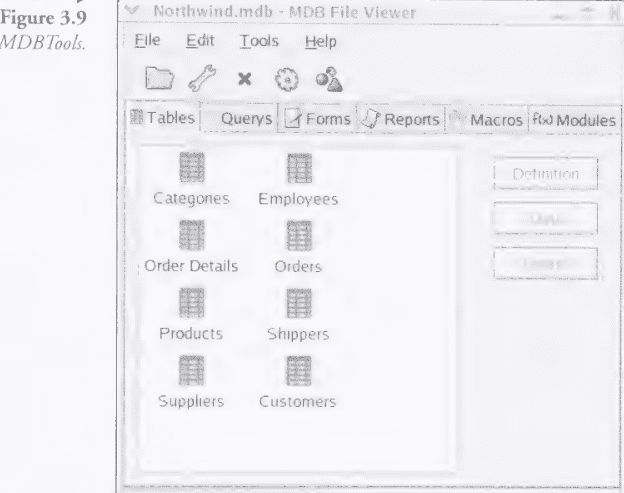

遗憾的是，Linux 并没有原生的 Visio 文档工具；然而，它确实有一些与 Visio 类似的增强工具，包括 Kivio、DIA (`www.gnome.org/projects/dia/`) 和 xfig。Kivio 是 Koffice 的一部分，提供了类似 Visio 的视觉效果和操作体验，而 DIA 则提供了一个支持模板库（stencil）的标准绘图画布。这两者都无法读取 Visio 文档，因为这些文件采用专有格式。不同的小组正在尝试解码这种格式，但还没有哪个程序能真正取代 Visio。那么，到底还有哪些选择呢？

### 3.6.1 CrossOver Office

CrossOver Office 仿真环境是 Wine 的增强版本，它允许你在 Linux 桌面面上本地运行 Visio。由于这是仿真环境，任何种的插件都可能出现问题。

## 3.7 WordPerfect

Linux 版本的 WordPerfect (`WP8`) 也可以读取和写 WordPerfect 文档以及许多版本的 Microsoft Word 文档。这是使用 OpenOffice 或 CrossOver 编辑 Word 文档的另一种替代方案。然而，`WP8` 是一个较旧的产品，因此无法理解现代 Word 文件格式。Core 不再提供 Linux 版本的 `WP8`，所以我们必须从次要渠道中寻找。你可以在 `www.linuxmafia.com/wpfaq` 找到一个 Linux 版本的 `WP8`。

`WP8` 不适用于商业环境，并且需要非常旧版本的 Linux 系统才能运行。从本质上说，你需要寻找 CLOS 豪华版 v 1.2 盒装版。再次强调，由于它过时，Linux 版本的 `WP8` 可能无法在较新的 Linux 操作系统上运行，而且极其难以。虽然你可以通过放置在独立目录结构中的旧系统库来安装 `WP8`，但获得这种支持的方法并非易事，详情请见附录 C。

## 3.8 Exchange Server Mail

可以通过多种方式访问 Exchange Server Mail，即使用 Exchange Server Mail 协议或使用 IMAP。

最易用的是通过 Web 浏览器访问 Exchange。这种方法的优点是除了 Exchange 服务器本身需要特殊设置外，不需要进行任何特殊配置。任何 Web 浏览器都可以访问这种机制，你可以通过 Web 界面访问任意数量的信箱。Linux 上最常用的 Web 浏览器是 Mozilla。要以规范的方式使用 Exchange，需要特定的插件，只需对你的 Exchange 服务器进行必要的设置即可。这将让你获得对邮箱的完全权限，包括所有文件夹；但请记住，电子邮件会占用大量的桌面空间。如果启用了 Exchange 的 OWA 服务，使用类似下面的链接即可访问电子邮件：

```
http://servername/exchange/e-mail.address
```

其中 `servername` 是你的 Exchange 服务器名称，`e-mailaddress` 是你的邮箱地址。

或者，你也可以通过 IMAP 访问电子邮件。IMAP 限制了你访问你的 Exchange 邮件。在 Linux 上，流行的 IMAP 邮件客户端包括 Evolution, Thunderbird, PINE, ELM 等。为了配置，你需要指定你的 Exchange 服务器地址或服务器名称。此外，还有两种特殊的客户端，Ximian Evolution 允许你访问 Exchange。设置 Ximian Evolution Connector 可能会有点棘手，以下是你应该采取的步骤：

### 3.8.1 红帽企业版 Linux (RHEL3)

- 更新 evolution，因为 Evolution 是默认安装的一部分。
- 现在已经安装了 Evolution 和 Connector，你可以使用 Evolution 账户器添加账户。当你首次启动 Evolution 时，会看到图 3.10 所示屏幕。然后点击继续。
- 你将通过一系列屏幕并输入相应的内容，直到到达图 3.11，并在列表中选择 Microsoft Exchange。
- 系统要求你输入 Exchange 服务器的信息，包括你的 Windows 用户名，如图 3.12。该用户名可以包含格式为 `域名\用户名`。请注意，反斜杠 `\` 非常重要，而不是正斜杠 `/`。
- 接下来，系统要求你输入用于全局地址表的全局目录名称，如图 3.13。这些信息可以从你的 Exchange 管理员处获得。
- 配置完成后，你必须重启 Evolution 使器更改生效。启用文件夹视图，你的 Exchange 账户将可见。展开此账户会提示你输入密码，输入后即可通过 Evolution Connector 访问 Exchange 邮件。

#### 图 3.10

Evolution 设置向导：欢迎。


#### 图 3.11

Evolution 设置向导。


#### 图 3.12

Evolution 设置向导。


#### 图 3.13

Evolution 设置向导。


## 3.9 打印（网络或连接）

```bash
cd "$mozdir"
localmail
```


现在，你拥有了一个可以访问 Exchange 的邮件客户端，包括日历和其他标准 Exchange 客户端的其他功能。然而，它仍然存在局限性。你将无法访问组邮箱，如果需要这些组邮箱，你可能需要通过其他工具来实现。

在开始，我们提到了第二种特殊情况，即使用 CrossOver Office 来运行由 Wine 模拟的 Microsoft Outlook。通过这种方式，你可以通过标准的 Outlook 客户端获得完全访问。需要注意的是，Outlook 的许多插件将无法工作，那些冷门功能也是如此，因为底层尚未具备处理它们的能力。然而，组邮箱和普通邮箱以及标准的 Outlook 视图都可以正常工作。

## 3.9 打印（网络或连接）

在 Linux 中，打印到通用网络打印机需要知道两点。首先，你需要知道设备的 IP 地址，其次，你需要知道要使用的设备类型。对于通用的连接打印机，只需要设备类型；然后只需设置打印机并选择合适的打印选项即可。像 Linux 中的所有事情一样，实现此操作有多种方法，但最简单的方法是使用 GUI 工具之一来设置打印机。然而，使用哪种工具取决于要使用的打印子系统。如今大多数 Linux 系统使用 CUPS 打印子系统，而不是旧的 Berkeley 子系统。配置工具的用法将在本书之外详细介绍。

```
RHEL3: redhat-config-printer
Make: drakconf
SuSE: yast2
Fedora/RHEL4: system-config-printer
```

### 3.9.1 打印到 Windows 打印服务器

打印到 Windows 打印服务器非常简单，可以使用 Berkeley 或 CUPS 打印子系统完成。访问 Windows 打印服务器的主要限制是身份验证。如果服务器需要身份验证（大多数打印机的情况），你需要在 Linux 打印配置中硬编码密码或

### 3.9.2 打印到 AppleTalk 或 Macintosh 打印机

现代 Macintosh 非常容易配置使用任何打印机，因为它们使用了许多与 Linux 相同的工具。你可以将你的 Mac 作为 CIFS 服务器并使用之前描述的 Windows 风格身份验证。或者你可以使用运行在 Mac 上的类 UNIX 打印守护，它将管理整个 Mac 以及连接的或 AppleTalk 打印机。

注意：访问旧版 Mac 需要 `netatalk` 包，访问任何 Macintosh Ethertalk 网络连接打印机也是如此。`Netatalk` 的设置在本书的范围范围内。

## 3.10 其他考虑

在使用基于 Linux 的工具替换 Office 产品时，还有其他需要考虑的问题。正如我们之前提到的，使用 OpenOffice 和 StarOffice 文字处理程序会出现一些格式问题。缓解这些问题的方法之一是使用不同的字体，微软提供的许多字体（例如 Arial）在 Linux 上并不可用。有一个开源项目（`http://fonts.sourceforge.org/`）来解决这个问题。另一个解决方案是使用 Windows 机器 `C:\Windows\Fonts` 目录下的现有字体集。你可以使用这些解决方案之一来帮助解决格式问题，针对提到的每个内容使用以下配方。

```bash
# rpmbuild --rebuild cabextract-0.6-1.src.rpm
Installing cabextract-0.6-1.src.rpm
...
Wrote: /usr/src/redhat/RPMS/i386/cabextract-0.6-1.i386.rpm
...
# rpm -ivh /usr/sec/redhat/RPMS/i386/cabextract-0.6-i1386...rpm
# cabextract cabinet: arial32.exe
Extracting: arial32.exe
extracting: FONTINST.EXE
extracting: fontinst.inf
extracting: Ariali.TTF
```

```bash
extracting: Arialbd.TTF
extracting: Arialbi.TTF
extracting: Arial.TTF
Finished processing cabinet.
# cabextract andale32.exe
Extracting cabinet: andale32.exe
extracting: fontinst.inf
extracting: andale.inf
extracting: fontinst.exe
extracting: AdeleMo.TTF
extracting: ADVPACK.DLL
extracting: W95INF32.DLL
extracting: W95INF16.DLL
Finished processing cabinet.
对每个下载的字体执行操作。
# mkdir /usr/share/fonts/ttf
# cp *.ttf /usr/share/fonts/ttf
# 或从 Windows 字体目录复制
# cd /usr/share/fonts/ttf
# mkfontdir
# mkfontdir
# chkfont -a /usr/share/fonts/ttf
```

现在在 OpenOffice 中将默认文本字体设置为 Arial

使用微软字体将有助于解决你的一些格式问题，但不能解决所有。

## 3.11 简单的答案

解决 Linux 上的 Office 程序问题有一个简单的答案，那就是使用 VMware 在你桌面的窗口中运行一个虚拟机会话。这为你提供了一个完整的 Windows 环境，你可以在其中使用常用的桌面工具，而无需依赖 Linux 工具。然而，VMware 是一个昂贵的选项，每个席位 199 美元，加上 Windows 许可。

## 3.12 成本

解决 Linux 上的 Office 程序问题有一个简单的答案，那就是使用 VMware 在你桌面的窗口中运行一个虚拟机会话。这为你提供了一个完整的 Windows 环境，你可以在其中使用常用的桌面工具，而无需依赖 Linux 工具。然而，VMware 是一个昂贵的选项，每个席位 199 美元加上 Windows 许可。

使用 Linux 有成本吗？简而言之，在价格方面。然而，如果你担心功能性，可能会得到。Linux 的潜在成本如表 3.1 所示。

| 软件 | 支持 | 费用 |
|---|---|---|
| OpenOffice | 开源 | NA |
| StarOffice | Web 端 | $80 |
| VMware | Web 端 | $199 | 90 天 |
| Evolution | 开源 | NA |
| Mozilla | 开源 | NA |
| CrossOver Office | Web 端 | $60 | 90 天 |

完成。

```bash
# rpm -ivh j2re-1_4_1_02-fcs-linux-i586.rpm
```

安装好 JRE 后，使用之前的方法之一，就可以将 Java 挂载到系统中的 Mozilla 浏览器中了。此时有几点需要注意，这取决于你所使用的 Mozilla 版本。如果你的 Mozilla 版本是使用 `gcc3` 构建的（如 RHEL3 所示），那么你的操作说明与非 `gcc3` 构建的版本略有不同。

## 配置 JRE 插件

### RHEL3

```bash
# ln -s /opt/IBMJava2-141/jre/bin/libjavapugin_oj3.so \
/usr/lib/mozilla/plugins/
```

### J2RE

```bash
# ln -s /usr/java/j2rel.1_4.02/plugin/i386/ns610/
libjavapugin_oji.so \
/usr/lib/mozilla/plugins/
```

## 配置全局 Java 系统

在 `/etc/profile.d/` 中创建一个名为 `java.sh` 的文件，将 Java 添加到默认 `PATH` 中，根据安装的选项使用相应的 `PATH`。文件内容如下：

```bash
if ! echo ${PATH} | grep -q /opt/IBMJava2-141/bin ; then
PATH=/opt/IBMJava2-141/bin:${PATH}
fi
```

需要注意的是，如果你未使用符号链接而是直接复制文件，Java 插件将停止工作并可能导致浏览器意外崩溃。符号链接确保 JRE 知道从哪里找到你的程序所需的所有 Java 功能。


检查 Java 是否正常的好方法是使用 Mozilla 菜单中的“帮助->关于插件”（`Help->About Plug-ins`）来显示浏览器所有可用插件。如果 Java 没有像图 4.1 所示出现，说明存在问题：要么文件权限错误，要么没有使用正确的文件（例如在用 `gcc3` 构建的 Mozilla 上使用了非 `gcc3` 版本），或者 Mozilla 未检测到插件目录。请注意，我们提供了关于如何使用操作系统自带的标准 Mozilla 设置 Java 插件的文档。下载的 Mozilla 版本可能不会安装在相同的目录中，并且会使用不同的插件目录或目录。在你确认 Mozilla 已经看到安装的 Java 后，你可以将浏览器指向 `http://www.java.com/en/download/help/testvm.jsp` 来测试 Java 安装，这将测试你的 Java 虚拟机并验证你的 Java 安装情况。请注意，你可能需要刷新页面来运行测试。

## 如何查看 Macromedia Flash Web 内容？

你需要从 `http://macromedia.com/shockwave/download/alternates` 获取 Macromedia Flash Linux 插件。下载旁边带有 (2) 的 Linux x86 版本，因为这是支持的 RPM 版本。安装此 RPM

## 4.1 插件

## 图 4.2

Mozilla 插件：

Macromedia Flash。

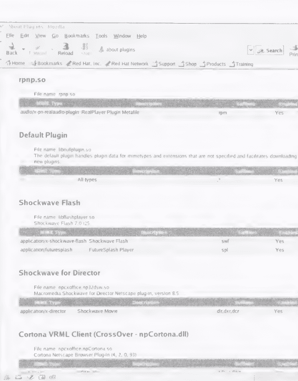

对于所有使用 RPM 的 Linux 版本，RPM 都是相同的，区别在于弹出一个包含许可协议的弹出窗口，你必须点击“接受”（`Accept`）才能继续。插件安装程序还会找到你系统中当前的 Mozilla 版本，并将文件放在相应的目录中。

### RHEL3

从 Red Hat Network 下载 `flash-plugin-6.0.81-1.RHEL.i386.rpm`，然后安装此 RPM。此 RPM 版本通常较旧，因此你可能希望按照“其他”（见下方）的步骤安装最新的插件，但必要时请务必移除 RPM 插件。

```
up2date flash-plugin
```

### 其他

```bash
# rpm -ivh flash-plugin-6.0.79-2.i386.rpm
# 接受弹出窗口许可协议
正在将 flashplayer 作为 XPCOM 组件注册到
/usr/lib/mozilla-1.4
安装完成。
```

安装 RPM 后，使用 Mozilla 菜单选项“帮助->关于插件”（`Help->About Plug-ins`）显示当前浏览器所有所有可用的插件，以验证 Mozilla 是否已加载了它。

如果 Flash 没有像图 4.2 所示出现，则你遇到了安装问题，最可能是由于你的浏览器没有识别插件安装的目录导致的。请注意，这些说明适用于你的 Linux 发行版自带的标准 Mozilla，而不是下载的 Mozilla 副本。

此外，你还可以验证 Flash 在 Mozilla 中是否正常工作。方法之一是使用许多 Linux 发行版自带的 Xpdf 查看器；另一种方法是使用官方 Adobe Acrobat Reader 的 Linux 版本。你的查看器可以从 Adobe (`http://download.adobe.com/pub/adobe/acrobatterreader/unix/`) 获取，通常不是 Linux 发行版的一部分。使用哪一个取决于你将使用 PDF 文档的哪些新功能，因为 Xpdf 与大多数开源产品一样，落后于软件开发的代码。由于两个查看器都是免费的，且查看器通过插件集成到 Mozilla，这可能是一个解决方案。

### 4.1.2 我如何查看 Web 内容？

Web 内容有两种方法：一种是使用许多 Linux 发行版自带的 Xpdf 查看器；另一种方法是使用官方 Adobe Acrobat Reader 的 Linux 版本。你的查看器可以从 Adobe (`http://download.adobe.com/pub/adobe/acrobatterreader/unix/`) 获取，通常不是 Linux 发行版的一部分。使用哪一个取决于你将使用 PDF 文档的哪些新功能，因为 Xpdf 与大多数开源产品一样，落后于软件开发的代码。由于两个查看器都是免费的，且查看器通过插件集成到 Mozilla，这可能是一个解决方案。

### RHEL3

```bash
# ln -s /opt/IBMJava2-141/jre/bin/libjavapugin_oj3.so \
/usr/lib/mozilla/plugins/
```

### J2RE

```bash
# ln -s /usr/java/j2rel.1_4.02/plugin/i386/ns610/
libjavapugin_oji.so \
/usr/lib/mozilla/plugins/
```

## 图 4.1 Mozilla 插件：Java。

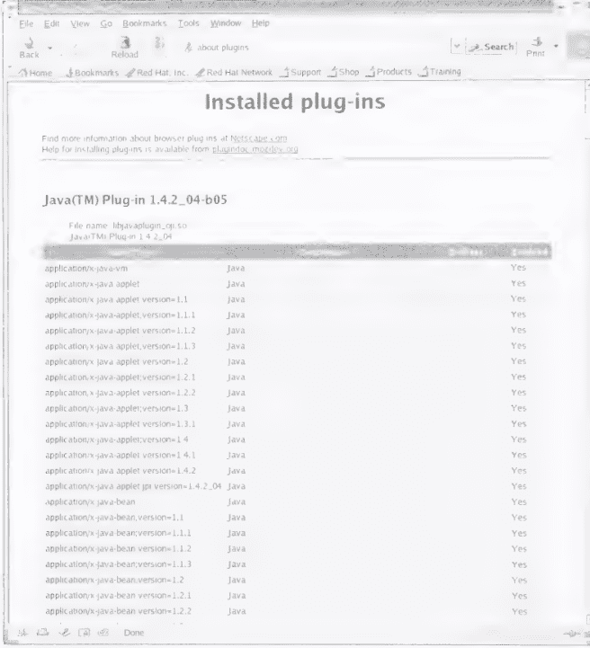

## 图 4.3 Mozilla 插件：PDF


| 针对： | 名称类型 |
| :--- | :--- |
| plugins:5.1.3 | 插件 5.1.3 |
| Helper beauty | 控制器 |
| Office helper | 插件助手 |
| video/mpeg | mpeg, mpe 是 |
| video/mpeg | mpeg, mpe 是 |
| video/wmv | MPEG-2 是 |
| videosymvideo | AVI 是 |

## 如何将 Adobe Acrobat 添加到 GNOME？

从何处下载 Acrobat 的 RPM 包决定了是否存在将 Acrobat 添加到 GNOME 的自动化方法。这种集成包含两个部分：第一部分是将 Acrobat 添加到菜单中

## 4.1 插件

子系统，第二个是使其成为 Nautilus 文件夹查看器和浏览器的视图。如果你直接从 RedHat 安装了 RPM，可以忽略这些步骤。

### 添加到菜单

```
# cd /usr/share/applications
# cp net-Xpdf.desktop net-acroread.desktop
Edit net-acroread.desktop 并将 Name= 和 Exec= 行更改为：
  Name=Adobe Acrobat
  Exec=acroread
然后保存文件
```

### 添加到 Nautilus

只要 `acroread` 在你的路径（`path`）中，Nautilus 就可以使用它来打开本地 PDF 内容。不过，你需要编辑文件类型（Red Fedora -> 偏好设置 [Preferences] -> 文件类型和程序）以将其设置为默认查看器。

### 如何将 Acrobat 添加到 KDE？

与集成到 GNOME 一样，集成到 K 桌面环境（KDE）需要对随随后的 KDE 系统及其 Konqueror 文件夹查看器和浏览器进行两个阶段的设置。如果是通过 Red Hat 网络更新安装的，则可以跳过以下步骤，但验证所有配置均正确总是好的。

### 添加到菜单

右键点击 Red Fedora-> 菜单编辑器 [Menu Editor]，在左侧菜单中选择文档 [Documentation]，按下新建项目 [New Item]。当新建项目菜单出现时，输入 Acrobat 并按确定。Acrobat 条目将出现在左侧文档下方，右侧是此菜单项使用的命令条目。在输入框中输入 `/usr/local/bin/acroread`，然后点击应用 [Apply]，并选择文件->退出 [File->Quit]。在选择文件->退出之前，编辑 K 菜单窗口应该看起来如图 4.4。

### 添加到 Konqueror

要将 Acrobat 添加到 Konqueror，首先通过 Red Fedora（开始)->主菜单启动 Konqueror。接下来，在 Konqueror 内部使用 >配置 Konqueror [Configure Konqueror] 启动设置，并从左窗口选择文件关联 [File Associations]。在中间的已知窗口类型中，展开应用程序并选择 pdf。完成后，点击添加... [Add...] 按钮，在第一个输入框中输入 `/usr/local/bin/acroread` 并点击确定。

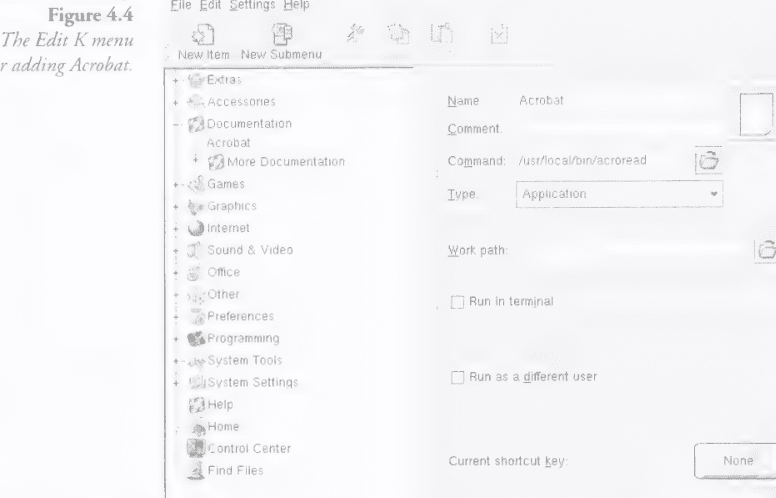

最后，选择 `acroread`，并使用向上 [Move Up] 按钮将 `acroread` 移动到列表顶部，然后点击应用，最后点击确定退出设置窗口。在点击应用之前，你的窗口应该看起来如图 4.5。

### 如何将 Acrobat 添加到 Evolution？


只要 `acroread` 在你的路径（`PATH`）中，Evolution 就可以使用此程序打开并查看 PDF 文档。如果查看器不在路径中，“在 Adobe Acrobat 中打开... [Open in Adobe Acrobat...] 查看选项将出现。

## 4.1 插件

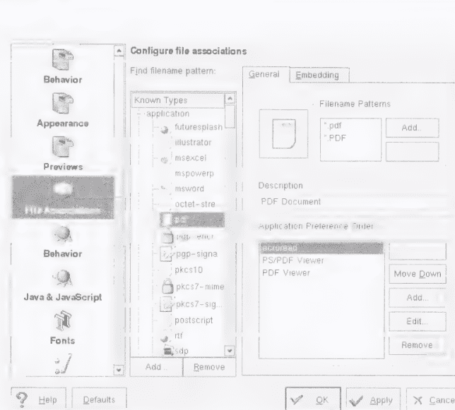

- 必须安装 Java，且 Java bin 目录必须在你的路径（`PATH`）中（如果你安装了上述提到的版本包含的 JRE 和 JDK，你将拥有所需）。
- 必须安装 `gcc`。
- 必须安装 Perl。
- 必须安装基础 Linux 开发环境。

虽然 `gcc`、Perl 和开发环境可以从操作系统的光盘中获得，但 Java 应该按照之前描述或按照你的 Java 发行版的说明进行安装。在构建脚本中，我们使用了 IBM Java，它是提供在 RHEL 3.0 光盘上的。然而，任何 Java 都可以工作，并且需要相应修改 `PATH` 设置。

### 4.1.3 如何查看 VRML Web 内容？

虚拟现实建模语言（VRML）用于在 Web 浏览器中显示 3D 图对象。与其他插件不同，它的安装方式非常不同，并且运行有一些特定要求；它不是直接安装预构建的 RPM 或包，而是从源码编译插件。要查看 VRML 内容：

- 必须安装 Java，且 Java bin 目录必须在你的路径（`PATH`）中（如果你安装了上述提到的版本包含的 JRE 和 JDK，你将拥有所需）。
- 必须安装 `gcc`。
- 必须安装 Perl。
- 必须安装基础 Linux 开发环境。

虽然 `gcc`、Perl 和开发环境可以从操作系统的光盘中获得，但 Java 应该按照之前描述或按照你的 Java 发行版的说明进行安装。在构建脚本中，我们使用了 IBM Java，它是提供在 RHEL 3.0 光盘上的。然而，任何 Java 都可以工作，并且需要相应修改 `PATH` 设置。

#### 构建 VRML

```
Script started on Sat 24 Apr 2004 11:18:00 AM EDT
[plugins]$ PATH=/opt/IBMJava2-141/bin:${PATH}
[plugins]$ export PATH
```

```
[plugins]$ $ ln
[plugins]$ tar -xzf FreeWRL-1.03.tar.gz
[plugins]$ cd FreeWRL-1.03
[FreeWRL-1.03]$ perl makefile.PL
[FreeWRL-1.03]$ make install
```

再次，使用 Mozilla 菜单帮助->关于插件 [Help->About Plug-ins] 来确定 `npfreirl.so` 插件是否已加载，如图 4.3 所示。

要测试此功能，执行作为安装过程一部分的 `free` 命令。可能会短暂出现带有类似错误消息的框：

FreeWRL Exiting - File was not found.

此消息至少告诉我们显示程序拥有它所需的一切：否则你将看到未找到视觉（No visual found）的错误。一个很好的测试站点是 `file:/home/user/FreeWRL-1.03/tests/collision.wrl`。然而，如果你使用该插件，你还需要在 `/etc/plugorc-5.0` 中注释掉相应的部分。需要注意的是，并不是每个 VRML 文件都可以显示，因为有多个版本的 VRML 可用。

```
##
##
- model/vrml:Virtual Reality Language
- world/vrml:Virtual Reality Language
- world/vrml:Virtual Reality Language
- world/vrml:Virtual Reality Language
- world/vrml:Virtual Reality Language
- world/vrml:Virtual Reality Language
- 9000:Virtual Reality Language
- 9000:Virtual Reality Language
- 9000:
```

### 4.1.4 如何将 Acrobat 添加到 Evolution？

只要 `acroread` 在你的路径（`PATH`）中，Evolution 就可以使用此程序打开并查看 PDF 文档。如果查看器不在路径中，“在 Adobe Acrobat 中打开... [Open in Adobe Acrobat...] 查看选项将出现。

## Virtual Reality Modeling Language

- model/vrml:Virtual Reality Language
- world/vrml:Virtual Reality Language
- world/vrml:Virtual Reality Language
- world/vrml:Virtual Reality Language
- world/vrml:Virtual Reality Language
- world/vrml:Virtual Reality Language
- 9000:Virtual Reality Language
- 9000:Virtual Reality Language
- 9000:


[plugins]$ `cd FreeWRL-1.03`

[FreeWRL-1.03]$ `perl makefile.PL`

[FreeWRL-1.03]$ `make install`

```
再次，使用 Mozilla 菜单帮助->关于插件 [Help->About Plug-ins] 来确定 `npfreirl.so` 插件是否已加载，如图 4.3 所示。

要测试此功能，执行作为安装过程一部分的 `free` 命令。可能会短暂出现带有类似错误消息的框：

FreeWRL Exiting - File was not found.

此消息至少告诉我们显示程序拥有它所需的一切：否则你将看到未找到视觉（No visual found）的错误。一个很好的测试站点是 `file:/home/user/FreeWRL-1.03/tests/collision.wrl`。然而，如果你使用该插件，你还需要在 `/etc/plugorc-5.0` 中注释掉相应的部分。需要注意的是，并不是每个 VRML 文件都可以显示，因为有多个版本的 VRML 可用。
```

## Virtual Reality Modeling Language

- `model/vrml`:Virtual Reality Language
- `world/vrml`:Virtual Reality Language
- `world/vrml`:Virtual Reality Language
- `world/vrml`:Virtual Reality Language
- `world/vrml`:Virtual Reality Language
- `world/vrml`:Virtual Reality Language
- `9000`:Virtual Reality Language
- `9000`:Virtual Reality Language
- `9000`:

## 4.1.4 如何将 Acrobat 添加到 Evolution？

只要 `acroread` 在你的路径（`PATH`）中，Evolution 就可以使用此程序打开并查看 PDF 文档。如果查看器不在路径中，“在 Adobe Acrobat 中打开... [Open in Adobe Acrobat...] 查看选项将出现。

## 4.1.3 如何查看 VRML Web 内容？

虚拟现实建模语言（VRML）用于在 Web 浏览器中显示 3D 图对象。与其他插件不同，它的安装方式非常不同，并且运行有一些特定要求；它不是直接安装预构建的 RPM 或包，而是从源码编译插件。要查看 VRML 内容：

- 必须安装 Java，且 Java bin 目录必须在你的路径（`PATH`）中（如果你安装了上述提到的版本包含的 JRE 和 JDK，你将拥有所需）。
- 必须安装 `gcc`。
- 必须安装 Perl。
- 必须安装基础 Linux 开发环境。

虽然 `gcc`、Perl 和开发环境可以从操作系统的光盘中获得，但 Java 应该按照之前描述或按照你的 Java 发行版的说明进行安装。在构建脚本中，我们使用了 IBM Java，它是提供在 RHEL 3.0 光盘上的。然而，任何 Java 都可以工作，并且需要相应修改 `PATH` 设置。

### 构建 VRML

```
Script started on Sat 24 Apr 2004 11:18:00 AM EDT

[plugins]$ `PATH=/opt/IBMJava2-141/bin:${PATH}`

[plugins]$ `export PATH`
```

```
[plugins]$ `$ ln`

[plugins]$ `tar -xzf FreeWRL-1.03.tar.gz`

[plugins]$ `cd FreeWRL-1.03`

[FreeWRL-1.03]$ `perl makefile.PL`

[FreeWRL-1.03]$ `make install`
```

再次，使用 Mozilla 菜单帮助->关于插件 [Help->About Plug-ins] 来确定 `npfreirl.so` 插件是否已加载，如图 4.3 所示。

要测试此功能，执行作为安装过程一部分的 `free` 命令。可能会短暂出现带有类似错误消息的框：

FreeWRL Exiting - File was not found.

此消息至少告诉我们显示程序拥有它所需的一切：否则你将看到未找到视觉（No visual found）的错误。一个很好的测试站点是 `file:/home/user/FreeWRL-1.03/tests/collision.wrl`。然而，如果你使用该插件，你还需要在 `/etc/plugorc-5.0` 中注释掉相应的部分。需要注意的是，并不是每个 VRML 文件都可以显示，因为有多个版本的 VRML 可用。
```

## Virtual Reality Modeling Language

- `model/vrml`:Virtual Reality Language
- `world/vrml`:Virtual Reality Language
- `world/vrml`:Virtual Reality Language
- `world/vrml`:Virtual Reality Language
- `world/vrml`:Virtual Reality Language
- `world/vrml`:Virtual Reality Language
- `9000`:Virtual Reality Language
- `9000`:Virtual Reality Language
- `9000`:


SDL-1.2.3-7

Xfree86-libs-4.2.0-0
audiofile-0.2.3-1
freetype-2.0.9-2
libjpeg-6b-19
libogg-1.0rc3-1
libpng-1.0.14-0.7x.3
libtermcap-2.0.8-28
libvorbis-1.0rc3-1
zlib-1.1.3-25.7
libgcc-3.2.2-5（需要 VIDIX 支持）
glib2-1.2.10-5（需要 GUI 支持）
gtk+-1.2.10-15（需要 GUI 支持）

此外，你还需要从 `http://ftp.icm.edu.pl/pub/linux/mplayer-rpms/apt/7.3/RPMS.testing/` 下载以下最小版本文件：

lame-3.95.1-1
lame-libs-3.95.1-1
lame-mp3x-3.95.1-1

可选地，你还可以安装字体和解码器。解码器是用于为你解释多媒体内容的代码。VIDIX 解码器仅在特定的硬件上运行；如果不存在该硬件，VIDIX 多媒体将将不会显示。

最后，你还可以下载一个编码器。
完整文件列表包含以下 RPM 软件包：

### 必需包：

+   `mplayer-1.0pre3-1.i386.rpm`
- `mplayer-common-1.0pre3-1.i386.rpm`
- `mplayer-gui-1.0pre3-1.i386.rpm`
- `mplayer-skin-default-1.0-2.noarch.rpm`

### 可选解码器：

+ - `mplayer-codecs-extralite-2.0-1.i386.rpm`
- `mplayer-codecs-linux-real-9.0-1.i386.rpm`
- `mplayer-codecs-linux-xanim-2.0-1.i386.rpm`
- `mplayer-codecs-linux-xanim-3ivx-2.0-1.i386.rpm`
- `mplayer-codecs-win32-2.0-1.i386.rpm`
- `mplayer-codecs-win32-dmo-9.0-1.i386.rpm`
- `mplayer-codecs-win32-indeo-2.0-1.i386.rpm`
- `mplayer-codecs-win32-jpeg2k-2.0-1.i386.rpm`
- `mplayer-codecs-win32-qt-6.0-1.i386.rpm`
- `mplayer-codecs-win32-qt-extras-2.0-1.i386.rpm`
- `mplayer-vidix-1.0pre3-1.i386.rpm`
- `mplayer-vidix-mach64-1.0pre3-1.i386.rpm`
- `mplayer-vidix-mga-1.0pre3-1.i386.rpm`
- `mplayer-vidix-nvidia-1.0pre3-1.i386.rpm`
- `mplayer-vidix-permedia-1.0pre3-1.i386.rpm`
- `mplayer-vidix-radeon-1.0pre3-1.i386.rpm`
- `mplayer-vidix-rage128-1.0pre3-1.i386.rpm`
- `mplayer-vidix-trident-1.0pre3-1.i386.rpm`
- `mplayer-fb-1.0pre3-1.src.rpm`

### 可选字体：

+ - `mplayer-font-cp1250-1.1-noarch.rpm`
- `mplayer-font-iso1-1.1-noarch.rpm`
- `mplayer-font-iso2-1.1-noarch.rpm`
- `mplayer-font-iso7-1.1-noarch.rpm`
- `mplayer-font-iso9-1.1-noarch.rpm`
- `mplayer-font-koi8r-1.1-noarch.rpm`

### 可选皮肤：

+ - `mplayer-skin-AlienMind-1.0-2-noarch.rpm`
- `mplayer-skin-avfile-1.5-2-noarch.rpm`
- `mplayer-skin-Blue-1.0-2-noarch.rpm`
- `mplayer-skin-BlueHeart-1.4-2-noarch.rpm`
- `mplayer-skin-Blue-small-1.0-2-noarch.rpm`
- `mplayer-skin-Canary-1.0-2-noarch.rpm`
- `mplayer-skin-CornerMP-1.0-2-noarch.rpm`
- `mplayer-skin-CornerMP-aqua-1.0-2-noarch.rpm`
- `mplayer-skin-Cyrus-1.0-2-noarch.rpm`
- `mplayer-skin-default-0.1-2-noarch.rpm`
- `mplayer-skin-disappear-1.0-2-noarch.rpm`
- `mplayer-skin-gnome-1.1-2-noarch.rpm`
- `mplayer-skin-hayraphon-1.0-2-noarch.rpm`
- `mplayer-skin-hwsw-1.0-2-noarch.rpm`
- `mplayer-skin-krystal-1.0-2-noarch.rpm`
- `mplayer-skin-mentalic-1.1-2-noarch.rpm`
- `mplayer-skin-Midnight-1.5-2-noarch.rpm`
- `mplayer-skin-neutron-1.4-2-noarch.rpm`
- `mplayer-skin-Orange-1.0-2-noarch.rpm`
- `mplayer-skin-phony-1.0-2-noarch.rpm`
- `mplayer-skin-plastic-1.1-2-noarch.rpm`
- `mplayer-skin-proton-1.1-2-noarch.rpm`
- `mplayer-skin-QPlayer-1.0-2-noarch.rpm`
- `mplayer-skin-slim-1.0-2-noarch.rpm`
- `mplayer-skin-softgrip-1.0-2-noarch.rpm`
- `mplayer-skin-trium-1.0-2-noarch.rpm`
- `mplayer-skin-WindowsMediaPlayer-1.2-2-noarch.rpm`
- `mplayer-skin-xanim-1.5-2-noarch.rpm`
- `mplayer-skin-xine-lcd-1.0-2-noarch.rpm`

### 可选编码器：
-1.0pre3-1.i386.rpm

### 可选源码：
-1.0pre3-1.src.rpm

现在我们有了所有文件，让我们简要讨论一下安装。1.0pre3 版本的 `mplayer` 需要使用 `--nodeps` 选项进行安装，如下所示。或者，你可以安装所有必需包以及你需要的解码器、字体和皮肤。

```
# rpm -ivh --nodeps lame*
# rpm -ivh --nodeps mplayer*
```

我们完了吗？遗憾的是，你需要指定将使用哪种视频输出。此外，有趣的是，图形化播放器（`mplayer`）使用它自己的配置文件，你可以通过右键点击程序并选择“设置”（Preferences）来编辑它。对于 Web 浏览器使用的命令行工具，你可以编辑文件 `~/.mplayer/config` 使包含以下行：

```
vo=x11
```

对于 `mplayer`，你还可以在“设置”窗口的“视频”选项卡下选择 X11 视频输出驱动。可用的驱动见表 4.1。

表 4.1 可用的 `mplayer` 驱动

| 驱动程序 | 硬件 |
| :--- | :--- |
| Xmage | Matrox G200/G400/G550 |
| Xv | X11/Xv |
| x11 | X11 (Image/Shared) |
| Xvid | X11 (VIDIX) |

虽然如果有适当硬件（Matrox 和 VIDIX），可以使用其他驱动，但使用 `x11` 驱动可以在所有机器上运行，取决于你的 Xfree86 安装而不是特定硬件。

一旦配置完成，你可以启动 `mplayer`，通过点击视频框，可以使用菜单 DVD->Open Disk... 打开 DVD 并播放其上的默认章节。如果你想切换到另一个章节，可以使用 DVD->Title 菜单在磁盘上的所有已知章节之间切换。与其他 DVD 播放器不同，无法使用与每个 DVD 关联的 DVD 菜单。你必须自己切换章节。

## 4.7 如何安装插件？

Mozilla Plugin (`http://fredrik.hubbe.net/plugin.html`) 是一种在 Web 访问内容时使用系统查看器的胶接层。这些查看器可以使用 pdf。插件需要从源码编译。

### 构建插件

```
# xzf plugger-5.1.2.tar.gz
# cd plugger-5.1.2
# [plugger-5.1.2]# ./configure
```


# [plugger-5.1.2]

```
make sudo make install
```


构建插件后，你可以通过 Mozilla 内部的 `帮助>关于插件` 来验证插件已正确安装。你应该看到类似于 4.7 所示的图像。


# Plugin 5.1.3 处理 QuickTime 媒体播放器

文件名 `plugger.so`
插件版本 5.1.1，由 Fredrik Hubbe (`hubbe.net`) 编写。有关如何配置的文档，请访问插件主页或查看 `man` 页（类型 `plugger`）。目前处理 141 MIME 类型。

编译文件：
`plugger 5.1.3`
帮助二进制文件：
`plugger 5.1.3`
控制二进制文件：
`plugger-controller`
办公助手：
`plugger-helper`

| 格式 | 说明 | 支持 |
| :--- | :--- | :--- |
| videocodec | MPEG 视频 | mpeg, mpg, mpe |
| video/x-mpeg | MPEG 视频 | mpeg, mpg, mpe | 是 |
| video/x-mpeg2 | MPEG2 视频 | mp2, mv2 | 是 |
| videomvideo | AVI 视频 | |

你可以看到，`Plugin` 可以显示许多格式，是多媒体内容与播放器之间的胶接层。为了验证插件是否运行正常，如果某些测试没有显示或播放，你将需要配置必要的工具让它们播放。

## 4.1.8 如何听 MP3？

非 Web 内容可以使用许多不同的 MP3 播放器听。有很多播放器，但最常见的是：

+ - `KsCD` (KDE)
- `mplayer`
- `XMMS`
- `mpg321`
- `mpg123`
- `AlsaPlayer`

当在 Web 上遇到 MP3 时，插件将首先尝试通过 `mpg123` 播放，然后继续到 `mpg321`, `mplayer`, `xmms`，

## 4.1 插件

如果未找到前面的播放器，则依次使用 `alsaplayer`、`amp`、`maplay`，最后是 `mpeg3player`。所有这些工具都可播放本地内容，也可以播放基于 Web 的内容。如果你想使用保存的播放列表或 `.m3u` 文件，那么你将受限于只能使用 `mpg123`、`mpg321` 或 `xxms` 播放器。

通过 `Plugger` 在 Web 浏览器中使用 `xxms` 播放播放列表 (`.m3u` 文件）存在问题；但 `xxms` 在命令行中运行运行良好。

### 4.1.9 我如何显示流媒体内容？

正如之前所讨论的，`RealPlayer` 之外还有许多流媒体格式可供选择。非常常见的格式是 Media Player 使用的微软格式，我们将在下文中讨论；然而，有许多格式和工具，Mozilla 并没有足够的插件来显示所有内容。其中就观看虚拟教室媒体所需的插件。但对于这些用户来说，通过使用 `CrossOver Office`、`VMware` 等工具，看到了曙光。我们将在第 5 章中详细描述这些工具。如果你使用的是基于 Java 的 Web 工具，则进一步受限于只能使用 Mozilla 或 VMware，因为 Java 内容无法通过 Wine 显示。

然而，如果你想看流电影，那么 `Plugger` 插件会加载 `mplayer` 来处理内容，或者你可以获取 `mplayer` 插件。为了简单起见，`Plugger` 是更好的选择；让它调出合适的工具即可。

### 4.1.10 我如何查看或收听微软播放的内容？

要收听 Microsoft Media Player 内容，你可以使用 Microsoft Media Player，它仅通过 `CrossOver Office` 和 `VMware` 提供。然而，在许多情况下，`mplayer` 运行得良好；你甚至可以为 `xxms` 使用 WMA 插件。

`CrossOver Office` 和 `VMware` 提供了许多可以显示微软专有应用程序的内容，将在 4.1.12 节中讨论。

### 4.1.11 我如何查看或收听各种类型的内容？

在几乎大多数查看或收听多媒体内容的情况下，`Plugger` 插件都能弥补差距。表 4.2 给出了内容类型以及使用哪种播放器来查看或收听指定的 MIME-类型内容。在某些情况下，可以使用多个一个程序；列表按偏好顺序显示。例如，如果你经常播放 QuickTime 内容，你将需要安装 `mplayer`；如果 `mplayer` 不可用，则必须有 `xanim` 才能显示此内容。需要注意的是，在某些情况下，由于版权或法律考虑，Red Hat 从其提供的基础操作系统程序中移除了某些功能。`xmms` 就是其中一个具有限制的程序。

#### 表 4.2 内容类型及用于查看/收听它们的播放器

| MIME 类型 | 描述 | 后缀 | 程序 |
|---|---|---|---|
| video/mpeg | MPEG 视频 | mpeg, mpg, mpeg | mplayer |
| video/x-mpeg | MPEG 视频 | mpeg, mpg, mpeg | mtp xanim |
| video/x-mpeg2 | MPEG2 视频 | mpv2, mp2ve | |
| video/msvideo | AVI 视频 | avi | mplayer |
| video/x-msvideo | AVI 视频 | avi | xanim |
| application/x-drm-v2 | Windows 媒体 | asf | |
| application/x-mplayer2 | Windows 媒体 | wmv, asf, mov | |
| application/x-mplayer2 | WMV | wmv | |
| application/x-quicktimeplayer | Quicktime | mov | |
| video/x-ms-asf | Windows 媒体 | asf, asx | |
| video/x-ms-asf-plugin | Windows 媒体 | asf, asx, wma. wax, wmv, wvx | |
| video/x-ms-wm | MSNBCPlayer | asf | |
| video/x-ms-wmv | Windows 媒体 | wmv | |
| video/x-ms-vwx | Windows 媒体 | wvx | |
| video/sgi-movie | SGI 视频 | movie, mov, mv | |
| video/x-sgi-movie | SGI 视频 | movie, mov, mv | |

## 4.1 插件（重复的章节标题）

#### 表 4.2 内容类型及用于查看/收听它们的播放器（续）

| MIME 类型 | 描述 | 后缀 | 程序 |
|---|---|---|---|
| video/x-theora | 带有视频的 OGG 流 | | mplayer |
| video/theora | 带有视频的 OGG 流 | | |
| video/ogg | 带有视频的 OGG 流 | | |
| video/x-ogg | 带有视频的 OGG 流 | ogm, ogv | | |
| video/quicktime | Quicktime 视频 | mov, qt | mplayer |
| video/x-quick-time | Quicktime 视频 | mov, qt | xanim |
| video/dl | DL 视频 | dl | | |
| video/x-dl | DL 视频 | dl | | |
| video/sgi-movie | SGI 视频 | movie, movi, mv | | |
| video/x-sgi-movie | SGI 视频 | movie, movi, mv | | |
| video/anim | IFF 视频 | iff, anim5, anim3, anim7 | | |
| video/x-anim | IFF 视频 | iff, anim5, anim3, anim7 | | |
| video/x-fli | IFF 视频 | iff,,c | | |
| video/x-fli | |  | |c | | |
| audio/mid | MIDI | | | | | | |
| audio/x-mid | | | | | | | | |
| audio/midi | | | | | | | | |
| audio/x-midi | | | | | | | | |

#### 表 4.2 内容类型及用于查看的播放器（续）

| MIME 类型 | 描述 | 后缀 | 程序 |
|---|---|---|---|
| audio/mp3 | | | | | | | | |
| audio/x-mp3 | | | | | | | | |
| audio/mpeg2 | | | | | | | | |
| audio/x-mpeg2 | | | | | | | | |
| audio/mpeg3 | | | | | | | | | |
| audio/x-mpeg3 | | | | | | | | |
| audio/fl | | | | | | | | | |
| audio/x-fl | | | | | | | | | |
| audio/ms | | | | | | | | | |
| audio/x-ms | | | | | | | | | |
| audio/wav | | | | | | | | | |
| audio/x-wav | | | | | | | | | |
| audio/wmv | | | | | | | | | | |
| audio/x-wmv | | | | | | | | | | |
| audio/mov | | | | | | | | | | |
| audio/x-mov | | | | | | | | | | |
| audio/asf | | | | | | | | | | |
| audio/x-asf | | | | | | | | | | |
| audio/asx | | | | | | | | | | |
| audio/x-asx | | | | | | | | | | |
| audio/wax | | | | | | | | | | |
| audio/x-wax | | | | | | | | | | |
| audio/wvx | | | | | | | | | | |
| audio/x-wvx | | | | | | | | | | |
| audio/ogg | | | | | | | | | | |
| audio/x-ogg | | | | | | | | | | | |
| audio/ogm | | | | | | | | | | | |
| audio/x-ogm | | | | | | | | | | | |
| audio/ogv | | | | | | | | | | | |
| audio/x-ogv | | | | | | | | | | | |
| audio/qt | | | | | | | | | | | |
| audio/x-qt | | | | | | | | | | | |
| audio/dl | | | | | | | | | | | |
| audio/x-dl | | | | | | | | | | | |
| audio/mov | | | | | | | | | | | | |
| audio/x-mov | | | | | | | | | | | | |
| audio/anim | | | | | | | | | | | | |
| audio/x-anim | | | | | | | | | | | | |
| audio/iff | | | | | | | | | | | | |
| audio/x-iff | | | | | | | | | | | | | |
| audio/anim5 | | | | | | | | | | | | | |
| audio/x-anim5 | | | | | | | | | | | | | |
| audio/anim3 | | | | | | | | | | | | | |
| audio/x-anim3 | | | | | | | | | | | | | |
| audio/anim7 | | | | | | | | | | | | | |
| audio/x-anim7 | | | | | | | | | | | | | |

#### 表 4.2 内容类型及用于查看的播放器（续）

| MIME 类型 | 描述 | 后缀 | 程序 |
|---|---|---|---|
| audio/mid | | | |
| audio/x-mid | | | |
| audio/midi | | | |
| audio/x-midi | | | |
| audio/fli | | | |
| audio/x-fli | | | |
| audio/ms | | | |
| audio/x-ms | | | |
| audio/wav | | | |
| audio/x-wav | | | |
| audio/wmv | | | |
| audio/x-wmv | | | |
| audio/mov | | | |
| audio/x-mov | | | |
| audio/asf | | | |
| audio/x-asf | | | |
| audio/asx | | | |
| audio/x-asx | | | |
| audio/wax | | | |
| audio/x-wax | | | |
| audio/wvx | | | |
| audio/x-wvx | | | |
| audio/ogg | | | |
| audio/x-ogg | | | |
| audio/ogm | | | |
| audio/x-ogm | | | |
| audio/ogv | | | |
| audio/x-ogv | | | |
| audio/qt | | | |
| audio/x-qt | | | |
| audio/dl | | | |
| audio/x-dl | | | |
| audio/mov | | | |
| audio/x-mov | | | |
| audio/anim | | | |
| audio/x-anim | | | |
| audio/iff | | | |
| audio/x-iff | | | |
| audio/anim5 | | | |
| audio/x-anim5 | | | |
| audio/anim3 | | | |
| audio/x-anim3 | | | |
| audio/anim7 | | | |
| audio/x-anim7 | | | |

## 4.1 插件

用于查看/收听这些的内容类型和播放器（续）

| MIME 类型 | 描述 | 后缀 | 程序 |
|---|---|---|--|
| application/photoshop | Photoshop 图像 | psd | xvroot display (imagemagick) |
| application/photoshop | Photoshop 图像 | psd | xli & imagagick xloadimage & imagagick |
| image/x-xcf | Gimp 图像 | xcf | xvroot display (imagemagick) |
| image/xcf | Gimp 图像 | xcf | xli & xcfotnpnm |
| application/x-gimp | Gimp 图像 | xcf | xloadimage & xcf-topnmp |
| application/gimp | Gimp 图像 | xcf | |
| application/pdf | PDF 文件 | pdf | acroread |
| application/x-pdf | PDF 文件 | pdf | gv xpdf |
| text/pdf | PDF 文件 | pdf | |
| text/x-pdf | PDF 文件 | pdf | |
| application/x-dvi | DVI 文件 | dvi | xvvi |
| application/x-postscript | PostScript 文件 | ps | gv ghostview |
| application/postscript | PostScript 文件 | ps | pageview ghostscript |

## 表 4.2 用于查看/收听这些的内容类型和播放器（续）

| MIME 类型 | 描述 | 后缀 | 程序 |
|---|---|---|--|
| application/rtf | 富文本格式 | rtf | owriter |
| application/msword | Microsoft Word 文档 | doc, dot | abiword |
| application/msword | Microsoft Word 文档 | doc, dot | sdtcpv |
| application/vnd.sun.writer | OpenOffice.org Writer 文档 | sxw | |
| application/vnd.sun.writertemplate | OpenOffice.org Writer 模板文档 | stw | |
| application/vnd.sun.writerglobal | OpenOffice.org Writer 全局文档 | xsg | |
| application/vnd.stardivision.writer | StarWriter 文档 | sdw | |
| application/x-starwriter | StarWriter 文档 | sdw | |
| application/vnd.stardivision.writer-global | StarWriter 全局文档 | sgl | |
| application/wordperfect.1 | WordPerfect 5.1 文档 | wp | |

## 表 4.2 用于查看/收听这些的内容类型和播放器（续）

| MIME 类型 | 描述 | 后缀 | 程序 |
| --- | --- | --- | --- |
| application/vnd.ms-excel | Microsoft Excel 文档 | xls, xlb | oocalcl |
| application/vnd.sun.xml.calc | OpenOffice.org Calc 文档 | sxc | gnumeric |
| application/vnd.sun.xml.calc.template | OpenOffice.org Calc 模板文档 | stc | sdtcpv |
| application/vnd.stardivi.calc | StarCalc 文档 | sdc | |
| application/x-starcalc | StarCalc 文档 | sdc | |
| application/vnd.lotus-1-2-3 | Lotus 1-2-3 文档 | 123, wkl | |
| application/vnd.sun.xml.impress | OpenOffice.org Impress 文档 | sxi | ooimpress |
| application/vnd.sun.xml.impress.template | OpenOffice.org Impress 模板文档 | sti | |
| application/vnd.stardivision.impression | StarImpress 文档 | sdd | |
| application/vnd.stardivision.impress.packed | StarImpress 打包文档 | sdp | |
| application/x-starimpress | StarImpress 文档 | sdd | |
| application/vnd.ms-powerpointpoint | Microsoft Power-Point 幻灯片放映 | ppt | |

## 表 4.2 用于查看/收听这些的内容类型和播放器（续）

| MIME 类型 | 描述 | 后缀 | 程序 |
|---|---|---|--|
| application/vnd.sun.xml.draw | OpenOffice.org Draw 文档 | sxd | oodraw |
| application/vnd.sun.xml.draw.template | OpenOffice.org Draw 模板文档 | std | |
| application/vnd.stardivision.draw | StarDraw 文档 | sda | |
| application/x-stardraw | StarDraw 文档 | sda | |
| application/vnd.sun.xml.math | OpenOffice.org Math 文档 | sxm | oomath |
| application/vnd.stardivision.math | StarMath 文档 | smf | |
| application/x-starmath | StarMath 文档 | smf | |
| chemical/x-pdb | 蛋白质数据库文件 | pdb | molecule (xscreen-saver) |
| model/x-pdb | 蛋白质数据库文件 | pdb | |

## 表 4.2 用于查看/收听这些的内容类型和播放器（续）

| MIME 类型 | 描述 | 后缀 | 程序 |
|---|---|---||-|
| model/vrml | 虚拟现实建模语言 | vrl, vrml | vrweb |
| model/x-vrml | 虚拟现实建模语言 | vrl | |
| world/vrml | 虚拟现实建模语言 | vrl, vrml | |
| world/x-vrml | 虚拟现实建模语言 | vrl | |
| x-world/vrml | 虚拟现实建模语言 | vrl, vrml | |
| x-world/vrml | 虚拟现实建模语言 | vrl | |
| application/x-troff | MAN 页面 | man | nroff |

为了让某些 MIME 类型正常工作，需要对 `/etc/plugerrc-5.0` 配置文件进行一些小更改。Video/MPEG 需要以下更改；加载速度可能会慢，因为移除 `-cache` 选项会影响性能，但它不会提前终止。将这些行：
```


修改修改为：

```
mplayer -quiet -xy -size -hexwindow -vop -autoq 99 -joystick -nfs -oslevel 1 "$url" >dev/null
```

此外，你可能需要安装更多文件以获得 `plugerrc` 的完整功能。这完全取决于你的软件包。你至少需要：

- `TiMidity++` 用于播放声音。然而，`TiMidity` 随 RHEL3 作为 `kdemultimedia-3.1.3-1.rpm` 的一部分，因此只有在音频服务器运行时它才能工作。
- `Xanim` 用于播放 `au` 文件。这个包有很多待改进之处，因为它多年未被修改过。由于只需要使用 `Xanim` 播放 `.au` 文件，最好使用备替代方案。如果你使用 GNOME，可以使用 `esplay`；如果你使用 KDE，可以使用 `artsplay` 播放这些声音。由于桌面的使用是个人化的，我们必须编写一个脚本来使 `esplay` 或 `artsplay` 的变得透明。然而，如果安装了 RPM，则不需要这样做，因为 `play` 命令是可用的。要做到这一点，请在 `/usr/local/bin` 中创建一个名为 `play` 的文件：

```bash
#!/bin/sh

if [ "$XDESSESSION" = "GNOME" ]; then

  esplay *

elif [ "$XDESSESSION" = "KDE" ]; then

  artsplay *

else

  echo "Unknown session"

fi
```

然后修改 `/etc/plugerrc-5.0` 文件，使 `audio/x-basic` MIME 类型看起来如下所示：

```
audio/x-basic: au,snd: Basic file

controls: play "$file"

controls: sndplay "$file"

loop: xanim +a100 -W +q +f "$file"
```

## 4.1.12 如何查看 Microsoft Office 文档？

通过浏览器浏览器查看主要的 Microsoft Office 文档有 Excel、PowerPoint 和 Word。虽然这些文档在 Microsoft Office 中很常见，但在 Linux 桌面面上并不总是常见。你能看到的内容主要取决于你查看的文件需要哪些功能。在某些情况下，你看到的可能与预期的略有不同。例如，Excel 中的图表并不总在你预期的位置，而 Word 中的分页符可能是唯一的，这取决于所使用的工具。有五种工具可以查看这些文档：

### OpenOffice

此选项在您安装 Plugger（第 4.1.7 节）时会自动安装。然而，您需要在浏览器之外启动 OpenOffice 工具以同意许可条款并配置工具。一旦完成这些操作，这些工具就可以在 Mozilla 中使用，且没有重大问题。但仍需重申的是，尽管 OpenOffice 是一个非常棒的工具，但它并非由微软开发；因此，它的工作可能不如您预期的那样。最轻微的问题可能是字体错误或分页不当。其他问题包括图形缺失或演示文稿大小不正确。OpenOffice 正在不断改进，但始终落后于软件厂商。

为了让 OpenOffice 作为 Plugger 插件的一部分运行，您必须首先确保安装了以下 RPM 软件包：

```
openoffice.org-libs-1.1.0-15.EL

openoffice.org-i18n-1.1.0-15.EL

openoffice.org-1.1.0-15.EL
```


虽然这些包名适用于 RHEL3，但其他发行版对它们的 OpenOffice 软件包也使用了类似的名称。

## StarOffice

这款由 Sun Microsystems 提供的付费产品价格约为 80 美元，可以以 CD-ROM 格式或下载形式购买。虽然这套程序与 OpenOffice 类似，但每个程序都有不同的名称。由于 Plugger v5.1.2 包含一个预处理器，您可以通过设置路径，使必要的程序位于 OpenOffice 版本之前，从而轻松地在 OpenOffice 和 StarOffice 之间切换（例如，`swriter`）。

## CrossOver Office

`CrossOver Office`（59 美元）提供了一套非常棒的工具，允许您使用 `Wine` 在 Linux 安装版中运行 Windows 程序。虽然 `Wine` 极其强大且免费，但 `CrossOver Office` 是一款付费工具，它提供了一种整洁的方法将 Windows 程序安装到底层的 `Wine` 层中，让您能够随心所欲运行。通过这种方式，您可以运行 `Internet Explorer` 而不是 `Mozilla`。然而，由于存在许多限制，因为 `CrossOver Office` 和 `Wine` 不支持许多真实 Windows 桌面所需的必要功能。

最大的优势之一是，您将能够直接运行 `Internet Explorer`，并带有几乎所有的标准插件。主要的异常之一是 Java 虚拟机；它是可用的，但运行并不正常，因为它会导致浏览器挂起。

要安装 `Internet Explorer`，请遵循 `CrossOver Office` 提供的向导。

## CrossOver Plugin

`CrossOver Plugin`（39 美元）是 `CrossOver` 的伴侣，它可以修改您的 `Mozilla` 以使用 `Wine` 以及许多现有的文档阅读器，以便从浏览器查看微软媒体。这款强大的工具在查看由 Microsoft Office 系列产品生成的文档时具有极佳的兼容性，因为它使用了专门为厂商编写的查看器。

虽然 `CrossOver Plugin` 不直接运行 `Internet Explorer`，但它允许您使用所有的 `Mozilla` 插件以及针对 Microsoft Office 的插件，包括 Office 文档查看器和媒体播放器。安装这些插件，请使用提供的 `CrossOver Plugin` 向导。`CrossOver Plugin` 已合并到 `CrossOver Office` 产品中，可以启用相同的查看器通过网页查看文档。

## VMware

`VMware` 是另一款付费（199 美元）产品，可以在您的 Linux 桌面放置一个运行 Windows 的虚拟机。使用此产品让您获得极的兼容性，因为它在您的 Linux 桌面内部运行一个完整的 Windows 版本。通过 `VMware`，`Internet Explorer` 及其所有标准插件均可用。`VMware` 将提供最高级别的兼容性。但是，您还需要一个 Microsoft Windows 副本安装到虚拟机中——这是另一项支出。

## 4.2 Web 发布

在许多方面，使用 Linux 发布 Web 文档既更简单也更困难。在 Linux 中，您有更多方法来实际编辑文档，但与企业网络使用的 FrontPage 风格服务器交互的方法却更少。本质上，Linux 中没有真正的 FrontPage 等等品，但有一些非常棒的工具尝试模仿这种行为。

我们应该指出使用 FrontPage 的几个优势。

选项包括 OpenOffice 和插件，然而，这些开源项目非常活跃，并且对问题报告响应迅速。

## 4.5 结论

总而言之，Linux 包含了浏览所有类型网页以及编辑这些网页所需的工具。Linux 浏览器工具的潜在成本如表 4.3 所示。

表 4.3 Linux 替换 Web浏览器工具的成本

| 软件 | 支持级别 | 费用 | 支持费用 |
|---|---|---|---|
| OpenOffice | 开源 | 无 | 无 |
| StarOffice | 基于 Web/电话 | $80 | 免费使用 60 天 |
| VMware | 基于 Web/电话 | $199 | 免费使用 90 天 |
| Flash (macromedia) | 基于 Web | 无 | 无 |
| Mozilla | 开源 | 无 | 无 |
| CrossOver Office | 基于 Web | $60 | 免费使用 90 天 |
| RealPlayer | 基于 Web | 无 | 无 |
| Acrobat (Adobe) | 基于 Web | 无 | 无 |
| Java (Sun 或 IBM) | 基于 Web | 无 | 无 |

## 文件共享

文件共享是桌面的重要功能，因此我们将讨论如何从 Linux 桌面使用 `CIFS`（通用互联网文件系统）、`Apple-Talk` 和 `NFS`（网络文件系统）访问文件共享。我们还将包含关于读取和写入不同 CD-ROM 和硬盘格式的讨论。

使用 `CIFS` 和 `AppleTalk` 时，假设你的桌面登录将是你跨网络文件共享服务器的登录。在 Linux 中，情况通常并非如此，但通过配置适当的 `samba/ldap/kerberos` 设置可以实现，因此可能需要不同的方法。我们将介绍针对此类文件共享问题的独立 Linux、`Wine` 和 `VMware` 解决方案。最后，我们将深入探讨如何读取今天使用的各种 CD-ROM 和硬盘格式。

## 5.1 如何对 Active Directory 服务器进行身份验证？

要对 Active Directory 服务器进行身份验证，你必须通过 `PAM` 安全子系统使用 `Kerberos` 系统。`Active Directory` 使用 `Kerberos` 进行身份验证。然而，在使用 `pam_krb5` 模块时有一个注意事项：你必须先连接网络，因此移动办公人员需要在连接 `VPN` 之后才能登录并对 `AD` 服务器进行身份验证。

### 5.1.1 RHEL3

首先确保安装了以下 RPM 包：

```
authconfig-gtk
pam_krb5
krb5-libs
krb5-workstation
```

然后运行：

`redhat-config-authentication`（如图 5.1 所示）。对于 RHEL4 和 Fedora，命令是 `system-config-authentication`。

选择 `Authentication`（身份验证）选项卡并勾选 `Enable Kerberos` 复选框（如图 5.2 所示）。

然后点击 `Configure Kerberos`（见图 5.3）。

然而，这种图形化方法只能让你完成一半。

### RHEL/Fedora 及其他

下部分需要你编辑 Kerberos 5 (`krb5`) 配置文件。虽然红帽的图形界面会正确设置 `PAM` 模块，但你仍然需要手动配置其他文件。生成的 `/etc/pam.d/system-auth` 文件如下所示：

```
%%PAM-1.0

# 此文件是自动生成的。

# 下次运行 authconfig 时，用户的更改将被销毁。

auth required /lib/security/$ISA/pam_env.so

auth sufficient /lib/security/$ISA/pam_unix.so likeauth nullok

auth sufficient /lib/security/$ISA/pam_krb5.so use_first_pass

auth required /lib/security/$ISA/pam_den.so

account required /lib/security/$ISA/pam_unix.so

account [default=bad success=ok user_unknown=ignore service_err=ignore
system_err=ignore] /lib/security/$ISA/pam_krb5.so

password required /lib/security/$ISA/pam_cracklib.so retry=3 type=
password sufficient /lib/security/$ISA/pam_unix.so nullock use_authtok
shadow

password sufficient /lib/security/$ISA/pam_krb5.so use_authtok

password required /lib/security/$ISA/pam_deny.
```


`session required /lib/security/$ISA/pam_limits.so`

`session required /lib/security/$ISA/pam_unix.so`

`session optional /lib/security/$ISA/pam_krb5.so`

接下来，你将修改 `/etc/krb5.conf` 文件，使其与以下内容相似。我们假设 Active Directory 域 `lab.internal.com` 及其

## 5.2 如何访问 CIFS 共享？


或者在登录时。如果你会挂载家目录，我建议采用登录时加载的方法。

执行以下命令来挂载共享。请注意 `.credentials` 文件是包含你的用户名和密码的明文文件，如 `smbmount` 手册页中所述的那样。

```
mount -t smbfs -o credentials=$HOME/.credentials //machine/ share <mount-point>
```

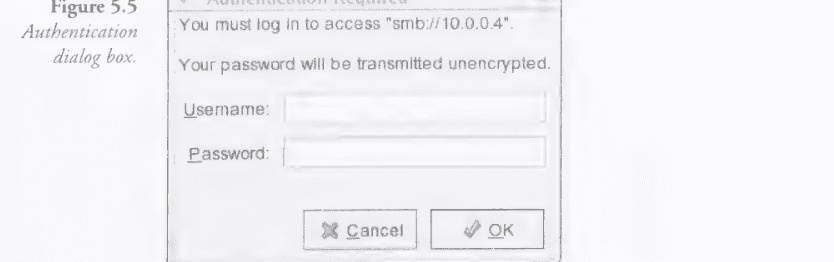

## 如何访问 NFS 文件系统？

NFS 共享是 Linux 上网络文件共享的主流。对于这些文件系统，认证不是问题，因为认证模型是在系统层级而不是用户级的。用户访问受标准 Linux 权限的控制。使用 NFS 挂载需要挂载点和 root 权限来执行任何挂载操作。如果用户需要访问以执行挂载，可以使用 `sudo` 命令（它是登录 root 的替代方案，记录所有基于 root 的操作）来执行以下挂载命令：

```
mount <directory@machine> <mount-point>
```

## 如何访问基于 Macintosh 文件系统？

在某些情况下，你可能需要访问位于 Macintosh 计算机上的文件。虽然大多数现代 Macintosh 计算机支持 NFS 或 CIFS，但也有较旧的计算机支持 AppleTalk。Linux 可以通过 `netatalk` 软件包（http://netatalk.source-forge.net）支持 AppleTalk。

## 如何访问各种 CD-ROM 格式？

最常用的 CD-ROM 格式是 ISO 9660，带有或不带扩展名。ISO 9660 CD-ROM 可以通过 `mount` 命令轻松访问，取决于你的系统是否经过了加固（hardened），它们会自动挂载到桌面上。使用的 `mount` 命令为：

```
mount -o ro /dev/cdrom <mount-point>
```

注意，挂载点是你你有权访问的目录。现代 Linux 桌面或工作站安装将向用户暴露 CD-ROM 访问功能，并自动挂载所有常见的 CD-ROM 格式，而无需使用默认只能由系统管理员发出的 `mount` 命令。在加固系统中，此选项可能不可用。你可以使用表 5.1 中的信息访问最常见的 CD-ROM、软盘甚至硬盘格式。使用此表时的命令序列为：

## 如何访问其他磁盘设备？

`mount -o options -t type /dev/cdrom <mount-point>`

在使用表 5.1 时有几点注意事项。第一是，如果你使用 ISO 9660 CD-ROM，你可以将命令简化为：
`mount -o options /dev/cdrom <mount-point>`

系统管理员可以设置 `/etc/fstab` 文件来处理这些每种格式，以便实现自动挂载。对于软盘，将使用 `/dev/fd0` 设备代替 `/dev/cdrom`。

## 表 5.1 访问常见的 CD-Rom、软盘和硬盘格式

| 格式 | 类型 | 选项 |
| :--- | :--- | :--- |
| 多光段 (旧式) | udf | ro |
| 多光段 (现代) | ISO 9660 | ro |
| CDRW | ISO 9660 | rw |
| Macintosh (原生) | hfs | ro |
| Macintosh | ISO 9660 | ro |
| Linux (原生) | ext2 | ro |
| Linux | ISO 9660 | ro |
| UNIX (原生) | ufs | ro |
| UNIX | ISO 9660 | ro |

## 5.5 如何访问其他磁盘设备？

让我们也看看一些其他格式。例如，如果一台机器的一块磁盘是 Windows，另一块是 Linux，无论机器如何启动，你可能都需要访问两块磁盘的数据。如果你的 Windows 磁盘是 NTFS，你可以使用可用的 NTFS 格式；但如果你以读写方式挂载而不是只读，可能会有损坏硬盘的风险。NTFS 和 UFS 的读写驱动程序必须编译到内核中，否则会导致失效。挂载方法与 CD-ROM 相同；但你必须确定使用哪个磁盘设备。如果你的 Linux 桌面访问是常规活动，你可能需要在 `/etc/fstab` 文件中添加条目，以便在启动时自动挂载磁盘。表 5.2 包含了表 5.1 内容，并提供了类似的 `mount` 命令。

## 表 5.2 访问其他磁盘设备

| 格式 | 类型 | 选项 |
| :--- | :--- | :--- |
| NTFS (硬盘) | ntfs | ro/rw |
| 闪存 | vfat | rw |
| UNIX (原生) | ufs | ro/rw |

有许多方法可以确定机器上有哪些可用硬件。在此处，检查 `mount` 命令的输出以确定哪些设备已自动挂载或可用。如果设备不在列表中，我们进入不同的机制。由于我们只寻找磁盘设备，`mount` 命令会告诉我们所有已挂载的设备。许多行可以忽略，关键的是 `/dev/hda2` 和 `/dev/hda1`，它们属于 `/dev/hda` 磁盘。

- dev/hda2 on /ext3 (rw)
- none on /proc (rw)
- none on /dev/pts (rw,gid=5,mode=620)
- devfs /proc (rw)
- dev/hda1 on /boot ext3 (rw)
- none on /shm tmpfs (rw)

这告诉我们只有 `/dev/hda` 当前已挂载。

## 5.5.1 RHEL

要确定哪些其他设备可以挂载，我们可以查看 `mount` 命令的输出，它显示了所有活动设备。一旦运行该命令，就会出现如图 5.6 所示的对话框。硬件浏览器将打开当前的 CD-ROM 驱动器。要确定其他可用设备，点击“硬盘”（如图 5.7 所示）。在这种情况下，我想找到插入 PCMCIA 插槽的闪存卡设备。

## 如何访问其他磁盘设备？

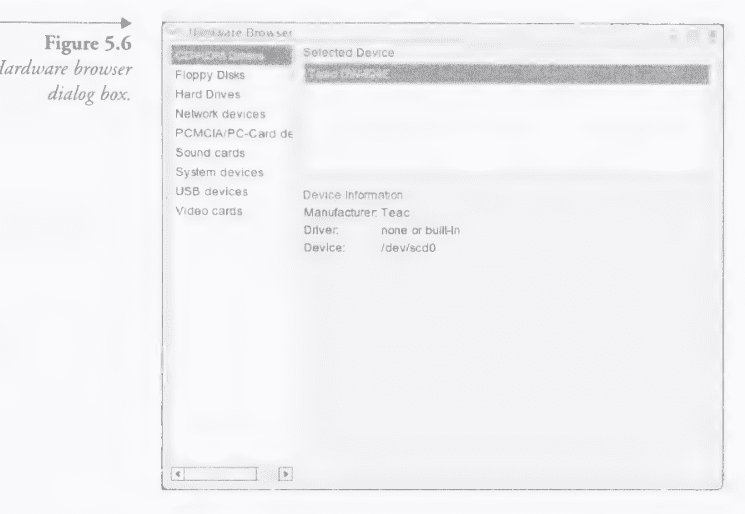
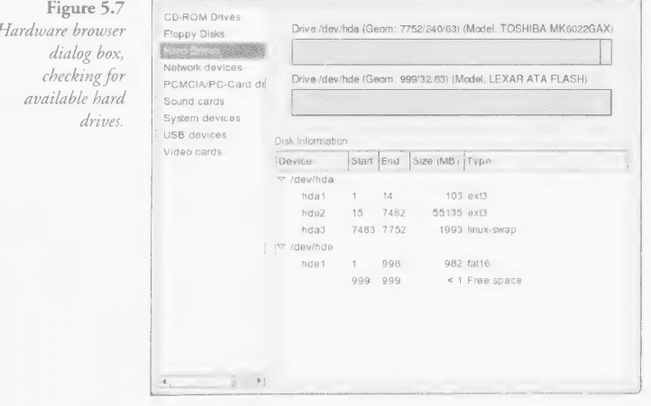

在图 5.7 中，你可以看到我需要的设备是 hde 设备，特别是 `/dev/hde1` 分区。

## 5.5.2 Mandrake

与 `hwbrowser` 类似，`mandrake` 命令出现在图 5.8 中；它将显示你在左侧列中需要的精确设备。点击该设备将显示发生挂载所需的设备和分区。

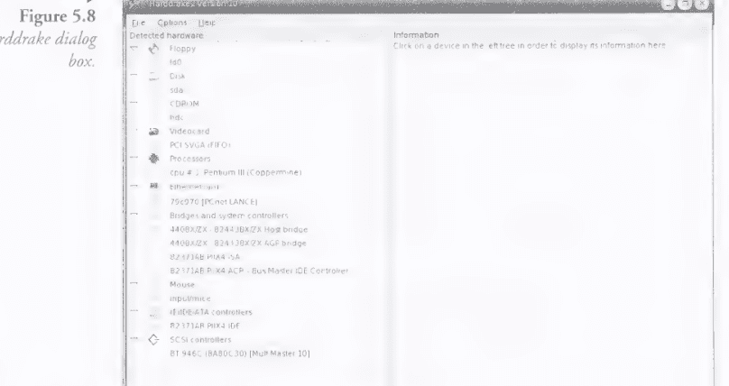

## SuSE

SuSE 使用自己的硬件浏览器，与其他众不同。在启动 YaST 并从右侧选择“硬件信息”后，它将显示如下。一旦打开硬件信息对话框，你可以向下滚动并展开“磁盘”部分显示与每个磁盘驱动器相关的设备（见图 5.9）。现在有了这些信息，可以使用相应的命令：

```
mount -t vfat /dev/hdd1 /mnt
```

如果由于某些原因硬件浏览器（你的 Linux 安装版）没有显示你的设备，你可以参考 `dmesg` 的输出来确定可用设备，使用如下：

图 5.9 YaST 硬件浏览器。

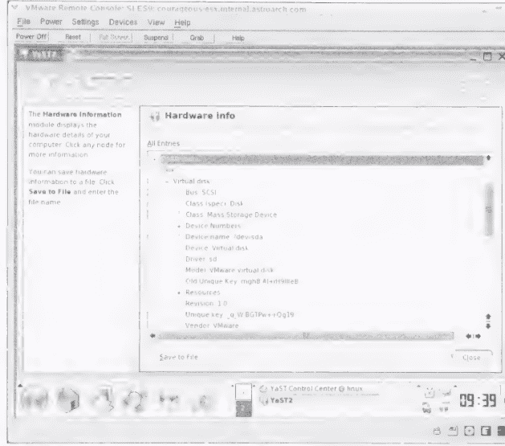

```
dmesg | egrep 'hd|sd'
de: LEXAR ATA FLASH, CPA DISK drive
de: attached ide-disk driver.
de: hde1: task_no_data_intr: status=0x51 { DriveReady SeekComplete Error }
de: hde1: task_no_data_intr: error=0x04 { DriveStatusError }
de: hde1: 2014992 sectors (1032 MB) w/1KiB Cache, CHS=1999/16/63
de: hde1: [PTBL] [999/32/63] hde1
de: Vcc = 3.3, Vpp = 0.0
```

如果没有 `dmesg` 且你拥有 root 权限，也可以查看日志消息文件：


`egrep 'hd|sd' /var/log/messages`

提供的输出还显示 `hde1`——特别是 `/dev/hdd1`——是我在挂载命令中使用的设备。在命令中使用 `sd` 通常会显示 USB 磁盘。

## 如何从 CD-ROM 创建镜像？

制作 CD-ROM 镜像在命令语法上非常简单，但在完成镜像时并不简单。要制作 CD-ROM 镜像，使用：

```
dd if=/dev/cdrom of=<image file>
```

或者

```
readcd dev=/dev/cdrom f=<image file>
```

然而，某些 CD-ROM 设备在寻找设备末端时存在问题，在物理弹出 CD-ROM 之前必须发生后续读取错误，这可能导致系统看起来挂起了。这种这种情况只在旧内核上使用 DVD 驱动器时遇到过。

## 如何创建 CD-ROM？

这取决于你希望什么类型的设备能够读取生成的 CD-ROM。基础命令是 `cdrecord`，它有很多选项。然而，创建光盘是一个三步骤的过程：

- 将所有想要刻录到磁盘的文件放入一个目录中。
- 使用 `mkisofs` 命令创建该目录的 ISO 镜像。
- 使用 `cdrecord` 将生成的 ISO 镜像刻录到 CD-ROM 设备上。

| 格式 | 类型 | cdrecord 选项 |
| --- | --- | --- |
| ISO9660 | iso9660 | -J -R |
| 多光段 | udf/iso9660 | -multi |
| Macintosh | hfs | -hfs |
| UNIX | ufs/ext2 | 无，直接在设备上使用 cdrecord |

## 5.8 我如何制作可引导的 CD-ROM？

`mkisofs` 是一个重要的命令，它有许多选项，如表 5.3 所示。

参考表 5.3 并运行以下命令：

```
cd temporary_data_directory

mkisofs options -o /tmp/output.iso

cdrecord options /tmp/output.iso
```

可以使用 `mkisofs` 制作非常复杂的镜像，这些镜像可以根据读取 CD-ROM 的操作系统引导并显示不同的数据，`mkisofs` 的手册包含了这些复杂的示例。最后，也可以使用 Nautilus（文件管理器）通过 `burn://...` 位置将镜像刻录到 CD-ROM 设备，这会创建一个标准的 ISO9660 镜像，而你可以使用以下命令完成相同的操作：

```
cd path_to_dir_to_burn

mkisofs J -R -o /tmp/output.iso

cdrecord /tmp/output.iso
```

## 5.8 我如何制作可引导的 CD-ROM

可引导的 CD-ROM 往往是制作恢复性 CD-ROM 的要求。这些非常实用的 CD-ROM 将帮助管理员恢复系统，甚至对系统进行取证分析。最后，分发介质始终可以使用，但如果一张名片大小的 CD-ROM 就能提供从 CD 引导的能力并从而出于管理目的访问机器，为什么还要随身带一套七光盘呢？要制作可引导的 CD-ROM，你需要安装 syslinux RPM。

### 5.8.1 RHEL3

```
update syslinux
```

一旦安装了 syslinux，你就可以按照以下指令制作 CD-ROM：

```
mkdir iso

cd iso

mkdir isolinux
```

```
cp -r /usr/lib/syslinux/isolinux.bin isolinux

cp files . # 将所有必要文件复制到此目录

包括你想要运行的任何命令以及运行

这些命令所需的库

包括你的内核等。

# 注意，制作一个可引导的cdrom 还涉及更多内容，

包括必要的内核文件和配置文件，这些在这里未被涵盖。

mkisofs -J -T -v -r -c isolinux/boot.cat -b isolinux/

isolinux.bin -no-emul-boot -boot-load-size 4 -boot-info-

./file.iso
```

注意，这绝不是完整的；此示例仅演示了基础知识和必要的 `mkcdiso` 命令。如果你想制作一个恢复性 CD-ROM，有一个名为 `mkcdrec` (`www.mkcdrec.org`) 的非常有前景的项目，它将引导你制作可引导的恢复性 CD-ROM（从备份介质恢复你的系统，或仅在主引导记录被破坏时引导系统）或任何其他形式的可引导 CD-ROM。该项目包含了创建可引导 CD-ROM 的必要步骤，包括任何必要的驱动程序，并提供了一个可以轻松添加的完整包。由于该项目是专为制作恢复性 CD-ROM 而设计的，因此对于帮助所讨论的情况来说已经足够了。此外，还有一个 `mkbootdisk` 命令，它可以创建特定于你系统的引导磁盘，例如：

```
mkbootdisk --device /tmp/bootdisk.iso --iso --uname -r

cdrecord /tmp/bootdisk.iso
```

`mkbootdisk` 的手册页将包含更多细节。

## 我如何操作软盘？

软盘像 CD-ROM 一样有多种格式。然而，最流行的是 DOS 格式。要操作 DOS 格式的磁盘，首先确保已安装 `mtools` 包。

RHEL: `rpm -q mtools`

`mtools` 提供了模拟你通常使用的 DOS 命令的工具，但这些命令前面都有一个 `m`；格式化命令变为 `mformat`，复制变为 `mcopy`，目录变为 `mdir`，切换目录变为 `mcd`，以此此类推。需要注意的是，大多数文本文件需要使用以下命令从 DOS 转换为 Linux：

```
dos2unix <inputfile> <outputfile>
```

然后，当需要将文本文件交还给 DOS 用户以便其再次使用磁盘内容时，使用以下命令：

```
unix2dos <inputfile> <outputfile>
```


另一种类型的软盘是持有不同类型文件系统的磁盘。使用标准的 `mount` 命令挂载该文件系统，然后所有标准的 Linux 命令都将按预期工作。

## 5.10 成本

其中仅涉及一个隐藏成本，且那仅在你需要操作晦涩的文件系统时才适用。这个隐藏成本是指如果你必须重新编译内核以访问这些文件系统时，所需的支持费用。然而，如果你坚持使用标准内核，这些系统中的许多以其友好的形式默认可用。如果你迫切需要在本地机器上操作 NTFS 分区，使用如 `VMware` 等系统创建一个真实的 Microsoft Windows 安装可能是合适的，而不是在 Linux 中使用风险较高的 NTFS 写入启用代码。一旦使用了像 `VMware` 的工具，你可以设置一个 `CIFS` 服务器将磁盘共享给 Linux 服务器。最后这种选项可能很昂贵，并不一定必要。

成本显示在表 5.4 中。


| 软件 | 支持级别 | 费用 | 支持费用 |
| :--- | :--- | :--- | :--- |
| VMware | 基于支持 | $199 | 免费 |
| 内核 | 无 | 免费 |

## 6.2 视频会议

图 6.3 Miao 。

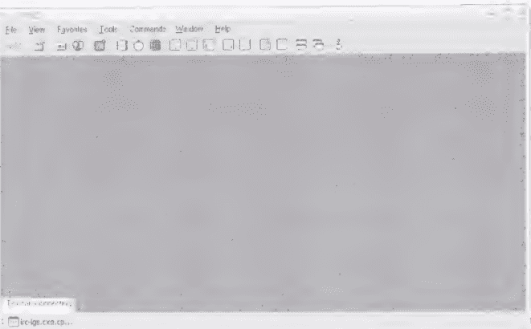

在 Linux 下使用视频会议有几种方法：遗憾的是，它们之间的兼容性并不很好。第一种是 Gnome Meeting，第二种是通过 Format CrossOver Office 使用微软的 NetMeeting。其他工具也可以为用户提供图片或视频，但这些通常是点对点工具，并不提供真正的视频会议功能。`OpenH323` 项目（http://www.openh323.org）是研究视频会议的一个很好的起点。

### 6.2.1 GnomeMeeting

`GnomeMeeting` 是一个很棒的工具，模仿了 NetMeeting 的功能，但没有共享任何最实用的协议。目前正在努力实现这些协议，但它们尚未完成。因此，`GnomeMeeting` 的使用仅限于与 NetMeeting 进行视频共享；没有聊天、应用程序或白板共享功能（`T.120` 协议）。然而，Linux 到 Linux 的主机之间可以使用白板和聊天共享。要显示视频，你需要一个使用 `Video4Linux` 驱动的摄像头，这包括许多 Creative 和飞利浦摄像头，以及一些罗技摄像头。在 http://www.gnomemeeting.org 可以获得大量信息。此外，网站 http://www.exploits.org/v4l/ 列出了支持 `Video4Linux` 摄像头的可用驱动列表。Linux 的某些摄像头支持正在消失，而另一些正在出现。

#### 图 6.4
`GnomeMeeting`

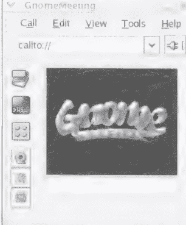

与任何开源项目一样，在购买前请查看支持的硬件列表。

熟悉 NetMeeting 的人会发现使用 `GnomeMeeting` 同样舒适。`GnomeMeeting` 还支持通过 `MicroTelco` 电话服务（http://www.microtelco.com）进行 IP 语音（Voice over IP）。

`GnomeMeeting` 作为大多数现代 Linux 版本的一部分进行安装，看起来类似于图 6.4。

### RHEL
```
up2date gnomeemeeting
```

### 6.2.2 NetMeeting

使用 `CrossOver Office` ($79) 或通过 `VMware` ($199) 也可以使用微软 NetMeeting。`VMware` 将提供完整的 NetMeeting 功能，而 `CrossOver Office` 则不会提供良好的音频或视频功能，但聊天、白板和应用程序共享都可以工作。当 Netmeeting 运行时，它允许你查看共享的应用程序，但无法启动共享过程。一旦将 NetMeeting 安装到 `CrossOver Office` 中，你需要使用以下命令为其创建一个菜单项：

```bash
cd .gnome2/vfolders/applications

cat CTree-Windows_Applications-Programs-NetMeeting.desktop

<<EOF

[Desktop Entry]

Encoding=Legacy-Mixed

Type=Application

X-Created-by=cxoffice

Name=NetMeeting

Comment=NetMeeting

Exec=/opt/cxoffice/bin/wine --cx-check "C://Program/Files=/NetMeeting//CONF.EXE"

Icon=/home/elh/.cxoffice/dotwine/fake_windows/Windows/Icons/cf.xpm

Categories=Application;X-cxoffice;X-CXTree-Windows_Applications-Programs;

EOF
```


现在你可以从 Red Fedora 菜单启动 `NetMeeting`，界面将如图 6.5 所示。需要注意的是，最新版本的 `CrossOver office` 和 `Internet Explorer` 安装程序包含了一个版本的 `NetMeeting`。

图 6.5
`NetMeeting`.

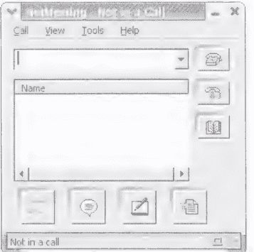

如果你只需要视频会议，那么 `NetMeeting` 和 `GnomeMeeting` 都可以工作。但是，如果你需要培训或桌面共享环境，那么 `NetMeeting` 是唯一的真实工具。

## 6.3 即时消息

另一种被广泛使用的通信工具是即时消息（IM）。这些工具通过服务器连接个人与个人，在某些情况下还会连接群组。虽然不是真正的点对点网络，但服务器的使用允许一些存储和转发功能并保证了协议的稳定性。流行的即时消息协议有 `AIM`、`ICQ`、`MSN`、`Jabber` 和 `Yahoo!`。在 Linux 上，这些每个协议都有一个客户端，有时有两个三个版本，从命令行版本到非常精美的图形化客户端不等。表 6.1 列出了每个协议可用的 Linux 客户端列表。

### 表 6.1 按协议划分的 Linux 即时消息工具

| 工具 | 协议 | 网站 | 备注 |
| ------|---|---|---|
| Licq | ICQ | http://www.icq.org | |
| Gaim | AIM/MSN/Yahoo! ICQ | http://gaim.sourceforge.net | 大多数 Linux 系统均提供图形化客户端 |
| Yahoo! | Yahoo! | http://messenger.yahoo.com | Yahoo! 提供的图形化客户端 |
| Aytm | AIM/MSN/Yahoo! ICQ/Jabber | http://ayttm.sourceforge.net | 带有加密模块的图形化客户端 |
| EB-lite | AIM/MSN/Yahoo! ICQ/Jabber | http://www.everybuddy.com/eb-lite | 适用于 WAP 设备，包括基于 Java 的手机和 PDA |

# 终端仿真器与服务器客户端

你可能需要访问命令行 shell，或运行在其他系统上的遗留终端终端应用程序。为了实现这一点，你需要一个字符单元格终端客户端。在许多情况下，这种访问会带来独特的挑战，例如使用正确的键盘布局或终端仿真模式。你可能只需要使用来自 Windows 服务器的终端服务器客户端将图形化窗口显示回你的机器。

## 7.1 我如何访问基于遗留的大型机程序？

要访问遗留大型机程序，你需要一个能够与大型机通信的终端仿真器。目前有许多可用的工具。我们将介绍两个大型机系统及其相应的客户端。

首先是 IBM 大型机客户端。它将与基于 IBM MVS 的大型机进行交互，并提供所有必要的功能，包括根据需要为 PC 风格键盘提供功能键映射。市上有大量的 `tn3270` 客户端可用，我们提到的是这类工具，而不是具体的程序。`tn3270` 客户端有一个共同点，那就是它们的交互方式就像一个 `3270` 终端一样。虽然你可能仍然能找到 `3270` 物理终端，但 `tn3270` 类的仿真器更为流行，而且很难选择哪一个比另一个更好，因此我们不会介绍具体的仿真器。它们都有一些共同点，包括一种在不需要修改任何其他系统的情况下输入 `3270` 终端特殊按键的方法。虽然 `tn3270` 仿真器不需要任何其他软件来更改键位，但其他终端程序确实有此要求。

在处理键盘和 `XFree86` 时，至关重要的概念是代表键盘上每个按键的键映射（keyboard map）。虽然键盘有一个键映射，但键映射（键盘）的每个单独键都有一个键帽（keycap）定义。通过修改键帽，我们可以修改键映射报告键盘按键的方式。`xmodmap` 程序将读取带有其定义键帽的键映射文件，并修改运行系统的键映射。

对于基于 Digital (HP) VMS 的系统，你需要一个 `VT400` 终端仿真器。这里有多个 `VT400` 终端仿真器，其中最方便的一个已经是所有发行版的一部分。那个工具就是 `xterm`。

### 7.1.1 RHEL

```
up2date xterm
```

虽然 `xterm` 比较老旧，但使用 `-sb` 参数可以将数字小键盘置于应用程序模式而非系统模式，并扩展键映射以处理到 20 个功能键，这是 `VT400` 终端仿真器所要求的。

如果你的键盘不支持 20 个功能键且这些按键是必要的，你将需要 `xmodmap` 或 `XKeyCaps` (`http://www.jwz.org/keycaps/`) 图形客户端来映射这些按键，它将写出一个 `xmodmap` 可读的文件，在更改键映射时运行的任何其他应用程序都会影响 `xterm` 以及 `openoffice` 和任何未来的应用程序。这**不是**本地化的更改。例如，你可以使用 `xmodmap/XKeyCaps` 通过使用 `XKeyCaps` 创建的键映射将 `ctrl-F10` 映射为 `F13`。首先我们需要构建 `XKeyCaps`，因为使用该工具来操纵 `xmodmap` 文件要容易得多。

### 7.1.2 编译 XKeyCaps

```
# tar -xzf keycaps-2.4.tar.gz

# cd keycaps-2.4

# make

# make install
```

### 7.1.3 运行 XKeyCaps

```
# xkeycaps
```


从列表中选择你的键盘，由于代码较旧，请选择最接近的匹配，右键点击按键弹出菜单并选择 `Edit`（编辑）。“`Edit Key`”对话框如图 7.1 (`img/a06369af5597deead612a49ccaa3_126.png`) 所示。与相关修饰符相关的 `Keysym`，在这种情况下，按下控制键后修饰符将 `Control`。对于 `F3`，选择一个字符集，然后对所有合适的按键执行 `Repeat`（重复）。图 7.2 显示了编辑 `F13` 键定义的对话框。图 7.3 显示了显示输出的消息框。从命令行或启动脚本的一部分运行 `xmodmap -n` 来调用键盘更改。(`img/a06369af5597deead612a49ccaa3_127.png`)

| 代码的 `Keysym` | 修饰符 | 字符集 | `Keysym` |
|---|---|---|---|
| `Keysym 1`: `F13` | `Shift` | `Latin1` | `F10` |
| `Keysym 2`: `F13` | `Ctrl+Shift+Alt` | `Latin2` | `F11` |
| `Keysym 3`: `F13` | `Control` | `Latin3` | `F12` |
| `Keysym 4`: `NoSymbol` | | `Latin4` | `F13` |
| `Keysym 5`: `NoSymbol` | `mod2` | `Arabic` | `F14` |
| `Keysym 6`: `NoSymbol` | `mod3` | `Greek` | `F15` |
| `Keysym 7`: `NoSymbol` | `Cyrillic` | `F16` |
| `Keysym 8`: `NoSymbol` | `mod5` | `Technical` | `F17` |

`AutoRepeat`: `Yes`

虽然 `XKeyCaps` 并不是一个美的应用程序，但它可以将键盘重映射到你需要的或想要的任何内容。你对键映射的这种全局更改将影响所有在图形模式下运行的程序。

### 7.1.4 应用程序本地化键映射更改

`xterm` 存在一种应用程序本地化方法，可以使用其键映射和翻译仅在 `xterm` 内部重映射按键。`xterm` 将一组物理按键按下翻译为另一个按键序列在文本流中的输入。一个为你执行映射的脚本允许创建一个新命令 `vmstream`，以便使用正确的键映射连接到 `VMS` 机器，而不影响任何其他程序。这种方法是首选的，并在 `xterm` FAQ (`http://dickey.com/xterm/xterm.faq.html`) 中充分讨论，那里还列出了与以下不同的脚本。然而，你应该注意某些相似之处，因为执行此过程的方法只有几种。此脚本将映射表 7.1 所示的按键。(`img/a06369af5597deead612a49ccaa3_127_1.png`)

#### 表 7.1 键映射脚本

| 键 | 映射 |
|---|---|
| `Shift F3` | `F13` |
| `Shift F4` | `F14` |
| `Shift F5` | `F15 (Help)` |
| `Shift F6` | `F16 (Do)` |
| `Shift F7` | `F17` |
| `Shift F8` | `F18` |
| `Shift F9` | `F19` |
| `Shift F10` | `F20` |
| `Shift F11` | `F21` |
| `Shift F12` | `F22` |
| `Shift F13` | `F23` |
| `Shift F14` | `F24` |
| `Shift F15` | `F25` |
| `Shift F16` | `F26` |
| `Shift F17` | `F27` |
| `Shift F18` | `F28` |
| `Shift F19` | `F29` |
| `Shift F20` | `F30` |
| `Insert` | `Insert` |
| `Delete` | `Delete` |
| `Home` | `Home` |
| `End` | `End` |
| `Page Up` | `Page Up` |
| `Page Down` | `Page Down` |
| `Up` | `Up` |
| `Down` | `Down` |
| `Left` | `Left` |
| `Right` | `Right` |
| `Print Screen` | `Print Screen` |
| `Backspace` | `Backspace` |
| `Enter` | `Enter` |
| `Tab` | `Tab` |
| `Space` | `Space` |
| `/` | `/` |
| `\` | `\` |
| `-` | `-` |
| `*` | `*` |
| `+` | `+` |
| `'` | `'` | `"` |
| `<` | `<` |
| `>` | `>` |
| `=` | `=` |
| `,` | `,` |
| `.` | `.` |
| `;` | `;` |
| `[` | `[` |
| `]` | `]` |
| `{` | `{` |
| `}` | `}` |
| `0` | `0` |
| `1` | `1` |
| `2` | `2` |
| `3` | `3` |
| `4` | `4` |
| `5` | `5` |
| `6` | `6` |
| `7` | `7` |
| `8` | `8` |
| `9` | `9` |
| `F1` | `F1` |
| `F2` | `F2` |
| `F3` | `F3` |
| `F4` | `F4` |
| `F5` | `F5` |
| `F6` | `F6` |
| `F7` | `F7` |
| `F8` | `F8` |
| `F9` | `F9` |
| `F10` | `F10` |
| `F11` | `F11` |
| `F12` | `F12` |
| `F13` | `F13` |
| `F14` | `F14` |
| `F15` | `F15` |
| `F16` | `F16` |
| `F17` | `F17` |
| `F18` | `F18` |
| `F19` | `F19` |
| `F20` | `F20` |

#### 表 7.1 键映射脚本（续）

| 键 | 映射 |
|---|---|
| `KP_0` | `0` |
| `KP_1` | `1` |
| `KP_2` | `2` |
| `KP_3` | `3` |
| `KP_4` | `4` |
| `KP_5` | `5` |
| `KP_6` | `6` |
| `KP_7` | `7` |
| `KP_8` | `8` |
| `KP_9` | `9` |
| `KP_Enter` | `Enter` |
| `KP_Minus` | `-` |
| `KP_Multiply` | `*` |
| `KP_Add` | `+` |
| `KP_Divide` | `/` |
| `KP_Decimal` | `.` |
| `KP_Up` | `Up` |
| `KP_Down` | `Down` |
| `KP_Left` | `Left` |
| `KP_Right` | `Right` |
| `KP_Insert` | `Insert` |
| `KP_Delete` | `Delete` |
| `KP_Home` | `Home` |
| `KP_End` | `End` |
| `KP_PageUp` | `Page Up` |
| `KP_PageDown` | `Page Down` |

```
#!/bin/sh

xterm -title "VMStream" -geometry 80x24

xmodmap -e "clear lock"

xmodmap -e "clear shift"

xmodmap -e "add mod4 = F13"

xmodmap -e "add mod5 = F14"

xmodmap -e "add mod6 = F15"

xmodmap -e "add mod7 = F16"

xmodmap -e "add mod8 = F17"

xmodmap -e "add mod9 = F18"

xmodmap -e "add mod10 = F19"

xmodmap -e "add mod11 = F20"

xmodmap -e "add mod12 = F21"

xmodmap -e "add mod13 = F22"

xmodmap -e "add mod14 = F23"

xmodmap -e "add mod15 = F24"

xmodmap -e "add mod16 = F25"

xmodmap -e "add mod17 = F26"

xmodmap -e "add mod18 = F27"

xmodmap -e "add mod19 = F28"

xmodmap -e "add mod20 = F29"
```


## 7.2 我如何访问 Windows Terminal 服务？

图 7.4 使用 Power Term 的键盘映射。

| 键盘映射 | 确定 | 取消 | 默认 | 帮助 |
| :--- | :--- | :--- | :--- | :--- |
| VT 键盘 | | | | |
| F4 | F5 | F6 | F7 | F8 | F9 | F10 | F11 | F12 | F13 | F14 | 帮助 | F17 | F18 | F19 | F20 |
| 1 | 2 | 3 | 4 | 5 | 6 | 7 | 8 | 9 | 0 | - | x | 查找 |  | 执行 | F21 | F22 | F23 | F24 |
| t | h | q | w | e | r | t | u | i | o | p | | 选择 | 下一个 全部 | F25 | F26 | F27 | F28 |
| Ctrl | c | a | s | o | t | g | h | j | k | | | | | F29 | F30 | F31 | F32 |
| Shift | z | x | c | v | b | n | m | | | | | | | F33 | F34 | F35 | F36 |
| 空格 | | | | | | | | | | | | | | | | | | |
| PC 键盘 | | | | | | |
| F1 | F2 | F3 | F4 | F5 | F6 | F7 | F8 | F9 | 0 | - | | 插入 | 查找 | 打印 | Pct1 | Pct2 | Pct3 | Pct4 |
| 1 | 2 | 3 | 4 | 5 | 6 | 7 | 8 | 9 | 0 | - | | | | | | | | Pct5 | Pct6 | Pct7 | Pct8 |
| t | a | s | d | f | g | h | j | k | l | | | | | | | Pct9 | Pct10 | Pct11 | Pct12 |
| Super | u | e | r | t | y | i | o | p | | | | | | | Pct13 | Pct14 | Pct15 | Pct16 |
| Shift | z | x | c | v | b | n | m | | | | | | | | Pct17 | Pct18 | Pct19 | Pct20 |
| Ctrl-1 | | | | | | | | | | | | | | | | | | | |
| 终端键 | | | | | | | | | | | | | | PC 键 |

### 7.2.1 RHEL 8位版本

`up2date rdesktop`

### 7.2.2 适用于此版本的系统 v1.3.1

```
tar -xzf rdesktop-1.3.1.tgz

cd rdesktop-1.3.1

./configure

make

make install
```

Mandrake/SLES9/RHEL4/Fedora 已经是操作系统的一部分。

在使用 `rdesktop` 时，当我们坐在 Windows 机器上时，会弹出一个与示例相似的登录框。使用的每个 `rdesktop` 命令都会启动一个新的登录会话；虽然没有方法将 `rdesktop` 作为共享工具，但一旦登录，所有标准的桌面共享工具都可以供你使用。`rdesktop` 无法规避连接时对终端服务器许可证的需求，因为终端服务器正运行在你的 Microsoft Windows 平台上。

## 7.3 我如何访问 Citrix Metaframe 服务器？

图 7.5 新的 `rdesktop` 登录界面。

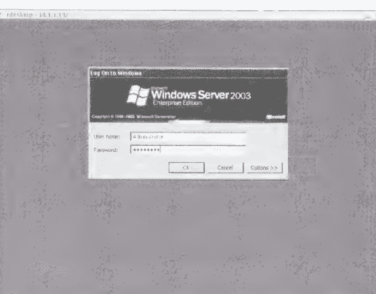

使用 Citrix 提供的免费 Metaframe 客户端可以很容易地访问 Citrix Metaframe 服务器。你可以在 http://www.citrix.com 找到该客户端，它的行为与在 Windows 上相同。如果客户端已集成到现有的发行版中（如 RHEL3 所示），可以从系统菜单访问。

### 7.3.1 RHEL

`up2date ICAClient`

启动从 Red Fedora->Internet->Citrix ICA Client 菜单项开始。首次启动时，你需要同意许可协议。一旦同意许可，就可以像在 Windows 上一样完全使用该客户端。图 7.6 显示了第一个 Citrix 窗口。

## 7.4 成本

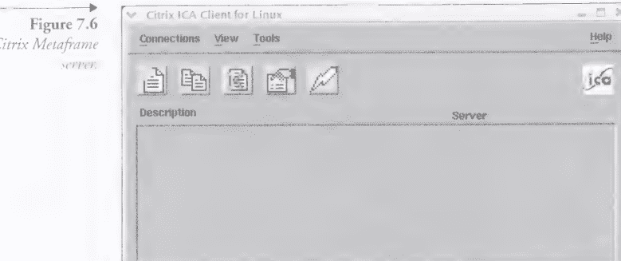

终端服务器客户端涉及有趣的许可问题，例如，使用 `rdesktop` 时，你仍然需要终端服务器许可证客户端才能连接，Citrix Metaframe 客户端也是如此。对于 Citrix，这是在 Citrix Metaframe 许可证之外的额外。在 Windows 上，使用 Citrix 并不需要额外的终端服务器许可证。使用这些工具可能比其他选项稍贵一些。

除了使用 PowerTerm 这样的工具外，所演示客户端没有其他相关费用。

## 7.5 支持

每个供应商都为 PowerTerm 和 Citrix 提供支持。对于 xterm，支持通过 Linux 发行版供应商提供；对于 a-terminal emulator，支持取决于所使用的哪种客户端。成本显示在表 7.2 中。

### 表 7.2 Linux 服务的替代品的成本

| 软件 | 支持级别 | 费用 |
| :--- | :--- | :--- |
| VMware | 基于 Web/电话 | $199（免费90天，之后仍需购买） |
| Xterm | 通过 Linux 供应商，如果 | NA |
| PowerTerm | 基于 Web/电话 | $89（一年的价格的15%） |
| Client | 电话 | 仅限服务器（如果使用 Linux，你还需要证书） |
| tn20 | 各不相同 | 仅限服务器 |

## 家庭工具

本章将讨论在家庭桌面常用的工具，但在公司桌面也能找到。我们将展示将 Palm 或手持设备连接到桌面的解决方案，并讨论同步 PDA 数据的机制。具体而言，我们将查看照片和文档的数字同步解决方案。

## 我的 PDA 与 Linux 同步吗？

如果你有桌面支持和客户端，同步 Palm OS 设备到 Linux 非常简单。大多数并非所有这些工具都可以直接从每个发行版获取；然而，有几个子集将解决这个问题。需要注意的是，较新的 Palm 设备可能需要修改内核模块才能正常工作（此修改通常是对源目录中的文件）。参考 http://www.palm.org 获取内核模块的更新。至少需要以下程序来同步 Palm 设备：

### 8.1.1 RHEL

```
up2date palmlink

up2date gnome-evolution
```

Palmink 提供了同步 Palm 设备的基本工具，而其他工具为系统增加了功能，包括自动同步、日历和地址。有了所有工具，同步 Palm 设备到 Linux 变得非常直观。然而，找到正确的端口并不总是简单的，有一些通用规则：第一是 Palm 设备使用 `/dev/ttyUSB0` 且并不总是准确，对于 Sony 设备，它们可能是反的。还需要注意 USB 端口并不对应物理设备。

### 8.1.2 为你的 Palm 寻找正确的端口

`dpsh` 命令允许你打印关于 Palm 设备的信息。这些信息可以用于验证连接性，并提供一个获取 palm 上存储文件的方便命令界面。当设备要求你按 HotSync 按钮时，如果你选择了正确的设备，就会连接。由于我正在同步 Palm Tungsten 设备，我选择使用 `/dev/ttyUSB1`，并在 HotSync 后连接成功。有时在运行 `dpsh` 之前需要按 HotSync。尝试两种方法，并使用 `df` 命令从 Palm 设备读取数据并验证其准确性。涉及的设备将是 `/dev/ttyS0` 或 `/dev/ttyS1`，取决于 Palm 插入了哪个设备。

```
dpsh -p /dev/ttyUSB1

正在监听端口: /dev/ttyUSB1

现在按 HotSync 按钮...

欢迎来到 DLP Shell

输入 'help' 获取更多信息
```
`dpsh>` `df`
文件系统      k-blocks     已用      可用      总计
Card0:ROM       16515072            n/a 16515072      n/a 16128k
Card0:RAM       66060288    39241776 26813112     59% 64512k
总计 (ROM + RAM) 82753660    55762248              n/a n/a 806409k

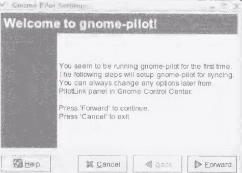


现在知道了 Palm 端口（例如 `/dev/ttyUSB1`），我们用它配置自动同步工具 `gnome-pilot`。选择 `Fedora->Preferences->More Preferences->PalmOS Devices` 来启动 `gnome-pilot` 程序 (`gpilot-control-applet`) 以启动 `gnome-pilot` 配置工具（图 8.1）。

然后按 `Forward` 选择适用于 Palm 的 USB 端口（图 8.2）。确保选择 `/dev/ttyUSB1`，或者如果你只想将此 Palm 设备同步到你的系统，可以创建一个指向 `/dev/palm` 的符号链接来简化问题。

```
ln -s /dev/ttyUSB1 /dev/palm
```

一旦选定了正确的端口、速度和 USB，继续点击 `Forward`。当出现关于此 Palm 设备是否已同步到此机器的选择时（图 8.3），选择 `Yes` 然后点击 `Forward`。

现在是时候执行第一次 `HotSync` 了，以便 `gnome-pilot` 软件可以从 Palm 设备检索用户名和 Palm ID。如果出现此对话框，我总是选择 `Yes`。只有在 Palm 设备从未用用户名初始化过，或者从未与任何其他 `HotSync` 软件同步过时，才会选择 `No`。`HotSync` 对话框如图 7.4 所示。

由于某种原因 Palm 设备未同步，请验证所用端口的权限。在这种情况下，`/dev/ttyUSB1` 的权限为 `rw-rw----` (`ls -al /dev/ttyUSB1`)，所有者为 `root.uucp`。

图 8.2 `gnome-pilot` 中 Palm 的摇篮设置。

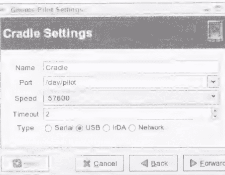

图 8.3 `gnome-pilot` 的 Pilot 识别对话框。

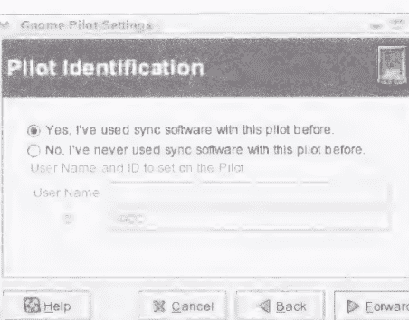

这意味着只有 `root` 用户和 `uuuc` 组中的用户可以访问该设备。在继续操作之前，你需要纠正这一点；一旦权限修复，必须杀死 `gpilotd` 进程以便其以正确的权限重启。需要注意的是，在标准的（非加固的）安装方法中，只需将 `/etc/security/dev/ttyUSB0` 和 `/dev/ttyUSB1` 添加到 `pilot` 定义行即可允许访问设备。在进行此更改后，你将需要注销并重新登录。一旦获得了 USB 设备的访问权限，就可以进行同步。成功同步后生成的对话框如图 8.5 所示。

## 8.1 如何让我的 PDA 与 Linux 同步？

图 8.4 通过 `gnome-pilot` 首次 `HotSync`。

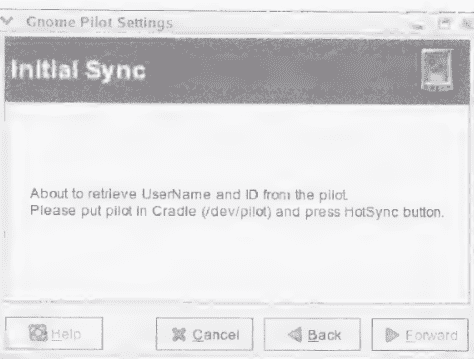

图 8.5 成功的初始同步。

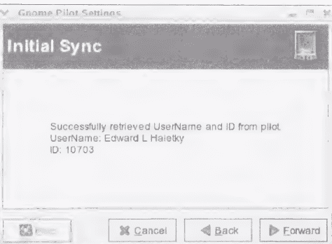

选择“前进”（`Forward`）以继续选择 Pilot 文件库和 Palm 设备名称，以便使用 `gnome-pilot` 同步多个设备（图 8.6）。

选择“前进”后，`gnome-pilot` 同步软件的配置即完成（图 8.7），下次按下 `HotSync` 按钮时，Palm 设备和 Linux 之间将发生自动同步。剩下的就是配置所有通道（`conduits`）以按预期运行。

选择“应用”（`Apply`）进入配置相应通道的部分（图 8.8）。

### 8.1 我如何让我的 PDA 与 Linux 同步？

图 8.6 同步另一个设备。

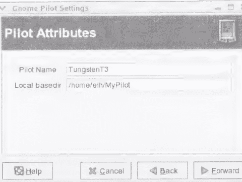

图 8.7 通过 `gnome-pilot` 配置成功同步。

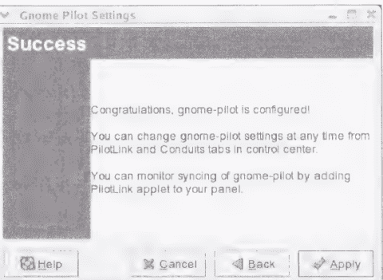

“通道”选项卡将显示所有加载的配置通道（图 8.9）。可以从此界面轻松配置这些已加载的通道以按预期运行。首次运行时，建议通过“从 Pilot 复制”（`Copy from Pilot`）这一一次性操作启用通道并设置为“同步”。

启用“备份”（`Backup`）将把所有文件从 Palm 主内存复制到适当的位置（图 8.10）。然而，Linux 版 Palm 软件的主要缺陷是它不会同步到任何数字存储（Secure Digital）、内存棒（Memory Stick）或 MMC 卡内存。对于这种情况，建议使用卡读写器。

### 8.1 我如何将文档 同步到我的 Palm 设备？

图 8.8 通过 `gnome-pilot` 配置 Pilot 设置。

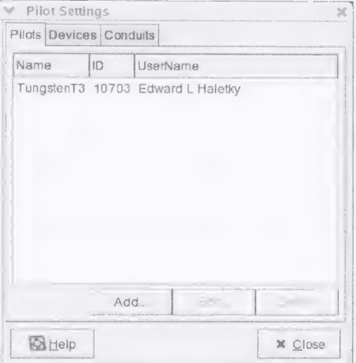

图 8.9 在 `gnome-pilot` 中配置通道。

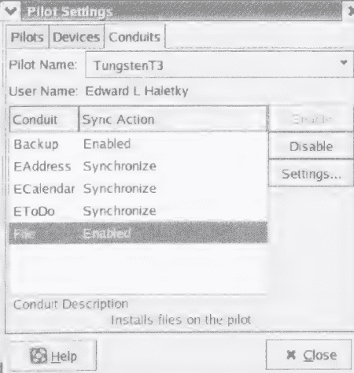

现在，至关重要的首次同步已就绪。Palm 将其地址、日历和待办事项与 `Evolution` 同步，以及

## 8.2 我如何通过 Linux 同步文档到我的 Palm 设备？

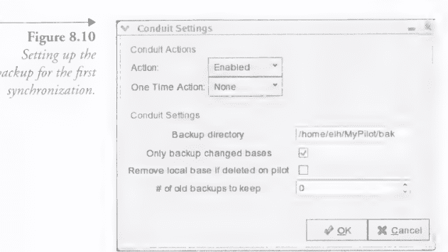

安装任何设置好要的文件，并对 Palm 主内存进行完整备份。执行此操作，按下 Palm 上的 `HotSync` 按钮。如果没有图形界面或进度条，则按 `alt+HotSync`。不过，你可以检查你的 Pilot 目录查看它是否已填充了数据；当然，你也可以监控 Palm 设备本身。

### 8.2 我如何通过 Linux 同步文档到我的 Palm 设备？

本书使用了 `Documents-To-Go` 以及若干 Linux 工具编写。因此，将 `Documents-To-Go` 数据从 Palm 设备同步到 Linux 桌面对我来说极其重要。现在这样做实际上比我刚开始进行这本书的研究要容易得多。在 `Documents-To-Go 6` 发布之前，文档的内部格式是 DataViz 专有的。现在，`Documents-To-Go` 可以读写原始 Word 文件，这意味着我们可以将 `.doc` 文件放置在 Palm 设备上，而无需担心转换。这大大简化了问题；然而，在第 6 版本发布之前，这几乎是不可能的。为了辅助这一点，可以使用以下脚本：

```sh
#!/bin/sh
##
# 将 Word/Excel 文件转换为 Documents to Go 6.0 格式
# 并准备同步

##
# Word 文件
```

### 8.2 我如何通过 Linux 将 Documents To-Go 同步到我的 Palm 设备？

```sh
##
doc="MSWD"
typ="DTGP" .doc
name="basename $1"
if [ $name = "$1" ]; then name="basename $1 .DOC"; doc="MSWD"
fi
##
# Excel 文件
if [ $name = "$1" ]; then name="basename $1 .xls"; doc="MSXL"
fi
if [ $name = "$1" ]; then name="basename $1 .XLS"; doc="MSXL"
fi
##
# 图片
if [ $name = "$1" ]; then name="basename $1 .jpg"; doc="Foto"
typ="Foto"; fi
if [ $name = "$1" ]; then name="basename $1 .JPG"; doc="Foto"
typ="Foto"; fi
##
# 转换为 Docs Go 流格式
##
if [ $name != "$1" ];
then
par -a "stream" $name.pdb $name $doc $typ $1
pilot-xfer -i $name.pdb
else
echo "\$0: error: $1 不是 Word 或 Excel 文件"
fi
```

该脚本使用了 `par` 工具（http://www.dwj.org/product/par/），它可以轻松安装并用于文件转换为流数据。这种简单的转换允许使用 `pilot-xfer` 命令将 Word、Excel 和照片同步到 Palm 内存中，该命令需要 Palm 已连接并准备好进行同步。`pilot-xfer` 不是延迟写入 Palm，而是即时写入。从 `Documents To Go 7.0` 版本开始，PowerPoint 文档可以在 Palm 上以原生格式进行编辑。这需要对脚本进行修改，将以下行放置在“图片（Pictures）”注释上方，以处理新格式。

```sh
if [ $name = "$1" ]; then name="basename $1 .ppt"; doc="MSPT"
if [ $name = "$1" ]; then name="basename $1 .PPT"; doc="MSPT"
```

构建 `par`：

```sh
tar -xzf prc
cd prc
make
```

## 8.3 我如何通过 Linux 将图片同步到我的 Palm？


参见前一节。

## 8.4 有对应的 Microsoft 替代品吗？

有多种基于 Linux 的 Office 替代品。例如，可以使用 `OpenOffice.org` 创建和编辑与 `Microsoft Word`、`Excel` 和 `PowerPoint` 兼容的文档。

```
# rpm -ivh /usr/src/redhat/RPMS/1386/GConf-1.0.9-13.1.i386.rpm,GConf-devel-1.0.9-13.1.i386.rpm
```
```
# rpm --rebuild gnome-vfs-1.0.5-18.src.rpm
```
```
# rpm -ivh /usr/src/redhat/RPMS/1386/(gnome-vfs-1.0-5-1.i386.rpm,gnome-vfs-devel-1.0.5-18.i386.rpm)
```
```
# rpm --rebuild gal-0.24-3.1.src.rpm
```
```
# rpm -ivh /usr/src/redhat/RPMS/1386/(gal-0.24-3.1.i386.rpm,gal-devel-0.24-3.1.i386,libgal23-0.24-3.1.i386.rpm)
```
```
# rpm --rebuild libhttp-10.9-9-1.1.src.rpm
```
```
# rpm -Uvh /usr/src/redhat/RPMS/1386/(libhttp-10.9-9.1.i386.rpm,libhttp-devel-10.9-9-1.1.i386.rpm)
```
```
# rpm --rebuild gtkhtml-1.1.9-8.src.rpm
```
```
# rpm -Uvh /usr/src/redhat/RPMS/1386/(gtkhtml-1.1.9-8-i386.rpm,gtkhtml-devel-1.1.9-8.i386.rpm)
```
```
# rpm --rebuild Guppi-0.40.3-18.src.rpm
```
```
# rpm -Uvh /usr/src/redhat/RPMS/1386/(Guppi-0.40.3-18.i386.rpm,Guppi-devel-0.40.3-18.i386.rpm)
```
```
# rpm --rebuild g-wrap-1.3.4-5.1.src.rpm
```
```
# rpm -Uvh /usr/src/redhat/RPMS/1386/(g-wrap-1.3.4-5.1-i386.rpm,g-wrap-devel-1.3.4-5.1.i386.rpm)
```
```
# rpm --rebuild openhbci-0.9-14-2.src.rpm
```
```
# rpm -Uvh /usr/src/redhat/RPMS/1386/(openhbci-0.9-14-2.i386.rpm,openhbci-devel-0.9-14-2.i386.rpm)
```
```
# rpm --rebuild openjade-docbook-dtds-1.3.2-11.1.src.rpm
```
```
# rpm --rebuild openjade-docbook-style-dssl-1.78-3.src.rpm
```
```
# rpm -Uvh /usr/src/redhat/RPMS/1386/(openjade-1.3.2-11.1.i386.rpm,openjade-devel-1.3.2-11.1.i386.rpm) /usr/src/redhat/RPMS/noarch/docbook(docbook-dtds-1.3.0-24.0-24.rpm,docbook-style-dssl-1.78-3.noarch.rpm)
```
```
# rpm --rebuild libofx-0.6.6-1.src.rpm
```
```
# rpm -ivh /usr/src/redhat/RPMS/1386/(libofx-0.6.6-1.i386.rpm,libofx-devel-0.6.6-1.i386.rpm)
```
```
# rpm --rebuild gnucash-1.8.9-1.src.rpm
```
```
# rpm -ivh /usr/src/redhat/RPMS/1386/(gnucash-1.8.9-1.i386.rpm,gnucash-backend-postgres-1.8.9-1.i386.rpm)
```
```
# perl MCPAN -e shell
```
```
cpan install Finance::Quote
```
```
cpan install Finance::QuoteHist
```
```
cpan install Date::Manip
```
```
cpan quit
```

安装这些软件包不应对 RHEL 3 产生不利影响。然而，如果出现问题，您需要移除这些软件包进行测试，因为 RHEL3 了一套标准软件包，有时在进行任何形式的调试之前必须移除添加的内容。

## 8.6 如何从我的数码相机下载照片？

`Gnucash` 提供了一个非常好的帮助文件，介绍了如何使用 QIF 或 OFX 格式将 `Microsoft Money` 和 `Quick` 文件导入其中。

## 8.5 是否有 QuickBooks 的替代品？

`GnuCash` (`http://www.gnucash.org`) 可以作为业务工具使用，但不会导入或读取 `QuickBooks` 文件。不过，如果你正在使用 `CrossOver Office`，可以顺利地使用 `QuickBooks Pro`。请注意，你需要 4 版本的 `CrossOffice` 才能让 `QuickBooks` 在 `CrossOver Office` 中正常运行。安装 `QuickBooks` 遵循 `CrossOver` 内部的所有标准安装流程。安装完成后，像往常一样启动和运行即可（图 8.11）。升级也非常流畅。

由于许多会计师需要 `QuickBooks` 这样的专业软件包，目前还没有真正的对等品。

## 8.6 如何从我的数码相机下载照片？

我使用 `Canon PowerShot A70` 和 `EOS 20D`。默认版本的 `gPhoto2` 支持 `EOS 20D`，因此升级。`http://www.gphoto.org` 的文档需要 `gPhoto2` 2.1.5 版本。为了验证操作是否符合预期，可以在 shell 中运行以下命令；包含了预期的输出（图 8.12）。

```
$ gphoto2 --auto-detect
```

| Model | Port |
| :--- | :--- |
| Canon PowerShot A70 | usb: |
| Canon PowerShot A70 | usb:004,029 |

```
$ gphoto2 --shell
```
```
gphoto2:(/home/xxx/laptop/camera) /> cd store_0001001
```
```
Remote directory now '/store_0001001'.
```
```
gphoto2:(/home/xxx/laptop/camera) /store_0001001> ls
```
```
MISC DCIM/
```
```
gphoto2:(/home/xxx/laptop/camera) /store_0001001> cd DCIM
```
```
Remote directory now '/store_0001001/DCIM'.
```
```
gphoto2:(/home/xxx/laptop/camera) /store_0001001/DCIM> ls
```
```
464CANON/
```
```
gphoto2:(/home/xxx/laptop/camera) /store_0001001/DCIM> cd 464CANON
```
```
Remote directory now '/store_0001001/DCIM'.
```

## 8.7 如何让 iPAQ 与 Linux 同步

- 1. 在你的 Linux 机器上安装 `SynCE`
- 2. 配置 `SynCE`
- 3. 与你的 Windows CE 设备建立连接（即同步）
- 4. 使用提供的工具在设备与设备之间复制文件，并执行其他操作
- 5. 断开你的 WinCE 设备连接

当然，步骤 1 和 2 只需要执行一次。测试是使用一台 `Compaq 3700` 系列 `iPAQ Pocket PC` 完成的。正如你会在 `Synce` 网站上发现的，根据你使用的设备，你可能需要采取一些特殊步骤。在我的情况下，这非常简单。

### 8.7.1 安装 Synce

你会在网站上看到，`Synce` 还有其他套件可用于同步你的通讯录和其他选项。对于这些，我将跳过，，只下载建立同步所需的软件。与你的 `Windows CE` 设备建立简单连接所需的软件由单个 `rpm` 包组成：`synce-0.9.0-1.i386.rpm`。

使用 `rpm` 命令安装 `synce-0.9.0-1.i386.rpm`：

```
# rpm -Uvh synce-0.9.0-1.i386.rpm
Preparing...
###################################################### [100%]
```

### 8.7.2 Synce 配置

一旦安装了 `Synce`，你就需要配置它。安装说明取决于你所使用的 `Windows CE` 设备类型、`Linux` 版本以及你使用的端口类型。更多详情可以在 `Source Forge` 网站上找到。


在我的情况下，正如我之前提到的，我有一个带有 USB 接口的 iPAQ。由于我使用的是 USB 接口，我必须遵循一些特殊说明，并使用 `modprobe` 来启用 iPAQ USB 串口模块。

以下三个命令必须由 root 用户执行。

```bash
$ /sbin/modprobe ipaq
```

下一步是配置 Synce 使用正确的端口进行连接。这是通过 `synce-serial-config` 命令完成的。在我的情况下，我连接的是 USB 端口 0，因此需要的命令是：

```bash
# synce-serial-config ttyUSB0
```

识别端口后，启动检测连接的守护进程的命令是：

```bash
# synce-serial-start
synce-serial-start is now waiting for your device to connect
```

如果有需要，可以将此添加到系统启动项中。

接下来，你需要设置任何将与你的设备同步的用户来运行 `dcc`。此命令必须从用户账户运行。如果需要，可以将该命令添加到用户的 `.login` 文件中。

```bash
$ dccm
```

完成上述步骤后，你应该能够通过 PC 上的 Windows CE 活动同步（Active Synch）图标开始手动同步。

如果你遇到困难，特别是在使用 USB 连接时，以下 Source Forge Sync 网页非常有帮助。

```
http://synce.sourceforge.net/synce/usb_linux.php
```

此外，检查或查看（tail）`/var/log/messages` 文件以获取来自 `synce-serial-start` 和 `dccm` 命令的错误。

### 8.7.3 Synce 工具

在你 Windows CE 设备与 Linux 桌面设备之间成功建立同步连接后，有多种命令行工具可对你的设备执行各种操作。

#### pstatus

允许获取连接状态以及有关你已连接设备的信息。

示例：

```
$ pstatus
Version
===
Version: 3.0.11171 (Merlin: Pocket PC 2002)
Platform: 3 (Windows CE)
Details: ""

System
===
Processor architecture: 5 (ARM)
Processor type: 2577 (StrongARM)
Page size: 0x1000

Power
===
ACLine: 01 (Online)

Status for main battery
================
Flag: 1 (High)
LifePercent: 100%
LifeTime: Unknown

Status for backup battery
================
Flag: 1 (High)
LifePercent: 100%
LifeTime: Unknown

Store
===
Store size: 48922624 bytes (46 megabytes)
Free space: 15883432 bytes (15 megabytes)

Memory for storage: 49061888 bytes (46 megabytes)
Memory for RAM: 17145856 bytes (16 megabytes)
```

获取 Windows CE 设备上的文件列表。

```
$ pls

Archive 315 Tue 04 Jan 2005 08:33:45 EST

BatmanBeginsMovi56.asxArchive 849 Tue 04 Jan 2005

08:32:12 EST EnjoythisLiveper0k.asx
```

#### Archive

```
Playlist.as 898 Sun 01 Feb 2004 09:48:44 EST

Archive 970420 Sun 08 Jun 2003 10:28:56 AM EDT

Recording1.wav 109631 Thu 22 Nov 2001 08:00:48 EST

More.pdf 399120 Fri 16 Nov 2001 08:00:26 EST

Reader User Guide.pdf Directory Tue 20 Aug 2002 10:14:18 EDT

Annotations/ Directory Mon 03 Sep 2001 08:00:01 AM EDT

Business/ Directory Mon 03 Sep 2001 08:00:01 AM EDT

Personal/ Directory Templates/ Mon 03 Sep 2001 08:00:00 AM EDT
```

#### mkdir

将在你的 WinCE 设备上创建一个目录（或文件夹）。在下面的示例中，从 Linux 桌面在 Windows CE 设备上创建一个名为 patrick 的文件夹，然后我使用 `pls` 列出 Windows CE 设备上的文件和文件夹。

```
$ mkdir

$ pls

Directory patrick/

Wed 05 Jan 2005 08:34:13 PM EST

Archive 315 Tue 04 Jan 2005 08:33:45 PM EST

BatmanBeginsMovi56.asxArchive 849 Tue 04 Jan 2005

08:32:12 PM EST EnjoythisLiveper0k.asx
```

## 病毒与垃圾邮件防护

桌面电脑的两个最大敌人是垃圾邮件和病毒。这两个反派让所有管理员都非常头疼。使用 Linux 桌面系统的好处是 Linux 病毒非常少；然而，垃圾邮件仍然是一个反派！Linux 有许多工具可以对付这两个大恶棍之徒；有些关键配置可以帮助保护你的系统免受病毒侵害。病毒最常见的入侵方式是通过电子邮件，因此本章将集中于如何让 Linux 机器的电子邮件安全。

## 9.1 如何阻止垃圾邮件？

我们必须承认，垃圾邮件是一个巨大的痛苦。为了对抗垃圾邮件，Linux 盒子里有多种工具可用；这些工具可以在用户级或全系统级实现。某些工具会从被标记为垃圾邮件的消息中学习，而另一些则需要手动控制。最广泛使用的工具之一是 SpamAssassin。SpamAssassin 将所有功能和学习控制整合在一个高度可配置软件包中。该工具允许你使用远程服务以及其自身的规则来判断邮件是否为垃圾邮件，你还可以使用其他邮件传输程序的 procmail 子系统来对其进行全局配置。由于 sendmail 是最常用的邮件传输程序，我们将介绍它的用法。

如果正在使用运行 SpamAssassin 的 IMAP 服务器，否则 SpamAssassin 对通过这些工具组合交换的邮件将不起作用。SpamAssassin 设计为通过 procmail 子系统作为系统邮件传输程序的一部分，该子系统用于用户本地的电子邮件投递，或者使用其他机制可以作为系统级邮件过滤器（milter）。如果邮件被投递到服务器本地，milter 可以在调用其他传输机制（包括 POPmail 和 IMAP）之前找到垃圾邮件。因此，SpamAssassin 可用于通过 IMAP 或 POPmail 服务器获取邮件的 Outlook 客户端。SpamAssassin 的额外优势是它是作为许多 Linux 版本的一部分自带的。要使用 SpamAssassin 处理本地投递的电子邮件，你可以如下所示使用 procmail：

创建 `.forward` 文件：

```
"IFS=' '& exec /usr/bin/procmail -f - || exit 75 #user"
```

创建 `.procmail` 文件：

```
:0fw: spamassin.lock

* <256000

| spamassin
```

输入这些指令后，本地 sendmail 投递代理将运行 spamassin 或 sporc（基于服务器）程序，并将你所有的邮件标记为垃圾邮件（spam）或正常邮件（ham，不是垃圾邮件，而是良好的邮件）。由于在某些情况下，合法邮件会被错误标记为垃圾邮件，因此可能不将所有垃圾邮件重定向到收件箱更好。你可以向 `.procmail` 文件添加以下命令，将所有垃圾邮件转发到你你不感兴趣的其他文件夹中。然而，这种行为可能最好留给你的邮件客户端处理。

```
:0

* ^X-Spam-Level: \*|\*|\*|\*|\*

spam-folder
```

```
:0

* ^X-Spam-Status: Yes

possible-spam-folder
```


这些额外的 `.procmail` 文件条目将查看 SpamAssassin 的头信息（headers）。所有分数在 10 分或以上的项目将被标记为垃圾邮件，并直接放在 `spam-folder` 中，或者如果邮件可以被认为是垃圾邮件，则放在 `possible-spam-folder`。

在使用 `procmail` 时，你可以制定配方来处理每种垃圾邮件情况。`SpamBouncer` (`http://www.spambouncer.org`) 就是这样做的；但此工具不包含 SpamAssassin 部分的强大贝叶斯过滤器。

如果你在使用如 Evolution 的邮件客户端，或者你的邮件不是在本地投递的，你可能需要另一种方法来防止垃圾邮件。以下指令假设你的远程邮件服务器尚未具有阻止垃圾邮件的工具，或者你希望增强此功能。

在 Evolution 中添加 SpamAssassin 过滤器：
导航到 `Tools->Filters...`（图 9.1）。

点击 `Add`，然后将 `Rule name` 更改为 `SpamAssassin`，并在 `If` 子句将条件更改为 `Pipe Message to Shell Command`。在条件旁框中输入 `spam-assassin -e >/dev/null`。在 `Returns greater than` 下拉框中选择返回，并输入 `0` 作为大于返回的值。（见图 9.2）。

现在修改过滤器的 `Then` 子句并点击 `click here to select a folder` 来选择文件夹，并添加新文件夹或选择现有的 `spam` 文件夹。在本例中，我们使用位于 `Local Folders` 文件夹中名为 `spam` 的文件夹（见图 9.3）。添加次要条件 `Stop processing`；如果你不这样做，其他过滤器仍然会在垃圾邮件上运行。确保此规则是你 `Filter` 列表中的第一个规则。

如果你的邮件服务器已经标记了垃圾邮件，你可以查找特定的邮件头信息（也许是 `Subject` 头，因为 SpamAssassin 可以更改主题以标记 `***` 前缀来捕捉垃圾邮件），除了安装 SpamAssassin 之外，执行 `Move to Folder` 操作，你将需要安装与外部服务器通信的工具。这些外部服务器查看黑名单（RBL）以及成员。

### 图 9.2
在 Evolution 中添加 SpamAssassin 过滤器：添加 SpamAssassin。

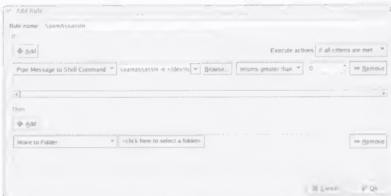

### 图 9.3
在 Evolution 中添加 SpamAssassin 过滤器：添加 SpamAssassin。

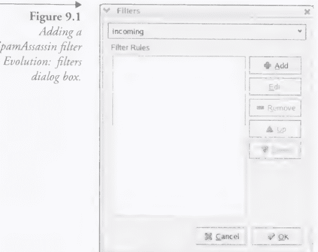 （注：图像根据文本流重新排序了）

## 9.2 如何防止垃圾邮件和电子邮件病毒？

| | | | |
| :--- | :--- | :--- | :--- |
| NOD32 | http://www.nod32.com | $$ | |
| F-Secure | http://www.f-secure.com | $ | |
| F-Prot | http://www.f-prot.com | $$$ | |
| Panda | http://www.pandasoftware.com | $$ | |
| RAV | http://www.ravantivirus.com | $$ | |
| AntiVir | http://www.antivir.de | $$$ | |
| ClamAV | http://www.clamav.net | | |
| Trend | http://www.trendmicro.com | $$$ | |

你可以通过编辑 `/etc/MailScanner/Mailscanner.conf` 文件并确认 `Virus scanning = yes` 一行已设置。如果显示为 `Virus scanning = no`，请启用此功能。接下来，将行 `Virus Scanners = be` 改为 `Virus Scanners = clamav`。这将启用使用 ClamAV 作为病毒扫描器。由于 ClamAV 是一个具有活跃病毒更新的项目，它是一个廉价的选择。Sophos 虽然可用，但使用起来非常昂贵。然而，病毒扫描器取决于公司策略，MailScanner 可以支持所有提到的扫描器。最后，你可以在定义行上使用多个扫描器。如果你愿意，可以通过在空格分隔的列表中逐个添加来列出的所有扫描器。

安装 ClamAV 非常简单：

```bash
# tar -xzf clamav-0.80.tar.gz
# cd clamav-0.80
# useradd -d /var/clamav clamav
# ./configure
# make
# make install
```

安装好 ClamAV 后，让 MailScanner 处理剩下的。设置邮件过滤还需要 Perl 模块；你可以为 Sophos 安装 ClamAV Perl 模块。这些 Perl 模块与中央病毒扫描服务器交互。安装 Perl 模块的说明可以在 MailScanner 网上。

### 如何扫描机器病毒？

你使用 ClamAV 扫描电子邮件病毒的方法，也可以用它来扫描磁盘病毒。关键是保持病毒软件更新，而 ClamAV 提供了 `freshclam` 来做到这一点。默认情况下，`fresh-clam` 每天运行。`clamscan` 是 ClamAV 的反病毒扫描器，它不会每天运行或以自动运行。你可以设置让每个用户单独运行 `clamscan`，或通过整个系统运行。我喜欢整个系统的方法，因为它实现了集中控制。要实现这一点，创建文件 `/cron.daily/doclamscan` 来每天运行反病毒文件系统扫描器，输出将自动发送给 `root`，以便管理员处理任何问题：

```bash
#!/bin/sh
/usr/bin/clamscan --stdout -r --exclude /files --exclude /mnt > /var/log/clamscan.log
grep -v "OK" /var/log/clamscan.log | grep -v "Excluded" | grep "Empty file.\$"
```

`clamscan` 可以接受你提供的许多 `--exclude` 选项。在我们的案例中，我们忽略了外部文件系统，这将大大提高速度。`root` 邮箱中的输出将类似于以下：

```
LibClAV Warning: Multipart MIME message contains no boundaries
LibClAV Warning: messageFindArgument: no '=' sign found in MIME header
LibClAV Warning: Multipart MIME message contains no boundaries
LibClAV Warning: Unsupported format "knowbot' - report to bugs@clamav.net
LibClAV Warning: Descriptor[12]: Bad format or broken data
//usr/share/doc/clamav-0.80/test/clam-error.rar: RAR module failure
//usr/share/doc/clamav-0.80/test/clam.bz2: ClamAV-Test-File FOUND
//usr/share/doc/clamav-0.80/test/clam.cab: ClamAV-Test-File FOUND
//usr/share/doc/clamav-0.80/test/clam.exe: ClamAV-Test-File FOUND
//usr/share/doc/clamav-0.80/test/clam.rar: ClamAV-Test-File FOUND
//usr/share/doc/clamav-0.80/test/clam.zip: ClamAV-Test-File FOUND
//usr/share/doc/clamav-0.80/test/clamwatch.tar.gz: Eicar-Test-Signature FOUND
//home/xxx/laptop/mail/clamav-0.80/test/clam-error.rar: RAR module failure
//home/xxx/laptop/mail/clamav-0.80/test/clam.cab: ClamAV-Test-File FOUND
//home/xxx/laptop/mail/clamav-0.80/test/clam.exe: ClamAV-Test-File FOUND
//home/xxx/laptop/mail/clamav-0.80/test/clam.rar: ClamAV-Test-File FOUND
```


//home/xxx/laptop/mail/clamav-0.80/test/clam.zip: ClamAV-Test-File FOUND

//home/xxx/laptop/mail/clamav-0.80/test/clam.exe.bz2: ClamAV-Test-File FOUND

//home/xxx/laptop/mail/clamav-0.80/test/clamwatch.tar.gz: Eicar-Test-Signature FOUND

## 如何在 Linux 上使用原生 WebEx

Linux 上没有原生的 WebEx 客户端；然而，当通过 `CrossOver Office` 使用 `Internet Explorer` 时，你可以下载并成功使用 WebEx 客户端和播放器。访问 WebEx 非常简单。访问 `http://www.webex.com` 网站，并在 `Wine` 内的 `Internet Explorer` 窗口中根据网页说明下载客户端。

虽然 WebEx 可以作为播放工具，但它也提供了一种直接访问直播源的方法，就像 `NetMeeting` 一样。

你首先需要登录 WebEx 以使用该工具（图 10.1）。

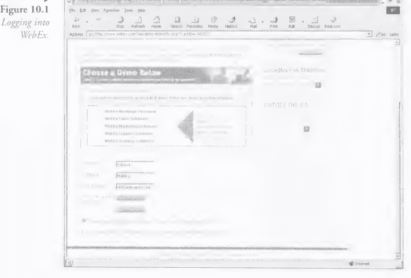

一旦登录客户端，将将弹出一个对话框，提示你下载并运行 WebEx 客户端（图 10.2）。

最后，你的 WebEx 播放器将运行，这样演示内容就会显示，并允许你控制媒体（图 10.3）。

没有 `Wine`，WebEx 将无法使用。有了 `Wine`，播放器的工作方式正如你预期的的一样，并提供了必要的工具来开启会议或查看课程。

### 10.1 如何在 Linux 上使用 WebEx？

图 10.2
安装 WebEx 客户端。

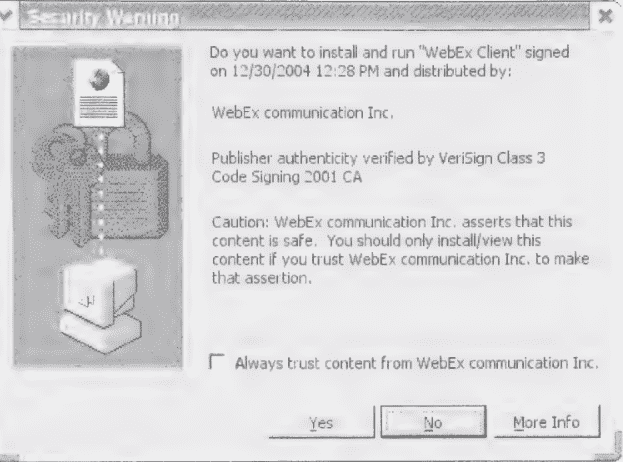

图 10.3
运行 WebEx 客户端。

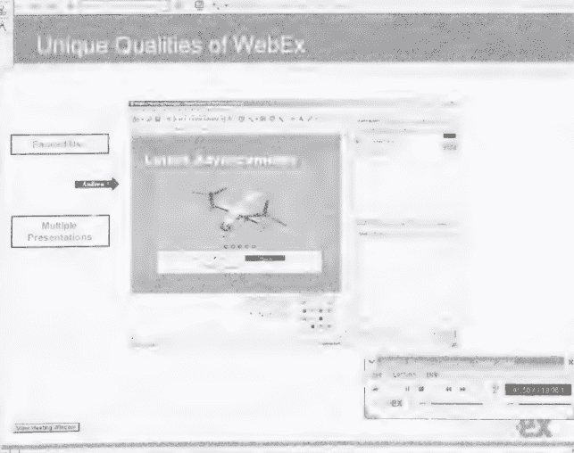

第 10 章

### 10.2 如何在 Linux 上使用 NetMeeting 进行训练？

第 6 章讨论了 `NetMeeting` 的用法，因此在此不再深入介绍，只需说明对于应用共享，Linux 上的 `NetMeeting` 可以接收 Windows 内容，但不能主持任何共享。然而，所有其他功能均可用。通过网络使用声音并不总是可行的方案，身边备有电话仍然很有用。需要重申，`GnomeMeeting` 不是应用或白板共享的可行方案，因为实现此功能所需的 `T.120` 协议并不是 `GnomeMeeting` 的一部分。

### 10.3 如何在 Linux 上使用 LiveMeeting 进行训练？

`LiveMeeting` 最初源自 `PlaceWare`，但现在属于微软，并提供类似于 WebEx 的功能。`LiveMeeting` 声称它可以与任何浏览器协同工作。然而，当使用 `Mozilla` 或 `Firefox` 时，`LiveMeeting` 会显示静态窗口，并且必须进入空白页才能听到任何声音，因此请始终将声音打开在一个新窗口中。使用 `Internet Explorer` 可以启用该工具动态功能所需的 `ActiveX` 组件。此外，`LiveMeeting` 将以 `RealPlayer`、`MediaPlayer` 和 `WAV` 格式呈现待播放数据。此外，它还将使用静态网页以及 浏览器的 `Flash` 和 `ActiveX` 部分来显示其内容。

基于 Linux 的浏览器有 `RealPlayer`、`mplayer`、`xine` 和 `Flash` 插件来处理每种内容，但基于 `ActiveX` 的内容可以通过 `Wine` 上的 `Internet Explorer` 显示。为了使用 `xine` 显示 `MediaPlayer` 的 `x-ms-wmx` mime 类型，我们需要在 `/etc/pluggerrc-5.1.3` 中添加以下内容：

```
video/x-ms-wmx: Windows Media

exits nokill: xine -pq "$file" 2>/dev/null 1>/dev/null
```

然而，`xine` 并不是基础安装的一部分；它可以在 `http://xinehq.de/` 获取，并通过以下标准下载和构建机制进行安装：

```
tar -xzf xine-lib-1.0.tar.gz

cd xine-lib
```

### 10.4 如何进行演示训练？

```
./configure

make

tar -xzf xine-ui-0.9.tar.gz

cd xine-ui

./configure

make
```

Cisco 认证网络助理（CCNA）培训通过许多方法提供。由于 `Wine` 的限制，Linux 上的方法并不总是可行的。为了实现这一点，我们需要设置以下内容：

```
cp P32.exe /wine/

cp /wine/c/P32.exe /wine/c/P32.exe

chmod 755 /wine/c/P32.exe

/wine/c/P32.exe
```


## 如何在 Linux 上使用原生 WebEx

Linux 上没有原生的 WebEx 客户端；然而，当通过 CrossOver Office 使用 Internet Explorer 时，你可以下载并成功使用 WebEx 客户端和播放器。访问 WebEx 非常简单。访问 `http://www.webex.com` 网站，并在 Wine 内的 Internet Explorer 窗口中根据网页说明下载客户端。

虽然 WebEx 可以作为播放工具，但它也提供了一种直接访问直播源的方法，就像 NetMeeting 一样。

你首先需要登录 WebEx 以使用该工具（图 10.1）。


一旦登录客户端，将弹出一个对话框，提示你下载并运行 WebEx 客户端（图 10.2）。

最后，你的 WebEx 播放器将运行，这样演示内容就会显示，并允许你控制媒体（图 10.3）。

没有 Wine，WebEx 将无法使用。有了 Wine，播放器的工作方式正如你预期的一样，并提供了必要的工具来开启会议或查看课程。

### 10.1 如何在 Linux 上使用 WebEx？

图 10.2
安装 WebEx 客户端。


图 10.3
运行 WebEx 客户端。


第 10 章

### 10.2 如何在 Linux 上使用 NetMeeting 进行训练？

第 6 章讨论了 NetMeeting 的用法，因此在此不再深入介绍，只需说明对于应用共享，Linux 上的 NetMeeting 可以接收 Windows 内容，但不能主持任何共享。然而，所有其他功能均可用。通过网络使用声音并不总是可行的方案，身边备有电话仍然很有用。需要重申，GnomeMeeting 不是应用或白板共享的可行方案，因为实现此功能所需的 T.120 协议并不是 GnomeMeeting 的一部分。

### 10.3 如何在 Linux 上使用 LiveMeeting 进行训练？

LiveMeeting 最初源自 PlaceWare，但现在属于微软，并提供类似于 WebEx 的功能。LiveMeeting 声称它可以与任何浏览器协同工作。然而，当使用 Mozilla 或 Firefox 时，LiveMeeting 会显示静态窗口，并且必须进入空白页才能听到任何声音，因此请始终将声音打开在一个新窗口中。使用 Internet Explorer 可以启用该工具动态功能所需的 ActiveX 组件。此外，LiveMeeting 将以 RealPlayer、MediaPlayer 和 WAV 格式呈现待播放数据。此外，它还将使用静态网页以及浏览器的 Flash 和 ActiveX 部分来显示其内容。

基于 Linux 的浏览器有 RealPlayer、mplayer、xine 和 Flash 插件来处理每种内容，但基于 ActiveX 的内容可以通过 Wine 上的 Internet Explorer 显示。为了使用 xine 显示 MediaPlayer 的 `x-ms-wmx` mime 类型，我们需要在 `/etc/pluggerrc-5.1.3` 中添加以下内容：

```
video/x-ms-wmx: Windows Media

exits nokill: xine -pq "$file" 2>/dev/null 1>/dev/null
```

然而，xine 并不是基础安装的一部分；它可以在 `http://xinehq.de/` 获取，并通过以下标准下载和构建机制进行安装：

```
tar -xzf xine-lib-1.0.tar.gz

cd xine-lib
```

### 10.4 如何进行演示训练？

```
./configure

make

tar -xzf xine-ui-0.9.tar.gz

cd xine-ui

./configure

make
```

Cisco 认证网络助理（CCNA）培训通过许多方法提供。由于 Wine 的限制，Linux 上的方法并不总是可行的。为了实现这一点，我们需要设置以下内容：

```
cp P32.exe /wine/
P32.exe /wine/c/P32.exe
chmod 755 /wine/c/P32.exe
/wine/c/P32.exe
```


## 10.7 结论

由于目前大多数培训都是通过 Web 进行，许多支持培训的工具已经是 Linux 的一部分（请参阅第 4 章）；通过使用 Wine，更多工具变得可用。在 Windows 上使用 CBT 培训需要 Wine 或 VMware，这可以在不花费大量资金甚至时间的情况下，提供一个可重复使用的训练材料源。然而，我坦诚承认，掌握 Wine 的细节并非弱者的之选，而且很容易产生误导。直觉将引导你，同时也需要你对程序如何工作有足够的理解。（见表 10.1）

表 10.1 当前软件信息

| 软件 | 支持级别 | 费用 | 支持费用 |
| --- | --- | --- | --- |
| VMware | 基于 Web/电话 | $199 | 90 天内免费 |
| Mozilla | 开源 | 无 | 无 |
| CrossOver Office | 基于 Web | $60 | 90 天内免费 |
| WebEX Player | 基于 Web | 无 | 无 |
| CCNA Complete | 基于 Web | $150 | 无 |
| Cisco CCNA 网络模拟器 | 基于 Web | $300+ | 无 |

## 调查方法

花费了多年的研究才发现了前几章中列出的所有应用程序。主要是，一旦决定了要研究什么，就需要时间来找到解决如何实现相关应用程序的所有可能选项。这听起来并不难，但目前 Linux 至少有 14,000 个可能的开源项目和无数的付费产品，而任何 Linux 发行版最多只附带 6,000 个软件包。在某些情况下，Linux 工具的增长已经超过了付费产品。例如，Red Hat 3.0.3 带有一个付费版本的 X，而现在 Red Hat 发送的是该软件的开源版本。

有了这些开源项目，每个应用程序都需要进行大量的研究，因此大问题在于从哪里开始。为了克服这一障碍和大量的软件包，我们设计了一个流程来组织解决集成问题的各种可能的解决方案。

## 11.1 流程

### 11.1.1 收集需求

如第 1 节所述，回顾你对相关应用程序的需求。如果你知道应用程序的哪些部分是不使用的、是可选的、是使用频率较低的以及是必须的，那么你就可以创建适当标准，用于收集信息和判断可能的解决方案。

### 11.1.2 开始搜索

开始搜索有时是一段痛苦的经历，因此请从查看你的 Linux 发行版开始，寻找可能符合你要求的软件包。

### 11.1.3 扩展搜索

访问其他 Linux 发行版的网站，因为可能存在预构建或源码包可以与你的发行版兼容。例如，如有必要，Fedora Core 3 软件包可以用于 RHEL4 安装。此外，访问诸如 `http://www.freshmeat.net`、`http://www.sourceforge.net`、`http://www.rpmfind.net` 和 `http://www.google.com/linux` 等站点。最后，回顾 *Linux World*、*Linux journal*、*Linux Format* 和 *Info World* 杂志（还有其他非常有用的杂志，但这些是主要的）。一旦你收集了相关应用程序的解决方案，你将希望把 Wine 作为一种解释性解决方案加入到你的列表中。

### 11.1.4 测试你的解决方案

现在你已经有了需求和可能的解决方案，你应该安装并测试这些解决方案，以查看哪一个最符合你的需求；测试中应包括解决方案的支持性、安装难度，以及可能使用包含解决方案的预编译包。软件包的来源包括 `http://www.rpmfind.net`、`http://dag.wiwers.com/home-made/apt`、`http://freshrpms.net`、`http://newrpms.sun-site.dk`、`http://rpm.phone.net` 和 `http://www.rpmseek.com`。

### 11.1.5 实现你的解决方案

现在已经定义了可能的解决方案列表并完成了测试，我们需要实施这些解决方案。如有必要安装到 `/usr/local`，或者为你的发行版构建 RPM 以于升级。

### 11.1.6 健全性检查

有了许多可用选项，你应该对你的解决方案进行健全性检查，确保其具有现代维护和支持；如果你选择了一个五年没有更新的工具，那将不妙！此外，一定要考虑 Wine 作为一个选项。此时，你可能还想查看自你研究开始以来可能出现的其他选项。

## 11.4 与开源社区合作

如果你在开源项目中看到应该修复的内容或 bug（错误），请查阅该项目的邮件列表，看看它之前是否被发现过以及是否有解决方案；否则，提交 bug 报告以便社区进行修复。例如 `gphoto` 软件包。我需要一个适用于 Canon EOS 20D 的版本，而当前版本无法工作。这已经在该项目的邮件列表中讨论过，并在源码池中修复了，但尚未发布版本。

## 11.5 保持同步或持续更新

在某些情况下，解决方案可能不包含你需要的一切，因此你需要不断关注这些软件包的更新，或寻找可以起到相同作用的新软件包。例如：

- 随着 Fedora Core 3 的出现，有了填充相同角色的新软件包。
- 经常需要 RHEL4 的事实软件包。
- Canon EOS 20D 需要 `gphoto2` v2.16，因此我使用 `http://www.gphoto.org` 的 CVS（并发版本系统）存储库中的最新源码作为起点，直到正式发布版本。诚然，从源码开始可能很困难，但它时时是必要的。`gimp-gtkam` 插件无法正常构建或安装。
- `gimp-perl`——为了显示字体文件，`xdotpnm` 软件包需要 `gimp-perl`。遗憾的是，RHEL4 还没有 `gimp-perl`。我将不得不直接从 CPAN (`http://www.cpan.org`) 安装，或者尝试 Fedora Core 3 的版本。

- `mozplugger`—`Mozplugger` (`http://mozplugger.mozdev.org`) 是必要包 Plugger v5.1.3 的替代品，由于其维护更好，它对 Firefox 提供了更好的支持。第 4 节详细介绍了 plugger，由于 `mozplugger` 基于 plugger 文件代码，因此相关内容仍然适用。然而，配置文件非常不同，并非 Every 中的所有内容都存在于 `mozplugger` 中，请务必测试您的版本。

- 即时消息工具—第 5 章提到了其他统一即时消息工具。这些包括 Kopete [`http://kopete.kde.org`]（与 GAIM [`http://gaim.sourceforge.net`] 相似的 KDE 版本）、NAIM (`http://naim.ml.org`) (GAIM 的命令行界面版本) 以及 CenterCIQ (`http://centerciq.org`) (不仅仅是 ICQ)，以及提到的工具。由于 GAIM 是作为 RHEL4 的一部分提供的，因此不需要其他工具；但是 AYTTM 在重新编译后运行良好。还有很多工具，《Linux Format》2005 年 3 月有一篇关于每种工具优缺点的非常好的文章。

- `Wine`—CodeWeavers 版本的 Wine 提供了一个企业支持的解释器版本。在 RHEL4 笔记本电脑上安装我典型的 Windows 工具（Office, Visio 等）可以很很容易将其集成到办公中。随着 `http://www.codewavers.com` 发布 v4.2，我的 CCNA 培训可能会运行得更好。

- `cabextract` 及必要的字体—`cabextract`（第 3 节提到）包及其字体没有 way，它们在 RHEL4 上的安装运行良好。

- 反病毒软件—从 `http://dag.wieers.com/home-made/apt` 安装的 Clavam 在 RHEL4 上运行良好。

- 访问工具—`mdbtools` 仍然有一个局限性，即不会写入 Access 数据库，但它在 RHEL4 上有更大的限制；由于 Gnome 版本差异问题，它无法编译，我们可能需要调查 Fedora Core 3 的可能性。

- Web 编辑—Quanta 现在是 KDEWeb 包，并且仍然与 FrontPage 配合得不好。

- Palm 集成—我的 Tungsten T3 与 RHEL4 的原生程序运行得很好；然而，Clio PEG-N710 与 Gpilot 存在问题，无法 pilot-link 或 Jpilot。

- 终端程序—`xterm` 运行良好，桌面的最新版本现在是 RHEL4 的一部分，这使得安装和使用更加容易。虽然 PowerTerm 可以安装，但我更倾向于此类类上使用 `xterm`。此外，RHEL4 现在配备了 `x3270` 作为 IBM 主机访问工具。

- 无线—`Orinoco_usb` 模块尚未成为 2.6 内核的一部分，因此仍然需要 DKMS 和模块源码。

如你所见，随着新版本的发布，紧跟你的需求将有助于你的向前计划。在某些情况下，我将需要调查替代源池以获取我需要的功能，而另一些不是 Linux 发行版的一部分。每当关键软件和 Linux 发行版发布新版本，建议对每个应用程序进行升级、新功能甚至更新更新软件包的审查。

## 11.6 流程实现

现在让我们采用示例应用程序，看看它是如何融入概述的流程的。

### 11.6.1 如何在 Linux 上创建架构视图？

最著名的架构绘图程序可能不支持 Linux（例如 AutoCAD），但还有许多其他程序。当我们遵循流程时，我们首先查看需求，然后转向解决方案。

#### 需求

- 与 AutoCAD 集成—即读取和导出 DXF 文件
- 易于使用
- 优先考虑开源
- 提供良好的标准形状和构型库
- 需要平面视图（如查看蓝图的 2D 平面视图）
- 如果有 3D 视图就更好了

#### 开始搜索

RHEL4 提供了以下图形程序：

- Gimp（更像是 Photoshop 的替代品）
- 在发行版上运行以下命令：

  - `apropos draw`
  - `apropos graphics`
  - `apropos drafting`
  - `apropos architect`
  - `apropos figures`
  - `apropos cad`

  - `Xfig` 是一个简单的图形绘图程序

### 11.6.2 扩展搜索

由于 RHEL4 的发行版没有给我们留下太多信息，我们需要向外扩展。我们应该检查 Fedora Core 3 网站以寻找可能的匹配项，因为它是与 RHEL4 最的。然而，这不会引导我们我们已经发现的许多可能性。是时候访问网站了。首先，我们尝试存储库：

- ATrpms 仓库包含 Skencil，它类似于 `xfig`。仍然不是很有用，因此我们可以进一步扩展并在 `http://www.google.com` 上搜索“CAD Programs”，并立即获得 Linux Gazette (`http://www.linuxgazette.com/issue54/frost.html`) 的结果，这是一个口碑良好的 Linux 信息站点。由于它是 2000 年的，有点旧了。但是，提到的软件包令人感兴趣—

  - Qcad
  - CAM Expert
  - SISCAD-P
  - ME10
  - CADDA
  - Varicad
  - Microstation
  - Varimetrix

- 一个更好的链接可能是 `http://www.linuxlinks.com/Software/Graphics/CAD/index.html`，它列出了更多解决问题的可能方案，包括 Pro/Engineer 等许多商业程序。

- 现在我们有了一个关于该问题的良好解决方案列表，我们需要审查每一个项以符合需求；由于我们渴望开源解决方案，这消除了列表中的任何商业产品。然后我们需要检查剩余的内容，并找到一个最近更新且具有活跃社区的程序。其中之一是 Qcad。虽然

`freeCAD` 看起来很有前景，但在简要文档中没有提到 DXF 导入/导出

### 11.6.3 实现你的解决方案

`Qcad` (`http://www.ribbonsoft.com/qcad.html`) 提供两种版本。一个是免费的社区支持源码，另一个是小付费支持的软件。检查操作系统的限制显示，它可能无法在 RHEL4 上运行。

使用以下命令验证系统是否安装了 QT：

```
```


`rpm -q qt-devel`

然后验证 `qmake` 是否可用：

```
qmake -v
```

然后解压源码并构建：

```
tar -xzf qcad-2.0.4.0-1.src.tar.gz
cd qcad-2.0.4.0-1.src
cd scripts
./build_qcad.sh
```

现在执行：

```
cd ../qcad
./qcad
```


安装到 `/opt/qcad` 或 `/usr/local` 是通过指向 `qcad` 目录实现的。一旦我们运行了程序，对话框显示它将读取和写入各种 `DXF` 文件，这满足了我们的需求。`Qcad` 主要处理形状，它是相对易于使用的。

支持性是下一个问题。由于是开源，你可以支付大约 28 美元获得一年的支持。

### 11.6.4 健全检查

作为健全性检查，我们应该审查是否还有其他选项。有很多可用选项，但都不像 `Qcad` 那样强大。此外，虽然你可以在 `Wine` 下尝试运行 `AutoCAD`，但那也不是绘图工具，且无法返回或写入 `DXF` 文件。

### 11.6.5 与开源社区合作

由于 `Qcad` 是一个持续的开源项目，你可以向邮件列表发送电子邮件并监控它们对各种漏洞的修复。虽然 `qcad` 不是一个非常活跃的列表，但它有一些非常好的信息。邮件列表的位置在 `Qcad` 的主页上说明（正如许多项目一样）。

### 11.6.6 保持同步

书签 `Qcad` 网站并检查更新。由于它不是项目存储库的一部分，你需要手动这样做，并定期检查——也许只在为你的 Linux 发行版发布新补丁时。我已经使用了 `Qcad` 几个版本了，所以一直在监控更新。

我们现在成功解决了问题。解决方案是使用 `Qcad`，而问题是：如何在 Linux 上创建架构视图？必须满足的需求已满足，而良好的需求没有满足。`Qcad` 不是 3D 建模引擎，那将是不同的搜索标准。虽然如果有 `AutoCAD Architectural` 来获得完整的 3D 视图会非常棒，但简单的平面视图就能为建筑师或承包商提供所需的信息。

## 11.7 结论

虽然遵循这个流程可以找到你问题的答案，但这绝不是你可以使用的唯一方法；然而，它是我们遵循的

## 11.8 成本

参考本书的前几个章节。由于待审查的软件包范围广泛，使用这些指南将快速针对你对特定应用程序的问题找到可能的解决方案。记住将`可支持性`作为研究的一部分。事情不仅要能够运行，还应该以某种方式是可支持的。

## 11.9 支持

每年支付 28 美元，你可以获得该应用程序商业形式的电子邮件支持。这种形式没有源码那么新，但它是以 Ribbon Soft 支持的形式提供的。

## 11.10 结论

虽然 `Qcad` 不提供 3D 绘图环境，但它现有的功能和部件库做得非常好且规模庞大。能够与 `AutoCAD` 交互也是一个巨大的优势（见表 11.1）。

| 软件 | 支持级别 | 费用 | 支持费用 |
|---|---|---|---|
| Qcad | 基于网络/电子邮件 | $28 | 无 |

## 结论与未来方向

虽然这本书试图回答有关将 Linux 作为有效的企业桌面使用的最常见问题，但它绝不是完全的。关于所有桌面，每天都会出现新的挑战和问题，我将继续在 Linux 领域追求这些问题。如果你想提出问题、提供反馈，甚至在本书的未来版本或与本书相关的网站上展示新的解决方案，请发送电子邮件至 `books@astroch.com` 或访问网站 `http://www.astroch.com/books.html`。我诚诚地承认，其他书籍对许多此处介绍的材料有更详细的涵盖；然而，我们试图只呈现安装产品以满足集成桌面特定需求所需的细节，以及使用成本。

此外，许多项目在 Linux 中表现出局限性；这些并不一定仅仅是局限性，而是管理员和经理必须询问其网络和桌面将如何被使用的问题。每一章都涵盖了广泛的工具和可能的实施方案，这取决于系统设计人员提出正确的问题并为成功做好计划。提前计划并在事初提出棘手的问题将节省以后的支持和实施成本。为了证明本文提到的工具的可用性，本书是使用这些工具编写的：通过 `CrossOver Office` 使用的 `Word`、`StarOffice`、`OpenOffice`，以及在 Palm 手持设备上的 `Documents-To-Go`，以及其他 Linux 工具。

支持成本与桌面的每一次实现都相关。最坏的情况可能是失去分销商的保修支持，这种情况发生在重新编译内核以添加如 `IPSec NAT-T` 支持等必要功能时。虽然这不是人们希望的，但如果内核被污染，可能会导致这种结果，并且必须提前计划仅使用供应商提供的软件和补丁来调试任何问题。支持成本可能是限制因素；然而，在桌面上使用 Linux 的人通常可以在 IT 指南的范围内解决他们自己的问题。

总结这本书是困难的，因为它每天都在更新；然而，我们可以得出几个结论。首先，在许多方面，在桌面上使用 Linux 并不比在桌面上使用 Windows 更复杂。每个系统都有类似的工具，尽管对于目前不支持 Linux 的支持人员来说存在一个学习曲线。虽然这本书展示了实施、工作以及与其他系统进行互操作的方法，但你将希望标准化你的工具，并应该提前计划哪些工具将成为你 Linux 桌面面的部分。

暂时回到第 1 章，在那里我们问了以下问题：

- 1. Linux 准备好作为桌面投入实际使用了吗？
- 2. Linux 准备好作为企业桌面使用了吗？

这两个问题的简单答案都是，Linux 已经准备好了；但正如本书所示，实际实施要复杂得多，并且必须基于你特定的桌面需求。看看我们的例子：

你的企业环境使用 Microsoft Office，但你不需要 Access、Visio 或 FrontPage。然而，使用电子邮件、Word 和 Excel 是至关重要的。此外，你还有网络打印机以及基于 Windows 的文件服务器。办公室里的每个人都有某种类型的 PalmOS 设备。网络内容通常很简单，有共享的 Word 或 Excel 文档可用。最后，IRC 是办公室内部通信的首选。

我们最终得到了表 10.1 所示的需求表。

## 表 12.1 Linux 系统的需求

| 软件 | Linux 对应项 | 备注 |
|---|---|---|
| IRC | Xchat | Linux 原生客户端 |
| | Mozilla | 有限，但有激进通知 |
| | CrossOffice | mIRC 客户端 |
| 反病毒软件/垃圾邮件过滤器 | 带有 Spam-Assassin 和 ClamAV 的 Mailscanner | 使用开源工具通过贝叶斯学习引擎保护邮件。 |
| 支持 | 虽然这些工具是开源的，但所有项目都非常活跃且响应迅速。相应的供应商支持其他工具。在垃圾邮件过滤器和反病毒方面，有很多供应商可以选择。此外，这些供应商可以支持你的发行版。 |

**表 12.1 Linux 系统的需求（续）**

| 软件 | Linux 对应项 | 备注 |
|---|---|---|
| Word/Excel | OpenOffice | 与 Windows 类似 |
| | StarOffice | 但有付费支持 |
| | CrossOver Office | 通过 Wine 运行 Outlook——不支持插件 |
| | VMware | 完整的 Outlook |
| Exchange | Evolution | 访问共享邮箱 |
| | Mozilla (OWA) | 标准 Windows |
| | Crossover Office | 运行 Outlook/Excel |
| 打印 | 通过 SMB/网络接口使用 CUPS | 访问打印机 |
| 文件共享 | Nautilus | 需要密码 |
| | 通过 smbmount | 密码在明文文件中 |
| | VMware | 标准 Windows |
| | 通过 NFS | 不需要 |
| Palm Desktop/HotSync | gnome-pilot/Evolution | 完整的主内存 HotSync——无外部支持 |
| | Documents-To-Go | 特殊脚本，将 Documents Go 和照片同步到 Palm 内存 |
| | VMware | 完全访问 HotSync |
| Web 浏览器 | Mozilla | 许多插件 |
| | OpenOffice | 增加了 Windows 特定的插件供使用 |
| | VMware | 标准 Windows |

总结，提前计划，并在事初提出棘手的问题，你的 Linux 桌面将是稳定、可支持且易用的。

- 2. 安装后重启，安装 RHEL4WS Extras 光光盘中的内容。
- 3. 使用 Red Hat Network 和 `up2date` 工具将 RHEL4WS 升级到所有软件的最新版本。
- 4. 安装并配置 YUM (`http://dag.wieers.com/packages/yum/`)。具体下载源码 RPM，并使用 `rpm-build` 重建用于在 RHEL4 上安装的 RPM。
- 5. 通过添加以下行配置 `/etc/yum.conf`，以指向 Dag Weiers RPM 仓库的 RHEL4 条目：

```
[/content]


## Dag RPM Repository for RHEL

```
[dag]
name=Dag RPM Repository for RHEL
baseurl=http://apt.sw.be/redhat/el4/en/i386/dag
```

- 使用 `YUM`，通过以下命令从 Dag Weiers 仓库专门安装某些额外软件。请注意，此列表中提到的某些安全软件在书中并未讨论；这是我加固机器时使用的列表。

```
yum install mplayer mplayer-skins mplayer-fonts xine clamav clamav-db clamtk chkrootkit kino perl-Curs perl-Tk yumi
```


- 6. 按照第 4 章描述编译并安装 `libsidplay` 以及 `sidplay-base`。此外，使用 `CheckInstall` (http://asic-linux.com.mx/-izto/checkinstall/) 工具创建一个 RPM。`CheckInstall` 虽然在书中未提到，但它是替代“make install”的新工具，将为基于 Debian、Slack 和 RPM 的发行版构建可安装的包。
- 7. 按照第 4 章描述，使用 `rpmrebuild` 重建并安装 Xanim RPM。
- 8. 按照第 4 章描述，使用 `CheckInstall` 工具编译并安装 FreeWRL。
- 9. 在 http://fredrik.hubbe.net/plugger/test.html 配置并测试所有 Firefox 插件测试场。确保为第 10 章讨论的 WMX 多媒体格式进行所需的添加内容。修复或解决可能出现的任何问题。测试场还提到了 Linspire 测试场。Linspire 是进一步测试你的 Firefox 配置的极佳地点。
- 11. 安装来自 http://linux.dell.com/dkms/ 的 DKMS v2 RPM。
- 12. 按照第 2 章描述，将 Orinoco USB v0.2.2 驱动安装到 DKMS。
- 13. 按照第 3 章描述安装 Microsoft 字体。`Cabextract` 也可以通过 Dag Wie RPM 仓库获取。
- 14. 按照第 8 章和第 10 章中的 RHEL4 更新安装 GNUcash。
- 15. 按照第 8 章和第 10 章中的 RHEL4 更新安装 gphoto 更新。
- 16. 按照第 3 章描述安装 WordPerfect。
- 17. 按照第 11 章描述安装 Qcad。
- 18. 按照第 10 章中的 RHEL4 更新安装 new-kewdebdev (quanta 替代品)。
- 19. 按照第 7 章描述安装 xkeycaps 和 vmstern。
- 20. 按照附录 A 安装 CrossOver Office。在 CrossOver Office 内部安装：
    - a. Internet Explorer 6
    - b. CrossOver Office 安装程序中的所有“免费”查看器
    - c. Microsoft Office 2000
    - d. Microsoft FrontPage 2000
    - e. Microsoft Visio 1999
    - f. QuickBooks Pro 1999
    - g. CCNA 训练材料
- 21. 使用 Bastille (http://www.bastillelinux.org) 加固系统。
- 22. 安装企业特定的 Windows 和 Linux 工具：
    - a. VPN
    - b. 管理
    - c. 内部通信工具
- 23. 配置 Evolution 电子邮件客户端以实现电子邮件和 Palm 的集成。
- 24. 按照第 8 章描述安装 par 工具和 Documents To Go 脚本。
- 25. 使用 mundo (http://www.microworks.net/~hugo/) 或 `mkcdrec` 制作恢复光盘。虽然书中没有详述 mundo，但它是另一种恢复机制，拥有比 mkcdrec 更符合用户的界面。此外，可以使用 `mkbootdisk` 创建必要的启动盘，以从正在使用的软件光阵 中恢复系统。

搅拌所有配料或遵循这些步骤，在 350 度下烘烤约三小时，你将获得一个提供集成 Linux 环境的系统！

# 术语表

| | |
|--- |--- |
| 123 | Lotus 1-2-3 文档 |
| AbiWord | Microsoft 的富文本格式 (RTF) 编辑器 |
| acroread | Adobe Acrobat Reader (http://download.adobe.com/pub/adobe/acrobatreader/unix/) |
| AIM | AOL 即时消息协议和网络 |
| AlsaPlayer | 使用 Linux ALSA 声音系统的多媒体播放器 |
| ANIMP | Xanim (X Animator) 媒体格式 |
| artsplay | ARTS 守护进程播放器 (man artsplay) |
| ASF | Windows Media 格式 |
| ASX | Windows Media 格式 |
| AU | 基本音频多媒体格式 |
| AVI | Microsoft 视频格式 |
| awk | Linux 命令 |
| cabextract | 也可以通过 Dag Wie RPM 仓库获取 |
| CCNA | 思科认证网络工程师 |
| chkrootkit | 安全软件工具 |
| fontpath | Linux 文件路径 |
| chmod | Linux 权限命令 |

*(注：原文中重复的术语表部分已去重，以保持文档可读性)*

# 术语表

| mozplugger | 基于 plugger (http://mozplugger.mozdev.org) 的新工具 |
| MP3 | MPEG音频版本 3 |
| MPA | MPEG 音频多媒体格式 |
| MPEG2 | 多媒体视频格式版本 2 |
| MPEG | 多媒体视频格式 |
| MPlayer | 电影播放器 (http://www.mplayerhq.hu/homepage) |
| MSN | 微软即时消息协议和网络 |
| mtools | 用于访问 MS-DOS 软盘的 MS-DOS 程序包 |
| multisession | 多个文件副本 CD-ROM 格式 |
| MUTT | Linux 邮件客户端 |
| NAT | 网络地址转换 |
| NAT-T | 网络地址转换穿透 |
| Nautilus | Gnome 图形文件查看器 |
| NDIS | Windows 网卡驱动 |
| NdisWrapper | 在 Linux 上使用 Windows NDIS 无线网络驱动的工具 (http://ndiswrapper-per.sourceforge.net) |
| netatalk | Net AppleTalk (开源 AppleTalk 套件) |
| NetMeeting | 微软视频会议客户端 |
| NFS | 网络文件系统 |
| NTFS | Windows NT 文件系统 |
| OGG | Vorbis 流媒体视频/音频媒体格式 |
| oiscale | OpenOffice 电子表格/Excel 写入器 |
| ooimpress | OpenOffice Impress/PowerPoint 写入器 |
| omath | OpenOffice 数学写入器 |
| oowriter | OpenOffice 文档写入器 |
| OpenH323 | 开源 H323 视频会议工具 (http://www.openh323.org) |
| P2P | 对等点通信 |
| par | 将文件转换为流式 palm 数据文件的 Palm 存档工具 (http://www.dwj.org/product/palm/par) |
| PBM | 便携位图媒体文件格式 |
| PDA | 个人数字助理 |
| PDB | 蛋白质数据库文件 |
| PDF | 便携式文档数据格式 |
| Perl | 实用提取和报告语言 |
| PGM | 便携灰图媒体文件格式 |
| PINE | 邮件客户端 |
| PLS | SHOUTCAST 播放列表 |
| plugger | Mozilla 插件管理器 (http://fredrik.hubbe/plugger.html) |
| plug-in | 独立于任何应用程序的代码片段，除非其他应用程序运行否则无法运行。插件为其他应用程序添加功能 |
| PNM | 便携任意图媒体文件格式 |
| PowerTerm | 支持许多终端协议的 X 终端仿真器 (http://www.ericom.com/pti.asp) |
| PPM | 便携像素图媒体文件格式 |
| PPT | 微软 PowerPoint 幻灯片 |
| PPTP | 点点协议 |
| PSD | Photoshop 图像格式 |
| PS | PostScript 格式 |
| QCad | 简单 2D CAD 程序 (http://www.ribbonsoft.com/qcad.html) |
| QT | QuickTime 电影媒体格式 |
| Quanta | KDE 网页开发程序 |
| RAM | Real Audio 多媒体格式 |
| RA | Real Audio 多媒体格式 |
| rdesktop | Linux 远程桌面工具 (http://www.rdesktop.org) |
| RealPlayer | Real Media 文件格式播放器 (http://scopes.real.com/real/player/unix/unix.html) |
| redhat-config-network | Red Hat 网络配置工具 |
| redhat-config-printer | Red Hat 打印机配置工具 |
| Red Hat | Linux 发行版 |
| RM | Real Media 多媒体格式 |
| rpmbuild | 从源码重构 RPM 包的 Linux 命令 |
| RPM | RealPlayer 插件元文件多媒体格式 |
| RPM | Red Hat 软件包管理器 |
| RTF | 富文本格式 |
| RV | Real Video 多媒体格式 |
| SDA | StarDraw 文档 |
| SDC | StarCalc 文档 |
| SDD | OpenOffice Impress 文档 |
| SDP | OpenOffice Impress 包文档 |
| SDW | StarWriter 文档 |
| SGL | StarWriter 全局文档 |
| SID | Commodore 64 音频多媒体格式 |
| SIDPLAY | Commodore 64 多媒体播放器 (http://www.geocities.com/SiliconValley/Lakes/5147/sidplay) |
| smbount | 挂载 CIFS |
| SMB | 服务器消息块协议 |
| SMF | StarMath 文档 |
| SMI | RealPlayer 多媒体格式 |
| SpamAssassin | 阻止垃圾邮件的工具 |
| SpamBouncer | 阻止垃圾邮件的工具 (http://www.spambouncer.org) |
| SSH | 安全外壳 (man ssh) |
| STC | OpenOffice Calc 模板文档 |
| STD | OpenOffice Draw 模板文档 |
| STI | OpenOffice Impress 模板文档 |
| STW | OpenOffice Writer 模板文档 |
| SuSE | Linux 发行版 |
| SXC | OpenOffice Calc 文档 |
| SXD | OpenOffice Draw 文档 |
| SXG | OpenOffice Writer 全局文档 |
| SXM | OpenOffice 数学文档 |
| SXW | OpenOffice Writer 文档 |
| system-config-network | Red Hat 网络配置工具 |
| tar | 磁带归档 Linux 命令 (man tar) |
| TIFF | 标记图像文件格式 |
| TiMidity | KDE MIDI 多媒体播放器 |
| tn3270 | IBM 主机终端仿真器 |
| UFS | UNIX 文件系统 |
| unix2dos | 将 UNIX 转换为 DOS 的命令 |
| up2date | Red Hat 更新工具 |
| URL | 统一资源定位符 |
| VID | 视频接口 |
| VMS | 操作系统 |
| VMware | 虚拟机 (http://www.vmware.com) |
| VOIP | IP 语音 |
| VPN | 虚拟专用网络 |
| VRML | 虚拟现实建模 |
| vt400 | 终端仿真器 |
| WAV | 波形格式 |
| WAX | Windows 格式 |
| WebDAV | 分布式授权 |
| WebEx | 网络会议 (http://www.webex.com) |
| Wine | Windows Linux 实现 (http://www.winehq.org) |
| WMA | Windows Media 格式 |
| WMV | Windows 视频格式 |
| WMX | Windows Media 格式 |
| WP | WordPerfect |
| WVX | Windows 格式 |
| XCF | GIMP 图像 |
| xchat | IRC 客户端 |
| xvi | 视频格式 |
| xfig | 绘工具 (http://xfig.org) |
| xine | 多媒体播放器 (http://www.xine.org) |
| keycaps | 键盘映射工具 |
| XL | Excel |
| XLS | Excel 电子表格 |
| xmms | 多媒体播放器 |
| xmodmap | 键盘映射 |
| xpdf | PDF 查看器 |
| xterm | 终端仿真器 |
| Yahoo | 即时消息 |
| YaST2 | SuSE 配置 |

# CrossOver 安装

CrossOver Office 安装非常简单，有两种安装方法：系统级和用户模式。如果所有登录系统的人都要使用程序，则可以使用系统级。

CrossOver Office 在大多数系统中通过 RPM 安装。


crossover-pro-4.0.i386.rpm

```
CrossOver Office 为 Windows 提供了自己的图形界面。例如，这里是 mIRC 的简单安装。

通过选择 `Fedora->CrossOver Tools->Setup` 启动安装工具（图 A1）。

![a063699af5597deead6a12a44cc23_208_0]

点击 `Install...` 按钮将弹出安装界面（图 A2）。

![a063699af5597deead6a12a44cc23_209_0]

勾选 `Install unsupported software` 框并点击 `Next >>`（图 A3）。

![a063699af5597deead6a12a44cc23_209_1]

现在，指定 mIRC 程序安装执行文件的完整路径（图 A4）。

![a063699af5597deead6a12a44cc23_210_0]

标准的 mIRC 设置将出现，同时 CrossOver Office Setup 对话框将等待程序的清洁安装（图 A5）。

![a063699af5597deead6a12a44cc23_210_1]

安装完成后，CrossOver Office 将 Setup 对话框返回第一个屏幕，显示新安装的程序。

# Linux 发行版

桌面端有许多 Linux 发行版供您选择。某些是专为桌面设计的，而另一些则是相同基础产品的不同版本，均支持桌面。下表列举了各种 Linux 发行版及其独特之处。这只是书中涵盖的常见发行版的简列表。然而，还有大量的 Linux 发行版可以满足各种需求。这些内容可以在 `http://www.linux.org/dist/index.html` 找到完整的文档。

| 发行版 | 注释 |
| --- | --- |
| Debian | Debian 是一个非常优秀的开源 Linux 发行版，几乎包含一切。然而，它的基础安装仍然面向单光 CD-ROM 安装，所有额外的软件包都可以从网络获取。 |
| Fedora | Fedora 是 RedHat 的非企业级版本。该发行版拥有大量的支持者，比 RHEL 更具有领先性，但功能相似。 |
| Mandrake | Mandrake 是可以找到的完整 Linux 发行版；它面向桌面以及服务器。它比 SLES 和 RHEL 等企业级 Linux 版本更通用。其桌面程序的完整性令人印象深刻。 |
| Red Hat Enterprise Linux (RHEL) | RHEL 提供了两个服务器平台：高级服务器 (AS) 和企业服务器 (ES)，以及一个工作站版本 (WS)。每个与其他都不同，随着版本 WS->ES->AS 的变化，服务器功能减少，其中 AS 的功能最多。Red Hat 的支持非常好。Red Hat 在保持可维护性的同时，提供了所有可能程序的子集。 |
| Slack | Slack 仍然存在，且包含的内容与其他任何发行版一样多。虽然它是最古老的 Linux 发行版之一，但它一直拥有一批粉丝。 |
| SuSE Linux Enterprise Server (SLES) | SLES 主要是一个服务器产品，但也可以作为工作站/桌面产品使用。Novell 所有 SuSE 并提供卓越的支持。SuSE 还提供其软件的非企业版本，服务器功能比 SLES 少。SuSE 包含的程序比 Red Hat 多得多。 |
| Turbolinux | Turbolinux 面向集群和计算引擎。 |
| Ubuntu | Ubuntu 是基于 Debian 的发行版，提供了更简单、更完整的用户界面，并且比任何其他发行版都有更高的本地化程度。 |

# 安装 WordPerfect

Linux 版的 WordPerfect 8 已不再提供；然而，你仍然可以在网络上找到副本，并在 `http://linux-mafia.com/wpfaq/downloadwp8.html#REGKEYS` 找到公共注册密钥。该特定网站包含了许多在 Linux 上使用 WP8 的极其有用的数据。以下是 RHEL3 的简要安装概述；然而，其他每个 Linux 版本也需要类似的策略。

1. 在开始之前，我们必须意识到 Linux 版 WP8 是在 Red Hat 5.0 发布左右发布的。此外，没有更新的 Linux 版本可用。因此，我们需要在系统上安装一些旧库来运行 WP8。可以在 `http://www.rpmfind.net` 通过搜索 `ld.so` 和 `libc` 找到这些库的 RPM。需要的 RPM 包是 `ld.so-1.9-5.i386.rpm` 和 `libc-5.3-12.28.i386.rpm`，属于 Red Hat 5.0 更新。这些 RPM 可以在 RHEL3 和 RHEL4 系统上顺利安装，且不会影响新应用程序的运行，因为这些库和工具不会覆盖任何现有的库工具。
2. 安装库后，我们可以通过首先解压压缩的 tar 文件来继续安装 WP8。
3. 然后运行脚本 `Runme` 并使用默认值回答问题。在开始时有一个错误，但可以安全地忽略。

```
tar -xzf wp8.tar.gz
```

```
[root@ruffian wordperfect]# ./Runme
```

你是否解压并提取了所下载的文件？(y/n) y

# 正在提取文件...

请等待 ../install.wp: line 103: [: EL: integer expression expected
...
cat: .wptemp: No such file or directory
cat: .wplist: No such file or directory
cat: shared/license.: No such file or directory
...

4. 即使出现上述错误也继续继续，因为忽略它是安全的。对于其他 Linux 版本，错误可能会不同，因为它正在尝试确定你的 Linux 版本。
5. 接下来，我们需要接受许可并进入安装目录。建议类似于 `/usr/local/wp8` 的路径。
6. 选择安装目录后，选择安装类型：建议选择“完整安装”（Full Installation）。
7. 在安装开始之前，安装程序会询问是否希望按照另一个 WP8 安装来配置安装。由于这是第一次，建议选择不输入任何内容直接继续。
8. 现在该告诉安装程序你是否希望编辑你的 `/etc/magic` 文件，以便工具能够识别 WordPress 8 文件并启动相应的工具对其进行编辑。建议更新 magic 文件。但是，首先要创建一个备份，以防万一。
9. 在完成安装设置之前，选择你将使用的语言。在本演示中选择了英语-美国（English-US）。
10. 安装过程中一个有趣的方面是语言的选择。
11. 在完成安装设置之前，选择你将使用的语言。在本演示中选择了英语-美国（English-US）。
12. 检查安装选项。
13. 运行脚本 `Runme` 并使用默认值回答问题。在开始时有一个错误，但可以安全地忽略。

1. 运行命令 `ldconfig` 以确保找到 WP8 的库。
2. 修改 `/usr/i486-linux5/lib` 的权限允许用户访问。

```
chmod 755 /usr/i486-linux5/lib
```


WP8 安装现在已完成。屏幕将显示如图 C.1 所示。

## 图 C.1
正在运行 WordPerfect 8。


索引

- 完成 V1.0, 155–56, 方法, 155
- 网络模拟器, 157–59
- Citrix Metaframe 服务器
    - 访问, 115–166
    - 插图说明, 116
    - RHEL, 115
- ClamAV, 147, 148, 149, 166
    - 定义, 147
    - 用于病毒扫描, 148
    - 安装, 147
    - Perl 模块, 147
- Clamscan, 48–49
- 内容类型, 60–69
    - Adobe Acrobat Web, 44–48
    - DVD, 52–57
    - Java Web, 40–44
    - Microsoft Media Player, 59
    - MP3, 58–59
    - 多媒体 Web, 52
    - 使用的播放器, 60–69
    - RealPlayer Web, 50–52
    - VRML Web, 48–50
- Mandrake, 90–91
- RHEL3, 38–89
- 文档同步, 126–28
- DriverLoader, 13
- DVD 内容
    - 可选解码器, 54
    - 可选编码器, 56
    - 可选字体, 54
    - 可选皮肤, 55
    - 可选源, 56–57
    - 播放, 52
    - 需包, 53–54
    - 查看, 52–57
- 动态内核模块支持 (DKMS), 7–8, 179
    - 通过 BCM5700 驱动程序, 13–14
    - 通过 NdisWrapper, 14–15
- CrossOver Office
    - Access, 26
    - 费用, 72
    - 定义, 19
    - Excel, 22
    - 安装, 179
    - Microsoft Media Player, 59
    - mIRC 安装, 98
    - PowerPoint, 22
    - Visio, 27
    - Web 发布, 76
    - Word, 19–20
- + EB-list, 103
- Evolution
    - 向其添加 Adobe Acrobat, 48
    - 向其添加 SpamAssassin 过滤器, 143, 144
    - 连接器, 29
    - 邮件客户端配置, 180
    - 设置向导, 30–32
    - Excel, 5, 20–22
    - CrossOver Office, 22
    - OpenOffice, 20
    - StarOffice, 20
    - 另见 Office
- Exchange, 6
- Exchange Server 邮件, 28–34
    - 访问, 28
    - RHEL3, 29–34
- Fedora
    - IPSec 模块, 11
    - Windows 终端服务, 114–15
    - 文件共享, 6, 79–95
- CrossOver Plugin, 73
- DCC, 145–46
- 磁盘设备访问
    - 认证-ROM 79–83
    - 创建可启动 CD-ROM. 93–94
    - 创建 CD-ROM, 92–93
    - CD-ROM 格式访问, 86–87
    - CIFS 共享访问, 83–85
    - 费用, 95
    - 磁盘设备访问, 87–91
    - 软磁盘操作, 94–95
    - 基于 MacOS 的文件系统, 86
    - NFS 共享访问,
    - 费用, 140
    - 数字相机下载, 131–34
    - 文档同步, 126–28
    - iPAQ 同步, 134–39
    - Microsoft Money/Quicker 等, 128–31
    - PDA 同步, 119–26
    - 图片同步, 128
    - QuickBooks 等, 131
    - 支持, 140
- HotSync, 120
    - 执行, 121
    - 通过 gnome-pilot, 121
    - 软磁盘
    - 替代类型, 95
    - 格式, 94
    - 操作, 94–95
- FreeWRL, 178
- FrontPage, 26, 74
- Gentoo Linux, 9
- Gimp-perl, 165
- GNOME, 向其添加 Adobe Acrobat, 46–47
- GnomeMeeting, 100–101
    - 插图说明, 101
- IMPA, 28–29
- 瞬时消息, 102–4
    - Aytm, 103, 104
    - EB-lite, 106
    - Gaim, 103, 104
    - Linux 工具, 103
    - 瞬时消息, 166
- 互联网实时聊天 (IRC), 97–100
    - ChatZilla, 98
    - 定义, 97
    - mIRC, 98–100
    - Xchat, 97–98
- 调查过程
    - 结论, 171
    - 费用, 171
    - 另见视频会议
- Gnome-pilot, 121–25
    - 管道, 125
    - 配置工具, 121
    - 婴儿床设置, 122
    - 定义, 121
    - 通过 HotSync, 123
    - pilot 对话框, 122
    - pilot 配置, 125
    - 成功同步, 124
- GnuCash, 128, 163–64, 179
- Gphoto2, 132, 133, 164–65
- Gtk, 132, 133
    - 实现, 167–70
    - 开源社区, 163, 170
    - 需求收集, 161
    - 完整检查, 162, 170
    - 扩展, 162, 168–69
    - 开始, 161
    - 实现, 162, 169–70
    - 测试, 162
    - 支持, 171
    - 更新, 163
- iPAQ 同步, 134–39
- 办公工具, 119–140
    - 结论, 140
- SynCe 配置, 135–36
- SynCe 安装, 135
- SynCe 步骤, 134–35
- SynCe 工具, 136–39
    - Mozilla 插件, 43
- 基于 Macintosh 的文件系统, 访问, 86
- Macromedia Flash, 43
    - RHEL3, 43
    - Web 内容, 42–43
- MailScanner, 145–47
    - 定义, 145
    - 启用防病毒支持, 146–47
    - 启用 SpamAssassin 支持, 145–46
- IPSec (IPSec)
    - 连接, 9–12
- Openans 包, 9–11
    - IRC, 6
- Java, 40–44
    - 内容, 查看, 40–44
    - Mozilla 插件, 42
    - 更新, 163
- Money/Quicker 等, 128–31
- Java 运行时环境 (JRE), 40
    - 配置, 41
    - 下载, 40–41
- Mandrake, 90–91
    - 磁盘设备, 90–91
    - Windows 终端服务, 114–15
- MDB Tools, 24–25
- 消息, 97–105
    - 费用, 104
    - 瞬时消息, 102–44
    - IRC, 97–100
- KDE, 向其添加 Adobe Acrobat, 47–48
- Kerberos 设置对话框, 81
- 键映射脚本, 111–12
- KMyMoney, 128
    - 点对点视频共享, 104
    - 支持, 105
    - 视频会议, 100–102
- 媒体器内容, 59
- Microsoft 等, 128–31
- GnuCash, 128
- KMyMoney, 128
- Mandrake, 128
- RHEL, 129
- RHEL3, 29–31
- 基于主机的程序
    - 访问, 107–13
    - RHEL, 108
- Linux
    - 桌面问题, 1
    - 发行版, 6
    - Gentoo 版本, 9
    - 异构场景, 1–2
    - 替换列表, 2
    - 系统需求, 175–76
- CrossOver 安装, 98
    - 定义, 98
    - 接口, 99–100
    - Mozilla 插件, 39
- Mondo, 180
- Macromedia Flash, 43
- MP3, 58–59
- 播放器, 163
- 多媒体 Web 内容, 52
- OpenOffice
    - Access, 26
    - 定义, 18
    - Excel, 20
    - PowerPoint, 22
    - Word, 18
- NAT 穿越 (NAT-T), 11
- Nautilus, 84–85, 访问, 85
- NdisWrapper, 12
    - 驱动程序, 13
    - 通过 DKMS, 14–15
- NetMeeting, 101–2
    - 定义, 101
    - 插图说明, 102
    - 另见视频会议
- New-kdev, 179
- Palm 设备
    - 文档同步, 126–28
    - 集成, 166
- Palm 端口
    - 婴儿床设置, 122
    - 查找, 120–26
    - 权限, 121–22
    - 180 工具, 180
- Pcp, 138–39
- Office, 17–37
    - Access, 23–26
    - Excel, 20–22
    - Exchange Server 邮件, 28–34
    - FrontPage, 26
    - PowerPoint, 22–23
    - 打印, 34–35
    - 替换考虑, 35–36
    - 替换费用, 36–37
    - Visio, 27
    - Word, 17–20
- WordPerfect, 28
- PDA 同步, 119–26
    - 端口, 119–20
    - RHEL, 119–20
    - 成功的, 123
- 点对点视频, 104
- 图片
    - 下载 (数字相机), 131–34
    - 同步, 128
- Pilot-xfer, 127
- Pls, 137–38
- Plugger
    - 构建, 57–58
    - 头部, 58
    - 定义, 57
    - 安装, 57–58
    - 多媒体格式显示, 58
- 插件, 39–73
    - 可用性, 39
    - 结论, 76
- Office 文档
    - CrossOver Office, 72–73
    - CrossOver Plugin, 73
    - OpenOffice, 72
    - StarOffice, 72
    - 查看, 71–73
    - VMware, 73
- JRE, 41
- Mozilla, 39, 42
- 支持, 77
- 隧道传输协议 (PPTP), 7–9
    - 配置, 8–9
    - 连接, 7–9
    - 进入 RHEL3, 7–9
    - 需求, 7
- PowerPoint, 22, 23
- CrossOver Office, 22
- OpenOffice, 22
- StarOffice, 22, 23
- Term, 13, 166–67
- 命令, 9
- 打印, 6, 34–35
    - 到 AppleTalk/Macintosh, 35
    - 到 Windows 服务器, 34
    - 状态, 136–37
- Qcad, 9
- Quanta, 75
- QuickBooks 等, 131
- Quicken 等, 128–31
- GnuCash, 128
- KMyMoney, 128
- Mandrake, 128
- RHEL, 129
- RHEL3, 29–31
- SuSE, 129
- Razor, 145–46
- RealPlayer
    - 内容, 查看, 50–52
    - 图形工具, 51
    - 更新, 163
    - 验证, 52
- 恢复 CD, 180
- 红帽企业级 Linux (RHEL), 11
- 红帽包管理器 (RPM), 40
- Active Directory 服务器, 79
    - Adobe Acrobat, 44
    - 下载, 40
    - DVD 内容, 52
    - JRE, 40–41
    - Macromedia Flash, 52–53
    - 带有 Plugger 的 OpenOffice
    - 带有 Plugger 的 OpenOffice, 52–53
    - 带有 Plugger 的 OpenOffice, 52–53

VMware, 36
配置, 11–12
成本, 36, 73
定义, 11
Microsoft Media Player, 59
Office文档, 73
Web 发布, 76
用于 Windows 安装创建, 95

带有 Word/Excel 插件的 Web 浏览器, 66
Web 编辑, 166
WebEx, 152–53
Web 发布, 73–76
CrossOver Office, 74
FrontPage, 74
Mozilla, 74
Quanta, 75
文本编辑器, 76
VMware, 76
Windows Terminal 服务, 113–15
Wine, 166
Wireless-G 设备, 22
Word, 5, 17–20
AbiWord, 20
CrossOver Office, 19–22
OpenOffice, 18
StarOffice, 18–19
参见 Office
WordPerfect, 28, 179

Xanim, 70
Xchat, 97–98
Xine, 163
XKeyCaps, 179
构建, 108
运行, 108–10
Xpdf, 44
Xterm, 166

计算机/操作系统

## 在桌面电脑上部署 Linux

## Edward L. Haletky

“Haletky 先生利用他在 Linux/Unix 方面的丰富经验，详细展示了从 Windows 桌面迁移到 Linux 桌面的方案，这些方案既广又深。这本书将帮助你诚实地评估 Linux 是否适用于你的桌面。”

—Christopher Sweeney, Pleasant Crab Consuming

### 主要特性：

- 审查真实世界的需求
- 涵盖了纯 LINUX 和混合企业桌面
- 涵盖了启用工具，例如 CrossOver Office 以及在 LINUX 上使用 Windows 原生程序
- 揭示了兼容性问题
- 实现稳固的企业桌面
- 审查实施 LINUX 作为桌面的完整成本”

“Ed 的书对于任何具有某些 Linux 经验并尝试实现类似于 Microsoft Windows 功能桌面的人来说，都是一个极佳的工具。不仅仅是出于爱好——如果我被要求在工作的桌面上部署 Linux”

—Pat Lampert, HP Services

在桌面电脑上部署 Linux 为管理员及其管理层提供了必要的工具，以实施和理解使用 LINUX 构建的企业桌面。这本书涵盖了管理员所需的细节，包括任何兼容性问题，以及针对 IT 决策者的真实实施成本。虽然其他材料涵盖了纯 LINUX 环境，但《Jumpstart》关注的是真实世界的需求和实现，目标是创建一个稳固、可支持的 Linux 桌面。

其他信息包括《在桌面电脑上部署 Linux...的更新可以在 http://www.astsearch.com/~elh/books.html 查询。请邮件至 Edward@astsearch.com 提供意见、问题，甚至更新书籍内容。summary.biz。

Edward L. Haletky 于 1988 年毕业于普渡大学，获得航空航天工程学学位。从那以后，他一直在各种 LINUX 平台上从事图形编程和其他底层库的开发工作。他目前就职于惠普（HP），担任高性能计算专家，处理 Tru64 和 Linux 集群技术，以及通用 Linux 和 VMware 环境。Edward 还发表过关于 Linux 兼容性、集群和安全问题的文章。

读者群：系统和网络管理员


ISBN-13:978-1-55558-3286
ISBN-10:1-55558-328-8

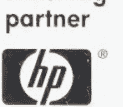


books.elsevier.com/digitalpress


