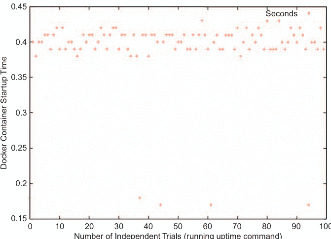
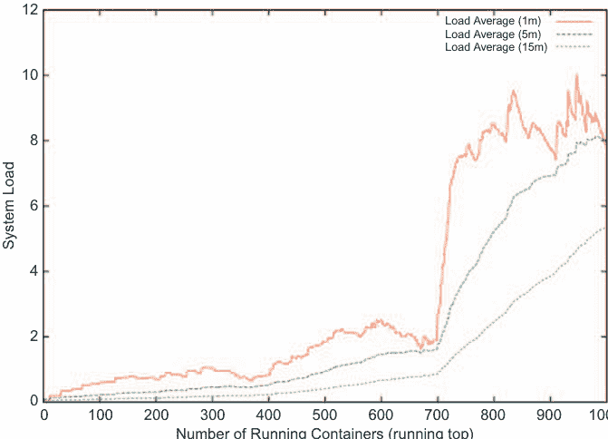
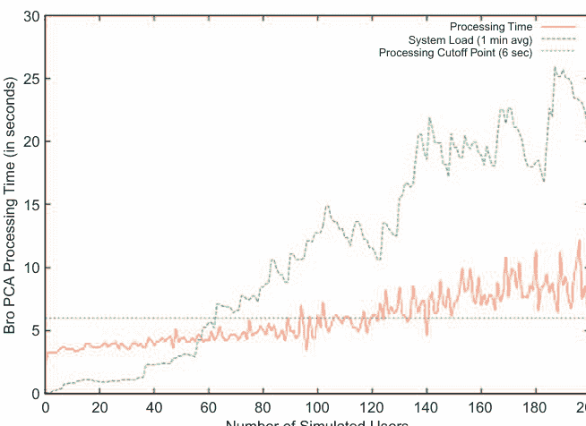
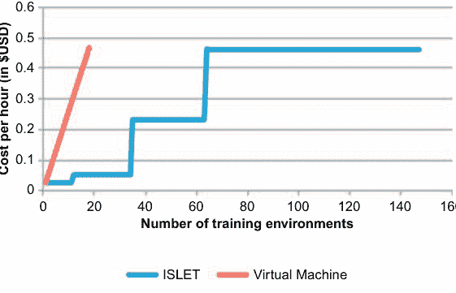
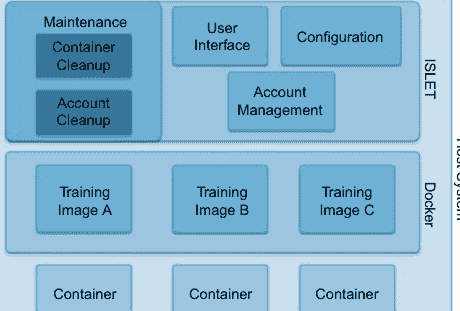

# 训练与开发的安全容器部署指南

## 关于作者

**Henry Dalziel** 是一位连续创业者、Concise Ltd 的创始人、网络安全博客作者，以及本系列书籍的作者。Concise Ltd 专注于网络安全培训课程的开发与发行。在空闲时间，他喜欢阅读历史和哲学，听重金属音乐以及打排排球。

**Jon Schipp** 担任伊利诺伊大学厄巴纳-盛槟分校高性能计算中心（NCSA）的安全工程师，同时也是 Dracony 的董事，这是一家专注于信息安全的安全咨询公司。此外，他还贡献了许多开源项目，包括 Netsniff-NG Toolkit、Security Onion 和 Bro Project。他是 OpenNSM 的创始人兼主席，这是一个国际参与的网络监控小组。

## 项目贡献

- Bro Team
- Netsniff-NG Toolkit

## 第一章 容器

### 我们的重点：

擅长 Linux 命令行软件

- 活动培训
- 内部软件培训
- 开发环境
- 尝试

容器通常用于部署应用程序和软件栈。例如，部署 WordPress、MySQL 等软件，或者在运行 Apache 或 NGINX 的容器中托管网站。可重复性和扩展性是使用容器的两个优势。你可以将容器理解为包含库、和服务应用程序本身的软件包。将你的应用程序及其所有依赖项封装在容器中，就可以将其部署到任何使用相同运行时引擎或容器规范的系统中。这种方式实现了可重复性，此外，当网络流量较高时，它可以轻松扩展，在系统需要升级时提供冗余。你只需要配置容器在多个系统上运行，并让负载均衡器重定向流量。Kubernetes、Docker Swarm 等工具可以轻松地跨主机扩展容器。虽然这些是典型的用法，但我们将探讨将容器用于软件开发和培训。

#### 隔离

通过内核命名空间 (`namespaces`) 和 `cgroups`

用户无法感知区别。

#### 可扩展性

通过更快的硬件进行水平和垂直扩展，意味着可以处理更多的用户或工作。

#### 轻量化

启动时间约 100ms，接近裸机性能，`JeOS`。

#### 密度

比虚拟机更高的密度

让我们继续描述什么是容器以及它们能提供什么。容器实现了隔离层，这是通过 Linux 内核的两个内核组件实现的：命名空间 (`namespaces`) 和 `cgroups`。命名空间将操作系统划分为虚拟段。例如，将一个进程分配给命名空间 A，它对于命名空间 B 中的进程是不可见且无法访问的，即使在不同的命名空间中运行 `ps` 命令也是如此。`cgroups` 是控制组（control groups）的缩写，可以对系统资源（如内存、CPU 使用百分比）应用约束或限制。

从我们的角度来看，与容器、虚拟机或裸机上的 Web 应用等软件交互，其行为和看起来是相同的。普通用户无法判断自己处于哪种系统，或者正在使用何种程度的虚拟化。

容器的可扩展性似乎非常容易实现，这是其极具前景的优势之一。你可以进行水平和垂直扩展。垂直扩展是通过向主机应用更多资源来实现：更多的 CPU、更多内存、更快的磁盘等。你也可以在虚拟机上这样做，任何软件都是如此……你可以为机器添加更多资源，然后通常可以执行更多任务。更有趣的是通过集群节点来运行容器以水平扩展的工具数量。Apache Mesos 项目就是一个例子，在容器中运行应用程序可以扩展到数百或数千台不同机器的池中。较新的工具包括 Google 的 `Kubernetes` 和 Docker 自己的 `Swarm`。

容器的大小往往很轻量，这使其适合扩展。`JeOS`（恰好操作系统，Just Enough Operating System）这一缩写说明了这一点，换句话说，可以说许多镜像都是精简的。这一证明是，使用 `Debian` 或 `Ubuntu` Docker 容器镜像并执行 `man` 命令查看帮助页时，shell 会返回 `command not found` 错误。这是因为没有安装 man-doc 软件包！它们的度量通常以百 MB 计，而你所安装的完整发行版通常要大得多。

容器共享运行在主机上的内核。这意味着只存在一个运行的内核，即 Linux 内核，并且它直接请求资源。应用程序可以请求它写入磁盘、跨网络发送数据包、从打开的文件读取，而不需要像虚拟机那样通过 Hypervisor 等其他层传递指令。这带给你性能提升，因为系统为内核请求（即系统调用）执行的工作更少。更少的指令和转换意味着更少的工作，结果容器的密度比虚拟机更高。这意味着在主机上运行的容器比使用虚拟机运行得多。在商用硬件上运行 1000 个容器并非未闻。

总而言之，容器中的应用程序运行速度通常比虚拟机中的程序更快。在适当条件下，用户可以获得接近裸机的性能，容器的启动时间通常小于一秒，而启动虚拟机时几秒是常态。

#### 安全

比虚拟机不安全，容器隔离的是用户态（例如文件系统、进程）而不是内核。

#### 可移植性

跨操作系统的可移植性较差。通常在操作系统内部具有可移植性。

#### 并发

某些实现设计用于运行单个应用程序或进程

#### 内核版本

容器必须使用与主机相同的内核

让我们深入研究安全、可移植性、并发和内核方面的其他一些差异。容器的安全性确实比虚拟机低。这并不是说它们不安全，而是它们比虚拟机不安全。这主要是因为容器隔离了它们的用户态（例如文件系统、进程等），而不是内核。虚拟机将隔离整个操作系统：内核、用户态以及一切。

在可移植性方面，容器跨操作系统的可移植性往往较差。注意，容器是名为轻量级操作系统虚拟化（也称为轻量级进程虚拟化）的虚拟化类型的子集。这些技术术语定义了一个允许操作系统在同一主机上运行多个实例的技术领域。不同的操作系统有不同的实现方式，而“容器”一词通常指的是 Linux 内核的实现。回到这一点，这意味着如果你在 GNU/Linux 上运行容器，它将无法在 FreeBSD 或 SmartOS 上运行。

### 容器

- **重要：基于 Linux 的容器**
  没有内部的容器规范。
  截至目前，有一个名为 `OCI` 的容器运行时规范。
- **有不同的容器（以及类似的）技术**
  Linux：`LXC`, `OpenVZ`, Google containers 等。
  非 Linux：`BSD Jails`, `Solaris Zones`, `AIX WPAR`。
- **容器是做什么的？**
  轻量级进程虚拟化，即操作系统虚拟化。
- **虚拟机是做什么的？**
  硬件虚拟化

这项技术并不新，但它现在正获得巨大的势头。关于术语的说明，当作为通用技术提到 Linux 容器时，使用更具包性的术语基于 Linux 的容器（Linux-based containers）更好。基于 Linux 的容器有很多运行时实现，例如 `LXC` 是 Linux containers 的缩写，这导致了混淆。此外，还没有内核容器规范，内核中有几个构建块供运行时实现利用以创建容器。尽管如此，近期有一项旨在标准化名为 `OCI`（开放容器倡议）容器运行时规范的努力；在 `OCI` 之前，CoreOS 组开发过一个名为 `Appsec` 的规范，该规范已被并入 `OCI`。`OCI` 是 Linux 基金的一个项目，其致力于提供一种规范：一套关于容器打包、部署和运行的指南和规则。某些工具遵循这一规范，而某些则不遵循。随着规范变得越来越成熟，更多的运行时实现将采用它。

GNU/Linux 提到有多种容器的实现。像 `Docker`、`LXC` 和 Rocket 这样的流行工具正受到关注。还有许多其他实现，包括较为人知的 `OpenVZ`，它使用由该项目维护的修改版 Linux 内核提供资源控制和调度。

在非 Linux 系统上，但在 UNIX 派生系统中，例如 BSD 家族；Solaris 有 Zones，AIX 有 Partitions，操作系统虚拟化技术并不新鲜，它已经存在很长时间了。FreeBSD 是最早的实现之一，于 2000 年发布，在出版时已是 15 年前。这项技术之所以现在才获得巨大的势头，是因为 GNU/Linux 操作系统的普及率很高，以及像 `Docker` 这样更好的运行时实现的出现，这使得系统管理员和开发人员创建和部署变得方便且可行。

将操作系统虚拟化与提供硬件虚拟化的虚拟机进行对比：虚拟机必须翻译硬件指令；它们担心总线等硬件，以及作为客户机调度器的软件。虚拟机程序是创建和管理虚拟机所需的额外软件层。尽管硬件虚拟化正在变得更好、更快，但容器根本不需要做那么多工作。一个简化的说明是：容器中的应用程序向内核发出系统调用，请求某种资源（例如打开文件进行读取），然后内核（与主机共享）返回系统调用的结果并继续执行。而在虚拟机中的应用程序情况下，它发出系统调用，客户机内的内核处理该调用，但需要与虚拟机程序通信，虚拟机程序才是硬件的真实管理器（文件位于磁盘上）。虚拟机程序为硬件进行翻译，为内核提供所需，客户机内核将结果返回给应用程序，应用程序即可继续运行。通常情况下你可以看到这是一个更长的代码路径，尽管随着时间的推移一直在不断改进。

#### Linux 内核相关

- **支持：** `3.8` 版本引入了容器的最终构建模块
- **命名空间 (Namespaces):** 进程隔离
  当前可用：`pid`, `net`, `ipc`, `uts`, `mnt` 和 `user`
- **控制组 (Control Groups):** 资源管理


`e.cpu`、`cpuset`、`ludzi`、`memory` 等。

- 这并不难事，你可以通过修改 `procfs` 和 `sysfs` 直接从 shell 创建命名空间和 `cgroups`。这就是在 `LXC` 和 `Docker` 等用户态工具出现之前的部署方式。

Linux 3.8 内核引入了可以说是目前最完整的容器构建模块。早期的 2.4.9 版本已经有了命名空间，随着时间的推移增加了更多，但不足以赋予我们现在拥的能力。我们之前讨论的两个构建模块是命名空间和控制组。命名空间提供了一种隔离资源的方法。内核目前提供了 6 个命名空间，包括：`PID`、`Network`、`IPC`、`UTS` 和 `User`。用户命名空间通过将容器内的 root 等用户映射到它们中的一个新用户增加了额外的安全性，但在本文写作时，它尚未在所有运行时中都实现。以下是 `PID` 命名空间的示例：进程 Z 被分配给命名空间 A，进程 Y 被分配给命名空间 B。用户进入命名空间 A 并运行 `top`，看到的是进程 Z；相应地，用户进入命名空间 B 并运行 `top`，只能看到进程 Y。`root` 进入命名空间 A 或 B 并运行 `top` 也是如此。尽管如此，如果不在全局命名空间，`root` 用户也可以看到进程 Z 正在命名空间 A 中运行，而进程 Y 正在命名空间 B 中运行。你可以看到 `PID` 命名空间有效地隔离了操作系统的视图。请注意，命名空间没有名称，而是有 inode 号，分配字母是为了简化表达式。另一个示例包括网络命名空间，它允许每个容器都有自己的网络接口和 IP 地址，以便向运行在命名空间 A 中的 `Apache` 进程的 URL 请求，并从运行在命名空间 B 中的不同 URL 的 `Apache` 进程处获取完全不同的网站。除非配置，命名空间 A 中的 `Apache` 和 B 中的 `Apache` 无法通信。

控制组为容器提供了一层资源管理或控制。例如内存利用率或分配给容器的内存量，以及限制容器提供的磁盘读写吞吐量。`CPU` 限制（如每个容器的共享和配额值）允许对容器中的进程或整个容器进行优先级排序。总之，命名空间和 `cgroups` 结合使用形成了我们所知的容器。

人们可以使用 `clone(2)` 系统调用创建自己的命名空间。可以通过挂载伪 `cgroup` 文件系统并与其文件交互，直接从 shell 创建 `cgroups`。

### Linux 容器？

`Docker` 普及了这项技术。它实际上已经存在 7 年了。


- 自动化部署 Linux 容器
- 提供多层抽象
- 多种创建方法
- 用于共享的 Docker hub 和注册表

容器的使用正变得越来越流行，因为有了更好的方法来创建它们。可以说 `Docker Inc.`（前身为 `dotCloud`）极大地激发了人们贡献、关注和利用容器的巨大欲望。`Docker`（后更名为 `Docker Engine`）实现了 Linux 容器的自动化部署。提供的表格显示了 Google Trends 的搜索词，这是流行程度的良好指标。你可以看到在2013 年左右我们有了近乎线性的增长，因为 `Docker` 是在2013 年 3 月作为开源项目发布的。我预计，随着其他人改进他们的系统并找到容器的用例，采用和增长将持续。

### 研究时刻

“通常情况下，在我们测试的每种情况下，`Docker` 的性能都等同或超过了 `KVM`。”

- IBM 研究报告：虚拟机与 Linux 容器的更新后的性能对比 (`http://domino.research.ibm.com/library/cyberberg.nsfipapers/0299052195DD819C85257D2300681E7/$File/rc25482.pdf`)

为了证实之前提出的某些性能声明，有一些研究，其中一个由 IBM 指出的标题为“虚拟机与 Linux 容器的更新后的性能对比”。在该报告中，你会发现结论是：`KVM` 是代表虚拟机的虚拟机虚拟机程序，而 `Docker` 是实现容器的运行时。使用 `Redis`、`MySQL`、`netperf` 和 `LZMA` 等应用程序进行了磁盘、内存、`CPU` 和网络实验。我强烈建议阅读该报告（网上免费提供）获取更多信息。

### 容器安全

- 可以禁用网络
- 不要以 root 身份运行进程
- 遵循标准文件系统规则保护数据
- 控制 `CPU` 和 `RAM` 分配
- `Devicemapper` 后端可以限制磁盘空间
- 通过 `ulimit` 对 `Docker` 进程进行更精细的环境控制：`fsize`、`nproc` 等
- 保持容器包更新

在容器中运行重要服务时，深度防御策略是最好的。我的意思是加固整个环境，从你所保护的软件的边界到核心。边界可能是网络或操作系统，而核心可能是应用程序本身。通常情况下，你对容器应用与任何运行系统应用相同的安全原则，例如最小权限原则。不过，在使用容器时，有几点需要注意。有一些需要遵循的指南：如果不需要网络，则禁用网络；如果没有外部连接到该服务，就不要运行网络服务。不要为容器添加接口，这在培训和开发中很常见。你可能并没有在开发网络应用程序，因此不需要网络。良好的安全实践是除非需要，否则不要在系统中以 `root` 身份运行进程；同样的规则适用于在容器内以 `root` 身份运行进程。例如，`Apache` 应该作为无权用户运行。遵循标准的文件系统访问控制来保护你的数据。对文件应用权限、挂载选项和 `ACL`（访问控制列表）可以有效减少攻击面。使用控制组（`control groups`）防止系统资源遭受 `DoS`（拒绝服务）攻击至关重要。应该进行控制，使得容器中的失控进程无法导致整个系统崩溃。`Docker Engine` 支持多种后端，例如 `devicemapper`，可以用于限制容器的文件系统大小。此外，通过 `ulimit` 和 `pam_limits` 提供了细粒度的用户和进程环境控制，可以应用于进程以执行如限制运行进程数量以及设置文件大小上限等操作。

保持你的容器包更新非常重要。如果你要部署一个新服务，你应该登录容器并升级所有包，因为基础镜像不会保持最新的补丁。你还应该保持你的容器运行时程序以及操作系统的更新。内核或 `Docker Engine` 的漏洞可能导致在被攻破时能够逃逸。请注意，过去出现过 `Docker Engine` 漏洞。

### 主机安全

- `grsecurity` 补丁
- 使用 `SELinux` 和 `Apparmor` 进行详细访问控制
- `iptables` 速率限制以防止过量连接
- 最小权限用户，利用用户命名空间（即将到来！）
- 运行如 `OSSEC` 这样的 `HIDS`（主机入侵检测系统）
- 保持主机更新

可以通过应用 `GR` 和 `PAX` 补丁来进一步加强操作系统的安全，通过改进的 `ASLR`（自动堆栈布局随机化）范围来加固内核，并提供强制性访问控制。还应该利用通过 `SELinux` 和 `App Armor` 策略提供的访问控制策略。例如，如果你使用的是封装版本的 `Docker Engine`，你的系统已经启用了访问控制策略，但你可以更进一步地创建容器规则。在主机上为网络应用使用 `iptables` 是至关重要的。应该启用从限制服务访问到对 `Dos` 攻击进行速率限制的各种规则。在支持的情况下利用用户命名空间来进一步减少攻击面。最小权限用户可以运行容器，这样容器内的 `root` 就不等同于容器外的 `root`。最后，不能仅仅依赖防御，因为无法预见未来所有的攻击。鉴于这一事实，具备检测和包含违规的能力同样重要。像 `Bro` 这样强大的网络监控系统可以记录所有网络活动，并在配置允许的情况下对其做出反应。更重要的是，主机上如 `OSSEC` 这样的主机入侵检测系统应该执行日志分析，并监控文件系统的变化和 `rootkit`。当这些或大部分措施被共同实施时，将提供针对攻击的强大防御。

# 第 2 章

在培训中使用容器

## 问题 1. 培训

IT 培训并非易事

既然我们已经涵盖了主要的概念、实现和安全实践，我们将介绍用于培训和开发的用例。我们首先处理用容器解决 IT 培训问题。IT 培训问题的总结是，为基于软件的培训创建和部署培训环境相当困难且耗时。我参加过许多涵盖并行编程、网络安全监控、恶意软件分析以及各种语言编程等主题的培训活动，我发现培训的一种常用方法是分发虚拟机。这通常在活动开始前通过下载链接完成，或者在活动期间通过 `USB` 闪盘等介质进行分发。这两种方法对用户和培训提供者来说都是很麻烦的。对于用户来说，他们必须花宝贵的时间下载磁盘镜像（这些镜像可能有几个 GB 大），而且可用的软件通常是一个虚拟机监控程序。这个大型软件被用来运行虚拟机，然后就会出现虚拟机监控程序兼容性的问题，例如，它是否是可以在 Oracle 的 `VirtualBox` 或 `VMware/Fusion` 等上运行的镜像。我曾见证过为了给会议参与者分发一个磁盘镜像而花费了一个多小时，这导致了用户培训时间的损失。一旦磁盘镜像在工作站上随处可见，会有几个用户在运行镜像时遇到问题。我曾见证过网络和总线配置中的错误配置。这些问题往往会导致学生落后于小组中的其他人，特别是当工作人员无法提供协助时。活动的网络基础设施通常很慢或饱和，这种情况发生的频率比你想象的要多。它阻止或延长了磁盘镜像、培训材料或在线资源的传输。场馆设备无法容纳如此数量的学生或他们在无线网络上的流量习惯。


培训材料的分发也可能出现问题。培训材料中的错误会导致其不完整，直到在培训期间需要时才被察觉。如果有错误，我脑海中最好的方案是学生可以快速获得新更新的材料。将材料打包在虚拟机中是不可行的。但如果网络可靠，将它们放在网络可访问的存储库或网站上是有效的。

账户管理是我想要提出的最后一个关注点。在访问需要账户凭据来验证用户的资源时，这是一个关注的问题。管理员必须为学生创建并分发这些凭据，理想情况下以自动方式进行，否则将是一项耗时且枯燥的工作。这在虚拟机培训中问题不大，但在提供我所说的“共享托管培训”的环境中就会出现。共享主机是一个用户使用自己的账户远程交互以进行培训的系统。最常见的例子是使用 `SSH` 访问类 Unix 系统。账户用户名和密码必须分发给每个用户。我曾在现场看到这种情况，通过在房间里传阅写有每个学生凭据的纸条。

### 常见的 IT 培训类型

1. 共享系统培训（多个账户）
2. 虚拟机培训（每个学生一个虚拟机）
3. 容器培训（每个学生一个容器）
4. 基于 Web 的培训

在讨论解决方案之前，我想介绍我见过的不同培训环境。第一是上述的共享系统培训，单台服务器为多个用户提供访问。如果你要培训 100 个用户，系统中就有相应数量的账户。如 `SSH` 等远程访问工具会将用户连接到系统。这种类型培训的不便之处在于账户的创建和分发，以及缺乏对用户足够的隔离。

第二种培训类型是虚拟机培训。这是我见过的最常见的。我参加过许多会议，他们依赖于给所有参与者分发虚拟机磁盘镜像。这类培训的主要问题是分发、软件依赖、软件兼容性和硬件资源。由于虚拟机监控程序是消耗资源的大型软件，因此实际上禁止使用平板电脑和手机等移动设备。一个优点是用户被允许保留该虚拟机。这允许他们在未来的任何时候都能在该环境中工作。在某些情况下，例如进行内核工作、管理网络配置和实现网络服务，虚拟机是最佳解决方案。

此外，还有使用操作系统虚拟化技术（如我们讨论的 Linux 容器）进行培训的情况。这是我探索过并发现非常有用的培训媒介。对于这种类型，我们在单台主机上为每个学生分配一个容器。用户登录主机并被放置在他们自己的容器中，从那里他们与一个隔离但全功能的环境进行交互。

最后，我们有基于 Web 的培训。基于 Web 的培训是一种提供某种嵌入网页的交互式软件（如 shell 或解释器）的方法。`Go` 编程语言在他们的网站上有一个在线教程，允许你尝试该语言。同样，`Bro` 项目有 `try.org`，人们可以在那里编写代码并直接在网络浏览器中返回结果。但基于 Web 的培训方法通常限于完成简短的临时任务，并仅提供软件功能的子集。需要让学生沉浸在需要使用多种软件并协同工作的环境中的培训师，应该考虑其他培训类型。

### 目标

> 管理员：创建一个非常易于安装、部署和配置的工具
> 
> 用户：设计一个直观的界面和流畅的培训体验，且对硬件有最低要求。

目前常见的培训问题已经得到解决，并对培训类型进行了概述。现在，我将提供一种可以解决上述某些问题的解决方案。我们需要一种对于管理员来说易于安装、部署和配置，而对于学生来说易于使用的工具。由于开发培训材料和设置活动是一项巨大的工作，需要耗费几天、几周甚至更久，因此理想的情况是快速高效地部署培训环境，将大部分工作集中在准备和内容制作上。从学生的角度来看，另一个目标是设计一个直观的界面，以最低的要求为用户提供流畅的培训体验。

| ISLET：一个基于 Linux 的软件培训系统 |
| :--- |
| 用于 (T)培训的 (I)隔离、(S)可扩展的且 (L)轻量级 (E)环境 |
| Web 端: `https://github.com/jonshipping/islet` |
| 按任意键继续或按 `CTRL+C` 退出... |

### 用于培训的隔离、可扩展且轻量级环境

这是一个用于基于 Linux 软件教学的容器系统，参与成本极低。参与门槛设置得非常低，学生只需要一个 `SSH` 客户端。

`ISLET` (Isolated Scalable and Lightweight Environment for Training，用于培训的隔离、可扩展且轻量级环境，*注：此处英文缩写对应关系已调整**) 是我写的一个工具，它利用 `Docker` 快速提供各种可用于培训活动的培训环境。它简化了流程，并且是 Github 上可获取的 FOSS（自由开源软件）。

### 在培训中使用容器

### ISLET 如何解决这些批评？

首先，参与度非常低，用户只需要一个如 `SSH` 客户端这样的远程访问工具。`OpenSSH` 是一个跨平台工具，可在服务器、智能手机、平板电脑上运行并受到许多操作系统的支持。因此，学生不再被局限于某个依赖虚拟化程序的工作站，结果硬件的选择范围大得多。其次，回想共享系统培训在用户账户管理方面的问题。为学生分发用户名和密码对培训人员来说可能是一件苦事。`ISLET` 允许用户创建并管理自己的账户。只共享一个账户，用于允许用户远程访问 `ISLET` 服务器。这通常可以像 SSID 和无线密码一样显示给所有学生。每个学生都将使用它连接到系统并进入 `ISLET` 软件，在其中创建自己的 `ISLET` 账户，并立即获得培训环境的访问。从用户的角度来看，只需要几秒钟进入可以开始工作的培训环境。从培训人员的角度来看，只需要在主机上创建一个账户。总之，消除了大部分关于账户管理的工作。此外，通过将包含材料的主机目录挂载到容器中，可以轻松地更新培训材料。在主机上更新或修正材料，用户可以立即使用。

接下来，我们将解决等待虚拟机启动和必须配置它们的问题。`ISLET` 通知 `Docker` 创建包含学生将学习软件的容器。这可以是从 `GCC`（GNU C 编译器）到 `IDS`（入侵检测系统）的任何内容。事实上，几乎任何可以在 GNU/Linux 系统上安装和运行的内容，都可以封装到 `Docker` 镜像中。从 `ISLET` 菜单中，用户就可以想要进入的培训环境进行选择。培训人员如果愿意，可以提供多个选项。针对不同的主题可以使用带有不同软件的环境，而不是使用包含所有工具的大型镜像。一旦选择了培训环境，用户可以在不到一秒的时间内开始工作，它是瞬时完成的。从初始连接到 `ISLET` 系统到进入培训环境可以在 30 秒内完成。面对这种时间，很难感到焦急，学生有更多的时间专注于学习，而不必担心他的虚拟机是否会启动。此外，`ISLET` 对学生来说是不需要配置的；配置由培训人员提供。这减少了某些学生因技术困难而落后于他人的可能性，每个人都在服务器上使用相同的配置。结果减少了压力和挫败感，提高了学生的整体培训体验。

下一个要解决的问题是基于 Web 培训的常见问题。提供的软件环境通常是有限的或针对特定任务的临时。`ISLET` 并不是提供一个简化的解释器，而是赋予用户具有标准 Unix 工具集的完整文件系统的权限和灵活性，学生在 `Bash` 等命令解释器中工作。学生不仅可以编写代码，还可以探索目录结构、系统文档，并利用系统上提供的强大工具来配合和增强所学习的软件。`ISLET` 擅长基于命令行培训。

最后，`ISLET` 使用的 `Docker` 引擎提供了反馈循环的来源。标准输出和错误的日志（其中包含了学生执行的命令）可供审查。培训人员可以发现学生犯的错误，并在此基础上通过将信息整合回课程来改进培训。例如，如果许多学生在代码或执行命令时犯了同样的错误，可能可以通过更好的解释或改进的指令在下次避免。老师可能没有像他们所能那样解释清楚，这就是为什么用户会犯错。

## 真实世界用例：

- 在 `BroCon 14` 发布了前身版本。用于教授 `Bro` 脚本，约 50 名用户同时在低端 (`m3.xlarge`) `EC2` 虚拟机上拥有 `Bro` 和 Unix 工具的 shell 访问 - 毫无问题。
- 伊利诺伊大学数字取证 2 课程。
- `FlowCon`，数百用户。
- 在 `UIUC` 的会议上教授 Linux 工具。

名为 `BroLive` 的 `ISLET` 前身（也称为 `Bro` sandbox）已发布。这是一个旨在展示更好的培训方式的测试版本。它是为了解决我们提到的早期 `Bro` 活动的问题而开发的。`BroLive` 用于教学 `Bro` 脚本并使用标准工具集（如 `grep`, `awk` 等）进行分析。我们有大约 50 名用户同时在容器中使用 `Bro`。容器内安装了用于分析 `Bro` 输出的各种工具。机器托管在 Amazon 基础设施上的低端 `EC2` 虚拟机上。它的首次运行效果相当不错，并解决了它旨在解决的问题。

协议日志。注意，`Bro` 进程执行了大量工作，它既是 CPU 密集型的，大量的内存来维护 TCP 等协议的状态。它在连接上挂载各种分析器，将网络流量解码到应用层，并产生结果的可读性日志。

### 容器启动



我们在对 `Docker Engine` 和 `ISLET` 训练软件进行评估时，进行了多项实验。首先，我们对容器的启动时间感到好奇。例如，`CoreOS` 网站上提到容器在毫秒内启动，但我们没有看到这一说法得到证实，因此我们自己进行了测试。我们进行了多次独立实验，每次实验运行 100 个容器，每个容器运行 `uptime` 命令并退出。我们发现，创建容器、执行 `uptime` 程序然后退出容器需要约 400 毫秒。这就是我们系统中容器启动速度的快慢。容器的创建时间非常快，大部分时间实际上都花在了运行应用程序上。

### 容器并发




我们还测试了容器的并发性。我们之前提到密度，即主机上可以运行多少个容器。我们很容易在 16 核主机上同时执行 1000 个容器，每个容器运行 `top` 程序，而不会使系统饱和。这些容器都是并发运行的。想象一下一千个每个运行 `top` 的虚拟机的开销。在相同大小的单主机上扩展这种规模要困难得多。看一眼“系统负载与运行中容器数量”图表上的负载平均值，你可以发现它的扩展性非常好，直到我们一次性运行超过 700 个容器，导致负载平均值出现巨大的峰值。这可以进一步调查以找到原因。

### 模拟训练

- 指标：训练程序的响应/执行时间
  - 标准时间：平均 2.13 秒
  - 截止点：6 秒（等待时间太长了）
- 我们使用 Bro 网络安全监控器作为测试对象。处理了一个用于训练 Bro 事件的网络跟踪文件。Bro 是一个执行大量工作的进程。
- 为环境中的暂停和常用命令引入了小的随机延迟——循环了 20 次。最终模拟了约 10 分钟的高用户活跃度

我们的下一个实验是进行模拟训练测试，目标是找到有多少用户可以同时使用 Bro 进行训练。我们的指标是 Bro 处理网络跟踪文件所需的执行时间。被训练软件的执行时间衡量了我们系统在训练期间的性能。如果执行时间增加到影响用户训练能力（由于不耐烦日益增加）的程度，我们需要为计算机分配更多资源。我们让 Bro 通过网络跟踪文件运行了 100 次，是平均值的 3 倍，这是我们的截止点，即我们需要添加更多资源或不允许更多用户加入的点。为了在我们的系统中找到截止点，我们模拟了 Bro 训练课程中常用的命令。执行了生成和分析 Bro 日志等任务。创建了 10 分钟模拟但活跃的用户活动。我们模拟了一个过度活跃的用户，这种用户并不能代表典型的学生：例如，一个训练活动用户执行培训师提供的指令。在听取指令和执行指令之间存在延迟。这意味着任务之间会有暂停，例如听取解释。我们在命令之间模拟了几秒钟的暂停，但并不会代表有讲座的课程，因为很难衡量演讲期间暂停的长度，而且我们没有过去会议的可用数据。

### 模拟数据



我们在提供的图表中绘制了结果。x 轴上的虚线是处理用户的时间。实线代表每个模拟用户在系统上活跃工作的执行时间。随着训练人数的增加，执行时间会增加，因为系统必须并发运行多个模拟。如果执行时间交叉并超过该系统的截止点值，则系统需要更多资源，因为运行 Bro 花了 6 秒或更长时间。当我们达到 150 个用户时，执行时间完全（包括波谷）上升到截止点之上。这告诉我们，在我们的由 16 个 CPU 核心和 32GB 内存组成的主机上，我们可以训练少于 150 个用户，而不会产生可以忽略的影响。

### 成本比较



我们进行了成本比较，即 Amazon AWS 上每个 VM 分配一个用户与一个主机上每个用户一个容器的对比。你可以看到虚拟机的成本呈线性增长，随着用户的增加，每小时的成本也会上升。而在 ISLET 的情况下，每个容器一个用户，它是阶梯式增长的。记住，每个训练环境有一个用户，而训练环境要么是容器或虚拟机。对于 ISLET，你可以看到我们阶梯式的增长，实际上你可以拥有多个训练环境，其成本比使用一个虚拟机要低。

### 平台

- 为 Linux 设计
- 为 Linux 设计
- 为 Linux 设计
- 为 Linux 设计

现在我们来谈论如何部署和配置 ISLET。

### 在训练中使用容器

使用容器的要求如下：
- 为 Linux 设计
- 为 Linux 设计
- 为 Linux 设计
- 为 Linux 设计

使用容器的要求如下：
- 为 Linux 设计
- 为 Linux 设计
- 为 Linux 设计
- 为 Linux 设计

使用容器的要求如下：
- 为 Linux 设计
- 为 Linux 设计
- 为 Linux 设计
- 为 Linux 设计

使用容器的要求如下：
- 为 Linux 设计
- 为 Linux 设计
- 为 Linux 设计
- 为 Linux 设计

使用容器的要求如下：
- 为 Linux 设计
- 为 Linux 设计
- 为 Linux 设计
- 为 Linux 设计

使用容器的要求如下：
- 为 Linux 设计
- 为 Linux 设计
- 为 Linux 设计
- 为 Linux 设计

使用容器的要求如下：
- 为 Linux 设计
- 为 Linux 设计
- 为 Linux 设计
- 为 Linux 设计

使用容器的要求如下：
- 为 Linux 设计
- 为 Linux 设计
- 为 Linux 设计
- 为 Linux 设计

使用容器的要求如下：
- 为 Linux 设计
- 为 Linux 设计
- 为 Linux 设计
- 为 Linux 设计

使用容器的要求如下：
- 为 Linux 设计
- 为 Linux 设计
- 为 Linux 设计
- 为 Linux 设计

使用容器的要求如下：
- 为 Linux 设计
- 为 Linux 设计
- 为 Linux 设计
- 为 Linux 设计

使用容器的要求如下：
- 为 Linux 设计
- 为 Linux 设计
- 为 Linux 设计
- 为 Linux 设计

### 架构



ISLET 的架构如下所示。你有运行它的主机系统，下一个较大的框显示了 ISLET 的组件。它具有帐户管理器、清理、容器配置和用户界面。它包含了许多清理和维护帐户的脚本。例如，跨越 3 天的训练活动可以自动清理容器和用户信息。中间和下方的框是 ISLET 利用 Docker 从镜像启动容器的地方。这些 Docker 镜像包含了用于训练的软件包工具。

### 配置与工作流

- 全局：配置文件 `/etc/islet/islet.conf`
- 每个镜像：每个镜像一个配置文件 `/etc/islet/*.conf`
- 创建新的训练环境（3）
  1. 构建训练软件的 Docker 镜像
  2. 创建配置文件并指向新镜像
  3. 放入 `/etc/islet/` 例如 `new_image.conf`

创建和部署新的训练环境是一个简单的三步过程。第一步是构建训练软件的 Docker 镜像。第二步是创建一个指向该 Docker 镜像的 ISLET 配置文件，最后一步是将文件放入 `/etc/islet/` 目录。一旦完成，用户下次连接到 ISLET 软件时，就可以立即使用该新镜像。这非常快，是基础的三步过程。

### 路线图：

- 支持其他容器运行时（lxc, openvz, jails 等）
- 审计、渗透测试
- 改进构建系统
- 使用 Go Lang 或 Python 通过容器 API 重写
- 导出容器和练习
  1) 用户可以像使用虚拟机训练一样保存他们的工作或在家里继续
- 扩展性测试，支持 1000+ 容器，分布式部署

(MOOC) 如果拥有成千上万的用户那将是不可思议的。这可以通过分布式架构来实现。

### 轻松贡献

```
$ git clone https://github.com/jonschipp/vagrant
$ cd vagrant/islet && vagrant up
$ ssh -p 2222 demo@127.0.0.1 -o UserKnownHostsFile=/dev/null
```

如果你想为 ISLET 贡献代码，非常简单，你只需要克隆仓库并提交补丁（patch）或拉取请求（pull request）。此外，还有一个 Vagrantfile 可为 ISLET 设置开发环境。

# 第 3 章

## 实验

## 问题 2. 实验

### 对比与研究


# 容器的另一个用途：开发和研究

我们的下一节将讨论容器的另一个用途：用于开发和研究。我们希望能够在特定领域内进行实验。`NSM`（网络安全监控）是我非常感兴趣的一个领域，它主要关注分析工具产生的结果。`GNU/Linux`系统上有许多`NSM`工具。出现的一个问题是，对于工具如何生成用于取证调查的网络流量结果，并没有标准。例如，通过`Httpry`或`PassiveDNS`处理追踪文件，与通过`Bro`处理相比，在`HTTP`和`DNS`协议方面会产生不同的结果。前者从单个数据包解析应用程序信息，但无法跨多个数据包（数据碎片可能存在于多个包中并在接收主机处合并）。`Bro`可以，因为它保持状态并理解协议。`Bro`比解析单个数据包的工具具有更准确的信息。能够快速测试和实验许多工具以及不同的输入，对于寻找合适的工具以及发现改进领域非常有。

`OpenNSM`（开放网络安全监控小组）有一个正在进行的项目，旨在将各种版本的`NSM`工具（主版本和次版本）打包并使它们易于获取。能够以自动化的方式针对某个工具的3个版本和另一个工具的4个版本运行攻击网络追踪文件进行对比和结果验证是非常及时的。人们可以拥有多个参考点，并对样本获得第二或第三意见。该项目还可以用于分析性能和对工具进行实验。直到现在，还没有简单的方法来组织和执行。你可能在系统中拥有1000个用于不同工具和版本的`Debian`包或`RPM`包，这将是组织和依赖关系的噩梦。似乎将所有内容包含并隔离在一个环境中，让它们拥有自己的文件系统和库等，会更加高效且有利于组织。这允许我们在不受干扰的情况下使用和重现软件。

## 有用的实验类型

- 1. 软件及其版本的比较
- 2. 调试与开发
- 3. 性能分析
- 4. 研究

通过将所有工具都准备在容器中，可以弄清楚这些工具是如何工作的以及如何改进它们。当你进入容器时，运行你的工具，分析结果，并进行更改、重复，且结果是包含且可重现的。用户不再需要寻找、编译、安装和打包工具，我们提前完成了这些艰性工作。

### 目标

> 软件：提供带有不同软件版本标记的可重现镜像
> 应用程序：用于实验、研究和比较各种软件

我们雄心勃勃的目标是包含我们能获得的每一个免费开源的网络安全监控工具，以及我们能获得的每一个主版本或次版本发布。将它们打包成`Docker`镜像，让任何人——研究人员、分析师、开发者都可以下载并进行测试、调试和开发。我希望通过让获取和使用`NSM`软件变得更容易，随着时间的推移改进这些工具。

### ContainNSM

一个为所有可用的免费和开源网络监控工具创建`Docker`镜像的项目，用于评估、培训和学习。发布带有主次版本标记的镜像。

该项目名为`ContainNSM`，在线地址为`https://github.com/open-nsm/containnsm`。我们目前有超过100个镜像，包括`Bro`、`Snort`、`Suricata`、`Tshark`、`Tcpdump`等。此外，我们还编写了一个名为`/containnsm`的命令行工具来高效地管理和利用这些镜像。

## 现实用例

- 创建了`Bro`所有可用版本的镜像。

```
for i in $(docker images -f "label=program-bro") do docker run -it $i bro --version; done
bro version 2.4
bro version 2.3
bro version 2.2
bro version 2.3.2
bro version 2.3.1
bro version 2.1
bro version 1.5
```

- 提供100多个镜像用于`NSM`工具，如`Snort`、`Suricata`、`Tcpdump`、`Tshark`等。

在宿主机上，当工具在容器中执行完成后，我们执行常见任务。

- 1. 由容器中的工具读取宿主机上的网络追踪文件并在宿主机上显示结果
- 2. 使用工具在容器的虚拟网络接口上监听并在宿主机上显示结果
- 3. 从容器在宿主机的物理接口上监听并将结果写入宿主机

为了进行简要查看，我为从1.5到2.4的多个不同`Bro`版本创建了`Docker`镜像。我们可以遍历每个版本的`Bro`容器并执行诸如策略之类的任务。镜像展示了运行`Bro`并打印不同版本的简洁示例。

### 路线图

- 开发用于管理和利用镜像的命令行工具
- 传递和配置各种输入和输出，例如`PCAP`、日志
- 用户贡献的应用程序配置

未来包括为工具提供用户贡献的配置，以及支持多个输入和输出设置。该项目非常容易贡献，目录结构简单易懂。我们认为这将是一个非常有力的参考，允许领域内的安全分析师和研究人员更快更高效地完成工作。在我们探讨了容器在不常用用途方面的用法之后，希望这能引发你思考其他可以利用该技术解决的可能性和问题。
