# 在 PC 和树莓派上设计你自己的嵌入式 Linux 控制中心

在涉及旧 CPU（就我而言是 Pentium II）时，`DSL` 仍然是我最喜欢的 Linux OS。我运行的 Pentium II 版本是 Klamath Pentium II 微处理器（300 MHz 版本），于 1997 年推出。你可以建立一个相当不错的运行系统，但你确实应该尝试获取更新的硬件平台，以便使用更现代的 Linux 版本。

尽管关于 `DSL` 的所有动态已经安静了一些，但它依然活着，可以在这里找到：

`http://damnsmalllinux.org/`

## 2.3 适用于 Raspberry PI 的 Debian

如果你想要一个体积非常小且功耗高效的 ELCC，你应该使用 Raspberry Pi。显然，使用 Raspberry PI 并没有太多回收旧硬件的意义，但它会给你一个非常强大且优秀的平台。

为了在购买之前确保万无一失，你可以通过阅读本书中关于 Lubuntu 的章节，来感受你能实现的功能。

对于运行在 Raspberry Pi 上的 ELCC，我选择了 Debian Linux 发行版。

Raspberry PI 的主页可以在这里找到：

`http://www.raspberrypi.org/`

## 2.4 适用于较新硬件的 Lubuntu

Lubuntu Linux 是一个基于 Ubuntu 的轻量级 Linux OS。它选择了 LXDE 桌面环境，而不是 Ubuntu Unity shell 和 GNOME 桌面。

LXDE 更轻量，对资源的占用更少，且更节能，这正是我所追求的。请记住，你必须小心选择版本。这也是为什么本节比前两节稍长一些的原因。

我使用的是 Lubuntu 10.04，因为它仍然支持以下 CPU：

- I586
- VIA C3（我有一台使用该 CPU 的旧硬件）
- AMD K6
- AMD Geode/National semiconductor

遗憾的是，Lubuntu 10.04 的支持在 2013 年 4 月结束。

一如既往，Wikipedia 上有大量关于 Lubuntu 的信息：

`http://en.wikipedia.org/wiki/Lubuntu`

Lubuntu 的官方主页是：

`http://lubuntu.net/`

当前的（最新的）Lubuntu 版本可以在这里找到：

`https://help.ubuntu.com/community/Lubuntu/GetLubuntu`

最后，所有之前的发行版本都可以在这里找到：

`https://help.ubuntu.com/community/Lubuntu/PreviousReleases`

如果你想获取旧版本，最后一个链接可能会很有用。该链接还描述了每个 Lubuntu 版本的硬件变更。

如果你想尝试使用 Lubuntu 10.04 版本，可以在这里找到：

`http://phillw.nl/isos/lubuntu/lucid/`

如前所述，为你的硬件选择正确的软件版本可能有些棘手。在找到正确版本之前，你可能需要尝试多个版本。目前，除了 Lubuntu 主页上提供的信息外，我无法给出更好的指南。

当我单独提到 Lubuntu 时，将使用 Lubuntu 10.04 版本。它将运行在 Intel Celeron 2.6 GHz CPU 上。

## 2.5 连接到控制中心的硬件

下表显示了可能的硬件配置。并非所有组合都经过我的验证。

| Linux 版本 | 并口 I/O | Arduino I/O | Raspberry I/O | 视频流 (spcagserv 和 spcaview) | 视频流 (mjpg_streamer) | 短信网关 | 温度测量 (Elektor Thermo-snake) | 温度测量 (RPI 安装) |
| :--- | :---: | :---: | :---: | :---: | :---: | :---: | :---: | :---: |
| DSL (带并口) | a) | | | | | b) | | |
| DSL (带 USB 口) | | c) | | d) | e) | b) | f) | |
| Lubuntu (带并口) | a) | | | | | b) | | |
| Lubuntu (带 USB) | | c) | | | e) | b) | f) | |
| Debian (RPI) | | c) | g) | | e) | b) | f) | h) |

描述/解释：

🔘 : 无效组合。

a): 参考 6.1.1 节的描述。

**注意：** 这尚未在 Lubuntu 发行版上验证，但没有迹象表明它不能工作。

b): 参考 6.5 节的描述。在本书描述的所有 Linux 版本上，应该都可以构建短信网关。6.5.1 节指出了将手机连接到硬件需要执行的操作。

**注意：** 并非所有组合都能在所有版本的 ELCC 上实现。

c): 参考 6.1.2 节的描述。

**注意：** 与 Arduino 板接口需要在 ELCC 上具备 USB 接口。

d): 参考 6.6 节的描述。

**注意：** 这仅在 DSL Linux 发行版上进行了验证，因为在更现代的 Linux 发行版上尝试它没有意义。

e): 参考 6.7 节的描述。

**注意：** 这尚未在 DSL 上测试——且预计无法工作。

f): 参考 6.3.1 节的描述。

g): 参考 6.1.3 节的描述。

h): 参考 6.3.2 节的描述。

## 3. DSL：安装与配置控制中心

让我先描述一下我实际使用的硬件。

目前，我使用三种类型的 PC 来进行 DSL 安装。其中两种将在此描述，第三种（较大的那台）稍后描述。

第一台是一台相当旧的普通 PC，规格如下：

- CPU: Pentium II-MMX 300MHz
- RAM: 393216 byte
- BIOS: Award plug&play (2000/08/21)
- 硬盘: 1.2GByte (Western Digital)
- 网卡: 无品牌 100Mbit 卡
- 显示适配器: S3Trio，带 8Mbyte RAM
- CD-ROM 驱动器: 无品牌 44x.

上述主板是 MicroStar 的 MS6119 ver. 1.1 BX2。更多信息可见参考资料 [6]。当你进行此类项目时，拥有文档齐全的硬件会很方便，但这并非必需。

因为我原来的机箱太大了，我重新排列了部件，使其能够放入我的办公桌内。我想通过这样做表明，如果你不喜欢你的机箱，你可以重新布置它，或者买一个更小、更好看的。它们通常并不贵。

第二台 PC 是 VIA EPIA M-Series Mini-ITX 主板，规格如下：

- 型号名称: VIA EPIA M10000G
- CPU: 1.0GHz VIA C® Processor VIA Eden™ Processor
- RAM: ½ GByte
- BIOS: Award BIOS
- 硬盘: 40 Gbyte
- 网卡: VIA VT6103 10/100 Mbps Ethernet PHY (板载)
- 显示适配器: 集成 VIA UniChrome™ AGP 显卡
- DVD-ROM 驱动器: 无品牌.

对于这个目的来说，这可能是一台有些异类的 PC，但它有很好的尺寸规格且不占用太多空间。遗憾的是，它在驱动我的 USB 摄像头时存在问题。更多信息可见参考资料 [6]。

在继续之前最后一点：

**修改 BIOS，使其在有 CD 时从 CD 启动。**

如果你有第二台 PC 或一个能提供帮助的好友，将会是最方便的。

例如（外加安装你最喜欢的操作系统），并具备刻录 CD-ROM 的能力。为了下载并刻录 ELCC PC 的操作系统，需要第二台 PC。

如果你只有一台 PC，可以先从下载软件开始。刻录 CD-ROM，然后开始安装 ELCC。

最后一件事是你需要一个良好的网络连接。在安装过程中，你将下载大量数据。

## 3.1 DSL：Linux 操作系统

你的那台陈旧 PC 准备好迎接它的第二次生命了！

首先，我们需要选择一个在 PC 上运行的操作系统。我的选择是 Linux 变体 "Damn Small Linux"，也被称为 DSL。

DSL 是另一个 Linux 发行版 Knoppix（参考 [18]）的精简版本。它是一个面向 x86 系列个人电脑的免费 Linux 发行版。如果需要，它可以从 64Mbyte 的 USB 闪存盘启动。

DSL 如此之小的原因之一是，它没有使用 KDE 或 GNOME 作为桌面，而是使用了两个“轻量级”桌面之一：Fluxbox（参考 [16]）或 JWM（参考 [17]）。我在这里不会详细描述这两个桌面。相反，我鼓励你在它们各自的官方网站上进行查询。

DSL 主页的链接可以在参考 [3] 中找到，Wiki 介绍在参考 [15] 中。

在撰写本文时，DSL 有两个维护版本。一个是较旧的版本 DSL-3.4.12，使用内核版本 2.4.26；另一个是较新的 DSL-4.4.10，使用内核版本 2.4.31。

**我选择使用版本 DSL-3.4.12**，该版本从参考 [4] 下载。文件名为 "dsl-3.4.12.iso"。

如果你想知道我选择该版本的原因，请参阅第 8.1 节。

下载完成后，使用你最喜欢的 CD 刻录软件制作一张可启动的 DSL CD。

**注意** 你下载的是一个 ISO 镜像。这在你刻录稍后要使用的 CD-ROM 时非常重要。

你刚刚制作的 CD-ROM 是一张 Live CD，它使你能够启动一个完全在 RAM 中运行的完整 Linux 系统。

我鼓励你在实际开始实施任何操作之前，先尝试操作一下。这也是为什么我会在系统启动并运行之后才开始硬盘安装的原因。

### 首次启动

插入新的可启动 DSL CD-ROM 并启动你的 PC。（记得将 BIOS 启动顺序设置为 CD-ROM）

很快你将看到 DSL 标志和：

```
DSL is based on Knoppix, Debian, & GNU Linux Technology
Press <enter> to begin, F2 and F3 for boot options.
boot:
```

除非你是那些幸运地拥有英美键盘的人，否则请不要立即在这里按下 `<enter>`。你可以选择将语言与你的键盘相匹配。在我的情况中（我是丹麦人），我输入了：

```
boot:dsl lang=da
```

你可以通过按下 F2 来寻找你自己的语言。另外请注意，如果你没有英美键盘， “=” 就在 `<backspace>` 旁边。

如果你在显示方面遇到问题，可以尝试调整设置。按下 F3 可以找到相关帮助。

现在你将在 PC 上看到大量文本。这就是 Linux 启动的方式。有些人喜欢它，但有些人觉得它太像极客了！如果你真的打算长期尝试你的系统，你会对弹出的信息变得熟悉。

完成后，你会看到类似这样的内容：

### 嵌入式 Linux 控制中心 - 运行在 PC 和 Raspberry Pi 上

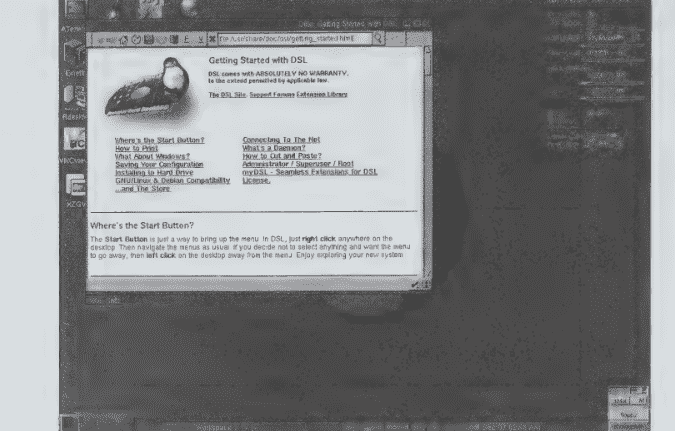

图 1：启动后的 DSL 3.4.12 桌面（Fluxbox 桌面）

现在你已经在内存中运行 DSL 了。

在本次安装（DSL 3.4.12）中，你最终会得到一个名为 Fluxbox 的桌面，如图 1 所示。

如果你使用 DSL 4.x 安装，你最终会得到一个名为 JWM 的桌面。讨论这个有点过于学术，但这两个桌面版本之间确实存在差异。你可以在两者之间切换，但目前我使用 Fluxbox。

除非你知道如何保存系统，否则当你关机时，你的配置将会丢失。因此，下一步是在硬盘上进行安装（hd-install）。

操作方法是点击鼠标右键，然后进行以下选择：

```
(Right click) APPS -> Tools -> Install to Hard Drive.
```

它看起来像这样：

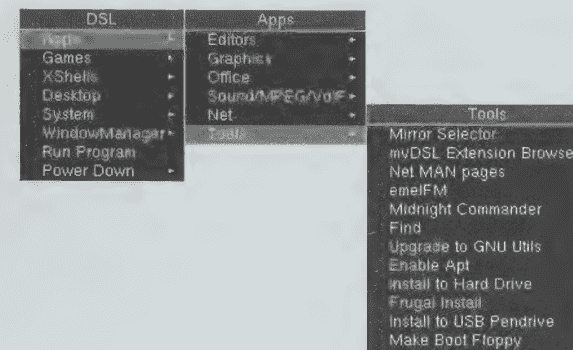

图 2：在哪里找到 “Install to Hard Drive”

选择菜单选项 “Install to Hard Drive” 后，将打开一个终端窗口。

你需要回答几个简单的问题。你可以在图 3 的顶部看到我的回答。

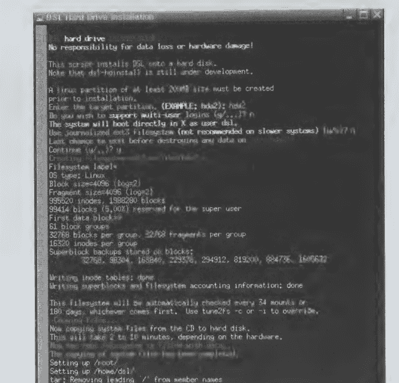

图 3：硬盘安装

我们将 `hda2` 写为目标分区，因为 `hda1` 被用作交换空间（swap space）。

- 对多用户登录（multi-user login）回答 “n”，因为我们将将其用作控制中心，我预计你将是唯一的用户。
- 由于我的机器运行缓慢，我对关于 ext3 的问题回答了 “n”。
- 最后一个问题回答 “y” 以继续。这将是对你硬盘上现有数据和操作系统的不可逆点。

如图 3 所示，在安装进行过程中，你将再次看到大量信息。在某个时间点，你会收到消息：

> The installation process is finished.

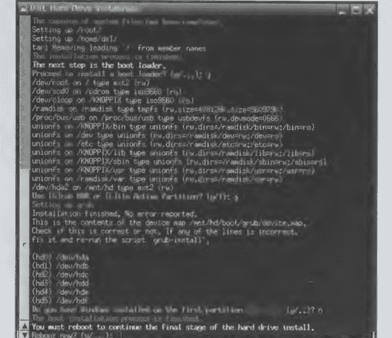

图 4：引导加载程序安装

现在你再次被要求回答问题。

是的，我们将安装一个引导加载程序（boot loader）。如果你需要更多关于引导加载程序的信息，你可以在互联网上找到所有需要的信息——一如既往。

接下来的问题对某些人来说可能像是一种“信仰之选”，因为你需要决定要安装哪个引导加载程序。我选择了 Grub，因为它是最现代的，也是我最熟悉的。实际上这并不重要，但为了简单起见，请选择 Grub，因为我们稍后需要对其进行配置。在 DSL-4.x 中，你不再有选择权，Grub 是自动选择的。

对于最后一个问题，回答 “n”（否）。我们没有安装 Windows。

如果你已经知道：

> “Windows is a registered trademark of Microsoft Corporation in the United States and other countries.”

最后重启。

你现在将第一次看到 Grub 引导加载程序（如果选择了它）。图 5 显示了一个示意图。如果你在 15 秒内没有输入任何内容，它将自动继续。

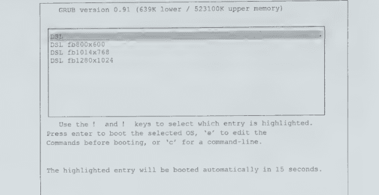

图 5：GRUB 引导加载程序启动画面

现在系统将要求你输入 “root” 和 “dsl” 用户的密码。由你来指定一个你能记住的密码。如果你愿意，可以为两者使用相同的密码。

如图 6 所示，只需回答问题即可。

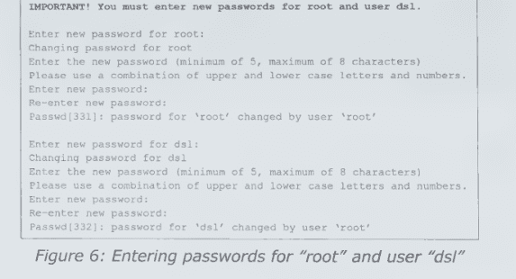

图 6：为 “root” 和用户 “dsl” 输入密码

你现在可以开始使用安装在硬盘上的 DSL 了。

花点时间去了解 DSL 和预装的工具。如果你习惯于较新的 Linux 发行版，你可能会觉得 DSL 有些局限，但你应该能让它运行起来。

### 快速安装法

如果你已经尝试过 DSL Linux，只想完成安装，可以在第一次启动提示时就开始安装。在你看到 DSL 标志和：

```
DSL is based on Knoppix, Debian, & GNU Linux Technology
Press <enter> to begin, F2 and F3 for boot options.
boot:
```

你可以通过输入以下内容立即开始安装：

```
boot: install
```

这是 F3 菜单下可以找到的命令之一。经过一段时间和大量文本滚动后，你会看到图 7 所示的选项。

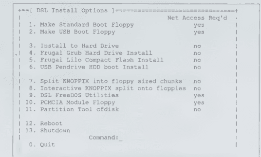

图 7：DSL 安装选项

你应该选择 3，它将引导你进入与上述相同的问题。

从这里开始，安装过程与之前描述的硬盘安装没有区别。

### 3.1.1 安装与配置 DSL

你现在应该拥有一个可以运行的 DSL Linux 环境。这很可能与你习惯的界面有所不同。

如果你对此感到陌生，请慢慢花时间熟悉它。

一件有用的事情是阅读 Dillo 浏览器中的 *Getting started with DSL*。

图 8：Dillo “入门指南”

Dillo 为您提供了关于 DSL 的基础知识。由于 Dillo 在每次启动时都会显示，我在 8.2.1 节中演示了如何禁用它，并提供了一些其他提示。

## Xsetup

在继续之前，现在是设置桌面以适应您的显示器、鼠标和键盘的时候了。否则，您可能会很快失去耐心，而我们不希望那样！

Xsetup 是一个配置程序，它将引导您完成显示器、鼠标和键盘的配置。如前所述，除非您足够幸运地拥有英国或美国键盘，否则您需要运行此程序。

Xsetup 可以在此处找到：

`(右键点击) System -> X Setup`

在接下来的章节中，我将展示在我系统上可行的方式，并在选项旁边写一些注释。

图 9：DSL X Setup：将 Xvesa 作为 xserver

我在这里选择了默认的 Xvesa。您可以通过选择 `<Cancel>` 来结束配置，并使用上述标准值。

图 10：DSL X Setup：无 USB 鼠标

选择 USB 鼠标应该会激活滚动轮（如果存在）。到目前为止，每次我这么做时都会“丢失”鼠标。我的选择是 No USB mouse。

图 11：DSL X Setup：使用 IMPS/2 鼠标

由于我不使用 USB 鼠标，我选择 IMPS/2 鼠标。

图 12：DSL XSetup：选择 1024x768 屏幕分辨率

使用哪个屏幕分辨率由您决定。我的显示适配器在 1024x768 下运行良好——而且我可以毫无问题地阅读。

图 13：DSL X Setup：选择 32-bit 作为色彩深度

同样，使用哪个色彩深度由您决定。由于我的系统支持 32 位，我显然选择了 32-bit。

图 14：DSL X Setup：不设置 dpi

我们按照建议操作 —— 我们不想选择自己的 dpi。

图 15：DSL X Setup：选择键盘

这就是我们一直等待的：选择与您的键盘匹配的键盘布局。


在这里按下 `<OK>` 即可完成显示器、鼠标和键盘的配置。您可以通过按照开头所述手动启动来随时再次运行它。

键盘设置将被添加到`/opt/bootlocal.sh`文件中。

**注意**：如果您以后想更改屏幕分辨率和色彩深度，可以运行

```
(右键点击) Setup -> Xvesa
```

配置实用程序。

这将为您提供如图 16 所示的 GUI 界面。

图 16：Xvesa 显示设置

### 静态 IP 地址

为了能够找到您的 ELCC，您需要为您的系统分配一个静态 IP 地址。这通过 "Netcard Config" 程序完成。

"Netcard Config" 的启动方式如下：

```
(右键点击) System -> Net Setup -> netcardconfig
```

图 17：Netcard Config

如图 17 所示，设置非常简单。我预计您了解关于 IP 地址、网关和名称服务器的基础知识。

如果您愿意，可以填写“真实”名称服务器的 IP 地址，而不仅仅是您的网关。

Netcard Config 将使用粗体标记的内容更新`/opt/bootlocal.sh`文件。

```bash
#!/bin/bash
# put other system startup command here
/sbin/syslogd
/opt/eth0.sh &
loadkeys dk
```

`/opt/eth0.sh`的内容是：

```bash
#!/bin/bash
pkill pump
ifconfig eth0 192.168.1.60 netmask 255.255.255.0 broadcast 192.168.1.255 up
route add default gw 192.168.1.1
```

验证一切正常：`ping www.elektor.com`

图 18：Ping elektor.com

## 配置启动加载程序

**注意**：在配置 GRUB 启动加载程序时，您可能会导致系统崩溃或运行异常。如果出现问题，能提供的帮助不多，有时甚至需要重新安装。请记录下您更改的内容并以此为鉴。如果您遇到麻烦，GNU Grub 手册可能会有所帮助。该手册可以在 参考文献 [7] 中找到。

最后一条很好的建议：在配置系统其余部分之前，先配置您的启动加载程序。丢失所有辛勤工作的感觉并不好（我经历过，做过，绝不再犯！）。

如果您是通过运行 "X Setup" 和 "Netcard Setup" 来配置系统的，则无需更改启动加载程序。默认的启动加载程序应该足以满足您的基本需求。

尽管我不需要，但我通常会更改启动加载程序，以获得更快、更个性化的系统启动（boot up）。这是通过编辑`/boot/grub/menu.lst`文件来实现的。

DSL 自带 3 个预装编辑器：

- Beaver（“普通”GUI 编辑器）

- VIM (Vi Improved。如果您知道如何使用它，使用本书应该没有任何问题！)

- Nano（基于文本的编辑器。如果您没有图形化安装，它非常有用。）

每当我需要编辑内容时，我都会使用 Beaver。如果您在 emelFM 中按下 "Edit"，也会调用这个编辑器。话虽如此，请选择您最喜欢的那个。

为了查看`/boot/grub/menu.lst`的内容，请启动您的编辑器并将内容与我的文件进行比较：

```
# This sets the default entry to boot.
# Remember that GRUB counts from 0, so 1 is the second entry.
default 0

# This sets the length of time in seconds that grub will wait for the user to select an OS
# before it boots the default on. I recommend at least 15 seconds.
timeout 5

# Enter the entry for DSL here. Something like this.
title DSL fb1024x768
kernel /boot/linux24 root=/dev/hda2 vga=791 noapmi noapm nodma noscsi nodhcp
lang=da frugal
```

首先，您可能只会注意到我在启动时只有一个选项。因为我不需要其他的，所以我删除了它们。我还移除了`quiet`选项，这将给我提供更多的启动信息。由于我不需要更改启动选项，我还将超时时间缩短到了 5 秒。

我添加了`vga=791`，因为我的显示器可以处理更高的分辨率。

如果您自己进行静态 IP 地址配置，则还需要添加`nodhcp`。

最后，如果您是手动操作且没有运行 X Setup，则需要添加以下内容：

```
lang=da
```

如果您想更改桌面，也可以通过添加以下内容来实现：

```
desktop=fluxbox
```

更多信息请参阅 8.4.1 节。

## 配置/更改窗口管理器

如果您还想更改 ELCC 的窗口管理器，请参阅 8.4.1.4 节 —— 虽然这样做可能很复杂，但我建议在开始安装其他应用程序之前进行。在此过程中，您很容易搞乱系统。这也是为什么我将描述放在附录中的原因。需要注意的是，离开内置的窗口管理器并非必要要求。

## 3.2. DSL：Web 服务器相关软件

在我们开始操作 Linux 系统之前，由于有一个特殊命令被大量使用，需要对其进行说明。

这个特殊命令就是`sudo`。

`sudo`（也称为 super user do）允许获得许可的用户以超级用户或其他用户的身份执行命令，具体由`/etc/sudoers`文件指定。

我不再详细讨论这一点，只需请您参考`sudo`命令的手册（参考文献 [25]），以及更广泛的 Wikipedia（参考文献 [26]）。此外，"Dillo: Getting Started with DSL" 中也有关于`sudo`命令的简短引用。

每当需要时，我会提到`sudo`命令的使用。稍后我们还需要编辑`/etc/sudoers`文件。

### 3.2.1 XAMPP

由于目的是能够通过互联网控制 ELCC，我们需要安装某种服务器。

在 DSL 中实际上预装了一个名为 "Monkey Server" 的小型服务器。由于我还想使用 PHP 和 MySQL，因此我决定使用 XAMPP 服务器软件包。你很可能能够自己在 XAMPP 中安装所有所需的软件安装包，但既然 XAMPP 中已经包含了这些，我觉得没必要重复安装。

XAMPP 是一个非常推荐且易于安装的服务器软件套装。第一步是访问 `http://xampp.org`。选择网页顶部的 "Download"。接着，点击 "More Downloads"，最后选择 "XAMPP Linux"。

现在你应该能看到所有可用版本。

通常你会选择最新的版本下载（在撰写本文时，最新版本为 5.6.8）。如果你选择 1.6.8a 以上的任何版本，都会出现以下错误：

`/opt/lampp/bin/XXX:/XXX:. /lib/libc.so.6: version 'GLIBC_2.2' not found (required by XXX)`

XAMPP 团队在 "XAMPP for Linux FAQ" 中的解释是：

> 您的 Linux 系统太旧了。XAMPP 需要更新的 Linux 发行版。

由于我使用内核版本为 2.4.31 的较新 DSL 4.4.10 时也得到了相同的提示，因此通过更改 DSL 版本来绕过该问题是没有意义的。为了结束上述话题：不，我没有尝试通过更新 GLIBC 版本来解决这个问题。相反，我选择了更简单的方案，下载（极其）旧的版本：

`xampp-linux-1.6.8a.tar.gz`

在 1.7 版本的发行说明中可以读到：

此 XAMPP 版本的新特性：

- XAMPP for Linux 现在至少需要 glibc 2.3.4 版本（通常 2005 年以后的发行版均已搭载）

我的系统在当前的配置下可以运行——但这在长远来看是需要解决的问题。

由于在本项目中无法使用最新版本，我们将下载可运行的版本。下载地址如下：

`http://sourceforge.net/projects/xampp/files/XAMPP%20Linux/`

点击 release 1.6.8a，你将获得 XAMPP 基础软件和开发工具包的链接。点击`xampp-linux-1.6.8a.tar.gz`开始下载。

如果你没有更改浏览器的任何设置，下载的文件将位于`/home/dsl`目录下。

如 XAMPP 主页所示，通过执行以下命令安装软件：

```bash
dsl@box:~$ sudo tar xvfz xampp-linux-1.6.8a.tar.gz -C /opt
```

**注意**：安装时你需要在前面加上 "sudo" 以获得 root 权限。否则，软件随后将无法运行。始终记得在 "xvf" 之后加上 "z"，以便通过 gzip 过滤压缩包。

XAMPP 现在已安装在`/opt/lampp`目录下。

显然，从 lampp 改名为 XAMPP 背后有个故事。你需要自己在网站上进一步了解。目前你只需要知道，该软件将位于名为 lampp 的目录中。

更多信息可通过以下链接获取（即你下载软件的地方）：

`http://www.apachefriends.org/en/xampp-linux.html`

启动 XAMPP 非常简单，只需执行命令：

```bash
dsl@box:~$ /opt/lampp/lampp start
```

你很可能需要 root 权限才能执行该命令。总的来说，启动 XAMPP 软件时的界面如下：

### 3.2.2. 配置 XAMPP

```bash
dsl@box:~$ sudo su
root@box:/home/dsl# /opt/lampp/lampp start
Starting XAMPP for Linux 1.6.8a...
  XAMPP: Starting Apache with SSL (and PHP5)...
  XAMPP: Starting MySQL...
  XAMPP: Starting ProFTPd...
XAMPP for Linux started.
root@box:/home/dsl#
```

由于你希望 Apache 服务器始终运行，你需要将以下内容：

`/opt/lampp/lampp start`

添加到此文件中：

`/opt/bootlocal.sh`

**注意**：如果你更改了 Web 服务器配置，则需要重启被更改的应用程序（或重启整个应用程序套装）。关于此点的更多信息请参阅 XAMPP 主页（参考 [24]）。

#### 修改默认密码

**注意**：为了设置或更改 MySQL 数据库的密码，你需要确保 XAMPP Web 服务器已设置并运行（否则你会收到警告）。

因此，在将新启动的 Web 服务器发布到互联网之前，我们需要对安装进行安全加固。这可以通过以下命令完成：

```bash
root@box:/home/dsl# /opt/lampp/lampp security
```

然后你会看到类似图 19 所示的内容：

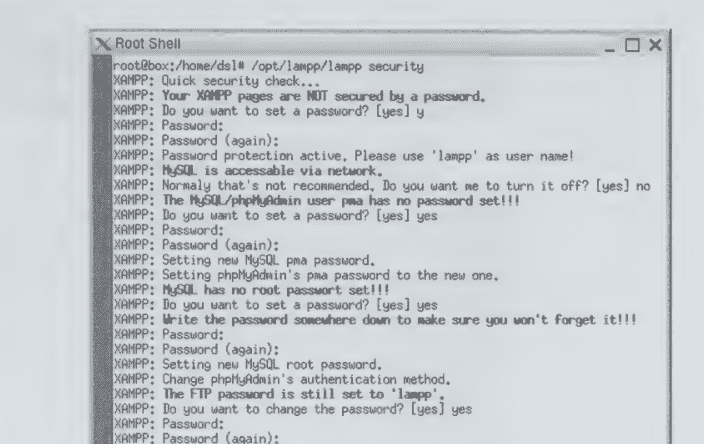

**图 19：更改 XAMPP 的安全级别**

由于稍后在安装过程中会用到，我将公开我上面输入的密码。它是`dsl9000p3`。当然，你应该输入自己的密码，并且为每个登录账号设置不同的密码。

提高安全级别后，每次进入 XAMPP 标准安装界面时，都需要输入用户 ID 和密码。因此你需要注意以下几点：

进入 XAMPP 页面时，

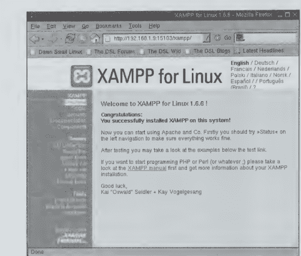

**图 20：XAMPP 标准主页**

使用`lamp`作为用户 ID，`dsl9000p3`作为密码。

进入 phpMyAdmin 或通常访问 MySQL 数据库时，

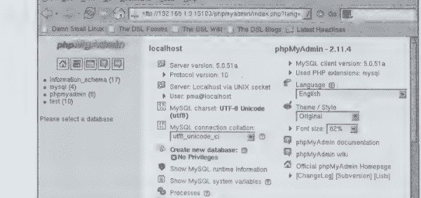

**图 21：phpMyAdmin 主页**

从现在起，使用`pma`作为用户 ID，`dsl9000p3`作为密码。

请注意，MySQL 数据库的 root 密码也已被更改——在本例中同样改为`dsl9000p3`。这仅在你想要更改数据库时才需要。

为了获得新服务器的 FTP 访问权限，你可以使用普通的浏览器。如果你使用微软内置浏览器，会有关于如何使用 Windows（文件）资源管理器的指南。

**注意**：当 FTP 浏览器要求输入密码时，请使用之前安装 Linux 系统时输入的 Linux 密码。

当然，你也可以使用自己选择的 FTP 浏览器。除非你想在新服务器上完成所有开发工作（所有必要的工具都已提供），否则我建议你找一个自己喜欢的 FTP 浏览器并熟悉它。这是上传或下载文件到服务器最简单的方法。ELCC 主页使用的文件位于此处：

`/opt/lampp/htdocs`

还有一些进一步的 XAMPP 配置可能值得完成（见 8.5 节）。

**警告**：切勿将`dsl9000p3`用作 ELCC 的密码。将其更改为完全不同的内容并记录在某处。

**注意**：我在所有地方都使用了相同的密码。通常不推荐这样做，但在短期内这会让生活更简单。

当你将密码改为其他内容时，要么像我一样全部统一，要么记录好哪个密码对应哪个位置（包括在`/opt/lampp/htdocs/public/vars.inc.php`文件中）。

如果不仔细处理，你可能会在 MySQL 数据库、文件系统或运行进程的访问权限方面遇到问题。

### 3.2.3. XAMPP 开发包

如果你想实现本书中提到的所有功能，还需要安装 XAMPP 开发包。需要此软件包是因为 ELCC 需要通过一个用 C 语言编写的后台任务访问 MySQL 数据库。上述后台任务读取 Elektor Thermo-Snake 传感器并使用温度读数更新数据库。

因为我们使用的是稍旧版本的 XAMPP，我们需要从包含之前提到的旧软件的位置收集软件：

`http://sourceforge.net/projects/xampp/files/XAMPP%20Linux/`

再次点击 release 1.6.8a，你将获得 XAMPP 1.6.8a 版开发软件的链接。点击`xampp-linux-devel-1.6.8a.tar.gz`开始下载。

开发包应放置在与基础软件相同的目录下。现在使用与基础软件相同的命令来安装开发包：

```bash
dsl@box:~$ sudo tar xvfz xampp-linux-devel-1.6.8a.tar.gz -C /opt
```

与 XAMPP 基础软件一样，开发软件现在也安装在`/opt/lampp`目录下。

为了能够使用新安装的开发软件包，你需要将以下内容：

`/opt/lampp/lib/mysql`

添加到文件中：

`/etc/ld.so.conf`

完成后，你需要运行`ldconfig`程序。

```bash
dsl@box:~$ sudo ldconfig
```

在处理期间或处理之后，程序不会给你任何反馈。你可以指定选项 "-v" 以获取详细反馈，但其外观将如图 22 所示。

希望你不会陷入需要这些信息来调试程序的境地。记得运行该程序就足够了。

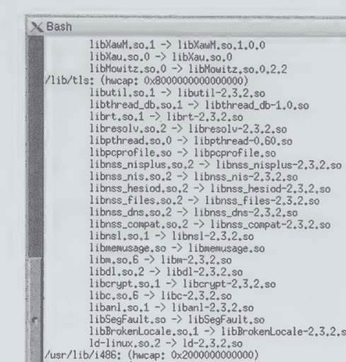

图 22：详细模式下的 ldconfig

运行`ldconfig`的原因是您需要为最新的共享库创建必要的链接。如果对此感到困惑，我在第 10 节中尝试做了进一步解释 —— 如果不运行该程序，可能会非常浪费时间。

## 3.3. DSL：编译器软件

本节介绍如何安装必要的编译器和库。

我们从 C 编译器开始，它是许多构成 ELCC 基础的小型程序所必需的。

### 3.3.1. GCC 编译器安装

如果您以前从未接触过 C 或 C++，请不必担心。我不要求您自己编写任何新代码。编译所需的所有 C 代码都已为您提供。另一方面，如果您了解一点编程知识，将会很有帮助。

系统中预装了一个名为 Tinyc 的 C 编译器。它能满足许多用途，但我更倾向于使用功能更强大的 GCC 编译器（GCC 即 GNU 编译器套装）。幸运的是，DSL 的创建者考虑到了这一点，并提供了下载和安装 GCC C 编译器的选项。

要开始下载：

```
(右键点击) Apps->Tools->myDSL Extension Browser
```

这将启动 MyDSL 扩展工具。

在 MyDSL 扩展工具中，点击`System->gcc1.dsl->Download`。

现在将开始下载和安装过程。在下载过程中，您将看到如图 23 所示的进度条：

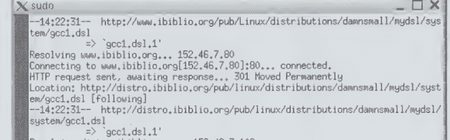

图 23：gcc1.dsl 的下载进度

完成后，您将在`/usr/include`目录下看到比之前多得多的文件。

### 运行 STD 测试应用程序

此时，确认安装是否正常工作总是很有必要的，所以让我们编写一个常见的 "hello world" 应用程序。

启动编辑器并输入以下内容（或类似内容）：

```c
#include <stdio.h>
main()
{
 printf("hello world\n");
}
```

将文件保存为`/home/dsl`目录下的`helloworld.c`。

点击 "Aterminal" 图标启动终端窗口。进入`/home/dsl`并执行以下命令：

```bash
dsl@box:~$ gcc helloworld.c -o helloworld
```

如果没有出现任何错误，请输入以下命令运行测试程序：

```bash
dsl@box:~$ ./helloworld
```

如果您看到 "hello world"，则目前一切正常。

您现在应该能够编译本项目所需的 C 代码了。

### 运行 MySQL 测试应用程序


如果您尚未安装 XAMPP 开发包，请跳过本节。

我们刚刚验证了 C 编译器已正确安装且很可能可以正常工作。我们还需要验证 MySQL 开发包是否正确安装，并且能够用于访问我们的 MySQL 数据库。

为此，您应该启动编辑器并输入以下内容：

```c
#include <stdio.h>
#include <my_global.h>
#include <mysql.h>
main(void)
{
    printf("MySQL client version: %s\n", mysql_get_client_info());
}
```

与之前一样，将文件保存在`/home/dsl`下，但这次命名为`my_test.c`。

点击 “Aterminal” 图标启动终端窗口。进入`/home/dsl`并执行以下命令：

```bash
dsl@box:~$ gcc my_test.c -o my_test -I/opt/lampp/include/mysql -L/opt/lampp/lib/mysql -lmysqlclient
```

是的，这是一个很长的命令行，但它告诉编译器在哪里查找 MySQL 头文件（`-I` 选项）、在哪里查找 MySQL 库文件（`-L` 选项）以及使用哪个 MySQL 库（`-l` 选项）。

如果没有出现任何错误，请输入以下命令运行测试程序：

```bash
dsl@box:~$ ./my_test
```

如果您看到 “MySQL client version: 5.0.67”（或类似内容），则目前一切正常。

## 3.3.2. USB 库安装

如果您想使用后面提到的来自 Elektor 的基于 USB 的 Thermo-Snake（参考 [36]），则需要安装额外的软件。

从普通 USB 用户的角度来看，USB 配件使连接 PC 变得非常简单。通常，您只需插入设备，如果驱动程序没有自动安装，您只需要提供安装光盘。这就是 Windows 以及许多 Linux 情况下的工作方式。

但如果您是一名开发人员，并且需要为您自己制作或从其他地方获取的、且您的操作系统不支持 USB 的 USB 配件实现自己的 USB 接口，那么情况就不同了。

幸运的是，有一些好心人（我想再次强调这一点）通过提供几个具有良好编程接口的 USB 库，让这项艰巨的工作变得简单。

在这种情况下，您需要安装这两个库，以便为 Elektor Thermo-Snake 提供支持。

本书的范围不包括解释 USB 的工作原理以及如何创建 USB 软件。不过，我在第 8.8 节中提供了一个简短的概述。原因在于 USB 是一个极其庞大的主题 —— 我进行了一些逆向工程（随后将其记录在案），以便为 Thermo-Snake 创建接口。

### LIBUSB

LIBUSB 是一个需要实现的底层 USB 库。

可以在此处找到 LIBUSB 库：

`http://sourceforge.net/projects/libusb/`

在 “Files” 目录下，您将看到三个选项。您应该选择：

> 2006 年 3 月 4 日的 “libusb-0.1 (LEGACY)”。

**注意**：通常，我建议选择软件包的最新版本，但如果您在这里这样做，您将无法让 LIBUSB 和 LIBHID 协同工作。

因此，在这种情况下，我们要下载并安装的是`libusb-0.1.12.tar.gz`。

将软件下载到您的 “download” 目录，并使用以下命令解压：

```bash
dsl@box:~$ sudo tar xvfz libusb-0.1.12.tar.gz
```

请始终记得在 “xvf” 之后加上 “z”，以便通过 gzip 过滤归档文件。

现在您可以准备安装软件了。

您应该进入`libusb-0.1.12`目录，并执行以下命令来安装 LIBUSB 软件：

```bash
dsl@box:~/download/libusb-0.1.12$ sudo ./configure
dsl@box:~/download/libusb-0.1.12$ sudo make
dsl@box:~/download/libusb-0.1.12$ sudo make install
```

在执行`./configure`命令后，您将看到大量的检查过程。最后在接近结束时，您将看到如图 24 所示的一些创建过程。

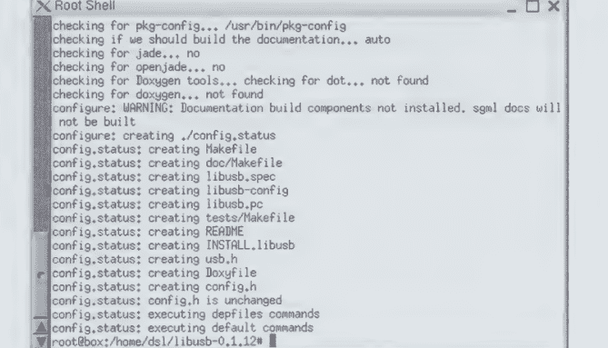

图 24：libusb 安装脚本的配置

如果没有报告错误，您应该能够继续执行两个 make 命令。

在执行`make install`命令期间，您将看到以下内容：

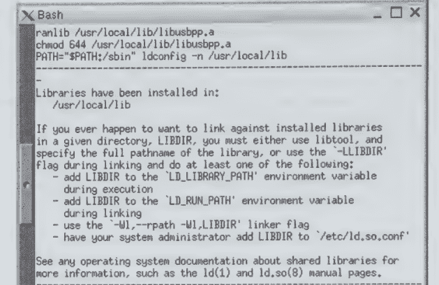

图 25：LIBUSB 基础安装引导

这指示了库的安装位置，同时在编译（使用这些库的）软件期间有助于确定编译标志。我已经创建了一些 make 文件，当您进展到这一步时可以使用。

### LIBHID

实际上，仅靠 LIBUSB 库也可以应付，但由于 Thermo-Snake 是一个 USB HID 设备（见参考 [37]）而不是 “普通” USB 设备，我们需要进行一些额外的编程。同样，其他人也遇到过这种情况，并创建了一个 LIBUSB 的附加库来支持 HID 设备（HID 设备可以是键盘、鼠标、游戏控制器）。这个附加库被称为 LIBHID，它以 LIBUSB 为基础。这就是为什么我们不能使用最新版本的 LIBUSB。我尝试过使用 1.0.0 版本的 LIBUSB，但对我来说不起作用。

可以在此处找到 LIBHID 库：

`http://libhid.alioth.debian.org/`

您需要寻找 libhid 的下载页面，在 Tarball 标题下。或者，您可以使用直接下载链接：

`https://alioth.debian.org/frs/download.php/file/1958/libhid-0.2.16.tar.gz`

您可能需要在下载软件前进行注册。将软件下载到您的 download 目录，使用以下命令解压：

```bash
dsl@box:~$ sudo tar xvfz libhid-0.2.16.tar.gz
```

现在进入`libhid-0.2.16`目录，并执行以下命令来安装 LIBHID 软件：

```bash
dsl@box:~/download/libhid-0.2.16$ sudo ./configure
dsl@box:~/download/libhid-0.2.16$ sudo make
dsl@box:~/download/libhid-0.2.16$ sudo make install
```

如图 26 所示，在执行`./configure`命令后，您将看到大量的检查过程。

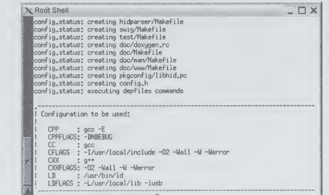

图 26：libhid 安装脚本的配置

最后，您应该能看到一些创建结果。如果没有报告错误，您应该能够继续执行两个 make 命令。同样，在执行 make install 命令期间，您将看到以下内容：

图 27：LIBHID make install 指南

与之前一样，这指示了库的安装位置，并在编译（使用这些库的）软件时为您提供编译标志方面的帮助。

我之前提到过，现在我再次强调：请记得运行以下程序：

```
ldconfig
```

以便为最新的共享库创建必要的链接。

如果您不这样做，您会发现 USB 库出现以下错误消息：

> error while loading shared libraries: libhid.so.0: cannot open shared object file: No such file or directory

在安装 LIBUSB 之后，您也应该运行 ldconfig。我默认您会安装这两个库，而不仅仅是 LIBUSB。

#### 文档

在使用 LIBHID 库时，您很可能会收到类似这样的错误消息：

```
hid_interrupt_read failed with return code 23
```

这里令人感兴趣的是 “code 23”。如果您查看头文件`hid.h`，您会在顶部附近找到`hid_return_t`类型定义。如果您从该类型定义向下数 23 个位置（偏移量为 0），您会发现代码 23 等于 timeout（超时）。这就是您能在这里获得的所有帮助了！

迟早您一定会需要额外的文档。在这种情况下，您可以在此处找到更多文档：

- LIBUSB: http://sourceforge.net/projects/libusb/
- LIBHID: http://libhid.alioth.debian.org/doc/

**注意** 正如前面提到的——在撰写本文时，您需要下载 LIBUSB 0.1.12 版本和 LIBHID 0.2.16 版本才能使程序正常运行。由于互联网上的内容变化很快，在下载库时，您应始终检查哪些版本有效以及哪些组合适用于您。

## 3.4. DSL：控制中心的安装与基础配置

### 3.4.1. 简介

ELCC 的网页被放置在：

```
/opt/lampp/htdocs
```

目前，您应该保留 XAMPP 主页。但是，如果您需要将其删除，请删除`xampp`和`webalizer`这两个目录，以及`index.html`和`favicon.ico`这两个文件。

如果您不删除 XAMPP 主页，请将`favicon.ico`和`index.html`重命名为其他名称。

（在 emELFm 中：右键点击 -> operations -> rename）

您可以从这里采取几种不同的方式继续：

1. 遵循本书的布局，跳转到 3.4.2 节并继续进行 Web 界面操作。
2. 制作硬件并使用设备驱动程序进行测试，然后安装 Web 界面。

**注意** 您的互联网浏览器需要启用/激活 Cookie 才能工作。在 Firefox 的情况下，您可以在此处找到 Cookie 设置：

```
Edit -> Preferences -> Privacy Icon -> Cookies
```

### 3.4.2. Web 界面

本书中显示的 Web 界面实现了控制 ELCC 的任务。另一方面，如果您想制作自己的 Web 界面，您需要加入与不同硬件部分交互的驱动程序和脚本。

用于创建 Web 界面的文件在 9.2 节中进行了描述。

#### 安装

界面的安装非常简单，与 XAMPP 的安装非常相似。从 Elektor.com 下载软件到`/home/dsl`目录，并执行以下命令：

```
dsl@box:~$ sudo tar xvf ctrlcentre_<date>.tar -C /opt/lampp
```

在撰写本文时，该文件的名称为：

```
ctrlcentre_20150524.tar
```

在安装过程中，您将看到每个文件的列表。文件名非常多，希望它们能快速地在屏幕上“飞过”。

安装成功后，所有文件都将安装到以下目录：

```
/opt/lampp/htdocs
/opt/lampp/ctrl_centre
```

#### 配置

为了运行 ELCC 的网页，我们需要对 MySQL 数据库进行简单的配置。

这非常简单，只需要您通过安装的 Firefox 浏览器运行`install_db.php`文件即可。

注意：如果您（在 3.2.1 节中）为 MySQL 数据库输入了与`dsl9000p3`不同的 root 密码，则需要修改以下文件：

```
/opt/lampp/htdocs/public/vars.inc.php
```

未经修改的文件看起来像这样：

```
$host = "localhost";
$user = "root";
$passwd = "dsl9000p3";
$database = "CTRLCentre"
```

如果您之前更改了密码，请在终端会话中启动您喜欢的编辑器并更改密码。

完成后，启动 Firefox 浏览器并输入以下 URL：

```
http://192.168.1.60/install_db.php
(将 192.168.1.60 更改为与您的安装相匹配的地址)
```

您现在应该会看到类似于图 28 的内容：

图 28：数据库安装成功

您可以通过两种方式验证配置是否成功：

1. 如果您仍有 XAMPP 主页，请进入 phpMyAdmin 页面并查找`CTRLCentre`数据库。在该数据库中，应该有三个表：名为`CentreUser`（包含一个用户 dsl）、包含 5 个默认灯光配置的`Lamps`以及一个空的`Temperature`表。
2. 直接通过输入以下 URL 进入控制中心主页：

```
http://192.168.1.60/index.php
(将 192.168.1.60 更改为与您的安装相匹配的地址)
```

随后您应该能够使用用户 ID：`dsl`和密码：`dsl9000p3`登录。

**警告：** 现在请更改用户`dsl`的密码。如果您不更改，您的 ELCC 将对所有人开放。

**警告：** 既然 MySQL 配置已完成，现在是时候删除`install_db.php`或将其重命名为其他名称了。如果您不这样做，外部人员将能够再次输入默认密码。

#### 执行权限

在 Linux 机器上运行的所有进程 (PID) 都需要一个用户 ID (UID)，以便在系统中识别它们并管理其权限。我不敢自称是这方面的专家，但我很快注意到我无法在 PHP 中执行任何系统命令。

原因是我需要将 Web 界面作为一个用户分配给以下文件：

```
/etc/sudoers
```

在启动 Web 服务器后，执行`ps`命令，您应该能看到`httpd`进程（Web 服务器）的 UID 是`nobody`。我在图 252 中展示了`ps`命令的屏幕截图——您可以看到`httpd`与 UID`nobody`之间的连接。

需要做的事情非常简单：将下面以**粗体**显示的文本字符串：

```
# sudoers file.
root ALL=(ALL) ALL
knoppix ALL=NOPASSWD: ALL
dsl ALL=NOPASSWD: ALL
nobody ALL=NOPASSWD: ALL
```

添加到`/etc/sudoers`文件中。您需要以 root 用户身份执行此操作。现在您应该准备好继续了。

**注意** 如果您想按规程操作，应执行以下命令：

```
root@box:/home/dsl# visudo
```

如果您收到以下反馈：

```
visudo: no editor found
```

只需输入以下内容：

```
root@box:/home/dsl# export EDITOR=beaver
```

这会告诉`visudo`使用哪个编辑器。`beaver`可以更换为您喜欢的编辑器。

在您退出编辑器后，`visudo`会进行语法检查。

#### 语言文件访问权限

为了使语言更改生效，我们需要更改以下文件的访问权限：

```
/opt/lampp/htdocs/public/fields_text.inc.php
```

这可以通过执行以下命令完成：

```
root@box:~/home/dsl# chmod 777 /opt/lampp/htdocs/public/fields_text.inc.php
```

如果不这样做，您将无法通过 Web 界面覆盖该文件。

## 3.5. DSL：连接到 ELCC

本说明预期在您安装和开发 ELCC 时使用。

如果您像我一样，使用一台与 ELCC 不同的 PC 进行所有开发工作，那么您将需要两套显示器、键盘和鼠标——或者其他能够减少桌面上硬件数量的解决方案。

一如既往，有许多不同的解决方案。我将尽力描述其中的几种。

### KVM 切换器

我自己使用 KVM 切换器（键盘、视频和鼠标），可以在两个 CPU 之间进行切换。我最初使用的是 2 端口 PS/2 KVM 切换器，但现在使用的是 4 端口 PS/2 KVM 切换器，因为需求总是增加。现在我有太多的 CPU 同时运行，并且发现使用最新的 KVM 切换器时，直接连接到 CPU 或通过切换器连接没有任何区别——至少在我的设备上是这样。

在选择 KVM 切换器时，您需要仔细将规格与显示器的性能相匹配。

您可以在此处阅读更多关于 KVM 切换器的信息：

http://en.wikipedia.org/wiki/Kvm_switch

或者直接在互联网上搜索 “KVM switch”。

使用这种方案，您需要某种文件传输设施来向 ELCC 上传和下载文件。幸运的是，XAMPP 自带了一个 FTP 服务器，所以这是我目前采用的解决方案。

您应该能为开发 PC 的操作系统找到一个免费或开源的 FTP 客户端。

### SSH (Secure SHell)

与任何其他 Linux 或 UNIX 系统一样，您可以通过 SSH 访问 ELCC。

SSH 是一种网络协议，允许两个联网设备之间交换数据。它旨在取代不安全的 Telnet。您可以在此处阅读更多相关信息：

http://en.wikipedia.org/wiki/SSH

或者直接在互联网上搜索“Secure Shell”。

为了建立 Secure Shell 连接，您需要在开发 PC 上安装一个客户端。如果这是一台 Linux 机器，应该已经安装了一个。如果是 Windows PC，您可以使用 PuTTY，可以通过此处获取：

http://www.putty.org/

当然，还有其他更先进的 Windows Secure Shell 客户端，但我使用这个没有遇到过任何问题。

PuTTY 的使用非常简单。您只需要指定 ELCC 的“主机名（或 IP 地址）”和端口（22），然后连接即可。成功登录后，您将获得标准的终端界面。

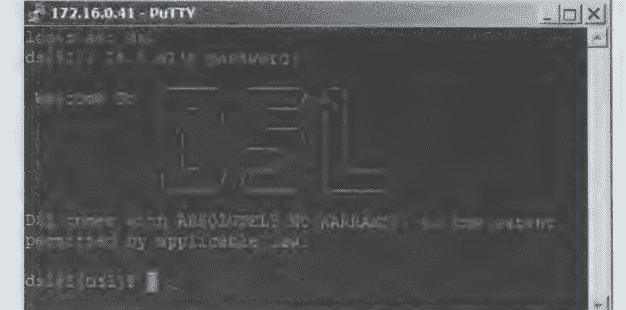

图 29：通过 SSH 登录到 DSL


在登录 ELCC 之前，您需要启动 SSH 服务器。可以通过 DSL 控制中心点击如图 30 所示的“SSH-server”按钮来完成。

由于目的是远程访问 ELCC，我们需要在 PC 每次启动时自动启动 SSH 服务器。

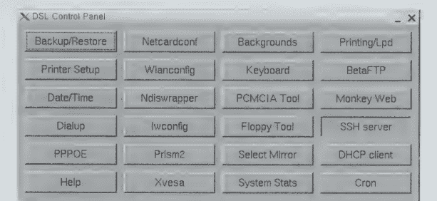

图 30：SSH 服务器已激活

激活 SSH 服务器是通过在以下文件的某个位置添加以下内容来实现的：

```
#Start SSH-server
/etc/init.d/ssh start
```

该文件路径为：

```
/opt/bootlocal.sh
```

即使您并不打算频繁使用 SSH 连接，在 ELCC 上保持 SSH 服务器运行也是个好主意，以防由于某种原因您无法正常访问它。我在一段时间内这样做过，当时我的 KVM 切换器似乎不稳定，导致 ELCC 有时在启动时无法检测到键盘和鼠标。

当然，当您的 ELCC 进入“生产”环境时，应该停止该服务器。

## VNC

如果您想完全访问 ELCC 桌面，可以安装 VNC（Virtual Network Computing）。

VNC 是一个图形化桌面共享系统，可用于远程控制另一台计算机。它将键盘和鼠标事件从一台计算机传输到另一台，并反向发送屏幕更新。

通过启动 myDSL 扩展浏览器在 ELCC 上安装 VNC 服务器：

```
(Right click) Apps->Tools->myDSL Extension Browser
```

点击“Net”按钮，找到“VNC4x-1.4.6.dsl”并下载到您的 PC。下载并安装后，您应该会在桌面上看到以下图标：

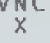

这是一个指向 shell 脚本的链接，您可以通过执行以下命令来启动它：

```
dsl@box:~$ /usr/local/bin/vnc4x0.sh
```

几秒钟后，您将看到以下内容：

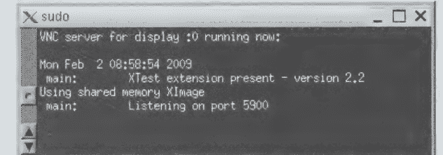

图 31：启动后的 VNC 服务器

今后，您可以使用该图标，或者将以下内容

```
#Start VNC-server
/usr/local/bin/vnc4x0.sh
```

添加到此文件的某个位置：

```
/opt/bootlocal.sh
```

安装在 ELCC 上的 VNC 服务器来自一家名为 RealVNC (http://www.realvnc.com/index.html) 的公司，他们也提供 Windows 版本。我假设您的开发 PC 是 Windows PC。如果不是，请下载适合您操作系统的版本。

免费的 Windows 版本可以在此处下载：

http://www.realvnc.com/download.html

您需要注册才能获取软件，仅此而已。目前我使用的是 4.1.2 版本。

在下载并对软件进行病毒扫描后，您可能会注意到杀毒程序在安装期间发出警告。在我的案例中，只需要让杀毒程序接受这个新的 VNC 软件即可。

在 ELCC 上激活 VNC 服务器后，您只需要启动 Windows VNC Viewer 并输入服务器 IP，如图 32 所示。

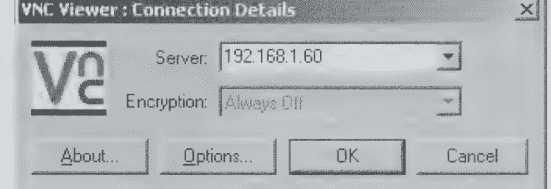

图 32：Windows VNC 查看器启动

点击确定后，应该会显示 ELCC 的桌面。

**注意**：根据您的 CPU 不同，您可能会发现 ELCC 使用了大部分 CPU 资源来维持 VNC 服务器。如果性能实在太低，甚至可能会导致崩溃。

在 VNC 连接期间，您可以看到如图 33 所示的信息：

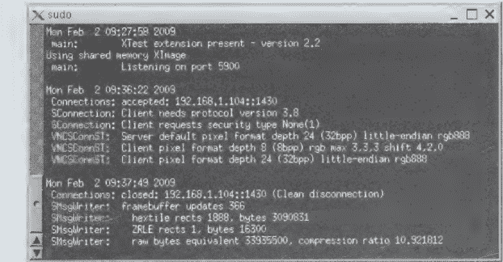

图 33：连接和释放期间的 VNC 服务器信息

您可以通过按下“ctrl-c”来终止上述窗口。

如果您想增加一些安全性，可以将 VNC 通过 SSH 进行隧道传输。您可以将 VNC 封装在 SSH 之中，从而不暴露您的连接。由于我预计您与 ELCC 处于同一个内网，使用隧道可能有点大材小用——但如果您不在同一内网且需要安全性，我将向您展示如何设置。

作为 SSH 客户端，我们将再次使用 PuTTY。所有配置都在 Windows 客户端侧进行；您不需要对 ELCC 进行任何额外操作。如果您的开发 PC 是基于 Linux 的，您需要自行设置隧道。

启动 PuTTY，并在 Category 下选择“Session”：

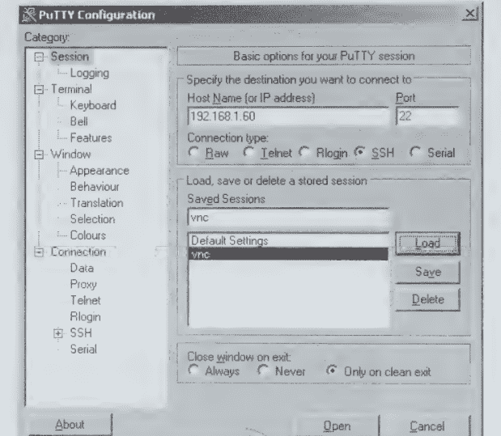

图 34：VNC 隧道的 PuTTY 会话设置

如图 34 所示，输入主机的 IP 地址并为会话命名（在我的案例中为 vnc）。

接下来，在 category 下选择 Connection->SSH->Tunnels，如图 35 所示。

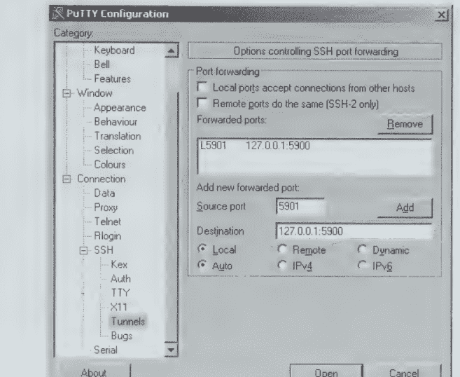

图 35：VNC 隧道的 puTTY 隧道设置

在“Source port”处输入 5901，在“Destination”处输入 127.0.0.1:5900，然后点击“Add”按钮。返回 Session 类别（图 34）并点击“Save”按钮。

如果您在图 34 中点击“Open”按钮，您现在应该能够像之前那样登录到您的 ELCC。

接下来的步骤是启动 Windows RealVNC 客户端。这次您应该输入图 36 中所示的内容：

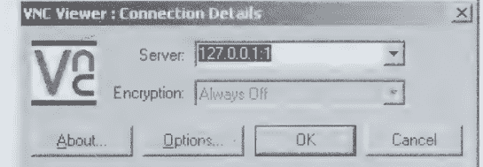

图 36：隧道模式下的 RealVNC

点击确定后，您的 VNC 连接应该再次运行起来，并且能够看到您的 ELCC。

如果您像图 31 那样启动了 VNC 服务器，您会发现被接受的连接 IP 地址现在是 127.0.0.7。

在我的研究过程中，我发现还有其他几种 VNC 查看器，我决定尝试下载其中一些，看看是否有显著差异。

下方您可以看到启动 TightVNC 后的样子。

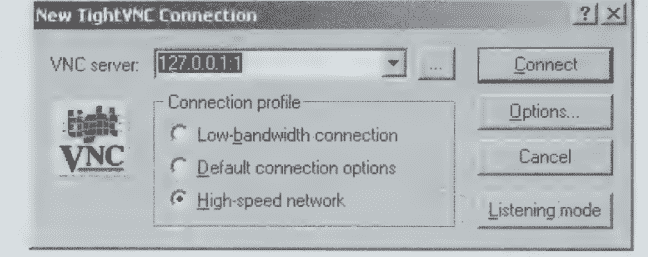

图 37：隧道模式下的 TightVNC

TightVNC 可在此处找到：

http://www.tightvnc.com/download.html

下方您可以看到启动 Ultr@VNC 后的样子。

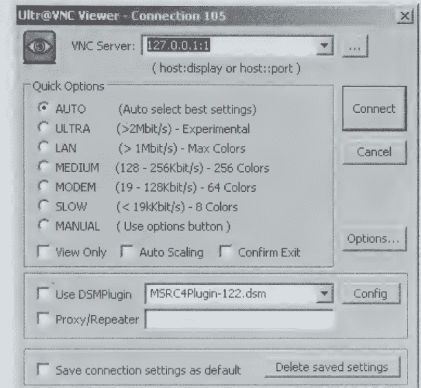

图 38：隧道模式下的 Ultr@VNC

Ultr@VNC 可在此处找到：

http://www.uvnc.com/download/index.html

在这三种情况下，我在降低速度时都能观察到色彩退化。我没有发现 ELCC 的 CPU 负载有任何显著差异。

如果您想阅读更多关于 VNC 的信息，维基百科上有一个（常规的）链接：

http://en.wikipedia.org/wiki/Vnc

或者您可以访问原始的 AT&T-Cambridge VNC 网站：

http://www.hep.phy.cam.ac.uk/vnc_docs/index.html

## 4. Debian：在 Raspberry PI 上安装和配置控制中心

在撰写本文时，Raspberry PI 在全球范围内非常受欢迎——至少在嵌入式硬件社区是这样。

如果您还不了解，“Raspberry Pi”是 Raspberry Pi 基金会 (http://www.raspberrypi.org/) 的商标。

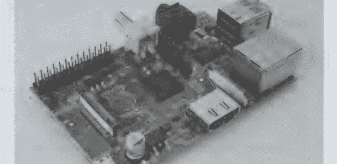

图 39：“Raspberry PI” model B rev 1（courtesy of Wikipedia）

> “Raspberry Pi 是一款低成本的、**信用卡大小的计算机**，它可以连接到计算机显示器或电视，并使用标准键盘和鼠标。它是一个功能强大的小设备，能够让所有年龄段的人探索计算，并学习如何使用 Scratch 和 Python 等语言进行编程。它能够完成您对桌面计算机的所有预期操作，从浏览互联网、播放高清视频，到制作电子表格、文字处理和玩游戏（参考 [54]）。”

Raspberry Pi 搭载了 Broadcom BCM2835 系统级芯片 (SoC)，其中包括一个 ARM1176JZF-S 700 MHz 处理器。

除了 Broadcom BCM2835 SoC 之外，它还包含一个 VideoCore IV GPU，最初配备 256 MB RAM，后来升级到了 512 MB。由于其极小的信用卡尺寸，它不包含常规的内置硬盘或类似存储设备。相反，它使用 SD 卡进行启动和长期存储。

RPI 的 I/O 接口包括：

- 一个以太网连接器

- HDMI 接口

- 模拟视频和声音，以及

- 两个 USB 接口。

您还可以通过连接器与 BCM2835 SoC 的部分 I/O 引脚进行接口连接。

对于 512MByte 的开发板，其价格仅为 40 欧元左右，是一个非常有吸引力的嵌入式硬件平台。

Raspberry Pi 基金会提供了几种流行的 Linux 版本。如果您习惯使用 Linux，您会立即感觉到 Raspberry Pi 让您如鱼得水。

当我第一次听说 Raspberry Pi 时，我立刻决定在这一平台上实现我的 ELCC。

这就是我将在接下来的章节中详细介绍的内容。

在撰写本文时，该开发板已有几个更新的版本。我在这里不会详细讲解它们之间的区别，但建议您访问 Raspberry Pi 主页以获取更多信息。

## 4.1. Debian: Linux 操作系统

我为 Raspberry Pi 选择使用的 Linux 版本是 Raspbian “Wheezy”。

主页上的描述将其定义为：“如果您刚刚起步，这是我们建议您使用的镜像”。

从现在起，您必须记住的一件事是，这个 Linux 版本是为在 ARM CPU 上运行而编译的，而不是在 x86 CPU 上运行。这意味着所有为 x86 硬件平台设计的优秀软件都无法在这里使用。幸运的是，许多 x86 编译的软件也已经为 Raspberry Pi 提供了可用版本。

稍后您会发现，如果您无法获得已为 Raspberry 平台编译的软件版本，也可以直接在 Raspberry Pi 上编译来自开发人员/公司的源代码。

### 4.1.1. 安装 Raspbian

您可以在 Raspberry Pi 主页的下载页面找到 Raspbian “Wheezy”：

http://www.raspberrypi.org/downloads

在撰写本文时，该版本日期为 2014-12-24。

请注意默认登录信息：

```
Username: pi
Password: raspberry
```

由于 Raspberry Pi 没有真正的硬盘，而是使用 SD 卡，因此需要将下载的镜像写入 SD 卡。

正如下载主页上所述，这非常简单。我假设您是 Windows 用户，因此您应该安装 “Win32 Disk Imager” 程序。下载主页上有指向该程序的链接。

如果您想使用 Linux 系统写入镜像文件，则应使用 “dd” 工具。同样，下载主页上也有指向它的链接。

在接下来的内容中，我将演示如何使用 “Win32 Disk Imager” 程序将镜像写入 SD 卡。

从下载主页下载镜像后，您需要对其进行解压。这可能会花费一些时间，因为镜像大小为 1.9 GB。由于镜像的大小，您还需要一张至少 2 GB 的 SD 卡。

SD 卡分为不同的等级，您可以在参考文献 [1] 中阅读相关内容。您不应选择低于 Class 4 的卡，这能保证 SD 卡（您的硬盘）至少有 4MByte/sec 的性能。您可以使用等级较低（或没有等级）的卡，但您会感觉到系统运行缓慢。

根据经验，我还建议准备不止一张卡，这样您就不需要为不同的配置而反复重新写入同一张卡。

最后需要准备的是一个 SD 卡阅读器。大多数现代 PC 都预装了一个。如果您没有，可以购买一个基于 USB 的阅读器。

安装好 “Win32 Disk Imager” 程序并解压 *Raspbian "Wheezy"* 镜像后，您就可以开始了。

“Win32 Disk Imager” 程序非常易于使用。首先定位您的 *Raspbian "Wheezy"* 镜像，找到您的 SD 卡阅读器设备，然后点击写入。之后您应该会看到如下界面。

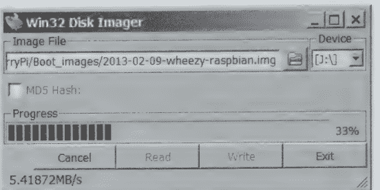

图 40：“Win32 disk manager” 为 Raspberry Pi 创建 SD 卡

完成后，您应该收到一条 “Write Successful”（写入成功）的消息。


图 41：Raspberry Pi SD 卡创建成功

现在，您的 SD 卡中应该已经有了可运行的镜像，您可以为此为 Raspberry Pi 供电启动。

现在您可以采取不同的方式进行操作：

- 要么将基于 HDMI 的显示器连接到您的 Raspberry Pi，并配备 USB 鼠标和键盘；或者

- 通过网络访问您的 Raspberry。

我使用最后一种方法，将在下文详细描述。

我使用 “Xming X Server for Windows”（参考文献 [2]）。这就是所谓的 Windows 版 X Window Server。

在您使用 Xming 程序访问 Raspberry Pi 之前，您需要知道 Raspberry Pi 的 IP 地址。

为了确定 Raspberry Pi 的 IP 地址，您需要访问本地防火墙/路由器。您的防火墙/路由器需要作为 DHCP 服务器工作，以便 Raspberry 能够获取自己的 IP 地址。我假设您知道如何配置局域网（LAN）以及如何设置 DHCP 服务器。

首先，在仅连接互联网线和电源线的情况下为 Raspberry Pi 供电。

然后，进入防火墙/路由器的 DHCP 客户端概览。在那里您将看到如下所示的内容。


在我的例子中，Raspberry Pi 的 IP 地址是：192.169.0.122。

### 4.1.2. 远程连接到 Raspberry Pi（或任何 Linux 机器）

有几种方法可以远程连接到您的 Raspberry Pi 或任何 Linux 机器。

#### 4.1.2.1. 安装并配置 Xming

**安装 Xming**

远程连接到 Raspberry Pi 的方法之一是在 Windows 机器上使用 Xming X-server 程序。从参考文献 [2] 下载后，直接启动安装程序即可。安装过程非常简单。您将看到常规的欢迎界面。

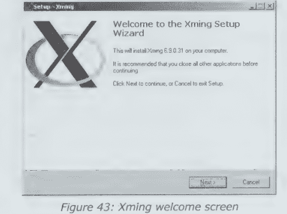

系统会询问您将程序安装在何处，然后要求您选择组件：

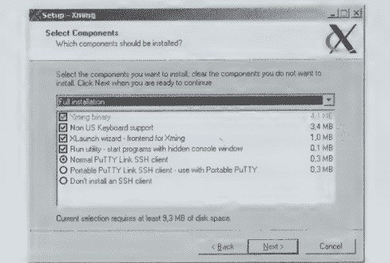

图 44：Xming 组件选择

关于 “PuTTY”，除非您非常清楚自己在做什么，否则我建议采用标准安装。

与大多数 Windows 程序一样，系统会要求您选择开始菜单文件夹。使用默认设置或根据需要更改。

接下来，您将被要求选择附加任务。

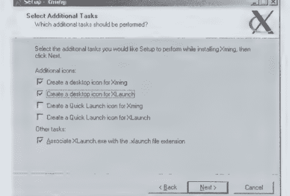

图 45：Xming 附加任务

我建议您至少勾选前两个选项以及 “Associate Xlaunch . . . .”。

现在您可以安装程序并首次配置 Xming 了。

**配置 Xming**

当您第一次启动 Xlaunch 时，您很可能会收到 Windows 防火墙（如果已启用）的警告。直接接受即可继续使用该程序。

这将引导至以下设置序列。

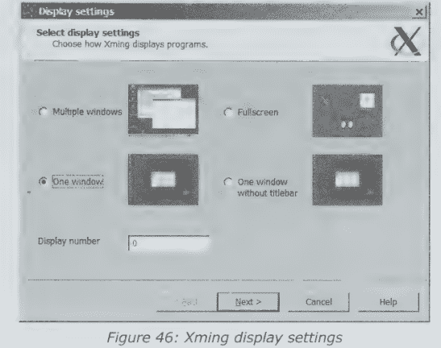

如图所示，点击 “One Window” 然后点击 Next。

勾选 “Start a program” 按钮。

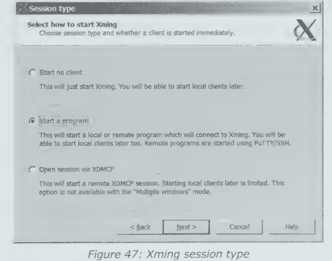

现在我们可以输入 Raspberry Pi 的具体细节了。

我们要启动的程序是 “`startlxde`”。由于我们想在 Raspberry Pi 上运行它，请选择 “Run Remote”/“Using PuTTY”。

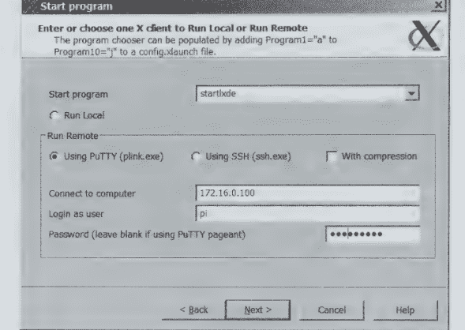

图 48：Xming 程序启动

“Connect to computer”（连接到计算机，即您的 Raspberry Pi）。此处应包含您之前从路由器/防火墙中获取的 IP 地址。

由于您尚未登录 Raspberry Pi，只需输入默认用户 ID 和密码（即 “`raspberry`”）。

在下一个窗口中，使用默认设置并点击 Next。

## 4. Debian: 在 Raspberry Pi 上安装和配置控制中心

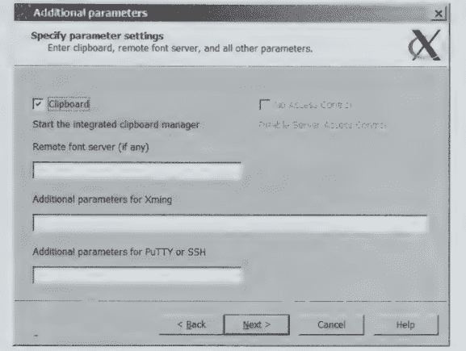

图 49：Xming 附加参数

Xming 的配置现已完成。为了方便起见，您可以保存配置文件，这样下次连接 Raspberry Pi 时就无需再次输入。

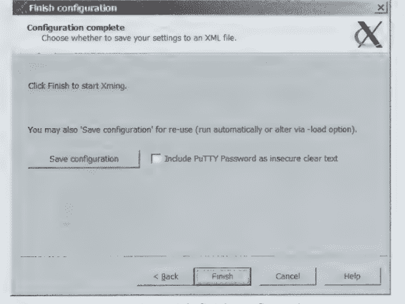

图 50：Xming 完成配置

保存配置并点击 Finish。

在点击 Finish 之前，请验证您的 Raspberry Pi 已通电并与您的 Windows PC 连接到同一个局域网。这虽然显而易见，但如果不注意可能会导致...

直到被注意到为止，会有一些挫败感。

在按下 Finish 后，只要所有数值正确，Windows 版的 Xming X Server 就会启动。


在您与 Raspberry PI 建立联系之前，很可能会看到以下内容：

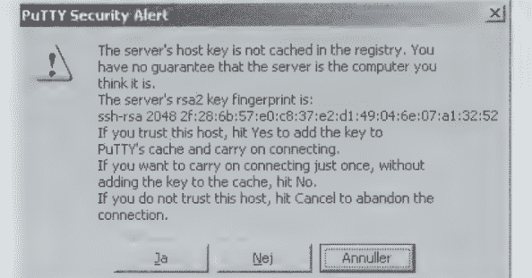

图 51：PuTTY SSH 安全警报

只需点击 Yes（丹麦语为 Ja），这样 `rsa2` 密钥就可以像前面提到的那样被添加到 PuTTY 的缓存中。完成此操作后，您将不再看到该警报。

接下来的界面应该类似于下面的屏幕。

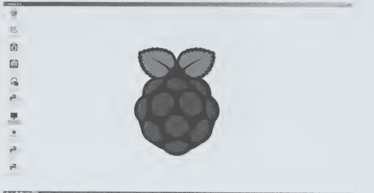

图 52：通过 Xming 访问的 Raspberry PI Xserver 屏幕

您现在可以访问您的 Raspberry PI，其方式与您按照标准设置（配备屏幕、键盘和鼠标）进行设置时几乎相同。

**注意** 每次您想要关闭 Raspberry Pi 时，都需要通过执行以下命令来完成：

```
pi@raspberrypi ~ $ sudo shutdown -h now
```

您可能会认为只需关闭 Xming 程序并断开 Raspberry 的电源即可。这确实会关闭 Raspberry Pi，但上述命令的操作更为温和，且不会产生任何不良影响。

如果您希望在做出更改后让 Raspberry Pi 继续运行，请关闭 Xming 程序。

您会收到如下警告：

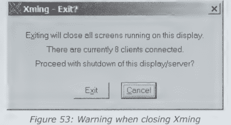

此警告可以忽略。

在退出 Xming 之前，关闭所有活动程序始终是一个好习惯。

#### 4.1.2.2. 安装并配置 Windows 远程桌面

另一种连接到 Raspberry Pi ELCC 的方法是使用微软的 Windows 远程桌面。这要求 ELCC 上启动远程桌面协议服务器（`xrdp`）。

这是通过 SSH 远程登录到 Raspberry Pi 来完成的。为此，我将使用 Windows 程序 PuTTY。

该程序可以从此处下载：

http://www.chiark.greenend.org.uk/~sgtatham/putty/download.html

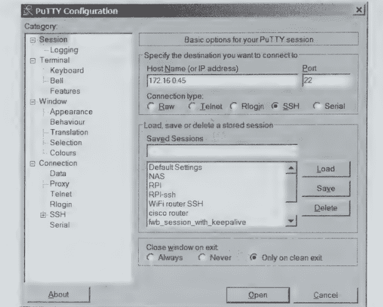

图 54：使用 PuTTY 登录到 Raspberry Pi

PuTTY 用起来很简单；输入 Raspberry Pi 的 IP 地址，选择 “SSH” 并按下 “open”。

然后系统会提示您输入用户 ID（`pi`）和密码（`raspberry`）。

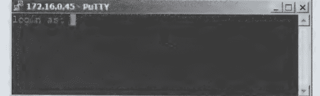

图 55：Raspberry Pi PuTTY 登录

登录后，您将看到熟悉的提示符：

```
pi@raspberrypi ~$
```

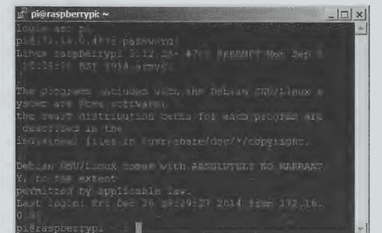

图 56：通过 PuTTY 登录到 Raspberry Pi

从这里开始，您只需输入以下命令：

```bash
pi@raspberrypi $ sudo apt-get update
```

这是为了确保来自存储库的本地软件包列表已更新到最新的软件包及其依赖项版本。

接下来，我们使用以下命令安装 `xrdp` 软件：

```bash
pi@raspberrypi $ sudo apt-get install xrdp
```

完成后，界面将如下所示：

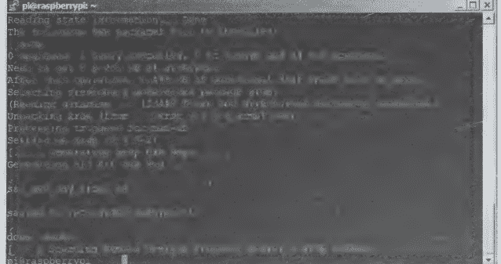

图 57：`xrdp` 服务器的安装

您现在应该关闭 PuTTY 会话并按照以下步骤启动远程桌面连接。

在 Windows 中点击开始按钮并输入 `mstsc`。您应该会看到类似这样的界面：

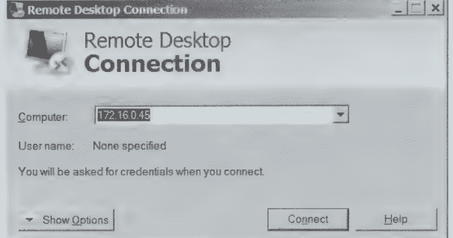

图 58：远程桌面连接启动

输入 Raspberry Pi 的 IP 地址并按下 “连接”。

随后您很可能会收到如下警告：

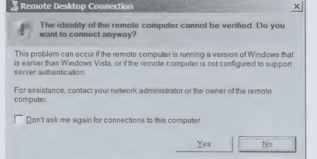

图 59：远程桌面连接警告

按下 “是” 以继续。

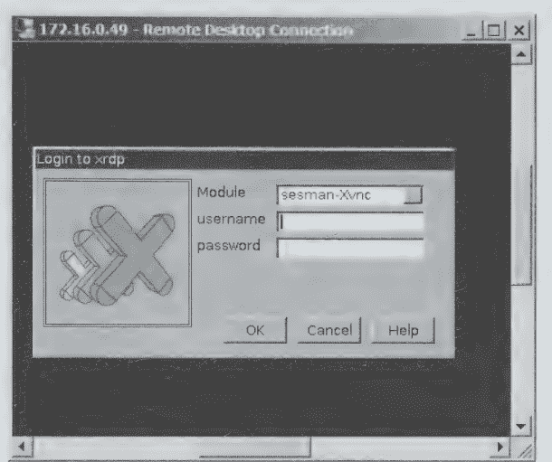

图 60：远程桌面登录

输入 Raspberry Pi 的用户名和密码，您应该就可以看到远程桌面了。

**注意**

您可能会遇到国家/地区设置方面的问题。遗憾的是，我无法指导您如何修复此问题，请在互联网上寻找建议。

还需记住的一点是，每当您想要以 root 身份执行命令时，不需要使用 `gksudo`（像 Xming 那样），只需输入 `sudo` 即可。

### 4.1.3. 配置 Raspbian

一旦您与 Raspberry Pi 建立了联系（无论是通过键盘/鼠标设置还是通过 Xming），就可以对系统进行最基本的配置了。

#### 网络配置

如果您想将 Raspberry PI 用作控制服务器（这也是本文的所有目的），我建议您为 ELCC 配置一个静态地址。在 Raspberry PI 上，操作如下。

点击 LXTerminal 图标启动终端会话。在终端会话中输入以下内容：

```
pi@raspberrypi ~ $ sudo nano /etc/network/interfaces
```

这将允许您编辑`/etc/network/interfaces`文件。

```
auto lo

iface lo inet loopback
iface eth0 inet dhcp

allow-hotplug wlan0
iface wlan0 inet manual
wpa-roam /etc/wpa_supplicant/wpa_supplicant.conf
iface default inet dhcp
```

在此文件中，您需要更改以下内容：

- 将`iface eth0 inet dhcp`更改为`iface eth0 inet static`

- 在`iface eth0 inet static`之后向文件中添加以下内容：

    - `address 192.168.1.100`

    - `netmask 255.255.255.0`

    - `network 192.168.1.0`

    - `broadcast 192.168.1.254`

    - `gateway 192.168.1.100`

更新后，文件应如下所示：

```
auto lo

iface lo inet loopback
iface eth0 inet static
address 192.168.1.100
netmask 255.255.255.0
network 192.168.1.0
broadcast 192.168.1.255
gateway 192.168.1.1

allow-hotplug wlan0
iface wlan0 inet manual
wpa-roam /etc/wpa_supplicant/wpa_supplicant.conf
iface default inet dhcp
```

**注释：** 请修改实际地址（`192.168.1.100`）以适应您的网络配置，并将静态地址置于网络 DHCP 服务器（如果配置了）的分配范围之外。

您会注意到接口文件中还有其他信息。这里主要需要注意的是，如果您需要连接 USB Wi-Fi 接口，接口文件已经为此做好了准备，您只需配置`/etc/wpa_supplicant/wpa_supplicant.conf`文件即可。

完成后，通过以下方式退出 Nano 编辑器：

1. 按下 `<ctrl>-x`

2. 对保存更改的问题回答 `yes`

3. 按下 Enter 键确认要保存的文件名。

下一个要编辑的文件是`/etc/resolv.conf`。这也通过输入以下命令启动的终端界面完成：

```bash
pi@raspberrypi ~ $ sudo nano /etc/resolv.conf
```

这将允许您编辑`/etc/resolv.conf`：

```text
domain p3net
search p3net
nameserver 192.168.1.1
```

如果尚未存在，这里只需要添加一行，即粗体部分：

```text
nameserver 192.168.1.1
```

这应该与您之前为网关输入的地址相同。

完成后，按照前述方法退出 Nano 编辑器。

在您重启 Raspberry PI 或重启网络之前，所有更改都不会生效。重启网络可以通过此命令完成：

```bash
pi@raspberrypi ~ $ sudo /etc/init.d/networking restart
```

或者通过输入这些命令：

```
pi@raspberrypi ~ $ sudo /etc/init.d/networking stop
pi@raspberrypi ~ $ sudo /etc/init.d/networking start
```

如果您通过 Xming 连接，可以执行第一个命令，但您必须重新连接到 Raspberry PI。

最后两个命令仅在您通过鼠标/键盘和标准 HDMI 显示器连接时才能执行。

毋庸置疑，如果您通过 Xming 连接并搞乱了网络配置，您可能会永远失去与 Raspberry PI 的联系。因此，请在进行任何其他操作之前先完成此步骤，以免之后必须重新进行所有配置。

#### Raspberry PI 配置

一些 Raspberry PI 的基本配置可以通过 Raspberry PI 配置工具来完成。该工具启动方式如下：

```
pi@raspberrypi ~ $ sudo raspi-config restart
```

这将弹出如下“老式”风格的配置菜单。

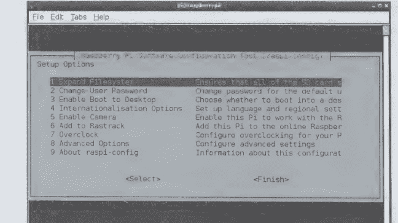

图 61：`raspi-config`

有几项内容需要配置：

1. **Expand Filesystem**（扩展文件系统）：此设置选项可确保使用 SD 卡的全部容量。根据 SD 卡的大小，您...

如果你有可用空间，SD 卡的一半以上可能处于未使用状态。在选择此设置选项时，你会看到显示内容不断变化，直到最终完成并需要重启。

2. **国际化选项**：为了方便起见，我建议你使用此设置选项来配置语言、时区和键盘布局。

基本上就是这些了。我还建议将标准用户密码（`raspberry`）更改为一个较少为人知的密码。

如果你想尝试其他一些功能，可以在互联网上阅读相关内容。

现在你已经完成了 Raspberry PI 的基础配置，可以将其视为标准配置的个人参考。

因此，我建议你使用 “Win32 Disk Imager” 程序将 SD 卡的副本备份到 PC 中。如果你以后搞砸了，只需恢复标准配置即可重新开始。

这是我建议你在每次对 Raspberry PI 进行重大配置时所采取的策略。

## 4.2. Debian：Web 服务器相关软件

在为 DSL Linux 安装 Web 服务器相关软件时，使用的是 XAMPP 软件包。主要原因是它是安装 Apache、PHP 和 MySQL 的一种非常简单的方法。

由于 XAMPP 软件包针对的是 x86 硬件平台，因此无法在 Raspberry PI 上使用。

取而代之的是，通过使用 `apt-get` 应用程序分别安装这三个软件包。Linux 的常规用户会对这个命令感到熟悉。

在安装这三个 Web 软件包之前，我们需要刷新软件仓库。这样做是为了确保 `apt-get` 应用程序能够获知所有新版本或软件包。可以通过在终端会话中输入以下命令来实现：

```bash
pi@raspberrypi ~ $ sudo apt-get update
```

执行该命令时，仓库将被更新。完成后的样子如下：

图 62：Raspberry PI `apt-get update`

我们现在准备安装第一个软件包：Apache

### 4.2.1. Apache 安装

在终端会话中，输入以下命令：

```bash
pi@raspberrypi ~ $ sudo apt-get install apache2
```

如下所示，在某个时间点，系统会要求你确认是否要在 Raspberry PI 上安装 Apache。你应该输入 `y` 以继续。

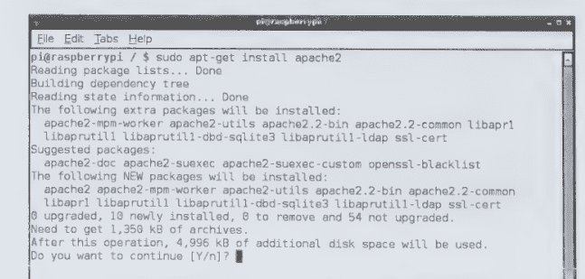

图 63：Raspberry PI `apt-get install Apache`

你现在会看到 `apt-get` 应用程序在执行以下操作：

- “获取 (Get)” 大量的应用程序和库

- “选择 (Select)” 并 “解包 (unpack)” 相同的应用程序和库

- “设置 (Set up)” 支持 Apache 的库以及 Apache 本身，然后；

- 启用大量模块以支持 Apache，最后；

- Apache 将启动。

完成后，终端窗口中将显示如下内容：

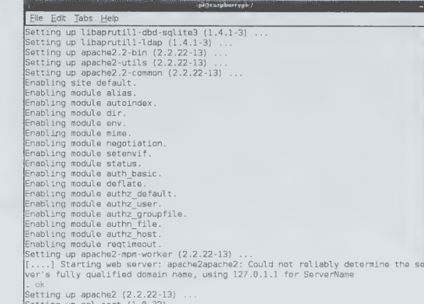

图 64：Raspberry PI Apache 安装完成

此时，如果你在 Raspberry PI 上打开浏览器并输入：

- `127.0.0.1`，

- 从局域网中的任何其他 PC 输入`<你的 Raspberry PI IP 地址>`。

你会看到这个：

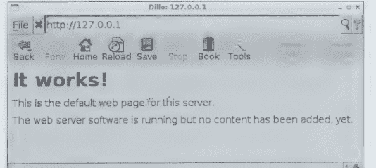

图 65：Raspberry PI 上的 Apache “It works!”

如果你没有看到图 65 中描述的文本，请尝试执行以下操作：

- 如果你是从局域网连接，请验证物理局域网连接和 IP 地址。打开终端窗口并执行以下命令：

  `ps -A | grep apache`

- 应该会显示几行包含 `apache2` 的内容。如果没有，则说明 Apache 未运行。通过执行以下命令启动 Apache：

  `sudo service apache2 start`

- 查看错误的一个地方是位于此处的 Apache 错误日志：

  `/var/log/apache2/error.log`

### 4.2.2. MySQL 安装

在终端会话中，输入以下命令：

```bash
pi@raspberrypi ~ $ sudo apt-get install mysql-server
```

与之前一样，系统会要求你确认是否要在 Raspberry Pi 上安装 `mysql-server`。


图 66：Raspberry Pi `apt-get install MySQL-server`

这一次 `apt-get` 同样会获取所有支持 MySQL 所需的应用程序和库，但在此时，你会被要求提供 MySQL 数据库的 `root` 密码。

就像安装 DSL Linux 时一样，我使用 `dsl9000p3`。当然，你应该使用一个你自己想出的密码。

**注意**：如果你输入了自己的密码，你需要使用新密码更新以下文件：

```
/opt/lamp/htdocs/public/vars.inc.php
/opt/lamp/htdocs/public/sms.vars.inc.php
```

如果你安装 SMS 网关，这将在第 4.4.2 节和第 6.5.3.2 节的 Web 界面安装过程中显示。


图 67：Raspberry PI MySQL root 密码

系统会要求你重复输入。

完成后， `apt-get` 将开始解包、选择、设置并最终启动 MySQL 服务器。

这可能需要一些时间。毕竟，你机器内部运行的并不是一台超级计算机。

完成后，你应该在终端窗口中看到这个。


图 68：Raspberry PI MySQL 安装完成

在安装 PHP 之前，你将无法验证 MySQL 服务器的安装情况。

### 4.2.3. PHP 安装

在终端会话中输入以下命令：

```bash
pi@raspberrypi ~ $ sudo apt-get install php5
```

像我们习惯的那样，在某个时间点，系统会要求你确认是否要在 Raspberry Pi 上安装 `php5`。


图 69：Raspberry PI `apt-get install php5`

将执行与 Apache 和 MySQL 相同的过程，但你还会注意到 Apache 服务器将重启以启用 PHP 支持。

完成后，你的终端窗口将如下所示：


图 70：Raspberry PI `php5` 安装完成

### phpMyAdmin

为了方便地访问 MySQL 数据库，需要安装 `phpMyAdmin` PHP 软件包。这将在接下来的章节中描述。这虽然不是严格必须的，但我建议你安装。

像之前一样，在终端窗口中输入以下内容：

```bash
pi@raspberrypi ~ $ sudo apt-get install phpmyadmin
```

当被询问时，像之前的安装一样，输入 `y` 以继续安装 `phpmyadmin`。

这一次，系统会要求你选择哪个 Web 服务器应该被自动配置以运行 `phpmyadmin`。你应该通过按下 “空格” 键选择 `apache2`，然后按回车。


图 71：Raspberry PI “apt-get install phpmyadmin”

在随后的过程中，系统会要求你安装一个供 “phpmyadmin” 使用的数据库，如下所示：


图 72：Raspberry PI phpmyadmin 数据库配置

为了方便，回答 “yes” —— 这将引导至更多问题：


图 73：Raspberry PI phpmyadmin 数据库密码

像之前一样，我使用 “dsl9000p3”。当然，你应该使用一个你自己想出的密码。

系统会像之前一样要求你确认密码。

完成后，你会看到 Apache 服务器已重新加载，且 “phpmyadmin” 应该已经准备好使用了。


图 74：Raspberry PI phpmyadmin 安装完成

为了使用 “phpmyadmin”，你应该在 Raspberry PI 的浏览器中输入以下内容：

```
http://127.0.0.1/phpmyadmin
```

或者从局域网中的任何其他 PC 输入：

```
http://<你的 Raspberry PI ip 地址>/phpmyadmin
```

然后你会看到这个：


图 75：Raspberry PI phpmyadmin 登录界面

记得启用 cookies。

## php_serial.class.php

为了能使用 PHP 脚本与串口通信，你需要`php_serial.class.php`文件。

我在编写本文时提供了最新版本，且由于该文件长期没有更新，我认为你不需要再进行更新。

我在这里找到了该软件：

```
http://www.phpclasses.org/browse/file/17926.html
```

## 4.2.4. 配置 Apache, PHP 和 MySQL

安装完成后，你应该就可以开始了。如果你只需要标准安装，则无需进行进一步配置。

如果需要调试或额外配置，以下文件可能会对你有帮助：

- Apache 日志文件：`/var/log/apache2`

- MySQL 日志文件：

    - `/var/log/mysql`

    - `/var/log/mysql.err`

    - `/var/log/mysql.log`

- Apache 配置文件：`/etc/apache2`

- MySQL 配置文件：`/etc/mysql`

- PHP 配置文件：`/etc/php5`

## 4.3. Debian：编译器软件

编译 ELCC 支持程序所需的 C 编译器已预装在 Raspbian “Wheezy” 镜像中。

你唯一需要做的是检查预装的 C 编译器是否正常工作。这可以通过常规的 “hello world” 应用程序来完成。

启动 Gedit 文本编辑器并输入以下内容，将其保存为`/home/pi`目录下的`helloworld.c`。

```c
#include <stdio.h>
main()
{
    printf("hello world\n");
}
```

完成后，在终端窗口中输入以下内容：

```bash
pi@raspberrypi ~ $ gcc helloworld.c -o helloworld
```

如果没有出现任何错误，请通过输入以下命令运行测试程序：

```bash
pi@raspberrypi ~ $ ./helloworld
```

如果你看到 “hello world”，那么目前一切正常。

现在你应该能够编译本项目所需的 C 代码了。

**注意**：Raspberry PI 并不是一台拥有无限资源的强大 PC。

因此，你可能会发现由于硬件限制，无法在 Raspberry PI 上编译某些程序。

不过，ELCC 所需的程序都可以在 Raspberry PI 上编译。即使是内存为 256MB 的 A 版本也是如此。

如果你需要编译比 Raspberry PI 能处理的更大的程序，你需要在功能更强的 Linux 或 Windows PC 上设置跨平台环境，在那里进行软件编译。

这不是一项简单的任务，而且因为我不需要，所以我将不展示此类安装过程。

### 4.3.1. MySQL 库

ELCC 有一些需要与 MySQL 交互的支持程序。为了实现这一点，我们需要安装少量的 MySQL 库。

操作步骤如下：

打开终端窗口并执行以下命令：

```bash
pi@raspberrypi ~ $ sudo apt-get install libmysqlclient-dev
```

这将安装创建 C 程序时所需的缺失库和头文件。安装过程如下所示：


图 76：安装 MySQL 库

### 4.3.2. USB 库安装

如果你想使用 6.3.1 节中提到的 Elektor Thermo-Snake，你需要安装与 3.3.2 节 DSL 安装中提到的相同的 USB 库。

这次安装略有不同，因此我将引导你完成，以避免任何错误。

#### LIBUSB

LIBUSB 是一个基础 USB 库，需要以开发版本实现。我们需要这个用户空间 USB 编程库的开发版本，以便在无需了解 Linux 内核内部机制的情况下编写 USB 应用程序。

首先在终端窗口中输入以下内容：

```bash
pi@raspberrypi ~ $ sudo apt-get install libusb-dev
```

这将执行标准的 apt-get 安装，如下图 77 所示。


图 77：安装开发版本的 libusb

这就是开发版本的基础 USB 安装。

#### LIBHID

通常情况下，仅使用 LIBUSB 库就足够了，但由于 Thermo-Snake 是一个 USB HID 设备（见参考资料 [37]），与“普通”USB 设备相比，我们需要进行一些额外的编程。我们需要一个名为 LIBHID 的 LIBUSB 附加库。

HID 设备可以是键盘、鼠标、游戏控制器等。

你可以在这里获取 LIBHID 源代码：

https://alioth.debian.org/frs/?group_id=30451

在编写本文时，下载该软件需要登录。

如果你不想登录，可以在互联网上搜索该文件：

`libhid-0.2.16.tar.gz`

应该很容易找到其他下载地址。

下载完成后（保存到你的“home”目录），我们需要编译并安装软件。步骤如下：

在终端窗口中输入以下内容：

```bash
pi@raspberrypi ~ $ sudo tar xvfz libhid-0.2.16.tar.gz
```

这将创建 “libhid-0.2.16” 目录。

进入该目录并执行以下命令：

```bash
pi@raspberrypi ~ $ sudo ./configure
```

完成后，你应该看到类似这样的内容：


图 78：为 libhid 配置 makefile

在继续之前，我们需要对以下文件进行修改：

`libhid.c`

该文件的位置如下（如果你按照我的安装步骤操作）：

`/home/pi/Downloads/libhid-0.2.16/test`

你需要在第 42 行添加以下内容：

```c
if (len) {}; if (custom) {};
```

最终结果应该像这样：

```c
37  const struct usb_device *device = usb_device((

38

39  /* only here to prevent the unused warning */
40  /* TODO remove */
41  len = *((unsigned long*)custom);
42  if (len) {}; if (custom) {}; 

43

44  /* Obtain the device's full path */
45  //sprintf(current_dev_path, "%s/%s", usbdev->bu
```

如果你不修改代码，在执行以下命令时会收到以下错误信息：

```bash
lshid.c:32:87: error: unused parameter 'len'
[-Error=unusedparameter]
bool device_iterator (struct usb_dev_handle const* usbdev,
void* custom, unsigned int len)
```

还有其他消除此错误的方法，但具体怎么做并不太重要，因为这段代码与程序运行无关。

修改完成后，我们准备继续。

接着输入以下命令：

```bash
pi@raspberrypi ~ $ sudo make
pi@raspberrypi ~ $ sudo make install
```

希望你不会看到任何错误。

在编译和安装过程中，你应该能看到类似下面所示的关于库安装位置的信息。

```
pi@raspberrypi:~~/libhid-0.2.16
ranlib /usr/local/lib/libhid.a
ldconfig -p /usr/local/lib
PATH=$PATH:/usr/local/bin" ldconfig -n /usr/local/lib

Libraries have been installed in:
/usr/local/lib

If you ever happen to want to link against installed libraries
in a given directory, LIBHID, you must either use libtool, and
specify the full pathname of the library, or use the -LIBHID
flag during linking and do at least one of the following:
  add LIBHID to the "LD_LIBRARY_PATH" environment variable
  during execution
  add LIBHID to the "LD_RUN_PATH" environment variable
  during linking
  use the "-Wl,--rpath -Wl,LIBHID" linker flag
  your system administrator add LIBHID to "/etc/ld.so.conf"

See any operating system documentation about shared libraries for
more information, such as the ld(1) and ld.so(8) manual pages.

test -z "/usr/local/bin"
mkdir -p "/usr/local/bin"
/bin/bash ../libtool --mode=install /usr/bin/install -c 'libhid-detach-device'
/usr/local/bin/libhid-detach-device'
/usr/bin/install -c .libs/libhid-detach-device /usr/local/bin/libhid-detach-devi
```

图 79：libhid 库的编译

完成后——如果没有报错——记得运行：

```bash
pi@raspberrypi ~ $ sudo ldconfig -v
```

`ldconfig`命令在 8.3 节中有所描述。

### 验证 LIBHID 安装

如果你遵循了 4.3.2 节中提到的 USB 库安装步骤，现在可以通过以下方式验证安装：

```bash
pi@raspberrypi ~ $ cd /libhid-0.2.16/test
```

验证需要 6.3.1 节中提到的 Elektor Thermo-Snake 或另一个 USB HID 设备。为了简单起见，我假设你已经将 Thermo-Snake 连接到你的 ELCC 上。

打开终端窗口并进入 libhid 的测试目录。

我们现在需要找到 Thermo-Snake 的供应商 ID（vendor ID）和产品 ID（product ID）。通过以下命令完成：

```bash
pi@raspberrypi ~/libhid-0.2.16/test $ lsusb
```

它将为你提供一个列表，内容应该如下所示：

图 80：显示已连接的 USB 设备

我们关注的是设备 005 的 ID：

```
ID 04D8:0064
```

这个 ID 需要输入到位于 test-directory 目录下的`test_libhid.c`程序中。

因此，启动您最喜欢的文本编辑器，并按如下所示修改第 43 行：

图 81："test_libhid.c" 的修改

在这里我们输入供应商 ID `0x04D8`和产品 ID `0x0064`。保存文件并返回到之前打开的终端窗口。

在终端窗口中执行以下命令：

```bash
pi@raspberrypi ~\ /libhid-0.2.16/test $ sudo make
```

这将编译`test_libhid.c`文件。其界面如下所示：

图 82：test_libhid.c 文件的编译

完成后，像这样运行命令：

```bash
pi@raspberrypi ~/libhid-0.2.16/test $ sudo ./test_libhid
```

在信息流输出的过程中，您应该能读到类似以下的内容：

图 83：test_libhid 命令的运行结果

您的 Thermo-Snake 已被找到，并列出了相关信息。如果您没有使用 Thermo-Snake 作为被测 HID 设备，请相应地更改供应商和产品 ID。您还会看到关于您设备的其他列出信息。

## 4.4. Debian：控制中心的安装与基本配置

### 4.4.1. 简介

ELCC Web 界面的安装方式与 DSL Linux 平台相同。

因此，所有 ELCC 的文件都将放置在这里：

`/opt/lampp/htdocs`

以及这里：

`/opt/lampp`

这不是 Apache 安装的标准目录。在没有任何配置更改的情况下，标准 Apache 安装的网页将放置在这里：

`/var/www`

为了在所有 Linux 平台上使用相同的代码，我特意将其目录保持与 XAMPPP 所指定的相同。

### 4.4.2. Web 界面安装

我创建的界面安装非常简单——就像安装 XAMPPP 一样。

从 Elektor.com 将软件下载到`/home/pi`目录，并执行以下命令：

```bash
pi@raspberrypi-$ sudo mkdir /opt/lampp
pi@raspberrypi-$ sudo tar xvf ctrlcentre_<date>.tar -C /opt/lampp
```

在撰写本文时，该文件的名称为：

`ctrlcentre_20150524.tar`

在安装过程中，您将在屏幕上看到每一个被列出的文件。文件名很多，希望它们能在屏幕上迅速“飞过一遍”。

安装成功后，您现在已将所有文件安装到以下目录：

- `/opt/lampp/htdocs`

- `/opt/lampp/ctrl_centre`

### 配置

为了运行 ELCC 网页，我们需要对 MySQL 数据库进行简单的配置。

这非常简单，只需通过在 Raspberry PI 上安装的浏览器（或从外部 PC）运行`install_db.php`文件即可。

在运行数据库安装脚本之前，我们需要调整 Apache 的安装。

如前所述，ELCC 的 Web 界面安装在了一个非预期的地方。

为了绕过这个问题，我们需要在终端窗口中执行以下命令：

```bash
pi@raspberrypi-$ cd /var
pi@raspberrypi /var $ sudo mv www www-old
pi@raspberrypi /var $ sudo ln -s /opt/lampp/htdocs www
```

发生的情况是，原有的网页目录已被重命名为`www-old`。

接下来是创建了一个符号链接，使`/var/www`指向`/opt/lampp/htdocs`。这就是我们新安装的 ELCC Web 软件。

如果未创建该链接，ELCC 将无法工作。

**注意：** 如果在 4.2.2 节中您为 MySQL 数据库输入的 root 密码与`ds19000p3`不同，您现在需要修改以下文件：

`/opt/lampp/htdocs/public/vars.inc.php`

未修改前，该文件如下所示：

```php
$host = "localhost";
$user = "root";
$passwd = "ds19000p3";
$database = "CTRLCentre";
```

如果您之前更改了密码，请在终端会话中启动您最喜欢的编辑器并更改密码。

您可以启动浏览器并输入以下 URL 来继续完成 ELCC 所用数据库的最终安装：

http://192.168.1.60/install_db.php

（将 192.168.1.60 更改为匹配您的安装地址）

您应该会看到类似于图 84 的内容：

图 84：数据库安装成功

您可以通过两种方式验证配置是否成功：


在`4.2.3`节中，您应该已经安装了`phpMyAdmin`网页。如果安装了，您应该能够登录到新创建的`CTRLCentre`数据库。在该数据库中，应该有三个表：名为`CentreUser`的表（含一个用户`dsl`）、包含5个默认灯光配置的`Lamps`表，以及一个空的`Temperature`表。

输入以下URL进入CTRL中心主页：

```
http://192.168.1.60/index.php
```

（将`192.168.1.60`更改为匹配您的安装地址）

您应该能够使用用户ID：`dsl`和密码：`dsl000p3`登录。

**警告：** 请现在更改用户`dsl`的密码。如果不更改，您的ELCC将对任何人开放。

**警告：** 既然MySQL配置已完成，现在应该删除`install_db.php`或将其重命名为其他名称。如果不这样做，外部人员将能够再次输入默认密码。

### 执行权限

在Linux机器上运行的所有进程（PIDs）都有一个用户ID（UID），以便识别它们并管理其在系统中的权限。我并不自称是这方面的专家，但我很快发现，我无法在PHP中以root身份执行任何系统命令（就像在终端窗口中使用`sudo <command>`那样）。

原因是Apache用户`www-data`没有以root身份执行命令的权限（这基本上是一件好事）。

由于`www-data`需要以root身份执行某些实用程序，因此需要解决这个问题。这可以通过编辑以下文件来实现：

`/etc/sudoers`

Apache用户`www-data`需要拥有以root身份执行`/usr/local/bin`中所有命令的权限。

具体操作如**粗体**所示：

```
# sudoers file.
# User privilege specification
root ALL=(ALL:ALL) ALL
# Allow members of group sudo to execute any command
%sudo ALL=(ALL:ALL) ALL
# See sudoers(5) for more information on "#include"
# directives:
#includedir /etc/sudoers.d
pi ALL=(ALL) NOPASSWD: ALL
www-data ALL=(ALL) NOPASSWD: /usr/local/bin/*
```

您可以按如下方式编辑`/etc/sudoers`：

```bash
pi@raspberrypi-$ sudo visudo
```

`Visudo`会在您退出编辑器后进行语法检查。

**注意：** 为了方便，我还添加了以下行：

`pi ALL=(ALL) NOPASSWD: ALL`

这样我就不需要在终端窗口中每次以root身份执行命令时都输入root密码。

### 语言文件访问权限

为了使语言更改生效，我们需要更改以下文件的访问权限：

`/opt/lampp/htdocs/public/fields_text.inc.php`

这可以通过执行以下命令完成：

```bash
root@box:/home/dsl# chmod 777 /opt/lampp/htdocs/public/fields_text.inc.php
```

如果不这样做，您将无法通过Web界面覆盖该文件。

## 5. Lubuntu：安装与配置控制中心

Lubuntu 10.04已在具有以下规格的PC上经过测试：

| 组件 | 规格 |
| :--- | :--- |
| CPU | AMD Athlon XP 3000+ (主频: 2.17 GHz) |
| RAM | 1.0 G byte |
| BIOS | Award 2004/07/10 |
| 硬盘 | .25 Gbyte |
| 网卡 | VIA Rhine II Fast Ethernet |
| 显示适配器 | ATI Radeon 9550 |
| CD-ROM 驱动器 | 无品牌 |

上述组合提供了一个相对快速的系统，启动迅速，在40秒内即可运行——这对我来说是可以接受的。

到目前为止，我还没有导致系统崩溃或运行缓慢。

### 5.1. Lubuntu：Linux 操作系统

以下是来自`http://lubuntu.net`的Lubuntu OS描述：

“Lubuntu是一个由自由和开源爱好者社区开发的快速且轻量级的操作系统。系统的核心基于Linux和Ubuntu。Lubuntu使用极简桌面LXDE和一系列轻量级应用程序。我们专注于速度和能效。因此，Lubuntu的硬件要求非常低。”

您可能会发现其他同样适合您旧硬件的发行版，但到目前为止我选择了这个，因为该发行版的安装和维护非常简单。

### 5.1.1 安装与配置 Lubuntu

希望安装Lubuntu过程简单直接，不会出现太多挑战。

尽管安装过程简单明了且在互联网上有详尽的文档，但我在这里仍然包含了一份安装指南，就像我对本书中提到的其他发行版所做的那样。

首先要做的就是获取最新版本的Lubuntu。在撰写本文时，版本为Lubuntu 14.04，可以在此处找到：

`https://help.ubuntu.com/community/Lubuntu/GetLubuntu`

选择适合您硬件（年代、32/64位硬件）的发行版。如果您的硬件较旧，Ubuntu在此处建议如何进行最小化安装：

`https://help.ubuntu.com/community/Lubuntu/Documentation/MinimalInstall`

下载完成后，您需要制作一张CD或一个可启动的USB闪存盘才能开始安装。

**注意** 您下载的是一个ISO镜像。在之后烧录CD-ROM时，这一点至关重要。

您也可以创建一个用于引导Lubuntu启动的USB闪存盘。这要求您的Linux PC能够从USB闪存盘启动。这可能还需要您更改PC的BIOS配置。

有几种（Windows）软件套装可以为您制作可启动USB盘。

- LinuxLIVE USB Creator: `http://www.linuxliveusb.com/`
- UNetbootin: `http://unetbootin.sourceforge.net/`

如果您想从更多工具中进行选择，以下文章评测了USB启动工具：

`http://www.toptrix.net/2012/03/bootable-usb-making-tools-windows-linux.html`

我使用的是LinuxLIVE USB creator，它通常非常易于使用。为了让操作更简单，请确保您的Windows PC仅连接了一个外部USB闪存盘或硬盘。否则，您可能会在创建过程中感到困惑。


图 85: Linux live USB creator

启动介质创建完成后，就可以首次将Lubuntu作为Live发行版引导启动了。

如果一切顺利，您应该会看到以下界面：


图 86: Lubuntu 安装启动

这里我建议您选择“Try Lubuntu before installing”（在安装前尝试Lubuntu）。在继续之前，您应该设置语言（按F2）和键盘布局（按F3）。完成后，按下回车键即可启动Lubuntu Live发行版。

启动后，将显示以下内容：


图 87: Lubuntu live 启动

您会注意到只显示了一个图标。这就是“Install Lubuntu”图标，用于启动Lubuntu的完整安装。在实际安装开始前，您可以尽情地四处浏览。准备好安装Lubuntu后，只需点击“Install Lubuntu...”图标。

首先，需要选择Lubuntu安装的语言：

## 5. Lubuntu：安装与配置控制中心


图 88: Lubuntu 安装启动

尽管英语不是我的母语，但我通常选择英语。如果您需要从互联网获取帮助，将操作系统语言设置为英语通常会更容易。不过，这由您决定。


图 89: 准备安装 Lubuntu

这里直接点击“Continue”（继续）。

嵌入式Linux控制中心 - PC和Raspberry Pi

由于我预计这将是在一台仅安装了Linux的PC上进行安装，因此您应该选择“Erase disk and install Lubuntu”（擦除磁盘并安装Lubuntu）。


图 90: Lubuntu 安装类型

接下来选择您的所在地：


图 91: Lubuntu “您在哪里？”

您将在ELCC上使用的键盘布局类型（如有需要可进行更改）：


图 92: Lubuntu 键盘布局

接下来是个性化您的Linux安装。


图 93: Lubuntu “您是谁？”

我选择了“Log in automatically”（自动登录）。您可能需要密码才能登录，这完全取决于您的ELCC放置的位置。安装完成后（可能需要一些时间），您的PC需要重启：


图 94: Lubuntu 安装完成

重启后，您应该会看到与之前相同的界面，但没有“Install Lubuntu . . .”图标。您现在可以继续进行剩余的安装步骤了。

如果您在安装过程中遇到任何错误，请尝试使用旧版本的Lubuntu。我无法在这方面提供建议，因为我一直能够安装最新版本的Lubuntu。

### 5.2. Lubuntu：Web 服务器相关软件

本节的内容将与描述Raspberry PI安装的章节类似。

#### 5.2.1. Apache 安装

在终端会话中，输入以下命令：

```bash
hans@elcc_hans:~$ sudo apt-get install apache2
```

如下所示，在某个时间点，您将被要求确认是否要在新的Lubuntu Linux安装中安装Apache。您应该回答“y”以继续。


图 95: Lubuntu 安装 Apache

您现在将看到“apt-get”应用程序在运行：

- “获取”(Get) 大量应用程序和库。
- “选择”(Select) 并“解压”(unpack) 相同的应用程序和库。
- “设置”(Set up) 支持Apache的库以及Apache本身，然后
- 启用许多模块以支持Apache，
- 最后Apache将启动。

完成后，终端窗口将显示如下：


图 96: Lubuntu Apache 已安装

此时，如果您在Lubuntu Linux安装的浏览器中打开并输入：

- `127.0.0.1`
- 从局域网中的任何其他PC输入`<您的 Lubuntu PC 地址>`

您将看到这个页面：


图 97: Lubuntu Apache 默认页面

如果您没有看到图97中描述的文本，请尝试以下操作：

- 从局域网连接，验证物理局域网连接和IP地址。
- 打开终端窗口并执行以下命令：

  `ps -A | grep apache`

- 应该显示几行包含"apache2"的内容。如果没有，则说明Apache没有运行。通过执行以下命令启动Apache：

  `sudo service apache2 start`

- 查看错误的地方是Apache错误日志，位于：

  `/var/log/apache2/error.log`

安装Apache后，您很可能会看到以下消息：

`AH00558: apache2: Could not reliably determine the server's fully qualified domain name, using 127.0.0.1. Set the 'ServerName' directive globally to suppress this message`

您可以忽略此消息，或者尝试完全消除它。一种解决方法如下：

使用您喜欢的文本编辑器，以root身份打开文件：

`/etc/apache2/apache2.conf`

操作可能如下：

```bash
hans@elcc_hans:~$ sudo gedit /etc/apache2/apache2.conf
```

在此文件的末尾添加以下内容：

```
ServerName localhost
```

文件更改后，保存它并执行以下命令以重新加载Apache服务器：

```bash
hans@elcc_hans:~$ sudo service apache2 reload
[ ok ] Reloading web server config: apache2.
```

**注意：** 当Apache通过apt升级时，该文件会被覆盖。

#### 5.2.2 MySQL 安装

在终端会话中，输入以下命令：

```bash
hans@elcc_hans:~$ sudo apt-get install mysql-server
```

与之前一样，在某个时间点，您将被要求确认是否要在您的Lubuntu Linux服务器上安装mysql server。


图 98: 准备安装 MySQL-server。

这一次“apt-get”将获取所有支持MySQL所需的应用程序和库，您还将被要求为MySQL数据库提供“root”密码。


图 99: MySQL “root” 用户的原新密码

就像在类似的Linux安装中一样，我使用的是“dsl9000p3”。当然，您应该使用一个您自己能记得住的密码。

**注意** 如果您在下方输入自己的密码，则需要使用新密码更新以下文件：

`/opt/lamp/htdocs/public/vars.inc.php`

`/opt/lamp/htdocs/public/sms.vars.inc.php`

#### 5.2.3. PHP 安装

在终端会话中输入以下命令：

```bash
hans@elcc_hans:~$ sudo apt-get install php5
```

在某个时间点，您将被要求确认是否要在您的Raspberry PI上安装MySQL服务器。

## 5. Lubuntu：安装和配置控制中心


图 100：准备安装 php5

安装过程与Apache和MySQL相同。你会注意到Apache服务器将重启以启用PHP支持。完成后，你的终端窗口将如下所示：


图 101：php5 已安装且 Apache 已重启

与在其他Linux安装中一样，我们将以一种简单的方式访问MySQL数据库，因此需要安装`phpMyAdmin` PHP软件包。和之前一样，这并非绝对必要，但我建议你安装。

在终端窗口中输入以下内容：

```
hans@elcc_hans:~$ sudo apt-get install phpmyadmin
```

随后你会看到以下内容：


图 102：准备安装 phpmyadmin

当被询问时，像之前的安装一样输入“y”以继续安装“phpmyadmin”。

系统会要求你选择哪个Web服务器应该被自动配置以运行“phpmyadmin”。按下空格键选择“apache2”，然后按回车键。


图 103：选择 Apache 来运行 phpMyAdmin

在随后的过程中，系统会要求你为“phpmyadmin”安装一个数据库，如下所示：


图 104：为 phpMyAdmin 配置数据库

为了方便，请回答“yes”——这将引导出更多问题：


图 105：数据库管理用户密码

像之前一样，我使用的是“ds1900@p3”。当然，你应该使用一个你自己想出的密码。

系统将再次要求你确认密码。


完成后，你会看到 Apache 服务器已被重新加载，且 “phpmyadmin” 应该已准备就绪。


图 106：phpMyAdmin 已安装

为了使用 `phpmyadmin`，你应该在 Raspberry PI 的浏览器中输入以下地址：

```
http://127.0.0.1/phpmyadmin
```

或者从局域网中的任何其他 PC 访问：

```
http://<Your Lubuntu PC's ip address>/phpmyadmin
```

然后你会看到这个界面：


图 107：登录 phpMyAdmin

关于 `php_serial.class.php` 的安装，请参阅类似的 PHP 第 4.2.3 节。

## 5.3. Lubuntu：编译器软件

与其他 Linux 安装一样，我们需要一个 C 编译器来编译 ELCC 支持程序。

预安装 C 编译器的验证可以在 4.3 节中看到。唯一的区别将是你主目录的位置，在我的案例中是 `/home/hans`。

希望你在编译 ELCC 所需的软件时不会遇到任何问题。

### 5.3.1. USB 库安装

如果你想使用 6.3.1 节中提到的 Elektor Thermo-Snake，你需要安装与 3.3.2 节 DSL 安装中所述相同的 USB 库。

由于安装步骤与 Debian (Raspberry Pi) 4.3.2 节中所述相同，我在这里不再赘述。

安装期间执行的命令和目录位置均相同，唯一的区别是主目录为 `/home/elcc`，而 Debian 章节中为 `/home/pi`。

## 5.4. Lubuntu：控制中心的安装与基本配置

这里需要完成的所有操作都与 Raspberry Pi Debian 安装章节中所述相同。请遵循这些说明。

# 6. 控制中心附加组件

本节将涵盖我为 ELCC 创建的附件和软件附加组件。

并非所有组件都能在每个硬件平台上运行，但我鼓励你在我未曾尝试过的平台上进行尝试。

## 6.1. 输入/输出接口

如果你的 ELCC 没有任何形式的输入/输出接口，你将无法控制现实世界中的任何东西 —— 这就太无趣了。

在接下来的内容中，我将向你展示如何为你的 ELCC 提供 I/O 接口。

为了实现 I/O 接口，我们需要某种专用硬件。这带来了一些限制，因为并非所有硬件都能与本书中描述的所有不同 ELCC 硬件平台配合使用。

接下来的内容应该涵盖足够的 I/O 接口，以便你的 ELCC 能够拥有一个 I/O 接口。

### 6.1.1. 并口（Parallel port）

要介绍的第一个 I/O 接口是广泛使用的并口。

以下关于并口的详细步骤仅在运行 DSL Linux 的旧硬件上试过。现代 PC 通常不包含并口接口，而你可以买到的 “USB 转并口” 数据线不适用于我们的用途。我在本次测试中使用了 DSL Linux，但使用并口的基本原理与 Linux 版本无关。你应该能够将其应用于包含真实并口的硬件上运行的其他 Linux 变体。

互联网上有大量关于并口的信息。因此我在这里不会写太多，仅提供一个简要概述，以便你掌握基础知识。（参考 [3]）

正如你可能已经知道的，并口是最常用于自制项目接口的端口。如下表所示，你一次最多可以获得 9 位输入或 12 位输出。

并口通常位于 PC 的背面，为一个 D 型 25 针母头连接器。在非常旧的 PC 上，该端口可能集成在主板上。在稍新一点的 PC 上，该端口可能实现为连接在主板上的电路并口板。

下表显示了最常见接口连接器的引脚定义：

| 引脚号 (D-Type 25) | 引脚号 (Centronics) | SPP 信号 | 方向 输入/输出 | 寄存器 | 硬件反相 |
|---|---|---|---|---|---|
| 1 | 1 | nStrobe | 输入/输出 | 控制 | 是 |
| 2 | 2 | Data 0 | 输出 | 数据 | |
| 3 | 3 | Data 1 | 输出 | 数据 | |
| 4 | 4 | Data 2 | 输出 | 数据 | |
| 5 | 5 | Data 3 | 输出 | 数据 | |
| 6 | 6 | Data 4 | 输出 | 数据 | |
| 7 | 7 | Data 5 | 输出 | 数据 | |
| 8 | 8 | Data 6 | 输出 | 数据 | |
| 9 | 9 | Data 7 | 输出 | 数据 | |
| 10 | 10 | nAck | 输入 | 状态 | |
| 11 | 11 | Busy | 输入 | 状态 | 是 |
| 12 | 12 | Paper-Out / Paper-End | 输入 | 状态 | |
| 13 | 13 | Select | 输入 | 状态 | |
| 14 | 14 | nAuto-Linefeed | 输入/输出 | 控制 | 是 |
| 15 | 32 | nError / nFault | 输入 | 状态 | |
| 16 | 31 | nInitialize | 输入/输出 | 控制 | |
| 17 | 36 | nSelect-Printer / nSelect-In | 输入/输出 | 控制 | 是 |
| 18-25 | 19-30 | 地线 | Gnd | | |

*表 1：并口引脚定义*

如果你在互联网上查找并口的信息，很快就会发现较新的接口可以运行在比原始标准并口 (SPP) 多得多的模式下。

**注意：** 目前，本项目只需要并口在兼容模式或 "Centronics 模式" 下运行，因此它将表现得像原始标准并口一样。

当你读完本书并结合来自互联网的信息后，你很可能能够扩展并口的使用，以获得更多的输入/输出引脚。

我在下方展示了两种最常用的连接器，并标明了如何查找引脚编号。


图 108：IEEE 1284 B 母头：引脚 1 在右上角，引脚 19 在右下角


图 109：IEEE 1284 A 公头：引脚 1 在右上角，引脚 14 在右下角

#### 6.1.1.1. 简单调试接口

如前所述，我将以 DSL Linux 为例，展示如何为并口制作一个简单的调试接口。

为了确认你是否正确驱动了并口，我们需要制作一个非常简单的调试接口。如下所示。


图 110：简单并口调试接口

如你所见，它由一个 LED（发光二极管）和一个电阻组成。`Dn` 可以是 8 条数据线（`Data0` – `Data7`）中的任何一条，地线可以是任何一条 `Gnd` 线。

为了创建一个可供以后使用的测试调试接口，请准备一个 IEEE 连接器，将 `Dn` 连接到引脚 2，将地线连接到其中一个地线引脚（18-25 或 19-30）。

你需要正确放置 LED 才能使其工作。

阴极 (-) 需要连接到电阻，阳极 (+) 需要连接到 `Dn` 终端。

阳极和阴极与 LED 实际引脚之间的关系可见下图。


图 111：LED 极性


图 112：LED 并口调试接口

在上面的图中，你可以看到我的调试接口是什么样子的。虽然它很丑，但嘿，它能工作！

#### 6.1.1.2. 查找并口地址

现在是时候开始尝试使用 PC 上的并口了。如果你有信心，接下来的操作应该没有问题。如果你担心可能会损坏 PC 的并口，我建议你购买一个独立的电路并口板并将其安装到 PC 中。可以在互联网上搜索“PCI 并口卡”。

> **注意** 谨慎决定如何/是否继续操作——确实存在损坏硬件的风险。你已被警告……！

无论你怎么做，任何对硬件/PC 造成的损坏都请不要责怪我。

由于我们即将接触 PC 硬件，我们需要找出你的并口位于内存空间的哪个位置。这非常简单——只需在终端窗口中输入以下命令：

```
dsl@box:~$ dmesg
```

并查找 `parport`。

由于信息量很大，使用以下命令会更方便：

```
dsl@box:~$ dmesg | grep parport
```

你需要以 root 用户身份输入此命令（`sudo su` 命令将使你成为 root 用户）。

在我的案例中，我得到了以下反馈信息：

```
parport0: PC-style at 0x3bc [PCSPP]
parport1: PC-style at 0x378 [PCSPP]
parport1: irq 7 detected.
```

这里我们关注的是地址 `0x3bc` 和 `0x378`，它们是驱动程序所需的输入参数。

#### 6.1.1.3. 控制并口

你已经有了并口的地址，并且知道连接器的配置方式，但到目前为止，我们实际上还不知道如何控制并口接口。

使用 `dmesg` 命令找到的地址是数据端口，也称为 `BASE+0` 端口。该端口控制数据信号 (`D0`-`D7`)。如果你向该端口写入数据，数据将被锁存到引脚上。如果你从该端口读取，你将获得最后一次写入的数据。

`BASE+1` 是状态端口，且为只读。读取时，它会返回所有输入端口的状态。

`BASE+2` 是控制端口，且为只写。与 `BASE+0` 类似，如果你从该端口读取，你将获得最后一次写入的数据。

下表提供了 `BASE+0`、`BASE+1` 和 `BASE+2` 端口的概览。

| 端口位 | 端口 BASE+0 (数据端口) | 端口 BASE+1 (状态端口) | 端口 BASE+2 (控制端口) |
|---|---|---|---|
| bit 0 | Data 0 | 保留 | /Strobe (0=高) |
| bit 1 | Data 1 | 保留 | /Auto-Linefeed (0=高) |
| bit 2 | Data 2 | IRQ 状态 | Initialize (1=高) |
| bit 3 | Data 3 | Error (1=高) | /Select-In (0=高) |
| bit 4 | Data 4 | Select (1=高) | |
| bit 5 | Data 5 | Paper out (1=高) | |
| bit 6 | Data 6 | Ack (1=高) | 保留 |
| bit 7 | Data 7 | /Busy (0=高) | 保留 |

表 2：并口基地址 0, 1 和 2

利用上述信息，你应该能够通过软件控制你的并口接口。

现在你已经有了调试接口和并口地址。现在是时候编写与并口对接的程序了。

#### 6.1.1.4. 并口驱动程序

**编译与测试**

用于控制硬件接口的实际驱动程序可以在 9.1.1 节中找到。

如果你熟悉 C 语言编程，你会发现这段代码并不复杂。

如果你安装了我提供的完整 Web 界面，你还会拥有以下目录：

```
/opt/lampp/ctrl_centre/lptout
```

在该目录下，你会找到 `lptout.c` 文件。这就是 9.1.1 节中显示的文件——它是我们用于控制并口的软件。

该软件的编译方式与 3.3.1 节中的 “hello world” 示例相同。

打开一个终端窗口，进入包含驱动软件的 `/opt/lampp/ctrl_centre/lptout` 目录并执行以下命令：

如果你没有收到任何错误，现在应该有一个名为 `lptout` 的文件。你现在应该准备好检查一切是否正常工作了。

将 6.1.1.1 节中描述的测试调试接口连接到你的系统，并执行命令：

```bash
dsl@box:~$ sudo ./lptout 3bc 1
```

`3bc` 是我的并口地址。你应该将其更改为你 6.1.1.2 节中找到的地址。

如果一切正常，你应该能看到 LED 灯亮起。执行以下命令可将其再次关闭：

```bash
dsl@box:~$ sudo ./lptout 3bc 0
```

如果你想通过 Web 界面查看其工作情况，请参考 6.1.4.2 节的指南。

**安装**

我通常将软件放在 `/usr/local/bin` 目录中。最后一步是将 `lptout` 文件（不是 `lptout.c` 文件）复制到 `/usr/local/bin` 目录。

如果你使用了 9.1.1 节中指出的 makefile 来编译软件，则无需手动复制 `lptout` 程序，因为该操作已经自动完成。

**注意**：PC 上电期间并口可能会出现 “挂起”现象。这将导致输出引脚变为高电平（当引脚为高电平时，输出为 5 伏）。在这种情况下，连接到并口的硬件可能会被误触发。为了避免这种情况变成持久状态，请在以下文件中插入以下命令：

```bash
/usr/local/bin/lptout 3bc 0
```

文件路径为：

```bash
/opt/bootlocal.sh (适用于 DSL Linux)
```

再次提醒，记得将端口地址修改为符合你实际并口的地址。

### 6.1.2. Arduino 接口 (USB 接口)

如果你的 PC 比较旧，但还没旧到拥有并口（或者甚至没有安装并口的可能），那么你需要寻找其他方法来控制外部世界。

你可以为 PC 添加大量能够充当 I/O 接口的外设。当然，这与最初关于重复利用和回收的想法并不完全一致，但除非你手头正好有现成的或者能找到便宜的，否则可以尝试这种方案。

控制 ELCC 的软件在设计时就考虑到了这一点，以便能够对接目前尚不为人知的 I/O 硬件。

我从未使用过任何专门的 PC I/O 板。相反，当我的 ELCC PC 仅有 USB 端口可用时，我使用了开源的 Arduino 板。我从其他项目中剩下了几块这样的板子，因此将其作为 USB I/O 接口卡是一个显而易见的选择。

你可以在这里阅读更多关于 Arduino 及其概念的信息：`www.arduino.cc`

#### 6.1.2.1. Arduino 硬件接口

如果你不熟悉 Arduino 系列，建议访问他们的网页获取灵感。现在，我简单地引用 Arduino 主页的描述：

> “Arduino 是一个开源的电子原型平台，基于灵活且易于使用的硬件和软件。它面向艺术家、设计师、爱好者以及任何有兴趣创建交互式对象或环境的人。”

Arduino 系列的整体目标是让（几乎）每个有兴趣创建有趣且令人兴奋之物的人都能轻松上手。Arduino 系列基于 Atmel 微控制器，在很多情况下使用的是 `ATmega328` 微控制器。

数据表可以在此处找到：

`http://www.atmel.com/devices/atmega328.aspx`

以及此处：

`http://arduino.cc/en/Products.Compare`

Arduino 板的资源有限，但对于我们制作 USB I/O 接口的目的来说已经足够了。

我在 ELCC 中使用的板子是 Arduino Uno，它具有 14 个数字 I/O 引脚和 32 KB 闪存。


图 113：Arduino UNO 板。courtesy Arduino

闪存从未成为问题，凭借 14 个数字 I/O 引脚，你可以控制 7 盏灯（每盏灯需要两个输出引脚来控制开启和关闭）。

如果你用完了闪存或 I/O 引脚，可以升级到更高级的 Arduino Due，它具有 54 个 I/O 引脚和 512 KB 闪存。

Arduino Uno 板配备了标准的 USB type B 接口（见图 271）。这既提供了与托管 ELCC 的 PC 的通信接口，也提供了驱动 Arduino Uno 所需的电源。

使用 USB 连接到 PC 时存在一些缺点：

1. 每当 USB 连接被激活时，Arduino Uno 板都会重启。这被称为 “AutoResetOnSerialConnection”。这可能导致 I/O 引脚在短时间内不稳定，从而影响被 Arduino Uno 控制的硬件。这是一个已知问题，因此设计 Arduino 板的优秀工程师们发布了多种解决方法：`http://playground.arduino.cc/Main/DisablingAutoResetOnSerialConnection`

2. 由于 Arduino Uno 由 PC 供电，你可能会遇到 PC USB 端口无法提供足够电源的情况。我目前还没有遇到这个问题，如果你遵循书中的设计，这种情况应该不会发生。如果你计划在 Arduino 板上添加更多电子元件，请进行电源计算。

如果你想探索 Arduino 的接口可能性，可以在这里完成：

```
http://playground.arduino.cc//Main/Main/InterfacingWithHardware
```

最后需要提到的一点是，没有必要购买现成的 Arduino 板。由于这是一个开源项目，电路板可以在家中制作和组装。Arduino 的设计者再次发布了所有所需信息及操作方法：

```
http://arduino.cc/en/Main/ArduinoBoardSerialSingleSided3
```

通过这种方式构建自己的 Arduino 板，你可以使用符合需求的组件来定制电路板。这将使你的成本降至最低。

自制 Arduino 不使用 USB 接口，这意味着需要一个如图 164 所示的 USB – RS232 适配器。

#### 6.1.2.2. Arduino 软件接口

**Arduino IDE 安装**

为了能够为 Arduino 创建程序，需要安装 "Arduino IDE"。该软件可以在 Arduino 首页找到：

`http://arduino.cc/en/Main/Software`

选择最新版本并选择你喜欢的操作系统进行安装。


（在 Windows 上的）安装过程非常简单，因此这里不再详细描述。

- 从 Arduino 下载软件
- 运行下载的软件（如果下载的是 zip 文件，请先解压）
- 安装过程中不应有难以回答的问题，直接选择默认答案即可
- 在某个环节，会出现以下问题：


图 114：Arduino USB 驱动安装

- 选择 “Install”，安装应如下图所示完成：


图 115：Arduino IDE 安装完成

你现在准备就绪了。如果你想要更全面的 IDE 安装和启动指南，Arduino 在这里有更详细的描述：

`http://arduino.cc/en/Guide/Windows`

### 通过 Windows 安装 Arduino 软件

现在是时候将 Arduino 板转换为 ELCC 可以接口的 PCI I/O 板了。为了实现这一点，我们需要在 Arduino 板上运行一些软件，以便 ELCC 可以与其通信并开启或关闭 Arduino 的输出端口。

为此，创建了一个非常简单的协议，工作原理如下：

- 开启 Arduino 端口 A（高电平）：向 Arduino 板发送 `AH`
- 关闭 Arduino 端口 A（低电平）：向 Arduino 板发送 `AL`

在这两种情况下，Arduino 板都会回复 `OK`。

为了测试目的并增加趣味性，可以将一个 LED 连接到感兴趣的端口。这实际上是一个基础学习步骤。Arduino 提供了一个可以参考的电路图，请参见下方：


图 116：Arduino LED 测试接口（由 Arduino 提供）

**注意：** 为了正确组装电阻和 LED，我引用 Arduino 团队的话：

> “要构建该电路，将电阻的一端连接到电路板的 13 号引脚。将 LED 的长脚（正极，称为阳极）连接到电阻的另一端。将 LED 的短脚（负极，称为阴极）连接到电路板的 GND，如上面的电路图所示。”

该电阻为 220 欧姆电阻，上述描述可以在这里找到：

```
https://www.arduino.cc/en/Tutorial/BlinkWithoutDelay
```

因此，如果加载软件后 LED 不亮，请仔细检查你的构建情况。

## 6. 控制中心的附加组件

为了能够控制七个输出端口（LED），进行了以下扩展：

| LED | 引脚（PIN） | 开启命令（ON-cmd） | 关闭命令（Off-cmd） |
|---|---|---|---|
| A | 13 | `AH` | `AL` |
| B | 12 | `BH` | `BL` |
| C | 11 | `CH` | `CL` |
| D | 10 | `DH` | `DL` |
| E | 9 | `EH` | `EL` |
| F | 6 | `FH` | `FL` |
| G | 5 | `GH` | `GL` |

*表 3：Arduino 输出关系*

如果你想要一个关于每个 I/O 端口状态的视觉信号，那么在每种情况下，你都需要从引脚到地连接一个 LED 和一个 220 欧姆电阻串联。

接线完成后，就可以将软件加载到 Arduino 板中了。在 Windows 系统上，操作如下：

- 将 Arduino 板插入空闲的 USB 端口。Windows 现在应该会自动检测到该板并安装必要的驱动程序。
- 启动 Arduino IDE。
- 在 “工具（Tools）” -> “开发板（Board）” 下选择你的开发板。在我的案例中是 “Uno” 板。
- 在 “工具（Tools）” -> “端口（Serial port）” 下选择你的端口。很有可能只有一个 `COM<xx>`。
- 要加载的软件显示在第 9.3.1 节中。可以通过手动输入或从 elektor.com 下载后以文件形式加载。
- 加载完成后，选择 “文件（File）” -> “上传（Upload）” 来编译并上传软件。也可以通过点击 Arduino IDE 中的专用按钮来完成。
- 上传完成后，你可以通过选择 “工具（Tool）” -> “串口监视器（Serial monitor）” 来验证其是否按预期工作。

下方显示了 Arduino 板已通电并发出 `AH` 命令的情况：


图 117：Arduino 串口接口

我们现在已经将我称之为“固件”的东西安装在 Arduino 板上，并且与 Arduino 板的通信是通过 Windows 在连接时分配的模拟 COM 端口完成的。

如果 Arduino 板连接到 Linux 计算机，分配的接口将是 `ttyACMx`（可以通过 `dmesg` 命令找到）。

我们现在需要准备 ELCC，以便向 Arduino 板发送开启/关闭命令。

### 在 ELCC 上安装 Arduino 设备驱动程序

为了开启或关闭 Arduino 板上的输出端口，我们需要在 ELCC 上运行一个能够与 Arduino 板通信的程序。

这样一个程序必须通过分配的通信设备接口与 Arduino 板通信。在典型的 Linux 机器上，可以通过如下所示的 `dmesg` 命令找到此通信设备接口：

```
[ 4280.376010] usb 1-1.3.2: new full-speed USB device number 8 using dwc_otg
[ 4280.480886] usb 1-1.3.2: New USB device found, idVendor=2341, idProduct=0043
[ 4280.80934] usb 1-1.3.2: New USB device strings: Mfr=1, Product=2, SerialNumber=220
[ 4280.80954] usb 1-1.3.2: Manufacturer: Arduino (www.arduino.cc)
[ 4280.80969] usb 1-1.3.2: SerialNumber: 64131383231351C040D0
[ 4280.48555] cdc_acm 1-1.3.2:1.0: ttyACM0: USB ACM device
```

在这种情况下，Arduino 板接口被命名为 `ttyACM0`。

因此，我们需要一个能够执行以下操作的程序：

- 打开 `ttyACM0` 接口
- 发出开启/关闭命令
- 关闭 `ttyACM0` 接口

这非常简单直接，但为了避免任何 “AutoRe-setOnSerialConnection” 副作用，我写了一个一直运行的小程序来维持与 Arduino 板的连接。

该程序将被称为 “Arduino 设备驱动程序”。因此，如果 ELCC 需要开启 Arduino 板上的一个端口，它需要向 “Arduino 设备驱动程序” 发出命令，而不是直接向 Arduino 板发出。如果你尝试在 “Arduino 设备驱动程序” 运行时打开 `ttyACM0` 接口，你将无法成功。这是因为 “Arduino 设备驱动程序” 已经打开了 `ttyACM0` 接口，因此“拥有”了它。

为了使 “Arduino 设备驱动程序” 更加通用，它被设计为监听来自互联网的传入连接。

这样做是为了向连接到与 ELCC 相同局域网（LAN）的其他设备开放——这样它们也可以向 Arduino 板发出命令。这看起来可能有点复杂，因此可以在图 118 中看到不同设备之间连接的概览。


图 118：Arduino USB 设备驱动程序和固件概览

在可以使用 Arduino 设备驱动程序之前，我们需要对其进行编译。启动一个终端窗口并进入 Arduino Device Driver 目录。

```bash
pi@raspberrypi ~ $ cd /opt/lampp/ctrl_centre/ArduinoConnectDriver
```

进入 Arduino Device Driver 目录后，执行以下命令：

```bash
pi@raspberrypi /opt/lampp/ctrl_centre/ArduinoConnectDriver $ sudo make
```

希望这不会产生任何错误。

为了使 Arduino 设备驱动程序更易于访问，驱动程序需要被 “安装”——即复制到 `/usr/local/bin`。这通过执行以下命令完成：

```bash
pi@raspberrypi /opt/lampp/ctrl_centre/ArduinoConnectDriver $ sudo make install
```

现在可以通过执行以下命令启动 Arduino 设备驱动程序：

```bash
pi@raspberrypi ~ $ sudo ArduinoConnectDriver 10002
Arduino Connect Driver.
ver 1.2 27-12-2013
2013-12-27 01:03:19 Waiting for connections...
```

如果 Arduino 板连接正确且刷入了正确的固件，驱动程序应该已准备好接收传入的连接。

驱动命令后的“`10002`”是驱动程序在局域网（LAN）中监听传入连接的端口。

验证一切是否正常工作的一个非常快速的方法是启动一个“telnet”会话。

### Windows:

在 Windows “DOS”（CMD）终端中输入以下命令：

```
C:\>telnet 172.16.0.35 10002
```

如果连接成功，你应该收到以下反馈：

> “Arduino ready”.

### Linux:

可以在运行 Arduino 设备驱动程序的同一 Linux 操作系统中输入以下命令：

```
pi@raspberrypi ~ $ telnet localhost 10002
```

如果连接成功，你应该收到以下反馈：

> “Arduino ready”.

连接到 Arduino 板后，输入的任何内容都将直接传输到 Arduino 板。如果你拥有之前提到的相同硬件设置，你应该可以通过写入“`AH`”来点亮 LED 灯。

Arduino 板应回复 `ACK` 以确认收到正确指令。

以下命令会被 Arduino 设备驱动程序过滤掉：

- **quit:** 断开与 Arduino 设备驱动程序的连接。
- **shutdown:** 关闭 Arduino 设备驱动程序。

**注意：** 在某些情况下，你可能需要在命令传输到 Arduino 板之前按下“回车键（enter）”。

下面是两个同时连接到 Arduino 设备驱动程序的 telnet 会话。一个发送 `AH` 命令，另一个发送 `AL` 命令。随后，其中一个 telnet 会话通过发送 `quit` 命令关闭。剩下的 telnet 会话发送 `shutdown` 命令以结束 Arduino 设备驱动程序。

```
pi@raspberrypi ~ $ sudo ArduinoConnectDriver 10002
Arduino Connect Driver.
ver 1.2 27-12-2013-12
2013-12-29 21:26:01 Waiting for connections...
2013-12-29 21:26:04 New connection , socket fd is 5 , ip is :
172.16.0.90 , port : 3108
2013-12-29 21:26:04 Welcome message sent successfully
2013-12-29 21:26:04 Adding to list of sockets as 0
2013-12-29 21:26:13 Received >AH< from, ip 172.16.0.90 , port
3108
2013-12-29 21:26:21 New connection , socket fd is 6 , ip is :
127.0.0.1 , port : 41720
2013-12-29 21:26:21 Welcome message sent successfully
2013-12-29 21:26:21 Adding to list of sockets as 1
2013-12-29 21:26:33 Received >AL< from, ip 127.0.0.1 , port 41720
2013-12-29 21:26:39 Received command: >quit< from ip 127.0.0.1 ,
port 41720
Host disconnected with quit cmd , ip 127.0.0.1 , port 41720
2013-12-29 21:26:49 Received command: >shutdown< from ip
127.0.0.1 , port 41720
Host shutdown received from, ip 127.0.0.1 , port 41720
OK: Message sent.
pi@raspberrypi ~ $
```

以下显示了启动 Arduino 设备驱动程序时可用的其他选项：

```
pi@raspberrypi ~ $ sudo ArduinoConnectDriver --help
Arduino Connect Driver.
ver 1.2 27-12-2013
usage: ArduinoConnectDriver [-s] [--help] Port#
[--help] This message !
Enter a valid port
```

**注意：** 如果你连接了多个 Arduino 板，或者连接了其他显示为 `ttyACM<x>` 的 I/O 板，你需要编辑 Arduino 设备驱动程序的源代码。

可以通过打开以下文件来完成：

```
ArduinoConnectDriver_<date>.c
(At the time of writing ArduinoConnectDriver_20131227.c)
```

在 Arduino 设备驱动程序目录中：

```
/opt/lampp/ctrl_centre/ArduinoConnectDriver
```

使用你喜欢的编辑器（gedit、VI、nano）将以下内容：

```
#define MODEMDEVICE "/dev/ttyACM0"
```

更改为正确的设备名称。

如前所述，可以通过在终端窗口中输入以下命令找到正确的设备名称：

```
pi@raspberrypi ~ $ dmesg
```

然后查找 `ttyACM` 的描述。

为了方便起见，记得在启动时自动启动 Arduino 设备驱动程序。这可以按照 6.5.4.2 节中提到的方法完成，在该节中，将启动命令添加到：

```
/etc/rc.local
```

## 6.1.2.3. Arduino 开关命令行软件

如图 118 所示，ELCC 通过 Arduino 设备驱动程序控制 Arduino 板。

我们需要创建一个小型程序，以便 ELCC 可以调用它，从而通过 Arduino 设备驱动程序发布开/关命令。该程序可以作为 ELCC 的一部分，但我创建了一个独立的程序，它可以被其他应用程序使用（或作为更大程序的一部分）。

在 6.1.2.2 节中提到，为了将 Arduino 上的输出端口打开（ON）或关闭（OFF），我们需要一个能够执行以下操作的程序：

- 打开 `ttyACM0` 接口
- 发布 ON/OFF 命令
- 关闭 `ttyACM0` 接口

由于现在我们已经安装了 Arduino 设备驱动程序，这项任务现在变更为：

- 连接到 Arduino 设备驱动程序。
- 发布 ON/OFF 命令。
- 断开与 Arduino 设备驱动程序的连接。

为此创建了 `arduino0n0ff` 程序。

你可能会觉得始终通过 Arduino 设备驱动程序有点大材小用，但这样做会让维护和重用变得更容易。

`arduino0n0ff` 程序的编译和安装方式与所有其他 C 程序相同。启动一个终端窗口并进入软件所在的目录：

```
pi@raspberrypi ~ $ cd /opt/lampp/ctrl_centre/arduino0n0ff
```

进入目录后，输入以下命令：

```
pi@raspberrypi /opt/lampp/ctrl_centre/arduino0n0ff $ sudo make
```

希望这不会产生任何错误。

为了使 Arduino 开关命令行程序更易于访问，它需要被“安装”——即复制到 `/usr/local/bin`。这可以通过输入以下命令完成：

```
pi@raspberrypi /opt/lampp/ctrl_centre/arduino0n0ff $ sudo make install
```

现在可以通过输入以下命令启动 Arduino 开关命令行程序：

```
pi@raspberrypi ~ $ arduino0n0ff 127.0.0.1 10002 AH
Arduino On Off command line.
ver 1.0 27-12-2013
```

如果 Arduino 板正确连接且刷入了正确的固件，并且 Arduino 设备驱动程序正在运行，现在应该可以打开或关闭连接到 Arduino 输出端口的 LED 灯。

如果你没有看到 LED 灯的任何变化，请参阅 10.1.4 节。

如果你想通过 Web 界面查看其工作情况，请遵循 6.1.4.1 节中的指南。

## 6.1.3. Raspberry PI I/O 接口

如果你的 ELCC 是基于 Raspberry Pi 的，那么 I/O 接口问题已经得到了解决。你可以使用前面提到的 Arduino 方案，但为什么不让生活更简单，直接使用 Raspberry Pi 原生的 I/O 接口呢？


# Raspberry PI 引脚排针

`Raspberry PI` 配备了一个引脚排针，可以访问 `Broadcom BCM2835 CPU` 的一些通用 I/O（`GPIO`）。引脚排针见下图。


**图 119：Model B 上的 Raspberry Pi 引脚排针**

下面有 2 张表格列出了引脚排针的编号。

表格中的“left（左）”、“right（右）”、“top（上）”和“bottom（下）”文本是指观察引脚排针时对应于上图的位置。因此，`引脚 1` 位于左下角，`引脚 26` 位于右上角。

在表 4 和表 5 中，`引脚 3`、`5` 和 `13` 被标记为灰色阴影。这是为了表明引脚排针两个修订版本之间的区别。标记为 “wiringPI” 的列表示在使用来自此链接的软件库 “WiringPI” 时的编号：

`https://projects.drogon.net/raspberry-pi/wiringpi/`

## 表 4：Raspberry PI Revision 2 Model B 引脚排针

| `wiringPI` | `BCM2835` | `SigName` | `Pin-header` | `SigName` | `BCM2835` | `wiringPI` |
|---|---|---|---|---|---|---|
| - | - | 3,3 V | 1 | 2 | 5,0V | - |
| 8 | `GPIO2` | `SDA1` | 3 | 4 | 5,0V | - |
| 9 | `GPIO3` | `SCL1` | 5 | 6 | GND | - |
| 7 | `GPIO4` | GND | 7 | 8 | `RXD0` | `GPIO14` | 15 |
| - | - | `GPIO_GCLK` | 9 | 10 | `TXD0` | `GPIO15` | 16 |
| 0 | `GPIO17` | `GPIO_GEN0` | 11 | 12 | `GPIO_GEN1` | `GPIO18` | 1 |
| 2 | `GPIO27` | `GPIO_GEN2` | 13 | 14 | GND | - |
| 3 | `GPIO22` | `GPIO_GEN3` | 15 | 16 | `GPIO_GEN4` | `GPIO23` | 4 |
| - | - | 3,3 V | 17 | 18 | `GPIO_GEN5` | `GPIO24` | 5 |
| 12 | `GPIO10` | `SPI_MOSI` | 19 | 20 | GND | - |
| 13 | `GPIO9` | `SPI_MISO` | 21 | 22 | `GPIO_GEN6` | `GPIO25` | 6 |
| 14 | `GPIO11` | `SPI_SCLK` | 23 | 24 | `SPI_CE0_N` | `GPIO8` | 10 |
| - | - | GND | 25 | 26 | `SPI_CE1_N` | `GPIO7` | 11 |

## 表 5：Raspberry PI Revision 1 型 B 版本引脚头

| `wiringPI` | `BCM2835` | `SigName` | `Pin-header` | `SigName` | `BCM2835` | `wiringPI` |
| :--- | :--- | :--- | :--- | :--- | :--- | :--- |
| - | - | 3.3 V | 1 | 2 | 5.0V | - |
| - | - | - | 3 | 4 | 5.0V | - |
| 8 | `GPIO0` | `SDA1` | 5 | 6 | GND | - |
| 9 | `GPIO1` | `SCL1` | 7 | 8 | `GPIO_GCLK` | - |
| 7 | `GPIO4` | `GPIO_GCLK` | 9 | 10 | `TXD0` | `GPIO14` | 15 |
| - | - | GND | 11 | 12 | `RXD0` | `GPIO15` | 16 |
| 0 | `GPIO17` | `GPIO_GEN0` | 13 | 14 | `GPIO_GEN1` | `GPIO18` | 1 |
| 2 | `GPIO21` | `GPIO_GEN2` | 15 | 16 | GND | - |
| 3 | `GPIO22` | `GPIO_GEN3` | 17 | 18 | `GPIO_GEN4` | `GPIO23` | 4 |
| - | - | 3.3 V | 19 | 20 | `GPIO_GEN5` | `GPIO24` | 5 |
| 12 | `GPIO10` | `SPI_MOSI` | 21 | 22 | GND | - |
| 13 | `GPIO9` | `SPI_MISO` | 23 | 24 | `GPIO_GEN6` | `GPIO25` | 6 |
| 14 | `GPIO11` | `SPI_SCLK` | 25 | 26 | `SPI_CE0_N` | `GPIO8` | 10 |
| - | - | GND | 27 | 28 | `SPI_CE1_N` | `GPIO7` | 11 |

在本书编写期间，`Raspberry Pi` 推出了几个新的 B 型号：`Raspberry Pi Model B+` 和 `Raspberry Pi 2 Model B`。如附图 120 所示，这些后续型号增加了更多的 I/O 引脚。


*图 120：Model B+ 上的 Raspberry Pi 引脚头*

幸运的是，如表 6 所示，新的 40 引脚头是向后兼容的。

## 表 6：Raspberry PI Model B+ 引脚头

| `wiringPI` | `BCM2835` | `SigName` | `Pin-header` | `SigName` | `BCM2835` | `wiringPI` |
|---|---|---|---|---|---|---|
| - | - | 3.3 V | 1 | 2 | 5.0V | - |
| 8 | `GPIO0` | `SDA1` | 3 | 4 | 5.0V | - |
| 9 | `GPIO1` | `SCL1` | 5 | 6 | GND | - |
| 7 | `GPIO4` | `GPIO_GCLK` | 7 | 8 | `TXD0` | `GPIO14` | 15 |
| - | - | GND | 9 | 10 | `RXD0` | `GPIO15` | 16 |
| 0 | `GPIO17` | `GPIO_GEN0` | 11 | 12 | `GPIO_GEN1` | `GPIO18` | 1 |
| 2 | `GPIO21` | `GPIO_GEN2` | 13 | 14 | GND | - |
| 3 | `GPIO22` | `GPIO_GEN3` | 15 | 16 | `GPIO_GEN4` | `GPIO23` | 4 |
| - | - | 3.3 V | 17 | 18 | `GPIO_GEN5` | `GPIO24` | 5 |
| 12 | `GPIO10` | `SPI_MOSI` | 19 | 20 | GND | - |
| 13 | `GPIO9` | `SPI_MISO` | 21 | 22 | `GPIO_GEN6` | `GPIO25` | 6 |
| 14 | `GPIO11` | `SPI_SCLK` | 23 | 24 | `SPI_CE0_N` | `GPIO8` | 10 |
| - | - | GND | 25 | 26 | `SPI_CE1_N` | `GPIO7` | 11 |
| 30 | `ID_SD` | `I2C ID` | 27 | 28 | `I2C ID` | `ID_SD` | 31 |
| - | - | EEPROM | - | - | EEPROM | - |
| 21 | `GPIO5` | `GPIO.21` | 29 | 30 | GND | - |
| 22 | `GPIO6` | `GPIO.22` | 31 | 32 | `GPIO26` | `GPIO12` | 26 |
| 23 | `GPIO13` | `GPIO.23` | 33 | 34 | GND | - |
| 24 | `GPIO19` | `GPIO.24` | 35 | 36 | `GPIO27` | `GPIO16` | 27 |
| 25 | `GPIO26` | `GPIO.25` | 37 | 38 | `GPIO28` | `GPIO20` | 28 |
| - | - | GND | 39 | 40 | `GPIO29` | `GPIO21` | 29 |

因此，为了保证向后兼容性，您应该选择表 4 中的引脚头，只有在确实需要时才使用表 6 中显示的额外引脚头。

# Raspberry PI 与外部世界

在继续之前，我需要发出一个警告。

**警告**：请注意，`Raspberry PI` 的 `GPIO` 无法承受我们在本书其他部分与 PC 接口时使用的 5 伏电压。它们使用的是 3.3 伏逻辑。

如果您想为 `Raspberry PI` 的 `GPIO` 制作一个输入接口，您需要按照左图所示操作。请勿使用右图所示的方法。


*图 121：Raspberry PI 输入接口的正确和错误接线*

第 6.1.6 节描述了一个 I/O 接口缓冲器。我强烈建议您在连接 `Raspberry PI` 的引脚头时使用它。

您可以通过这个引脚头直接访问 CPU。因此，如果您操作失误，可能会使您的 `Raspberry PI` “变砖”。

I/O 接口可以按照描述直接使用。

将 `Raspberry Pi` 引脚头的一个 `GPIO` 引脚连接到图 267 中 `X1` 连接器的一个输入端。尽管它是为并行端口接口设计的，但为了适应 `Raspberry PI`，应该不需要进行任何修改。

## 6.1.3.1. 简单调试接口

与其他 I/O 描述一样，我们还需要一个用于 `Raspberry Pi` 的简单 LED 调试接口。

它应该与图 110 所示的接口相同，唯一的区别是 `R1` 电阻需要为 330 $\Omega$ 或 390 $\Omega$。

您需要以下物品：

- 一个 330 $\Omega$ 或 390 $\Omega$ 的电阻
- 一个 LED 灯——我使用的是红色的
- 一个面包板——为了方便操作

图 122 显示了安装在面包板上的调试接口。LED 放置在端口 0 上。


*图 122：带有简单 LED 调试接口的 Raspberry PI*

这个简单的 LED 调试接口与 6.1.3.2 节末尾使用的接口相同。

## 6.1.3.2. Raspberry PI I/O 软件驱动接口

在 `Raspberry PI` 上访问 ELCC 之前，请访问 6.1.3 节中描述的引脚头。我们需要安装一些能够与 `Raspberry PI` 引脚头交互的软件。在这种情况下，我们将使用由 `Gordon Henderson` 编写并维护的 `WiringPI`。

以下内容摘自 `WiringPI` 的主页：`http://wiringpi.com`

“*WiringPi* 是一个用 C 语言为 *Raspberry Pi* 中使用的 BCM2835 编写的 GPIO 访问库。它在 GNU LGPLv3 许可下发布，可用于 C、C++ 以及许多其他带有合适封装的语言。它的设计旨在让那些使用过 Arduino “wiring” 系统的人感到熟悉”

部分读者可能会觉得这段内容很熟悉。要安装 `WiringPi`，只需遵循摘自 `WiringPI` 主页的描述：`http://wiringpi.com/download-and-install/`

这是一种略有不同的软件获取方式——WiringPi 在 “GIT” 下进行维护，以便于跟踪变更。如果您采用这种安装方式，您将始终获得最新版本的 `WiringPi`。

由于 *WiringPi* 是在 “GIT” 下维护的，我们需要确认 “GIT” 已安装。这可以通过在终端窗口中输入以下命令来完成：

```bash
pi@raspberry ~ $ sudo dpkg --get-selections | grep git
```

该命令的结果见图 123。

如果出于某种原因 “GIT” 尚未安装，您可以通过输入以下命令来安装它：

```bash
pi@raspberry ~ $ sudo apt-get install git-core
```

如果没有错误，您现在应该准备好使用 “GIT” 获取 *WiringPi* 了：

```bash
pi@raspberry ~ $ sudo git clone git://git.drogon.net/wiringPi
```

在下图中，可以看到 “sudo dpkg” 和 “git clone” 两个命令的结果。


*图 123：Raspberry PI 安装 WiringPi*

您可能会发现 “Receiving objects” 的内容与图 123 所示的不同，因为自从我第一次下载以来，软件已经发生了演进。

仅获取 `WiringPi` 源代码并不意味着安装完成。我们需要对其进行构建。

操作方法是进入位于 `Raspberry PI` 主目录中的 `WiringPi` 目录。进入 “WiringPi” 目录后，应执行构建命令。总而言之，您需要在终端窗口中执行以下命令：

```bash
pi@raspberrypi ~ $ cd wiringPi
pi@raspberrypi ~ $ sudo ./build
```

执行最后一条命令时，`WiringPi` 软件包将自动构建并安装，准备好使用。

这需要一些时间，完成后应该像这样：


*图 124：Raspberry Pi WiringPi 构建*

运行一个小测试以查看安装是否符合预期总是好事。在终端窗口中执行以下命令：

```bash
pi@raspberry ~ $ gpio -v
pi@raspberry ~ $ gpio readall
```

结果应该是以下内容：

## 嵌入式 Linux 控制中心 - PC 和 Raspberry Pi


*图 125：Raspberry Pi "gpio -v" 和 "gpio readall"*

如果您看到的内容与图 125 相同，则安装成功。`WiringPi` 现在可以准备与 ELCC 配合使用了。

如果您想测试驱动安装情况，可以使用 6.1.3.1 节中描述的调试接口以及这个示例：

`http://wiringpi.com/examples/blink/`

完整的软件可以在这里找到：

`https://github.com/WiringPi/WiringPi/blob/master/examples/blink.c`

## 6.1.3.3. Raspberry PI 开/关 命令行软件

由于目的是能够将某些设备开启和关闭，因此 6.1.3.2 节中的 blink 示例需要稍作修改。

我们需要能够将单个引脚持续设置为高电平或低电平，而不仅仅是持续闪烁。

为此，创建了 9.1.8 节中的软件 `setPin.c`。

在软件可以使用之前，需要像之前很多次那样进行编译。启动一个终端窗口并进入 `setPin.c` 驱动程序目录：

```bash
pi@raspberrypi ~ $ cd /opt/lampp/ctrl_centre/setPin
```

进入 `setPin.c` 驱动程序目录后，执行以下命令：

```bash
pi@raspberrypi /opt/lampp/ctrl_centre/setPin $ sudo make
```

希望这次编译不会出现任何错误。

与所有小型实用程序一样，它们需要被安装，以便我们可以在任何地方访问它们。具体操作如下：

```bash
pi@raspberrypi /opt/lampp/ctrl_centre/setPin $ sudo make install
```

结合 6.1.3.1 节中的调试接口，我们现在可以使用以下命令使 LED 常亮：

```bash
pi@raspberrypi $ sudo setPin 0 1
```

或者使用此命令将其关闭：

```bash
pi@raspberrypi $ sudo setPin 0 0
```

如果您将调试接口移动到了 `Raspberry Pi` 接口上的另一个引脚，则需要将第一个参数（数字 0）更改为您选择的引脚号。

您可以执行以下命令来列出参数：

```bash
pi@raspberrypi $ sudo setPin
Raspberry Pi set pin high or low.
  ver 1.0 07-03-2015

usage: setpin [-s] [--help] pin# value
  [-s]       Silent mode only.
  [--help]  This message !
  pin #     Enter a valid wiringPI pin number.
  value     Enter 0 or 1 as pin output value.
```

# 6.1.4. I/O 测试 Web 界面

如前一节所示，ELCC 上的 I/O 接口现在有了更多可能性。由于每个 I/O 接口很可能需要不同的通用软件，因此设计了一个新的通用软件接口。该通用软件接口将处理所有 I/O 接口，这样如果 I/O 接口发生变化，Web 软件本身就不需要更改。通过这种方式，未来的未知接口也可以得到处理。

我创建通用 I/O 接口软件的方法是将 I/O 命令放在一个名为 `lamp_cmd.inc.php` 的独立 PHP 包含文件中。

该文件如下所示：


```php
<?php
/* File: lamp_cmd.inc.php
 * Desc:
 *   Holds the commands to turn on/off the lamps.
 *   They are placed here in order to avoid misuse !
 * History:
 *   2013-09-30: First release.
 *
 */
error_reporting(E_ALL ^ E_NOTICE);
// pls note that the array starts with offset 0.
$lamp_commands = array
(
  "on_cmd" => array("on cmd 0",
                "on cmd 1",
                "on cmd 2",
                "on cmd 3" ),
  "off_cmd" => array("off cmd 0",
                "off cmd 1",
                "off cmd 2",
                "off cmd 3" )

 );
?>
```

该文件无法通过 ELCC 管理界面进行配置。这是为了避免任何安全问题。如果有人非法进入您的系统，他们可以很容易地输入恶意代码以便稍后执行——这其中有足够的风险需要考虑。我们不希望增加更多风险。

`lamp_cmd.inc.php` 文件必须使用您喜爱的 Linux 文本编辑器进行编辑。

标准 Web 界面将如下所示：

## 6. 控制中心插件


此处 `lamp_cmd.inc.php` 文件与测试 Web 界面软件一起使用。它也将用于最终的 ELCC Web 软件。

在接下来的内容中，每个当前的 I/O 接口驱动程序都将被配置以适应 `lamp_cmd.inc.php` 包含文件。

如果您在任何 I/O 接口方面遇到问题，请查看以下两个文件以寻求解决方案：

```text
/opt/lampp/logs/error_log
/opt/lampp/logs/access_log
```

**注意：** 如果您想在 `lamp_cmd.inc.php` 包含文件中添加自己的命令，您可能会发现您的命令没有被执行。如果发生这种情况，请转到 4.4.2 节查看执行权限。

### 6.1.4.1. Arduino 开关测试 Web 界面

下面将描述结合了 Raspberry Pi 和 Arduino 开关软件以及标准 I/O 软件的情况。如前所述，您将能够将端口设置为开启（ON）并保持开启状态，并且能够将端口设置为关闭（OFF）。

为了通过 Web 界面控制 Arduino 板，需要实现图 118 中提到的架构。

#### Arduino 软件安装

首先安装 Arduino 板所需的固件。具体操作如 6.1.2.2 节所述。

如果尚未连接到 ELCC，请连接 Arduino 板，并通过执行 `dmesg` 命令验证系统是否已识别该设备。

#### Arduino 设备驱动安装

接下来需要安装 Arduino 设备驱动程序。这同样在 6.1.2.2 节中有所描述。本节还描述了测试安装和永久安装。

#### Web 界面

主结构现已就绪。现在需要将 6.1.2.3 节中提到的 Arduino 开关命令行软件包含在 `lamp_cmd.inc.php` 文件中。

插入后，文件如下所示：

```php
<?php
/* File: lamp_cmd.inc.php
 * Desc:
 *     Holds the commands to turn on/off the lamps.
 *     They are placed here in order to avoid misuse !
 * History:
 *     2013-09-30: First release.
 *     
 */
error_reporting(E_ALL ^ E_NOTICE);
// pls note that the array starts with offset 0.
$lamp_commands = array
(
    "on_cmd" => array("arduinoOnOff -s 127.0.0.1 10002 AH",
                     "arduinoOnOff -s 127.0.0.1 10002 BH",
                     "arduinoOnOff -s 127.0.0.1 10002 CH",
                     "arduinoOnOff -s 127.0.0.1 10002 DH",
                     "arduinoOnOff -s 127.0.0.1 10002 EH"),
    "off_cmd" => array("arduinoOnOff -s 127.0.0.1 10002 AL",
                     "arduinoOnOff -s 127.0.0.1 10002 BL",
                     "arduinoOnOff -s 127.0.0.1 10002 CL",
                     "arduinoOnOff -s 127.0.0.1 10002 DL",
                     "arduinoOnOff -s 127.0.0.1 10002 EL")
);
?>
```

内容非常直观：一个开关命令数组。

我们现在准备测试 Web 测试界面。在您的网络浏览器中输入以下地址即可激活：

`http://172.16.0.45/test/lamp_test.php`

（请将 IP 地址更改为与您的安装相匹配）

希望它看起来像下面显示的那样：


图 127：I/O 控制 Web 界面（Arduino 接口）

如果 Arduino 设备驱动程序（`ArduinoConnectDriver`）已启动，那么您现在应该能够开启或关闭 Arduino 上的 LED。

### 6.1.4.2. Raspberry Pi 开关测试 Web 界面

为了激活 6.1.3.3 节中描述的软件，我们需要将相关命令包含在 `lamp_cmd.inc.php` 文件中：

```php
<?php
/* File: lamp_cmd.inc.php
 * Desc:
 *    Holds the commands to turn on/off the lamps.
 *    They are placed here in order to avoid misuse !
 * History:
 *    2013-09-30: First release.
 *
 */
error_reporting(E_ALL ^ E_NOTICE);
// pls note that the array starts with offset 0.
$lamp_commands = array (
	"on_cmd" => array("sudo setPin -s 0 1"),
	"off_cmd" => array("sudo setPin -s 0 0")
);
?>
```

上述代码清单假设您仍在使用 6.1.3.1 节中的调试接口。

在您的网络浏览器中输入以下地址即可激活：

`http://172.16.0.45/test/test/lamp_test.php`

（请将 IP 地址更改为与您的安装相匹配）

希望它看起来像下面显示的那样：


图 128：I/O 控制 Web 界面（Raspberry Pi I/O 接口）

您现在应该能够通过 Web 界面开启或关闭连接的 LED。

### 6.1.4.3. 旧版并行口开关测试 Web 界面

以下 Web 测试界面已在 DSL 和 Lubuntu Linux 上通过验证。因此，它应该在所有具有并行端口接口的 Linux 安装版本上运行。

这里我们将把 6.1.1.4 节中提到的软件包含在 `lamp_cmd.inc.php` 文件中：

```php
<?php
/* File: lamp_cmd.inc.php
 * Desc:
 *   Holds the commands to turn on/off the lamps.
 *   They are placed here in order to avoid misuse !
 * History:
 *   2013-09-30: First release.
 *
 */
error_reporting(E_ALL ^ E_NOTICE);
// pls note that the array starts with offset 0.
$lamp_commands = array
(
    "on_cmd" => array("sudo lptout 378 1"),
    "off_cmd" => array("sudo lptout 378 0")
);
?>
```

**注意：** 在我为 ELCC 提供的最终 Web 界面中，请更改 `fields_text.inc.php` 文件中的端口地址。

如果您现在打开浏览器并输入以下 URL：

`http://172.16.0.35/test/lamp_test.php`

（请将 IP 地址更改为与您的安装相匹配）

您应该会看到以下界面：


图 129：I/O 控制 Web 界面（并行接口）

您现在应该能够首次通过 Web 控制您的并行接口。

## 6.1.5. I/O 接口的实际应用（230 伏设备的无线控制）

第 6.1.4 节描述了如何将输出接口设置为高电平或低电平（1 或 0），然而 ELCC 最初的设计目的就是为了能够控制灯具。

为了能够方便地控制我的灯具，我研究了几种无线解决方案。最终我决定使用 RF（射频）。为此，需要一个 RF 远程电源开关（或类似设备）。

如果你在互联网上搜索“RF Remote Mains Switches”（RF 远程电源开关）这些关键词，你应该能找到购买一套 RF 远程电源开关的地方。它们通常不贵——大约 13 欧元。

大多数此类开关都可以进行编码，因此如果你拥有多个 RF 远程电源开关，可以通过修改系统代码来防止它们相互干扰。

注意：由于大多数廉价 RF 远程电源开关的实现非常简单，如果外部人员拥有类似的设备，实际上是有可能控制你的灯具的。在规划方案时必须考虑到这一点。

另外请注意，附近像电钻这样的电力设备可能会无意中关闭你的灯具。目前我还没有针对此问题的解决方法。我最终使用的电源开关可以在这里看到：

`http://low.wagner-ibw.de/rfctrl.html`

上面的链接提供了拆解后的远程控制器照片——在你开始亲自动手之前，查看这些照片总是很有帮助的。

当你深入研究时，你会发现大多数 RF 电源开关实际上是由中国的一两家工厂生产的，且使用了相同的技术。这简化了我们的工作。在参考文献 [43] 中，你可以看到更多背景资料的链接。我担心其中一些页面会挑战你的语言能力，但你应该可以使用许多免费的在线翻译工具来翻译它们。

在图 130 中，我尝试画出了 RF 远程电源开关远程控制器的主要部件。

## 6. 控制中心的插件


图 130：电源开关控制器的框图

这并非全部细节，但足以让你对远程控制器进行必要的修改，使其能够与并行端口协同工作。随 RF 远程电源开关附带的远程控制器预计是由真人操作的。按下 10 个开关中的一个即可实现。为了让 ELCC 操作远程控制器，我们需要想办法制作一个某种形式的“真人”模拟器。

如参考文献 [11] 所示，这可以通过多种方式实现。

### 连接到 RF 远程控制器

参考图 132，我将引导你将前面提到的光耦接口与你的远程控制器连接起来。

为了将上述硬件连接到远程控制器，你需要定位远程控制器 PCB 上的每个开关。这本身并不困难，但你需要确定开关的哪一侧连接到了地线（ground）。这可能比较棘手，但你可以先定位地线，然后顺着地线找到每个开关。

你的开关很可能看起来像下面这样：


图 131：远程控制器开关

右侧或左侧的焊盘将连接到地线。

如果你有一个能够指示是否连接到地线的万用表，会让工作变得更容易。

找到后，将图 138 中的 `To switch` 连接到开关与地线连接相对的另一侧。再次使用万用表测试。将一个探针放在地线（电池旁边），另一个放在你想建立连接的开关处。每次按下按键时，你应该能听到声音提示。

在图 132 中，你可以看到光耦和远程控制器需要如何连接。连接由虚线表示。请注意，地线符号是不同的。


图 132：光耦与远程控制器的连接

### 6.1.5.1. 并行端口按键软件

在 6.1.5 节中描述了实际的硬件接口。为了正确操作它，你需要了解远程控制器的预期使用方式。

到目前为止，我们所做的是将 LED 打开（ON）和关闭（OFF）。这非常简单，因为这只是将一个位（bit）设置为 1 或 0 的问题。

为了模拟远程控制器上的按键按下，我们需要：

- 按下按键（将位设置为 1）
- 等待（1 或 2 秒）
- 松开按键（将位设置为 0）

最后一个动作“将位设置为 0”非常重要。如果我们不执行这一步，远程控制器将不断地发送按键按下信号。你在灯具上可能感觉不到，但当你发现远程控制器的电池没电时就会意识到这一点。

如果你在终端窗口中尝试上述操作，请输入：

```bash
dsl@box:~$ sudo ./lptout 3bc 1
dsl@box:~$ sudo sleep 1
dsl@box:~$ sudo ./lptout 3bc 0
```

在 PHP 文件中，你需要使用以下代码行：

```php
echo exec ("sudo ./lptout $port $value");
echo exec ("sudo sleep 1");
echo exec ("sudo ./lptout $port 0");
```

其中 `$value` 是你传输到并行端口（`$port`）的值。

这有些复杂。而且你只想更改相关的那个位，而不是其余的八个位。

所有这些都被整合到了程序 `lptout_blinkOnce` 中，它将切换一个位而不会影响其余的八个位。

该软件在第 9.1.7 节中有所描述。这里仅描述 Web 接口的配置。

和之前一样，I/O 命令需要放入 `/opt/lamps/htdocs/public/lamp_cmd.inc.php` 中。

举个例子，假设如下情况：

- 灯 A 的开启开关连接到引脚 0
- 灯 A 的关闭开关连接到引脚 1
- 灯 B 的开启开关连接到引脚 2
- 灯 B 的关闭开关连接到引脚 3

并行端口的地址是 378 Hex。

配置文件将如下所示：

```php
<?php
/* File: lamp_cmd.inc.php */
error_reporting(E_ALL ^ E_NOTICE);

// 请注意数组从偏移量 0 开始。
$lamp_commands = array
(
    "on_cmd" => array("sudo lptout_blinkOnce 378 0",
                    "sudo lptout_blinkOnce 378 2"),
    "off_cmd" => array("sudo lptout_blinkOnce 378 1",
                    "sudo lptout_blinkOnce 378 3")
);
?>
```

这将产生以下结果：


图 133：使用 `lptout_blinkOnce` 打开/关闭灯具

**注意**

你需要在命令 `lptout_blinkOnce` 前面输入 `sudo`。

如果不这样做，你将收到以下错误消息：

> "Couldn't get the port at 378"

此错误消息可见于 Apache 的 `error_log` 文件中，或者在终端窗口中执行时显示。

### 6.1.5.2. Debian 按键软件

第 6.1.3.2 节中提到的闪烁测试软件非常基础，它会让你的 LED 永远闪烁（在某些情况下这可能没问题）。如前一节所述，我们需要模拟远程控制器的按键按下，以便能够控制远程灯具。

为此，原始软件已被修改为闪烁一次。

所需的软件在第 9.1.6 节中描述。

该软件的使用非常直接。`blinkOnce` 软件需要一个参数，即需要切换的端口引脚号。引脚号可以通过查看第 6.1.3 节中的表格来确定。

为了直接操作 Raspberry Pi 的端口，唯一需要做的就是将 `blinkOnce` 命令添加到：

`/opt/lamps/htdocs/public/lamp_cmd.inc.php`

下面是一个这样的示例：


```php
<?php
/* File: lamp_cmd.inc.php */
error_reporting(E_ALL ^ E_NOTICE);
// 请注意数组从偏移量 0 开始。
$lamp_commands = array (

"on_cmd" => array("blinkOnce 2",
                "blinkOnce 4"),
"off_cmd" => array("blinkOnce 3",
                "blinkOnce 5")

);
?>
```

这将产生如下主页：


图 134：使用 `blinkOnce` 打开/关闭灯具

### 6.1.6. I/O 接口缓冲

现在可以通过 I/O 接口使用软件控制外部设备。在不同平台上描述的 I/O 接口都有一个共同的缺点：它们无法防止来自外部的危险。

如果你给 I/O 接口施加过高的电压，在树莓派的情况下，整个 CPU 可能会被毁掉。为了规避这一点，我们需要添加某种“缓冲（buffer）接口。

如果你在设计电子电路时足够小心，可以避免这个缓冲接口，但我更倾向于使用缓冲接口。

对于这个项目，我选择了光电耦合器（optocoupler）作为缓冲接口。它易于操作，并且能够在你想控制的硬件与你的 I/O 接口之间提供隔离。光电耦合器的基础原理可见图 135。


图 135：4N33 光电耦合器

这个接口比之前的调试接口稍微复杂一点，但采用了相同的设计。

设计非常简单。当 `Dn` 被设为高电平（5 伏或 3.3 伏）时，LED 将点亮导致晶体管导通，从而起到开关的作用。光电耦合器的两端之间没有电气连接。

我选择的 IC 的实际引脚布局见图 136。


图 136：4N33 引脚布局（Fairchild Semiconductor）


图 137：4N33 封装布局（Fairchild Semiconductor）

为了完成设计，我们需要添加几个更多组件，如图 138 所示。


图 138：远程控制器开关接口

引入电阻 `R1` 是为了降低流经光电耦合器中二极管的电流。二极管 `D1` 是用来替代远程控制器上类似二极管的——那是我的第一个接口项目。如果你的缓冲接口不需要该二极管，可以将其移除。在建议的 PCB 上，只需将其替换为一小段导线即可。

请注意两种地线（ground）符号的区别。它们不应该被连接在一起。左侧的是 ELCC 连接器 I/O 接口硬件的地，右侧的是远程控制器的地。

完整的接口电路图可以在 8.7.1 节中找到。

## 6.2. Wake-On-LAN 支持

如下文所示，如果你的计算机支持此功能，那么从硬件角度来看，这是一个“免费”的功能。唯一需要的是大量的软件配置。

你可能之前听说过，实际上可以远程启动你的 ELCC。这被称为“Wake-On-Lan”或简称 WOL。

为了激活 WOL，需要你的 ELCC 电脑支持它（或者至少是电脑中的主板支持）。这可以通过查看电脑 BIOS 来验证。你应该熟悉如何浏览 BIOS。

在你的 BIOS 中，（很可能）在“Power Management Setup”（电源管理设置）或“Advanced Settings”（高级设置）下，你应该能找到类似以下的内容：

1. **Wake-up by PCI card**：如果你的网卡是 PCI 卡，则应选择此项。
2. **Wake On LAN**：这就是我们要找的。
3. **WOL in S4**：仅在电源状态 4（即休眠状态）下支持 Wake On LAN。有关电源状态的更多信息，请参阅文献 [27]。
4. **Resume on LAN**：很可能与 WOL 相同。
5. **Wake up on PME**：PME 代表电源管理事件（Power Management Event）。如果你找不到任何其他选项，请启用它并看看是否有效。

如上所述，如何启用 WOL 并不总是显而易见。在某些情况下，你可能需要启用上述多项。

### 6.2.1. PCI 版本

下一步是找出你的主板使用的是哪个 PCI 版本。

这可以通过查看 `dmesg` 来完成，就像我们在 6.1.1.2 节中做的那样。执行以下命令：

```bash
dsl@box:~$ dmesg | grep “PCI BIOS”
```

在我的案例中，我得到了以下反馈信息：

```
PCI: PCI BIOS revision 2.10 entry at 0xfb390, last bus=1
```

我们感兴趣的是 revision 2.10。

#### PCI 版本 2.1

支持 PCI 2.1 或更早版本的主板，如果支持 WOL，很可能会有一个标记为“Wake On LAN connector”或类似的特殊连接器。这个连接器需要连接到网卡上的类似连接器。

使用这种 WOL 电缆的原因是它为网卡提供了所需的待机电源。主板也是通过此电缆被激活的。


图 139：MS6119 主板上的 Wake-Up on LAN 连接器

启用后，你可以通过短接连接器中的两个外侧引脚（1 和 3）来测试主板的 WOL 配置是否正确。如果一切正常，电脑应该会启动。

**警告：** 如果你想进行上述测试，必须绝对确保你找到了正确的连接器。如果你有完整的主板文档，那是件好事。


图 140：右上角带有 WOL 连接器的 LAN PCI 网卡

你可能会发现很难买到带有“Wake On LAN 连接器”和 WOL 电缆的网卡。

最难的部分实际上可能是网卡。我见过像图 140 那样完全配备支持 WOL 电缆的网卡，也见过虽然为 WOL 预留了位置但未安装所需组件的网卡。同样，请在互联网上搜索。

正如你在下一节将看到的，拥有一块支持 WOL 电缆的网卡并没有那么困难。

#### DIY Wake-Up on LAN 电缆

如果你买不到，或者不想花 25 欧元买一根电缆，自己制作 WOL 电缆并不难。

在开始自行制作之前，尝试使用以下关键词在网上搜索：“Wake on LAN”和“cable”。

你很有可能会发现有人在出售 WOL 电缆。图 141 展示了一根专业的电缆。我不认识那家公司，所以无法告诉你任何关于它的信息，但他们的照片最适合作为示例。


图 141：来自 “hannelore.be” 的 WOL 电缆

如果你仍然想自己制作电缆，“Wake on LAN 连接器”上的引脚定义如下：

| 引脚 | 信号 |
|---|---|
| 1 | `5VstandBy` |
| 2 | `GND` |
| 3 | `WakeUp` |

**表 7：Wake On Lan 连接器引脚定义**

如果你仔细观察图 141 和文献 [5] 中的图片，你会发现这些连接器几乎可以从声卡电缆中获取，如图 142 所示。

我指的是连接 CD-ROM 驱动器和声卡的电缆。它通常由两个 4 引脚连接器和 3 根导线组成。它们通常不贵，你在购买 CD-ROM 或 DVD 驱动器时就能得到。如果没有，它们比 WOL 电缆容易获得得多。试试 eBay。


图 142：声卡电缆

在图 142 中，我感兴趣的是左侧带有 3 根导线的小型 4 极连接器。我手头有几根声卡电缆以及另一根用于扩展坞的电缆，于是我尝试了一些连接器的切割和整形。

结果见图 143。


图 143：整形后的声卡连接器

在整形连接器时请小心，因为很容易切掉太多。同时不要伤到自己（我经历过，做过，而且很可能还会发生！）。

当你完成电缆整形后，它应该能轻松地插入网卡连接器以及图 139 所示的主板连接器。

安装了新制 WOL 电缆的网卡见图 144。你现在应该有两个连接器：一个插入网卡，另一个插入主板。最后的步骤是将它们正确连接。

这其实并不难，但第一次操作时确实有损坏主板的风险。


图 144：安装了改装声卡电缆的网卡

在图 145 中，我绘制了一个简单的示意图，说明你应该如何连接这两个整形后的连接器，使它们变成一根 WOL 电缆。在图 145 的左侧，我对网卡上的 WOL 连接器进行了特写。这是你在焊接导线时应采取的两个连接器的方向。


图 145：WOL 电缆的接线

**警告：** 至关重要的一点是，你必须确保两个连接器的中心位置都是“黑线”（非虚线），因为如表 7 所示，这是地线。否则，你会使 5 伏电源短路。我没打算在这里搞砸，所以无法分享失败经验。如果心中有疑，请反复检查并使用仪器确认是否组装正确。

我连接主板和网卡的尝试见图 146。

组装并安装好后，启动 PC 并验证一切是否像之前一样工作。你现在可以继续进行 6.2.2 节及后续内容了。

图 146：安装好的自制 WOL 线缆

##### PCI 2.2 版本

如果你的主板支持 PCI 2.2，那么只需寻找一张同样支持 PCI 2.2 的网卡并将其安装即可。

在这种情况下不需要 WOL 线缆。因为 PCI 2.2 支持 PCI 总线的待机电源。在极少数情况下，你可能会发现主板的所有插槽都不支持 WOL。虽然我还没有见过这种配置的主板，但它们确实存在。

如果你目前没有符合 WOL 标准的网卡和主板，则无需继续阅读。

### 6.2.2. WOL 的工作原理

你可以参考文献 [5] 或通过网络搜索来深入了解 WOL 的工作原理。我将告诉你在 DSL 平台上进行操作需要准备什么。

在启用 WOL 并关闭电脑电源后，网卡会寻找一个“幻能数据包（Magic Packet）”来启动。幻能数据包包含网卡的 MAC 地址。在电脑关机期间，网卡实际上保持运行状态，以便它可以寻找该幻能数据包。因此，你仍然需要消耗少量电能来维持网卡的运行。稍后会详细介绍这一点。

可以通过执行以下命令找到 MAC 地址：

```
dsl@box:~$ ifconfig
```

我收到了以下反馈：

```
eth0     Link encap:Ethernet HWaddr 00:0D:87:79:FE:58 
         inet addr:192.168.1.60 Bcast:192.168.1.255 
         Mask:255.255.255.0
         UP BROADCAST RUNNING MULTICAST MTU:1500 Metric:1
         RX packets:53 errors:0 dropped:0 overruns:0 frame:0
         TX packets:0 errors:0 dropped:0 overruns:0 carrier:0
         collisions:0 txqueuelen:1000
         RX bytes:12580 (12.2 KiB) TX bytes:0 (0.0 b)
         Interrupt:18 Base address:0x5000
```

在我的案例中，MAC 地址为：00:0D:87:79:FE:58

### Ethtool

为了能在 Linux 下配置网卡的 WOL 功能，我们需要安装一个实用工具。

从以下地址下载最新版本的 `Ethtool`：http://sourceforge.net/projects/gkernel/

（你可以通过点击绿色条“Download gkernel”，然后再次点击“ethtool”后的“Download”来找到 ethtool 下载区域 —— 至少在我查看主页时是这样的）。

将其解压到单独的目录中（如 6.6.4.1 节所述），并按照 INSTALL 文档中的指令操作。INSTALL 文档中的指令可以概括为执行以下命令：

```
root@box:/home/dsl#~ $ ./configure
root@box:/home/dsl#~ $ make
root@box:/home/dsl#~ $ make install
```

现在你可以使用 `ethtool` 了。尝试执行以下命令：

```
dsl@box:~$ sudo ethtool eth0
```

我得到了以下反馈：

```
Settings for eth0:
Supported ports: [ TP MII ]
Supported link modes: 10baseT/Half 10baseT/Full
100baseT/Half 100baseT/Full
Supports auto-negotiation: Yes
Advertised link modes: 10baseT/Half 10baseT/Full
100baseT/Half 100baseT/Full
Advertised auto-negotiation: Yes
Speed: 100Mb/s
Duplex: Full
Port: MII
PHYAD: 32
Transceiver: internal
Auto-negotiation: on
Supports Wake-on: pumbg
Wake-on: g
Current message level: 0x00000007 (7)
Link detected: yes
```

这里值得关注的是以下内容：

```
Supports Wake-on: pumbg
Wake-on: g
```

第一条信息表明网卡支持哪些类型的 Wake On LAN 选项。在本例中为：

- `p` 根据物理活动唤醒 (Wake on phy activity)
- `u` 根据单播消息唤醒 (Wake on unicast messages)
- `m` 根据组播消息唤醒 (Wake on multicast messages)
- `b` 根据广播消息唤醒 (Wake on broadcast messages)
- `g` 根据幻能数据包唤醒 (Wake on MagicPacket(tm))

最后一条信息表明，该网卡在关机时正在等待幻能数据包。

**注意：** 即使你在 `Ethtool` 提供的信息中没有看到上述任何内容，如果你的 BIOS 支持，你仍然可能能够远程开启电脑。唯一的确认方法是按照 6.2.3 节所述进行尝试。

如果你需要更多关于 `Ethtool` 的信息，请在网上搜索。一个参考地址是：http://linuxcommand.org/man_pages/ethtool8.html

你很快会发现，在执行上述 `Ethtool` 命令后，你只能远程开启一次电脑。这是因为该命令不会被记住。因此，你必须在关机之前输入该命令。

这可以通过更新 `/opt/bootlocal` 文件来实现：

```bash
#!/bin/bash
# put other system startup command here
/sbin/syslogd
# specify fixed IP address.
ifconfig eth0 192.168.1.60
route add default gw 192.168.1.1
echo nameserver 194.239.134.83 > /etc/resolv.conf
ifup eth0
# Start XAMPP server
/opt/lampp/lampp start

# Restore Wake-On-Lan setting
sudo ethtool -s eth0 wol g
```

使用加粗的命令。更多信息请参考上述 `man_pages` 链接。

### 6.2.3. 远程开启电脑

现在是时候看看一切是否按预期工作了。

为了远程开启电脑，你需要一个发送幻能数据包的小程序。在文献 [5] 中有几个此类程序的建议。我不会推荐其中某一个，因为它们都能实现其宣称的功能。选择一个你喜欢的并开始测试。

#### LAN 开启

如果你在 ELCC 所在的同一个局域网（LAN）中还有另一台电脑，你可以开始下载与该电脑（及操作系统）相匹配的开启程序。

如果你只有运行 ELCC 的那一台电脑，请前往“WAN 开启”部分（通过平板电脑或智能手机），查看如何远程开启电脑。这并不是最佳测试方法，因此建议找另一台连接到局域网的电脑。

安装远程开启程序后，你需要提供 6.2.2 节中找到的 MAC 地址。如果你提供 IP 地址，某些程序可以远程获取电脑的 MAC 地址（仅在电脑开机时有效）。

有了 MAC 地址，开启电脑就很简单了。发送幻能数据包后，你应该能看到并听到电脑启动。如果没有发生这种情况，请参考第 10 节（故障排除）。

#### WAN 开启

在文献 [5] 中，你会看到一些主页链接，通过这些主页你应该能远程开启电脑。

注意：为了使其工作，你需要确保来自互联网（WAN）的数据包能到达你的电脑。如果还没有完成，请参考 8.6 节的配置指南。

同样，我不会推荐任何特定主页。试用它们并找一个你喜欢的。由于远程开启过程需要更多数据（以及互联网连接的配置），建议你先确认局域网远程开启可以正常工作。

你应该使用一个需要提供以下信息的主页：

- IP 地址：`<路由器的静态 WAN IP 地址>`
- MAC 地址：`<电脑的 MAC 地址>`
- 端口：`<你转发到电脑的端口>`

如果你按照指令操作，数据应该是这样的：


- IP 地址：`<路由器的静态 WAN IP 地址>`
- MAC 地址：`00:0D:87:79:FE:58`
- 端口：`16023`

注意：查看该主页要求 MAC 地址如何表示。它们使用“:”还是“-”作为分隔符？

在主页上输入数据并发送幻能数据包。同样，你应该能看到并听到电脑启动。

如果你是在一台连接到互联网的电脑上远程操作 ELCC，你可能会使用与`LAN 开启`相同的程序。唯一需要额外提供的是路由器的 IP 地址。

如果你想使用手机，你应该能找到支持 WAN 开启的应用程序。只需使用内置浏览器，然后选择文献 [5] 中提到的其中一个主页即可。

如果托管 ELCC 的电脑是你家中唯一的电脑，你需要另一种发送幻能数据包的方法。这可以通过使用互联网上一些公开的网站来实现，它们会在给定时间发送幻能数据包。

这让你可以在关闭电脑后等待幻能数据包被发送。这远非理想方案，但在没有额外电脑的情况下是一种可行方法。为了寻找这些在线 WOL 网站，请在网上搜索“wake-on-lan online”。

## 6.2.4. Wake-On-LAN 的节能效果

为什么要费这么大劲来实现远程开启 ELCC？在大多数情况下，是因为人们想要省钱，不想浪费资源。

在完成配置后，我使用在当地五金店买的电量计进行了几次测量。这些不是科学测量，但我发现了以下结果：

| 状态 | 测量功率（瓦特） |
|---|---:|
| 等待 WOL 开启 | 9–11 Watt |
| 已开启无活动 | 38 Watt |
| 流式传输实时视频 | 43–45 Watt |

*表 8：Wake-On-LAN 节能效果*

测量数据来自 2.2 节中提到的第一台电脑。

## 6.2.5. 从互联网进行 Wake-On-LAN

在 6.2.2 节中，我描述了如何在局域网内运行 WOL。在 8.6 节中，我描述了如何隐藏你的安装以及如何将互联网数据传输到你的 ELCC 中。理论上，这样你就是安全的。

但由于我在这个问题上花费了相当多的时间，我想分享一些我的研究结果。这在丹麦语中可能被认为是绝对的“胡言乱语”（black talk），但我还是会尝试解释一下。

在 6.2.2 节中，你被告知要查找网卡的唯一 MAC 地址。为了唤醒网卡，需要这个 MAC 地址。此外，路由器在与网卡和 PC 通信时也需要 MAC 地址。路由器需要将 MAC 地址和 IP 地址绑定在一起。对于路由器来说，仅仅拥有需要数据的 PC 的 IP 地址是不够的。

所以，你目前拥有的是：

- 一个唯一的路由器 WAN IP 地址
- 一个唯一的 ELCC LAN IP 地址
- 一个唯一的 ELCC MAC 地址，以及
- 你已经配置了端口转发

理论上，现在一切都已就绪。可能缺失的是路由器中你的 PC IP 地址与 MAC 地址（或网卡）之间的映射关系。

这通常不是你需要担心的事情，因为路由器会通过向本地网络发送一条广播地址消息来确定这种关系。广播地址是一个允许将信息发送给给定子网（本地网络）中所有机器，而非特定机器的 IP 地址。

如果你追踪局域网流量，它看起来可能如下所示：

| 序号 | 时间 | 源地址 | 目的地址 | 协议 | 信息 |
|---:|---:|---|---|---|---|
| 9 | 0.259125 | 192.168.1.1 | Broadcast | ARP | Who has 192.168.1.60 Tell 192.168.1.1 |

拥有上述 IP 地址的 PC（网卡）随后会做出响应。路由器现在将拥有一个唯一的 IP-MAC 地址对，用于进一步的通信。每次来自 WAN 的数据包到达路由器并指向 `192.168.1.60` 时，它在解析数据包时就知道该使用哪个 MAC 地址。

这种确定 IP-MAC 地址关系的方法有一个缺点，那就是如果 PC（网卡）未通电。在这种情况下，它将无法响应广播——而这正是你的 PC 等待 WOL 魔术包到达时的状态。

有几种方法可以克服这个缺点：

### 将魔术包转发到广播 IP 地址

如果你在 Wikipedia 上查找“Broadcast address”（广播地址）这个主题，你会发现以下解释：

> 通常，广播地址是通过取子网掩码的按位反码，然后将其与 IP 地址进行按位或（OR）运算来确定的。

对大多数人来说，这看起来完全是胡言乱语。在大多数情况下，如果你的 PC IP 地址是 `192.168.1.60`，你的广播地址将是 `192.168.1.255`（请在 Wikipedia 上查阅该主题）。

你应该创建一个如下的新端口转发规则：

| # | 起始端口 | 结束端口 | 服务器 IP 地址 |
|---:|---:|---:|---|
| 1 | 9 | 9 | 192.168.1.255 |

表 9：广播地址端口转发示例

**注意：** 通常情况下，此设置仅应用于 WOL，而不应用于访问你的 ELCC。这也是为什么我选择了一个不同的端口号。

在某些路由器上无法使用此方法，因为你可能会遇到类似这样的消息：


图 147：IP 值超出范围

这表明路由器不允许将端口转发到广播地址。

大多数家用路由器的默认设置是地址范围从 `xx.xx.xx.001` 到 `xx.xx.xx.255`。这个子网是由子网掩码（`255.255.255.0`）定义的。Wikipedia 称：

> “子网络或子网是分配给组织（本地网络）的地址空间内的一组逻辑地址范围。”

你应该能在配置 DHCP 的路由器设置中找到此选项。

如果你将子网掩码从 `255.255.255.0` 更改为 `255.255.255.128`，你的地址范围将变为 `xx.xx.xx.001` 到 `xx.xx.xx.127`。如果现在你像下面这样配置 WOL 端口转发：

| # | 起始端口 | 结束端口 | 服务器 IP 地址 |
|---:|---:|---:|---|
| 1 | 9 | 9 | 192.168.1.127 |

表 10：使用不同子网掩码的广播地址端口转发示例

- 你应该能够让魔术包在新的广播地址 `192.168.1.127` 上广播，从而传递到你处于休眠状态的网卡。

不幸的是，我从未成功实现过这一点，仅在互联网上读到过。至于它是否在你的路由器/防火墙上起作用，取决于你的实际测试。

### 让路由器感知你的 PC

这非常简单。

打开你的路由器和 ELCC PC。路由器应该已经收集了你的 PC（网卡）MAC 地址并将其与 IP 地址配对。如果你按照 6.2 节所述关闭 PC 电源，并从互联网发送一个 WOL 数据包（通过专门为此目的设计的网页），你应该能看到 PC 启动。

由于 MAC-IP 地址信息存储在路由器的本地内存中，因此下次你关闭路由器电源时，这些信息很有可能会丢失。到目前为止，除了避免关闭路由器电源外，我还没有找到解决此问题的方案。

此外还存在一个潜在风险：如果 PC（网卡）在一段时间内没有活动，路由器可能会删除 MAC-IP 配对信息。同样，关于这一点我没有实际经验可以分享。

### 最后总结

正如你可能已经猜到的，你在研究上述解决方案上可能会花费大量时间，最后得出的结论可能是你买错了路由器，或者“名称”中少了一个数字或字母。

如果你决定去买一台新路由器，你应该在网上搜索，以避免买错。有很多人尝试过我刚才描述的操作，且大多数人都愿意分享他们的经验。

如果你对这个主题感兴趣，可以通过浏览以下网站了解更多信息：

- <http://en.wikipedia.org/wiki/WRT54G#Third_party_firmware_projects>
- <http://www.dd-wrt.com/site/index>
- <https://openwrt.org/>
- <http://www.polarcloud.com/tomato>

## 6.2.6. Raspberry Pi 与 Wake-On-LAN

如果你关注环保，你会希望能够使用 Wake-On-LAN 来启动你的 Raspberry Pi。

你也许可以安装 `ethtool` 甚至得到 NIC（网络接口卡）支持 WOL 的确认。

问题在于以太网芯片和 Raspberry CPU 是通过 USB 连接的（见参考 [55]），所以它行不通。当 Raspberry Pi 停止运行（halted）时，CPU 停止工作，GPU 进入低功耗模式。GPU 不支持 WOL，因此即使 NIC 能够识别 WOL，也没有任何组件能对其做出响应。

话虽如此，Raspberry Pi 本身的功耗极低，你完全可以一直开着它。

## 6.3. 温度传感器

用于测量 ELCC 温度的关键组件是 1-wire 温度传感器 `DS18B20`，如图 148 所示。


图 148：DS18B20 引脚配置。（courtesy Maxim IC）

DS18B20 的数据表可以在此处找到：

<http://datasheets.maxim-ic.com/en/ds/DS18B20.pdf>

### 6.3.1. Elektor Thermo-Snake

温度传感器需要以某种方式连接到 ELCC。一种方法是参考 Elektor 在其 2008 年 6 月英文杂志版上发布的结构设计。它提供了一个很好的基于 USB 的接口，可以使用稍后描述的专用软件。

该结构被称为 Thermo-Snake，是一个“用于 1-wire 热监测网络的 128 通道 USB 数据记录仪”。

Elektor 主页上的相关链接可见此处：

<http://www.elektormagazine.com/magazine/elektor-200806/18788>

如果你没有 Thermo-Snake 或不打算购买，可以跳过本节。

如果你选择继续阅读，那么 Thermo-Snake 可以被任何带有 USB 接口的 PC 或其他 CPU 使用。

接下来将展示 Thermo-Snake 如何与 Raspberry Pi 接口连接。

如上所述，Thermo-Snake 基于 1-wire 技术（参考 [42]），接线非常简单（因为 DS18B20 仅需要一根数据线和一根地线 GND）。如果你不想自己制作，可以在 Elektor 的 Thermo-Snake 主页上找到专业制作的“Dallas One Wire DS18B20 32”温度传感器电缆”。到目前为止，对于固定安装，我一直使用普通的电话线。

DS18B20 的另一个巧妙特性是它能够从数据线获取电源。总的来说，你可以得到一个如图 149 所示的非常简单的设计。

为了区分每个 DS18B20，它们每个都有一个唯一的 64 位序列 ID 号——就像任何其他 1-wire 设备一样。


图 149：将 DS18B20 连接到 1-wire 网络（courtesy Maxim IC）

Thermo-Snake 使用 PIC18F2550 作为微处理器（uP）。该 PIC 处理所有通过 USB 与 PC 的通信，以及所有通过 1-wire 网络与连接的温度传感器的通信。

安装好的 Thermo-Snake 如图 150 所示。

伴随 Thermo-Snake 的设计，还提供了一个不错的 Windows 程序，该程序可以使用 Thermo-Snake 的各项功能。由于没有为 Linux 设计界面，我制作了自己的界面。这可以在第 8.8 节中看到。这里我唯一要提到的是如何使用基于命令行的程序。Web 界面将在第 7.2.2.2 节中描述。

### `Findsensor`

为了使用 Thermo-Snake 记录温度，你需要找到温度传感器的 64 位序列号。

这是通过 `findsensor` 程序完成的，该程序位于以下目录：

`/opt/lamp/ctrl_centre/findsensor`

`findsensor` 需要 Vendor ID（供应商 ID）和 Product ID（产品 ID）作为参数。你可能会认为这些 ID 是冗余的，因为你不指望每个 Thermo-Snake 都有不同的 ID——它们只是以防万一而存在的。

```bash
pi@raspberrypi ~ $ findsensor 04d8 0064
ThermoSnake: Find temperature sensor ID.

ver 1.0 26-11-2008

Sensor found: 0x28,0x26,0x8b,0x65,0x54,0x01,0x00,0x00,0xa9
```

还有一个“静默”选项 `-s`，如果你只需要列出找到的序列号，可以使用该选项：

```bash
pi@raspberrypi ~ $ ./findsensor -s 04d8 0064
28668b54010000a9
```

**注意：** 为了记录你的每个 1-wire 温度传感器，你需要将它们分别连接到 thermo-snake。

如果有一种巧妙的方法可以在它们全部连接时找到这些编号，我还没能找到。在记录过程中，你应该以某种方式标记每个传感器，以便知道哪个是哪个。

**注意：** 为了能够从 Apache（PHP `exec-command`）使用 `findsensor`，你需要授予 Apache 用户 `www-data` root 权限。请参阅第 4.4.2 节。

### 6.3.1.2. `measuretemp`

接下来的步骤是获取一些读数。这是使用我制作的一个名为 `measuretemp` 的实用程序完成的。该程序位于 `/opt/lamp/ctrl_centre/measuretemp` 目录中。

`measuretemp` 需要 64 位序列 ID 作为参数（通过 `findsensor` 程序找到）。

```bash
pi@raspberrypi ~ $ measuretemp 28668b54010000a9
ThermoSnake: Measure temperature.

ver 1.0 23-01-2009
Temperature: 24.5
```

这里同样有一个“静默”选项 `-s`。如果你只需要列出测得的温度，可以使用该选项：

```bash
pi@raspberrypi ~ $ measuretemp -s 28668b54010000a9
24.6
```

**注意：** 我还没有找到配置温度传感器的方法。数据表指出，温度传感器的分辨率由用户配置为 9、10、11 或 12 位，分别对应 0.5 °C、0.25 °C、0.125 °C 和 0.0625 °C 的增量。因此，由于上电时的默认分辨率为 12 位，这将也是 thermo-snake 的分辨率。

另一方面，我的 `measuretemp` 程序将具有 0.1°C 的精度，因为我认为这样比较合适。

**注意：** 如果你需要华氏度温度，你需要自己在 `measuretemp` 中进行转换。

### 测试与验证

为了测试和验证你的 Thermo-Snake，`/opt/lamp/htdocs/test` 目录下有一个小型 PHP 程序。

**注意：** 在启动它之前，请修改 `thermo_test.php` 文件顶部的 `$sensorid` 变量，以匹配你的温度传感器 ID。

在浏览器中输入以下 URL 来启动测试程序：

`http://172.16.0.45/test/thermo_test.php`

（将 `172.16.0.45` 更改为与你的安装相匹配。）

在图 151 中，你可以看到运行 `thermo_test.php` 时的样子。


*图 151：用于验证 Thermo-Snake 硬件的简单 Web 界面*

当程序被编译和安装时，我们创建了一个名为 `measuretemp` 的可用程序。

**观察：** 在使用 Thermo-Snake 的过程中，我注意到有时设备返回的温度是 0 摄氏度——尽管实际温度应该在 18–20 摄氏度左右。

除了断电并重新给设备上电外，我还没有能想到解决这种行为的方法。

### 6.3.2. DS18B20 连接到 Raspberry Pi

如第 6.3.1 节所述，你可以将 Elektor Thermo-Snake 与 Raspberry Pi 配合使用——但使用独立 DS18B20 并通过第 6.1.3 节中描述的 Raspberry Pi I/O 接口连接要简单得多。由于 Raspberry Pi 和 DS18B20 都已经存在一段时间了，你会发现有大量关于如何将它们连接在一起的文档。在参考资料中，你可以找到我获取后续所用信息的一些来源。

### 硬件设置

我将引导你完成的描述基于：

- 一个 4.7kOhm 电阻
- 一个 DS18B20 温度传感器

如图 152 所示，电路图非常简单。


请在表 4 中查找相关的 Raspberry Pi 连接位置。

根据你的焊接技巧，你可以选择将部件焊接在一起，或者使用带有几个跳线的面包板。

如果你想使用面包板，图 153 显示了连接方式。


*图 153：带有 DS18B20 和 Raspberry Pi 的面包板*

在给 Raspberry Pi 上电之前，请仔细检查你的连接；如果你像我一样将 DS18B20 安装在 3 针插座中，请在安装 DS18B20 之前验证电压是否正确。在这些检查过程中请记住：“除非断电，否则不要对硬件进行任何更改”。

这不仅是为了你自身，也是为了保护你的 Raspberry Pi。

### 软件设置

一旦硬件准备就绪，我们需要安装所有必要的软件来读取温度。

像之前一样，启动一个终端模拟器并输入以下命令：

```bash
pi@raspberrypi ~ $ sudo modprobe w1-gpio
pi@raspberrypi ~ $ sudo modprobe w1-therm
```


通过这些命令，两个新模块（`w1-gpio`, `w1-therm`）已被添加到 Linux 内核中。这些模块是读取 `DS18B20` 温度所必需的。

接下来切换目录到 `/sys/bus/w1/devices`：

```bash
pi@raspberrypi ~ $ cd /sys/bus/w1/devices/
```

在那里你会看到一个包含新添加的 `DS18B20` 信息的目录。进入该目录——它看起来像这样：`28-<<xx>>`。

```bash
pi@raspberrypi /sys/bus/w1/devices $ cd 28-03146268e7ff
```

在这个目录中，你可以使用以下命令读取 `DS18B20` 的温度：

```bash
pi@raspberrypi /sys/bus/w1/devices/28-03146268e7ff $ cat w1_slave
7f 01 55 00 7f ff 0c 10 87 : crc=87 YES
7f 01 55 00 7f ff 0c 10 87 t=23937
```

下图显示了所有命令。


*图 154: 使用 DS18B20 读取温度*

我们在这里关注的是 `"t=23937"`。这是以 1/1000 摄氏度为单位测量的温度。因此温度是 23.937 摄氏度。

图 154 中加载的两个模块在下次 Raspberry Pi 启动时会消失。为了在启动时重新加载这些模块，我们需要更新以下文件：`/etc/modules`

使用你喜欢的文本编辑器以 root 身份编辑该文件，并添加**粗体**标记的行：

```
# /etc/modules: kernel modules to load at boot time.
#
# This file contains the names of kernel modules that should be loaded
# at boot time, one per line. Lines beginning with "#" are ignored.
# Parameters can be specified after the module name.
snd-bcm2835
w1-gpio
w1-therm
```

保存文件，重启，这样每次 Raspberry Pi 启动时都会加载这些模块。你可以通过查找以下目录来验证它是否正常工作：`/sys/bus/w1`

你也可以将以下内容：

```bash
sudo modprobe w1-gpio &
sudo modprobe w1-therm &
```

添加到此文件中：`/etc/rc.local`

**评注：** 以上描述假设你将 `DS18B20` 数据线连接到 `GPIO4`。这是系统的默认设置。可能有许多原因让你想使用另一个 GPIO 来连接 `DS18B20`，通过一些操作这是可以实现的。

我将仅以“要点”形式描述更改 GPIO 需要执行的操作。使用你喜欢的文本编辑器，以 root 用户身份编辑此文件：`/boot/cmdline.txt`

在此文件中，将以下配置参数作为新的一行添加：

`bcm2708.w1_gpio_pin=<GPIO_pin_number>`

**注意** `<GPIO_pin_number>` 是真实的 GPIO 编号，而不是 GPIO 连接器中的引脚编号。保存后，重启你的 Raspberry Pi，你就更改了 1-wire 设备的 GPIO 引脚。

## 测试与验证

为了测试和验证你的 `ds18b20` 1-wire 温度传感器，有一个位于 `/opt/lamp/htdocs/test` 目录下的微型 PHP 程序。

**注意** 在启动之前，请修改 `ds18b20_test.php` 文件顶部的 `$sensor_id` 变量，以匹配您的温度传感器 ID。记得“28”后面的“-”号。在浏览器中输入以下 URL 即可启动测试程序：

```
http://172.16.0.45/test/ds18b20_test.php
(将 172.16.0.45 修改为匹配您的安装环境)
```

在图 155 中，您可以看到运行 `ds18b20_test.php` 时的预期界面。


## 额外的 1-wire 设备

如果您想在树莓派上连接多个温度传感器，可以轻松地添加额外的 `DS18B20` 传感器。


图 156：多个 DS18B20 连接到树莓派

如图 156 所示，您只需将额外的 `DS18B20` 设备并联即可。对于每个连接的设备，在以下路径下都会创建一个新目录：

```
/sys/bus/w1/devices
```

我不确定并联设备的数量是否有上限。

### 6.3.3. 关于 DS18B20 传感器的更多信息

如果您开始喜欢这款 1-wire 温度传感器，我建议您在网上搜索以下关键词：“DS18B20 “do it yourself””。当我这样做时，我找到了这些链接：

- 使用 DS18B20 的 Nokia 3310 LCD 温度计：http://www.electronics-lab.com/projects/mcu/013/index.html

- 1-Wire 无线路由器：http://owfs.sourceforge.net/WRT54G.html

- DS18B20 蓝牙温度计：http://electronics-diy.com/bluetooth-thermometer-ds18b20.php

## 6.4. 电子邮件通知

### 6.4.1. DSL 平台上的电子邮件

ELCC 的设计目标是发送电子邮件警报。这可以通过多种方式实现。一个显而易见的解决方案是使用 `Postfix` (参考 [44])，就像我在我的 Ubuntu Linux 服务器上所做的那样。我还成功配置了一个 `Postfix` 安装，使其只能发送电子邮件（而不能接收）。

由于 `Postfix` 的配置相当复杂，而且期间我的一位朋友建议将 `sSMTP` (参考 [45]) 作为邮件传输代理 (MTA)，因此我决定采用该方案。

以下是您在互联网上能读到的关于 `sSMTP` 的介绍：

> sSMTP 是一个极其简单的 MTA，用于将邮件从系统发送到邮件中心。它是一种安全、高效且简单的方式，可将邮件从系统传输到您的邮件中心。它不包含 suid 二进制文件或其他危险项——没有可随意查看的邮件池，也没有在后台运行的守护进程。邮件被简单地转发到配置的邮件主机。配置极其简单。警告：以上就是它的全部功能；它不接收邮件，不展开别名，也不管理队列。这些功能应由带有系统管理员的邮件中心承担。

还有一点需要补充：“如果没有额外的软件，您将无法发送附件（图片）”。在接下来的章节中，我将演示如何通过 Gmail 账户从您的 ELCC 发送 (*警报*) 电子邮件。您应该可以通过 `outlook.com`、`yahoo.com` 或您偏好的供应商获得类似的结果。我选择 Gmail 没有特殊原因。

首先，您需要在 `mail.google.com` 注册一个 Gmail 账户。我将不演示如何操作，因为这应该是很简单的。由于我们只对通过 Gmail 账户发送电子邮件感兴趣，因此不需要在 Gmail 设置的“转发和 POP/IMAP”下启用 IMAP。

`sSMTP` 软件可以在此处找到：

```
http://packages.debian.org/source/sid/ssmtp
```

您应该选择：

```
ssmtp_2.61.orig.tar.gz
```

软件按常规方式解压。进入软件下载目录，然后执行以下命令：

```
dsl@box:~- $ sudo tar xvzf ssmtp_2.61.orig.tar.gz
```

这将在您的下载区域创建一个额外的目录 `/ssmtp-2.61`。在您能够编译并安装 `sSMTP` 软件之前，需要下载并安装一些额外的软件。通过 MyDSL 扩展工具，我们需要下载一些 “OpenSSL Library Include Header Files”（OpenSSL 库包含头文件）。操作步骤如下：

```
(右键点击) Apps->Tools->myDSL Extension Browser
```

这将启动 “MyDSL Extension Tool”。在工具内，点击：

```
System $\rightarrow$ openssl-0.9.7j-includes.dsl $\rightarrow$ Download.
```

根据您的网络连接情况，您会短时间看到“某些内容”正在被下载。这就是您的安装包。


图 157：OpenSSL 库头文件下载

在图 157 中，您可以看到下载的库头文件的大小。我们还需要一些，因此请重复上述过程，但这次选择：

```
System $\rightarrow$ ssl-link-fix.dsl $\rightarrow$ Download.
```

这次下载消息消失得更快，但您获得的是指向 `libssl` 和 `libcrypto` 的两个缺失链接。如果您想了解这两个包的更多信息，请阅读每个下载包附带的 info 文件。

现在您可以安装和配置 `sSMTP` 软件了。像往常一样，您需要运行这三个命令：

```
configure
make
make install
```

这次 `configure` 命令需要额外的选项：

```
root@box:/home/dsl#$ . /configure -enable-ssl -enable-md5auth
```

这是因为我们需要与 Gmail 邮件服务器建立安全连接。默认情况下，`sSMTP` 在编译时不带 SSL 支持。希望您会看到大量没有错误信息的文本，并以 “Creating Makefile” 结尾。现在您可以执行最后两个命令了：

```
root@box:/home/dsl#$ make
root@box:/home/dsl#$ make install
```

在 `make install` 命令结束时，系统会像图 158 所示那样询问您一些问题。


图 158：“make install” 期间的最终问题。

目前，只需按下回车键并接受默认值。安装命令将创建两个配置文件：

`/usr/local/etc/ssmtp/ssmtp.conf`

`/usr/local/etc/ssmtp/revaliases`

由于我们稍后需要修改它们，因此在安装期间无需修改。我们从 `ssmtp.conf` 文件开始。下面是我的配置示例：

```bash
#
# /etc/ssmtp.conf -- a config file for sSMTP sendmail.
#

root=embeddedlinuxctrlcentre@gmail.com
mailhub=smtp.gmail.com:587
hostname=box

AuthUser=embeddedlinuxctrlcentre@gmail.com
AuthPass=xxxxxxxxxxxx
AuthMethod=LOGIN
UseSTARTTLS=YES
```

下面我将尝试解释每一行——希望能说清楚。如果没明白，请尝试在网上寻找进一步帮助：

**root=embeddedlinuxctrlcentre@gmail.com**: 接收所有用户 ID 小于 1000 的用户的邮件地址。起初这看起来没意义，但它的意思是，如果您的 ELCC 尝试向您的 root 账户发送电子邮件，它将发送到您在此指定的任何电子邮件地址。

```
mailhub=smtp.gmail.com:587
```

发送邮件的目标主机，格式为 `host|IP_addr[:port]`。默认端口为 25。这是您将要使用的 SMTP 服务器的全限定域名。如果没有给出端口号，则使用端口 25，这意味着您将使用未加密连接。通常您会使用端口 465 进行加密连接——这也是 Google 在邮件程序配置中提到的。但这对我不起作用，我看到其他人使用端口 587，于是我也这样做——并取得了成功。

```
hostname=box
```

主机的全限定名称（即 “Embedded Linux Control Centre”）。如果未指定，则查询主机的 `hostname`。在标准的 DSL 安装中，主机名是 “box”。如有疑问，请在终端窗口输入 `hostname` 命令。它显示的具体内容并非至关重要！

```
AuthUser=embeddedlinuxctrlcentre@gmail.com
```

用于 SMTP 认证的用户名。这就是您登录 `mail.google.com` 邮件服务器时使用的用户名。也就是您阅读 Webmail 时输入的用户名。

```
AuthPass=xxxxxxxxxx
```

用于 SMTP 认证的密码。由于我们使用认证，因此需要一个与上述用户名配套的密码。由于您的密码存储在此处，您应该确保该文件的访问安全性。可以使用 `chmod 640` 命令来实现。为了使此操作生效，您还需要确保创建了一个 `ssmtp` 用户。

**注意**：您不能在密码中使用 “#” 符号。该字符在配置文件中用于注释。

```
AuthMethod=LOGIN
```

要使用的授权方法。我只能告诉您，如果您不将其设置为 “LOGIN”，您会遇到 “Segmentation fault”（分段错误）。这是我在互联网上搜寻了无数小时后才解决的。我还注意到它可能是 “cram-md5”（但在这个配置中不是！）。

```
UseSTARTTLS=YES
```

指定 `sSMTP` 在开始 SSL 协商之前是否执行 `EHLO/STARTTLS`。这种握手发生在 SMTP 客户端和服务器之间，随后才建立安全的 SSL 连接。稍后在图 159 中，我将展示它在何时何地发生。如果您真的想了解详情，请访问以下链接：

http://www.faqs.orgs/rfcs/rfc2487.html

接下来要查看的文件是 `revaliases`。我的文件内容如下：

```
# sSMTP aliases
#
# Format: local_account:outgoing_address:mailhub
#
root:embeddedlinuxctrlcentre@gmail.com:smtp.gmail.com:587
mainuser:embeddedlinuxctrlcentre@gmail.com:smtp.gmail.com:587
```

该文件包含反向别名，它定义了用户发送邮件时显示的 “From:” 地址，以及（可选的）邮件将通过哪个邮件中心发送。在我的案例中，内容为：

```
root:embeddedlinuxctrlcentre@gmail.com:smtp.gmail.com:587
```

`root` 发送的消息将被识别为由以下地址发送：`embeddedlinuxctrlcentre@gmail.com`，并经由以下服务器发送：`smtp.gmail.com`。这里写什么并不关键——但如果你输入的是完全胡扯的内容，请不要尝试回复它！

至少有两种方法可以验证你新配置的 `sSMTP` MTA 是否正常工作。在配置期间，我倾向于在终端窗口中使用命令行选项。为此，你需要创建一个包含你想发送内容的“测试文件”。下面你可以看到我在“测试文件”中包含的内容：

```
Subject: * A L E R T * from CTRL Centre
This is an alert mail – or could be.
```

如果你愿意，可以包含一行 `From:` 和一行 `To:`，但这不是必须的。现在你应该在保存“测试文件”的目录下输入以下命令：

```
root@box:~# sudo ssmtp -v name@domain.dm < test
```

这将从你的 ELCC 发送第一封电子邮件。它将被发送到 “name@domain.dm”，主题和内容来自 “test” 文件。通过使用 `-v`（详细模式）选项，你可以跟踪发送电子邮件的过程。


```
[<-] 220 mx.google.com ESMTP d24sm5816223nfh.75
[->] EHLO box
[<-] 250 ENHANCEDSTATUSCODES
[<-] 250 ENHANCEDSTATUSCODES
[->] STARTTLS
[<-] 220 2.0.0 Ready to start TLS
[->] EHLO box
[<-] 250 ENHANCEDSTATUSCODES
[->] AUTH LOGIN aGuf2c2OaGfZaRvdgrQdzWylRsLNvBq==
[<-] 334 UGcxRzdVcmg6T
[->] RHuHMXO2ZqHQQ==
[<-] 235 2.7.0 Accepted
[->] MAIL FROM:<embeddedlinuxctrlcentre@gmail.com>
[<-] 250 2.1.0 Ok d24sm5816223nfh.75
[->] RCPT TO:<too; mail-address>
[<-] 250 2.1.5 Ok d24sm5816223nfh.75
[->] DATA
[<-] 354 Go ahead d24sm5816223nfh.75
[->] Received: by box (sSMTP sendmail emulation); Fri, 6 Feb 2009 16:45:31 -0500
[->] From: "root" <embeddedlinuxctrlcentre@gmail.com>
[->] Date: Fri, 6 Feb 2009 16:45:31 -0500
[->] Subject: * A L E R T * from CTRL Centre
[->] This could be an alert mail.
[<-] 250 2.0.0 OK 1233938519 d24sm5816223nfh.75
[->] QUIT
[<-] 221 2.0.0 closing connection d24sm5816223nfh.75
```

图 159：sSMTP -v 输出。

该输出连同`/var/log/messages`文件是你正确配置此功能的主要调试工具（当然还有互联网，但那仅用于获取提示）。

在图 159 的顶部，

```
[->] STARTTLS
[<-] 220 2.0.0 Ready to start TLS
```

你可以看到正在进行的 EHLO/STARTTLS 协商的开始。

- `[->]`：表示从 sSMTP 程序发送到邮件服务器的信息
- `[<-]`：表示从邮件服务器发送到 sSMTP 程序的信息。

如果你移除`UseSTARTTLS=YES:`或`AuthMethod=LOGIN:`，你将立即在图 159 所示的输出中看到影响。

当你看到以下内容时，你的电子邮件（极有可能）已成功发送：

```
[<-] 250 2.0.0 OK 1233938519 d24sm5816223nfh.75
[->] QUIT
[<-] 221 2.0.0 closing connection d24sm5816223nfh.75
```

当你确认一切正常工作时，你应该能够通过运行此处的测试脚本进行最终验证：

`/opt/lampp/htdocs/test/email_test.php`

此外，还有一件事需要做，那就是更改默认的邮件程序，位于：

`/opt/lampp/etc/php.ini`

在向下约 560 行处，你需要输入以下内容：

```
;For Unix only. You may supply arguments as well
(default:"sendmail -t -i").
sendmail_path = /usr/local/sbin/ssmtp -t
```

这一行指定了 PHP 在使用`mail()`函数时应该使用哪个 MTA。

**注意：** 在更改`php.ini`后，你需要重启 XAMPP。

完成后，你应该能够通过图 160 所示的 PHP 脚本发送电子邮件。


图 160：测试邮件脚本

操作很简单；只需输入接收者的地址、邮件主题以及你想发送的文本。

发送成功后，你会在顶部看到红色的 “Done”。如果你没有看到这个，则需要进行调试。首先检查`/opt/lampp/logs/error_log`并遵循本节早些时候提供的指南。

## 6.4.2. 在 Debian 平台（树莓派）上发送邮件

你可以在树莓派上安装 sSMTP 邮件传输代理，就像我们在 DSL 上做的那样——通过下载源代码并自行编译。你还需要安装`libssl-dev`软件包。

一种更简单、更安全的方法是使用以下命令进行安装：

```bash
pi@raspberrypi ~ $ sudo apt-get install ssmtp
```

过程如下所示：


图 161：树莓派 “apt-get install ssmtp”

对问题回答 Y，sSMTP 邮件传输代理将开始安装。完成后，它看起来像这样：


图 162：树莓派 ssmtp 安装完成

与在 DSL 平台上一样，安装命令将创建两个配置文件：

- `/etc/ssmtp/ssmtp.conf`
- `/etc/ssmtp/revaliases`

如上所述，与在 DSL 平台上的安装相比，不同之处在于配置文件的存放位置不同。

新安装的 sSMTP 的配置和测试与 DSL 平台安装期间描述的相同。请参考 6.4.1 节。

需要记住的一点是，你不应该将`/etc/ssmtp/ssmtp.conf`文件中的 “hostname” 变量更改为 “box”。请保留其中原有的任何名称（例如 raspberry）。

## 6.4.3. 在 Lubuntu 平台上发送邮件

Lubuntu 上的邮件安装将遵循 6.4.2 节中描述的相同安装过程。

## 6.5. SMS 通知

在本节中，我将演示如何实现一个接口，以便从你的 ELCC 发送 SMS 通知。

由于（据我所知）不再有免费的 Internet SMS 网关可用，我将演示如何通过连接到 ELCC 的手机发送 SMS 通知。

**警告：** 在测试和设置此功能期间，你可能会发送大量 SMS。因此，**存在花费大量真金白银的风险**。这完全取决于你的手机套餐。

如果你已经订阅了 Elektor 并希望在继续之前获取一些背景信息，我推荐阅读 2008 年 11 月英文版发布的 Elektor 文章 “Remote Control by Mobile Phone”。文章链接可见此处：

http://www.elektor-magazine.com/en/magazine-contents/previous-issues.html?tx_elektorarticle_listissues%5Barticle%5D=18934&tx_elektorarticle_listissues%5Baction%5D=show&Hash=c1debc3d2b3d4b3d08d2653f146e01dd3

（阅读该文章需要订阅）

为了能够实现此功能，你需要某种能够连接到移动网络的设备、某种订阅以及用于将设备连接到 ELCC 的数据线。

如果这些都没有，或者你根本不想发送 SMS，可以跳过本节。

在接下来的内容中，我将使用 Motorola ZN5 手机作为手机示例，使用 Huawei E1752 作为数据上网卡示例。如前所述，使用其他数据卡或手机也可以。我使用 ZN5 的唯一原因是由于我对它非常熟悉（实际上我参与了该手机软件的开发）。我知道 ZN5 是一款“旧”的 2G GSM 手机，而且我们现在已经进入了 3G 和 4G 时代，但我们只需要传输 SMS。

我使用 Huawei E1752 作为数据卡示例的唯一原因是当时我需要时它正好可用。

**注意**

接下来的章节的目的是揭示你的移动设备是否可以用作 SMS 通知器。可能会出现你的移动设备配合我提供的软件并不合适的情况。如果发生这种情况，你应该尝试使用调试工具和互联网来使其运行。在正式上线前请确保一切稳定——毕竟，这关系到你辛苦赚来的钱。

### 6.5.1. 将手机连接到 ELCC

**注意**

如果你使用树莓派作为 ELCC 硬件平台且遇到了问题，请阅读第 10 节。

为了能够通过手机发送 SMS，我们需要将手机以某种我们可以与其通信的方式连接到 ELCC。

与手机的通信是通过 AT 指令完成的。如果你之前没有听说过 AT 指令，我建议你在继续之前阅读以下内容：

http://en.wikipedia.org/wiki/AT_commands

你可以在没有任何背景知识的情况下继续，但我认为如果你对 AT 指令有基本的了解，事情会变得更容易。

现代数据卡具有如图 271 所示的标准 A USB 接口。不需要特殊的适配器。

Motorola ZN5 使用的是如今手机常用的标准 micro-B 接口。

如果你使用的是（真正）老旧的手机，它可能仅配备一个通过特殊电缆连接并以 RS232 接口结尾的接口。这就是我的旧款 Siemens C65 的情况。这可以在图 163 中看到。


图 163：C65 的接口电缆

与 Raspberry Pi 一样，如果您的 PC 上没有 RS232 接口，可以使用如图 164 所示的 USB – RS232 转换器。


图 164：USB 转 RS232 转换器

这听起来可能很困难，但正如我接下来的演示，Linux 使其变得相当简单。您应该选择适合您手机接口的章节。

### 标准 RS232 接口

如果您通过标准（串口）连接手机，则需要通过`/dev/ttyS0`接口与手机通信。这是所有 Linux 机器上的标准 RS232 接口。在这种情况下，您不需要进行进一步的调查。

为了验证我们能否与手机通信，我们需要使用某种通信程序。具体取决于您的 ELCC 使用的 Linux 发行版。请参阅下面的注意项。

**DSL 注意项**：DSL 中已经内置了 `microcom`，可以用作 DSL Linux 发行版的通信程序。由于接下来的所有示例都将使用 `minicom`，我建议您安装它。

安装步骤如下：

- （右键点击）Apps -> Tools -> myDSL Extension Browser

这将启动 “MyDSL Extension Tool”。在 "MyDSL Extension Tool" 中，点击 Testing -> minicom-1.83.dsl -> Download。这将启动您应该已经熟悉的下载和安装过程。

图 165 显示了如何在 DSL Linux 上使用 `microcom` 与手机通信。


*图 165：通信程序 (DSL)：`microcom`*

该程序尝试通过发出 `AT&F` 命令连接到标准端口上的设备。如果收到响应，它将停在该端口。在图 165 中，它在 DSL Linux 安装的`/dev/ttyS0`接口上找到了我的旧款 C65 手机。您可以通过发出 `AT` 命令与手机通信。

**Debian 注意项**：在 Raspberry Pi (Debian) 和 Lubuntu 上，您需要安装 `minicom` 通信程序，因为它没有预装。可以通过在终端窗口中执行以下命令来安装：

```
pi@raspberrypi ~ $ sudo apt-get install minicom
```

这将产生以下结果：


图 166：Minicom 安装

安装完成后，界面将如下所示：


图 167：Minicom 安装完成

现在您可以使用 `minicom` 与手机或数据上网卡（见 6.5.2 节）通信了。

### USB – RS232 转换器

如果您使用 USB – RS232 转换器，需要确定用于通信的接口。

如果您连接如图 164 所示的转换器，在启动 ELCC 后，在终端窗口中输入以下内容时，应该能看到如下显示：

```
pi@raspberrypi ~ $ dmesg
```

```
[ 3125.169649] usb 1-1.3.2: new full-speed USB device number 8 using dwc_otg
[ 3125.274999] usb 1-1.3.2: New USB device found, idVendor=0403, idProduct=6001
[ 3125.275030] usb 1-1.3.2: New USB device strings: Mfr=1, Product=2, SerialNumber=3
[ 3125.275047] usb 1-1.3.2: Product: USZ32B
[ 3125.275076] usb 1-1.3.2: Manufacturer: FTDI
[ 3125.275091] usb 1-1.3.2: SerialNumber: FTB9KPDG
[ 3132.32013] usbcore: registered new interface driver usbserial
[ 3132.344146] usbcore: registered new interface driver usbserial_generic
[ 3133.334364] USB Serial support registered for generic
[ 3135.344000] usbserial: USB Serial Driver core
[ 3139.349558] usbcore: registered new interface driver ftdi_sio
[ 3135.351660] USB Serial support registered for FTDI USB Serial Device
[ 3135.252927] ftdi_sio 1-1.3.2:1.0: FTDI USB Serial Device converter detected
[ 3135.352956] usb 1-1.3.2: Detected FT232BM
[ 3135.352985] usb 1-1.3.2: Number of endpoints 2
[ 3135.353002] usb 1-1.3.2: Endpoint 1 MaxPacketSize 64
[ 3135.353016] usb 1-1.3.2: Endpoint 2 MaxPacketSize 64
[ 3135.353629] usb 1-1.3.2: Setting MaxPacketSize 64
[ 3135.354376] usb 1-1.3.2: FTDI USB Serial Device converter now attached to ttyUSB0
[ 3135.345412] ftdi_sio: v1.6.0:USB FTDI Serial Converters Driver
```

我们关注的是**粗体**高亮显示的文本。我们连接的新设备（USB – RS232 转换器）应该通过`/dev/ttyUSB0`接口访问。

```
pi@raspberrypi ~ $ minicom -D/dev/ttyUSB0
```

因为`/dev/ttyUSB0`接口不是`minicom`识别的标准接口之一，我们需要在启动程序时告知它去哪里寻找。这在终端窗口中按如下方式操作：`minicom`程序通常会发出 AT 命令以验证接口上是否存在设备。由于`minicom`程序不认识 `ttyUSB0` 接口，您需要像图 168 所示那样自行发出 AT 命令。


图 168：Raspberry PI 的 minicom 接口连接到 /dev/ttyUSB0

`at`和`at&f`这两个 AT 命令是我输入的 —— 您可以看到手机在两种情况下都如预期地用 OK 进行了响应。此屏幕表明我们找到了正确的接口，且手机已正确连接。

如果您的 USB - RS232 转换器上有 LED 灯，在与手机通信时，您应该能看到它们亮起。

### USB 连接

最后要探索的接口是将手机直接连接到 USB 端口。这将在我使用 Motorola ZN5 手机时进行。如果您有一部新款 USB 手机但使用的是没有 USB 接口的旧 PC，我建议您购买一部较新的 PC（或 Raspberry PI）。当然，您可以在 PC 中安装 IDE USB 卡，但我没有这方面的经验，因此无法就如何使其正常工作提供建议。

探测过程与 USB – RS232 转换器相同：启动 ELCC，然后将手机连接到 USB 端口。通过执行以下命令，再次寻找新接口。

```bash
pi@raspberrypi ~ $ dmesg
```

我的 dmesg 输出如下所示：


## 连接手机与数据上网卡

以下日志展示了通过USB连接手机时系统输出的内核消息：

```
[ 1169.573620] usb 1-1.3.5: new high-speed USB device number 7 using dwc_otg
[ 1169.676960] usb 1-1.3.5: New USB device found, idVendor=22b8, idProduct=6422
[ 1169.676991] usb 1-1.3.5: New USB device strings: Mfr=3, Product=2, SerialNumber=0
[ 1169.677008] usb 1-1.3.5: Product: ZN5
[ 1169.677022] usb 1-1.3.5: Manufacturer: Motorola Inc.
[ 1169.714680] cdc_acm 1-1.3.5:1.0: ttyACM0: USB ACM device
```

我们关注的是**粗体**高亮显示的文本。我们连接的手机应通过`/dev/ttyACM0`接口访问。

**注意**：您很可能需要将手机的 USB 连接配置为“调制解调器（modem）”，如图 169 所示。


图 169：USB 连接模式：Modem

如果您不这样做，将无法与手机通信。如果您的手机被配置为“存储卡（Memory Card）”，在输入`dmesg`时很可能会看到以下内容：

```
<7>USB Mass Storage device found at 2
<6>USB Mass Storage support registered.
```

现在我们有了在与手机通信时可以使用的一系列接口：

| 接口                  | 设备          |
|----------------------|---------------|
| 标准 RS232           | /dev/ttyS0    |
| USB - RS232 转换器   | /dev/ttyUSB0  |
| USB                  | /dev/ttyACM0  |

**表 11：tty 通信接口**

如果在调查中没有发现上述三种接口中的任何一种，您应该能找到类似`/dev/tty<something>`的接口。到目前为止，我还没有遇到过无法确定接口的手机。

**注意**：如果您在连接时遇到任何挑战，特别是连接到 Raspberry PI 的 USB 端口时，请访问“故障排除”章节。我在那里收集了一些有用的信息。

## 将数据上网卡连接到 ELCC

如今，拥有包含某种数据上网卡的移动数据套餐非常普遍。在旅行时可以将其与笔记本电脑一起使用。这种设置将通过手机网络为您提供互联网访问。

其中一个此类数据上网卡如图 170 所示。


图 170：华为 E1752 数据上网卡

这就是我接下来要使用的，也是我开始此项工作时现有的设备。对于使用哪种数据上网卡，我没有偏好。

E1752 是一款 3G 上网卡。如今也有 4G 数据上网卡，但因为我仅将其用于发送短信，所以技术并不是那么重要。更重要的是您的所在区域有足够的移动网络覆盖。

在设置过程中，我将再次使用 Raspberry Pi 作为我的硬件平台。我还使用了最新版本的“Debian Wheezy” Linux 发行版。在撰写本文时，日期为 2014-12-24。在安装了类似 Linux 版本（Debian）的 PC 上应该同样有效。

数据上网卡的安装不像前文所述的手机。实际上这相当困难。

这是因为数据上网卡（data dongle）包含一小块 PC 可以访问的内存。内存容量在 25 - 37 Mbyte 之间。因此，我们是在一个 USB 硬件设备中同时拥有了一个内存棒和一个 GSM 数据上网卡。

这非常方便，因为驱动 GSM 数据上网卡的（Windows）软件可以随上网卡一起提供。它在 Windows 上很可能可以直接运行，但在 Linux 上则完全是另一回事。

Linux 只能找到那个小内存棒，而找不到 GSM 数据上网卡。为了让 Linux 检测到 GSM 数据上网卡，我们需要进行一次 USB 模式切换，从 USB 内存棒切换到 USB GSM 数据上网卡。

由于这是一个长期存在的挑战，相关软件已经开发完成。它被称为`usb-modeswitch`。

接下来的内容并非由我独立开发或制作，而是我在互联网上花费无数小时搜索的结果。我的贡献是将所有信息收集起来并编译成以下说明。

### 查找 USB 数据上网卡

在不连接 USB 数据上网卡的情况下启动您的 Raspberry Pi。

完全启动后，您可以将 USB 数据上网卡插入 Raspberry Pi。希望这个 USB 数据上网卡不会把它烧坏。

如果您的 USB 数据上网卡像 E1752 一样工作，它起初会闪绿灯，过一会儿会变成蓝灯。这通常表示 USB 数据上网卡的 GSM 部分已被激活。不幸的是，这并不意味着它已经准备好被 Linux 使用。

打开一个终端窗口并执行以下命令：

```
pi@raspberrypi ~ $ dmesg
```

在所有文本中的某个地方，您应该能看到类似以下的内容：

```
[] usb 1-1.2: new high-speed USB device number 4 using dwc_otg
[] usb 1-1.2: New USB device found, idVendor=12d1, idProduct=1446
[] usb 1-1.2: New USB device strings: Mfr=3, Product=2, SerialNumber=0
[] usb 1-1.2: Product: HUAWEI usb-1.1
[] usb 1-1.2: Manufacturer: HUAWEI Technology
    usb-storage 1-1.2:1.0: USB Mass Storage device detected
    scsi0: usb-storage 1-1.2:1.0
    usb-storage 1-1.2:1.1: USB Mass Storage device detected
    scsi1: usb-storage 1-1.2:1.1
    scsi 0:0:0:0: CD-ROM HUAWEI USB Storage 2.31 PQ: 0 ANSI: 2
    scsi 1:0:0:0: Direct-Access HUAWEI USB Storage 2.31 PQ: 0 ANSI: 2
    sd 1:0:0:0: [sdb] Attached SCSI removable disk
    sr0: scsi 1-1 drive
    cdrom: Uniform CD-ROM driver Revision: 3.20
    sr 0:0:0:0: Attached scsi generic sg0 type 5
    sr 0:0:0:0: Attached scsi CD-ROM sr0
    sd 1:0:0:0: Attached scsi generic sg1 type 0
```

图 171：dmesg：找到华为 E1752 数据上网卡。

如**粗体**所示，USB 数据上网卡显示为一个 USB 大容量存储设备（USB Mass Storage device）。`[ ]` 括号内包含一个时间戳，每个 PC 上的时间戳都不同。这就是为什么我在上面的列表中将其删除了。

另一种验证 Linux 是否找到 USB 数据上网卡的方法是执行以下命令：

```bash
pi@raspberrypi ~ $ lsusb
```

这将给出如下列表。

```
Bus 001 Device 002: ID 0424:9514 Standard Microsystems Corp.
Bus 001 Device 001: ID 1d6b:0002 Linux Foundation 2.0 root hub
Bus 001 Device 003: ID 0424:ec00 Standard Microsystems Corp.
Bus 001 Device 006: ID 12d1:1446 Huawei Technologies Co., Ltd.
E169/E620/E800 (HSFA Modem)
```

图 172：lsusb 显示华为 E1752 充当内存棒。

取决于您的 Raspberry Pi 上还连接了什么，其他设备也会被列出。

这里感兴趣的是**粗体**部分以及末尾的括号`( )`。它表明找到的设备确实包含一个 GSM 模块，但尚未激活。

### 激活 USB 数据上网卡的 GSM 部分

现在我们需要让 USB 数据上网卡投入运行。这将使用前面提到的`usb-modeswitch`程序来完成。该程序通过`apt-get`安装。

打开一个终端窗口并执行命令：

```bash
pi@raspberrypi ~ $ sudo apt-get install usb-modeswitch
```

这将开始安装`usb-modeswitch`软件。系统会询问您是否要继续，如图 173 所示。


图 173：安装 usb-modeswitch

下载完成后将显示如下：


图 174：usb-modeswitch 安装完成

如果将 USB 数据上网卡从 Raspberry Pi 中移除并重新插入，它将配置为 USB GSM 数据上网卡。

再次在终端窗口中执行以下命令：

```
pi@raspberrypi ~ $ dmesg
```

这次会有关于数据上网卡的更多信息。您应该能在列表末尾看到类似以下的内容：

```
[    0] usb 1-1.2: new high-speed USB device number 5 using dwc_otg
[    0] usb 1-1.2: New USB device found, idVendor=12d1, idProduct=1446
[    0] usb 1-1.2: New USB device strings: Mfr=3, Product=2, SerialNumber=0
[    0] usb 1-1.2: Product: HUAWEI Mobile
[    0] usb 1-1.2: Manufacturer: HUAWEI Technology
[    0] usb-storage 1-1.2:1.0: USB Mass Storage device detected
[    0] scsi0 : usb-storage 1-1.2:1.0:1
[    0] usb-storage 1-1.2:1.1: USB Mass Storage device detected
[    0] scsi1 : usb-storage 1-1.2:1.1:1
[    0] usb 1-1.2: USB disconnect, device number 5
[    0] usb 1-1.2: new high-speed USB device number 6 using dwc_otg
[    0] usb 1-1.2: New USB device found, idVendor=12d1, idProduct=1001
[    0] usb 1-1.2: New USB device strings: Mfr=3, Product=2, SerialNumber=0
[    0] usb 1-1.2: Product: HUAWEI Mobile
[    0] usb 1-1.2: Manufacturer: HUAWEI Technology
[    0] usb-storage 1-1.2:1.0: USB Mass Storage device detected
[    0] usb-storage 1-1.2:1.1: USB Mass Storage device detected
[    0] usb-storage 1-1.2:1.2: USB Mass Storage device detected
[    0] usb-storage 1-1.2:1.3: USB Mass Storage device detected
[    0] scsi5 : usb-storage 1-1.2:1.3:1
[    0] usb-storage 1-1.2:1.4: USB Mass Storage device detected
[    0] scsi6 : usb-storage 1-1.2:1.4:1
[    0] usbcore: registered new interface driver usbserial
[    0] usbcore: registered new interface driver usbserial_generic
[    0] usbserial: USB Serial support registered for generic
[    0] usbcore: registered new interface driver option
[    0] usbserial: USB Serial support registered for GSM modem (1-port)
[    0] option 1-1.2:1.0:0: GSM modem (1-port) converter detected
[    0] usb 1-1.2: GSM modem (1-port) converter now attached to ttyUSB0
[    0] option 1-1.2:1.1:0: GSM modem (1-port) converter detected
[    0] usb 1-1.2: GSM modem (1-port) converter now attached to ttyUSB1
[    0] option 1-1.2:1.2:0: GSM modem (1-port) converter detected
[    0] usb 1-1.2: GSM modem (1-port) converter now attached to ttyUSB2
[    0] scsi 6(0):0:0:0: Direct-Access Huawei-Storage 1.0.1 PQ: 0 ANSI: 2
[    0] scsi 5(0):0:0:0: CD-ROM HUAWEI Mass Storage 2.31 PQ: 0 ANSI: 2
[    0] scsi 6(0):0:0:0: [sda] Attached SCSI removable disk
[    0] sr0: scsi1-1:0:0
[    0] cdrom1: Uniform CD-ROM driver Revision: 3.20
[    0] sr 5(0):0:0:0: Attached scsi CD-ROM sr0
[    0] sd 6(0):0:0:0: Attached scsi generic sg0 type 0
[    0] sr 5(0):0:0:0: Attached scsi generic sg1 type 5
```

图 175：dmesg 显示华为 E1752 已连接至 ttyUSB0。

如**粗体**所示，Linux 现在已检测到 GSM 调制解调器并将其连接到`ttyUSB0`。

请注意，USB 数据上网卡有两组供应商 ID（Vendor ID）和产品 ID（Product ID）。一组用于 USB 大容量存储（下方第一条），一组用于 USB GSM 调制解调器（下方最后一条）：

```
[] usb 1-1.2: New USB device found, idVendor=12d1, idProduct=1446
[] usb 1-1.2: New USB device found, idVendor=12d1, idProduct=1001
```

像之前一样，如果您执行以下命令：

```bash
pi@raspberrypi ~ $ lsusb
```

您将看到连接到 Raspberry Pi 的 USB 设备列表，但有一个不同之处：

```
Bus 001 Device 002: ID 0424:9514 Standard Microsystems Corp.
Bus 001 Device 001: ID 1d6b:0002 Linux Foundation 2.0 root hub
Bus 001 Device 003: ID 0424:ec00 Standard Microsystems Corp.
Bus 001 Device 006: ID 12d1:1001 Huawei Technologies Co., Ltd. E169/E620/E800 HSDPA Modem
```

图 176：lsusb 显示华为 E1752 充当数据上网卡。

这一次列表末尾没有括号`()`，且 ProductID 现在是`1001`，而之前是`1446`。

至此，USB 数据上网卡应该已经准备好使用了。

### 验证 USB 数据上网卡的安装

为了确保万无一失，我们将验证 USB 数据上网卡是否在预期的端口上可用。这可以通过通信程序`minicom`来完成。`minicom`的安装详见第 6.5.1 节。

在之前的列表中，我们发现数据上网卡应该连接到`ttyUSB0`。因此，在终端窗口中，执行以下命令：

```bash
pi@raspberrypi ~ $ minicom -D/dev/ttyUSB0
```

启动后，您可以执行几个命令来验证数据上网卡是否存在，如下所示。

图 177：Raspberry PI minicom 验证 /dev/ttyUSB0

我们现在已经验证了 USB 数据上网卡已存在并连接到正确的端口。现在我们需要确保每次 ELCC 上电（启动）时，系统都能可用该设备。


# 在 Raspberry Pi 启动时激活 USB 数据上网卡

即使在启动设备时 USB 数据上网卡已连接到 Raspberry Pi，您仍然会遇到之前在尝试查找 USB 数据上网卡时出现的列表情况。

唯一被发现的是 USB 数据上网卡的内存部分。如果您将其拔出并重新插入，Linux 将正确检测并将其连接到之前找到的 `ttyUSB0` 端口。

我们需要将设备再次解绑（unbind）并绑定（bind）。

具体操作如下：

在图 171 中，我们在列表中发现了以下内容：

```
usb-storage 1-1.2:1.0: USB Mass Storage device detected
```

值得关注的是 `1-1.2`，因为当我们准备解绑和绑定时，它描述了该 USB 数据上网卡。

在获取此信息后，只需在终端窗口中执行以下命令：

```
pi@raspberrypi-s $ sudo sh -c 'echo 1-1.2 > /sys/bus/usb/drivers/usb/unbind'
pi@raspberrypi-s $ sudo sh -c 'echo 1-1.2 > /sys/bus/usb/drivers/usb/bind'
```

如果您在执行上述命令之前运行 `lsusb` 命令，您应该会看到类似图 172 所示的内容。

执行命令后，您应该看到类似图 176 所示的内容。

您还可以运行 `dmesg` 命令并查找如图 175 所示的 `ttyUSB0` 声明。

为了在设备启动时执行这些命令，我们需要将上述命令添加到以下文件的末尾：

```
/etc/rc.local
```

该文件需要以 root 权限编辑。在终端窗口中操作如下：

```
pi@raspberrypi ~ $ gksudo leafpad /etc/rc.local
```

下方列出了我的 `rc.local`：

图 178：编辑 rc.local 以解绑/绑定华为 E1752 数据上网卡

**注意**，命令开头不需要 `sudo`，因为 `rc.local` 是作为启动过程的一部分运行的。

希望您的 USB 数据上网卡在每次 ELCC 启动时都能显示为 GSM 数据上网卡，而不是内存盘。

**备注**：我注意到，如果我将 USB 数据上网卡插入 Model B+ Raspberry Pi 设备上的两个“新”USB 端口，上述方法无法生效。

它仅在您使用以太网连接器旁边的 USB 端口时才有效。在旧的 Model B 上这很明显，因为只有 2 个 USB 端口。

## 6.5.3. 安装 SMS 网关软件

我们将使用的 SMS-gateway 软件来自 gnokii：

`http://gnokii.org/`

gnokii 软件可以通过多种方式安装。您可以将发送和接收的 SMS 存储在普通文件中，或者使用（MySQL）数据库。

在接下来的内容中，我将展示如何结合 DSL Linux 使用普通文件作为存储，以及结合 Debian Linux 使用数据库作为存储。

我没有尝试在 DSL Linux 发行版上安装 MySQL 数据库，因此无法在此提供指导。

两种安装方式都能很好地实现其目的。

### 6.5.3.1. 在 DSL 上安装 gnokii

如前所述，我们将使用的 SMS-gateway 软件来自 gnokii。

与在更现代的 Linux 发行版上相比，gnokii 的安装稍微复杂一些，因为我们需要使用 DSL 采用的方法。在接下来的过程中，会涉及大量的“文件操作”。您可以通过终端窗口使用 Linux 命令来完成，或者使用名为 `Emelfm` 的内置文件管理器。可以通过点击桌面上的 Emelfm 图标进入文件管理器。

如果您是一名资深的 Linux 用户，您可以下载代码并自行编译。另一方面，您应该仍能找到由 DSL 社区创建的预制软件安装包。

预制软件安装包可以通过桌面上的 MyDSL（扩展工具）图标找到。启动后，您将看到许多预编译的（几乎）即装即用的应用程序。我们感兴趣的安装项可以在 `Testing` 选项卡下找到！

在 `testing` 下，您会找到 `gnokii-0.6.25.uci` 包。

UCI 扩展表示它是一个通用压缩 ISO 镜像（Universal Compressed ISO-image）。格式为 `.uci` 的扩展名被挂载为独立的文件系统，以最大限度地减少 RAM 占用。关于挂载，请参阅 Ref [6]。

您应该将软件保存到一个以后能找到的目录中，因为我们需要在启动文件中包含该路径。

默认下载位置是 `/tmp`。

正如 gnokii 的 DSL 描述中所指出的，我们还需要下载以下软件安装包：

- `gtk+-2.12.9.uci`
- `bluez-utils.uci`

它们与 gnokii 软件一样位于 MyDSL 扩展工具的 `testing` 下，并且应保存与 gnokii 软件相同的目录中。下载完成后，软件安装包将被安装在 `/opt` 目录中 —— 或者实际上是挂载在那里，因为在下次重启后它们将不再存在。

为了使新安装的软件在重启后可用，您需要将以下内容：

```
mydsl-load /tmp/gnokii-0.6.25.uci
mydsl-load /tmp/gtk+-2.12.9.uci
mydsl-load /tmp/bluez-utils.uci
```

添加到文件 `/opt/bootlocal.sh` 的末尾。

您可以使用 `Beaver` —— 或者如果您有经验可以使用 `VI` 编辑器 —— 来编辑 `/opt/bootlocal.sh`。

您可以通过右键点击 MyDSL 图标并选择 `UCI tool` 来验证软件安装包是否已完全挂载。这将显示哪些 UCI 包已被加载。

接下来的步骤是配置 gnokii。具体操作是将文件 `/opt/gnokii-0.6.25/gnokiirc` 复制到用户 dsl 的主目录（即 `/home/dsl`），并将文件重命名为 `.gnokiirc`（点 gnokiirc）。

根据 gnokii 主页，我们需要将其移动到（ELCC）用户的主目录并重命名为 `.gnokiirc`。

**Linux 备注**：在 DSL Linux 的情况下，路径将是 `/home/dsl/.config/gnokii`。

如果您想以 root 身份运行软件，则需要将文件复制到 root 主目录 —— 即 `/root`。

在配置文件中，您需要指定正确的端口。您可以在表 11 中查看应选择哪个端口。

我指定了：

`port=/dev/ttyUSB0`

因为我使用了 USB-RS232 转换器。

您还需要指定将要使用的型号。此处您需要阅读文档和/或查阅 gnokii 主页。

我指定了：

`model=AT`

因为我想使用 AT 命令模式。

默认情况下，不需要在配置文件中进行更多更改。如果您想尝试其他设置，配置文件中解释了其余参数。

为了验证系统是否正常工作，您现在应在终端窗口中运行以下命令：

```
dsl@box:~$ gnokii --identify
GNOKII Version 0.6.25
LOG: xdebug mask is 0x1
IMEI : 004401027017314
Manufacturer : Motorola CE, Copyright 2006
Model : K
Product name : K
Revision : R6637_G_81.00.7ER_6
```

记得保持手机处于开机状态并连接到 ELCC。

如果无法工作，您将进入调试阶段。相关建议可以在以下文件中找到：

`/var/log/messages`

您可能还想在前面提到的 gnokii 配置文件中增加 gnokii 的调试信息。

安装完成后，您会注意到增加了两个图标（Gnocky 和 Xgnokii）。它们是 GUI 界面的入口。为了使用它们，在下载并安装软件后首次重启 PC 之前，您需要对新的 GTK 库进行一些初始化。

初始化通过 MyDSL 菜单完成，该菜单已扩展了两个新条目：

- `gnokii-0-6-25`
- `GTK+-2.12.9-setup`

新 GTK 库的初始化通过以下菜单项实现：

`MyDSL` -> `GTK+-2.12.9-setup` -> `GTK+-2.12.9-setup`

随后只需按照指示操作。

GTK 库初始化后，您可以通过桌面图标或 MyDSL 菜单使用这两个 GUI 界面（Gnocky 和 Xgnokii）。

在继续使用实际软件之前最后一个提示：如果您想在 MyDSL 菜单列表中保留这些新菜单项，您应该保存一份该文件的副本：

`/home/dsl/.fluxbox/mysdl.menu`

并替换在重启电脑后创建的 `myDSL.menu` 文件。

## 使用 gnokii

如果你到目前为止所做的所有操作都成功了，现在你应该已经准备好发送第一条短信（SMS）了。

**警告：** 如果你不小心，根据你的手机合约，发送过多短信可能会让你支付高昂的费用。

话虽如此，让我们继续。

## 发送短信

为了发送短信，你现在应该启动一个终端窗口以便输入命令。如果你输入以下内容：

```bash
dsl@box:~$ gnokii
```

你将看到所有可用于 gnokii 的参数。我们感兴趣的是 `--sendsms` 参数。

要发送短信，你需要输入以下内容：

```bash
dsl@box:~$ echo "enter text here" | gnokii --sendsms +4512345678
```

其中 `+4512345678` 是包含国家代码的电话号码（+45 代表丹麦）。请注意，`--`和`sendsms`之间没有空格。

在终端窗口中，你应该能看到许多 AT 命令在“屏幕上飞过”，在命令提示符返回之前，最后会显示以下文本：

```text
Message sent (reference: 2)
Send succeeded!
Serial device: closing device.
```

`reference:` 之后的数字可能会有所不同。

## 读取短信

为了接收短信，我们需要使用 gnokii 的另一个参数：`--smsreader`。

要接收短信，你应该在终端窗口中输入以下命令：

```bash
dsl@box:~$ gnokii --smsreader
```

这会使 gnokii 持续查找传入的短信，并将它们保存到 `/tmp/sms/*` 下的邮箱中（实际文件名会有所不同）。

其中一个文件可能如下所示：

`/tmp/sms/sms_4512345678_1189_0`

这将包含你在手机上看到的相同内容。不会有额外的附加信息。

如果一切运行如预期，传入的短信实际上永远不会保存在手机上。

你可以在发出 smsreader 命令的终端窗口中按下 `<ctrl>-<c>` 来退出 gnokii 的 smsreader 模式。

请注意，你无法同时接收和发送短信。这是由于 Linux 的工作方式决定的。当你启动 gnokii 时，它会锁定 gnokii 配置文件中通过 `port` 命令指定的设备，从而防止其他程序使用该端口。

## 设置短信网关

如果你想使用 gnokii 同时发送和接收短信，你需要使用 gnokii 组合中的另一个程序。这个程序叫做 `smsd`。

通常，你会将 smsd 与某种 SQL 数据库一起使用——例如 Raspberry Pi 安装中使用的 MySQL。在这种情况下，我们将采用另一种方法，即使用 ASCII 文件。所有要发送的短信需要放在以下目录中：

`/tmp/sendSMS`

所有接收到的短信应放在以下目录中：

`/tmp/receivedSMS`

更改目录非常简单，稍后会详细说明。

smsd 程序位于与 gnokii 相同的目录中：

`/opt/gnokii-0.6.25/bin`

如果你按照上述步骤进行了安装，你应该能够立即使用它。

在启动短信网关之前，我们需要创建发送和接收目录。可以使用 emelFM 文件浏览器完成，或者执行以下命令（必须在终端窗口中输入）：

```bash
dsl@box:~$ sudo mkdir /tmp/sendSMS
dsl@box:~$ sudo mkdir /tmp/receiveSMS
```

最后一件事是将你的手机设置为将传入短信存储在 SIM 卡上。否则，smsd 程序将无法检测到它们。由于不同手机的操作方式不同，我无法演示如何操作。

现在我们准备好使用以下命令在终端窗口中启动短信网关：

```bash
dsl@box:~$ sudo smsd -m file -c /opt/lampp/ctrl_centre/savesms/send -u /opt/lampp/ctrl_centre/savesms.sh -f /var/log/smsd.log
```

**注意：** 以上命令需要写在一行内。

smsd 程序的参数如下：

- **-m file**: 表示我们将使用文件模块而不是数据库模块（例如 Raspberry Pi 中那样）。
- **-c /tmp/smsSend**: smsd 查找短信的暂存目录。在本例中为 `/tmp/smsSend`。如果你更改了目录，请记得在启动 smsd 之前创建一个同名目录。
- **-u /opt/lampp/ctrl_centre/savesms.sh**: 接收短信时必须执行的可执行动作。在本例中，是一个非常简单的轻量级 shell 脚本。
- **-f /var/log/smsd.log**: 这是 smsd 监控所有短信流量的日志文件。该文件在每条消息时都会重新打开和关闭，因此如果你想轮转日志，只需重命名或删除它即可。

在 `-u` 参数中提到的 shell 脚本如下所示：

```bash
#!/bin/bash
DATE=$(/bin/date +%Y%m%d-%H%M%S)
FILENAME="/tmp/smsReceived/$DATE.txt"
echo "From: $1" > "$FILENAME"
echo "Date: $2" >> "$FILENAME"
cat >> "$FILENAME"
```

该脚本生成一个由接收短信时的日期和时间组成的近乎唯一的文件名。在文本文件中，发送者的电话号码将与日期和短信内容一起保存。

如果你想更改存储接收短信的目录，就在这里修改。记得创建一个与新名称相同的目录。

每当收到一条短信时，它将被放置在 `/tmp/receivedSMS` 目录中。

为了发送短信，需要创建一个简单的 ASCII 文本文件并存储在 `/tmp/sendSMS` 目录中。

文件名并不重要，但 smsd 会忽略所有以 `ERR.` 为前缀的文件。如果 smsd 成功发送短信，它将从暂存目录中删除该文件。如果 smsd 无法发送短信，它会在文件名前加上 `ERR` 并将其忽略。

因此，如果你想保存已发送的短信，你需要另一个目录来存储副本。

存储在暂存目录中用于后续传输的文件必须采用以下格式：

```text
Phone Number
Text
```

所有与发送和接收短信相关的活动都可以在日志文件中看到（如果将其作为 smsd 程序的参数）。

下图展示了一个正在运行并发送/接收短信的 smsd 程序：


图 179：运行中并发送与接收短信的 smsd

## 缺点

首先，你使用的是扁平文件系统作为你的“数据库”。如果你想对短信网关运行任何统计分析，将所有内容存储在正式的数据库中会容易得多。

其次（如果你没有更改），所有传输的短信都会丢失，因为它们会从暂存目录中被删除。如果提交短信到暂存目录的程序将其另存到其他地方，则可以解决这个问题。

最后，如果你想确保短信确实已传输，可以通过查看暂存目录来确认。

## 6.5.3.2. 在 Raspberry PI/Lubuntu 上安装 gnokii

**基本功能**

如果你像我一样使用 Raspberry Pi 作为 ELCC 硬件平台，你需要像 6.5.1 节开头提到的那样，确保你的 Raspberry Pi 运行稳定。

准备就绪后，启动一个终端窗口。你将要输入许多命令。

在 Raspberry Pi 或 Lubuntu Linux 上安装 gnokii 仅需要以下命令：

```bash
pi@raspberrypi ~ $ sudo apt-get install gnokii
```

系统会询问你是否要安装 gnokii（这正是我们的目的），因此你应该输入 Y 然后按回车。


图 180：安装 gnokii

gnokii 软件现在应该开始安装。完成后应如下图所示。


图 181：gnokii 安装完成

## 6. 控制中心插件

现在我们需要设置 gnokii，这可能会比较复杂。

gnokii 配置文件可以在此处找到：

`/etc/xdg/gnokii`

文件名为 `config`。

根据 gnokii 首页的说明，我们需要将该文件移动到 (ELCC) 用户的主目录下，并将其重命名为 `.gnokiirc`。最后，应修改该文件以适应我们的手机硬件。

这并不完全正确；我们需要将文件复制到以下目录：

`/home/pi/.config/gnokii`

并保持文件名不变。

移动配置文件的操作如下：

打开一个终端窗口——这将把你置于 ELCC 的主目录下。打开后，输入以下命令：

```bash
pi@raspberrypi ~ $ sudo mkdir /home/pi/.config/gnokii
pi@raspberrypi ~ $ sudo cp /etc/xdg/gnokii/config /home/pi/.config/gnokii/config
```

首先创建缺失的 gnokii 配置文件配置目录。完成后，将 gnokii 文件复制到新创建的目录中。

我们现在需要编辑新复制的 `config` 文件，使其适配连接到 ELCC 的硬件。

**请记住** 如果您是从 ELCC 主目录编辑该文件，请提供 gnokii 配置文件的完整路径。

使用您喜欢的编辑器，修改以下内容：


`port=/dev/ttyACM0`
.
.
`Model=AT`
`#model = 6510`

通过在 6.5.1 节中进行的调查，您应该已经确定了应该输入什么样的设备。在我的情况下是`/dev/ttyACM0`。您还需要删除`Model=AT`前面的`#`，并在`model = 6510`前面加上`#`。

保存文件，即可准备就绪。

可以使用终端窗口中的以下命令来验证安装情况和 gnokii 配置文件：

```bash
pi@raspberrypi ~ $ gnokii --identify
```

希望您能看到如下图所示的内容：


图 182：gnokii -identify 命令

发送短信的一种简单方法是输入以下命令：

```bash
pi@raspberrypi ~ $ echo "RPI test message." | gnokii --sendsms +4512345678
```

下面您可以看到该命令的结果 —— 以及希望另一部手机已经收到了这条短信。


图 183：发送测试短信

您需要将`+4512345678`电话号码更改为您相关的号码。

## 安装完整 SMS 网关

**注意** 在接下来的步骤中，您需要以 root 身份执行 gnokii 命令。

为了使其正常工作，位于以下路径的配置文件：

`/home/pi/.config/gnokii`

需要被复制到

`/root/.config/gnokii`

在终端窗口中按如下方式操作：

```bash
pi@raspberrypi ~ $ sudo mkdir /root/.config/gnokii
pi@raspberrypi $ sudo cp /home/pi/.config/gnokii/config /root/.config/gnokii/config
```

在 ELCC 上，应该已经有一个正在运行的 MySQL 服务器。gnokii 可以利用 MySQL 服务器来增强其功能。接下来，将安装 gnokii 对 MySQL 服务器的支持。

为了安装剩余的 gnokii 功能，需要从终端窗口执行以下命令：

```bash
pi@raspberrypi ~ $ sudo apt-get install gnokii-smsd
```


图 184：gnokii-smsd 安装

回答 yes 以继续。

完成时将显示如下：


图 185：gnokii-smsd 安装完成

接下来的命令是：

```bash
pi@raspberrypi ~ $ sudo apt-get install gnokii-smsd-mysql
```

## 6. 控制中心的插件


图 186：gnokii-smsd-mysql 安装

这次要安装的软件很小，因此不会要求您确认下载。

如前所述，我们将为短信网关使用 MySQL 数据库，因此需要对其进行安装和配置。

为了尽可能简化此过程，我编写了一个您需要运行的小脚本。

> **注意** 如果您在 4.2.2 节中为 MySQL 数据库设置的 root 密码与 dsl9000p3 不同，您现在需要修改以下文件：

> `/opt/lampp/htdocs/public/sms_vars.inc.php`

未修改的文件内容如下：

```php
$host = "localhost";
$user = "root";
$passwd = "dsl9000p3";
$database = "smsgw"
```

如果您之前更改了密码，请在终端会话中启动您喜欢的编辑器并修改密码。

完成后，启动您的网络浏览器并输入以下 URL：

`http://192.168.1.60/install_smsgw.php`

（将 192.168.1.60 更改为与您的安装匹配的地址）

您现在应该看到如图 187 所示的内容：


图 187：gnokii sms mysql 数据库安装

您现在已经具备了发送和接收短信的基础条件。

### 6.5.4. 通过 Web 界面测试 SMS 软件

由于 gnokii 有两种不同的安装方式，我们还需要以两种不同的方式进行 Web 测试。

请选择适合您安装方式的一种。

#### 6.5.4.1. 测试安装在 DSL 上的 gnokii

为了验证 gnokii 数据库安装和 SMS 硬件是否协同工作，可以在测试目录中找到一个小型测试程序：

`/opt/lamp/htdocs/test`

它的名称是`sms_test_f.php`。`_f`代表文件（file）。

在 6.5.3.1 节中，展示了使用以下命令启动网关：

```bash
dsl@box:~$ sudo smsd -m file -c /opt/lampp/ctrl_centre/sms/send -u /opt/lampp/ctrl_centre/savesms.sh -f /var/log/smsd.log
```

完成后，可以通过 PHP 脚本访问 SMS 网关。

可以通过在网络浏览器中输入以下内容来访问：

`http://192.168.1.60/test/sms_test_f.php`

（更改 IP 地址以匹配您的安装）


图 188：gnokii 基于文件的 sms-gateway 界面

有几种方法可以改进该脚本：

- 网页自动更新，这样您就不需要按下`Receive_SMS`。

- 添加 DEL 按钮，从 SMS 接收目录中删除文件。

- 添加 SAVE 按钮，以便您可以保存特别感兴趣的短信。

- 对要发送的短信进行备份，以免丢失。

我没有这样做，是因为我认为这种基于文件的 SMS 网关方案应该被数据库版本所取代，并因此迁移到另一个平台 —— 因为数据库版本的优势要大得多。

#### 6.5.4.2. 测试安装在 RaspberryPi/Lubuntu 上的 gnokii

为了验证您的 gnokii 数据库安装和 SMS 硬件是否协同工作，可以在测试目录中找到一个小型测试程序：

`/opt/lamp/htdocs/test`

它的名称是`sms_test_d.php`。

在可以使用 sms 测试程序之前，我们需要在 ELCC 上启动 gnokii sms 网关。在此之前，我们需要找出接收到的短信存储在哪里。

打开终端窗口并执行以下命令：

```bash
pi@raspberrypi ~ $ gnokii --showsmsfolderstatus
```

当我执行该命令时，得到了以下结果：

```text
pi@raspberrypi ~ $ gnokii --showsmsfolderstatus
GNOKII Version 0.6.30
No. Name                                           Id #Msg
==========================================================
0   Internal memory                                 ME 0
1   Combined ME and SIM phonebook                   MT 0
2   SIM card                                        SM 0
3   SMS Status Reports                               SR 0
```

您现在应该向您的 GSM 数据棒或手机发送一条短信，然后再次执行该命令。

在我的案例中，第 2 项变为：

`2 SIM card                                        SM    1`

这表明接收到的短信存储在 SIM 卡中。

我们现在准备启动 gnokii sms-gateway。通过在终端窗口中使用以下命令完成：

```bash
pi@raspberrypi ~ $ sudo smsd -m mysql -u root -p dsl9000p3 -d smsgw -i 2 -O -S2 -b SM -f /var/log/smsd.log
```

命令行参数含义如下：

- `-m mysql` = 使用 MySQL 作为数据库。

- `-u root` = MySQL 数据库用户 ID。

- `-p dsl9000p3` = MySQL 数据库密码。

- `-d smsgw` = gnokii MySQL 短信数据库名称。

- `-i 2` = smsd 检查传入短信的时间间隔。

- `-O` = GSM 调制解调器中可找到第一条短信的起始位置。

- `-S 12` = GSM 调制解调器能处理的最大短信数量。

- `-b SM` = 从 SIM 卡获取短信。

- `-f /var/log/smsd.log` = 记录已发送和接收内容的日志。

如果 gnokii sms-gateway 是在终端窗口中启动的，请通过按下`Ctrl+C`再次停止 smsd。在重新出现提示符之前可能需要一些时间。

我们现在准备好使用前述的 Web 界面来测试 gnokii sms-gateway 了。

通过在网络浏览器中输入以下内容来激活：

`http://192.168.1.60/test/sms_test_d.php`

（更改 IP 地址以匹配您的安装）

这将提供发送短信的选项，以及查看网关接收到了多少条短信。

下面显示了 sms-gateway 界面。

图 189：gnokii MySQL 短信网关界面

**注意** 使用 Web 界面发送短信很可能会产生费用——这完全取决于您选择的手机合同。

如图 189 所示，如果英语不是您的母语，您可能会遇到问题。目前我还没有成功解决这个问题。

Web 界面执行类似于以下内容的 SQL 查询：

```sql
insert into outbox (number,text) values('+4512345678','Test message');
```

您可以通过自己的程序或通过随 PHP 安装的 phpMyAdmin 界面执行相同的操作。

如果您希望在启动 ELCC 时启动 gnokii 短信网关，您需要将以下内容：

```bash
sleep 20s
sudo smsd -m mysql -u root -p dsl9000p3 -d smsgw -i 2 -O -S2 -b SM -f /var/log/smsd.log &
```

添加到此文件中：

`/etc/rc.local`

下面显示的是插入后的`/etc/rc.local`版本：

图 190：添加 smsd gnokii 命令后的 rc.local

如果您发现 smsd 程序未能正确启动，可能需要增加 sleep 命令后的 20s 时间。

## 6.6. DSL 上的 USB 摄像头支持

DSL 上的 USB 摄像头支持与您在较新版本的 Linux 变体中体验到的不同。此处提到的描述仅适用于 DSL Linux（或其他使用 2.4.26 Linux 内核的旧版 Linux 变体）。

### 6.6.1. 背景

由于现代 Linux 变体已经省去了寻找和调整硬件驱动的大部分麻烦，接下来的内容可能像是一次“回忆之旅”。但我仍决定保留本章，为那些希望在 DSL 平台上使用摄像头的用户提供参考。

当我开始使用第一个基于 DSL Linux 的控制中心所提到的那台 PC 时，我并没有打算加入对摄像头的支持。那是一个低性能平台，我的主要目标是开关灯。

我很快意识到，我需要一些反馈来确认灯是否真的亮了。通常这只需要直接看灯，但由于是远程操作，这很困难 (!)。唯一的解决方案就是添加某种摄像头（如今，你无法想象一个没有摄像头的控制系统）。

由于使用的是 Linux 驱动的 PC，在寻找正确驱动程序方面存在问题（至少在我最初使用旧内核 (2.4.x) 时是这样）。

那时，当你拥有一台摄像头并开始钻研这个主题时，你会很快发现这是一个噩梦。幸运的是，有些人非常慷慨地投入部分生命来帮助我们解决此类问题，其中一位就是 Michel Xhaard。参见参考文献 [21]。

他提供了支持 200 多种不同摄像头的驱动程序。他通过对摄像头内部芯片提供的协议和功能进行逆向工程来实现这一点。当时唯一的缺点 (!) 是您需要为自己的目标硬件自行编译驱动程序。

我们再次幸运地发现，已经有人完成了编译和发布驱动的艰巨工作，可以用于我们的目的。为了方便起见，我收集了该驱动并将其与我的 Web 软件发行版放在一起。它的名称是`spca5xx.o`。

在找到了 Creative® USB 摄像头的驱动程序后，我开始在第 3 节提到的 PC 上尝试。只要摄像头处于黑暗环境中，它就运行良好。第一次在日光下尝试时，Linux 操作系统崩溃了。通过`torsmo`程序，我可以看到 PC 的负载达到了 100%，且没有任何响应。我重启了系统，并逐渐尝试增加光照，但最终遇到了同样的问题。在第 10 节（故障排除）中可以看到一次从这种崩溃中恢复的过程。

幸运的是，我当时有一台性能更强的备用 PC。它是一台配备 E61ML 主板的 AcerPower F1。规格如下：

- CPU: Intel® Celeron® 2.60GHz

- RAM: 512 MB (约)

- BIOS: 2003/11/06 的 Phoenix-Award Bios

- 硬盘: 8.455 GByte (希捷)

- 网卡: 无品牌 100Mbit 网卡

- 显示适配器: NVIDIA

- CD-ROM 驱动器: 无品牌 52x DVD ROM

在当时，这不能算是一台“旧二手 PC”，但现在算。

我对比了许多 CPU 基准测试，看看能否更清楚地了解在 DSL 平台上支持 USB 摄像头需要多强大的 CPU。最终，这纯粹是一个试错的过程。如果在日光下会导致平台崩溃，那么它就不够强大。

在继续之前，我发现了一些实用程序，并建议在处理摄像头和 USB 配件时使用它们。如果您在具有内置 USB 摄像头内核支持的 Linux 平台上工作，这些实用程序仍然可以使用。

### 6.6.2. 摄像头实用程序和调试工具

#### USB-View

这是一个 USB 连接查看器，可以告知您哪些 USB 设备连接到了您的 Linux 机器。当您尝试寻找 USB 摄像头时，这非常方便。USB-view 是一个小型应用程序，适用于 DSL —— 唯一需要做的就是下载它。

开始下载：

`(右键点击) Apps->Tools->myDSL Extension Browser`

这将启动`MyDSL Extension Tool`。在工具中，点击`System->USBview->Download`

USBview 工具现在应该开始下载并安装。

**注意** 如果您将窗口管理器更改为 IceWM，您需要在看到新菜单项之前执行`Rebuild Menu`。

通过以下方式访问 USBview 程序：

`(右键点击) MyDSL -> USBview`

另请参阅下方的图 191。

图 191：安装后如何找到 USBview

USBviewer 的输出可见于图 192

图 192：USBview 屏幕截图

在左侧，您将看到系统识别出的 USB 集线器。在右侧，您将看到（目前）未知设备 —— 即我的 Creative® USB 摄像头。

事实上，还有另一种获取类似信息的方法。可以通过执行以下命令访问：

```bash
dsl@box:~$ lsusb
```

这将给出如下输出：

图 193：lsusb 输出

如果您改为输入以下内容：

```bash
dsl@box:~$ lsusb -v
```

您将获得与 USBview 相同的信息，但版本对用户不太友好。

#### xawtv

Xawtv (参考文献 [22]) 是一个用于 Linux 的电视和网络摄像头应用程序，用于与 video4linux (v4l) 配合使用。我们需要这个应用程序来检查我们的 USB 摄像头是否已正确安装和配置。

幸运的是，这个应用程序已经为 DSL 准备好了，因此安装很简单。

在安装软件之前，我们需要下载 dsl-dpkg 包。dpkg 是安装 Xawtv 所需的 Debian 软件包管理系统的基础。

开始下载：

`(右键点击) Apps->Tools->myDSL Extension Browser`

这将启动`MyDSL Extension Tool`。在工具中，点击`System->dsl-dpkg.dsl->Download`


```bash
xudo
--19:38:22-- http://www.ibiblio.org/pub/linux/distributions/dasmnsmall/mydsl/system/dsl-dpkg.dsl
=> dsl-dpkg.dsl.2'
Resolving www.ibiblio.org... 152.46.7.80
Connecting to www.ibiblio.org[152.46.7.80]:80... connected.
HTTP request sent, awaiting response... 301 Moved Permanently
Location: http://distro.ibiblio.org/pub/linux/distributions/dasmnsmall/mydsl/system/dsl-dpkg.dsl (following)
--19:38:22-- http://distro.ibiblio.org/pub/linux/distributions/dasmnsmall/mydsl/system/dsl-dpkg.dsl
=> dsl-dpkg.dsl.2'
Resolving distro.ibiblio.org... 152.46.7.109
Connecting to distro.ibiblio.org[152.46.7.109]:80... connected.
HTTP request sent, awaiting response... 200 OK
Length: 1,568,205 [text/plain]
33% [===================>] 925,362 98.98K/s ETA 00:11
```

图 194：下载软件包 `dsl-dpkg.dsl`

现在您应该准备好安装 `Xawtv` 应用程序了。开始下载：

`(右键点击) Apps->Tools->myDSL Extension Browser`

这将启动 "MyDSL Extension Tool"。在工具中点击 `Multimedia->xawtvdebs.dsl->Download`

```bash
xudo
--19:41:50-- http://www.ibiblio.org/pub/linux/distributions/dasmnsmall/mydsl/multimedia/xawtvdebs.dsl
=> xawtvdebs.dsl.1'
Resolving www.ibiblio.org... 152.46.7.80
Connecting to www.ibiblio.org[152.46.7.80]:80... connected.
HTTP request sent, awaiting response... 301 Moved Permanently
Location: http://distro.ibiblio.org/pub/linux/distributions/dasmnsmall/mydsl/multimedia/xawtvdebs.dsl (following)
--19:41:51-- http://distro.ibiblio.org/pub/linux/distributions/dasmnsmall/mydsl/multimedia/xawtvdebs.dsl
=> xawtvdebs.dsl.1'
Resolving distro.ibiblio.org... 152.46.7.109
Connecting to distro.ibiblio.org[152.46.7.109]:80... connected.
HTTP request sent, awaiting response... 200 OK
Length: 1,129,910 [text/plain]
80% [=====================>] 914,873 243.34K/s ETA 00:02
```

图 195：下载软件包 `xawtvdebs.dsl`

完成此操作后，您应该会在 `MyDSL` 下看到一个额外的菜单项，如图 196 所示。

**注意** 如果您将窗口管理器更改为 `IceWM`（像我一样），您需要在看到新菜单项之前执行 "Rebuild Menu"。


图 196：带有 "xawtv install" 的新菜单项

选择 "xawtv install" 将启动一个终端窗口并安装 `xawtv`。问题是你将看不到任何内容，因为在黑色终端窗口中文字也是黑色的。也许这很"酷"？不过应用程序应该能够安装，如果你想查看运行情况，请执行以下命令：

```bash
dsl@box:~$ /opt/xawtvdebs/install_xawtvdebs
```

执行后将出现如图 197 所示的内容。


图 197：应用程序 `xawtv` 的安装

现在我们准备激活 USB 摄像头。

### 6.6.3. 摄像头的安装与验证

正如 6.6.1 节和接下来的 8.1 节中所提到的，USB 摄像头所需的驱动程序应准备好安装。我们需要的是 `videodev.o` 和 `spca5xx.o` 驱动。

`videodev.o` 位于名为 `/lib/modules/2.4.26/kernel/drivers/media/video` 的目录中。

`spca5xx.o` 驱动应随我的 Web 界面软件一同提供。作为最后的预防措施，为了避免失望，你应该查看参考文献 [22] 以确认你的 USB 摄像头是否受支持。如果市面上常见的摄像头不支持此驱动，我会感到很惊讶。

我的 USB 摄像头数据如下所示：

| 文本 | 值 |
| :--- | :--- |
| SUNPLUS | Creative |
| Vendor Id | 0x041e |
| Product Id | 0x401c |
| Sunplus based Cameras | Creative NX |
| Pseudo | PD1110 |
| Bridge | Zc0301 |
| Sensor | Pas106 |
| Support | Yes |
| Stream | jpeg |
| Driver | spca5xx LE gspca v4l1/v4l2 |
| Quality | **** |

表 12：Creative NX USB 摄像头数据

为了安装这两个驱动程序 `videodev.o` 和 `spca5xx.o`，你需要在终端窗口中执行以下命令：

```bash
dsl@box:~$ sudo modprobe -v videodev
```

以及：

```bash
dsl@box:~$ sudo insmod -v /opt/lampp/ctrl_centre/spca5xx.o
```

请注意，我预计你在解压 Web 服务器软件时，已将 `spca5xx.o` 驱动保存在我安装它的 `/opt/lampp/ctrl_centre` 目录中。

在上述 `modprobe` 命令中，你不需要输入驱动 `videodev.o` 的完整路径 —— 系统已经知道其位置。

如果一切顺利，你应该会得到与图 198 所示相同的响应。


图 198：USB 摄像头驱动安装

如果你启动 `USBview`，现在应该注意到图 192 中的 "Unknown device"（未知设备）已更改为 `spca5xx`。

如果你在终端窗口中输入以下命令，你还会注意到 `spca5xx` 模块已被加载。

```bash
dsl@box:~$ lsmod
```

（`lsmod` 显示已加载的模块）


图 199：包括 `spca5xx` 在内的已加载模块。

现在你可以检查到目前为止的所有努力是否成功了。

通过在终端窗口中执行以下命令：

```bash
dsl@box:~$ xawtv
```

你应该能够启动 `xawtv` 应用程序并通过摄像头看到实时视频。

在图 200 中，你可以看到它在我的 Linux 安装环境中的样子。虽然看起来没什么特别的，但第一次看到它时感觉很棒。现在你可以进行一些测试，看看你的 Linux 安装运行速度如何。

最后一件事是将上述 `modprobe` 和 `insmod` 命令添加到 `/opt/bootlocal.sh` 中。

请按下面**粗体**所示更新 `/opt/bootlocal.sh`。

```bash
#!/bin/bash
# put other system startup command here
/sbin/syslogd
/opt/eth0.sh &
loadkeys dk
# Init USB cam driver.
sudo modprobe -v videodev
sudo insmod -v /opt/lampp/htdocs/test/spca5xx.o
# Start the XAMPP server
/opt/lampp/lampp start
```


图 200：显示 `xawtv` 应用程序运行的屏幕截图

### 6.6.4. 从 ELCC 在互联网上查看实时图像

现在你拥有一个可以工作的 USB 摄像头，可以用作 Web 摄像头。相反，如果你不能远程观看摄像头的实时图像，那么安装它就没什么意义。接下来的章节将演示如何在全球几乎任何地方观看 Web 摄像头的输出。

#### 6.6.4.1. 使用 `spcacat` 获取静态图像

参考文献 [21] 描述了在哪里可以获得 USB 摄像头驱动的源代码。你还可以下载一些好用实用程序的源代码。其中一个程序是名为 `spcacat` 的图像抓取工具。

为了安装 `spcacat`，你需要自行编译。不过，`http://mxhaard.free.fr/` 的好心人们使其变得简单，编译过程中应该不会有太多挑战。

在开始编译 `spcacat` 源代码之前，你应该安装 `sdl-lib` 库，这是 `spcacat` 应用程序所依赖的库。这并不困难 —— 到目前为止，你应该已经操作过几次类似步骤了。

（右键点击）`Apps -> Tools -> myDSL Extension Browser`

在 "MyDSL Extension Tool" 中点击

`multimedia -> . sdl-lib.dsl -> Download`

这将开始下载和安装过程。你现在应该已经看过很多次下载进度了，所以我就跳过截图。如果软件下载成功，你应该能在 `/home/dsl` 下找到它。文件名为 `sdl-libs.dsl`，你不需要为了使用该库而进行更多操作。它会自动安装。

**注意**：这是预期的操作方式。如果因为找不到 `sdl-lib.dsl` 而无法运行，请参阅第 10 节（故障排除）寻求帮助。

在参考文献 [21] 中，你可以看到我使用的 `spcacat` 软件的直接链接，发布日期为 2007-12-24。

下载 `spcaview-20071224.tar.gz` 后，解压软件以保留目录结构。

最简单的方法是通过文件浏览器 `emelFM`。双击 `spcaview-20071224.tar.gz` 文件，这样你就能看到如图 201 所示的目录。


图 201：解压 `spcaview`

通过选择左侧的 `spcaview-20071224` 目录，你可以选择复制将其安装到 `/home/dsl/dnload` 下。虽然也可以执行 `tar` 命令，但我发现上述方法更简单快捷。

**注意**：你需要以 root 身份解压软件。

为了编译软件，请打开一个终端窗口并进入 `/home/dsl/dnload/spcaview-20071224`（或你安装源代码的任何位置）

在下载目录中，输入以下命令：

```bash
root@box:/home/dsl/dnload/spcaview-20071224# make
```

如果你正确安装了 `sdl-libs.dsl` 库，你的软件应该能够顺利编译，没有任何问题。

在图 202 中，我演示了我的 `spcacat` 抓取工具及相关工具的编译过程。如你所见，应该完全没有任何警告。


图 202：编译 `spcaview` 工具包

现在你准备好使用新的图像抓取工具 `spcacat` 了。首先，我们需要让整个 Linux 系统都能使用该抓取工具。

编译完成后（如果你遵循了我的指南），`spcacat` 抓取工具位于 `/home/dsl/dnload/spcaview-20071224`

你可能需要找一个更通用的位置来保存它。

我手动将 `spcacat` 抓取工具放到了 `/usr/local/bin` 目录中。你也可以通过执行以下命令一次性完成编译和安装：

```bash
root@box:/home/dsl/dnload/spcaview-20071224# make install
```

随后软件将被放置在 `/usr/local/bin` 目录中。

通过将 `spcacat` 抓取工具（及类似程序）放置在 `/usr/bin` 或 `/usr/local/bin` 目录中，我们使系统能够通过 `PATH` 变量识别该程序。`PATH` 变量自 DOS 早期就存在了，所以你可能已经知道它是如何工作的。

你可以通过执行以下命令来检查环境变量 `PATH`：

```bash
dsl@box:~$ set
```

这将列出所有当前的 Linux 环境变量。我在图 203 中展示了列表的一部分。


图 203：`set` 命令的结果

现在是时候开始将摄像头与新安装的 `spcacat` 抓取工具结合使用了。接下来，我将展示我是如何使用 `spcacat` 抓取工具的。

如果你想研究该抓取工具的全部潜力，你应该阅读 `/home/dsl/dnload/spcaview-20071224` 目录下的 `README` 文件。你还会发现关于流媒体 TCP 服务器 `spcaserv` 以及视频录制和查看器 `spcaview` 的信息。

如果你已经安装了我提供的 Web 界面，你应该能够测试摄像头的功能。如果你想了解它是如何工作的，请阅读下一节。

首先，我们需要让 `spcacat` 抓取工具抓取一张图片并将其保存到某个地方，以便通过互联网提供。

为了让 `spcacat` 抓取工具能够抓取、拍照并保存，你应该打开一个终端窗口并进入以下目录：

`/opt/lampp/htdocs/test`

然后执行以下命令：

```
dslbox@:~$ sudo spcacat -d /dev/video0 -f jpg -s 352x288 -p 200 -o
```

你现在已经启动了 `spcacat` 抓取工具，你应该能看到如图 204 所示的内容。


图 204：`spcacat` 启动。（在拍摄 2 张照片后通过 "ctrl-c" 终止）

在图 204 中，我启动了 `spcacat` 抓取工具，并在停止应用程序之前拍摄了三张照片。如果你想验证 `spcacat` 抓取工具是否正在运行，可以在 `spcacat` 运行的同时，在另一个终端窗口中执行 `ps` 命令。

为了验证你的操作是否生效，我在你启动 `spcacat` 抓取工具的目录下放置了一个小型 Web 测试应用程序。该 Web 测试应用程序名为：

`picture_test.php`

启动 Firefox 浏览器并输入以下 URL：

`http://192.168.1.60/test/picture_test.php`
(请将 IP 地址更改为与你的安装环境相匹配)

这将向你展示如图 205 所示的界面。


图 205：静态图片流测试应用程序

如果你移动摄像头，你应该能每隔两秒看到一张新图片。其原理是 `spcacat` 抓取工具每两秒拍摄一张照片（`-p 2000`）并将其保存到测试目录下，文件名为：

`SpcaPict.jpg`

此外，在 `picture_test.php` 应用程序中，有一段小型 JavaScript 代码每 2 秒重新加载一次 `SpcaPict.jpg` 图片。`picture_test.php` 的 JavaScript 部分如下所示：

```javascript
<script language=javascript>
<!--

    function autoReload(){
        var now = new Date();
        if (document.images){
            document.images.cam1.src = 'SpcaPict.jpg?' + now.getTime();
        }
        setTimeout('autoReload()', 2000);
    }
    setTimeout('autoReload()', 2000);
//-->
```

可以通过修改 `setTimeout` 命令中的数值来更改 JavaScript 中的重新加载定时器。

你可以通过按下 "ctrl-c" 或在另一个终端窗口中使用 `kill` 命令来停止 `spcacat` 抓取工具。

通过目前的设置，你应该能够测试 ELCC 的负载情况。尝试在光线昏暗和明亮的环境之间移动摄像头，检查 Web 服务器的响应速度。


### 6.6.4.2. 使用 `spcaserv` 和 `spcaview` 流式传输图片

在接下来的内容中，我将向你展示如何从摄像头获取实时视频。这不像获取实时静态图片那么简单——后者可以通过 Web 界面完成所有操作。

在 `spcaview-20071224` 软件包的 `spcacat` 抓取工具之外，还包含另外两个程序的源代码。这两个程序分别是：

- `spcaserv`：一个基于 TCP 的多线程流媒体服务器
- `spcaview`：一个能够流式传输、记录和播放由 `spcaserv` 传输的视频和声音的程序。

这两个程序通过一个通用（事实上的标准）协议进行通信（流传输）。为了从你的 ELCC 流式传输图片，你需要在用于浏览 Web 服务器并查看 `spcaserv` 输出内容的 PC 上运行 `spcaview` 客户端。

如果你的客户端使用 Linux 作为操作系统，这不成问题。

## 6. 控制中心的附加组件

你已经多次看到如何在 Linux 平台上编译 C 程序，因此在不同的 Linux 平台上编译 `spcaview` 程序应该没有问题。如果你的客户端 PC 使用的是 DSL Linux，那么 `spcaview` 程序应该是开箱即用的，因为它在与 `spcacat` 抓取软件一起编译时已经准备好了。

如果你的浏览器客户端不是 Linux 平台而是 MAC 或 Windows 平台，那么你需要自行编译 `spcaview` 客户端。如果你愿意，可以在 Web 客户端 PC 上安装 GCC 编译器并用它来编译 `spcaview` 客户端。由于这有点偏离主题，我将不再展示具体操作方法。

幸运的是，有人编译了一个基于 Windows 的 `spcaview` 客户端。请参阅参考文献 [22] 了解获取途径。

在开始通过互联网流式传输之前，我们将测试你的新 Web 服务器，在此测试中 `spcaview` 和 `spcaserv` 均在本地运行。

由于这两个程序都是基于命令行（类似于 `spcacat` 抓取工具），你需要启动两个终端会话，每个程序一个。在第一个终端窗口（`spcaserv` 窗口）中，输入以下命令：

```bash
root@box:/home/dsl# spcaserv -g -f jpg -w 8888
```

你现在应该能看到类似图 206 所示的内容。


图 206：`spcaserv` 启动

如图 206 所示，你可以通过按下 `ctrl-c` 或在另一个终端窗口中执行 `kill` 命令来停止 `spcaserv` 应用程序。`spcaserv` 应用程序现在正在等待连接，以便可以流式传输视频。

你已经启动了服务器端，现在需要在第二个终端窗口（`spcaview` 窗口）中启动客户端。请通过输入以下命令来实现：

```bash
root@box:/home/dsl# spcaview -w 192.168.1.60:8888
```

此时，你将再次看到 `spcaview` 程序的启动信息，如图 207 所示。


图 207：`spcaview` 启动

虽然文中未标明，但你同样可以通过按下 `ctrl-c` 或在另一个终端窗口中执行 `kill` 命令来终止该应用程序。

当你启动 `spcaview` 软件时，会打开一个新终端窗口并显示摄像头的画面。它看起来就像图 200 所示那样。

如果目前运行正常，那么你已经准备好在非 Linux 操作系统的 PC 上运行 `spcaview` 了。目前，你只能选择一台运行 Windows 操作系统的 PC。我没能找到 `spcaview` 应用程序的 MAC OS 版本。此外，我没有 MAC 电脑，因此无法编译一个版本。

在我编写本书第一版时，可以在互联网上找到预编译的 Windows 版 `spcaview` 客户端。不幸的是，现在似乎不再提供。因此，我在 `/opt/lampp/htdocs/public` 中提供了必要的文件。

需要的文件包括：

- `SDL.dll`
- `spcaview.bat`
- `spcaview.exe`

你需要将这些文件下载到用于测试的 Windows PC 上。

接下来的操作将在 Linux 环境之外完成。

`spcaview.bat` 的内容应如下所示：

```
spcaview -w 192.168.1.60:8888 -s 320x240
```

当然，这个命令也可以在 Windows 终端中执行，但我更新了 `spcaview.bat` 以符合我所使用的数值。

你现在应该能看到来自摄像头的流式视频，其界面与你在 Web 服务器上进行本地测试时看到的完全一致。

如果你在 Windows PC 上没有看到任何流式视频，请验证两个程序是否使用了相同的端口（8888），并且 `spcaserv` 程序是否在你的 ELCC 上运行。

如果你回到 Web 服务器并查看 `spcaserv` 终端窗口，你会注意到每当你在 Windows PC 上启动 `spcaview` 应用程序时，都会收到以下通知：

```
Got connection from <ip address>
```

这表明 Web 服务器之外的“某人”正尝试连接并从你的 Web 服务器流式传输视频。

如果你在 Web 服务器（`spcaserv` 终端窗口）中停止 `spcaserv` 应用程序，你会发现 Windows PC 上的 `spcaview` 也会随之停止。我不确定这是否是刻意设计的，但它的行为确实如此。

你现在应该能够查看摄像头记录的所有内容了。

**注意**：如果你想通过互联网（广域网 WAN）流式传输，你需要像在 8.6 节中处理端口 16023 那样转发 8888 端口。

这听起来可能很奇怪，但并非摄像头记录的所有内容都被允许传输。你应该关注你所在国家的相关法律法规——例如，我不确定我的邻居是否愿意被整个村庄在互联网上围观！

**评论**：自从 `spcaview` 首次发布以来，Windows OS 已经发布了相当多版本。不必担心——直到 Windows 8.1 的所有版本都可以用来运行 `spcaview`。

### 6.6.4.3. 摄像头的摇移（Panning）

本节将与所有其他章节略有不同。之前，我几乎明确地告诉了你为了让系统运行应该（以及不应该）做什么。

在本节中，我将向你展示如何连接设备以及如何编写接口。也就是说，所有的机械结构需要你自行研究。

本节关于摄像头的摇移（panning）。与之前一样，这将通过（重新）利用一些旧设备来完成——在这种情况下，是一个旧的 3.5 英寸软盘驱动器。

## 6. 控制中心的插件

不出所料，互联网上的某些人士已经想到使用旧的 3.5" 磁盘驱动器来激活网络摄像头，参见参考资料 [29]。这是可行的，因为在磁盘驱动器内部有一个可以控制的步进电机。如果你是《Elektor》杂志的忠实读者，这可能并不令你惊讶。已经有大量利用旧步进电机磁盘驱动器开展的项目了。

在将磁盘驱动器完全拆解之前，请通过将其连接到并行端口并运行我准备的小型测试应用程序来验证其是否可用。

在将其连接到并行端口之前，你需要确认你拥有与我相同类型的 3.5" 磁盘驱动器。

你的 3.5" 磁盘驱动器应该看起来像图 208 所示那样。


图 208：3.5" 磁盘驱动器连接（顶盖已取下）

在图 208 中，你可以看到右侧的电源连接，随后是步进电机（小圆柱体），最后是接口连接器。你应该能在你的 3.5" 磁盘驱动器上找到类似的连接点。

如果你拥有与我相同的磁盘驱动器，其连接方式应如表 13 所示——除非你发现了一个非常古老且罕见的磁盘驱动器。如果是那样，在继续之前，你需要找到它的引脚定义文档。

| 引脚 # | 名称 | 方向 输入/输出 | 描述 |
|---|---|---|---|
| 2 | REDWC | 输入 | 高密度选择 |
| 4 | n/c | n/c | 未使用 |
| 6 | n/c | n/c | 未使用 |
| 8 | INDEX | 输出 | 索引脉冲（由主轴电机产生用于计时） |
| 10 | MOTEA | 输入 | A：电机开启 |
| 12 | DRVSB | 输入 | 驱动器选择 B： |
| 14 | DRVSA | 输入 | 驱动器选择 A： |
| 16 | MOTEB | 输入 | B：电机开启 |
| 18 | DIR | 输入 | 步进电机的移动方向 |
| 20 | STEP | 输入 | 步进脉冲 |
| 22 | WDATA | 输入 | 写入数据 |
| 24 | WGATE | 输入 | 写入使能（低电平开启写入电路） |
| 26 | TRK00 | 输出 | 磁道 0（低电平将磁头步进电机置于零号磁道） |
| 28 | WPT | 输出 | 写保护 |
| 30 | RDATA | 输出 | 读取数据 |
| 32 | SIDE1 | 输入 | 选择磁头（低电平选择零号磁头） |
| 34 | DSKCHG | 输出 | 磁盘更换开关 |
| 奇数引脚 | Gnd | | 接地 |

表 13：3.5" 磁盘驱动器引脚定义

在表 13 中，我们关注的是引脚 14、18、20 和其中一个接地引脚。为了选择驱动器，你必须将引脚 14 接地。在“选择”磁盘驱动器后，你需要对其进行布线以便控制步进电机。这是通过从并行端口取出两个输出引脚并将其连接到引脚 18（步进电机方向）和引脚 20（步进脉冲）来完成的。

由于我使用同一个并行端口来控制灯具和步进电机，我选择了数据引脚 6 和 7。我的接线方式如表 14 所示：

| 并行端口 (Centronics) | 3.5" 磁盘驱动器 |
|---|---|
| 接地 | 引脚 14 (驱动器选择 A) |
| 引脚 8 (数据 6) | 引脚 18 (方向) |
| 引脚 9 (数据 7) | 引脚 20 (步进脉冲) |
| 接地 | 接地 |

表 14：并行端口与 3.5" 磁盘驱动器之间的连接

**注意**：你可以直接连接这两个连接器，中间不需要任何“电子元件”。它们应该都使用 TTL 电平逻辑。为了确保万无一失，你应该测量两个连接器的输出电平。（两个接口的“高”电平应为 5 伏直流电）。

在图 208 中，你可以看到我是如何连接到 3.5" 磁盘驱动器的。连接器和电线来自一台旧的拆解 PC。

如果你无法使用 PC 的电源连接来为 3.5" 磁盘驱动器供电，可以在表 15 中查看电源连接：

| 引脚 # | 颜色 | 描述 |
|---|---|---|
| 1 | 红色 | + 5 伏 |
| 2 | 黑色 | 接地 (+ 5 伏) |
| 3 | 黑色 | 接地 (+ 12 伏 = + 5 伏 接地) |
| 4 | 黄色 | + 12 伏 |

表 15：3.5" 磁盘驱动器电源连接

如果你使用 PC 的标准电源连接，则不需要表 14 所示的接地-接地连接。但你仍然需要将 3.5" 磁盘驱动器连接器中的引脚 14 连接到地。

你的硬件现在应该已经布线完毕并准备好测试。在继续之前，请验证你的并行端口地址是否正确。这可以在 6.1.1.2 节中找到。

如前所述，你需要通过引脚 20 给步进电机一个“步进脉冲”。这是一个简单的“低到高”信号。你可以通过发出已知命令来验证：

```
dsl@box:/opt/lampp/htdocs/test$ . /lptout 3bc 64
dsl@box:/opt/lampp/htdocs/test$ . /lptout 3bc 0
```

**注意**：我的并行端口地址是 `0x3bc`，并且我已经按照表 14 的说明完成了“并行端口到 3.5" 磁盘驱动器”的连接。你应该根据自己的设置进行更改。最后一个命令是用于重置接口。

在执行上述命令时，你应该能听到 3.5" 磁盘驱动器中的步进电机走了一步。如果你像图 208 那样打开了 3.5" 磁盘驱动器，你应该还能看到磁盘磁头在移动。

上述命令使磁盘磁头向前移动。为了使其向后移动，你应该发出以下命令：

```
dsl@box:/opt/lampp/htdocs/test$ . /lptout 3bc 192
dsl@box:/opt/lampp/htdocs/test$ . /lptout 3bc 0
```

唯一的区别是控制方向的数据位 6 现在为高电平。

为了方便测试，我创建了一个可以用于测试的小程序。源代码见 9.1.2 节。`step.c` 的编译方式与 9.1.1 节中提到的 `lptout.c` 相同。

该程序使用三个参数调用：

`step [端口地址] [Forward 或 Backward] [步数]`

前进和后退的参数可以使用小写字母或大写字母。一个典型的命令如下所示：

```
dsl@box:/opt/lamp/htdocs/test$ . /step 3bc F 10
```

**注意**：由于 3.5" 驱动器内部的电子元件会跟踪磁头的位置，因此即使驱动磁头移动过远，你也不应该会对 3.5" 磁盘驱动器内部的机械结构造成损坏。

如果你启动以下测试应用程序：

`/opt/lamp/htdocs/test/step_test.php`

你应该能看到类似图 209 所示的内容。


*图 209：步进电机 Web 测试界面*

我认为不需要提供太多的指令来使用该界面。记得根据你的具体安装情况（端口地址和端口中使用的位）来适配程序。

## 机械结构

当你开始进行自己的机械构建时，至少有一件事需要记住：

除非你将步进电机从 3.5" 磁盘驱动器中取出并制作自己的控制电子电路，否则你需要意识到 3.5" 磁盘驱动器在通电时的初始化方式。

某个地方有一个指示“起始位置”的传感器。从这个位置开始，3.5" 磁盘驱动器计算其步数，从而知道何时停止进一步步进。如果你像我一样使用内置的控制电子电路，该传感器仍需在电路中（在图 211 中，你可以看到图片底部有一个小 PCB——这就是“起始位置”传感器。我希望你的也同样容易找到）。

前述传感器用于在每次通电期间将读写头定位在相同的起始位置。这应该是可见的。我尝试调整该传感器但未能成功。这并不意味着你做不到。

你可以在图 210 中看到我的第一种机械方案：


图 210：一种实现网络摄像头摇移的机械解决方案

如你所见，我剥离了 3.5" 磁盘驱动器中所有与磁盘本身相关的机械结构——然后在获得我儿子的许可及其浓厚兴趣的情况下，使用了他的一些 LEGO® 积木。

你可能会发现，如果遵循我的方法，移动幅度并不大。我连接到读写头的辐条移动距离仅为 15 mm。正如之前提到的，更好的做法是将步进电机取出，并想办法在步进电机上安装一个齿轮。

在图 211 中，你可以看到我是如何将辐条连接到读写头上的。

如果你之前玩过 LEGO，那么剩下的部分应该很简单。由于我想在其他场景中也能使用这个 USB 摄像头，所以我没有对其进行精简；不过，如果精简的话，结构会更小巧。


图 211：辐条与读头的连接

一旦你构建好了机械接口，就可以平移你的网络摄像头。你应该尝试将图 205 以及随后的图 209 中显示的两个 Web 界面结合起来。

## 6.7. 在 Debian/Lubuntu 上支持 USB 网络摄像头

本节将介绍如何在较现代的 Linux 发行版上启用网络摄像头支持。我们将以运行在 Raspberry PI 上的 Debian 发行版作为参考。

将要安装的软件是 `mjpg-streamer`。该软件包在运行时占用的 CPU 资源非常少。

与以往一样，在进行新安装之前，请运行更新命令：

```
pi@raspberrypi1 ~ $ sudo apt-get update
```

该命令的结果可见于图 62。

遗憾的是，在使用 Debian 时，无法通过 `apt-get` 命令安装 `mjpg-streamer` 软件。相反，我们需要自行下载并编译该软件。

如果不是因为从官方主页下载的代码中存在错误，这本不会是个问题：

http://sourceforge.net/projects/mjpg-streamer

错误请见下图。


图 212：从 source forge 编译 `mjpg-streamer` 时出错

为了绕过这个问题，需要下载一个较新版本。

### 6.7.1. 获取 `mjpg_streamer` 所需的软件

在撰写本文时，可以在此处找到一个无编译错误的版本：

http://sourceforge.net/p/mjpg-streamer/code/HEAD/tree/

请选择 `mjpg-streamer` 版本，因为你无法确定 `mjpg-streamer-experimental` 是否会出现问题。

可以通过在新打开的终端窗口中执行以下命令来下载所有软件：

```
pi@raspberrypi ~ $ wget http://sourceforge.net/code-snapshots/svn/m/mj/mjpgstreamer/code/mjpg-streamer-code-182.zip
```

这将从 `mjpg-streamer` 主页下载一个包含以下软件的 zip 文件：

```
/.deps
/doc
/mjpeg-client
/mjpg-streamer
/mjpg-streamer-experimental
/udp_client
/uvc-streamer
```


图 213：使用 `wget` 下载 `mjpg-streamer` 软件

如果上述链接失效，请在互联网上搜索：

```
mjpg-streamer-code-182.zip
```

下载软件后，需要使用以下命令将其解压：


进入`/path/to/xxx`目录，找到`xxx.json`。

在表达式`cvar = avar + bvar`中，加法运算符（`+`）将`avar`与`bvar`相加，得到它们的和`cvar`。

在`List.of(arg0, arg1, arg2)`中，`List`接口的工厂方法`of()`接受一系列的元素，返回包含它们的只读列表。

之后我们这样调用`cmd`命令：`cmd arg0 arg1 arg2`。

```
if (condVar > someVal) {console.log("xxx")}
```


进入`/path/to/xxx`目录，找到`xxx.json`。

在表达式`cvar = avar + bvar`中，加法运算符（`+`）将`avar`与`bvar`相加，得到它们的和`cvar`。

在`List.of(arg0, arg1, arg2)`中，`List`接口的工厂方法`of()`接受一系列的元素，返回包含它们的只读列表。

之后我们这样调用`cmd`命令：`cmd arg0 arg1 arg2`。

```
if (condVar > someVal) {console.log("xxx")}
```

---

```
root@box: crontab -e
/bin/sh: line 1: /usr/bin/editor: No such file or directory
crontab: "/usr/bin/editor" exited with status 127
```

原因是缺少对你最喜欢的文本编辑器的引用。你需要建立这个引用，可以通过以下命令完成：

如果你不喜欢`VI`，请将其改为`nano`或`beaver`。

当你第一次运行`crontab -e`时，你会得到一个空文件。由你来填充其内容。

```bash
root@box: export EDITOR=vi
```

所有 crontab 文件都将存储在以下目录中：

```text
/var/spool/cron/crontabs
```

在这个目录中，ELCC 的每个用户都将拥有一个以其用户名命名的 crontab 文件。在这个目录中，你很可能会看到一个名为`dsl`的文件和一个名为`root`的文件。

为了确保语法正确，请参考新手介绍。当你配置好第一个 cron 任务后，你可以通过此文件检查它是否在预期时间执行：

```text
/var/log/message
```

## 6.8.2. 温度更新

温度更新后台任务是一个 C 程序，由 cron 每分钟执行一次。当然，这个时间间隔是可以更改的。

该程序名为`temp_read_background`。你可以在 9.1.5 节中阅读更多关于该程序的内容。

为了每分钟执行一次该程序，必须执行以下配置之一。

**MyCron：**

（仅用于 DSL Linux 发行版）

编辑以下文件：

```text
/opt/crontab
```

并添加以下内容：

```text
* * * * * /opt/lampp/ctrl_centre/temp_read_background
```

如果尚未执行，请使用以下命令启动 MyCron：

```bash
root@box: /usr/local/bin/MyCron &
```

**cron：**

（适用于所有 Linux 发行版。在本书中，包括 DSL、Debian 和 Lubuntu）

通过执行此命令编辑以下文件：

```text
/var/spool/cron/crontabs/root
```

```bash
root@box: crontab -e
```

记得按照 6.8.1 节所示设置编辑器（Editor）环境变量。现在你应该在编辑器中输入以下内容：

```text
*/1 * * * * /opt/lampp/ctrl_centre/temp_read_background
```

希望你在退出编辑器时不会出现错误。crontab 程序会评估你的条目。如果出现错误，你必须重新编辑该文件。

一个常见的错误（我也犯过）是包含了 6 个时间设置而不是 5 个。

如果尚未执行，请使用以下命令启动 cron：

```bash
root@box: /etc/init.d/cron start
```

**注意**

你应该仅通过一个程序（即本程序）访问温度传感器。在第一个实例完成之前，绝对不要再次启动它。

正如你在文件说明（9.1.5）中所看到的，程序在获取 USB-HID 单元访问权限时存在风险。如果两个程序实例同时需要访问温度单元，程序可能会挂起。你可以通过手动杀死进程来恢复运行，但请记住，在这种系统设计中这并不是预期的操作方式。

目前，你必须接受这个限制。

另一件需要记住的事情是，如果你需要读取许多温度传感器，程序可能会在下一次计划激活之前未能执行完毕。如果是这样，你需要将激活周期从 1 分钟增加到 2 分钟。

## 6.8.3. 报警处理

你很快就会发现，报警处理程序是用 PHP 编写的。原因有两个：

- 我想演示如何运行命令行 PHP 脚本，且
- 所有软件都已经写在其他 PHP 脚本中了。

如果你想阅读关于“从命令行使用 PHP”的所有内容，请访问此链接：

`http://php.net/manual/en/features.commandline.php`

这是 PHP 文档的一部分，提供了你目前需要了解的所有知识。

**注意**

报警的触发方式：当测得的温度达到或高于报警温度时，触发机制就会启动。它就像一个内置了温度计的普通厨房定时器。

你可以在 9.2.2.1 节中阅读更多关于该脚本的内容。

在演示如何配置 cron 之前，我们需要弄清楚几件事，以便能够执行命令行 PHP 脚本。

命令行 PHP 脚本的执行方式如下：

```bash
root@box: /opt/lampp/bin/php /opt/lampp/ctrl_centre/send_alarm.php
```

除非你在脚本所在的目录下，否则你需要提供 PHP 程序和要执行的脚本的完整路径。

**注意**

我已经将`send_alarm.php`脚本移出了通常的 "homepage" 区域，这样外部人员就无法轻易访问该文件。

如果你想查看所有可用的 PHP 选项，只需输入：

```bash
root@box: /opt/lampp/bin/php -h
```

执行 PHP 脚本的 "普通" 方式与这种命令行方式之间存在差异。尽管如此，在运行报警处理脚本时，我还没有遇到任何需要特别注意的差异。

如果你想验证 PHP 安装是否正常工作，可以进行常规的 "Hello World" 测试。

在一个新文件中输入以下内容：

```php
<?php
echo "Hello World\n";
?>
```

将其保存为`hello.php`并执行以下命令：

```bash
root@box: /opt/lampp/bin/php hello.php
Hello World
```

希望不会有意外发生，而是像上面那样显示 "Hello World"。

为了每分钟执行一次 PHP 脚本，需要进行以下配置之一。

**MyCron：**

编辑以下文件：

```text
/opt/crontab
```

并添加以下内容：

```text
* * * * * /opt/lampp/bin/php /opt/lampp/ctrl_centre/send_alarm.php
```

如果尚未执行，请使用以下命令启动 MyCron：

```bash
root@box: /usr/local/bin/MyCron &
```

**cron：**

通过执行此命令编辑以下文件：

```text
/var/spool/cron/crontabs/root
```

```bash
root@box: crontab -e
```

记得按照 6.8 节所示设置编辑器（Editor）环境变量。

现在你应该在 root 的 crontab 文件中输入以下内容：

```text
*/1 * * * * /opt/lampp/bin/php /opt/lampp/ctrl_centre/send_alarm.php
```

希望当你退出编辑器且 crontab 程序评估你的条目时，不会出现任何错误。如果出现了，你需要重新编辑该文件。

## 6.8.4. 灯光更新

只有当你发现你的无线电源开关系统不稳定时，才应使用`update_lamp_status.php`脚本。

也就是说，如果你在 ELCC 未参与的情况下经历了开关的开启或关闭。如前所述，如果你在一些廉价的无线电源开关系统附近使用电动工具，就可能会发生这种情况。

我再次选择使用 PHP 脚本来完成此任务，因为所有功能都已经存在于其他 PHP 脚本中。此脚本的处理和激活方式与前一节描述的类似。

像之前一样，你现在应该配置 MyCron 或 cron 来定期激活你的 PHP 脚本。

即使你不想将此 PHP 脚本作为后台任务运行，在每次启动 ELCC 时运行一次它也是有意义的。通过这样做，你可以确保灯光的状态符合预期，并且与 MySQL 数据库同步。

### DSL Linux

为了在 ELCC 启动后执行该脚本，只需将以下内容：

```text
/opt/lampp/bin/php /opt/lampp/ctrl_centre/lamp_status_update.php
```

添加到此文件中：

```text
/opt/bootlocal.sh
```

### Debian Linux

这里略有不同。为了在 ELCC 启动后执行该脚本，你必须将以下内容：

```text
/opt/lampp/bin/php /opt/lampp/ctrl_centre/lamp_status_update.php
```

添加到此文件中：

```text
/etc/rc.local
```

## 6.9. 附加扩展

### 看门狗（Watchdog）

在设置 ELCC 期间，你很可能经历过崩溃或 Linux 系统挂起的情况。

基于我的嵌入式背景，我知道拥有一个 "看门狗" 来监控系统是否运行正常通常可以解决这个问题。我不知道这在 Linux 系统上应该如何实现，特别是考虑到崩溃后通常需要重启两次。

但我仍然认为，如果你的系统部署在非常远程的地方，看门狗功能是非常理想的。

## 7. 操作控制中心

本节描述 ELCC 的 Web 界面。它主要与 Linux 操作系统无关，但如果出现任何差异，将会予以说明。

### 7.1. 登录 ELCC

为了登录你的 ELCC，你需要输入托管 Apache 服务器的机器的 URL。它看起来可能像这样：

```text
http://192.168.1.60
(将 IP 地址更改为与你的安装相匹配)
```

你可以使用任何你喜欢的浏览器，但在流式传输视频时可能会遇到一些差异。

**注意**

如果你按照 8.6 节所述将 ELCC 隐藏在某个端口后面，你应该输入如下 URL：

```text
http://192.168.1.60:16023/
(将 IP 地址更改为与你的安装相匹配)
```

然后你应该看到如下登录界面：


图 220: ELCC 登录界面

如果你是第一次登录，只有一个有效的 "用户名" 和 "密码" 组合。它是`dsl` - `dsl9000p3`。作为你的首要操作之一，请更改密码。

这可以通过 7.2.1.1 节中所示的用户管理界面来完成。

接下来我将描述默认 Web 界面是如何布置以及如何操作的。希望这不会太困难。

## 7.2. 日常操作

登录后，首先显示的是系统状态，如图 221 所示。


图 221：ELCC 系统状态

如你所见，它由 3 个主要区域组成：

- 左列：包含 5 个菜单项。
- 中间区域：你可以添加自己的内容。目前，它显示关于用于访问 Web 界面访问的浏览器信息。你可以通过编辑`control_inc.php`文件来更改内容。
- 右列：这是状态区域。它隐藏在深色背景中因此不可见，你可以通过它获取关于 Apache/PHP 安装的更多状态。

> **注意** 你看到的内容将取决于用于登录的用户账户。

如果你想要 Web 界面的完整访问权限，你应该以用户`dsl`身份登录。你还应该验证`/opt/lampp/htdocs/public/elcc.conf.php`文件中是否将所有选项卡都设为可见。

由于未删除数据库安装文件，系统将显示一条警告。请在你的 ELCC 上通过 Linux 终端窗口或 Linux 文件管理器自行删除它们。

该界面应仅被视为一个示例。当你定义好自己的需求后，应该创建自己的界面。

我已经尽可能多地测试了该界面。你很可能会遇到需要改进的情况。如果你发现任何此类情况，请随时给我发送电子邮件。

在接下来的章节中，我将描述如何使用 Web 界面。如果你想了解它是如何实现的，请参阅第 9 节，那里将讨论所使用的脚本。

### 7.2.1. 系统设置

本节描述如何使用"系统设置" Web 界面。

由于大多数信息都保存到 MySQL 数据库中，因此也可以通过这种方式配置 ELCC。

请注意`/opt/lampp/htdocs/public/elcc.conf.php`文件，因为它决定了图 222 中选项卡的隐藏或显示。

如果你觉得缺少了某些内容，请查看`elcc.conf.php`。

> **注意** 创建此界面是为了让你能够管理你的 ELCC。这是一个极简界面，在更改配置（例如删除用户）时不会给出通常的警告。因此，不会有安全警告。

#### 7.2.1.1. 用户管理界面

如果你希望除了你自己之外的人员也能操作 ELCC，你可以通过用户管理 Web 界面添加额外用户，如图 222 所示。


图 222：ELCC 创建或更新用户

该界面非常直观。用户名和密码是必填项。

**注意**

如果你按下 "Del" 按钮，用户将被删除且没有任何警告。除非你备份了 MySQL 数据库，否则被删除的用户将无法找回。虽然有警告会更好，但你预计多久需要管理一次用户呢？

**注意**

唯一允许通过 "系统设置" Web 界面对 ELCC 进行更改的用户是 DSL。请不要删除此用户。

如果任何其他用户尝试访问 "系统设置" Web 界面，他们将看到以下消息：


图 223：ELCC 用户无权访问系统设置

有人可能会认为分配用户权限的功能会比较合适 —— 但那会让事情变得复杂得多，因此没有实现该功能。

#### 7.2.1.2. 语言管理界面

如果你希望在 ELCC 上能够切换语言，可以在这里操作。


图 224：ELCC 语言管理界面

这需要额外的语言文件。你可以在 9.2.2.13 和 9.2.1.5 节中阅读更多关于语言文件的信息。

#### 7.2.1.3. 视频设置界面

在这里你可以配置`mjpg_streamer`视频软件的安装。


图 225：ELCC 视频 (mjpg_streamer) 设置

以下是需要配置的变量详解：

**Device（设备）：** 这是 Linux 给出的实际设备名称。根据你连接的设备数量，它很可能是`/dev/video0`或`/dev/video1`之类的名称。

**Description（描述）：** 这里由你填写对你有意义的内容。如所示，你可以填写 255 个字符的信息。如果你需要更多，你需要自行修改数据库。

**Port（端口）：** 这是从互联网访问摄像头所使用的端口号。

为了查看摄像头流传输的内容，你需要在浏览器中输入：

```text
http://192.168.0.112:8080/?action=stream
```

（请将 IP 地址更改为与你的安装匹配）

在这种情况下，端口是 8080。

**Frames per second（每秒帧数）：** 这是你要传输的每秒帧数。它是`mjpeg_streamer`程序的`-f`参数。

**Desired Resolution（所需分辨率）：** 这是你要传输的分辨率。它是`mjpeg_streamer`程序的`-r`参数。一种分辨率可以是 640x480。请参阅 6.7.3 节了解确定摄像头分辨率的方法。

**Username/Password（用户名/密码）：** 你可以使用参数`-c`为你的摄像头设置密码保护。

**注意**

当你按下 Del 按钮时，条目将被删除且没有任何警告。当你按下 "Edit" 时，你将能够更改特定摄像头的设置。下图显示了其外观：


图 226：ELCC 视频 (mjpg_streamer) 编辑

无法更改设备是刻意设计的。这可能会导致冲突。

如果没有 USB 视频设备连接到 ELCC，则 "Device" 下拉菜单将为空，如下所示。


图 227：ELCC 视频 (mjpg_streamer) 设备下拉菜单为空

一旦你连接一个或多个 USB 摄像头并刷新网页，"Device" 下拉菜单应更新为你所有连接的设备。

如果你进入界面时最初显示的是 "Add" 按钮，那么在编辑内容时它将变为 "Update"。在第一种情况下，你添加新项目；在第二种情况下，只需更新已经配置好的设备。按下 "Update" 将在没有警告的情况下更改设置。你将无法撤销这些更改。

关于摄像头的信息存储在控制中心数据库的 video 表中，如图 282 所示。

"Refresh" 按钮的作用显而易见。

#### 7.2.1.4. 温度节点管理界面

如果你安装了 6.3.1 节中提到的 Elektor Thermo-Snake，可以用它来配置设备。


图 228：ELCC 温度节点设置界面

以下是需要配置的变量详解：

**Pos（位置）：** 这是一个唯一的数字，在传感器发现过程中顺序分配给每个节点（除非你另有操作）。不要尝试分配一个已经在使用的数字。

**Sensor active（传感器激活）：** 可以回答 "yes" 或 "no"，表示你是否能在图 236 所示的列表中看到该传感器。这使你能够配置多个温度传感器但并不全部激活。

**64 bit serial ID（64 位序列 ID）：** 这是由温度传感器制造商分配的唯一 64 位序列 ID。如果你不知道当前传感器的 ID，请将其连接到 Thermo-Snake 并按下 "Find Sensor ID"。

> **注意** 在查找过程中，每次应只将一个传感器连接到 Thermo-Snake。

**Description（描述）：** 这里由你填写对你有意义的内容。你可以填写 255 个字符的信息。


**Alarm activated（警报激活）：** 可以回答 “yes” 或 “no”，表示当达到 “Alarm temperature” 时是否需要该温度传感器发出警报。你可能不想接收所有温度传感器的电子邮件/短信，可能只需要其中几个。

**Alarm temp（警报温度）：** 当达到此温度时，你将在图 236 所示的界面中看到指示。此温度将作为发送警报信号的阈值。

**注意**

系统的运行方式是：当实际测量温度达到或高于警报温度时触发警报。同时请注意温度的输入方式：它要求使用点号（`.`）形式，例如 23.4。任何其他形式（如你的母语协议）都无法工作——作为一名丹麦人，我必须记住这一点！

**Alarm receiver (e-mail/mobile)（警报接收者（电子邮件/手机））：** 在这里你可以输入有效的电子邮件地址或手机号码。

**注意**

脚本或 C 程序中不会对电子邮件地址或电话号码进行验证。你必须自行进行验证。

**Alarm message（警报消息）：** 这是发出警报时将传输的消息。

“Del”、“Edit”和“Refresh”按钮的功能不言而喻。

**注意**

当你按下 Del 按钮时，条目将被删除且没有任何警告。

当你按下“Edit”时，你将能够更改特定节点的设置。下图显示了其外观：


图 229：ELCC 温度节点编辑界面

按下“Update”将直接更改设置而不会有警告。您将无法撤销这些更改。

### 7.2.1.5. 灯具设置界面

在这里您可以更改部分灯具的 ON/OFF 配置。请注意，只有部分配置可以通过此处更改。您需要手动编辑以下文件：

`/opt/lamps/htdocs/public/lamp_cmd.inc.php`

这样划分的原因是出于安全考虑。入侵者可能会在此处输入恶意代码以便稍后执行。

`lamp_cmd.inc.php`需要直接在您的 ELCC Apache 服务器的终端窗口中进行编辑。详见第 6.1.4 节。


图 230：ELCC 灯具配置

界面的其余部分应该很直观：

- **Number**：一个唯一的编号，在传感器查找过程中按顺序分配给每个节点（除非您另有设置）。请勿尝试分配一个已被使用的编号。
- **Description**：对您有意义的描述文字。
- `ON`（command）：列出在`lamp_cmd.inc.php`文件中输入的 Linux ON-命令。
- `OFF`（command）：列出在`lamp_cmd.inc.php`文件中输入的 Linux OFF-命令。
- **Status**：指示灯具是开启还是关闭状态。

“Del”、“Edit”和“Refresh”按钮的功能是不言而喻的。

**注意：** 当您按下 Del 按钮时，条目将被删除且没有任何警告。

当您按下“Edit”时，您可以更改特定灯具的设置。如下图所示：


图 231：ELCC 灯具编辑界面

按下“Update”将直接更改设置而不会有警告。您将无法撤销这些更改。

### 7.2.1.6. 工具

这是一个为实用程序准备的“沙箱”，用于放置我在书中没有找到合适位置放置的工具。

目前只有三个条目，其中最后一个作为您可以添加实用程序的示例。


图 232：ELCC 系统设置工具界面

每一行都会有一个指向实用程序的链接。

- 第一个链接是指向图 189 所示的 SMS 测试程序。
- 第二个链接是指向基于 ds18b20 1-wire 设备的温度测试程序，如图 155 所示。
- 最后一个链接是一个虚拟界面，可作为如何添加额外实用程序的示例，如下图所示。


图 233：ELCC 系统设置工具虚拟界面

### 7.2.1.7. 日志监控界面

这是一个非常简单的 ELCC 日志文件列表：

`/opt/lampp/htdocs/logs/CTRLCentre_access.log`

典型的列表如图 234 所示。


图 234：ELCC 日志文件界面

除了上下滚动之外，您无法在此界面进行太多操作。出于任何原因，如果您需要“操作”该文件，则需要直接从 Linux 访问。如果需要，您可以通过修改 ELCC 脚本来添加自己的事件。见第 9.2.2.2.15 节。

**注意：** Linux 也有关于操作系统的日志文件。目前它们并未关联在一起。

## 7.2.2. 操作

本节描述如何使用“操作”Web 界面。所有被授权的用户都可以访问。

### 7.2.2.1. 视频界面

此界面非常直观。

在“系统设置”$\rightarrow$“视频界面”下配置的 USB 摄像头现在可以被激活以流式传输实时视频——前提是它们仍然连接到 ELCC。


图 235：ELCC 视频操作

当您点击其中一个链接时，将打开一个单独的窗口并开始视频流传输。

### 7.2.2.2. 温度监控界面

此界面显示您的 Thermo-Snake 在测量温度时的状态。


图 236：ELCC 温度界面

各列包含以下信息：

- **Description**：通过第 7.2.1.4 节所示的温度节点管理界面输入的描述。
- **Alarm**：通过温度节点管理界面输入的报警值。
- **Temp**：当前测得的温度。
- **Alarm sent**：指示是否已发送报警。
- **Action**：点击“Clear”以清除报警。如果测得的温度仍高于“Alarm”温度，您最终会再次看到发送报警。

**注意：** 报警系统的运行方式类似于带有内置温度计的烹饪定时器。也就是说，当温度大于或等于报警温度时，您将收到警告。

**注意：** 如果温度降至报警温度以下，然后再次达到报警温度，除非在间隔期间报警已被清除，否则您将不会收到报警。

该程序仅读取 MySQL 数据库的内容。实际的温度读取由 6.8.2 节中提到的后台任务完成。报警警告由 6.8.3 节中提到的后台任务处理。

此界面的刷新率为 10 秒，可以在`temp.inc.php`顶部的 META 标签下进行更改。

### 7.2.2.3. 灯具控制界面

此界面允许您控制连接到 ELCC 的灯具。您可以通过此界面控制任何可以通过 ON 或 OFF 切换的设备。


图 237：ELCC 灯具控制界面

界面非常简单。按下 ON 激活灯具，按下 OFF 将其关闭。

**注意：** Depending on your system，它可能会受到电力机械和外部电场的影响。因此，显示的状态可能并非灯具的实际状态。如果您希望对灯具状态有更高的把握，应定期运行 6.8.4 节中提到的后台任务（每 5–10 分钟一次）。

当然，您也可以采用使用摄像头监控灯具状态的方案——就像在没有 ELCC 的正常情况下所做的那样。

### 7.2.2.4. 工具

与“系统设置”一样，这是一个为实用程序准备的“沙箱”，用于放置我在书中没有找到合适位置放置的工具。

目前只有三个条目。最后一个“工具”（Description）可作为您想自己添加内容时的示例。


图 238：ELCC 操作工具界面

每一行都会有一个指向实用程序的链接。

这些实用程序是旧的 DSL Linux 图片更新和图片流脚本。我将它们放在这里，是因为我预计您会在更现代的平台上运行 ELCC，在那里可以使用`mjpg_streamer`软件。如果并非如此，您仍然可以访问这些图片脚本。

#### DSL：静态图片界面

在继续本节之前，您应该已经完成了 6.6.4.1 节。完成 6.6.4.1 节后，您应该能够激活该界面并获得如图 239 所示的内容。

首次激活时，不会显示图片。这是因为摄像头尚未激活。（为了在图中展示图片，我在图 239 中激活了摄像头，这并非正常情况。）当您登录 ELCC 后首次打开静态图片摄像头界面时，摄像头状态将为停止。此时会出现一个“Start Camera”按钮。

您在此处可以执行的操作是启动和停止摄像头。

**注意：** 如果您启动摄像头并关闭窗口，摄像头将继续拍照。当您再次进入时，状态将如图 239 所示。重新进入时，您将看到最后拍摄的一张照片，因为保存的是最后拍摄的一张。

这是一个非常简单的界面。您可以通过添加软件来监控捕获的图片，使其变得更智能，例如在图片发生变化时将其保存。目前尚未实现此功能。

图 239 中的时间戳指示窗口打开的时间。

图 239：用于静态图片的网络摄像头界面

**注意：** 如果你还拥有串流视频的功能，那么在激活静态图片界面时，系统不会检查、不会确认串流视频是否已经在运行。如果串流视频正在运行，你将无法启动静态图片功能。

`fields_text.inc.php`中的变量`$still_picture_reload`决定了界面的刷新率。

#### DSL：视频界面

与 DSL 的视频界面章节一样，在继续本节之前，你应该已经完成了 6.6.4.1 节。否则，该界面的基础配置将无法到位。在假设一切准备就绪的情况下，你应该能够激活该界面并获得如图 240 所示的内容。

图 240：用于视频串流的网络摄像头界面

此界面与之前描述的“静态图片界面”不同。这是因为在从你的 ELCC 接收实时视频之前，你需要先下载相关文件。

需要下载的文件是`SDL.dll`、`spcaview.bat`和`spcaview.exe`。这些文件仅适用于 Windows 机器。遗憾的是，我没有为 MAC OS 提供界面。如果你使用基于 Linux 的机器访问 ELCC，你应该编译适用于该 Linux 版本的软件并进行安装。

下载的 Windows 软件不需要“安装”：只需将这三个文件放在同一个目录下即可。最后，请验证`spcaview.bat`脚本文件中的设置是否符合你的安装情况。

完成后，按下“Start Video”按钮，然后在 Windows PC 上启动`spcaview.bat`脚本。

现在你的 Windows PC 上应该会出现一个类似于图 200 所示的窗口，但不同之处在于，当你转动网络摄像头时，你应该能看到实时画面。

**注意：** 如果你按下图 240 中的“Stop”按钮，你将停止来自网络摄像头的串流，并关闭 Windows PC 上的串流界面。

**注意：** 在串流视频时，你可能会偶尔发现 ELCC 挂起或冻结。我尚未能查明具体原因。你应该按照“故障排除”章节中的描述来进行恢复。

**注意：** 在激活视频串流界面时，系统不会检查静态图片是否已经在运行。如果静态图片正在运行，你将无法启动视频串流功能。

图 240 中的时间戳表示窗口打开的时间。

#### 虚拟界面

与系统设置一样，最后一个链接是指向一个虚拟界面的，它可以作为如何添加额外实用工具的示例。

### 7.2.3. 退出

当按下左侧的“Exit”菜单项时，你将在无需进一步警告的情况下离开 ELCC。

离开 ELCC 后，你将看到如图 220 所示的登录屏幕。

### 7.2.4. 电源关闭界面

当按下“Shutdown”菜单项时……ELCC 将执行整洁的关机流程。

图 242：ELCC 关机系统

你将收到如下所示的警告：

图 243：ELCC 关机警告

如果你按下“Powerdown the PC”，系统将发出`sudo shutdown -h now`命令。

当你看到下面的消息时：

图 244：ELCC 正在关机消息

关机程序已开始。

如果这不是你的本意，请按下图 243 所示的“Cancel and Close Window”按钮。

如果你的 ELCC 运行在 Raspberry Pi 上并且你通过 Xming 连接，你将看到以下消息：

图 245：PuTTY 连接致命错误

这不是问题，因为你刚刚关闭了 ELCC 的电源。

在服务器上，你将在打开的终端窗口中收到以下信息：

```
pi@raspberrypi ~ $
Broadcast message from root@raspberrypi (Sat May 16 21:21:10 2015):
The system is going down for system halt NOW!
```

在 6.2.4 节中讨论了网络唤醒（WOL）。

如果你已配置 ELCC 响应 WOL 消息，你将能够远程开启 ELCC 的电源。

由于硬件布局原因，这不适用于 Raspberry Pi。

## 8. 有用信息

在开发 ELCC 的过程中，我收集了许多有用信息，将在以下章节中传达。

### 8.1. 背景及关于 DSL 的一些思考

为什么仍在使用旧的 Linux 内核 2.4.x 和 DSL Linux？主要原因是你可以让它们在较旧的硬件上运行。

运行 DSL 的硬件已接近灭绝，但万一有人手里还留着一台旧的 Pentium 电脑，以下内容可能会有所帮助。

#### DSL-3.4.12 vs. DSL-4.4.10

在撰写本文时，DSL 有两个维护版本：

- DSL-3.4.12（2008 年 8 月 14 日 00:00:00）使用内核 2.4.26。
- DSL-4.4.10（2008 年 11 月 18 日 00:10:00）使用内核 2.4.31。

DSL-4.11.RC2 已经在路上了，但由于缺乏维护，自 2008 年以来没有发生太多变化。

正如这个链接所示：`http://damnsmalllinux.org/forums/index.php?topic=2.0`

DSL 项目实际上已经“休眠”了近 7 年，目前正逐渐恢复活力。

尽管较旧的 DSL-3.4.12 不再维护，我仍然决定使用它，原因只有一个重要点：

- 对我的 USB 摄像头的支持。

为了让我的 USB 摄像头工作，我需要`videodev.o`和`spca5xx.o`驱动程序。`videodev.o`驱动程序存在于 DSL-3.4.x 发行版中。到目前为止，我在 DSL-4.x 发行版中还没有找到它们。

这通常不是问题，因为你可以下载源代码并自行编译。这将是以真正、正统的 Linux 方式来处理。由于这本书并不是关于 Linux 硬件驱动程序的，所以我决定不深入探讨这一点。相反，我继续使用 DSL-3.x 发行版。

如果你花时间阅读参考资料 [3] 中的发行说明，你会发现 DSL 在 1.5 版本和 2.0 版本之间实际上将内核从 2.4.26 更改为了 2.4.31。后来他们意识到，为了在旧电脑上获得最大的硬件支持，内核和模块需要在 DSL-2.2 中改回 2.4.26。

我仍然需要自己编译`spca5xx.o`驱动程序。庆幸的是，已经有好心人完成了这项工作（见参考资料 [19]）。如果链接失效，我已经将该驱动程序与我的网络软件一起包含了在内。

如果你不打算自己构建内核或驱动程序，请选择最新的 DSL 发行版。

#### 内核 2.4 vs 内核 2.6

如果你接触 Linux 有一段时间，你一定会注意到存在一个更新得多的内核版本 2.6.x（顺便提一下，作为最终用户，你永远不会获得像 2.5.x 这样奇数版本的 Linux。它们仅用于开发目的）。

如果你前往 DSL FAQ 章节，你会发现这个问题已经被提出，我引用如下：

> **DSL 会使用 2.6 内核吗？是否考虑过？**
>
> 目前没有迁移到 2.6.x 内核的计划，原因如下：
>
> - 2.6.x 内核比 2.4.x 内核大得多，这会挤占 DSL 的功能空间。
> - 2.6.x 内核放弃了对许多旧技术、硬件等的支持，而我们希望尽可能在更多硬件上保持 DSL 的功能。
> - 2.6.x 分支中发生的所有重大改进，都已被一个非常活跃的后向移植（backporting）团队移植回 2.4.x 分支，且目前仍在进行。尽管 Linus 表示这次他不参与后向移植过程，但对 2.4.x 内核维护的需求与对 2.6.x 内核更新和改进的需求几乎相同，因此他也参与了该过程，尽管不像他对 2.6 开发投入那么多。有关此活动的证据，请查看`kernel.org`，你会发现 2.4.30 内核在 2.6.10 发布仅几天后就发布了。

如果你想要带 2.6 内核的 DSL，可以尝试 DSL-N（即 Damn Small Linux Not!）。它与 Damn Small Linux 非常相似，由同一批人制作。它具有 2.6 内核、GTK2、mplayer、核心 GNU 工具（而非 busybox）以及一些在 DSL 中因体积限制而被舍弃的常用应用程序。

引用自 Damn Small Linux FAQ Wiki 页面。

除非你在 ELCC 项目中确实需要某些 2.6 内核的功能，否则请坚持使用 2.4。（如果你真的对 2.6 内核感兴趣，我想你不会在读这本书！）

### Fluxbox vs JWM

如果你选择 DSL-4.x 发行版，你会注意到 DSL 启动后进入的是 JWM 桌面，而不是像 DSL-3.x 发行版那样进入 Fluxbox。这是因为 JWM 在低资源机器上运行得最好且最高效。你可以在 DSL 论坛中看到相关讨论（参考 [20]）。

## 8.2. 初次接触 Linux

接下来的章节希望能向你介绍一些基础的 Linux 工具。

本书中提到的所有 Linux 发行版中，许多工具都是相同的，但由于 DSL Linux 与较新的 Linux 发行版有所不同，因此也存在一些差异。

### 8.2.1. 初次使用 DSL

#### `emelFM`


如果这是你第一次接触 Linux（泛指）和/或 DSL（特指），你需要熟悉一下操作环境。

首先要注意的是，你可以通过点击鼠标“右键”来寻找已安装的程序。随后你会看到一个如图 246 所示的弹出窗口。


一个值得学习的实用程序是文件浏览器程序 `emelFM`。它可以作为一个独立的图标找到。


或者在（右键点击）`APPS -> Tools -> emelFM -> emelFM` 中找到。

你会发现有两个版本：一个是你拥有超级用户权限的版本，另一个是你作为普通用户的版本。

通常情况下，请选择普通用户版本。作为 `root` 用户将允许你更改所有内容，从而也拥有弄乱你的安装环境的权力。作为用户 `dsl` 则会在某些情况下限制此权限。每当你没有权限访问想要编辑的文件时，系统都会通知你。


图 248：emelFM

**注意：** 两个列表之间的区别。在路径列表的 `/` 之前有一个小写字母 `H`。


这表示你是否能看到所有隐藏文件。在底部，你可以像运行终端一样输入命令。中间的按钮用于快速访问一些常用功能。记得突出显示你想要操作的项目。

## Midnight Commander (MC)

**注意：** 该程序已从 DSL-4.x 发行版中移除。

除了 `emelFM` 之外，还有一个名为“Midnight Commander”的文件浏览器。很多以前接触过的人会对它很熟悉。其中同样包含超级用户版本和普通用户版本。

访问方式如下：

（右键点击）-> `APPS -> Tools -> Midnight Commander -> Midnight Commander`。

我从未用过这个程序，无法为你提供太多信息。


图 249：Midnight Commander

## 移除 Dillo 弹出窗口

根据你的操作习惯，第一件事应该是移除名为“Dillo”的弹出窗口。第一次阅读它是很有好处的，但之后你可能想将其移除。你以后随时可以重新找回它。

这可以通过编辑 `/home/dsl/.xinitrc` 文件来实现。

启动你偏好的文件浏览器（在我的案例中是 `emelFM`）并找到该文件。选择编辑并查找以下由**粗体**标记的行：

```bash
fi
if egrep -qv lowram /proc/cmdline 2>/dev/null; then
# dillo /usr/share/doc/dsl/getting_started.html &>/dev/null &
torsmo 2>/dev/null &
fi
case $DESKTOP in
```

你会看到该行开头有一个“#”。这就是你“注释”掉启动 Dillo 命令的方法。你也可以直接删除这一行。

### 8.2.2. 初次使用 Raspberry PI 或 Lubuntu

请注意，如果你通过 Xming 访问 Raspberry Pi，许多 `sudo` 命令会显示如下错误：

```
pi@raspberrypi ~ $ sudo gedit
PuTTY X11 proxy: wrong authentication protocol attempted
** (gedit:3376): WARNING **: Could not open X display
PuTTY X11 proxy: wrong authentication protocol attempted Unable to init server
Cannot open display:
Run 'gedit --help' to see a full list of available command line options.
```

相反，你需要执行以下命令：`gksudo`

`gksudo` 旨在用于当你想要以 `sudo` 权限运行图形化应用程序（如 `gedit`）时。

在直接连接到 Linux PC 或 Raspberry Pi 时，这通常没有区别，但当你远程连接到设备时则有区别。

如上所示，Linux 操作系统无法打开 Linux 系统显示图形程序所需的 X-display。

通常情况下，在所有 Linux 系统中，你应该对命令行应用程序使用 `sudo`，对图形化应用程序使用 `gksudo`。

#### PCManFM

与任何其他操作系统一样，Debian Linux 发行版中也有一个文件管理器。

可以通过 `Accessories -> File Manager` 启动该程序，或者通过终端窗口使用以下命令启动：

```
pi@raspberrypi ~ $ pcmanfm
```

如果你想以 `root` 身份启动文件管理器，请这样做：

```
pi@raspberrypi ~ $ gksudo pcmanfm
```

如果不小心，你会弄乱你的 Linux 安装。

程序界面如下所示：


图 250：PCManFM

你应该能够立即开始使用它。

#### gedit

本书中使用的所有 Debian 发行版都内置了一个文本编辑器。它叫作 `Leafpad`，在大多数情况下，它在阅读本书期间就足够使用了。

`Leafpad` 也可以在以下位置找到：`Accessories -> leafpad`

如果你想使用更高级的文本编辑器，我推荐 `gedit`。

`gedit` 不是预装的，所以你需要安装它。这很简单，就像在其他软件未预装的情况中所提到的那样。

在终端窗口中执行以下命令：

```bash
pi@raspberrypi ~ $ sudo apt-get install gedit
```

这将引导你完成标准的 `apt-get` 安装步骤。

完成后，你可以通过前往 `Accessories -> gedit` 启动它，或者在终端窗口中使用以下命令：

```bash
pi@raspberrypi ~ $ gedit
```

### 8.3. 一些有用的 shell 命令

如果你以前从未用过 Linux，那么在本项目期间，有一些命令会非常有用。请 Linux 专家原谅我的浅显。

本指南在 DSL 上执行，但适用于所有 Linux 变体。以下命令在终端模式下执行。

- **ls, dir, vdir** - 简单地列出目录内容。

我最常用的是：

```bash
dsl@box:~$- ls -al
```

这将给出如图 251 所示的列表。


*图 251：“ls -al”命令的结果*

可以通过执行以下命令获取关于“ls”的更多信息：

```bash
dsl@box:~$- man ls
```

按 “q” 退出。

- **ps** - 报告进程状态。

该命令列出机器上运行的进程。如果你输入以下内容：

```bash
dsl@box:~$- ps
```

你会得到所有进程及其进程 ID (PID) 的列表，如图 252 所示。


图 252：“ps”命令的结果

如果你不知道 Apache 服务器 (`httpd`) 是否正在运行，这会很有用。可以通过执行以下命令获取关于“ps”的更多信息：

```bash
dsl@box:~$ man ps
```

按 “q” 退出。

- **kill** – 终止进程。

如上所述，“kill”命令用于终止进程。正如在“ps”命令下所示，所有进程都有一个 PID，该 PID 被“kill”命令使用。

如果像图 252 中那样你想终止“torsmo” (PID = 478) 进程，请执行以下命令：

```bash
dsl@box:~$ kill 478
```

唯一的反馈将是进程停止——在这种情况下，是右上角的小信息提供程序。

这里不需要 `root` 权限，因为进程是由用户 `dsl` 启动的 (Uid = dsl)。

**注意：** 如果你终止了“错误”的进程，可能会导致系统崩溃！当你身为 `root` 时，这一点尤为重要。

可以通过执行以下命令获取关于“kill”的更多信息：

```bash
dsl@box:~$ man kill
```

按 “q” 退出。

- **pwd** – 打印当前工作目录的完整文件名。

此命令可帮助你确定你正在查看的目录。命令如下：

```bash
dsl@box:~$ pwd
```

如图 253 所示，它可能并不总是必需的，因为提示符的一部分就是你正在查看的目录名称。


图 253：“pwd”命令的结果

可以通过执行以下命令获取关于“pwd”的更多信息：

```bash
dsl@box:~$ man pwd
```

按 “q” 退出。

- **find** – 在目录层次结构中搜索文件。

此命令可帮助你在当前目录结构及其子目录下查找文件。

如果你知道文件名但找不到它，这个命令就很有用。记得如果在命令前加上 “sudo”，可以查找仅限超级用户访问的文件。

你只需要执行：

```bash
dsl@box:~$ find -name <要搜索的文件名>
```

输出结果可能像你在图 254 中看到的那样。

图 254：“Find”命令的结果

请注意以下陷阱：

- 您只能搜索当前目录及其子目录（在图 254 中，这将是 `/opt/lampp` 及以下目录）。

- 您将无法搜索仅限 `root` 权限访问的目录。

可以通过执行以下命令获取更多关于 “find” 的信息：

```
dsl@box:-$ man find
```

按下 “q” 退出。

## ldconfig – 配置动态链接器运行时绑定

这不是一个 Linux 命令。它是一个由 Andreas Jaeger 编写的小程序。我选择提到它是因为如果你知道它的作用，它可以节省大量的时间并减少挫败感。

通过以下链接：

http://linux.die.net/man/8/ldconfig

您可以阅读以下描述：

**ldconfig** 为在命令行、`/etc/ld.so.conf` 文件以及受信任目录（`/lib` 和 `/usr/lib`）中找到的最新共享库创建必要的链接和缓存。

*该缓存被运行时链接器 `ld.so` 或 `ld-linux.so` 使用。`ldconfig` 在确定哪些版本的链接需要更新时，会检查其遇到的库的标头和文件名。*

如果您没有为您的库建立这些链接，您新编译的程序将无法运行 —— 您可能会花好几个小时试图找出原因！

您应该这样运行该程序：

```
dsl@box:-$ sudo ldconfig
```

在图 255 中，您可以看到如果需要，可以为 `ldconfig` 提供的附加选项。

图 255：`ldconfig -help` 命令的结果

## dpkg – Debian 软件包管理器

`dpkg` 是一个用于安装、构建、删除和管理 Debian 软件包的工具。`dpkg` 主要且更用户友好的前端是 `aptitude`。

`dpkg` 本身完全通过命令行参数控制，参数由恰好一个动作和零个或多个选项组成。动作参数告诉 `dpkg` 该做什么，而选项则以某种方式控制该动作的行为。

我列出这个命令的主要原因是，我经常使用它来检查是否缺失库或其他 Debian 软件包。

感兴趣的命令-参数组合如下：

```
pi@raspberrypi ~ $ dpkg --get-selections
```

它将创建如下列表：

图 256：`dpkg -get-selections` 命令的结果

## 8.8. 配置桌面

### 8.4.1. 配置 DSL

任何操作系统都带有标准的外观和感觉。如果您在 PC 上工作一段时间，您很可能已经更改了这种外观和感觉。Linux 同样如此。在接下来的内容中，我将展示如何配置 DSL Linux 桌面。

您现在应该已经意识到 DSL 从一开始就内置了两个桌面。

- JWM 见 [17]

- Fluxbox 见 [16]

#### 8.4.1.1. 桌面

在两个桌面（或窗口管理器）之间切换非常简单 —— 从 Fluxbox 切换到 JWM：

```
(右键点击) WindowManager->Switch to jwm
```

从 JWM 切换到 Fluxbox：

```
(右键点击) EXIT->Switch to Fluxbox
```

在这两种情况下，您都会看到显示界面返回到启动序列，随后不久启动新的桌面版本。

如 3.1.1 节所述，您也可以通过在 `/boot/grub/menu.lst` 文件中以 `kernel` 开头的行中添加以下内容来更改桌面的外观：

```
desktop=jwm
```

您可以使用以下命令切换回原始桌面：

```
desktop=fluxbox
```

无论您以何种方式更改/配置您的桌面，实际发生的情况都是您更新了 `/home/dsl/.desktop` 文件。

该文件的内容为：

```
wm: fluxbox
icons: 1
```

“wm” 表示运行哪个窗口管理器，“icons” 表示是否使用图标。

#### 8.4.1.2. Fluxbox 菜单配置

我不会详细讲解如何配置 Fluxbox 菜单系统。参考 [16] 有更详细的描述。在这里您将找到一个关于在使用 Fluxbox 菜单时如何让生活更简单的简短指南。

它很容易配置（要激活菜单，请在桌面上右键点击）。与 Linux 中的许多其他设置一样，它是通过更改正确的 ASCII 文件来完成的。

在这种情况下，我们需要更改以下两个文件：

```
/home/dsl/.fluxbox/menu
/home/dsl/.fluxbox/mydsl.menu
```

完整的 Fluxbox 菜单列在第一个文件中。您可以更改它，但我建议您仅将更改添加到 `mydsl.menu` 文件中。这也是系统添加扩展的方式。

将更改添加到 `mydsl.menu` 文件就足够了，因为它被包含在菜单文件的顶部。

```
Debian MENU
[begin] (DSL)
    [include](.fluxbox/mydsl.menu)
    [submenu] (Apps) {}
        [submenu] (Editors) {}
            [exec] (Beaver) {beaver}
            [exec] (Vim) {aterm +tr -e vi}
            [exec] (Nano) {aterm +tr -T "Nano" -e nano-tiny}
        [end]
        [submenu] (Graphics) {}
            [exec] (xzgv Image Viewer) {/usr/bin/xzgv}
            [exec] (Xpaint) {/usr/bin/X11/xpaint}
            [exec] (Xzoom) {xzoom}
        [end]
```

在下方您可以看到 `menu` 的顶部，以及我的 `mydsl.menu` 文件在被系统更改后的样子。

请注意 `/home/dsl/.fluxbox/mydsl.menu` 文件的包含。

通过观察其他菜单项是如何创建的，添加您自己的项目应该并不困难。在许多情况下，您只需要简单地复制另一个菜单项即可完成自己的配置。这就是我为以超级用户身份运行的 `emELFM` 所做的工作。

> **注意** 当您编辑 `/home/dsl/.fluxbox/mydsl.menu` 文件时，您应该以 DSL 用户身份执行，**而不是以 `root` 身份**。如果您以 `root` 身份执行，之后右键点击时将无法打开和使用该文件。如果文件由 `root` 保存，用户 DSL 将没有访问权限。简而言之，这两个文件的权限和用户/组设置应该是相似的。

```
[submenu](hask){
    [exec] (USBview) {/opt/USBview/usbview}
    [exec] (emelfm as super-user) {sudo emelfm}
[end] hask
```

### 8.4.1.3. JWM 菜单配置

与 Fluxbox 菜单配置一样，我不会深入探讨。有关如何配置菜单的详细信息，请参考 [17]。

JWM 菜单与 Fluxbox 一样，由一个主文件控制：

```
/home/dsl/.jwmrc
```

在下方您可以看到 `.jwmrc` 文件的部分内容。

```xml
<?xml version="1.0"?>

<JWMM>

<!-- jwm menu for Damn Small Linux -->
<RootMenu label="DSL" onroot="3">
<Program label="Control Panel">cpanel.lua</Program>

<Menu label="File managers" labeled="true">
```

```xml
<!-- MyDSL Extension Menu Placeholder -->
<Menu label="myDSL">
    <Program label="USBview" /opt/USBview/usbview </Program>
    <Program label="emelfM as super-user" sudo su emelfm </Program>
</Menu>
<!-- myDSL end -->
```

我的扩展项以**粗体**标记。这里系统包含了一个特殊部分，我在其中添加了我的 `emelFM` 条目。

也可以将菜单项设为包含文件。


保存菜单文件后，您需要重启 JWM 窗口管理器以激活新设置。操作如下：

> (右键点击)`EXIT -> Restart Window Manager`.

目前，我不知道为什么这两个桌面之间存在这种差异。

### 8.4.1.4. 窗口管理器 IceWM

很长一段时间以来，我一直使用 DSL 默认的窗口管理器 Fluxbox —— 仅仅是因为安装 DSL 时它就在那里。

后来我在 dsl 论坛上读到了这些贡献：

```text
http://damnsmalllinux.org/static/act-ST/t-5/t-9127.html
http://damnsmalllinux.org/static/act-ST/f-10/t-12152.html
```

这些论坛是关于窗口管理器的讨论。这简直就像在讨论宗教或政治。它真正让我意识到，与 Windows 相比，Linux 为您提供了极其多样化的窗口管理器供选择。我们大多数人都知道 Gnome 和 KDE 的存在，但在 Linux 世界中还有更多。

我还买了一台运行 Linux 的上网本，它使用了一个我比较熟悉的窗口管理器。这个窗口管理器就是 IceWM。

因此，我决定尝试将 DSL 的窗口管理器更改为 IceWM，并且现在已经使用了一年多（并且非常推荐）。在接下来的内容中，我将描述如何更改为 IceWM 窗口管理器。

**注意**：在阅读本书时，将窗口管理器更改为 IceWM 并不是强制要求。如果您愿意，可以轻松地继续使用 Fluxbox 或 JWM。不过，本书中的图表将在激活 IceWM 的情况下制作。

通过启动 myDSL 扩展浏览器开始安装 IceWM：

```
(右键) Apps->Tools->myDSL Extension Browser
```

选择 UCI 按钮，向下滚动到 `icewm.uci` 并点击下载。此时系统会要求你选择下载位置，之后你将看到 IceWM 的下载进程，如图 257 所示。


*图 257：IceWM 的下载进度*

为了激活 IceWM 窗口管理器，需要按照正确的顺序进行一些编辑。

当你下载 IceWM 时，会有一个自动挂载的目录，IceWM 就安装在其中。如果你需要阅读关于挂载目录的内容，请参阅参考资料 [46]。

在这个新挂载的目录中，你会找到以下文件：

```
/opt/icewm/mydsl.readme
```

该文件描述了如何更新相关文件，以便在下次重启时激活 IceWM。

需要修改的第一个文件是：

```
/home/dsl/.xinitrc
```

启动编辑器并加载 `/home/dsl/.xinitrc`。如果你找不到该文件，请注意它是隐藏文件。

```bash
case $DESKTOP in
    fluxbox )
        fluxter &>/dev/null &
        wmswallow -geometry 70x80 docked docked.lua &
        exec fluxbox 2>/dev/null
    ;;
    jwm )
        ./.background
        sleep 2
        exec jwm 2>/dev/null
    ;;
    icewm)
        exec /opt/icewm/starticewm 2>/dev/null
    ;;
    * )
        exec fluxbox 2>/dev/null
    ;;
esac
```

在文件的底部，你应该能找到下面的文本。为了激活 IceWM，你需要输入**粗体**部分的文本。记住在最后一个 `*)` 之前的两个 `;;`。

保存文件。

接下来的操作是将 `/opt/icewm` 目录保存到某个安全的地方，以便你可以对其进行恢复。

我认为最简单的方法是使用 emelFM。你应该执行：

```
(右键点击 EmelFM 图标) -> EmelFM as superuser
```

这将以超级用户权限启动 emelFM，如图 248 所示。在左侧输入 `/home/dsl`（或任何你喜欢的位置），并在右侧选中 `/opt/icewm`。点击复制按钮，现在你应该将 `/icewm` 目录复制到了 `/home/dsl`。

按照以下步骤重启系统：

```
(右键) -> Power down -> reboot
```

当系统启动运行（此时仍处于 Fluxbox 状态）后，你需要将 icewm 目录复制回 `/opt` 目录。这可以通过再次以超级用户身份启动 emelFM 并反向执行上述步骤来完成。根据我的经验，旧的 `/opt/icewm` 目录应该在重启期间消失了。

最后要做的是修改：

```
/home/dsl/.desktop
```

如果你找不到该文件，请注意它是隐藏文件。

修改 `/home/dsl/.desktop` 使其包含以下内容：

```bash
wm: icewm
icons: 1
```

保存文件并退出当前的窗口管理器。操作步骤如下：

```
(右键) -> WindowsManager -> exit
```

为了启动新的窗口管理器，只需输入：

```bash
dsl@box:~$ startx
```

现在你应该能第一次看到 IceWM 管理器了。

你会立即注意到的一件事是，当你（右键点击）时，所有的菜单都消失了。

你看到的很可能像这样：


*图 258：“build menu”之前的 IceWM 菜单结构*

你现在唯一需要做的就是点击顶部的 “build menu” 项。然后你会看到以下内容：


*图 259：flux2icewm 脚本*

最终会给你呈现如下效果：


*图 260：“build menu”之后的 IceWM 菜单结构*

**注意：** 每当你通过 MyDSL 扩展浏览器下载应用程序时，请运行 “Rebuild menu”，否则在运行之前你将看不到新安装的应用程序。

如果你想切换回 Fluxbox 或 JWM，只需执行以下操作：

> (右键) -> WindowsManager -> Fluxbox 或 JWM

### 错误恢复

如果你不小心在 icewm 目录正确存储在 `/opt` 目录之前重启了，你将陷入 X 服务器（窗口管理器）无法启动的情况。你很可能会看到类似这样的内容：

```
Loaded mixer settings from `.umix'
waiting for X server shut down
dsl@tty1[dsl]$
```

为了解决这个错误，你只需要将 `/home/dsl/.desktop` 文件改回：

```bash
wm: fluxbox
icons: 1
```

要修改内容，请使用 “nano” 编辑器。只需输入以下命令：

```bash
dsl@box:~$ nano .desktop
```

使用 “ctrl-x” 退出编辑器。输入 “Y” 保存并按回车。

若要重启，你需要输入以下内容：

```bash
dsl@box:~$ sudo reboot
```

- 你也可以通过输入 “startx” 命令来启动 Fluxbox 窗口管理器。

**注意：** 如果你直接重置 PC，可能会导致文件系统崩溃！请参阅故障排除部分了解如何应对。

现在你应该能回到之前的状态，即在开始更改窗口管理器之前的状态。你现在需要重新下载 `icewm.uci`。

下载并安装后，`icewm.uci` 文件被挂载为 `/opt` 目录下的一个目录。如果你执行如图 261 所示的 `mount` 命令，就可以观察到这一点。


*图 261：mount 显示 /opt 下的 icewm*

在重启之前，你应该做的是将 `/opt/icewm` 目录复制到一个安全的地方，然后在 ELCC 重启后将其还原。

为了找回缺失的 `/opt/icewm` 目录，你可以重新下载，或者使用本地模式的 myDSL 扩展工具：

```
(右键) Apps->Tools->myDSL Extension Browser -> load local
```

在下载区域定位 `icewm.uci` 文件并点击确定。`/opt/icewm` 目录现在应该回来了。

现在你应该可以按照上述步骤继续操作了。

## 8.4.2. 配置 Raspberry PI 和 Lubuntu

与 DSL 相比，除了键盘布局外，没有什么需要配置的。

我通常会安装许多额外的程序，例如：

- Gedit
- Gimp
- Filezilla

但这对于 ELCC 的运行并不重要，仅仅是为了我的方便。

## 8.5. XAMPP 的进一步配置（DSL 安装）

你会注意到由于我们对安装进行了密码保护，无法访问 “CD collection program”。

可以通过将以下行：

```mysql
mysql_connect("localhost","root","");
```

修改为：

```mysql
mysql_connect("localhost","root","dsl9000@p3");
```

（或者你在 MySQL 数据库中选择的任何密码），修改的文件路径为：

```bash
/opt/lampp/htdocs/xampp/cds.php
```

在 XAMPP 标准主页（如图 20 所示）中，你可以点击 “Status” 来查看关于 XAMPP 安装的许多有用信息。

也可以通过浏览器启动以下 PHP 脚本来查看：

```bash
/opt/lampp/htdocs/xampp/status.php
```

如果你点击 “security” 或启动以下 PHP 脚本，还可以看到在线 XAMPP 安全状态：

```bash
/opt/lampp/htdocs/xampp/security.php
```

### 配置文件

如果你想自行更改服务器设置，它们都位于此目录中：

```bash
/opt/lampp/etc
```

除此之外，你还会发现：

```
MySQL 配置文件: /opt/lampp/etc/my.cnf
Apache 服务器配置文件: /opt/lampp/etc/httpd.conf
PHP 配置文件: /opt/lampp/etc/php.ini
FTP 服务器配置文件: /opt/lampp/etc/proftpd.conf
```

你可能已经猜到了，修改这些文件可能会弄乱你的 XAMPP 服务器安装，导致无法运行。每次在做出更改之前，请先备份一个正在运行的正常文件。

## 8.6. 将你的安装隐藏在外界视野之外

**注意：** 以下内容的配置和理解可能较为困难。在更改任何内容之前请仔细阅读。要使以下操作生效，实际上可能会非常令人沮丧且耗时。

**注意：** 现在是备份你的路由器/防火墙（以下简称为路由器）配置的好时机。到目前为止，我还没有见过无法备份的路由器。备份机制将取决于你的路由器/防火墙。

为了从互联网访问你的主页，你需要分配一个外界已知的 IP 地址。在 3.1.1 节的配置中，我们只分配了一个在本地网络中已知的静态 IP 地址。`192.168.1.60` 这个地址在外界是不可知的（如果你不知道什么是 IP 地址或静态 IP 地址，请阅读 http://en.wikipedia.org/wiki/IP_address，你可能应该停下来寻求帮助）。

由于直接将一台拥有独立 IP 地址的 PC 连接到互联网并不常见，因此在 PC 和互联网之间通常会有一个路由器或防火墙。设置情况如图 262 所示。


*图 262：互联网 vs 内部网*

在上图中，互联网通过一个路由器与本地互联网分开。该路由器有两个 IP 地址：一个外部 IP 地址（WAN）

在互联网上已知为 82.201.120.12 (elektor.com)，而在本地互联网（局域网 LAN）中已知为内部 IP 地址 192.168.1.1。

地址 82.201.120.12 被称为静态互联网地址。

除非我们配置路由器，否则仍然无法从互联网连接到 ELCC。更改“端口转发（Port Forwarding）”设置即可完成配置（端口转发也可能被称为 SUS/NAT 或 SUA 服务器）。为了让两个设备通过互联网连接，它们需要像前面提到的 IP 地址以及一个端口号。当您浏览互联网时，您的浏览器 (http) 通常使用端口 80 —— 稍后将详细介绍这一点。

端口转发可能像图 263 所示：


图 263：标准端口转发

此配置告诉路由器，每当互联网用户使用浏览器连接到路由器（在地址栏输入 URL `http://82.201.120.12`）时，将所有信息传递给地址 `192.168.1.60`。

如果您希望在 ELCC 周围保持一定的隐私，我们需要将其隐藏。修改上述端口转发表中的“起始端口（Start port）”和“结束端口（End port）”即可实现。修改后的端口转发可能如图 264 所示。


图 264：端口转发示例

这里请小心，因为某些服务（程序）可能会使用您想要使用的同一个端口。如果您连接到互联网的游戏机，请询问所有者它使用了哪些端口。

您会注意到，如果您在浏览器中输入 `http://82.201.120.120`，您将无法连接到 ELCC。这是因为您现在需要输入以下内容 `http://82.201.120.120:16023`（注意添加的 ":16023"）。通过输入 `:16023`，您告诉系统您想通过端口 16023 而非端口 80 来访问您的 ELCC。

尽管您现在在 URL 中使用了更改后的端口号，但您仍然无法连接到 ELCC。这是因为 ELCC 上（由 XAMPP 实现）的主页并不监听端口 16023 的流量。默认情况下，它被配置为监听端口 80。

为了更改 ELCC 主页监听的端口，您需要修改以下文件：

`/opt/lampp/etc/httpd.conf`

在该文件中（靠近顶部），您会找到以下描述：

```
#
# Listen: Allows you to bind Apache to specific IP addresses and/ or
# ports, instead of the default. See also the <VirtualHost>
# directive.
```

```
#
# Change this to Listen on specific IP addresses as shown below
# to
# prevent Apache from glomming onto all bound IP addresses.
#
#Listen 12.34.56.78:80
Listen 16023
```

默认情况下，它被设置为监听端口 80。为了让主页监听端口 16023，只需将 80 替换为 16023。在重启 Apache 服务器之前，这将不会生效。操作步骤为：

```bash
dsl@box:~$ sudo /opt/lampp/lampp stopapache
```

以及

```bash
dsl@box:~$ sudo /opt/lampp/lampp startapache
```

现在，您应该可以通过在浏览器中输入以下 URL 来访问您的 ELCC 了：

`http://< "embedded_linux_ctrl_centre">:16023`

现在您的 ELCC 对大多数网络爬虫和脚本小子（script kiddies）来说应该是隐藏的。虽然没有任何绝对的安全，但结合此操作和密码保护，您今后应该没问题了。

**注意**：如果您不想更改 `/opt/lampp/etc/httpd.conf` 中的端口，只需将图 264 中的“端口至（Port to）”保留为 “80” 而不是 “16023”。

如果您无法为 ELCC 获取静态 IP 地址，可以尝试使用 DynDNS 服务。更多信息请参阅：http://en.wikipedia.org/wiki/Dyndns。由于我对 DynDNS 的经验不多，因此无法告诉您如何使用该概念来隐藏您的安装。

**警告**：**不要使用 16023 作为您的秘密端口。** 同样 **不要使用 `dsl9000p3` 作为您的 ELCC 密码**。将其更改为完全不同的内容并记录在您可以记得的地方。

**注意**：如果您搞乱了路由器/防火墙配置，在大多数情况下，您可以通过按下隐藏的 “reset” 按钮来恢复，并加载您在开始阅读本章时保存的配置备份。

**Debian 注意事项**：如果您想在基于 Debian 的 Linux 安装（Lubuntu 和 Raspberry Pi 实现）上执行上述操作，可以在以下目录中找到 Apache 配置文件：`/etc/apache2`。 “监听（listen）” 端口在以下文件中修改：`/etc/apache2/ports.conf`。

要重新加载 Apache 配置文件，请在终端窗口中执行以下命令：

```bash
pi@raspberrypi ~ $ sudo /etc/init.d/apache2 reload
```

如果您想重启 Apache，请在终端窗口中执行以下命令：

```bash
pi@raspberrypi ~ $ sudo /etc/init.d/apache2 restart
```

### 8.7. 实用并行端口数据汇总

| 引脚号 (D-Type 25) | 引脚号 (Centronics) | SPP 信号 | 方向 输入/输出 | 寄存器 | 硬件反相 |
|---|---|---|---|---|---|
| 1 | 1 | nStrobe | 输入/输出 | 控制 | 是 |


| 2 | 2 | Data 0 | 输出 | 数据 | |
| 3 | 3 | Data 1 | 输出 | 数据 | |
| 4 | 4 | Data 2 | 输出 | 数据 | |
| 5 | 5 | Data 3 | 输出 | 数据 | |
| 6 | 6 | Data 4 | 输出 | 数据 | |
| 7 | 7 | Data 5 | 输出 | 数据 | |
| 8 | 8 | Data 6 | 输出 | 数据 | |
| 9 | 9 | Data 7 | 输出 | 数据 | |
| 10 | 10 | nAck | 输入 | 状态 | |
| 11 | 11 | Busy | 输入 | 状态 | 是 |
| 12 | 12 | Paper-Out / Paper-End | 输入 | 状态 | |
| 13 | 13 | Select | 输入 | 状态 | |
| 14 | 14 | nAuto-Linefeed | 输入/输出 | 控制 | 是 |
| 15 | 32 | nError / nFault | 输入 | 状态 | |
| 16 | 31 | nInitialize | 输入/输出 | 控制 | |
| 17 | 36 | nSelect-Printer / nSelect-In | 输入/输出 | 控制 | 是 |
| 18-25 | 19-30 | 地 (Ground) | Gnd | | |

表 16：并行端口引脚定义

| 端口位 | 端口 BASE+0 (数据端口) | 端口 BASE+1 (状态端口) | 端口 BASE+2 (控制端口) |
|---|---|---|---|
| bit 0 | Data 0 | 保留 | /Strobe (0=高) |
| bit 1 | Data 1 | 保留 | /Auto-Line-feed (0=高) |
| bit 2 | Data 2 | IRQ 状态 | Initialize (1=高) |
| bit 3 | Data 3 | Error (1=高) | /Select-In (0=高) |
| bit 4 | Data 4 | Select (1=高) | 保留 |
| bit 5 | Data 5 | Paper out (1=高) | 保留 |
| bit 6 | Data 6 | Ack (1=高) | 保留 |
| bit 7 | Data 7 | /Busy (0=高) | 保留 |

表 17：并行端口 Base 0, 1, 2


图 265：IEEE 1284 B 母头：引脚 1 在右上角，引脚 19 在右下角


图 266：IEEE 1284 A 公头：引脚 1 在左上角，引脚 14 在右下角

### 8.7.1. 硬件接口原理图


图 267：硬件接口原理图

### 8.7.2. PCB 布局

根据 8.7.1 节中的简单原理图，我制作了一个 PCB，如下图 268 所示。

**嵌入式 Linux 控制中心 - 用于 PC 和 Raspberry Pi**


图 268：硬件接口 PCB

在右侧，您会看到一个 25 针接口。在左侧，您会看到 6 个连接到 RD 主开关远程控制器的连接器。

在图 269 中，您可以看到硬件接口 PCB 的实际布局。您可能已经注意到，该结构中没有危险电压。您接触到的唯一电压是来自并行端口和主开关远程控制器的电压。


图 269：从元件面看到的硬件接口 PCB 布局（尺寸：72x80 mm）

#### 使用元件：

- OK1 – OK10: 4N33
- R1 – R10: 1kohm
- D1 – D10: 1N4148

## 8.8. Thermo-Snake 软件接口的逆向工程

### 介绍

当我第一次在 2008 年 6 月版的 Elektor (参考 [36]) 中读到 Thermo-Snake 时，我立即被吸引了，想要获得这样一个设备并将其连接到我的 ELCC。这是一个完美的匹配。

如今，如果您想将外部设备连接到 PC，通常通过 USB 标准实现。Thermo-Snake 也是如此。Thermo-Snake 还提供了一个精美的 Windows 程序，可以像其他类似设备一样读取温度。

不幸的是，它不支持 Linux。这种情况正在改善，但在本例中，我必须编写自己的程序来读取温度。

因此，挑战是双重的：

- 我需要建立一个 USB 编程接口，并且
- 我需要找出如何与 Thermo-Snake 进行通信。

### USB 编程接口

起初，编程接口看起来有点复杂，因为 Thermo-Snake 是一个 USB - HID 设备。

> “USB 人机接口设备类（‘USB HID 类’）描述了人机接口设备，例如键盘、鼠标、游戏控制器和字母数字显示设备”。

欲了解更多信息，请参阅参考文献 [37] 和 [34]。

因此，我需要同时找到一个标准的 USB 编程接口和一个 USB - HID 编程接口。

幸运的是，互联网上一些非常友善的人已经提供了所需的接口，并使其可供安装。

在 3.3.2 节（或根据您的 Linux 版本而有所不同）中，您可以看到这两个库是如何安装的。

### USB 追踪/调试设备

下一个挑战是弄清楚如何与 Thermo-Snake 通信。

起初，我研究了 Thermo-Snake 的固件，该固件可在 Elektor 首页获取。但很快我就放弃了，主要是因为我缺乏能力来概览由 Carlo Tauroso 编写的软件。这与 Carlo 的软件无关，纯粹是我个人能力的问题。

接下来的方法是尝试安装一些可以在 Windows PC 上安装的众多 USB 软件追踪工具。我在这里不详细介绍任何一种——在互联网上搜索，你应该能找到商业和开源的追踪工具。

我最终决定使用一个专业的外部 USB 调试器，主要是因为以我有限的 USB 技能，我可以轻松地找到如何使用它，而且我可以在需要的时间内借到它！

如果您想查看我使用的设备，请参阅参考文献 [39]。

注意：除了这里提到的，我对 USB 追踪器和 Lecroy 公司一无所知。在这里提到他们我没有获得任何个人利益。市面上很可能还有其他同样优秀的 USB 追踪器。

### USB 简短介绍

我不打算在这里完整地解释 USB 标准。我可能无法将其阐述得十分透彻。有些人以此为生，并撰写了关于该主题的大部头著作（参考文献 [41]）。

然而，我将尝试描述的是为了能够与 Thermo-Snake 通信而我认为必要的内容。基本上，这是我对参考文献 [40] 的一个非常粗略的（执行）摘要。在继续之前，阅读我收集的一些参考文献（参考文献 [40]）是有意义的。再次恳请 (USB) 专家们，如果我对某些内容产生了误解，请原谅。

引入 USB 标准是为了取代 PC 上所有不同的连接方式（串口、并口、键盘和鼠标连接、摇杆端口、MIDI 端口等），并允许热插拔。

USB 基于一种所谓的“分级星形拓扑结构”（tiered star topology），其中有一个主控制器和最多 127 个“从”设备。我尝试在图 270 中对此进行说明。


图 270: USB 分级星形拓扑结构

深入描述这种拓扑结构超出了本书的范围，但需要提到的是，连接在集线器（hub）和设备之间的任何电缆长度被限制在 5 米以内。在 ELCC 上，你应该能够接受这个限制以及最大从设备数量。用于连接主机与集线器及设备的电缆是屏蔽的，且包含 4 根导线。


图 271: USB 连接器标准 A/B 的引脚配置，从插头正面观察（由 wikipedia.org 提供）

其中两根，D+ 和 D- 组成一对双绞线，负责承载主机与附加设备之间的数据通信。这两根数据线参考（第三根）GND 地线。第四根导线承载 5V 电源，可用于为附加设备供电。当然，附加设备可抽取的电流是有上限的（100mA，如果主机允许则为 500mA）。在图 271 中可以看到 wikipedia.org 是如何对此进行说明的。

Thermo-Snake 由此 5V 电源供电。如果您从零开始构建您的 Thermo-Snake（像我那样），您需要查阅一些参考文献以确保引脚分配正确。在图 271 中，它是从插头正面观察的。

如果您之前接触过 USB 设备，您会注意到有几种不同的 USB 连接器。首先，这样设计是为了防止您错误地连接主机和设备（例如主机连主机，设备连设备）。其次，设计不同的设备连接器是为了使 USB 设备尽可能小。同样，您可以在参考文献 [40] 中找到许多精美的图片。您可能听说过 USB 标准支持不同的数据传输速率。它们分别是：

- High Speed (高速) - 480Mbits/s
- Full Speed (全速) - 12Mbits/s
- Low Speed (低速) - 1.5Mbits/s

正如您稍后将看到的，Thermo-Snake 支持全速（Full Speed）。此信息为非正式性质。

我们现在接近开始探讨关于如何调试主机与设备之间实际通信的严肃问题了。在我继续之前，有一件事您需要理解。在我稍后以及其他地方展示的追踪记录中，您会看到通信是 IN（输入）或 OUT（输出）。约定如下：

- OUT 始终意味着从主机到设备。
- IN 始终意味着从设备到主机。

为了继续调试过程，还需要一些关于 Thermo-Snake 的信息。

首先，我们需要找到 Thermo-Snake 的供应商 ID（Vendor ID）和产品 ID（Product ID）。这可以使用以下命令完成：

```
dsl@box:-$ lsusb
Bus 003 Device 001: ID 0000:0000
Bus 002 Device 001: ID 0000:0000
Bus 002 Device 002: ID 04d8:0064 Microchip Technology, Inc.
Bus 001 Device 001: ID 0000:0000
```

在这种情况下，供应商 ID 是 04D8 Hex，产品 ID 是 0064 Hex。这些值被硬编码在固件中（参见 Thermo-Snake 文件 `firmware/NET-THERMO/autofiles/usbdsc.c`）。

如果您在执行 `lsusb` 命令时使用 "-v" 选项，您将获得更多我们需要的信息。您也可以选择运行 USBview（参见 6.6.2 节）：

```
(right click) MyDSL->USBView
```

USBView 将为您提供类似于图 272 中的列表。


图 272: USBview 列出的 Thermo-Snake 信息

这里需要的信息是：

- 端点地址（Endpoint addresses，81 和 01）
- 端点方向（Endpoint directions，81 IN 和 01 OUT），以及
- 传输类型（Transfer type，Int 表示 Interrupt 中断）

为了继续，我需要解释上述术语。人们很容易假设 USB 设备始终是一个 USB 外设/附件。过去确实如此。然而今天，我们应该将 USB 设备视为一组支持特定功能（如打印机、鼠标、扫描仪等）的功能集合。


图 273: USB 架构概览

为了访问这些功能，我们需要知道设备的地址，并且需要知道每个功能的端点（endpoints）。端点可以被看作是输入和输出缓冲区。标记为 out 的端点将接收从主机到功能的数据，而标记为 in 的端点将接收从功能发送到主机的数据。请记住之前关于 IN 和 OUT 的定义。

支持上述描述的图表见图 273。

如果您觉得这非常抽象，那么这正是我第一次研究它时的感受。总而言之，既然在 3.3.2 节中安装了便捷的 USB 编程接口，您几乎已经掌握了所需的一切。与 Thermo-Snake 通信的关键函数如下：

```
hid_interrupt_write (hidif, ep, bytes, size, timeout)
hid_interrupt_read (hidif, ep, bytes, size, timeout)
```

- **hidif**: 发送到哪个接口
- **ep**: 读取哪个端点
- `bytes`: 存储结果（输入或输出）的缓冲区
- `size`: 要读写的字节数
- `timeout`: 等待时间，单位为毫秒

函数命名为 "interrupt_read" 和 "interrupt_write" 的原因与中断无关。选择这些名称显然是因为它们被用于在早期的连接类型中会使用中断的类似用途。

基于我们目前收集到的信息，我们已经掌握了全部内容——除了要传输的数据。

如果你使用了 Thermo-Snake 自带的 Windows 软件，你会发现我们需要能够检测哪些传感器连接到了 Thermo-Snake，以及如何实际获取温度信息。

我通过在 PC 上运行 NET-THERMO Windows 软件收集到了这些数据，该 PC 在与 Thermo-Snake 之间连接了一个外部跟踪器。

我本可以使用软件调试方案，但发现外部跟踪器更方便。

以下是 NET-THERMO 请求连接的传感器 64 位序列 ID 的追踪记录：


**图 274：确定传感器 64 位序列 ID 的 USB 追踪记录**

在第一个数据块中，传输了以下内容：

```
20 00 00 00 00 00 00 00 00
```

作为回报，你会得到传感器的 64 位序列 ID，在本追踪记录中为：

```
28 51 6F 54 01 00 00 04
```

**注意**：在查找/检测传感器时，一次不能在 1-Wire 网络上连接超过一个传感器。如果你连接了多个，你将只能获得一个 ID。

接下来要做的是弄清楚如何通过 1-Wire 网络从连接到 Thermo-Snake 的某个传感器收集数据。


**图 275：温度测量的 USB 追踪记录**

在第一个数据块中，传输了以下内容：

```
28 51 6F 54 01 00 00 04
```

这是传感器的 64 位序列 ID。

作为回报，你会得到来自传感器的测量温度——编码为：

```
BE B2 01 00 00 00 00 00
```

所有温度读数都以 BE (byte0) 开始。接下来的两个字节是我们寻找的数据 (byte1 = B2 且 byte2 = 01)。

### 0 °C 以上的温度

如果温度高于冰点 (0 °C)，则可以按如下方式计算温度：

最终温度 = (`<byte2>` * 256 + `<byte1>`) * 0.0625。

示例：

最终温度 = (01 * 256 + 178) * 0.0625 = 27.125 ≈ 27.1

说明：

取 byte2（温度的高字节）乘以 256（或将其左移 8 位），然后加上 byte1（温度的低字节）。这样你就得到了测量温度的比特数。由于 1 bit 等于 0.0625 °C，因此我们乘以 0.0625，得到 27.1 °C。

### 0 °C 以下的温度

计算负温度稍微困难一些。

我没有负温度的 USB 追踪记录，但读取结果看起来会像这样：

```
BE 99 FF 00 00 00 00 00
```

温度计算方式如下：

最终温度 = (~`<byte2>` * 256 + ~`<byte1>` + 1) * 0.0625

示例：

最终温度 = (00 * 256 + 102 + 1) * 0.0625 = 6.4375 ≈ 6.4

说明：

首先需要对 byte1 和 byte2 分别执行反码运算（将所有比特 1 变为 0，所有比特 0 变为 1），然后取 byte2（温度的高字节）乘以 256（或将其左移 8 位），再加上 byte1（温度的低字节）。在此过程中，在乘法之前还需要加 1。同样地，因为 1-bit 等于 0.0625 °C，我们乘以 0.0625 得到 6.4 °C。然后我们需要记住这是一个负温度，所以最终结果是 -6.4 °C。

反码使用 "~" 符号表示。具体用法如下：

如果你有十六进制的字节 99，那么执行反码运算如下：

99hex = 10011001bin，反码：~10011001bin = 01100110bin = 66hex

基于上述发现，我创建了两个小程序：

`measuretemp.c`

`findsensor.c`

关于这些程序的描述和详细信息可以在 9.1.4 和 9.1.3 节中找到。

## 9. 源代码解析

以下部分包含对软件中最有趣部分的描述，并附有图表以在需要时支持调试。

### 9.1. C 源代码描述

#### 9.1.1 lptout.c

**位置：** `/opt/lampp/ctrl_centre/lptout`

这是一个非常基础的实用程序，用于简单地将十六进制输入值写入给定的 LPT 端口。

如果你知道自己在做什么，它会非常有用。如果你不想更改 LPT 端口上的所有输出位，在这种情况下，你应该使用 `lptout_blinkOnce` 实用程序。

关键代码如下：


```c
base = xtoi( &dummychar[0] );

if (ioperm(base,1,1))
    fprintf(stderr, "28051227 Error: Couldn't get the port at %x\n", base), exit(1);

outb((unsigned char)value, base)
```

首先，将十六进制的端口值转换为整数（十进制），然后设置并行端口的输入/输出权限。最后，将该值发送到并行端口。

在使用该程序之前，我们需要对其进行编译。你可以按照 6.1.1.4 节中描述的方法进行，或者按照以下方法操作（这样应该更简单）。`lptout` 程序可以使用与源代码放在一起的 makefile 进行编译。

打开一个终端窗口，进入 `lptout` 所在的目录，然后执行 make 命令：

```bash
dsl@box:~$ cd /opt/lampp/ctrl_centre/lptout
dsl@box:/opt/lampp/ctrl_centre/lptout$ sudo make
```

编译后，你需要“安装”软件。操作如下：

```bash
dsl@box:/opt/lampp/ctrl_centre/lptout$ sudo make install
```

该程序的使用方法也可以在 6.1.1.4 节中看到。

## 9.1.2. step.c

**位置：** `/opt/lampp/ctrl_centre/step`

这是一个小型实用程序，用于控制旧 3.5 英寸磁盘驱动器中的步进电机——就像 6.6.4.3 节中使用的那样。如今这类驱动器可能很难找到，但获取成本应该非常低。

它是基于 `lptout.c` 程序并添加了一些功能。

该程序不是简单地更改并行端口中某个数据引脚的状态，而是产生一系列“步进脉冲”。这是一个简单的“低到高”信号。

调用该程序需要三个参数：

`step [端口地址] [Forward 或 Backward] [步数]`

前进（forward）和后退（backward）的参数可以使用小写或大写字母。

在使用该程序之前，你需要找出并行端口中哪些引脚用于前进和后退步进。完成之后，你需要计算发送到并行端口的值。你可以使用下表来计算：

| 要激活的位 | 发送到端口的值 |
|---|---|
| 0 | 1 | 0x01 |
| 1 | 2 | 0x02 |
| 2 | 4 | 0x04 |
| 3 | 8 | 0x08 |
| 4 | 16 | 0x10 |
| 5 | 32 | 0x20 |
| 6 | 64 | 0x40 |
| 7 | 128 | 0x80 |

*表 18：位与待发送字节之间的转换*

关键代码如下：

```c
#define forward 64 /* 根据你的接线进行更改 */
#define back 192 /* 根据你的接线进行更改 */
#define sleepvalue 20000
.
.
```

```c
if(value == forward)
{
    for( i = 0; i < steps; i++ )
    {
        outb((unsigned char)value, base);
        usleep(sleepvalue);
        outb((unsigned char)0, base);
    }
    outb((unsigned char)0, base);
}
else
{
    outb((unsigned char)128, base);
    for( i = 0; i < steps; i++ )
    {
        outb((unsigned char)value, base);
        usleep(sleepvalue);
        outb((unsigned char)128, base);
    }
    outb((unsigned char)0, base);
}
```

在上述源码列表中，你需要根据驱动 3.5 英寸磁盘驱动器所使用的并行端口引脚来更改两个 `#define` 定义：`forward` 和 `back`。

如果你想增加或减少每步之间的时间间隔，请更改 `#define sleepvalue`。

其余代码根据你是想让步进电机正向还是反向移动（使用代码的第一部分或最后一部分）而非常直观。

编译和安装使用 step 程序所在目录中的 `make` 文件完成。

打开一个终端窗口并进入目录位置：

```bash
dsl@box:~$ cd /opt/lampp/ctrl_centre/step
dsl@box:/opt/lampp/ctrl_centre/step$ sudo make
dsl@box:/opt/lampp/ctrl_centre/step$ sudo make install
```

该实用程序现在应该准备就绪可以使用了。

## 9.1.3. findsensor.c

**位置：** `/opt/lampp/findsensor/`

这是一个小型实用程序，通过 Elektor Thermo-Snake 查找连接到 Thermo-Snake 的 1-wire 温度传感器，并打印传感器的 64 位串行 ID。在此过程中，每次只能将一个传感器连接到 Thermo-Snake。

该实用程序接受 USB 设备的 productID 和 VendorID 作为输入。如果需要，可以将这些信息硬编码到程序中。


图 276：findsensor.c 的块图

图 276 显示了 `findsensor.c` 的块图。

其设计非常简单，应该很直观。这里值得一提的一点是打开 HID 接口的方式。由于 Linux 操作系统很可能已经占用了 HID 接口，因此采用的打开方法是 LIBHID 中称为 `hid_force_open()` 的函数。`hid_force_open()` 的作用是在失败前尝试 3 次将设备从 Linux 内核驱动程序中分离——虽然这是一种粗暴的方法，但为了能够使用 LIBHID，这是必要的。还有另一个打开设备的函数，但在这里不起作用。

由于设备是以“强行方式”打开的，因此你不应该尝试同时运行此程序和 `measuretemp` 程序（也不应该同时运行同一个程序的多个实例）。这两个程序将尝试同时占用设备，最终会导致问题。

如果你想了解更多关于如何使用 LIBHID 的信息，这里有一个测试程序：

`http://svn.debian.org/wsvn/libhid/trunk/test/test_libhid.c`

在可以使用程序之前，我们需要对其进行编译。

`findsensor` 程序可以使用与源代码放在一起的 makefile 进行编译。

打开一个终端窗口，进入 `findsensor` 所在的目录，然后执行 make 命令：

```bash
pi@raspberrypi $ cd /opt/lampp/ctrl_centre/findsensor
pi@raspberrypi /opt/lampp/ctrl_centre/findsensor $ sudo make
```

编译后，你需要安装该软件。操作如下：

```bash
pi@raspberrypi /opt/lampp/ctrl_centre/findsensor $ sudo make install
```

如果你已经安装了每个 Linux 变体（DSL, Debian）下提到的 libusb 和 libhid 库，那么按照上述方向进行编译应该没有问题。

## 9.1.4. measuretemp.c

**位置：** `/opt/lampp/ctrl_centre/measuretemp/`

`measuretemp.c` 是一个小型实用程序，用于从连接到 Thermo-Snake 的 1-wire 温度传感器读取温度信息。

该程序接受一个 64 位串行 ID 作为参数（由 findsensor 程序找到），并返回具有相应串行 ID 的温度传感器的温度读数——前提是该传感器存在。


图 277：measuretemp.c 的块图

图 277 显示了 measuretemp 的块图。访问 HID 设备的方式与 findsensor 程序相同，且具有相同的限制：不要同时执行两个使用了 `hid_force_open()` 函数的程序。

这里有两点需要提到：计算温度的方法以及软件如何编译。

相关的代码如下：

下面你将看到计算温度的代码。结合下面的列表和 8.8 节中的描述，你应该能够理解它是如何实现的。

```c
if( packet_in[ 2 ] < 0xF8 )
{
  // positive temperature calculation
  int temp_pos;
  sign = POS;
  temp_pos = (packet_in[ 2 ] << 8) + packet_in[ 1 ];
  final = temp_pos * 0.0625;
}
else
{
  // negative temperature calculation
  int temp_neg;
  sign = NEG;
  packet_in[ 2 ] = -packet_in[ 2 ];
  packet_in[ 1 ] = -packet_in[ 1 ];
  temp_neg = (packet_in[ 2 ] << 8) + packet_in[ 1 ] + 1;
  final = temp_neg * 0.0625;
}
```

为了将温度显示为小数点后一位（如 17.8），我使用 `sprintf()` 函数来格式化输出。

在可以使用程序之前，我们需要对其进行编译。

measuretemp 程序的编译和安装方式与 findsensor 程序相同，使用与源代码放在一起的 makefile。

下面是 measuretemp 作为独立程序编译的方式。打开一个终端窗口，进入 measuretemp 所在的目录，然后执行 make 命令：

```bash
pi@raspberrypi $ cd /opt/lampp/ctrl_centre/measuretemp
pi@raspberrypi /opt/lampp/ctrl_centre/measuretemp $ sudo make program
```

编译后，你需要安装该软件。操作如下：

```bash
pi@raspberrypi /opt/lampp/ctrl_centre/measuretemp $ sudo make install
```

另一个名为 `temp_read_background` 的实用程序需要 measuretemp 程序的核心部分。为了让 `temp_read_background` 程序能够使用 measuretemp 程序的核心，我们需要编译一个所谓的对象文件。

操作如下：

```bash
pi@raspberrypi /opt/lampp/ctrl_centre/measuretemp $ sudo make install
```

这将生成一个名为 `measuretemp.o` 的文件。

该文件需要被复制到以下目录：

`/opt/lampp/ctrl_centre`

在该目录下，`temp_read_background.c` 需要对象文件 `measuretemp.o` 中的 measuretemp 函数。

```bash
pi@raspberrypi /opt/lampp/ctrl_centre/findsensor $ cd ..
pi@raspberrypi /opt/lampp/ctrl_centre $ sudo cp measuretemp/measuretemp.o .
```

复制 `measuretemp.o` 文件后，你还需要重新编译 `temp_read_background.c`。

相关的代码如下：

下面你会找到 makefile，它使得创建独立程序和包含函数本身的对象文件成为可能。

```makefile
program : measuretemp.c
	gcc -DPROGRAM -o measuretemp measuretemp.c -lhid -L/usr/local/lib
	chmod a+s measuretemp

function : measuretemp.c
	gcc -c measuretemp.c

install : program
	cp measuretemp /usr/local/bin
```

为了支持上述 makefile，`#ifdef PROGRAM` 被放置在 `measuretemp.c` 的 `main()` 函数周围。

如果你在 GCC 编译器中没有指定 "-DPROGRAM" 选项，文件的这部分将被忽略，仅返回 `measuretemp` 函数本身——这正是我们为 `measuretemp.o` 所需要的。

如果你已经安装了每个 Linux 变体（DSL, Debian）下提到的 `libusb` 和 `libhid` 库，那么按照上述方向进行编译应该没有问题。

记得阅读 9.1.5 节中关于 `temp_read_background` 的注意事项。

## 9.1.5. temp_read_background.c

**位置：** `/opt/lampp/ctrl_centre`

在下面的图 278 中，我展示了该程序的总体概念。


*图 278：temp_read_background.c 块图*

它非常简单：程序遍历温度传感器的数据库，回读温度并将数值上传到数据库。

该程序使用位于 `/opt/lampp/ctrl_centre` 目录下的 `makefile` 进行编译。

打开一个终端窗口，进入 `temp_read_background` 所在的目录，然后执行 make 命令：

```bash
pi@raspberrypi $ cd /opt/lampp/ctrl_centre
pi@raspberrypi /opt/lampp/ctrl_centre $ sudo make
```

编译后，你需要安装该软件。操作如下：

```bash
pi@raspberrypi /opt/lampp/ctrl_centre/ $ sudo make install
```

在编译软件之前，你需要确保目录中存在 `measuretemp.o` 对象文件。

`measuretemp.o` 对象文件是与 `measuretemp` 程序一起编译的，具体描述见 9.1.4 节。

请注意下面的注意事项。务必遵守这些要求。

**注意**

你应该仅通过一个程序（即本程序）访问温度传感器，并且在第一个实例结束之前绝不要再次启动该程序。这是由于 USB-HID 接口的处理方式决定的。详情请参阅 9.1.3 节关于 `findsensors.c` 的内容。

**注意**

如果你决定修改 `measuretemp.c` 程序，你也应该使用新版本的 `measuretemp.o` 重新编译 `read_temp_background`，以便将你的更改落实到程序中。详情请参阅 `measuretemp`。

**注意**

如果你更改了以下任何 MySQL 数据库变量：

- `server name`

- `user`

- `password`

- `database`

那么你在这个程序中也需要对它们进行更改。你可以在 `main()` 函数的顶部找到这些变量。

最后，你可能会发现不能总是从 Elektor Thermo-snake 获得完整的读数。我还没有找到原因，即使在对 Thermo-Snake 的通信参数进行了大量调整之后也是如此。

如果您使用的是 Raspberry Pi，我建议您使用 6.3.2 中描述的温度传感器设置。

## 9.1.6. blinkOnce.c

**位置：** `/opt/lampp/ctrl_centre/blinkOnce`

这是一个小型实用程序，用于模拟按键按下。它将 Raspberry Pi 的一个端口设置为高电平，等待 500 毫秒，然后再次将其设置为低电平。

这是在遥控器上模拟按键功能以无线开启或关闭灯光所需的实现方式。

相关代码如下所示。

```cpp
pinMode(led, OUTPUT); // Set port as output port

digitalWrite(led, 1); // Turn port On
delay(500); // delay in mS
digitalWrite(led, 0); // Turn port Off
```

`blinkOnce` 程序可以使用与源代码放在一起的 makefile 进行编译。

打开终端窗口，进入 `blinkOnce` 所在的目录并执行 make 命令：

```bash
pi@raspberrypi $ cd /opt/lampp/ctrl_centre/blinkOnce
pi@raspberrypi /opt/lampp/ctrl_centre/blinkOnce $ sudo make
```

编译后，您需要安装软件。操作步骤如下：

```bash
pi@raspberrypi /opt/lampp/ctrl_centre/blinkOnce $ sudo make install
```

这将把程序复制到 “/usr/local/bin” 目录。

该程序的使用方式如下所示。

```bash
pi@raspberrypi $ sudo blinkOnce 3
Raspberry Pi blink once.
ver 1.0 25-02-2015
```

参数 “3” 是要激活的引脚编号。

您可以在 6.1.3 节的表格中找到正确的引脚编号。

## 9.1.7. lptout_blinkOnce.c

**位置：** `/opt/lampp/ctrl_centre/lptout_blinkOnce`


这是一个模拟按键按下的实用程序。它将并行接口上的一个位/引脚端口设置为高电平，等待 1 秒，然后再次将其设置为低电平。它在执行此操作时不会影响并行接口上的其他位/引脚。在这个实用程序中，有几段代码值得关注。

第一段如下所示。

```cpp
// Get the port address
base = xtoi( &argv[arg_count][0] );

// Get the bit/pin number to toggle
shift = xtoi( &argv[arg_count+1][0] );

// set port input/output permissions
if (ioperm(base,1,1))
    fprintf(stderr, "20051227 Error: Couldn't get the port at %x\n\r", base); exit(1);

// Get present port value. Only change the bit/pin in question.
present_databyte = inb(base);

// Calculate new value to send to port.
databyte = present_databyte | (0x01 << shift);
```

这段代码计算发送到并行端口的实际值，且不会干扰端口上的其他位。

下一段值得关注的代码是实际更改位/引脚的代码：

```cpp
// Toggle pin by sending calculated byte to port
outb((unsigned char)databyte, base);

sleep(1); // sleep 1 second

// Restore port value as before toggle.
outb((unsigned char)present_databyte, base);
```

逻辑非常简单：首先将相关的引脚/位设置为高电平，在延迟 1 秒后再次将其设置为低电平。这一切都不会影响其他位/引脚。`lptout_blinkOnce` 程序可以使用与源代码放在一起的 makefile 进行编译。

打开终端窗口，进入 `lptout_blinkOnce` 所在的目录，然后执行 `make` 命令：

```bash
hans@elcc_hans:~$ cd /opt/lampp/ctrl_centre/lptout_blinkOnce
hans@elcc_hans /opt/lampp/ctrl_centre/lptout_blinkOnce: $ sudo make
```

编译后，您需要安装软件。操作步骤如下：

```bash
hans@elcc_hans /opt/lampp/ctrl_centre/lptout_blinkOnce: $ sudo make install
```

该程序的使用方式如下所示。

```bash
pi@raspberrypi $ sudo lptout_blinkOnce 378 3
Parallel port blink once.
ver 1.0 02-03-2015
```

参数 `378` 是并行端口地址，`3` 是要激活的位/引脚编号。

在 Linux 下使用 `inb()`——严格来说，这仅是一个 i386 命令，不能在 Raspberry Pi 上使用。

## 9.1.8. setPin.c

**位置：** `/opt/lampp/ctrl_centre/setPin`

这个实用程序用于设置或清除表 4、表 5 或表 6 中描述的其中一个引脚。这表明我们将使用 6.1.3.2 节中提到的 I/O 接口。

基于 6.1.3.2 节中的驱动接口，设置或清除其中一个引脚非常简单。该实用程序的核心软件代码如下所示：

```cpp
if (wiringPiSetup () == -1) return 1 ;
pinMode (pin, OUTPUT);   // Set pin as output port
digitalWrite (pin, value); // Set pin
```

首先初始化 WiringPi 接口。如果初始化失败，则无需继续。

接下来，我们将连接 LED 的引脚设置为 `OUTPUT`（输出）模式。否则，我们将无法将引脚设置为高电平或低电平。

最后，我们将值（0 或 1）写入引脚。

其余的软件代码是为了使其更具用户友好性。

## 9.1.9. ArduinoConnectDriver.c

**位置：** `/opt/lampp/ctrl_centre/ArduinoConnectDriver`

该软件运行在 PC 上，等待通过局域网（互联网）的连接，同时与连接的 Arduino 设备通信。由于它被称作驱动程序，因此预计在您想要与 Arduino 板通信时，它应在后台运行。这可以通过 6.5.4.2 节中提到的方法实现，即在 `/etc/rc.local` 中添加启动命令。

在软件中，您将看到如何通过函数 `init_interface( interface )` 初始化与 Arduino 板的接口。

因为软件在监听局域网，所以建立了一个 `socket`（套接字）。

我在这里不会描述 `socket` 背后的技术；互联网上有更好的描述。不过，我尝试在软件中对发生的情况进行了注释——这里不会列出，因为代码量相当大。

最后，当所有接口初始化完成后，驱动程序会监控发送到 Arduino 板以及从其返回的内容，并将其列出，如 6.1.2.2 节所示。

## 9.1.10. arduinoOnOff.c

**位置：** `/opt/lampp/ctrl_centre/arduinoOnOff`

该软件连接到 9.1.9 节中提到的 Arduino 驱动程序。它等待来自 Arduino 板的连接反馈并向板发送命令。

即使该软件与 Arduino 驱动程序运行在同一台机器上，它仍然使用 `socket` 进行连接。

软件的文档记录在源代码内部——与 Arduino 驱动程序本身一样。

如果您想使用此程序通过 ELCC 网页控制设备，则需要配置 On/Off 命令数组。

具体操作如下：

```php
<?php
/* File: lamp_cmd.inc.php */

error_reporting(E_ALL ^ E_NOTICE);
// pls note that the array starts with offset 0.
$lamp_commands = array
(
	"on_cmd" => array("arduinoOnOff -s 127.0.0.1 10002 AH",
					"arduinoOnOff -s 127.0.0.1 10002 BH",
					"arduinoOnOff -s 127.0.0.1 10002 CH",
					"arduinoOnOff -s 127.0.0.1 10002 DH",
					"arduinoOnOff -s 127.0.0.1 10002 EH"),
	"off_cmd" => array("arduinoOnOff -s 127.0.0.1 10002 AL",
					"arduinoOnOff -s 127.0.0.1 10002 BL",
					"arduinoOnOff -s 127.0.0.1 10002 CL",
					"arduinoOnOff -s 127.0.0.1 10002 DL",
					"arduinoOnOff -s 127.0.0.1 10002 EL")
);
?>
```

## 9.2. Web 服务器软件描述

### 9.2.1. 整体描述

我包含这段描述是为了让您有机会了解 Web 服务器软件是如何构建的。它并不特别复杂，但我的解释可能对初学者有所帮助。

#### 9.2.1.1. MySQL 数据库

正如您之前可能看到的，关于 ELCC 的几乎所有信息都存储在 MySQL 数据库中。我们本可以使用 ASCII 文件，但因为 MySQL 可以很方便地与 Apache 一起安装，所以我使用了 MySQL。对于使用 XAMPP 安装的人来说，它作为其中一部分提供，无需额外操作。

ELCC 主要使用一个名为 `CTRLCentre` 的数据库，包含以下表：

- `CentreUser`
- `Lamps`
- `Temperature`
- `Video`

对于那些想要同时安装 SMS 网关的人，还需要第二个 MySQL 数据库：`smsgw`，其中包括以下表：

- `inbox`
- `multipartinbox`
- `outbox`

接下来将对这两个数据库中的每个表进行描述。

### CTRLCentre.CentreUser

`CentreUser` 表包含图 279 所示的字段。


图 279：CTRLCentre 数据库中的 CentreUser 表

如您所见，这里有两个额外的字段 `email` 和 `phone`，您可以根据需要使用。除此之外，唯一需要提及的是，密码经过 MD5 加密，因此您无法通过简单地访问数据库来读取它——即使是 root 用户也不行。

### CTRLCentre.Lamps

`Lamps` 表包含图 280 所示的字段。


图 280：CTRLCentre 数据库中的 Lamps 表

该表非常简单：每个条目包含一个唯一编号、一个描述以及状态（可以是 ON 或 OFF）。

### CTRLCentre.Temperature

`Temperature` 表包含图 281 所示的字段。


图 281：CTRLCentre 数据库中的 Temperature 表

其中一些字段非常直观。接下来我将尝试描述所有字段，以便您了解它们是如何使用的，以及如果您想自行扩展脚本时应该如何使用它们。

- **position**：一个唯一编号，在传感器发现过程中按顺序分配给每个节点（除非您另有设置）。
- **sensor_active**：可用“yes”或“no”回答，表示您是否能在图 236 所示的列表中看到该传感器。这使您能够配置多个温度传感器但并不全部激活。
- **serial**：由温度传感器制造商分配的唯一 64 位序列 ID。
- **description**：供您填写具有实际意义的内容。如前所述，您可以填写 255 个字符的信息。如果您需要更多，则需要自行修改数据库。
- **alarm_active**：可用“yes”或“no”回答，表示当达到“警报温度”时，您是否希望该温度传感器发出警报。您可能不希望接收所有温度传感器的电子邮件/短信，而只需要其中几个。
- **alarm_temp**：在图 236 所示的界面中显示指示的温度。该温度将作为发送警报信号的阈值。

**注意**：系统的运行方式是，当实际测量温度达到或高于警报温度时，将触发警报。

请注意输入温度的方式：使用小数点（如 `23.4`），而不是您母语中习惯的任何其他符号——作为一名丹麦人，我尤其需要记住这一点！

- **alarm_receiver**：在此处您可以输入有效的电子邮件地址或手机号码。

> **注意**

> 脚本或 C 程序中不会对电子邮件地址或电话号码进行验证。您必须自行进行验证。

- **alarm_text**：在此处您可以输入发出警报时希望接收的消息。
- **alarm_sent**：指示是否已经发送了警报。
- **last_measured_temp**：该字段始终保存最后一次测量的温度。它由 9.1.5 节中描述的后台任务 `temp_read_background` 更新。

### CTRLCentre.Video

`Video` 表包含图 282 所示的字段。


图 282：CTRLCentre 数据库中的 Video 表

该表与 6.7.1 节中提到的视频流软件 `mjpeg_streamer` 配合使用。

- **number**：在初始化期间按顺序分配给每个视频通道的唯一编号（除非您另有设置）。
- **description**：填写具有实际意义的内容。如前所述，您可以填写 255 个字符的信息。如果您需要更多，则需要自行修改数据库。
- **device**：Linux 给出的实际设备名称。根据您连接的设备数量，很可能是 `/dev/video0` 或 `/dev/video1` 之类的名称。
- **port**：通过互联网访问摄像头时使用的端口号。

为了查看摄像头的流媒体内容，您需要在浏览器中输入以下内容：

```
http://192.168.0.112:8080/?action=stream
(change IP-address to match your installation)
```

在这种情况下，端口是 8080。

- **fps**：流传输的每秒帧数。它是 `mjpeg_streamer` 程序的 `-f` 参数。
- **resolution**：流传输的分辨率。它是 `mjpeg_streamer` 程序的 `-r` 参数。一个典型的分辨率可以是 `640x480`。关于如何确定摄像头的分辨率，请参阅 6.7.3 节。
- **username:password**：您可以使用 `-c` 参数为摄像头的访问设置密码保护，如下所示：

```
pi@raspberrypi $\sim$ $ mjpg_streamer -i "input_uvc.so -r 640x480 -f 10 -n" -o "output_http.so -c username:password"
```

- **status**：一个可用于记录摄像头状态的字段。它可以是 ON 或 OFF，由您（或您的软件）负责保持该字段的更新。如何利用该字段的状态也由您决定。

### smsgw.inbox

`inbox` 表包含图 283 所示的字段。


图 283：smsgw 数据库中的 inbox 表

- **id**：在传感器发现过程中按顺序分配给每个节点的唯一编号（除非您另有设置）。
- **number**：接收短信的电话号码。
- **smsdate**：由短信中心设置的日期。
- **insertdate**：短信插入表中的日期。
- **text**：短信的实际文本内容。
- **phone**：要使用的电话号码。如果您在不使用 `-t` 选项的情况下使用 `smsd`，可以忽略此列。
- **processed**：`smsd` 总是将其设置为 0。您可以将其用于另一个解析短信的程序。

### smsgw.multipartinbox

MySQL、PostgreSQL 模块支持传入的分段（multipart）短信。它使用一个名为 `multipartinbox` 的特殊表。

`multipartinbox` 表包含图 284 所示的字段。


图 284：smsgw 数据库中的 multipartinbox 表

如您所见，这里的很多内容与 `inbox` 表相同，只是多了一些额外字段：

- **number**：与 `inbox` 相同
- **smsdate**：与 `inbox` 相同
- **insertdate**：与 `inbox` 相同
- **text**：与 `inbox` 相同
- **phone**：与 `inbox` 相同
- **processed**：与 `inbox` 相同
- **refnum**：分段序列的标识符（所有分段具有相同的 `refnum`）
- **maxnum**：短信分段的总数。
- **curnum**：序列中当前分段的编号。

### smsgw.outbox

`outbox` 表包含图 285 所示的字段。


图 285：smsgw 数据库中的 outbox 表。

以下是对表中每个字段的描述：

- **number**：接收者电话号码。
- **processed_date**：短信处理日期。
- **insertdate**：短信插入表中的日期。
- **text**：短信的实际文本内容。
- **phone**：要使用的电话号码。如果您在不使用 `-t` 选项的情况下使用 `smsd`，则不得填写此列。
- **processed**：新短信必须将此属性设置为 FALSE。SMSD 将发送此短信并将 `processed` 更新为 TRUE。
- **error**：此属性包含 `gn_sms_send()` 函数的返回值。有关数值含义的解释，请参阅 `gnokii/error.h` 文件中的列表。
- **dreport**：每条消息的交付报告请求。可能的值为 0（不需要交付报告）或 1（需要交付报告）。
- **not_before**：短信在此时间之前不会被发送（默认 `00:00:00`）。
- **not_after**：短信在此时间之后不会被发送（默认 `23:59:59`）。

## 9.2.1.2. ELCC 数据库安装

为了安装这两个数据库，创建了两个 PHP 安装程序：

- `CTRLCentre`
- `smsgw`

安装程序为：

- `install_db.php`
- `install_smsgw.php`

### install_db.php

数据库安装程序连接到您的 MySQL 数据库并创建一个名为 `CTRLCentre` 的空数据库。用于连接 MySQL 数据库的数值可以在以下文件中找到：

`/opt/lampp/htdocs/public/vars.inc.php`

名为 `public` 的目录是指对 ELCC 公开可见，而不是对外部世界公开！


在`CTRLCentre`数据库就绪后，将创建四个表：`CentreUser`、`Lamps`、`Temperature`和`Video`。这些表的内容在前面已经展示过。

为了确保至少有一个用户可以登录系统，在`CentreUser`表中创建了一个名为`dsl`的用户，其密码为已知的`dsl9000p3`。当然，您在首次登录后应立即更改此密码。

**注意**：您不应删除`dsl`用户。该用户具有硬编码在 Web 软件中的特殊权限。

`Lamps`表初始化为 OFF 值。

`Temperature`和`video`表在安装过程中保持原样。

如果一切顺利，您将看到如图 28 所示的数据库安装成功界面。如果您看到除绿色“SUCCESS”消息以外的任何内容，则需要进行调试。

## install_smsgw.php

此安装程序与前面描述的`install_db.php`程序基本相同。

此安装程序使用以下文件来获取安装值：

`/opt/lampp/htdocs/public/sms.vars.inc.php`。

该程序会创建以下表格：`inbox`、`multipartinbox`和`outbox`。

我在`inbox`中放置了两条虚拟条目，在`outbox`中放置了一条。当然，这些条目可以被删除。

成功的安装结果如图 187 所示。

### 9.2.1.3. C / PHP / HTML - 代码

定义 ELCC 的软件被放置在两个不同的目录中：

- `/opt/lampp/htdocs`

- `/opt/lampp/ctrl_centre`

所有与 ELCC Web 界面没有直接关系的软件都放置在`/opt/lampp/ctrl_centre`中。

这是出于安全考虑。如果放置在`/opt/lampp/htdocs`中，外部人员有可能找到进入该目录的方法。图 286 提供了`/opt/lampp/ctrl_centre`目录中目录结构和文件的概览。


图 286：`ctrl_centre`目录的图形概览

如您所见，每个支持性的 C 程序都有自己的目录，其中包含使其构建（编译）所需的所有文件。Web 界面的 PHP/HTML 代码放置在以下目录中：

`/opt/lampp/htdocs`

图 287 至图 292 提供了`/opt/lampp/htdocs`中目录结构和文件的概览。

图 287 显示了 ELCC Web 界面目录结构的顶层。在图中，您只能看到我添加的内容。如果您没有删除，可能仍然存在 XAMPP 安装的目录。


图 287：`htdocs`目录的图形概览

图 288 显示了 Web 控制界面的主目录：

`/opt/lampp/htdocs/pc`

该目录包含构建界面的文件，您在登录完整 Web 界面后将看到该界面。


图 288：`htdocs/pc`目录的图形概览

图 289 显示了测试目录

`/opt/lampp/htdocs/test`

其中包含您在预安装和硬件平台验证期间应使用的所有小型测试脚本。


图 289：`htdocs/test`的图形概览

图 290 显示了管理目录

`/opt/lampp/htdocs/admin`

其中包含所有用于管理 ELCC 的脚本。当然，您还可以通过图 21 所示的 phpMyAdmin 界面来管理 MySQL 数据库。


图 290：`htdocs/admin`的图形概览

图 291 显示了 “public” 目录。

`/opt/lampp/htdocs/public`

这里是 ELCC 所有配置文件的存放地——或者说是绝大部分，MySQL 数据库被放置在其他地方。

```
/opt/lampp/htdocs/public
├── army.gif
├── ctrl_styles.css
├── danish
│   └── fields_text.inc.php
├── elcc.conf.php
├── english
│   └── fields_text.inc.php
├── fields_text.inc.php
├── french
│   └── fields_text.inc.php
├── functions_main.inc.php
├── german
│   └── fields_text.inc.php
├── index.php
├── input_uvc.so
├── lamp_cmd.inc-arduino.php
├── lamp_cmd.inc-blinkOnce.php
├── lamp_cmd.inc-lptout.php
├── lamp_cmd.inc.php
├── lamp_cmd.inc-std.php
├── launch.sh
├── mjpg_streamer
├── output_http.so
├── SDL.dll
├── sms.vars.inc.php
├── spcaview.bat
├── spcaview.exe
├── tabs.gif
└── vars.inc.php
```

图 291：`htdocs/public`目录的图形概览

请注意，这里有 4 个语言目录，存放着 Web 界面的本地化字符串。关于更改语言，请参阅本节后面的“语言配置”（9.2.1.4）。

您还可以在`/opt/lampp/htdocs/public`目录中找到 Windows 平台上 DSL-Linux 视频流所需的文件。

## 9. 源代码详解

您可能已经注意到，通常每个 Web PHP 脚本由两部分组成：

- `<name>.php`包含实际代码

- `<name>.inc.php`包含 Web 界面

因此，如果您更改了任何内容，请确保更改后两者保持一致。从整体来看，目录和文件有两个共同点：

- 所有目录都有一个`index.php`文件

- 所有文件都有“一个安全区域”

`index.php`文件非常简单，是为了防止有人试图进入不该进入的目录而引入的。

大多数`index.php`文件的内容如下：

```php
<?php
/* Program: index.php
 * Desc: We don't want some one here
 *     so they are send back to the start.
 */
header("Location: /index.php");
?>
```

由于这将是一个公开系统，人们也会知道它是如何配置的。因此，我在每个 PHP 文件中引入了以下代码：

```php
<?php
/* This is included for security reason */
session_start();
$status = $_SESSION["status"];
switch ($status)
{
    // If status is not logged the login form is included again
    case "Not logged" :
        header("Location: /index.php");
        break;
    // In case the status variable was not set the login form is included again
    case "" :
        header("Location: /index.php");
        break;
    // In case the login script was successfully changed the status to logged.
    case "Logged" :
?>
```

这仅仅是检查当前用户是否已登录并运行会话。

**注意**：如果您想在自己的 PHP 文件中使用上述安全代码，则需要在最后添加以下内容：

```php
<?php
    }//Close the case tag from the security code.
?>
```

这只是补全安全`switch`语句中缺失的 “}”。

### 9.2.1.4. 语言配置

我将 Web 界面中使用的所有字符串收集在以下文件中：

`/opt/lampp/htdocs/fields_text.inc.php`

它们被分成了不同的部分，以便您知道它们属于哪个界面。

我尝试给字符串起一些有意义的变量名。每个变量的形式如下：

`$<function>_<description>_txt = <something>`

例如这样一个变量：

`$usermgmt_password_txt = "Password:"`

这定义了在用户登录 ELCC 时输入密码字段之前的文本。参见图 222。

您很可能会遇到与上述声明不同的变量，也可能会遇到完全没被使用的变量。

自从我启动这个项目以来，我遇到了一些好心人，他们帮我将 Web 界面中使用的文本字符串翻译成了不同的语言。

在图 291 中，您可以看到用于处理不同 Web 界面语言的最新文件结构。

每种语言都有自己的子目录，其中存放着`fields_text.inc.php`的本地化副本。要更改语言，只需将`/opt/lampp/htdocs/fields_text.inc.php`与相应语言目录中的文件进行替换即可。

这基本上就是`/opt/lamp/admin/language.php`脚本所做的事情。如果您找不到母语文件，我鼓励您自己创建一个——如果您发现提供的文件中存在错误，请告诉我。

### 9.2.1.5. Web 界面配置文件

在`/opt/lampp/htdocs/public`中可以找到 ELCC Web 界面的配置（绝大部分在此，MySQL 数据库存储在服务器的其他地方）。

如前所述，目录名 `public`是指对 ELCC 公开可见，而非对外部世界公开可见。

在`/opt/lampp/htdocs/public`目录中，可以找到以下“配置”文件：

- `vars_inc.php`

- `sms_vars_inc.php`

- `ctrl_style.css`

- `fields_text.inc.php`

- `functions_main.inc.php`

- `elcc.conf.php`

- `lamp_cmd.inc.php`

如果这些文件被修改，ELCC 的行为、外观和感觉将会发生变化，甚至可能停止工作。因此在更改任何内容时请小心。在进行任何更改之前，请务必备份文件。

#### vars_inc.php

以下列表是访问中央 ELCC MySQL 数据库所必需的。

```php
<?php
  $host = "localhost";
  $user = "root";
  $passwd = "dsl9000p3";
  $database = "CustomerDirectory";
?>
```

`/opt/lampp/htdocs/public/vars_inc.php`的内容

如果您更改了数据库名称或 root 密码，则需要更新此文件。如果您将 MySQL 服务器移至另一台机器，则需要更改`$host`变量。如果您能做到这一点，那么我可能不需要解释还需要更改什么。

```sms.vars.inc.php
```

如果您还安装了`sms-gateway`，则需要此文件。其内容与`vars_inc.php`相同，不同之处在于`$database`变量将是指向您的 SMS 网关数据库的。

```ctrl_style.css
```

这是一个级联样式表（CSS）文档，用于控制 Web 界面的颜色和边框。我将不再详细介绍其设计细节。相反，如果您想尝试使用级联样式表，应该在互联网上查找相关信息——一如既往。

```fields_text.inc.php
```

此文件在第 9.2.1.4 节中有详细描述。

```functions_main.inc.php
```

这是一个由 PHP 脚本使用的各种小型函数集。

最初该文件包含连接数据库和写入日志文件的函数。随着 Arduino 连接的引入，增加了一个与 Arduino 通信的函数。

如果您想为您的 ELCC 引入一个通用函数，这就是编写该函数的文件。

```elcc.conf.php
```

此文件用于启用或禁用 ELCC Web 界面上显示的选项卡。

如果某些功能您不需要使用，则无需显示它们。该文件非常容易配置；只需对您想要看到的选项卡填写 “yes” 或 “no” 即可。

```php
$usermgmt_tab = "yes";
$language_tab = "yes";
$video_tab = "yes";
$node_tab = "yes";
$lamp_tab = "yes";
$tools_tab = "yes";
$monlog_tab = "yes";
```

`/opt/lampp/htdocs/public/elcc_conf.inc.php`的内容。

```lamp_cmd.inc.php
```

正如 6.1.4 节中所提到的，ELCC 上存在许多不同的开启或关闭某项功能的方法。

此文件包含您设置中使用的实际命令。它必须通过手动编辑。没有用于编辑它的管理界面——这是有意设计的。

## 9.2.1.6. 日志记录

系统活动的简单日志记录存储在以下文件中：

`/opt/lampp/htdocs/logs/CTRLCentre_access.log`

文件名可以在语言配置文件中更改：

`/opt/lampp/htdocs/fields_text.inc.php`

**注意：** 如果您更改了日志文件的名称，需要创建一个新的（空）文件 —— 如果我的软件发现日志文件缺失，它不会自动创建日志文件。这是另一个您可以改进的情况。

如果您想在自己的 PHP 脚本中向`CTRLCentre_access.log`添加内容，请在每次想要创建条目时添加以下代码：

```php
/* Save information about login */
$filename = "logs/".$log_file_name;
$string = " <text to store in log file>";
Write_log($filename, $string);
/* Save information about login END */
```

该代码片段取自`/opt/lampp/htdocs/index.php`文件。为了在其他地方使用此代码片段，您需要包含以下文件：

```
functions_main.inc.php
```

此文件包含以下执行所有工作的函数：

```php
function Write_log($file, $str)
{
    $handle = fopen($file,"a");
    $date_array = getdate();
    $string = $_SERVER['REMOTE_ADDR'];
    $string .= " [".$date_array["mday"]."/".$date_array["month"]."/".$date_array["year"]];
    $string .= " ".$date_array["hours"].":".$date_array["minutes"].":".$date_array["seconds"]. "]";
    $string .= $str."\n";
    fwrite($handle,$string);
    fclose($handle);
}
```

如您所见，该函数将 “日志文件名” 和 “要添加的字符串” 作为参数。

**注意：**

您需要小心如何指定`CTRLCentre_access.log`文件的路径。变量`$filename`保存了`CTRLCentre_access.log`的文件名，但它不是静态的，因为其位置是相对于访问它的文件而言的。如果您查看其他写入`CTRLCentre_access.log`的文件，可能会发现文件名前面有 “../”。

请参阅图 287 以进行导航。

## 9.2.2. 软件描述

以下是对图 286 和图 287 中显示的大多数尚未描述的文件进行的简短说明。这样如果您想进行更改，应该能够找到相应的位置。对于每个文件，我将描述特别值得关注的代码。通过这种方式，如果需要，您应该能够创建自己的界面。

这里不会提供完整的清单 —— 您需要使用自己喜欢的文本编辑器自行查看。

### 9.2.2.1. send_alarm.php

**位置：** `/opt/lampp/ctrl_centre/send_alarm.php`

在下面的图 292 中，我展示了负责发送报警通知的 PHP 脚本的总体概念。通知可以通过电子邮件或短信发送。

## 9. 源代码详解


图 292: `send_alarm.php`框图

图 292 应该是显而易见的。`send_alarm.php`脚本连接到 MySQL 数据库，并根据在这里找到的信息发送报警或通知。

此任务的激活应由 cron 控制，如 6.8.3 节所示。

最后我要提到的一件事是，如果您查看代码，会注意到现在所有文件引用都是绝对路径而非相对路径。这是因为我们从 Apache 环境（其引用路径为`/opt/lampp/htdocs`）转移到了 Apache 环境之外的目录 (`/opt/lampp/ctrl_centre`)。

这一更改使您能够将后台任务放置在 ELCC 目录结构的任何其他位置。

以下是值得关注的代码：

如果您决定发送短信通知，需要取消对以下代码段的注释：


```php
else
{
  /* there where no @-char in $row['alarm_receiver'] we assume phone number */
  /* In case you are confident in sending SMS you should do as follows:
    * $text = "\n";
    * $text .= $row['alarm_text'];
    * $text .= "\n";
    * exec ("sudo sms -s -t {$row['alarm_receiver']} $text", $output, $return);
  */
}
```

操作方法是在第二行注释的末尾加上`*/`，并删除最后的`*/`。

当您对 PHP 脚本的行为有信心后，应删除以下代码段：

```php
/* DEBUG ONLY REMOVE WHEN RUNNING */
$filename = "/opt/lampp/htdocs/logs/".$log_file_name;
$string = " Send_alarm task executed." ;
Write_log($filename, $string);
```

包含这段代码是为了验证 `cron` 是否在请求的时间实际执行了 PHP 脚本。如果您不删除此代码，您的访问/事件日志将会被填满。

### 9.2.2.2. update_lamp_status.php

**位置：** `/opt/lampp/ctrl_centre/update_lamp_status.php`

下面的图 293 显示了`update_lamp_status.php`脚本的一个非常简单的框图：


图 293: update_lamp_status 框图

该脚本用于将灯的实际状态与 MySQL 数据库中记录的状态同步。此脚本还将防止并行端口“挂起”。当并行端口“挂起”时，输出引脚将变为高电平。如果发生这种情况，远程控制将持续发送开启或关闭信号。

脚本中发现的所有代码均重复使用了其他脚本中的代码，因此已经过注释。

您可以使用`cron`定期运行它，或者在启动 ELCC 时运行一次。

只有在您发现无线开关电源系统不稳定时，才应使用`update_lamp_status.php`脚本。

### 9.2.2.3. index.php 和 login_form.inc.php

**位置：** `/opt/lampp/htdocs/login_form.inc.php`, `/opt/lampp/htdocs/index.php`

这些文件用于验证想要访问 ELCC 的用户。`login_form.inc.php`显示实际的登录页面，`index.php`执行用户验证。

### 9.2.2.4. locate.php

**位置：** `/opt/lampp/htdocs/locate.php`

在用户通过验证并登录 ELCC 后，将验证用户使用的操作系统。这样做是因为可以使用许多不同的终端进行登录（PC、PDA、手机等）。用户将被引导至与其操作系统相对应的子目录——以在用户的终端上提供最佳的呈现效果。

这是该 PHP 脚本最初的设计理念。由于在区分终端及其操作系统方面并非完全万无一失，因此无论连接到 ELCC 的是哪种操作系统或终端，用户都将被引导至相同的软件。

事实上，该 PHP 脚本现在是多余的，但我仍然保留了它，以防您想尝试实验。

值得关注的代码解释如下：

```php
$useragent = $_SERVER['HTTP_USER_AGENT'];

if (strstr($useragent,'Linux'))
{
    $os='Linux';
    header("Location: pc/control.php");
    exit();
}
```

在`HTTP_USER_AGENT`字符串中，我们搜索可利用的信息。在本例中为`Linux`。如果您没有更改它，您将在 ELCC 的主页上看到完整的`HTTP_USER_AGENT`字符串。

### 9.2.2.5. PC: control.php 和 control_inc.php

**位置：** `/opt/lampp/htdocs/pc/control.php`, `/opt/lampp/htdocs/pc/control_inc.php`

这些是用于在 ELCC 上实现“控制中心”的 PHP 脚本。

“控制中心”分为以下几个部分：

## 9. 源代码解读

| 行 | 内容 |
|---|---|
| 第 1 行 | Logo |
| 第 2 行 | <space> |
| 第 3 行 | 控制 \| 信息区域 \| 状态 |
| 第 4 行 | \| \| |
| 第 5 行 | <space> |
| 第 6 行 | 名称/地址（所有者文本） |

`Info area`可以通过修改文件`control_inc.php`的内容来更改。目前它包含有关您用于连接到 ELCC 的浏览器的信息。您可以添加图片或其他相关信息。

`Name/Address (owner text)`（名称/地址（所有者文本））可以在`fields_text.inc`文件中更改。

在控制区域中，我放置了目前系统中具有的功能。您可以通过查看`control.php`文件来进行修改。在状态区域中，您可以查看有关系统的相关信息。可能并非所有内容都相关，但您可以删除不感兴趣的部分。大多数功能是通过在“信息区域”显示信息来处理的。

重点代码解释如下：

某些功能（设置和关机）仅在您以用户`dsl`登录时可见。其处理方式如下所示：

```php
<?php
if( $_SESSION['logname'] == "dsl" )
{
    echo "
        <li><a id=\"l2\" onclick = \"change('l2','l1','l3','l4','l5')\"; window.open('../admin/usrmgmt.php','info_frame');\" return false\" href=\"../admin/usrmgmt.php\" title=\"System Setup\" ><span>System Setup</span></a></li>
    ";
}
else
{
    echo "
<li><a id=\"l2\" onclick = \"change('l2','l1','l3','l4','l5');window.open('not_allowed.php','info_frame');return false!\" href=\"not_allowed.php\" title=\"System Setup\">
<span>System Setup</span></a></li>
";
}
?>
```

在状态区域中也存在一些依赖关系。例如，如果您删除了 XAMPP 安装，则将看不到 XAMPP Security 和 XAMPP Status 文本。

`install_db.php`和`install_smsgw.php`也是如此。如果这些文件没有被删除，您将看到一条警告消息。这是显示的唯一警告。我本可以针对密码使用等方面制作警告，但我没有这样做。

这些依赖关系是通过查找特定文件来处理的。下面的代码展示了在`security.php`情况下的实现方式。

```php
<?php
$filename = '../xampp/security.php';
if (file_exists($filename))
{

}
?>
```

您可以向我的框架中添加或更改功能。请记住，它是针对特定环境定制的。因此，您可能会找到更适合且能提供您 ELCC 所需功能的框架。

### 9.2.2.6. pc: lamp.php 和 lamp.inc.php

**位置：** `/opt/lampp/htdocs/pc/lamp.php`  

`/opt/lampp/htdocs/pc/lamp.inc.php`

这些文件用于激活连接到 ELCC 的灯。激活是通过存储在以下文件中的命令完成的：`/opt/lamps/htdocs/public/lamp_cmd.inc.php`

该文件的内容可以在 6.1.5.1 和 6.1.5.2 节中看到。

`lamp.php`中的重点代码如下：

```php
$lamp_lamp_on_command = $_lamp_commands['on_cmd'][$_POST['number']-1];

echo exec ("$_lamp_on_command");

/* Update lamp status in DB */
$_sql = "UPDATE $_table_name ";
$_sql .= " SET ";
$_sql .= "status='{$_POST['Button']}' ";
$_sql .= "WHERE number='{$_POST['number']}' ";
$_sql .= " LIMIT 1 ";

mysql_query($_sql) or die(mysql_error($_cxn));

/* Save information about lamp activation */
$_filename = "../logs/$_log_file_name";
$_string = " Lamp activation: ".$_POST['Button']." Number:".$_POST['number'];

Write_log($_filename, $_string);
```

首先，根据编号找到开启（ON）命令并执行。然后，使用灯的新状态更新 MySQL 数据库。接着，将灯激活的信息保存到日志文件中。

## 9.2.2.7. pc: statusinformation.php

**位置：** `/opt/lampp/htdocs/pc/statusinformation.php`

接触过 PHP 的人知道有一个名为`phpinfo()`的函数。这个 PHP 脚本会打开一个单独的窗口并显示来自`phpinfo()`的反馈。如果您不需要此信息，请删除该文件并从`control.php`和`/admin/admin.php`中删除该项。

`lamp.php`中的重点代码如下：

如上所述，代码非常简单，如下所示：

```php
<tr>
	<td width=395 valign=top CLASS="border">
		<?php
			phpinfo();
		?>
	</td>
</tr>
```

## 9.2.2.8. pc: powerdown.php, powerdown.inc.php 和 shutting-down.inc.php

**位置：** `/opt/lampp/htdocs/pc/powerdown.php`  

`/opt/lampp/htdocs/pc/powerdown.inc.php`  

`/opt/lampp/htdocs/pc/shuttingdown.inc.php`

一旦执行这些脚本，就无法撤回。

正如文件名所示，执行时它们会关闭您的 ELCC。您将收到如图 243 所示的警告。之后，将发出关机命令。

脚本本身非常简单，如下所示。

```php
/* Save info about shutdown before it takes place */
$filename = "../logs/".$log_file_name;
$string = " POWER DOWN initiated by: ".$_SESSION['logname'];
Write_log($filename, $string);
exec('sudo shutdown -h now', $results, $stat);
```

首先在日志中做记录，然后执行以下命令：

```bash
"sudo shutdown -h now"
```

`shuttingdown.inc.php`仅用于通知系统正在关机。它由`powerdown.php`调用。

### 9.2.2.9. pc: temp.php 和 temp.inc.php

**位置：** `/opt/lampp/htdocs/pc/temp.php`  

`/opt/lampp/htdocs/pc/temp.inc.php`

这组 PHP 脚本显示您想要显示的 Thermo-Snake 传感器测量温度。您可能配置了更多传感器，但并非全部处于激活状态。

这些脚本实际上并不直接从传感器读取温度。这是由后台任务`temp_read_background`完成的，该任务由`cron`定期激活。

`temp.php`和`temp.inc.php`脚本的作用是从 ELCC 数据库中读取存储的温度并在此显示。这是定期进行的，由`temp.inc.php`文件中的`<META>`标头控制。

重点代码如下：

重新加载`temp.php`脚本的`<META>`标头如下所示。

```html
<META HTTP-EQUIV=REFRESH CONTENT="10; URL=temp.php">
```

内容 (`temp.php`) 每 10 秒刷新一次。

单个温度传感器读数的列表是通过如下所示的“while 循环”完成的。

```php
while ($row = mysql_fetch_array($result,MYSQL_ASSOC))
{
  // logic here
}
mysql_free_result($result);
```

使用这种方法，我们不需要知道要显示多少个传感器。它是“实时”计算的。

最后需要提到的一点是比较测量温度 (`last_measured_temp`) 和报警温度 (`alarm_temp`) 的方式。如下所示，我使用了`bccomp`函数。

根据比较结果，测量温度将以红底白字突出显示。

```php
if(bccomp($row['alarm_temp'], $row['last_measured_temp'])<0)
  echo " <span class=\"failure\"><b>{$row['last_measured_temp']}</b></span>";
  else
    echo "<b>{$row['last_measured_temp']}</b>";
```

## 9.2.2.10. pc: videostreaming.php 和 videostreaming.inc.php

**位置：** `/opt/lampp/htdocs/pc/videostreaming.php`  

`/opt/lampp/htdocs/pc/videostreaming.inc.php`

这些文件基于`mjpg_streaming`软件处理视频流。界面非常简单，如图 235 所示。只需点击您想要查看的摄像头链接，就会打开一个带有视频流的新窗口。重点代码如下：

在`videostreaming.inc.php`文件中，所有链接都使用以下代码生成：

```php
<?php
while ($row = mysql_fetch_array($result,MYSQL_ASSOC))
{
  echo
  "<tr>
    <td height=20 valign=\"middle\" class=\"list_border\" >
      <center>
        <font class=\"input_txt\">
{$row['number']}
</font>
</center>
</td>
<td height=20 valign=\"middle\" class=\"list_border\" >
<A onclick = \"window.open('show_webcam.php?no={$row['number']}','config=width=700,height=500,left=550,top=50');
return false\" href=\"video\" target=\"_blank\">
<font class=\"input_txt\">
{$row['description']}
</font>
</A>
</td>
</tr>";
}
mysql_free_result($result);
?>
```

这是通过查询 MySQL 数据库并列出其中的视频设备来完成的。

如果窗口的大小与您的视频分辨率不匹配，您需要修改数值：

```php
config='width=700,height=500,left=550,top=50'
```

您需要自行决定新的数值。

## 9.2.2.11. pc: picturestreaming.php 和 picturestreaming.inc.php

**位置：** `/opt/lampp/htdocs/pc/picturestreaming.php`  

`/opt/lampp/htdocs/pc/picturestreaming.inc.php`

注意：这些脚本仅在 ELCC 安装在 DSL Linux 上时使用。

这组 PHP 脚本在视频流模式下控制您的网络摄像头。

Web 界面由`picturestreaming.inc.php`文件控制，而所有控制操作都在`picturestreaming.php`中完成。

此流界面需要在 Windows PC 上安装特殊软件，用于浏览您的 Web 服务器。该特殊软件在 6.6.4.2 节中有所描述。

现在应该已经很熟悉在服务器上控制摄像头的代码了。

## 验证 spcaserv 是否正在运行：

```bash
exec("sudo pgrep spcaserv", $results, $stat);
if( $stat == 1 )
{ /* 视频流未运行，启动它 */
```

如果 `spcaserv` 没有运行，可以使用以下代码启动：


```bash
exec("sudo spcaserv -g -f jpg -w 8888 />dev/null &");
/* 这虽然不够优雅但有效 */
/* 我们需要延迟以确保 spcaserv 启动 */
exec("sudo sleep 5");
/* 获取刚刚启动的视频流 PID */
unset($results);
exec("sudo pgrep spcaserv", $results, $stat);
```

**注意**：我在启动 `spcaserv` 服务器后引入的延迟是为了获取 `spcaserv` 的 PID，以便后续使用。

以下代码用于停止摄像头。变量 `$ret` 保存了该进程的 PID。

```bash
exec("sudo kill $ret &");
```

为了向浏览 Web 界面的用户提供视频流软件，`picturestreaming.inc.php` 中包含以下代码：

```php
<?php echo $video_download_text ?>
```

变量 `$video_download_text` 可以在 `fields_text.inc.php` 文件中找到，并根据您的喜好进行修改。

## 9.2.2.2.13 pc: pictureupdate.php 和 pictureupdate.inc.php

**位置：** `/opt/lampp/htdocs/pc/pictureupdate.php` 和 `/opt/lampp/htdocs/pc/pictureupdate.inc.php`

**注意**：这些脚本仅在 ELCC 安装在 DSL Linux 上时使用。

这组 PHP 脚本用于控制摄像头的静态图片模式。由于是静态图片（而非流式视频），您需要按时间间隔捕获图像。间隔可以通过 `/htdocs/public/fields_text.inc.php` 文件中的变量 `$still_picture_reload` 进行设置。请注意，间隔是以毫秒（1/1000 秒）为单位指定的。默认间隔为 2 秒。

这里有两类代码可能值得关注。第一部分是控制摄像头的代码；另一部分是传输到浏览器中以便自动重新加载摄像头捕获图像的代码。此时你应该已经对服务器端控制摄像头的代码非常熟悉了。

验证 `spccat` 是否正在运行：

```bash
exec("sudo pgrep spccat", $results, $stat);
if( $stat == 1 )
{ /* 摄像头未运行，启动它 */
```

如果 `spccat` 没有运行，可以使用以下代码启动：

```bash
exec("sudo spccat -d /dev/video0 -f jpg -s 352x288 -p
    $still_picture_reload -o >/dev/null &");
/* 获取刚刚启动的摄像头 PID */
unset($results);
exec("sudo pgrep spccat", $results, $stat);
```

以下代码用于停止摄像头。变量 `$ret` 保存了原始进程的 PID。

```bash
exec("sudo kill $ret &");
```

如果访问摄像头的浏览器没有定期更新，您将无法收到最新的图片。以下 JavaScript 代码作为 Web 界面的一部分自动传输：

```javascript
<script language=javascript>
<!--
    function autoReload()
    {
        var now = new Date();
        if (document.images)
        {
            document.images.cam1.src = 'SpcaPict.jpg?' + now.getTime();
        }
        setTimeout('autoReload()', <?php echo $still_picture_reload ?>);
    }
-->
</script>
```

```javascript
setTimeout('autoReload()', <?php echo $still_picture_reload ?>);
//-->
</script>
```

在这两类代码中，您都会注意到使用了变量 `$still_picture_reload`。由于运行在 ELCC 上的软件与浏览控制中心的 PC 之间没有同步，您在接收摄像头图像时可能会感觉到延迟。最大延迟应为变量 `$still_picture_reload` 中指定的值。

### 9.2.2.13 admin: language.php 和 language.inc.php

**位置：** `/opt/lampp/htdocs/admin/language.php` 和 `/opt/lampp/htdocs/admin/language.inc.php`

这些 PHP 脚本为您提供了更改 ELCC 语言的选项。语言是通过用语言子目录中的其中一个文件覆盖 `/opt/lampp/htdocs/public/fields_text.inc.php` 文件来更改的。参见图 291。

**注意**：该文件需要启用写权限。

如果您想添加自己的语言支持，您需要：

- 按照图 291 所示，添加一个包含新 `fields_text.inc.php` 的子目录。
- 在所有现有和新的 `fields_text.inc.php` 文件中添加一个新的语言变量（如 `{$language_<xx>}`）。
- 在 `language.inc.php` 中添加一个新的语言按钮（见下文）。
- 在 `language.php` 中添加一个新的 `case` 切换语句（见下文）。

或者简单地将翻译好的 `fields_text.inc.php` 复制到以下目录：`/opt/lampp/htdocs/public/fields_text.inc.php`。如果您采用最后一种方法，还应该删除该 PHP 脚本。

相关代码如下：

实现语言更改的代码由两部分组成。第一部分是如下所示的待点击按钮，在 `language.inc.php` 文件中显示了四种语言：

```php
<?php

echo "$language_description";
echo "<br>";
echo "<center>";

<form style="margin-bottom:0;" action="<?php echo $_SERVER['_PHP_SELF']; ?>" method="POST">

<input type="submit" name="Button" value="$language_english" >
<input type="submit" name="Button" value="$language_german" >
<input type="submit" name="Button" value="$language_danish" >
<input type="submit" name="Button" value="$language_french" >

</form>
</center>

?>
```

第二部分在 `language.php` 文件中，这里执行实际的复制操作：

```php
case "$language_english":
{
  /* 更改为英语 */
  if (copy("/opt/lampp/htdocs/public/english/fields_text.inc.php", "/opt/lampp/htdocs/public/fields_text.inc.php") )
  {
    $error_message = $language_failed;
  }
  include("../public/fields_text.inc.php");
  include("language.inc.php");
}
break;
```

在上述列表中，使用的是英语语言文件来定制语言。

## 9.2.2.14 admin: node.php 和 node.inc.php

**位置：** `/opt/lampp/htdocs/admin/node.php` 和 `/opt/lampp/htdocs/admin/node.inc.php`

这两个 PHP 脚本实现了我所称的“节点发现界面”（Node Discovery Interface）。它是 ELCC 中最复杂的界面。该界面遵循我在 Web 界面中几乎所有地方都使用的设计规则。`node.inc.php` 构建界面本身，而 `node.php` 实现数据库处理功能。

界面的操作涵盖在第 7.2.1.4 节中。温度传感器背后的数据库描述涵盖在第 9.2.1.1 节中。这里将只描述实现的编程方面。

相关代码如下：

在这些脚本中，您会看到比其他 PHP 脚本更多的数据库处理例程。

包含如何删除条目的代码：

```php
$sql = "DELETE FROM $table_name ";
$sql .= " WHERE position";
$sql .= "=".$_POST['position_del'];
$sql .= " LIMIT 1";
$cxn = Connect_to_db(".. /public/vars.inc.php");
mysql_query($sql) or die(mysql_error($cxn));
```

显示如何更新条目的代码：

```php
$sql = "UPDATE $table_name ";
$sql .= " SET ";
$sql .= "serial = '{$arr["serial"]}'", ";
$sql .= "description = '{$arr["description"]}'", ";
$sql .= "alarm_temp = '{$arr["alarm_temp"]}'", ";
$sql .= "alarm_receiver = '{$arr["alarm_receiver"]}'", ";
$sql .= "alarm_text = '{$arr["alarm_text"]}'", ";
$sql .= "alarm_active = '{$arr["alarm_active"]}'", ";
$sql .= "alarm_sent = '{$arr["alarm_sent"]}'", ";
$sql .= "last_measured_temp='{$arr["last_measured_temp"]}'", ";
$sql .= "sensor_active = '{$arr["sensor_active"]}'", ";
$sql .= " WHERE ";
$sql .= "position = {$arr["position"]} LIMIT 1 ";
mysql_query($sql) or die(mysql_error($cxn));
```

显示如何添加条目的代码：

```php
$sql = "INSERT INTO $table_name ";
$sql .= " VALUES ";
$sql .= "(";
$sql .= "'",$arr["position"],"',", ";
$sql .= "'",$arr["sensor_active"],"',", ";
$sql .= "'" . $arr["serial"] . "', ";
$sql .= "'" . $arr["description"] . "', ";
$sql .= "'" . $arr["alarm_active"] . "', ";
$sql .= "'" . $arr["alarm_temp"] . "', ";
$sql .= "'" . $arr["alarm_receiver"] . "', ";
$sql .= "'" . $arr["alarm_text"] . "', ";
$sql .= "'" . $arr["alarm_sent"] . "', ";
$sql .= "'" . $arr["last_measured_temp"] . "'";
$sql .= ")";
mysql_query($sql) or die(mysql_error($cxn));
```

最后，用于查找连接的传感器 ID 的代码：

```php
// “查找传感器 ID”按钮被按下，找到传感器 ID
$_sensor_id = exec ("sudo findsensor -s 04d8 0064", $output, $return);
```

请注意，如果您想自己添加一些数据库处理代码，可以使用 `phpMyAdmin` 作为参考。在更改数据库时，该界面总是会向您显示程序执行的查询语句。

**注意**：如果您收到以下 64 位序列 ID：`be8001000000000000`，请再次按下“查找传感器 ID”按钮以获取正确的 ID。

### 9.2.2.15 admin: monlog.php 和 monlog.inc.php

**位置：** `/opt/lampp/htdocs/admin/monlog.php` 和 `/opt/lampp/htdocs/admin/monlog.inc.php`

这些是显示您的访问记录或事件日志的 PHP 脚本。由于访问日志保存在一个纯文本文件中：`/opt/lampp/htdocs/logs/CTRLCentre_access.log`，因此只需要以美观的方式将其呈现即可。我没有简单地列出文件，而是在日志文件的每行前面打印了一个行号。如下所示：

相关代码如下：

```php
<?php
// 将文件读入数组。
$lines = file('../logs/CTRLCentre_access.log');
// 遍历数组，显示每个条目及其行号。
```

```php
foreach ($lines as $line_num => $line)
{
    echo "Line #<b>{$line_num}</b>: " . htmlspecialchars($line);
    "<br />\n";
}
?>
```

### 9.2.2.16 管理员管理：usermgmt.php 和 usermgmt_form.inc.php

**位置：** `/opt/lampp/htdocs/admin/usermgmt.php` 和 `/opt/lampp/htdocs/admin/usermgmt_form.inc.php`

这里是您更改或创建用户帐户的地方。它的操作非常直接。文件 `usermgmt_form.inc.php` 创建实际的 Web 界面，而 `usermgmt.php` 则负责验证输入。这种验证并非万无一失，您可能会犯错。例如，系统不要求您输入两次密码。

请注意，如图 279 所示，`CentreUser` 表中还有另外两个字段（电子邮件和电话）。我没有使用它们。您可以根据需要利用这些字段，并在本文所述的两个文件中添加输入框。如果您打算使用它们，您可能需要在 `fields_text.inc.php` 文件的以下部分添加新变量：

```
/* User management control strings */
```

正如所指出的，通过这个用户管理界面您只能获得最基本的功能。如果您想查看有多少用户可以访问 ELCC，需要使用 4.2.3 节和 5.2.3 节中描述的 `phpMyAdmin` 界面。`phpMyAdmin` 会向您显示用户数据，但不会以明文形式显示用户密码。这是有意为之，并且从一开始就内置在 `phpMyAdmin` 中。

**注意：** 我在这里没有对输入进行任何恶意代码扫描。由于输入被用于访问数据库，您在这里可能会面临风险。

### 9.2.2.17 管理：lamp_setup.php 和 lamp_setup.inc.php

**位置：** `/opt/lampp/htdocs/admin/lamp_setup.php` 和 `/opt/lampp/htdocs/admin/lamp_setup.inc.php`

这些文件配置您激活灯光的方式。它们没有遵循本书其他部分使用的设置方式。这是因为激活灯光的配置部分保存在 MySQL 数据库中，另一部分保存在以下文本文件中：`/opt/lamps/htdocs/public/lamp_cmd.inc.php`。这样拆分的原因是出于安全性考虑。入侵者可能会在此处输入恶意代码以便稍后执行。

`lamp_cmd.inc.php` 需要直接在 ELCC Apache 服务器的终端窗口中进行编辑。详情请参阅 6.1.4 节。除此之外，还将像 9.2.2.2.14 节中那样执行许多 MySQL 命令。

### 9.2.2.18 管理：tools.php 和 tools.inc.php

**位置：** `/opt/lampp/htdocs/admin/tools.php` 和 `/opt/lampp/htdocs/admin/tools.inc.php`

这些是在我有一些不想放在独立“标签页”中、但希望能够立即访问的实用程序时所制作的附加组件。这也是您可以向系统添加扩展的地方。目前它被放置在管理模块下。如果您希望在操作期间访问这些工具，您也可以在操作模块下添加一个工具标签页。

相关的代码位于：`/opt/lampp/htdocs/admin/tools.inc.php`

```html
<tr>
  <td valign=top class="no_border">
    <font class="input_txt">
      :: Description ::
    </font>
    <A onclick = "window.open('../tools/dummy.php','','config=width=180,height=180,left=50,top=50,scrollbars');"
      return false" href="dummy" target="_blank">:: dummy ::</A>
    <hr class="tab_line">
  </td>
</tr>
```


您应该将上述代码添加到`tools.inc.php`中最后一个`</tr>`之后。

然后将`/tool/dummy.php`更改为您的文件。

上述其他“dummy”语句应更改为相关的内容。

如果操作正确，将会出现一行带有指向您的 PHP 脚本链接的新行，如图 232 所示。

### 9.2.2.19. 管理：video.php 和 video.inc.php

**位置：** `/opt/lampp/htdocs/admin/video.php`、`/opt/lampp/htdocs/admin/video.inc.php`

这些文件允许您配置`mpg_streaming`软件——该软件用于在较现代的 Linux 发行版上流式传输视频。

此界面遵循我在该 Web 界面中几乎所有地方使用的设计规则。`video.inc.php`构建界面本身，而`video.php`实现数据库处理功能。

界面的操作在 7.2.1.3 节中涵盖，并附有待配置变量的描述。保存变量的数据库描述在 9.2.1.1 节中涵盖。

这里的相关代码与 9.2.14 节（温度节点配置）中描述的代码类似。

您将能够添加、更新和删除 MySQL 数据库条目，因此这里不再详细说明。

### 9.2.2.20. 测试：step_test.php 和 step_test.inc.php

**位置：** `/opt/lampp/htdocs/test/step_test.php`、`/opt/lampp/htdocs/test/step_test.inc.php`

这组文件是为了简化 3.5 英寸磁盘驱动器接口的测试而制作的。它非常简单——和之前一样，文件`step_test.inc.php`提供实际的 Web 界面，而`step_test.php`执行 3.5 英寸磁盘驱动器的激活。

相关代码如下：

以下代码显示了步进程序的变量是如何解码的。

```php
/* Pls change the par_port variable to the address your system
uses.*/
$port='378';

switch (@$_GET['do'])
{
	case "B1":
	{
		$dir = "B";
		$steps = 1;
	}
	break;
	
	case "F10":
	{
		$dir = "F";
		$steps = 10;
	}
	break;
}
```

```php
echo exec ("sudo ./step $port $dir $steps");
include("step_test.inc.php");
```

根据用户按下哪个按钮，变量`$dir`和`$steps`将初始化为不同的值。最后调用步进程序。

### 9.2.2.21. 测试：db1820_test.php

**位置：** `/opt/lampp/htdocs/test/db1820_test.php`

这是 6.3.2 节中与单总线设备 DB1820 配合使用的软件。

它很直接。相关代码在脚本的开头，列出如下：

```php
$sensorid = "28-03146268e7ff";
$thermometer_sensor_path = "/sys/bus/w1/devices/";
$thermometer_sensor_path .= $sensorid;
$thermometer_sensor_path .= "/w1_slave";
// Open resource file for thermometer
$thermometer = fopen($thermometer_sensor_path, "r");

// Get the contents of the resource
$thermometerReadings = fread($thermometer, filesize($thermometer_sensor_path));
```

```php
// Close resource file for thermometer
fclose($thermometer);

// We're only interested in the 2nd line, and the value after the
// t = on the 2nd line
preg_match("/t=(.+)/", preg_split("/\n/", $thermometerReadings)[1], $matches);
$temperature = $matches[1] / 1000;

// Output the temperature
$t = sprintf('%0.2f', $temperature); // print result with 2 decimals
```

前 4 行应根据您的安装情况进行更改，因为它们包含与 DB1820 设备安装相关的变量。`$sensorid`变量对于每个设备都是唯一的。

接下来，实际值被读取到系统中。

最后，计算并格式化的温度被存储起来以便稍后显示。

该 PHP 脚本被设计为每 10 秒自动更新一次。实现方式是在`ds1820_test.php`脚本的开头放置以下字符串：

```html
<META HTTP-EQUIV=REFRESH CONTENT="10; URL=ds18b20_test.php">
```

### 9.2.2.22. 测试：email_test.php 和 email_test.inc.php

**位置：** `/opt/lampp/htdocs/test/email_test.php`、`/opt/lampp/htdocs/test/email_test.inc.php`

这些 PHP 脚本实现了一个非常基本的邮件客户端，用于发送电子邮件。与其它 PHP 文件一样，此测试设置遵循我在该 Web 界面中几乎所有地方使用的设计规则。

`email_test.inc.php`创建如图 160 所示的界面，而`email_test.php`处理逻辑。

相关代码如下：

当用户按下“send_email”按钮提交电子邮件时，`email_test.php`使用以下代码收集“收件人：”、“主题”和“正文：”输入：

```php
/* extract input */
foreach($_POST as $field => $value)
{
    if($field != "Button")
    {
        switch ($field)
        {
            case "email_to":
                $arr["email_to"] = strip_tags(trim($value));
                break;

            case "email_text":
                $arr["email_text"] = "\n";
                $arr["email_text"] .= $value;
                $arr["email_text"] .= "\n";
                break;

            case "email_subject":
                $arr["email_subject"] = strip_tags(trim($value));
                break;
        }
    }
}
```

完成后，虽然电子邮件地址验证可能会很有价值，但我依赖于用户能够输入正确的电子邮件地址。之后，`email_test.php`使用以下代码发送电子邮件：

```php
mail($arr["email_to"], $arr["email_subject"], $arr["email_text"]);
```

如果您忘记输入电子邮件地址，系统会给出警告。如果您希望方便地从 ELCC 发送电子邮件，可以将此测试脚本添加到“系统设置” > “工具”下。

#### 9.2.2.23. 测试：lamp_par_test.php 和 lamp_par_test.inc.php

**位置：** `/opt/lampp/htdocs/test/lamp_par_test.php`、`/opt/lampp/htdocs/test/lamp_par_test.inc.php`

这是我最初创建的用于测试通过并行接口激活灯光的测试脚本。相关代码如下：

用于在测试硬件中开启或关闭 LED 的软件如下所示：

```php
<?php
/* Pls change the par_port variable to the address your system
```

```php
<?php
$par_port='3bc';

switch (@$_GET['do'])
{
	case "ON":
	{
		echo exec ("sudo lptout $par_port 1");
	}
	break;
	case "OFF":
	{
		echo exec ("sudo lptout $par_port 0");
	}
	break;
}
include("lamp_test.inc.php");
?>
```

你应该能认出 C 驱动接口`lptout`。这就是全部内容。

### 9.2.2.24. 测试：lamp_test.php 和 lamp_test.inc.php

**位置：** `/opt/lampp/htdocs/test/lamp_test.php`、`/opt/lampp/htdocs/test/lamp_test.inc.php`

这些灯光测试文件符合 9.2.2.6 节中提到的新设置，其中待执行的命令存储在以下文件中：

`/opt/lamps/htdocs/public/lamp_cmd.inc.php`

`lamp_test.inc.php`显示待执行的命令以及如图 128 所示的“ON” / “OFF”按钮。

用于显示命令的软件代码如下所示：

```php
<?php

$result = count($lamp_commands['on_cmd']);
for ( $i = 0; $i < $result; $i++ )
{
	$lamp_on_command = "[.".$lamp_commands['on_cmd'][$i]."].";
	$lamp_off_command = "[.".$lamp_commands['off_cmd'][$i]."].";
	$num = $i+1;
	echo "
	<tr>
		<td width=20 height=\"20\" align=\"center\" 
valign=\"middle\" class=\"list_border\">
    <font class=\"input_txt\">$num</font>
</td
<td height=20 valign=\"middle\" class=\"list_border\">
    <font class=\"input_txt\">${lamp_on_command}</font>
    <BR>
    <font class=\"input_txt\">${lamp_off_command}</font>
</td
<td width=50 height=\"20\" align=\"center\" 
    valign=\"middle\" class=\"list_border\">
    <form action=\"${_SERVER['PHP_SELF']}\" method=\"POST\">
        <input type=\"hidden\" name=\"number\" value=$num >
        <input type=submit value=\"ON\" name=\"Button\">
    </form>
</td
<td width=50 height=\"20\" align=\"center\" 
    valign=\"middle\" class=\"list_border\">
    <form action=\"${_SERVER['PHP_SELF']}\" method=\"POST\">
        <input type=\"hidden\" name=\"number\" value=$num >
        <input type=submit value=\"OFF\" name=\"Button\">
    </form>
</td
</tr>";
}
?>
```

在`lamp_test.php`中执行命令的代码可见于 9.2.2.6 节。

### 9.2.2.25. 测试：sms_test_d.php 和 sms_test_d.inc.php

**位置：** `/opt/lampp/htdocs/test/sms_test_d.php`、`/opt/lampp/htdocs/test/sms_test_d.inc.php`

这些文件展示了如何将 gnokii 与 MySQL 数据库最佳地结合使用。

与往常一样，包含文件`sms_test_d.inc.php`实现了如图 189 所示的界面。

关键代码如下：

```php
<?php
while ($row = mysql_fetch_array($Result,MYSQL_ASSOC))
{
    echo
    "<tr>

        <td height=20 align=\"right\" class=\"border\" >
            <font class=\"input_txt\">{$row['number']}</font>
        </td>

        <td height=20 valign=\"middle\" class=\"border\" >
            <font class=\"input_txt\">{$row['text']}</font>
        </td>

    </tr>
    ";
}
mysql_free_result($Result);
?>
```

数据库的内容（如 9.2.1.1 节所述）被提取并显示。

当用户按下“Send_SMS”时，`sms_test_d.php`提取电话号码和文本，并将其存储在发件箱表中以供进一步处理。

这是通过以下代码实现的：

```php
/* extract input */
foreach($_POST as $field => $value)
{
    if($field != "Button")
    {
        switch ($field)
        {
            case "phone_no":
                $arr["phone_no"] = strip_tags(trim($value));
                break;

            case "sms_text":
                $arr["sms_text"] = "\"";
                $arr["sms_text"] .= $value;
                $arr["sms_text"] .= "\"";
                break;
        }
    }
}

/* -------------------------- */
/* Validate phone number ?? */
/* -------------------------- */

$cxn = Connect_to_db("./public/sms.vars.inc.php");
$sql = "INSERT INTO $table_name (number,text) VALUES ";
$sql .= "('{$arr["phone_no"]}',";
$sql .= "'{$arr["sms_text"]}')";
mysql_query($sql) or die(mysql_error($cxn));
```

### 9.2.2.26. 测试：sms_test_f.php 和 sms_test_f.inc.php

**位置：** `/opt/lampp/htdocs/test/sms_test_f.php`、`/opt/lampp/htdocs/test/sms_test_f.inc.php`

这些文件展示了如何将 gnokii 与普通文件作为“数据库”结合使用。这种安装方式存在一些限制，详见 6.5.4.1 节。

与往常一样，包含文件`sms_test_f.inc.php`实现了如图 188 所示的界面。

关键代码如下：


```php
<?php
if ($handle = opendir('/opt/lampp/ctrl_centre/sms/received'))
{
    while (false !== ($entry = readdir($handle)))
    {
        if ($entry != "." && $entry != "..")
        {
            echo "<tr>";
            echo " <td height=20 valign=middle CLASS=border >";
            echo " <h3 class=\"headingcolor\">$entry\n</h3>";
            echo "</td>";
            echo " <td height=20 valign=middle CLASS=border >";
            $file = "/opt/lampp/ctrl_centre/sms/received/";
            $file .= $entry;
            echo " <h3 class=\"headingcolor\">";
            echo nl2br(file_get_contents( $file )); // get the contents, insert <br> before any combinations of \n\r and echo it out.
            echo "</h3>";
            echo "</td>";
            echo "</tr>";
        }
    }
    closedir($handle);
}
?>
```

由于数据库是通过纯文本文件实现的，因此需要一些文件操作。

为此，使用了以下 PHP 命令：

- `opendir()`
- `nl2br()`
- `file_get_contents()`

待发送的短信被放置在`/opt/lampp/ctrl_centre/sms/send`中。

这是通过以下代码实现的：

```php
/* Save sms as text in sms-send-directory */
$file = "/opt/lampp/ctrl_centre/sms/send/";
$file .= date("jMY-His");
$file .= ".txt";
$handle = fopen($file, "a");
$string = $arr["phone_no"];
$string .= "\n";
$string .= $arr["sms_text"];
$string .= "\n";
fwrite($handle, $string);
fclose($handle);
```

**注意：** 放置在发送目录中的短信文件在发送后将被删除。

接收到的文件被放置在`/opt/lampp/ctrl_centre/sms/received`中。

这是通过下面所示的 shell 脚本实现的：

```bash
#!/bin/bash
DATE=$(/bin/date +%Y%m%d-%H%M%S)
FILENAME="/opt/lampp/ctrl_centre/sms/received/$DATE.txt"
echo "From: $1" > "$FILENAME"
echo "Date: $2" >> "$FILENAME"
cat >> "$FILENAME"
```

如 6.5.3.1 节所示，该 shell 脚本位于：

`/opt/lampp/ctrl_centre/savesms.sh`

你可能想要更改发送和接收目录的位置。你可能还想更改接收文件的命名方式。

## 9.2.2.27. 测试：thermo_test.php

**位置：** `/opt/lampp/htdocs/test/thermo_test.php`

这是一个非常简单的测试界面，我创建它是为了验证 Thermo-Snake 是否正常工作。

运行该脚本唯一需要的是在脚本顶部将变量`$sensorid`更改为你的 64 位序列 ID。你还需要安装`remperetemp`工具（参见 9.1.4 节）。

由于界面简单，所有内容都集中在一个文件中。

## 9.2.2.28. 测试：picture_test.php

**位置：** `/opt/lampp/htdocs/test/picture_test.php`

**注意：** 此测试脚本仅在 ELCC 安装在 DSL Linux 上时使用。

这是`pictureupdate.php`和`pictureupdate.inc.php`的简化版本。它们被合并在一个文件中，预计将用于验证你的静态图片实现。

关键代码可以在`pictureupdate.php`和`pictureupdate.inc.php`中找到。

## 9.3. 其他软件说明

本节涵盖在其他地方未单独提及的软件。

### 9.3.1. Arduino I/O USB 接口软件

**位置：** `/opt/lampp/ctrl_centre/ArduinoConnectDriver`

该文件与 Arduino 驱动软件位于一起。如果你尝试通过文件管理器简单地点击该文件进行编译，你很可能会收到此消息：

(图片: img/554216efecd10f654188ce5b08c9cd57_433_0.png)

这是因为 Arduino IDE 要求这样做。因此，请找一个地方存放你的 Arduino 软件，并按照指示操作。

尽管软件规模较大，但非常直接。我在软件中编写了以下描述，解释其工作原理：

```
Commands "AH"/"AL": Turn LED A on/off.
Commands "BH"/"BL": Turn LED B on/off.
Commands "CH"/"CL": Turn LED C on/off.
Commands "DH"/"DL": Turn LED D on/off.
Commands "EH"/"EL": Turn LED E on/off.
Valid commands are responded with OK.

Command "WU": WakeUp to see if the Arduino board is working.
    Respond with OK

Command "VE": show software version.
    Respond with OK.
```

```
The circuit:
LED A connected from digital pin 13 to ground
LED B connected from digital pin 12 to ground
LED C connected from digital pin 11 to ground
LED D connected from digital pin 10 to ground
LED E connected from digital pin 9 to ground
```

LED 的状态保存在板载 eeprom 中。因此，在断电的情况下可以恢复状态。这是通过`EEPROM.read`和`EEPROM.write`命令完成的。

与 Arduino 板的通信速率为 9600 bit/s。

一旦读取回旧的 LED 状态并初始化与 PC 的通信，Arduino 板将等待传入命令。

如果你需要控制更多的 LED（或设备），可以在软件的开头添加。你应该扩展命令以匹配增加的 LED 数量。

### 9.3.2. savesms.sh

**位置：** `/opt/lampp/ctrl_centre/savesms.sh`

该软件在 9.2.2.26 节中已经提到过，但为了完整性，在此列出。

如果 gnokii 被配置为使用文件作为发送和接收文件的数据库，则此脚本将发挥作用。

每当收到短信时，gnokii 软件都会调用它。

```bash
#!/bin/bash
DATE=$(/bin/date +%Y%m%d-%H%M%S)
FILENAME="/opt/lampp/ctrl_centre/sms/received/$DATE.txt"
echo "From: $1" > "$FILENAME"
echo "Date: $2" >> "$FILENAME"
cat >> "$FILENAME"
```

为了给保存的短信提供一个唯一的文件名，我使用了短信到达的时间。这样的文件名可能是`20150406-111314.txt`。

## 10. 故障排除

在本节中，我尝试列出在开发 ELCC 过程中遇到的“挑战”。其中许多问题看起来很明显，但仍可能导致数小时的调试和故障排除。

### 10.1. 硬件问题

#### 10.1.1. PC 问题

**问题：** 我无法从 CD-ROM 驱动器启动。

**回答：** 极有可能是您的 BIOS 没有正确设置为从 CD-ROM 驱动器启动。

**问题：** 我的 LED 调试接口不起作用。我无法点亮 LED。

**回答1：** 您没有正确地寻址并行端口。请找到并行端口的正确地址。

**回答2：** 您的 LED 没有连接到程序所使用的数据引脚。

**回答3：** LED 接反了。请注意，阳极需要连接到数据引脚。

**回答4：** 电阻可能过高。

**问题：** 我无法与我的手机通信（使用 microcom）

**回答1：** 验证您是否使用了正确的接口。（可能接口请参见表 11）。

**回答2：** 如果上述接口都不起作用，请仔细在`dmesg`命令的输出中搜索任何 tty 接口的迹象。

**回答3：** 尝试更换 PC 上的 RS232 或 USB 端口。

**回答4：** 尝试更换数据线或手机。

**回答5：** 电阻没有连接到地线。

**问题：** 我可以通过 microcom 与手机通信，但无法发送短信

**回答1：** 在`sms.c`中激活调试读出，并将输出与文件描述中的块图进行比较。

**回答2：** 验证您是否可以通过 microcom 发送短信，如图 295 所示。


**图 295：通过 microcom 发送短信**

在输入电话号码（"12345678"）后按下 "enter"。输入 "<ctrl>-z" 来结束文本消息。

如果您的手机不支持 SMS 文本模式，这将是一个挑战。

**回答3：** 尝试在 sms.c 程序中插入`sleep(1)`命令。如果手机响应不够快，这是一个有效的减速方法。

**问题：** 我需要对硬盘进行分区：应该怎么做？

**回答：** 您需要使用 "cfdisk" 程序。如果您的硬盘是全新的，您可以在 PC 启动后使用 Live CD 进行分区，或者选择图 7 中的项目 11。

下面您可以看到我的分区（在此安装中）是如何完成的。我设置了一个 hda3 分区，单纯是因为我讨厌在崩溃后等待硬盘恢复完成。


**图 296：使用 cfdisk 进行硬盘分区**

**问题：** 我的 DSL Linux 安装崩溃了（在尝试 USB 摄像头时）。我该怎么办？

**回答：** 将 PC 关闭并重新启动 —— 或者按下 reset 键。您现在会看到类似以下的内容：

```
Checking root file system...
Fsck 1.34-WIP (21-May-2003)
/dev/hda2 was not cleanly unmounted, check forced.
Inode 32813, I_blocks is 160, should be 144. FIXED.
Deleted inode 62779 has zero dtime. FIXED
/dev/hda2: ***** REBOOT LINUX *****
/dev/hda2: 35056/125448 files (0.2% non-contiguous),
142724/250488 blocks

fsck failed. Please repair manually and reboot. Please note
that the root file system is currently mounted read-only. To
remount it read-write

# mount -n -o remount,rw /

CONTROL-D will exit from this shell and REBOOT the system.

Su(pm_unix)[54]: session opened for user dsl by (uid=0)
Using X resolution from previously selected or default settings.
If you want to change the resolution, run 'xsetup.sh'.

xauth: error in locking authority file /home/dsl/.Xauthority
xauth: error in locking authority file /home/dsl/.Xauthority
xauth: error in locking authority file /home/dsl/.Xauthority
xauth: error in locking authority file /home/dsl/.Xauthority

giving up.
xinit: Connection refused (errno 111): unable to connect to X
server
xinit: No such process (errno 3): Server error.
xauth: error in locking authority file /home/dsl/.Xauthority
dsl@console[dsl]#
```

**图 297：崩溃后首次重启后的文本**

当您看到提示符`dsl@console[dsl]$`时，输入以下命令：

```bash
dsl@console[dsl]$ sudo reboot
```

您的 PC 现在应该能够关闭并重启，不再出现问题。到目前为止，每次我在使用 USB 摄像头导致 Linux 崩溃时，这个方法都有效。

如果这不起作用，您需要重新安装！

#### 10.1.2. 网络问题

- **问题：** 我无法远程启动我的 PC（Wake-On-Lan）

- **回答1：** 验证您是否使用了正确的 MAC 地址。在 ELCC 上使用`ifconfig`来验证其正确性。

- **回答2：** 检查您的 PC BIOS 是否已正确配置。

- **回答3：** 网卡是否已通过`ethtool`工具正确配置？（第 6.2.2 节）

- **回答4：** 如果通过防火墙/路由器路由，请确保路由配置正确。（第 6.2.5 节）

- **回答5：** 记得将`ethtool` wake-on-LAN 命令放入`/opt/bootlocal.sh`中，以便 PC 在每次重启时初始化。

- **回答6：** 如果所有方法都失败了，请使用 "Wireshark" 工具（参考 [30]）并寻找魔术包（magic packet）。

- **问题：** DSL：我无法在 Windows PC 上接收实时视频。

- **回答1：** ELCC 上是否已启动`spcaserv`应用程序？

- **回答2：** 服务器端和客户端是否使用了相同的端口号？（在我的案例中是 8888）

- **回答3：** Windows PC 上的`spcaview.bat`是否已正确配置？

- **问题：** DSL：我在 "MyDSL Extension tool" 中看不到任何可下载的文件

- **回答1：** 您的 ELCC 是否具有网络访问权限？

- **回答2：** 您可能需要更改 "Mirror"（镜像）。启动 "DSL Control Panel" 并点击 "Select mirror"。在撰写本文时，以下 URL 可用：http://distro.ibiliblio.org/damnsmall/ 该 URL 在此处找到：http://www.damnsmalllinux.org/download.html

#### 10.1.3. 将设备连接到 Raspberry Pi USB 端口

- **问题：** 当我将设备连接到 USB 端口时，我的 Raspberry Pi “死机”了。

- **回答：** 如果您使用 Raspberry Pi 作为 ELCC 硬件，可能会发现在将手机或数据上网卡连接到 USB 端口时，它会“死机”。

这是因为设备消耗的电流过多。为了避免这种情况，您可以使用 USB hub（集线器），或者如果还没使用，尝试使用 Raspberry Pi Model B+。后者对过载的处理比早期版本好得多。当然，USB hub 必须有独立的电源供应才能发挥作用。

#### 10.1.4. Arduino I/O 板

如果在启动 Raspberry Pi 时设备已经连接，一切可能运行良好。如果情况如此，请尽量不要断开并重新连接设备。

您可能会发现直到开始发送或接收短信之前一切似乎都正常。同样，这可能是因为设备开始消耗过多电流。

如前所述，您需要进行一些尝试和错误。

- **问题：** ELCC 和 Arduino 板可以通信，但我的 LED 没有亮起。

- **回答1：** 检查 LED 是否按照图 116 所示正确安装。

- **回答2：** 检查 LED 连接的端口是否与您发出的命令相匹配。

- **回答3：** 检查电阻值是否正确。如果电阻太大，LED 将无法获得足够的电流而亮起。这虽然有点罕见，但我之前遇到过类似错误。

- **问题：** ELCC 和 Arduino 板无法通信。


# 故障排除

## 通信问题

- **问题：** 我无法与运行在 ELCC 上的 Arduino 驱动程序通信。

- **回答1：** 确保 ELCC 上已启动 Arduino 驱动软件，参见第 6.1.2.2 节。

- **回答2：** 检查 ELCC 上的 Arduino 驱动程序和 Arduino 板上运行的软件是否使用相同的波特率 (9600)。

- **回答1：** 检查驱动程序和开关程序两端是否使用了正确的 IP 地址和端口号。

- **回答2：** 如果您的 ELCC 与尝试访问驱动程序的设备之间有防火墙，请检查防火墙是否过滤了该端口或 IP 地址。

## 软件问题

### 操作系统问题

- **问题：访问权限** - 问题可能是：

    - 我无法执行我的程序。
    - 我无法修改 `<xx>`-文件
    - 我无法复制或移动 `<xx>`-文件

- **回答：** 在许多情况下，是因为您或您的程序没有正确的访问权限。验证访问权限最简单的方法是启动 emelFM，选择相关的文件或目录并验证权限。

#### 图 298：index.php 的权限

在图 298 中，你可以看到该文件的所有者（用户）是 root，以及所有者（用户）、组（staff）和其他人在访问 `index.php` 时拥有什么样的访问权限。

请注意，如果你查看的文件是一个可执行文件（例如下方图 300 中 `/opt/lamp/ctrl_centre` 目录下的 `temp_read_background`），那么“用户 - 执行”字段也应该被标记。

如果你在这一步卡住了，互联网上有大量关于该主题的信息。

你也可以通过打开终端窗口来查看相同的信息。

#### 图 299：通过终端窗口显示的权限

注意不同的颜色（在实际操作中如此，而非此处）以及 `temp_read_background` 额外增加的 “x”。

**问题：** 我找不到 `xinitrc` 文件

**回答1：** 请注意该文件开头有一个点。完整的文件名是 `.xinitrc`

**回答2：** 如果你使用的是 emELFm，你是否点击了那个小的 **H** 以显示隐藏文件？（参见第 8.2.1 节）

#### 与启动加载程序 GRUB 相关的问题

**回答：** 我的意图（也是出版商的要求）是设立一个关于启动加载程序的章节，以防你需要进行故障排除。

话虽如此，如果你按照第 3.1 节中的指令操作，我相信你在这里不会遇到任何问题。我进行过多次安装且没有出现意外。我仅在尝试从通过 USB 接口连接的外接硬盘启动，或者硬盘上有（过多）操作系统时才遇到过启动加载程序的问题。

如果你遇到困难，应参考资料 [7] 或以下主页：

`http://www.gnu.org/software/grub/archive/grub-legacy-faq.en.html`

如果不可避免地发生了问题且你坚持尝试修复，GRUB 有自己的用户界面。你应该能在图 5 中看到该界面何时可用。

你可以通过以下链接阅读更多关于 GRUB 用户界面的信息：

`http://www.gnu.org/software/grub/manual/grub.html#Interface`

在开始使用该界面之前，我建议你阅读关于 GRUB 启动加载程序实际工作原理的文档。你很可能会发现（就像我一样），它与你之前经历过的任何东西都完全不同。

另一个查找信息的地方是维基百科：

`http://en.wikipedia.org/wiki/GNU_GRUB`

**问题：** 我无法下载其中一个 `<xx>.sdl` 软件包。

**回答1：** 更改镜像站点 (Apps -> Tools -> Mirror selector)。

**回答2：** 从其他站点下载该软件包并手动安装 (Apps -> Tools -> myDSL Extension Browser，然后选择 "Load Local")。

**问题：** 我无法安装 `sdl-libs` 库 —— 链接失效了。

**备注：** 根据此链接，存在“被覆盖”库的问题：

`http://damnsalllinux.org/cgi-bin/forums/ikonboard.cgi?act=ST;f=31;t=19830;st=0`

接下来的内容可能涉及一些技术细节，但我会在最后概述其后果。

在你安装 `sdl-libs` 库之前，存在一个指向该库 `/usr/lib/libSDL-1.2.so.0.0.4` 的符号链接 `/usr/lib/libSDL-1.2.so.0`。

在你安装 `sdl-libs` 库之后，符号链接 `/usr/lib/libSDL-1.2.so.0` 现在指向该库 `/usr/lib/libSDL-1.2.so.0.7.2`。

这种链接更改的问题在于，你将无法播放 mpeg 文件。Mpeg 文件可以通过 xMMs 查看器观看，但该程序的当前版本无法使用 `/usr/lib/libSDL-1.2.so.0.7.2` 库 —— 它需要旧版本。

如果这不是问题，你应该遵循下面 A1 或 A2 中提到的解决方案。

如果你偶尔想通过 xMMs 查看器观看 mpeg 文件，你需要遵循 A3 中提到的解决方案。

**回答1：** 使用我放置在 `/opt/lampp/ctrl_centre` 库中的 `sdl-libs.dsl`。安装该库的方法是启动 MyDSL Extension Tool `->` Load Local，然后导航到 `/opt/lampp/ctrl_centre`，找到 `sdl-libs.dsl` 文件。

**回答2：** 在互联网上寻找一个 `sdl-libs.dsl` 文件，并希望它已被修复。

**回答3：** 安装在 `MyDSL Extension Tool -> Testing` 下找到的等效 `sdl-libs.uci`。

下面的描述仅为您需要执行的操作指南 —— 类似于一份购物清单。它不像本书中其他描述那样详尽。

- 使用 MyDSL Extension Tool 安装 `sdl-libs.uci`。将在 `/opt` 下创建新目录。
- 将新创建的 `/opt/sdl-libs` 目录复制到 `/home/dsl/dnload` 或任何其他位置。
- 卸载 `/opt/sdl-libs`。使用 emELFm 右键点击 `/opt/sdl-libs` 目录来完成此操作。
- 删除现在已空的 `/opt/sdl-libs` 目录。
- 将 `/home/dsl/dnload/sdl-libs` 复制回 `/opt`。这样操作的原因是 `/opt/sdl-libs` 目录现在将被永久安装，且在重启后不会消失。
- 修改位于 `/spcaview-20071224` 目录中的 spcaview makefile。（此目录通常在你的下载区域 - `/home/dsl/dnload`）

所需的更改在下方以**粗体**标出：

```makefile
####################################
# spcaview Makefile
####################################

INSTALLROOT=$(PWD)

CC=gcc
CPP=g++
INSTALL=install
APP_BINARY=spcaview
BIN=/usr/local/bin
SDLLIBS= -lSDL -lpthread -lSDL_image
SDLLIBS = $(shell /opt/lampp/bin/sdl-config --libs)
SDLFLAGS = $(shell /opt/lampp/bin/sdl-config --cflags)
```

- 最后一步是修复 `/opt/sdl-libs/bin/sdl-config` 脚本或 spcaview makefile 中的一个 bug。`sdl-config` 脚本提供的包含文件 (.h-files) 路径错误 —— 或者 makefile 在其他地方预期这些文件。

包含文件位于 `/opt/sdl-libs/include/SDL` 下，但 makefile 预期它们在 `/opt/sdl-libs/include/SDL/SDL` 中。在这种情况下，我倾向于一个快速且粗糙的解决方案，即需要将 `/opt/sdl-libs/include/SDL` 复制到 `/opt/sdl-libs/include/SDL/SDL` 中。

这样你就会在两个目录中存储相同的包含文件：`/opt/sdl-libs/include/SDL` 和 `/opt/sdl-libs/include/SDL/SDL`。这绝对不够优雅，但它有效 —— 而且我不需要花太多精力去修改 makefile。

现在你应该能够按照第 6.6.4.1 节所示编译 spcaview 程序了。

你也应该能够通过 xMMs 查看器观看 mpeg 文件了。

### 编译器问题

| 问题 | 回答 |

| :--- | :--- |

| 我无法从 http://mxhaard.free.fr 编译 spccat。 | 很可能你没有安装 sdl-libs.dsl。请参阅第 6.6.4.1 节的指令。 |

| 我无法编译 ethtool | 你需要以 root 身份执行此操作。 |

**问题：** 我无法运行 spccat grabber

**回答1：** 你是否安装了第 6.6.4.1 节中提到的驱动程序？

**回答2：** 你是否将 spccat grabber 放置在系统其他部分可知的目录中？

### 网络问题

**问题：** 我无法登录到我的 ELCC

**回答1：** 使用 phpMyAdmin 检查你的 userID。

**回答2：** 确认你的 Firefox 浏览器或类似浏览器已启用 cookies。

**问题：** 我无法创建 CTRLCentre 数据库和 CentreUser 表。

**回答：** 你很可能没有以 root 身份安装 MySQL 或 XAMPP。

**问题：** 我无法在 PHP 文件中执行命令 (exec-command)

**回答：** 你是否按照第 4.4.2 节“执行权限”或第 3.4.2 节中的说明修改了 `/etc/sudoers` 文件？

**问题：** 我无法显示如图 97 所示的 Apache 默认网页。

**回答1：** 如果是从局域网连接，请验证物理局域网连接和 IP 地址。

**回答2：** 打开终端窗口并输入以下命令：

```bash
ps -A | grep apache
```

应该显示几行带有 "apache2" 的内容。如果没有，则说明 Apache 未运行。通过执行以下命令启动 Apache：

```bash
sudo service apache2 start
```

查找错误的地方是位于此处的 Apache 错误日志：

```
/var/log/apache2/error.log
```

### SMS 问题

**问题：** 界面运行如图 188 所示，但我没有收到 SMS。我也无法发送 SMS。

**回答1：** 在你将 SMS 存储在文件中的情况下，你是否记得在终端窗口中执行以下命令：

```bash
dsl@box:~$ sudo smsd -m file -c /opt/lampp/ctrl_centre/sms/send -u /opt/lampp/ctrl_centre/savesms.sh -f /var/log/smsd.log
```

**回答2：** 如果你将 SMS 存储在 MySQL 数据库中，请验证 MySQL 数据库是否正常运行。

# 索引

### 符号

- 1-wire: 2, 10
- 可启动 USB: 130
- UNetbootin: 130
- .desktop: 350
- .xinitrc: 337, 349

### A

- 访问权限: 4, 41
- Apache:
    - AH00558 - 警告: 138
    - 安装: 106
- apt-get: 105
- Arduino:
    - ArduinoConnectDriver: 164
    - arduinoOnOff: 166
    - 作为 I/O 接口: 154
    - AutoResetOnSerialConnection:
        - 描述: 154
    - 设备驱动程序: 162
    - 自制: 156
    - 主页: 35
    - IDE: 156
    - Uno

### B

- bccomp: 415
- Beaver: 56
- BIOS: 41, 129, 266
- blinkOnze: 190
- 启动:
    - DSL: 43
    - 可启动 USB: 130
    - LinuxLIVE USB Creator
- 引导加载程序: 47, 55
    - Grub: 47, 55
- Broadcom: 87

### C

- CD 程序: 354
- CentreUser: 75, 126
- Centronics 模式: 148
- cfdisk: 438
- cheese: 300
- 色深: 52
- 命令: 27
- 配置文件: 403
- 连接器: 148
- 转换:
    - bit - byte: 374
- CPU: 81
    - ARM1176ZF: 87
    - Amd: 129
    - Celeron: 266
    - Creative: 266
- cron: 303, 305, 308
- crontab: 304
- 介绍: 34
- CTRLCentre: 75, 126

### D

- Damn Small Linux: 42
    - 主页: 31
- 数据端口: 151
- 调试接口: 149, 171
- Dillo: 49, 337
- 免责声明: 25
- 磁盘驱动器: 286
- dmesg: 154
- DOME: 42
- DS1B20: 209
    - 数据表: 33
- DSL: 42
    - 快速安装: 48
    - 安装到硬盘: 45
    - DSL-3.4.11: 333
    - DSL-4.2.5: 333
    - dsl-dpkg: 269
- DynDNS: 358

### E

- EEPROM: 435
- ELCC:
    - 管理工具: 321
    - 配置文件: 403
    - 退出: 330
    - 硬件配置: 38
    - 灯具设置界面: 320
    - 语言管理: 315
    - 日志: 322
    - 登录: 311
    - 操作:
        - 视频界面: 323
        - Opr: 300
        - 灯具控制界面: 325
        - 温度界面: 324
    - 工具: 326
    - 关机: 330
    - 系统设置: 313
    - 系统状态: 312

### 嵌入式 Linux 控制中心 - 在 PC 和 Raspberry Pi 上

| 项目 | 页码 |

| :--- | :--- |

| 温度节点 | 318 |

| 用户管理 | 313 |

| 视频设置 | 315 |

| emelFM | 335 |

| ethtool | 200 |

| Ethtool | 31 |

| 主页 | 32 |

| export (EDITOR=vi) | 304, 306 |

| KDE | 42 |

| 内核 | 334 |

| 内核版本 | 42 |

| 键盘 | 53 |

| knoppix 主页 | 32 |

| Knoppix | 42 |

| KVM 切换器 | 77 |

### F

| 项目 | 页码 |

| :--- | :--- |

| file_get_content | 433 |

| 文件列表 | 28 |

| findsensor | 211 |

| Fluxbox | 44, 57 |

| Fluxbox 主页 | 32 |

| Fluxbox 桌面 | 44 |

### G

| 项目 | 页码 |

| :--- | :--- |

| 网关 | 55 |

| GCC | 65 |

| gedit | 338, 339 |

| GIT | 173 |

| gksudo | 338 |

| gnokii (DSL 安装) | 245 |

| gnokii 主页 | 245 |

| gnokii RPI 安装 | 254 |

| 代码图形化概览 | 396 |

### H

| 项目 | 页码 |

| :--- | :--- |

| hda2 | 46 |

| helloworld | 66, 116 |

| 休眠 | 193 |

| 华为 E1752 | 230, 237 |

### I

| 项目 | 页码 |

| :--- | :--- |

| i386 | 385 |

| IceWM | 348 |

| IceWM 构建菜单 | 351 |

| IceWM 错误恢复 | 352 |

| ifconfig | 200 |

| insmod | 273 |

| 安装到硬盘 | 45 |

| IP 地址 | 54 |

| ISO | 42, 130 |

### J

| 项目 | 页码 |

| :--- | :--- |

| JavaScript | 282 |

| JPEG Group | 295 |

| JWM | 44 |

| JWM 主页 | 32 |

### L

| 项目 | 页码 |

| :--- | :--- |

| lamp_.cmd.inc.php | 178 |

| lampp | 59 |

| 灯具 | 126 |

| 网卡 | 195 |

| 语言配置 | 402 |

| ldconfig | 64, 72 |

| LED | 149 |

| LED 极性 | 150 |


# 索引

| LEGO® | 291 |
|---|---|
| LIBID | 70 |
| LIBID 文档 | 72 |
| LIBID 验证安装 | 121 |
| LIBUSB | 68, 118 |
| Linux (寻找合适的发行版) | 37 |
| Linux 命令 (`dpkg`) | 344 |
| Linux 命令 (`find`) | 342 |
| Linux 命令 (`kill`) | 341 |
| Linux 命令 (`ldconfig`) | 343 |
| Linux 命令 (`ls`) | 340 |
| Linux 命令 (`ps`) | 340 |
| Linux 命令 (`pwd`) | 342 |
| 日志记录 | 405 |
| `iptout` 1 | 52 |
| `iptout_blinkOnce` | 189 |
| `isub` | 274 |
| `isusb` | 268 |
| Lubuntu (Live 发行版) | 132 |
| Lubuntu (安装) | 129 |
| Lubuntu 10.04 | 38 |
| Lubuntu 描述 | 129 |
| Lubuntu 主页 | 38 |
| Lubuntu 10.04 | 129 |

## M

- `measuretemp`: 212
- `menu.lst`: 345
- 微控制器:
  - ATmega328: 154
  - PIC18F2550: 210
- Midnight Commander: 336
- `mjpg_streamer`: 315
- `mjpg-streamer`:
  - 主页: 293
  - 安装: 292
- `modprobe`: 273
- 摩托罗拉 ZN5: 230
- 鼠标: 51
- `ms6119` 主板: 31
- MyCron: 302, 305, 308
- MyDSL 扩展工具: 66, 221, 232, 303
- MySQL: 58, 74, 125
  - 安装: 108
  - MySQL 数据库: 387
    - `CentreUser`: 388
    - `CTRLCentre`: 387
    - 收件箱: 391
    - 灯具: 388
    - 发件箱: 393
    - 温度: 388
    - 视频: 390
- 安装: 115
- Ping: 55
- PLC: 26
- 端口转发: 356
  - 结束端口: 356
  - 开始端口: 356
- Postfix:
  - 主页: 33
- PuTTY: 78, 98

## N

- 域名服务器: 55
- Nano: 56
- Nerdy: 43
- 网卡配置: 54
- `nl2br`: 433
- 笔记: 28

## O

- `opendir`: 433
- `openssl`: 221
- 光电耦合器: 191

## P

- 并口: 31, 147
  - 悬挂: 153
- 密码: 60
- PCB 布局: 362
- PCI: 193
- PCManFM: 338
- `php`: 35
- PHP:
  - 安装: 110
  - 命令行 PHP: 307
  - `phpinfo`: 413
  - `phpMyAdmin`: 62
    - 安装: 111
  - `php_serial.class.php`

## R

- RAM: 41, 129, 266
- Raspberry:
  - 配置: 104
  - DS18B20: 213
  - 文件系统: 104
  - 防火墙: 91
  - I/O 接口: 166
  - 关机: 97
  - 什么是 RPI: 34
  - `wheezy`: 88
- `raspberrypi`:
  - 主页: 36
- Raspbian:
  - 配置: 101
- 远程桌面连接: 100
- 远程电源开关: 184
- 路由器: 355

## S

- sSMTP:
  - 描述: 220
  - 下载: 220
  - `php.ini`: 226
  - `revaliaises`: 222, 229
  - `ssmtp.conf`: 222, 229
- 屏幕分辨率: 52
- SD 卡: 89
- `sdl-config`: 445
- `sdl.dll`: 285
- `sdl-libs`: 276, 443
- `setPin`: 176
- 西门子 C65: 231
- 模拟按键按下: 187
- SMS: 229
- RS232 接口: 232
  - USB - RS232 转换器: 233
- `sms-gateway`: 250
- SMS 网关: 257
- `socket`: 386
- 声卡电缆: 196
- `spca5xx`: 272
- `spcat`: 276
- `spcaserv`: 279, 282
- `spcaview`: 282
- `spcaview.bat`: 285
- `spcaview.exe`: 285
- SSH: 78
- `ssl-link-fix`: 221
- `step.c`: 290
- 步进电机: 287
- 传感器: 291
- 流式传输实时视频: 323
- `sudo`: 32
  - 手册: 76, 127
  - `sudoers`: 273
- SUNPLUS: 35
- SuSE: 439
- 系统崩溃

## T

- `thermo-snake`: 33, 209, 318, 363
  - NET-THERMO: 370
- Tinyc: 65
- Top (CPU 负载程序): 299

## U

- Ubuntu: 35
- USB: 33
  - 主页: 365
  - 介绍: 364
  - 追踪: 235
  - USB 接口: 239
  - `usb-modeswitch`: 231
  - USB - RS232 转换器: 147
  - USB 转并口: 267
  - USB-view
- 用户: 76
  - `nobody`
  - `root`: 28

## V

- `videodev.o`: 272
- 视频流: 415
- VIM: 56
- VNC: 79
  - RealVNC: 80
  - TightVNC: 84
  - 隧道: 82
  - UltraVNC: 85

## W

- 网络唤醒:
  - Raspberry: 208
  - Wake On LAN: 31
  - 描述: 199
  - LAN 电源启动: 202
  - 幻数据包: 204, 206
  - WAN 电源启动: 203
  - Wake-On-LAN: 193
- 警告: 28
- 看门狗: 30
- WEB 服务器问题: 179
- Win32 Disk Imager: 89
- Windows: 47
- 窗口管理器: 57
- Windows 远程桌面: 97
- `wireshark`:
  - 主页: 32
- `wiringPI`:
  - 主页: 167
- WiringPi:
  - 描述: 173
- WiringPi:
  - 示例: 176
- `www-data`: 301

## X

- XAMPP: 58, 60, 73
  - 配置文件: 354
- `xawtv`: 32, 269
- `xawtvdebs`: 270
- `xming`:
  - 主页: 31
- Xming:
  - 配置: 93
  - 安装: 91
- Windows X 服务器: 90
- `xrdp`: 97, 99
- `Xsetup`: 50
- `Xvesa`: 51, 53

---

# 设计你自己的嵌入式 Linux 控制中心

## 在 PC 和 RASPBERRY PI 上

### Hans Henrik Skovgaard

Hans Henrik Skovgaard 拥有电子学硕士学位，是一位电子学书籍和文章的自由撰稿人。多年来，他一直致力于在各类微控制器上运行嵌入式软件，近期重点关注 Raspberry Pi 和 Arduino 平台。在不设计嵌入式软件时，他负责管理 IT 项目。

本书旨在指导你构建自己的 DIY 家庭控制系统。

它介绍了两种组建此类系统的创新方式：

通过回收旧 PC 硬件（可能延长旧 PC 的寿命），或使用 Raspberry Pi。

在这两种情况下，本书概述的主系统将由计算机平台、无线电源插座、控制器和 USB 摄像头组成——所有这些都通过 Linux 连接在一起。

通过将 Raspberry Pi 与 Arduino（用作先进的 I/O 系统板）结合使用，可以构建一个小型、紧凑的嵌入式控制系统，为 USB 集成、摄像头、温度监测以及与外部世界的通信提供增强的能力。

开展本书中项目的所需经验极少，仅需对 PC 硬件和软件有初步了解，具备上网能力，能够刻录 CD-ROM 并组装小型 PCB 即可。

所有自定义软件均可在 Elektor 主页免费下载。

ISBN 978-1 907920-47-9

Elektor International Media BV

www.elektor.com
