# 跨平台着色器开发与调试

## 前言

现代计算机图形学（无论是电脑游戏、科学可视化系统还是特效制作）都离不开着色器（shaders）。

最初，着色器（shader）是一个用于确定图像中像素颜色的程序。在当代 GPU（图形处理单元）中，着色器仅仅是一个由 GPU 执行的程序，并不一定参与像素颜色的计算。

当代 GPU 的强大性能使其能够承担许多任务（例如物体的动画处理），从而减轻 CPU（中央处理单元）的负载。

着色器的应用领域非常广泛且在不断扩展。例如，GPGPU（通用图形处理器编程）关注于利用 GPU 执行非图形任务（例如求解非线性微分方程）。

编写由 GPU 执行的程序（即着色器）与为传统处理器编程有所不同。GPU 是一种具有特殊架构的处理器，专门用于渲染三维对象。这种专业化使其能够获得极高的性能，但也对其执行的程序施加了某些限制。

图形处理中的一个重要概念是可编程图形管线（图 P1）。

如图所示，GPU处理输入给它的数据（这被称为数据流模型）。这些数据通常是各种顶点参数的值。数据经过一系列变换，最终导致帧缓冲区（即像素集）的内容发生变化。

因此，GPU既处理顶点数据，也处理单个图像片段。这两种截然不同的数据类型决定了两类着色器：顶点着色器（vertex shaders）和片段着色器（fragment shaders）。

顶点着色器（或称顶点程序）是由 GPU 执行的用于处理图形原语顶点数据的程序。顶点程序无法访问与图形原语中顶点排列方式相关的拓扑信息。换句话说，它不能改变拓扑结构，即不能添加或删除顶点。此外，由于顶点通常是独立处理的，顶点程序每次只能访问一个顶点的数据。

片段着色器（或称片段程序）是由 GPU 执行的用于处理图形原语在光栅化过程中产生的单个片段的程序。片段程序同样是并行执行的。

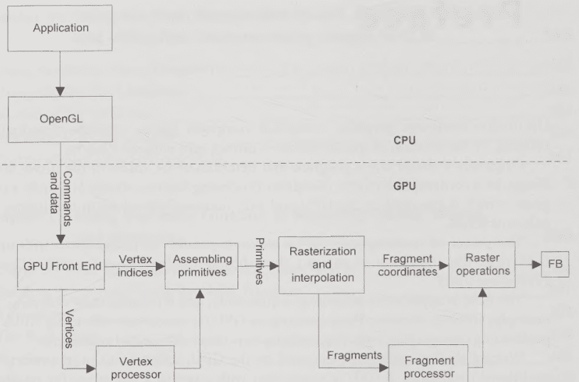

**图 P1.** 可编程图形管线

现有的 GPU 对片段程序和顶点程序都施加了某些限制。这些限制在传统处理器中并不常见，它们与程序类型（顶点或片段）以及特定图形处理器的特性有关。随着新型且更强大的图形处理器的出现，这些限制正在被逐步消除。

早期的着色器是用类汇编语言编写的（例如由`GL_ARB_vertex_program`和`GL_ARB_fragment_program`扩展引入的语言），而且片段程序的支持比顶点程序晚得多。

使用这些低级语言编写着色器非常困难。新功能的出现和图形处理单元性能的提升，使得使用专门的高级语言（着色语言）来编写着色器成为可能。使用 OpenGL 编写程序的着色语言示例包括由 NVIDIA 开发的 Cg（C for graphics）和 GLSL（OpenGL Shading Language）。后者成为了使用 OpenGL 2.0 编程着色器的标准。

着色语言简单且易于与任何版本的 OpenGL 配合使用，即使是许多程序员（主要在 Microsoft Windows 中）仍在使用的 1.1 版本。为了支持这些语言，需要安装最新版本的驱动程序，且 Cg 语言还需要 Cg SDK 或 Cg 运行时库。

除了着色语言外，各种使 OpenGL 应用程序开发更便捷的库在计算机图形编程中也起着重要作用。这些库简化了数学工具和 OpenGL 的使用，因为它们提供了对各种格式资源（纹理、多边形模型等）以及 GPU 特性（如 p-buffers、用户定义帧缓冲区等）的便捷访问。

本书试图涵盖使用 OpenGL 库的这些方面，共分为三个部分。

第一部分介绍了全球 3D 图形编程标准 OpenGL 库的历史和演进。它涉及了主要 OpenGL 版本（包括 2.0），并提供了关于它们特性的信息。第一章以一张表格结束，列出了 OpenGL 中包含的所有扩展，并指明了每个扩展首次引入的版本号。

第二章介绍了如何使用汇编语言编写着色器（使用`ARB_vertex_program`和`ARB_fragment_program`扩展），并展示了用 Cg 编写的着色器示例。

对于所有着色器，书中都展示了如何将它们封装到 C++ 类中，以简化使用。

第二部分介绍了各种方便编写 OpenGL 应用程序的库。本部分不探讨着色器本身，因为它们在某种程度上是正交的。

与 OpenGL 经常配合使用的经典库包括第四章介绍的 GLUT 以及第五章介绍的 NVIDIA SDK 中的库。

第六章介绍了我编写的用于封装向量、矩阵和四元数等数学概念的库。它们被实现为 C++ 类，可立即投入使用。

第七章和第八章介绍了我也创建的 libExt 和 libTexture 库。前者提供了对主要 OpenGL 扩展的简单访问，并在本书后续处理着色器时使用。后者提供了对各种格式纹理（如 BMP, TGA, PNG, JPG, 和 DDS）的访问。这些库的优点是体积小且使用简单。

第九章介绍了 Render-To-Texture（渲染到纹理）技术、所需的扩展以及操作方法。它提供了 p-buffers 和用户定义帧缓冲区的跨平台实现，这些在后续用于执行图像后处理的着色器中会被用到。

第十章引入了两个简单但非常有用的类：`Camera`和`Frustum`。前者是对摄像机（或观察者）的抽象，后者是对 OpenGL 中使用的视锥体的抽象。

第十一章介绍了如何使用多边形模型。它引入了有效存储和渲染复杂三维模型所需的类，并描述了几个用于从 3DS, ASE, OBJ, LWO, MD3 和 MD5 等流行格式文件中加载现有模型的类。由于篇幅限制，书中未包含这些格式的详细描述和模型加载方法（其中大多数非常复杂，单独描述可能需要一本书）。不过，本书随附的 CD-ROM 中包含了这些类的源代码，以便你在程序中使用。

第三部分描述了着色器和 GLSL 语言。它详细介绍了 GLSL、其标准函数和变量，以及在程序中使用该语言编写的着色器所需的扩展。

顶点着色器和片段着色器的特定特性会影响其编写和调试。寻找合适的参数值和最佳计算方法往往需要耗费大量时间。使用专门的 IDE（集成开发环境）可以让程序员在编写和调试着色器时节省大量时间和工作精力。

第十五章介绍了一个这样的 IDE —— ATI RenderMonkey。本章全面描述了其主要功能，并提供了示例，说明如何使用它来编写和调试复杂的多通道（multi-pass）着色器。

第十六章介绍了几个经典效果的实现，包括模拟折射和衍射，以及创建粒子系统。在本章中，你可以找到知名照明模型（如 Phong 和 Blinn 模型）以及不太普及的模型（如各向异性照明和 Ward 模型）的描述。此外，本章还探讨了在图形加速器中使用着色器进行图像后处理。

第十七章介绍了使用 Perlin 噪声函数来模拟某些自然现象和材料的着色器。本章通过示例说明了噪声函数（及其变体）如何用于模拟这些自然现象和材料。这种方法的一个典型特点是其极大的灵活性：某些程序允许你在执行过程中调整参数，从而剧烈改变材料的类型。本章展示了如何模拟带有动画云朵的天空，其云朵密度可以在程序运行期间更改。本章还介绍了另一个使用噪声函数的有趣示例 —— 模拟水面波纹。

附录描述了本书随附的 CD-ROM，其中包含我的库（源代码）和示例程序（Windows 和 Linux 的源代码及可执行模块），分布在与书本章节对应的文件夹中。CD-ROM 还包含示例中使用的各种格式的纹理和三维模型。

书中提供了参考文献。

索引将帮助你快速找到感兴趣的项目。

如果你有有趣的评论或疑问，请发送电子邮件至 steps3d@narod.ru。

## 第一部分

### OpenGL 的演进

- 第 1 章：OpenGL 1.1 到 1.5 版本
- 第 2 章：ARB_vertex_program 和 ARB_fragment_program 扩展及 Cg 语言
- 第 3 章：OpenGL 2.0 和 GLSL

## 第 1 章：OpenGL 1.1 到 1.5 版本

OpenGL 是一个于 1992 年 7 月出现的图形库，至今仍是专业 3D 图形领域的事实标准。此外，它目前不仅用于 3D 图形，还用于处理 2D 图形和视频。

许多电脑游戏也使用 OpenGL。例如，所有基于 idSoftware 开发技术（从 GLQuake 开始）的游戏都使用 OpenGL。著名的游戏《严肃三星》（Serious Sam）最初也是使用 OpenGL 创建的，后来才引入了 Direct3D。

该库的主要优点在于其简洁性（微软的 DirectX 图形库在这方面差得多）、可扩展性以及渐进式的演进（相比之下，DirectX 缺乏这些特性）。

此外，OpenGL 库是跨平台的，因此可以运行在各种硬件和软件平台上。

或许 OpenGL 最重要的特性，且在其演进中发挥了突出作用的是其可扩展性，这一特性从该库诞生之初就已存在。

这一特性允许图形加速器供应商为 OpenGL 添加由其 GPU 支持的新功能。结果是，程序员几乎可以立即使用这些新功能（更准确地说，只要支持新功能的驱动程序编写完成且规范发布，即可以从供应商网站下载）。

每个 OpenGL 版本与前一个版本的区别仅在于引入 OpenGL 的扩展列表。因此，为某个特定 OpenGL 版本编写的任何程序都将在随后的所有版本中运行。

每个扩展都有一个名称（例如`GL_ARB_fragment_program`），由平台前缀（`GL`表示平台无关扩展，`WGL`表示 Windows 扩展，`GLX`表示用于各种 Unix 版本的 X Window 系统扩展）、指示供应商的前缀以及扩展名称组成。

表 1.1 列出了不同供应商的前缀。

**表 1.1. OpenGL 扩展的主要类型**

| 类型 | 值 |
| :--- | :--- |
| ARB | 由 OpenGL 架构审查委员会（Architecture Review Board）正式批准的扩展 |
| EXT | 由多个 OpenGL 供应商达成一致的扩展 |
| 3DFX | 由 3DFX 引入的扩展 |
| APPLE | 由 Apple, Inc. 引入的扩展 |
| ATI | 由 ATI Technologies, Inc. 引入的扩展 |
| HP | 由 Hewlett-Packard Co. 引入的扩展 |
| IBM | 由 International Business Machines, Inc. (IBM) 引入的扩展 |
| INTEL | 由 Intel Corp. 引入的扩展 |
| KTX | 由 Kinetix 引入的扩展 |
| NV | 由 NVIDIA 引入的扩展 |
| MESA | 在 Mesa 实现中引入的扩展 |
| SGI | 由 Silicon Graphics, Inc. 引入的扩展 |
| SGIX | 由 Silicon Graphics, Inc. 引入的扩展 |
| SGIS | 由 Silicon Graphics, Inc. 引入的扩展 |
| SUN | 由 Sun Microsystems 引入的扩展 |
| WIN | 由 Microsoft Corp. 引入的扩展 |

这种命名方法可以避免不同供应商扩展之间的混淆。

除了名称，每个扩展还定义了常量和函数。这些的命名原则基本相同，但在名称后附加了平台标识，例如`glActiveTextureARB`。

在执行期间，程序可以访问所有支持的扩展列表，并使用其需要的扩展（如果它们被支持）。

这种机制为 OpenGL 的发展做出了很大贡献。事实上，每个 OpenGL 版本与前一个版本的区别仅在于某些扩展变成了强制性的，并且它们定义的函数和常量成为了 OpenGL 的一部分。

这种方法保持了 OpenGL 版本的向后兼容性。为早期版本（甚至是另一个平台）编写的任何程序都将在后续的 OpenGL 版本中被成功编译并执行。

因此，OpenGL 的发展是一种保持向后兼容的演进。具体来说，这意味着投入在学习某个 OpenGL 版本上的时间和精力不会白费，尤其是在下一个 OpenGL 版本发布之后（而 Direct3D 通常并非如此）。

此外，如果你使用了某些扩展，你很可能已经在利用一个尚未正式发布的版本的特性。

所有使用图形加速器的 idSoftware 游戏（从 GLQuake 到 Doom 3）都基于 OpenGL 库，这并非巧合。

接下来的章节将描述现有的 OpenGL 版本及其之间的区别。

### OpenGL 1.1 版本

OpenGL 1.1 版本是 1.0 版本之后出现的第一个版本。它包含了许多重要改进，显著增强了 OpenGL 的功能。

此外，该扩展使得通过使用硬件加速的 DMA（直接存储器访问）来提高数据传输效率成为可能。

顶点数组（vertex arrays）机制基于`EXT_vertex_array`扩展，虽然经过了轻微修改。

1.1 版本中出现的另一个重要特性是使用多边形偏移（polygon offset）来改变原语光栅化后产生片段的深度。

当显示位于同一平面上的多个面时，经常需要这种偏移。在这种情况下，即使是深度计算中的微小误差（由于计算精度的限制而不可避免）也会影响片段的遮挡情况。在计算出的深度值中加入偏移量（只要偏移量远大于计算误差），就可以正确地确定遮挡关系。

该特性基于`EXT_polygon_offset`扩展。

`EXT_blend_logic_op`扩展是另一个特性的基础：在将片段输出到帧缓冲时，对于 RGBA 模式（而不仅仅是 OpenGL 1.0 中的颜色索引模式）使用布尔运算。

此外，1.1 版本引入了内部纹理格式（internal texture formats）的概念（取代了之前使用的组件数量）。内部格式同时指定了每个组件的位数和数据格式。

能够指定内部格式，程序员就可以控制计算精度和为纹理分配的内存量。以下是修改后的`glTexImage2D`命令（其他命令的修改方式类似）：

```c
void glTexImage2D(GLenum target, int level,
                  int internalFormat, GLsizei width, GLsizei height,
                  int border, GLenum format, GLenum type, void * data);
```

在 1.1 版本中，仍然可以将组件数量指定为`internalFormat`变量的值，但程序员也可以指定其他格式，如`GL_RGBA8`。

这一特性借鉴自`EXT_texture`扩展。

`EXT_texture`扩展也是指定映射（map）应如何替换片段颜色的基础。

另一个基于`EXT_texture`扩展的特性是纹理代理（texture proxies）的概念。它们允许程序员在不实际创建纹理的情况下，根据其其他参数（例如格式）检索纹理可能的最大尺寸信息。为此，程序员应在`glTexImage`命令中将纹理类型传递为特殊常量之一（例如`GL_PROXY_TEXTURE_1D`、`GL_PROXY_TEXTURE_2D`等）。

1.1 版本中出现的另一个新功能允许将内存或帧缓冲中的矩形块直接复制到纹理中。该功能基于`EXT_copy_texture`和`EXT_subtexture`扩展。

一项重要的创新是将每个纹理（包括所有中间级别）及其相关状态解释为一个对象。这一特性借鉴自`EXT_texture_object`扩展。

1.1 版本的几项次要补充包括：

- 将颜色索引指定为无符号字节。
- 对于光栅化点和位图，纹理坐标 (s, t, r, q) 除以 q 分量。此前，这仅在文档中针对直线和多边形有所说明。
- 更新了直线光栅化算法，以便正确绘制像素边界处的垂直线。
- 与 1.0 版本不同，对于没有 alpha 通道的纹理，将 1 作为 alpha 值返回的行为已记录在案。
- 为`fogStart`和`fogEnd`变量指定负值。

## OpenGL 1.2 版本

OpenGL 1.2 版本于 1998 年 3 月 16 日发布。它包含了一系列新特性，但仍然与 1.0 和 1.1 版本完全兼容。

OpenGL 1.2 中添加的最重要的新特性之一是基于`EXT_texture3D`扩展的三维纹理支持。

另一个基于`EXT_bgra`扩展且对 Microsoft 用户尤为方便的特性是对新纹理格式 BGRA 的支持（该格式与 Windows DIBs 具有相同的像素结构）。

此外，此版本出现了对打包像素格式（packed pixel formats）的支持。在这些格式中，整个像素的值是计算机的一种有效类型（例如字节、字或双字），但像素的单个分量不是有效类型（例如，红、绿、蓝分量可以分别使用 5、6 和 5 位，但它们总共占用两个字节，而两个字节是一个有效类型）。`EXT_packed_pixels`扩展是这一特性的基础。

OpenGL 1.2 版本还允许用户使用从模型变换矩阵中获取的系数来自动缩放法向量。在许多情况下，这种缩放比显式归一化（normalization）工作速度快得多。该特性借鉴自`EXT_rescale_normal`扩展。

此版本引入的另一个特性是对次要颜色的支持，该颜色在计算光照时使用，并在映射期间予以保留（与主颜色不同）。这一特性使得创建颜色仅取决于光源颜色的表面高光变得简单。该特性基于`EXT_separate_specular_color`扩展。

纹理坐标钳制（clamping）的新模式是另一个便捷特性：`GL_CLAMP_TO_EDGE`。该模式保证在使用纹理过滤时，纹理边界上的像素值不会影响mipmap级别内部像素的值。该特性的基础是`SGIS_texture_edge_clamp`扩展。

`SGIS_texture_lod`扩展为该 OpenGL 版本贡献了两个扩展。这些与 mipmap 过滤有关。首先，现在可以为负责 mipmap 过滤中级别选择的λ参数指定一个范围。其次，在 mipmap 过滤期间，可以加载纹理级别的一个子集而非全部级别。这两项特性都允许程序员节省用于大型纹理的显存。

另一个新特性允许使用顶点数组的程序员仅绘制由数组指定的少量面，而不是全部绘制。该特性借鉴自`EXT_draw_range_element`扩展。


## OpenGL 1.2 版本的新特性

1.2 版本还包含几个与图像处理相关的特性。此版本支持在像素传输期间应用的一维和二维卷积。卷积核被解释为一维和二维纹理，可以从内存或帧缓冲中加载。该特性基于`EXT_convolution`和`HP_convolution_border_modes`扩展。

在 RGBA 模式下使用*查找表*（lookup tables）是另一个新特性。在这种情况下，表被解释为具有特定格式和卷积过滤的一维纹理。这些表最多可以被访问三次：在卷积之前，在卷积之后但在使用矩阵进行颜色变换之前，以及在使用矩阵进行颜色变换之后。该特性基于`EXT_color_table`和`EXT_color_subtable`扩展。

此 OpenGL 版本还增加了对另一种矩阵变换以及与该变换相对应的矩阵栈（`GL_COLOR_MATRIX`）的支持。涉及 4×4 矩阵乘法的 RGBA 颜色变换被用作此类变换。在矩阵乘法之后，结果向量的分量会被移位和缩放。该特性借鉴自`SGL_color_matrix`扩展。

最后两个特性与*颜色混合*（color blending）有关。首先，程序员现在能够指定在计算混合系数时应使用的颜色。该特性最简单的例子是以恒定系数混合两个 RGB 纹理。该特性基于`EXT_blend_color`扩展。

其次，引入了对新颜色混合方程（除颜色加权和之外）的支持。其中两个方程从被混合颜色的相应分量中选择最大值和最小值。另外两个方程与标准颜色混合方程类似，但它们使用颜色减法而非加法。这些特性基于`EXT_blend_minmax`和`EXT_blend_subtract`扩展。

为此使用以下命令：

```cpp
void glBlendEquation(GLenum mode);
```

`mode`参数用于向命令传递操作类型（`GL_FUNC_ADD`、`GL_FUNC_SUBTRACT`、`GL_FUNC_REVERSE_SUBTRACT`、`GL_MIN`、`GL_MAX`或`GL_LOGIC_OP`）。

## OpenGL 1.3 版本

OpenGL 1.3 于 2001 年 8 月 14 日发布。它保持了与 1.0 到 1.2 版本的兼容性，并添加了此前作为 ARB 扩展引入的几个新特性。

其中最重要的特性之一是多纹理（multitexturing），它允许你在一次传递中应用多个纹理（具有特定的映射坐标、应用方法等）（图 1.1）。该特性借鉴自`ARB_multitexture`扩展 [3 和 9]。

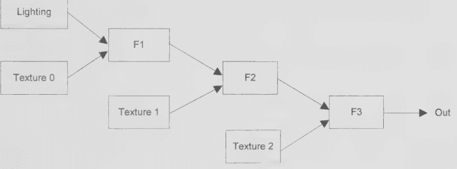

**图 1.1.** 多纹理

1.3 版本中出现的另一个重要特性是对*纹理立方体映射*（texture cube maps）的支持，以及两种计算映射坐标的新方法：`GL_REFLECTION_MAP`和`GL_NORMAL_MAP`。这些特性从`ARB_texture_cube_map`扩展 [3] 转移而来。

此版本还包括从`ARB_texture_compression`扩展借鉴的对压缩纹理的支持。

对*多采样*（multisampling）的支持首次出现在 OpenGL 1.3 中（图 1.2）。这是一种简单（但开销较大）的消除*锯齿伪影*（aliasing artifacts）的方法。多采样是一个过程，在此过程中为每个像素选择多个*样本*（samples），并为每个样本计算一个单独的颜色。将一个像素所有样本的颜色值求平均，从而获得该像素的最终颜色。

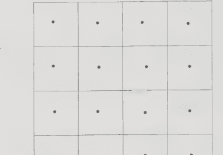

**图 1.2.** 多采样

除了帧缓冲外，还创建了一个*多采样缓冲*（multisample buffer）。它存储单个样本的值。该特性基于`ARB_multisample`扩展。

此 OpenGL 版本还支持几种新的*纹理环境模式*（texture environment modes）：`GL_ADD`、`GL_DOT3`和`GL_COMBINE` [3 和 10]。这些方法的引入显著扩展了在 OpenGL 中使用纹理的选择，特别是在多纹理模式下。`ARB_texture_env_add`、`ARB_texture_env_dot3`和`ARB_texture_env_combine`扩展被用作这些模式的基础。

一种新的纹理坐标钳制模式`GL_CLAMP_TO_BORDER`出现在 OpenGL 1.3 中。（在某种意义上，它与 1.2 中引入的`GL_CLAMP_TO_EDGE`模式互补）。当此模式用于在纹理边界上的纹素（texels）进行 mipmap 过滤以构建中间级别时，相应的过滤器仅使用纹理边界上的像素值。该特性借鉴自`ARB_texture_border_clamp`扩展。

此版本还包括使矩阵能够按列而非按行存储（后者是 OpenGL 中存储矩阵的标准方式）的函数和常量。该特性很方便，因为它允许程序员在 C 语言中使用二维矩阵。

为此引入了以下命令：

```cpp
void glLoadTransposeMatrix(GLenum transpose, const GLfloat *m);
void glMultTransposeMatrix(GLenum transpose, const GLfloat *m);
```

这些命令与`glLoadMatrix`和`glMultMatrix`等效，但它们接受一个按列排列的 4×4 矩阵作为参数。该特性借鉴自`ARB_transpose_matrix`扩展。

## OpenGL 1.4 版本

OpenGL 1.4 版本于 2002 年 6 月 24 日发布。它还包含了几项新特性。

`SGIS_generate_mipmap`扩展有助于允许用户为给定纹理计算（并在必要时重新计算）用于 mipmap 过滤的所有中间级别（该特性基于每纹理进行操作）。

为此，只需将`GL_GENERATE_MIPMAP`参数设置为`GL_TRUE`值即可。

用于计算颜色混合系数的新模式借鉴自`NV_blend_square`扩展。例如，现在可以使用`GL_SRC_COLOR`和`GL_ONE_MINUS_SRC_COLOR`来指定计算*源 (source)*系数的规则。

同样，在计算*目标 (destination)*系数时，可以使用`GL_DST_COLOR`和`GL_ONE_MINUS_DST_COLOR`。

此版本还包括对深度纹理的全面支持，以及通过应用`GL_TEXTURE_COMPARE_MODE`纹理将其用于计算阴影。

这些特性基于`ARB_depth_texture`和`ARB_shadow`扩展 [9]。

OpenGL 的另一个最终可用的特性是在顶点中指定雾量，该特性基于`EXT_fog_coord`扩展。

此版本还引入了借鉴自`EXT_multi_draw_array`扩展的`glMultiDrawArrays`和`glMultiDrawElements`命令。这两者都允许程序员使用一条命令输出多组面。

`ARB_point_parameters`扩展允许用户指定绘制点的附加属性。这使得点的尺寸和透明度可以取决于到该点的距离。在渲染各种粒子系统时，该特性被证明非常方便。

此外，得益于`EXT_secondary_color`扩展，现在可以将次要颜色指定为顶点参数。

`EXT_blend_func_separate`扩展及其`glBlendFuncSeparate`函数允许程序员使用新引入的`glBlendEquationSeparate`函数为颜色分量和 alpha 分量指定不同的混合模式。

引入的模板缓冲区新操作：`GL_INCR_WRAP`和`GL_DECR_WRAP`是另一个对于使用阴影体积法 [9] 创建阴影非常重要的特性。

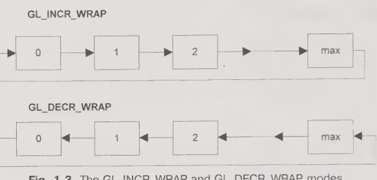

**图 1.3.** `GL_INCR_WRAP`和`GL_DECR_WRAP`模式

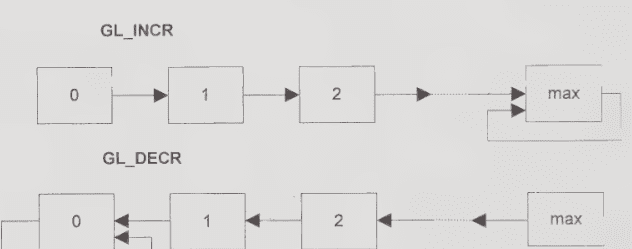

**图 1.4.** 标准的`GL_INCR`和`GL_DECR`模式

结果是，将最大值（通常等于 255）增加 1 将得到最小值，而将最小值（通常为 0）减少 1 将得到最大值。

标准的`GL_INCR`和`GL_DECR`操作（图 1.4）缺失此特性。也就是说，当模板缓冲区中的值达到最大时，随后的增加操作将不会改变它。同样，最小值也无法再减少。

该特性借鉴自`EXT_stencil_wrap`扩展。

`ARB_texture_env_crossbar`扩展使得在纹理映射模式为`GL_COMBINE`时，可以使用来自不同纹理块的颜色值作为映射函数的源。

此外，用户可以为负责 mipmap 过滤级别选择的 $\lambda$ 参数指定一个偏差。更准确地说，引入了一个新的纹理参数`GL_TEXTURE_LOD_BIAS`来指定该偏差。该特性基于`EXT_texture_lod_bias`扩展。

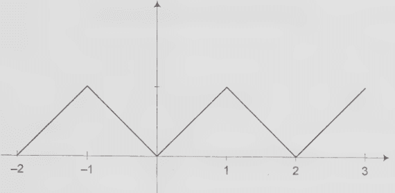

**图 1.5.** 在`GL_MIRRORED_REPEAT`模式下截断纹理坐标

此版本中出现了另一种截断纹理坐标的模式`GL_MIRRORED_REPEAT`。在很多情况下，它允许程序员无需使用周期性纹理（图 1.5）。

该特性借鉴自`ARB_texture_mirrored_repeat`扩展。

`ARB_window_pos`扩展启用了一项新特性，允许`glWindowPos`命令指定窗口内的一个位置。

## OpenGL 1.5 版本

此 OpenGL 版本于 2003 年 7 月 29 日发布。其发布带来了对`ARB_shader_objects`、`ARB_vertex_shader`和`ARB_fragment_shader`扩展的认可，使得在 OpenGL 程序中引入高级着色语言成为可能。

此版本使用`ARB_vertex_buffer_object`扩展来支持*顶点和索引缓冲对象*，允许程序员有效地使用图形加速器的内存来存储数据 [3 和 9]。

1.5 版本还引入了借鉴自`ARB_occlusion_query`扩展的*遮挡查询*支持 [3]。

同时，*阴影映射 (shadow maps)*的比较函数集得到了扩展。现在可以使用所有八个标准比较函数（而不仅仅是`GL_LEQUAL`和`GL_GEQUAL`函数）。该特性基于`EXT_shadow_funcs`扩展。

## OpenGL 新增功能摘要

表 1.2 总结了添加到 OpenGL 的所有特性，并指明了每项特性的来源扩展。

表 1.2. OpenGL 新增功能

| OpenGL 版本 | 特性 | 来源扩展 |

| :--- | :--- | :--- |

| 1.1 | 支持顶点数组 | `EXT_vertex_array` |

| 1.1 | 多边形偏移 | `EXT_polygon_offset` |

| 1.1 | 输出片段时使用布尔操作 | `EXT_blend_logic_op` |

| 1.1 | 为纹理设置内部格式的能力 | `EXT_texture` |

| 1.1 | 使用纹理代理设置纹理参数的能力 | `EXT_texture` |

| 1.1 | 支持将矩形块复制到纹理 | `EXT_copy_texture`, `EXT_subtexture` |

| 1.1 | 引入具有特定状态参数的纹理对象 | `EXT_texture_object` |

| 1.2 | 支持三维纹理 | `EXT_texture3D` |

| 1.2 | 支持 BGRA 格式 | `EXT_bgra` |

| 1.2 | 支持打包像素格式 | `EXT_packed_pixels` |

| 1.2 | 自动缩放法线的选项 | `EXT_rescale_normal` |

| 1.2 | 次要颜色 | `EXT_separate_specular_color` |

| 1.2 | 引入`GL_CLAMP_TO_EDGE`模式 | `SGIS_texture_edge_clamp` |

| 1.2 | 在 mipmap 过滤选择级别时设置参数范围的能力 | `SGIS_texture_lod` |

| 1.2 | 支持在 mipmap 过滤期间仅加载少量级别 | `SGIS_texture_lod` |

| 1.2 | 支持像素传输期间的卷积 | `EXT_convolution`, `HP_convolution_border_modes` |

| 1.2 | 支持 RGBA 模式的查找表 | `EXT_color_table`, `EXT_color_subtable` |

| 1.2 | 引入用于颜色乘法的矩阵 | `SGI_color_matrix` |

| 1.2 | 使用特殊颜色进行混合 | `EXT_blend_color` |

| 1.2 | 新的颜色混合方法：计算最小值和最大值 | `EXT_blend_minmax` |

| 1.2 | 新的颜色混合方法：减法 | `EXT_blend_subtract` |

| 1.3 | 多重纹理 | `ARB_multitexture` |

| 1.3 | 纹理立方体映射 | `ARB_texture_cube_map` |

| 1.3 | 多重采样 | `ARB_multisample` |

| 1.3 | `GL_ADD`, `GL_DOT3`和`GL_COMBINE`纹理映射模式 | `ARB_texture_env_add`, `ARB_texture_env_dot3`, `ARB_texture_env_combine` |

| 1.3 | 引入`GL_CLAMP_TO_BORDER`模式 | `ARB_texture_border_clamp` |

| 1.3 | 按列指定矩阵的能力 | `ARB_transpose_matrix` |

| 1.4 | 支持自动创建 mipmap 级别 | `SGIS_generate_mipmap` |

| 1.4 | 引入颜色混合系数计算的新模式 | `NV_blend_square` |

| 1.4 | 引入`GL_TEXTURE_COMPARE_MODE`模式 | `ARB_depth_texture`, `ARB_shadow` |

| 1.4 | 支持在顶点中指定雾 | `EXT_fog_coord` |

| 1.4 | 支持附加点属性 | `ARB_point_parameters` |

| 1.4 | 支持将次要颜色设置为顶点属性 | `EXT_secondary_color` |

| 1.4 | 支持为 RGB 和 alpha 分量设置不同的混合模式 | `EXT_blend_func_separate` |

| 1.4 | 引入模板缓冲区操作：`GL_INCR_WRAP`和`GL_DECR_WRAP` | `EXT_stencil_wrap` |

| 1.4 | 支持在`GL_COMBINE`模式下使用来自不同纹理块的颜色值 | `ARB_texture_env_crossbar` |

| OpenGL 版本 | 特性 | 源扩展 |

| :--- | :--- | :--- |

| 1.4 | 能够为 $\lambda$ 参数指定偏置 (bias) | `EXT_texture_lod_bias` |

| 1.4 | 引入`GL_MIRRORED_REPEAT`模式 | `ARB_texture_mirrored_repeat` |

| 1.4 | 支持在窗口坐标中指定映射位置 | `ARB_window_pos` |

| 1.5 | 缓冲对象 (VBO) | `ARB_vertex_buffer_object` |

| 1.5 | 支持遮挡查询 (occlusion queries) | `ARB_occlusion_query` |

| 1.5 | 在构建阴影图时支持所有标准比较函数 | `EXT_shadow_funcs` |

## 第 2 章：ARB_vertex_program 和 ARB_fragment_program 扩展与 Cg 语言

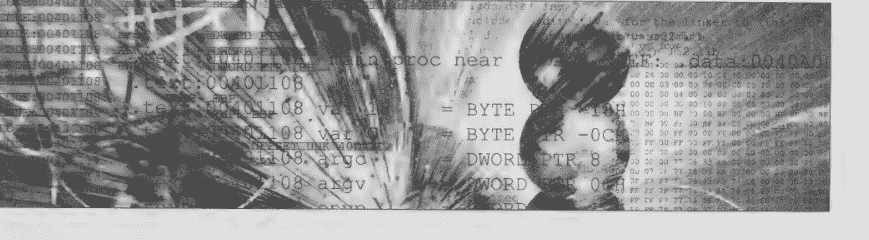

前一章中描述的所有 OpenGL 扩展仅向标准*渲染管线*添加了新特性，但数据处理仍然由这个预定义管线负责（图 2.1）。

然而，在某些情况下，需要显式地为单个管线步骤指定数据处理程序，也就是说，使用特殊的程序。

这类程序（也称为*着色器* $\text{shaders}$）有两种类型：顶点程序和片元程序。

*顶点程序*使得用特定的用户定义操作来替换 OpenGL 管线的变换与光照 (T&L) 模块（即处理单个顶点）成为可能。此类程序为每个顶点独立执行，并将顶点的属性、局部变量、全局变量以及 OpenGL 状态参数作为输入数据。顶点程序不能创建新顶点或删除现有顶点，因此它不能改变数据的拓扑结构。此外，它无法访问拓扑信息（关于边、面等）。

顶点程序通常替代以下 OpenGL 特性：

- 使用模型视图矩阵和投影矩阵对顶点进行变换

- 顶点的加权与混合

- 法线的变换、缩放和归一化

- 顶点光照

- 颜色材质

- 计算和变换纹理坐标

- 计算顶点的雾坐标

- 处理用户定义的裁剪平面

*片元程序*在光栅化过程中获得的每个片元上执行，并替代访问纹理并着色片元的渲染管线模块（图 2.2）。


在 OpenGL 中使用顶点和片元程序的简单方法是使用 `ARB_vertex_program` 和 `ARB_fragment_program` 扩展。这些扩展允许程序员在 OpenGL 程序中使用用一种特殊汇编语言编写的顶点和片元程序。尽管顶点程序和片元程序的汇编版本指令集略有不同，但它们非常相似。所有用这种汇编语言编写的程序都使用一组寄存器，每个寄存器代表一个四维浮点向量 $((x, y, z, w), (r, g, b, a), \text{ 或 } (s, t, r, q))$。这组寄存器通常包含属性（正在处理的顶点或片元的属性）、局部变量、环境变量和临时变量。程序将结果写入`输出寄存器`。顶点程序还可以访问一组地址寄存器。顶点程序和片元程序使用的寄存器集如图 2.3 和 2.4 所示。

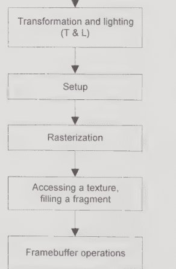

**图 2.1.** OpenGL 中的渲染管线

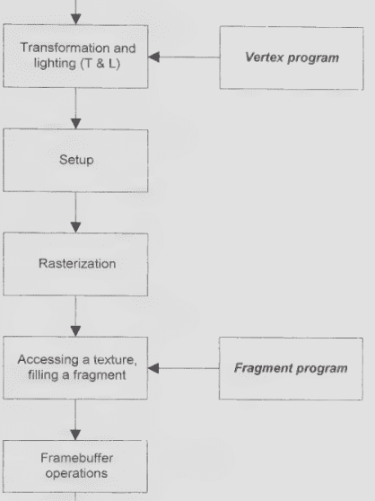

**图 2.2.** 渲染管线中的顶点程序和片元程序

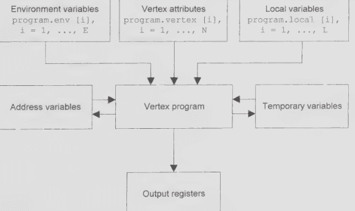

**图 2.3.** 顶点程序可访问的寄存器

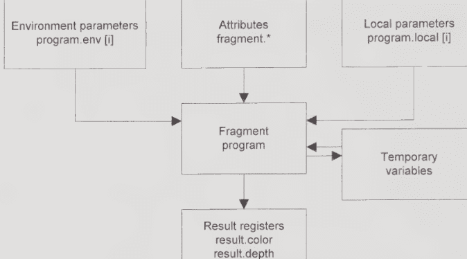

**图 2.4.** 片元程序可访问的寄存器

此类程序由若干行组成，每行最多包含一条指令（可以有空行和注释行）。

代码清单 2.1 和 2.2 展示了一个顶点程序和一个片元程序的示例，它们用于计算逐像素的漫反射和镜面光照。

### 代码清单 2.1. 顶点程序示例

```glsl
!!ARBvp1.0
#
# Simple vertex shader to setup data for per-pixel specular lighting
#
# On entry:
#   vertex.position
#   vertex.normal      - normal vector (n) of TBN basic
#   vertex.texcoord [0] - normal texture coordinates
#
#   program.local [0]  - eye position
#   program.local [1]  - light position
#
#   state.matrix.program [0] - rotation matrix for the object
#
# On exit:
#   result.texcoord [0] - texture coordinates
#   result.texcoord [1].x - diffuse component
#   result.texcoord [1].y - specular component
#
ATTRIB pos = vertex.position;
ATTRIB n = vertex.normal;
PARAM eye = program.local[0];
PARAM light = program.local[1];
PARAM mvp [4] = {state.matrix.mvp};
PARAM mv [4] = {state.matrix.modelview};
PARAM mv0 [4] = {state.matrix.modelview.invtrans};
PARAM half = 0.5;

TEMP p, l, v, h, nt, temp, t;

# Transform position
DP4 p.x, pos, mv [0];
DP4 p.y, pos, mv [1];
DP4 p.z, pos, mv [2];
DP4 p.w, pos, mv [3];

# Compute l (vector to light).
ADD l, -p, light; # l = light - p

# Normalize it (we need to correctly compute h).
DP3 temp.x, l, l; # Now temp.x = (l,l)
RSQ temp.y, temp.x; # Compute inverse square root of (v,v).
MUL l, l, temp.y; # Normalize.

# Compute v (vector to viewer).
ADD v, -p, eye; # v = eye - pos

# Normalize it (we need to correctly compute h).
DP3 temp.x, v, v; # Now temp.x = (v,v)
RSQ temp.y, temp.x; # Compute inverse square root of (v,v).
MUL v, v, temp.y; # Normalize.

# Compute h = l + v
ADD h, l, v;

# Normalize it (we need to correctly compute h).
DP3 temp.x, h, h; # Now temp.x = (h,h)
RSQ temp.y, temp.x; # Compute inverse square root of (h,h).
MUL h, h, temp.y; # Normalize.

# Transform normal by MV.inverse.transpose.
DP3 nt.x, n, mv0 [0];
DP3 nt.y, n, mv0 [1];
DP3 nt.z, n, mv0 [2];
MOV nt.w, 1;

# Normalize it.
DP3 temp.x, nt, nt;    # Now temp.x = (nt,nt)
RSQ temp.y, temp.x;    # Compute inverse square root of (h,h).
MUL nt, nt, temp.y;    # Normalize.

# Compute diffuse and specular terms.
DP3 temp.x, nt, l;     # Compute dot products (n,l) and (n,h).
DP3 temp.y, nt, h;
MOV temp.w, 50;

# Compute lighting.
LIT t, temp;    # Now t.y is diffuse,
                # t.z is specular.

# Store it in texcoord [1].xy.
MOV result.texcoord[1].x, t.y;
MOV result.texcoord[1].y, t.z;

# Copy texcoord [0].
MOV result.texcoord[0], vertex.texcoord[0];

# Copy primary and secondary colors.
MOV result.color, vertex.color;
MOV result.color.secondary, vertex.color.secondary;

# Transform position into clip space.
DP4 result.position.x, pos, mvp[0];
DP4 result.position.y, pos, mvp[1];
DP4 result.position.z, pos, mvp[2];
DP4 result.position.w, pos, mvp[3];

# We're done.
END
```

### 代码清单 2.2. 片元程序示例

```glsl
!!ARBfp1.0
#
# Simple specular shader
# On entry:
#   fragment.texcoord[0] - texture coordinates
#   fragment.texcoord[1].xy - diffuse and specular components
#
#   texture[0] - decal map
#
PARAM  specColor = {0, 0, 1};
TEMP   color, temp, diffuse, specular;


# Get decal color.
TEX    temp, fragment.texcoord[0], texture[0], 2D;

ADD    diffuse, fragment.texcoord[1].x, 0.4;
MUL    specular, fragment.texcoord[1].y, specColor;

MUL    color, temp, diffuse;
ADD    color, color, specular;
MOV    color.w, 1;

MOV    result.color, color;

END
```

请注意，每个程序都以一行特殊的行开始，用于指定程序的类型和版本。所有使用 `ARB_vertex_program` 扩展引入的顶点程序必须以 `!!ARBvp1.0` 行开始，所有使用 `ARB_fragment_program` 扩展引入的片元程序必须以 `!!ARBfp1.0` 行开始。

- 每个程序应以 `END` 行结束。
- 从 `#` 字符到行尾的任何文本均为注释，将被忽略。
- 每条指令应以分号结束。

一个程序由描述寄存器的指令以及数据处理指令（即对寄存器的操作）组成。

`ATTRIB` 指令允许你为输入属性（顶点或片元）指定一个方便的名称。`PARAM` 指令用于设置参数，例如常量向量和 OpenGL 状态参数。所有参数和属性均为只读。

`OPTION` 指令允许你为加载和执行程序指定特殊选项。

`TEMP` 指令可以创建临时的可读写变量。

其他指令用于数据处理，其形式如下：

`opCode dest, [-]src0 [, [-]src1 [, [-]src2]];`

这里 `opCode` 是指令的字符代码，`dest` 是目标寄存器（程序结果写入此处），`src0`、`src1` 和 `src2` 是包含输入数据的源寄存器。可选元素包含在方括号之间。

以下是一些命令示例：

```glsl
MOV R1, R2;
MAD R1, R2, R3, -R4;
```

可选的负号（`-`）允许您使用寄存器的相反数作为源操作数。

对于输入寄存器（`src0`、`src1` 和 `src2`），您可以使用由寄存器分量排列（permutation）产生的向量，而不是使用寄存器本身。例如：

```glsl
MOV R1, R2.yzwxs;
MOV R2, -R3.yzwx;
```

您可以为输出寄存器创建掩码，以防止其某些分量被修改。例如：

```glsl
MOV R2.xw, -R3;
```

请注意，以下两个命令是等效的：

```glsl
MOV R1, R2.xxxx;
MOV R1, R2.x;
```

表 2.1 和表 2.2 分别列出了顶点程序和片元程序的命令。

## 表 2.1. 顶点程序命令

| 命令（用途） | 语法 | 注释 |
|---|---|---|
| `ABS`（绝对值） | `ABS dest, src;` | 分量级计算绝对值：`dest = fabs(src)` |
| `ADD`（加法） | `ADD dest, src0, src1;` | 两个参数相加并将和写入目标寄存器：`dest = src0 + src1` |
| `ARL` | `ARL dest.C1, src.C2;` | 将标量操作数的整数部分加载到地址寄存器中 |
| `DP3`（前三个分量的点积） | `DP3 dest, src0, src1;` | 将源操作数作为三维向量计算点积：`dest = src0.x*src1.x + src0.y*src1.y + src0.z*src1.z` |
| `DP4`（点积） | `DP4 dest, src0, src1;` | 计算四维向量的点积并将结果写入目标寄存器的所有分量：`dest = src0.x*src1.x + src0.y*src1.y + src0.z*src1.z + src0.w*src1.w` |
| `DPH`（齐次点积） | `DPH dest, src0, src1;` | 计算齐次点积：`dest = src0.x*src1.x + src0.y*src1.y + src0.z*src1.z - src1.w` |
| `DST`（距离） | `DST dest, src0.C1, src1.C2;` | 从两个标量值有效计算 `dest = (1, d, d^2, 1/d)` 向量：`src0.C1 = d^2`，`src1.C2 = 1/d` |
| `EX2`（近似 2 的幂） | `EX2 dest, src.C;` | 为给定的标量操作数 `src.C` 计算 $2^{src.C}$ 的近似值，并将结果写入目标寄存器的所有分量 |
| `EXP`（2 的幂） | `EXP dest, src.C;` | 更精确地计算 $2^{src.C}$ 的值：`dest.x = 2^floor(src.C)`，`dest.y = src.C - floor(src.C)`，`dest.z = roughAppr2ToX(floor(src.C))`，`dest.w = 1`。`roughAppr2ToX` 函数计算一个精度为 $2^{-11}$ 的近似值 |
| `FLR`（计算向下取整函数） | `FLR dest, src;` | 分量级计算源操作数的整数部分（`floor` 函数返回小于或等于该参数的最大整数） |
| `FRC`（小数部分） | `FRC dest, src;` | 分量级计算小数部分：`frac(x) = x - floor(x)` |
| `LG2`（以 2 为底对数的近似值） | `LG2 dest, src.C;` | 从标量参数计算以 2 为底对数的近似值，并将结果写入目标的所有分量 |
| `LIT`（光照系数） | `LIT dest, src;` | 快速计算顶点中的漫反射和镜面光照：`src.x = (n, l)`，`src.y = (n, h)`，`src.w = p`（指数被限制在 $[-128, 128]$ 区间）。输出：`dest.x = 1`，`dest.y = max(0, (n, l))`，`dest.z = (n.l) > 0 ? roughAppr2ToX(max(0, (n, h))^p) : 0`，`dest.w = 1` |
| `LOG`（以 2 为底的对数） | `LOG dest, src.C;` | 从标量参数计算以 2 为底对数的近似值：<br>`temp = fabs(src.C)`<br>`dest.x = floor(log2(temp))`<br>`dest.y = temp^2*floor(log2(temp))`<br>`dest.z = roughAppr2ToX(temp)`<br>`dest.w = 1` |
| `MAD`（乘加） | `MAD dest, src0, src1, src2;` | 计算以下内容：<br>`dest = src0*src1 + src2` |
| `MAX`（最大值） | `MAX dest, src0, src1;` | 分量级计算最大值：<br>`dest = max(src0, src1)` |
| `MIN`（最小值） | `MIN dest, src0, src1;` | 分量级计算最小值：<br>`dest = min(src0, src1)` |
| `MOV`（复制） | `MOV dest, src;` | 将源分量的值写入目标分量：<br>`dest = src` |
| `MUL`（分量乘法） | `MUL dest, src0, src1;` | 计算分量级乘积：<br>`dest = src0*src1` |
| `POW`（幂运算） | `POW dest, src0.C1, src1.C2;` | 将第一个标量操作数近似地提升到第二个标量操作数的幂，并将结果写入目标的所有分量：<br>`apprPow(a,b) = apprExp2(b*apprLog2(a))` |
| `RCP`（倒数值） | `RCP dest, src.C;` | 从标量值计算近似倒数值，并将结果写入目标的所有分量：<br>`dest = 1/src.C` |
| `RSQ` | `RSQ dest, src.C;` | 从标量操作数的平方根计算倒数：<br>`dest = 1/sqrt(fabs(src.C))` |
| `SGE`（大于或等于） | `SGE dest, src0, src1;` | 分量级比较并将每个分量的结果写入目标寄存器：<br>`dest.x = src0.x >= src1.x ? 1 : 0`<br>`dest.y = src0.y >= src1.y ? 1 : 0`<br>`dest.z = src0.z >= src1.z ? 1 : 0`<br>`dest.w = src0.w >= src1.w ? 1 : 0` |
| `SLT`（小于） | `SLT dest, src0, src1;` | 分量比较并将每个分量的结果写入目标寄存器：<br>`dest.x = src0.x < src1.x ? 1 : 0`<br>`dest.y = src0.y < src1.y ? 1 : 0`<br>`dest.z = src0.z < src1.z ? 1 : 0`<br>`dest.w = src0.w < src1.w ? 1 : 0` |
| `SUB`（减法） | `SUB dest, src0, src1;` | 操作数相减：<br>`dest = src0 - src1` |


# 片元程序指令参考

## 表 2.2. 片元程序命令

| 命令 (用途) | 语法 | 注释 |
| :--- | :--- | :--- |
| **ABS** (绝对值) | `ABS dest, src;` | 分量级计算绝对值： <br> `dest = fabs(src)` |
| **ADD** (加法) | `ADD dest, src0, src1;` | 两个参数相加并将和写入目标寄存器： <br> `dest = src0 + src1` |
| **CMP** (比较) | `CMP dest, src0, src1, src2;` | 根据 `src0` 对应分量的符号，从 `src1` 或 `src2` 中选择下一个分量： <br> `dest.x = src0.x < 0 ? src1.x : src2.x` <br> `dest.y = src0.y < 0 ? src1.y : src2.y` <br> `dest.z = src0.z < 0 ? src1.z : src2.z` <br> `dest.w = src0.w < 0 ? src1.w : src2.w` |
| **COS** (余弦) | `COS dest, src.C;` | 分量级计算标量参数的余弦值，并将结果写入目标的可选分量。角度以弧度为单位，且不需要落在 `[-PI, PI]` 区间内 |
| **DP3** (前三个分量的点积) | `DP3 dest, src0, src1;` | 将源操作数作为三维向量计算点积：<br>`dest = src0.x*src1.x + src0.y*src1.y + src0.z*src1.z` |
| **DP4** (点积) | `DP4 dest, src0, src1;` | 计算四维向量的点积并将结果写入目标寄存器的所有分量：<br>`dest = src0.x*src1.x + src0.y*src1.y + src0.z*src1.z + src0.w*src1.w` |
| **DPH** (齐次点积) | `DPH dest, src0, src1;` | 计算齐次点积：<br>`dest = src0.x*src1.x + src0.y*src1.y + src0.z*src1.z + src0.w*src1.w` |
| **DST** (距离) | `DST dest, src0, src1;` | 从两个标量值有效计算 `dest = (1, d, d^2, 1/d)` 向量：<br>`src0 = (*, d^2, d^2, *)`<br>`src1 = (*, 1/d, *, 1/d)`<br>星号 (`*`) 表示该值可以被忽略。 |
| **EX2** (近似 2 的幂) | `EX2 dest, src.C;` | 为给定的标量操作数 `src.C` 计算 $2^{src.C}$ 的近似值，并将结果写入目标寄存器的所有分量 |
| **FLR** (计算向下取整函数) | `FLR dest, src;` | 分量级计算源操作数的整数部分（`floor` 函数返回小于或等于该参数的最大整数） |
| **FRC** (小数部分) | `FRC dest, src;` | 分量级计算小数部分：`frac(x) = x - floor(x)` |
| **LG2** (以 2 为底对数的近似值) | `LG2 dest, src.C;` | 从标量参数计算以 2 为底对数的近似值，并将结果写入目标的所有分量 |

## 表 2.2（续）

| 指令 (用途) | 语法 | 注释 |
| :--- | :--- | :--- |
| **LIT** (光照系数) | `LIT dest, src;` | 在顶点中快速计算漫反射和镜面光照：<br>`src.x = {n,l}`<br>`src.y = {n,h}`<br>`src.w = p` (指数被缩减到 `[-128, 128]` 区间)。<br>输出为：<br>`dest.x = 1`<br>`dest.y = max(0, {n,l})`<br>`dest.z = {n,l} > 0 ? roughAppr2Tox (max(0, {n,h}))^p : 0`<br>`dest.w = 1` |
| **LRP** (线性插值) | `LRP dest, src0, src1, src2;` | 基于 `src0` 对 `src1` 和 `src2` 的值进行分量线性插值：<br>`dest.x = src0.x*src1.x + (1 - src0.x)*src2.x`<br>`dest.y = src0.y*src1.y + (1 - src0.y)*src2.y`<br>`dest.z = src0.z*src1.z + (1 - src0.z)*src2.z`<br>`dest.w = src0.w*src1.w + (1 - src0.w)*src2.w` |
| **MAD** (乘加) | `MAD dest, src0, src1, src2;` | 计算以下内容：<br>`dest = src0*src1 + src2` |
| **MAX** (最大值) | `MAX dest, src0, src1;` | 分量级计算最大值：<br>`dest = max(src0, src1)` |
| **MIN** (最小值) | `MIN dest, src0, src1;` | 分量级计算最小值：<br>`dest = min(src0, src1)` |
| **MOV** (复制) | `MOV dest, src;` | 将源组件的值写入目标组件：<br>`dest = src` |
| **MUL** (分量乘法) | `MUL dest, src0, src1;` | 计算分量乘积：<br>`dest = src0*src1` |
| **POW** (指数) | `POW dest, src0.C1, src1.C2;` | 将第一个标量操作数近似地提升到第二个标量操作数的幂，并将结果写入目标的所有分量：<br>`apprPow(a,b) = apprExp2(b*apprLog2(a))`<br>注意 `0^0 = 1`。 |
| **RCP** (倒数) | `RCP dest, src.C;` | 从标量值计算近似倒数值，并将结果写入目标的所有分量：<br>`dest = 1/src.C` |
| **RSQ** | `RSQ dest, src.C;` | 从标量操作数的平方根计算倒数：<br>`dest = 1/sqrt(fabs(src.C))` |
| **SCS** (正弦和余弦) | `SCS dest, src.C;` | 同时计算正弦和余弦，并将值写入目标寄存器的 `x` 和 `y` 分量：<br>`dest.x = cos(src.C)`<br>`dest.y = sin(src.C)`<br>标量值应落在 `[-PI, PI]` 区间内。目标的 `z` 和 `w` 分量未定义。 |
| **SGE** (大于或等于) | `SGE dest, src0, src1;` | 分量级比较，并将每个分量的结果写入目标寄存器：<br>`dest.x = src0.x >= src1.x ? 1 : 0`<br>`dest.y = src0.y >= src1.y ? 1 : 0`<br>`dest.z = src0.z >= src1.z ? 1 : 0`<br>`dest.w = src0.w >= src1.w ? 1 : 0` |
| **SIN** (正弦) | `SIN dest, src.C;` | 计算标量操作数的正弦值：<br>`dest = sin(src.C)`<br>角度以弧度为单位，不需要落在 `[-PI, PI]` 区间内 |
| **SLT** (小于) | `SLT dest, src0, src1;` | 分量比较，并将每个分量的结果写入目标寄存器：<br>`dest.x = src0.x < src1.x ? 1 : 0`<br>`dest.y = src0.y < src1.y ? 1 : 0`<br>`dest.z = src0.z < src1.z ? 1 : 0`<br>`dest.w = src0.w < src1.w ? 1 : 0` |
| **SUB** (减法) | `SUB dest, src0, src1;` | 操作数的减法：<br>`dest = src0 - src1` |
| **SWZ** (分量“重组”) | `SWZ dest, src, <extSizzle>` | 对分量（或其部分）进行重组。源可以是源寄存器的任何分量（有符号或无符号）、零或一：<br>`<extSizzle> ::= <comp>, <comp>, <comp>, <comp>`<br>`<comp> ::= [-] (0 \| 1 \| x \| y \| z \| w \| r \| g \| b \| a)` |
| **XPD** (叉积) | `XPD dest, src0, src1;` | 计算第一个操作数的前三个分量与第二个操作数的前三个分量的叉积，并将结果写入目标寄存器的前三个分量。`dest.w` 的值未定义 |
| **TEX** | `TEX dest, src0, texture [n], type;` | 从第 `n` 个纹理块中读取类型为 `type` 的纹理。对于纹理坐标，使用 `src0` 参数的前几个分量。结果写入目标寄存器。`type` 参数可以取以下任何值：`1D`, `2D`, `3D`, `cube` 或 `rectangle` |
| **TXP** | `TXP dest, src0, texture [n], type;` | 从第 `n` 个纹理块中读取类型为 `type` 的纹理。对于纹理坐标，使用 `src0` 参数的前几个分量除以 `src0.w`。结果写入目标寄存器。`type` 参数可以取以下任何值：`1D`, `2D`, `3D`, `cube` 或 `rectangle` |
| **TXB** | `TXB dest, src0, texture [n], type;` | 从第 `n` 个纹理块中读取类型为 `type` 的纹理。对于纹理坐标，使用 `src0` 参数的前几个分量。结果写入目标寄存器。`type` 参数可以取以下任何值：`1D`, `2D`, `3D`, `cube` 或 `rectangle`。`src0.w` 的值用于 `mipmap` 过滤中的级别偏移，从中提取数值 |
| **KIL** (条件取消片元程序) | `KIL src;` | 如果操作数的至少一个分量小于零，则取消当前片元的片元程序执行。该片元在流水线中的后续步骤将被跳过。 |

代码清单 2.3 展示了一个 C++ 程序示例，该程序利用代码清单 2.1 和 2.2 中的顶点和片元程序来构建一个光照环面的图像。

为了更方便地使用顶点和片元程序，该程序使用了特殊的类 `VertexProgram` 和 `FragmentProgram`。关于这些类的完整实现，请参考本书随附的 CD。

## 代码清单 2.3. 使用代码清单 2.1 和 2.2 中的顶点和片元程序构建光照环面图像

```cpp
//
// Simple example of how to use ARB vertex/fragment programs in OpenGL
//

#include <glut.h>
#include <stdio.h>
#include <stdlib.h>

#include "libTexture.h"
#include "TypeDefs.h"
#include "Vector3D.h"
#include "Vector2D.h"
#include "Vector4D.h"
#include "VertexProgram.h"
#include "FragmentProgram.h"

VertexProgram vertexProgram;
FragmentProgram fragmentProgram;

Vector3D eye (7, 5, 7);             // Camera position
Vector3D light (5, 0, 4);           // Light position
Vector3D rot (0, 0, 0);
float   angle = 0;
int     mouseX = 0;
int     mouseY = 0;
unsigned decalMap;

void init ()
{
    glClearColor (0.0, 0.0, 0.0, 1.0);
    glEnable     (GL_DEPTH_TEST);
    glEnable     (GL_TEXTURE_2D);
    glDepthFunc  (GL_LEQUAL);

    glHint      (GL_POLYGON_SMOOTH_HINT, GL_NICEST);
    glHint      (GL_PERSPECTIVE_CORRECTION_HINT, GL_NICEST);
}

void display ()
{
    glClear (GL_COLOR_BUFFER_BIT | GL_DEPTH_BUFFER_BIT);

    // Draw the light.
    glMatrixMode (GL_MODELVIEW);
    glPushMatrix ();

    glDisable        (GL_TEXTURE_2D);
    glTranslatef     (light.x, light.y, light.z);
    glColor4f        (1, 1, 1, 1);
    glutSolidSphere (0.1f, 15, 15);

    glPopMatrix ();
    glEnable        (GL_TEXTURE_2D);

    glMatrixMode (GL_MODELVIEW);
    glPushMatrix ();

    glRotatef    (rot.x, 0, 0, 0);
    glRotatef    (rot.y, 0, 1, 0);
    glRotatef    (rot.z, 0, 0, 1);

    vertexProgram.enable ();
    vertexProgram.bind    ();

    fragmentProgram.enable ();
    fragmentProgram.bind    ();

    glBindTexture    (GL_TEXTURE_2D, decalMap);

    glutSolidTeapot (1.5);

    vertexProgram.disable ();
    fragmentProgram.disable ();

    glPopMatrix ();

    glutSwapBuffers ();
}

void reshape (int w, int h)
{
    glViewport    (0, 0, (GLsizei)w, (GLsizei)h);
    glMatrixMode    (GL_PROJECTION);
    // Factor all camera ops into
    // projection matrix.
    glLoadIdentity ();
    glPerspective (60.0, (GLfloat)w/(GLfloat)h, 1.0, 60.0);
    gluLookAt    (eye.x, eye.y, eye.z, // Eye
            0, 0, 0, // Center
            0, 0, 1); // Up
    glMatrixMode    (GL_MODELVIEW);
    glLoadIdentity();
}

void motion (int x, int y)
{
    rot.y -= ((mouseOldY - y) * 180.0f) / 200.0f;
    rot.z -= ((mouseOldX - x) * 180.0f) / 200.0f;
    rot.x = 0;

    if (rot.z > 360)
        rot.z -= 360;

    if (rot.z < -360)
        rot.z += 360;

    if (rot.y > 360)
        rot.y -= 360;

    if (rot.y < -360)
        rot.y += 360;

    mouseOldX = x;
    mouseOldY = y;

    glutPostRedisplay();
}

void mouse (int button, int state, int x, int y)
{
    if (state == GLUT_DOWN)
    {
        mouseOldX = x;
        mouseOldY = y;
    }
}

void key (unsigned char key, int x, int y)
{
    if (key == 27 || key == 'q' || key == 'Q') // Quit requested
        exit(0);
}

void animate ()
{
    angle = 0.004f * glutGet (GLUT_ELAPSED_TIME);

    light.x = 4*cos (angle);
}
```


```cpp
light.y = 4*sin (angle);
light.z = 3 + 0.3 * sin (angle / 3);

vertexProgram.enable ();
vertexProgram.bind ();
vertexProgram.local [0] = eye;
vertexProgram.local [1] = light;
vertexProgram.disable ();

glutPostRedisplay ();
}
```

```cpp
int main (int argc, char * argv [])
{
	// Initialize glut.
	glutInit (&argc, argv);
	glutInitDisplayMode (GLUT_DOUBLE | GLUT_RGB | GLUT_DEPTH);
	glutInitInitWindowSize (500, 500);

	// Create window.
	glutCreateWindow("Example of vertex and fragment assembly shaders");

	// Register handlers.
	glutDisplayFunc (display);
	glutReshapeFunc (reshape);
	glutKeyboardFunc (key);
	glutMouseFunc (mouse);
	glutMotionFunc (motion);
	glutIdleFunc (animate);

	init ();
	initExtensions ();

	assertExtensionsSupported ("GL_ARB_vertex_program GL_ARB_fragment_program");

	decalMap = createTexture2D (true, "../.. /Textures/wood1.bmp");

	if (!vertexProgram.load ("example.vp"))
	{
		printf("Error loading vertex program:\n %s\n",
			vertexProgram.getErrorString ().c_str ());

		return 1;
	}

	if (!fragmentProgram.load ("example.fp"))
	{
		printf("Error loading fragment program:\n %s\n",
			fragmentProgram.getErrorString().c_str());

		return 2;
	}

	glutMainLoop();

	return 0;
}
```

顶点程序和片段程序的引入显著增强了 OpenGL 的功能。然而，使用低级（汇编）语言编写这些程序非常困难。因此，市场对一种能够简化顶点和片段程序编写的高级语言产生了需求。此类语言最成功的先驱是 RenderMan 着色语言，这是一种类 C 语言，长期以来一直用于 RenderMan 软件包中编写着色器。但在实际应用中，该语言难以使用，因为 RenderMan 和 OpenGL 的渲染模型不同，且 RenderMan 着色语言并非为使用图形加速器的实时渲染而设计。

首次成功尝试创建用于编写顶点和片段程序的高级语言是 NVIDIA 在 2002 年开发的 Cg (C for graphics)（目前可用版本为 1.3）。Cg 既像 C 语言又像 RenderMan 着色语言，因此编写起来非常简单。另一方面，Cg 旨在为当时的图形加速器编写顶点和片段程序（着色器）。此外，Cg 程序可以同时用于 OpenGL 和 DirectX。

Cg 语言支持向量 (`float2`、`float3` 和 `float4`) 和矩阵 (`float2x2`、`float3x3` 和 `float4x4`) 数据类型。此外，Cg 程序还可以使用一个庞大的函数库。

Cg 包含强大的控制语句：它支持条件语句、各种循环语句以及函数。对 Cg 的支持是通过将 Cg 程序编译为相应的 GPU 指令来实现的。为此，引入了“配置文件”（profiles）的概念。

*配置文件* 决定了给定 Cg 程序应被编译到的指令集。正确选择配置文件可以让程序员最大限度地发挥所用图形加速器的性能。

表 2.3 列出了支持的顶点和片段配置文件。

## 表 2.3. Cg 支持的配置文件

| 配置文件 | 类型 | 使用的扩展 |

| :--- | :--- | :--- |

| `CG_PROFILE_ARBVP1` | 顶点 | `ARB_vertex_program` |

| `CG_PROFILE_ARBFP1` | 片段 | `ARB_fragment_program` |

| `CG_PROFILE_VP20` | 顶点 | `NV_vertex_program` |

| `CG_PROFILE_FP20` | 片段 | `NV_texture_shader` 和 `NV_register_combiners` |

| `CG_PROFILE_VP30` | 顶点 | `NV_vertex_program2` |

| `CG_PROFILE_FP30` | 片段 | `NV_fragment_program` |

代码清单 2.4 和 2.5 展示了代码清单 2.1 和 2.2 中顶点和片段程序在 Cg 中的对应实现。

## 代码清单 2.4. Cg 中的顶点程序

```cpp
struct InData
{
    float4 pos : POSITION;
    float4 normal : NORMAL;
    float2 texCoord : TEXCOORD0;
};

struct OutData
{
    float4 pos : POSITION;
    float2 texCoord : TEXCOORD0;
    float diffuse;
    float specular;
};

OutData main (InData IN,
              uniform float4x4 ModelViewProj,
              uniform float4x4 ModelViewIT,
              uniform float4x4 ModelView,
              uniform float4 lightPos,
              uniform float4 eyePos)
{
    OutData OUT;

    OUT.pos = mul(ModelViewProj, IN.pos);
    OUT.texCoord = IN.texCoord;

    float4 p = mul(ModelView, IN.pos);
    float3 l = normalize(lightPos.xyz - p.xyz);
    float3 v = normalize(eyePos.xyz - p.xyz);
    float3 h = normalize(l + v);
    float3 n = normalize(mul(ModelViewIT, IN.normal).xyz);

    OUT.diffuse = max(0.0, dot(n, l));
    OUT.specular = pow(max(0.0, dot(n, h)), 50.0);

    return OUT;
}
```

## 代码清单 2.5. Cg 中的片段程序

```cpp
struct OutData
{
    float4 pos : POSITION;
    float2 texCoord : TEXCOORD0;
    float diffuse;
    float specular;
};

float4 main(OutData IN,
            uniform sampler2D tex0) : COLOR
{
    return (IN.diffuse + 0.4) * tex2D(tex0, IN.texCoord) +
           IN.specular * float4(0, 0, 1, 1);
}
```

在每个程序中，`main` 函数是入口点（即，它被调用用于数据处理）。

输入和输出数据以结构体形式传递。（事实上，可以将每个输入值单独传递给程序，但这会让函数的头部过于臃肿）。

注意 `POSITION`、`NORMAL` 和 `TEXCOORD0` 描述符。它们将输入参数与相应的标准顶点（或片段）属性相关联。

某些值通过 `uniform` 描述符传递，这意味着该值在图元内部是不变的。显然，模型视图矩阵对于每个输出图元都是不变的。

同时注意 `sampler2D` 类型的使用：特殊数据类型 (`sampler1D`、`sampler2D`、`sampler3D` 和 `samplerCUBE`) 用于访问纹理。

要访问纹理，使用以下函数：`tex1D`、`tex1Dproj`、`tex2D`、`tex2Dproj`、`tex3D`、`tex3Dproj`、`texCUBE` 和 `texCUBEproj`。函数名称中的 `proj` 后缀意味着该函数在访问纹理之前，会将纹理坐标除以最后一个纹理坐标分量。

以 `tex2Dproj` 函数为例：

```cpp
float4 tex2Dproj (sampler2D tex, float3 sq);
```

当它被调用时，首先将 `sq` 向量前两个分量的值除以最后一个分量的值。除法的结果 (`sq.x/sq.z`, `sq.y/sq.z`) 将用于访问纹理 `tex`。

> 尽管 Cg 程序执行的操作与汇编程序相同，但其篇幅要短得多。同时，Cg 程序的可读性也远高于汇编程序。

现在让我们来看看在 OpenGL 中使用 Cg 需要什么。

首先，你需要适用于你平台的 Cg Toolkit（它同时提供 Windows 和 Linux 版本）。你可以从 NVIDIA 官网 (http://developer.nvidia.com) 下载。

包含 `cgGL.h` 头文件并链接 `cg.lib` 和 `cggl.lib` 库（在 Linux 中，应使用 `Cg`、`CgGL` 和 `pthread` 库）。

要使用 Cg，你应该创建一个 `context`（`CGcontext` 类型的变量）。上下文实际上是所有加载的 Cg 程序的容器，因此一个程序只需一个 Cg 上下文即可。

每个 Cg 程序都与一个 `CGprogram` 类型的变量相关联，用于操作该程序。此外，你还需要两个配置文件，一个用于所有顶点程序，一个用于所有片段程序。

```cpp
CGcontext context;
CGprogram vertexProgram;
CGprogram fragmentProgram;
CGprofile vertexProfile;
CGprofile fragmentProfile;
```

你的第一步（当然是在初始化 OpenGL 之后）是创建 Cg 上下文：

```cpp
context = cgCreateContext ();

// Check for success.
if (context == NULL)
{
    fprintf (stderr, "Cannot create Cg context\n");
    exit (1);
}
```

与其显式指定配置文件，你可以使用 `cgGLGetLatestProfile` 函数来获取合适的配置文件：

```cpp
vertexProfile = cgGLGetLatestProfile(CG_GL_VERTEX);

if (vertexProfile == CG_PROFILE_UNKNOWN)
{
    fprintf(stderr, "Invalid vertex profile type");
    exit(1);
}

cgLSetOptimalOptions(vertexProfile);
```

`cgGLGetOptimalOptions` 函数会为当前使用的图形加速器及其驱动程序返回最佳选项。

`cgCreateProgramFromFile` 函数用于从文件中加载 Cg 程序：

```cpp
CgProgram cgCreateProgramFromFile(CGcontext context,
                                  CGenum programType,
                                  const char* program,
                                  CGprofile profile,
                                  const char* entry,
                                  const char** args);
```

其参数如下：`context` 是程序将绑定的 CG 上下文；`programType` 决定文件内容 (`CG_SOURCE` 表示源代码，`CG_OBJECT` 表示预编译程序的对象代码)；`program` 是包含程序的文件名；`profile` 是编译程序时应使用的配置文件；`entry` 是程序的入口点，即用于处理顶点（或片段）的函数；`args` 用于向编译器传递一些额外参数（如果没有此类值，应传递 `NULL`）。

该函数返回编译后程序的引用，如果发生错误则返回 `NULL`。如果要从内存而非文件加载程序，请使用 `cgCreateProgram` 函数：

```cpp
CgProgram cgCreateProgram(CGcontext context, CGenum programType,
                          const char* program, CGprofile profile,
                          const char* entry, const char** args);
```

此函数的参数基本上与 `cgCreateProgramFromFile` 函数相同。唯一的例外是 `program` 参数，它是一个包含程序源代码的字符串。

`cgGetProgramString` 函数允许你获取有关程序的信息：

```cpp
const char* cgGetProgramString(CgProgram program, CGenum stringType);
```

这里最有趣的参数是 `stringType`，其值为 `CG_COMPILED_PROGRAM`。在这种情况下，函数将返回程序的编译后代码。

如果发生错误，您可以调用 `cgGetError` 函数，该函数会返回错误代码。通过该代码，`cgGetErrorString` 可以返回错误的文本描述。

代码清单 2.6 展示了如何获取关于错误的完整信息。

## 代码清单 2.6. 使用 Cg 检查错误

```cpp
void checkCgError()
{
    CgError error = cgGetError();
    if (error != CG_NO_ERROR)
    {
        fprintf(stderr, "CG error: %s\n",
               cgGetErrorString(error));
        exit(1);
    }
}
```

您的下一步是使用 `cgGLLoadProgram` 函数加载程序：

```cpp
cgGLLoadProgram(vertexProgram);
cgGLLoadProgram(fragmentProgram);
```

之后，您可以使用 `cgGetNamedParameter` 函数，通过名称获取对程序输入参数的引用：

```cpp
CgParameter cgGetNamedParameter(Cgprogram program, const char * name);
```

使用这些 `CgParameter` 类型的值，您可以通过以下函数设置 uniform 参数的值：

```cpp
void cgGLSetParameter1f(CgParameter parameter, float x);
void cgGLSetParameter1fv(CgParameter parameter, const float* array);
void cgGLSetParameter2f(CgParameter parameter, float x, float y);
void cgGLSetParameter2fv(CgParameter parameter, const float* array);
void cgGLSetParameter3f(CgParameter parameter, float x, float y,
                        float z);
void cgGLSetParameter3fv(CgParameter parameter, const float* array);
void cgGLSetParameter4f(CgParameter parameter, float x, float y,
                        float z, float w);
void cgGLSetParameter4fv(CgParameter parameter, const float* array);
```

要设置矩阵参数，请使用以下函数：


```cpp
void cgGLSetMatrixParameterfr(CgParameter parameter,
                              const float* matrix);
void cgGLSetMatrixParameterfc(CgParameter parameter,
                              const float* matrix);
```

这些函数名称中的 `r` 和 `c` 后缀决定了存储在矩阵中的元素顺序：`r` 表示按行存储，`c` 表示按列存储（列主序 vs 行主序）。

要指定作为 OpenGL 参数的矩阵，请使用`cgGLSetStateMatrixParameter`函数：

```cpp
void cgGLSetStateMatrixParameter (CGParameter parameter,
                                  GLenum stateMatrixType,
                                  GLenum transform);
```

其参数如下：`stateMatrixType`指定应写入`parameter`参数的矩阵（表 2.4），`transform`指定在将矩阵写入`parameter`参数之前要对其应用的变换（表 2.5）。

## 表 2.4. `stateMatrixType`参数的有效值

| 值 | 注释 |
|---|---|
| `CG_GL_MODELVIEW_MATRIX` | 模型视图矩阵 |
| `CG_GL_PROJECTION_MATRIX` | 投影矩阵 |
| `CG_GL_TEXTURE_MATRIX` | 纹理坐标变换矩阵 |
| `CG_GL_MODELVIEW_PROJECTION_MATRIX` | 模型视图矩阵与投影矩阵的乘积 |

## 表 2.5. `transform`参数的有效值

| 值 | 注释 |
|---|---|
| `CG_GL_MATRIX_IDENTITY` | 无变换。 |
| `CG_GL_MATRIX_TRANSPOSE` | 矩阵转置。 |
| `CG_GL_MATRIX_INVERSE` | 矩阵求逆。 |
| `CG_GL_MATRIX_INVERSE_TRANSPOSE` | 矩阵转置并求逆。 |

要使用该程序，请启用相应的 profile 并选择相应的程序作为当前程序：

```cpp
cgGLEnableProfile (vertexProfile);
cgGLBindProgram (vertexProgram);
```

之后，您可以指定所需变量的值并使用该程序输出对象。当输出完成后，您应该禁用该 profile：

```cpp
cgGLDisableProfile (vertexProfile);
```

代码清单 2.7 展示了一个 C++ 程序的源代码，该程序使用用 Cg 编写的顶点程序和片段程序（见代码清单 2.4 和 2.5）来构建图像。

## 代码清单 2.7. 使用用 Cg 编写的着色器

```cpp
#include <glut.h>
#include <stdio.h>
#include <stdlib.h>
#include <Cg/cgGL.h>

#include "libTexture.h"
#include "TypeDefs.h"
#include "Vector3D.h"
#include "Vector2D.h"
#include "Vector4D.h"

CGcontext context;
CGprofile vertexProfile;    // Profile for vertex shader
CGprofile fragmentProfile; // Profile for fragment shader
CGprogram vertexProgram;    // Handles for programs
CGprogram fragmentProgram;
CGparameter modelViewProjMatrix; // Handles for parameters
CGparameter modelViewMatrix;
CGparameter modelViewItMatrix;
CGparameter lightPos, eyePos;
CGparameter tex0;

Vector3D eye (7, 5, 7);     // Camera position
Vector3D light (5, 0, 4);   // Light position
Vector3D rot (0, 0, 0);
float angle = 0;
int mouseOldX = 0;
int mouseOldY = 0;
unsigned decalMap;

void checkCgError ()
{
    CGerror error = cgGetError();

    if (error != CG_NO_ERROR)
    {
        fprintf (stderr, "CG error: %s\n", cgGetErrorString (error));
    }
    exit(1);
}

void cgErrorCallback ()
{
    CgError lastError = cgGetError ();

    if (lastError)
    {
        fprintf (stderr, "CG error: %s\n",
                                cgGetErrorString (lastError));
        exit (1);
    }
}

void init ()
{
    glClearColor (0.0, 0.0, 0.0, 1.0);
    glEnable (GL_DEPTH_TEST);
    glEnable (GL_TEXTURE_2D);
    glDepthFunc (GL_LEQUAL);

    glHint (GL_POLYGON_SMOOTH_HINT, GL_NICEST);
    glHint (GL_PERSPECTIVE_CORRECTION_HINT, GL_NICEST);

    // Now setup Cg.
    // Create context.
    context = cgCreateContext ();

    // Check for success.
    if (context == NULL)
    {
        fprintf (stderr, "Cannot create Cg context\n");
        exit (1);
    }

    // Create vertex profile.
    vertexProfile = cgGLGetLatestProfile (CG_GL_VERTEX);

    if (vertexProfile == CG_PROFILE_UNKNOWN)
    {
        fprintf (stderr, "Invalid vertex profile type");
        exit (1);
    }

    cgGLSetOptimalOptions (vertexProfile);

    // Create fragment profile.
    fragmentProfile = cgGLGetLatestProfile(CG_GL_FRAGMENT);

    if (fragmentProfile == CG_PROFILE_UNKNOWN)
    {
        fprintf(stderr, "Invalid fragment profile type");
        exit(1);
    }

    cgGLSetOptimalOptions(fragmentProfile);

    // Now load cg programs.
    vertexProgram = cgCreateProgramFromFile(context, CG_SOURCE,
                                           "vertex.cg", vertexProfile, "main", 0);

    checkCgError();

    if (vertexProgram == NULL)
    {
        CgError error = cgGetError();
        fprintf(stderr, "Error loading vertex program:\n%s",
                cgGetErrorString(error));
        exit(1);
    }

    fprintf(stdout, "Vertex Listing:\n%s",
            cgGetProgramString(vertexProgram,
                               CG_COMPILED_PROGRAM));

    cgGLLoadProgram(vertexProgram);

    modelViewProjMatrix = cgGetNamedParameter(vertexProgram,
                                              "ModelViewProj");
    modelViewMatrix     = cgGetNamedParameter(vertexProgram,
                                              "ModelView");
    modelViewItMatrix   = cgGetNamedParameter(vertexProgram,
                                              "ModelViewIT");
    lightPos            = cgGetNamedParameter(vertexProgram,
                                              "lightPos");
    eyePos              = cgGetNamedParameter(vertexProgram,
                                              "eyePos");

    fragmentProgram = cgCreateProgramFromFile(context, CG_SOURCE,
                                             "fragment.cg", fragmentProfile, "main", 0);

    checkCgError ();

    if (fragmentProgram == NULL)
    {
        CGerror error = cgGetError ();

        fprintf (stderr, "Error loading fragment program:\n%s",
                cgGetErrorString (error));

        exit (1);
    }

    fprintf (stdout, "Fragment Listing:\n%s",
            cgGetProgramString (fragmentProgram,
                CG_COMPILED_PROGRAM));

    cgGLLoadProgram (fragmentProgram);

    tex0 = cgGetNamedParameter (fragmentProgram, "tex0");
}

void display ()
{
    glClear (GL_COLOR_BUFFER_BIT | GL_DEPTH_BUFFER_BIT);

    // Draw the light.
    glMatrixMode (GL_MODELVIEW);
    glPushMatrix ();

    glDisable    (GL_TEXTURE_2D);
    glTranslatef (light.x, light.y, light.z);
    glColor4f    (1, 1, 1, 1);
    glutSolidSphere (0.1f, 15, 15);

    glPopMatrix ();
    glEnable     (GL_TEXTURE_2D);

    glMatrixMode (GL_MODELVIEW);
    glPushMatrix ();

    glRotatef    (rot.x, 1, 0, 0);
    glRotatef    (rot.y, 0, 1, 0);
    glRotatef    (rot.z, 0, 0, 1);

    cgGLEnableProfile (vertexProfile);
    cgGLEnableProfile (fragmentProfile);
    cgGLBindProgram    (vertexProgram);
}
```


```cpp
cgGLBindProgram (fragmentProgram);

cgGLSetStateMatrixParameter (modelViewItMatrix,
    CG_GL_MODELVIEW_MATRIX,
    CG_GL_MATRIX_INVERSE_TRANSPOSE);

cgGLSetStateMatrixParameter (modelViewProjMatrix,
    CG_GL_MODELVIEW_PROJECTION_MATRIX,
    CG_GL_MATRIX_IDENTITY);

cgGLSetStateMatrixParameter (modelViewMatrix,
    CG_GL_MODELVIEW_MATRIX,
    CG_GL_MATRIX_IDENTITY);

cgGLSetParameter4f (lightPos, light.x, light.y, light.z, 1);
cgGLSetParameter4f (eyePos, eye.x, eye.y, eye.z, 1);
glBindTexture (GL_TEXTURE_2D, decalMap);

glutSolidTeapot(1.5);

cgGLDisableProfile (vertexProfile);
cgGLDisableProfile (fragmentProfile);

glPopMatrix ();

glutSwapBuffers ();
}

void reshape (int w, int h)
{
    glViewport (0, 0, (GLsizei)w, (GLsizei)h);
    glMatrixMode (GL_PROJECTION);
        // Factor all camera ops into
        // projection matrix.
    glLoadIdentity ();
    glPerspective (60.0, (GLfloat)w/(GLfloat)h, 1.0, 60.0);
    gluLookAt (eye.x, eye.y, eye.z, // Eye
                0, 0, 0,           // Center
                0, 0, 1);          // Up

    glMatrixMode (GL_MODELVIEW);
    glLoadIdentity ();
}

void motion (int x, int y)
{
    rot.y = ((mouseOldY - y) * 180.0f) / 200.0f;
    rot.z = ((mouseOldX - x) * 180.0f) / 200.0f;
    rot.x = 0;

    if (rot.z > 360)
        rot.z -= 360;

    if (rot.z < -360)
        rot.z += 360;

    if (rot.y > 360)
        rot.y -= 360;

    if (rot.y < -360)
        rot.y += 360;

    mouseOldX = x;
    mouseOldY = y;

    glutPostRedisplay();
}

void mouse (int button, int state, int x, int y)
{
    if (state == GLUT_DOWN)
    {
        mouseOldX = x;
        mouseOldY = y;
    }
}

void key (unsigned char key, int x, int y)
{
    if (key == 27 || key == 'q' || key == 'Q') // Quit requested
        exit(0);
}

void animate ()
{
    angle = 0.004f * glutGet (GLUT_ELAPSED_TIME);

    light.x = 4*cos (angle);
    light.y = 4*sin (angle);
    light.z = 3 + 0.3 * sin (angle / 3);

    cgGLEnableProfile (vertexProfile);
    cgGLBindProgram (vertexProgram);
    cgGLSetParameter4f (lightPos, light.x, light.y, light.z, 1);
    cgGLSetParameter4f (eyePos, eye.x, eye.y, eye.z, 1);
    cgGLDisableProfile (vertexProfile);

    glutPostRedisplay ();
}

int main (int argc, char * argv [])
{
    // Initialize glut.
    glutInit(&argc, argv);
    glutInitDisplayMode (GLUT_DOUBLE | GLUT_RGB | GLUT_DEPTH);
    glutInitWindowSize (500, 500);

    // Create window.
    glutCreateWindow ("Example of Cg specular vertex shader");

    // Register handlers.
    glutDisplayFunc (display);
    glutReshapeFunc (reshape);
    glutKeyboardFunc (key);
    glutMouseFunc (mouse);
    glutMotionFunc (motion);
    glutIdleFunc (animate);

    init ();
    decalMap = createTexture2D (true, "../Textures/wood1.bmp");

    // Install program object as
    // part of current state.
    cgGLEnableProfile (fragmentProfile);
    cgGLBindProgram (fragmentProgram);
    cgGLSetTextureParameter (tex0, decalMap);
    cgGLDisableProfile (fragmentProfile);

    glutMainLoop ();

    return 0;
}
```

为了更方便地操作 Cg 程序，创建一个特殊的类`CgProgram`是合理的，该类将封装所有与 Cg 程序相关的操作，例如加载、绑定、创建参数等等。

以下代码清单包含了`CgProgram`类的描述和实现。

## 代码清单 2.8. CgProgram 类的描述

```cpp
class CgProgram
{
protected:
    static CGcontext context;
    static CGprofile vertexProfile;
    static CGprofile fragmentProfile;

    CGprogram program;
    int type;
    string listing;
    string errorDesc;

public:
    CgProgram (int theType);
    ~CgProgram ();

    bool load (const char * fileName);

    const string& getListing () const
    {
        return listing;
    }

    const string& getErrorDescription () const
    {
        return errorDesc;
    }

    bool isVertex () const
    {
        return type == CgVertexProgram;
    }

    bool isFragment () const
    {
        return type == CgFragmentProgram;
    }

    CGprofile getProfile () const
    {
        return isVertex () ? vertexProfile : fragmentProfile;
    }

    CGparameter parameterForName (const char * name) const
    {
        return cgGetNamedParameter(program, name);
    }

    bool setTexture(const char * name, unsigned texId)
    {
        CGparameter param = parameterForName(name);

        if (!param)
            return false;

        cgGLSetTextureParameter(param, texId);

        return true;
    }

    bool setVector(const char * name, const Vector4D& value)
    {
        CGparameter param = parameterForName(name);

        if (!param)
            return false;

        cgGLSetParameter4f(param, value.x, value.y, value.z, 
                           value.w);

        return true;
    }

    bool setVector(CGparameter param, const Vector4D& value)
    {
        if (!param)
            return false;

        cgGLSetParameter4f(param, value.x, value.y, value.z, 
                           value.w);

        return true;
    }

    bool enable()
    {
        cgGLEnableProfile(getProfile());

        return true;
    }

    bool disable()
    {
        cgGLDisableProfile(getProfile());
        return true;
    }

    bool bind()
    {
        cgGLBindProgram(program);
        return true;
    }

    bool unbind()
    {
        cgGLBindProgram(0);
        return true;
    }

    void setMatrixParameter(CGparameter param, CGGLenum matrix, CGGLenum transform)
    {
        cgGLSetStateMatrixParameter(param, matrix, transform);
    }

    enum CgProgramType
    {
        CgVertexProgram = 1,
        CgFragmentProgram = 2
    };

protected:
    bool checkCgError();
};
```

## 代码清单 2.9. CgProgram 类的实现

```cpp
//
// Object wrapper for Cg programs
//

#include "CgProgram.h"

CGcontext CgProgram::context = NULL;
CGprofile CgProgram::vertexProfile = CG_PROFILE_UNKNOWN;
CGprofile CgProgram::fragmentProfile = CG_PROFILE_UNKNOWN;

CgProgram::CgProgram(int theType)
{
    type = theType;
}

CgProgram::~CgProgram()
{
    cgDestroyProgram (program);
}

bool CgProgram::load (const char * fileName)
{
    // Create context.
    if (context == NULL)
        context = cgCreateContext ();

    // Check for success.
    if (context == NULL)
    {
        errorDesc = "Cannot create context";
        return false;
    }

    // Create vertex profile.
    if (type == CgVertexProgram)
    {
        if (vertexProfile == CG_PROFILE_UNKNOWN)
        {
            vertexProfile = cgGLGetLatestProfile (CG_GL_VERTEX);

            if (vertexProfile == CG_PROFILE_UNKNOWN)
            {
                errorDesc = "Invalid vertex profile type";
                return false;
            }
        }
        cgGLSetOptimalOptions (vertexProfile);
    }
    else
    {
        if (type == CgFragmentProgram)
        {
            // Create fragment profile.
            if (fragmentProfile == CG_PROFILE_UNKNOWN)
            {
                fragmentProfile = cgGLGetLatestProfile (CG_GL_FRAGMENT);

                if (fragmentProfile == CG_PROFILE_UNKNOWN)
                {
                    errorDesc = "Invalid fragment profile type";
                    return false;
                }
            }
            cgGLSetOptimalOptions(fragmentProfile);
        }
        else
        {
            errorDesc = "Unknown profile type";
            return false;
        }
    }

    program = cgCreateProgramFromFile(context, CG_SOURCE, fileName,
                                      getProfile(), "main", 0);

    if (!checkCgError())
        return false;

    if (program == NULL)
    {
        CGerror error = cgGetError();

        errorDesc = "Error loading vertex program:\n";
        errorDesc += cgGetErrorString(error);

        return false;
    }

    listing = cgGetProgramString(program, CG_COMPILED_PROGRAM);

    cgGLLoadProgram(program);

    return checkCgError();
}

bool CgProgram::checkCgError()
{
    CGerror error = cgGetError();

    if (error != CG_NO_ERROR)
        errorDesc = cgGetErrorString(error);
    else
        errorDesc = "";

    return error == CG_NO_ERROR;
}
```

## 第 3 章：OpenGL 2.0 和 GLSL


OpenGL 2.0 版本于 2004 年 9 月 7 日发布。决定其版本号为 2.0 而非 1.6 的主要创新在于引入了使用 GLSL（OpenGL 着色语言）编写的着色器来实现的可编程渲染管线。

图 3.1 展示了顶点处理器和片段处理器（执行着色器的部分）在 OpenGL 渲染管线中的位置。

在 GLSL 中创建和使用着色器的机制实际上是一个 API（应用程序编程接口）。它完全借鉴自 `ARB_shader_objects`、`ARB_vertex_shader`、`ARB_fragment_shader` 和 `ARB_shading_language_100` 这些扩展。

无论是在这些扩展中还是在 OpenGL 2.0 中，在处理着色器时都会使用*着色器对象*（类比于纹理、VBO 等）。OpenGL 2.0 中所有关于着色器的操作都是通过着色器对象来完成的。

与这些扩展一样，OpenGL 2.0 支持两种类型的着色器：顶点着色器和片段着色器。它们全部使用 GLSL 编写，且对顶点着色器和片段着色器的支持分别借鉴自 `ARB_vertex_shader` 和 `ARB_fragment_shader` 扩展。

代码清单 3.1 和 3.2 展示了使用 GLSL 编写的顶点着色器和片段着色器的示例。

图 3.1. OpenGL 渲染管线中的着色器

### 示例 3.1. GLSL 中顶点着色器的示例

```glsl
//
// Simplest GLSL vertex shader
//

void main (void)
{
    gl_Position = gl_ModelViewProjectionMatrix * gl_Vertex;
}
```

### 示例 3.2. GLSL 中片段着色器的示例

```glsl
//
// Simplest GLSL fragment shader
//

void main (void)
{
    gl_FragColor = vec4 (0.0, 1.0, 0.0, 1.0);
}
```

如这些示例所示，GLSL 是一种高级编程语言，其语法与 C 语言（以及 RenderMan 着色语言）类似，它专门为顶点和片段管线的编程而设计。

使用这种语言编写的程序可以访问各种 OpenGL 状态参数和众多函数（详情请参阅*第 12 章和第 13 章*）。

在将支持着色器的 API 从扩展版本移植到 OpenGL 2.0 期间，对其进行了一些更改（见表 3.1）。这些更改不影响 API 的功能，仅与某些函数的名称有关。

此外，扩展中引入并用于访问着色器对象的 `GLhandleARB` 类型被废弃，取而代之的是已有的 `GLuint` 类型（该类型曾用于类似场景）。

### 表 3.1. 支持着色器的函数名称

| 扩展函数 | OpenGL 2.0 对应函数 |
| :--- | :--- |
| `glCreateShaderObjectARB` | `glCreateShader` |
| `glShaderSourceARB` | `glShaderSource` |
| `glCompileShaderARB` | `glCompileShader` |
| `glDeleteShaderARB` | `glDeleteShader` |
| `glCreateProgramObjectARB` | `glCreateProgram` |
| `glAttachObjectARB` | `glAttachShader` |
| `glDetachObjectARB` | `glDetachShader` |
| `glLinkProgramARB` | `glLinkProgram` |
| `glUseProgramObjectARB` | `glUseProgram` |
| `glDeleteObjectARB` | `glDeleteProgram` |
| `glGetActiveAttribARB` | `glGetActiveAttrib` |
| `glGetAttribLocationARB` | `glGetAttribLocation` |
| `glBindAttribLocationARB` | `glBindAttribLocation` |
| `glGetUniformLocationARB` | `glGetUniformLocation` |
| `glGetActiveUniformARB` | `glGetActiveUniform` |
| `glUniform{1234}{i}vARB` | `glUniform{1234}{i}v` |
| `glUniformMatrix{234}{f}vARB` | `glUniformMatrix{234}{f}v` |
| `glValidateProgramARB` | `glValidateProgram` |
| `glGetObjectParameterivARB` | `glGetShaderiv` |
| `glGetInfoLogARB` | `glGetShaderInfoLog` / `glGetProgramInfoLog` |
| `glGetAttachedObjectsARB` | `glGetAttachedShaders` |
| `glGetShaderSourceARB` | `glGetShaderSource` |

除了对着色器的支持外，OpenGL 2.0 还引入了一些细微但有用的创新。

`ARB_draw_buffers` 扩展用于实现将着色器数据（包括不同的颜色值）同时输出到多个不同颜色缓冲区的功能。

该版本取消了所有纹理尺寸必须为 2 的幂的限制。此版本允许使用任何尺寸的纹理，且这类纹理的操作与 2 的幂尺寸纹理的操作没有区别。（特别地，纹理坐标的所有分量都落在 [0, 1] 区间内）。此功能借鉴自 `ARB_texture_non_power_of_two` 扩展 [3]。

`ARB_point_sprite` 扩展 [3] 是对*精灵*（边与屏幕边平行的纹理正方形）支持的来源（见示例 3.3）。此外，还增加了指定纹理坐标增加方向的功能（使用 `GL_POINT_SPRITE_COORD_ORIGIN` 参数）。

### 示例 3.3. 精灵示例

```cpp
float quadratic [] = { 1.0f, 0.0f, 0.01f };

glEnable(GL_POINT_SPRITE_ARB);
glPointParameterfvARB(GL_POINT_DISTANCE_ATTENUATION_ARB, quadratic);
glPointParameterfARB(GL_POINT_FADE_THRESHOLD_SIZE_ARB, 20.0f);

glTexEnvf(GL_POINT_SPRITE_ARB, GL_COORD_REPLACE_ARB, GL_TRUE);
glPointSize(size);
```

`ATI_separate_stencil` 和 `EXT_stencil_two_side` 扩展为分别对正面和背面使用模板缓冲奠定了基础（示例 3.4）。

### 示例 3.4. 分别为正面和背面使用模板缓冲

```cpp
glActiveStencilFaceEXT(GL_BACK);     // 设置背面的模板操作

glStencilMask(~0);
glStencilFunc(GL_ALWAYS, 0, ~0);

glStencilOp(GL_KEEP,                   // 模板测试失败。
              GL_INCR_WRAP_EXT,         // 深度测试失败。
              GL_KEEP);                  // 深度测试通过。

                                   // 设置正面的模板
glActiveStencilFaceEXT (GL_FRONT);
glStencilMask (~0);
glStencilFunc (GL_ALWAYS, 0, ~0);

glStencilOp (GL_KEEP, // 模板测试失败。
            GL_DECR_WRAP_EXT, // 深度测试失败。
            GL_KEEP); // 深度测试通过。

    // 一次性处理所有阴影面。
drawShadowVolume (torus.getFaces(), torus.getNumFaces(),
                torus.getEdges(), torus.getNumEdges(),
                torus.getVertices(), torus.getNumVertices());
```

目前，NVIDIA 和 ATI 的最新版本驱动程序均支持 OpenGL 2.0。

## 第二部分：辅助库

- 第 4 章：GLUT 库
- 第 5 章：关于 GLH、NV_MATH 和 NV_UTIL 库的一般信息
- 第 6 章：用于向量、矩阵和四元数操作的主要类
- 第 7 章：扩展操作。libExt 库
- 第 8 章：libTexture 和 libTexture3D 库
- 第 9 章：将 p-Buffer 实现为类。EXT_framebuffer_object 扩展
- 第 10 章：摄像机概念。libCamera 库
- 第 11 章：libMesh 库。多边形模型及其最常用格式的操作

## 第 4 章：GLUT 库

OpenGL 最重要的优点之一是其渲染模型完全独立于任何特定的窗口系统（以及操作系统）。

因此，与窗口系统相关的一些重要操作（如创建和销毁窗口、编辑窗口参数以及消息处理）是在 OpenGL 之外执行的。一方面，这使得使用 OpenGL 时具有代码可移植性。但另一方面，程序员需要了解特定窗口系统（具有强平台依赖性）的细节，才能创建功能完整的应用程序。

GLUT (OpenGL Utility Toolkit) 库的目的是为窗口系统的主要特性和函数提供一个统一的（即独立于特定窗口或操作系统）接口。

GLUT 的首要目标是为窗口系统创建一个简单且方便的接口。这就是为什么它仅支持对最重要窗口函数的访问。

GLUT 的 API 基于相对较少的函数，每个函数仅需要少量参数。GLUT 函数从不返回指针，且只有两种情况会将地址作为参数：字符串地址（所有字符串在 GLUT 内部进行复制）和消息处理函数地址。

GLUT 支持窗口和菜单的使用。其中使用了*当前窗口*和*当前菜单*的概念。大多数 GLUT 操作仅能影响当前窗口或菜单。

**图 4.1.** GLUT 的函数类别

GLUT 的一个特点是它实现了自己的消息循环。这使得该库难以与其他同样创建消息循环（或要求创建消息循环）的库结合使用。

所有 GLUT 函数根据其功能被分为几个类别（图 4.1）。

- **初始化** 包括处理命令行参数、窗口系统初始化以及窗口初始化。
- **启动消息循环** 开始 GLUT 的内部消息循环。
- **窗口操作** 包括创建和使用窗口的函数。
- **菜单操作** 包括创建和使用菜单的函数。
- 设置消息处理函数。
- 获取 GLUT 当前状态的信息。
- 文本输出。
- 最简单几何对象的输出。

### 初始化

所有初始化函数的名称都带有 `glutInit` 前缀。`glutInit` 函数是主初始化函数，在调用任何其他 GLUT 函数之前必须调用一次。

```cpp
void glutInit(int * argc, char ** argv);
```

该函数的参数是 `main` 函数中 `argc` 和 `argv` 参数的指针。

> 此函数可以接收命令行参数（此功能通常在 X Window 系统中受支持）。在这种情况下，`glutInit` 函数通过编辑 `argc` 和 `argv` 来从 `main` 函数的参数中删除其自身的参数。

要设置正在创建的窗口的初始大小和位置，请使用以下函数：

```cpp
void glutInitWindowSize(int width, int height);
void glutInitWindowPos(int x, int y);
```

`width` 和 `height` 参数指定窗口的初始大小（以像素为单位），`x` 和 `y` 参数指定左上角的位置（图 4.2）。

另一个重要的初始化参数是帧缓冲的模式（更准确地说，是结构）。模式决定了是否应使用深度缓冲、模板缓冲以及其他缓冲，以及是否应使用双缓冲。（使用后者可以创建无闪烁的动画）。`glutInitDisplayMode` 函数用于指定模式：

```cpp
void glutInitDisplayMode(unsigned int mode);
```

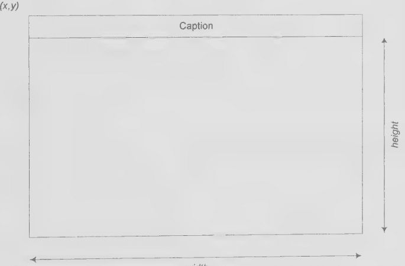

**图 4.2.** 窗口的初始参数

`mode` 参数是一个无符号整数，其单个位携带关于模式的信息。该参数通过对适当的常量进行按位或（OR）操作来指定。其完整列表见表 4.1。

### 表 4.1. mode 参数中位的有效值

| 常量 | 注释 | 默认值 |
|---|---|---|
| `GLUT_RGBA` | 选择 RGBA 模式。 | 是 |
| `GLUT_RGB` | 选择 RGB 模式。 | 是 |
| `GLUT_INDEX` | 选择颜色索引模式。 | 否 |
| `GLUT_SINGLE` | 不使用双缓冲。 | 是 |
| `GLUT_DOUBLE` | 使用双缓冲。 | 否 |
| `GLUT_ACCUM` | 使用累积缓冲。 | 否 |
| `GLUT_ALPHA` | 在缓冲中为 alpha 通道分配空间。 | 否 |
| `GLUT_DEPTH` | 创建深度缓冲。 | 否 |
| `GLUT_STENCIL` | 创建模板缓冲。 | 否 |
| `GLUT_MULTISAMPLE` | 创建多采样缓冲。 | 否 |
| `GLUT_STEREO` | 创建立体缓冲。 | 否 |
| `GLUT_LUMINANCE` | 使用一种类似于 RGBA 的特殊颜色模式，但在颜色缓冲中没有绿色和蓝色分量，红色分量包含一个特殊表的索引，该表最初初始化为灰度。 | 否 |

## 启动消息循环

要启动内置的消息循环，请使用 GLUT 库中的 `glutMainLoop` 函数：

```cpp
void glutMainLoop();
```

请确保在初始化、创建窗口和设置消息处理器之后调用此函数。该函数永远不会返回控制权，但随着消息的到达，您指定的消息处理器将被调用。

要中断程序，请在其中一个消息处理器中调用 `exit` 函数。

## 窗口操作

GLUT 库支持两种类型的窗口：普通窗口和子窗口（后者嵌套在普通窗口或其他子窗口中），如图 4.3 所示。这两类窗口都允许程序员使用 OpenGL 命令在其中绘图并设置消息处理器。每个窗口（无论其类型）都由一个唯一的整数标识。

每个创建的窗口都有自己的 OpenGL 渲染上下文。

要创建普通窗口，请使用 `glutCreateWindow` 函数：

```cpp
int glutCreateWindow (char * name);
```

调用此函数会创建一个带有 `name` 标题的普通窗口，其大小和位置由 `glutInitWindowPos` 和 `glutInitWindowSize` 函数指定。新创建的窗口被设为当前窗口，并返回其标识符。

要创建子窗口，请使用 `glutCreateSubWindow` 函数：

```cpp
int glutCreateSubWindow (int win, int x, int y, int width, int height);
```

`win` 参数是父窗口的标识符（即应在其中创建新窗口的窗口），`x`、`y`、`width` 和 `height` 参数指定子窗口在其父窗口内部的相对位置和新窗口的大小（所有值均以像素为单位）。

要获取当前窗口的标识符，可以使用 `glutGetWindow` 函数：

```cpp
int glutGetWindow ( );
```

要将具有给定标识符 `win` 的窗口设为当前窗口，请调用 `glutSetWindow` 函数：

```cpp
void glutSetWindow (int win);
```

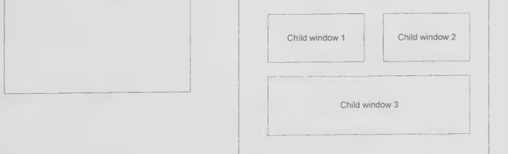

图 4.3. 普通窗口和子窗口

要销毁具有给定标识符 `win` 的窗口，请使用 `glutDestroyWindow` 函数：

```cpp
void glutDestroyWindow (int win);
```

要将当前窗口标记为需要重新显示的窗口，请调用 `glutPostRedisplay` 函数：

```cpp
void glutPostRedisplay ();
```

当使用双缓冲时，您可以使用 `glutSwapBuffers` 函数交换缓冲（即用另一个缓冲替换当前在窗口中显示的缓冲）：

```cpp
void glutSwapBuffers ();
```

即使您没有使用缓冲，这段代码仍然有效，因此它不依赖于所使用的缓冲类型。

以下两个函数用于将当前窗口移动到 (x, y) 点并将其大小调整为 width 和 height 维度：

```cpp
void glutPositionWindow (int x, int y);
void glutReshapeWindow (int width, int height);
```

此外，GLUT 库允许您使用 `glutFullScreen` 函数开启全屏模式：

```cpp
void glutFullScreen ();
```

调用此函数会将当前窗口（必须是普通窗口而非子窗口）切换到全屏模式。切换方式取决于具体的窗口系统。

要将窗口从全屏返回到普通模式，可以使用 `glutPositionWindow` 或 `glutReshapeWindow` 函数。


GLUT 库允许您更改窗口的深度位置（相对于其相邻窗口）。可以使用以下两个函数之一来实现此目的：

```cpp
void glutPopWindow ();
void glutPushWindow ();
```

以下函数用于显示、隐藏或最小化当前窗口：

```cpp
void glutShowWindow ();
void glutHideWindow ();
void glutIconifyWindow ();
```

您可以使用`glutSetWindowTitle`函数将窗口标题替换为`name`参数指定的字符串：

```cpp
void glutSetWindowTitle (char * name);
```

GLUT 库使得使用`glutSetCursor`函数为当前窗口设置光标形状成为可能：

```cpp
void glutSetCursor (int cursor);
```

`cursor`参数的值决定了表 4.2 中列出的 GLUT 内部光标之一。

### 表 4.2. GLUT 光标

| 常量 | 光标形状 |
|---|---|
| `GLUT_CURSOR_RIGHT_ARROW` | 右上箭头 |
| `GLUT_CURSOR_LEFT_ARROW` | 左上箭头 |
| `GLUT_CURSOR_INFO` | 手型 |
| `GLUT_CURSOR_DESTROY` | 骷髅和交叉骨 |
| `GLUT_CURSOR_HELP` | 问号 |
| `GLUT_CURSOR_CYCLE` | 循环箭头 |
| `GLUT_CURSOR_SPRAY` | 喷雾箭头 |
| `GLUT_CURSOR_WAIT` | 手表 |
| `GLUT_CURSOR_TEXT` | I 型光标 |
| `GLUT_CURSOR_CROSSHAIR` | 十字准星 |
| `GLUT_CURSOR_UP_DOWN` | 上下箭头 |
| `GLUT_CURSOR_LEFT_RIGHT` | 左右箭头 |
| `GLUT_CURSOR_TOP_SIDE` | 上侧箭头 |
| `GLUT_CURSOR_BOTTOM_SIDE` | 下侧箭头 |
| `GLUT_CURSOR_LEFT_SIDE` | 左侧箭头 |
| `GLUT_CURSOR_RIGHT_SIDE` | 右侧箭头 |
| `GLUT_CURSOR_TOP_LEFT_CORNER` | 左上角箭头 |
| `GLUT_CURSOR_TOP_RIGHT_CORNER` | 右上角箭头 |
| `GLUT_CURSOR_BOTTOM_RIGHT_CORNER` | 右下角箭头 |
| `GLUT_CURSOR_BOTTOM_LEFT_CORNER` | 左下角箭头 |
| `GLUT_CURSOR_FULL_CROSSHAIR` | 另一种十字准星 |
| `GLUT_CURSOR_NONE` | 不可见光标 |
| `GLUT_CURSOR_INHERIT` | 继承父级光标 |

## 菜单操作

GLUT 库支持最简单的弹出式菜单。

> 注意：在使用菜单时，您不能编辑它（即不能添加、删除或编辑其项目）。

使用`glutCreateMenu`函数创建新菜单：

```cpp
int glutCreateMenu (void (*func) (int value));
```

此函数返回一个正整数，即新创建菜单的标识符。`func`参数是在选择菜单项时应被调用的函数（所选项目的编号将作为参数传递）。由该函数创建的菜单变为当前菜单。

以下两个函数允许您获取当前菜单的标识符或将所需菜单设为当前菜单：

```cpp
int glutGetMenu ();
void glutSetMenu (int menu);
```

要销毁菜单，请将其标识符传递给`glutDestroyMenu`函数：

```cpp
void glutDestroyMenu (int menu);
```

使用`glutAddMenuEntry`函数，您可以向当前菜单的末尾添加一个新项目：

```cpp
void glutAddMenuEntry (char * name, int value);
```

`name`参数指定为所添加菜单项的字符串，`value`参数是在选择该项目时传递给菜单事件处理程序的值。

GLUT 库支持嵌套（分级）菜单，其中一个项目可以包含子菜单。

要将子菜单作为新项目添加到当前菜单中，请使用`glutAddSubMenu`函数：

```cpp
void glutAddSubMenu (char * name, int menu);
```

与之前的函数一样，`name`参数指定为所添加菜单项的字符串，`menu`参数指定要链接到此项目的菜单。

要编辑当前菜单的现有项目，请使用`glutChangeToMenuEntry`和`glutChangeToSubMenu`函数：

```cpp
void glutChangeToMenuEntry (int entry, char * name, int value);
void glutChangeToSubMenu (int entry, char * name, int menu);
```

要编辑的项目通过`entry`参数指定，该参数为该项目的编号（顶端项目为 1 号）。

要从当前菜单中删除一个项目（普通项目或带有子菜单的项目），请使用`glutRemoveItem`函数：

```cpp
void glutRemoveItem (int entry);
```

由于使用 GLUT 创建的所有菜单都是弹出式菜单，您应该为当前菜单指定一个鼠标按钮，以便在点击该按钮时，菜单能在当前窗口中出现。为此，可以使用以下函数：

```cpp
void glutAttachMenu (int button);
void glutDetachMenu (int button);
```

第一个函数决定了当用户点击由`button`参数指定的鼠标按钮时，当前菜单应在当前窗口中显示。第二个函数将当前菜单从当前窗口的指定按钮中分离。`button`参数的有效值列在表 4.3 中。

**表 4.3. `button`参数的有效值**

| 常量 | 鼠标按钮 |
| :--- | :--- |
| `GLUT_LEFT_BUTTON` | 左键 |
| `GLUT_MIDDLE_BUTTON` | 中键 |
| `GLUT_RIGHT_BUTTON` | 右键 |

## 设置消息处理器

GLUT 使用 *回调函数* 来处理消息。换句话说，应用程序将待调用函数的地址传递给 GLUT，以便在特定事件发生时调用这些函数。回调函数分为三种类型：窗口、菜单和全局（图 4.4）。

- *窗口* 回调函数允许应用程序接收消息，通知其窗口应重新显示、调整大小或应输入用户数据。处理用户输入的处理器会从输入数据所在的窗口接收消息。
- *菜单* 回调函数在前面已经介绍过。
- *全局* 回调函数与时间流相关。

最重要的消息处理器之一是用于显示窗口内容的函数。对于当前窗口，您可以使用`glutDisplayFunc`函数设置此处理器：

```cpp
void glutDisplayFunc (void (*func)());
```

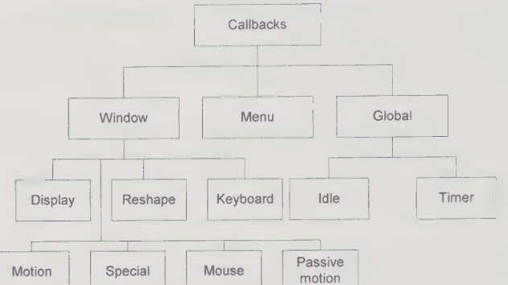

**图 4.4. GLUT 中的消息处理器**

`func`参数是函数的地址，每当需要重绘窗口内容时，该函数都会被调用。

要设置在当前窗口调整大小时调用的处理器，请使用`glutReshapeFunc`函数：

```cpp
void glutReshapeFunc(void (*func)(int width, int height));
```

`func`参数是函数的地址，每当当前窗口大小被改变时，该函数都会被调用。其输入参数是窗口的新尺寸（`width`和`height`），单位为像素。

使用`glutKeyboardFunc`函数来为产生 ASCII 码的按键（键盘事件）设置处理器：

```cpp
void glutKeyboardFunc(void (*func)(unsigned char key, int x, int y));
```

每当用户按下产生 ASCII 码的按键时，`func`函数都会被调用。其参数包括 ASCII 码（`key`）以及按键时刻的鼠标指针坐标（`x, y`）。

要为不产生 ASCII 码的键盘事件设置处理器，请使用`glutSpecialFunc`函数：

```cpp
void glutSpecialFunc(void (*func)(int key, int x, int y));
```

传递给此处理器的参数是按键代码`key`（见表 4.4 中的常量）以及按键时刻鼠标指针的坐标`x`和`y`。

要禁用键盘处理器（处理普通键盘事件或特殊键按键的处理器），请调用设置该处理器的函数，并将`func`参数设为`NULL`。

**表 4.4. 特殊按键代码**

| 常量 | 按键 |
| :--- | :--- |
| `GLUT_KEY_F1` | `<F1>` |
| `GLUT_KEY_F2` | `<F2>` |
| `GLUT_KEY_F3` | `<F3>` |
| `GLUT_KEY_F4` | `<F4>` |
| `GLUT_KEY_F5` | `<F5>` |
| `GLUT_KEY_F6` | `<F6>` |
| `GLUT_KEY_F7` | `<F7>` |
| `GLUT_KEY_F8` | `<F8>` |
| `GLUT_KEY_F9` | `<F9>` |
| `GLUT_KEY_F10` | `<F10>` |
| `GLUT_KEY_F11` | `<F11>` |
| `GLUT_KEY_F12` | `<F12>` |
| `GLUT_KEY_LEFT` | `<-` |
| `GLUT_KEY_UP` | `↑` |
| `GLUT_KEY_RIGHT` | `->` |
| `GLUT_KEY_DOWN` | `↓` |
| `GLUT_KEY_PAGE_UP` | `<Page Up>` |
| `GLUT_KEY_PAGE_DOWN` | `<Page Down>` |
| `GLUT_KEY_HOME` | `<Home>` |
| `GLUT_KEY_END` | `<End>` |
| `GLUT_KEY_INSERT` | `<Insert>` |

要为鼠标按钮的按下和释放设置处理器，请使用`glutMouseFunc`函数：

```cpp
void glutMouseFunc (void (*func) (int button, int state, int x, int y));
```

传递给处理器的`button`参数指定了触发事件的鼠标按钮（表 4.3）。`state`参数可以取两个值之一：`GLUT_DOWN`或`GLUT_UP`，取决于用户是点击了还是释放了按钮。`x`和`y`参数是鼠标按钮点击（或释放）时，鼠标指针在窗口内的坐标。要禁用此事件处理器，请调用`glutMouseFunc`函数并将`func`参数设为`NULL`。

此外，还可以设置一个控制鼠标指针在当前窗口内移动的处理器。为此应使用`glutMotionFunc`和`glutPassiveMotionFunc`函数：

```cpp
void glutMotionFunc (void (*func)(int x, int y));
void glutPassiveMotionFunc (void (*func)(int x, int y));
```

第一个函数设置一个处理器，在至少有一个鼠标按钮被按下且鼠标移动时调用。第二个函数设置一个在没有按钮按下时鼠标移动的处理器。处理器的输入参数是鼠标指针在当前窗口内的坐标。

另一个可以设置处理器的鼠标相关事件发生在鼠标指针进入窗口区域或离开窗口区域时。要设置此处理器，请使用`glutEntryFunc`函数：

```cpp
void glutEntryFunc (void (*func)(int state));
```

该处理器接收`state`参数，其中包含有关事件的信息：鼠标指针是离开窗口区域（`GLUT_LEAVE`）还是进入窗口区域（`GLUT_ENTER`）。

可以为有关窗口可见性的消息设置处理器：

```cpp
void glutVisibilityFunc (void (*func)(int state));
```

该处理器接收`state`参数，其中包含有关窗口可见性的信息：它是可见的（`GLUT_VISIBLE`）还是不可见的（`GLUT_NOT_VISIBLE`）。

> 如果一个窗口至少有一个像素可见，则认为该窗口是可见的。


在 GLUT 中还可以设置的另一个处理器是 *空闲处理器 (idle handler)*，它在没有事件发生时被调用：

```cpp
void glutIdleFunc (void (*func)());
```

这个处理器在创建动画时特别方便。您可以使用它来计算动画对象的更新参数，然后调用`glutPostRedisplay`函数来重绘窗口。

您还可以设置一个在一定时间间隔后调用的处理器。为此，请使用`glutTimerFunc`函数：

```cpp
void glutTimerFunc (unsigned int msecs, void (*func)(int value), int value);
```

`glutTimerFunc`的输入参数为`msecs` —— 调用`func`处理器的间隔时间（以毫秒为单位），以及`value` —— 传递给处理器的值。`value`参数允许您为多个事件使用同一个处理器。

> `glutIdleFunc`和`glutTimerFunc`函数设置的是不绑定到任何特定窗口的全局事件处理器。

## 获取当前 GLUT 状态的信息

在 GLUT 中，能返回有用信息的最常用函数之一是`glutGet`：

```cpp
int glutGet (GLenum state);
```

`state`参数决定了请求什么信息。其有效值列在表 4.5 中。

**表 4.5. `glutGet`函数`state`参数的值**

| 常量 | 返回值 |
| :--- | :--- |
| `GLUT_WINDOW_X` | 当前窗口相对于屏幕左上角的 X 坐标（像素） |
| `GLUT_WINDOW_Y` | 当前窗口相对于屏幕左上角的 Y 坐标（像素） |
| `GLUT_WINDOW_WIDTH` | 当前窗口的宽度（像素） |
| `GLUT_WINDOW_HEIGHT` | 当前窗口的高度（像素） |
| `GLUT_WINDOW_BUFFER_SIZE` | 每个像素的总位数 |
| `GLUT_WINDOW_STENCIL_SIZE` | 模板缓冲区中每个像素的位数 |
| `GLUT_WINDOW_DEPTH_SIZE` | 深度缓冲区中每个像素的位数 |
| `GLUT_WINDOW_RED_SIZE` | 分配给单个像素红色分量的位数 |
| `GLUT_WINDOW_GREEN_SIZE` | 分配给单个像素绿色分量的位数 |
| `GLUT_WINDOW_BLUE_SIZE` | 分配给单个像素蓝色分量的位数 |
| `GLUT_WINDOW_ALPHA_SIZE` | 分配给单个像素 Alpha 分量的位数 |

## 表 4.5 续

| 常量 | 返回值 |
| :--- | :--- |
| `GLUT_WINDOW_ACCUM_RED_SIZE` | 累积缓冲区中单个像素的红色分量所分配的位数 |
| `GLUT_WINDOW_ACCUM_GREEN_SIZE` | 累积缓冲区中单个像素的绿色分量所分配的位数 |
| `GLUT_WINDOW_ACCUM_BLUE_SIZE` | 累积缓冲区中单个像素的蓝色分量所分配的位数 |
| `GLUT_WINDOW_ACCUM_ALPHA_SIZE` | 累积缓冲区中单个像素的 alpha 分量所分配的位数 |
| `GLUT_WINDOW_DOUBLEBUFFER` | 1 — 当前窗口使用双缓冲；0 — 否则 |
| `GLUT_WINDOW_RGBA` | 1 — 当前窗口处于 RGBA 模式；0 — 处于索引模式 |
| `GLUT_WINDOW_PARENT` | 子窗口的父窗口标识符（普通窗口为 0） |
| `GLUT_WINDOW_NUM_CHILDREN` | 当前窗口的直接子窗口数量 |
| `GLUT_WINDOW_COLORMAP_SIZE` | 0 — 选择了 RGBA 模式；其他值表示调色板大小 |
| `GLUT_WINDOW_NUM_SAMPLES` | 当前窗口中单个像素的采样数 |
| `GLUT_WINDOW_STEREO` | 1 — 当前窗口使用立体模式；0 — 否则 |
| `GLUT_WINDOW_CURSOR` | 当前窗口的光标形状 |
| `GLUT_SCREEN_WIDTH` | 屏幕宽度（像素） |
| `GLUT_SCREEN_HEIGHT` | 屏幕高度（像素） |
| `GLUT_SCREEN_WIDTH_MM` | 屏幕宽度（毫米） |
| `GLUT_SCREEN_HEIGHT_MM` | 屏幕高度（毫米） |
| `GLUT_MENU_NUM_ITEMS` | 当前菜单中的项目数量 |
| `GLUT_DISPLAY_MODE_POSSIBLE` | 对当前显示模式的支持情况 |
| `GLUT_INIT_DISPLAY_MODE` | 初始显示模式 |
| `GLUT_INIT_WINDOW_X` | 窗口的初始 x 坐标 |
| `GLUT_INIT_WINDOW_Y` | 窗口的初始 y 坐标 |


| `GLUT_INIT_WINDOW_WIDTH` | 初始窗口宽度 |
| `GLUT_INIT_WINDOW_HEIGHT` | 初始窗口高度 |
| `GLUT_ELAPSED_TIME` | 自上次调用`glutInit`函数以来经过的时间（毫秒） |

要获取关于设备的信息，请调用`glutDeviceGet`函数：

```cpp
int glutDeviceGet(GLenum info);
```

`info`参数决定了需要什么样的信息。其有效值列在表 4.6 中。

### 表 4.6. `glutDeviceGet`函数的`info`参数值

| 常量 | 返回值 |
| :--- | :--- |
| `GLUT_HAS_KEYBOARD` | 如果连接了键盘，则为非零值 |
| `GLUT_HAS_MOUSE` | 如果连接了鼠标，则为非零值 |
| `GLUT_HAS_TABLET` | 如果连接了绘图板，则为非零值 |
| `GLUT_NUM_MOUSE_BUTTONS` | 鼠标按钮的数量（0 — 未连接鼠标） |
| `GLUT_NUM_SPACEBALL_BUTTONS` | 空间球按钮的数量 |
| `GLUT_NUM_TABLET_BUTTONS` | 绘图板按钮的数量 |

此外，你可以在调用处理程序时获取特殊键的状态信息。`glutGetModifiers`函数可以实现这一点：

```cpp
int glutGetModifiers( );
```

返回的值中可以设置以下位：

- `GLUT_ACTIVE_SHIFT` — <Shift> 或 <Caps Lock> 键被按下
- `GLUT_ACTIVE_CTRL` — 其中一个 <Ctrl> 键被按下
- `GLUT_ACTIVE_ALT` — 其中一个 <Alt> 键被按下

此函数只能由键盘或鼠标事件处理程序调用。

GLUT 库使得获取指定扩展是否受支持成为可能（仅检查常见的 GL 扩展）：

```cpp
int glutExtensionSupported(char * extName);
```

如果名称为`extName`的扩展受支持，此函数返回一个非零值。要求在调用此函数之前，必须至少有一个使用 GLUT 创建的窗口处于打开状态。


> 第 7 章描述了一种使用 libExt 库检查扩展支持情况的通用方法。

## 文本输出

GLUT 库支持使用两种类型的字体进行文本输出：描边（stroke）和点阵（bitmap）。在第一种字体中，每个字符被指定为一组线段；在第二种字体中，每个字符使用点阵指定。

要使用 OpenGL 输出点阵字体的一个字符，请调用`glutBitmapCharacter`函数：

```cpp
void glutBitmapCharacter(void * font, int ch);
```

`font`参数指定点阵字体。GLUT 支持的点阵字体列在表 4.7 中。

### 表 4.7. `font`参数的值

| 常量 | 字体描述 |
| --- | --- |
| `GLUT_BITMAP_8_BY_13` | 字符大小为 8×13 像素的字体 |
| `GLUT_BITMAP_9_BY_15` | 字符大小为 9×15 像素的字体 |
| `GLUT_BITMAP_TIMES_ROMAN_10` | 尺寸为 10 pt 的 Times Roman 比例字体 |
| `GLUT_BITMAP_TIMES_ROMAN_24` | 尺寸为 24 pt 的 Times Roman 比例字体 |
| `GLUT_BITMAP_HELVETICA_10` | 尺寸为 10 pt 的 Helvetica 比例字体 |
| `GLUT_BITMAP_HELVETICA_12` | 尺寸为 12 pt 的 Helvetica 比例字体 |
| `GLUT_BITMAP_HELVETICA_18` | 尺寸为 18 pt 的 Helvetica 比例字体 |

你可以通过调用`glutBitmapWidth`函数，获取由`font`参数指定点阵字体中`ch`参数指定字符的宽度：

```cpp
int glutBitmapWidth(GLUTBitmapFont font, int ch);
```

要输出描边字体的一个字符，请使用`glutStrokeCharacter`函数：

```cpp
void glutStrokeCharacter(void * font, int ch);
```

`font`参数指定用于输出`ch`字符的描边字体，它可以取两个值之一：`GLUT_STROKE_ROMAN`或`GLUT_STROKE_MONO_ROMAN`。

`glutStrokeWidth`函数允许你获取指定描边字体的字符宽度：

```cpp
int glutStrokeWidth(GLUTStrokeFont font, int ch);
```

## 最简单对象的输出

GLUT 包含几个可以绘制最简单几何对象的函数。

> 注意：所有这些函数都在顶点中指定了正确的法线，但没有指定纹理坐标。唯一的例外是 Teapot（茶壶）对象，它同时指定了法线和纹理坐标。

这些原语中的每一个都可以通过两种模式之一输出：线框（wire）和实体（solid）。两种模式下函数的参数相同，函数名称仅在`Wire`或`Solid`词汇上有所区别。

> 注意：所有原语的中心都绘制在坐标原点。

### 球体

要绘制球体，请使用以下函数：

```cpp
void glutSolidSphere (GLdouble r, GLint slices, GLint stacks);
void glutWireSphere (GLdouble r, GLint slices, GLint stacks);
```

`r`参数指定球体的半径，`slices`和`stacks`参数指定球体如何被切分为多边形。

### 立方体

要绘制立方体，请使用以下函数：

```cpp
void glutSolidCube (GLdouble size);
void glutWireCube (GLdouble size);
```

`size`参数指定立方体的边长。

### 圆锥体

要绘制圆锥体，请使用`glutSolidCone`和`glutWireCone`函数。圆锥的底面绘制在平面`z = 0`上，其顶点位于点`(0, 0, height)`。

```cpp
void glutSolidCone (GLdouble base, GLdouble height,
                    GLint slices, GLint stacks);
void glutWireCone  (GLdouble base, GLdouble height,
                    GLint slices, GLint stacks);
```

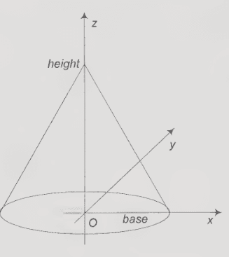

图 4.5. 圆锥体

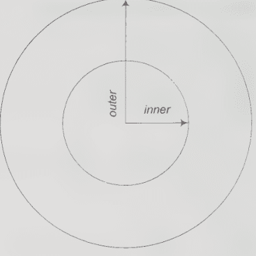

图 4.6. 圆环体

`base`参数指定圆锥底面的半径，`height`指定圆锥的高度（图 4.5）。`slices`和`stacks`参数指定圆锥如何被切分为多边形（在圆锥底面和沿`Oz`轴方向）。

### 圆环体

要绘制圆环体，请使用以下函数：

```cpp
void glutSolidTorus (GLdouble inner, GLdouble outer,
                   GLint sides, GLint rings);
void glutWireTorus (GLdouble inner, GLdouble outer,
                   GLint sides, GLint rings);
```

`inner`和`outer`参数指定圆环体的内半径和外半径（图 4.6），`sides`和`rings`参数指定每个圆环的边数以及组成圆环体的环数。

### 十二面体

要绘制十二面体（具有十二个面的正多面体），请使用以下函数：

```cpp
void glutSolidDodecahedron ();
void glutWireDodecahedron ();
```

它们绘制一个中心在坐标原点且半径等于`\sqrt{3}`的十二面体。

### 正八面体

要绘制一个正八面体（一个具有八个面的正多面体），请使用以下函数：

```cpp
void glutSolidOctahedron ();
void glutWireOctahedron ();
```

它们绘制一个中心位于坐标原点且半径等于`1`的正八面体。

### 正四面体

要绘制一个正四面体（一个具有四个面的正多面体），请使用以下函数：

```cpp
void glutSolidTetrahedron ();
void glutWireTetrahedron ();
```

它们绘制一个中心位于坐标原点且半径等于`\sqrt{3}`的正四面体。

### 正二十面体

要绘制一个正二十面体（一个具有二十个面的正多面体），请使用以下函数：

```cpp
void glutSolidIcosahedron ();
void glutWireIcosahedron ();
```

它们绘制一个中心位于坐标原点且半径等于`1`的正二十面体。

### 茶壶

GLUT 库支持输出由 Martin Newell 在 1975 年首次引入的传统茶壶（Teapot）对象。以下函数用于此目的：

```cpp
void glutSolidTeapot (GLdouble size);
void glutWireTeapot (GLdouble size);
```

`size`参数指定茶壶的相对大小。

## 第 5 章：关于 GLH、NV_MATH 和 NV_UTIL 库的一般信息

为了更方便地使用 OpenGL 和 GLUT，NVIDIA 创建了几个包含在 NVIDIA SDK 中的 C++ 库。本章介绍了其中最重要的几个库：GLH、NV_MATH 和 NV_UTIL。

### GLH 库

GLH（OpenGL Helper）库是一个类集合，旨在使 OpenGL 和 GLUT 库的使用更加便捷。这些类分为三组：

- 主要数学对象的封装
- GLUT 的面向对象封装
- OpenGL 的面向对象封装

GLH 引入的所有类都被放入`glh`命名空间或一个特殊的内部命名空间`GLH_REAL_NAMESPACE`中。这就是为什么你在每次使用类时，要么需要加上`glh::`前缀，要么使用以下命令将该命名空间链接到当前命名空间：

```cpp
using namespace glh;
```

### 主要数学类的封装

主要数学类包括向量、矩阵、四元数、直线和平面。

#### 向量

最重要的数学抽象之一就是向量。所有向量的实现都基于以下模板类：

```cpp
template <int N, class T>
class vec
```

该类是一个 N 维向量的抽象，其分量类型为`T`。表 5.1 列出了该类的主要方法。

### 表 5.1. `vec <N, T>`类的主要方法

| 方法 | 描述 |
| :--- | :--- |
| `int size() const` | 返回向量分量的数量（即向量的维度）。 |
| `vec(const T & t = T())` | 通过数字数组的引用构建向量。 |
| `vec(const T * tp)` | 通过数字数组的指针构建向量。 |
| `const T * get_value() const` | 返回一个指向向量分量的指针，将其视为数字数组。 |
| `T dot(const vec<N, T> & rhs) const` | 计算点积。 |
| `T length() const` | 计算向量长度。 |
| `T square_norm() const` | 计算向量长度的平方。 |
| `void negate()` | 对向量取反，即改变每个分量的符号。 |
| `T normalize()` | 归一化向量，即返回其初始长度。 |
| `vec<N, T> & set_value(const T * rhs)` | 使用数字数组指针初始化向量。 |
| `T & operator [ ] (int i)` | 访问向量分量（并允许对其进行编辑）。 |
| `const T & operator [ ] (int i) const` | 访问向量分量（仅限读取）。 |

该类定义了以下运算符：`*=`、`/=`（表示一个向量与另一个向量或标量的分量乘法和除法操作）、`+=`、`-=`（向量加法的分量操作）、一元负号，以及`+`、`-`和`*`运算符（分量操作）。这些运算符表示 n 维向量传统的分量操作。

`+`和`-`运算符表示向量的分量加法和减法。`*`和`/`运算符表示一个向量与另一个向量或标量的分量乘法和除法。`+=`和`-=`运算符表示两个给定向量的分量加法和减法，并将结果写入第一个向量。`*=`和`/=`运算符表示一个向量与另一个向量或标量的分量乘法和除法，并将结果写入第一个向量。

该类还定义了二元运算，如加法（`+`）、减法（`-`）、向量或标量乘法（`*`）以及标量除法（`/`）。最后，定义了`==`（等于）和`!=`（不等于）比较运算符。

基于此模板类，构建了几个实现常见二维、三维和四维向量的类。GLH 库将`real`类型定义为`float`（在`glh_linear.h`文件的开头），并在主类中使用它。

`GLH_REAL_NAMESPACE`命名空间（已包含在`glh`命名空间中）通过扩展`<vec2, real>`、`<vec3, real>`和`<vec4, real>`类引入了`vec2`、`vec3`和`vec4`类。这些类各增加了一个接收三个、两个或四个`real`数（取决于具体类）作为参数的构造函数。同时还增加了引用相应数量`real`变量的`get_value`方法。

`vec3`类中增加了一个计算叉积的`cross`方法：

```cpp
vec3 cross(const vec3 &rhs) const
```

`vec4`类包含另一个构造函数，它接收一个三维向量和一个标量值（作为第四个分量）。在`glh`命名空间中，`vec2f`、`vec3f`和`vec4f`类定义如下：

```cpp
typedef GLH_REAL_NAMESPACE::vec2 vec2f;
typedef GLH_REAL_NAMESPACE::vec3 vec3f;
typedef GLH_REAL_NAMESPACE::vec4 vec4f;
```

#### 矩阵

另一个非常重要的类是 4x4 矩阵的抽象，它在`GLH_REAL_NAMESPACE`命名空间中被引入为`matrix4`（随后被定义为等同于此的`matrix4f`类）。表 5.2 列出了该类的主要方法。

### 表 5.2. `matrix4`类的方法

| 方法 | 描述 |
| :--- | :--- |
| `matrix4()` | 使用单位矩阵初始化矩阵，即将对角线元素设为 1，其余元素设为 0。 |
| `matrix4(real r)` | 将矩阵的所有元素初始化为`r`值。 |
| `matrix4(real * m)` | 使用包含 16 个数字的数组初始化矩阵。 |
| `matrix4(real a00, ..., real a33)` | 使用明确指定的值初始化矩阵。 |
| `void get_value(real * mp) const` | 将矩阵元素的值赋给数组。 |
| `const real * get_value() const` | 返回一个指向矩阵元素数组的指针。 |
| `void set_value(real * mp)` | 使用数组初始化矩阵。 |
| `void set_value(real r)` | 将矩阵的所有元素初始化为`r`值。 |
| `void make_identity()` | 使用单位矩阵初始化矩阵。 |
| `static matrix4 identity()` | 返回单位矩阵。 |
| `void set_scale(real s)` | 将前三个对角线元素赋值为`s`值。 |
| `void set_scale(const vec3 & s)` | 将前三个对角线元素赋值为`s`向量相应分量的值。 |
| `void set_translate(const vec3 & t)` | 将`t`向量赋值给矩阵的最后一列。 |
| `void set_row(int r, const vec4 & t)` | 将`t`向量赋值给矩阵的第`r`行。 |
| `void set_column(int c, const vec4 & t)` | 将`t`向量赋值给矩阵的第`c`列。 |
| `void get_row(int r, vec4 & t) const` | 将指定的矩阵行写入向量中。 |
| `vec4 get_row(int r) const` | 将矩阵行作为向量返回。 |
| `void get_column(int c, vec4 & t) const` | 将指定的矩阵列写入向量中。 |
| `vec4 get_column(int c) const` | 将矩阵列作为向量返回。 |
| `matrix4 inverse() const` | 返回指定矩阵的逆矩阵，即返回的矩阵与给定矩阵的乘积等于单位矩阵。 |


`matrix4 transpose() const`：返回转置矩阵。

`matrix4 & mult_right(const matrix4 & b)`：执行矩阵与 `b` 的右乘。

`matrix4 & mult_left(const matrix4 & b)`：执行矩阵与 `b` 的左乘。

`void mult_matrix_vec(const vec3 &src, vec3 &dst) const`：矩阵与向量相乘：`dst = M * src`。

`void mult_matrix_vec(const vec3 & src_and_dst) const`：矩阵与向量相乘：`src_and_dst = M * src_and_dst`。

`void mult_vec_matrix(const vec3 &src, vec3 &dst) const`：向量与矩阵相乘：`dst = src * M`。

`void mult_vec_matrix(const vec3 & src_and_dst) const`：向量与矩阵相乘：`src_and_dst = src_and_dst * M`。

`void mult_matrix_vec(const vec4 &src, vec4 &dst) const`：矩阵与向量相乘：`dst = M * src`。

`void mult_vec(vec4 & src_and_dst) const`：矩阵与向量相乘：`src_and_dst = M * src_and_dst`。

`void mult_vec_matrix(const vec4 &src, vec4 &dst) const`：向量与矩阵相乘：`dst = src * M`。

`void mult_vec_matrix(vec4 & src_and_dst) const`：向量与矩阵相乘：`src_and_dst = M * src_and_dst`。

`void mult_matrix_dir(const vec3 &src, vec3 &dst) const`：左上角 3x3 子矩阵与向量相乘。

`void mult_matrix_dir(vec3 & src_and_dst) const`：左上角 3x3 子矩阵与向量相乘。

`void mult_dir_matrix(const vec3 &src, vec3 &dst) const`：向量与左上角 3x3 子矩阵相乘。

`void mult_dir_matrix(vec3 & src_and_dst) const`：向量与左上角 3x3 子矩阵相乘。

`real & operator () (int row, int col)`：使用 `()` 运算符通过行和列访问矩阵元素。

`const real & operator () (int row, int col) const`：使用 `()` 运算符通过行和列访问矩阵元素（只读）。

`real & element (int row, int col)`：通过行和列访问矩阵元素。

`const real & element (int row, int col) const`：通过行和列访问矩阵元素。

针对 `matrix4` 类型的对象定义了以下运算符：`+=`（矩阵和标量均可用作参数）、`+=`、`*=`、`==`、`!=`。

# 四元数

计算机图形学中广泛使用的另一个类包括四元数。四元数是一个四维向量，其乘法和除法运算定义较为特殊。它是复数的扩展，`x`、`y` 和 `z` 分量通常被视为四元数的虚部，`w` 分量为其实部。在 GLH 库中，四元数由 `quaternion` 类（或 `glh` 命名空间中等效的 `quaternionf` 类）和 `rotation` 类（或 `glh` 命名空间中等效的 `rotationf` 类）表示。

> 四元数用于指定 3D 空间中的旋转，在许多情况下，它们比矩阵方便得多。

表 5.3 列出了该类的主要方法。

对于 `quaternion` 类，定义了以下运算符：`*`、`*=`、`==` 和 `!=`。

# 表 5.3 `quaternion` 类的方法

| 方法 | 描述 |
| :--- | :--- |
| `quaternion()` | 创建 (0, 0, 0, 1) 四元数。 |
| `quaternion(const real v[4])` | 使用数组元素初始化四元数。 |
| `quaternion(real q0, real q1, real q2, real q3)` | 通过显式指定所有分量来初始化四元数。 |
| `quaternion(const matrix4 & m)` | 使用旋转矩阵初始化四元数。 |
| `quaternion(const vec3 &axis, real radians)` | 使用旋转轴和旋转角度初始化四元数。 |
| `quaternion(const vec3 &rotateFrom, const vec3 &rotateTo)` | 使用将 `rotateFrom` 向量旋转至 `rotateTo` 向量的旋转来初始化四元数。 |
| `quaternion(const vec3 & from_look, const vec3 & from_up, const vec3 & to_look, const vec3 & to_up)` | 使用将摄像机从一个方向移至另一个方向的旋转来初始化四元数。 |
| `const real * get_value() const` | 返回指向四元数分量数组的指针。 |
| `void get_value(real &q0, real &q1, real &q2, real &q3) const` | 返回所有四元数分量。 |
| `quaternion & set_value(real q0, real q1, real q2, real q3)` | 设置四元数分量的值。 |
| `void get_value(vec3 &axis, real &radians) const` | 返回四元数指定的旋转轴和旋转角度。 |
| `void get_value(matrix4 & m) const` | 返回与四元数相对应的旋转矩阵。 |
| `quaternion & set_value(const real * qp)` | 将四元数分量的值设置为与数组元素相等。 |
| `quaternion & set_value(const matrix4 & m)` | 使用旋转矩阵设置四元数分量的值。四元数的值被设置为指定与矩阵相同的旋转。 |
| `quaternion & set_value(const vec3 &axis, real theta)` | 使用绕指定轴旋转指定角度来设置四元数分量的值。 |
| `quaternion & set_value(const vec3 & rotateFrom, const vec3 & rotateTo)` | 设置四元数分量的值，使其指定将 `rotateFrom` 向量旋转到 `rotateTo` 向量的旋转。 |
| `quaternion & set_value(const vec3 & from_look, const vec3 & from_up, const vec3 & to_look, const vec3 & to_up)` | 设置四元数分量的值，使其指定从一个摄像机方向到另一个方向的旋转。 |
| `void normalize()` | 对四元数进行归一化。 |
| `quaternion & conjugate()` | 对四元数求共轭，即改变其 x, y, z 分量的符号。 |
| `quaternion & invert()` | 对四元数求反。 |
| `quaternion inverse() const` | 返回给定四元数的逆四元数。 |
| `void mul_vec(const vec3 &src, vec3 &dst) const` | 使用此四元数旋转 `src` 向量，并将结果写入 `dst` 向量。 |
| `void mul_vec(vec3 & src_and_dst) const` | 使用四元数与 `src_and_dst` 向量相乘。 |
| `void scale_angle(real scaleFactor)` | 将四元数指定的旋转角度乘以 `scaleFactor` 值。 |
| `static quaternion slerp(const quaternion & p, const quaternion & q, real alpha)` | 在 `p` 和 `q` 四元数之间使用 `alpha` 参数（取值从 0 到 1）执行球面线性插值。 |
| `static quaternion identity()` | 返回单位四元数 (0, 0, 0, 1) |
| `real & operator [](int i)` | 通过索引访问四元数分量。 |
| `const real & operator [](int i) const` | 通过索引访问四元数分量（只读）。 |

# 直线

GLH 库中引入的另一个重要数学类是封装直线的 `line` 类（`glh` 命名空间中的 `linef` 类）。每条直线由其通过的点（`position`）和一个方向向量（`direction`）决定。表 5.4 列出了该类的主要方法。

# 表 5.4 `line` 类的方法

| 方法 | 描述 |
| :--- | :--- |
| `line()` | 使用 `Oz` 轴初始化直线。 |
| `line(const vec3 & p0, const vec3 &p1)` | 使用直线通过的两个点进行初始化。 |
| `void set_value(const vec3 &p0, const vec3 &p1)` | 使给定的直线等于通过 `p0` 和 `p1` 两点的直线。 |
| `bool get_closest_points(const line &line2, vec3 &pointOnThis, vec3 &pointOnThat)` | 寻找两条直线上的最近点：`pointOnThis` 被赋值为距离 `line2` 最近的点，`pointOnThat` 被赋值为属于 `line2` 且距离给定直线最近的点。如果直线平行，则返回 `false`。 |
| `vec3 get_closest_point(const vec3 &point)` | 返回属于给定直线且距离 `point` 点最近的点。 |
| `const vec3 & get_position() const` | 返回直线的坐标点。 |
| `const vec3 & get_direction() const` | 返回直线的方向向量。 |

# 平面

另一个类是 3D 空间中平面的抽象。这就是 `plane`（或 `planef`）类。

平面由一个单位法向量（`normal`）和沿法线到坐标原点的距离（`distance`）决定。换句话说，平面由以下方程指定：`(p, normal) = distance`。

表 5.5 列出了该类的主要方法。

# 表 5.5 `plane` 类的主要方法

| 方法 | 描述 |
| :--- | :--- |
| `plane()` | 使用 `Oxy` 平面初始化平面。 |
| `plane(const vec3 &p0, const vec3 &p1, const vec3 &p2)` | 使用由 `p0`、`p1` 和 `p2` 三点确定的平面进行初始化。 |
| `plane(const vec3 &normal, real distance)` | 使用法向量和到坐标原点的距离初始化平面。 |
| `plane(const vec3 &normal, const vec3 &point)` | 使用法线和平面上的一个点来初始化平面。 |
| `void offset(real d)` | 使平面沿法线方向移动 `d` 距离。 |
| `bool intersect(const line &l, vec3 &intersection) const` | 寻找平面与直线 `l` 的交点，并将交点返回在 `intersection` 参数中。如果没有交点，则返回 `false`。 |
| `void transform(const matrix4 &matrix)` | 将矩阵指定的仿射变换应用于该平面。 |
| `bool is_in_half_space(const vec3 &point) const` | 如果 `point` 点属于法线所指的半空间，则返回 `false`。否则，返回 `true`。 |
| `real distance(const vec3 & point) const` | 返回 `point` 点到平面的距离。 |
| `const vec3 &get_normal() const` | 返回平面的法线。 |
| `real get_distance_from_origin() const` | 返回平面到坐标原点的距离。 |

该类定义了比较运算符 `==` 和 `!=`。

# GLUT 的对象封装

尽管 GLUT 库简单，但它也有一些缺点。其中之一是它是面向过程的。特别是，这迫使你为每个程序重新编写一套必需的函数（尽管许多函数是相同的）。通过面向对象的方法，你可以使用继承来解决这个问题。

由于该库的面向过程特性而产生的另一个缺点是，消息处理函数所需的所有数据必须是全局的（至少在调用它们的文件中是全局的）。

最后，你不能为每种类型的窗口消息设置多个消息处理函数。

GLH 库为所有这些问题提供了一个基于 *交互器（interactors）*（`glut_interactor` 类，代码清单 5.1）的简单解决方案。

## 代码清单 5.1 `glut_interactor` 类的定义

```cpp
class glut_interactor
{
  public:
    glut_interactor() { enabled = true; }

    virtual void display() { }
    virtual void idle() { }
    virtual void keyboard(unsigned char key, int x, int y) { }
    virtual void menu_menu_status(int status, int x, int y) { }
    virtual void motion(int x, int y) { }
    virtual void mouse(int button, int state, int x, int y) { }
    virtual void passive_motion(int x, int y) { }
    virtual void reshape(int w, int h) { }
    virtual void special(int key, int x, int y) { }
    virtual void timer(int value) { }
    virtual void visibility(int v) { }

    virtual void enable() { enabled = true; }
    virtual void disable() { enabled = false; }

    bool enabled;
};
```

从代码清单 5.1 可以看到，在 `glut_interactor` 类中，为 GLUT 支持的每条消息都定义了一个虚拟方法（且不执行任何操作）。此外，每个交互器都有一个 `enabled` 标志，允许你通过将该标志设置为 `false` 来在消息循环中禁用该对象。

如果你将几个交互器组合在一个列表中，并为每条消息设置一个依次调用所有已启用交互器的处理函数，你将获得一个简单且方便的 GLUT 封装。所需的定义和方法包含在 `ghl_glut.h` 文件中。

`glut_helpers_initialize()` 函数用于将所有处理函数设置为与交互器配合工作的特殊函数，即由它们将所有收到的请求委派给交互器。这里只是这样一个处理函数的一个示例（代码清单 5.2）。

## 代码清单 5.2 用于交互器工作的重绘消息处理函数

```cpp
void glut_display_function()
{
  propagate = true;
  for(std::list<glut_interactor *>::iterator it = interactors.begin();
      it != interactors.end() && propagate; it++)
      (*it)->display();
}
```

注意全局变量 `propagate` 是如何使用的：在其中一个交互器中将其设置为 `false` 将取消遍历列表中其余交互器的过程。

要向列表中添加一个新的交互器，请使用 `glut_add_interactor` 函数：

`void glut_add_interactor (glut_interactor * gi, bool append = true);`

参数 `gi` 是指向被添加交互器的指针，参数 `append` 定义该交互器应被添加到列表的开头 (`append = false`) 还是结尾 (`append = true`)。

要从列表中移除一个交互器，请使用 `glut_remove_interactor` 函数：

`void glut_remove_interactor (glut_interactor * gi)`


一般来说，你可以在每次需要时编写一个新的交互器，然后在其中定义必要的方法。你也可以创建一个包含常用函数的基类，并对其中的一两个方法进行修改。

不过，你也可以采用另一种方法：将必要的功能分布在许多个交互器中，每个交互器执行一个基本操作。然后，你就可以通过组合合适的交互器来实现程序的所需功能。GLH 的创建者选择了这种方法，并开发了一套实现了某些常用操作的交互器。

### 图 5.1. GLH 中的主要交互器

其中最简单的是`glut_callbacks`交互器，它为每个处理函数包含一个（初始化为`NULL`）的函数指针。对于每条消息，该交互器通过指针调用所需的函数（如果指针不等于`NULL`）。以下指针可供编辑：`display_function`、`idle_function`、`keyboard_function`、`menu_status_function`、`motion_function`、`mouse_function`、`passive_motion_function`、`reshape_function`、`special_function`、`timer_function`和`visibility_function`。

实际上，这个交互器允许你在交互器中使用通用函数。

`glut_perspective_interactor`是最有趣的。它实现了`reshape`方法的部分功能，从而根据传递给构造函数的参数设置透视投影：

```cpp
glut_perspective_reshaper (float infovy = 60.f, float inzNear = .1f,
                                    float inzFar = 10.f);
```

`glut_simple_interactor`类使得观察某些事件（例如点击鼠标按钮或按下特殊键）成为可能。该交互器观察自上一个事件以来的鼠标移动，并允许你使用`update`虚拟方法来处理该事件。由于该方法在该类中没有定义，因此`glut_simple_interactor`是一个抽象类（也就是说，它不能被实例化）。然而，它是许多鼠标消息处理函数的基类，这些处理函数允许用户使用鼠标旋转对象以及将对象向各个方向移动。此功能通过`glut_pan`、`glut_dolly`、`glut_trackball`和`glut_rotate`交互器实现。

`glut_simple_mouse_interactor`交互器通过聚合`glut_pan`、`glut_dolly`、`glut_trackball`和`glut_rotate`交互器并将相应的请求委派给它们来实现这一功能。

## OpenGL 的对象封装

GLH 库包含几个用于 OpenGL 对象的对象封装，例如显示列表、纹理对象以及顶点和片段着色器程序。我将描述前两个。

为了将显示列表封装到类中，该库定义了`display_list`类，其源代码如代码清单 5.3 所示。

### 代码清单 5.3. `display_list`类

```cpp
class display_list
{
public:
    // 如果你想让类在析构函数中清理
    // 对象，请将 managed 设置为 true。

    display_list(bool managed = false)
        : valid(false), manageObjects(managed) {}

    virtual ~display_list()
    {
        if (manageObjects)
            del();
    }

    void call_list()
    {
        if (valid)
            glCallList(dlist);
    }

    void new_list(GLenum mode)
    {
        if (!valid)
            gen();

        glNewList(dlist, mode);
    }

    void end_list()
    {
        glEndList();
    }

    void del()
    {
        if (valid)
            glDeleteLists(dlist, 1);

        valid = false;
    }

    bool is_valid() const {return valid;}

private:

    void gen()
    {
```

```cpp
dlist = glGenLists(1);
valid = true;
}

bool valid;
bool manageObjects;
GLuint dlist;
};
```

要创建这样一个列表，你应该创建一个`display_list`对象，调用`new_list`方法，执行所有应包含在列表中的 OpenGL 命令，然后调用`end_list`方法。

`call_list`方法用于调用该列表，而`is_valid`方法用于确定某个特定的显示列表是否存在。

构造函数的参数决定了在 C++ 对象被销毁后，OpenGL 显示列表是否应该被销毁（即其使用的资源是否应该被释放）。

纹理对象的对象包装是通过`tex_object`类以及继承自它的`tex_object_1D`、`tex_object_2D`、`tex_object_3D`和`tex_object_cube_map`类实现的。代码清单 5.4 包含了这些类的描述。

### 代码清单 5.4. GLH 库的纹理类

```cpp
class tex_object
{
public:
    // Set managed to true if you want the class to cleanup
    // objects in the destructor.
    tex_object(GLenum tgt, bool managed)
        : target(tgt), valid(false), manageObjects(managed) {}

    virtual ~tex_object()
    {
        if (manageObjects)
            del();
    }

    void bind()
    {
        if(!valid)
            gen();
        glBindTexture(target, texture);
    }

    // Convenience methods
    void parameter(GLenum pname, GLint i)
    {
        glTexParameteri(target, pname, i);
    }

    void parameter(GLenum pname, GLfloat f)
    {
        glTexParameterf(target, pname, f);
    }

    void parameter(GLenum pname, GLint * ip)
    {
        glTexParameteriv(target, pname, ip);
    }

    void parameter(GLenum pname, GLfloat * fp)
    {
        glTexParameterfv(target, pname, fp);
    }

    void enable()
    {
        glEnable(target);
    }

    void disable()
    {
        glDisable(target);
    }

    void del()
    {
        if(valid)
            glDeleteTextures(1, &texture);

        valid = false;
    }

    bool is_valid() const
    {
        return valid;
    }

    void gen()
    {
        glGenTextures(1, &texture);
        valid = true;
    }

    GLenum  target;
    bool    valid;
    bool    manageObjects;
    GLuint  texture;
};

class tex_object_1D : public tex_object
{
public:
    tex_object_1D(bool managed = false) : tex_object(GL_TEXTURE_1D, managed) {}
};

class tex_object_2D : public tex_object
{
public:
    tex_object_2D(bool managed = false) : tex_object(GL_TEXTURE_2D, managed) {}
};

class tex_object_3D : public tex_object
{
public:
    tex_object_3D(bool managed = false) : tex_object(GL_TEXTURE_3D, managed) {}
};

class tex_object_cube_map : public tex_object
{
public:
    tex_object_cube_map(bool managed = false) :
        tex_object(GL_TEXTURE_CUBE_MAP_ARB, managed) {}
};
```

这些类非常简单，它们的主要优势在于为程序员提供了一种方便的方式来控制参数并自动释放资源。

## NV_MATH 库

NV_MATH 库实现了主要的数学对象和一些有用的函数。与 GLH 库不同，该库没有将其类放入特殊的命名空间中。要使用 NV_MATH 库，你需要包含以下文件：`nv_math.h`、`nv_algebra.h`和`nv_math.lib`。

定义为`float`的`nv_scalar`类型被用作库中所有类的基础类型。

对于向量操作，NV_MATH 库提供了`vec2`、`vec3`、`vec4`类及其转置对应类`vec2t`、`vec3t`和`vec4t`。这些类中的每一个都拥有一组庞大的构造函数，允许程序员使用数字数组、数字数组指针或其他向量（包括不同维度的向量）来初始化向量。为这些类中的每一个都定义了`==`和`!=`比较运算符。此外，还定义了以下逐分量操作：`+`、`-`、`*`、`/`、`+=`、`-=`和`*=`。

要访问单个分量，你可以使用重载的运算符`[]`或分量名称（`x`、`y`、`z`、`w`或`s`、`t`、`r`、`q`）。

`sq_norm`方法返回向量的长度平方，而`norm`方法返回长度。

对于`vec3`类，定义了以下方法：

```cpp
nv_scalar normalize();
void orthogonalize(const vec3& v);
void orthonormalize(const vec3& v);
```

第一个方法对向量进行归一化并返回其初始长度，`orthogonalize`方法使给定向量与指定向量正交，`orthonormalize`方法先使给定向量与指定向量正交，然后对给定向量进行归一化。

除了类方法外，该库还提供了许多函数以便对其进行操作。表 5.6 列出了这些函数，当一个函数版本适用于所有类（`vec2`、`vec3`和`vec4`）时，使用字母 T 代替类型指示。

对于 3x3 和 4x4 矩阵的操作，NV_MATH 库定义了`mat3`和`mat4`类。这些类中的每一个都有一个空构造函数、一个使用数字数组初始化矩阵的构造函数以及一个拷贝构造函数。

表 5.7 列出了这些类的主要方法。

### 表 5.6. NV_MATH 库中定义的主要函数

| 函数 | 描述 |
| :--- | :--- |
| `T& normalize(T & u);` | 对向量进行归一化。 |
| `nv_scalar nv_sq_norm(const vec3 & n)`<br>`nv_scalar nv_sq_norm(const vec4 & n)` | 计算向量的长度平方。 |
| `nv_scalar nv_norm(const vec3 & n)`<br>`nv_scalar nv_norm(const vec4 & n)` | 计算向量长度。 |
| `vec3 & cross(vec3 & u,`<br>`const vec3 & v,`<br>`const vec3 & w);` | 计算向量的叉积。 |
| `nv_scalar dot(const vec3 & v,`<br>`const vec3 & w);` | 计算向量的点积。 |
| `nv_scalar dot(const vec4 & v,`<br>`const vec4 & w);` | 计算向量的点积。 |
| `vec3 & reflect(vec3 & r,`<br>`const vec3 & n, const vec3 & l);` | 计算`l`向量相对于法线`n`的反射，并将结果赋值给`r`向量。 |
| `madd(vec3 & u, const vec3 & v,`<br>`const nv_scalar & lambda);` | 计算`u = v * lambda + u`。 |
| `T& scale(T& u, const nv_scalar s);` | 将向量乘以标量并返回结果向量。 |
| `T& mult(T & u, const M& m,`<br>`const T& v);` | 计算`u = M * v`（T 为`vec3`或`vec4`，M 为`mat3`或`mat4`）。 |
| `T& mult(T & u, const T& v,`<br>`const M& m);` | 计算`u = v * M`。 |
| `inline void nv_max(vec3 & vOut,`<br>`const vec3 & vFirst,`<br>`const vec3 & vSecond)` | 寻找`vFirst`和`vSecond`向量的逐分量最大值，并将结果赋值给`vOut`向量。 |
| `inline void nv_min(vec3 & vOut,`<br>`const vec3 & vFirst,`<br>`const vec3 & vSecond)` | 寻找`vFirst`和`vSecond`向量的逐分量最小值，并将结果赋值给`vOut`向量。 |
| `nv_scalar nv_area(const vec3 & v1,`<br>`const vec3 & v2, const vec3 & v3);` | 计算`v1v2v3`三角形的面积。 |
| `nv_scalar nv_perimeter(`<br>`const vec3 & v1, const vec3 & v2,`<br>`const vec3 & v3);` | 计算`v1v2v3`三角形的周长。 |
| `nv_scalar nv_find_in_circle(vec3 & center, const vec3 & v1, const vec3 & v2, const vec3 &v3);` | 寻找`v1v2v3`三角形内切圆的圆心并返回该圆的半径。 |
| `nv_scalar nv_find_circ_circle(vec3 & center, const vec3 & v1, const vec3 & v2, const vec3 &v3);` | 寻找`v1v2v3`三角形外接圆的圆心并返回该圆的半径。 |
| `nv_scalar fast_cos(const nv_scalar x);` | 快速计算余弦的近似值。 |
| `nv_scalar ffast_cos(const nv_scalar x);` | 快速计算余弦的近似值。 |

### 表 5.7. `mat3`和`mat4`类的方法

| 方法 | 描述 |
| :--- | :--- |
| `const vec4 col(const int i) const` | 将矩阵列作为向量返回。 |
| `const vec4 operator[] (const int &i) const` | 将矩阵行作为向量返回。 |
| `const nv_scalar& operator() (const int& i, const int& j) const` | 返回矩阵元素`(i, j)`的只读引用。 |
| `nv_scalar& operator() (const int& i, const int& j)` | 返回矩阵元素`(i, j)`的可读写引用。 |
| `void set_col(int i, const vec4 & v)` | 将矩阵列设置为给定向量。 |
| `void set_row(int i, const vec4 & v)` | 将矩阵行设置为给定向量。 |
| `mat3 & get_rot(mat3 & M) const` | 从给定矩阵中提取左上角 3x3 子矩阵并将结果写入`M`矩阵。返回`M`矩阵（该方法仅适用于`mat4`类）。 |
| `quat & get_rot(quat & q) const` | 寻找与给定矩阵具有相同旋转的四元数并将其写入`q`参数。返回`q`参数（该方法仅适用于`mat4`类）。 |

### 表 5.7 续

| 方法 | 描述 |
| :--- | :--- |


| `void set_rot(const quat & q)` | 将给定矩阵设置为与 `q` 四元数指定相同旋转的矩阵。 |

| `void set_rot(const mat3 & M)` | 将给定矩阵设置为 `M` 矩阵。 |

| `void set_rot(const nv_scalar & theta, const vec3 & v)` | 将给定矩阵设置为指定绕 `v` 向量旋转 `theta` 角度（弧度）的矩阵。 |

| `void set_rot(const vec3 & u, const vec3 & v)` | 将给定矩阵设置为指定将 `u` 向量旋转至 `v` 向量的矩阵。 |

| `void set_scale(const vec3& s)` | 将给定矩阵设置为缩放矩阵，每个轴的缩放因子由 `s` 向量的相应分量决定。 |

| `vec3& get_scale(vec3& s) const` | 返回由矩阵前三个对角元素组成的向量，并存储在 `s` 参数中（该方法仅对 `mat4` 类有效）。 |

| `void set_translation(const Vec3 & t)` | 将矩阵的所有元素设置为由 `t` 向量平移后的矩阵。 |

| `vec3 & get_translation(vec3 & t) const` | 返回由矩阵最右列前三个元素组成的向量，并存储在 `t` 参数中（该方法仅对 `mat4` 类有效）。 |

对于矩阵，定义了矩阵或向量的右乘和左乘。此外，还定义了表 5.8 中列出的函数。

## 表 5.8. 矩阵操作函数

| 函数 | 描述 |

| :--- | :--- |

| `mat4 & add(mat4 & A, const mat4 & B)`<br>`mat3 & add(mat3 & A, const mat3 & B)` | 计算 `A += B`。 |

| `mat4 & add(mat4 & C, const mat4 & A, const mat4 & B)`<br>`mat3 & add(mat3 & C, const mat3 & A, const mat3 & B)` | 计算 `C = A + B`。 |

| `mat4 & mult(mat4 & C, const mat4 & A, const mat4 & B)` | 计算 `C = A * B`。 |

| `mat3 & mult(mat3 & C, const mat3 & A, const mat3 & B)` | 计算 `C = A * B`。 |

| `extern mat4 & negate(mat4 & M);` <br> `extern mat3 & negate(mat3 & M);` | 计算 `M = -M`。 |

| `mat3 & transpose(mat3 & B, const mat3 & A)` <br> `mat4 & transpose(mat4 & B, const mat4 & A)` | 转置矩阵。 |

| `mat3 & transpose(mat4 & B)` <br> `mat4 & transpose(mat4 & B)` | 转置矩阵。 |

| `mat4 & invert(mat4 & B, const mat4 & A)` <br> `mat3 & invert(mat3 & B, const mat3 & A)` | 将 `B` 矩阵赋值为 `A` 的逆矩阵。 |

| `mat4 & look_at(mat4 & M, const vec3 & eye, const vec3 & center, const vec3 & up)` | 返回与 `gluLookAt` 命令相对应的矩阵。 |

| `mat4 & frustum(mat4 & M, const nv_scalar l, const nv_scalar r, const nv_scalar b, const nv_scalar t, const nv_scalar n, const nv_scalar f)` | 返回与 `glFrustum` 命令相对应的矩阵。 |

| `nv_scalar det(const mat3 & A)` | 计算矩阵的行列式。 |

`mat3` 和 `mat4` 类的一个重要特性是它们存储元素的顺序与 OpenGL 相同，这使得在与 OpenGL 协作时可以轻松使用这些矩阵。

`NV_MATH` 库还通过引入 `quat` 类支持四元数操作。表 5.9 列出了该类的主要方法。

## 表 5.9. quat 类的方法

| 方法 | 描述 |

| :--- | :--- |

| `quat()` | 空构造函数。 |

| `quat(nv_scalar x, nv_scalar y, nv_scalar z, nv_scalar w)` | 使用指定值初始化四元数。 |

| `quat(const quat & quat)` | 拷贝构造函数。 |

| `quat(const vec3& axis, nv_scalar angle)` | 使用绕给定轴旋转给定角度来初始化四元数。 |

| `quat(const mat3& rot)` | 使用旋转矩阵初始化四元数。 |

| `quat Inverse()` | 求四元数的逆。 |

| `void Normalize()` | 将四元数归一化。 |

| `void FromMatrix(const mat3& mat)` | 从旋转矩阵构建四元数。 |

| `void ToMatrix(mat3& mat) const` | 使用四元数指定的旋转初始化矩阵。 |

| `nv_scalar& operator[](int i)` <br> `const nv_scalar operator[](int i)` | 访问四元数分量。 |

对于该类的成员，定义了以下运算符：`=`、`-`、`*` 和 `*=`。表 5.10 列出了四元数操作的主要函数。

## 表 5.10. 四元数操作的主要函数

| 函数 | 描述 |

| :--- | :--- |

| `quat& normalize(quat & p)` | 将四元数归一化。 |

| `quat& conj(quat & p)` | 对四元数求共轭。 |

| `quat& conj(quat & p, const quat & q)` | 对四元数求共轭。 |

| `quat& add_quats(quat& p, const quat& q1, const quat& q2)` | 四元数相加。 |

| `quat& axis_to_quat(quat & q, const vec3 & a, const nv_scalar phi)` | 根据绕给定轴旋转给定角度构建四元数。 |

| `mat3& quat_2_mat(mat3 &M, const quat &q)` | 从四元数构建旋转矩阵。 |

| `quat& mat_2_quat(quat &q, const mat3 &M)` | 从旋转矩阵构建四元数。 |

此外，`NV_MATH` 库包含 `nv_random` 函数，该函数返回一个 $[-1, 1]$ 区间内的随机实数。

## NV_UTIL 库

`NV_UTIL` 库用于处理几种常见格式的数据，如 TGA、JPG（纹理）、ASE（模型）和 ZIP（压缩包）。要使用此库，您需要包含 `nv_util.h` 和 `nv_util.lib` 文件。

### 读取 TGA 格式的纹理

为了处理 TGA 文件，`NV_UTIL` 库在 `tga` 命名空间中定义了 `read` 函数。

```cpp
tgaImage * read(const char * filename);
```

该函数从名为 `filename` 的文件中读取纹理数据，并返回 `NULL`（如果读取失败）或指向清单 5.5 中定义的 `tgaImage` 结构体的指针。

#### 清单 5.5. `tgaImage` 结构体

```cpp
typedef struct
{
    GLsizei width;
    GLsizei height;
    GLint components;
    GLenum format;
    GLsizei cmapEntries;
    GLenum cmapFormat;
    GLubyte *cmap;

    GLubyte *pixels;
} tgaImage;
```

事实上，该结构体的字段包含了将图像作为纹理加载所需的必要信息。清单 5.6 包含了一段使用 `NV_UTIL` 加载 TGA 类型纹理的代码片段。

#### 清单 5.6. 加载 TGA 类型纹理

```cpp
unsigned loadTga (const char * fileName)
{
    tgaImage * im = read (fileName);

    if (im == NULL)
        return 0;

    unsigned textureId;

    glGenTextures    (1, &textureId);
    glBindTexture   (GL_TEXTURE_2D, textureId);
    glPixelStorei   (GL_UNPACK_ALIGNMENT, 1);
    glTexParameteri (GL_TEXTURE_2D, GL_TEXTURE_WRAP_S, GL_REPEAT);
    glTexParameteri (GL_TEXTURE_2D, GL_TEXTURE_WRAP_T, GL_REPEAT);

    glBuild2DMipmaps (GL_TEXTURE_2D, im->components, im->width,
                      im->height, im->format, GL_UNSIGNED_BYTE,
                      im->pixels);

    glTexParameteri (GL_TEXTURE_1D, GL_TEXTURE_MAG_FILTER,
                      GL_LINEAR);
    glTexParameteri (GL_TEXTURE_1D, GL_TEXTURE_MIN_FILTER,
                      GL_LINEAR_MIPMAP_LINEAR);

    return textureId;
}
```

### 读取 JPG 格式的纹理

为了加载 JPG 格式的图像，`NV_UTIL` 库在 `jpg` 命名空间中定义了以下函数：

```cpp
int read (const char * filename, int * width, int * height,
         unsigned char ** pixels, int * components);
```

该函数尝试从名为 `filename` 的文件中加载纹理。`width`、`height` 和 `components` 参数指定了将用于接收图像宽度和高度（像素）以及每个像素分量数量的变量。`pixels` 参数包含一个变量的地址，该变量将存储指向为图像像素分配的内存区域的指针（分配是通过 `new` 运算符完成的）。如果加载成功，则返回零。

清单 5.7 包含了一个使用该函数加载图像的示例。

#### 清单 5.7. 加载 JPG 图像的示例

```cpp
unsigned loadJpg (const char * fileName)
{
    int       width, height, components;
    unsigned char * pixels;

    if (read (fileName, &width, &height, &pixels, &components))
        return 0;

    unsigned textureId;

    glGenTextures  (1, &textureId);
    glBindTexture (GL_TEXTURE_2D, textureId);
    glPixelStorei (GL_UNPACK_ALIGNMENT, 1);
    glTexParameteri (GL_TEXTURE_2D, GL_TEXTURE_WRAP_S, GL_REPEAT);
    glTexParameteri (GL_TEXTURE_2D, GL_TEXTURE_WRAP_T, GL_REPEAT);

    glBuild2DMipmaps (GL_TEXTURE_2D, components, width,
                   height, GL_RGB, GL_UNSIGNED_BYTE, pixels);

    glTexParameteri (GL_TEXTURE_1D, GL_TEXTURE_MAG_FILTER,
                   GL_LINEAR);
    glTexParameteri (GL_TEXTURE_1D, GL_TEXTURE_MIN_FILTER,
                   GL_LINEAR_MIPMAP_LINEAR);

    delete pixels;

    return textureId;
}
```

## 从 ZIP 归档文件中读取数据

要从 ZIP 归档文件中读取数据，请使用在 `NV_UTIL` 库的 `unzip` 命名空间中声明的 `open` 函数。

```cpp
unsigned char * open (const char * filename, const char * inzipfile,
                                    unsigned int * size);
```

其参数如下：`filename` 是 ZIP 归档文件的名称，`inzipfile` 是归档中需要提取的文件名称，`size` 是一个变量的地址，提取文件的长度将被写入该地址。

该函数返回一个指向内存区域（使用 `new` 运算符分配）的指针，该区域包含文件的镜像。如果函数执行失败，它将返回 `NULL`。

## 读取 ASE 格式的模型

存储 3D 模型最简单且最流行的格式之一是 ASE，这是一种用于 3D Studio MAX 的文本格式。这种格式的优点在于其简单性以及被多种应用程序支持。

为了支持 ASE 格式，`NV_UTIL` 库在 `ase` 命名空间中引入了几个类和一个加载函数：

```cpp
model * load (const char * filename, float scale);
model * load (const char * buf, unsigned int size, float scale);
geomobj * get_geomobj (model * m, const char * name);
bool load_tex (model * m);
```

从该文件中读取的数据将以指向特殊类的指针形式返回，其中 `model` 和 `geomobj` 是最重要的类。

第一个 `load` 函数从名为 `filename` 的文件中加载模型，并使用 `scale` 系数对模型进行缩放。第二个 `load` 函数不使用文件，而是从包含 `size` 字节数据的 `buf` 缓冲区中加载数据。

`get_geomobj` 函数返回一个指向加载模型中指定名称对象的指针。

`load_tex` 函数用于加载该模型中使用的所有纹理。

`model` 类用于表示从 ASE 文件中读取的所有数据，其结构如下：

```cpp
struct model
{
    model() : name(0), time(0) {}
    ~model();

    char * name;
    geom_array root_geom;
    geom_array geom;
    mat_array mat;
    tex_map tex;
    int time;
};
```

`root_geom` 和 `geom` 字段是 `geomobj` 类实例的对象列表。不幸的是，`geomobj` 类本身稍微有些复杂，因为它存储了从 ASE 文件中提取的所有信息，包括有关材质、动画等的信息。

这里没有给出该类的详细描述，因为 *第 11 章* 描述了包括 ASE 在内的各种格式模型的加载器。（某些加载器不会从文件中提取所有可能的信息，而仅满足于足以渲染模型的信息）。有关 `geomobj` 类及其使用的所有结构的全面描述，请参阅 `NV_UTIL` 库中包含的 `NV_ASE.H` 文件。

## 第 6 章：用于向量、矩阵和四元数运算的主要类

在接下来的章节中，我将使用 `Vector2D`、`Vector3D`、`Vector4D`、`Matrix3D`、`Matrix4x4` 和 `Quaternion` 类，这些类是我为了更方便地处理向量、矩阵和四元数而编写的。这些类与 NVIDIA SDK 中的相应类非常相似。

### 向量操作

二维、三维和四维向量分别由 `Vector2D`、`Vector3D` 和 `Vector4D` 类表示。这些类非常相似，因此我仅描述其中功能最丰富的 `Vector3D` 类。

#### 代码清单 6.1. `Vector3D` 类及其相关运算函数


```cpp
#include <math.h>

#ifndef EPS
#define EPS 0.0001f
#endif

#ifndef M_PI // Since not all compilers define it
#define M_PI 3.14159265358979323846f
#endif

class Vector3D
{
public:
    float x, y, z;

    Vector3D () {}
    Vector3D (float v) : x (v), y (v), z (v) {}
    Vector3D (float px, float py, float pz) : x (px), y (py), z (pz) {}
    Vector3D (const Vector3D& v) : x (v.x), y (v.y), z (v.z) {}

    Vector3D& operator = (const Vector3D& v)
    {
        x = v.x;
        y = v.y;
        z = v.z;

        return *this;
    }

    Vector3D operator + () const
    {
        return *this;
    }

    Vector3D operator - () const
    {
        return Vector3D (-x, -y, -z);
    }

    Vector3D& operator += (const Vector3D& v)
    {
        x += v.x;
        y += v.y;
        z += v.z;

        return *this;
    }

    Vector3D& operator -= (const Vector3D& v)
    {
        x -= v.x;
        y -= v.y;
        z -= v.z;

        return *this;
    }

    Vector3D& operator *= (const Vector3D& v)
    {
        x *= v.x;
        y *= v.y;
        z *= v.z;

        return *this;
    }

    Vector3D& operator *= (float f)
    {
        x *= f;
        y *= f;
        z *= f;

        return *this;
    }

    Vector3D& operator /= (const Vector3D& v)
    {
        x /= v.x;
        y /= v.y;
        z /= v.z;

        return *this;
    }

    Vector3D& operator /= (float f)
    {
        x /= f;
        y /= f;
        z /= f;

        return *this;
    }

    float& operator [] (int index)
    {
        return * (&x + index);
    }

    float operator [] (int index) const
    {
        return * (&x + index);
    }

    int operator == (const Vector3D& v) const
    {
        return x == v.x && y == v.y && z == v.z;
    }

    int operator != (const Vector3D& v) const
    {
        return x != v.x || y != v.y || z != v.z;
    }

    operator float * ()
    {
        return &x;
    }

    operator const float * () const
    {
        return &x;
    }

    float length () const
    {
        return (float) sqrt (x * x + y * y + z * z);
    }

    float lengthSq () const
    {
        return x * x + y * y + z * z;
    }

    Vector3D& normalize ()
    {
        return (*this) /= length ();
    }

    float maxLength () const
    {
        return max3 ((float)fabs (x), (float)fabs (y),
                    (float)fabs (z));
    }

    float distanceToSq (const Vector3D& p) const
    {
        return sqr (x - p.x) + sqr (y - p.y) + sqr (z - p.z);
    }

    float distanceTo (const Vector3D& p) const
    {
        return (float)sqrt (sqr (x - p.x) + sqr (y - p.y) +
                          sqr (z - p.z));
    }

    float distanceToAlongAxis (const Vector3D& p, int axis) const
    {
        return (float)fabs (operator [] (axis) - p [axis]);
    }

    int getMainAxis () const
    {
        int axis = 0;
        float val = (float) fabs (x);

        for (register int i = 1; i < 3; i++)
        {
            float vNew = (float) fabs (operator [] (i));

            if (vNew > val)
            {
                val = vNew;
                axis = i;
            }
        }

        return axis;
    }

    Vector3D& clamp (float lower, float upper);

    static Vector3D getRandomVector (float len = 1);

    static inline Vector3D vmin (const Vector3D& v1,
                                 const Vector3D& v2)
    {
        return Vector3D (v1.x < v2.x ? v1.x : v2.x,
                         v1.y < v2.y ? v1.y : v2.y,
                         v1.z < v2.z ? v1.z : v2.z);
    }

    static inline Vector3D vmax (const Vector3D& v1,
                                 const Vector3D& v2)
    {
        return Vector3D (v1.x > v2.x ? v1.x : v2.x,
                         v1.y > v2.y ? v1.y : v2.y,
                         v1.z > v2.z ? v1.z : v2.z);
    }

    friend Vector3D operator + (const Vector3D&, const Vector3D&);
    friend Vector3D operator - (const Vector3D&, const Vector3D&);
    friend Vector3D operator * (const Vector3D&, const Vector3D&);
    friend Vector3D operator * (float, const Vector3D&);
    friend Vector3D operator * (const Vector3D&, float);
    friend Vector3D operator / (const Vector3D&, float);
    friend Vector3D operator / (const Vector3D&, const Vector3D&);
    friend float operator & (const Vector3D&, const Vector3D&);
    friend Vector3D operator ^ (const Vector3D&, const Vector3D&);

private:
    float max3 (float a, float b, float c) const
    {
        return a > b ? (a > c ? a : (b > c ? b : c)) :
                   (b > c ? b : (a > c ? a : c));
    }

    float min3 (float a, float b, float c) const
    {
        return a < b ? (a < c ? a : (b < c ? b : c)) :
                   (b > c ? b : (a > c ? a : c));
    }
};
```

```cpp
}

float sqr (float x) const
{
    return x*x;
}
};
```

```cpp
inline Vector3D operator + (const Vector3D& u, const Vector3D& v)
{
    return Vector3D (u.x + v.x, u.y + v.y, u.z + v.z);
}

inline Vector3D operator - (const Vector3D& u, const Vector3D& v)
{
    return Vector3D (u.x - v.x, u.y - v.y, u.z - v.z);
}

inline Vector3D operator * (const Vector3D& u, const Vector3D& v)
{
    return Vector3D (u.x*v.x, u.y*v.y, u.z * v.z);
}

inline Vector3D operator * (const Vector3D& v, float a)
{
    return Vector3D (v.x*a, v.y*a, v.z*a);
}

inline Vector3D operator * (float a, const Vector3D& v)
{
    return Vector3D (v.x*a, v.y*a, v.z*a);
}

inline Vector3D operator / (const Vector3D& u, const Vector3D& v)
{
    return Vector3D (u.x/v.x, u.y/v.y, u.z/v.z);
}

inline Vector3D operator / (const Vector3D& v, float a)
{
    return Vector3D (v.x/a, v.y/a, v.z/a);
}

inline Vector3D operator / (float a, const Vector3D& v)
{
    return Vector3D (a / v.x, a / v.y, a / v.z);
}

inline float operator & (const Vector3D& u, const Vector3D& v)
{
    return u.x*v.x + u.y*v.y + u.z*v.z;
}

inline Vector3D operator ^ (const Vector3D& u,
                            const Vector3D& v)
{
    return Vector3D (u.y*v.z-u.z*v.y, u.z*v.x-u.x*v.z,
                     u.x*v.y-u.y*v.x);
}

inline Vector3D lrp (const Vector3D& a, const Vector3D& b, float t)
{
    return a + t * (b - a);
}

inline float mixedProduct (const Vector3D& a, const Vector3D& b,
                            const Vector3D& c)
{
    return (a & (b ^ c));
}

inline bool areCollinear (const Vector3D& a, const Vector3D& b,
                           const Vector3D& c)
{
    return ((b - a) ^ (c - a)).lengthSq () < EPS * EPS;
}

inline bool areCoplanar (const Vector3D& a, const Vector3D& b,
                          const Vector3D& c, const Vector3D& d)
{
    return fabs (mixedProduct (b - a, c - a, d - a)) < EPS * EPS * EPS;
}
```

如代码清单所示，该类重定义了主要的运算符。其中包括`+`和`-`一元运算符，`+`, `-`, `*`, 和`/`二元运算符，以及`+=`, `-=`, `*=`, 和`/=`运算符。此外还定义了比较运算符`==`和`!=`。

要访问分量，可以使用分量名称或`[ ]`运算符。

一个将该类转换为`float *`或`const float *`类型的转换运算符，允许程序员在接受分量数组指针的函数中使用该类的实例。

请参考示例（清单 6.2）。

### 清单 6.1. 在 OpenGL 命令中使用 Vector3D 对象

```cpp
Vector3D pos(1, 1, 0);
Vector3D offs(1, 0, 0);

glVertex3fv(pos);
glVertex3fv(pos + offs);
```

表 6.1 列出了`Vector3D`类的主要方法。

### 表 6.1. Vector3D 类的方法

| 方法 | 描述 |
| :--- | :--- |
| `float length() const` | 计算向量长度。 |
| `float lengthSq() const` | 计算向量长度的平方。 |
| `Vector3D& normalize()` | 规范化向量并返回其引用。 |
| `float maxLength() const` | 计算分量绝对值的最大值。 |
| `float distanceToSq(const Vector3D& p) const` | 计算到指定向量的距离平方。 |
| `float distanceTo(const Vector3D& p) const` | 计算到指定向量的距离。 |
| `float distanceToAlongAxis(const Vector3D& p, int axis) const` | 计算沿其中一个坐标轴到指定向量的距离（即在该轴上投影之间的距离）。 |
| `int getMainAxis() const` | 返回分量绝对值最大的轴。 |
| `Vector3D& clamp(float lower, float upper)` | 将所有向量分量限制在`[lower, upper]`区间内，即每个分量（`v`）根据以下规则进行转换：`Min(max(lower, v), upper)` |
| `static Vector3D getRandomVector (float len = 1)` | 返回一个长度为`len`的随机向量。 |
| `Vector3D vmin (const Vector3D& v1, const Vector3D& v2)` | 返回两个向量的分量最小值。 |
| `Vector3D vmax (const Vector3D& v1, const Vector3D& v2)` | 返回两个向量的分量最大值。 |

定义了处理`Vector3D`类实例的方法（表 6.2）。其中包括重载的二元运算符`&`和`^`，分别表示两个向量的点积和叉积（叉积仅定义于 3D 向量）。


### 表 6.2. 处理 `Vector3D` 类实例的方法

| 方法 | 描述 |
| :--- | :--- |
| `Vector3D lerp (const Vector3D& a, const Vector3D& b, float t)` | 在两个向量之间进行线性插值。返回 $a + t * (b - a)$ 的值。 |
| `float mixedProduct (const Vector3D& a, const Vector3D& b, const Vector3D& c)` | 计算三个向量的混合积。返回 $(a, [b, c])$ 的值。 |
| `bool areCollinear (const Vector3D& a, const Vector3D& b, const Vector3D& c)` | 检查两个向量是否共线（平行）。 |
| `bool areCoplanar (const Vector3D& a, const Vector3D& b, const Vector3D& c, const Vector3D& d)` | 检查三个向量是否共面（即属于同一个平面）。 |

## 矩阵操作

`Matrix3D` 类用于处理三维矩阵，而 `Matrix4x4` 类用于处理四维矩阵。

这些类各自具有一个不执行初始化的空构造函数，一个拷贝构造函数，以及一个接受单个浮点数（将矩阵的对角线元素初始化为此数，其余元素设为零）或一组三个/四个浮点数（用于初始化对角线元素，其余元素设为零）的构造函数。

`Matrix3D` 类具有一个可以通过三列构建的构造函数。

对于这些类，定义了以下运算符：加法和减法（`+` 和 `-`）、乘以数字或矩阵、除以数字以及赋值。

此外，还定义了 `[]` 运算符。它们返回指向指定编号行的指针，使得能够以通常的方式访问矩阵元素，例如 `m[i][j]`。返回数组指针的 `[]` 运算符先执行，随后对该数组应用 `[]` 运算符。

表 6.3 列出了这些类的主要方法。

### 表 6.3. `Matrix3D` 和 `Matrix4x4` 类的方法

| 方法 | 描述 |
| :--- | :--- |
| `M& invert()` | 对矩阵求逆并返回其引用。 |
| `M& transpose()` | 对矩阵求转置并返回其引用。 |
| `M inverse() const` | 返回给定矩阵的逆矩阵（原矩阵不改变）。 |
| `void getHomMatrix(float * matrix) const` | 将矩阵写入 OpenGL 中使用的 4x4 矩阵。 |
| `static M identity()` | 返回单位矩阵。 |
| `static M scale(const Vector3D&)` | 返回使用向量分量指定的系数进行缩放后的矩阵。 |
| `static M rotateX(float)` | 返回指定绕 Ox 轴旋转指定角度的矩阵。 |
| `static M rotateY(float)` | 返回指定绕 Oy 轴旋转指定角度的矩阵。 |
| `static M rotateZ(float)` | 返回指定绕 Oz 轴旋转指定角度的矩阵。 |
| `static M rotate(const Vector3D&, float)` | 返回指定绕向量确定的轴旋转指定角度的矩阵。 |
| `static M rotate (float yaw, float pitch, float roll)` | 返回根据欧拉角指定的旋转矩阵。 |
| `static M mirrorX ( )` | 返回相对于 $Oyz$ 平面的镜像矩阵。 |
| `static M mirrorY ( )` | 返回相对于 $Oxz$ 平面的镜像矩阵。 |
| `static M mirrorZ ( )` | 返回相对于 $Oxy$ 平面的镜像矩阵。 |

`Matrix4x4` 类有两种用于变换 3D 向量的方法。一种将向量作为空间中的方向进行变换，另一种将其作为空间中的点进行变换。（方向和点的变换方式不同，因为矩阵会改变点的位置但不会改变方向）：

```cpp
Vector3D transformPoint ( const Vector3D& b) const
Vector3D transformDirection (const Vector3D& b) const
```

要使用 `Matrix3D` 类的对象变换 3D 向量，可以使用重载的乘法运算符：

```cpp
Matrix3D m (Matrix3D :: rotateX (0.7));
Vector3D v (1, 0, 1);
Vector3D w;
w = m * v;
```

## 四元数操作

`Quaternion` 类用于处理四元数。对于该类，定义了所有标准的数学方法。`Quaternion` 类的方法列在表 6.4 中。

### 表 6.4. `Quaternion` 类的方法

| 方法 | 描述 |
| :--- | :--- |
| `Quaternion ( )` | 构建一个不初始化分量的四元数。 |
| `Quaternion ( float theX, float theY = 0, float theZ = 0, float theW = 0)` | 根据四个分量值构建四元数。 |

## 表 6.4 续

| 方法 | 描述 |
| :--- | :--- |
| `Quaternion ( const Quaternion& q )` | 拷贝构造函数。 |
| `Quaternion ( const Vector3D& v )` | 前三个分量为指定向量的分量，第四个分量设为零。 |
| `Quaternion ( float angle, const Vector3D& axis )` | 构建一个四元数，指定绕由向量确定的轴旋转指定的角度。 |
| `Quaternion ( const Matrix3D& mat )` | 构建一个与指定旋转矩阵相对应的四元数。 |
| `Quaternion (float mat [3][3])` | 构建一个与指定旋转矩阵相对应的四元数。 |
| `Quaternion& conj ( )` | 对四元数求共轭并返回其引用。 |
| `Vector3D rotate ( const Vector3D& v ) const` | 使用指定的四元数旋转一个 3D 向量。 |
| `Quaternion& normalize ( )` | 对四元数进行归一化并返回其引用。 |
| `Quaternion& initWithAngles ( float yaw, float pitch, float roll )` | 使用欧拉角指定的旋转初始化一个四元数。 |
| `Matrix3D getMatrix ( ) const` | 返回一个与该四元数指定相同旋转的矩阵。 |
| `void getHomMatrix (float * m) const` | 根据指定的四元数返回一个 OpenGL 中使用的 4x4 齐次矩阵。 |

四元数的插值是通过所谓的*球面线性插值*（slerp）实现的。在本类中，它由 `slerp` 方法实现：

```cpp
Quaternion slerp ( const Quaternion& q1, const Quaternion& q2, float t );
```

这里 `q1` 和 `q2` 四元数分别指定初始方向和最终方向，而落在 `[0, 1]` 区间内的 `t` 参数是插值参数。`slerp` 方法使得从一个方向平滑地过渡到另一个方向成为可能。你不能为此目的使用旋转矩阵的线性插值，因为插值过程中得到的矩阵不一定是旋转矩阵（而且，它们甚至可能是奇异矩阵）。

## 第 7 章：使用扩展。libExt 库

OpenGL 扩展的作用已经在第一章中讨论过。本章全面描述了如何在各种平台上工作扩展，并演示了如何在此能力下使用 libExt 库。扩展的操作是平台特定的。这是因为需要从驱动程序中获取函数的地址。获取平台相关扩展的信息同样具有平台特性。

如前所述，每个扩展都由其名称唯一标识。所有可用扩展及其描述的完整列表可以在 `http://oss.sgi.com/projects/ogl-sample/registry` 找到。每个扩展都有一个描述，其中列出了该扩展定义的所有常量和函数。

为了方便起见，扩展引入的所有常量和函数原型都包含在以下定期更新的文件中：`glext.h`（通用扩展）、`wglext.h`（Windows 扩展）和 `glxext.h`（X Window System 扩展）。这些文件的最新版本可在 `http://oss.sgi.com/projects/ogl-sample/registry/` 获取。

虽然这些文件的可用性使你能够立即使用扩展引入的常量，但调用函数则稍微复杂一些。这些头文件为每个函数包含一个类型声明（即指针）。例如，为 `GL_EXT_fog_coord` 扩展引入的 `glFogCoordEXT` 函数定义了以下类型：

```cpp
typedef void (APIENTRY * PFNGLFOGCOORDEXTPROC)(GLfloat coord);
```

因此，`PFNGLFOGCOORDEXTPROC` 类型是指向 `glFogCoordEXT` 函数的指针类型。

如果你如下定义 `glFogCoordEXT` 变量：

`PFNGLFOGCOORDEXTPROC glFogCoordEXT;`

并为其分配该函数的地址，那么以下结构

`glFogCoordEXT (0.5f);`

将是对该扩展定义的 `glFogCoordEXT` 函数的正确调用。这种变量的使用方式看起来就像调用任何 OpenGL 标准函数一样。

遗憾的是，通过名称获取函数地址的方法强烈依赖于平台。例如，在 Windows 中使用 `wglGetProcAddress` 函数，而在 X Windows System 中使用 `glXGetProcAddressARB` 函数。

同样地，虽然可以使用 `glGetString (GL_EXTENSIONS)` 调用来获取所有平台无关扩展（GL）的列表，但获取特定平台的扩展列表则取决于该平台（代码清单 7.1）。

### 代码清单 7.1. 获取通用扩展和平台相关扩展的列表

```cpp
const char * glExts = (const char *) glGetString(GL_EXTENSIONS);
const char * plExts = "";

#ifdef WIN32
    // Check Windows extensions.
    plExts = wglGetExtensionsStringARB(wglGetCurrentDC());
#else
    // Check GLX extensions.
    Display * display = glXGetCurrentDisplay();
    int screen = DefaultScreen(display);

    plExts = glXQueryExtensionsString(display, screen);
#endif
```

目前有几个库（例如 GLEW 或 libExt）可用于扩展操作。其中之一 libExt 在本章中进行了描述。这个库是我创建的，它在 Microsoft Windows 和 Linux 下都能运行。它为程序员提供了一个便捷且简单的接口来访问大量扩展。代码清单 7.2 包含了该库引入的函数。

### 代码清单 7.2. libExt 库引入的函数

```cpp
bool isExtensionSupported (const char * ext);
void assertExtensionsSupported (const char * extList);
void initExtensions ();
void printInfo ();
const char * getGeneralExtensions ();
const char * getPlatformExtensions ();
```

`isExtensionSupported` 函数检查指定的扩展是否受支持。它会检查通用扩展和平台相关扩展。如果扩展受支持，函数返回 `true`。此外，如果库尚未初始化，该函数（以及此库中的其他函数）会通过调用 `initExtensions` 函数来初始化库。

`assertExtensionsSupported` 函数（代码清单 7.3）检查多个扩展是否受支持。如果指定的扩展中至少有一个不受支持，则会将相应的消息和不支持的扩展名称发送到标准错误输出设备（`stderr`），并中断程序。该函数接受一个由空格、逗号、分号或制表符分隔的扩展名称字符串。

### 代码清单 7.3. 使用 `assertExtensionsSupported` 函数的示例

```cpp
init( );
initExtensions( );
printInfo( );

assertExtensionsSupported("GL_ARB_shading_language_100 \
                                GL_ARB_shader_objects");
```

`printInfo` 函数打印关于 OpenGL、图形加速器及其驱动程序以及主要扩展的核心信息。

`getGeneralExtensions` 函数以一个由空格分隔扩展名称的字符串形式返回所有平台无关扩展的完整列表。

`getPlatformExtensions` 函数返回当前平台支持的所有平台相关扩展的完整列表。对于 Windows，它返回所有受支持的 WGL 扩展列表，而对于 X Window System，则返回所有 GLX 扩展列表。

`initExtensions` 函数用于显式初始化库（在调用上述任何函数时也会被调用）。请注意，由于该函数负责获取扩展引入的所有函数的地址，因此你应该在调用任何扩展函数之前调用它（如果尚未调用）。

**注意**：为了避免调用不受支持的扩展函数而产生的问题，请在程序开始时检查你所需的扩展是否受支持。

## 第 8 章：libTexture 和 libTexture3D 库

遗憾的是，OpenGL 和 GLUT 并不支持从文件中加载纹理。只有 GLAUX 库允许你加载某些类型的 BMP 文件。

互联网上有几个可用于从文件中加载纹理的库，例如位于 `http://openil.sourceforge.net` 的 Devil。在本章中，我将介绍 libTexture 和 libTexture3D 库，这是我编写的，旨在更方便地从各种类型的文件中加载纹理（包括 3D 纹理和纹理立方体映射）。此外，这些库使得保存当前窗口内容（保存为 TGA 文件）和 3D 纹理（保存为 DDS 文件）成为可能。

libTexture 库支持从以下格式的文件加载纹理：BMP, TGA, JPG (JPEG), PNG 和 DDS。对于 DDS 文件，支持压缩纹理、立方体纹理映射和 3D 纹理。此外，libTexture 库允许你从 ZIP 和 RAR 归档文件中加载纹理（以及其他数据）。它还可以在多个位置（包括归档文件）中搜索给定文件。

libTexture 和 libTexture3D 库都具有可移植性。它们可以在 Microsoft Windows 和 Linux 中编译。

无需编辑这些库的源代码，就可以轻松地为这些库添加对其他纹理格式和新数据源的支持。

为了提高灵活性，*数据源*（文件、归档文件等）和 *数据解码* 的概念被分开了。

该库拥有一个数据源列表，即能够根据文件名返回文件镜像的对象（文件镜像以 `Data` 类对象的形式返回）。每个数据源都是继承自 `FileSystem` 抽象类的类实例（图 8.1 和代码清单 8.1）。

**图 8.1.** libTexture 库中的数据源层级结构

### 代码清单 8.1. `FileSystem` 类

```cpp
class FileSystem
{
  public:
    FileSystem () {}
    virtual ~FileSystem () {}

    virtual bool isOk() const
    {
      return false;
    }

    virtual Data * getFile (const string& name) = 0;
};
```

该类的主要方法（`getFile`）接收一个文件名，并返回一个指向 `Data` 类对象的指针（该对象包含此文件的镜像），如果未找到文件，则返回 `NULL`。

`Folder` 类使得可以使用指定的文件夹访问文件（例如，文件夹内部的文件）。

`ZipFileSystem` 和 `RarFileSystem` 类使得访问 ZIP 和 RAR 归档文件中的文件成为可能。

默认情况下，一个数据源（相对于当前文件夹）始终可用，并且可以使用以下函数添加新的数据源：

```cpp
bool addFileSystem (FileSystem * fileSystem);
bool addZipFileSystem (const char * fileName);
bool addSearchPath (const char * path);
```

`addFileSystem` 函数允许你将一个新的数据源（可能是用户自定义的）添加到现有数据源中。

`addZipFileSystem` 函数将 ZIP 归档文件添加为数据源，`addRarFileSystem` 函数则添加 RAR 归档文件。

`addSearchPath` 函数通过添加一个 `Folder` 类的实例，为数据搜索添加一条新路径。

一种类似的方法被用于将特定格式（数据文件中使用的格式）的纹理解码为可以使用 OpenGL 工具加载的图像。此类图像由 `Texture` 类（代码清单 8.2）和 `CompressedTexture` 类（图 8.2）的实例表示。

### 代码清单 8.2. `Texture` 类


```cpp
class Texture
{
protected:
    int width;
    int height;
    int numComponents;
    int format;
    byte * data;
    int levels;
    bool compressed;

public:
    Texture ();
    Texture (int theWidth, int theHeight, int theNumComponents);
    virtual ~Texture ();

    int getWidth () const
    {
        return width;
    }

    int getHeight () const
    {
        return height;
    }

    int getNumComponents () const
    {
        return numComponents;
    }

    int getFormat () const
    {
        return format;
    }

    int getLevels() const
    {
        return levels;
    }

    bool isCompressed() const
    {
        return compressed;
    }

    int getBytesPerLine() const
    {
        return width * numComponents;
    }

    byte * getData() const
    {
        return data;
    }

    void setFormat(int newFormat)
    {
        format = newFormat;
    }

    void putLine(int y, dword * bits);

    virtual bool upload(int target, bool mipmap = true);
};
```

**图 8.2.** `Texture` 和 `CompressedTexture` 类的层级结构

`CompressedTexture` 类旨在存储使用 `s3tc` 方法压缩的纹理。

### 代码清单 8.3. TextureLoader 类

```cpp
class TextureLoader
{
public:
    TextureLoader ( ) { }
    virtual ~TextureLoader ( ) { }

    virtual Texture * load (Data * data) = 0;
};
```

**图 8.3.** 纹理加载类的层级结构

`load` 方法用于根据文件数据创建可加载的图像。`libTexture` 库支持一组通过文件扩展名（BMP、JPG、PNG 等）识别的解码器。

当你需要添加对新纹理格式的支持时，只需通过继承 `TextureLoader` 类创建相应的纹理加载类，并使用 `addDecoder` 函数将其添加到加载器列表中即可：

```cpp
bool addDecoder (const char * ext, TextureLoader * decoder);
```

`ext` 参数指定为该加载器创建的文件名扩展名，`decoder` 参数指向该解码器。`libTexture` 库中的下一组函数用于根据文件名创建各种类型的纹理。它们返回加载到 OpenGL 的纹理标识符，如果加载失败则返回零。

```cpp
unsigned createNormalizationCubemap (int size, bool mipmap = false);
unsigned createCubeMap (bool mipmap, const char * maps []);
unsigned createCubeMap (bool mipmap, const char * fileName);
unsigned createTexture2D (bool mipmap, const char * fileName);
unsigned createTexture1D (bool mipmap, const char * fileName);
unsigned createNormalMapFromHeightMap (bool mipmap, const char * fileName, float scale);
unsigned createNormalMap (bool mipmap, const char * fileName);
```

`createTexture1D` 和 `createTexture2D` 函数从指定文件中加载一维或二维纹理。

`createCubeMap` 函数使用六个文件名的列表（每个面一个文件）或一个 DDS 文件名来创建立方体纹理映射（在支持的文件类型中，只有 DDS 文件可以包含立方体纹理映射）。

`createNormalizationCubeMap` 函数用于根据指定面尺寸（`size` 参数）创建归一化纹理立方体映射。

`createNormalMap` 函数加载法线贴图并将其 Alpha 通道填充为 1.0。

`createNormalMapFromHeightMap` 函数允许你指定一个高度图文件并获取相应的法线贴图。`scale` 参数影响贴图的“不平整”程度：参数值越小，生成的法线贴图越平滑。

此外，`libTexture` 库还引入了几个实用的函数：

```cpp
Data *getFile (const char * fileName);
Texture *getTexture (const char * fileName);

bool saveScreenShot (const char * fileName);

bool fileExist (const char * fileName );
string getPath (const string& fullName);
string getFileName (const string& fullName);
string getName (const string& fullName);
string buildFileName (const string& path, const string& name);
```

`getFile` 函数允许你通过文件名访问文件的内容，并在搜索文件时使用已注册的数据源列表。

`getTexture` 函数允许你通过文件名获取纹理图像，以便你可以使用 OpenGL 调用来加载该纹理。

`saveScreenShot` 函数将活动窗口的内容保存为指定名称 `fileName` 的 TGA 文件。

接下来的一个函数组用于处理文件名。

`fileExist` 函数检查是否存在名为 `fileName` 的文件。在搜索文件时，它不使用已注册的数据源。

`getPath` 函数根据文件的全名 `fullName` 返回该文件的路径。

`getFileName` 函数通过文件的全名 `fullName` 返回文件名（包含扩展名）。

`getName` 函数通过文件的全名 `fullName` 返回文件名（不包含路径和扩展名的）文件名。

`buildFileName` 函数接收一个文件的路径及其名称（分别为 `path` 和 `name` 参数），并构建文件的全名（包含路径）。

代码清单 8.4 包含了 `libTexture3D` 库所引入的函数的描述。

## 代码清单 8.4. libTexture3D 库引入的函数

```cpp
bool saveTexture3D (int width, int height, int depth,
                  int components, const byte * data,
                  const char * fileName);
unsigned createTexture3D (bool mipmap, const char * fileName);
unsigned createTexture3D (bool mipmap, Data * data);
```

`saveTexture3D` 函数将一个尺寸为 `width*height*depth` 且每个 texel 包含 `components` 个分量的 3D 纹理保存到指定名称的 DDS 文件中。

`createTexture3D` 函数用于将 3D 纹理从 DDS 文件加载到图形加速器的内存中。输入参数可以是文件名或 `Data` 类的一个对象。

## 第 9 章：将 p-Buffer 实现为类。EXT_framebuffer_object 扩展

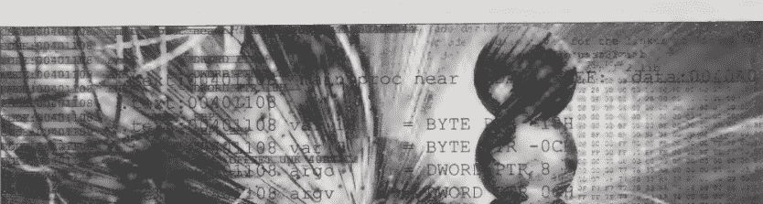

传统的 OpenGL 工具使得直接在屏幕上（更准确地说，是在帧缓冲中）渲染场景（即创建其图像）成为可能。然而，通常需要将渲染结果写入到一个特殊的纹理中，而不是写入到与窗口或整个屏幕相对应的帧缓冲中。该纹理旨在随后仅作为纹理使用，例如，模拟场景在水中的反射和由热气流引起的场景扭曲，或者在渲染期间使用该纹理对场景应用后期效果。

> **注意**
>
> *帧缓冲*（或*主缓冲*）是图形处理器内存中为正在构建的图像分配的一块区域。它包含图像所有像素的颜色值。
>
> *纹理*是通过 texel（纹理元素）矩阵指定的图像，用于在渲染期间将其应用于对象的表面。
>
> *RTT (Render-To-Texture，渲染到纹理)* 是一种渲染类型，它不是渲染到帧缓冲，而是渲染到图形处理器内存的一块特殊区域，该区域随后将作为通用纹理使用。

有几种方法可以让你将渲染结果获取为纹理。最简单的方法是使用 `glReadPixels` 函数读取存储在帧缓冲中的图像并将其写入计算机内存。之后，你可以使用诸如 `glTexImage2D` 之类的函数将图像加载到纹理中。然而，这种方法需要将图像从帧缓冲复制到 CPU 内存，然后再从 CPU 内存复制到图形处理器的内存（图 9.1）。

此类复制操作通常耗时较长，且该方法缺乏效率。

更方便的方法是使用 `glCopyTexSubImage2D` 函数将图像的一个矩形片段直接从帧缓冲复制到纹理中。在这种情况下，复制发生在显存之间，绕过了 CPU（图 9.2）。

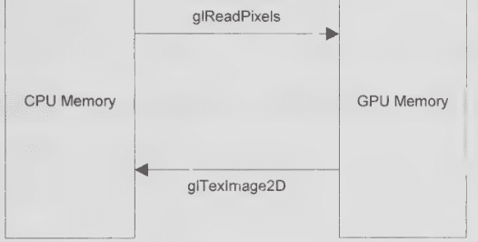

**图 9.1.** 使用 `glReadPixels` 函数渲染到纹理

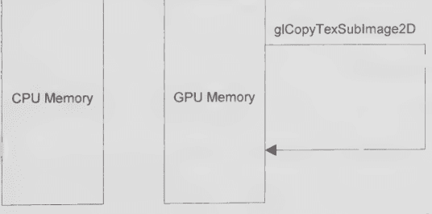

**图 9.2.** 使用 `glCopyTexSubImage2D` 函数渲染到纹理

虽然这种方法比之前的方法有效得多，但它仍然涉及显式的复制操作，并且需要访问用于主图像的帧缓冲。

在许多情况下，最好的方案是拥有一个虚拟缓冲，它允许你存储渲染结果，但具有不同的尺寸和属性，且与帧缓冲无关。这样的缓冲可以让你存储纹理数据并避免内存复制。

所有这些特性对于 *p-buffers* 来说都是典型的。在现代图形加速器中，p-buffers 包含在显存中，且对其进行渲染可以通过硬件加速。

不幸的是，在 Windows 和 Linux 中操作 p-buffers 的方式截然不同。因此，我将分别描述这两种情况，然后演示一个 p-buffer 的跨平台使用示例。

`EXT_framebuffer_object` 扩展为你提供了类似的选择。使用它通常比使用 p-buffers 更方便且更有效，但目前并非所有显卡都支持此扩展。

在接下来的章节中，我将首先描述操作 p-buffer 涉及的内容（分别针对 Windows 和 Linux）并将其实现为一个类。然后我将描述 `EXT_framebuffer_object` 扩展，同样在 C++ 中将其实现为一个类。

## 在 Microsoft Windows 中操作 p-Buffer

要在 Microsoft Windows 中创建并操作 p-buffers，你需要两个扩展：`WGL_ARB_pixel_format` 和 `WGL_ARB_pbuffer`。若要将 p-buffer 用作纹理的数据源，你还需要 `WGL_ARB_render_texture` 扩展。

操作 p-buffer 包含以下步骤：

- 1. 创建 p-buffer。
- 2. 将 p-buffer 选择为当前的渲染目标。
- 3. 销毁 p-buffer。

### 创建 p-Buffer

要创建 p-buffer，你应该首先获取当前设备的有效上下文：

```cpp
HDC hDc = wglGetCurrentDC();
```

然后，你应该获取一个适用于创建 p-buffer 的像素格式。为此，请使用 `WGL_ARB_pixel_format` 扩展引入的 `wglChoosePixelFormat` 函数：

```cpp
BOOL wglChoosePixelFormatARB (HDC hDc, const int * intAttrs,
                                const float * floatAttrs,
                                UINT maxFormats, int * formats,
                                UINT * numFormats);
```

`intAttrs` 和 `floatAttrs` 参数用于传递整数和浮点数属性列表。每个属性使用（名称, 值）对来指定，其中第一个元素是属性的标识符（名称），第二个是其值。列表以零值结束（属性标识符等于零）。`maxFormats` 参数告知可以存储在 `formats` 数组中的整数标识符数量。`numFormats` 参数是一个指向整数变量的指针，该变量将包含返回的适当格式数量（该值可能小于 `maxFormats`）。

### 表 9.1. `wglChoosePixelFormatARB` 函数的主要属性

| 名称 | 值 |
| :--- | :--- |
| `WGL_COLOR_BITS_ARB` | 颜色所需的最小位数。 |
| `WGL_STENCIL_BITS_ARB` | 模板缓冲中值所需的最小位数。 |
| `WGL_AUX_BUFFERS_ARB` | 辅助缓冲的最小位数。 |
| `WGL_SUPPORT_OPENGL_ARB` | 指示该格式是否应支持使用 OpenGL 工具的输出。 |
| `WGL_DRAW_TO_PBUFFER_ARB` | 非零值表示输出应定向到 p-buffer。 |
| `WGL_ACCUM_BITS_ARB` | 累加缓冲的位数。 |
| `WGL_DOUBLE_BUFFER_ARB` | 非零值表示需要创建第二个缓冲。 |
| `WGL_ALPHA_BITS_ARB` | Alpha 通道中值所需的最小位数。 |
| `WGL_DEPTH_BITS_ARB` | 深度缓冲中值所需的最小位数。 |
| `WGL_PIXEL_TYPE_ARB` | 像素值的类型。要么是 `WGL_TYPEF_RGBA_ARB`（用于 RGBA 模式），要么是 `WGL_TYPE_COLOR_INDEX_ARB`（用于索引模式）。 |
| `WGL_RED_BITS_ARB` | 红色通道中值所需的最小位数。 |
| `WGL_GREEN_BITS_ARB` | 绿色通道中值所需的最小位数。 |
| `WGL_BLUE_BITS_ARB` | 蓝色通道中值所需的最小位数。 |

如果发生错误，此函数返回零；如果一切正常，则返回非零值。如果你获得了至少一个格式标识符，你就可以使用它来创建 p-buffer。这可以通过 `wglCreatePbufferARB` 函数完成：

```cpp
HPBUFFER wglCreatePbufferARB (HDC hDC, int format, int width,
                                    int height, const int * attrs);
```

其参数如下：`hDc` 是在前一阶段获取的设备上下文，`format` 是要创建的 p-buffer 的像素格式标识符，`width` 和 `height` 指定 p-buffer 的大小（以像素为单位），`attrs` 传递额外的整数参数，就像使用 `wglChoosePixelFormatARB` 函数一样。

该函数返回新创建的 p-buffer 的句柄，如果发生错误则返回 `NULL`。

p-buffer 的实际大小可能与请求的大小不同，因此您应该使用 `wglQueryPbufferARB` 函数来获取其实际大小：

```cpp
int width;
int height;
wglQueryPbufferARB (hBuffer, WGL_PBUFFER_WIDTH_ARB, &width);
wglQueryPbufferARB (hBuffer, WGL_PBUFFER_HEIGHT_ARB, &height);
```

创建缓冲区后，您应该使用 `wglGetPbufferDCARB` 函数获取其设备上下文：

```cpp
HDC wglGetPbufferDCARB (HPBUFFER hBuffer);
```

创建 p-buffer 的最后一步是为其创建渲染上下文。这可以使用 `wglCreateContext` 函数来完成：

```cpp
HGLRC wglCreateContext (HDC hBufDc);
```

## 将 p-Buffer 选择为当前的渲染目标

将输出定向到指定的 p-buffer 是通过使用 `wglMakeCurrent` 函数实现的：

```cpp
BOOL wglMakeCurrent (HDC hBufDc, HGLRC hBufRc);
```


`hBufDc` 和 `hBufRc` 参数分别是该 p-buffer 的设备上下文和渲染上下文。

要将输出重定向回窗口，请调用`wglMakeCurrent`函数，并传递指定目标窗口的参数。在使用 GLUT 库时，您可以为此目的调用`glutSetWindow`函数，并向其传递窗口的整数句柄。

## 销毁 p-Buffer

要销毁 p-buffer（即释放其使用的资源），请按以下步骤操作：

1. 销毁 p-buffer 渲染上下文。
2. 释放设备上下文。
3. 销毁 p-buffer。

这些操作可以通过以下代码片段完成：

```cpp
wglDeleteContext(hGLRc);
wglReleasePbufferDCARB(hBuffer, hDc);
wglDestroyPbufferARB(hBuffer);
```

## 处理视频模式切换

如果视频模式切换到另一种模式，p-buffer 的完整性可能会丢失，从而导致其无法进一步使用。

要检查 p-buffer 是否仍可用，您可以执行以下代码片段：

```cpp
int flag;
wglQueryPbufferARB(hBuffer, WGL_PBUFFER_LOST_ARB, &flag);
```

如果`flag`变量的值不等于零，这意味着 p-buffer 已损坏且无法再使用。在这种情况下，您应该将其销毁并按照前文所述重新创建。

## 将数据从 p-Buffer 复制到纹理

在成功创建 p-buffer 并向其输出一些数据后，您可以调用`glCopyTexSubImage2D`函数将 p-buffer 的内容（或其一部分）复制到纹理中。

但请记住，在 Windows 中，不同的渲染上下文具有不同的属性集，例如显示列表、纹理等。因此，如果您希望写入使用特定纹理的渲染结果，则需要将该纹理显式加载到此上下文中。

或者，您可以使用`wglShareLists`函数，该函数允许将显示列表和纹理从一个渲染上下文复制到另一个渲染上下文：

```cpp
BOOL wglShareLists(HGLRC hGLRcFrom, HGLRC hGLRcTo);
```

`hGLRcFrom`和`hGLRcTo`参数分别指定源上下文和目标上下文。

## 将 p-Buffer 绑定到纹理

当支持`WGL_ARB_render_texture`扩展时，您可以直接将 p-buffer 作为纹理的数据源，而无需复制像素。

在这种情况下，p-buffer 将被绑定到一个相应的纹理。在绑定期间，纹理包含此 p-buffer 颜色缓冲区的内容，而 p-buffer 本身则不可用于渲染。当您需要向 p-buffer 输出时，必须先将其从纹理中释放。

您还可以将 p-buffer 绑定到纹理立方体映射（cube map）中。在这种情况下，渲染时您需要告知 p-buffer 您将输出到立方体的哪个面。

此外，您可以使用 mipmap 过滤，但这要求您要么显式指定所有中间级别，要么使用前面讨论的`GL_SGIS_generate_mipmap`扩展，该扩展可以自动为指定纹理构建所有中间级别。

如果绑定到纹理的 p-buffer 因为视频模式切换而失效，纹理的内容不会失真并保持可用。

p-buffer 从纹理解除绑定后，其颜色缓冲区的内容可能会变得未定义。

在将 p-buffer 分配给纹理后，您需要使用`wglChoosePixelFormatARB`和`wglCreatePBufferARB`函数设置额外的属性。

- `wglChoosePixelFormatARB`函数的两个额外属性是`WGL_BIND_TO_TEXTURE_RGB_ARB`或`WGL_BIND_TO_TEXTURE_RGBA_ARB`。通过将其中一个设置为非零值，您告知 p-buffer 支持绑定到 RGB（或 RGBA）纹理。

- `wglCreatePBufferARB`函数有两个额外属性：
  - `WGL_TEXTURE_TARGET_ARB`可以取以下值之一：`WGL_TEXTURE_1D_ARB`、`WGL_TEXTURE_2D_ARB`或`WGL_TEXTURE_CUBE_MAP_ARB`，分别指定一维、二维或三维纹理。
  - `WGL_MIPMAP_TEXTURE_ARB`（当设置为非零值时）表示应为 mipmap 过滤的所有中间级别分配内存。

要将 p-buffer 绑定到当前纹理，请使用`wglBindTextureImageARB`函数：

```cpp
BOOL wglBindTextureImageARB (HBUFFER hBuffer, int buf);
```

`buf`参数决定 p-buffer 的哪个缓冲区应绑定到当前纹理。它可以取以下任何值：`WGL_FRONT_LEFT_ARB`、`WGL_FRONT_RIGHT_ARB`、`WGL_BACK_LEFT_ARB`、`WGL_BACK_RIGHT_ARB`、`WGL_AUX0_ARB`、`WGL_AUX1_ARB`等等。

执行此命令后，p-buffer 与当前纹理绑定，您无法再对其进行渲染。

要将 p-buffer 从纹理中释放，请使用`wglReleaseTextureImageARB`函数：

```cpp
BOOL wglReleaseTextureImageARB (HBUFFER hBuffer, int buf);
```

将 p-buffer 绑定到纹理立方体映射时，您需要调用`wglSetPBufferAttribARB`函数来设置数据应输出到的立方体面。`WGL_CUBE_MAP_FACE_ARB`属性可以取以下任何值：

`WGL_TEXTURE_CUBE_MAP_POSITIVE_X_ARB`、`WGL_TEXTURE_CUBE_MAP_NEGATIVE_X_ARB`、`WGL_TEXTURE_CUBE_MAP_POSITIVE_Y_ARB`、`WGL_TEXTURE_CUBE_MAP_NEGATIVE_Y_ARB`、`WGL_TEXTURE_CUBE_MAP_POSITIVE_Z_ARB`、`WGL_TEXTURE_CUBE_MAP_NEGATIVE_Z_ARB`。

请注意，在选择纹理立方体映射的面之前，应调用`glFlush()`函数。

## Windows 下 p-Buffer 的实现

将 p-buffer 封装在一个类中是很方便的，该类可以封装所有与 p-buffer 相关的操作，包括创建和销毁。代码清单 9.1 包含这样一个类的描述。

### 代码清单 9.1. Windows 下的 PBuffer 类

```cpp
#ifndef __P_BUFFER__
#define __P_BUFFER__

#include <windows.h>
#include <GL/gl.h>
#include "../glext.h"
#include "../wglext.h"

class PBuffer
{
protected:
    HDC        hdc;
    HGLRC      hGlRc;
    HPBUFFERARB hbuffer;
    int        width;
    int        height;
    int        mode;
    unsigned   texture;
    bool       shareObjects;
    HDC        saveHdc;    // Save values
                           // from makeCurrent.
    HGLRC      saveHglrc;

public:
    PBuffer (int theWidth, int theHeight, int theMode = modeAlpha |
               modeDepth | modeStencil, bool theShareObjects = true);
    ~PBuffer ();

    int getWidth () const
    {
        return width;
    }

    int getHeight () const
    {
        return height;
    }

    bool getShareObjects () const
    {
        return shareObjects;
    }

    int getMode () const
    {
        return mode;
    }

    unsigned getTexture () const
    {
        return texture;
    }

    void clear ();
    bool create ();

    // Set attribute (like
    // WGL_TEXTURE_CUBE_MAP* ARB).
    bool setAttr (int attr, int value);

    // Direct rendering to
    // this p-buffer.
    bool makeCurrent ();

    // Direct rendering to
    // previous target.
    bool restoreCurrent ();

    // Whether p-buffer is lost
    // due to mode switch.
    bool isLost () const;

    // Bind pbuffer to previously
    // bound texture.
    bool bindToTexture (int buf = WGL_FRONT_LEFT_ARB);

    // Unbind from texture
    // (release).
    bool unbindFromTexture (int buf = WGL_FRONT_LEFT_ARB);

    // Set specific cubemap side,
    // call glFlush after side
    // is done.
    bool setCubemapSide (int side);
};
#endif
```

```cpp
void printLastError();

bool checkExtensions(); // Check support of required
                        // extensions.

enum Mode
{
    modeAlpha            = 1,
    modeDepth            = 2,
    modeStencil          = 4,
    modeAccum            = 8,
    modeDouble           = 16,
    modeTexture1D        = 32,
    modeTexture2D        = 64,
    modeTextureCubeMap   = 128,
    modeTextureMipmap    = 256
};
#endif
```

该类的构造函数接收缓冲区的宽度和高度、一个属性位掩码，以及一个指示符，用于确定是否应将当前上下文中的对象复制到 p-buffer 的上下文中。

## 表 9.2. `PBuffer` 类的标志

| 常量 | 描述 |
| :--- | :--- |
| `modeAlpha` | 需要 Alpha 通道。 |
| `modeDepth` | 需要深度缓冲区。 |
| `modeStencil` | 需要模板缓冲区。 |
| `modeAccum` | 需要累积缓冲区。 |
| `modeDouble` | 需要双缓冲。 |
| `modeTexture1D` | 绑定到一维纹理。 |
| `modeTexture2D` | 绑定到二维纹理。 |
| `modeTextureCubeMap` | 绑定到立方体贴图纹理。 |
| `modeTextureMipmap` | 应使用 Mipmap 过滤。 |

`create`和`clear`方法用于创建和销毁 p-buffer。创建时，将使用传递给构造函数的参数。

`makeCurrent`方法将 p-buffer 设置为当前的输出目标。调用`makeCurrent`方法之前当前的那个目标会被存储在内存中，并且可以使用`restoreCurrent`方法将其恢复。

如果 p-buffer 损坏，`isLost`方法将返回`true`。在这种情况下，你应该首先调用`clear`方法，然后使用`create`方法重新创建 p-buffer。

`bindToTexture`和`unbindFromTexture`方法用于将 p-buffer 绑定到当前纹理或从中释放。

`setCubemapSide`方法指定立方体贴图的一个面，渲染将在该面上进行。此方法会自动调用`glFlush`函数。

`printLastError`方法将最后一次错误的内容写入`stderr`输出流。这在调试应用程序时会非常有帮助。

`checkExtensions`方法检查是否支持与 p-buffer 协作所需的扩展。

## 在 Linux 中使用 p-Buffer

要在 Linux 中使用 p-buffer，你需要`GLX_SGIBX_pbuffer`和`GLX_SGIBX_fbconfig`扩展。

与 Windows 类似，你需要先获取当前上下文。然而，在 Linux 中这稍微复杂一些，它由三个组件组成：一个指向`Display`对象的指针、一个整数类型的屏幕句柄以及上下文本身：

```cpp
Display * display = glXGetCurrentDisplay ();
GLXContext context = glXGetCurrentContext ();
int screen = DefaultScreen (display);
```

然后，你应该调用`glXChooseFBConfig`函数来获取符合以下要求的格式列表：

```cpp
GLXFBConfig * glXChooseFBConfig (Display * display, int screen,
                                  const int * attrList,
                                  int * numConfigs);
```

参数包括：`display`和`screen`确定格式选择的目标，`attrList`是一个属性列表指针（它是一个由（名称, 值）对组成的数组，并以零值结束，就像在 Windows 中一样），`numConfigs`返回找到的格式数量。

## 表 9.3. `glXChooseFBConfig`函数的主要属性

| 名称 | 值 |
| :--- | :--- |
| `GLX_DRAWABLE_TYPE_SGIX` | 确定输出目标。使用`GLX_PBUFFER_BIT_SGIX`值。 |
| `GLX_RENDER_TYPE_SGIX` | 指定输出表面类型。使用`GLX_RGBA_BIT_SGIX`值。 |
| `GLX_DOUBLE_BUFFER` | 非零值表示应使用双缓冲。 |
| `GLX_RED_SIZE` | 红色通道值的最小位数。 |
| `GLX_GREEN_SIZE` | 绿色通道值的最小位数。 |
| `GLX_BLUE_SIZE` | 蓝色通道值的最小位数。 |
| `GLX_ALPHA_SIZE` | Alpha 通道值的最小位数。 |
| `GLX_DEPTH_SIZE` | 深度缓冲区值的最小位数。 |
| `GLX_STENCIL_SIZE` | 模板缓冲区值的最小位数。 |
| `GLX_ACCUM_RED_SIZE` | 累积缓冲区红色通道值的最小位数。 |
| `GLX_ACCUM_GREEN_SIZE` | 累积缓冲区绿色通道值的最小位数。 |
| `GLX_ACCUM_BLUE_SIZE` | 累积缓冲区蓝色通道值的最小位数。 |
| `GLX_ACCUM_ALPHA_SIZE` | 累积缓冲区 Alpha 通道值的最小位数。 |

在你获得合适的帧缓冲区格式后，可以使用`glXCreateGLXPbuffersSGIX`函数创建 p-buffer：

```cpp
GLXPbuffer glXCreateGLXPbuffersSGIX (Display * display,
                                      GLXFBConfig config,
                                      unsigned int width,
                                      unsigned int height,
                                      int * attrlist);
```

其参数为：`display`是创建 p-buffer 的对象，`config`是 p-buffer 的像素格式，`width`和`height`指定 p-buffer 的期望尺寸，`attrList`允许你传递额外的参数。

与 Windows 不同，使用此方法创建的 p-buffer 在从一种视频模式切换到另一种模式时不会损坏。

要获取 p-buffer 的实际尺寸，可以使用以下代码片段：


```cpp
glXQueryGLXPbufferSGIX (display, hBuffer, GLX_WIDTH_SGIX, (unsigned *)&width );
glXQueryGLXPbufferSGIX (display, hBuffer, GLX_HEIGHT_SGIX, (unsigned *)&height);
```

不幸的是，Linux 缺少类似于`WGL_render_texture`的扩展，因此你需要使用`glCopyTexSubImage2D`函数显式地将图像从 p-buffer 复制到纹理中。

就像在 Windows 中一样，我们将 p-buffer 封装在一个具有公共接口的类中，以便在跨平台应用程序中使用 p-buffer（代码清单 9.4）。

## 代码清单 9.4：用于 Linux 的`PBuffer`类

```cpp
#ifndef __P_BUFFER__
#define __P_BUFFER__

#include "libExt.h"
#include <GL/glxext.h>
#include <stdio.h>

class PBuffer
{
protected:
    Display *display;
    GLXContext hGLContext;
    GLXPbuffer hBuffer;
    GLXDrawable hPreviousDrawable;
    GLXContext hPreviousContext;
    int width;
    int height;
    int mode;
    bool shareObjects;
    unsigned texture;

public:
    PBuffer (int theWidth, int theHeight, int theMode = modeAlpha |
              modeDepth | modeStencil, bool theShareObjects = true);
    ~PBuffer ();

    int getWidth () const
    {
        return width;
    }

    int getHeight () const
    {
        return height;
    }

    bool getShareObjects () const
    {
        return shareObjects;
    }

    int getMode () const
    {
        return mode;
    }

    unsigned getTexture () const
    {
        return texture;
    }

    void clear ();
    bool create ();

    // Set attribute (like WGL_TEXTURE_CUBE_MAP_ARB).
    bool setAttr (int attr, int value);

    bool makeCurrent (); // Direct rendering to this p-buffer.

    bool restoreCurrent (); // Direct rendering to prev. Target.

    bool isLost () const; // Whether p-buffer is lost due to mode switch.

    // Bind pbuffer to previously bound texture.
    bool bindToTexture ();

    // Unbind from texture (release).
    bool unbindFromTexture ();

    void printLastError () {}

    bool checkExtensions ();

    enum Mode
    {
        modeAlpha = 1,
        modeDepth = 2,
        modeStencil = 4,
        modeAccum = 8,
        modeDouble = 16,
        // modeTexture1D = 32,
        modeTexture2D = 64,
        // modeTextureCubeMap = 128,
        // modeTextureMipmap = 256
    };
};
#endif
```

## `EXT_framebuffer_object`扩展

虽然许多图形加速器都支持 p-buffer，但它们有一些缺点：

- 与 p-buffer 的协作强烈依赖于平台。虽然前述的实现几乎是平台无关的，但其特性在不同平台上有所不同。
- 每个 p-buffer 都有自己的渲染上下文。这导致切换操作（切换到 p-buffer、从一个 p-buffer 切换到另一个，或从 p-buffer 切换到帧缓冲区）需要额外开销并降低应用程序的性能。
- 每个 p-buffer 都有自己的一套内部缓冲区（颜色缓冲区、深度缓冲区、模板缓冲区等），多个 p-buffer 无法共享同一个内部缓冲区。
- 选择像素格式的机制相当复杂且取决于特定平台（尽管使用`PBuffer`类为程序员隐藏了这一点）。

尽管有这些缺陷，但长期以来，p-buffer 一直是渲染到纹理的唯一合理选择。

在`EXT_framebuffer_object`扩展发布后，情况得到了改善。它是一个简单且平台无关的 p-buffer 替代方案。

`EXT_framebuffer_object`扩展提供的功能不依赖于任何平台或窗口系统。

此外，使用该扩展引入的帧缓冲区不需要创建额外的渲染上下文，这使得切换操作（包括切换到窗口系统的主帧缓冲）比使用 p-buffer 快得多。

选择像素格式也比 p-buffer 简单得多。

该扩展的另一个优势是，单个逻辑缓冲（如颜色缓冲或深度缓冲）可以被多个帧缓冲共享。

此扩展引入了一个新的 OpenGL 对象：FBO（FrameBuffer Object，帧缓冲对象）。

帧缓冲对象由一组逻辑缓冲（颜色、深度、模板）和状态参数组成（图 9.3）。

作为逻辑缓冲，可以使用适当格式的纹理，或者使用另一种新引入类型的特殊对象：RBO（RenderBuffer Object，渲染缓冲对象）。

渲染缓冲对象包含一个简单的二维图像（没有 mipmap 过滤），可用作存储渲染结果的逻辑缓冲。

应用程序可以使用许多帧缓冲对象（从现在起，我将把它们简称为帧缓冲），但它们分为由窗口系统创建的原始帧缓冲（ID 为零）和由应用程序创建的帧缓冲（这些由不等于零的无符号整数标识）。

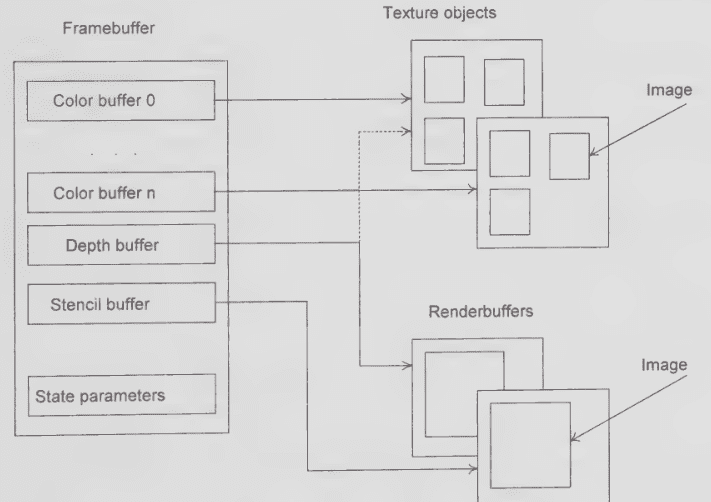

**图 9.3：FBO 的结构**

应用程序可以将一个可用的帧缓冲设置为当前状态并将其绑定到纹理。随后，该帧缓冲的逻辑缓冲可以在所有的片元操作（读取和写入）中使用。

每个帧缓冲由一个无符号整数（`GLuint`）标识，零被预留给由窗口系统创建的帧缓冲。

绑定帧缓冲使用`glBindFramebufferEXT`函数完成：

```c
void glBindFramebufferEXT (GLenum target, GLuint id);
```

`target`参数始终等于`GL_FRAMEBUFFER_EXT`常量，`id`参数是帧缓冲的 ID。

可以使用`glGenFramebuffersEXT`和`glDeleteFramebuffersEXT`函数生成和删除一组帧缓冲标识符：

```c
void glGenFramebuffersEXT (GLsizei count, GLuint * ids);
void glDeleteFramebuffersEXT (GLsizei count, GLuint * ids);
```

与其它类似函数一样，`count`参数决定应分配多少个 ID，`ids`参数是一个指向数组的指针，ID 将写入该数组。

要检查给定的无符号整数`id`是否为帧缓冲的标识符，可以使用`glIsFramebufferEXT`函数：

```c
GLboolean glIsFramebufferEXT (GLuint id);
```

对于帧缓冲的逻辑缓冲，你可以使用纹理或渲染缓冲。每个渲染缓冲由一个不等于零的无符号整数标识。

可以使用`glGenRenderbuffersEXT`和`glDeleteRenderbuffersEXT`函数生成和删除一组渲染缓冲标识符：

```c
void glGenRenderbuffersEXT (GLsizei count, GLuint * ids);
void glDeleteRenderbuffersEXT (GLsizei count, GLuint * ids);
```

要检查给定的无符号整数`id`是否为渲染缓冲的标识符，可以使用`glIsRenderbufferEXT`函数：

```c
GLboolean glIsRenderbufferEXT (GLuint id);
```

在使用逻辑缓冲之前，你应该使用`glRenderbufferStorageEXT`函数指定其大小和像素格式：

```c
void glRenderbufferStorageEXT (GLenum target, GLenum internalFormat, 
    GLsizei width, GLsizei height);
```

其参数如下：`target`始终等于`GL_RENDERBUFFER_EXT`，`width`和`height`指定渲染缓冲的像素尺寸，`internalFormat`指定缓冲像素的内部格式。

在最后一个参数中，你可以指定一个常见的纹理格式（例如`GL_RGBA8`或`GL_DEPTH_COMPONENT24`）或表 9.4 中列出的任何特殊模板缓冲格式。

## 表 9.4：可用的内部格式类型

| 格式类型 | 数值 |
| :--- | :--- |
| `GL_STENCIL_INDEX1_EXT` | 1 位模板缓冲（每像素 1 位） |
| `GL_STENCIL_INDEX4_EXT` | 4 位模板缓冲（每像素 4 位） |
| `GL_STENCIL_INDEX8_EXT` | 8 位模板缓冲（每像素 8 位） |
| `GL_STENCIL_INDEX16_EXT` | 16 位模板缓冲（每像素 16 位） |

要将渲染缓冲作为逻辑缓冲附加到当前帧缓冲，可以使用`glFramebufferRenderbufferEXT`函数：

```cpp
void glFramebufferRenderbufferEXT (GLenum target, GLenum attachment,
                                   GLenum rbTarget,
                                   GLuint rbId);
```

`target`参数等于`GL_FRAMEBUFFER_EXT`，`rbTarget`参数等于`GL_RENDERBUFFER_EXT`。`attachment`参数指定`rbId`渲染缓冲应成为哪个逻辑缓冲。此参数可以取以下任何值：`GL_COLOR_ATTACHMENT0_EXT`、`GL_COLOR_ATTACHMENT1_EXT`、...、`GL_DEPTH_ATTACHMENT_EXT`或`GL_STENCIL_ATTACHMENT_EXT`。

以下代码片段允许你查询可以附加的最大逻辑颜色缓冲数量：

```cpp
int maxColorAttachments;
glGetIntegerv(GL_MAX_COLOR_ATTACHMENTS_EXT, &maxColorAttachments);
```

如果你将`rbId`参数传为零，渲染缓冲将从当前帧缓冲中分离。

要将纹理作为逻辑缓冲附加到帧缓冲，请使用`glFramebufferTexture1DEXT`、`glFramebufferTexture2DEXT`或`glFramebufferTexture3DEXT`函数：

```cpp
void glFramebufferTexture1DEXT (GLenum target, GLenum attachment,
                                   GLenum texTarget,
                                   GLuint texId, int level);
void glFramebufferTexture2DEXT (GLenum target, GLenum attachment,
                                   GLenum texTarget,
                                   GLuint texId, int level);
void glFramebufferTexture3DEXT (GLenum target, GLenum attachment,
                                   GLenum texTarget,
                                   GLuint texId, int level, int zOffset);
```

你可以附加一维或二维纹理、立方体贴图的面，或 3D 纹理的层。

`target`参数始终等于`GL_FRAMEBUFFER_EXT`，`attachment`参数指定纹理应成为哪个逻辑缓冲。此参数可以取以下任何值：`GL_COLOR_ATTACHMENT0`、`GL_COLOR_ATTACHMENT1_EXT`、...、`GL_DEPTH_ATTACHMENT_EXT`或`GL_STENCIL_ATTACHMENT_EXT`。

定义所用纹理类型的`texTarget`参数可以取`GL_TEXTURE_nD`值或以下任何值：`GL_TEXTURE_CUBE_MAP_POSITIVE_X`...或`GL_TEXTURE_CUBE_MAP_NEGATIVE_Z`。

`level`参数指定应作为逻辑缓冲的纹理级别（在 mipmap 金字塔中）。

`zOffset`参数指定 3D 纹理的偏移量。

> 帧缓冲对象应符合某些要求。例如，其逻辑缓冲应具有相同的大小，且它们的格式应与用途（附加类型）相对应。当附加多个颜色缓冲时，它们必须具有相同的内部格式。


要检查帧缓冲状态（即检查是否可以对其进行渲染），请使用`glCheckFramebufferStatusEXT`函数：

```c
GLenum glCheckFramebufferStatusEXT(GLenum target);
```

将`GL_FRAMEBUFFER_EXT`常量作为`target`参数。一些可能的返回值包括：

`GL_FRAMEBUFFER_COMPLETE_EXT`、`GL_FRAMEBUFFER_INCOMPLETE_ATTACHMENT_EXT`、`GL_FRAMEBUFFER_INCOMPLETE_MISSING_ATTACHMENT_EXT`、`GL_FRAMEBUFFER_INCOMPLETE_DUPLICATE_ATTACHMENT_EXT`、`GL_FRAMEBUFFER_INCOMPLETE_DIMENSIONS_EXT`、`GL_FRAMEBUFFER_INCOMPLETE_FORMATS_EXT`、`GL_FRAMEBUFFER_INCOMPLETE_DRAW_BUFFER_EXT`、`GL_FRAMEBUFFER_INCOMPLETE_READ_BUFFER_EXT`、`GL_FRAMEBUFFER_UNSUPPORTED_EXT`以及`GL_FRAMEBUFFER_STATUS_ERROR_EXT`。

如果帧缓冲已就绪，则返回`GL_FRAMEBUFFER_COMPLETE_EXT`。`GL_FRAMEBUFFER_UNSUPPORTED_EXT`值表示你应该尝试另一种缓冲格式组合。

本扩展引入了`glGenerateMipmapsEXT`函数，允许你为 mipmap 过滤的纹理生成所有级别：

```c
void glGenerateMipmapsEXT(GLenum target);
```

`target`参数可以取以下任何值：`GL_TEXTURE_1D`、`GL_TEXTURE_2D`、`GL_TEXTURE_CUBE_MAP`或`GL_TEXTURE_3D`。

将帧缓冲（frame buffer）封装在一个类中，以便封装所有对帧缓冲的操作，这样做非常方便。代码清单 9.4 包含了此类实现的文件头。

## 代码清单 9.4：将帧缓冲实现为一个类


```cpp
class FrameBuffer
{
    int flags;
    int width;
    int height;
    unsigned frameBuffer;
    unsigned depthBuffer;
    unsigned stencilBuffer;

public:
    FrameBuffer (int theWidth, int theHeight, int theFlags = 0);
    ~FrameBuffer ();

    int getWidth () const
    {
        return width;
    }

    int getHeight () const
    {
        return height;
    }

    bool hasStencil () const
    {
        return stencilBuffer != 0;
    }

    bool hasDepth () const
    {
        return depthBuffer != 0;
    }

    bool isOk () const;
    bool create ();
    bool bind ();
    bool unbind ();

    bool attachColorTexture (GLenum target, unsigned texId,
                            int no = 0);

    bool attachDepthTexture(GLenum target, unsigned texId);

    bool detachColorTexture(GLenum target)
    {
        return attachColorTexture(target, 0);
    }

    bool detachDepthTexture(GLenum target)
    {
        return attachDepthTexture(target, 0);
    }

    // Create texture for attaching.
    unsigned createColorTexture(GLenum format = GL_RGB,
                                GLenum internalFormat = GL_RGB8);

    enum                                // Flags for depth and
                                        // stencil buffers
    {
        depth16  = 1,                      // 16-bit depth buffer
        depth24  = 2,                      // 24-bit depth buffer
        depth32  = 4,                      // 32-bit depth buffer

        stencil1 = 16,                     // 1-bit stencil buffer
        stencil4  = 32,                     // 4-bit stencil buffer
        stencil8  = 64,                     // 8-bit stencil buffer
        stencil16 = 128                     // 16-bit stencil buffer
    };

    static bool isSupported();
    static int  maxColorAttachments();
    static int  maxSize();
};
```

`FrameBuffer` 类的构造函数接收以像素为单位的缓冲大小（`theWidth` 和 `theHeight` 参数）以及一组用于指定深度缓冲和模板缓冲像素格式的位标志（`theFlags` 参数）。这里假设将使用一个纹理作为颜色缓冲。如果你计划使用纹理作为深度缓冲，请不要指定深度缓冲格式的标志。

请注意，类构造函数仅为变量赋值，它不会创建任何 OpenGL 对象，这些对象应使用 `create` 方法来创建。

该类的 `create` 方法会创建一个帧缓冲及所需的渲染缓冲（renderbuffer），并返回 `true`。如果创建失败，则返回 `false`。

`bind` 方法使该帧缓冲变为当前激活状态。

`unbind` 方法使标识符为 0 的帧缓冲（即窗口系统的帧缓冲）变为当前激活状态。

`attachColorTexture` 方法将指定标识符的纹理作为编号为 `no` 的颜色缓冲进行附加。`target` 参数接收 `GL_TEXTURE_2D` 值或指定纹理立方体贴图（texture cube map）某个面的值（例如 `GL_TEXTURE_CUBE_MAP_POSITIVE_X` ... 或 `GL_TEXTURE_CUBE_MAP_NEGATIVE_Z`）。

`attachDepthTexture` 方法用于将由标识符指定的纹理附加为深度缓冲。

`detachColorTexture` 和 `detachDepthTexture` 方法用于从相应的缓冲中分离纹理。

`createColorTexture` 方法用于创建一个稍后可以用作颜色缓冲的纹理。

`isOk` 方法检查缓冲是否已准备好使用。

`isSupported` 方法检查是否支持 `EXT_framebuffer_object` 对象。

代码清单 9.5 包含了该类的具体实现。

## 代码清单 9.5. FrameBuffer 类的实现

```cpp
#include "libExt.h"
#include "FrameBuffer.h"

FrameBuffer :: FrameBuffer ( int theWidth, int theHeight, int theFlags)
{
	width        = theWidth;
	height       = theHeight;
	flags        = theFlags;
	frameBuffer  = 0;
	depthBuffer  = 0;
	stencilBuffer = 0;
}

FrameBuffer :: ~FrameBuffer ()
{
	if (depthBuffer != 0)
		glDeleteRenderbuffersEXT (1, &depthBuffer);

	if (stencilBuffer != 0)
		glDeleteRenderbuffersEXT (1, &stencilBuffer);

	if (frameBuffer != 0)
		glDeleteFramebuffersEXT (1, &frameBuffer);
}

bool FrameBuffer :: create ()
{
    if (width <= 0 || height <= 0)
        return false;

    glGenFramebuffersEXT (1, &frameBuffer);
    glBindFramebufferEXT (GL_FRAMEBUFFER_EXT, frameBuffer);

    int depthFormat = 0;
    int stencilFormat = 0;

    if (flags & depth16)
        depthFormat = GL_DEPTH_COMPONENT16_ARB;
    else if (flags & depth24)
        depthFormat = GL_DEPTH_COMPONENT24_ARB;
    else if (flags & depth32)
        depthFormat = GL_DEPTH_COMPONENT32_ARB;

    if (flags & stencil1)
        stencilFormat = GL_STENCIL_INDEX1_EXT;
    else if (flags & stencil4)
        stencilFormat = GL_STENCIL_INDEX4_EXT;
    else if (flags & stencil8)
        stencilFormat = GL_STENCIL_INDEX8_EXT;
    else if (flags & stencil16)
        stencilFormat = GL_STENCIL_INDEX16_EXT;

    if (depthFormat != 0)
    {
        glGenRenderbuffersEXT (1, &depthBuffer);
        glBindRenderbufferEXT (GL_RENDERBUFFER_EXT, depthBuffer);
        glRenderbufferStorageEXT (GL_RENDERBUFFER_EXT, depthFormat, width, height);
        glFramebufferRenderbufferEXT (GL_FRAMEBUFFER_EXT, GL_DEPTH_ATTACHMENT_EXT, GL_RENDERBUFFER_EXT, depthBuffer);
    }

    if (stencilFormat != 0)
    {
        glGenRenderbuffersEXT(1, &stencilBuffer);
        glBindRenderbufferEXT(GL_RENDERBUFFER_EXT, stencilBuffer);
        glRenderbufferStorageEXT(GL_RENDERBUFFER_EXT, stencilFormat, width, height);
        glFramebufferRenderbufferEXT(GL_FRAMEBUFFER_EXT, GL_STENCIL_ATTACHMENT_EXT, GL_RENDERBUFFER_EXT, stencilBuffer);
    }

    GLenum status = glCheckFramebufferStatusEXT(GL_FRAMEBUFFER_EXT);
    glBindFramebufferEXT(GL_FRAMEBUFFER_EXT, 0);
    return status == GL_FRAMEBUFFER_COMPLETE_EXT;
}

bool FrameBuffer :: isOk() const
{
    unsigned currentFb;

    glGetIntegerv(GL_FRAMEBUFFER_BINDING_EXT, (int *) &currentFb);

    if (currentFb != frameBuffer)
        glBindFramebufferEXT(GL_FRAMEBUFFER_EXT, frameBuffer);

    bool complete = glCheckFramebufferStatusEXT(GL_FRAMEBUFFER_EXT) == GL_FRAMEBUFFER_COMPLETE_EXT;

    if (currentFb != frameBuffer)
        glBindFramebufferEXT(GL_FRAMEBUFFER_EXT, currentFb);

    return complete;
}

bool FrameBuffer :: bind()
{
    if (frameBuffer == 0)
        return false;

    glBindFramebufferEXT(GL_FRAMEBUFFER_EXT, frameBuffer);

    return true;
}

bool FrameBuffer :: unbind()
{
    if (frameBuffer == 0)
        return false;

    glBindFramebufferEXT (GL_FRAMEBUFFER_EXT, 0);

    return true;
}

bool FrameBuffer :: attachColorTexture (GLenum target, unsigned texId,
                                        int no)
{
    if (frameBuffer == 0)
        return false;

    if (target != GL_TEXTURE_2D &&
       (target < GL_TEXTURE_CUBE_MAP_POSITIVE_X_ARB ||
        target > GL_TEXTURE_CUBE_MAP_NEGATIVE_Z_ARB))
        return false;

    glFramebufferTexture2DEXT (GL_FRAMEBUFFER_EXT,
                               GL_COLOR_ATTACHMENT0_EXT + no,
                               target, texId, 0);

    return true;
}

bool FrameBuffer :: attachDepthTexture (GLenum target, unsigned texId)
{
    if (frameBuffer == 0)
        return false;

    glFramebufferTexture2DEXT (GL_FRAMEBUFFER_EXT,
                               GL_DEPTH_ATTACHMENT_EXT,
                               target, texId, 0);

    return true;
}

unsigned FrameBuffer :: createColorTexture (GLenum format,
                                           GLenum internalFormat)
{
    unsigned tex;

    glGenTextures    (1, &tex);
    glBindTexture    (GL_TEXTURE_2D, tex);
    glTexImage2D    (GL_TEXTURE_2D, 0, internalFormat, getWidth (),
```

```cpp
getHeight (), 0, format, GL_UNSIGNED_BYTE, NULL);

glTexParameteri(GL_TEXTURE_2D, GL_TEXTURE_MAG_FILTER, GL_NEAREST);
glTexParameteri(GL_TEXTURE_2D, GL_TEXTURE_MIN_FILTER, GL_NEAREST);

glTexParameteri(GL_TEXTURE_2D, GL_TEXTURE_WRAP_S, GL_REPEAT);
glTexParameteri(GL_TEXTURE_2D, GL_TEXTURE_WRAP_T, GL_REPEAT);

return tex;
```

```cpp
bool FrameBuffer :: isSupported ()
{
	return isExtensionSupported("EXT_framebuffer_object");
}
```

```cpp
int FrameBuffer :: maxColorAttachments ()
{
	int n;

	glGetIntegerv(GL_MAX_COLOR_ATTACHMENTS_EXT, &n);

	return n;
}
```

```cpp
int FrameBuffer :: maxSize ()
{
	int sz;

	glGetIntegerv(GL_MAX_RENDERBUFFER_SIZE_EXT, &sz);

	return sz;
}
```

`FrameBuffer` 类的使用示例见第 15 至 17 章。

## 第 10 章：摄像机的概念。libCamera 库

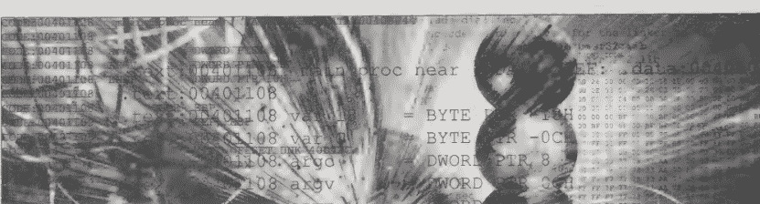

与 3D 渲染相关最方便且最常用的概念之一就是`camera`（摄像机）。

事实上，摄像机是一个坐标系（图 10.1），它包含一个位置 (`pos`)、一个视线方向 (`view`) 以及另外两个方向：`up`（上方向）和 `right`（右方向）。

向量 `view`、`right` 和 `up` 构成了一个正交基，也就是说，它们两两垂直，且长度均等于 1。

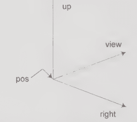

**图 10.1.** 摄像机坐标系

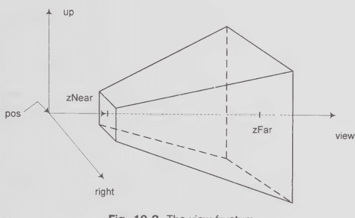

**图 10.2.** 视锥体


由于摄像机用于渲染，它不仅仅是一个普通的坐标系。与之相关的是*视锥体*（view frustum）（图 10.2）。`view`向量决定了视锥体的方向（更准确地说是其底面的方向），而`up`和`right`向量决定了其侧面的方向。

视锥体由两个角度`fovX`和`fovY`（此处 FOV 代表 *field of view*，即视野角）以及近剪裁平面和远剪裁平面的距离`zNear`和`zFar`决定。

因此，指定一个摄像机类似于在 OpenGL 中指定一个透视投影。因此，指定渲染矩形的尺寸（`width`和`height`）并使用 OpenGL 采用的方法建立`fovX`与`fovY`之间的关系会非常方便。

```
fovX / width   fovY / height
```

然而，虽然 OpenGL 最常使用右手坐标系，但通常有必要使用不同方向的摄像机。

这种情况最简单的例子是创建镜像反射。通常，为此会创建一个镜像摄像机。反射会改变坐标系的方向：右手坐标系变为左手坐标系，反之亦然（图 10.3）。

因此，如果一个封装摄像机的类能够指定并改变与摄像机相关的坐标系方向，将会非常方便。

此外，使用三个正交向量来指定摄像机方向并不太方便。为此，使用欧拉角（图 10.4）或四元数会方便得多。

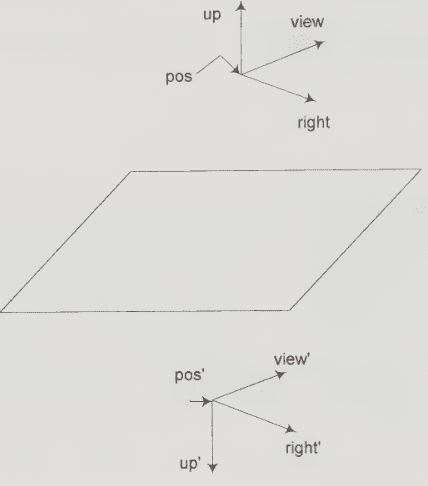

**图 10.3.** 反射过程中坐标系方向的改变

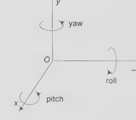

**图 10.4.** 使用欧拉角指定坐标系的方向

代码清单 10.1 包含了我们从这里开始将要使用的`Camera`类的描述。

### 代码清单 10.1. `Camera` 类

```
//
// Camera class for OpenGL
//
#ifndef __CAMERA__
#define __CAMERA__

#include "Vector3D.h"
#include "Matrix3D.h"

class Plane;
class Transform3D;
class Quaternion;

class Camera
{
    Vector3D pos;            // Camera position
    Vector3D viewDir;        // Viewing direction
                             // (normalized)
    Vector3D upDir;          // Up direction (normalized)
    Vector3D sideDir;        // Side direction (normalized),
                             // may be left or right
                             // depending on the handedness
                             // of camera

    bool rightHanded;        // Whether camera is
                             // righthanded

    bool infinite;           // Whether it uses zFar equal
                             // to infinity

    Matrix3D transf;         // Camera transform (from world
                             // to camera space)

    float fov;               // Field of view angle
    float zNear;             // Near clipping z-value
    float zFar;              // Far clipping z-value
    int width;               // View width
    int height;              // View height
    float aspect;            // Aspect ratio of camera

public:
    Camera (const Vector3D& p, float yaw, float pitch, float roll,
            float aFov = 60, float nearZ = 0.1, float farZ = 100,
            bool rHanded = true);

    Camera (const Vector3D& p, const Quaternion& orientation,
            float aFov = 60, float nearZ = 0.1, float farZ = 100,
            bool rHanded = true);

    Camera (const Camera& camera);
    Camera ();

    const Vector3D& getPos () const
    {
        return pos;
    }

    const Vector3D& getViewDir() const
    {
        return viewDir;
    }

    const Vector3D& getSideDir() const
    {
        return sideDir;
    }

    const Vector3D& getUpDir() const
    {
        return upDir;
    }

    bool isRightHanded() const
    {
        return rightHanded;
    }

    float getZNear() const
    {
        return zNear;
    }

    float getZFar() const
    {
        return zFar;
    }

    float getFov() const
    {
        return fov;
    }

    int getWidth() const
    {
        return width;
    }

    int getHeight() const
    {
        return height;
    }

    float getAspect() const
    {
        return aspect;
    }

    Quaternion getOrientation() const;

    // Map vector from world space to
    // camera space.
    Vector3D mapFromWorld(const Vector3D& p) const
    {
        Vector3D tmp(p - pos);

        return Vector3D(tmp & sideDir, tmp & upDir,
                       tmp & viewDir);
    }

    // Map vector from camera space to
    // world space.
    Vector3D mapToWorld(const Vector3D& p) const
    {
        return pos + p.x * sideDir + p.y * upDir + p.z * viewDir;
    }

    // Map vector to screen space.
    Vector3D mapToScreen(const Vector3D& p) const
    {
        Vector3D scr(transf * (p - pos));

        return scr /= scr.z;    // Do perspective transform.
    }

    // Move camera (absolute & relative).
    void moveTo(const Vector3D& newPos)
    {
        pos = newPos;
        computeMatrix();
    }

    void moveBy(const Vector3D& delta)
    {
        pos += delta;
        computeMatrix();
    }

    // Set orientation either via Euler angles or
    // via quaternion.
    void    setEulerAngles (float theYaw, float thePitch,
                           float theRoll);
    void    setOrientation (const Quaternion& orientation);

    // Set viewport parameters.
    void    setViewSize    (int theWidth, int theHeight,
                           float theFov);
    void    setFov         (float newFovAngle);
    void    setRightHanded (bool flag);

    // Transform camera.
    void    mirror   (const Plane&);
    void    transform (const Transform3D&);

    void    apply () const;        // Sets camera transform
                                   // for current context

private:
    void    computeMatrix ();       // Compute vectors,
                                   // transform matrix, and
                                   // build viewing
                                   // frustum.

};

#endif
```

让我们讨论一下这个类的主要方法。

该类的构造函数（除空构造函数和拷贝构造函数外）接收摄像机在空间中的位置、视野角（`fov`）、近远剪裁距离、坐标系方向标志以及摄像机的朝向。

摄像机的朝向可以使用欧拉角（`yaw`、`pitch`和`roll`）或四元数来指定。

`getPos`、`getViewDir`和`getUpDir`方法用于访问当前摄像机的位置及其两个方向（视线方向和上方向）。

由于侧向量的方向取决于坐标系的方向（右手或左手），因此该方向被命名为 *side*（侧向），并通过`getSideDir`方法返回。

您可以通过调用`isRightHanded`方法来确定与摄像机相关的坐标系是否为右手坐标系。

`getZNear`和`getZFar`方法允许您获取近剪切面和远剪切面的距离（沿`viewDir`向量方向）。

`getWidth`和`getHeight`方法返回与相机相关的输出矩形边长（以像素为单位），而`getAspect`方法返回宽高比。

若要将当前相机方向获取为四元数，请使用`getQuaternion`方法。

`mapFromWorld`和`mapToWorld`方法用于将向量从世界坐标系映射到相机坐标系，反之亦然。

`mapToScreen`方法返回 3D 向量的屏幕坐标（相对于输出区域左上角，以像素为单位）。

此外，`Camera`类还为您提供了一些方法，使得移动相机以及更改其方向和其他参数成为可能。

`moveTo`和`moveBy`方法用于在不改变相机方向的情况下移动相机。前者将相机移动到空间中的指定点，后者则根据指定的向量进行移动。

若要在不改变相机位置的情况下更改相机方向，请使用`setEulerAngles`和`setOrientation`方法。前者允许您使用欧拉角指定新方向，后者则使用四元数。

`setRightHanded`方法用于设置与相机相关的坐标系是右手系还是左手系。

通过使用`setFov`方法，您可以设置视场角（以度为单位）。

`setViewSize`方法旨在设置相机渲染区域的大小。

您可以对相机进行仿射变换。`mirror`方法用于使相机相对于指定平面镜像，而`transform`方法允许您对相机应用任何仿射变换。

使用`apply`方法，您可以设置 OpenGL 的投影参数。

代码清单 10.2 展示了`Camera`类的完整实现。

## 代码清单 10.2. Camera 类


```cpp
//
// Camera class for OpenGL
//

#ifdef _WIN32
    #include <windows.h>
#endif

#include <GL/gl.h>
#include <GL/glu.h>
#include "Camera.h"
#include "Quaternion.h"
#include "Transform3D.h"
#include "Plane.h"

Camera :: Camera (const Vector3D& p, float yaw, float pitch, float roll,
                    float aFov, float nearZ, float farZ, bool rHanded)
{
    fov      = aFov;
    zNear    = nearZ;
    zFar     = farZ;
    pos      = p;
    width    = 640;    // Default view size
    height   = 480;
    aspect   = (float)width / (float) height;
    rightHanded = rHanded;
    infinite = false;

    setEulerAngles (yaw, pitch, roll);
}

Camera :: Camera (const Vector3D& p, const Quaternion& orientation,
                    float aFov, float nearZ, float farZ, bool rHanded)
{
    fov      = aFov;
    zNear    = nearZ;
    zFar     = farZ;
    pos      = p;
    width    = 640;    // Default view size
    height   = 480;
    aspect   = (float)width / (float) height;
    rightHanded = rHanded;
    infinite = false;

    setOrientation (orientation);
}

Camera :: Camera (const Camera& camera)
{
    zNear    = camera.zNear;
    zFar     = camera.zFar;
    fov      = camera.fov;
    pos      = camera.pos;
    viewDir  = camera.viewDir;
    upDir    = camera.upDir;
    rightHanded = camera.rightHanded;
    infinite = camera.infinite;
    width = camera.width;
    height = camera.height;
    aspect = camera.aspect;

    computeMatrix();
}

void Camera::setEulerAngles(float yaw, float pitch, float roll)
{
    viewDir = Vector3D(1, 0, 0);
    sideDir = Vector3D(0, 1, 0);
    upDir = Vector3D(0, 0, 1);

    Matrix3D rot (Matrix3D::getRotateYawPitchRollMatrix(yaw,
                                                      pitch, roll));

    viewDir = rot * viewDir;
    upDir = rot * upDir;
    sideDir = rot * sideDir;

    computeMatrix();
}

void Camera::setOrientation(const Quaternion& orientation)
{
    viewDir = Vector3D(1, 0, 0);
    sideDir = Vector3D(0, 1, 0);
    upDir = Vector3D(0, 0, 1);

    Matrix3D rot = orientation.getMatrix();

    viewDir = rot * viewDir;
    upDir = rot * upDir;
    sideDir = rot * sideDir;

    computeMatrix();
}

Quaternion Camera::getOrientation() const
{
    // Build matrix from viewDir, sideDir, upDir.
    Matrix3D rot(viewDir, sideDir, upDir);

    // Build quaternion from it.
    return Quaternion(rot);
}

void Camera::setRightHanded(bool flag)
{
    if (flag == rightHanded)
        return;

    rightHanded = flag;

    computeMatrix ();
}

void Camera :: setFov (float newFovAngle)
{
    fov = newFovAngle;

    computeMatrix ();
}

void Camera :: setViewSize (int theWidth, int theHeight,
                           float theFov)
{
    width  = theWidth;
    height = theHeight;
    fov    = theFov;
    aspect = (float)width / (float) height;

    computeMatrix ();
}

void Camera :: computeMatrix ()
{
    viewDir.normalize (); // Normalize viewDir.

    // Compute upDir perpendicular to viewDir.
    upDir -= (upDir & viewDir) * viewDir;

    // Compute sideDir to form orthogonal basis.
    sideDir = upDir ^ viewDir;

    if (!rightHanded) // Invert side orientation: right -> left.
        sideDir = -sideDir;

    upDir.normalize (); // Orthonormalize upDir and sideDir.
    sideDir.normalize ();

    // Now build transform matrix.
    float halfAngle = 0.5 * M_PI * fov / 180.0;
    float fovValueY = 1 / (float)tan (halfAngle);
    float fovValueX = fovValueY / aspect;

    transf[0][0] = (sideDir[0] * fovValueX + viewDir[0]) * 0.5 * width;
    transf[0][1] = (sideDir[1] * fovValueX + viewDir[1]) * 0.5 * width;
    transf[0][2] = (sideDir[2] * fovValueX + viewDir[2]) * 0.5 * width;
    transf[1][0] = (upDir[0] * fovValueY + viewDir[0]) * 0.5 * height;
    transf[1][1] = (upDir[1] * fovValueY + viewDir[1]) * 0.5 * height;
    transf[1][2] = (upDir[2] * fovValueY + viewDir[2]) * 0.5 * height;

    transf[2][0] = viewDir[0];
    transf[2][1] = viewDir[1];
    transf[2][2] = viewDir[2];
}

void Camera::mirror(const Plane& mirror)
{
    mirror.reflectPos(pos);
    mirror.reflectDir(viewDir);
    mirror.reflectDir(upDir);
    mirror.reflectDir(sideDir);

    rightHanded = !rightHanded;

    computeMatrix();
}

void Camera::transform(const Transform3D& tr)
{
    pos    = tr.transformPoint(pos);
    viewDir = tr.transformDir(viewDir);
    upDir   = tr.transformDir(upDir);
    sideDir = tr.transformDir(sideDir);

    // Now check for right/left handedness.
    rightHanded = ((upDir ^ viewDir) & sideDir) > EPS;

    computeMatrix();
}

void Camera::apply() const
{
    float m[16];
    // Create a coordinate space transform (rotation) matrix.
    m[0] = sideDir.x;
    m[1] = upDir.x;
    m[2] = -viewDir.x;
    m[3] = 0;

    m[4] = sideDir.y;
    m[5] = upDir.y;
    m[6] = -viewDir.y;
    m[7] = 0;

    m[8] = sideDir.z;
    m[9] = upDir.z;
    m[10] = -viewDir.z;
    m[11] = 0;

    m[12] = 0;
    m[13] = 0;
    m[14] = 0;
    m[15] = 1;

    // Set current viewport.
    glViewport(0, 0, getWidth(), getHeight());

    glMatrixMode(GL_PROJECTION);
    glLoadIdentity();

    // Calculate aspect ratio of the window.
    gluPerspective(getFov(), getAspect(), getZNear(), getZFar());

    glMatrixMode(GL_MODELVIEW);
    glLoadIdentity();

    glMultMatrixf(m);
    glTranslate(-pos.x, -pos.y, -pos.z);
}
```

正如您从代码清单中所见，该类的主要方法是`computeMatrix`，它用于修正主方向并计算将向量从世界坐标系映射到相机坐标系的变换矩阵。

代码清单 10.3 包含了一个简单的示例源代码，用于演示`Camera`类的使用。

## 代码清单 10.3：`Camera`类使用示例

```cpp
//
// Simple camera class test
//

#include "libExt.h"

#include <glut.h>
#include <stdio.h>
#include <stdlib.h>

#include "libTexture.h"
#include "TypeDefs.h"
#include "Vector3D.h"
#include "Vector2D.h"
#include "boxes.h"
#include "Camera.h"

Vector3D eye (-0.5, -0.5, 1.5); // Camera position
unsigned decalMap;               // Decal (diffuse) texture
unsigned stoneMap;
unsigned teapotMap;
float angle = 0;

float yaw = 0;
float pitch = 0;
float roll = 0;

Camera camera (eye, 0, 0, 0); // Camera to be used

void init ()
{
    glClearColor (0.0, 0.0, 0.0, 1.0);
    glEnable (GL_DEPTH_TEST);
    glEnable (GL_TEXTURE_2D);
    glDepthFunc (GL_LEQUAL);

    glHint (GL_POLYGON_SMOOTH_HINT, GL_NICEST);
    glHint (GL_PERSPECTIVE_CORRECTION_HINT, GL_NICEST);
}

void displayBoxes ()
{
    glMatrixMode (GL_MODELVIEW);
```


```cpp
glPushMatrix ();

drawBox (Vector3D (-5, -5, 0), Vector3D (10, 10, 3),
        stoneMap, false);
drawBox (Vector3D (3, 2, 0.5), Vector3D (1, 2, 2), 
        decalMap);

glBindTexture (GL_TEXTURE_2D, teapotMap);

glPushMatrix ();
glTranslatef (0.2, 1, 1.5);

glRotatef (angle * 45.3, 1, 0, 0);
glRotatef (angle * 57.2, 0, 1, 0);

glutSolidTeapot (0.3);

glPopMatrix ();
glPopMatrix ();
}

void display ()
{
    glClear (GL_COLOR_BUFFER_BIT | GL_DEPTH_BUFFER_BIT);

    camera.apply ();

    displayBoxes ();

    glutSwapBuffers ();
}

void reshape (int w, int h)
{
    camera.setViewSize (w, h, 60);
    camera.apply ();
}

void key (unsigned char key, int x, int y)
{
    if (key == 27 || key == 'q' || key == 'Q')  // Quit requested
        exit (0);
    else
    if (key == 'w' || key == 'W')
        camera.moveBy (camera.getViewDir () * 0.2);
    else
    if (key == 'x' || key == 'X')
        camera.moveBy (-camera.getViewDir () * 0.2);
    else
    if (key == 'a' || key == 'A')
        camera.moveBy (-camera.getSideDir () * 0.2);
    else
    if (key == 'd' || key == 'D')
        camera.moveBy (camera.getSideDir () * 0.2);

    glutPostRedisplay ();
}

void specialKey (int key, int x, int y)
{
    if (key == GLUT_KEY_UP)
        yaw += M_PI / 90;
    else
    if (key == GLUT_KEY_DOWN)
        yaw -= M_PI / 90;
    else
    if (key == GLUT_KEY_RIGHT)
        roll += M_PI / 90;
    else
    if (key == GLUT_KEY_LEFT)
        roll -= M_PI / 90;

    camera.setEulerAngles (yaw, pitch, roll);

    glutPostRedisplay ();
}

void mouseFunc (int x, int y)
{
    static int lastX = -1;
    static int lastY = -1;

    if (lastX == -1) // Not initialized
    {
        lastX = x;
        lastY = y;
    }

    yaw -= (y - lastY) * 0.02;
    roll += (x - lastX) * 0.02;

    lastX = x;
    lastY = y;

    camera.setEulerAngles (yaw, pitch, roll);
    glutPostRedisplay();
}

void animate()
{
    static float lastTime = 0.0;
    float time = 0.001f * glutGet(GLUT_ELAPSED_TIME);

    angle += 2 * (time - lastTime);

    lastTime = time;

    glutPostRedisplay();
}

int main(int argc, char * argv[])
{
    // Initialize glut.
    glutInit(&argc, argv);
    glutInitDisplayMode(GLUT_DOUBLE | GLUT_RGB | GLUT_DEPTH);
    glutInitWindowSize(512, 512);

    // Create window.
    glutCreateWindow("OpenGL camera test");

    // Register handlers.
    glutDisplayFunc(display);
    glutReshapeFunc(reshape);
    glutKeyboardFunc(key);
    glutSpecialFunc(specialKey);
    glutPassiveMotionFunc(mouseFunc);
    glutIdleFunc(animate);

    init();
    initExtensions();

    decalMap = createTexture2D(true, "../Textures/oak.bmp");
    stoneMap = createTexture2D(true, "../Textures/block.bmp");
    teapotMap = createTexture2D(true, "../Textures/Oxidated.jpg");

    camera.setRightHanded(false);

    glutMainLoop();

    return 0;
}
```

另一个经常用于控制摄像机的简单类是`Frustum`。它包含了界定视锥体（view frustum）的平面信息。

`Frustum`类的描述和实现分别在代码清单 10.4 和 10.5 中给出。

## 代码清单 10.4. Frustum 类的描述

```cpp
//
// Frustum class for OpenGL
//

#ifndef __FRUSTUM__
#define __FRUSTUM__

#include "Vector3D.h"
#include "Plane.h"

class BoundingBox;

class Frustum
{
    Plane plane [6];

public:
    Frustum ();

    void get ();        // Acquire from current
                        // OpenGL context.

    // Checks
    bool pointInFrustum (const Vector3D& v) const;
    bool boxInFrustum   (const BoundingBox& box) const;
};

#endif
```

## 代码清单 10.5. Frustum 类的实现

```cpp
//
// Frustum class for OpenGL
//

#ifdef WIN32
#include <windows.h>
#endif
#include <GL/gl.h>
#include "Frustum.h"
#include "Math3D.h"
#include "BoundingBox.h"

Frustum :: Frustum ()
{
    get ();
}

void Frustum :: get ()
{
    float proj [16]; // Projection matrix
    float model [16]; // Modelview matrix
    float clip [16]; // Transform to clip space matrix

    glGetFloatv (GL_PROJECTION_MATRIX, proj );
    glGetFloatv (GL_MODELVIEW_MATRIX, model);

    // Now multiply them to get clip
    // transform matrix.
    clip[0] = model[0] * proj[0] + model[1] * proj[4] + model[2] * proj[8] + model[3] * proj[12];
    clip[1] = model[0] * proj[1] + model[1] * proj[5] + model[2] * proj[9] + model[3] * proj[13];
    clip[2] = model[0] * proj[2] + model[1] * proj[6] + model[2] * proj[10] + model[3] * proj[14];
    clip[3] = model[0] * proj[3] + model[1] * proj[7] + model[2] * proj[11] + model[3] * proj[15];
    clip[4] = model[4] * proj[0] + model[5] * proj[4] + model[6] * proj[8] + model[7] * proj[12];
    clip[5] = model[4] * proj[1] + model[5] * proj[5] + model[6] * proj[9] + model[7] * proj[13];
    clip[6] = model[4] * proj[2] + model[5] * proj[6] + model[6] * proj[10] + model[7] * proj[14];
    clip[7] = model[4] * proj[3] + model[5] * proj[7] + model[6] * proj[11] + model[7] * proj[15];
    clip[8] = model[8] * proj[0] + model[9] * proj[4] + model[10] * proj[8] + model[11] * proj[12];
    clip[9] = model[8] * proj[1] + model[9] * proj[5] + model[10] * proj[9] + model[11] * proj[13];
    clip[10] = model[8] * proj[2] + model[9] * proj[6] + model[10] * proj[10] + model[11] * proj[14];
    clip[11] = model[8] * proj[3] + model[9] * proj[7] + model[10] * proj[11] + model[11] * proj[15];
    clip[12] = model[12] * proj[0] + model[13] * proj[4] + model[14] * proj[8] + model[15] * proj[12];
    clip[13] = model[12] * proj[1] + model[13] * proj[5] +
               model[14] * proj[9] + model[15] * proj[13];
    clip[14] = model[12] * proj[2] + model[13] * proj[6] +
               model[14] * proj[10] + model[15] * proj[14];
    clip[15] = model[12] * proj[3] + model[13] * proj[7] +
               model[14] * proj[11] + model[15] * proj[15];

    // Now extract clip planes params:
    Vector3D n[6];
    float d[6];

    // Right plane
    n[0].x = clip[3] - clip[0];
    n[0].y = clip[7] - clip[4];
    n[0].z = clip[11] - clip[8];
    d[0] = clip[15] - clip[12];

    // Left plane
    n[1].x = clip[3] + clip[0];
    n[1].y = clip[7] + clip[4];
    n[1].z = clip[11] + clip[8];
    d[1] = clip[15] + clip[12];

    // Top plane
    n[2].x = clip[3] - clip[1];
    n[2].y = clip[7] - clip[5];
    n[2].z = clip[11] - clip[9];
    d[2] = clip[15] - clip[13];

    // Bottom plane
    n[3].x = clip[3] + clip[1];
    n[3].y = clip[7] + clip[5];
    n[3].z = clip[11] + clip[9];
    d[3] = clip[15] + clip[13];

    // Far plane
    n[4].x = clip[3] - clip[2];
    n[4].y = clip[7] - clip[6];
    n[4].z = clip[11] - clip[10];
    d[4] = clip[15] - clip[14];

    // Near plane
    n[5].x = clip[3] + clip[2];
    n[5].y = clip[7] + clip[6];
    n[5].z = clip[11] + clip[10];
    d[5] = clip[15] + clip[14];

    // Normalize.
    for (int i = 0; i < 6; i++)
    {
        float len = n[i].length();
        if (len > EPS)
        {
            n[i] /= len;
            d[i] /= len;
        }
        plane[i] = Plane(n[i], d[i]);
    }
}

bool Frustum :: pointInFrustum (const Vector3D& v) const
{
    for (register int i = 0; i < 6; i++)
        if (plane[i].classify(v) == IN_BACK)
            return false;

    return true;
}

bool Frustum :: boxInFrustum (const BoundingBox& box) const
{
    for (register int i = 0; i < 6; i++)
        if (box.classify(plane[i]) == IN_BACK)
            return false;

    return true;
}
```

**图 10.5.** 使用模型矩阵和投影矩阵的乘积来变换视场

正如在代码清单 10.5 中所见，该类计算当前模型视图矩阵（modelview matrix）和投影矩阵（projection matrix）的乘积，并利用该乘积来计算界定平面的方程系数。由于这些矩阵的乘积将视锥体变换到`$[-1, 1]^3$`立方体中，因此视锥体的界定平面被变换为该立方体的以下平面：`$x = 1$`，`$x = -1$`，`$y = 1$`，`$y = -1$`，`$z = 1$`，`$z = -1$`（图 10.5）。

`Frustum`类最主要的用途是检查对象的裁剪情况。在复杂的场景中，丢弃视野之外的对象或对象部分通常是合理的。这可以让程序员避免因不必要的数据而导致图形处理器过载。

## 第 11 章：libMesh 库。处理多边形模型及其主流格式

目前，存储 3D 对象的格式相当多。几乎每个建模软件或计算机游戏都会引入自己的私有格式（而且，一个软件产品经常会引入多种格式）。

因此，如果能首先为 3D 对象的内部表示选择一种特定的格式，其次找到一种将最主流格式的模型转换为该表示的方法，将会非常方便。

基于此，在本章中我将介绍我创建的`libMesh`库。虽然它并不完美，但在许多情况下运行良好。

让我们讨论一下描述 3D 对象需要哪些数据，以及应该如何排列这些数据以获得最大的灵活性和性能。

一般来说，每个对象由一组顶点组成（每个顶点拥有一组属性，如位置、法线等），这些顶点被排列成边（edge）和面（face）。

将范围限制在三角形面是有意义的，因为任何凸面都可以很容易地分解为一组三角形（图 11.1），而凹面很少遇到（在 OpenGL 中也不被使用）。

**图 11.1.** 将凸面分解为一组三角形

**图 11.2.** 使用`Face`结构指定面


在某些情况下，拥有关于面和边的信息是非常必要的，例如，使用模板阴影体积（stencil shadow volumes）方法构建阴影时。

模型的每个面自然可以通过顶点数组中的三个索引来确定。此外，为每个面关联一个法线会很方便。

因此，我们得到了对象面的如下表示方式：

```cpp
struct Face       // 三角形面
{
    int index [3]; // 顶点数组的索引
    Vector3D n;    // 面法线
};
```

`index` 数组包含顶点数组的三个索引，`n` 字段包含该面的法向量（在空间中被视为一个三角形）（图 11.2）。

处理边则更为复杂。大多数边属于对象的两个面。一条属于两个面的边在每个面中的方向不同（图 11.3）。

**图 11.3.** 一条属于两个面的边

因此，与边相关的信息如下：

- 边起点和终点在顶点数组中的索引
- 该边所属的两个面的索引
- 该边在每个面中的方向

将最后两项结合起来是很方便的：让面索引的最高位指定边在该面中的方向（从终点到起点，或反之），让低 31 位指定面编号。

一条边可以用以下方式描述：

```cpp
struct Edge
{
    int a, b;          // 顶点数组的索引
    int f1, f2;        // 面数组的索引
                        // 高位表示对于该面反转
                        // 端点/
};
```

`a` 和 `b` 字段指定边起点和终点在顶点数组中的索引。`f1` 和 `f2` 字段承载两项信息：低 31 位包含面数组中的索引，最高位指定该边在该面中的方向（如果最高位等于 1，则边的方向是从 `b` 到 `a`，否则是从 `a` 到 `b`）。`f2` 字段中的 -1 值表示该边仅属于由 `f1` 字段指定的单个面。

现在考虑对象每个顶点所需的属性。显然，这些包括顶点在空间中的位置、该面的切线半空间基（`t`、`b` 和 `n` 向量，见第 13 章）、纹理坐标以及颜色。

在大多数情况下，这些信息已经足够。即使为一组面使用了几种纹理，它们的纹理坐标通常也是重合的，或者仅在仿射变换上有所不同。这就是为什么你只需要存储一组纹理坐标，以及每种纹理相应的纹理坐标变换。

因此，之前列出的属性列表已经足够，顶点可以描述如下：

```cpp
struct Vertex
{
    Vector4D pos;        // 顶点位置
    Vector3D n;         // 单位法线
    Vector3D t, b;      // 切线和副法线
    Vector2D tex;       // 纹理坐标
    Vector4D color;     // 顶点颜色
};
```

正如我之前提到的，一个模型可以关联多个纹理，且每个纹理通常有一个单独的纹理坐标变换。因此，如果模型能携带关于最常用纹理的信息，将会很方便。

每个纹理可以用一个文件名（这将允许程序员通过单个命令加载所有必要的纹理，而无需获取对象属性）、一个 OpenGL 中的纹理 ID 以及该纹理应绑定的纹理单元编号来描述。

此外，纹理应携带关于该纹理最简单纹理坐标变换的信息。由于这种变换通常是平移和缩放的组合（即具有以下形式：`offs + scale * tex`），将这些参数包含在定义对象所用纹理的类中会很方便。以下是该类的描述。

## 代码清单 11.1. `Map` 类的描述

```cpp
class Map    // 贴图信息
{
public:
    string mapName;   // 纹理文件
    int unit;         // 将此纹理放置在
                       // 哪个纹理单元中
    unsigned id;      // 纹理 id
    GLenum target;    // 纹理目标
    bool mipmap;      // 是否使用 mipmapping
    Vector2D texOffs;
    Vector2D texScale;

    Map ();
    ~Map ();

    bool load ();
    bool setTextureMatrix ();
    bool bind ();

    void bindToUnit (int theUnit)
    {
        unit = theUnit;
    }
};
```

该类的 `load` 方法在文件名不为空时，从指定文件加载纹理。

`setTextureMatrix` 方法定义一个用于纹理坐标变换（`GL_TEXTURE`）的矩阵。

`bindToUnit` 方法指定纹理应绑定的纹理单元（默认情况下，纹理绑定到 0 号纹理单元）。

`bind` 方法将纹理（如果可用）绑定到指定单元，并使用 `setTextureMatrix` 方法设置纹理坐标变换矩阵。

该类的析构函数释放绑定的纹理。

## 代码清单 11.2. `Map` 类的实现

```cpp
Map :: Map ()
{
    unit = 0;                  // 分配给单元 0
    id = 0;                    // 非法 id
    target = GL_TEXTURE_2D;    // 默认为 2D 纹理
    mipmap = true;
    texOffs = Vector2D (0, 0); // 空纹理变换
    texScale = Vector2D (1, 1);
}

Map :: ~Map ()
{
    if (id != 0)
        glDeleteTextures (1, &id);
}

bool Map :: load ()
{
    id = 0;

    if (mapName.empty ()) // 由于未指定纹理，因此没问题
        return true;

    if (target == GL_TEXTURE_1D)
        id = createTexture1D (mipmap, mapName.c_str ());
    else
        if (target == GL_TEXTURE_2D)
            id = createTexture2D (mipmap, mapName.c_str ());
        else
            if (target == GL_TEXTURE_3D)
                id = createTexture3D (mipmap, mapName.c_str ());

    return id != 0;
}

bool Map :: setTextureMatrix ()
{
    if (id == 0 || unit == -1)
        return false;

    glMatrixMode (GL_TEXTURE);
    glLoadIdentity ();
    glScalef (texScale.x, texScale.y, 1);
    glTranslatef (texOffs.x, texOffs.y, 0);

    return true;
}

bool Map :: bind ()
{
    if (id == 0 || unit == -1)
        return false;

    glActiveTextureARB (GL_TEXTURE0_ARB + unit);
    glEnable (GL_TEXTURE_2D);
    glBindTexture (GL_TEXTURE_2D, id);

    return true;
}
```

为了方便起见，我将一组最常用的纹理（作为 `Map` 类的对象）封装在一个特殊的类 `Material` 中，该类负责纹理的加载、绑定和销毁。代码清单 11.3 和 11.4 包含了 `Material` 类的描述和实现。

## 代码清单 11.3. `Material` 类的描述

```cpp
struct Material
{
    string name;
    Map diffuse;
    Map specular;
    Map reflection;
    Map bump;
    Map tex1;
    Map tex2;
    Map tex3;
    Map tex4;

    void load (); // Load all maps.
    void bind (); // Bind all maps to texture units.
    void setPath (const string& path); // Update texture file ref with correct path.
};
```

## 代码清单 11.4. `Material` 类的实现

```cpp
void Material :: load () { // Load all maps.
    diffuse.load ();
    specular.load ();
    reflection.load ();
    bump.load ();
    tex1.load ();
    tex2.load ();
    tex3.load ();
    tex4.load ();
}

void Material :: bind () { // Bind all maps to texture units.
    diffuse.bind ();
    specular.bind ();
    reflection.bind ();
    bump.bind ();
    tex1.bind ();
    tex2.bind ();
    tex3.bind ();
    tex4.bind ();
}

// Update texture file ref with correct path.
void Material :: setPath (const string& path)
{
    if (diffuse.mapName != "")
        diffuse.mapName = buildFileName (path, diffuse.mapName);

    if (specular.mapName != "")
        specular.mapName = buildFileName (path, specular.mapName);

    if (reflection.mapName != "")
        reflection.mapName = buildFileName (path, reflection.mapName);

    if (bump.mapName != "")
        bump.mapName = buildFileName (path, bump.mapName);

    if (tex1.mapName != "")
        tex1.mapName = buildFileName (path, tex1.mapName);

    if (tex2.mapName != "")
        tex2.mapName = buildFileName (path, tex2.mapName);

    if (tex3.mapName != "")
        tex3.mapName = buildFileName (path, tex3.mapName);

    if (tex4.mapName != "")
        tex4.mapName = buildFileName (path, tex4.mapName);
}
```

该类的 `load` 方法加载所有已指定文件名的纹理，具体是通过将 `load` 请求委托给所有纹理来实现的。

`bind` 方法将所有纹理绑定到相应的纹理单元（实际上也是通过将 `bind` 请求委托给所有纹理来实现）。

`setPath` 方法为材质的所有纹理设置一个特殊的路径，因为一个模型的纹理集通常位于一个特定的文件夹中。

现在，考虑 `Mesh` 类，它旨在封装一个由面（faces）、顶点（vertices）、边（edges）和纹理（textures）组成的对象（代码清单 11.5 和 11.6）。

## 代码清单 11.5. `Mesh` 类的描述


## `Mesh` 类

以下代码定义了 `Mesh` 类的完整声明。该类用于表示三维网格模型，并管理其顶点、面和边的数据。

```cpp
class Mesh
{
protected:
    string name;
    int numVertices;
    int numFaces;
    int numEdges;
    Vertex * vertices;
    Face * faces;
    Edge * edges;
    unsigned vertexBuffer; // VBO for vertices
    unsigned indexBuffer;  // VBO for face indices

    // Mapping from vertex data to OpenGL data
    list <pair <int,int> > mapping;

    // Bounding box for mesh
    BoundingBox boundingBox;

    // Set of textures for mesh
    Material material;

public:
    Mesh (const char * theName, Vertex * theVertices, int nv,
          Face * theFaces, int nf, bool copy = true);
    ~Mesh ();

    const string& getName () const
    {
        return name;
    }

    // Access to vertices
    int getNumVertices () const
    {
        return numVertices;
    }

    const Vertex& getVertex (int index) const
    {
        return vertices [index];
    }

    Vertex& getVertex (int index)
    {
        return vertices [index];
    }

    // Access to faces
    int getNumFaces () const
    {
        return numFaces;
    }

    const Face& getFace (int index) const
    {
        return faces[index];
    }

    Face& getFace (int index)
    {
        return faces[index];
    }

    // Access to edges
    int getNumEdges() const
    {
        return numEdges;
    }

    const Edge& getEdge (int index) const
    {
        return edges[index];
    }

    Edge& getEdge (int index)
    {
        return edges[index];
    }

    const Material& getMaterial () const
    {
        return material;
    }

    Material& getMaterial ()
    {
        return material;
    }

    void setMaterial (const Material& mat)
    {
        material = mat;
    }

    // Add assignment for source data
    // to outputs from in
    // (tagVertex,...,tagBinormal)
    // to in
    // (tagVertex,tagNormal,tagColor,
    // tagTex0,...,tagTex7).
    bool addCoordAssignment (int from, int to);

    // Create VBO's.
    void createBuffers ();

    // Render the mesh.
    void render ();

    // Compute tangents and binormals
    // from texCoords.
    void computeTangents ();

    // Compute edge data from vertices
    // and faces.
    void computeEdges ();

    // Compute face normals.
    void computeFaceNormals ();

    enum // Enums for what
    {
        tagVertex = 0,
        tagNormal = 1,
        tagColor = 2,
        tagTexCoord = 3,
        tagTangent = 4,
        tagBinormal = 5
    };

    enum // Enums for where
    {
        // (plus tagVertex, tagColor,
        // tagNormal)
        tagTex0 = 10, // Tex coords for unit 0
        tagTex1 = 11, // Tex coords for unit 1
        tagTex2 = 12,
        tagTex3 = 13,
        tagTex4 = 14,
        tagTex5 = 15,
        tagTex6 = 16,
        tagTex7 = 17
    };

protected:
    void addEdge (int v1, int v2, int face);
};
```

**图 11.4.** `Mesh` 类

如代码清单 11.5 所示，`Mesh` 类的对象包含顶点、面和边（数组 `vertices`、`faces` 和 `edges`），一个包围盒（`boundingBox`）以及一组纹理（`material`）（图 11.4）。

该类用于利用 `ARB_vertex_buffer_object` 扩展提供的顶点缓冲区，将所有顶点属性和面索引存储在图形处理器内存中。为此使用了两个缓冲区：一个用于存储所有顶点属性（`vertexBuffer`），另一个用于存储所有面索引（`indexBuffer`）。

考虑该类主要方法的作用。`getName`、`getNumVertices`、`getVertex`、`getNumFaces`、`getFace`、`getNumEdges`、`getEdge`、`getMaterial` 和 `setMaterial` 方法允许您访问对象的关键数据：名称、顶点、边、面和材质。

`addCoordAssignment` 方法的任务是设置与 `Vertex` 结构体字段相对应的 OpenGL 标准顶点属性（图 11.5）。

**图 11.5.** `Vertex` 结构体字段与 OpenGL 顶点属性之间的对应关系

**图 11.6.** 属性对应关系的示例

该方法的第一个参数（`from`）是一个常量，用于指定 `Vertex` 结构体的某个字段。它可以取以下任何值：`tagVertex`、`tagNormal`、`tagTangent`、`tagBinormal`、`tagColor` 或 `tagTexCoord`。

第二个参数（`to`）是一个常量，用于指定 OpenGL 中的一个标准顶点属性。其有效值为 `tagVertex`、`tagNormal`、`tagColor`、`tagTex0`、`tagTex1` ... 到 `tagTex7`。

设置属性对应关系的一个示例随附如下：

```cpp
addCoordAssignment (tagVertex, tagVertex);
addCoordAssignment (tagNormal, tagNormal);
addCoordAssignment (tagTangent, tagTex0);
addCoordAssignment (tagBinormal, tagTex1);
```

该对应关系如图 11.6 所示。

`computeEdges` 方法根据顶点和面数组构建并初始化边数组（默认情况下，边数组未被初始化）。

`computeFaceNormals` 方法计算对象每个面的法线。

`computeTangents` 方法利用顶点的纹理坐标和空间坐标，为每个顶点计算切线（`t`）和副法线（`b`）向量。

在计算完所有顶点（属性）值后，可以调用 `createBuffers` 方法，该方法在图形处理器内存中创建顶点缓冲区和索引缓冲区，并将渲染所需的所有顶点和面信息存储在缓冲区中。

`render` 方法用于渲染。它建立新创建的顶点缓冲区属性之间的对应关系（该对应关系已通过 `addCoordAssignment` 方法指定），调整纹理，并调用 `glDrawElements` 函数来渲染对象的面。

`Mesh` 类的析构函数负责释放存储数组的内存，销毁图形处理器内存中的缓冲区，并释放绑定的纹理。

`Mesh` 类的构造函数接收以下输入参数：`theName` 是对象的名称，`theVertices` 和 `nv` 分别是顶点数组的指针和顶点数量，`theFaces` 和 `nf` 是面数组的指针和面数量，`copy` 是一个标志，用于指示被创建的对象应该创建自己的顶点和面数组（`copy = true`），还是使用接收到的数组（`copy = false`）（在后一种情况下，发送方不应更改或删除这些数组）。

### 代码清单 11.6. `Mesh` 类的实现

以下提供了 `Mesh` 类各方法的实现细节，展示了其内部逻辑和具体功能。


```
#include <assert.h>
#include "libExt.h"
#include "Mesh.h"

static int vertexStride = sizeof(Vertex);
static Vertex _v;

static int offsets [] =
{
    ((int) & _v.pos) - ((int) & _v), // tagVertex
    ((int) & _v.n)   - ((int) & _v), // tagNormal
    ((int) & _v.color)- ((int) & _v), // tagColor
    ((int) & _v.tex) - ((int) & _v), // tagTexCoord
    ((int) & _v.t)   - ((int) & _v), // tagTangent
    ((int) & _v.b)   - ((int) & _v)  // tagBinormal
};

void computeTangents(Vertex& v0, const Vertex& v1, const Vertex& v2);

Mesh :: Mesh ( const char * theName, Vertex * theVertices, int nv,
               Face * theFaces, int nf, bool copy)
{
    name        = theName;
    numVertices = nv;
    numFaces    = nf;
    numEdges    = 0;
    edges       = NULL;
    vertexBuffer = 0;
    indexBuffer = 0;

    if (copy)
    {
        vertices = new Vertex [numVertices];
        faces = new Face [numFaces];

        memcpy (vertices, theVertices, numVertices * sizeof(Vertex));
        memcpy (faces, theFaces, numFaces * sizeof(Face));
    } 
    else
    {
        vertices = theVertices;
        faces = theFaces;
    }

    computeEdges ();

    for (int i = 0; i < numVertices; i++)
        boundingBox.addVertex (Vector3D (vertices[i].pos.x,
                                          vertices[i].pos.y, vertices[i].pos.z));
}

Mesh :: ~Mesh ()
{
    delete vertices;
    delete faces;
    delete edges;

    if (vertexBuffer != 0)
        glDeleteBuffersARB (1, &vertexBuffer);

    if (indexBuffer != 0)
        glDeleteBuffersARB (1, &indexBuffer);
}

// Add assignment for source data to outputs.
bool Mesh :: addCoordAssignment (int from, int to)
{
    if (from < tagVertex || from > tagBnormal)
        return false;

    if (to == tagVertex || to == tagNormal || to == tagColor ||
       (to >= tagTex0 && to <= tagTex7))
    {
        mapping.push_back (make_pair (from, to));
    }

    return true;
}

void Mesh :: createBuffers ()
{
    // Create vertex data VBO.
    glGenBuffersARB (1, &vertexBuffer);
    glBindBufferARB (GL_ARRAY_BUFFER_ARB, vertexBuffer);
    glBufferDataARB (GL_ARRAY_BUFFER_ARB, numVertices *
                     sizeof(Vertex), vertices, GL_STREAM_DRAW_ARB);

    // Create index data VBO.
    int * buffer = new int [numFaces * 3];

    for (int i = 0, j = 0; i < numFaces; i++)
        for (int k = 0; k < 3; k++)
            buffer [j++] = faces [i].index [k];

    glGenBuffersARB (1, &indexBuffer);
    glBindBufferARB (GL_ELEMENT_ARRAY_BUFFER_ARB, indexBuffer);
    glBufferDataARB (GL_ELEMENT_ARRAY_BUFFER_ARB,
                     numFaces * 3 * sizeof(int), buffer,
                     GL_STATIC_DRAW_ARB);

    // Unbind buffers.
    glBindBufferARB (GL_ARRAY_BUFFER_ARB, 0);
    glBindBufferARB (GL_ELEMENT_ARRAY_BUFFER_ARB, 0);

    delete buffer;
}

// Render the mesh.
void Mesh :: render ()
{
    // Save state.
    glPushClientAttrib (GL_CLIENT_VERTEX_ARRAY_BIT);

    // Setup vertex buffer.
    glBindBufferARB (GL_ARRAY_BUFFER_ARB, vertexBuffer);

    // Go through the list of mappings.
    for (list <pair <int, int> > :: iterator it = mapping.begin ();
         it != mapping.end (); ++it)
    {
        int from = it -> first;
        int to   = it -> second;

        if (to == tagVertex)
        {
            glEnableClientState(GL_VERTEX_ARRAY);
            glVertexPointer(4, GL_FLOAT, vertexStride,
                            (void *) offsets[from]);
        }
        else if (to == tagNormal)
        {
            glEnableClientState(GL_NORMAL_ARRAY);
            glNormalPointer(GL_FLOAT, vertexStride,
                            (void *) offsets[from]);
        }
        else if (to == tagColor)
        {
            glEnableClientState(GL_COLOR_ARRAY);
            glColorPointer(4, GL_FLOAT, vertexStride,
                            (void *) offsets[from]);
        }
        else if (to >= tagTex0 && to <= tagTex7)
        {
            glClientActiveTextureARB(GL_TEXTURE0_ARB + to - tagTex0);
            glEnableClientState(GL_TEXTURE_COORD_ARRAY);

            if (from == tagTexCoord)
                glTexCoordPointer(2, GL_FLOAT, vertexStride,
                                   (void *)offsets[tagTexCoord]);
            else
                glTexCoordPointer(3, GL_FLOAT, vertexStride,
                                   (void *)offsets[from]);
        }
    }

    // Setup index buffer.
    glEnableClientState(GL_INDEX_ARRAY);
    glBindBufferARB(GL_ELEMENT_ARRAY_BUFFER_ARB, indexBuffer);
    glIndexPointer(GL_UNSIGNED_INT, 0, 0);

    material.bind();

    // Request draw.
    glDrawElements(GL_TRIANGLES, 3*numFaces, GL_UNSIGNED_INT, 0);

    // Unbind array buffer.
    glBindBufferARB(GL_ARRAY_BUFFER_ARB, 0);
    glBindBufferARB(GL_ELEMENT_ARRAY_BUFFER_ARB, 0);

    glPopClientAttrib ();
}

// Compute tangents and binormals from texCoords.
void Mesh :: computeTangents ()
{
    for (int i = 0; i < numFaces; i++)
    {
        Face& f = faces [i];

        :: computeTangents (vertices [f.index [0]],
                            vertices [f.index [1]],
                            vertices [f.index [2]]);
    }
}

// Compute edge data from vertices and faces.
void Mesh :: computeEdges ()
{
    int maxEdges = 3 * numFaces;

    if (edges != NULL)
        delete edges;

    numEdges = 0;
    edges = new Edge [maxEdges];

    for (int i = 0; i < numFaces; i++)
        for (int j = 0; j < 3; j++)
            addEdge (faces [i].index [j],
                     faces [i].index [(j+1) % 3], i);
}

void Mesh :: addEdge (int v1, int v2, int face)
{
    for (int i = 0; i < numEdges; i++)
    {
        bool b1 = (edges [i].a == v1) && (edges [i].b == v2);
        bool b2 = (edges [i].a == v2) && (edges [i].b == v1);

        if (b1 || b2)
        {
            edges [i].f2 = (b1 ? face : face | 0x80000000);
            return;
        }
    }

    Edge& edge = edges [numEdges];
    edge.a = v1;
    edge.b = v2;
    edge.f1 = face;
    edge.f2 = -1;

    numEdges++;
}

static inline Vector3D cross (const Vector4D& v1, const Vector4D& v2)
{
    return Vector3D(v1.x, v1.y, v1.z) ^ Vector3D(v2.x, v2.y, v2.z);
}

void Mesh :: computeFaceNormals ()
{
    if (faces == NULL || vertices == NULL)
        return;

    for (int i = 0 ; i < numFaces; i++)
    {
        Vector3D n = cross (vertices [faces[i].index [1]].pos
                           - vertices [faces[i].index [0]].pos,
                           vertices [faces[i].index [2]].pos -
                           vertices [faces[i].index [0]].pos);

        faces [i].n = n.normalize ();
    }
}

void computeTangents (Vertex& v0, const Vertex& v1, const Vertex& v2)
{
    Vector3D e0 (v1.pos.x - v0.pos.x, v1.tex.x - v0.tex.x,
                 v1.tex.y - v0.tex.y);
    Vector3D e1 (v2.pos.x - v0.pos.x, v2.tex.x - v0.tex.x,
                 v2.tex.y - v0.tex.y);
    Vector3D cp = e0 ^ e1;

    if (fabs (cp.x) > EPS)
    {
        v0.t.x = -cp.y / cp.x;
        v0.b.x = -cp.z / cp.x;
    }
    else
    {
        v0.t.x = 0;
        v0.b.x = 0;
    }

    e0.x = v1.pos.y - v0.pos.y;
    e1.x = v2.pos.y - v0.pos.y;
    cp = e0 ^ e1;

    if (fabs (cp.x) > EPS)
    {
        v0.t.y = -cp.y / cp.x;
        v0.b.y = -cp.z / cp.x;
    }
    else
    {
        v0.t.y = 0;
        v0.b.y = 0;
    }

    e0.x = v1.pos.z - v0.pos.z;
    e1.x = v2.pos.z - v0.pos.z;
    cp = e0 ^ e1;

    if (fabs (cp.x) > EPS)
    {
        v0.t.z = -cp.y / cp.x;
        v0.b.z = -cp.z / cp.x;
    }
    else
    {
        v0.t.z = 0;
        v0.b.z = 0;
    }

    if ((v0.t ^ v0.b) ^ v0.n < 0) // Corrected OCR error: & to ^ based on vector logic
        v0.t = -v0.t;
}
```

`MESHUTILS.H` 文件包含了一些用于创建`Mesh`类对象的实用工具。该文件包含在`libMesh`库中，位于`CODE\LIBMESH`文件夹下（代码清单 11.7）。

## Listing 11.7. MESHUTILS.H 文件


```cpp
Mesh * makeTorus (float r1, float r2, int n1, int n2);
Mesh * makeShape1 (float r, float h, int n1, int n2, float factor);
Mesh * makeRevSurface (const Vector2D d[], float tex[], int n, int n2);

// Rebuild vertices array.
Vertex * fixFaces (Vertex * vertices, int& numVertices, Face * faces,
                 Face * texFaces, int numFaces, Vector2D * texCoord,
                 int numTexCoords);
```

`makeTorus`函数通过半径、其“厚度”的一半（即用于构建圆环的圆的半径）以及两个圆的分段数来创建一个圆环。

`makeShape1`函数创建如图 11.7 所示的旋转曲面。

`makeRevSurface`函数用于通过平面上指定的一组点数组以及这些点的一个纹理坐标值来构建旋转曲面。参数`n`指定了这些数组的大小，参数`n2`指定了曲线绕 Ox 轴旋转时创建的分段数。

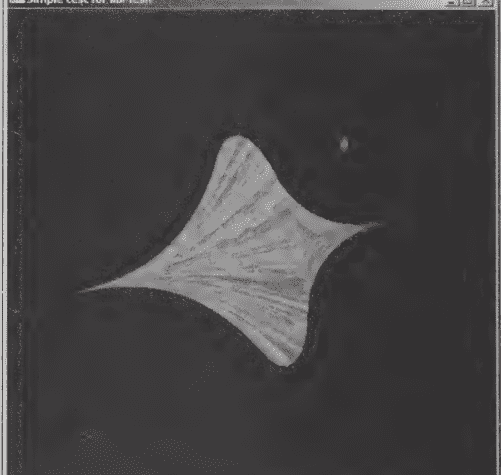

图 11.7. 由`makeShape1`函数创建的对象

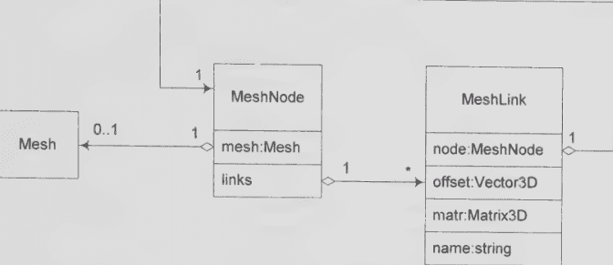

图 11.8. `Mesh`、`MeshNode`和`MeshLink`类


图 11.9. 使用`Mesh`、`MeshNode`和`MeshLink`类实现的 Quake 3 Arena 玩家模型

`fixFaces`函数用于当顶点（`vertices`）、索引数组（`faces`和`texFaces`）以及纹理坐标数组（`texCoord`）分别独立存在的情况。在这种情况下，将构建一个新的顶点列表，其中每个顶点都包含纹理坐标。如果发现一个顶点已经分配了其他纹理坐标，则该顶点将被复制并赋予新的纹理坐标。因此，顶点的数量可能会增加，但模型将完全符合`Mesh`类所采用的约定。

然而，许多 3D 对象的结构比`Mesh`类复杂得多。通常一个对象由多个具有不同纹理的部分组成，且这些部分之间存在一定的关系（就像人体的各个部位一样）。大多数此类对象可以使用图 11.8 所示的层次结构来实现。

从图中可以清楚地看到，该层次结构的基础是`MeshNode`类，它包含一个对`Mesh`类的引用（或`NULL`）以及一个指向`MeshLink`类对象的引用列表。

每个`MeshLink`类对象都有一个唯一的名称，并包含一个仿射变换以及一个指向`MeshNode`类对象的链接，在渲染之前应将该仿射变换应用于该节点。

例如，`Quake 3 Arena`中由三个部分（`head`、`lower`和`upper`）组成的玩家表示，可以通过使用这些类轻松实现，如图 11.9 所示。

Listing 11.8 和 11.9 包含了`MeshNode`和`MeshLink`类的描述与实现。

## Listing 11.8. MeshNode 和 MeshLink 类的描述

```cpp
class Mesh;
class NodeVisitor;

class MeshNode
{
public:
    struct MeshLink    // Structure to represent a submesh
                        // with transform to it
    {
        MeshNode * node;
        Vector3D offset;    // Do translation.
        Matrix3D matr;
        string name;
    };

    typedef list <MeshLink *> Links;

protected:
    Mesh * mesh;
    Links links;

public:
    MeshNode (Mesh * theMesh);
    ~MeshNode ();

    // Attach subnode.
    bool attach (const char * linkName, Mesh * subMesh,
                 const Vector3D& offs, const Matrix3D& m);
    bool attach (const char * linkName, MeshNode * node,
                 const Vector3D& offs, const Matrix3D& m);
    bool attach (MeshLink * node);

    Mesh * getMesh () const
    {
        return mesh;
    }

    void setMesh (Mesh * newMesh);

    // Get direct subnode.
    MeshLink * nodeWithName (const char * name) const;

    void render ();      // Render all hierarchy.

    // Perform hierarchy traversal.
    bool visit (NodeVisitor& visitor);

    // Iterating through links
    Links::const_iterator begin () const
    {
        return links.begin ();
    }

    Links::const_iterator end () const
    {
        return links.end ();
    }
};
```

## Listing 11.9. MeshNode 和 MeshLink 类的实现

```cpp
#ifdef _WIN32
    #include <windows.h>
#endif

#include <GL/gl.h>
#include "MeshNode.h"
#include "Mesh.h"
#include "NodeVisitor.h"

MeshNode :: MeshNode (Mesh * theMesh)
{
    mesh = theMesh;
}

MeshNode :: ~MeshNode ()
{
    delete mesh;

    for (list <MeshLink *> :: iterator it = links.begin ();
                                            it != links.end (); ++it)
    {
        delete (*it) -> node;
        delete *it;
    }
}

void MeshNode :: setMesh (Mesh * newMesh)
{
    delete mesh;
    mesh = newMesh;
}

// Attach subnode.
bool MeshNode :: attach (const char * linkName, Mesh * subMesh,
                        const Vector3D& offs, const Matrix3D& m)
{
    MeshLink * link = new MeshLink;

    link -> name    = linkName;
    link -> node    = new MeshNode (subMesh);
    link -> offset  = offs;
    link -> matr    = m;

    links.push_front (link);

    return true;
}

bool MeshNode :: attach (const char * linkName, MeshNode * node,
                        const Vector3D& offs, const Matrix3D& m)
{
    MeshLink * link = new MeshLink;

    link -> name    = linkName;
    link -> node    = node;
    link -> offset  = offs;
    link -> matr    = m;

    links.push_front (link);

    return true;
}

bool MeshNode :: attach (MeshLink * node)
{
    links.push_front (node);
    return true;
}

// Get direct subnode.
MeshNode :: MeshLink * MeshNode :: nodeWithName (const char * name) const
{
    for (list <MeshLink *> :: const_iterator it = links.begin ();
         it != links.end (); ++it)
        if ((*it) -> name == name)
            return *it;

    return NULL;
}

// Render all hierarchy.
void MeshNode :: render ()
{
    if (mesh != NULL)
        mesh -> render ();

    glMatrixMode (GL_MODELVIEW);

    for (list <MeshLink *> :: iterator it = links.begin ();
         it != links.end (); ++it)
    {
        MeshLink * link = *it;
        float m [16];

        link -> matr.getHomMatrix (m);

        glPushMatrix ();

        // Create appropriate transform matrix.
        glTranslatef ( link -> offset.x, link -> offset.y,
                      link -> offset.z);
        glMultMatrixf (m);

        if (link -> node != NULL)
            link -> node -> render ();

        glMatrixMode (GL_MODELVIEW);
        glPopMatrix ();
    }
}

// Perform hierarchy traversal.
bool MeshNode :: visit (NodeVisitor& visitor)
{
    if (!visitor.visit (this))
        return false;

    for (list <MeshLink *> :: iterator it = links.begin ();
         it != links.end (); ++it)
        if (visitor.visitLink (*it))
            return false;

    return true;
}
```

## `MeshNode`类的主要方法

- `attach`方法将一个新节点作为子节点附加（即添加到`links`列表中），并指定名称和变换矩阵。
- `getMesh`和`setMesh`方法允许你访问与该节点连接的`mesh`。
- 要通过名称查找直接子节点，请使用`nodeWithName`方法。
- `begin`和`end`方法返回可用于遍历子节点列表的迭代器。
- 使用`render`函数对整个对象（包括所有层级的子节点）进行渲染。
- 访问层次结构的另一种方式是使用`visit`方法。这里使用了`Visitor`模板。

本书随附光盘中的`CODELIBMESH`文件夹包含了多个类的源代码，这些类可将最流行格式的模型加载为`MeshNode`类型的对象。

最简单且最常用的 3D 模型和场景格式之一是 ASE，这是一种结构简单的文本格式。虽然此类文件可以包含场景的完整信息（例如摄像机、光源和动画），但随附光盘上的加载器仅加载几何体和对纹理的引用（Listing 11.10）。

## 示例 11.10. 通过显式指定纹理从 ASE 文件加载对象

```cpp
MeshNode * root;

root = AseLoader().load(&Data("../../Models/fish.ase"));

if (root == NULL)
{
    printf("Error loading ase file\n");
    exit (1);
}

Material mat;

mat.diffuse.mapName = "../../Textures/oak.bmp";

for (MeshNode :: Links :: const_iterator it = root -> begin();
     it != root -> end(); ++it)
{
    Mesh * mesh = (*it) -> node -> getMesh();

    mesh -> addCoordAssignment (Mesh :: tagVertex,
                                Mesh :: tagVertex);
    mesh -> addCoordAssignment (Mesh :: tagNormal,
                                Mesh :: tagNormal);
    mesh -> addCoordAssignment (Mesh :: tagTexCoord,
                                Mesh :: tagTex0);
    mesh -> computeTangents ();
    mesh -> createBuffers ();
    mesh -> setMaterial (mat);
    mesh -> getMaterial ().load();
}
```

另一种流行的格式是 3DS。它不是文本格式，但相当简单。一个文件由一组块（chunks）组成。每个块都以其类型标识符、长度和数据开始。数据也可以是一组子块。这种文件结构使得从中提取必要信息并跳过不必要或未知数据变得非常容易。

示例 11.11 展示了加载 3DS 模型的例子。

## 示例 11.11. 加载 3DS 模型

```cpp
MeshNode * root;

root = ThreeDsLoader ().load (&Data ("../../Models/audi/audi.3ds"));

if (root == NULL)
{
    printf ("Error loading ase file\n");
    exit ( 1);
}

for (MeshNode :: Links :: const_iterator it = root -> begin ();
     it != root -> end (); ++it)
{
    Mesh * mesh = (*it) -> node -> getMesh ();

    mesh -> getMaterial ().tex1.bindToUnit (0);
    mesh -> getMaterial ().tex1.load ();
    mesh -> computeTangents ();
    mesh -> createBuffers ();

    mesh -> addCoordAssignment (Mesh :: tagVertex,
                                Mesh :: tagVertex);
    mesh -> addCoordAssignment (Mesh :: tagNormal,
                                Mesh :: tagNormal);
    mesh -> addCoordAssignment (Mesh :: tagTexCoord,
                                Mesh :: tagTex0);
}
```

MD3 格式最早在`Quake 3 Arena`中引入，用于描述物体模型和玩家模型。每个玩家模型由三个 MD3 部分组成，分别指定头部、上半身和下半身，并且它们相互连接。

示例 11.12 中的代码段演示了如何从一组 MD3 文件中加载玩家模型。

> **注意** 代码位于随附 CD-ROM 的`CODE\CHAPTER-11`文件夹中。

## 示例 11.12. 使用 MD3 格式加载玩家模型


```cpp
Data * headData, * lowerData, * upperData;
Data * headSkin, * lowerSkin, * upperSkin;

headData = getFile ("../models/players/laracroft/lara_head.MD3" );
lowerData = getFile ("../models/players/laracroft/lara_lower.MD3");
upperData = getFile ("../models/players/laracroft/lara_upper.MD3");
headSkin = getFile ("../models/players/laracroft/lara_head.skin" );
lowerSkin = getFile ("../models/players/laracroft/lara_lower.skin");
upperSkin = getFile ("../models/players/laracroft/lara_upper.skin");

addSearchPath ("../");

MeshNode * head = Md3Loader ().load (headData, headSkin);
MeshNode * lower = Md3Loader ().load (lowerData, lowerSkin);
MeshNode * upper = Md3Loader ().load (upperData, upperSkin);

delete headData;
delete lowerData;
delete upperData;

lower -> nodeWithName ("tag_torso") -> node = upper;
upper -> nodeWithName ("tag_head") -> node = head;

root = lower;

if (root == NULL)
{
    printf ("Error loading md3 file\n");
    exit (1);
}

prepareNode (root);
```

示例 11.13 包含一个函数的示例，该函数通过设置属性递归地处理层级结构中的节点。

## 示例 11.13. 递归设置层级节点的属性

```cpp
void prepareNode (MeshNode * node)
{
    for (MeshNode :: Links :: const_iterator it = node -> begin ();
         it != node -> end (); ++it)
    {
        MeshNode * n = (*it) -> node;
        if (n == NULL)
            continue;

        prepareNode (n);

        Mesh * mesh = n -> getMesh ();

        if (mesh == NULL)
            continue;

        mesh -> createBuffers ();
        mesh -> getMaterial ().diffuse.bindToUnit (0);
        mesh -> getMaterial ().diffuse.load ();

        mesh -> addCoordAssignment (Mesh :: tagVertex,
                                    Mesh :: tagVertex);
        mesh -> addCoordAssignment (Mesh :: tagNormal,
                                    Mesh :: tagNormal);
        mesh -> addCoordAssignment (Mesh :: tagTexCoord,
                                    Mesh :: tagTex0);
    }
}
```

**图 11.10.** 加载的 MD3 模型

**图 11.11.** 从 `Doom 3` 加载的模型

图 11.10 显示了使用前述方法加载的 `Quake 3 Arena` 模型。

idSoftware 游戏中使用的另一种模型格式是 `Doom 3` 中使用的 MD5。事实上，这款游戏使用了两种不同的文件类型：md5-mesh 决定模型的几何形状，md5-anim 决定模型的动画。

随附 CD-ROM 上的 `CODE\LIBMESH` 文件夹包含一个简单的 md5-mesh 类型文件加载器。示例 11.14 包含一个关于如何从游戏文件中加载模型的简单示例。结果图像（在没有着色器的情况下获得）如图 11.11 所示。

## 示例 11.14. 加载 md5-mesh 文件

```cpp
addZipFileSystem((string(DOOM_PATH) + "pak002.pk4").c_str());
addZipFileSystem((string(DOOM_PATH) + "pak004.pk4").c_str());

string modelName = "maggot3";

if (argc > 1)
    modelName = argv [1];

string fileName = string ("models/md5/monsters/") +
                         modelName + "/" +
                         modelName + ".md5mesh";
Data * data = getFile(fileName.c_str());

root = Md5Loader().load(data, modelName);

if (root == NULL)
{
    printf ("Error loading md5 file\n");
    exit (1);
}

for (MeshNode :: Links :: const_iterator it = root -> begin ();
     it != root -> end (); ++it)
{
    Mesh * mesh = (*it) -> node -> getMesh ();

    mesh -> createBuffers();
    mesh -> getMaterial().diffuse.bindToUnit (0);
    mesh -> getMaterial().diffuse.load();

    mesh -> addCoordAssignment (Mesh :: tagVertex,
                                 Mesh :: tagVertex);
    mesh -> addCoordAssignment (Mesh :: tagNormal,
                                 Mesh :: tagNormal);
    mesh -> addCoordAssignment (Mesh :: tagTexCoord,
                                 Mesh :: tagTex0);
}
```

## 第三部分：着色器

- 第 12 章：GLSL 简介。语法与简单示例
- 第 13 章：简单的顶点和片段着色器。主要光照模型的实现
- 第 14 章：在 C++ 程序中使用 GLSL。必要的扩展
- 第 15 章：在 RenderMonkey 集成开发环境中开发 GLSL 着色器
- 第 16 章：使用主要光照模型。折射与衍射建模。在 GLSL 中对图像进行后处理
- 第 17 章：在云、波浪和材质建模中使用噪声函数

## 第 12 章：GLSL 简介。语法与简单示例

GLSL 是一种类似于 C/C++、RenderMan 着色语言和 Cg 的语言。它比 C++ 更简单，因为它不包含那些难以理解且经常导致程序员出错的结构。

GLSL 目前允许你编写两种类型的着色器：顶点着色器和片段着色器，但未来很可能会支持其他类型的着色器。

### 主要的数据类型和变量

与 C++ 一样，在 GLSL 中，所有变量和函数在被使用前必须声明。该语言中没有默认类型。GLSL 是类型安全的，也就是说，语言中没有类型强转，任何类型转换都应在程序代码中显式地进行。

表 12.1 列出了 GLSL 中使用的主要数据类型。此外，还可以使用用户定义结构体和一维数组。

以下是基本类型的描述示例：

```cpp
int i, j = 42;
int k = 0xFF;
float a, b;
float c = 1.5, d = 1e-5;
vec2 v;
mat3 mv;
```

## 表 12.1. GLSL 中的主要数据类型

| 类型 | 注释 |
| :--- | :--- |
| `void` | 不返回任何值的函数。 |
| `bool` | 布尔值，只能是 `true` 或 `false`。 |
| `int` | 有符号整数。其大小取决于具体实现，但至少为 16 位。 |
| `float` | 浮点标量值。 |
| `vec2` | 浮点值的二维向量。 |
| `vec3` | 浮点值的三维向量。 |
| `vec4` | 浮点值的四维向量。 |
| `bvec2` | 布尔值的二维向量。 |
| `bvec3` | 布尔值的三维向量。 |
| `bvec4` | 布尔值的四维向量。 |
| `ivec2` | 整数的二维向量。 |
| `ivec3` | 整数的三维向量。 |
| `ivec4` | 整数的四维向量。 |
| `mat2` | 2x2 的浮点值矩阵。 |
| `mat3` | 3x3 的浮点值矩阵。 |
| `mat4` | 4x4 的浮点值矩阵。 |
| `sampler1D` | 对一维纹理的引用。 |
| `sampler2D` | 对二维纹理的引用。 |
| `sampler3D` | 对三维纹理的引用。 |
| `samplerCube` | 对立方体贴图纹理的引用。 |
| `sampler1DShadow` | 对一维深度图的引用。 |
| `sampler2DShadow` | 对二维深度图的引用。 |

## 结构体（Structures）

除了标准类型外，用户还可以定义结构体。请注意，每个结构体都应该有一个名称。

结构体示例：

```cpp
struct Light
{
    vec3 pos;
    float intensity;
    vec4 color;
};

Light light1;
```

结构体应至少包含一个字段。不能使用位域，并且结构体中使用的每种类型都应在结构体定义之前或其内部定义。结构体可以包含指定非零长度的数组。

### 数组（Arrays）

除了结构体，用户还可以定义固定非零大小的一维数组。可以先对数组进行初步描述而不指定其大小，但随后必须在定义中指定其大小。

你不能重复描述一个大小大于或等于初始大小的数组。当使用负索引或超出数组大小的索引访问数组元素时，程序的行为是不可预测的。当将数组作为函数的形参时，必须指定大小。

数组的索引从零开始，使用 `[]` 运算符访问其元素。

数组描述示例：

```cpp
float uniform frequencies [4];
uniform vec3 directions [4];
Light light [3];
```

### 变量（Variables）

变量的作用域由其描述的位置决定。如果在任何函数之外描述变量，则它是全局的，并且可以在描述点之后的任何位置被访问。

如果在 `while` 语句的条件中或在 `for` 语句中描述变量，其作用域就是循环体。

如果在复合语句中描述变量，其作用域则限于该语句。

在函数内部定义的变量在该函数中可用。

在多个着色器中定义且同名的全局变量由这些着色器共享，并且应具有相同的类型。

变量的定义应包含其类型（即变量可以取值的类型）以及放在类型名称之前的附加修饰符（表 12.2）。

## 表 12.2. 可能的修饰符类型

| 类型 | 注释 |
| :--- | :--- |
| 未定义 | 局部读/写变量或函数的输入参数。 |
| `const` | 运行时常量或只读函数的参数。 |
| `attribute` | 顶点属性。它允许顶点着色器访问 OpenGL 中的顶点数据。 |
| `uniform` | 在被处理的图元沿线不改变的值。此类变量提供顶点着色器、OpenGL 和应用程序之间的交互。 |
| `varying` | 提供顶点着色器和片元着色器之间交互的变量。它沿图元进行插值（考虑透视）。 |
| `in` | 函数的输入参数。 |
| `out` | 在函数调用期间未初始化的输出参数。 |
| `inout` | 同时用作输入和输出的参数。 |

全局变量的描述只能包含以下修饰符之一：`const`、`attribute`、`uniform` 或 `varying`。重要的是只能指定其中一个修饰符。

对于局部变量，只有 `const` 修饰符有效。

在函数参数的描述中，只能使用以下修饰符：`const`、`in`、`out` 和 `inout`。如果全局变量的描述不包含这些修饰符，则该变量不能用于与应用程序、OpenGL 和其他着色器进行数据交换。

## `attribute` 修饰符

`attribute` 修饰符用于描述属性（attributes），即每个顶点从 OpenGL 传递到顶点着色器的值。带有此修饰符的变量只能在顶点着色器中定义。

在顶点着色器中，属性是只读的。

只有以下类型的变量可用作属性：`float`、`vec2`、`vec3`、`vec4`、`mat2`、`mat3` 和 `mat4`。

数组和结构体不能定义为属性。

以下是属性的示例：

```glsl
attribute vec4 position;
attribute vec3 normal;
attribute vec2 texCoord;
```

OpenGL 中所有标准的顶点属性都与内置变量的名称相匹配（见表 12.9）。

通常，顶点属性的内存分配方式与四维向量（`vec4`）相同。例外情况是用两个、三个、四个或四个四维向量表示的矩阵。


GLSL 的实现通常会对所使用的顶点属性数量施加某些限制。在本章稍后部分，您将看到一个打印 GLSL 支持信息的程序示例，包括图形加速器及其驱动程序所施加的限制。

所有属性都应该是全局的，并且在首次使用前在函数之外声明。

如果顶点属性（标准属性除外）未初始化，它将被赋值为（0, 0, 0, 1）。

## `uniform` 修饰符

`uniform` 修饰符用于描述其值在被处理的图元内部不改变的全局变量。此类变量最简单的例子是在 `glBegin`/`glEnd` 块之外描述的变量。

在着色器中，所有这些变量都是只读的。值可以通过应用程序使用相应的 API 显式地分配给它们，或者使用 OpenGL 库。

`uniform` 修饰符可用于任何类型的变量，包括结构体和数组。

当多个着色器（例如片元着色器和顶点着色器）组合使用时，它们共享相同的 `uniform` 变量命名空间。

GLSL 的特定实现可能会限制所使用的 `uniform` 变量数量。

`uniform` 变量的描述示例为：

```cpp
uniform vec4 lightPosition;
uniform vec4 lightColor;
```

## `varying` 修饰符

描述为 `varying` 的变量用于顶点着色器和片元着色器之间的交互。顶点着色器计算顶点的数值并将其写入相应的 `varying` 变量中。（顶点着色器也可以读取之前写入这些变量的值）。

在传递给片元着色器后，这些变量沿整个图元进行插值（考虑透视）。结果，片元着色器为每个片元接收到一个插值后的值。

在片元着色器中，`varying` 变量是只读的。

由于这些变量旨在用于顶点着色器和片元着色器之间的交互，因此它们应在两个着色器中以相同的类型进行描述。

`varying` 变量的描述示例为：

```glsl
varying vec3 normal;
varying vec3 t;
varying vec4 color;
```

`varying` 属性只能伴随以下类型的变量（或变量数组）：`float`、`vec2`、`vec3`、`vec4`、`mat2`、`mat3` 和 `mat4`。结构体不能被描述为 `varying`。

与 `uniform` 变量一样，`varying` 变量应该是全局的，并且在首次使用前定义。

## 运算符和表达式

表 12.3 列出了 GLSL 语言的所有运算符及其优先级。

## 表 12.3. GLSL 运算符

| 优先级 | 类别 | 运算符 | 结合性 |
| :--- | :--- | :--- | :--- |
| 1（最高） | 分组 | `( )` | 未定义 |
| 2 | 数组索引 | `[ ]` | 从左到右 |
| 2 | 函数或构造函数调用 | `( )` | 从左到右 |
| 2 | 选择结构体字段或分量 | `.` | 从左到右 |
| 2 | 后置递增或递减 | `++`, `--` | 从左到右 |
| 3 | 前置递增或递减 | `++`, `--` | 从右到左 |
| 3 | 一元运算符（`~` 运算符已预留） | `+`, `-`, `~`, `!`, `!` | 从右到左 |
| 4 | 乘法运算符（`%` 运算符已预留） | `*`, `/`, `%` | 从左到右 |
| 5 | 加法运算符 | `+`, `-` | 从左到右 |
| 6 | 位运算符（预留） | `<<`, `>>` | 从左到右 |
| 7 | 比较 | `<`, `>`, `<=`, `>=` | 从左到右 |


## 表 12.3 续

| 优先级 | 类型 | 运算符 | 结合性 |
| :--- | :--- | :--- | :--- |
| 8 | 相等 | `==`, `!=` | 从左到右 |
| 9 | 按位与运算符（保留） | `&` | 从左到右 |
| 10 | 按位异或运算符（保留） | `^` | 从左到右 |
| 11 | 按位或运算符（保留） | `\|` | 从左到右 |
| 12 | 布尔与运算符 | `&&` | 从左到右 |
| 13 | 布尔异或运算符 | `^^` | 从左到右 |
| 14 | 布尔或运算符 | `\|\|` | 从左到右 |
| 15 | 条件运算符 | `?`, `:` | 从右到左 |
| 16 | 赋值 | `=` | 从右到左 |
| 16 | 修改值（`=` 运算符以及移位和按位运算符为保留） | `+=`, `-=`, `*=`, `/=`, `%=`, `<<=`, `>>=`, `&=`, `\|=`, `^=` | 从右到左 |
| 17 | 顺序 | `,` | 从左到右 |

## 构造函数

*构造函数（Constructors）*用于将值转换为指定类型（强制类型转换）。

构造函数的调用方式与函数类似。在这样的调用中，指定的是基本类型或结构体的名称，而不是函数名。构造函数可用于将一个标量值转换为另一个标量值，或者用于构建向量、矩阵和结构体。

并没有一个标准的有效构造函数列表。对构造函数的调用在语法上应该是正确的，并且传递给构造函数的参数类型和数量应与构建所需值所要求的保持一致。

转换为标量类型的示例：

```cpp
int i = int (1.5);    // 将 float 转换为 int。
int j = int (true);   // 将 bool 转换为 int。
float f = float (false); // 将 bool 转换为 float。
float h = float (3);  // 将 int 转换为 float。
bool b = bool (2);    // 将 int 转换为 bool。
bool c = bool (1.4);  // 将 float 转换为 bool。
```

当将 `float` 值转换为 `int` 类型时，小数部分会被舍弃。当将值转换为 `bool` 类型时，值 `0` 和 `0.0` 被转换为 `false`，其余值被转换为 `true`。

当 `bool` 类型的值被转换为 `int` 或 `float` 时，`false` 值被转换为零（`0` 或 `0.0`），`true` 被转换为一（`1` 或 `1.0`）。

标量类型的构造函数可以将其他类型的变量作为输入值。在这种情况下，它们将返回向量（或矩阵）值的第一个元素。

构造函数可用于构建向量和矩阵。此外，还可以构建标量、向量或矩阵的集合。

如果使用标量值来初始化向量，它将初始化向量的所有分量：

```cpp
vec3 v = vec3(0.5); // 构建 (0.5, 0.5, 0.5)。
```

如果将单个标量值作为参数传递给矩阵构造函数，它将初始化矩阵的主对角线，而矩阵的其他元素将初始化为零：

```cpp
mat2 m = mat2(1.0); // 构建单位矩阵 I。
```

如果指定了非标量参数或多个标量参数，它们将从左到右被分配给所构建值的分量。如果最后一个参数包含的分量多于构建该值所需的数量，则多余的分量将被忽略。这允许你从较长的向量构建较短的向量。

> 传递比必要数量更多的参数是一个错误。

矩阵是按列构建的（即先构建第一列，然后构建第二列，依此类推）。无法通过矩阵来构建矩阵。

以下是向量和矩阵初始化的示例：

```cpp
vec2 v2 = vec2(1.0, 2.0); // 创建 (1.0, 2.0)。
vec3 v3 = vec3(v2, 0.3); // 创建 (1.0, 2.0, 0.3)。
vec4 v4 = vec4(v2, v2); // 创建 (1.0, 2.0, 1.0, 2.0)。
vec4 v5 = vec4(4.5, v3); // 创建 (4.5, 1.0, 2.0, 0.3)。
vec4 rgba = vec4(0.0); // 创建 (0.0, 0.0, 0.0, 0.0)。
vec3 rgb = vec3(rgba); // 创建(0.0, 0.0, 0.0)。
mat3 m3 = mat3(2.0); // 创建 2 * 单位矩阵。
mat2 m2 = mat2(v2, v2); // 创建一个两列都等于 (1.0, 2.0) 的矩阵。
mat2 m = mat2(1.0, 0.0, 0.0, 1.0); // 创建一个二维单位矩阵。
```

结构体使用与其名称相同的构造函数进行初始化。参数的类型和顺序应与结构体描述中的一致。

查看结构体描述的示例：

```cpp
Light light2 = Light(p, 0.4, vec4(1.0, 1.0, 0.0, 1.0));
```

## 操作向量和矩阵的分量

向量的分量使用字符（例如 `x`, `y` 或 `z`）来指定。由于向量的不同用途（作为空间坐标、颜色和纹理坐标）涉及不同的分量名称，GLSL 提供了三组分量名称，列在表 12.4 中。

### 表 12.4. GLSL 中使用的向量分量指定

| 指定方式 | 用途 |
|---|---|
| (`x`, `y`, `z`, `w`) | 访问表示位置或方向的向量 |
| (`r`, `g`, `b`, `a`) | 访问表示颜色值的向量 |
| (`s`, `t`, `p`, `q`) | 访问表示纹理坐标的向量 |

> 注意：纹理坐标的第三个分量 (`r`) 被指定为 `p`，以避免与颜色值的 `r` 分量混淆。

对于向量分量的访问，使用点运算符（dot operator）。点运算符后面可以跟任何分量序列，这允许你对分量进行重组（shuffle）或多次使用同一个分量。点运算符后指定的分量名称应属于表 12.4 中列出的同一组。例如，`myVector.xgp` 这种表示法是无效的，因为它包含了来自所有三组的分量名称。

在点运算符后指定分量名称是（除使用构造函数外）另一种从其他向量构建向量的方法。

在点运算符后包含分量名称的结构可以用在赋值语句的左侧，以仅为指定的分量赋值。

以下是向量分量名称的正确使用示例：

```cpp
vec4  v4 (1.0, 2.0, 3.0, 4.0);
float f1 = v4.x;     // 变量 f1, f2 和 f3 被
                     // 分配给变量 v4 的相同分量。
float f2 = v4.r;
float f3 = v4.s;
vec3  v3 = v4.xzy;
vec4  v5 = v4.wzyx;
vec3  v6 = v4.zxx;

v6.xz = 1.0;
```

以下是错误使用的示例：

```cpp
v6.xx = 1.0; // x 分量被使用了两次。
v6.xy = vec3(1.0, 1.0, 2.0); // 尺寸不匹配

vec2 v7 = v5.xgbt; // 使用了来自不同组的字段名称。
```

你可以使用`索引（indexing）`来访问向量的分量。在这种情况下，向量被视为包含两个、三个或四个元素的数组。与“普通”数组一样，索引从零开始。因此，`v[0]` 和 `v.x` 都指向向量的同一个（第一个）分量。

索引也可以用于访问矩阵的分量。如果仅指定第一个索引，运算符将返回矩阵的相应列。换句话说，一个 N×N 矩阵被视为 N 个向量（列）的数组，每个向量包含 N 个元素。最左侧的列索引为零，也就是说，列是从左到右编号的。当指定两个索引时，第一个表示矩阵的列，第二个表示该列的元素。

访问矩阵及其元素的示例：

```cpp
mat4 m;
m[1] = vec4(0.0); // 将第二列设置为零。
m[0][0] = 1.0;    // 将左上角元素设置为一。
m[2][3] = 2.0;
```

## 操作结构体

与向量分量的情况一样，结构体的字段使用点运算符来访问。

只有四个运算符可用于结构体。它们是：用于访问字段的点运算符，用于比较结构体是否相等和不相等的 `==` 和 `!=` 运算符，以及赋值运算符 (`=`)。

结构体的比较是以字段为单位逐一进行的。

## 向量和矩阵的主要运算

大多数对向量和矩阵的运算都是分量级（component-wise）进行的，也就是说，它们是对每一对相应分量进行的（图 12.1 和 12.2）。

矩阵与向量的乘法（图 12.3）、向量与矩阵的乘法（图 12.5）以及矩阵与矩阵的乘法（图 12.4）不是分量级进行的。这些运算对其操作数的尺寸有特定要求。

**图 12.1.** 分量级操作。示例 1

**图 12.2.** 分量级操作。示例 2

**图 12.3.** 矩阵与向量的乘法（非分量级操作）

**图 12.4.** 矩阵与矩阵的乘法（非分量级操作）

**图 12.5.** 向量与矩阵的乘法（非分量级操作）

对于向量的点乘，使用 `dot` 函数（见表 12.10–12.18）。在向量与矩阵相乘期间，向量被视为行向量（图 12.5）。这些操作等同于线性代数中引入的操作。所有一元操作均以分量级方式实现。

## 主要运算符与结构

在 GLSL 中，变量和函数的名称由大写字母、小写字母、数字和下划线字符 (`_`) 组成。数字不能作为名称的首字符。

带有 `gl_` 前缀的名称是保留的，不能用作用户定义的变量或函数。

与 C++ 类似，GLSL 中的注释是包含在 `/*` 和 `*/` 字符序列之间的任意长度的文本，或者是从 `//` 字符序列开始直到行尾的文本。

GLSL 程序首先被传递给预处理器，因此有一组预处理器命令（表 12.5）。

### 表 12.5. GLSL 预处理器命令

| 命令 | 值 |
|---|---|
| `#` | 以此命令开头的行将被忽略。 |
| `#define` | 同 C 语言（包括参数）。 |
| `#undef` | 同 C 语言（包括参数）。 |
| `#if` | 同 C 语言。 |
| `#ifdef` | 同 C 语言。 |
| `#ifndef` | 同 C 语言。 |
| `#else` | 同 C 语言。 |
| `#elif` | 同 C 语言。 |
| `#endif` | 同 C 语言。 |
| `#error` | 将此命令之后（直到行尾）的消息记录到编译日志中，并且编译被视为不成功。这是一种强制产生带有指定错误消息的错误的方法。 |
| `#pragma` | 允许程序员使用某些编译器的特性。 |
| `#extension` | 允许程序员使用语言的各种扩展。 |
| `#version` | 确定编写该程序所使用的语言版本。 |
| `#line` | 允许程序员对行进行编号。 |

此外，还可以使用 `defined` 运算符。它允许你查询某个特定符号是否已定义。GLSL 提供了一组预定义宏（表 12.6）。

### 表 12.6. 预定义宏

| 宏 | 值 |
|---|---|
| `__LINE__` | 当前行号 |
| `__FILE__` | 当前文件名 |
| `__VERSION__` | GLSL 版本 |

名称中包含连续两个下划线字符 (`__`) 的宏是保留的。

`#pragma` 预处理器命令允许你选择编译模式。可以使用以下选项：

```cpp
#pragma optimize(on)
#pragma optimize(off)
#pragma debug(on)
#pragma debug(off)
```

GLSL 支持几种 C 控制语句：

```cpp
if (bool expression)
    ...
else
    ...
for (initialization; bool expression; loop expression)
    ...
while (bool expression)
    ...
do
    ...
while (bool expression)
```

此外，还提供跳转命令：`continue`、`break` 和 `discard`。前两者与同名语句相同。`discard` 命令仅在片元着色器中可用。它会取消处理当前片元，类似于*第 2 章*中描述的片元程序的 `KILL` 命令。

这些命令是否受支持取决于具体的图形加速器。某些图形加速器支持条件语句和在编译期间已知迭代次数的循环语句（即可以编译为线性命令序列的语句），但不支持其他类型的循环语句。

GLSL 程序可以包含函数。请注意，每个函数都应定义返回类型：

```cpp
returnType functionName (type0 arg0, type1 arg1, ..., typen argn)
{
    // 执行某些计算。
}
```

你可以声明一个函数，但推迟其实现：

```cpp
returnType functionName (type0 arg0, type1 arg1, ..., typen argn);
```

代码清单 12.1 包含了一个引入函数的示例。

### 代码清单 12.1. GLSL 中函数声明的示例

```cpp
vec4 toonify (in float intensity)
{
    vec4 color;

    if (intensity > 0.98)
        color = vec4 (0.8, 0.8, 0.8, 1.0);
    else
        if (intensity > 0.5)
            color = vec4 (0.4, 0.4, 0.4, 1.0);
        else
            if (intensity > 0.25)
                color = vec4 (0.2, 0.2, 0.2, 1.0);
            else
                color = vec4 (0.1, 0.1, 1.0);

    return color;
}
```

每个着色器必须有一个入口点，即 `main` 函数，声明如下：

```cpp
void main (void)
{
    // 这里可以放置 GLSL 语句。
}
```

## 标准变量、属性与常量

顶点着色器和片元着色器都包含一组标准变量、属性和常量，由于它们的类型是预定义的，因此不需要进一步声明。标准变量的名称以 `gl_` 前缀开头。

### 顶点着色器的特殊变量

每个顶点着色器可以访问三个标准变量（表 12.7），声明如下：

```glsl
vec4  gl_Position;
float gl_PointSize;
vec4  gl_ClipVertex;
```

这些变量是全局的，也就是说，它们在顶点着色器中的任何地方都可用，你不需要声明它们。

`gl_Position` 变量仅在顶点着色器中可用，你应该为其分配顶点的统一坐标。该变量同样可用于读取。

`gl_PointSize` 变量也仅在顶点着色器中可用。着色器可以为其分配光栅化时的点大小（以像素为单位）。如果没有为该变量分配值，尝试读取它将导致未定义的值。

`gl_ClipVertex` 变量也仅在顶点着色器中可用。它可以被分配用于用户定义裁剪平面的坐标。如果没有为该变量分配值，尝试读取它将导致未定义的值。

**注意**：请确保坐标和用户定义的裁剪平面处于相同的坐标空间中。

### 表 12.7. 顶点着色器的特殊变量

| 变量 | 类型 | 写入 | 读取 |
| :--- | :--- | :--- | :--- |
| `gl_Position` | `vec4` | 强制 | 可能，但如果未分配值，读取将导致未定义的值。 |
| `gl_PointSize` | `float` | 可选 | 可能，但如果未分配值，读取将导致未定义的值。 |
| `gl_ClipVertex` | `vec4` | 可选 | 可能，但如果未分配值，读取将导致未定义的值。 |

### 片元着色器的特殊变量

片元着色器定义了特殊变量（表 12.8）：

```glsl
vec4  gl_FragCoord;
bool  gl_FrontFacing;
vec4  gl_FragColor;
vec4  gl_FragData[gl_MaxDrawBuffers];
float gl_FragDepth;
```

### 表 12.8. 片元着色器的特殊变量

| 变量 | 类型 | 写入 | 读取 |
| :--- | :--- | :--- | :--- |
| `gl_FragCoord` | `vec4` | 不可能。 | 可能。 |
| `gl_FrontFacing` | `bool` | 不可能。 | 可能。 |
| `gl_FragColor` | `vec4` | 强制，除非片元被丢弃。 | 可能，但如果未分配值，读取将导致未定义的值。 |
| `gl_FragData` | `vec4 []` | 强制，除非片元被丢弃且未给 `gl_FragColor` 变量分配值。 | 可能，但如果未分配值，读取将导致未定义的值。 |
| `gl_FragDepth` | `float` | 可能，但非强制。 | 可能，但如果未分配值，读取将导致未定义的值。 |

片元着色器应当要么丢弃该片元（使用 `discard` 命令），要么将片元的参数写入 `gl_FragColor`、`gl_FragData` 和 `gl_FragDepth` 变量。

片元着色器将片元的结果颜色（RGBA 格式）写入 `gl_FragColor` 变量。

着色器可以将片元深度的输出归一化值写入 `gl_FragDepth` 变量。（这里，*归一化* 指缩减到 [0, 1] 区间）。如果着色器没有为该变量分配值，则认为片元深度等于在对应原语光栅化期间获得的值。然而，如果着色器包含至少一个为 `gl_FragDepth` 变量分配值的命令（对于任何执行线程），则着色器负责写入该变量。否则，输出的深度值将是未定义的。

`gl_FragData` 是一个用于不同缓冲区的输出颜色数组。换句话说，着色器可以同时渲染到多个颜色缓冲区。如果它向 `gl_FragColor` 变量写入值，则不能为 `gl_FragData` 数组的元素分配值，反之亦然。


如果着色器执行`discard`命令，则`gl_FragColor`、`gl_FragDepth`和`gl_FragData`变量的值将不再重要。

`gl_FragCoord`变量是只读的。它包含当前片元相对于窗口的 (x, y, z) 坐标和 1/w 值。这些值是相应原语在光栅化过程中插值的结果。该变量的 z 分量包含深度值，如果着色器没有给`gl_FragDepth`变量赋值，则将使用该值。

此外，片元着色器还可以使用一个名为`gl_FrontFacing`的布尔只读变量。如果片元属于正向面原语，则该变量等于`true`。

深度值和颜色值在写入相应的输出变量后，会自动截断到 [0, 1] 区间。

## 标准常量

每个着色器都可以访问一组定义了图形加速器及其驱动程序所施加限制的常量。（事实上，是由驱动程序来支持 GLSL 的）。

标准 GLSL 常量如下：

```cpp
const int gl_MaxLights;               // >= 8
const int gl_MaxClipPlanes;           // >= 6
const int gl_MaxTextureUnits;         // >= 2
const int gl_MaxTextureCoords;        // >= 2
const int gl_MaxVertexAttribs;       // >= 16
const int gl_MaxVertexUniformComponents; // >= 512
const int gl_MaxVaryingFloats;        // >= 32
const int gl_MaxVertexTextureImageUnits; // >= 0
const int gl_MaxCombinedTextureImageUnits; // >= 2
const int gl_MaxTextureImageUnits;    // >= 2
const int gl_MaxFragmentUniformComponents; // >= 64
const int gl_MaxDrawBuffers;          // >= 1
```

## 标准顶点着色器属性

有一组属性始终可供顶点着色器使用（表 12.9）。

### 表 12.9. 标准顶点着色器属性

| 属性 | 描述 |
|---|---|
| `vec4 gl_Color`; | 顶点颜色 |
| `vec4 gl_SecondaryColor`; | 次要顶点颜色 |
| `vec3 gl_Normal`; | 顶点的法线 |
| `vec4 gl_Vertex;` | 顶点坐标 |
| `vec4 gl_MultiTexCoord0;` | 第零个纹理块的纹理坐标 |
| `vec4 gl_MultiTexCoord1;` | 从第一个到第七个纹理块的纹理坐标 |
| `vec4 gl_MultiTexCoord2;` | |
| `vec4 gl_MultiTexCoord3;` | |
| `vec4 gl_MultiTexCoord4;` | |
| `vec4 gl_MultiTexCoord5;` | |
| `vec4 gl_MultiTexCoord6;` | |
| `vec4 gl_MultiTexCoord7;` | |
| `float gl_FogCoord;` | 顶点雾级 |

## 作为 OpenGL 状态参数的标准 uniform 变量

用 GLSL 编写的着色器可以访问一组包含 OpenGL 状态参数的`uniform`变量。

主要的矩阵`uniform`变量如下：

```glsl
uniform mat4 gl_ModelViewMatrix;
uniform mat4 gl_ProjectionMatrix;
uniform mat4 gl_ModelViewProjectionMatrix;
uniform mat4 gl_TextureMatrix[gl_MaxTextureCoords];
uniform mat3 gl_NormalMatrix; // gl_ModelViewMatrix 左上角 3x3 矩阵
                               // 逆矩阵的转置

uniform mat4 gl_ModelViewMatrixInverse;
uniform mat4 gl_ProjectionMatrixInverse;
uniform mat4 gl_ModelViewProjectionMatrixInverse;
uniform mat4 gl_TextureMatrixInverse[gl_MaxTextureCoords];
uniform mat4 gl_ModelViewMatrixTranspose;
uniform mat4 gl_ProjectionMatrixTranspose;
uniform mat4 gl_ModelViewProjectionMatrixTranspose;
uniform mat4 gl_TextureMatrixTranspose[gl_MaxTextureCoords];
uniform mat4 gl_ModelViewMatrixInverseTranspose;
uniform mat4 gl_ProjectionMatrixInverseTranspose;
uniform mat4 gl_ModelViewProjectionMatrixInverseTranspose;
uniform mat4 gl_TextureMatrixInverseTranspose[gl_MaxTextureCoords];
```

这些变量包含标准 OpenGL 矩阵及其转置和/或逆矩阵变体。

指定将深度减少到 [0, 1] 区间的参数由`gl_DepthRangeParameters`结构体表示：

```glsl
struct gl_DepthRangeParameters
{
    float near;    // n
    float far;     // f
    float diff;    // f - n
};
uniform gl_DepthRangeParameters gl_DepthRange;
```

关于裁剪平面的信息由四维向量的`gl_ClipPlane`数组表示，该数组指定了平面（使用平面方程系数）：

```glsl
uniform vec4 gl_ClipPlane[gl_MaxClipPlanes];
```

指定点参数（ARB_point_parameters 扩展）的参数可在`gl_PointParameters`结构体中找到：

```glsl
struct gl_PointParameters
{
    float size;
    float sizeMin;
    float sizeMax;
    float fadeThresholdSize;
    float distanceConstantAttenuation;
    float distanceLinearAttenuation;
    float distanceQuadraticAttenuation;
};
uniform gl_PointParameters gl_Point;
```

着色器可以访问由`gl_MaterialParameters`结构体表示的材质参数：

```glsl
struct gl_MaterialParameters
{
    vec4 emission;
    vec4 ambient;
    vec4 diffuse;
    vec4 specular;
    float shininess;
};
uniform gl_MaterialParameters gl_FrontMaterial;
uniform gl_MaterialParameters gl_BackMaterial;
```

`gl_LightSourceParameters`结构体表示关于光源的信息：

```cpp
struct gl_LightSourceParameters
{
    vec4 ambient;
    vec4 diffuse;
    vec4 specular;
    vec4 position;
    vec4 halfVector;
    vec3 spotDirection;
    float spotExponent;
    float spotCutoff;
    float spotCosCutoff;
    float constantAttenuation;
    float linearAttenuation;
    float quadraticAttenuation;
};
uniform gl_LightSourceParameters gl_LightSource[gl_MaxLights];
```

除了光源参数外，关于所用光照模型的信息以及计算光照时使用的辅助值，可在`gl_LightModelParameters`、`gl_LightModelProducts`和`gl_LightProducts`结构体中找到：

```cpp
struct gl_LightModelParameters
{
    vec4 ambient;
};
uniform gl_LightModelParameters gl_LightModel;

struct gl_LightModelProducts
{
    vec4 sceneColor;    // 衍生值。Ecm + Acm * Acs
};
uniform gl_LightModelProducts gl_FrontLightModelProduct;
uniform gl_LightModelProducts gl_BackLightModelProduct;

struct gl_LightProducts
{
    vec4 ambient;
    vec4 diffuse;
    vec4 specular;
};
uniform gl_LightProducts gl_FrontLightProduct [gl_MaxLights];
uniform gl_LightProducts gl_BackLightProduct [gl_MaxLights];
```

另一种可用的信息包括用于自动计算纹理坐标和每个纹理块颜色的参数：

```glsl
uniform vec4 gl_TextureEnvColor [gl_MaxTextureImageUnits];
uniform vec4 gl_EyePlaneS [gl_MaxTextureCoords];
uniform vec4 gl_EyePlaneT [gl_MaxTextureCoords];
uniform vec4 gl_EyePlaneR [gl_MaxTextureCoords];
uniform vec4 gl_EyePlaneQ [gl_MaxTextureCoords];
uniform vec4 gl_ObjectPlaneS [gl_MaxTextureCoords];
uniform vec4 gl_ObjectPlaneT [gl_MaxTextureCoords];
uniform vec4 gl_ObjectPlaneR [gl_MaxTextureCoords];
uniform vec4 gl_ObjectPlaneQ [gl_MaxTextureCoords];
```

用于创建雾效的参数由`gl_FogParameters`结构体表示：

```glsl
struct gl_FogParameters
{
    vec4 color;
    float density;
    float start;
    float end;
    float scale;    // 衍生值：1.0 / (end - start)
};
uniform gl_FogParameters gl_Fog;
```

## 标准 varying 变量

除了标准`uniform`变量外，GLSL 还提供了一组标准`varying`变量：

```glsl
varying vec4 gl_FrontColor;
varying vec4 gl_BackColor;
varying vec4 gl_FrontSecondaryColor;
varying vec4 gl_BackSecondaryColor;
varying vec4 gl_TexCoord [];    // 大小小于或等于
                                 // gl_MaxTextureCoords.

varying float gl_FogFragCoord;
varying vec4 gl_Color;
varying vec4 gl_SecondaryColor;
varying vec4 gl_TexCoord [];    // 大小小于或等于
                                 // gl_MaxTextureCoords.

varying float gl_FogFragCoord;
```

## 标准函数

用 GLSL 编写的程序（无论是顶点着色器还是片段着色器）可以调用许多内置函数，这些函数可分为以下几类：

- 直接与图形加速器交互的函数（例如，访问纹理）

- 实现简单操作（例如，`clamp`、`mix`等）的函数，这些函数使用频率高且可由硬件支持

- 未来可能会获得软件支持的函数

其中许多函数在 C 语言中有类似的对应项，但 GLSL 函数可以将向量和标量值都作为参数。

在接下来的子章节给出的表格中，函数定义中的字母 T 代表以下任何类型：`float`、`vec2`、`vec3`或`vec4`；字母 M 代表任何矩阵类型：`mat2`、`mat3`或`mat4`。

### 三角函数和角度处理函数

所有的三角函数都使用弧度作为角度单位。

**表 12.10.** 三角函数和角度处理函数

| 函数 | 描述 |
| :--- | :--- |
| `T radians(T deg)` | 将角度从度转换为弧度，即返回 $\frac{\pi \cdot deg}{180}$ |
| `T degrees(T radians)` | 将角度从弧度转换为度，即返回 $\frac{180 \cdot radians}{\pi}$ |
| `T sin(T angle)` | 计算正弦值。 |
| `T cos(T angle)` | 计算余弦值。 |
| `T tan(T angle)` | 计算正切值。 |
| `T asin(T x)` | 计算反正弦；返回值在 $[-\pi/2, \pi/2]$ 区间内；当 $|x| > 1$ 时结果未定义。 |
| `T acos(T x)` | 计算反余弦；返回值在 $[0, \pi]$ 区间内；当 $|x| > 1$ 时结果未定义。 |
| `T atan(T y, T x)` | 计算 $y/x$ 的反正切；参数的符号决定了角度所在的象限；返回值在 $[-\pi, \pi]$ 区间内。 |
| `T atan(T y_over_x)` | 计算 `y_over_x` 的反正切；返回值在 $[-\pi/2, \pi/2]$ 区间内。 |

### 指数函数

这些函数（表 12.11）是分量级（component-wise）执行的。

**表 12.11.** 指数函数

| 函数 | 描述 |
| :--- | :--- |
| `pow (T x, T y)` | 计算 $x^y$。如果 $x < 0$ 或 $x = 0$ 且 $y \le 0$，则结果未定义。 |
| `exp (T x)` | 计算 $e^x$。 |
| `log (T x)` | 计算 $\ln x$。如果 $x \le 0$，则结果未定义。 |
| `exp2 (T x)` | 计算 $2^x$。 |
| `log2 (T x)` | 计算 $\log_2 x$。如果 $x \le 0$，则结果未定义。 |
| `sqrt (T x)` | 计算 $\sqrt{x}$。如果 $x < 0$，则结果未定义。 |
| `inversesqrt (T x)` | 计算 $1/\sqrt{x}$。如果 $x \le 0$，则结果未定义。 |

### 通用函数

所有通用函数均分量级操作（表 12.12）。

**表 12.12.** 通用函数

| 函数 | 描述 |
| :--- | :--- |
| `abs (T x)` | 计算 $|x|$。 |
| `sign (T x)` | 返回以下值： <br> 如果 $x < 0$，返回 $-1$； <br> 如果 $x = 0$，返回 $0$； <br> 如果 $x > 0$，返回 $1$ |
| `floor (T x)` | 返回小于或等于 $x$ 的最大整数。 |
| `ceil (T x)` | 返回大于或等于 $x$ 的最小整数。 |
| `fract (T x)` | 返回 $x$ 的小数部分（即返回 $x - \text{floor}(x)$）。 |
| `T mod (T x, float y)` | 返回 $x - y * \text{floor}(x/y)$。 |
| `T mod (T x, T y)` | 返回 $x - y * \text{floor}(x/y)$。 |
| `T min (T x, T y)` | 返回两个值中的最小值。 |
| `T min (T x, float y)` | 返回两个值中的最小值。 |
| `T max (T x, T y)` | 返回两个值中的最大值。 |
| `T max (T x, float y)` | 返回两个值中的最大值。 |


以下是排版后的文档：

## 通用函数

| 函数 | 描述 |
| :--- | :--- |
| `T clamp (T x, T minVal, T maxVal)` | 返回 $\min(\max(x, \text{minValue}), \text{maxValue})$。实际上，将第一个参数限制在 $[\text{minValue}, \text{maxValue}]$ 区间内。 |
| `T clamp (T x, float minVal, float maxVal)` | 返回 $\min(\max(x, \text{minValue}), \text{maxValue})$。实际上，将第一个参数限制在 $[\text{minValue}, \text{maxValue}]$ 区间内。 |
| `T mix (T x, T y, T a)` | 返回 $x*(1 - a) + y*a$。 |
| `T mix (T x, T y, float a)` | 返回 $x*(1 - a) + y*a$。 |
| `T step (T edge, T x)` | 如果 $x < \text{edge}$，则返回 0.0，否则返回 1.0。 |
| `T step (float edge, T x)` | 如果 $x < \text{edge}$，则返回 0.0，否则返回 1.0。 |
| `T smoothstep (T edge0, T edge1, T x)` | 如果 $x \le \text{edge0}$，返回 0.0。 <br> 如果 $x \ge \text{edge1}$，返回 1.0。 <br> 在 $[\text{edge0}, \text{edge1}]$ 区间内使用埃尔米特插值（Hermitian interpolation）。该函数由以下代码段描述： <br> `T t = clamp((x - edge0) / (edge1 - edge0), 0.0, 1.0);` <br> `return t*t*(3 - 2*t);` |
| `T smoothstep (float edge0, float edge1, T x)` | 如果 $x \le \text{edge0}$，返回 0.0。 <br> 如果 $x \ge \text{edge1}$，返回 1.0。 <br> 在 $[\text{edge0}, \text{edge1}]$ 区间内使用埃尔米特插值。该函数由以下代码段描述： <br> `T t = clamp((x - edge0) / (edge1 - edge0), 0.0, 1.0);` <br> `return t*t*(3 - 2*t);` |

`smoothstep` 函数使用埃尔米特插值来实现从 0.0 到 1.0 的平滑过渡。其图象如图 12.6 所示。

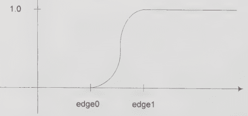

图 12.6. `smoothstep` 函数

### 几何函数

所有几何函数直接处理向量，也就是说它们是分量级操作的（表 12.13）。

**表 12.13.** 几何函数

| 函数 | 描述 |
| :--- | :--- |
| `float length(T x)` | 返回`x`的长度。 |
| `float distance(T p0, T p1)` | 返回`p0`和`p1`两点之间的距离，即返回`length(p0 - p1)`。 |
| `float dot(T x, T y)` | 返回参数的点积。 |
| `vec3 cross(vec3 x, vec3 y)` | 返回参数的叉积。 |
| `T normalize(T x)` | 返回一个方向与`x`向量相同且长度为单位长度的向量。 |
| `vec4 ftransform()` | 返回经过与标准 OpenGL 管线相同方式变换后的当前向量。只能在顶点着色器中使用。 |
| `T faceforward(T N, T I, T Nref)` | 如果`dot(I, Nref) < 0`，则返回`N`。否则返回`-N`。 |
| `T reflect(T I, T N)` | 返回`I`向量在法线`N`上的反射向量。即返回`I - 2 * dot(I, N) * N`。 |
| `T refract(T I, T N, float eta)` | 返回`I`向量在法线`N`上的折射向量，其中`eta`是相对折射率。 |

该函数由以下代码段描述：

```
k = 1.0 - eta*eta*(1.0 - dot(N, I) * dot(N, I));
if (k < 0.0)
    return T(0.0);
else
    return eta*I - (eta*dot(N, I) + sqrt(k)) * N;
```

`ftransform` 函数用于执行多通行渲染（multi-pass rendering）且部分通行使用标准管线的情况。该函数允许顶点着色器返回与在其他通行中相同的`gl_Position`变量值。

### 矩阵函数

GLSL 提供了一个标准矩阵函数 —— `matrixCompMult`（表 12.14）。

**表 12.14.** 矩阵函数

| 函数 | 描述 |
| :--- | :--- |
| `M matrixCompMult (M x, M y)` | 返回两个矩阵的分量级乘积 |

### 向量比较函数

向量比较函数用于对向量进行分量级比较。标准比较运算符（`<`、`>`、`<=`、`>=`、`==` 和 `!=`）仅适用于标量。

在表 12.15 中，`vec` 表示浮点分量向量类型（`vec2`、`vec3` 或 `vec4`），`ivec` 表示整数分量向量类型（`ivec2`、`ivec3` 或 `ivec4`），`bvec` 表示布尔向量类型（`bvec2`、`bvec3` 或 `bvec4`）。

**表 12.15.** 向量比较函数

| 函数 | 描述 |
| :--- | :--- |
| `bvec lessThan (vec x, vec y)`<br>`bvec lessThan (ivec x, ivec y)` | 返回 `x < y` 的分量级比较结果。 |
| `bvec lessThanEqual (vec x, vec y)`<br>`bvec lessThanEqual (ivec x, ivec y)` | 返回 `x <= y` 的分量级比较结果。 |
| `bvec greaterThan (vec x, vec y)`<br>`bvec greaterThan (ivec x, ivec y)` | 返回 `x > y` 的分量级比较结果。 |
| `bvec greaterThanEqual (vec x, vec y)`<br>`bvec greaterThanEqual (ivec x, ivec y)` | 返回 `x >= y` 的分量级比较结果。 |
| `bvec equal (vec x, vec y)`<br>`bvec equal (ivec x, ivec y)`<br>`bvec equal (bvec x, bvec y)` | 返回 `x == y` 的分量级比较结果。 |
| `bvec notEqual (vec x, vec y)`<br>`bvec notEqual (ivec x, ivec y)`<br>`bvec notEqual (bvec x, bvec y)` | 返回 `x != y` 的分量级比较结果。 |
| `bool any (bvec x)` | 如果`x`向量中至少有一个分量为`true`，则返回`true`。 |
| `bool all (bvec x)` | 如果`x`向量的所有分量都为`true`，则返回`true`。 |
| `bvec not (bvec x)` | 返回`x`向量的分量级取反结果。 |

## 纹理访问函数

所有访问纹理的函数都可以在片元着色器和顶点着色器中被调用。这里假设纹理参数（例如大小或格式）已使用 OpenGL 工具定义。

在表 12.16 中，`bias` 表示一个可选参数，它只能由片元着色器访问。如果指定了该参数，它将在访问结构之前被添加到计算出的 LOD（细节级别）值中。否则，将以标准方式访问该结构。

函数名中包含 `Lod` 后缀的函数只能在顶点着色器中使用。`lod` 参数指定了 LOD。

如果函数名包含 `Proj` 后缀，在访问纹理之前，纹理坐标将除以最后一个分量的值。

### 表 12.16. 纹理访问函数

| 函数 | 描述 |
| :--- | :--- |
| `vec4 texture1D(sampler1D sampler, float coord [, float bias])` <br> `vec4 texture1DProj(sampler1D sampler, vec2 coord [, float bias])` <br> `vec4 texture1DProj(sampler1D sampler, vec4 coord [, float bias])` <br> `vec4 texture1DLod(sampler1D sampler, float coord, float lod)` <br> `vec4 texture1DProjLod(sampler1D sampler, vec2 coord, float lod)` <br> `vec4 texture1DProjLod(sampler1D sampler, vec4 coord, float lod)` | `coord` 参数用于访问由`sampler`参数指定的一维纹理。在`Proj`版本中，`coord.s/coord.t` 的值用于索引纹理。 |
| `vec4 texture2D(sampler2D sampler, vec2 coord [, float bias])` <br> `vec4 texture2DProj(sampler2D sampler, vec3 coord [, float bias])` <br> `vec4 texture2DProj(sampler2D sampler, vec4 coord [, float bias])` <br> `vec4 texture2DLod(sampler2D sampler, vec2 coord, float lod)` <br> `vec4 texture2DProjLod(sampler2D sampler, vec3 coord, float lod)` <br> `vec4 texture2DProjLod(sampler2D sampler, vec4 coord, float lod)` | `coord` 参数用于访问由`sampler`参数指定的二维纹理。在`Proj`版本中，`(coord.s/coord.p, coord.t/coord.p)` 的值用于索引纹理。 |
| `vec4 texture3D(sampler3D sampler, vec3 coord [, float bias])` <br> `vec4 texture3DProj(sampler3D sampler, vec4 coord [, float bias])` <br> `vec4 texture3DLod(sampler3D sampler, vec3 coord, float lod)` <br> `vec4 texture3DProjLod(sampler3D sampler, vec4 coord, float lod)` | `coord` 参数用于访问由`sampler`参数指定的三维纹理。在`Proj`版本中，(`coord.s/coord.q`, `coord.t/coord.q`, `coord.p/coord.q`) 的值用于索引纹理。 |
| `vec4 textureCube(samplerCube sampler, vec3 coord [, float bias])` <br> `vec4 textureCubeLod(samplerCube sampler, vec3 coord, float lod)` | `coord` 参数用于访问使用`sampler`参数指定的立方体贴图纹理。 |
| `vec4 shadow1D(sampler1DShadow sampler, vec3 coord [, float bias])` <br> `vec4 shadow2D(sampler2DShadow sampler, vec3 coord [, float bias])` <br> `vec4 shadow1DProj(sampler1DShadow sampler, vec4 coord [, float bias])` <br> `vec4 shadow2DProj(sampler2DShadow sampler, vec4 coord [, float bias])` <br> `vec4 shadow1DLod(sampler1DShadow sampler, vec3 coord, float lod)` <br> `vec4 shadow2DLod(sampler2DShadow sampler, vec3 coord, float lod)` <br> `vec4 shadow1DProjLod(sampler1DShadow sampler, vec4 coord, float lod)` <br> `vec4 shadow2DProjLod(sampler2DShadow sampler, vec4 coord, float lod)` | `coord` 参数用于访问由`sampler`参数指定的包含深度值的一维或二维纹理。在`Proj`版本中，`coord` 参数在访问结构之前会被除以纹理坐标向量的最后一个分量。 |

## 导数处理函数

处理导数的函数（表 12.17）使得计算指定变量导数的近似值成为可能。然而，其实现产生的值可能并不特别精确。

以下近似等式成立：$F(x + h) - F(x) \approx dFdx(x) \cdot h$。

### 表 12.17. 导数处理函数

| 函数 | 描述 |
| :--- | :--- |
| `dFdx` (T p) | 返回参数`p`对 x 的一阶导数的近似值。 |
| `dFdy` (T p) | 返回参数`p`对 y 的一阶导数的近似值。 |
| `fwidth` (T p) | 返回 `abs(dFdx(p)) + abs(dFdy(p))` 的值。 |

## 噪声函数

噪声函数（表 12.18）可供顶点着色器和片元着色器使用。这些函数具有以下属性：

- 参数的值落在 $[-1, 1]$ 区间内。
- 平均值为零。
- 相同的参数总是产生相同的函数值（即，它不是随机数生成器）。
- 它们在统计上相对于旋转是不变的。
- 它们在统计上相对于平移是不变的。
- 它们是 $C^1$ 连续的。

图 12.7 包含了由二维噪声函数生成的图像。$[-1, 1]$ 区间内的值被映射为灰度。

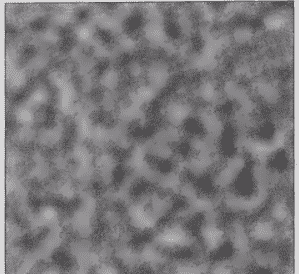

**图 12.7.** 由二维噪声函数生成的图像

### 表 12.18. 噪声函数

| 函数 | 描述 |
| :--- | :--- |
| `float noise1(T x)` | 返回 x 参数的一维噪声函数值 |
| `vec2 noise2(T x)` | 返回 x 参数的二维噪声函数值 |
| `vec3 noise3(T x)` | 返回 x 参数的三维噪声函数值 |
| `vec4 noise4(T x)` | 返回 x 参数的四维噪声函数值 |

请注意，内置的噪声函数支持较为少见。这就是为什么本书将使用类似于图 12.7 所示的纹理来代替噪声函数。

## 顶点和片元着色器的简单示例

代码清单 12.2 和 12.3 包含了用 GLSL 编写的简单的顶点和片元着色器。顶点着色器的最低功能是将变换后顶点的坐标写入`gl_Position`变量。

### 代码清单 12.2. 一个简单的顶点着色器

```glsl
//
// Simple GLSL vertex shader
//

void main (void)
{
    gl_Position = gl_ModelViewProjectionMatrix * gl_Vertex;
}
```

片元着色器的最低功能是将变换后顶点的坐标写入`gl_FragColor`变量。

### 代码清单 12.3. 一个简单的片元着色器

```glsl
//
// Simple fragment shader
//

void main (void)
{
    gl_FragColor = vec4 (0.0, 1.0, 0.0, 1.0);
}
```

## 第 13 章：简单的顶点和片元着色器。主要光照模型的实现

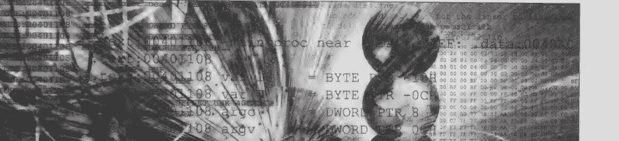

本章描述了如何使用 GLSL 来实现几种着色器和主要的光照模型。

最简单的顶点着色器涉及使用模型视图矩阵与投影矩阵的乘积来变换顶点坐标（代码清单 13.1）。

**代码清单 13.1. 最简单的顶点着色器**

```glsl
//
// Simplest GLSL vertex shader
//

void main (void)
{
    gl_Position = gl_ModelViewProjectionMatrix * gl_Vertex;
}
```

最简单的片元着色器则更为简单。它仅仅为所有片元分配相同的颜色值（代码清单 13.2）。

### 代码清单 13.2. 最简单的片元着色器

```glsl
//
// Simplest fragment shader
//

void main (void)
{
    gl_FragColor = vec4 (0.0, 1.0, 0.0, 1.0);
}
```

使用这些着色器绘制的茶壶对象如图 13.1 所示。绘制它的 C++ 代码在*第 14 章*中讨论（见代码清单 14.2）。


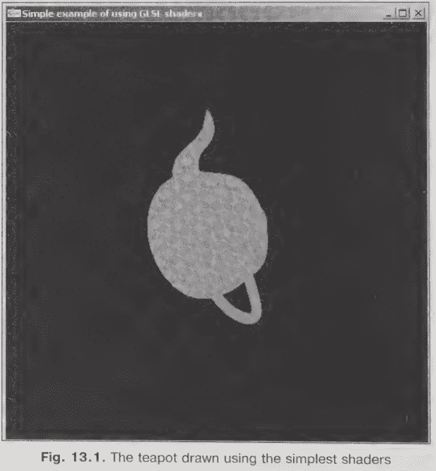

## 漫反射光照模型

让我们考虑一个简单漫反射光照模型的 GLSL 实现。在这个模型中，击中被照亮物体表面任意点 $P$ 的光线在包含光源的半球的所有方向上均匀扩散（图 13.2）。

由于光线均匀扩散，该点的可见光照不取决于观察者的位置。它仅由表面被照亮区域的方向决定，因为这影响了击中该点的光能单位密度。

漫反射光照模型通常由以下公式描述：

$$C_{out} = C \cdot (k_a + k_d \cdot \max(0, (n, l)))$$ (13.1)

这里，$C$ 表示该点的表面颜色，$k_a$ 和 $k_d$ 表示环境分量和漫反射分量对光照的贡献（前者保证了即使没有光源照射，物体也会被某种程度上地照亮），$n$ 和 $l$ 分别表示表面的法线和指向光源的单位向量。

如果你希望使用公式 (13.1) 来计算每个像素的光照，你需要知道表面每个点的 $n$ 和 $l$ 向量（法线应使用模型视图矩阵进行变换），以便使用 `varying` 变量将它们传递给片元着色器。

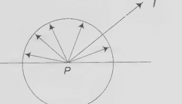

图 13.2. 漫反射光照模型

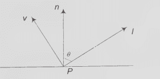

图 13.3. 用于计算光照的向量

代码清单 13.3 和 13.4 包含了用于漫反射光照的顶点着色器和片元着色器。

### 代码清单 13.3. 用于漫反射光照的顶点着色器

```glsl
varying vec3 l;
varying vec3 n;

uniform vec4 lightPos;

void main(void)
{
    // Transformed point to world space
    vec3 p = vec3(gl_ModelViewMatrix * gl_Vertex);

    // Vector to light source
    l = normalize(vec3(lightPos) - p);
    n = normalize(gl_NormalMatrix * gl_Normal); // Transformed n

    gl_Position = gl_ModelViewProjectionMatrix * gl_Vertex;
}
```

`lightPos` 统一变量用于将光源的坐标传递给顶点着色器。在片元着色器中，我们通过对顶点着色器中计算的值进行插值，获得每个片元的 $n$ 和 $l$ 向量的值。

由于这些向量在插值过程中不再是单位长度，因此在用于公式 (13.1) 之前应当对其进行归一化。

### 代码清单 13.4. 用于漫反射光照的片元着色器

```glsl
varying vec3 l;
varying vec3 n;

void main(void)
{
    const vec4 diffColor = vec4(0.5, 0.0, 0.0, 1.0);
    const float ka = 0.2;
    const float kd = 1.0;

    vec3 n2 = normalize(n);
    vec3 l2 = normalize(l);
    vec4 diff = diffColor * (ka + kd*max(dot(n2, l2), 0.0));

    gl_FragColor = diff;
}
```

## Blinn 光照模型

考虑公式 (13.1) 所描述光照模型的一个扩展，用于在受光物体的表面创建高光。

创建高光最常用的模型之一是 Blinn 模型。在该模型中，光照由以下公式描述：

$$C_{out} = C \cdot (k_a + k_d \max(0, (n, l)) + I \cdot k_s \cdot \max(0, (n, h))^p)$$ (13.2)

这里，$k_s$ 和 $I$ 分别表示高光光照的贡献和光源的颜色。

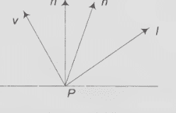

**图 13.4.** Blinn 光照模型中使用的向量

在这个公式中，$h$ 表示一个单位向量，它是光源方向 $l$ 与观察者方向 $v$ 之间夹角的角平分线（图 13.4）。

参数 $p$ 负责高光的对比度：其值越大，高光区域的对比度越高（且面积越小）。

要计算 $h$ 向量，请使用公式 (13.3)，前提是 $l$ 和 $v$ 向量已归一化。

$$h = \frac{l + v}{\|l + v\|}$$ (13.3)

让我们讨论如何修改代码清单 13.3 和 13.4 中的着色器，以添加 Blinn 光照模型（代码清单 13.5 和 13.6）。

与漫反射光照一样，$n$、$l$、$v$ 和 $h$ 向量为每个顶点计算，并作为 `varying` 变量传递给片元着色器。

> **注意**：在根据公式 (13.3) 计算 $h$ 向量之前，应当先对 $l$ 和 $v$ 向量进行归一化。

观察者的位置通过 `eyePos` 统一变量传递给着色器。

### 代码清单 13.5. Blinn 光照模型的顶点着色器

```glsl
//
// Blinn vertex shader
//

varying   vec3 l;
varying   vec3 h;
varying   vec3 n;
varying   vec3 v;

uniform   vec4 lightPos;
uniform   vec4 eyePos;

void main(void)
{
    // Transformed point to world space
    vec3 p = vec3 (gl_ModelViewMatrix * gl_Vertex);

    // Vector to light source
    l = normalize (vec3(lightPos) - p);

    // Vector to the eye
    v = normalize (vec3 (eyePos) - p);
    h = normalize (l + v);

    // Transformed n
    n = normalize (gl_NormalMatrix * gl_Normal);

    gl_Position = gl_ModelViewProjectionMatrix * gl_Vertex;
}
```

与之前的情况一样，片元着色器的任务是对向量（$n, l, v,$ 和 $h$）进行归一化，并根据公式 (13.2) 计算光照。

### 代码清单 13.6. Blinn 光照模型的片元着色器

```glsl
//
// Blinn fragment shader
//

varying   vec3 l;
varying   vec3 h;
varying   vec3 v;
varying   vec3 n;

void main (void)
{
    const vec4 diffColor = vec4 (0.5, 0.0, 0.0, 1.0);
    const vec4 specColor = vec4 (0.7, 0.7, 0.0, 1.0);
    const float specPower = 30;

    vec3 n2 = normalize (n);
    vec3 l2 = normalize (l);
    vec3 h2 = normalize (h);
    vec4 diff = diffColor * max (dot (n2, l2), 0.0);
    vec4 spec = specColor * pow (max (dot (n2, h2), 0.0),
                                   specPower);

    gl_FragColor = diff + spec;
}
```

图 13.5 显示了使用代码清单 13.5 和 13.6 中的着色器绘制的茶壶。

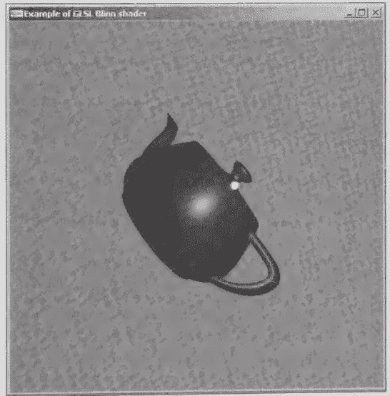

**图 13.5.** 根据 Blinn 模型光照的茶壶

## Phong 光照模型

同样可用于创建高光的 Phong 光照模型基于另一个公式（与 (13.2) 略有相似）：

$$C_{out} = C \cdot (k_d \cdot \max(0, (n, l)) + I \cdot k_s \cdot \max(0, (l, r))^p)$$ (13.4)

这里，$r$ 表示一个向量，它是指向观察者的 $v$ 向量相对于 $n$ 向量的反射向量（图 13.6）。

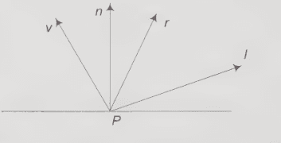

**图 13.6.** Phong 模型中使用的向量

与 Blinn 光照模型类似，$l$、$v$ 和 $n$ 向量由顶点着色器计算，然后通过 `varying` 变量传递给片元着色器。

代码清单 13.7 和 13.8 包含了 Phong 光照模型的顶点着色器和片元着色器。

### 代码清单 13.7. Phong 光照模型的顶点着色器

```glsl
//
// Phong vertex shader
//

varying vec3 l;
varying vec3 v;
varying vec3 n;

uniform vec4 lightPos;
uniform vec4 eyePos;

void main(void)
{
    // Transformed point to world space
    vec3 p = vec3(gl_ModelViewMatrix * gl_Vertex);

    // Vector to light source
    l = normalize(vec3(lightPos) - p);

    // Vector to the eye
    v = normalize(vec3(eyePos) - p);

    // Transformed n
    n = normalize(gl_NormalMatrix * gl_Normal);

    gl_Position = gl_ModelViewProjectionMatrix * gl_Vertex;
}
```

Phong 光照模型的片元着色器（代码清单 13.8）与代码清单 13.6 几乎完全相同。它对向量进行归一化，使用内置函数 `reflect` 寻找向量的反射方向，并根据公式 (13.4) 计算光照。

### 代码清单 13.8. Phong 光照模型的片元着色器

```glsl
//
// Phong fragment shader
//

varying vec3 l;
varying vec3 v;
varying vec3 n;

void main (void)
{
    const vec4 diffColor = vec4(0.5, 0.0, 0.0, 1.0);
    const vec4 specColor = vec4(0.7, 0.7, 0.0, 1.0);
    const float specPower = 30;

    vec3 n2 = normalize(n);
    vec3 l2 = normalize(l);
    vec3 v2 = normalize(v);
    vec3 r = reflect(-v2, n2);
    vec4 diff = diffColor * max(dot(n2, l2), 0.0);
    vec4 spec = specColor * pow(max(dot(l2, r), 0.0), specPower);

    gl_FragColor = diff + spec;
}
```

您可以修改代码清单 13.7 和 13.8 中的着色器以使用纹理。在这种情况下，表面 $C$ 的颜色将不再是恒定的，而是使用纹理来计算（代码清单 13.9 和 13.10）。

### 代码清单 13.9. 带纹理映射的 Phong 光照模型顶点着色器

```glsl
//
// Phong vertex shader with texturing
//

varying vec3 l;
varying vec3 v;
varying vec3 n;

uniform vec4 lightPos;
uniform vec4 eyePos;

void main(void)
{
    vec3 p = vec3(gl_ModelViewMatrix * gl_Vertex);

    l = normalize(vec3(lightPos) - p);
    v = normalize(vec3(eyePos) - p);
    n = normalize(gl_NormalMatrix * gl_Normal);

    gl_Position = gl_ModelViewProjectionMatrix * gl_Vertex;
    gl_TexCoord[0] = gl_MultiTexCoord0;
}
```

### 代码清单 13.10. 带纹理映射的 Phong 光照模型片元着色器

```glsl
//
// Phong fragment shader with texturing
//

varying vec3 l;
varying vec3 v;
varying vec3 n;

uniform sampler2D decalMap;

void main(void)
{
    const vec4 specColor = vec4(0.7, 0.0, 0.0, 1.0);
    const float specPower = 30;

    vec4 diffColor = texture2D(decalMap, gl_TexCoord[0].xy);
    vec3 n2 = normalize(n);
    vec3 l2 = normalize(l);
    vec3 v2 = normalize(v);
    vec3 r = reflect(-v2, n2);
    vec4 diff = diffColor * max(dot(n2, l2), 0.0);
    vec4 spec = specColor * pow(max(dot(l2, r), 0.0), specPower);

    gl_FragColor = diff + spec;
}
```

请注意，顶点着色器使用 `gl_TexCoord[0]` 变量将纹理坐标传递给片元着色器。否则，片元着色器会将每个片元的纹理坐标值设置为零。

为了使用纹理坐标访问纹理，片元着色器调用 `texture2D` 标准函数。纹理通过 `sampler2D` 统一变量传递。

## 使用凹凸映射

到目前为止，我们假设每个点的法线是顶点法线插值的结果。因此，渲染出的物体是光滑的。然而，通常希望给表面增加一定的起伏，即使其不那么光滑。实现这一目标最简单的方法是使用凹凸映射。

*凹凸映射*（bump map）是一种将法线值存储为颜色的纹理。当着色器读取纹理时，所得向量的分量落在 $[0, 1]$ 区间内。然而，单位向量的分量落在 $[-1, 1]$ 区间内，因此需要一种将向量转换为颜色（以及反之）的方法。

$$\begin{aligned} r &= 0.5 \cdot (x + 1), \\ g &= 0.5 \cdot (y + 1), \\ b &= 0.5 \cdot (z + 1). \end{aligned} \quad (13.5)$$

当需要从纹理颜色中计算原始法线时，请使用以下公式：

$$\begin{aligned} x &= 2 \cdot r - 1, \\ y &= 2 \cdot g - 1, \\ z &= 2 \cdot b - 1. \end{aligned} \quad (13.6)$$

**图 13.7.** 切空间（tangent space）的基

在对一个面应用此类映射后，你会为面上的每个点获得一个单位向量。该向量应被视为该点的法线。然而，直接使用来自映射的法线值是很困难的，因为它们通常指定的是针对特定面的法线，也就是说，该法线最初等于 $(0, 0, 1)$。这就是引入*切空间*概念的原因（图 13.7）。

三个单位向量 —— $t$、$b$ 和 $n$ —— 被用作这个空间的基。属于面平面的 $t$ 向量被称为*切线（tangent）*。同样属于面平面且垂直于 $t$ 向量的 $b$ 向量被称为*副法线（binormal）*。

$t$、$b$ 和 $n$ 向量构成了该空间的正交基；因此，将向量映射到此空间的过程非常简单。

当你需要将一个 $p$ 向量映射到这个坐标系时，你应该计算三个点积。$p$ 向量的新坐标将是 $((t, p), (b, p), (n, p))$。

如你所见，在面切空间的坐标系中，$n$ 法线始终等于 $(0, 0, 1)$。因此，你可以轻松地在此空间中使用凹凸映射（bump maps）。然而，你还必须将所有使用的向量映射到切空间。

这种映射在顶点着色器中最为简单。为了实现这一点，除了顶点的位置和法线外，你还应该为每个顶点指定切向量和副法线。这些通常被指定为纹理单元 1 和 2 的纹理坐标。

在这种情况下，顶点色器不仅需要计算 $l$、$h$ 和 $n$ 向量，还需要将它们映射到切空间坐标系中。为此，它应该首先将 $n$、$t$ 和 $b$ 向量乘以 `gl_NormalMatrix` 以将它们转换到世界空间，然后使用这些向量将渲染光照所需的向量转换到切空间的坐标系中。

> 因为 $n$、$t$ 和 $b$ 向量构成一个正交基，将它们映射到切空间不会改变它们的长度，也不会改变它们之间的夹角。

代码清单 13.11 和 13.12 包含了一个顶点色器和一个片元色器，它们实现了带有凹凸映射的 Blinn 光照模型。

### 代码清单 13.11. 带有凹凸映射的 Blinn 光照模型的顶点色器


### 简单凹凸顶点着色器

```glsl
//
// Simple bump vertex shader
//
varying vec3 lt;
varying vec3 ht;

uniform vec4 lightPos;
uniform vec4 eyePos;

void main (void)
{
    vec3 p = vec3(gl_ModelViewMatrix * gl_Vertex);
    vec3 l = normalize(vec3(lightPos) - p);
    vec3 v = normalize(vec3(eyePos) - p);
    vec3 h = normalize(l + v);
    vec3 n = gl_NormalMatrix * gl_Normal;

    vec3 t = gl_NormalMatrix * gl_MultiTexCoord1.xyz;
    vec3 b = gl_NormalMatrix * gl_MultiTexCoord2.xyz;

    // Now remap l and h into tangent space.
    lt = vec3(dot(l, t), dot(l, b), dot(l, n));
    ht = vec3(dot(h, t), dot(h, b), dot(h, n));

    gl_Position = gl_ModelViewProjectionMatrix * gl_Vertex;
    gl_TexCoord[0] = gl_MultiTexCoord0;
}
```

### 代码清单 13.12. 带有凹凸映射的 Blinn 光照模型的片元着色器

```glsl
//
// Simple bump fragment shader
//
varying vec3 lt;
varying vec3 ht;

uniform sampler2D bumpMap;
uniform sampler2D diffuseMap;

void main (void)
{
    const vec4 specColor = vec4(1);

    // Get normal perturbation.
    vec3 n = texture2D(bumpMap, gl_TexCoord[0]).rgb;
    vec3 nt = normalize(2.0 * n - 1.0);
    vec3 l2 = normalize(lt);
    vec3 h2 = normalize(ht);
    float diff = max(dot(nt, l2), 0.0) + 0.2;
    float spec = pow(max(dot(nt, h2), 0.0), 30);

    gl_FragColor = diff * texture2D(diffuseMap, gl_TexCoord[0]) - 
                    spec * specColor;
}
```

图 13.8 显示了使用这些着色器绘制的圆环面。图 13.9 显示了所使用的凹凸映射图。

**图 13.8.** 应用了凹凸映射的圆环面

**图 13.9.** 图 13.8 中使用的凹凸映射图

## 各向异性光照模型

前几节描述的模型具有相同的特性：表面的光照程度仅由`l`、`v`和`n`向量之间的相对位置决定。表面的方向（只要相对位置相同）并不重要。具有这些特性的表面被称为*各向同性（isotropic）*的。

然而，在实际中，有一些表面不具备这一特性（例如 CD 表面或抛光金属）。这些被称为*各向异性（anisotropic）*的。

为了能够将表面方向考虑在内，使用了*切向量场（tangent vector field）*。换句话说，对于每个点`P`，定义一个垂直于该点法线`n`的单位向量`t`（图 13.10）。

切向量场通常使用一种称为*切线图（tangent map）*的纹理来定义。切线图的示例包含在随附 CD-ROM 的`TEXTURES\TANGENTMAPS`文件夹中。

**图 13.10.** 切向量场

**图 13.11.** 极细纤维的光照

针对各向异性表面有几种光照模型，我们将讨论其中的两种。

最简单的方法之一是将表面视为一组极细的纤维。在这种情况下，切向量是纤维的切线，而副法线是属于该平面的垂直于它的法线。

让我们讨论如何调整 Blinn 光照模型以计算此类纤维的光照。

假设需要计算一根极细纤维的光照（图 13.11）。

为这根纤维定义`n`法线是不可能的，因为任何垂直于`t`的单位向量都可以作为法线。

使用标准方法，为每个分量（漫反射或高光）分别选择一个使光照分量达到最大值的法线。

考虑漫反射分量是如何计算的一个示例。请注意，指向光源的`l`向量可以分解为两个向量：一个与`t`向量平行，另一个与其垂直。换句话说，它可以表示为以下形式：

$$l = (t, l)l + l^{\perp} \quad (13.7)$$

在公式 (13.7) 中，`l^{\perp}`表示`l`向量垂直于`t`向量的分量。

很容易证明，当`n = l^{\perp} / ||l^{\perp}||`时，`(n, l)`达到最大值。如果我们从公式 (13.7) 中找到`l^{\perp}`并计算它的标量平方，我们将很容易找到该分量的长度以及所寻求的最大值 (13.8)。

$$\max(l, n) = \sqrt{1 - (t, l)^2} \quad (13.8)$$

同样，很容易找到 Blinn 光照模型的高光分量：

$$\max(h, n) = \sqrt{1 - (t, h)^2} \quad (13.9)$$

根据公式 (13.2)、(13.8) 和 (13.9)，可得出各向异性光照模型的公式：

$$C_{out} = C \cdot (k_a + k_d \cdot \max(0, (t, l))^{0.5} + I \cdot k_s \cdot \max(0, (t, h))^{0.5} P) \quad (13.10)$$

虽然使用片元着色器很容易实现公式 (13.10)，但还可以进行额外的优化。

请注意，漫反射光照取决于`(t, l)^2`的值，而高光光照取决于`(t, h)^2`。这种依赖关系可以使用二维纹理来表示，其中`(t, l)^2`是`s`坐标，`(t, h)^2`是`t`坐标。对应于这两个点积平方的漫反射分量可以存储在纹理的红色分量中，而高光分量可以存储在绿色分量中。

用于创建此类纹理的 Python 脚本包含在随附 CD-ROM 的`Code\scripts`文件夹中。我们稍后将使用此纹理。

使用这种方法，我们可以编写用于各向异性光照模型的顶点和片元着色器，如代码清单 13.13 和 13.14 所示。

### 代码清单 13.13. 用于渲染各向异性表面的顶点着色器

```glsl
//
// Simple anisotropic lighting vertex shader
// Using lookup table for diffuse and specular coefficients
//

varying vec3 lt;
varying vec3 ht;

uniform vec4 lightPos;
uniform vec4 eyePos;

void main(void)
{
    vec3 p = vec3(glModelViewMatrix * gl_Vertex);
    vec3 l = normalize(vec3(lightPos) - p);
    vec3 v = normalize(vec3(eyePos) - p);
    vec3 h = normalize(l + v);
    vec3 n = gl_NormalMatrix * gl_Normal;
    vec3 t = gl_NormalMatrix * gl_MultiTexCoord1.xyz;
    vec3 b = gl_NormalMatrix * gl_MultiTexCoord2.xyz;

    // Now remap l and h into tangent space.
    lt = vec3(dot(t, l), dot(b, l), dot(n, l));
    ht = vec3(dot(t, h), dot(b, h), dot(n, h));

    gl_Position = glModelViewProjectionMatrix * gl_Vertex;
    gl_TexCoord[0] = gl_MultiTexCoord0;
}
```

### 列表 13.14. 用于渲染各向异性表面的片元着色器

```glsl
//
// Simple anisotropic lighting fragment shader
// using lookup table for diffuse and specular coefficients
//

varying vec3 lt;
varying vec3 ht;

uniform sampler2D tangentMap;
uniform sampler2D decalMap;
uniform sampler2D anisoTable;

void main(void)
{
    const vec4 specColor = vec4(0, 0, 1, 0);

    vec3 tang = normalize(2.0 * texture2D(tangentMap, gl_TexCoord[0].xyz - 1.0));

    float dot1 = dot(normalize(lt), tang);
    float dot2 = dot(normalize(ht), tang);
    vec2 arg = vec2(dot1, dot2);
    vec2 ds = texture2D(anisoTable, arg*arg).rg;
    vec4 color = texture2D(decalMap, gl_TexCoord[0].xy);

    gl_FragColor = color * ds.x + specColor * ds.y;
    gl_FragColor.a = 1;
}
```

除了 (13.10) 之外，还有其他模型。其中之一是 Ward 模型。这个简化版本由以下公式描述：

$$C_{out} = C \cdot k_a + I \cdot k_e^{ -\left( k \frac{(h,t)}{(h,n)} \right)^2 }$$ (13.11)

这里，`k`表示最高对比度（类似于 Blinn 和 Phong 模型中的`p`）。

列表 13.15 和 13.16 包含了 Ward 模型的顶点着色器和片元着色器。

### 列表 13.15. Ward 光照模型的顶点着色器

```glsl
//
// Simple anisotropic Ward lighting vertex shader
//

varying vec3 lt;
varying vec3 vt;
varying vec3 ht;

uniform vec4 lightPos;
uniform vec4 eyePos;

void main(void)
{
    vec3 p = vec3(glModelViewMatrix * gl_Vertex);
    vec3 l = normalize(vec3(lightPos) - p);
    vec3 v = normalize(vec3(eyePos) - p);
    vec3 h = normalize(l + v);
    vec3 n = gl_NormalMatrix * gl_Normal;
    vec3 t = gl_NormalMatrix * gl_MultiTexCoord1.xyz;
    vec3 b = gl_NormalMatrix * gl_MultiTexCoord2.xyz;

    // Now remap v, l, and h into tangent space.
    vt = vec3( dot( v, t), dot( v, b), dot( v, n));
    lt = vec3( dot( l, t), dot( l, b), dot( l, n));
    ht = vec3( dot( h, t), dot( h, b), dot( h, n));

    gl_Position    = gl_ModelViewProjectionMatrix * gl_Vertex;
    gl_TexCoord[0] = gl_MultiTexCoord0;
}
```

### 列表 13.16. Ward 光照模型的片元着色器

```glsl
//
// Simple anisotropic Ward lighting fragment shader
//
varying    vec3 vt;
varying    vec3 lt;
varying    vec3 ht;

uniform sampler2D tangentMap;
uniform sampler2D decalMap;

void main(void)
{
    const vec4    specColor = vec4(0, 0, 1, 0);
    const vec3    n = vec3(0, 0, 1);
    const float   roughness = 5;

    vec4    color = texture2D(decalMap, gl_TexCoord[0].xy);
    vec3    tang = normalize(2.0 * texture2D(tangentMap,
                                           gl_TexCoord[0].xyz - vec3(1.0)));
    float   dot1 = dot(ht, tang) * roughness;
    float   dot2 = dot(ht, n);
    float   p = dot1 / dot2;

    gl_FragColor.rgb = color.rgb + specColor.rgb * exp(-p * p);
    gl_FragColor.a = 1;
}
```

图 13.12 显示了一个使用 Ward 光照模型绘制的圆环面。

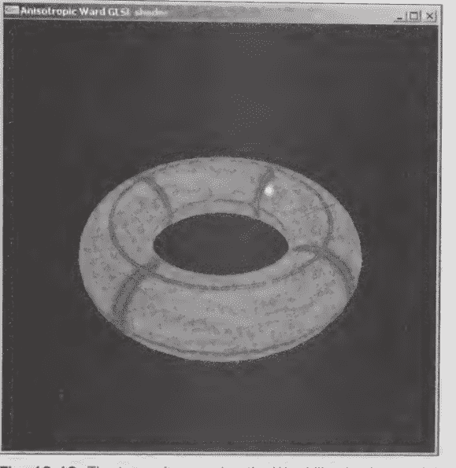

**图 13.12.** 使用 Ward 光照模型绘制的圆环面

## 边缘光 (Rim Lighting)

可以通过修改 Blinn 模型来突出被光照物体的边缘。这被称为*边缘光*（图 13.13）。

为了实现边缘光，应在公式 (13.2) 中添加以下项：

$$C_{rim} = C_r \cdot (1 - \max(0, (n, v)))^p$$ (13.12)

这里`C_r`表示光照颜色，`p`是对比度。很容易注意到，当`n`和`v`向量相互垂直时（即它们处于边缘时），该表达式达到最大值。

你可以通过引入*偏移 (bias)* 参数来修改公式 (13.12)，这将允许你控制光照区域的大小：

$$C_{rim} = C_r \cdot (1 + bias - \max(0, (n, v)))^p$$ (13.11)

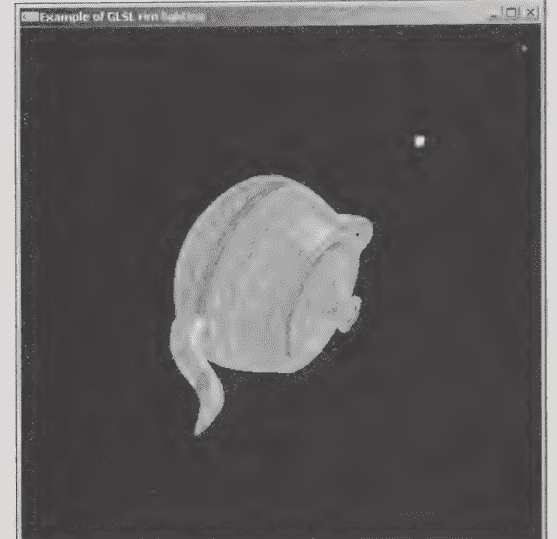

**图 13.13.** 具有边缘光的物体

为 Blinn 模型添加边缘光不需要修改顶点着色器。但是，需要修改片元着色器，如列表 13.17 所示。

### 列表 13.17. 边缘光的片元着色器

```glsl
//
// Rim lighting fragment shader
//
varying vec3 l;
varying vec3 h;
varying vec3 v;
varying vec3 n;

uniform sampler2D decalMap;

void main(void)
{
    const vec4 diffColor = vec4(0.5, 0.0, 0.0, 1.0);
    const vec4 specColor = vec4(0.7, 0.7, 0.0, 1.0);
    const float rimPower = 10;
    const float specPower = 30;
    const float bias = 0.2;

    vec3 n2 = normalize(n);
    vec3 l2 = normalize(l);
    vec3 h2 = normalize(h);
    vec3 v2 = normalize(v);
    vec4 diff = diffColor * max(dot(n2, l2), 0.0);
    vec4 spec = specColor * pow(max(dot(n2, h2), 0.0), specPower);
    float rim = pow(1.0 + bias * max(dot(n2, v2), 0.0), rimPower);

    gl_FragColor = texture2D(decalMap, gl_TexCoord[0].xy) +
                rim * vec4(0, 0, 1, 1) + spec * specColor;
}
```

## Gooch 光照模型

最简单的光照模型之一是 Gooch 模型（以 Amy Gooch 命名）。该模型使用`n`和`l`向量之间夹角的余弦值来进行颜色过渡（通常是从暖色过渡到冷色）。当光源位于物体后面时（即`⟨n, l⟩ < 0`），光线似乎穿过了物体并获得了另一种颜色。

列表 13.18 和 13.19 包含了 Gooch 光照模型的顶点着色器和片元着色器。


### 列表 13.18. Gooch 光照模型的顶点着色器

```glsl
//
// Vertex shader for Gooch shading
// Based on 3Dlabs code by Randi Rost
//

uniform vec4 lightPos;
uniform vec4 eyePos;

varying float NdotL;
varying vec3 reflectVec;
varying vec3 viewVec;

void main(void)
{
    vec3 p = vec3(gl_ModelViewMatrix * gl_Vertex);
    vec3 norm = normalize(gl_NormalMatrix * gl_Normal);
    vec3 lightVec = normalize(lightPos.xyz - p.xyz);

    reflectVec = normalize(reflect(-lightVec, norm));
    viewVec = normalize(eyePos.xyz - p.xyz);
    NdotL = (dot(lightVec, norm) + 1.0) * 0.5;
    gl_Position = ftransform();
}
```

### 列表 13.19. Gooch 光照模型的片元着色器

```glsl
//
// Fragment shader for Gooch shading
// Based on 3dlabs code by Randi Rost
//

varying float NdotL;
varying vec3 reflectVec;
varying vec3 viewVec;

void main (void)
{
    const vec3 surfaceColor = vec3(0.75, 0.75, 0.75);
    const vec3 warmColor = vec3(0.6, 0.6, 0.0);
    const vec3 coolColor = vec3(0.0, 0.0, 0.6);
    const float diffuseWarm = 0.45;
    const float diffuseCool = 0.45;

    vec3 kCool = min(coolColor + diffuseCool * surfaceColor, 1.0);
    vec3 kWarm = min(warmColor + diffuseWarm * surfaceColor, 1.0);
    vec3 kFinal = mix(kCool, kWarm, NdotL);

    vec3 r = normalize(reflectVec);
    vec3 v = normalize(viewVec);
    float spec = pow(max(dot(r, v), 0.0), 32);

    gl_FragColor = vec4(min(kFinal + spec, 1.0), 1.0);
}
```

# 第 14 章：在 C++ 程序中使用 GLSL

## 所需扩展

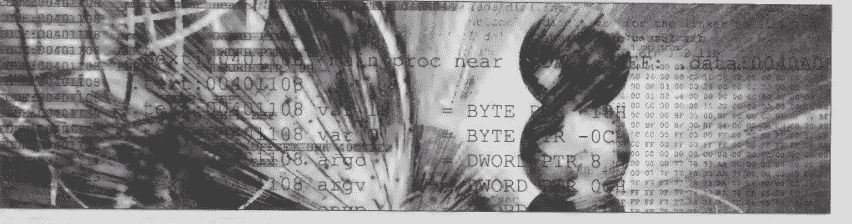

本章介绍了在 OpenGL 中使用 GLSL 及其所需的扩展。此外，还介绍了将 GLSL 程序封装到 C++ 类中的方法。

### 所需扩展

为了使用 GLSL，需要以下扩展：`GL_ARB_shader_objects`、`GL_ARB_shading_language_100`、`GL_ARB_vertex_shader` 和 `GL_ARB_fragment_shader`。接下来的章节将简要介绍这些扩展。

#### GL_ARB_shading_language_100 扩展

该扩展仅用于告知是否支持 GLSL 1.00 版本。要查询实际支持的 GLSL 版本，可以使用以下代码段：

```cpp
const char * s1Ver = (const char *) glGetString(
    GL_SHADING_LANGUAGE_VERSION_ARB);

if (glGetError() != GL_NO_ERROR)
    printf("Shading language supported: 1.051\n");
else
    printf("Shading language supported: %s\n", s1Ver);
```

返回的字符串格式如下：“major.minor[.release][vendor info]”。如果在尝试过程中发生错误，我们假设支持 1.051 版本（即描述文件的版本）。

## GL_ARB_shader_objects 扩展

该扩展引入了支持着色器（shader）所必需的 API。在这种情况下，着色器（无论是顶点着色器还是片元着色器）与其包含它的程序（program）是区分开的。

对顶点着色器和片元着色器的支持由下文描述的 `GL_ARB_vertex_shader` 和 `GL_ARB_fragment_shader` 扩展引入。

在 OpenGL 中，程序本身及其包含的着色器都由特殊对象（程序对象和着色器对象）表示。与之前描述的顶点和片元程序不同，这些对象使用新引入的类型 `GLhandleARB` 来处理。（在 OpenGL 2.0 中，使用的是 `GLuint` 类型）。该类型处理一个内部 OpenGL 对象。这些对象可以包含数据，你可以创建、修改和销毁它们。没有任何对象能对应于 `NULL` 值；因此，如果返回了 `NULL` 句柄，则表明在创建对象期间发生了错误。

其中一些对象可以包含其他对象。容器的一个典型示例就是程序对象。

以下函数用于创建和删除对象：`glCreateProgramObjectARB`、`glCreateShaderObjectARB` 和 `glDeleteObjectARB`。

```cpp
GLhandleARB glCreateProgramObjectARB();
GLhandleARB glCreateShaderObjectARB(GLenum shaderType);
void glDeleteObjectARB(GLhandleARB object);
```

`glCreateProgramObjectARB` 函数创建一个程序对象并返回其句柄。

`glCreateShaderObjectARB` 函数创建一个着色器对象。`shaderType` 参数指定着色器类型，可以等于 `GL_VERTEX_SHADER_ARB` 或 `GL_FRAGMENT_SHADER_ARB`。

`glDeleteObjectARB` 函数删除对象 `object`（无论是程序对象还是着色器对象）。指定的对象要么被立即删除，如果它当前被包含在另一个对象中，则被标记为待删除。

以下两个函数用于将对象附加到容器以及将对象从其容器中分离：

```cpp
void glAttachObjectARB(GLhandleARB containerObj, GLhandleARB obj);
void glDetachObjectARB(GLhandleARB containerObj, GLhandleARB attachedObj);
```

`glAttachObjectARB` 函数将对象 `obj` 附加到 `containerObj` 容器对象。如果 `containerObj` 不是容器对象或无法附加，则会产生错误。尝试将同一个对象第二次附加到同一个容器也会导致错误。

`glDetachObjectARB` 函数将 `attachedObj` 对象从 `containerObj` 容器中分离。如果被分离的对象当前未附加到另一个容器，它将被标记为待删除。

`glShaderSourceARB` 函数用于将着色器的源代码加载到目标对象中：

```cpp
void glShaderSourceARB(GLhandleARB shaderObj, GLsizei count,
                       const GLcharARB ** strings,
                       const GLint * lengths);
```

使用 `shaderObj` 参数指定的着色器源代码以字符串数组的形式传递。`count` 参数指定字符串的数量，`strings` 参数是一个指向字符串指针数组的指针。`lengths` 参数是一个指向数组的指针，该数组指定每个字符串的长度。当 `lengths = NULL` 时，假设每个字符串都以 `'\0'` 字节结尾。将整个文本作为一个大字符串传递是有效的，我们稍后将这样做。

加载着色器源代码后，应对其进行编译（与之前讨论的顶点和片元程序相反）。`glCompileShaderARB` 函数用于此目的：

```cpp
void glCompileShaderARB(GLhandleARB shaderObj);
```

调用此函数将导致编译着色器的 GLSL 代码。以下代码片段可让你查明编译是否成功：

```cpp
GLint compileStatus;
glGetObjectParameterivARB(shader, GL_OBJECT_COMPILE_STATUS_ARB, &compileStatus);
```

如果成功，`compileStatus` 变量将等于 `GL_TRUE`。

在程序对象中的所有着色器都成功编译后，你还需要执行最后一个步骤，之后程序才能准备就绪。这就是链接（linking）。它通过 `glLinkProgramARB` 函数执行：

```cpp
void glLinkProgramARB(GLhandleARB programObj);
```

`programObj` 参数指定程序对象。要检查链接状态，请使用以下代码片段：

```cpp
GLint linked;
glGetObjectParameterivARB(program, GL_OBJECT_LINK_STATUS_ARB, &linked);
```

如果 `linked` 值为 `GL_FALSE`，则表明链接不成功。否则，你可以调用 `glUseProgramObjectARB` 函数来激活指定的程序：

```cpp
void glUseProgramObjectARB (GLhandleARB programObj);
```

如果 `programObj` 等于 `NULL`，此次调用将禁用着色器，从而使用标准的 OpenGL 渲染管线。

即使程序当前处于激活状态，你仍然可以加载并编译着色器的源代码，以及附加或分离单个着色器。然而，这些更改只有在程序重新链接后才会生效。

有时会出现成功链接的程序无法执行的情况。为了验证程序，你可以使用以下代码片段：

```cpp
GLint validated;
glValidateProgramARB (programObj);
glGetProgramParameterivARB (program, GL_OBJECT_VALIDATE_STATUS_ARB, &validated);
```

如果 `validated` 值为 `GL_TRUE`，则表明该程序可以执行。

`glGetHandleARB` 函数允许你获取当前激活程序的句柄：

```cpp
GLhandleARB glGetHandleARB (GLenum pname);
```

`pname` 参数应等于 `GL_PROGRAM_OBJECT_ARB` 常量。每个对象着色器和每个程序着色器都对应一个内部日志。它是一个文本缓冲区，记录了关于编译和链接的信息。要获取此类日志，你应该先查明其大小，分配足够的内存，然后将日志内容复制到该内存缓冲区中：

```cpp
int         logLength = 0;
int         charsWritten = 0;
GLcharARB * infoLog;

glGetProgramParameterivARB (object, GL_OBJECT_INFO_LOG_LENGTH_ARB, &logLength);

if (glGetError () != GL_NO_ERROR)
    return;
if (logLength < 1)
    return;
infoLog = (GLcharARB*) malloc (logLength);

if (infoLog == NULL)
    return;

glGetInfoLogARB (object, logLength, &charsWritten, infoLog);
```

通常，`glGetInfoLogARB` 函数描述如下：

```cpp
void glGetInfoLogARB(GLhandleARB obj, GLsizei maxLength,
                     GLsizei * length, GLcharARB * infoLog);
```

`maxLength` 参数指定可以写入到由 `infoLog` 参数指定的缓冲区中的最大字节数。`length` 参数指定一个变量的地址，该变量包含写入缓冲区的字符数。

此外，该扩展引入了若干用于处理 `uniform` 变量的函数。

虽然着色器内部的所有 `uniform` 变量都是命名的，并且通过其名称进行访问，但操作它们的函数使用的是 `uniform` 变量的整数*位置*（locations）而非其名称。

要从当前程序的变量名称获取其位置，请使用 `glGetUniformLocationARB` 函数：

```cpp
int glGetUniformLocationARB(GLhandleARB programObj, const GLcharARB * name);
```

此函数返回指定 `uniform` 变量的位置，如果发生错误则返回 `-1`。

你还可以使用此函数获取数组元素的位置（通过在方括号中指定元素索引，例如 `myArray[11]`）和结构体字段的位置（通过指定点号和字段名称，例如 `light1.intensity`）。

在获取到所需位置后，你可以使用以下函数根据其类型为 `uniform` 变量赋值：

```cpp
void glUniform1fARB(int location, float value);
void glUniform1iARB(int location, int value);
```

通过以下两个函数，你可以为浮点数组和整数数组赋值。`count` 参数指定可以赋值的数量，`value` 参数指定存储待赋值数据的地址：

```cpp
void glUniform1fvARB(int location, GLsizei count, float * value);
void glUniform1ivARB(int location, GLsizei count, int * value);
```

以下类函数用于写入 `uniform` 矩阵的值：

```cpp
void glUniformMatrix1fvARB(int location, GLsizei count, GLboolean transpose, float * value);
```

`count` 参数指定要写入的矩阵数量。（当它等于 1 时，应写入一个矩阵；当它大于 1 时，应写入一个矩阵数组）。`transpose` 参数指示矩阵是否（或矩阵）在写入前应进行转置。最后一个参数是指向包含所需数值的内存块的指针。

以下两个函数用于获取浮点型和整型 `uniform` 变量的值。实际写入的值的数量取决于特定变量的类型：

```cpp
void glGetUniformfvARB(GLhandleARB programObj, int location,
                        float * params);
void glGetUniformivARB(GLhandleARB programObj, int location,
                        int * params);
```

要获取关于活跃 `uniform` 变量的信息，请使用 `glGetActiveUniformARB` 函数：

```cpp
void glGetActiveUniformARB(GLhandleARB programObj, GLuint index,
                           GLsizei maxLength, GLsizei * length,
                           GLint * size, GLenum * type,
                           GLcharARB * name);
```


`index`参数指定请求的`uniform`变量的索引（零表示第一个变量）；`name`参数指定用于存储变量名称的缓冲区，而`length`指定存储写入该缓冲区的字符数量的地址。名称将以一个以null结尾的字符串形式存储。`maxLength`参数指定`name`缓冲区能够存储的最大字符数。`type`参数指定用于存储请求变量类型的变量地址。类型的有效值如下：`GL_FLOAT`, `GL_FLOAT_VEC2_ARB`, `GL_FLOAT_VEC3_ARB`, `GL_FLOAT_VEC4_ARB`, `GL_INT`, `GL_INT_VEC2_ARB`, `GL_INT_VEC3_ARB`, `GL_INT_VEC4_ARB`, `GL_BOOL_ARB`, `GL_BOOL_VEC2_ARB`, `GL_BOOL_VEC3_ARB`, `GL_BOOL_VEC4_ARB`, `GL_FLOAT_MAT2_ARB`, `GL_FLOAT_MAT3_ARB`, `GL_FLOAT_MAT4_ARB`, `GL_SAMPLER_1D_ARB`, `GL_SAMPLER_2D_ARB`, `GL_SAMPLER_3D_ARB`, `GL_SAMPLER_CUBE_ARB`, `GL_SAMPLER_1D_SHADOW_ARB`, `GL_SAMPLER_2D_SHADOW_ARB`, `GL_SAMPLER_3D_SHADOW_ARB`, `GL_SAMPLER_2D_RECT_ARB`以及`GL_SAMPLER_2D_RECT_SHADOW_ARB`。`size`参数指定用于存储对应类型元素数量的变量地址。

对于`sampler`类型的`uniform`变量，存储的值是选择该纹理的纹理单元编号。（该值被假定为整数）。

## GL_ARB_vertex_shader 扩展

`GL_ARB_vertex_shader`扩展引入了若干函数和常量以支持顶点着色器。以下是这些内容的完整列表：

```cpp
void glVertexAttrib1fARB(GLuint index, float v0);
void glVertexAttrib1sARB(GLuint index, short v0);
void glVertexAttrib1dARB(GLuint index, double v0);
void glVertexAttrib2fARB (GLuint index, float v0, float v1);
void glVertexAttrib2sARB (GLuint index, short v0, short v1);
void glVertexAttrib2dARB (GLuint index, double v0, double v1);
void glVertexAttrib3fARB (GLuint index, float v0, float v1, float v2);
void glVertexAttrib3sARB (GLuint index, short v0, short v1, short v2);
void glVertexAttrib3dARB (GLuint index, double v0, double v1, double v2);
void glVertexAttrib4fARB (GLuint index, float v0, float v1, float v2, float v3);
void glVertexAttrib4sARB (GLuint index, short v0, short v1, short v2, short v3);
void glVertexAttrib4dARB (GLuint index, double v0, double v1, double v2, double v3);
void glVertexAttrib4ubARB (GLuint index, GLubyte x, GLubyte y, GLubyte z, GLubyte w);
void glVertexAttrib1fvARB (GLuint index, const float * v);
void glVertexAttrib1svARB (GLuint index, const short * v);
void glVertexAttrib1dvARB (GLuint index, const double * v);
void glVertexAttrib2fvARB (GLuint index, const float * v);
void glVertexAttrib2svARB (GLuint index, const short * v);
void glVertexAttrib2dvARB (GLuint index, const double * v);
void glVertexAttrib3fvARB (GLuint index, const float * v);
void glVertexAttrib3svARB (GLuint index, const short * v);
void glVertexAttrib3dvARB (GLuint index, const double * v);
void glVertexAttrib4fvARB (GLuint index, const float * v);
void glVertexAttrib4svARB (GLuint index, const short * v);
void glVertexAttrib4dvARB (GLuint index, const double * v);
void glVertexAttrib4ivARB (GLuint index, const int * v);
void glVertexAttrib4bvARB (GLuint index, const byte * v);
void glVertexAttrib4ubvARB (GLuint index, const GLubyte * v);
void glVertexAttrib4usvARB (GLuint index, const GLushort * v);
void glVertexAttrib4uivARB (GLuint index, const GLuint * v);
void glVertexAttrib4NvARB (GLuint index, const byte * v);
void glVertexAttrib4NsVARB (GLuint index, const short * v);
void glVertexAttrib4NiVARB (GLuint index, const int * v);
void glVertexAttrib4NubvARB (GLuint index, const GLubyte * v);
void glVertexAttrib4NusvARB (GLuint index, const GLushort * v);
void glVertexAttrib4NuivARB (GLuint index, const GLuint * v);
void glVertexAttribPointerARB (GLuint index, int size, GLenum type,
                            GLboolean normalized, GLsizei stride,
                            const void * pointer);
void glEnableVertexAttribArrayARB (GLuint index);
void glDisableVertexAttribArrayARB (GLuint index);
void glBindAttribLocationARB (GLhandleARB programObj, GLuint index,
                            const GLcharARB * name);
void glGetActiveAttribARB (GLhandleARB programObj, GLuint index,
    GLsizei maxLength, GLsizei * length,
    int * size, GLenum * type,
    GLcharARB * name);
int glGetAttribLocationARB (GLhandleARB programObj,
    const GLcharARB * name);
void glGetVertexAttribdvARB (GLuint index, GLenum pname,
    double * params);
void glGetVertexAttribfvARB (GLuint index, GLenum pname,
    float * params);
void glGetVertexAttribivARB (GLuint index, GLenum pname,
    int * params);
void glGetVertexAttribPointervARB (GLuint index, GLenum pname,
    void ** pointer);
```

`glVertexAttrib`系列函数为通过其位置指定的顶点属性赋值。要通过名称获取属性位置，请使用`glGetAttribLocationARB`函数。

读取属性值是通过`glGetVertexAttrib`系列函数实现的。

要通过位置获取属性的信息，可以使用`glGetActiveAttribARB`函数。

```cpp
void glGetActiveAttribARB (GLhandleARB programObj, GLuint index,
    GLsizei maxLength, GLsizei * length,
    int * size, GLenum * type,
    GLcharARB * name);
```

`name`参数指定用于存储属性名称的缓冲区（名称长度不应超过`maxLength`）。实际保存在缓冲区中的字节数将被赋值给由`length`参数指定的变量。属性的类型将被赋值给由`type`参数指定的变量。类型的有效值如下：`GL_FLOAT`, `GL_FLOAT_VEC2_ARB`, `GL_FLOAT_VEC3_ARB`, `GL_FLOAT_VEC4_ARB`, `GL_FLOAT_MAT2_ARB`, `GL_FLOAT_MAT3_ARB`以及`GL_FLOAT_MAT4_ARB`。

还可以为属性指定一个位置。为此，请使用`glBindAttribLocationARB`函数。但是，你不能为标准属性（其名称以`gl_`前缀开头）指定位置。

新指定的位置只有在程序重新链接后才会生效。

## GL_ARB_fragment_shader 扩展

`GL_ARB_fragment_shader`扩展提供了对编写片段着色器的支持。它仅引入了少量的常量，没有引入任何函数。

## 获取 GLSL 支持信息

代码清单 14.1 中的程序用于检查是否支持 GLSL，并在提供支持的情况下显示关于着色器限制的信息。

### 代码清单 14.1. 检查 GLSL 支持的程序

```cpp
//
// Sample to check for GLSL program support in OpenGL card and driver

#include    "libExt.h"
#include    <glut.h>
#include    <stdio.h>
#include    <stdlib.h>

void init ()
{
    glClearColor (0.0, 0.0, 0.0, 1.0);
    glEnable     (GL_DEPTH_TEST);
}

void display ()
{
    glClear (GL_COLOR_BUFFER_BIT | GL_DEPTH_BUFFER_BIT);

    glutSwapBuffers ();
}

void reshape (int w, int h)
{
    glViewport    (0, 0, (GLsizei)w, (GLsizei)h);
    glMatrixMode (GL_PROJECTION);
    glLoadIdentity ();
    glMatrixMode (GL_MODELVIEW);
    glLoadIdentity ();
}

void key (unsigned char key, int x, int y)
{
    if (key == 27 || key == 'q' || key == 'Q')    // Quit requested
        exit (0);
}

int main (int argc, char * argv [])
{
```


```cpp
// Initialize glut.

glutInit(&argc, argv);
glutInitDisplayMode(GLUT_DOUBLE | GLUT_RGB | GLUT_DEPTH);
glutInitWindowSize(400, 400);

// Create window.

glutCreateWindow("OpenGL GLSL info");

// Register handlers.

glutDisplayFunc(display);
glutReshapeFunc(reshape);
glutKeyboardFunc(key);

init();
initExtensions();

const char * vendor = (const char *)glGetString(GL_VENDOR);
const char * renderer = (const char *)glGetString(GL_RENDERER);
const char * version = (const char *)glGetString(GL_VERSION);
const char * extension = (const char *)glGetString(GL_EXTENSIONS);

printf("Vendor: %s\nRenderer: %s\nVersion: %s\n", vendor, renderer, version);

if(!isExtensionSupported("GL_ARB_shading_language_100"))
{
    printf("GL_ARB_shading_language_100 extension NOT supported.\n");
    return 1;
}

printf("GL_ARB_shading_language_100 extension is supported !\n");

const char * slVer = (const char *)glGetString(
    GL_SHADING_LANGUAGE_VERSION_ARB);

if(glGetError() != GL_NO_ERROR)
    printf("Shading language supported: 1.051\n");
else
    printf("Shading language supported: %s\n", slVer);

int maxVertexAttribs;
int maxVertexTextureUnits;
int maxFragmentTextureUnits;
int maxCombinedTextureUnits;
int maxVertexUniformComponents;
int maxVaryingFloats;
int maxFragmentUniformComponents;
int maxTextureCoords;

glGetIntegerv(GL_MAX_VERTEX_UNIFORM_COMPONENTS_ARB,
                &maxVertexUniformComponents);
glGetIntegerv(GL_MAX_VERTEX_ATTRIBS_ARB,
                &maxVertexAttribs);
glGetIntegerv(GL_MAX_TEXTURE_IMAGE_UNITS_ARB,
                &maxFragmentTextureUnits);
glGetIntegerv(GL_MAX_VERTEX_TEXTURE_IMAGE_UNITS_ARB,
                &maxVertexTextureUnits);
glGetIntegerv(GL_MAX_COMBINED_TEXTURE_IMAGE_UNITS_ARB,
                &maxCombinedTextureUnits);
glGetIntegerv(GL_MAX_VARYING_FLOATS_ARB,
                &maxVaryingFloats);
glGetIntegerv(GL_MAX_FRAGMENT_UNIFORM_COMPONENTS_ARB,
                &maxFragmentUniformComponents);
glGetIntegerv(GL_MAX_TEXTURE_COORDS_ARB,
                &maxTextureCoords);

printf("\nGLSL program limits:\n");
printf("\tmax vertex attributes : %d\n",
       maxVertexAttribs);
printf("\tmax vertex texture units : %d\n",
       maxVertexTextureUnits);
printf("\tmax fragment texture units : %d\n",
       maxFragmentTextureUnits);
printf("\tmax combined texture units : %d\n",
       maxCombinedTextureUnits);
printf("\tmax vertex uniform components : %d\n",
       maxVertexUniformComponents);
printf("\tmax varying floats : %d\n",
       maxVaryingFloats);
printf("\tmax fragment uniform components : %d\n",
       maxFragmentUniformComponents);
printf("\tmax texture coords : %d\n",
       maxTextureCoords);

return 0;
}
```

该程序检查运行 GLSL 所需的所有扩展是否可用，并返回 GLSL 的版本号以及对着色器施加的限制。

`maxVertexAttribs` 值决定了顶点属性的最大数量。

`maxVertexTextureUnits` 值决定了顶点着色器可用的纹理单元最大数量。

`maxFragmentTextureUnits` 值决定了片元着色器可用的纹理单元最大数量。

`maxCombinedTextureUnits` 值决定了顶点着色器和片元着色器共用的纹理单元最大数量。

`maxVertexUniformComponents` 值决定了顶点着色器用于创建 `uniform` 变量的最大内存量（即浮点数的最大数量）。

`maxFragmentUniformComponents` 值决定了片元着色器用于创建 `uniform` 变量的最大内存量（即浮点数的最大数量）。

`maxVaryingFloats` 值决定了用于创建 `varying` 变量的最大内存量（即浮点数的最大数量）。

`maxTextureCoords` 值决定了可与顶点关联的纹理坐标最大数量。

## 一个使用 GLSL 的简单程序

利用前面给出的描述和代码片段，很容易编写一个使用 GLSL 着色器的简单 C++ 程序。代码清单 14.2 包含了这样一个程序的源代码，它使用了清单 13.1 和 13.2 中的简单着色器。

### 清单 14.2. 一个使用 GLSL 着色器的 C++ 程序

```cpp
//
// Sample showing how to use GLSL programs
//

#include "libExt.h"

#include <glut.h>
#include <stdio.h>
#include <stdlib.h>

#include "libTexture.h"
#include "Vector3D.h"
#include "Vector2D.h"
#include "Data.h"

Vector3D eye( 7, 5, 7 ); // Camera position
Vector3D light( 5, 0, 4 ); // Light position

float angle = 0;
Vector3D rot( 0, 0, 0);
int mouseOldX = 0;
int mouseOldY = 0;

GLhandleARB program = 0;             // Program handles
GLhandleARB vertexShader = 0;
GLhandleARB fragmentShader = 0;

bool checkOpenGLError()
{
	GLenum glErr;
	bool retCode = true;

	for (; ; )
	{
		GLenum glErr = glGetError();

		if (glErr == GL_NO_ERROR)
			return retCode;

		printf ("glError: %s\n", gluErrorString(glErr));

		retCode = false;
		glErr = glGetError();
	}

	return retCode;
}

//
// Print out the information log for a shader object or a program object.
//

void printInfoLog (GLhandleARB object)
{
	int logLength = 0;
	int charsWritten = 0;
	GLcharARB * infoLog;

	checkOpenGLError();            // Check for OpenGL errors.

	glGetObjectParametervARB (object, GL_OBJECT_INFO_LOG_LENGTH_ARB, 
													&logLength);

	if (!checkOpenGLError())        // Check for OpenGL errors.
        exit (1);

	if (logLength > 0)
	{
	    infoLog = (GLcharARB*) malloc (logLength);

	    if (infoLog == NULL)
	    {
	        printf("ERROR: Could not allocate InfoLog buffer\n");
	        exit (1);
	    }
	}

	glGetInfoLogARB (object, logLength, &charsWritten, infoLog);

	printf ("InfoLog:\n%s\n\n", infoLog);
	free (infoLog);

	if (!checkOpenGLError ())
	    exit (1);
}

bool loadShader (GLhandleARB shader, const char * fileName)
{
    printf ("Loading %s\n", fileName);

    Data data (fileName);

    if (!data.isOk () || data.isEmpty ())
        exit (1);

    const char * body = (const char *) data.getPtr (0);
    GLint compileStatus;

    glShaderSourceARB (shader, 1, &body, NULL);

    // Compile the particle vertex
    // shader, and print out.
    glCompileShaderARB (shader);

    if (!checkOpenGLError ())
        return false;

    glGetObjectParameterivARB (shader, GL_OBJECT_COMPILE_STATUS_ARB,
                                &compileStatus);

    printInfoLog (shader);

    return compileStatus != 0;
}

void init ()
{
    glClearColor (0.0, 0.0, 0.0, 1.0);
    glEnable (GL_DEPTH_TEST);
    glDepthFunc (GL_LEQUAL);

    glHint (GL_POLYGON_SMOOTH_HINT, GL_NICEST);
    glHint (GL_PERSPECTIVE_CORRECTION_HINT, GL_NICEST);
}

void display ()
{
    glClear (GL_COLOR_BUFFER_BIT | GL_DEPTH_BUFFER_BIT);

    glMatrixMode (GL_MODELVIEW);
    glPushMatrix ();

    glRotatef (rot.x, 1, 0, 0);
    glRotatef (rot.y, 0, 1, 0);
    glRotatef (rot.z, 0, 0, 1);

    glutSolidTeapot (2);

    glPopMatrix ();

    glutSwapBuffers ();
}

void reshape (int w, int h)
{
    glViewport (0, 0, (GLsizei)w, (GLsizei)h);
    glMatrixMode (GL_PROJECTION);
    glLoadIdentity ();
    gluPerspective (60.0, (GLfloat)w/(GLfloat)h, 1.0, 60.0);
    glMatrixMode (GL_MODELVIEW);
    glLoadIdentity ();
    gluLookAt (eye.x, eye.y, eye.z, // Eye
                0, 0, 0,            // Center
                0.0, 0.0, 1.0);    // Up
}

void motion (int x, int y)
{
    rot.y -= ((mouseOldY - y) * 180.0f) / 200.0f;
    rot.z -= ((mouseOldX - x) * 180.0f) / 200.0f;
    rot.x = 0;

    if (rot.z > 360)
        rot.z -= 360;

    if (rot.z < -360)
        rot.z += 360;

    if (rot.y > 360)
        rot.y -= 360;

    if (rot.y < -360)
        rot.y += 360;

    mouseOldX = x;
    mouseOldY = y;

    glutPostRedisplay();
}

void mouse (int button, int state, int x, int y)
{
    if (state == GLUT_DOWN)
    {
        mouseOldX = x;
        mouseOldY = y;
    }
}

void key (unsigned char key, int x, int y)
{
    if (key == 27 || key == 'q' || key == 'Q')    // Quit requested
        exit (0);
}

void animate ()
{
    angle = 0.004f * glutGet (GLUT_ELAPSED_TIME);

    glutPostRedisplay ();
}

int main (int argc, char * argv [])
{
```


```cpp
// Initialize glut.
glutInit(&argc, argv);
glutInitDisplayMode(GLUT_DOUBLE | GLUT_RGB | GLUT_DEPTH);
glutInitWindowSize(500, 500);

// Create window.
glutCreateWindow("Simple example of using GLSL shaders");

// Register handlers.
glutDisplayFunc(display);
glutReshapeFunc(reshape);
glutKeyboardFunc(key);
glutMouseFunc(mouse);
glutMotionFunc(motion);
glutIdleFunc(animate);

init();
initExtensions();
printfInfo();

if (!isExtensionSupported("GL_ARB_shading_language_100"))
{
    printf("GL_ARB_shading_language_100 NOT supported.\n");
    return 1;
}

if (!isExtensionSupported("GL_ARB_shader_objects"))
{
    printf("GL_ARB_shader_objects NOT supported");
    return 2;
}

GLint linked;

// Create a vertex shader object
// and a fragment shader object.
vertexShader = glCreateShaderObjectARB(GL_VERTEX_SHADER_ARB);
fragmentShader = glCreateShaderObjectARB(GL_FRAGMENT_SHADER_ARB);

// Load source code strings into
// the shaders.
if (!loadShader(vertexShader, "simplest.vsh"))
    exit (1);

if (!loadShader (fragmentShader, "simplest.fsh"))
    exit (1);

    // Create a program object and attach
    // the two compiled shaders.
program = glCreateProgramObjectARB ();

glAttachObjectARB (program, vertexShader);
glAttachObjectARB (program, fragmentShader);

    // Link the program object and print
    // out the info log.

glLinkProgramARB (program);

if (!checkOpenGLError())    // Check for OpenGL errors.
    exit (1);

glGetObjectParameterivARB (program, GL_OBJECT_LINK_STATUS_ARB,
                                &linked);

printInfoLog (program);

if (!linked)
    return 0;

    // Install program object as part of
    // current state.

glUseProgramObjectARB (program);
glutMainLoop();

return 0;
}
```

该程序加载、编译并链接来自代码清单 13.1 和 13.2 的着色器，并使用它们来渲染茶壶对象。

程序的结构与之前描述的扩展相对应。首先，它检查对所需扩展的支持情况，然后创建两个着色器：顶点着色器（vertex shader）和片段着色器（fragment shader）。

```cpp
// Create a vertex shader object and a
// fragment shader object.
    vertexShader = glCreateShaderObjectARB (GL_VERTEX_SHADER_ARB);
    fragmentShader = glCreateShaderObjectARB (GL_FRAGMENT_SHADER_ARB);
```

图 14.1. 使用代码清单 14.2 中的程序渲染的图像。

之后，程序将源代码加载到每个着色器中并进行编译。

```cpp
// Load source code strings into shaders.
if (!loadShader(vertexShader, "simplest.vsh"))
    exit(1);

if (!loadShader(fragmentShader, "simplest.fsh"))
    exit(1);
```

如果此操作成功，则创建一个程序对象，将着色器附加到该对象上，并执行链接。

```cpp
// Create a program object and attach the
// two compiled shaders.
program = glCreateProgramObjectARB();

glAttachObjectARB(program, vertexShader);
glAttachObjectARB(program, fragmentShader);

// Link the program object and print out
// the info log.
glLinkProgramARB(program);

// Check for OpenGL errors.
if (!checkOpenGLError())
    exit(1);

glGetObjectParameterivARB(program, GL_OBJECT_LINK_STATUS_ARB, &linked);

printInfoLog(program);

if (!linked)
    return 0;
```

这些是任何程序中都应实现的典型步骤。因此，将它们封装到一个类中以隐藏技术细节会非常方便。

## 将着色器封装到 GLSL 类中

代码清单 14.3 包含 `GlslProgram` 类，该类封装了对 GLSL 程序的处理工作。

### 代码清单 14.3. `GlslProgram` 类的描述

```cpp
//
// Class to encapsulate GLSL program and shader objects and
// working with them
//
#ifndef __GLSL_PROGRAM__
#define __GLSL_PROGRAM__

#include "libExt.h"

#include <string>

using namespace std;

class Vector2D;
class Vector3D;
class Vector4D;
class Matrix3D;
class Matrix4x4;
class Data;

class GlslProgram
{
protected:
    GLhandleARB program;        // Program object handle
    GLhandleARB vertexShader;
    GLhandleARB fragmentShader;
    bool       ok;               // Whether program is loaded
                                  // and ready to be used.
    string     glError;
    string     log;

public:
    GlslProgram ();
    ~GlslProgram ();

    bool    loadShaders (const char * vertexFileName,
                           const char * fragmentFileName); // Load shaders.
    bool    loadShaders (Data * vertexShaderData,
                           Data * fragmentShaderData);

    void    clear ();        // Remove all shaders and free
                              // all objects.

    string  getLog () const   // Get current log.
    {
        return log;
    }

    bool    isOk () const     // Whether shader is ok.
    {
        return ok;
    }

    string  getGlError () const
    {
        return glError;
    }

    void    bind ();
    void    unbind ();

    // Uniform variables
    // handling methods
    bool    setUniformVector (const char * name,
                               const Vector4D& value);
    bool    setUniformVector (int loc,
                               const Vector4D& value);
    bool    setUniformVector (const char * name,
                               const Vector3D& value);
    bool setUniformVector (int loc,
                                  const Vector3D& value);
    bool setUniformVector (const char * name,
                                  const Vector2D& value);
    bool setUniformVector (int loc,
                                  const Vector2D& value);
    bool setUniformFloat  (const char * name,
                                  float value);
    bool setUniformFloat  (int loc,
                                  float value);
    bool setUniformMatrix (const char * name,
                                  const Matrix4x4& value);
    bool setUniformMatrix (const char * name,
                                  const Matrix3D& value);
    bool setUniformMatrix (const char * name,
                                  float value[16]);
    bool setUniformInt    (const char * name,
                                  int value);
    bool setUniformInt    (int loc,
                                  int value);
    Vector4D getUniformVector (const char * name);
    Vector4D getUniformVector (int loc);
    int locForUniformName (const char * name);

    // Attribute variables handling
    // methods
    bool setAttribute (const char * name,
                      const Vector4D& value);
    bool setAttribute (int index,
                      const Vector4D& value);
    Vector4D getAttribute (const char * name);
    Vector4D getAttribute (int index);
    int indexForAttrName (const char * name);
    bool bindAttributeTo (int no, const char * name);

    bool setTexture (const char * name, int texUnit);
    bool setTexture (int loc, int texUnit);

    // Check whether there is a
    // support for GLSL.
    static bool isSupported ();
    static string version ();

    // Some limitations on program
    static int maxVertexUniformComponents ();
    static int maxVertexAttribs ();
    static int maxFragmentTextureUnits ();
    static int maxVertexTextureUnits ();
    static int maxCombinedTextureUnits ();
    static int maxVaryingFloats ();
    static int maxFragmentUniformComponents ();
    static int maxTextureCoords ();

protected:
    bool loadShader (GLhandleARB shader, Data * data);
    bool checkGLError ();
    void loadLog (GLhandleARB object);
};
#endif
```

## 第 14 章：在 C++ 程序中使用 GLSL。所需扩展

正如在这个清单中所见，`GlslProgram` 类包含了几个简单且方便的函数来支持着色器。其中最重要的是 `isSupported()` 和 `version()`，它们允许你查询图形处理器和驱动程序是否支持 GLSL，以及支持哪个 GLSL 版本（如果支持的话）。

`loadShaders()` 函数负责加载、编译和链接着色器。过程中发生的错误会被记录在 `log` 变量中。

此外，该类还提供了几种访问 `uniform` 变量和顶点属性（vertex attributes）的方法。这些可以通过位置（location）或名称来访问。

`setTexture()` 方法用于指定纹理单元的编号，其中选择了与 `sampler` 变量相对应的纹理。

代码清单 14.4 包含了该类的实现。

### 代码清单 14.4. `GlslProgram` 类的实现

```cpp
//
// Class to encapsulate GLSL program and shader objects
//
#include "libExt.h"
#include "libTexture.h"
#include "Vector3D.h"
#include "Vector2D.h"
#include "Vector4D.h"
#include "Matrix3D.h"
#include "Matrix4x4.h"
#include "Data.h"
#include "GlslProgram.h"

GlslProgram :: GlslProgram ()
{
    program = 0;
    vertexShader = 0;
    fragmentShader = 0;
```


```cpp
ok = false;
}

GlslProgram :: ~GlslProgram ()
{
    clear ();
}

bool GlslProgram :: loadShaders (const char * vertexFileName,
                                    const char * fragmentFileName)
{
    ok = false;

    Data * vertexData = getFile (vertexFileName);

    if (vertexData == NULL)
    {
        log += "Cannot open \"";
        log += vertexFileName;
        log += "\"";
    }
    else
    if (!vertexData -> isOk () || vertexData -> isEmpty ())
    {
        log += "Error loading vertex shader";

        delete vertexData;

        vertexData = NULL;
    }

    Data * fragmentData = getFile (fragmentFileName);

    if (fragmentData == NULL)
    {
        log += "Cannot open \"";
        log += fragmentFileName;
        log += "\"";
    }
    else
    if (!fragmentData -> isOk () || fragmentData -> isEmpty ())
    {
        log += "Error loading fragment shader";

        delete fragmentData;

        fragmentData = NULL;
    }

    bool result = loadShaders(vertexData, fragmentData);

    delete vertexData;
    delete fragmentData;

    return result;
}

bool GlslProgram :: loadShaders (Data * vertexShaderData,
                                   Data * fragmentShaderData)
{
    ok = false;                // 检查是否应该创建
                               // 程序对象。
    if (program == 0)
        program = glCreateProgramObjectARB();

                               // 检查错误。
    if (!checkGlError())
        return false;

                               // 创建一个顶点着色器对象和一个
                               // 片元着色器对象。
    if (vertexShaderData != NULL)
    {
        vertexShader = glCreateShaderObjectARB(GL_VERTEX_SHADER_ARB);
        log += "Loading vertex shader\n";

        if (!loadShader(vertexShader, vertexShaderData))
            return false;

                               // 将着色器附加到程序对象。
        glAttachObjectARB(program, vertexShader);
    }

    if (fragmentShaderData != NULL)
    {
        fragmentShader = glCreateShaderObjectARB(GL_FRAGMENT_SHADER_ARB);
        log += "Loading fragment shader\n";

        if (!loadShader(fragmentShader, fragmentShaderData))
            return false;

                               // 将着色器附加到程序对象。
        glAttachObjectARB(program, fragmentShader);
    }

    GLint linked;

    log += "Linking programs\n";

    // 链接程序对象并打印
    // 信息日志。
    glLinkProgramARB (program);

    if (!checkGlError ()) // 检查错误。
        return false;

    glGetObjectParameterivARB (program, GL_OBJECT_LINK_STATUS_ARB, &linked);

    loadLog (program);

    if (!linked)
        return false;

    return ok = true;
}

void GlslProgram :: bind ()
{
    glUseProgramObjectARB (program);
}

void GlslProgram :: unbind ()
{
    glUseProgramObjectARB (0);
}

bool GlslProgram :: loadShader (GLhandleARB shader, Data * data)
{
    const char * body = (const char *) data -> getPtr (0);
    GLint compileStatus;
    glShaderSourceARB (shader, 1, &body, NULL);

    // 编译粒子顶点
    // 着色器，并打印输出。
    glCompileShaderARB (shader);

    if (!checkGlError()) // 检查 OpenGL 错误。
        return false;

    glGetObjectParameterivARB (shader, GL_OBJECT_COMPILE_STATUS_ARB, &compileStatus);

    loadLog(shader);

    return compileStatus != 0;
}

bool GlslProgram::checkGlError()
{
    bool retCode = true;
    GLenum glErr = glGetError();

    if (glErr == GL_NO_ERROR)
        return retCode;

    glError = (const char *)gluErrorString(glErr);

    return false;
}

void GlslProgram::clear()
{
    glDeleteObjectARB(program);             // 这同时也会
                                           // 分离着色器。
    glDeleteObjectARB(vertexShader);
    glDeleteObjectARB(fragmentShader);

    program = 0;
    vertexShader = 0;
    fragmentShader = 0;
    ok = false;
}

void GlslProgram::loadLog(GLhandleARB object)
{
    int logLength = 0;
    int charsWritten = 0;
    GLcharARB buffer[2048];
    GLcharARB * infoLog;

    glGetObjectParameterivARB(object, GL_OBJECT_INFO_LOG_LENGTH_ARB, &logLength);

    if (!checkGlError())                   // 检查 OpenGL 错误。
        return;

    if (logLength < 1)
        return;

    // 尝试避免分配缓冲区。
    if (logLength > sizeof(buffer))
    {
        infoLog = (GLcharARB*) malloc(logLength);

        if (infoLog == NULL)
        {
            log = "ERROR: Could not allocate log buffer";
            return;
        }
    }
    else
        infoLog = buffer;

    glGetInfoLogARB(object, logLength, &charsWritten, infoLog);

    log += infoLog;

    if (infoLog != buffer)
        free(infoLog);
}

bool GlslProgram::setUniformVector(const char * name,
                                  const Vector4D& value)
{
    int loc = glGetUniformLocationARB(program, name);

    if (loc < 0)
        return false;

    glUniform4fvARB(loc, 1, value);

    return true;
}

bool GlslProgram::setUniformVector(int loc,
                                  const Vector4D& value)
{
    glUniform4fvARB(loc, 1, value);

    return true;
}

bool GlslProgram::setUniformVector(const char * name,
                                  const Vector3D& value)
{
    int loc = glGetUniformLocationARB(program, name);
    if (loc < 0)
        return false;

    glUniform3fvARB(loc, 1, value);
    return true;
}

bool GlslProgram::setUniformVector(int loc,
                                    const Vector3D& value)
{
    glUniform3fvARB(loc, 1, value);
    return true;
}

bool GlslProgram::setUniformVector(const char * name,
                                    const Vector2D& value)
{
    int loc = glGetUniformLocationARB(program, name);
    if (loc < 0)
        return false;

    glUniform2fvARB(loc, 1, value);
    return true;
}

bool GlslProgram::setUniformVector(int loc, const Vector2D& value)
{
    glUniform2fvARB(loc, 1, value);
    return true;
}

bool GlslProgram::setUniformFloat(const char * name, float value)
{
    int loc = glGetUniformLocationARB(program, name);
    if (loc < 0)
        return false;

    glUniform1fARB(loc, value);
    return true;
}

bool GlslProgram::setUniformFloat(int loc, float value)
{
    glUniform1fARB(loc, value);
    return true;
}

bool GlslProgram::setUniformInt(const char * name, int value)
{
    int loc = glGetUniformLocationARB(program, name);

    if (loc < 0)
        return false;

    glUniform1iARB(loc, value);

    return true;
}

bool GlslProgram::setUniformInt(int loc, int value)
{
    glUniform1iARB(loc, value);

    return true;
}

bool GlslProgram::setUniformMatrix(const char * name,
                                   const Matrix4x4& value)
{
    int loc = glGetUniformLocationARB(program, name);

    if (loc < 0)
        return false;

    glUniformMatrix4fvARB(loc, 1, GL_FALSE, value[0]);

    return true;
}

bool GlslProgram::setUniformMatrix(const char * name,
                                   const Matrix3D& value)
{
    int loc = glGetUniformLocationARB(program, name);

    if (loc < 0)
        return false;

    glUniformMatrix3fvARB (loc, 1, GL_FALSE, value[0]);

    return true;
}

bool GlslProgram :: setUniformMatrix (const char * name,
                                        float value[16])
{
    int loc = glGetUniformLocationARB (program, name);

    if (loc < 0)
        return false;

    glUniformMatrix4fvARB (loc, 1, GL_FALSE, value);

    return true;
}

int GlslProgram :: locForUniformName (const char * name)
{
    return glGetUniformLocationARB (program, name);
}

Vector4D GlslProgram :: getUniformVector (const char * name)
{
    float values [4];

    int loc = glGetUniformLocationARB (program, name);

    if (loc < 0)
        return Vector4D (0, 0, 0, 0);

    glGetUniformfvARB (program, loc, values);

    return Vector4D (values[0], values[1], values[2], values[3]);
}

bool GlslProgram :: setTexture (const char * name, int texUnit)
{
    int loc = glGetUniformLocationARB (program, name);

    if (loc == -1)
        return false;

    glUniform1iARB (loc, texUnit);
```


```cpp
return true;
}

bool GlslProgram::setTexture(int loc, int texUnit)
{
    if (loc < 0)
        return false;

    glUniform1iARB(loc, texUnit);

    return true;
}

bool GlslProgram::bindAttributeTo(int loc, const char * name)
{
    glBindAttribLocationARB(program, loc, name);

    return true;
}

bool GlslProgram::setAttribute(const char * name,
                                 const Vector4D& value)
{
    int index = glGetAttribLocationARB(program, name);

    if (index < 0)
        return false;

    glVertexAttrib4fvARB(index, value);

    return true;
}

bool GlslProgram::setAttribute(int index, const Vector4D& value)
{
    glVertexAttrib4fvARB(index, value);

    return true;
}

int GlslProgram::indexForAttrName(const char * name)
{
    return glGetAttribLocationARB(program, name);
}

Vector4D GlslProgram::getAttribute(const char * name)
{
    int index = glGetAttribLocationARB (program, name);

    if (index < 0)
        return Vector4D (0, 0, 0, 0);

    float    buf [4];

    glGetVertexAttribfvARB (index, GL_CURRENT_VERTEX_ATTRIB_ARB, buf);

    return Vector4D (buf [0], buf [1], buf [2], buf [3]);
}

Vector4D    GlslProgram :: getAttribute (int index)
{
    float    buf [4];

    glGetVertexAttribfvARB (index, GL_CURRENT_VERTEX_ATTRIB_ARB, buf);

    return Vector4D (buf [0], buf [1], buf [2], buf [3]);
}

bool    GlslProgram :: isSupported ()
{
    return isExtensionSupported ("GL_ARB_shading_language_100") &&
           isExtensionSupported ("GL_ARB_shader_objects") &&
           isExtensionSupported ("GL_ARB_vertex_shader") &&
           isExtensionSupported ("GL_ARB_fragment_shader");
}

string GlslProgram :: version ()
{
    const char * slVer = (const char *) glGetString (
                                           GL_SHADING_LANGUAGE_VERSION_ARB);

    if (glGetError() != GL_NO_ERROR)
        return "1.051";

    return string (slVer);
}

int    GlslProgram :: maxVertexUniformComponents ()
{
    int maxVertexUniformComponents;

    glGetIntegerv (GL_MAX_VERTEX_UNIFORM_COMPONENTS_ARB,
                   &maxVertexUniformComponents);

    return maxVertexUniformComponents;
}

int GlslProgram :: maxVertexAttribs ()
{
    int maxVertexAttribs;

    glGetIntegerv (GL_MAX_VERTEX_ATTRIBS_ARB, &maxVertexAttribs);

    return maxVertexAttribs;
}

int GlslProgram :: maxFragmentTextureUnits ()
{
    int maxFragmentTextureUnits;

    glGetIntegerv (GL_MAX_TEXTURE_IMAGE_UNITS_ARB, 
                   &maxFragmentTextureUnits);

    return maxFragmentTextureUnits;
}

int GlslProgram :: maxVertexTextureUnits ()
{
    int maxVertexTextureUnits;

    glGetIntegerv (GL_MAX_VERTEX_TEXTURE_IMAGE_UNITS_ARB, 
                   &maxVertexTextureUnits);

    return maxVertexTextureUnits;
}

int GlslProgram :: maxCombinedTextureUnits ()
{
    int maxCombinedTextureUnits;

    glGetIntegerv (GL_MAX_COMBINED_TEXTURE_IMAGE_UNITS_ARB, 
                   &maxCombinedTextureUnits);

    return maxCombinedTextureUnits;
}

int GlslProgram :: maxVaryingFloats ()
{
    int maxVaryingFloats;

    glGetIntegerv (GL_MAX_VARYING_FLOATS_ARB, &maxVaryingFloats);

    return maxVaryingFloats;
}

int GlslProgram::maxFragmentUniformComponents()
{
    int maxFragmentUniformComponents;
    glGetIntegerv(GL_MAX_FRAGMENT_UNIFORM_COMPONENTS_ARB, 
                  &maxFragmentUniformComponents);
    return maxFragmentUniformComponents;
}

int GlslProgram::maxTextureCoords()
{
    int maxTextureCoords;
    glGetIntegerv(GL_MAX_TEXTURE_COORDS_ARB, &maxTextureCoords);
    return maxTextureCoords;
}
```

代码清单 14.5 包含了使用 `GlslProgram` 类重写的代码清单 14.2 中的程序版本。

## 代码清单 14.5. 如何使用 `GlslProgram` 类的简单示例

```cpp
//
// Sample showing how to use GLSL programs
//

#include "libExt.h"
#include <glut.h>
#include <stdio.h>
#include <stdlib.h>

#include "libTexture.h"
#include "Vector3D.h"
#include "Vector2D.h"
#include "Data.h"
#include "GlslProgram.h"

Vector3D eye(7, 5, 7);    // Camera position
Vector3D light(5, 0, 4);  // Light position
float angle = 0;
Vector3D rot (0, 0, 0);
int mouseOldX = 0;
int mouseOldY = 0;

GlslProgram program;

void init ()
{
    glClearColor (0.0, 0.0, 0.0, 1.0);
    glEnable (GL_DEPTH_TEST);
    glDepthFunc (GL_LEQUAL);

    glHint (GL_POLYGON_SMOOTH_HINT, GL_NICEST);
    glHint (GL_PERSPECTIVE_CORRECTION_HINT, GL_NICEST);
}

void display ()
{
    glClear (GL_COLOR_BUFFER_BIT | GL_DEPTH_BUFFER_BIT);

    glMatrixMode (GL_MODELVIEW);
    glPushMatrix ();

    glRotatef (rot.x, 1, 0, 0);
    glRotatef (rot.y, 0, 1, 0);
    glRotatef (rot.z, 0, 0, 1);

    sglutSolidTeapot (2);

    glPopMatrix ();

    glutSwapBuffers ();
}

void reshape (int w, int h)
{
    glViewport (0, 0, (GLsizei)w, (GLsizei)h);
    glMatrixMode (GL_PROJECTION);
    glLoadIdentity ();
    glPerspective (60.0, (GLfloat)w/(GLfloat)h, 1.0, 60.0);
    glMatrixMode (GL_MODELVIEW);
    glLoadIdentity ();
    gluLookAt (eye.x, eye.y, eye.z,     // Eye
               0, 0, 0,                 // Center
               0.0, 0.0, 1.0);          // Up
}

void motion (int x, int y)
{
    rot.y -= ((mouseOldY - y) * 180.0f) / 200.0f;
    rot.z -= ((mouseOldX - x) * 180.0f) / 200.0f;
    rot.x = 0;

    if (rot.z > 360)
        rot.z -= 360;

    if (rot.z < -360)
        rot.z += 360;

    if (rot.y > 360)
        rot.y -= 360;

    if (rot.y < -360)
        rot.y += 360;

    mouseOldX = x;
    mouseOldY = y;

    glutPostRedisplay ();
}

void mouse (int button, int state, int x, int y)
{
    if (state == GLUT_DOWN)
    {
        mouseOldX = x;
        mouseOldY = y;
    }
}

void key (unsigned char key, int x, int y)
{
    if (key == 27 || key == 'q' || key == 'Q')    // Quit requested
        exit (0);
}

void animate ()
{
    angle = 0.004f * glutGet (GLUT_ELAPSED_TIME);

    glutPostRedisplay ();
}

int main (int argc, char * argv [])
{
    // Initialize glut.
    glutInit(&argc, argv);
    glutInitDisplayMode (GLUT_DOUBLE | GLUT_RGB | GLUT_DEPTH);
    glutInitWindowSize (500, 500);

    // Create window.
    glutCreateWindow("Simple example of using GLSL shaders");

    // Register handlers.
    glutDisplayFunc (display);
    glutReshapeFunc (reshape);
    glutKeyboardFunc (key);
    glutMouseFunc (mouse);
    glutMotionFunc (motion);
    glutIdleFunc (animate);

    init();
    initExtensions();
    printfInfo();

    assertExtensionsSuported("GL_ARB_shading_language_100 "
                             "GL_ARB_shader_objects ");

    if(!program.loadShaders("simplest.vsh", "simplest.fsh"))
    {
        printf ("Error loading shaders:\n%s\n",
                program.getLog().c_str());

        exit (1);
    }

    // Install program object as part of
    // current state.
    program.bind();
    glutMainLoop();

    return 0;
}
```

# 第 15 章：在 RenderMonkey 集成开发环境中开发 GLSL 着色器

尽管 GLSL 简单，但使用这种语言编写着色器是一项复杂且劳师动众的任务。原因之一是，在尝试获得所需效果时，往往很难找到合适的公式和参数的最佳值。如果你手动执行此操作（即：编辑主 C++ 代码，编译它，编辑着色器，运行程序，检查结果等，如图 15.1 所示），过程将会非常冗长且乏味。

这时，IDE（集成开发环境）就成了程序员的帮手。本章将介绍 ATI RenderMonkey 1.5 IDE。该 IDE 使得为 OpenGL（使用 GLSL）和 Direct3D（使用 HLSL）开发和调试着色器成为可能。不过，我们仅讨论使用 OpenGL 和 GLSL 的相关操作。

**注意**：关于如何安装和使用 RenderMonkey 的详细信息，请访问 `http://www.ati.com/developer`。

启动 RenderMonkey。屏幕上会出现一个如图 15.2 所示的窗口。

**图 15.1.** 编写和调试着色器的传统方法

**图 15.2.** RenderMonkey 窗口

**图 15.3.** 工具栏

**图 15.4.** RenderMonkey 的 `Workspace` 窗口

你会看到窗口顶部有一个菜单栏和一个工具栏（图 15.3），左侧有一个 `Workspace` 窗口，底部有一个 `Output` 窗口。

`Output` 窗口用于输出编译结果以及错误和警告信息。你可以通过拖动其上边界轻松调整其大小。

`Workspace` 窗口包含两个选项卡——`Effect` 和 `Art`（图 15.4）。第一个选项卡面向着色器程序员，用于编写着色器代码。第二个选项卡面向艺术家，允许用户操作纹理并尝试单个参数（如颜色和常量）。

将工作区分为两部分，使得程序员和艺术家可以在同一个项目中工作，而无需担心损坏对方的数据。

这个 IDE 非常方便，你很少需要使用菜单栏。主要工作是通过工具栏和弹出菜单完成的。

工具栏上的按钮含义显而易见，仅其中几个需要说明：

- Open Workspace（打开工作区）
- Save Workspace（保存工作区）——如果项目是第一次保存，将打开“另存为”对话框。
- Workspace Window（工作区窗口）
- Output Window（输出窗口）
- Preview window（预览窗口）——当执行着色器时打开，显示使用着色器渲染的图像。
- Artist Editor（艺术家编辑器）
- Compile Active Effect（编译当前活动效果）
- Compile All Shaders in the Workspace（编译工作区中的所有着色器）
- 一组五个模式按钮。除了 Camera Home 按钮外，目前只能激活其中一个：


## 相机操作模式

- **Rotate Camera（旋转相机）** —— 在此模式下，按住鼠标左键，你可以旋转相机，使预览窗口中的对象旋转。使用鼠标滚轮可以放大或缩小图像。

- **Move Camera（移动相机）** —— 在此模式下，按住鼠标左键，你可以移动相机，使预览窗口中的对象移动。使用鼠标滚轮可以放大或缩小图像。

- **Zoom Camera（缩放相机）** —— 在此模式下，按住鼠标左键，你可以放大或缩小图像。

- **Camera Home（相机复位）** —— 点击此按钮可以重置相机的设置；此按钮不会切换任何模式，也不会保持按下状态。

- **Overload Camera Mode（相机叠加模式）** —— 在此模式下，按住鼠标左键，你可以旋转相机，使预览窗口中的对象旋转。如果同时按住`<Ctrl>`键，鼠标将移动对象。使用鼠标滚轮可以放大或缩小图像。

- **Mouse Input Mode（鼠标输入模式）** —— 在此模式下，鼠标的运动不会影响对象的方向和位置。相反，关于鼠标的信息将被记录在着色器可用的特殊内部变量中。

如果你将鼠标指针移至工具栏上的某个按钮并停留几秒钟，会弹出一个提示。

## 设置 RenderMonkey

由于 RenderMonkey 允许你同时使用 OpenGL 和 Direct3D，你需要设置几个在这些库中值不同的参数。为此，请使用 **Edit | Preferences** 命令打开首选项对话框（图 15.5）。

**图 15.5.** RenderMonkey 的首选项

在 **General** 选项卡中，在 **Default Model Orientation**（默认模型方向）下拉列表中选择右手坐标系（**RHS**）。

在 **Default Texture Origin**（默认纹理原点）下拉列表中，你可以选择纹理原点（即对应于`(0, 0)`纹理坐标的点）。

在 **Default Directories**（默认目录）组中，你可以指定纹理（在 **Textures** 下拉列表中）和模型（在 **Models** 下拉列表中）的默认路径，即包含你的纹理和模型的目录。你可以使用 **Browse** 按钮选择目录。

**Shader Editor** 选项卡允许你设置着色器代码编辑器的参数。该对话框中的另外两个选项卡包含着色器文本编辑器的参数。我们不再讨论它们，因为标准设置已经足够，你不需要更改它们。

## 创建新项目

要创建新项目，请在 **File** 菜单中选择 **New**（或按下`<Ctrl>+<N>`快捷键）。如果当前已打开一个项目，它将被保存，并打开一个空的 **Workspace** 窗口。

在 **Workspace** 窗口中，选择 **Effect** 选项卡。

在 RenderMonkey 的工作区中，项目以树状结构显示。其每个节点对应于一个效果、一个模型、一个纹理、一个变量等。

RenderMonkey 将着色器分组为*效果（effects）*。每个效果可以由多个*通道（passes）* 组成，每个通道包含一个顶点着色器和一个片元着色器。

要开始工作，请右键单击树的根节点（**Effect Workspace**），并在出现的弹出菜单中选择 **Add Effect Group | Effect Group w | OpenGL Effect** 命令。

随后 **Preview** 窗口将打开（通常显示一个蓝色球体），项目树中将出现节点。展开 **Effect 1** 和 **Pass 0** 节点。

要操作某个节点，请使用弹出菜单（通过右键单击节点打开）或编辑器窗口（通过双击节点打开）。

双击 **Model** 节点将打开选择模型的对话框。选择`ElephantBody.3ds`文件。

下一步是为模型的每个顶点选择属性。双击 **Stream Mapping** 节点以打开同名窗口（图 15.7）。

**Channels** 组包含与每个顶点相关的属性列表。每个属性具有以下属性：**Usage**（用途）、**Index**（索引）和 **Data Type**（数据类型）。

属性的用途决定了数据类型。最常用的值是 **POSITION**、**COLOR**、**NORMAL**、**TEXCOORD**（若要为一个顶点指定多个纹理坐标，请使用 **Index** 参数）、**TANGENT** 和 **BINORMAL**。

**图 15.6.** 一个典型的项目

**图 15.7.** Stream Mapping 窗口

数据类型（例如`FLOAT1`、`FLOAT2`、`FLOAT3`、`FLOAT4`、`UBYTE4`等）决定了该属性所使用数据的结构。

数据类型字段右侧有三个按钮。它们分别用于删除属性，或者将属性在列表中上移或下移一个位置。

右上角的 **Add** 按钮允许你在列表中添加新属性。按照图 15.8 所示添加属性并设置其属性，然后点击 **OK** 关闭窗口。

**图 15.8.** 顶点属性集

**图 15.9.** 为特定通道选择属性

要将此 **Stream Mapping** 与特定通道关联，请右键单击 **Pass 0** 节点中的 **Stream Mapping** 图标，并在打开的对话框中选择 **Reference Node** 和 **Stream Mapping**（图 15.9）。

> **注意：** **Pass 0** 节点中 **Stream Mapping** 图标的左下角有一个小箭头（**Pass 0** 节点中的 **Model** 图标上也有同样的箭头）。任何图标上的这种箭头都表明该节点是对项目中另一个节点的引用。

## 编辑着色器

要编辑着色器，请双击 **Pass 0** 通道中的任何着色器节点来打开着色器编辑器。随后将出现图 15.10 所示的 **Shader Editor** 窗口。

该窗口左上角的组合列表允许你选择要在 **Shader Editor** 窗口中显示的通道着色器。**Vertex Program** 和 **Fragment Program** 选项卡让你能够访问顶点和片元着色器的代码。窗口右下角显示光标在被编辑着色器代码中的位置。

**图 15.10.** **Shader Editor** 窗口

**图 15.11.** 向项目中添加纹理

要在顶点程序中访问切线（tangent）和副切线（binormal），请在顶点着色器代码中添加以下两行：

```glsl
attribute vec3 rm_Binormal;
attribute vec3 rm_Tangent;
```

在顶点着色器中添加以下行：

```glsl
gl_TexCoord[0] = gl_MultiTexCoord0;
```

然后为当前效果添加纹理。为此，右键单击 **Effect 1** 节点打开其弹出菜单，并选择 **Add Texture | Add 3D Texture | `C:/.../Examples/Media/Textures/NoiseVolume.dds`** 项（图 15.11）。

为了能在 **Pass 0** 通道中使用添加的纹理，你需要向该通道添加一个*纹理对象（texture object）*（这实际上意味着为该纹理分配一个纹理单元）。

为此，在 **Pass 0** 节点的弹出菜单中选择 **Add Texture Object** 项。展开出现的 **Texture 0** 节点。

**Texture 0** 节点的图标被划了叉，其子节点 **baseMap** 的图标也是如此。这表明该节点尚未关联任何纹理（图 15.12）。

将 **NoiseVolume** 纹理与 **Texture 0** 节点关联。为此，打开 **baseMap** 节点的弹出菜单（通过右键单击该节点），并在菜单中选择 **Reference Node | NoiseVolume** 项（图 15.13）。

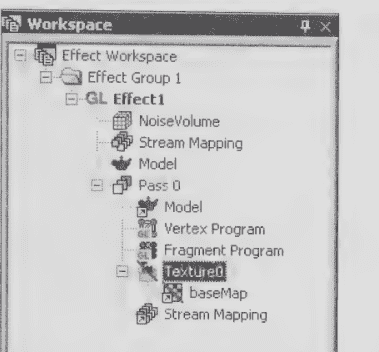

**图 15.12.** 未引用任何纹理的纹理节点

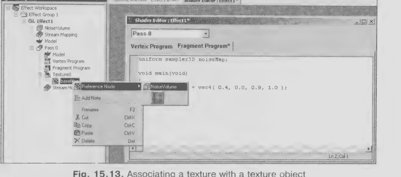

**图 15.13.** 将纹理与纹理对象关联

使用弹出菜单中的 **Rename** 命令，将 **Texture 0** 节点重命名为 **noiseMap**。为了能够从片元着色器访问此纹理，请在其中添加以下行：

```glsl
uniform sampler3D noiseMap;
```

双击 **noiseMap** 节点即可打开包含该纹理属性的对话框（图 15.14）。

点击 **Value** 列中的单元格，为相应的纹理属性选择一个值。

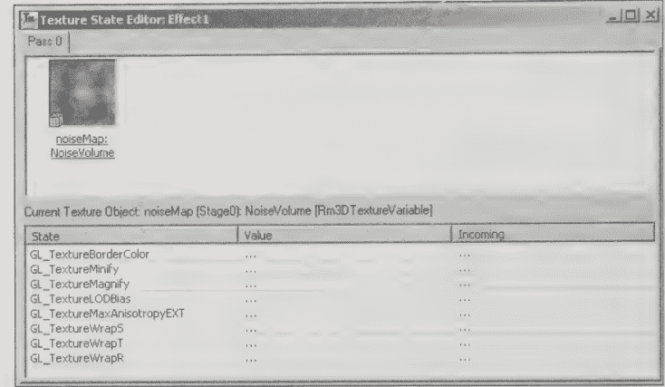

**图 15.14.** 纹理属性

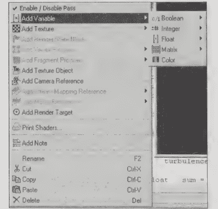

**图 15.15.** 使用 **Add Variable** 命令添加变量

RenderMonkey 允许你添加以下类型的变量（图 15.15）：

- **Boolean**（布尔变量或向量）
- **Integer**（整型变量或向量）
- **Float**（浮点变量或向量）
- **Matrix**（二维、三维或四维矩阵）
- **Color**（颜色变量，即 RGBA 向量）

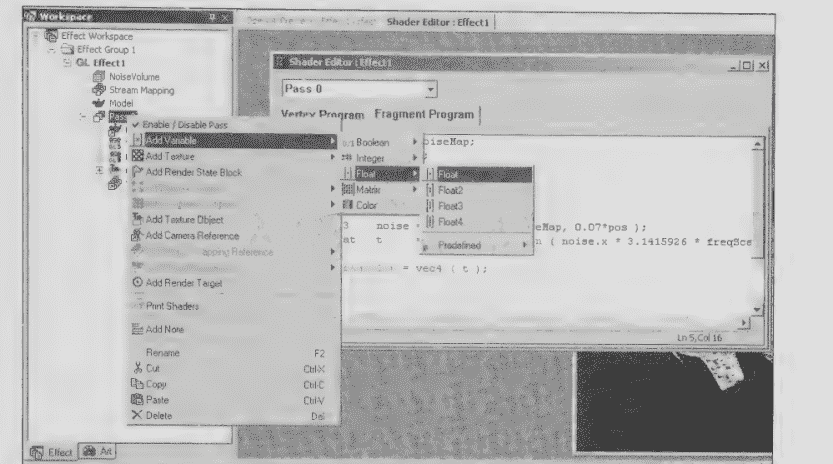

**图 15.16.** 添加浮点变量

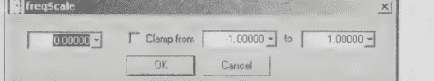

**图 15.17.** 设置浮点变量的值

在 **Pass 0** 通道中添加一个浮点变量`freqScale`。为此，打开该节点的弹出菜单并选择 **Add Variable | Float | Float** 项目（图 15.16）。

使用新添加变量节点的弹出菜单，将变量重命名为`freqScale`（图 15.17），并将其值设置为`4.0`。

然后按照代码清单 15.1 和 15.2 所示编辑着色器代码。

## 代码清单 15.1. 顶点着色器

```glsl
attribute vec3   rm_Binormal;
attribute vec3   rm_Tangent;

varying   vec3   pos;

void main(void)
{
    pos = gl_Vertex.xyz;
    gl_Position = ftransform();
    gl_TexCoord[0] = gl_MultiTexCoord0;
}
```

## 代码清单 15.2. 片元着色器

```glsl
uniform sampler3D noiseMap;
varying vec3 pos;
uniform float freqScale;

void main(void)
{
    vec3 noise = texture3D(noiseMap, 0.07 * pos);
    float t = 0.5 * (1.0 + sin(noise.x * 3.1415926 * freqScale));

    gl_FragColor = vec4(t);
}
```

请注意`freqScale`一致变量（uniform variable）的声明。当着色器执行时，它会自动与 **Pass 0** 通道中的`freqScale`节点关联。

编译此效果后，你将得到一张覆盖着奇异图案的大象图像（图 15.18）。

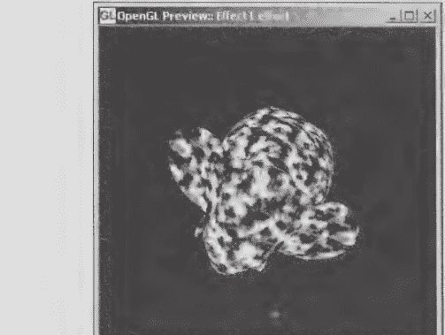

**图 15.18.** 使用代码清单 15.1 和 15.2 的着色器所获得的图像

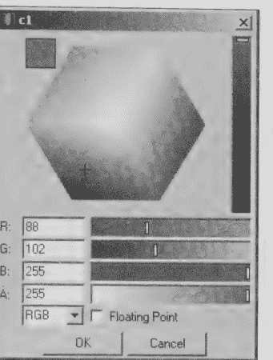

**图 15.19.** 颜色选择窗口

如果你打开`freqScale`变量的值窗口并编辑该值，你将在 **Preview** 窗口中立即看到结果。

为了给大象上色，请使用 **Pass 0** 节点弹出菜单中的 **Add Variable | Color** 命令添加`c1`和`c2`变量。

通过在片元着色器中添加以下行来引入这些变量：

```glsl
uniform vec4 c1;
uniform vec4 c2;
```

将着色器的返回值更改为`mix(c1, c2, t)`以给大象上色。

然而，如果你现在编译项目，大象仍然是黑白的，因为所有新创建的颜色变量都被赋值为`(1, 1, 1, 1)`。

将`c1`变量设置为另一个颜色值。为此，双击`c1`变量节点以打开颜色选择窗口（图 15.19）。

现在你可以编辑`c1`、`c2`和`freqScale`变量的值，以获得理想的视觉效果。

图 15.20 展示了这种尝试的一种可能结果：大象看起来像是用奇异的石头制成的。

尝试让大象身上的条纹变细。最简单的方法是将`t`变量（用于混合颜色）提升到大于 1 的幂次。图 15.21 显示了将该变量立方后的结果。

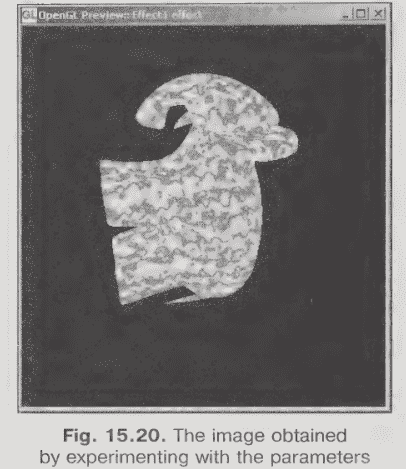

**图 15.20.** 通过实验参数获得的图像

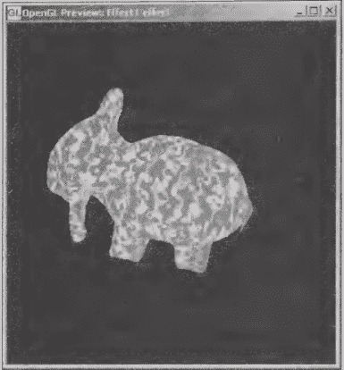

**图 15.21.** 将`t`变量立方后获得的图像

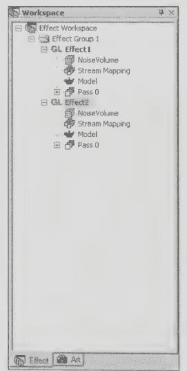

**图 15.22.** 添加新效果

尝试为此图像添加另一个效果。使用复制和粘贴命令在项目中创建 **Effect 1** 效果的副本。副本将自动命名为 **Effect 2**（图 15.22）。


只有一个 **Preview** 窗口，它显示当前激活的效果。你可以通过效果节点的弹出菜单，或通过选中该节点并按下`<F3>`键来激活某个效果。

添加新的浮点变量`redScale`和`redPow`，并编辑片元着色器以在材质中添加红色（代码清单 15.3）。

## 代码清单 15.3. 新版本的片元着色器

```glsl
uniform sampler3D noiseMap;
uniform float freqScale;
uniform float noiseScale;
uniform float redScale;
uniform float redPow;
uniform vec4 c1;
uniform vec4 c2;
varying vec4 pos;

void main(void)
{
    vec3 noise = 0.07 * pos.x + noiseScale * texture3D (noiseMap, 0.07 * pos);
    float t = - 0.5 * (1.0 + sin (noise.x * 3.1415926 * freqScale));
    float t2 = clamp (pow (t * redScale, redPow), 0, 1);

    gl_FragColor = mix (c1, c2, t * t * t) + vec4 (1, 0, 0, 1) * t2;
}
```

如果你编译此着色器，你会注意到材质中出现了红色元素。现在让我们使用 RenderMonkey 的另一个功能——*预定义变量*。RenderMonkey IDE 包含许多变量，例如自启动以来经过的时间间隔及其各种函数、裁剪平面参数等（表 15.1 和 15.2）。

## 表 15.1. RenderMonkey 的预定义时间变量

| 名称 | 值 |
| :--- | :--- |
| `fTime0_X` | 一个浮点值，表示时间周期内的时间（默认时间周期为 120 s） |
| `fCosTime0_X` | `fTime0_X`的余弦值 |
| `fSinTime0_X` | `fTime0_X`的正弦值 |
| `fTanTime0_X` | `fTime0_X`的正切值 |
| `fTime0_X_4f` | 由以下变量组成的四维向量：`fTime0_X`、`fCosTime0_X`、`fSinTime0_X`和`fTanTime0_X` |
| `fTime0_1` | `fTime0_X`变量的归一化值（即缩减到 [0, 1] 区间） |
| `fCosTime0_1` | `fTime0_1`的余弦值 |
| `fSinTime0_1` | `fTime0_1`的正弦值 |
| `fTanTime0_1` | `fTime0_1`的正切值 |
| `fTime0_1_4f` | 由以下变量组成的四维向量：`fTime0_1`、`fCosTime0_1`、`fSinTime0_1`和`fTanTime0_1` |
| `fTime0_2PI` | `fTime0_X`变量缩减到 [0, 2π] 区间的值 |
| `fCosTime0_2PI` | `fTime0_2PI`的余弦值 |
| `fSinTime0_2PI` | `fTime0_2PI`的正弦值 |
| `fTanTime0_2PI` | `fTime0_2PI`的正切值 |
| `fTime0_2PI_4f` | 由以下变量组成的四维向量：`fTime0_2PI`、`fCosTime0_2PI`、`fSinTime0_2PI`和`fTanTime0_2PI` |
| `fTimeCyclePeriod` | 时间周期（默认 120 s） |
| `fFPS` | 帧率（浮点数） |
| `fTimeElapsed` | 相邻帧之间的时间间隔（以秒为单位） |

## 表 15.2. RenderMonkey 的预定义视口变量

| 名称 | 值 |
| :--- | :--- |
| `fViewportWidth` | 视口宽度（像素，浮点变量） |


| `fViewportHeight` | 视口高度（像素，浮点变量） |
| `fInverseViewportWidth` | `1.0 / fViewportWidth` |
| `fInverseViewportHeight` | `1.0 / fViewportHeight` |
| `fFOV` | 相机的视场角 (FOV) |
| `fFarClipPlane` | 到远裁剪平面的距离 |
| `fNearClipPlane` | 到近裁剪平面的距离 |

RenderMonkey 为着色器程序员提供了一组随机值（范围在 [0, 1] 区间），这些值对于每个 pass（渲染通道）和每个 effect（效果）都是唯一的（表 15.3）。预定义浮点变量 `fPassIndex` 包含当前渲染 pass 的索引。表 15.4 列出了与鼠标相关的预定义变量。

### 表 15.3. RenderMonkey 与随机值相关的预定义变量

| 名称 | 数值 |
| :--- | :--- |
| `fRandomFraction1PerPass` | 给定 pass 的第一个随机值 |
| `fRandomFraction2PerPass` | 给定 pass 的第二个随机值 |
| `fRandomFraction3PerPass` | 给定 pass 的第三个随机值 |
| `fRandomFraction4PerPass` | 给定 pass 的第四个随机值 |
| `fRandomFraction1PerEffect` | 给定 effect 的第一个随机值 |
| `fRandomFraction2PerEffect` | 给定 effect 的第二个随机值 |
| `fRandomFraction3PerEffect` | 给定 effect 的第三个随机值 |
| `fRandomFraction4PerEffect` | 给定 effect 的第四个随机值 |

### 表 15.4. RenderMonkey 鼠标相关的预定义变量

| 名称 | 数值 |
| :--- | :--- |
| `fMouseButtonStateLeft` | 一个浮点变量，当单击鼠标左键时取值为 1.0，否则为 0.0 |
| `fMouseButtonStateMiddle` | 一个浮点变量，当单击鼠标中键时取值为 1.0，否则为 0.0 |
| `fMouseButtonStateRight` | 一个浮点变量，当单击鼠标右键时取值为 1.0，否则为 0.0 |
| `fMouseCoordX` | 鼠标指针当前的 x 坐标 |
| `fMouseCoordY` | 鼠标指针当前的 y 坐标 |
| `fMouseCoordX_NDC` | 鼠标指针在 NDC（归一化设备坐标，即透视除法后得到的最终坐标）中的当前 x 坐标 |
| `fMouseCoordY_NDC` | 鼠标指针在 NDC 中的当前 y 坐标 |
| `fMouseButtonState4f` | 由以下变量组成的四维向量：`fMouseButtonStateLeft`、`fMouseButtonStateMiddle` 和 `fMouseButtonStateRight` |
| `fMouseCoords4f` | 由鼠标指针当前坐标组成的四维向量 |
| `fMouseCoordsXY` | 包含鼠标指针当前坐标的二维向量 |
| `fMouseCoordsXY_NDC` | 包含鼠标指针当前坐标（在 NDC 系统中）的二维向量 |

### 表 15.5. RenderMonkey 与视图和模型相关的预定义变量

| 名称 | 数值 |
| :--- | :--- |
| `vViewDirection` | 决定摄像机观察方向的四维向量 |
| `vViewPosition` | 决定摄像机位置的四维向量 |
| `vViewSide` | 决定摄像机侧向方向的四维向量 |
| `vViewUp` | 决定摄像机上方向的四维向量 |
| `vModelBBoxTopLeft` | 包含执行该着色器的模型 AABB（轴对齐包围盒）左上角坐标的三维向量 |
| `vModelBBoxBottomRight` | 包含执行该着色器的模型 AABB 右下角坐标的三维向量 |
| `vModelBBoxCenter` | 包含执行该着色器的模型 AABB 中心坐标的三维向量 |
| `vModelBoundingSphereCenter` | 决定执行该着色器的模型包围球中心的三维向量 |
| `vModelBoundingSphereRadius` | 决定执行该着色器的模型包围球半径的三维向量 |

## 添加预定义变量

除了这些标量和向量变量外，RenderMonkey 还包含一组预定义的 4×4 矩阵变量，可以使用节点弹出菜单中的 `Add Variable | Matrix | Predefined` 命令添加。

在 `Pass 0` 模式的弹出菜单中使用 `Add Variable | Float | Predefined | fTime0_X` 命令，可以添加一个新的时间相关变量（图 15.23）。使用此变量，你可以为材质制作动画，例如，通过交替显示和隐藏红色（代码清单 15.4）。如果你加上之前获得的 `noiseMap` 纹理的值，动画将具有一定的随机性。

### 代码清单 15.4. 动画纹理的片元着色器

```glsl
uniform sampler3D noiseMap;
uniform float freqScale;
uniform float noiseScale;
uniform float redScale;
uniform float redPow;
uniform float fTime0_X;
uniform vec4 c1;
uniform vec4 c2;
varying vec4 pos;

void main()
{
    vec3 noise = 0.07*pos.x + noiseScale*texture3D(noiseMap, 0.07*pos);
    float t = 0.5 * (1.0 + sin(noise.x * 3.1415926 * freqScale));
    float tScale = 1.0 + sin(fTime0_X * 3.1415926 + noise.y - 5.0 * noise.z);
    float t2 = clamp(0.5 * tScale * pow(t * redScale, redPow), 0, 1);

    gl_FragColor = mix(c1, c2, t*t) + vec4(1, 0, 0, 1) * t2;
}
```

RenderMonkey 的另一个便捷功能是通过弹出菜单的 `Add Render State Block` 命令将 OpenGL 渲染状态节点添加到 pass 节点中。渲染状态块负责大量的 OpenGL 状态参数，例如颜色混合、启用和禁用单个缓冲区、指定点大小等。双击 `Render State node` 可打开设置状态参数的窗口（图 15.24）。在该窗口中，你可以通过点击 `Value` 列中相应的单元格来指定渲染状态参数。通过这种方法，你可以为特定的 pass 指定颜色混合模式、记录模式等。

除了常规纹理外，你还可以将可渲染纹理（renderable texture）包含在项目中。这可以通过节点弹出菜单的 `Add Texture | Add Renderable Texture` 命令完成。之后，一个在某个 pass 期间可以作为渲染目标的纹理将出现在当前节点中。在任何 pass 中，你都可以在弹出菜单中选择 `Add Render Target` 命令来重定向该 pass 的渲染结果。这将向 pass 添加一个可渲染纹理节点，以便你可以打开该节点的弹出菜单，选择 `Reference Node` 命令，然后选择一个纹理作为渲染目标。

以在物体周围创建光晕为例，演示渲染到纹理的操作。一种常用的方法是将物体仅使用白色（背景为黑色）渲染到纹理中，然后对生成的图像进行模糊处理。接着，将这张模糊图像应用于以常规方式渲染的物体上。为此项目你需要两个摄像机（图 15.25）。第一个应对应于将模糊图像应用于渲染结果（基于 `ScreenAlignedQuad.3ds` 模型）的 pass。另一个将用于渲染主模型。你还需要两个模型。第一个是 `ScreenAlignedQuad.3ds`，第二个是要进行模糊处理的物体（例如 `Skull.3ds`）。最后，你需要添加一个可渲染纹理（使用弹出菜单中的 `Add Texture | Add Renderable Texture` 命令）。

在第一个 pass 中，添加 `Camera Reference node`（使用 `Add Camera Reference` 命令）并选择主渲染摄像机 (`Camera`)。在同一个 pass 中，添加 `Render Target` 节点并指定之前添加到效果中的可渲染纹理。第二个 pass 与第一个几乎完全相同，但它使用屏幕作为渲染目标（该 pass 缺少 `Render Target` 节点）。最后一个节点将带有物体图像的纹理进行模糊处理，并将其应用于前一个 pass 获得的图像。该节点应使用颜色混合。为了实现这一点，请在最终的 pass 中添加 `Render State Block` 对象。

**图 15.25.** 渲染一个添加了光晕的对象

为了避免编写复杂的模糊程序（这些在第 17 章中涵盖），我建议你使用简单的 mipmap 过滤。如果你将 `texture2D` 函数中的 `bias` 参数设置为大于零的值，图像将从通过模糊主纹理而获得的其中一个 mipmap 层级中读取。这种效果由 Listing 15.5 中的片段着色器实现。

### Listing 15.5. 一个在对象周围创建光晕的片段着色器

```cpp
uniform sampler2D blurMap;

void main(void)
{
    vec2 tex = vec2(1.0, -1.0) * gl_TexCoord[0].xy;
    // 仅保留黑色。
    vec3 clr = texture2D(blurMap, tex).rgb;

    if (all(greaterThan(clr, vec3(0.5))))
        discard;

    gl_FragColor = 1.3 * texture2D(blurMap, tex, 3);
}
```

注意那个丢弃白色像素的条件语句。该着色器的任务是获得光晕，也就是说，渲染由于模糊原始图像而产生的像素，而不是被模糊的对象本身的像素。图 15.26 显示了应用的纹理（即被模糊并用于创建光晕的纹理）。

为了将光晕精确地应用于对象，你可能需要手动设置摄像机（特别是，你可能需要设置用于渲染 `SCREENALIGNEDQUAD.3DS` 模型的摄像机，使其图像占据整个视口）。为此，打开其中一个摄像机的弹出菜单并选择 **Set Active Camera** 使该摄像机处于激活状态，以便编辑其参数。设置好一个摄像机后，使另一个激活并对其进行设置。

所述项目包含在随附 CD-ROM 的 `Code\Chapter-15` 文件夹中。

**图 15.26.** 用于模糊和创建光晕的纹理

**图 15.27.** 模糊后的对象

## 第 16 章：使用主照明模型。折射与衍射建模。在 GLSL 中进行图像后处理

前几章介绍了 GLSL 以及几种照明模型及其在 GLSL 中的实现。本章将介绍从主照明模型到各种特殊效果以及图像后处理的各种着色器。它还将介绍使用这些着色器的 C++ 程序。

### 使用第 13 章中的着色器

第 13 章介绍了最常用的照明模型的顶点着色器和片段着色器。现在让我们来看看如何在 C++ 程序中使用这些着色器来渲染各种对象。为了使用这些着色器，我们将使用第 14 章中描述的 `GlslProgram` 类。Listing 16.1 包含了一个 C++ 程序的源代码，该程序使用 Phong 照明模型渲染一个标准的 GLUT 对象——茶壶（Teapot）。光源在对象周围移动，对象本身可以用鼠标旋转。

### Listing 16.1. 渲染茶壶对象（Phong 照明模型）


```cpp
//
// Example of GLSL Phong shader

#include "libExt.h"
#include <glut.h>
#include <stdio.h>
#include <stdlib.h>
#include "libTexture.h"
#include "Vector3D.h"
#include "Vector2D.h"
#include "Vector4D.h"
#include "Data.h"
#include "GlslProgram.h"

Vector3D eye (7, 5, 7);      // Camera position
Vector3D light (5, 0, 4);    // Light position
float angle = 0;
Vector3D rot (0, 0, 0);
int mouseOldX = 0;
int mouseOldY = 0;

GlslProgram program;

void init ()
{
    glClearColor (0.0, 0.0, 0.0, 1.0);
    glEnable (GL_DEPTH_TEST);
    glDepthFunc (GL_LEQUAL);

    glHint (GL_POLYGON_SMOOTH_HINT, GL_NICEST);
    glHint (GL_PERSPECTIVE_CORRECTION_HINT, GL_NICEST);
}

void display ()
{
    glClear (GL_COLOR_BUFFER_BIT | GL_DEPTH_BUFFER_BIT);

    // Draw the light.
    program.unbind ();

    glMatrixMode (GL_MODELVIEW);
    glPushMatrix ();

    glTranslatef (light.x, light.y, light.z);
    glColor4f (1, 1, 1, 1);
    glutSolidSphere  (0.1f, 15, 15);
    glPopMatrix     ();

    glMatrixMode  (GL_MODELVIEW);
    glPushMatrix   ();

    glRotatef  (rot.x, 1, 0, 0);
    glRotatef  (rot.y, 0, 1, 0);
    glRotatef  (rot.z, 0, 0, 1);

    program.bind  ();
    glutSolidTeapot (2.5);

    program.unbind ();

    glPopMatrix ();
    glutSwapBuffers ();
}

void reshape (int w, int h)
{
    glViewport    (0, 0, (GLsizei)w, (GLsizei)h);
    glMatrixMode  (GL_PROJECTION);
    // Factor all camera ops into
    // projection matrix.
    glLoadIdentity ();
    glPerspective (60.0, (GLfloat)w/(GLfloat)h, 1.0, 60.0);
    gluLookAt     (eye.x, eye.y, eye.z,  // Eye
                   0, 0, 0,              // Center
                   0.0, 0.0, 1.0);      // Up

    glMatrixMode  (GL_MODELVIEW);
    glLoadIdentity ();
}

void motion (int x, int y)
{
    rot.y -= ((mouseOldY - y) * 180.0f) / 200.0f;
    rot.z -= ((mouseOldX - x) * 180.0f) / 200.0f;
    rot.x = 0;

    if (rot.z > 360)
        rot.z -= 360;

    if (rot.z < -360)
        rot.z += 360;

    if (rot.y > 360)
        rot.y -= 360;

    if (rot.y < -360)
        rot.y += 360;

    mouseOldX = x;
    mouseOldY = y;

    glutPostRedisplay();
}

void mouse (int button, int state, int x, int y)
{
    if (state == GLUT_DOWN)
    {
        mouseOldX = x;
        mouseOldY = y;
    }
}

void key (unsigned char key, int x, int y)
{
    if (key == 27 || key == 'q' || key == 'Q')  // Quit requested
        exit(0);
}

void animate ()
{
    angle = 0.004f * glutGet(GLUT_ELAPSED_TIME);

    light.x = 2*cos (angle);
    light.y = 3*sin (1.4 * angle);
    light.z = 3 + 0.5 * sin (angle / 3);

    program.bind();
    program.setUniformVector ("eyePos", Vector4D (eye, 1));
    program.setUniformVector ("lightPos", Vector4D (light, 1));
    program.unbind();

    glutPostRedisplay();
}

int main (int argc, char * argv [])
{
    // Initialize glut.
    glutInit (&argc, argv);
    glutInitDisplayMode (GLUT_DOUBLE | GLUT_RGB | GLUT_DEPTH);
    glutInitWindowSize(500, 500);

    // Create window.
    glutCreateWindow("Example of GLSL Phong shader");

    // Register handlers.
    glutDisplayFunc(display);
    glutReshapeFunc(reshape);
    glutKeyboardFunc(key);
    glutMouseFunc(mouse);
    glutMotionFunc(motion);
    glutIdleFunc(animate);

    init();
    initExtensions();
    printfInfo();

    assertExtensionsSupported(
        "GL_AR_shading_language_100 GL_AR_shader_objects");

    if (!program.loadShaders("phong.vsh", "phong.fsh"))
    {
        printf("Error loading shaders:\n%s\n",
               program.getLog().c_str());

        return 3;
    }

    glutMainLoop();

    return 0;
}
```

如代码清单所示，使用着色器渲染模型所需的所有操作就是加载必要的着色器（使用 `loadShaders` 方法）并根据采样器名称设置纹理单元（使用 `setTextureMethod` 方法）。然后设置光源和观察者的位置（使用 `setUniformVector` 方法）。渲染过程在调用 `bind` 和 `unbind` 函数之间进行。

使用前几章描述的其他着色器进行渲染的方式类似。在本章稍后部分，将展示使用凹凸贴图（bump map）渲染圆环（Torus）对象的一些代码（Listing 16.2）。其他示例的代码包含在随附 CD-ROM 的 `Code\Chapter-16` 文件夹中。

在此清单中，可以使用 `libMesh` 库（在*第 11 章*中介绍），它允许你将所需的对象（在这种情况下是圆环）创建为一组三角形面。每个顶点不仅指定了纹理坐标，还指定了法线、切线向量和副法线（即切线空间的完整基向量）。

`Mesh` 类自动将这些数据写入顶点数组 `VBO`（Vertex Buffer Objects）。这使你能够避免在每次渲染圆环时都重复地将这些数据传输到 GPU。然而，为了使用 Listing 13.5 和 13.6 中的着色器，你应该正确地将数据分配给模型的顶点，例如：

```cpp
torus = makeTorus (1, 30, 30);
torus -> addCoordAssignment (Mesh :: tagVertex, Mesh :: tagVertex);
torus -> addCoordAssignment (Mesh :: tagNormal, Mesh :: tagNormal);
torus -> addCoordAssignment (Mesh :: tagTexCoord, Mesh :: tagTex0);
torus -> addCoordAssignment (Mesh :: tagTangent, Mesh :: tagTex1);
torus -> addCoordAssignment (Mesh :: tagBinormal, Mesh :: tagTex2);
torus -> createBuffers ();
```

有了这些设置和纹理单元的分配，渲染圆环的过程与之前的示例类似。

### Listing 16.2. 使用凹凸贴图渲染圆环的 C++ 代码

```cpp
//
// Sample showing how to use bump mapping in GLSL programs
//
#include "libExt.h"
#include <glut.h>
#include <stdio.h>
#include <stdlib.h>
#include "libTexture.h"
#include "Vector3D.h"
#include "Vector2D.h"
#include "Vector4D.h"
#include "Data.h"
#include "GlslProgram.h"
#include "Mesh.h"
#include "MeshUtils.h"

Vector3D eye (7, 5, 7);    // Camera position
Vector3D light (5, 0, 4);  // Light position
float angle = 0;
Vector3D rot (0, 0, 0);
int mouseOldX = 0;
int mouseOldY = 0;
unsigned diffuseMap;
unsigned bumpMap;
```


```cpp
Mesh    * torus;
GlslProgram program;

void init()
{
    glClearColor (0.0, 0.0, 0.0, 1.0);
    glEnable     (GL_DEPTH_TEST);
    glDepthFunc  (GL_LEQUAL);

    glHint (GL_POLYGON_SMOOTH_HINT,  GL_NICEST);
    glHint (GL_PERSPECTIVE_CORRECTION_HINT, GL_NICEST);
}

void display()
{
    glClear (GL_COLOR_BUFFER_BIT | GL_DEPTH_BUFFER_BIT);

    // Draw the light.
    program.unbind();

    glMatrixMode (GL_MODELVIEW);
    glPushMatrix ();

    glTranslatef    (light.x, light.y, light.z);
    glColor4f       (1, 1, 1, 1);
    glutSolidSphere (0.1f, 15, 15);
    glPopMatrix     ();

    glMatrixMode (GL_MODELVIEW);
    glPushMatrix ();

    glRotatef    (rot.x, 1, 0, 0);
    glRotatef    (rot.y, 0, 1, 0);
    glRotatef    (rot.z, 0, 0, 1);

    glActiveTextureARB (GL_TEXTURE0_ARB);
    glBindTexture      (GL_TEXTURE_2D, bumpMap);

    glActiveTextureARB (GL_TEXTURE1_ARB);
    glBindTexture      (GL_TEXTURE_2D, diffuseMap);

    program.bind    ();
    torus -> render ();

    program.unbind();

    glPopMatrix();

    glutSwapBuffers();
}

void reshape(int w, int h)
{
    glViewport(0, 0, (GLsizei)w, (GLsizei)h);
    glMatrixMode(GL_PROJECTION);
    // Factor all camera ops into
    // projection matrix.
    glLoadIdentity();
    gluPerspective(60.0, (GLfloat)w/(GLfloat)h, 1.0, 60.0);
    gluLookAt(eye.x, eye.y, eye.z, // Eye
               0, 0, 0,           // Center
               0.0, 0.0, 1.0);    // Up

    glMatrixMode(GL_MODELVIEW);
    glLoadIdentity();
}

void motion(int x, int y)
{
    rot.y -= ((mouseOldY - y) * 180.0f) / 200.0f;
    rot.z -= ((mouseOldX - x) * 180.0f) / 200.0f;
    rot.x = 0;

    if (rot.z > 360)
        rot.z -= 360;

    if (rot.z < -360)
        rot.z += 360;

    if (rot.y > 360)
        rot.y -= 360;

    if (rot.y < -360)
        rot.y += 360;

    mouseOldX = x;
    mouseOldY = y;

    glutPostRedisplay();
}

void mouse (int button, int state, int x, int y)
{
    if (state == GLUT_DOWN)
    {
        mouseOldX = x;
        mouseOldY = y;
    }
}

void key (unsigned char key, int x, int y)
{
    if (key == 27 || key == 'q' || key == 'Q') // Quit requested
        exit(0);
}

void animate ()
{
    angle = 0.004f * glutGet(GLUT_ELAPSED_TIME);

    light.x = 2*cos(angle);
    light.y = 2*sin(angle);
    light.z = 3 + 0.3 * sin(angle / 3);

    program.bind();
    program.setUniformVector("eyePos", Vector4D(eye, 1));
    program.setUniformVector("lightPos", Vector4D(light, 1));
    program.unbind();

    glutPostRedisplay();
}

int main (int argc, char * argv [])
{
    // Initialize glut.
    glutInit(&argc, argv);
    glutInitDisplayMode(GLUT_DOUBLE | GLUT_RGB | GLUT_DEPTH);
    glutInitWindowSize(500, 500);

    // Create window.
    glutCreateWindow(
        "More complex example of GLSL specular perpixel shader");

    // Register handlers.
    glutDisplayFunc(display);
    glutReshapeFunc(reshape);
    glutKeyboardFunc (key);
    glutMouseFunc (mouse);
    glutMotionFunc (motion);
    glutIdleFunc (animate);

    init ();
    initExtensions ();

    assertExtensionsSupported ("GL_ARB_shading_language_100 GL_ARB_shader_objects");

    if (!program.loadShaders ("bump.vsh", "bump.fsh"))
    {
        printf ("Error loading shaders:\n%s\n",
                program.getLog ().c_str ());

        return 3;
    }

    diffuseMap = createTexture2D (true, "../Textures/oak.bmp");
    bumpMap = createTexture2D (false,
                                "../Textures/Bumpmaps/normal2.bmp");

    // Install program object as part of
    // current state.
    program.bind ();
    program.setTexture ("bumpMap", 0);
    program.setTexture ("diffuseMap", 1);

    torus = makeTorus (1, 3, 30, 30);
    torus -> addCoordAssignment (Mesh :: tagVertex,
                                  Mesh :: tagVertex);
    torus -> addCoordAssignment (Mesh :: tagNormal,
                                  Mesh :: tagNormal);
    torus -> addCoordAssignment (Mesh :: tagTexCoord,
                                  Mesh :: tagTex0);
    torus -> addCoordAssignment (Mesh :: tagTangent,
                                  Mesh :: tagTex1);
    torus -> addCoordAssignment (Mesh :: tagBinormal,
                                  Mesh :: tagTex2);
    torus -> createBuffers ();

    glutMainLoop ();

    return 0;
}
```

# 使用着色器进行动画

在之前的示例中，着色器被用于计算物体表面的光照，而没有改变物体的几何形状。然而，利用顶点着色器，你可以对物体进行动画处理，也就是说，在渲染期间（具体是在 T&L（变换与光照）阶段）改变它们的几何形状。

最简单的例子是使用着色器来驱动*粒子系统*的动画。假设有一个粒子源以恒定速率产生粒子，随后粒子在重力作用下下落。每个粒子可以用初始位置、速度和诞生时间来描述。那么它在任何时间 $t$ 的位置可以通过以下公式计算：

$$p(t) = p_0 + v_0 \cdot (t - t_0) + 0.5 \ a \cdot (t - t_0)^2 \eqno(16.1)$$

这里 $p_0, v_0$ 和 $t_0$ 参数分别代表粒子的初始位置、速度和诞生时间。$a$ 参数代表重力向量 $(0, 0, -g)$。

如果你将每个粒子与其 $(p_0, v_0, t_0)$ 集合关联起来，你就能使用顶点着色器计算粒子的当前位置：只需将粒子的初始参数和当前时间传递给着色器即可。由于每个粒子的 $(p_0, v_0, t_0)$ 参数不随时间改变，你不需要任何资源来向 GPU 传输数据。此外，CPU 不需要计算粒子的当前位置，因为这由着色器程序负责。

结果是，你既节省了数据传输量，又节省了 CPU 的工作时间。

代码清单 16.3 包含一个利用初始参数驱动粒子动画的顶点着色器。$v_0$ 和 $t_0$ 值是通过第一个纹理单元的纹理坐标（一个四维向量）传递的。

## 代码清单 16.3. 一个驱动粒子系统动画的简单顶点着色器

```glsl
uniform float time;
varying vec4 color;

void main(void)
{
    vec3 vel = 3*gl_MultiTexCoord1.xyz;
    vec3 pos = gl_Vertex.xyz;
    float phase = gl_MultiTexCoord1.w;
    float t = time - phase;

    // Now compute new position using t and org.
    vec3 org = pos + t*vel - 0.5*t*t*vec3(0.0, 0.0, 1.0);

    gl_Position = gl_ModelViewProjectionMatrix * vec4(org, 1.0);
    gl_TexCoord[0] = gl_MultiTexCoord0;
}
```

这个方案可以进一步简化。目前，CPU 必须创建新粒子并销毁那些寿命到期的粒子。顶点着色器无法创建新顶点或销毁现有顶点（即不能改变物体的拓扑结构），但你并不需要这样做。

假设所有粒子的寿命都相同且等于 $T$。此外，假设一旦一个旧粒子被销毁，就会立即创建一个新粒子，也就是说，诞生时间是 $T$ 的倍数。

最后，如果你假设新粒子的初始位置和速度与被销毁的粒子相同，那么创建新粒子（以及销毁旧粒子）就变成了在诞生时间上增加 $T$ 的问题。

因此，在你创建一次粒子属性后，就不需要再对其进行修改。要计算粒子的当前位置，请使用以下公式：

$$p(t) = p_0 + v_0 \cdot \text{mod}(t - t_0, T) + 0.5 \, a \cdot \text{mod}(t - t_0, T)^2 \eqno(16.2)$$


**注意** $\text{mod}(t, T)$ 函数返回 $t$ 除以 $T$ 的余数。

现在 CPU 的任务简化为：创建一组粒子的初始参数，将它们写入顶点数组，并在每一帧中将其绘制出来，通过一个`uniform`变量传递当前时间。

代码清单 16.4 展示了所需顶点着色器的实现。

## 代码清单 16.4. 驱动粒子系统动画的顶点着色器

```glsl
//
// Simple particle system vertex shader

uniform float time;
varying vec4 color;

void main(void)
{
    vec3 vel = 3*gl_MultiTexCoord1.xyz;
    vec3 pos = gl_Vertex.xyz;
    float phase = gl_MultiTexCoord1.w;
    float t = mod (time + phase, 4.0);

    // Now compute new position using t and org.
    vec3 org = pos + t*vel - 0.5*t*t*vec3(0.0, 0.0, 1.0);
}
```

```cpp
color = mix (vec4 (1.0, 0.0, 0.0, 1.0),
               vec4 (0.3, 0.3, 0.0, 1.0), t * 0.25);
gl_Position = gl_ModelViewProjectionMatrix * vec4 (org, 1.0);
gl_TexCoord[0] = gl_MultiTexCoord0;
}
```

如果您希望使用`ARB_point_sprite`扩展，则必须编辑片段着色器，以便其能够使用纹理正确地绘制粒子（代码清单 16.5）。

## 代码清单 16.5. 绘制动画粒子系统的片段着色器

```cpp
//
// Simple particle system fragment shader
//

varying vec4 color;
uniform sampler2D decalMap;

void main (void)
{
    gl_FragColor = color * texture2D (decalMap, gl_TexCoord [0].xy);
}
```

所需的 C++ 代码包含在代码清单 16.6 中。请注意，虽然可以将数据写入顶点数组或显示列表，但本示例中并未这样做。

## 代码清单 16.6. 使用 GPU 实现粒子系统动画的 C++ 程序


## 折射建模

一种可以使用着色器轻松建模的精美且简单的效果，涉及到考虑折射的透明对象渲染。在最简单的情况下，使用*立方体环境映射（cubic environment map）*。对于透明对象表面的任意一点，相对于法线`n`和指向观察者的单位向量`v`存在一个反射向量`r`和一个折射向量`t`（图 16.1）。

这些向量（`r`和`t`）可用于访问立方体环境映射，然后通过混合得到的颜色来获得最终颜色。当然，这是一个非常粗略的模型，但在许多情况下能产生合适的结果（图 16.2）。


为了正确混合反射颜色和折射颜色（`C_refl`和`C_refr`），您应该使用菲涅耳系数（Fresnel coefficient）。该系数`F(θ, λ)`取决于入射角`θ`和波长`λ`，并决定了反射光能的比例。因此，`1 - F(θ, λ)`的值决定了折射光能的比例。因此，该系数是混合反射颜色和折射颜色的参数。

遗憾的是，菲涅耳系数对波长和入射角的依赖关系非常复杂。这就是为什么在实践中会使用各种近似计算方法。以下是一些常用的公式：

`F = clamp(0.1, 0.9, cosθ),` (16.3)

`F = r0 + (1 - r0) * (1 - cosθ)^5,` (16.4)

`F = 1 / (1 + cosθ)^8.` (16.5)

关于公式 (16.3) 中`clamp`函数的描述，请参阅表 12.12。

在公式 (16.4) 中，参数`r0`代表`((1-η)/(1+η))^2`的值，其中`η`是两种环境之间的相对折射率。

利用公式 (16.3) 和计算反射与折射向量的标准函数，可以轻松编写以下着色器（代码清单 16.7 和 16.8）。

## 代码清单 16.7. 渲染折射玻璃茶壶的顶点着色器

```cpp
//
// Refractive glass vertex shader
//
uniform vec4 eyePos;
uniform mat4 cubeMapMatrix;

varying vec3 n;
varying vec3 e;

void main(void)
{
    vec4 pos = gl_ModelViewMatrix * gl_Vertex;

    gl_Position = gl_ModelViewProjectionMatrix * gl_Vertex;
    n = normalize(gl_NormalMatrix * gl_Normal *
                  mat3(cubeMapMatrix));
    e = normalize((pos - eyePos)*cubeMapMatrix).xyz);
}
```

## 代码清单 16.8. 渲染折射玻璃茶壶的片段着色器

```cpp
//
// Refractive glass fragment shader
//

uniform samplerCUBE envMap;

varying vec3 n;
varying vec3 e;

void main (void)
{
    const float eta = 0.9;

    // Compute reflection vector.
    vec3 en = normalize(e);
    vec3 nn = normalize(n);
    vec3 r = reflect (en, nn);

    // Do a lookup into the environment map.
    vec3 envColor = textureCube (envMap, r).rgb;

    // Calc Fresnels term.
    float fresnel = abs (dot (en, nn));

    fresnel = clamp (fresnel, 0.1, 0.9);

    // Calc refraction (transmitted ray).
    vec3 t = refract (en, nn, eta);

    vec3 refractionColor = textureCube (envMap, t).rgb;

    envColor = mix (envColor, refractionColor, fresnel);

    gl_FragColor = vec4 (envColor, 1.0);
}
```

虽然这种方法可以让您获得令人愉悦的图像（如图 16.2 所示），但它有一个缺陷。光折射通常会产生类似彩虹的现象，即光线根据其分量的波长而分离开来。这是因为菲涅耳系数具有波长依赖性。

建模此类效果的一种简单方法是分别计算折射颜色的 R、G 和 B 分量。对于其中的每一个分量，确定一个单独的折射率并计算一个单独的折射向量。后者用于从立方体环境映射中获取适当的颜色。为了获得最终的折射颜色，从三种折射颜色中各取一个分量。它们共同组成了所寻求的颜色。

为了实现这个效果，你不需要编辑顶点着色器。这就是为什么这里只给出片元着色器（代码清单 16.9）的原因。

### 代码清单 16.9. 用于渲染带颜色分拆折射的片元着色器

```cpp
//
// Sample showing how to use GLSL programs to create particle systems
//

#include "libExt.h"
#include <glut.h>
#include <stdio.h>
#include <stdlib.h>

#include "libTexture.h"
#include "Vector3D.h"
#include "Vector2D.h"
#include "Vector4D.h"
#include "GlslProgram.h"

#define NUM_PARTICLES 5000 // Total number of particles

Vector3D eye (7, 5, 7);    // Camera position
float angle = 0;
Vector3D rot (0, 0, 0);
int mouseOldX = 0;
int mouseOldY = 0;
unsigned decalMap;

Vector4D partAttr[NUM_PARTICLES]; // Particle attributes
                                  // (initial xyz and phase)

GlslProgram program;

void init ()
{
    glClearColor (0.0, 0.0, 0.0, 1.0);
    glEnable (GL_DEPTH_TEST);
    glDepthFunc (GL_LEQUAL);

    glHint (GL_POLYGON_SMOOTH_HINT, GL_NICEST);
    glHint (GL_PERSPECTIVE_CORRECTION_HINT, GL_NICEST);
}

void display ()
{
    glClear (GL_COLOR_BUFFER_BIT | GL_DEPTH_BUFFER_BIT);

    glPushAttrib (GL_ENABLE_BIT | GL_POINT_BIT | GL_COLOR_BUFFER_BIT
                 | GL_DEPTH_BUFFER_BIT);

    glMatrixMode (GL_MODELVIEW);
    glPushMatrix ();

    glRotatef (rot.x, 1, 0, 0);
    glRotatef (rot.y, 0, 1, 0);
    glRotatef (rot.z, 0, 0, 1);

    glActiveTextureARB (GL_TEXTURE0_ARB);
    glBindTexture (GL_TEXTURE_2D, decalMap);

    glDepthMask (GL_FALSE);
    glEnable (GL_BLEND);
    glBlendFunc (GL_ONE, GL_ONE);
    glPointSize (5);

    float quadratic [] = { 1.0f, 0.0f, 0.01f };

    glEnable (GL_POINT_SPRITE_ARB);
    glPointParameterfvARB (GL_POINT_DISTANCE_ATTENUATION_ARB,
                           quadratic);
    glPointParameterfARB (GL_POINT_FADE_THRESHOLD_SIZE_ARB, 20.0f);

    glTexEnvf (GL_POINT_SPRITE_ARB, GL_COORD_REPLACE_ARB, GL_TRUE);

    program.bind ();

    glBegin (GL_POINTS);

    for (int i = 0; i < NUM_PARTICLES; i++)
    {
        glMultiTexCoord4fv (GL_TEXTURE1_ARB, partAttr [i]);
        glVertex3fv (partAttr [i]);
    }

    glEnd ();

    program.unbind ();

    glPopAttrib ();

    glPopMatrix ();

    glutSwapBuffers ();
}

void reshape (int w, int h)
{
    glViewport (0, 0, (GLsizei)w, (GLsizei)h);
    glMatrixMode (GL_PROJECTION);
    // Factor all camera ops into
    // projection matrix.
    glLoadIdentity ();
    gluPerspective (60.0, (GLfloat)w/(GLfloat)h, 1.0, 60.0);
    gluLookAt (eye.x, eye.y, eye.z, // Eye
               0, 0, 0,           // Center
               0.0, 0.0, 1.0);   // Up

    glMatrixMode (GL_MODELVIEW);
    glLoadIdentity ();
}

void motion (int x, int y)
{
    rot.y -= ((mouseOldY - y) * 180.0f) / 200.0f;
    rot.z -= ((mouseOldX - x) * 180.0f) / 200.0f;
    rot.x = 0;

    if (rot.z > 360)
        rot.z -= 360;

    if (rot.z < -360)
        rot.z += 360;

    if (rot.y > 360)
        rot.y -= 360;

    if (rot.y < -360)
        rot.y += 360;

    mouseOldX = x;
    mouseOldY = y;

    glutPostRedisplay();
}

void mouse (int button, int state, int x, int y)
{
    if (state == GLUT_DOWN)
    {
        mouseOldX = x;
        mouseOldY = y;
    }
}

void key (unsigned char key, int x, int y)
{
    if (key == 27 || key == 'q' || key == 'Q') // Quit requested
        exit(0);
}

void animate ()
{
    float time = 0.001f * glutGet(GLUT_ELAPSED_TIME);

    program.bind ();
    program.setUniformFloat("time", time);
    program.unbind();

    glutPostRedisplay();
}

int main (int argc, char * argv [])
{
    // Initialize glut.
    glutInit (&argc, argv);
    glutInitDisplayMode(GLUT_DOUBLE | GLUT_RGB | GLUT_DEPTH);
    glutInitWindowSize(500, 500);

    // Create window.
    glutCreateWindow("Particle animation via GLSL shader");

    // Register handlers.
    glutDisplayFunc(display);
    glutReshapeFunc(reshape);
    glutKeyboardFunc(key);
    glutMouseFunc(mouse);
    glutMotionFunc(motion);
    glutIdleFunc(animate);

    init();
    initExtensions();

    assertExtensionsSupported(
        "GL_AR_shading_language_100 GL_AR_shader_objects");

    if (!program.loadShaders("particles.vsh", "particles.fsh"))
    {
        printf("Error loading shaders:\n%s\n",
               program.getLog().c_str());

        return 3;
    }

    decalMap = createTexture2D(true, "../Textures/Fire.bmp");

    // Initialize particles.
    for (int i = 0; i < NUM_PARTICLES; i++)
    {
        Vector3D xyz = Vector3D::getRandomVector(0.5);
        float phase = 5 * (float)rand() / (float)RAND_MAX;

        partAttr[i] = Vector4D(xyz, phase);
    }

    program.bind();
    program.setTexture("decalMap", 0);
    program.unbind();

    glutMainLoop();

    return 0;
}
```


```glsl
//
// Refractive glass-2 fragment shader
//

uniform samplerCUBE envMap;
varying vec3 n;
varying vec3 e;

void main (void)
{
    const vec3 eta = vec3(0.9, 0.94, 0.97);

    // Compute reflection vector.
    vec3 en = normalize(e);
    vec3 nn = normalize(n);
    vec3 r = reflect (en, nn);

    // Do a lookup into the environment map.
    vec3 envColor = textureCube(envMap, r).rgb;

    // Calc Fresnels term.
    float fresnel = abs (dot (en, nn));

    fresnel = clamp (fresnel, 0.1, 0.9);

    // Calc refraction (transmitted ray) for
    // every component.
    vec3 tRed = refract (en, nn, eta.r);
    vec3 tGreen = refract (en, nn, eta.g);
    vec3 tBlue = refract (en, nn, eta.b);

    vec3 refractionColorRed = textureCube (envMap, tRed ).rgb;
    vec3 refractionColorGreen = textureCube (envMap, tGreen).rgb;
    vec3 refractionColorBlue = textureCube (envMap, tBlue).rgb;
    vec3 refractionColor = vec3 (refractionColorRed.r,
                                 refractionColorGreen.g,
                                 refractionColorBlue.b);

    envColor = mix (envColor, refractionColor, fresnel);

    gl_FragColor = vec4 (envColor, 1.0);
}
```

## 模拟光衍射

如果你在童年时期玩过肥皂泡，你会记得它们具有多么美丽的虹彩色。CD 的表面同样具有虹彩色。这种发光效果是由光的波动特性，或者更准确地说，是由两束光波的干涉引起的。

让我们首先考虑肥皂泡的例子。设`d`为其薄膜的厚度（图 16.3）。

当光线落在薄膜上时，它会分别从薄膜的外表面（`r'`向量）和内表面（`r`向量）反射。从内表面反射的光波与从外表面反射的光波发生干涉。如果薄膜的厚度与典型的波长相对应，根据波的相位差，可能会发生波的相互增强或抵消。如果光波经过的距离是波长的整数倍，波会相互增强；否则，它们会相互抵消。

白光束由各种波长的光波组成，它们根据各自的波长而相互增强或抵消。

在这种情况下，决定性因素是干涉光波所经过的距离之差。从图 16.3 可以看出，这个差值等于`2 · d / cos θ`，其中`θ`表示入射角（即`cos θ = (n, v)`）。

该值可以为每个顶点计算并为整个面进行插值。之后，它将决定被增强的主色。与其在着色器中计算这个值，你可以提前计算好并将其保存在一个一维纹理中。

这种方法借鉴了 NVIDIA SDK 中的一个示例。不过，这里使用一个 Python 脚本计算辅助纹理，该脚本包含在随附 CD-ROM 的`CODE\SCRIPTS`文件夹中。来自该纹理的颜色用于调制来自立方体环境映射的反射颜色。该方法的实现见代码清单 16.10 至 16.12。


**图 16.3.** 薄膜反射

### 代码清单 16.10. 用于渲染肥皂泡对象的顶点着色器

```glsl
//
// Soap bubble vertex shader
//

uniform vec4 eyePos;
uniform vec3 r0;    // Components for R, G and B

varying float viewDepth;
varying vec3 pos;
varying vec3 v;
varying vec3 r;
varying vec3 fresnel;

void main()
{
    const float filmDepth = 0.1;
    const vec3 one = vec3(1.0);

    gl_Position = ttransform();

    // Transformed point to world space
    vec3 p = vec3(glModelViewMatrix * gl_Vertex);

    // Transform normal from model-space
    // to view-space.
    vec3 n = normalize(glNormalMatrix * gl_Normal);

    v = normalize(eyePos.xyz - p);
    r = reflect(v, n);
    viewDepth = filmDepth / dot(n, v);
    pos = gl_Vertex.xyz;

    // Compute approximation to Fresnel.
    fresnel = r0 + (one - r0) * pow(1.0 - abs(dot(n, v)), 5.0);
}
```

### 代码清单 16.11. 用于渲染肥皂泡对象的片元着色器

```glsl
//
// Soap bubble fragment shader
//

uniform sampler1D fringeMap;
uniform samplerCube reflectionMap;
uniform float time;
varying float viewDepth;
varying vec3 pos;
varying vec3 v;
varying vec3 r;
varying vec3 fresnel;

void main()
{
    float depthScale = 0.4;

    // Lookup fringe value based on view depth.
    vec3 fringeColor = texture1D(fringeMap, viewDepth.x*depthScale).rgb;

    // Lookup reflection in cube map.
    vec3 reflColor = textureCube(reflectionMap, r).rgb;

    // Modulate reflection by fringe color.
    gl_FragColor = vec4(reflColor * fringeColor, 0.4);
}
```

### 代码清单 16.12. 用于渲染肥皂泡的 C++ 代码

```cpp
#include "libExt.h"
#include <glut.h>
#include <stdio.h>
#include <stdlib.h>
#include "libTexture.h"
#include "TypeDefs.h"
#include "Vector3D.h"
#include "Vector2D.h"
#include "boxes.h"
#include "PBuffer.h"
#include "GlslProgram.h"

Vector3D eye (-0.5, -0.5, 1.5); // Camera position
unsigned decalMap;               // Decal (diffuse) texture
unsigned stoneMap;
unsigned teapotMap;
unsigned fringeMap;
unsigned reflectionMap;
float angle = 0;
float rot = 0;
Vector3D eta (1.05, 1.1, 1.15);
Vector3D r0;
bool useFilter = true;
bool useRotation = true;

GlslProgram program;

void init()
{
    glClearColor(0.0, 0.0, 0.0, 1.0);
    glEnable(GL_DEPTH_TEST);
    glEnable(GL_TEXTURE_2D);
    glDepthFunc(GL_LEQUAL);

    glHint(GL_POLYGON_SMOOTH_HINT, GL_NICEST);
    glHint(GL_PERSPECTIVE_CORRECTION_HINT, GL_NICEST);
}

void displayBoxes()
{
    glMatrixMode(GL_MODELVIEW);
    glPushMatrix();

    glActiveTextureARB(GL_TEXTURE0_ARB);
    glEnable(GL_TEXTURE_2D);
    glDisable(GL_TEXTURE_CUBE_MAP);

    glRotatef(rot, 0, 0, 1);
    drawBox(Vector3D(-5, -5, 0), Vector3D(10, 10, 3),
            stoneMap, false);
    drawBox(Vector3D(3, 2, 0.5), Vector3D(1, 2, 2),
            decalMap);

    glActiveTextureARB(GL_TEXTURE1_ARB);
    glBindTexture(GL_TEXTURE_1D, fringeMap);
    glActiveTextureARB(GL_TEXTURE2_ARB);
    glBindTexture(GL_TEXTURE_CUBE_MAP, reflectionMap);
    glActiveTextureARB(GL_TEXTURE0_ARB);

    glEnable(GL_BLEND);
    glBlendFunc(GL_SRC_ALPHA, GL_ONE);

    if(useFilter)
        program.bind();

    glBindTexture(GL_TEXTURE_2D, teapotMap);
    glPushMatrix();
    glTranslatef(0.2, 1, 1.5);
    glRotatef(angle * 45.3, 1, 0, 0);
    glRotatef(angle * 57.2, 0, 1, 0);

    glutSolidTeapot(0.3);

    glPopMatrix();
    glPushMatrix();
    glTranslatef(2.7, 2, 0.5);

    glutSolidSphere(0.5, 20, 20);

    glPopMatrix();

    if (useFilter)
        program.unbind();

    glDisable(GL_BLEND);

    glActiveTextureARB(GL_TEXTURE1_ARB);
    glBindTexture(GL_TEXTURE_3D, 0);
    glActiveTextureARB(GL_TEXTURE2_ARB);
    glBindTexture(GL_TEXTURE_1D, 0);
    glActiveTextureARB(GL_TEXTURE3_ARB);
    glBindTexture(GL_TEXTURE_CUBE_MAP, 0);
    glPopMatrix();
}

void display()
{
    glClear(GL_COLOR_BUFFER_BIT | GL_DEPTH_BUFFER_BIT);
    displayBoxes();
    glutSwapBuffers();
}

void reshape(int w, int h)
{
    glViewport(0, 0, (GLsizei)w, (GLsizei)h);
    glMatrixMode(GL_PROJECTION);
    glLoadIdentity();
    gluPerspective(60.0, (GLfloat)w / (GLfloat)h, 1.0, 60.0);
    glMatrixMode(GL_MODELVIEW);
    glLoadIdentity();
    gluLookAt(eye.x, eye.y, eye.z,  // Eye
              3, 3, 1,              // Center
              0, 0, 1);             // Up
}

void key(unsigned char key, int x, int y)
```


```cpp
{
    if (key == 27 || key == 'q' || key == 'Q') // Quit requested
        exit(0);

    if (key == ' ') 
        useRotation = !useRotation;
}

void specialKey (int key, int x, int y)
{
    if (key == GLUT_KEY_RIGHT)
        rot += 5;
    else
        if (key == GLUT_KEY_LEFT)
            rot -= 5;

    glutPostRedisplay();
}

void animate ()
{
    static float lastTime = 0.0;
    float time = 0.001f * glutGet(GLUT_ELAPSED_TIME);

    if (useRotation)
        angle += 2 * (time - lastTime);

    lastTime = time;

    program.bind();
    program.setUniformVector("eyePos", eye);
    program.setUniformVector("r0", r0);
    program.setUniformFloat("time", time);
    program.unbind();

    glutPostRedisplay();
}

int main (int argc, char * argv[])
{
    // Initialize glut.
    glutInit (argc, argv);
    glutInitDisplayMode (GLUT_DOUBLE | GLUT_RGB | GLUT_DEPTH);
    glutInitWindowSize (512, 512);

    // Create window.
    glutCreateWindow("OpenGL soap bubbles");

    // Register handlers.
    glutDisplayFunc (display);
    glutReshapeFunc (reshape);
    glutKeyboardFunc (key);
    glutSpecialFunc (specialKey);
    glutIdleFunc (animate);

    init ();
    initExtensions ();

    if (!GlslProgram :: isSupported ())
    {
        printf ("GLSL not supported.\n");

        return 1;
    }

    if (!program.loadShaders ("bubble.vsh", "bubble.fsh"))
    {
        printf ("Error loading shaders:\n%s\n",
                program.getLog ().c_str ());

        return 3;
    }

    const char * faces [6] =
    {
        "../../Textures/Cubemaps/cm left.tga",
        "../../Textures/Cubemaps/cm right.tga",
        "../../Textures/Cubemaps/cm top.tga",
        "../../Textures/Cubemaps/cm bottom.tga",
        "../../Textures/Cubemaps/cm back.tga",
        "../../Textures/Cubemaps/cm front.tga",
    };

    reflectionMap = createCubeMap (true, faces);
    fringeMap = createTexture1D (true, "fringe.png");
    decalMap = createTexture2D (true, "../../Textures/oak.bmp");
    stoneMap = createTexture2D (true, "../../Textures/block.bmp");
    teapotMap = createTexture2D (true, "../../Textures/Oxidated.jpg");

    program.bind ();
    program.setTexture ("fringeMap", 1);
    program.setTexture ("reflectionMap", 2);
    program.unbind ();

    r0.x = (1 - eta.x)/(1 + eta.x);
    r0.y = (1 - eta.y)/(1 + eta.y);
    r0.z = (1 - eta.z)/(1 + eta.z);
    r0 *= r0;

    printf("Space toggles rotation on/offs\n");

    glutMainLoop ();

    return 0;
}
```

在渲染肥皂泡时，模拟了反射波的干涉，即入射角等于反射角。然而，这种方法不适用于渲染 CD 的表面。在这种情况下，需要模拟光源对表面的照明，因此，法线与观察者方向之间的夹角可能与法线与光源方向之间的夹角不同。此外，从 CD 表面相邻轨道反射的光波会相互干涉（图 16.4）。

如果相邻轨道之间的距离等于`d`，则从这些轨道反射的光线所经过的距离等于`AC - BC`。

令`θ₁`和`θ₂`分别表示法线与观察者方向之间的夹角，以及法线与光源方向之间的夹角。那么这个差值可以近似地表示为`d · u`，其中`u = sinθ₁ - sinθ₂`。

对于波长为`λ`的光，当`nλ · d = nλ`时将发生增强（`n`为任意自然数，即当`nλ · d`是`λ`的倍数时）。基于人眼只能感知波长从 0.1 微米到 1 微米的光这一事实，你可以限制`n`的可能取值范围。尽管不确定性较大，但将范围限制在前几个自然数内会比较方便。对于每个`n`，将使用`d · nλ / n`的值从一维纹理中检索出与被增强波长相对应的颜色。这些颜色将被累加。


**图 16.4.** CD 表面的衍射

在渲染 CD 表面的照明时，最适合使用的是针对各向异性表面的标准照明模型之一，例如 Ward 模型。代码清单 16.13 和 16.14 包含了所需的顶点着色器和片元着色器。

> 注意，片元着色器将 CD 绘制为一个正方形（半径在 0.1 和 0.5 之外的正方形区域点将被丢弃）。

### 代码清单 16.13. 考虑衍射渲染 CD 对象的顶点着色器

```glsl
//
// Simple diffraction and anisotropic Ward lighting vertex shader
// Code based on Chapter 8 from GPU Gems
//
varying vec3 lt;
varying vec3 vt;
varying vec3 ht;
uniform vec4 lightPos;
uniform vec4 eyePos;

void main(void)
{
    vec3 p = vec3 (gl_ModelViewMatrix * gl_Vertex);
    vec3 l = normalize (vec3 (lightPos) - p);
    vec3 v = normalize (vec3 (eyePos) - p);
    vec3 h = normalize (l + v);
    vec3 n = gl_NormalMatrix * gl_Normal;
    vec3 t = gl_NormalMatrix * gl_MultiTexCoord1.xyz;
    vec3 b = gl_NormalMatrix * gl_MultiTexCoord2.xyz;

    // Now remap v, l, and h into tangent space.
    vt = vec3 (dot (v, t), dot (v, b), dot (v, n));
    lt = vec3 (dot (l, t), dot (l, b), dot (l, n));
    ht = vec3 (dot (h, t), dot (h, b), dot (h, n));

    gl_Position = gl_ModelViewProjectionMatrix * gl_Vertex;
    gl_TexCoord[0] = gl_MultiTexCoord0;
}
```

### 代码清单 16.14. 考虑衍射渲染 CD 对象的片元着色器

```glsl
//
// Simple diffraction with anisotropic Ward lighting fragment shader
// Code based on Chapter 8 from GPU Gems
//

varying vec3 vt;
varying vec3 lt;
varying vec3 ht;
uniform sampler2D tangentMap;
uniform sampler2D decalMap;
uniform sampler1D rainbowMap;

void main(void)
{
    const vec4 specColor = vec4(0, 0, 1, 0);
    const vec3 n         = vec3(0, 0, 1);
    const float roughness = 30;
    const float d         = 40;

    float r = length(gl_TexCoord[0].xy - vec2(0.5));

    if (r > 0.5 || r < 0.1)
        discard;

    vec3 tang = normalize(2.0 * texture2D(tangentMap,
                                           gl_TexCoord[0].xy).xyz - vec3(1));
    float u = dot(ht, tang);
    float w = dot(ht, n);
    float e = roughness * u / w;
    vec3 diffColor = vec3(0.0);

    u - d * abs(u);

    for (int n = 1; n <= 8; n++)
        diffColor += texture1D(rainbowMap, u / n).rgb;

    gl_FragColor.rgb = specColor.rgb * exp(-e*e) + diffColor/4;
    gl_FragColor.a = 1;
}
```


**注意** 本例中使用的`RAINBOW.BMP`纹理是使用随附 CD-ROM 中`CODE\SCRIPTS`文件夹内的 Python 脚本构建的。


**图 16.5.** 渲染 CD 的结果

## 使用 GLSL 对图像进行后处理

GLSL（以及 GPU）的一个有趣用途是对图像进行后处理。初始图像被写入纹理，然后渲染带有该纹理的矩形。

渲染过程同样被输出到纹理中（为此使用了`FrameBuffer`类）。

对`ARB_texture_non_power_of_two`扩展的支持允许你使用任何尺寸的纹理（包括尺寸不是 2 的幂的纹理）。同时使用多个输入纹理也是可能的（图 16.6）。

现代 GPU 允许你在单次传递（single pass）中实现即使是最复杂的图像后处理效果。利用 GPU，即使不使用 CPU，你几乎可以瞬间处理图像。这使得在非线性视频编辑过程中利用 GPU 进行实时图像处理成为可能。

最新版本的 Mac OS X Tiger 操作系统包含了一个基于 GPU 的内置图像后处理库。用户可以通过在 GLSL 的一个子集中实现新效果，轻松地在众多标准效果中添加自定义效果。

现在让我们讨论如何使用 GLSL 实现主要的后处理效果（滤镜）。

**图 16.6.** 在 GPU 中进行图像后处理

## 褐色滤镜（The Sepia Filter）

使用该程序可以实现的最简单效果之一就是所谓的褐色滤镜（Sepia filter）。它根据像素的强度，将像素颜色转换为某种单一颜色的色调。

要根据 RGB 分量计算像素的强度，请使用以下公式：

$$I = 0.3r + 0.59g + 0.11b$$ (16.6)

> **注意** 计算强度可以通过对两个三维向量`(0.3, 0.59, 0.11)`和`(r, g, b)`进行一次点乘运算来实现。

为了获得指定颜色的色调，将其 RGB 表示形式与强度相乘即可。

这些效果可以使用代码清单 16.15 和 16.16 中给出的两个着色器来实现。

### 代码清单 16.15. 褐色滤镜的顶点着色器

```cpp
//
// Simple Sepia effect
//

void main(void)
{
	gl_Position = glModelViewProjectionMatrix * gl_Vertex;
	gl_TexCoord[0] = glMultiTexCoord0;
}
```

### 代码清单 16.16. 褐色滤镜的片元着色器

```cpp
//
// Simple Sepia fragment shader
//
uniform sampler2D mainTex;

void main (void)
{
	const vec3 luminance = vec3(0.3, 0.59, 0.11);
	const vec3 sepiaColor = vec3(1, 0.89, 0.54);

	vec4 color = texture2D(mainTex, gl_TexCoord[0].xy);
	gl_FragColor = vec4(dot(color.rgb, luminance) * sepiaColor, 1);
}
```

所需的 C++ 代码包含在代码清单 16.17 中。

请注意`startOrtho`和`endOrtho`函数。它们设置了平行投影并使其在窗口坐标系中工作。

### 代码清单 16.17. 实现褐色滤镜的 C++ 代码


```cpp
//
// Sample to image postprocessing via framebuffer and GLSL programs

#include "libExt.h"
#include <glut.h>
#include <stdio.h>
#include <stdlib.h>
#include "libTexture.h"
#include "TypeDefs.h"
#include "Vector3D.h"
#include "Vector2D.h"
#include "boxes.h"
#include "Framebuffer.h"
#include "GlslProgram.h"

Vector3D eye = (-0.5, -0.5, 1.5); // Camera position
unsigned decalMap; // Decal (diffuse) texture
unsigned stoneMap;
unsigned teapotMap;
unsigned screenMap;
float angle = 0;
float rot = 0;
bool useFilter = true;

GlslProgram program;
FrameBuffer buffer (512, 512, FrameBuffer :: depth32);

void renderToBuffer ();

void init ()
{
    glClearColor (0.0, 0.0, 0.0, 1.0);
    glEnable     (GL_DEPTH_TEST);
    glEnable     (GL_TEXTURE_2D);
    glDepthFunc  (GL_LEQUAL);

    glHint (GL_POLYGON_SMOOTH_HINT,    GL_NICEST);
    glHint (GL_PERSPECTIVE_CORRECTION_HINT, GL_NICEST);
}

void displayBoxes ()
{
    glMatrixMode (GL_MODELVIEW);
    glPushMatrix ();

    glRotatef    (rot, 0, 0, 1);

    drawBox (Vector3D (-5, 5, 0), Vector3D (10, 10, 3), stoneMap,
             false);
    drawBox (Vector3D (3, 2, 0.5), Vector3D (1, 2, 2), decalMap);

    glBindTexture    (GL_TEXTURE_2D, teapotMap);
    glTranslatef    (0.2, 1, 1.5);
    glRotatef       (angle * 45.3, 1, 0, 0);
    glRotatef       (angle * 57.2, 0, 1, 0);
    glutSolidTeapot (0.3);
    glPopMatrix     ();
}

void startOrtho ()
{
    glMatrixMode    (GL_PROJECTION); // Select the projection matrix.
    glPushMatrix    ();              // Store the projection matrix.
    glLoadIdentity ();              // Reset the projection matrix.
    glOrtho (0, 512, 0, 512, -1, 1);
    glMatrixMode    (GL_MODELVIEW);  // Select the modelview matrix.
    glPushMatrix    ();              // Store the modelview matrix.
    glLoadIdentity ();              // Reset the modelview matrix.
}

void endOrtho ()
{
    glMatrixMode (GL_PROJECTION); // Select the projection matrix.
    glPopMatrix ();              // Restore the old projection matrix.
    glMatrixMode (GL_MODELVIEW); // Select the modelview matrix.
    glPopMatrix ();              // Restore the old modelview matrix.
}

void display ()
{
    renderToBuffer ();
    glClear (GL_COLOR_BUFFER_BIT | GL_DEPTH_BUFFER_BIT);
    startOrtho ();
    glBindTexture (GL_TEXTURE_2D, screenMap);
    if (useFilter)
        program.bind ();
    glBegin (GL_QUADS);
        glTexCoord2f (0, 0);
        glVertex2f (0, 0);
        glTexCoord2f (1, 0);
        glVertex2f (512, 0);
        glTexCoord2f (1, 1);
        glVertex2f (512, 512);
        glTexCoord2f (0, 1);
        glVertex2f (0, 512);
    glEnd ();
    if (useFilter)
        program.unbind ();
    endOrtho ();
    glutSwapBuffers ();
}

void reshape (int w, int h)
{
    glViewport (0, 0, (GLsizei)w, (GLsizei)h);
    glMatrixMode (GL_PROJECTION);
    glLoadIdentity ();
    gluPerspective (60.0, (GLfloat)w/(GLfloat)h, 1.0, 60.0);
    glMatrixMode (GL_MODELVIEW);
    glLoadIdentity ();
    gluLookAt (eye.x, eye.y, eye.z, // Eye
               3, 3, 1,
               0, 0, 1);
}

void key (unsigned char key, int x, int y)
{
    if (key == 27 || key == 'q' || key == 'Q')    // Quit requested
        exit (0);

    if (key == 'f' || key == 'F')
        useFilter = !useFilter;
}

void specialKey (int key, int x, int y)
{
    if (key == GLUT_KEY_RIGHT)
        rot += 5;
    else if (key == GLUT_KEY_LEFT)
        rot -= 5;
    glutPostRedisplay ();
}

void animate ()
{
    angle = 0.004f * glutGet (GLUT_ELAPSED_TIME);
    program.bind ();
    program.setUniformFloat ("time", angle);
    program.unbind ();
    glutPostRedisplay ();
}

void renderToBuffer ()
{
    glBindTexture (GL_TEXTURE_2D, 0);
    buffer.bind ();
    glClearColor (0, 0, 1, 1);
    glClear (GL_COLOR_BUFFER_BIT | GL_DEPTH_BUFFER_BIT);
    reshape (buffer.getWidth (), buffer.getHeight ());
    displayBoxes ();
    buffer.unbind ();
}

int main (int argc, char * argv [])
{
    glutInit(&argc, argv);
    glutInitDisplayMode(GLUT_DOUBLE | GLUT_RGBA | GLUT_DEPTH);
    glutInitWindowSize(512, 512);
    glutCreateWindow("OpenGL image postprocessing - sepia effect");

    glutDisplayFunc(display);
    glutReshapeFunc(reshape);
    glutKeyboardFunc(key);
    glutSpecialFunc(specialKey);
    glutIdleFunc(animate);

    init();
    initExtensions();

    assertExtensionsSupported
    ("GL_ARB_shading_language_100 GL_ARB_shader_objects EXT_framebuffer_object");
    if (!(program.loadShaders("sepia.vsh", "sepia.fsh")))
    {
        printf("Error loading shaders:\n\n%s\n",
               program.getLog().c_str());
        return 3;
    }

    decalMap = createTexture2D(true, "../../Textures/oak.bmp");
    stoneMap = createTexture2D(true, "../../Textures/block.bmp");
    teapotMap = createTexture2D(true, "../../Textures/Oxidated.jpg");
    screenMap = buffer.createColorTexture();

    buffer.create();
    buffer.bind();
    buffer.attachColorTexture(GL_TEXTURE_2D, screenMap);

    if (!(buffer.isOk()))
        printf("Error with framebuffer\n");

    buffer.unbind();
    program.bind();
    program.setTexture("mainTex", 0);
    program.unbind();

    printf("Press F key to turn filtering on/off\n");

    glutMainLoop();
    return 0;
}
```

此示例将图像渲染到通过`FrameBuffer`类对象实现的纹理中。首先，使用`create`方法创建一个帧缓冲（frame buffer）。然后，`createColorTexture`方法创建了一个用作颜色缓冲的纹理。

在程序运行期间，可以使用`<F>`键来开启或关闭该效果。

## Gamma 校正（Gamma Correction）

另一个有趣的效果是*Gamma 校正*，它根据公式$f(I) = I^{1/\gamma}$对每个分量进行转换。实现该效果的片元着色器包含在代码清单 16.18 中。


> 由于其余效果的顶点着色器和 C++ 程序与褐色滤镜几乎完全相同，因此后续仅给出片元着色器。

### 代码清单 16.18. Gamma 校正的片元着色器

```cpp
//
// Gamma correction effect fragment shader
//

uniform sampler2D mainTex;
void main (void)
{
    const vec3 gamma = vec3 (0.6);
    vec3 color = texture2D (mainTex, gl_TexCoord[0].xy);
    gl_FragColor = vec4 (pow (color, 1.0 / gamma), 1);
}
```

## 边缘检测（Edge Detect）

另一个有趣的滤镜涉及*边缘检测*。它能够突出显示图像中像素强度发生剧烈变化的部分。

设$I_{i,j}$为$(i, j)$像素的强度。那么该效果可以使用以下公式描述：

$C_{i,j} = k \cdot (|I_{i-1,j} - I_{i+1,j}| + |I_{i,j+1} - I_{i,j-1}|)$ (16.7)

这里，$k$表示应用于整个图像的缩放因子。

图 16.7 展示了使用该滤镜的结果。

**图 16.7.** 边缘检测滤波器

### 代码清单 16.19. 实现边缘检测滤波器的片元着色器

```glsl
//
// Edge-detect effect fragment shader
//

uniform sampler2D mainTex;

void main (void)
{
    const vec3 luminance = vec3 (0.3, 0.59, 0.11);
    const vec3 sepiaColor = vec3 (1, 0.89, 0.54);
    const vec2 d01 = vec2 (0, 1.0 / 512.0);
    const vec2 d10 = vec2 (1.0 / 512.0, 0);
    const float scale = 1.0;

    float c1 = dot (luminance, texture2D (mainTex,
                gl_TexCoord [0].xy + d01).rgb);
    float c2 = dot (luminance, texture2D (mainTex,
                gl_TexCoord [0].xy - d01).rgb);
    float c3 = dot (luminance, texture2D (mainTex,
                gl_TexCoord [0].xy + d10).rgb);
    float c4 = dot (luminance, texture2D (mainTex,
                gl_TexCoord [0].xy - d10).rgb);

    gl_FragColor = vec4(vec3(scale * (abs(c1 - c2) +
                                   abs(c2 - c3))), 1);
}
```

如果你稍微修改这个着色器，你将得到一个能从高度图构建凸凹贴图（bump map）的滤波器。

## HSV 颜色空间中的色彩校正

另一个有趣的滤波器是在 HSV 颜色空间中进行色彩校正。

HSV 颜色空间使用了除 RGB 之外的颜色表示模型。它很容易理解，因为它使用以下属性来描述颜色：H（色调 Hue）、S（饱和度 Saturation）和 V（明度 Value，即强度）。

改变 V 参数仅改变强度，而不影响其他颜色特性。S 参数允许你使颜色变得饱和，或者相反，使其变得暗淡。

虽然将颜色从 RGB 转换为 HSV 表示及其反向转换是非线性的，但它可以很容易地实现为 GLSL 着色器（图 16.8）。

**图 16.8.** 使用转换为 HSV 空间来校正图像

在色彩校正过程中，每个像素的颜色被转换为 HSV 表示，并且各分量乘以校正因子（代码清单 16.20）。

### 代码清单 16.20. HSV 空间色彩校正的片元着色器


```glsl
//
// HSV correction image filter fragment shader
//

uniform sampler2D mainTex;
uniform float hScale;
uniform float sScale;
uniform float vScale;

vec3 rgbToHsv(const in vec3 c)
{
    float mn = min(min(c.r, c.g), c.b);
    float mx = max(max(c.r, c.g), c.b);
    float delta = mx - mn;
    float h, s, v;

    v = mx;
    if (mx > 0.001)
    {
        s = delta / mx;
        if (c.r == mx)
            h = (c.g - c.b) / delta;
        else
        {
            if (c.g == mx)
                h = 2 + (c.b - c.r) / delta;
            else
                h = 4 + (c.r - c.g) / delta;
        }
    }
    else
    {
        s = 0;
        h = 0;
    }

    return vec3(h / 6.0, s, v);
}

vec3 hsvToRgb(const in vec3 c)
{
    float r, b, g;
    float h = c.x;
    float s = c.y;
    float v = c.z;
    vec3 res;

    if (s < 0.001)
        res = vec3(v, v, v);
    else
    {
        h *= 6;
        int i = floor(h);
        float f = h - i;
        float p = v * (1 - s);
        float q = v * (1 - s * f);
        float t = v * (1 - s * (1 - f));
        if (i == 0)
            res = vec3(v, t, p);
        else
        {
            if (i == 1)
                res = vec3(q, v, p);
            else if (i == 2)
                res = vec3(p, v, t);
            else if (i == 3)
                res = vec3(p, q, v);
            else if (i == 4)
                res = vec3(t, p, v);
            else
                res = vec3(v, p, q);
        }
    }

    return res;
}

void main (void)
{
    vec3 color = texture2D(mainTex, gl_TexCoord[0].xy);
    vec3 hsv = rgbToHsv(color);
    hsv *= vec3(hScale, sScale, vScale);
    gl_FragColor = vec4(hsvToRgb(hsv), 1.0);
}
```

相应的顶点着色器和 C++ 程序的代码可在附带 CD-ROM 的 `Code\Chapter-16` 文件夹中找到。

你可以使用以下键对来编辑（缩放）H、S 和 V 分量：`<+>` 和 `<->`，`<^>` 和 `</>`，`<[` 和 `]>`。这将使你能够观察缩放系数如何影响颜色。

## 图像模糊

另一个有趣（且经常使用）的效果是使图像模糊。该滤波器使用以下公式描述：

$$C_{out,i,j} = \sum_{l,m} \alpha_{l,m} \cdot C_{i+l,j+m} \quad (16.8)$$

这里，$C_{i,j}$ 表示初始图像中像素的颜色，$\alpha_{ij}$ 表示卷积系数（卷积核），而 $C_{out,ij}$ 表示结果图像的颜色。

显然，当卷积核较大时，计算模糊需要重复访问纹理。为了减少访问次数，通常采取以下方法。

对于一类特定的卷积核（称为*可分离*的），例如，当 $\alpha_{i,j} = 1$ 或 $\alpha_{i,j} = \exp(-i^2 - j^2)$ 时，模糊可以通过两个阶段来执行。首先仅执行水平模糊，然后仅执行垂直模糊。这样最终会得到正确的图像。代码清单 16.21 和 16.22 包含用于水平和垂直模糊 $7 \times 7$ 卷积核的片元着色器。

### 代码清单 16.21. x-blur 片元着色器

```glsl
//
// Simple x-blur fragment shader
//

uniform sampler2D mainTex;

void main (void)
{
    vec3 sum = vec3 (0);
    vec2 dx = vec2 (1.0 / 512.0, 0);
    vec2 tx = gl_TexCoord [0].xy - 3*dx;

    for (int i = 0; i < 7; i++)
    {
        sum += texture2D (mainTex, tx).rgb;
        tx += dx;
    }

    gl_FragColor = vec4 (sum / 7.0, 1);
}
```

### 代码清单 16.22. y-blur 片元着色器

```glsl
//
// Simple y-blur fragment shader
//

uniform sampler2D mainTex;

void main (void)
{
    vec3 sum = vec3 (0);
    vec2 dx = vec2 (0, 1.0 / 512.0);
    vec2 tx = gl_TexCoord [0].xy - 3*dx;

    for (int i = 0; i < 7; i++)
    {
        sum += texture2D (mainTex, tx).rgb;
        tx += dx;
    }

    gl_FragColor = vec4 (sum / 7.0, 1);
}
```

## 第 17 章：在云、波浪和材质建模中使用噪声函数

大多数现实世界的对象（无论是云、石头还是水上的涟漪）都具有某种随机结构。虽然在一块木头中可以看到树的年轮，但每一块都是唯一的，并且偏离了理想结构。

显然，在这种情况下，使用随机数生成器（即使作为纹理）是不合适的，因为结果会变得，可以说，*过于*随机且不可预测。以略微改变参数的方式重复渲染同一个对象将产生完全不同的结果，因为结果与输入参数之间没有连续依赖关系。换句话说，参数的微小变化可能会导致结果值的突然跳跃。

为了给着色器引入可控的随机性，纽约大学教授 Ken Perlin 在 1985 年提出了一种*噪声函数*（也称为 Perlin 噪声函数）。该函数（及其 GLSL 实现）符合以下要求：

- 它的参数值落在 $[-1, 1]$ 区间内。
- 平均值为零。
- 相同的参数总是产生相同的函数值（即，它不是随机数生成器）。
- 它在统计上相对于旋转是不变的。
- 它在统计上相对于平移是不变的。
- 它是 $C^1$-连续的。

### 图 17.1. 使用二维噪声函数生成的图像

图 17.1 显示了使用二维噪声函数生成的图像（[$-1, 1$] 区间的值被映射到灰度色调）。

从图中可以看出，该函数符合前面所述的要求。

噪声函数有单变量、双变量或三变量的变体。很容易编写具有任意数量浮点参数的噪声函数。

也可以编写返回向量值的噪声函数。该函数的每个分量都将符合所述要求。

并非所有的 GLSL 实现或驱动程序都支持内置噪声函数。这就是为什么这里使用使用三维噪声函数创建的三维 RGB 纹理。该纹理可在附带 CD-ROM 的 `TEXTURES\NOISE\NOISE-3D.DDS` 文件中找到。

该纹理的一个重要特性是它是周期性的。一个面上的值与相对面上的值完全相同。这是必要的，这样在我们就纹理坐标引入 `GL_REPEAT` 规则后，就可以将该纹理视为在整个纹理坐标空间 $(s, t, r)$ 上是连续的。

如果不具有周期性，当其中一个纹理坐标分量经过整数值时，函数就会出现不连续性。

附带 CD-ROM 上的 `CodeUtils` 文件夹中包含一个作为 C++ 类的噪声函数实现，以及代码清单 17.1 中声明的 `noise3D` 类的实现。

### 代码清单 17.1. `noise3D` 类的声明

```cpp
// Noise texture generator class
//
#include "Vector2D.h"
```

```cpp
#include "Vector3D.h"

class NoiseTexture
{
private:
    enum
    {
        n = 8            // Size of matrix
    };

    Vector3D * g;

    float drop (float t) const
    {
        float ta = (float) fabs (t);

        if (ta <= 1)
            return 1 - ta*ta*ta*(10 - 15*ta + 6*ta*ta);

        return 0;
    }

    const Vector3D& n2D (int x, int y, int z) const
    {
        x &= n - 1;
        y &= n - 1;
        z &= n - 1;

        return g [z*n*n + y*n + x];
    }

    Vector3D omega (long i, long j, long k, const Vector3D& pt) const
    {
        return n2D(i, j, k)*drop(pt.x)*drop(pt.y)*drop(pt.z);
    }

public:
    NoiseTexture ( int seed = -1);
    ~NoiseTexture ();

    float noise (const Vector3D& pt) const
    {
        long ip = (long) floor (pt.x);
        long jp = (long) floor (pt.y);
        long kp = (long) floor (pt.z);
        float sum = 0;

        for (register long i = ip; i <= ip + 1; i++)
            for (register long j = jp; j <= jp + 1; j++)
                for (register long k = kp; k <= kp + 1; k++)
                    sum += omega (i, j, k, Vector3D (pt.x - i,
                                                   pt.y - j, pt.z - k)).x;

        return sum;
    }

    Vector3D noise2D (const Vector2D& pt) const
    {
        long        ip = (long) floor (pt.x);
        long        jp = (long) floor (pt.y);
        Vector3D    sum (0, 0, 0);

        for (register long i = ip; i <= ip + 1; i++)
            for (register long j = jp; j <= jp + 1; j++)
                sum += omega (i, j, 0, Vector3D (pt.x - i, pt.y - j, 0));

        return sum;
    }

    Vector3D noise3D (const Vector3D& pt) const
    {
        long        ip = (long) floor (pt.x);
        long        jp = (long) floor (pt.y);
        long        kp = (long) floor (pt.z);
        Vector3D    sum (0, 0, 0);

        for (register long i = ip; i <= ip + 1; i++)
            for (register long j = jp; j <= jp + 1; j++)
                for (register long k = kp; k <= kp + 1; k++)
                    sum += omega(i, j, k, Vector3D (pt.x - i, pt.y - j, pt.z - k));

        return sum;
    }

    unsigned createNoiseTexture2D (int width, int height) const;
    unsigned createNoiseTexture3D (int width, int height,
                                 int depth) const;
    bool       saveNoiseTexture3D    (int width, int height, int depth,
                                   const char * fileName) const;

    unsigned createAbsNoiseTexture3D (int width, int height,
                                   int depth) const;
    bool       saveAbsNoiseTexture3D (int width, int height,
                                   int depth,
                                   const char * fileName) const;
};
```

该类旨在基于噪声函数创建周期性的三维结构。此外，它还支持将这些纹理保存为 DDS 文件。

请注意，与“真正”的噪声函数不同，使用纹理获得的噪声是周期性的。然而，基于此函数，可以轻松产生一个具有任意大周期的函数。

事实上，假设 $f(t)$ 函数具有周期 $T$。那么 $g(t) = f(1.001t)$ 函数的周期则等于 $T / 1,001$。

在实际操作中，这些函数的每个非平凡组合将具有等于 $1000T$ 的周期，因为：

$$f(1.001(t + 1000T)) = f(1.001t + 1001T) = f(1.001t)$$

因此，通过组合周期接近的函数，我们可以获得周期任意大的函数。（显然，对于大多数情况，周期等于 $1001T$ 就足够了）。

## 使用噪声函数渲染肥皂泡

让我们讨论如何在前面介绍的渲染肥皂泡的着色器中使用噪声函数。该着色器的主要缺陷是肥皂泡薄膜的厚度是恒定的。这就是为什么肥皂泡缺乏随机且不可预测的虹彩效果。为了添加这种效果，片段着色器只需使用以下函数来修改从顶点着色器接收到的 $d / (n, v)$ 值：

$$\text{depthScale} = 1 + k \cdot \text{noise}(p + p_0 \cdot t). \quad (17.1)$$

这里 $p$ 表示对象坐标系中一点的空间坐标（这样当对象使用模型视图矩阵进行变换时，它们不会改变），而 $k$ 是一个 $(0, 1)$ 区间内的系数，决定了颜色变化的随机程度。

$p_0$ 参数指定一个向量，允许你在调用噪声函数时将时间 $t$ 考虑在内。该参数越大，肥皂泡上的颜色变化就越快。

调用噪声函数所需的 $p$ 值应在顶点着色器中计算，并通过 `varying` 变量传递。

代码清单 17.2 和 17.3 包含了用于渲染肥皂泡的修改后的顶点着色器和片段着色器。

### 代码清单 17.2. 用于渲染动态肥皂泡的顶点着色器


```glsl
//
// Soap bubble vertex shader
//

uniform   vec4  eyePos;
uniform   vec3  r0;            // Components for R, G and B

varying   float viewDepth;
varying   vec3  pos;
varying   vec3  v;
varying   vec3  r;
varying   vec3  fresnel;

void main()
{
    const   float filmDepth = 0.1;
    const   vec3  one = vec3(1.0);

    gl_Position = ftransform();

    // Transformed point to world space
    vec3 p = vec3(gl_ModelViewMatrix * gl_Vertex);

    // Transform normal from model-space to view-space.
    vec3 n = normalize(gl_NormalMatrix * gl_Normal);

    v         = normalize(eyePos.xyz - p);
    r         = reflect (v, n);
    viewDepth = filmDepth / dot (n, v);
    pos       = gl_Vertex.xyz;
    fresnel   = r0 + (one - r0) * pow (1.0 - abs(dot(n,v)), 5.0);

    // Output texture coordinates for diffuse map.
    gl_TexCoord[0] = gl_MultiTexCoord0;
}
```

### 代码清单 17.3：用于渲染动态肥皂泡的片段着色器

```glsl
//
// Soap bubble fragment shader with animated noise
//

uniform sampler1D  fringeMap;
uniform samplerCube reflectionMap;
uniform sampler3D noiseMap;

uniform float time;
varying float viewDepth;
varying vec3 pos;
varying vec3 v;
varying vec3 r;
varying vec3 fresnel;

void main()
{
    // Get noise to adjust viewDepth.
    vec3 ncoord = vec3(pos.x, pos.y + time, pos.z) * 0.3;
    vec3 noise = texture3D(noiseMap, ncoord).rgb;
    float depthScale = (1.0 + noise.r)*0.4;

    // Lookup fringe value based on view depth.
    vec3 fringeColor = texture1D(fringeMap, viewDepth.x * depthScale).rgb;

    // Lookup reflection in cube map.
    vec3 reflColor = textureCube(reflectionMap, r).rgb;

    // Modulate reflection by fringe color.
    gl_FragColor = vec4(lerp(fringeColor, reflColor, fresnel), 0.4);
}
```

代码清单 17.4 包含了一个使用代码清单 17.2 和 17.3 中着色器的 C++ 程序。

### 代码清单 17.4：渲染动态肥皂泡的程序

```cpp
//
// Example of animated soap bubbles via GLSL programs
//
#include "libExt.h"

#include <glut.h>
#include <stdio.h>
#include <stdlib.h>
#include "libTexture.h"
#include "TypeDefs.h"
#include "Vector3D.h"
#include "Vector2D.h"
#include "boxes.h"
#include "noise3D.h"
#include "GlslProgram.h"

Vector3D eye (-0.5, -0.5, 1.5); // Camera position
unsigned decalMap;              // Decal (diffuse) texture
unsigned stoneMap;
unsigned teapotMap;
unsigned fringeMap;
unsigned reflectionMap;
unsigned noiseMap;
float angle = 0;
float rot = 0;
Vector3D eta (1.05, 1.1, 1.15);
Vector3D r0;
bool useFilter = true;
bool useRotation = true;

GlslProgram program;
NoiseTexture noise;

void init()
{
    glClearColor (0.0, 0.0, 0.0, 1.0);
    glEnable (GL_DEPTH_TEST);
    glEnable (GL_TEXTURE_2D);
    glDepthFunc (GL_LEQUAL);

    glHint (GL_POLYGON_SMOOTH_HINT, GL_NICEST);
    glHint (GL_PERSPECTIVE_CORRECTION_HINT, GL_NICEST);
}

void displayBoxes()
{
    glMatrixMode (GL_MODELVIEW);
    glPushMatrix ();

    glActiveTextureARB (GL_TEXTURE0_ARB);
    glEnable (GL_TEXTURE_2D);
    glDisable (GL_TEXTURE_CUBE_MAP);

    glRotatef (rot, 0, 0, 1);

    drawBox (Vector3D (-5, -5, 0), Vector3D (10, 10, 3),
             stoneMap, false);
    drawBox (Vector3D (3, 2, 0.5), Vector3D (1, 2, 2),
             decalMap);

    glActiveTextureARB (GL_TEXTURE1_ARB);
}
```

```cpp
glBindTexture (GL_TEXTURE_1D, fringeMap);
glActiveTextureARB (GL_TEXTURE2_ARB);
glBindTexture (GL_TEXTURE_CUBE_MAP, reflectionMap);
glActiveTextureARB (GL_TEXTURE0_ARB);

glEnable (GL_BLEND);
glBlendFunc (GL_SRC_ALPHA, GL_ONE);

if (useFilter)
    program.bind ();

glBindTexture (GL_TEXTURE_2D, teapotMap);
glPushMatrix();
glTranslatef (0.2, 1, 1.5);
glRotatef (angle * 45.3, 1, 0, 0);
glRotatef (angle * 57.2, 0, 1, 0);

glutSolidTeapot (0.3);
glPopMatrix();

glPushMatrix ();
glTranslatef (2.7, 2, 0.5);
glutSolidSphere (0.5, 20, 20);
glPopMatrix ();

if (useFilter)
    program.unbind ();

glDisable (GL_BLEND);
glActiveTextureARB (GL_TEXTURE1_ARB);
glBindTexture (GL_TEXTURE_3D, 0);
glActiveTextureARB (GL_TEXTURE2_ARB);
glBindTexture (GL_TEXTURE_1D, 0);
glActiveTextureARB (GL_TEXTURE3_ARB);
glBindTexture (GL_TEXTURE_CUBE_MAP, 0);
glPopMatrix ();
}

void display ()
{
    glClear (GL_COLOR_BUFFER_BIT | GL_DEPTH_BUFFER_BIT);
    displayBoxes ();
    glutSwapBuffers ();
}

void reshape (int w, int h)
{
    glViewport(0, 0, (GLsizei)w, (GLsizei)h);
    glMatrixMode(GL_PROJECTION);
    glLoadIdentity();
    gluPerspective(60.0, (GLfloat)w/(GLfloat)h, 1.0, 60.0);
    glMatrixMode(GL_MODELVIEW);
    glLoadIdentity();
    gluLookAt(eye.x, eye.y, eye.z, // Eye
             3, 3, 1, // Center
             0, 0, 1); // Up
}

void key(unsigned char key, int x, int y)
{
    if (key == 27 || key == 'q' || key == 'Q') // Quit requested
        exit(0);

    if (key == ' ')
        useRotation = !useRotation;
}

void specialKey(int key, int x, int y)
{
    if (key == GLUT_KEY_RIGHT)
        rot += 5;
    else if (key == GLUT_KEY_LEFT)
        rot -= 5;

    glutPostRedisplay();
}

void animate()
{
    static float lastTime = 0.0;
    float time = 0.001f * glutGet(GLUT_ELAPSED_TIME);

    if (useRotation)
        angle += 2 * (time - lastTime);

    lastTime = time;

    program.bind();
    program.setUniformVector("eyePos", eye);
    program.setUniformVector("r0", r0);
    program.setUniformFloat("time", time);
    program.unbind();

    glutPostRedisplay();
}

int main (int argc, char * argv [])
{
    // Initialize glut.
    glutInit(&argc, argv);
    glutInitDisplayMode (GLUT_DOUBLE | GLUT_RGB | GLUT_DEPTH);
    glutInitWindowSize (512, 512);

    // Create window.
    glutCreateWindow ("OpenGL soap bubbles");

    // Register handlers.
    glutDisplayFunc (display);
    glutReshapeFunc (reshape);
    glutKeyboardFunc (key);
    glutSpecialFunc (specialKey);
    glutIdleFunc (animate);

    init();
    initExtensions ();

    if (!GlslProgram::isSupported ())
    {
        printf ("GLSL not supported.\n");
        return 1;
    }

    if (!program.loadShaders ("bubble.vsh", "bubble.fsh"))
    {
        printf ("Error loading shaders:\n%s\n",
                program.getLog ().c_str ());
    }

    return 3;
}

const char * faces [6] =
{
    "../../Textures/Cubemaps/cm_left.tga",
    "../../Textures/Cubemaps/cm_right.tga",
    "../../Textures/Cubemaps/cm_top.tga",
    "../../Textures/Cubemaps/cm_bottom.tga",
    "../../Textures/Cubemaps/cm_back.tga",
    "../../Textures/Cubemaps/cm_front.tga",
};

reflectionMap = createCubeMap(true, faces);

fringeMap = createTexture1D(true, "fringe.png");
decalMap = createTexture2D(true, "../Textures/oak.bmp");
stoneMap = createTexture2D(true, "../Textures/block.bmp");
teapotMap = createTexture2D(true, "../Textures/Oxidated.jpg");
noiseMap = noise.createNoiseTexture3D(64, 64, 64);

program.bind();
program.setTexture("fringeMap", 1);
program.setTexture("reflectionMap", 2);
program.unbind();

r0.x = (1 - eta.x)/(1 + eta.x);
r0.y = (1 - eta.y)/(1 + eta.y);
r0.z = (1 - eta.z)/(1 + eta.z);
r0 *= r0;

printf("Space toggles rotation on/offs\n");

glutMainLoop();

return 0;
}
```

# 第 17 章：在云朵、波浪建模中使用噪声函数

与之前的示例一样，你可以使用空格键停止肥皂对象的旋转。然而，即使对象静止不动，虹彩依然可见，并且随时间随机变化。

## 使用噪声函数弯曲法线

让我们回到实现 Blinn 光照模型的着色器，并使用噪声函数来弯曲每个片段的法线（代码清单 17.5 和 17.6）。

### 代码清单 17.5：“褶皱茶壶”效果的顶点着色器

```cpp
//
// Simple noise-based bump mapping
//
varying vec3 l;
varying vec3 h;
varying vec3 n;
varying vec3 v;
varying vec3 pp;

uniform vec4 lightPos;
uniform vec4 eyePos;

void main(void)
{
    vec3 p = vec3(gl_ModelViewMatrix * gl_Vertex);

    l = normalize(vec3(lightPos) - p);
    v = normalize(vec3(eyePos) - p);
    h = normalize(l + v);
    n = normalize(gl_NormalMatrix * gl_Normal);
    pp = gl_Vertex;

    gl_Position = gl_ModelViewProjectionMatrix * gl_Vertex;
}
```

### 代码清单 17.6：“褶皱茶壶”效果的片段着色器


`Simple noise-based bump mapping` 的顶点着色器与片元着色器代码如下所示。

```cpp
//
// Simple noise-based bump mapping
//
varying vec3 l;
varying vec3 h;
varying vec3 v;
varying vec3 n;
varying vec3 pp;

uniform sampler3D noiseMap;

void main(void)
{
    const vec4 diffColor = vec4(0.5, 0.0, 0.0, 1.0);
    const vec4 specColor = vec4(0.7, 0.7, 0.0, 1.0);
    const float specPower = 30;

    vec3 n2 = normalize(n + 2*texture3D(noiseMap, 2*pp).rgb - vec3(1));
    vec3 l2 = normalize(l);
    vec3 h2 = normalize(h);
    vec4 diff = diffColor * max(dot(n2, l2), 0.0);
    vec4 spec = specColor * pow(max(dot(n2, h2), 0.0), specPower);

    gl_FragColor = diff + spec;
}
```


**图 17.2.** 使用噪声函数弯曲法线的茶壶

如**图 17.2**所示，这产生了一个褶皱茶壶的视觉错觉。

请注意，法线是通过`texture3D(noiseMap, 2*pp)`表达式而不是`2*texture3D(noiseMap, 2*pp) - vec3(1.0)`来弯曲的。这是因为纹理分量的值落在$[0, 1]$闭区间内，而噪声函数的值落在$[-1, 1]$闭区间内。该表达式用于将一个区间转换为另一个区间。

## 湍流 (Turbulence)

通常情况下，噪声函数不会被直接使用，而是基于它创建新的函数。许多自然材料和过程中的随机细节并非“纯粹”随机，而通常是分形（fractal）的，也就是说，它们具有自相似性。例如，如果你放大大理石的纹路，你会发现新的细节。

不幸的是，噪声函数缺失这一特性。在**图 17.1**中，典型的细节很明显，无论如何放大都不会揭示任何新细节。

然而，如果你观察`noise (2p)`函数的图像，你会发现细节的尺度减小了一半（图 17.3）。

在观察`noise (4p)`函数的图像后，你会发现细节的尺度进一步减小了一半（图 17.4）。


**图 17.3.** `noise(2p)`函数的图像


**图 17.4.** `noise(4p)`函数的图像


**图 17.5.** 噪声函数的累加

如果你使用 0.5、0.25 和 0.125 的权重将这些函数相加，你将得到**图 17.5**所示的图像。

很容易注意到，这张图像包含几种（准确地说是三种）典型尺寸的细节。因此，在一定程度上可以将此图像视为分形。显然，如果你增加项数，会出现新的典型尺寸，从而增加分形程度。

于是我们得到了`fBm`函数：

$$fBm(p, f) = \sum_{k=0}^{n} noise(f^k p) \frac{1}{f^k}.$$ (17.2)

`fBm`函数的名称代表*分形布朗运动 (fractal Brownian motion)*，因为粒子的布朗运动可以用这个函数来描述。


**图 17.6.** 使用湍流函数弯曲法线的茶壶

此外，*湍流 (turbulence)* 函数也经常被使用。

$$turbulence(p, f) = \sum_{k=0}^{n} |noise(f^k \cdot p)|\frac{1}{f^k}.$$ (17.3)

**图 17.6**显示了一个使用*湍流*函数弯曲法线的茶壶图像。

*湍流*函数一个将其与`fBm`函数区分开的有用特性是，由于它包含绝对值，其导数具有不连续点。

除了`fBm`和*湍流*之外，有时还会使用以下函数：

$$multifractal(p, f) = \prod_{k=0}^{n} (offs + noise(f^k \cdot p) \cdot f).$$

我们将这些函数整合到一个文件中`ProcFuncs.h`（代码清单 17.7），以便在稍后介绍的着色器中包含它。我们还将几个有用的周期函数放入此文件中，以便在创建过程纹理时使用。

## 代码清单 17.7. `ProcFuncs.h` 文件

```cpp
//
// Small set of functions for procedural texturing
//
#ifndef __PROC_FUNCS__
#define __PROC_FUNCS__
//
// Soft-tooth func, C1 in (n,n+1) with derivatives breaks
// in integer points
//
float smoothToothWave (in float t)
{
    float x = fract (t);

    return 4.0 * x * (1.0 - x);
}
//
// Saw-tooth wave
// Periodic func with values in [0,1] and period of 1
// Derivatives breaks at 0, 0.5, 1, 1.5, 2, ...
//
float sawWave (in float t)
{
    t = floor (t);

    return t >= 0.5f ? 2 * (1 - t) : 2 * t;
}
//
// Simple C1 periodic func with values in [0,1] and period of 1
//
float sineWave (in float t)
{
    return 0.5 * (1.0 + sin (t * 3.1415926));
}
//
// Stripes function
//
vec3 stripes (in vec3 x, in float f)
{
    vec3 t = 0.5 * (1.0 + sin (f * x * 2 * 3.1415926));
    return t * t - 0.5;
}
//
// takes values in [-1,1] range
//
vec3 turbulence (const in vec3 p, const in float freqScale)
{
    float sum = 0;
    vec3 t = vec3(0);
    float f = 1;

    for (int i = 0; i <= 3; i++)
    {
        t += abs (2 * texture3D (noiseMap, p * f).rgb -
                   vec3(1)) / f;

        sum += 1 / f;
        f *= freqScale;
    }

    // Remap from [0,sum] to [-1,1].
    return 2 * t / sum - vec3(1);
}

// Fractal Brownian motion func
vec3 fBm (const in vec3 p, const in float freqScale)
{
    float sum = 0;
    vec3 t = vec3(0);
    float f = 1;

    for (int i = 0; i <= 3; i++)
    {
        t += (2*texture3D (noiseMap, p*f).rgb - vec3(1.0)) / f;
        sum += 1 / f;
        f *= freqScale;
    }

    // Remap from [-sum,sum] to [-1,1].
    return t / sum;
}

// Multifractal function
vec3 multifractal (const in vec3 p, const in float offset,
                   const in float freqScale)
{
    float sum = 0;
    vec3 t = vec3(1);
    float f = 1;

    for (int i = 0; i <= 3; i++)
    {
        t *= offset + (2 * texture3D (noiseMap, p * f).rgb -
                   vec3(1)) * freqScale;

        f *= freqScale;
    }
    return t;
}
#endif
```


**图 17.7.** 来自 `ProcFuncs.h` 文件的辅助周期函数图像

代码清单 17.8 包含了一个用于绘制**图 17.6**中图像的片元着色器。

## 代码清单 17.8. 使用`turbulence`函数弯曲法线的片元着色器

```glsl
//
// Fragment shader using turbulence to bent normal
//

varying vec3 l;
varying vec3 h;
varying vec3 v;
varying vec3 n;
varying vec3 pp;

uniform sampler3D noiseMap;

#include "ProcFuncs.h"

void main (void)
{
    const vec4 diffColor = vec4(0.5, 0.0, 0.0, 1.0);
    const vec4 specColor = vec4(0.7, 0.7, 0.0, 1.0);
    const float specPower = 30;

    vec3 n2 = normalize(n + 0.5*turbulence(pp, 2.013799));
    vec3 l2 = normalize(l);
    vec3 h2 = normalize(h);
    vec4 diff = diffColor * (0.2 + max(dot(n2, l2), 0.0));
    vec4 spec = specColor * pow (max (dot (n2, h2), 0.0),
                                specPower);

    gl_FragColor = diff + spec;
}
```

请注意，`turbulence`函数的`f`参数与 2 略有不同。这将使你能够避免由于噪声函数的周期性而可能出现的问题。

## 生锈效果

噪声函数的另一个使用示例是模拟生锈的着色器。

最简单的方法是对每个片元计算`turbulence`函数。如果该值低于某个阈值，则认为该片元已被锈迹侵蚀并将其丢弃（使用`discard`命令）。

代码清单 17.9 和 17.10 包含了模拟腐蚀过程的顶点着色器和片元着色器。

## 代码清单 17.9. 模拟腐蚀过程的顶点着色器

```glsl
//
// Vertex shader for rust effect
//
varying vec3 l;
varying vec3 h;
varying vec3 n;
varying vec3 v;
varying vec3 pp;

uniform vec4 lightPos;
uniform vec4 eyePos;

void main(void)
{
    vec3 p = vec3(gl_ModelViewMatrix * gl_Vertex);

    l = normalize (vec3 (lightPos) - p);
    v = normalize (vec3 (eyePos) - p);
    h = normalize (l + v);
    n = normalize (gl_NormalMatrix * gl_Normal);
    pp = gl_Vertex.xyz;

    gl_Position = gl_ModelViewProjectionMatrix * gl_Vertex;
}
```

## 代码清单 17.10. 模拟腐蚀过程的片元着色器

```glsl
//
// Fragment shader for rust effect
//
varying vec3 l;
varying vec3 h;
varying vec3 v;
varying vec3 n;
varying vec3 pp;

uniform sampler3D noiseMap;
uniform float offs;

#include "ProcFuncs.h"

void main (void)
{
    const vec4 diffColor = vec4(0.5, 0.0, 0.0, 1.0);
    const vec4 specColor = vec4(0.7, 0.7, 0.0, 1.0);
    const float specPower = 30;

    vec3 ns = turbulence(pp, 2.07193);
    float factor = (ns.x + ns.y + ns.z) / 3;

    if (factor < offs)
        discard;

    vec3 n2 = normalize(n);
    vec3 l2 = normalize(l);
    vec3 h2 = normalize(h);
    vec4 diff = max(dot(n2, l2), 0.0) + 0.3;
    vec4 spec = specColor * pow(max(dot(n2, h2), 0.0),
                                  specPower);

    gl_FragColor = diff * diffColor + spec;
}
```

代码清单 17.11 包含了相应的 C++ 程序。


注意`offs`统一变量的使用，它允许你控制物体的生锈程度。使用 <kbd>+</kbd> 和 <kbd>-</kbd> 键，你可以更改此参数的值，从而影响生锈程度。

## 代码清单 17.11. 模拟腐蚀过程的 C++ 程序


```cpp
//
// Example of using rust shader
//
#include "libExt.h"
#include <glut.h>
#include <stdio.h>
#include <stdlib.h>
#include "libTexture.h"
#include "libTexture3D.h"
#include "Vector3D.h"
#include "Vector2D.h"
#include "Vector4D.h"
#include "Data.h"
#include "GlslProgram.h"
#include "noise3D.h"

Vector3D eye (7, 5, 7);     // Camera position
Vector3D light (5, 0, 4);   // Light position
Vector3D rot (0, 0, 0);
float angle = 0;
float offs = 0.7;
int mouseOldX = 0;
int mouseOldY = 0;
unsigned noiseMap;

GlslProgram program;
NoiseTexture noise;

void init ()
{
    glClearColor (0.0, 0.0, 0.0, 1.0);
    glEnable (GL_DEPTH_TEST);
    glDepthFunc (GL_LEQUAL);

    glHint (GL_POLYGON_SMOOTH_HINT, GL_NICEST);
    glHint (GL_PERSPECTIVE_CORRECTION_HINT, GL_NICEST);
}

void display ()
{
    glClear (GL_COLOR_BUFFER_BIT | GL_DEPTH_BUFFER_BIT);

    // Draw the light.
    program.unbind ();

    glMatrixMode (GL_MODELVIEW);
    glPushMatrix  ();
    glTranslatef (light.x, light.y, light.z);
    glColor4f (1, 1, 1);
    glutSolidSphere (0.1f, 15, 15);
    glPopMatrix ();
    glMatrixMode (GL_MODELVIEW);
    glPushMatrix ();

    glRotatef (rot.x, 1, 0, 0);
    glRotatef (rot.y, 0, 1, 0);
    glRotatef (rot.z, 0, 0, 1);

    glActiveTextureARB (GL_TEXTURE0_ARB);
    glBindTexture (GL_TEXTURE_3D, noiseMap);
    glEnable (GL_TEXTURE_3D);

    program.bind ();
    glutSolidTeapot (3);
    program.unbind ();

    glPopMatrix ();
    glutSwapBuffers ();
}

void reshape (int w, int h)
{
    glViewport (0, 0, (GLsizei)w, (GLsizei)h);
    glMatrixMode (GL_PROJECTION);
    glLoadIdentity ();
    gluPerspective (60.0, (GLfloat)w/(GLfloat)h, 1.0, 60.0);
    gluLookAt (eye.x, eye.y, eye.z, // Eye
                0, 0, 0,           // Center
                0.0, 0.0, 1.0);   // Up

    glMatrixMode (GL_MODELVIEW);
    glLoadIdentity ();
}

void motion (int x, int y)
{
    rot.y -= ((mouseOldY - y) * 180.0f) / 200.0f;
    rot.z -= ((mouseOldX - x) * 180.0f) / 200.0f;
    rot.x = 0;

    if (rot.z > 360)
        rot.z -= 360;

    if (rot.z < -360)
        rot.z += 360;

    if (rot.y > 360)
        rot.y -= 360;

    if (rot.y < -360)
        rot.y += 360;

    mouseOldX = x;
    mouseOldY = y;

    glutPostRedisplay ();
}

void mouse (int button, int state, int x, int y)
{
    if (state == GLUT_DOWN)
    {
        mouseOldX = x;
        mouseOldY = y;
    }
}

void key (unsigned char key, int x, int y)
{
    if (key == 27 || key == 'q' || key == 'Q') // Quit requested
        exit (0);

    if (key == '+')
        offs += 0.01;
    else
        if (key == '-')
            offs -= 0.01;
}

void animate ()
{
    angle = 0.004f * glutGet (GLUT_ELAPSED_TIME);

    light.x = 5*cos (angle);
    light.y = 4*sin (1.4 * angle);
    light.z = 5 + 0.7 * sin (angle / 3);

    program.bind ();
    program.setUniformVector ("eyePos", Vector4D (eye, 1));
    program.setUniformVector ("lightPos", Vector4D (light, 1));
    program.setUniformFloat ("offs", offs);
}
```

```cpp
program.unbind();

glutPostRedisplay();
}

int main (int argc, char * argv [])
{
    // Initialize glut.
    glutInit (&argc, argv);
    glutInitDisplayMode (GLUT_DOUBLE | GLUT_RGB | GLUT_DEPTH);
    glutInitWindowSize (500, 500);

    // Create window.
    glutCreateWindow ("Example of GLSL eroded shader");

    // Register handlers.
    glutDisplayFunc (display);
    glutReshapeFunc (reshape);
    glutKeyboardFunc (key);
    glutMouseFunc (mouse);
    glutMotionFunc (motion);
    glutIdleFunc (animate);

    init ();
    initExtensions ();
    printInfo ();

    noiseMap = createTexture3D (false,
                                 "../.. /Textures/Noise/noise-3d.dds");

    assertExtensionsSupported ("GL_ARB_shading_language_100 GL_ARB_shader_objects");
    if (!program.loadShaders ("eroded.vsh", "eroded.fsh"))
    {
        printf ("Error loading shaders:\n%s\n",
                program.getLog ().c_str ());
        return 3;
    }

    program.bind ();
    program.setTexture ("noiseMap", 0);
    program.unbind ();

    printf (
        "Eroded shader\nUse + and - keys to change erosion offset\n");

    glutMainLoop ();

    return 0;
}
```

虽然这些着色器呈现了一幅美丽的画面，其中物体逐渐被腐蚀，但物体的边缘并没有出现锈迹。不过，这种情况是可以改进的。当 `turbulence` 函数的值接近阈值时，使颜色变暗。也就是说，该值越接近阈值，颜色应该越深。这个方案在代码清单 17.12 所示的片元着色器中实现。图 17.8 中的生锈茶壶就是使用代码清单 17.12 中的着色器渲染的。

## 代码清单 17.12. “改进版”腐蚀的片元着色器

```glsl
//
// Eroded fragment shader
//

varying vec3 l;
varying vec3 h;
varying vec3 v;
varying vec3 n;
varying vec3 pp;

uniform sampler3D noiseMap;
uniform float offs;

#include "ProcFuncs.h"

void main (void)
{
    const vec4 diffColor = vec4 (0.5, 0.0, 0.0, 1.0);
    const vec4 specColor = vec4 (0.7, 0.7, 0.0, 1.0);
    const float specPower = 30;
    const float delta = 0.3;

    vec3 ns = turbulence (pp, 2.07193);
    float factor = (ns.x + ns.y + ns.z) / 3;

    if (factor < offs)
        discard;

    vec3 n2 = normalize (n);
    vec3 l2 = normalize (l);
    vec3 h2 = normalize (h);
    vec4 diff = max (dot (n2, l2), 0.0) + 0.3;
    vec4 spec = specColor * pow (max (dot (n2, h2), 0.0), 
                                   specPower);

    float f = smoothstep (offs, offs + delta, factor);

    gl_FragColor = f * (diff * diffColor + spec);
}
```


图 17.8. 生锈的茶壶

## 波纹

`turbulence` 函数的另一个有用应用是“水面波纹”效果。与动画肥皂泡的情况一样，`turbulence` 函数的参数应同时取决于空间坐标和时间。这将允许你模拟移动的波浪。该函数的值将用于弯曲每个片元的水面法线。弯曲后的法线将用于构建反射向量，进而用于访问立方体贴图。

代码清单 17.13 和 17.14 示例中的唯一特殊之处在于，必须旋转纹理贴图以使“水”向下流动。这种旋转应该在着色器中进行补偿。

## 代码清单 17.13. 渲染波纹的顶点着色器

```glsl
//
// Vertex shader for ripple effect
//
uniform vec4 eyePos;
varying vec3 n;
varying vec3 e;
varying vec3 p;

void main(void)
{
    // We have to compensate for texture coordinate transform.
    mat4 rot = mat4(1, 0, 0, 0,
                    0, 0, -1, 0,
                    0, 0, 1, 0,
                    0, 0, 0, 1);

    vec3 pos = vec3(gl_ModelViewMatrix * gl_Vertex);

    gl_Position = gl_ModelViewProjectionMatrix * gl_Vertex;
    n = normalize(gl_NormalMatrix * gl_Normal) * mat3(rot);
    e = mat3(rot)*normalize(eyePos - gl_Vertex.xyz);
    p = gl_Vertex.xyz;
}
```

## 代码清单 17.14. 渲染波纹的片元着色器

```glsl
//
// Fragment shader for ripple effect
//
uniform samplerCUBE envMap;
uniform sampler3D noiseMap;
uniform float time;
varying vec3 n;
varying vec3 e;
varying vec3 p;

#include "ProcFuncs.h"

void main(void)
{
    const float eta = 0.9;

    // Compute reflection vector.
    vec3 arg = 0.5*p+vec3(0.04101, -0.0612149, 0.071109)*time;
    vec3 ns = turbulence(arg, 2.17);
    vec3 en = normalize(e);
    vec3 nn = normalize(n + 0.3 * ns);
    vec3 r = reflect(en, nn);

    r.x = -r.x;

    // Do a lookup into the environment map.
    vec3 envColor = textureCube (envMap, r).rgb;

    gl_FragColor = vec4 (envColor, 1.0);
}
```

相应的 C++ 程序可以在随书附带 CD-ROM 的 `Code\Chapter-17` 文件夹中找到。

## 云朵

`turbulence` 函数的另一个频繁用途是模拟天空中的云朵。通常情况下，为每个片元计算该函数的值（该值取决于位置和时间）。如果计算值小于特定阈值（`stage1`），则相应的片元“属于”晴朗的天空。如果函数值大于第二个阈值（`stage2`），则该片元被认为被云层覆盖。在其他情况下，片元被部分云层覆盖，其颜色是天空颜色和云朵颜色的加权和。

因此，颜色由以下公式指定：

$$C(p, t) = mix(C_{sky}, C_{cloud}, smoothstep(stage1, stage2, turbulence(p, t)))$$

请注意，你可以通过 `stage1` 和 `stage2` 的值来控制云层的密度。

天空的颜色可以通过在正常天空颜色和太阳方向的天空颜色之间进行插值获得，插值权重使用片元方向与太阳方向之间夹角的余弦值。

这种方法由代码清单 17.15 和 17.16 中的着色器实现。

## 代码清单 17.15. 渲染天空云朵的顶点着色器

```glsl
//
// Vertex shader for clouds and sky
//
varying vec3 v;
varying vec3 l;
varying vec3 pos;

uniform vec4 sunPos;
uniform vec4 eyePos;

void main(void)
{
    vec3 p = vec3(gl_ModelViewMatrix * gl_Vertex);

    v = vec3(gl_ModelViewMatrix * eyePos) - p;
    l = vec3(gl_ModelViewMatrix * sunPos) - p;
    pos = 0.1 * gl_Vertex.xyz;

    gl_Position = gl_ModelViewProjectionMatrix * gl_Vertex;
    gl_TexCoord[0] = gl_MultiTexCoord0;
}
```

## 代码清单 17.16. 渲染天空云朵的片元着色器


以下 GLSL 着色器代码实现了带有云朵的天空渲染效果：

```glsl
//
// Fragment shader for clouds and sky
//
varying vec3 pos;
varying vec3 v;
varying vec3 l;

uniform float cloudDensity;
uniform float time;
uniform sampler3D noiseMap;

#include "ProcFuncs.h"

vec4 getSkyColor(in vec3 v)
{
    const vec4 skyColorLight = vec4(0.6, 0.9, 1.0, 1.0);
    const vec4 skyColorNormal = vec4(0.0, 0.5, 0.6, 1.0);
    const vec3 topDir = vec3(0.0, 0.0, 1.0);

    float f1 = max(0.0, dot(v, topDir));
    float f2 = max(0.0, dot(v, normalize(l)));
    vec4 skyColor = mix(skyColorNormal, skyColorLight, pow(f2, 2.0));

    return skyColor;
}

void main()
{
    const vec4 cloudColor = vec4(1.0, 1.0, 1.0, 1.0);
    const vec3 maxLight = vec3(1.0, 0.7, 2.1);

    vec3 arg = pos + vec3(0.007*time, 0.006*time, 0.009*time);
    vec3 turb = 0.5*(turbulence(arg, 2.137) + 1.0);

    vec4 skyColor = getSkyColor(normalize(v));

    // Now compute clouds based on turb.
    float factor = smoothstep(0.6, 0.9, turb.x + cloudDensity);
    vec4 cloud = mix(skyColor, cloudColor, factor);

    gl_FragColor = cloud;
}
```

图 17.9 展示了使用这些着色器渲染的带有云朵的天空。


**图 17.9.** 带有云朵的天空

## 大理石

模拟石材（大理石、花岗岩等）表面最简单的方法是使用`turbulence`（或`fBm`，或`multifractal`）函数来混合两种颜色：

$$C_{out} = mix(C_1, C_2, turbulence(p))$$ (17.4)

该方法在代码清单 17.17 和 17.18 的着色器中实现。

## Listing 17.17. 用于渲染大理石的简单顶点着色器

```glsl
//
// Simplest marble vertex shader
//
varying vec3 l;
varying vec3 h;
varying vec3 n;
varying vec3 v;
varying vec3 pp;

uniform vec4 lightPos;
uniform vec4 eyePos;

void main(void)
{
    vec3 p = vec3(gl_ModelViewMatrix * gl_Vertex);

    l = normalize(vec3(lightPos) - p);
    v = normalize(vec3(eyePos) - p);
    h = normalize(l + v);
    n = normalize(gl_NormalMatrix * gl_Normal);
    pp = gl_Vertex.xyz;

    gl_Position = gl_ModelViewProjectionMatrix * gl_Vertex;
}
```

## Listing 17.18. 用于渲染大理石的简单片元着色器

```glsl
//
// Simplest marble fragment shader
//
varying vec3 l;
varying vec3 h;
varying vec3 v;
varying vec3 n;
varying vec3 pp;

uniform sampler3D noiseMap;

#include "ProcFuncs.h"

void main(void)
{
    const vec4 specColor = vec4(1.0);
    const float specPower = 30;

    vec3 turb = turbulence(0.2*pp, 2.17);
    float f = (turb.x + 1.0) / 0.8;
    vec3 color = f * vec3(0.5, 0.4, 0.5) +
              (1. - f) * vec3(0.1, 0.2, 0.1);

    vec3 n2 = normalize(n + 0.6*turb);
    vec3 l2 = normalize(l);
    vec3 h2 = normalize(h);
    float diff = 0.6 + max(dot(n2, l2), 0.0);
    vec4 spec = specColor * pow(max(dot(n2, h2), 0.0), 
                                 specPower);

    gl_FragColor.rgb = diff * color + spec.rgb * f;
    gl_FragColor.a = 1;
}
```

另一种更有趣的方法建议将公式 (17.4) 复杂化。使用坐标和*turbulence*（湍流）函数值的周期函数（取值在 [0, 1] 闭区间内）作为颜色混合函数的参数。以下是该复杂公式的一种可能变体：

$$t = \sin\text{Wave}(\text{p.x} + \text{turbScale} \cdot \text{turbulence}(\text{p})) \quad (17.5)$$

$$C = \text{mix}(C_1, C_2, t)$$

通过使用*turbScale*参数，你可以控制最终材质的“随机”程度。这种方法在 Listing 17.19 和 17.20 包含的着色器中实现（见图 17.10）。

## Listing 17.19. 用于渲染大理石的复杂版本顶点着色器

```glsl
//
// Advanced vertex shader for marble
//
varying vec3 l;
varying vec3 h;
varying vec3 n;
varying vec3 v;
varying vec3 pp;

uniform vec4 lightPos;
uniform vec4 eyePos;

void main(void)
{
    vec3 p = vec3(gl_ModelViewMatrix * gl_Vertex);

    l = normalize(vec3(lightPos) - p);
    v = normalize(vec3(eyePos) - p);
    h = normalize(l + v);
    n = normalize(gl_NormalMatrix * gl_Normal);
    pp = gl_Vertex.xyz;

    gl_Position = gl_ModelViewProjectionMatrix * gl_Vertex;
}
```

## Listing 17.20. 用于渲染大理石的复杂版本片元着色器

```glsl
// Advanced fragment shader for marble

varying vec3 l;
varying vec3 h;
varying vec3 v;
varying vec3 n;
varying vec3 pp;
uniform float turbScale;

uniform sampler3D noiseMap;

#include "ProcFuncs.h"

void main(void)
{
    const vec4 specColor = vec4(1.0);
    const float specPower = 30;
    const float displacement = 0.7935;

    vec3 turb = turbulence(0.2*pp, 2.17);
    float t = pp.x + turbScale * turb.x - displacement;
    float f = 0.5 * (1.0 + sin(3.141592653 * t));
    vec3 color = f * vec3(0.5, 0.4, 0.5) +
                  (1 - f) * vec3(0.1, 0.2, 0.1);

    vec3 n2 = normalize(n + 0.6*turb);
    vec3 l2 = normalize(l);
    vec3 h2 = normalize(h);
    float diff = 0.6 + max(dot(n2, l2), 0.0);
    vec4 spec = specColor * pow(max(dot(n2, h2), 0.0),
                                   specPower);

    gl_FragColor.rgb = diff * color + spec.rgb * f;
    gl_FragColor.a = 1;
}
```


图 17.10. “改进后的”大理石

从 Listing 17.20 可以看出，`turbulence`函数的值不仅可以用于改变颜色，还可以用于弯曲法线并控制高光强度。

如果你将公式 (17.5) 中的$t$参数提高到大于 1 的幂次，颜色的比例将会降低。结果，这种颜色将以细小脉络的形式出现在材质中。这种效果被用于下一个渲染带有脉络的大理石的片元着色器中。

## Listing 17.21. 用于渲染有脉络大理石的片元着色器

```glsl
//
// Fragment shader for "veined" marble
//
varying vec3 l;
varying vec3 h;
varying vec3 n;
varying vec3 v;
varying vec3 pp;

uniform sampler3D noiseMap;

#include "ProcFuncs.h"

void main (void)
{
    const vec3 baseColor = vec3(0.062745, 0.082386, 0.440000);
    const vec3 veinColor = vec3(0.953333, 0.915831, 0.837338);
    const vec4 specColor = vec4(1.0);
    const float specPower = 30;

    vec3 turb = turbulence(0.4 * pp, 2.0913);
    float t = 0.5 * (1.0 + sin(turb.x * 3.1415926 * 5));
    vec3 n2 = normalize(n + 0.6*turb);
    vec3 l2 = normalize(l);
    vec3 h2 = normalize(h);
    float diff = 0.6 + max(dot(n2, l2), 0.0);
    vec4 spec = specColor * pow(max(dot(n2, h2), 0.0), specPower);
    vec3 color = mix(baseColor, veinColor, t*t*t);

    gl_FragColor = vec4(diff * color + spec.rgb, 1);
}
```


图 17.11. 使用 Listing 17.21 中的着色器渲染的有脉络大理石

通过使用一组颜色而不是仅使用两种颜色$C_1$和$C_2$，你可以产生更令人印象深刻的结果。在包含`colorspline`内建函数的 RenderMan 着色语言中可以实现这一点。该函数允许编程人员通过插值，从有序的`(color, param)`对集合中为任何标量参数找到值。GLSL 缺少这样的函数，但你并不需要它。计算颜色样条（color spline）最快的方法是将其指定为一维纹理。然后，获取所需的颜色值只需访问该纹理即可。

一个能够从一组`(color, param)`对构建一维纹理的 Python 脚本可在随附 CD-ROM 的`Code\scripts`文件夹中找到。

## 木材

模拟木质表面需要与模拟石头类似的方法。然而，必须考虑到木材的纤维结构。最简单的方法由以下公式描述：

$t = \sqrt{x^2 + y^2} + turbScale \cdot turbulence(p)$

使用该公式计算$t$参数后，从中计算一个周期函数（取值范围在$[0, 1]$闭区间内）。如果需要，将结果进行幂运算，然后用于混合两种颜色。

`turbScale`参数允许你控制引入到木材纤维结构中的畸变程度。

这种方法在 Listing 17.22 和 17.23 包含的着色器中执行。图 17.12 显示了使用这些着色器绘制的茶壶。

## Listing 17.22. 用于渲染木质表面的顶点着色器

```glsl
//
// Vertex shader for wood
//
varying vec3 l;
varying vec3 h;
varying vec3 n;
varying vec3 v;
varying vec3 pp;

uniform vec4 lightPos;
uniform vec4 eyePos;

void main(void)
{
    vec3 p = vec3(gl_ModelViewMatrix * gl_Vertex);
    l = normalize (vec3(lightPos) - p);
    v = normalize (vec3(eyePos) - p);
    h = normalize (l + v);
    n = normalize (gl_NormalMatrix * gl_Normal);
    pp = gl_Vertex.xyz;

    gl_Position = gl_ModelViewProjectionMatrix * gl_Vertex;
}
```

## Listing 17.23. 用于渲染木质表面的片元着色器

```glsl
//
// Fragment shader for wood
//
varying vec3 l;
varying vec3 h;
varying vec3 v;
varying vec3 n;
varying vec3 pp;

uniform sampler3D noiseMap;

#include "ProcFuncs.h"

void main (void)
{
    const vec4 specColor = vec4(1.0);
    const vec3 darkWood = vec3(0.47, 0.25, 0.11);
    const vec3 liteWood = vec3(0.75, 0.58, 0.38);
    const float specPower = 30;
    const float freq = 7.0;
    const float noiseFreq = 2.5;
    const float squeeze = 3;

    vec3 snoise = 2.0*texture3D(noiseMap, pp).rgb - vec3(1.0);
    float ring = smoothTothWave(freq * length(pp.yz) +
                  noiseFreq * snoise.x);

    float f = pow(ring, squeeze) + snoise.x;

    vec3 color = mix(darkWood, liteWood, f);
    vec3 n2 = normalize(n);
    vec3 l2 = normalize(l);
    vec3 h2 = normalize(h);
    float diff = 0.6 + max(dot(n2, l2), 0.0);
    vec4 spec = specColor * pow(max(dot(n2, h2), 0.0),
                                specPower);

    gl_FragColor.rgb = diff * color + spec.rgb*(1-f);
    gl_FragColor.a = 1;
}
```

**图 17.12.** 使用代码清单 17.22 和 17.23 中的着色器绘制的“木制”茶壶

## 发光粒子

噪声函数允许你实现另一种令人惊叹的效果：粒子通过交替闪烁和变暗来随机改变其强度。你只需要从顶点着色器中获取粒子的当前位置和当前时间，然后可以通过应用适当函数的叠加，从噪声纹理中获得所需的值。


如果获取到的值的`x`分量小于某个特定阈值（实际上，可以检查任何其他分量或分量的组合），则认为该粒子不可见（或者被丢弃，或者其颜色或`alpha`分量被设为零）。如果`x`分量大于第二个阈值，则认为该粒子完全可见。对于该分量的其他值，粒子的强度使用线性插值计算。

因此，我们得到了以下用于计算粒子闪烁强度的公式：

`k = smoothstep (val1, val2, noise (p, t).x)`

为了创建这种效果，需要对第 16 章中用于渲染粒子系统的顶点着色器和片元着色器进行一些微调。代码清单 17.24 和 17.25 包含了必要的着色器。

## 代码清单 17.24. 发光粒子的顶点着色器

```glsl
//
// Vertex shader for "shiny" particles
//
uniform float time;
varying vec4 color;

void main(void)
{
    vec3 vel = 3*glMultiTexCoord1.xyz;
    vec3 pos = gl_Vertex.xyz;
    float phase = gl_MultiTexCoord1.w;
    float t = mod(time + phase, 4.0);

    // Now compute new position using t and org.
    vec3 org = pos + t*vel - 0.5*t*t*vec3(0.0, 0.0, 1.0);

    color = mix(vec4(1.0, 0.0, 0.0, 1.0),
                vec4(0.3, 0.3, 0.0, 1.0), t * 0.25);
    gl_Position = gl_ModelViewProjectionMatrix*vec4(org, 1.0);
    gl_TexCoord[0] = gl_MultiTexCoord0;
}
```

## 代码清单 17.25. 发光粒子的片元着色器

```glsl
//
// Fragment shader for "shiny" particles
//
uniform sampler2D decalMap;
uniform sampler3D noiseMap;
uniform float time;
varying vec3 pos;

void main(void)
{
    vec4 noise = texture3D(noiseMap, 3*pos +
                      vec3(0.802, 0.7005, 0.711) * time);

    float t = noise.x;

    t = smoothstep(0.3, 0.9, t);

    gl_FragColor = 2.0 * t * texture2D(decalMap, gl_TexCoord[0].xy);
}
```

## 火焰

湍流（turbulence）函数可以成功用于火焰建模。通常，火焰使用一个与公告板（billboard）平行的矩形来表示。程序员的任务是编写合适的着色器，即为每个点适当指定“温度”。利用温度，可以从一维纹理中获取相应的颜色。

湍流函数适用于为火焰引入随机性。然而，其影响程度通常取决于当前的`$y$`坐标而受到限制。这降低了底部亮区域的随机程度，并增加了火焰顶部的随机程度。

因此，你应该使用一个从底部的最高温度到顶部的最低温度的简单颜色梯度，并使用湍流函数对温度进行扭曲。

图 17.13 显示了一个以此方式渲染的火焰示例。

所需的着色器见代码清单 17.26 和 17.27。

请注意，相同的技术被反复使用。你根据空间坐标计算噪声函数（或湍流或`$\text{fBm}$`函数）的值。（这就是为什么这种方法有时被称为实体纹理化 solid texturing）。之后，你根据函数值，有时还结合特定材料的典型函数值，计算出一个标量值。得到的标量值通过混合两种颜色或使用一维纹理转换为颜色。

**图 17.13.** 程序化火焰

## 代码清单 17.26. 用于火焰建模的顶点着色器

```glsl
//
// Vertex flame shader
//
varying vec3 p;

void main(void)
{
    p = vec3(gl_ModelViewMatrix * gl_Vertex);
    gl_TexCoord[0] = gl_MultiTexCoord0;
    gl_Position = gl_ModelViewProjectionMatrix * gl_Vertex;
}
```

## 代码清单 17.27. 用于火焰建模的片元着色器

```glsl
//
// Fragment flame shader
//
varying vec3 p;
uniform sampler3D noiseMap;
uniform sampler1D flameMap;
uniform float time;

#include "ProcFuncs.h"

void main(void)
{
    const vec4 specColor = vec4(1.0);
    const float specPower = 30;

    vec3 pos = vec3(2*p.x / 512.0, p.y / 512.0, 0.12759);
    vec2 tex = gl_TexCoord[0].xy;
    vec3 turb = turbulence(pos + 4* 
                vec3(0.03*time, 0.007*time, 0.07*time), 2.17);
    float wobble = 0.3 + 0.9*tex.y;
    float heat = 1.1 - tex.y + wobble * turb.x;
    vec3 color = texture1D(flameMap, min(0.9, heat));

    if (heat < 0.01)
        color = vec3(0.0);

    gl_FragColor = vec4(color.rgb, 1.0);
}
```

## 参考文献

1. 3D Computer Graphics: A Mathematical Introduction with OpenGL, by Samuel R. Buss, Cambridge University Press, 2003

2. GPU Gems 2: Programming Techniques for High-Performance Graphics and General-Purpose Computation (GPU Gems), by Matt Pharr and Randima Fernando, Addison Wesley Professional, 2005

3. GPU Gems: Programming Techniques, Tips, and Tricks for Real-Time Graphics, by Randima Fernando, Addison Wesley Professional, 2004

4. Interactive Computer Graphics: A Top-Down Approach with OpenGL (3rd edition), by Edward Angel, Addison-Wesley Professional, 2002

5. OpenGL(R) Programming Guide: The Official Guide to Learning OpenGL(R), Version 2 (5th edition), Addison-Wesley Professional, 2005

6. OpenGL(R) Shading Language, by Randi J. Rost, Addison-Wesley, 2004

7. Texturing & Modelling. A procedural approach (2nd edition). by David S. Ebert, F. Kenton Musgrave, Darwyn Peachy, Ken Perlin, Steven Worley, AP Professional, 1998

8. The Cg Tutorial: The Definitive Guide to Programmable Real-Time Graphics, by Randima Fernando and Mark J. Kilgard, Addison-Wesley Professional, 2003

9. The OpenGL Extensions Guide, by Eric Lengyel, Charles River Media, 2003

10. http://www.opengl.org

11. http://developer.nvidia.com

12. http://www.ati.com/developer

13. http://www.steps3d.narod.ru/english.html

14. http://www.flipcode.com

15. http://www.gamedev.net

16. http://nehe.gamedev.net

17. http://www.frustum.org

18. http://www.shadertech.com

19. http://www.clockworkcoders.com/ogls l/tutorials.html

20. http://www.3dshaders.com

21. http://www.humus.ca

22. http://www.paulsprojects.net

## CD-ROM 内容

随书附带的 CD-ROM 包含了本书示例所需的程序源代码、库、纹理和模型。

WINDOWS-BIN 文件夹包含书中所有示例的编译后可执行文件。

LINUX-BIN 文件夹包含为 Linux 编译的程序版本，打包在 TAR.GZ 文件中。这些程序可以直接执行。

示例可以在 Microsoft Windows 和 Linux 中编译并运行。若要在 Windows 上构建示例，可以使用 `MAKEFILE.NMAKE` 文件或 MS Visual C++ 6.0 项目。

使用 `MAKEFILE.NMAKE` 文件在 Windows 上构建示例时，请在对应章节的文件夹中执行以下命令：

`nmake -f Makefile.nmake`

Linux 上的示例构建使用 make 文件。执行以下命令：

`make`

**注意**：某些示例可能需要最新版本的 GPU 驱动程序和操作系统。

## 索引

### A

- 累积缓冲区 (Accumulation buffer), 80

- 仿射变换 (Affine transforms), 169

- 走样伪影 (Aliasing artifacts), 13

- 各向异性表面 (Anisotropic surfacing), 283

- ARB 扩展 (ARB extensions), 13

- 数组 (Arrays), 221

- 宽高比 (Aspect ratio), 169

- 属性 (Attribute), 222

### B

- 切线半空间基 (Basis of tangent half-space), 186

- 副法线 (Binormal), 260

- 位图字体 (Bitmap font), 12

- 混合技术 (Blending techniques), 15

- 顶点混合 (Blending vertices), 21

- 模糊 (Blur), 978

- 包围盒 (Bounding box), 195

- 缓冲区对象 (Buffer objects), 17

    - 索引 (index), 17

    - 顶点 (vertex), 17

- 凹凸贴图 (Bump map), 259

### C

- 用于图形的 C 语言 (C for graphics), 40

    - 支持的配置文件, 41

- 回调函数 (Callback function), 75

    - 全局, 75

    - 菜单, 75

    - 窗口, 75

- 相机 (Camera), 164

    - 方法, 168

- 相机手性 (Camera's handedness), 169

- CD 表面渲染 (CD surfacing rendering), 364

- C graphics 的 Cgc, p

- Cgc 工具包 (Cgc Toolkits), 43

- Cgc 库 (Cgc libraries), 43

- cgc_lib, 库, 43

- 子窗口 (Child window), 71

    - 创建, 71

- 数据块 (Chunk), 151

- 类 (Class)

    - Camera, 164

    - displayList, 98

    - FileSystem, 130

    - FrameBuffer, 156

    - Frustum, 159

    - GlsProgram, 192

    - glut_ignorware, 95

    - line, 93

    - line, 方法, 94

    - Map, 187

    - mat3, 105, 106

    - mat3, 方法, 105, 106

    - mat4, 105, 106

    - mat4, 方法, 105, 106

    - Material, 189

    - Matrix3D, 123

    - matrix, 88

    - matrix4, 方法, 89

    - matrix4, 运算符, 91

    - Matrix4x4, 122

    - Mesh, 201

    - MeshLink, 191

    - MeshNode, 206

    - noise3D, 381

    - PBuffer, Linux 版, 148

    - PBuffer, Windows 版, 143

    - plane, 94

    - plane, 方法, 94

    - plane, 运算符, 95

    - quat, 94

    - quat, 方法, 107

    - quaternion, 91

    - Quaternion, 124

    - quaternion, 方法, 92

    - quaternion, 运算符, 91

    - Texture, 131

    - textured_loader, 133

    - vec<N, T>, 方法, 87

    - vec<N, T>, 运算符, 88

    - Vector3D, 113

- 裁剪平面 (Clip plane), p 183

- 对象裁剪 (Clipping of objects), 183

- 云建模 (Clouds, modeling), 408

- 碰撞顶点 (Collision vertex), 127

- 颜色混合 (Color blending), 12

- 颜色索引模式 (Color index mode), 10

- 颜色材质 (Color materials), 22

- 组合 (Composition), 122

- 压缩纹理 (Compressed textures), 13

- 构造函数 (Constructor), 225

- 内容 (Contents), 12

- 卷积 (Convolution), 12

- 卷积核 (Convolution kernel), 378

    - 可分离, 379

- 当前阻尼模式 (Current damping mode), 14

- 立方体环境贴图 (Cubic environment map), 353

- 当前菜单 (Current menu), 67, 71

- 当前窗口 (Current window), 67, 71

- 裁剪表面坐标模式 (cutting a surface coordinates, mode), 17

### D

- 数据覆盖 (Data coverage), 129

- 数据拓扑 (Data topology), 21

- 数据流模型 (Dataflow model), 1

- 深度缓冲区 (Depth buffer), 79

- 深度纹理 (Depth textures), 15

- 目标 (Destination), 15

- 衍射建模 (Diffraction, modeling), 357

- 直接内存访问 (Direct Memory Access), 9

- Display_list 类, 98

- DMA: 参见 Direct Memory Access

- 点运算符 (Dot operator), 227

- 双缓冲 (Double buffering), 72

### E

- 边缘检测 (Edge detection), 374

- 入口点 (Entry point), 42

- 欧拉角 (Euler's angles), 163

- 扩展 (Extension):

    - ARB_depth_texture, 15

    - ARB_draw_buffers, 62

    - ARB_fragment_program, 22, 41

    - ARB_fragment_shader, 17, 59

    - ARB_multisample, 14

    - ARB_multitexture, 13

    - ARB_occlusion_query, 17


- `ARB_palette_62`, 348
- `ARB_shader_objects`, 17
- `ARB_shadow`, 15
- `ARB_texture_clamp`, 13
- `ARB_texture_compression`, 13
- `ARB_texture_cube_map`, 13
- `ARB_texture_env_add`, 14
- `ARB_texture_env_combine`, 14
- `ARB_texture_env_crossbar`, 16
- `ARB_texture_env_dot3`, 14
- `ARB_texture_env_mirrored_repeat`, 17, 19
- `ARB_texture_non_power_of_two_map`, 37
- `ARB_texture_matrix`, 14
- `ARB_vertex_buffer_object`, 17, 19
- `ARB_vertex_program`, 22, 27, 41
- `ARB_vertex_shader`, 17, 59
- `ARB_window_pos`, 17
- `ATI_separate_stencil`, 62
- `EXT_blend_color`, 12
- `EXT_blend_func_separate`, 15
- `EXT_blend_logic_op`, 10
- `EXT_blend_srgb`, 12
- `EXT_blend_subtract`, 12
- `EXT_color_subtitle`, 12
- `EXT_color_scale`, 12
- `EXT_convolution`, 12
- `EXT_draw_range_element`, 12
- `EXT_fog_coord`, 15
- `EXT_framebuffer_object`, 138
- `EXT_framebuffer_object`, 150
- `EXT_multi_draw_arrays`, 15
- `EXT_packed_pixels`, 11
- `EXT_polygon_offset`, 12
- `EXT_rescale_normal`, 11
- `EXT_secondary_color`, 15
- `EXT_shadow_funcs`, 17
- `EXT_stencil_two_side`, 62
- `EXT_stencil_wrap`, 16
- `EXT_subtexture`, 10
- `EXT_texture`, 10
- `EXT_texture_lod_bias`, 16
- `EXT_texture_object`, 10
- `EXT_texture3D`, 11
- `EXT_vertex_array`, 9
- `GL_ARB_fragment_shader`, 280
- `GL_ARB_shared_objects`, 274
- `GL_ARB_shading_language100`, 273
- `GL_ARB_vertex_shader`, 278
- `GL_ARB_vertex_shader_functions and constants`, 278
- `GL_EXT_fog_coord`, 126
- `GL_EXT_timer_sgt`, map 142
- `GLX_SGI_fbconfig_ext`, 146
- `GLX_SGI_fbconfig_pxbuffer`, 146
- `HP_condition_border_modes`, 12
- `NV_blend_square`, 15
- `SGI_color_matrix`, 15
- `SGI_compressed_mipmap`, 15
- `SGI_edge_clamp_mirror`, 15
- `SGI_stretch_lod`, 11
- `WGL_ARB_pbuffer`, 138
- `WGL_ARB_pbuffer_format`, 138
- `WGL_ARB_render_texture`, 138, 141
- 扩展名称, 8
- 近似公式, 354
- 视锥体（Frustum）, 类, 179
- 全屏, 模式, 72

## G

- 伽马校正（Gamma correction）, 374
- GPU 通用编程（Generic Programming on GPU）, 1
- `GLAUX`, 库, 129
- `GLUtil`, 辅助工具, 129
- 全局事件处理器, 79
- 全局变量, 221
- `GLSL`：参见 OpenGL 着色语言（OpenGL Shading Language）
- `GLUtil`：参见 OpenGL 辅助工具（OpenGL Helper）
- `GLUT`：参见 OpenGL 实用工具包（OpenGL Utility Toolkit）
- `GPGPU`：参见 GPU 通用编程（Generic Programming on GPU）
- `GPU`：参见 图形处理单元（Graphics Processing Unit）
- 图形处理单元（Graphics Processing Unit）, 1, 7

## H

- 高光（Highlights）, 11
- `HSV`, 颜色表示模型, 376

## I

- `IDE`：参见 集成开发环境（Integrated Development Environment）
- 空闲处理器（Idle handler）, 78
- `idSoftware`, 7
- 光照（Illumination）, 11
- 光照模型：
  - `Blinn`, 253
  - 漫反射（diffuse）, 251
  - 各向异性表面, 264
  - `Gooch`, 271
  - `Phong`, 256
  - `Ward`, 267
- 索引（Indexing）, 228
- 集成开发环境（Integrated Development Environment）, 311
- 干涉（Interference）, 357
- 内部格式（Internal format）, 10
- 各向同性表面（Isotropic surface）, 263
- 迭代器（Iterator）, 210
- `libTexture`, 129
- `libTexture3D`, 135
- `NV_MATH`, 103
- `NV_UTIL`, 109
- OpenGL 辅助工具（OpenGL Helper）, 86
- `pthread`, 43
- `libTexture`, 库, 129
- `libTexture3D`, 库, 135
- 光, 波特性, 357
- `Uniform` 变量的位置, 277
- 对数（Log）, 276
- 查找表（lookup tables）, 12

## M

- `Mac OS X Tiger`, 367
- 主缓冲（Main buffer）, 136
- 主颜色（Main color）, 11
- 映射（Map）, 类, 187
- 大理石, 建模, 410
- 矩阵（Matrix）, 类, 189
- 矩阵（Matrix）, 88
  - 分量, 228
  - 运算, 228
- `Matrix3D`, 类：
  - 方法, 123
- `Matrix4x4`, 类：
  - 方法, 123
- 菜单：
  - 创建, 74
  - 销毁, 74
  - 层级菜单, 74
  - 嵌套菜单, 74
- 网格（Mesh）, 210
  - 类, 191
- `MeshLink`, 类, 206
- `MeshNode`, 类, 206
  - 方法, 210
- `Mipmap` 过滤, 334
- `Mipmap` 等级, 11
- 模式：
  - 颜色索引, 10
  - 坐标钳制（coordinate clamping）, 14
  - 切割纹理坐标, 17
  - `RGBA`, 10
  - 纹理环境, 14
- 模型视图矩阵（Modelview matrix）, 21
- 修饰符（Modifier）, 223
  - 属性（attribute）, 222
  - `Uniform`, 223
  - `Varying`, 223
- 多分形, 函数, 395
- 多采样缓冲（Multisample buffer）, 14
- 多采样（Multisampling）, 13
- 多纹理（Multitexturing）, 13

## N

- 噪声函数, 247, 380
- 法线（Normal）, 11
  - 变换, 21
- 常规窗口（Normal window）, 71
  - 创建, 71
- `NV_MATH`, 库, 103
- `NV_UTIL`, 库, 109

## F

- `IBM`, 函数, 394
- `FBO`：参见 帧缓冲对象（FrameBuffer Object）
- 视野（Field of view）, 163
- `FileSystem`, 抽象类, 130
- 过滤器：
  - 模糊, 378
  - 边缘检测, 374
  - 伽马校正, 374
  - 褐色（Sepia）, 368
- 帧, 建模, 420
- 雾（Fog）, 11, 15
  - 坐标, 22
- 字体：
  - 点阵, 82
  - 轮廓, 82
- 格式：
  - `BGRA`, 11
  - `DIB`, 11
  - `GL_RGBA8`, 10
- `FOV`：参见 视野（field of view）
- 片元程序（Fragment program）：
  - 相关命令, 31
- 片元着色器（Fragment shader）：
  - 镜面反射, 233
  - 最简单的, 249
- 帧缓冲（Frame buffer）, 10, 69, 136
- 帧缓冲对象（FrameBuffer Object）, 151
- `FrameBuffer`, 类, 126
- 菲涅耳系数（Fresnel coefficient）, 354

## K、L

- 键盘事件, 76
- `libExt`, 库, 127
- 库：
  - `Cg`, 43
  - `CgLib`, 43
  - `CGNL`, 43
  - `CggLib`, 43
  - `GLAUX`, 129
  - `GLUtil`, 43
  - `libExt`, 127
- `NVIDIA`, 40
- `NVIDIA SDK`, 357

## O

- 对象（Object）：
  - 属性, 186
  - 边作为组件, 184
  - 面作为组件, 184
  - 顶点作为组件, 184
- 遮挡查询（Occlusion query）, 17
- `OpenGL`
  - 可扩展性, 7
  - OpenGL 辅助工具库, 86
  - OpenGL 渲染管线, 59
  - OpenGL 着色语言, 59
  - 作为一种图形语言, 219
  - 跳转命令, 231
  - 主要数据类型, 231
  - 运算符, 231
  - 预定义宏, 231
  - 预处理器命令, 230
  - 标准常量, 235
  - 标准扩展, 240
  - 语句, 231
  - `Uniform` 变量, 236
  - `Varying` 变量, 239
  - 系统预定义名称, 227
- OpenGL 实用工具包（GLUT）库, 67
- 寄存器操作, 27
- 正交基（Orthogonal basis）, 162
- 输出寄存器, 22

## P

- 打包像素格式（Packed pixel formats）, 11
- 粒子系统, 15, 346
  - 渲染, 15
- `p-buffer`, 138
  - 绑定到实例, 142
  - 操作, 138
- `PBuffer`, Linux 类, 148
- `PBuffer`, Windows 类, 143
- `Perlin` 噪声, 380
- `Perlin`, Ken, 380
- 平台扩展, 8
- 平台无关扩展：
  - 获取列表, 127
- 多边形偏移（Polygon offset）, 9
- `Pop` 属性, 74
- 预定义变量，位于：
  - `RenderMonkey IDE`, 327
- 配置（Profile）, 40
- 程序：
  - 片元程序, 21
  - 对象程序, 274
- 可编程图形管线, 1
- 投影矩阵（Projection matrix）, 21

## Q

- `Quat`, 类, 107
- 四元数（Quaternion）, 91, 124
  - 类及其方法, 124

## R

- `RBO`：设置渲染缓冲对象（RenderBuffer Object）
- 反射向量, 353
- 折射：
  - 建模, 353
  - 向量, 353
- 寄存器（Register）, 22
- 渲染缓冲对象（RenderBuffer Object）, 151
- 渲染（Rendering）, 21, 136
  - 上下文（context）, 71, 140
  - 管线（pipeline）, 21, 59
- `RenderMan` 着色语言, 40
- `RenderMonkey IDE`, 327
- `SAMPLES`：
  - 通道（passes）, 316
  - 预定义变量, 327
  - 渲染状态块, 333
  - 纹理对象, 320
  - 变量类型, 322
  - 操作, 316
- 渲染到纹理（Render To Texture）, 136
- `RGBA` 模式, 10
- 边缘光（Rim lighting）, 269
- 环形缓冲（Ring buffering）, 406
- `RTT`：参见 渲染到纹理（Render-To-Texture）
- 铁锈, 建模, 399

## S

- 样本（Sample）, 13
- 变量作用域, 221
- 次要颜色（Secondary color）, 11
- 褐色（Sepia）, 过滤器, 368
- 着色器（Shader）, 29
  - 对象, 59, 274
  - 起源, 1
- 阴影（Shadow）, 15
  - 阴影贴图（maps）, 17
- 侧向（Side direction）, 168
- 最简单的几何对象, 383
- 球体：参见 球形线性插值
  - 肥皂泡, 渲染, 357
  - 肥皂泡, 建模, 384
  - 实心光源, 183
  - 实体建模, 420
- 光源（Source）, 15
- 球形线性插值（Spherical linear interpolation）, 125
- 精灵（Sprite）, 14
- 模板缓冲（Stencil buffer）, 15, 79
- 模板阴影体积法, 185
- 轮廓字体, 82
- 结构体（Structures）, 220
- 子块（Subchunk）, 211

## T

- 切线（Tangent）：
  - 切线映射（map）, 263
  - 切线空间, 260
  - 切线向量, 260
  - 切线向量场, 263
- 切线半空间, 186
  - 基向量, 186
- 纹理元素（Texel）, 14, 136
- 纹理（Texture）, 136
  - 类, 131
  - 坐标变换, 187
  - 坐标, 22
  - 坐标钳制, 11
  - 立方体映射（cube map）, 13
  - 环境模式, 14
  - 过滤, 22
  - 代理（proxies）, 10
- `TextureLoad`, 抽象类, 133
- 变换（Transform）：
  - `GL_COLOR_MATRIX`, 12
  - 变换矩阵, 174
  - 湍流（Turbulence）, 函数, 395
  - 类型安全语言, `GLSL` 作为, 219

## U

- 用户定义类型, 220, 221

## V

- 变量：
  - 全局变量, 221
  - 作用域, 221
- `VBO`：参见 顶点缓冲对象（Vertex Buffer Objects）
- 向量（Vector）, 22, 87
  - `GLSL` 中的分量名称, 227
  - 分量, 227
  - 运算, 228
  - 反射, 353
  - 折射, 353
  - `Vector3`, 类, 113
  - 方法, 121
- 供应商配置文件（Vendor profile）, 8
- 顶点（Vertex）：
  - 数组, 9
  - 属性, 21
  - 缓冲, 195
- 缓冲对象（Buffer Objects）, 341
- 光照, 21
- 顶点程序（Vertex program）, 21
  - 命令, 28, 29, 30, 31, 32, 33, 34, 35
- 顶点着色器（Vertex shader）：
  - 特殊变量, 233
  - 标准属性, 235, 236
  - 最简单的, 247
- 视锥体（View frustum）, 163, 179
- 虚拟缓冲（Virtual buffer）, 137

## W

- 颜色的加权和, 12
- 加权概念, 21
- 窗口：
  - 标题, 72
  - 子窗口, 71
  - 创建, 71
  - 销毁, 72
  - 常规窗口, 71
  - 重新显示, 72
  - 可见性, 78
- 线框模式（Wire mode）, 83
- 木材, 建模, 83

# 跨平台着色器的开发与调试（DEVELOPING AND DEBUGGING CROSS-PLATFORM SHADERS）

ALEX BORESKOV

## 光盘内容

Windows 和 Linux 着色器的源代码

© 2006 A-LIST, LLC

版权所有。

ISBN 1-931769-54-0

所有商标均为其各自所有者的财产。


A-LIST, LLC • 295 East 1st Street, Suite 100, Wayne, PA 19087 • PMB #285 • 702-977-5317（传真）• mail@alistpublishing.com • `http://www.alistpublishing.com`

# 跨平台着色器的开发与调试

## DEVELOPING AND DEBUGGING CROSS-PLATFORM SHADERS

如何在最新的电脑游戏中制作复杂且令人印象深刻的效果。

本指南专注于使用 RenderMonkey 环境在 OpenGL 着色语言（GLSL）中开发跨平台着色器，使将复杂的图形效果制作与使用 OpenGL 的便捷性结合成为可能。随着图形加速器能力的飞速增长，编写用于复杂实时图形效果的着色器已成为一个热门且快速发展的课题。本书涵盖了这一领域的内容，并附带一张 CD-ROM，包含书中示例程序的跨平台源代码；这些代码同时适用于 Microsoft Windows 和日益流行的 Linux 系统。本书面向计算机图形学专家、相关专业的学生和研究生。它也可以作为图形编程课程的教材。

- Windows 和 Linux 着色器的源代码

**类别：**编程，计算机图形学/设计

**级别：**中级到高级

**ISBN：**1-931769-54-0

美国 $39.95　加拿大 $53.95

**ISBN：**1-931769-54-0

A-LIST, LLC

mail@alistpublishing.com

`http://www.alistpublishing.com`

所有商标和服务标志均为其各自所有者的财产。美国印刷。
