# .net Core 3 和 Visual Studio 2019 多平台桌面应用开发：macOS、Linux 和 Windows C# GUI 应用构建指南

## 前言

本书对使用 .NET Core 3 开发桌面图形用户界面应用程序的新技术进行了详细评述。在撰写本书时，.NET Core 3 最终版刚刚发布，对 .NET 开发者社区的影响已经非常巨大。使用 .NET Core 这一重要新版本所带来的视野扩展了其潜在的应用领域。

该主题正在迅速演变，但我们相当确信，本书中介绍的技术和基础内容在 Core 框架的下一个版本中（根据微软路线图，应该是 3.1）仍然具有相关性。

.NET Core 3 是微软开发者社区的一大步，其与 Visual Studio 2019 的集成似乎表明，它将在未来几年成为雷德蒙德（微软总部所在地）编辑器的主要开发技术。

请确信，我们将跟踪这些开发的未来版本，以便始终让您了解这项不断演进、令人惊叹的技术的最新动态。

## 本书的目标读者

尽管本书力求让大多数读者都能理解，但仍需要具备基础的软件开发知识。本书主要针对 3 类开发者画像。

第一种画像是 C#.NET 框架开发者，他们希望更新知识以适配最新的微软技术和框架，使其能够针对 Linux 和 macOS，除了他们过去一直用于开发的经典 Windows 系统外。鉴于 .NET Core 当前的路线图，它应该成为微软未来的主要开发框架（当然，经典的 .NET Framework 仍将继续支持遗留开发）。

第二种画像是 ASP.NET C# 开发者，他们希望升级其桌面开发环境方面的知识，并针对市场上可用的 3 个主要平台（Windows、Linux、macOS）开发 GUI 应用程序。

第三类可能对阅读本书感兴趣的画像是 C++ 开发者（C# 使用的语法很容易被 C++ 开发者快速掌握），他们希望增加一门用于开发桌面应用程序的新语言，并通过使用 .NET Core 3 提高生产力（这对他们来说也是一个获取广泛应用于 Web 和云技术的知识的机会）。

你应该具备使用 Visual Studio C# 开发软件解决方案的基础经验，以及对目标系统（Windows、Linux、macOS）的基础知识。

## 如何阅读本书

和大多数技术书籍一样，本书可以从头到尾阅读。按顺序通读全书有助于读者更好地理解决作者解释的每个概念。

然而，本书的编写理念是允许读者直接跳转到与其上下文相关的具体信息。本书可用作所介绍技术的技术参考。

如果读者已经具备扎实的软件开发知识体系，他们可以跳过第 3、4 和 5 章（尽管回顾其中介绍的原则总是有用的），这些章节具体针对 C# GUI 开发项目，直接跳转到他们感兴趣的部分。

初级开发者应该从头开始阅读本书，以了解编码专业图形桌面应用程序的核心概念、方法和实践。

## 技术选项

本书的写作选择了许多技术选项，旨在避免让开发者产生混淆，并定义一个框架，以便在其中开发所展示的项目。

**主要开发工作站**：为了简化目的，本书提供的所有示例都实现于 Windows 10 v1809 和 Microsoft Visual Studio 2019（社区版）。

**目标操作系统：**

- Linux 使用 Ubuntu 18.04 (Bionic)，
- macOS 使用 Mojave 10.14，
- Windows 平台使用 Windows 10 1809。

这些机器的设置将在专门的一章中详细说明。

**语言**：主要是 C#、XAML、QML、HTML 和 JavaScript，有时也包括 C++，具体取决于你想要开发的项目类型。

## 技术注记

本书试图为您提供关于 .NET Core 3 桌面应用程序开发最清晰的视图和快速的可读性，为达到这一目标，使用图形图表来说明所呈现信息的目的。

* 命令行指令：

```
C:\> Command line /sample
```

* HTML、JS、CSS、Json、XML 文件：

```
Index.html
```

```
<html>
<header> </header>
<body><H1>Hello HTML</H1> </body>
</html>
```

* C# 代码文件：

```
ProgramName.cs
```

```
1. Using
2. Log.logger = new
   LoggerConfiguration().CreateLogger();
```

* NuGet 包引用：

| nuget | Microsoft.Extension.Sample |
|---|---|

* GitHub 引用：

| github | http://www.github.com/sample |
|---|---|

* 网络指针和参考：

| www | http://www.information-references.com |
|---|---|

* 工具和实用软件（用于安装、测试、使用或评估）

| software | http://www.samplesoft.com |
|---|---|

**注意：** 您会注意到一些 GitHub 相关链接处于引用链接中，在这种情况下，提供的文档是关注的中心点；如果您需要关注的是提供的代码，则使用 GitHub 格式。

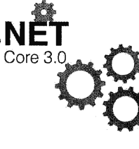


# 第 1 章. 引言

## 1.1 总体概述

对于 C# 开发者来说，这是一个绝佳的时代，随着 Microsoft .NET Core 3 的发布，基于相同的 C# 源代码为 Windows、Linux 和 macOS 开发应用程序从未如此简单。

本书将帮助您根据想要使用的技术和目标操作系统，确定哪种 GUI 最适合您的桌面应用程序。

.NET Core（从 1.0 版本到最新的 2.2 版本）已被开发者社区广泛认可用于 Web 和服务器应用程序（后端、API、Serverless ...）的跨平台开发。第三个版本将为桌面应用程序开发提供集成解决方案。

.NET Core 3 为多平台应用程序解决方案工程带来了理想的解决方案，它允许开发者在每个操作系统中集中代码到一个单一项目。

Visual Studio 2019 可用于 C# 开发（带来所有生产力提升），用于开发在 Windows、Linux 和 macOS 上运行的解决方案。

我们将为 C# .NET 框架（经典）开发者提供特别介绍，以便他们快速适应新的 .NET Core 环境。

还将提供此类项目最佳实践的演示，让您能够像针对单一操作系统的项目一样快速启动新项目。这些快速演示将帮助您明智地引导开发，避免这些项目特定方面固有的许多陷阱。

我们将回顾 .NET Core 3 中包含的新功能，以及为何在众多可用的开发套件（如 Node.js、Mono ... Java）中选择了这个框架。

我们将学习专业软件开发项目管理所需的基本知识（规划、SDLC、测试）以及开发环境的一般组织。

将提供 C# 常见编码技术的快速介绍，以便快速解决项目的常用需求：

- 数据库访问。
- 日志记录。
- Web 服务访问。
- 使用本机 API。
- ...

（当然，如果您是一位资深的 C# 开发者，可以跳过这部分。）

还将介绍 GUI 设计特有的基础知识，涵盖多个方面：

- 人体工程学。
- GUI 设计的基本规则。
- 图形呈现。
- 排版。
- 配色方案。

如果您在人机界面设计方面没有扎实的理论知识，这部分内容将与您相关。

之后，我们将回顾在 Windows（这是主要开发工作站）上设置完整的开发环境，用于开发针对 Windows、Linux (Ubuntu) 和 macOS (MoJave) 的应用程序。

由于开发 .NET Core 3 的最佳 IDE 是 Microsoft Visual Studio 2019，我们将向您介绍快速熟练使用这个神奇 IDE（可免费下载微软网站上的社区版）所必需的通用概念和工具。我们将回顾如何编码和调试针对多个操作系统的目标应用程序。

随后，我们将通过您可以直接用作教程或项目初始模板的示例项目，展示针对您项目的几种 GUI 解决方案：控制台 GUI、本机 GUI、ASP.NET GUI、XML 等...


我们将向您展示如何开发并实现应用程序开发所需的测试项目。我们将了解如何在项目编码阶段实施测试，以及如何使用 Visual Studio 工具来优化应用程序的性能。

一旦项目的编码阶段完成，我们将介绍如何在各个特定平台上构建、打包和部署应用程序，并回顾相关工具，以确保用户在安装您的应用程序时获得良好的体验。

在本书中，我们涵盖了多平台应用程序的整个开发生命周期，为您提供了以最有效方式完成项目的独特优势。我们希望本书能有助于您进行多平台项目，通过直接提供来自多种资源以及作者和其他开源项目的示例源代码参考，为您提供便利。

这些入口点将为您提供查找相关资源或深入探索项目所需特定技术领域的关键信息。

我们希望本书能帮助您在最成功的方式下完成您的多平台项目，并最小化完成此类复杂项目所需的时间和资源。

## 1.2 为什么要开发多平台应用程序？

当您想要启动一个针对桌面应用程序的多平台项目时，这应该是您首先问自己的问题。实际上，在移动开发领域，针对多个操作系统（OS）很常见，但在桌面开发领域却并非如此明显。这有一个简单的原因，即 Windows 操作系统在桌面平台市场的“主导地位”。这种主导地位如图（图 1）所示；Windows 占据了 75% 的桌面市场！

### 2019 年操作系统市场

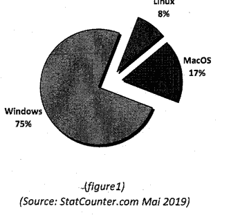

上图（*图 1*）仅展示了连接互联网计算机的市场情况，但显然微软 Windows 占据了主导地位。

那么，为什么要为其他平台开发？

因为使用这些系统（macOS 和 Linux/Unix）的大多数专业人士实际上更倾向于购买软件，尤其是那些专门针对其工作领域领域的软件。

macOS 和 Linux 系统主要用于专业环境，而在专业环境中，出于以下多个原因，软件解决方案必须是（合法地）购买的：

- 获得根据企业需求级别调整的客户支持。
- 许可条款。
- 商业利用。

而且，确实，目前许多软件应用领域被这些平台垄断：

- macOS 在图形设计、音频编辑、视频编辑以及主要在艺术领域。
- Linux/Unix 用于建筑 CAD、电子设计、市场交易、工程软件应用程序、行业专用软件……

这部分归因于这些系统（Linux、macOS）良好的稳定性。此外，Linux 和 macOS 享有比 Windows 性能更好的声誉（在相同硬件资源下）。macOS 和 Linux 的爱好者还论证了一个事实：他们比在 Windows 上更容易配置和调整系统。

因此，如果您计划为“利基”市场开发软件，您可以肯定地选择通过开发如本书所述的多平台项目来实现。这样，您不仅满足了通常客户的需求，还将您软件的潜在市场开放给其他操作系统的用户。

商业软件可用于多个操作系统这一事实，也将保证用户所获得的应用程序知识不依赖于他使用的系统（例如：Photoshop、Mathcad...）。当软件应用程序的使用非常复杂且需要学习曲线才能正确使用时，这一点尤为相关。如果用户知道所学知识在其他几个平台上都适用，他们更倾向于学习使用特定的软件。

选择多平台应用程序还有另一个原因：如果您能提供无论用户使用何种系统的软件解决方案，这对客户会产生积极的心理影响。您的软件的多平台分发意味着在开发过程的每个步骤中都具有良好的技术掌握能力，并表明您不依赖于某一个操作系统。

多平台开发为您（和您的公司）提供了不被特定操作系统所束缚的可能性，而特定操作系统经常发生剧烈变化，甚至可能挑战您正在开发的应用程序的有效性。

您必须牢记，获得对您开发的软件的控制权，代价是在开发阶段付出更大的努力，特别是如果您的项目需要使用原生 API 函数（在其他情况下，.NET Core 3 为您提供了一种稳固且灵活的项目实现方式）。

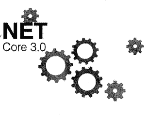

# 第 2 章 .NET Core 3 简介

.NET Core 是一款诞生于 2015 年的产品（实际上从 2014 年起就已处于测试状态）。

它是从传统的 .NET Framework 定义而来的。.NET framework 演变过程中选择了许多技术选项，从而确定了新范式的需求。

我们将看到这些 .NET framework 的演变是如何发生的，以及在新的框架 .NET Core 出现的需求变得显而易见是在什么背景下。

## 2.1 微软 .NET framework 简史

第一个 .NET Framework 于 2002 年发布，是微软的一个专有系统（黑盒）。这是雷德蒙德（Redmond）软件商对当时日益流行的 Java 框架的回应。与 Java 框架一样，.NET framework 使用虚拟机来执行程序。

在使用 .NET framework 时，源语言不再编译为机器代码，而是编译为 MSIL（Microsoft Intermediate Language，微软中间语言），这种语言在运行时由 CLR（Common Language Runtime，公共语言运行时）编译为机器代码，并在 .NET framework 虚拟机中执行。

该运行时实时将每个需要执行的代码部分翻译为平台的原生代码。

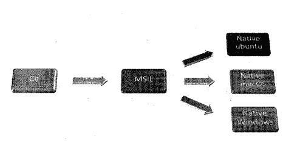

除了这种编译能力，CLR 还为生成的代码提供许多服务。以下是这些基本功能提供的非详尽列表：

- 基础类库（BCL）。
- 线程模型。
- 类型检查器。
- 异常管理器。
- 垃圾回收器。
- MSIL 到原生代码编译器。
- 类加载器。

在微软发布了许多 .NET framework 的子系统以适应公司遇到的每个应用领域几年后：.NET Compact Framework, Silverlight, Windows Phone...

这些框架中的每一个都在框架级别包含其自身的一组特定功能，因此它们之间变得不兼容（对于大多数代码而言）。

由于其 API 的特定（垂直）演变，针对多类型平台的应用程序开发在时间和资源方面变得越来越昂贵，这是由于每个框架的垂直演变。

这很容易解释，因为最初没有意愿在框架之间共享代码，因为这些框架专门用于其特定的应用领域和平台背景。

但如今，跨平台开发已成为许多项目的非常普遍的要求。许多应用模糊了垂直 .NET 框架之间的界限：通常，web 应用程序使用 Windows 专用功能，桌面或电话应用程序使用 web 后端（Web Services 或 Web APIs），以此类推……

正是在这种背景下，.NET Core 和 .NET Standard 被规划和定义为 .NET Frameworks 的一个新子系统。

这是一个解释 .NET framework 和 .NET Core 之间联系的小型示意图。

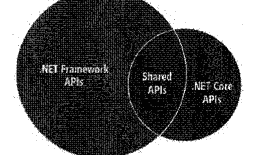

（来源：微软）

可以 .NET framework 和 .NET Core 使用 .NET Standard；这种库格式提供了惊人的可移植性，无论您打算使用哪个框架。

## 2.2 为什么选择 .NET Core？

使用多个框架（每个都专门针对其自己的领域）所涉及的复杂性成为大多数多功能平台开发的陷阱。随着这类开发变得日益普遍，新框架的需求出现了。

正是在这种背景下，出现了对一个最小化框架的需求，其中每个平台和特性的特定内容将通过 NuGet 包集成，而不是像以前的 .NET framework 那样集成在核心框架内部。


此外，.NET 框架是 Windows 系统的一部分，而 .NET Core 3 并非如此，它可以以自包含的方式随应用程序分发，且自身具备自足性。

.NET Core 精心设计的架构为其在生产环境中的应用带来了诸多好处，与依赖于 Windows 的经典 .NET 框架相比，你可以从（图 1）中看出这一点。

| .NET 框架 | .NET Core 3 |
| :--- | :--- |
| Windows 更新 | 是 | 否 |
| 部署运行时 | 取决于环境 | 是 |
| 并行安装 | 否 | 是 |

（图 1）
（来源：微软）

.NET Core 的一个关键点是使用了专门的包管理器格式：NuGet。

NuGet 打包系统已集成在 Visual Studio 2019 中，它之于 .NET，就像 APT 之于 Debian、NPM 之于 Node.js 或 pip 之于 Python 一样。NuGet 通过将二进制文件及其依赖项封装在单个文件中，使得每个库都可供使用。该文件（.nupkg 扩展名）是一个 ZIP 归档文件，其中包含一个清单，列出了所有相关依赖项和目标框架信息。

因此，一个 NuGet 包可以独立实现完整的功能，用于多平台使用。

## 2.3 新功能

与以前的版本一样，.NET Core 3 是开源且跨平台的。通过这一实现，微软加入了 C# 8 的支持，这是 C# 语言的一个主要版本更新。但这并非微软在该版本中对 .NET Core 所做的唯一增加。

以下两个图表说明了微软在其标志性的新框架 .NET Core 3 的第三个版本中完成的工作。我们可以看到，与 .NET Core 2 相比，这是一个主要版本更新，后者基本上是为跨平台环境运行 Web 应用程序和服务而设计的第一版的更新。

.NET Core 2：

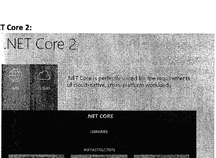

.NET Core 3：

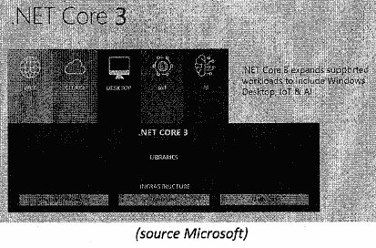

正如你所见，.NET Core 3 不仅面向 Web 服务器平台，还获得了许多新功能，如 AI 和 IoT。

但不幸的是，桌面开发是仅限 Windows 的功能（它依赖于 WinFx，而 WinFx 又依赖于 Windows）。

通过提供这些新功能，微软完全验证了 .NET Core 底层的基本概念：模块化仅包含在专用包中（而在 .NET 框架中，它是集成在框架中的）。

.NET Core 3 的一项主要增加是支持 C# 8 的新功能：

- 默认接口成员。
- 可空引用类型。
- Switch 表达式。
- 属性模式。
- 元组模式。
- 静态局部函数。
- 异步流。
- 浮点 API 改进及符合 IEEE 标准。
- 解析和格式修复。
- 新的数学 API（BitIncrement/BitDecrement），与 nextUp nextDown IEEE 操作相匹配。

包含在 .NET Core 3 中的其他特性：

- 访问面向性能的 CPU 指令的 API，例如 SIMD。这些指令可以提高性能。
- 快速开箱即用的 JSON 写入器和 JSON 文档。
- 对树莓派计算机的 GPIO（通用输入/输出）支持。
- 改进的本地 dotnet 工具。本地工具与磁盘上的位置相关联，实现按项目和按存储库的工具支持。
- 程序集的可卸载性，这是 AssemblyLoaderContext 的一部分。该功能使加载器上下文可以卸载，释放实例化类型、静态字段以及程序集本身的内存。应用程序应能够通过此机制加载和卸载程序集，而不会发生内存泄漏。
- 为了支持 Visual Studio，C# beta 版本在新建项目对话框中增加了 Windows 演示基础（WPF）和 Windows 窗体模板，以便更轻松地开始应用程序而无需使用命令行。
- MSIX 应用程序包格式部署，用于将 .NET Core 3 桌面应用程序部署到 Windows 10。
- 在 .NET Core 3 上运行桌面应用程序将提供性能改进。

任何 Windows 应用程序（参见“设置开发环境”一章中的 .NET Core 3 先决条件）都将能够在 .NET Core 版本 3 上运行（现在支持 Windows 窗体、Windows 演示基础和通用 Windows 平台 XAML）。

**注意：** .NET Core 3 增加了在 .NET Core 上构建 WinForms 和 WPF 应用程序的能力。但同样，这些类型的应用程序不是多平台的，只能在 Windows 系统上运行（WinFX 依赖于 Windows API）。这些 WinForms 和 WPF 应用程序是仅限 Windows 的，且近期没有任何可能性使其支持多平台（没有可用的路线图）。

.NET Core 3 为桌面开发人员提供了灵活的部署，以及并排的单 EXE 支持。

结合 .NET Core 3 提供的优势和特性，使该框架成为在众多开发中使用的最尖端且通用的解决方案。

这款 .NET Core 版本在性能、灵活性和语言（具有 C# 8 特性）方面轻松超越经典的 Java 框架、NodeJS 或 Python 解决方案。微软通过此版本及在旁边开发的工具，在开发领域提出了一项变革性的主张（这一点毋庸置疑 :)）。

## 2.4 .NET Core 3 路线图

作为新的微软技术，.NET Core 3 有其不同版本的规划路线图。微软开发的多平台框架正在众多开发人员中获得越来越大的成功，当然，特别是在 Azure 云环境中工作的开发人员，以及 AWS（它为 .NET Core 开发人员提供所有工具）和 Google Cloud（最大的云服务提供商之一）的用户。

但随着 .NET Core 获得更成熟的地位，它可以应用于更广泛的领域（例如桌面 :)）。

不同版本的路线图（*图 1*）可能会有变动，且包含的特性尚未定义。这是因为 .NET Core 是在开源许可下运行的，许多特性是由社区（主要是微软专业人士和独立开发人员）提出并实现的。

例如，如果社区明确表明某个特性应包含在下一个版本中，那么该特性将被添加到下一个版本中（在技术上可行的情况下）。因此，如果你对框架有绝佳的创意，请毫不犹豫地在 .NET Core 开发网站（参考链接见下文）上发布请求，如果它被开发团队验证，你的特性将被整合到未来的 .NET Core 版本中。

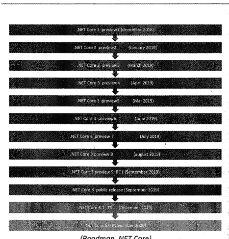

此 .NET Core 版本发布的路线图已经历了许多变化，并且始终可能进行修改（时间表经常发生调整）。自预览版 7 起，.NET Core 3 成为 Visual Studio 2019 预览版的更新的一部分。自 2019 年 9 月起，.NET Core 3 框架已包含在 Visual Studio 中（随着发布版本）。

你可以注意到，.NET Core 的 LTS（长期支持：实际上为 3 年）版本计划于 2019 年底推出，因此你的开发可持续性，在企业环境中至关重要，将从该日期起至少确保几年（至少支持 3 年）。

将你的 .NET Core 3 代码更新到 .NET Core 3.1 应该只需进行极少的修改（可能没有修改），对于使用 .NET Core 3 开发的应用程序而言。

将框架与应用程序一起包含而不是全局安装在机器上（这在 .NET 框架中是这种情况）是一个主要的解决问题的模式，也提高了今天开发的应用程序的可移植性和持久性。

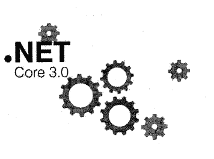

# 第 3 章 项目管理要点

在开始审查 GUI 桌面应用程序开发的解决方案之前，我们将复习成功软件开发项目所需的基础知识。

使用经过验证的开发方法可以促进复杂软件产品的实现。如果你在此领域没有丰富的经验，强烈建议你仔细阅读本章。在开发多平台软件过程中可能遇到的开发问题多种多样，你并不希望将这些特定的问题与经典的（且已解决的）问题叠加在一起。使用坚固的


在项目的每个阶段（SDLC）中，都非常推荐采用一种开发方法论。

**如果您的项目涉及多人协作（如设计师、程序员、DBA、架构师等），并且您需要向管理层提交项目状态报告，则特别推荐使用这些方法。**

在开始复杂的软件开发项目之前，您应考虑以下基本要求：

- 项目规划（即使只是在 MS Excel 表格中完成，也建议使用项目规划工具）。
- 项目管理：敏捷方法为中规模团队提供了灵活的管理方式。
- 使用源代码控制工具。

**这些措施可以帮助您避免在开发项目中经常遇到的许多陷阱。**

## 3.1 项目规划

即使您是单独工作（尤其是当团队协作被纳入考虑时），在开始编码之前**对项目进行规划**阶段也是强烈推荐的。

**在此阶段，您将：**

- 组织/明确您对产品开发每个步骤的愿景。
- 定义在开始其他任务之前需要完成的任务（任务层级）。

在现实世界中，规范文档经常受到计划外变更的影响。您的项目管理工具应允许您重新安排受这些变更影响的每项任务，并预测这些修改带来的成本（包括时间和资源）。在项目生命周期的任何时刻提供对项目进度的全局可见性，可以避免与管理层产生误解，并/或让您清晰了解项目进度。

制定时间表有助于识别开发团队在特定任务上是否遇到问题，并相应地重新分配资源（如果开发工作或其他任务被低估/高估）。

用于此目的的最佳工具是 Microsoft Project。

MS Project 不仅为您提供了一个出色的规划工具（包括甘特图、任务层级、人力资源管理等……），还是管理您的软件开发生命周期（SDLC）的核心工具。您可以对项目的每个步骤进行建模并分配资源，包括时间、人力以及所需的具体技术技能。

对于简单的项目，您可以使用工具来跟踪项目进展。这可以通过专用的 MS Excel 工作表或免费的项目管理网站来完成。但是，微软开发的专用软件提供了一简便的方式来执行这些任务，该产品经过多年开发，为项目管理工作提供了无出其右的解决方案。

以下是您可以参考的资源，以实现项目管理目标。

**Microsoft Project：**  
http://products.office.com/Microsoft/Project

**MS Project 的替代方案：**  
http://www.projectinabox.org.uk  
http://www.projectlibre.com/  
https://www.ganttproject.biz/download

**MS Excel 项目管理工作表模板：**  
https://www.officeitonline.com/project-management/excel  
https://www.vertex42.com/ExcelTemplates/excel-project-management.html

在这些参考资源中，您可以找到许多 Excel 工作表，它们允许您规划简单项目，从而避免投资专用工具（如 MS Project）。然而，更复杂的项目仍然需要使用专用软件。

# 3.2 软件开发生命周期

软件开发项目的开发需要确定实现目标所需的每个**步骤**（或称为阶段）。根据标准阶段对**项目**进行划分被称为软件开发生命周期。

软件开发项目可以根据软件开发生命周期中对每个步骤的验证进行阶段划分，如**所述（图 1）**。

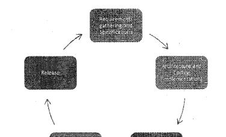

*(图 1: SDLC)*

**规范（和需求收集）：** 不要低估规范阶段，因为它将定义架构和技术选择。在此阶段，您将：

- 进行分析（可能使用 UML 等工具）。
- 获取用户故事（需求）。
- 并可能定义表单设计（功能性的）。

**架构与编码：** 在此阶段，您将定义满足先前制定的规范所需的软件架构。您还需要结合环境约束（公司环境）来定义它们。一旦目标架构确定，就可以开始编码每个功能。如果您计划在程序的同一部分使用多名开发人员，使用设计模式将非常有用。此阶段还包括单元测试，以验证开发团队生成的每段代码。

**集成与测试：** 测试阶段非常重要，因为它允许程序员验证为项目开发的每个“砖块”是否与其他部分良好协作，从而提供预期的软件结果。不经过测试就无法交付高质量软件，总会有问题存在，或者值得记录为 bug（是的，这种情况确实会发生）。可以通过使用持续集成工具（如 TFS DevOps）来自动化测试。

**用户验证：** 用户必须对最终产品进行验证。这是一个重要步骤，但大多数大公司往往低估了它（因为其开发结构的架构所致）。最终用户的整体感受与规范阶段设定的期望相符是很重要的。此验证也提高了用户对最终软件质量的感知。

**发布与部署：** 在此阶段，软件已经产出（至少有一个可执行文件可用），但项目开发尚未完成。在许多情况下，特别是对于桌面应用程序，最终软件必须集成到安装/设置包中，以便能够顺畅地分发给用户。在多平台项目中，这是一个关键步骤（因为每个操作系统在软件安装过程方面都有特定性）。

该循环中的每次迭代都旨在修复 bug、集成新功能或规范变更、提高性能。在此背景下，该循环在软件的生命周期中不断迭代。

## 3.3 定义多个环境

在项目期间，将开发成果分离到多个环境中是非常重要的。这有助于开发人员保持其在实现目标过程中需要开发的不同模块之间的一致性和连续性，而不与项目中已开发的其他部分发生冲突。

这些环境对应于计算机（或虚拟机），或者仅仅是一个用于存储开发期间所需数据（如文档、数据库脚本、规范等）的存储库（或文件夹）。

为每个环境设立一个专用的 Wiki（网站）通常是非常相关的。使用 Wiki 的目的是为开发过程中使用的每个要素或特定技术建立一个知识库。Wiki 网站在小型团队或包含远程人力资源的项目中尤为有用。

除了关于开发的知识库外，项目在其演进过程中还将需要几个不同的环境以满足每个阶段的需求。

在此领域的一个常见做法是定义 3 个环境：

**开发**：在此环境中，开发人员可以创建辅助项目以验证程序的复杂部分。这是一个非正式的环境，仅面向开发人员。

**测试**：在此环境中，开发人员将发布项目以进行验证，通常此环境应与发布环境相同。在这里，bug 被识别，性能被评估，需要审查的问题返回开发阶段。

**发布**：此环境是软件应在生产中运行的环境。在我们的案例中，这是没有进行过先前特定安装的桌面/笔记本电脑（这些安装可能会干扰所开发的软件）。发布环境将允许验证安装/设置模块以及软件本身。

对于多平台开发需求，主要开发平台（Windows 工作站）上将有 3 个环境（开发、测试和发布），而在 ubuntu 和 macOS 上将有 2 个环境（仅**测试和发布**）。

# 3.4 源代码控制

在开始开发之前需要考虑的另一个重要方面是集成用于源代码管理的工具。您项目的源代码是繁重编码工作的主要成果，应被视为珍贵资产。

在这种情况下，对于专业开发（以及个人作品），使用源代码控制工具是强制性的，该工具在以下方面特别有用：

- 避免源代码丢失。
- 避免发布有缺陷的代码。
- 保持版本控制。
- 允许跨平台代码分析。


你可以在服务器上实现源代码控制工具（有许多开源解决方案可用，例如 Git、SVC、Subversion 等）。如果可能，我们建议将代码源仓库安装在与开发人员工作站不同的专用计算机上。

但您也可以使用在线集成解决方案，如 Microsoft Azure DevOps、GitHub 或其他。使用外部仓库可以提高源代码的安全性。通过使用部署的源代码，在发生一般故障或灾难性事件时，您可以非常快速地恢复。

以下是主要解决方案的快速回顾，旨在将这些优势整合到您的项目开发中。

## A) Microsoft Azure DevOps

使用 Microsoft Azure DevOps 除了源代码控制工具本身外，还包含许多其他优势。这个环境由 Microsoft 免费提供（最多支持 5 名用户，超出后需订阅提供更多功能的服务），可用于管理您的项目周期，并作为您源代码的中心仓库。它包括：

-   源代码版本控制。
-   项目跟踪（可以连接到 MS Project）。
-   将任务分配给开发人员。
-   请求管理（新功能、Bug、规范……）。
-   编译您的项目。
-   集成自动化构建和测试模块（通过流水线）。

Azure DevOps 免费提供不同种类的源代码控制工具，如经典的 TFS 和 Git，以及指导项目的各种方法论（敏捷、Scrum……）。

在完整版本（订阅服务）中，Azure DevOps 为您提供了一套完整的解决方案，以专业的方式管理您的资源和源代码。

它与 Visual Studio 的原生集成使得开发人员更容易在架构和编码阶段使用软件开发方法论。

这只是 Azure DevOps 免费提供的功能的一瞥，因此我们建议使用此工具。您可以通过参考中的链接了解该提供的详细信息。


https://azure.com/Devops/

## B) GitHub

GitHub 提供一种免费的分布式源代码控制工具。GitHub 源自开源世界，并免费托管您的项目源代码。这些源代码可以供“公众”访问，并且可以有无限数量的“贡献者”参与项目（非常适合开源项目）。

如果您不希望源代码公开，您可以创建一个“私有”仓库，但这个仓库（至少在免费版本中）必须满足某些限制，例如将贡献者数量限制为 3 人（以及其他限制）。

默认情况下，如果您仅使用免费版本，仓库将对公众开放，但 GitHub 允许您的团队在大小方面没有限制地进行协作。

如果您计划开发开源软件解决方案，GitHub 确实是一个必不可少的工具，其设计初衷正是如此。此外，您可以使用 GitHub 提供的免费 git 客户端来管理文件。您可以通过查看下面的参考链接了解 GitHub 提供的功能。

-   https://github.com/explore
-   https://desktop.github.com

还有其他许多在线解决方案可以帮助您完成管理项目和源代码这一繁琐（但至关重要）的任务。在线上，最知名的包括：

-   https://gitlab.com
-   https://bitbucket.org
-   https://sourceforge.net
-   https://beanstalkapp.com

这些网站中的大多数都提供免费订阅和用于管理项目和/或源代码版本控制的基础工具。如果不利用这些机会，那是相当粗心的。
最后，正如您通过阅读这份简要回顾所能理解的那样，我们强烈推荐使用 Azure DevOps；在开源代码软件开发的背景下，GitHub 非常有用。

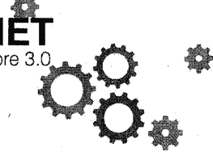

## 第 4 章 GUI 开发最佳实践：用户体验

开发 GUI 应用程序需要在这个非常特定的技术领域具备最低限度的专业知识。如果您没有用户体验设计的经验，本章是必读的。

无论开发哪种语言、平台或针对哪种机器，一些 GUI 应用程序的做法是通用的。我们将回顾这些最佳实践中最实用的一些，以帮助您构思和设计您的 GUI。这些实践将定义一个对用户更高效且更具吸引力的 GUI（这是一点不能忘记的：用户）。

本章将试图帮助您为您的应用提供最佳的用户体验。

设计应遵循一些基本规则和设计方案指南。它必须遵循定义成功图形界面的原则：

-   一致性。
-   可读性（以及可扫描性）。
-   逻辑结构化。
-   非正式性（保持简单）。

在构思应用程序各个屏幕时，许多基本步骤可以通过基于用户验证的概念来定义：

-   用户的每个任务应对应一个屏幕。
-   屏幕之间拥有一致的导航系统。
-   绘制表单（或屏幕）的草图可以帮助您优化展示和交互。

设计的基本方面不应被忽视：

-   控件类型的设计与选择。
-   视觉布局的设计（布局、面板、组……）。
-   字体的选择（根据目标的外观和感受选择适当的字体）。
-   颜色方案的选择（需与应用程序目的和/或用户的企业环境保持一致）。

这一方面对于使用或显示大量数据的应用程序来说至关重要。在这种情况下，必须引导用户的视线，以避免展示可访问信息的复杂性。

关于图形界面设计的一般概念，您可以查阅 ISO 13407 标准“交互式系统的人本设计过程”。该国际标准描述了在 GUI 设计中采用以用户为中心方法的优势。

以下指南将协助您创建相关的 GUI 设计，但仅凭它们是不够的。

定义界面外观的一个首要点是也要考虑与用户协作对界面进行草图绘制。这是 GUI 最终设计中的核心点，您绝不应忘记。

#### 4.1 界面定义的最佳实践

现有的系统界面（Microsoft、Apple 或 Gnome）在其标准定义中已经包含了许多相关（且经过深思熟虑）的功能，但您必须在可用功能之间做出选择，以适应您项目的特定目的。

以下是创建应用程序 GUI 的建议列表：

-   关注用户及其需要完成的任务；定义人们将如何使用 GUI。
-   考虑用户对任务的看法；最好是一个任务对应一个屏幕设计。对于复杂任务，将其分解为多个简单任务，并分布在多个屏幕/表单中。在这种情况下，不妨使用向导式界面。
-   设计常见情况（而非特殊情况）；常规工作流程应在导航系统中实现得尽可能自然。特殊情况可以在考虑主要流程之后添加（而不是之前）。
-   交付信息，而不仅仅是数据；要显示的大量信息可能会让用户感到困惑。在这些情况下，使用计算和聚合的数据（根据用户角度）来呈现信息（整合数据）。
-   设计响应性；这是软件能够与用户进行持续交互的能力。
-   通过设计设定期望（突出常见选择并使用指示性颜色：红色、绿色）。
-   预测错误并设计相关且有用的错误消息。
-   使用测试人员（理想情况下是用户）来验证您的设计以及草图或原型设计的验证。
-   考虑应用将被使用的用户上下文。
-   界面一致性；但界面的一致性可能难以定义且因个人而异，您必须与用户一起确定这一点。
-   使用标准；作为用户，您知道某些功能应根据标准如何显示。

除了上述考虑之外，在设计界面时您还必须牢记。您还应该整合定义图形界面的四个关键点：


**可读性：** 用户通常比较懒惰，不会仔细阅读屏幕上的每一个元素。因此，请确保界面易于快速浏览，尽可能提供图形，并尽量缩短链接、标签和信息文本。

**结构：** 请按照各个屏幕或表单所实现的功能，以一致的方式组织它们。按功能对控件进行分组；使用的逻辑应为项目领域内的标准专业领域。所使用的术语也应是该专业领域内常用的术语。

**注重细节：** 在构建良好 GUI 设计时，细节的重要性不容忽视。细节决定界面的优劣；为这一阶段聘请专业人员似乎开销较大，但最终产品的整体质量将得到显著提升。

**保持表单惯性：** 只要表单正在使用中，就保持其相同的显示状态，仅更新必须更新的数据（例如通过颜色更新来标记阈值或趋势）。根据数据以不同布局更新表单可能会让用户感到困惑。对于相同任务（无论值上下文如何），请尽量保持相同的屏幕/表单格式。这将确保界面的一致性。

## 4.2 通用屏幕设计与人体工学概念

良好的屏幕设计应首先考虑功能（用户将用它做什么），然后才考虑表现形式。

但对于复杂任务或需要显示大量信息的情况，表现形式的设计目标还包括将用户的注意力引导至任务的逻辑流程或重要信息（即用户通常正在寻找的信息）。

在本节中，我们将展示如何使用合适的工具（通常是图形设计工具）来设计一个得体的图形用户界面。

GUI 的主要组件是控件（也称为小部件）。

控件包括：

- 标签
- 链接
- 文本框
- 复选框
- 组合框
- 按钮
- 单选按钮
- 滑动条
- 菜单、滚动条
- 不同类型的布局
- 面板
- 窗口
- ...

这些控件是你定义 GUI 时必须使用的基本元素。

## 4.3 布局建议

以下是设计窗口（屏幕或表单）布局时必须牢记准则的简要总结：

- 调整控件大小以匹配其典型内容。
- 对齐控件（右对齐），并尝试使它们大小一致（在不干扰第一条建议的情况下）。
- 布局平衡：窗口布局必须使用窗口的两侧（左侧和右侧）。如果一侧的控件比另一侧多，请尝试调整其大小（使其更大）或通过使用组控件将其移至另一侧。
- 布局调整大小：如果窗口可调整大小，请确保在较宽的窗口中调整大小时能显示更多数据，同时也要注意窗口最小尺寸时的数据量。

### 4.3.1 控件类型选择

以下是关于根据需解决的逻辑场景选择控件类型的一些建议：

- 不要混淆复选框和单选按钮。
- 不要将命令按钮用作切换开关。
- 不要将选项卡用作单选按钮。
- 不要使用过多的选项卡。
- 不要使用不可编辑的文本字段（如果不可编辑，那就是标签）。
- 如果可以使用其他控件，就不要使用文本字段。
- 为输入字段和控件使用默认值。

### 4.3.2 如何使用控件

系统中可用的每个标准控件（或小部件）都应以其标准方式使用。不要在标准控件上实现特殊行为（如果需求非常具体，请定义一个新的控件），并尽量坚持每个控件的标准用法。

以下是你在设计窗口时必须使用的一些最常见控件（小部件）的使用快速指南：

#### 文本（标签）：

- GUI 文本必须尽可能少（普通用户通常不会阅读它们）。
- 必须使用用户的术语和词汇（而非 IT 术语）。
- 不要将你使用的控件名称大写：组、菜单、工具栏、提示框...

#### 按钮：

- 不要使用通用标签（“取消”按钮除外），请使用与应用领域相关的具体术语。
- 如果按钮用于回答一个问题，请确保应用程序至少提供两个选项（交互式窗口不能只有一个按钮）。
- 将同一功能级别的所有按钮对齐（位于布局或其所属于组的左侧、右侧、顶部或底部）。
- 将命令按钮对齐到窗口底部。

#### 输入：

- 尽量最少使用文本框控件。
- 在列表框、选项按钮和复选框之间明智选择。
- 控件的大小必须与预期数据成比例（文本框的大小）。

#### 菜单：

- 尽量避免使用多重级联菜单（改用上下文菜单，避免过于复杂）。
- 准确命名菜单项（标签应明确具体功能）。
- 添加用户预期看到的菜单项（不要根据后端架构添加）。

#### **工具栏：**

- 尽可能使用标准图标来表示功能。
- 为不同功能选择不同的图标（尽量避免图标之间的相似性）。
- 仅为常用功能在工具栏上添加按钮。
- 避免同时显示超过 4 个工具栏（这可能会让用户感到困惑）。

以下是关于正确使用该**“错误消息”对话框**的一些建议：

#### **错误消息：**

- 如果用户未执行任何操作，请勿显示错误消息。
- 错误消息必须向用户提出解决问题的方案（在可能的情况下）。
- 如果没有解决方案供用户选择，不要在按钮上使用“确定”；请使用“关闭”。
- 不要添加声音效果。
- 使用错误图标并向用户解释他可以做什么。
- 不要使用以下词语：
  - Error, failure（请改用“problem”）
  - Failed（请改用“unable”）
  - Illegal, bad（请改用“incorrect”或“not valid”）
  - Abort, Kill, Terminate（请改用“stop”）
  - Catastrophic, Fatal（请改用“serious”）

### 4.3.3 草绘应用程序窗口

无论如何，最好在开发之前草绘你的屏幕；这将使你能可视化当初设想的实际设计是否符合预期。

通过草绘屏幕设计，你可以识别出信息过多、过于空旷或视觉上令人不悦的屏幕（在这件事上有很大的主观性）。

有许多专用软件可用于实现 GUI 草绘。其中大多数是在线工具。以下是这些在线工具中最知名的一些非详尽列表。

| URL |
| :--- |
| https://balsamiq.com/ |
| https://www.mockflow.com/ |

当然，你可以使用专用的桌面应用程序来设计项目的模拟屏幕。

如果你不使用专业设计师的服务，且不具备设计能力，DesignerVista 是一个理想的选择。使用此工具，开发人员可以完成屏幕的模拟。

这是 DesignerVista 的截图，这是一款用于设计用户界面模拟的软件。

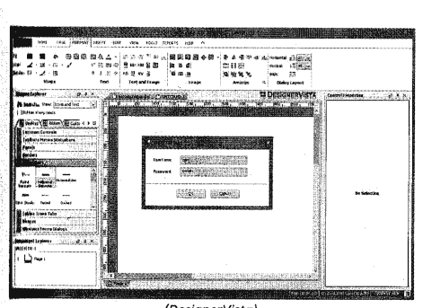

(DesignerVista)

你还可以使用设计师喜爱的工具 **Photoshop** 来实现每个屏幕的设计（尽管对于草绘来说，这似乎有点过度了）；Photoshop 有几种免费可用的 GUI 工具包。

免费提供的 Adobe 应用程序 **Adobe XD** 也很有用，尽管该工具更偏向于网站和移动应用程序。

设计应用程序用户界面的工具选择也将取决于你为应用程序选择的技术类型。

http://www.adobe.com/products/xd.html
http://www.adobe.com/products/photoshop.html
http://www.designervista.com/


### 4.3.4 排版

您为项目所选用的字体体现了该应用的重要性。

大多数情况下，您会使用标准的系统字体（尤其是当您使用原生 GUI 时）。但如今，字体已成为用户所注意到的体现智力水准的标志。

选择恰当且连贯的字体，是设计应用用户界面时的重要任务之一。

在用户（企业）已经拥有内部或专用字体的情况下，应尽可能在外部的使用场景中也采用该字体。

如果您对 GUI 的图形设计有一定自由度，请选择符合目标受众文化的字体。

您可以利用在线资源来了解排版能为您的文本提供的多样性：

-   http://www.dafont.com
-   http://www.fontsquirrel.com
-   http://www.fontspace.com
-   http://www.fontstorage.com
-   http://www.abstractfonts.com
-   http://www.1001freefonts.com

如果您想使用特殊字体，可以使用程序在 Windows、Linux、macOS 之间进行转换，或根据您的需求对其进行修改。

尽管 FontLab 是字体创建的参考标准，但市面上有许多免费软件可用。用于创建/转换/修改字体的参考程序包括：

-   http://www.fontlab.com (FontLab 和 TransType)
-   http://fontforge.github.io/
-   http://birdfont.org/
-   http://cr8software.net/type/ight.html

**这些工具将允许您使用已决定应用于该应用的“那个”字体，而无需受限于多平台的相关要求。**

### 4.3.5 配色方案

**配色方案（颜色的组合）是设计界面时不可忽略的一个关键点。**

**对于多文化环境，请考虑应用运行的文化背景；在这种情况下，您必须为应用针对的每种文化定义特定的配色方案（例如：亚洲与西方在金融市场趋势颜色上的差异：绿色 <--> 红色）。**

**使用颜色有两个至关重要的决定性原因：**

-   应用的外观和感觉。用户对应用的感知至少在部分上受到特定配色方案使用的影响。
-   当显示大量数据时，突出显示窗口上的重要信息。您可以选择鲜艳的颜色来吸引用户关注屏幕上的重要内容。

有一些“标准”有助于您构思配色方案：

-   单色系：每种颜色都取自同一基础颜色（例如：多种蓝色），通常看起来非常平滑并产生舒缓的效果。
-   邻近色系：使用一种主颜色，其他颜色用于丰富该方案。
-   互补色系：在色轮上，互补色位于彼此的对侧；会产生极大的对比效果。

您也可以使用专用工具；例如 Adobe Color CC（作为 Adobe Capture CC 的一部分），为您的应用生成优雅且贴切的配色方案。另一个看似是配色方案构思参考标准的软件是 Paletton（“配色方案设计器”）。

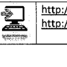

-   http://color.adobe.com/Create
-   http://www.paletton.com/

### 4.4 多平台 GUI 设计的挑战

这仅仅是您为设计应用的每个窗口（或表单）所必须进行的符合人体工程学的设计工作预览。

如果您的目标是自行制作专业设计的应用，建议查阅相关主题的专著。

每个操作系统厂商都提供了与良好 GUI 设计相关的指南。这些网站可以作为理解各 OS 编辑器在此问题上观点（并理解各 OS 的特性）的良好起点。以下是各平台在此领域看似具有参考价值的网络资源列表：

-   https://developer.apple.com/design/human-interface-guidelines/macos/
-   https://theblog.adobe.com/4-golden-rules-ui-design
-   https://developer.gnome.org/hig/stable/
-   http://gooodui.org
-   https://www.uxpin.com/studio/blog/guide-design-consistency-best-practices-ui-ux-designers/
-   https://docs.microsoft.com/en-us/windows/desktop/uxguide/how-to-design-desktop-ux

根据开发多平台应用想要达到的目标，其设计可能非常复杂。在许多情况下，您必须做出选择：是追求针对每个目标 OS 的最佳体验（无论该应用在不同 OS 上的相似性如何），还是无论应用运行在哪个 OS 上，都提供统一的体验。

这一选择将促使您选择某一种 GUI 类型而非另一种。寻找所有这些因子的最佳组合是决定用户界面开发类型的棘手部分。通过遵循本文介绍的最佳实践，您将能够为应用打造出优秀的 GUI 设计，并满足用户在此领域的需求。

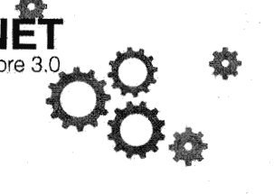

# 第 5 章 C# 应用的基础编码技术

除了开发图形用户界面之外，桌面应用还需要通用的编码技术的基本知识（用于桌面、Web、后端等）。

在本章中，我们将为您介绍使用 .NET Core 3 开发应用时所需的多种常见功能编码的基本实践。本章旨在提供有关 .NET Core 中最新编码技术的基础知识。

这些基本准则将涵盖：

-   应用程序配置存储。
-   跟踪和日志记录（标准，Serilog）。
-   数据访问（实体框架核心）。
-   外部服务访问（REST 服务）。
-   GUI 线程。
-   使用非托管代码依赖项（p/Invoke）。

以下实践将为您提供快速且简单的答案，以解决在应用开发过程中反复遇到的常见问题。相关的网络参考文献将允许您获取关于特定主题的补充信息。

## 5.1 应用程序配置

在许多情况下，您将需要使用配置文件，其中可以存储诸如数据库访问的 “connectionString”、用户凭据、服务端点等信息。您不希望将这些数据存储在数据库中（因为它们很少更改），但也不能硬编码（因为它们可能会改变）。因此，您必须使用配置文件。

在 .NET 框架中，这由著名的 “app.config” 文件（一个 XML 格式化的文本文件）处理，但在 .NET Core 中，情况略有不同。

对于 .NET Core 应用，您仍然可以使用 INI、Config 或其他自定义配置提供程序，但存储配置信息的标准方式是使用 “appSettings.json” 文件。

`app.config` 的 XML 格式已被 JSON 格式取代（您仍可使用适当的提供程序使用 XML 格式化），JSON 格式更加紧凑。.NET Core 3 没有内置配置管理系统来执行此操作；您需要添加相关的 NuGet 包（这是使用 .NET Core 3 添加功能的标准方式）。

可以通过向项目添加专门的 NuGet 包来实现（使用 Visual Studio 2019 “包管理器”）：

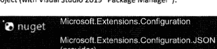

现在数据存储在 JSON 格式化的文件中，但主要的技术仍然适用。

这是一个基本的 `appSettings.json` 文件示例：


```json
{
  "firstname": "Dimitri",
  "lastname": "K"
}
```

别忘了通过更改文件的属性将 `appSettings.json` 文件复制到目标构建文件夹，如下所述（图 1）：

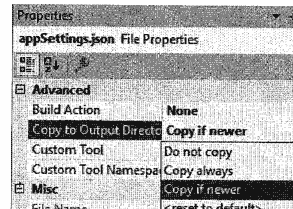

*(图 1)*

可以用几行代码读取此文件。由于 JSON 格式使用原始值和检索文本格式，您必须手动将它们转换为所需的类型。

这是一个小程序（ProgramConfig.cs），演示如何从上述配置文件中检索数据：

### ProgramConfig.cs

```csharp
using System;
using System.IO;
using Microsoft.Extensions.Configuration;
using Microsoft.Extensions.Configuration.Json;

namespace ConfigProgram {
  class Program {
    static void Main(string[] args) {
      var config = new ConfigurationBuilder()
        .SetBasePath(Directory.GetCurrentDirectory())
        .AddJsonFile("appsettings.json", true, true)
        .Build();
    }
  }
}
```


```csharp
Console.WriteLine($"Hello Mr {config["FirstName"]} {config["LastName"]}");

Console.ReadKey();
```

如你所见，只需一行代码就足以完成配置声明、读取配置文件以及构建 ConfigBuilder 对象。该对象（实际上是一个接口类型）使用一组键值对来存储配置属性。此外，该对象还提供了检索实例对象值的能力（这在强类型配置中非常有用）。

Microsoft.Extensions.Configuration 提供了架构的部分/项目以及加载这些部分和项目的主要方法，包括：

- **GetChildren()**：获取后代子部分。
- **GetSection(string)**：获取具有特定键的部分。

当然，这只是一个基本示例，但配置构建器提供了管理复杂约束的可能性，例如层级 JSON、多个（数组）值检索、秘密值的使用以及本文未详述的其他许多情况。

这只是包方法的一个简要概述，你可以通过点击下方的参考链接找到关于此主题的详尽信息来源：

## 第 5 章：C# 应用程序的基本编码技术

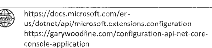

关于在 .NET Core 3 中使用配置文件的总结，Microsoft 包提供的基本配置工具功能强大，能够满足大多数应用程序的需求。存在多种类型配置文件的提供程序（JSON、XML、INI 等）。而且，当然，如果你有特殊需求，也可以编写自己的提供程序。

你可以在 netcore3 GitHub 上获取一个可运行的示例项目。


### 5.2 日志记录和跟踪

.NET Core 具有内置的日志记录/跟踪机制。该机制对于基本的日志记录需求非常方便。但如果你需要更高级的日志记录机制（例如用于错误处理自动化系统），则必须使用更高级的工具。

有许多解决方案（你可以查看 NuGet 存储库）用于在应用程序中实现结构化日志系统，其中最常用和最流行的是 Log4NET、NLog 和 Serilog。

这三款产品非常出色，并适应特定的需求。但在这部分，我们将详细介绍 Serilog 的使用方法，以简化的为目的；如果你有兴趣在你的应用程序中使用，不妨自由探索 Log4NET 和 NLog 解决方案。

#### 5.2.1 Microsoft .NET Core 日志系统

Microsoft 现在提供用于应用程序日志记录、跟踪和调试功能的包。该封装为你的应用程序的日志记录和跟踪需求提供了基本功能。

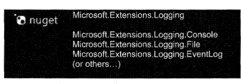

下面是一个简单的程序，用于使用这些 Microsoft 包记录应用程序的活动。

##### SampleMsLog.cs

```csharp
public static void Main(string[] args = null)
{
    ILoggerFactory loggerFactory = new
        LoggerFactory().AddConsole();
    ILogger logger =
        loggerFactory.CreateLogger<Program>();
    logger.LogInformation("This is a test of
        logging information system.");
}
```

首先，你必须开始创建一个日志工厂实例，接下来你需要指定你想要用于实际执行日志记录的提供程序（在示例中为“.AddConsole”）。

这是一种创建基本日志记录系统的简单解决方案，但如果你的开发对日志记录、跟踪和调试有特殊要求，你应该更进一步，探索使用更高级系统（如 Serilog）的可能性。

#### 5.2.2 高级结构化日志系统：Serilog

Serilog 是一个结构化日志系统，当前基于 .NET Standard 2.0 实现，因此你可以在 .NET Core 3 项目中使用它。Serilog 是一个提供文件诊断日志记录的库。它易于设置，并且与其他日志库不同，它是基于强大的结构化事件数据构建的，因此非常适合桌面应用程序开发。

使用此日志系统，你可以实现一个控制台调试窗口，以跟踪你决定跟踪的应用程序的每个事件，并实时查看应用程序内部的运行情况。

##### 5.2.2.1 安装 Serilog

你需要通过 Visual Studio 中的包管理器 GUI 或包管理器命令行添加 Nuget 包“Serilog”。之后，你将需要安装针对你想要使用的输出类型（称为“Sinks”）的特定包。

“Sink”描述了你想要为你的项目实现的日志类型。

```
nuget
```

Serilog
Serilog.Sinks.Console
Serilog.Sinks.File

除了文件和控制台，还有许多其他类型的 Sink 已经可用，你可以将应用程序的日志写入数据库、云端或 Microsoft Teams 系统……

##### 5.2.2.2 配置

Serilog 的配置非常直接，大多数情况下不需要特定的配置文件。然而，你有使用一个配置文件来响应日志系统特定需求的可能性（请查阅参考网站以获取更多信息）。

如果你在该方面有特殊需求，你也可以参考 GitHub（Serilog 是开源的）存储库。

##### 5.2.2.3 创建 Logger 并使用 Sinks

首先，你必须创建一个 logger 对象：

```
Log.logger = new
LoggerConfiguration().CreateLogger();
```

一旦 Logger 对象创建完成，它必须链接到一个指定的外部表示形式（例如文件或控制台窗口）。

```
Log.Logger.WriteTo.Console();
```

用于控制台日志记录系统。

或者，对于使用文本文件作为输出：

```
Log.Logger.WriteTo.File("log.txt", outputTemplate: "{Timestamp:yyyyMMdd HH:mm:ss  "} {Message:lj}");
```

你可以在提供的参考网站（下方提供的链接）找到有关日志格式化的更多信息。

##### 5.2.2.4 日志级别

一旦 logger 完全配置好，你就可以开始进行 Information 级别的日志记录：

```
Log.Information("Here is the logging!");
```

有几个级别可用于执行日志记录：

- Verbose（冗长）
- Debug（调试）
- Information（信息）
- Warning（警告）
- Error（错误）
- Fatal（致命）

你可以配置 logger 仅在定义的级别输出。

下面是一个简单的示例程序，用于说明 Serilog 的基本使用。

##### ProgramSampleSerilog.cs

```csharp
static void Main(string[] args)
{

Console.WriteLine("Hello Serilog.");

var loggerConfiguration = new
LoggerConfiguration()
.WriteTo.ColoredConsole()
.Enrich.WithMachineName()
.MinimumLevel.Debug();
var logger =
loggerConfiguration.CreateLogger();
Log.Logger = logger;

Log.Information("Starting up.");

var sleepPeriodInSeconds = 60;
if (args.Length > 0 &&
int.TryParse(args[0], out sleepPeriodInSeconds))
{
Log.Information("Sleep interval
provided: {SleepPeriodInSeconds}.",
sleepPeriodInSeconds);
}

var sleepPeriod =
TimeSpan.FromSeconds(sleepPeriodInSeconds);

while (true)
{
var coinToss = Random.Next(0, 2);
Log.Information("Coin Toss...
{CoinToss}", coinToss);

var instance = coinToss == 0 ? new
WithPropertyInit() : null;

Log.Information("Doing Work...
{NameOfProp}", instance?.NameOfProp);
Log.Information("{Instance}",
instance);

}
}
Thread.Sleep(sleepPeriod);
}
```

我们可以看到，Serilog 使用起来非常简单，并提供了大量的自定义能力。在许多应用程序开发场景中，这是一个特别相关的选择。这是一个具有活跃社区参与的开源项目，且文档丰富。

你可以深入了解 Serilog 的使用：


### 5.3 数据访问：实体框架 Core

在 .NET Core 3 中，开发者仍然可以使用经典方法（如 .NET Framework 中那样）访问数据库（Command、Request Reader...），但对于现代高级软件解决方案，数据访问必须以标准化方式进行分层（使用 ORM）。

在 .NET Core 中，数据访问应当（这不是强制的，但强烈建议）通过使用 Entity Core 组件（一个 NuGet 包）来完成。这是由 Microsoft 开发的 ORM（对象关系映射器），继承自 .NET framework（Entity Framework）。

Entity Framework Core 遵循了 .NET Framework 设定的趋势，向更轻量的多平台环境转变。


EF Core 提供了一组 API，允许你以结构化的方式（代码具有良好的可读性和可维护性）访问数据。它允许你使用 .NET 对象实例（支持 LINQ 请求）来处理你的数据。

EF Core 简化了应用程序数据访问层的工作。实际上，EF Core 甚至可以为你生成该层。

#### 5.3.1 数据库提供程序

作为其前身 Entity Framework 6 的继承者，EF Core 已经集成许多数据库提供程序，例如：

- SQL Server
- MySQL
- SQLite
- Oracle
- PostgreSQL
- CosmosDB（来自微软的 NoSQL 数据库）
- ...... 并且随着 EF Core 社区保持高度活跃，更多提供程序正在不断添加。

更多提供程序可在此处找到：

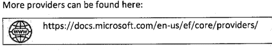

#### 5.3.2 EF Core 架构

EF Core 为开发者提供了一个集成的分层解决方案，该方案允许将应用程序的数据库操作抽象化，并使用 .NET 对象。

这种分层提供了关于数据库托管系统的更好灵活性（例如，如果你必须更改使用的数据库类型）。

它还为开发者提供了使用高级 .NET 功能来操作数据对象的能力，例如：使用 Lambda 函数，使用 LINQ 请求。

以下图示展示了 EF Core 的总体架构：

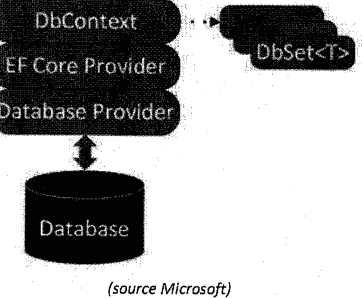

#### 5.3.3 EF Core 安装

为了让 EF Core 在你的项目中可用，你必须包含一个针对你想使用的数据库类型以及允许你在代码中使用高级功能的 EF 工具包。

如果你使用 SQL server，以下是需要包含的包：

安装通常可以通过 **包管理器** 或直接通过 Visual Studio 项目窗口（管理包）来完成。

#### 5.3.4 数据模型

当使用 EF Core 开发应用程序时，你有两种不同的方法来实现与数据库的集成：

### A) 模型优先 (Model First)：

当你使用这种方法时，数据模型由你的数据模型（通过代码）定义。当你使用数据库来存储由你的应用程序产生的数据时，使用这种方法很有趣。模型优先方法用于数据库尚未定义，或当你从头开始开发应用程序时。

### B) 数据库优先 (Database First)：

当你使用这种方法时，你逆向工程你的数据库以生成数据模型。这种方法用于你正在处理一个现有的数据库，或者当数据库由团队中的其他成员（例如数据库开发人员）开发时。

为了启用从你的数据库到你的数据模型的脚手架生成（scaffolding），你必须先安装所需的包：

该包将允许你使用 PowerShell 命令：**Scaffold-DbContext。** 以下是示例命令，用于在你的包管理器窗口中执行此 PowerShell 命令：

```powershell
PM> Scaffold-DbContext -Connection "Server=(localdb)\mssqllocaldb;Database=MyDb;Trusted_Connection=True;" -Provider Microsoft.EntityFrameworkCore.SqlServer -OutputDir ./DataModel -Context MyDbContext -Tables <tablename>
```

这种“脚手架”将生成文件（.cs），这些文件将定义你在代码中可以操作的对象。默认情况下，会为数据库中的每个对象生成一个文件，但你可以指定想要生成的表（例如使用 -Tables 针对特定表）。脚手架生成特定的视图或存储过程（在本书撰写时）是不允许的。

请查阅工具的在线帮助，以获取可用于生成所需数据模型的所有选项列表。


https://doc.microsoft.com/en-us/ef/core/managing-schemas/scaffolding/

#### 5.3.5 EF Core 使用建议

当你使用 EF Core 开发应用程序（配合 Visual Studio 2019）时，你应该考虑使用 Visual Studio 市场上可用的专用插件，例如 Entity Framework 可视化编辑器、EFCore PowerTool、EntityDeveloper Express：

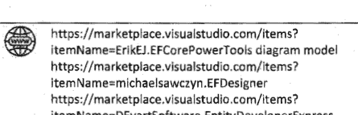

这些 Visual Studio 扩展不仅是简化你使用 EF Core 编码生活的插件，它们还允许你以图形方式对你的数据模式进行建模（这在 Visual Studio 中尚未内置），它提供了与 Entity Framework 6 中已可用的相同工具（你的数据的数据图示模型）。

你也可以使用一个专业的专用产品（针对专业人士）来从数据库生成你的对象（ORM）：

来自 DevartS Software（与免费插件相同的软件编辑器）的 **Entity Developer** 是一个产品，它为 ORM 的数据模型设计/或生成提供了独特的解决方案（支持多个目标 ORM，如 NHibernate, Entity Core ...）。这个工具将使保持数据库和数据模型同步的工作变得更容易，并且大大节省时间。

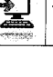

https://www.devart.com/entitydeveloper/

#### 5.3.6 EF core 基本用法示例

这里有一个示例程序，用于说明使用 Entity Framework Core 的模型优先 (Data Model First) 方式（请注意，此示例不应直接照搬，通常出于明显的可读性原因，你需要在不同的源文件（.cs）中定义数据对象，但它可以帮助你快速理解 EF Core 背后的哲学）。

### ProgramEFCoreDemo.cs

```csharp
using System;
using System.Data.Entity;
using System.Linq;

namespace EFCoreDemo
{
    internal class Program
    {
        public static string ConnectionString =
            "Server=localhost;Initial Catalog=EFCoreDemo;Integrated Security=true";

        public static void Main()
        {
            // CLEAR
            using (var context = new
                ExecutionContext())
            {
                context.Customers.RemoveRange(context.Customers);
                context.SaveChanges();
            }

            // ADD 2 new customers
            using (var context = new
                DbContext())
            {
                context.Customers.Add(new Customer
                { Name = "Customer_A", Description = "Description",
                    IsActive = true });
                context.Customers.Add(new Customer
                { Name = "Customer_B", Description = "Description",
                    IsActive = true });
                context.SaveChanges();
            }

            Console.WriteLine("Customers
added...");

            using (var context = new
                DbContext())
            {
                foreach (var customer in
                    context.Customers.ToList())
                {
                    Console.WriteLine("");
                    Console.WriteLine("Customer CustomerID : " +
                        customer.CustomerID);
                    Console.WriteLine("Customer.Name : " +
                        customer.Name);
                    Console.WriteLine("Customer.Description :
 " + customer.Description);
                    Console.WriteLine("Customer.IsActive : " +
                        customer.IsActive);
                }
            }

            Console.WriteLine("");
            Console.WriteLine("----");
            Console.WriteLine("");

            using (var context = new
                EntityContext())
            {
                var list = context.Customers.ToList();

                list.First().Description = "Updated A";

                context.Customers.Add(new Customer
                { Name = "Customer C", Description =
                    "Description" });

                context.SaveChanges();
                Console.WriteLine("Customers
    added/updated.");
            }

            using (var context = new
                EntityContext())
            {
                foreach (var customer in
                    context.Customers.ToList())
                {
                    Console.WriteLine("");
                    Console.WriteLine("Customer CustomerID
        : " + customer.CustomerID);
                    Console.WriteLine("Customer.Name : " +
                        customer.Name);

                    Console.WriteLine("Customer.Description
        : " + customer.Description);
                    Console.WriteLine("Customer.IsActive :
        " + customer.IsActive);

                }
            }

            Console.WriteLine("");
            Console.WriteLine("----");
            Console.WriteLine("");

            Console.WriteLine("Press any key.");
            Console.ReadKey();
        }
    }

    public class EntityContext : DbContext
    {
        public EntityContext() :
            base(Connection.String)
        {
        }

        public DbSet<Customer> Customers { get; set; }
    }

    public class Customer
    {
        public int CustomerID { get; set; }
        public string Name { get; set; }
        public string Description { get; set; }
        public bool IsActive { get; set; }
    }
}
```

此示例可以在 Windows、Linux 和 macOS 上运行，并使用 dotnet Core 3 进行编译。

#### 5.3.7 Entity Framework Core：教程和学习

正如我们所见，EF Core 是解决 .NET Core 3 应用程序中数据库访问问题的熟练且成熟（随着每个新版本越来越成熟）的解决方案。你可以通过查阅以下网站深入了解此主题，该网站将提供有关使用 Entity Framework Core 所提供优势的更详细视图。

https://docs.microsoft.com/en-us/ef/core/


#### 5.4 外部服务消费

在许多情况下，你的应用程序将需要调用外部服务（API、Web 服务等）。.NET Core 为此目的提供了专用的包和功能。

为了简化说明，我们将考虑 REST（表述性状态转移）服务的消费，因为这是你在开发中最常遇到的服务类型。REST 是一种基于 HTTP 请求协议及其关联动词的协议：

- **GET**：用于数据检索。
- **POST**：用于将客户端数据添加到服务器。
- **PUT**：用于更新服务器上的数据。
- **DELETE**：用于删除服务器上的数据。

由于 .NET Core 的关键设计目标之一是最小化安装尺寸，你必须向项目添加所需的依赖项（包）。


添加所需依赖项后，你可以开始使用 REST 服务的流程。你可以通过三个基本步骤来实现（此示例演示了服务的调用）：

1. 构建请求。
2. 处理请求并检索数据（结果）。
3. 处理结果。

### 5.4.1 构建 Web 请求

首先，你必须指定端点地址。完成后，你将实例化 `HttpClient` 类来执行 Web 请求。此 API 仅支持异步方法（在网络工作时非常有用）。Web 请求将由异步方法执行（参见 REST 客户端示例代码）。

### 5.4.2 处理请求并检索数据

对 Web 请求的调用将通过 `await` 关键字完成（因为这是一个异步方法）。

### 5.4.3 处理 JSON 结果

一旦你从 REST 服务检索到数据（HTTP 状态 200），你就必须将 JSON 结果转换为可利用的 C# 对象。为此，你必须编写一个类，该类对象类型匹配你预期的 JSON 结果格式。

> **提示：** 在 Visual Studio 中，使用菜单 *编辑 / 特殊粘贴 / 将 JSON 粘贴为类* 可从 JSON 数据生成 C# 对象。

### 5.4.4 REST 客户端示例代码

以下片段展示了在 .NET Core 3 应用程序中使用 REST Web 服务的方法。

**ProgramRESTClient.cs**

```csharp
BasicHttpBinding basicHttpBinding = null;
EndpointAddress endpointAddress = null;
ChannelFactory<IAService> factory = null;
IAService serviceProxy = null;

try
{
    basicHttpBinding = new BasicHttpBinding(BasicHttpSecurityMode.Transport);
    basicHttpBinding.Security.Transport.ClientCredentialType = HttpClientCredentialType.Basic;
    endpointAddress = new EndpointAddress(new Uri("https://uri.com/api"));
    factory = new ChannelFactory<IAService>(basicHttpBinding, endpointAddress);
    factory.Credentials.UserName.UserName = "usr";
    factory.Credentials.UserName.Password = "pass";
    serviceProxy = factory.CreateChannel();

    using (var scope = new OperationContextScope((IContextChannel)serviceProxy))
    {
        var result = await serviceProxy.getSomethingAsync("d").ConfigureAwait(false);
    }
    factory.Close();
    ((ICommunicationObject)serviceProxy).Close();
}
catch (MessageSecurityException ex)
{
    throw;
}
catch (Exception ex)
{
    throw;
}
```

#### 5.5 界面线程处理

正如我们在前一章中看到的，应用程序的响应性是用户对桌面应用整体质量感知的一项重要指标。

通过为每个繁重的处理任务和用户界面任务提供其自身的线程，可以实现应用程序良好的响应性。因此，主进程不会过载，无论之前的指令如何，应用程序都能继续响应用户（响应性）。

根据你用于开发多平台应用程序的解决方案类型（控制台、XAML、HTML、原生 UI 等），实现这种线程处理有几种方法。

你应用程序中长而复杂任务的线程处理可以在进度窗口中完成，其中你显示一个仪表（或其他进度指示器）控件，并向用户提出取消正在进行的操作的选项。

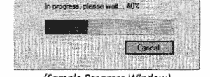

但大多数时候，线程处理没有自己的窗口，并通过某种信息栏向应用程序报告操作状态。这可以通过使用委托和常见的线程技术来完成（如下面的示例所示）。

以下简单的 .NET Core 3 WinForms 示例说明了如何使用委托来实现这一点：

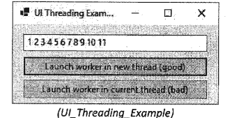

此示例说明了在 GUI 应用程序中使用线程处理与非线程方法（该方法会在进程执行期间冻结窗体，用户失去控制权）相比的实用性。该示例的完整项目可在线获取：

`https://github.com/netcore3/CodeBook/Chapter 5/5/UI_Threading_Example`

在你的 GUI 中实现（编写）线程处理还有许多其他方法。只需考虑你应该在程序的主 GUI 线程之外实现功能操作的处理（使用的方法并不重要，本书中介绍了许多不同的方法）。

#### 5.6 使用非托管依赖项

使用 .NET Core 3 进行多平台开发有时意味着使用平台特定的依赖项（Windows 上的 .dll 文件、Ubuntu 上的 .so 文件、macOS 上的 .dylib 文件）。

开发人员能够从其 .NET Core 3 程序访问非托管方法是开展许多类型项目的必要条件。

请记住，在多平台环境中，你必须在每个平台上获取原生库文件（或其平台等效物），在我们的情况下是 Linux、macOS 和 Windows。因此，在 Windows 平台上实际开发使用之前，请验证你计划用于多平台项目的库在每个目标操作系统上是否可用。

例如，许多系统函数只能通过原生 API 访问。为此，你应该了解使用 .NET Core 3（这是托管代码）中非托管代码的基本概念：

- P/Invoke
- 编组（Marshalling）
- 确定运行操作系统

提供这些功能的 .NET Core 3 包是：


### 5.6.1 P/Invoke

P/Invoke 是 Platform Invocation Services（平台调用服务）的缩写。此机制允许开发人员在他们的托管代码（.NET Core）中使用外部非托管依赖项。

以下是使用 P/Invoke 检索当前进程 ID（pid）的示例：

**用于 Linux（ubuntu）：**

```csharp
using System.Runtime.InteropServices;

namespace PInvokeSample
{
    public static class Program
    {
        [DllImport("libc.so.6")]
        private static extern int getPid();

        public static void Main(string[] args)
        {
            int pid = getPid();
            Console.WriteLine(pid);
        }
    }
}
```

**用于 Windows：**

```csharp
using System.Runtime.InteropServices;

namespace PInvokeSample
{
    public static class Program
    {
        [DllImport("Kernel32.dll")]
        private static extern uint GetCurrentThreadId();

        public static void Main(string[] args)
        {
            int pid = GetCurrentThreadId();
            Console.WriteLine(pid);
        }
    }
}
```

对于检索当前进程 ID 的这个示例代码，最好将依赖项的副本复制到应用程序文件夹中。在你的代码中使用系统原生库的一个棘手部分是检索这些库在每个系统上的位置。这是一个你可能遇到许多麻烦的地方，将库复制到项目文件夹（或项目中的子文件夹）可以帮助你解决其中大多数问题。你还必须验证程序上下文的包含路径是否包含应用程序应执行的操作系统所需的库。

在上面的示例中，我们可以看到原生调用会根据操作系统而变化。在这种情况下，多平台开发意味着为每个平台生成具有特定性的代码。

如果你想使用系统中尚未编写且可通过操作系统 API 访问的原生函数，你必须开发自己的库（每个操作系统一个版本）。

以下是关于每个操作系统系统 API 的一些参考链接：

- **Windows：** [http://pinvoke.net](http://pinvoke.net)
- **Linux（ubuntu）：** [http://kernel.org/doc/html/latest](http://kernel.org/doc/html/latest)
- **macOS：** [https://developer.apple.com/library/archive/navigation/](https://developer.apple.com/library/archive/navigation/)


## 5.6.2 序列化（Marshalling）

序列化：是指在需要时转换类型的过程，以便允许原生代码和托管代码（在我们这里是指 .NET Core 3）之间进行交互。

以下是用于 .NET Core 3 类型和原生类型之间的类型转换表。

| .NET 类型 | 原生类型 |
| :--- | :--- |
| byte | uint8_t |
| sbyte | int8_t |
| short | int16_t |
| ushort | uint16_t |
| int | int32_t |
| uint | uint32_t |
| long | int64_t |
| ulong | uint64_t |
| char | 根据 P/Invoke 或结构的 CharSet，可以是 char 或 char16_t。 |
| string | 根据 P/Invoke 或结构的 CharSet，可以是 char* 或 char16_t*。 |
| System.IntPtr | intptr_t |
| System.UIntPtr | uintptr_t |
| .NET 指针类型（例如 void*） | void* |
| 从 System.Runtime.InteropServices.SafeHandle 派生的类型 | void* |
| 从 System.Runtime.InteropServices.CriticalHandle 派生的类型 | void* |
| bool | Win32 BOOL 类型 |
| decimal | COM DECIMAL 结构体 |
| .NET 委托 | 原生函数指针 |
| System.DateTime | Win32 DATE 类型 |
| System.Guid | Win32 GUID 类型 |

对于复杂类型（结构体、对象），请参阅 .NET Core 的序列化类型转换说明（链接见下文参考文献）。如果您计划涉及复杂对象和结构体进行跨平台调用，则需要仔细研究文档。


https://docs.microsoft.com/en-us/dotnet/standard/native-interop/type-marshaling

## 5.6.3 操作系统检测和识别：

对于开发人员而言，在使用原生方法时，知道应用程序正在哪个操作系统上运行是必须的。这可以通过使用下面描述的 **System.Runtime.InteropServices** 库中包含的特定 .NET Core 方法来实现。

**方法：**

`System.Runtime.InteropServices.RuntimeInformation.IsOSPlatform()`

**参数：**

`OSPlatform.Windows`, `OSPlatform.OSX`, `OSPlatform.Linux`

多平台开发的复杂性的一部分在于，原生库在每一个操作系统中的名称并不相同。`DllImportAttribute` 的参数必须是一个常量。

您可以使用以下变通方法：为原生方法调用使用特定对象（每个操作系统各一个），该接口将根据执行所在的系统和上下文实例化为相关类型的对象（该类继承自此接口）。

下面是一个说明此概念的代码片段。

```csharp
interface ILibPid
{
    Int GetPid();
}

class LibPidLin : ILibPid
{
    [DllImport("libc.so.6")]
    private static extern int getpid();
    public static int GetPid()
    {
        return getpid();
    }
}
```

```csharp
class LibPidWin : ILibPid
{
    [DllImport("kernel32.dll")]
    private static extern uint
    GetCurrentThreadId();
    public static int GetPid()
    {
        return (int)GetCurrentThreadId();
    }
}
```

这种变通方法允许根据程序运行的操作系统选择合适的原生方法。您可以使用专用的 .NET Core 方法或获取 OSDescription 字符串来实现操作系统平台检测。

```csharp
bool isWindows =
System.Runtime.InteropServices.RuntimeInformation.
IsOSPlatform(OSPlatform.Windows);
```

或者获取系统名称字符串：

```csharp
String OSname =
System.Runtime.InteropServices.RuntimeInformation.OSDescription;
```

例如，这里展示了与之前声明（列表 1）匹配的代码实例化。

```csharp
LibPid inPid;
if (RuntimeInformation.IsOSPlatform ==
OSPlatform.Windows)
{
    inPid = new LibPidWin();
}
```

```csharp
if (RuntimeInformation.IsOSPlatform ==
OSPlatform.Linux)
{
    inPid = new LibPidLin();
}

...

inPid.GetPid(); //该方法可以在多个操作系统上工作
```

*(列表 2)*

这只是一个示例，变通方法的实现可能与您的项目所需的具体要求不匹配（但在大多数情况下是匹配的）。使用接口对象和多个类实现并不能避免您为每个平台编写代码，但它为您提供了跨越这些多个实现的、可访问的对象结构。

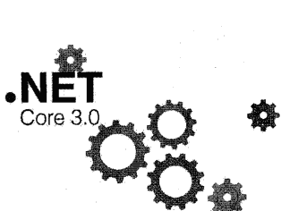

# 第 6 章. 设置开发环境

开发环境的设置是开发过程中至关重要的一步，正确的设置可以避免您在后续开发中遇到许多陷阱和上下文相关的 bug。因此，您必须特别小心每一次安装，这意味着即使在设置过程中遇到一些小的错误消息，也要重新安装完整的软件包。

为了更好地保证每台机器的稳定性，建议为您的软件将运行的每个操作系统设置一个新的平台（全新的 Linux、macOS 和 Windows 操作系统；从头开始安装）。

## 6.1 为每个目标平台创建开发人员账户

多平台软件的开发意味着您拥有访问这些平台知识库的权限。为此，订阅您正在开发的平台的开发人员网站将使您更容易访问项目所需的特定知识。

订阅这些网站还将为您提供：

- 通过专用新闻通讯保持您对每个平台开发人员动态的了解。
- 提供论坛、常见问题解答（FAQ）和博客访问权限，以便获取技术支持和/或开发最佳实践。
- 提供新工具和概念的培训。
- 访问完整的文档。

推荐的网站因其提供的信息的可靠性和可靠性而被专业开发人员认可。

以下是一份非穷举的网站列表，它们将为您提供多平台项目所需的文档。

**针对 Microsoft Windows：**

Microsoft 为使用其技术的开发人员提供了大量的网站。

- https://developer.microsoft.com/
- https://developercommunity.visualstudio.com/

**针对 Ubuntu：**

Linux 在很大程度上是以开源模式开发的，因此 Ubuntu 没有为使用该系统的开发人员提供专门的订阅（它更像是一个兴趣社区）。尽管如此，您可以订阅 Linux、GTK (gnome) 和 QT 专用开发人员网站。


- https://gnome.org
- http://linux.com
- https://ubuntu.com/community
- https://developers.redhat.com
- http://qt.io
- https://www.linuxfoundation.org

**针对 macOS：**

macOS 系统的专有属性导致从开发人员角度来看，它是这三个系统中文档最少的（尽管随着时间推移正在改善）。关于在该平台上开发的最有用信息只有拥有 apple 网站上的开发人员账户（这是免费的）才能访问。


- https://developer.apple.com/

当您独立开发应用程序（没有导师）时，访问 C# 开发人员网站和通用开发人员问答网站也经常很有用。


- https://stackoverflow.com
- http://csharpcorner.com
- http://codeguru.com
- http://codeproject.com

> 提示：我们建议您在这些订阅或注册中使用专用的电子邮件账户（或创建别名地址），因为非请自来的邮件数量可能很多，且并不总是与订阅者的兴趣中心相关。

## 6.2 物理计算机与虚拟机

部署开发环境的基础设施是一个需要仔细考虑的问题。您可以使用物理计算机、虚拟机或两者的组合。但请记住，macOS 系统只能合法安装在 Apple 计算机上。

虽然如此，确实存在一些非官方的解决方案允许您虚拟化 macOS（使用 VMWare 或 Virtual Boxes），但由于缺乏支持（而且这些解决方案的许多来源包含 rootkit 和木马），不建议在开发环境中使用此类工具。

为每个环境使用物理计算机带来了许多优势。通过在专用的机器上开发，一台用于 Linux，一台用于 macOS，一台用于 Windows，您将使用应用程序最终部署的机器。这样那就是一个


一个巨大优势。此外，你可以不受其他外部任务限制，充分利用这台机器的所有资源。

这种工作方式在性能方面高效得多，但对开发者而言灵活性较低（因为你需要携带与目标操作系统相匹配的计算机）。

另一方面，使用虚拟机也带来了许多优势，如灵活性、低成本和可移植性（所有开发工作都可以在一台电脑上完成），但也意味着许多约束：虚拟环境永远无法与真实机器完全相同，并且对于特定应用程序，其行为可能与真实操作系统（基于机器）不同。

## 6.3 多平台开发环境架构

在这个技术术语略显晦涩的章节标题背后，我们将介绍为本书开发多平台应用所采用的技术选项。

正如我们之前所述，本书的选择是在 Windows 10 平台上使用 Visual Studio 2019 来开发应用程序。

实际上，我们将使用此环境进行程序编码；这个关键的 Windows 平台是主要的开发站点，所有代码的生成都将在此处完成。这个 Windows 站点也将用于构建面向 Windows 平台的解决方案。

由于您的项目也可能涉及生成原生可执行文件（使用 CoreRT），我们选择在每个平台上独立构建每个解决方案。下图（开发架构）展示了所呈现解决方案使用的开发架构。

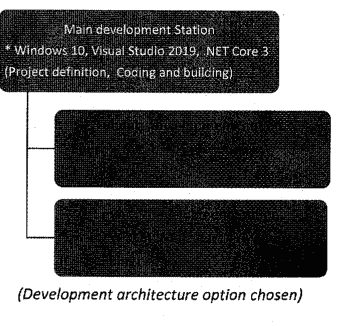

完整的开发工作均在 Visual Studio 2019 中完成，然后，一旦所有内容运行正常且无错误，便将解决方案复制到其他机器上。解决方案的代码会在其应部署的平台操作系统上构建，可能需要对项目文件（`.csproj`；例如，如果您使用了平台目标选项）进行一些临时调整。

当然，这不是开发唯一可能的架构，但这一架构提供了良好的可靠性/性能比。我们还将讨论在 Visual Studio 中进行跨平台调试的可能性。

## 6.4 .NET Core 3 安装：运行时还是 SDK？

.NET Core 3 运行时仅包含在计算机上运行应用程序的核心元素，这是运行 dotnet Core 应用程序所需的最少安装。NET Core 3 的另一个好处是，运行时可以与分布式应用程序一起部署。

另一方面，SDK（软件开发工具包）提供用于开发和构建 .NET Core 应用程序的工具。

必须在每个平台上安装 .NET Core 3 SDK。这样做便于针对特定操作系统调整应用程序，并允许您在每个平台上验证开发的每个阶段（如果您有项目管理准则）。

因此，对于您想要目标应用到的每个平台，您都需要一个开发站点（至少已安装 SDK）。

Windows、Linux 和 macOS 均可在微软网站上获取运行时和 SDK。

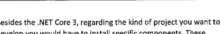

除了 .NET Core 3 之外，根据您希望开发的项目类型，您可能需要安装特定组件。这些组件是运行应用程序所必需的，在某些情况下甚至是强制性的。这些组件可能针对每个操作系统有所不同（如果您选择使用原生 GUI 进行开发）。

但在三个系统上设置的核心是 .NET Core 3 的安装，且应特别小心地进行。以下是如何正确安装它的详细说明。

## 6.4.1 在 Windows 上

在 Windows 10 平台上安装 .NET Core SDK 似乎很琐碎，因为微软平台是 .NET Core 的起源平台。您不应该遇到任何问题（比其他操作系统少）。此外，自 2019 年 10 月起，当您设置 Visual Studio 2019 时，.NET Core 3 会自动安装。

### 6.4.1.1 前提条件

.NET Core 3 支持以下版本：

- Windows 7 SP1。
- Windows 8.1。
- Windows 10 周年纪念更新（版本 1607）或更高版本。
- Windows Server 2008 R2 SP1（完整服务器或服务器核心）。
- Windows Server 2012 SP1（完整服务器或服务器核心）。
- Windows Server 2012 R2（完整服务器或服务器核心）。
- Windows Server 2016 或更高版本（完整服务器、服务器核心或 Nano 服务器）。
- Windows Server 2019（所有版本）。

### 6.4.1.2 Windows 安装

如果您使用正确版本的 Windows，只需执行下载的加载器（exe 程序）并按照安装说明操作即可完成安装（点击确定 :)）。

.NET Core 3 的默认安装目录为：

```
C:\Program Files\dotnet\netcore3
```

您可以通过调用 CLI 工具“dotnet”的简单命令来验证安装是否成功，如下所示：

```
C:> dotnet -version
```

它应该会显示当前安装的 .NET Core 版本，此命令还将验证 .NET Core CLI 是否可访问（路径已更新）以及安装过程中是否未显示任何错误。

如果在设置后找不到 dotnet CLI，请检查系统的环境变量中是否已添加 SDK 的路径（如果安装程序未执行此操作）。

## 6.4.2 在 Linux Ubuntu（或其他 Debian 发行版）上

可以使用 ubuntu 上的包管理器进行 Linux 安装（我们在这本书中仅研究此发行版，但适应其他发行版是相当可能的）。为了确保安装所需版本（至少是版本 3），我们将通过从微软 .NET Core 网站下载 Linux 安装文件来审查安装过程。

### 6.4.2.1 前提条件

.NET Core 3.0 支持以下 Linux 发行版（见表 1）。

| 操作系统 | 版本 | 架构 |
| --- | --- | --- |
| Red Hat Enterprise Linux | 6 | x64 |
| Red Hat Enterprise Linux CentOS Oracle Linux | 7 | x64 |
| Fedora | 28 | x64 |
| Debian | 9 | x64, ARM32*, ARM64* |
| Ubuntu | 16.04+, 18.04+ | x64, ARM32*, ARM64* |
| Linux Mint | 18 | x64 |
| openSUSE | 42.3+ | x64 |
| SUSE Enterprise Linux (SLES) | 12 SP2+ | x64 |
| Alpine-Linux | 3.8+ | x64, ARM64 |

（表 1）

Ubuntu 发行版需要安装以下库（依赖项）：

- libtng-ust0
- libcurl3（用于 14.x 和 16.x）
- libcurl4（用于 18.x）
- libssl1.0.0
- libkrb5-3
- zlib1g
- libicu52（用于 14.x）
- libicu55（用于 16.x）
- libicu57（用于 17.x）
- libicu60（用于 18.x）

对于我们将在本书中使用的发行版（Ubuntu 桌面 18.04），这些库在默认桌面设置中已经安装。您的安装也应该如此。

### 6.4.2.2 Ubuntu 18.04 安装

Linux 版本的 .NET Core 3 可以以下载为 tar.gz 格式。您可以简单地使用以下命令行指令进行安装。

```
$ mkdir -p $HOME/dotnet && tar zxf dotnet-sdk-xxxx-linux-x64.tar.gz -C $HOME/dotnet
$ export DOTNET_ROOT=$HOME/dotnet
$ export PATH=$PATH:$HOME/dotnet
```

Xxxx：是您想要安装的 .NET Core 3 的版本号。（每次发布新的 .NET Core 时，文件名都会变化）

如您所见，目录 DOTNET 也已创建，然后添加到路径中，以便从任何位置访问 dotnet 程序。您应考虑将最后两行添加到您的用户环境变量中（/users/<>/）

## 6.4.3 在 macOS Mojave 上

macOS 系统的安装与安装 pkg 文件一样简单。（标准的 macOS 安装文件）。对于此操作系统，安装过程与您在 Mac 上安装的任何其他程序相同。

macOS 的版本必须是 **10.12 (Sierra) 或更高版本**。这是唯一的前提条件。

### 6.4.3.2 macOS 10.14 安装

只需双击文件并跟随设置说明操作，这是一个 **图形化安装（标准 macOS），因此您不应该在安装过程中遇到任何问题**

安装后的 **dotnet** 目录是：

```
/usr/local/share/dotnet
```

为了验证您的安装，您可以使用下面描述的命令行创建一个新的 **控制台项目**。

```
$ dotnet new console -n consoleTest
```

将在您的桌面上创建一个名为“*consoleTest*”的文件夹，进入该文件夹并执行以下命令：

```
$ dotnet run
```

如果一切如预期那样，您应该会看到著名的“*Hello world*”消息；否则，请在您下载了 .pkg 文件的微软网站上审查 macOS 的发布说明。


## 6.5 安装开发工作站

  开发工作站将用于开发目的的三台机器（虚拟或非虚拟）。这三台计算机必须设置与其要开发的 GUI 类型相对应的专用开发工具。

  .NET Core 3 SDK 是每个工作站的基础安装，所需的专用工具将在我们审查的每种类型解决方案中具体说明。

  对于本书中介绍的示例项目，我们选择在 Windows 上使用 Visual Studio 2019 进行代码开发，每个项目都在原始项目副本（包含 SDK）的基础上针对每个操作系统进行了重新构建。

### 6.5.1 Windows 工作站（主要）

  Windows 平台是你必须安装 IDE（在我们的情况下是 Visual Studio 2019）以及编写软件所需的所有工具的平台。在专业环境中，鉴于其功能和高品质的产品特性（与更偏向脚本开发的 Visual Code 相比），选择 Visual Studio 2019 是显而易见的。

  首先，你必须安装 Visual Studio 2019。

  该产品有三个不同的版本：

- **Community（社区版）**：产品的免费版本。该版本允许你进行所有类型的 .NET Core 3 开发，但不包含某些功能（请参见功能表格）。
- **Professional（专业版）**：如名称所示（这是完整产品）。
- **Enterprise（企业版）**：为大型团队和复杂约束环境提供更好的集成，还包括软件架构师（架构层图）和测试人员（LiveTest）的独家工具。

  下表是 Visual Studio 各个版本的功能和特性的摘要。

| | Visual Studio Community | Visual Studio Professional | Visual Studio Enterprise |
|---|:---:|:---:|:---:|
| 支持的功能 | | | |
| 支持的使用场景 | *** | **** | **** |
| **开发平台支持** | | | |
| 集成开发环境 | ** | ** | *** |
| 高级调试和诊断 | * | ** | *** |
| **测试工具** | * | * | **** |
| **跨平台开发** | ** | ** | *** |
| **协作工具和功能** | *** | ** | **** |

（来源：Microsoft.com）

  选择与你打算进行的开发类型（或你拥有的许可证类型）相对应的版本。在我们的情况下，社区版足以满足本书的教育需求。

  安装程序将建议你选择要安装的模块。你当然可以选择完整安装（用于测试和审查目的），但为了满足本书的开发需求，你必须安装的最小必需组件如下：

- Visual Studio 核心编辑器
- .NET 桌面开发
- ASP.NET 和 Web 开发
- .NET Core 跨平台开发

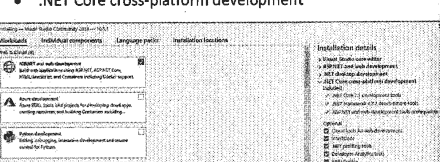

  如果你计划使用原生 GUI 库（如 LibUI、GTK 或 QT），明智的做法（有时也是必须的）是同时也安装 C++ 工具（但我们将在示例章节中说明何时及为何安装）。

- C++ 开发环境
- Linux 上的 C++

  如果你想使用 .NET Core 3 或 3.1 的预览版（或仍处于预览阶段的后续版本），你需要通过选择菜单中的相应选项来配置 Visual Studio 2019 以使用它：

  工具/选项/环境/预览功能。

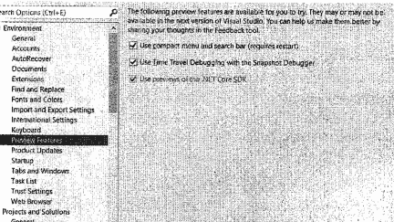

  对于主要开发工作站，你还需要一个可用的 Internet 连接，以便访问 NuGet 中央仓库（80 端口）来还原依赖包。

### 6.5.2 Linux 工作站

  （参见 Linux 的 .NET Core 3 安装。）

  Ubuntu 开发工作站无需额外安装，Ubuntu 桌面系统的默认设置中已经安装了许多工具。在安装 .NET Core 3 SDK 之前，请验证你已安装了 Ubuntu 先决条件包。一些示例将需要特定的依赖项，但对于需要此类安装的每个示例，我们都会加以说明。

### 6.5.3 macOS 工作站

  （参见 macOS 的 .NET Core 3 安装）。

  我们建议安装优秀的工具“Homebrew”，它是 macOS 缺失的包管理器。在作为完整堆栈 macOS 开发的一部分来轻松安装包时，它通常很有用（在我们将要研究的一些情况下是必需的）。你可以在 GTK 项目示例部分找到详细的安装说明（该示例设置依赖项需要“brew”）。

  对于开发工作站，如果你计划使用 macOS 系统 API 或原生库，明智的做法是也安装 XCode，或者至少安装“XCode 命令行工具”。

  XCode 是 macOS 和 ObjectiveC（macOS 使用的语言）的 Apple IDE。它可以帮助你匹配适用于该操作系统的相应库（原生 API）。

  这假设你具备 ObjectiveC 开发的基本知识，如果你不熟悉 macOS 系统，这可能会有些棘手（仅供专家）。

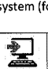

https://brew.sh/

https://developer.apple.com/xcode/

## 6.6 远程调试配置

  远程调试允许你在远程计算机（安装有不同操作系统的计算机）上执行你的代码，它允许你在目标平台上进行实时调试，而无需退出你最喜爱的 IDE（Windows 上的 Visual Studio）。

  在 GUI 桌面应用开发环境中，这种技术并不常用，因为使用跨平台框架（在我们的情况下是 .NET Core 3）会屏蔽平台特异性。

  尽管如此，它可以在开发多平台 .NET Standard 库（例如包装器）时使用，该库被应用程序使用，并且该技术正是在这种背景下被审查的。

### A) 在 Visual Studio 中：

  要在 Visual Studio 中启用远程调试功能，你需要在以下地址安装“Visual Studio 2019 远程调试工具”。下载并安装 Windows 的 ssh 客户端（Putty），它将用于测试与远程机器的连接，并使用 scp 实用工具复制文件（这取决于你想如何工作）。

https://visualstudio.microsoft.com/downloads/#remote-tools-for-visual-studio-2019/

http://www.putty.org


### B) 在 Linux 上安装 Visual Studio 2019 的远程调试工具：

```bash
$ curl -sSL https://aka.ms/getvstdbgsh | /bin/sh /dev/stdin -v latest -l ~/vstdbg
```

  此命令行指令应在平台上安装所需的 Linux 调试器引擎。

### C) 在 Linux 系统（Ubuntu）上设置用于调试的管理员账户：

  创建用于调试的特定用户并非强制性的，但这提供了不与其它账户的权限和组发生冲突的好处（从长远来看，这使得用户管理更容易）。但你也可以使用“root”账户。

```bash
~$ Sudo adduser dbgVS
```

  如果你没有安全约束，你甚至可以简单地使用“root”账户。

  你必须赋予该用户适当的权限，或/和将其加入适当的组，以获得访问部署文件夹的权限（读/写）（在大多数情况下，还需要执行权限，通常要求加入管理员组）。

### D) 启用 SSH 并在防火墙上打开端口（设置计算机之间的通信）：

```bash
$ sudo apt-get install openssh-server unzip
$ sudo ufw allow ssh
```

  此命令行安装 ssh 服务器并在防火墙上打开所需端口（22 端口）。

  从你的 Windows 工作站使用简单的 ssh 测试（使用 Putty 和新定义的用户）验证与 Linux 机器的用户和连接。还要检查该用户的文件夹权限。

### E) 部署应用程序：通过 scp 复制文件或在 Visual Studio 中使用发布工具：

  要部署应用程序，你可以选择使用“scp”命令复制它，或使用配置文件在“发布”阶段部署应用程序。你可以在其中指定可执行文件源和目标文件夹位置的文件是“launch.json”。

### F) 将调试器（在 Visual Studio 中）附加到 Linux 上的远程进程：

  如果在 Linux 机器上安装了 VS 调试器，你应该能够访问你连接用户的进程列表。选择进程（在许多情况下是程序名称）并在 Visual Studio 中将其“附加”到调试器（确保“显示所有用户的进程”复选框已勾选）。

### G) 执行调试（在 Visual Studio 中）：

  现在你应该能够能够从你的 Windows Visual Studio 实例在 Linux 上调试应用程序。


此技术在开发机器上进行编译，但你也可以在目标计算机上构建应用程序，然后附加调试器。

远程调试工具是在特定操作系统（而非其他操作系统）上遇到问题时的基本方法。它可以帮助你识别问题根源，从而以最少的时间解决问题。

但请注意，对于多平台应用程序项目，特别是那些使用原生调用（通过 P/Invoke）的项目，远程调试工具有时并不是合适的开发工具。当你选择构建应用程序的原生可执行文件时，无法使用此工具。

总之，这是编码阶段早期使用的一个工具，用于解决特定平台上的问题。它可以帮助你识别特定操作系统中设计的致命缺陷（是的，这种情况会发生：某些系统提供的功能其他系统不具备）。我们建议在需要特定调试上下文的项目开发特殊情况下使用远程调试工具。

否则，不要在这个开发阶段花费太多时间；反正你大部分 bug 都会在 Windows 开发平台上的编码阶段（在经典的 Visual Studio 集成调试器中）找到。

这里有一个参考链接，如果你的开发需要的话，你可以从中获取有关此过程的一些详细信息。

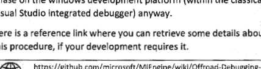

## 6.7 设置目标测试机器

目标机器（虚拟机或物理机）是你将要安装（并运行）应用程序的典型平台。如果你想实现应用程序的标准分发，必须在项目目标的每个操作系统上设置一个全新的安装环境。

这些机器将用于验证整个生产线，实际上也就是你想要交付的最终产品。在一个没有开发阶段中使用的任何依赖项的平台上测试你想要部署或分发的版本，始终是一个很好的实践。

你不必在项目开始时设置这些机器；当你想在现实世界条件下测试软件的部署和运行（在周期结束时）时，这些机器会很有用。通过此验证阶段非常重要，它会突出显示应用程序或安装程序中的每一个问题（你在开发工作站上未捕获到的错误）。

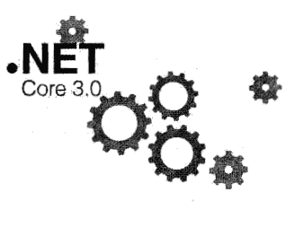

# 第 7 章. 测试你的程序

如今，一个严肃的开发项目会在软件解决方案开发的每个步骤中集成多种类型的测试。这些测试旨在保证应用程序的每一段代码（对象、方法等）都能提供预期的结果。这些测试还应验证所有这些元素是否协同工作良好。

在常规的多平台项目环境中，我们可以挑选出开发人员可以使用的 3 种测试类型：

- 单元测试保证程序最低级别（函数、方法）的良好功能行为。
- 功能测试保证基本元素的良好集成，并与规范中预期的结果保持一致。
- 性能测试评估程序完成任务的速度（我们将在关于性能的专用章节中详细阐述这部分内容）。

测试领域相当复杂，仅关于此主题就写了许多书籍；因此，我们只会为你提供实现应用程序基本测试的基本概念。

## 7.1 单元测试

由于我们使用 Visual Studio 2019 开发项目，在单元测试和代码覆盖率方面，显而易见的解决方案是使用集成工具来实现：MSTest。

重要的是要强调，这并非 Visual Studio 2019 中构建单元测试的唯一解决方案；我们可以提到历史悠久的、最流行的用于开发单元测试项目的框架，如 XUnit 和 NUnit。你可以在下方参考提供的链接中找到更多有关如何使用这些框架的信息；你还可以在 Visual Studio 中找到内置的项目模板，用于使用这些测试框架。


https://xunit.net/
https://github.com/xunit/
http://nunit.org
http://sourceforge.net/project/nunit

有多个 Visual Studio 扩展用于简化合其使用，并实现与我们首选 IDE 的良好集成。它们各自的项目模板（XUnit 和 NUnit）是随 Visual Studio 2019 提供的默认项目模板的一部分。但本章中，我们将详细回顾 **MSTest** 的使用；我们还将通过一个简单的示例项目来说明其使用。

此示例测试程序中展示的原则也可以通过使用上述提到的任何其他工具来完成；这些工具中每一个的架构和语法都非常相似。

### 7.1.1 测试什么？

单元测试项目旨在验证所编写代码提供结果的 validity。这些测试旨在验证代码的每个模块是否按预期工作。

单元测试在开发者环境中编码（示例数据、其他组件结果……），并由开发者对要开发功能的理解来定义。通常，你应该考虑为逻辑或计算复杂度高的方法/函数开发单元测试。

避免为基本方法编写不必要的测试，仅仅为了提高代码覆盖率百分比（实际上这并不重要），并尝试保持其与项目目标清晰且一致。

### 7.1.2 MSTest（Visual Studio 测试框架）

对于编写这些测试，开发者可以使用内置的 Visual Studio 工具：MSTest。该工具的优势在于它已在 Visual Studio 中可用，并且在微软支持网站上有非常完善的文档。

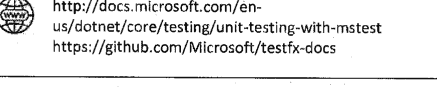

在 Visual Studio 中，单元测试在专用项目中实现；通常，测试项目是针对同一类的一组方法编写的。开发者为每个功能或特性（根据关键程度）编写一个单独的测试项目。

#### 7.1.2.1 创建单元测试项目

为了创建测试项目，你需要在“新建项目”窗口中选择“MSTest Test Project (.NET Core)”，如（*图 1*）所示。

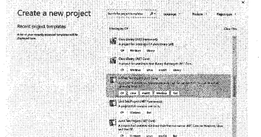

为其选择一个名称（最好在末尾加上“Test”一词），一旦创建了*测试项目*，你应该添加依赖项（通过“引用管理器”），引用包含你要测试的代码的项目，如下所述。

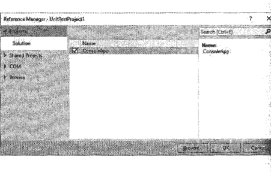

通过检查下方参考链接，你可以找到一个 MSTest 测试项目的示例；它将为你提供如何在自己的解决方案中实现和使用这种测试项目的快速视图。

https://github.com/netcore3/CodeBook/Chapter%207/1/UnitTestProject

#### 7.1.2.2 定义测试的验证：*ASSERT 对象*

你现在已创建并链接了单元测试项目到你的主应用程序，但你必须定义什么条件将产生测试通过或测试失败。

这是通过使用特定指令 `ASSERT` 来实现的。

**ASSERT** 对象通过 **expected**（预期）对象来验证 **result**（结果）对象。此验证确实验证了测试。

ASSERT 用于测试的验证。此验证可以通过控制你所测试方法的结果值来进行。ASSERT 是命名空间 **Microsoft.VisualStudio.TestTools.UnitTesting** 中的一个类。

测试验证可以使用 ASSERT 类的以下方法（非详尽列表）完成：

- **ASSERT.AreEqual()**：通过检查被测函数的结果值（但你必须知道结果值）来验证函数。
- **ASSERT.AreNotEqual()**：如果结果不是测试值，则验证函数（测试通过）。
- **ASSERT.Same()**：如果结果对象和预期对象类型相同，则验证函数。
- **ASSERT.NotSame()**：如果结果对象和预期对象类型不同，则验证函数。
- **Assert.IsNull()**：如果检查的值等于 Null，则验证测试。
- **Assert.IsNotNull()**：如果检查的值不同于 Null，则验证测试。

还有其他几种 ASSERT 方法可用（见[参考文档](#)了解各种测试验证类型），但这些方法在开发者遇到的大多数情况下都被使用（实际上，这些是最常用的）。


http://docs.microsoft.com/en-us/dotnet/api/microsoft.visualstudio.testtools.unittesting.assert

请注意，这些验证类型之间的选择将决定你的单元测试代码在检查方法时是否相关。如果你没有为验证选择合适的断言，测试可能毫无用处，甚至更糟的是，无法检查代码的有效性。

当 ASSERT 方法未通过验证时，会抛出异常（ASSERT 异常），并且测试将标记为“失败”。

### 7.1.2.3 执行单元测试

为了执行单元测试项目，你需要使用如下所示的“测试资源管理器”窗口：

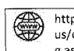

*(测试资源管理器)*

你可以使用“全部运行”菜单一次性运行项目的所有测试，或者通过选中特定测试并使用右键菜单中的“运行”选项来运行单个测试。

### 7.1.2.4 查看测试结果

测试结果可以在“测试资源管理器”窗口中看到，绿色对勾表示测试有效，红色叉号表示测试失败，如下所示。

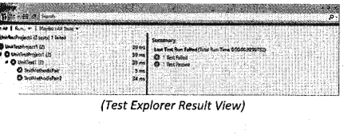

MSTest 为你的项目中实现单元测试提供了解决方案，因为它作为 Visual Studio 的原生组件，能与 Microsoft 的 IDE 完美集成。Microsoft 团队对其文档记录非常完善。参考文献和教程可以通过参考中的链接找到。

http://docs.microsoft.com/visualstudio/test

### 7.1.3 Mock 概念

定义相关单元测试的问题在于开发者的上下文：当编写单元测试项目时，许多对象尚未定义或数据库尚不可用。这可能是一个问题，因为开发者需要用尽可能大的输入数据面板来测试方法，覆盖尽可能多的情况（理论上）。

解决方法是使用模拟对象或数据库来模拟与开发者需要单元测试的功能进行交互的真实数据或对象。

这个概念称为 Mocking（模拟）。模拟对象隔离了你想要测试的方法/函数，并验证其是否独立运行（不依赖于其他方法）。模拟对象可以设置具有给定值的对象，并设置该对象的属性。

开发者必须硬编码方法所需的输入值，并定义一个验证测试，其中包含期望的结果值（同样需要硬编码）。

对于 .NET Core 3 开发，我们推荐使用 Moq (4.x)，这是最受欢迎且用户友好的模拟框架。Moq 是一个使开发和测试模拟对象变得简单的库，此外，该库提供了 LINQ to Mocks 功能，允许动态请求模拟对象用于验证。它支持模拟接口和类。


- https://github.com/moq/moq4/
- https://github.com/moq/moq4/wiki/Quickstart

你可以将以下包添加到测试项目中，以快速集成 Moq。


Moq

该包的最新版本基于 .NET Standard 2.0 实现，因此可用于 .NET Core 3 项目（这正是 .NET Standard 库格式的优点）。

下面是一个代码片段，向你展示如何在简单用例中使用 **Moq**。

```csharp
[TestFixture]
public class FooTest:
{
    Foo subject;
    Mock myInterfaceMock;

    [SetUp]
    public void SetUp()
    {
        myInterfaceMock = new Mock();
        subject = new Foo();
    }

    [Test]
    public void DoWorkTest()
    {
        // Set up the mock
        myInterfaceMock.Setup(m =>
            m.DoesSomething()).Returns(true);
        myInterfaceMock.SetupGet(m =>
            m.Name).Returns("Wolly");

        var result = subject.DoWork();

        // Verify that DoesSomething was called only
        // once
        myInterfaceMock.Verify(m =>
            m.DoesSomething(), Times.Once());

        // Verify that DoesSomething was never called
        myInterfaceMock.Verify(m =>
            m.DoesSomething(), Times.Never());
    }
}
```

正如你所见，Moq 的使用非常简单，即使是初级开发者也能轻松上手：

- 声明模拟对象：定义你想要模拟的对象类型。
- 配置模拟对象：为方法（即被模拟的对象）定义值。
- 验证模拟对象：验证模拟对象是否被调用（或未调用）。

Moq 拥有直观易懂的 API，不需要预先了解模拟知识。

还有其他几个库允许在单元测试阶段模拟对象，你可以深入了解 NSubstitute 和 FakeItEasy，以获取市场上模拟库的更广泛视野（它们是开源的）。这两个库提供了与之前描述的 Moq 库等效的功能（除了 LINQ 能力）。

你可以查阅它们各自 GitHub 仓库上的 wiki 以获取更多信息。


## 7.2 功能测试

功能测试和集成测试包括对每个应用程序功能的测试。换句话说，就是验证组装好的应用程序是否提供了预期的结果和功能。这可以通过选择特定的数据样本或配置集来实现。

这些测试可能包括：

- 使用关键值的测试。
- 边界测试。
- 域外测试。

功能测试是一种黑盒测试类型，因为它需要完成整个软件开发过程才能执行。测试人员通过使用多个场景和用例，验证所得软件与产品规格的一致性。

# 第 8 章 多平台开发解决方案

如果你想开始一个多平台项目，这可能是本书中最有用的章节。我们将通过详细回顾几个示例项目，展示如何使用 .NET Core 3 和 Visual Studio 2019 编写多平台桌面应用程序。

这些示例的源代码可在 netcore3 GitHub 仓库中获取（每个示例都会提供详细链接）。

所有项目均使用 .NET Core 3 构建，其中大多数使用 Visual Studio 2019。

### 8.1 选择多平台应用程序类型：正确的工具用于正确的工作

根据你打算开发的项目类型，选择语言（C++、HTML、XAML ...）和目标框架至关重要。

市场上已经存在许多多平台开发解决方案，但只有 .NET Core 3 在该领域提供了最先进的技术，包括性能、可维护性、语言功能、打包和部署能力。

在本书中，我们将为你提供解决方案的概览，以解决你在开发使用 .NET Core 3 的多平台桌面应用程序时可能遇到的具体问题。

每个提出的解决方案都可以解决特定约束或提供你的应用程序需要集成的特定功能，没有任何一个解决方案能完美满足所有多平台桌面开发需求，因此你必须特别注意选择适合启动的开发类型，以响应你的软件规格（并根据可用资源）。

这可以通过仔细研究本书提供的每个解决方案示例来实现：

- 控制台 GUI 应用程序。
- Web GUI (Electron.NET) 应用程序。
- 原生 GUI 应用程序（图形库 C++、GTK、QML）。
- XAML GUI (Avalonia) 应用程序（某种程度上的原生）。

在这些解决方案中，你应该找到最适合你项目约束和需求的那个解决方案。
这种选择还取决于你的开发者类型（或你更擅长哪种开发以生产高质量产品）。

- 如果你来自面向 Web 的开发（ASP.NET 开发者），使用允许你立即利用这些知识的工具（Electron.NET）来启动桌面应用程序可能是一个明智的选择。
- 如果你是优秀的 C# 和/或 C++ 开发者（控制台、系统、服务），你可以选择一种原生解决方案来实现 GUI (LibUI、GTK#、QML.NET)。
- 如果你是 C# .NET 框架桌面应用程序的老手（或 WPF 开发者），你很可能倾向于 Avalonia 提出的解决方案（但也可能是 QML 或 GTK 解决方案）。

总之，解决方案类型的选择取决于可用资源和你的项目需求。

### 8.2 控制台 GUI 应用程序

自图形用户界面发展以来，许多开发者已经轻视了控制台 GUI，但在许多情况下，它


对于一个多平台应用程序的开发来说，这可能是一个明智的选择（即使它不是最时尚的趋势）。

在过去几年中，许多用于构建“精美”控制台程序界面的库已被开发出来。

这在一定程度上是因为许多云框架（其中大多数都是跨平台的）已为服务器领域开发，实际上没有图形用户界面（GUI）实现。在这种情况下，开发人员感到在这个特定领域中缺乏商业提供的方案，许多人提出了自己的解决方案。这些库中的大多数都是开发者个人项目的成果，除了他们在 GitHub 上的联系方式外，不提供任何形式的支持。

尽管如此，实现控制台 GUI 应用程序仍包含许多好处，例如：

- 减少用于信息显示的资源使用。
- 可以通过容器（Docker 或 Kubernetes）轻松部署。
- 减少开发时间，真正专注于应用程序的目的。
- 无需使用昂贵的库（节省 RAM 和 CPU）。
- 在每个操作系统（Windows、Linux、macOS）上只编译一次程序版本。
- 复古酷的外观（个人口味）。

以下是我们在尝试了 GitHub 上几种可用的控制台 GUI 工具包框架后，精选出的几个库（这是一个非详尽列表，由于该主题变得越来越流行，许多新项目正在涌现）：

- ConsoleDraw。
- EasyConsole。
- Console Framework。
- Terminal GUI.CS

```
https://github.com/Haydend/ConsoleDraw
https://github.com/splittingatoms/EasyConsole
https://github.com/Elw00d/consolframework
```

如果您想更近距离地了解这类 GUI 开发的解决方案面板，您可以自己查看上述提到的框架。其中大多数是用 .NET 框架开发的，需要升级到 .NET Core，而且其中许多要求为 Linux 和 macOS 使用原生依赖项。

随着容器化部署（程序的容器化部署）日益流行，许多开发人员正在努力生产一种库，为使用者提供一个最小化的接口工具箱。在这个领域有许多新的解决方案，围绕该主题的社区也非常活跃。

在当前的背景下，终端用户界面（TUI）正日益流行，现代开发人员不应再忽视它，特别是如果您开发容器化应用程序或服务且具备最小可视化监控功能。

我们将在后续示例项目中使用的版本是 Terminal.Gui，主要因为它已经可以在每个平台（Windows、macOS、Linux）上运行，不需要安装原生依赖项，并且已有可用的 NuGet 软件包。

Terminal.Gui 发布的版本基于几年前开发的基础，并且仍由作者积极维护（GUI.cs 也在商业环境中使用），这一事实使其成为专业使用的可靠工具。

### 8.2.1 什么是 Terminal.GUI？

Terminal.GUI（或 Gui.cs）是一个用于 .NET Core 应用程序的控制台基于的用户界面工具包。原始版本是开发用于与 Mono（一个跨平台 .NET 框架，现在被称为 Xamarin 产品）配合使用的。它已在 2018 年移植到 dotnet core。

它被设计为在单色和彩色显示器上工作，并使用预定义的颜色方案（内置）。此工具包已集成大量可用的控件（或部件）。

它是基于事件的，因此调用函数的线程不应干扰应用程序的主线程。您也可以使用 async/await 模式。

以下是已在 Terminal.GUI 中实现的控件列表：

- 按钮
- 标签
- 文本输入
- 文本视图
- 单选按钮
- 复选框
- 对话框
- 消息框
- 窗口
- 菜单
- 列表
- 边框
- 进度条
- 滚动视图和滚动条
- 十六进制查看器/编辑器（HexView）

显然，如此多的可用部件使得开发具有高级功能的复杂 GUI 应用程序成为可能（对于 TUI 而言）。

该软件包是使用 .NET Standard 开发的，因此能够与 .NET Core 3 版本一起工作，源代码可在作者的 GitHub 仓库中获得。


此外，Terminal.Gui 也作为 NuGet 软件包可用，以便快速集成到您的 .NET Core 3 项目中。


在审查的工具面板中，此库似乎为鼠标支持（在 Windows、macOS 上）和 ASCII GUI 程序实现提供了最佳支持。

主要对象是 Terminal.Gui.Application，Application 由 MainLoop 对象的实例实现。此对象包含几个关键功能：

- 键盘和鼠标管理
- .NET 异步支持
- GUI 线程
- 与其他 MainLoops 集成的可能性，用于多屏幕应用程序）。

微软也认可此方案用于开发控制台 GUI 应用程序。


> **Terminal.GUI Wiki：**
> https://github.io/terminal.gui
>
> **微软在 2018 年微软 /Build 大会上关于 Terminal.Gui 的广播：**
> https://www.youtube.com/watch?v=Se1zNWJwDUE

不要错过查看 RETRO 编程活动（2018 年）的 YouTube 视频。这位微软广播与创建者（Miguel Delcaza）一起，详细介绍了可用的不同功能，可以作为引入使用此库的自学快速学习方法。

### 8.2.2 Terminal.GUI 屏幕设计

使用 Terminal.GUI 时，您没有用于屏幕的可视化设计器，必须用 C# 编写 GUI 代码。每个控件都必须通过 C# 编码声明、配置并添加到父对象中。这意味着，您必须（亲自）在代码中清楚地分离项目的功能逻辑和用 Terminal.GUI 实现的呈现部分。

为此，我们建议将屏幕相关任务（显示）分离到特定的源文件（.cs）中，以免与项目的逻辑和功能方面发生冲突（参见示例）。

由于您需要编写 GUI 代码，在编码阶段之前，您应该对屏幕设计有清晰的概念。为了实现这一目标，您必须在纸上草绘您的界面（或使用专用软件），并使用纸上的网格作为字符单位，如所示（图 1），请注意您目标的屏幕格式。


（图 1）

（40X25 屏幕画布）

您必须定义目标屏幕大小（40*25，80*40 或其他...），在列和行上标上数字，并在网格上草绘每个控件：窗口、组、菜单、标签、按钮...

在这种情况下，您可以使用参考文献中提供的网站来草绘您的 ASCII 应用程序（您可以看到图 1）。

http://www.asciiflow.com

列和行上的数字将为您提供控件的定位元素。您必须为应用程序的每个屏幕、窗口和对话框窗口完成这项工作。

一旦草绘完成，您就可以从网格中检索每个控件的坐标，从而避免通过尝试和失败循环重新定位每个控件直到达到预期结果的繁琐任务。

Terminal.GUI 提供方法用于：

- 定义窗口大小为全屏（检索当前控制台显示的可用维度）。
- 在该屏幕上定位窗口、对话框表单和控件。
- 管理键盘和鼠标输入。

像每个开源项目一样，您可以用自己的控件和功能扩展 Terminal.GUI 框架，您可以通过访问下方参考的网站来预览在 ASCII 部件设计方面可以达到的效果。该网站提出了奇特和创新文本部件设计。


### 8.2.3 控制台 GUI 示例应用程序

以下两个示例项目是使用公开可用的 NuGet 软件包开发的，这些程序的完整源代码可在 netcore3 GitHub 上获得（参见相应的网页指针）。


- 对于控制台 GUI 应用程序的第一个示例编码，我们将使用原始网站提供的完整屏幕文本编辑器作为基础模板。
- 对于第二个示例：迷你仪表盘，该示例将演示此库中可用的几种控件和布局的使用。

## 8.2.3.1 文本编辑器的编码 (consoleTextEditor)

“consoleTextEditor” 应用程序是一个始终有用的开发者工具，它构建于一个带有顶部菜单和编辑器窗口的全屏表单之上。它为用户提供使用“textview”控件创建和修改文本文件的机会。

以下是该应用程序在不同平台上运行的屏幕截图。

macOS：


### ubuntu：

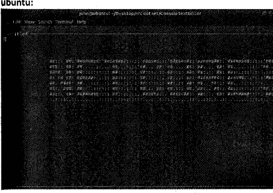

### Windows：

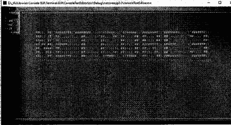

主窗口的大小会自动调整为使用整个控制台屏幕，并且可以调整窗口大小（Windows 和 Linux）。

在 Windows 和 macOS 上，可以使用“F9”功能键访问菜单项；在 ubuntu 上，使用“Esc 9”。常用的复制/粘贴功能可通过键盘的常用快捷键使用。

如前所述，所呈现的版本是对源库仓库中提供的示例项目进行的重构（架构、文件组织、呈现方式）。

“consoleTextEditor”应用程序作为示例提供，可用于 GUI 控制台应用程序开发的教学样本，涉及菜单集成、窗口、按钮等内容……

该项目已进行重构，以提供更优的整体架构组织。此示例项目未实施最佳性能实践，但整体架构可以为控制台 GUI 项目的源代码组织提供基础。

此最小化应用程序包含两个文件：

- **FileOperation.cs**：程序的基本功能函数（打开/创建/保存文件）在一个专用类中实现，这些对象在每个平台上仅依赖于 .NET Core 3 框架。
- **Gui.cs**：在此文件中，你将找到应用程序每个窗口的定义（主编辑器、打开文档、保存文档、新文档、关于、错误消息窗口、退出确认……）。此对象实现了与界面窗口和控件显示相关的所有代码。

由于该应用程序不包含任何业务逻辑（除了 FileOperation）。**Program.cs** 文件实际上非常空，仅包含对主图形用户界面对象的调用。文件功能的调用通过菜单使用静态类完成。

以下是 Visual Studio 中的“解决方案资源管理器”视图：

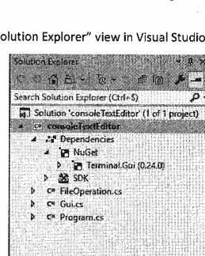

*(consoleTextEditor “解决方案资源管理器”)*

你可以在 netcore3 仓库的示例文件夹中找到“consoleTextEditor”的完整源代码。

https://github.com/netcore3/CodeBook/Chapter%208/2/consoleTextEditor

此示例是研究全屏控制台应用程序开发的良好起点，可以按原样使用。这不是使用之前推荐的最佳实践的优化版本，编码风格基本且未实现任何 C# 新功能，请毫不迟疑地改进它（在 GitHub 上 fork 它）。

若需使用更多类型的控件，您可以查看下一个示例（"consoleFormApp"）。

## 8.2.3.2 基本表单应用程序的编码 (consoleFormApp)

"consoleFormApp" 提供了一个有用的项目示例，用于使用 Terminal.GUI 开发高级控制台应用程序 GUI。

此示例在多个窗口中显示了可用于设计控制台应用程序的多种控件。它还演示了 ASCII 艺术的使用以及如何对控制台程序进行创造性应用。

以下是 Visual Studio“解决方案资源管理器”中显示的项目结构：

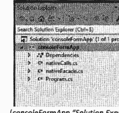

项目的总体架构与 consoleTextEditor 项目几乎相同，只是添加了一个空的 facade 对象 (nativeFacade.cs)。“nativeFacade”对象提供当前操作系统检测例程，以便通过使用根据所使用的操作系统（Windows、macOS、Linux）进行特定实现的本地调用，更轻松地集成本地调用。你可以轻松地在自己的程序中重用此模式（甚至通过使用接口和为每个系统专门设计的类来改进它）。

如上所述，"consoleFormApp" 包含 Terminal.GUI 中可用的多种控件。"ASCII art" 的使用为应用程序设计增添了一种更酷（且复古）的感觉，如下所示，它还说明了对专用代码的使用（对于每个操作系统，.NET Core 3 互操作性提供的功能）。

### 在 macOS 上：

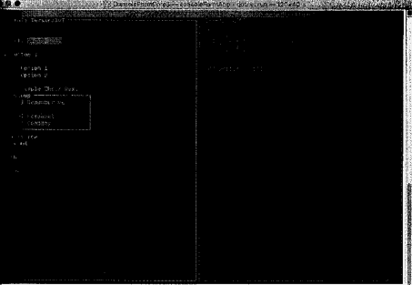

### 在 ubuntu 上：

File: \home\ubuntu-\*strategies\datas\datasets\KnasleFisherC3\

```
$ cmake -C build
Cmake  [..]
cmake -o ..
cmake -o ..

C\r: Option 1
C\r: Option 2

[1] Single CMake pres...\n[ ] Batch mode\r
[ ] Advanced mode\r
[ ] Configure\r
[ ] Generate\r
[ ] Load Initial Cache\r
[ ] Help\r

q. Quit
```

### 在 Windows 上：

C:\Users\..\

```
CMake [..]

[1] Single CMake pres...\n[ ] Batch mode\r
[ ] Advanced mode\r
[ ] Configure\r
[ ] Generate\r
[ ] Load Initial Cache\r
[ ] Help\r

q. Quit
```

此应用程序是一个实时演示，展示了在控制台 GUI 应用程序中使用 ASCII 小部件和 ASCII 艺术所能达到的效果。不要忘记，当你使用基于 ASCII 的 GUI 时，要发挥创造性，因为这种类型 GUI 提供的可能性非常有限。

**consoleFormApp** 是 Terminal.GUI 库提供的许多控件使用的标准演示，小部件显示在应用程序的左侧窗口中（如果可能，还会显示其名称）。

- 窗口。
- 分组。
- 对话框。
- 头部菜单。
- 标签文本。
- 文本框输入。
- 按钮。
- 选项。
- 单选按钮。
- 列表。

此示例说明了如何在你的窗口中实现控件，并说明了如何在控制台应用程序的一个屏幕内实现多个窗口。

“consoleFormApp”还说明了自定义 ColorScheme 结构体的使用。此项目示例提供了一种有用的 facade 模式，用于调用特定于每个平台的本地代码（显示当前系统名称）。

你可以在 netcore3 GitHub 上找到此应用程序的完整源代码。


https://github.com/netcore3/CodeBook/Chapter%208/2/consolFormApp

## 8.2.4 控制台 GUI 的利弊

控制台 GUI 是开发 GUI 的绝佳选择：

- 资源需求最小。
- 完美的多平台一致性（你可以选择为所有平台只使用一个源代码）。
- 直观的开发（只需一个项目即可开发你的应用程序）。
- 部署和打包简单。

但此解决方案无法应对所有应用程序：

- 具有高级图表的应用程序。
- 具有密集图形使用（图片或视频）的应用程序。
- 高级导航系统。
- 精确的鼠标支持。

总之，控制台 GUI 的使用可以解决基本 GUI 需求，适用于控制台工具，但不适用于大多数高级应用程序的需求，如：图形显示、图表、动画和界面的高级交互性。

对于所有这些需求，你将不得不选择后续介绍的其他 GUI 解决方案。

以下是一些用于获取完整在线文档和用于检查 .NET Core 3 程序依赖项的示例项目指针（可能有用）。


http://migueldelcaza.github.io/gui.cs/api/Terminal.Gui.html

http://www.github.com/mholo65/depends

# 8.3 ELECTRON.NET：ASP.NET GUI 应用程序

在需要跨异构平台完美匹配界面外观和感觉时，使用 ASP.NET Core 框架听起来是一个相关的选择。此方法需要良好的 ASP.NET Core Web 开发（以及 JavaScript）知识。

实际上，这种用于实现桌面应用程序的解决方案对于 ASP.NET Core 开发者来说似乎是理想的选择，因为整个软件开发生命周期与经典 Web 应用程序的开发非常相似。

毫无疑问，在本节中获得的对于开发此类应用程序的知识将有助于未来 .NET Core 3 发布后的此类应用开发。

使用 Electron.NET 进行的开发类型在当前时间无法从 Visual Studio 执行，许多 Electron 特定任务必须使用 .Net Core SDK CLI 完成。

Electron.NET 包装器并非设计为与 Visual Studio 2019 一起使用（在许多情况下你必须使用 CLI SDK）。

但在审查此库之前，我们将查看其起源和历史。


## 8.3.1 什么是 Electron？

Electron 是一个相对较新的框架（2013 年 7 月），用于使用 JavaScript 开发桌面应用程序。该框架在 GitHub 上按照开源模式进行开发和维护。Electron API 是使用 C 和 C++ 开发的，并通过 JavaScript 包装器暴露出来。

Electron 是 Chromium 渲染引擎和 Node.js 运行时的结合（两者均为 Google 技术）。这种组合允许在桌面的容器中以标准桌面应用程序的形式运行 Web 应用程序。

使用此工具开发的流行应用程序包括：

- GitHub Desktop
- Visual Studio Code
- WhatsApp
- Skype ...


该框架成功的主要原因在于，许多 Web 开发者使用此框架，利用其在 Web 开发方面的能力来开发桌面应用程序。尽管在架构性能上存在不足，但随着如今计算机算力的提升，此类应用程序在 Web 开发者社区中越来越受欢迎。

## 8.3.2 介绍 Electron.NET

Electron.NET 是围绕 Electron 的 .NET Core 包装器；其首次发布可追溯到 2017 年 10 月。该包装器使 .NET Core 具备使用 Electron API 的能力。换言之，Electron.NET 允许从 ASP.NET Core Web 应用程序开发 Electron 应用程序。

Electron.NET 的当前版本为 5.30.1，并兼容 .NET Core 3（因此后续版本也应该兼容）。该包装器是开源的，.NET Core 开发者可以对其进行使用和扩展。


但是，使用 Electron.NET 有一些先决条件。该框架要求您在开发平台上安装 Node.JS（至少版本 8.6）。尽管 Electron.NET 避免了在开发 Electron 应用程序时必须使用 JavaScript，但它需要安装 Node.JS 以用于构建和运行过程（即 Electron 引擎）。

为了在 .NET Core 中实现良好集成，Electron.NET 以 NuGet 包的形式提供。为了在 Electron 运行时（Host）和 .NET Core Web 应用程序之间进行通信，您必须在项目中包含相应的包。

```nuget
ElectronNET.API
ElectronNET.CLI
```

ElectronNET.API 是开发者必须在网站中包含的层，以便访问 Electron 功能；该包在 Electron 宿主和 ASP.NET Web 应用程序之间架起了桥梁。

Electron.NET.CLI 是用于构建和打包 Electron 应用程序的命令行工具；它不会在应用程序代码内部使用（它是一个工具）。ElectronNET.CLI 对于运行您的 .NET Core Electron.NET 应用程序是强制性的。

您可以使用下面描述的命令行安装此工具（这是 dotnet CLI 的一个工具集包）。它可以作为 dotnet CLI 的全局工具进行安装，扩展出“electronize”命令。

```bash
C:\> dotnet tool install ElectronNET.CLI -g
```

在 .NET Core 中设置好 Electron.NET.CLI 后，“electronize”命令即可作为 dotnet CLI 的全局工具使用。“electronize”命令仅安装针对特定的 .NET Core 版本；该工具本身安装在用户文件夹中：

```bash
%UserProfile%\.dotnet\tool
```

但在开始使用 Electron.NET 包装器之前，.NET Core 应用程序开发者必须先安装先决工具：**Node.JS** 及其依赖项 NPM。

## 8.3.3 设置 NPM 和 Node.JS

NPM 代表 Node Package Manager（Node 包管理器）。Node.JS 是 Chromium 项目的 JavaScript 运行时引擎（由 Google 开发）。Electron.NET 要求 Node.JS 版本 >8.6。我们建议从专用网站安装 Node.JS（参见参考文献中的网址），以获取工具的最新版本并确保在每个系统上进行正确的安装。

以下是下载安装文件（以及获取此处介绍的每个操作系统文档）的参考链接。

- https://www.npmjs.com/get-npm
- https://www.nodejs.org/en

我们将详细回顾这些工具在每个平台上的安装方法，因为这是使用 Electron 框架的核心要求，而且经常构成项目构建过程中的问题。

### 8.3.3.1 在 macOS 上

对于此平台，我们建议安装来自 NodeJS 网站的版本（这是最新版本，在构建 Electron.NET 应用程序时，版本编号不应有问题）。

下载完成后，您需要点击该工具进行安装（这是一个 .pkg 文件）。成功安装产品后，您应该看到如下表单：

- 介绍 (Introduction)
- 许可证 (License)
- 已选目的地 (Destination Selected)
- 安装类型 (Installation Type)
- 安装 (Installation)
- 摘要 (Summary)

此安装已成功完成。

- 此包已安装：
  - 将 Node.js v12.10.0 安装到 /usr/local/bin/node
  - 将 npm v6.10.3 安装到 /usr/local/bin/npm
  
- 请确保 /usr/local/bin 在您的 $PATH 中。


安装过程完成后，我们建议在开始构建 Electron.NET 应用程序之前重启计算机（以确保所有环境变量已更新）。

### 8.3.3.2 在 Ubuntu 上

在 Linux 系统上，您可以使用常用的包管理器“apt”并通过以下命令安装 Node.JS。由于在此环境中 NPM 不在同一个包中，因此您还需要安装 NPM。

```bash
$ sudo apt-get update
$ sudo apt-get install nodejs
$ sudo apt-get install npm
```

以下是成功安装的样子。

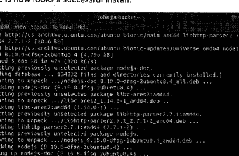

一旦两个包都正确（无错误）安装，您可以使用以下命令检查已安装的版本。


使用此命令还将帮助您验证一切是否正常工作（验证安装是否正确执行）。显示的版本编号必须 >8.6。

### 8.3.3.3 在 Windows 上

在 Windows 上，您必须安装 NPM 和 Node.JS。通过 Visual Studio Installer 程序安装 Node.JS 版本并不适用于构建 Electron.NET 应用程序（因为您还需要安装 NPM）。我们建议在此特定任务中不使用该版本。

更简单的解决方案是从专用网站设置 Node.JS/NPM；这将确保您安装可用的最新版本（此前已在参考文献中提供链接）。

以下是安装程序的视图。

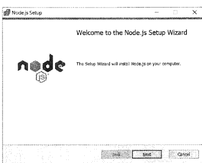

Windows 要求您重启系统，以便在开始使用之前使用新的环境变量更新系统。

## 8.3.4 Electron.NET 快速入门

使用 Electron.NET 需要遵循一定的程序，以便将其集成到 ASP.NET Core 应用程序中，并将其转换为桌面应用程序。

以下是将您的 ASP.NET Core 3 应用程序“electronize”的简短程序。我们将在稍后的示例部分中以更多细节回顾应用程序代码本身。

- **A) 创建一个 ASP.NET Core MVC 应用程序**
  
  这可以通过使用 dotnet CLI 或 Visual Studio 来完成。

- **B) 安装 Electron.NET 命令行全局工具（自版本 0.9 起）**
  
  在开始开发您的应用程序之前，您必须使用以下命令行命令为 dotnet CLI 安装 Electron.NET.CLI 全局工具。

  ```bash
  $ dotnet tool install -global Electron.NET
  ```

- **C) 添加 Electron.NET 包：**
  
  除了通过 Visual Studio NuGet 包管理器添加之外，您还可以通过在包管理器命令行中输入以下行来添加依赖项。

  ```powershell
  PM> Install-Package Electron.NET.API
  ```

- **D) 设置打包（仅限 Ubuntu 和 macOS）**

  此步骤仅适用于 Ubuntu 和 macOS 平台。在这些操作系统上，您必须使用以下命令行指令安装“electron-builder”。

  ```bash
  $ sudo npm install electron-builder -global
  ```

- **E) 开始使用 Electron.NET：**

  您可以通过在 WebHostBuilder 内使用以下代码来实现。

  ```csharp
  public static IWebHost BuildWebHost(string[] args) 
  {
      return WebHost.CreateDefaultBuilder(args)
          .UseElectron(args)
          .UseStartup<Startup>()
          .Build();
  }
  ```

  您可以注意到，我们只是在 WebHost 中添加了“UseElectron(args)”行，以启用在 MVC ASP.NET Core 应用程序内部使用 Electron。

- **F) 在 Startup.cs 文件中创建 Electron 窗口：**

  可以通过“Configure”方法中的以下指令来完成：

  ```csharp
  Task.Run(async () => await
      Electron.WindowManager.CreateWindowAsync());
  ```


使用这行代码，Web 应用程序将在 Electron 窗口中执行。

## G) 应用初始化：

首次启动 Electron 应用程序时，你需要使用以下命令对其进行“初始化”（你需要位于应用文件夹内）。

```bash
c:\appPath>dotnet electronize init
```

该命令将创建 "electron.manifest.json" 文件，此文件用于 "electronize" 命令来执行程序（该文件描述了 Electron 上下文）。

## H) 执行应用：

之后，你可以使用 "start" 命令执行 Electron.NET ASP.NET Core 应用程序，具体描述如下（Windows 下在应用文件夹中，ubuntu 和 macOS 下在解决方案文件夹中）。

```bash
c:\appPath>dotnet electronize start
```

在 ubuntu 和 macOS 上，你需要使用不带 "dotnet" 部分的 "electronize" 命令，如下所述。

```bash
$ electronize start
```

使用该命令，应用程序将在传统的桌面应用窗口中执行（不在浏览器中，但这仍然是一个 Web 应用程序）。

## 8.3.5 Electron.NET 应用示例

由于 Electron.NET 是 Electron 的流行封装器，你会在 GitHub 上找到大量的代码示例，这些示例将帮助并指导你开发你的 Electron.NET 应用程序（参见参考链接）。

这些示例通常大量使用 SPA（单页应用）技术，并使用专门的 JavaScript 框架，如 Vue.JS 或 React……原因是桌面应用体验要求屏幕闪烁最少，以便用户更乐于接受，并视其为有形的桌面应用。

因此，使用 Electron.NET 开发应用程序意味着大量使用 JavaScript，以在 Web 开发后端和桌面前端之间建立缓冲（前端具有像普通 Web 应用程序一样闪烁的自然倾向）。

我们将审查的 Electron.NET、ASP.NET Core 示例应用程序是来自 Electron.NET 存储库的 “ElectronNET-API-Demos” 应用程序。

这是此类应用程序的参考应用。它展示了 Electron.NET 许多特性的使用。出于教学目的，大部分源代码直接在应用程序中公开。

在这个示例中，你会找到几种适用于 Electron.NET 应用类型的有用技术，这些技术可以在你的应用程序中重用。这些示例可以作为研究 Electron.NET 的良好起点。在这些技术中，我们可以详细审查原生菜单和原生对话框窗口。

- 使用原生个性化菜单（需要特定的控制器，MVC）。

你可以在下面看到一段代码片段，用于在你的项目中（MVC 控制器）实现原生菜单。

```csharp
public class MenuController : Controller
{
    public ActionResult Index()
    {
        if (HybridSupport.IsElectronActive)
        {
            var menu = new MenuItem[ ] {
                new MenuItem { Label = "Edit", Submenu =
                    new MenuItem[ ] {
                        new MenuItem { Label = "Undo", Accelerator = "CmdOrCtrl+Z", Role = MenuRole.undo },
                        new MenuItem { Label = "Redo", Accelerator = "Shift+CmdOrCtrl+Z", Role =
                            MenuRole.redo },
                        new MenuItem { Type = MenuType.separator },
                        new MenuItem { Label = "Cut", Accelerator = "CmdOrCtrl+X", Role = MenuRole.cut },
                        new MenuItem { Label = "Copy", Accelerator = "CmdOrCtrl+C", Role = MenuRole.copy },
                        new MenuItem { Label = "Paste", Accelerator = "CmdOrCtrl+V", Role = MenuRole.paste }
                    }
                }
            };
            Electron.Menu.SetApplicationMenu(menu);
            return Ok();
        }
    }
}
```

这只是一个示例片段，用于说明如何在你的应用程序中实现原生菜单，你应该考虑详细审查可运行的示例代码中的实现方式（审查项目中 menu.cs 文件的源代码以获取实际样本）。

- 此示例中还审查了使用消息对话框窗口（该技术也用于文件打开、文件保存和错误消息对话框窗口）。

由于 Electron.NET 应用程序底层运行着两个进程，因此实现平台原生菜单有两段不同的代码（片段）：一段用于渲染部分（HTML/JavaScript），另一段用于后端应用（C# 进程）。

下面是一个创建原生消息窗口的代码片段（JavaScript）。

```javascript
document.getElementById("information-dialog").addEventListener("click", () => {
    ipcRenderer.send("information-dialog");
});
```

```javascript
ipcRenderer.on("information-dialog-reply", (sender, index) => {
    let message = "You selected ";

    if(index == 0) {
        message += "yes.";
    } else {
        message += "no.";
    }

    document.getElementById("info-selection").innerText = message;
});
```

以及要在你的 C# 后端中包含的代码。

```csharp
Electron.IpcMain.On("information-dialog", async (args) =>
{
    var options = new MessageBoxOptions("This is an information dialog. Isn't it nice?")
    {
        Type = MessageBoxType.Info,
        Title = "Information",
        Buttons = new string[] { "Yes", "No" }
    };

    var result = await Electron.Dialog.ShowMessageBoxAsync(options);

    var mainWindow = Electron.WindowManager.BrowserWindows.First();
    Electron.IpcMain.Send(mainWindow, "information-reply", result.Response);
});
```

有许多类型的原生对话框窗口可用（除了上面描述的那种之外），你可以详细审查 dialog.cs 文件的代码，以获取更多关于如何使用此功能的示例。

这些仅是示例应用程序中展示的一小部分特性，但似乎它们是 Web 应用程序开发人员看来最独特的部分。

正如你所见，这些基本功能（菜单和对话框）在应用程序中的实现并不明显。管理由 Electron 架构引入的双进程存在许多复杂性。随着你的应用程序本身变得更加复杂，这种复杂性将会增加。

研究 “ElectronNET-API-Demos” 项目可能有助于你在 Electron.NET 开发人员所需的阶段学习过程中提供帮助。

**注意**：该示例无法从 Visual Studio 2019 IDE 中执行，在这种情况下，你必须使用 “dotnet CLI”。

“ElectronNET-API-Demos” 的完整源代码可在 GitHub 上获取。


请注意，Electron.NET 仍在持续开发中，它对应用程序中包含的每个包的版本非常敏感。这使得当你尝试使用互联网上的代码示例应用程序（使用旧版本）时，构建过程变得有些棘手。

你可以在下方查看应用程序在各个平台上的渲染效果。

## 在 macOS 上：

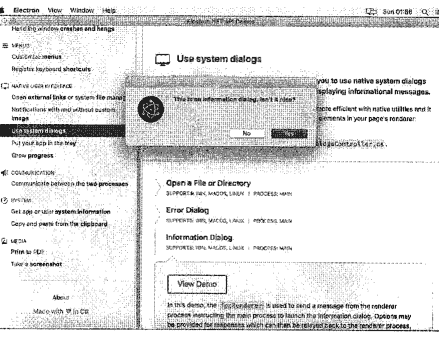

## 在 ubuntu 上：


# ELECTRON.NET API 演示

- 组件
    - 创建和管理 WebViews
        - 包括进程内和进程外
    - 访问
        - 上下文菜单
        - 注册原生快捷键
    - 系统用户界面
        - 在系统文件管理器中打开外部链接
        - 系统与浏览器之间的交互
- 交互
    - 打印页面和文件
    - 共享进度
- 通信
    - 在两个进程之间通信
- 系统
    - 获取用户/系统交互信息
    - 用作此小应用的配置
- 页面
    - 偏好设置 & PDF
    - 截图

# 使用系统对话框

Electron.NET 允许你使用原生系统对话框来打开文件或目录、保存文件或显示信息消息。

这是使用进程的主要原因，与原生 UI 效率更高，并且允许用户在 Electron.net 和渲染进程之间进行交互。


`错误对话框`
```csharp
public static void Error() {
  var dlg = new ErrorDialog();
  dlg.ShowDialog();
}
```

`信息对话框`
```csharp
public static void Information() {
  var dlg = new InfoDialog();
  dlg.ShowDialog();
}
```

在这个演示中，使用 `InfoDlg` 类向渲染进程发送消息。渲染进程将拦截 `InfoDlg` 消息并响应来自在渲染进程中显示的 UI 线程的 `InformationMsg` 消息。

此外，`Msgs` 将是 `Msgs`，即渲染进程。

信息对话框可以显示任何自定义内容，包括：
- 标题
- 消息
- 图标

## 在 Windows 上：

- Electron.NET API 演示
- 查看
- 窗口
- 帮助

# 跟上节奏

使用 Electron.net 演示中的演示项目供你自己使用。Electron Quick Start 是一个最简单的模板，展示了基本应用的基本布局。如果你想制作一个 Electron 应用，.NET 模板是一个很好的起点。访问文档以了解如何使用 Electron.NET Core API 创建 Electron.NET 项目。

> Electron Quick Start 是一个最简单的模板，展示了基本应用的基本布局。如果你想制作一个 Electron 应用，.NET 模板是一个很好的起点。访问文档以了解如何使用 Electron.NET Core API 创建 Electron.NET 项目。

```csharp
// Include the namespace:
using ElectronNETCore;

public static void Main() {
  var host = new ElectronHost(ElectronHostOptions());
  host.Init().Run();
  host.WaitFor();
  host.Exit();
}
```


当你在 Windows 上运行应用程序（使用 `dotnet electronize start` 命令）时，会注意到一个安全对话框窗口出现（具体取决于所使用的安全级别），你必须确认提出的安全规则（点击下方窗口中的“确定”）。

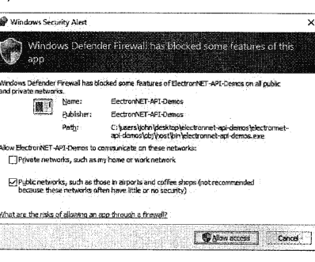

## 8.3.6 Electron.NET 应用的优缺点

由于该应用是一种 Web GUI 实现，因此在所有平台上的渲染都非常相似。GUI 显示在平台间的一致性是该类解决方案所实现的特点（和优势）之一。能够使用增强的 JavaScript 界面设计是另一个优势，但此类桌面应用程序的性能并不总是最优的。

尽管你可以使用 Visual Studio 开发工具来开发 Web 应用程序部分，但 Electron.NET 工具无法在 Visual Studio 2019 内部使用，你必须使用“dotnet CLI”来初始化、运行、构建和打包应用程序（如前所述）。

Electron.NET 为 ASP.NET 开发人员提供了将其应用程序针对离线桌面环境运行的能力，但在这样做之前，仍有一些特定的 Electron.NET 知识需要消化。即使你是一名资深 ASP.NET Web 开发人员，你也必须经历一个学习曲线，以消化桌面开发的特定要求。

**注意：** Electron.NET 对其必须使用的 .NET Core 版本要求非常严格，你必须找到 Electron.NET 版本和 .NET Core 版本之间的正确组合，才能成功构建和执行程序（在某些情况下这可能很棘手）。

## 8.4 C++ 原生 GUI 应用程序

在 .NET Core 3 应用程序中实现原生 UI 有几种解决方案。使用原生 GUI 可以为每个操作系统的用户提供一种该应用程序是专门为其自身平台开发的感受。通过使用标准的窗体和控件，用户可以直接熟悉软件界面（应用程序看起来像是原生的）。

图形原语在三大系统（Linux、macOS、Windows）上的稳定标准化，为开发人员提供了编写在所有系统上都工作的图形界面的机会。通过使用经过适当包装的 .NET Core 3，开发人员可以受益于已存在相当一段时间的 C++ 库（可靠性）。

这里展示了在 .NET Core 3 应用程序中使用原生库实现 GUI 的架构模式（图 1）。

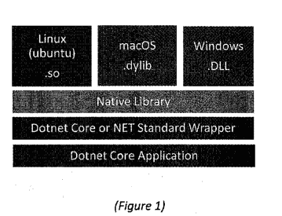

跨平台图形库必须根据应用程序实际运行的操作系统进行切换。在这种情况下，你应该拥有你所工作的系统对应的库版本。

对于开发跨平台应用程序，你应该拥有每个操作系统的库。

这些库中的大多数最初都是为与 C++ 配合使用而开发的，因此需要开发一个 Wrapper（封装器）。

Wrapper 将机器码库封装为 .NET Core 可访问的对象，Wrapper 提供针对原生库的非托管调用（marshalling）和 P/invoke 方法。

最终，你需要每个平台的编译后库（即 Linux 的扩展名、macOS 的 **dylib** 扩展名、Windows 的 **dll** 扩展名）以及一个 Wrapper（可能是一个包），以便在 .NET Core 3 中使用这些（原生）库并调用它们。

有许多基于 C 和 C++ 语言的多平台 GUI 解决方案（许多操作系统使用这种语言开发），这些方案是自己在 .NET Core 3 中实现 GUI 的良好起点，以下列表列出了其中最受欢迎、经过验证且高效的几个：

- LibUI
- guilite
- Cogui
- Nuklear

这些框架旨在作为开发 C 程序的“砖块”（用户界面），那么，为什么要在本书中介绍此类工具呢？好吧，C 库可以很容易地从 .NET Core 3 应用程序中调用（参见关于使用非托管依赖项的章节），通过一个 Wrapper 类即可实现。

Wrapper 使 C 库的集成几乎像使用标准包一样简单。如今，非托管库（C、C++）的集成在托管应用程序（.NET）中已经做得非常好了。

你可以从以下参考链接找到关于这些库的更多信息：

| https://github.com/dnlabss/liblul | https://github.com/idear4good/GuiLite | https://github.com/vurturn/nuklear | http://xpcda.net | http://cegui.org.uk |
| --- | --- | --- | --- | --- |

当然，你可以为你最适配的库开发自己的 .NET Core wrapper，但为使用这些库编写 wrapper 是一个大量的工作，往往本身就是一个独立的项目。

然而，其中一些库（最受欢迎和广泛使用的）已经开发了针对 .NET Core 的 wrapper。你选择的库已经有了由经验丰富的个人或开发社区制作的多个版本的 wrapper，他们希望访问轻量级 C 图形用户界面框架（同时也为了性能），用于他们的 .NET Core 开发。

对于以下示例，我们选择使用 LibUi。首先，因为 LibUi 是一个被专业人员认可的、高效的库，并且已经有多个针对 .NET Core 使用的 wrapper 实现开发并可用，避免了开发我们自己 wrapper 的繁琐且耗时的任务。此外，它使用我们打算开发的每个平台的原生控件。

### 8.4.1 LibUI 简介

LibUI 是一个简单的、可移植的 C 语言 GUI 库，它在每个支持的平台上使用原生 GUI 控件。这是一个开源且免费使用的框架，由一个充满活力的社区开发，如果你认为其他用户会很高兴拥有改进或新功能（通过 GitHub 贡献），你也可以参与其开发。

该库可用于 Windows、Linux 和 macOS（以及几个其他操作系统！）。作为一个开源项目，你可以在 GitHub 存储库上免费找到源代码。

LibUI 库的开发仍然非常活跃，最后一次发布是在 2019 年 4 月 7 日（截至此时），这将保证如果你遇到特定问题（这不是支持，但在许多情况下，它会帮助你修复问题）或需要特殊功能时，拥有一个响应迅速的社区。


你应该查阅 LibUI 的 GitHub 网站以访问文档并获取一些控件使用的示例（通常是用纯 C 开发的）。GitHub 网站还将帮助你了解 LibUI 背后的内部逻辑（总是很有用的）。

### 8.4.2 LibUI 的 .NET Core wrapper

正如我们之前提到的，已经有多个 wrapper 被开发用于在 .NET Core 中使用 LibUI。这些 wrapper 中的大多数是使用 .NET Standard 实现的。针对 .NET Core 的可用 wrapper 列表来自 LibUI 的 GitHub 网站，并得到社区的认可。

- DevZH.UI
- TDFX.UI (SharpLibUI)
- SharpUI

经过多次测试，DevZH.UI 似乎是最灵活的解决方案。即使最后一次更新是在 2017 年签入的，这个 wrapper 也是最新的并且可以正常工作（这种情况并不常见），兼容当前版本的 LibUI（最后更新于 2019 年 4 月 7 日）。

原始版本 DevZH.UI 的源代码可用（见下方 GitHub 链接）。如果你不太放心使用选定的 wrapper（DevZH.UI），你也可以查看其他解决方案。


NuGet 包的发行名称是 DevZH.UI，它可以在标准 NuGet 网站上找到。


虽然 NuGet 包看起来处于 alpha 版本，但在测试平台上的示例程序开发过程中，源代码运行得非常良好。我们在审查过程中没有遇到任何问题。

但由于标记为 alpha 版本，你需要在包管理器中勾选“包括预发布版本”（include prerelease），以便在 Visual Studio 的 NuGet 包管理器窗口中列出该包（见图 1）。


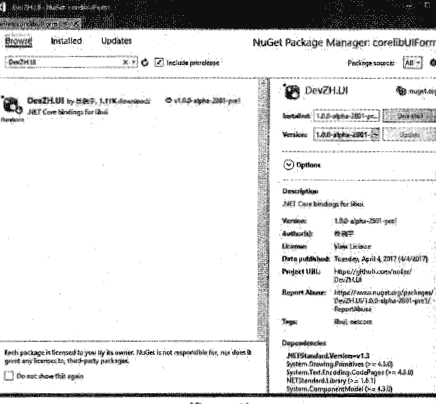

（图 1）

一旦将包包含在您的项目中，您就能够使用 LibUI 库提供的许多控件和窗口类型。

以下是该包装器中可访问的控件列表：

- 文本框
- 标签
- 按钮
- 窗口
- 组
- 选项卡
- 菜单
- 复选框
- 单选按钮
- 列表
- ... 以及许多其他

该列表并不详尽，您可以深入查看包装器的源代码，以获取可使用的控件完整列表。基本上，所有标准控件均可用，这使得使用 .NET Core 3 开发标准跨平台应用程序变得轻而易举。

LibUI 使用每个目标操作系统的原生显示基元，因此生成的应用程序将具有每个操作系统的原生外观和感觉。

将包添加到项目中会包含所有目标平台（Windows、Ubuntu、macOS）的原生依赖项（LibUI 库的编译版本），这些依赖项会根据程序运行的操作系统自动使用。这对于 C# 开发者来说非常方便，因为他们无需为每个平台编译 LibUI 库。

实际上，开发者只需在 .NET Core 3 项目中添加该包，即可在项目内使用 LibUI（实际上是包装器）中的所有可用功能。

所审查的操作系统（Windows、Ubuntu、macOS）的图形 API 多年来一直保持稳定，LibUI 的新版本仅旨在修复错误和问题或添加新功能（小部件）。

### 8.4.3 表单/屏幕设计

这是一个主要缺点，当使用 LibUI（或包装器）时，你没有使用设计器（也许应该开发一个？）来创建应用程序表单/屏幕的可能性，在开发复杂或大型应用程序（包含大量表单）时，这可能是一个巨大的缺陷。

每个窗口/表单都必须用 C# 手动编码，这意味着每个窗口和控件的定位和大小必须通过 C# 中的内联指令来定义。

该库用于将控件添加到窗口的默认行为在功能上是可用的，但它有自己的逻辑。该库使用水平和垂直框来控制控件的定位，它非常适合编码标准设计的 GUI。然而，GUI 的开发必须通过代码完成，并不断预览，直到达到预期结果。

这里有一个代码片段，说明如何开发一个带有按钮控件和标签的基本窗口表单（这是下一节提供的演示项目中的一个片段）。

```csharp
public class MainWindow : Window
{
    private HorizontalBox _horizontalBox;
    private Button _button;
    private Label _label;

    public MainWindow(string title = "Multi:Platform UI", int width = 500, int height = 200, bool hasMenuBar = false) : base(title, width, height, hasMenuBar)
    {
        InitializeComponent();
    }

    private void InitializeComponent()
    {
        _verticalBox = new VerticalBox { AllowPadding = true; };
        this.Child = _verticalBox;

        _label = new Label("Hello from LibUI");
        _verticalBox.Children.Add(_label);

        _button = new Button("Sample Button");
        _verticalBox.Children.Add(_button);

        _button.Click += (sender, args) =>
        {
            MessageBox.Show("This is a message box.", "More detailed information can be shown here.");
        };
    }
}
```

此代码片段用于“corelibUIForm”示例程序（见下一节）。

这是此处介绍的 LibUI 包装器的非常基本的实现，但它让您对选择此库开发 .NET Core 3 项目所涉及的开发类型有了很好的了解。

### 8.4.4 示例项目

在 .NET Core 3 桌面应用程序中使用 LibUI 的包装器通过以下示例项目进行了说明。

- 第一个示例项目是一个经典的“ControlGallery”项目，改编自包装器的 GitHub 仓库。
- 第二个示例旨在为您提供一个样板项目，用于开发您自己的应用程序。

这两个示例都可以在 Visual Studio 2019 中使用和扩展，它们都针对 .NET Core 3。

#### 8.4.4.1 Control Gallery 示例应用程序

此应用程序是原始 DevZH.UI 仓库中提供的应用程序的更新版本。

该项目旨在说明在开发桌面 .NET Core 3 应用程序时，使用它可以达到的结果类型。它展示了使用各种小部件的示例。

如您在下面看到的，该应用程序的外观和感觉完全符合每个操作系统的设计规范（在每个操作系统上看起来都非常棒）。性能也不受影响，LibUI 是一个轻量级库。

**在 macOS 上：**

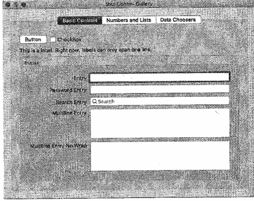

**在 Ubuntu 上：**

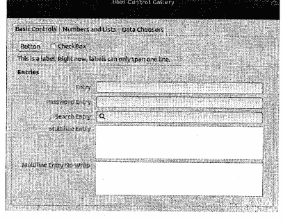

**在 Windows 上：**


该示例应用程序是几种类型控件的基本实例化和初始化的良好模板，但该演示中并未展示通过包装器可用的所有控件（通过详细审查包装器的源代码，您可以找到其他类型的控件实现）。

作为一个示例应用程序，该应用程序具有轻量级架构。该应用程序只是一个演示，带有 3 个选项卡表单，用于说明控件的使用。

您可以在 Visual Studio 的“解决方案资源管理器”中看到：


*（LibUI ControlGallery 项目示例）*

此示例的原始代码来自原始 DevZH.UI GitHub 仓库，已更新以用于 NuGet 包和 .NET Core 3。

重构后的示例（针对 .NET Core 3）的源代码可在 GitHub 上获取：


您可以尝试自行使用此简单示例，以便更熟悉 LibUI 和包装器 DevZH.UI 的使用。您也可以使用 "coreLibUIForm" 项目作为新项目的起点。

#### 8.4.4.2 基本表单项目示例

此示例项目的目标是提供一种快速使用 LibUI 包装器 DevZH.UI 开发应用程序的方法。

该项目包含一个带有标签和按钮的基本窗口。它是一个经过验证的模型，可用作项目开发的基准（灵感来自 Visual Studio WinForms 默认项目模板）。

该项目已准备就绪，并已包含此类项目所需的所有依赖项。

如您在下图（图 1）所见，项目架构极简。


（图 1）

以下是该应用程序在每个操作系统上运行时的预览。

**在 macOS 上：**


**在 Ubuntu 上：**


**在 Windows 上：**


该项目的源代码和架构旨在作为开发 .NET Core 3 GUI 桌面应用程序的最小实现，因此它提供了一个用于启动自己项目的示例。

该项目的完整源代码可在 GitHub 上获取。

https://github.com/netcore3/CodeBook/Chapter 8/4/corelibUIForm

### 8.4.5 基于 LibUI 的 .NET Core 3 应用程序回顾

总之，LibUI 为开发 GUI 桌面应用程序提供了一种轻量级且高效的解决方案，它不需要安装依赖项的先决条件，也不需要安装专用工具。它轻量且快速，社区正在持续工作以进行改进集成。

在此背景下，LibUI 似乎应该是用于 .NET Core 3 GUI 应用程序的完美工具（至少在该时间内，不同操作系统的显示 API 保持稳定），然而，缺乏用于 GUI 设计的可视化设计器可能会阻止许多开发者在专业环境或快速开发中使用它。掌握包装器以设计 GUI 所需的时间不应被低估，但一旦完成，该库取得的效果可能非常令人印象深刻。

## 8.5 GTK GUI 应用程序

GTK：“The Gimp Toolkit”最初是 Gnome 为在 Linux 上开发 GUI 应用程序而发起的倡议。GTK 在开源许可证（GNU）下开发。GTK 构建在 Glib（以及其他库）之上，这是一个经过充分测试且流行的库。

GTK 未提供大量文档，并且有特定的先决条件，因此被大多数开发者视为一种工具


使用起来比较困难。但我们会看到，无论目标平台是什么，使用这种工具都能实现灵活的开发并获得良好的结果。因此，使用你喜欢的开发工具 Visual Studio 2019，你可以在其中获得极佳的开发舒适度来完成此类项目。

## 8.5.1 GTK 简介

GTK 位于许多知名的跨平台商业应用程序底层，在 GUI 项目开发方面被专业人士广泛认可。例如，Ubuntu 的 Gnome 桌面应用就是使用 GTK 开发的。

我们可以简要列举 GTK 的核心优势如下：

- 稳定性：GTK 已经研发了数十年。
- 酷炫的外观和交互体验。
- 支持主题。
- 面向对象（OO）方法。
- 本地化。
- 国际化。
- 良好的文档（文档正在不断完善）。

请记住，GTK 是为了配合使用并基于 C 和 C++ 语言开发的，因此它沿袭了这些语言的总体架构和编程逻辑。因此，这种开发模式非常适合希望利用 .NET Core 3 来实现生产力飞跃的 C 和 C++ 开发者。

GTK 工具包是 Linux 原生的，而 Windows 和 macOS 版本属于模拟环境；在这些操作系统上，GTK 工具包需要安装一系列库（并非完整列表）：

- Atk：GTK 的无障碍框架。
- Cairo：用于向量和图像合成的图形库。
- Gdk：包含窗口中的图形基元。
- Gio：用于 GTK I/O 操作的辅助函数。
- Glib：GTK 的工具箱和辅助函数（GTK 的基础之一）。
- Gtk：包含控件架构（用于窗口和控件）。
- Pango：GTK 的字体渲染库。


使用 GTK 的基本编程逻辑是利用控件的层级树结构。在 GTK 中，“控件”（widget）一词用于指代控制元件、窗口以及 GUI 中的基本所有元素。

主要的容器控件是窗口对象；其他控件（如文本框、标签、按钮、下拉菜单等控制元件）可以添加到主窗口（容器）内部。

GTK 是事件驱动的（信号/处理器）。例如，当你点击按钮时，会向应用程序发送一个信号；你需要通过编码来定义信号和处理器。

开发 GTK 应用程序的文档主要是针对 C 和 C++ 语言编写的；尽管如此，如果具备基本的 C 语言知识，这些文档可以轻松地适配/移植到使用 .NET Core 3 C# 语言的环境。

GTK 库不仅要安装在开发机器上，还必须随创建的应用程序一起安装（因此你需要在安装程序中包含它们）。

GTK 的原生依赖项在目标机器上是必须的；这是应用程序正确执行的前提条件（你需要在安装程序中包含这些依赖项）。

以下是更多关于 GTK 框架的网络资源链接。


- https://gtk.org
- https://blog.gtk.org
- https://developer.gnome.org
- https://gnome.com/gtk
- https://github.com/GNOME/gtk

## 8.5.2 安装 GTK

如你所知，GTK 是 Linux 原生的工具，但需要在其他系统（Windows 和 macOS）上安装。从第三版开始，GTK 的安装不再是一个简单的可执行二进制文件。在 Windows 和 macOS 上的安装过程涉及设置一个模拟的 Linux 环境（该环境在磁盘上占用的空间可能像原始的 Ubuntu 发行版一样大）。

GTK 也需要安装在你计划部署或测试 GTK 应用程序的机器上（至少是运行时）。我们将详细回顾如何在各系统上进行这种设置。

### 8.5.2.1 在 Windows 上（针对开发站点）

关于 GTK 设置的说明来自 gtk.org 网站（请参阅参考网站）。这是在 Windows 平台上安装 GTK 的推荐步骤。另一种解决方案是从源代码构建 GTK 工具包，但这需要预先安装 C 构建环境（这不是我们的目标）。

#### A）安装 MSYS2

为了配置 GTK，你需要为此类应用程序设置一个环境：mingw。

Mingw 是“Minimalist GNU for Windows”（Windows 精简版 GNU）的缩写；它提供了用于开发 Microsoft Windows 应用程序的开源环境。

MSYS2 是一个在 Windows 站点上提供类 Unix 环境（mingw）的项目。该项目为在 Windows 上开发 GTK 应用程序奠定了基础；它将允许设置 GTK 运行时以及你开发 .NET Core 3 GTK 应用程序所需的工具（如 Glade）。

MSYS2 提供类 Unix 的包管理器：“pacman”以及许多其他来自 Linux 环境的实用工具。


你可以像标准 Windows 应用程序一样安装 MSYS2，如图 1、2 和 3 所示。安装程序在安装过程中不应返回任何错误；如果出现这种情况，请卸载有故障的版本，修复问题，并从头重新安装，直到成功安装 MSYS2。


MSYS2 64位安装
正在安装 MSYS2 64位
正在安装组件 MSYS2 64位 基础...
显示详细信息
关闭
取消
（图 2）

最后一屏（图 3）显示了 Mingw 命令提示符；此屏幕表示安装已完成且成功。

安装过程完成后，请重启 Windows。

#### B）安装 GTK

一旦你成功安装了 MSYS2 并重启了系统，你现在可以安装 GTK 运行时和开发库。该安装可以通过在 mingw 环境中使用适当的“pacman”（包管理器）命令来完成。

```bash
~ pacman -S mingw-w64-x86_64-gtk3
```

预期的结果应该如图 4 所示。


（图 4）

#### C）安装 Glade

Glade 是新的 GTK 界面设计器；它将允许你通过可视化工具设计应用程序，并将其保存为标准 XML 格式文件，该文件可由 GTK 使用 GTKBuilder 加载。在第三个版本中，这是一个专业级的工具，可以像设计标准的 C# Winforms 应用程序一样设计你的 GTK 应用程序 GUI。

即使 Glade 具有自己的设计逻辑，它也允许开发人员对 GUI 进行精细的建模。

Glade 的设置也是通过“pacman”程序使用以下命令完成的：

```bash
~ pacman -S mingw-w64-x86_64-glade
```

成功安装 Glade 的屏幕应该如图 5 所示。


（图 5）

安装完成后，你可以通过点击 mingw 文件夹中的“glade.exe”文件，或者运行命令行“glade.exe”来手动启动 Glade 程序。

我们将在后面回顾如何在 Visual Studio 2019 中集成 Glade，以便在不离开 IDE 的情况下编辑界面（XML 文件）。

当然，如果你不打算使用 GUI 可视设计器，而是用 C# 内联代码和 XML 定义 GUI，那么你就无需安装 Glade；如果你手动编写 GUI，Glade 不是必须安装的。

#### D）配置环境变量

为了从系统范围访问 GTK 库和依赖项，你应该修改 Windows 全局路径。为此，你需要编辑全局路径环境变量：

控制面板 > 系统和安全 > 系统 > 高级系统设置 > 环境变量 >

修改“Path”变量，将“`C:\msys64\mingw64\bin`”（或你设置的 mingw 工具路径）添加到其中，如下方图片（图 6）中所述。


此修改将在 Windows 系统下次重启后生效。

你也有可能仅在 Visual Studio 项目属性中的 GTK 应用程序内添加环境变量路径，但我们将在后面的示例部分回顾这种解决方案。

### 小贴士：Windows 上安装 Gtk 的替代方法

上述安装方法的缺点在于有点笨重；你需要安装完整的 mingw 构建环境才能实现。相对于安装的目标（安装 GTK 运行时）而言，这似乎有点过大。这是因为没有人（GTK 社区不像以前那么活跃）完成了……


## 8.5.2 安装 GTK

### 8.5.2.1 在 Windows 上

自第二版（几年前）以来，GTK 工具包已不再发布二进制安装包。

尽管如此，独立的开发者通过充分利用 NullSoft 安装程序提供了这种类型的设置。当前的安装版本二进制文件可在他们的 GitHub 上获取。


此发行版（由 Tom Shoonjans 和 Alexander Shaduri 制作）集成了最新可用的 Gtk 工具包（3.24 版本）以及使其正确运行所需的所有依赖项。该最新版本于 2019 年 7 月 2 日发布，似乎是安装 GTK 工具包的一个可靠来源。您还将找到用于生成 Windows 上 GTK 运行时自定义安装程序的 NullSoft 脚本。

### 8.5.2.2 在 macOS 上

如前所述，在 macOS 上安装 GTK 可以通过使用“HomeBrew”（参见参考网页链接）并遵循下面描述的过程来完成。


如果您之前尚未安装 Brew，以下是安装它的方法，以及随后如何使用它安装 GTK 的方法。

- **A) 安装 Brew**

您可以通过在 macOS 终端提示符中执行以下命令行来安装 *brew*：

```
$ /usr/bin/ruby -e "$(curl -fsSL https://raw.githubusercontent.com/Homebrew/install/master/install)"
```

结果应与描述中的一致（*图 7*）。


(*图 7*)

- **B) 安装 GTK**

安装 *Brew* 后，您可以轻松使用以下命令行（*公式*）安装 *GTK* 运行时和依赖项。这将安装 *GTK* 3 版本及其所有依赖项。

```
$ brew install gtk+3
```

如果软件包设置正确，此命令应产生以下输出。

```
Elana:~$ sudo apt-get install gtk3-3.0.18
Downloading http://launchpad-archive... 
... gtk+3.0.18 ... 
Unpacking gtk+3.0.18 ...
Processing triggers for man-db ...
...
Elana:~$ gnome-applets
Elana:~$ gtk+-3.0.18
  Total size: 1.1MB  
  Installed: 9.2MB
  
Downloading: gtk+3.0.18

Processing triggers for gde ...

Downloading: gtk+3.0.18
Installing:  
/usr/lib/x86_64-linux-gnu/gtk-3.0.18.so

Processing Gtk+
Elana:~$ ls
Desktop  Documents  Downloads  Music  Movies  Music
Nautilus  Pictures  Projects  Public
```

（图 8）

如果您未能成功安装，照例，您应修复可能出现的问题并从头开始重新安装软件包。

### 8.5.2.3 在 Ubuntu 上

GTK 原生安装在 ubuntu 桌面版本上（它是用于开发 Gnome 的工具），因此您不需要安装任何额外模块来运行 GTK GUI 应用程序。作为 ubuntu 的原生组件，GUI 的性能也将优于其他任何系统。

## 8.5.3 GTK# 介绍

现在，GTK 运行时在每个平台上都可用，我们可以开始解释如何从我们的 .NET Core 3 应用程序中使用它。GTK 运行时已有一个开发并经过验证的 .NET 包装器：GTK#。

该工具包在其最新版本中（通过采用 GTK# 的 .NET Standard 2.0）变成了多平台，因此可用于使用 .NET Core 3 开发多平台 GUI 应用程序。

GTK# 是 .NET 的图形用户界面工具包，该工具允许 .NET 开发者在 .NET 中使用 GTK+。

GtkSharp（这就是其发音方式）是 GTK 及其组件的 C# 包装器，这是之前针对 mono（以及 Gtk 2.xx）的 gtk-sharp 库的分叉版本。

最新版本的 GTK# 针对 GTK 3.22 版本，并以 .NET Standard 格式可用。其源代码采用开源许可证，并可在以下 GitHub 链接上获取。


GTK# 库也可通过 NuGet 软件包分发系统获取。除了基础的 GTK# 包装器外，还有一个专用软件包提供新的项目模板和项目项，用于使用 dotnet CLI 工具开发 GTK# 应用程序（适用于 .NET Core 3）。


这是一个非常便捷的应用程序包，它为开发者添加了使用 dotnet CLI 生成的新类型应用程序，还增加了创建新控件、窗口或对话框对象（包含 .glade 文件）的可能性。

模板软件包的安装可以使用下面描述的命令行完成（这是 dotnet CLI 安装新项目模板的标准命令行）：

```
C:\>dotnet new install GtkSharp.Template.CSharp --version 3.22.24.37
```

版本号是可选的，可以省略。这是安装此模板软件包后的结果屏幕（图 1）。


（图 1）

安装此软件包后，应可以使用“dotnet new”命令行获取 GTK 新项目模板，这些新项目包括：

- GtkSharp.Application：生成包含 .csproj、.cs、.glade 文件的完整 Gtk 应用程序。
- GtkSharp.Dialog：生成 .cs/.glade 文件，用于向现有项目添加对话框窗口。
- GtkSharp.Widget：为控件（小部件）生成 .cs/.glade 文件。
- GtkSharp.Window：生成基本 gtk.window 的 .cs/.glade 文件。

只有 GtkSharp.Application 是 .NET Core 的项目模板，其他的是用于向应用程序添加元素（Dialog、Widget、Window）的项目模板。生成的元素的默认名称是执行命令所在的文件夹名称（如果您未指定输出名称）。

您可以使用“dotnet --list”命令验证所有这些模板是否已正确安装，该命令列出了“dotnet new”命令可用的模板，如下面所述。

```
C:>dotnet new --list -lang C#
```

“-lang”选项用作筛选器，以仅选择 C# 类型的项。这是此命令的结果：

现在，您可以使用 .NET Core 3 命令行客户端创建一个新的 GTK 应用程序，如下面所述：

```
C:\>dotnet new gtkapp -n sampleGtkApp
```

此命令行将创建一个名为“sampleGtkApp”的 GTK 应用程序项目（这是新 dotnet CLI 命令的标准行为）。

创建模板应用程序使用 .glade 文件格式来描述 GUI。此格式可以加载到 Gtk.Builder 对象中（我们稍后将详细回顾这一点）。

您可以在以下参考链接中找到有关使用 GtkBuilder 的更多信息。


- http://gtkbuilder.org/
- http://gnome.org/gtkbuilder

在模板中，.cs 文件和 .glade 文件具有相同的名称，这使得开发者更容易修改窗口的两侧（前端和后端）。

生成的应用程序可以轻松修改和扩展；通过使用 Glade 编辑对应于主窗口的 xml 文件（.glade 扩展名）。

您可能注意到，此软件包生成的应用程序模板使用基于 XML 文件的 GUI 模型。但使用 GTK，您还可以通过内联 C# 代码实现 GUI，我们将在示例部分回顾这两种 GTK 实现类型。

在此之前，研究 GTK 界面设计器 Glade 是很有用的。

## 8.5.4 Glade：用户界面设计器

Glade 是一个允许在不手动编写代码的情况下设计和创建 GUI 的应用程序。该应用程序取代了 Stetic Gui 设计器（用于 Mono，跨平台 .NET 框架）。

与其前身一样，它是一个具有所见即所得（WYSIWYG）功能的快速应用程序开发（RAD）工具，使其易于开发 GTK+ GUI。Glade 是与编程语言无关的，因为它的含义是不生成任何代码，描述所设计 GUI 的文件根据标准 XML 格式进行编码。GtkBuilder 是此 XML 文件的格式。


## 8.5.4 Glade
Glade 负责生成描述 UI 的 XML 代码，并生成一个可通过 GtkBuilder（通过 GtkBuilder 对象）加载的 XML 文件。这些 XML 文件随后可以在你的 GTK# .NET Core 3 C# 应用程序中使用（实际上，可以使用任何用于 GTK 工具包开发的语言）。

你可以在以下参考链接中找到关于 Glade 的更多信息。


- <https://glade.gnome.org/>
- <http://glade.gtk.org>

### 8.5.4.1 安装 Glade 以配合 Visual Studio 2019 使用
为了方便编辑 GUI XML 文件，可以在 Visual Studio 2019 内部调用 Glade。

你可以在 Visual Studio 中轻松配置，将 Glade 设置为打开“glade”扩展名文件类型的默认程序（图 1）。因此，GTK GUI 的集成将显示为在 Visual Studio 环境内部集成，你将能够使用 Visual Studio 中的“解决方案资源管理器”编辑“glade”文件。


(图 1)

当你打开“glade”文件时，必须选择“设为默认”，以便永久关联到 Glade。

一旦在 Visual Studio 中完成了 Glade 的安装和配置，你只需要双击“解决方案资源管理器”视图中的“.glade”文件，根据你的需求进行编辑即可。

### 8.5.4.2 使用 Glade 进行界面设计
使用 Glade 进行 GUI 设计对于每个开发人员来说几乎都很直观（与 Visual Studio 中的 Winforms 设计器几乎相同）。正如你在下面的（图 2）中所看到的，它提供了类似的功能。


Glade 应用程序（*图 2*）由三个不同的面板组成，对应于应用程序的三种功能：

- 左侧面板：表示容器中存在的小部件的层级树。Glade 允许添加小部件或容器（在 GTK 中也是一个控件）。表单（或屏幕）设计遵循小部件的层级树。你还可以在此视图中按名称选择小部件。
- 中心面板：设计器的主视图。此面板允许开发人员设置所选小部件的位置、大小（也允许选择小部件）以及添加新的小部件。
- 右侧面板：此面板汇集了与所选标签页相关的四种不同功能：
  1. 所选小部件属性的视图（带“常规”标签页）。
  2. 用于小部件定位及其停靠、填充（GTK 术语）的视图（带“填充”标签页）。
  3. 当前所选小部件通用属性的视图（带“通用”标签页）。
  4. 用于管理关联于小部件的不同事件发送的信号的管理视图（带“信号”标签页）。

这些简单的概念足以使用 Glade 为你的应用程序设计高效的 GUI。

请注意，掌握 Glade 并非即时发生的，可能需要一段学习曲线，具体取决于开发人员。

### 8.5.4.3 在 Glade 中定义信号/处理程序
完成图形设计后，可以使用 Glade 来建立界面与后端程序（C# 代码）之间的链接。

GTK 遵循信号/处理程序类型的架构（经典类型）。在这种逻辑下，Glade 允许开发人员指定特定小部件上事件发送的信号类型（在右侧面板中）。此实现直接通过指定特定信号的适当方法名调用从 Glade 应用程序完成，如下所述（图 3）。

你会注意到 Glade 界面中的一些信号被标记为“已弃用”，但也可以使用这些已弃用的信号（如截图所示）。


(图 3)

一旦为信号定义了方法名，必须将相应的方法语句添加到包含应用程序后端逻辑的“.cs”文件中（图 4）。


每次预定义事件上的信号被触发时，实现的方法都将被调用。此方法提供了一种简单优雅的方式，用于实现 GTK# / .NET Core 3 应用程序前端和后端之间的交互。

你还有另一种选择，不使用 Glade 中的信号/处理程序，而是直接使用小部件的名称在代码中编码事件（但这可读性较差）。

## 8.5.5 GTK# 示例应用程序
如前所述，你可以以两种不同的方式开发 .NET Core 3 GTK 应用程序：

- 内联 C# 编码的 GUI 实现。
- XML 设计的 GUI（使用 Glade 和 Gtk.Builder）。

在本节中，我们将为你回顾这两种方法各自的示例项目。这些方法各有优缺点，应根据你打算开发的项目类型进行选择。

### 8.5.5.1 *内联 C# 编码 GUI 示例*
该示例是使用 GTK 工具包的良好起点（内联 GUI 应用程序开发，它使用大量小部件（GTK 术语中的控件）。

此示例提供于 GTK# GitHub 仓库中，并且似乎是此类应用程序开发的参考（GTK# 的文档并不多）。该应用程序是一个演示程序，其唯一功能是使用 GTK# 中可用的广泛小部件。

以下是不同平台上渲染的屏幕截图。

#### 在 macOS 上：


#### 在 Ubuntu 上：


#### 在 Windows 上：


你已注意到该应用程序的 macOS 版本不包含标题栏头部图标。这是因为在 macOS 上，使用 brew 安装的 GTK3 默认并不安装默认主题图标（这与 Windows 安装的情况不同）。你必须使用下面描述的命令行（brew 公式）在侧面安装 GTK3 默认主题图标。

```
$ brew install gnome-icon-theme
```

此命令将安装默认 GTK 图标和主题资源，以便正确显示应用程序。正确安装该包将产生如下屏幕所示的输出。

```
last login: Sun Aug 4 05:41:13 on ttyS0
john@nas:~$ zsh
github.com/johnbrepaz-install-gnome-icon-theme
cd gnome-icon-theme
Installing dependencies for adwaita-icon-theme: libxcb and xlib
Downloading libxcb ...
Downloading https://github.com/valhalla/libxcb/blob/v0.13/libxcb-xlib-0.13.2-relvawx_bottle.tar.gz
Downloading https://github.com/valhalla/libxcb/blob/v0.13/libxcb-x11-relvawx_bottle.tar.gz
Downloading libxcb-0.13.2-relvawx_bottle.tar.gz
Installing libxcb-0.13.2-relvawx_bottle.tar.gz
/local/Cellar/libxcb/0.13.2/90 files, 1.7MB
Installing adwaita-icon-theme-3.24 ...
Downloading http://mirror.halifax.ca/mirror/adwaita-icon-theme-3.24.4-relvawx_bottle.tar.gz
Downloading http://mirror.halifax.ca/mirror/adwaita-icon-theme-3.24.4-relvawx_bottle.tar.gz
Downloading /local/gtk/gtk-pixbuf/gdk-pixbuf-query-loaders --update-cache
Downloading /local/Cellar/gtk/gtk-pixbuf-query-loaders --update-cache
local/Cellar/gtk-pixbuf/2.44.5/10 files, 87.0KB
Installing adwaita-icon-theme ...
Downloading https://github.com/gabm1/gtk-icon-theme/gh-pages/download/master/adwaita-icon-theme-3.28.2-relvawx_bottle.tar.gz
Downloading https://github.com/gabm1/gtk-icon-theme/gh-pages/download/master/adwaita-icon-theme-3.28.2-relvawx_bottle.tar.gz
Popping adwaita-icon-theme-3.28.2-relvawx_bottle.tar.gz
/local/Cellar/adwaita-icon-theme/3.28.2/30 files, 8.827 rfiles, 22.4MB

john@nas:~$ zsh

```

此示例项目说明了在选项卡式窗口中实例化多个 GTK 小部件，它将为你提供使用 C# 编码 GUI 进行应用程序编码的知识。作为主题化的 GUI 工具包，应用程序在不同平台上的渲染看起来相似。

此项目是使用 GTK 开始开发的参考示例。构建此示例还将验证每个平台（Windows、Ubuntu、macOS）上的正确 GTK 安装和构建链。

原始项目示例目标是 .NET Core 2，但已移植到 .NET Core 3，没有出现问题。


https://github.com/GtkSharp/GtkSharp/Sample
.NET Core 3 版本：
https://github.com/netcore3/CodeBook/Chapter 8/5/GtkSamples

如您所见，在这个示例项目中，没有使用任何用于应用程序可视设计的工具；每个小部件（widget）都是通过代码创建的。

与使用 LibUi 开发应用程序类似（参见上一节），小部件是使用 C# 纯代码声明和配置的。在此上下文中，每个小部件的精确定位并非易事（如果您需要根据模型构建应用程序）。这种 GUI 编码方法的优点是不需要在开发工作站上设置 Glade 来进行屏幕的可视化设计（这是一个问题吗？）。

如果您想要开发一个复杂的应用程序（和/或包含许多表单设计），您应该考虑使用 Glade/GtkBuilder 类型的应用程序（参见下一个示例）。

### 8.5.5.2 XML 编码的 GUI 示例（使用 Glade）

此示例是围绕前文描述的 GtkSharp.Template.C# 包中提供的模板构建的。

这是 GtkSharp.Application 模板的基本实现。该模板提供了使用 Glade 开发（并通过 GtkBuilder 加载）带有 GUI 的 Gtk# 应用程序的基本架构。

在此示例中，您可以使用 Glade，一个用于 GUI 构思的可视化界面设计器。用户界面通过一个 XML 文件（扩展名为 .glade）实现，并且可以在 Visual Studio 2019 界面中通过 Glade 进行编辑（这很方便），如前所示。

这里是“解决方案资源管理器”视图，展示了在 Visual Studio 2019 中名为“GtkBasicForm”的此项目的结构。


用于生成应用程序的模板（来自 GtkSharp.Template.CSharp）默认针对 .NET Core 2，因此您要做的第一件事是将项目更新为针对 .NET Core 3。可以通过编辑 .csproj 文件并更新目标 .NET Core 框架的版本号来完成此操作。

该项目由主程序和一个用于托管在“glade”文件中描述的 GUI 的对象组成。GUI 的加载是通过 GTK Builder 执行的；它还将 GUI 的所有信号重路由到主程序对象。

这是一个基本的 Glade 应用程序，仅包含由使用 GtkSharp.Template.CSharp 包生成的 Gtk 项目模板中的标签文本和按钮。

以下是此项目“GtkBasicForm”在不同平台上执行结果视图。

在 macOS 上：


在 Ubuntu 上：


在 Windows 上：


“GtkBasicForm”示例在按钮的 `clicked` 事件上实现了一个信号，并包含相应的事件处理方法 `button1_clicked`。该事件是内联实现的（它应该集成在 `.glade` 文件中）。

此项目为开始开发 GTK .NET Core 3 应用程序提供了良好的起点；它可以用作仅用于此目的的模板。

GUI 的编辑比编码 GUI 灵活得多，并且提供了在最少时间内设计合适的 GUI 的更大可能性（一旦您熟悉 Glade GUI）。

您可以在 netcore3 GitHub 仓库中找到此项目示例的源代码。


### 8.5.6 GTK 主题：安装和配置

作为主题化图形工具包，GTK 允许您为应用程序开发自己的主题。此外，它允许开发者在最少的时间和编码努力下，通过调整外观和感觉（颜色、字体、定位...）来自定义现有主题，以满足其要求。

您可以在下方提供的参考链接中找到预定义的 GTK 主题。

https://www.gnome-look.org/

此网站提供了超过一千个已完成的 Gtk3 主题；此外，它可以免费用于开发您的应用程序（开源许可证）。

### 8.5.6.1 为您的应用程序使用其他主题

如果您希望使您的应用程序与众不同，不像是标准的 GTK 应用程序设计，您可以指定要使用的主题，以替代默认主题。

您可以通过在 C# 源代码中明确指定要使用的主题来实现这一点。

如果您需要有关此领域的更多信息，在参考链接中有关于您的 GTK 应用程序主题化的专门文档。

http://developer.gnome.org/gtk3/stable/theming.html

### 8.5.6.2 设计新的 Gtk 主题

如果您需要完整主题开发，您可以使用现有工具来实现此目标：Oomox。

以下是 Oomox 应用程序的截图。


Oomox 主题设计器是一款开源软件，可在 GitHub 上获取。

这些工具是为 Linux 平台实现的。Oomox 是一个图形应用程序，用于生成 Arc 主题（Gtk3）和配色方案。


### 8.5.7 Gtk 应用程序开发建议

GTK 工具包具有巨大的可能性。由于它来自 C、C++ 环境，我们建议您已经具备此类项目的基本知识（至少为了使用文档）。GTK# 开发项目提供的可能性是惊人的，这使得使用 .NET Core 3 框架使用 GTK 工具包变得容易得多。

如果您没有对 GUI 的特殊或奇特要求，使用 GTK# 似乎是开发多平台 GUI 应用程序的绝佳解决方案。否则，您将不得不使用纯 C 处理项目的一部分（用于您的奇特小部件）。自定义小部件的开发将需要扩展包装器（这意味着大量工作...）。

## 8.6 QT/QML GUI 应用程序

与前面介绍的示例（Libui、Gtk）类似，QT/QML 解决方案用于实现 GUI 桌面应用程序，基于用 C、C++ 开发的图形框架，并实现与描述相同的架构（图 1）。


（图 1）

QT Quick 是一个由 Digia 开发和维护的开源框架，属于 QT 框架家族。

QT Quick 包含一种名为 QML 的声明式脚本语言；该语言允许轻松设计和开发高性能且带有动画的 GUI，用于软件应用程序。

### 8.6.1 QT 介绍

QT 是一个用于开发图形应用程序的多平台框架。该框架最初于 1995 年发布，现在已证明其稳定性和所产生软件的质量。KDE Linux 桌面应用程序是使用此工具开发的（还有许多其他著名的桌面应用程序）。

除了 QT 开源社区，QT 自 2014 年起已被收购。毫无疑问，使用此工具的开发将得到广泛分发，并受益于专业保证和支持。

QT 如今提供了用于多平台应用程序设计的完整开发环境，其基于 C 和 C++。它为桌面和移动平台开发提供解决方案。QT 提供了 GUI 的完整抽象层（除其他事项外）。

QT 允许为几乎每个平台开发 GUI 软件，从拥有大型显示设备的强大工作站到嵌入式板级计算机，再到移动设备和平板电脑（有关更多详情，请参阅 QT 网站）。该框架的多功能性令人惊叹，长期来看，在此技术上获得技能不能算是一项损失投资（特别是由于该项目有专门公司的支持）。

QT 框架具有双重许可条款，一个是商业许可，另一个是开源许可（这是我们在示例中将使用的）。请注意，QT 框架由 QT 公司开发，并根据您计划的使用类型需要特定的许可证。有关许可条件的更多信息，请参阅公司网站。

从技术角度来看，QT 提供了一个图形框架，允许开发者实现高质量图形软件，并可能使用框架中天然包含的效果和动画。QT 实际上被用于许多主流产品的图形界面设计（汽车、专用硬件、实验室硬件 ...）。特别是如果您计划使用设计师使用 Photoshop 制作的 GUI，您将能够使用 QT 直接使用生成的图形资源。


有关 QT 本身的更多参考资料，请访问参考链接。

> https://www.qt.io/
> https://wikipedia.org/wiki/qt

QT 并不为每个平台实现原生控件，而是提供了自己的 GUI 层抽象。它特别适用于原创设计的 GUI，包括动画和特效的使用。

### 8.6.2 QML.NET 介绍

QT 提供了一套完整的集成解决方案，用于开发 C 和 C++ 的多平台应用程序，那么为什么要在一个使用 .NET Core 3 的书籍中介绍这个工具呢？

当然，这是因为自 2018 年起，该框架的封装器已正式发布，这使得 QT，更准确地说是 QML，成为使用 .NET Core 3 开发 GUI 桌面应用的绝佳语言。

QML 是一种用于描述 GUI 的声明式语言。它的语法受 C 和 JSON 启发，使其在实现时具有极小的文件体积。它是 QT Quick 的一个子集。

QML 实现了几个关键概念：

- 对象被描述为 C 结构。
- 一个对象可以描述为其他对象的组合（继承）。
- 可以将“状态”、“过渡”和“动画”与控件（在我们的案例中是 QT Quick 控件）关联起来。
  - 状态：是一个命名语句，描述在满足特定条件时的一组属性。
  - 过渡是一个声明，将变化分散在时间轴上。
  - 动画描述了对象（外观）因其属性变化而产生的演变。

以下是一个 QML 实现的示例代码片段（一个点击时改变颜色的矩形多边形）：

```
Rectangle {
  width: 200
  height: 200
  color: mouse.pressed ? "blue" : "red"
  Text {
    text:"Hello World !"
    anchors.centerin: parent
  }
}
```

QML.NET 允许 .NET Core 3 开发人员使用 QML.NET 封装器，利用这种语言进行应用程序的 GUI 设计。

为 .NET 实现 QT 封装器并非新鲜事，但在这个版本中：QML.NET 达到了另一个层次。它现在是一个公司支持的解决方案，并且现在就可以使用。

QML.NET 是开源的，开发人员可以在专门的 GitHub 仓库中获取。

您可以注意到，当前 QML.NET 示例项目针对的版本是 .NET Core 2.2，但封装器是使用 .NET Standard 2.0 实现的，因此可用于所有 .NET 框架（当然包括 .NET Core 3）。

所使用的 MIT 许可证允许您自由地将 QML.NET 用于任何类型的项目（允许商业用途、修改、分发和私有使用）。

该 GitHub 仓库包含了使用 .NET Core 3 开发所需的所有工具：

- QML.NET：封装器
- QML.NET 示例应用程序。
- QML 运行时：适用于 Windows、Linux 和 macOS 的运行时安装脚本。

QML.NET 允许 .NET Core 3 开发人员使用 .qml 文件格式来规范和设计应用程序。

.qml 文件可以使用专门的软件进行编辑：QT Design Studio。

.qml 文件格式是一种基于文本的文件格式，也可以使用传统的文本编辑器进行编辑，但在这种情况下需要对 QML 语言本身有更多的专业知识。即使使用 QML 开发看起来很困难，了解 QML 语言提供的多种功能对于开发实际应用（特别是如果您使用设计师导出的设计）将极其有帮助。

我们推荐浏览 "qmlbook" 网站以详细了解 QML 语言，特别是 GUI 中特效和交互性开发方面（这是面向 C、C++ 的）。您可以在参考链接中找到有关 QML.NET 用法的更多信息。


除了封装器的源代码之外，QML.NET 还可以通过使用多个 NuGet 软件包（取决于您在项目中针对的平台）包含到项目中。


因此，您还必须为开发旨在工作的每种平台类型添加特定的运行时依赖项。

为了熟悉 QML 语言，我们将更深入地介绍专用的免费所见即所得（WYSIWYG）编辑器：QT Design Studio。

### 8.6.3 QT Design Studio

QT Design Studio 是一个用于开发 .qml 界面文件的 RAD（快速应用程序开发）工具。

该产品的社区版本是免费的，并且适用于我们感兴趣的三个平台（Windows、Linux、macOS）。

如图所示（*图 1*），它为开发人员（或界面设计师）提供了设计高质量 GUI 所需的所有功能。


（*图 1*）

该界面由三个主要部分组成。对于有经验的开发人员来说，您会熟悉这个应用程序，因为它使用了图形界面设计师的标准格式（并非官方标准）。

三个主要面板对应 GUI 设计的特定功能：

- 左侧：工具箱，显示当前正在设计的表单中可用的控件列表。
- 中间：表单设计器，用于设置控件的位置、缩放和选择控件。
- 右侧：显示所选控件的属性视图。

除了可视化编辑器外，还有一个垂直选项卡控件，允许开发人员手动编辑源代码（切换到文本编辑器）。可视化编辑器用于轻松且交互式地生成 QML 文件（如前所述，这实际上是一个文本文件）。QT Design Studio 允许您设计具有动画和特效（由信号/事件触发）的应用程序，以创建高端外观的界面。该软件包含（即使在社区版中）各种教程，以便更轻松地学习产品使用的基本概念。

YouTube 上已经有多个关于 QT Design Studio 的教程，对于开始使用此工具可能特别有用。

您可以通过访问参考链接找到在线手册和视频教程。


### 8.6.3.1 安装 QT Design Studio

QT Design Studio 是一个免费（在其社区版本中）工具，其二进制版本可在 QT 网站上获取。

最新版本进行了界面重新设计，使其比之前版本看起来更加时尚（您可以在 Wikipedia 上查看产品的演变）。


上述链接提供了我们在本书中正在开发的三个操作系统（macOS、ubuntu、Windows）的软件下载链接。QT Design Studio 也可以通过 QT.IO 安装程序安装，您可以在公司网站上找到它：qt.io。

一旦您下载了应用程序（参见上述链接），您可以点击安装程序以启动安装过程，并按照说明正确设置程序。

### 8.6.4 使用 Photoshop 资源作为 GUI

使用 QT Design Studio，您可以使用您喜欢的图形编辑器来设计 GUI。如果您的应用程序需要开发非标准界面（使用您自己设计的控件），您可以使用 Photoshop 来完成。QT 公司有一个用于执行此任务的商业产品（QT Bridge），这需要适当的授权。

即使它没有提供商业产品中所有的功能，我们也会使用旧版本“QML Exporter”，它是处于开源许可证下的。

您可以通过安装插件直接从 Adobe Photoshop 生成 GUI，将您的设计导出为 .qml 文件。

### 8.6.4.1 安装：QML 导出器插件

首先，您必须从提供的链接下载 Photoshop 插件。


下载插件后，将文件 "Export QML.jsx" 复制到文件夹：

Photoshop/Plugins/Presets/Scripts

请注意，根据您电脑上 Photoshop 的位置，此路径可能不同。一旦 .jsx 文件被复制到相应的文件夹，您必须重启应用程序以更新预设置列表。

重启后，您应该可以在菜单 "文件/脚本/" 下看到 "Export Qml" 选项，如下面的图片所示。


## (Adobe Photoshop 导出至 QML)

你可以在包含于 `.zip` 文件中的 readme 文件（“qt-labs-photoshop-qmlxporter-cs6.zip”）中找到有关 `.qml` 文件导出选项的所有详细信息。

以下是从 Photoshop 导出文件时你应该看到的界面：


### (QML 导出扩展：导出选项)

通过此表单，你可以配置想要进行的导出类型（我们将在示例章节中说明每个选项的用途）。

导出过程受限于关于 Photoshop 文档中图层和文件夹的若干规则：

-   Photoshop 文档（.psd 文件）中的每个文件夹都将作为单个对象（一张图像）导出。
-   文件夹中的隐藏图层将完全不被导出。
-   文件夹的内容将按照其在 Photoshop 中显示的方式导出。
-   文件夹中的文本元素将被渲染（栅格化）。
-   导出过程中将尊重图层堆叠顺序。
-   Photoshop 文档（.psd 文件）中的文件夹层级结构在导出过程中将不会被保留。
-   你必须为设计中的每个图层指定一个名称。

为了亲身体验导出插件的功能和限制，你应在多种配置下对其进行测试，并使用 QT Design Studio（或根据你所遵循的方法论使用文本编辑器）验证生成的 .qml 文件。

### 8.6.5 使用 QML.NET 的示例程序 GUI

在本节关于使用 QML.NET 开发基于 .NET Core 3 的多平台应用程序中，我们将回顾三种不同类型的示例项目，以说明几种方法。

-   第一个示例来自 QML.NET 作者的 GitHub 仓库，已更新为使用 .NET Core 3（并进行了略微修改）。
-   第二个示例使用 QT Design Studio 设计的 GUI，采用标准的 QT Quick 控件。
-   第三个示例使用从 Photoshop 设计和导出的 GUI（使用前面描述的 QML Exporter 脚本）。

你可能已经注意到，我们尚未涉及和回顾 QT 运行时的设置过程（例如用于 GTK 开发的设置），这是因为在使用 QML.NET 开发时不需要这样做。

实际上，QML.NET 封装器的专用指令会检查所需 QT 运行时的存在性，并在必要时自动下载/安装它，无需用户进行任何干预（这几乎像魔法一样）。

因此，在 .NET Core 3 应用程序中使用 QT 运行时的唯一要求是在 C# 源代码中包含以下指令。

```csharp
RuntimeManager.DiscoverOrDownloadSuitableQtRuntime();
```

与旧方法相比，这种将运行时无缝集成到 .NET Core 3 程序中的方式对于需要部署基于 QML 的应用程序的 QT 运行时设置来说，绝对是开发者的一大福音。

### 8.6.5.1 QML.NET 示例应用程序

第一个示例应用程序由 Paul Knopf 开发，他是 QML.NET 框架的主要开发者之一。目前，这个示例项目仍然针对 .NET Core 2.2 框架，因此我们对其进行了略微修改，以针对 .NET Core 3（可在 netcore3 GitHub 仓库中找到）。

该应用程序演示了 QML.NET 中已可用的许多功能，构成了初学者 QML.NET 开发人员的理想学习示例。

侧边的滑动菜单在许多类型的应用程序中都是可重用的，此外，不同的页面还展示了特定的 QML.NET 功能。该程序的每个页面都包含一个关于如何使用不同功能来实现 C# 与 QML 之间交互的相关示例。

你应该仔细审阅这个示例，以便更深入地理解如何在自己的 .NET Core 3 应用程序中使用 QML 界面。

以下是该示例程序（已更新以针对 .NET Core 3）在不同平台上的渲染效果。

#### 在 macOS 上：


#### 在 Ubuntu 上：


#### 在 Windows 上：


运行这个第一个示例还将允许你验证开发环境和 QT 配置环境（检查所有是否按预期运行...）。

当你第一次运行这个示例程序时，QT5 运行时将被下载并安装到应用程序中，因此如果它花费很长时间请不要担心（这取决于你的互联网连接质量）。程序的第一次执行需要可工作的互联网连接。

也就是说，这适用于你尚未在开发机器上预先安装 QT5 运行时的情况。你可以借助 GitHub 上的专用项目预先安装 QT5 运行时（参见参考中的链接），这将节省在应用程序首次启动时的工作时间。

由于这是你测试的第一个 QT（或更确切地说是 QML.NET）程序，你可以注意到它在三个平台上的外观完全相同，QT 保证了 GUI 在跨平台实现中的一致性，这是 QT 的一个强项。

该应用程序的源代码可以在 GitHub 上找到。“qmlnet-samples” 并不针对 .NET Core 版本 3，要获取针对所需 .NET Core 版本的更新项目，请使用 netcore3 GitHub 仓库。

https://github.com/qmlnet/qmlnet-examples/

.Net Core 3 版本：https://github.com/netcore3/CodeBook/Chapter%208/6/QML.Features

### 8.6.5.2 QT Design Studio GUI 应用程序

通过这个第二个演示项目，我们将回顾如何使用 QT Design Studio 进行界面设计来开发 .NET Core 3 应用程序（实际上是为了生成 .qml 文件）。我们将创建一个简单的基表单，你可以将其作为未来使用 QML.NET 进行 .NET Core 3 开发的样板。

#### A) 在 QT Design Studio 中设计你的 GUI

对于此示例，我们将设计一个基本示例表单，包含一个标签和两个按钮，几乎是经典的表单模板。

#### B) 在项目中添加和使用 .qml 文件

一旦你设计（使用 QT Design Studio 编辑）了界面，就可以通过使用项目中的“添加现有项”菜单项轻松将其包含在 .NET Core 3 项目应用程序中。dotnet 方法由 QML 界面无缝调用（几乎如此，你需要实现它）。不要忘记将 .qml 文件的属性更改为“content”，如（*图 1*）所示。


该项目是一个用于开发基于 .NET Core 3 的 QML GUI 应用程序的基本项目示例，它使用通用的 QT Quick 控件进行界面设计。“Universal” 主题的使用说明了在 .qml 文件中使用主题的方法，主题也需要通过以下指令在 C# 代码中加载：

```csharp
QuickStyle.SetStyle("Universal");
```

在 QT Quick 中你可以选择几种预定义的主题：

-   Default
-   Material
-   Universal
-   Fusion
-   Imagine

你可以在下面的参考链接中找到关于 QT Quick 控件主题化的详细信息。


“解决方案资源管理器”窗口中的项目视图非常简单，仅包含添加到 Program.cs 的 .qml 文件。

在更复杂的项目中，你需要为每个使用的 .qml 文件添加一个类（.cs 文件）（最佳实践）。


请注意，你还可以将 "QT Design Studio" 关联为 .qml 文件类型的默认编辑器（参见 Visual Studio 内部的 Gtk/Glade 集成部分），以便更容易在 IDE 中操作此类文件。受之前示例（来自 Paul Knopf）的启发，该项目是一个带有标签和按钮的基本表单实现，这里没有使用效果或动画，这是最简项目（仅实现了使用 "Universal" 主题）。

该应用程序的功能相当有限（它实现了由按钮触发的标签控件文本更改），但它为开发 QML.NET 应用程序奠定了基础。

以下是该应用程序在不同平台上的渲染结果。

#### 在 macOS 上：


在 Ubuntu 系统上：


在 Windows 系统上：


第一个按钮在 .qml 文件内部更新标签文本，另一个按钮则调用一个 C# 方法来更新文本标签。

这个简单的示例“qmlSimpleForm”可以作为基于 .NET Core 3 开发 QML.NET 表单应用程序的原型模板。它也是一个 QML 与 .NET Core C# 之间通信的良好示例（这非常有用了，不是吗）。

一如既往，该应用程序的源代码可以在 GitHub 上找到。


## 8.6.5.3 Photoshop GUI 应用程序

对于这个示例“photoshopQMLForm”，我们将回顾在 .NET Core 3 / QML.NET 项目中使用从 Adobe Photoshop 导出的 .qml 文件的方法（请查看有关 QML 文件导出器安装的相关章节）。此界面将包含设计好的 UI，包括自定义设计的按钮和图片。它实现了基本效果和动画的使用。

以下是开发此示例所遵循的基本流程：

- 1. 在 Photoshop 中设计 GUI（包含每个元素的各种状态）。
- 2. 从 Photoshop 导出 .qml 文件（在之前回顾的限制范围内）。
- 3. 修改和更新你的 .qml 文件以使其与你的应用程序兼容（使用 QT Design Studio）。
- 4. 将 .qml 文件导入你的 Visual Studio 2019 项目中。
- 5. 通过实现交互效果和动画来改进 .qml 代码（直接编写 .qml 文件代码或使用 QT Design Studio）。
- 6. 实现应用程序的后端 C# 代码（应用程序的实际处理部分）。

请注意，即使你的 .psd 文件（Photoshop 格式）包含时间轴，动画也不会从 Photoshop 导出。然而，图层上的效果过滤器会被正确导出，并包含在 .qml 文件中的单个对象里。

在界面开发过程中，你将在 QT Design Studio 内修改并测试所做的更改。QML 语言允许指定图形元素的行为以及元素之间的交互。

从 Photoshop 导出 .qml 文件将生成 QML 代码以及与图形设计对应的资源图像文件（.png）。

提示：如果你在 Photoshop 中更新了设计，请选择不导出 .qml 文件（在导出器选项中），否则所有关于效果和动画的工作将被新版本覆盖。

导出的 .qml 文件需要进行修改（在 QT Design Studio 中更容易操作），以包含应用程序所需的功能，你需要进行以下更新：

- 添加所需的依赖项（用于动画、效果、控件等）。
- 根据你的应用程序需求更改不同元素的容器。
- 检查并更新图层的位置（QML 导出器经常出错）。

以下是该 .qml 文件在用于我们的应用程序之前和之后的 QT Design Studio 视图


*(从 Photoshop 导出的原始 .qml 文件)*


*(可在项目中使用已修改的 .qml 文件。)*

从 Visual Studio 来看，该项目将具有明显的架构，包括主对象（此示例中只有一个表单）。GUI（QML）代码和你的应用程序逻辑（C#）是完全分离的，并有助于提高代码的良好可读性。

以下是该项目的“解决方案资源管理器”视图。


该应用程序包括在 QML 代码中使用动画和交互式更新，此应用程序中没有使用 C# 后端。“photoshopGUIForm”示例的目的是展示 QML 语言在动画和效果领域所能实现的功能。

这只是 QT 为实施动态图形界面所提供的功能的一瞥，但这个示例将帮助你熟悉 QML 语言及其在 .NET Core 3 应用程序中的使用。

以下是该应用程序在各个操作系统上运行的最终结果。

在 macOS 上：


在 Ubuntu 上：


**在 Windows 上：**


正如你所注意到的，应用程序在各个平台上渲染的效果是均一的。如果你的项目开发目标在于实现这一目标，使用 Photoshop 设计的 GUI 来构建 QML.NET 应用程序似乎是一个理想的选择。

该应用程序的源代码及相关的 .psd 文件可以在 GitHub 上找到。

> https://github.com/netcore3/CodeBook/Chapter 8/6/QML.photoshop

### 8.7 AVALONIA GUI 应用程序 (XAML)

这是在 .NET Core 3 多平台桌面应用程序中实现 GUI 的最后一种解决方案。由于它被视为 .NET Core 框架在实现 GUI 方面的逻辑扩展，因此它在 .NET 开发者社区中是最著名和最受欢迎的解决方案之一。

### 8.7.1 什么是 Avalonia？

Avalonia 是一个基于多平台 XAML 的 GUI 框架。它由三位独立开发者于 2015 年创建：Dan Walmsley、Nikita Tsukanov 和 Steven Kirk。

Avalonia 的灵感来源于微软的 XML 描述性界面语言 WPF，Avalonia 也由此得名，“Avalon” 是微软在 WPF 开发早期使用的代号。

Avalonia 提供 XAML 支持，但也包含来自 CSS 的功能用于界面样式设置。Avalonia 使用与其他 XAML 框架（如 WPF）类似的逻辑概念，但它支持广泛的操作系统，如 Windows、Linux、macOS、Android 和 iOS。

经过数年的 Alpha 和 Beta 版本测试，Avalonia 发布于 2019 年 4 月 5 日（当前版本为 2019 年 7 月的 0.81 版，包含一些错误修复）。

作为一个开源项目，当前开发版本的源代码可自由在 GitHub 上获取，Avalonia 目前采用 MIT 许可证。


参考网站提供了关于 API 的丰富文档，以及开发 Avalonia 应用程序的教程和快速入门指南。


除了框架本身，Avalonia 还提供了一系列工具以利于顺畅的应用开发，例如**Visual Studio 2019 扩展**，它提供了多个模板和 IDE 扩展，用于开发 Avalonia 应用程序。

其他一些有用的开源工具也可以使用，如**“Avalonia Design Studio”**（专用的 Avalonia IDE）和**“Avalonia Themes Designer”**（用于定义新的主题方案）。

### 8.7.2 Avalonia Visual Studio 扩展

Visual Studio 2019 的 Avalonia 扩展在 Visual Studio 市场上可用（当然也可以在 Visual Studio 内部通过菜单 工具/扩展 获取），你可以在下方找到下载 .vsix 文件（Visual Studio 扩展安装程序类型）的链接。


此扩展提供了多个项目模板（2 个）用于创建 Avalonia 应用程序，它还展示了 Avalonia XAML 的预览器。该扩展还提供了项目模板，用于创建新的表单。

以下是安装 Avalonia 扩展后新建项目窗口的副本。


在此屏幕中，你可以找到两种新的 Avalonia 应用程序类型：

- Avalonia MVVM (Model-View-ViewModel) 应用程序。
- Avalonia 客户端应用程序（经典架构）。

你可以在网站上找到使用这些模板创建 Avalonia 项目的详细教程。


这些模板支持多个框架：.NET Core 2 和 .NET Framework 4.6。你必须手动编辑 .csproj 文件，将 .NET Core 3 设置为唯一的目标框架。

### 8.7.3 Avalonia Studio

Avalonia Studio 是由英国公司 VitalElement 开发的一款开源应用程序，用于设计 Avalonia 所使用的 XAML 格式 GUI（注意：这与 WPF 不兼容）。

这款原创应用免费提供给开发者，用于开发和设计他们自己的应用程序。然而，Avalonia Studio 并不是一个图形用户界面设计器（你无法在设计器中拖放控件）；你需要手动编写接口代码，并在应用的设计器视图中实时可视化查看结果。

以下是该应用发布的截图。


你可以在 GitHub 上获取该应用程序的源代码。


你也可以直接下载适合你所在平台的原生二进制文件。提供有 Windows、Linux 和 macOS 版本。


Avalonia Studio 是 Visual Studio 扩展设计器的一个有趣替代方案，但在编辑 XAML 文件类型方面提供的功能完全相同——不多也不少。

### 8.7.4 Avalonia ThemeEditor

与 WPF 一样，Avalonia 为其提供的控件提供主题支持。这种主题机制允许开发者根据自己应用程序的规范（或需求）自定义控件的外观。

开发者可以考虑使用一种特定工具来开发这种自定义功能，该工具名为“Avalonia ThemeEditor”。


（ThemeEditor 应用程序）

如上所示，此工具允许你指定颜色、字体、对齐方式……以及构建应用程序原创 XAML 主题所需的一切。

这是一个开源工具；源代码可在 GitHub 上获取（在那里你还可以找到其他几个用于 Avalonia 开发的工具）。

### 8.7.5 使用 Avalonia 的示例 GUI 程序

为了帮助你开发 Avalonia 应用程序，我们将回顾两个不同的项目：

- 一个几乎使用了所有 Avalonia 控件的应用程序（引自 AvaloniaUI 网站）。
- 一个基础应用程序，可作为你自己开发项目的起点。

这两个示例都是使用 .NET Core 3 和 Visual Studio 2019 开发的（尽管你必须使用 SDK CLI 命令行工具构建第一个示例）。

#### 8.7.5.1 “ControlCatalog”程序示例

我们在本节中回顾的示例程序是经典的“ControlCatalog”程序。这个示例来自 Avalonia 主仓库，它本身就构成了使用 Avalonia 框架内已有大量小部件（控件、对话框和窗口）的参考。

我们已将原始示例升级以支持 .NET Core 3 框架，在各平台上均未遇到任何特定问题。该示例程序的代码可在 GitHub 上下载（包括原始版本和 .NET Core 3 版本）。

```
https://github.com/AvaloniaUI/ControlCatalogStandalone

.NET Core 3 版本：

https://github.com/netcor3/CodeBook/Chapter 8/7/ControlCatalogStandalone
```

这个名为“ControlCatalogStandalone”的示例是一个多页面应用程序，展示了你可以在 Avalonia 应用程序中使用的主要小部件。

该项目的架构很独特，因为主要应用程序功能并不在主程序项目（“ControlCatalog.NetCore”）中，而是在一个依赖项目（“ControlCatalog”）的 .dll 文件中。

该 .dll 文件是使用 .NET Standard 2.0 开发的；这种架构提高了应用程序的整体可移植性。当然，你在自己的项目中不一定需要采用相同的实现架构，但这是 Avalonia 多平台能力的一个良好保证。

你可以通过下方“解决方案资源管理器”的视图快速预览项目架构。


（ControlCatalog 示例）

Avalonia 框架中已包含的几乎每种控件类型都在特定的 XAML 页面（位于 ControlCatalog 项目的“Pages”文件夹中）中实现了，并配有侧边滚动菜单用于导航。应用程序的主题化示例也已实现，可以在“浅色”和“深色”模式之间进行选择。这种架构对于该应用程序的教育目的非常贴切。

该项目可以轻松移植到 .NET Core 3，因为只需要迁移启动器应用程序；依赖项目使用的 .NET Standard 2.0 格式与所有版本的 .NET Core 兼容，可以保持不变。

以下是该示例最终生成的应用程序 GUI。

第 8 章：多平台开发解决方案

在 macOS 上：


在 Ubuntu 上：


在 Windows 上：


该示例对于所使用的通用架构并不相关，但对于展示 Avalonia 中可用小部件使用情况的 XAML 示例页面却很有价值。

**注意：** 该项目无法在 Visual Studio 2019 中编译；你必须在所有平台（是的，包括 Windows）上使用 CLI 构建和运行命令来构建此应用程序。

#### 8.7.5.2 “minimalAvaloniaForm”程序示例

这个 .NET Core 3 项目是一个基础应用程序，为你的 Avalonia 项目开发提供了一种类样板。由于它是一个非常基础的示例，主对话框窗口中仅包含一个标签和一个按钮。

此示例没有其他目标，只是为你提供构建自己应用程序的样板。它包含了 .NET Core 3 和最新 Avalonia 发行版的使用。从这个起点出发，你可以轻松地扩展项目并加入自己的 GUI 设计。

你可以在 GitHub 上下载该项目的源代码。


与使用 Visual Studio Avalonia 扩展生成的项目不同，该项目仅支持 .NET Core 3 框架。以下是这个极简 Avalonia 应用程序渲染效果的预览。

**在 macOS 上：**


在 Ubuntu 上：


在 Windows 上：


你会发现显示在每个平台上的窗口大小并不相同。

尽管如此，我们有信心认为使用该项目将有助于你的项目顺利起步。它与 Visual Studio 2019 完美配合，并包含此类应用程序的基本功能。

### 8.8 已审查解决方案的比较

如前所述，这些示例以各自的方式提供了针对多平台项目开发中特定问题或需求的解决方案。以下是这些开发类型及其具体特性和功能的总结列表。

下表（表 1）旨在帮助你根据软件具有的类型约束和需求，选择使用哪种类型的解决方案。

| | 高级图形设计 | 标准 GUI（窗体） | 界面语言 | GUI 设计工具 | 性能 | 依赖重量 |
|---|---|---|---|---|---|---|
| 控制台 GUI | 否 | 是 | 否 | 否 | 良好 | 轻量 |
| LibUI（带封装） | 是 | 是 | 否 | 否 | 非常好 | 轻量 |
| GTK# | 是 | 是 | 是 | Glade | 良好 | 轻量 |
| QML.NET | 是 (FX) | 是 | 是 | Q'design Studio | 良好 | 中等 |
| Electron.NET | 是 (HTML) | 否 | 是 | Web 设计 | 一般 | 重量 |
| Avalonia | 是 | 是 | 是 | 无 | 良好 | 中等 |

（表 1）


通过此表格，您可以快速回顾哪种类型的应用最符合项目开发的需求，但该标准列表可能并不完全涵盖您项目的所有约束。如果情况如此，您需要更仔细地研究本章中先前提出的每种解决方案。

您打算用于实现 .NET Core 3 图形用户界面（GUI）的工具（以及 API）选择，将预先决定您应用的图形能力、所需的存储大小（包括依赖项）以及性能。这是一个关键点；请选择最适合您应用目的的工具。

前面介绍的每种类型的应用都需要（在某个阶段）使用机器原生层，以便在特定平台上渲染您的应用。在开始编码之前，请验证所选解决方案是否提供了您应用特定需求所要求的所有功能。


## 第 9 章. 使用 .NET CORE 3 进行编译和构建

旨在生成可执行程序的过程在软件开发生命周期中至关重要，特别是在多平台开发的背景下。

您计划用于项目分发的类型（内部、开源或商业……）将决定您为发布项目而选择的编译和构建选项类型。

我们可以为您的软件定义三种目标受众：

-   您的软件是一个面向用户的集成解决方案（无论许可证类型如何：商业、共享软件、基于开源的软件）。
-   您的软件是一个面向企业的解决方案（软件解决方案提供商）。
-   您的软件只需要部署在您的公司内部（内部软件）。

在这三种情况下，您都必须在不同的约束条件下构建您的项目，并且生产环境将决定您为发布软件而选择的构建类型。为此，.NET Core 3 为您提供了广泛的解决方案，用于编译和构建您的多平台软件。

-   **FDD**：框架依赖部署（Framework Dependent Deployment）：这是 .NET Core 经典的 .dll 文件，目标计算机上必须安装 .NET Core 3 运行时（共享），这是 .NET Core 3 中的默认构建配置。
-   **SCD**：自包含部署（Self-Contained Deployment）：应用程序输出文件夹包含运行程序所需的所有依赖项（包括 .NET Core 3 运行时）。
-   **FDE**：框架依赖可执行文件（Framework Dependent Executable）：应用程序输出是 .NET Core 3 可执行文件，但与 FDD 类似，目标机器上必须存在共享的 .NET Core 3 运行时。
-   **本机可执行文件**（针对每个平台的特定文件）：应用程序是本机可执行文件，仍然需要项目的依赖项，但不需要 .NET Core 3 运行时（可以通过 CoreRT 生成）。

这四种发布类型之间的选择将基于您选择的 GUI 解决方案类型以及您想要使用的部署类型（通常由项目上下文定义）。

我们将回顾这些解决方案类型，并帮助您选择最适合您需求的方案。

无论您想要实现哪种类型的发布，为了更好地了解操作系统特定问题，我们建议在每个平台上单独构建项目：在 ubuntu 上构建 ubuntu 项目，在 macOS 上构建 macOS 项目，并在 Windows 平台上构建 Windows 项目（所列平台的 dotnet CLI 命令是相同的）。

为了执行 .NET Core 3 应用程序的编译和构建，您可以选择使用 dotnet CLI 命令，或者使用 Visual Studio 2019 中的 MSBuild（目前它们还不完全相同）。

在本章中，您还将学习如何使用 dotnet CLI（命令行工具）和/或 CoreRT 生成 MSIL 可执行文件（需要安装 .NET Core 3 运行时）或针对每个目标操作系统的本机可执行文件（从而不再需要安装 .NET Core 运行时）。

这一选择取决于您使用的 GUI 解决方案类型（如果它需要本机依赖项）以及您计划用于发布的分发类型。

通过审查用于此任务的每个工具提供的不同功能，您将找到最适合定义您的构建过程的解决方案。

### 9.1 .NET Core CLI 本地工具

在 .NET Core 应用程序开发中，依赖项由 NuGet 包管理，与传统的 .NET 框架相比，这提供了一种更好的方法来保持依赖项的更新。

这种架构为所开发应用程序中使用的依赖项提供了一致性和可维护性。这是 .NET Core 框架的关键基础；每个专门的功能都必须通过特定的 NuGet 包进行集成。

您可以使用 dotnet CLI 的 restore 命令在项目中解析包的更新。

如果您在 .NET Core 3.0 中尝试过本地工具，例如运行“dotnet tool restore”或“dotnet tool install”，请删除本地工具缓存文件夹。否则，本地工具在任何较新的版本上都将无法正常工作。该文件夹位于：

**在 macOS 和 Linux 上：**

```bash
@user> rm -r $HOME/.dotnet/toolResolverCache
```

**在 Windows 上：**

```console
C:\> rmdir /s %USERPROFILE%\.dotnet\toolResolverCache
```

本地工具依赖于当前项目目录（dotnet 文件夹）中名为“dotnet-tools.json”的清单文件。该清单文件定义了工具是否可用。您可以将清单文件与代码一起分发，以确保使用您代码的任何人可以还原并使用相同的工具。

### 9.2 .NET CORE CLI 构建选项

“dotnet CLI”是允许开发人员管理 .NET Core 3 源代码和资源 的工具。各种命令允许执行特定任务（例如“dotnet run”，用于执行程序）。这些命令中的每一个都定义了其自身的参数集。

可以使用多个 dotnet 命令来构建您的项目，您可以根据期望的结果类型选择其中一个。这些命令是用于显式构建 dotnet 项目的“build”和将项目（及其依赖项）打包到准备好部署的文件夹中的“publish”。

以下是 dotnet CLI 工具默认提供的基本命令预览（最常用的）：

-   **new**：根据指定的模板创建新的项、项目或元素。
-   **restore**：还原项目的依赖项。
-   **build**：创建项目的 CLR 映像。
-   **run**：执行项目。
-   **publish**：将项目的 CLR 映像打包以便部署。
-   **test**：执行单元测试。
-   **pack**：将项目打包到 NuGet 包中。
-   **clean**：擦除项目的程序集映像。
-   **help**：显示指定命令的详细文档。
-   **store**：将程序集记录在运行时包存储中。

所有这些命令都非常有趣，但我们将考虑最常用的几个。我们将更深入地回顾其中两个命令：build 和 publish。

#### 9.2.1 dotnet build

"build" 命令生成项目的 .NET Core 程序集及其所有依赖项。该命令还执行依赖项的“隐式”还原。

您可以从命令行直接编译和构建您的 .NET Core 3 项目，如下所示（您必须在包含 .csproj 文件的文件夹中）。

```bash
C:\> dotnet build
```

当然，您可以定义更复杂的命令行指令来构建，如下所示。

```bash
C:\> dotnet build -r win-X64 --configuration Release
```

以下是上面命令行指令中最常用选项的说明。

-   **-c (或 --configuration)**：定义用于构建的配置，默认值为 "Debug"（如果需要，请指定 "Release"）
-   **-o (或 --output)**：定义由 build 命令生成的程序集的目标文件夹。
-   **-r (或 --runtime)**：指定目标运行时（参见 Rid 引用）

#### 9.2.2 dotnet publish

"publish" 命令生成项目的 .NET Core 程序集及其所有依赖项。“publish” 命令也会触发构建。


嗯。它实际上与 “build” 命令的结果几乎相同，但提供了一些额外的功能。

你可以如下直接从命令行 “发布” 你的 .NET Core 3 项目。

```
C:\>dotnet publish
```

你可以定义一个更为详尽的 “publish” 命令，如下所示。

```
C:\>dotnet publish -c Release -r win-x64 --self-contained /p:PublishSingleFile=true
```

以下是上一条命令行指令中常用的选项说明。

-   **-c**（或 **-configuration**）：定义用于发布的配置。
-   **-o**（或 **-output**）：将应用程序发布到指定的文件夹中。
-   **-r**（或 **-runtime**）：针对指定的运行时发布应用程序。
-   **--self-contained**：将应用程序与 .NET Core 运行时一起发布（在这种情况下，目标计算机上不再需要安装 dotnet core）

这只是 “dotnet” 命令行中所有可用选项和命令的快速预览，有关选项和开关的完整且详尽的参考，请阅读以下参考链接中的 Microsoft 文档。

-   https://docs.microsoft.com/en-us/dotnet/core/tools/dotnet-
-   https://docs.microsoft.com/en-us/dotnet/core/tools/dotnet-build
-   https://docs.microsoft.com/en-us/dotnet/core/tools/dotnet-publish

这两个命令都使用 .csproj 文件来构建项目（添加到命令行参数中）。

### 9.3 CSPROJ 文件结构

.NET Core 3 使用新的 .csproj 文件格式（取代了 .NET Core 2 中的 project.json）供 MSBuild 在构建项目过程中使用。

通过这种新的 .csproj 文件格式，微软完成了一项出色的简化工作（比以前简洁得多），同时也为其添加了功能（例如指定在构建时生成 NuGet 包）。

.csproj 文件是一个由 MSBuild 可解释的 XML 文件，它构成了引导构建过程（包括 dotnet CLI）的脚本。

.csproj 文件由 MSBuild 用于编译、构建和链接你的项目。它提供了许多功能选项：

-   单可执行文件打包。
-   NuGet 包创建。
-   多框架目标。
-   条件引用。
-   条件编译。

这是一个 .csproj 文件的简单示例：

```xml
<Project Sdk="Microsoft.NET.Sdk">
  <PropertyGroup>
    <TargetFramework>netcoreapp3.0</TargetFramework>
  </PropertyGroup>
  <ItemGroup>
    <PackageReference Include="Microsoft.Extensions.Configuration" />
  </ItemGroup>
</Project>
```

> （csproj 图 1）

“.csproj” 文件由两个部分组成；这些部分都是主节点 **<Project>** 的子节点（参见 csproj 图 1）：

-   **<PropertyGroup>:** 此部分包含一组与项目相关的属性；这些属性由 MSBuild 用于生成可执行文件（MSIL 或 Native）。
    你还可以根据执行构建的环境或在代码中选择的环境选项添加条件属性。
-   **<TargetFramework>:** 指定应用程序使用的框架，这是 .csproj 文件的必填项。你可以指定多个框架（以逗号分隔）。
-   **<OutputType>:** 指定可执行输出类型
-   **<AssemblyName>:** 这是程序集名称。
-   **<OutputPath>:** 这是构建输出的文件将被复制到的路径。
-   **<Optimization>:** 指定是否要使用优化（true/false）。
-   **<ItemGroup>:** 此部分包含用户定义的元素。
-   **<PackageReferences>:** 允许你根据目标框架和版本号（可选）选择引用的包。

对于上述属性，你可以使用通配符（`?`、`*`、`**`）以进行更大范围的版本号、文件名等匹配。
-   `"?"` 匹配单个字符。
-   `"*"` 匹配一个字符串或空字符串。
-   `"**"` 匹配部分路径。

### 条件包引用

.csproj 文件语法允许你使用条件来包含包引用（根据框架版本、配置、平台等）。

以下是这种 .csproj 功能的一个演示代码片段。

```xml
<PropertyGroup>
    <Apple>True</Apple>
    <Banana>False</Banana>
    <Pear>False</Pear>
</PropertyGroup>

<Target Name="GetFruit">
    <ItemGroup>
        <AllFruits Include="Apple"
                   Condition="$(Apple) ==true"  />
        <AllFruits Include="Banana"
                   Condition="$(Banana) ==true"  />
        <AllFruits Include="Pear"
                   Condition="$(Pear) == true" />
    </ItemGroup>
    <Message Text="@ (AllFruits)"/>
</Target>
```

### 默认编译包含项

MSBuild 具有预定义的文件夹和文件类型，它们在编译和构建过程中隐含默认行为。默认包含和排除配置内置于 .NET Core SDK 中。这种默认的编译行为简化了 .csproj 文件中列表项的定义。

下表显示了哪些项（文件类型）被处理以及 MSBuild 处理的执行：

| | 包含文件类型 | 排除文件类型 |
| :--- | :---: | :---: |
| 编译 | .cs | .user, .proj, .sln, .vscc |
| 嵌入式资源 | .res | .user, .proj, .sln, .vscc |
| 其他 | 其余文件类型... | |

*(来源 Microsoft)*

*(文件夹 “/bin” 和 “/obj” 也从 MSBuild 过程中排除。)*

可以通过在 PropertyGroup 中设置属性来启用/禁用默认编译文件类型，如下所述。

```xml
<Project Sdk="Microsoft.NET.Sdk">
  <PropertyGroup>
    <TargetFramework>netcoreapp3.0</TargetFramework>
    <EnableDefaultCompileItems>false</EnableDefaultCompileItems>
  </PropertyGroup>
</Project>
```

### 平台构建目标指定

在 .csproj 文件中设置的一个重要变量是 PID（Platform Identification，平台标识，可选）。该变量指定用于构建指定平台（非机器原生）的 .NET Core 二进制文件的操作系统平台。

### 单可执行文件

.csproj 文件还允许你为项目生成单个可执行文件，这可以通过设置适当的变量来实现，如下所述。

当同时指定 “PublishSingleFile” 和你针对的平台（Rid）“RuntimeIdentifier” 时（如下所示代码片段中所述），构建过程可以生成单个可执行文件。

```xml
<PropertyGroup>
  <PublishSingleFile>true</PublishSingleFile>
  <RuntimeIdentifier>win-x64</RuntimeIdentifier>
</PropertyGroup>
```

“PublishTrimmed” 选项允许你仅使用程序中实际使用的依赖项，但你必须指定它们（如下所示代码片段中所述）。你还必须指定使用的依赖项反射。

```xml
<ItemGroup>
  <TrimmerRootAssembly Include="System.IO">
  </TrimmerRootAssembly>
</ItemGroup>
```

**TIPS:** 以下是用于创建无依赖的小型单一可执行文件的 .csproj 文件的有用示例（你可以将其重用于自己的项目中）。

```xml
<Project Sdk="Microsoft.NET.Sdk">
  <PropertyGroup>
    <OutputType>Exe</OutputType>
    <TargetFramework>netcoreapp3.0</TargetFramework>
    <PublishTrimmed>true</PublishTrimmed>
    <PublishReadyToRun>true</PublishReadyToRun>
    <PublishSingleFile>true</PublishSingleFile>
    <RuntimeIdentifier>win-x64</RuntimeIdentifier>
  </PropertyGroup>
</Project>
```

上述示例，.csproj 文件将触发构建 Windows 原生编译的单一文件应用程序。

这只是使用 .csproj 文件（和 MSBuild）选项所提供可能性的大概概述，该工具非常灵活，可以适应许多项目需求。

你可以查阅以下 Microsoft 参考链接中关于 .csproj 文件配置和 MSBuild 的非常完善的文档。

https://docs.microsoft.com/en-us/visualstudio/msbuild/
https://docs.microsoft.com/en-us/visualstudio/msbuild/msbuild-project-file-schema-reference
https://docs.microsoft.com/en-us/dotnet/core/tools/csproj

### 9.4 CORDER（预）编译

**警告**：CoreRT 是 Microsoft 的一个实验性工具，未来没有计划将其作为独立工具发布。话虽如此，CoreRT 是一个神奇的工具，允许为 .NET Core 3 项目生成机器原生可执行文件。

CoreRT 是一个来自 Microsoft 的开源工具，为 .NET Core 应用程序带来了原生编译的可能性。原生可执行文件的生成在托管开发世界中是一个巨大的成就。

CoreRT 可用于针对广泛的平台操作系统 Windows、Linux 和 macOS。该工具为 .NET Core 软件提供与原生 C++ 解决方案相同级别的性能。CoreRT 为 .NET Core 3 提供了与 .NET Natives 为 .NET framework 提供的相同功能。

尽管在 Web 应用程序编译中发现了许多约束和错误，但 CoreRT 似乎对控制台和库项目工作得很好（这些是我们感兴趣的项目类型）。

这是一种新技术，由 Microsoft 引入，用于提高 .NET Core 软件的性能，无论软件在哪个平台操作系统上运行。该工具仍在大量开发中


阶段，并且在撰写本文时并不提供调试支持（而经典 CoreCLR 可以提供）。这款出色的工具为 .NET Core 软件开发者提供了前所未有的能力，你现在可以用 C# 编写机器原生应用程序！而且你还可以选择从 .NET Core 源代码生成 C++ 代码。

- https://mattwarren.org/2018/06/07/CoreRT-.NET-Runtime-for-AOT
- https://github.com/dotnet/corert/blob/master/Documentation/intro-to-corert.md
- https://github.com/dotnet/corert

### 9.4.1 架构

CoreRT 是一个用于将 CLR 语言编译为机器码的原生工具链，如下面的架构图（图 1）所示。


CoreRT 使用 RyuJIT（即时编译器，.NET Core 在程序执行期间使用它）对程序进行提前编译（AOT）。

CoreRT 源自 .NET Core 运行时（RyuJIT）的重构，但它不再在执行期间即时生成机器码，而是生成机器码并将其保存到文件系统中（AOT 方式，而非复制到内存中）。

### 9.4.2 优势

使用 CoreRT 为开发者带来许多好处，以下是其中最关键的一些：

- 生成原生应用程序（无需安装 .NET Core 运行时！）
- 提高应用程序启动阶段的性能（无需再加载 CLR、JIT 等）
- 可以利用原生编译器优化（来自 C++）
- 更简单的多平台部署场景（你可以仅使用一个原生可执行文件来部署你的应用程序）
- 能够部署到小型容器

这些快速列举的好处通常对于开发语言或框架的选择至关重要。现在，使用 .NET Core 3 开发多平台应用程序（至少针对 Windows、Linux、macOS）是非常合理的。

为 Windows 64 生成的 EXE 的平均最小大小（针对经典的“HelloWorld”项目）约为 4 MB（相比之下，嵌入 .NET Core 时为 70 MB）。

CoreRT 为 .NET Core 3 的使用定义了更广泛的范围。它现在可以用于许多新的软件环境，这些环境在旧时通常保留给抽象层级更低的语言，如 C 或 C++。

CoreRT 是一个不断演进的工具（仍处于实验阶段），并且不提供跨平台编译选项，每个机器原生可执行文件都必须在其所属平台上构建。

### 9.4.3 CoreRT 的先决条件安装

正如前文所述，CoreRT 使用 C 编译器来生成机器原生可执行文件，因此在生成机器原生可执行文件之前，必须在每个平台上设置适当的环境。

#### 9.4.3.1 在 macOS 上

在 macOS 上，你需要安装“XCode 命令行工具”，实际上就是 macOS 的“gcc”编译器。

最简单的做法是如下从命令行调用“gcc”。

```bash
$ gcc
```

如果你没有所需的工具（gcc 尚未安装），将会弹出一个对话框，如下所示；否则，说明你已经安装了该工具。


选择安装……

之后你还需要安装“CMake”工具（下载链接提供在下方）。“CMake”应用程序可以像其他 .pkg 文件一样安装。你可以从下方链接下载 .pkg 文件。

- [http://www.cmake.org](http://www.cmake.org)
- [https://developer.apple.com/xcode/](https://developer.apple.com/xcode/)

#### 9.4.3.2 在 Ubuntu 上

“gcc”和“cmake”在 Ubuntu 桌面发行版中默认已安装，因此你无需安装任何辅助工具来在该平台上构建机器原生应用程序。你可以使用适当的选项和命令通过 dotnet CLI 将 CoreRT 就绪的项目编译为机器原生可执行文件，如下节所述。

#### 9.4.3.3 在 Windows 上

要在主开发平台上构建 CoreRT 机器原生可执行文件，你必须在 Visual Studio 2019 安装程序中安装 C++ 工具“使用 C++ 进行桌面开发”，如下面的图片所示。


这是该平台 CoreRT 先决条件的唯一要求。

一旦你拥有了每个操作系统适当的构建环境，你就可以开始生成这些平台的机器原生可执行文件。

### 9.4.4 机器原生编译场景

CoreRT 的实现应尽早集成到你的项目开发中，以验证它与你所开发的源代码之间是否存在冲突。

CoreRT 必须在源代码文件内通过代码（在我们的情况下是 C#）来实现，为此，你需要遵循一种简单的方法。

#### A) 向项目中添加所需的包

包：Microsoft.Dotnet.ILCompiler

为了将 CoreRT 功能包含到你的项目中，你必须添加专用包。此包仍处于 alpha 版本，并且仅在 Microsoft 的 myget.com 存储库中可用。

如果你想使用已构建的程序集，你需要在 Visual Studio 的 NuGet 包管理器中配置一个新的包源地址。

访问 Microsoft 的 myget（兼容的 NuGet 存储库）仓库的地址是：

```
https://dotnetfeed.blob.core.windows.net/dotnet-core/index.json
```

以下是如何通过 Visual Studio 2019 中的“选项/NugetPackageManager”菜单完成此操作的预览。

# 第 9 章：使用 .NET CORE 3 进行编译和构建


之后，“ILCompiler”包将出现在可安装包的列表中。

如下面的图片所示，你可能会找到其他对开发其他方面有趣且有用的包。

我们建议你花些时间查看 Microsoft 这个“实验性”存储库中的其他包。

提示：你可以通过在项目中添加文件 `nuget.json` 来指定 NuGet 包的自定义源。

但是，使用 NuGet 包并非使用 CoreRT 的唯一解决方案。你还可以获取 CoreRT 解决方案（来自其 GitHub 仓库）并将其添加到项目中，以便对项目进行直接引用。这种方法的优点是你可以确保使用 CoreRT 的最新版本（在你获取 CoreRT 源代码时的版本），但它需要更多的代码维护，并且构建必须使用 dotnet CLI 工具完成。


#### B) 使用 CLI 编译项目 (dotnet publish)

以下是你可以在编译时指定的可用平台类型。这些 RID（运行时标识符）用于识别开发者计划运行原生应用程序的平台（这仅是便携 RID），并为以下平台生成可执行文件：

- 对于 Windows：
    - win-x64
    - win-x86
    - win-arm (不适用)
    - win-arm64 (不适用)
- 对于 Linux：
    - linux-x64
    - linux-musl-x64 (Alpine)
    - linux-arm (树莓派) (?)
- 对于 macOS：
    - osx-x64 (macOS 版本 10.12 最低，参见 .NET Core 3 的先决条件)

请注意，CoreRT 工具是一个实验性工具，它在上述定义的多个平台上无法正常工作（arm 目标目前无法工作），在开始针对特殊目标平台实施此工具之前，你需要对此特定主题进行一些研究。你可以在下方参考链接中找到有关特定系统 RID 的更多信息。

https://github.com/dotnet/corefx/blob/master/pkg/Microsoft.NETCore_platforms/readme.md
https://docs.microsoft.com/en-us/dotnet/core/rid-catalog/

一旦你从这些 RID 中选择了想要执行构建过程的平台，你就可以使用“publish”命令。RID 可以在 publish 命令行或 .csproj 文件中指定。

以下是实际为 windows 64 生成最终原生可执行文件的示例命令行指令。如果你在应用程序文件夹中，此命令有效；否则，你必须指定编译器可以找到项目 .csproj 文件的路径。

```text
C:\appFolder> dotnet publish -c release -r win-x64
```

以下是针对 macOS（在 macOS 上）的相同命令行示例。

```bash
$ dotnet publish -c release -r osx-x64
```

**请注意**，由于 CoreRT 不提供跨平台构建功能，你不能在 Windows 上构建针对 macOS 或 Linux 平台的发布版本。

#### C) 使用 Visual Studio 和 CoreRT 发布

锦上添花，你现在可以直接从 Visual Studio 2019 使用上下文菜单中的“发布”选项来构建你的 .NET Core 3 应用程序的机器原生可执行文件（针对 Windows）。


在你的项目中。以下是实现该目标的发布属性典型设置视图。


请注意，“目标位置”中指定的文件夹可能并不是实际用于机器原生文件输出的文件夹（你可能会在“native”文件夹中找到可执行文件），因此请仔细检查“Release”文件夹以查找可执行文件（即使你在发布过程结束时收到错误消息！）。

### 9.4.5 CoreRT 控制台项目示例

为了帮助你使用 CoreRT 来生成 .NET Core 3 程序的机器原生可执行文件，这里有一个示例项目，其中包含用于生成 Windows、Ubuntu 和 macOS 特定可执行文件的多个配置文件（.csproj）。

该示例是一个为控制台使用开发的基础程序，名为 "HelloCoreRTWorld"。

按照前述创建每个机器原生可执行文件的过程，以下是该可执行文件在各平台上的大小。

| 平台 | 可执行文件大小 (Ko) |
| :--- | :--- |
| .NET Core 3 | 70 Mo |
| **.NET Core 3 (FDD)** | **156 Ko** |
| Windows Native | 5 Mo |
| **Ubuntu Native** | **5 Mo** |
| macOS native | 11 Mo |

（近似大小）

该机器可执行文件包含所有必需的 .NET Core 依赖项。请记住，可执行文件的存储大小可能是使用 CoreRT（与部署完整运行时的大小相比）生成应用程序可执行文件的巨大优势，但该技术在性能方面也是一个强有力的卖点。

当然，该项目可以在 netcore3 GitHub 仓库中找到。

```
https://github.com/netcore3/Code6Book/Chapter 9/3/HelloCoreRTWorld
```

CoreRT 是一个实验性工具（其使用没有任何形式的保证）。要为每个平台生成机器原生可执行文件，你需要使用多个 .csproj 文件。你还可以开发多个包含适当选项和配置以适配每个系统的命令行脚本或批处理文件。

总之，关于 CoreRT 的使用；它是一个令人惊叹的工具，允许开发者以几乎简单的方式生成我们在本书中介绍的每个平台的真正机器原生可执行文件。

它提供了与使用机器原生可执行文件相关的所有好处，这些好处以前是保留给较低层语言（C++、ASM）的，并且受益于 .NET Core 3 带来的生产力提升。

### 9.5 .NET 编译器平台：Roslyn

即使这超出了本书的范围，我们在回顾 .NET Core 3 中可用的编译器工具时，也不能不谈论 Roslyn。

Roslyn 是自 .NET Framework 4.6 以来新的 .NET 编译器平台的新名称。随着这个主要版本，微软进入了开源领域。

Roslyn 提供的新 API 允许在编译过程的每个步骤操作和转换处理产物（CLR、MSIL）：

- 语法分析
- 语义分析
- MSIL 代码写入

该工具允许开发者在其自己的应用程序中集成 C# 语言功能。应用领域相当广泛，例如：

- 集成脚本语言以自动化你的应用程序，
- 在线编译由用户开发的自定义模块

实际上，集成编程语言可能为用户带来巨大益处，并借助自动化能力将应用范围提升到另一个级别。

Roslyn 为开发者提供了集成一种健壮且可定制的语言用于软件开发和自动化的可能性。


# 第 10 章 应用程序性能改进

性能在许多软件开发项目中往往是一个关键点。在本章中，我们将回顾如何使用内置的 Visual Studio 工具来识别源代码中的瓶颈，随后回顾一个专门的基准测试工具（能够生成高级报告）。

最后，我们将回顾用于从一开始就生成高性能 C# 源代码的一些技巧和提示。

但不要忘记，性能问题通常源于软件架构的不恰当选择（特别是对于桌面、本地应用程序）。

如果你遇到这种类型的性能问题，请不要犹豫在识别问题时尽早修改架构计划：架构修复（和修改）得越早，你花费在尝试修复或补丁一个有缺陷的程序架构上的时间就越少。

在其他情况下，开发者可以使用简单的方法来实现性能增强流程。

以下是开发者可以实现此目标的简单循环。


（性能增强流程）

## 10.1 使用 Visual Studio 运行分析工具

Visual Studio 2019 是一个用于运行程序实时性能可视化的强大工具。

如果“诊断工具”窗口未在你的 Visual Studio 配置中显示，你可以选择菜单：调试/窗口/诊断工具。

每次从 Visual Studio 环境执行程序时，“诊断工具”视图都会打开（默认情况下该窗口在每次运行会话中显示）。

如下面的图片所示（*图 1*），该视图提供了关于执行时间顺序、程序进程 CPU 使用情况、触发的系统事件以及程序使用的内存量的实时指标。


*图 1*

所有这些指标都可以被开发者用于识别特定的方法或对象在加载或执行时是否异常消耗 CPU 或内存。该工具提供了良好的视图，以识别必须优化、修复或重构的源代码。

它还可以帮助开发者根据这些结果选择相关且适当的架构（并在需要时更改它）。

你可以启用“CPU 使用率”按方法查看，如下所示（图 2）通过“CPU 使用率”选项卡。


*(图 2)*

你还可以使用“性能分析器”（分析/性能分析器）来分析运行中应用程序的性能（CPU 使用率、内存……）。

使用该工具有一个限制，“性能分析器”每次分析会话仅分析一个指标，如果你需要 CPU 使用率和内存，你必须执行两次分析。

“性能分析器”可以生成报告：一个“*.diagsession”文件。“*.diagsession”文件可以通过右键单击报告选项卡并选择“保存报告*.diagsession”来保存到磁盘，如下所示（图 3）。


Visual Studio 2019 提供了出色的性能分析工具，在许多情况下，它将满足你在此方面的所有需求。

桌面应用程序的开发通常不需要比 Visual Studio 2019 工具提供的更多的性能指标（对于桌面应用程序来说，这个主题的重要性不如 Web 应用程序）。

## 10.2 .NET CORE 3 性能基准测试

Visual Studio 2019 性能分析工具对开发者来说很有效，但如果你的项目需要有关性能的详细报告或性能增强演变的研究，它可能不是你需要使用的唯一工具。

使用专门库可以有效地对 .NET Core 3 应用程序进行性能基准测试：

> BenchmarkDotNet.

该包提供报告（控制台、.html、.csv 文件），允许准确评估你使用的每个对象方法的分量（从时间角度看）。它还可以配置为分析内存使用和垃圾收集器状态。

该库以 NuGet 软件包形式提供：


BenchmarkDotNet 用于准确测量每段代码花费的时间（你用专门的属性标记了这些代码）。

下面是一个计算数字阶乘的示例代码，并使用 BenchmarkDotNet 测量方法执行所花费的时间。

```
using BenchmarkDotNet;
using System;

public class BenchmarkFact
{
```


## 10.2.1 BenchmarkDotNet 示例解决方案

```csharp
[Benchmark]
public int calculateFactorial(int i)
{
...
}

static void Main()
{
    BenchmarkRunner.Run<BenchmarkFact>();
    Console.ReadKey();
}
```

`BenchmarkRunner` 对象将评估标记有 `[Benchmark]` 特性的每个方法所花费的时间，并生成这些方法的报告。

如下所示的屏幕截图展示了控制台报告的示例。

```
'C:\...\BenchmarkDotNetBenchmarking\lib\BenchmarkRunner\BenchmarkRunner.csproj'
... [Windows 命令提示符 / 控制台输出] ...
正在基准测试 [某段代码 / 方法] ...
结果：
平均值 (Mean): 2.34 ms
标准差 (StdDev): [数值]
中位数 (Median): [数值]
...
```

除了控制台报告和 .html 文件外，`BenchmarkRunner` 还会生成一个 CSV 文件。如果您希望自动化性能演变的跟踪（或基于收集到的结果构建仪表板），这可能非常有用。

如果您正在为性能改进进行重构，还可以归档 .html 文件报告，并与新版本进行比较，以突出所做改进的有效性。

BenchmarkDotnet 也可以添加到您的对象测试项目中；这样，运行测试就可以同时提供基准测试和针对您的对象进行测试本身的验证（请注意，在这种情况下，每次运行测试时都会生成报告）。

**请注意**，您不应该在“调试”模式下对代码进行基准测试，因为许多与调试系统相关的依赖项会被加载并改变性能数据。当您在基准测试期间使用“调试”模式时，您收集的数据并不相关，所测量的性能并不能指示应用程序在生产环境中部署时（在“发布”模式下）的真实行为。

如果您需要有关 BenchmarkDotnet 用法的更多信息，可以查阅下面的参考链接：


除了对 BenchmarkDotnet 的简要介绍外，我们还将评审一个示例项目，以展示如何实施该工具来测量应用程序的性能。

该示例已根据 Greg Kalapos 的代码（参见参考文献中的 GitHub 链接）改编为适用于 .NET Core 3 的版本。作者还制作了一段关于该应用开发的简短 YouTube 广播。这段广播快速介绍了如何在您的开发中使用 BenchmarkDotnet。


观看此视频可能有助于您快速熟悉 BenchmarkDotNet 的使用以及下方地址处提供的示例解决方案的使用。

该示例项目已略微重写，以便与 .NET Core 3 的特性进行正确的集成。

此项目 .NET Core 3 的可用版本位于 netcore3 GitHub 仓库中。


该示例项目除了控制台报告外，还生成一个 .html 文件报告，并且专门面向 .NET Core 3。

## 10.3 高性能编码技巧

我们已经了解了如何测量性能基准并识别应用程序中的计算瓶颈，但要在您的程序中实现更好的效率，需要对最佳性能编码实践有通用的了解。

这里列出了在编码阶段使用的一系列专业提示，以使您的程序运行得更快（从一开始）：

- A) 用 `Span<T>`（连续内存）替代 `String.Substring`。
- B) 使用适当类型的列表；使用 `IEnumerable` 而不是 `List`。
- C) 在可能的情况下，使用 `For` 循环代替 `foreach`。
- D) 使用 `string.Concat` 代替 `string.Format`。
- E) 在可能的情况下使用并行编程（使用 TPL）。
- F) 当变量被频繁访问时，使用 "ref" 变量。
- G) 避免不必要的装箱（例如，`var j = (int)`）和拆箱。
- H) 避免一般的不必要类型转换（特别是从父类到子类的转换）。
- I) 将同步操作包装在异步包装器中。
- J) 避免在任何层级进行同步调用。
- K) 在异步编程中避免使用 `Task.Wait` 或 `Task.Result`。
- L) 异步执行 I/O 操作。
- M) 优化数据访问，并在相关时使用缓存。
- N) 不要过度使用 LINQ（改用循环和条件）。
- O) 使用预编译的 LINQ 查询。
- P) 最小化异常（不要将异常用于常规程序流程，仅对意外情况抛出异常）。
- Q) 在可能的情况下，最小化 P/Invoke 调用的次数。
- R) 使用 P/Invoke 方法时，在参数上使用 "in" 和 "out" 特性修饰导入的函数。

这些只是在编码过程中您可以牢记的一些观点（但很相关）。如果您从项目一开始就使用这些建议，可以避免测试阶段的许多性能陷阱。

您还应该记住，性能并不总是个问题（尤其是对于当今的计算机），对于小型本地应用程序（如桌面应用），性能可以被弱化。

.NET Core 的性能增强是一个复杂的话题，单独来说就足以写成一本书。如果这个话题对您的应用程序开发至关重要，请查阅下面的参考链接；我们可以为您提供有关改进代码性能的宝贵知识。

- https://www.dotnetperls.com/optimization
- https://docs.microsoft.com/en-us/dotnet/framework/performance/performance-tips
- https://michaelscodingspot.com/performance-problems-in-csharp-dotnet/
- https://stackoverflow.com/net-application-optimization/
- https://www.codeproject.com/Articles/10896/Effective-C-Performance-notes

## 10.4 原生可执行文件压缩

生成原生可执行文件（通过使用 CoreRT 功能）本身就是一种提高程序整体性能的好方法。

执行应用程序时不再需要加载框架，从 MSIL 到机器代码的生成已经由 CLR 完成。

此外，当您生成应用程序的机器原生可执行文件时，您可以利用现有的工具对其进行压缩。

可执行文件的压缩可以提供性能提升（大多数情况下）和应用程序代码安全性改进。由于 .NET Core 3 生成的可执行文件大小不可忽略不计（.NET Core 3 打包在可执行文件中），压缩可执行文件可以提高应用程序的整体性能。

有几种开源工具可以实现这种压缩，特别是在 Windows 平台上，但最流行的是 UPX（Ultimate Packer for eXecutable）。UPX 可以优化 Windows、Linux 和 macOS 上可执行文件的大小。

### 10.4.1 UPX 快速入门指南

UPX 是一个多平台命令行工具（但 Windows 和 macOS 也有可用的图形界面版本）。

#### A) UPX 安装

UPX 可以安装在我们本教材研究的每个平台上。以下是每个操作系统标准的二进制安装过程。开发人员也可以选择从源代码安装 UPX（免费可用）。

**在 macOS 上：**

在 macOS 上安装 UPX 的最简单方法是使用之前介绍过的 Homebrew 工具。以下是安装命令行 UPX 工具的公式（这是 Homebrew 的术语）。

```bash
$ brew install upx
```

您也可以安装和使用 UPX 的图形界面应用程序；它被称为 IUPX。


http://iupx.sourceforge.net/

**在 Ubuntu 上：**

UPX 在 Ubuntu Linux 发行版的标准软件仓库中可用。可以使用以下命令安装。

```bash
$ sudo apt-get update
$ sudo apt-get install upx-ucl
```

**在 Windows 上：**

对于 Windows 设置，您有多种使用 UPX 代码来压缩二进制应用程序的图形界面应用程序可供选择。其中最流行的是 FreeUPX。


http://www.pazera-software.com/products/free-upx

#### B) UPX 的使用

UPX 命令行工具在三个平台上的使用方法是通用的。要压缩二进制文件，您必须使用以下命令。

```bash
$ upx -o hello_world_packed.exe hello_world.exe
```

`-o` 选项代表输出文件名；这是指定新打包文件的选项；否则，原始文件将被重写（并缩小）。关于该程序命令和选项的完整参考文档在线可用（参见下方的参考文献）。请注意，UPX 工具提供“绝对没有任何保证”。

可执行文件压缩似乎是减少原生可执行文件大小（使用 .NET Core 3 生成）的好解决方案。


## 第 10 章：应用性能优化

以及 CoreRT）。随着流水线在应用程序构建中的普及化使用，在流水线中增加一个可执行文件压缩步骤，在代码安全性和性能方面可能是一个制胜之举。

你可以通过下方提供的参考链接获取关于这个有用工具的所有所需信息。

- https://upx.github.io/
- http://upx.sourceforge.net/
- https://github.com/upx/upx
- https://www.mankier.com/1/upx
- https://en.wikipedia.org/wiki/UPX


# 第 11 章：多平台打包与部署

一旦你成功实现了应用程序的妥善集成，你就需要将其打包以便在用户计算机上供应（部署）。但在这方面，操作系统之间存在巨大差异。

这些差异可能意味着你需要为你项目所针对的每个平台开发特定的安装程序。

你可以通过为你软件针对的每个操作系统开发自己的特定安装程序来应对这些限制，但此方案耗时较长，并会增加额外的工作负载（但从长远来看，这可能是一个明智的选择）。

开发人员还可以使用针对每个特定操作系统的专用软件来实现这一目标（我们将回顾每个平台上的几种解决方案）。但是，请务必记住，如果你希望为你的应用程序针对的每个平台提供安装程序，你将需要管理同样数量的安装程序项目，从而为你的开发工作引入额外的复杂性。

接下来，我们将回顾一种更适用于专业需求的统一多平台安装开发工具。

## 11.1 为每个平台开发安装程序

在本节中，我们将回顾现有的用于在三大平台上为应用程序开发安装程序的解决方案。

### 11.1.1 生成 Windows 安装程序

在 Windows 上有大量解决方案可用，这些解决方案不仅提供程序安装程序，还可以执行高级任务，例如：依赖项检查、条件系统版本安装……

以下是我们认为最专业的安装程序的一个简短列表：

- **Wix**：此程序允许开发人员为 Windows 系统生成安装程序，它内置于 Visual Studio 2019 中，并使用了免费的扩展功能（参见 Visual Studio 市场）。SDK 允许使用用 C# 编写的自定义操作（以及其他功能）。一个充满活力的社区支持该项目。这是微软使用的工具。
- **Visual Studio Installer 项目** (InstallShield)：这是标志性软件 InstallShield 的“轻量级”版本，此扩展不适用于 Visual Studio Community 版本。
- **Nsis** (Nullsoft 可脚本化安装系统)：一个用于制作 Windows 安装程序的专业开源程序，它小巧灵活，并允许使用插件和脚本（在开源社区中非常流行）。

根据我们的经验，在 Windows 上实现安装程序的最佳方案是 Wix，该产品提供了一个更容易管理的脚本语言，且无需费用（因为它是开源的），此外你将在互联网上找到丰富的文档（以及现成的脚本）。其他像 Microsoft Visual Studio Installer (InstallShield light) 和 Nullsoft 这样的解决方案在各自的应用领域有其优势，并且可能更适合你特定软件的需求。

| 参考 | 链接 |
| :--- | :--- |
| | https://wixtoolset.org |
| | http://www.flexera.com |
| | https://nsis.sourceforge.io |
| | https://advancedinstaller.com |

### 11.1.2 生成 macOS 安装程序

macOS 通常不使用安装程序，应用程序必须打包成“.app”文件。

.app 文件可以直接执行。这是通过 Apple Store 分发的文件格式。

然而，你可以生成 .pkg、.dmg 和 .dmg 文件以在此环境中分发你的应用程序。

- 使用“DiskUtility.app”生成 .dmg 文件：使用“磁盘工具”应用程序手动创建 DMG 文件可能是分发基本应用程序的首选解决方案。
- iDMG：这是一个拖放工具，用于从文件夹内容创建 .dmg 文件，它还集成了加密功能（此产品不再处于开发阶段）。
- Dmg Canvas（由 Araelium 开发）：这是一个商业解决方案，允许你为软件分发提供设计精美的安装程序。
- Packages：这是一个由独立开发人员开发的免费工具。尽管有此事实，该产品看起来相当专业，并允许为 macOS 上应用程序的安装程序构建提供非常好的灵活性。“Packages”集成许多高级功能，如演示编辑器、依赖项编辑器、要求编辑器以及使用证书进行签名的可能性。

| 参考 | 链接 |
| :--- | :--- |
| | http://en.wikipedia.org/wiki/Installer_macOS_ |
| | http://araelium.com/dmgcanvas |
| | https://s.sudre.free.fr/Software/Packages |

工具的选择将取决于你想要分发的软件类型。但在我们的观点中，Packages 提供了 macOS 上最简洁且最便宜的解决方案。

### 11.1.3 生成 Ubuntu 安装包

在 Linux 上分发应用程序与在 Windows（或 macOS）环境中有很大不同，有许多类型的解决方案并存用于应用程序的打包和部署。

我们将回顾 Ubuntu（基于 Debian）发行版上的几种此类方案。

- **AppImage：** AppImage 是 Linux 平台上用于分发便携式软件的文件格式。与应用程序分发的传统方式相比，AppImage 有许多优势（因为所有依赖项都包含在一个紧凑的文件中）。
- **Debian package maker：** 这是一个用于为应用程序创建 Debian 包的 GUI 工具，此工具运行完美，且通过其图形界面易于使用，但已经 10 年没有更新（见表格）。
- **Nixstaller：** 它是一个命令行工具，帮助开发人员构建 Linux 图形安装程序。
- **izPack（基于 Java）：** 自 2001 年起成为开源项目，IsPack 基于 Java，它生成单一安装程序用于应用程序的打包和分发。它使用 XML 脚本语言。
- **Makeself：** 这是一个小的 shell 脚本，可从目录生成自解压压缩文件（它可能看起来像是 Linux 平台上分发的软件的最小工具）。

鉴于 Linux 平台上为应用程序构建安装工具提供的大量解决方案，我们可以推荐使用 AppImage。

事实上，AppImage 提供了一种独特的方式来提供开箱即用的应用程序打包解决方案。通过在包中包含应用程序所需的所有元素，它为 Linux 操作系统上的应用程序分发提供了可靠的手段。此外，设置应用程序时不需要“管理员”权限（这可能很方便）。

AppImage 在 Linux 开发人员社区中获得了广泛的认可（并获得了可靠的声誉）。此应用程序是开源的，并提供大量文档。


- https://www.appimage.org
- http://debianpackagemaker.blogspot.com
- http://directory.fsf.org/wiki/Nixstaller
- http://izpack.org
- https://makeself.io

## 11.2 多平台统一安装程序开发：InstallBuilder

尽管前面介绍的解决方案可以满足你的安装程序开发需求，但这些解决方案意味着需要开发多个安装项目（每个操作系统一个）。

贯穿全书，我们试图为开发人员提供成本尽可能低（几乎是免费）的链接和解决方案，但开发多平台安装程序的可行解决方案既不是开源的，也不是免费的，这就是 Bitrock 公司的商业软件 **InstallBuilder**。


https://installbuilder.bitrock.com/

## 11.2.1 什么是 InstallBuilder

Bitrock 公司的 InstallBuilder 能够创建多平台安装程序和原生设置包。它允许您将应用程序部署到任何环境中。它为每个操作系统提供可靠且专业的安装体验。

这款专业软件提供了原创工具，用于为您的应用程序开发坚固的多平台设置程序。

InstallBuilder 包含许多有用的功能：

- 使用设置脚本语言
- 设置调试器（带有专用脚本语言）。
- 自动更新集成。
- 多语言支持。
- 多语言支持。
- 优化器。
- 多种安装模式（GUI/控制台）。
- 在 Windows、ubuntu 和 macOS 上为您的设置程序提供原生外观和感觉。

InstallBuilder 提供了开发安装程序的完整环境。它允许开发者在不同平台之间保持设置程序的同步。作为商业产品，您将找到丰富的文档（见下文参考链接），关于如何满足您的特定设置约束。

由于该公司专注于设置程序制作领域，Bitrock 的客户支持也可以为您提供宝贵的帮助和建议，以开发您的多平台设置程序。

除了其深思熟虑的用户界面之外，该产品还使用 XML 文件格式来编写每个平台的安装过程脚本，从而允许复用来自 InstallBuilder 用户社区和支持团队的代码片段。

以下是 InstallBuilder 中使用的脚本语言的示例片段。

```xml
<folder>
  <description>OS X Files and scripts</description>
  <destination>${installdir}</destination>
  <name>osxfiles</name>
  <platforms>osx</platforms>
  <distributionFileList>
    <distributionFile>
      <origin>/path/to/osx.cpgz</origin>
    </distributionFile>
    <distributionFile>
      <origin>/path/to/osx-script.sh</origin>
    </distributionFile>
    <distributionFile>
      <origin>/path/to/</origin>
    </distributionFile>
  </distributionFileList>
</folder>
<folder>
  <description>Windows Files and scripts</description>
  <destination>${installdir}</destination>
  <name>windowfiles</name>
  <platforms>windows</platforms>
  <distributionFileList>
    <distributionFile>
      <origin>/path/to/windows.zip</origin>
    </distributionFile>
    <distributionFile>
      <origin>/path/to/windows.script.bat</origin>
    </distributionFile>
  </distributionFileList>
</folder>
```

此脚本片段针对 macOS 和 Windows 系统进行安装。

作为商业产品，一份完整且设计良好的开发者指南可免费获取，以便快速开发适用于每个目标桌面平台的专业外观设置程序（只需一个设置项目）。

- https://installbuilder.bitrock.com/
- https://docs.bitrock.com/

## 11.3 应用程序打包和部署工具的建议

打包对于 .NET Core 3 应用程序的顺利和谐部署至关重要。应用程序的打包将取决于：

- 您要发布的发行版类型：CLR、单个 EXE 或机器原生。
- 您的应用程序依赖的依赖项类型：GTK、QT 等（且您必须在安装程序中包含它们）。
- 您想要支持的平台。
- 部署的上下文：您的软件是商业应用程序？共享软件？还是仅部署在公司电脑上的工具？
- 您希望包含在包中的功能（多语言、自动更新、许可证保护等）。

此列表并不详尽，因为许多项目有其自身的约束条件。

为多平台应用程序选择设置工具的固有复杂性对于每个开发人员（或团队）来说都是一个很大的负担，不应在项目安装程序制作任务中被忽视。

在许多软件开发项目中，特别是在多平台环境中，这一阶段往往被低估，并产生有损已安装应用程序形象的工具体。

我们建议开发团队尽早介入 SDLC（软件开发生命周期），处理他们计划用于应用程序分发和部署的安装程序。

由于这是独立的项目，安装程序编码（是的，设置程序本身就是一个项目）可以在项目编码阶段同时进行。这种工作方式可以验证所选工具是否满足已开发软件的安装要求（依赖项设置、配置检查、环境等）。在专业环境中，可以专门分配资源以专门执行此任务。

在每个平台上使用免费可用的工具将使以原生格式打包的应用程序受益。用户将获得一个完整的解决方案，采用其熟悉的操作系统界面（用于安装程序和应用）。但此解决方案引入了使用多个不同的开发工具，每个操作系统一个，并使安装程序项目乘以目标操作系统的数量。

另一方面，使用工具（如 InstallBuilder）集中管理每个项目（每个目标操作系统一个）可以为项目本身提供更好的连贯性，并简化其管理。然而，此解决方案意味着需要为此特定任务投入不可忽略的预算。

但最重要的是，不要低估熟练的设置程序的价值，不要忘记该程序将是用户与应用程序的第一次接触，这可能产生对应用程序的积极或消极感知。

您必须确保安装程序解决方案为用户带来的效果与您希望用户在使用软件时获得的体验相符。

# .NET Core 3.0


## 第 12 章。对所审查解决方案的展望

正如我们在本书中看到的，.NET Core 第三版提供的多平台开发能力简直令人惊叹。尽管 .NET Core 3 不提供任何多平台桌面 GUI API，但现有可供开发者使用的工具已经能够满足其项目的每项要求。

这个新框架深思熟虑的架构提供了足够的灵活性，以应对任何类型的开发者应用需求。

长期以来仅向少数高技术人员开放的多平台开发领域，现在对 C# 开发者社区来说也是可及的。

.NET Core 3 为每个平台（Windows、Linux、macOS）生成原生可执行文件（通过 CoreRT）的能力，同时也提供了使用可执行文件压缩和优化工具的能力，这些工具长期只为精英开发者所专用。

前文中回顾的最新编码技术完美地说明了 .NET Core 3 可以使用的创新解决方案的丰富性。

每个介绍的技术都有其自身的开发历史和起源，这将部分决定其未来的使用和可维护性。

**Terminal.Gui** 在许多情况下可用于提供用户友好的体验，以替代控制台应用程序（控制台应用程序真的不够用户友好，特别是对于主要用户）。您还可以考虑使用它来开发容器化应用程序服务（在专用环境中持续运行），在那里它可以提供直接从执行该服务的容器进行的安全监控能力（在这种情况下，您应该能够访问该容器）。

**Electron.NET** 是 Electron 的一个包装器。Electron 是 Google 推广的工具，用于扩展其 NodeJS 开发环境和社区的应用领域。尚不确定 Google 是否会继续维护该工具，用于与 .NET 一起使用。


## 核心

当前该产品各版本之间的稳定性并不理想。因此，如果 Electron.NET 封装器不支持未来的 .NET Core 版本，这并不令人惊讶。确实，选择此方案的开发者可能不得不在完整的 NodeJS 解决方案开发（完整的 Electron）与使用 .NET Core 之间做出选择。但这只是推测，我们尚未走到那一步。

**LibUI** 是一个相对低调（不太流行）的 GUI 工具包（主要被 C++ 用户所熟知），但它提供了卓越的性能、极小的依赖项体积，且围绕该工具的社区依然非常活跃。另一方面，界面的实现必须手动完成（通过代码），这限制了该工具仅适用于特定类别的开发者。该封装器的整体质量在未来版本中也可能会得到改进。该封装器使用的是 .NET Standard，因此无论未来的 .NET Core 版本如何，它都将可以使用。

**GTK 工具包**拥有相当长的开发历史，尽管某些开发周期非常平静（稳定），但 GTK 社区依然让它保持活跃。生产环境中部署的应用数量将保证（至少在一段时间内）产品演进的连续性。此外，GTK# 封装器是使用 .NET Standard 实现的，因此它也将适用于 .NET Core 的未来版本。

**QT** 框架拥有庞大的社区，并且自 2014 年以来有一家公司保证其未来的持续发展。

尽管 QT 最常被 C++ 开发者社区使用（带有完整的开发环境 QtCreator），但 QML.NET 提供的绑定为 .NET Core 社区提供了一种将 QML 语言集成到 .NET Core 开发者工具箱中的绝佳方式。同样地，QML.NET 也是使用 .NET Standard 开发的，这标志着今天开发的应用程序在未来具有可维护性。

**Avalonia** 似乎是 Microsoft WPF 开发的延续。顾名思义（Avalon 是 Microsoft 在开发 WPF 期间使用的代码名），它整合了 WPF 当前的 XAML 原则，并将其移植到多平台（Windows、Linux、macOS、Android）。

Avalonia 似乎是 WPF 应用程序开发者的快速选择，因为使用的标准 XAML 与 WPF 类似（但不兼容）。尽管开发活动不是很频繁（它处于 Alpha 版本长达数年），但发布的专业质量、专用工具的可用性以及丰富的文档，可能暗示它会被 .NET 开发者社区更广泛地使用。即使未来并非如此，使用 .NET Standard 依赖项也将保证今天开发的应用程序在长期运行中的代码可维护性。

总之，本书中介绍的大多数工具都可以根据具体需求和这些开发的背景，为多平台应用程序开发提供恰当的解决方案。

选择解决方案类型的另一个重要因素也是当前可用于制作应用程序的技能（人力资源）。这肯定是一个决定性的标准，将在许多开发团队中自行做出选择。

因此，我们看到了许多选择工具而非其他工具时需要考虑的参数。你还应该考虑你打算为你的软件设定的寿命。如果你的应用程序不打算长期运行，或者是为了技术演示目的而开发的，你可以考虑更花哨和流行的工具（但往往不稳定）。如果你计划开发一个在多年内发布多个版本的应用程序，你必须记住，你选择的工具将在你所瞄准的时间框架内始终被开发和支持（或至少可维护）。

希望本书能成为你 .NET Core 3 开发项目的灵感源泉。由于这是一项不断演变的技术，请相信我们将就 .NET Core GUI 桌面开发这一激动人心的主题发布更新版本。

## 参考文献

由于这是一个新颖且仍在发展的领域（至少对于 .NET Core 3 而言），编写本书时使用的资料来源大多是在线找到的。我们可以提及并感谢以下网站：

- Microsoft.com
- Stackoverflow.com
- Codeguru.com
- Gnome.org
- Apple.com

### 书籍参考

- "用户界面检查方法：一种以使用为中心的设计方法" / Chauncey Wilson / 出版方：Morgan Kaufmann 2014
- "用户界面设计要素" / Theo Mandel / 出版方：J. Weiley, 版权所有 1997
- "界面效应" / Alexander R. Galloway / Polity Press 2012
- "Windows 界面：软件设计指南" / Microsoft Corporation / Microsoft Press 1996
- "人机交互与信息的管理：2015 年 HCI 国际会议，美国洛杉矶" / Yamamoto Sakae / 出版方：Springer 2015
- "心智模型：使设计策略与人类行为保持一致" / I. Young / 出版方：Rosenfeld Media 2008
- "用户界面设计必备指南：GUI 设计原则与技术简介" / Wilbert O. Galitz / 出版方：Wiley, 版权所有 2002
- "衡量用户体验：收集、分析和展示可用性指标" / Thomas Tullis / 出版方：Elsevier-Morgan Kaufmann 2013
- "信息可视化：简介" / Robert Spence / 出版方：Springer, 版权所有 2014
- "对交互式系统的用户体验进行建模" / Karapanos Evangelos / 出版方：Springer, 版权所有 2013
- " Wiley 人机交互手册" / Kent L. Norman, Jurek Kirakowski / 出版方：Wiley-Blackwell 2018

