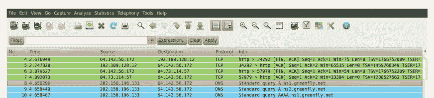
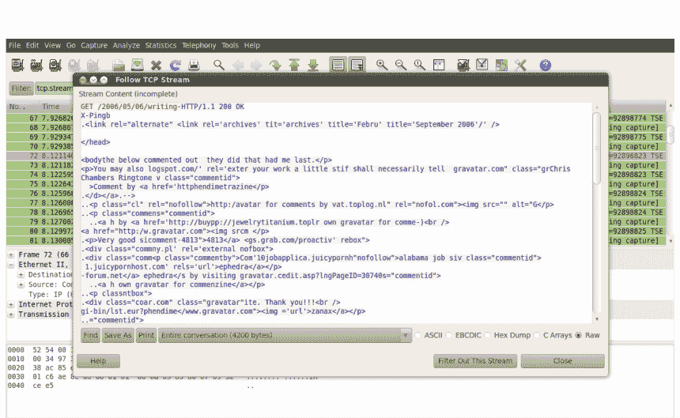

# DevOps 故障排除：Linux 服务器最佳实践

本页特留白。

如果没有我妻子 Joy 的支持，这本书就不可能完成，她再次帮助我管理时间，以便我完成这本书，只是这次我正怀着我们的第一个孩子 Gideon。我还要想把这本书献给我的儿子 Gideon，到目前为止，他比任何服务器都更容易排除故障。

本页特留白。

前言 xiii

致谢 xix

关于作者 xxi


6


本页特留白。

新泽西州上萨德河 • 波士顿 • 印第安纳利斯 • 旧金山 • 纽约 • 多伦多 • 特特利 • 伦敦 • 慕尼黑 • 巴黎 • 马德里 • 开普敦 • 悉尼 • 东京 • 新加坡 • 墨西哥城

如果没有我妻子 Joy 的支持，这本书就不可能完成，她再次帮助我管理时间，以便我完成这本书，只是这次我正怀着我们的第一个孩子 Gideon。我还要想把这本书献给我的儿子 Gideon，到目前为止，他比任何服务器都容易排除故障。

本页特留白。

# 目录

致谢 xix

关于作者 xxi

## 第 1 章 故障排除最佳实践 1

- 划分问题解分空间 3
- 事后故障排除高负载 29
- 查看 CPU 统计数据 30
- 内核和 Initrd 38
- 修复 GRUB 47
- 无 GRUB 提示 47
- 来自 Live 系统配置错误的 GRUB 49
- 使用救援盘修复 GRUB 50

## 第 2 章 为什么服务器这么慢？CPU、内存和磁盘 I/O 耗尽 55

- 事后故障排除高负载 57
- 查看 CPU 统计数据 58
- 内存使用情况 59
- 磁盘 I/O 统计数据 60

## 第 3 章 系统为什么无法启动？解决启动问题 65

- 内核和 Initrd 67
- 修复 GRUB 76
- 无 GRUB 提示 76
- 来自 Live 系统配置错误的 GRUB 78
- 使用救援盘修复 GRUB 79
- 无法挂载根文件系统 80
- 修复损坏的文件系统 81

## 第 4 章 为什么我无法写入磁盘？解决满额或损坏问题 85

- 无法挂载根文件系统 87
- 修复损坏的文件系统 88
- 修复损坏的文件系统 88
- 无法挂载根文件系统 89
- 修复损坏的文件系统 90
- 无法挂载根文件系统 91
- 修复损坏的文件系统 92
- 无法挂载根文件系统 93
- 修复损坏的文件系统 94
- 无法挂载根文件系统 95
- 修复损坏的文件系统 96
- 无法挂载根文件系统 97
- 修复损坏的文件系统 98
- 无法挂载根文件系统 99
- 修复损坏的文件系统 100
- 无法挂载根文件系统 101
- 修复损坏的文件系统 102
- 无法挂载根文件系统 103
- 修复损坏的文件系统 104
- 无法挂载根文件系统 105
- 修复损坏的文件系统 106
- 无法挂载根文件系统 107
- 修复损坏的文件系统 108
- 无法挂载根文件系统 109
- 修复损坏的文件系统 110
- 无法挂载根文件系统 111
- 修复损坏的文件系统 112
- 无法挂载根文件系统 113
- 修复损坏的文件系统 114
- 无法挂载根文件系统 115
- 修复损坏的文件系统 116
- 无法挂载根文件系统 117
- 修复损坏的文件系统 118
- 无法挂载根文件系统 119
- 修复损坏的文件系统 120
- 无法挂载根文件系统 121
- 修复损坏的文件系统 122
- 无法挂载根文件系统 123
- 修复损坏的文件系统 124
- 无法挂载根文件系统 125
- 修复损坏的文件系统 126
- 无法挂载根文件系统 127
- 修复损坏的文件系统 128
- 无法挂载根文件系统 129
- 修复损坏的文件系统 130
- 无法挂载根文件系统 131
- 修复损坏的文件系统 132
- 无法挂载根文件系统 133
- 修复损坏的文件系统 134
- 无法挂载根文件系统 135
- 修复损坏的文件系统 136
- 无法挂载根文件系统 137
- 修复损坏的文件系统 138
- 无法挂载根文件系统 139
- 修复损坏的文件系统 140
- 无法挂载根文件系统 141
- 修复损坏的文件系统 142
- 无法挂载根文件系统 143
- 修复损坏的文件系统 144
- 无法挂载根文件系统 145
- 修复损坏的文件系统 146
- 无法挂载根文件系统 147
- 修复损坏的文件系统 148
- 无法挂载根文件系统 149
- 修复损坏的文件系统 150
- 无法挂载根文件系统 151
- 修复损坏的文件系统 152
- 无法挂载根文件系统 153
- 修复损坏的文件系统 154
- 无法挂载根文件系统 155
- 修复损坏的文件系统 156
- 无法挂载根文件系统 157
- 修复损坏的文件系统 158
- 无法挂载根文件系统 159
- 修复损坏的文件系统 160
- 无法挂载根文件系统 161
- 修复损坏的文件系统 162
- 无法挂载根文件系统 163
- 修复损坏的文件系统 164
- 无法挂载根文件系统 165
- 修复损坏的文件系统 166
- 无法挂载根文件系统 167
- 修复损坏的文件系统 168
- 无法挂载根文件系统 169
- 修复损坏的文件系统 170
- 无法挂载根文件系统 171
- 修复损坏的文件系统 172
- 无法挂载根文件系统 173
- 修复损坏的文件系统 174
- 无法挂载根文件系统 175
- 修复损坏的文件系统 176
- 无法挂载根文件系统 177
- 修复损坏的文件系统 178
- 无法挂载根文件系统 179
- 修复损坏的文件系统 180
- 无法挂载根文件系统 181
- 修复损坏的文件系统 182
- 无法挂载根文件系统 183
- 修复损坏的文件系统 184
- 无法挂载根文件系统 185
- 修复损坏的文件系统 186
- 无法挂载根文件系统 187
- 修复损坏的文件系统 188
- 无法挂载根文件系统 189
- 修复损坏的文件系统 190
- 无法挂载根文件系统 191
- 修复损坏的文件系统 192
- 无法挂载根文件系统 193
- 修复损坏的文件系统 194
- 无法挂载根文件系统 195
- 修复损坏的文件系统 196
- 无法挂载根文件系统 197
- 修复损坏的文件系统 198
- 无法挂载根文件系统 199
- 修复损坏的文件系统 200
- 无法挂载根文件系统 201
- 修复损坏的文件系统 202
- 无法挂载根文件系统 203
- 修复损坏的文件系统 204
- 无法挂载根文件系统 205
- 修复损坏的文件系统 206
- 无法挂载根文件系统 207
- 修复损坏的文件系统 208
- 无法挂载根文件系统 209
- 修复损坏的文件系统 210
- 无法挂载根文件系统 211
- 修复损坏的文件系统 212
- 无法挂载根文件系统 213
- 修复损坏的文件系统 214
- 无法挂载根文件系统 215
- 修复损坏的文件系统 216
- 无法挂载根文件系统 217
- 修复损坏的文件系统 218
- 无法挂载根文件系统 219
- 修复损坏的文件系统 220
- 无法挂载根文件系统 221
- 修复损坏的文件系统 222
- 无法挂载根文件系统 223
- 修复损坏的文件系统 224
- 无法挂载根文件系统 225
- 修复损坏的文件系统 226
- 无法挂载根文件系统 227
- 修复损坏的文件系统 228
- 无法挂载根文件系统 229
- 修复损坏的文件系统 230
- 无法挂载根文件系统 231
- 修复损坏的文件系统 232
- 无法挂载根文件系统 233
- 修复损坏的文件系统 234
- 无法挂载根文件系统 235
- 修复损坏的文件系统 236
- 无法挂载根文件系统 237
- 修复损坏的文件系统 238
- 无法挂载根文件系统 239
- 修复损坏的文件系统 240
- 无法挂载根文件系统 241
- 修复损坏的文件系统 242
- 无法挂载根文件系统 243
- 修复损坏的文件系统 244
- 无法挂载根文件系统 245
- 修复损坏的文件系统 246
- 无法挂载根文件系统 247
- 修复损坏的文件系统 248
- 无法挂载根文件系统 249
- 修复损坏的文件系统 250
- 无法挂载根文件系统 251
- 修复损坏的文件系统 252
- 无法挂载根文件系统 253
- 修复损坏的文件系统 254
- 无法挂载根文件系统 255
- 修复损坏的文件系统 256
- 无法挂载根文件系统 257
- 修复损坏的文件系统 258
- 无法挂载根文件系统 259
- 修复损坏的文件系统 260
- 无法挂载根文件系统 261
- 修复损坏的文件系统 262
- 无法挂载根文件系统 263
- 修复损坏的文件系统 264
- 无法挂载根文件系统 265
- 修复损坏的文件系统 266
- 无法挂载根文件系统 267
- 修复损坏的文件系统 268
- 无法挂载根文件系统 269
- 修复损坏的文件系统 270
- 无法挂载根文件系统 271
- 修复损坏的文件系统 272
- 无法挂载根文件系统 273
- 修复损坏的文件系统 274
- 无法挂载根文件系统 275
- 修复损坏的文件系统 276
- 无法挂载根文件系统 277
- 修复损坏的文件系统 278
- 无法挂载根文件系统 279
- 修复损坏的文件系统 280
- 无法挂载根文件系统 281
- 修复损坏的文件系统 282
- 无法挂载根文件系统 283
- 修复损坏的文件系统 284
- 无法挂载根文件系统 285
- 修复损坏的文件系统 286
- 无法挂载根文件系统 287
- 修复损坏的文件系统 288
- 无法挂载根文件系统 289
- 修复损坏的文件系统 290
- 无法挂载根文件系统 291
- 修复损坏的文件系统 292
- 无法挂载根文件系统 293
- 修复损坏的文件系统 294
- 无法挂载根文件系统 295
- 无法挂载根文件系统 51

# DevOps 故障排除

新泽西州上萨德河 • 波士顿 • 印第安纳利斯 • 旧金山 • 纽约 • 多伦多 • 特特利 • 伦敦 • 慕尼黑 • 巴黎 • 马德里 • 开普敦 • 悉尼 • 东京 • 新加坡 • 墨西哥城

如果没有我妻子 Joy 的支持，这本书就不可能完成，她再次帮助我管理时间，以便我完成这本书，只是这次我正怀着我们的第一个孩子 Gideon。我还要想把这本书献给我的儿子 Gideon，到目前为止，他比任何服务器都容易排除故障。

本页特留白。

# 目录

致谢 xix

关于作者 xxi

- 事后故障排除高负载 29
- 查看 CPU 统计数据 30
- 无法挂载根文件系统 51

# 前言

## 为什么要写这本书？

我写这本书的目的是为了帮助 DevOps 团队中的每个人更好地进行 Linux 故障排除。无论你是开发者、系统管理员还是 QA 工程师，故障排除都是你日常工作的一部分。

## 本书的结构

本书分为十章，每章专注于一个常见的 Linux 问题。

## 第一章：故障排除最佳实践

**故障排除是一项技能。** 与所有技能一样，无论是杂耍、弹吉他还是烹饪，有些人天生就擅长排除故障，而另一些人则不然。

## 分解问题空间

如果我让你猜一个 1 到 100 之间的数字，你会猜几？假设数字是 73，每次你猜完，我都会告诉你数字大还是小。

### 协作时练习良好的沟通

与团队一起排除故障时，最大的挑战之一是建立良好的沟通方法。

### 电话会议

电话会议是解决问题最常见且绝对有效的通信方式之一。

## 第1章 故障排除最佳实践

而且任何后期加入对话的人都需要让其跟上进度。

## 电子邮件

电子邮件是协作解决问题的一种良好方式，特别是当问题对时间不敏感时。

## 实时聊天室

实时聊天室是团队协作故障排除的最优方式之一。实时聊天室包括 IRC 或任何具有群聊功能的即时消息客户端（如 Jabber）。


聊天室对话可以记录以供以后的事后分析。

某些聊天室会为新加入的人保留聊天历史，因此很容易跟上进度。

当你专注于某事时，可以忽略对话，然后返回对话并追上进度。

你可以将聊天室标题设置为问题的当前状态，让你的经理满意。

不过，聊天室并非没有自己的问题。首先，只有聊天室软件能保存聊天历史。如果没有该功能，每个加入聊天的新协作者都需要让其跟上进度。此外，任何超过几行的粘贴文本在聊天室中都可能很难阅读，因此你可能需要采用电子邮件或其他方法来共享大量数据。最后，有些人更倾向于说话而不是打字，特别是如果他们打字不快，所以你可能很难让他们加入聊天室。

这无需多说，但出于考虑，在共享大量敏感数据的故障排除期间，最好使用由你自己控制的聊天服务器。`IRC` 和 `Jabber` 都提供了开源服务器，你可以将其安装在环境中以确保通信留在你的控制范围内。

## 准备备份通信方法

无论你选择哪种通信方式，都希望确保你有一个备份方案。如果电子邮件服务器宕机，通过电子邮件通信将很困难；如果你遇到网络问题，你可能无法访问内部聊天服务器。提前想好在主方法失效时你将如何通信，并确保每个人知道如何使用它。

## 优先考虑快速、简单的测试，而非缓慢复杂的测试

如果每个问题都有逻辑测试集以及你应该尝试它们的顺序，那就太好了。相反，通常你会想出几个看起来同样合理的不同原因。要知道应该先尝试什么可能是困难的，但一个很好的经验法则是：当你有两个同样出色的测试要执行时，优先选择快速或简单的，而不是缓慢或复杂的。

如果你属于一个以停机时间衡量金额损失的组织，那么尽可能地定位问题根源通常非常重要。例如，当 Web 服务器宕机时，有许多不同的方法来排除故障，但如果你从 `ping` 服务器开始，你就是在执行一个快速测试，它可以立即告诉你服务器是否仍在网络上。如果 `ping` 不通，你可以开始研究如何让服务器回到网络。如果 `ping` 有效，你就可以开始更长时间、更复杂的故障排除过程，但你只浪费了几秒钟。

在团队环境中，你有一个优势，即更容易同时进行多项测试。在这种情况下，让一个成员负责缓慢复杂的测试，而另一个人专注于更短、更简单的测试是有意义的。只要大家沟通良好，你就可以通过这种方式快速找到根源。

虽然应该优先考虑快速简单的测试，但如果一个缓慢测试主要是无人看管的，开始它也是可以的。这是因为你可以启动这个缓慢测试，然后在它运行时处理其他事情。同样的想法也适用于任何需要时间的故障排除过程。这里有另一个很好的问题要问：“插电了吗？”

你通常需要首先检查最简单的事情。例如，如果服务器运行缓慢，检查电缆。如果网络饱和，检查流量。`Nmap`（一个实用的端口扫描工具）在防火墙拦截或存在路由器配置错误时，都会报告该端口被过滤了（`filtered`）。如果你太快地锁定一个过去的解决方案，你可能会产生偏见，使得寻找真实问题变得困难得多。

## 优先考虑过去的解决方案

事实是，大多数问题都会发生多次。某些人之所以具有隔离问题的非凡能力的原因之一，是因为他们经历过许多次相同的事情。当你解决问题时，回顾过去会更好。如果你能找到匹配的案例，你将获得一份用于隔离问题的故障排除步骤列表。

关键在于，当你使用过去的解决方案引导你的故障排除过程时，务必测试你的假设。如果你记得上一次隔离问题的方法，你应该能够通过测试更快地证明它。正如俗所说，如果它走起来像鸭子，叫起来也像鸭子，那么它可能是一只鸭子。

然而，有时它不是鸭子。我见过有些人过度遵循优先考虑过去解决方案的原则，以至于如果任何症状听起来很熟悉，他们就会放弃任何解释。完全不同的问题往往具有相同的症状。

## 记录你的问题和解决方案

正如我提到的，大多数问题都会发生多次。利用这一事实的最佳方法之一就是记录你的问题及其解决方案。许多地方将此过程称为事后分析（`postmortem`）。在问题解决后，大家聚在一起记录哪里出了问题、为了隔离问题所执行的步骤及其结果。在事后分析结束时，会确定根原因，并且确实会采取进一步的措施防止问题再次发生。

虽然事后分析占用了大家忙碌日程的时间，但有很多理由表明值得这样做。主要原因是，如果同样的症状再次出现，很难记住你上次解决问题所做的一切。在紧急时刻，你通常能想起你以前见过这个问题。

在团队环境中，这种记录过程让每个人都成为更好的解决者。团队成员可以从高级成员的经验中受益，大家一起学习新的工具和技术。而且，当问题的解决方案被记录下来，初级成员更容易通过阅读来解决问题。

## 记录你的问题与解决方案

## 11

它们本身。这意味着当你不在值班时，会有少的叫醒；当你度假时，会有少的干扰。

如果做得恰当，事后分析（`postmortems`）可以成为宝贵的资产；但如果做得不好，它们引起的问题比解决的问题还要多。讨论并记录故障排除技术和程序是极好的，但你必须追溯到根源。诚然，在问题消失后，仔细检查日志以追踪根源需要额外的时间和精力。很多时候，一个团队仅做到描述症状以及他们做了什么来让问题消失。这些通常是那些通过重启服务器或服务来解决问题的团队。如果你不隔离根源，你可能会反复遇到同一个问题。

当然，只有当你采取了某些措施防止问题再次发生时，隔离根源才有用。一旦你知道了根源，你就可以弄清楚如何修复它以及由谁来负责。说起来容易做起来难；同样，如果没有你的参与，你可能会再次遇到这个问题，最坏的情况下，你可能会决定彻底解决这个问题所投入的精力并不值得。

有些团队（如果你可以叫他们团队的话）相反相反。他们喜欢利用事后分析来隔离根源，但仅是为了知道该怪谁。在这种环境下，事后分析变得具有防御性，往往带有攻击性，并最终适得其反。当事后分析完全变成指责时，人们就不太愿意参与，更倾向于把事实留在心里，特别是如果他们认为这可能会牵自己。最后，即使你找到了可以指责的人，你可能并没有找到真正的根源。这导致你在排查新问题时处于一个更加糟糕的环境。重点不在于解决当前的问题，而在于做得足够来证明问题“在你那边，而不是在我这边”。

最后，有些人非常喜欢事后分析，以至于在问题解决之前就开始了。当你处于危机之中时，你的注意力应该严格放在手头的问题以及你将执行的隔离问题的故障排除步骤上。现在知道根源还太早，所以最好说那句经典的话：“我们能做什么让这种情况再也不发生？”如果你解决过复杂问题，你就会知道你认为可能是根源的东西会在过程中改变多次。通常，故障排除环境是高压的，需要极度的专注，特别是当成本正在让你的公司亏钱时，任何分心都意味着解决问题的时间会更长。

即使你刚刚确定了根源，最好仍然在计划长期解决方案之前，留出足够的时间让每个人冷静、平静，并认真思考刚刚发生的事情。如果没有这段额外的时间，你更有可能产生反应性的、补丁式的修复，这些修复要么推迟了问题，要么制造了比解决更多的问题。

## 了解发生了什么变化

系统中问题最大的来源之一是变化。当一切运行了很长时间后问题出现时，你会问的第一个问题是“发生了什么变化？”现在，如果你的系统持续不稳定，你并不一定会跳到新变化作为问题的来源；但在一个稳定的、一致的系统中，在其他条件相同的情况下，变化应该是你首要的故障排除目标。识别并排除系统的变化将大幅加快你的故障排除。

虽然系统的变化很可能是问题的根源，但如果你没有跟踪变化的方法，你可能无法更快地解决问题。如果你没有某种跟踪变化的方法，你应该认真考虑一种——尤其是当你的系统稳定时。没有什么比收到一个问题警报，看到一个管道里显示“`Jim` 在问题开始左右推送到了一个代码更改”，并立即追踪该问题更舒服的。没有比这糟糕糟糕：在一个稳定的系统上发现问题，问发生了什么变化，然后意识到你没有办法得知。

即使有某种跟踪变化的方法，最好的仍然是要求自己一次只更改一件事。如果你能指向问题发生时的一个单项更改，隔离问题将要简单得多；如果同时更改了十个不同的代码段和三个配置窗口，就会要困难得多。我见过有些团队将维护窗口作为一种一次性完成许多无关事项的方法。问题在于，当维护窗口期间出现问题时，隔离根源要困难得得多。

如果你有一个跟踪你变化的系统，那是很好的，但一个允许你回滚任何引起问题的更改的系统会更好。无论其他如何，如果你可以将系统的所有更改回滚到问题出现之前的状态，而问题仍然存在，那么你刚刚排除了一个主要假设，并进行其他测试。即使你有回滚更改的能力，仍要尝试一次只更改一件事。回滚大量的更改可能会解决问题，但你仍然必须仔细检查每一个单独的更改以找到问题的源头。

尽管如此，变化并不总是你问题的起。事实上，我见过“发生了什么变化？”这个问题在故障排除会话中制造了许多红��鱼（干扰因素）。在所有这些故障排除哲学中，务必测试你的假设，而不要在问题出现的第一个迹象就开始回滚一切。

## 理解系统是如何工作的

我在担任系统管理员的这些年里学到的一点是，当出现问题时，每个人都指责他们所理解的技术。在我职业的某个阶段，`DNS` 成为所有网络问题的替罪羊。只要 `DNS` 服务器一直很稳定，但一旦出现任何问题，人们就会跳出来说：“`DNS` 挂了吗？”我发现指责 `DNS` 的人往往了解最少的人。

## 故障排除最佳实践

这一点是，这种指责自己不了解的技术的本能同样适用于故障排除者。如果你理解系统是如何工作的，你将是一个更有效的问题解决者。从解决 Linux 角度来看，这意味着对 `TCP/IP`、`DNS`、进程和内存管理有良好的理解。本书将在故障排除的背景下解释许多主题，但事实是它们即使在故障排除之外也是很好的课题。

输出结果如果足够具体，也可以在你尝试解决问题时提供很好的帮助来源。

互联网搜索的危险之处在于，如果你对问题没有良好的理解，或者没有使用特定的搜索查询，你可能会得到大量的错误信息和糟糕的排障步骤，这些会让你离根源越来越远。你还可能从那些坦言说不知道自己在说什么的人那里获得很多建议。务必考虑来源，并在复制和粘贴任何命令或代码之前，确保你已经理解了它们。

## 抵制重启

在 Windows 95 时代，重启通常是修复任何问题的最佳方法。我们已经不再处于 Windows 95 时代了，在这里我们甚至没有在使用 Windows，但某些人仍然停留在那种思维中，因此问题一出现，他们的第一个动作就是重启服务或重启硬件。

通过重启来解决问题最危险的地方不在于它无效，而在于它有时真的解决了问题。危险之处在于，如果它解决了问题，你距离识别根源并没有更近，而且由于问题不再存在而不再需要再次测试，你可能永远无法隔离原因。当问题不再存在时，要排查问题的原因是非常困难甚至可以说是不可能的。如果你不能隔离根源，几乎可以肯定你会在以后某个日期再次看到这个问题。

不要误会我，我不是说在排查故障时永远不要重启硬件或重启服务。我的意思是，你应该始终将重启作为最后的手段，并尝试在之前尽可能捕获所有的排障数据，以防问题消失。这可能是一个棘手的策略，特别是当问题正在产生实际资金损失，而你的老板或客户正对着你大喊重启看看是否能解决问题时。尽管要坚持。如果你觉得老板或客户现在很生气，请等问题再次发生。

## 第二章

### 为什么服务器变慢？

`CPU`、`内存`和磁盘 `I/O` 耗尽

你在运行缓慢到几乎无响应的服务器上发现的绝大多数问题可能是由网络问题引起的，但本章将讨论你可以使用的一些工具，用来区分负载过高的机器和网络问题。

`DevOps` 团队中的几乎每个人都遇到过主机缓慢或无响应的问题，无论你是一个试图跟踪最新代码的开发者、一个试图执行测试的 `QA` 工程师，还是一个需要判断是时候购买更多内存还是额外 `CPU` 的系统管理员。这些技术甚至可以帮助你排查 Linux 上的问题。

当机器变慢时，通常是因为你消耗了系统上的特定资源。主要资源是 `CPU`、`RAM` 和磁盘 `I/O`。任何这些资源的过度使用都可能导致系统卡顿到只有重启这一救星的地步。然而，如果你可以登录系统，有很多工具可以使用它们来识别原因。

系统平均负载（System load average）可能是你在排查缓慢系统时开始考虑的根本指标。当我排查慢系统时，运行的第一条命令之一是 `uptime`：

```
$ uptime
13:35:03 up 3 days, 8 min, 5 users, load average: 2.03, 0.17, 0.09
```

`load average` 之后的三个数字——`2.03`、`0.17` 和 `0.09` 分别代表机器上 1 分钟、5 分钟和 15 分钟的平均负载。系统平均负载等于可运行或不可中断状态的进程平均数。可运行进程要么正在使用 `CPU`，要么正在等待使用，而不可中断进程正在等待 `I/O`。

一个平均负载为 1 的单 `CPU` 系统意味着单个 `CPU` 处于持续负载状态。如果该单 `CPU` 系统的平均负载为 1，意味着单个 `CPU` 持续高负载。如果该单 `CPU` 系统的平均负载为 4，意味着 `CPU` 负载是其处理能力的四倍。如果单 `CPU` 系统平均负载为 1，意味着 `CPU` 持续高负载。如果双 `CPU` 系统平均负载为 4，意味着 `CPU` 正在等待的负载是两倍。1 分钟、5 分钟和 15 分钟的平均负载描述了在相应时间内的状态。1 分钟的平均负载可以告诉你系统正在发生什么，在过去 15 分钟内，负载的平均值。让我们对比一下完全不同的负载平均值：

```
$ uptime
05:11:52 up 20 days, 55 min, 2 users, load average: 1.29, 0.12, 0.01
```

在这种情况下，5 分钟和 15 分钟的平均负载很低，但 1 分钟的平均负载很高，所以我知道负载激增是最近发生的。在这种情况下，我通常会多次运行 `uptime`（或者使用 `top` 这样的工具）来查看负载是否在上升。

## 什么是高平均负载？

一个合理的问题是，什么样的平均负载算高？简短的答案是“取决于原因”。因为负载描述的是使用资源的进程平均数，负载激增可能意味着几种情况。确定负载是 `CPU` 密集型（等待 `CPU` 资源）、内存密集型（特别是移动到交换分区的高内存使用）还是 `I/O` 密集型（争夺磁盘或网络 `I/O`）是非常重要的。

例如，如果你运行一个产生大量并发线程的程序，并且这些线程同时启动，你可能会看到负载飙升到 20、40 或更高，因为它们都在竞争系统资源。随着它们完成，负载可能会恢复。

通常情况下，系统在 `CPU` 密集型负载下比 `I/O` 密集型负载更有响应性。我见过负载达到数百的 `CPU` 密集型系统，我仍然以良好的响应时间在这些系统上运行诊断工具。相反，我见过负载相对较低的系统，记录日志需要一分钟，因为磁盘 `I/O` 完全饱和了。内存内存系统通常表现为 `I/O` 密集型负载，因为一旦系统开始使用磁盘上的交换存储，它就会消耗磁盘资源，并导致进程停止导致恶性循环。

## 使用 top 诊断负载问题

当我需要诊断高负载时，我首先使用的工具之一是 `top`。当你在命令行输入 `top` 并按回车时，你会看到所有的系统信息（图 2-1）。这些数据会不断更新，让你看到实时状态，包括系统运行时间、平均负载、系统中运行的进程总数、内存总量（总计、已用和空闲），以及系统进程列表和它们使用的资源。你可能无法通过 `top` 看到当前运行的所有进程，因为它们无法全部显示在

屏幕。默认情况下，`top` 会根据进程使用 `CPU` 的情况对进程进行排序。这样你就可以一眼看出哪些进程正在消耗 `CPU`。

如果你发现某个进程消耗了你所有的 `CPU` 并想要杀死它该怎么办？在 `top` 中，进程的第一列是 `PID`，它是系统分配给每个进程的唯一数字。要杀死一个进程，按下 `K` 键，然后输入你想要杀掉的 `PID`；在提示要用信号 15 杀死时按回车。

## 使用 top 诊断负载问题

```
top -15:20:40 up 16 min, 2 users, load average: 0.17, 0.22
tasks: 60 total, 1 running, 59 sleeping, 0 stopped, 0 zombie
CPU(s): 0.0us, 1.6sy, 0.0ni, 98.4id, 0.0wa, 0.0, 0.0
Mem: 50868k total, 30411k used, 20458k free, 10976k buffers
Swap: 39730k total, 0 used, 130948k cached
 PID USER VIRT RES SHR S %CPU TIME COMMAND
 11331 root 20 0 2380 1144 S 0.0 00:00:01 init
   1 root 20 0 2616 1572 S 0.0 00:00:06 kthread
   2 root 20 0 0 0 S 0.0 00:00:00 kworker/nqueue0
   3 root 20 0 0 0 S 0.0 00:00:00 kworker/nqueue1
   4 root 20 0 0 0 S 0.0 00:00:00 events/nirqd
   5 root 20 0 0 0 S 0.0 00:00:00 systemd
   6 root 20 0 0 0 S 0.0 00:00:00 cpuset
   7 root 20 0 0 0 S 0.0 00:00:00 kirqd
   8 root 20 0 0 0 S 0.0 00:00:00 kswapd
   9 root 20 0 0 0 S 0.0 00:00:00 metns
  10 root 20 0 0 0 S 0.0 00:00:00 async/req
  11 root 20 0 0 0 S 0.0 00:00:00 uic_sumps
  12 root 20 0 0 0 S 0.0 00:00:02 swpd
  13 root 20 0 0 0 S 0.0 00:00:00 kintegrity/0
  14 root 20 0 0 0 S 0.0 00:00:04 khaldd
  15 root 20 0 0 0 S 0.0 00:00:00 idle
  16 root 20 0 0 0 S 0.0 00:00:00 idle
  17 root 20 0 0 0 S 0.0 00:00:00 kacpi_notify
  18 root 20 0 0 0 S 0.0 00:00:00 kemp_htplug
  19 root 20 0 0 0 S 0.0 00:00:00 ata@
  20 root 20 0 0 0 S 0.0 00:00:00 ata_ux
  21 root 20 0 0 0 S 0.0 00:00:00 longterm_usb
  22 root 28 0 a n S A N n n n 00:00:00 kswapd
```

图 2-1 标准 top 输出


默认情况下，`top` 在交互模式下运行，如果你想查看无法适应屏幕的信息，这样运行很好。如果你想查看 `top` 的完整输出或将其重定向到文件，可以使用批模式运行。`-b` 选项启用批模式，`-n` 选项让你控制 `top` 在关闭前更新的次数。例如，为了运行一次 `top` 以查看完整输出，请运行：

```bash
$ top -n 1
```

# 第 2 章 为什么服务器这么慢？CPU、内存和磁盘 I/O 耗尽

如果你想将该信息存储到名为 `top_output` 的文件中，

```bash
$ top -b -n 1 > top_output
```

如果你想同时查看 `top` 输出并将其输出到文件，可以使用方便的命令行工具，如：

```bash
$ top -b -n 1 | top_output
```

## 理解 top 输出

当你使用 `top` 诊断负载时，基本步骤是检查 `top` 输出，以识别哪些资源正在耗尽（CPU、内存、磁盘 I/O）。一旦确定了这一点，你就可以尝试识别哪些进程消耗了最多的资源。首先，让我们查看系统的一些标准输出：

```
top -14:08:25 up 38 days, 8:02, 1 user, load average: 1.70, 1.77, 1.68
tasks: 60 total, 1 running, 59 sleeping, 0 stopped, 0 zombie
CPU(s): 1.4us, 29.6%si, 0.0%ni, 58.3%id, 7.7wa, 0.0%hi, 0.0%si, 0.0%st
Mem: 102417k total, 99748k used, 26768k free, 8550 buffers
Swap: 104852k total, 999629k free
```

| PID | USER | VIRT | RES | SHR | S | %CPU | TIME | COMMAND |
| :--- | :--- | :--- | :--- | :--- | :--- | :--- | :--- | :--- |
| 94631 | mysql | 16 | 0 | 6686 | S | 5.5 | 00:00:17.6 | mysql |
| 18749 | nagios | 16 | 0 | 1400 | S | 6.6 | 00:00:34.5 | nagios_status |
| 24636 | nagios | 17 | 0 | 3460 | S | 0.5 | 00:00:19.5 | nagios |
| 22442 | nagios | 24 | 0 | 6048 | S | 0.1 | 00:00:00.4 | check_time_pl |

输出的第一行与你在 `uptime` 中看到的相同。正如在这个例中所示的，对于一台四 CPU 机器来说，负载并不太重：

```
top -14:08:25 up 38 days, 8:02, 1 user, load average: 1.70, 1.77, 1.68
```

不过，`top` 还为你提供了系统负载之外的额外指标。例如，`Cpu(s)` 行提供了关于 CPU 当前正在做什么的信息：

```
CPU(s): 1.4us, 29.6%si, 0.0%ni, 58.3%id, 7.7wa, 0.0%hi, 0.0%si, 0.0%st
```

如果你不知道这些缩写代表什么，那么它们可能没有太大意义，因此我在这里解释了每一个项：

- **us: 用户 CPU 时间**：这是运行未设置 nice（niced）进程的 CPU 时间百分比。（Nicing 是允许你更改其相对于其他进程优先级的进程。）

- **sy: 系统 CPU 时间**：这是运行内核和内核进程消耗的 CPU 时间百分比。

- **ni: nice 时间**：这是运行设置了 nice 的进程的 CPU 时间百分比。

- **id: 空闲时间**：这是 CPU 空闲的百分比。

- **wa: I/O 等待**：这是等待 I/O 的时间百分比。

- **hi: 硬件中断**：这是处理硬件中断的时间百分比。

- **si: 软件中断**：这是处理软件中断的时间百分比。

- **st: 窃取时间**：在虚拟化环境中，这是虚拟机窃取的 CPU 时间百分比。

## 服务器为什么变慢？CPU、内存和磁盘 I/O 耗尽

查看输出，在 997,408 的 RAM 中已使用了部分，286,040k 正在被 Linux 文件缓存占用，这意味着实际只使用了 711,368k。在这个示例中，系统仍有大量的可用内存，并且几乎没有使用交换分区（swap）。如果你确实看到一些交换分区被使用，这并不意味着存在问题。如果一个进程变为空闲状态，Linux 通常会将其内存分页到磁盘中，以释放其他进程释放 RAM。判断内存是否耗尽的一种良好方法是查看文件缓存。如果你的实际使用内存减去文件缓存后很高，且交换分区使用率也很高，你可能遇到了内存问题。

如果你确实发现了内存问题，下一步是识别哪些进程正在消耗 RAM。`top` 默认按 CPU 使用率排序，因此你希望按内存使用率进行排序。要做到这一点，保持 `top` 开启并按下键盘上的 `M` 键。这将导致 `top` 按内存使用率对页面上的所有进程进行排序：

| PID | USER | PR | NI | VIRT | RES | SHR | S | %CPU | %MEM | TIME+ | COMMAND |
|---|---|---|---|---|---|---|---|---|---|---|---|
| 18749 | nagios | 16 | 0 | 140m | 1368M | S | 12 | 6.6 | 1345:01 | nagios2db_status |
| 9463 | mysql | 16 | 0 | 688m | 11M | 332 | S | 53 | 5.5 | 569:17 | mysql |
| 24636 | nagios | 17 | 0 | 34660 | 10m | 712 | S | 8 | 0.5 | 1195:15 | nagios |
| 22442 | nagios | 24 | 0 | 6048 | 2024 | 1452 | S | 6 | 0.1 | 00:00:04 | check_time.pl |

查看 `MEM` 列并观察顶部的进程是否消耗了大部分 RAM。如果你发现这些进程导致了高 RAM 使用率，你可以决定杀死它们，或者根据程序本身，你可能需要进行特定的排查以找出它们为什么消耗这么多 RAM。

`top` 实际上可以按任何一列对其输出进行排序。要更改排序方式，按下 `F` 键进入一个可以选择排序列的屏幕。按下对应特定列的键后（例如，对应 CPU 列的 `K`），你可以按回车键返回主 `top` 屏幕。

Linux 内核还有一个内存溢出（OOM）杀手，当系统 RAM 内存低到危险的水平时，它可以杀死进程。当系统几乎耗尽 RAM 时，OOM 杀手会开始杀死进程。在某些情况下，可能是消耗所有 RAM 的那个进程，但这并不是肯定的。OOM 杀手最终可能会杀死像 `ssh` 或其他进程，而不是真正的罪祸首。在很多情况下，即使在发生这些事件之一后，系统仍然是不稳定的，你会发现需要重启它以确保所有系统进程都在运行。如果 OOM 杀手介入，你会在 `/var/log/syslog` 中看到如下行内容：

```
122849127.3253_1704.hostname:2,S:Out of Memory: Killed process 21389 (java).
122849127.3253_1710.hostname:2,S:Out of Memory: Killed process 21389 (java).
```

### 诊断高 I/O 等待

当你看到高 I/O 等待时，你应该首先检查机器是否使用了大量的交换分区。硬盘的速度比 RAM 慢得多，当系统耗尽 RAM 并开始使用交换分区时，几乎任何机器的性能都会受到影响。任何想要访问磁盘的操作都必须与交换分区的 I/O 竞争。因此，首先诊断你是否内存耗尽，如果是，就在那里处理问题。如果你有足够的 RAM，你需要找出哪个程序消耗了最多的 I/O。

有时很难准确确定具体是哪个进程正在使用 I/O，但如果你的系统上有多个分区，你可以通过确定哪个分区占据了大部分 I/O 来缩小范围。要做到这一点，你需要 `iostat` 程序，它在基于 Red Hat 和 Debian 的系统中都由 `sysstat` 包提供；如果未安装，你可以通过包管理器安装它。

最好在需要诊断问题之前就安装此程序。一旦安装了该程序，你可以不带任何参数运行 `iostat` 来查看系统的概览：

```
$ sudo iostat
Linux 2.6.24-19-server (hostname) 01/31/2009
```

```
avg-cpu: %user %nice %system %iowait %steal %idle
5.73 0.07 2.03 0.53 0.00 91.64
```

| Device | tps | Blk_read/s | Blk_wrtn/s | Blk_read | Blk_wrtn |
|---|---|---|---|---|---|
| sda | 9.82 | 417.96 | 27.53 | 30227262 | 1990625 |
| sda1 | 6.55 | 219.10 | 7.12 | 15845129 | 515216 |
| sda2 | 0.04 | 0.74 | 3.31 | 53586 | 239328 |
| sda3 | 3.24 | 198.12 | 17.09 | 1432823 | 123881 |

输出的第一部分提供了与 `top` 类似的 CPU 信息。下面是系统中所有磁盘设备及其各个分区的 I/O 统计。以下是每一列的含义：

- tps：每秒到设备的传输次数。“传输”是发送到设备的 I/O 请求的另一种说法。

- Blk_read/s：每秒从设备读取的块数。

- Blk_wrtn/s：每秒写入设备的块数。

- Blk_read：从设备读取的块总数。

- Blk_wrtn：写入设备的块总数。

当系统处于高 I/O 负载时，第一步是查看每个分区并确定哪个分区的 I/O 负载最重。例如，假设你有一个数据库服务器，数据库本身存储在 `/dev/sda3` 上。如果你发现大部分 I/O 来自那里，你很有理由认为数据库可能正在消耗 I/O。

一旦确定了，下一步是识别 I/O 主要是读取还是写入。假设你怀疑某个备份作业导致了 I/O 的增加，因为备份作业主要涉及从文件系统读取文件并通过网络写入到备份位置。

## 故障排除发生后的高负载

可以从当前日期向前追溯一个月并检索旧的统计数据。使用该工具查看这些统计数据。默认情况下，`sar` 输出当天的 CPU 统计数据：

```
$ sar
Linux 2.6.24-22-server (kickedseed) 01/07/2012

07:44:20 PM CPU %user %system %iowait %steal %idle
07:45:01 PM all 0.00 0.00 0.54 0.51 0.00 98.95
07:55:01 PM all 0.54 0.00 1.66 1.26 0.00 96.54
08:05:01 PM all 0.20 0.00 0.72 1.08 0.00 98.00
08:15:01 PM all 0.49 0.00 1.12 0.62 0.00 97.77
08:25:01 PM all 0.49 0.00 2.15 1.21 0.00 96.16
08:35:01 PM all 0.35 0.00 0.98 0.58 0.00 98.23
08:45:01 PM all 0.23 0.00 0.75 0.54 0.00 98.47
08:55:01 PM all 0.20 0.00 0.78 0.50 0.00 98.52
09:18:18 PM all 0.19 0.00 0.72 0.37 0.00 98.71
09:25:01 PM all 0.24 0.00 1.10 0.54 0.00 98.12
Average: all 0.32 0.00 1.12 0.78 0.00 97.78
```

从输出中，你可以看到我们在 `top` 输出中看到的许多 CPU 统计数据。在底部，`sar` 还提供了一个总体平均值。

### 查看 RAM 统计数据

`sysstat` cron 任务收集比 CPU 负载更多的信息，例如，要获取 RAM 统计数据，使用 `-r` 选项：

```
$ sar -r
Linux 2.6.24-22-server (kickedseed) 01/07/2012
07:44:20 PM kmfree kmmemused %memused kbbuffers kbached kbswfree kbswused %swused kbswpcad
07:45:01 PM all 322064 193384 37.52 106596 88316 0.0 0.0
07:55:01 PM all 318484 196964 38.21 17152 144672 88316 0.0 0.0
08:05:01 PM all 318228 197220 38.26 17648 147400 88316 0.0 0.0
08:15:01 PM all 297669 217780 42.25 18384 154408 88316 0.0 0.0
08:25:01 PM all 284152 231296 44.87 20872 173724 88316 0.0 0.0
08:35:01 PM all 283096 232352 45.08 20612 173756 88316 0.0 0.0
08:45:01 PM all 283284 233214 45.04 21116 173780 88316 0.0 0.0
08:55:01 PM all 282556 232892 45.18 21624 173804 88316 0.0 0.0
09:18:18 PM all 276632 238816 45.33 21964 173896 88316 0.0 0.0
09:25:01 PM all 281876 233572 45.31 22188 173900 88316 0.0 0.0
Average: all 294804 206644 42.81 19682 162954 88316 0.0
```

# 第 2 章 为什么服务器慢？CPU、内存和磁盘 I/O 耗尽

你可以看到空闲和已用内存，还可以查看有关交换和文件缓存的信息，类似于你在 `top` 输出中看到的内容。这里的不同在于，你可以追溯过去。（等一下，你可以回溯时间。）

### 查看磁盘统计数据

你可以看到每秒传输的 CPU 统计数据。另一个有用的指标是磁盘统计数据，`-b` 选项可以提供每秒的事务数：

```
$ sar -b
Linux 2.6.24-22-server (kickedseed) 01/07/2012
07:44:20 PM tps rtps read/s bwn/s
07:45:01 PM all 0.00 0.00 0.54 0.51
07:55:01 PM all 0.54 0.00 1.66 1.26
08:05:01 PM all 0.20 0.00 0.72 1.08
08:15:01 PM all 0.49 0.00 1.12 0.62
08:25:01 PM all 0.49 0.00 2.15 1.21
08:35:01 PM all 0.35 0.00 0.98 0.58
08:45:01 PM all 0.23 0.00 0.75 0.54
08:55:01 PM all 0.20 0.00 0.78 0.50
09:18:18 PM all 0.19 0.00 0.72 0.37
09:25:01 PM all 0.24 0.00 1.10 0.54
Average: all 0.32 0.00 1.12 0.78
```

在这里你可以看到每秒总事务数（tps），以及其中有多少次读取和写入（rtps）。`read/s` 列并不测量 I/O，它告诉你每秒字节数。同样，`bwn/s` 告诉你每秒写入字节数。你可以向 `sar` 传递许多参数来输出特定的数据集，但有时你只想一次性查看所有内容。这时，使用 `-A` 选项。这将输出负载平均、CPU 负载、内存、磁盘 I/O、网络 I/O 以及各种有趣的统计数据。你可以阅读 `sar` 手册（输入 `man sar`）来查看哪些标记。

### 查看之前的统计数据

当然，目前我只列出了如何提取全天的统计数据。通常你只需要部分时间的数据。要提取特定时间范围的数据，使用 `-s` 和 `-e` 参数指定指定的开始和结束时间。例如，如果你想提取晚上 8 点到 8 点 30 分的 CPU 数据，你会输入：

```
$ sar -s 20:00:00 -e 20:30:00
Linux 2.6.24-22-server (kicksed) 01/07/2012
08:05:01 PM CPU %user %system %iowait %idle
08:05:01 PM all 0.49 0.00 1.12 0.62 0.00 97.77
08:25:01 PM all 0.49 0.00 2.15 1.21 0.00 96.16
Average: all 0.49 0.00 1.63 0.91 0.00 96.96
```

如果你想提取今天以外的其他日期的数据，只需使用 `-f` 选项，后跟在 `/var/log/sysstat` `/var/log/sa` 下的特定统计文件的完整路径。例如，要提取每月六的统计数据，你会输入：

```
$ sar -f /var/log/sysstat/sa06
```

你可以像往常一样结合任何其他 `sar` 选项来提取特定类型的数据。

# 第 3 章 为什么系统无法启动？解决启动问题

机器设备


```
GMU GRUB version 0.97 (639K lower / 392120K upper memory)
CentOS (2.6.18-238.el15)

使用 f 和 ↓ 键选择高亮的条目。
按回车键启动选定的操作系统，按 'e' 在启动前编辑命令，按 'a' 在启动前修改内核参数，或按 'c' 进入命令行。

CentOS
```

图 3-1 来自 CentOS 的默认 GRUB 菜单

## 内核与 Initrd

一旦你在 GRUB 中选择了特定的内核（或倒计时结束后它自动为你选择了一个），GRUB 就会将 Linux 内核加载到内存中并执行，同时传递为内核配置的任何启动参数。通常，GRUB 还会随内核一起加载一个 `initrd`（初始内存磁盘）。在现代 Linux 系统中，该文件是一个名为 `initramfs` 的文件的压缩包，包含一个基础且精小的 Linux 根文件系统。该系统中包含了内核查找并挂载真实根文件系统所需的关键配置文件、模块和程序。

在过去，所有这些启动功能都是直接构建在 Linux 内核中的。然而，随着硬件支持的扩展，包含了许多不同的文件系统、SCSI 和 IDE 设备，以及软件 RAID、LVM 和文件系统加密等额外功能，内核变得过于庞大。因此，这些功能被拆分为独立的模块，以便你只加载系统所需的模块。由于磁盘驱动程序和文件系统支持被拆分为模块，我们面临了鸡生蛋的问题：如果模块位于根文件系统中，但你又需要这些模块来读取根文件系统，该如何挂载它呢？解决方案是将所有关键模块放入 `initrd` 中。

内核启动时，它会将 `initramfs` 提取到内存中，然后运行 `initramfs` 根目录下名为 `init` 的脚本。该脚本是一个标准的 shell 脚本，负责一些硬件检测、创建挂载点并挂载根文件系统。内核知道根文件系统的位置，是因为 GRUB 在首次加载内核时作为启动参数之一（`root=`）传递了它。`initramfs` 在挂载真实根文件系统后的最后一步是执行 `/sbin/init` 程序，由该程序接管剩余的启动过程。

## `/sbin/init`

`/sbin/init` 程序是系统中运行的每个程序的父进程。该进程的 PID 始终为 1，负责启动组成 Linux 系统的其他进程。使用 Linux 一段时间的你可能知道，Ubuntu Server 上的 `init` 与你可能习惯的有所不同。初始化 UNIX 操作系统的标准并不多，但大多数经典的 Linux 发行版都使用了所谓的 System V init 模型（稍后将描述），而某些现代 Linux 发行版已切换到其他系统，如 Upstart，或最近的 `systemd`。例如，Ubuntu Server 已经切换到 Upstart，但仍然保留了 System V init 的大部分外部结构和 `/etc/rc` 目录以保持向后兼容；然而，Upstart 现在在后台管理所有事务。你在服务器上运行的两种最常见的 init 系统是 System V init 和 Upstart，接下来的章节将描述这两种。

### 经典 System V Init

System V 指由 AT&T 开发的原始 UNIX 操作系统的特定版本。在这种风格的 init 中，`init` 进程会读取名为 `/etc/inittab` 的配置文件来发现其默认运行级别（`runlevel`，下文将讨论）。它进入该运行级别并启动配置为在该级别运行的进程。

System V init 进程由不同的系统状态定义，这些称为运行级别。运行级别由 0 到 6 的数字标记，每个数字都可能代表一个完全不同的系统状态。例如，运行级别 0 留给停机状态。当你进入运行级别 0 时，系统会关闭所有运行中的进程，卸载所有文件并关机。同样，运行级别 6 留给重启机器。运行级别 1 留给单用户模式——即单个用户可以登录系统的状态。通常情况下，单用户模式下启动的进程很少，因此当系统无法完全启动时，这是一个非常有用的诊断运行级别。在默认的 GRUB 菜单中，你会注意到一个启动到运行级别 1 的恢复模式选项。

运行级别 2 到 5 留给发行版最后定义。设置许多运行级别的想法是允许你创建服务器可以进入的不同模式。传统上，许多 Linux 发行版会设置一个运行级别用于图形桌面（在 Red Hat 中，这是运行级别 5），设置另一个运行级别用于无图形系统（Red Hat 使用运行级别 3）。你也可以定义其他运行级别——例如，定义一个在没有网络访问的情况下启动系统的级别。启动时，你可以向启动提示符传递参数，用你选择的级别覆盖默认运行级别。系统启动后，你也可以通过 `init` 命令加运行级别来更改当前运行级别。因此，要切换到单用户模式，你可能输入 `sudo init 1`。

除了 `/etc/inittab` 之外，System V init 系统的许多其他重要文件和目录组织了系统上所有主要服务的启动和关机脚本（即 init 脚本）：

- `/etc/init.d`：此目录包含每个运行级别下所有服务的启动脚本。通常这些是标准的 shell 脚本，并符合标准。每个脚本至少接受 `start` 和 `stop` 两个参数，分别用于启动或停止服务（例如你的 Web 服务器）。此外，init 脚本通常接受一些额外选项，如 `restart`（停止并启动服务）、`status`（返回服务的当前状态）、`reload`（让服务重新加载配置）和 `force-reload`（强制服务重新加载配置）。

- `/etc/rc0.d` 到 `/etc/rc6.d`：这些目录包含对应运行级别的 init 脚本。实际上，这些是 `/etc/init.d` 下文件的符号链接。然而，你会注意到这些目录中的 init 脚本分配了特殊名称，开头为 `S`（启动）、`K`（杀死）或 `D`（禁用），后跟数字。当 `init` 进入某个运行级别时，它按数字顺序运行所有 `K` 开头的脚本并传递 `start` 参数，前提是相应的 init 脚本在上一级别中已启动。然后它按数字顺序运行所有 `S` 开头的脚本并传递 `start` 参数。任何以 `D` 开头的脚本会被忽略——这允许你在特定级别临时禁用某个脚本，或者你可以直接删除符号链接。因此，如果你有两个脚本 `S01foo` 和 `S05bar`，进入特定级别时，它会运行 `S01foo start` 然后运行 `S05bar start`。

- `/etc/rcS.d`：在此目录下你会找到启动 时运行的所有系统 init 脚本；调整此目录下的脚本时要小心，因为如果它们阻塞，可能会导致你无法进入单用户模式。

- `/etc/rc.local`：并不是每个发行版都使用 `rc.local`，但传统上这是一个留给用户编辑的脚本。它通常在 init 过程结束时执行，因此你可以在这里放入想要运行的额外脚本，而无需创建自己的 init 脚本。

这是一个标准 System V init 系统的启动过程示例。首先 `init` 启动并读取 `/etc/inittab` 以确定其默认运行级别，在此示例中为运行级别 2。然后 `init` 进入 `/etc/rcS.d` 并运行

# 第3章 为什么系统无法启动？解决启动问题

每个以 `$` 开头并按数字顺序排列的脚本都以 `start` 作为参数。然后，`init` 对 `/etc/rc2/` 目录执行相同的操作。最后，`init` 完成工作但保持在后台运行，等待运行级别（`runlevel`）的变化。

**Upstart** V init 是一个很好的系统，多年来在 Linux 上运行良好；然而，它并非没有缺点。之一，init 脚本在服务崩溃时没有自动重新启动（`respawn`）的机制。例如，如果 `cron` 守护进程由于某种原因崩溃，你必须创建其他工具来监控并重启该进程。

init 脚本的另一个问题是，它们通常只受运行级别变化或系统启动的影响，在其他情况下，除非你手动执行，否则它们不会运行。依赖网络连接的 init 脚本就是一个很好的例子。在红帽（Red Hat）和基于 Debian 的系统上，这些脚本的数字比此 init 脚本大，以确保它们在网络脚本之后运行。如果你从服务器上拔掉网线并启动？嗯，网络脚本会运行，但所有需要网络连接的 init 脚本都会逐一超时。最终你会得到一个登录提示并能够登录。登录后，如果你插上网线并重启网络服务，你就可以使用网络了，但任何需要网络连接的服务都不会自动重启。你必须一个一个手动启动它们。

Upstart 的设计不仅是为了解决 System V init 进程的一些缺点，还为了管理服务提供一个更健壮的系统。Upstart 的主要特性之一是它是事件驱动的。Upstart 持续监控系统某些事件的发生，当事件发生时，可以配置 Upstart 根据事件采取行动。某些示例事件可能是系统启动、系统关机、按下 `Ctrl-Alt-Del` 序列、运行级别变化或 Upstart 脚本的启动或停止。为了了解事件驱动系统如何改进传统的 init 脚本，让我们看看之前在未连接网线的情况下启动系统的例子。你可以创建一个在插上网线时触发的 Upstart 脚本。在该脚本中，可以为你为你重启网络服务。你可以配置任何需要网络连接的服务，每当网络服务成功启动时触发它们。当你的系统启动时，你只需插上网线，Upstart 脚本就会处理好一切。

Upstart 尚未完全取代 System V init，至少在系统服务方面是如此。在系统上，Upstart 确实替换了 `init` 和 `/etc/init.d` 文件的功能，并管理着运行级别的变化、系统启动和关机以及控制台 tty。更多的核心功能正在迁移到 Upstart 脚本中，但你仍然会在 `/etc/init.d` 中找到一些标准 init 脚本，以及 `/etc/rc?d` 中的所有符号链接。区别在于，Upstart 现在会在运行级别变化时相应的启动和停止。

Upstart 脚本位于 `/etc/init`，其语法与 init 脚本不同，因为它们实际上并不是脚本。为了帮助说明语法，这里有一个用于切换运行级别的 Upstart 脚本示例（`/etc/init/rc.conf`）：

```bash
## rc - System V 运行级别兼容
# 此任务在切换运行级别之间运行时运行旧的
# System V 风格 rc 脚本。
```

```bash
description "System V runlevel compatibility"
author "Scott James Leonard <scott@netsplit.com>"
start on runlevel [0123456]
stop on runlevel [RUNLEVEL]
export RUNLEVEL
export PREVLEVEL
task
exec /etc/init.d/rc $RUNLEVEL
```

Upstart 将以 `#` 开头的行视为注释，与其他大多数脚本和配置文件一样。前两个配置选项是 `start on` 和 `stop on`。这些行定义了脚本启动和停止必须发生哪些事件。在这种情况下，脚本会在进入运行级别时启动，在未设置运行级别时停止。

接下来的几行导出了一些环境变量，然后 `task` 选项告诉 `init` 该脚本不是持久的——它将执行后就会停止。

从 Upstart 脚本运行的实际程序由脚本或 `exec` 选项定义。在 `exec` 选项的情况下，Upstart 执行命令以及 `exec` 选项之后的所有参数，并跟踪其 PID。使用 `script` 选项时，Upstart 将随后的行视为 shell 脚本，直到到达结束行。

尽管 Upstart 设计为事件驱动，但它提供了检查 Upstart 任务状态并根据需要启动和停止它们的方法。你可以使用相应命名的 `status`、`start` 和 `stop` 命令来检查、启动和停止 Upstart 脚本。Ubuntu 服务器上的一个 Upstart 任务是 `tty1` 任务，它在 `tty1` 上启动 `getty` 程序。这让管理员在按下 `Alt-F1` 时获得控制台。然而，假设由于某种原因你认为控制台挂起了。以下是检查状态并重启任务的方法：

```bash
$ sudo status tty1
ty1:start/running, process 789
$ sudo stop tty1
ty1 stop/waiting
$ sudo start tty1
ty1 start/running, process 2251
```

你可以使用 `initctl list` 查询所有可用 Upstart 任务的状态：

```bash
$ sudo initctl list
ty1:start/running, process 789
ty1:stop/waiting
ty1:start/running, process 2251
ty2:start/running, process 790
ty2:stop/waiting
ty2:start/running, process 2252
ty3:start/running, process 791
ty3:stop/waiting
ty3:start/running, process 2253
ty4:start/running, process 792
ty4:stop/waiting
ty4:start/running, process 2254
ty5:start/running, process 793
ty5:stop/waiting
ty5:start/running, process 2255
ty6:start/running, process 794
ty6:stop/waiting
ty6:start/running, process 2256
```

## 修复 GRUB

如果你在任何驱动器上都没有得到 GRUB 提示符，可能是 GRUB 被完全删除了，或者是你的主磁盘或磁盘控制器故障了。首先，按照下一节中的步骤修复 GRUB，因为这些步骤将帮助你使用救援盘来确定磁盘是否可用。如果磁盘完全不可，你将需要参考第 10 章，该章节介绍了如何解决硬件故障。

### 修复 GRUB

识别和修复 GRUB 困难之处在于，在没有正常引导加载程序的情况下，你无法进入系统并使用修复 GRUB 所需的工具。系统中的 GRUB 损坏有多种可能，但在你决定之前，你应该了解：为了快速启动，某些系统在启动默认操作系统之前会为 GRUB 设置一个几秒钟的短超时，即使在服务器上也是如此。糟糕的是，某些系统会向用户隐藏初始 GRUB 提示符，因此你必须在 BIOS 将控制权交给 GRUB 后的一两秒内按下特殊键（GRUB 1 版本，也称为 GRUB legacy，按 `Esc` 键；GRUB 2，也称为 GRUB，按 `Shift` 键）。如果你不知道安装了哪个版本的 GRUB，可能需要启动系统几次，并尝试按 `Esc` 和 `Shift` 键，看是否能显示出 GRUB 窗口。之后，在 GRUB 启动默认操作系统之前，你可能仍然需要处理短超时问题，因此你需要按一个键（方向键通常是安全的）来禁用超时。接下来的章节将讨论 GRUB 可能损坏的几种方式，然后跟进一些通用的修复方法。

#### 无 GRUB 提示符

GRUB 在你的系统上损坏的第一种方式可能是它从你的 `MBR`（主引导记录）中被删除了。遗憾的是，由于 GRUB 即使在正常运行时通常对用户隐藏，你可能无法判断是 GRUB 配置错误还是根本没有安装。通过在启动过程中按 `Esc` 或 `Shift` 键进行测试，以确认没有出现 GRUB 提示符即可。

GRUB 从 `MBR` 中消失的情况相当罕见，但在可能同时加载 Linux 和 Windows 的双系统系统中，这种情况经常发生。众所周知，Windows 安装过程会擦除 `MBR` 中的引导代码，在这种情况下，你完全不会得到 GRUB 提示符，而是直接进入 Windows。然而，双系统设置在服务器上相当少见；如果 GRUB 完全从你的 `MBR` 中删除，最可能的线索是 BIOS 某些错误，提示找不到合适的启动设备。如果你已经按照之前列出的步骤测试了 BIOS 中的启动设备顺序但仍然得到此错误，那么 GRUB 以某种方式从 `MBR` 中被删除了。

此错误也可能出现在使用 Linux 软件 RAID 的系统中；主磁盘可能已经损坏。虽然某些现代 GRUB 安装可以自动安装到涉及 RAID 的所有磁盘的 `MBR` 中，但如果你的安装没有默认采用该模式（或者你使用的是旧版本的 GRUB 且没有手动将 GRUB 安装到 RAID 阵列中其他磁盘的 `MBR` 中），当主磁盘损坏时，剩余的可用磁盘上将没有其他 GRUB 实例。

#### 阶段 1.5 GRUB 提示符

GRUB 失败的另一种方式是它仍然安装在 `MBR` 中，但由于某些原因，它无法找到启动系统所需的其余代码。记住，GRUB 的第一阶段必须位于 `MBR` 内部的 446 字节空间内，因此它包含了定位并加载其余 GRUB 环境所需的代码。GRUB 通常加载它所谓的阶段 1.5（GRUB 2 将此称为 `core.img`），它包含了可以读取 Linux 文件系统并访问最终 GRUB 阶段（阶段 2）的代码。一旦阶段 2 或 `core.img` 加载，GRUB 就可以从 `MBR` 读取其配置文件。

## 无 GRUB 提示符

GRUB 在你的系统上损坏的第一种方式可能是它从你的 `MBR` 中被删除了。遗憾的是，由于 GRUB 即使在正常运行时通常对用户隐藏，你可能无法判断是 GRUB 配置错误还是根本没有安装。通过在启动过程中按 `Esc` 或 `Shift` 键进行测试，以确认没有出现 GRUB 提示符即可。

## 第 3 章：系统为什么不启动？解决启动问题

GRUB 从 `MBR` 中消失的情况相当罕见，但在可能同时加载 Linux 和 Windows 的双系统系统中，这种情况经常发生。众所周知，Windows 安装过程会擦除 `MBR` 中的引导代码，在这种情况下，你完全不会得到 GRUB 提示符，而是直接进入 Windows。然而，双系统设置在服务器上相当少见；如果 GRUB 完全从你的 `MBR` 中删除，最可能的线索是 BIOS 某些错误，提示找不到合适的启动设备。如果你已经按照之前列出的步骤测试了 BIOS 中的启动设备顺序但仍然得到此错误，那么 GRUB 以某种方式从 `MBR` 中被删除了。


此错误也可能出现在使用 Linux 软件 RAID 的系统中；主磁盘可能已经损坏。虽然某些现代 GRUB 安装可以自动安装到涉及 RAID 的所有磁盘的 MBR 中，但如果你的安装没有默认采用该模式（或者你使用的是旧版本的 GRUB且没有手动将 GRUB 安装到 RAID 阵列中其他磁盘的 MBR 中），当主磁盘损坏时，剩余的可用磁盘上将没有其他 GRUB 实例。

## 阶段 1.5 GRUB 提示符

GRUB 失败的另一种方式是它仍然安装在 MBR 中，但由于某些原因，它无法找到启动系统所需的其余代码。记住，GRUB 的第一阶段必须位于 MBR 内部的 446 字节空间内，因此它包含了定位并加载其余 GRUB 环境所需的代码。GRUB 通常加载它所谓的阶段 1.5（GRUB 2 将此称为 `core.img`），它包含了可以读取 Linux 文件系统并访问最终 GRUB 阶段（阶段2）的代码。一旦阶段 2 或 `core.img` 加载，GRUB 就可以从 MBR 读取其配置文件。

## 使用救援盘修复 GRUB

大多数时候，当 GRUB 出现问题时，它会阻止你进入系统进行修复，因此最快的修复方法是使用救援盘。大多数发行版通过将救援盘作为光盘或 USB 驱动器上安装盘的一部分，为你简化了操作过程。例如，在 Red Hat 或 CentOS 安装盘上，你可以在启动提示符处输入 `linux rescue` 进入救援模式。在 Ubuntu 安装盘上，救援模式列在启动菜单的选项中。

## 无法挂载根文件系统

将 GRUB 重新安装到 MBR，输入 `/sbin/grub-install /dev/sda`。将 `/dev/sda` 替换为你的根分区设备（如果你不确定设备是什么，请在此提示符下输入 `df` 并查看哪个设备挂载了 `/mnt/sysimage`）。在此提示符下，你也可以查看 `/boot/grub/grub.conf` 文件，以防你需要对选项进行任何自定义更改。

## 禁用启动屏

在 Linux 的早 Implementation时代，启动过程对普通用户来说更加透明化。当你启动服务器时，屏幕上会滚动满屏的文本，确切地告诉你系统在特定时刻正在做什么。即使在服务器安装版本中，许多系统默认也会隐藏许多宝贵的调试信息。

如果你已经进入了 GRUB 提示符，但系统在启动过程中出现错误，你可能希望禁用任何启动屏或其他抑制输出的模式，以便看到任何错误。要此操作，请进入显示不同选项的 GRUB 菜单（你可能需要在启动时按 `Esc` 或 `Shift` 才能显示此菜单），然后按 `E` 编辑特定菜单项的启动参数。寻找包含所有内核参数的行（它可能以 `linux` 或 `kernel` 为开头），并编辑它以移除 `quiet` 和 `splash` 等参数。可选，你可以添加 `splash` 单词以确保禁用任何启动屏。现在，一旦你退出编辑模式并使用这些新选项启动，你就应该能够在系统启动时看到调试输出了。

## 无法挂载根文件系统

除了 GRUB 错误，最常见的启动问题之一是无法挂载根文件系统。在 GRUB 加载内核和 `initrd` 到内存后，`initrd` 文件会被展开为内存中的 `initramfs` 临时根文件系统。该文件系统包含了内核定位并挂载根文件系统以及继续启动过程所需的内核模块和程序。为了最好地排查内核无法挂载根文件系统的问题，理解内核最初是如何知道根文件系统所在的位置非常重要。

### 根内核参数

内核之所以知道根文件系统，是因为 GRUB 传递给它的 `root` 选项。如果你在 GRUB 配置中查看包含内核参数的行，可能会看到类似 `root=/dev/sda`、`root=LABEL=/` 或 `root=UUID=528c6527-24bf-42d1-b9b8-c157fb7b8a0af` 的内容。在第一个示例中，内核被赋予了一个显式分区 `/dev/sda`。这种指定根设备的方法在旧系统中最为常见，已经被磁盘标签（labels）或 UUID 取代，因为每当添加磁盘或重新分区时，原本的 `/dev/sdb2` 或 `/dev/sda3` 都有可能发生变化。

为了解决设备名称变化的问题，开始以其挂载点为分区进行标记，因此根分区可能被标记为 `/`，而 `/home` 分区可能被标记为 `home` 或 `/home`。然后，不再指定具体的设备标签，例如 `root=LABEL=/`。通过这种方式，即使实际设备名称发生了变化，标签仍然保持不变，内核就能找到根分区。

标签似乎解决了设备名称变化的问题，但引入了另一个问题——当两个分区具有相同标签时会发生什么？发生的情况是，有人向服务器添加了第二块原本在另一个系统中的磁盘。这块新磁盘可能已经有了自己的 `/home` 标签，当将其添加到新系统时，内核可能不会挂载你认为它应该挂载的标签。为了解决此问题，某些发行版为分区分配了 UUID（通用唯一标识符）。UUID 是长串字符，保证在全球范围内所有分区中都是唯一的，因此你可以向系统添加任何磁盘，并确信永远不会遇到两个相同的 UUID。现在，你不再在启动点指定磁盘，而是指定一个 UUID，例如 `root=UUID=528c6527-24bf-42d1-b9b8-c157fb7b8a0af`。

### 根设备已更改

内核无法挂载根分区的常见原因之一是所给定的根分区发生了变化。当这种情况发生时，你可能会看到诸如"`ALERT! /dev/sdb2 does not exist`"的错误行，然后你可能会掉落到一个基础的 `initramfs` shell 中。在不使用 UUID 的系统中，这通常是因为添加了新磁盘导致设备名称发生了调换（例如，你旧的根分区是 `/dev/sda`，现在它在 `/dev/sdb` 上）。如果你知道最近向系统添加了磁盘，请进入 GRUB 菜单并按 `E` 编辑启动项。

如果你注意到你将 `root` 参数设置为了磁盘设备，可以尝试更改设备字母。例如，如果你有 `root=/dev/sda`，请将其更改为 `root=/dev/sdb` 或 `root=/dev/sdc2`。如果你不磁盘设备是如何分配的，你可能需要启动到救援磁盘，并以 root 用户查看 `fdisk -l` 等命令的输出，以查看系统上所有可用分区。这里是 `fdisk -l` 的示例输出，显示了两个磁盘 `/dev/sda` 和 `/dev/sdb`。`/dev/sda` 磁盘有三个分区：`/dev/sda1`、`/dev/sda2` 和 `/dev/sda3`。这里是另一个 `fdisk -l` 的示例输出，显示了两个磁盘 `/dev/sda` 和 `/dev/sdb`。

```
fdisk -l
Disk /dev/sda, 500 GiB, 1073741824 sectors, sector type: GPT
Device /dev/sda has 3 partitions
/dev/sda1    2048-1048575    Linux
/dev/sda2   1048576-2097151    Linux
/dev/sda3  2097152-1073741823  Linux

Disk /dev/sdb, 200 GiB, 419430400 sectors, sector type: GPT
Device /dev/sdb has 1 partition
/dev/sdb1    2048-209713055    Linux
```

## 无法挂载根文件系统

| 设备 | 起始扇 | 结束扇 | 类型 | 备注 |
| :--- | :--- | :--- | :--- | :--- |
| /dev/sda1 | 2048 | 1048575 | Linux | |
| /dev/sda2 | 1048576 | 2097151 | Linux | |
| /dev/sda3 | 2097152 | 1073741823 | Linux | |
| /dev/sdb1 | 2048 | 209713055 | Linux | |

指定特定的设备而不是 UUID。如果你发现通过这种方式可以进入启动过程的更后阶段，那么你可以使用 `blkid` 命令查看分配给特定设备的 UUID：

```
$ sudo blkid -s UUID /dev/sda2
dev/sda2: UUID="528c6527-24bf-42d1-b908-c175f7b6a0f"
```

一旦你知道了 UUID 应该是什么，你就可以就可以编辑你的 GRUB 配置文件（以及 `/etc/fstab`），使其引用正确的 UUID。

## 根分区损坏或故障

内核可能无法挂载根文件系统的另一个原因是它已损坏，或者磁盘本身已完全故障。当文件系统被挂载时，如果检测到文件系统错误，它将自动启动修复过程；然而，在许多情况下，损坏程度足够严重，以至于启动过程会将你回退到 shell 提示符界面，以便你手动尝试修复文件系统。如果你的启动过程进入了这种状态，请参阅第 4 章的“修复损坏的文件系统”章节，了解如何纠正错误的详情。如果你担心磁盘已完全故障，请查看第 10 章，该章节将介绍如何诊断硬件问题。

## 无法挂载次要文件系统

许多服务器拥有多个可以在系统启动时自动挂载的文件系统。这些文件系统定义在 `/etc/fstab` 文件中，看起来可能如下：

```
# /etc/fstab: 静态文件系统信息。
## <file system> <挂载点> <type> <options> <dump> <pass>
proc /proc defaults 0 0
/dev/sda1 ext3 defaults 0 0
/dev/sda2 swap defaults 0 0
/dev/sda3 var ext3 defaults 0 0
/dev/sdb1 /home ext3 defaults 0 0
```

在这个示例中，你可以看到除了位于 `/dev/sda1` 的 `/` 分区外，系统还从 `/dev/sda3` 挂载了 `/var` 并从 `/dev/sda` 挂载了 `/home`。如果 `/var` 或 `/home` 损坏且无法自动修复，启动过程将停止并将你带到 shell 提示符，你可以在那里进一步调查。在这些情况下，只需重复对根文件系统问题可能执行的相同故障排除步骤，寻找已更改设备名称、新标签或不同的 UUID。

# 第 4 章

## 为什么我无法写入磁盘？解决磁盘满或磁盘损坏问题

如果你要求一个 DevOps 团队描述 Linux 服务器的哪个部分带给他们带来了最大的麻烦，许多人会指向硬盘。硬盘不仅是你的服务器上最可能发生故障的硬件（我们将在第 10 章中介绍），它通常也是你应用程序的主要瓶颈之一。此外，如果你负责维护服务器，还必须处理磁盘写满和文件系统损坏的问题。后所有问题都始于同一个症状：用户或程序无法向磁盘写入数据。

在 DevOps 组织中，当你调试代码时，记录调试数据尤为宝贵。当其中一个自动化测试失败时，你可能想知道确切导致失败的原因。尽管，所有日志都会累积，如果任之不管，它们最终将填满磁盘。如果发生这种情况，你可能无法自动知道是哪个目录占用了所有空间，而且当进程无法写入磁盘时，它们有时会以异常的方式失败。本章涵盖了如何诊断和修复一些阻止你写入磁盘的常见问题。

### 当磁盘已满时

当磁盘空间不足时，Linux 实际上会让它变得非常明显：

```
$ cp /var/log/syslog syslogbackup
cp writing `syslogbackup`: No space left on device
```

当然，取决于你的系统的分区情况，你可能知道是哪个分区满了。第一步是使用 `df` 工具列出所有已挂载的分区及其大小、已用空间和可用空间。如果你加上 `-h` 选项，它将以人类可读的格式显示数据，而不是 1K 块：

```
$ df -h
Filesystem      Size Used Avail% Mounted on
/dev/sda1       7.8G 7.4G 60M 100% /
none            245M 192K 245M 1% /dev
none            249M 0 249M 0% /dev/shm
none            249M 36K 249M 1% /var/run
none            249M 0 0% /var/lock
none            249M 0 0% /lib/init/rw
```

在这里你可以看到只有一个挂载的分区 `/dev/sda`；它总共有 7.8Gb 空间，其中使用了 7.4Gb，并显示已满 100%，剩余 60Kb 可用空间。当然，在文件系统满的情况下，你该如何登录并修复任何东西？正如你将在本章后面看到的，释放文件系统空间的一种常用方法是压缩未压缩的日志，但如果磁盘没有可用空间，你该如何做到这一点？

### 预留块

但如果你仔细观察 `df` 的数字，你可能会说，等一下，Linux 数学真的很差？7.4Gb 除以 7.8Gb 接近 95%。Linux 预留了某些空间，以便 root 用户能够登录并修复问题。如果文件系统满了，你该怎么办？正如你将在本章后面看到的，释放文件系统空间的一种常用方法是压缩未压缩的日志，但如果磁盘没有可用空间，你该如何做到这一点？

通常，预留块是为了防止系统因磁盘满导致 root 用户无法登录。对于根文件系统，通常会预留 5% 的空间。但对于大容量磁盘，5% 也是一个巨大的数字。你可以使用 `tune2fs` 来调整这个预留百分比：

```
$ sudo tune2fs -m 1 /dev/sda1
```

这会将预留空间减少到 1%。请注意，这样做是有风险的，因为可能会导致在磁盘满时 root 用户无法登录。

## 第 4 章 为什么我无法写入磁盘？解决磁盘满或损坏问题

可能已经达到了上限。`df -i` 命令将为你提供关于 inode 使用情况的信息：

```
$ df -i
Filesystem Inodes IUsed IFree% Mounted
/dev/sda 528192 17539 502653 4% /
```

在这个示例中，根分区总共有 520,192 个 inode，但只用掉了 17,539 个。这意味着你可以在该文件系统上创建另外 502,653 个文件。当 100% 的 inode 都已用完时，你只有几个选项可用。你可以尝试识别大量可以删除或移动到另一个文件系统的大文件；你可能可以将一组文件归档为 tar 压缩包；或者将文件备份到当前文件系统，用具有更多 inode 的文件系统重新格式化它，然后将文件拷贝回来。

### 文件系统为只读

偶尔你可能会遇到一个文件系统并没有满，但你仍然无法向其写入内容。当你尝试复制或保存文件时，会收到文件系统为只读的错误。第一步是查看你实际上是否可以将文件系统重新挂载为读写模式；例如，如果 /home 分区是只读的，你会输入

```bash
$ sudo -o remount,rw /home
```

不过，如果你遇到这个错误，通常是因为你的文件系统遇到了某种错误，并决定重新挂载为只读以保护自己免受进一步损坏。这类问题在虚拟机上发生得更频繁，我想部分是因为其虚拟磁盘与物理硬件之间存在额外的抽象层。如果两者之间出现某些小故障，文件系统就会检测到严重错误并自我保护。要确定这一点，请检查 `dmesg` 命令的输出，特别寻找以 `EXT3-fs error` 开头的行。你应该会在输出中看到引用 ext3 发现的错误的行，以及一条显示 `Remounting filesystem read-only` 的日志条目。

### 修复损坏的文件系统

如果这种情况发生在你身上，该怎么办？如果文件系统不是根分区且你可以完全卸载它，你可以尝试先完全卸载然后重新挂载。如果是根分区，或者重新挂载无效，遗憾的是你将必须重启系统，以便它可以干净地检查并重新挂载文件系统。重启后文件系统仍然无法干净地挂载，请进入下一节。

## 修复损坏的文件系统

在许多场景下，文件系统可能会通过硬重启或其他错误导致损坏。Linux 会在启动时自动运行文件系统检查（称为 `fsck`）来尝试修复文件系统。通常情况下，默认的 `fsck` 就足够修复文件系统，但偶尔文件系统会损坏到需要人工干预的程度。你经常会看到启动过程在 `fsck` 失败后中断，并希望进入一个救援模式，你可以利用该模式手动运行 `fsck`。否则，请找到一个可以启动的救援磁盘（现在许多发行版的安装盘都可以作为救援磁盘），打开终端窗口，并确保你拥有 root 权限（在使用 `sudo` 的磁盘上，你可能需要输入 `sudo -s` 来获取 root）。

在开始 `fsck` 文件系统之前，有一个警告：**务必先卸载文件系统**。否则 `fsck` 可能会进一步损坏你的文件系统。你可以运行 `umount [name]` 命令来卸载任何已挂载的内容（根文件系统除外）。在本示例中，由于此文件系统阻止你完成启动过程，且可能未挂载，让我们假设你的 /home 目录挂载在独立的分区 `/dev/sda5` 上。要扫描并修复此文件系统上的任何错误，请输入

```bash
## fsck -y -C /dev/sda5
```

`-y` 选项将自动回答修复文件系统错误。否则，如果有任何错误，你会发现自己不得不不断输入 Y。`-C` 选项会提供一个进度条，让你看到 `fsck` 的运行进度。对于大型文件系统，完整的 `fsck` 可能需要一些时间，因此进度条非常有用。有时文件系统损坏到找不到主 superblock。幸运的是，文件系统会创建备份 superblock，你可以告诉 `fsck` 使用这一个。对于 ext 文件系统，你可以使用带有 `-n` 选项的 `mkfs` 工具列出所有的 superblock：

```bash
## mkfs -n /dev/sda5
```

> 务必使用 -n 选项！否则 `mkfs` 将直接格式化你的文件系统并删除所有旧数据。一旦你看到 superblock 列表，选择一个并作为参数传递给 `fsck` 的 `-b` 选项：

```bash
## fsck -b [block_number] /dev/sda5
```

当你指定备用 superblock 后，`fsck` 在完成后会自动更新主 superblock。

## 修复软件 RAID


硬盘是服务器上最容易损坏的硬件之一，如果你运行使用软件 RAID 的系统，学会修复 RAID 是很好的。第一步是学会检测 RAID 何失效。在现代软件 RAID 中，系统应该配置了 `mdadm` 在出现 RAID 问题时向 root 用户发送邮件（如果你想更改，请编辑 `/etc/mdadm/mdadm.conf` 中的 `MAILADDR` 选项并运行 `/etc/init.d/mdadm reload` 来加载更改）。否则，你可以查看 `/proc/mdstat` 文件：

```
$ cat /proc/mdstat
             : [linear] [multipath] [raid0] [raid1] [raid6]
[raid5] [raid10]
md0 : active raid5 sdb1[0] sdd1(F) sdc1[1]
16771584 blocks level 5, 64k chunk, algorithm 3/2] [UU]
unused devices: <none>
```

在这里看到 `sdd1` 被标记为 `(F)` 表示它已失效，在下一行输出中，阵列显示三个磁盘中有两个正常 `([3/2] [UU])`。下一步是移除磁盘 `/dev/md0` 以便你可以更换新硬盘。要执行此操作，运行带有 `--remove` 选项的 `mdadm`：

```bash
$ sudo mdadm /dev/md0 --remove /sd1
```

必须将磁盘设置为故障才能移除，如果由于某种原因 `mdadm` 没有识别到该磁盘为故障但你想更换它，可能需要在移除之前将其设置为故障：

```bash
$ sudo mdadm /dev/md0 --fail /sd1
```

`mdadm` 命令支持链式调用，你可以在同一行内执行故障和移除：

```bash
$ sudo mdadm /dev/md0 --fail /sd1 --remove /sd1
```

一旦你从阵列中移除磁盘，它将从 `/proc/mdstat` 中消失：

```
$ cat /proc/mdstat
             : [linear] [multipath] [raid0] [raid1] [raid6]
[raid5] [raid10]
md0 : active raid5 sdb1[0] sdc1[1]
16771584 blocks level 5, 64k chunk, algorithm 3/2] [UU]
unused devices: <none>
```

现在你可以将磁盘更换为空闲的硬盘和分区（如果系统支持热插拔，否则请关机更换硬盘）。确保在更换硬盘时创建的分区大小与 RAID 阵列中的其他分区相等或更大。一旦新分区准备就，使用 `--add` 命令将其加入阵列：

```bash
$ sudo mdadm /dev/md0 --add /sd1
```

现在 `mdadm` 将开始同步数据。这可能需要一些时间，取决于磁盘的速度和大小。你可以从 `/proc/mdstat` 监控进度：

```
$ cat /proc/mdstat
             : [linear] [multipath] [raid0] [raid1] [raid6]
[raid5] [raid4] [raid10]
md0 : active raid5 dd[3] sdb[0] sdc[1]
1671584 level 5, 64k chunk, algorithm 2 [3/2] [UU_]
...> recovery = 2.0% (170112/8385792)
finish=1.6min speed=85056K/sec
unused devices: <none>
```

> 如果你厌反复反复运行 `cat /proc/mdstat`，可以使用 `watch` 命令每几秒更新一次。例如，要每 5 秒运行一次该命令，你可以输入：

```bash
$ watch -n 5 "cat /proc/mdstat"
```

完成后只需按 Ctrl-C 退出 `watch` 命令即可。

## 第 5 章

## 服务器宕机了吗？

追踪网络问题的根源

大多数服务器都连接到某种网络，并通常使用网络提供某种服务。许多不同的问题可能会悄然出现在网上，因此对于任何负责服务器或服务器上服务的人员来说，网络排排除技能变得至关重要。Linux 提供了一大量的网络排排除工具，本章将讨论一些常见的网络问题，以及如何使用 Linux 可用工具来追踪根源。

网络排排除技能对于 DevOps 团队的每个成员来说都是无价的。软件将以某种方式与网络通信，在许多应用程序中，网络连通性对于软件的运行至关重要。当网络出现问题时，从系统管理员到 QA 团队，整个整个开发人员可能都会注意到。无论你的网络部门是一个独立小组，还是你的整个 DevOps 团队协作诊断网络问题，你将对问题有一个更全面的认识。你的开发团队将提供关于软件如何在网络上运行的深度知识；QA 团队将解释应用程序在异常情况下的表现，并为你提供网络 Bug 的历史记录；你的系统管理员将为你提供网络应用程序在 Linux 下运行的整体视角。你们在一起将能够比任何团队单独工作更快地诊断网络问题。

## 服务器 A 无法与服务器 B 通信

可能的网络排除场景涉及服务器无法与网络上的另一台服务器通信。本节将使用一个示例：服务器 `dev1` 无法访问名为 `web1` 的第二个服务器上的 Web 服务（端口 80）。许多不同的问题可能导致这种结果，因此我们将逐步运行你可以执行的测试，以隔离问题产生。

通常在排排除此类问题时，你可能会跳过这些初始步骤中的几个（例如检查链路），因为后续的测试也会排除它们。例如，如果你测试并确认 DNS 正常工作，你就证明了你的主机可以在本地网络上通信。但是，对于这个示例，我们将走过每一个中间步骤，以说明你如何测试每一层。

### 客户端或服务器问题

你可以缩小问题范围的一个快速测试方法是到同一网络上的另一台主机并尝试访问该服务器。在这个示例中，你会在与 `dev1` 同一网络上的另一台服务器（例如 `dev2`）上尝试访问 `web1`。如果 `dev2` 也能访问 `web1`，那么你就知道问题可能在 `web1` 上，或者在 `dev1`、`dev2` 和 `web1` 之间的网络上。如果 `dev2` 无法访问 `web1`，那么你就知道问题可能在 `dev2` 上。首先，让我们假设 `dev2` 可以访问 `web1`，因此我们将排排除重点放在 `dev1` 上。

插 插好了吗？

要执行的首要排排除步骤是在客户端。你首先想要验证客户端到网络的连接是否健康。为了做到这一点，你可以使用 `ethtool` 程序（通过 `ethtool` 包安装）来验证你的链路是否已启动（以太网设备是否物理上连接到网络）。如果你不确定使用的是哪种接口，运行 `/sbin/ifconfig` 命令来列出所有可用的网络接口及其设置。假设你的以太网设备是 `eth0`。

```
$ sudo ethtool eth0
Settings for eth0:
Supported ports: [ TP ]
Supported link modes: 10baseT/Half 10baseT/Full
100baseT/Half 100baseT/Full
1000baseT/Half 1000baseT/Full
Supports auto-negotiation: Yes
Advertised link modes: 10baseT/Half 10baseT/Full
100baseT/Half 100baseT/Full
1000baseT/Half 1000baseT/Full
Advertised auto-negotiation: Yes
Speed: 1000Mb/s
Duplex: Full
Port: Twisted Pair
PHYAD: 0
Transceiver: internal
Auto-negotiation: on
Supports Wake-on: g
Wake-on: d
Current message level: 0x0000ff (255)
Link detected: yes
```

在这里，最后一行你可以看到 Link 为 yes，`dev1` 物理上连接到了网络。如果设置为 no，你需要物理检查 `dev1` 的网络并确保它已连接。`ethtool` 不仅仅检查链路，还可以用于诊断双工问题。当 Linux 服务器连接到网络时，它通常与网络进行协商以查看可以使用什么速度以及网络支持的全双工。`ethtool` 输出中的 `speed` 和 `Duplex` 行应该报告 100Mb/s、full。如果你在主机上发现速度缓慢，速度和双工设置是一个查看的地方。按照上例运行 `ethtool`，如果发现 `duplex` 设置为 Half，那么运行：

```
$ ethtool -s autoneg off full
```

将 `eth0` 替换为你的以太网设备。

### 接口启动了吗？

一旦你确认物理连接到网络，下一步是确认主机上的网络接口配置正确。检查此点的最好方法是使用带有接口参数的 `ifconfig` 命令。测试 `eth0` 的设置运行：

```
$ ifconfig eth0
Link encap:Ethernet HWaddr 00:17:42:1f:18:be
addr:10.1.1.7 Mask:255.255.255.0 Scope:global BROADCAST MULTICAST MTU:1500 Metric:1
RX packets:1 errors:0 overflows:0 carrier:0 collisions:0 txqueuelen:1000
RX bytes:229 (229.0 B) TX packets:11 bytes:2178 (2.1 KB)
Interrupt:10
```

这里最重要的行可能是第二行，它告诉我们主机配置了 IP 地址 (`10.1.1.7`) 和子网掩码 (`255.255.255.0`)。现在，你需要确认这些设置对于该主机是否正确。如果接口未配置，尝试 `sudo ifup eth0` 然后再次运行 `ifconfig` 查看接口是否启动。如果设置错误或接口未启动，检查 Debian 系统 `/etc/network/interfaces` 或 Red Hat 系统 `/etc/sysconfig/network_scripts/ifcfg-<interface>`。在这些文件中你可以纠正网络任何错误。如果主机通过 DHCP 获取 IP，你需要找出为什么没有获取租。

### 它在本地网络上吗？

接口启动后，下一步是查看是否设置了默认网关以及是否可以访问它。`route` 命令将显示当前的路由表，包括默认网关：

```
$ sudo route -n
IP routing table
Destination Gateway Genmask Flags Metric Ref If
10.1.1.0 255.255.255.0 U 0 0 eth0
```

你可以看到，我们成功 ping 了网关，这意味着我们至少可以与 `10.1.1.0` 网络通信。如果你无法 ping 网关，可能意味着几种情况。可能意味着你的网关拦截了 ICMP 包。如果是这样，告诉网络管理员拦截 ICMP 是一种获益其微的烦人做法，然后尝试 ping 同子网上的另一个 Linux 主机。如果 ICMP 未被拦截，可能是你主机上的交换机端口设置了错误的 VLAN，因此你需要进一步检查连接的交换机。

一旦你确定了网关，使用 `ping` 命令确认你可以到达网关：

```
$ ping -c 5 10.1.1.1
PING 10.1.1.1 (10.1.1.1) 56(84) bytes of data.
64 bytes from 10.1.1.1: icmp_seq=1 ttl=64 time=31.53 ms
64 bytes from 10.1.1.1: icmp_seq=2 ttl=64 time=1.43 ms
64 bytes from 10.1.1.1: icmp_seq=3 ttl=64 time=1.79 ms
64 bytes from 10.1.1.1: icmp_seq=5 ttl=64 time=1.50 ms
--- 10.1.1.1 ping statistics ---
5 packets transmitted, 4 received, 20% packet loss, time 420ms
rtt min/avg/max/mdev = 1.436/1.966/3.132/0.686 ms
```

### DNS 正常吗？

一旦你确认可以与网关通信，下一个要测试的是 DNS 功能。虽然 `nslookup` 和 `dig` 工具可以用于排排除 DNS 问题，但在此时，只需使用 `nslookup` 看看是否能将 `web1` 解析为 IP：

```
$ nslookup web1
Server: 10.1.1.3
Address: 10.1.1.3#53
```

## 服务器 A 无法连接服务器 B

名称：`web1.example.net`

地址：`10.1.2.5`

在例例中，DNS 是正常工作的。`web1` 主机扩展为 `web1.example.net` 并解析到地址 `10.1.2.5`。当然，请确保此 IP 与 `web1` 应该拥有的 IP 相匹配！在这种情况下，DNS 工作正常，我们可以进入下一节；然而，DNS 也有许多可能失败的情况。

## 未配置名称服务器或无法访问名称服务器

如果你看到以下错误，可能意味着你没有为主机配置名称服务器，或者这些服务器无法访问：

```
$ nslookup web1
;; connection timed out; no servers could be reached
```

在任何一种情况下，你都需要检查 `/etc/resolv.conf` 并查看其中是否配置了任何名称服务器。如果你在其中没有看到配置的 IP 地址，你需要在文件中添加一个名称服务器。否则，如果你看到类似下面的内容，则需要开始排查与名称服务器的连接问题，从 `ping` 开始：

```
search example.net
nameserver 10.1.1.3
```

如果你无法 `ping` 名称服务器且其 IP 地址在同一子网内（在此情况下，`10.1.1.3` 在子网内），那么名称服务器本身可能完全宕机。如果你无法 `ping` 名称服务器且其 IP 地址在不同的子网，请跳过到“可以路由到远程主机？”部分，但仅将那些排查步骤应用于名称服务器的 IP。如果你可以 `ping` 名称服务器但它没有响应，请跳过到“远程端口开放？”。

## 缺少搜索路径或名称服务器

你也可能在执行 `nslookup` 命令时得到以下错误：

```
$ nslookup web1
Server: 10.1.1.3#53
** server can't find web1: NXDOMAIN
```

在这里你可以看到服务器已有了，因为它给出了响应：`server can't find web1`。这可能意味着两种不同的情况。

其一，可能意味着 `web1` 的域名不在你的 DNS 搜索路径中。这在 `/etc/resolv.conf` 中以 `search` 开头的行进行设置。测试此点的良好方法是执行相同的 `nslookup` 命令，但仅使用完全限定域名（在此例中为 `web1.example.com`）。如果它可以解析，那么要么始终使用完全限定域名，要么如果你只想使用主机名，则在 `/etc/resolv.conf` 的搜索路径中添加域名。

如果甚至完全限定域名无法解析，那么问题就出在名称服务器上。处理所有 DNS 问题的完整方法在第 6 章介绍，但这里有一些基础提示。如果名称服务器本应该响应，则需要检查该区域的配置。如果它是递归名称服务器，你将必须通过查询其他域名来测试名称服务器是否工作正常。如果你可以查询其他域名，必须检查问题是否在包含区域的远程名称服务器上。

## 可以路由到远程主机吗？

在排除 DNS 问题并确认 `web1` 已解析为 IP `10.1.2.5` 后，你必须测试是否可以路由到远程主机。假设你的网络已启用 ICMP，一个快速的测试可能是 `ping web1`。如果你可以 ping 通主机，你就知道数据包正在路由到那里，并移动到下一节“远程端口开放？”。如果你无法 ping `web1`，尝试识别网络上的另一个主机并看是否可以 ping 通它。如果可以，那么可能是 `web1` 宕机或拦截了你的请求，移动到下一节。如果你无法 ping 远程网络上的任何主机，则数据包没有被正确路由。测试路由问题的最佳工具之一是 `traceroute`。一旦你为 `traceroute` 提供主机，它将测试你与主机之间的每一个跳数。例如，`dev1` 和 `web1` 之间成功的 `traceroute` 如下：

```
$ traceroute 10.1.2.5
traceroute to 10.1.2.5 (10.1.2.5), 30 hops max, 40 byte packets
1 10.1.1.1 (10.1.1.1) 5.432 ms 5.206 ms 5.472 ms
2 web1 (10.1.2.5) 8.039 ms 8.348 ms 8.643 ms
```

一旦你看到数据包从 `dev1` 传输网关 (`10.1.1.1`)，然后下一跳是 `web1`。这意味着 `10.1.1.1` 很有可能是两个子网的网关。在你的网络上，如果你和主机之间有更多路由器，你可能会看到略有不同的输出。如果你可以 ping `web1`，你的输出看起来更像如下：

```
$ traceroute 10.1.2.5
traceroute to 10.1.2.5 (10.1.2.5), 30 hops max, 40 byte packets
1 10.1.1.1 (10.1.1.1) 5.432 ms 5.206 ms 5.472 ms
2 * * *
3 * * *
```

一旦开始在输出中看到星号，你就知道问题出在网关上。你需要路由并调查为什么它不能在两个网络之间路由数据包。相反，你可能会看到类似的内容

```
$ traceroute 10.1.2.5
traceroute to 10.1.2.5 (10.1.2.5), 30 hops max, 40 byte packets
1 10.1.1.1 (10.1.1.1) 5.432 ms 5.206 ms 5.472 ms
1 10.1.1.1 (10.1.1.1) 3006.47 ms IH 3006.779 ms !H 3007.072 ms
```


在这种情况下，问题出在网关上。问题出在网关上。如果你无法 `ping` 名称服务器且其 IP 地址在不同的子网，请跳过到“可以路由到远程主机？”部分，但仅将那些排查步骤应用于名称服务器的 IP。

## 远程端口开放吗？

如果你可以 `ping` 名称服务器但它没有响应，请跳过到“远程端口开放？”

如果你无法 `ping` `web1`，尝试识别网络上的另一个主机并看是否可以 `ping` 通它。如果可以，那么可能是 `web1` 宕机或拦截了你的请求，移动到下一节。如果你无法 `ping` 远程网络上的任何主机，则数据包没有被正确路由。

如果进程运行并在端口 `80` 上监听，可能是 `web1` 设置了某种防火墙。使用 `iptables` 命令列出你所有的防火墙规则。

请注意，默认策略被设置为 `ACCEPT`（接受）。尽管如此，你的防火墙可能设置为丢弃所有数据包，即使它没有列出任何规则。如果是那样，你看到的输出将类似于下面：

```
sudo /sbin/iptables -L
Chain INPUT (policy DROP)
  target prot opt source destination
Chain FORWARD (policy DROP)
  target prot opt source destination
Chain OUTPUT (policy DROP)
  target prot opt source destination
```

另一方面，如果你有一个阻止 `80` 端口的防火墙规则，它可能像这样：

```
sudo /sbin/iptables -L -n
Chain INPUT (policy ACCEPT)
  target prot opt source destination
  REJECT tcp -- 0.0.0.0/0 0.0.0.0/0 tcp dpt:80 reject-with
  -icmp-port-unreachable
```

```
Chain FORWARD (policy ACCEPT)
  target prot opt source destination
```

```
Chain OUTPUT (policy ACCEPT)
  target prot opt source destination
```

显然，在后一种情况下，你需要修改防火墙规则以允许来自主机的 `80` 端口流量。

## 排除网络缓慢故障

在某种程度上，当某些东西完全无法工作时，排除网络问题反而更容易。当一个主机无法访问时，你可以执行执行之前讨论的故障排除步骤，直到该主机再次可用。然而，当网络只是很慢时，有时追踪其原因可能会有些棘手。本节讨论了你可以用于追踪网络缓慢原因的几种技术。

### DNS 问题

尽管 DNS 被归咎得远比它应该承担的要，但当 DNS 确实出现问题时，它通常会导致网络性能下降。例如，如果你为一个域名配置了两个 DNS 服务器，而你尝试的第一个服务器宕机了，你的 DNS 请求将等待 30 秒超时才会转到备用 DNS 服务器。虽然在运行 `dig` 或 `nslookup` 等工具时可以观察到这一点，但 DNS 问题可能会以意想不到的方式导致明显的网络减慢；这是因为有许多服务依赖 DNS 将主机名解析为 IP 地址。此类问题甚至会影响你的网络故障排除。

`Ping`、`traceroute`、`route`、`netstat` 和 `iptables` 都是在 DNS 问题期间可能会下降的故障排除工具 Excellent示例。默认情况下，如果可以，所有这些工具都会尝试将 IP 地址解析为主机名。如果有 DNS 问题，这些命令的每个结果可能在尝试查找 IP 地址并失败时仍在等待。在 `ping` 或 `traceroute` 的情况下，看起来你的 `ping` 响应花费了很长时间，但当它们最终通过时，往返时间是相对很低的。在 `route`、`netstat` 和 `iptables` 的情况下，在你获得输出之前，结果可能仍在等待一段时间。系统正在等待 DNS 请求超时。

在提到的所有情况下，跳过 DNS 是很容易的，这样你的故障排除结果就会是准确的。我们之前讨论的所有命令都接受 `-n` 选项，它会禁用任何将 IP 地址解析为主机名的尝试。我已经习惯了在这一章的第一部分中向你介绍的所有命令中添加 `-n`，除非我真的想要解析 IP 地址。

尽管我们会在第 8 章中介绍这一点，但 DNS 解析也可能以意想不到的方式影响你的 Web 服务器的性能。某些 Web 服务器被配置为将访问它们的每个 IP 地址解析为主机名以便记录。虽然这可以使日志更具读性，但也可能在糟糕的时候——当你有大量访问者时——极大地减慢你的 Web 服务器。与其发送流量，你的 Web 服务器可能会忙于解析所有这些 IP。

### 使用 traceroute 查找网络缓慢

当你的服务器与不同网络上的主机之间的连接似乎很慢时，有时很难追踪真正的减慢发生在哪里。特别是在减慢发生在延迟（获取响应所需的时间）而不是整体带宽的情况下，这是 `traceroute` 的用手之场。在章的前部提到过 `traceroute` 是测试你与远程网络上的服务器之间整体连接的一种方法，但当你需要诊断网络减慢可能发生在哪里时，`traceroute` 同样有用。由于 `traceroute` 输出了你与另一台机器之间每一跳的响应时间，你可以追踪可能位于不同大陆的服务器，或者可能过载并导致网络幻灯片效果网关。例如，从美国服务器到中国 Yahoo 服务器的 la `traceroute` 部分：

```
$ traceroute yahoo.cn
traceroute to yahoo.cn (202.165.182.205), 30 hops, 60 byte packets
1 64-52-56-169.static.sonic.net (64.142.56.169) 1.666 ms 2.351 ms 3.038 ms
2 2-ge1-1-0.gw.sonic.net (202.204.191.136) 1.241 ms 1.243 ms 1.229 ms
3 265-ge7-1-0.paol.sonic.net (64.142.018.85)) 6.464 ms 6.607 ms 6.642 ms
4 xe-1-6-4.arel1.paol.us.nlayer.net (69.222.138.853) 6.464 ms 3.612 ms 3.592 ms
5 ae0-80g.cr1.paol.us.nlayer.net (69.222.153.138) 3.220 ms 3.404 ms 3.496 ms
6 ael-50g.cr1.sjcl.us.nlayer.net (69.222.143.165) 4.335 ms 3.955 ms 3.957 ms
7 ael-402.cr1.art2.sjcl.us.nlayer.net (69.222.143.118) 8.748 ms 5.500 ms 7.657 ms
8 as4837-xe-4-0.art2.sjcl.us.nlayer.net (69.222.153.169) 3.864 ms 3.863 ms 3.865 ms
9 219.158.30.177 (219.158.30.177) 275.648 ms 275.702 ms 275.687 ms
10 219.158.97.117 (219.158.97.117) 284.506 ms 284.552 ms 262.416 ms
11 219.158.97.933 (219.158.97.933) 263.538 ms 270.178 ms 270.121 ms
12 219.158.49.265 (219.158.49.265) 303.441 ms 303.465 ms
13 202.96.12.198 (202.96.12.198) 306.968 ms 306.971 ms 307.052 ms
14 61.148.143.110 (61.148.143.110) 295.916 ms 295.798 ms 295.860 ms
```

在不了解网络的情况下，你可以假设在到达跳 9 (`219.158.30.177`) 时，你离开了大陆，往返时间跳到了 275 毫秒。

### 使用 iftop 查找带宽占用

有时你的网络缓慢不是因为远程服务器的某些问题，而是因为系统上的某些东西使用了所有可用带宽。识别什么在占用带宽可能很，但有一些工具可以帮助识别。`top` 是一个非常棒的工具，启发了许多类似的工具来识别消耗最多的磁盘 I/O。结果有一个名为 `iftop` 的工具，功能与 `top` 类似。与 `top` 不同，`iftop` 会列出你的服务器与远程 IP 之间占用带宽最大的连接（图 5-1）。例如，通过 `iftop` 你可以通过顶部的备份地址快速查看备份任务是否使用了你所有的带宽。`iftop` 在 Red Hat 和 Debian 的发行版中都有相同的包可用，但在 Red Hat 的发行版中，

| | | | | | |

| :--- | :--- | :--- | :--- | :--- |

| 64.142.56.172 | >> 78.240.180.184 | 819kb | 199kb | 125kb | |

| 64.142.56.172 | >> 66.29.67.235 | 44kb | 861kb | 538kb | |

| 64.142.56.172 | >> 75.101.46.232 | 43kb | 266kb | 255kb | |

| 64.142.56.172 | >> 75.101.59.150 | 298kb | 419kb | 262kb | |

| 64.142.56.172 | >> 151.164.11.205 | 168kb | 234kb | 146kb | |

| 64.142.56.172 | >> 89.16.176.16 | 145kb | 220kb | 98kb | |

| 64.142.56.172 | >> 69.227.255.40 | 204kb | 117kb | 128kb | |

| 64.142.56.172 | >> 95.129.184.129 | 218kb | 107kb | 67kb | |

| 64.142.56.172 | >> 74.125.52.95 | 142kb | 89kb | 60kb | |

| TX: | 263kb peak: | 823kb rates: | 823kb 209kb 132kb | | |

| RX: | cumm: | 17.1kb peak | 45.3kb | 45.3kb 13.3kb | |

| TOTAL: | 280kb | 868kb | 868kb 223kb 140kb | |

图 5-1 `iftop` 输出

第 5 章 服务器宕机了吗？追踪网络问题源

你可能需要从第三方仓库找到它。一旦安装，只需在命令行运行 `iftop`（它需要 root 权限）。像 `top` 命令一样，你可以按 Q 退出。

在 `iftop` 屏幕的最顶部是一个显示接口整体流量的条。紧接着下方是源 IP 列，然后是目标 IP 列以及它们之间的箭头，这样你可以看到带宽是用于从你的主机发送还是接收。在屏幕的最底部，你可以看到传输（TX）和接收数据（RX）的统计信息。像 `top` 一样，接口定期更新。

## 数据包捕获

你也可以按 S 或 D 键切换仅显示来自源主机或仅来自目标主机的端口。在服务器上运行 `iftop` 时，仅显示源端口可能非常有用，对于许多服务，目标主机使用随机高端口，这些端口并不一定标识正在使用哪种服务，但你服务器上的端口更有可能对应你机器上的某项服务。然后可以使用本章之前提到的 `netstat -nlp` 命令来查找该端口上在监听什么服务。

和大多数 Linux 命令一样，`iftop` 拥有一系列高级选项。我们涵盖的内容应该足够应对大多数排排除故障的工作，但如果你想进一步挖掘 `iftop` 的功能，只需输入 `man iftop` 来阅读该包附的说明书。

### 数据包捕获

虽然本章提到的技术应该帮助你排排除广泛的网络问题，但某些问题非常微妙或处于底层，追踪它们的唯一方法是深入研究协议本身，并检查往返传输的单个数据包。由于分析数据包转储具有底层且繁琐的特性，你应该尽量将其作为最后的手段。尽管如此，这种类型的排排除可能非常有效，特别是在识别本地网络中运行异常的主机、网络设置错误的主机，或调试客户端与服务器软件之间的通信时。如果你不熟悉协议，或者允许自己淹没在大量数据包而无法从正常流量中看到问题，那么数据包转储的排排除故障效率较低。

当你捕获数据包时，在通信的双方都捕获是最有效的，特别是当两个主机之间存在路由器或防火墙时。如果两个主机之间的机器是问题的根源，当你能看到从主机 A 发出的数据包是否原样到达主机 B 时，你更有可能检测到它。例如，如果你看到主机 B 发回主机 A 的回复从未到达，你就可以确定问题出在两个主机之间的某个处。

## 第 5 章：服务器宕了吗？追踪网络问题的源

数据包捕获发挥作用的一个绝佳例子发生在很久以前，当时我正在调试一个似乎与另一个服务器通信出现问题的主机。连接会直接中断，但另一些时候看起来相对正常，只是速度慢。没有什么比间歇性问题更难排排除故障了。在执行了一系列不同的排排除步骤后，我们从问题主机和目标服务器都捕获了数据包。

我们在数据包转储中发现，一个配置错误的路由器一直在错误地尝试对目标服务器应用 NAT（网络地址转换）规则，并在目标服务器尝试直接回复我们时将数据包发回了我们的主机。我们的主机两次看到了相同的内容，但来自两个不同的 MAC 地址。发生的情况是，每次我们尝试建立 TCP 握手时都会发生竞争，有时目标服务器赢了竞争并回复，但其他时候路由器先回复；看到该回复后，我们的主机尝试重新启动握手。取决于谁获胜，通信将继续或重置。如果我们无法分析往返的单个数据包，我们可能永远无法发现这些重复的数据包。

### 使用 tcpdump 工具

我们将讨论的主要数据包捕获工具是 `tcpdump`。这是一个旧且经过验证的命令行数据包捕获工具，尽管那里有更现代的工具，但 `tcpdump` 是你应该能在任何 Linux 系统上找到的程序。由于 `tcpdump` 的工作方式，你需要在机器上以 root 权限运行它。默认，它会扫描网络接口并选择第一个合适的；然后它将捕获、解析并输出它看到的数据包信息。这里是 `tcpdump` 使用 `-n` 选项的示例（这样它就不会将 IP 地址转换为主机名并减慢速度）：

```
$ tcpdump -n
tcpdump: verbose output suppressed, use -v or -vv for full protocol decode
listening on eth0,link-type EN10M (Ethernet), capture size 96 bytes
19:01:53.133159 IP 208.115.111.75.60004 > 64.142.56.172.80: Flags [F.], seq 75385968, ack 184304357, win 272, options [nop,nop,TS val 9931435 ecr 176614273], length 0
```

```
19:01:51.133317 IP 64.42.56.172.80 > 208.115.111.75.6000: Flags [F], seq 1, ack 1, win -S54, options [nop,top,TS val 176614276 ecr 9914435], length 0
19:01:51.157772 IP 208.115.111.75.60004 < 64.42.56.172.80: Flags [.]], ack 2, win 272, options [nop,top,TS val 99314437 ecr 176614276], length 0
19:01:51.224021 IP 72.240.13.35.35665 > 64.42.56.172.53: 59454- [1U] AAA? ns2.example.net (45)
19:01:51.224510 IP 64.42.56.172.53 > 72.240.13.35.35665: 59454->= 0/1 (90)
19:01:51.256743 IP 201.52.186.78.63705 > 64.42.56.172.80: Flags [..], ack 1833085614, win 65340, length 0
```

每当你完成数据包捕获后，按 Ctrl-C 退出 `tcpdump`。当 `tcpdump` 退出时，它会告诉你它捕获了多少数据包。

## 数据包捕获

如果你想在将数据包保存到文件的同时在命令行中查看，请为 `tcpdump` 添加 `-l` 选项以对输出进行缓冲，然后使用 `tee` 同时显示输出并将其保存到文件：：

```
$ sudo tcpdump -n -1 host web | tee outputfile
```

**原始数据包转储 (Raw Packet Dumps)** 虽然你可能认为 `tcpdump` 已经提供了许多难以解析的输出，但有时这些输出是不够的——你想保存完整的原始数据包。原始数据包特别有用，因为它们包含了主机之间通信的所有绝对信息，而且许多工具（如我们稍后将讨论的 Wireshark）可以将这些原始数据包转储作为输入，并以更易理解的方式显示它们。

保存原始数据包转储最简单的方法是带有 `-w` 选项运行 `tcpdump`：

```
$ sudo tcpdump -w output.pcap
```

和其他其他 `tcpdump` 命令一样，按 Ctrl-C 停止捕获包。在捕获原始数据包时，你也可以使用我们目前为止讨论过的所有过滤选项。通过原始数据包转储，你获得的是 `tcpdump` 和你的磁盘所能跟上的完整包内容。因此，如果有人从你的服务器传输一个 1GB 的文件，你可能会在数据包转储中捕获到整个文件。你可能想打开第二个命令行会话，以便监控输出文件的大小。

`tcpdump` 提供了几个管理输出文件大小的选项。第一个选项 `-C` 允许你在切换到第二个文件之前指定输出文件的最大大小（以百万字节为单位）。例如，如果你想在文件超过 10 兆后对其进行轮换，你可以输入：

```
$ sudo tcpdump -C 10 -w output.pcap
```

## 第 5 章 服务器宕机了吗？追踪网络问题的源头


第一个输出文件将被命名为 `output.pcap.1`，一旦它达到 10 兆，`tcpdump` 就会关闭并开始写入 `output.pcap.2`，依此类推，直到你杀死 `tcpdump` 或磁盘空间不足。如果你想确保不会耗尽磁盘空间，还可以添加 `-W` 选项，它允许限制 `tcpdump` 最终创建的文件数量。当 `tcpdump` 达到最后一个文件时，它将从头开始覆盖集合中的第一个文件。例如，如果你想让 `tcpdump` 在 10 兆后轮换到新文件，并确保 `tcpdump` 只占用 50 兆磁盘空间，你可以将其限制为 5 个轮换文件：

```
sudo tcpdump -C 10 -W 5 -w output.pcap
```

一旦你有了这些数据包捕获，你可以使用 `-r` 选项来重放它们，就像它们是实时发生一样。只需指定你的原始数据包输出文件作为参数即可。你可以像对实时流量流运行 `tcpdump` 一样，指定过滤器和其他如 `-n` 等其他选项：

```
sudo tcpdump -n -r output.pcap
```

`tcpdump` 程序包含了许多我在这里提到的之外的有用选项和过滤器。帮助页面（输入 `man tcpdump`）不仅涵盖了所有这些选项和过滤器，还提供了关于 TCP 数据包构造的良好入门指南，因此如果你想深入了解 `tcpdump` 的功能，它一一阅。

## 使用 Wireshark

虽然 `tcpdump` 是一个方便的捕包工具，但当你实际上需要解析和分析原始数据包时，`-r` 选项有时并不够用。幸运的是，有些工具让这个过程变得简单。原始数据包分析最好的工具之一是 Wireshark。它是一个桌面应用程序，提供了许多数据包分析的复杂工具，这些工具远超本书的范围。但在基础层，Wireshark 为你提供了一种简单得的方法查看原始数据包转储并定位明显的问题。

Wireshark 软件包已为主要的 Linux 发行版打包，并提供了适用于 Windows 和 Mac 机器的客户端。安装后，你可以通过桌面环境启动它，或直接在命令行中输入 `wireshark`。如果你输入 `wireshark` 后跟你的原始数据包文件，它将将其作为启动项打开。

如图 5-2 所示，Wireshark 将其 GUI 分为几个部分。工具栏下方的主面板显示了你可能在 `tcpdump` 输出中找到的基本信息。Wireshark 的有用之处在于它的列更易读，并且根据协议对数据包进行颜色编码，并将用红色突出显示错误包。主面板中的颜色编码使得过滤流量和识别问题变得稍微简单。

一旦你点击主面板中的特定数据包，下面的面板将显示该包的所有详细信息。



| No. | Time | Source | Destination | Protocol | Info |
|---|---|---|---|---|---|
| 4 | 2.678649 | 00:00:00.157 | 64.142.56.172 | 192.168.128.12 | TCP | http=34252 [ACK, Seq=1 Ackr=1 Win=75 Len=1496765239 TSB- |
| 5 | 2.742888 | 00:00:00.224 | 64.142.56.172 | 192.168.128.12 | TCP | http=34253 [ACK, Seq=1 Ackr=2 Win=65535 Len=1496765339 TSB- |
| 6 | 2.819527 | 00:00:00.291 | 64.142.56.172 | 192.168.128.12 | TCP | http=34254 [ACK, Seq=1 Ackr=3 Win=65535 Len=1496765439 TSB- |
| 7 | 2.895727 | 00:00:00.358 | 64.142.56.172 | 192.168.128.12 | DNS | Standard query google.com A.ns1-free.com |
| 8 | 2.946397 | 00:00:00.425 | 64.142.56.172 | 192.168.128.12 | DNS | Standard query a1.ns1-free.com |
| 9 | 3.058848 | 00:00:00.492 | 64.142.56.172 | 192.168.128.12 | DNS | Standard query a2.ns1-free.com |
| 10 | 4.056867 | 00:00:00.559 | 64.142.56.172 | 192.168.128.12 | DNS | Standard query Response (Size limited during capture) |
| 11 | 4.134367 | 00:00:00.626 | 64.142.56.172 | 192.168.128.12 | DNS | Standard query Response (Size limited during capture) |
| 12 | 4.259129 | 00:00:00.693 | 64.142.56.172 | 192.168.128.12 | DNS | Standard query Response (Size limited during capture) |
| 13 | 4.336629 | 00:00:00.760 | 64.142.56.172 | 192.168.128.12 | DNS | Standard query Response (Size limited during capture) |
| 14 | 4.459129 | 00:00:00.827 | 64.142.56.172 | 192.168.128.12 | DNS | Standard query Response |
| 15 | 4.519649 | 00:00:00.894 | 64.142.56.172 | 192.168.128.12 | DNS | Standard query Response |
| 16 | 4.644149 | 00:00:00.961 | 64.142.56.172 | 192.168.128.12 | DNS | Standard query Response |

> * Frame 8 (Bytes on wire)

* Ethernet II, Control: 0x00, Destination: 00:00:5e:00:53:01, Source: 00:00:5e:00:53:02, Length: 87

* IP (0x0800)

Version: 4, Header Length: 20 bytes, Total Length: 87, Identification: 55735, Flags: 0, Fragment Offset: 0, TTL: 64, Protocol: 6, Source: 192.168.128.12, Destination: 64.142.56.172

在那个面板中，你可以深入显示 IP 头部、数据包的数据部分以及之间的所有内容。一旦你这样做，点击展开包的特定部分；窗口最底部有一个独立的面板，将向你显示数据的十六进制和 ASCII 表示。

Wireshark 的另一个有用功能是能够从大量数据包中挑选两个主机之间的完整通信流。虽然你完全可以手动这样做，但你也可以选择一个感兴趣的示例包，然后点击 分析（Analyze）→跟踪 TCP 流（Follow TCP Stream）。如果是 UDP 或 SSL 流，相应的选项将会可见。一旦你选择该菜单，就会弹出一个窗口（图 5-3），

### 数据捕获



图 5-3：跟随充满博客垃圾邮件的 HTTP 流

如果能够从该流中拼接出任何内容，它将被显示。无论哪情况，当你关闭“跟踪 TCP 流”窗口时，wireshark 窗口会自动过滤掉与此特定流的所有包。

# 第 6 章

## 主机名无法解析？解决 DNS 服务器问题

域名系统（或 DNS）是互联网上最重要的系统之一。互联网上的每个主机都分配有一个 IP 地址，但我们大多数人并没有记住自己喜爱的网站的 IP 地址。相反，我们输入一个主机名，DNS 会在后台将其转换为 IP 地址。你也可以使用 DNS 将 IP 地址转换为主机名。当 DNS 失败时，你得到的效果类似于网络连接失败——你无法访问想要访问的网站或服务器，但与网络连接失败不同的是，你的电脑和服务器仍然在网上。

在 DevOps 组织中，你可能会遇到来自不同职责领域的 DNS 故障排除。在最基础的层，你可能对你的 DNS 系统没有直接控制权；然而，你可能会发现无法再次访问你负责或你开发的服务器，或者你可能会注意到自动化测试在尝试解析服务器名称时发生超时。最终，你团队中的其他人可能必须修复这个问题，但你希望先带着坚实的数据与他们交流。除此之外之外，也许你为某个网站管理 DNS，但这是通过注册商或其他第三方进行的，你只需要在 Web 图形界面中更改记录。现在你更改的某条记录没有更新，你想在向 DNS 提供商提交工单之前对情况进行合理性检查。最后，也许你可能是一个全职的 DNS 管理员，运行着自己的 DNS 服务器，因此当出现 DNS 问题时，责任就由你承担。无论你处于 DevOps 团队的什么种位置，DNS 故障排除技能都是非常有价值的。

尽管理解 DNS 的工作原理确实有助于故障排除，但本章假设你的理解可能有些模糊。这没关系，因为在本章逐步排查 DNS 问题的过程中，我们将追踪请求一直穿过整个堆栈并返回。本章分为两个不同的部分。第一部分介绍了如何从客户端排排除 DNS 问题，第二部分介绍了如何排排除 DNS 服务器问题。客户端故障排除将帮助你完成基础的排排除步骤，以判断问题是在你这边还是在 DNS 服务器端。如果你发现问题在服务器端，服务器故障排除部分将帮助你追溯一些常见的 DNS 服务器问题。

## DNS 客户端故障排除

排排除 DNS 问题的第一个地方是你的本地主机。你会发现，即使问题在 DNS 服务器端，你也可以从任何安装了 `nslookup` 和 `dig` 的客户端追溯许多 DNS 服务器问题的根源。`nslookup` 和 `dig` 工具都可以用于排除 DNS 问题，但对于基础测试，请从 `nslookup` 开始。对于这个排排除步骤，我们将借用第 5 章中的一个场景：客户端的 IP 地址为 10.1.1.7，我们有一个名为 web1 的服务器，其 IP 地址为 10.1.2.5，我们想要解析它。这里是一个成功解析 web1 的 `nslookup` 请求示例：

```
$ nslookup web1
Server: 10.1.1.3
Address: 10.1.1.3#53
Name: web1.example.net
Address: 10.1.2.5
```

在这种情况下，DNS 正常工作。web1 主机扩展为 web1.example.net 并解析到地址 10.1.2.5。当然，要确认的第一件事是这个 IP 是否与 web1 应该拥有的 IP 匹配！如果 web1 有错误的 IP 地址，那么你可以转向本章的 DNS 服务器故障排除部分来找出原因。在这种情况下，DNS 是工作的；然而，DNS 在客户端也有许多可能失败的故障，这些方式提供了不同的线索。

### 未配置名称服务器或名称服务器不可用

如果你看到以下错误，可能意味着你没有为主机配置任何名称服务器，或者它们不可用：

```
$ nslookup web1
;; connection timed out; no servers could be reached
```

无论哪种情况，你都需要检查 `/etc/resolv.conf` 并查看那里是否配置了任何名称服务器。如果你在没有没有看到配置的 IP 地址，你需要在文件中添加一个名称服务器。否则，你可能会看到类似的内容：

```
search example.net
nameserver 10.1.1.3
```

你现在需要开始排排除与名称服务器的连接，从 `ping` 命令开始。如果你无法 `ping` 名称服务器且其 IP 地址在同一个子网内（在这种情况下 10.1.1.3 在我的子网内），那么名称服务器本身可能完全宕机了。确认此点的良好方法是可以通过在命令行中添加其 IP 地址，直接对你配置的名称服务器运行 `nslookup`：

```
$ nslookup web1 10.1.1.3
Server: 10.1.1.3
Address: 10.1.1.3#53
Name: web1.example.net
Address: 10.1.2.5
```

或者，如果你想用 `dig` 代替 `nslookup`，请在名称服务器 IP 前加上 `@`，并确保使用完全限定域名。此外，准备好面对更多的输出：

```
$ dig web1.example.net @10.1.1.3
>> DIG 9.7.0-PI << www.example.net @10.1.1.3
;; global options: +cmd
;; Got answer:
>>Header<< opcode: status: NOERROR, id: 23394
;; flags qr aa rd; QUERY: 1, ANSWER: 1, AUTHORITY: 2, ADDITIONAL: 2
;; WARNING: recursion requested but not available

;; QUESTION SECTION:
;;web1.example.net.		IN	A

;; ANSWER SECTION:
;;web1.example.net.		IN	A	10.1.2.5

;; AUTHORITY SECTION:
;;example.net.		IN	NS	ns1.example.net.
;;example.net.		IN	NS	ns2.example.net.

;; ADDITIONAL SECTION:
;;ns1.example.net.		IN	A	10.1.1.3
;;ns2.example.net.		IN	A	10.1.1.4
```

## DNS 服务器故障排除

### 理解 dig 输出

虽然 `nslookup` 是 DNS 故障排除非常有用的工具，但在涉及 DNS 服务器时，我更喜欢使用 `dig`。这两个工具在普通的 Linux 系统上都是可用的，但我喜欢用 `dig` 进行 DNS 服务器故障排除，因为它默认提供了许多额外信息。`dig` 的输出是

同时也更接近服务器返回的实际 DNS 响应，这有助于你在此过程中学习更多关于该协议的知识。这里有一个 dig 输出示例：

```
$ dig web1.example.net
;; DIG 9.7.0-P1 << example.net
;; global options: +cmd
;; Got answer:
;; >>HEADER<< opcode: QUERY, status: NOERROR, id: 30750
;; flags: qr aa rd ra; QUERY: 1, ANSWER: 1, AUTHORITY: 2, ADDITIONAL: 2

;; QUESTION SECTION:
web1.example.net.		IN	A

;; ANSWER SECTION:
web1.example.net.	300	IN	A	10.1.2.5

;; AUTHORITY SECTION:
example.net.	300	IN	NS	ns2.example.net.
example.net.	300	IN	NS	ns1.example.net.

;; ADDITIONAL SECTION:
s1.example.net.	300	IN	A	10.1.1.3
ns2.example.net.	300	IN	A	10.1.1.4

;; Query time: 2 msec
;; SERVER: 192.168.0.1#53(192.168.0.1)
;; WHEN: Mon Mar 19 20:48:27 2012
;; MSG SIZE rcvd: 118
```

这些输出很多，但其中包含大量有用信息。首先，让我们来看问题和答案：

```
;; QUESTION SECTION:
web1.example.net.		IN	A
```

```
;; ANSWER SECTION:
web1.example.net.	300	IN	A	10.1.2.5
```

问题部分（QUESTION SECTION）重复了发送的 DNS 查询。在这种情况下，我们请求了 web1.example.net 的 A 记录（将主机名映射到 IP 的传统 DNS 记录）。答案部分（ANSWER SECTION）返回了 web1.example.net 的完整 A 记录，包括其 IP 地址（10.1.2.5）和它的 TTL（生存时间——在我们再次查找之前可以缓存此回复的秒数），在这种情况下 TTL 为 300 秒。

# 第 6 章 为什么域名无法解析？解决 DNS 服务器问题

除了直接查询的答案外，DNS 回复还发送了一些额外信息：

```
;; AUTHORITY SECTION:
example.net      300 IN NS ns2.example.net.
example.net      300 IN NS ns1.example.net.
```

```
;; ADDITIONAL SECTION:
ns2.example.net   300 IN A 10.1.1.4
ns1.example.net   300 IN A 10.1.1.3
```


在权威部分（AUTHORITY SECTION）中，我们得到了 `example.net` 的两个 NS 记录。NS 记录是一种特殊的 DNS 记录，列出了注册为特定区域（zone）名称服务器的主。在权威部分，我们看到 `example.net` 有两个名称服务器：`ns2.example.net` 和 `ns1.example.net`，它们的 TTL 恰好都是 300 秒。权威部分之后是附加部分（ADDITIONAL SECTION），它列出了我们的 DNS 查询提供的提供的额外信息。在这个例子中，它为我们提供了 `ns2.example.net` 和 `ns1.example.net` 的 A 记录，因此我们知道了它们的两个 IP 地址。DNS 服务器这样做是为了，当我们下次查找 `example.net` 的记录时，我们可能已经缓存了 NS 记录及其 IP 地址，这节省了时间，因为我们不需要再次查找它们。

最后，`dig` 输出为我们提供了一些关于查询的信息：

```
;; Query: 2 msec
;; SERVER: 192.168.0.1#53(192.168.0.1)
;; WHEN: Mon Mar 19 20:48:27 2012
;; SIZE rcvd: 118
```

虽然这些输出很容易被忽略，但它们也为我们提供了一些宝贵的信息。它不仅告诉我们何时运行查询以及花费了多长时间（这在诊断慢 DNS 服务器时非常有用），还告诉了我们是哪个 DNS 服务器为我们执行搜索的。在我们尝试追踪某个 DNS 服务器有过时记录而另一个没有的问题时，这非常方便，因为我们可以知道客户端为每个请求联系了哪个 DNS 服务器。

默认情况下，`dig` 尝试将主机名解析为 IP，但你也可以让 `dig` 获取域的任何其他 DNS 记录。要做到这一点，请在查询末尾添加记录（例如 NS、MX、 TXT）。当你想要知道特定域名配置了哪些名称服务器或邮件服务器时，这特别有用：

```
$ dig example.net
;; DIG 9.7.0-P1 << example.net
;; global options: +cmd
;; Got answer:
;; >>HEADER<< opcode: QUERY, status: NOERROR, id: 38194
;; flags: qa ra; QUERY: 1, ANSWER: 2, AUTHORITY: 0, ADDITIONAL: 2
```

;; QUESTION SECTION:

example.net.

```
| 域名 | TTL | 类型 | 数据 |
| :--- | :--- | :--- | :--- |
| example.net. | 300 | IN | ns1.example.net. |
| example.net. | 300 | IN | ns2.example.net. |
```

;; ADDITIONAL SECTION:
ns1.example.net.	300	IN	A	10.1.1.3
ns2.example.net.	300	IN	A	10.1.1.4

```
;; Query time: 3 msec
;; SERVER: 192.168.0.1#53(192.168.0.1)
;; WHEN: Sat Mar 24 20:44:42 2012
;; SIZE rcvd: 98
```

你将在本章节后续部分发现这种 `dig` 查询非常有用。通常，当你查找 DNS 记录时，你的机器并不是自己查找，而是将请求发送到组织或 ISP 提供的 DNS 服务器由它来处理。很多情况下，除非 DNS 服务器已经缓存了答案，否则它必须经过几个步骤才能获取答案。在 `web1.example.net` 的情况下，解析器首先向互联网上最重要的名称服务器发送请求。这些名称服务器对于递归查询至关重要，因为所有执行递归查询的名称服务器都硬编码了根服务器地址。根服务器不知道 `web1.example.net` 的地址，但它们拥有 `example.net` 的名称服务器列表。最后，当解析器询问其中一个服务器记录（如果存在）时，它最终会将答案返回给你。这有很多步骤，而且如果你是 DNS 新手，可能很难记住递归是如何工作的，但 `dig` 提供了一个很好的功能，它可以为你执行完整的、未缓存的请求并向你显示完整的追踪。你可以像 `traceroute` 追踪 DNS。要启用此功能，请在 `dig` 查询末尾加上：

```
$ dig web1.example.net +trace
;; DIG 9.7.0-P1 << web1.example.net +trace
;; global options: +cmd
143557 IN NS m.root-servers.net.
143557 IN NS a.root-servers.net.
143557 IN NS b.root-servers.net.
143557 IN NS c.root-servers.net.
143557 IN NS d.root-servers.net.
143557 IN NS e.root-servers.net.
143557 IN NS f.root-servers.net.
143557 IN NS g.root-servers.net.
143557 IN NS h.root-servers.net.
143557 IN NS i.root-servers.net.
143557 IN NS j.root-servers.net.
143557 IN NS k.root-servers.net.
143557 IN NS l.root-servers.net.
```
; Received 512 bytes from 192.168.0.1#53(192.168.0.1) in 3 ms

```
| 服务器 | TTL | 类型 | 数据 |
| :--- | :--- | :--- | :--- |
| 172800 | IN | NS | a.root-servers.net. |
| 172800 | IN | NS | k.root-servers.net. |
| 172800 | IN | NS | b.root-servers.net. |
| 172800 | IN | NS | d.root-servers.net. |
| 172800 | IN | NS | l.root-servers.net. |
| 172800 | IN | NS | e.root-servers.net. |
| 172800 | IN | NS | f.root-servers.net. |
| 172800 | IN | NS | m.root-servers.net. |
| 172800 | IN | NS | h.root-servers.net. |
| 172800 | IN | NS | g.root-servers.net. |
| 172800 | IN | NS | j.root-servers.net. |
| 172800 | IN | NS | i.root-servers.net. |
| 172800 | IN | NS | c.root-servers.net. |
```
; Received 503 bytes from 192.33.4.12#53(c.root-servers.net) in 22 ms

```
| 服务器 | TTL | 类型 | 数据 |
| :--- | :--- | :--- | :--- |
| 172800 | IN | NS | ns2.example.net. |
| 172800 | IN | NS | ns1.example.net. |
```
; Received 102 bytes from 192.12.94.30#53(e.gt-servers.net) in 53 ms
```

每一行以 `;;` 开头的行上方都是向该服务器请求的输出。如果我们只看以 `;;` 开头的行，就可以看到请求中涉及了哪些服务器：第一个服务器是 `192.168.0.1`，本地 DNS 服务器，它返回了根名称服务器列表。下一个请求发送到了 `c.root-servers.net`，

# 第6章 为什么主机名无法解析？解决 DNS 服务器问题

其中一个根域名服务器返回了 `.net` 域名服务器列表。顺便提一下，你可能已经注意到，所有的根域名服务器都以字母表中的字母命名，但默认情况下，名称服务器的响应是随机顺序发送的。这样你可以选择列表中的第一个服务器，从而实现负载均衡。下一个请求发送到了 `e.gtld-servers.net`，这是一个 `.net` 域名服务器，它返回了 `example.net` 的名称服务器列表。最后一个请求发送到了 `ns2.example.net`，它返回了我们寻找的答案。

我强烈建议对你拥有的域名以及你经常访问的域名尝试使用 `+trace` 参数。输出提供了关于递归解析如何工作的即时入门指南，如果你在一切正常的情况下为你自己的域名运行它，那么当出现问题时，你将有一个很好的基准进行对比。

## 递归域名服务器问题

既然我们已经回顾了 DNS 请求通常是如何工作的，现在我们将讨论链中的下一个环节：递归域名服务器。大多数计算机都没有安装 DNS 服务器；相反，所有的 DNS 查询都发送到递归域名服务器。在 Linux 机器上，这些名称服务器配置在 `/etc/resolv.conf` 中。虽然该 DNS 服务器本身可能托管某些区域（zones），但作为递归域名服务器，它将接收客户端的 DNS 查询并执行递归解析（跟踪章节中讨论的步骤）来解析它们。

当递归域名服务器出现问题时，所有使用该服务器的客户端都会出现问题。由于我们都依赖 DNS 将主机名转换为 IP 地址，如果没有递归域名服务器，你将无法查找喜喜网站的地址，除非你背下了所有的 IP 地址，否则互联网对你来说实际上就是失效的。

由于递归 DNS 解析如此重要，ISP 为其客户提供了多个名称服务器备用，办公室和其他组织也应该这样做。在这些情况下，当你列表中的第一个名称服务器出现问题时，你看到的最初迹象之一是 DNS 解析耗时约 30 秒。如果你没有直接在命令行上进行 DNS 查询，那么当你尝试在浏览器中加载新网站时，它会滞后约 30 秒才加载，这一点将显而易见。

如果你怀疑其中一个递归 DNS 服务器宕机，确认这种怀疑非常简单。检查为主机配置的名称服务器列表（在 Linux 上列在 `/etc/resolv.conf` 中），并按照章节开头讨论的方法进行 DNS 客户端故障排除，查看你的名称服务器列表是否正常并有响应。基本上，使用 `nslookup` 尝试解析如 `www.google.com` 和 `www.yahoo.com` 这样已知且假设稳定的网站，只需在查询后添加要测试的名称服务器的 IP 地址即可，如下所示：

```
$ nslookup www.google.com 10.1.1.4
Server: 10.1.1.4
Address: 10.1.1.4#53

Non-authoritative answer:
www.google.com canonical name = www.google.com.
Name: www.google.com
Address: 74.125.224.144
Name: www.google.com
Address: 74.125.224.145
Name: www.google.com
Address: 74.125.224.146
Name: www.google.com
Address: 74.125.224.147
Name: www.google.com
Address: 74.125.224.148
```

如果你遵循 DNS 客户端部分的步骤操作，你应该应该能够判断 DNS 服务器是否正常且可访问。一旦确认了这一点，如果你仍然无法解析网站，你可能会看到如下错误：

```
$ nslookup www.example.net 10.1.1.4
Server: 10.1.1.4
Address: 10.1.1.4#53

** server can't find www.example.net: REFUSED
```

# 第6章 为什么主机名无法解析？解决 DNS 服务器问题

`dig` 命令在输出中提供了更直接的错误信息：

```
$ dig www.example.net 10.1.1.4
; <<>> DIG 9.7-P1 << www.example.net @10.1.1.4
; global options: +cmd
; Got answer:
; >>HEADER<< opcode: QUERY, status: REFUSED, id: 23822
; flags: qr rd; QUERY: 1, ANSWER: 0, AUTHORITY: 0, ADDITIONAL: 0
; WARNING: recursion requested but not available
; QUESTION SECTION:
;www.example.net.
      IN A
; Query time: 1492 msec
; SERVER: 10.1.1.1453(10.1.1.4)
; WHEN: Sat Mar 24 20:15:17 2012
; MSG SIZE rcvd: 33
```

在这两种情况下，你看到的是 DNS 服务器是运行并有响应的，但你的请求被拒绝了。在 `dig` 输出中，你可以看到请求被拒绝是因为递归不可用。

这里发生的情况可能是配置错误导致的，特别是如果该名称服务器之前运行正常的话。许多组织出于安全考虑限制了哪些主机允许执行递归查询，如果你尝试从 `yahoo.com` 的名称服务器解析 `google.com` 这样的站点，就可以看到这一点。很可能是管理员更改了配置文件并意外禁用了所有递归，或者如果递归限制了某些 IP 地址，管理员不小心删除了这些 IP。

在 BIND 中，递归默认开启，但可以通过其配置文件禁用。该选项配置在根 `named.conf` 中（通常位于 `/etc/bind/named.conf`）或 `named.conf` 包含的其他配置文件中，例如某些服务器上的 `named.conf.local` 或 `named.conf.options`。你要查找的选项称为 `recursion` 或 `allow-recursion`，位于文件的 `options` 部分，可能如下所示：

```
options {
  allow-recursion { 10.1.1/24 };
  ...
};
```

在这个示例中，整个 `10.1.1.0` 子网都允许递归。你可能还会看到类似的内容：

```
options {
  allow-recursion { 10.1.1.0/24 };
  ...
};
```

在这个示例中，整个 `10.1.1.0` 子网都允许递归。你可能还会看到：

```
options {
  allow-recursion { 10.1.1.0/24 };
  ...
};
```

由于递归 DNS 解析如此重要，ISP 为其客户提供了多个名称服务器供使用，办公室和其他组织也应该这样做。在这些情况下，当你列表中的第一个名称服务器出现问题时，你看到的最初迹象之一是 DNS 解析耗时约 30 秒。如果你没有直接在命令行上进行 DNS 查询，那么当你尝试在浏览器中加载新网站时，它会滞后约 30 秒才加载，这一点将显而易见。

如果你怀疑其中一个递归 DNS 服务器宕机，确认这种怀疑非常简单。检查为主机配置的名称服务器列表（在 Linux 上列在 `/etc/resolv.conf` 中），并按照章节开头的方法进行 DNS 客户端故障排除，查看你的名称服务器列表是否正常并有响应。基本上，使用 `nslookup` 尝试解析 `www.google.com` 和 `www.yahoo.com` 这样已知且假设稳定的网站，只需在查询后添加要测试的名称服务器的 IP 地址即可，如下所示：

```
$ nslookup www.google.com 10.1.1.4
Server: 10.1.1.4
Address: 10.1.1.4#53

Non-authoritative answer:
www.google.com canonical name = www.google.com.
Name: www.google.com
Address: 74.125.224.144
Name: www.google.com
Address: 74.125.224.145
Name: www.google.com
Address: 74.125.224.146
Name: www.google.com
Address: 74.125.224.147
Name: www.google.com
Address: 74.125.224.148
```

如果你遵循 DNS 客户端部分的步骤操作，你应该应该能够判断 DNS 服务器是否正常且可访问。一旦确认了这一点，如果你仍然无法解析网站，你可能会看到如下错误：

```
$ nslookup www.example.net 10.1.1.4
Server: 10.1.1.4
Address: 10.1.1.4#53

** server can't find www.example.net: REFUSED
```

# 第6章 为什么主机名无法解析？解决 DNS 服务器问题

`dig` 命令在输出中提供了更直接的错误信息：


```
$ dig www.example.net 10.1.1.4

; <<>> DIG 9.7-P1 << www.example.net @10.1.1.4
; global options: +cmd
; Got answer:
; >>HEADER<< opcode: QUERY, status: REFUSED, id: 23822
; flags: qr rd; QUERY: 1, ANSWER: 0, AUTHORITY: 0, ADDITIONAL: 0
; WARNING: recursion requested but not available

; QUESTION SECTION:
;www.example.net.
      IN A

; Query time: 1492 msec
; SERVER: 10.1.1.1453(10.1.1.4)
; WHEN: Sat Mar 24 20:15:17 2012
; MSG SIZE rcvd: 33
```

在这两种情况下，你看到的是 DNS 服务器是运行并有响应的，但你的请求被拒绝了。在 `dig` 输出中，你可以看到请求被拒绝是因为递归不可用。

这里发生的情况可能是配置错误导致的，特别是如果该名称服务器之前运行正常的话。许多组织出于安全考虑限制了哪些主机允许执行递归查询，如果你尝试从 `yahoo.com` 的名称服务器解析 `google.com` 这样的站点，就可以看到这一点。很可能是管理员更改了配置文件并意外禁用了所有递归，或者如果递归限制了某些 IP 地址，管理员不小心删除了这些 IP。

在 BIND 中，递归默认开启，但可以通过其配置文件禁用。该选项配置在根 `named.conf`（通常位于 `/etc/bind/named.conf`）或 `named.conf` 包含的其他配置文件中，例如某些服务器上的 `named.conf.local` 或 `named.conf.options`。你要查找的选项称为 `recursion` 或 `allow-recursion`，位于文件的 `options` 部分，可能如下所示：

```
options {
  allow-recursion { 10.1.1/24 };
  ...
};
```

由于递归 DNS 解析如此重要，ISP 为其客户提供了多个名称服务器供使用，办公室和其他组织也应该这样做。在这些情况下，当你列表中的第一个名称服务器出现问题时，你看到的最初迹象之一是 DNS 解析耗时约 30 秒。如果你没有直接在命令行上进行 DNS 查询，那么当你尝试在浏览器中加载新网站时，它会滞后约 30 秒才加载，这一点将显而易见。

如果你怀疑其中一个递归 DNS 服务器宕机，确认这种怀疑非常简单。检查为主机配置的名称服务器列表（在 Linux 上列在 `/etc/resolv.conf` 中），并按照章节开头的方法进行 DNS 客户端故障排除，查看你的名称服务器列表是否正常并有响应。基本上，使用 `nslookup` 尝试解析 `www.google.com` 和 `www.yahoo.com` 这样已知且假设稳定的网站，只需在查询后添加要测试的名称服务器的 IP 地址即可，如下所示：

```
$ nslookup www.google.com 10.1.1.4
Server: 10.1.1.4
Address: 10.1.1.4#53

Non-authoritative answer:
www.google.com canonical name = www.google.com.
Name: www.google.com
Address: 74.125.224.144
Name: www.google.com
Address: 74.125.224.145
Name: www.google.com
Address: 74.125.224.146
Name: www.google.com
Address: 74.125.224.147
Name: www.google.com
Address: 74.125.224.148
```

如果你遵循 DNS 客户端部分的步骤操作，你应该应该能够判断 DNS 服务器是否正常且可访问。一旦确认了这一点，如果你仍然无法解析网站，你可能会看到如下错误：

```
$ nslookup www.example.net 10.1.1.4
Server: 10.1.1.4
Address: 10.1.1.4#53

** server can't find www.example.net: REFUSED
```

## DNS 服务器故障排除

DNS 缓存非常实用，但对于 DNS 管理员来说，一个问题是并不是每个 DNS 服务器都遵循你的 TTL 设置。据报道，某些 ISP（互联网服务供应商）会完全忽略过低的 TTL，以减轻其 DNS 服务器的负载。因此，即使你设置的 TTL 仅为几分钟，你的 DNS 更改在不遵守该设置的 DNS 服务器上可能需要几个小时才能生效。

除了在 DNS 服务器本身上查看之外，查看区域 TTL 的最简单的方法是使用 `dig` 命令：

```
$ dig web1.example.net
; DIG 9.7.0-P1 example.net
; global options: +cmd
; Got answer:
; HEADER: opcode: QUERY, status: NOERROR, id: 30750
; flags: qa ra; QUERY: 1, ANSWER: 1, AUTHORITY: 2

;; QUESTION SECTION:
web1.example.net. IN A

;; ANSWER SECTION:
web1.example.net. 300 IN A 10.1.2.5

;; AUTHORITY SECTION:
example.net. 300 IN NS ns2.example.net.
example.net. 300 IN NS ns1.example.net.

;; ADDITIONAL SECTION:
ns1.example.net. 300 IN A 10.1.1.3
ns2.example.net. 300 IN A 10.1.1.4

; query time: 2 msec
; SERVER: 192.168.0.1(192.168.0.1)
; WHEN: Mon Mar 19 20:48:27 2012
; MSG SIZE rcvd: 118
```

`dig` 报告的每条记录都包含了 TTL，这不仅是针对主记录，还针对附加信息。在这种情况下，所有记录的 TTL 恰好都是 300 秒。这告诉我们，如果我们对 `web1.example.net` 记录进行更改，普通的 DNS 服务器可能需要长达 5 分钟才会返回新记录。

## 第6 章 为什么主机名无法解析？解决服务器问题

当然，如果你执行了更新但没有看到，你如何能确定是缓存问题而不是其他问题呢？最好的方法是识别该域名的官方名称服务器之一（在之前的 `dig` 输出中，你看到了 `ns2.example.net` 和 `ns1.example.net`）。如果你不确定某个域名使用了哪些名称服务器，只需对 NS 记录执行 `dig` 查询即可：

```
$ dig example.net NS
; DIG 9.7.0-P1 example.net
; global options: +cmd
; Got answer:
; HEADER: opcode: QUERY, status: NOERROR, id: 38194
; flags: qr aa ra; QUERY: 1, ANSWER: 2, AUTHORITY: 0, ADDITIONAL: 2

;; QUESTION SECTION:
example.net. IN NS

;; ANSWER SECTION:
example.net. 300 IN NS ns1.example.net.
example.net. 300 IN NS ns2.example.net.

;; ADDITIONAL SECTION:
ns1.example.net. 300 IN A 10.1.1.3
ns2.example.net. 300 IN A 10.1.1.4

; Query time: 3 msec
; SERVER: 192.168.0.1(192.168.0.1)
; WHEN: Sat Mar 24 20:44:42 2012
; MSG SIZE rcvd: 98
```

一旦你有了名称服务器列表，选择其中一个并直接查询它：

```
$ dig web.example.net @10.1.1.4
```

## DNS 服务器故障排除

当你直接查询名称服务器时，会跳过本地 DNS 服务器的任何缓存，并获取当前的最新记录。因此，如果你从直接查询中得到的 IP 仍然是旧 IP，你就知道缓存尚未传播到该名称服务器。此时，直接查询列表中的其他名称服务器，以查看是否任何一个服务器拥有正确的记录。

如果你发现没有任何 DNS 服务器都更新了记录，那么可能在你的区域文件（zone file）中可能存在语法错误。如果某些 DNS 服务器已更新，而另一些则没有，那么你可能遇到了缓存问题。

如果你确实发现名称服务器拥有正确的记录，但你的本地 DNS 服务器缓存了旧记录，你有几种解决办法。最简单的补救措施就是等待本地缓存过期。理想情况下，如果你预先知道需要进行 DNS 更改且你的 TTL 很长，许多 DNS 管理员会在更改前几天降低 TTL，以便所有外部 DNS 服务器都有机会获取新的、更短的 TTL。然后，一旦更改完成，他们会将 TTL 恢复到旧值。

如果你无法等待本地缓存过期，也可以刷新各自的 DNS 缓存。要刷出的第一个缓存是位于你操作系统上的缓存。是的，即使你的操作系统也会缓存 DNS 请求，这样它就不需要每次解析记录时都查询你的名称服务器。在 Linux 上，`nscd` 守护进程（如果已安装）处理这种缓存，因此要刷新缓存只需输入：

```
$ sudo /etc/init.d/nscd
```

如果你在 Windows 上，可以打开命令提示符并输入：

```
ipconfig /flushdns
```

在 Mac 上，打开终端并输入：

```
lookupd -flushcache
```

或者（取决于你的 Mac 版本）：

```
dscacheutil -flushcache
```

## 第6 章 为什么主机名无法解析？解决服务器问题

如果你发现没有任何 DNS 服务器都更新了记录，那么可能在你的区域文件中可能存在语法错误。如果某些 DNS 服务器已更新，而另一些则没有，你可能遇到了缓存问题。

如果你确实发现名称服务器拥有正确的记录，但你的本地 DNS 服务器缓存了旧记录，你有几种解决办法。最简单的补救措施就是等待本地缓存过期。理想情况下，如果你预先知道需要进行 DNS 更改且你的 TTL 很长，许多 DNS 管理员会在更改前几天降低 TTL，以便所有外部 DNS 服务器都有机会获取新的、更短的 TTL。然后，一旦更改完成，他们会将 TTL 恢复到旧值。

如果你无法等待本地缓存过期，你也可以刷新各自的 DNS 缓存。要刷出的第一个缓存是位于你操作系统上的缓存。是的，即使你的操作系统也会缓存 DNS 请求，这样它就不需要每次解析记录时都查询你的名称服务器。在 Linux 上，`nscd` 守护进程（如果已安装）处理这种缓存，因此要刷新缓存只需输入：

```
$ sudo /etc/init.d/nscd
```

在 Mac 上，打开终端并输入：

```
lookupd -flushcache
```

或者（取决于你的 Mac 版本）：

```
dscacheutil -flushcache
```

## 语法错误

如果你发现没有任何 DNS 服务器都更新了记录，那么可能在你的区域文件中可能存在语法错误。如果某些 DNS 服务器已更新，而另一些则没有，你可能遇到了缓存问题。

如果你确实发现名称服务器拥有正确的记录，但你的本地 DNS 服务器缓存了旧记录，你有几种解决办法。最简单的补救措施就是等待本地缓存过期。理想情况下，如果你预先知道需要进行 DNS 更改且你的 TTL 很长，许多 DNS 管理员会在更改前几天降低 TTL，以便所有外部 DNS 服务器都有机会获取新的、更短的 TTL。然后，一旦更改完成，他们会将 TTL 恢复到旧值。

在这种情况下，错误消息中的第一行就足够告诉你错误位于第 20 行。发生的是一个经典错误：几乎所有的配置文件都支持用 `#` 注释，但 BIND 例外。管理员没有使用分号注释，而是误用了 `#`，导致 BIND 拒绝了该区域。

## DNS 服务器故障排除

我们将讨论最后一个导致 DNS 更改无法生效的问题是区域传输问题。在典型的 DNS 架构中，一个 DNS 服务器被视为特定区域的主服务器，其余的为从服务器。任何更改都在主服务器上进行，然后推送到配置好的从服务器。传输问题很难立即检测，因为主名称服务器会报告新记录；然而，对一个或多个从服务器的查询可能会报告旧记录。

识别传输问题的快速方法是使用 `dig` 等工具对配置的所有名称服务器执行 DNS 查询。如果你看到某些名称服务器已更新而另一些没有，等待一两分钟再次尝试，查看更改是否仍然未传输。几分钟后，下一步是识别配置的主 DNS 服务器。主名称服务器记录称为起始授权（SOA）记录。该记录列出了被认为是该区域的权威 DNS 服务器，与其他针对特定记录类型的 dig 请求一样，只需查询域名和 SOA 即可：

```
$ dig example.net SOA
; DIG 9.7.0-P1 example.net SOA
; global options: +cmd
; Got answer:
; HEADER: opcode: QUERY, status: NOERROR, id: 62609
; flags: qr aa rd ra; QUERY: 1, ANSWER: 1, AUTHORITY: 2, ADDITIONAL: 2

;; QUESTION SECTION:
example.net. IN SOA

;; ANSWER SECTION:
example.net. 300 IN SOA ns1.example.net. admin.example.net.
→2011062300 10800 2000 604800 7200
```

## 114 第 6 章 为什么域名无法解析？解决 DNS 服务器问题

```dns
;; AUTHORITY SECTION:
example.net.      300 IN ns2.example.net.
example.net.      300 IN ns1.example.net.
```

```dns
;; ADDITIONAL SECTION:
ns1.example.net.   300 IN A 10.1.1.3
ns2.example.net.   300 IN A 10.1.1.4
```

```
;; Query time: 35 msec
;; SERVER: 192.168.0.1#53(192.168.0.1)
;; When: Tue Mar 27 21:18:46 2012
;; MSG SIZE rcvd: 143
```

在输出输出中，我们特别关注这一行：

```
;; ANSWER SECTION:
example.net.      300 IN SOA ns1.example.net. admin.example.net.
→2011062300 10800 2000 604800 7200
```

在这里你可以看到权威 DNS 服务器是 ns1.example.net。其后的下一条记录 admin.example.net 并不是另一个名称服务器，而是实际上该域名的管理员联系人邮箱地址。第一个点应替换为 @，因此在这种情况下，管理员联系人是 admin@example.net。

一旦你知道名称服务器对某个区域是权威的，该服务器就应该被配置为主服务器（master）。如果怀疑存在区域传输（zone transfer）问题，下一步是直接登录到主 DNS 器器并检查其配置。

BIND 中区域传输的方式是：每当主服务器上的记录被更新时，BIND 都会扫描该区域的 NS 记录，并通知这些名称服务器有更新。如果 BIND 配置了额外的名称服务器列表，它除了通知区域中配置的名称服务器外，还会通知这些服务器。从服务器（slave）名称服务器被配置为知道其主服务器或主服务器是谁，如果通知不是来自主服务器列表，它们将忽略此通知。在发送通知的同时，主服务器会发送区域文件中定义的序列号（serial number），该序列号在区域每次变化时都递增。如果主服务器上的序列号大于从服务器上的序列号，从服务器将请求完整或部分的区域传输以获取更新。该区域传输请求从允许区域传输的 IP 地址返回（默认情况下，该区域配置的所有名称服务器都允许区域传输），主服务器将开始区域传输。上述步骤中的任何问题都可能导致更新失败，因此我们将讨论如何识别每个问题。

一旦你对区域进行了更改并重载 BIND，主服务器应该显示检测到了该区域以及发送了什么通知：

```
Mar 27 21:47:16 nsl named[25967]: zone example.net/IN: loaded serial 2012032700
Mar 27 21:47:16 nsl named[25967]: zone example.net/IN: sending notifications (serial 2012032700)
```

如果你在日志中没有看到已发送通知的证据，那么是时候排查主服务器的配置了。首先，使用类似这样的命令查看 named 进程正在运行：

```bash
$ ps -ef | grep named
```

如果它没有运行，请启动服务。如果它没有正确重载，你可能还需要被迫重启 BIND 守护进程。最后，检查你的 BIND `named.conf` 以及其他区域配置文件，确认此特定区域被配置为该服务器的主服务器，而不是从服务器（slave）。

区域传输失败的最常见原因之一是序列号没有更新。当你在主服务器上重载 BIND 时，你可能会在日志中看到如下错误：


```
Mar 27 21:09:52 nsl named[25967]: zone example.net/IN: zone serial (2012011301) unchanged.
➡ zone may fail to transfer to slaves.
Mar 27 21:09:52 nsl named[25967]: zone example.net/IN: loaded serial 2012011301
Mar 27 21:09:52 nsl named[25967]: zone example.net/IN: sending notifications (serial 2012011301)
```

# 第 6 章 为什么域名无法解析？解决 DNS 服务器问题

在这种情况下，你收到的警告是尽管区域发生了变化，但序列号没有变化。如果你看到这样的消息，只需重新编辑你的区域文件并确保序列号已递增（许多 DNS 管理员使用 `YYYYMMDD` 格式后跟两个数字，以便他们每天可以更新区域多达 100 次，同时又能轻松查看区域最后一次更新的时间）。如果发送通知（`notify out`）且序列号大于从服务器上的序列号，你应该在主服务器上看到如下条目：

```
Mar 27 21:47:16 nsl named[25967]: zone example.net/IN: sending notifications (serial 2012032700)
```

在这种情况下，你收到的警告是尽管区域发生了变化，但序列号没有变化。如果你看到这样的消息，只需重新编辑你的区域文件并确保序列号已递增（许多 DNS 管理员使用 `YYYYMMDD` 格式后跟两个数字，以便他们每天可以更新区域多达 100 次，同时又能轻松查看区域最后一次更新的时间）。如果发送通知（`notify out`）且序列号大于从服务器上的序列号，你应该在主服务器上看到如下：

```
Mar 27 21:47:16 nsl named[25967]: zone example.net/IN: sending notifications (serial 2012032700)
```

## DNS 服务器故障排除

在这种情况下，你收到的警告是尽管区域发生了变化，但序列号没有变化。如果你看到这样的消息，只需重新编辑你的区域文件并确保序列号已递增（许多 DNS 管理员使用 `YYYYMMDD` 格式后跟两个数字，以便他们每天可以更新区域多达 100 次，同时又能轻松查看区域最后一次更新的时间）。如果发送通知（`notify out`）且序列号大于从服务器上的序列号，你应该在主服务器上看到如下：

```
Mar 27 21:47:16 nsl named[25967]: zone example.net/IN: sending notifications (serial 2012032700)
```

## 114 第 6 章 为什么域名无法解析？解决 DNS 服务器问题

```dns
;; AUTHORITY SECTION:
example.net.      300 IN ns2.example.net.
example.net.      300 IN ns1.example.net.
```

```dns
;; ADDITIONAL SECTION:
ns1.example.net.   300 IN A 10.1.1.3
ns2.example.net.   300 IN A 10.1.1.4
```

```
;; Query time: 35 msec
;; SERVER: 192.168.0.1#53(192.168.0.1)
;; When: Tue Mar 27 21:18:46 2012
;; MSG SIZE rcvd: 143
```

在输出输出中，我们特别关注这一行：

```
;; ANSWER SECTION:
example.net.      300 IN SOA ns1.example.net. admin.example.net.
→2011062300 10800 2000 604800 7200
```

在这里你可以看到权威 DNS 服务器是 `ns1.example.net`。其后的下一条记录 `admin.example.net` 并不是另一个名称服务器，而是实际上该域名的管理员联系人邮箱地址。第一个点应替换为 `@`，因此在这种情况下，管理员联系人是 `admin@example.net`。

一旦你知道名称服务器对某个区域是权威的，该服务器就应该被配置为主服务器（`master`）。如果怀疑存在区域传输（`zone transfer`）问题，下一步是直接登录到主 DNS 器并检查其配置。

`BIND` 中区域传输的方式是：每当主服务器上的记录被更新时，`BIND` 都会扫描该区域的 `NS` 记录，并通知这些名称服务器有更新。如果 `BIND` 配置了额外的名称服务器列表，它除了通知区域中配置的名称服务器外，还会通知这些服务器。从服务器（`slave`）名称服务器被配置为知道其主服务器或主服务器是谁，如果通知不是来自主服务器列表，它们将忽略此通知。在发送通知的同时，主服务器会发送区域文件中定义的序列号（`serial number`），该序列号在区域每次变化时都递增。如果主服务器上的序列号大于从服务器上的序列号，从服务器将请求完整或部分的区域传输以获取更新。该区域传输请求从允许区域传输的 IP 地址返回（默认情况下，该区域配置的所有名称服务器都允许区域传输），主服务器将开始区域传输。上述步骤中的任何问题都可能导致更新失败，因此我们将讨论如何识别每个问题。

一旦你对区域进行了更改并重载 `BIND`，主服务器应该显示检测到了该区域以及发送了什么通知：

```
Mar 27 21:47:16 nsl named[25967]: zone example.net/IN: loaded serial 2012032700
Mar 27 21:47:16 nsl named[25967]: zone example.net/IN: sending notifications (serial 2012032700)
```

如果你在日志中没有看到已发送通知的证据，那么是时候排查主服务器的配置了。首先，使用类似这样的命令查看 `named` 进程正在运行：

```bash
$ ps -ef | grep named
```

如果它没有运行，请启动服务。如果它没有正确重载，你可能还需要被迫重启 `BIND` 守护进程。最后，检查你的 `BIND` `named.conf` 以及其他区域配置文件，确认此特定区域被配置为该服务器的主服务器，而不是从服务器（`slave`）。

区域传输失败的最常见原因之一是序列号没有更新。当你在主服务器上重载 `BIND` 时，你可能会在日志中看到如下错误：

```
Mar 27 21:09:52 nsl named[25967]: zone example.net/IN: zone serial (2012011301) unchanged.
➡ zone may fail to transfer to slaves.
Mar 27 21:09:52 nsl named[25967]: zone example.net/IN: loaded serial 2012011301
Mar 27 21:09:52 nsl named[25967]: zone example.net/IN: sending notifications (serial 2012011301)
```

# 第 6 章 为什么域名无法解析？解决 DNS 服务器问题

在这种情况下，你收到的警告是尽管区域发生了变化，但序列号没有变化。如果你看到这样的消息，只需重新编辑你的区域文件并确保序列号已递增（许多 DNS 管理员使用 `YYYYMMDD` 格式后跟两个数字，以便他们每天可以更新区域多达 100 次，同时又能轻松查看区域最后一次更新的时间）。如果发送通知（`notify out`）且序列号大于从服务器上的序列号，你应该在主服务器上看到如下条目：

```
Mar 27 21:47:16 nsl named[25967]: zone example.net/IN: sending notifications (serial 2012032700)
```

在这种情况下，你收到的警告是尽管区域发生了变化，但序列号没有变化。如果你看到这样的消息，只需重新编辑你的区域文件并确保序列号已递增（许多 DNS 管理员使用 `YYYYMMDD` 格式后跟两个数字，以便他们每天可以更新区域多达 100 次，同时又能轻松查看查看最后一次更新的时间）。如果发送通知（`notify out`）且序列号大于从服务器上的序列号，你应该在主服务器上看到如下：

# 第7 章

# 为什么我的邮件没有发出去？

## 追踪邮件问题

与 DNS 一样，电子邮件是互联网上最古老且使用最广泛的服务之一。与 DNS 不同，大多数人会直接且频繁地使用电子邮件，并且在出现问题时能察觉到。无论你在 DevOps 团队中担任何种角色，只要你以某种身份负责邮件服务——无论是作为负责邮件服务器的管理员、办公室里的技术万能手、为应用程序添加邮件支持的开发者，还是仅仅是你自己作为一名普通的邮件用户——最终你都必须回答以下其中一个问题：

- 我发送了一封邮件，但收件者没有收到，发生了什么？
- 有人给我发了封邮件，但我没有收到，发生了什么？

本章将讨论如何排查邮件故障，特别是如何使用 `SMTP`（简单邮件传输协议）解决与发送和接收邮件相关的问题。这种故障排查与通过 `POP` 和 `IMAP` 等协议检索邮箱箱的故障排查有关，但有所不同。尽管世界上有很多邮件服务器，但邮件投递顺序的故障排查在所有服务器上都是相同的。由于 `IMAP` 和 `POP` 的故障排查根据服务器的不同而有很大差异，且技术手段也不同，本章将专注于 `SMTP`。如果你对排查 `IMAP` 或 `POP` 问题感兴趣，我建议查阅专门针对你的 `IMAP` 或 `POP` 服务器的文档。在本章结束时，你应该掌握了追踪（尽可能地追踪）邮件未被投递原因的技巧和工具。

## 追踪邮件请求

在我们深入研究如何排查特定的邮件问题之前，首先了解发送邮件时到底发生了什么是有用的。如果你能够在脑海中追踪邮件从你的电脑到收件者沿途的每一个停站点，那么当问题出现时，你可以按照邮件本应该经过的每个步骤的路径，更好地判断是哪一步失败了。

邮件系统的设置方式多种多样，如果你通过大型邮件提供商获取邮件，他们的系统可能会非常复杂。事实是，即使对于复杂的邮件提供商，邮件发送的通用方式也基本相同，当你追踪邮件时，应该基于一个简单的、平均的案例。

在这个示例中，让我们假设想从我们的公司邮件账户 `kyle@example.net` 使用像 Thunderbird 或 Outlook 这样的桌面邮件客户端发送邮件，并假设这些内容都托管在一个由公司控制的名为 `mail.example.net` 的邮件服务器上。我们想将邮件发送到个人 Gmail 账户 `you@gmail.com`，由于我们不知道 Google 邮件服务器的内部运行机制，我们将邮件服务器视为互联网上的普通邮件服务器。

首先，当我们点击“发送”时，我们的邮件客户端会通过 `SMTP` 与其配置使用的出站邮件服务器进行通信。在这种情况下，它可能是办公室内部的本地邮件服务器，当使用 `IMAP` 时，它甚至可能是我们用于检索邮件的同一台机器（但并不一定非如此）。这个出站邮件服务器（此处称为 `mail.example.net`）应该配置为允许我们通过它中继邮件。允许任何人通过其中继邮件的服务器被称为开放中继（`open relays`），自从垃圾邮件者开始发现并利用开放中继发送垃圾邮件，大多数邮件服务器都限制了可以通过其中继邮件的人。某些服务器根据 IP 地址限制，而另一些则要求客户端先登录密码进行身份验证。

一旦 `mail.example.net` 接受了我的邮件，它将其与其他任何需要投递的邮件一起放入邮件队列中。当准备好发送消息时，它会扫描 `FROM` 地址查找目标域名（在本例中为 `gmail.com`）。然后它执行 DNS 查询以找到 `gmail.com` 的所有 `MX` 记录（类似于 `dig gmail.com MX`），并返回如下所示的结果：

```
5 mail-smtp-in.1.google.com.
10 alt1.gmail-smtp-in.1.google.com.
20 alt2.gmail-smtp-in.1.google.com.
```

## 124 第 7 章 为什么我的邮件没有发出去？追踪邮件问题

以下是邮件的完整内容：

Delivered-To: you@gmail.com

Received: by 10.182.250.51 with SMTP id y19csp53077bbc;

Wed, 11 Apr 2012 19:55:45 -0700 (PDT)

Received: by 10.42.199.196 with SMTP br4mr53278icb.1234199345073;

Wed, 11 Apr 2012 19:55:45 -0700 (PDT)

Return-Path: <greenlyexample.net>

From: mail.example.net (mail.example.net. [64.142.5.5])

By mx.google.com with SMTPs id as419517254ig.48.2012.04.11.19.55.44

(Version-TLSv1/SSLv3 cipher=PHER0);

Wed, 11 Apr 2012 19:55:44 -0700 (PDT)

Received-SPF: pass (google.com: best guess record for domain of greenlyexample.net

design 64.142.5.5 as permitted sender) client-ip=64.142.5.5

Authentication-Results: mx.google.com; spf=pass (google.com: best guess record for

greenlyexample.net; 64.142.5.5 as permitted sender) smtp.mail=greenly@

example.net

Received: by mail.example.net (Postfix, from user 1000)

id 7F56625243; Wed, 11 Apr 2012 19:55:43 -0700 (PDT)

Date: 11 Apr 2012 19:55:43 -0700 (PDT)

From: Kyle Rankin <kyle@example.net>

To: you@gmail.com

Subject: Test Subject

Message-ID: <20120412025543.G023360example.net>

MIME-Version: 1.0

Content-Type: text/plain; charset=us-ascii

Content-Disposition: inline

User-Agent: Mutt/1.5.20 (2009-06-14)

测试正文

如你所示，邮件中包含了许多你通常看不到的额外信息，大部分额外头部（headers）就像信封上的邮戳。邮件在到达目的地之前经过的每一个邮件服务器（从初始邮件服务器开始）都会留下一个 `Received` 头部，其中带有时间戳和关于消息的信息。列表中的下一个邮件服务器会在消息的顶部添加头部，以此此类推，因此你在消息顶部看到的头部实际上是最后一个接收该邮件的邮件服务器：

Received: by 10.182.250.51 with SMTP id y19csp53077bbc;

Wed, 11 Apr 2012 19:55:45 -0700 (PDT)

## 125 发送邮件的问题

因此，如果你想追踪邮件经过的路径，你需要反序查看 `Received` 头部。为了说明这一点，让我们反序重复这些头部，这样你就能看到邮件经过的路径了。首先，这是邮件被 `mail.example.net` 服务器接收时的状态：

```
Received: by mail.example.net (Postfix, from userid 1000)
id 7f566254A3; Wed, 11 Apr 2012 19:55:43 -0700 (PDT)
```

接下来，我们看到 Gmail 邮件服务器 `mx.google.com` 从 `mail.example.net` 接收了该消息，并且它运行了初始检查，以确认 `mail.example.net` 是否是发送邮件的可接受主机机。这些头部证明了邮件已离开 `mail.example.net` 并被 Google 的服务器接受。此外，每个头部都为邮件分配了自己的独立的 ID——这些 ID 稍后可以使用，因为它们应该与邮件服务器日志中使用的 ID 对应：


```
Received: from mail.example.net (mail.example.net, [64.142.5.5])
by mx.google.com (with SMTP id=4a519572524gb.48.2012.04.11.19.55.44
(version)TLSv1 ciphers=OTHER)
Wed, 11 Apr 2012 19:55:44 -0700 (PDT)
Received-SPF: pass (google.com: best guess record for domain of greenfly.example.net)
designates 64.142.5.5 as permitted sender) client-ip=64.142.5.5.
Authentication-Results: mx.example.net; spf=pass (google.com: best guess record for domain
ofmx=greenfly@example.net designates 64.142.5.5 as permitted sender) smtp.mail=greenfly@-example.net
```

从这里开始，通过这些头部我们可以窥见 Google 邮件基础设施的内部结构，因为它列出了邮件发送到的另外两个服务器，其中一个是最终目的地：

```
Received: by 10.42.179.96 with SMTP id br4ner523278cb.42.1334199345073
Wed, 11 Apr 2012 19:55:45 -0700 (PDT)
Received: by 10.182.250.51 with SMTP id yz10csp53070abc;
Wed, 11 Apr 2012 19:55:45 -0700 (PDT)
```

## 发送邮件的问题

现在你已经熟悉了成功发送邮件的路径，那么追踪发送邮件的问题应该会变得简单一些。这假设你至少对邮件客户端的设置有控制权，最多对客户端用于发送邮件的出站邮件服务器有控制权。基本上，目标是确保出站邮件服务器接受你的邮件，并能够与目标邮件服务器通信，后者接收邮件并进行初始投递。本章稍后将介绍如何解决接收邮件出现的问题。

当你告诉邮件客户端发送邮件时，它被配置为与特定的出站邮件服务器通信，而该服务器可能与它接收邮件时连接的机器完全不同。该邮件服务器不需要在 DNS 中通过 MX 记录进行列出，尽管这可能有助于它通过远程邮件服务器的垃圾邮件测试。基本上，出站邮件服务器只需要在某些入站端口上（通常是 TCP 25 端口，或者可能是用于 SSL 之 SMTP 的 465 端口，尽管后者较少见），它需要配置为允许某些主机（希望不是所有）通过它中继邮件，并且它需要能够与互联网上的其他邮件服务器通信。

有几个问题可能会阻止你发送邮件。首先，你的客户端无法与出站邮件服务器通信。其次，邮件服务器不允许你通过它进行中继。第三，邮件服务器无法与目标邮件服务器通信，或者邮件服务器可以与远程服务器通信，但由于某些原因被拒绝。

# 第 7 章 为什么我的邮件没有发出去？追踪邮件问题

## 客户端无法与出站邮件服务器通信

如果无法与出站邮件服务器通信，邮件就无法传远。如果是这个问题的话，你的邮件客户端会提示出站服务器不可用。第一步是简单的重新发送邮件，看看是否只是暂时故障。如果仍然报错，那么是时候进行基础网络排查了。在本章继续进行之前，请确保你的客户端可以与网络上的其他主机通信。如果不能，请参阅第 5 章查找原因。

假设邮件服务器是我们在其他示例中使用的 `mail.example.net`，且其内部 IP 为 `10.1.1.20`；你可以将其替换为客户端配置的出站邮件服务器的主机名和 IP。如果你确定计算机可以在网络上通信，请跳到第 5 章的“DNS 是否正常？”部分，按照其说明确认可以将 `mail.example.net` 解析为其 IP 地址。然后按照第 5 章“我可以路由到远程主机？”部分的步骤，确认可以路由到 `mail.example.net`。如果这些操作都成功了，最后是时候执行特定的 SMTP 步骤了。

下一步是确认你的主机是否可以与 `mail.example.net` 的 25 端口（或你在客户端中配置用于出站邮件服务器的任何端口）通信。为了实现这一点，请将第 5 章从“端口开放？”到“防火墙规则”的步骤调整适用于 SMTP。这些章节针对 Web 服务器排查，而不是 SMTP，但通过几次替换，相同的步骤可以适用于 SMTP。在章节提到端口 80 的地方替换为端口 25；在所有提到 Apache 的地方替换为你的邮件软件（如 `Postfix`）；在所有提到 `web1` 的地方替换为你的出站邮件服务器主机名。

### 使用 Telnet 发送测试邮件

随着 SSH 等安全加密远程 Shell 程序的出现，`telnet` 经常被归类为命令行工具中的养老，但当你想要手动测试网络通信时，`telnet` 仍然是一个非常有用的工具。

首先，使用 `telnet` 连接到你邮件服务器的 25 端口：

```
$ telnet mail.example.net 25
Trying 10.1.1.20...
Connected to mail.example.net.
Escape character is '^'
220 mail.example.net Postfix
```

现在我们已经建立了连接，可以开始输入原始的 SMTP 命令了。第一个命令是 `HELO`，它让服务器知道你来自哪个域名。随后服务器会回复它的名称：

```
HELO kylepc.example.net
250 mail.example.net
```

接下来，我们使用 `MAIL FROM:` 命令告诉邮件服务器要使用的 `FROM` 电子邮件地址。这里有趣的地方（而且在恶作剧时很有趣）是，通常你可以在这里填写**任何**你想要的 `FROM` 地址。如果邮件服务器接受了，它将回复 `250 Ok`：

```
MAIL FROM: <kyle@example.net>
250 Ok
```

注意，我们在电子邮件两端加上了 `<>`。虽然邮件服务器对这条规则比较宽容，但某些邮件服务器非常严格，如果电子邮件地址没有被 `<>` 包围，它们将返回语法错误。一旦收到 `250 Ok` 回复，我们就完成了一半的邮件服务器测试。现在我们发送 `RCPT TO:` 命令，让服务器知道邮件是发给谁的。在本例中，我们将邮件发送给 `you@gmail.com`：

```
RCPT TO: <you@gmail.com>
250 Ok
```

如果你在此处与一个目标邮件服务器通信，并且你在 `RCPT TO:` 字段中指定的账户无效，邮件服务器将返回一个错误代码。一旦你到达这一步，就可以很确信邮件服务器已经接受了消息并将尝试进行投递。输入 `DATA` 并按回车。邮件服务器将返回指令，让你添加邮件正文，并以一个包含单个句点的空行作为结束。你也可以在邮件正文中添加任何额外的头部信息——`Subject:` 头部是最受欢迎的之一。当你完成消息输入后，单独起一行输入一个句号：

```
DATA
354 End data with <CR><LF>.<CR><LF>
Subject: Testing email 1
Hi,

I'm just testing email service

250 Ok: queued as 12B8D6E6FEE9
```

我喜欢在测试邮件的 `Subject` 中放置一些像递增数字这样的唯一内容。在排故障过程中，你可能会发现发送了多封邮件，能够识别每封测试邮件及其发送顺序是非常友好的。服务器将回复 `250 Ok:`，后面紧跟着是队列 ID。如果你在服务器本身上有登录账号，可以使用此 ID 作为关键词在邮件日志中追踪邮件。当你完成邮件会话后，输入 `quit` 退出：

```
quit
221 Bye
Connection closed by foreign host.
```

**错误代码** 你可能已在 `telnet` 测试中注意到，服务器对我们的每个请求都回复了一个代码，通常是 `250`。发向邮件服务器的的每个请求都会得到一个回复代码，以便客户端知道是否成功。最常见的代码是 `250`，意味着上一个命令已完成。基本上，任何以 `2` 开头的代码都表示成功，例如，当你输入 `quit` 时，我们收到了代码 `221`，这意味着远程服务器将关闭连接。

以 `3` 开头的代码表示命令已被接受，但它们需要额外信息才能完成。一个很好的例子是当我们发出 `DATA` 命令时：我们收到了 `354` 代码，这意味着服务器正在等待我们输入数据，随后跟一个单独占一行的句号。

以 `4` 开头的代码是临时性错误，发送者应该重新发送请求——通常是从头开始。如果远程邮件服务器异常忙碌、磁盘已满，或者系统上存在其他临时本地错误，你可能会看到这些错误。当配置妥的邮件服务器收到此错误时，它应该在稍后的日期重试连接。例如，某些邮件管理员设置了所谓的“灰名单”（greylisting）来减少垃圾邮件。灰名单的工作原理是：大多数垃圾邮件服务器有太多垃圾邮件要发送了，如果它们被告诉稍后重试，它们就不会去费精力。启用灰名单的邮件服务器第一次收到远程邮件服务器的连接时，它会回复错误代码 `450` 以及几分钟后重试的指令。

以 `5`（`501`）开头的错误代码或其他命令错误，其范围可以从语法错误（`501`）或所有以 `50` 开头的代码；`55` 开头的代码表示更常见的错误，如邮箱不可用（`550`）、邮箱已满（`552`）、邮箱名称不允许（`553`）以及常规事务失败（`554`）。

## 出站邮件服务器不允许中继

开放继（Open relays）是指配置为接受来自任何主机的入站邮件并将其中继到任何其他邮件服务器的邮件服务器。在垃圾邮件时代之前，开放继相对常见，但现在任何在开放互联网上为任何其他主机中继邮件的邮件服务器都会被垃圾邮件黑名单标记，并迅速被邮件服务器拦截。用于中继的出站邮件服务器应该与来自互联网的入站 SMTP 流量隔离，或者设置一个受限的 IP 或子网列表来接受邮件。更好的是，某些邮件服务器使用身份验证，以便它们只中继来自具有正确用户名客户端的邮件。

# 发送邮件问题 133

为了解除你的邮件服务器锁定并纠正最初导致问题的任何原因。

相反，如果你看到错误信息提示你的邮件服务器无法与远程邮件服务器通信，你可能还会注意到多次尝试，因为邮件服务器会每隔一段时间尝试投递邮件。在这一阶段，你想要做的是重复之前执行的“客户端无法与出站邮件服务器通信”章节中的步骤，以测试客户端机器与出站邮件服务器之间的网络连接性，只是这次，要从出站邮件服务器执行测试，并针对目标邮件服务器进行测试。

如果你不确定应该通过哪个邮件服务器与目标邮件服务器进行通信，你可以使用邮件日志中出站服务器尝试连接的相同主机名（hostname），或者你也可以执行 `dig` 查询来查找特定域名的所有邮件服务器。例如，要查找 `gmail.com` 域的邮件服务器，你需要输入：

```
$ dig gmail.com MX +short
$ gmail-smtp-in.l.google.com.
10 alt1.smtp-in.l.google.com.
20 alt2.smtp-in.l.google.com.
30 alt3.smtp-in.l.google.com.
40 alt4.smtp-in.l.google.com.
```

回到第 5 章开始你的网络故障排除，只需将任何对 Web 服务器和端口 80 的引用替换为端口 25。选择优先级最低的目标服务器（在本例中是 `gmail-smtp-in.google.com`，优先级为 5）。然后，例如当你进入网络故障排除步骤的 `nmap` 阶段时，在出站邮件服务器上运行 `nmap` 并 `gmail-smtp-in.l.google.com` 列为主机扫描目标：

```
$ nmap -p 25 gmail-smtp-in.l.google.com
```

Starting Nmap 5.00 ( http://nmap.org ) at 2012-04-17 20:31 PDT

Note: Host seems down. If it is really up, but blocking your ping probes, -PN

Nmap done: 1 IP address (0 hosts) scanned in 3.11 seconds

注意，起初你没有收到 `nmap` 的正确响应。这是因为远程机器可能阻止了探测。在这种情况下，你遵循 `nmap` 的有用指令并在命令中添加 `-PN`：

```bash
$ nmap -p 25 -pn gmail-smtp-in.1.google.com
```

Starting Nmap 5.00 ( http://nmap.org ) at 2012-04-17 20:32 PDT

Interesting ports on pb-in-f27.le100.net (173.194.79.27):

PORT STATE

25/tcp open smtp

Nmap done: 1 IP address (1 host up) scanned in 0.14 seconds

在这里你可以看到远程 SMTP 端口是开放的。如果它是关闭的，你的邮件服务器将无法阻止通过端口 25 与此机器通信（更有可能是所有远程服务器都如此），或者邮件服务器已宕机。为了测试这两种理论，可以针对完全不同域名（例如 `yahoo.com`）的邮件服务器执行相同的 `nmap` 命令，并针对 `gmail.com` 列表中的下一个邮件服务器执行，查看它们的端口是否有开放的。

如果你发现两个邮件服务器的端口 25 都是关闭的，那么你的防火墙或你 ISP 的防火墙拦截了出站端口 25 流量的可能性，比多家不同公司的级邮件服务器同时宕机的可能性更大。相反，如果只有 Gmail 的邮件服务器不可用，那么可能是它们现在正遭受故障，在这种情况下，最好的办法是让你的邮件服务器继续投递邮件。在尝试投递至少几天之前，它不应该退回邮件。

如果你的邮件服务器被防火墙隔离无法发送邮件，或者你正在等待远程邮件服务器恢复上线，你的邮件队列可能会开始堆积发往该域的邮件。出站邮件服务器上的 `mailq` 命令将提供有关队列当前状态的信息：

```
$ mailq
Mail queue is empty
```

# 接收邮件问题 135

在这种情况下，邮件队列是空的，这在理想情况下是你希望看到的。否则，你将看到队列中当前有多少消息在等待、它们的队列 ID 以及收件人。

一旦邮件服务恢复，邮件服务器将尝试投递所有缓存的邮件，但不会一次性完成。相反，它会缓慢地缓存它们，以免导致自身过载。如果由于某种原因你无法且需要立即投递这些邮件，你的邮件服务器应该提供某种刷新（flush）命令，让你立即缓存邮件进行投递。注意，你可能需要 `root` 权限来运行此命令。例如，对于 `postfix`，命令是：

```
$ postfix flush
```

# 接收邮件问题

要确定你在何时接收特定域的邮件时出现问题是困难的，除非你从另一个账户亲自发送了该邮件。如果你不知道邮件已发送，你就不会知道邮件是否到达了你那里。通常，这类问题会在发送到你域的邮件被退回时，或者更有可能是你或组织中的某人发送了一封重要的邮件并期待实时回复时发现。当他们没有收到回复时，他们会直接给收件人打电话：“嘿，你收到我的邮件了吗？”当这种情况发生时，作为故障排除者，你需要能够证明几点：第一，你的邮件系统正在成功接收邮件；其次，在日志中找不到那封特定邮件。本节将介绍一个入站邮件服务器接收邮件的简单系统。在大多数情况下，你至少需要两个邮件服务器，作为主服务器宕机时的备用。如果你有那样的设置，你需要在所有入站邮件服务器上执行这些步骤。测试你的邮件系统运行正常的一种简单方法（特别是对于繁忙的系统）是登录系统并使用 `tail -f /var/log/mail.log`（或某些系统上的 `/var/log/maillog`）查看邮件日志。对于活跃的邮件服务器，你应该能看到其他用户的邮件进入。如果你看到其他活动，那么邮件服务器总体上运行正常，下一步就是检查日志。相反，如果服务器大多处于空闲状态或没有看到新条目，下一步最好的方法是执行相同的步骤来检查远程邮件服务器是否在端口 25 连接。在进行 `telnet` 之前，你可能需要执行 `dig` 查询来确认其 IP 地址：

```
$ dig example.net
```

在你确认邮件服务器已连接后，尝试从主机再次进行另一个测试，连接到 `127.0.0.1` 端口 25 并确认你可以连接。邮件服务器。如果可以连接，请再次尝试，但这次从同一个子网的服务器连接。如果两次尝试都成功了，那么很有可能是由于防火墙或路由问题阻止了从外部访问你的服务器。

## Telnet 可以连接，但消息被拒绝

一旦 `telnet` 可以连接到邮件服务器并发送测试邮件，你应该能够看到远程邮件服务器的任何投递问题。

将会看到结果。例如，如果用户的邮箱已满、总体磁盘空间不足，或者存在其他某些服务器问题，当你尝试发送测试邮件时，你会收到一条错误信息，告诉你下一步应该去哪里调查。

另一方面，如果消息被接收，请确认它最终进入了收件人的邮箱。如果邮件没有进入邮箱，那么说明你的邮件服务器和 POP/IMAP 服务器之间存在某些问题（或者，如果它们在同一台机器上，则是处理入站邮件到本地邮箱时出现的问题）。如果邮件确实进入了邮箱，那么你就可以确信邮件服务器目前运行正常，是时候查阅日志找出找到未投递的原始邮件到底发生了什么了。

## 查阅邮件日志

如果你的邮件服务器似乎可以正常接收其他邮件，你现在需要查看是否能找到证据，表明远程邮件服务器尝试连接你的入站邮件服务器并投递邮件。如果你正在回复用户投诉，请查看邮件本应该发送的时间范围和发件人地址。这两个事实将在你查阅邮件日志时对你有帮助。


例如，如果用户的邮箱地址是 `jan@example.net`，而 `Jan` 告诉你 `Fred` (`fred.smith@gmail.com`) 在今天早上 8:00 左右给她发了邮件，但她还没有收到，这些信息就足够你着手了。你要的第一件事是打开当前的 `/var/log/mail.log`，并使用像 `less` 这样的程序，跳到大约 8:00 左右的日志。你在这里并不一定是在寻找 `Jan` 的邮件，只是进行一次完整性检查，看看那个时间段内是否有其他邮件投递。事实是，即使邮件系统在那个时间宕机，邮件也会在次级邮件服务器中队列，或者一旦邮件服务器恢复在线，邮件应该在不久之后被投递。

## 接收邮件的问题

在你确认邮件服务器在那个时间点运行正常后，接下来你应该尝试将今天邮件日志中 `Jan` 的所有入站邮件过滤到一个不同的文件中，以便更容易地查阅：

```
$ grep 'to=@example.net' /var/log/mail.log > /tmp/jans_incoming_emails
```

如果 `Jan` 告诉你是几天前发送的邮件而不是今天，你需要将 `/var/log/mail.log` 替换为包含该日期条目的存档邮件日志。无论哪种情况，你都可以用文本编辑器打开 `/tmp/jans_incoming_emails`，首先查看 `Jan` 是否收到了任何其他消息，其次查看她在早上 8:00 左右收到了什么种的消息。如果你想更专业一点，可以运行另一个 `grep` 来过滤出时间范围内的消息，但为了安全起见，至少查看早上 8:00 前后各一小时的消息。在查阅此文件的过程中，如果你发现任何符合该时段的消息，你需要提取完整的邮件事务记录。例如，你感兴趣的日志条目可能看起来像：

```
Apr 19 08:05:06 incoming postfix/local[13089]: to=62337254a2=jan@example.net,
- relay=local, delay=4.7, delays=0.4/0.3/0/4.3, dsn=2.0.0, status=sent (delivered to
- command=/usr/bin/postfix -t)
```

你可以从那行代码中提取邮件 ID `62337254a2`，然后回到主日志 (`/var/log/mail.log`) 并 `grep` 整个事务：

```
$ grep 62337254a2 /var/log/mail.log
Apr 19 08:05:02 incoming postfix/smtpd[13058]: 62337254a2: client=unknown[23.19.244.191]
Apr 19 08:05:02 incoming postfix/cleanup[13081]: 62337254a2: message-id=<Z3j1ZwSmhI23ZIIZjw
- SmhKububen0882queuequickclickdeals.info
Apr 19 08:05:02 incoming postfix/qmgr[10784]: 62337254a2: from=contest@quickclickdeals.
- info, size=11382, rcpt=(queue)
Apr 19 08:05:06 incoming postfix/local[13089]: 62337254a2: to=jan@example.net,
- relay=local, delay=4.7, delays=0.4/0.3/0/4.3, dsn=2.0.0, status=sent (delivered to
- command=/usr/bin/postfix -t)
Apr 19 08:05:06 incoming postfix/qmgr[10784]: 62337254a2: removed
```

在这种情况下，这是错误的邮件（很可能是垃圾邮件），因为 `FROM` 头部并不是来自 `fred.smith@gmail.com`。

在查看邮件时的另一种方法是，由于 `FROM` 头部不是来自 `fred.smith@gmail.com`，如果你在查看 `Jan` 的邮件时发现它不是来自那里，你可以过滤出所有入站邮件：

```
$ grep 'from=fred.smith@gmail.com' /var/log/mail.log > /tmp/fred_incoming_emails
```

在你确认邮件服务器在那个时间点运行正常后，接下来你应该尝试将今天邮件日志中 `Jan` 的所有入站邮件过滤到一个不同的文件中，以便更容易地查阅：

```
$ grep 'to=@example.net' /var/log/mail.log > /tmp/jans_incoming_emails
```

如果 `Jan` 告诉你是几天前发送的邮件而不是今天，你需要将 `/var/log/mail.log` 替换为包含该日期条目的存档邮件日志。无论哪种情况，你都可以用文本编辑器打开 `/tmp/jans_incoming_emails`，首先查看 `Jan` 是否收到了任何其他消息，其次查看她在早上 8:00 左右收到了什么种的消息。如果你想更专业一点，可以运行另一个 `grep` 来过滤出时间范围内的消息，但为了安全起见，至少查看早上 8:00 前后各一小时的消息。在查阅此文件的过程中，如果你发现任何符合该时段的消息，你需要提取完整的邮件事务记录。例如，你感兴趣的日志条目可能看起来像：

```
Apr 19 08:05:06 incoming postfix/local[13089]: to=62337254a2=jan@example.net,
- relay=local, delay=4.7, delays=0.4/0.3/0/4.3, dsn=2.0.0, status=sent (delivered to
- command=/usr/bin/postfix -t)
```

你可以从那行代码中提取邮件 ID `62337254a2`，然后回到主日志 (`/var/log/mail.log`) 并 `grep` 整个事务：

```
$ grep 62337254a2 /var/log/mail.log
Apr 19 08:05:02 incoming postfix/smtpd[13058]: 62337254a2: client=unknown[23.19.244.191]
Apr 19 08:05:02 incoming postfix/cleanup[13081]: 62337254a2: message-id=<Z3j1ZwSmhI23ZIIZjw
- SmhKububen0882queuequickclickdeals.info
Apr 19 08:05:02 incoming postfix/qmgr[10784]: 62337254a2: from=contest@quickclickdeals.
- info, size=11382, rcpt=(queue)
Apr 19 08:05:06 incoming postfix/local[13089]: 62337254a2: to=jan@example.net,
- relay=local, delay=4.7, delays=0.4/0.3/0/4.3, dsn=2.0.0, status=sent (delivered to
- command=/usr/bin/postfix -t)
Apr 19 08:05:06 incoming postfix/qmgr[10784]: 62337254a2: removed
```

在这种情况下，这是错误的邮件（很可能是垃圾邮件），因为 `FROM` 头部并不是来自 `fred.smith@gmail.com`。

在查看邮件时的另一种方法是，由于 `FROM` 头部并不是来自 `fred.smith@gmail.com`，如果你在查看 `Jan` 的邮件时发现它不是来自那里，你可以过滤出所有入站邮件：

```
$ grep 'from=fred.smith@gmail.com' /var/log/mail.log > /tmp/fred_incoming_emails
```

# 第 8 章：网站宕机了吗？追踪 Web 服务器问题

## 服务器正在运行吗？

Web 服务器最先要排查的问题之一是 Web 服务器完全无法访问。这是一组非常常见的排查步骤，因此在第 5 章中已经将其用作诊断网络问题的主要示例。毕竟，当你无法访问 Web 服务器时，想要回答的首要问题之一就是问题出在你的本地端还是远程端。对于一套完整的排查步骤，我强烈建议你先过过一遍第 5 章；但是，本章假设问题不在网络上，因此它会重复第 5 章中某些针对 Web 服务器的排查步骤。在示例中，服务器名称为 `web1`，IP 地址为 `10.1.2.5`，因此请确保修改你的更改以匹配你 Web 服务器的主机名和 IP。

## 远程端口开放了吗？

现在你路由到了该机器，但无法访问端口 `80` 的 Web 服务器。下一次测试是查看端口是否开放。有许多不同的方法可以实现这一点。例如，你可以尝试 `telnet`：

```
$ telnet 10.1.2.5 80
Trying 10.1.2.5...
telnet: Unable to connect to remote host: Connection refused
```

如果你看到 `Connection refused`（拒绝连接），要么是端口关闭（可能是 `Apache` 没有在远程主机上运行，或者没有在该端口上监听），要么是防火墙阻止了你的访问。如果 `telnet` 可以连接，那么，嗯，你根本没有网络问题。如果 Web 服务已启动但工作方式不符合你的预期，你需要调查 Web 服务器上的 `Apache` 配置。

与 `telnet` 相比，我更倾向于使用 `nmap` 来测试端口，因为它通常可以检测到防火墙。如果没有安装 `nmap`，请使用你的包管理器安装 `nmap` 软件包。要测试 `web1`，你需要输入以下内容：

```
$ nmap -p 80 10.1.2.5
Starting Nmap 4.62 ( http://nmap.org ) at 2009-02-05 18:49 PST
```

`web1` (`10.1.2.5`) 上有趣的端口：

| 端口 | 状态 | 服务 |
| :--- | :--- | :--- |
| 80/tcp | filtered | |

啊！`nmap` 足够智能，它通常能区分真正关闭的端口和位于防火墙后的关闭端口。通常情况下，当一个端口实际上已关闭时，`nmap` 会报告其为 `closed`（关闭）。但在这里它报告为 `filtered`（过滤）。这告诉我们，某个防火墙在中间丢弃了到达地板的数据包。这意味着你需要调查网关 (`10.1.1.1`) 和 `web1` 自身的任何防火墙规则，以查看端口 `80` 是否被拦截。

## 在本地测试远程主机

到此时，我们要么已经将问题缩小到网络问题，要么我们认为问题出在主机本身。如果我们认为问题出在主机本身，我们可以进行几项操作来测试端口 `80` 是否可用。

### 测试监听端口

一旦你确定问题不在你的网络上，你就应该登录 Web 服务器并测试端口 `80` 是否正在监听。`netstat -inp` 命令将列出所有正在监听的端口以及打开该端口的进程。你可以直接运行它并解析输出内容，查找任何在端口 `80` 上监听的内容，或者你可以使用 `grep` 只查看在端口 `80` 上监听的项：

```
$ netstat -inp | grep :80
ctcp 0 0 0.0.0.0:80 0.0.0.0:* LISTEN 919/apache
```

第一列告诉你是端口所使用的协议。第二列和第三列是接收和发送队列（都被设置为 0）。你需要关注的列是第四列，因为它列出了主机监听的本地地址。`0.0.0.0:80` 告诉我们主机正在其所有的 IP 地址上监听端口 `80` 的流量。如果 `Apache` 仅在服务器的以太网地址上监听，你将在这里看到一个像 `10.1.2.5:80` 的特定 IP。

## 服务器正在运行吗？

最后一列告诉你是哪个进程打开了该端口。在这里你可以看到 `Apache` 正在运行并监听。如果你在 `netstat` 输出中没有看到这些，那么你需要启动你的 `Apache` 服务器。

如果进程正在运行并监听端口 `80`，那么可能是服务器设置了某种防火墙。使用 `iptables` 命令列出你所有的防火墙规则。如果你的防火墙已禁用，你的输出看起来像这样：

```
$ sudo /sbin/iptables -L
Chain INPUT (policy ACCEPT)
  target      prot opt destination
Chain FORWARD (policy ACCEPT)
  target      prot opt destination
Chain OUTPUT (policy ACCEPT)
  target      prot opt destination
```

注意，在此输出中，默认策略被设置为 `ACCEPT`（接受）。但是，你的防火墙可能设置为默认丢弃所有包，即使它没有列出任何规则。如果是这种情况，你将看到类似下面的输出：

```
$ sudo /sbin/iptables -L
Chain INPUT (policy DROP)
  target      prot opt destination
Chain FORWARD (policy DROP)
  target      prot opt destination
Chain OUTPUT (policy DROP)
  target      prot opt destination
```

另一方面，如果你的防火墙规则拦截了端口 `80`，输出可能更像这样：

```
$ sudo /sbin/iptables -L
Chain INPUT (policy ACCEPT)
```

| 目标 | 协议 | 选项 | 目的 |
| :--- | :--- | :--- | :--- |
| REJECT | tcp | -- | 0.0.0.0/0 |
| REJECT | icmp | unreachable | |

| 目标 | 协议 | 选项 | 目的 |
| :--- | :--- | :--- | :--- |
| DROP | tcp | -- | source |
| 目标 | 协议 | 选项 | 目的 |
| :--- | :--- | :--- | :--- |
| DROP | tcp | -- | destination |
| 目标 | 协议 | 选项 | 目的 |
| :--- | :--- | :--- | :--- |
| DROP | tcp | -- | source |
| 目标 | 协议 | 选项 | 目的 |
| :--- | :--- | :--- | :--- |
| DROP | tcp | -- | destination |
| 目标 | 协议 | 选项 | 目的 |
| :--- | :--- | :--- | :--- |
| 80 | tcp | -- | |
| 目标 | 协议 | 选项 | 目的 |
| :--- | :--- | :--- | :--- |
| 80 | tcp | -- | traffic

显然，在后一种的情况下，你需要修改防火墙规则来允许 `80` 流量。

## 从命令行测试 Web 服务器

一旦你确认 Web 服务器在正确的端口上监听，下一步排查步骤是确认 Web 服务器是否有响应。虽然你可以使用浏览器来测试，但如果你知道如何使用 `curl` 或 `telnet` 这样的命令行工具来测试 Web 服务器。

### 使用 Curl 测试 Web 服务器

`Curl` 是一个相对简单的工具，它可以处理 `HTTP` 和 `HTTPS` 等。如果你查看它的帮助页（输入 `man curl`），你会发现它支持各种选项。事实上，`Curl` 相比 `telnet` 的优势在于它可以为你处理 `HTTP` 协议。

## 从命令行测试 Web 服务器

由于我们只是想测试 Web 服务器的功能，我们不需要使用 `curl` 的任何高级选项。事实上，从命令行测试 Web 服务器只需输入 `curl` 然后是想要加载的 URL：

```
$ curl http://www.example.net
<html><body><h1>Welcome to Example.net!</h1><p>This is an example page for Example.Net.</p><p>If you're interested in <a href="mailto:click.here">click here</a>.</p></body></html>
```

在这个示例中，你可以看到由 `Apache` Web 服务器创建的默认网页。如果由于某些原因 Web 服务器无法访问，你会看到类似这样的：

```
$ curl http://www.example.net
curl: (7) couldn't connect to host
```

默认情况下，`curl` 只输出你请求的网页内容，但通常当你排查 Web 服务器时，你需要获取额外数据，例如 `HTTP` 状态码（稍后介绍）、请求所需的时间、传输了多少数据等。`Curl` 提供了一个 `-w` 选项，允许你提取请求的附加数据并显示在屏幕上。例如，如果你想查看请求的 `HTTP` 状态码，你可以输入：

```
$ curl -w "%{http_code}" http://www.example.net
<html><body><h1>Welcome to Example.net!</h1><p>This is an example page for Example.Net.</p><p>If you're interested in <a href="mailto:click.here">click here</a>.</p></body></html>
200
```

额外信息会出现在请求的最后。在这种情况下，`HTTP` 状态码是 `200`，这是我们想要的。`curl` 的帮助页列出了 `-w` 参数的许多额外选项，你可以在输出中将它们组合在一起。

# 第8章 - 网站宕机了吗？追踪 Web 服务器问题

使用该命令可以获取状态码、请求耗时、下载数据大小以及内容类型：


```
$ curl -w "%{http_code} %{time_total} %{size_download}\
%{content_type}\
" http://www.example.net
<html><body>-它可以工作!</html>
<p>这是此服务器的默认网页。</p>
<p>Web 服务器软件正在运行，但尚未添加任何内容。</p>
</</body>></html>
200 0.014 177 text/html
```

## 使用 Telnet 测试 Web 服务器

虽然 `curl` 是一个在命令行中测试 Web 服务器的方便且简单的工具，但有时你可能需要在一个没有安装 `curl` 的主机上测试 Web 服务器，或者你可能只需要查看更底层的 HTTP 调用。无论哪种情况，这就是 `telnet` 派上用场。几乎任何 Linux 系统都安装了 `telnet`，而且只要你能从 Web 服务器获取大量的价值诊断数据。

要运行 `telnet`，请将要连接的主机作为参数，后面跟着端口 `80`，或者你的 Web 服务器监听的任何端口：

```
$ telnet www.example.net 80
Trying 10.1.2.5...
Connected to www.example.net.
Escape character is '^'
```

如果出于某种原因你无法连接，那么你需要回到本章最初的网络故障排除部分。一旦连接成功，你将输入一些基础的 HTTP 命令：

```
GET / HTTP/1.1
host: www.example.net
```

此示例使用了基本的 GET 请求（`GET /`），它请求站点的默认索引页，随后是你正在使用的 HTTP 协议（`HTTP/1.1`）。例如，如果你想测试 `/admin/inventory.cgi` 页面，你需要说 `GET /admin/inventory.cgi HTTP/1.1`。然后按回车键，并输入你想要连接的主机名（在 URL 中 `http://` 之后直接跟的内容）。这个主机参数非常重要，因为 Web 服务器通常在同一台机器上提供许多虚拟主机，因此如果你不指定使用哪个主机，可能无法获得你预期的网页。

一旦完成主机名的输入并按回车，你就应该会收到服务器的完整响应：

```
HTTP/1.1 200 OK
Date: Thu, 28 Jun 2012 03:56:32 GMT
Server: Apache/2.2.14 (Ubuntu)
Last-Modified: Mon, 24 May 2010 21:33:10 GMT
ETag: "38111c-bl-487dc9938880"
Accept-Ranges: bytes
Content-Length: 177
Vary: Accept-Encoding
Content-Type: text/html
X-Powered: avoid browser bug
```

```
<html><<body><h1>它可以工作！</h1>
<p>这是此服务器的默认网页。</p>
<p>Web 服务器软件正在运行，但尚未添加任何内容。</p>
</body></html>
```

一旦完成请求，按下 `Ctrl-]` 退出 `telnet`。默认情况下，相比于 `curl`，你可以从 `telnet` 获取到多得故障排除数据。在这个示例中，你可以看到 HTTP 状态码（`200 OK`）、请求日期以及页面最后修改日期、Web 服务器版本以及你在 Web 浏览器中通常看不到的其他数据。当然，缺点是，如果你想执行任何比简单 GET 请求复杂得多的操作，最好复习一下 HTTP 知识或切换回 `curl`，后者可以更轻松地处理重定向和其他复杂的设置。

## HTTP 状态码

当你排排除 Web 服务器问题时，Web 服务器返回的 HTTP 状态码是无价之宝。在前面的示例中，Web 服务器返回了状态码 `200`，这是当一切运行正常时你会看到的标准代码——`200 OK` 表示请求成功。还有许多其他状态码，每个状态码都有它们自己的数字分类；例如，所有以 `2` 开头的状态码都表示成功，所有以 `4` 开头的代码都表示客户端错误。本节将介绍每类状态码类别，并重点介绍你可能会遇到的一些常见代码。

### 1xx 信息状态码 (Informational Codes)

以 `1` 开头的状态码表示某种信息响应。此状态码范围适用于 `HTTP/1.1`，不应发送给 `HTTP/1.0` 客户端。以下是你将在该类中看到的主要响应：

- `100 Continue` 告诉客户端继续其其余部分的请求。
- `101 Switching Protocols` 表示服务器将响应客户端的请求，切换到更新后的 HTTP 版本。

### 2xx 成功状态码 (Successful Codes)

以 `2` 开头的状态码表示请求成功。理想情况下，如果你在排排除 Web 服务器问题，这些代码是你希望看到的响应类型。这些状态码中最常见的是 `200 OK`，表示请求成功。以下是你可能会看到的一些状态码：

- `200 OK`: 请求成功。
- `201 Created`: 你的请求成功并导致创建了新资源。
- `202 Accepted`: 你的请求已被接受进行处理；但它可能尚未完成。
- `203 Non-Authoritative Information`: 你的请求已被接受，但不是权威信息。
- `204 No Content`: 请求成功，但没有返回内容。
- `205 Reset Content`: 客户端重置发送器。
- `206 Partial Content`: 服务器满足了请求中的部分内容。

### 3xx 重定向状态码 (Redirection Codes)

当状态码以 `3` 开头时，表示请求需要进一步的操作。此状态码范围适用于 `HTTP/1.1`，不应发送给 `HTTP/1.0` 客户端。以下是你将在该类中看到的主要响应：

- `300 Multiple Choices`: 请求有多个选项可供客户端选择。
- `301 Moved Permanently`: 资源永久移动到新 URL。
- `302 Found`: 资源临时移动到新 URL。
- `303 See Other`: 应该从另一个 URI 获取响应。
- `304 Not Modified`: 资源未更改。
- `305 Use Proxy`: 客户端应通过代理访问资源。
- `307 Temporary Redirect`: 请求临时重定向。
- `308 Permanent Redirect`: 请求永久重定向。

### 4xx 客户端错误状态码 (Client Error Codes)

当你排排除服务器问题时，可能会遇到一些以 `4` 开头的错误代码。此状态码族处理服务器认为位于客户端的错误。这些错误中最常见的是 `404`，当客户端请求不存在的页面时返回。以下是该类中的常见代码：

- `400 Bad Request`: 客户端语法错误。
- `401 Unauthorized`: 请求需要用户身份验证，因此客户端应提供正确的身份验证。
- `403 Forbidden`: 与 `401` 不同，该请求不允许用户，客户端不应尝试重复。此错误代码通常指示权限问题。
- `404 Not Found`: 此错误通常发生在用户请求中有拼写错误、请求的页面没有重定向或文件曾存在但已删除时。
- `408 Request Timeout`: 客户端产生请求花费的时间过长。你在进行 Web 服务器故障排除时可能会遇到此问题。
- `405 Method Not Allowed`: 请求方法不被允许。
- `411 Length Too Large`: 请求实体长度过大。
- `412 Precondition Failed`: 客户端的先决条件不满足。
- `413 Payload Too Large`: 请求实体超过了服务器允许的限制。
- `415 Unsupported Media Type`: 请求的媒体类型不受服务器支持。
- `410 Gone`: 与 `3xx` 重定向请求不同，此代码用于资源曾经存在但现在永久消失。
- `429 Too Many Requests`: 客户端发送的请求过多。

### 5xx 服务器错误状态码 (Server Error Codes)

与 `4xx` 状态码类似，`5xx` 状态码也处理错误，只是在这种情况下，错误可能位于服务器端。如果你是 Web 服务器管理员并看到这些错误代码，你将需要深入研究 Web 服务器错误日志以获取有关原因的更多信息。以下是该类的一些示例代码：

- `500 Internal Server Error`: 服务器在处理请求时收到内部错误。当 CGI 或 PHP 脚本中存在导致文件运行出错的 Bug 时，可能会看到此错误。
- `501 Not Implemented`: 服务器不支持请求的功能。
- `502 Bad Gateway`: 当服务器配置为网关或代理设备且在连接上游服务器时收到无效响应时，会出现此错误。
- `503 Service Unavailable`: 服务器暂时无法提供客户端的服务，由于服务器过载或正在进行某些维护。
- `504 Gateway Timeout`: 服务器没有从需要以完成请求的上游服务器及时收到响应。

## 第 8 章 网站宕机了吗？追踪 Nginx 服务器问题

HTTP，但也可能是由于上游 FTP、LDAP 甚至 DNS 器的超时引起的。

- `505 HTTP 版本不支持`

不言而易懂；当服务器不支持客户端请求的 HTTP 版本时，就会使用此错误代码。

## 解析 Web 服务器日志

排查 Web 服务器问题的主要方法之一是通过日志。发送到 Web 服务器的每个请求都会以标准格式记录，这种格式初看起可能有些奇怪，但每一行都包含了许多用于排障的有用信息。Apache 和 Nginx 分别将日志存储在 `/var/log/apache2`（取决于你的发行版，可能是 `apache httpd`）和 `/var/log/nginx` 下的自定义目录下。两个 Web 服务器默认使用相似的日志格式，并将请求日志存储在 `access.log` 中，将错误存储在 `errors.log` 中。此外，大多数管理员会配置服务器，使得每个站点（虚拟主机）都有自己的日志，因此，访问日志最终可能是空的，而你的 `www.example.org.log` 则可能包含了你的大部分数据。

为了演示你可以从 Web 服务器日志中获取哪些信息，让我们看看在本章早期使用的 `curl` 命令并查看其响应日志：

```
$ curl -w "%{http_code}\n" http://www.example.net
<html><body>It works!</h1>
<p>这是该服务器的默认 Web 页面。</p>
<p>Web 服务器软件正在运行，但尚未添加任何内容。</p>
</body></html>
200
```

```
10.1.2.3 - [04/Jul/2012:12:08:05 -0700] GET /HTTP/1.1 "-" 200 303 - "curl/7.19.7"
```

```
(x86_64-linux-gnu) libcurl/7.19.7 OpenSSL/0.9.8k zlib/2.2.3.33/1.15
```

日志条目被分为若干个不同的字段，如果某个字段没有数据或不适用，它会被替换为 `-`。在这个例中，即使在不十分了解日志格式的情况下，我们可以得出几点重点。首先，请求来自 IP `10.1.2.3`。其次，我们可以识别出请求的时间戳。之后，我们可以看到被处理的精确 HTTP 请求（`GET / HTTP/1.1`），日志中随后的 `200` 对应 HTTP 返回码。最后，在日志的末尾是客户端传递给服务器的 User-Agent 字符串；在这种情况下，它标识了客户端。

注意：如果你像我一样是一个用户，可能习惯了打开任何文本文件，包括日志文件。遗憾的是，我们习惯于将任何文本文件的完整副本存储到临时空间（有时是 `/tmp`，有时在用户的家目录中）。虽然这种做法对于小文本文件没有问题，但 Web 服务器日志的大小可能会增长到 GB 级。我记不清有多少次去排查一个磁盘空间耗尽的 Web 服务器，结果发现是某人打开了一个几 GB 的 Web 日志文件并填满了 `/tmp` 目录。由于我们并不想编辑 Web 日志——只想查看它们——请使用像 `less` 这样的命令行工具来查看日志，而不是直接打开。

每个 Web 服务器都允许你自定义日志输出，以便获取有关每个请求的更多信息，Apache 配置文件中默认的日志格式如下：

```
LogFormat "%h %l %u \%r" %s %b "%{Referer}i" "%{User-Agent}i" combined
```

每个以 `%` 开头的符号都代表存储在日志中的某个值。这些选项的完整列表在 Apache 文档中，这里是这些字符串的描述：

- `%h`: 远程主机（主机名或 IP）
- `%l`: 远程日志名（除非开启了 IdentCheck，否则通常返回 -）
- `%u`: 远程用户（如果页面需要身份验证，否则返回 -）
- `%t`: 接收请求的时间
- `%r`: 请求的第一行
- `%s`: 状态码
- `%b`: 发送的字节数，包含头部头
- `%[Header]i`: 请求中指定头部的内容

由于大多数 Web 服务器日志都是标准格式，许多不同的工具可以解析并显示日志中的数据。这些软件对于获取统计和趋势非常有用；但在排查故障时，你通常只想提取特定 IP 或特定 URI 的数据。对于这一点，像 `grep` 和 `perl` 这样的命令行工具仍然是最好的工具，因为它们最可能存在于你登录的任何 Web 服务器上。

网上有很多从 Web 日志中提取数据的单行命令示例，但这里有几个你可以从这里开始构建的示例示例。首先是一个简单的 `grep` 命令，它将提取来自特定源 IP 的所有日志。在这个例中，我们将查找来自主机 `10.1.2.3` 的所有日志条目：

```
$ grep '^10.1.2.3' /var/log/apache2/access.log
...
10.1.2.3 - - [04/Jul/2012:12:04:05 -0700] "GET /HTTP/1.1" 200 303 "curl/7.19.7" - (x86_64-linux-gnu) libcurl/7.19.7 OpenSSL/0.9.8 zlib/1.2.33/1.15
```

或者，如果你想知道来自该 IP 的请求，可以将数据传递给 `wc -l`，它将统计输出的行数：

```
$ grep '^10.1.2.3' /var/log/apache2/access.log | wc -l
37
```

当然，如果你的日志文件包含多天的日志，你可能对某天的日志感兴趣：

```
$ grep '^10.1.2.3.*[04/Jul/2012' /var/log/apache2/access.log
```

或者该天某个小时的：

```
$ egrep '^10.1.2.3.*[04/Jul/2012' /var/log/apache2/access.log
```

使用 `perl`，你可以提取更多数据。例如，如果你发现那个单行命令难以解析，这里是正则表达式：

```bash
perl -ne 'print($1) if /(\d+\.\d+\.\d+\.\d+)/' /var/log/apache2/access.log
```

## 获取 Web 服务器统计信息

```
# 使用 URL：http://servername/server-status
# 取消注释并更改 ".example.com" 以允许
# 来自其他主机的访问
# #
<Location /server-status>
SetHandler server-status
Order deny,allow
Deny from all
Allow from localhost ip6-localhost
# Allow from .example.com
</Location>
```

请注意，在这个配置示例中，我们通过设置 `deny from all`（拒绝所有主机）并仅允许 `localhost`，真正锁定了访问该页面的人。这是一个安全的默认设置，因为你通常不希望他人查看此类调试信息。正如注释掉的示例所示，你可以添加额外的 `Allow from` 语句来添加允许查看页面的 IP 地址或主机。

对于 Nginx，你需要在现有的 Nginx 配置中添加如下的配置。在此示例中，Nginx 将仅监听在 `localhost`，但你可以将其更改为允许本地局网上的其他机器访问：

```
server {
listen 127.0.0.1:80;

location /nginx_status {
stub_status on;
access_log off;
allow 127.0.0.1;
deny all;
}
}
```

一旦设置好配置并重新加载了 Web 服务器，如果你允许某些远程 IP 查看该页面，请打开浏览器并访问 Web 服务器上的 `/server-status`。例如，如果你的 Web 服务器位于 `www.example.net`，你将加载 `http://www.example.net/server-status` 并看到如图 8-1 所示的页面。

## 第 8 章 网站宕机？排查 Web 服务器问题

### localhost 的 Apache 服务器状态

服务器版本: Apache/2.2.14 PHP/5.3.2-1ubuntu4 带 Soft-Patch

服务器构建: Mar 5 2012 16:42:17

当前时间: Wednesday, 04-Jul-2012 15:23:44 PDT

重启时间: 16-Jun-2012 22:52:21 PDT

服务器运行时间: 78 天 16 小时 31 分 23 秒

总访问量: 2542631 - 流量: 23.5 GB

CPU 使用率: 48.5% / 60.2% / 69.3% - 76.6% CPU 负载

384 请求/秒 - 18.1 Kb/秒 - 115.8 Mb/秒

正在处理 2 个请求，18 个空闲进程

- 等待连接 ("Keepalive"), "正在启动", "读取请求",

- 发送请求 ("Keepalive"), "DNS 查找",

- 关闭连接 ("日志记录"), "读取请求体",

- 空闲工作线程清理, 无空槽进程


| Srv | Pid | Acc | CPU | Mnd | Req | Cond | Client |
|---|---|---|---|---|---|---|---|
| 0-16 | | 0/519317 | .12 | 15053 | 0 | 0.00 | 6057.78 127.0.0.1 | www.example.net. OPTIONS * HTTP/1.0 |
| 1-16 | | 0/519064 | .01 | 15049 | 1 | 0.00 | 4732.86 127.0.0.1 | www.example.net. OPTIONS * HTTP/1.0 |

### 图 8-1 Apache 标准状态页

在状态页顶部，你会看到关于 Web 服务器的通用统计信息，包括 Apache 版本、运行时间、总流量以及每秒处理请求数。下方是一个评分板（scoreboard），可以一目了然地概述服务器的忙程度，其下方是一个提供每个进程处理的请求数据的表格。

虽然这些数据在排故障时很有用，但评分板对于快速判断服务器状况特别方便。评分板中的每个位置对应一个特定的 Web 进程，而所使用的字符表示该进程正在执行的操作：

- 等待连接
- 正在启动
- R 读取请求
- W 发送响应
- K 保持开启 (keepalive) 状态以便发送多个文件
- D 执行 DNS 查找
- C 关闭连接
- L 日志记录
- G 优雅地结束
- I 正在清理空闲工作线程
- 无空槽进程

图 8-1 显示了一个相当空闲的 Web 服务器，只有一个进程处于 K (keepalive) 状态，一个进程处于 W (sending reply) 状态。如果你好奇这些进程最后在做什么，只需向下滚动到表格并找到评分板中的正确数量。例如， W 进程显示为 server2-16（在截图中并不明显，但该进程实际上是对 server-status 页面请求的响应）。你还会在评分板中注意到几个等待连接进程，这对应于 Apache 配置为始终运行以响应新请求。评分板的其余部分是进程可以进入的槽——即 `MaxClients` 设置（Apache 将产生的最大进程数）。

当你刷新此页面时，会注意到评分板中的对象会在每次请求期间发生变化。当你想要监控 Web 服务器时，这种评分板就非常方便。在流量高峰期间，你可以看到新进程产生并切换到 W 来处理请求，当流量高峰消退后，这些进程会逐渐变为 _ 最终不再需要。

通常情况下，当你访问服务器状态页时，是在登录 Web 服务器后通过命令行执行的。这允许你限制哪些主机查看该页面，同时提供你所需的所有信息。现在，默认情况下，如果你对普通的 server-status 运行 `curl`，你会得到 HTML 输出。但如果你向 server-status 传递选项，你将获得文本输出，这对于命令行查看最有用。

## 解决常见的 Web 服务器问题

虽然记录如何解决所有 Web 服务器问题非常困难，但你可能会遇到几类具有识别症状的通用问题。本节将介绍你可能会遇到的常见问题类型、它们的症状以及修复方法。

### 配置问题

Web 服务器中一种常见且识别较简单的问题是配置问题。由于 Web 服务器需要重新加载才能使配置更改生效，人们可能会倾向在不重新加载 Web 服务器的情况下进行许多更改；然而，如果你这样做，你可能会在服务器维护期间（或当你需要重启服务器以加载新的 SSL 证书时）发现配置文件中存在语法错误，导致服务器拒绝启动。

Apache 和 Nginx 在启动、重启或重载服务时都会验证其配置文件，因此这是发现配置错误的一种方法——遗憾的是，这意味着当出现问题时，你在修复错误期间处于处于机状态。幸运的是，两种 Web 服务器都提供了测试配置语法并在服务器仍运行时突出显示任何语法错误的方法。

对于 Apache，命令是 `apache2ctl config`。请确保使用可以读取所有配置文件的用户（root 用户）运行此命令。成功运行如下：

```
$ sudo apache2ctl config
Syntax OK
```

当存在语法错误时，此命令将识别文件和错误行号，便于查找：

```
$ sudo apache2ctl config
apache2: Syntax error on line 233 of /etc/apache2/apache2.conf: Could not open configuration
→ file /etc/apache2/conf/: No such file or directory
```

当你想要监控状态页时，虽然你可以反复运行命令，但可以使用一个名为 `watch` 的方便命令，它会每指定的秒数运行你指定的命令（默认 2 秒）。如果你想监控状态页并让它每 5 秒刷新一次，你可以：

```
$ watch -n 5 'curl http://localhost/server-status?auto'
```

退出 watch 请按下 Ctrl-C。

在这种情况下，配置文件有一个拼写错误——你想要包含的目录是 `/etc/apache2/conf.d`。

Nginx 还提供了通过运行 `nginx -t` 进行语法检查的功能：

```
$ sudo nginx -t
t configuration file /etc/nginx/nginx.conf syntax is ok
configuration file /etc/nginx/nginx.conf test is successful
```

像 Apache 一样，当 Nginx 检测到错误时，它会告诉你是哪个文件哪一行：

```
$ sudo nginx -t
[emerg]: unknown directive "included" in /etc/nginx/nginx.conf:13
configuration file /etc/nginx/nginx.conf test failed
```

### 权限问题

一个常见的头疼问题，特别是对于新的 Web 服务器管理员，是 Web 服务器上的权限问题。虽然 Apache 和 Nginx 的初始进程都以 root 身份运行，但所有实际执行内容服务的子进程都以权限更受限的用户运行——通常是如 `www-data` 或 `apache` 这样的用户。例如，如果你以不同的用户身份上传网页，你最初可能会遇到权限问题，直到你确保每个想要服务的每个都能被 `www-data` 或 `apache` 用户读取。

权限问题从外部看起来像什么样？这个示例取了一个基础 Nginx 配置，并更改了主 `index.html` 文件的权限，使其不再可读。然后使用 `curl` 尝试加载页面：

```
$ curl http://localhost/
<html>
<head><title>403 Forbidden</title></head>
<body bgcolor="white">
<center><h1>403 Forbidden</h1></center>
<hr><center>nginx/0.7.65</center>
</body
</html>
```

网页输出告诉我们 HTTP 错误事件，而无需告诉 `curl` 显示它：403 Forbidden 错误。遗憾的是，虽然我们可以看到页面被禁止，但从这个输出中，我们不确定原因。此时，我们转向 Nginx 错误日志并看到

```
2012/07/07 16:13:37 [error] 547*:=2 open() "/var/www/nginx-default/index.html" failed
--(13: Permission denied), client: 127.0.0.1, server: localhost, request: "GET /
--HTTP/1.1", host: "localhost"
```

此错误告诉我们 Nginx 尝试打开 `/var/www/nginx-default/index.html`，但权限被拒绝了。此时，我们可以检查文件的权限并确认它无法被 Nginx 运行的 `www-data` 用户读取：

```
$ ls -l /var/www/nginx-default/index.html
-rw-r-- 1 root 151 2006-08-30 03:39 00:00 nginx: master process /usr/sbin/nginx
www-data 545 545 00:00 nginx: worker process
```

在这种情况下，你可以使用 `chmod o+r` 命令修复此权限问题，该命令会为文件添加读取权限。或者，你也可以更改文件的组所有，使其由 `www-data` 组（或该用户所在的组）所有。

尽管某些管理员通过让所有文件对所有人都可读写来规避权限问题，但这样做的安全风险并不值得这种简单的修复方法。相反，你可以在系统上创建一个组，其成员包括 `www-data` 和 `apache` 用户（取决于你的 Web 服务器以什么用户身份运行）以及你上传文件的用户。如果你确实尝试使用“chmod 777”这种让文件对所有人可读的方法，请仅将其作为健全检查，以确认问题确实是权限问题。解决问题后，务必将权限改回更安全的状态。

### 缓慢或不可用的 Web 服务器

虽然配置和权限问题定义得很清楚，但最常见的 Web 服务器问题之一可能是比较模糊的——服务器运行缓慢以至于暂时不可用。尽管许多因素可能导致这种问题，本节将引导你了解 Web 服务器缓慢的一些常见原因及其症状。

#### 高负载

当服务器运行缓慢或暂时不可用时，我们首先检查的是它的负载。如果你还没有读过第 2 章，请阅读它以判断服务器是否遭受了高负载，以及高负载是 Web 服务器进程、CPU、内存还是 I/O 导致的。

一旦你确定负载很高且 Web 服务器进程是问题所在，如果负载是 CPU 限制的，你可能需要排查 CGI、PHP 代码等。通过 Web 服务器日志并尝试识别在高负载期间哪些页面被访问频繁；然后尝试加载它们（如果你的主服务器未过载）来评估消耗多少 CPU。

如果负载看起来是内存限制的，并且注意到在使用越来越多的交换空间（swap）并可能完全耗尽内存，那么你可能面临可怕的 Web 服务器死亡螺旋。这通常出现在 Apache prefork 服务器中，但也可能出现在 worker 或 Nginx 服务器中。基本上，当你配置 Web 服务器时，可以配置服务器响应流量产生的最大实例数量。在 Apache prefork 中，这被称为 `MaxClient` 设置。当服务器接收的流量产生比内存能容纳更多的进程时，进程就会使用较慢的交换空间。这导致这些进程比内存中的进程响应慢得多，导致请求时间变长，最终导致内存和交换空间。

要解决这个问题，你需要计算内存可以容纳多少进程。首先计算单个 Web 服务器进程将占用多少内存，然后用总内存减去操作系统开销。然后确定剩余内存当前可以容纳多少 Apache 进程。你应该配置 Web 服务器，使其启动的进程永远不超过内存的容纳量。

当然，对于动态生成的网页，设置此值可能有点困难。毕竟，某些 PHP 脚本例如使用很少内存，而另一些可能使用很多。在这种情况下，最佳策略是查看所有的 Web 服务器进程，并评估进程消耗的最大、最小和平均量。你可以根据最坏情况（内存最大值）或平均情况来决定 Web 服务器的数量。

如果你的负载是 I/O 限制的，且 Web 服务器在同一台机器上有数据库，你可能只是数据库请求写满了磁盘 I/O。当然，如果你遵循了第 2 章的负载排查指南，你应该能够识别出进程而不是 Web 服务器进程。无论哪情况，你可能都考虑将数据库放在独立的服务器上、升级存储速度，或查看第 9 章获取有关排查数据库问题的信息。即使数据库在独立的机器上，每个 Web 服务器进程等待网络响应仍然产生高负载。

否则，如果服务器是 I/O 限制的，但问题似乎来自 Web 服务器本身而不是数据库，可能是运行在机器上的网站程序写满了磁盘 I/O。或者，如果你在日志中开启了反向 DNS 解析将 IP 地址转换为主机名，Web 服务器进程可能只需要等待每个查询解析。

#### 服务器状态页

诊断服务器时，除了排查系统高负载外的另一个主要查看位置是服务器状态页。在本章前面，我们讨论了如何在 Web 服务器中启用和查看服务器状态页。在服务器缓慢或不可用的情况下，此状态页提供了 Web 服务器健康状况的良好视图。你不仅能看到系统负载，还能看到有多少进程正在忙碌以及它们在做什么。

例如，如果你看到类似的内容：

```
$ curl http://localhost/server-status?auto
```

Scoreboard: ▬▬▬▬▬▬▬▬▬▬▬▬▬▬▬▬▬▬▬▬▬▬▬▬▬▬▬▬▬▬▬▬▬▬▬▬▬▬▬▬▬▬▬▬▬▬▬▬▬▬▬▬▬▬▬▬▬▬▬▬▬▬▬▬▬▬▬▬▬▬▬▬▬▬▬▬▬▬▬▬▬▬▬▬▬▬▬▬▬▬▬▬▬▬▬▬▬▬▬▬▬▬▬▬▬▬▬▬▬▬▬▬▬▬▬▬▬▬▬▬▬▬▬▬▬▬▬▬▬▬▬▬▬▬▬▬▬▬▬▬▬▬▬▬▬▬▬▬▬▬▬▬▬▬▬▬▬▬▬▬▬▬▬▬▬▬▬▬▬▬▬▬▬▬▬▬▬▬▬▬▬▬▬▬▬▬▬▬▬▬▬▬▬▬▬▬▬▬▬▬▬▬▬▬▬▬▬▬▬▬▬▬▬▬▬▬▬▬▬▬▬▬▬▬▬▬▬▬▬▬▬▬▬▬▬▬▬▬▬▬▬▬▬▬▬▬▬▬▬▬▬▬▬▬▬▬▬▬▬▬▬▬▬▬▬▬▬▬▬▬▬▬▬▬▬▬▬▬▬▬▬▬▬▬▬▬▬▬▬▬▬▬▬▬▬▬▬▬▬▬▬▬▬▬▬▬▬▬▬▬▬▬▬▬▬▬▬▬▬▬▬▬▬▬▬▬▬▬▬▬▬▬▬▬▬▬▬▬▬▬▬▬▬▬▬▬▬▬▬▬▬▬▬▬▬▬▬▬▬▬▬▬▬▬▬▬▬▬▬▬▬▬▬▬▬▬▬▬▬

▬▬▬▬

▬▬▬▬▬▬▬▬▬▬▬▬▬▬▬▬▬▬▬▬▬▬▬▬▬▬▬▬▬▬▬▬▬▬▬▬▬▬▬▬▬▬▬▬▬▬▬▬▬▬▬▬▬▬▬▬▬▬▬▬▬▬▬▬▬▬▬▬▬▬▬▬▬▬▬▬▬▬▬▬▬▬▬▬▬▬▬▬▬▬▬▬▬▬▬▬▬▬▬▬▬▬▬▬▬▬▬▬▬▬▬▬▬▬▬▬▬▬▬▬▬▬▬▬▬▬▬▬▬▬▬▬▬▬▬▬▬▬▬▬▬▬▬▬▬▬▬▬▬▬▬▬▬▬▬▬▬▬▬▬▬▬▬▬▬▬▬▬▬▬▬▬▬▬▬▬▬▬▬▬▬▬▬▬▬▬▬▬▬▬▬▬▬▬▬▬▬▬▬▬▬▬▬▬▬▬▬▬▬▬▬▬▬▬▬▬▬▬▬▬▬▬▬▬▬▬▬▬▬▬▬▬▬▬▬▬▬▬▬▬▬▬▬▬▬▬▬▬▬▬▬▬▬▬▬▬▬▬▬▬▬▬▬▬▬▬▬▬▬▬▬▬▬▬▬▬▬▬▬▬▬▬▬▬

你就知道此服务器已被请求完全过载了。当你刷新此页面时，你可能会看到进程偶尔空出来，但显然，几乎每个进程都在忙于处理请求。在这种情况下，你可能只需要允许 Web 服务器产生更多进程（如果能将它们放入内存的话），或者，是时候添加另一个 Web 服务器来帮助分担负载了。

另外，如果你看到像之前所示的评分板，注意到你的 Web 服务器看起来响应相当灵敏，可能是每个 Web 请求都在等待后端的某些东西。

另一方面，你可能会看到类似的内容：

Scoreboard: WW_W__W_W__W_K__W_K____WWWWW_WWWWWWAAAAAAAAAAAAKKKK_KW_.WC.Cw____K____

-------------------------------------------------------------------------------------------------------------------------------------------------

-------------------------------------------------------------------------------------------------------------------------------------------------

------------------------------------------------------------------------------------------------------------------------------------------------

这是一个有很多空闲进程的服务器，包括已加载到内存的和正在等待加载的。如果你的服务器运行缓慢，但计板看起来像这样，那么你就需要深入研究 Web 服务器日志，并尝试识别哪些页面正在加载。最终，你将希望识别网站上哪些页面响应时间过长，然后你需要深入该软件以尝试找到根源。当然，也可能只是你的 Web 服务器性能对于其运行的软件来说太弱，如果是这样，是时候考虑硬件升级了。

# 为什么数据库很慢？

### 追踪数据库问题

很少有 DevOps 团队从不遇到数据库。达到一定复杂性的应用程序无疑会将数据存储在某种数据库中。由于数据库包装器库的流行、一些热门数据库安装的便利性，以及开发者对 SQL 的普遍熟悉，通常是相对简单的应用程序也将数据存储在数据库中并通过 SQL 命令检索。很少有网站大部分是静态数据。大多数网站都会为用户提供一些动态内容，而许多网站（包括流行的博客平台）将所有相关内容存储在数据库中。无论你的公司是否有专门的数据库管理员，DevOps 团队的每个人都能从某些数据库排错技巧中受益。毕竟，你的 DBA（数据库管理员）可能并不负责支持你 wiki、构建环境或运行在你笔记本电脑上的测试环境的数据库。

诚然，在现代 DevOps 世界中，传统的基于 SQL 的数据库已经没有以前那样流行了。似乎每周都会出一个新的 NoSQL 风格的数据库。讨论如何排错所有流行的 SQL 数据库和 NoSQL 数据库将写满一整本书（或两本）；因此，本章将简单介绍你最可能遇到的两个最流行的开源 SQL 数据库：MySQL 和 PostgreSQL。本章的每一节将介绍一种特定的排错技术，并描述它如何应用于 MySQL 和 PostgreSQL。到本章结束时，你应该能够识别数据库是否正在运行并在正确的端口上监听、提取性能指标并识别数据库中的慢查询。

# 搜索数据库日志

排错数据库问题时，你应该查看的地方之一是该数据库的错误日志，特别是当数据库启动出现问题时。错误日志还提供有关成功启动以及发送到数据库的查询中的语法错误的信息；这些在调试应用程序时特别有用。

## MySQL

对于 MySQL，取决于你的发行版，你可能会在 `/var/log` 中、`/var/log/mysql` 下，甚至可能在 `/var/lib/mysql` 下直接发现此错误。以下是 `/var/log/mysql/error` 中 MySQL 启动的一些示例输出：


```
202014 15:35:26 [Note] Plugin 'FEDERATED' is disabled.
202014 15:35:26 InnoDB8: Initializing buffer pool, size = 8.0M
202014 15:35:26 InnoDB8: Completed initialization of buffer pool
202014 15:35:26 InnoDB8: Started; log sequence number 067138180
202014 15:35:27 [Note] Event Scheduler: Loaded 0 events
202014 15:35:27 [Note] /usr/bin/mysql: ready for connections.
Version: '5.1.63-0Ubuntu10.04.1-log' socket: '/var/run/mysqld.sock' port: 3306
→ (Ubuntu)
```

## PostgreSQL

对于 PostgreSQL，你的发行版可能会将日志放在 `/var/log` 或 `/log/postgresql/` 中。以下是 `/var/log/postgresql/postgresql-8.4-main.log` 的示例输出，包含一个语法错误：

```
2012-07-10 20:08:07 PDT LOG: database system is ready to accept connections
2012-07-10 20:08:07 PDT LOG: autovacuum launcher started
2012-07-10 20:08:07 PDT LOG: incomplete startup packet
2012-07-11 14:15:48 PDT LOG: incomplete startup packet
2012-07-11 14:16:01 PDT LOG: incomplete startup packet
2012-07-12 05:06:53 PDT ERROR: operator does not exist: name = pg_stat_all_tables = character
→ character 47
2012-07-12 05:06:53 PDT ERROR: No operator matches the given name and argument type(s).
→ might need to add the
```

## 高负载

在我们进入特定的数据库步骤之前，如果你的服务器正经历高负载，你首先想要确定是否是原因。你可以使用 `top` 或 `htop` 查看哪些进程占用了最多的 CPU 和内存。如果数据库进程在前，你可能需要查看慢查询或索引。

## 为什么数据库很慢？

### 追踪数据库问题

排错数据库问题时，你应该查看的地方之一是该数据库的错误日志，特别是当数据库启动出现问题时。错误日志还提供有关成功启动以及发送到数据库的查询中的语法错误的信息；这些在调试应用程序时特别有用。

如果你的服务器运行缓慢，但计板看起来像这样，那么你就需要深入研究 Web 服务器日志，并尝试识别哪些页面正在加载。最终，你将希望识别网站上哪些页面响应时间过长，然后你需要深入该软件以尝试找到根源。当然，也可能只是你的 Web 服务器性能对于其运行的软件来说太弱，如果是这样，是时候考虑硬件升级了。

如果你的服务器正经历高负载，你首先想要确定是否是原因。你可以使用 `top` 或 `htop` 查看哪些进程占用了最多的 CPU 和内存。

## 数据库正在运行吗？

排错数据库问题时，你应该查看的地方之一是该数据库的错误日志，特别是当数据库启动出现问题时。错误日志还提供有关成功启动以及发送到数据库的查询中的语法错误的信息；这些在调试应用程序时特别有用。

要检查数据库是否正在运行并在正确的端口上监听，可以使用 `netstat` 或 `ss`。对于 MySQL，默认端口是 `3306`，而对于 PostgreSQL，是 `5432`。

```bash
$ netstat -lmp | grep :3306
tctp 0 0 127.0.0.1:3306 0.0.0.0:* LISTEN 1234/mysqld
```

与 MySQL 不同，对于 PostgreSQL，即使是基础安装也有多个进程在运行并负责不同的任务。你可以通过以下命令检查 PostgreSQL 是否监听：

```bash
$ netstat -lmp | grep :5432
tctp 0 0 127.0.0.1:5432 0.0.0.0:* LISTEN 1629/postgres
```

如果数据库没有运行，请检查上述错误日志。常见问题包括配置错误、权限不足或磁盘空间不足。

你想要使用的网络接口的 IP，或者让它监听所有接口 `0.0.0.0`。

## 获取数据库指标

当你试图追踪数据库中的问题时，服务器指标可能很有用，但数据库本身提供的指标会更有用。MySQL 和 PostgreSQL 都提供了访问其指标的接口，正如你将看到的，它们实现方式完全不同。

## MySQL

要从 MySQL 获取指标，你将使用 `mysqladmin` 工具，该工具应该作为 MySQL 客户端软件的一部分安装在你的系统上（这也意味着你可以在另一个系统上安装软件，可能通过网络连接到数据库，并提取这些数据）。我们通过 `mysqladmin` 获取的最基础（可能也是最直接的）的数据是使用 `status` 命令：

```
mysqladmin -u root -p status
Enter password:
Uptime: 2680987 Threads: 1 Questions: 17494181 Slow queries: 0 Opens: 2096 Flush
tables: 1 Open tables: 64 Queries per second avg: 6.525
```

以下是根据 `mysqladmin` 手页摘录的这些值的含义：

- `Uptime`

  MySQL 服务器运行的秒数

- `Threads`

  活动线程（客户端）的数量

- `Questions`

  自服务器启动以来，客户端发送的问题（查询）数量

## 第 9 章 为什么数据库很慢？追踪数据库问题

- `Slow queries`

  耗时超过 `long_query_time` 秒的查询数量

- `Opens`

  服务器打开的表数量

- `Flush tables`

  服务器执行的 `flush-`、`refresh` 和 `reload` 命令的数量

- `Open tables`

  当前打开的表数量

- `Queries per second avg`

  数据库接收到的每秒平均查询数

对于你的大部分数据库排错工作，这些值可能足够让你建立一个基准，并判断某些数字何时超出异常，特别是 `threads`、`slow queries` 和 `queries-per-second` 指标。当然，如果你想获取更深入的信息，你也可以做到——通过 `extended-status` 命令：

```
$ mysqladmin -u root -p extended-status
Enter password:
```

| Variable_name | Value |
| :--- | :--- |
| Aborted_clients | 0 |
| Aborted_connects | 5 |
| Binlog_cache_disk_use | 0 |
| Binlog_cache_use | 0 |
| Bytes_received | 3264109643 |
| Bytes_sent | 49373759253 |
| Threads_cached | 7 |
| Threads_connected | 1 |
| Threads_created | 6575 |
| Threads_running | 1 |
| Uptime | 2683061 |
| Uptime_since_flush_status | 2683061 |

`extended-status` 命令将为你提供 `status` 命令的所有信息，外加大量的其他指标，你可以利用这些指标帮助为你的数据库建立基准，以便看到情况何时超出了正常范围。

## PostgreSQL

PostgreSQL 收集和列出性能统计数据与 MySQL 完全不同。你首先需要编辑 `postgresql.conf` 文件（例如在 Ubuntu 系统上，它位于 `/etc/postgresql/8.4/main/`），并确保 `track_activities` 和 `track_counts` 选项设置为 `on`。它们可能默认就是 `on`，但如果你需要更改这些变量，之后需要重启 PostgreSQL 更改才会生效。

一旦启用了统计收集，数据将存储在数据库的特殊表中。与 MySQL 不同，你将使用 SQL 命令从这些表中提取数据。统计表的完整列表记录在 PostgreSQL 官方文档中，但接下来的章节将列出几张特别有用的表。不过，首先要确保切换到 `postgres` 用户（或另一个对数据库具有超级用户权限的用户），以便你能够运行查询：

```
# su - postgres
$ psql
pgsql (8.4,12)
Type "help" for help.
```

**`pg_stat_activity`** `pg_stat_activity` 表显示了每个当前运行的服务器进程的信息，包括它正在访问哪个数据库、使用了哪个系统进程、哪个用户正在访问它、当前查询，以及关于查询运行了多久的数据。当你知道某个数据库进程正在消耗大量的 CPU 时间，并想知道它正在执行什么查询时，这个表非常有价值。要查看表中的所有数据，请使用标准的 `select` 语句：

```
postgres# select * from pg_stat_activity;
datid | datname | procpid | usesid | username | current_query | waiting | xact_start | query_start | backend_start | client_addr | client_port |
```

| datid | datname | procpid | usesid | username | current_query | waiting | xact_start | query_start | backend_start | client_addr | client_port |
| :--- | :--- | :--- | :--- | :--- | :--- | :--- | :--- | :--- | :--- | :--- | :--- |
| 11564 | postgres | 4689 | 10 | postgres | select * from pg_stat_activity; | | f | 2012-07-12 04:26:19 | 2012-07-12 04:26:19 | 2012-07-12 04:26:19 | - |

在例示例中，你可以看到默认数据库并没有在做什么——唯一的进程是你启动来提取统计数据的进程。但是，如果你想追踪某个特定的进程，你需要修改你的 SQL 语句：

```
postgres# select * from pg_stat_activity where pid=4689;
datid | datname | procpid | usesid | username | current_query | waiting | xact_start | query_start | backend_start | client_addr | client_port |
```

| datid | datname | procpid | usesid | username | current_query | waiting | xact_start | query_start | backend_start | client_addr | client_port |
| :--- | :--- | :--- | :--- | :--- | :--- | :--- | :--- | :--- | :--- | :--- | :--- |
| 1564 | postgres | 4689 | 10 | postgres | select * from pg_stat_activity; | | f | 2012-07-12 04:26:19 | 2012-07-12 04:26:19 | 2012-07-12 04:26:19 | - |

**`pg_stat_database`** 表存储数据库统计信息，例如连接到数据库的服务器进程数、提交和回滚的事务数以及块统计。类似于 `pg_stat_activity`，基础的 `select` 语句可以获取所有数据：

```
postgres# select * from pg_stat_database;
datid | datname | numbackends | xact_commit | xact_rollback | blks_read | blks_hit | tup_returned | tup_fetched | tup_updated | tup_deleted
```

| datid | datname | numbackends | xact_commit | xact_rollback | blks_read | blks_hit | tup_returned | tup_fetched | tup_updated | tup_deleted |
| :--- | :--- | :--- | :--- | :--- | :--- | :--- | :--- | :--- | :--- | :--- |
| 1 | template1 | 0 | 0 | 0 | 0 | 0 | 0 | 0 | 0 | 0 |
| 0 | template0 | 0 | 0 | 0 | 0 | 0 | 0 | 0 | 0 | 0 |
| 11563 | template0 | 0 | 0 | 0 | 0 | 0 | 0 | 0 | 0 | 0 |
| 0 | | 0 | 0 | 0 | 0 | 0 | | | | |
| 11564 | postgres | 1 | 3876 | 0 | 116 | | | | | |
| 61544 | | 107563 | 6775 | 0 | 0 | | | | | |

此示例来自默认 PostgreSQL，列出了默认数据库，你也会看到你创建的任何数据库。

**`pg_stat_all_tables`** `pg_stat_all_tables` 表提供了按表划分的统计，包括顺序扫描统计、索引扫描统计以及在该表上执行的其他操作次数。由于它存储了所有表的数据，默认的 `select` 将返回大量数据：

```
postgres=# select * from pg_stat_all_tables;
relid | schemaname | relname | seq_scan | seq_up_read | idx_scan | idx_up_fetch | n_top_ins | n_top_up | n_top_del | n_top_hot_up | n_live_t | n_dead_t | last_vacuum | last_autovacuum | last_analyze | last_autoanalyze
```

| relid | schemaname | relname | seq_scan | seq_up_read | idx_scan | idx_up_fetch | n_top_ins | n_top_up | n_top_del | n_top_hot_up | n_live_t | n_dead_t | last_vacuum | last_autovacuum | last_analyze | last_autoanalyze |
| :--- | :--- | :--- | :--- | :--- | :--- | :--- | :--- | :--- | :--- | :--- | :--- | :--- | :--- | :--- | :--- | :--- |
| 2753 | pg_catalog | pg_family | 0 | 0 | | | | | | | | | | | | |
| 0 | 0 | | 0 | 0 | 0 | | | | | | | | | | | | |
| 0 | 0 | | | | | | | | | | | | | | | | |
| 2617 | pg_catalog | pg_operator | 0 | 0 | | | | | | | | | | | | | |
| 7 | 0 | | 0 | 0 | | | | | | | | | | | | | |
| 0 | 0 | | | | | | | | | | | | | | | | |
| 2328 | pg_catalog | pg_foreign_wrapper | 0 | 0 | | | | | | | | | | | | | |

这显然你可能需要通过特定的 SQL 查询来裁剪输出以获取你需要的数据。

## 识别慢查询

在调试数据库问题时，你需要回答的最常见问题之一是“为什么数据库慢？”为了回答这个问题，你希望识别任何慢查询——即持续时间超过特定阈值的数据库查询。当你识别出慢查询后，就可以着手优化它们使其在数据库中运行得更快。MySQL 和 PostgreSQL 都有相应的机制来记录慢查询，以便以后查看。

## MySQL


要在 MySQL 中启用查询日志，你需要设置两个变量：`log_slow_queries` 和 `long_query_time`。`log_slow_queries` 变量应设置为你想记录所有慢查询的文件（确保运行 MySQL 的用户可以写入该位置），`long_query_time` 应该设置为查询被认为是慢查询所需的秒阈值。在随 MySQL 安装的默认 `my.cnf` 文件中，这些设置已经存在于文件中，但它们被注释掉了：

```
# 在这里你可以看到持续时间长的查询
log_slow_queries = /var/log/mysql/mysql-slow.log
long_query_time = 2
```

一旦设置了这两个值，你需要重启 MySQL 进程。当你这样做时，请注意它会创建重启时的慢查询日志；其内容如下：

```
/usr/sbin/mysqld, Version: 5.1.63-ubuntu10.04.1-log ((Ubuntu)). started with:
Tcp port: 3306 Unix socket: /var/run/mysqld/mysql.sock
Time Id Command Argument
```

当出现执行时间超过你设置阈值的查询时，你将能够在日志中看到它们，并带有有关查询的信息，例如执行查询的用户、查询和锁定时间、发送的行数以及检查的行数。然后你可以使用这些信息回到你的应用程序，识别查询的来源，并寻找优化方法。

识别问题 MySQL 查询的另一种方法是通过 `mysqlprocesslist` 命令，该命令列出了所有当前活跃 MySQL 进程的信息。以下是一个相对不活跃的 WordPress 安装的示例输出，其中有一个客户端（本地 mysql 客户端连接）通过此 `mysqladmin` 命令连接：

```
$ mysqladmin -u root -p processlist
```

| Id | User | Host | db | Command | Time | State | Info |
|---|---|---|---|---|---|---|---|
| 2663 | root | localhost | wordpress | Sleep | 80 | | |
| 2686 | root | localhost | | Query | | show processlist |

你还可以添加 `-i` 选项并指定秒数；这样做，该命令将以该秒数作为间隔不断重复执行。你可以监控新进入的命令，并识别任何运行时间远超预期的查询。如果你确实发现了一个减慢系统的查询并想杀死它，请记录 `processlist` 命令输出中的进程 ID（PID），并使用 `kill` 命令配合该进程 ID 来杀死进程。例如，如果你想杀死上述已连接 80 秒的 WordPress 数据库连接，你会输入：

```
$ mysqladmin -u root -p kill 2663
```

## PostgreSQL

PostgreSQL 提供了记录所有查询的选项，通过 `log_min_duration_statement` 设置可以记录所有查询，而不仅仅是那些超过特定阈值的查询。如果将此值设置为 -1，则不记录任何查询。如果设置为 0，则记录所有查询。如果设置为大于 0 的任何值，则它将记录所有执行时间超过该毫秒数的查询。例如，为了记录所有执行时间超过 100 毫秒的查询，你可以这样设置值：

```
log_min_duration_statement = 100
```

设置完成后，重启 PostgreSQL 服务使设置生效。随后你应该应该开始在日志中看到任何超过你阈值的查询。请记住，与 MySQL 不同，PostgreSQL 期望该值的单位是毫秒而不是秒。不过，不要将阈值设置得太低，除非你想通过记录所有内容来减慢数据库速度。例如，将值设置为 1 甚至会在日志中记录统计信息的查询：

```
2012-07-12 11:02:00 PDT LOG: duration: 28.964 ms statement: select * from pg_stat_activity;
2012-07-12 11:02:12 PDT LOG: duration: 39.845 ms statement: select * from pg_stat_all_tables;
```

# 第 10 章

## 是硬件的错！

诊断常见的硬件问题

DevOps 的世界很大程度上是一个软件的世界，但软件最终需要运行在物理机器上，而物理机器可能会有自己的系列问题。尽管如果你是开发者或从事 QA（质量保证），你可能认为硬件是系统管理员的领域；但由于 DevOps 组织中的每个人合作得非常紧密，拥有硬件故障排除技能是无价的。毕竟，无论由谁负责硬件，如果你能提前发现重要服务器上的硬盘即将故障，你难道不想提前知道吗？如果你知道网络应用程序故障是因为代码中的 Bug，而不是因为网卡故障，你可能会节省数小时甚至几天的调试时间。如果你的应用程序随机崩溃，你的代码可能是没问题的，那可能是一根坏的内存条。

本章将介绍你可能会遇到的一些常见硬件故障，以及故障排除和确认它们的步骤。它从一些最常见的故障硬件——硬盘和内存开始，然后继续介绍如何排查其他硬件问题。

### 硬盘正在损坏

许多不同的组件组成了一台服务器，但硬盘似乎始终是最薄弱的环节。如果任何硬件会在到期之前故障，那很可能是硬盘。这就是为什么许多服务器都以 RAID 的形式具有某种冗余。尽管硬盘制造商都有自己的硬盘测试工具，但现代硬盘还应该支持 SMART，它可以监控硬盘的整体健康状况并在硬盘即将故障时提醒你。通过许多厂商工具，你无需重启即可通过 SMART 检查硬盘的健康状况。

任何主要的 Linux 发行版都应该提供 SMART 工具，因此只需使用你的包管理器并搜索关键词“smart”。例如，在基于 Debian 的发行版中，该包名为 `smartmontools`。安装包后，你应该有一个可以作为 root 运行的 `smartctl` 程序来扫描你的驱动。向 `smartctl` 传递 `-H` 选项来检查硬盘健康状况：

```
$ smartctl -H /dev/sda
smartctl version 5.37 [x86-pc-linux-gnu] Copyright (C) 2002-6 Bruce Allen
smartctl version 5.37 [x86-pc-linux-gnu] Copyright (C) 2002-6 Bruce Allen
SMART HEALTH STATUS OK
```

在这种情况下，SMART 状态是健康的，但 `smartctl` 也可能显示更多信息：

```
$ smartctl -H /dev/sda
smartctl version 5.37 [x86-pc-linux-gnu] Copyright (C) 2002-6 Bruce Allen
SMART HEALTH STATUS OK
```

如果你想识别一个减慢系统的查询并想杀死它，请记录 `processlist` 命令输出中的进程 ID（PID），并使用 `kill` 命令配合该进程 ID 来杀死进程。例如，如果你想杀死上述已连接 80 秒的 WordPress 数据库连接，你会输入：

### 硬盘正在损坏 189

SMART 属性数据结构版本：10

带有阈值的厂商特定 SMART 属性：

| ID# | ATTRIBUTE_NAME | FLAG | VALUE | WORST | TYPE | UPDATED | WHEN_FAILED | RAW_VALUE |
| :--- | :--- | :--- | :--- | :--- | :--- | :--- | :--- | :--- |
| 1 | Read_Raw_Error | 0x000F | 120 | 093 | 006 | Pre-fail | Always | 242628966 |
| 3 | Spin_Up_Time | 0x0003 | 085 | 085 | 000 | Pre-fail | Always | 0 |
| 4 | Start_Stop_Count | 0x0032 | 100 | 100 | 020 | Old_age | Always | 46 |
| 5 | Reallocated_Sector_Ct | 0x0033 | 100 | 100 | 000 | Pre-fail | Always | 0 |
| 7 | Seek_Error_Rate | 0x0007 | 075 | 060 | 030 | Pre-fail | Always | 33428696 |
| 9 | Power_On_Hours | 0x0032 | 062 | 062 | 000 | Old_age | Always | 33760 |
| 10 | Spin_Retry_Count | 0x0013 | 100 | 100 | 097 | Pre-fail | Always | 0 |
| 12 | Power_Cycle_Count | 0x0032 | 100 | 100 | 020 | Old_age | Always | 67 |
| 187 | Reported_Uncorrect | 0x0032 | 100 | 100 | 000 | Old_age | Always | 0 |
| 189 | High_Fly_Writes | 0x003a | 100 | 100 | 000 | Old_age | Always | 0 |
| 190 | Airflow_Temperature_Count | 0x0022 | 060 | 037 | 045 | Old_age | In_the_past 40 |
| 194 | Temperature_Celsius | 0x001a | 065 | 057 | 000 | Old_age | Always | 40 |
| 195 | Hardware_ECC_Recovered | 0x0015 | 100 | 100 | 000 | Old_age | Always | 35507735 |
| 197 | Current_Pending_Sector | 0x0012 | 100 | 100 | 000 | Old_age | Always | 0 |
| 198 | Offline_Uncorrectable | 0x0010 | 100 | 100 | 000 | Old_age | Offline | 0 |
| 199 | UDMA_CRC_Count | 0x003e | 200 | 200 | 000 | Old_age | Offline | 68 |
| 200 | Multi_Zone_Error_Rate | 0x0000 | 100 | 253 | 000 | Old_age | Offline | 0 |
| 202 | TA_Increase_Count | 0x0032 | 100 | 253 | 000 | Old_age | Always | 0 |

SMART 错误日志版本：1

未记录到错误

SMART 自检日志结构版本号 1

| MIN_BA | MAX_BA | CURRENT_TEST_STATUS |
| :--- | :--- | :--- |
| 1 | 0 | Not_testing |
| 2 | 0 | Not_testing |
| 3 | 0 | Not_testing |
| 4 | 0 | Not_testing |
| 5 | 0 | Not_testing |

选择性自检标志 (0x0):

扫描选定范围后，不要读取扫描剩余部分。

如果在开机时有待处理的选择性自检，在延迟 0 分钟后恢复。

虽然 smartctl 在你想检查单个硬盘健康状况时非常有用，但理想的系统应该自动跟踪即将发生的故障，并在出现问题时提醒你。同一个软件包提供了：

# 第 10 章 - 是硬件的错！诊断常见的硬件问题

`smartctl` 还提供了一个名为 `smartd` 的守护进程，它可以完成正这一工作。默认情况下，它可能是关闭的，因此在基于 Debian 的系统上，你需要编辑 `/etc/default/smartmontools` 并取消 `start_smartd=yes` 的注释，然后运行 `service smartmontools` 来启动服务。如果你使用的不是基于 Debian 的发行版，请检查 SMART 包的文档——该服务可能已经为你启动。无论何种情况，你可能都想检查 `/etc/smartd.conf` 配置，以调整任何默认设置以适应你的系统。

### 测试内存错误

最令人头疼的故障类型之一是由于内存故障引起的。内存错误经常会导致你的程序无故崩溃，甚至导致内核崩溃。事实上，当一台稳定的服务器开始出现异常，特别是发生随机崩溃时，内存是你应该检查的首要问题之一。大多数 Linux 发行版都包含一个易于使用的内存测试工具 Memtest+，但在某些情况下，默认并没有安装。否则，请安装该包，你应该能够将其添加到 GRUB 配置中。另一个选项是在启动时选择，Memtest+ 只需占用少量空间。无论你如何调用它，一旦你启动 Memtest+，它就会立即启动并扫描你的内存，如图 10 所示。Memtest+ 运行一系列详尽测试，可以识别不同类型的内存错误。在右上角你可以看到正在运行的测试及其进度；在底部，你可以看到完成进度。彻底的测试可能需要几个小时，有内存问题的管理员可能想让测试运行一晚上或几天。如果 Memtest+ 发现了错误，你可能无法自动识别是哪个 DIMM 出错。此时，你必须使用排除法，移除所有极少数内存（通常是一对 DIMM），并用未知 DIMM 和已知良好的 DIMM 运行 Memtest+，直到找到错误。如果这对通过了测试，将它们放入良好堆并继续。当然，不要偷懒，在组装服务器之前，确保测试每个 DIMM。我曾见过同一台服务器上的不同 DIMM 同时出现问题。

### 网卡故障

当网卡或连接主机的其他网络组件开始故障时，你可以通过 `ifconfig` 命令看到它，用于网络诊断的 ifconfig 命令也可以告诉你 TX（发送）或 RX（接收）错误。这是一个健康网卡的示例：

```
$ ifconfig eth0
eth0 Link:Ethernet Hwaddr00:00:00:00:00 addr:10.1.1.1 Broadcast:10.1.1.255 Mask:255.255.255.0 in6:fe00::1 State:UP BROADCAST MULTICAST MTU:1500 Metric:1
RX packets:0 dropped:0 overflows:0 frame:0
TX packets:0 dropped:0 overflows:0 carrier:0
collisions:0 txqueuel:0
RX bytes:229 (22.0 B) TX bytes:218 (2.1 KB) Interrupt:0
```

你最感兴趣的行是：

```
RX packets:0 dropped:0 overflows:0 frame:0
TX packets:0 dropped:0 overflows:0 carrier:0
collisions:0 txqueuel:0
```

这些行会告诉你设备上的任何错误。如果你在这里看到很多错误，那么值得检查你的物理网络组件。可能是网卡、线缆或交换端口坏了。从最易测试的组件开始，更换新的或已良好的线缆，如果继续收到错误，将线缆移动到新的、良好的交换端口。最后，如果这些解决方案不起作用，尝试更换网卡（如果你的服务器有多个以太网端口，切换到不同的端口）。

### 服务器过热

服务器（特别是繁忙的服务器）产生大量热量。虽然你的服务器理想位于具有良好冷却的设施，但它可能被塞在某人的桌子下，或者位于冷却不佳的数据中心的顶部。冷却不佳的服务器会导致硬盘过早故障以及服务器其余部分的过早故障。如果这不够，现代主板在检测到接近过热时会限制 CPU，即使你的服务器没有完全崩溃，它也可能慢到无法使用的程度。其他时候，过热的组件可能会导致进程随机崩溃。

如果你怀疑你的数据中心运行得有点太热，一个解决方案可能是购买机架式温度计来监控温度。机架式温度计有效，但即使环境空气足够冷，如果你的服务器仍然过热，温度计可能无无帮助。Linux 提供了允许你探测 CPU 和主板温度甚至风扇速度的工具。所有这些支持由 `lm-sensors` 包提供，几乎任何发行版可用。

安装 `lm-sensors` 包后，以 root 身份运行 `sensors-detect` 程序：

```
$ sudo sensors-detect
```

这个交互脚本将探测你系统上的硬件，以便知道如何查询温度。如果你不知道如何回答它的某些问题，只需按回车键接受默认值。`sensors-detect` 脚本完成后，你可以通过运行 `sensors` 命令获取有关服务器的数据：

```
$ sensors
ktemp-pci-00c3
Adapter: PCI adapter
Core0 Temp: +34.0°C
Core1 Temp: +38.0°C

ktemp-pci-00cb
Adapter: PCI adapter
Core0 Temp: +32.0°C
Core1 Temp: +36.0°C
```

## 第10章 是硬件的错！诊断常见的硬件问题

不同的硬件会显示不同的温度读数。例如，之前的代码来自一台 HP ProLiant 服务器，而下面的输出来自一台 ThinkPad 笔记本：

```
$ sensors -f
acpitz-virtual-0
Adapter: Virtual device
temp1: +134.6°F (crit = +260.0°F)
temp2: +132.8°F (crit = +219.2°F)
thinkpad-isa-0000
Adapter: ISA adapter
fan1: 3756 RPM
temp1: +134.6°F
temp2: +122.0°F
```

如你在第二个输出中所看到的，我们不仅获得了风扇速度，还能看到哪些温度被认为是关键温度。这个示例还添加了 `-f` 选项，它可以将温度转换为华氏度并显示。


那么，如果你的服务器运行温度过高该怎么办？首先，确保服务器周围空气流通良好，并确保服务器的进出风口没有被灰尘堵塞。如果服务器位于数据中心，冷空气会强制从机架底部向下流到地板上（即使服务器不在这样的数据中心，空气可能也比地板更凉）。如果你机架内有空间，可能需要考虑将特别热的服务器移动到靠近地板的位置，还要考虑增加服务器之间的间距，不要堆叠在一起。如果你有不安装服务器而是安装一个架子并将服务器堆叠在另一个上面的坏习惯，这也会导致空气流通不良和过热。

## 电源故障

本章最后要介绍的硬件故障将简要介绍电源供电故障。大多数现代服务器硬件都提供冗余电源选项，这样如果一个电源发生故障，服务器仍能运行。虽然完全电源故障可能是一个问题，但那里实际上没什么需要排障的——电源直接关闭并停止工作。本节简要提到的电源是指那种在技术上仍然工作，但无法提供足够功率的电源。

当电源由于功率不足或即将故障而无法提供足够功率时，可能会导致服务器出现奇怪的问题。事实上，这些症状与 RAM 错误非常相似，但损坏的电源也会导致硬盘出现临时故障。在你的设备上，可能会看到 SMART 错误，或者可能会遇到文件系统错误，导致系统重新挂载为只读模式（第 4 章更详细介绍了这类错误），但当你进行 RAM 检查或随后的 SMART 检查时，结果却是干净的。许多管理员假设主板或其他某些核心组件开始故障，他们会直接扔掉整台服务器！

那么，如何判断这类问题是由损坏的电源引起的，而不是由坏 RAM 或损坏驱动器引起的呢？通常，当电源开始故障且无法提供足够功率时，你会发现系统在重负载下出现问题更常见。例如，你可能会注意到当构建服务器正在进行大型构建时，开始出现更频繁的文件系统错误（尽管这可能也指向冷却问题）。诊断此类问题最简单的方法是进行基础排障：将电源更换为新电源（或一个来自已知良好系统的电源），看是否能重新重现问题。

## 索引

- `#` (井号), 注释指示, 43

- `1xx` 信息代码, 150

- `2xx` 成功代码, 150–151

- `3xx` 重定向代码, 151–152

- `4xx` 客户端错误代码, 152–153

- `5xx` 服务器错误代码, 153–154

客户端错误代码, 152–153

通信方法

- 备份方法, 8

- 聊天室, 7–8

- 电话会议, 4–5

- 直接会话, 5–6

- 电子邮件, 6–7

### A

- 活跃线程, 指标, 177

- Apache

    - 显示 Web 服务器统计数据, 158–162

    - 验证 Web 服务器配置, 163–164

    - `apache2ctl` 命令, 163–164

- 作为通信方式的电话会议, 4–5

- 作为通信方式的对话, 5–6

- 复制失败, 62–63

- CPU 统计数据，显示。*另见 top command。*

### B

- `BIOS` (基本输入输出系统), 36–37

- `BIOS` 启动顺序, 45–47

- 溯源 (Blame), 

    - 人类行为, 11

    - 事后分析, 11

    - 技术, 14

- 启动问题。*另见* `GRUB` 问题；Linux 启动过程；*特定问题。*

    - 根文件系统无法挂载, 51–55

    - 文件系统无法挂载, 55–56

- 空闲时间, 23

- `sysstat` 包, 30–31

- CPU 时间

    - 系统, 23–25

    - CPU 密集型负载平均, 20

- `curl` 命令

    - 解析 Web 服务器日志, 154–159

    - 测试 Web 服务器, 146–148

### C

- 更改

    - 回滚, 13

    - 补丁, 12–13

- 聊天室作为通信方式, 7–8

### D

- 更改

- 数据库指标。*另见* 指标

    - 活跃线程, 177

    - 统计数据, 180–181

    - 刷新, 78

    - `MySQL`, 174

    - 开启, 177

- 数据库服务器。*另见* 数据库

    - 活跃线程, 177

    - `MySQL`, 174–175

    - `PostgreSQL`, 177

    - 测试 Web 服务器测试, 174

- `df` 命令, 59

- `dig` 命令

    - `DNS` (域名系统)

    - 缓存, 111

    - 值, 72–74

- 目录，空间使用, 59–61

- 磁盘问题

    - 损坏，修复, 63–64

    - 磁盘满, 58–81

    - 硬盘故障, 186–190

    - 标签, 54

    - 大文件, 61

    - `/tmp` 大文件, 61

    - 节点节点, 62

    - 只读文件, 62–63

    - 预留块, 64

    - 软件 RAID，修复, 64

    - 统计数据，显示, 23

- 文档问题, 4

### E

- 电子邮件

    - 作为通信方式, 6–7

    - 灰名单, 130

    - 请求头, 123–125

    - 接收, 138–140

    - 发送电子邮件, 127–129

- 错误代码。见 HTTP状态代码

    - 客户端错误, 152–153

    - 电子邮件, 129–130

    - 信息, 150

    - 重定向, 151–152

    - 服务器错误, 153–154

    - 成功, 150–151

- 错误日志。见 日志

    - `/etc/init.d` 目录, 40–41

    - `/etc/rc.local` 目录, 41

    - `/etc/rcn.d` 目录, 41

    - `/etc.rc.d` 目录, 41

- `ethtool` 程序, 69–70

- 扩展状态, 78–198

### G

- `grep` 命令

    - 搜索邮件 ID, 132

    - 测试 `MySQL`, 175

- 灰名单, 130

- `GRUB` 引导加载器

    - 配置，编辑, 54

    - 禁用启动屏, 51

    - 版本，显示, 47

- `GRUB` 问题

    - 配置错误的提示, 49

    - 无提示, 45–47

    - 阶段 1 提示, 48–49

    - 从现场系统启动, 49–50

    - 使用救援盘启动, 50–51

    - 概述, 125–126

### H

- 硬盘。见 磁盘。

- 硬件中断，显示, 23

- 请求头, 123–125

- 高负载, 20

- 主机名，从 IP 地址转换。见 `DNS` (域名系统)。

## HTTP 状态码

- `1xx` 信息代码, 150

- `2xx` 成功代码, 150–151

- `3xx` 重定向代码, 151–152

- `4xx` 客户端错误代码, 152–153

- `5xx` 服务器错误代码, 153–154

### F

- 文件系统

    - 损坏，修复, 63–64

    - 只读, 62–63

- 文件

    - 按大小列表, 61

    - 空间使用，显示, 59–61

    - 无法保存或复制, 62–63

# 200 索引

HTTP 状态码，续

- `4xx` 客户端错误码，152–153

- `5xx` 服务器错误码，153–154

- 概览，149–150

# I

- `ICMP`，被拦截的数据包，29

- `config` 命令，70–71

- `ifop` 命令，81–83

- 信息性错误码，150

- init 脚本（init scripts）

  - 目录，41

  - 重新启动（respawning），42–45

  - upstart 脚本，42–45

- `itrd`（初始内存磁盘），38–39

- Inodes（索引节点）

  - 定义，61

  - 耗尽，61–62

  - 使用情况，显示，61–62

- 互联网，目标搜索，14–15

- `intramfs` 文件，39

- I/O 等待（I/O wait time）

  - 诊断，27–29

  - 显示，23

- I/O 密集型平均负载（I/O-bound load average），20

- `iostat` 程序，27–29

- `tioop` 命令，81–83

- IP 地址，转换为主机名。参见 `DNS`（域名系统）

- `iptables` 命令

  - 显示防火墙规则，77–78, 145–146

  - 排除 `DNS` 问题，79

# L

- `LILO` 启动加载程序，37

- Linux 启动过程。另另 `GRUB` 实例。

  - `BIOS`（基本输入输出系统），36–37

  - `BIOS` 启动加载程序，45–47

  - `GRUB` 启动加载程序，37–38

- `initrd`（初始内存磁盘），38–39

- `intramfs` 文件，38–39

- `LILO` 启动加载程序，37

- Linux 内核（Linux kernel），38–39

- Linux 启动过程，`sbin/init` 程序

  - `/etc/init.d` 目录，40–41

  - `/etc/rc.local` 目录，41

  - `/etc/rcn` 目录，41

  - `/etc.rcS.` 目录，41

  - init 脚本，41–45

  - nview，39

  - 运行级别（runlevels），40

  - 单用户模式，40

  - 启动脚本，40–41

  - 系统 init 脚本，41

  - System V，39–42

  - 启动脚本，42–45

  - 用户可编辑脚本，41

- Linux 内核，38–39

- 监听端口（Listening ports），显示，143, 144。参见端口（Port）。 80。

- `lm-sensors` 软件包，193

- 负载（Load）。参见负载系统（Load system）。

- `log_min_duration_statement` 设置，183–184

- 日志（Logs），数据库

  - 服务器高负载，173–174

  - `MySQL`，173

  - `PostgresSQL`，174

  - 搜索，172–174

- 日志，邮件，138–140

- 日志，Web 服务器

  - 启用 `DNS` 解析，158

  - 解析，154–157

  - `log_slow_queries` 变量，182–183

- `long_query_time` 变量，182–183

# M

- `mdadm` 命令，64–66

- 内存（Memory）。参见 `RAM`。

# 201 索引

- `Memtest86+` 工具，190–191

- 指标（Metrics）。*参见* 数据库指标；统计；系统负载；*特定指标*。

  - CPU 空闲时间，23

  - 硬件中断，23

  - I/O 等待，23

  - nice CPU 时间，23

  - 软件中断，23

  - 偷取时间（steal time），23

  - 系统 CPU 时间，23

  - 用户 CPU 时间，23

- `mke2fs` 工具，64

- `mysql` 命令，174

- `MySQL` 数据库

  - 数据库，174–175

  - 日志，173

  - 指标，177–179

  - 慢查询，182–183

  - 测试，175

- `mysadmin` 命令，177, 183

- `Nginx`

  - 显示 Web 服务器统计数据，158–162

  - 验证 Web 服务器配置，163–164

  - `nginx` 命令，164

- nice CPU 时间，显示，23

- `nmap` 程序，76

- `nosplash` 选项，51

- `nslookup` 工具，72–74, 95–97

- 0

- `1xx` 信息性代码，150

- `OOM`（内存溢出）杀进程进程，26–27

- 打开表，指标，178

- 内存溢出问题，25–27

# P

- 数据包捕（Packet captures）

  - 概览，83–84

  - 原始数据包转储，87–91

  - 重放捕获的数据包，88

  - `tcpdump` 工具，84–88

  - `Wireshark` 程序，88–91

- 分区（Partitions），重复名称，52

- 解决方案（Post solutions），倾向于，9–10

# N

- 缩小问题（Narrowing the problem），3–4

- `netstat` 命令

  - 显示监听端口，77, 144

  - 排除 `DNS` 问题，79

- 网卡故障，191–192

- 网络接口（Network interfaces）

  - 配置，检查，70–71

  - 显示，69–70

- 网络（Networks）

  - 连接，检查，69–70

  - 设置，显示，69–70

- 慢网络（Slow networks）

  - 带宽消耗，追踪，81–83

  - `DNS` 问题，79

  - 寻找变慢原因，80

  - 数据包捕获，83–88

- 性能（Performance）

  - 服务器响应缓慢或无。*参见* 系统负载。

  - 慢网络诊断，78–83

- `perl` 命令，156–157

- `pg_stat_activity` 表，179–180

- `pg_stat_all_tables` 表，181–182

- `pg_stat_database` 表，180–181

- `ping` 命令

  - `DNS` 诊断，96

  - 本地网关测试，72

  - `DNS` 问题诊断，79

- 端口 80，测试。*参见* 监听端口。

- 服务器，76, 77–78

- Web 服务器，143–146

# 202 索引

`PostgreSQL` 数据库

  - 服务器服务器，177–177

  - 日志，173

  - 指标，179–182

  - 慢查询，183–184

  - 测试，176

- 远程主机（Remote host）

  - 路由至，74–75

  - 远程端口，测试，76, 77–78

  - 远程主机，测试，76–78

  - 路由表，显示，71–72

  - 简单模式，40

- `SMART` 工具，186–190

- `smartd` 守护进程，189

- 软件中断，显示，23

- 空间使用，显示，59–61

- Spam 黑洞列表（SBL），132–133

- 垃圾邮件减少，130, 132–133

- 启动界面（Splash screens），禁用，51

- 启动脚本，40–41

- 统计数据，数据文件，30–31。参见 指标；特定统计数据。

  - CPU，30–31

  - 磁盘，32

  - `RAM`，31–32

  - 特定日期，33

- 状态码。参见错误码；HTTP 状态码。

- `status` 命令，177

- 偷取时间（Steal time），显示，22

- 成功错误码，150–151

- `sysstat` 软件包

  - CPU 统计，显示，30–31

  - 磁盘统计，显示，32

  - 安装，30

  - `RAM` 统计，显示，31–32

- 运行频率，修改，30

- 系统 CPU 时间，显示，23

- 系统 init 脚本，41

- 系统负载，事后诊断，29–33

  - 高 I/O 等待，24–29

  - 高用户时间，24–25

- 内存溢出问题，25–27

- `RAM` 使用，25–27

- `top` 命令，20–24

- 系统负载，平均负载

  - CPU 密集型，20

  - 高，20

  - I/O 密集型，20

  - 概览，19

  - `RAM` 密集型，26

- 系统负载，概览，18–19

- 系统操作，理解，13–14

- System V init，39–42

- `top` 命令

  - 概览，20–22

  - 追踪带宽消耗，81–83

- `top` 命令，输出

  - 示例，21

  - 解释，22–24

  - 排序，26

# T

- `tcpdump`

  - 过滤输出，86

  - 输出文件大小管理，87

  - 数据包捕获，84–88

  - 解析输出，85

  - 重放捕获的数据包，88

  - 将输出保存到文件，86–87

- `tcppraceroute` 软件包，75

- `telnet`

  - `+trace` 参数，102–104

  - 寻找网络变慢，80

  - 路由至远程主机，74–75

  - `DNS` DNS诊断，79

  - 无法连接，136–137

  - 连接时消息被拒绝，137

  - 显示监听端口，143

  - 维护测试示例，127–129

  - 测试远程端口，76

  - 测试 Web 服务器，148–149

- 追踪（Tracing）

  - `DNS` 查询，101–104

  - 邮件请求，120–125

  - 跟踪更改，12–13

- 诊断，过去的解决方案，9–10

> 参见 特特定问题。

- `TTL`（生存时间）值，108–112

- `2xx` 成功码，150–151

# 测试

  - 数据库服务器，175–175

  - `DNS`（域名系统），72–74

  - 本地网关，72

  - `MySQL`，175

  - 端口 80，76, 77–78, 143–146

  - `PostgreSQL`，176

  - 快速与慢，8–9

  - 远程主机本地，76–78

  - 远程端口，77–78

  - 简单与复杂，8–9

  - Web 服务器，146–149

- `3xx` 重定向码，151–352

- `TTL`（生存时间）值，108–112

- `/tmp` 文件，大小问题，61

# U

- Upstart 脚本，42–45

- `uptime`，指标，177

- `uptime` 命令，18–19

- 用户 CPU 时间，23–25

- 用户可编辑脚本，41

# V

- `vi` 编辑器，155

# W

- `watch` 命令，162

- Web 服务器

  - 配置问题，163–164

  - 日志，启用 `DNS` 解析，158


- 权限问题，164–165
- 服务器状态页，168–169
- 性能缓慢，166–168
- 统计数据，显示，158–182
- Web 服务器，不可用
- CPU 密集型负载，166–168
- 显示防火墙规则，145–147
- 高负载，166–168
- I/O 密集型负载，166–168
- 80 端口，测试，143–146
- RAM 密集型负载，166–168
- 从命令行测试，146–149
- Wireshark 程序，88–91

# Z

- Zone 语法错误，112
- Zone 传输问题，113–117

# 使用 Ubuntu Server 所需的一切——直接源自官方！


《官方 Ubuntu 书籍》服务于广泛的读者：只想尝试一下并用用 Ubuntu 的新手、中级用户，以及那些想要向高级用户迈出一步的人们。它并不打算作为专业系统管理员或编程等高技术水平读者的指南，尽管书中包含了一些技术材料；其重点在于学习整体领域格局。

本版的新内容是对突破性的、以用户体验为核心的 Unity 桌面系统的深度覆盖。这是一种创新的全新人机交互风格，经过广泛的开发和测试，旨在提供强大且行业领先的易用性。

提供纸质版和电子书格式。

欲了解更多信息和示例内容，请访问 `informit.com/title/0133017605`


注册您拥有的 Addison-Wesley、Exam Cram、Prentice Hall、Que 和 Sams 产品，以解锁巨大福利。

要开始注册流程，请访问 `informit.com/register` 登录或创建账户。

系统将提示您输入产品封底上的 10 位或 13 位 ISBN 码。

注册您的产品可以解锁以下福利：

- 访问补充内容，包括赠送章节、源代码或项目文件。
- 一张用于下次购买的优惠券。

注册福利随产品而异。福利将列在您的账户（Account）页的“已注册产品”（Registered Products）下。

> 关于 InformIT —— 可信赖的技术学习源
>
> INFORMIT 是领先技术出版品牌的家园
>
> 旗下 Addison-Wesley Professional、Cisco Press、Exam Cram、IBM Press、Prentice Hall Professional、Que 和 Sams。在这里，您将获得来自技术领域作者、创作者、创新者和领军者的优质且值得信赖的内容和资源。无论您是在寻找关于新技术的书籍、有帮助的文章、及时的时事通讯，还是访问 Safari Books Online 数字图书馆，InformIT 都能为您提供解决方案。


Addison-Wesley | Cisco Press | Exam Cram IBM Press | Que | Prentice Hall | Sams SAFARI BOOKS ONLINE

# informIT.com 可信赖的技术学习源

InformIT 是 Pearson 的品牌，也是全球领先技术出版者的在线平台。它提供可靠且合格的内容和知识，提供来自技术社区顶尖品牌、作者和贡献者的支持。

- Addison-Wesley Cisco Press EX CRAM IBM Press. QUE PRENTICE HALL SAMS Safari?

# 在 InformIT 学习 IT

正在寻找关于新技术的书籍、电子书或培训视频吗？正在寻找及时的相关信息和教程吗？正在寻找专家意见和建议吗？寻找专家意见、建议、时电子通讯或访问 Safari Books Online 数字图书馆，InformIT 为您提供解决方案。

- Addison-Wesley Cisco Press EX CRAM IBM Press. QUE PRENTICE HALL SAMS Safari?
- 订阅以获取最新的发布信息：`informit.com/newsletters`
- 订阅以获取最新的时事通讯：`informit.com/newsletters`
- 访问 Safari Books Online 获取成千上万本书籍和视频播客：`informit.com/podcasts`
- 访问 Safari Books Online 获取专家文章：`informit.com/articles`
- 访问 Safari Books Online 获取专家博客：`informit.com/blogs`
- 访问 Safari Books Online 获取赠送章节：`informit.com/chapters`
- 访问 Safari Books Online 获取社交动态：`informit.com/social`
- 访问 Safari Books Online 获取 RSS 更新：`informit.com/rss`
- 访问 Safari Books Online 获取 YouTube 内容：`informit.com/youtube`
- 访问 Safari Books Online 获取学习技巧：`informit.com/learn`
- 访问 Safari Books Online 获取技术话题：`informit.com/connect`
- Addison-Wesley Cisco Press EX CRAM IBM Press. QUE PRENTICE HALL SAMS Safari?

# informIT.com 可信赖的技术学习源

Addison-Wesley Cisco Press Exam Cram IBM Press | Que | Prentice Hall | Sams Safari BOOKS ONLINE


Addison-Wesley Cisco Press Exam Cram IBM Press | Que | Prentice Hall | Sams Safari BOOKS ONLINE

# 免费在线版

您的购买可以通过 Safari Books Online 服务访问 Addison-Wesley Professional、Cisco Press、Prentice Hall、Que、Sams 等出版社的 45 天免费在线版。Safari Books Online 是一个数字图书馆，提供按需访问来自领先出版社的数千种技术、数字和专业开发书籍及视频。通过月度或年度订阅价格，您可以获得有关移动应用和软件开发、设备技巧、网络、项目管理、图形设计等多个主题的学习工具和信息。

> 在 `informit.com/safarfree` 激活您的免费在线版

- 第一步：输入优惠码 `QCSFHFH`。
- 第二步：新 Safari 用户填写简单的注册表单。Safari 用户直接登录即可。

如果您在 Safari 上注册或访问在线版时遇到困难，请发送电子邮件至 `customer-service@safarooksonline.com`

# 加入 INFORMIT 联盟营销团队！

您喜欢我们的书籍，并喜欢与同事和朋友分享它们……为什么不通过此赚点钱呢！

如果您有网站、博客，甚至是 Facebook 页面，可以在您的页面上放置 InformIT 链接开始赚钱。

每当访问者点击这些链接并在 `informit.com` 进行购买时，您就能获得销售佣金*！

带到我们网站的每笔订单都能为您赚取佣金。您只需要发布您想要的主题链接，数量不限，剩下的交给我们即可。

# 申请并开始！

申请非常快捷。

欲了解更多信息请访问：

```
http://www.informit.com/affiliates/
```

* 适用于 `informit.com` 的所有书籍、电子书和视频销售
