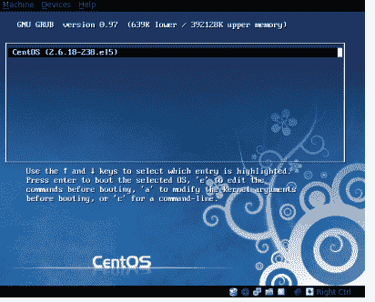
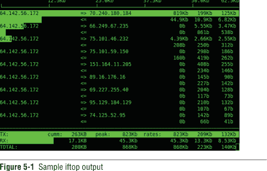
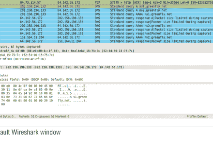
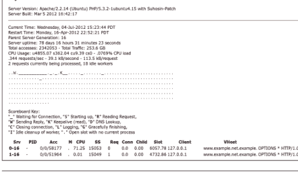

# Linux 服务器 DevOps 故障排除最佳实践

**凯尔·兰金（Kyle Rankin）**


*此页故意留白*

如果没有我妻子 Joy 的支持，这本书是不可能完成的。她再次帮助我管理时间，让我能够完成这本书，这次是在怀着我们第一个孩子 Gideon 期间完成的。我还想把这本书献给我的儿子 Gideon，到目前为止，他比任何服务器都更容易排查故障。

*此页故意留白*

*此页有意留白*

来自 Martin Spilovsky 的图书馆

## 前言

DevOps 描述了一个开发、质量保证（QA）和系统管理员比以往许多传统环境合作更为紧密的世界。尽管 DevOps 已被公认为快速软件部署和自动化的福音，但 DevOps 方法的一个常被忽视的好处是，当整个团队能够协作对系统中的问题进行故障排除时，会发生的快速问题求解。不幸的是，开发人员、QA 和系统管理员在故障排除技能上存在差距，他们通常通过互相指责系统中的问题来解决这些差距。本书旨在弥补这些差距，并引导所有团队通过一套标准的故障排除实践，让他们能够作为一个团队来应对一些最常见的 Linux 服务器问题。

尽管本书涵盖的总体主题传统上属于系统管理员的领域，但在 DevOps 环境中，开发人员和 QA 也会发现自己需要排查网络问题、配置 Web 服务器以及诊断高负载，即使他们可能没有 Linux 管理的背景。使本书不仅仅是一本系统管理员故障排除指南的原因在于其受众和侧重点。本书假设读者可能不是 Linux 系统管理员，而是 DevOps 组织中才华横溢的开发人员或 QA 工程师，他们可能没有太多系统级别的 Linux 经验。话虽如此，如果你是系统管理员，你也不会被排除在外。书中包含可以补充即使是资深系统管理员技能故障排除技术——只是以一种通俗易懂的方式书写。

在没有 DevOps 原则的传统企业环境中，故障排除与开发一样功能失调。当出现服务器问题时，如果你甚至能让开发人员和系统管理员在同一通电话中，你可以预期每个人都会陷入他们的传统角色——系统管理员只查看服务器资源和日志；开发人员等待不可避免的指责被堆砌到他们的“臃肿”或“有 bug”代码上，届时他们会抱怨不稳定的、性能不足的服务器；或者也许每个人都会将指责转嫁给 QA，因为他们没有在生产环境发现问题之前找到问题。与此同时，实际问题离解决没有更近一步。

在 DevOps 组织中，强调所有团队之间的合作，但在谈到故障排除时，人们通常仍然会陷入他们的传统角色，即使没有指责游戏。为什么？好吧，即使每个人都想合作，如果没有相同的故障排除技能和技术，每个人都可能仍在等待其他人排查他们的部分。本书的目标是让您的 DevOps 团队中的每个成员在 Linux 故障排除方面达成共识。当每个人都具备相同的 Linux 故障排除技能时，QA 团队将能够更好地在问题到达生产环境之前诊断问题，开发人员将更善于追踪最新检入代码为何使系统负载翻倍，系统管理员可以对其诊断更有信心，因此当问题出现时，每个人都可以投入帮助。

本书分为十章，基于您在 Linux 系统上遇到的一些最常见的问题，章节的顺序安排使得您在阅读早期章节时学到的技术（特别是关于如何诊断高负载和如何排查网络问题）在深入阅读本书时会很有帮助。话虽如此，我意识到您可能不会从头到尾阅读本书，而是可能会直接翻转到与您特定问题相关的章节。因此，当其他章节的主题有帮助时，我会指引您前往那里。

- **第 1 章：故障排除最佳实践** 在学习如何排查具体问题之前，学习一个可以应用于几乎任何类型问题的整体故障排除方法可能是最好的，即使是在 Linux 系统之外。本章讨论了一般故障排除原则，您将在本书其余部分尝试具体的故障排除步骤时使用这些原则。
- **第 2 章：为什么服务器这么慢？CPU、RAM 和磁盘 I/O 耗尽** 本章介绍您将在必须解决的最常见问题之一上应用故障排除原则：为什么服务器很慢？无论您是 QA 并试图弄清楚为什么最新的负载测试运行得慢得多；您是开发人员试图弄清楚您的程序是 I/O 受限、RAM 受限还是 CPU 受限；或者您是不确定 8、9 或 13 的负载是否正常的系统管理员，本章将提供您解决负载问题所需的所有技术。
- **第 3 章：为什么系统无法启动？解决启动问题** 许多不同的问题可能阻止系统启动。无论您是否曾考虑过 Linux 启动过程，本章首先通过健康 Linux 启动过程，然后讨论当启动过程中每个阶段失败时的表现，帮助您追踪启动问题。
- **第 4 章：为什么我无法写入磁盘？解决磁盘满或损坏问题** 几乎任何使用 Linux 一段时间的人都遇到过无法写入磁盘的系统。可能是您作为开发人员启用了日志中的调试功能并意外填满了磁盘，或者您可能只是文件系统损坏的受害者。无论哪种情况，本章帮助您追踪哪些目录占用了系统中最多的空间，以及如何修复损坏的文件系统。
- **第 5 章：服务器宕机了吗？追踪网络问题的源头** 无论您在 DevOps 组织中处于什么位置，网络故障排除技能都无价。有时很难追踪网络问题，因为它们往往以奇怪的方式影响系统。本章通过测试不同网络层的问题，一步一步指导您如何隔离和诊断网络问题。本章还为书中其他部分涵盖的特定网络服务（如 DNS）的故障排除技术奠定基础。
- **第 6 章：为什么主机名无法解析？解决 DNS 服务器问题** DNS 可能是较难排查的服务之一，因为尽管网络的很大一部分依赖于它，但许多用户对其工作原理不熟悉。无论您是通过注册商通过 Web 图形界面为网站提供 DNS 服务的 Web 开发人员，还是负责完整 BIND 实例的系统管理员，这些 DNS 故障排除技术都将证明是无价的。本章将追踪正常的成功 DNS 请求，然后使用更具体的技术来寻找 DNS 区域传输、缓存问题甚至语法错误，详细阐述第 5 章中涵盖的 DNS 故障排除。
- **第 7 章：为什么我的邮件没有发送出去？追踪邮件问题** 邮件是互联网上最早的服务之一，并且仍然是重要的沟通方式。无论您是追踪为什么自动测试邮件没有发送，为什么软件邮件通知卡住了，还是为什么整个公司的邮件投递中断，本章都帮助您解决多种邮件问题，包括配置错误的中继服务器和与 DNS 相关的邮件服务器问题。本章甚至展示如何手动使用 `telnet` 发送邮件。
- **第 8 章：网站宕机了吗？追踪 Web 服务器问题** 我们日常交互的许多应用程序都基于 Web。事实上，如果您是一名软件开发人员，很有可能 Web 编程至少是您开发工作的一部分；如果您是一名系统管理员，您很可能至少负责一个 Web 服务器。Web 服务器故障排除是一个庞大的主题，但就本章而言，您只了解当今两种最流行的 Web 服务器（Apache 和 Nginx）中可能遇到的常见问题。本章讨论如何获取服务器状态，以及如何识别高服务器负载的原因以及其他常见的调试技术。
- **第 9 章：为什么数据库很慢？追踪数据库问题** 就像您日常使用的许多软件都在 Web 上一样，您使用的许多软件将数据存储在某种数据库中。本章与第 8 章类似，只是其重点在于故障排除两种流行的开源数据库服务器：MySQL 和 PostgreSQL 的问题。与第 8 章一样，它讨论如何从这些数据库中获取负载指标，以及如何识别问题查询以及其他高负载原因。
- **第 10 章：这是硬件的错！诊断常见的硬件故障** 在所有这些对软件的关注中，我们还应该讨论服务器问题的最常见原因之一：硬件故障。硬件故障的问题在于，硬件通常不会完全失效。相反，RAM 的某些段会出现错误，硬盘扇区会失效，或者以太网卡会随机丢包。更糟糕的是，这些故障往往会导致几乎无法追踪的软件问题。本章将讨论如何排除一些常见的硬件故障，从不良 RAM、即将报废的硬盘，到濒死的网卡。本章包含的硬件故障排除技术可应用于任何场景——从生产机架式服务器到个人笔记本电脑。

*此页故意留空*

## 致谢

感谢 DEBRA 为推动这本书的出版所做出的贡献，从最初提出这个想法到它最终成为一本真正的书，她始终在倡导。还要感谢 Trotter 和 Bill 在整个过程中提供的宝贵反馈。最后，感谢多年来我处理过的所有故障系统，它们帮助我磨练了故障排除技能。

*此页故意留空*

## 作者简介

Kyle Rankin 是一名高级系统管理员和 DevOps 工程师；他是 North Bay Linux 用户组的现任主席；《*The Official Ubuntu Server Book*》、《*Knoppix Hacks*》、《*Knoppix Pocket Reference*》、《*Linux Multimedia Hacks*》和《*Ubuntu Hacks*》的作者；同时也是其他多本书籍的贡献者。Rankin 是屡获殊荣的专栏作家，为《*Linux™ Journal*》撰稿，并曾在《*PC Magazine*》、TechTarget 网站及其他出版物上发表文章。他经常就开源软件进行演讲，包括在 SCALE、O’SCON、Linux World Expo、Penguicon 以及众多 Linux 用户组的活动上。

*此页故意留空*

# 第 1 章

## 故障排除最佳实践


# 故障排除是一项技能

故障排除是一项技能。与所有技能一样，无论是杂耍、弹吉他、烹饪还是编程，有些人天生擅长故障排除，而另一些人则不然。如果这项技能对你来说是 innate（天然的），你可能会认为对每个人来说也是如此。毕竟，如果你第一次骑自行车就成功了，你可能会想当然地认为别人不需要付出太多努力。

有些人天生擅长故障排除。面对问题时，他们会本能地立即行动，直觉地采取步骤来进一步缩小问题范围，直到找到根本原因。当你把车交给一位擅长故障排除的好技师时，在你描述完症状后，你能看到他的齿轮在转动；他已将问题范围缩小到少数几个原因，并对根本原因有一种“预感”。经过几次测试后，他将证实他的预感，并朝着修好你的车迈出重要一步。另一方面，当你把车交给一位不擅长故障排除的技师时，你可以预期高额修理账单，以及为了替换一个又一个部件而反复奔波修车店。

故障排除是一项任何人都可以学习的技能。与许多技能一样，故障排除涉及某些技术，无论它们是否天然具备，通过练习都可以变成第二性质。你不仅希望成为一名更好的故障排除者，还希望*更快*。这在停机时间以金钱衡量环境中尤为重要。毕竟，无论是好技师还是坏技师，最终都会修好你的车，但你更愿意让谁来处理？

在 DevOps 组织中，团队中的每个人都负责一定程度的故障排除。开发人员排除软件中的错误，系统管理员排除硬件上的问题，而 QA 团队则花费大量时间首先发现问题，然后尝试定位根本原因。当 DevOps 团队中的每个人都使用相同的经过验证的故障排除技术时，整个团队都会受益。

本章描述了一些你可以应用于几乎任何问题的故障排除最佳实践。读完这些实践后，它们大多显得合乎常理，但你可能会惊讶地发现，面对问题时有多少人跳过了这些步骤。

## 分割问题空间

如果我让你猜我在 1 到 100 之间想的数字，你会猜什么？假设数字是 73，每次猜测后我都会告诉你这个数字比你的猜测高还是低。有些人可能会开始随机猜测数字，或者从 1 开始往上数。擅长故障排除的人可能会这样猜：50（更高），75（更低），63（更高），69（更高），72（更高），73。每次猜测，可能性都减半。在这个例子中，找到正确答案用了 6 次猜测，而如果从 1 开始往上数，则需要 73 次。如果你只是随机猜测，你可能会试遍所有数字才能碰巧猜中正确的那个。

同样的方法适用于所有故障排除。面对问题时，有些人只是从可能原因列表的底部开始，往上排查；另一些人则选择随机测试，直到碰巧找到原因。优秀的故障排除者会选择每个测试，使得结果能够排除一类原因，而不仅仅是一个单一原因。分而治之。当你分割问题空间时，即使测试没有揭示*根本*原因，结果也排除了一个以上的原因。

例如，如果我尝试在浏览器中加载一个网站，但请求超时了，我想测试问题是出在他们的网站还是我的互联网连接上，我不会立刻走到电脑后面去检查以太网线是否插好。相反，我可能会尝试加载一两个我知道通常很稳定的其他网站。如果那些其他网站能打开，我就知道我的互联网连接没问题，从而直接排除了一整套本地网络测试。

当你与一个团队合作解决问题时，你还需要在团队成员之间分割问题空间。没有什么比追踪一个问题，结果发现你的队友一直在做完全相同的测试更糟糕的了。当你在团队环境中着手解决一个问题时，给每个人分配不同的测试，并确保一旦某人排除了某个原因，结果能传达给其他所有人。

## 协作时保持良好的沟通

在团队中进行故障排除时，最大的挑战之一是建立良好的沟通方法。如果没有良好的沟通，两个人会在未察觉的情况下处理同一个问题，人们会沿着他人已经排除的故障排除路径走下去，或者更糟糕的是，人们误解了指令，从而使问题变得更糟。以下部分介绍了协作中使用的各种沟通方法，并描述了每种方法中什么有效以及什么无效。

### 会议电话

会议电话是问题解决中最常见也是最糟糕的沟通方式之一。最大的问题是，在会议电话中同一时间只能有一个人说话。即使你很幸运，电话上只有直接处理问题的人员，任何拥有新信息、突破、警告或其他内容的人都必须等待轮到自己说话。即使他们轮到了，也不能保证每个人都能在一开始就理解他们说的话，期间可能会有打断、糟糕的蜂窝信号以及忘记静音的外放用户产生的背景噪音。传达命令行命令、IP 地址、日志输出或任何技术相关的内容尤其困难。

如果快速解决问题很重要，会议电话会在你的道路上设置许多障碍。首先是花费查找会议电话号码和访问代码、输入所有内容以及等待“主持人”加入会议的时间。一旦会议电话接通，你可以预计前五到十分钟会完全无效，你们的对话可能会像这样：

*BEEP* “___ 刚刚加入会议。”

Fred：“谁刚加入了？”

### 直接对话

泰德：“我是泰德。网站宕机了！你认为问题出在哪里？”

弗雷德：“嗯，我还不确定……我刚刚登录了……”

*哔* “玛丽刚刚加入了会议。”

玛丽：“嗨，网站宕机了吗？你认为问题出在哪里？”

弗雷德：“我刚刚登录了Web服务器，我正在查看……”

*哔* “鲍勃加入了会议。”

鲍勃：（背景中有高速公路上的噪音）“嗨，网站宕机了！”

事实是，大多数故障解决团队在会议通话中并不孤单。许多经理喜欢会议通话，将其作为参与故障排除过程的一种方式，并将其作为“管理”问题的中央指挥中心，即使他们无法直接做出贡献。这不可避免地导致频繁要求进度报告，这意味着某人（很可能是你希望其处理问题的团队领导）不得不中断手头的工作进行解释。由于通话中每次只能有一个人说话，在解释期间，团队的其他成员无法进行沟通。

本质上，下面列出的所有其他沟通方式都比会议通话更可取，所以我并不是说你要扔掉会议通话号码，而是说你应该把它作为最后的手段。

办公室通常会将团队安置在同一区域，但即使每个团队成员都在听得到范围内，人们也经常在危机中转向会议通话进行交流。如果每个人都在可听距离内，大声讨论问题有很多优点。一方面，通常更容易理解某人说的话，其次，更容易同时进行多场对话。

直接对话用于故障解决的缺点是，仍然难以分享任何相对技术性信息，更不用说长的日志条目或URL了。除此之外，对话通常没有被记录，所以你的故障排除步骤没有记录可用于后续事后分析，而且任何迟到的参与者都需要被告知进度。另外，如果每个人不在同一地点工作，或者问题发生在非工作时间，那么你又回到了会议通话。对我来说，直接对话是其他更好的沟通方式的有益补充。

### 电子邮件

电子邮件可以是协作解决问题的一个好方法，尤其当它不是时间敏感的问题时。你可以在流行开源项目的公开缺陷跟踪系统中看到这方面的例子。电子邮件相对于语音通信的优点包括：

- 可以同时发生多场对话。
- 旁支对话也很方便。
- 轻松粘贴IP地址、URL或命令。
- 可以附上截图或日志。
- 迟到加入问题的人可以通过阅读邮件线程自行赶上进度。
- 你自动拥有故障排除协作过程的时间戳日志，其中可能包括粘贴的命令输出和其他数据，这些数据可能无法通过其他方式记录。

话虽如此，电子邮件沟通仍然存在一些问题。一方面，电子邮件不是实时的且不具备交互性，因此与当面交谈相比总会有延迟，而这会显著减慢故障排除过程。其次，冗长的邮件链可能难以解析和阅读，尤其是当人们在顶部发帖、底部发帖和内联回复方面有不同的理念时。很容易遗漏可能嵌套在评论或粘贴输出之间的关键信息。如果你是管理员并安装了监控软件，你可能使用电子邮件进行某种通知。在出现问题期间，你的收件箱可能充满了警报，因此在许多其他电子邮件中找到对话可能很困难。最后，如果你试图解决的问题是邮件服务器宕机的原因，那该怎么办？

### 实时聊天室

实时聊天室是团队在故障排除时协作的最佳方式之一。实时聊天室包括IRC或具有群聊功能的任何即时消息客户端，如Jabber。以下是聊天室相对于其他沟通方法的一些优势：

- 沟通是实时且交互的。
- 多人可以同时沟通。
- 个人也可以私下聊天。
- 轻松粘贴技术性信息。
- 大多数聊天室软件都包含文件共享功能，因此你可以分享截图或日志。
- 聊天室对话可以记录下来，用于事后分析。
- 一些聊天室会保留聊天记录，即使是对新加入的人，因此很容易赶上进度。
- 当你专注于某事时，可以忽略对话，然后返回对话并补上错过的内容。
- 你可以将聊天室标题设置为当前问题状态，并让你的经理满意。

不过，聊天室也不是没有自身的问题。一方面，只有一些聊天室软件会保存历史记录。如果没有该功能，每个加入聊天的新协作者都需要被告知进度。此外，在聊天室中粘贴的超过几行的文本可能难以阅读，因此你可能需要求助于电子邮件或其他方法来分享大量数据。最后，有些人只是更喜欢说话而不是打字，尤其是如果他们打字速度不快，那么你可能很难让他们加入聊天室。

也许不用说，但出于隐私考虑，最好使用你控制的聊天服务器，因为在故障排除过程中会分享大量敏感数据。IRC和Jabber都提供开源服务器，你可以在你的环境中安装，以确保沟通在你的控制之内。

### 拥有备用沟通方式

无论你选择哪种沟通方式，你都需要确保你有备用方案。如果邮件服务器宕机，很难通过电子邮件进行沟通，如果你遇到网络问题，可能无法到达内部聊天服务器。提前弄清楚如果主要方式不起作用，你将如何沟通，并确保每个人都知道如何使用它。

### 偏向快速、简单测试而非缓慢、复杂测试

如果每个问题都有一套逻辑的测试以及你应该尝试它们的顺序，那就太好了。然而，通常你会想出几种看起来同样合理的潜在原因。很难知道应该首先尝试什么，但一个好的经验法则是，当你有两个同样好的测试要执行时，要偏向快速或简单的测试，而非缓慢或复杂的测试。


如果你所在组织的停机时间以美元计算，那么尽快定位问题的根本原因通常很重要。例如，当Web服务器宕机时，有很多不同的方法来排查问题，但如果你从尝试`ping`服务器开始，你是在执行一个快速测试，立即告诉你服务器是否仍在网络上。如果`ping`不起作用，你可以开始着手让服务器重新上线。如果`ping`有效，你可以开始更长、更复杂的排查过程，但你只损失了几秒钟。

在团队环境中，你有一个优势，即更容易同时进行多项测试。在这种情况下，可能让一名成员处理缓慢、复杂的测试，而其他人专注于较短、较简单的测试是有意义的。只要大家沟通良好，你就可以以这种方式快速缩小到根本原因。

尽管应该优先选择快速和简单的测试，但如果大部分时间无需照看，开始一个缓慢的测试也是可以的。这样做的理由是，你可以启动缓慢的测试，然后在它运行期间处理其他事情。同样的思考方式也适用于其他需要一些时间的故障排除过程。例如，如果作为故障排除过程的一部分，你需要提交工单或向其他支持人员发送某种通知，启动该过程，然后深入处理需要更多专注的其他任务。

这里有一个很好的问题要问：“它插电了吗？”通常一些最大的问题有最简单的原因。网络和电源电缆通常连接松散，最轻微的推动就足以使服务器从网络中断开。如果你离系统足够近，可以检查是否插电，最好做那个快速的视觉测试，而不是坐在电脑前等待长达一分钟的端口扫描返回。

## 偏向过去解决方案

事实是，大多数问题发生不止一次。一些人之所以有快速隔离问题的能力，部分原因是他们以前经历过同样的事情很多次。你接触的问题越多，你会变得更好、更快的故障排除员。

当你解决问题时，经常会遇到你以前见过的相同症状。试着回忆上次的根本原因是什么，以及你用了哪些步骤来隔离问题。通常情况下，当症状相同时，根本原因也会相同，如果你能认识到这一点，你可以更快地解决问题。正如他们所说，如果它走起来像鸭子，叫起来像鸭子，那它很可能是一只鸭子。

然而，有时它并不是鸭子。我见过一些人将偏向过去解决方案的原则走得太远，以至于如果任何症状听起来熟悉，他们就完全对其他解释持封闭态度。事实是，完全不同的问题通常可以拥有相同的症状，尤其表面现象。例如，当服务器负载过高或网络连接饱和时，`SSH`会话都会出现延迟和卡顿。`Nmap`（一个实用的端口扫描工具）在防火墙阻止端口或路由器配置错误时，都会报告该端口被过滤。如果你过早地聚焦于过去的解决方案，就可能产生偏见，从而使得找到真正问题变得更加困难。

关键在于，即使你使用过去的解决方案来指导故障排查过程，也要确保对假设进行验证。如果你记得上次隔离问题的一些方法，这次你应该能更快地通过测试来证明这一点；如果测试结果不同，请准备好转向其他理论。

## 记录你的问题和解决方案

正如我之前提到的，大多数问题都会发生不止一次。利用这一事实的最佳方式之一就是记录你的问题及其解决方案。许多地方将这个过程称为“事后分析”（`postmortem`）。问题解决后，所有相关人员会聚在一起，记录哪里出了问题，以及每个人为隔离问题执行了哪些步骤及其结果。事后分析的最终目标是识别根本原因，理想情况下，还会采取措施防止问题再次发生。

虽然事后分析会占用大家宝贵的时间，但它值得做的理由很多。主要原因是，如果相同的症状再次出现，很难记清上次为解决问题所做的所有事情。在紧张的情境下，你往往只记得自己以前见过这个问题。如果能找到匹配的事后分析文档，你立刻就能获得一份用于隔离问题的故障排查步骤清单。

在团队协作环境中，这种记录过程能让每个人都成为更好的问题解决者。团队中的初级成员能从资深成员的经验中受益，大家一起学习新工具和技术。更重要的是，当问题的解决方案被记录下来后，初级团队成员更容易独立解决问题。这意味着当你不在值班时，接到的叫醒电话会少一些；当你在休假时，受到的干扰也会少一些。

如果操作得当，事后分析可以成为宝贵的资产；但如果做得不好，它带来的麻烦可能比解决的问题还多。讨论和记录故障排查技术与流程固然很好，但你必须追溯至根本原因。确实，在问题消失后，花费额外时间和精力去翻阅日志以追溯根本原因是必要的。很多时候，团队只会做到描述症状以及他们如何让问题消失的地步。往往正是这些团队，只通过重启服务器或服务来解决“问题”。如果你没有隔离出根本原因，很可能会一次又一次地看到同样的问题。

当然，只有在你随后采取措施防止问题再次发生时，隔离出根本原因才有用。一旦你知道根本原因，就可以找出如何修复它以及由谁来负责。说起来容易做起来难，但再次强调，如果不这样做，你很可能会再次遇到该问题，甚至在最坏的情况下，你可能会认为彻底解决该问题所涉及的努力并不值得。

有些团队（如果还能称之为团队的话）则存在相反的问题。他们喜欢利用事后分析来找出根本原因，但只是为了知道该责怪谁。在这种环境下的事后分析会变得带有防御性，甚至具有攻击性，最终事与愿违。当事后分析完全变成推卸责任时，人们参与的可能性会降低，更有可能对事实三缄其口，特别是当他们认为这可能涉及自身时。最终，即使你找到了可以责怪的人，也可能并没有找到真正的根本原因。当你必须排查新问题时，这反而营造出一个更加功能失调的环境。焦点不再是解决眼前的问题，而是证明问题“出在你们那边，而不是我这边”。

最后，有些人如此热衷于事后分析，以至于在问题尚未解决时就开始进行。在危机爆发过程中，你的关注点应严格集中在当前问题上，以及为隔离该问题将执行的故障排查步骤上。此时尚早，无法知道根本原因，所以说出那句名言“我们能做些什么以确保这绝不再发生？”毫无意义。如果你曾解决过复杂问题，就知道你认为的根本原因在整个过程中可能会改变多次。通常故障排查环境压力巨大，需要高度集中，特别是当问题正在给公司造成金钱损失时，任何分心都意味着解决问题的时间会更长。

即使你刚刚确定了根本原因，最好还是留出足够的时间让大家冷静下来，真正思考刚才发生的一切，然后再规划长期解决方案。如果没有这段额外的缓冲时间，你更有可能想出反应式的、临时性的补丁修复措施，这些措施要么只是推迟了问题，要么带来的问题比解决的还多。

## 了解发生了变化

系统中的问题最大来源之一是变更。当系统长期运行平稳，随后突然出现一个问题时，你应该问的第一个问题之一是“发生了什么变化？”如果你的系统经常不稳定，可能不会直接指向新的变更作为问题来源；但在稳定、一致的系统上，在其他条件相同的情况下，变更应是你首要的故障排查目标。识别并排除对系统所做的变更，可以极大地加快你的故障排查过程。

虽然系统变更可能是问题的根源，但如果你没有方式追踪变更，很可能无法更快地解决问题。如果没有某种方式来跟踪变更，你应该认真考虑引入一种——特别是当你的系统稳定之后。没有什么比收到问题警报时，有人跳出来说“吉姆在问题开始前后推送了一个代码变更”，从而立即追踪到问题更令人愉悦的了。而没有什么比在稳定的系统上发现问题，询问发生了什么变化，然后意识到你根本无法知晓更糟糕的了。

即使你有某种方式跟踪变更，最好也能自律，一次只改变一件事。如果你能指向问题发生时间附近的一个单一变更，隔离问题要简单得多；如果同时修改了十段不同的代码和三个配置文件，那就困难得多。我见过一些团队利用维护窗口一次性处理许多无关事项。问题在于，当该维护窗口内出现问题时，隔离根本原因变得更加困难。

拥有一个记录变更的系统固然很好，但更好的是一个允许你回滚任何导致问题的变更的系统。退一步说，如果你能回滚问题出现之前的所有系统变更，而问题依然存在，你就排除了一个主要假设，可以转向其他测试。即使你有回滚变更的能力，仍应尽量一次只改变一件事。回滚一大组变更可能会解决问题，但你仍需挖掘每个单独的变更以找到问题的源头。

话虽如此，变更并不总是问题的原因。事实上，我在故障排查会议中见过“发生了什么变化？”这个问题制造了许多红鲱鱼（无关信息或误导）。与所有这些故障排查理念一样，请务必测试你的变更假设，不要因为一出现问题的迹象就立即开始回滚所有东西。

## 理解系统的工作原理

作为系统管理员的多年经验让我学到一点：当出现问题时，每个人都倾向于责怪他们最不熟悉的技术。在我职业生涯的某个阶段，`DNS`成了所有网络问题的替罪羊。我不知道这是怎么开始的，因为自从我在那里以来，我们的`DNS`服务器一直都很稳定，但每当出现任何网络问题时，人们就会从隔间后面探出头来问“`DNS`挂了吗？”我注意到，那些指责`DNS`的人恰好是对它了解最少的人。我的解决办法是在公司内部举办一个自愿参加的培训课程，讲解`DNS`的工作原理。之后我发现，所有参加过课程的人都停止将网络问题归咎于`DNS`（而少数缺席课程的人依然这么做）。

关键是，这种倾向于责怪你最不熟悉的技术的本能，不仅适用于其他人，也适用于身为故障排查者的你。如果你理解你所排查故障的系统的运作方式，你会成为一个高效的问题解决者。从解决`Linux`问题的角度来看，这意味着需要对`TCP/IP`、`DNS`、`Linux`进程、编程和内存管理有良好的理解。本书将帮助你在故障排查的语境下解释这些主题的许多内容，但事实是，即使不在故障排查的场景下，了解这些主题也很有好处。

你会发现，你越理解系统的运作方式，解决其问题的速度就越快。你会发现自己可以更加信任自己对问题的直觉。这也有助于你避免徒劳无功的尝试。你将能够排除整个类别的根本原因，而无需进行大量测试。

## 使用互联网，但要谨慎

在故障排查过程中，互联网可以是一个非常宝贵的资源。你可能不是世界上第一个看到特定错误信息的人。不仅很有可能其他人也看到了与你相同的症状，而且在你的搜索中，你很有可能找到一个可行的解决方案。


使用互联网进行故障排查的挑战在于，在上网搜索之前，你必须对问题有一个良好且清晰的理解。如果你的服务器不在网络上，而你在搜索引擎中输入“服务器不在网络上”，你可能不会得到非常有用的结果。一旦你自行进行一些故障排查步骤来缩小问题范围并对问题有更清晰的理解，你将能够使用具体且有针对性的搜索查询，这很可能帮助你解决问题。

我发现，当排查包含非常具体的错误代码或短语的问题时，互联网最有用。描述特定问题的错误代码可能很有用，因为即使你不完全理解错误代码的含义，它们也很容易搜索。通常，你会在论坛或知识库中找到一个乐于助人的人，解释错误代码的含义以及看到它时该怎么办。程序输出中的错误信息，如果足够具体，也可以成为你试图解决问题时的良好帮助来源。

互联网搜索的危险在于，如果你没有对问题有良好的理解，或者不使用具体的搜索查询，你可能会得到很多错误的信息和错误的故障排查步骤，使你离根本原因越来越远。你还会发现很多坦率地说不知自己在说什么的人给出的建议。始终考虑信息来源，特别是确保你在复制和粘贴任何命令或代码之前理解它们。

## 抵制重启的冲动

在 Windows 95 的时代，重启通常是修复几乎任何问题的最佳方式。我们不再处于 Windows 95 的时代，甚至我们在这里也没有使用 Windows，但有些人仍然陷入这种心态，因此，一旦出现问题，他们的第一个行动就是重启服务或重启硬件。

通过重启来修复问题最危险的地方不在于它不起作用，而在于有时它确实解决了问题。危险之处在于，如果它确实解决了问题，你仍然没有更接近识别根本原因，而且，由于问题不再存在以便再次测试，你可能永远无法孤立出原因。当问题不再存在时，排查原因确实很难，甚至是不可能的。如果你没有孤立出根本原因，你几乎可以保证以后还会再次看到这个问题。

别误会我的意思，我并不是说在故障排查时你应该永远不要重启硬件或重启服务。我想说的是，你应该始终将重启作为最后的绝对手段，并试图预先捕获所有你能捕获的故障排查数据，以防问题确实消失。这是一个难以执行的政策，特别是当问题造成实际经济损失，而你的老板或客户在冲你大喊大叫要求你只是重启看看是否能修复时。尽管如此，要坚守立场。如果你认为你的老板或客户现在很生气，等到同样的问题再次发生的时候再看看吧。

## 第 2 章

### 为什么服务器这么慢？CPU、RAM 和磁盘 I/O 耗尽


尽管你在服务器上发现的许多问题都基于网络，但仍有一类问题仅涉及本地主机（localhost）。这使得问题变得棘手，因为某些本地和网络问题通常会产生相同的一组症状，事实上，本地问题可以引发网络问题，反之亦然。本章专门讨论发生在主机上的问题，并将影响网络的问题留给第 5 章。

DevOps 团队中的几乎每个人都会遇到主机迟缓或无响应的问题，无论是试图找出为什么他们的最新提交运行速度比以前慢得多的开发人员，还是试图在代码进入生产环境之前执行负载测试的 QA 工程师，还是需要弄清楚是否该购买更多 RAM、额外 CPU 或更快磁盘的系统管理员。这些相同的技术甚至可以帮助你排查 Linux 桌面上的负载问题。

你在主机上发现的最常见的问题之一可能是它迟缓到无响应的程度。这通常可能由网络问题引起，但本章将讨论一些本地故障排查工具，你可以用来区分繁忙的网络和繁忙的机器。

当机器迟缓时，通常是因为你耗尽了系统上某个特定资源。主要资源是 CPU、RAM、磁盘 I/O 和网络（这部分我将留给第 5 章）。过度使用其中任何资源都可能导致系统卡死，以至于通常唯一的补救措施是最后手段——重启。然而，如果你能够登录到系统，有一些工具可以帮助你确定原因。

#### 系统负载

系统平均负载可能是你排查迟缓系统时开始使用的基本指标。当我排查缓慢系统时运行的第一个命令之一就是 `uptime`：

```
$ uptime
13:35:03 up 103 days, 8 min, 5 users, load average: 2.03, 20.17, 15.09
```

负载平均值后面的三个数字——2.03、20.17 和 15.09——分别代表机器上的 1 分钟、5 分钟和 15 分钟平均负载。系统平均负载等于处于可运行状态或不可中断状态的进程的平均数量。可运行进程当前正在使用 CPU 或等待使用，而不可中断进程正在等待 I/O。

单 CPU 系统的平均负载为 1 意味着单个 CPU 处于持续负载之下。如果那个单 CPU 系统的平均负载为 4，那么系统上的负载是其处理能力的四倍，因此四分之三的进程正在等待资源。系统报告的负载平均值并不根据你的 CPU 数量进行调整，因此，如果你有一个双 CPU 系统，平均负载为 1，那么你两个 CPU 中有一个始终处于加载状态——也就是说，你处于 50% 的负载。因此，单 CPU 系统上的负载 1 在可用资源使用量方面等同于四 CPU 系统上的负载 4。

1 分钟、5 分钟和 15 分钟平均负载描述了相应时间段的平均负载量，在你试图确定系统的当前状态时非常有价值。1 分钟平均负载可以让你很好地了解系统当前正在发生什么，所以在前面的例子中，你可以看到服务器最近一分钟的负载为 2，但过去 5 分钟的负载峰值平均为 20。过去 15 分钟的平均负载为 15。这表明机器至少在过去 15 分钟内处于高负载状态，负载似乎在 5 分钟前开始增加，但似乎已经缓解。让我们将其与一个完全不同的平均负载进行比较：

```
$ uptime
05:11:52 up 20 days, 55 min, 2 users, load average: 17.29, 0.12, 0.01
```

在这种情况下，5 分钟和 15 分钟的平均负载都很低，但 1 分钟的平均负载很高，因此我知道这次负载峰值是相对较新的。在这种情况下，我经常连续运行多次 `uptime`（或使用我稍后会讨论的 `top` 之类的工具），以查看负载是继续攀升还是正在回落。

#### 什么是高负载平均值？

一个很公平的问题是，你认为多高的负载平均值才算高。简短的回答是“这取决于导致高负载的原因”。因为负载描述的是正在使用资源的活跃进程的平均数量，负载的尖峰可能意味着几种不同的情况。重要的是确定负载是受 CPU 限制（进程等待 CPU 资源）、受内存限制（具体而言，高内存使用量已转入交换分区）还是受 I/O 限制（进程争夺磁盘或网络 I/O）。

例如，如果你运行一个在不同时间点生成大量并发线程的应用程序，并且所有这些线程同时启动，你可能会看到负载飙升到 20、40 或更高，因为它们都在争夺系统资源。随着它们完成，负载可能会迅速回落。

通常，系统在受 CPU 限制负载下比在受 I/O 限制负载下更具响应性。我见过负载高达数百且受 CPU 限制的系统，我仍然可以在那些系统上运行诊断工具，并获得相当不错的响应时间。另一方面，我也见过 I/O 限制负载相对较低的系统，仅仅登录就需要一分钟，因为磁盘 I/O 完全饱和。当系统耗尽内存资源时，通常表现为受 I/O 限制的负载，因为一旦系统开始使用磁盘上的交换存储，它会消耗磁盘资源并导致进程速度放缓，形成恶性循环。

#### 使用 top 诊断负载问题

当需要诊断高负载时，我首先会用到的工具之一是 `top`。在命令行输入 `top` 并按下回车键，你会立即看到大量系统信息（图 2-1）。这些数据会持续更新，以便你可以看到系统的实时信息，包括系统已启动多久、负载平均值、系统上运行了多少个总进程、你有多少内存——总量、已用和空闲——以及最后是一个进程列表，显示每个进程使用了多少资源。你可能无法通过 `top` 看到当前系统上运行的每个进程，因为它们可能无法全部显示在屏幕上。


```
top - 15:28:40 up 16 min, 2 users,  load average:  0.00, 0.17, 0.22
Tasks:  68 total,   1 running,  67 sleeping,   0 stopped,   0 zombie
Cpu(s):  0.0%us,  1.0%sy,  0.0%ni, 58.4%id,  0.0%wa,  0.0%hi,  0.0%si,  0.0%st
Mem:   508640k total,   304116k used,   204524k free,    10078k buffers
Swap:  537304k total,         0k used,  537304k free,   139048k cached

  PID USER     PR  NI VIRT   RES  SHR S %CPU %MEM   TIME+ COMMAND
 1337 jsmith   20   0  2.8g  411m  152m S   1.6   8.0   0:02.07 gnome-ses
    1 root     20   0  2616 1576 1192 S   0.0   0.3   0:01.07 init
    2 root      0 -15    0    0    0 S   0.0   0.0   0:00.00 kthread
    3 root     20   0    0    0    0 S   0.0   0.0   0:00.00 migration/0
    4 root     20   0    0    0    0 S   0.0   0.0   0:00.00 ksoftirqd/0
    5 root      0 -15    0    0    0 S   0.0   0.0   0:00.00 watchdog/0
    6 root     20   0    0    0    0 S   0.0   0.0   0:00.00 events/0
    7 root     20   0    0    0    0 S   0.0   0.0   0:00.00 cpushot
    8 root     20   0    0    0    0 S   0.0   0.0   0:00.00 helper
    9 root     20   0    0    0    0 S   0.0   0.0   0:00.00 netns
   10 root     20   0    0    0    0 S   0.0   0.0   0:00.00 auge-syn
   11 root     20   0    0    0    0 S   0.0   0.0   0:00.00 ps
   12 root     20   0    0    0    0 S   0.0   0.0   0:00.02 su
   13 root     20   0    0    0    0 S   0.0   0.0   0:00.00 bdf-default
   14 root     20   0    0    0    0 S   0.0   0.0   0:00.00 kintegrityupd/
   15 root     20   0    0    0    0 S   0.0   0.0   0:00.00 khckptid
   16 root     20   0    0    0    0 S   0.0   0.0   0:00.00 krecpl
   17 root     20   0    0    0    0 S   0.0   0.0   0:00.00 kacpl_motley
   18 root     20   0    0    0    0 S   0.0   0.0   0:00.00 kacpl_hotplug
   19 root     20   0    0    0    0 S   0.0   0.0   0:00.00 ata2
   20 root     20   0    0    0    0 S   0.0   0.0   0:00.00 ata_aux
   21 root     20   0    0    0    0 S   0.0   0.0   0:00.00 kswapd0
   22 root      0 -15    0    0    0 S   0.0   0.0   0:00.00 kswapd
```

### 图 2-1 标准 top 输出

默认情况下，`top` 根据进程使用 CPU 的程度对进程进行排序。这样你就可以一目了然地看到哪些进程正在消耗 CPU。

那么，如果你注意到某个进程消耗了所有 CPU 资源并希望终止它，该怎么办？`top` 中进程列表的第一列标记为 `PID`，显示程序的进程 ID——这是分配给系统中每个进程的唯一数字。要终止一个进程，按 `K` 键，然后输入你想终止的 `PID`；当提示以信号 15 终止进程时，按回车键。

默认情况下，`top` 以交互模式运行，这没问题，除非你想查看无法在屏幕上显示的信息。如果你想查看 `top` 的完整输出，或者将其重定向到文件，可以以批处理模式运行。`-b` 选项启用批处理模式，`-n` 选项允许你控制 `top` 在关闭前更新多少次。因此，例如，为了只运行一次 `top` 以查看完整输出，请运行：

```bash
$ top -b -n 1
```

如果你想将该信息存储到名为 `top_output` 的文件中，请使用：

```bash
$ top -b -n 1 > top_output
```

如果你想同时查看 `top` 输出*并*将其写入文件，可以使用便捷的命令行工具 `tee`：

```bash
$ top -b -n 1 | tee top_output
```

#### 理解 top 输出

当你使用 `top` 诊断负载时，基本步骤是检查 `top` 输出以识别哪些资源正在耗尽（CPU、RAM、磁盘 I/O）。一旦你弄清楚了这一点，你就可以尝试识别哪些进程正在消耗这些资源最多。首先，让我们检查来自某个系统的标准 `top` 输出：

```
top - 14:08:25 up 38 days,  8:02,  1 user,  load average:  1.70,  1.77,  1.68
Tasks: 107 total,   3 running, 104 sleeping,    0 stopped,    0 zombie
Cpu(s): 11.4%us,  29.6%sy,  0.0%ni,  58.3%id,    0.7%wa,  0.0%hi,  0.0%si,  0.0%st
Mem: 1024176k total,    997408k used,   26768k free,    8552k buffers
Swap: 1004052k total,     4360k used,  999692k free,   260404k cached

  PID USER     PR  NI VIRT   RES   SHR S  %CPU %MEM     TIME+  COMMAND
 9463 mysql   16   0 686m  111m 3328 S    53   5.5  503:17.64  mysqld
18749 magios  16   0 140m 134m 1868 S    12   6.6  1345:01  nagios2db_status
24636 magios  17   0 34608  10m  712 S     8   0.5  1195:13  nagios
22442 magios  24   0 6048  2024 1432 S     8   0.1  0:00.04  check_time.pl
```

输出的第一行与你从 `uptime` 命令中看到的一样。如本例所示，对于四核 CPU 机器来说，该机器负载并不重：

```
top - 14:08:25 up 38 days,  8:02,  1 user,  load average:  1.70,  1.77,  1.68
```

不过，`top` 提供了超越标准系统负载的额外指标。例如，`Cpu(s)` 行提供了关于 CPU 当前正在做什么的信息：

```
Cpu(s): 11.4%us,  29.6%sy,  0.0%ni,  58.3%id,  0.7%wa,  0.0%hi,  0.0%si,  0.0%st
```

如果你不知道这些缩写代表什么，它们可能没有太大意义，因此我在此对每一个进行了分解：

- `us`: 用户 CPU 时间
  - 这是用于运行未调整优先级的用户进程的 CPU 时间百分比。(`Nicing` 是一个允许你更改进程相对于其他进程的优先级的过程。)
- `sy`: 系统 CPU 时间


- 这是用于运行内核和内核进程的 CPU 时间百分比。

- **ni: 调整后的 CPU 时间**

  - 如果你有需要调整优先级的用户进程，此指标将告诉你运行这些进程所花费的 CPU 时间百分比。

- **id: CPU 空闲时间**

  - 这是你希望较高的指标之一。它代表处于空闲状态的 CPU 时间百分比。如果系统缓慢但此数值很高，你就知道原因不是高 CPU 负载。

- **wa: I/O 等待**

  - 此数字代表用于等待 I/O 的 CPU 时间百分比。当你在追踪系统缓慢的原因时，这是一个特别有价值的指标，因为如果此值较低，你可以比较放心地排除磁盘或网络 I/O 作为原因。

- **hi: 硬件中断**

  - 这是用于处理硬件中断的 CPU 时间百分比。

- **si: 软件中断**

  - 这是用于处理软件中断的 CPU 时间百分比。

- **st: 窃取时间**

  - 如果你正在运行虚拟机，此指标将告诉你为其他任务而从你这里窃取的 CPU 时间百分比。

在前一个示例中，可以看到系统空闲率超过 50%，这与四核 CPU 系统上 1.70 的负载相符。当你诊断缓慢系统时，你应该查看的第一个值之一是 I/O 等待，因此

你可以排除磁盘 I/O 的影响。如果 I/O 等待较低，那么你可以查看空闲百分比。如果 I/O 等待较高，那么下一步是诊断导致高磁盘 I/O 的原因，我稍后将详细介绍。如果 I/O 等待和空闲时间都很低，那么你通常会看到较高的用户时间百分比，因此你必须诊断导致高用户时间的原因。如果 I/O 等待低且空闲百分比高，那么你就知道任何迟缓都不是由于 CPU 资源造成的，你需要开始在别处进行故障排查。这可能意味着查找网络问题，或者在 Web 服务器的情况下，查看对 MySQL 的缓慢查询等。

### 诊断高用户时间

一个常见且相对简单的问题诊断是，由于用户 CPU 时间占比过高导致的高负载。这很常见，因为你服务器上的服务很可能承担了系统负载的大部分，而它们都是用户进程。如果你看到高用户 CPU 时间但低 I/O 等待时间，你只需要识别系统中哪些进程消耗了最多的 CPU。默认情况下，`top` 会按 CPU 使用率对所有进程进行排序：

| PID USER | PR NI | VIRT RES | SHR S | %CPU %MEM | TIME+ COMMAND |
|---|---|---|---|---|---|
| 9463 mysqld | 16 0 | 686m 112m 3328 S | 53 5.5 | 5689:17.64 | mysqld |
| 18749 nagios | 1 0 | 149m 134m 1868 S | 12 6.6 | 1345:01 | nagios2db_status |
| 24636 nagios | 17 0 | 34668 10m 712 S | 8 0.5 | 1195:15 | nagios |
| 22442 nagios | 24 0 | 6848 2024 1452 S | 8 0.1 | 0:00.04 | check_time.pl |

在这个例子中，`mysqld` 进程消耗了 53% 的 CPU，而 `nagios2db_status` 进程消耗了 12%。请注意，这是单个 CPU 的百分比，因此如果你有一台四核 CPU 的机器，你可能会看到多个进程的 CPU 使用率都达到 99%。

你看到的最常见的高 CPU 负载情况是，所有 CPU 被一两个进程或大量进程消耗。这两种情况都很容易识别，因为在第一种情况下，前两个进程的 CPU 百分比会非常高，而其余的相对较低。在这种情况下，为了解决问题，你只需杀死正在使用 CPU 的进程（按下 K 键，然后输入该进程的 PID 号）。

在多个进程的情况下，你可能有一个系统在做太多的事情。例如，你可能在 Web 服务器上运行了大量的 Apache 进程，同时还运行一些通过 cron 执行的日志解析脚本。所有这些进程可能消耗或多或少相同的 CPU 量。对于这类问题的解决方案，从长期来看可能更具挑战性。如在 Web 服务器的例子中，你确实需要所有这些 Apache 进程运行，但你可能也需要那些日志解析程序。从短期来看，你可以杀死（或可能推迟）一些进程，直到负载下降，但从长期来看，你可能需要考虑增加机器的资源，或者将部分功能拆分到多台服务器上。

### 诊断内存不足问题

`top` 输出中的接下来两行提供了有关 RAM 使用情况的宝贵信息。在诊断具体的系统问题之前，能够排除内存问题是至关重要的。

```
Mem: 1024176k total, 997408k used, 26768k free, 85520k buffers
Swap: 1004052k total, 4360k used, 999692k free, 286040k cached
```

第一行告诉我们物理 RAM 的可用、已用、空闲和缓冲量。第二行给出了关于交换空间使用情况的类似信息，以及 Linux 文件缓存使用的 RAM 量。乍一看，系统可能看起来几乎耗尽了 RAM，因为系统报告只有 26,768k 空闲。由于 Linux 文件缓存的原因，许多故障排查者被输出中的已用和空闲行所误导。一旦 Linux 将文件加载到 RAM 中，它并不一定会在程序使用该文件完成后将其从 RAM 中移除。如果有可用的 RAM，Linux 会将文件缓存在 RAM 中，以便如果程序再次访问该文件，它可以更快地完成。如果系统确实需要 RAM 供活动进程使用，它就不会缓存那么多文件。由于文件缓存，运行了相当长时间的服务器通常会报告少量的空闲 RAM，而其余部分位于缓存中。

要了解进程实际使用了多少 RAM，你必须从已用 RAM 中减去文件缓存。在你刚才查看的示例代码中，在 997,408k 已用 RAM 中，有 286,040k 被 Linux 文件缓存使用，这意味着实际上只有 711,368k 被使用。在这个例子中，系统仍然有足够的可用内存，并且几乎不使用任何交换空间。即使你看到一些交换空间被使用，这也不一定是问题的指标。当一个进程变为空闲时，Linux 通常会将其内存分页到交换空间，以为其他进程腾出 RAM。判断 RAM 是否即将耗尽的一个好方法是查看文件缓存。如果你的实际已用内存减去文件缓存后的值很高，并且交换空间使用率也很高，那么你可能确实存在内存问题。

如果你发现自己存在内存问题，下一步是识别哪些进程正在消耗 RAM。`top` 默认按 CPU 使用率对进程进行排序，因此你需要将其更改为按 RAM 使用率排序。为此，保持 `top` 打开，并按下键盘上的 M 键。这将导致 `top` 按 RAM 使用率对页面上的所有进程进行排序：

```
  PID USER    PR NI VIRT   RES    SHR S  %CPU %MEM     TIME+   COMMAND
 18749 nagios  16  0  140m 134m 1868 S   6.6  12    1345:01  nagios2db_status
   9463 mysql   16  0  686m 111m 3328 S   5.3  5.5   569:17   mysqld
 24636 nagios  17  0  3460m 10m  712 S   0.5  0.5   1135:15  nagios
 22442 nagios  24  0  6048 2024 1452 S   8.0  0.1    0:00.04  check_time.pl
```

查看 `%MEM` 列，看看排名前几的进程是否消耗了大部分 RAM。如果你找到了导致高 RAM 使用率的进程，你可以决定杀死它们，或者，根据程序的不同，你可能需要进行特定的故障排查，以找出是什么导致该进程使用了如此多的 RAM。

> 注意：`top` 实际上可以按照任何列排序其输出。要更改 `top` 按哪一列排序，按下 F 键以切换到可以选择排序列的屏幕。在你按下对应于特定列的键（例如，按 K 对应 CPU 列）之后，你可以按 Enter 键返回到主 `top` 屏幕。

Linux 内核还有一个内存不足（OOM）杀手，如果系统的 RAM 危险地低，它可能会启动。当系统即将耗尽 RAM 时，OOM 杀手会开始杀死进程。在某些情况下，这可能是消耗所有 RAM 的进程，但这是不保证的。OOM 杀手可能会杀死像 `sshd` 这样的程序或其他进程，而不是真正的罪魁祸首。在许多情况下，在这些事件发生一次后，系统变得足够不稳定，以至于你必须重启它，以确保所有系统进程都在运行。如果 OOM 杀手确实启动了，你会在 `/var/log/syslog` 中看到如下的行：

```
1228419127,32453_l704,hostname:2,5:Out of Memory: Killed process 21389 (java).
1228419127,32453_l710,hostname:2,5:Out of Memory: Killed process 21389 (java).
```

### 诊断高 I/O 等待


当你看到高 I/O 等待时，你应该检查的第一件事之一是机器是否使用了大量的交换空间。由于硬盘比 RAM 慢得多，当系统耗尽 RAM 并开始使用交换空间时，几乎任何机器的性能都会受到影响。任何想要访问磁盘的事物都必须与交换空间竞争磁盘 I/O。因此，首先诊断你是否内存不足，如果是，请在那里管理问题。如果你确实有足够的 RAM，你需要弄清楚哪个程序消耗了最多的 I/O。

有时很难确切地找出是哪个进程在使用 I/O，但如果你的系统上有多个分区，你可以通过找出大部分 I/O 在哪个分区上来缩小范围。为此，你需要 `iostat` 程序，该程序在基于 Red Hat 和基于 Debian 的系统中都由 `sysstat` 包提供；如果未安装，你可以使用包管理器安装它。

最好在你需要诊断问题之前就安装了这个程序。一旦安装了程序，你可以不带任何参数运行 `iostat`，以查看系统的整体概况：

```
$ sudo iostat
Linux 2.6.24-19-server (hostname) 01/31/2009

avg-cpu: %user %nice %system %iowait %steal %idle
        5.73  0.07   2.03  0.53  0.00  91.64
```

### 设备 I/O 统计

| 设备 | tps | Blk_read/s | Blk_wrt/s | Blk_read | Blk_wrt |
| :--- | :--- | :--- | :--- | :--- | :--- |
| sda | 9.82 | 417.96 | 27.53 | 30227262 | 1990625 |
| sda1 | 6.55 | 219.10 | 7.12 | 15845129 | 515216 |
| sda2 | 0.04 | 0.74 | 3.31 | 53506 | 239328 |
| sda3 | 3.24 | 198.12 | 17.09 | 14328323 | 1236001 |

*列：tps, Blk_read/s, Blk_wrt/s, Blk_read, Blk_wrt*

输出的第一部分内容提供了与 `top` 命令中类似的信息，主要是 CPU 信息。其下方是系统中所有磁盘设备及其各个分区的 I/O 统计信息。以下是各列的含义：

- `tps`
  此列列出每秒传输到设备的次数。“传输”是发送到设备的 I/O 请求的另一种说法。
- `Blk_read/s`
  这是每秒从设备读取的块数。
- `Blk_wrt/s`
  这是每秒写入设备的块数。
- `Blk_read`
  此列显示从设备读取的总块数。
- `Blk_wrt`
  此列显示写入设备的总块数。

当系统处于高 I/O 负载时，第一步是查看每个分区，找出哪个分区的 I/O 负载最重。例如，假设你有一台数据库服务器，且数据库本身存储在 `/dev/sda3` 上。如果你发现大部分 I/O 都来自该分区，那么你就有充分的理由认为数据库很可能是消耗 I/O 资源的主要原因。

一旦你确定了这一点，下一步就是识别 I/O 主要源于读取还是写入。假设你怀疑某个备份任务导致 I/O 增加。由于备份任务主要涉及从文件系统读取文件，并通过网络将它们写入到备份服务器，如果你发现大部分 I/O 是由于写入而不是读取，那么你就可以排除该备份任务作为主要原因的可能性。

### 事后排查高负载问题

注意：你可能需要多次运行 `iostat` 才能准确了解系统当前的 I/O 状态。如果在命令行指定一个数字作为参数，`iostat` 将继续运行，并在经过该数量的秒数后提供新的输出。例如，如果你想每 2 秒查看一次 `iostat` 的输出，可以输入 `sudo iostat 2`。如果你有任何 NFS 共享，另一个有用的 `iostat` 参数是 `-n`。指定 `-n` 后，`iostat` 将提供关于所有 NFS 共享的 I/O 统计数据。

除了 `iostat`，我们在较新的发行版中还拥有一个更简单的工具，称为 `iotop`。实际上，它是 `top` 和 `iostat` 的结合体，因为它会显示系统中所有正在运行的进程，并按其 I/O 统计信息排序。该软件使用了 Linux 内核的一个相对较新的特性，需要 2.6.20 或更高版本的内核。如果该程序没有默认安装，你可以在名称恰如其分的 `iotop` 软件包中找到它。它包含在基于 Debian 的发行版中，但对于基于 Red Hat 的发行版，你需要通过搜索引擎或第三方仓库查找并安装一个第三方 RPM 包。安装软件包后，你可以以 root 身份运行 `iotop`，并看到如下输出：

```
$ sudo iotop

Total DISK READ: 189.52 K/s | Total DISK WRITE: 0.00 B/s

| TID | PRIO | USER | DISK READ | DISK WRITE | SWAPIN | I/O> | COMMAND |
| :-- | :-- | :-- | :-- | :-- | :-- | :-- | :-- |
| 8169 | be/4 | root | 189.52 K/s | 0.00 B/s | 0.00% | 0.00% | rsync --server --se |
| 4243 | be/4 | kyle | 0.00 B/s | 3.79 K/s | 0.00% | 0.00% | cli /usr/lib/gnome- |
| 4244 | be/4 | kyle | 0.00 B/s | 3.79 K/s | 0.00% | 0.00% | cli /usr/lib/gnome- |
| 1 | be/4 | root | 0.00 B/s | 0.00 B/s | 0.00% | 0.00% | init |
```

在这种情况下，你可以看到有一个 `rsync` 进程占用了你的读取 I/O 资源。

### 事后排查高负载问题

到目前为止，本章讨论了如何在系统负载较高时查找高负载的原因。尽管 `top` 和 `iostat` 是出色的工具，但我们并不总能幸运地在系统出现问题时就在系统现场。我无法告诉你，有多少次我被通知服务器变慢，但在我登录之前负载已经降下来了。只需付出一点点努力，你就可以在服务器上安装工具，全天记录性能数据。

我们已经讨论了如何使用 `sysstat` 软件包中提供的 `iostat` 工具来排查高 I/O 问题，但 `sysstat` 还包含可以报告 CPU 和 RAM 利用率的工具。虽然使用 `top` 确实可以查看这些内容，但 `sysstat` 更有用的一点在于它提供了一种简单的机制来记录系统统计信息，如 CPU 负载、RAM 和 I/O 统计。借助这些统计数据，当有人抱怨昨天中午左右系统很慢时，你可以回放这些日志并查看可能导致问题的原因。

#### 配置 sysstat

第一步是使用包管理器安装 `sysstat` 软件包。在 Ubuntu 等基于 Debian 的系统上，`sysstat` 不会自动启用，因此请编辑 `/etc/default/sysstat` 并更改：

```cpp
ENABLED="false"
```

为：

```cpp
ENABLED="true"
```

在基于 Red Hat 的系统上，你可能希望编辑 `/etc/sysconfig/sysstat` 文件并更改 `HISTORY` 选项，使其记录超过 7 天的统计数据。在两种类型的发行版中，统计数据将每 10 分钟捕获一次，并且每天会记录一次每日摘要。

启用后，`sysstat` 每 10 分钟收集一次系统统计信息，并将其存储在 `/var/log/sysstat` 或 `/var/log/sa` 下。此外，它每晚午夜前都会轮换统计数据文件。这两个操作都是在 `/etc/cron.d/sysstat` 脚本中运行的，因此如果你想要更改 `sysstat` 收集信息的频率，你可以修改该文件。

#### 查看 CPU 统计信息

当 `sysstat` 收集统计信息时，它会将其存储在以 `sa` 开头并随后加上当前月份日期（例如 `sa03`）的文件中。这意味着你可以回溯到当前日期前最多一个月的旧统计数据。使用 `sar` 工具查看这些统计数据。默认情况下，`sar` 输出当天的 CPU 统计信息：


```
$ sar
Linux 2.6.24-22-server (kixseed)  01/07/2012
. . .
07:44:20 PM  CPU  %user  %nice  %system  %iowait  %xsteal  %idle
07:45:01 PM  all   0.00  0.00   0.54   0.51   0.00  98.95
07:55:01 PM  all   0.54  0.00   1.66   1.26   0.00  96.54
08:05:01 PM  all   0.20  0.00   0.72   1.00   0.00  98.08
08:15:01 PM  all   0.49  0.00   1.12   0.62   0.00  97.77
08:25:01 PM  all   0.49  0.00   2.15   1.21   0.00  96.16
08:35:01 PM  all   0.22  0.00   0.98   0.58   0.00  98.23
08:45:01 PM  all   0.23  0.00   0.75   0.54   0.00  98.47
08:55:01 PM  all   0.20  0.00   0.78   0.50   0.00  98.52
09:01:18 PM  all   0.19  0.00   0.72   0.37   0.00  98.71
09:05:01 PM  all   0.24  0.00   1.10   0.54   0.00  98.12
Average:     all   0.32  0.00   1.12   0.78   0.00  97.78
```

从输出中，你可以看到许多与在 `top` 输出中查看相同的 CPU 统计信息。在底部，`sar` 还提供了总体平均值。

### 查看 RAM 统计信息

然而，`sysstat` 的 cron 任务收集的远不止 CPU 负载信息。例如，要收集 RAM 统计信息，请使用 `-r` 选项：

```
$ sar -r
Linux 2.6.24-22-server (kixseed)  01/07/2012
07:44:20 PM  kbmemfree  kbmemused  kbmemused  kbbuffers  kbcached  kbswapfree  kbswapused  kbswapused  kbswapd
07:45:01 PM  322064   193834   37.52  16956   144900   88316    0    0.00   0
07:55:01 PM  318484   196964   38.21  1752  146762   88316    0    0.00   0
08:05:01 PM  318228   197220   38.26  17648   144700   88316    0    0.00   0
08:15:01 PM  297669   217780   42.25  18384  154488   88316    0    0.00   0
08:25:01 PM  284152   232396   44.87  20072  173524   88316    0    0.00   0
08:35:01 PM  283096   232352   45.08  20612  173576   88316    0    0.00   0
08:45:01 PM  282284   232614   45.04  21136  173780   88316    0    0.00   0
08:55:01 PM  282536   232802   45.18  21624  173804   88316    0    0.00   0
09:01:18 PM  276632   238816   46.33  21964  173896   88316    0    0.00   0
09:05:01 PM  281876   235572   45.31  22188  173900   88316    0    0.00   0
Average:     294804   220644   42.81  19682  162954   88316    0    0.00   0
```

在这里，你可以查看当前可用的空闲内存和已用内存数量，还可以查看类似于 `top` 或 `free` 命令输出中的交换分区（swap）和文件缓存统计信息。这里的不同之处在于，你可以回溯到过去的时间点。

### 查看磁盘统计信息

从 `sar` 中提取的另一个有用指标是磁盘统计信息。`-b` 选项提供基本的磁盘 I/O 信息列表：

```
$ sar -b
   Linux 2.6.24-22-server (kickseed) 01/07/2012
07:44:20 PM  tps  rtps  wtps  bread/s  bwrtn/s
07:45:01 PM  8.03  0.00  8.03   0.00  106.61
07:55:01 PM  8.78   0.14  8.64   3.55  127.59
08:05:01 PM  7.16   0.00  7.16   0.00   61.14
08:15:01 PM  8.17   0.14  8.03   5.82  139.02
08:25:01 PM  9.50   0.06  9.44   4.09  212.62
08:35:01 PM  8.27   0.00  8.27   0.01  74.66
08:45:01 PM  8.04   0.00  8.04   0.00  71.51
08:55:01 PM  7.64   0.00  7.64   0.00  66.46
09:05:18 PM  7.11   0.00  7.11   0.36  63.73
09:05:01 PM  7.61   0.00  7.61   0.00  72.11
Average:       8.11   0.04  8.06   1.67 102.52
```

在这里，你可以看到每秒的总事务数（`tps`），以及这些事务中有多少是读操作和写操作（分别为 `rtps` 和 `wtps`）。`bread/s` 列测量的不是面包的 I/O，而是告诉你每秒平均读取的字节数。同样，`bwrtn/s` 告诉你每秒平均写入的字节数。

你可以向 `sar` 传递大量的单独参数来提取特定数据集，但有时你只想一次性查看所有内容。为此，只需使用 `-A` 选项即可。这将输出来自负载平均值、CPU 负载、RAM、磁盘 I/O、网络 I/O 以及各种其他有趣统计信息的所有统计数据。这可以让你了解 `sar` 可以输出哪些类型的统计数据，因此你可以阅读 `sar` 手册（输入 `man sar`）来查看向 `sar` 传递哪些标志以查看特定统计数据。

### 查看前几天的统计数据

当然，到目前为止，我只是列出了如何提取一整天的所有统计数据。通常，你只需要一天中部分时间内的数据。要提取特定时间范围的数据，请使用 `-s` 和 `-e` 参数来分别指定你感兴趣的开始时间和结束时间。例如，如果你只想提取从晚上 8:00 到 8:30 的 CPU 数据，你应该输入：

```
$ sar -s 20:00:00 -e 20:30:00

Linux 2.6.24-22-server (kickseed) 01/07/2012

08:05:01 PM %user %nice %system %iowait %steal %idle
08:15:01 PM all 0.49 0.00 1.12 0.62 0.00 97.77
08:25:01 PM all 0.49 0.00 2.15 1.21 0.00 96.16
Average: all 0.49 0.00 1.63 0.91 0.00 96.96
```

如果你想从非当天的数据中提取信息，只需使用 `-f` 选项，后跟存储在 `/var/log/sysstat` 或 `/var/log/sa` 下的特定统计文件的完整路径。例如，要提取当月的六号的数据，你应该输入：

```
$ sar -f /var/log/sysstat/sa06
```

你可以正常组合其他任何 `sar` 选项来提取特定类型的统计数据。

## 第 3 章

### 为什么系统无法启动？解决启动问题

在 Linux 系统可能出现的各种问题中，最让人头疼的问题之一可能就是系统无法启动。毕竟，如果你无法启动系统，那么它提供的任何服务在修复之前将完全中断。更重要的是，你需要检索的任何数据都可能依赖于你将系统重新恢复运行的能力。

事实证明，许多不同的问题都可能导致系统无法启动。为了最好地排查电脑无法启动的原因，本章将首先描述启动过程。一旦你理解了启动过程，你就可以观察自己的系统，看到它在过程的哪个环节卡住了。在描述启动过程之后，本章将突出显示每类主要的启动问题，以及如何诊断和修复它们。


排查启动问题传统上是系统管理员的职责；然而，DevOps 团队的任何成员都可能负责保持系统上的软件包为最新状态。当内核或发行版更新失败时，拥有将所有必要的技能亲手将系统重新恢复运行是很好的。

## Linux 启动过程

第 1 章提到，如果你想擅长故障排除，理解系统是如何工作的至关重要。这种哲学绝对适用于排查启动问题，尤其是由于启动问题可能有如此多不同的原因。

### BIOS

启动过程中涉及的最初系统是`BIOS`（基本输入输出系统）。这是你启动时将看到的第一个屏幕，虽然外观因系统而异，但`BIOS`会初始化你的硬件，包括检测硬盘、USB 磁盘、CD-ROM、网络卡片以及任何其他可启动的硬件。然后，`BIOS`将根据配置的启动设备顺序逐步遍历每个启动设备，直到找到它可以成功启动的一个为止。对于 Linux 服务器，这通常意味着读取`MBR`（主引导记录：硬盘上的前 512 字节）并加载和执行`MBR`内的引导代码以启动启动过程。

### GRUB 和 Linux 引导加载程序

在`BIOS`初始化硬件并找到第一个要启动的设备后，引导加载程序会接管。在普通的 Linux 服务器上，这通常是`GRUB`程序，尽管过去也曾使用过另一个名为`LILO`的程序。从硬盘启动时通常使用`GRUB`，而从 USB、CD-ROM 或网络启动的系统可能会分别使用`syslinux`、`isolinux`或`pxe-linux`作为其引导加载程序，而不是`GRUB`。虽然`syslinux`和其他引导加载程序的具体细节与`GRUB`不同，但它们本质上都是加载某种软件并读取一个配置文件，该文件告诉它们可以启动哪些操作系统，在哪里找到它们各自的内核，以及在启动时要向系统提供哪些设置。

当`GRUB`加载时，会从`MBR`执行一小段代码（它称之为第一阶段）。由于`MBR`只能容纳 446 字节的引导代码（其余部分包含你的分区表），`GRUB`的第一阶段代码仅足以定位并执行磁盘上的其余部分。`GRUB`代码的下一阶段允许它访问 Linux 文件系统，并利用这种能力读取和加载一个配置文件，该文件告诉它它可以启动哪些操作系统，它们在磁盘上的位置，以及要传递给它们的选项。在 Linux 的情况下，这可能包括磁盘上的多个不同内核版本，并且通常包括有助于故障排除的特殊救援模式。通常，配置文件还描述了某种你可以用来查看和编辑所有启动选项的菜单。

在大多数现代系统上，`GRUB`可以显示一个漂亮的启动画面，有时带有图形，并且通常带有倒计时。通常你会看到一个菜单，列出你可以启动的操作系统（图 3-1），尽管有时你需要按`Esc`（或在`GRUB2`中按`Shift`）才能看到菜单。`GRUB`还允许你查看和编辑特定的启动时设置，这在故障排除期间非常有用，因为你可以修复在`GRUB`配置中可能犯的错误，而不需要救援磁盘。



**图 3-1** CentOS 的默认 `GRUB` 菜单

### 内核和 Initrd

一旦你在`GRUB`中选择了某个内核（或者倒计时结束，它为你选择一个），`GRUB`会将 Linux 内核加载到 RAM 中，执行它，并传递为其配置的启动时参数。通常`GRUB`还会加载一个`initrd`（初始 RAM 磁盘）连同内核一起。在现代 Linux 系统上，这个文件是一个经过`gzip`压缩的`cpio`归档，称为`initramfs`文件，其中包含一个基本的小型 Linux 根文件系统。在该文件系统上有一些关键的配置文件、内核模块和程序，内核需要它们才能找到并挂载真实的根文件系统。

在旧时代，所有这些启动时的能力都直接构建在 Linux 内核中。然而，随着硬件支持扩展到包括许多不同的文件系统、SCSI 和 IDE 设备以及软件 RAID、LVM 和文件系统加密等额外功能，内核变得太大。因此，这些功能被分离为单独的模块

以便您只需加载系统所需的模块。由于磁盘驱动程序和文件系统支持被拆分成了模块，因此您面临着一个“先有鸡还是先有蛋”的问题。如果模块位于根文件系统中，但您需要这些模块来读取根文件系统，那么您该如何挂载它呢？解决方案是将所有关键模块放入`initrd`（初始内存磁盘）中。

在内核启动时，它会将`initramfs`（初始 RAM 文件系统）文件提取到 RAM 中，然后在该`initramfs`的根目录下运行一个名为 `init` 的脚本。该脚本只是一个标准的 shell 脚本，它执行一些硬件检测，创建一些挂载点，然后挂载根文件系统。内核知道根文件系统在哪里，因为`GRUB`在最初加载内核时将其作为启动参数之一传递给了内核（`root=`）。`initramfs`文件在挂载真实的根文件系统之后的最后一步是执行 `/sbin/init` 程序，该程序接管启动过程的其余部分。

## `/sbin/init`

`/sbin/init` 程序是系统上运行所有程序的父进程。该进程的 PID 始终为 1，并负责启动构成运行中 Linux 系统的其余进程。那些使用 Linux 一段时间的人会知道，Ubuntu Server 上的 `init` 与您可能习惯看到的有所不同。关于如何初始化 UNIX 操作系统有几种不同的标准，但大多数经典 Linux 发行版都使用了一种被称为 System V init 模型（稍后描述）的方法，而一些现代 Linux 发行版则已转向其他系统，如 `Upstart` 或最近的 `systemd`。例如，Ubuntu Server 已切换到 `Upstart`，但为了向后兼容，仍然保留了 System V init 的大多数外部结构，例如运行级别和 `/etc/rc*.d` 目录；然而，`Upstart` 现在在底层管理一切。由于您在服务器上最常见的两个 init 系统是 System V init 和 `Upstart`，因此以下章节将描述这两个系统。

## 经典 System V init

System V 指的是由 AT&T 开发的原始 UNIX 操作系统的特定版本。在这种风格的 init 中，init 进程读取名为 `/etc/inittab` 的配置文件以确定其默认运行级别，这一点将在下文讨论。然后它进入该运行级别，并启动配置为在该运行级别运行的进程。

System V init 进程由称为 **运行级别** 的不同系统状态定义。运行级别由 0 到 6 的数字标记，每个数字都可能代表完全不同的系统状态。例如，运行级别 0 保留用于系统停止状态。当您进入运行级别 0 时，系统将关闭所有运行中的进程，卸载所有文件系统，并断电。同样，运行级别 6 保留用于重新启动机器。运行级别 1 保留用于 **单用户模式**——在这种状态下，只有一个用户可以登录到系统。通常在单用户模式下启动的进程很少，因此当系统无法完全启动时，这是一个非常有用的诊断运行级别。即使在默认的 `GRUB` 菜单中，您也会注意到一个恢复模式选项，该选项将系统引导至运行级别 1。

运行级别 2 到 5 留给发行版以及最终由您来定义。拥有这么多运行级别的目的是允许您创建服务器可以进入的不同模式。传统上，许多 Linux 发行版为一个图形桌面设置一个运行级别（在 Red Hat 中，这是运行级别 5），为无图形的系统设置另一个运行级别（Red Hat 使用运行级别 3）。您还可以定义其他运行级别——例如，一个在没有网络访问权限的情况下启动系统的运行级别。然后，在启动时，您可以在启动提示符处传递参数，以用您选择的运行级别覆盖默认运行级别。系统启动后，您还可以使用 `init` 命令加上运行级别来更改当前运行级别。因此，要切换到单用户模式，您可能需要输入 `sudo init 1`。

除了 `/etc/inittab` 之外，System V init 系统还有其他许多重要的文件和目录，它们组织了系统中所有主要服务的启动和关闭脚本，或称为 init 脚本：

- **/etc/init.d**

  该目录包含每个运行级别中所有服务的启动脚本。通常这些是标准的 shell 脚本，并且符合基本标准。每个脚本至少接受两个参数，`start` 和 `stop`，分别用于启动或停止服务（例如，您的 Web 服务器）。此外，init 脚本通常还接受几个额外的选项，如 `restart`（停止然后启动服务）、`status`（返回服务的当前状态）、`reload`（告知服务从其配置文件重新加载设置）和 `force-reload`（强制服务重新加载其设置）。当您不带参数运行 init 脚本时，它通常应该返回它所接受的参数列表。

- **/etc/rc0.d** 到 **/etc/rc6.d**


这些目录包含各自运行级别的 init 脚本。在实践中，这些通常是指向 `/etc/init.d` 下实际文件的符号链接。然而，您会注意到，这些目录中的 init 脚本被赋予了特殊的名称，以 `S`（start）、`K`（kill）或 `D`（disable）开头，后跟一个数字。当 init 进入一个运行级别时，它会按数字顺序运行每个以 `K` 开头的脚本，并传递 `stop` 参数，但前提是相应的 init 脚本在之前的运行级别中已启动。然后 init 按数字顺序运行每个以 `S` 开头的脚本，并传递 `start` 参数。init 会忽略以 `D` 开头的任何脚本——这允许您暂时禁用特定运行级别中的某个脚本，或者您可以完全移除符号链接。因此，如果您有两个脚本，`S01foo start` 和 `S05bar start`，当 init 进入该特定运行级别时，它首先运行 `S01foo start`，然后运行 `S05bar start`。

### `/etc/rcS.d`

在该目录中，您将找到 init 在更改到特定运行级别之前在启动时运行的所有系统 init 脚本。请注意在此目录中摆弄脚本，因为如果它们停滞，它们可能会阻止您甚至进入单用户模式。

### `/etc/rc.local`

并非每个发行版都使用 `rc.local`，但传统上，这是一个留给用户编辑的 shell 脚本。它通常是在 init 过程的末尾执行，因此您可以将想要运行而不必创建自己的 init 脚本的额外脚本放在这里。

下面是一个标准 System V init 系统的启动过程示例。首先，init 启动并读取 `/etc/inittab` 以确定其默认运行级别，在本例中为运行级别 2。然后，init 前往 `/etc/rcS.d`，并按数字顺序运行每个以 `S` 开头的脚本，`start` 作为参数。然后，init 对 `/etc/rc2.d` 目录执行相同的操作。最后，init 完成但继续在后台运行，等待运行级别变更。

## Upstart

System V init 是一个良好的系统，多年来在 Linux 上运行良好；然而，它并非没有缺点。首先，init 脚本没有自动重生机制，如果服务死亡。因此，例如，如果 `cron` 守护进程由于某种原因崩溃，您将不得不创建其他工具来监控和重启该进程。

init 脚本的另一个问题是，它们通常只受运行级别变更或系统启动时的影响，除非手动操作，否则不会执行。依赖于网络连接且受影响的 init 脚本就是一个很好的例子。在 Red Hat 和基于 Debian 的系统中，分别名为 `network` 或 `networking` 的 init 脚本会建立网络连接。任何依赖于网络连接且受影响的 init 脚本都命名为比此 init 脚本更高的数字，以确保它们在网络脚本运行后运行。如果您对服务器拔出网络电缆然后启动它会怎样呢？嗯，网络脚本会运行，但所有需要网络连接且受影响的 init 脚本会依次超时。最终您会看到一个登录提示符并能够登录。现在，登录后，如果您插入网络电缆并重新启动网络服务，您将连接到网络，但任何需要网络连接的服务都不会自动重启。您将不得不手动逐个启动它们。

Upstart 的设计不仅旨在解决 System V init 进程的一些不足，还旨在提供一个更健壮的系统来管理服务。Upstart 的一个主要特性是它是事件驱动的。Upstart 持续监控系统以检测特定事件的发生，当它们发生时，可以配置 Upstart 基于这些事件采取行动。一些示例事件可能包括系统启动、系统关机、Ctrl-Alt-Del 序列被按下、运行级别变更，或 Upstart 脚本启动或停止。要了解事件驱动系统如何改进传统的 init 脚本，让我们采取之前的例子

使用未插入网线启动的系统。你可以创建一个当网线插入时触发的 Upstart 脚本。该脚本随后可以为你重启网络服务。然后，你可以配置那些需要网络连接的服务，使其在网络服务成功启动时触发。这样，当系统启动时，你只需插入网线，Upstart 脚本就会处理其余的工作。

Upstart 目前尚未完全取代 System V init，至少在系统服务方面如此。目前，Upstart 替代了 init 和 `/etc/inittab` 文件的功能，并管理运行级别的变化、系统的启动和关闭，以及控制台 ttys。越来越多的核心功能正在移植到 Upstart 脚本中，但你仍会在 `/etc/init.d` 中找到一些标准的 init 脚本，并在 `/etc/rc?.d` 中找到所有的标准符号链接。不同之处在于，Upstart 现在会在运行级别变化时启动和停止服务。

Upstart 脚本位于 `/etc/init`，由于它们实际上不是 shell 脚本，因此语法与 init 脚本有所不同。为了说明语法，这里有一个用于在运行级别之间切换的示例 Upstart 脚本（`/etc/init/rc.conf`）：

```
#### rc - System V runlevel compatibility
#
#### This task runs the old System V-style rc script when changing
#### between runlevels.

description     "System V runlevel compatibility"
author          "Scott James Remnant <scott@netsplit.com>"
start on runlevel [0123456]
stop on runlevel [!15RUNLEVEL]
export RUNLEVEL
export PREVLEVEL
task
exec /etc/init.d/rc $RUNLEVEL
```

Upstart 将 `#` 开头的行视为注释，就像大多数其他脚本和配置文件一样。前两个配置选项是 `start on` 和 `stop on`。这些行定义了脚本启动和停止所需发生的事件。在这种情况下，当进入任何运行级别时脚本将启动，当运行级别未设置时脚本将停止。

接下来的几行导出了一些环境变量，然后 `task` 选项告诉 init 此脚本不是持久性的——它将执行然后停止。

Upstart 脚本中实际运行的程序由 `script` 或 `exec` 选项定义。对于 `exec` 选项，Upstart 执行 `exec` 选项后的命令及其所有参数，并跟踪其 PID。对于 `script` 选项，Upstart 将后续行视为 shell 脚本，直到达到 `end script` 行。

尽管 Upstart 旨在是事件驱动的，但它仍然提供了检查 Upstart 作业状态以及根据需要启动和停止它们的方法。你可以使用命名适当的 `status`、`start` 和 `stop` 命令来检查、启动和停止 Upstart 脚本。Ubuntu 服务器上的一个 Upstart 作业是 `tty1` 作业，它在 tty1 上启动 `getty` 程序。这为管理员按 Alt-F1 时提供了一个控制台。然而，假设由于某种原因你认为控制台挂起了。以下是检查状态然后重启作业的方法：

```
$ sudo status tty1
tty1: start/running, process 789
$ sudo stop tty1
tty1 stop/waiting
$ sudo start tty1
tty1 start/running, process 2251
```

你还可以使用 `initctl list` 查询所有可用 Upstart 作业的状态：


```
$ sudo initctl list
mountall-net stop/waiting
rc stop/waiting
rsyslog start/running, process 640
tty4 start/running, process 708
udev start/running, process 299
upstart-udev-bridge start/running, process 297
userdata-other stop/waiting
apport start/running
hwclock-save stop/waiting
irbalance stop/waiting
plymouth-log stop/waiting
tty5 start/running, process 713
atd start/running, process 727
failsafe-x stop/waiting
plymouth stop/waiting
ssh start/running, process 1210
control-alt-delete stop/waiting
hwclock stop/waiting
module-init-tools stop/waiting
cron start/running, process 728
mountall stop/waiting
rc5 stop/waiting
ufw start/running
mounted-varrun stop/waiting
rc-sysinit stop/waiting
tty2 start/running, process 717
udevtrigger stop/waiting
mounted-dev stop/waiting
tty3 start/running, process 718
udev-finish stop/waiting
hostname stop/waiting
mountall-reboot stop/waiting
mountall-shell stop/waiting
mounted-tmp stop/waiting
network-interface (lo) start/running
network-interface (eth0) start/running
plymouth-splash stop/waiting
tty1 start/running, process 2251
udemonitor stop/waiting
dmesg stop/waiting
network-interface-security start/running
networking stop/waiting
procps stop/waiting
tty6 start/running, process 720
ureadahead stop/waiting
```

## BIOS 启动顺序

如果你的系统甚至无法到达 `GRUB` 提示符（但之前可以），那么要么 `GRUB` 已从 `MBR` 中完全移除，要么你的硬盘已崩溃无法识别，或者 `BIOS` 中的启动顺序已更改。由于这是最简单和最快的修复方法，我们将首先从如何修复启动顺序开始。这种情况通常发生在有人调整 `BIOS` 启动顺序以便从其他媒体（如 `USB` 密钥、`CD-ROM` 或通过网络）启动，完成后忘记恢复原状时。

`BIOS` 提供了一种在系统开机时更改其设置的方法——通过按下键盘上的特殊键。许多 `BIOS` 还允许你按不同的键并选择从哪个设备启动。不幸的是，制造商似乎无法就按下哪个键来进入任一选项达成一致，但幸运的是，大多数 `BIOS` 会在系统开机时在显示器上显示它们使用的按键。当然，重点在于快速启动时间，因此许多 `BIOS` 会快速闪过此屏幕。如果你运气好，你的 `BIOS` 会在屏幕上显示一个简短的通知（通常在你的显示器开始显示内容的时机），提示你按一个键（通常是 `Del`、`F1`、`F2` 或 `Esc`）来配置 `BIOS`。你可能还会看到一个提示，让你按另一个键（通常是 `F11` 或 `F12`）来更改 `BIOS` 启动顺序或仅为本次启动选择启动设备。

由于我们要排除 `BIOS` 启动顺序是否是我们问题的原因，如果你的 `BIOS` 允许你在运行中实时选择启动顺序，请首先选择该选项。否则，按下配置 `BIOS` 的键，前往允许你编辑启动顺序的屏幕（通常标记为 `Boot`，如果没有，你可以在 `Advanced` 中找到）。每个制造商的 `BIOS` 都略有不同，因此你可能需要四处查看以找到正确的选项。

无论你选择的是临时启动设备还是处于 `BIOS` 配置中，你应该看到一个你可以从中启动的可能设备列表。在大多数服务器上，这将是某种类型的硬盘，因此找到第一个硬盘选项并选择它。如果该驱动器正常启动，你就找到了正确的驱动器；否则，重置系统并尝试每个启动设备，直到找到可用的那个。如果你能够找到一个可以启动的驱动器，不要忘记返回 `BIOS` 配置屏幕，确认启动顺序将该驱动器置于其他驱动器之前。

如果没有任何驱动器能让你看到 `GRUB` 提示符，那么要么 `GRUB` 已被完全擦除，要么你的主磁盘或磁盘控制器已故障。首先，按照下一节的步骤尝试修复 `GRUB`，因为这些步骤将帮助你使用救援磁盘来确定磁盘是否可用。如果磁盘完全不可用，你可能需要参考第 10 章，该章讨论了如何硬件故障。

## 修复 GRUB

识别和修复 `GRUB` 问题的难点在于，如果没有一个功能正常的引导加载器，你就无法启动系统并使用修复 `GRUB` 所需的工具。`GRUB` 在系统中可能出现几种不同的损坏方式，但在讨论这些之前，你应该理解，为了快速启动，某些系统设置 `GRUB` 具有仅几秒钟的短超时，然后启动默认操作系统，即使在服务器上也是如此。更糟糕的是，某些系统甚至隐藏了初始 `GRUB` 提示符，因此你需要在 `BIOS` 将控制权交给 `GRUB` 后的一两秒内按下一个特殊键（`GRUB` 1 版本按 `Esc`，也称为 `GRUB` legacy；`GRUB` 2 版本按 `Shift`，也称为 `GRUB`）。

如果你不知道自己安装的是哪个版本的 `GRUB`，你可能需要启动系统几次并尝试 `Esc` 和 `Shift`，看看能否显示某种 `GRUB` 窗口。在那之后，你可能仍需要处理 `GRUB` 启动默认操作系统之前的短超时，因此你需要按下一个键（方向键通常很安全）来禁用超时。以下部分讨论了 `GRUB` 损坏的几种方式，然后随后介绍了一些通用的修复方法。

### 没有 GRUB 提示符

`GRUB` 在你的系统中损坏的第一种可能是它已从你的 `MBR` 中完全移除。不幸的是，由于 `GRUB` 即使在正常工作时也常对用户隐藏，你可能无法判断 `GRUB` 是配置错误还是根本没有安装。通过按 `Esc` 或 `Shift` 键来测试，确认在启动过程中没有 `GRUB` 提示符出现。

`GRUB` 从 `MBR` 中完全消失的情况相当罕见，但这在双启动系统（可能同时加载 `Linux` 和 `Windows`）中最为常见。众所周知，`Windows` 的安装过程长期以来就会清除 `MBR` 中的启动代码，在这种情况下，你将完全看不到 `GRUB` 提示符，而是直接启动进入 `Windows`。然而，在服务器上双启动配置相当罕见，因此，如果 `GRUB` 确实从 `MBR` 中完全移除，你唯一的线索可能是 `BIOS` 发出的某个错误，提示它无法找到合适的启动设备。如果你已经按照前面列出的步骤测试了 `BIOS` 中的启动设备顺序，但仍然出现此错误，那么 `GRUB` 以某种方式被从 `MBR` 中擦除了。

在使用 `Linux` 软件 `RAID` 的系统中也可能出现此错误，其中主磁盘可能已损坏。虽然某些现代 `GRUB` 安装可以自动将自身安装到参与 `RAID` 的所有磁盘的 `MBR` 中，但如果你安装时没有默认使用该模式（或者你使用的是旧版本的 `GRUB`，并且没有手动将 `GRUB` 安装到 `RAID` 阵列中其他磁盘的 `MBR` 上），当主磁盘损坏时，剩余磁盘上将没有其他可用的 `GRUB` 实例。

### 阶段 1.5 GRUB 提示符

`GRUB` 失效的另一种方式是它仍然安装在 `MBR` 中，但由于某些原因，它无法定位启动系统所需的其余代码。请记住，`GRUB` 的第一阶段必须仅容纳在 `MBR` 中的 446 字节内，因此它包含定位并加载 `GRUB` 环境其余部分的代码。`GRUB` 通常加载其所谓的阶段 1.5（`GRUB` 2 将此称为 `core.img`），其中包含能够读取 `Linux` 文件系统并访问最终 `GRUB` 阶段（即阶段 2）的代码。一旦加载阶段 2 或 `core.img`，`GRUB` 就可以从文件系统读取其默认配置文件，加载所需的额外模块，并显示正常的 `GRUB` 菜单。当 `GRUB` 无法找到包含阶段 2 或其配置文件的文件系统时，你可能会看到一条显示“loading stage 1.5”的消息，随后是一个错误或一个简单的 `grub>` 提示符。


如果出现加载阶段 1.5 失败的错误，请跳转到介绍如何修复 GRUB 的章节。如果你能到达 `grub>` 提示符，这意味着至少阶段 1.5 已经加载，但它可能在加载阶段 2 或读取 GRUB 配置文件方面遇到了问题。如果 GRUB 配置文件或阶段 2 文件损坏，或者包含这些文件的文件系统损坏（在这种情况下，你需要阅读第 4 章了解如何修复文件系统），就会发生这种情况。如果你特别擅长使用 GRUB 命令，或者无法访问救援磁盘，可能可以通过输入在 GRUB 配置文件中配置的相同 GRUB 启动命令，从基本的 `grub>` 提示符启动系统。实际上，如果 GRUB 能够到达最终阶段并显示提示符，你可以使用 GRUB 命令尝试读取分区并进行一些基本的故障排除。话虽如此，大多数时候，进入救援磁盘并在那里修复 GRUB 更简单、更快捷。

## 配置错误的 GRUB 提示符

最后，你可能会发现完整的 GRUB 菜单已加载，但当尝试启动默认启动项时，GRUB 失败并将你带回到启动菜单或显示错误。这通常意味着 GRUB 配置文件中存在错误，或者文件中引用的磁盘或分区已更改（或者 UUID 已更改，关于这一点将在稍后关于如何修复无法挂载其根文件系统的系统章节中详细介绍）。如果你达到这一步，并且 GRUB 菜单中配置了旧的备用内核或救援模式，请尝试它们，看看是否可以使用旧配置启动系统。如果可以，你可以按照下一节中的步骤从系统本身修复 GRUB。否则，如果你熟悉 GRUB 配置，可以按 `E` 键尝试在 GRUB 提示符处调整 GRUB 配置，或者启动到救援磁盘。

## 从活动系统修复 GRUB

如果你足够幸运，能够启动到活动系统（可能使用旧内核或通过调整 GRUB 选项），那么修复 GRUB 可能会更容易。如果你可以启动到系统，GRUB 很可能至少到达了阶段 2，甚至可能读取了其配置文件，因此它显然已安装在 MBR 中；下一节将介绍将 GRUB 重新安装到 MBR 的步骤。

启动到系统后，如果问题出在 GRUB 配置文件上，你可以简单地打开配置文件（对于 GRUB 1 是 `/boot/grub/grub/menu.lst`，对于 GRUB 2 是 `/etc/default/grub`）。在 GRUB 2 的情况下，真正的配置文件位于 `/boot/grub/grub.cfg`，但该文件通常由脚本生成，不打算让普通用户编辑，因此在编辑 `/etc/default/grub` 后，你需要运行 `/usr/sbin/update-grub` 脚本来生成新的 `grub.cfg` 文件。即使是对于 GRUB 1，`menu.lst` 文件也可能根据你的发行版由 `update-grub` 之类的脚本自动生成为例。如果是这样，发行版通常会在文件顶部的注释中说明这一点，并提供编辑和更新配置文件的说明。

## 使用救援磁盘修复 GRUB

大多数时候，当 GRUB 出现问题时，它会阻止你启动到系统以进行修复，因此使用救援磁盘是最快的修复方法。大多数发行版通过在安装盘中包含救援磁盘（CD-ROM 或 USB 镜像）来简化这一过程。例如，在 Red Hat 或 CentOS 安装盘中，你可以在启动提示符处输入 `linux rescue` 以进入救援模式。在 Ubuntu 安装盘中，救援模式列为启动菜单中的一个选项。对于任何一种救援磁盘，你都应该阅读官方文档以了解救援环境的所有功能，但现在我们将讨论使用这两种磁盘恢复 GRUB 的基本步骤。

对于 Ubuntu 救援磁盘，启动后它会提供一个重新安装 GRUB 启动加载器的选项。如果在系统启动时你完全没有看到 GRUB 提示符，请选择此选项。否则，如果你怀疑只需重新生成 GRUB 配置文件，请选择在根环境中打开 shell 的选项，运行 `update-grub` 以重建配置文件，输入 `exit` 退出 shell，然后重新启动系统。

对于 Red Hat 或 CentOS 救援磁盘，使用 `linux rescue` 启动选项启动，然后输入 `chroot /mnt/sysimage` 以挂载根分区。一旦根分区被挂载并且你有了 shell 提示符，如果需要重新安装 GRUB 到 MBR，请输入 `/sbin/grub-install /dev/sda`。将 `/dev/sda` 替换为你的根分区设备（如果你不确定设备是什么，在此提示符处输入 `df` 并查看 `/mnt/sysimage` 声称在什么设备上）。从这个提示符，你还可以查看 `/boot/grub/grub.conf` 文件，以防你需要对那里的选项进行自定义更改。

## 禁用启动屏幕

在 Linux 的早期岁月，启动过程对普通用户来说稍微透明一些。当你启动服务器时，满屏的文字快速滚动，准确地告诉你系统在任何特定时刻正在做什么。即使在服务器安装中，许多系统默认隐藏了许多有价值的调试信息。

如果你已经通过了 GRUB 提示符，但系统在启动过程的后续阶段给出错误，你需要禁用启动屏幕或其他抑制输出的模式，以便看到任何错误。为此，请转到显示不同启动选项的 GRUB 菜单（你可能需要在启动时按 `Esc` 或 `Shift` 来显示此菜单），然后按 `E` 键编辑该特定菜单项的启动参数。查找包含所有内核启动参数的行（它可能以 `linux` 或 `kernel` 开头），并编辑它以移除 `quiet` 和 `splash` 等参数。可选地，你可以添加 `nosplash` 一词，以确保禁用任何启动屏幕。现在，一旦你退出编辑模式并使用这些新选项启动，你就应该能够在系统启动时看到调试输出。

## 无法挂载根文件系统

除了 GRUB 错误外，最常见的启动问题之一是无法挂载根文件系统。在 GRUB 将内核和 `initrd` 文件加载到 RAM 后，`initrd` 文件会被扩展为 RAM 中的 `initramfs` 临时根文件系统。此文件系统包含内核定位和挂载根文件系统并继续启动过程所需的内核模块和程序。为了最好地排查内核无法挂载根文件系统的问题，理解内核最初如何知道根文件系统在哪里至关重要。

### 根内核参数

内核之所以知道根文件系统的位置，是因为 GRUB 传递给了它 `root` 选项。如果你查看 GRUB 配置文件中包含内核参数的那一行，你可能会看到类似 `root=/dev/sda2`、`root=LABEL=/` 或 `root=UUID=528c6527-24bf-42d1-b908-cl75f7b06a0f` 的内容。在第一个示例中，内核被指定了一个明确的磁盘分区 `/dev/sda2`。这种指定根设备的方法在旧系统中最为常见，但已被磁盘标签或 UUID 所取代，因为每当添加或重新划分磁盘时，曾经的 `/dev/sda2` 可能会变成现在的 `/dev/sdb2` 或 `/dev/sda3`。

为了解决设备名称经常变化的问题，发行版开始使用挂载点来标记分区，因此根分区可能被标记为 `/` 或 `root`，而 `/home` 分区可能被标记为 `home` 或 `/home`。然后，在 GRUB 中，你不再在 `root=` 行指定设备，而是指定设备标签，例如 `root=LABEL=/`。这样，即使实际设备名称发生了变化，标签仍保持不变，内核也能找到根分区。

标签似乎解决了设备名称变化的问题，但引入了另一个问题——当两个分区被标记为相同的标签时会发生什么？开始出现的情况是，有人向曾经属于另一个系统的服务器添加了第二块磁盘。这块新磁盘可能已经有自己的 `/` 或 `/home` 标签，当添加到新系统时，内核可能没有挂载你以为它应该挂载的标签。为了解决这个问题，一些发行版开始为分区分配 UUID（通用唯一标识符）。UUID 是一串很长的字符，保证在世界范围内的所有磁盘分区中都是唯一的，因此你可以向系统添加任何磁盘，并确信永远不会出现相同的 UUID。现在，在引导提示符下，你不再指定磁盘标签，而是指定 UUID，例如 `root=UUID=528c6527-24bf-42d1-b908-cl75f7b06a0f`。

### 根设备已更改

内核无法挂载根分区的最常见原因之一是，分配给它的根分区发生了变化。当这种情况发生时，你可能会收到类似 `ALERT! /dev/sdb2 does not exist` 的错误，然后可能会被丢弃到一个基本的 `initramfs` shell 中。在那些不使用 UUID 的系统中，这通常是因为添加了新磁盘，导致设备名称发生了切换（例如，你的旧根分区在 `/dev/sda2` 上，而现在它在 `/dev/sdb2` 上）。如果你知道最近向系统中添加了磁盘，请转到 GRUB 菜单并按 `E` 键编辑启动参数。

如果你注意到 `root` 参数设置为磁盘设备，可以尝试更改设备字母进行实验。例如，如果你有 `root=/dev/sda2`，请将其更改为 `root=/dev/sdb2` 或 `root=/dev/sdc2`。如果你不确定磁盘设备是如何分配的，你可能需要启动到救援磁盘，然后以 root 用户身份查看类似 `fdisk -l` 命令的输出，以查看系统中所有可用的分区。以下是 `fdisk -l` 的一些示例输出，显示两个磁盘 `/dev/sda` 和 `/dev/sdb`。`/dev/sda` 磁盘有三个分区：`/dev/sda1`、`/dev/sda2` 和 `/dev/sda3`，而 `/dev/sdb` 只有一个：`/dev/sdb1`。


# fdisk -l

```
Disk /dev/sda: 11.6 GB, 11560550400 bytes
4 heads, 32 sectors/track, 176400 cylinders
Units = cylinders of 128 * 512 = 65536 bytes
Sector size (logical/physical): 512 bytes / 512 bytes
I/O size (minimum/optimal): 512 bytes / 512 bytes
Disk identifier: 0x0009c896

Device     Boot Start      End  Blocks Id System
/dev/sda1        1     76279  4883840 83 Linux
/dev/sda2     76280     91904  1000000 82 Linux swap / Solaris
/dev/sda3    91905    168198  4882816 83 Linux

Disk /dev/sdb: 52.4 GB, 52428848576 bytes
4 heads, 32 sectors/track, 800016 cylinders
Units = cylinders of 128 * 512 = 65536 bytes
Sector size (logical/physical): 512 bytes / 512 bytes
I/O size (minimum/optimal): 512 bytes / 512 bytes
Disk identifier: 0x000c406f

Device     Boot Start      End  Blocks Id System
/dev/sdb1        1     76292 48827120 83 Linux
```

如果你发现更改为不同的设备后系统能够正确启动，那么你可以编辑 GRUB 配置文件（GRUB 1 使用 `/boot/grub/grub.conf` 或 `/boot/grub/menu.lst`；大多数 GRUB 2 系统使用 UUID 并自动检测根分区）并永久更改 `root=` 行。顺便说一下，如果设备确实发生了变化，你可能还需要更改 `/etc/fstab` 中的相同条目。

对于使用分区标签的系统，无法挂载根文件系统的原因可能是添加了具有相同标签分区的磁盘，或者是管理员更改了根分区标签。诊断磁盘标签问题的最佳方法是编辑 `root=` 行，不指定标签，而是指定磁盘设备本身。同样，如果你不知道磁盘是如何布局的，请启动到救援磁盘并输入 `fdisk -l`。如果你发现将 root 设置为磁盘设备而不是标签后能够成功启动，你可以更新 GRUB 配置文件以使用磁盘设备而不是标签，或者你可以使用 `e2label` 程序将根分区的分区标签改回它应该有的状态。例如，要作为 root 将 `/` 标签分配给 `/dev/sda2`，你可以输入：

```bash
e2label /dev/sda2 /
```

在标签重复的情况下，也使用 `e2label` 工具将重复的根分区重命名为其他名称。你可以仅输入 `e2label` 和磁盘设备名称（如 `e2label /dev/sda2`）来显示当前设置的标签是什么。

如果你的系统使用 UUID 且内核找不到根分区，可能是因为 UUID 发生了变化。通常 UUID 应在格式化分区时分配，因此根分区出现这种情况是不寻常的。话虽如此，当有人基于使用 UUID 的系统克隆时经常发生这种情况。当他们为克隆的系统创建根分区时，它会获得一个新的 UUID，但在他们复制 GRUB 配置文件时，其中指定的是旧的 UUID。

与磁盘标签问题类似，解决此问题的快速方法是在 GRUB 菜单处编辑引导提示符，并将 `root=` 行更改为指定特定设备而不是 UUID。如果你发现这样能让你在引导过程中走得更远，那么你可以使用 `blkid` 命令查看分配给特定设备的 UUID：

```bash
$ sudo blkid -s UUID /dev/sda2
/dev/sda2: UUID="528c6527-24bf-4201-b98b-c175f7b66a0f"
```

一旦你知道 UUID 应该是什么，你就可以编辑 GRUB 配置文件（以及 `/etc/fstab`），使其引用正确的 UUID。

### 根分区损坏或失败

内核可能无法挂载根文件系统的另一个主要原因是文件系统损坏或磁盘本身完全故障。当文件系统被挂载时，如果检测到文件系统上的错误，它将自动启动修复过程；然而，在许多情况下，损坏足够严重，引导过程会把你放到一个基本 shell，以便你手动尝试修复文件系统。如果你的引导过程达到这种状态，请前往第 4 章的“修复损坏的文件系统”部分，了解如何纠正错误的详细信息。如果你担心磁盘完全故障，请查看第 10 章，该章节讨论了如何诊断硬件问题。

### 无法挂载辅助文件系统

许多服务器拥有在系统启动时可能自动挂载的多个文件系统。这些文件系统定义在 `/etc/fstab` 文件中，可能看起来如下：

```text
# /etc/fstab: static file system information.
# <file system>       <mount point>  <type> <options>  <dump>  <pass>
proc                  /proc        ext3  defaults        0    0
/dev/sda1             /            ext3  defaults        0    0
/dev/sda2             swap         swap  defaults        0    0
/dev/sda3             /var         ext3  defaults        0    0
/dev/sdb1             /home        ext3  defaults        0    0
```

在这个示例中，你可以看到除了位于 `/dev/sda1` 的 `/` 分区外，系统还从 `/dev/sda3` 挂载了 `/var`，并从 `/dev/sdb1` 挂载了 `/home`。如果 `/var` 或 `/home` 发生损坏且无法自动修复，或者找不到这些分区，引导过程将会停止，并将你带到一个 shell 提示符界面，以便你进一步调查问题。在这种情况下，只需重复你为解决根文件系统问题而可能执行的相同故障排查步骤，查找已变更的设备名称、新标签或不同的 UUID。

# 第 4 章

## 为什么无法写入磁盘？解决磁盘已满或损坏问题


如果你让一个 DevOps 团队描述 Linux 服务器中哪一部分给他们带来了最多的麻烦，许多人会指向硬盘。不仅硬盘是你服务器上最容易发生故障的硬件（我们将在第 10 章中详细讨论），它通常也是你的应用程序的主要瓶颈之一。此外，如果你负责维护服务器，你还必须应对磁盘被占满和文件系统损坏的问题。上述所有问题都始于同一个症状：用户或程序无法将数据写入磁盘。

在 DevOps 组织中，当你排查代码问题时，记录调试数据尤其有价值。当你的某个自动化测试失败时，你需要确切知道导致失败的原因。然而，所有这些日志最终会累积起来，如果任其发展，它们最终会占满磁盘。当这种情况发生时，你可能不会自动知道是哪个目录占用了所有空间，而且当进程无法写入磁盘时，它们有时会以不寻常的方式失败。本章介绍了如何诊断和修复一些可能阻止你写入磁盘的常见问题。

### 当磁盘已满时

Linux 实际上在你用尽磁盘空间时会给出非常明显的提示：

```shell
$ cp /var/log/syslog syslogbackup
cp: writing `syslogbackup': No space left on device
```

当然，根据你的系统分区情况，你可能不知道是哪个分区被占满了。第一步是使用 `df` 工具列出所有已挂载的分区，以及它们的大小、已用空间和可用空间。如果添加 `-h` 选项，它会以人类可读的格式显示数据，而不是以 1K 块为单位：

```shell
$ df -h
Filesystem      Size  Used Avail Use% Mounted on
/dev/sda1        7.8G  7.4G   60K 100% /
none             245M  192M  245M   1% /dev
none               249M     0  249M   0% /dev/shm
none               249M    36K  249M   1% /var/run
none 249M 0 249M 0% /var/lock

none 249M 0 249M 0% /lib/init/rw
```


在这里你可以看到只有一个挂载的分区，`/dev/sda1`；它有 7.8GB 的总空间，其中 7.4GB 已使用，并且它显示 100% 已满，剩余 60Kb。当然，对于一个已满的文件系统，你该如何登录并修复任何问题？正如你将在本章稍后看到的那样，释放文件系统空间的一种常见方法是压缩未压缩的日志，但如果磁盘没有空闲空间，你该如何做到这一点？

### 保留块

然而，如果你仔细查看 `df` 的数字，你可能会说：等等，Linux 的数学真的这么差吗？7.4GB 除以 7.8GB 更接近于 95% 已满。

这里发生的情况是，Linux 在文件系统上预留了一定数量的块，称为**保留块**，专门用于应对这种紧急情况（也有助于避免碎片化）。只有 root 用户可以写入这些保留块，因此如果文件系统已满，root 用户在文件系统中仍然有一些空间可以登录并移动一些文件。在大多数使用基于 ext 的文件系统的服务器上，总块数的 5% 被保留，但如果你拥有 root 权限，你可以使用 `tune2fs` 工具来检查这一点。例如，以下是如何检查你已满的 `/dev/sda1` 分区上的保留块计数：

```
$ sudo tune2fs -l /dev/sda1 | grep -i "block count"
Block count:		2073344
Reserved block count:		103667
```

如果你用 103667 除以 2073344，你会发现这大约是 5%，或者换句话说，在这种情况下，这意味着 root 用户大约有 400Mb 的空间可以尝试修复问题。

### 追踪最大的目录

`df` 命令让你知道每个文件系统使用了多少空间，但知道这一点后，你仍然需要弄清楚是什么消耗了所有这些磁盘空间。类似命名的 `du` 命令对此目的非常宝贵。使用正确的参数，该命令可以扫描文件系统并报告每个目录消耗的磁盘空间。如果你将其输出通过管道传递给 `sort` 命令，你就可以轻松地看到哪些目录消耗了最多的磁盘空间。我喜欢做的是将结果保存在 `/tmp` 中（前提是那里有足够的空闲空间），这样我就可以多次参考输出而不必重新运行 `du`。我亲切地称这个为“duck 命令”：

```
$ cd /   
$ sudo du -clx | sort -n > /tmp/duck-root
```

该命令不会向屏幕输出任何内容，而是创建一个列出消耗最多空间的目录的排序列表，并将该列表输出到 `/tmp/duck-root`。如果你随后对该文件使用 `tail`，你可以看到使用空间最多的前 10 个目录：

```
$ sudo tail /tmp/duck-root
67872    /lib/modules/2.6.24-19-server
67876    /lib/modules
69092    /var/cache/apt
69448    /var/cache
76924    /usr/share
82832    /lib
124164   /usr
404168   /
404168   total
```

在这种情况下，你可以看到 `/usr` 占用的空间最多，其次是 `/lib`、`/usr/share`，然后是 `/var/cache`。请注意，输出将 `/var/cache/apt` 和 `/var/cache` 分开列出，因此你可以看出 `/var/cache/apt` 是 `/var/cache` 下消耗空间最多的子目录。当然，你可能需要使用 `less` 或文本编辑器等工具打开 `duck-root` 文件，以便你可以看到最后十个目录之外的更多内容。

那么你可以用这个输出做什么呢？在某些情况下，占用空间最多的目录是无法被触碰的（例如 `/usr`），但当空闲空间迅速消失时，通常是因为日志文件失控增长。如果你发现 `/var/log` 消耗了磁盘的大比例空间，你可以转到该目录并输入 `sudo ls -lS` 来按大小排序列出所有文件。此时，你可以截断（基本上擦除内容）某个特定文件：

```
$ sudo sh -c "> /var/log/messages"
```

或者，如果其中一个大文件已经轮转（以类似 `.1` 或 `.2` 结尾），如果它尚未压缩，你可以将其 `gzip` 压缩；或者如果你不再需要该日志，你可以直接删除它。如果你经常发现由于未压缩的日志导致磁盘空间问题，你可以调整 `/etc/logrotate.conf` 和 `/etc/logrotate.d/` 中的 `logrotate` 设置，确保它自动为你压缩已轮转的日志。

> **注意** 我数不清有多少次我被警报通知 `/` 文件系统已满（这是一种危险的情况，通常会导致系统冻结），结果发现是由 `/tmp` 中的大文件引起的。具体来说，这些是大的 `.swp` 文件。当 `vim` 打开一个文件时，它会将整个内容复制到一个 `.swp` 文件中。某些版本的 `vim` 将此 `.swp` 文件存储在 `/tmp` 中，其他版本存储在 `/var/tmp`，还有版本存储在 `~/tmp`。无论哪种情况，当时发生的是，系统上的某个用户决定查看一个数 GB 大小的 Apache 日志文件。当用户打开该文件时，它在 `/tmp` 中创建了一个数 GB 的 `.swp` 文件，并占满了根文件系统。为了解决这个问题，我必须定位并终止那个有问题的 `vim` 进程。

### inode 耗尽

你可能遇到的另一种不常见但棘手的情况是，文件系统声称已满，但当你运行 `df` 时，你发现有足够的空间。如果这种情况发生在你身上，你应该首先检查是否已耗尽 inode（inode 是保存文件信息的数据结构）。当你格式化文件系统时，`mkfs` 工具会根据分区大小决定使用 inode 的最大数量。

在该文件系统上创建的每个新文件都会获得其自己唯一的 inode，一旦 inode 耗尽，就无法创建新文件。一般来说，你永远不会接近这个最大值；然而，某些服务器在特定的文件系统中存储数百万个文件，在这些情况下你可能会达到上限。`df -i` 命令可以显示你的 inode 使用情况：

```
$ df -i
Filesystem Inodes IUsed IFree IUse% Mounted on
/dev/sda  520192  17539  502653  4% /
```

在这个示例中，根分区总共有 520,192 个 inode，但只使用了 17,539 个。这意味着你可以在该文件系统上再创建 502,653 个文件。如果 100% 的 inode 都被使用了，你可用的选择将非常有限。你可以尝试找出大量可以删除或移动到其他文件系统的文件；你也可以尝试将一组文件归档为 `tar` 归档文件；或者你可以备份当前文件系统上的文件，使用更多的 inode 重新格式化该文件系统，然后将文件复制回来。

#### 文件系统为只读

时不时地，你可能会遇到一个文件系统，它并没有满，但就是不允许你写入。当你尝试复制或保存文件时，你会收到一个错误，提示文件系统是只读的。第一步是查看是否可以将文件系统重新挂载为读写模式；例如，如果 `/home` 分区是只读的，你可以输入

```
$ sudo mount -o remount,rw /home
```

不过，出现这种错误很可能是因为你的文件系统遇到了某种错误，并决定以只读方式重新挂载以保护自身免受进一步损坏。这类问题在虚拟机上更为常见，部分原因我猜是虚拟磁盘与物理硬件之间多了一层抽象。当这两者之间出现波动时，文件系统会检测到严重错误并进行自我保护。为了确定原因，请检查 `dmesg` 命令的输出，特别是以 `EXT3-fs error` 开头的行。你应该会在输出中看到引用 ext3 发现的错误的行，以及一条日志条目，说明正在将文件系统重新挂载为只读。

如果这种情况发生在你身上，你该怎么办？如果文件系统不是根分区，并且你可以完全卸载它，你可以尝试完全卸载它，然后重新挂载。如果是根分区，或者重新挂载不起作用，不幸的是，你将不得不重启系统，以便系统可以检查并干净地重新挂载文件系统。如果重启后文件系统仍然无法干净地挂载，请继续阅读下一节。

#### 修复损坏的文件系统

在几种情况下，文件系统可能会因强制重启或其他错误而损坏。通常，Linux 会在启动时自动运行文件系统检查命令（称为 `fsck`）来尝试修复文件系统。通常，默认的 `fsck` 就足以修复文件系统，但时不时地，文件系统损坏得足够严重，需要手动干预。你经常会看到的情况是，启动过程在 `fsck` 失败后中断，希望能进入一个救援 shell，以便你可以手动运行 `fsck`。否则，查找一个你可以从中启动的救援磁盘（如今许多发行版的安装盘也可以兼作救援磁盘），打开一个终端窗口，并确保你拥有 root 权限（在使用 `sudo` 的救援磁盘上，你可能需要输入 `sudo -s` 来获取 root 权限）。

在开始对文件系统进行 `fsck` 之前有一个警告：务必先确保文件系统已卸载。否则，`fsck` 可能会进一步损坏你的文件系统。你可以在 shell 中运行 `mount` 命令查看所有已挂载的文件系统，并输入 `umount <设备名称>` 来卸载任何已挂载的文件系统（根文件系统除外）。由于该文件系统阻止你完成启动过程，它可能尚未挂载，所以在这个示例中，让我们假设你的 `/home` 目录挂载在 `/dev/sda5` 的独立分区上。要扫描并修复该文件系统上的任何文件系统错误，请输入


```
# fsck -y -C /dev/sda5
```

`-y`选项会自动回答“是”以修复文件系统错误。否则，如果确实有错误，你会发现自己不得不反复按 Y 键。`-C`选项提供一个漂亮的进度条，让你可以看到`fsck`进行到哪一步。在大型文件系统上，完整的`fsck`可能需要一些时间，所以进度条会很有用。

有时文件系统损坏得如此严重，以至于无法找到主要超级块。幸运的是，文件系统会创建备份超级块以防这种情况发生，因此你可以告诉`fsck`使用这个超级块。你不太可能自动知道备份超级块的位置。对于基于 ext 的文件系统，你可以使用带有`-n`选项的`mke2fs`工具来列出文件系统中的所有超级块：

```
# mke2fs -n /dev/sda5
```

> **警告** 务必在此处使用`-n`选项！否则，`mke2fs`将简单地格式化你的文件系统并擦除你所有的旧数据。

一旦你在输出中看到超级块列表，选择其中一个并将其作为参数传递给`fsck`的`-b`选项：

```
# fsck -b 8193 -y -C /dev/sda5
```

当你指定一个替代超级块时，`fsck`将在完成文件系统检查后自动更新你的主要超级块。

#### 修复软件 RAID

硬盘是你服务器上最容易损坏的硬件部件之一，如果你运行使用 Linux 软件 RAID 的系统，了解如何修复 RAID 是很好的。第一步是弄清楚如何检测 RAID 何时失败。在现代软件 RAID 安装中，系统应该已配置`mdadm`，在任何 RAID 问题发生时向 root 用户发送电子邮件（如果你想更改此设置，请编辑`/etc/mdadm/mdadm.conf`中的`MAILADDR`选项，并以 root 身份运行`/etc/init.d/mdadm reload`以加载更改）。否则，你可以查看`/proc/mdstat`文件：

```
$ cat /proc/mdstat
Personalities : [linear] [multipath] [raid0] [raid1] [raid6] [raid5] [raid4] [raid10]
md0 : active raid5 sdb1[0] sdd1[3](F) sdc1[1]
16771584 blocks level 5, 64k chunk, algorithm 2 [3/2] [UU..]
unused devices: <none>
```

在这里，你可以看到`sdd1`被标记为`(F)`，表示它已失败，并且在输出的下一行中，阵列显示三个磁盘中有两个（`[3/2] [UU..]`）。

下一步是从`/dev/md0`中移除该磁盘，以便你可以将其更换为新硬盘。为此，运行带有`--remove`选项的`mdadm`：

```
$ sudo mdadm /dev/md0 --remove /dev/sdd1
```

磁盘必须被设置为故障磁盘才能被移除，因此如果由于某种原因`mdadm`尚未检测到该磁盘故障但你想更换它，你可能需要在移除之前将其设置为故障：

```
$ sudo mdadm /dev/md0 --fail /dev/sdd1
```

`mdadm`命令支持命令链接，因此你可以在同一行中使磁盘故障并移除它：

```
$ sudo mdadm /dev/md0 --fail /dev/sdd1 --remove /dev/sdd1
```

一旦你从阵列中移除了一块磁盘，它将不会出现在`/proc/mdstat`中：

```
$ cat /proc/mdstat
Personalities : [linear] [multipath] [raid0] [raid1] [raid6] [raid5] [raid4] [raid10]
md0 : active raid5 sdb1[0] sdd1[1]
16771584 blocks level 5, 64k chunk, algorithm 2 [3/2] [UU..]
unused devices: <none>
```

现在你可以用一块新硬盘更换旧的，并对其进行分区（如果你的系统支持热插拔，则进行热插拔；否则，关闭系统电源并更换硬盘）。确保在更换硬盘时，创建的新分区大小等于或大于 RAID 阵列中其他分区的大小。一旦新分区准备好，使用`--add`命令将其添加到阵列中：

```
$ sudo mdadm /dev/md0 --add /dev/sdd1
```

现在`mdadm`将开始重新同步数据的过程。根据磁盘的速度和大小，这可能需要一些时间。你可以从`/proc/mdstat`监控进度：

```
$ cat /proc/mdstat
Personalities : [linear] [multipath] [raid0] [raid1] [raid6] [raid5] [raid4] [raid10]
md0 : active raid5 sdd1[3] sdb1[0] sdc1[1]
16771584 blocks level 5, 64k chunk, algorithm 2 [3/2] [UL_]
[>....................] recovery = 2.8% (170112/6385792)
finish=1.6min speed=85056K/sec
unused devices: <none>
```

> **注意**
>
> 如果你厌倦了反复运行`cat /proc/mdstat`，你可以使用`watch`命令每隔几秒更新一次。例如，要每 5 秒运行一次该命令，你可以输入
>
> `$ watch -n 5 "cat /proc/mdstat"`
>
> 完成后，只需按 Ctrl-C 退出`watch`命令。

## 第 5 章

### 服务器宕机了吗？追查网络问题的根源

大多数服务器都连接到某种网络，并通常使用网络来提供某种服务。网络中可能会出现各种各样的问题，因此网络故障排除技能对于负责这些服务器或其上服务的任何人来说都至关重要。Linux 提供了一整套网络故障排除工具，本章将讨论几种常见的网络问题，以及如何利用 Linux 中可用的一些工具来追查根本原因。

网络故障排除技能对 DevOps 团队的每个成员都价值连城。软件几乎必然以某种方式通过网络进行通信，在许多应用程序中，网络连接对软件的功能而言至关重要。当网络出现问题时，从系统管理员到 QA 团队，再到整个开发团队，可能所有人都会注意到。无论你的网络部门是否是独立的群体，当你的整个 DevOps 团队共同诊断网络问题时，你将获得对该问题更好的整体视图。你的开发团队会提供关于你的软件如何在网络上运行的深入知识；你的 QA 团队会解释应用程序在异常环境下的行为，并为你提供一份网络缺陷历史积压列表；你的系统管理员会提供关于网络应用程序在 Linux 下如何工作的整体视角。在一起，你们将能够比任何单独的团队更快地诊断出网络问题。

#### 服务器 A 无法与服务器 B 通信

最典型的网络故障排查场景之一是，一台服务器无法与网络中的另一台服务器通信。本节将以一个示例来说明，其中名为`dev1`的服务器无法访问名为`web1`的第二台服务器上的 Web 服务（端口 80）。可能有无数种不同的问题会导致这种情况，因此我们将逐步执行一系列测试，以隔离问题原因。

通常，在排查此类问题时，你可能会跳过其中一些初始步骤（例如检查链路），因为后续更深入的测试也会排除这些可能性。例如，如果你测试并确认 DNS 工作正常，那就证明你的主机可以在本地网络通信。不过，对于这个示例，我们将遍历每个中间步骤，以说明你可能如何测试每个层级。

#### 是客户端还是服务器的问题？

缩小问题原因范围的一个快速测试是，去同一网络上的另一台主机尝试访问该服务器。在这个示例中，你会在同一网络（如`dev1`）上找到另一台服务器，例如`dev2`，并尝试访问`web1`。如果`dev2`也无法访问`web1`，那么你知道问题更可能出在`web1`上，或者出在`dev1`、`dev2`和`web1`之间的网络上。如果`dev2`可以访问`web1`，那么你知道问题更可能出在`dev1`上。首先，假设`dev2`可以访问`web1`，因此我们将故障排查重点放在`dev1`上。

#### 是否已插入网线？

执行的首要故障排查步骤是在客户端进行。你首先要验证客户端到网络的连接是否健康。为此，你可以使用`ethtool`程序（通过`ethtool`包安装）来验证你的链路是否处于激活状态（即以太网设备在物理上已连接到网络）。如果你不确定使用哪个接口，请运行`/sbin/ifconfig`命令以列出所有可用的网络接口及其设置。因此，如果你的以太网设备位于`eth0`


```bash
$ sudo ethtool eth0
Settings for eth0:
  Supported ports: [ TP ]
  Supported link modes:  10baseT/Half 10baseT/Full
                          100baseT/Half 100baseT/Full
                          1000baseT/Half 1000baseT/Full
  Supports auto-negotiation: Yes
  Advertised link modes:     10baseT/Half 10baseT/Full
                              100baseT/Half 100baseT/Full
                              1000baseT/Half 1000baseT/Full

  Advertised auto-negotiation: Yes
  Speed: 1000Mb/s
  Duplex: Full
  Port: Twisted Pair
  PHYAD: 0
  Transceiver: internal
Auto-negotiation: on
Supports Wake-on: pg
Wake-on: d
Current message level: 0x00000f (255)
Link detected: yes
```

这里，在最后一行，你可以看到 `link detected` 被设置为 `yes`，这表明 `dev1` 在物理上已连接到网络。如果这里设置为 `no`，你需要物理检查 `dev1` 的网络连接，确保它已连接。既然它已物理连接，你可以继续下一步。

> 注意
>
> `ethtool` 的用途不仅限于检查链路。它还可以用于诊断和修复双工问题。当 Linux 服务器连接到网络时，通常它会与网络进行自动协商，以查看它可以使用哪些速度以及网络是否支持全双工。示例 `ethtool` 输出中的 `Speed` 和 `Duplex` 行说明了 100Mb/s 全双工网络应报告的内容。如果你注意到主机上的网络速度缓慢，其速度和双工设置是一个很好的检查点。如前一个示例中那样运行 `ethtool`，如果你注意到 `Duplex` 设置为 `half`，请运行：
>
> ```bash
> $ sudo ethtool -s eth0 autoneg off duplex full
> ```
>
> 将 `eth0` 替换为你的以太网设备。

## 接口是否已启用？

一旦你确认已物理连接到网络，下一步是确认你的主机上的网络接口配置是否正确。检查此问题的最佳方法是运行 `ifconfig` 命令，并将你的接口作为参数。因此，要测试 `eth0` 的设置，你会运行：

```bash
$ sudo ifconfig eth0
eth0 Link encap:Ethernet HWaddr 00:17:42:1f:18:be
inet addr:10.1.1.7 Bcast:10.1.1.255 Mask:255.255.255.0
inet6 addr: fe80::217:42ff:fe1f:18be/64 Scope:link
UP BROADCAST MULTICAST MTU:1500 Metric:1
RX packets:11 errors:0 dropped:0 overruns:0 frame:0
collisions:0 txqueuelen:1000
TX packets:11 errors:0 dropped:0 overruns:0 carrier:0
collisions:0 txqueuelen:1000
RX bytes:229 (229.0 B) TX bytes:212 (21.1 kB)
Interrupts:10
```

这里可能最重要的一行是输出的第二行，它告诉我们主机配置了 IP 地址 `10.1.1.7` 和子网掩码 `255.255.255.0`。现在，这些设置对于此主机是否正确，需要你进行确认。如果接口未配置，请尝试运行 `sudo ifup eth0`，然后再次运行 `ifconfig` 查看接口是否启动。如果设置错误或接口无法启动，请在基于 Debian 的系统上检查 `/etc/network/interfaces`，或在基于 Red Hat 的系统上检查 `/etc/sysconfig/network-scripts/ifcfg-<interface>`。你可以通过这些文件纠正网络设置中的任何错误。如果主机通过 DHCP 获取 IP，你需要将故障排查转移到 DHCP 主机，以查明为什么你无法获取租约。

### 是否在本地网络上？

看到接口已启用后，下一步是查看是否设置了默认网关以及你是否可以访问它。`route` 命令将显示当前的路由表，包括你的默认网关：

```bash
$ sudo route -n

Kernel IP routing table
Destination     Gateway         Genmask         Flags Metric Ref    Use Iface
10.1.1.0        *               255.255.255.0   U     0      0      0 eth0
default         10.1.1.1        0.0.0.0         UG    100    0      0 eth0
```

你感兴趣的行是最后一行，以 `default` 开头。这里你可以看到主机的网关为 `10.1.1.1`。请注意，在 `route` 命令中使用了 `-n` 选项，因此它不会试图将这些 IP 地址解析为主机名。一方面，这样命令运行得更快，但更重要的是，你不想让任何潜在的 DNS 错误干扰你的故障排查。如果你在这里没有看到配置的默认网关，而你想到达的主机位于不同的子网（例如，`web1`，位于 `10.1.2.5`），那很可能是你问题的原因。要修复此问题，请确保在基于 Debian 的系统上在 `/etc/network/interfaces` 中设置网关，或在基于 Red Hat 的系统上在 `/etc/sysconfig/network-scripts/ifcfg-<interface>` 中设置；或者如果你通过 DHCP 获取 IP，请确保 DHCP 服务器上设置正确，然后在基于 Debian 的系统上使用以下命令重置接口：

```bash
$ sudo service networking restart
```

以下命令适用于基于 Red Hat 的系统：

```bash
$ sudo service network restart
```

顺便说一句，令人惊讶的是，这些发行版即使在如此基础的事项上也存在差异。

一旦你确定了网关，请使用 `ping` 命令确认能否与网关通信：

```bash
$ ping -c 5 10.1.1.1
PING 10.1.1.1 (10.1.1.1) 56(84) bytes of data.
64 bytes from 10.1.1.1: icmp_seq=1 ttl=64 time=3.13 ms
64 bytes from 10.1.1.1: icmp_seq=2 ttl=64 time=1.43 ms
64 bytes from 10.1.1.1: icmp_seq=3 ttl=64 time=1.79 ms
64 bytes from 10.1.1.1: icmp_seq=4 ttl=64 time=1.50 ms
64 bytes from 10.1.1.1: icmp_seq=5 ttl=64 time=1.50 ms
--- 10.1.1.1 ping statistics ---
5 packets transmitted, 4 received, 20% packet loss, time 4020ms
rtt min/avg/max/mdev = 1.436/1.966/3.132/0.686 ms
```

正如你所见，我们成功 ping 通了网关，这意味着我们至少可以与 `10.1.1.0` 网络进行通信。如果你无法 ping 通网关，这可能意味着几种情况。这可能意味着你的网关正在阻止 ICMP 数据包。如果是这样，请告诉你的网络管理员，阻止 ICMP 是一种令人烦恼且安全收益甚微的做法，然后尝试 ping 同一子网内的另一台 Linux 主机。如果 ICMP 未被阻止，那么你的主机上的交换机端口可能配置了错误的 VLAN，因此你需要进一步检查与其连接的交换机。

## DNS 是否正常工作？

一旦你确认可以与网关通信，下一步需要测试的是 DNS 是否正常工作。`nslookup` 和 `dig` 工具都可以用于排查 DNS 问题，但由于目前只需进行基本测试，你可以直接使用 `nslookup` 来查看是否能将 `web1` 解析为 IP 地址：


```bash
$ nslookup web1
Server:    10.1.1.3
Address:   10.1.1.33

Name: web1.example.net
Address: 10.1.2.5
```

在这个示例中，DNS 工作正常。`web1` 主机扩展为 `web1.example.net`，并解析到地址 `10.1.2.5`。当然，请务必确认该 IP 地址与 `web1` 应有的 IP 地址一致！在这种情况下，DNS 工作正常，因此我们可以进入下一节；不过，DNS 也有多种失败的方式。

### 未配置名称服务器或名称服务器无法访问

如果你看到以下错误，这可能意味着你的主机没有配置名称服务器，或者名称服务器无法访问：

```bash
$ nslookup web1
;; connection timed out; no servers could be reached
```

无论哪种情况，你都需要检查 `/etc/resolv.conf` 文件，看看是否在其中配置了任何名称服务器。如果你没有看到任何 IP 地址，则需要向该文件中添加一个名称服务器。否则，如果你看到类似以下内容，则需要开始排查你与名称服务器之间的连接问题，从 `ping` 开始：

```bash
search example.net
nameserver 10.1.1.3
```

如果你无法 `ping` 通名称服务器，且其 IP 地址位于同一子网（在本例中，`10.1.1.3` 位于该子网内），则名称服务器本身可能已完全宕机。如果你无法 `ping` 通名称服务器，且其 IP 地址位于不同的子网，则跳转到 *能否路由到远程主机？* 部分，但仅针对名称服务器的 IP 地址应用那些故障排除步骤。如果你可以 `ping` 通名称服务器但它没有响应，则跳转到 *远程端口是否开放？* 部分。

### 缺少搜索路径或名称服务器问题

你的 `nslookup` 命令也可能出现以下错误：

```bash
$ nslookup web1
Server: 10.1.1.3
Address: 10.1.1.53
** server can't find web1: NXDOMAIN
```

在这里，你可以看到服务器做出了响应，因为它给出了回复：*server can’t find web1*。这可能意味着两种不同的情况。其一，这可能意味着 `web1` 的域名不在你的 DNS 搜索路径中。这是在 `/etc/resolv.conf` 中以 `search` 开头的行中设置的。一个好的测试方法是执行相同的 `nslookup` 命令，但使用完全限定域名（在本例中为 `web1.example.net`）。如果可以解析，那么要么始终使用完全限定域名，要么如果你希望仅使用主机名，则将域名添加到 `/etc/resolv.conf` 中的搜索路径中。

即使完全限定域名也无法解析，那么问题出在名称服务器上。排查所有 DNS 问题的完整方法在第 6 章中有介绍，但这里有一些基本要点。如果名称服务器本应包含该记录，则需要检查该区域的配置。如果它是一个递归名称服务器，那么你将通过查找其他域来测试该名称服务器上的递归功能是否正常工作。如果你可以查找其他域，则必须检查包含该区域的远程名称服务器是否存在问题。

### 能否路由到远程主机？

在排除 DNS 问题并看到 `web1` 已解析为其 IP 地址 `10.1.2.5` 之后，你必须测试能否路由到远程主机。假设你的网络中启用了 ICMP，一种快速的测试方法是 `ping web1`。如果你可以 `ping` 通该主机，说明你的数据包正在被路由到那里，你可以进入下一节 *远程端口是否开放？*。如果你无法 `ping` 通 `web1`，尝试识别该网络上的另一台主机，看看能否 `ping` 通它。如果可以，则 `web1` 可能已宕机或正在阻止你的请求，因此进入下一节。如果你无法 `ping` 通远程网络上的任何主机，说明数据包未被正确路由。测试路由问题的最佳工具之一是 `traceroute`。一旦你向 `traceroute` 提供主机名，它将测试你与该主机之间的每一跳。例如，`dev1` 和 `web1` 之间一次成功的 `traceroute` 将看起来像这样：

```bash
$ traceroute 10.1.2.5
traceroute to 10.1.2.5 (10.1.2.5), 30 hops max, 40 byte packets
 1  10.1.1.1 (10.1.1.1)  5.432 ms  5.206 ms  5.472 ms
 2  web1 (10.1.2.5)  8.039 ms  8.348 ms  8.643 ms
```

在这里你可以看到，数据包从 `dev1` 发送到其网关（`10.1.1.1`），然后下一跳是 `web1`。这意味着 `10.1.1.1` 很可能是两个子网共用的网关。如果你的网络中你和目标主机之间有路由器，输出可能会略有不同。如果你无法 `ping` 通 `web1`，你的输出将更像以下内容：

```bash
$ traceroute 10.1.2.5
traceroute to 10.1.2.5 (10.1.2.5), 30 hops max, 40 byte packets
 1  10.1.1.1 (10.1.1.1)  5.432 ms  5.206 ms  5.472 ms
 2  * * *
 3  * * *
```

一旦你在输出中看到星号，你就知道问题出在你的网关上。你需要前往该路由器，调查为什么它无法在两个网络之间路由数据包。或者，你看到的输出可能更像以下内容：

```bash
$ traceroute 10.1.2.5
traceroute to 10.1.2.5 (10.1.2.5), 30 hops max, 40 byte packets
 1  10.1.1.1 (10.1.1.1)  5.432 ms  5.206 ms  5.472 ms
 1  10.1.1.1 (10.1.1.1) 3006.477 ms !H 3006.779 ms !H 3007.072 ms
```

在这种情况下，你知道 `ping` 在网关处超时，因此主机可能已宕机，或者即使在同一子网内也无法访问。此时，如果你尚未尝试从与 `web1` 位于同一子网的机器上访问 `web1`，请现在尝试 `ping` 及其他测试。

> 如果你所在的网络是那些烦人的阻止 ICMP 的网络之一，别担心。你仍然可以排查路由问题。你只需安装 `tcptraceroute` 软件包（`sudo apt-get install tcptraceroute`），然后运行与 `traceroute` 相同的命令，只需将 `traceroute` 替换为 `tcptraceroute` 即可。

### 远程端口是否开放？

你可以路由到该机器，但仍然无法访问 80 端口上的 Web 服务器。下一步测试是查看端口是否开放。有几种不同的方法可以做到这一点。首先，你可以尝试使用 `telnet`：

```bash
$ telnet 10.1.2.5 80
Trying 10.1.2.5 ...
telnet: Unable to connect to remote host: Connection refused
```

如果你看到 `Connection refused`，则要么端口未打开（很可能是远程主机上未运行 Apache，或未在该端口上监听），要么是防火墙正在阻止你的访问。如果 `telnet` 能够连接，那么，好吧，你根本不存在网络问题。如果 Web 服务未按你预期的方式工作，则需要调查 `web1` 上的 Apache 配置。Web 服务器问题的故障排除在第 8 章中有介绍。

相比于 `telnet`，我更喜欢使用 `nmap` 来测试端口，因为它通常可以检测到防火墙。如果未安装 `nmap`，请使用你的软件包管理器安装 `nmap` 软件包。要测试 `web1`，输入以下内容：

```bash
$ nmap -p 80 10.1.2.5
Starting Nmap 4.62 ( http://nmap.org ) at 2009-02-05 18:49 PST
Interesting ports on web1 (10.1.2.5):
PORT STATE SERVICE
80/tcp filtered http
```

啊哈！`nmap` 足够聪明，通常可以区分真正关闭的端口和位于防火墙后的关闭端口。通常当端口确实关闭时，`nmap` 会报告其为 `closed`。这里它报告为 `filtered`。这告诉我们，有某个防火墙挡在了中间，正在丢弃数据包。这意味着你需要调查网关（`10.1.1.1`）和 `web1` 本身的任何防火墙规则，看看是否正在阻止 80 端口。

### 在本地测试远程主机

此时，我们要么已将问题缩小为网络问题，要么认为问题出在主机本身。如果我们认为问题出在主机本身，我们可以做几件事来测试端口 80 是否可用。

### 测试监听端口

你在 `web1` 上应该做的第一件事就是测试端口 80 是否在监听。`netstat -lnp` 命令会列出所有正在监听的端口，以及打开该端口的进程。你可以直接运行该命令并解析输出，查找监听 80 端口的内容；或者使用 `grep` 仅显示监听 80 端口的内容：


```
$ sudo netstat -lnp | grep :80
tcp  0 0 0.0.0.0:80 0.0.0.0:*  LISTEN  919/apache
```

第一列告诉你该端口使用的协议。第二列和第三列分别是接收队列和发送队列（这里两者都设置为 0）。你需要重点关注的是第四列，因为它列出了主机正在监听的本地地址。这里的 `0.0.0.0:80` 表明主机正在监听其所有 IP 地址的 80 端口流量。如果 Apache 仅监听 web1 的以太网地址，你会在此处看到 `10.1.2.5:80`。

最后一列会告诉你哪个进程打开了该端口。在此示例中，可以看到 Apache 正在运行并处于监听状态。如果你在 `netstat` 输出中没有看到这一行，你需要启动 Apache 服务器。

### 防火墙规则

如果进程正在运行并监听 80 端口，有可能 web1 部署了某种防火墙。使用 `iptables` 命令列出所有防火墙规则。如果防火墙已禁用，输出将如下所示：

```
$ sudo /sbin/iptables -L
Chain INPUT (policy ACCEPT)
target     prot opt source                destination

Chain FORWARD (policy ACCEPT)
target     prot opt source                destination

Chain OUTPUT (policy ACCEPT)
target     prot opt source                destination
```

请注意，默认策略设置为 `ACCEPT`。但有可能你的防火墙被配置为默认丢弃所有数据包，即使它没有列出任何规则。如果是这种情况，你将看到的输出更像以下内容：

```
$ sudo /sbin/iptables -L
Chain INPUT (policy DROP)
target     prot opt source       destination

Chain FORWARD (policy DROP)
target     prot opt source       destination

Chain OUTPUT (policy DROP)
target     prot opt source       destination
```

另一方面，如果有一条防火墙规则阻止了 80 端口，它可能看起来像这样：

```
$ sudo /sbin/iptables -L -n
Chain INPUT (policy ACCEPT)
target     prot opt source       destination
REJECT     tcp  --  0.0.0.0/0    0.0.0.0/0  tcp dpt:80 reject-with
icmp-port-unreachable

Chain FORWARD (policy ACCEPT)
target     prot opt source       destination

Chain OUTPUT (policy ACCEPT)
target     prot opt source       destination
```

显然，在后一种情况下，你需要修改防火墙规则以允许该主机的 80 端口流量。

### 排查缓慢网络

在某种程度上，当网络完全无法工作时，排查网络问题反而更容易。当主机不可达时，你可以执行前面讨论的故障排除步骤，直到主机再次可达为止。然而，当网络只是变慢时，有时很难找出原因。本节介绍了一些可用于追踪缓慢网络原因的技巧。

#### DNS 问题

虽然 DNS 因网络问题被指责的频率通常高于其实际责任比例，但当 DNS 确实存在问题时，往往会导致网络性能下降。例如，如果你为某个域名配置了两台 DNS 服务器，而第一台服务器宕机，你的 DNS 请求将等待 30 秒超时后才转向备用 DNS 服务器。虽然在使用 `dig` 或 `nslookup` 等工具时会明显感觉到这种延迟，但 DNS 问题有时还会以出人意料的方式导致网络表面上的变慢；这是因为许多服务依赖 DNS 将主机名解析为 IP 地址。此类问题甚至会影响你的网络故障排除工具。

`Ping`、`traceroute`、`route`、`netstat` 甚至 `iptables` 都是 DNS 问题期间性能可能下降的网络故障排除工具的典型示例。默认情况下，所有这些工具都会尝试将 IP 地址解析为主机名（如果可能的话）。但如果存在 DNS 问题，这些命令中的每一个结果可能会在尝试查找并解析 IP 地址失败时停滞。对于 `ping` 或 `traceroute` 来说，`ping` 回复似乎花了很长时间，但当回复最终到达时，往返时间相对较低。对于 `route`、`netstat` 和 `iptables`，结果可能会停滞相当长时间才会输出。系统正在等待 DNS 请求超时。

在上述所有情况中，绕过 DNS 以确保故障排除结果的准确性很容易。我们之前讨论的所有命令都接受 `-n` 选项，该选项禁用将 IP 地址解析为主机名的任何尝试。除非我真的希望解析 IP 地址，否则我已经习惯在第一部分中向你介绍的所有命令中添加 `-n`。

**注意** 虽然我们将在第 8 章中更详细地讨论这一点，但 DNS 解析还可能以意外方式影响你的 Web 服务器性能。一些 Web 服务器配置为将访问它们的每个 IP 地址解析为主机名以便记录日志。虽然这可以使日志更易读，但在最糟糕的时候——即拥有大量访客时——它也可能极大地减慢你的 Web 服务器速度。此时，你的 Web 服务器忙于解析所有这些 IP 地址，而不是处理流量。

#### 使用 traceroute 找到网络慢的位置

当你的服务器与不同网络上的某个主机之间的网络连接显得缓慢时，有时很难找出真正的瓶颈所在。特别是在延迟（获取响应所需的时间）变慢而总带宽没有变慢的情况下，`traceroute` 正是为此类场景设计的。本章早些时候提到了 `traceroute`，将其作为测试你与远程网络上服务器之间整体连通性的方法，但当你需要诊断网络变慢的可能位置时，`traceroute` 也非常有用。由于 `traceroute` 输出你与另一台机器之间每一跳的响应时间，你可以追踪到可能位于不同大陆或在过载导致网络变慢的网关。例如，以下是美国服务器与中国雅虎服务器之间 `traceroute` 的一部分：

```
$ traceroute yahoo.cn
traceroute to yahoo.cn (202.165.102.205), 30 hops max, 60 byte packets
 1  64-142-56-169.static.sonic.net (64.142.56.169)  1.666 ms  2.351 ms  3.038 ms
 2  ge-7-1-0.gw.sr.sonic.net (209.204.193.16)  1.241 ms  1.243 ms  1.229 ms
 3  265.ge-7-1-0.gw.paol.sonic.net (64.142.0.198)  3.388 ms  3.612 ms  3.592 ms
 4  xe-1-0-6.ar1.paol.us.nlayer.net (69.22.130.85)  6.464 ms  6.607 ms  6.642 ms
 5  ae0-80g.cr1.paol.us.nlayer.net (69.22.153.18)  3.320 ms  3.404 ms  3.496 ms
 6  ae1-50g.cr1.sjcl.us.nlayer.net (69.22.143.168)  4.335 ms  3.955 ms  3.957 ms
 7  ae1-40g.ar2.sjcl.us.nlayer.net (69.22.143.118)  8.748 ms  5.500 ms  7.657 ms
 8  as4837.xe-4-0-2.ar2.sjcl.us.nlayer.net (69.22.153.146)  3.864 ms  3.863 ms  3.865 ms
 9  219.158.30.177 (219.158.30.177)  275.648 ms  275.702 ms  275.687 ms
10  219.158.97.117 (219.158.97.117)  284.506 ms  284.552 ms  282.416 ms
11  219.158.97.93 (219.158.97.93)  263.538 ms  270.178 ms  270.121 ms
12  219.158.4.65 (219.158.4.65)  303.441 ms + 303.465 ms
13  202.96.12.190 (202.96.12.190)  306.968 ms + 306.971 ms  307.052 ms
14  61.148.143.10 (61.148.143.18)  295.916 ms  295.780 ms  295.860 ms
...
```


即使对网络知之甚少，通过查看往返时间，你也能推断出当到达第 9 跳（IP 地址为 219.158.30.177）时，你已经离开了当前大洲，因为往返时间从 3 毫秒跳到了 275 毫秒。

## 使用 iftop 查看什么占用了你的带宽

有时网络缓慢并不是因为远程服务器或路由器存在某些问题，而是系统中的某个进程占用了所有可用带宽。识别是哪个进程占用了所有带宽可能有些棘手，但有一些工具可以帮助你找出罪魁祸首。

`top` 是一个极好的故障排除工具，它激发了许多类似工具的开发，如 `iotop`，用于识别消耗最多磁盘 I/O 的进程。事实证明，有一个名为 `iftop` 的工具，它对网络连接执行类似的操作。与 `top` 不同，`iftop` 不关注进程，而是列出你的服务器与远程 IP 之间消耗带宽最多的连接（图 5-1）。例如，使用 `iftop`，你可以快速判断你的备份任务是否占用了所有带宽，方法是查看输出顶部是否显示备份服务器的 IP 地址。

`iftop` 在基于 Red Hat 和基于 Debian 的发行版中都可以以同名软件包的形式获得，但对于基于 Red Hat 的发行版，



图 5-1 `iftop` 输出示例

你可能需要从第三方软件仓库中找到它。安装好之后，只需在命令行上运行 `iftop` 命令（这需要 root 权限）。和 `top` 一样，你可以按 `Q` 退出。

在 `iftop` 屏幕的最顶部，有一个显示该接口总体流量的条形图。紧挨着它下方的是一列源 IP 地址，随后是一列目标 IP 地址，它们之间有箭头，这样你可以查看带宽是用来从你的主机发送数据包还是从远程主机接收数据包。在这些列之后，还有三列，分别代表两个主机之间在 2 秒、10 秒和 40 秒内的数据传输速率。和负载平均值一样，你可以查看带宽是现在正在激增，还是在过去的某个时候曾经激增。在屏幕的最底部，你可以看到传输数据（`TX`）和接收数据（`RX`）的统计数据以及总计。和 `top` 一样，该界面会定期更新。

不带任何参数运行的 `iftop` 命令通常是你故障排除所需的全部，但时不时地，你可能希望利用它的一些选项。默认情况下，`iftop` 命令会显示它找到的第一个接口的统计数据，但在某些服务器上你可能有多个接口，所以如果你想对第二个以太网接口（`eth1`）运行 `iftop`，请输入 `iftop -i eth1`。

默认情况下，`iftop` 会尝试将所有 IP 地址解析为主机名。这样做的一个缺点是，如果远程 DNS 服务器很慢，这会减慢你的报告速度。另一个缺点是，所有这些 DNS 解析会增加额外的网络流量，这些流量可能会出现在 `iftop` 中！要禁用网络解析，只需使用 `-n` 选项运行 `iftop` 即可。

## 数据包捕获

虽然本章提到的技术可以帮助你排查广泛范围的网络问题，但有些问题非常微妙或处于较低层面，唯一能够追踪它们的方法就是深入协议本身，并检查数据包在往返过程中的具体细节。鉴于分析数据包转储的低级性和繁琐性，你应该将其作为最后的手段来使用。话虽如此，这种类型的故障排除可以非常有效，特别是用于识别本地网络中行为异常的客户端主机、网络配置错误的主机，或调试你自己的客户端和服务器软件之间的通信。如果你不熟悉正在检查的协议，或者你让自己陷入大量数据包的汪洋大海而无法在正常的流量中看出问题所在，那么数据包捕获在故障排除方面的效果就会大打折扣。

捕获数据包时，最有效的方法是在通信的两侧同时捕获，尤其是当两个主机之间存在路由器或防火墙时。如果两个主机之间的某台机器是问题的根源，当你能够看到从主机 A 发送的数据包是否原封不动地到达主机 B 时，你更有可能检测到它。例如，如果你看到主机 B 发送回主机 A 的响应包从未到达，你可以确信问题出在两个主机之间的某个地方。

数据包捕获发挥重要作用的一个绝佳例子发生在我之前排查一个似乎无法与另一台服务器正常通信的主机时。连接有时会突然中断，但在其他时间，情况似乎相对正常，只是速度较慢。没有什么比间歇性问题更难以排查了。在经过一系列不同的故障排除步骤后，我们同时从问题主机和目标服务器捕获了数据包。

我们在数据包转储中发现，一台配置错误的路由器错误地试图对我们的目标服务器应用 NAT（网络地址转换）规则，并在目标服务器试图直接回复我们时，将响应包发送回了我们的主机。我们的主机看到了两次相同的回复，但来自两个不同的 MAC 地址。发生的情况是一场竞争：每次我们试图建立 TCP 握手时，有时目标服务器赢得竞争并回复，但有时路由器首先回复；在看到该回复后，我们的主机试图重新发起握手。取决于谁赢得了竞争，通信将继续进行或被重置。如果我们不能分析往返的单个数据包，我们可能永远无法发现这些重复的数据包。

### 使用 tcpdump 工具

我们要讨论的主要数据包捕获工具是 `tcpdump`。这是一个古老但经过验证的命令行数据包捕获工具，虽然市面上有更新的工具，但 `tcpdump` 是一个你应该能在任何 Linux 系统上找到的程序。由于 `tcpdump` 的工作方式，你需要以 root 权限在你的机器上运行它。默认情况下，它会扫描你的网络接口并选择第一个合适的接口；然后它会捕获、解析并输出它看到的数据包的信息。以下是使用 `-n` 选项（这样它不会将 IP 地址转换为主机名，从而避免拖慢速度）的 `tcpdump` 的一些示例输出：

```bash
$ sudo tcpdump -n
tcpdump: verbose output suppressed, use -v or -vv for full protocol decode
listening on eth0, link-type EN10MB (Ethernet), capture size 96 bytes
19:01:51.133159 IP 208.115.111.75.60004 > 64.142.56.172.80: Flags [F.], seq 753358968, ack 1834304357, win 272, options [nop,nop,TS val 99314435 ecr 1766147273], length 0
19:01:51.133317 IP 64.142.56.172.80 > 208.115.111.75.60004: Flags [F.,] seq 1, ack 1, win 54, options [nop,nop,TS val 1766142726 ecr 99314435], length 0
19:01:51.157772 IP 208.115.111.75.60004 > 64.142.56.172.80: Flags [,], ack 2, win 272, options [nop,nop,TS val 99314437 ecr 1766142726], length 0

19:01:51.224021 IP 72.240.13.35.45665 > 64.142.56.172.53: 59454 [lau] AAAA? ns2.example.net. (45)
19:01:51.224510 IP 64.142.56.172.53 > 72.240.13.35.45665: 59454 0/1/1 (90)

19:01:51.256743 IP 201.52.186.78.63705 > 64.142.56.172.80: Flags [,], ack 1833085614, win 65340, length 0
```

每当您完成捕获数据包时，只需按 `Ctrl-C` 即可退出 `tcpdump`。当 `tcpdump` 退出时，它会告诉您它捕获了多少个数据包以及内核丢弃了多少个。

`tcpdump` 的输出一开始可能有点难解析，我不会逐一讲解所有列，但让我们取上面输出中的两行并进行分解：

```text
19:01:51.224021 IP 72.240.13.35.45665 > 64.142.56.172.53: 59454 [lau] AAAA? ns2.example.net. (45)
19:01:51.224510 IP 64.142.56.172.53 > 72.240.13.35.45665: 59454 0/1/1 (90)
```

第一行告诉你，在 19:01:51，端口 45665 上的主机 72.240.13.35 向端口 53（DNS）上的 64.142.56.172 发送了一个数据包。如果你想进一步挖掘该行，你可以看到源主机发送了对 `ns2.example.net` 的 `AAAA` 记录（一个 IPv6 IP 地址）的请求。第二行告诉你，同样在 19:01:51，端口 53 上的主机 64.142.56.172 回复了端口 45665 上的主机 72.240.13.35，presumably 带有对查询的回答。

由于第一列是每个数据包的时间戳，它使得查看主机之间通信所需的时间变得非常简单。这对于具有设定超时的协议（如 DNS 请求的 30 秒超时）特别有用，因为你可以看到超时的发生并观察源主机重新发送其请求。下一个主要列显示源主机的 IP 和端口。行中的 `>` 可以被看作一个箭头，它让你知道通信的方向是从第一个 IP 到...


通常，`iftop` 显示主机之间使用的总体带宽，但为了帮助你缩小范围，你可能想查看每个主机使用哪些端口进行通信。毕竟，如果你知道某个主机通过你的 Web 端口占用了你大部分带宽，你进行的故障排除将与它连接到 FTP 端口时的情况不同。一旦启动 `iftop`，按 `P` 可在显示所有端口和隐藏端口之间切换。然而，你会注意到，有时显示所有端口会导致你感兴趣的主机掉出屏幕。如果发生这种情况，你还可以按 `S` 或 `D`，分别切换为仅显示源端口或仅显示目标主机端口。仅显示源端口在你在服务器上运行 `iftop` 时可能很有用，因为对于许多服务，目标主机使用随机的高端口，这些端口不一定能标识正在使用什么服务，但你服务器上的端口更有可能对应于你机器上的某个服务。然后，你可以使用本章前面提到的 `netstat -lnp` 命令来查找在该端口上监听的服务。

和大多数 Linux 命令一样，`iftop` 有一个高级的选项范围。我们涵盖的内容应该足以帮助大多数故障排除工作，但如果你想进一步挖掘 `iftop` 的功能，只需输入 `man iftop` 来阅读软件包附带的手册。

其次。最后，下一列告诉你目标 IP 地址和端口，后面跟着一些额外的标志、序列号以及该数据包的其他 TCP/IP 信息，这里我们不会深入探讨。

### 过滤 Tcpdump 输出

由于默认情况下 `tcpdump` 会捕获它看到的所有数据包，因此它通常会向你轰炸大量对故障排除无用的噪声信息。你需要做的是向 `tcpdump` 传递一些过滤规则，这样它只显示你感兴趣的数据包。例如，如果你在排查主机与主机名为 `web1` 的服务器之间的问题，你可以告诉 `tcpdump` 只显示发往或来自该主机

```
$ sudo tcpdump -n host web1
```

如果你想做相反的操作，即显示除来自 `web1` 之外的所有流量，你可以输入

```
$ sudo tcpdump -n not host web1
```

你还可以过滤特定端口的流量。例如，如果你只想查看 DNS 流量（端口 53），你可以输入

```
$ sudo tcpdump -n port 53
```

如果你想捕获端口 80 或端口 443 上的所有 Web 流量，你可以输入

```
$ sudo tcpdump -n port 80 or port 443
```

实际上，你可以使用相当复杂的 `tcpdump` 过滤器，但通常更容易的做法是将 `tcpdump` 的某种输出级别捕获到文件中，然后使用 `grep` 或其他工具进行进一步过滤。要将 `tcpdump` 的输出保存到文件，可以使用命令行重定向：

```
$ sudo tcpdump -n host web1 > outputFile
```

如果你希望在查看命令行上的数据包的同时将其保存到文件，请为 `tcpdump` 添加 `-l` 选项以便缓冲输出，然后使用 `tee` 同时显示输出并将其保存到文件：

```
$ sudo tcpdump -n -l host web1 | tee outputFile
```

#### 原始数据包捕获

虽然你可能认为 `tcpdump` 已经提供了大量难以解析的输出，但有时这些输出还不够——你希望保存完整的原始数据包。原始数据包特别有用，因为它们包含了主机之间通信的所有信息，而且许多工具（例如我们稍后将简要讨论的 Wireshark）可以将这些原始数据包捕获作为输入，并以更容易理解的方式显示它们。

保存原始数据包捕获的最简单方法是使用 `-w` 选项运行 `tcpdump`：

```
$ sudo tcpdump -w output.pcap
```

与其他 `tcpdump` 命令一样，按 Ctrl-C 可停止捕获数据包。在捕获原始数据包时，你也可以使用我们之前讨论过的所有相同的过滤选项。使用原始数据包捕获时，你获取的是 `tcpdump` 和你的磁盘所能跟上速度的数据包完整内容。因此，如果有人正在从你的服务器传输一个 1GB 的文件，你的数据包捕获可能会包含整个文件。你可能需要打开第二个命令行会话，以便随时关注输出文件的大小。

`tcpdump` 提供了几个选项，可用于管理输出文件的大小。第一个选项，`-C`，允许你在移动到第二个文件之前指定输出文件的最大大小（以 MB 为单位）。因此，例如，如果你想在文件增长超过 10 MB 后进行轮转，你可以输入

```
$ sudo tcpdump -C 10 -w output.pcap
```

第一个输出文件将被命名为 `output.pcap.1`，一旦达到 10 MB，`tcpdump` 将关闭它并开始写入 `output.pcap.2`，依此类推，直到你终止 `tcpdump` 或磁盘空间耗尽。如果你想确保不会耗尽磁盘空间，还可以添加 `-W` 选项，该选项允许限制 `tcpdump` 最终创建的文件数量。一旦 `tcpdump` 到达最后一个文件，它将从头开始并覆盖该组中的第一个文件。因此，例如，如果你希望 `tcpdump` 在 10 MB 后轮转到新文件，并希望确保 `tcpdump` 仅使用 50 MB 的磁盘空间，你可以将其限制为五个轮转文件：

```
$ sudo tcpdump -C 10 -W 5 -w output.pcap
```

一旦你有了这些数据包捕获，你可以使用 `tcpdump` 的 `-r` 选项像实时发生一样重放它们。只需指定你的原始数据包输出文件作为参数。你可以像在针对实时流量运行 `tcpdump` 时一样指定过滤器和其他选项，例如 `-n`：

```
$ sudo tcpdump -n -r output.pcap
```

`tcpdump` 程序包含许多我在此未提及的有用选项和过滤器。man 手册页（输入 `man tcpdump`）不仅介绍了所有这些选项和过滤器，还提供了关于 TCP 数据包构建的简明介绍，因此如果你想深入了解 `tcpdump` 的能力，值得浏览一下。

#### 使用 Wireshark

虽然 `tcpdump` 是一个方便的抓包工具，但当实际需要解析和分析原始数据包时，`-r` 选项有时并不够用。幸运的是，一些工具使这个过程更简单。原始数据包分析的最佳工具之一是 Wireshark。它是一个桌面应用程序，提供了许多用于数据包分析的高级工具，这些工具远超本书的范围。不过，在基本层面上，Wireshark 提供了一种查看原始数据包捕获并定位明显问题的更简单方法。

Wireshark 软件包应该已在主要 Linux 发行版中打包并可用，并且它甚至为 Windows 和 Mac 系统提供了客户端。安装后，你可以通过桌面环境启动它，或者在命令行中输入 `wireshark`。如果你输入 `wireshark` 后跟你的原始数据包文件，它会在启动时打开该文件。

如图 5-2 所示，Wireshark 将它的图形用户界面分为几个部分。工具栏下方的主窗格显示基本数据包信息，类似于默认 `tcpdump` 输出中可能找到的信息。Wireshark 的有用之处在于，它的列稍微简单易读，并且根据协议对数据包进行颜色编码，甚至会将错误数据包以红色突出显示。主窗格中的颜色编码使过滤流量和识别潜在问题变得更加简单。

一旦你在主窗格中点击了某个数据包，它下方的窗格就会显示数据包不同层级的所有详细信息。



在该窗格中，你可以深入查看 IP 头、数据包的数据部分以及中间的一切内容。完成后，点击并展开数据包的某个特定部分；在窗口底部有一个单独的窗格，将显示该数据的十六进制和 ASCII 表示形式。

Wireshark 拥有大量功能，包括能够自行捕获数据包，并且是一个足够复杂和强大的工具，足以作为一本书的主题。由于这是一本关于故障排除的书，而不是关于 TCP/IP 本身的书，这一部分仅提及几个有助于故障排除的基本功能。

在顶部工具栏上，你会看到一个输入框和一个标记为 Filter 的按钮。与 `tcpdump` 一样，你过滤数据包捕获，以便只看到符合你条件要求的数据包。与 `tcpdump` 不同，Wireshark 使用完全不同的过滤器语法。因此，例如，如果你只想查看与主机 192.168.0.1 相关的数据包，请在过滤器中输入以下内容并按 Enter 键：

```
ip.addr == 192.168.0.1
```

要仅显示与 DNS（端口 53）相关的数据包，请输入

```
tcp.port == 53 || udp.port == 53
```

Wireshark 的过滤语法相当广泛，但如果你点击标记为 Filter 的按钮，会弹出一个窗口，提供不错的示例列表供你入门。在那里，你还可以点击一个 Help 按钮，获取关于如何构建自己的过滤器规则的更完整文档。

Wireshark 中另一个有用的功能是从大量数据包中选取两个主机之间完整的通信流。虽然你当然可以手动做到这一点，但你也只需选择一个你感兴趣的数据包样本，然后点击 Analyze → Follow TCP Stream。如果是 UDP 或 SSL 流，将显示相应的选项。选择该菜单后，会弹出一个新窗口（图 5-3），


如果它能够从该数据流中拼凑出任何内容，这些内容就会被显示出来。无论哪种情况，当你关闭“跟随 TCP 流”窗口时，主 Wireshark 窗口会自动过滤掉所有数据包，只保留与该特定数据流相关的那些数据包。

## 第 6 章：为什么主机名无法解析？解决 DNS 服务器问题

域名系统（Domain Name System, DNS）是互联网上最重要的系统之一。互联网上的每台主机都被分配了一个 IP 地址，但我们大多数人并没有记住最喜欢的那些网站的 IP 地址。相反，我们输入的是主机名，DNS 会在幕后将其转换为 IP 地址。你还可以使用 DNS 将 IP 地址转换为主机名。当 DNS 故障时，其效果类似于网络连接失败——你无法访问想要到达的网站或服务器，但与网络连接故障不同，你的电脑和服务器仍然处于网络中。

在 DevOps 组织中，你可能会从不同职责领域遇到 DNS 故障排除任务。在最基础的层面，你可能对 DNS 系统根本没有直接控制权；然而，你注意到无法再访问你负责维护或开发的服务器，或者发现自动化测试在尝试解析服务器名称时超时。最终可能需要团队中的其他人来修复这个问题，但你希望首先掌握一些可靠的数据再去与他们沟通。此外，也许你通过注册商或第三方管理某个网站的 DNS，而你真正做的只是在 Web 图形界面上修改记录。现在，你修改的某条记录没有更新，希望在向 DNS 提供商提交工单之前先进行一些合理性检查。最后，也许你是一名资深的 DNS 管理员，运行着自家的 DNS 服务器，因此当出现 DNS 问题时，责任就落在你身上。无论你在 DevOps 团队中处于什么位置，掌握 DNS 故障排除技能都是非常有价值的。

尽管理解 DNS 的工作原理对故障排除确实有帮助，但本章假设你的理解可能还有些模糊。没关系，因为在本章中通过逐步排查 DNS 问题的过程，我们将最终追踪请求穿过整个协议栈并返回的路径。本章分为两个截然不同的部分。第一部分讲述如何从客户端角度排查 DNS 问题，第二部分讲述如何排查 DNS 服务器问题。客户端的故障排除将帮助你掌握基本的排查步骤，以判断问题出在你这边还是 DNS 服务器那边。如果你确实发现问题出在服务器端，服务器故障排除部分将帮助你追踪一些常见的 DNS 服务器问题。

### DNS 客户端故障排除

排查 DNS 问题的第一站是你的本地主机。你会发现，即使问题出在 DNS 服务器端，你也可以使用安装了 `nslookup` 和 `dig` 的任何客户端追踪许多 DNS 服务器问题的原因。`nslookup` 和 `dig` 这两个工具都可以用于排查 DNS 问题，但对于基本测试，请从 `nslookup` 开始。在这个故障排除步骤中，我们将借用第 5 章中的一个场景：客户端的 IP 地址为 `10.1.1.7`，我们需要解析一个名为 `web1` 且 IP 地址为 `10.1.2.5` 的服务器。以下是一个成功解析 `web1` 的 `nslookup` 请求示例：

```bash
$ nslookup web1
Server:  10.1.1.3
Address: 10.1.1.3#53
Name:    web1.example.net
Address: 10.1.2.5
```

在这个例子中，DNS 正在正常工作。`web1` 主机扩展为 `web1.example.net`，并解析到地址 `10.1.2.5`。首先要确认的事情之一，当然是这个 IP 地址是否与 `web1` 应有的 IP 地址一致！如果 `web1` 的 IP 地址错误，那么你可以转到本章的 DNS 服务器故障排除部分，以查明原因。在此情况下 DNS 工作正常；然而，客户端 DNS 故障也可能有多种表现形式，每种表现都提供了独特的线索。

#### 未配置名称服务器或名称服务器不可访问

如果你看到以下错误，这可能意味着你的主机没有配置名称服务器，或者它们不可访问：

```bash
$ nslookup web1
;; connection timed out; no servers could be reached
```

无论哪种情况，你都需要检查 `/etc/resolv.conf`，看看是否在那里配置了任何名称服务器。如果你没有看到任何配置的 IP 地址，你需要向该文件中添加一个名称服务器。否则，你可能会看到类似这样的内容：

```text
search example.net
nameserver 10.1.1.3
```

现在你需要开始排查与名称服务器的连接，首先使用 `ping` 命令。如果你无法 `ping` 通名称服务器，且其 IP 地址在同一个子网内（在这种情况下，`10.1.1.3` 位于我的子网内），那么名称服务器本身可能已完全宕机。确认这一点的很好方法是直接针对配置的 IP 地址运行 `nslookup`，将 IP 地址添加到命令行：

```bash
$ nslookup web1 10.1.1.3
Server: 10.1.1.3
Address: 10.1.1.3#53
Name: web1.example.net
Address: 10.1.2.5
```

或者，如果你想用 `dig` 代替 `nslookup`，请在名称服务器 IP 前加上 `@`，并确保使用完全限定域名（FQDN）。同时，请做好看到更多输出的准备：

```bash
$ dig web1.example.net @10.1.1.3
; <<>> DiG 9.7.0-P1 <<>> web1.example.net @10.1.1.3
; global options: +cmd
;; Got answer:
; ->HEADER<<- opcode: QUERY, status: NOERROR, id: 23394
; flags: qr aa rd; QUERY: 1, ANSWER: 1, AUTHORITY: 2, ADDITIONAL: 2
; WARNING: recursion requested but not available

;; QUESTION SECTION:
;web1.example.net.           IN      A

;; ANSWER SECTION:
web1.example.net.           300     IN      A      10.1.2.5

;; AUTHORITY SECTION:
example.net.          300   IN  NS  ns2.example.net.
example.net.          300   IN  NS  ns1.example.net.

;; ADDITIONAL SECTION:
ns1.example.net.      300   IN  A   10.1.1.3
ns2.example.net.      300   IN  A   10.1.1.4

;; Query time: 11 msec
;; SERVER: 10.1.1.3#53(10.1.1.3)
;; WHEN: Sat Mar 17 16:56:55 2012
;; MSG SIZE  rcvd: 118
```

虽然你可以在 `dig` 命令末尾添加 `+short` 以仅获取 IP 地址，但 `dig` 提供了许多对故障排除有用的额外信息。例如，它告诉我们 `example.net` 的两个名称服务器分别名为 `ns1` 和 `ns2`，并且给出了它们的 IP 地址。我们将在后续排查 DNS 服务器问题时利用这类额外信息。

如果你无法 `ping` 通名称服务器，且其 IP 地址位于不同的子网，那么要么 DNS 服务器宕机，要么存在某种网络问题，因此你需要回顾第 5 章，特别是“我能路由到远程主机吗？”部分，并将那些故障排除步骤应用于 DNS 服务器的 IP。如果你能 `ping` 通名称服务器但它没有响应，请直接跳至本章的 DNS 服务器故障排除部分。

#### 缺少搜索路径或名称服务器问题

你的 `nslookup` 命令也可能会出现以下错误：

```bash
$ nslookup web1
Server: 10.1.1.3
Address: 10.1.1.3#53
** server can't find web1: NODATA
```

在这里你看到服务器确实有响应，因为它给出了“无法找到 `web1`”的响应。这可能意味着两种不同的情况。其一，可能意味着 `web1` 的域名不在你的 DNS 搜索路径中。这是在 `/etc/resolv.conf` 中以 `search` 开头的那一行设置的。测试此问题的一种好方法是执行相同的 `nslookup` 命令，但使用完全限定域名（在这种情况下为 `web1.example.net`）。如果它能解析成功，那么要么始终使用完全限定域名，要么如果你希望仅使用主机名，就将域名添加到 `/etc/resolv.conf` 中的搜索路径中。


即使完全限定域名也无法解析，那么问题就出在名称服务器上。全面排查所有 DNS 问题的方法将在下文介绍，但在深入之前，这里有一些基本要点。如果名称服务器应该拥有该记录（即，它被配置为该域的名称服务器），则需要检查该区域的配置。如果它是一个递归名称服务器，那么你通过查找其他域来测试该名称服务器上的递归功能是否正常工作。如果你可以查找其他域，那么你必须检查问题是否出在包含该区域的远程名称服务器上。我们将在接下来的几页中详细介绍这些问题。

## DNS 服务器故障排除

与 Web、电子邮件和数据库服务器相比，DNS 服务器似乎是人们最不想自己管理的服务器之一。虽然配置 `BIND` 等 DNS 服务器软件确实有相当陡的学习曲线，但这种不愿管理的情绪可能与认为 DNS 问题难以排查的感知有关——他们宁愿让注册商之类的人来担心此事。本节将逐步介绍困扰 DNS 服务器的一些常见问题，并描述最佳追踪方法。即使你不自行托管 DNS 服务器而是交给他人管理，你仍然需要知道如何判断问题是否出在他们那边！

### 理解 `dig` 输出

虽然 `nslookup` 是 DNS 故障排除的有用工具，但对于 DNS 服务器，我更喜欢使用 `dig`。这两个工具在普通的 Linux 系统中都应该可用，但我喜欢用 `dig` 来进行 DNS 服务器故障排除，因为它默认提供了更多的额外信息。`dig` 的输出是

它也更接近服务器实际返回的 DNS 响应，因此有助于你在此过程中更深入地了解该协议。以下是一些示例性的 `dig` 输出结果：

```
$ dig web1.example.net
; <<> DiG 9.7.0-P1 <<> example.net
; global options: +cmd
; Got answer:
; ->>HEADER<< opcode: QUERY, status: NOERROR, id: 30750
; flags: gr aa rd ra; QUERY: 1, ANSWER: 1, AUTHORITY: 2, ADDITIONAL: 2
; QUESTION SECTION:
;web1.example.net.		IN	A
; ANSWER SECTION:
web1.example.net.		300	IN	A	10.1.2.5
; AUTHORITY SECTION:
example.net.		300	IN	NS	ns2.example.net.
example.net.		300	IN	NS	ns1.example.net.
; ADDITIONAL SECTION:
ns1.example.net.		300	IN	A	10.1.1.3
ns2.example.net.		300	IN	A	10.1.1.4
; Query time: 2 msec
; SERVER: 192.168.0.1#53(192.168.0.1)
; WHEN: Mon Mar 19 20:48:27 2012
; MSG SIZE rcvd: 118
```

虽然输出信息很多，但这里包含了许多有用的数据。首先让我们来看看问题区和应答区：

```
; QUESTION SECTION:
;web1.example.net.		IN	A
; ANSWER SECTION:
web1.example.net.		300	IN	A	10.1.2.5
```

问题区重复了发送的 DNS 查询内容。在这种情况下，我们请求了 `web1.example.net` 的 A 记录（一种传统的 DNS 记录，用于将主机名映射到 IP 地址）。应答区返回了 `web1.example.net` 的完整 A 记录，包括其 IP 地址（`10.1.2.5`）及其 TTL（Time To Live——我们可以缓存此回复的秒数，超过该时间后需要重新查询），在此例中为 300 秒。

除了对直接查询的应答外，DNS 响应还附带了一些额外信息：

```
;; AUTHORITY SECTION:
example.net.      300 IN NS ns2.example.net.
example.net.      300 IN NS ns1.example.net.

;; ADDITIONAL SECTION:
ns2.example.net.  300 IN A  10.1.1.4
ns1.example.net.  300 IN A  10.1.1.3
```

在授权区（Authority Section）中，我们获得了 `example.net` 的两条 NS 记录。NS 记录是一种特殊的 DNS 记录，列出了被注册为特定区域名称服务器的主机。在授权区中，我们可以看到 `example.net` 有两个名称服务器，分别是 `ns2.example.net` 和 `ns1.example.net`，而且它们恰好都具有 300 秒的 TTL。授权区之后是附加区（Additional Section），列出了我们的 DNS 查询所获得的额外信息。在本例中，它提供了 `ns2.example.net` 和 `ns1.example.net` 的 A 记录，因此我们知道了它们的 IP 地址。DNS 服务器这样做是为了下一次我们查询 `example.net` 的记录时，可能已经缓存了 NS 记录及其 IP 地址，这节省了时间，因为我们无需再次查询这些信息。

最后，`dig` 的输出还给了我们一些关于查询本身的信息：

```
;; Query time: 2 msec
;; SERVER: 192.168.0.1#53(192.168.0.1)
;; WHEN: Mon Mar 19 20:48:27 2012
;; MSG SIZE  rcvd: 118
```

虽然这部分输出可能容易被忽略，但它也提供了一些有价值的信息。它不仅告诉我们何时运行了查询以及耗时多少（在诊断缓慢的 DNS 服务器时这可能很有用），还告诉我们是哪台 DNS 服务器为我们执行了搜索。这在追踪问题时非常有用，例如当一台 DNS 服务器拥有过时记录而另一台没有时，因为我们可以通过此信息判断客户端每次请求联系的是哪台 DNS 服务器。

默认情况下，`dig` 尝试将主机名解析为 IP 地址，但你也可以让 `dig` 返回域名的其他任意 DNS 记录。要这样做，只需在查询末尾添加记录类型（即 `NS`、`MX`、`TXT`）。当你想要知道特定域名配置了哪些名称服务器或邮件服务器时，这一点尤其方便：

```
$ dig example.net NS
; <<> DiG 9.7.0-P1 <<> example.net NS
;; global options: +cmd
;; Got answer:
;; ->>HEADER<<- opcode: QUERY, status: NOERROR, id: 38194
;; flags: qr aa rd ra; QUERY: 1, ANSWER: 2, AUTHORITY: 0, ADDITIONAL: 2

;; QUESTION SECTION:
;example.net. IN NS

;; ANSWER SECTION:
example.net. 300 IN NS ns1.example.net.
example.net. 300 IN NS ns2.example.net.

;; ADDITIONAL SECTION:
ns1.example.net. 300 IN A 10.1.1.3
ns2.example.net. 300 IN A 10.1.1.4

;; Query time: 3 msec
;; SERVER: 192.168.0.1#53(192.168.0.1)
;; WHEN: Sat Mar 24 20:44:42 2012
;; MSG SIZE rcvd: 98
```

你会发现，这种 `dig` 查询在本章后续部分排查区域传输问题以及第 7 章排查邮件服务器问题时更加有用。

### 追踪 DNS 查询

通常来说，当你查询一个 DNS 记录时，你的机器并不会亲自查询所有信息；相反，你会将请求发送给你的组织或 ISP 提供的 DNS 服务器，由它替你完成所有繁重的 DNS 工作。在许多情况下，除非 DNS 服务器已经缓存了答案，否则它通常并不知道你问题的答案，因此它必须进行一种被称为递归 DNS 解析的过程。假设没有缓存参与，递归 DNS 解析器在获取你的答案之前需要经历相当多的步骤。

以 `web1.example.net` 为例，解析器首先将请求发送给 13 个根名称服务器之一——因特网上最重要的名称服务器。这些名称服务器对递归查询至关重要，因此所有执行递归查询的名称服务器都硬编码了根名称服务器的 IP 地址。根名称服务器不知道 `web1.example.net` 的地址，但它们拥有所有 `.net` 名称服务器的列表，因此它们会连同 IP 地址一起回复这些名称服务器。然后，解析器向某个 `.net` 名称服务器询问 `web1.example.net` 的地址。`.net` 名称服务器也不具备该信息，但它们知道负责 `example.net` 的名称服务器列表，因此它们会回复该列表及其 IP 地址。最后，当解析器向这些服务器中的一个询问 `web1.example.net` 的地址时，它会返回该记录（如果存在），解析器最终将答案返回给你。


这一步骤很多，如果你是 DNS 新手，有时可能很难记住递归 DNS 解析是如何工作的，但 `dig` 提供了一个很好的功能，它可以为你执行完整的、无缓存的递归 DNS 请求，并显示完整的请求跟踪。你可以将其理解为 DNS 版的 `traceroute`。要启用此功能，只需在 `dig` 请求末尾添加 `+trace`：

```
$ dig web1.example.net +trace

;; <<> DiG 9.7.0-P1 <<> web1.example.net +trace
;; global options: +cmd
;; global options: +cmd
.             143557 IN NS m.root-servers.net.
.             143557 IN NS a.root-servers.net.
.             143557 IN NS B.root-servers.net.
.             143557 IN NS c.root-servers.net.
.             143557 IN NS D.root-servers.net.
.             143557 IN NS e.root-servers.net.
143557 IN NS f.root-servers.net.
. 143557 IN NS g.root-servers.net.
. 143557 IN NS h.root-servers.net.
. 143557 IN NS i.root-servers.net.
. 143557 IN NS j.root-servers.net.
. 143557 IN NS k.root-servers.net.
. 143557 IN NS l.root-servers.net.
; Received 512 bytes from 192.168.0.1#53(192.168.0.1) in 3 ms

net. 172800 IN NS a.g.tld-servers.net.
net. 172800 IN NS b.g.tld-servers.net.
net. 172800 IN NS c.g.tld-servers.net.
net. 172800 IN NS d.g.tld-servers.net.
net. 172800 IN NS l.g.tld-servers.net.
net. 172800 IN NS e.g.tld-servers.net.
net. 172800 IN NS f.g.tld-servers.net.
net. 172800 IN NS m.g.tld-servers.net.
net. 172800 IN NS h.g.tld-servers.net.
net. 172800 IN NS g.g.tld-servers.net.
net. 172800 IN NS j.g.tld-servers.net.
net. 172800 IN NS i.g.tld-servers.net.
net. 172800 IN NS c.g.tld-servers.net.
; Received 503 bytes from 192.33.4.12#53(c.root-servers.net) in 22 ms

example.net. 172800 IN NS ns2.example.net.
example.net. 172800 IN NS ns1.example.net.
; Received 102 bytes from 192.12.94.30#53(e.g.tld-servers.net) in 153 ms

web1.example.net. 300 IN A 10.1.2.5
example.net. 300 IN NS ns2.example.net.
example.net. 300 IN NS ns1.example.net.
```

每条以 `;;` 开头的行上方是发送给该服务器请求的输出。如果我们只看以 `;;` 开头的行，就可以查看请求中涉及了哪些服务器：

```
;; Received 512 bytes from 192.168.0.1#53(192.168.0.1) in 3 ms
;; Received 503 bytes from 192.33.4.12#53(c.root-servers.net) in 22 ms
;; Received 102 bytes from 192.12.94.30#53(e.g.tld-servers.net) in 153 ms
;; Received 118 bytes from 10.1.1.4#53(ns2.example.net) in 2 ms
```

第一台服务器是 `192.168.0.1`，即本地 DNS 服务器，它回复了根名称服务器列表。下一个请求发送给了 `c.root-servers.net`，其中一台根域名服务器，它返回了一份 `.net` 域名服务器的列表。顺便一提，你可能已经注意到，所有的根域名服务器都以字母表中的字母命名，但默认情况下，域名服务器的响应是随机顺序发送的。这样，你可以选择列表中的第一台服务器，从而均匀地平衡负载。列表中的下一个请求被发送到了 `g-gld-servers.net`，这是一台 `.net` 域名服务器，它返回了 `example.net` 的域名服务器列表。最后一个请求发往了 `ns2.example.net`，它回复了我们正在寻找的答案。

我强烈建议你对自己拥有的域名以及你经常访问的任何域名都尝试一下 `+trace` 参数。输出结果提供了关于递归解析如何工作的即时入门指南，如果你在一切正常时对自己的域名运行该命令，你将拥有一个很好的基准，以便在出现问题时进行对比。

### 递归域名服务器的问题

既然我们已经了解了 DNS 请求通常是如何工作的，接下来我们将讨论链路中下一个关键环节的问题：递归域名服务器。大多数计算机上并没有安装 DNS 服务器；相反，所有 DNS 查询都会发送到递归域名服务器。在 Linux 机器上，这些域名服务器配置在 `/etc/resolv.conf` 中。虽然该 DNS 服务器可能自身托管一些区域，但作为递归域名服务器，它会接收来自客户端的 DNS 查询，然后执行递归解析（我们在追踪部分讨论的那些步骤）来解析它们。

当递归域名服务器出现问题时，使用该名服务器的问题客户端都会受到影响。由于我们都依赖 DNS 将主机名转换为 IP 地址，如果没有你的递归域名服务器，你将无法查找喜欢网站的 IP 地址，除非你记住了 IP 地址，否则实际上互联网对你来说就中断了。

由于递归 DNS 解析如此重要，ISP（互联网服务提供商）会为客户端提供不止一个域名服务器供其使用，大多数办公室和其他组织也应该这样做。在这种情况下，当你列表中的第一个域名服务器出现问题时，你可能会看到的第一个症状之一是 DNS 解析耗时约 30 秒。如果你没有直接在命令行上进行 DNS 查找，当你尝试在浏览器中加载一个新网站时，你会注意到它会滞后约 30 秒才加载。

如果你怀疑你的某个递归 DNS 服务器宕机了，确认这一怀疑是很直接的。遍历为主机配置的域名服务器列表（在 Linux 上列于 `/etc/resolv.conf` 中），并执行本章开头讨论的 DNS 客户端故障排除步骤，以检查你的域名服务器列表是否正在运行并作出响应。基本上，使用 `nslookup` 尝试解析几个众所周知且稳定的网站，如 `www.google.com` 和 `www.yahoo.com`，只需确保在查询后添加你想要测试的域名服务器的 IP 地址，如下所示：

```
$ nslookup www.google.com 10.1.1.4
Server:	10.1.1.4
Address:	10.1.1.4#53

Non-authoritative answer:
www.google.com	canonical name = www.l.google.com.
Name:	www.l.google.com
Address:	74.125.224.144
Name:	www.l.google.com
Address:	74.125.224.145
Name:	www.l.google.com
Address:	74.125.224.146
Name:	www.l.google.com
Address:	74.125.224.147
Name:	www.l.google.com
Address:	74.125.224.148
```

如果你遵循 DNS 客户端故障排除部分的步骤，你应该能够判断 DNS 服务器是否正在运行且可到达。一旦确认这一点，而你仍然无法解析网站，你可能会看到如下所示的错误：

```
$ nslookup www.example.net 10.1.1.4
Server:	10.1.1.4
Address:	10.1.1.4#53

** server can't find www.example.net: REFUSED
```

`dig` 命令在其输出中提供了更直接的错误信息：


```
$ dig www.example.net 10.1.1.4
; <<>> DiG 9.7.0-Pl <<>> www.example.net 10.1.1.4
; Global options: +cd
; Got answer:
; --HEADER-- opcode: QUERY, status: REFUSED, id: 23822
; flags: gr rd; QUERY: 1, ANSWER: 0, AUTHORITY: 0, ADDITIONAL: 0
; WARNING: recursion requested but not available

; QUESTION SECTION:
;www.example.net.		IN	A

; Query time: 1492 msec
; SERVER: 10.1.1.4#53(10.1.1.4)
; WHEN: Sat Mar 24 20:15:17 2012
; MSG SIZE rcvd: 33
```

在这两种情况下，你看到的是 DNS 服务器正在运行并响应，但是你的请求被拒绝了。在 `dig` 输出中，你可以看到解释：请求被拒绝是因为递归不可用。

这里发生的情况很可能是配置错误造成的，尤其是如果该域名服务器以前工作正常的话。许多组织出于安全原因限制允许在其上执行递归查询的主机，如果你尝试从类似 `yahoo.com` 的域名服务器解析像 `google.com` 这样的站点，你可以看到这种情况。很可能是一名管理员修改了配置文件并意外地完全禁用了递归，或者如果递归被限制为特定的 IP 地址，管理员可能意外地删除了这些 IP。

在 BIND 中，默认情况下递归是开启的，但可以通过其配置文件禁用或限制。该选项在根 `named.conf` 文件（通常位于 `/etc/bind/named.conf`）或 `named.conf` 包含的其他配置文件中配置，例如在某些服务器上的 `named.conf.local` 或 `named.conf.options`。你要查找的选项称为 `recursion` 或 `allow-recursion`，位于文件的 `options` 部分，可能如下所示：

```
options {
    allow-recursion { 10.1.1.2/4; };
...
};
```

在这个例子中，允许整个 10.1.1.0 子网进行递归。你可能还会看到如下内容：

```
acl "internal" { 127.0.0.1; 192.168.0.0/24; 10.1.0.0/16; };

options {
    allow-recursion { "internal"; };
...
};
```

这里，我们没有指定 IP 地址，而是指定了一个名为 `internal` 的 ACL（访问控制列表），我们在配置文件的早期将其定义为 IP 地址列表。BIND 允许你这样做，以便你可以在一个位置定义 ACL，然后在配置中多次引用它们。如果你在 BIND 配置文件中看到像前面那样的行，而递归不起作用，请确保你的客户端 IP 地址在允许的网络列表中。

另一方面，如果你看到类似以下内容，

```
options {
    recursion no;
...
};
```

则说明该域名服务器上的递归已被禁用。若要启用它，请删除此选项，以便 BIND 切换为默认递归开启的状态，或者更好的是，将其替换为 `allow-recursion` 语句，以便 BIND 可以将递归限制在特定网络中。无论哪种情况，完成后请重启 BIND 服务器，以确保更改生效。

### 当更新不生效时

作为一名 DNS 管理员，你可能需要排除故障的常见问题之一是你对区域文件所做的更改未生效。即使你并不负责 DNS 服务器，知道如何排除更新故障也是你工具箱中一项有用的技能。毕竟，如果你要求管理员进行更改，或者如果你通过某些 DNS 托管服务进行更改，但你不断收到旧记录，了解如何查明问题所在会很有帮助。

大多数 DNS 更新问题分为三类：由于 DNS 缓存而你（尚未）看到的更新、由于语法错误而被 DNS 服务器拒绝的更新，以及由于主 DNS 服务器上的更改未能传播到其从属主机而导致的问题。本节讨论如何使用我们迄今为止使用的相同 DNS 故障排除工具来识别每种类型的问题。

### DNS 缓存和 TTL

事实是，你平均的 DNS 记录可能会保持相同长达数周、数月甚至数年。由于许多 DNS 记录非常静态，每个 DNS 查询都必须遵循我们在本章追踪部分讨论的那种相同路径，这并不太有意义。相反，当 DNS 服务器执行查询时，它会对结果进行缓存，以便如果你之后发起相同的请求，它可以更快地返回答案。

当然，缓存的问题在于，你使用的 DNS 服务器如何知道应该缓存结果多长时间？答案是每个 DNS 记录都包含一个生存时间（Time To Live，即 TTL）值，以秒为单位。当你执行 DNS 请求时，你使用的服务器检查其缓存，任何比其相应 TTL 新的记录都会从缓存返回给你，即使它们可能在主机上已经更改。一旦记录的 TTL 过期，DNS 服务器将按照常规步骤解析 IP；然而，请注意，沿途查询的每个 DNS 服务器也有自己的 TTL，如果这些 TTL 尚未过期，它只会使用缓存中的 IP。这就是为什么你经常听到这样的说法：“看到你在 DNS 中的更改可能需要两天时间。”具体来说，根域名服务器和顶级域名服务器具有较长的 TTL，因此当你注册一个新域名时，可能需要一些时间这些更改才能传播出去。虽然你的平均 TTL 是几小时，但 TTL 可以从不到一分钟到多天不等，并且根据更改的类型，可能需要相当长的时间才能让所有相关缓存过期。

虽然 DNS 缓存非常实用，但 DNS 管理员面临的一个问题是，并非所有 DNS 服务器都会遵守你的 TTL（生存时间）。事实上，一些 ISP（互联网服务提供商）因完全忽视过低的 TTL 而闻名，目的是帮助减轻其 DNS 服务器的负载。因此，即使你将 TTL 设置为仅几分钟，你所做的 DNS 更改可能需要数小时才能在某个不遵守该 TTL 的 DNS 服务器上生效。

除了直接在 DNS 服务器上查看之外，查看区域 TTL 最简单的方法是使用 `dig` 命令：

```bash
$ dig web1.example.net
; <<> DiG 9.7.0-P1 <<> example.net
;; global options: +cmd
;; Got answer:
; ->HEADER<- opcode: QUERY, status: NOERROR, id: 30750
;; flags: qr aa rd ra; QUERY: 1, ANSWER: 1, AUTHORITY: 2, ADDITIONAL: 2

; QUESTION SECTION:
;web1.example.net.     IN A

; ANSWER SECTION:
web1.example.net.      300 IN A 10.1.2.5

; AUTHORITY SECTION:
example.net.           300 IN NS ns2.example.net.
example.net.           300 IN NS ns1.example.net.

; ADDITIONAL SECTION:
ns1.example.net.       300 IN A 10.1.1.3
ns2.example.net.       300 IN A 10.1.1.4

; Query time: 2 msec
; SERVER: 192.168.0.1#53(192.168.0.1)
; WHEN: Mon Mar 19 20:48:27 2012
; MSG SIZE rcvd: 118
```

除了 `dig` 报告每条记录的 TTL 外，它不仅包含你所请求的主记录的 TTL，还包含它返回的任何附加信息的 TTL。在这种情况下，所有记录的 TTL 碰巧都是 300 秒。这告诉我们，如果我们对 `web1.example.net` 记录进行更改，普通 DNS 服务器返回新记录可能需要长达 5 分钟。

当然，如果你进行了更新但没有看到效果，如何确定是缓存问题而不是其他问题？最好的方法是识别该域名的官方名称服务器之一（在早期的 `dig` 输出中，你可以看到是 `ns2.example.net` 和 `ns1.example.net`）。如果你不确定某个域名使用了哪些名称服务器，只需执行一个 `dig` 查询来获取 NS 记录：


```bash
$ dig example.net NS
;; <<> DiG 9.7.0-P1 <>> example.net NS

;; global options: +cmd
;; Got answer:
;; ->>HEADER<< opcode: QUERY, status: NOERROR, id: 38194
;; flags: qr aa rd ra; QUERY: 1, ANSWER: 2, AUTHORITY: 0, ADDITIONAL: 2

;; QUESTION SECTION:
;example.net.            IN      NS

;; ANSWER SECTION:
example.net.        300   IN      NS      ns1.example.net.
example.net.        300   IN      NS      ns2.example.net.

;; ADDITIONAL SECTION:
ns1.example.net.    300   IN      A       10.1.1.3
ns2.example.net.    300   IN      A       10.1.1.4

;; Query time: 3 msec
;; SERVER: 192.168.0.1#53(192.168.0.1)
;; WHEN: Sat Mar 24 20:44:42 2012
;; MSG SIZE  rcvd: 98
```

一旦你获得了名称服务器列表，选择其中一个并直接查询它：

```bash
$ dig web1.example.net @10.1.1.4
```

当你直接查询名称服务器时，你就绕过了本地 DNS 服务器的任何缓存，从而获取当前最新的记录。因此，如果你从直接查询中获得的 IP 仍然是旧的 IP，你就知道该更改尚未传播到该名称服务器。此时，直接查询列表中的其余名称服务器，看看是否有任何一个拥有正确的记录。如果你发现没有 DNS 服务器拥有更新后的记录，那么你的区域文件中可能存在语法错误。如果某些 DNS 服务器有更新而其他服务器没有，你可能遇到了区域传输问题。

如果你发现名称服务器确实拥有正确的记录，但你的本地 DNS 服务器缓存了旧记录，你有几种补救措施。最简单的补救措施是等待本地缓存过期。理想情况下，如果你预知需要做出 DNS 更改且你的 TTL 较长，许多 DNS 管理员会在更改前几天降低 TTL，以便让所有 DNS 服务器有机会拉取新的较短 TTL。然后，一旦更改完成，再将 TTL 恢复为旧值。

如果你不能等待本地缓存过期，你也可以刷新相应的 DNS 缓存。第一个需要刷新的缓存位于你的操作系统上。是的，即使你的操作系统也会缓存 DNS 请求，这样每次需要解析记录时就不必查询名称服务器。在 Linux 上，`nscd` 守护进程（如果已安装）负责处理此缓存，因此要刷新其缓存，只需输入：

```bash
$ sudo /etc/init.d/nscd restart
```

如果你使用的是 Windows 系统，可以打开命令提示符并输入：

```bash
ipconfig /flushdns
```

在 Mac 上，你需要打开终端并输入：

```bash
lookupd -flushcache
```

或者，取决于你的 Mac OS X 版本：

```bash
dscacheutil -flushcache
```

如果是你的递归 DNS 服务器持有缓存，你需要拥有其管理权限才能刷新其缓存。要刷新 BIND 名称服务器的 DNS 缓存，你只需重启该服务。在基于 Red Hat 的系统上，这可能是：

```bash
$ sudo /etc/init.d/named restart
```

在基于 Debian 的系统上，该服务可能被称为 `bind` 或 `bind9`，而不是 `named`。如果你无法重启你的递归名称服务器，唯一的替代方案是临时将系统配置的名称服务器替换为一个没有缓存旧记录的名称服务器，或者，你可以将 IP 硬编码到你的 `/etc/hosts` 文件中，但这是我并不推荐的短视修复方法。

## 区域语法错误

如果你修改了 DNS 记录，并注意到更新没有到达该区域的任何名称服务器，可能的原因是区域文件中的语法错误。当你修改区域文件并重载 BIND 时，如果它注意到文件中有语法错误，它只会忽略对该特定区域文件的任何更改，并保留现有的记录。除非你关注日志文件，否则你甚至可能没有意识到发生了这种情况。如果你更新了一个区域，重载了 BIND 服务，而名称服务器仍然报告旧记录，请检查系统中的 `/var/log/syslog` 或 `/var/log/messages` 以查看来自 BIND 的错误消息。

以下是一个由语法错误导致的错误消息示例：

```text
Mar 27 21:07:26 ns1 named[25967]: /etc/bind/db.example.net:20: #ns2.example.net: bad owner name (check-names)
Mar 27 21:07:26 ns1 named[25967]: zone example.net/IN: loading from master file /etc/bind/db.example.net failed: bad owner name (check-names)
Mar 27 21:07:26 snowball named[25967]: zone example.net/IN: not loaded due to errors.
```

在这种情况下，错误消息的第一行好心肠地告诉我，错误位于 `/etc/bind/db.example.net` 的第 20 行。这里发生了一个经典的错误：除了使用分号的 BIND 外，几乎所有配置文件都支持使用 `#` 来注释掉一行。管理员在区域文件中错误地使用了 `#` 来注释掉一行，而不是使用分号，导致 BIND 拒绝了该区域。

## 区域传输问题

我们将讨论的最后一个可能导致 DNS 更改不生效的问题是区域传输问题。在典型的 DNS 基础设施中，一个 DNS 服务器被视为特定区域的主服务器，其余则配置为从服务器。所有更改都在主服务器上进行，然后推送到已配置的从服务器。区域传输问题可能很难立即检测到，因为你的主名称服务器会报告新记录；然而，对其中一个或多个从服务器的查询可能报告旧记录。结果是，不同的客户端在不同时间可能看到不同的 IP 地址。

识别区域传输问题的最快方法是对配置该区域的所有名称服务器使用 `dig` 等工具执行直接 DNS 查询。如果你看到某些名称服务器有更改而其他没有，等待一两分钟再试，看看更改是否只是需要一些时间来传播。如果几分钟后更改仍未传输，下一步是识别主 DNS 服务器并确认它拥有正确的记录。主 DNS 服务器配置在一个称为权限起始（Start of Authority，或 SOA）的特殊记录中。该列出了被视为该区域的权威 DNS 服务器，与其他针对特定记录类型的 `dig` 请求一样，只需查询域名并在查询末尾添加 SOA：

```bash
$ dig example.net SOA

; <<> DiG 9.7.0-P1 <<> example.net SOA
; ; global options: +cmd
; ; Got answer:
; ; ->>HEADER<< opcode: QUERY, status: NOERROR, id: 62609
; ; flags: qr aa rd ra; QUERY: 1, ANSWER: 1, AUTHORITY: 2, ADDITIONAL: 2

; ; QUESTION SECTION:
; example.net.			IN	SOA

; ; ANSWER SECTION:
example.net.			300	IN	SOA	ml.example.net. admin.example.net.
	2011062300 10800 2000 604800 7200
```

## DNS 服务器故障排除

在此输出中，我们特别关注以下这一行：

```
; ANSWER SECTION:
example.net. 300 IN SOA ns1.example.net. admin.example.net.
2011062300 10800 2000 604800 7200
```

这里可以看到，权威 DNS 服务器是 `ns1.example.net`。紧随其后的下一条记录 `admin.example.net` 并不是另一个名称服务器，而是该域名的管理联系人电子邮件地址。第一个句号实际上应替换为 @ 符号，因此在这种情况下，管理联系人是 `admin@example.net`。

一旦确定哪个名称服务器是某个区域的权威服务器，该服务器就应被配置为主服务器。如果我们怀疑存在区域传输问题，下一步是直接登录到主 DNS 服务器并检查其配置。


BIND 中区域传输的工作方式是：每当主服务器上的记录被更新时，BIND 会扫描该区域中的 NS 记录，并通知这些名称服务器有更新。如果 BIND 配置了额外的名称服务器列表以便通知（除了区域中配置的服务器之外），它也会通知这些额外的服务器。从名称服务器被配置为知道其主服务器是谁，如果通知不是来自主服务器列表，它们将忽略该通知。随通知一起发送的是配置在区域文件中的序列号，该序列号应在每次区域更改时递增。如果主服务器上的序列号大于从服务器上的序列号，从服务器将请求完整或部分的区域传输以获取更新。该区域传输请求返回到主服务器，如果该请求来自允许进行区域传输的 IP 地址（默认情况下，区域配置的所有名称服务器均被允许），主服务器将开始区域传输。上述任何步骤中的问题都可能导致更新失败，因此我们将讨论如何识别每个问题。

在对区域进行更改并重载 BIND 后，主服务器应显示检测到更改并已发送通知：

```
Mar 27 21:47:16 ns1 named[25967]: zone example.net/IN: loaded serial 2012032700
Mar 27 21:47:16 ns1 named[25967]: zone example.net/IN: sending notifies (serial 2012032700)
```

如果在日志中未看到已发送通知的证据，那么是时候排查主服务器上的配置了。首先，使用如下命令查看 `named` 进程是否正在运行：

```
$ ps -ef | grep named
```

如果没有，请启动服务。如果 BIND 守护进程未正确重载，可能还需要重启它。最后，检查你的 BIND `named.conf` 和其余区域配置文件，确认该特定区域在此服务器上被配置为主服务器而非从服务器。

区域传输失败的最常见原因之一是序列号未更新。当你在主服务器上重载 BIND 时，可能会在日志中看到如下错误：

```
Mar 27 21:09:52 ns1 named[25967]: zone example.net/IN: zone serial (2012011301) unchanged.
zone may fail to transfer to slaves.
Mar 27 21:09:52 ns1 named[25967]: zone example.net/IN: loaded serial 2012011301
Mar 27 21:09:52 ns1 named[25967]: zone example.net/IN: sending notifies (serial 2012011301)
```

在这种情况下，你正在收到警告，尽管区域发生了变化，但序列号并未改变。如果你看到这样的消息，只需重新编辑区域文件并确保序列号已递增（许多 DNS 管理员使用 YYYYMMDD 格式后跟两个数字的格式，以便允许他们在一天内更新区域多达 100 次，同时也能轻松看到区域最后更新时间）。如果通知已发出且序列号大于从服务器上的序列号，你应该在主服务器的日志文件中看到如下条目：

```
Mar 27 21:47:16 ns1 named[25967]: client 10.1.1.4#38239: transfer of 'example.net/IN': 
AXFR-style IXFR started
Mar 27 21:47:16 ns1 named[25967]: client 10.1.1.4#38239: transfer of 'example.net/IN': 
AXFR-style IXFR ended
```

这里可以看到，发生更改的区域的传输由客户端 10.1.1.4 启动，然后结束。你应该为每个配置在此区域的名称服务器看到这样的条目；如果没有，当你在主服务器上时，请确保所有需要更新的名称服务器要么在区域本身中以各自的 NS 条目配置，要么在 `named.conf` 文件的 `also-notify` 指令中配置（如果已配置）。

如果主服务器上的日志文件和配置看起来正确，但你没有看到区域传输已启动，下一步是前往从名称服务器。你应该能够在从名称服务器的 `/var/log/syslog` 或 `/var/log/messages` 文件中看到条目，显示它收到了区域已更改的通知：

```
Mar 27 21:58:44 ns2 named[22774]: client 10.1.1.3#50946: view external: received notify for 
zone 'example.net'
Mar 27 21:58:44 ns2 named[22774]: zone example.net/IN(external): Transfer started.
Mar 27 21:58:44 ns2 named[22774]: transfer of 'example.net/IN' from 10.1.1.3#53: connected 
using 10.1.1.3#38239
Mar 27 21:58:44 ns2 named[22774]: zone example.net/IN(external): transferred serial 
2012032700
Mar 27 21:58:44 ns2 named[22774]: transfer of 'example.net/IN' from 10.1.1.3#53: end of 
transfer
```

这些日志条目显示了一个成功的完整区域传输过程；然而，你可能会看到如下日志条目：

```
Mar 27 21:58:45 ns2 named[22774]: zone example.net/IN/external: refused notify from no
-master: 10.1.1.7#36515
```

这里，从服务器收到了来自一个未将其配置为主服务器的服务器（在本例中为 10.1.1.7）的通知，因此它拒绝了该通知。在这种情况下，如果该 IP 是主服务器的有效 IP，你需要检查此从服务器中该区域的 BIND 配置，确保其被配置为从服务器，且主服务器的 IP 被配置为主服务器 IP 之一。

另一方面，你可能会看到如下日志条目：

```
Mar 27 22:09:00 ns2 named[22774]: client 10.1.1.3#42895: view external: received notify for 
zone 'example.net'
Mar 27 22:09:00 ns2 named[22774]: zone example.net/IN/external: notify from 10.1.1.3#42895: 
zone is up to date
```

在这种情况下，通知已发送给从服务器；然而，序列号未大于从服务器上的序列号，因此它没有进行更新。管理员可能会错误地在主服务器上设置了一个非常高的序列号（例如使用日期作为序列号但意外设置错误的年份），但未意识到这一点就发送了更新。然后当下一位管理员到来时，他们通过将序列号重置为当前日期来修复错误，但从服务器拒绝接受该更新。当这种情况发生时，修复方法是登录到从服务器并查看其为该区域保存的本地缓存区域文件。这些文件的存储位置是在 BIND 中配置的，但常见位置包括 `/var/cache/bind`、`/etc/bind` 和 `/var/lib/bind` 目录。打开此文件时，你应该能看到区域的所有记录，就像在主服务器中配置的那样，并且在文件顶部可以看到序列号设置为多少。如果序列号过高，最简单的解决方案是直接删除或移动此文件，然后在从服务器上重启 BIND。BIND 服务随后应请求从主服务器进行区域传输并更新到最新状态。

### 为什么我的电子邮件没有发送成功？

#### 追踪电子邮件问题

除了 DNS 之外，电子邮件是互联网上最古老且使用最广泛的服务之一。与 DNS 不同，大多数人会直接且频繁地使用电子邮件，并且对出现的问题保持敏感。无论你在 DevOps 团队中担任什么角色，只要你在任何层面上负责电子邮件服务——无论是负责邮件服务器的管理员、办公室里随时待命负责技术的员工、为应用程序添加电子邮件支持的开发人员，还是仅仅作为一名普通的电子邮件用户——你最终都必须回答以下两个问题之一：

- 我发送了一封邮件，但收件人没有收到，发生了什么？
- 有人给我发了一封邮件，但我没有收到，发生了什么？

本章将讨论如何排查电子邮件故障，具体而言，是如何解决使用 SMTP（简单邮件传输协议）进行邮件发送和接收相关的问题。这种故障排查与通过 POP 和 IMAP 等协议进行邮箱检索的故障排查有关联，但两者有所不同。尽管市面上有许多邮件服务器，但排查普通邮件投递问题的方法在所有服务器上都是相同的。由于 IMAP 和 POP 的故障排查可能因服务器不同而差异巨大，且其技术截然不同，因此本章将仅聚焦于 SMTP。如果你对排查 IMAP 或 POP 问题感兴趣，我建议查阅专门针对你的 IMAP 或 POP 服务器的文档。本章结束时，你应该已经掌握了追踪（在可能的范围内）电子邮件为何未成功投递的技巧和工具。

#### 追踪电子邮件请求


在我们深入探讨如何排查特定电子邮件问题之前，首先了解发送邮件时实际发生了什么情况是非常有用的。如果你能在脑海中追踪电子邮件从你的计算机到收件人的路径，包括沿途的每一个站点，那么当出现问题时，你可以根据电子邮件本应经过的每一步路径进行追踪，从而更好地确定是哪一步失败了。

电子邮件系统的配置方式多种多样，如果你通过大型电子邮件提供商接收邮件，他们的系统可能相当复杂。事实是，即使对于复杂的邮件提供商来说，邮件发送的一般方式仍然大致相同，因此在追踪电子邮件时，最好基于一个简单的典型情况进行分析。

在本示例中，假设我们要从公司电子邮件账户 `kyle@example.net` 发送一封邮件，使用的桌面邮件客户端如 `Thunderbird` 或 `Outlook`，并假设所有这些邮件都托管在由该公司控制的一个名为 `mail.example.net` 的邮件服务器上。我们想将邮件发送到我们的个人 Gmail 账户 `you@gmail.com`，由于我们不知道 Google 邮件服务器的内部运作机制，我们将这些邮件服务器视为互联网上的普通邮件服务器。

首先，当我们点击“发送”时，我们的邮件客户端会通过 `SMTP` 与其配置的出站邮件服务进行通信。在这种情况下，它很可能是办公室内的本地邮件服务器，甚至可能就是我们用来通过 `IMAP` 接收邮件的同一台机器（但不一定必须是）。这个出站邮件服务器（在此称为 `mail.example.net`）应配置为允许我们通过它中继邮件。允许任何人通过其中继邮件的邮件服务器被称为开放中继。自从垃圾邮件发送者开始发现并利用开放中继来发送垃圾邮件以来，大多数邮件服务器都限制了谁可以通过它们中继邮件。有些服务器基于 IP 地址限制此权限，而另一些则要求客户端首先通过登录名和密码进行身份验证。

一旦 `mail.example.net` 接受了我的邮件，它会将其放入邮件队列（`mail spool`），与其他需要投递的邮件放在一起。当它准备好发送消息时，它会扫描 `FROM` 地址以获取目标域名（在本例中为 `gmail.com`）。然后，它会执行 DNS 查询，以找出 `gmail.com` 的所有 `MX` 记录（类似于 `dig gmail.com MX`），并返回如下结果：

```
5 gmail-smtp-in.l.google.com.
10 alt1.gmail-smtp-in.l.google.com.
20 alt2.gmail-smtp-in.l.google.com.
30 alt3.gmail-smtp-in.l.google.com.
40 alt4.gmail-smtp-in.l.google.com.
```

在这种情况下，有五个不同的邮件服务器可供选择，每个邮件服务器都被分配了一个优先级。`mail.example.net` 服务器将选择优先级最低的远程邮件服务器（在本例中是 `gmail-smtp-in.l.google.com`，其优先级为 5）。一旦选择了要联系的邮件服务器，它将通过 25 端口与其建立 `SMTP` 连接。

如果由于某种原因第一个服务器没有响应，`mail.example.net` 将根据剩余列表中 `gmail.com` 邮件服务器的优先级选择优先级最低的那个。如果没有任何邮件服务器可用，`mail.example.net` 会将邮件重新排队，稍后重试。大多数电子邮件服务器会尝试投递邮件几天后才放弃。当邮件服务器确实放弃时，它会给你发送一封退信（`bounce email`），告知你消息无法投递。这是一个重要的观点，因为如果远程域名的所有远程邮件服务器都不可用（或者你的邮件服务器本身有网络问题，无法到达它们），电子邮件可能需要几天时间才会被退回。通常这是一件好事，因为希望你的邮件服务器能持续尝试投递消息，但由于许多用户习惯电子邮件几乎即时投递，即使延误一小时也可能成为一个问题。

假设第一个 `gmail.com` 邮件服务器正在运行。当 `mail.example.net` 建立其 `SMTP` 连接时，它会向 `gmail.com` 表明它是谁，邮件来自谁，以及邮件发送给谁。由于 `gmail.com` 邮件服务器不是开放中继，它只接受投递到其上的邮件（发送给 `gmail.com` 及其负责的任何其他域的邮件）。虽然 `mail.example.net` 已与其连接，但至少它会检查邮件寻址的目标域名，并确保该域名是其接受的。邮件服务器还可以检查邮件的收件人，并确认这是一个有效的账户。如果其中任何一项检查失败，它将以错误代码拒绝该消息，`mail.example.net` 将给我们发送退信。

垃圾邮件是邮件管理员的一个重大关注点，因此 `gmail.com` 邮件服务器在 `mail.example.net` 连接期间可能会执行一些额外的检查。例如，它可能会检查 `mail.example.net` 是否被列在许多垃圾邮件黑名单列表中的任何一个上作为垃圾邮件发送者。它还可能对邮件服务器执行多项其他检查，以确保其有效性。如果这些初始垃圾邮件检查中有任何一项失败，它将以错误代码拒绝该消息，我们会收到退信。

如果电子邮件通过了所有这些检查，`gmail.com` 邮件服务器将向 `mail.example.net` 发送成功响应，断开与它的连接，然后将电子邮件加入投递队列。当然，在这一点上，大多数邮件服务器还会基于正文对消息运行额外的垃圾邮件过滤，但如果它将消息标记为垃圾邮件，它不会发送退信消息，也不会以其他方式通知 `mail.example.net`。从 `mail.example.net` 的角度来看，邮件已成功投递。

如果接受消息的邮件服务器不是优先级最低的初级邮件服务器，它将电子邮件加入队列，并尝试在接下来的几天内将其投递到初级邮件服务器。在那之后，如果它无法投递，它将移除该电子邮件并发送退信消息。一旦电子邮件成功到达初级邮件服务器，如果它也充当 `POP` 和 `IMAP` 服务器，它将把邮件投递到本地邮箱；或者它被配置为将消息转发到另一个邮件服务器，最终进入你的收件箱。

### 理解电子邮件头

既然我们已经追踪了电子邮件通过系统的过程，电子邮件中的头部信息就变得更有意义了。默认情况下，当你查看电子邮件时，许多头部信息会被省略，只剩下收件人（`To`）、发件人（`From`）、主题（`Subject`）和消息正文。电子邮件顶部有一些额外的头部信息，提供了与电子邮件如何从发送者到达接收者特别相关的宝贵故障排除数据。尽管大多数邮件客户端默认隐藏这些头部信息，但你的邮件客户端中应该有一个选项可以查看隐藏的头部信息。例如，在 Gmail 中，当你查看消息时，该选项出现在下拉菜单中，名为“显示原始信息”。

作为一个例子，我们可以从 `kyle@example.net` 发送一封测试电子邮件到 Gmail 账户 `you@gmail.com`，以模拟前面提到的电子邮件追踪示例。在普通的邮件客户端中，你可能会看到如下内容：

```
Date: Wed, 11 Apr 2012 19:55:43 -0700
From: Kyle Rankin <kyle@example.net>
To: you@gmail.com
Subject: Test Subject

Test Body
```

## 第 7 章 为什么我的邮件没有发送成功？追踪邮件问题

以下是邮件的完整内容：


```
Delivered-To: you@gmail.com
Received: by 10.182.250.51 with SMTP id yz19csp530770bc;
  Wed, 11 Apr 2012 19:55:45 -0700 (PDT)
Received: by 10.42.179.196 with SMTP id br4mr523278lcb.42.1334199345873;
  Wed, 11 Apr 2012 19:55:45 -0700 (PDT)
Return-Path: <greenfly@example.net>
Received: from mail.example.net (mail.example.net. [64.142.5.5])
  by mx.google.com with ESMTPS id s4s1195712514gb.48.2012.04.11.19.55.44
  (version=TLSv1/SSLv3 cipher=OTHER)
  Wed, 11 Apr 2012 19:55:44 -0700 (PDT)
Received-SPF: pass (google.com: best guess record for domain of greenfly@example.net
  designates 64.142.5.5 as permitted sender) client-ip=64.142.5.5;
Authentication-Results: mx.google.com; spf=pass (google.com: best guess record for domain
  of greenfly@example.net designates 64.142.5.5 as permitted sender) smtp.mail=greenfly@
  example.net
Received: by mail.example.net (Postfix, from userid 1000)
  id 7FS62S4A3; Wed, 11 Apr 2012 19:55:43 -0700 (PDT)
Date: Wed, 11 Apr 2012 19:55:43 -0700
From: Kyle Rankin <ky@eexample.net>
To: you@gmail.com
Subject: Test Subject
Message-ID: <20120412025543.QD23360@example.net>
MIME-Version: 1.0
Content-Type: text/plain; charset=us-ascii
Content-Disposition: inline
User-Agent: Mutt/1.5.20 (2009-06-14)
```

测试正文

如您所见，邮件中包含了大量通常看不见的额外信息，这些额外的报头大部分就像信封上的邮戳一样。邮件在到达目的地过程中经过的每个邮件服务器，从最初的邮件服务器开始，都会留下一个带有时间戳和消息信息的 `Received` 报头。列表中的下一个邮件服务器会将它的报头添加到消息的顶部，以此类推，因此您看到的位于消息最顶部的报头实际上是最终接收该消息的最后一个邮件服务器：

```
Received: by 10.182.250.51 with SMTP id yz19csp530770bc;
  Wed, 11 Apr 2012 19:55:45 -0700 (PDT)
```

因此，如果您想追踪邮件经过的路径，需要按相反顺序查看 `Received` 报头。为了说明这一点，让我们重新解析这些报头，但按相反的顺序，这样您就能看到邮件经过的路径。首先，这是 `mail.example.net` 邮件服务器接受该邮件时的报头：

```
Received: by mail.example.net (Postfix, from userid 1000)  id 7f566254A3; Wed, 11 Apr 2012 19:55:43 -0700 (PDT)
```

接下来我们看到 Gmail 邮件服务器 `mx.google.com` 从 `mail.example.net` 接收到了该消息，并且它对该邮件执行了初始垃圾邮件检查，以确认 `mail.example.net` 是否是允许发送该邮件的可信主机。这些报头证明了邮件已离开 `mail.example.net` 并被 Google 的邮件服务器接受。另外请注意，每个 `Received` 报头都会为邮件分配一个唯一的 ID——这些 ID 之后可能会有用，因为它们通常与邮件服务器日志中使用的 ID 相对应：

```
Received: from mail.example.net (mail.example.net. [64.142.5.5])  by mx.google.com with ESMTPS id s4s1195712541gb.48.2012.04.11.19.55.44  (version=TLSv1/SSLv3 cipher=OTHER);  Wed, 11 Apr 2012 19:55:44 -0700 (PDT)  Received-SPF: pass (google.com: best guess record for domain of greenfly@example.net  -designates 64.142.5.5 as permitted sender) (client-ip=64.142.5.5);  Authentication-Results: mx.google.com; spf=pass (google.com: best guess record for domain  -of greenfly@example.net designates 64.142.5.5 as permitted sender) smtp.mail=greenfly@  -example.net
```

从这一点开始，我们看到的报头展示了 Google 邮件基础设施内部结构的一瞥，因为它列出了邮件被发送到的另外两个服务器，最后一个即为目的地址：

```
Received: by 10.42.179.196 with SMTP id br4mr522781b2.4c.13341993450873;  Wed, 11 Apr 2012 19:55:45 -0700 (PDT)  Received: by 10.182.250.51 with SMTP id yz19csp530770bc;  Wed, 11 Apr 2012 19:55:45 -0700 (PDT)
```

### 发送邮件的问题

既然您已经熟悉了成功发送的邮件所经过的路径，那么查找发送邮件的问题应该会简单一些。本节假设您至少能够控制电子邮件客户端的设置，最多则拥有对您客户端用于发送电子邮件的出站邮件服务器的控制权。本质上，目标是确保出站邮件服务器接受您的邮件，并且能够与目的邮件服务器通信，而后者随后会接受该邮件进行初始投递。本章稍后将介绍如何排查接收邮件时的问题。

当您指示邮件客户端发送邮件时，它被配置为与特定的出站邮件服务器通信，该服务器可能与接收邮件时通信的机器完全不同。该邮件服务器不需要在 DNS 中通过 `MX` 记录进行列出，尽管这样做可能有助于它通过远程邮件服务器上更多的垃圾邮件测试。本质上，出站邮件服务器只需要监听某个入站端口（通常是 `TCP` 端口 `25`，或者可能是用于 `SSL` 加密 `SMTP` 的端口 `465`，尽管后者较为罕见），需要配置为允许某些主机（希望不是所有主机）通过它中继邮件，并且需要能够与互联网上的其他邮件服务器通信。

有几个主要问题可能会阻止您发送电子邮件。首先，您的客户端无法与出站邮件服务器通信。其次，邮件服务器不允许您通过它中继邮件。第三，邮件服务器无法与目的邮件服务器通信，或者虽然邮件服务器能够与远程邮件服务器通信，但邮件因各种原因被拒绝。

#### 客户端无法与出站邮件服务器通信

如果您无法与出站邮件服务器通信，您的邮件将无法走远。如果这是问题所在，您的邮件客户端通常会通过一条消息提醒您出站邮件服务器不可用。第一步是简单地尝试再次发送邮件，看看是否只是一次性的故障。如果仍然收到错误，是时候对该主机进行一些基本的网络故障排除了。

第 5 章讨论了当无法与远程主机通信时如何进行网络故障排除。在继续本章内容之前，请确保您的客户端能够与网络上的其他主机通信。如果不能，请回到第 5 章找出原因。如果您能够与网络上的其他主机通信，则可以跳过该章节中针对邮件服务器的特定故障排除部分。

假设邮件服务器是我们用于其他示例的标准 `mail.example.net`，其内部 IP 为 `10.1.1.20`；您可以直接用您在邮件客户端中配置的出站邮件服务器主机和 IP 地址替换此主机和 IP。如果您有把握认为计算机可以在网络上通信，则跳过第 5 章到“`DNS` 是否正常工作？”部分，并按照其指示确认您可以将 `mail.example.net` 解析为其 IP 地址。然后按照第 5 章“能否路由到远程主机？”部分的后续步骤，确认您可以路由到 `mail.example.net`。如果这些都成功，那么终于到了执行一些特定于 `SMTP` 步骤的时候了。


下一步是确认您的主机是否可以与 `mail.example.net` 的 `25` 端口通信（或者您在客户端中为出站邮件服务器配置的任意端口）。为此，请适应第 5 章中从“远程端口是否开放？”部分到“防火墙规则”部分的步骤，并将其应用于 SMTP。这些部分旨在用于 Web 服务器故障排除，而不是 SMTP，但通过一些替换，相同的步骤也可以适用于 SMTP。在这些部分提到 `80` 端口的地方，替换为 `25` 端口；在提到 Apache 的地方，替换为您的邮件服务器软件（如 `Postfix`）；在提到 `web1` 的地方，替换为您的出站邮件服务器的主机名。

一旦您完成了所有网络故障排除步骤并确认您的主机可以与出站邮件服务器通信，下一步就是确认您能否使用一种最佳的故障排除技术成功完成与出站邮件服务器的 SMTP 事务：使用 `telnet` 发送测试邮件。

## 第 7 章 为什么我的邮件没发出去？追踪邮件问题

### 使用 Telnet 发送测试邮件

随着 `SSH` 等安全加密远程 shell 程序的兴起，`telnet` 常常被贬为命令行实用工具的退休之家，但如果您想手动测试网络通信，`telnet` 仍然可以是一个非常有用的工具。

首先，使用 `telnet` 连接到邮件服务器的 `25` 端口：

```
$ telnet mail.example.net 25
Trying 10.1.1.20...
Connected to mail.example.net.
Escape character is '^]'.
220 mail.example.net ESMTP Postfix
```

现在我们已经连接上了，可以开始输入原始 SMTP 命令。第一个命令是 `HELO`，用于告知服务器你来自哪个域名。服务器随后会响应其名称：

```
HELO keylc.example.net
250 mail.example.net
```

接下来，我们使用 `MAIL FROM:` 命令告知邮件服务器要使用的发件人（FROM）邮箱地址。这里有趣的地方（也是恶作剧的乐子）在于，通常你可以在这里填写任意你想要的发件人地址。如果邮件服务器接受该地址，它会回复 `250 Ok`：

```
MAIL FROM: <keyle@example.net>
250 Ok
```

请注意，我们用 `<>` 包裹了邮箱地址。虽然某些邮件服务器对这一规则比较宽松，但一些邮件服务器非常严格，如果邮箱地址未被 `<>` 包裹，它们将返回语法错误。一旦我们收到这个 `250 Ok` 响应，我们就完成了测试邮件服务器过程的一半。现在，我们发送 `RCPT TO:` 命令，以便服务器知道邮件的收件人是谁。在这种情况下，我们将把邮件发送到 `you@gmail.com`：

```
RCPT TO: <you@gmail.com>
250 Ok
```

如果你当时正在与目标邮件服务器通信，并且你在 `RCPT TO:` 字段中指定的账户无效，邮件服务器将返回一个错误代码。一旦到达这一步，你基本上可以确信邮件服务器已接受该消息，并将尝试投递它。键入 `DATA` 并按 Enter。邮件服务器将响应指示，要求你以一个仅包含单个点的空行结束邮件正文。你还可以在正文中添加任何其他头部信息——`Subject:`（主题）头部是最常用的之一。当你完成消息输入后，在单独的一行上键入一个点：

```
DATA
354 End data with <CR><LF>.<CR><LF>
Subject: Testing email 1
Hi,

I'm just testing email service
.
250 Ok: queued as 128D0E6FFEE9
```

我喜欢在测试邮件的主题中放入一些独特的内容，例如递增的数字。在故障排除过程中，你可能会发送多封邮件，能够识别每封测试邮件及其发送顺序会非常方便。服务器将回复以 `250 Ok:` 开头的消息，后跟队列 ID。如果你在该服务器上拥有登录权限，你可以使用此 ID 作为关键字，在邮件日志中追踪该邮件。当你完成邮件会话时，键入 `quit` 以退出：

```
quit
221 Bye
Connection closed by foreign host.
```

#### 邮件错误代码

你可能在 `telnet` 测试中注意到，服务器对我们发出的每个请求都回应了一个代码，通常是 `250`。客户端向邮件服务器发出的每个请求都会收到一个回复代码，以便客户端知道操作是否成功。最常见的代码是 `250`，这意味着前一条命令已完成。基本上，任何以 `2` 开头的代码都表示成功，例如，当我们键入 `quit` 时，我们收到了代码 `221`，这意味着远程服务器即将关闭连接。

以 `3` 开头的代码表示命令已被接受，但需要额外信息才能完成。一个好例子就是我们发出 `DATA` 命令时：我们收到了 `354` 代码，这意味着服务器正在等待我们输入数据，后跟单独一行的单个点。

以 `4` 开头的代码表示临时错误，意味着发件人应该重新发送请求——通常是从头开始。如果远程邮件服务器异常繁忙、磁盘已满，或者系统存在其他临时本地错误，你可能会看到此类错误。当配置正确的邮件服务器收到此错误代码时，它应在稍后的日期重试连接。例如，一些邮件管理员会配置所谓的灰名单（`greylisting`）以减少垃圾邮件。灰名单基于以下原理运作：大多数垃圾邮件服务器有待发送的垃圾邮件数量巨大，如果被告知稍后重试，它们通常不会费心重试。当启用灰名单的邮件服务器首次接收到来自远程邮件服务器的连接时，它会回复错误代码 `450`，并指示在几分钟后重试。

以 `5` 开头的错误代码表示永久性错误；范围从语法（`501`）或所有以 `50` 开头的其他命令错误，到以 `55` 开头并指示更常见错误的代码，例如邮箱不可用（`550`）、邮箱已满（`552`）、不允许使用邮箱名称（`553`）以及通用事务失败（`554`）。

#### 出站邮件服务器不允许中继

开放中继（Open relays）是配置为接受来自任何主机传入邮件并将其中继到任何其他邮件服务器的邮件服务器。在垃圾邮件出现之前，开放中继相对常见，但现在，公共互联网上任何为其他主机中继邮件的邮件服务器都会被垃圾邮件黑洞列表标记，并很快被其他邮件服务器封锁。

如今，用于中继邮件的出站邮件服务器要么应被防火墙隔离，使其无法接收来自互联网的传入 SMTP 流量；或者更好的做法是，设置一个受限的 IP 或子网列表，仅接受来自这些地址的邮件。更优的做法是，一些邮件服务器使用身份验证，例如 SMTP 认证，这样它们只中继具有正确用户名和密码的客户端的邮件。如果你发现你的邮件客户端能够连接到邮件服务器，但收到一条状态“中继访问被拒绝”的错误消息，那么你的问题很可能出在刚才提到的中继安全措施之一上。

如果邮件服务器使用 SMTP 身份验证，下一步故障排除是验证账户——你的密码可能已过期或更改。如果邮件服务器不使用 SMTP 身份验证，下一步是查看邮件服务器的配置，确认中继功能已启用，并且你的客户端 IP 地址在批准的 IP 和网络列表中。例如，在 `postfix` 中，这是通过 `smtpd_recipient_restrictions` 配置选项设置的，你可以使用 `postconf` 命令进行检查：

```
$ postconf smtpd_recipient_restrictions
smtpd_recipient_restrictions = permit_mynetworks, permit_sasl_authenticated,
    reject_unauth_destination
```

如果你使用的是 `postfix`，可能只启用了这些选项的子集（此服务器支持身份验证），但很可能你启用了 `permit_mynetworks`。此选项允许为 `mynetworks` 选项中设置的任何网络进行中继，你也可以使用 `postconf` 命令检查：

```
$ postconf mynetworks
mynetworks = 127.0.0.0/8, 192.168.0.0/24
```

在这里你可以看到，邮件服务器接受来自 localhost (`127.0.0.0/8`) 和 `192.168.0.x` 网络的邮件。

#### 出站邮件服务器无法与目标通信

如果你成功将邮件排队到出站邮件服务器，但它似乎仍未被投递，下一步是测试出站邮件服务器本身与目标邮件服务器之间的通信。如果你有权访问出站邮件服务器，请登录并查看邮件日志（在 Linux 系统上通常位于 `/var/log/mail.log` 或 `/var/log/maillog`），看看是否能在日志中找到其中一条消息。如果你执行了 `telnet` 邮件测试，那么在你提交邮件正文后，你会收到一个邮件队列 ID，响应类似于以下内容：

`250 Ok: queued as 12BD8E6FE9`

查找此邮件信息的最快方法是使用 `grep` 命令搜索邮件 ID：


```
$ grep 12DB0E6FEF5 /var/log/mail.log
Apr 17 20:16:50 mail postfix/smtpd[25545]: 12DB0E6FEF5: client=kye@le.com[example.net][75.101.46.232]
Apr 17 20:17:03 mail postfix/cleanup[25564]: 12DB0E6FEF5: message-id=<
Apr 17 20:17:03 mail postfix/qmgr[10784]: 12DB0E6FEF5: from=kye@le.com[example.net], size=252,
->nrcpt=1 (queue active)
Apr 17 20:17:05 mail postfix/smtp[25586]: 12DB0E6FEF5: to=<you@gmail.com>, relay=gmail-smtp-
->in.1.google.com[173.194.79.27]:25, delay=21, delays=19/0.06/0.89/0.68, dsn=2.0.0,
->status=sent (250 2.0.0 OK 1334719025 v5si1568660phob.387)
Apr 17 20:17:05 mail postfix/qmgr[10784]: 12DB0E6FEF5: removed
```

在这个日志示例中，你可以看到邮件来自谁（`kye@le.com[example.net]`），邮件发给谁（`you@gmail.com`），目标邮件服务器是谁（`gmail-smtp-in.1.google.com`），以及目标邮件服务器以 250 成功代码接受了该消息 (`250 2.0.0 OK`)。如果你看到这样的日志条目，那么目标邮件服务器确实接受并缓存了你发送的邮件。这是证明你的出站邮件服务器没有任何问题，而问题出在远程邮件服务器一端（可能邮件进入了垃圾邮件文件夹）。如果在与远程邮件服务器通信时存在某种问题，你会在这些日志中看到错误代码代替 250 成功代码，这些错误代码将提供关于问题性质的更多详细信息。

在此阶段，有许多事情可能会阻止你将邮件投递到目标邮件服务器。首先，你的邮件服务器可能因反垃圾邮件措施而被拒绝。如果网络内的某台机器被黑客入侵或感染病毒，并开始通过你的邮件服务器发送垃圾邮件，这就可能会发生。如果是这种情况，你应该会看到某种以 5 开头的错误代码，通常还会看到关于邮件服务器违反了哪条垃圾邮件规则的简要说明，以及提供更多详情的 URL。

如果你因垃圾邮件而被封锁，解决问题通常涉及通过网页表单联系 `SBL`（垃圾邮件黑洞列表）的管理员，并要求他们从列表中移除你的邮件服务器。否则，通常你被引导到的 URL 会提供关于如何...
解除邮件服务器的封锁，并纠正最初导致问题的根源。

另一方面，如果你看到错误提示你的邮件服务器无法与远程邮件服务器通信，你可能还会注意到多次尝试，因为邮件服务器会每隔一段时间尝试投递电子邮件。在此阶段，你需要重复之前执行的“客户端无法与出站邮件服务器通信”部分的步骤，以测试你的客户端机器和出站邮件服务器之间的网络连接，但这次，从出站邮件服务器*发起*测试，并针对目标邮件服务器执行测试。

如果你不确定应该与哪个邮件服务器通信以连接到目标邮件服务器，你可以使用出站邮件服务器在邮件日志中尝试联系的主机名，或者执行 `dig` 查询以找出特定域名的所有邮件服务器。例如，要查找 `gmail.com` 域名的邮件服务器，你需要输入：

```
$ dig gmail.com MX +short
$ gmail-smtp-in.l.google.com.
10 alt1.gmail-smtp-in.l.google.com.
20 alt2.gmail-smtp-in.l.google.com.
30 alt3.gmail-smtp-in.l.google.com.
40 alt4.gmail-smtp-in.l.google.com.
```

从第 5 章重新开始网络故障排除，只需将其中对 Web 服务器和 80 端口的引用替换为 25 端口。选择优先级最低的目标服务器（在本例中，是优先级为 5 的 `gmail-smtp-in.l.google.com`）。然后，例如，当你到达网络故障排除步骤中的 `nmap` 阶段时，从出站邮件服务器运行 `nmap`，并将 `gmail-smtp-in.l.google.com` 列为要扫描的主机：

```
$ nmap -p 25 gmail-smtp-in.l.google.com
```

```
Starting Nmap 5.00 ( http://nmap.org ) at 2012-04-17 20:31 PDT
Note: Host seems down. If it is really up, but blocking our ping probes, try -PN
Nmap done: 1 IP address (0 hosts up) scanned in 3.11 seconds
```

注意，起初你没有从 `nmap` 获得正确的响应。这是因为远程机器可能阻止了 ping 探测。在这种情况下，你应遵循 `nmap` 的有用提示，并在命令中添加 `-PN`：

```
$ nmap -p 25 -PN gmail-smtp-in.l.google.com
```

```
Starting Nmap 5.00 ( http://nmap.org ) at 2012-04-17 20:32 PDT
Interesting ports on pb-in-f27.liel00.net (173.194.79.27):
PORT    STATE SERVICE
25/tcp   open  smtp

Nmap done: 1 IP address (1 host up) scanned in 0.14 seconds
```

这里你可以看到远程 SMTP 端口是开放的。如果它是关闭的，那么要么是你的邮件服务器被阻止通过 25 端口与此机器（更可能是所有远程服务器）通信，要么是远程邮件服务器已停机。为了测试这两种假设，请尝试对一个完全不同域名的邮件服务器（例如 `yahoo.com`）执行相同的 `nmap` 命令，同时也对 `gmail.com` 列表中的下一个邮件服务器执行测试，看看它们的端口是否开放。

如果你发现两个远程邮件服务器的 25 端口都是关闭的，那么更可能的情况是你的防火墙或你 ISP 的防火墙正在阻止出站 25 端口流量，而不是不同公司的多个企业邮件服务器同时停机。另一方面，如果只有 Gmail 的邮件服务器不可用，那么它们可能只是目前正在经历故障，在这种情况下，最好的做法是让邮件服务器继续尝试投递电子邮件。它不应该在尝试投递至少几天后才将消息退回。

如果你的邮件服务器被防火墙阻止发送电子邮件，或者你正在等待远程邮件服务器重新上线，你的邮件队列（mail spool）可能会开始积累发往该域名的电子邮件。从出站邮件服务器运行的 `mailq` 命令将为你提供关于当前邮件队列状态的信息：

```
$ mailq
Mail queue is empty
```

在这种情况下，邮件队列是空的，这理想情况下是你想要看到的。否则，你将看到当前在队列中等待的消息数量，以及它们的队列 ID 和收件人。

一旦邮件服务恢复，邮件服务器将尝试投递所有积压的消息，但不会立即全部投递。相反，它会缓慢地处理这些消息，以避免过载自身。如果由于某种原因你无法等待且需要立即投递这些消息，你的邮件服务器应提供某种*冲刷*（flush）命令，允许你立即将电子邮件投入投递。请注意，运行此命令你可能需要 root 权限。例如，在 `postfix` 中，该命令是：

```
$ sudo postqueue flush
```

### 接收邮件的问题

除非你自己从其他账户发送了邮件，否则很难知道你接收特定域名邮件时是否存在问题。如果你不知道邮件已发送，你就不会知道邮件没有到达。通常，这类问题是在发往你域名的邮件被退回时意识到的，或者更常见的是，有人向你或你组织中的某人发送重要邮件，期望实时回复。当他们得不到回复时，他们会直接致电或联系收件人，询问“嘿，你收到我的邮件了吗？”。当这种情况发生时，作为故障排除人员，你需要能够证明以下几点：第一，你的邮件系统正在成功接收其他邮件；第二，你是否能在日志中找到那封特定邮件的对话记录。

本节将介绍一个简单的系统，其中单个入站邮件服务器接收邮件。在大多数情况下，你至少需要两个邮件服务器，其中一个作为*备用*，以防主服务器停机。如果你有这样的设置，你需要在所有配置的入站邮件服务器上执行这些故障排除步骤。


测试邮件系统功能的一个简单方法（特别是对于繁忙的系统）是登录到它并使用 `tail -f /var/log/mail.log`（在某些系统上是 `/var/log/maillog`）实时查看邮件日志。如果你有一个活动的邮件服务器，你应该能看到其他用户的邮件进入。如果你看到其他邮件活动，那么邮件服务器总体上是正常工作的，下一步是仔细检查日志。另一方面，如果你有一个几乎不活动的邮件服务器，或者你没有看到新的日志条目，最好的下一步是手动执行与远程邮件服务器相同的步骤。不过，在此之前，如果你确实没有收到任何入站邮件，而你怀疑应该收到，你可能需要执行一个快速的 `dig` 查询，确认你的入站邮件服务器被列为你的域名的邮件服务器之一，并且其 IP 地址是正确的：

```
$ dig example.net MX
```

既然你已经确认你的邮件服务器列在 DNS 中，现在是时候模拟远程邮件服务器了。为此，连接到一台机器（最好是位于你网络外部的机器），并执行本章前面提到的 telnet 电子邮件测试，但这次，连接到你的入站邮件服务器（具有最高优先级 MX 记录的邮件服务器），并将邮件地址指向你自己或投诉邮件未送达的用户。如果你的邮件服务器接受你的 telnet 测试，并且电子邮件出现在收件人的邮箱中，你可以相对确定该用户的一般入站邮件正在被接受。

### Telnet 测试无法连接

然而，telnet 测试失败有几种方式。首先，你可能发现你根本无法从外部连接到你的邮件服务器；在这种情况下，是时候登录到入站邮件服务器并检查邮件服务器软件是否正在运行。例如，在运行 `postfix` 的系统上，你可能会输入：

```
$ sudo /etc/init.d/postfix status
● postfix is running
```

如果你正在运行 `sendmail` 或 `exim`，你可以用服务器的 init 脚本名称替换 `postfix`。或者，你也可以简单地检查

### 诊断流程续：检查 Postfix 进程与端口监听

使用 `ps` 命令检查是否有 `postfix` 进程在运行。这样做的优点是您无需 root 权限即可执行：

```
$ ps -ef | grep postfix
postfix 10784 16923 0 Jan13 ? 00:02:44 qmgr -l -t fifo -u -c
postfix 10820 16923 0 Jan13 ? 00:00:39 t1smg> -l -t unix -u -c
root 16923 1 0 2011 ? 00:24:15 /usr/lib/postfix/master
postfix 18320 16923 0 20:23 ? 00:00:00 pickup -l -t fifo -u -c
postfix 20304 16923 0 20:36 ? 00:00:00 anvil -l -t unix -u
root 20426 12533 0 20:38 pts/2 00:00:00 grep postfix
```

如果进程未运行，解决方案很简单：启动该进程。否则，下一步是确认邮件服务器正在监听端口 25：

```
$ sudo netstat -lnp | grep :25
tcp 0 0 0.0.0.0:25 0.0.0.0:* LISTEN 16923/master
```

在这里，您可以看到进程 16923（名为 `master`，即 `postfix` 主进程）正在所有接口（`0.0.0.0`）上监听端口 25。如果您看到它监听的是 `127.0.0.1`，例如，那就说明邮件服务器仅在本地主机上监听电子邮件；如果您希望它接受来自外部的邮件，则需要重新配置它。否则，如果您发现没有任何进程在监听端口 25，但邮件服务器确实在运行，那么您就存在某种需要解决配置问题。

最后，如果您确认邮件服务器正在运行且监听正确的端口，请尝试从主机本身执行另一次 telnet 测试，通过 telnet 连接到 `127.0.0.1` 的 25 端口，并确认您可以连接。如果可以，请再试一次，这次从同一子网上的另一台服务器进行连接。如果这两次尝试都成功，那么问题很可能由某些防火墙或路由问题引起，这些问题阻止了外部访问您的服务器。

### Telnet 可连接，但消息被拒绝

一旦 telnet 可以连接到邮件服务器并发送测试邮件，您应该能看到远程邮件服务器会看到的任何投递问题。例如，如果用户的邮箱已满，磁盘整体已满，或者其他服务器问题，当您尝试发送测试邮件时，应该会收到错误消息，告诉您接下来应该在哪里进行调查。

另一方面，如果消息被接受，请确认它最终到达了收件人的邮箱。如果邮件没有进入邮箱，那么您的邮件服务器和 POP/IMAP 服务器之间存在问题（或者，如果在同一台机器上，则是将传入邮件分发到本地邮箱时存在问题）。如果邮件确实进入了邮箱，那么您可以合理认为邮件服务器目前运行正常，现在是时候深入研究日志，找出未投递的原始消息发生了什么。

### 仔细翻阅邮件日志

如果您的邮件服务器似乎能正常接收其他电子邮件，现在您需要查看是否可以看到远程邮件服务器尝试连接您的传入邮件服务器并投递邮件的证据。如果您正在回应用户投诉，请查看是否可以确定邮件应发送的时间范围和发件人 FROM 邮箱地址。这两个事实将有助于您翻阅邮件日志。

例如，如果用户的邮箱地址是 `jan@example.net`，而 Jan 告诉您 Fred（`fred.smith@gmail.com`）今天早上 8:00 左右给她发了邮件，但她还没有收到，这些信息应该足以开始工作。有了这些信息，您做的第一件事是打开当前的 `/var/log/mail.log`，使用 `less` 之类的程序，跳过直到大约 8:00 的日志。您在这里并不一定是在寻找 Jan 的具体消息，而是执行 sanity check，查看那段时间是否有其他消息被投递。事实是，即使当时邮件系统宕机，消息也会在二级邮件服务器中排队，或者一旦邮件服务器恢复在线，消息应该很快就会被投递。

确认邮件服务器在那段时间运行正常后，下一步是尝试将 Jan 今天所有传入的电子邮件从邮件日志中过滤出来，写入不同的文件，以便更容易仔细查看：

```
$ sudo egrep 'to=.*j@example.net' /var/log/mail.log > /tmp/jans_incoming_emails
```

如果 Jan 告诉您邮件是几天前而不是今天发送的，您应该用包含那几天条目的归档邮件日志替换 `/var/log/mail.log`。在任何情况下，现在您都可以用文本编辑器打开 `/tmp/jans_incoming_emails`，首先查看 Jan 是否收到了其他消息，其次查看她在 8:00 左右收到了什么类型的消息。如果您想做得更细致，可以运行另一个 `grep` 命令来过滤出时间范围外的消息，但为了安全起见，至少查看 8:00 前一小时和后一小时的消息。在处理此文件的过程中，如果您找到任何符合该时间段的邮件，您将需要查看完整消息事务，因此需要提取消息 ID。例如，您感兴趣的日志条目可能如下所示：

```
Apr 19 08:05:06 incoming postfix/loca1[13089]: 62337254A2: to=<jan@example.net>,
  relay=loca1, delay=4.7, delays=0.4/0.03/04.3, dsn=2.0.0, status=sent (delivered to
  command: /usr/bin/procmail -t)
```

您可以从该行提取消息 ID `62337254A2`，然后回到主 `/var/log/mail.log` 并 `grep` 整个消息事务：

```
$ sudo grep 62337254A2 /var/log/mail.log
Apr 19 08:05:02 incoming postfix/smtpd[13058]: 62337254A2: client=unknown[23.19.244.190]
Apr 19 08:05:02 incoming postfix/cleanup[13081]: message-id=<23372vSn0Hf4233725
  4A2@unknown0W8820quIcck1ickdeals.info>
Apr 19 08:05:02 incoming postfix/qmgr[10784]: 62337254A2: from=contest@quicklickdeals.
  info>, size=11382, nrcpt=1 (queue active)
Apr 19 08:05:06 incoming postfix/loca1[13089]: 62337254A2: to=<jan@example.net>,
  relay=loca1, delay=4.7, delays=0.4/0.03/04.3, dsn=2.0.0, status=sent (delivered to
  command: /usr/bin/procmail -t)
Apr 19 08:05:06 incoming postfix/qmgr[10784]: 62337254A2: removed
```


在这种情况下，这是错误的消息（很可能是垃圾邮件），因为 `FROM` 头部不是 `fred.smith@gmail.com`。

在查阅邮件日志时，另一种方法是寻找来自 Fred 的邮件，而不是寻找发给 Jan 的邮件。毕竟，万一 Fred 拼错了 Jan 的邮箱地址，邮件被退回，但 Fred 没有注意到呢。为此，只需提取来自他地址的所有消息：

```
$ sudo egrep 'from:.+fred.smith@gmail.com' /var/log/mail.log > /tmp/freds_incoming_emails
```

然后您可以查看是否有来自 Fred 的消息 ID，并回到主日志查看他是否曾经尝试发送过。最后，您可能甚至只需 grep 所有提及 gmail.com 的消息：

```
$ sudo grep 'gmail.com' /var/log/mail.log > /tmp/gmail_all_emails
```

从这个日志中，您可以查看在 Jan 列出的大致时间段内是否有来自该域名的邮件。如果此时您仍然在日志中看不到任何内容，可以自信地回到 Jan 那里，说明您在日志中看不到该邮件尝试，让发送者重新发送。最终，您可能甚至需要与负责远程站点的管理员合作，对比日志条目。这一切可能取决于这些邮件的重要性。即使问题似乎不在您这边，您可能仍负责追踪问题的根本原因，即使是另一个管理员的失误所致。

## 第 8 章

### 网站宕机了吗？追踪 Web 服务器问题

虽然 DNS 和电子邮件是我们每天交互的重要互联网服务，但 Web 服务往往能吸引我们更多的直接关注。您可能不会立即注意到别人的邮件服务器或 DNS 服务器宕机，但如果您最喜欢的网站宕机了，您几乎会立刻知道。此外，许多应用程序已从本地系统运行转移到通过 Web 浏览器访问的 Web 服务器上运行。由于 Web 服务器的健康状况至关重要，您很可能以某种方式对其负责，而且能够解决 Web 服务器问题比以往任何时候都更重要。

在 DevOps 组织中，每个人在某个时候都可能排查 Web 服务器问题。在 QA 方面，您日常使用的许多自动化测试和构建工具通过 Web 前端运行，更不用说在当今时代，您可能正在对基于 Web 的应用程序执行某种级别的自动化测试。当 Web 服务器无响应时，您希望工具能追踪原因。在开发人员端，比以往任何时候都更有可能您在开发至少具有某种级别 Web 前端的软件，或者完全通过 Web 运行。此外，在 DevOps 团队中，开发人员通常比传统团队承担更多 Web 服务器配置的角色，并对排查缓慢或不可用的 Web 服务器负有更多责任。当然，如果您是一名系统管理员，您很可能负责环境中的至少一些 Web 服务器，并且您很可能是在场第一个回答那个可怕的问题的人：“网站宕机了吗？”

在一章关于 Web 服务器故障排除的内容中，很容易陷入特定 Web 框架、内容管理系统、插件或博客平台的故障排除步骤中，这将使本章变成一本独立的完整书籍，但仍不一定有助于您的自定义 Web 应用程序。相反，本章将提供通用的基本故障排除步骤，您可以用来评估两个流行 Web 服务器：Apache 和 Nginx 的健康状况。这里的想法是为您提供整体工具和技术，可应用于大多数 Web 服务器问题，这样无论您运行什么特定的 Web 服务器软件，当出现问题时，您都可以更接近缩小问题范围。

#### 服务器是否在运行？

需要排查的第一个 Web 服务器问题之一是完全无法访问的 Web 服务器。由于这是非常常见的故障排查步骤集，在第 5 章中已经被用作诊断网络问题的主要示例。毕竟，当你无法连接到 Web 服务器时，你最想回答的其中一个问题就是问题出在你的这一端还是远程端。对于完整的网络故障排查步骤，我强烈建议你首先阅读第 5 章；不过，本章假设问题不出在网络，因此会重复第 5 章中一些特定的 Web 服务器故障排查步骤。在这个示例中，服务器名为 `web1`，IP 地址为 `10.1.2.5`，请务必更改你的命令以匹配你的 Web 服务器的主机名和 IP 地址。

##### 远程端口是否开放？

你可以路由到这台机器，但无法通过端口 80 访问 Web 服务器。下一个测试是查看该端口是否开放。有几种不同的方法可以做到这一点。其中一种方法是尝试使用 `telnet`：

```
$ telnet 10.1.2.5 80
Trying 10.1.2.5 ...
telnet: Unable to connect to remote host: Connection refused
```

如果你看到 `Connection refused`（连接被拒绝），那么要么端口已关闭（很可能远程主机上的 Apache 没有运行，或者未监听该端口），要么防火墙正在阻止你的访问。如果 `telnet` 可以连接，那么实际上你并没有网络问题。如果 Web 服务正在运行但未按预期工作，你需要调查 Web 服务器上的 Apache 配置。

我更喜欢使用 `nmap` 来测试端口，而不是 `telnet`，因为它通常可以检测到防火墙。如果没有安装 `nmap`，请使用你的包管理器安装 `nmap` 包。要测试 `web1`，你可以输入以下内容：

```
$ nmap -p 80 10.1.2.5
Starting Nmap 4.62 ( http://nmap.org ) at 2009-02-05 18:49 PST

Interesting ports on web1 (10.1.2.5):  
PORT STATE SERVICE
80/tcp filtered http
```

啊哈！`nmap` 足够智能，通常可以区分真正关闭的端口和位于防火墙后的关闭端口。通常，当端口确实关闭时，`nmap` 会将其报告为 `closed`。这里它将其报告为 `filtered`（被过滤）。这表明存在某种防火墙在拦截数据包并将其丢弃。这意味着你需要调查网关（`10.1.1.1`）和 `web1` 本身的防火墙规则，查看端口 80 是否被阻止。

#### 在本地测试远程主机

至此，我们要么已将问题缩小为网络问题，要么认为问题出在主机本身。如果我们认为问题出在主机本身，我们可以采取一些措施来测试端口 80 是否可用。

**测试监听端口** 一旦你确信问题不在你的网络上，你应该登录到 Web 服务器，并测试端口 80 是否正在监听。`netstat -lnp` 命令将列出所有正在监听的端口以及打开该端口的进程。你可以直接运行该命令并解析输出以查找任何在端口 80 上监听的内容，或者使用 `grep` 仅查看在端口 80 上监听的内容：

```
$ sudo netstat -lnp | grep :80
tcp 0 0 0.0.0.0:80 0.0.0.0:* LISTEN 919/apache
```

第一列告诉你该端口使用的协议。第二列和第三列是接收队列和发送队列（这里都设置为 0）。你需要关注的是第四列，因为它列出了主机正在监听本地地址。这里的 `0.0.0.0:80` 告诉我们，该主机正在监听其所有 IP 地址的端口 80 流量。如果 Apache 仅在服务器的以太网地址上监听，你将在这里看到特定的 IP，例如 `10.1.2.5:80`。

最后一列告诉你哪个进程打开了该端口。在这里你可以看到 Apache 正在运行并处于监听状态。如果你在 `netstat` 输出中未看到此信息，则需要启动你的 Apache 服务器。

**防火墙规则** 如果进程正在运行并在端口 80 上监听，那么服务器可能存在某种防火墙。使用 `iptables` 命令列出你所有的防火墙规则。如果你的防火墙已禁用，输出将如下所示：

```
$ sudo /sbin/iptables -L
Chain INPUT (policy ACCEPT)
target     prot opt source               destination

Chain FORWARD (policy ACCEPT)
target     prot opt source               destination

Chain OUTPUT (policy ACCEPT)
target     prot opt source               destination
```

注意，在这个输出中，默认策略设置为 `ACCEPT`（接受）。然而，你的防火墙可能设置为默认丢弃所有数据包，即使它没有列出任何规则。如果是这种情况，你会看到类似以下输出：

```
$ sudo /sbin/iptables -L
Chain INPUT (policy DROP)
target     prot opt source               destination

Chain FORWARD (policy DROP)
target     prot opt source               destination

Chain OUTPUT (policy DROP)
target     prot opt source               destination
```

另一方面，如果你有一条阻止端口 80 的防火墙规则，它可能看起来像这样：


```
$ sudo /sbin/iptables -L -n
Chain INPUT (policy ACCEPT)
target        prot opt source              destination
REJECT        tcp --  0.0.0.0/0 0.0.0.0/0  tcp dpt:80
reject-with icmp-port-unreachable

Chain FORWARD (policy ACCEPT)
target        prot opt source              destination

Chain OUTPUT (policy ACCEPT)
target        prot opt source              destination
```

显然，在后一种情况下，你需要修改防火墙规则以允许来自主机的端口 80 流量。

## 从命令行测试 Web 服务器

一旦你确信 Web 服务器实际上正在正确的端口上监听，下一个故障排查步骤是确认 Web 服务器确实响应请求。虽然可以使用 Web 浏览器来测试这一点，但如果你知道如何使用 `curl` 或 `telnet` 等命令行工具来排查 Web 服务器故障，你就可以从几乎任何主机（更重要的是，通过 `ssh` 连接）测试你的 Web 服务器。毕竟，大多数服务器都没有安装图形用户界面（`GUI`）Web 浏览器，你甚至无法保证像 `curl`、`links` 或 `w3m` 这样的命令行 Web 浏览器已经安装，但 `telnet` 几乎肯定会被安装。因此，本章将向你展示如何使用 `curl` 以及将其作为后备方案使用 `telnet` 来测试你的 Web 服务器。

### 使用 `curl` 测试 Web 服务器

`curl` 是一个相对简单的命令行工具，能够处理 HTTP 和 HTTPS 协议等多种协议。如果你查看其手册页（在命令行输入 `man curl`），你会发现它支持各种各样的选项。事实上，许多用于与 Web API 接口的命令行工具仅使用 `curl`。`curl` 在 Web 服务器故障排查方面比原始 `telnet` 具有优势，因为它替你处理了 HTTP 协议，使得测试身份验证、提交数据、使用 SSL 以及我们在 GUI Web 浏览器中视为理所当然的其他功能变得更加容易。使用 `telnet` 时，我们将直接输入 HTTP 命令。

由于我们只想测试基本的 Web 服务器功能，我们不一定需要使用 `curl` 更复杂的命令行选项。事实上，使用 `curl` 测试 Web 服务器可以简单到只需输入 `curl` 然后输入要加载的 URL：

```
$ curl http://www.example.net
<html><body><h1>It works!</h1>
<p>This is the default web page for this server.</p>
<p>The web server software is running but no content has been added, yet.</p>
</body></html>
```

在这个示例中，你可以看到由 Apache Web 服务器创建的默认 Web 页面。如果由于某种原因无法访问 Web 服务器，你会看到类似以下内容：

```
$ curl http://www.example.net
curl: (7) couldn't connect to host
```

默认情况下，`curl` 只会输出你请求的网页内容，但在排查 Web 服务器故障时，你通常希望获取额外数据，例如 HTTP 状态码（稍后详细介绍）、请求所花费的时间、传输的数据量等。`curl` 提供了 `-w` 选项，允许你获取有关请求的额外数据并将其显示在屏幕上。例如，如果你想查看请求的 HTTP 状态码，可以输入：

```
$ curl -w "%{http_code}\n" http://www.example.net
<html><body><h1>It works!</h1>
<p>This is the default web page for this server.</p>
<p>The web server software is running but no content has been added, yet.</p>
</body></html>
200
```

额外信息会显示在请求的末尾。在这种情况下，HTTP 状态码是 200，这是我们想要的。`curl` 手册页（输入 `man curl`）列出了 `-w` 参数的许多额外选项，你可以在输出中链式使用它们。下面是一个示例，展示了你可能会如何操作

使用它可以获取状态码、请求耗时、下载数据的大小以及内容类型：

```
$ curl -w "%{http_code} %{time_total} %{size_download} \\n%{content_type}" http://www.example.net
<html><body><h1>It works!</h1>
<p>This is the default web page for this server.</p>
<p>The web server software is running but no content has been added, yet.</p>
</body></html>
200 0.004 177 text/html
```

### 使用 Telnet 测试 Web 服务器

虽然 `curl` 是命令行下测试 Web 服务器的便捷且简单的工具，但有时你可能需要从一台未安装 `curl` 的主机测试 Web 服务器，或者你只是想查看底层的 HTTP 调用。在这些情况下，`telnet` 就派上用场了。几乎所有 Linux 系统都安装了 `telnet`，只要你了解一些基本的 HTTP 知识，就可以从 Web 服务器获取大量有价值的诊断数据。

首先，运行 `telnet`，将你要连接的主机作为参数传入，随后跟上端口 80，或者你的 Web 服务器监听的任何端口：

```
$ telnet www.example.net 80
Trying 10.1.2.5...
Connected to www.example.net.
Escape character is '^]'.
```

如果由于某种原因无法连接，那么你需要回到本章最初的网络故障排查部分。一旦连接成功，你将输入一些基本的 HTTP 请求：

```
GET / HTTP/1.1
host: www.example.net
```

这个示例使用了一个基本的 GET 请求（`GET /`），它请求该网站的默认索引页，后面跟着你正在使用的 HTTP 协议（`HTTP/1.1`）。如果你想测试 `/admin/inventory.cgi` 页面，例如，你会输入 `GET /admin/inventory.cgi HTTP/1.1`。然后按 Enter 键，并输入 `host:` 以及你要连接的主机名称（即在 URL 中 `http://` 后面的部分）。这个 `host` 参数很重要，因为 Web 服务器通常在同一台机器上运行多个虚拟主机，如果你不指定想要的主机，可能无法获得预期的网页。

完成 `host:` 行后，按 Enter 键，你应该会从服务器获得完整的响应：

```
HTTP/1.1 200 OK
Date: Thu, 28 Jun 2012 03:56:32 GMT
Server: Apache/2.2.14 (Ubuntu)
Last-Modified: Mon, 24 May 2010 21:33:10 GMT
Etag: "38111c-b1-4875dc9938880"
Accept-Ranges: bytes
Content-Length: 177
Vary: Accept-Encoding
Content-Type: text/html
X-Pad: avoid browser bug

<html><body><h1>It works!</h1>
<p>This is the default web page for this server.</p>
<p>The web server software is running but no content has been added, yet.</p>
</body></html>
```

完成请求后，按 `Ctrl-]` 退出 `telnet`。默认情况下，通过 `telnet` 获得的故障排查数据比使用 `curl` 多得多。在这个示例中，你可以看到 HTTP 状态码（`200 OK`）、请求日期以及页面最后修改日期、Web 服务器及其版本，以及通常无法在 Web 浏览器中看到的其他数据。当然，缺点在于，如果你想执行比简单 GET 请求更复杂的操作，最好回顾一下你的 HTTP 知识，或者切换回 `curl`，因为它更容易处理重定向和其他复杂设置。

## HTTP 状态码


在排查 Web 服务器问题时，Web 服务器随每个请求返回的 HTTP 状态码极其宝贵。在之前的示例中，Web 服务器返回了状态码 200，这是你在一切正常运行时看到的标准代码——200 OK 表示请求已成功。还有许多其他状态码，各自属于不同的数字类别；例如，所有以 2 开头的状态码都表示成功，而以 4 开头的代码表示客户端错误。本节讨论每个状态码类别，并突出一些你可能会遇到的常见代码。

### 1xx 信息类代码

以 1 开头的状态码表示某种信息响应。此状态码范围用于 HTTP/1.1，不应发送给 HTTP/1.0 客户端。以下是该类中你会看到的两个主要响应：

- 100 Continue

  这告诉客户端继续其请求的其余部分。

- 101 Switching Protocol

  这表明服务器将响应客户端请求，切换到更新的 HTTP 版本。

### 2xx 成功代码

以 2 开头的状态码表示成功的请求。理想情况下，如果你在排查 Web 服务器问题，这是你希望看到的响应类型。这些状态码中最常见的是 200 OK，表示请求成功。以下是一些你可能看到的状态码：

- 200 Ok

  请求成功。

- 201 Created

  你的请求成功，并导致创建了一个新资源。

- 202 Accepted

  你的请求已被接受处理；但是，可能尚未处理完毕。

- 203 Non-Authoritative Information

  返回给你的信息并非来自原始来源，而是来自第三方，或是原始信息的子集。

- 204 No Content

  请求成功，但响应结果没有内容。

- 205 Reset Content

  客户端应重置文档视图。

- 206 Partial Content

  服务器满足了部分 GET 请求。

### 3xx 重定向代码

当状态码以 3 开头时，它表示从服务器到客户端的某种重定向消息。管理员经常使用这种响应，当他们将内容从一个 URL 移动到另一个 URL、将你从一个域名移动到另一个域名，甚至重定向你使用 HTTPS 而不是 HTTP 时。以下是该族中一些常见的状态码：

- 300 Multiple Choices

  来自服务器的回复将包含客户端可以选择重定向到的多个资源。

- 301 Moved Permanently

  当资源不再位于以前的 URI，而是已移动到新的资源时使用此代码。管理员使用此代码来指示客户端应将所有后续请求指向新的 URI。

- 302 Found

  与 301 状态不同，此代码表示资源只是暂时重定向。在未来，客户端仍应使用原始 URI。

- 303 See Other

  这通常是对 POST 请求的响应，其中响应可以通过对另一个 URI 的 GET 请求获取。

- 304 Not Modified

  当客户端发送基于文档已修改的 GET 请求时，使用此响应。此响应让客户端知道文档未发生变化。

- 305 Use Proxy

  服务器将在其响应 URI 中提供一个代理，必须遵循该代理才能访问请求的数据。

- 306 Unused

  状态码尚未使用。

- 307 Temporary Redirect

  这与 302 代码类似，当客户端请求的资源暂时可以在不同的 URI 下找到时使用，但在未来，客户端应使用原始 URI。

### 4xx 客户端错误代码

在排查服务器问题时，你可能会遇到一些以 4 开头的错误代码。此状态码族处理服务器认为在客户端侧的错误。其中最常见的是 404，当客户端请求一个不存在的页面时返回。以下是该类中一些常见的错误代码：

- 400 Bad Request

  此代码用于响应客户端侧的语法错误。

- 401 Unauthorized

  此请求需要用户身份验证，因此客户端应使用适当的身份验证重复请求。

- 403 Forbidden

  与 401 不同，此请求不被允许用户执行，且客户端不应尝试通过身份验证重复请求。此错误代码通常表明权限错误。

- 404 Not Found

  服务器找不到客户端请求的页面。此错误代码通常在用户请求中有拼写错误、请求指向已移动但未设置重定向的页面，或文件曾存在但已被删除时出现。

- 408 Request Timeout

  客户端花费太长时间生成请求。当你通过 telnet 进行 Web 服务器故障排查实验时，可能会看到此情况。

- 410 Gone

  与 3xx 重定向请求不同，当资源曾存在但现在永远消失时使用此代码。

### 5xx 服务器错误代码

与 4xx 状态码类似，5xx 状态码处理错误，但在这种情况下，错误可能位于服务器端。如果你是 Web 服务器管理员并看到这类错误代码，你需要深入查看 Web 服务器错误日志以获取有关错误原因的更多信息。以下是该类的一些示例代码：

- 500 Internal Server Error

  服务器在处理请求时收到内部错误。当你的 CGI 或 PHP 脚本中存在 bug，导致文件在运行时出错时，你可能会看到这种情况。

- 501 Not Implemented

  服务器不支持客户端请求的功能。

- 502 Bad Gateway

  当服务器配置为网关或代理设备，并且在联系其上游服务器时收到无效响应时，会出现此错误。

- 503 Service Unavailable

  服务器暂时无法提供客户端请求的服务，通常是由于服务器过载或正在对服务器进行某种维护。

- 504 Gateway Timeout

  服务器未能及时从其需要以满足请求的某个上游服务器处收到响应。上游服务器可能

### 解析 Web 服务器日志

排查 Web 服务器问题的主要方式之一就是通过日志。发送到 Web 服务器的每个请求都会以标准格式记录，这种格式乍看可能有些奇怪，但每一行都包含大量有助于故障排除的有用信息。Apache 和 Nginx 分别将日志存储在 `/var/log/apache2`（或根据发行版不同为 apache 或 httpd）和 `/var/log/nginx` 下的自定义目录中。这两个 Web 服务器默认使用相似的日志格式，并且都将请求日志存储在 `access.log` 中，将错误存储在 `errors.log` 中。除此之外，大多数管理员会配置服务器，使其提供的每个站点（虚拟主机）都有独立的日志文件。因此，通用访问日志可能相当空泛，而像 `www.example.org.log` 这样的特定日志文件则包含大部分数据。

为了演示可以从 Web 服务器日志中获取的信息类型，让我们查看本章前面使用过的 `curl` 命令及其对应的日志：

```
$ curl -w "%{http_code}\n" http://www.example.net
<html><body><h1>It works!</h1>
<p>This is the default web page for this server.</p>
<p>The web server software is running but no content has been added, yet.</p>
</body></html>
200
10.1.2.3 - [04/Jul/2012:12:08:05 -0700] "GET / HTTP/1.1" 200 303 "-" "curl/7.19.7
(x86_64-pc-linux-gnu) libcurl/7.19.7 OpenSSL/0.9.8k zlib/1.2.3 libidn/1.15"
```

日志条目被划分为多个不同的字段，如果某个字段没有数据或不适用，则用 - 代替。在这个例子中，即使不太了解日志格式，我们也可以对日志条目做出一些假设。第一个字段 "10.1.2.3" 是发起请求的客户端 IP 地址。下一个字段 "-" 表示没有可用的客户端识别信息。下一个字段 "[04/Jul/2012:12:08:05 -0700]" 是请求的日期和时间。下一个字段 "`GET /`" 是请求方法和被访问的资源。下一个字段 "`HTTP/1.1`" 是使用的协议。下一个字段 "200" 是服务器返回的状态码。下一个字段 "303" 是发送的字节数。接下来的两个字段分别是来源页（referer）和用户代理（user-agent）字段。

首先，请求来自 IP 10.1.2.3。其次，我们可以确定请求的时间戳。之后，我们可以看到服务器处理的确切 HTTP 请求 (`GET / HTTP/1.1`)，日志中随后的 200 对应 HTTP 返回码。最后，日志末尾是客户端传递给服务器的 User-Agent 字符串；在这种情况下，它标识客户端为 `curl`。


# 注意

如果你像我一样是 vi 用户，你可能几乎会用它打开任何文本文件，包括日志文件。不幸的是，vi 喜欢将其打开的任何文本文件的完整副本存储在临时空间（有时是 `/tmp`，有时在用户主目录中）。虽然这种做法对于小型文本文件没问题，但 Web 服务器日志可能会增长到数 GB 大小。我数不清有多少次我去排查一个磁盘空间耗尽的 Web 服务器，结果发现有人打开了一个数 GB 的 Web 服务器日志文件并占满了 `/tmp` 目录。既然我们本就不想编辑 Web 日志——我们只是想查看它们——请使用像 `less` 这样的命令行分页工具来查看日志文件，而不是 `vi`。

## Apache 日志格式

每个 Web 服务器都允许你自定义日志输出，以便获取关于每个请求的更多信息，但 Apache 配置文件中默认配置的日志格式看起来像这样：

```
LogFormat "%h %l %u %t \"%r\" %>s %b \"%{Referer}i\" \"%{User-Agent}i\"" combined
```

每个由 `%` 开头的符号代表要存储在日志中的某个值。这些选项的完整列表在 Apache 文档中，但以下是这些格式字符串的描述：

- `%h`：远程主机（主机名或 IP）
- `%l`：远程登录名（除非启用 IdentCheck，否则通常返回 -）
- `%u`：远程用户（如果页面需要身份验证，否则返回 -）
- `%t`：接收请求的时间
- `%r`：请求的第一行
- `%s`：状态码
- `%O`：发送的字节数，包括头部
- `%{Header}i`：请求中指定头部的内容

由于大多数 Web 服务器日志采用标准格式，许多不同的工具可以解析并显示日志中的数据。这些软件对于获取统计信息和趋势非常有用；然而，在进行故障排除时，你往往只想提取特定 IP 或特定 URI 的数据。对于这种情况，像 `grep` 和 `perl` 这样的命令行工具仍然是最好的工具之一，仅仅因为它们最有可能存在于你登录的几乎所有 Web 服务器上。

## 提取日志示例

网上有很多从 Web 日志中提取数据的一行命令示例，但这里有一些你可以基于此构建的基础示例。首先是一个简单的 `grep` 命令，用于从特定源 IP 中提取所有日志。在这个例子中，我们将查找来自主机 `10.1.2.3` 的所有日志条目：

```
$ egrep '^10.1.2.3 ' /var/log/apache2/access.log

10.1.2.3 - - [04/Jul/2012:12:08:05 -0700] "GET / HTTP/1.1" 200 303 "-" "curl/7.19.7
(x86_64-pc-linux-gnu) libcurl/7.19.7 OpenSSL/0.9.8k zlib/1.2.3 libidn/1.15"
```

或者，如果你只想了解从该 IP 接收了多少请求，你可以将内容管道传输给 `wc -l`，它将计算输出中的行数：

```
$ egrep '^10.1.2.3 ' /var/log/apache2/access.log | wc -l
37
```

当然，如果你的日志文件包含多天的日志，你可能只对某一天的日志感兴趣：

```
$ egrep '^10.1.2.3 04/Jul/2012/' /var/log/apache2/access.log
```

或者是那天的小时级日志：

```
$ egrep '^10.1.2.3 04/Jul/2012:12' /var/log/apache2/access.log
```

使用 `perl`，你可以从 Apache 日志中提取更有趣的统计数据。例如，你可能注意到今天 Web 服务器的负载额外增加，你想了解其中是否有一部分负载来自特定主机。这个 `perl` 一行命令像前面演示的 `egrep` 命令一样，从日志中提取 IP 和特定日期；但它更进一步，为找到的每个 IP 进行计数。最终，它输出完整的 IP 列表及其计数：

```
$ perl -e 'while(<>) { if(m/(\d+\.\d+\.\d+\.\d+).*04\/Jul\/2012/){ $v{$1}++; } } foreach( keys %v ){ print "$v{$_} $_\n"; }' /var/log/apache2/access.log | sort -n
...
213   27.171.3.72
217   64.2.73.9
2040  10.2.1.3
```

在这里你可以看到，相同的内部 IP 地址 `10.2.1.3` 产生的请求数量大约是日志中任何其他 IP 的十倍。如果你正在调查高负载问题并看到这种情况，你会提取所有来自 `10.2.1.3` 的日志条目，看看那台内部服务器在做什么。

如果你觉得那行命令难以解析，这里是同样的命令在常规文件中的样子：

```
#!/usr/bin/perl

while(<>) {
    if(m/(\d+\.\d+\.\d+\.\d+).*04\/Jul\/2012/) {
        $v{$1}++;
    }
}

foreach( keys %v) {
    print "$v{$_} $_\n";
}
```

## 警告

在最初设置 Web 服务器时，你可能会倾向于为日志启用 DNS 解析。毕竟，如果能自动查看每个访客来自哪个域名岂不是很方便？在调整日志设置时启用此选项是一个常见的错误。当你的服务器受到大量流量冲击时，一切都会过早变慢（或者你的 DNS 服务器负载激增）。发生的情况是，每个传入的请求都需要发出 DNS 请求将 IP 解析为主机名。当请求过多时，你会形成一个服务器无法跟上的积压。故事告诉我们的教训是，如果你想在故障排除时将 Web 服务器日志中的 IP 解析为主机名，请在事后进行——保持 Web 服务器快速响应。

## 获取 Web 服务器统计信息

虽然你可以在服务器外部执行大量的 Web 服务器故障排除，但最终你会遇到想要了解这类信息的情况：当前有多少 Web 服务器进程正在处理请求？有多少 Web 服务器进程处于空闲状态？繁忙的进程现在正在做什么？要获取此类数据，你可以启用一个特殊的服务器状态页面，它会提供各种有用的服务器统计数据。

Apache 和 Nginx 都提供服务器状态页面。对于 Apache，你需要启用名为 `status` 的内置模块。启用模块的方式因发行版而异；例如，在 Ubuntu 服务器上，你会输入 `a2enmod status`。在其他发行版上，你可能需要浏览 Apache 配置文件，寻找加载 `status` 模块的被注释掉的章节；它可能看起来像这样：

```
LoadModule status_module /usr/lib/apache2/modules/mod_status.so
```

在 Ubuntu 系统上加载模块后，服务器状态页面已配置为供 localhost 使用。在其他系统上，你可能需要在 Apache 配置中添加如下配置：

```
ExtendedStatus On
<IfModule mod_status.c>
#   # Allow server status reports generated by mod_status,
```

# 带有 URL http://servername/server-status

# 取消注释并将 “.example.com” 更改为

# 允许

# 来自其他主机的

# 访问。

#

<
```
<Location /server-status>
    SetHandler server-status

    Order deny,allow
    Deny from all
    Allow from localhost ip6-localhost

    # Allow from .example.com

</Location>
</IFmoduL>
```

请注意，在这个配置示例中，我们实际上通过声明 `deny`（拒绝）所有主机，并只 `allow`（允许）本地主机访问，从而严格限制了谁可以访问该页面。这是一个安全的默认设置，因为你通常不希望全世界都能查看这类调试信息。正如你在被注释掉的示例中看到的那样，你可以添加额外的 `Allow` from 语句来添加允许查看页面的 IP 地址或主机名。

对于 Nginx，你需要向现有的 Nginx 配置添加如下配置。在这个示例中，Nginx 仅监听本地主机（localhost），但你也可以修改此设置以允许局域网内的其他机器访问：

```nginx
server {
    listen 127.0.0.1:80;

    location /nginx_status {
        stub_status on;
        access_log off;

        allow 127.0.0.1;
        deny all;
    }
}
```


一旦你设置好配置并重新加载了 Web 服务器，如果你允许了一些远程 IP 查看该页面，请打开网络浏览器并访问 Web 服务器上的 `/server-status`。例如，如果你的 Web 服务器位于 `www.example.net`，你可以加载 `http://www.example.net/server-status` 并看到如图 8-1 所示的页面。



图 8-1 标准 Apache 状态页面

在状态页面的顶部，你会看到关于 Web 服务器的一般统计信息，包括它运行的 Apache 版本以及关于其运行时间、整体流量和每秒处理请求数的数据。

在其下方是一个记分牌（scoreboard），它提供了你的 Web 服务器繁忙程度的一瞥概览，再下方是一个表格，提供了每个进程最后处理请求的数据。

虽然所有这些数据在不同的故障排除情况下都有用，但记分牌在快速评估服务器健康状况时特别方便。记分牌中的每个位置对应于特定的 Web 服务器进程，用于该进程的字符提供了关于该进程正在执行什么操作的信息：

- W
  - 等待连接
- S
  - 启动中
- R
  - 读取请求
- W
  - 发送响应
- K
  - 保持作为 keepalive（保持连接）进程打开，以便它可以发送多个文件
- D
  - 执行 DNS 查找
- C
  - 关闭连接
- L
  - 记录日志
- G
  - 优雅地结束
- I
  - 执行工作进程的闲置清理
- .
  - 没有当前进程的空闲插槽

图 8-1 显示了一个相当空闲的 Web 服务器，只有一个进程处于 K（keepalive）状态，一个进程处于 W（发送响应）状态。如果你好奇这些进程最后分别在做什么，只需向下滚动页面到表格，并找到记分牌中正确编号的进程。例如，W 进程将作为 server 2-16 被找到。在截图中不明显，但该进程实际上是响应服务器状态页面本身的请求。你还会注意到记分牌中有一些 _（等待连接）进程，它们对应于配置 Apache 始终运行以响应新请求的进程数。记分牌的其余部分充满了 .，它们象征新进程可以进入的插槽——基本上就是 `MaxClients` 设置（Apache 将生成的最大进程数）。

当你刷新此页面时，你会注意到记分牌中的对象应该在每个请求期间发生变化。当你想要密切关注 Web 服务器时，这个记分牌非常有用；只需不断刷新页面即可。在流量高峰期间，你可以看到新进程被生成，切换到 W 以处理请求，然后，如果流量高峰平息，这些进程会逐渐变为 _ 并最终变为 .，因为它们不再需要。

通常来说，当你访问服务器状态页面时，你是通过登录 Web 服务器后从命令行进行的。这允许你限制哪些主机可以查看该页面，同时仍然提供你所需的所有信息。现在，默认情况下，如果你对常规服务器状态页面运行 `curl`，你会得到 HTML 输出。然而，如果你向 server-status 页面传递 `auto` 选项，你将得到文本输出，这对于命令行查看和脚本解析都更有用：

```bash
$ curl http://localhost/server-status?auto
% Total   % Received  % Xferd   % Average Speed  Time    Time     Time  Current
                                      Dload  Upload   Total   Spent    Left  Speed

117    586  117  586    0  0   2579    0     42s  --:--:-- --:--:--     0
 117    586  117  586    0  0   1905    0     42s  0:00:00 --:--:-- 1905

Total Accesses: 2343235
Total kBytes: 265925501
CPUload: .0737342
Uptime: 6801454
ReqPerSec: .34452
BytesPerSec: 40036.7
BytesPerReq: 116210
BusyWorkers: 53
IdleWorkers: 28

Scoreboard: |_W_W_W__W_K_W_K__||||||||||||||||||||_Kw_CW________K__||||||||||||||||||||||||||||||||||||||||||||||||||||||||
........................................................................................................................
........................................................................................................................
...........................
```

当你想在命令行中监控服务器状态页面时，虽然你可以反复运行 `curl` 命令，但你也可以使用一个名为 `watch` 的便捷命令，它会在每 `x` 秒（默认为 2 秒）运行你指定的任何命令。因此，如果你想密切关注状态页面并在命令行上每 5 秒刷新一次，你应该输入

```bash
$ watch -n 5 'curl http://localhost/server-status?auto'
```

要退出 `watch`，只需按 Ctrl-C。

## 解决常见的 Web 服务器问题

虽然记录如何解決所有 Web 服务器问题很困难，但你很可能会遇到一些具有可识别症状的几类常见问题。本节将介绍你可能发现的一些常见类型的问题、它们的症状以及如何补救它们。

### 配置问题

在 Web 服务器中识别的一个常见且相对简单的问题是配置问题。由于 Web 服务器需要重新加载才能接受配置更改，因此在没有重新加载 Web 服务器的情况下进行许多更改可能很有诱惑力；然而，如果你这样做，你很可能会在服务器维护期间（或当你需要重启服务器以加载新的 SSL 证书时）发现配置文件中存在语法错误，并且你的服务器将拒绝启动。

Apache 和 Nginx 都会在启动、重启或重新加载服务时验证其配置文件，这是查找配置错误的一种方法——不幸的是，这也意味着在出现问题时，你在修复错误期间服务器处于停机状态。幸运的是，这两个 Web 服务器都提供了测试配置语法并在服务器仍在运行时突出显示任何语法错误的方法。

对于 Apache，该命令是 `apache2ctl configtest`。请确保以可以读取所有配置文件的用户身份（可能是 root 用户）运行此命令。成功运行的结果看起来像这样：

```bash
$ sudo apache2ctl configtest
Syntax OK
```

当存在语法错误时，此命令将识别错误所在文件和行号，以便轻松找到：

```bash
$ sudo apache2ctl configtest
apache2: Syntax error on line 233 of /etc/apache2/apache2.conf: Could not open configuration
file /etc/apache2/conf/: No such file or directory
```

在这种情况下，配置文件中存在拼写错误——你想要包含的目录是 `/etc/apache2/conf.d`。

Nginx 也通过运行 `nginx -t` 提供语法检查：

```bash
$ sudo nginx -t
the configuration file /etc/nginx/nginx.conf syntax is ok
configuration file /etc/nginx/nginx.conf test is successful
```

与 Apache 一样，当 Nginx 检测到错误时，它会告诉你文件和行号：

```bash
$ sudo nginx -t
[emerg]: unknown directive "included" in /etc/nginx/nginx.conf:13
configuration file /etc/nginx/nginx.conf test failed
```

### 权限问题

一个常见的头痛问题，特别是对于新的 Web 服务器管理员，是 Web 服务器上的权限问题。虽然 Apache 和 Nginx 的初始进程都以 root 身份运行，但实际执行提供内容工作的所有子进程都以权限更受限的用户身份运行——通常是 `www-data` 或 `apache` 这样的用户。例如，如果你以不同的用户上传网页，在确保你要提供的每个文件都可被 `www-data` 或 `apache` 用户读取之前，你可能会最初遇到权限问题。


那么权限问题从外部看起来是什么样的？此示例采用基本的 Nginx 设置，并更改主 `index.html` 文件的权限，使其不再可被所有人读取。然后它使用 `curl` 尝试加载页面：

```bash
$ curl http://localhost
<html>
<head><title>403 Forbidden</title></head>
<body bgcolor="white">
<center><h1>403 Forbidden</h1></center>
<hr><center>nginx/0.7.65</center>
</body>
</html>
```

网页的输出告诉我们，即使没有让 `curl` 显示错误信息，也能看到 HTTP 错误：一个 403 禁止访问错误。不幸的是，虽然我们可以看到页面被禁止，但从这个输出中，我们还不确定原因是什么。不过，在这一步，我们会转向 Nginx 错误日志并看到：

```
2012/07/07 16:13:37 [error] 547#0: *2 open( "/var/www/nginx-default/index.html" ) failed
-(13: Permission denied), client: 127.0.0.1, server: localhost, request: "GET /
-HTTP/1.1", host: "localhost"
```

这个错误日志让我们知道 Nginx 试图打开 `/var/www/nginx-default/index.html`，但权限被拒绝了。此时，我们可以检查该文件的权限，并确认它对于 Nginx 运行的 `www-data` 用户不可读：

```
$ ps -ef | grep nginx
root 545 1 0 15:19 ? 00:00:00 nginx: master process /usr/sbin/nginx
www-data 547 545 0 15:19 ? 00:00:00 nginx: worker process

$ ls -l /var/www/nginx-default/index.html
-rw-r-- 1 root root 151 2006-08-30 03:39 /var/www/nginx-default/index.html
```

在这种情况下，你可以使用 `chmod o+r` 命令来解决这个权限问题，这将为文件添加所有人读权限。或者，你也可以更改文件的组所有权，使其归属于 `www-data` 组（或 `www-data` 所属的某个组）。

虽然一些管理员可能会通过基本上使所有文件对所有人都可读可写来绕开权限问题，但这样做所带来的安全风险不值得这种简单的修复。相反，考虑在系统中创建一个组，其成员包括 `www-data` 或 `apache` 用户（取决于你的 Web 服务器运行为用户是谁）以及你上传文件时使用的用户。如果你确实尝试了 `chmod 777` 这种让文件对所有人可读的方法，请仅将其作为临时合理性检查，以确认问题确实是一个权限问题。确保在解决该问题后，将权限更改回更安全的设置。

## 迟缓或不可用的 Web 服务器

虽然配置和权限问题定义得相当明确，但你可能会遇到的更常见的 Web 服务器问题之一却是比较模糊的——服务器运行缓慢到甚至可能暂时不可用。虽然有大量根本原因会导致这种问题，但本节将指导你排查缓慢 Web 服务器的一些常见原因及其症状。

### 高负载

当服务器运行缓慢或暂时不可用时，我检查的第一件事就是其负载。如果你还没有阅读过第 2 章，请阅读它以了解如何确定服务器是否正遭受高负载，如果是，那个高负载是否是由你的 Web 服务器进程引起的；如果是，你将学习如何确定负载是受 CPU、RAM 还是 I/O 限制。

一旦你确定负载高且你的 Web 服务器进程是问题所在，如果负载受 CPU 限制，那么你可能需要排查由你的 Web 服务器执行的生成动态内容的任何 CGI、PHP 代码等。浏览你的 Web 服务器日志，并尝试确定在高负载期间访问的是哪些页面；然后尝试自己加载它们（如果主服务器过载，可能在测试服务器上）以衡量各种动态页面消耗多少 CPU。

如果负载似乎受 RAM 限制，并且你注意到正在使用越来越多的交换存储，甚至可能完全用完 RAM，那么你可能正面临可怕的 Web 服务器交换死亡螺旋。这通常在 Apache `prefork` 服务器中常见，但在特定条件下也可能出现在 Apache `worker` 甚至 Nginx 服务器中。本质上，当你配置 Web 服务器时，可以配置服务器响应流量时生成的 Web 服务器实例的最大数量。在 Apache `prefork` 中，这被称为 `MaxClient` 设置。当服务器获得如此多的流量以至于生成的 Web 服务器进程超出 RAM 容量时，进程最终会使用速度慢得多的交换空间而不是 RAM。这导致这些进程响应速度比驻留在 RAM 中的进程慢得多，进而导致请求耗时更长，从而需要更多的进程来处理当前负载，直到最终 RAM 和交换空间都被耗尽。

为了解决这个问题，你需要计算有多少 Web 服务器进程可以装入 RAM。首先计算单个 Web 服务器进程将占用多少 RAM，然后获取你的总 RAM 并减去操作系统开销。然后计算出当前可以在剩余的空闲 RAM 中容纳多少个 Apache 进程而不进入交换空间。然后你应该配置 Web 服务器，使其启动的进程数永远不超过 RAM 能容纳的数量。

当然，对于现代动态生成的 Web 页面，设置此值可能会有些棘手。毕竟，有些 PHP 脚本，例如，使用的 RAM 很少，而其他的可能会使用相当多。在这种情况下，最佳策略是查看繁忙 Web 服务器上的所有 Web 服务器进程，并尝试衡量进程消耗 RAM 的最大值、最小值和平均值。然后你可以决定是按照最坏情况（最大 RAM 量）还是平均情况来设置 Web 服务器数量。

如果你的负载受 I/O 限制，并且 Web 服务器在同一台机器上有数据库后端，你可能只是简单地用数据库请求饱和了磁盘 I/O。当然，如果你遵循了第 2 章中的负载排查指南，你应该能够识别出数据库进程是罪魁祸首，而不是 Web 服务器进程。在任何情况下，你都可能需要考虑将数据库放在单独的服务器上，升级存储速度，或者参阅第 9 章获取有关如何排查数据库问题的更多信息。即使数据库服务器位于单独的机器上，每个等待通过网络从数据库接收响应的 Web 服务器进程仍可能产生高负载平均值。

否则，如果服务器受 I/O 限制但问题似乎来自 Web 服务器本身而不是数据库，那可能是运行在机器上的为网站提供动力的软件简单地用请求饱和了磁盘 I/O。或者，如果你在日志中启用了反向 DNS 解析，以便将 IP 地址转换为主机名，你的 Web 服务器进程可能只需等待每个 DNS 查询解析完成才能完成其请求。

### 服务器状态页面

诊断迟缓服务器时，除了排查系统的高负载外，另一个主要查看的地方是服务器状态页面。在本章前面，我们讨论了如何在 Web 服务器中启用和查看服务器状态页面。在 Web 服务器缓慢或不可用的情况下，此状态页面提供了你的 Web 服务器健康状况的良好总体视图。你不仅可以查看系统负载平均值，还可以查看当前有多少个进程正忙以及它们在做什么。

例如，如果你看到类似以下内容：

```
$ curl http://localhost/server-status?auto
..
Scoreboard: WWWWWWWWWWWWWWWWWWWWWWWWWWWWWWWWWWWWWCWCRWWWWWW
__WEBOARD: WWWWWWWWWWWWWWWWWWWWWWWWWWWWWWWWWWWWWWWWWWWWWWW
WWWWWWWWWWWWWWWWWWWWWWWWWWWWWWWWWWWWWWWWWWWWWWWWWWWWWWWWWW
```

你将知道该服务器完全被请求过载。当你刷新此页面时，可能会看到进程偶尔空出来，但显然，几乎每个进程都忙于处理请求。在这种情况下，你可能只需要允许你的 Web 服务器生成更多进程（如果你能在 RAM 中容纳它们），或者，或者，可能是时候添加另一个 Web 服务器来帮助分担负载了。

或者，如果你看到一个像前面展示那样的记分板，但注意到你的 Web 服务器似乎相当响应迅速，那可能是每个 Web 请求必须等待后端某些东西。当应用服务器被等待的请求过载时（有时是因为它依赖的数据库服务器最终过载了），会出现这种行为，因此，虽然所有 Web 服务器进程都忙，但增加更多进程并不一定能解决该问题——它们也将不得不等待后端响应。

另一方面，你可能会看到类似这样的内容：

```
Scoreboard: _W _W W W K W _ K _ WWWWW.WWWWW.WWWWwwwwwwwwwwKKKKKKKK.Kw_WC CH____K__...
```

这是一个拥有大量备用进程的服务端，其中既有已加载到内存（RAM）的进程，也有等待加载的进程。如果你的服务器反应迟钝，但记分板（`scoreboard`）看起来像这样，那么你需要深入挖掘 Web 服务器日志，以识别当前正在加载的页面。最终，你需要找出网站上哪些页面的响应速度如此缓慢，然后深入分析相关软件以查找根本原因。当然，这也可能仅仅是因为你的 Web 服务器配置不足以支撑其运行的软件，如果是这种情况，那么是时候考虑硬件升级了。


## 第 9 章

### 为什么数据库慢？追踪数据库问题

极少有 DevOps 团队从未遇到过数据库。达到一定复杂程度的应用程序肯定会将其数据存储在某类数据库中。由于数据库包装库的普及、一些流行数据库安装的便捷性，以及开发者对 SQL 的普遍熟悉，即使是相对简单的应用程序也常常将数据存储到数据库中，并通过 SQL 命令检索数据。纯粹由静态数据构成的网站很少见。大多数网站都会向用户提供某种动态内容，许多网站（包括流行的博客平台）都会将所有相关内容存储在数据库中。无论你的公司是否拥有专职的数据库管理员，DevOps 团队中的每个人都可以从一些基本的数据库故障排除技巧中受益。毕竟，你的 DBA（数据库管理员）可能并不负责你的 wiki、构建环境或你在笔记本电脑上运行的测试环境背后的数据库。

事实是，在现代 DevOps 世界中，传统的基于 SQL 的数据库不再像过去那样流行。似乎每周都有新的 NoSQL 风格的数据库问世。讨论如何排除所有流行的基于 SQL 的数据库和 NoSQL 数据库的故障将写满一整本书（甚至两本）；因此，本章将仅涵盖你最可能遇到的两种最流行的开源基于 SQL 的数据库：MySQL 和 PostgreSQL。本章的每个主要部分将介绍一种特定的故障排除技术，然后描述该技术如何应用于 MySQL 和 PostgreSQL。到本章结束时，你应该能够识别数据库是否正在运行并监听正确的端口，提取性能指标，并识别数据库中的慢查询。

#### 搜索数据库日志

在排查数据库问题时，你应该查看的地方之一是该数据库的错误日志，特别是当数据库启动存在问题时。错误日志通常还提供关于成功启动和发送到数据库的查询语法错误的信息；这些在你调试应用程序时特别有用。

##### MySQL

对于 MySQL，根据你的发行版，你可能会在 `/var/log`、`/var/log/mysql` 下，甚至可能在 `/var/lib/mysql` 下直接找到这个错误日志。以下是 MySQL 启动时 `/var/log/mysql/error.log` 中的一些示例输出：

```text
120714 15:35:26 [Note] Plugin 'FEDERATED' is disabled.
120714 15:35:26 InnoDB: Initializing buffer pool, size = 8.0M
120714 15:35:26 InnoDB: Completed initialization of buffer pool
120714 15:35:26 InnoDB: Started; log sequence number 0 67138180
120714 15:35:27 [Note] Event Scheduler: Loaded 0 events
120714 15:35:27 [Note] /usr/sbin/mysqld: ready for connections.
Version: '5.1.63-0ubuntu0.10.04.1-log' socket: '/var/run/mysql/mysqlid.sock' port: 3306
(Ubuntu)
```

##### PostgreSQL

对于 PostgreSQL，你的发行版可能会将日志放在 `/var/log` 或 `/var/log/postgresql` 中。以下是我的 `/var/log/postgresql/postgresql-8.4-main.log` 中的一些示例输出，包括一个语法错误：

```text
2012-07-10 20:08:07 PDT LOG: database system is ready to accept connections
2012-07-10 20:08:07 PDT LOG: autovacuum launcher started
2012-07-10 20:08:07 PDT LOG: incomplete startup packet
2012-07-11 14:15:48 PDT LOG: incomplete startup packet
2012-07-11 14:16:01 PDT LOG: incomplete startup packet
2012-07-12 05:06:53 PDT ERROR: operator does not exist: name = pg_stat_all_tables at character 47
2012-07-12 05:06:53 PDT HINT: No operator matches the given name and argument type(s).
```

你可能需要添加显式类型转换。

#### 高服务器负载

在深入数据库特定的步骤之前，如果你正在尝试排查一个负载较高的缓慢数据库服务器的问题，特别是如果该服务器不仅仅运行数据库软件，请查看第 2 章中关于如何诊断高负载原因的提示。该章节中的步骤不仅有助于你确定数据库是否是高负载的真正原因，还有助于你确定负载是受 CPU、RAM 还是 IO 限制。

如果数据库正在产生高 CPU 密集型负载，那么你可能正在面对一个糟糕的 `SQL` 查询，该查询使用了比应有的多得多处理力；如果是这种情况，你需要开始追踪慢查询，这些将在本章后面部分介绍。如果你的负载是 `RAM` 受限的，那么要么希望调整数据库以同时处理较少的查询，要么尝试定位特别昂贵的 `SQL` 查询以占用 `RAM`（或者停止将数据库存储在 `RAM` 盘中）。如果负载是 IO 受限的，请使用 `iostat` 等工具来尝试识别哪个具体进程，以及使用 `iostat` 来定位哪个存储受到的影响最大。当然，在所有这些情况下，你也可能只需要升级硬件或向集群中添加另一台服务器。

#### 数据库是否在运行？

如果似乎存在数据库问题，你最早想要检查的事项之一是否是数据库正在运行并监听正确的端口。虽然你可以远程测试端口是否可用，但真正测试数据库进程是否在运行并监听正确端口的最佳方式是从服务器本身进行测试。话虽如此，如果你怀疑网络问题可能阻止你连接到数据库，请参阅第 5 章了解如何进行网络故障排除的更多信息。`MySQL` 和 `PostgreSQL` 有非常不同的进程集合，并且它们都监听不同的端口。

##### MySQL

测试 `MySQL` 是否运行有几种不同的方法。首先，你可以使用它的初始化脚本，因为它支持 `status` 命令。这里的优点是你不需要真正知道进程的名称，只需要知道位于 `/etc/rc.d/init.d/` 或 `/etc/init.d/` 中的初始化脚本的名称。在基于 Debian 的系统上，该服务名为 `mysql`，因此你可以使用以下命令获取状态：

```bash
$ sudo service mysql status
mysql start/running, process 735
```

你还可以通过组合使用 `ps` 和 `grep` 来确认 MySQL 正在运行：

```bash
$ ps -ef | grep mysql
mysql       735     1 0 Jun12 ?    02:02:56 /usr/sbin/mysqld
```

请注意，`status` 命令返回的进程 ID（735）与从 `ps` 获取的结果匹配。当然，如果 MySQL 正在运行但监听错误的端口（或者仅在 localhost 上监听而你需要它在所有接口上监听），即使它正在运行，你也可能无法连接到它。因此，接下来你需要测试 MySQL 是否正在监听正确的端口。默认情况下，MySQL 应该监听端口 3306；当然，如果你配置它监听不同的端口，你需要修改以下命令以匹配你的环境。`netstat` 命令在传入 `-lnp` 选项时，将显示所有处于监听状态的端口以及打开该端口的进程：

```bash
$ sudo netstat -lnp | grep :3306
tcp        0      0 127.0.0.1:3306           0.0.0.0:*            LISTEN   735/mysqld
```

再次注意，输出中的 MySQL 进程具有与前一条命令相同的进程 ID（735）。如果你从该命令没有获得任何输出，则没有进程正在监听端口 3306。你可能想要直接查看不带 `grep` 的 `netstat` 输出（或者改用 `mysql` 进行 `grep`）以查看是否有进程出现。在这个例子中，值得注意的是 MySQL 进程仅监听 localhost（127.0.0.1:3306），由于访问它的 Web 服务位于同一服务器上，这是没问题的。然而，如果你需要从另一台机器访问 MySQL 并得到此输出，你需要重新配置 MySQL，使其监听网络接口的 IP 或所有接口（0.0.0.0）。

##### PostgreSQL

与 MySQL 一样，你可以查询初始化脚本或使用 `ps` 来测试 PostgreSQL 是否正在运行，但根据你的系统不同，PostgreSQL 初始化脚本可能具有不同的名称。例如，在基于 Debian 的系统上

与 Ubuntu 类似，init 脚本以 PostgreSQL 的版本命名，因此你需要运行：


```bash
$ sudo service postgresql-8.4 status
Running clusters: 8.4/main
```

将 `postgresql-8.4` 替换为你系统上安装的 `postgresql-9.1` 或任何其他版本，或者如果你不确定 init 脚本的名称，可以直接检查 `/etc/init.d` 或 `/etc/rc.d/init.d` 目录。

或者，你可以使用 `ps` 命令：

```bash
$ ps -ef | grep postgres
postgres 1629 1 0 Jul10 7 00:00:06 /usr/lib/postgresql/8.4/bin/postgres -D /var/lib/postgresql/8.4/main -c config_file=etc/postgresql/8.4/main/postgresql.conf
postgres 1631 1629 0 Jul10 7 00:00:30 postgres: waker process
postgres 1632 1629 0 Jul10 7 00:00:30 postgres: writer process
postgres 1633 1629 0 Jul10 7 00:00:08 postgres: autovacuum launcher process
postgres 1634 1629 0 Jul10 7 00:00:04 postgres: stats collector process
```

与 MySQL 不同，即使 PostgreSQL 进行基本安装，也会有多个进程正在运行并负责不同的任务。此外，由于 PostgreSQL 默认监听与 MySQL 不同的端口（`5432`），当你运行 `netstat` 时，你需要 `grep` 该端口：

```bash
$ sudo netstat -lnp | grep :5432
tcp 0 0 127.0.0.1:5432 0.0.0.0:* LISTEN 1629/postgres
tcp6 0 0 ::1:5432 ::* LISTEN 1629/postgres
```

请注意，监听该端口的进程的 ID（`1629`）与 `ps` 输出中的第一个进程相同。如果没有获取到任何输出，请尝试 `grep` `postgres` 而不是端口号，以查看 `postgres` 是否正在监听其他任何端口（或者直接查看不带 `grep` 命令的 `netstat` 输出）。还要注意，在这种情况下，PostgreSQL 仅监听本地主机 IP（`127.0.0.1:5432`），因此只有同一服务器上的进程才能访问数据库——如果这是你唯一的需求，这是一个安全的默认设置。如果你需要其他服务器能够访问数据库，而 PostgreSQL 仅监听 `127.0.0.1`，你需要重新配置 PostgreSQL，使其监听你想要使用的网络接口的 IP，或者监听所有接口（`0.0.0.0`）。

#### 获取数据库指标

当你试图排查数据库中的问题时，服务器指标可能有用，但来自数据库本身的指标更有用。MySQL 和 PostgreSQL 都允许你访问它们的指标，但正如你将看到的，它们的做法完全不同。

##### MySQL

要从 MySQL 中提取指标，你将使用 `mysqladmin` 工具，该工具应作为你系统上 MySQL 客户端软件的一部分安装（这也意味着你可以在另一个系统上安装该软件，通过网络潜在地连接到数据库，并提取这些数据）。我们将使用 `mysqladmin` 提取的最基本（也可能是最直接有用）的数据是通过 `status` 命令获取的：

```bash
$ mysqladmin -u root -p status
Enter password:
Uptime: 2680987  Threads: 1  Questions: 17494181  Slow queries: 0  Opens: 2096 Flush tables: 1  Open tables: 64  Queries per second avg: 6.525
```

以下是这些值分别代表什么，摘自 `mysqladmin` 的手册页：

- **Uptime**

MySQL 服务器已运行的秒数

- **Threads**

活跃线程（客户端）的数量

- **Questions**

服务器启动以来来自客户端的问题（查询）数量

- **Slow queries**

耗时超过 `long_query_time` 秒的查询数量

- **Opens**

服务器打开的表的数量

- **Flush tables**

服务器执行的 `flush-s`、`refresh` 和 `reload` 命令的数量

- **Open tables**

当前打开的表的数量

- **Queries per second avg**

数据库每秒接收的查询的平均数量

对于许多数据库故障排除，这些值可能足以让你建立一个基线，并识别何时某个数值出现异常，特别是线程、慢查询和每秒查询数指标。当然，如果你想要更详细的信息，也可以通过 `extended-status` 命令获取：

```bash
$ mysqladmin -u root -p extended-status
Enter password:

+------------------------------------+
| Variable_name          | Value    |
+------------------------------------+
| Aborted_clients        | 0        |
| Aborted_connects       | 5        |
| Binlog_cache_disk_use  | 0        |
| Binlog_cache_use       | 0        |
| Bytes_received         | 3264109643 |
| Bytes_sent             | 49337359253 |
| . . .                      |            |
| Threads_cached         | 7        |
| Threads_connected      | 1        |
| Threads_created        | 6575     |
| Threads_running        | 1        |
| Uptime                 | 2683061  |
| Uptime_since_flush_status | 2683061 |
+------------------------------------+
```

`extended-status` 命令将提供 `status` 命令的所有信息，加上大量其他指标，这些指标可用于帮助为你的数据库建立基线，以便你可以看出何时出现异常情况。

##### PostgreSQL

PostgreSQL 收集并列出性能统计的方式与 MySQL 大不相同。首先，你需要编辑你的 `postgresql.conf` 文件（例如，在 Ubuntu 系统上，该文件位于 `/etc/postgresql/8.4/main/`），并确保 `track_activities` 和 `track_counts` 选项设置为 `on`。它们很可能默认为 `on`，但如果你需要更改这些变量，之后需要重启 PostgreSQL 才能使更改生效。

一旦启用了统计收集，数据将存储在数据库中的特殊表中。与 MySQL 不同，你将使用 SQL 命令从这些表中提取数据。完整的统计表列表记录在官方 PostgreSQL 文档中，但以下部分将列出一些特别有用的表。不过，在此之前，请确保你已成为 `postgres` 用户（或数据库中具有超级用户权限的其他用户），以便你可以发送查询：

```bash
# su - postgres
$ psql
psql (8.4.12)
Type "help" for help.
```

#### pg_stat_activity

`pg_stat_activity` 表显示每个当前正在运行的服务器进程的信息，包括它正在访问哪个数据库、使用哪个系统进程、哪个用户正在访问它、当前查询以及查询运行时间长短的数据。当你知道某个特定数据库进程占用大量 CPU 时间，并想知道它正在执行什么查询时，该表特别有价值。要查看表中的所有数据，请使用标准的 `select` 语句：


```sql
postgres=# select * from pg_stat_activity;
 datid |  dbname  | procpid | usesysid | username | current_query 
-------+----------+---------+----------+----------+----------------
  11564 | postgres |    4689 |       10 | postgres | select * from pg_stat_activity; 
```

在这个例子中，你可以看到默认的 PostgreSQL 数据库并没有做太多事情——唯一的进程是你发起以提取统计信息的那个。但是，如果你试图追踪某个特定进程，你只需修改你的 SQL 语句即可：

```sql
postgres=# select * from pg_stat_activity where procpid=4689;
 datid |  dbname  | procpid | usesysid | username | current_query 
-------+----------+---------+----------+----------+----------------
  11564 | postgres |    4689 |       10 | postgres | select * from pg_stat_activity where procpid=4689; 
```

### pg_stat_database

`pg_stat_database`表存储数据库统计信息，例如连接到该数据库的服务器进程数量、已提交和回滚的事务数量，以及块和行统计信息。与`pg_stat_activity`类似，基本的`select`语句可以提取所有当前数据：

```sql
postgres=# select * from pg_stat_database;
```

| | | | | | | | |

|---|---|---|---|---|---|---|---|

| 1 | template1 | 0 | 0 | 0 | 0 | 0 | |

| 0 | | 0 | 0 | 0 | | | |

| 11563 | template0 | 0 | 0 | 0 | 0 | 0 | |

| 0 | | 0 | | | | | |

| 11564 | postgres | 1 | 3876 | 0 | | 116 | |

| 61544 | | 1075635 | 6775 | 0 | | 0 | |

(3 行)

此示例来自默认的 PostgreSQL 安装，因此列出了默认数据库，但你也会看到任何已创建的数据库。

### pg_stat_all_tables

`pg_stat_all_tables`表按表存储统计信息，包括顺序扫描统计信息、索引扫描统计信息以及有关对该表执行的其他操作数量的数据。由于此表存储所有现有表的数据，因此默认选择将返回大量数据：

```
postgres=# select * from pg_stat_all_tables;
      relid |  schemaname  |     relname      | seq_scan | seq_tup_read | idx_scan | idx_tup_fetch | n_tup_ins | n_tup_upd | n_tup_del | n_tup_hot_upd | n_live_tup | n_dead_tup | last_vacuum | last_autovacuum | last_analyze | last_autoanalyze
```

| | | | | | | | | | | | | | | | | |

|---|---|---|---|---|---|---|---|---|---|---|---|---|---|---|---|---|

| 2753 | pg_catalog | pg_opfamily | | | 0 | 0 | | | | | | | | | | |

| | 0 | | 0 | 0 | 0 | | | 0 | | | | | | | | |

| | | 0 | | | | | | | | | | | | | | |

| 2617 | pg_catalog | pg_operator | | | 0 | 0 | | | | | | | | | | |

| | 7 | | 7 | | 0 | | | 0 | | | | | | | | |

| | 0 | | 0 | | | | | 0 | | | | | | | | |

| ... | | | | | | | | | | | | | | | | |

| 2328 | pg_catalog | pg_foreign_data_wrapper | | | 0 | 0 | | | | | | | | | | |

| | 0 | | 0 | 0 | 0 | | | 0 | | | | | | | | |

| | 0 | | 0 | | | | | | | | | | | | | |

(65 行)

这绝对是一个您可能希望使用特定的 SQL 查询来修剪输出以获取所需数据的示例。当然，您可能只是想排除所有系统表并仅列出用户表；查看`pg_stat_user_tables`表以仅查看用户表，或查看`pg_stat_sys_tables`以仅查看系统表。

### 识别慢查询

在调试数据库问题时，您必须回答的最常见问题之一是“为什么数据库速度很慢？”为了解答这个问题，您需要能够识别任何慢查询——即执行时间超过特定阈值的数据库查询。当您能够识别慢查询后，就可以着手优化它们，使它们在您的数据库上运行得更快。MySQL 和 PostgreSQL 都具有记录慢查询的机制，以便您稍后查看。

#### MySQL

要在 MySQL 中启用慢查询日志记录，您需要设置两个变量：`log_slow_queries`和`long_query_time`。`log_slow_queries`变量应设置为记录所有慢查询的文件（确保以 MySQL 运行用户身份可以写入此位置），`long_query_time`应设置为被视为慢查询所需的查询持续时间阈值（以秒为单位）。在随 MySQL 安装附带的默认`my.cnf`文件中，这些设置已经存在于文件中；它们只是被注释掉了：

```
# Here you can see queries with especially long duration
log_slow_queries = /var/log/mysql/mysql-slow.log
long_query_time = 2
```

设置这两个值后，您需要重新启动 MySQL 进程。执行此操作时，请注意它在重启时会为您创建慢查询日志；内容大致如下：

```
/usr/sbin/mysql, Version: 5.1.63-0ubuntu10.10.04.1-log (Ubuntu)). started with:
Tcp port: 3306  Unix socket: /var/run/mysqld/mysqld.sock
Time                 Id Command   Argument
```

随着出现超过阈值的查询，您将能够在此日志中看到它们以及关于查询的信息，例如执行查询的用户、查询和锁时间、发送的行数以及检查的行数。然后，您可以使用这些信息返回应用程序，识别该查询的来源，并寻找优化它的方法。

识别有问题的 MySQL 查询的另一种方法是使用`mysqladmin processlist`命令，该命令列出了所有当前活动 MySQL 进程的信息。以下是一些来自相对不活动的 WordPress 安装的示例输出，该安装有一个客户端（本地 mysql 客户端连接）连接，并使用了该`mysqladmin`命令：

```
$ mysqladmin -u root -p processlist
Enter password:
```

```
+----------------------------------------+
| Id | User | Host | db | Command | Time | State | Info |
+----------------------------------------+
| 2663 | root | localhost | wordpress | Sleep | 80 |  |  |
| 2686 | root | localhost |  | Query | 0 |  | show processlist |
+----------------------------------------+
```


您还可以添加 `-i` 选项以及秒数；执行此操作时，该命令将以该秒数间隔反复执行。然后，您可以监控传入的命令，并识别任何运行时间远长于预期的查询。如果您识别到正在减慢系统的查询并希望终止它，请记录 `processlist` 命令输出中的进程 ID，并使用 `kill` 命令及该进程 ID 来终止进程。例如，如果您想终止已连接 80 秒的上述 WordPress 数据库连接，请输入

```
$ mysqladmin -u root -p kill 2663
```

### PostgresSQL

PostgresSQL 允许您使用 `log_min_duration_statement` 设置记录所有查询，而不仅仅是超过特定阈值的查询。如果此值设置为 `-1`，则不记录任何查询。如果设置为 `0`，则记录所有查询。如果设置为大于零的任何值，它将记录执行时间超过该毫秒数的所有查询。因此，例如，要记录执行时间超过 100 毫秒的所有查询，您需要像这样设置该值：

```
log_min_duration_statement = 100
```

设置完成后，重启 PostgreSQL 服务以使设置生效。然后，您应该会开始在日志中看到执行时间超过阈值的查询。请记住，与 MySQL 不同，PostgreSQL 期望此值以毫秒为单位，而不是秒。但请注意，除非您想通过记录所有内容来减慢数据库速度，否则请勿将阈值设置得太低。例如，将值设置为 `1` 甚至会在日志中捕获统计信息收集查询：

```
2012-07-12 11:02:00 PDT LOG:  duration: 28.964 ms  statement: select * from
    ->pg_stat_activity;
2012-07-12 11:02:12 PDT LOG:  duration: 39.845 ms  statement: select * from
    ->pg_stat_all_tables;
```

# 第 10 章

## 都是硬件的错！诊断常见的硬件问题


DevOps 的世界很大程度上是一个软件世界，但最终，这些软件需要在物理机器上运行，而物理机器本身可能存在大量问题。虽然如果您是开发人员或在 QA 部门工作，您可能认为硬件是系统管理员的领域；但由于 DevOps 组织中的每个人合作更加紧密，具备硬件故障排除技能非常有价值。毕竟，无论谁负责硬件，如果您能提前知道重要服务器上的硬盘即将故障，您难道不想知道吗？如果您知道您的网络应用程序失败并非因为代码中的 bug，而是因为网络卡片故障，您可能会节省数小时甚至数天的调试时间。如果您的应用程序随机崩溃，您的代码可能没问题，而罪魁祸首可能是一根有故障的内存条。

本章将介绍您可能会遇到的一些常见硬件故障，以及排查和确认这些故障的步骤。它从一些更常见的故障硬件部件开始——硬盘和内存——然后继续介绍如何排查其他一些常见的硬件问题。

### 硬盘正在衰竭

许多不同的组件构成了服务器，但硬盘似乎始终是最薄弱的环节。如果任何硬件组件会提前故障，很可能就是硬盘。这就是为什么许多服务器都具有某种形式的冗余，例如 RAID。虽然硬盘制造商都有自己测试硬盘的工具，但现代硬盘也应支持 SMART，它监控硬盘的整体健康状况，并能在硬盘即将故障时发出警报。与许多供应商工具不同，您可以通过 SMART 检查硬盘的健康状况，而无需重启。

任何主要的 Linux 发行版都应该提供 SMART 工具，因此只需使用您的软件包管理器搜索关键词 "smart" 即可。例如，在基于 Debian 的发行版中，该软件包被称为 `smartmontools`。安装该软件包后，您应该拥有一个 `smartctl` 程序，可以

以 root 用户身份运行以扫描你的磁盘。向 `smartctl` 传递 `-H` 选项以检查磁盘的健康状态：

```
$ sudo smartctl -H /dev/sda
smartctl version 5.37 [i686-pc-linux-gnu] Copyright (C) 2002-6 Bruce Allen
Home page is http://smartmontools.sourceforge.net/
SMART Health Status: OK
```

在这个例子中，硬盘是健康的，但 `smartctl` 也可能返回关于某块磁盘的故障或警告：

```
$ sudo smartctl -H /dev/sda
smartctl version 5.38 [x86_64-unknown-linux-gnu] Copyright (C) 2002-8 Bruce Allen
Home page is http://smartmontools.sourceforge.net/
=== START OF READ SMART DATA SECTION ===
SMART overall-health self-assessment test result: PASSED
Please note the following marginal Attributes:
ID ATTRIBUTE_NAME FLAG VALUE WORST THRESH TYPE UPDATED WHEN_FAILED RAW_VALUE
190 Airflow_Temperature_Cel 0x0022 056 037 045 Old_age Always In_the_past 44
  Lifetime Min/Max 20/50
```

在这种情况下，该磁盘通过了测试，但返回了关于磁盘气流温度的警告（它可能位于一个可能需要更好气流的外部机箱中）。这两个示例都将 `smartctl` 指向了 `/dev/sda`，这是系统中的第一个 SCSI 磁盘，因此你可能需要将其更改为 `/dev/sdb` 或其他设备，以检查你所有的磁盘。如果你不确定系统中的磁盘，请查看 `sudo fdisk -l` 的输出。它会列出所有它能检测到的磁盘和分区，但请记住，它还会显示你设置好的虚拟磁盘（如任何软件 RAID 分区 `/dev/mdX` 设备）。

你还可以使用 `smartctl` 的 `-a` 选项获取更多关于硬盘的信息。该选项可以一次性获取磁盘的所有 SMART 信息：

```
$ sudo smartctl -a /dev/sda
smartctl version 5.38 [x86_64-unknown-linux-gnu] Copyright (C) 2002-8 Bruce Allen
Home page is http://smartmontools.sourceforge.net/
```

```
== START OF INFORMATION SECTION ==
Model Family: Seagate Barracuda 7200.10 family
Device Model: ST3400620AS
Serial Number: 3QW01Q23
Firmware Version: 3.AAD
User Capacity: 400,088,457,216 bytes
Device is: In smartctl database (for details use: -P show)
ATA Version is: 7
ATA Standard is: Exact ATA Specification draft version not indicated
Local Time is: Sun Jul 15 14:03:44 2012 PDT
SMART support is: Available - device has SMART capability.
SMART support is: Enabled
```

```
== START OF READ SMART DATA SECTION ==
SMART overall-health self-assessment test result: PASSED.
See vendor-specific Attribute list for marginal Attributes.
```


# General SMART Values

```
General SMART Values:
Offline data collection status: (0x82) Offline data collection activity
   was completed without error.
   Auto Offline Data Collection: Enabled.

Self-test execution status: ( 0) The previous self-test routine completed
   without error or no self-test has ever been run.

Total time to complete Offline
data collection:   ( 430) seconds.
Offline data collection
capabilities:   (0x5b) SMART execute Offline immediate.
   Auto Offline data collection on/off support.
   Suspend Offline collection upon new
   command.
   Offline surface scan supported.
   Self-test supported.
   No Conveyance Self-test supported.
   Selective Self-test supported.
SMART capabilities: (0x0003) Saves SMART data before entering
   power-saving mode.
   Supports SMART auto save timer.
Error logging capability: (0x01) Error logging supported.
   General Purpose Logging supported.

Short self-test routine
recommended polling time: ( 1) minutes.
Extended self-test routine
recommended polling time: (132) minutes.
```

## SMART 属性数据结构修订号：10

带有阈值的供应商特定 SMART 属性：

| ID# | ATTRIBUTE_NAME | FLAG | VALUE | WORST | THRESH | TYPE | UPDATED | WHEN_FAILED | RAW_VALUE |
|:---:|:---:|:---:|:---:|:---:|:---:|:---:|:---:|:---:|:---:|
| 1 | Raw_Read_Error_Rate | 0x006f | 120 | 093 | 006 | Pre-fail | Always | - | 242629896 |
| 3 | Spin_Up_Time | 0x0003 | 085 | 085 | 000 | Pre-fail | Always | - | 0 |
| 4 | Start_Stop_Count | 0x0032 | 100 | 100 | 020 | Old_age | Always | - | 46 |
| 5 | Reallocated_Sector_Ct | 0x0033 | 100 | 100 | 036 | Pre-fail | Always | - | 0 |
| 7 | Seek_Error_Rate | 0x006f | 075 | 060 | 030 | Pre-fail | Always | - | 33428869 |
| 9 | Power_On_Hours | 0x0032 | 062 | 062 | 000 | Old_age | Always | - | 33760 |
| 10 | Spin_Retry_Count | 0x0013 | 100 | 100 | 097 | Pre-fail | Always | - | 0 |
| 12 | Power_Cycle_Count | 0x0032 | 100 | 100 | 020 | Old_age | Always | - | 67 |
| 187 | Reported_Uncorrect | 0x0032 | 100 | 100 | 000 | Old_age | Always | - | 0 |
| 189 | High_Fly_Writes | 0x003a | 100 | 100 | 000 | Old_age | Always | - | 0 |
| 190 | Airflow_Temperature_Cel | 0x0022 | 060 | 037 | 045 | Old_age | Always | In_the_past | 40 |
| | (Lifetime Min/Max 28/50) | | | | | | | | |
| 194 | Temperature_Celsius | 0x0022 | 040 | 063 | 000 | Old_age | Always | - | 40 |
| | (0 16 0 0) | | | | | | | | |
| 195 | Hardware_ECC_Recovered | 0x001a | 065 | 057 | 000 | Old_age | Always | - | 35507735 |
| 197 | Current_Pending_Sector | 0x0012 | 100 | 100 | 000 | Old_age | Always | - | 0 |
| 198 | Offline_Uncorrectable | 0x0010 | 100 | 100 | 000 | Old_age | Offline | - | 0 |
| 199 | UDMA_CRC_Error_Count | 0x003e | 200 | 200 | 000 | Old_age | Always | - | 68 |
| 200 | Multi_Zone_Error_Rate | 0x0000 | 100 | 253 | 000 | Old_age | Offline | - | 0 |
| 202 | TA_Increase_Count | 0x0032 | 100 | 253 | 000 | Old_age | Always | - | 0 |

SMART 错误日志版本：1

无错误记录

SMART 自检日志结构修订号 1

SMART 选择性自检日志数据结构修订号 1

| SPAN | MIN_LBA | MAX_LBA | CURRENT_TEST_STATUS |
|:---:|:---:|:---:|:---:|
| 1 | 0 | 0 | Not_testing |
| 2 | 0 | 0 | Not_testing |
| 3 | 0 | 0 | Not_testing |
| 4 | 0 | 0 | Not_testing |
| 5 | 0 | 0 | Not_testing |

选择性自检标志 (0x0)：

扫描选定的跨度后，不要读取扫描磁盘的其余部分。

如果在开机时存在待处理的自检，则在 0 分钟延迟后恢复。

虽然 `smartctl` 在你只想检查一块磁盘的健康状态时很有用，但理想情况下，系统可以自动跟踪即将发生的故障，并在出现问题时提醒你。提供 `smartctl` 的同一个包也提供了一个名为 `smartd` 的守护进程，它可以做到这一点。默认情况下它可能是关闭的，因此在基于 Debian 的系统上，你需要编辑 `/etc/default/smartmontools`，取消注释 `start_smartd=yes`，然后运行 `sudo service smartmontools start` 来启动服务。如果你没有使用基于 Debian 的发行版，请查看你的 SMART 包文档——服务可能会为你自动启动。无论哪种情况，你可能都想查看 `/etc/smartd.conf` 配置文件，以根据你的系统调整任何默认设置。

### 测试 RAM 是否有错误

最让人恼火的错误类型之一是由坏内存（RAM）引起的。通常，内存中的错误会导致机器上出现无端崩溃的程序，甚至会出现随机的内核恐慌。事实上，当曾经稳定的服务器开始出现行为异常，特别是随机崩溃时，坏内存是你应该首先检查的事情之一。


大多数主要 Linux 发行版都包含一个易用的内存测试工具，称为 `memtest86+`，在某些情况下，它不仅默认安装，而且在像 Ubuntu 这样的发行版中，它作为启动选项就已准备就绪。否则，安装该包，你应该能够轻松将其添加到你的 GRUB 配置中（如果没有自动添加的话）。另一个选项是简单地选择几乎任何 Linux 安装光盘或救援工具。由于 `memtest86+` 只占用很小的空间，大多数安装光盘都将其作为你在启动时可以选择的诊断工具。无论如何在启动时调用它，一旦你启动 `memtest86+`，它会立即启动并开始扫描你的内存，如图 10-1 所示。

`memtest86+` 会运行一系列详尽的测试，这些测试可以识别不同类型的内存错误。在右上角，你可以看到当前正在运行的测试及其进度；在 Pass 字段中，你可以看到完整测试的完成程度。彻底的内存测试可能需要几个小时才能运行，拥有可疑内存的管理员可能需要让测试在夜间或跨多个天运行，如果必要的话，以完成多次完整的测试。如果 `memtest86+` 找到

### 网卡故障

当网卡开始出现故障时，情况可能会令人相当不安，因为您尝试了各种网络故障排除步骤却毫无实际效果。通常，当网卡或您的主机连接的其他网络组件开始出现故障时，您可以在系统上看到数据包错误。您可能之前已用于网络故障排除的 `ifconfig` 命令也可以告诉您某张网卡的 TX（发送）或 RX（接收）错误。以下是来自健康网卡的示例：

```bash
$ sudo ifconfig eth0
eth0 Link:encap:Ethernet HWaddr 00:17:42:f1:18:be
in64 addr:10.1.1.7 Bcast:10.1.1.255 Mask:255.255.255.0
inet6 addr: fe80::217:42ff:fe1f:18be/64 Scope:Link
UP BROADCAST MULTICAST MTU:1500 Metric:1
RX packets:1 errors:0 dropped:0 overruns:0 frame:0
collisions:0 txqueuelen:1000
RX bytes:229 (229.0 B) TX bytes:2178 (2.1 KB)
Interrupt:10
```

您最感兴趣的行是

```bash
RX packets:1 errors:0 dropped:0 overruns:0 frame:0
TX packets:11 errors:0 dropped:0 overruns:0 carrier:0
collisions:0 txqueuelen:1000
```

这些行会告诉您设备上的任何错误。如果您开始看到大量错误，那么值得对物理网络组件进行故障排除。可能是网卡、电缆或交换机端口正在变坏。从最容易测试的组件开始，用新电缆或已知良好的电缆更换网络电缆，如果错误仍然存在，则将电缆移至一个新的、希望已知的良好交换机端口。最后，如果这两种解决方案都没有帮助，请尝试更换网卡（或者如果您的服务器有多个以太网端口，则切换到另一个端口）。

### 服务器过热

服务器，尤其是繁忙的服务器，会产生大量热量。虽然理想情况下，您的服务器位于具有良好主动冷却系统的数据中心，但有时它可能只是被塞在某人的桌子下面，或者放置在散热不良的数据中心的机架顶部。散热不良的服务器会导致硬盘过早故障，也会导致服务器其余组件的过早故障。如果这还不够，现代主板通常会在检测到接近过热时降低 CPU 的频率，因此即使您的服务器没有完全故障，其速度也可能慢到无法使用。其他时候，过热的组件可能会导致进程随机崩溃。

如果您怀疑您的数据中心运行得过热，一种解决方案可能是购买一个机架式温度计来为您监控温度。机架式温度计是有效的，但即使周围空气足够凉爽，如果您的服务器仍然过热，温度计也可能无法帮助您。Linux 提供了允许您探测 CPU 和主板温度的工具，在某些情况下，还可以探测 PCI 设备的温度甚至风扇转速。所有这些支持都由 `lm-sensors` 包提供，该包几乎适用于任何发行版。

安装 `lm-sensors` 包后，以 root 身份运行 `sensors-detect` 程序：

```bash
$ sudo sensors-detect
```

这个交互式脚本将探测系统上的硬件，以便知道如何查询温度。如果您不知道如何回答它提出的一些问题，只需按 Enter 键接受默认值。一旦 `sensors-detect` 脚本完成，您通过运行命令 `sensors` 来获取有关服务器的数据：

```bash
$ sensors
k8temp-pci-00c3
Adapter: PCI adapter
Core0 Temp: +34.0°C
Core1 Temp: +38.0°C

k8temp-pci-00cb
Adapter: PCI adapter
Core0 Temp: +32.0°C
Core1 Temp: +36.0°C
```

不同的硬件会显示不同的温度读数。例如，前面的代码来自 HP ProLiant 服务器，而以下输出来自 ThinkPad 笔记本电脑：

```bash
$ sensors -f
acpitz-virtual-0
Adapter: Virtual device
temp1: +134.6°F (crit = +260.6°F)
temp2: +132.8°F (crit = +219.2°F)
thinkpad-isa-0000
Adapter: ISA adapter
fan1: 3756 RPM
temp1: +134.6°F
temp2: +122.0°F
```

如您在第二个输出中所见，我们不仅获得了风扇转速，还能看到哪些温度被视为设备的临界温度。此示例还添加了 `-f` 选项，该选项会将温度转换为华氏度。

那么，如果服务器过热，您该怎么办？首先，检查服务器周围的气流，确保服务器进风口和出风口没有被灰尘堵塞。如果服务器位于从机架底部强制吹入冷空气的数据中心，您可能需要考虑将特别热的服务器向下移动，靠近地板（即使服务器不在这样的数据中心，靠近地板的空气通常也更凉爽）。如果机架中有空间，也请考虑将服务器拉开间距，以免堆叠在一起。如果您有不好的习惯，不将服务器机架安装，而是安装搁板并将服务器一个堆在另一个上面，这也会导致气流不畅和过热。

### 电源故障

本章简要介绍的最后一类硬件故障是电源故障。大多数现代服务器硬件都有冗余电源选项，以便当一个电源故障时，服务器保持运行。虽然电源完全故障可能是一个问题，但那里确实没有太多可供故障排除的内容——电源关闭并停止工作。本节简要提到的电源故障是指电源在技术上仍然工作，但无法提供足够电力的情况。

当电源无法提供足够的电力时，无论是由于功率不足还是即将故障，都可能导致服务器上出现奇怪的问题。事实上，其症状很像 RAM 错误，即程序可能随机崩溃，但不良电源还可能导致硬盘临时故障。在 syslog 中，您可能会看到 SMART 错误，或者您可能遇到导致系统以只读模式重新挂载的文件系统错误（第 4 章更详细地介绍了这种类型的错误），但当您执行 RAM 检查或后续 SMART 检查时，结果却是正常的。许多管理员在面对这种问题时，只是假设主板或其他核心组件开始故障，然后他们丢弃整个服务器！

那么，如何确定这类问题是由不良电源引起的，而不是由不良 RAM 或故障硬盘引起的？通常，当电源开始故障且无法提供足够电力时，您会发现当系统处于高负载下时问题更常见。例如，您可能会注意到在构建服务器进行大型构建过程中，文件系统错误的频率增加（尽管这也可能指向冷却问题）。诊断此类问题最简单的方法是基本的故障排除：用新的电源（或来自已知良好系统的电源）更换电源，看看是否能重现该问题。

# 索引

- `#`（井号），注释指示符，43

- `1xx` 信息性状态码，150

- `2xx` 成功状态码，150–151

- `3xx` 重定向状态码，151–152

- `4xx` 客户端错误状态码，152–153

- `5xx` 服务器错误状态码，153–154

- **A**

    - 活动线程，指标，177

    - Apache

        - 显示 Web 服务器统计信息，158–162

        - 验证 Web 服务器配置，163–164

    - `apache2ctl` 命令，163–164

- **B**

    - BIOS（基本输入输出系统），36–37

    - BIOS 启动顺序，45–47

    - 追责

        - 人为因素，11

        - 事后分析，11

        - 技术因素，14

    - 启动问题。另见 GRUB 问题；Linux 启动过程；特定问题。

        - 根文件系统无法挂载，51–55

        - 次要文件系统无法挂载，55–56

- **C**

    - 变更

        - 回滚，13

        - 追踪，12–13

    - 聊天室作为沟通方式，7–8

    - 客户端错误状态码，152–153

    - 沟通方式

        - 备份方法，8

        - 聊天室，7–8

        - 电话会议，4–5

        - 直接对话，5–6


## D

- 电子邮件，6–7
- 电话会议作为沟通方式，4–5
- 对话作为沟通方式，5–6
- 复制失败，62–63
- 显示 CPU 统计信息。另见 `top` 命令。
  - 空闲时间，23
  - `iostat` 程序，28
  - `sysstat` 软件包，30–31
- CPU 时间
  - 系统，23
  - 用户，23–25
- CPU 密集型负载平均值，20
- `curl` 命令
  - 解析 Web 服务器日志，154–157
  - 测试 Web 服务器，146–148
- 数据库指标。另见 指标。
  - 活动线程，177
  - 数据库统计信息，180–181
  - 刷新表，178
  - MySQL，177–179
  - 打开的表，178
- 数据库指标（续）
  - 打开数，178
  - `pg_stat_activity` 表，179–180
  - `pg_stat_all_tables` 表，181–182
  - `pg_stat_database` 表，180–181
  - PostgreSQL，179–182
  - 每秒查询数，178
  - 来自客户端的请求，177
  - 服务器进程统计信息，179–180
  - 统计信息，按表分类，181–182
  - 运行时间，177
- 数据库指标，慢查询
  - 识别方法，182–184
  - MySQL，182–183
  - PostgreSQL，183–184
  - 相关统计信息，178
- 数据库服务器。另见 日志，数据库。
  - MySQL，174–175
  - PostgreSQL，175–177
  - 测试，174–175
- `df` 命令，59
- `dig` 命令
  - 显示 TTL 值，109–110
- DNS 故障排除，72–74, 95–97
- 递归 DNS 解析，102–104
  - 递归名称服务器，106
  - `+trace` 参数，102–104
  - 区域传输问题，113–117
- 目录，空间使用情况，59–61
- 磁盘问题
  - 修复损坏的文件系统，63–64
  - 磁盘已满，58–61
  - 硬盘故障，186–190
  - 标签问题诊断，54
  - 大型 `.swp` 文件，61
  - 大型 `/tmp` 文件，61
  - inode 耗尽，61–62
  - 只读文件系统，62–63
  - 保留块，59
  - 修复软件 RAID，64–66
  - 显示空间使用情况，59–61
  - 显示统计信息，32
- 划分问题空间，3–4
- `dmeg` 命令，62
- DNS（域名系统）
  - 清空缓存，111–112
  - 缓存，108–112
  - 无法访问，73, 95–97
  - 缺少搜索路径，97–98
  - 未配置，73, 95–97
  - 概述，94–95
  - 递归名称服务器，95–98
  - 测试，72–74
  - 故障排除，95
- DNS 服务器，故障排除
  - `dig` 输出结果，98–101
  - 清空 DNS 缓存，111–112
  - DNS 缓存，108–112
  - 递归 DNS 解析，102–107
  - 递归名称服务器，104–107
  - 跟踪 DNS 查询，101–104
  - TTL（生存时间）值，108–112
  - 更新未生效，107–117
  - 区域语法错误，112
  - 区域传输问题，113–117
- 记录故障排除活动，10–12
- `du` 命令，60
- `duck` 命令，60
- 诊断双工问题，70

## E

- 电子邮件
  - 作为沟通方式，6–7
  - 灰名单，130
  - 邮件头，123–125
  - 减少垃圾邮件，130, 132–133
  - 追踪请求，125
- 接收电子邮件
  - 检查日志，138–140
  - `telnet` 无法连接，136–137
  - `telnet` 连接成功但消息被拒绝，137–138
- 发送电子邮件
  - 错误代码，129–130
  - 出站服务器无法与目的地通信，131–135
  - 出站服务器不允许中继，130–131
  - 概述，125–126
  - 发送测试邮件，127–129
  - 无法与出站服务器通信，126–130
- 错误代码。另见 HTTP 状态码。
  - 客户端错误，152–153
  - 电子邮件，129–130
  - 信息性，150
  - 概述，149–150
  - 重定向，151–152
  - 服务器错误，153–154
  - 成功，150–151
- 错误日志。另见 日志。
- `/etc/init.d` 目录，40–41
- `/etc/rc.local` 目录，41
- `/etc/rcn.d` 目录，41
- `/etc/rc5.d` 目录，41
- `ethtool` 程序，69–70
- 扩展状态命令，178–179

## F

- 文件系统
  - 修复损坏的文件系统，63–64
  - 只读，62–63
- 文件
  - 按大小列表，61
  - 显示空间使用情况，59–61
  - 无法保存或复制，62–63
- 防火墙
  - 检测，76
  - 显示规则，77–78, 145–146
- 5xx 服务器错误状态码，153–154
- 刷新表，指标，178
- 文件夹。另见 目录。
- 4xx 客户端错误状态码，152–153
- `fsck` 命令，63–64

## G

- `grep` 命令
  - 解析 Web 服务器日志，156
  - 搜索电子邮件 ID，132
  - 测试 MySQL，175
- 电子邮件灰名单，130
- GRUB 引导加载程序，37–38
- GRUB 问题
  - 编辑配置文件，54
  - 禁用启动画面，51
  - 显示版本，47
- GRUB 问题，提示符
  - 提示符配置错误，49
  - 无提示符，45–47, 47–48
  - stage 1.5 提示符，48–49
- GRUB 问题，修复
  - 从活动系统修复，49–50
  - 使用救援磁盘，50–51

## H

- 硬盘。另见 磁盘问题。
- 显示硬件中断，23
- 电子邮件邮件头，123–125
- 高负载平均值的定义，20
- 从 IP 地址转换为主机名。另见 DNS（域名系统）。
- HTTP 状态码
  - 1xx 信息性状态码，150
  - 2xx 成功状态码，150–151
  - 3xx 重定向状态码，151–152
  - 4xx 客户端错误状态码，152–153
  - 5xx 服务器错误状态码，153–154
  - 概述，149–150

## I

- ICMP 被阻止的数据包，72
- `ifconfig` 命令，70–71
- `iftop` 命令，81–83


## 信息性错误代码，150

## 初始化脚本

### 目录，41

### 重新生成，42–45

### upstart 脚本，42–45

## initrd（初始 RAM 磁盘），38–39

## Inodes

### 定义，61

### 耗尽，61–62

### 显示使用情况，61–62

## 互联网，定向搜索，14–15

## intramfs 文件，38–39

## I/O 等待时间

### 诊断，27–29

### 显示，23

## I/O 密集型负载平均值，20

## iostat 程序，27–29

## iotop 命令，81–83

## 将 IP 地址转换为主机名。另见 DNS（域名系统）

## iptables 命令

### 显示防火墙规则，77–78, 145–146

### 排查 DNS 问题，79

## L

### LILO 引导加载程序，37

### Linux 启动过程。另见 GRUB 问题。

#### BIOS（基本输入输出系统），36–37

#### BIOS 启动顺序，45–47

#### GRUB 引导加载程序，37–38

#### initrd（初始 RAM 磁盘），38–39

#### intramfs 文件，38–39

#### LILO 引导加载程序，37

#### Linux 内核，38–39

### Linux 启动过程，`/sbin/init` 程序

#### `/etc/init.d` 目录，40–41

#### `/etc/rc.local` 目录，41

#### `/etc/rc.n.d` 目录，41

#### `/etc/rc5.d` 目录，41

#### 初始化脚本，41–45

#### 概述，39

#### 运行级别，40

#### 单用户模式，40

#### 启动脚本，40–41

#### 系统初始化脚本，41

#### System V init，39–42

#### upstart 脚本，42–45

#### 用户可编辑脚本，41

### Linux 内核，38–39

### 显示监听端口，143, 144。另见 端口 80

### lm-sensors 软件包，193

### 负载。另见 系统负载

### `log_min_duration_statement` 设置，183–184

### 日志，数据库

#### 服务器负载过高，173–174

#### MySQL，173

#### PostgreSQL，173

#### 搜索，172–174

### 日志，电子邮件，138–140

### 日志，Web 服务器

#### 启用 DNS 解析，158

#### 解析，154–157

### `log_slow_queries` 变量，182–183

### `long_query_time` 变量，182–183

## M

### `mdadm` 命令，64–66

### 内存。另见 RAM。

### Memtest86+ 工具，190–191

### 指标。另见 数据库指标；统计信息；系统负载；特定指标。

#### CPU 空闲时间，23

#### 硬件中断，23

#### I/O 等待，23

#### 高优先级 CPU 时间，23

#### 软件中断，23

#### 被窃取时间，23

#### 系统 CPU 时间，23

#### 用户 CPU 时间，23

### `mke2fs` 工具，64

### `mysql` 命令，174

### MySQL 数据库

#### 数据库服务器，174–175

#### 日志，173

#### 指标，177–179

#### 慢查询，182–183

#### 测试，175

### `mysqladmin` 命令，177, 183

## N

### 缩小问题范围，3–4

### `netstat` 命令

#### 显示监听端口，77, 144

#### 排查 DNS 问题，79

### 网卡故障，191–192

### 网络接口

#### 检查配置，70–71

#### 显示，69–70

### 网络

#### 检查连接，69–70

#### 显示设置，69–70

### 慢速网络

#### 追踪带宽消耗，81–83

#### DNS 问题，79

#### 查找瓶颈，80

#### 数据包捕获，83–88

### Nginx

#### 显示 Web 服务器统计信息，158–162

#### 验证 Web 服务器配置，163–164

### `nginx` 命令，164

### 显示高优先级 CPU 时间，23

### `ncmap` 程序，76

### `nosplash` 选项，51

### `nslookup` 工具，72–74, 95–97

## O

### 1xx 信息性状态码，150

### OOM（内存耗尽）杀手，26–27

### 打开的表，指标，178

### 内存耗尽问题，25–27

## P

### 数据包捕获

#### 概述，83–84

#### 原始数据包转储，87–91

#### 重放捕获的数据包，88

#### `tcpdump` 工具，84–88

#### Wireshark 程序，88–91

### 分区，重复名称，52

### 偏好过往解决方案，9–10

### 性能

#### 服务器响应缓慢或无响应。另见 系统负载。

#### 排查慢速网络，78–83

### `per_command`，156–157

### `pg_stat_activity` 表，179–180

### `pg_stat_all_tables` 表，181–182

### `pg_stat_database` 表，180–181

### `ping` 命令

#### DNS 故障排除，96

#### 测试本地网关，72

#### 排查 DNS 问题，79

### 测试端口 80。另见 监听端口。

#### 服务器，76, 77–78

#### Web 服务器，143–146

## PostgreSQL 数据库

### 数据库服务器，175–177

### 日志，173

### 指标，179–182

### 慢查询，183–184

### 测试，176

## 事故回顾，10–12

## 井号（`#`），注释指示符，43

## 电源故障，194–195

## 进程

### 显示，29。*另请参阅* `top` 命令。

### RAM 消耗，25

## 杀死进程

### OOM（内存不足）杀手，26–27

### `top` 命令，21

## `ps` 命令

### 测试 MySQL，175

### 测试 PostgreSQL，176

## Q

### 每秒查询数，指标，178

### 客户端提问，指标，177

## R

### RAID（廉价磁盘冗余阵列）

#### 故障检测，64–66

#### 修复，64–66

### RAM

#### DIMM 故障，识别，191

#### 统计信息，显示，31–32

#### 测试，190–191

#### 使用情况，诊断，25–27

### RAM 受限的平均负载，20

### 原始数据包转储，87–91

### 重启，15

### 递归 DNS 解析，102–104

### 递归名称服务器，95–98

### 重定向错误代码，151–152

### 远程主机

#### 路由至，74–75

#### 本地测试，76–78

### 远程端口，测试，76，77–78

### 救援磁盘，修复 GRUB 问题，50–51

### 保留块，59

### Respanwing 初始化脚本，42–45

### 回滚更改，13

### 根文件系统无法挂载

#### 重复的分区名称，52

#### 根设备已更改，52–55

#### `root` 内核参数，52

#### 根分区损坏或故障，55

#### UUID 已更改，54–55

### `route` 命令

#### 显示当前路由表，71–72

#### 故障排除 DNS 问题，79

### 路由表，显示，71–72

### 运行级别，40


# S

## sar 工具，31

## 保存失败，62–63

## `/sbin/ifconfig` 命令，69–70

## `/sbin/init` 程序

- `/etc/init.d` 目录，40–41

- `/etc/rc.local` 目录，41

- `/etc/rcn.d` 目录，41

- `/etc/rc5.d` 目录，41

- 初始化脚本，41–45

- 概述，39

- 运行级别，40

- 单用户模式，40

- 启动脚本，40–41

- 系统初始化脚本，41

## System V init，39–42

## upstart 脚本，42–45

## 用户可编辑脚本，41

## SBL（垃圾邮件黑洞列表），132–133

## 脚本

- init，41–45

- 启动，40–41

- 系统 init，41

- upstart，42–45

- 用户可编辑，41

## 辅助文件系统无法挂载，55–56

## sensors 命令，193–194

## 服务器错误代码，153–154

## 服务器。另请参阅特定服务器。

- 进程统计信息，179–180

- 响应缓慢或无响应。另请参阅系统负载。

- 过热，192–194

## 服务器，无法通信

- 被阻止的 ICMP 数据包，72

- 客户端问题与服务器，69

- 默认网关，ping 测试，71–72

- DNS，测试，72–74

- DNS 无法访问，73

- 未配置 DNS，73

- 防火墙规则，显示，77–78

- 防火墙，检测，76

- 局域网内，71–72

- 缺少搜索路径，73–74，97–98

- 网络连接，检查，69–70

- 网络接口，检查，70–71

- 80 端口，测试，76，77–78

- 远程主机，路由至，74–75

- 远程主机，本地测试，76–78

- 远程端口，测试，76，77–78

- 路由表，显示，71–72

## 单用户模式，40

## SMART 工具，186–190

- `smartctl` 命令，189

- `smartd` 守护进程，189

## 软件中断，显示，23

## 排序

- 文件，按大小，61

- `top` 命令输出，26

## 空间使用量，显示，59–61

## 垃圾邮件黑洞列表（SBL），132–133

## 垃圾邮件减少，130，132–133

## 速度。另请参阅性能。

## 启动画面，禁用，51

## 启动脚本，40–41

## 统计信息，数据文件，30–31。另请参阅指标；特定统计信息。

## 统计信息，显示

- CPU，30–31

- 磁盘，32

- RAM，31–32

- 针对特定日期，33

## 状态代码。另请参阅错误代码；HTTP 状态代码。

## `status` 命令，177

## 窃取时间，显示，23

## 成功错误代码，150–151

## `.swp` 文件，大小问题，61

## sysstat 软件包

- CPU 统计信息，显示，30–31

- 磁盘统计信息，显示，32

- 安装，30

- RAM 统计信息，显示，31–32

- 运行频率，修改，30

## 系统 CPU 时间，显示，23

## 系统初始化脚本，41

## 系统负载，诊断

- 事后分析，29–33

- 高 I/O 等待，27–29

- 高用户时间，24–25

- 内存不足问题，25–27

- RAM 使用量，25–27

- `top` 命令，20–24

## 系统负载，平均负载

- CPU 受限，20

- 高，20

- I/O 受限，20

- 概述，19

- RAM 受限，20

## 系统负载，概述，18–19

## 系统操作，理解，13–14

## System V init，39–42

# T

## `tcpdump` 工具

- 过滤输出，86

- 管理输出文件大小，87

- 数据包捕获，84–88

- 解析输出，85

- 重放捕获的数据包，88

- 将输出保存到文件，86–87

## `tcptraceroute` 软件包，75

## `telnet`

- 无法连接，136–137

- 已连接，消息被拒绝，137–138

- 显示监听端口，143

- 发送测试电子邮件，127–129

- 测试远程端口，76

- 测试 Web 服务器，148–149

## 测试

- 数据库服务器，174–175

- DNS（域名系统），72–74

- 本地网关，72

- MySQL，175

- 80 端口，76，77–78，143–146

- PostgreSQL，176

- 快速与缓慢，8–9

- 本地测试远程主机，76–78

- 远程端口，77–78

- 简单与复杂，8–9

- Web 服务器，146–149

## 3xx 重定向代码，151–152

## 生存时间（TTL）值，108–112

## `/tmp` 文件，大小问题，61

## `top` 命令

- 概述，20–22

- 跟踪带宽消耗，81–83

## `top` 命令，输出

- 示例，21

- 解读，22–24

- 排序，26

## `+trace` 参数，102–104

## `traceroute` 命令

- 查找网络减速，80

- 路由至远程主机，74–75

- 故障排除 DNS 问题，79

## 跟踪

- DNS 查询，101–104

- 电子邮件请求，120–123，125

## 跟踪更改，12–13

## 故障排除，偏好过往解决方案，9–10。另请参阅特定问题。

## TTL（生存时间）值，108–112

## 2xx 成功代码，150–151

# U

## Upstart 脚本，42–45

## 正常运行时间，指标，177

## `uptime` 命令，18–19

## 用户 CPU 时间，23–25

## 用户可编辑脚本，41

# V

## `vi` 编辑器，155

# W

## `watch` 命令，162

## Web 服务器

- 配置问题，163–164

- 日志，启用 DNS 解析，158

- 权限问题，164–165

- 服务器状态页面，168–169

- 性能迟缓，166–168

- 统计信息，显示，158–162

## Web 服务器，不可用

- CPU 受限负载，166–168

- 显示防火墙规则，145–146

- 高负载，166–168

- I/O 受限负载，166–168

- 80 端口，测试，143–146

- RAM 受限负载，166–168

- 从命令行测试，146–149

## Wireshark 程序，88–91

# Z

## 区域语法错误，112

## 区域传输问题，113–117

# 你在工作 Ubuntu Server 时所需的一切——直接来自源头！


《官方 Ubuntu 之书》服务于广泛的读者群：刚想尝试 Ubuntu 的新手、中级用户，以及那些希望迈向高级用户的人。它并非旨在作为高度技术化用途（如专业系统管理或编程）的指导书，尽管书中包含一些技术材料；其重点在于学习整体布局。

本版的亮点是对具有开创性的、注重用户体验的 Unity 桌面环境的深入介绍，这是一种创新的新型人机交互方式，经过广泛开发和测试，提供强大的、业界领先的易用性。

有纸质书和电子书格式可供购买。

如需更多信息和示例内容，请访问 informit.com/title/0133017605


注册您拥有的 Addison-Wesley、Exam Cram、Prentice Hall、Que 和 Sams 产品，以解锁绝佳福利。

要开始注册流程，只需前往 **informit.com/register** 登录或创建一个账户。然后，系统将提示您输入位于产品封底的 10 位或 13 位 ISBN 码。

注册您的产品可以解锁以下福利：

- 访问补充内容，包括奖励章节、源代码或项目文件。

- 一张可用于下次购买的优惠券。

注册福利因产品而异。福利将列在您的账户页面下的“已注册产品”中。


`InformIT` 是培生集团（Pearson）旗下的品牌，也是全球领先科技出版商的在线门户。它是您获取可靠且专业内容与知识的来源，为您提供来自科技社区顶级品牌、作者和贡献者的内容访问权限。


## 在 InformIT 上学习

正在寻找有关新技术的书籍、电子书或培训视频吗？寻求及时且相关的信息和教程吗？寻找专家的观点、建议和小贴士？`InformIT` 为您提供解决方案。
- 通过订阅各种新闻通讯，了解新书发布和特别促销。
  - 请访问 `informit.com/newsletters`。
- 在 `informit.com/podcasts` 获取专家提供的免费播客。
- 在 `informit.com/articles` 阅读最新的作者文章和章节样本。
- 在 `safari.informit.com` 的 Safari Books Online 数字图书馆中访问数千本书籍和视频。
- 在 `informit.com/blogs` 获取专家博客的提示。

访问 `informit.com/learn` 以探索访问热门技术内容的所有方式。

## 你是 IT 群体的一员吗？

通过 RSS 源、Facebook、Twitter、YouTube 等与培生作者和编辑建立联系！请访问 `informit.com/socialconnect`。


## 免费试用 Safari Books Online 15 天

在线访问数千本书籍和视频


`15 天免费试用 + 八五折优惠`

`informit.com/safaritrial`

## 为大脑充电

通过 O’Reilly Media、Addison-Wesley、Microsoft Press、Cisco Press、McGraw Hill、Wiley、WROX、Prentice Hall、Que、Sams、Apress、Adobe Press 及其他顶级出版商，获得关于技术、数字媒体和职业发展的数千本书籍和视频的无限访问权限。

## 眼见为实

观看数百个由专家指导的教学视频，主题涵盖当下最热门的话题。

## 等等，还有更多！

## 获得竞争优势

通过 Rough Cuts 预出版手稿和 Short Cuts 中的新技术概览，率先了解最新的技术和主题。

## 加速你的项目

复制和粘贴代码，创建智能搜索以在您喜爱的主题有新书时通知您，并通过收藏夹、高亮、标签、笔记、混搭等自定义您的图书馆。
- 仅对新订阅者可用。折扣适用于 Safari 图书馆，并在前 12 个连续月度计费周期内有效。Safari 图书馆并非在所有国家/地区可用。


来自 Martin Spilovsky 的图书馆


## 免费

在线版

购买《DevOps Troubleshooting》即包含通过 Safari Books Online 订阅服务为期 45 天的免费在线版访问权限。几乎所有的 Addison-Wesley Professional 书籍都可通过 Safari Books Online 在线获取，此外还有来自 Cisco Press、Exam Cram、IBM Press、O’Reilly Media、Prentice Hall、Que、Sams 和 VMware Press 等出版商的数千本书籍和视频。

Safari Books Online 是一个数字图书馆，提供对来自领先出版商的数千本技术、数字媒体和职业发展书籍及视频的可搜索、按需访问服务。只需支付每月或每年的订阅费，您即可无限访问学习工具和涵盖移动应用程序和软件开发、使用心爱小窍门的技巧、网络、项目管理、图形设计等主题的信息。

在 `informit.com/safarifree` 激活您的免费在线版
- 步骤 1：输入优惠码：`QCSFHFH`。
- 步骤 2：Safari 新用户，请填写简短的注册表格。
- Safari 订阅者，请直接登录。

如果您在 Safari 注册或访问在线版时遇到困难，请发送电子邮件至 `customer-service@safaribooksonline.com`


## 加入 INFORMIT 联盟团队！


您热爱我们的图书，也乐于与同事和朋友分享……何不借此赚取一些 $$ 呢！

如果您有网站、博客甚至 Facebook 页面，您可以通过在页面上放置 informIT 链接开始赚钱。

每当访客点击这些链接并在 `informit.com` 上进行购买时，您将从所有销售中获得佣金*！

您为我们网站带来的每笔销售都会为您赢得佣金。您只需发布您想要推广的图书链接，数量不限，剩下的交给我们。

## 申请并立即开始！

申请简单快捷。

欲了解更多信息，请访问：

`http://www.informit.com/affiliates/`

> *适用于 `www.informit.com` 上所有书籍、电子书和视频销售


