# 企业级数字取证（超越 Kali Linux）


## 献词

我的父亲 – 已故 Hriday Ranjan Guha
我的母亲 – Madhumita Guha
我的妻子 – Pampa Biswas Guha
以及我的小星星，我的儿子 – Ishayu Guha

## 关于作者

**Abhirup Guha** 在 IBMR 获得信息技术工商管理硕士学位，并在 NSEC College 获得计算机应用学士学位。他还持有查尔斯斯特特大学（Charles Sturt University）颁发的注册信息系统安全专业人员（CISSP）认证，以及全球多所大学颁发的数项网络安全认证。

作为一名资深的网络安全专家，他热衷于与个人和企业分享其知识和技能，帮助他们抵御新兴的网络威胁，保护数字资产。凭借在行业内 15 年以上的经验，他成功地在网络取证、移动取证和网络安全等多个主题上为专业人员提供培训。

在董事会之外，他还在一家知名政府机构担任助理网络安全与网络取证培训师，提供关于取证克隆、隐写术和数字证据管理的全面培训。作为一家知名机构的主导渗透测试员和安全审计员，他帮助客户在不断演变的威胁环境下确保其数字基础设施的安全。

## 关于审校者

**Sanyam Jain** 是一位卓越的云安全工程师和网络安全思想领袖，在保障复杂数字生态系统安全和保护关键基础设施方面拥有卓越记录。凭借在云安全、安全运营、应用安全、合规性和安全自动化方面的深厚经验，Sanyam 通过前瞻性战略和顶尖技术帮助全球组织实现了其安全目标。

他的核心技术能力涵盖网络安全、威胁检测与响应、容器与 Kubernetes 安全、数据加密以及身份/访问控制，并在 AWS、Azure 和 Google Cloud 等领先云平台上拥有实战经验。他将 DevSecOps 思维引入现代开发管线，设计安全架构，实现合规自动化，并将安全嵌入软件交付的每一个层级。

Sanyam 在安全漏洞方面的研究获得了国际认可，其成果被 Forbes、TechCrunch、ZDNet、Bleeping Computer 以及 40 多家其他知名出版物报道。他的工作反映出他致力于提高全球数字韧性的不懈追求。

在企业领域之外，Sanyam 积极地回馈网络安全生态系统。他担任 Globee® 网络安全与颠覆者奖（2025）、Stratus Awards 以及 Big Awards for Business 的评委，评估新兴技术和网络安全创新。他还作为 NITI Aayog 的变革导师（Mentor of Change），培育基层创新和领导力。

作为初创公司的技术顾问，Sanyam 帮助塑造并保障早期创业企业的安全，在云架构、安全编码实践、基础设施加固和监管合规方面提供指导，帮助他们从第一天起就建立具有防御能力的业务。

他通过与 GDI Foundation 和 CSIRT.Global 等非政府组织合作，为全球网络安全韧性做出贡献，帮助保障关键互联网基础设施的安全。他还是 Apress 和 BPB 关键出版物的技术审校员，增强了社区获取高质量学习内容的渠道。

Sanyam 在 BITS Pilani 获得技术硕士学位（以优异成绩毕业），并且是注册 Kubernetes 管理员（CKA）。他通过 Udacity、Rooman Technologies 和 QwikSkills 等平台指导了数千名学习者，赋能下一代网络安全专业人员。

凭借技术深度、社区领导力和初创企业顾问能力的独特结合，Sanyam Jain 不仅在捍卫云安全，而且在帮助定义它的未来。

## 致谢

我对所有为本书完成做出贡献的人表示诚挚的感谢。

首先，我要向我的家人和学生们表示衷心的感谢，感谢他们在整个旅程中给予我坚定不移的支持和鼓励。他们的爱、支持和鼓励是我不断的动力源泉。

我对 BPB Publications 的指导和专业精神表示极大的感谢，正是有了他们，这本书才能最终问世。在应对出版过程中复杂环节时，他们的支持和帮助弥足珍贵。

我还要感谢那些提供宝贵反馈并协助完善这份原稿的审校者、技术专家和编辑。他们的见解和建议显著提升了本书的质量。

最后但同样重要地，我想向对我的书感兴趣的读者表示感谢。你们的支持和鼓励令我深感欣慰。

感谢每一位参与使这本书成为现实的人。

## 前言

网络犯罪、数据泄露和在线欺诈在当今时代已成为每日的新闻头条，从而引发了对专业数字取证专家的需求。本书写于技术进步与数字空间对调查技能的紧迫需求之交汇点。本书旨在为处理复杂的数字证据和网络调查提供一份全面且实用的手册。

这本数字取证手册面向未来的从业者以及有兴趣深入学习数字调查的取证分析师。本书的内容从证据处理和监管链（chain of custody）等简单概念，逐步深入到恶意软件分析、云取证和移动设备分析等高级概念。本书遵循一套基于案例研究和行业需求的循序渐进的方法论。所有章节都力求易读、可操作，并符合当今的法律和伦理标准。

本数字取证手册的内容源自多年的经验、研究以及与执法部门、法律专家和网络安全专业人士的合作。它弥合了实践与理论之间的差距，并鼓励批判性思维和系统性的问题解决。无论您是在准备认证考试，还是在构建内部事件响应

无论您是具备相关能力的人员，还是在现场处理案件，本书中的建议都将成为您值得信赖的指南。

我要向分享知识的作者们以及每天努力维护数字调查完整性和有效性的读者们表示感谢。我希望《数字取证手册》（Handbook on Digital Forensics）能够使您能够揭开隐藏在数据中的真相，并以准确、专业且有目的的方式完成这项工作。

# 第一章：揭秘数字取证

- 本章介绍了数字取证的主要领域。数字取证关注的是科学确立的收集、聚集、认证、识别、分析、解释、记录和呈现数字证据的方法的应用。这些从电子源收集的数字证据，是重现过去或预测可能干扰正常业务运营的潜在未经授权活动的基石。

# 第二章：数字取证在企业中的作用

- 本章将阐明数字取证在大多数业务领域和行业中所扮演的极其重要的角色。如今，组织越来越依赖数字基础设施来存储、处理和提供数据，因此，数字取证在网络安全漏洞管理中所发挥的作用具有不可估量的意义。其战略实施允许组织创建可操作的情报，帮助他们根据不断演变的网络威胁格局调整并改进防御措施。

网络威胁不断变化的特性使得企业安全成为一项紧迫任务，其中高质量的威胁情报处于前沿地位。为了妥善处理网络安全事件，专业调查人员需要准确且一致地利用数字取证方法。就此而言，数字取证不仅是一项响应功能，也是保障组织资产和流程的预防性行动。

计算机取证已从最初调查网络犯罪的功能演变而来。现在，它在处理网络安全事件的整个过程中具有更广泛的功能。这些功能范围从威胁检测和受损数据恢复，到法律合规和监管。因此，计算机取证已成为企业安全措施中的一项关键功能。

在数字时代持续使用数字取证旨在验证网络安全的全面应用。它不仅提供了对事件的调查和遏制，还确保了数字环境的可持续性。随着威胁行为在复杂程度上的变化，在保障和维护数字基础设施信任方面，对取证流程的需求日益增强。

## 第三章：数字取证的延伸

由于当代企业对一系列数字技术的依赖程度增加，数字取证已从传统的计算机取证中脱颖而出。从网络安全角度来看，这些数字设备上的数据被识别为数字证据。如今，数字取证的覆盖范围延伸到数字活动的各个方面，涵盖硬件和网络基础设施。数字革命迅速渗透到许多业务运营中，因此不断凸显数字取证的重要性。这在很大程度上是由互联网技术的广泛应用所推动的，旨在简化业务流程并满足客户需求。数字取证在事件响应和合规审计中也至关重要，这两者对于组织维护声誉并在市场中保持竞争优势都至关重要。

## 第四章：追踪数字取证的进展

- 数字化转型的角色扩张伴随着网络攻击和网络犯罪的同等扩张。必须通过数字取证的战略应用有效地对抗这些安全威胁。然而，网络犯罪的多样化和复杂化增强了取证调查的复杂性。这就要求数字取证不断增强，以跟上新技术的发展。该领域的发展目前集中在整合新工具和方法以简化取证工作。本章旨在探讨数字取证在应对日益复杂的网络犯罪调查方面的发展。

## 第五章：导航数字取证的法律与伦理方面

- 在当前的数字时代，要为数字取证角色分配价值，需要将其正确定位在适用的法律和伦理标准之内。本章在全球数字化的背景下讨论了这些标准，数字化创造了对智能手机、笔记本电脑和平板电脑等不同数字设备日益增长的依赖需求。为了保护组织资产并维持运营连续性，必须对网络犯罪和事故做出即时响应。尽管如此，目前的网络攻击在性质上日益复杂，大多数情况下背后是恶意团体，旨在损害其所在行业内公司的声誉和信誉。

## 第六章：展开数字取证流程

数字取证分析可能耗时较长，主要原因是所使用的数字设备分析具有复杂性。这是因为设备包含大量多样化的数据。在现代数字时代，数据以多种形式出现，包括文档、电子邮件、图片、视频、日志文件和加密文件，在调查案件中，所有这些都需要进行详细分析。

## 第七章：超越 Kali Linux

- Kali Linux 在数字取证领域享有盛誉，因为它在渗透测试和网络安全评估方面具有巨大的潜力。其广泛的内置工具集使其成为取证专家中受欢迎的操作系统。Autopsy、Wireshark 和 Volatility 等取证工具被集成在其中，能够执行详细且高效的取证分析。对于网络犯罪调查员来说，单纯依赖 Kali Linux 是有局限性的，因为没有一个单一平台能够解决所有的调查障碍。Kali Linux 在数字取证中日益普及反映了现代网络犯罪日益增长的复杂性。本章将继续介绍在不同调查场景下采用的各种取证工具。

## 第八章：解码网络取证

- 如今的现代组织依赖于互连数字设备的网络来提高效率并提供不间断的客户服务。然而，这种依赖倾向于吸引试图攻破此类系统的外部攻击者。因此，这为数字取证调查员在网络犯罪现场对设备网络进行彻底且有条理的调查提供了机会。取证调查员将执行各种任务，如数据包分析、日志检查、事件响应和攻击重构。随着技术的进步和组织内部设备网络配置的日益复杂，取证专家需要借助专业工具进行探测。Wireshark、Zeek、Snort、Splunk、Forensic Toolkit (FTK) 和 NetworkMiner 是对此类调查至关重要的一些工具示例。本章重点讨论网络取证领域以及数字取证中的当前实践和标准。

## 第九章：揭秘内存取证

内存取证对于网络安全和数字取证至关重要，因为它允许调查员分析 RAM（一种易失性内存），以检测恶意活动的证据。与处理持久存储的磁盘取证不同，内存取证提供了系统状态的实时视图，揭示了关于活动进程、开放连接、加密密钥甚至可能是恶意软件的关键细节。本章讨论了内存取证的不同方面，展示了它在为有效调查提供有价值且必要的结果方面，对数字取证调查员的价值。

## 第十章：探索移动设备取证

- 由于人们对智能手机的依赖程度日益增加，它们已成为网络对手的首选目标。这些

在众多针对个人的现代网络犯罪中，攻击行为频繁地在移动设备上开始。因此，随着移动取证成为数字取证的一个重要分支而兴起，移动取证应运而生。主要而言，移动取证是指数字取证中关注于提取、分析和呈现移动设备数据的领域，这些设备包括但不限于手机、智能平板电脑和 GPS 单元。它同样服务于刑事调查、网络安全和企业安全。本章重点讨论移动取证以及在证据获取和分析过程中所采用的技术与工具。

## 第 11 章：解读虚拟化与 Hypervisor 取证

虚拟化是指利用 Hypervisor（虚拟化管理程序）在单台物理机中运行多个操作系统的技术。这使得数字取证调查变得更加复杂。由于共享资源、分层数据存储和热迁移等多种因素，调查虚拟化环境非常复杂。所有这些因素都增加了取证过程的难度。因此，掌握虚拟化和 Hypervisor 取证知识对于克服这些挑战至关重要。虚拟化的典型应用包括云计算、企业 IT 基础设施和网络安全沙箱。本章将探讨对虚拟化和 Hypervisor 取证的有效解读如何帮助数字取证调查员更快速地解决网络攻击。

# 第 12 章：将事件响应与数字取证相结合

组织机构日益依赖数字设备网络，与此同时，他们遭遇的网络犯罪事件数量也在增加。事件的复杂性导致对高度精细的调查程序产生了迫切需求，这也凸显了数字取证的必要性。事件响应（IR）与数字取证的结合，使组织在处理安全性质的事件时能够拥有更广泛且管理更好的方法。这不仅有助于解决当前问题，还能收集可靠的威胁情报（TI），以防止未来再次发生类似事件。本章将探讨事件响应与数字取证之间的联系，以及如何利用这种联系来改善针对任何网络安全工作的整体行动。

## 第 13 章：数字取证的高级策略

先进的网络攻击即使对于大多数取证方法来说也具有高度的隐蔽性。人们很快意识到，传统的手段无法简单地跟上先进网络威胁所带来的复杂性，包括其加密数据以及旨在阻碍调查的各种反取证技术。高级取证技术能够提取隐藏证据并分析复杂的网络事件，从而有助于加强法律案件。接下来的章节将展示这些高级数字取证技术以及它们如何提升调查艺术。

## 第 14 章：工业控制系统数字取证导论

数字化转型对能源、制造、供水和运输等许多关键领域产生了深远的影响。随着工业控制系统（ICS）在这些行业的渗透率提高，这些行业变得容易受到网络威胁。本章讨论了 ICS 保护方案和关键基础设施安全中数字取证的各个方面。它研究了该领域导致中断的漏洞，如果这些漏洞损害了相关利益相关者，可能会在关键部门引起严重的后果。

# 第 15 章：探索 IoT 取证

物联网（IoT）的快速增长给各行各业带来了变革，将医疗保健、交通、工业系统和智能城市中的数十亿台设备连接在一起。但 IoT 设备的普遍普及也有其负面影响——安全漏洞的出现以及新的取证挑战，这使得 IoT 取证成为数字调查中的一个重点关注领域。与传统的计算系统不同，IoT 生态系统是由具有不同硬件、操作系统和通信协议的异构设备组成的群体。因此，调查员在数据获取、证据保存和取证分析方面遇到了严重的困难。此外，许多 IoT 设备的存储和处理能力有限，这使得这些瞬时数据在取证分析时非常困难。本章专注于 IoT 取证，并支持对取证问题、方法、法律问题和现实案例研究的讨论。此外，它将演示在智能环境中进行取证研究的最佳实践及工具，以便在收集来自 IoT 设备、云服务和网络日志的数字证据时，能由取证专业人员进行高效分析。

## 第 16 章：建立数字取证实验室与工具

建立一个设备齐全的数字取证实验室对于确保调查的高效性、可靠性以及在法庭上的认可至关重要。此类实验室提供了良好的环境，使取证分析师能够获得分析数字证据所需的工具、基础设施和安全措施。实验室确保了取证调查的完整性得到维护，监管链（chain of custody）保持完整，且符合法律标准。了解工具的功能及其局限性，可以让取证专业人员针对特定调查情境中与数字对象相关的任何特定证据，选择最合适的分析工具。本章将提供关于如何建立数字取证实验室和选择合适调查工具的实用且完整的指南。

## 第 17 章：推进你的数字取证职业生涯

数字取证领域正通过技术创新、日益增加的网络威胁以及逐渐复杂的法律问题快速改变其节奏。组织机构更加密集地关注网络安全和数字调查，因此对数字取证领域熟练专业人员的需求可能会增加。然而，在这个专业领域取得成功的职业生涯并非坦途；它意味着建立坚实的技术基础，获得实践经验，并致力于终身学习。无论是在执法部门、私人安全公司、政府机构还是企业网络安全部门工作，专业人员都必须随时跟进最新的工具、调查方法和法律要求。拥有行业证书并展示在取证调查中的实践经验可以显著推进个人的职业生涯。就此而言，本章回顾了有趣的职业路径、关键技能与认证以及行业趋势，旨在为处于起步阶段或成熟期的专业人员在推进其数字取证职业生涯方面提供指导。

# 第 18 章：数字取证的行业最佳实践

数字取证是一个快节奏且多维的领域，结合了网络安全、执法和企业调查的元素。不断增加的网络威胁使得机构越来越多地依赖数字取证来进行证据收集和增强安全性。数字取证的基础和发展在应用维度上日益增加，从过去的简单文件恢复技术，发展到如今用于分析网络犯罪和数据泄露的最先进技术。由云计算和 IoT 等技术带来的数字化足迹不断增长，使得发展变得更加复杂。本章讨论了行业最佳实践，并考虑在不断进步的数字取证环境下存在的职业机会。


## 彩色图片

请点击下方链接下载本书的**彩色图片**：

**[https://rebrand.ly/mljjnju](https://rebrand.ly/mljjnju)**

我们丰富的图书和视频目录中提供了代码包，可通过 **[https://github.com/bpbpublications](https://github.com/bpbpublications)** 获取。欢迎查看！

## 勘误

BPB Publications 为我们的工作感到无比自豪，并遵循最佳实践以确保内容的准确性，为我们的订阅者提供极致的阅读体验。读者就是我们的镜子，我们利用他们的反馈来反思并改进在出版过程中可能出现的人为错误。为了让我们维持质量并帮助我们联系到可能因不可预见错误而遇到困难的读者，请致信：

**[errata@bponline.com](mailto:errata@bponline.com)**

BPB Publications 家族非常感谢您的支持、建议和反馈。

> 您知道吗？BPB 为每本出版的图书都提供了电子书版本，包含 PDF 和 ePub 文件。您可以在 **www.bpbonline.com** 升级到电子书版本；作为纸质书客户，您有权享受电子书副本的折扣。欲了解更多详情，请联系：**business@bpbonline.com**。

在 **www.bpbonline.com**，您还可以阅读一系列免费的技术文章，订阅多种免费时事通讯，并获得 BPB 图书和电子书的专属折扣与优惠。

## 盗版

如果您在互联网上以任何形式发现我们作品的非法副本，如果您能向我们提供所在地址或网站名称，我们将不胜感激。请通过 **business@bpbonline.com** 联系我们并提供相关材料的链接。

## 如果您有兴趣成为作者

如果您在某个领域拥有专业知识，并且有兴趣撰写或参与贡献书籍，请访问 **www.bpbonline.com**。我们已经与数千名像您一样的开发人员和技术专家合作，帮助他们与全球技术社区分享见解。您可以提交通用申请，申请我们正在招聘作者的特定热门主题，或提交您自己的想法。

## 评论

> 请留下您的评论。在您阅读并使用本书后，为什么不在您购买该书的网站上留下评论呢？潜在的读者可以通过您客观的评价来做出购买决定。我们 BPB 可以了解您对我们产品的看法，作者也可以看到您对其书籍的反馈。谢谢！

有关 BPB 的更多信息，请访问 **www.bpbonline.com**。

## 加入本书的 Discord 空间

加入本书的 Discord 工作区，获取最新更新、优惠、全球技术动态、新版本发布以及与作者的交流环节：

**[https://discord.bpbonline.com](https://discord.bpbonline.com)**


# 13. 数字取证的高级战术

## 引言

## 结构

## 目标

- 内存取证
- 反取证技术
- 隐写分析
- 移动设备脱壳（chip-off）取证
- 高级数据分析
- 加密货币取证
- 数据碎片化与重构
- 数字取证中的人工智能和机器学习
- 案例研究
- 结论

# 14. 工业控制系统中的数字取证简介

## 引言

## 结构

- 目标
- ICS 及其漏洞简介
- 用于保护关键基础设施的数字取证
- 数字取证中的调查标准和指南
- NIST 网络安全框架
- NIST SP 800-61
- NIST SP 800-86
- NIST SP 800-53
- 数字取证的挑战与考量
- 事件响应与数字取证工作流
- 案例研究
- 结论

# 15. 探索 IoT 取证

## 引言

## 结构

## 目标

- 理解 IoT 取证的重要性
- 探索 IoT 设备领域和技术
- 调查 IoT 架构和通信协议
- 精通 IoT 取证获取技术
- 分析 IoT 流量和通信
- 分析固件、日志和配置数据
- 真实世界案例研究
- 处理 IoT 取证中的隐私和法律考量
- 案例研究
- 结论

# 16. 搭建数字取证实验室与工具

## 引言

## 结构

## 目标

- 理解数字取证实验室的重要性
- 设计和规划数字取证实验室
- 硬件和软件要求
- 在实验室中设置工作站和服务器
- 用于数字取证调查的网络基础设施
- 取证镜像工具和设备
- 数据存储和备份解决方案
- 移动设备取证工具和设备
- 取证分析软件和工具
- 网络取证工具和设备
- 数字取证的开源和商业工具
- 结论

# 17. 提升数字取证职业生涯

## 引言

## 结构

## 目标

- 不断发展的数字取证领域
- 企业环境中的数字取证
- 关键技能和知识
- 专注于企业数字取证
- 社交网络与专业协会
- 精通企业取证分析工具和技术
- 与法律和合规团队协作
- 管理企业中的大规模数字取证调查
- 新兴技术和趋势
- 领导力与沟通技巧
- 专业认证与继续教育
- 结论

# 18. 数字取证的行业最佳实践

## 引言

## 结构

## 目标

- 行业最佳实践
- 数字取证的职业范围
- 结论

# 索引

# 第一章：揭秘数字取证

## 引言

本章将涵盖数字取证。数字取证是指使用科学推导且经过验证的方法，对来自数字源的数字证据进行保存、收集、验证、识别、分析、解释、记录和呈现，以促进或进一步重构事件，或帮助预判可能对计划中的业务运营产生干扰的未经授权的行为。

## 结构

本章涵盖以下主题：

- 理解数字取证
- 计算机取证规则
- DFRWS 调查模型
- 数字取证的 6 个 A
- 数字取证调查员所需的技能
- 数字证据
- 数字取证的类型
- 数字取证工具及其用途
- 数字取证分析的主要技术
- 事件响应

## 目标

本章的目标是从数字取证在现代犯罪调查中所扮演的角色这一角度，培养对其的详细理解。我们还将学习如何意识到数字取证调查员在进行调查时所需的各项不同技能，并从包括法律考量在内的多个维度建立对数字证据的基本理解。此外，我们还将学习从数字世界的角度对事件管理进行初步了解。

## 理解数字取证

数字取证调查的进展虽然分为不同类型，但主要涉及的原则和流程在很大程度上是相同的。这涉及到对数字证据进行有效分析，以确定网络安全事件的根本原因。数字取证调查员的倾向在于防止网络安全事件在组织环境中再次发生。数字取证调查的整体成功取决于相关调查员在利用相关信息检索工具后，对数据进行有效解释的专业能力。

取证调查员的长期经验促使他们选择能够产生可靠结果的有效工具，从而使其在接下来的调查过程中被认为是值得信赖的。数字取证逐渐演变为取证科学与调查艺术的结合。数字取证的观察阶段可以分类表示在图 1.1 中：

| 重点 | 流程 |
| :--- | :--- |
| 涉及组织设备（台式机、笔记本电脑、服务器和网络系统） | 识别 $\rightarrow$ 收集 |
| 使用专业取证技术 | 保存 $\rightarrow$ 验证 |
| 识别违规证据 | 分析 $\rightarrow$ 解释 |
| 展示网络安全事件的细节 | 记录 $\rightarrow$ 呈现 |

**图 1.1：数字取证中处理数字证据的流程**
(Image: img/e4f2a008e0958c3176f1395e5cc01c08_37_0.png)

**图 1.2：数字取证的支柱**

数字取证是将对数据应用适当方法和演绎推理的科学，与解释这些数据以重构事件的艺术相结合，如图 1.2 所示。

调查员进行证据分析的目标在于寻找事实，并以此重构事件的真实过程。从取证调查中揭示真相，是指发现并揭露留在系统中的事件残余（痕迹）。在取证调查中，这些残余在法律诉讼期间被识别并称为 artifacts（工件/痕迹）或证据。在创建 artifacts 的过程中，除了清理操作外，简单任务的执行也会留下额外的 artifacts。

为了在法庭上生存，数字取证调查员必须对数字证据应用两项测试，包括真实性（authenticity）和可靠性（reliability）。数字证据真实性测试的重要性在于揭示其来源，如下图 1.3 所示：

(Image: img/e4f2a008e0958c3176f1395e5cc01c08_38_0.png)
**图 1.3：数字证据的评估**

同样，数字证据可靠性的重要性在于评估其中可能存在的缺陷。

详细的数字取证调查会揭示导致事件发生的攻击模式。这些攻击模式如图 1.4 所示。这包括内部攻击，这意味着组织内部员工可能存在违背信任的行为。

(Image: img/e4f2a008e0958c3176f1395e5cc01c08_39_0.png)
**图 1.4：攻击模式**

另一方面，外部攻击的发生则涉及竞争对手雇用黑客以推动不健康的市场竞争。受雇的外部黑客受竞争对手指示，旨在攻击并破坏其市场竞争对手的声誉。

## 计算机取证规则

一名优秀的取证调查员应始终遵守特定规则，以引导一个富有成效的取证调查流程，如图 1.5 所示。这包括使用证据的副本镜像而非原始证据进行调查。这在避免篡改数字证据方面至关重要。因为数字证据一旦失去完整性，可能会导致其在法庭上失去可采信性。此外，在现代数字世界中，数字证据对于犯罪调查至关重要。有效地保存原始数字证据和...

因此，在调查过程中仅使用其镜像对于维护证据的整体完整性至关重要。这是因为仅使用数字证据的镜像可以减少对证据的频繁操作，从而避免可能出现的完整性丢失。


**图 1.5：** 数字取证调查的最佳实践

引导取证调查的规则还包括准备一份填写妥当的**监管链 (Chain of Custody, CoC)**，以鼓励对证据进行谨慎处理。维护证据监管链的重要性在于能够及时记录调查过程中证据的变化。此外，这在法律法庭上意味着数字证据在调查阶段得到了妥善处理。这些调查规则的重要性在于提高了相关案件的整体价值和可辩护性。由指定的调查员团队进行的数字取证调查详细文档，对于未来根据法律法庭的指示（如果为了案件利益而需要）由另一组调查员进行验证至关重要。取证调查员需要面对复杂的法律法规环境，这要求他们细致地记录数字证据调查的细节。

### DFRWS 调查模型

这是一个用于数字取证调查进程的标准调查模型，由多个阶段组成。该模型的独特之处在于将单个数字设备视为调查员的数字犯罪现场。该模型的相关阶段列举如下，并如图 *1.6* 所示。

- **识别 (Identification)：** 取证科学的基础是洛卡德交换原理 (Locard's Exchange Principle)，该原理涉及痕迹的交换。现代数字世界类似于两个系统的结合，从而导致它们交换痕迹。例如，如果一个人浏览了一个网站， Web 服务器或 Web 应用防火墙可能会在收集日志中记录该个人的 IP 地址。这一原理可以引导在事件期间识别潜在的证据源。例如，识别恶意软件感染的根源需要从分析受感染系统开始，通过搜索防火墙连接或代理日志，查找从受感染系统到外部 IP 地址的任何出站流量。这可能会揭示 C2 服务器。

- **保存 (Preservation)：** 在证据识别之后的这个后续阶段，旨在保护证据免受任何修改或删除。这是通过启用控制措施来保护潜在证据（例如日志文件）免于被移除或修改。对于主机系统（如桌面计算机），通过物理或逻辑控制，或通过网络访问控制等手段，将潜在的数字证据与网络的其余部分隔离。至关重要的是，不允许用户访问可疑系统，以防止故意或无意地篡改证据完整性。虚拟系统中所需的证据保存是通过系统快照、系统克隆以及保存到非易失性存储中来实现的。

- **收集（介质） (Collection (media))：** 调查员启动数字证据获取的实际过程，在此阶段需考虑证据的易失性。对于网络设备，这可能包括活动连接或存储在设备中的日志数据。具体而言，**互联网工程任务组 (IETF)** 准备了一份名为**《证据收集和存档指南 (RFC 3227)》**的文档，阐述了以下数字证据的易失性顺序：
    - 寄存器、缓存
    - 路由表、ARP 缓存、进程表、内核统计信息、内存
    - 临时文件系统
    - 磁盘
    - 远程日志和监控数据（与相关系统有关）
    - 物理配置、网络拓扑
    - 存档介质

- **妥善处理证据 (Proper evidence handling)：** 故意或无意地更改原始证据会导致其完整性丢失。这促成了在调查中始终在证据镜像上进行操作的最佳实践。


**图 1.6：** DFRWS 调查模型的各个阶段

- **文档记录 (Documentation)：** 对证据处理进行适当的文档记录，对于确保维护其通过不同调查阶段的详细记录至关重要。这与监管链 (CoC) 的概念相关。它被描述为一件证据在整个调查生命周期中的文档记录。它从调查员首次接管该件证据开始，直到事件最终关闭并处理为文档为止。设备的 CoC 可以通过电子方式或手动方式维护。

- **检查（数据） (Examination (data))：** 证据检查的细节涉及特定的工具和取证技术，以便从扣押的证据中识别和提取数据，例如 C&C 活动。在此调查阶段，将考虑从获取的数字证据内存镜像中提取特定信息。例如，从网络抓包中提取 Secure Shell 流量。在整个证据检查过程中，妥善保存证据被放在优先位置。

- **分析（信息） (Analysis (information))：** 一旦调查员提取了潜在相关的碎片化数据，他/她将结合获得的任何其他相关数据对这些数据进行分析。例如，如果分析师发现受损主机与一个外部 IP 地址有开放连接，他随后会将该信息与网络数据包捕获的分析相结合。以 IP 地址为起点，分析师能够隔离特定的流量，从而识别出 C2 服务器。这可能需要多次迭代，并可能包括对获取的基础数据集进行削减。其他示例包括文件系统分析、文件内容分析、日志分析等。

- **提交（证据） (Presentation (evidence))：** 数字取证分析的这个阶段是指关于数字取证案件相关事实的详细书面报告。它需要清晰简明，阐述每项操作并识别所需关键数据。它应该是详尽、准确且没有任何偏见或主观意见的。它有助于确定事件的根本原因。它通常提交给法律法庭，并且可能需要专家证人的验证。

### 数字取证的 6A 原则

数字取证的 6A 原则如下（图 1.7）：

- **评估 (Assessment)：** 你必须能够区分证据和垃圾数据。为此，你应该知道数据是什么、位于何处以及如何存储。区分证据和垃圾数据对于数字取证调查维持正确的调查方向至关重要。

- **获取 (Acquisition)：** 你发现的证据必须尽可能安全地以其原始状态保存。然而，在此阶段观察到对数字证据所做的任何更改，都需要由相关调查员记录并给出正当理由。

- **验证 (Authentication)：** 至少对原始证据进行两次备份，以进行数字取证调查。其中一份在设备所有者在场的情况下密封，然后存放在安全存储中。这是主副本，只有根据法律法庭的命令和指示才能将其打开进行调查。这是为了在对第二个副本进行取证分析并提交给法庭后，应对可能面临的质疑。


**图 1.7：** 数字取证的 6As

- **分析 (Analysis)：** 必须分析存储的证据以提取有用信息并重建……

- 导致事件发生的相关事件。

- 阐述：数字调查结果的呈现方式至关重要，必须能够让法庭上的法官理解。因此，它在技术上应当是准确且可信的。一名优秀的演示者可以在这方面提供恰当的帮助。

- 归档：在案件结案后，原始证据将被密封并保存在安全的存储位置。这是因为，如果案件在一段时间或几年后偶然重新开启，将需要重新调查证据以便在法庭上出示。

### 数字取证调查员所需的技能

数字取证调查员需要具备三类特定的技能，以便能够高效地参与数字取证调查。图 1.8 将数字取证调查员所需的技能分为技术技能、人际交往技能和证据管理技能：


图 1.8：潜在数字调查员所需的技能

潜在的数字取证调查员需要具备足够的编程或计算机相关经验，以及对操作系统及其应用的广泛理解。这证明了对于潜在的数字取证调查员来说，具备扎实的计算机科学基础至关重要。此外，掌握最新的入侵工具、密码学和隐写术知识将显著地辅助调查员进行数字调查。

除了这些技术技能外，数字取证调查员还需要具备适当的人际交往能力。指导数字取证调查员在调查过程中的人际交往技能范围包括：有效的沟通能力、关注细节、批判性思维、团队协作，以及耐心和毅力。数字取证调查员具备有效沟通能力的重要性在于，能够向法庭中非技术背景的人员解释复杂的调查领域。这些人对于调查至关重要，包括执法人员、律师和法官。

数字取证调查员被赋予了细致分析数字证据并详尽记录其调查结果的责任。批判性思维能力对于数字取证调查员至关重要，有助于揭示数字证据中潜在的线索，并在法庭上将其呈现，以实现有效的司法公正。这涉及到准确分析数字证据以解释存储的数字数据。团队协作对数字取证调查员也至关重要，并且需要展现出耐心和毅力。

此外，潜在的数字取证调查员应当对数字证据的规则及其在调查期间的处理方式有深刻的理解。同时，还需要具备适当的分析能力和系统管理技能。

### 数字证据

数字证据的概念被阐述为对数字调查有价值的信息和数据。此类数据和信息往往由电子设备存储、接收或传输。这种证据的获取通常是在从犯罪现场没收电子设备以进行详细数字取证调查期间完成的。根据美国国家司法研究所（National Institute of Justice）的规定，*数字证据应仅由专门为此目的接受过培训的人员进行检查。*

### 法律考量

数字证据必须具备**可采信性 (Admissible)、真实性 (Authentic)、完整性 (Complete)、可靠性 (Reliable)** 和 **可信度 (Believable)** 才能被法庭接受。数字证据的阶段如下：


> **图 1.9：** 事件响应流程的阶段

具体阶段如下：

- **可采信性：** 数字证据在提交至法庭之前，必须符合某些法律规则和条例。
- **真实性：** 数字证据必须与事件的发生情况相符。
- **完整性：** 数字证据需要描绘事件的全貌，从而避免仅披露事件的有限细节。
- **可靠性：** 数字证据的收集和处理需要透明度，以符合其真实性。
- **可信度：** 数字证据需要能够被法庭信服并理解。

### 易失性顺序

在收集证据时，调查员应首先处理易失性最高的数据，然后处理易失性较低的数据。以下 *表 1.1* 展示了不同证据类别的易失性级别：

**表 1.1：不同证据类别的易失性级别**

| 证据类别 | 易失性级别 |
| :--- | :--- |
| 寄存器和缓存 | 高 |
| 路由表、ARP 缓存、进程表、内核统计、内存 | 高 |
| 临时文件系统 | 中 |
| 磁盘 | 低 |
| 远程日志和监控数据 | 低 |
| 物理配置、网络拓扑 | 低 |
| 归档介质 | 低 |

**证据收集：** 数字证据可以从相关设备类型中收集，如 *表 1.2* 所示：

**表 1.2：数字证据收集的设备类型**

| 输出设备 | 存储设备 | 网络设备 | 多功能设备 | 现代外设 |
| :--- | :--- | :--- | :--- | :--- |
| 打印机<br>显示器<br>扬声器 | 外置硬盘<br>USB 闪存盘<br>存储卡<br>光盘 (CDs/DVDs) | 调制解调器<br>路由器<br>网络接口卡 (NICs)<br>无线适配器 | 一体机打印机<br>扩展坞 | 智能手机和平板电脑<br>可穿戴设备 (如智能手表)<br>IoT 设备 (如智能家居助手) |

输出设备包括：

- **打印机**：生成文档的硬拷贝、打印日志和后台打印文件可以揭示文档打印历史。
- **显示器**：显示视觉输出，屏幕残留物可以是事件细节的来源。
- **扬声器**：在涉及声音播放的案件中输出相关音频。

存储设备包括：

- **外置硬盘**：存储包含用户文件和备份的海量数据。
- **USB 闪存盘**：便携式数据存储设备，常用于传输文件。
- **存储卡**：用于相机和移动设备以存储照片、视频及类似数据。
- **光盘 (CDs/DVDs)**：存储媒体和文档等数据，可被提取用于分析。

网络设备包括：

- **调制解调器**：实现互联网连接，因此其日志可以显示连接历史。
- **路由器**：引导网络流量，可能包含连接设备和数据流的日志。
- **网络接口卡 (NICs)**：启用网络连接，可指示对 MAC 地址的潜在追踪。
- **无线适配器**：连接至 Wi-Fi 网络，可以揭示访问点详情和连接时间。

多功能设备包括：

- **一体机打印机**：结合了打印、扫描、复印和传真功能，意味着其日志和内存可以存储各种数据类型。
- **扩展坞**：扩展笔记本电脑的连接能力以连接多个外设，并可能存储连接历史。

现代外设包括：

- **智能手机和平板电脑**：既作为输入设备又作为输出设备，包含广泛的用户数据。
- **可穿戴设备 (如智能手表)**：追踪用户的健康和位置数据，因此可以提供用户活动的时间线。
- **IoT 设备 (如智能家居助手)**：记录交互并控制智能家居功能，其日志可以提供对用户行为的洞察。


- **游戏机**：存储用户配置文件、游戏历史记录以及可能与某些调查相关的媒体文件

#### 收集数字证据的工具与材料

数字证据的收集涉及使用多种工具，例如以下各项：

- 照相机（照片和视频）
- 证据贴纸、标签或标志
- 犯罪现场警戒线
- 防静电袋
- 手套
- 永久性标记笔
- 证据清单日志
- 非磁性工具
- 证据胶带
- 纸质证据袋
- 射频屏蔽材料（*图 1.10*）
- 铝箔


**图 1.10：** 法拉第袋（射频屏蔽材料）

## 数字取证类型

数字取证证据分为不同类型（图 1.11），列举如下：

- **磁盘取证：** 磁盘取证是对存储在计算机存储设备（如**硬盘驱动器 (HDD)**、**固态硬盘 (SSD)** 及其他介质）上的数字数据进行解释。
- **移动设备取证：** 移动设备取证被定义为提取和分析存储在移动设备中信息的过程。
- **内存取证：** 内存取证是指对设备内存转储中的易失性数据进行分析。


**图 1.11：** 数字取证证据类型

- **多媒体取证：** 多媒体取证涉及一组用于分析音频、视频和图像等多媒体信号的技术。其目的是揭示数字内容的历史记录。
- **网络取证：** 网络取证研究网络流量、日志以及其他关于网络使用的数据。它有助于解决计算机犯罪、网络问题和数据窃取。网络取证的主要工作是寻找并保存可用于法庭的数字证明。
- **互联网取证：** 在数字证据调查过程中，互联网取证将重心从单台机器转移到广域互联网。

## 数字取证工具及其用途

数字取证工具及其用途列在以下*表 1.3* 中：

| 工具 | 操作系统 | 描述 | 分析状态 |
|------|------------------|-------------|---------------------|
| **Registry Recon** | Windows | 注册表重建，用于深度分析的解析 | 静态 |
| **SANS Investigative Forensics Toolkit (SIFT)** | Ubuntu | 在不同操作系统上进行数字取证分析 | 实时 |
| Encase | Windows | 收集和分析内存转储 | 静态 |
| PTK Forensics (Programmers Toolkit) | Linux | 基于 GUI 的静态和实时分析框架 | 静态与实时均可 |
| FTK | Windows | 对证据数据的数字分析和索引 | 静态 |
| Wireshark | Windows/Mac/Linux | 捕获并分析数据包 | 静态与实时均可 |
| The Sleuth Kit | Unix/Windows | 用于分析 Unix 和 Windows 系统的 GUI 和 CLI 工具 | 实时 |
| Computer Online Forensic Evidence Extractor (COFEE) | Windows | 提取和分析实时取证数据 | 实时 |
| X-Ways Forensics | Windows | 带有十六进制编辑器的通用取证工具 | 静态与实时均可 |
| Bulk Extractor | Windows/Linux | 提取电话号码、电子邮件地址、URL 等 | 实时 |
| Open Computer Forensics Architecture (OCFA) | Linux | 用于分布式计算机取证的 CLI；用于取证实验室 | 实时 |
| Memoryze | Windows | 获取并分析 RAM 镜像，包括实时系统上的页面文件 | 实时 |
| Volatility Framework | Volatility Systems | 从 RAM 中提取项目 | 实时 |

*表 1.3：数字取证工具*

## 数字取证分析的主要技术

数字取证分析的过程类似于传统的静态取证和实时取证方法，其基于查封期间的证据处理，如图 1.12 所示：


*图 1.12：数字取证分析类型*

数字取证分析的技术选择由系统的状态决定。这是基于这两类方法虽然不同，但需要结合使用以互补的观点。这两类取证分析往往各有优缺点：

- **传统取证：** 这种数字取证分析技术提供的证据数据是不完整的。除此之外，利用该技术无法有效地恢复易失性内存中的信息。相反，所需的数字取证调查仅针对静态数据（data at rest）进行。这种分析策略适用于对证据镜像进行分析。
- **实时取证：** 这种数字取证分析方法由于在实时系统上实时运行，能够提供当前和先前运行进程更准确、更一致的图像。该过程的固有优势在于分析完成速度快，因为它无需对证据进行镜像处理。此过程适用于易失性内存、注册表键值、开放的网络连接和系统账户。因此，在面对紧急且活跃的威胁时会选择此方法，因为它不需要任何特定的解密和脱壳过程。

### 事件响应

事件响应的概念是指在组织现有政策和流程之上的额外能力，无论组织规模大小。数字取证调查员具备高效响应安全事件的能力。这使得组织不仅能限制潜在网络攻击造成的损失，还能从攻击引起的相应损害中恢复。

提升事件响应能力涉及解决多个问题。这包括对事件响应流程的实践认知，涵盖一般的事件流以及在事件响应每个阶段采取的一般行动。组织在将计划及相关流程正式化后，通常能够组建事件响应团队。建立事件响应框架要求在出现新威胁时，对协调计划进行持续的评估、测试和改进。具备适当的事件响应能力，使组织能够为应对危及安全的事件发生这一现实做好准备。

### 事件响应流程

**准备阶段：** 缺乏充分的准备会导致随后的事件响应处于无序状态，并进一步恶化事件情况。这涉及考虑以下事件响应准备组件：

- 事件响应计划的制定（包括流程、步骤及任何附加工具）
- 组建合适的团队
- 进行适当的人员培训
- 集成硬件取证工具和取证软件应用
- 定期为组织员工进行培训演习

事件响应过程如图 *1.13* 所示：


*图 1.13：事件响应流程*

**检测阶段：** 事件响应的检测是指组织意识到一组表明可能存在恶意活动的一系列事件。对于相关的事件响应团队来说，检测潜在事件是一项复杂的任务。一个组织每天可能会产生数百万次计算事件。再加上安全控制措施不断改变活动状态，这使得将恶意事件从网络流量中分离出来变得非常困难。尽管先进的**安全信息和事件管理 (SIEM)** 工具在迅速发展，但由于最新的安全补丁更新不规律，挑战依然存在。SIEM 技术或其他安全人员（如安全分析师）可能会收到警报，提示某个特定的管理员账户在用户休假期间被使用。外部来源（ISP 或执法机构）可能会检测到源自组织网络的恶意活动，并联系组织建议其处理该情况。用户（如员工）可能会通知 SOC 团队，他们收到了一份来自未知来源的 Excel 表格并将其打开。

在不经意间，这导致他们本地系统中的文件突然被加密。

## 事件检测与响应流程

事件检测与响应流程包括以下几个阶段，并在 *图 1.14* 中进行了阐述：

- **分析（Analysis）：** 事件的检测促使相关事件响应团队启动分析阶段。团队首先执行从系统相关区域收集证据的任务，包括：
  - 运行内存
  - 日志文件
  - 网络连接
  - 运行中的软件进程

根据事件的严重程度，可能需要几个小时到几天的时间才能揭示事件发生的细节。相应的证据收集阶段与其由事件响应团队使用合适工具进行的分析相关联。此类分析有助于确定事件的细节，例如其对组织基础设施资源的影响，以及识别涉及的系统并检测机密数据是否可能被删除。

- **遏制（Containment）：** 组织采取措施限制威胁行为者继续损害其他网络资源、与命令控制（C&C）基础设施通信或外泄机密数据的能力。相应的遏制策略范围从锁定防火墙的端口和 IP 地址，到简单地从受感染机器的背面拔掉网线。这表明，针对某一事件选择遏制策略取决于该事件的整体唯一性。


**图 1.14：** 事件响应流程的阶段

- **根除（Eradication）：** 组织事件响应团队将威胁行为者从受影响的网络中清除。例如，在恶意软件感染的情况下，事件响应团队可以运行增强的抗恶意软件解决方案。这包括在受感染机器上重新安装操作系统。此外，删除或更改被劫持的用户账户对于必要的事件响应也是有效的。在识别出被利用的漏洞后，应用供应商补丁或安装软件更新，以防止事件再次发生。

- **恢复（Recovery）：** 事件响应的相关恢复活动与组织的业务连续性或灾难恢复计划紧密结合。恢复过程包括在相关设备上重新安装操作系统。如果设备发生数据删除事件，则需要从备份中恢复其数据。事件响应团队进一步对其现有的用户和管理员账户进行审计。事件响应团队发起全面的漏洞扫描，以确保从受感染系统中清除所有漏洞。

- **事后活动（Post-incident activity）：** 事后活动的范围包括对事件期间采取的所有行动进行全面审查。事件响应团队审查事件发生的整体优缺点。这重点分析了对事件响应结果产生积极或消极影响的任务和行动。在 IR（事件响应）期间对行动进行记录至关重要，其中应包含对所有涉及的技术术语的详细描述。最后，组织人员应根据事件发生的结果更新自己的事件响应流程，以便在未来处理类似事件。

## 结论

在本章中，我们讨论了数字取证调查的各个部分。我们介绍了数字取证调查是如何执行的、其流程、方法论，以及各种类型的数字证据及其保存和处理。此外，还介绍了数字证据最终如何变得可以在法庭上呈交。

接下来的章节将详细讨论各种类型的数字取证及其应用。

## 加入我们书籍的 Discord 空间

加入书籍的 Discord 工作区，获取最新更新、优惠、全球技术动态、新发布内容以及与作者的交流环节：

https://discord.bponline.com


# 第二章：数字取证在企业中的作用

## 引言

本章将深入探讨数字取证在不同商业领域的企业中所起到的关键作用。现代组织在数据的存储、管理和检索方面日益依赖数字设备。在整个组织中针对相关的网络安全事件管理引入数字取证，能够产生相应的结果，促使他们根据不断演变的威胁格局来加强其安全态势。数字世界中这种不断变化的威胁格局，导致了通过集成高效的威胁情报来持续增强企业安全性的重要性日益增加。组织内对网络安全事件的有效响应，需要相关调查人员专门运用数字取证战术。因此，有效缓解网络威胁需要有效地部署数字取证流程以及合适的事件响应程序。数字取证的相关性已从仅关注网络犯罪调查演变为关注组织范围内的网络安全事件管理调查。现代时代数字取证重要性的增加，与其在识别威胁和确保法律合规的同时恢复数据的能力有关。如今持续应用数字取证是为了全面地保障数字世界的安全。

## 结构

本章涵盖以下主题：

- 数字取证概述
- 增强安全态势
- 数字取证案例研究
- 数字取证的挑战与未来趋势
- 事件调查
- 数字证据保存
- 威胁检测
- 威胁缓解
- 合规性与法律要求
- 业务连续性
- 持续改进

## 目标

本章将重点关注相关的学习成果，旨在从组织利益的角度阐明数字取证的不同方面。本章试图评估数字取证的概念及其关键组成部分，以确定其在事件响应中的作用，从而增强组织的安全态势，并结合数字取证应用的多个案例研究。本章将进一步分析数字取证中的相关挑战和未来趋势。本章随后将对事件调查进行详细分析，同时专注于有效的证据保存。本章提供了足够的描述以理解威胁检测及其有效缓解。本章将继续分析与数字取证相关领域的内容，包括合规性与法律要求、业务连续性以及持续改进。整个章节旨在让读者在不同商业领域网络犯罪事件增加（导致相关组织遭受重大财务损失）的背景下，详细理解数字取证。

## 数字取证概述

数字取证的概念是从数字犯罪现场收集数字证据，并对其进行分析以揭示潜在见解的整体过程。数字取证对于现代犯罪的重要性在于个人在日常生活中对数字设备的广泛使用。数字取证的基础规定在于谨慎处理数字证据，以确保其在法律法院中的适当可接纳性。例如，对组织数据库数据泄露的调查涉及

参与数字取证过程。此外，谋杀案的法律调查涉及分析受害者的数字设备（如智能手机和笔记本电脑），以识别谋杀背后的线索。

## 数字取证的关键组成部分

数字取证源于法医学，这意味着要恰当地处理数字证据。这与其**关键组成部分**相关，包括从网络犯罪现场恢复的数字证据中对有价值数字信息的**识别（Identification）**、**收集（Collection）**、**分析（Analysis）**和**报告（Reporting）**（*图 2.1*）。


**图 2.1：** 数字取证步骤

**识别**阶段涉及发现与数字犯罪直接相关的证据。这些包括不同类型的存储介质以及硬件设备、**操作系统 (OS)**、网络和应用程序。接下来的**收集**阶段涉及对发现的数字证据进行保存，确保其完整性直到提交至法庭。

该阶段进一步涉及数字取证调查员从收集的数字设备中检索底层的数字数据。这需要相关数字取证调查团队的法律批准。随后的**分析**阶段涉及通过部署相关工具对收集的数字证据进行评估，以追踪网络犯罪的发生过程。最后的**报告**阶段对于整体数字取证调查至关重要，因为它涉及记录数字调查结果，以便在法庭上出示以寻求为受害者伸张正义。

## 数字取证在事件响应中的作用

无论发生地点如何，数字犯罪的发生都被视为一次网络安全事件。这意味着数字犯罪既可以发生在知名公司的组织环境中，也可以发生在个人的私人空间中（*图 2.2*）。


**图 2.2：** 网络安全事件

数字取证的概念涉及对数字证据的调查，从而恰当地重构网络安全事件。这涉及到应用数字取证的不同组成部分（*图 2.1*）来处理网络安全事件。数字调查的稳步推进有助于识别网络安全事件发生的根本原因。这依赖于数字取证调查员利用收集的数字证据重构网络安全事件的能力。数字调查产生的有效结果能够支持网络安全事件响应以及未来的可能法律行动。网络安全事件数字调查的结果涉及恰当地检测、调查和响应网络威胁。此外，从打击网络犯罪的角度来看，在数字取证专家的指导下进行富有成效的数字取证调查，可以简化对网络罪犯的识别。

## 数字取证事件响应 (DFIR)

DFIR 的概念涉及将网络安全的两个领域——**数字取证 (DF)** 和**事件响应 (IR)** 有效地结合起来（*图 2.3*）。这有助于在针对网络罪犯地制定计划响应的同时，优化证据保存流程。


**图 2.3: DFIR**

分别进行数字取证和事件响应可能会导致两者产生的结果相互干扰。具体而言，由于缺乏谨慎处理的空间，事件响应可能会导致数字证据的完整性丢失。此外，将数字取证作为独立程序进行可能会导致对网络安全事件的响应失效。然而，将这两个过程结合起来可以实现有效的威胁预防，并在解决威胁期间确保证据无篡改。

## 增强安全态势

恰当的数字调查能够产生关于底层漏洞的有价值洞察。这将有效地加强组织的整体数字安全态势。确保组织安全态势增强的组成部分涉及考虑多个领域，如**安全控制**、**系统监控**、**事件响应**、**员工意识培训**和**合规性**（*图 2.4*）。


**图 2.4: 组织数字安全态势的组成部分**

**安全控制**是网络安全至关重要的一部分，因为它们是预防、检测并从而减少网络攻击发生范围的有效机制。组织遭受的网络攻击会促使相关组织利用调查结果有效地更新安全控制。持续的**系统监控**有助于快速检测针对组织的潜在网络攻击。而网络安全事件调查期间收集的威胁情报进一步增强了这一能力。组织**事件响应团队**应用有效的技能和能力，可以显著降低事件对组织的影响。事件响应团队成员有效处理网络安全事件的长期经验，使得现代组织能够根据不断演变的威胁环境实现适当的数据安全。

针对组织的网络攻击往往始于员工毫无防备且天真的心态。这要求他们接受**员工意识培训**，以便快速识别网络攻击的潜在迹象。相关的意识培训可以侧重于对旨在破坏组织数字基础设施的新兴威胁进行详细分析。这有助于提高组织员工识别网络攻击的能力。安全态势的有效增强有助于维持客户的信任水平，从而符合数据安全法规。

### 数字取证案例研究

以下是一些数字取证的案例研究：

- **Pegasus 间谍软件丑闻：** 2021 年，印度陷入了一场关于 Pegasus 间谍软件被广泛使用的争议。一个专业的数字取证专家组发挥了关键作用，通过分析相关人员的移动设备并追踪设备中是否存在间谍软件，调查了这些关于未经授权监视个人的指控。这个数字取证案例研究证明了部署数字取证以及时揭露潜在且复杂的网络间谍活动的极端重要性。该案例研究的结果进一步强调了现代个人维持网络卫生的重要性。

- **IPL 操纵比赛丑闻：** 2013 年**印度超级联赛 (IPL)** 操纵比赛丑闻的数字调查涉及评估电子证据并从中恢复数据。数字取证调查员通过检查涉事人员的智能手机、通话记录和短信以及财务交易，识别了参与操纵比赛和非法博彩的人员。数字取证在建立底层通信网络并在法庭上揭示丑闻复杂性方面发挥了至关重要的作用。

## 数字取证的挑战与未来趋势

现代不断演变的威胁环境表明，存在多种挑战试图阻碍数字取证调查的进展。然而，技术的快速发展可以确保数字取证领域出现相关趋势，从而提高其在降低网络犯罪率方面的有效性（*图 2.5*）。

挑战如下：

- **加密数据：** 数字证据（如设备和网络）中存在加密数据，给数字取证带来了困难。这体现在取证调查员在从犯罪现场收集证据时面临严重问题。这需要投入额外的精力应用解密工具和技术，以从数字证据中恢复数据。


- **数据销毁：** 被告可能会销毁数字证据，这给取证调查人员带来了挑战。数字证据销毁的过程涉及清除数据以及对数字证据进行物理损坏。


图 2.5：数字取证的挑战与未来趋势

未来趋势如下：

- **AI 和 ML 融入数字取证：** 将**人工智能 (AI)** 和**机器学习 (ML)** 无缝集成到数字取证中，可以有效地自动化复杂任务，从而提高调查的整体准确性。

- **云取证：** 组织内部对云数据存储需求的增加，使得在发生网络安全事件时进行云取证变得日益重要。在进行数字调查时涉及云环境的要求意味着需要面对多重挑战。这些挑战包括数据的挥发性、多租户架构以及管辖权问题。

## 事件调查

组织对网络安全事件进行及时且有效响应的目标在于识别根因。例如，防止组织内部数据泄露再次发生，需要识别对手可能利用的现有漏洞。此类见解对于加强组织的安全态势以及防止事件发生和再次发生非常有效。妥善响应网络安全事件有助于保护组织在其运营领域内的声誉。事件调查的相关阶段列举如下：

- **检测与识别：** 事件识别涉及确定事件的发生，并据此收集有关其性质的初步信息。事件检测涉及使用多种监控系统，如**安全信息和事件管理 (SIEM) 系统**、**入侵检测系统 (IDS)**、**防火墙**和**数据泄露防护 (DLP) 软件**。除此之外，还安装了有效的检测工具，即**端点检测与响应 (EDR)** 和**扩展检测与响应 (XDR)**，以实现快速检测和无缝遏制（*图 2.6*）。

- **遏制：** 将受影响的系统与网络有效隔离，可防止其受到网络安全事件的进一步损害。这涉及将受损设备从组织设备网络中断开。遏制方面还涉及通过应用相关的安全补丁以及防火墙规则，来抵御事件的进一步发生。


**图 2.6：** 监控系统

- **根除：** 及时识别事件原因对于防止未来发生类似事件至关重要。网络安全事件的常见原因包括**恶意软件攻击**、**漏洞利用**和**内部威胁**。在具体环境下，监控系统可检测内部威胁并鼓励进行行为分析方面的详细调查。成功识别漏洞的根因将引导相应的程序，从而有效地修复漏洞。

- **恢复：** 恢复过程涉及受损设备的修复及其在组织网络中的重新集成。这涉及在将设备重新部署到网络之前，验证其功能性和安全性。

- **事件后活动：** 进行事件后活动的重要性在于对事件进行详细分析并记录发现的结果。这涉及有效实施预防事件再次发生的措施。这包括**策略更新**、**增强安全措施**以及**开展意识培训以防止事件再次发生**。

## 数字证据保存

证据保存的首要要求是维持其在法律法院中的可采纳性。这意味着在整个法律诉讼期间保持数字证据的完整性。妥善保存数字证据的完整性有助于进行准确的分析。保持数字证据的一致性有助于支持调查结论。这需要根据确定的步骤对数字证据进行适当保存。数字证据保存的整体过程需要考虑到现代数字领域的不断扩张，从而导致数字数据量的相应增加。这证明了调查人员制定详细的数字证据处理计划的重要性。数字证据保存过程包含多个阶段，列举如下：

- **识别与收集：** 从网络安全现场识别数字证据的来源涉及该现场中存在的所有数字设备。这意味着广泛的数字设备，如**计算机**、**笔记本电脑**、**智能手机**、**存储介质***等*，以及网络日志等特定实体（*图 2.7*）。证据识别的后续阶段是由数字调查员进行收集，以便进行取证调查的其余阶段。取证证据的收集涉及相关调查员采用多种取证工具。这些取证工具包括用于证据镜像的 **FTK Imager** 和用于从数字设备获取数据的 **EnCase**。


**图 2.7：** 数字证据潜在的有形来源

- **镜像与哈希：** 对数字证据进行镜像的重要性在于其容易被篡改或复制的脆弱性。这会导致证据迅速被破坏，从而失去在法庭上提交的公信力。数字证据被破坏的风险包括嫌疑人故意从证据中删除数据。此外，蓄意的恶意软件攻击可能导致数字证据内的数据被篡改或加密。这证明了在进行详细分析之前，对数字证据进行镜像和哈希处理的重要性。在创建数字证据镜像阶段，相关数字调查团队应使用硬件设备——**写保护器 (write blocker)**。这有助于增强取证镜像在法庭上的法律可辩护性。整个数字证据镜像过程使用 **FTK Imager** 和 **Magnet RAM Capture** 完成。其中，FTK Imager 用于创建本地硬盘、USB 驱动器以及来自不同数字证据源的单个文件的镜像。另一方面，**Magnet RAM Capture** 用于捕获数字证据的物理内存。镜像过程之后紧接着生成加密哈希值，如 **Message Digest 5 (MD5)** 和 **Secure Hash Algorithm 1 (SHA-1)**。

- **安全存储：** 在完成数字证据的镜像和哈希后，相关数字调查团队应将其进行安全存储。数字证据所需的安全存储涉及选择一个受控环境。这进一步关系到维护其完整性，从而保证在法庭上的可采纳性。

数字证据的完整性保证涉及对其进行加密存储，以防止未经授权的访问。数字证据安全存储的受控环境类似于**混乱存储 (scrambled storage)**、**特种锁**、**指纹锁**和**报警系统**。

- **文档记录：** 证据保存的这一阶段至关重要，因为它部署了**监管链 (Chain of Custody, CoC)**。维护数字证据监管链的重要性在于利用多种描述性属性来记录数字证据。

- **符合法律标准：** 确保数字证据保存符合相关法律标准，包括 **ISO 27037:2012**。该标准的底层条款涉及识别、收集、获取和保存数字证据，以确保其可信度，从而适用于在法律法院中被采纳。

- **定期审计：** 在保存期间对数字证据进行定期审计，涉及细致地监控其监管链，以识别潜在的未经授权访问实例。定期审计的主要目标是确保数字证据监管链的记录准确且完整。除了评估监管链外，定期审计过程还包括分析数字证据的访问日志，以及时识别潜在的未经授权访问。由专家进行的定期审计阶段包括对数字证据的完整性检查。这一阶段涉及将当前的哈希值与在...期间记录的哈希值进行比较。

数字证据获取阶段。数字证据的定期审计涉及评估额外的环境因素，如温度、湿度以及潜在的数据损坏风险。

## 威胁检测

威胁检测的详细过程涉及采取以下预防措施：

- **基线建立**：网络安全威胁检测基线的建立涉及多个步骤。这些步骤包括**风险评估与威胁建模、威胁情报数据收集、定义阈值以及监控工具的实施***（图 2.8）*。威胁检测的重要性还体现在揭露公司内部的欺诈和金融犯罪。


图 2.8：基线建立步骤

- **威胁检测工具的实施**：高效实施威胁检测工具有助于组织维持强大的网络安全。威胁检测的关键工具包括 IDS、**SIEM 工具**、**EDR**、**防火墙**和 **TI 平台**。除这些策略外，还应开展有效的**用户和实体行为分析 (UEBA)**。

- **威胁情报 (TI) 集成**：及时检测组织内的威胁对于启动缓解程序以及限制其对组织基础设施的不利影响至关重要。这涉及快速识别流量中的异常，从而尽早隔离**失陷指标 (IoC)**。这种前瞻性方法引导事件管理团队采取预先预防措施，从而挫败对手的企图。

- **基于异常的检测**：基于异常的检测过程涉及及时识别流量与正常行为模式的偏差。与基于签名的检测过程相比，这种威胁检测程序的优势在于能够无缝地检测未知威胁。这意味着可以保护组织网络免受新型恶意软件攻击的威胁，而这些攻击能够轻易绕过基于签名的检测系统。

- **实时告警**：实时告警实时生成的益处在于鼓励在威胁升级到下一阶段之前将其遏制。其结果在于缩短了对手的整体利用窗口。这反过来减轻了潜在安全漏洞对公司市场信誉的影响。在面对不断演变的威胁格局时，这一优势催化了组织的整体安全态势。

- **事件响应集成**：事件响应的观测结果往往可以成为适当的威胁情报源，用于应对未来类似事件的发生。事件响应团队采用统一的方法可以实现对事件的有效响应及其快速解决。由于关键信息的及时共享，事件响应集成促进了事件响应团队成员之间增强的沟通。这一方面将威胁检测和响应工作相结合，鼓励组织优化其安全流程。

- **持续改进**：快速演变的威胁格局涉及日益广泛的新兴风险，如**勒索软件复燃**、**IoT 不安全性**和** AI 驱动的威胁**。这促使知名组织的事件响应团队增强威胁检测能力。持续改进进一步引导安全系统高效地适应新兴威胁。

## 威胁缓解

威胁缓解过程通常按照以下步骤进行：

- **风险评估**：风险评估过程通过自上而下的方法对组织的网络安全防御进行评估。风险评估阶段旨在识别组织内部潜在的漏洞、威胁和弱点，以鼓励在对手利用之前快速解决。风险评估的重要性在于保护公司的知识产权，以促进其高效的市场表现。为了有效缓解威胁而进行的稳健风险评估涉及完成相关阶段，包括**资产与威胁识别**、**漏洞评估**、**影响确定**和**可能性评价***（图 2.9）*。


- **安全控制的实施**：有效实施安全控制可以限制对敏感信息的未经授权访问。这使得信息免受外部和内部威胁，从而在最大程度上最小化或消除风险。

- **用户教育与培训**：组织网络的最终用户是员工，他们需要通过运用常识和保持意识来改变行为。引导员工改变行为的倾向可能会导致他们产生暂时的抵触心理。然而，长期益处在于能够抵制员工的不当行为及相关的技术滥用。

- **事件响应规划**：有效的事件响应规划有助于减轻安全事件的影响。其结果在于限制组织在运营、财务和信誉方面的损失。

- **持续监控**：持续监控的概念有助于促进前瞻性的威胁缓解。这是通过在潜在漏洞和可疑活动升级为严重安全事件之前，提前将其识别出来的。

- **漏洞管理**：这一方面涉及在潜在安全问题演变为公司严重网络安全隐患之前，提前对其进行识别和修复。漏洞管理实践与预防潜在的数据泄露相关，从而确保公司的信誉收益。

- **数据保护**：这一方面涉及实施多种策略和工具，以确保组织敏感数据的访问安全。使用防火墙、加密和漏洞补丁实现的可靠数据保护可以在网络攻击发生前提前予以预防。组织根据业务目标的重要性对数据进行分类的倾向，构成了数据保护的第一阶段。

- **策略与合规**：可靠的策略与合规通过建立高效的安全实践框架来确保有效的威胁缓解。策略与合规的概念涉及遵守法律、法规和行业标准。现代公司需要遵守多项法规，例如**通用数据保护条例 (GDPR)**、**医疗保险可移植性与责任法案 (HIPAA)** 和**支付卡行业数据安全标准 (PCI-DSS)**。这确保了有效的数据保护，从而缓解了诸如数据泄露等特定威胁。

- **第三方风险管理**：第三方风险管理在有效缓解威胁方面的益处在于提前识别风险。第三方风险管理被指派给供应商、服务提供商和承包商等实体。第三方供应商遵守公司业务目标的能力，确保了其同步遵守公司的安全标准和监管要求。

## 合规与法律要求

组织的合规与法律要求涉及以下不同阶段：

- **数字证据的采集与保存：** 数字取证过程与谨慎处理数字证据密切相关。处理数字证据的整体流程涉及在不损害其完整性的情况下进行采集和保存（*图 2.10*）。这一点至关重要，因为数字证据的完整性丢失会导致其在法律法院中不被采纳。作为数字取证的一部分，处理数字证据的合规性和法律要求涉及到使用专业的成像和底层数据提取工具。在成像过程中使用写保护设备（write blocker）以减少证据篡改范围的倾向，进一步确保了对合规性的遵守。技术的持续普及及其在现代企业中的集成，导致其自发地被纳入法律事务之中。

- **事件响应：** 安全漏洞的发生及其以网络安全事件形式被识别，需要应用数字取证程序。怀疑发生网络安全事件会导致将相关的数字证据从数字设备网络中隔离（*图 2.10*）。事件响应过程涉及识别漏洞的范围和影响，并同步识别**失陷指标 (IoC)**。其相关性在于识别组织现有安全框架中需要有效解决的漏洞。

- **监管合规：** 监管合规的基础条款涉及保护敏感数据，并据此在规定时间内向相关监管机构报告数据泄露情况。除此之外，还需要启动有效的事件响应流程，以最大限度地减少数据泄露对公司在运营市场中声誉的影响。这些事件响应流程进一步涉及履行 GDPR 和 HIPAA 等法规的条款。

- **法律采信度：** 数字证据的法律采信度取决于是否按照现行法律标准对其进行了妥善的采集和保存。这涉及到使用法证可靠的技术（如使用 CoC）来采集和保存数字证据。编写详细报告的倾向旨在解释分析结果，并阐明用于推进分析的具体过程。

*图 2.10：数字取证的合规性和法律要求*

## 业务连续性

业务连续性对组织的相关性阐述如下：

- **快速事件响应：** 数字取证程序的应用确保了对网络安全事件的快速响应，从而限制了财务损失和业务中断的可能性（*图 2.11*）。这体现了数字取证的敏捷性，有助于实现相关组织所需的业务连续性。从数字取证的角度对网络安全事件进行详细分析，可以制定多种预防措施，保护组织免受未来类似事件的影响。

- **数据恢复：** 数字取证的能力延伸至从相关数字设备中快速恢复丢失和损坏的数据。这对于相关企业在适当降低停机时间方面具有重要意义（*图 2.11*）。应用数字取证技术进行数据恢复可以恢复准确的数据，从而催化受影响组织的快速恢复。除数据泄露外，数据丢失的发生会进一步增加公司的财务损失。因此，有效的数据恢复可以保护受影响的组织免于面临此类延伸的财务损失。

*图 2.11：数字取证对组织业务连续性的益处*

- **根因分析：** 数字取证程序涉及对网络安全事件进行详细分析，从而确保执行根因分析。这一方面的益处在于能够制定一种有效的系统化方法，鼓励组织处理事件结果并减轻未来类似事件的发生（*图 2.11*）。

- **合规与报告：** 数字取证程序的应用可实现对网络安全事件的详细调查及其相应的文档记录。这证明了对包括 GDPR 和 HIPAA 在内的多个合规框架的有效遵守（*图 2.11*）。组织内部发生网络安全事件时，需要创建关于事件影响的详细报告并提交给相关利益相关者。这些利益相关者包括外部监管机构、客户和内部管理委员会。

## 持续改进

组织的持续改进涉及以下方面：

- **从网络安全事件中吸取教训：** 组织内部发生网络安全事件意味着其现有基础设施中可能存在漏洞（图 2.12）。从数字取证角度对网络安全事件进行详细调查，旨在精准定位此类缺陷并在尽可能早的时间内予以减轻。这从而导致公司数字基础设施安全性的持续提升。

- **主动威胁缓解：** 数字取证分析的益处在于及时发现漏洞以及可能导致重大问题的潜在威胁。这促使企业采取预先措施，从而增强其整体数字安全态势（图 2.12）。组织主动缓解威胁的目标在于构建一支精干的数字取证队伍。

- **策略更新：** 数字取证分析的直接结果是更新组织的策略。例如，检测到组织内可能存在的数据窃取企图，可根据数字取证调查中观察到的 IoC 在 SIEM 工具中创建规则。提高公司安全韧性的目标在于更新内部流程，使其与相关运营行业的工业最佳实践保持一致（*图 2.12*）。

- **员工培训与意识：** 组织内部发生网络安全事件往往与员工缺乏安全意识有关（*图 2.12*）。这鼓励他们接受详细的培训课程，以获取有关最新安全威胁的知识。这涉及通过演示真实世界的案例场景，鼓励这些人员遵守组织更新后的安全策略。此类培训计划的结果将增强他们在操作雇主组织数字基础设施时识别潜在威胁的能力。

**图 2.12：** 数字取证对组织持续改进的影响

## 结论

本章从企业角度深入探讨了数字取证的概念。本章的详细分析指出了数字取证的相关益处，这些益处鼓励组织遵守相关的数据安全框架。本章进一步从数字取证的角度对组织的网络安全事件管理进行了详细分析。本章表明，根据其背景运营行业中盛行的安全最佳实践，数字取证在组织的持续发展中发挥着至关重要的作用。

接下来的章节将扩展探讨数字取证，阐明其在现代企业数字安全中的关键作用。

## 加入我们书籍的 Discord 空间

加入书籍的 Discord 工作区，获取最新更新、优惠、全球技术动态、新发布内容以及与作者的交流环节：

https://discord.bpbonline.com


# 第三章：数字取证的范畴

## 引言

由于现代业务对各种数字设备的依赖程度日益增加，数字取证逐渐从传统的计算机取证中演变而来。从网络安全角度来看，数字设备中的材料被赋予了数字证据的身份。数字取证的范畴涵盖了其在数字运行的不同领域中的存在，包括设备和网络。数字化转型在业务运营各个领域的快速融合，导致数字取证的重要性持续增加。这是因为企业广泛采用互联网技术来管理其业务和客户需求。数字取证的重要性进一步涉及到事件响应和合规审计，这有助于那些优先考虑在运营环境中确保足够市场份额的现代组织提升其名誉利益。

## 结构

本章涵盖以下主题：

- 数字取证概述
- 传统数字取证
- 数字取证的演进
- 数字取证及其基础知识
- 数字取证流程与方法论
- 数字取证的工具与技术
- 数字取证在各个领域的应用
- 数字取证的新兴趋势与技术
- 数字取证的未来发展
- 数字取证案例研究

## 目标

本章关于数字取证范畴的内容旨在深入探讨数字取证的世界。本章通过引入技术进步的相关实例，详细介绍了数字取证的演进。对数字取证的详细分析表明，其增长和发展与最新技术进步的持续整合密切相关。本章介绍了数字取证的详细流程和方法论。这些方法论侧重于对数字证据进行无误的评估，从而生成预期结果。

本章详细介绍了数字取证调查员为了妥善完成调查而 readily 采用的不同工具和技术。本章阐述了数字取证在各个领域的应用细节。这与个人在个人和专业需求中广泛采用数字设备有关。本章的稳步推进涉及数字取证的不同分支，以及数字取证中的新兴趋势和技术。本章将进一步提供关于数字取证不同分支的相关见解，例如计算机取证、移动设备取证和网络取证。本章还涵盖了数字取证范畴中的相关挑战和未来方向。相关案例研究的加入表明，对于那些需要持续关注周边市场中的业务和运营进展的现代组织来说，数字取证的重要性日益增加。

## 数字取证概述

数字取证是网络安全的一个分支，专注于从网络犯罪现场恢复的数字设备中提取证据的恢复和调查。数字取证的重要性与最大限度地维护法律标准密切相关。数字取证的认可与行业中的特定利益相关者有关，包括刑事和民事案件中的执法机构，以及组织的**事件响应 (IR)** 团队。前者将数字取证用于调查数字证据，以此作为支持刑事和民事案件的有效手段。需要考虑数字取证益处的法律案件范围包括谋杀审判和民事案件。另一方面，组织的 IR 团队需要快速响应网络攻击，从而对数字证据进行详细分析，以增强相关组织的**威胁情报 (TI)** 范围。

## 传统数字取证

数字取证往往被视为计算机取证的同义词，并且它已经扩展到对所有能够存储和检索数据的设备进行详细调查。尽管存在显著差异，但数字取证的概念与计算机取证的视角相似。计算机取证与数字取证的主要区别在于，前者涉及特定的计算设备，如计算机、平板电脑和手机，而后者则涵盖广泛的数字设备，如网络设备（图 3.1）。数字取证调查的成功在于遵循复杂且万无一失的程序，从而从真实的数字证据中挖掘细节。数字取证调查人员的目标是通过遵循一个四步流程（包括识别、保存、分析和记录）来重新追踪网络犯罪的发生过程。


*图 3.1：数字设备与计算设备的子集表示*

数字取证和计算机取证的概念进一步有所不同，因为前者涉及精准定位网络攻击的源头，而后者仅限于从计算机设备中检索数据（图 3.2）。数字取证的益处在于部署不同的工具和技术，这些工具可以简化整体流程并无缝生成所需结果。从数字取证调查中快速生成结果对于法律案件在为受害者伸张正义方面至关重要。


*图 3.2：DFIR 的益处*

## 数字取证在现代世界中的重要性

数字取证与快速解决个人和组织的网络安全挑战密切相关。例如，数字取证被公认为金融机构的一种必要的安全控制措施。这是因为其参与了对相关金融机构核心应用程序中观察到的网络事件相关信息和数据的恢复与调查。法律法院对数字取证程序的信赖在于一个专家团队的参与，他们拥有关于数字取证流程以及在数字取证调查中可被视为数字证据的数字设备类型的详细知识。

数字取证对于有效执法的重要性在于部署一种有效的方法来分析电子设备中的数字证据。数字取证在法律调查的有效执法中起着至关重要作用。这是因为数字取证确保了详细的企业调查和国家安全。这得益于其从犯罪现场收集证据的专门步骤，以及随后部署合适的工具和技术进行详细分析。

## 数字取证的演进

数字取证的稳步演进涉及从传统取证到数字领域的早期起步。**20 世纪 70 年代**见证了来自大型机和小型机的数字数据的出现。这演变为 **20 世纪 80 年代**个人电脑的发展，从而增强了对调查计算机相关犯罪方法的的需求。这一阶段的数字取证主要集中在仅分析个人电脑以恢复证据。

**20 世纪 90 年代**数字设备在个人和专业用途中的重要性增加，导致了相关数字取证技术及工具的建立。相关的执法组织以及网络安全专家倾向于专注于开发用于适当调查数字犯罪的协议和方法论。这发生在 90 年代初期，而在 90 年代后期，互联网向目标用户开放，因此网络犯罪成为一个主要问题。因此，数字取证需要面对与利用互联网设施实施的各种犯罪相关的挑战，如黑客攻击、身份窃取和在线欺诈。**21 世纪初**的开始与**国际计算机调查专家协会 (IACIS)** 和**国家标准与**等知名机构相关。

**技术**（NIST）开始提供相关指南和最佳实践，用于开展数字调查。2000 年代中期，移动设备和数字媒体的使用增加，进一步扩大了数字取证的范围。这是由于数字取证需要从各种数字设备（如移动设备、USB 驱动器和存储卡）中提取数字证据。2000 年代后期，云计算和虚拟化的出现为数字取证带来了新挑战，包括数据存储的分散性以及虚拟环境的复杂性复杂性。2010 年代的开始伴随着大数据的爆发以及**机器学习 (ML)** 和**人工智能 (AI)** 等先进技术的使用，这对数字取证产生了重大影响。然而，这些技术进一步促进了对海量数据的有效分析，以揭示模式和洞察。2010 年代之后的阶段主要关注技术格局在数据加密、**物联网 (IoT)**、区块链和其他新兴技术方面的演变。这些技术的进步为数字调查人员既带来了挑战，也带来了机遇。

数字取证发展中的相关里程碑包括 FBI 在 1984 年提供的磁介质计划（Magnetic Media Program）。1980 年代到 1990 年代期间，见证了**计算机分析与响应小组 (CART)** 的建立以及早期取证软件工具的开发。数字取证的专业化方面还涉及到知名组织的成立，例如 1995 年成立的**国际计算机证据组织 (IOCE)**。2000 年代到 2010 年代的移动和云时代标志着云取证的出现，以应对分布式和虚拟化系统。数字取证演进的一系列里程碑还包括 NIST 在 2000 年代制定的指南。最近的数字取证发展体现在将 ML 应用于模式识别和异常检测。

技术进步对数字取证的直接影响包括将其应用范围扩大到各种设备，此外还简化并优化了数字取证的整体流程。有效的技术进步促成了创新解决方案的制定，例如取证案件管理系统。使用此类创新的益处包括有效地使调查人员能够应对数字取证中迫在眉睫的挑战，并确保为受害者伸张正义。

### 数字取证及其基础知识

数字取证中使用的一些关键概念和术语列举如下：

- **数字证据：** 从数字取证的角度来看，数字证据是指具有证明价值且倾向于以数字形式存储或传输的数据。这包括从电子邮件、文档到日志和图像。现代个体对数字设备依赖程度的增加，导致产生了以数字证据形式存在的“数字指纹”，需要由专家进行收集和分析，以揭示相关数字活动的痕迹。
- **监管链 (Chain of Custody, CoC)：** CoC 的观点涉及对数字证据的有效处理，从在网络犯罪现场收集开始，直到提交给法院以确保受害者获得公正。CoC 是一本详细的日志本，记录了对数字证据执行的所有活动。
- **位流复制 (Bit-stream copy)：** 维护数字证据的完整性是确保其在法院被采纳的关键要求。这需要创建从网络犯罪现场收集的数字设备的精确副本，并对其进行详细分析。这在防止篡改原始设备方面至关重要。
- **写保护器 (Write blockers)：** 在数字证据调查过程中使用此类软件可限制潜在的篡改，从而防止完整性丢失。使用写保护器的相关好处在于能够有效地对数字证据进行镜像，而不损害其完整性。

不同类型的数字证据阐述如下：

- **基于计算机的证据：** 这些是传统的数字证据类型，包括存储在台式机、笔记本电脑和服务器等各种设备上的数据。基于计算机的证据示例包括文档、电子邮件和系统日志。
- **移动设备证据：** 这是存储在智能手机和平板电脑中的海量信息，对调查至关重要。典型的移动设备证据包括通话记录、短信、照片和视频以及应用程序数据。
- **网络证据：** 在网络上传输的整体数据可被拦截和分析。网络证据包括数据包捕获、防火墙日志和入侵检测系统 (IDS) 日志。
- **基于云的证据：** 存储在远程云服务器上的大量数据可作为基于云的证据。相关证据包括存储的数据和服务日志。
- **互联网证据：** 整个 Web 平台是提供大量数字证据的来源。证据范围包括网页浏览历史记录、Cookie 和社交媒体活动。
- **多媒体证据：** 广泛的多媒体证据（如图像、视频和音频文件）往往包含大量隐藏数据，可以为数字取证调查提供至关重要的洞察。这要求相关取证调查员在分析过程中应用适当的工具和技术。
- **物联网 (IoT) 设备证据：** 个人对智能设备依赖程度的增加，使得它们成为数字调查的考虑对象。作为取证调查数字数据来源的智能设备包括智能家居设备、可穿戴技术和汽车系统。
- **加密数据：** 多个数字设备中普遍存在的数据加密趋势，为取证调查员在分析数字证据时带来了挑战。评估此类加密数据的过程涉及取证调查员使用合适的技巧和策略对其进行解密。
- **删除的数据：** 数字取证的原理意味着，通过应用合适的工具和策略，可以无缝地从数字设备中恢复删除的文件。恢复删除数据的相关策略和技术包括文件雕刻（file carving）和松散空间（slack space）分析。

数字取证的法律和伦理考虑涉及在向法院提交数字证据时确保其可采纳性。这是因为数字证据往往是关键的信息源，能催化法律案件的重要性。除了法律考虑，数字证据的伦理考虑还涉及在隐私和调查需求之间做出适当的平衡。

### 数字取证流程与方法论

数字取证流程中的相关步骤列举如下：

1. **调查生命周期**：这一步从事件识别开始，进而产生响应。整个数字取证过程始于识别需要进一步分析的资源和设备。事件识别的后续阶段涉及获取相关证据并将其保存，以便实现数字取证调查的后续阶段。与取证流程相关的数字证据范围包括笔记本电脑、智能手机、服务器和网络设备。

2. **分析与检查**：对数字证据的有效分析和检查可以揭示洞察，从而确保为受害者伸张正义。取证调查员应用相关方法来提取、分析和解释数字证据。数字调查的相关方法包括反隐写术（reverse steganography）和数据雕刻（data carving）。反隐写术的过程涉及通过考虑与图像关联的哈希值或字符字符串来提取隐藏信息。删除文件的恢复过程被识别为数据雕刻，用于从剩余痕迹中识别和检索删除的文件。

这里列举了一些作为数字取证调查示例的案例研究：

- **BTK 连环杀手：** 这起在美国臭名昭著的连环杀手案涉及对软盘的取证调查。这次调查导致追踪到当地教堂的一台计算机设备，并随后逮捕了凶手。
- **丝绸之路 (Silk Road) 的取缔：** 臭名昭著的“丝绸之路”是一个销售毒品、武器和相关非法商品的在线黑市。取缔这个在线黑市的数字取证调查的重要性在于

追踪通过作为该黑市一部分的匿名网络进行的资金流动和其他通信。

3. **报告与法律程序：** 数字取证分析的成功完成与调查结果的适当记录和呈报相关。向法院适当呈报调查结果，意味着要确保这些结果在法院具有可采纳（admissibility）性。数字取证报告阶段涉及对其监管链（CoC）的考量，该监管链记录了数字证据从犯罪现场采集到详细分析的完整处理过程。数字取证调查的报告阶段对于相关的法律程序至关重要，因为其目标是追踪事件的发生经过。这涉及追踪相关事件（如数据泄露、数据外泄、金融犯罪和网络间谍活动）的详细时间线。数字取证分析的整体阶段涉及应用适当的法律标准，以符合法院的可采性要求。数字证据在法院的可采性需要提供一份关于其真实性的相关证明。

### 数字取证的工具与技术

在数字取证调查中，选择合适的工具和技术涉及在开源软件工具或商业专有工具之间进行选择。可用于数字取证分析的开源软件工具包括 Kali Linux、Volatility、Wireshark、Autopsy、Bulk Extractor 和 Network Miner。另一方面，用于数字取证分析的专有工具包括 EnCase Forensic、Magnet AXIOM、Exterro、IBM QRadar SIEM and Forensics、LogRhythm 和 CyberTriage。除工具之外，依托现有工具应用高效的技术，可以快速生成相关分析的预期结果。数字取证调查人员广泛部署的技术范围包括反隐写术（reverse steganography）、随机取证（stochastic forensics）、跨盘分析（cross-drive analysis）、实时分析（live analysis）和删除文件恢复。这些技术详述如下：

- **反隐写术：** 这种数字取证技术包括通过彻底分析文件的内容来揭露其中隐藏的数据。分析文件内容的流程需要使用合适的技巧对其进行哈希处理。
- **随机取证：** 这种数字取证技术满足了在数字取证调查中不使用任何数字伪像（digital artifacts）的要求。因此，该过程对于检测数据泄露和内部威胁非常有用，从而限制它们在网络中的潜在扩散。
- **跨盘分析：** 专业数字取证调查员使用这种技术来关联从与相关犯罪相关的各种数字设备中采集的数据。这种有效的数据关联有助于成功识别可疑活动。
- **实时分析：** 这种数字取证分析技术涉及在设备仍在运行状态下对 RAM 或缓存进行调查。调查人员采用此程序是为了利用取证实验室来维护证据。
- **删除文件恢复：** 这种取证调查程序涉及从设备中部分或全部恢复已删除的文件。相关程序意味着从分布在系统和内存中的碎片中追踪文件。

现代网络犯罪日益增加的复杂性和精细度，促使数字取证调查员部署合适的硬件工具以加速数字取证过程。能够提高数字取证调查速度的相关硬件工具包括 **取证证据恢复设备 (FRED)**、**Cellebrite 通用取证提取设备 (UFED)**、Oxygen Phone Manager 和 Radio Tactics Aceso。这些工具进一步详述如下：

- **取证证据恢复设备 (FRED)：** 这种用于数字取证调查的硬件工具能够有效分析从多种媒介类型中检索的大量数据。这个数字取证调查工作站有助于从移动设备中提取数据。
- **Cellebrite 通用取证提取设备 (UFED)：** 这种移动设备用于访问和提取多种设备（如智能手机、平板电脑和 GPS 设备）中的数据。
- **Oxygen phone manager：** 这种专业的数字取证设备类似于一个用于管理手机数据的软件工具。除了管理数据外，该工具还支持备份手机数据，这有利于正在进行的数字取证调查。
- **Radio Tactics Aceso：** 该设备的主要优势在于其便携性，有助于快速采集手机和 SIM 卡中的数据。该工具支持从各种数字设备、SIM 卡和存储卡中采集基于证据的数据。

人工智能（AI）和机器学习（ML）在辅助数字取证过程中的作用非常显著，因为它们催化了整体流程。这体现在提高了调查中数字证据采集阶段的整体效率。这种集成在很大程度上确保了数字取证调查的精确度，特别是从图像和文本分析、网络分析以及机器驱动决策的实施角度来看。数字取证调查的趋势涉及评估海量数据，这可能需要大量时间。然而，集成这些技术可以简化整体流程，从而优化结果的生成。

由于现有局限性的影响，数字取证过程往往面临相关挑战，这些局限性可能会阻碍其持续进展，进而影响预期结果的生成。其中一些挑战列举如下：

- **技术变革：** 技术的变革导致加密方法的相应改变，从而阻碍了数字取证调查的进展。加密过程通常会影响相关数字取证调查员访问数字设备上的数据。
- **误导性的网络证据：** 在法院寻求正义时日益依赖数字证据的倾向，可能会导致网络犯罪现场出现误导性的数字证据。此外，数字证据的不一致性和复杂性可能导致其在法院被拒绝采信，从而改变法律案件的方向。

除了上述挑战外，数字取证过程还因现有局限性而面临问题。其中一些局限性阐述如下：

- **数字设备数量增加：** 数字设备在现代人的日常生活中起着至关重要作用。这导致与网络犯罪相关的数字设备数量不断增加。然而，评估如此大量的数字设备给数字取证调查员带来了巨大挑战。
- **缺乏高效工具：** 高效数字取证工具的开发速度与数字取证日益增长的复杂性不成比例。具体而言，由于缺乏高效工具，在有限时间内从设备的海量数字数据中筛选以识别准确的数字证据，对于数字取证调查员来说是一项艰巨的任务。

### 数字取证在各领域的应用

数字取证技术的应用涉及以下领域：

- **执法部门：** 世界各地网络犯罪率的上升要求适当应用数字取证程序，以便在法院实现公正。现代网络犯罪与数字设备的固有关联，要求使用有效的数字取证工具和技术来解决。
- **追踪网络犯罪：** 如今及时追踪网络犯罪对于防止未来再次发生此类犯罪至关重要。数字取证调查员通常追踪网络犯罪分子的足迹，以查明网络犯罪的根源，并据此采取措施防止其再次发生。
- **企业调查：** 网络安全问题往往会损害企业界公司的运营效率。数据泄露的发生会对不同商业部门公司的声誉产生不利影响。这导致需要应用有效的数字取证程序来处理此类事件。数字取证的延伸应用涉及开展内部调查，以追踪组织内部的知识产权盗窃。数字取证调查团队中专家的存在，有助于适当地缓解内部威胁。


- **网络安全：** 不同商业和工业领域网络安全问题的日益增加，要求持续进行数字取证。数字取证过程在反恐和反间谍活动中起着至关重要的作用。这进一步要求不同的数字取证调查团队之间进行跨境协作，以推进数字调查。

- **学术与研究：** 数字取证在相关学术和研究领域的持续应用涉及广泛的范围。这些领域包括网络安全研究、法律研究、技术创新和教育计划。网络安全研究涉及研究网络攻击，从而开发有效的防御机制。数字取证与法律研究的相关性体现在由数字调查员团队制定数字证据收集和分析的指南与最佳实践。数字取证通过鼓励开发数据恢复、分析和加密工具，起到催化技术创新的作用。相关的数字取证案例研究鼓励为网络安全、执法和企业安全职业开发合适的教育计划。

### 数字取证中的新兴趋势与技术

数字取证中相关的新兴趋势和技术列举如下：

- **计算机取证基础：** 计算机取证的概念是指通过使用合适的策略，小心地从各种数字设备中收集数字证据，以确保其在法律法院中的可采信性。此过程涉及执行结构化调查，并维护相关文档，例如相关数字设备的证据监管链（CoC）。这些方面的益处在于能够追踪网络犯罪发生的细节以及相关责任人的活动。这是因为数字证据的 CoC 从网络犯罪现场的证据收集开始，并在整个数字取证调查期间予以维持。

计算机取证作为数字取证的一个专门部分而发展，与其发明以及在用户群体中的快速认可有关。数字设备与现代犯罪的内在联系，导致需要对其进行有效的收集和处理，以确保数据和元数据的保存。这关系到确保数字证据在法律法院中的可采信性。

计算机取证调查需要具备对基础概念的充分了解，如 OS、信息安全、编程语言和网络安全。除了这些技术要求外，具备法律指南方面的知识可以鼓励数字取证调查员毫不费力地进行计算机取证分析。计算机取证的无缝流程表明相关数字取证调查员使用了特定的工具。这些技术工具用于各种设备，如笔记本电脑、内存和移动设备。

准确地说，数字取证调查员使用 COFFEE、Coroner's Toolkit 和 The Sleuth Kit 来分析笔记本电脑和 PC。其中，COFFEE 是用于在微软 Windows 操作系统上执行取证分析的工具套件。另一方面，数字取证调查员使用 Coroner's Toolkit 来执行 Unix 分析。The Sleuth Kit 对数字取证调查员很有帮助，因为它充当了 Unix 和 Windows 共同的工具库。

计算机取证的优势被数字取证调查员用于分析知识产权窃取、工业间谍活动、欺诈和破产调查。将计算机取证作为辅助网络犯罪调查工具的优势在于，能够在法律法院中提供相关证据，从而为受害者伸张正义。计算机取证对知名组织的相应益处在于，能够识别其设备数字网络中的潜在漏洞并促进其快速修复。

- **网络取证简介：** 网络取证的概念涉及评估特定领域，如网络流量、日志以及关于网络的各种相关数据。数字取证调查员参与网络取证分析的目的是追踪网络内数字设备之间的整体通信。他们的调查揭示了网络中不同端点设备之间的数据交换。

网络取证的益处体现在解决各种问题，如网络犯罪、网络问题和数据窃取。网络取证的过程涉及应用多种工具以快速生成所需结果。这些工具包括数据包捕获工具、全数据包捕获工具、日志分析工具、NetFlow 分析工具、**安全信息和事件管理 (SIEM)** 工具、数字取证平台以及 IDS 工具。数字取证调查员使用这些工具从数字网络的各个部分（如路由器和服务器）提取信息。

进行详细的网络取证调查的益处在于揭露网络中存在的问题并对其进行适当的缓解。及时缓解网络中的漏洞可以限制组织基础设施上发生严重网络攻击的可能性。

- **云取证简介：** 云取证的概念涉及对云环境进行详细调查。现代组织为了业务利益而增加对云计算的采用，导致其面临来自云相关网络安全攻击的威胁增加。网络罪犯倾向于使用云环境作为媒介来攻击其目标。取证专家被赋予职责，通过有效运用其技能和能力来检测负责的团体或个人。

数字取证调查员倾向于在云环境调查中使用特定工具，如 **The Sleuth Kit (TSK)**、Autopsy 和 Volatility。数字取证调查员使用 TSK 从硬盘和相关存储设备中提取潜在信息。这些数字取证调查员使用 Autopsy 来检查包含 OS、用户、应用程序和互联网历史记录数据的硬盘。数字取证调查员使用开源框架 Volatility 来分析计算机内存。

开展云取证的目标要求相关数字取证调查员关注特定的计算资源，如服务器、网络、应用程序、存储和数据库。然而，在进行云取证的过程中，数字取证调查员面临着相关挑战。这些挑战包括管辖权复杂性、物理访问和不稳定性。这是因为管辖权复杂性体现在，与用户位置相比，云服务可能托管在不同的州或国家。

传统的数字取证技术涉及冻结基础设施以进行调查。然而，这对于公有云环境是不可能的，从而给相关调查带来了挑战。数字取证调查的无缝推进涉及物理评估云环境。但这对于数字取证调查员来说具有挑战性，因为云托管公司倾向于实施严格的安保措施来保护其数据中心。数据中心部署此类严格安保导致数字取证调查员的物理访问范围有限。云取证的益处在于快速部署，从而有助于辅助有时间限制的调查。由于存在...

远程访问使得调查人员无论身在何处，都能毫不费力地访问数据。与其它形式的数字取证相比，云取证往往与成本降低和维护需求减少相关联。这促进了其在不同调查场景中的一致应用。

- **移动设备取证简介：** 移动设备为了适应个人和专业用途而不断演进，导致它们在现代网络犯罪中扮演着至关重要的角色。移动设备的高度紧凑性使得它们能够存储至关重要的敏感信息，如联系详情和预约、电子信函以及电子文档传输。这意味着此类设备极有可能成为数字取证调查人员的主要数字证据来源。移动取证程序被广泛应用于军事应用、企业调查和执法部门。移动取证在军事应用中的相关性包括收集可增强军事行动高效规划的数据。知名机构的员工广泛使用智能手机，导致他们在识别潜在数据泄露尝试时需接受移动设备取证。移动设备取证过程涵盖了从智能手机和平板电脑等相关设备中提取数据的操作。数字取证调查人员倾向于利用多种工具和技术来解析移动设备的操作系统。尽管如此，他们仍面临挑战，因为某些操作系统倾向于封闭，例如 **iPhone OS** (**iOS**)，而 Android 等开源操作系统则被广泛使用。

- **物联网 (IoT) 取证简介：** 技术的持续增强导致了物联网等领域的普及。相反，物联网的出现也导致了针对设备网络中互连设备协调攻击的网络犯罪盛行。物联网取证的目标是限制网络攻击在互连设备上再次发生。数字取证调查人员的目标是物联网的相关层，包括传感器、内部网络和云端。物联网取证的概念被分为三个具体层，即云取证、网络取证和设备取证。云取证方面涉及针对应用层，包括 **Amazon Web Services** (**AWS**) IoT、IoT Core 和 IoT Device Defender。网络取证处于云取证和设备取证之间，侧重于网络层。设备取证则涉及组织内部个人用于通信的不同物联网设备网络。

- **社交媒体取证简介：** 社交媒体作为可靠通信平台的认可度日益提高，促使网络犯罪数量成比例增加。数字取证调查人员的主要职责是收集公开可用信息，以识别并拘捕网络罪犯。数字取证调查人员倾向于关注特定领域，如帖子、消息、评论、点赞和分享。这些洞察对于网络犯罪调查在建立联系并从而尽快解决犯罪方面至关重要。数字取证调查人员倾向于使用 OSINT 工具来有针对性地收集关于网络犯罪的充分见解。不断演进的社交媒体平台为用户的通信便利提供了广泛的功能。社交媒体取证需要遵守法律框架，即在不同领域遵守相关法律框架的底层规定。社交媒体平台用户分享敏感信息的倾向，使得这些信息能与相关的民事和刑事案件进行恰当的关联。对社交媒体内容的详细分析能够揭示个人的行为倾向，从而有助于识别其在网络犯罪中的潜在参与度。

- **多媒体取证简介：** 现代世界多媒体的演进涉及将音频、视频、图像和文本等广泛项目进行混合。这种多种项目的结合增加了多媒体的整体复杂性，从而使数字取证调查人员面临严峻挑战。多媒体取证过程从分析主动图像认证开始。主动图像认证过程涉及评估图像在源端生成时嵌入的代码。数字取证调查过程进一步涉及主动图像调查。该过程是指由相关数字调查员评估图像的完整性。多媒体取证过程还涉及数字指纹的概念。该过程涉及多媒体内容在互联网上从发送者到接收者的安全传输。此过程的缺点在于数字指纹的有效性在交付给接收者后会过期。然而，取证调查人员倾向于考虑追踪多媒体内容从发送者到接收者的交付情况，并评估接收者的访问控制。多媒体取证的结果旨在促使相关用户意识到现代虚拟世界的法律界限。

- **工业控制系统数字取证简介：** 企业快速采用工业控制系统旨在提高其在市场上的运行效率。由于工业控制系统通常由多样化且专有的系统组成，这对企业是有益的。然而，这也给数字取证调查人员在调查相关场景时带来了挑战。这促使数字取证调查人员量身定制相关的工具和技术，以进行所需的调查。网络罪犯倾向于攻击 **可编程逻辑控制器 (PLCs)** 以严重破坏工业控制系统。在这种情况下，数字取证的重要性在于获取并分析相关的控制逻辑，以评估攻击并确定其对组织物理过程的影响。数字取证专家倾向于使用数字孪生概念来满足其调查需求。数字孪生通常是现有物理控制的精确副本。整体的取证就绪状态涉及将现有模型适配到工业控制系统的相关领域。工业控制系统制造商与取证调查人员之间的恰当协作，有助于解决工业控制系统环境中的相关威胁。

数字取证的不同分支倾向于受到 AI 和 ML 等最新技术进步的影响。数字取证中的此类新兴趋势列举如下：

- **数字取证中的 AI 和 ML：** AI 的应用涉及使用先进的 AI 算法以及相关的 ML 技术，以辅助数字证据的调查和分析。这涉及开发不同的工具，以增强数字取证分析的整体流程。AI 在数字取证分析中的进一步应用还涉及自动化重复性任务，从而减轻相关数字取证调查人员的工作量。

- **量子计算重塑数字取证：** 量子计算的优势能够恰当地催化数字取证调查过程。该优势的长期影响在于加快数字取证程序，辅助快速检测网络攻击，并实现快速数据恢复。


- **不断演变的威胁格局**：威胁格局的持续演变与互联网平台上深度伪造（deepfakes）日益增加的细微差别有关。此外，现代网络犯罪分子倾向于使用复杂的黑客技术来实现其攻击并相应地操纵受害者。不断演变的威胁格局与全球网络犯罪数量的增加密切相关。

### 数字取证领域的挑战

数字取证领域相关的挑战列举如下：

- **加密与反取证技术**：数字证据中复杂的数据加密导致相关的数字取证调查人员面临严峻挑战。设备内敏感数据的有效加密是数据安全的保障。然而，这对数字取证调查人员在搜集证据的努力中构成了关键挑战。对反取证技术的详细分析涉及网络犯罪分子试图阻碍数字取证调查人员在互联网平台上追踪其不法行为的努力。网络犯罪分子广泛使用的反取证技术范围包括磁盘擦除、文件加密、隐写术、恶意软件和压缩。

- **平衡隐私权与调查需求**：数字取证调查人员的职责在于揭示数字证据中的底层数据并将其提交至法庭。这是因为数字设备的整体可采信度对于在法庭上公正审理网络犯罪至关重要。相关的数字取证调查人员需要关注现有的法律框架、伦理实践、数据最小化原则以及安全措施。实施安全措施的重要性在于调查阶段数字证据的安全存储。这意味着要减少相关数字证据完整性丢失的可能性。

### 数字取证的未来发展

网络犯罪数量的增加要求数字取证在未来得到充分发展。这些未来发展从以下几个维度进行讨论：

- **预测与预报**：公司对云架构依赖程度的增加，预示着对增强云取证的需求。云取证的充分发展与云架构的复杂性有关，因此需要专门的工具和方法来有效地提取和分析数据。这涉及到对标准化国际法律框架的相关预测，旨在高效地简化跨境数据检索。

- **挑战与机遇**：尽管数字取证领域有充分的发展需求，但实现这些需求的努力往往面临严峻挑战。相关挑战阐述如下：

    - **数据的指数级增长**：现代社会不同来源数据的指数级产生给数字取证领域中有效的数据提取和分析带来了挑战。

    - **系统复杂性**：个人和组织对计算机现代化的依赖增加导致其复杂性提高。这些复杂性包括数据加密和专有数据工件。系统复杂性进一步体现在广泛应用于不同业务部门的互连设备和系统的复杂网络之中。

尽管存在这些挑战，数字取证领域仍存在相关的发展机遇。这些机遇列举如下：

- **AI 和 ML 的发展**：人工智能（AI）和机器学习（ML）等最新技术的相关发展可以帮助简化现有的数字取证调查复杂性。这涉及将数字取证调查中的重复性任务自动化，从而减轻相关调查人员的工作量。这一方面的长期效益在于使相关调查人员能够毫无障碍地专注于应对复杂的网络攻击。

- **法律和监管支持**：数字取证旨在确保在较长时间内恰当地辅助法律和合规要求。这鼓励了法律和监管部门致力于对数字取证领域进行充分增强。这意味着鼓励不同机构之间开展合作，以确保调查顺利进行。

- **数字取证专业人员角色的演变**：数字取证专业人员的角色和职责在从数字取证调查中产生有效结果方面起着至关重要的作用。数字取证专业人员需要精通数字取证的新兴领域，如云取证、移动取证和物联网（IoT）取证。这是为了解决这些领域在面对复杂网络攻击时所带来的底层挑战。

### 数字取证案例研究

这里讨论了一些涉及数字取证专门应用的知名网络犯罪案例，并阐述了经验教训和未来影响：

- **知名网络犯罪案例 1：Waifu 黑客案**：此网络犯罪涉及攻击者未经授权访问了 165 家公司的数据库，并索要巨额赎金。这些数据库包含公司及其利益相关者的敏感数据。数字取证调查人员通过分析数据传输，追踪到了攻击者的 IP 地址。

- **知名网络犯罪案例 2：爱尔兰医疗服务勒索软件攻击**：爱尔兰的**医疗服务执行局**（HSE）在 2021 年遭受了严重的勒索软件攻击。此次攻击严重干扰了其运行。数字取证调查程序的应用使得能够分析服务器日志并追踪 IP 地址，从而阻止网络犯罪分子进一步渗透到组织网络中。

- **从过去调查中吸取的教训**：对上述案例研究的详细分析表明，及时启动数字取证调查在减轻网络攻击对相关组织敏感资产的影响方面起着至关重要作用。增强启动数字取证调查的相关基础设施可以快速产生所需结果。

- **未来影响**：数字取证调查的结果有助于加强组织的整体数字安全态势。数字取证调查的效率确保了可以使用适当的战术堵住组织网络的现有漏洞。这涉及修补现有漏洞以及升级安全硬件。此外，数字取证调查鼓励组织内部进行主动的威胁检测。

## 结论

威胁格局日益增加的复杂性促使数字取证领域进行相应的发展。相关发展包括整合从过去网络犯罪调查中获得的威胁情报。除此之外，还要将最新的技术发展整合到不同的数字取证流程中，以确保公司和个人能够快速应用这些技术，在面对严重网络犯罪时寻求安全保障。由于攻击者针对组织关键资产的复杂网络攻击实例增加，持续增强数字取证能力至关重要。现代网络攻击倾向于在没有任何可见的 IoC（失陷指标）的情况下进行，因此需要相应增强的数字取证程序。

接下来的章节将重点追踪数字取证在详细阐述其不同领域方面的进展。这包括涵盖其早期方法的数字取证历史改进，以及倾向于影响数字取证进展的新兴技术方面。本章将就标准和最佳实践方面的数字取证演变进行阐述。

## 加入我们书籍的 Discord 空间

加入本书的 Discord 工作区，以获取最新更新、优惠、全球技术动态、新发布内容以及与作者的交流环节：

https://discord.bponline.com


# 第 4 章：追踪数字取证的发展历程

## 引言

数字化转型影响力的增加导致网络攻击和网络犯罪的发生频率成比例地增加。有效解决此类网络安全事件与数字取证的应用密切相关。网络犯罪形式的日益多样化使得数字取证调查的过程变得更加复杂。这表明，数字取证的相关进步意味着它需要根据最新的技术发展而持续演进。这种进步意味着整合最新技术，以简化数字取证分析的过程。本章旨在从网络犯罪调查程序复杂性增加的角度，追踪数字取证的发展进程。

## 结构

本章涵盖以下主题：

- 数字取证发展概览
- 数字取证的早期方法
- 新兴技术及其对数字取证的影响
- 数字取证标准与最佳实践
- AI 和 ML 在数字取证中的作用
- 自动化与效率提升：精简数字取证流程
- 数字取证中的挑战与局限性
- 数字取证的未来

## 目标

本章的目标是列举数字取证的早期方法，涵盖从磁盘镜像到文件雕刻的内容。这些传统的数字取证方法旨在应对复杂程度较低的网络犯罪案件。本章包含了新兴技术及其对数字取证的影响，并进一步追踪数字取证标准和最佳实践的演变。本章重点讨论**人工智能 (AI)** 和 **机器学习 (ML)** 在数字取证中的作用。此类技术在数字取证中的广泛采用导致数字基础设施的复杂性增加，从而给数字取证调查人员带来了挑战。本章从精简数字取证流程的角度探讨自动化和效率，以满足数字化转型背景下日益增长的需求。本章还包括数字取证发展过程中的相关挑战和局限性，并就数字取证的相关未来进行预测和可能性分析。

## 数字取证发展概览

数字取证是法医学的一个领域，由不同的流程组成，用于检查数字证据并辅助解决网络犯罪事件。相关流程包括恢复、保存、分析和呈现电子数据的多个步骤。数字取证的结果有助于追踪特定网络犯罪（如数据泄露和各种法律纠纷）的来源和进展。数字取证的概念出现在 20 世纪 70 年代末到 80 年代之间，原因是个人计算机用户数量的增加。起初，执法部门和军事组织意识到需要检查数字证据以应对刑事调查。数字取证最初被称作“计算机取证”。随着时间推移，数字取证在解决网络犯罪和追踪网络攻击参与者方面发挥了重要作用，其效益和意义也随之演进。20 世纪 80 年代专注于与计算机相关的犯罪，如黑客攻击和数据窃取。这需要开发基础工具来恢复删除的文件并分析软盘（图 4.1）：


**图 4.1：** 删除数据恢复

随后的 20 世纪 90 年代见证了互联网的飞速增长和数字化通信的普及。与此同时，这一时期导致网络诈骗和钓鱼攻击等网络犯罪实例增加。这促使数字取证调查人员使用专门的软件解决方案进行数字调查，例如 EnCase（图 4.2）。


**图 4.2：** EnCase 界面

进入 21 世纪（自 2000 年代起），见证了智能手机、平板电脑及类似便携式数字设备的出现。这使得处理加密数据和云存储数据的数字取证调查人员面临相关挑战。这一时期进一步标志着用于处理数字证据的国际标准的建立。法律框架的重要性在于辅助不同的数字取证调查。这导致了相关法律和政策的发展，包括美国的**《计算机欺诈与滥用法》(CFAA)**。这一阶段将数字取证视为在法院中可采信的证据。现代数字取证的广阔领域包括云取证、网络取证和 IoT 设备调查等不同领域。网络犯罪数量的增加以及由此产生的大量数据，促使人们使用 AI 和 ML 来处理海量的数字证据。数字取证的程序重点关注隐私问题和伦理问题。

尽管有了相关的发展，现代数字取证调查人员仍面临技术快速更迭以及加密技术等挑战。数字设备使用数量的增加使得调查人员在处理来自多个设备和平台的数据时面临挑战。数字取证调查人员还需要在隐私权和调查需求之间取得平衡。数字化转型的影响力增强，促使自动化和 AI 有效地整合到数字取证调查中。数字取证调查人员倾向于解决与区块链等去中心化系统相关的固有挑战。网络犯罪跨越不同物理边界广泛分布，促使在网络犯罪调查方面开展跨国合作。

## 数字取证的早期方法

数字取证调查人员在 20 世纪 80 年代和 90 年代意识到提取和保存电子数据的重要性。数字取证调查人员最初的关注点在于利用个人计算机来解决欺诈和黑客攻击等问题。早期的数字取证方法阐述如下：

- **磁盘镜像：基础：** 从数字取证的角度来看，磁盘镜像的概念涉及对相关存储设备（如硬盘）创建逐比特（bit-by-bit）的精确副本，以进行证据保存。磁盘镜像的重要性在于通过防止对原设备进行任何更改，确保调查过程中相关证据的数字完整性。磁盘镜像过程使用特定工具完成，如 Norton Ghost、早期的磁盘克隆软件（图 4.3）以及用于创建原始磁盘镜像的 Unix/Linux 工具 `dd`（图 4.4）。


**图 4.3：** Norton Ghost 界面

```bash
$ cat disk_clonning4.sh ; ./disk_clonning4.sh
#!/usr/bin/env bash
lsblk /dev/sda /dev/sdb
sudo dd if=/dev/sda of=/dev/sdb bs=1M
lsblk /dev/sda /dev/sdb

NAME  MAJ:MIN RM  SIZE RO TYPE MOUNTPOINT
sda     8:0    0  30G  0  disk
├─sda1   8:1    0  512M   0  part /boot/efi
├─sda2   8:2    0  1K    0  part
└─sda5   8:5    0  29.5G  0  part /
sdb     8:16   0  30G  0  disk
30720+0 records in
30720+0 records out
32212254720 bytes (32 GB, 30 GiB) copied, 96.8382 s, 333 MB/s

NAME  MAJ:MIN RM  SIZE RO TYPE MOUNTPOINT
sda     8:0    0  30G  0  disk
├─sda1   8:1    0  512M   0  part /boot/efi
├─sda2   8:2    0  1K    0  part
└─sda5   8:5    0  29.5G  0  part /
sdb     8:16   0  30G  0  disk
├─sdb1   8:17   0  512M   0  part
├─sdb2   8:18   0  1K    0  part
└─sdb5   8:21   0  29.5G  0  part
```
**图 4.4：** 在 Linux 中执行 *dd* 命令

磁盘镜像的固有优势包括允许取证分析人员在不损害原始数字证据完整性的情况下，对其副本进行操作。延伸优势包括恢复已删除和损坏的文件。磁盘镜像的不同方面包括以下领域：

- **文件雕刻：恢复碎片化数据：** 文件雕刻过程涉及从存储设备上的原始数据中有效地重建文件。文件雕刻的益处是减少了对文件系统元数据的依赖。文件雕刻通过识别文件头（header）和文件尾（footer）来定位特定文件类型。文件雕刻的程序详细阐述了如何通过识别头尾来定位目标文件类型。这导致了从……中成功恢复数据

未分配以及损坏的存储区域。这表明文件雕刻（file carving）是恢复删除文件和片段的适当程序。该程序的扩展应用是从损坏的驱动器或崩溃的系统中提取数据。然而，这方面的相关挑战包括处理分布在不同扇区上的碎片文件，以及在缺乏相关元数据的情况下识别文件类型。在不很大程度上依赖原始文件系统的情况下，这一过程在从磁盘驱动器或存储设备提取数据中发挥了至关重要的作用。

- **早期取证工具：** 传统的取证工具是为磁盘成像、文件恢复和文件雕刻等相关任务而设计的。这些工具包括 EnCase、Forensic Toolkit (FTK)（图 4.5）和 The Sleuth Kit (TSK)（图 4.6）。


图 4.5：Forensic Toolkit 界面

**图 4.6：The Sleuth Kit 界面**

| 名称 | 修改日期 | 时间 (EDT) | 时间 (GMT) | 大小 | 属性 | 描述 |
|------|----------|-------------|-------------|------|------|-------------|
| label.exe | 1996.10.14 | 01:38:00 / 17:08:40 | - | 32016 | 48 | 183-128-4 |
| legacy.inf | 1996.10.14 | 01:01:00 / 17:08:40 | - | 4654 | 48 | 183-128-4 |
| lights.exe | 1996.10.14 | 01:38:00 / 17:08:40 | - | 35600 | 48 | 184-128-4 |
| LMREPL.EXE | 0000.00.00 | - | 00:00:00 / 00:00:00 | 0 | 0 | - |
| LMREPL.EXE | 1996.10.14 | 01:38:00 / 17:08:45 | - | 86800 | 48 | 185-128-4 |
| loadfix.com | 1996.10.14 | 01:01:00 / 17:08:40 | - | 1131 | 48 | 186-128-4 (realloc) |
| loadfix.com | 1996.10.14 | 01:38:00 / 17:08:40 | - | 1131 | 48 | 186-128-4 |

```
String Contents Of File: E:\system32\inetins.exe
└»This program cannot be run in DOS mode.
```

EnCase 在数字取证分析方面的优势包括无缝的磁盘成像和分析。数字取证调查人员使用 FTK 来索引和分析数字证据。数字取证调查人员使用开源套件 TSK 来调查文件系统并进行文件雕刻。这些传统数字取证工具的广泛使用，为现代数字取证解决方案奠定了相关基础。然而，使用这些工具也导致数字取证调查人员面临广泛的挑战，例如硬件限制、手动操作繁琐以及数据恢复不完整。这些挑战的负面影响进一步表明了缺乏标准化的现状。这方面的相关法律和伦理考量强调了需要严格的协议，以确保证据在法庭上的可采纳性。早期取证工具的法律和伦理考量进一步延伸到维护**监管链 (chain of custody, CoC)** 和确保数据真实性方面的挑战。传统取证工具对现代数字取证的遗产和影响包括：磁盘成像和文件雕刻至今仍是数字取证的基础技术，以及更先进的工具和算法的持续开发，从而提高了这些过程的速度、准确性和自动化程度。

### 新兴技术及其对数字取证的影响

在数字取证领域产生重大影响的相关新兴技术阐述如下：

- **AI 和 ML：** 影响数字取证的新兴技术范围广泛，其中包括 AI 和 ML。AI 和 ML 在数字取证中的综合应用实现了数据分析的自动化，从而高效地处理大规模数据集。除此之外，还包括恶意软件的模式识别、欺诈检测以及异常识别。此类最新技术的结合进一步指向了用于分析多媒体证据的语音和图像识别。这方面的相关益处包括减少手动分析所需的时间。尽管具有这一优势，但相关挑战包括 AI 算法中潜在的偏见，以及对 AI 驱动决策透明度的需求。

- **云计算和云取证：** 组织为了提高运营效率而日益采用云计算，导致证据通常存储在分布式云环境（如 Amazon Web Services (AWS) 和 Microsoft Azure）中。服务化（as-a-service）模型的盛行进一步增加了数字取证调查人员进行数据恢复的复杂性。这方面的相关挑战包括多租户和共享环境、复杂性增加，以及由于数据存储在多个国家而导致的司法管辖权问题。相反，这方面的新兴解决方案包括开发特定的云取证工具，以便远程获取和分析证据。

- **物联网 (IoT) 设备：** 现代 IoT 设备在数字取证调查的证据收集中发挥着至关重要作用。证据从各种设备中收集，如智能手机、可穿戴设备和产生海量数据的智能家居设备。在数字取证分析中考虑此类 IoT 设备的重要性表明，它们在刑事调查中可提供关键证据，包括活动日志或位置数据。数字取证调查人员倾向于面临多样化的设备生态系统和私有协议等挑战，此外还有 IoT 设备上的数据挥发性和有限的存储空间。有效应对此类挑战是指实施用于提取和保存 IoT 数据的标准化框架。

- **区块链和加密货币：** 加密货币与数字取证的相关性在于它们可能辅助非法交易（如洗钱）。另一方面，由于伪匿名性，区块链在追踪交易方面缺乏空间。新兴的区块链分析工具包括用于追踪和解释交易的链分析。相关挑战包括处理注重隐私的加密货币（如 Monero 或 Zcash），以及在去中心化环境中验证真实性。

- **量子计算：** 量子计算的潜在影响在于它能破解传统加密，从而对数据完整性构成风险。然而，其相关进展可以实现对加密证据的更快解密。相关挑战包括将当前的取证技术适配到量子安全加密标准，以及高昂的成本和对量子系统有限的访问权限。

- **大数据分析：** 大数据分析对数字取证的影响包括处理来自电子邮件、日志和社交媒体等多样化来源的海量结构化和非结构化数据。数据分析的使用有助于识别数据集中的连接和趋势。大数据分析在数字取证方面的相关益处包括跨多个平台更快地关联证据。大数据分析的相关挑战包括在处理大量数据时保持准确性。

- **高级加密和隐私工具：** 高级加密对数字取证的影响包括全盘加密等加密技术的广泛使用。加密消息应用往往会增加证据提取的难度。隐私工具对数字取证的影响包括相关隐私保护技术，如 **洋葱路由 (TOR)** 和 **虚拟专用网络 (VPNs)**，这些技术阻碍了对嫌疑人的追踪。新兴解决方案包括与技术提供商合作以实现合法访问，以及开发在维护法律和伦理标准的同时绕过或解密受保护系统的工具。

- **自动驾驶车辆和智能城市：** 来自自动驾驶车辆的新兴证据源包括生成的日志和传感器数据，这些数据在事故调查中非常有用。智能城市产生来自监控系统、交通传感器和公共网络的数据。这方面的新兴挑战包括将多样化的数据源集成到取证工作流中，以及在动态环境中确保实时证据保存。

- **虚拟现实 (VR) 和增强现实 (AR)：** VR 和 AR 设备在数字取证中的新兴作用包括创建独特的数据类型，包括会话日志、用户交互和虚拟环境。这为数字取证分析重建犯罪现场以及在法庭上展示数字证据提供了相关潜力。挑战包括从私有 VR/AR 系统中提取和解释数据，以及确保 VR 生成的重建结果在法律程序中的可采纳性。

- **数字取证的未来：** 数字取证内部相关的技术集成包括结合 AI、IoT、云和跨学科的解决方案。

区块链。相关的重点需放在新兴技术的取证技术标准化以及培训专业人员以跟上技术进步上。数字取证未来发展的伦理和法律考量包括在高级调查需求与隐私及公民自由之间取得平衡。

### 数字取证标准与最佳实践

数字取证标准和最佳实践的演进阐述如下：

- **标准化的早期挑战：** 20 世纪 80 年代和 90 年代的早期数字取证实践缺乏统一性。这是由于证据收集和分析采用的是非正式且临时的方法，且法律系统对数字证据的认可度有限。

- **对标准的认可：** 网络犯罪案例的增加凸显了取证方法的不一致性。除此之外，为了确保证据在法庭上的完整性和可接纳性，对标准化方法的的需求日益增长。这意味着开发行业特定和国际框架的重要性。

- **取证标准的制定：** **数字证据科学工作组 (SWGDE)** 作为一项取证标准于 1998 年成立，旨在创建处理数字证据的指南。该标准进一步通过发布关于获取、分析和报告最佳实践的文档来完善。ISO/IEC 27037 的实施提供了识别、收集和保存数字证据的指南。ISO/IEC 27042 的实现则提供了数字证据分析和解释的指南。**美国国家标准与技术研究院 (NIST)** 发布了取证工具和流程的标准，并开发了测试和验证数字取证软件的方法。

- **最佳实践的演进：** 写保护器（write blockers）和磁盘镜像的使用有助于在数字证据保存期间维护证据的完整性。在证据保存过程中，监管链（CoC）的相关重要性体现在对证据处理过程的追踪上。取证工具的验证意味着需要使用已知数据集测试取证软件，并确保取证结果的可重复性和可靠性。相关报告标准的应用强调为法律程序提供清晰、详细且公正的报告。合适报告标准的选择则体现为在取证文档中使用标准化模板。

- **法律和伦理考量：** 法律和伦理考量主要集中在法庭的可接纳性及相关的伦理实践。法庭可接纳性方面涉及建立科学证据的标准。法庭可接纳性进一步关联到记录完善的程序对于承受法律审查的重要性。

- **培训与认证的作用：** 培训和认证的长期作用体现在为数字取证专业人员开发多种认证，如**认证计算机检查员 (CCE)**、**GIAC 认证取证分析师 (GCFA)** 和**认证取证计算机检查员 (CFCE)**。持续教育的重要性在于跟上新兴技术的发展。

- **标准的兴起挑战：** 数字取证标准的兴起挑战包括技术的快速进步（如物联网、云和区块链），其速度已超过现有框架。国际司法管辖区之间法律的差异导致数字取证调查员在跨国管辖区管理数字证据时面临困难。现有标准在应对如**通用数据保护条例 (GDPR)** 等隐私法规时缺乏适应性。

- **协作与跨境努力：** 国际机构（如国际刑警组织 INTERPOL 和欧洲刑警组织 Europol）的有效形成统一了数字取证标准。私营部门、执法部门和学术界之间的协作促成了统一实践的开发。

- **数字取证标准的未来趋势：** 将更加强调利用自动化和人工智能 (AI) 来处理大规模调查。针对云取证、物联网取证和量子计算等新兴领域实施有效的标准化，可以带来高效的数字取证调查。在取证实践中加强对网络安全集成的关注可产生有效的实践。推进跨境调查的收益需要创建全球通用且被广泛接受的标准。

- **遗产与持续重要性：** 不断演进的标准和最佳实践提高了数字取证调查的可信度和可靠性。持续的开发对于应对技术进步和法律复杂性至关重要。

### AI 和 ML 在数字取证中的作用

AI 模拟人类智能，而 ML（机器学习）允许系统从数据中学习并提高性能。这在提高取证调查的效率、准确性和可扩展性方面与数字取证相关。从数字取证分析的角度来看，AI 和 ML 的内在作用阐述如下：

- **证据分析的自动化：** 证据分析的相关自动化应用于数据排序、过滤和模式识别。数据排序和过滤涉及对电子邮件、日志和多媒体等大型数据集的自动处理，以识别相关信息。模式识别与识别网络犯罪案件中的趋势、异常和相关性相关。能有效检测欺诈或网络钓鱼攻击中的重复行为。

- **高级威胁检测：** 高级威胁检测包括恶意软件分析和入侵检测系统 (IDS)。恶意软件分析与基于 AI 的工具相结合，通过检查代码和行为对恶意软件进行分类和分析。ML 模型的优势在于通过识别异常模式来检测零日威胁。IDS 由 ML 算法驱动，用于监控网络流量中的可疑活动。此外，自适应学习使**安全运营中心 (SOC)** 能够应对不断演变的威胁。

- **数字证据恢复：** 数字证据恢复过程涉及多种策略的应用，如文件重建以及取证图像和视频分析。AI 通过识别文件签名帮助恢复碎片化或被删除的文件。ML 模型分析图像以进行对象检测、人脸识别和场景重建。视频分析工具可自动在监控录像中搜索特定事件或对象。

- **自然语言处理 (NLP)：** NLP 的概念与文本和语音分析、情感和关键词分析等多种概念的利用相关联。这有助于分析通信数据（如电子邮件和消息）以识别关键短语或主题。对音频证据的转录和分析可催化调查进程。情感和关键词分析用于检测通信中的意图，如威胁或胁迫。

- **预测分析和行为剖析：** 数字取证领域日益增加的复杂性促使预测分析和行为剖析的利用。网络犯罪预测使用预测模型基于历史数据识别潜在威胁。在具体情境中，AI 帮助创建网络犯罪分子的行为剖析，以采取预防措施。欺诈检测对应于金融交易和在线活动中的异常检测。

- **监管链 (CoC) 与文档化：** 自动追踪流程应用于管理和记录数字证据监管链的 AI 系统，以确保完整性。报告生成方面则由 AI 辅助，协助创建详细的取证报告并有效地总结调查结果。

- **挑战与局限性：** 与 ML 模型相关的算法偏差可能会因为在偏斜的数据集上进行训练而产生有偏见的结果。可解释性的复杂性在于难以理解 AI 系统如何做出决定（即“黑盒”问题）。法庭可接纳性则确保 AI 生成的证据符合可靠性和透明度的法律标准。与高级 AI / ML 工具和基础设施相关的高昂成本可能会导致实施成本过高。

- **伦理与隐私忧虑：** 数据敏感性与 AI 工具相关，这些工具必须在证据分析与如 GDPR 等隐私法规之间取得平衡。潜在的滥用风险包括如果 AI 系统未得到妥善保护，可能会被恶意利用。


- **未来趋势：** 改进的取证工具包括开发用于实时分析物联网（IoT）、云端和区块链数据的 AI 驱动工具。联邦学习与使用去中心化 AI 模型相关，旨在跨不同司法管辖区分析数据，同时保护隐私。用于数字孪生的 AI 则通过重建数字环境来进行模拟和调查。量子计算与 AI 的集成可能会彻底改变取证数据分析。

### 自动化与效率：精简数字取证流程

自动化是指利用技术在极少人工干预的情况下执行重复性、耗时的取证任务。其目的是提高效率、减少错误，并实现对海量数据的快速分析。数字取证流程中的自动化和效率方面可表述如下：

- **数字取证自动化的关键领域：** 数据获取方面涉及用于硬盘、移动设备和云存储镜像的自动化工具。使用脚本从多个来源同步收集证据。证据处理则与日志文件、电子邮件和网络流量的自动解析相关。该过程可根据类型、大小或相关性对文件进行分类。

- **管理海量数据的效率：** 大数据解决方案涉及旨在处理来自企业系统或云环境的 TB 级数据的各种工具。去重功能通过自动识别和删除重复文件来精简分析。优先级排序则与根据证据与调查的相关性进行排名的系统相一致。

- **自动化工具与技术：** 取证平台包括 EnCase、FTK 和 Cellebrite 等工具，这些工具为证据获取和分析提供了内置的自动化功能。脚本编写和定制则涉及使用 Python、PowerShell 或 Bash 脚本来自动化重复性任务。

- **自动化的益处：** 有效加速证据的收集、处理和报告，从而使数字取证调查获益。

- **实施自动化的挑战：** 数字取证工具的整体可靠性关系到确保自动化工具能够产生准确且可重复的结果。

- **监管链与文档记录：** 自动化流程有助于跟踪和记录证据处理过程，以维持监管链（Chain of Custody）。自动报告生成可确保为法律程序提供详细且一致的文档。

- **法律与伦理考量：** 自动化发现结果的可采纳性反映在确保通过自动化系统处理的证据符合法律标准上。伦理考量则涉及在速度、效率与数据隐私以及相关个人权利之间取得平衡。

- **自动化的未来趋势：** 基于云的自动化流程与将运营领域与云平台集成相呼应，旨在精简从远程环境收集和分析证据的过程。

### 数字取证中的挑战与局限性

数字取证发展过程中相关的挑战和局限性如下：

- **数据的规模与复杂性：** 数字化存储容量的迅速增长使得海量数据的证据收集和分析变得耗时。这对应于管理和分析来自设备、服务器和云系统等多个来源的 TB 级数据。相关的数据复杂性表明，多样化的文件格式、专有系统和加密数据增加了难度。

- **加密与隐私措施：** 全盘加密的广泛使用以及 Signal 和 WhatsApp 等加密通信应用的普及给证据提取带来了挑战。TOR、VPN 和区块链等隐私保护工具的增加倾向于阻碍证据的追踪和识别。平衡隐私与取证要求调查人员在收集数字证据时必须遵循如 GDPR 等隐私法律。

- **新兴技术：** 使用云架构的分布式数据存储导致证据检索复杂化并引发司法管辖区问题。数字取证必须考虑来自各类 IoT 设备的碎片化和易失性数据。匿名性和区块链交易的去中心化特性使数字取证难以追踪活动。调查 AI 系统或理解“黑盒”算法所做的决策增加了复杂度。

- **缺乏标准化：** 数字取证缺乏标准化，这与不同司法管辖区和组织之间取证方法论不统一而导致的实践不一致现象相一致。

- **快速演进的技术格局：** 数字取证频繁更新的特点意味着硬件、软件和网络的持续进步速度超过了取证工具的开发速度。专有系统的广泛存在反映了在访问和分析来自专有平台和应用程序的数据时面临的严峻挑战。遗留系统的存在导致从过时或废弃技术中提取证据存在固有困难。

- **资源限制：** 数字取证领域的技术专业知识方面与处理复杂案件的资深取证专业人员短缺相关联。

### 数字取证的未来

关于数字取证的预测和可能性的未来列举如下：

- **AI 和 ML 的进步：** AI 和 ML 的进步涵盖了 AI 驱动的自动化和深度学习模型。具体而言，AI 驱动自动化的相关性涉及 AI 精简证据分析、模式识别和异常检测。此外，在 AI 的帮助下，可以用极少的人工干预对大型数据集进行自动排序和分类。另一方面，深度学习模型的应用增强了分析图像、视频和音频等复杂数据的能力。此外，实时数字取证可以通过自适应 AI 算法来实现。

- **云取证与分布式取证：** 云取证和分布式取证涵盖了基于云的调查以及边缘计算和雾计算。与取证工具相关的基于云的调查将与云环境集成，以实现更快的证据收集。应用专门的方法处理多司法管辖区数据并确保符合数据主权法。边缘和雾计算则涉及从 IoT 设备和边缘服务器等去中心化系统中获取证据，以及专为分布式生态系统低延迟分析设计的工具。

- **IoT 和嵌入式系统取证：** IoT 和嵌入式系统取证的概念借鉴了不同视角，如 IoT 设备的爆发式增长、嵌入式系统取证以及易失性挑战。IoT 设备的爆发与增加对智能家居、可穿戴设备和车辆等互联设备数据的分析关注度相关。嵌入式系统取证处理针对具有专有固件和受限资源的设备的调查方法。相关的易失性挑战涉及解决瞬时且碎片化的 IoT 数据问题。

## 结论

本章的内容阐明了数字取证领域整体进步的重要性。相应地，本章深入指出了 AI 和 ML 对数字取证领域相关发展的日益重要性。将此类技术集成到数字取证领域涉及应对该领域日益增加的复杂性。本章进一步强调，最新技术的集成可以简化数字取证调查中的重复性任务，从而催化此类调查产生预期结果。

接下来的章节将详细阐述数字取证的法律和伦理方面。

## 加入我们书籍的 Discord 空间

加入书籍的 Discord 工作区，获取最新更新、优惠、全球技术动态、新发布内容以及与作者的交流会议：

https://discord.bpbonline.com


# 第 5 章：数字化取证的法律与伦理维度导航

## 引言

在现代数字化世界中，要实现数字化取证的效益，必须使其与相关的伦理和法律维度有效衔接。本章将在全球数字化转型、个人对智能手机、笔记本电脑和平板电脑等各类数字化设备依赖程度增加的背景下，探讨这些法律和伦理维度。及时解决网络犯罪以及处理组织内部的事件，对于妥善保护其资产至关重要。然而，当今的网络犯罪和网络事件表现为对手为了在业务运营领域打击目标的市场声誉而采取的复杂手段。

## 结构

本章涵盖以下主题：

- 法律与伦理考量
- 理解法律框架
- 隐私权与数据保护
- 监管链（Chain of Custody）与证据处理
- 同意与授权
- 知识产权与商业秘密
- 专家证词与报告
- 法律挑战与诉讼准备
- 2000 年印度信息技术法
- 挑战与机遇

## 目标

本章旨在从企业的角度介绍数字化取证中的法律和伦理考量。本章详细探讨了法律、法规和合规性等不同方面的法律框架。本章的后续进展涉及隐私权和数据保护，重点在于平衡调查需求与个人权利。本章包含了对**监管链 (CoC)** 和证据处理的详细理解，以确保数字化证据在法庭上的可采信性和完整性。本章指出了在取证调查中获得适当许可的同意和授权的重要性。本章讨论了在取证过程中保护敏感信息的**知识产权 (IP)** 和商业秘密。本章阐明了从在法律程序中提交数字化证据的角度来看，专家证词和报告的整体重要性。本章接着详细介绍了相关的法律挑战，从而为诉讼做准备。本章进一步包含了 2000 年印度信息技术法中关于数字化取证的基础关键条款。最后，本章阐述了印度跨境数字化取证调查中的相关挑战与机遇。

## 法律与伦理考量

数字化取证的目的在于通过收集、分析和保存数字化证据来调查和重建网络安全事件。这种重建工作是通过威胁行为者留下的痕迹（如恶意软件文件和恶意脚本）来完成的。此类事件重建的益处在于能够精准定位攻击的根源，从而识别罪犯。企业在数字化取证中考量法律的重要性在于使调查过程符合相关法律法规。企业在数字化取证中考量伦理的维度则体现为应用特定的原则，包括**客观性**、**保密性**、**完整性**和**能力**（图 5.1）。

| 原则 | 伦理要求 |
|-----------|---------------------|
| **客观性** | • 避免偏袒和偏见<br>• 基于事实证据 |
| **保密性** | • 谨慎处理敏感信息<br>• 保护个人隐私 |
| **完整性** | • 数字化证据的基础完整性维护<br>• 完善的监管链 (CoC) |
| **能力** | • 具备所需的技能<br>• 持续的专业发展 |

**图 5.1：伦理原则**

数字化取证调查员倾向于根据相关的伦理标准进行调查，以在其角色和职责中保持公正。法律和伦理考量，以及挑战和最佳实践阐述如下：

- **法律考量：** 法律考量包括法律法规、管辖权问题、证据的可采信性和监管链 (CoC) 等相关领域。关键法律的简要概述如下：

    - **通用数据保护条例 (GDPR)：** GDPR 的基础条款包括赋予个人访问其数据的相关权利，并指出其数据记录中的任何错误以便及时纠正。不遵守 GDPR 可能会导致支付巨额罚款，金额可达 2000 万欧元或组织全球年营业额的 4%，以较高者为准。公司遵守 GDPR 能够使其拥有多项权利，例如处理欧盟居民的个人数据。这对于由世界各地公司在欧盟境内运营的大量业务至关重要。此外，符合 GDPR 的公司在确保足够的数据保护措施并促进国际业务运营后，可以将客户的个人数据跨境传输。

    - **加州消费者隐私法 (CCPA)：** CCPA 的制定旨在应对那些访问控制和隐私管理定义不足的知名组织中发生的多起数据泄露事件。CCPA 的益处在于鼓励用户追踪其数据被收集及出售的情况，并据此选择退出。CCPA 适用于所有需要收集消费者个人数据且年收入超过 2500 万美元的营利组织。CCPA 的相关性进一步体现在向加州居民赋予广泛的消费者权利。这些权利包括知情权、删除权、退出权、非歧视权、纠正权以及限制使用和披露的权利（图 5.2）。

**图 5.2：加州消费者隐私法 (CCPA) 的条款**

这些权利的长期影响在于确保客户对其个人数据拥有完全控制权，并规范企业对其数据的处理。

    - **计算机欺诈与滥用法 (CFAA)：** 该法案旨在对那些在没有必要授权的情况下，故意企图访问受保护数字化设备的人员实施规定的刑事处罚。这些网络犯罪分子倾向于通过提升相关权限来访问受保护的数字化设备。相关法律当局对该法案进行了多次修订，使其能够适应技术的不断演进。该法案的基础条款涉及禁止行为，重点是禁止多种与计算机相关的行为。这些行为包括未经授权访问数字化设备、收集国家安全信息以及实施欺诈。该法案适用于美国政府和金融机构等知名机构的受保护计算机。违反**计算机欺诈与滥用法 (CFAA)** 将导致罚款和监禁等民事和刑事处罚。

除了法律法规外，相关的管辖权问题进一步影响了企业的数字化取证法律考量。这些问题对于处理跨境数据和法律冲突至关重要。这通常是因为各国的数据中心位于国际边界之外。数字化证据在法庭上的可采信性在相关的持续法律案件中起着至关重要的作用。这一方面鼓励使用 CoC 技术对数字化证据进行妥善记录，以维护相关数字化证据的完整性。

- **伦理考量：** 针对企业利益的数字化证据伦理考量体现在四个特定领域：隐私顾虑、同意与授权、偏见与客观性，以及数据最小化。隐私顾虑对应于平衡员工权利与企业安全。同意与授权的结合确保在调查前获得适当的批准。偏见与客观性的重要性在于避免取证分析中的利益冲突。数据最小化的意义在于仅收集必要的数据以保护个人权利。


- **挑战与最佳实践：** 关键挑战的普遍存在，使得企业为了自身的业务利益而必须遵守数字取证相关的法律和伦理考量。这适用于数字取证范围内经常观察到的陷阱。这些陷阱包括反取证技术的应用、技术挑战、资源限制、文档记录与陈述、技能差距以及法律挑战（图 5.3）。


**图 5.3：** *挑战*

应对数字取证中观察到的挑战，从而将其优势转化为企业的网络安全需求，其目标类似于应用合适的最佳实践。这些最佳实践包括实施企业数字取证政策以及员工的培训与开发。此外，员工培训与开发方面需特别专注于构建一个由具备相应能力的一流专业人员组成的高效取证团队。此类团队需要在数字取证的特定领域（如合规性和伦理）具备高效能。

作为网络取证调查的核心要求，对网络犯罪场景的重构需要专门运用有效的技能和能力。数字取证调查的进展在很大程度上取决于是否遵循相关的法律、伦理标准和最佳实践。为了使数字取证调查受益而充分制定法律和伦理原则，旨在满足全球各商业部门持续数字化转型的需求。然而，这需要解决数字取证固有的挑战（如技能差距），并采用有效的最佳实践（如对员工进行持续的培训与开发）。从法律和伦理角度关注数字取证的发展，旨在整合前瞻性的合规性和伦理责任。

## 理解法律框架

公司在市场中的商业运作会对周围的社会和经济领域产生显著影响。企业在市场中的持续稳定性和可预测性需要应用一个强有力的法律框架。这表明，将法律框架与数字取证程序相结合，对于现代组织的业务利益至关重要。相关的益处包括稳定性与可预测性、权利保护、争议解决、监管合规以及消费者信任（图 5.4）。


| 特性 | 描述 |
| :--- | :--- |
| 稳定性与可预测性 | • 为商业提供稳定且可预测的环境<br>• 辅助公司进行活动规划 |
| 权利保护 | • 保护商业权利<br>• 鼓励商业创新 |
| 争议解决 | • 轻松解决争议<br>• 降低长期冲突的风险 |
| 监管合规 | • 建立法规与标准<br>• 商业的伦理运作 |
| 消费者信任 | • 保护客户的法律<br>• 长期商业成功的关键 |

**图 5.4：强有力的法律框架对商业的重要性**

除业务利益外，法律框架对于企业的治理需求也至关重要。这体现在法治、问责制与透明度、权利与自由的保护、经济发展以及社会秩序与稳定方面（图 5.5）。


**图 5.5：强有力的法律框架对治理的重要性**

法律和法规的综合影响在确保跨多个行业的企业合规性和问责制方面起着至关重要的作用。公司遵守法律法规是为了通过确定要遵循的有效指南和标准来满足合规要求。同样，公司对法律法规的遵守与问责保证相关联，旨在赢得利益相关者的信心并恪守伦理文化。理解法律框架的需求需要关注以下领域：

- **关键法律概念：** 法律（laws）与法规（regulations）之间的整体区别促使公司相应地遵守它们。法律是由相关立法机构（如国家或州政府）制定的具体行为准则。这与法规相反，法规是由政府机构或监管机构发布的具体规则和标准，旨在实施和执行法律。合规的重要性根据不同工业部门的发展而有所不同（图 5.6）。


图 5.6：合规性对各行业的重要性

不同机构的执行力对于监督不同公司对监管框架的遵守至关重要（图 5.7）。


图 5.7：不同的监管机构

- **主要法律和法规：** 主要法律和法规方面涉及对数据保护法、财务合规、网络安全法规以及雇佣和职场法的详细关注。具体法律包括 GDPR、CCPA 和**《医疗保险可移植性与责任法案》(HIPAA)**。相关的财务合规包括**《萨班斯-奥克斯利法案》(SOX)**、**反洗钱法 (AML)** 和巴塞尔协议 III。相关的网络安全法规包括**美国国家标准与技术研究院 (NIST)**、ISO 27001 和《网络安全法》。相应的雇佣和职场法包括**职业安全与健康管理局 (OSHA)**、**《公平劳动标准法》(FLSA)** 以及反歧视法。

- **合规要求与挑战：** 合规要求和挑战包括组织的义务、违规处罚以及合规中的挑战。观察到的组织义务包括文档记录、审计和报告等领域。组织违规的相关处罚包括支付罚金、面临诉讼以及修复名誉损失。然而，合规相关的挑战包括法律的演变、跨境监管以及合规成本。

- **合规最佳实践：** 声誉良好的公司倾向于引入相关的合规最佳实践，以获得整体运营利益。这些最佳实践包括建立合规框架和公司治理政策。在公司运营领域进行定期审计和风险评估可提高其合规的恰当性。企业为其员工基础提供相关的培训和意识计划。企业继续选择相关的合规技术和自动化方案。

不同业务部门不断变化、演进的数字化基础设施，凸显了公司及时跟进监管变化的整体重要性。对合规框架的详细分析意味着它们为企业带来了内在的战略优势。

## 隐私权与数据保护

数字化转型对全球个人职业和个人生活的日益影响，对其隐私权产生了关键性结果。这是由于共享数据量的增加以及在线处理的普及。因此，隐私权和数据保护的重要性与防止数据滥用以及在在线平台上保障个人自由相关联。这直接意味着需要在调查需求和个人权利之间取得合理的平衡。这方面的详细讨论涉及以下领域：

- 关键隐私和数据保护法：著名的隐私和数据保护法包括 GDPR、CCPA、HIPAA 和 CFAA。GDPR 与隐私权提供和数据最小化相关。CCPA 规定了消费者的权利

个人数据。HIPAA 意味着对医疗数据的保护。CFAA 则关注于防止未经授权的访问。

- **调查需求与个人权利：** 调查需求与个人权利之间固有的差异源于不同的视角。这些视角包括执法与企业调查、隐私权与同意以及管辖权。执法和企业调查的重要性体现了对数字证据访问的整体需求。隐私权则强调保护个人数据和保密性的重要性。相关的同意与证明则规定了合法数据采集的程序。

- **伦理与法律挑战：** 广泛的伦理和法律挑战包括权力过界与监控、数据保留与最小化以及跨境数据问题。权力过界和监控体现了过度监测的相关风险。数据保留与最小化的挑战涉及将数据采集限制在有限范围内。不同管辖区内相互冲突的隐私法的存在导致了相关的跨境数据问题。

- **平衡利益的最佳实践：** 潜在挑战的存在要求应用最佳实践以有效地平衡利益。这些实践可以包括实施明确的数据治理政策，以及确保调查中的透明度和问责制。企业可以专注于使用**隐私增强技术 (PETs)** 来限制不必要的暴露。相关机构要求对调查人员和员工进行法律和伦理方面的培训。

现代数字世界的复杂性增加以及全球数字化转型对企业的深远影响，要求采取一种平衡的方法来同时保护安全和隐私。此外，还需要不断适应不断演变的法律和技术环境。

## 监管链与证据处理

从数字取证的角度来看，监管链 (CoC) 被定义为在将数字证据提交给法院之前，对其进行记录、处理和保存，以维持其完整性和可采纳性的概念。从数字取证的角度来看，这一程序的益处在于确保其真实性，涵盖了从网络犯罪现场采集到提交至法院的全过程。数字证据正确处理以保证法律可采纳性的方面，反映在维持其完整性和真实性上。确保 CoC 合规性涉及多个因素，例如采集者详情、评估与转移的时间戳以及证据分析。数字证据 CoC 中存在的漏洞会导致关于证据篡改的可信度质疑。关于 CoC 和证据处理的详细讨论集中在以下领域：

- **理解 CoC：** CoC 被认为是一个记录证据从采集到出庭全过程的文档化流程。由于其旨在防止篡改，从而确保真实性并维护数字证据的可信度，这一阶段对于数字取证至关重要。

- **CoC 的关键步骤：** CoC 的关键步骤涉及识别与采集、记录、存储与保存、转移与访问控制以及出庭演示。数字证据的识别与采集是指应用适当的技术来获取数字证据。记录阶段与记录时间戳、处理人员以及采取的行动相关。数字证据的存储与保存通过使用安全方法来防止数据篡改。数字证据的转移与访问控制则限制对数字证据的未经授权访问。在法院中演示数字证据涉及展示一个完整的 CoC 链以建立可靠性。

- **数字证据处理中的挑战：** 数字取证调查人员在调查阶段面临的相关挑战涉及数据易失性、加密与安全以及跨管辖区问题。数据易失性问题包括意外修改或损坏的风险。加密与安全的挑战对应于合法地处理受保护的文件。与跨管辖区相关的重要问题意味着世界不同地区对 CoC 存在不同的法律标准。

- **确保证据完整性的最佳实践：** 取证调查员在推进数字取证调查时往往面临广泛的挑战，因此采取相关的最佳实践。这些最佳实践包括使用取证工具进行数据采集，例如 EnCase 和 **The Sleuth Kit (TSK)**。除此之外，还包括维护详细的日志和审计轨迹，以及确保数字证据存储在安全的、防篡改的环境中。此外，还需对取证团队进行 CoC 协议和法律要求的培训。

数字取证调查日益增加的复杂性进一步强化了严格遵守 CoC 的必要性。数字取证调查员需要评估不当处理对调查和法律程序产生的整体影响。根据演变的数字威胁持续更新取证政策，可以为相关的数字取证调查员带来相应益处。

## 同意与授权

法律和伦理考虑对于确保相关数字证据以合法、公正和专业的方式被采集、分析和演示至关重要。这适用于同意与授权，在保护个人权利和确保合规方面发挥着关键作用。为了理解在取证调查中获取适当许可的同意与授权，详细讨论涉及以下领域：

- **理解同意与授权：** 同意的概念是指个人或实体自愿同意允许进行取证检查。另一方面，授权的视角关注于法律或机构的批准，从而授予调查许可。因此，这两个概念之间的关键区别包括其要求的背景和整体法律影响。

- **法律框架与合规性：** 遵守广泛的法律框架和合规性要求考虑数据保护法、雇佣与企业调查以及执法考量。相关的数据保护法包括 GDPR、CCPA 和 HIPAA，这些法律是获取所需同意的基础。相关的雇佣与企业调查涉及雇主监控被允许的阶段。适当的执法考量包括搜查令、传票和法律证明。

- **获取适当许可的挑战：** 获取适当许可的过程中，数字取证调查员面临着严峻的挑战。这些挑战包括意识缺乏、紧急情况与同意的冲突以及管辖区的差异。关于紧急情况与同意的详细阐述涉及在没有事先批准的情况下处理紧急案件。意识缺乏是指员工和利益相关者未能意识到他们在组织运行区域内的权利。获取适当许可在管辖区差异方面的挑战对应于世界各个地区盛行的不同法律标准。

- **同意与授权的最佳实践：** 成功缓解获取适当许可过程中观察到的挑战包括实施明确的数字调查政策。确保与员工和利益相关者的透明度作为同意与授权的最佳实践，进一步适用于使用具有法律约束力的协议和文档化批准。定期开展取证伦理和法律合规培训可增加快速获得同意与授权的整体机会。

有效平衡调查需求与个人权利的必要性，与在取证程序中维持法律和伦理完整性的重要性相关联。这涉及适应负责任数字调查的演进法规。

## 知识产权与商业秘密

组织对知识产权 (IP) 和商业秘密以产生业务盈利的依赖程度日益增加，这使得数字取证在调查 IP 窃取和数据泄露中发挥关键作用。从在取证过程中保护敏感信息的角度理解 IP 和商业秘密，与以下领域相关：

- **理解 IP 和商业秘密：** IP 的概念包括专利、版权、商标和商业秘密。具体而言，商业秘密是

具有竞争价值的商业秘密信息。法律保护包括 **《商业秘密保护法》(DTSA)**、**《与贸易相关的知识产权协定》(TRIPS)** 和 **《经济间谍法》(EEA》** 等法律。

- **法证流程中敏感信息的风险：** 法证流程中涉及敏感信息的相关风险包括未经授权的访问、数据泄露和法律挑战。未经授权的访问是指在法证调查期间面临的泄露风险。数据泄露的风险类似于机密文件的意外或故意披露。**法律**挑战则是指确保符合隐私法和知识产权保护法。

- **保护敏感信息的最佳实践：** 数字法证调查员采用最佳实践对于应对上述风险至关重要。这些最佳实践包括访问控制、安全处理与存储、保密协议 (**NDAs**)、数据最小化以及遵守法律框架。访问控制策略通过将法证访问权限仅限于授权人员来实现。安全处理与存储的最佳实践是指对法证数据存储库进行加密和保护。保密协议的重要性体现在确保法证调查员维持机密性。数据最小化策略旨在仅收集必要的证据以限制泄露。遵守法律框架的目标是指遵循知识产权法和公司政策。

- **平衡法证需求与知识产权保护的挑战：** 平衡法证需求与知识产权保护的过程使得相关法证调查员面临严峻挑战。这些挑战包括法证完整性与机密性的冲突、跨境调查以及内部威胁。法证完整性与机密性的冲突是指在数字法证调查阶段确保在维护完整性的同时保障机密性。跨境调查的重要性在于全球不同司法管辖区盛行的知识产权法有所不同。内部威胁的挑战涉及具有法证访问权限的员工导致的泄露。

在数字法证调查期间保护知识产权的整体重要性在于对严格协议、法律合规和伦理处理的内在需求。这进一步强调了持续适应新威胁和不断演变的知识产权法的整体重要性。

## 专家证词与报告

现代数字犯罪日益增加的复杂性，要求从在法律程序中提交数字证据的特定角度提供专家证词和报告。法证专家在法院提交数字犯罪案件中的关键角色包括尽可能详细地解释技术发现。从在法律程序中提交数字证据的角度来看，专家证词和报告的细节涉及以下领域：

- **理解数字法证中的专家证词：** 专家证人被认可为具有专业法证知识的合格专业人员。数字法证调查员倾向于将相关法律标准（如 Daubert 和 Frye 标准）视为数字证据在法院中获得可采性的专家证词标准。专家证人的相关职责包括在法院提交结果时的客观性、可信度和清晰度。

- **准备和提交数字证据：** 法证报告方面适用于构建清晰、简洁且在法律上合理的报告。监管链 (CoC) 与证明妥善处理证据以维持完整性相关。简化技术信息的必要性体现在为法官和陪审团使用非技术性语言。相关的视觉辅助工具和演示包括用于提高清晰度的图表、时间线和数字重建。

- **提交数字证据的挑战：** 提交数字证据的相关挑战包括技术复杂性、交叉质询风险以及可信度和偏见问题。技术复杂性对应于克服法律专业人士的误解。交叉质询风险包括处理来自对方律师的挑战。相关的可信度和偏见问题包括确保中立性和专业操守。

- **有效专家证词的最佳实践：** 采用最佳实践以确保专家证词和报告的质量，对于现代数字调查员至关重要。这些最佳实践包括遵守法律和伦理标准。全面记录的最佳实践包括维护准确的法证记录。有效的沟通技巧对于以结构化和清晰的方式解释结果至关重要。法庭准备工作则与预判可能的问题和法律挑战相关。

专家证词在确保公正和法律准确性方面的重要性，与法证专业人员需要及时更新法律和技术标准的需要相关。报告和证词技术的持续改进与有效的证据提交紧密相连。

## 法律挑战与诉讼准备

数字法证和网络安全案件中法律准备的重要性反映了其内在的复杂性。这证明了在涉及数字法证的案件中，法证证据在辩方和控方中的关键作用。这方面的相关领域包括：

- **数字诉讼中的常见法律挑战：** 数字调查员在数字诉讼中面临的常见法律挑战包括证据的可采性。其目的是确保符合 Daubert 或 Frye 等法律标准。对挑战的进一步观察包括监管链 (CoC) 问题，这涉及篡改风险、记录不当或数据完整性丢失。司法管辖权冲突包括处理跨境数据和不同的法律框架。相关的隐私与合规性涉及在调查需求与适当的隐私法（如 GDPR 和 CCPA）之间取得平衡。

- **有效诉讼准备的策略：** 有效诉讼准备的策略包括全面的证据收集、妥善的记录与报告、专家证词准备以及法律与技术协作。全面证据收集的策略是指使用在法律上合理的法证方法。妥善记录和报告的策略是指维护准确且可辩护的记录。专家证词准备的最佳实践对应于聘请合格的法证专家参与法庭审理。法律与技术协作是指与法律团队密切合作以强化案件论据。

- **诉讼中的辩护策略：** 诉讼中适当的辩护策略包括质疑证据完整性、质疑监管链 (CoC) 缺陷以及提供替代解释。质疑证据完整性详述为识别对方法证方法的缺陷。对监管链 (CoC) 缺陷的质疑旨在强调不当的证据处理。提供替代解释则与基于法证分析提供反论点相关。

- **诉讼中的控诉策略：** 诉讼中适当的控诉策略涉及提交强有力的数字证据。这体现在使用清晰、记录详尽的法证结果。构建透明叙事的策略涉及为法官和陪审团简化技术细节。对对方专家的有效交叉质询则旨在识别其证词中的矛盾之处。

控方和辩方进行战略性法律准备的重要性，是指数字证据和法律先例的演变性质。此外，这也意味着法律和法证专业人员有必要进行持续培训。

## 2000年印度信息技术法

**《信息技术》** (IT) 法（2000年）是印度的主要网络法。该法的重要性在于监管数字犯罪和法证调查。从数字法证的有益角度对该法的详细评估讨论如下：

- **2000年 IT 法的主要目标：** 该法的主要目标包括对电子记录和数字签名的法律认可。该法的中介目标与预防网络犯罪和执行网络安全措施相关。该法的主要条款旨在为电子政务和交易建立法律框架。

- **与数字法证相关的条款：** 该法中从数字法证角度出发的潜在条款包括第 43、65、66 和 66B-D、67 和 67A、69 以及 79 条。第 43 条

本法案涉及未经授权的访问、数据窃取及处罚。本法案第 65 条类似于篡改计算机源文档。第 66 条与黑客攻击和身份盗用相关。第 66B、66C 和 66D 条涉及对数据窃取、身份欺诈和冒充行为的处罚。第 67 条和 67A 条意味着对淫秽或攻击性内容的监管。第 69 条授予政府拦截、监视和解密信息的权力。第 79 条则回顾了中间机构责任和安全港条款。

- **数字取证在 IT 法执行中的作用：** 数字取证在 IT 法执行中的重要作用包括使用取证技术调查网络犯罪。此外，还包括确保数字证据在法庭上的完整性和可采纳性。以及执法部门与取证专家在网络犯罪案件中的有效协作。

- **实施中的挑战：** 该法案在实施过程中相关的挑战包括在网络安全执法与个人隐私权之间取得平衡。广泛的挑战还包括快速的技术进步导致法律漏洞。相关挑战进一步延伸到网络犯罪调查中的跨境管辖权问题。

IT 法为应对新兴网络威胁而不断演进的特性，对应于持续法律更新和取证技术进步的重要性。本法案的条款进一步涵盖了对数字取证和网络法合规性进行意识培养和培训的需求。

## 挑战与机遇

日益增长的网络威胁和对跨境数字取证的需求表明，国际协作在网络犯罪调查中至关重要。关于印度跨境数字取证调查中挑战与机遇的详细分析阐述如下：

- **跨境数字取证的主要挑战：**
主要挑战包括管辖权冲突、数据隐私法、**刑事司法互助条约** (**MLATs**)、云数据存储问题、加密与匿名化，以及缺乏标准化的取证程序。管辖权冲突表明各国存在不同的法律框架。数据隐私法包括对 GDPR、IT 法 2000 和 CCPA 的合规性。MLATs 与证据共享的冗长法律程序相关。云数据存储问题涉及访问存储在海外数据时的挑战。加密与匿名化的挑战则与使用 VPN、Tor 和加密手段追踪网络犯罪分子的困难相关。缺乏标准化取证程序会影响证据的完整性。

- **跨境数字取证的机遇：**
尽管跨境数字取证面临诸多主要挑战，但相关机遇的存在为数字取证调查员带来了切实利益。这些机遇包括加强与国际刑警组织、**联合国毒品和犯罪问题办公室 (UNODC)** 以及 **计算机应急响应小组 (CERTs)** 等机构的国际合作协议。取证技术进步的益处体现在 AI 驱动的调查和基于区块链的证据追踪应用上。相关的网络犯罪公约涉及印度参与如《布达佩斯公约》等全球倡议。公私合作伙伴关系的优势则鼓励执法部门与科技公司在数据访问方面进行协作。

- **克服挑战的策略：** 应用相关策略克服挑战对于相关的数字取证调查员至关重要。这些策略包括加强双边和多边条约以加快证据交换。使印度网络法与全球标准接轨的目标将进一步简化调查员的调查环境。适当加强取证专业人员的能力建设方案，使其能够自信地处理网络犯罪案件。适当策略的存在将有助于鼓励跨境取证研究和技术共享。

印度开发稳健的数字取证法律和技术框架的需求，需要在全球范围内采取积极合作以打击网络威胁。印度持续发展的网络生态系统需要数字取证技术的充分发展。

## 结论

本章详细分析了在企业数字取证中引入法律和伦理考量的问题。现代数字犯罪日益增加的复杂性，要求高效的数字取证专家参与其中，以确保产生可用于该领域无缝增长和发展的有效结果。

下一章将介绍数字取证的整体展开过程。

## 加入我们书籍的 Discord 社区

加入本书的 Discord 工作区，获取最新更新、优惠、全球技术动态、新发布内容以及与作者的交流 session：

https://discord.bponline.com

# 第 6 章：展开数字取证流程

## 简介

数字取证调查是一个漫长的过程，取决于所涉及数字设备评估的复杂程度。这种复杂性与从数字设备中获取的数据量和多样性有关。现代的数据存储涉及多种格式，如文档、电子邮件、图像、视频、日志和加密文件。

## 结构

本章涵盖以下主题：

- 数字取证流程简介
- 响应 (IR) 与准备
- 数字证据的识别与收集
- 保存与记录
- 获取与成像
- 数据恢复与重构
- 分析与检查
- 取证工具与技术
- 时间线与事件重构
- 关联与链路分析

## 目标

本章详细探讨数字取证的过程。这将对数字取证程序中涉及的多个阶段进行详细且逐步的概述。本章从数字取证调查的角度，提供了关于**事件响应 (IR)** 和准备工作的充分细节。本章意味着在定位和保护潜在证据源方面，实现对数字证据的有效识别和收集。本章专注于数字证据的详细且恰当的保存与记录，这在确保相关数字证据的完整性和可追溯性方面至关重要。

对数字证据获取和成像过程的详细分析，旨在创建数字介质的取证级副本。数字证据的数据恢复和重构过程意味着从收集的数字人工制品中提取并重新组合信息。数字证据的分析和检查阶段与揭示和解读数字证据相关。本章详细介绍了数字取证调查员用于解决数字取证案件的相关取证工具和技术。高效的时间线和事件重构的重要性在于建立数字事件中的事件序列。作为数字取证重要组成部分的有效关联和链路分析，对应于对关系的有效识别。

## 数字取证流程简介

数字取证程序涉及在考虑多样化且不断演进的技术的情况下对数字设备进行调查。数字取证过程通常与网络事件、欺诈和安全漏洞的调查相关。数字取证的逐步概述涉及考虑以下领域：

- **数字取证的定义：** 数字取证是一个详细的程序，通过识别、收集、分析和保存电子数据，以调查网络安全事件、安全漏洞、欺诈和法律纠纷。数字取证在企业环境中的重要性日益增加，涉及 IR 和威胁缓解。具体表现为调查网络攻击、未经授权的访问和数据泄露，以确定原因并防止未来再次发生。数字取证对于调查各种网络攻击至关重要，例如恶意软件感染、勒索软件、网络钓鱼和**拒绝服务 (DoS)** 攻击。这在识别攻击向量从而追踪攻击者行为方面至关重要。对系统、账户或企业网络未经授权访问的数字取证调查，可以成功追踪入侵企图并检测权限提升。


针对数据泄露的数字调查旨在确定泄露源，从而找回丢失或被盗的数据。

- **数字取证的目标：** 数字取证的相关目标包括确定与证据收集、分析、保存和报告相关的关键目标。从网络犯罪现场谨慎收集数字证据，旨在确保其底层数据在法律和公司调查中的完整性、可靠性和可采信度。对数字证据的分析有助于揭示其底层数据，从而确定事实以及事件的相关时间线。数字取证调查员通常专注于重建网络事件的“谁、什么、何时、何地以及如何”发生。对数字证据的有效保存旨在维护其整体完整性和真实性，以降低数据被篡改、损坏或破坏的可能性。数字取证调查结果的报告则致力于确保结论的清晰度和准确性。这对于改进未来的事件响应（IR）和网络安全措施至关重要。

- **结构化流程的重要性：** 在数字取证分析中应用结构化流程涉及生成有条理且在法律上站得住脚的研究。取证中采用有条理且法律完备的方法，是为了确保证据的完整性和真实性。这与应用写保护工具、加密哈希和取证镜像相一致，以确保证据在法庭采信过程中的完整性得以保存。结构化流程的另一个方面是维持透明的**监管链（Chain of Custody, CoC）**，以保证在调查程序完成前证据的完整性和保存。法庭和相关监管机构要求提供适当的文档才能接纳数字证据。任何程序性错误（如证据处理不当）都会导致证据在法庭上被驳回。

- **流程分步概述：** 数字取证分析的整体流程类似于完成一系列中间步骤。这些步骤如下：

1. **识别（Identification）：** 及时识别网络犯罪现场的数字证据，对于管理数字取证调查的整体进度至关重要。
2. **保存（Preservation）：** 有效保存数字证据是指确保数据安全并防止其被篡改。
3. **收集（Collection）：** 有效收集相关的数字痕迹是指系统地汇总相关的数字证据。
4. **检查（Examination）：** 作为数字取证的一部分，检查侧重于对收集到的数据进行过滤和处理以供分析。
5. **分析（Analysis）：** 对数字取证结果的解读反映在对事件的重建上。
6. **记录（Documentation）：** 数字取证结果的记录旨在将其有效地呈报至法庭。
7. **报告（Reporting）：** 数字取证调查员对结果的展示应以透明且在法律上可辩护的方式进行。

- **法律和伦理考量：** 公司政策和法律框架在数字取证调查中的具体作用在于遵守监管链（CoC）和隐私法规。相关的法律框架包括美国《联邦证据规则》、英国《警察与刑事证据法》（**PACE**）以及欧盟《通用数据保护条例》（**GDPR**）。相应的伦理考量涉及完整性和客观性。从情境上看，数字取证专业人员被要求在调查中保持中立并避免偏见。

- **现实世界相关性：** Uber 数据泄露掩盖事件（2016年）是一个典型案例，该公司遭遇数据泄露，黑客获取了 5700 万名乘客和司机的个人数据。Uber 的安全团队向黑客支付了 10 万美元以保守秘密并删除数据。该案例中数字取证的作用体现在：在 2017 年 Uber 领导层变动后的内部审计期间，数字取证调查员揭露了这次泄露。

### 事件响应（IR）与准备

一个准备充分的 **IR 策略**对于处理数字安全泄露并确保取证调查的顺利进行至关重要。这涉及适当的准备工作，使组织能够有效地检测、遏制和分析安全事件，同时保存关键的数字证据。有效的 IR 和准备工作与数字取证调查的程序相呼应，主要涉及以下领域：

- **理解数字取证中的 IR：** IR 是组织采取的结构化方法，用于检测、调查、遏制和从网络安全事件（如数据泄露、恶意软件攻击、内部威胁和未经授权的访问）中恢复。它在最大限度减少损失、保存数字证据和确保业务连续性方面起着关键作用。

IR 在网络安全中的作用在于快速威胁检测和遏制，通过尽早识别网络威胁以防止其进一步升级。IR 在取证调查中的作用涉及保存数字证据，以确保日志、文件和系统数据在未被篡改的情况下被收集。这是因为该过程使用取证镜像和写保护技术来维持完整性。一个准备充分的 IR 计划可确保组织快速高效地检测、遏制网络安全事件并从中恢复。因为如果没有结构化的响应，勒索软件攻击、数据泄露和内部威胁等网络威胁可能会升级，造成严重的财务、运营和声誉损失。

#### 准备工作的重要性

迅速演变的威胁环境促使组织不能等到攻击发生后再采取相应的缓解策略。那将是反应式响应而非主动行动。然而，早期威胁检测可以防止威胁升级，因为主动监控允许组织在安全威胁演变为全面事件之前将其识别。组织的这种主动行动进一步体现在引入 **安全信息和事件管理（SIEM）** 工具、**入侵检测系统（IDS）** 和端点保护，以帮助实时检测异常。结构化**事件响应计划（IRP）** 的内在优势体现在更快的威胁检测和遏制，以及将财务和运营损失降至最低。

#### IRP 的关键组成部分

IRP 的相关关键组成部分涉及以下领域：

- 检测与识别：IRP 的这一组成部分旨在识别安全事件和潜在威胁。
- 遏制：IRP 的这一组成部分围绕隔离受影响的系统以防止进一步损害。
- 根除：IRP 的这一组成部分意味着清除威胁和漏洞。
- 恢复：IRP 的这一组成部分指恢复系统和数据完整性。
- 经验教训：IRP 的这一组成部分对应于分析事件以改进未来的响应工作。

- **IRT 中的角色与职责：** **安全分析师**在**事件响应团队（IRT）**中承担关键角色，负责威胁检测与监控以及事件分析与调查。IRT 内部的取证调查员通过确保适当的监管链（CoC）来识别并保存数字证据，以维持证据完整性。IRT 内部法律顾问的角色和职责在于通过就网络安全法、数据保护条例及行业合规标准（如 GDPR、HIPAA、**支付卡行业数据安全标准 (PCI-DSS)** 和 ISO 27001）提供建议，确保法律和监管合规性。IRT 内部的 IT 管理员则负责威胁监控和检测，包括持续监控网络活动、系统日志和安全警报以发现可疑行为。

- **IR 的基本工具与技术：** IR 的基本工具和技术包括 SIEM 系统、**端点检测与响应（EDR）** 工具以及取证镜像和数据保存工具。

- **建立取证就绪环境：** 建立取证就绪环境影响到日志记录、监控和访问控制策略的实施。这进一步关联到对员工进行培训，使其能够识别并报告安全事件，以确保法律合规性和数据保留政策得到执行。


- **模拟和测试响应计划：** 通过开展桌面演习和渗透测试，可以实现对响应计划的有效模拟和测试。这进一步对应于响应策略的定期更新和完善。

- **真实世界案例：** 全球航运巨头马士基（Maersk）在 2017 年 6 月成为了 NotPetya 勒索软件攻击的受害者。该恶意软件迅速在其网络中传播，导致全球 76 个港口的运营中断，关闭了 4,000 多台服务器，并使其 IT 基础设施陷入瘫痪。尽管此次网络事件规模巨大，但马士基协调良好的响应策略使其成功实现了恢复。事件响应团队（IRT）采取的立即遏制措施涉及立即隔离受感染系统，以防止勒索软件进一步传播。

## 数字证据的识别与收集

数字取证调查的启动影响到第一个关键步骤，即从各种来源识别和收集数字证据。这些数字证据包括文件、日志、电子邮件、元数据和系统痕迹，有助于重建网络事件需依赖这些信息。在定位和确保潜在证据源方面，数字证据的详细识别和收集涉及以下领域：

- **理解数字证据：** 数字证据是指以数字格式存储、传输或处理的任何可用作取证调查证据的信息或数据。数字证据的范围包括在计算机、移动设备、云存储和其他电子系统中发现的文件、电子邮件、日志、元数据、网络活动和数字伪像。挥发性证据意味着其底层数据仅临时存在，在设备断电或更改时会丢失。非挥发性证据则表示即使在系统断电时，其存储的数据仍然保持不变。数字证据的完整性是指确保数字证据从收集之时到在调查中呈现之时保持不变。任何篡改都可能损害其可靠性。数字证据的可采纳性决定了数字证据是否可用在法律或公司内部调查中。

- **识别潜在证据源：** 对潜在证据源的有效识别与以下内容相关：
  - **计算机和服务器**：硬盘、系统日志和文件系统。
  - **移动设备**：通话记录、消息、应用数据和位置历史记录。
  - **网络基础设施**：路由器、防火墙、日志和数据包捕获。
  - **云存储和 SaaS 应用**：电子邮件、共享文件和备份。
  - **可移动介质**：USB 驱动器、外接硬盘和存储卡。
  - **IoT 和智能设备**：安全摄像头、智能助手和可穿戴设备。

- **收集最佳实践：** 收集数字证据的最佳实践旨在通过避免数据更改来确保取证的健全性。最佳实践包括通过使用取证工具创建位对位（bit-by-bit）副本来进行数字证据的镜像和克隆。实时获取（live acquisition）与死体获取（dead acquisition）的区别分别在于捕获挥发性数据和非挥发性数据。监管链（CoC）的重要性在于记录从收集数字证据到分析其每一个步骤。

- **法律和合规考量：** 法律考量与公司政策、数据隐私法和行业法规交织在一起。这进一步确保在从网络犯罪现场收集数字证据之前获得适当的授权。

- **证据收集工具与技术：** 磁盘镜像工具包括 FTK Imager、EnCase 和 Autopsy。内存取证工具包括 Volatility 和 Rekall。网络数据包分析工具范围包括 Wireshark 和 tcpdump。

- **证据收集中的挑战：** 数字取证调查员在证据收集过程中往往面临相关挑战。这是由于加密和隐藏数据，以及在远程/基于云的证据检索过程中存在的底层复杂性。全球范围内的攻击者使用反取证技术的趋势正在广泛增加。

- **真实世界案例：** 知名零售巨头 Target 公司在 2013 年遭遇了公司历史上最大规模的数据泄露事件之一。黑客渗透进 Target 的网络，窃取了 4,000 多万名客户的信用卡和借记卡详情，以及 7,000 万个人的个人信息。此次攻击导致了数亿美元的经济损失，并损害了公司的声誉。数字取证调查的进展使得在泄露公开披露前数周，公司安全系统就标出了异常的网络活动。对安全日志的进一步分析揭示了公司设备网络内部可疑的文件传输。数字取证分析师识别出了该恶意软件——一种能够实时收集支付卡数据的 RAM 刮刷器（RAM scraper）。

## 保存与记录

数字证据保存策略旨在确保和保护数字证据，以防止篡改、损坏或丢失。这确保了证据从收集到在法庭呈现过程中保持真实且未被更改。确保证据完整性的重要性与数字数据的高度脆弱性相关，因为数字数据可能会被无意中修改或删除。从情境上看，取证调查员使用不同的哈希技术（如 MD5 和 SHA-256），结合写保护设备（write-blockers）和取证镜像技术来维护数字证据的完整性。数字证据的保存和记录过程与以下领域相关：

- **证据保存的重要性：** 数字取证中的证据保存是指确保和保护数字证据的过程，以确保其在整个调查过程中的真实性、完整性和可采纳性。它涉及在维护从收集到分析及法律诉讼的可验证监管链（CoC）的同时，防止数据篡改、丢失或损坏。维护数字证据真实性的重要性与法庭对于证据自网络犯罪现场收集以来保持未更改状态的严格要求相一致。证据保存方面影响到关于 CoC 的相关合规性。对数字证据的有效处理和记录影响其确定的 CoC。CoC 的维护围绕着证明证据自网络犯罪现场收集并呈交给法庭以来，一直保持未被更改且未被破坏。

- **保存数字证据的方法：** 数字证据的有效保存依赖于使用写保护技术、取证镜像、哈希算法和冷存储解决方案。写保护技术的应用旨在防止分析过程中的数据修改。取证镜像的相关性在于使用 FTK Imager 或 EnCase 等工具创建位对位副本。**消息摘要 (MD5)** 和 **安全哈希算法 (SHA-256)** 等哈希算法的重要性在于通过生成数字证据“指纹”来确保证据的真实性。冷存储解决方案对于安全存储证据以防止被外部实体篡改至关重要。

- **跟踪证据处理：** CoC（监管链）是指从收集数字证据那一刻起，直到将其呈交给法庭为止，在处理、存储和传输过程中记录在案且未中断的过程。它确保证据在整个调查过程中保持真实、未被篡改且在法律上可采纳。关键元素包括数字调查员从网络犯罪现场收集数字证据。对数字证据的有效处理体现在维护详细的日志和妥当的数字证据记录。

- **法律和合规考量：** 数字证据的法律和合规考量类似于遵守公司政策、GDPR、HIPAA 和其他数据保护条例。法律和合规考量进一步涉及理解处理不当的后果，例如证据在法庭上被驳回。

- **记录最佳实践：** 有效的记录最佳实践包括案件笔记、照片证据、事件时间线和最终取证报告。案件笔记包括对证据收集和分析步骤的详细描述。照片证据涉及拍摄数字证据的图像/截图。事件时间线则涉及创建结构化的

取证活动。最终的取证报告类似于准备一份清晰且具有法律效力的文档，用以总结调查结果。

- **证据保存中的挑战：** 证据保存相关的挑战包括处理加密或易失性数据、确保日志不被对手篡改，以及管理基于云的证据保存。

- **现实案例分析：** 在美国刑事案件 *State v. Smith* 的诉讼过程中，由于调查人员未能正确记录监管链（CoC），导致数字证据被排除。该案涉及电子邮件欺诈，关键证据是一台包含涉案邮件的笔记本电脑。证据被排除的原因在于缺乏文档记录，以及存储不安全且完整性未经验证。

## 获取与成像

数字取证对应于获取过程，而成像是一个关键步骤，它确保调查人员收集到真实且未经篡改的数字证据副本以供检查。取证成像涉及创建存储介质的精确位对位（bit-by-bit）副本，不仅保存活动文件，还包括已删除的数据和元数据。就创建具有取证可靠性的数字介质副本而言，数字证据的获取和成像涉及以下领域：

- **理解数字取证中的获取与成像：** 从数字取证的角度来看，数据获取的定义是指在确保其完整性和在法律或调查程序中可采纳性的前提下，从电子设备中收集、提取和保存数字证据的过程。这适用于从广泛的存储介质中收集数据，如硬盘、移动设备和云服务。该过程涉及部署取证可靠的方法，以避免数据损坏的可能性。

- **数字取证获取的类型：** 数字取证获取的相关类型包括：实时获取（live acquisition）、死区获取（dead acquisition）、物理获取（physical acquisition）、逻辑获取（logical acquisition）、目标获取（targeted acquisition）、稀疏获取（sparse acquisition）和远程获取（remote acquisition）。实时获取是指在运行的系统上执行数字取证，以捕获易失性数据（RAM、网络流量和运行中的进程）。死区获取包括在关机设备上执行数字取证程序，以从存储中提取非易失性数据。物理获取是指创建整个存储设备的位对位副本（取证镜像），包括已删除的文件和未分配空间。逻辑获取是指从存储设备中提取活动文件和目录，而不捕获已删除数据或未分配空间。目标获取是指仅收集特定的文件、文件夹或感兴趣的数据，而非整个存储介质。稀疏获取意味着捕获驱动器的一部分，包括文件系统元数据和已删除文件的片段。远程获取对应于通过网络从系统中收集数字证据，常用于企业环境。

- **取证成像技术：** 相关的取证成像技术包括位对位成像、逻辑成像和基于快照的成像。位对位成像关注于存储的完整复制，包括已删除和隐藏的数据。逻辑成像类似于复制特定的分区或文件结构。基于快照的成像过程则与捕获特定时间点的系统状态相关。

- **确保获取数据的完整性：** 确保获取数据的完整性包括使用哈希算法（如 MD5, SHA-256, SHA-512）、使用写保护设备（write-blockers）以及记录监管链（CoC）文档。哈希过程涉及在成像前后生成唯一的数字指纹。使用写保护设备是指采用特定的硬件或软件工具，防止在获取过程中修改数据。监管链文档意味着记录从收集到分析数字证据的每一个步骤。

- **用于获取和成像的工具：** 数字取证调查员使用的相关工具包括 FTK Imager (*图 6.1*)、EnCase、dd 和 dc3dd，以及 Guymager (*图 6.2*)。FTK Imager 用于创建取证镜像并验证其完整性。EnCase 类似于行业标准的证据收集工具。dd 和 dc3dd 是用于底层磁盘成像的 Linux 命令行工具。Guymager 是一款开源的取证成像工具。

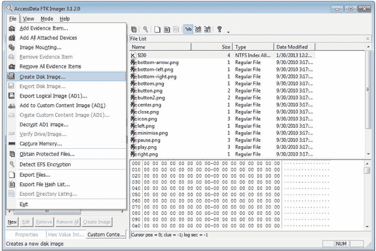
**图 6.1: FTK Imager 截图**

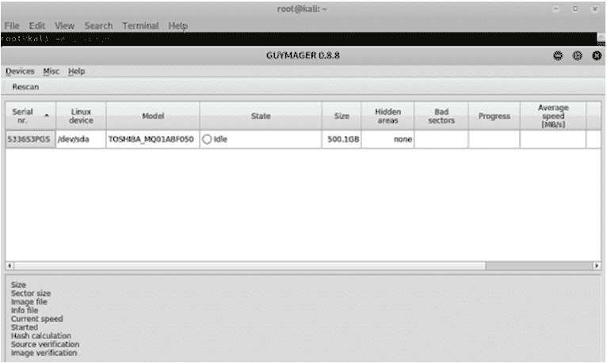
**图 6.2: Guymager 截图**

- **数据获取中的挑战：** 数据获取相关的挑战包括加密或受密码保护的驱动器，这需要解密或绕过加密的方法。损坏或失效存储的挑战与部分可访问数据的恢复技术相关。基于云的证据则涉及获取远程数据时的法律和技术挑战。

- **现实世界案例分析：** 知名金融机构摩根士丹利（Morgan Stanley）在未能正确报废旧 IT 设备（包括包含敏感客户数据的服务器和硬盘）时，遭遇了严重的数据泄露。该公司聘请了一家第三方供应商来擦除并处置这些资产。然而，由于取证成像和处理不当，部分报废设备随后被发现仍包含未加密的个人数据。无效磁盘成像这一环节导致在硬件报废前未能正确捕获和验证所有存储数据，从而导致擦除不彻底和残留数据泄露。

## 数据恢复与重建

在现代且不断演进的数字取证领域中，数据恢复及其重建在揭露数字设备中隐藏、丢失或碎片化信息的过程中起着至关重要的作用。取证分析师依赖专业技术来提取和重新组装数字痕迹，用于调查网络犯罪、企业欺诈或意外数据丢失。关于从数字痕迹中提取和重新组装信息的数据恢复与重建详细分析涵盖以下领域：

- **数据恢复与重建简介：** 数据恢复是从数字介质（如硬盘、固态硬盘 (SSD)、USB 闪存盘、内存卡和云存储）中检索已删除、损坏或损坏数据的过程。该过程涉及专业技术和工具，用于恢复可能因意外删除、硬件故障或受恶意软件或系统崩溃影响而丢失的信息。数字取证中的数据恢复过程涉及在保持数据完整性和真实性的同时提取潜在证据。数据重建是将碎片化、不完整或损坏的数据重新拼凑以恢复其原始形式并得出有意义见解的过程。这项技术在数字取证中至关重要，分析师通过它重新组装已删除的文件，恢复损坏的数据库记录，或从日志文件、元数据和系统痕迹中重建数字活动。在网络事件、数据泄露或欺诈调查中恢复关键证据的内在重要性，直接关系到在法庭上为受害者伸张正义。

- **数据恢复的类型：** 数字取证中的数据恢复过程分为具体类型，例如已删除文件恢复、损坏数据恢复、碎片数据恢复和加密数据恢复。已删除数据涉及恢复从文件系统中移除但尚未被覆盖的数据。损坏数据处理因系统崩溃、电源故障或恶意软件而受损的文件。碎片化数据涵盖重新组装分散在多个存储扇区的数据，如电子邮件链和文档。加密数据则与克服加密障碍以恢复和分析受保护信息相关。


- **数据恢复技术：** 有效的数据恢复技术包括文件雕刻（file carving）、数据挖掘、日志恢复和部分重建。文件雕刻是指利用文件签名从未分配空间中提取文件，例如雕刻 JPEG 或 DOCX 文件。数据挖掘类似于在大型数据集中搜索以识别有价值或相关的信息。日志恢复利用元数据或日志来重建事件或交易的序列。部分重建类似于从不完整或碎片化的记录（如电子邮件和数据库条目）中重建数据。

- **数据恢复工具：** 适当的数据恢复工具包括 R-Studio、PhotoRec、X1 Search 和 EnCase Forensic。R-Studio 为各种文件系统提供全面的数据恢复工具。PhotoRec 对应于用于恢复丢失或损坏文件的开源文件恢复软件。X1 Search 是一种在多种介质中搜索和恢复特定文件的工具。EnCase Forensic 用于在取证调查中恢复和分析数据。

- **数据恢复中的挑战：** 数据恢复中的相关挑战包括数据被覆盖、加密或受密码保护的数据、损坏的存储介质以及云数据检索。数据被覆盖是指被删除的文件被新数据覆盖，使得恢复变得困难或不可能。加密或受密码保护的数据类似于访问受保护或加密信息的挑战。损坏的存储介质包括处理物理损坏的硬盘或闪存存储的技术。云数据检索与在维护法律和隐私关注的同时获取基于云的数据相关的问题一致。

- **数字人工痕迹重建：** 数字人工痕迹（digital artifacts）的重建与关注数据时间戳、被删除的通信以及应用程序数据相关。数据时间戳是指分析创建、修改和访问的时间戳，以拼凑出事件的时间线。被删除的通信类似于通过服务器数据或备份系统重建被删除的电子邮件、消息或聊天记录。应用程序数据包括从浏览器缓存、应用程序日志和本地数据库中重建信息。

- **法律与伦理考量：** 与数据恢复相关的法律和伦理考量是指遵守隐私法和公司政策。具体的伦理考量体现在维护法律程序中恢复证据的完整性和可采纳性。

- **真实案例示例：** 著名的能源公司 Enron Corporation（安然公司）因广泛的会计欺诈、将债务移出账外并虚报利润而崩溃。数据恢复和重建在这次调查中发挥了至关重要作用，相关调查人员从安然公司的服务器和员工硬盘中恢复了被删除的电子邮件和财务文件。这些电子邮件包含了关于欺诈性财务策略的内部讨论，以及高管明知故犯欺骗投资者的证据。

## 分析与检查

数字证据的概念包括电子邮件、日志文件、元数据、财务记录和加密数据。数字证据的整体重要性在于其在刑事调查、企业欺诈检测、网络安全事件和法律程序中的关键作用。分析和检查数字证据的重要性体现在应对广泛的问题，如数据加密、删除、操纵以及需要取证工具处理的海量数据。在揭露和解释方面，分析和检查数字证据涉及以下领域：

- **数字证据分析与检查简介：** 数字证据分析是在网络犯罪案件的取证调查过程中，对收集到的数字数据进行解释和理解的过程。检查数字证据的整体过程类似于一系列步骤，相关调查人员详细评估证据，从而寻找隐藏的洞察。这一阶段的重要性在于从碎片化或模糊的数据中构建一个连贯的叙述。

- **分析技术：** 相关的分析技术涉及数据关联、元数据分析、时间线重建、关键词搜索和文件签名分析。数据关联过程旨在通过链接来自多个源（如日志、设备和网络）的不同数据点来识别模式。元数据分析类似于分析时间戳、文件属性和用户活动元数据以揭露隐藏的行为。时间线重建过程与基于文件访问、修改和通信构建事件的年代顺序一致。关键词搜索是指在收集的数据中搜索特定术语或短语以揭露相关证据。文件签名分析用于识别文件类型并确定文件是完整、被修改还是被删除。

- **设备与介质的取证检查：** 数字设备和介质的取证检查涉及文件系统分析、实时系统分析、应用程序数据分析和网络分析。文件系统分析过程旨在理解文件的组织方式并识别被删除或隐藏的文件。实时系统分析是指分析实时系统的活动内存、运行进程和易失性数据。应用程序数据分析涉及调查来自已安装应用程序（如浏览器和聊天应用）的通信和活动。网络分析与审查日志、数据包和网络流量以揭露未经授权的活动或数据外泄一致。

- **使用取证工具进行数据分析：** 用于数据分析的相关取证工具包括 Autopsy、X1 Search、EnCase Forensic 和 Wireshark。Autopsy 工具被用作开源数字取证平台，用于分析磁盘镜像和文件系统。X1 Search 类似于一种用于索引和搜索大量数据以揭露证据的工具。EnCase Forensic 工具被广泛用于数字介质的深入分析和检查。Wireshark 是一个网络协议分析仪，用于在取证调查中检查网络流量。

- **证据分析中的挑战：** 数字取证调查人员在证据分析过程中往往面临多重挑战。这是由于混淆技术的广泛使用。这些技术涉及加密、隐写术和数据隐藏技术带来的挑战。除此之外，还要求管理和分析大型数据集，尤其是在涉及云端或企业系统的案件中。对数据完整性的要求取决于确保分析过程不会更改或损害证据。

- **为调查解释证据：** 为调查进行有效的证据解释与情境化、行为分析和关联分析相关。情境化过程围绕理解数据的更广泛背景，例如用户意图和业务运作。行为分析类似于分析用户行为（包括访问模式），以检测恶意活动或违规行为。关联分析影响于映射实体（如用户、设备和交易）之间的关系以揭示联系。

- **报告调查结果：** 有效的调查结果报告包括准备一份清晰且连贯的报告，解释调查结果、方法论和结论。将复杂的技术发现转化为有效的格式，有助于非技术利益相关者或法律专业人员进行有效理解。法律可采纳性与确保证据分析的呈现方式在法庭上具有法律可防御性相关。

- **真实案例示例：** 有效分析数字证据的重要性在 BTK 杀手案中得到了证明。丹尼斯·雷德（Dennis Rader），即臭名昭著的“捆绑、折磨、杀戮”（BTK）杀手，在三十多年间恐吓了堪萨斯州威奇托市。他在 1974 年至 1991 年间犯下了一系列谋杀案，并通过详细描述其罪行的信件和消息嘲讽执法部门。在多年销声匿迹后，他于 2004 年通过向媒体和警方发送通信再次出现，最终导致其被捕。在情境上，数字取证调查人员从软盘上的一个被删除的 Microsoft Word 文件中恢复了元数据。元数据揭示该文档由一名名为 Dennis 的用户在一部注册给基督路德教会（Christ Lutheran Church）的电脑上编辑。这导致了这名恶名昭彰的杀手被逮捕并被呈至法庭。

## 取证工具与技术

网络犯罪的整体威胁形势演变迅速，导致企业欺诈和数字威胁频发。数字取证调查人员倾向于依赖专门的工具和技术来揭露、分析和解释数字证据。这表明数字取证在刑事调查中发挥着至关重要的作用，

网络安全漏洞、知识产权盗窃以及合规性问题，使得取证工具的选择和应用成为调查过程中的至关重要的一环。本章将深入分析以下领域的多种取证工具和技术：

- **取证工具与技术简介：** 取证工具与技术涉及用于收集、分析和保存数字证据的相关软件、硬件和方法论。这些工具的整体重要性在于确保数字调查的彻底性、一致性以及在法律上的可辩护性。

- **数字取证工具分类：** 数字取证工具的相关类别包括镜像工具、分析工具、恢复工具、网络取证工具、移动设备取证工具和内存取证工具。数字取证镜像工具的使用包括 FTK Imager 和 dd，用于创建数字设备的精确逐位副本。

- **关键取证技术：** 考虑使用 **EnCase Forensic**、**Autopsy** 和 **X1 Search** 等分析工具来检查和分析数字介质上的数据。采用 **R-Studio** 和 **PhotoRec** 等工具可以恢复丢失、删除或损坏的数据。网络取证工具（如 Wireshark 和 NetworkMiner）用于捕获和分析网络流量。取证调查人员使用 Cellebrite UFED 和 XRY 等移动设备取证工具，影响了从移动设备中提取数据的过程。取证调查人员倾向于使用 Volatility 和 Rekall 等内存取证工具来分析系统内存 (RAM)。

- **流行取证工具及其用途：** 数字取证调查人员用于调查目的的流行取证工具包括 EnCase、**Forensic Toolkit (FTK)**、Autopsy、Wireshark、Volatility 和 Cellebrite UFED。EnCase 是磁盘镜像、分析和报告的行业标准工具。FTK 是一个强大的数据分析工具，涵盖电子邮件、网页浏览和文件元数据。Autopsy 是一个用于磁盘分析和案例管理的开源平台。Wireshark 是一个用于捕获和分析网络流量的网络协议分析仪。Volatility 是一个内存取证框架，通过从 RAM 中提取数据来分析活跃的系统进程。Cellebrite UFED 是一个移动取证工具，用于从手机和其他移动设备中提取数据。

- **取证工具的优势与局限性：** 取证工具的优势包括自动化的数据收集和分析任务。优势范围还包括处理大型数据集时效率的提升，以及调查过程的标准化以确保一致性。然而，局限性在于大多数工具并不支持所有设备类型或**操作系统 (OS)**。此外，使用特定工具可能需要对调查人员进行额外培训。某些工具的使用可能会导致额外的预算支出和许可限制。

- **为任务选择合适的工具：** 为数字取证调查选择适当工具的需求与多种考量因素相关。这些考量包括设备或介质的类型，涵盖计算机、移动设备和云端。此外，取证调查的整体范围起着主要作用，这对应于数据恢复、网络分析和移动取证。相关的法律和合规要求包括工具是否通过了法律程序的有效认证。在综合调查中使用多种工具具有重要意义。

- **数字取证中的挑战与新兴趋势：** 数字取证中的挑战和新兴趋势包括加密、云取证、IoT 取证和反取证。加密涉及处理加密数据和绕过安全机制。云取证需要从云环境中获取证据的工具和技术。IoT 取证影响对新兴 IoT 设备数据的分析。反取证是指攻击者为了规避检测而采用的技术，例如数据擦除和隐写术。

- **现实世界案例分析：** 安然丑闻 (2001) 是历史上最臭名昭著的公司欺诈案之一。美国能源公司安然因会计欺诈而崩溃，导致了美国历史上规模最大的破产案之一。取证工具在揭露隐藏证据、曝光公司高管欺诈行为方面发挥了至关重要作用。调查人员使用 EnCase 从硬盘中恢复被删除的电子邮件和财务记录，揭露了销毁证据的企图。FTK 帮助分析了海量的电子数据，包括与欺诈交易相关的隐藏和加密文件。此外，调查人员检索到了数千封内部邮件，证明高管们对欺诈行为知情并试图掩盖。

## 时间线与事件重建

数字取证过程表明，准确重建事件顺序对于理解事件如何展开至关重要。在调查网络攻击、数据泄露或内部违规行为的过程中，建立清晰的时间线能为调查人员提供一个结构化的事件叙述。这一过程被称为**时间线与事件重建**，它使取证分析师能够将数字痕迹拼凑起来，将分散的数据源关联起来，并识别出揭示事件原因、影响和潜在实施者的关键时刻。时间线与事件重建旨在建立数字事件中的事件序列，并与以下领域相关联：

- **时间线与事件重建简介：** 时间线重建被定义为基于数字证据建立事件时间顺序的过程。其重要性在于帮助澄清行为序列、事件范围以及涉及数字安全漏洞或网络犯罪的关键参与者。

- **创建数字时间线：** 有效地创建数字时间线涉及部署广泛的组件。这些组件包括数据源、时间戳分析、文件系统事件、日志文件和用户活动。数据源涉及确定时间线构建的来源，如文件系统元数据、日志、电子邮件元数据和浏览器历史记录。时间戳分析过程类似于分析文件和系统日志上的创建、修改和访问时间戳，以识别关键操作。文件系统事件涉及理解记录在文件系统中的特定文件操作，如创建、删除和访问。日志文件与检查系统、应用程序和安全日志相关，以确定特定操作（包括登录尝试和网络连接）发生的时刻。用户活动则通过事件日志、应用程序日志和系统监控工具来追踪。

- **事件重建技术：** 相关的事件重建技术涉及元数据分析、痕迹分析、事务日志和取证工具数据。元数据分析包括分析图像的 EXIF 数据和文档属性等元数据，以重建事件流。痕迹分析是指审查事务日志（如数据库日志和访问日志），以追踪系统活动或未经授权的操作。取证工具数据类似于来自取证工具（如 EnCase, FTK）的数据，用于验证操作或与系统日志进行关联。

- **时间线的关键组成部分：** 时间线的关键组成部分包括事件开始、关键操作、事件结束和证据发现。事件开始是指识别事件何时开始，这是漏洞、系统被攻破或恶意活动的第一个迹象。关键操作涉及精确锁定关键活动，如数据外泄、账户被盗或系统利用。事件结束涉及确定事件何时被遏制或缓解，例如系统关闭或用户账户锁定。证据发现则与确定证据发现和分析的时间戳一致。

- **时间线与事件重建工具：** 用于时间线和事件重建的相关工具包括 Plaso, Log2Timeline, X1 Search, Autopsy 以及 **Elasticsearch**, **Logstash**, **Kibana Stack (ELK)**。Plaso 工具被用作从各种文件系统和设备中提取和分析时间戳的框架。Log2Timeline 类似于一个用于从取证痕迹创建详细事件时间线的工具。X1 Search 是一个用于对跨多个设备的文件进行索引和分析的工具，有助于拼凑事件序列。**Autopsy** 是一个可以集成多种数据源以辅助事件重建的平台。ELK 是一套用于处理大规模日志数据以生成详细事件时间线的工具集。

- **时间线与事件重建中的挑战：** 时间线与事件重建中的相关挑战包括...

重构包括不一致或缺失的数据、数据篡改，以及数据的规模和复杂系统。不一致或缺失的数据涉及日志中的缺口或文件丢失，这可能导致时间线构建困难或不完整。数据篡改旨在调查攻击者对时间戳或日志文件可能进行的篡改。数据规模往往是一个挑战，尽管在管理来自各种系统和来源的大量数据，但这可能会导致时间线不准确。复杂系统则涉及处理来自云系统、分布式网络和具有唯一时间记录的物联网（IoT）设备的时间线。

- **出于法律和调查目的解读时间线：** 为了法律和调查目的而对时间线进行有效解读，涵盖了特定领域，如时间线的情境化、报告、可视化以及法律影响。时间线情境化的方面依赖于对行为背景的理解，例如用户的授权状态，或者行为在恶意性、偶然性或常规性方面的性质。报告和可视化涉及通过视觉时间线、图表或报告清晰地传达调查结果，以展示事件的范围和顺序。相关的法律影响则意味着确保重构的时间线以一种在必要时可在法庭上使用的方式呈现。

- **真实案例分析：** 索尼影业黑客事件（2014年）围绕一次毁灭性的网络攻击展开，导致敏感公司数据外泄、电子邮件泄露以及关键 IT 基础设施被毁。攻击者后来被确定为受朝鲜支持的 Lazarus Group，他们使用先进的技术渗透索尼网络，窃取有价值的信息并部署破坏性恶意软件。调查人员将攻击溯源至一项针对索尼员工的钓鱼邮件活动。通过使用 Splunk 和 Wireshark 等取证工具，分析师重构了网络入侵的顺序，并将携带恶意软件的电子邮件确定为初始攻击向量。

## 相关性与链路分析

从数字取证的角度来看，相关性与链路分析涉及应用关键技术，以有效地识别离散数据点之间的关系。相关性与链路分析的长期益处在于帮助数字调查人员发现隐藏的连接、重构事件，并将恶意活动归因于特定的行为体。相关性与链路分析旨在将多个数据源（如日志、电子邮件、交易和社交媒体）之间缺失的环节连接起来。相关性与链路分析的详细分析涉及以下领域：

- **相关性与链路分析简介：** **相关性分析**的过程是识别不同数字证据之间关系的过程。而**链路分析**是指绘制个人、设备或活动之间连接的映射图，以揭示模式。这一方面的关键在于帮助数字取证调查人员建立因果关系、检测异常并揭示网络事件中隐藏的连接。

- **理解数字取证中的相关性：** 数字取证领域中存在不同类型的相关性，包括事件相关性、时间相关性、行为相关性和跨设备相关性。事件相关性类似于将不同的事件（如登录尝试、文件修改和恶意软件执行）连接起来，以建立网络犯罪事件中的模式。时间相关性体现在分析多个数据源的时间戳，以重构相关活动的时间线。行为相关性依赖于识别跨系统和日志的异常或可疑用户行为。跨设备相关性意味着将多个数字设备上的活动联系起来，例如将笔记本电脑的 IP 地址与移动设备的使用情况联系起来。

- **数字调查中的链路分析：** 数字取证中的链路分析围绕识别关系、绘制通信映射、追踪财务交易和分析社交网络展开。识别关系影响到用户、设备和数据交互之间关系的映射。通信映射涉及分析电子邮件头、聊天记录或电话记录以识别连接。财务交易追踪是将欺诈交易与账户、IP 地址或地理位置相联系。社交网络分析与检查数字通信网络以揭露网络犯罪或内部威胁中的关联相关。

- **相关性与链路分析技术：** 相关性与链路分析的技术涉及图分析、模式识别、关键字匹配和地理空间分析。图分析涉及使用图表来可视化人、系统和事件之间的连接。模式识别与识别重复行为有关，例如重复访问受限文件。关键字匹配与搜索特定短语、文件名或代码片段的重复使用相关。地理空间分析则延伸至映射登录尝试、交易或设备移动的地理位置。

- **用于相关性与链路分析的取证工具：** 数字取证调查人员倾向于利用相关的取证工具进行相关性与链路分析。这些工具包括 Maltego、IBM i2 Analyst's Notebook、Splunk、ELK Stack 和 Wireshark。Maltego 是一个用于映射个人、组织和数字足迹之间关系的强大工具。IBM i2 Analyst's Notebook 用于网络调查中的视觉链路分析。Splunk 是一个日志分析工具，有助于将系统事件和安全事件相关联。ELK Stack 工具用于大规模的事件相关性和日志分析。Wireshark 工具则有助于分析网络流量以识别通信模式。

- **相关性与链路分析中的挑战：** 数字取证调查人员在相关性与链路分析中往往面临多重挑战。这些挑战包括数据过载、攻击者的混淆手段、误报以及法律和伦理考虑。数据过载的挑战与管理和过滤大数据集以提取有意义的连接相关。攻击者的混淆手段类似于威胁行为者使用 **虚拟私人网络 (VPNs)**、代理或加密来掩盖其行踪。误报问题与避免错误的关联相关，因为错误关联可能导致对证据的误读。法律和伦理考虑则涉及在分析关系时确保遵守数据隐私法。

- **在调查中应用相关性与链路分析：** 在数字取证调查中应用相关性与链路分析，有助于解决网络安全领域现有的一些问题。这些包括内部威胁检测、网络犯罪调查、欺诈检测和国家级攻击。内部威胁检测影响到揭露未经授权的访问或可疑的员工活动。网络犯罪调查涉及绘制勒索软件或钓鱼攻击网络的映射图。欺诈检测涉及通过财务和用户行为相关性来识别欺诈交易。国家级攻击则涉及通过取证痕迹将网络攻击与国家支持的威胁组织联系起来。

- **真实案例分析：** 美国 FBI 与国际执法机构合作，瓦解了 AlphaBay，这是最大的非法商品暗网市场之一，包括

毒品、盗窃数据和黑客工具，时间是在 2017 年。链接分析在追踪加密货币交易、识别关键管理员以及最终导致该网站据称的创建者 Alexandre Cazes 被捕的过程中发挥了至关重要的作用。具体而言，数字取证调查员使用了诸如 **Chainalysis** 之类的**区块链分析工具**来追踪比特币交易，从而识别出与非法活动相关的钱包地址集群。链接分析有助于将 **AlphaBay 供应商账户**与**现实世界的财务账户**之间的交易关联起来。

## 结论

本章对数字取证流程的详细分析旨在帮助理解其底层的逐步操作。相关分析表明，数字取证在应对组织和犯罪中的网络安全事件方面起着关键作用。本章指出，数字取证调查员在进行网络犯罪调查时往往面临多重挑战。对数字证据的有效分析对于及时解决网络犯罪，从而在法律法院中为无辜者伸张正义至关重要。数字取证调查的结果有助于增强公司的威胁情报。

接下来的章节将通过多样化工具箱来揭秘 Kali Linux。

## 加入我们书籍的 Discord 空间

加入书籍的 Discord 工作区，获取最新更新、优惠、全球技术动态、新发布内容以及与作者的交流会：

https://discord.bpbonline.com


# 第 7 章：超越 Kali Linux

## 简介

Kali Linux 在数字取证领域的认可度与其强大的渗透和测试能力有关。其广泛的工具集使其被数字取证调查员广泛接受为取证平台。Kali Linux 预装了多种工具，如 Autopsy、Wireshark 和 Volatility，用于开展无缝的取证调查。尽管如此，对于相关的网络犯罪调查员来说，仅依赖 Kali Linux 来推进数字取证调查可能会有所局限。Kali Linux 在数字取证调查中日益增长的重要性与现代网络犯罪动态变化的复杂性有关。本章将通过分析不同类型的取证工具来展开。

## 结构

本章涵盖以下主题：

- 网络取证工具简介
- 开源替代方案
- 基于 Windows 的取证工具
- 基于 Mac 的取证工具
- 移动设备取证工具
- 网络取证工具
- 云取证工具

## 目标

本章将介绍除 Kali Linux 之外的各种网络取证工具。这包括 Kali Linux 的开源替代方案，如 *Sleuth Kit*、*Volatility*、*Encase*、*Autopsy* 等。本章包含了关于基于 Windows 的取证工具的详细信息，例如 *Nmap*、*Recuva*、*Encase*、*Volatility*、*AMPED Five*、*MAGNET AXIOM* 等，旨在利用 Windows 特定解决方案来推进网络安全调查。本章重点关注不同的基于 Mac 的取证工具，如 *ArtEx* 和 *iLEAPP*，这与现代个体对 macOS 依赖程度的增加有关。本章包含了关于移动设备取证工具的详细信息，如 *Oxygen Forensic* 和 *MOBILedit*，旨在将网络取证调查扩展到智能手机和平板电脑。本章详细探讨了不同的网络取证工具，如 Wireshark 和 Network Miner，旨在增强网络环境中的网络取证能力。本章中关于云取证工具的细节包括使用 SleuthKit 来调查云计算环境中的数字犯罪。

## 网络取证工具简介

网络取证工具帮助调查员分析数字证据、恢复丢失的数据并追踪网络犯罪活动。这是因为这些工具有助于网络取证、内存分析、磁盘取证、恶意软件调查和日志分析。虽然 **Kali Linux** *（图 7.1）* 是一个著名的数字取证和渗透测试平台，但在调查复杂的网络犯罪场景时，仅依赖它可能会限制数字取证调查员。这促使数字取证调查员在 Kali Linux 之外选择网络犯罪调查工具。具体来说，不同类型的复杂调查需要针对 Windows、Mac、云环境或移动取证量身定制的工具。这确立了数字取证工具在专业化取证需求方面的重要性。

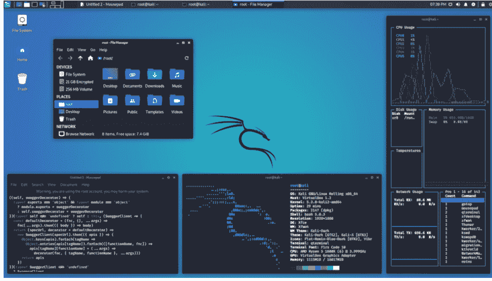
**图 7.1**：Kali Linux 界面

相关的商业和基于云的工具提供了卓越的自动化和报告功能，表明了其先进的分析能力。根据法律案件的整体敏感程度，可提交给法院的数字证据至关重要，这需要专业工具的支持。Kali Linux 的替代和补充取证工具列在下表（表 7.1）中：

**表 7.1：Kali Linux 的数字取证替代方案**

| 数字取证领域 | 替代数字取证工具 |
| :--- | :--- |
| Windows 和磁盘取证 | - FTK (Forensic Toolkit)<br>- X-Ways Forensics<br>- Magnet Axiom |
| 内存和恶意软件分析 | - Volatility<br>- Redline<br>- Cuckoo Sandbox |
| 云取证 | - AWS CloudTrail<br>- Microsoft Azure Sentinel<br>- Google Chronicle |
| 移动和 IoT 取证 | - Cellebrite<br>- Oxygen Forensic Suite |
| 网络和日志分析 | - Wireshark *（图 7.2）*<br>- Splunk<br>- Zeek |
| 区块链和加密货币调查 | - Chainalysis<br>- CipherTrace |

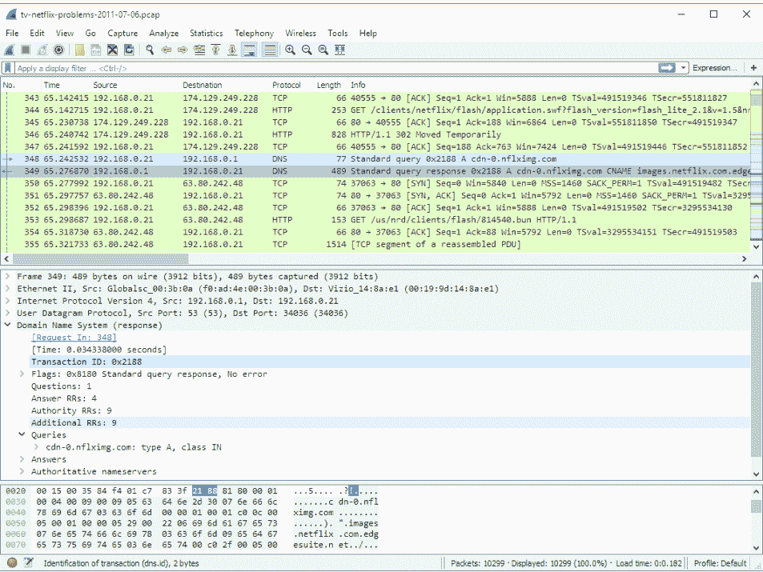
**图 7.2**：Wireshark 界面

数字取证调查员在选择取证工具时对相关因素的考量在其数字调查过程中起着至关重要的作用。这些因素包括调查范围、可用性和学习曲线、法律可采纳性以及集成与自动化。调查范围涉及将工具与案件需求相匹配，因为云端泄露和本地磁盘取证所选择的网络安全工具往往不同。可用性和学习曲线因素涉及比较具有用户友好界面的开源工具和商业工具。数字取证工具的法律可采纳性涉及确保工具遵循取证最佳实践并保持证据的完整性。集成与自动化的方面涉及使用合适的工具来简化调查工作流和报告。

## 开源替代方案

尽管 Kali Linux 在数字取证调查员中非常受欢迎，能够辅助他们进行复杂的调查程序，但仅依赖其预装工具可能会产生局限，并延迟数字取证调查的预期进度。相反，开源取证工具为取证调查提供了具有成本效益、灵活且由社区驱动的解决方案。因此，取证专业人员在磁盘分析、内存取证、移动取证和网络调查中使用 Kali 之外的专业工具。有利于数字取证调查的关键开源数字取证工具包括以下内容：

- **Sleuth Kit**：这个命令行工具集非常适合进行磁盘和文件系统取证，可用于执行磁盘镜像分析、文件恢复和时间线重建。

- **Autopsy**：该工具作为 Sleuth Kit 的用户友好型**图形用户界面 (GUI)**，提供对驱动器、删除文件和元数据的取证分析。该工具被广泛应用于执法部门、企业调查和网络犯罪案件 *（图 7.3）*。


- **Volatility**：数字取证调查员使用此工具执行内存取证。这是一个领先的开源工具，用于 **RAM 分析**，可提取进程、网络连接和隐藏的恶意软件。该工具对于调查**高级持续性威胁 (APTs)**、Rootkit 和无文件恶意软件攻击至关重要 *（图 7.4）*。


- **Wireshark**：这款数据包分析工具用于监控和分析网络流量，是网络取证的一部分。该工具有助于检测可疑活动、入侵尝试和数据外泄。（图 7.2）

- **Magnet AXIOM (社区版)**：这款工具非常适合云端和移动取证，因为它具备开源的云端和移动取证能力。（图 7.6）

- **Cellebrite UFED (有限免费版)**：这款工具适用于云端和移动取证，因为它能从移动设备中提取数据以进行取证分析。

- **EnCase**：这款工业标准取证工具适用于深度磁盘分析和证据收集。尽管它不是一个完全开源的工具，但被数字取证调查员广泛使用。

- **X-Ways forensics**：这是一个轻量级、高性能的 EnCase 替代方案，被数字取证调查员广泛部署用于调查网络犯罪场景。

- **Forensic Toolkit (FTK)**：这款商业级和企业级工具提供深度磁盘分析、注册表分析和电子邮件调查。

选择开源数字取证工具的相关优势包括其成本效益、社区支持的存在、定制能力和可扩展性，此外在很大程度上还具有平台独立性。成本效益的优势在于无需支付许可费用。取证专家的持续更新和贡献确保了适当的社区支持。从开源数字取证工具的角度来看，定制化和可扩展性体现在其中许多工具允许通过脚本和 API 集成来进行高级调查。这些工具的平台独立性体现在它们能够跨 Windows、Linux 和 MAC OS 环境运行。

## 基于 Windows 的取证工具

与其它操作系统相比，Windows **操作系统** (OS) 在数字世界的主导地位使其在网络调查中发挥着至关重要作用。这些工具使取证分析师、执法人员和网络安全专业人员能够高效地提取、分析和保存数字证据。Windows OS 存储了大量对调查至关重要的取证伪影。具体细节如下：

| Windows OS 组件 | 数字证据类型 |
|--------------------------|-----------------------|
| Windows 注册表 | • 用户活动<br>• 已安装程序<br>• 系统配置 |
| 事件日志 | • 记录系统和安全事件<br>• 用户登录<br>• 应用程序错误 |
| Prefetch 文件 | 最近访问的应用程序和文件 |
| NTFS 元数据和卷影副本 | 已删除或修改文件的痕迹 |
| 分页文件和休眠文件 | 内存快照 |

**表 7.2：** *存储数字证据的 Windows 组件*

Windows 作为现代最广泛使用的操作系统，使其成为网络犯罪活动的重点目标。数字取证调查员必须利用 Windows 专用工具来分析系统伪影、恢复数据并追踪恶意活动。以下工具在不同领域的 Windows 取证调查中起着关键作用：

- **Nmap (网络映射器)：** 这种数字取证工具广泛用于网络和端口扫描。具体而言，该工具用于扫描网络、识别开放端口并检测漏洞。因此，该工具有助于追踪未经授权的连接和攻击者的潜在入口点（*图 7.4*）。

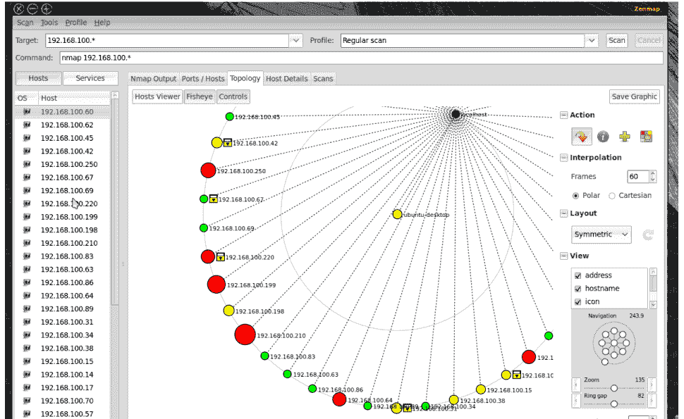
**图 7.4：** Nmap 工具的 Windows 界面

- **Recuva：** 这款工具是数据恢复和文件分析的理想选择。该工具专注于从硬盘、**固态硬盘 (SSDs)** 和 **通用串行总线 (USB)** 中恢复删除的文件。该工具对于检索丢失的证据（包括文档和图像）非常有用。

- **MAGNET AXIOM：** 数字取证调查员使用该工具进行数据恢复和文件分析。这是一个先进的取证套件，可恢复并分析删除的文件、聊天记录和浏览历史。该工具支持对 Windows 注册表和事件日志的深度分析。

- **Volatility：** 这款工具是内存和恶意软件取证的理想选择。这是一个用于分析易失性内存 (RAM) 的开源工具。该工具可检测恶意软件注入、隐藏进程和活动网络连接。

- **EnCase forensic：** 这种用于磁盘和内存取证的工业标准工具可协助数字取证调查员进行内存和恶意软件取证。该工具被用于执法部门和企业调查，以进行全面的证据收集（图 7.5）。

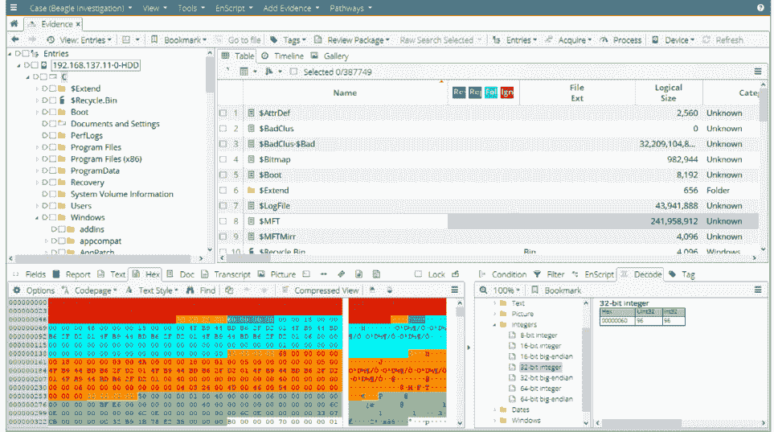
**图 7.5：** EnCase forensic 的界面

- **AMPED Five：** 这款工具广泛用于视频和多媒体取证。该工具专注于取证视频分析和图像增强。该工具有助于从 CCTV 监控录像和数字图像中提取证据（图 7.6）。

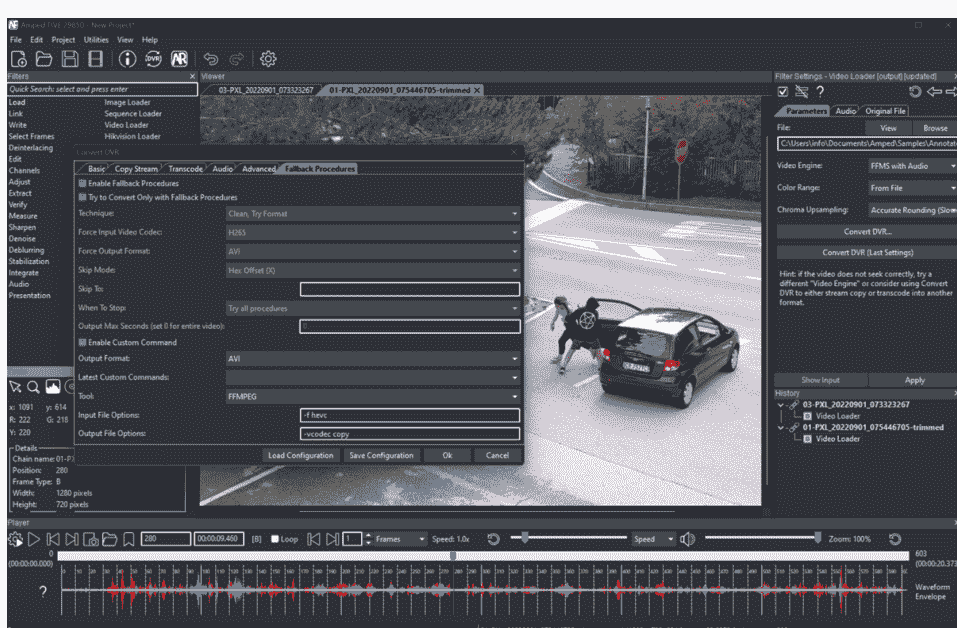
**图 7.6：** AMPED Five 的界面

- **Windows 事件查看器和 Log Parser：** 数字取证调查员使用这些工具进行日志和事件分析。该工具对于审查系统日志以检测未经授权的访问和系统异常至关重要。该工具通常与其他取证工具结合使用，以进行更深层次的事件时间线重构。

## 基于 Mac 的取证工具

数字取证在调查网络犯罪、数据泄露和安全事件中发挥着至关重要作用。macOS 设备（如 MacBook 和 iPhone）在个人和企业中的普及程度持续提高，因此对该生态系统专用取证技术和工具的需求显著增长。这是因为苹果的 macOS 被广泛应用于专业环境，尤其是在创意专业人士、开发人员以及重视安全的企业中。

Mac 电脑市场份额的增加，使得需要针对 macOS 特定文件系统、加密协议和安全机制量身定制的专用取证方法。然而，与基于 Windows 的系统相反，macOS 采用了先进的安全措施，如 Gatekeeper、**系统完整性保护 (SIP)** 和 Secure Enclave，这给取证调查带来了挑战。另一方面，FileVault 加密确保了强大的数据保护，使得在没有专业工具的情况下，取证数据获取变得更加复杂。苹果公司推出的专利硬件（如 T2 安全芯片和 M1/M2 处理器）进一步改变了取证方法，需要更新取证策略。MacOS 维护着日志、系统伪影和独特的文件结构（如 APFS 快照、统一日志和 KnowledgeC 数据库），这些都可以作为关键的取证证据来源。因此，在取证分析中，了解 macOS 特有的用户活动数据（包括应用程序使用情况、连接设备和浏览历史）至关重要。

网络罪犯越来越多地使用 macOS 设备来实施恶意活动，如网络欺诈、黑客攻击和内部威胁。因此，调查 macOS 系统上的恶意软件、未经授权的访问和数据外泄等威胁需要专业的取证工具和专业知识。从情境上看，基于 Mac 的取证工具有助于识别攻击向量、跟踪用户行为以及恢复对法律程序至关重要的已删除或加密数据。

MacOS 和 Windows 取证方法的区别如下表所示：

| 区分参数 | Mac 操作系统 (OS) | Windows 操作系统 (OS) |
|---------------------------|---------------------------|--------------------------------|
| 文件系统差异 | • Apple 文件系统 (APFS)<br>• 分级文件系统 Plus (HFS+) | • 新技术文件系统 (NTFS)<br>• 文件分配表 (FAT32) 和扩展文件分配表 (exFAT) |
| 安全机制与挑战 | • 系统完整性保护 (SIP)<br>• T2 安全芯片和 Secure Enclave | • BitLocker 加密<br>• 用户帐户控制 (UAC)<br>• Windows Defender |


- FileVault 加密
- Gatekeeper 和 XProtect
- 安全日志

## 取证伪像与证据位置

- 统一日志 (Unified Logs)
- Knowledge C 数据库
- Finder 和 Spotlight 元数据
- Plist 文件和 SQLite 数据库
- iCloud 和连续互通 (continuity) 伪像
- 事件日志
- 注册表配置单元 (Registry Hives)
- 跳转列表 (Jump Lists) 和预取文件 (Prefetch Files)
- 回收站和卷影副本 (Volume Shadow Copies)
- UserAssist 和 LNK 文件

## 数据获取方法

- 目标磁盘模式 (TDM)
- 实时获取的挑战
- 磁盘镜像工具
- 内存转储分析

| | 基于逻辑和文件的获取 | 远程取证 |
|---|---|---|
| **云端与备份考量** | • iCloud 同步<br>• Time Machine 备份 | • OneDrive 同步<br>• 卷影副本 |

**表 7.3：MAC OS 与 Windows OS 的区别**

适合 MAC OS 分析的取证工具在数据获取、分析和报告中起着至关重要的作用。相关工具阐述如下：

- **ArtEx：** 该工具有利于分析 macOS 伪像。这些工具能够提取并解释 macOS 系统伪像，从而利用该工具提供的关键取证见解，在法律法庭上确立事实 (*图 7.7*)。

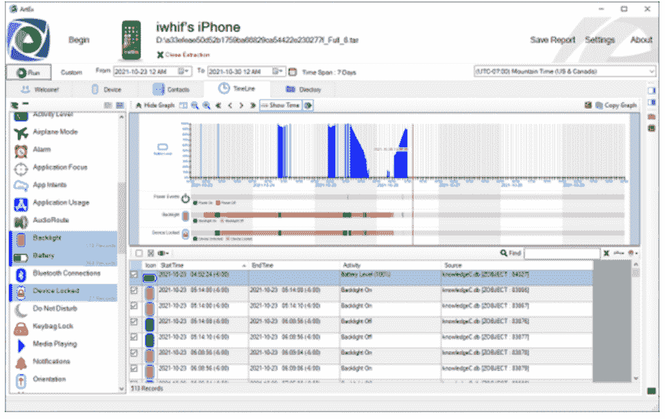
**图 7.7：ArtEx 界面**

- **iLEAPP：** 该工具广泛用于调查 iOS 和 MAC OS 的日志。它在解析日志和收集数字证据方面发挥着关键作用。这些生成的日志对于取证调查的重要性在于有助于重建取证时间线 (*图 7.8*)。

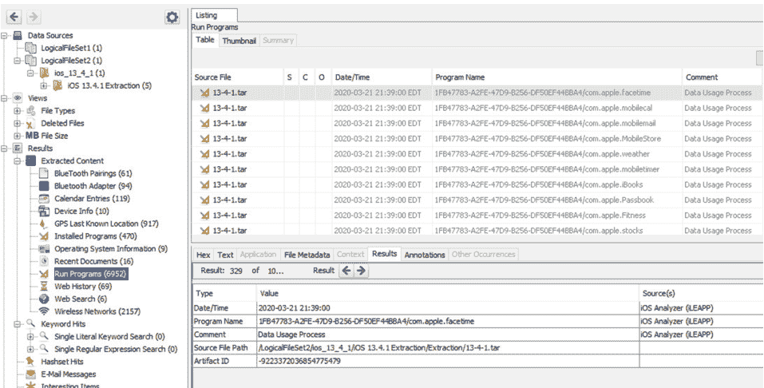
**图 7.8：iLEAPP 界面**

MAC 取证工具在数字取证调查中的意义在于其在网络犯罪调查中的实际应用，此外还包括符合法律和取证标准。

## 移动设备取证工具

数字化转型的影响日益增加，使得移动设备取证在现代数字调查中发挥着关键作用。这些设备存储了大量的个人、商业和通信数据，使其成为刑事、民事和公司调查中的宝贵证据来源。移动设备的普遍性体现在全球有数十亿部智能手机在运行，它们作为个人和企业的首要通信工具。个人使用智能手机进行通话、消息传递、电子邮件、银行交易、社交媒体和位置跟踪，使其成为调查中的丰富数据仓库。

数字取证调查对专门取证工具的需求在于从锁定、加密或损坏的移动设备中提取和分析数据。此外，还需要解决 iOS 和 Android 等移动操作系统的多样性问题。知名的移动取证工具详细如下：

- **Oxygen forensic suite：** 该工具支持从移动设备、云存储和应用程序中进行高级数据提取。该工具可以恢复删除的消息、GPS 位置和加密的应用数据 (*图 7.9*)。

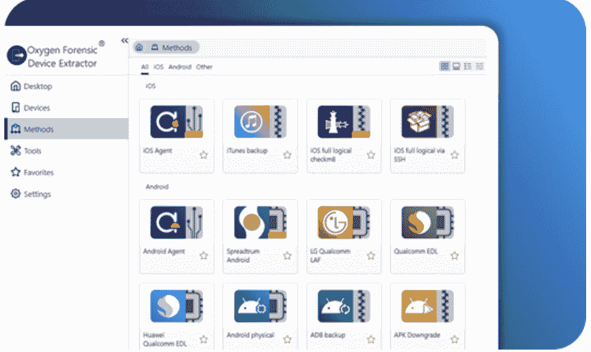
**图 7.9：Oxygen Forensic Suite 界面**

- **MOBILedit forensic：** 该工具支持广泛的设备并提供对移动内容的深度分析。该工具的功能包括 SIM 卡提取、通话记录、消息和应用程序数据检索 (*图 7.10*)。

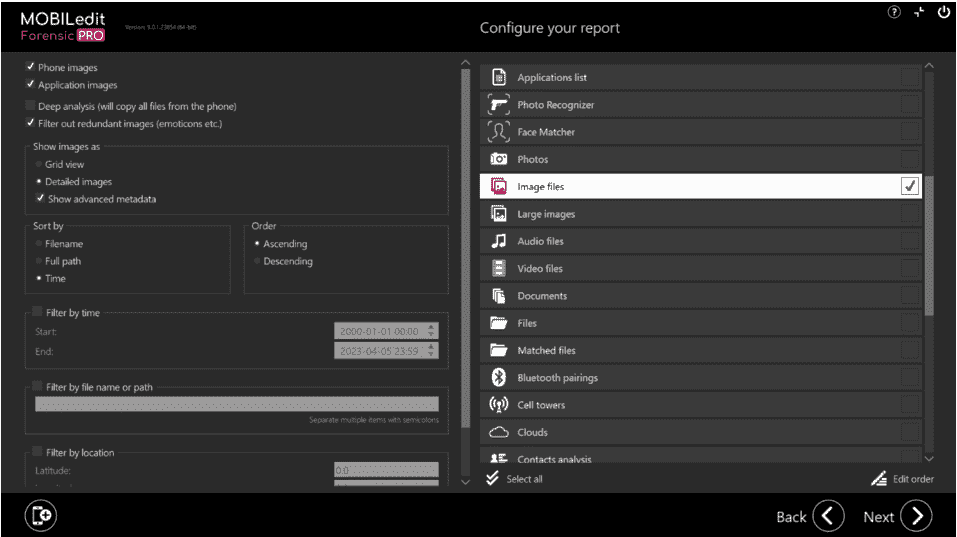
**图 7.10：MOBILedit Forensic 界面**

## 网络取证工具

网络取证是数字取证的一个分支，专注于捕获、分析和调查网络流量。网络取证的应用对于检测网络威胁、调查安全漏洞和确保合规性至关重要。选择合适的网络取证工具的重要性在于帮助数字取证调查员识别恶意活动、未经授权的访问和数据泄露。合适的网络取证工具能够支持网络安全团队进行事件响应和证据收集。

网络取证工具在网络取证中的作用包括实现实时和事后流量分析。此外，它还能协助数字取证调查员重建攻击场景并将威胁归因于攻击者。常用的网络取证工具详述如下：

- **Wireshark：** 这是一个用于捕获和检查网络流量的强大封包分析器 (*图 7.2*)。该工具可以从有线和无线网络捕获实时网络流量。它支持多种网络接口，包括以太网、Wi-Fi 和蓝牙等。Wireshark 可以实时捕获数据包，或读取保存的捕获文件。该工具支持数百种网络协议，包括 TCP、UDP、HTTP、FTP 和 DNS 等。它能自动解码协议层并以可读格式呈现。

- **Network Miner：** 这是一个被动网络嗅探器，用于从封包捕获中提取信息 (*图 7.11*)。它帮助安全分析师和事件响应者分析网络流量以进行取证调查和威胁检测。该工具可以在不干扰网络流量的情况下捕获数据包。它可以处理实时网络流量和预先捕获的 PCAP 文件。其固有优势在于不会产生自身的网络流量，从而降低被检测的风险。

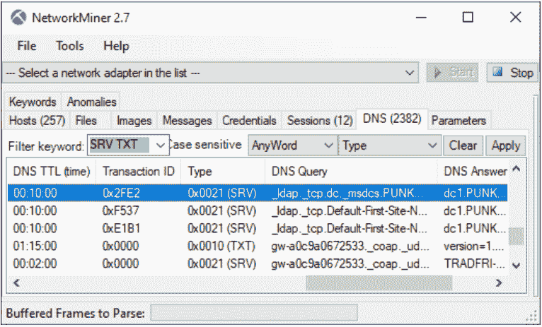
**图 7.11：Network Miner 界面**

## 云取证工具

云取证是数字取证的一个分支，专注于在云计算环境中调查、分析和保存数字证据。它涉及将取证技术应用于基于云的数据、服务和基础设施，以揭露网络犯罪、未经授权的访问、数据泄露和其他安全事件。云取证将传统数字取证的元素与针对云分布、多租户和虚拟化架构定制的专门方法相结合。

它涉及三个主要领域，即数据取证、网络取证和系统取证。数据取证是指调查云端存储的数据并识别网络犯罪活动的痕迹。网络取证涉及分析基于云的网络流量和日志以寻找恶意行为。系统取证方面则涉及检查虚拟机、容器和基于云的应用程序以寻找取证证据。

著名的云取证工具 Sleuthkit 详述如下：

- **Sleuthkit：** SleuthKit 是一个开源数字取证工具包，旨在分析磁盘镜像、文件系统以及恢复删除的数据。它被取证调查员广泛用于数字证据的深度分析。其底层功能包括文件系统分析、磁盘镜像和分区分析以及删除文件恢复。

文件系统分析方面表明其支持广泛的文件系统，包括 NTFS、FAT、ext3/ext4、HFS+ 和 APFS。它可以分析磁盘分区，提取元数据，并识别文件系统结构。它帮助调查员追踪文件的修改、访问时间戳和文件所有权。

**磁盘镜像和分区分析** 维度涉及支持对原始磁盘镜像 (**.dd**)、EnCase 镜像 (**.E01**) 和 AFF 镜像 (**.aff**) 的取证分析。它能提取分区表并识别隐藏或删除的分区，并允许恢复格式化或丢失的分区。

删除文件恢复方面涉及从各种文件系统中识别并恢复删除的文件和目录。它包括检测文件松散空间 (slack space) 以及删除后留下的残留数据碎片。这意味着它可以重建部分被覆盖的文件，从而辅助取证恢复工作。


## 结论

本章详细阐述了不同的数字取证工具，旨在表明数字取证调查员通过依赖这些工具，可以减少对 Kali Linux 预装工具的纯粹依赖。各种数字取证工具的固有特性表明，可以根据具体需求选择这些工具以辅助关键且复杂的数字取证调查。对这些工具的详细分析意味着，不同数字取证工具的应用往往取决于调查情况的整体复杂程度。这与根据数字设备现有的操作系统来选择数字取证工具的做法类似。

接下来的章节将重点对网络分析进行进一步的详细分析。

## 加入我们书籍的 Discord 空间

加入书籍的 Discord 工作区，获取最新更新、优惠、全球技术动态、新版本发布以及与作者的交流环节：

https://discord.bpbonline.com

# 第 8 章：网络取证解码

## 引言

现代商业需求倾向于在网络中连接多个数字设备，以提高在为客户提供服务时的效率。组织对基于网络的设备连接性的这种依赖，促使外部对手通过部署相关的威胁参与者向此类设备网络发起攻击。这使得数字取证调查员能够在网络犯罪现场对设备网络进行详细且符合取证标准的分析。数字取证调查员从事相关任务，如数据包分析、日志分析、**事件响应 (IR)** 和攻击重构。技术的不断进步导致不同组织中的设备网络结构变得复杂。这涉及数字取证调查员部署特定工具，如 Wireshark、Zeek、Snort、Splunk、Forensic Toolkit (**FTK**) 和 NetworkMiner。本章重点根据当前的数字取证标准详细介绍网络取证。

## 结构

本章涵盖以下主题：

- 网络取证简介
- 网络流量分析
- 数据包捕获与分析
- 日志分析
- 网络设备取证
- 恶意软件分析与检测
- 网络取证在事件响应中的作用
- 网络取证在内部威胁调查中的应用
- 数据泄露调查中的网络取证

## 目标

本章将网络取证作为一种探索，介绍其在加强企业安全方面的关键作用。现代企业在很大程度上依赖于维护一个专用的设备网络。本章包含关于**网络流量分析** (**NTA**) 的细节，因为通过研究网络通信模式可以揭示有价值的洞察。本章重点关注有效的**数据包捕获** (**PCAP**) 和分析，因为这是拦截和审查网络数据的艺术。日志分析的概念在本章中得到了充分阐述，即从网络日志中挖掘相关信息。

本章包含了足够的关于网络设备取证的信息，将其作为出于证据目的对网络设备进行彻底调查的一种手段。本章重点关注有效的恶意软件分析和检测，旨在精准定位并消除基于网络的恶意软件威胁。本章指出，网络取证在 IR 中的作用是利用网络数据来探测网络安全漏洞。本章进一步关注网络取证在内部威胁调查中的应用，以检测并响应内部安全违规行为。本章暗示，数据泄露调查中的网络取证可以追踪数据外泄的轨迹。

## 网络取证简介

当前时代意味着网络威胁的复杂化和频繁增长，企业在保护其数字资产方面面临着不断演变的挑战。这种情况意味着，防火墙和杀毒软件等传统安全措施已不足以应对 APT（高级持续性威胁）、内部攻击和零日漏洞等复杂情况。这强调了将网络取证作为数字取证中的一个关键学科进行部署，从而使组织能够实时检测、调查和缓解安全漏洞。

网络取证被定义为捕获、分析和解释网络流量以揭露恶意活动证据的实践。网络取证在 IR 中起着关键作用，帮助安全团队追踪网络攻击、识别入侵并理解对手如何渗透企业网络。通过网络取证对攻击时间线进行有效的重构，可以提供关于攻击者**战术、技术和过程 (TTPs)** 的宝贵洞察，从而强化组织的防御态势。

从以下几个方面来看，网络取证的益处对于现代企业安全至关重要：

- **超越边界安全的威胁检测：** 安装防火墙和**入侵检测系统 (IDS)** 可确保为企业提供基础保护。现代复杂的攻击者经常使用加密通信、横向移动和无文件恶意软件等先进技术绕过这些防御。从上下文来看，网络取证通过分析流量模式并识别与正常行为的偏差，提供了对这些隐藏威胁的可视化能力。

- **事件调查与响应：** 安全漏洞的发生会触发网络取证分析，从而使调查员能够追踪网络攻击的来源，重构攻击者的活动，并确定受影响的范围。这被称为取证情报，对于遏制威胁、恢复受损系统和防止未来事件至关重要。

- **行为分析与异常检测：** 对网络流量的持续监控使得取证系统倾向于建立正常网络行为的基准，并检测可能表明恶意活动的异常情况。例如，服务器出站流量的异常激增可能信号着内部威胁或外部对手正在进行数据外泄。

- **取证证据与合规性：** 来自网络取证分析的数据在法律和监管语境中可作为至关重要的数字证据。这意味着组织需要遵守合规标准，如**通用数据保护条例 (GDPR)**、**健康保险可移植性与责任法案 (HIPAA)** 以及**支付卡行业数据安全标准 (PCI DSS)**。组织对合规性的这种遵循要求部署强大的监控和事件调查能力。这涉及适当的取证程序，确保证据的收集、保存和分析以法律认可的方式进行。

- **勒索软件攻击：** 勒索软件已成为企业面临的最普遍且最具破坏性的网络安全威胁之一。与专注于数据窃取或系统破坏的传统恶意软件不同，勒索软件会对关键业务文件和系统进行加密，使其在支付巨额赎金之前无法访问。现代勒索软件攻击（如双重敲诈方案）会锁定数据并窃取敏感信息，威胁在未支付赎金的情况下公开披露。有效的网络取证能够通过网络异常及时检测到潜在的勒索软件攻击。攻击者在部署勒索软件之前通常会进行侦察。


网络取证分析有助于识别意外的 **Server Message Block (SMB)**、**Remote Desktop Protocol (RDP)** 或 **Secure Shell (SSH)** 流量，这些流量可能表明对手正在探测内部系统。

在弥合传统安全防御与高级威胁情报之间的差距方面，网络取证是现代网络安全的基石。它不仅提供了对网络活动的深度可见性，还使企业能够以更高的准确性和速度检测、调查并响应安全事件。

## 网络流量分析

现代世界像是一个互联的数字化景观，其中网络流量是取证件情报的重要来源。它提供了环境中通信活动的详细足迹。网络流量分析（NTA）在现代数字取证的广泛领域中发挥着至关重要的作用，例如网络犯罪调查、检测未经授权的访问或揭露数据外泄的迹象。对网络数据包、流数据和通信模式进行系统性检查的目标，是帮助数字取证调查员重建事件、识别恶意行为者并加强网络安全防御。

数字取证中的 NTA 是指捕获、监控和分析网络通信以检测安全威胁、调查网络事件并重建数字事件的过程。NTA 涉及检查网络数据包、流量流和通信模式，以识别恶意活动、未经授权的访问或数据外泄。这意味着研究网络通信模式对于网络犯罪调查、事件响应（IR）和威胁检测至关重要。NTA 旨在帮助数字取证调查员识别异常、入侵和数据外泄。

NTA 的不同组成部分包括以下内容：

- **数据包分析（Packet analysis）：** 该过程涉及使用 Wireshark 等工具检查单个数据包的报头、有效载荷和异常情况。
- **流分析（Flow analysis）：** 使用 NetFlow 和 sFlow 等工具分析聚合的网络流，从而检测活动模式。
- **深度包检测（DPI）：** DPI 的方面类似于提取元数据和有效载荷信息以检测可疑活动。
- **异常检测（Anomaly detection）：** 异常检测方面涉及使用行为分析来识别与正常流量模式的偏差。

数字取证中 NTA 的常见用例如下：

- **事件调查：** 事件调查方面涉及追踪安全漏洞、恶意软件感染和未经授权的访问。
- **威胁溯源：** 威胁溯源的视角涉及识别网络攻击的来源，包括 IP 追踪和地理位置定位。
- **数据外泄检测：** 数据外泄检测涉及发现未经授权的数据传输和内部威胁。
- **恶意软件命令与控制 (C2) 通信：** 此用例涉及检测隐藏的后门和持久性威胁。

用于执行 NTA 的知名工具如下所述：

- **Wireshark**：该工具对于 PCAP 和分析非常有效。数字取证调查员可以从有线和无线接口实时捕获网络数据包。该工具支持多种捕获格式，例如 PCAP 文件。（图 8.1）：

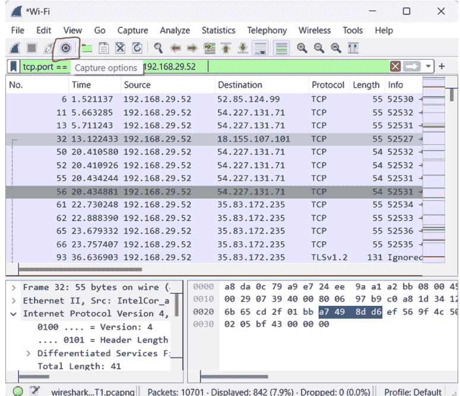
**图 8.1：Wireshark 界面**

- **Zeek (Bro)**：该工具适用于连续的网络监控和安全分析。由于它在不干扰操作的情况下被动捕获网络流量，因此支持被动网络监控。该工具在网络层（第 3 层）到应用层（第 7 层）之间工作，以提取详细的元数据。

- **Suricata/Snort**：这是一个 **入侵检测与防御系统 (IDS/IPS)**。该工具的主要功能包括基于签名的入侵检测与防御、DPI 和协议分析。基于签名的入侵检测与防御的概念是指使用基于规则的检测来识别已知威胁。DPI 和协议分析的详细分析涉及检查数据包有效载荷中的恶意内容。它支持对 **Hypertext Transfer Protocol (HTTP)**、**Domain Name System (DNS)**、**Secure Socket Layer/Transport Layer Security (SSL/TLS)**、**SMB**、**File Transfer Protocol (FTP)** 和 **Simple Mail Transfer Protocol (SMTP)** 等协议的详细分析。

- **Splunk/Elasticsearch, Logstash, and Kibana (ELK) Stack**：该工具非常适合日志分析和可视化。Splunk 或 ELK Stack 的相关功能包括集中式日志管理和数据摄取，以及高级搜索和查询能力。集中式日志管理和数据摄取意味着 Splunk 使用 **Search Processing Language (SPL)** 进行快速且灵活的日志查询。**ELK Stack** 使用 **Elasticsearch Query DSL** 和 **Kibana** 的 **KQL** 进行日志搜索（*图 8.2*）：

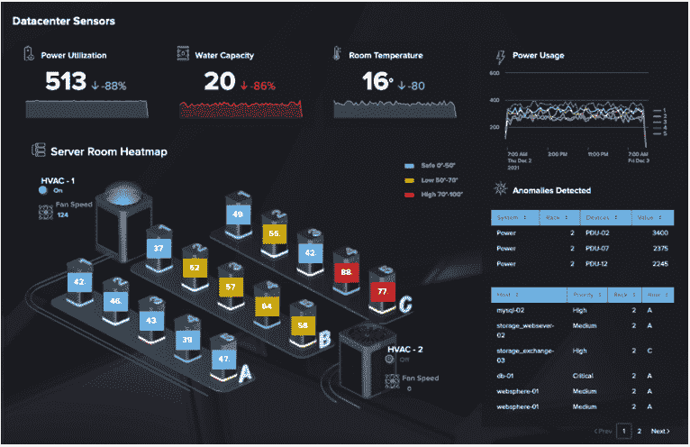

## 数据包捕获与分析

网络安全和数字取证景观的不断演变意味着 **PCAP 和分析** 在揭露关键证据、检测网络威胁和理解网络行为方面发挥着关键作用。这个过程涉及拦截、存储和审视网络数据包，以提取关于数据传输、潜在入侵和恶意活动的有意义的洞察。网络数据包是数字通信的基本单位，因为它们承载了从 Web 请求和电子邮件到加密交易和未经授权访问尝试的所有内容。

**PCAP 和分析** 是指在数据包级别拦截、收集和检查网络流量，以获取对数据传输、安全事件和潜在网络威胁的洞察。**数据包（packet）** 是网络通信的基本单位，包含数据以及元数据，如源和目的 IP 地址、协议信息和有效载荷。对这些数据包的捕获和分析使取证调查员和网络安全专业人员能够 **追踪** 网络活动、检测恶意行为并重建网络攻击。

PCAP 和分析在数字取证中的重要性在于有效的事件调查和证据收集。这是因为它可以帮助取证分析师通过分析网络流量日志来重建安全事件。其重要性的范围进一步延伸到重建网络攻击，使分析师能够跟踪攻击者在网络中的移动和行为。

网络数据包的基础包括其结构：报头（Header）、有效载荷（Payload）和尾随字节（Trailer）。TCP/IP 层被分隔，从而进行数据包传输。网络数据包的类型包括 TCP、**User Datagram Protocol (UDP)**、**Internet Control Message Protocol (ICMP)**、**Domain Name System (DNS)** 和 HTTP。

PCAP 不同方法和技术的应用包括主动和被动。主动 PCAP 指从网络实时捕获数据包。被动 PCAP 类似于分析来自网络的存储数据包。PCAP 涉及使用端口镜像（port mirroring）和网络分路器（network taps）来监控网络流量。PCAP 的内联模式（inline mode）涉及监控整个网络的流量。与之相对的是混杂模式（promiscuous mode），后者专注于设备网络中的特定主机。

数字取证调查员使用以下特定工具进行 PCAP 和分析：

- **Wireshark**：该工具的优势在于对捕获数据包进行图形化分析。Wireshark 支持 DPI、过滤和网络数据包可视化，使其对于安全专业人员、网络管理员和取证分析师来说具有极高价值。Wireshark 使用 **Berkeley Packet Filters (BPF)** 根据 IP 地址、协议、端口号和网络范围来限制捕获的数据包。Wireshark 可以在捕获前应用过滤器（作为捕获过滤器），在捕获后应用过滤器（作为显示过滤器）。

- **tcpdump/tshark**：这是一个强大的基于命令行网络 PCAP 工具，广泛用于数字取证、网络安全和网络故障排除。该工具支持从设备网络中进行命令行 PCAP 和过滤。该工具显示网络数据包的详细报头信息，如源和目的 IP 地址、端口号和序列号、TCP 标志、协议类型和有效载荷数据。该工具有助于分析网络异常、安全事件和协议行为。（图 8.3）

```
tcpdump: verbose output suppressed, use -v or -vv for full protocol decode
listening on wlo1, link-type EN10MB (Ethernet), capture size 262144 bytes
12:35:15.734637 IP6 fe80::6c8:7fff:fe26:caec > ff02::1b: ICMP6, router advertisement, PTR record[2], length 28
12:35:13.737024 IP ubuntulinux.60811 > b.resolvers.Level3.net.domain: 60873+ PTR? 6.1.0.0.0.0.0.0.0.0.0.0.0.0.0.0.0.0.0.0.0.fp6.arpa. (90)
12:35:13.797170 IP ubuntulinux.60811 > b.resolvers.Level3.net.domain: 60873+ PTR? 6.0.0.0.0.0.0.0.0.0.0.0.0.0.0.0.e.f.6.8.0.a.c.0.0.0.0.0.0.f.f.f.7.f.f.1.c.8.0.6.f.ip6.arpa. (116)
12:35:13.915375 IP ubuntulinux.44132 > b.resolvers.Level3.net: 60727 PTR a.c.e.c.0.0.0.n.ip6.arpa. (43)
12:35:13.937972 IP b.resolvers.Level3.net.domain > ubuntulinux.60811: 60873 NXDOMAIN 0/1/0 (104)
12:35:16.142628 IP b.resolvers.Level3.net.domain > ubuntulinux.44132: 7027 NXDOMAIN 0/1/0 (149)
12:35:16.144477 IP ubuntulinux.54078 > b.resolvers.Level3.net: 51202+ PTR? 2.2.2.4.1n-addr.arpa. (38)
12:35:16.182995 IP6 fe80::6c8:7fff:fe26:caec > ff02::1b: ICMP6, router advertisement, PTR record[2], length 28
12:35:16.3360 IP b.resolvers.Level3.net.domain > ubuntulinux.54078: NXDOMAIN 0/1/0 (74)
12:35:16.348070 IP b.resolvers.Level3.net.domain > ff02:1: ICMPv6, MLD report v2, 2 group record(s), length 28
12:35:16.346940 IP b.resolvers.Level3.net.domain > ubuntulinux.44132: 602+ PTR? 102.168.192.1n-ip4.addr.arpa. (44)
12:35:16.44254 IP6 fe80::6c8:7fff:fe26:caec > ff02::1b: [echo Q] 44932+ NXDOMAIN 0/1/0 (103)
12:35:16.515363 IP b.resolvers.Level3.net.domain > ubuntulinux.44132: 7027 NXDOMAIN 0/1/0 (103)
12:35:16.517409 IP ubuntulinux.53519 > b.resolvers.Level3.net.domain: 3894+ PTR? b.f.e.0.0.0.0.0.0.0.0.0.0.0.0.0.0.0.0.0.0.0.0.f.6.8.0.a.c.0.0.0.0.0.0.f.f.f.7.f.f.1.c.8.0.6.f.ip6.arpa. (98)
12:35:16.598778 IP6 fe80::6c8:7fff:fe26:caec > ff02::1b: ICMP6, multicast listener report v2, 1 group record(s), length 28
12:35:16.680420 IP b.resolvers.Level3.net.domain > ubuntulinux.53519: 3094 NXDOMAIN 0/1/0 (154)
12:35:16.683273 IP b.resolvers.Level3.net.domain > ubuntulinux.60811: 60873 NXDOMAIN 0/1/0 (154)
12:35:16.961783 IP6 fe80::6c8:7fff:fe26:caec > ff02::1b: ICMPv6, MLD report v2, 2 group record(s), length 28
12:35:17.068247 IP6 fe80::6c8:7fff:fe26:caec > ff02::1b: [eQ] 4/3 (Cache flush) PTR Android.local., (Cache flush) PTR Android.local., (Cache flush) A 192.168.0.101, (Cache flush) AAAA fe80::6c8:7fff:fe26:caec
12:35:17.068247 IP6 fe80::6c8:7fff:fe26:caec > ff02::1b: [eQ] 4/3 (Cache flush) PTR Android.local., (Cache flush) PTR Android.local., (Cache flush) A 192.168.0.101, (Cache flush) AAAA fe80::6c8:7fff:fe26:caec
23:08:28.238852 IP6 35076 > b.resolvers.Level3.net.domain: 35836+ A? akk.com.aniketcommandikatech.com.aks. [1], ack 8977088, win 501, options [mss 1460,nop,nop,sack OK,10:43:02:08B4 ecr 2402:12534], length 0
23:12:19.298048 IP6 55821 > b.resolvers.Level3.net.domain: 36835+ A? 85.22.92.233.in-addr.arpa. (43)
23:12:19.47930 IP a23-39-12-85.deploy.static.akamaiucdn.net.ubuntu: 55076: Flags [S], seq 98677080, win 65535, length 0
23:12:19.497330 IP b.resolvers.Level3.net.domain > ubuntulinux.55821: 485+ PTR 8/0/g8.a23-39-12-85.deploy.static.akamaiucdn.net. (107)
23:12:19.101841 IP ubuntulinux.55857 > 239.255.255.250.1908: UDP, length 171
23:12:19.152051 IP ubuntulinux.54989 > b.resolvers.Level3.net.domain: 45672+ PTR? 250.255.255.229.23n-addr.arpa. (46)
23:12:19.317664 IP b.resolvers.Level3.net.domain > ubuntulinux.54989: 5462 NXDOMAIN 0/1/0 (103)
23:12:19.636296 IP ubuntulinux.bootpc > .gateway.bootps: BOOTP/DHCP, Request from 84:fd:d5:e5:2B:5e (oui Unknown), length 289
23:12:19.637071 IP ubuntulinux.51783 > b.resolvers.Level3.net.domain: 2999+ PTR? 1.8.160.192.1n-addr.arpa. (42)
23:12:19.831442 IP _gateway.bootps > 255.255.255.255.bootpc: BOOTP/DHCP, Reply, length 295
23:12:19.931402 IP b.resolvers.Level3.net.domain > ubuntulinux.51783: 2999 NXDOMAIN 0/1/0 (181)
23:12:20.102446 IP ubuntulinux.55857 > 239.255.255.250.1908: UDP, length 171
^C23:12:20.239751 IP 192.168.0.3.mdns > 224.0.0.251: mdns: [6/2] [QM]~_23363TDE._sub._googlecast._tcp.local. PTR (QM)~_googlecast._tcp.local. (61)

30 packets captured
34 packets received by filter
0 packets dropped by kernel
man@ubuntu-linux:~$ 
```

**图 8.3：tcpdump 界面**


- **Zeek (Bro)：** 这是一个强大的开源**网络安全监控** (**NSM**) 工具，其功能超越了简单的 PCAP。该工具鼓励进行 NSM 和行为分析，这得益于它能够通过从网络流量中提取元数据和更高级的洞察，从而实时分析、记录和检测安全威胁。实时 PCAP 与从以太网 (Ethernet)、以太网、VLAN、VPN 和回环接口等网络接口实时捕获数据包相关。

- **Suricata/Snort：** Suricata 和 Snort 是 IDS、IPS 和 NSM 工具，旨在分析网络流量以发现威胁、异常和恶意活动。两种工具都提供实时数据包捕获和深度包检测 (DPI)，以检测并防御网络威胁。*(图 8.4)*

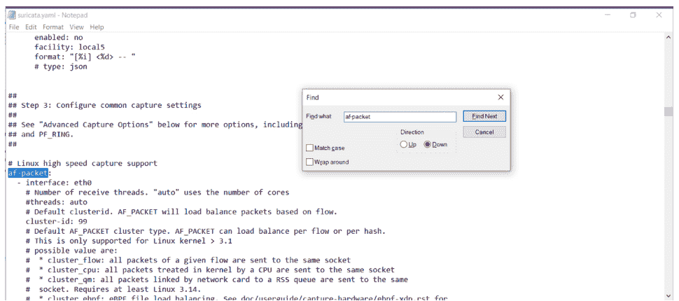

```yaml
enabled: no
facility: local5
format: "[%i] <%d> --"
# type: json

##
### Step 3: Configure common capture settings
## See "Advanced Capture Options" below for more options, including
## and PF_RING.
##

### Linux high speed capture support
af-packet:
  - interface: eth0
    # Number of receive threads. "auto" uses the number of cores
    #threads: auto
    # Default clusterid. AF_PACKET will load balance packets based on flow.
    cluster-id: 99
    # Default AF_PACKET cluster type. AF_PACKET can load balance per flow or per hash.
    # This is only supported for Linux kernel > 3.1
    # possible value are:
    #   * cluster_flow: all packets of a given flow are sent to the same socket
    #   * cluster_cpu: all packets treated in kernel by a CPU are sent to the same socket
    #   * cluster_qm: all packets linked by network card to a RSS queue are sent to the same
    #   socket. Requires at least Linux 3.14.
    #   cluster_ebpf: eBPF file load balancing. See doc/user-guide/capture-hardware/ebpf-xdp.rst for
    #   ...
```

**图 8.4：** *Suricata 界面*

## 日志分析

网络安全和数字取证的领域在不断变化，因此，网络日志成为了极其宝贵的证据来源。相关日志由防火墙、路由器、IDS、服务器、端点设备和其他网络组件生成，提供了网络活动的按时间顺序记录。网络日志在**数字取证调查**中起着关键证据的作用，提供了网络内部活动详细且带有时间戳的记录。这些由各种网络设备和安全系统生成的日志，在检测、分析和响应网络事件中起着至关重要的作用。然而，日志分析面临的相关挑战包括海量的数据量、日志格式的不一致以及日志加密。不同类型的网络日志阐述如下：

- **系统日志：** 系统日志是来自操作系统和应用程序的事件。
- **防火墙日志：** 防火墙日志涉及流量过滤、允许/拦截的连接以及规则违规。
- **入侵检测/防御系统 (IDS/IPS) 日志：** IDS/IPS 日志中关于潜在入侵和攻击的警报。
- **域名系统 (DNS) 日志：** DNS 日志记录域名解析记录，用于追踪恶意域名。
- **Web 服务器日志：** Web 服务器日志包含相关的用户访问详情、请求和 HTTP 状态码。

日志收集和解析涉及以下领域：

- **集中式 vs 分散式日志记录：** 这一方面涉及 SIEM 解决方案的优势。
- **通用日志格式：** 来自不同数字设备的日志生成涉及 Syslog、JSON、CSV、Windows 事件日志和 Apache 日志等格式。
- **解析工具：** 数字取证调查员使用广泛的工具来解析日志，例如 Logstash、Splunk、ELK Stack 以及用 Python 和 Bash 编写的自定义脚本。

数字取证调查员使用以下广泛的日志关联和分析技术：

- **模式识别：** 该技术涉及从不同设备的日志中识别异常、重复的登录失败和可疑 IP。
- **时间线重建：** 有效的日志分析能够创建事件时间线，以追踪攻击者的活动。
- **关键字和正则表达式搜索：** 有效日志分析的目标是提取特定模式，如错误代码、IP 地址和 MAC 地址。
- **威胁情报 (TI) 集成：** 使用相关的外部威胁馈送来识别已知的恶意行为者，可催化高效的日志分析。

数字取证日志分析工具的有效分类涉及**安全信息和事件管理 (SIEM)**、开源日志分析工具、网络流量和日志分析工具、Windows 和 Linux 日志分析工具、威胁情报和关联工具，以及日志取证和调查框架。这些领域分类的日志分析工具阐述如下 *(表 8.1)*：

| 分类因素 | 日志分析工具 | 工具特点 |
| :--- | :--- | :--- |
| **安全信息和事件管理 (SIEM)** | • Splunk | 对来自各种来源的日志数据进行索引和搜索 |
| | • IBM QRadar | 关联日志事件以识别安全事件 |
| | • ArcSight (由 OpenText 提供) | 实时日志收集和事件关联 |
| | • Microsoft Sentinel | 适用于 Microsoft 环境的云原生 SIEM 解决方案 |
| 开源日志分析工具 | Elasticsearch, Logstash, Kibana Stack (ELK) | 存储与索引、解析与可视化日志数据 |
| 开源日志分析工具 | Graylog | 实时日志搜索 |
| 开源日志分析工具 | Open Source HIDS (OSSEC) | 监控日志中的可疑活动 |
| 网络流量和日志分析工具 | Wireshark | 捕获和检查网络数据包 |
| 网络流量和日志分析工具 | Bro (Zeek) | 将原始网络流量转换为结构化日志 |
| 网络流量和日志分析工具 | NetFlow Analyzer | 监控和分析网络流量模式 |
| **Windows 和 Linux 日志分析工具** | • Windows 事件查看器 | 分析 Windows 系统日志中的登录失败、访问尝试和系统错误 |
| **Windows 和 Linux 日志分析工具** | • Sysmon (Microsoft 系统监视器) | 为安全监控提供详细的 Windows 事件日志 |
| **Windows 和 Linux 日志分析工具** | • Logwatch | 适用于 Linux/Unix 系统的日志分析工具 |
| **Windows 和 Linux 日志分析工具** | • GoAccess | 适用于 Linux 服务器的实时 Web 日志分析器 |
| 威胁情报 (TI) 和关联工具 | • 恶意软件信息共享平台 (**MISP**) | 将日志与已知威胁指标进行关联 |
| | • YARA | 识别与恶意软件活动相关的可疑日志条目 |
| | • Cortex (TheHive 项目) | 将取证日志与已知攻击模式关联 |
| 日志取证和调查框架 | • Plaso (log2timeline) | 根据日志创建详细的时间线 |
| | • Timesketch | 可视化日志中的事件序列 |
| | • Redline (由 FireEye 提供) | 分析注册表、事件日志和内存转储 |

**表 8.1：** *日志分析工具详情*

## 网络设备取证

路由器、交换机、防火墙和 IDS/IPS 等网络设备是组织 IT 基础设施的关键组成部分。这些设备控制并监控网络流量，执行安全策略，并生成提供宝贵取证证据的日志。调查这些设备有助于取证分析师重建网络事件、追踪攻击者并加强安全防御。

网络设备执行不同的活动，如记录网络活动、监控网络流量和控制网络流量。记录网络活动是指网络设备生成并存储记录关键事件和流量流的日志，从而帮助管理员和取证调查员追踪网络活动。监控网络流量方面涉及网络设备使用的不同技术，如数据包检查、流量分析和实时警报。控制网络流量则类似于网络设备的流量控制功能。

数字取证调查员在进行网络设备相关调查时往往面临多种挑战。这些挑战包括易失性内存、数据加密、专有固件和日志保留策略。数字取证调查员检查的常见设备包括以下内容：

- **路由器和交换机**：这些设备存储路由表、MAC 地址日志和**访问控制列表 (ACLs)**。
- **防火墙**：这些设备维护拦截/允许的流量、入侵尝试和规则修改的日志。*(图 8.5)*


**图 8.5：** *Palo Alto 防火墙的接口类型*

- **IDS/IPS**：这些设备用于检测并记录恶意网络活动。
- **网络附属存储 (NAS) 和 VPN 服务器**：这些设备包含访问日志和用户身份验证数据。

网络设备中的关键取证数据源包括：

- **配置文件**：配置文件是网络设备中存储设备设置、用户凭据和安全策略的关键取证数据源。
- **网络日志**：网络日志被认为是网络设备中的关键取证数据源，因为它们记录了连接尝试、身份验证失败和防火墙规则更改。
- **内存和数据包捕获**：内存和 PCAP 通常包含易失性取证痕迹，例如活动会话和实时网络流量。
- **元数据和时间戳**：元数据和时间戳有助于重构攻击时间线并跟踪用户活动。

用于网络设备取证的工具详见 *表 8.2*：

| 分类因素 | 工具 | 特性 |
| :--- | :--- | :--- |
| **日志收集与分析工具** | • Splunk | 收集并索引来自网络设备的日志 |
| | ELK Stack | 日志的收集、索引和可视化 |
| | Graylog | 开源日志管理工具 |
| | Syslog-ng | 用于网络设备的集中式日志记录工具 |
| **网络流量分析工具** | Wireshark | 工业标准的 PCAP 和分析工具 |
| | Zeek (Bro) | 监控网络流量并记录详细活动 |
| | Tcpdump | 轻量级命令行 PCAP 工具 |
| | NetFlow Analyzer | 监控并分析网络流量流 |

## 防火墙和 IDS/IPS 日志分析工具

| 工具 | 描述 |
| :--- | :--- |
| Firewall Analyzer (ManageEngine) | 收集并分析来自多个供应商的防火墙日志 |
| Suricata | 捕获并分析网络流量以进行取证调查 |
| Snort | 检测可疑活动并生成警报以进行取证分析 |
| Security Onion | 全方位威胁检测和网络取证平台 |

## 路由器和交换机取证工具

- **RouterOS (MikroTik) Log Analyzer**：收集并分析来自 MikroTik 路由器的日志。
- **Cisco NetFlow 和 PCAP 工具**：支持 NetFlow，有助于监控和分析网络流。
- **Nipper (Titania)**：审计并分析路由器、防火墙、交换机的网络设备配置。
- **配置解析工具 (Config Parser Tools)**：提取并分析设备配置以寻找安全漏洞。

| 分类因素 | 工具 | 特性 |
| :--- | :--- | :--- |
| **威胁情报和日志关联工具** | - 恶意软件信息共享平台 (MISP)<br>- YARA<br>- Cortex (TheHive Project) | 帮助取证团队将网络日志与已知攻击模式进行关联<br>用于恶意软件检测和日志取证<br>为取证分析自动化威胁情报关联。 |
| **网络设备内存和固件分析工具** | Volatility Framework | 帮助提取并分析网络设备的内存转储。 |
| | Binwalk | 用于路由器和防火墙固件的逆向工程。 |
| | FTK Imager | 捕获网络存储设备（NAS, VPN 服务器）的取证磁盘镜像。 |

表 8.2：*网络设备取证工具*

## 恶意软件分析与检测

基于网络的恶意软件是一种在网络上传播、运行或通信以感染系统、窃取数据或中断服务的恶意软件。与针对单个设备的传统恶意软件不同，基于网络的恶意软件利用网络协议、漏洞和互联网连接来传播并执行攻击。常见的基于网络的恶意软件类型列举如下：

- **蠕虫 (Worms)**：这种自我复制的恶意软件通过网络漏洞传播，无需人为干预。*(图 8.6)*

| requestsize | responsesize | serverIPaddress | url-name |
| :--- | :--- | :--- | :--- |
| 275 | 213 | 91.212.127.114 | 91.212.127.114/zpn.gzf |
| 274 | 311089 | 91.212.127.114 | 91.212.127.114/qtx.gzf |
| 275 | 707 | 91.212.127.114 | 91.212.127.114/tlv.gzf |
| 275 | 707 | 91.212.127.114 | 91.212.127.114/kja.gzf |
| 334 | 281 | 91.212.127.114 | 91.212.127.114/zim.gzf |
| 275 | 213 | 91.212.127.114 | 91.212.127.114/kcv.gzf |
| 274 | 311561 | 91.212.127.114 | 91.212.127.114/onv.gzf |

**图 8.6：** 被蠕虫感染设备的界面

- **僵尸网络 (Botnets)**：僵尸网络是由受控设备组成的网络，通过远程控制来实施 DDoS 攻击和垃圾邮件分发等攻击。
- **勒索软件 (Ransomware)**：这种恶意软件会对数据进行加密并在网络中传播，要求支付费用以进行解密。*(图 8.7)*

**图 8.7：** 被勒索软件感染设备的界面

- **Rootkit 和特洛伊木马 (Rootkits and trojans)**：这些是用于持久化后门访问的隐藏恶意软件。
- **间谍软件和键盘记录器 (Spyware and Keyloggers)**：间谍软件和键盘记录器用于监控网络活动并窃取凭据。

基于网络恶意软件感染的相关指标包括由于僵尸网络活动和数据外泄引起的异常网络流量峰值。此外还包括指向恶意 IP 或域名的未知出站连接。

恶意软件攻击的**失陷指标 (IoC)** 包括由于暴力破解攻击而增加的登录失败尝试。此外，防火墙或路由器配置的未经授权更改可能会导致设备网络遭受潜在的恶意软件攻击。

- **静态分析**：静态分析的程序涉及在不执行恶意软件的情况下，从文件哈希、签名和元数据方面检查其代码。
- **动态分析**：动态分析的过程类似于在受控环境（如沙箱和行为监控）中执行恶意软件。
- **内存取证**：内存取证方面涉及从受感染的系统内存中提取恶意软件痕迹。
- **逆向工程**：逆向工程的概念类似于对恶意软件进行反汇编，以研究其行为和代码结构。

数字取证调查员通常采用合适的基于网络的恶意软件检测方法，例如：

- **基于签名的检测**：抗病毒软件、IDS/IPS、YARA 规则。
- **基于启发式和异常的检测**：机器学习、行为分析。
- **使用 PCAP 工具进行流量分析**：Wireshark, Zeek, Snort。*(图 8.8)*

**图 8.8：** Zeek 界面

- **威胁情报集成**：MISP, VirusTotal, ThreatFeeder。

**图 8.9：** Virustotal 界面

用于恶意软件检测的相关取证工具的部署包括以下内容：

- **网络流量分析**：Wireshark, Zeek (Bro) 和 NetFlow Analyzer。
- **恶意软件沙箱**：Cuckoo Sandbox 和 Any.Run Hybrid Analysis。
- **逆向工程**：IDA Pro, Ghidra 和 Radare2。
- **威胁情报与日志分析**：Splunk, ELK Stack 和 MISP。

## 网络取证在事件响应中的作用

网络取证是捕获、记录和分析网络流量与日志以调查网络威胁、安全漏洞和恶意活动的过程。网络取证涉及检查数据包、连接日志和网络流记录，以检测、追踪并响应网络事件。网络取证的关键方面如下：

- **流量分析**：流量分析的概念是指监控和分析数据流以发现可疑活动。
- **日志审查**：日志审查的过程涉及调查来自防火墙、路由器、IDS/IPS 和服务器的日志。
- **攻击溯源**：攻击溯源方面旨在识别攻击的来源、方法和意图。
- **事件响应 (IR)**：IR 提供取证证据以减轻并防止未来的攻击。

网络取证通过实时检测网络威胁在网络安全调查中发挥着至关重要作用。这涉及到识别异常的流量峰值、未经授权的访问和恶意软件活动。此外，它还有助于识别诸如暴力破解尝试、**拒绝服务 (DoS)** 攻击和数据外泄等攻击技术。网络取证涉及通过跟踪 IP 地址、域名和**命令与控制 (C2)** 通信来追溯攻击源并识别对手。这进一步有助于将网络攻击归因于特定的威胁行为者，如 APT 组织、黑客和内部人员。用于 IR 的关键网络取证痕迹列举如下：

- **防火墙日志**：防火墙生成的日志揭示了未经授权的访问尝试和流量异常。*(图 8.10)*


**图 8.10：** 防火墙日志

- **入侵检测系统 (IDS) 日志**：来自 IDS 的日志用于检测已知的攻击模式和签名。
- **NetFlow 记录**：该工具用于跟踪异常的数据传输和潜在的数据外泄。
- **DNS 日志**：DNS 日志用于识别在网络钓鱼或 C2（命令与控制）攻击中使用的恶意域名。
- **数据包捕获 (PCAPs)**：PCAP 文件提供了网络通信的细粒度细节（*图 8.11*）。

## 网络取证在内部威胁调查中的应用

内部威胁是指员工、承包商或合作伙伴滥用访问权限。相关的内部威胁类型包括过失内部人员、恶意内部人员和被攻破的内部人员。网络取证在检测、调查和减轻内部安全违规行为方面的重要性体现在检测内部威胁和安全违规方面。这包括识别对敏感数据、系统或应用程序的未经授权访问。此外，还包括通过分析网络日志和流量模式重构恶意活动，从而调查内部安全漏洞。这将网络事件与用户行为相关联，以精准定位可疑行为。对内部安全漏洞的有效调查能够为法律或纪律处分提供法证证据，如时间戳、IP 地址和访问日志。为了减轻内部威胁并防止未来发生类似事件，需要启用实时监控，以便在数据被窃取之前检测并响应威胁。

相关的缓解流程包括通过识别差距和完善访问控制来加强安全策略。此外，还包括增强**用户行为分析 (UBA)** 以尽早检测异常。内部威胁调查过程涉及以下关键的网络取证工件：

- **防火墙和虚拟私有网络 (VPN) 日志**：来自防火墙和 VPN 的日志可帮助数字取证调查员识别远程访问尝试和策略违规。
- **域名系统 (DNS) 和 Web 代理日志**：来自 DNS 和 Web 代理的日志可揭露与可疑或未经授权站点的连接。
- **文件访问日志**：相关的文件访问日志可检测异常的下载、删除或修改。
- **电子邮件和即时通讯日志**：来自电子邮件和即时通讯的日志可识别机密信息的泄露。
- **数据包捕获 (PCAPs)**：PCAP 提供了网络通信的详细见解。

用于推进内部威胁检测的相关工具包括以下内容：

- **网络流量分析 (NTA)**：应用 Wireshark、Zeek (Bro) 和 NetFlow Analyzer 等特定工具有助于实现 NTA。
- **日志分析和 SIEM**：Splunk、ELK Stack 和 Graylog 的集成确保了有效的日志分析。
- **用户行为分析 (UBA)**：内部风险对 UBA 的需求通过 Exabeam、Microsoft Defender 等工具来实现。
- **端点和云端监控**：端点和云端监控的需求涉及企业使用 CrowdStrike、Varonis 和 Digital Guardian。

## 数据泄露调查中的网络取证

数据泄露是指敏感、机密或受保护的信息在未经授权的情况下被访问、窃取或泄露的事件。这可能由网络攻击、内部威胁或意外泄露引起。数据泄露通常涉及个人数据、财务记录、知识产权或商业秘密。数据泄露的常见原因包括各种网络攻击，如黑客攻击、网络钓鱼、勒索软件和恶意软件。除此之外还有内部威胁，即员工或承包商滥用访问权限。数据外泄的相关指标包括向外部或可疑目的地的出站流量出现异常峰值，以及对敏感文件或数据库的未经授权访问。数字取证调查员在数据泄露调查中考虑以下关键网络工件：

- **防火墙和代理日志**：对防火墙和代理日志的分析有助于识别异常的出站连接。
- **DNS 和 VPN 日志**：对 DNS 和 VPN 日志的分析可跟踪域名请求和远程访问活动。
- **NetFlow 和数据包捕获 (PCAPs)**：对 NetFlow 和 PCAP 的详细分析可揭示数据流动和攻击者通信。
- **端点和文件访问日志**：对端点和文件访问日志的有效评估可确定设备网络中哪些文件被访问或传输。

数字取证调查员通过日志和警报识别泄露指标。这有助于他们将网络事件相关联，以精准定位初始入侵点。对攻击路径和数据传输目的地的分析可揭示数据丢失的程度和受影响的系统。数字取证调查员倾向于保存证据并报告调查结果以采取法律行动。

## 结论

本章详细介绍了网络取证在不同工具和技术方面的细节，以及数字取证调查员广泛采用的方法论。本章强调了进行日志分析以检测组织数字设备网络内部数据泄露源头的重要性。本章表明，网络取证对于加强现代企业的安全性至关重要。网络取证的基础领域包括 NTA，它专注于整体网络通信模式。数字取证调查员在处理网络取证调查时面临广泛的挑战，这要求他们选择合适的工具和技术以产生有效结果，从而增强企业安全的韧性。

接下来的章节将重点对内存取证进行详细分析。

## 加入我们的书籍 Discord 空间

加入书籍的 Discord 工作区，获取最新更新、优惠、全球技术动态、新发布内容以及与作者的交流环节：

https://discord.bponline.com

# 第 9 章：揭秘内存取证

## 简介

内存取证是网络安全和数字调查中的一个关键学科，它允许数字取证调查员检查易失性内存（如 RAM），以检索恶意活动的数字证据。与关注持久性存储的磁盘取证不同，内存取证提供了系统状态的实时快照，从而揭示运行中的进程、打开的网络连接、加密密钥和潜在的恶意软件。本章重点讨论内存取证的不同领域，以确保数字取证调查员能够从生成预期结果的角度获得相关收益。

## 结构

本章涵盖以下主题：

- 内存取证简介
- 内存获取技术
- Volatility 框架
- 内存分析基础
- 检测和分析内存中的恶意软件
- 识别和调查基于内存的攻击
- 最佳实践和新兴趋势

## 目标

本章通过阐述其在企业网络安全中的重要性来介绍内存取证。本章详细介绍了用于提取内存数据以进行取证分析的相关内存获取技术。本章通过探索最强大的内存取证工具之一来详细介绍 Volatility 框架。本章将内存分析基础定义为检查内存工件和结构。本章包含关于检测和分析内存中恶意软件的细节，包括揭露基于内存的威胁。本章识别并调查不同的基于内存的攻击，阐明内存取证对于**事件响应 (IR)** 的益处。本章指出了内存取证在内部威胁调查中的优势，即检测并响应内部安全漏洞。本章尝试将内存取证应用于数据泄露调查，用于揭露内存中数据窃取的证据。本章详细介绍了在**高级持续性威胁 (APT)** 调查中的内存取证，以追踪复杂的攻击。本章包含了针对企业网络安全的内存取证相关最佳实践和新兴趋势。


## 内存取证简介

内存取证的概念涉及分析易失性内存（RAM）以提取数字证据。内存取证的重点倾向于调查运行中的系统痕迹，例如进程、网络活动和凭据。内存取证的过程与磁盘取证不同，后者处理的是持久性存储，而内存取证提供的是实时的系统洞察。内存取证在企业网络安全中的重要性体现在以下领域：

- **事件响应 (IR)：** 内存取证有助于实时检测和分析安全漏洞。（图 9.1）

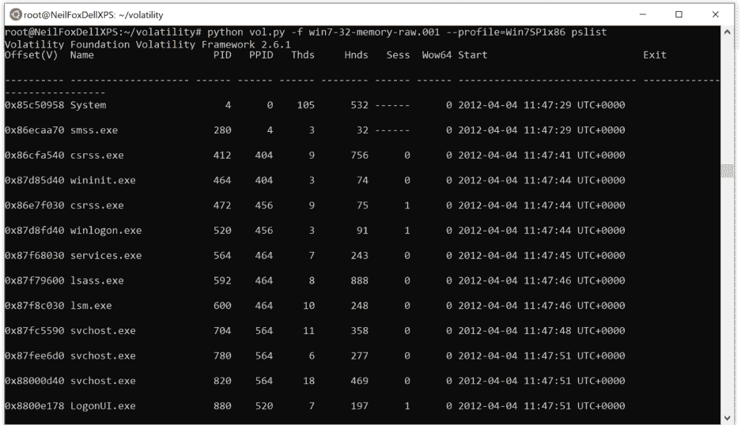
图 9.1：用于 IR 的内存取证

- **恶意软件分析：** 内存取证可识别复杂的威胁，例如无文件恶意软件和 Rootkit。
- **内部威胁：** 内存取证可检测未经授权的访问和权限提升尝试。
- **威胁猎捕：** 内存取证可主动搜索企业网络中隐藏的对手。

数字取证调查员在内存取证中会考虑以下关键痕迹：

- **运行中的进程：** 内存取证可识别运行进程中的恶意或可疑可执行文件。
- **网络连接：** 内存取证可揭示网络连接中的未经授权的通信以及 **命令与控制 (C2)** 活动。
- **凭据窃取：** 内存取证通过提取密码、身份验证令牌和加密密钥来实现凭据窃取。
- **注入代码和 Rootkit：** 内存取证通过分析注入代码和 Rootkit，检测用于绕过安全措施的隐蔽恶意软件技术。

内存取证中存在的潜在挑战包括以下几点：

- **数据易失性：** 当 RAM 数据在断电时丢失，就会出现数据易失性问题，因此需要数字取证调查员立即进行获取。
- **反取证技术：** 现代复杂的攻击者使用加密和混淆等复杂的反取证技术，以在数字取证调查期间规避检测。
- **海量数据分析：** 处理企业规模的内存转储非常复杂且资源密集，因为内存取证的一部分涉及海量数据分析。

## 内存获取技术

内存获取是指捕获系统的易失性内存（RAM）以进行取证分析的过程。内存获取技术对于数字取证调查的重要性在于提供系统活动的实时快照，揭示运行中的进程、网络连接和潜在威胁。内存获取技术的相关用例涉及关键的 IR、恶意软件分析和 APT 检测。内存获取技术涉及以下广泛的考虑因素：

- **实时获取 vs 离线获取：** 由于相关的 RAM 是易失的，数字取证调查员必须在系统运行期间捕获数字设备的内存。
- **完整性和最小干扰：** 数字取证调查员所选择的内存取证工具必须在相关数字设备上具有较低的足迹，以避免惊动对手或改变证据。
- **监管链：** 数字取证调查员倾向于对数字证据进行妥善的文档记录，以确保取证有效性和法律可采信性。

内存获取过程要求相关的数字取证调查员考虑相关的工具，以便在 Windows 系统、Linux 系统、macOS 系统和虚拟化环境中开展调查过程。适用于 Windows 系统的内存获取工具如下所述：

- **DumpIt**：这是一个用于快速内存捕获的轻量级工具，因此被数字取证调查员广泛选择。该工具可以轻松地从 USB 驱动器或其他可移动介质执行。该工具非常适合 IR 场景下的快速内存获取。（图 9.2）

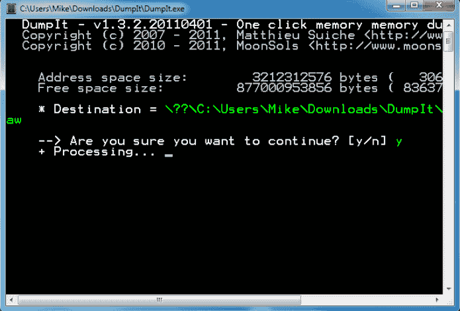

- **FTK Imager**：这是一个具有相关内存获取能力的取证镜像工具。该工具可以在不关闭系统的情况下捕获易失性内存（RAM）和实时磁盘数据。它支持对整个驱动器的镜像，包括硬盘、SSD、USB 和外部介质。它允许调查员提取特定的文件或目录，而不是创建全盘镜像，从而节省时间和存储空间。（图 9.3）

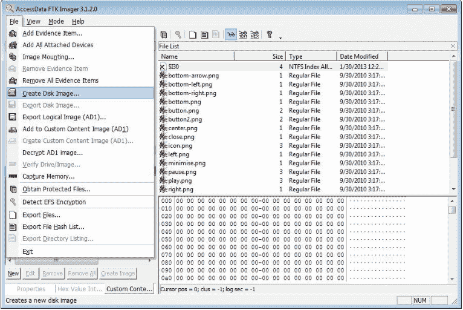
图 9.3：FTK Imager 界面

- **WinPMEM**：该工具是 Rekall 框架的一部分，针对取证提取进行了优化。该工具在捕获易失性内存的同时，确保对系统操作的干扰最小。它为取证分析和法律调查保留了内存转储的完整性。这确保了数字取证调查中对取证可靠内存获取的要求。该工具通过使用签名的内核驱动程序从运行的 Windows 系统中提取内存，从而实现实时内存转储。（图 9.4）


图 9.4：Rekall 界面

## Volatility 框架

Volatility 是一款用于分析易失性内存（RAM）转储的开源内存取证工具。该工具的目的是帮助取证分析师调查安全事件、检测恶意软件并揭露隐藏的系统痕迹。它通过支持 Windows、Linux、macOS 和 Android 内存转储来实现跨平台支持。该工具的基础功能和能力列举如下：

- **进程分析**：进程分析方面在数字取证调查期间识别运行中的进程，包括隐藏或可疑的进程。
- **动态链接库 (DLL) 和句柄检查**：DLL 和句柄检查分析加载的库和系统句柄，用于在数字取证调查期间检测异常。
- **注册表和配置提取**：注册表和配置提取从数字设备中恢复 Windows 注册表项和系统配置。
- **网络连接分析**：网络连接分析调查开放的网络端口、活动连接以及潜在的 C2 活动。
- **恶意软件检测**：恶意软件检测过程辅助数字取证调查员检测注入代码、Rootkit 和持久化机制。
- **文件系统和内存映射**：文件系统和内存映射程序恢复内存中的文件和映射的 DLL。
- **凭据和加密密钥恢复**：凭据和加密密钥恢复过程通过提取存储的密码、哈希值和加密密钥来实现。（图 9.5）

```
?????????????????????????
?????????????????????????????????????????????????????????????????
?????????????????????????????????????????????????????????????????
?????????????????????????????????????????????????????????????????
?????????????????????????
?????????????????????????????????????????????????????????????????
?????????????????????????????????????????????????????????????????
?????????????????????????????????????????????????????????????????
?????????????????????????????????????????????????????????????????
?????????????????????????????????????????????????????????????????
XC45tNYivI72oxuIKP12q1PuoU7/fVyspFECQFFZUfiEMFb7H7fo3aWnoWFcLkjR
lVtNX04vVL11c4oYK2XwcAxMnxr65+XsBcVcwR0Q4u9/x8+VrBtKYvp+sNcCQE10
W4ewXTvj87uu8UAu60N2xdSwawFF50BiRFXMSKOYtYEaqPy1p+YQvrlwom29myHd
00kOUGEdJNLG+ICGn8ECQQDUYI4oTF9N4gc9vs+19RlqdzsX6nRj2nBn8fI3y6nu
LIHsFctL38ItRE0+j4YsPs4NqRrd7glq880xlqaLIMgv
-----END RSA PRIVATE KEY-----
```


Volatility 可以处理原始转储（raw dumps）、崩溃转储（crash dumps）、休眠文件以及 **Advanced Forensic Format 4 (AFF4)**，以支持多种内存转储格式。该工具可以与 DumpIt、FTK Imager、WinPMEM 和 LiME 集成。Volatility 框架的用途阐述如下：

- **命令行界面 (CLI)**：CLI 的优势在于它提供了强大的插件，用于详细的内存分析。
- **常用命令和插件**：CLI 的使用涉及使用相关命令和插件，如下表 *(表 9.1)* 所示：

| 命令与插件 | 功能 |
|---------------------|----------|
| pslist, pstree | 列出运行中的进程及其层级结构 |
| netscan | 显示活跃的和历史的网络连接 |
| malfind | 检测隐藏或注入的代码段 |
| hashdump | 从内存中提取密码哈希 |
| cmdscan, consoles | 恢复命令行历史记录 |

*表 9.1*：CLI 命令与插件

Volatility 框架的相关优势在于它是一个免费且开源的取证工具。这鼓励了数字取证社区对其进行积极开发。Volatility 框架轻量且便携，无需安装，从而使其易于部署在数字取证调查中。该工具鼓励开发用于专业分析的自定义插件。它受到全球网络安全专业人员和取证分析师的信任，因此被广泛应用于 IR（事件响应）。Volatility 是一个强大且必不可少的内存取证工具，能够提供关于系统活动、恶意软件感染和网络威胁的深入见解。掌握其功能可以增强数字取证调查员的整体能力。(图 9.6)

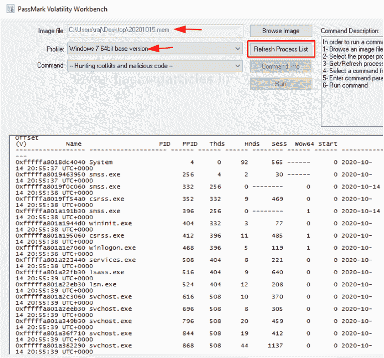

| Offset (V) | Name | PID | PPID | Thds | Hnds | Sess | Wow64 | Start |
|------------|------|-----|------|------|------|------|-------|-------|
| 0xfffffa8018dc4040 | System | 4 | 0 | 92 | 565 | --- | -- | 2020-10-14 20:55:37 UTC+0000 |
| 0xfffffa8019463950 | smss.exe | 256 | 4 | 2 | 30 | | 0 | 2020-10-14 |
| 0xfffffa8019f0c060 | smss.exe | 332 | 256 | 0 | --- | | 0 | 2020-10-14 |
| 0xfffffa8019ff5a00 | csrss.exe | 352 | 332 | 9 | 469 | | 0 | 2020-10-14 |
| 0xfffffa801a191b30 | smss.exe | 396 | 256 | 0 | --- | | 1 | 2020-10-14 |
| 0xfffffa801a1944d0 | wininit.exe | 404 | 332 | 3 | 77 | | 0 | 2020-10-14 |
| 0xfffffa801a195060 | csrss.exe | 412 | 396 | 11 | 485 | | 1 | 2020-10-14 |
| 0xfffffa801a1e7060 | winlogon.exe | 468 | 396 | 5 | 119 | | 1 | 2020-10-14 |
| 0xfffffa801a2234a0 | services.exe | 508 | 404 | 8 | 221 | | 0 | 2020-10-14 |
| 0xfffffa801a22fb30 | lsass.exe | 516 | 404 | 9 | 640 | | 0 | 2020-10-14 |
| 0xfffffa801a22eb30 | lsm.exe | 524 | 404 | 12 | 208 | | 0 | 2020-10-14 |
| 0xfffffa801a2c3060 | svchost.exe | 616 | 508 | 10 | 370 | | 0 | 2020-10-14 |
| 0xfffffa801a2eeb30 | svchost.exe | 696 | 508 | 8 | 305 | | 0 | 2020-10-14 |
| 0xfffffa801a349b30 | svchost.exe | 796 | 508 | 20 | 459 | | 0 | 2020-10-14 |
| 0xfffffa801a36f710 | svchost.exe | 844 | 508 | 19 | 412 | | 0 | 2020-10-14 |
| 0xfffffa801a382290 | svchost.exe | 868 | 508 | 44 | 1137 | | 0 | 2020-10-14 |

> 图 9.6：Volatility 框架界面

## 内存分析基础

内存分析是检查易失性内存（RAM）以发现数字证据的过程。它对数字取证分析的重要性在于能够提供系统状态的实时见解，包括运行中的进程、网络活动和安全事件。内存分析程序被用于恶意软件检测、IR（事件响应）、内部威胁调查和取证案例工作。关键的内存痕迹阐述如下：

- **进程与线程**：这类似于识别活动进程、已终止进程以及隐藏/恶意的执行体。
- **网络连接**：揭示打开的连接、活跃的端口和潜在的 C2（命令与控制）通道。
- **系统句柄与对象**：涉及调查恶意软件使用的文件句柄、互斥锁（mutexes）和注册表项。
- **内核模块与驱动程序**：涉及检测 Rootkit、未经授权的内核修改和注入代码。
- **注册表与配置数据**：此过程类似于提取注册表项、启动项和系统首选项。
- **凭据与认证痕迹**：涉及恢复密码、哈希和认证令牌。

不同的内存结构及其在数字取证调查中的作用阐述如下：

- **页表与虚拟内存**：此内存结构涉及理解操作系统如何为数字取证管理内存分配和分页。
- **堆与栈分析**：此内存结构涉及识别进程内存使用情况、潜在的缓冲区溢出和注入的 shellcode。
- **内存映射文件**：内存映射文件涉及分析加载到内存中的可执行文件，以发现隐蔽的恶意软件持久化。

以下工具用于内存分析：

- **Volatility 框架**：Volatility 框架被广泛用于提取和分析内存痕迹。
- **Rekall**：这是一个用于深度内存调查的高级取证框架。
- **Memoryze**：该工具用于检测恶意软件和可疑的内存活动。(图 9.7)

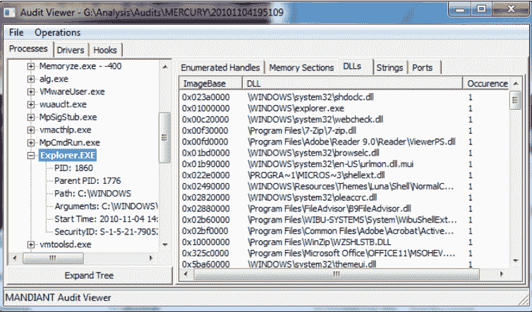

> 图 9.7：Memoryze 界面

## 检测与分析内存中的恶意软件

基于内存的恶意软件在系统的 RAM 中运行，不在磁盘上留下痕迹。在内存中检测和分析恶意软件的重要性在于，传统的防病毒解决方案通常会遗漏内存威胁，因为这些威胁不依赖于持久化存储。内存中恶意软件的常见示例包括无文件恶意软件、Rootkit、**远程访问木马 (RATs)** 和 APT。基于内存的恶意软件采用以下方法来规避检测：

- **代码注入**：代码注入过程涉及将恶意代码注入到合法进程中，例如进程掏空（process hollowing）和 DLL 注入。
- **反射加载 (Reflective loading)**：反射加载涉及在不触碰磁盘存储的情况下在内存中执行恶意软件。
- **混淆与加密**：混淆与加密通过加密有效载荷（payloads）和隐藏执行痕迹来掩盖恶意活动。
- **挂钩 (Hooking) 与 API 操作**：挂钩与 API 操作涉及修改系统调用，以拦截或操纵内存活动。

内存中关键的 **失陷指标 (IoCs)** 与以下内容相关：

- **异常运行进程**：在内存中执行的可疑或未签名进程会导致系统性能下降。
- **隐藏或已终止进程**：隐藏或已终止的进程指向那些自我隐藏或创建幽灵进程的恶意软件。
- **注入段**：系统内存区域中包含注入的 shellcode 或可执行有效载荷。
- **异常网络连接**：攻击者创建的指向已知恶意域名的意外出站连接。
- **异常 DLL 与内核模块**：系统内存中存在未经授权或未签名的动态库和内核驱动程序意味着存在 IoCs。

用于检测和分析基于内存的恶意软件的合适工具详述如下：

- **Volatility 框架**：Volatility 框架通过分析内存转储来检测注入代码、隐藏进程和网络活动。
- **Rekall**：Rekall 提供关于系统内存、内核结构和 Rootkit 的深度取证见解。
- **Memoryze**：Memoryze 在内存转储中检测恶意软件、Rootkit 和挂钩。
- **YARA 规则**：YARA 规则通过扫描特定签名，帮助识别内存中已知的恶意软件模式。*(图 9.8)*


```
rule Linux_Ransomware_GwisinLocker : tc_detection malicious
{
    meta:
        author = "ReversingLabs"
        source = "ReversingLabs"
        status = "RELEASED"
        sharing = "TLP:WHITE"
        category = "MALWARE"
        malware = "GWISINLOCKER"
        description = "Yara rule that detects GwisinLocker ransomware."
        
    tc_detection_type = "Ransomware"
    tc_detection_name = "GwisinLocker"
    tc_detection_factor = 5
}
```

**图 9.8**：Yara 规则界面

## 识别与调查基于内存的攻击

基于内存攻击的特点在于利用系统 RAM 执行恶意代码，通常不在磁盘上留下痕迹。识别和调查基于内存攻击的重要性在于，传统的取证技术可能会遗漏此类攻击，因此内存取证对于其检测至关重要。基于内存攻击的常见实例包括无文件恶意软件、凭据窃取（Mimikatz）、进程注入和 APT 攻击。基于内存攻击的关键指标包括以下内容：

- **可疑或隐藏进程**：可疑或隐藏进程方面是指伪装成合法系统进程或隐秘运行的恶意软件。
- **异常网络连接**：异常网络连接意味着意外的出站流量，特别是发往 C2 服务器的流量。
- **注入或镂空代码**：注入或镂空代码是指操纵或替换合法进程内存空间的恶意软件。
- **凭据和令牌窃取**：凭据和令牌窃取方面涉及对存储在内存中的身份验证数据的未经授权访问，例如 LSASS 转储。
- **异常 API 调用和挂钩 (Hooks)**：异常 API 调用和挂钩的出现涉及被修改以绕过安全控制或拦截数据的系统函数。

事件响应 (IR) 中的内存取证涉及以下内容：

- **立即内存捕获**：立即内存捕获的目标是使用 WinPMEM、DumpIt 或 FTK Imager 等工具在关机前获取 RAM。
- **分析内存转储**：分析内存转储的过程涉及使用 Volatility、Rekall 或 Memoryze 提取取证伪像。
- **调查运行中的进程**：调查运行进程方面涉及使用 `pslist`、`pstree` 和 `malfind` 命令检测异常。
- **内存中的网络取证**：内存中网络取证的重要性类似于使用 `netscan` 和 `connection` 插件识别可疑连接。
- **检测 Rootkit 和挂钩**：检测 Rootkit 和挂钩的过程涉及扫描隐藏的内核模块和 API 操纵。

以下工具用于基于内存的攻击调查：

- **Volatility 框架**：Volatility 框架是一个用于内存分析和恶意软件检测的综合工具。
- **Rekall**：Rekall 是一款用于深度系统内存检查的高级取证工具。
- **Redline**：Redline 用于检测内存中的恶意活动，包括未经授权的进程和连接。
- **YARA**：YARA 扫描内存转储以查找已知的恶意软件签名和行为指标。（图 9.9）

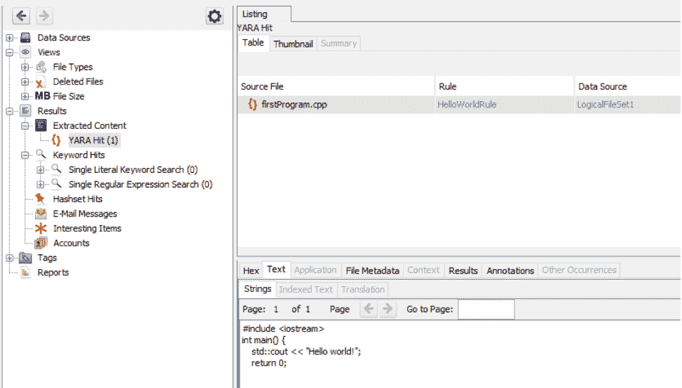

**图 9.9：Yara 界面**

## 内部威胁调查中的内存取证

内部威胁的概念涉及员工、承包商或受信任的个人滥用访问权限来破坏安全性。内存取证在内部威胁调查中的重要性在于，传统的安全工具可能无法检测到内部人员的恶意活动，使得内存取证变得必不可少。相关场景包括数据外泄、权限滥用、凭据窃取、未经授权的访问和破坏。在内存中识别内部威胁指标的方面涉及以下内容：

- **可疑进程活动**：可疑进程活动涉及异常的系统进程、未经授权的软件或远程访问工具。
- **未经授权的凭据使用**：未经授权的凭据使用涉及从内存中提取密码、身份验证令牌或加密密钥。
- **数据外泄尝试**：数据外泄尝试的过程涉及大文件传输、电子邮件附件或可疑的云上传。
- **未经授权的权限提升**：未经授权的权限提升涉及管理权限的异常使用或系统修改。
- **隐秘通信通道**：隐秘通信通道类似于意外的网络连接、VPN 隧道或 C2 交互。

数字取证调查人员在调查内部威胁实例时会考虑以下关键内存伪像：

- **运行进程和执行历史**：运行进程和执行历史有助于使用 `pslist` 和 `cmdscan` 检测未经授权的应用程序。
- **网络连接和外泄尝试**：相关的网络连接和外泄尝试可以通过使用 `netscan` 追踪可疑的外部通信来评估。
- **剪贴板和文件访问历史**：数字取证调查人员通过考虑剪贴板和文件访问历史来恢复复制的数据和传输的文件。
- **注册表和系统配置更改**：数字取证调查人员通过评估注册表和系统配置更改来追踪 Windows 注册表中的未经授权的修改。
- **内存中的电子邮件和聊天日志**：从挥发性内存中提取通信记录涉及重点关注电子邮件和聊天日志。

数字取证调查人员在内存取证中应对内部安全漏洞时重点使用以下工具：

- **Volatility 框架**：该框架提取关键内存伪像，如进程、网络连接和凭据。
- **Rekall**：该工具通过深度系统内存分析帮助检测隐秘的内部活动。
- **Redline**：该工具提供对活动进程和可疑用户行为的洞察。
- **YARA 规则**：该工具通过扫描内存中的恶意模式来识别内部威胁。

## 数据泄露调查中的内存取证

内存取证涉及分析挥发性内存 (RAM) 以揭露未经授权的数据访问和外泄证据。许多网络罪犯使用内存技术来窃取敏感数据，同时避开传统的基于磁盘的检测。内存中数据窃取的关键指标包括处理异常的网络活动，例如意外的出站连接，尤其是发往未知 IP 或外部云服务的连接。相关的剪贴板和会话数据提取涉及复制的敏感数据、密码或信用卡详情的证据。数字取证调查人员应用进程和线程分析，使用 `pslist`、`pstree` 和 `malfind` 来识别恶意活动。此外，还通过处理网络和连接分析，使用 `netscan` 检查实时连接和历史网络流量。检测注入或隐藏代码的目标是使用 `malfind` 和 `ldrmodules` 来揭露隐秘的内存恶意软件。数字取证调查人员在进行数据泄露调查的内存取证时使用的相关工具包括以下内容：

- **Volatility 框架**：一个强大的数字取证工具，用于从内存转储中提取与 APT 相关的伪像。
- **Rekall**：该工具提供深入的内存分析并帮助检测高级威胁。
- **Wireshark**：该工具监控内存驻留的网络流量，以寻找 APT 通信模式。
- **YARA 规则**：该工具在内存中识别已知的 APT 恶意软件签名和行为模式。

## APT 调查中的内存取证

APT 是针对特定组织或政府的长期、隐秘的网络攻击。APT 使用复杂的规避技术，使得基于磁盘的取证不足以应对；内存取证有助于揭露隐藏的活动。对手在进行 APT 攻击时部署的常见战术包括无文件恶意软件、进程注入、凭据窃取、Rootkit 和 C2 通信。数字取证调查人员在 APT 调查中使用以下技术：

- **实时内存获取**：实时内存获取的过程涉及使用 WinPMEM 或 FTK Imager 等工具捕获挥发性内存。
- **进程和线程分析**：进程和线程分析涉及使用 `pslist`、`pstree` 和 `malfind` 识别恶意进程。
- **DLL 和代码注入检测**：相关的 DLL 检测使用 `ldrmodules`、`dlllist` 和 `malfind` 来追踪注入的库。


- **网络连接分析**：网络连接分析的概念是指利用 `netscan` 检测 APT 后门和 C2 活动。
- **凭据和令牌提取**：凭据和令牌提取的过程涉及使用 `hashdump` 和 `creds` 恢复被盗的身份验证数据。

## 最佳实践与新兴趋势

企业网络安全中内存取证的最佳实践阐述如下：

- **主动内存获取**：主动内存获取的流程是定期捕获并分析内存快照，以检测早期威胁。
- **标准化 IR 流程**：标准化的 IR 流程为安全事件期间的内存获取和分析制定了明确的协议。
- **使用自动化取证工具**：利用 Volatility、Rekall 和 Redline 等自动化取证工具的利用确保了分析流程的精简化。
- **威胁情报集成**：有效的威胁情报集成将内存取证数据与威胁情报馈送相结合，以识别已知的攻击模式。
- **取证就绪状态**：取证就绪状态意味着对安全团队进行内存分析技术培训并维护更新的取证工具包。

企业网络安全中内存取证的新兴趋势阐述如下：

- **AI 驱动的内存分析**：机器学习模型正被集成用于检测异常并实现恶意软件分类的自动化。
- **云内存取证**：随着云端的普及，取证工具正在演进，以分析来自虚拟环境的内存转储。
- **实时内存取证**：无需完整系统转储的实时内存扫描因其能更快检测威胁而正受到关注。
- **零信任安全中的内存取证**：对易失性内存的持续监控符合零信任原则。
- **抗量子取证技术**：人们正在探索加密安全方面的进步，以保护取证数据的完整性。

## 结论

本章将内存取证作为数字取证的一个组成部分进行了详细分析。本章包含了关于内存获取技术的充分细节，并重点介绍了 Volatility 框架等具体工具。对不同内存取证工具和伪像（artifacts）的详细分析有助于深入理解内存中的恶意软件。本章指出，内存取证在应对数据泄露和内部威胁等特定网络事件中起着至关重要的作用。这是由于积累了充足的情报，可以提升组织在未来面对类似攻击时的网络弹性水平。

接下来的章节将探讨作为企业安全关键需求的移动设备取证。

## 加入我们书籍的 Discord 空间

加入本书的 Discord 工作区，获取最新更新、优惠、全球技术动态、新发布内容以及与作者的交流环节：

https://discord.bpbonline.com


# 第 10 章：探索移动设备取证

## 引言

如今对智能手机设备的依赖程度日益增加，导致它们成为了对手的潜在目标。现代网络犯罪在很大程度上将智能手机设备视为针对目标实体的网络攻击的主要源头。这促使移动设备取证成为数字取证的一个关键部分。移动设备取证是数字取证的一个分支，专注于从智能手机、平板电脑和 GPS 设备等移动设备中恢复、分析和保存数据。它在刑事调查、网络安全事件和公司安全中发挥着至关重要的作用。本章重点从证据获取的角度，通过部署不同的工具和技术来探索移动设备取证及其分析。

## 结构

本章涵盖以下主题：

- 移动设备取证简介
- 移动设备获取技术
- 移动操作系统和文件系统
- 移动应用取证
- 通话记录和消息分析
- 位置数据和 GPS 分析
- 社交媒体和即时通讯应用取证
- 移动设备加密和密码破解
- BYOD 环境中的移动设备取证
- 案例研究

## 目标

本章重点介绍移动设备取证，旨在理解其在企业调查中的重要性。本章包含了从智能手机和平板电脑中提取数据的不同移动设备获取技术。本章重点讨论移动操作系统 (**OS**) 和文件系统，以便理解移动设备的结构。本章详细探讨了移动应用取证，以调查用于证据收集的应用程序。本章包含了关于通话记录和消息分析的细节，以从移动设备中提取通信数据。本章重点讨论位置数据和**全球定位系统 (GPS)** 分析，以跟踪移动设备的移动轨迹。

本章包含了关于社交媒体和即时通讯应用取证的充分细节，以揭示社交网络应用中的数字足迹。本章包含了关于移动设备加密和密码破解的充分细节，以克服取证调查中的安全措施。本章讨论了如何通过部署多种数据恢复技术来恢复移动设备中的已删除数据。它还意味着移动设备取证正成为当前**自带设备** (**BYOD**) 环境中的一个关键因素，旨在解决员工持有设备的挑战。本章包含了多个案例研究，以进一步确立移动设备取证在现代智能手机依赖背景下的重要性。

## 移动设备取证简介

移动设备取证是数字取证的一个分支，专注于智能手机、平板电脑和**物联网** (**IoT**) 设备等移动设备。移动设备取证在调查数据泄露、内部威胁和违反政策方面，在企业安全中发挥着至关重要的作用。移动设备取证在企业调查中的重要性与多种因素相关，例如数据敏感性。这涉及到移动设备存储的关键业务信息、电子邮件和公司文档。其重要性进一步体现在有效的**事件响应** (**IR**) 方面，有助于检测未经授权的访问、恶意软件攻击和数据泄露。

移动设备取证相关的法律和合规方面确保了对各种数据保护法律的遵守，例如**通用数据保护条例** (GDPR)、**加州消费者隐私法案 (CCPA)** 和**健康保险流通与责任法案 (HIPAA)**。移动设备取证对企业安全调查的意义在于检测欺诈活动、知识产权盗窃和未经授权的通信。移动设备取证的最佳实践包括保存数据的完整性以避免篡改证据，并维护**监管链 (CoC)**。数字取证调查员采用以下方法进行移动设备取证：

- **逻辑提取**：逻辑提取的概念是指在不绕过安全措施的情况下访问可访问的数据。
- **物理提取**：物理提取方面是指创建完整的内存转储，以便进行更深层的取证分析。
- **网络和云取证**：网络和云取证对移动设备取证的重要性体现在调查同步账户、企业云存储和**虚拟专用网络 (VPN)** 日志。

数字取证调查员对这些移动设备取证方法的选择，涉及从以下分类中选择相关的取证工具：

- **商业解决方案**：商业取证工具是由专门从事数字取证的公司开发的专有软件。由于其先进的特性，这些工具被执法机构、企业和网络安全专业人士广泛使用。

功能、技术支持和定期更新。商业解决方案包括 Cellebrite UFED、Magnet AXIOM 和 Oxygen Forensics。(*图 10.1*)

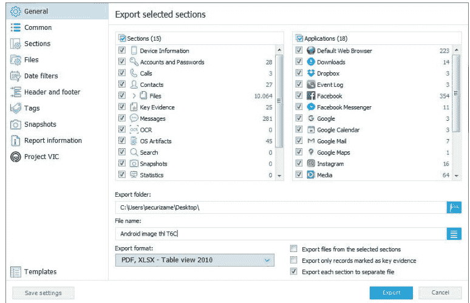
**图 10.1：** Oxygen Forensics 界面

- **开源工具**：开源取证工具是由网络安全社区和研究人员开发的免费软件。这些工具通常用于学术研究、独立调查以及因预算限制而无法使用商业解决方案的情况。开源工具包括 Autopsy、**移动验证工具包 (MVT)** 和 Andriller。

## 移动设备获取技术

移动设备获取的概念是指在取证调查中从移动设备中提取、保存和分析数据的过程。该程序的意义在于帮助恢复关键证据，如消息、通话记录、应用数据和位置历史记录。相关的挑战包括数据加密、硬件差异、操作系统安全更新以及云存储集成。相关的移动数据获取方法类型如下：

- **手动获取**：这种移动设备获取技术意味着检查设备屏幕并手动记录证据，例如截屏和笔记。该程序的优点是无需特殊工具，且过程快速简单。然而，相关的缺点包括数据篡改风险高和数据提取不完整。(图 10.2)

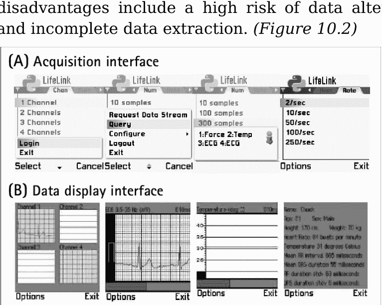
图 10.2：数据获取界面

- **逻辑获取**：此过程是指使用内置的**应用程序编程接口 (APIs)** 和取证工具提取可访问的数据。

- **物理获取**：该过程创建整个设备存储的逐位副本，包括已删除和隐藏的数据。

- **文件系统获取**：这种移动设备获取技术是指提取设备的文件系统，从而允许用户访问应用数据和系统日志。这种方法的优点在于它比逻辑获取更全面，但比物理获取的侵入性低。

- **基于云的获取**：这种移动设备获取技术是指从 Google Drive、iCloud 和 OneDrive 等云备份中检索数据。然而，此过程需要正确的凭据和法律授权。

关于移动设备获取的相关最佳实践涉及维护正确的监管链 (CoC) 以确保数据的完整性。数字取证调查员使用写保护设备来防止设备内数据的意外修改。他们需要遵守法律准则，如搜查令要求和隐私法。相关的最佳实践还包括使用取证工具验证提取的数据。

## 移动操作系统和文件系统

移动操作系统 (OS) 被定义为管理移动设备硬件、应用程序和用户交互的软件。移动操作系统在数字取证中的重要性在于确定数据存储、安全机制和取证提取方法。如今常用的移动操作系统包括 Android、iOS、KaiOS、HarmonyOS 和 Windows Mobile。其中，Android 是开源的，被多个制造商使用。另一方面，iOS 是基于云的，且仅在 Apple 设备中使用。其他移动操作系统较为少见，但在不同案例中仍具相关性。Android 和 iOS 的主要区别在以下表格结构中列出：

| 属性 | Android | iOS |
|------------|---------|-----|
| 主要文件系统 | Ext4 和 F2FS | Apple 文件系统 (APFS) |
| 分区 | - **/boot:** 引导加载程序和内核。<br>- **/system:** 操作系统核心文件。<br>- **/data:** 用户数据（应用、消息、联系人等）。<br>- **/cache:** 临时文件、日志。<br>- **/sdcard:** 用户可访问的存储（可选，外部）。 | - **根分区 (/):** 系统和操作系统文件（只读）<br>- **用户数据分区 (/var 或 /private/var):** 包含应用数据、消息和日志。 |
| 安全性 | 全盘加密和基于文件的加密 (FBE) | 硬件加密、安全隔离区 (Secure Enclave) 和沙箱机制 |
| 取证关键工件 | SQLite 数据库、日志文件、APK 和 XML 配置 | Plist 文件、Keychain 数据、iCloud 备份和系统日志 |

**表 10.1：Android 和 iOS 的区别**

数字取证调查员在进行移动取证时，往往会面临广泛的文件系统挑战。这些挑战列举如下：

- **加密和安全特性**：数字取证调查员需要绕过锁定屏幕、生物识别和硬件加密，这些特性限制了对智能手机和平板电脑等移动设备的访问。
- **数据碎片化**：数字取证调查员观察到，不同版本的移动操作系统倾向于以不同的格式存储数据。
- **应用沙箱**：为了安全起见，应用沙箱的广泛使用倾向于限制对应用程序其他数据的访问。

这些挑战的普遍存在促使数字取证调查员选择相关的取证技术来进行文件系统分析。这些技术如下：

- **逻辑提取**：这种逻辑提取技术是指数字取证调查员使用取证工具获取移动设备的可访问数据。

- **物理转储**：物理转储过程是指数字取证调查员对数字证据进行逐位镜像，以从中恢复已删除或隐藏的文件。

- **越狱和 Root (高级)**：这种高级方法被数字取证调查员广泛使用，旨在获取更高权限以访问数字设备的受限数据，尽管这在法律上受到限制。

- **云数据提取**：数字取证调查员倾向于分析存储在 iCloud、Google Drive 或 OneDrive 等特定平台上的移动设备备份，以开展其数字调查。

## 移动应用取证

移动应用取证类似于从移动应用程序中提取、分析和解释数据以进行取证调查的过程。该程序的意义在于，移动应用存储了关键的用户数据，包括消息、通话记录、交易和位置历史记录。然而，这方面相关的挑战包括数据加密、应用沙箱、云同步以及频繁的应用更新影响取证技术。数字取证调查员考虑分析的相关移动应用类型如下：

- **消息和通信应用**：安装在智能手机设备中的相关通信和消息应用包括 WhatsApp、Telegram、Signal 和 iMessage。

- **社交媒体和网络应用**：社交媒体日益普及，促使智能手机用户安装各种应用，如 Facebook、Instagram、Twitter 和 TikTok。

- **金融和银行应用**：对数字货币依赖程度的增加导致各种应用被广泛使用，如 PayPal、Venmo、Google Pay 和 Apple Pay。

- **电子邮件和云存储应用**：对持续通信的广泛需求要求使用高效的应用，如 Gmail、Outlook、Google Drive 和 iCloud。

- **导航和打车应用**：对无缝旅行的需求促使用户使用特定的应用，如 Google Maps、Uber 和 Lyft。

识别应用数据存储位置对数字取证调查员至关重要，涉及以下区域：

- **本地设备存储**：本地设备存储包括 SQLite 数据库，特别是用于聊天记录和联系人的 **.db** 文件。此外还包括存储在 Android 的 **/data/data/** 以及 iOS 的 **/private/var/mobile/Containers/Data/Application/** 下的日志文件和缓存。本地设备存储的类型进一步...

扩展到共享首选项和配置文件，例如 XML 和 Plist。

- **云存储与同步：** 云存储和同步导致数据存储在 iCloud、Google Drive 或特定应用程序的服务器中。然而，访问此类区域的数据需要以传票和搜查令形式的法律授权。

- **加密和删除的数据：** 一些智能手机使用端到端加密来确保用户的数据隐私。这些应用包括 Signal 和 Telegram 的加密对话（Secret Chats）。数字取证调查人员可以使用取证工具恢复已删除的应用数据。

数字取证调查人员采用以下技术进行移动应用数据提取：

- **逻辑提取：** 逻辑提取过程是指通过操作系统 API 提取可访问的用户数据（侵入性较低）。

- **文件系统获取：** 文件系统获取程序涉及检索更深层的应用数据，包括日志和数据库。

- **物理获取：** 物理获取过程类似于对数据片段进行逐位克隆，以实现完整的数据恢复，包括已删除的文件也包括在内。

- **基于云的分析：** 基于云的分析过程调查从数字设备同步到云服务的数据。

- **特定应用取证：** 特定应用取证类似于对应用进行逆向工程以提取隐藏的痕迹。

除了相关技术外，数字取证调查人员还会为移动应用调查选择合适的工具：

- **商业工具：** 与移动应用取证相关的商业工具包括 Cellebrite UFED、Oxygen Forensics 和 Magnet AXIOM。

- **开源工具：** 对移动应用取证的广泛需求促进了开源工具的应用，如 Autopsy、Andriller 和 MVT。

## 通话记录和消息分析

通信数据取证是指从移动设备中提取、分析和解释通话记录和消息数据的过程。这一实践的整体重要性在于有助于刑事调查、公司安全案件和法律纠纷。这方面的相关挑战包括数据加密、删除数据恢复、云同步以及特定应用的安全特性。移动设备上相关的通信数据类型包括以下内容：

- **通话记录：** 这包括呼入、呼出和未接电话，以及通话时长、时间戳和相关的联系人详情。此分类还进一步包括语音信箱和通话录音（如果可用）。

- **SMS 和 MMS 消息：** SMS 和 MMS 消息存储在 SQLite 数据库中，例如 Android 上的 `mmssms.db` 和 iOS 上的 **sms.db**。除此之外，发送者、接收者、时间戳以及消息状态（如已发送、已接收和已删除）等元数据，为数字取证调查人员提供了可靠的证据来源。

- **即时通讯应用：** 如今广泛使用的即时通讯应用包括 WhatsApp、Telegram、Signal、Facebook Messenger、iMessage 等。这方面的相关挑战包括端到端加密，这增加了从 Signal 等应用以及 WhatsApp 加密备份中提取数据的难度。数字取证调查人员倾向于考虑聊天附件、删除的消息和时间戳。

数字取证调查人员倾向于应用以下技术提取通话记录和消息：

- **逻辑提取：** 逻辑提取过程涉及从备份或设备 API 访问通话记录和消息。

- **物理获取：** 物理获取策略类似于逐位成像，以恢复删除的通话记录和消息。

- **基于云的提取：** 基于云的提取是指从 iCloud、Google Drive 或应用服务器检索数据（需要法律授权）。

- **数据库分析：** 数据库分析过程包括从 SQLite 数据库和日志文件中提取通信数据。

- **解密和密码恢复：** 数字取证调查人员使用取证工具来推进对加密消息和特定应用数据的恢复。

技术的专门应用要求数字取证调查人员考虑以下工具：

- **商业工具：** 相关商业工具包括 Cellebrite UFED、Magnet AXIOM 和 Oxygen Forensics。

- **开源工具：** 开源工具包括 Andriller、MVT 和 SQLite Browser。（图 10.3）

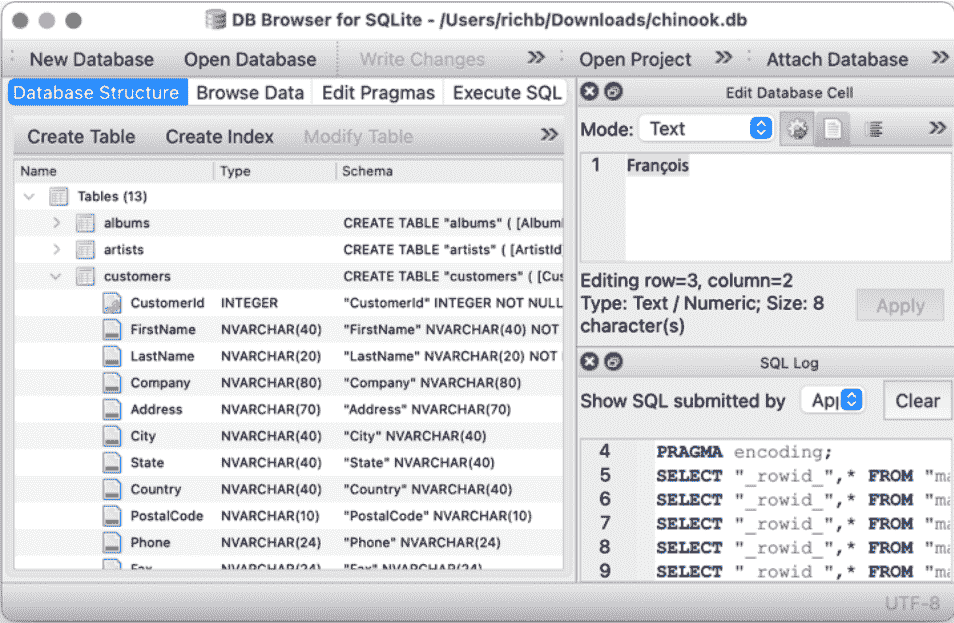
**图 10.3：** DB Browser for SQLite 的界面

## 位置数据和 GPS 分析

位置数据取证的概念是指从移动设备中提取和分析位置数据以追踪移动轨迹和活动的过程。位置数据取证过程有助于刑事调查、失踪人员案件、欺诈检测和验证不在场证明。相反，相关的挑战包括数据加密、GPS 精度、云同步和隐私法。移动设备上相关的位置数据来源如下所述：

- **GPS 数据：** GPS 数据包括通过智能手机和平板电脑内置的 GPS 接收器捕获的数据。数据包含存储的纬度、经度、海拔和时间戳。

- **Wi-Fi 和基站数据：** Wi-Fi 和基站数据包括用于位置近似的移动设备日志、附近 Wi-Fi 网络和基站。当 GPS 信号较弱时（例如在室内），会使用此类数据。

- **基于应用的位置日志：** 基于应用的位置日志包括 Google 地图时间轴、Apple 定位服务以及特定应用的定位历史记录，如 Uber、Snapchat 和 Facebook。此类数据的优势在于其倾向于存储用户的移动轨迹、访问过的位置和时间戳。

- **媒体文件中的 EXIF 元数据：** 这包括可能在元数据中包含嵌入式 GPS 坐标的照片和视频。

- **云端和备份数据：** 此类数据涉及存储过去位置的 iCloud、Google 位置记录和应用备份。

数字取证调查人员倾向于应用以下技术提取位置数据：

- **逻辑提取：** 此程序涉及使用相关取证工具访问 GPS 日志、Wi-Fi 数据和位置历史记录。

- **物理提取：** 物理提取过程涉及逐位成像，以恢复删除或隐藏的位置数据。

- **基于云的分析：** 基于云的分析涉及从 Google 时间轴、iCloud 或第三方应用检索位置数据，因为这些操作需要法律授权。

- **元数据分析：** 元数据分析程序涉及从照片、视频和类似的多媒体文件中提取 GPS 数据。

- **三角定位法：** 三角定位法涉及使用基站记录来近似设备移动轨迹。

数字取证调查人员需要应用以下工具来执行此类技术：

- **商业工具：** 适当的商业工具包括 Cellebrite UFED、Magnet AXIOM 和 Oxygen Forensics。（图 10.4）

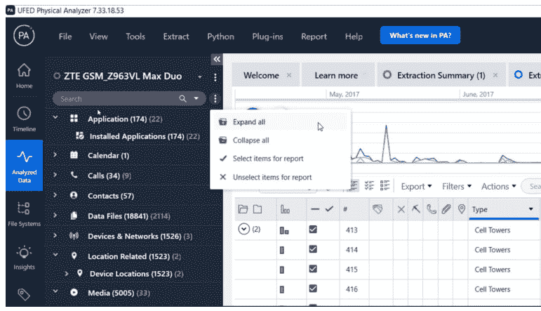
**图 10.4：** Cellebrite UFED 的界面

- **开源工具：** 相关的开源工具包括 Google Takeout Analyzer、ExifTool 和 GPSBabel。

## 社交媒体和即时通讯应用取证

社交媒体和即时通讯应用取证的概念被定义为从社交媒体和即时通讯应用中提取、分析和保存数字证据的过程。这一实践的重要性在于，社交网络平台存储了大量用户生成的数据，包括聊天记录、图像、视频、帖子和位置历史记录。相关挑战包括端到端加密、云存储、频繁的应用更新以及数据隐私法规。社交媒体和即时通讯应用取证将以下平台纳入取证调查范围：

- **社交媒体应用：** 特定的社交媒体应用包括 Facebook、Instagram、Twitter、TikTok、

LinkedIn 和 Snapchat。

- **即时通讯应用：** 广受欢迎的即时通讯应用包括 WhatsApp、Telegram、Signal、iMessage、Facebook Messenger 和微信。
- **混合应用：** 混合应用是指同时具备社交网络和即时通讯功能的平台，例如 Discord 和 Reddit。

以下数据类型与社交媒体和即时通讯应用密切相关：

- **用户个人资料数据：** 用户个人资料数据的概念包括用户名、电子邮件、电话号码和账户创建详情。
- **聊天和消息历史：** 聊天和消息历史记录包括文本消息、时间戳、消息删除记录和媒体附件。
- **多媒体文件：** 广泛的多媒体文件包括照片、视频、语音消息及其元数据。
- **位置数据：** 相关的位置数据包括签到、共享位置以及帖子/照片中的标记位置。
- **帖子和评论：** 帖子和评论包括相关的时间轴帖子、故事（stories）、点赞、分享和互动。
- **联系人和关系：** 联系人和关系包括好友列表、关注者和群组会员资格。

数字取证调查人员针对社交媒体和即时通讯应用取证采取以下技术：

- **逻辑提取：** 该程序用于通过应用 API 和设备备份检索可访问的数据。
- **基于云的获取：** 这种获取程序涉及从 iCloud、Google Drive 或需要法律授权的应用服务器中提取数据。
- **物理获取：** 这种获取过程是指通过逐位（bit-by-bit）镜像来恢复已删除的消息和媒体。
- **网络流量分析：** 网络流量分析过程涉及捕获社交媒体应用实时传输的数据。
- **应用特定取证分析：** 部署应用特定取证分析涉及对相关应用进行逆向工程以寻找隐藏的痕迹（artifacts）。

用于社交媒体和即时通讯应用调查的常用取证工具如下：

- **商业工具：** 合适的商业工具包括 Cellebrite UFED、Magnet AXIOM 和 Oxygen Forensics。*（图 10.5）*

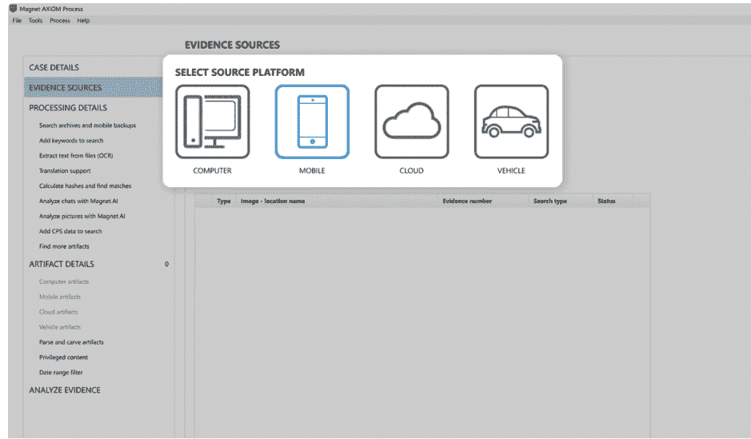
**图 10.5：** Magnet AXIOM 界面

- **开源工具：** 数字取证调查人员使用的开源工具包括 **社交媒体情报** (**SOCMINT**) 工具，如 OSINT 框架、Hunchly 和 MVT。

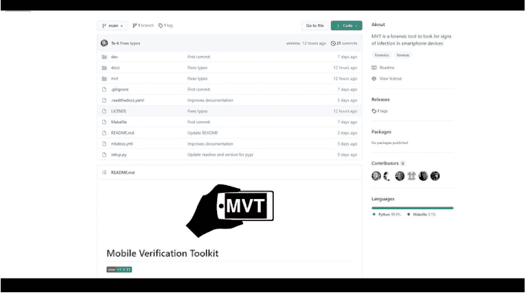
**图 10.6：** MVT 界面

## 移动设备加密与密码破解

移动设备安全措施涉及移动设备使用加密和密码保护来确保用户数据的安全。其在取证中的重要性在于调查人员需要绕过或解密安全措施以获取证据。此类取证调查期间相关的挑战包括强加密算法、生物识别身份验证以及法律限制。相关的移动设备加密类型包括以下内容：

- **全盘加密 (FDE)：** 这种加密方法对数字设备的整个存储空间进行加密（Android 10 之前版本，较旧的 iOS 版本）。
- **基于文件的加密 (FBE)：** 这种加密技术对文件分别进行加密，从而允许 Android 10+ 和 iOS 具有不同的安全级别。
- **端到端加密 (E2EE)：** 这种加密程序用于 WhatsApp、Signal 和 Telegram 等即时通讯应用。
- **基于硬件的加密：** 这种加密过程涉及 Secure Enclave (iOS) 和 TrustZone (Android) 以保护敏感数据。

数字取证调查人员使用以下加密和身份验证绕过方法：

- **越狱与 Root：** 此过程有助于数字取证调查人员提升权限以访问受限数据。
- **脱壳取证 (Chip-off forensics)：** 数字取证调查人员通过移除内存芯片来物理提取数据。
- **联合测试行动小组 (JTAG) 分析：** 此过程鼓励通过调试端口访问数据。
- **云数据获取：** 此过程涉及从 iCloud 或 Google Drive 中提取需要法律访问权限的加密备份。

除此之外，还使用以下取证工具进行密码破解和加密绕过：

- **商业工具：** 适用于此类调查的工具包括 Cellebrite UFED、GrayKey 和 Passware Kit Mobile。
- **开源工具：** 适用于类似调查的有效工具包括 Hashcat、John the Ripper 和 MVT。

## 从移动设备恢复删除的数据

从移动设备恢复删除数据的相关技术包括以下内容：

- **逻辑恢复：** 此过程涉及从 iCloud、Google Drive 和本地备份中提取数据。这还包括从 SQLite 数据库（如聊天日志和通话记录）中恢复删除的文件。该工具用于检查应用缓存和临时文件。
- **物理恢复：** 此过程意味着使用取证工具对设备存储进行逐位镜像。从 NAND 闪存中提取原始数据的相关操作涉及脱壳（chip-off）或 JTAG 技术。
- **基于云的恢复：** 从包括 Google Photos 和 iCloud Drive 在内的云存储服务中检索同步数据。此过程还涉及分析恢复文件的元数据和时间戳。
- **取证痕迹分析：** 这种分析方法是指从系统日志中恢复删除的 SMS、通话记录和聊天消息。从图像、视频和文档中提取相关元数据有助于数字取证调查。

## BYOD 环境下的移动设备取证

BYOD（自带设备办公）环境的相关挑战包括以下内容：

- **法律和隐私顾虑：** 员工倾向于保留个人数据的所有权。这涉及在未经同意的情况下访问个人信息时普遍存在的法律限制。
- **数据分割问题：** 个人数据与企业数据混杂的倾向使得目标提取变得困难。这促使人们使用独立的工作配置文件或移动设备管理 (MDM) 解决方案。
- **设备访问受限：** 雇主通常缺乏扣押或分析个人设备的权力。此外，加密和密码保护进一步限制了数字取证调查人员对设备的访问。
- **云端和第三方应用存储：** 敏感的公司数据可能存储在第三方应用中，如 Google Drive、Dropbox 和 WhatsApp。云同步使本地数据恢复变得复杂。
- **远程擦除和反取证措施：** 员工倾向于使用恢复出厂设置、加密工具或自动擦除应用来删除数据。

辅助 BYOD 调查的取证技术涉及以下内容：

- **选择性数据获取：** 这涉及仅提取与工作相关的数据以保护员工隐私。作为选择性数据获取的一部分，逻辑提取方法涉及避免对全设备进行镜像。
- **移动设备管理 (MDM) 日志：** 这些日志文件包括来自 MDM 解决方案的访问日志、应用使用情况和安全警报。这用于验证是否符合公司政策。
- **基于云的数据检索：** 这涉及在获得法律授权的情况下从企业云服务中获取相关数据。这包括检查同步的工作邮件、文档和即时通讯平台。
- **网络和端点分析：** 此分析过程调查公司网络日志以获取设备活动。此过程涉及使用端点检测工具来分析安全事件。

## 案例研究

以下案例研究表明了移动设备取证在现代情境中的重要性：

- **圣贝纳迪诺恐怖袭击 (2015)：联邦调查局 (FBI) 对阵 Apple：**
FBI 调查了一起涉及一名个体及其妻子的群体枪击事件。由于 iPhone 5C 被锁定，FBI 请求 Apple 协助解锁。这方面的相关挑战涉及 iPhone 的加密和安全特性，这些特性防止了暴力破解解锁。Apple 以隐私顾虑为由拒绝创建后门。FBI 雇佣了一家第三方安全公司（据报道为 Cellebrite）来破解手机。最终成功提取了与解决问题相关的数据，尽管据报道提供的额外情报非常有限。此案对数字取证的影响引发了关于隐私与国家安全之间关系的全球辩论。这凸显了在调查中针对加密设备建立法律框架的必要性。

- **安然丑闻 (2001)：企业欺诈中的早期移动取证：**
安然公司的高管从事企业欺诈，通过非法会计手段隐瞒财务损失。相关数字取证调查人员检查了移动设备、电子邮件和文本消息以揭露欺诈活动。相关挑战包括早期的移动设备缺乏加密但数据存储空间有限。其他挑战包括相关数据必须与...

企业电子邮件和通话记录。调查人员恢复了证明高管与欺诈行为有关的煽动性短信和通话记录。此案导致了**萨班斯-奥克斯利法案 (SOX)** 的出台，以提高企业的问责制。该案例的影响表明了移动设备记录在企业调查中的重要性。此案的发生导致金融机构采取了更严格的数据保留政策。

## 结论

本章旨在让读者意识到移动设备取证在企业调查中的重要性。本章指出，商业解决方案和开源工具对于数字取证调查员解决网络攻击的复杂性至关重要。本章介绍了多种证据获取技术。本章阐述了 Android 和 iOS 之间的适当区别。关于调查多个应用程序的方面，涉及数字取证调查员选择合适的技术，并使用合适的工具和框架进行部署。移动取证的相关领域包括位置数据和 GPS 分析，这有助于追踪移动设备的移动轨迹。

接下来的章节将对应于解读虚拟化和管理程序（Hypervisor）取证。

## 加入我们书籍的 Discord 空间

加入本书的 Discord 工作区，获取最新更新、优惠、全球技术动态、新发布内容以及与作者的交流环节：

https://discord.bpbonline.com


# 第 11 章：解读虚拟化和管理程序取证

## 引言

虚拟化过程是指利用管理程序（Hypervisor）在单台物理机上运行多个操作系统的过程。这意味着它在数字取证调查中具有极高的重要性。这是因为通过管理程序，多个操作系统可以运行在单一物理机上。解读虚拟化和管理程序取证的重要性在于，虚拟化环境由于分层数据存储、共享资源和实时迁移，增加了取证调查的复杂性。相关的常见用例包括云计算、企业 IT 基础设施和网络安全沙箱。本章将详细探讨有效地解读虚拟化和管理程序取证的重要性，以帮助数字取证调查员无缝地解决网络攻击问题。

## 结构

涵盖的主题如下：

- 虚拟化和管理程序技术简介
- 虚拟机取证
- 管理程序取证
- 虚拟磁盘取证
- 快照分析
- 虚拟化网络中的网络取证
- 管理程序安全考虑
- 最佳实践
- 案例研究

## 目标

本章提供了对虚拟化和管理程序技术的初步理解。本章重点讨论**虚拟机 (VM)** 取证，即在虚拟环境中调查数字证据。本章涉及管理程序取证，旨在从虚拟化层揭示证据。本章指出，虚拟磁盘取证涉及从虚拟硬盘中提取和分析数据。本章介绍了快照分析的概念，即利用 VM 快照进行取证调查。本章包含了关于虚拟化网络中网络取证的充分细节，涉及调查虚拟化环境中的网络流量。本章包含了关于管理程序安全考虑的充分细节，涉及处理漏洞和利用攻击。本章列举了虚拟化和管理程序取证调查中的若干最佳实践，可为数字取证调查员提供无缝帮助。本章包含足够数量的案例研究，以确立解读虚拟化和管理程序取证的重要性。

## 虚拟化和管理程序技术简介

虚拟化的概念是指在单个物理系统上创建计算资源（如操作系统、存储、网络）虚拟实例的过程。它在现代计算中的重要性在于增强了企业 IT 环境中的资源效率、可扩展性和安全性。该技术的常见应用包括云计算、数据中心中的服务器整合以及开发和测试环境。云计算的具体实例包括 **Amazon Web Services** (AWS) *（图 11.1）*、Azure 和 Google Cloud。

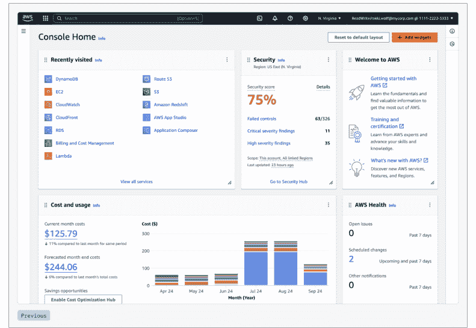
**图 11.1：** AWS 界面

关于管理程序技术的详细概述是指它是一种软件解决方案，能够使多个 VM 运行在单个物理宿主机上。相关管理程序的类型列举如下：

- **1 型（裸金属）：** 1 型管理程序直接运行在硬件上，例如 VMware ESXi、Microsoft Hyper-V 和 Xen。
- **2 型（托管）：** 2 型管理程序运行在操作系统内部，例如 VirtualBox、VMware Workstation 和 KVM。

管理程序的核心功能包括创建 VM 以及分配**中央处理器 (CPU)**、内存和存储。管理程序的核心功能还意味着 VM 之间的隔离以确保安全性。管理程序进一步确保对 VM 快照、克隆和迁移的有效管理。

虚拟化环境的组成部分包括以下内容：

- **宿主机：** 宿主机是运行管理程序的物理硬件。
- **客户 VM：** 客户 VM 是运行在管理程序之上的虚拟化操作系统。（*图 11.2*）

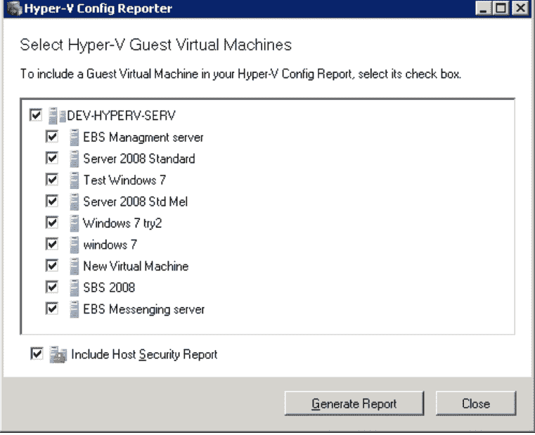
**图 11.2：** Hyper-V 客户 VM 界面

- **虚拟磁盘和存储：** 虚拟磁盘和存储是指 VM 使用**虚拟硬盘 (VHD)** 文件（VMDK、VDI、VHD）来模拟物理存储。
- **虚拟网络适配器：** 虚拟网络适配器实现了 VM 与外部网络之间的网络通信。（*图 11.3*）

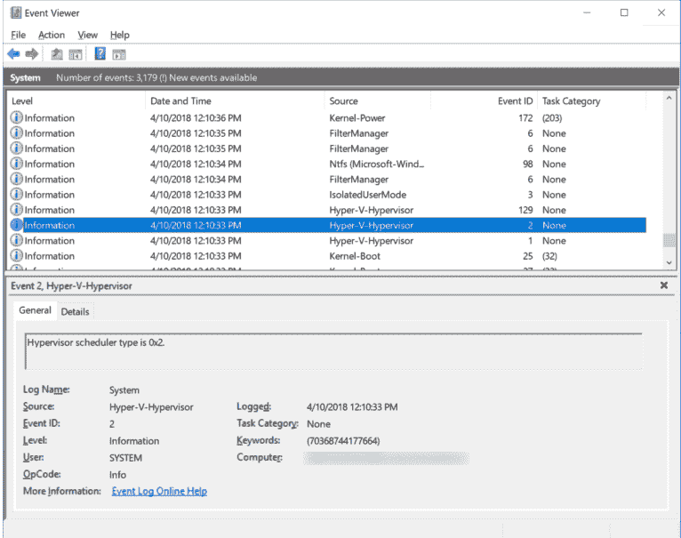

| 级别 | 日期和时间 | 来源 | 事件 ID | 任务类别 |
|---|---|---|---|---|
| 信息 | 4/10/2018 12:10:36 PM | Kernel-Power | 172 | (203) |
| 信息 | 4/10/2018 12:10:35 PM | FilterManager | 6 | 无 |
| 信息 | 4/10/2018 12:10:35 PM | FilterManager | 6 | 无 |
| 信息 | 4/10/2018 12:10:34 PM | Ntfs (Microsoft-Wind... | 98 | 无 |
| 信息 | 4/10/2018 12:10:34 PM | FilterManager | 6 | 无 |
| 信息 | 4/10/2018 12:10:33 PM | IsolatedUserMode | 3 | 无 |
| 信息 | 4/10/2018 12:10:33 PM | Hyper-V-Hypervisor | 129 | 无 |
| 信息 | 4/10/2018 12:10:33 PM | Hyper-V-Hypervisor | 2 | 无 |
| 信息 | 4/10/2018 12:10:33 PM | Hyper-V-Hypervisor | 1 | 无 |
| 信息 | 4/10/2018 12:10:33 PM | Kernel-Boot | 25 | (32) |

**图 11.3：** 管理程序界面

| 属性 | 值 |
|---|---|
| 日志名称 | System |
| 来源 | Hyper-V-Hypervisor |
| 事件 ID | 2 |
| 级别 | Information |
| 用户 | SYSTEM |
| OpCode | Info |
| 更多信息 | Event Log Online Help |
| 记录时间 | 4/10/2018 12:10:33 PM |
| 任务类别 | None |
| 关键字 | (70368744177664) |
| 计算机 | |

## 虚拟机取证

VM 取证的概念是指从虚拟化环境中识别、收集、分析和保存数字证据的过程。VM 取证日益重要，是因为许多企业和云服务依赖于虚拟化过程。从背景来看，网络罪犯利用 VM 来逃避检测和取证调查。（图 11.4）

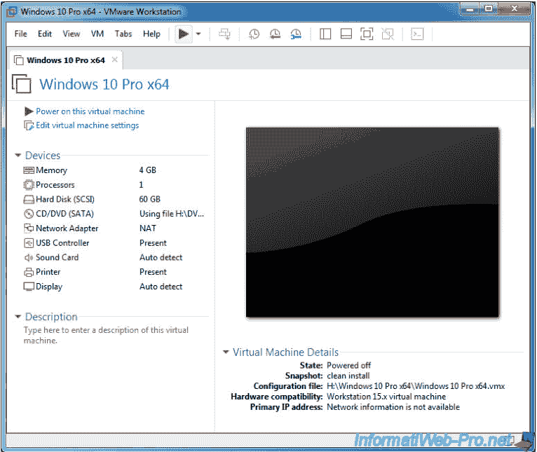
**图 11.4：** VM 界面

相关的 VM 痕迹（Artifacts）阐述如下：

- **虚拟磁盘文件：** 虚拟磁盘文件包含存储在 VM 中的所有数据（例如 VMware 的 VMDK，VirtualBox 的 VDI，Hyper-V 的 VHD）。
- **VM 配置文件：** VM 配置文件存储设置、硬件分配和快照。
- **快照和内存转储：** 快照和内存转储捕获 VM 状态和 RAM 内容以进行取证分析。（*图 11.5*）


**图 11.5：** 内存转储 (Memory dumps)

- **Hypervisor 日志：** Hypervisor 日志有助于跟踪虚拟机 (VM) 活动、启动时间以及与宿主系统的交互。

用于调查虚拟机的技术包括：

- **实时取证 (Live forensics)：** 这种取证程序有助于使用 Volatility 或 LiME 等工具捕获易失性内存。除此之外，它还有助于从虚拟机中提取运行中的进程和网络活动。
- **离线分析 (Offline analysis)：** 这种分析程序有助于使用 FTK Imager 和 Autopsy 等工具获取虚拟磁盘镜像以进行取证检查。该程序进一步有助于挂载并分析虚拟机快照，以查找删除的文件和系统日志。
- **网络流量分析 (Network traffic analysis)：** 这种分析程序有助于监控虚拟机之间的通信，以发现恶意活动。该过程倾向于使用数据包捕获工具（Wireshark, Zeek）来检测隐蔽信道。

数字取证调查员选择以下工具来开展所需的调查：

- **商业工具：** 商业工具范围包括 EnCase、Magnet AXIOM 和 X-Ways Forensics。
- **开源工具：** 开源工具包括 Volatility、Autopsy、FTK Imager 以及 VMDK/VDI 挂载工具。（图 11.6）

**图 11.6：** VMDK 界面

## Hypervisor 取证

Hypervisor 取证的概念是指分析 Hypervisor 以在虚拟化环境中识别、收集和保存数字证据的过程。此类取证调查的重要性在于，网络犯罪分子倾向于利用 Hypervisor 来创建隐藏的虚拟机。从上下文来看，对 Hypervisor 的取证分析有助于揭露未经授权的虚拟机活动、系统入侵和安全违规。相关的 Hypervisor 日志和痕迹包括以下内容：

- **虚拟机创建日志：** 虚拟机创建日志跟踪虚拟实例的部署。
- **系统快照和内存转储：** 系统快照和内存转储捕获系统状态以供取证分析。
- **虚拟磁盘文件 (VMDK, VHD, VDI)：** 特定的虚拟磁盘文件（如 VMDK、VHD 和 VDI）存储可能包含取证证据的虚拟机数据。

Hypervisor 取证分析的相关技术包括以下内容：

- **实时取证：** 实时取证过程涉及捕获 Hypervisor 日志以跟踪系统事件和虚拟机活动。此过程进一步有助于分析来自 Hypervisor 的内存转储，以查找运行中的进程和恶意代码。
- **离线分析：** 这种分析程序有助于提取和挂载虚拟磁盘文件以检查存储的数据。此过程涉及调查 Hypervisor 配置文件以寻找未经授权虚拟机的证据。
- **网络和流量分析：** 网络和流量分析有助于监控虚拟机网络通信中的异常或安全威胁。该程序进一步使用特定的数据包分析工具（如 Wireshark 和 Zeek）来检测隐蔽信道。

与 Hypervisor 分析相关的取证工具陈述如下：

- **商业工具：** 适用于 Hypervisor 取证的商业工具包括 Magnet AXIOM、EnCase 和 X-Ways Forensics。（图 11.7）

**图 11.7：** X-Ways imager 界面

- **开源工具：** 有助于数字取证易失性分析的开源工具是 FTK Imager 和 Autopsy。

## 虚拟磁盘取证

虚拟磁盘取证的视角是指识别、提取和分析虚拟机所使用的 VHD 文件中存储数据的过程。虚拟磁盘取证在数字调查中的极高重要性体现在：虚拟磁盘存储了操作系统文件、应用程序、日志和用户数据，因此使其成为关键的取证证据来源。因此，网络犯罪分子倾向于使用虚拟磁盘来隐藏非法活动或避免被检测。不同的虚拟磁盘格式包括以下内容：

- **VMware 虚拟磁盘 (VMDK)：** VMDK 被 VMware Workstation、ESXi 和 Fusion 使用。
- **虚拟硬盘 (VHD/VHDX)：** VHD/VHDX 被 Microsoft Hyper-V 使用。
- **虚拟磁盘镜像 (VDI)：** VDI 被 Oracle VirtualBox 使用。
- **QEMU 写时复制 (QCOW/QCOW2)：** QCOW/QCOW2 用于 KVM 和 QEMU 环境。

虚拟磁盘的结构类似于动态分配或固定大小的底层配置。动态分配方面体现了根据需求进行有效扩展。虚拟磁盘的结构进一步符合存储系统分区、文件系统和删除数据的残留物。

数字取证调查员将以下取证技术应用于虚拟磁盘分析：

- **挂载和提取虚拟磁盘：** 这涉及使用取证工具将虚拟磁盘挂载为只读镜像，此外还包括恢复删除的文件和分析元数据。
- **文件系统分析：** 这涉及检查虚拟磁盘内的 NTFS、FAT、ext4 和其他文件系统。此过程进一步有助于搜索日志、注册表文件和浏览器历史记录等痕迹。
- **内存和快照分析：** 这种分析程序通过提取 RAM 快照来分析运行中的进程。这有助于调查虚拟机快照以获取历史证据。

数字取证调查员广泛用于虚拟磁盘取证的相关工具包括商业工具和开源工具。这些工具陈述如下：（表 11.1）

| 商业工具 | 开源工具 |
| :--- | :--- |
| EnCase | FTK Imager (图 11.8) |
| Magnet AXIOM | Autopsy |
| X-Ways Forensics | Volatility |
| | Sleuth Kit |

**表 11.1：虚拟磁盘取证的商业和开源工具**

**图 11.8：** FTK Imager 界面

虚拟磁盘取证的法律和合规性考量包括在处理虚拟磁盘证据时确保取证完整性。除此之外，还包括遵守数据隐私法规，如《通用数据保护条例》(GDPR) 和 HIPAA。

## 快照分析

虚拟机 (VM) 快照的概念是指虚拟机在特定时间点的磁盘副本、内存和设置。虚拟机快照的取证意义在于保存不同时间点的系统状态证据。此过程有助于通过回滚分析来跟踪更改和删除的数据。快照分析在网络攻击调查、恶意软件感染和内部威胁中非常有用。相关的虚拟机快照类型陈述如下：

- **全量快照 (Full snapshots)：** 全量快照的概念是指捕获整个虚拟机，包括磁盘和内存状态。
- **增量快照 (Delta snapshots)：** 增量快照表示仅存储自上次快照以来的更改，从而减小存储空间。
- **内存快照 (Memory snapshots)：** 内存快照是指保存系统的 RAM，从而允许对活动进程进行取证恢复。

快照痕迹和证据源列举如下：

- **虚拟磁盘文件：** 虚拟磁盘文件包含存储的文件、应用程序以及潜在的删除数据。
- **内存转储：** 内存转储捕获运行中的进程、网络活动和加密密钥。
- **配置文件：** 配置文件倾向于存储元数据、虚拟机设置和对取证时间线有用的时间戳。

数字取证调查员倾向于采用以下多种技术来分析虚拟机快照：

- **挂载和提取快照：** 此过程涉及使用取证工具访问和分析虚拟磁盘镜像。此过程适用于从历史快照中恢复删除的文件和日志。
- **内存分析：** 此程序是识别活动进程、恶意软件和加密密钥的理想选择。此程序涉及使用 Volatility 和 Rekall 等工具进行深度内存取证。
- **时间线重建：** 时间线重建的过程涉及比较多个

快照用于识别未经授权的系统更改。该过程适用于检测攻击者使用的持久化机制。

数字取证调查人员倾向于使用商业工具和开源工具进行快照分析。这些工具在此分为两类：

- **商业工具：** 适用于快照分析的商业工具包括 Magnet AXIOM、EnCase、X-Ways Forensics 和 VMware Workstation。（*图 11.9*）

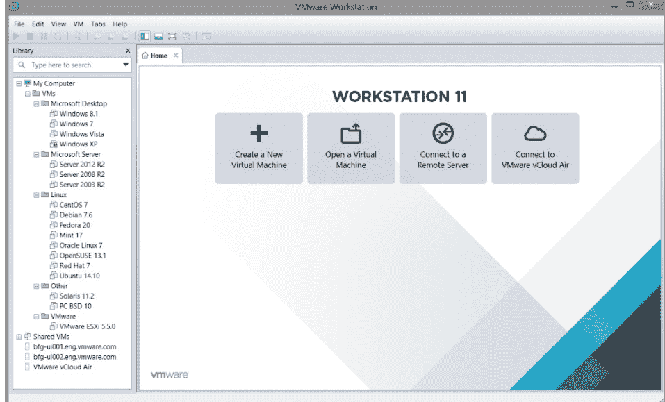
**图 11.9：** VMware Workstation 界面

- **开源工具：** 相应的开源工具为 Volatility、FTK Imager、The Sleuth Kit 和 Autopsy。

## 虚拟化网络中的网络取证

虚拟化网络取证的概念是指在虚拟化环境中捕获、分析和解释网络流量的过程。虚拟化网络取证在数字调查中的重要性体现在：虚拟化网络被广泛应用于云计算、企业数据中心和网络安全研究；此外，攻击者利用虚拟化网络来隐藏恶意活动。虚拟化网络取证相关的挑战包括：除云环境中动态的网络配置外，对内部虚拟机到虚拟机（VM-to-VM）流量的可见性有限，且加密通信增加了数据分析的难度。虚拟化网络基础设施的基础组件包括以下内容：

- **虚拟交换机 (vSwitches)：** vSwitch 是指控制虚拟机之间流量的基于软件的交换机。
- **软件定义网络 (SDN)：** SDN 将网络控制与硬件解耦，使得取证调查更加复杂。
- **网络功能虚拟化 (NFV)：** NFV 用虚拟化组件取代物理网络设备（防火墙、IDS、路由器）。
- **覆盖网络和隧道 (Overlay networks and tunneling)：** 覆盖网络和隧道是指使用 VXLAN、GRE 和 SDN 来管理虚拟实例之间的流量流。

虚拟化网络中的相关证据来源包括以下内容：

- **数据包捕获 (PCAP)：** PCAP 与捕获实时网络流量以进行分析相关。（图 11.10）

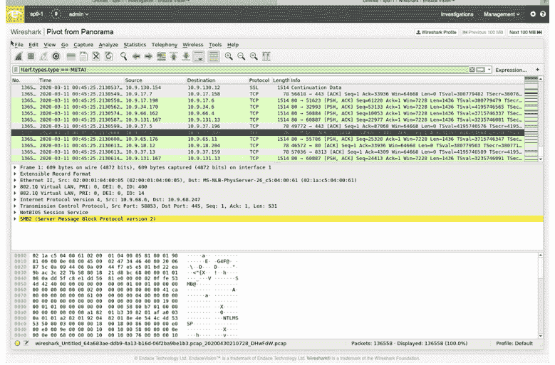
*图 11.10：PCAP 文件界面*

- **虚拟机日志和网络流记录：** 虚拟机日志和网络流记录用于监控虚拟机的通信和连接模式。
- **管理程序级监控：** 管理程序级监控是指在虚拟化层分析流量，例如 VMware NSX 和 Open vSwitch 日志。
- **防火墙和入侵检测系统/入侵防御系统 (IDS/IPS) 日志：** 防火墙和 IDS/IPS 日志是指从虚拟化安全设备中提取安全相关信息。

调查虚拟网络流量的相关技术包括以下内容：

- **流量捕获和数据包分析：** 流量捕获和数据包分析是指使用 Wireshark 和 Zeek 等工具检查虚拟化环境中的数据包。此分析过程旨在识别可疑的网络活动、命令与控制 (C2) 通信以及数据外泄。
- **网络流分析：** 网络流分析过程是指利用 NetFlow 和 IPFIX 来分析流量行为并检测异常。
- **与基于主机的取证相结合：** 此取证过程是指将网络活动映射到特定的虚拟机和进程。
- **虚拟网络中的入侵检测：** 此过程是指使用 Suricata 和 Snort 等虚拟 IDS/IPS 解决方案来检测安全违规。

虚拟化网络取证的相关工具包括商业工具和开源工具，分类如下：

- **商业工具：** 商业工具包括 Magnet AXIOM、EnCase、X-Ways Forensics 和 VMware vRealize Log Insight。
- **开源工具：** 开源工具包括 Wireshark、Zeek、Suricata、tcpdump 和 Open vSwitch。

## 管理程序 (Hypervisor) 安全考量

管理程序安全的概念是指确保管理程序的安全性，它管理虚拟机并充当硬件与客户操作系统之间的虚拟化层。管理程序安全对于数字取证的重要性在于，被攻破的管理程序会导致整个系统的崩溃，影响所有托管的虚拟机。具体而言，攻击者利用管理程序的漏洞来获取未经授权的访问权限、部署恶意软件或实现虚拟机逃逸。常见的管理程序漏洞如下：

- **虚拟机逃逸攻击：** 虚拟机逃逸攻击是指利用缺陷允许攻击者突破虚拟机并访问宿主机系统。
- **权限提升：** 权限提升过程是指在管理程序中获得更高的访问权限，以操纵或控制虚拟机。
- **侧信道攻击：** 侧信道攻击是指通过分析 CPU 缓存和内存等共享硬件资源来提取敏感信息。
- **管理程序劫持 (Hyperjacking)：** Hyperjacking 过程是指安装一个伪造的管理程序以完全控制虚拟化环境。
- **配置错误和弱访问控制：** 配置错误和弱访问控制是指管理程序配置不当，可能会泄露敏感数据并允许未经授权的访问。

针对管理程序的攻击手段如下：

- **零日漏洞：** 零日漏洞包括在补丁发布之前利用未知的安全缺陷。
- **针对虚拟网络基础设施的攻击：** 针对虚拟网络基础设施的攻击是指攻破虚拟交换机和网络接口以拦截虚拟机通信。
- **恶意虚拟机注入：** 恶意虚拟机注入是指在虚拟化环境中部署恶意虚拟机以发起攻击。

保护管理程序的相关安全措施如下：

- **定期打补丁和更新：** 定期打补丁和更新的实践是指应用安全补丁以防止已知漏洞被利用。
- **强访问控制和身份验证：** 强访问控制和身份验证类似于实施**多因素身份验证 (MFA)** 和**基于角色的访问控制 (RBAC)**。
- **隔离和沙箱化：** 有效的隔离和沙箱化是指确保虚拟机被正确隔离，以防止未经授权的数据访问。
- **监控和日志记录：** 监控和日志记录过程是指捕获管理程序日志以检测可疑活动。
- **硬件辅助安全：** 硬件辅助安全是指使用 Intel VT-x 和 AMD-V 等技术来增强虚拟化安全性。（*图 11.11*）

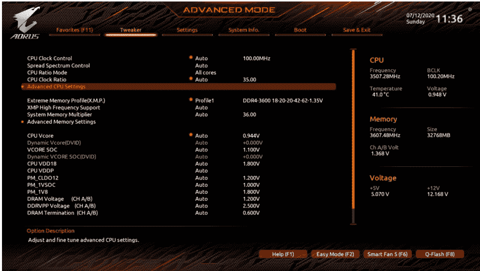
**图 11.11：启用 AMD-V**

数字取证调查人员倾向于部署以下相关取证技术来开展管理程序安全调查：

- **日志分析：** 日志分析过程是指检查管理程序和虚拟机日志以检测未经授权的活动。
- **内存取证：** 内存取证步骤涉及分析管理程序的内存转储以寻找利用漏洞的迹象。
- **网络流量分析：** 网络流量分析过程是指识别异常的虚拟机到虚拟机或虚拟机到宿主机的通信。
- **快照和磁盘分析：** 调查管理程序快照以检查保存的虚拟机状态，从而分析历史更改并检测过去的入侵。该过程涉及调查虚拟磁盘文件（如 VMDK、VHD 和 QCOW2）以恢复删除的文件、恶意软件或隐藏数据。（*图 11.12*）

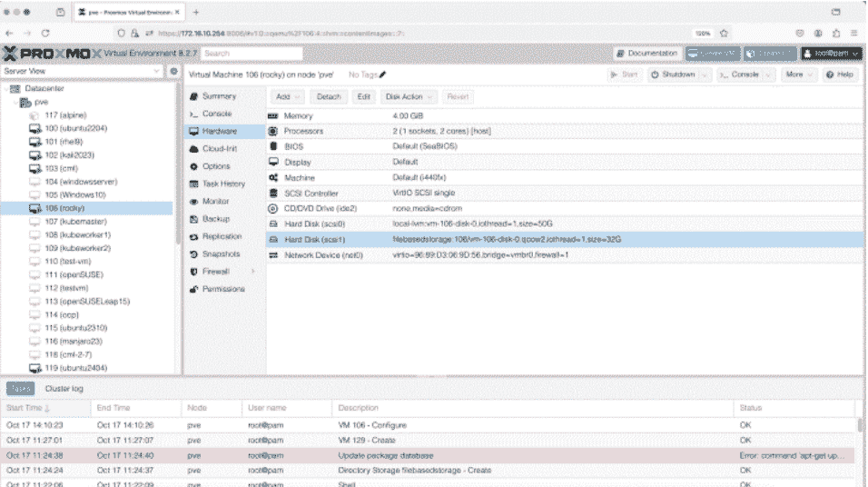
**图 11.12：** QCOW2 界面

快照和磁盘分析的调查结果与识别未经授权的虚拟机回滚（以掩盖恶意行为）相关。这涉及检查快照之间的差异以进行取证重建。

与管理程序安全分析相关的工具包括以下内容：

- **商业解决方案：** 用于管理程序安全分析的商业解决方案包括 VMware vShield、Microsoft Defender for Endpoint 和 Citrix Hypervisor Security。（*图 11.13*）


**图 11.13：** Microsoft Defender 界面

- **开源工具：** 用于虚拟机管理程序（hypervisor）安全分析的开源工具包括 XenForensics、Volatility、Snort 和 Suricata。

## 最佳实践

最佳实践如下：

- **专用的证据收集与保存：** 获取虚拟机管理程序日志的过程涉及从 VMware ESXi、Microsoft Hyper-V、Xen 或 KVM 中收集日志，以寻找未经授权访问的痕迹。VM 快照的保存涉及安全地复制 VM 快照，以保留系统状态用于分析。执行实时内存捕获涉及在关闭系统之前使用取证工具转储虚拟机管理程序和 VM 内存。确保虚拟磁盘镜像安全涉及创建虚拟磁盘文件（如 VMDK、VHD 和 QCOW2）的取证副本以进行数据恢复。可用于此最佳实践的相关工具包括 FTK Imager、The Sleuth Kit、Volatility 和 Autopsy。（图 11.14）

**图 11.14：** Volatility Workbench 界面

- **维护监管链 (CoC) 并遵守法律合规性：** 维护 CoC 并遵守法律合规性的观点意味着维护数据获取、访问权限和取证程序的日志。法律合规性涉及在处理敏感数据时遵循监管要求，以确保符合 GDPR、HIPAA、NIST 800-53 和 ISO 27001。与法律团队的有效协作意味着验证虚拟化取证证据在法院诉讼中的可采信性。

- **强化虚拟机管理程序安全以进行未来预防：** 为了未来预防而强化虚拟机管理程序安全，除了启用安全日志记录和监控 VM 间通信外，还包括强制执行最小权限访问。强制执行最小权限访问意味着限制对虚拟机管理程序管理接口的管理员权限。启用安全日志记录涉及配置虚拟机管理程序日志，以便对系统事件进行详细审计。监控 VM 间通信涉及使用虚拟网络监控工具来检测 VM 之间的未经授权流量。此外，还包括在应用供应商安全补丁以减轻虚拟机管理程序漏洞方面进行定期打补丁和更新。此方面使用的相关工具包括 VMware vRealize Log Insight、OSSEC、Zeek 和 Suricata。（图 11.15）

**图 11.15：** VMware vRealize Log Insight 界面

- **全面的取证分析技术：** 全面的取证分析技术涉及分析虚拟机管理程序和 VM 内存、调查网络流量、检测隐藏的 VM 以及识别侧信道攻击。分析虚拟机管理程序和 VM 内存类似于使用 RAM 取证来检测运行中的恶意软件、Rootkit 和加密密钥。网络流量调查过程涉及检查 VM 到 VM 以及虚拟机管理程序的流量是否存在异常。隐藏 VM 的检测涉及识别在正常配置之外运行的未经授权的 VM。识别侧信道攻击涉及监控 CPU 和缓存行为，以检测基于虚拟机管理程序的漏洞利用，如 Spectre 和 Meltdown。此方面的相关工具包括 Wireshark、Volatility、Rekall 和 Snort。

- **事件响应与补救：** 事件响应与补救涉及隔离受影响的系统、执行事后分析、加强安全控制以及培训取证团队。隔离受影响的系统涉及隔离受感染的 VM 和虚拟机管理程序，以防止进一步攻击。执行事后分析涉及重建攻击时间线并识别被利用的漏洞。加强安全控制涉及实施**基于主机的入侵检测 (HIDS)** 并为虚拟机管理程序访问强制执行 MFA。对取证团队的有效培训涉及确保调查员精通虚拟机管理程序特定的取证方法论。

## 案例研究

以下案例研究与虚拟化取证相关：

- **Cloud Hopper 攻击 (2016-2018)：针对虚拟化系统的中国 APT 攻击：**
Cloud Hopper 是一场由 APT10（一个中国政府支持的组织）发起的复杂的网络间谍活动。攻击者将目标锁定在为多个客户托管虚拟化环境的**托管服务提供商 (MSPs)**。此次攻击的影响涉及多家财富 500 强公司遭受数据外泄，被盗信息包括知识产权和商业秘密。除此之外，此次攻击凸显了多租户云环境中的漏洞，其中受损的虚拟机管理程序可能会影响多个组织。详尽的取证调查显示，攻击者利用薄弱的远程访问协议和凭据获得了云环境中虚拟机管理程序的访问权限。攻击者使用嵌入在 VM 中的恶意软件攻击虚拟化系统。相关的日志分析揭示了虚拟网络之间的横向移动以及未经授权的虚拟机管理程序访问。相关调查员使用虚拟机管理程序内存转储和虚拟网络取证来追踪恶意活动。

- **ESXi Rootkit 事件：不可检测的虚拟机管理程序恶意软件：**
一家金融机构注意到源自托管在 VMware ESXi 虚拟机管理程序上的 VM 的异常交易。初始端点安全扫描未检测到恶意软件，导致调查员怀疑存在虚拟机管理程序级别的篡改。此次攻击的结果是，在机构检测到违规之前，数百万美元被转移。因此，调查员必须从干净的快照中重建受损的 VM 以恢复完整性。详细调查揭示了 VMware ESXi 内部存在一个虚拟机管理程序 Rootkit，它允许攻击者拦截并修改 VM 操作，且仍保持不可检测状态。对虚拟机管理程序的实时内存取证揭示了注入到**虚拟 CPU (vCPU)** 中的恶意代码。虚拟磁盘分析表明，多个 VM 的系统文件存在未经授权的修改。攻击者利用了一个虚拟机管理程序逃逸漏洞，使他们能够控制虚拟化银行服务器。

## 结论

本章就如何有效地破解虚拟化，对虚拟机管理程序取证进行了深入分析。从本章的角度来看，对 VM 的详细理解意味着存在多个层级。虚拟机管理程序取证的过程涉及从虚拟化层中恢复数字证据。虚拟机管理程序取证过程进一步表明了从虚拟硬盘中提取和分析数据。相关的案例研究意味着数字取证调查员需要部署有效的工具和技术来处理虚拟机管理程序取证的关键案例。本章列出了数字取证调查员可以使用的一系列不同工具，以适当地辅助其调查工作。

接下来的章节将重点讨论事件响应与数字取证的集成。

## 加入我们书籍的 Discord 空间

加入书籍的 Discord 工作区，获取最新更新、优惠、全球技术动态、新版本发布以及与作者的交流会：

[https://discord.bpbonline.com](https://discord.bpbonline.com)

# 第 12 章：将事件响应与数字取证相结合

## 引言

对数字设备联网依赖性的增加，导致现代组织面临频繁的网络安全事件。此类事件的复杂性质，以及随之而来的对复杂调查程序的的需求，导致了数字取证的相关参与。从语境上讲，将**事件响应** (IR) 与数字取证相结合，可以确保在处理网络安全事件时采用更全面的方法。将数字取证引入 IR 的结果是积累了充足的**威胁情报** (TI)，从而能够抵御未来类似事件的发生。本章将重点讨论 IR 与数字取证的集成。


## 结构

本章涵盖以下主题：

- 通过数字取证改进事件响应（IR）
- 通过取证准备工作主动为 IR 做准备
- 为取证分析保存数字证据
- 利用数字取证工具和方法
- 利用数字取证结果
- 弥合 IR 响应者与 DF 取证调查员之间的差距
- 案例研究

## 目标

本章旨在阐述通过数字取证改进 IR 的相关策略。本章将介绍如何通过取证准备工作主动为 IR 做准备。本章重点讨论在事件遏制和保存期间为取证分析保存数字证据。本章指出了在 IR 中利用数字取证工具和方法进行取证分析。本章意味着利用数字取证结果来实现有效的事件缓解和恢复。本章强调了通过协作与沟通弥合事件响应者与数字取证调查员之间差距的重要性。

## 通过数字取证改进 IR

网络威胁日益复杂的特性导致现代组织在保护数据方面面临严峻挑战。这促使组织增强其检测、响应和从安全事件中恢复的能力。

从背景来看，数字取证通过提供准确的证据、揭露攻击向量并帮助组织防止未来事件的发生，在强化 IR 方面发挥着至关重要的作用。

数字取证增强 IR 的相关方面阐述如下：

- **准确且及时的证据收集：** 数字取证使组织能够系统地收集和保存数字证据。这种及时的证据收集有助于安全团队理解事件的根本原因，包括攻击源、泄露范围以及攻击时间线。

- **更快的事件检测和遏制：** 特定的取证技术（如日志分析、网络取证和恶意软件逆向工程）有助于 IR 团队更快地识别威胁。实时取证分析的潜在优势使安全团队能够检测到异常和**失陷指标 (IoCs)**，同时隔离受感染的系统以防止进一步损害。这一方面的结果与评估攻击模式以减轻未来风险相关。

- **利用深度洞察增强响应策略：** 数字取证为攻击者的**战术、技术和过程 (TTPs)** 提供了宝贵的见解。这些情报通过帮助安全团队了解攻击是有针对性的还是随机性的，从而优化其 IR 策略。这涉及识别被攻击者利用的漏洞，从而加强防御机制以防止再次发生。

- **法律和合规性考虑：** 取证确保在事件期间收集的证据在法院或监管调查中具有可采纳性。适当的文档记录和**监管链 (CoC)** 有助于组织遵守相关的数据保护法，如 GDPR 和 CCPA，以及相关的行业标准，如 ISO 27037 和 NIST 指南。法律考量进一步涉及到有效的法律程序，即需要由相关的**数字取证调查员 (DFIs)** 在法律法院确立网络犯罪事实。

- **实现事后分析和持续改进：** 网络事件的发生促使进行取证分析，使安全团队能够开展详细调查，以确定攻击者获取数字资产访问权限的细节。这非常有益，因为它能促使堵塞现有漏洞并改进未来的响应。

数字取证与 IR 的整合使组织能够建立一个更加主动且由情报驱动的安全态势，从而最大限度地减少网络威胁的影响并提高其应对未来攻击的韧性。

## 通过取证准备工作主动为 IR 做准备

网络威胁的持续演进导致组织采取主动策略来有效地检测、响应和缓解安全事件。取证准备工作（Forensic readiness）在现代网络安全中发挥着至关重要的作用，它确保在事件发生时能够系统地收集、保存和分析数字证据。通过取证准备工作主动为 IR 做准备的影响包括以下方面：

- **更快的事件检测和响应：** 准备充分的取证策略使组织能够快速检测安全漏洞。现成的日志、审计追踪和系统快照允许安全团队实时分析和遏制威胁。这一过程通过简化调查流程减少了停机时间和干扰。

- **加强法律和监管合规性：** 现代行业被要求维护数字证据，以符合 GDPR、HIPAA 和 ISO 27037 等法规。在具体环境下，有效的取证文档确保所收集的数据在法律程序中具有可采纳性。加强法律和监管合规性的相关结果是通过在网络安全实践中证明尽职调查，从而避免法律处罚和名誉损失。

- **维护数字证据的完整性：** 取证准备计划确保证据被安全地收集、存储和处理。正确的 CoC 程序可防止关键数据被篡改、更改或损坏。这增强了组织证明攻击来源和影响的能力。

- **增强威胁情报 (TI) 和事件预防：** 历史取证数据有助于识别攻击模式、漏洞和重复出现的威胁。它提供了关于网络犯罪分子 TTPs 的宝贵见解。此外，它还通过在被利用前解决系统弱点来支持主动的安全增强。

- **减少财务和运营影响：** 网络事件的发生可能导致重大财务损失，包括修复成本、法律费用和名誉损害。因此，取证准备工作可最大限度地缩短恢复时间并防止长时间的系统停机。组织可以通过避免因缺乏证据而导致昂贵的事后调查来节省成本。

- **促进安全团队与执法部门之间的协调：** 准备充分的取证数据能够实现与网络安全机构、监管机构和执法机构的协作。网络犯罪的发生促使组织提供具体证据以支持调查，这增加了识别和起诉网络犯罪分子的可能性。

- **构建强大的网络安全文化：** 构建强大网络安全文化的努力鼓励持续的安全监控和记录。这一过程增强了员工和 IT 团队对于安全数据管理重要性的意识。此外，这还将安全运营与业务连续性和风险管理策略相对接。

取证准备工作是现代网络安全的关键组成部分，因为它鼓励组织高效地响应网络威胁，为法律程序保存数字证据，并提高其整体安全态势。

## 为取证分析保存数字证据

数字证据在网络安全调查中起着至关重要的作用，帮助组织有效地识别、分析和响应网络威胁。正确收集和保存数字证据可确保安全事件得到高效、合法且准确的处理。及时识别数字证据涉及确定网络事件的性质和范围，因为数字证据有助于确定攻击类型（如恶意软件、网络钓鱼、内部威胁和数据泄露）。在取证分析和法律程序中，正确保存数字证据至关重要，以确保网络安全事件得到彻底调查，并在必要时进行法律起诉。数字证据如果处理不当，很容易被篡改、销毁或在法庭上被判定为不可采纳。数字证据保存的关键原则包括以下内容：

- 完整性：完整性方面涉及确保数据在收集过程中未被篡改或损坏。
- 真实性：真实性的角度涉及维护数字证据的原始性和可信度。
- 监管链：CoC 涉及从……阶段开始的证据处理相关文档记录

收集至分析。（图 12.1）

| 项目编号 | 数量 | 项目描述（型号、序列号、状况、标记、划痕） |
|--------|----------|-----------------------------------------------------------------|
|        |          |                                                                 |
|        |          |                                                                 |
|        |          |                                                                 |
|        |          |                                                                 |
|        |          |                                                                 |
|        |          |                                                                                                |
|        |          |                                                                 |
|        |          |                                                                 |
|        |          |                                                                 |

| 项目编号 | 日期/时间 | 释放人（签名及 ID 号） | 接收人（签名及 ID 号） | 备注/位置 |
|--------|-----------|-------------------------------|--------------------------------|------------------|
|        |           |                               |                                |                  |
|        |           |                               |                                |                  |
|        |           |                               |                                |                  |
|        |           |                               |                                |                  |
|        |           |                               |                                |                  |

- **挥发性考量**：数字证据的挥发性考量是指在 volatile 数据（如 RAM 和网络连接）丢失之前将其捕获。

数字取证调查员 (DFI) 在事件遏制期间通常采取以下相关步骤来保存数字证据：

- **隔离受影响的系统**：及时隔离受影响的系统，通过断开受侵害设备的连接来防止进一步的证据篡改。
- **捕获实时数据**：捕获实时数据是指提取挥发性信息，如运行中的进程、网络活动和开放端口。
- **制作取证磁盘镜像**：这涉及创建存储设备的位对位 (bit-by-bit) 副本，以维持原始证据的完整性。（图 12.2）

**图 12.2：** 磁盘镜像创建

- **保存日志和元数据**：保存日志和元数据包括安全的系统日志、访问记录和时间戳。
- **对证据进行加密并安全存储**：对证据进行加密并安全存储的过程旨在保护收集到的数据免受未经授权的访问。

DFIs 通常选择以下工具和技术进行数字证据收集：

- **取证镜像工具**：数字证据的镜像涉及部署取证镜像工具，如 FTK Imager、EnCase 和 Autopsy。
- **内存分析工具**：内存分析的需求可以通过 Volatility 和 Rekall 等工具来实现。
- **日志和网络取证工具**：用于日志和网络分析的取证工具包括 Wireshark、Splunk 和 ELK Stack。
- **恶意软件分析平台**：DFIs 倾向于应用相关的恶意软件分析平台，如 Cuckoo Sandbox 和 IDA Pro。

除了部署上述工具和技术外，DFIs 通常还会采用以下多项最佳实践：

- **使用写保护器 (Write-blockers)**：广泛使用写保护器可防止意外修改证据。（图 12.3）

**图 12.3：** 写保护器

- **遵循 IR 剧本 (Playbooks)**：有效地遵循 IR 剧本可以确保收集方法的标准化。
- **培训 IR 团队**：对 IR 团队进行有效培训可提高在取证程序方面的专业知识。
- **定期测试取证工具**：定期测试取证工具可验证其整体准确性和可靠性。

妥善的数字证据保存对于有效的取证分析和法律程序至关重要。通过维护证据完整性、遵循监管链 (CoC) 协议、确保合规性并防止篡改，组织和执法机构可以准确地调查网络事件，支持法律行动，并增强整体网络安全韧性。

## 利用数字取证工具和方法

数字取证在加强 IR 方面发挥着关键作用，使组织能够有效地检测、调查和缓解网络威胁。通过利用取证技术，安全团队可以详细分析攻击、保存证据并提升整体网络安全韧性。

数字取证在增强 IR 方面的重要性体现在快速且准确的事件检测上。这是因为数字取证有助于识别未经授权的访问、系统入侵和可疑活动。具体而言，取证工具通过分析日志、网络流量和系统事件来检测失陷指标 (IoCs)。及时的威胁检测能够实现对网络事件更快速的遏制和响应。

数字取证工具和方法论在检测、调查和缓解网络威胁中起着至关重要。这些工具帮助组织收集、保存和分析数字证据，使 IR 团队能够迅速有效地响应安全事件。威胁识别过程涉及通过监控系统活动、网络流量和数字痕迹来及时检测网络威胁。这促使 DFIs 在威胁情报 (TI) 方面使用以下关键方法和工具：

- **日志分析**：日志分析过程涉及使用 SIEM 解决方案（如 Splunk、ELK Stack 和 Graylog）来分析系统日志中的异常和可疑活动。（图 12.4）

**图 12.4：** 日志分析

- **网络取证**：网络取证工具的概念（如 Wireshark（图 12.5）、Zeek (Bro) 和 TCPDump）有助于检测网络入侵和恶意软件通信。

### 安全事件管理器

#### 仪表板

| 名称 | 最近事件 | 状态 |
|------|------------|--------|
| wpamlinx-test2 | ... | ... |
| WIN-DTG4U7... | 从未 | |
| lab-checkpoint2200 | 9 个月前 | |
| martin-PC... | 8 个月前 | |
| eng-lrnn-mobile | 8 个月前 | |
| LEMModeWin2016... | 8 个月前 | |
| LEMModeWin2016... | 7 个月前 | |
| admin-PC... | 6 个月前 | |
| WIN-7229... | 6 个月前 | |
| DESKTOP-Q... | 从未 | |
| DVB-55AK... | 5 个月前 | |
| eng-aus-sys-350 | 5 个月前 | |
| eng-aus-sys-354 | 5 个月前 | |
| eng-aus-sys-351 | 4 个月前 | |

#### 所有事件 - 最近 12 小时

#### 按事件类型划分的所有事件

#### 按用户划分的用户登录

| 域账户 | 登录次数 | 状态 |
|---------------|-------------|--------|
| Administrator | 783 | |
| administrator | 515 | |
| ORION01S | ... | |
| michaelhalpin | ... | |
| ANONYMOUS LOGON | 73 | |
| ORION11 | ... | |
| mark.donnelly | ... | |
| 其他 | 53 | |

#### 按源机器划分的登录失败

| 源机器 | 登录次数 | 状态 |
|----------------|-------------|--------|
| AUSPF501... | 214 | |
| TPFDCO1... | 158 | |
| aus-dev... | 102 | |
| aus-dc06... | 98 | |
| MANCDCO1... | 76 | |
| bm-dev... | 29 | |
| ORKGF501... | 224 | |
| 其他 | 914 | |

#### 按用户划分的登录失败

| 用户 | 登录次数 | 状态 |
|------|-------------|--------|
| jimdandell... | 9109 | |
| SalesBoard | 708 | |
| TeamCity... | 104 | |
| justin.donnelly... | 47 | |
| administrator... | 35 | |
| quest | 12 | |
| debra.m... | 1 | |
| Eric | 1 | |
| 其他 | 29 | |

#### 按规则名称划分的触发规则

#### 按类型划分的防火墙事件

#### 按目标端口划分的流量

#### 按端口划分的登录失败

#### 按连接器名称划分的所有事件


**图 12.5：Wireshark 界面**

- **端点检测**：端点检测过程涉及部署 Carbon Black、CrowdStrike 和 OSSEC 等解决方案，以监控端点行为是否存在恶意活动。
- **内存取证**：内存取证过程涉及利用 Volatility 和 Rekall 分析实时内存 (RAM)，以检测隐藏进程、恶意软件注入和 rootkit。
- **恶意软件检测**：恶意软件检测的需求涉及使用 Cuckoo Sandbox 和 IDA Pro *（图 12.6）*，这些工具有助于对恶意文件进行动态和静态分析。

**图 12.6：IDA Pro 界面**

事件响应 (IR) 中取证分析的关键阶段包括以下内容：

- **识别**：识别过程涉及检测异常、未经授权的访问和系统违规。
- **收集**：收集过程涉及在不改变数据完整性的情况下获取数字证据。
- **分析**：分析阶段涉及检查日志、网络流量和系统伪像，以确定负责的攻击向量。
- **保存**：保存阶段涉及维护证据的完整性，以便用于法律和调查目的。
- **报告**：报告阶段涉及为 IR 团队和法律部门记录调查结果。

IR 必不可少的数字取证工具包括以下内容：

- **磁盘取证**：磁盘取证过程涉及使用 Autopsy、EnCase 和 FTK Imager 等工具进行磁盘镜像和文件恢复。
- **内存取证**：内存取证的概念涉及使用 Volatility 和 Rekall 等工具分析 RAM 并检测恶意软件。
- **网络取证**：网络取证程序类似于使用 Wireshark 和 Zeek (Bro) 来监控和分析网络流量。
- **日志分析**：日志分析的需求由 Splunk 和 ELK Stack 实现，用于检测系统日志中的异常。
- **恶意软件分析**：恶意软件分析由 Cuckoo Sandbox *（图 12.7）* 和 IDA Pro 执行，用于对恶意代码进行逆向工程。

**图 12.7：Cuckoo Sandbox 界面**

- **云取证**：云取证过程涉及使用 AWS CloudTrail 和 Google Chronicle 调查基于云的事件。

取证工具和方法论对于识别、分析和缓解网络威胁不可或缺。利用先进的取证技术、实时监控和调查工具可帮助组织增强其 IR 能力，最大限度地降低网络风险，并符合监管要求。

## 利用数字取证结果

数字取证在 IR 后期发挥着至关重要的作用，确保组织能够有效地缓解威胁、恢复运行并防止未来的攻击。网络事件的发生促使进行取证分析，这有助于识别导致违规的根本原因、攻击方法和安全漏洞。这些情报使组织能够制定有针对性的缓解策略并提高整体网络安全态势。

取证结果在事件后分析中起着至关重要的作用，使组织能够了解网络攻击的如何、为什么以及在哪里。对数字证据的审查引导取证调查提供关于根本原因、攻击向量和安全弱点的清晰见解，从而实现有针对性的缓解和预防策略。事件缓解的关键取证洞察包括以下内容：

- **攻击时间线重建**：攻击时间线重建的程序类似于理解违规何时以及如何发生。
- **失陷指标 (IoCs)**：IoCs 的概念涉及识别恶意文件、IP 和行为以遏制威胁。
- **威胁归因**：威胁归因的概念类似于分析取证证据以追踪攻击者，无论其是内部还是外部威胁。
- **取证日志分析**：取证日志分析有助于检测系统、应用程序和网络日志中的异常，以进行事件关联。

将取证结果应用于遏制和根除涉及以下方面：

- **隔离受影响的系统**：使用取证报告隔离受感染的端点。
- **移除持久性威胁**：通过取证恶意软件分析来消除隐藏的后门和 rootkit。
- **填补安全漏洞**：根据取证建议应用补丁和安全控件。

有效利用取证证据进行事件恢复涉及以下内容：

- **数据恢复**：数据恢复涉及使用取证镜像和备份验证来恢复删除或损坏的数据。
- **系统完整性检查**：系统完整性检查涉及在恢复运行前验证系统和文件的完整性。
- **加强安全策略**：加强安全策略涉及更新访问控制、网络监控和取证就绪计划。

相关的持续改进和未来预防涉及以下内容：

- **经验教训分析**：对网络安全事件经验教训的分析涉及利用取证结果来增强网络安全策略。
- **威胁情报 (TI) 共享**：TI 共享涉及向行业和政府网络安全网络贡献取证见解。
- **取证驱动培训**：开展取证驱动培训涉及根据以往的发现教育安全团队掌握 IR 最佳实践。

## 弥合 IR 与 DF 调查员之间的差距

IR（事件响应者）和 DFI（数字取证调查员）在网络安全领域扮演着截然不同但互补的角色。IR 团队专注于识别、遏制和缓解威胁，而 DFI 则专注于证据收集、取证分析和根本原因调查。这两个团队之间有效的协作对于高效的威胁响应、准确的取证分析和长期安全改进至关重要。

事件响应者与 DFI 之间无缝协作的重要性在于能够更快、更有效地遏制事件。这是因为相关的 IR 团队依赖取证见解来快速检测和隔离威胁。取证调查员提供关于恶意软件、攻击者方法和受损系统的关键情报。定义良好的沟通渠道可确保 IR 和 DFI 在活跃的安全违规期间能够快速协调。

有效沟通的方面涉及定义清晰的角色，以防止因不确定谁处理遏制、缓解和取证分析而导致的延迟。IR 和 DFI 团队之间的持续沟通有助于跟踪攻击者活动、系统漏洞和事件进展。有效改进证据处理和完整性意味着避免意外的数据丢失。这是因为糟糕的沟通可能导致响应者在遏制过程中无意中覆盖或破坏取证证据。确保适当的监管链 (CoC) 涉及记录良好的沟通，以确保数字证据在法律诉讼中保持可采信性。

IR 的角色专注于实时威胁遏制、缓解和系统恢复。事件响应者的角色进一步扩展到致力于最大限度地减少运行中断并恢复业务功能。DFI 的角色类似于专门从事证据收集、保存和深入的攻击分析。这涉及确保出于法律和合规目的的取证完整性。

IR 与 DFI 协作中的常见挑战如下：

- **孤岛式运行**：孤岛式运行涉及 IR 团队与取证团队之间缺乏信息共享。
- **优先级冲突**：优先级冲突涉及 IR 优先考虑快速遏制，而 DFI 则要求详细的证据保存。
- **缺乏沟通协议**：缺乏沟通协议会导致孤岛式的运行技术和工具差距。其结果是不同团队使用不同的取证和安全工具，导致其集成困难。

以下有效协作策略可确保 IR 与 DFI 之间的有效工作：

- **开发统一的 IR 和取证框架**：这涉及实施联合工作流，从而

在快速响应与取证完整性之间取得平衡。这需要为证据处理定义透明的**标准操作程序 (SOPs)**。通过建立安全的实时通信平台，进一步增强通信渠道，从而实现相关发现的共享。在重大事件后进行跨团队的总结回顾。

- **利用集成工具：** 部署 SIEM (*图 12.9*)、EDR 和其他取证工具（如 Splunk、CrowdStrike 和 Magnet Axiom）有助于促进见解共享。

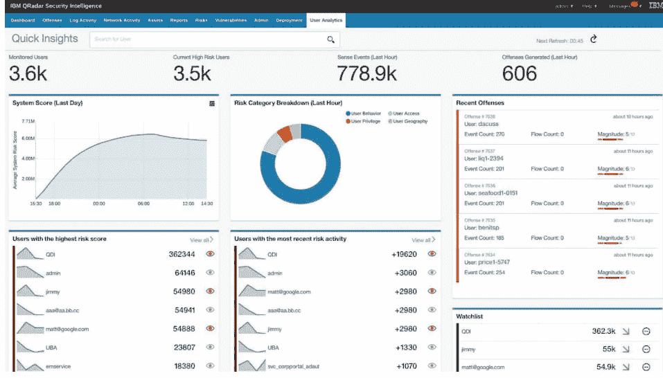
**图 12.9：** SIEM 界面

- **定期培训和桌面演习：** 定期培训和桌面演习涉及开展关于取证就绪和 IR 最佳实践的联合培训会议。通过对真实网络事件进行有效模拟，以提高团队协作能力和角色清晰度。

## 案例研究

相关案例研究陈述如下：

- **Target 数据泄露事件 (2013)，取证调查揭露攻击向量：** Target 是美国最大的零售商之一，在 2013 年遭受了大规模数据泄露，导致 4000 万张信用卡详情和 7000 万条客户个人记录被泄露。攻击者通过第三方 HVAC 供应商进入 Target 的网络，利用窃取的凭据进行横向移动并提取敏感数据。IR 与数字取证的共同努力使 IR 团队检测到了异常的网络活动和**销售点** (PoS) 异常。尽管数据外泄仍在进行，但团队应用了相关的遏制策略。数字取证团队分析了日志和恶意软件样本以识别攻击向量。数字取证团队进一步发现，攻击者在 PoS 终端上安装了内存刮削恶意软件。

- **索尼影视被黑事件 (2014)，网络间谍活动与威胁归因：** 索尼影视被一个涉嫌的国家级组织（据称是朝鲜）黑客攻击，以报复其电影的发行。攻击者窃取了内部电子邮件、员工记录和未发行电影，最终使用恶意软件摧毁了关键的 IT 基础设施。IR 团队试图遏制攻击，但发现黑客已经获得了持久化访问权限。团队进一步观察到，系统被锁定，关键数据正被一种名为 Shamoon 的破坏性恶意软件清除。相关数字取证团队检索了日志、恶意软件签名和通信痕迹以识别攻击者。团队进一步分析了此次攻击，并指出其与 Lazarus Group 之前的攻击具有相似性。生成的证据被用于将此次攻击归因于朝鲜，导致美国政府实施制裁。

## 结论

本章涉及通过数字取证改进 IR。本章指出，在取证就绪方面对 IR 进行前瞻性准备，有助于从数字取证调查中获得有效结果。在事件污染期间对数字证据的有效保存，取决于数字取证调查人员 (DFIs) 应用合适的策略。在事件遏制和保存期间为取证分析保存数字证据，需要遵守相关标准和指南。本章表明，有效地弥合 IR 与 DFIs 之间的差距可以促进数字取证调查的快速进展。

接下来的章节将重点详细介绍数字取证中的相关高级战术。

## 加入我们的书籍 Discord 空间

加入书籍的 Discord 工作区，获取最新更新、优惠、全球技术动态、新发布内容以及与作者的交流会：

https://discord.bpbonline.com


# 第 13 章：数字取证中的高级战术

## 简介

现代网络攻击日益复杂，导致数字取证领域引入了高级战术以满足相关需求。由于攻击者使用的复杂网络威胁、加密数据和反取证技术，数字取证已演进至传统方法之外。数字取证中的高级战术有助于调查人员揭露隐藏证据、分析复杂的网络事件并强化法律案件。本章将列举数字取证中的高级战术。

## 结构

本章涵盖以下主题：

- 内存取证
- 反取证技术
- 隐写分析
- 移动设备脱壳 (Chip-off) 取证
- 高级数据分析
- 加密货币取证
- 数据碎片化与重建
- 数字取证中的人工智能与机器学习
- 案例研究

## 目标

本章从检查挥发性数据以获取高级见解的角度详细介绍了内存取证。本章指出，反取证技术对于揭露和应对掩盖数字证据的企图非常有效。本章接着介绍了隐写分析，涉及检测和解码数字文件中的隐藏信息。本章意味着移动设备脱壳取证是在硬件层面从移动设备中提取数据的过程。本章进一步意味着高级数据分析是将统计和数据挖掘技术应用于数字取证调查。本章详细探讨了加密货币取证，涉及调查数字货币领域中的交易和钱包。本章包含关于数据碎片化和重建的充足细节，将其作为拼凑被粉碎或碎片化的数字证据的策略。本章接着讨论数字取证中的人工智能与机器学习，涉及利用 AI 进行高级分析和自动化。本章包含了关于数字取证高级战术的案例研究。

## 内存取证

内存取证是数字取证中的一项关键技术，允许调查人员从挥发性内存 (RAM) 中提取实时证据。与传统的基于磁盘的取证不同，内存分析可提供对运行进程、恶意软件行为以及在系统关机后消失的攻击痕迹的深刻见解。内存取证在网络调查中的极高重要性体现在捕获实时系统活动，包括运行中的应用程序、打开的网络连接和加密密钥。数字取证调查人员在网络调查中开展内存取证，旨在检测不在磁盘上留下痕迹的无文件恶意软件、根管理器 (rootkits) 以及高级持续性威胁 **(APTs)**。有效的内存取证有助于事件响应 **(IR)**、网络犯罪调查和威胁归因。例如，内存取证帮助检测到了 TrickBot 恶意软件，该软件在内存中运行以逃避传统的杀毒解决方案。常见的挥发性痕迹及其取证价值陈述如下：

- **运行进程和隐藏线程：** 运行进程和隐藏线程用于识别活动程序，包括可疑或被注入的进程。
- **网络连接和打开端口：** 网络连接和打开端口用于追踪攻击者使用的命令与控制 **(C2)** 通信。
- **加密密钥和凭据：** 部署加密密钥和凭据可恢复勒索软件案例中使用的解密密钥和密码。
- **注册表配置单元和事件日志：** 对注册表配置单元和事件日志的评估可实现对系统配置、执行历史和取证时间戳的分析。

例如，内存分析帮助在攻击者删除之前发现了勒索软件的解密密钥。

数字取证调查人员考虑使用以下工具和技术进行内存分析：

- **Volatility 框架：** Volatility 框架是一个用于提取进程列表、网络活动和注入代码的开源工具。该工具的优势在于其能够检测 RAM 中的 Mimikatz，揭露攻击者窃取 Windows 凭据的企图。（图 13.1）

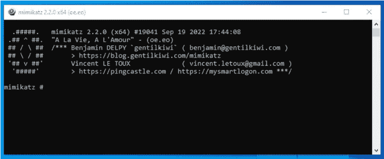

```
.#####.   mimikatz 2.2.0 (x64) #19041 Sep 19 2022 17:44:08
.## ^ ##.  "A La Vie, A L'Amour" - (oe.eo)
## / \ ##  /*** Benjamin DELPY `gentilkiwi` ( benjamin@gentilkiwi.com )
## \ / ##  > https://blog.gentilkiwi.com/mimikatz
## ' v' ##     Vincent LE TOUX    ( vincent.letoux@gmail.com )
#####'      > https://pingcastle.com / https://mysmartlogon.com **/

mimikatz #
```

**图 13.1：Mimikatz 界面**

- **Recall：** Recall 是一款具有跨平台兼容性的高级内存分析工具。
- **MemProcFS：** MemProcFS 用于对 Windows 进程内存进行实时取证分析。


- **DumpIt 和 FTK Imager**：DumpIt 和 FTK Imager 都是获取用于离线调查的完整内存转储的理想工具。

利用内存取证程序无缝检测恶意软件和高级威胁，涉及识别完全在内存中运行的无文件恶意软件。内存取证程序涉及提取高级攻击中使用的打包或混淆代码。内存取证程序可以恢复规避基于磁盘检测的注入 shellcode 和 rootkit。例如，取证分析师利用内存转储来分析 Cobalt Strike 负载，帮助组织拦截后渗透技术。

## 反取证技术

反取证技术是网络罪犯用来隐藏、篡改或销毁数字证据的方法，从而使取证调查更具挑战性。攻击者使用反取证来逃避检测、延迟调查并销毁指控证据。广泛使用的反取证技术范围从数据隐藏和加密到元数据操纵和日志擦除。因此，有效的数字取证需要检测、分析并对抗这些混淆方法。例如，2014 年的索尼影业黑客事件表明，攻击者擦除了日志并篡改了时间戳，以迷惑数字取证调查人员。广泛使用的反取证技术陈述如下：

- **数据隐藏和混淆**：相关的数据隐藏和混淆技术包括隐写术、**替代数据流 (ADS)**、隐藏分区和加密容器。

**隐写术 (Steganography)** 是一种将文件隐藏在图像、视频或其他媒体中的程序。ADS 涉及将数据隐藏在 NTFS 文件系统属性中。隐藏分区和加密容器涉及使用 TrueCrypt 和 VeraCrypt 来掩盖敏感文件。然而，专业的数字取证调查人员倾向于采取适当的对策，如使用 StegExpose、ADS Spy 和其他取证雕刻工具来帮助检测隐藏数据。

- **数据删除和销毁**：数据删除和销毁的要求涉及使用安全删除工具、磁盘擦除和格式化以及内存清洗。安全删除工具包括 CCleaner、BleachBit 和 SDelete，用于将文件擦除至无法恢复。磁盘擦除和格式化过程涉及覆盖整个驱动器以防止其被取证分析。内存清洗过程涉及攻击者在关机前清除 RAM 转储，以移除易失性证据。然而，数字取证调查人员使用 Magnet AXIOM、Autopsy 和 FTK Imager 等工具，这些工具可以恢复删除的文件并检测篡改。

- **元数据和日志操纵**：元数据和日志操纵涉及时间戳伪造 (Timestamping)、事件日志篡改和进程镂空 (Process Hollowing)。时间戳伪造涉及修改文件的创建、访问和修改时间。事件日志篡改涉及删除或修改 Windows、Linux 或云安全日志。进程镂空涉及将恶意代码注入合法进程以避免检测。与这些反取证技术相反，数字取证调查人员使用日志关联、事件重构和取证时间线分析来辅助检测不一致之处。

此外，数字取证调查人员针对这些反取证技术和事件检测技术采取以下高级对策：

- **磁盘和内存取证**：磁盘和内存取证涉及分析 RAM 和磁盘镜像以恢复隐藏数据。

- **日志关联和时间线分析**：日志关联和时间线分析涉及识别系统和网络日志中的差异。*(图 13.2)*

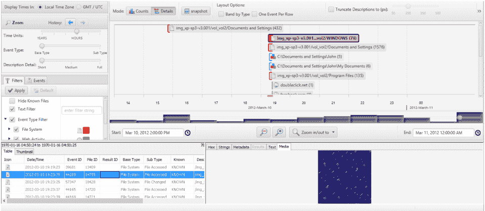
**图 13.2**：时间线分析

- **文件系统分析**：文件系统分析涉及检测异常的文件系统更改、隐藏分区和 ADS 使用情况。

- **AI 驱动的取证工具**：AI 驱动的取证工具涉及使用机器学习来识别数据混淆模式。例如，AI 驱动的取证工具帮助从网络犯罪案件中使用的一种加密消息应用中重构了已删除的消息。

反取证技术给数字调查和事件响应 (IR) 带来了重大挑战。通过利用先进的取证工具、AI 驱动的检测和主动监控，取证调查人员可以有效对抗数据混淆、日志操纵和证据销毁。

## 隐写分析

隐写术是一种将数据隐藏在数字文件（如图像、视频、音频或文本）中的隐蔽技术，使得检测未经授权的通信或网络犯罪活动变得困难。对各种隐写方法、取证检测技术和对策的详细分析，意味着揭露隐藏信息具有整体重要性。对手将隐写程序用于隐蔽通信、网络间谍活动、恶意软件分发和数据外泄。攻击者将恶意负载嵌入媒体文件中以绕过安全机制。数字取证必须分析可疑文件以揭露隐藏数据并防止信息泄露。例如，Duqu 恶意软件使用图像隐写术在未被检测的情况下外泄敏感数据。知名且常用的隐写技术陈述如下：

- **图像隐写术 (LSB 编码)**：LSB 编码是一种图像隐写术，它将数据隐藏在 JPEG、PNG 或 BMP 图像像素值的**最低有效位 (LSB)** 中。这种图像隐写过程保持了视觉完整性，使修改对于人眼来说不可察觉。数字取证调查人员为解决图像隐写问题而采取的对策包括 StegExpose、OpenStego 和像素分析工具，这些工具有助于识别隐藏模式。*(图 13.3)*

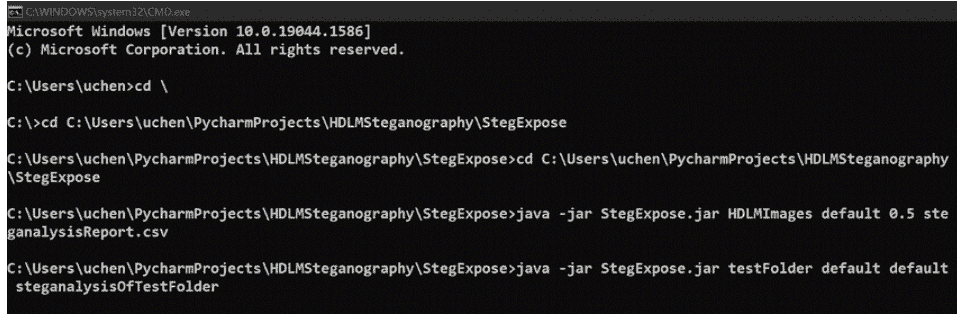
**图 13.3**：StegExpose 界面

- **音频和视频隐写术**：音频和视频隐写术涉及回声隐藏、相位编码和频率掩蔽，倾向于将数据嵌入 MP3、WAV 或 MP4 文件中。这涉及攻击者在恶意软件活动中使用这些格式来走私**命令与控制 (C2)** 指令。然而，数字取证调查人员使用 *Audacity* 和 *DeepSound* 等工具来分析异常的信号失真。*(图 13.4)*

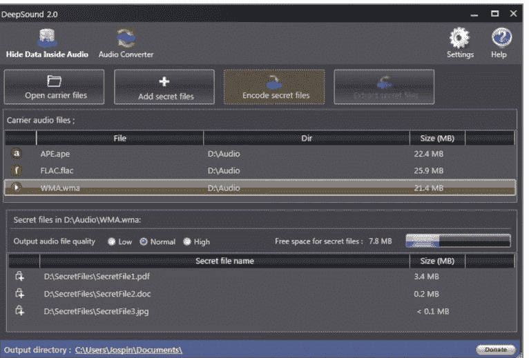
**图 13.4**：DeepSound 界面

- **文本隐写术和空白符编码**：文本隐写术和空白符编码使用不可见字符、Unicode 操纵或格式化技巧来隐藏信息。文本隐写术和空白符编码程序被广泛利用于钓鱼邮件、暗网论坛和内部威胁。因此，数字取证调查人员使用 Stegdetect 和基于 NLP 的异常分析来识别不寻常的文本模式。*(图 13.5)*

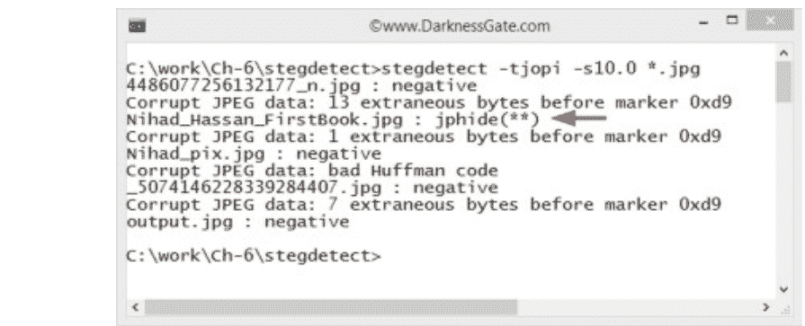
**图 13.5：Stegdetect 界面**

- **网络隐写术 (隐蔽信道)**：网络隐写术（隐蔽信道）倾向于将数据嵌入 TCP/IP 数据包头、DNS 请求或 HTTP 负载中。因此，对手将其用于数据外泄和僵尸网络通信。相反，数字取证调查人员使用 Wireshark 和 Zeek (Bro) 进行深度数据包检测。*(图 13.6)*

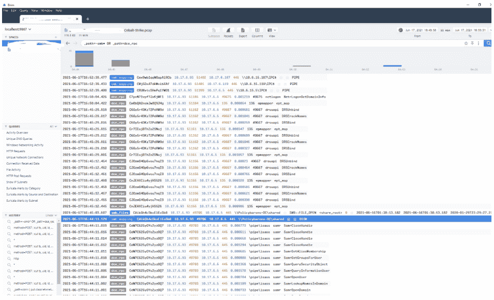
**图 13.6**：Zeek 界面

数字取证调查人员用于解码和检测隐写数据的反隐写技术包括以下内容：

- **直方图和统计分析**：直方图和统计分析检测颜色失真和不规则的频率模式。例如，调查人员通过直方图分析揭露了嵌入在图像中的隐藏恐怖分子信息。
- **隐写分析工具和机器学习**：隐写分析工具和机器学习涉及制定基于 AI 的检测模型以分析像素偏差。
- **逆向工程和暴力提取**：逆向工程和暴力提取尝试解码加密密钥或隐藏负载。


- **对比图像分析**：对比图像分析通过将原始媒体文件与修改后的媒体文件进行比较，以突出显示更改之处。

隐写术给数字取证和网络安全带来了重大挑战。检测和解码隐藏数据需要先进的分析工具、AI 驱动的取证技术以及深度媒体分析，以有效应对隐蔽的网络威胁。

## 移动设备 Chip-off 取证

Chip-off 取证是一种先进的数字取证技术，当传统的基于软件的方法失效时，用于直接从移动设备的存储芯片中提取数据。此过程涉及物理移除闪存芯片，并使用专业工具来检索和分析存储的数据。Chip-off 取证的重要性在于从锁定、损坏或加密的设备中恢复数据，而这些设备在基于软件的取证面前往往无效。Chip-off 取证可以从失效或水损设备中提取已删除的消息、通话记录、应用数据和多媒体文件。Chip-off 取证被用于刑事调查、企业间谍案件和情报搜集。具体而言，执法部门在一起金融欺诈案中，利用 Chip-off 取证从嫌疑人的手机中恢复了已删除的消息。

Chip-off 取证过程和技术的底层阶段阐述如下：

- **设备准备与芯片移除**：设备准备与芯片移除涉及拆解移动设备，以接触到 **嵌入式多媒体卡 (eMMC)** 或 **通用闪存存储 (eUFS)** 芯片。该过程涉及使用热风重工站、红外加热或激光工具将芯片从主板上小心地脱焊。这方面相关的挑战在于提取过程中芯片过热或物理损坏的风险。

- **数据转储与提取**：数据转储与提取过程涉及使用芯片编程器、NAND 阅读器和取证成像工具来创建内存的逐位（bit-for-bit）转储。该过程有助于使用取证工具恢复已删除、隐藏和碎片化的数据。数字取证调查员使用相关工具，如 RIFF Box、Z3X Pro、Cellebrite UFED 和 JTAG 适配器。

- **数据解析与分析**：数据解析与分析程序涉及将原始二进制转储转换为可读的文件格式。此过程进一步涉及从 WhatsApp、Signal 和 Telegram 等各种通信应用程序中提取短信、通话记录、应用数据以及位置历史记录。该过程还涉及为案件调查进行时间线重构和元数据分析。例如，Chip-off 取证在一次网络犯罪调查中帮助解密了一部加密的 Android 手机。

Chip-off 取证是一种强大但复杂的调查方法，用于从无法访问的移动设备中检索关键证据。Chip-off 取证依托于专业工具、谨慎的操作和先进的数据恢复技术，从而帮助取证专家恢复和分析对刑事和网络安全调查至关重要的关键数字痕迹。

## 高级数据分析

网络犯罪日益复杂的性质促使数字取证利用统计分析和数据挖掘技术来提取有意义的模式、检测异常并加强调查。这种高级数据分析增强了取证调查、关键方法论、工具及其在现实世界中的应用。这体现在有助于识别大型取证数据集中的隐藏模式、相关性和异常情况。高级数据分析增强了时间线重构、事件关联和恶意软件行为分析。高级数据分析支持欺诈检测、内部威胁调查和网络安全漏洞分析。例如，数据挖掘帮助揭露了一个通过加密货币交易洗钱的隐藏网络犯罪网络。

数字取证中的关键数据分析技术阐述如下：

- **用于异常检测的统计分析**：用于异常检测的统计分析涉及使用概率分布、标准差和聚类方法来检测异常活动。该技术进一步有助于识别可疑的登录尝试、数据访问异常和欺诈交易。统计建模检测到了数据传输中的异常峰值，揭露了一次正在进行的数据外泄攻击。

- **用于模式识别的数据挖掘**：用于模式识别的数据挖掘涉及使用机器学习算法（如决策树、k-means 聚类和神经网络）来对取证数据进行分类。该方法还能识别恶意软件签名、钓鱼攻击和金融欺诈趋势。数据挖掘技术通过行为分析帮助检测到了此前未知的勒索软件变体。

- **时间线重构与事件关联**：时间线重构与事件关联涉及使用日志文件分析、时间序列数据和序列比对技术来重构网络事件。此过程有助于追踪攻击时间线、根本原因和被攻破的用户账户。取证分析师使用事件关联将多次入侵尝试链接到同一个 APT 组织。

- **社交网络与链路分析**：社交网络与链路分析研究用户、设备和 IP 地址等数字实体之间的关系，以揭露网络犯罪网络。该过程可应用于暗网调查、组织化网络犯罪案件和恐怖活动追踪。链路分析揭露了欺诈电子商务网站与洗钱账户之间的联系。

高级取证数据分析工具阐述如下：

- **Autopsy 和 EnCase**：Autopsy 和 EnCase 是具有内置数据挖掘能力的取证套件。

- **Splunk 和 ELK Stack**：Splunk 和 ELK Stack 是用于检测安全事件异常的日志分析工具。

- **Weka 和 RapidMiner**：Weka 和 RapidMiner 是用于取证数据分类的机器学习平台。

- **Maltego 和 Linkurious**：Maltego 和 Linkurious 提供基于图谱的分析，用于网络犯罪和欺诈检测。数字取证调查员使用 Maltego 来绘制在暗网上运行的网络犯罪网络图谱。

高级数据分析技术提高了数字取证调查的准确性、速度和深度。统计模型、机器学习算法和数据挖掘方法的集成，引导调查员揭露隐藏模式、检测异常并加强网络犯罪调查。

## 加密货币取证

加密货币相关性的增加导致网络犯罪分子将其用于洗钱、欺诈和非法交易。因此，加密货币取证对于追踪区块链交易、识别钱包所有者和揭露金融犯罪至关重要。这篇关于加密货币取证的详细分析探讨了加密货币调查中的相关取证技术、挑战、工具和实际应用。加密货币取证在数字调查中的重要性在于识别可疑交易、洗钱计划和非法金融活动。此外，还涉及在比特币 (Bitcoin)、以太坊 (Ethereum)、门罗币 (Monero) 和其他加密货币中追踪资金。加密货币取证的优势进一步协助执法部门没收非法资金并起诉网络犯罪分子。例如，调查人员将勒索软件攻击中被盗的比特币追踪到了一个将其转换为法定货币的交易所。

区块链交易追踪的概念涉及公共区块链提供不可篡改的交易记录并允许取证追踪。这种追踪进一步揭露比特币地址、交易哈希和钱包变动，以帮助重构财务轨迹。当局使用取证工具通过多个比特币钱包追踪了非法的“丝绸之路”资金。

钱包识别与地址归属的概念涉及加密货币钱包具有唯一的公共地址，但所有者通常保持匿名。因此，调查员使用启发式聚类、交易模式和元数据分析将钱包与个人联系起来。具体而言，交易所的 **了解您的客户** (KYC) 法规有助于识别一名正将比特币收益兑现的网络犯罪分子。

暗网及其相关隐私币日益增长的影响所带来的挑战涉及网络犯罪分子使用门罗币 (Monero)、大零币 (Zcash) 和增强隐私的工具来隐藏交易痕迹。暗网市场的网络犯罪分子使用混币服务（tumblers）和币种交换来洗钱。AlphaBay 的被端毁揭露了一个用于非法贸易的门罗币交易网络。

加密货币取证的相关工具阐述如下：

- **Chainalysis 和 Elliptic**：Chainalysis 和 Elliptic 工具是区块链分析平台，被数字取证调查员用于跟踪交易。Chainalysis 曾帮助执法部门从勒索软件支付中追回数百万美元的被盗加密货币。
- **CipherTrace 和 TRM Labs**：CipherTrace 和 TRM Labs 被数字取证调查员用于识别非法加密活动，并将地址与现实世界实体相关联。
- **Blockchain 和 Bitcoin Explorer**：Blockchain 和 Bitcoin Explorer 是用于查看区块链交易的公共工具。

加密货币取证对于追踪非法交易、识别网络罪犯以及保障数字金融生态系统的安全至关重要。数字取证调查员利用先进的区块链分析、取证工具和调查技术来揭开复杂的加密相关犯罪，并加强网络安全执法。

## 数据碎片化与重建

数字证据经常被有意或无意地碎片化，因此，为了检索丢失、删除或被篡改的数据，取证重建至关重要。数字取证中数据重建的重要性在于能够恢复被粉碎、删除或损坏的数字证据。数据碎片化和重建的过程旨在协助重建部分文件、磁盘镜像和碎片化的数据库记录。数据碎片化和重建过程通过检索日志、金融交易和通信记录来支持网络犯罪调查。例如，执法部门成功从一名诈骗嫌疑人的硬盘中重建了被粉碎的文件，从而揭露了关键证据。

### 数据碎片化和丢失的原因如下：

- **文件系统行为**：文件系统行为是指操作系统将文件存储在非连续扇区中，从而导致碎片化。
- **文件删除与覆盖**：文件删除和覆盖过程是指被删除的文件在被覆盖之前可能部分可恢复。一名黑客使用了安全文件删除工具，但取证方法恢复了部分日志。
- **磁盘格式化与分区**：磁盘格式化和分区意味着格式化并不会擦除数据，而只是移除了索引引用。
- **加密与混淆**：网络罪犯使用数据粉碎工具、加密和压缩来隐藏证据，作为加密和混淆的一部分。
- **RAM 和易失性存储**：RAM 和易失性存储是指包含临时数据的内存转储，这些数据在关机后可能会消失。

数字取证调查员使用以下数据碎片分析和重建技术：

- **文件雕刻与签名分析**：文件雕刻和签名分析是指通过识别文件头和文件尾来提取可恢复的碎片。该过程对于在不依赖文件系统元数据的情况下检索 JPEG、PDF 和文档非常有用。调查人员使用文件雕刻技术从**固态硬盘 (SSD)** 中重建了删除的电子邮件。
- **哈希匹配与相似性分析**：哈希匹配和相似性分析是指将碎片化数据与已知哈希签名进行比较以进行文件识别。该过程使用模糊哈希（例如 SSDeep）来检测被篡改或部分恢复的文件。部分文档碎片通过与一份机密情报报告匹配，确认了泄密情况。
- **磁盘镜像分析与虚拟重建**：磁盘镜像分析和虚拟重建是指使用磁盘镜像以取证可靠的方式分析碎片化扇区。该过程重新组装分区和逻辑卷以恢复丢失的数据。一个取证团队重建了一个损坏的 RAID 系统以提取隐藏的财务记录。
- **RAM 和网络数据包重建**：RAM 和网络数据包重建过程从内存转储中恢复会话数据、加密密钥和易失性伪影。该过程重建碎片化的网络流量，用于网络犯罪和恶意软件分析。数字取证调查员在系统关机前从易失性内存中恢复了密码。

数据碎片化和重建工具如下：

- **Autopsy 和 Scalpel**：Autopsy 和 Scalpel 是用于文件雕刻和取证分析的工具。一个取证团队使用 Scalpel 从一名网络骚扰者的删除存档中恢复了图像碎片。
- **TestDisk 和 PhotoRec**：TestDisk 和 PhotoRec 是数字取证调查员用于从格式化磁盘中恢复数据的工具。
- **Recuva 和 R-Studio**：Recuva 和 R-Studio 是用于从存储设备中恢复删除文件的特定工具。
- **Wireshark 和 Volatility**：Wireshark 和 Volatility 是用于网络和内存重建的特定工具。

数据碎片化和重建对于在网络安全调查中恢复关键数字证据至关重要。通过使用机器学习等先进取证技术和专业工具，调查人员可以拼凑缺失的数据，检测篡改行为，并增强数字取证能力。

## 数字取证中的人工智能与机器学习

网络威胁的演变意味着**人工智能 (AI)** 和**机器学习 (ML)** 正在通过提高效率、自动化流程和大规模检测异常来改变数字取证。AI 和 ML 在数字取证中的内在重要性包括在大数据集中实现自动化数据分析、模式识别和异常检测。AI 和 ML 的结合加快了证据处理、恶意软件分析和网络犯罪调查的速度。这种结合增强了**威胁情报** (TI)、欺诈检测和入侵取证。AI 通过实时分析恶意代码行为帮助识别了勒索软件变体。

数字取证中的 AI 和 ML 应用阐述如下：

- **自动化威胁检测与异常分析**：自动化威胁检测和异常分析使用 ML 来识别网络流量、日志和用户行为中的异常模式。该分析工具可检测恶意软件、内部威胁和数据外泄尝试。AI 标记了与凭据填充攻击相关的异常登录尝试。
- **用于预防网络犯罪的预测性分析**：用于预防网络犯罪的预测性分析是指通过分析历史攻击数据来预测潜在的安全漏洞。该过程帮助安全团队采取主动措施防止事件发生。AI 驱动的预测模型根据电子邮件模式预测了一次网络钓鱼攻击。
- **智能数据处理与证据分类**：智能数据处理和证据分类使用**自然语言处理 (NLP)** 和图像识别来分析取证数据。该过程根据取证相关性对电子邮件、文档和加密文件进行分类。AI 帮助分析了数千条聊天记录以检测人口贩卖网络。
- **AI 在恶意软件和逆向工程中的应用**：AI 在恶意软件和逆向工程中通过分析代码结构和执行模式来识别零日恶意软件。该过程进一步实现了对混淆或多态恶意软件的逆向工程自动化。ML 算法揭露了一种绕过传统检测的新型无文件恶意软件。

AI 驱动的取证工具阐述如下：

- **IBM Watson for cybersecurity**：IBM Watson for cybersecurity 是一种 AI 驱动的威胁情报工具。
- **Darktrace**：**Darktrace** 使用 ML 进行实时异常检测。调查人员使用 Darktrace 检测来自受损系统的未经授权的数据传输。
- **带有 AI 插件的 Autopsy**：带有 AI 插件的 Autopsy 可实现取证数据分析的自动化。
- **VirusTotal AI**：VirusTotal AI 是一种 AI 驱动的恶意软件分析和分类工具。

AI 和 ML 正在通过自动化复杂调查、检测威胁和增强取证情报来彻底改变数字取证。随着 AI 驱动工具的进步，取证专业人员在确保伦理和法律考量的同时，必须适应不断演变的 AI 驱动网络犯罪战术。

## 案例研究

关于在数字取证中使用先进战术的真实案例研究列举如下：

- **欧警组织（Europol）基于 AI 的暗网调查**：罪犯利用暗网和加密平台进行非法活动，如人口贩卖和毒品销售。欧警组织利用 AI 驱动的 NLP

以及深度学习来分析海量的聊天日志、论坛和交易模式。AI 识别出了犯罪团伙之间隐藏的联系，并标记了加密货币中的可疑交易。执法部门由此瓦解了多个暗网网络。AI 驱动的语言处理帮助取证团队更快速地分析暗网对话并追踪网络犯罪活动。

- **FBI 使用 AI 追踪比特币勒索软件付款：** 勒索软件攻击背后的网络犯罪分子要求以比特币支付，这增加了追踪难度。FBI 利用 AI 驱动的区块链取证工具（如 Chainalysis 和 Elliptic）来分析加密货币交易。AI 帮助通过多个钱包和交易所追踪比特币付款，最终导致勒索软件运营商被逮捕。AI 驱动的区块链分析对于追踪与网络犯罪相关的加密货币交易至关重要。

## 结论

本章重点介绍了部署在现代数字取证调查中的先进技术的相关细节。本章的结果表明，先进技术的参与在辅助相关数字取证调查员方面，促进了网络安全调查的快速解决。本章的相关部分暗示了数字取证调查员通过应用相关工具来开展必要的调查。本章表明，AI 和 ML 的结合倾向于简化网络安全调查的整体流程。

接下来的章节将介绍工业控制系统中的数字取证，旨在保护关键基础设施。

## 加入我们书籍的 Discord 空间

加入书籍的 Discord 工作区，获取最新动态、优惠、全球技术动态、新发布内容以及与作者的交流会议：

https://discord.bponline.com


# 第 14 章：工业控制系统数字取证简介

## 简介

数字化转型显著影响了能源、制造、水处理和交通等多个关键领域。在工业控制系统 (ICS) 中采用数字取证，与其成为网络威胁的主要目标密切相关。本章将专门介绍 ICS 中的数字取证，以保护关键基础设施。本章包含了关于可能破坏 ICS 功能的漏洞的相关细节。此类破坏可能会对这些关键领域的相关利益相关者产生不利影响。

## 结构

本章涵盖以下主题：

- ICS 及其漏洞简介
- 用于保护关键基础设施的数字取证
- 数字取证中的调查标准和指南
- NIST 网络安全框架
- NIST SP 800-61
- NIST SP 800-86
- NIST SP 800-53
- 数字取证的挑战与考虑因素
- 事件响应和数字取证工作流
- 案例研究

## 目标

本章介绍了 ICS 及其相关的漏洞。本章阐述了数字取证在保护关键基础设施方面的整体重要性。本章概述了数字取证中的调查标准和指南。本章包含了关于将 **NIST 网络安全框架 (CSF)** 应用于 ICS 的充分细节。本章阐述了 NIST CSF 在应用于 ICS 时的底层规定。本章对作为有效计算机安全事件处理指南的 NIST SP 800-61 进行了详细分析。本章详细介绍了 NIST SP 800-86，将其作为将取证技术集成到 **事件响应 (IR)** 中的指南。本章详细介绍了 NIST SP 800-53 中关于联邦信息系统和组织的安全与隐私控制。本章涉及 ICS 中不同的数字取证挑战和考虑因素。本章包含了 ICS 的 IR 和数字取证工作流的细节。本章阐述了多个案例研究，证明了数字取证对于 ICS 平稳运行的重要性。

## ICS 及其漏洞简介

在 ICS 环境中采用数字取证对于检测、分析和减轻可能产生严重运行和安全后果的网络事件至关重要。数字取证在 ICS 中的极高重要性在于保护关键基础设施免受恶意软件感染、内部威胁和国家支持的攻击等网络攻击。数字取证可以识别攻击向量、恶意活动和受损的控制系统组件。数字取证有助于确保符合行业法规，如 NERC CIP（针对能源）和 IEC 62443（针对工业网络安全）。数字取证的集成增强了 IR 和取证准备能力，以减轻运行中断。一次在能源工厂进行的取证调查识别出了旨在操纵安全控制器的恶意软件 (TRITON)，从而防止了一场重大灾难。

ICS 是现代基础设施的关键组成部分，管理着电网、制造、交通、水处理以及石油和天然气工业中的基本流程。随着 ICS 变得更加互连，它们面临的网络安全威胁日益增加，使得数字取证和 IR 对于保护这些系统至关重要。ICS 是指监控和控制工业流程的基于计算机的系统。（图 14.1）


**图 14.1：** 工业控制系统

ICS 传统上将可靠性和可用性置于安全性之上，这使其容易受到网络威胁。其底层组件说明如下：

- **监视控制与数据采集 (SCADA)：** SCADA 远程控制大规模工业操作。电网依赖 SCADA 系统对电力分配进行实时控制。(*图 14.2*)

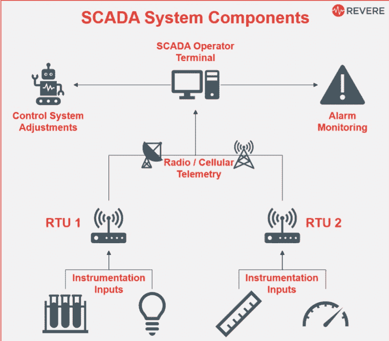
图 14.2：SCADA 概览

- **分布式控制系统 (DCS)：** DCS 管理工厂内的连续生产流程。

- **可编程逻辑控制器 (PLC)：** PLC 自动化特定的工业任务。（图 14.3）


图 14.3：可编程逻辑控制器概览

- **人机界面 (HMI)：** HMI 为操作员提供监控系统状态的界面。(*图 14.3*)

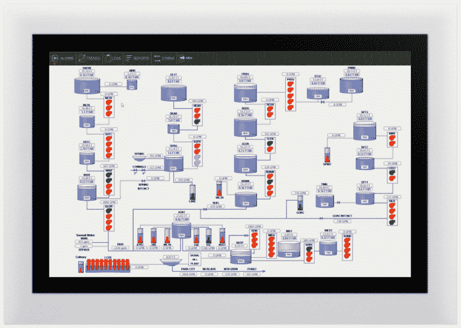
图 14.4：人机界面

- **远程终端单元 (RTU)：** RTU 收集并传输来自传感器的数据。(*图 14.5*)


图 14.5：远程终端单元

由于遗留系统、缺乏加密和远程连接，ICS 越来越多地成为网络犯罪分子的目标。ICS 中的漏洞说明如下：

- **遗留系统和过时软件：** 遗留系统和过时软件是指多个 ICS 组件运行着数十年前的软件且没有安全更新。这意味着由于运行限制，这些漏洞无法轻易修复。TRITON 恶意软件攻击利用了一家能源工厂中过时的安全控制器。

- **缺乏网络分段：** ICS 经常与企业 IT 网络互连，使其暴露在勒索软件、钓鱼和远程访问威胁之中。Colonial Pipeline 攻击（2021 年）始于 IT 漏洞，但影响了 ICS 的运行。

- **弱身份验证和默认凭据：** 弱身份验证和默认凭据是指多个 ICS 使用默认或弱密码，使其成为暴力破解攻击的容易目标。在这种关键领域中，**多因素身份验证 (MFA)** 的集成往往缺失。攻击者使用 TeamViewer 上的共享密码访问了佛罗里达州的一家水处理厂。

- **工业协议漏洞：** 相关的 ICS 协议（如 Modbus、DNP3 和 OPC UA）是为功能而设计而非为安全性而设计。关键领域的许多区域缺乏加密和身份验证，使其容易受到中间人攻击。攻击者拦截并修改了 Modbus 流量以操纵 PLC 命令。

- **供应链攻击：** 来自第三方供应商的 ICS 组件可能包含预安装的恶意软件或后门。SolarWinds 攻击允许黑客通过受损的软件更新渗透进 ICS 网络。

ICS 网络安全和取证的整体重要性涉及以下方面：

- **事件响应 (IR)：** IR 快速识别并遏制 ICS 环境中的威胁。

- **数字取证：** 数字取证的益处在于通过日志分析、网络取证和恶意软件逆向工程来调查 ICS 违规行为。


- **主动安全措施：主动安全措施涉及部署防火墙、入侵检测系统 (IDS) 和网络分段。（图 14.6）

ICS 网络安全正在不断演进，AI 驱动的异常检测、零信任安全模型和工业威胁情报发挥着关键作用。

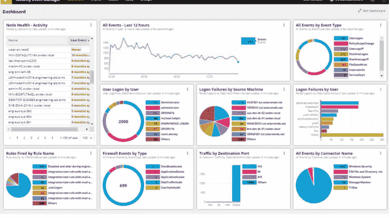
图 14.6：入侵检测系统

ICS 是关键基础设施的基石，但其漏洞带来了严重风险。保障工业环境的安全并减轻网络威胁，涉及到数字取证调查员对 ICS 组件、攻击面以及取证调查方法的理解。

### 保护关键基础设施的数字取证

关键基础设施（包括电网、水处理设施、交通网络、医疗系统和工业工厂）是网络威胁的主要目标。随着网络攻击在复杂性和规模上的增长，数字取证在保护这些核心系统中的作用变得愈发至关重要。关键基础设施依赖于 ICS、SCADA 系统和 IoT 设备，而所有这些都存在网络安全漏洞。针对这些系统的攻击可能导致运行中断、经济损失以及对公共安全的威胁。数字取证提供了调查、分析和预防影响这些基础设施的网络事件的能力。2021 年对 Colonial Pipeline 的网络攻击导致全美燃料供应中断，凸显了对强大取证能力的需要。

数字取证通过分析系统日志、网络流量和未经授权的访问模式，帮助尽早发现漏洞。数字取证利用内存取证、恶意软件分析和事件关联来确定攻击是如何发生的。数字取证通过精准定位受损资产并恢复正常运行，辅助遏制和恢复。对乌克兰电网遭受的 Industroyer 恶意软件攻击的取证调查，帮助安全团队理解了黑客如何操纵 ICS 协议。

关键基础设施面临的常见威胁陈述如下：

- 勒索软件攻击：勒索软件攻击涉及加密运行数据并要求赎金，导致停机。取证分析通过追踪赎金要求、识别恶意软件签名并帮助解密数据。WannaCry 勒索软件攻击瘫痪了全球范围内的医院和交通系统，强调了取证分析在追踪恶意软件来源中的作用。
- **国家级和高级持续性威胁 (APT) 攻击：** 国家级和 APT 攻击意味着针对国家安全、公用事业和国防工业的高度复杂的攻击。取证分析有助于将攻击归因于威胁参与者并加强网络防御。Stuxnet (2010) 针对伊朗的核离心机，展示了数字取证如何揭露网络间谍活动。
- **内部威胁：** 内部威胁是指可能故意或无意导致安全漏洞的员工或承包商。取证分析可检测未经授权的访问、数据泄露和违反政策的行为。某水处理厂漏洞的取证证据揭露了一名内部人员试图远程操纵化学水平。

数字取证是防御关键基础设施免受网络威胁的关键支柱。通过实现安全事件的快速检测、调查和缓解，以及运用取证技术，有助于确保业务连续性、公共安全和国家安全。

### 数字取证中的调查标准与指南

数字取证调查需要结构化的方法论、法律合规性和标准化的程序，以确保数字证据的完整性、可采纳性和准确性。各种国际和行业特定标准为系统地进行取证检查提供了框架。数字取证中标准和指南的重要性在于确保取证调查的一致性和可靠性。它们进一步延伸到在法律诉讼中维护证据的完整性和可采纳性。数字取证中的标准和指南为数据获取、分析和报告建立了最佳实践。这有助于调查员在不同管辖区和机构之间进行协作。遵循 **ISO/IEC 27037** 指南的取证调查可确保证据收集在法庭使用时有效。

关键的国际数字取证标准陈述如下：

- **ISO/IEC 27037：** 该标准涉及数字证据的识别、收集、获取和保存。该标准定义了在确保完整性的同时处理数字证据的最佳实践。该标准涵盖了**监管链 (CoC)** 和数据保存的指南。
- **ISO/IEC 27042：** 该标准涉及数字证据的分析和解释。该标准提供了检查和解释取证数据的原则。遵循此标准可确保结果具有可重复性和科学有效性。
- **ISO/IEC 27043：** 该标准涉及相关的事件调查原则，定义了数字取证调查的结构和流程。该标准进一步涵盖了从事件检测到报告和修复的步骤。
- **NIST 特别出版物 (SP 800-86, SP 800-101)：** 该标准为取证数据收集、内存取证和移动取证提供了技术指南。该标准帮助执法部门和企业安全团队遵循系统化的调查方法。具体而言，NIST SP 800-101 概述了从移动设备提取数据的取证方法。

相关的数字取证方法论陈述如下：

- **英国首席警察官协会 (ACPO) 指南：** 这是一个用于执法调查的四步取证模型，限制在分析过程中更改原始数字证据。这些指南进一步鼓励记录所有执行的流程和操作。这些指南确保由合格的取证专家处理证据。提供此指南旨在为法庭陈述维持清晰的审计追踪。
- **NIST 网络安全框架 (CSF)：** 该框架提供了一个分为五个阶段的取证路线图，即：识别、保护、检测、响应和恢复。
- **数字取证中的洛卡德交换原理：** 该原理认为任何数字交互都会留下痕迹，如日志、元数据和删除的文件。该原理用于取证调查中追踪网络罪犯并重建事件。在一起金融欺诈案中，该原理帮助调查员通过隐藏的系统日志追踪到了黑客。

调查标准和指南确保了结构化、法律合规且科学有效的数字取证调查。企业对 ISO、NIST、ACPO 和法律框架的遵循，有助于相关取证专业人员开展适当工作。

#### NIST 网络安全框架

NIST CSF 是一套被广泛认可的用于管理网络安全风险的指南。由于其独特的漏洞和运行限制，运行电厂、水处理设施和制造系统等关键基础设施的 ICS 需要量身定制的网络安全方法。将 NIST CSF 应用于 ICS 可增强威胁检测、事件响应 (IR) 以及应对网络威胁的韧性。ICS 在电网、水处理厂、制造业和交通运输中发挥着至关重要作用。这些系统面临着独特的网络安全挑战，包括技术陈旧、安全控制有限以及日益增加的网络威胁。NIST CSF 通过帮助组织识别、保护、检测、响应和从网络威胁中恢复，为保障 ICS 环境的安全提供了一种结构化方法。

ICS 是网络攻击的高价值目标，可能导致关键基础设施中断。许多 ICS 依赖于缺乏内置网络安全功能的遗留系统。ICS 将可用性和可靠性置于安全性之上，因此需要一种平衡的网络安全方法。这要求遵守 NERC CIP 和 IEC 62443 等行业法规，这些法规与 NIST CSF 原则一致。2017 年针对沙特石化工厂的 Triton 恶意软件攻击凸显了对强大的 ICS 网络安全的需求。

NIST CSF 由 NIST 开发，旨在增强网络韧性。它为 ICS 提高网络安全提供了一种基于风险的、可适应的方法。它由五个核心功能组成：识别、保护、检测、响应和恢复。应用 NIST CSF 的电网运营商可确保对网络威胁进行持续监控和快速响应。


NIST CSF 对 ICS 的重要性在于 ICS 是网络攻击的高价值目标，可能导致关键基础设施的中断。与 IT 系统不同，ICS 优先考虑可用性和安全性而非单纯的安全防护，因此需要定制化的网络安全措施。ICS 经常使用遗留系统、未打补丁的软件和不安全的远程访问，使其非常脆弱。遵守 NIST CSF 可以改善 ICS 的风险管理、监管合规性和事件缓解能力。2015 年乌克兰电网攻击利用了 ICS 安全性的薄弱，证明了采用 NIST CSF 的必要性。

NIST CSF 的核心功能及其在 ICS 中的应用详述如下：

- **识别 (Identify)：** 识别功能涉及理解风险和资产，同时绘制 SCADA、PLC、HMI 和传感器等关键 ICS 组件的映射图。这一核心功能涉及通过开展风险评估来识别漏洞。该功能还涉及开发 ICS 资产清单以跟踪设备和软件。一家使用 NIST CSF 的制造工厂将 PLC 分类为需要额外安全保护的高风险资产。

- **保护 (Protect)：** 这一核心功能涉及实施安全控制，包括通过网络分段将 ICS 与 IT 网络隔离。作为该功能的一部分，使用 MFA（多因素认证）进行远程访问，涉及对 ICS 设备强制执行补丁管理和端点安全。一家水处理设施应用防火墙规则以防止未经授权访问 SCADA 系统。

- **检测 (Detect)：** 这一核心功能涉及监测异常情况和威胁，并部署 IDS（入侵检测系统）进行实时监控。利用行为分析和 AI 驱动的异常检测是该核心功能的一部分。该功能还涉及对 ICS 网络活动进行持续的日志记录和审计。电厂的 SIEM 系统检测到了未经授权的 PLC 修改并触发警报。

- **响应 (Respond)：** 响应的核心功能涉及管理和缓解事件，以制定针对 ICS 的特定 IR（事件响应）计划。这有助于对网络事件进行取证分析，以确定根本原因。其结果是实现了自动化威胁遏制机制。一家天然气管道运营商在网络攻击期间隔离了受感染的 HMI，防止了全系统崩溃。

- **恢复 (Recover)：** 恢复的核心功能涉及在攻击后恢复系统。这进一步要求维护 ICS 备份和恢复计划以确保运营连续性。进行事件后分析是为了改善安全态势。实施从事件中吸取的教训涉及未来的网络安全改进。一家制造工厂使用离线备份恢复了受损的 PLC 的配置。

将 NIST CSF 应用于 ICS 可以增强关键基础设施的网络韧性、风险管理和 IR 能力。遵循“识别、保护、检测、响应和恢复”模型，ICS 运营商可以在确保运营连续性的同时，主动防御网络威胁。

#### NIST SP 800-61

NIST **特别出版物 (SP)** 800-61 为 IR 规划、检测、分析、遏制、根除和恢复提供了指南。它帮助组织构建高效的 IR 能力，以最大限度地减少损失，缩短恢复时间，并增强网络安全韧性。NIST SP 800-61 在 IR 方面建立了管理安全事件的最佳实践。在 IR 过程中应用 NIST SP 800-61 可进一步确保事件处理流程的一致性和可重复性。在 IR 期间部署 NIST SP 800-61 有助于组织遵守网络安全法规和标准。在 IR 中集成 NIST SP 800-61 可通过高效的响应和恢复减轻安全事件的影响。一家金融机构通过遵循 NIST SP 800-61 指南，成功遏制并缓解了一次勒索软件攻击。

NIST SP 800-61 中事件处理的关键阶段陈述如下：

- **准备 (Preparation)：** 准备阶段涉及构建 **事件响应计划 (IRP)**，以及制定 IR 策略和组建团队。此阶段鼓励实施多种安全监控工具，如 SIEM、IDS/IPS 和日志管理。此阶段还鼓励开展员工培训和意识提升计划。一家医疗服务提供商创建了用于响应钓鱼攻击的 IR 剧本（Playbook）。

- **检测与分析 (Detection and analysis)：** 检测与分析阶段涉及使用安全日志、IDS 和端点监控来识别和调查事件。此阶段进一步根据严重程度和影响对事件进行分类。此阶段鼓励进行取证分析以确定根本原因。一个 SOC 团队检测到了异常的流量模式，预示着潜在的数据泄露。

- **遏制、根除与恢复 (Containment, eradication, and recovery)：** 遏制、根除与恢复阶段涉及限制损害并恢复运营。短期遏制过程涉及隔离受损系统以防止横向移动。根除过程涉及删除恶意软件、修补漏洞并关闭现有的安全漏洞。恢复阶段涉及从干净的备份中恢复系统并验证完整性。一家零售公司在信用卡数据泄露后隔离了受感染的 POS 系统。

- **事件后活动 (Post-incident activity)：** 事件后活动涉及通过进行事后分析（post-mortem analysis）和记录经验教训来从事件中学习。该阶段进一步阐述了更新 IR 策略以改进未来处理。此阶段鼓励实施新的安全措施以防止类似事件再次发生。一家政府机构在遭受鱼叉式钓鱼攻击后修订了其电子邮件过滤策略。

NIST SP 800-61 为 IR 提供了一种结构化方法，确保组织能够快速检测、遏制并从网络事件中恢复。通过有效地遵循其准备、检测、遏制和事件后分析原则，关键部门可以加强其网络韧性并最大限度地减少中断。

#### NIST SP 800-86

NIST SP 800-86 提供了一个将数字取证技术纳入 IR 的框架。取证调查对于识别网络威胁、最大限度地减少停机时间以及确保 ICS 的运营连续性至关重要。NIST SP 800-86 的应用鼓励组织在响应 ICS 环境中的安全事件时，有效地收集、分析和保存数字证据。该框架的优势在于为取证数据的收集、分析和报告提供了一种结构化方法。该框架对于保障 ICS 和其他关键基础设施环境的安全至关重要。

数字取证在 ICS IR 中的重要性在于 ICS 网络高度敏感，网络安全事件可能会中断电网、水处理厂和生产线。因此，传统的取证技术必须适应实时、永不停机的 ICS 环境。相反，数字取证强调在进行调查的同时最大限度地减少对运营的影响。根据 NIST SP 800-86，数字取证的关键阶段陈述如下：

- **收集 (Collection)：** 收集阶段涉及从 SCADA、PLC 和 RTU 等相关 ICS 组件中识别并获取相关的取证数据，如日志、网络流量和设备内存。
- **检查 (Examination)：** 检查阶段涉及处理收集到的数据以提取相关信息，同时确保监管链 (CoC) 的完整性。
- **分析 (Analysis)：** 分析阶段涉及识别异常、关联证据并确定事件的根本原因。
- **报告 (Reporting)：** 报告阶段涉及记录调查结果，建议补救步骤，并确保符合监管框架。

在 ICS 中实施 NIST SP 800-86 的最佳实践涉及使用被动取证以避免系统中断，例如使用基于网络的监控而非直接访问系统。根据 NIST SP 800-86，确保持续日志记录和量身定制的 ICS SIEM 解决方案可以辅助相关的数字取证调查。在 ICS 中集成 NIST SP 800-86 意味着开发专门针对 ICS 环境的 IR 剧本。确保数字取证调查人员在传统 IT 安全知识之外拥有 ICS 特定专业知识，即体现了对 NIST SP 800-86 规定的遵守。

NIST SP 800-86 提供了一种将取证技术集成到 IR 中的结构化方法，这对于保障 ICS 安全和保护关键基础设施至关重要。与传统的 IT 环境不同，由于 ICS 的实时操作、独特协议和系统运行时间要求，它需要专门的取证方法。该框架概述了收集、检查、分析和报告四个关键阶段，以确保在维护系统完整性的同时进行正确的取证调查。

#### NIST SP 800-53

NIST SP 800-53 的概述类似于 NIST 开发的一套全面的 CSF（网络安全框架），旨在为联邦信息系统建立安全和隐私控制措施。NIST SP 800-53 的集成表明，在选择和实施安全控制时采用了基于风险的方法。NIST SP 800-53 主要为联邦机构设计，但也被包括 ICS 在内的关键基础设施部门广泛采用。NIST SP 800-53 与 ICS 的相关性体现在 ICS 环境及其底层组件（如 SCADA、DCS、PLC 和其他**操作技术 (OT)**）往往面临独特的网络安全风险。将 NIST SP 800-53 集成到 ICS 中可提供定制化的控制措施，有助于缓解勒索软件、内部威胁和供应链攻击等威胁。NIST SP 800-53 与 ICS 的结合确保了对 NERC CIP、ISA/IEC 62443 和 DHS CISA 指南等监管框架的合规性。NIST SP 800-53 中针对 ICS 的关键安全控制族如下所述：

- **访问控制 (AC)：** AC 是关键的安全族，用于对 ICS 组件强制执行严格的身份验证和最小权限访问。
- **审计与问责 (AU)：** AU 是关键的安全族，用于确保对 ICS 网络活动进行日志记录和监控，以进行取证调查。
- **事件响应 (IR)：** IR 是关键的安全功能，负责制定 ICS 特有的响应计划并集成取证技术。
- **系统与通信保护 (SC)：** SC 是关键的安全族，用于保护 Modbus 和 DNP3 等 ICS 通信协议，并在可行区域实施加密。
- **系统与信息完整性 (SI)：** SI 是关键的安全族，旨在通过持续监控和补丁管理来防止网络威胁。

将 NIST SP 800-53 应用于 ICS 的相关最佳实践包括以下内容：

- **基于风险的方法**：基于风险的方法是一项最佳实践，因为它根据威胁影响和运行关键性对安全控制进行优先级排序。
- **分段策略**：分段策略是一项最佳实践，它们实施网络分段（如 Purdue 模型），以将 ICS 与外部威胁隔离。
- **零信任架构 (ZTA)**：ZTA 是一项最佳实践，它鼓励采用零信任原则来限制未经授权的访问并防止威胁的横向移动。
- **定期评估与审计**：定期评估与审计是一项最佳实践，这意味着通过进行周期性的漏洞评估，以确保能够应对不断演变的威胁和法规。
- **培训与意识**：培训与意识是最佳实践，涉及对人员进行 ICS 特有网络威胁的教育并强制执行安全最佳实践。

NIST SP 800-53 为联邦信息系统的安全提供了一种结构化方法，但其原则高度适用于 ICS。它定义了一个基于风险的控制框架，涵盖了 AC、IR 和系统完整性等关键安全领域。然而，ICS 环境带来了独特的挑战，包括遗留系统、运行约束和有限的网络安全资源。在 ICS 中有效实施 NIST SP 800-53 鼓励组织专注于风险优先级排序、网络分段、零信任原则和持续安全评估。这些控制措施的集成将引导 ICS 运营商增强韧性，防止网络威胁，并保护关键基础设施免受新兴风险的影响。

## 数字取证挑战与考量

在 ICS 中应用数字取证对于调查网络事件和保护关键基础设施至关重要。由于实时运行、私有协议和系统正常运行时间要求，ICS 中的取证过程与传统的 IT 环境有所不同。主要目标是在确保对工业过程干扰最小的情况下，检测、分析并减轻网络威胁。遗留系统的存在以及内置安全功能的匮乏增加了取证调查的复杂性。开展取证调查的相关挑战意味着，ICS 的实时性使得传统取证方法难以实施，因为系统不能为了调查而轻易关闭。此外，挑战还扩展到 Modbus、DNP3 和 IEC 60870-5-104 等私有 ICS 协议的使用，限制了标准取证工具的有效性。遗留 ICS 设备缺乏全面的日志记录和审计，使得证据收集具有挑战性。ICS 数据的挥发性导致取证证据的保存困难，因为日志和内存状态变化迅速。对 NERC CIP、ISA/IEC 62443、GDPR 和 CISA 指南等监管框架的合规需求引入了额外的约束。

ICS 中的相关取证考量包括使用被动取证技术（包括网络流量监控），以帮助最大限度地减少对系统的干扰。收集和保存控制器日志、网络捕获和内存转储等取证制品至关重要。遵守 CoC（监管链）原则可确保取证证据的完整性和法律可采纳性。将取证能力集成到 ICS 特有的 SIEM 解决方案中可实现实时的威胁检测与分析。对 ICS 网络安全专业知识的需求至关重要，因为传统的 IT 取证培训通常是不够的。

ICS 数字取证的相关最佳实践包括制定取证准备计划，以确保 ICS 环境为网络事件做好准备。实施持续日志记录和集中监控可增强对安全事件的可见性。IT 和 OT 安全团队之间的协作可加强取证调查和响应工作。使用物理隔离的取证分析环境可防止调查期间污染运行中的 ICS 网络。定期测试和完善取证策略可确保 ICS 取证准备能力随新兴威胁而演进。

由于实时运行约束、私有协议和有限的取证工具，ICS 的数字取证面临独特挑战。取证调查过程必须在安全性和系统可用性之间取得平衡，因为 ICS 环境无法承受停机。缺乏全面的日志记录、数据挥发性以及合规性要求进一步增加了证据收集的难度。使用被动取证技术、严格的 CoC 协议和 ICS 特有的 SIEM 解决方案对于有效调查至关重要。采用取证准备计划、持续监控和 IT-OT 协作增强了在 ICS 环境中检测、分析和响应网络威胁的能力。

## 事件响应与数字取证工作流

ICS 中的 IR（事件响应）过程必须量身定制，以便在应对网络威胁的同时最大限度地减少运行中断。将数字取证集成到 ICS IR 中可增强对安全事件的检测、调查和修复。ICS 的实时性要求一个协调良好的 IR 策略，以避免停机或安全隐患。ICS 中 IR 的关键阶段如下所述：

- **准备阶段：** 准备阶段涉及制定针对 ICS 定制的 IRP（事件响应计划）、取证准备策略和培训计划。
- **检测与识别：** 检测与识别阶段涉及使用 ICS 特有的 IDS、SIEM 和持续监控来识别异常。
- **遏制：** 遏制阶段涉及快速隔离受影响的系统，以防止威胁的横向移动，同时保持系统可用性。
- **根除：** 根除阶段涉及在不中断 ICS 过程的情况下删除恶意制品、后门或漏洞。
- **恢复：** 恢复阶段涉及利用备份、冗余和韧性规划，以最短的停机时间恢复受影响的系统。
- **经验教训：** 经验教训阶段涉及事后审查，以改进取证技术、更新 IR 计划并加强 ICS 安全。

ICS 中相关的数字取证工作流如下：

- **证据收集**：证据收集涉及获取关键的取证数据，如控制器日志、网络捕获、系统内存和端点制品。
- **取证分析**：取证分析阶段涉及检查日志、流量模式和恶意软件制品，以确定攻击向量和根本原因。
- **监管链 (CoC)**：CoC 涉及对取证证据的文档记录和安全处理，以确保其法律可采纳性。


- 事件关联：事件关联涉及将收集的取证数据与威胁情报源进行交叉引用，以识别攻击模式。
- 报告与文档：报告与文档阶段涉及生成详细报告，概述攻击影响、取证结果以及建议的缓解措施。

ICS（工业控制系统）中 IR（事件响应）和取证的最佳实践包括：开发针对工业流程和监管要求定制的 ICS 专用 IR 剧本；实施带有网络异常检测和取证日志的持续监控；IT 与 OT 团队协作以创建有效的统一响应策略；使用被动取证技术在不影响实时流程的情况下收集证据；定期测试 IR 计划以提高准备就绪程度和响应效率。

ICS 的 IR 和数字取证工作流必须经过精心设计，以平衡安全性和运行连续性。分阶段的 IR 方法（包括检测、遏制、根除和恢复）确保了对安全事件的结构化响应。取证调查过程需要专门的工具、被动证据收集和严格的 CoC（监管链）程序。采用 ICS 专用 IR 剧本、持续监控、IT-OT 协作和主动测试，增强了工业环境的整体网络安全态势。

## 案例研究

ICS 数字取证的相关案例研究详细如下：

- **Stuxnet (2010)，首个 ICS 网络武器：** 攻击概述表明，Stuxnet 蠕虫是一种高度复杂的网络攻击，目标是伊朗纳坦兹设施的核离心机。该恶意软件利用零日漏洞并使用 PLC 操纵来改变离心机速度，从而造成物理损坏。由于其能够向操作员隐藏恶意活动，该攻击在数月内未被发现。取证调查揭示了多个零日漏洞利用和被盗的数字证书，表明这是一次国家级攻击。IR 过程中包括对恶意软件进行逆向工程，发现了被感染 PLC 内部的 Modbus 协议操纵。这次攻击凸显了对 ICS 专用监控工具的需求，因为传统的 IT 安全机制未能检测到 Stuxnet。数字取证调查暗示了对于关键 ICS 环境，物理隔离（Air-gapped）安全控制的重要性。此外，这进一步证明了 PLC 行为异常检测和网络流量监控的必要性。取证分析在揭露 ICS 复杂多阶段攻击中的价值与此次攻击的数字取证结果进一步相关联。
- **乌克兰电网攻击 (2015 和 2016)，针对性 ICS 破坏：** 事件概述显示，2015 年的这次网络攻击目标是乌克兰的电力变电站，导致超过 230,000 人停电。相关攻击者使用 BlackEnergy 恶意软件获取访问权限并远程禁用断路器。随后 2016 年对乌克兰传输网络的攻击使用了 Industroyer 恶意软件，该软件直接操纵 IEC 104 和 OPC 协议以破坏电网运行。取证调查将攻击源追溯到部署了远程访问特洛伊木马（RATs）的鱼叉式网络钓鱼邮件。相关的 IR 涉及隔离受感染系统、恢复手动控制以及对恶意软件行为进行取证重建。这次攻击暴露了操作员意识、网络分段和端点安全方面的弱点。攻击结果暗示了强认证和端点安全对于 ICS 操作员的整体重要性。网络分段对于防止恶意软件在工业网络中传播至关重要。取证分析在识别攻击向量和改进未来响应策略方面发挥了重要作用。

## 结论

将数字取证集成到 ICS 中对于保护关键基础设施免受网络威胁至关重要。ICS 环境的独特挑战（如实时运行限制、私有协议和遗留系统）需要专门的取证技术和 IR 策略。实施 NIST 指南（SP 800-86, SP 800-53）为将取证集成到 CSF（网络安全框架）提供了一种结构化方法，确保了监管合规性和运行安全。对关键取证挑战的探讨强调了被动证据收集、严格的 CoC 协议和 ICS 专用取证工具的需求。IR 工作流必须针对工业环境量身定制，平衡威胁遏制与运行连续性。包括 Stuxnet 和乌克兰电网攻击在内的案例研究阐明了真实世界的攻击，强调了取证准备、网络分段和 IT-OT 协作的重要性。

接下来的章节将专注于探索 IoT 取证，并包含相关细节。

## 加入我们书籍的 Discord 社区

加入书籍的 Discord 工作区，获取最新更新、优惠、全球技术动态、新发布内容以及与作者的交流会议：

https://discord.bpbonline.com

# 第 15 章：探索 IoT 取证

## 简介

**物联网 (IoT)** 的快速扩张彻底改变了各个行业，将家庭、医疗、交通、工业系统和智能城市中的数十亿设备连接起来。然而，对 IoT 设备日益增长的依赖引入了新的安全漏洞和取证挑战，使 IoT 取证成为数字调查中的一个关键领域。与传统的计算系统不同，IoT 生态系统涉及大量互连的设备，具有多样化的硬件、操作系统和通信协议。这些复杂性使得数字取证调查员在数据采集、证据保存和取证分析方面面临更多挑战。此外，许多 IoT 设备有限的存储空间、处理能力以及数据的瞬时特性进一步增加了取证调查的复杂性。本章探讨了 IoT 取证的基础知识，包括取证挑战、方法论、法律考虑和真实世界的案例研究。本章重点介绍了在智能环境中进行取证调查的最佳实践和工具，确保数字取证调查员能有效地收集和分析来自 IoT 设备、云服务和网络日志的数字证据。

## 结构

本章涵盖以下主题：

- 理解 IoT 取证的重要性
- 探索 IoT 设备格局与技术
- 调查 IoT 架构与通信协议
- 精通 IoT 取证采集技术
- 分析 IoT 流量与通信
- 分析固件、日志和配置数据
- 真实世界案例研究
- 应对 IoT 取证中的隐私与法律考虑
- 案例研究

## 目标

本章以详细的介绍开始，重点在于理解 IoT 取证的重要性。随后探讨 IoT 设备格局与技术。本章将对 IoT 架构和通信协议进行详细调查。本章旨在使读者在采集技术方面精通 IoT 取证。本章旨在通过网络取证分析 IoT 流量与通信。本章揭示固件、日志和配置数据中的秘密。本章包含真实世界的案例研究，重点在于从 IoT 取证调查中吸取的详细教训。本章接着讨论 IoT 取证中的隐私与法律考虑。本章包含相关的案例研究，以确立 IoT 取证的重要性。

## 理解 IoT 取证的重要性

IoT 正在各个行业迅速扩展，包括智能家居、医疗保健、交通和工业自动化。（图 15.1）

**图 15.1：** 物联网 (IoT)

IoT 设备互连性的增加产生了海量数据，这些数据可以在取证调查中作为关键证据。IoT 设备在网络犯罪案件中的出现，使得 IoT 取证成为一个

现代数字调查的关键组成部分。物联网（IoT）设备日益成为网络攻击、欺诈和犯罪活动的攻击目标，因此需要通过取证分析来追踪相关的威胁行为者。数字取证调查人员可以从物联网传感器、日志和网络数据中提取关键的数字证据，以重建网络犯罪、实体犯罪和欺诈调查中的事件。物联网数据的整体挥发性（通常存储在云端、挥发性内存中或被快速覆盖）使得及时的取证干预至关重要。物联网取证面临的底层挑战包括以下方面：

- **物联网设备的多样性：** 物联网生态系统涉及各种硬件、操作系统和专有协议，使得标准化取证程序的实施变得困难。
- **数据挥发性：** 数据挥发性表现为许多物联网设备仅存储有限的数据，因此证据可能会因频繁的数据覆盖或掉电而丢失。
- **分布式数据存储：** 分布式数据存储是指物联网数据存储在云环境、边缘计算节点或远程服务器中，从而增加了证据收集的复杂性。
- **加密与隐私考量：** 加密与隐私考量是指确保对物联网设备的取证访问需要符合法律框架、隐私法和数据保护条例。

物联网取证在网络犯罪调查中的作用体现在帮助调查人员分析被黑客攻击的物联网摄像头、被操纵的智能家居设备以及受损的**工业物联网（IIoT）系统**。对物联网日志和网络流量的取证分析有助于检测数据泄露、未经授权的访问和恶意软件感染。物联网取证在关键基础设施保护中发挥着关键作用，确保智能电网、工业系统和医疗设备的安全性。**人工智能（AI）**和**机器学习（ML）**在取证自动化中的兴起将提高物联网证据分析的效率。在物联网设备中采用基于区块链的安全模型可以增强取证的完整性。更强大的法律和监管框架将定义物联网取证调查的最佳实践和合规要求。

## 探索物联网设备领域与技术

物联网由互连的智能设备组成，这些设备负责收集、处理和交换数据。物联网设备运行在多种环境中，包括智能家居、医疗保健、工业自动化和关键基础设施。物联网的架构包括边缘设备（传感器、执行器）、网关、云平台和数据分析系统。物联网设备的具体分类如下：

- **消费类物联网：** 消费类物联网涉及广泛的智能家居设备，如智能锁、恒温器、摄像头和可穿戴设备。
- **工业物联网 (IIoT)：** IIoT 包括传感器、机器人系统、SCADA 设备和智能电网。*(图 15.2)*


图 15.2：传感器

- **医疗物联网：** 医疗物联网涉及医疗植入物、远程患者监护系统和智能胰岛素泵。
- **智慧城市：** 智慧城市包括交通管理系统、智能照明和环境监测。
- **汽车物联网：** 汽车物联网涉及联网汽车、车队跟踪以及车对车 (**V2V**) 通信。

驱动物联网设备的关键技术包括以下内容：

- **通信协议：** 通信协议是指物联网设备使用特定的协议，如 MQTT、CoAP、Zigbee、Z-Wave、**低功耗蓝牙** (**BLE**)、NFC 和 5G。
- **云与边缘计算：** 云与边缘计算是指物联网依赖云平台（AWS IoT、Microsoft Azure IoT 和 Google Cloud IoT）进行数据存储和处理。(*图 15.3*)

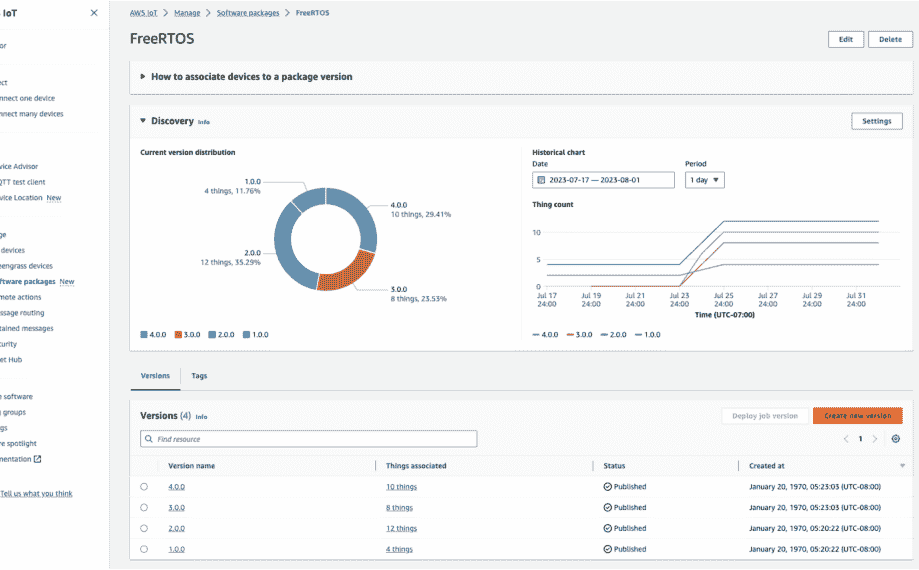
*图 15.3：AWS IoT 界面*

边缘计算实现了本地数据处理，以降低延迟。

- **安全技术：** 安全技术包括物联网安全机制，如加密、身份验证协议、区块链和零信任安全模型。
- **AI 和 ML：** AI/ML 有助于物联网系统中的预测分析、异常检测和自动化威胁缓解。

取证调查人员需要专业工具从不同的硬件、固件和通信协议中提取数据。数字取证调查人员理解物联网通信模式对于分析网络流量、检测异常和追踪网络事件至关重要。云取证和边缘取证在从分布式物联网生态系统中检索和保存数字证据方面发挥着关键作用。物联网领域由多样化的设备、通信协议和计算技术组成，这使得取证调查更加复杂。取证专家必须采用专业工具和方法，从物联网设备、云平台和网络日志中提取数字痕迹。

## 调查物联网架构与通信协议

物联网设备的架构和通信协议在物联网生态系统内的数据收集、传输和处理方式中起着至关重要的作用。对于寻求分析物联网网络数字证据的取证调查人员来说，理解这些组件至关重要。物联网系统构建在多层架构之上，由以下组件组成：

- **感知层（设备层）：** 感知层包括用于收集数据的传感器、执行器、RFID 标签、摄像头和嵌入式设备。
- **网络层：** 网络层利用 Wi-Fi、蓝牙、Zigbee、LoRa、5G 和 LPWAN 协议促进设备之间的通信。
- **边缘层：** 边缘层在物联网网关或边缘服务器上执行本地数据处理，在将数据发送到云端之前降低延迟。
- **云/处理层：** 云/处理层使用 AWS IoT、Google Cloud IoT 和 Microsoft Azure IoT 等平台存储、处理和分析物联网数据。(*图 15.4*)

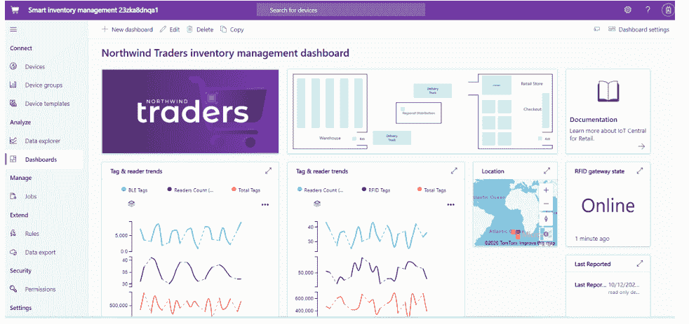
**图 15.4：** *Azure IoT 界面*

- **应用层：** 应用层提供用户界面、移动应用程序和基于 AI 的分析，用于物联网系统管理。

物联网设备根据范围、功耗和使用场景依赖于多种通信协议。物联网中的通信协议包括以下内容：

- **短距离通信协议：** 这些协议包括 BLE、Zigbee、Z-Wave 和**近场通信** (**NFC**)。BLE 用于可穿戴设备、医疗设备和智能家居电器，实现低功耗无线通信。Zigbee 和 Z-Wave 常用于智能家居自动化系统，实现低功耗和网状网络通信。NFC 用于非接触式支付和门禁控制系统。
- **中长距离协议：** 中长距离协议包括 Wi-Fi、蜂窝网络 (3G, 4G, 5G) 和**低功耗广域网络 (LoRaWAN)**。Wi-Fi 协议在家庭和办公物联网网络中很常见，但功耗高于其他协议。蜂窝网络 (3G, 4G, 5G) 用于需要移动性的物联网应用，如联网汽车和 IIoT。LoRaWAN 因其长距离和低功耗能力而被用于智慧城市和环境监测。
- **物联网专用消息协议：** 物联网专用消息协议包括**消息队列遥测传输 (MQTT)**、**受限应用协议 (CoAP)** 和**开放平台通信统一架构 (OPC UA)**。MQTT 是一种轻量级消息协议，用于低带宽的物联网通信。CoAP 专为资源受限的物联网设备设计，可在网络上实现低功耗通信。OPC UA 用于工业自动化和 SCADA 系统，以实现安全且标准化的通信。

物联网取证的调查方法如下：

- **数据包捕获与流量分析：** **数据包捕获 (PCAP)** 和流量分析通过监控网络流量日志来追踪物联网设备活动并检测异常。*(图 15.5)*


**图 15.5：** 数据包捕获

- **日志分析：** 日志分析通过调查设备日志、网关日志和云存储记录来重建事件。
- **IoT 固件逆向工程：** IoT 固件逆向工程从 IoT 设备固件和嵌入式系统中提取数据，以检索取证伪像。
- **云取证：** 云取证通过访问 IoT 云平台来检索存储的数据、日志和访问记录。

IoT 取证需要对 IoT 架构和通信协议有深入的理解，以便有效地分析设备行为并提取证据。网络层、消息协议和数据存储机制的多样性给取证调查带来了挑战。取证调查人员必须利用网络分析、日志提取和云取证来重建网络安全事件，并确保基于 IoT 证据的完整性。

## 精通 IoT 取证获取技术

从 IoT 设备获取数字证据是取证调查中的基础步骤。与传统的计算系统不同，IoT 环境涉及多样化的硬件、实时数据传输以及分布在边缘和云平台上的分布式存储，从而使取证获取变得更加复杂。IoT 取证获取涉及从物理设备、网络流量和云存储中检索数据，每项操作都需要专门的工具和方法。然而，数据加密、易失性内存和专有设备架构等挑战往往限制了对取证证据的直接访问。IoT 取证的进展与从各种数字证据中收集数据相关。识别数据的存储位置及其传输方式对于取证获取至关重要。相关的数字证据类型列举如下：

- **IoT 设备：** IoT 设备包括智能摄像头、可穿戴设备和工业传感器。
- **网络基础设施：** 网络基础设施包括路由器、网关和防火墙。
- **云平台：** 云平台是 IoT 数据进行远程存储的区域。
- **移动应用程序：** 移动应用程序和 Web 控制面板用于控制 IoT 设备。

各种类型的 IoT 数据获取方法列举如下：

- **物理获取：** 这种获取方法涉及使用 JTAG、UART 和 SPI 等硬件接口直接从 IoT 设备内存中提取数据。物理获取适用于嵌入式设备和专有硬件。
- **逻辑获取：** 通过基于软件的访问方式（如针对 Android 系统的 IoT 设备使用 SSH、ADB）收集文件、日志和系统数据。这可以在不修改设备的情况下访问用户数据、日志和配置。
- **网络流量获取：** 网络流量获取涉及使用 Wireshark、Zeek 或 tcpdump 等网络嗅探器捕获实时数据包。该工具有助于跟踪设备通信、未经授权的访问和网络攻击。
- **云获取：** 这种获取方法通过从 AWS、Google Cloud 和 Microsoft Azure IoT 等云服务中提取日志、用户活动和存储数据来执行。此类获取需要法律授权并符合云提供商的政策。

以下工具用于 IoT 取证获取：

- **固件提取：** Binwalk、JTAGulator 和 FTK Imager 等工具有助于固件提取。*（图 15.6）*

| 十进制 | 十六进制 | 描述 |
|---------|-------------|-------------|
| 7383740 | 0x70AABC | DER 格式证书 (x509 v3)，头部长度：4，序列长度：1643 |
| 16068292 | 0xF52EC4 | CRC32 多项式表，小端序 |
| 16069628 | 0xF533FC | SHA256 哈希常量，小端序 |
| 16097980 | 0xF5A2BC | Microsoft 可移植可执行文件 (PE) |
| 16100092 | 0xF5AAFC | Microsoft 可移植可执行文件 (PE) |
| 16101556 | 0xF5B0B4 | Microsoft 可移植可执行文件 (PE) |
| 16104484 | 0xF5BC24 | Microsoft 可移植可执行文件 (PE) |
| 16106780 | 0xF5C51C | LZMA 压缩数据，属性：0x5D，字典大小：16777216 字节，解压后大小：9542 字节 |

**图 15.6：** Binwalk 界面

- **网络取证：** Wireshark、Zeek 和 Nmap 等工具可助力网络取证。*（图 15.7）*

**图 15.7：** Nmap 界面

- **云取证：** AWS CloudTrail、Google Cloud Logging 和 Magnet AXIOM 等工具可助力云取证。
- **移动与 IoT 分析：** Autopsy、Cellebrite UFED 和 IoTInspector 等工具有助于移动和 IoT 分析。

IoT 取证获取涉及使用专门的工具和技术从设备、网络和云环境中检索数据。设备异构性、加密和易失性数据等挑战要求取证调查人员采用定制化的获取策略。有效地掌握物理、逻辑、网络和云获取方法，有助于取证专业人员有效地从 IoT 环境中收集和保存数字证据。

## 分析 IoT 流量与通信

IoT 网络流量分析是取证调查的一个关键方面，因为 IoT 设备不断通过有线和无线网络交换数据。与传统的计算环境相反，IoT 生态系统涉及多样化的通信协议、实时数据传输和基于云的交互，这使得网络取证既具有挑战性又是必不可少的。IoT 设备依赖于通过各种网络协议进行持续的数据交换，使得网络取证对于监控、检测异常和收集数字证据至关重要。IoT 生态系统中的网络攻击、未经授权的访问和数据泄露通常可以通过网络流量分析来追踪。取证调查人员通过分析 PCAP、通信日志和加密传输来重建网络安全事件。

关键的 IoT 网络流量分析技术包括以下内容：

- **数据包捕获和深度包检测 (DPI)：** PCAP 和 DPI 的需求意味着需要使用 Wireshark、Zeek 和 tcpdump 等多种工具来捕获实时流量以进行取证分析。这些工具可以识别恶意流量、未经授权的连接和设备通信。
- **日志和元数据分析：** 日志和元数据分析的需求涉及检查防火墙日志、路由器日志和**安全信息和事件管理** (**SIEM**) 警报以检测安全事件。这种分析技术可提供关于失败的身份验证尝试、异常流量激增和僵尸网络活动的洞察。
- **异常检测和入侵分析：** 异常检测和入侵分析涉及数字取证调查员使用的多种 AI 驱动的取证技术，例如使用 ML 模型来检测针对 IoT 的特定威胁，如**分布式拒绝服务** (**DDoS**) 攻击和勒索软件。相关的行为分析可以识别与恶意服务器通信的受损 IoT 设备。

相关的 IoT 网络取证工具包括以下内容：

- **Wireshark 和 Zeek：** Wireshark 和 Zeek 有助于进行 PCAP 和深度网络分析。
- **Nmap 和 Shodan：** Nmap 和 Shodan 有助于扫描 IoT 设备的漏洞。
- **Suricata 和 Snort：** Suricata 和 Snort 可用作入侵检测以检测 IoT 威胁。
- **Elasticsearch 和 Splunk：** Elasticsearch 和 Splunk 作为 SIEM 解决方案用于分析 IoT 网络日志。

IoT 网络取证在追踪网络安全事件、检测恶意活动和保存取证证据方面发挥着至关重要的作用。调查人员在克服加密流量和协议多样性等挑战的同时，必须分析 PCAP、网络日志和异常情况。通过有效利用先进的取证工具和 AI 驱动的分析，专业人员可以有效地监控、调查和保障 IoT 环境的安全。

## 分析固件、日志和配置数据

固件、日志和配置文件是存储设备设置、安全策略和运行数据的关键取证伪像。调查这些组件有助于揭露设备被攻破、未经授权的修改、恶意软件注入和安全配置错误。这些元素提供了关于系统运行、用户交互以及网络攻击中被利用的潜在漏洞的洞察。

提取和分析 IoT 固件与固件作为 IoT 设备的骨干相关，固件包含操作系统、应用程序和嵌入式安全控制。相关的固件获取方法包括：

- **直接提取：** 直接提取过程是指使用 JTAG、UART 或 SPI 接口进行底层访问。
- **空中下载（OTA）更新：** OTA 更新过程是指捕获发送到设备的固件更新。
- **文件系统分析：** 文件系统分析过程是指使用取证工具提取固件镜像。

固件分析的关键工具包括以下内容：

- **Binwalk：** Binwalk 是一款用于提取和分析固件文件结构的工具。
- **Ghidra 和 IDA Pro：** Ghidra 和 IDA Pro 用于对固件进行逆向工程以检测恶意软件。
- **Firmwalker：** Firmwalker 用于扫描固件中的安全漏洞。

日志充当设备活动、网络连接和安全事件的时间线。用于取证分析的不同类型的 IoT 日志包括以下内容：

- **系统日志：** 系统日志用于记录固件更新、崩溃和错误消息。
- **身份验证日志：** 身份验证日志用于记录登录尝试和身份验证失败事件。
- **网络日志：** 网络日志用于捕获设备通信模式和可疑流量。
- **云日志：** 云日志存储远程访问记录以及与云平台的交互。

不同的日志分析工具列举如下：

- **Splunk 和 Elasticsearch, Logstash, Kibana 堆栈 (ELK)：** Splunk 和 ELK 用于日志聚合和异常检测。
- **Graylog：** Graylog 是一款用于取证审计的开源日志管理工具。
- **Wireshark：** Wireshark 用于检查网络日志中是否存在异常流量。

配置文件决定了 IoT 设备如何运行、管理安全设置以及处理数据存储。具体而言，配置错误可能导致弱身份验证机制，例如默认密码和开放端口。此外还包括不安全的远程访问（如暴露的 SSH、Telnet 或 API 密钥）以及数据传输缺乏加密。配置分析的取证技术涉及使用取证工具从嵌入式设备中提取配置文件。此外还包括通过比较默认配置与修改后的配置来检测未经授权的更改。相关取证技术的适用性在于识别配置文件中的恶意脚本或隐藏后门。固件、日志和配置数据提供了宝贵的取证证据，可以揭示 IoT 设备中的网络入侵、未经授权的修改和系统漏洞。调查人员必须使用专门的工具和技术来提取、分析和解释这些组件，同时克服加密、篡改和私有格式等挑战。

## 真实案例研究

以下提供了关于从 IoT 取证调查中吸取教训的相关真实案例研究：

- **Mirai 僵尸网络攻击 (2016)：** Mirai 僵尸网络感染了数十万台 IoT 设备（包括 IP 摄像头和路由器），以发起大规模的 DDoS 攻击。攻击者利用了 IoT 设备中的默认凭据和弱安全设置。相关的取证调查和结果涉及 IoT 取证分析师在固件和网络流量日志中识别恶意软件签名。数字取证调查人员使用 Wireshark 和 Zeek 等工具分析了**命令与控制 (C2) 流量**。逆向工程后的 Mirai 恶意软件被用于理解传播技术。从此次事件中吸取的教训涉及更改默认密码和禁用不必要服务的重要性。此外，还需要进行实时 IoT 网络监控和异常检测。
- **针对工业 IoT 的 Stuxnet 蠕虫 (2010)：** Stuxnet 是一种复杂的恶意软件，旨在通过利用 IIoT 系统破坏伊朗的核离心机。它通过 USB 驱动器传播并针对西门子 PLC。相关的取证调查和结果表明，调查人员分析了恶意固件更新和 PLC 日志以追踪攻击。调查涉及使用 IDA Pro 和 Ghidra 等固件逆向工程工具来解构恶意软件。调查发现了**工业控制系统 (ICS)** 中的零日漏洞。调查揭示了关键基础设施中物理隔离（air-gapped）安全的需求。调查重点在于固件完整性检查和行为异常检测的重要性。

## 处理 IoT 取证中的隐私和法律考量

IoT 取证涉及从互连设备中收集、分析和保存数字证据，这些设备通常包含敏感的个人或公司数据。由于数据所有权、同意以及取证调查中的跨司法管辖区挑战，产生了法律和隐私问题。遵守区域性和全球性法规对于确保证据的可采纳性和个人数据的伦理处理至关重要。影响 IoT 取证的关键法律框架包括以下内容：

- **通用数据保护条例 (GDPR) (欧盟)：** 该法律框架强调取证调查中的数据保护、用户同意和隐私权。该框架要求取证团队尽量减少数据收集并对敏感信息进行匿名化处理。
- **加州消费者隐私法 (CCPA) (美国)：** 该框架赋予消费者知情、访问和删除个人数据的权利，影响了 IoT 取证的数据保留。
- **电子通信隐私法 (ECPA) (美国)：** 该框架限制未经授权拦截电子通信（包括 IoT 设备传输）。
- **计算机欺诈与滥用法 (CFAA) (美国)：** 该框架将未经授权访问 IoT 网络和计算系统的行为定为犯罪，影响了取证调查。

隐私意识导向的 IoT 取证最佳实践阐述如下：

- **获得适当的法律授权：** 获得适当法律授权这一方面，确保在进行取证分析之前获得法院批准或组织同意。
- **遵循数据最小化原则：** 以下数据最小化原则涉及仅收集必要的取证数据，以避免侵犯隐私。
- **确保安全的证据处理：** 安全证据处理的保证涉及使用防篡改存储、访问日志和加密来保护取证数据的完整性。
- **及时了解法律和监管变化：** 及时了解法律和监管变化的目的是跟踪与 IoT 调查相关的新网络安全法、数据保护政策和合规框架。

IoT 取证调查在处理敏感数据时必须平衡安全、隐私和法律合规。调查人员在数据访问、司法管辖权冲突和证据完整性方面面临挑战，需要遵守隐私法和取证最佳实践。法律专业知识、伦理取证方法和数据保护措施的有效整合，有助于取证专业人员在确保合法收集证据的同时，应对 IoT 调查的复杂性。

## 案例研究

相关案例研究详述如下：

- **Amazon Ring 摄像头泄露 (2019-2020)：** 攻击者获得了 Ring 安防摄像头的未经授权访问权，监视房主甚至骚扰个人。弱安全实践（如重复使用密码且缺乏**多因素身份验证 (MFA)**）导致了泄露。数字取证调查人员检查了访问日志和云存储元数据以追踪未经授权的登录。数字取证调查人员使用 Splunk 和 Graylog 等相关日志分析工具来检测被盗账户。调查过程表明，由于凭据填充攻击，凭据在暗网论坛中泄露。数字取证调查的结果揭示了 MFA 和强密码策略对于 IoT 设备的重要性。调查进一步表明，需要对 IoT 身份验证日志进行持续监控。
- **智能汽车黑客攻击 (Jeep Cherokee, 2015)：** 安全研究人员通过其信息娱乐系统中的漏洞，远程控制了一辆 Jeep Cherokee 的制动和加速系统。此次攻击利用了安全性较弱的 Uconnect 系统，允许黑客通过 CAN 总线网络发送恶意命令。取证调查和结果涉及分析车辆日志数据和网络流量以寻找远程访问痕迹。调查

揭示了汽车遥测和控制系统中潜在的零日漏洞。调查过程显示，攻击者使用了诸如 ICSim 和 Kayak 等 CAN 总线取证工具来复制和分析攻击向量。调查的详细分析表明，车载通信协议需要更强大的加密机制。

## 结论

IoT 技术的快速扩张给数字取证领域带来了机遇与挑战。IoT 设备日益增强的集成特性使其广泛存在于个人、工业和关键基础设施环境中，这促使取证专业人员开发专门的方法论，以有效地调查安全事件。随着 IoT 技术的不断进步，IoT 取证领域必须相应地演进，集成 AI、ML 和自动化取证工具以增强调查能力。

接下来的章节将重点讨论数字取证实验室的搭建及工具配置。

## 加入我们书籍的 Discord 空间

加入书籍的 Discord 工作区，获取最新更新、优惠、全球技术动态、新发布内容以及与作者的交流环节：

https://discord.bpbonline.com

# 第 16 章：搭建数字取证实验室与工具

## 简介

建立一个装备精良的数字取证实验室对于开展高效、可靠且具有法律效力的调查至关重要。结构合理的实验室为取证分析师提供了必要的工具、基础设施和安全控制措施，以便在维护完整性、监管链 (CoC) 并符合法律标准的同时检查数字证据。了解这些工具的功能和局限性，使取证专业人员能够针对不同类型的数字证据和调查场景选择最合适的解决方案。本章重点介绍搭建数字取证实验室和配置工具的详细步骤。

## 结构

本章涵盖以下主题：

- 理解数字取证实验室的重要性
- 数字取证实验室的设计与规划
- 硬件和软件要求
- 在实验室中搭建工作站和服务器
- 用于数字取证调查的网络基础设施
- 取证镜像工具和设备
- 数据存储和备份解决方案
- 移动设备取证工具和设备
- 取证分析软件和工具
- 网络取证工具和设备
- 数字取证的开源和商业工具

## 目标

本章重点在于理解数字取证实验室的重要性。随后，本章将介绍数字取证实验室的设计与规划。本章包含了数字取证实验室相关的硬件和软件要求。本章将指导如何在实验室中搭建工作站和服务器。本章详细介绍了用于数字取证调查的网络基础设施。本章阐述了取证镜像工具和设备。本章接下来将陈述数字取证实验室的数据存储和备份解决方案。本章列举了移动设备取证工具和设备。本章介绍了取证分析软件和工具。本章列出了网络取证工具和设备。本章陈述了用于数字取证的不同开源和商业工具。

## 理解数字取证实验室的重要性

专门的取证实验室确保数字证据在可控且安全的环境中进行分析，降低了篡改、污染或数据丢失的风险。取证实验室提供与外部网络的隔离，以防止调查期间出现未经授权的访问或恶意软件污染。取证实验室遵循标准化流程以维护监管链 (CoC)，确保证据在法庭上具有法律效力。对 ISO/IEC 17025、NIST 指南和 GDPR 等监管标准的合规性要求确保了取证结果的完整性。

结构良好的实验室提供专业的硬件和软件工具，以优化数据采集、分析和报告流程。此类实验室进一步鼓励取证团队高效处理海量数字证据，从而缩短事件响应时间。数字取证实验室可满足各种调查需求，包括网络犯罪调查、企业欺诈、内部威胁和国家安全案件。数字取证实验室可以针对专门的取证学科进行定制，例如移动取证、IoT 取证、云取证和内存取证。高效的调查有助于减少案件积压，提高响应速度，并确保及时的法律行动。

提高数字取证实验室效率的因素包括先进的工具、标准化的工作流、自动化以及熟练的人员。取证实验室配备了高性能取证工作站，旨在处理大型数据集、实现高速处理和先进的加密分析。专业的取证软件套件允许调查人员快速从各种设备中提取并分析数字证据。这些取证软件套件包括 EnCase、Autopsy、FTK 和 X-Ways Forensics。使用专门的取证复制器和写保护设备可确保以取证可靠的方式获取数据，而不会修改原始证据。

数字取证实验室可以作为取证研究和技能开发的中心，允许数字取证调查员测试新的取证方法、工具和技术。数字取证实验室为执法机构、学术机构和网络安全专业人员在真实取证场景中进行培训提供了结构化环境。取证实验室的成功建立确保了在进行数字调查时遵循最佳实践、框架和法律指令。配备完善的取证实验室有助于组织通过确保取证流程符合行业认可的合规标准来避免法律陷阱。

数字取证实验室是现代取证调查的支柱，为分析数字证据提供了安全、高效且符合法律要求的环境。通过将前沿取证工具、严格的协议和熟练的专业人员有效结合，取证实验室在解决网络犯罪、减轻安全威胁和维护正义方面发挥着至关重要作用。

### 设计与规划数字取证实验室

搭建数字取证实验室需要仔细的规划、基础设施设计和资源分配，以确保有效的调查、证据保存以及符合法律和安全标准。结构良好的实验室为取证调查员提供了系统分析数字证据所需的必要环境、工具和协议。

数字取证实验室的建立与明确定义的客观目标相关。相关目标包括执法调查、企业事件响应、学术研究和网络安全威胁分析。实验室将专注于特定的取证学科，如计算机取证、移动取证、云取证或 IoT 取证。数字取证实验室可以作为一个专门的设施，也可以作为用于现场调查的便携式或远程取证设置。

选择一个安全且具有访问控制的设施可确保数字证据免受未经授权的访问、盗窃或篡改。有效防止硬件损坏与实施环境控制相关，例如温度调节、无尘区和**静电释放 (ESD)** 保护。确保取证操作不间断则与实验室配备高速网络连接、充足的电源供应和数据备份解决方案相关。


安全和访问控制的有效建立与实施严格的访问控制相关，仅允许授权的取证人员进入实验室。此外，还需使用生物识别认证、监控摄像头和**入侵检测系统 (IDS)** 来确保设施的安全。建立安全的证据存储设施，包括可锁定柜子、防火保险箱以及用于维护取证数据完整性的异地备份方案。实验室取证分析硬件和软件的选择，涉及为实验室配备能够处理大型数据集、磁盘镜像和加密文件的高性能取证工作站。证据获取过程涉及使用专门的取证硬件，如写保护器、取证复制机和便携式取证工具包。从语境上看，安装以下工具与数字化取证实验室的搭建相关：

- **磁盘和文件取证：** 磁盘和文件取证涉及 EnCase、Autopsy、FTK 和 X-Ways。
- **移动取证：** 移动取证工具包括 Cellebrite UFED、MOBILedit 和 Magnet AXIOM。
- **内存和恶意软件分析：** 内存和恶意软件分析涉及使用 Volatility、Rekall 和 Cuckoo Sandbox。
- **云取证：** 有效的云取证包括 AWS CloudTrail、Google Takeout 和 Azure Security Center。

设计和规划数字化取证实验室需要一种战略方法，综合考虑安全性、基础设施、硬件、软件和合规性要求。设备齐全的实验室能够提高调查效率，确保证据完整性，并使取证团队能够处理复杂的网络事件。通过有效地遵守法律标准、实施强有力的安全措施并促进持续学习，组织可以创建一个符合取证规范的环境，以支持现代网络犯罪调查和数字取证研究。

### 硬件和软件要求

数字化取证实验室必须配备专门的硬件和软件工具，以便有效地获取、分析和保存数字证据。这些资源的选择取决于取证调查的范围、处理的案件类型以及处理的数字证据数量。

核心硬件组件包括：

- **取证工作站：** 取证工作站是指专为数据处理、磁盘镜像和取证分析而设计的高性能计算机。这些工作站配备了多核处理器、大容量内存（32GB 或更多）、高速 SSD 以及用于加速取证处理的 GPU 加速。
- **写保护器（硬件和软件）：** 硬件和软件形式的写保护器通过允许对存储设备进行只读访问，防止证据被意外修改。著名的写保护器包括 Tableau T8-R2、CRU WiebeTech USB WriteBlocker 和 OpenText Blocker。
- **取证复制机和镜像设备：** 取证复制机和镜像设备用于创建硬盘、SSD、USB 设备和 SD 卡的逐位（bit-by-bit）取证镜像。这些设备包括 Logicube Falcon、Tableau TD3 和 Atola Insight Forensic。
- **证据保存存储方案：** 用于长期存储取证镜像和案件数据的大容量 RAID/NAS/SAN 存储服务器。这些证据保存存储方案的优势还包括用于便携式证据存储的安全加密外部硬盘。
- **移动设备取证工具：** 移动设备取证工具是指用于从 iOS、Android 和其他移动设备中提取数据的专用工具。相关工具包括 Cellebrite UFED、MSAB XRY 和 Oxygen Forensics Suite。(*图 16.1*)

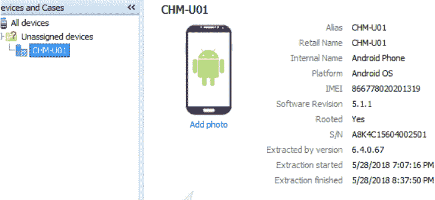
**图 16.1：** 移动设备镜像

- **网络取证设备：** 网络取证设备包括用于分析网络流量、检测入侵和识别恶意活动的封包捕获设备。这方面的相关示例包括 Wireshark、Zeek（原 Bro）和 Arkime（原 Moloch）。
- **现场取证和内存分析工具：** 用于捕获 RAM 和挥发性数据，以进行恶意软件检测、内部威胁分析和事件响应。这些工具包括 Volatility、Rekall 和 Magnet RAM Capture。
- **IoT 和嵌入式设备取证硬件：** IoT 和嵌入式设备取证的相关硬件包括与 IoT 设备、智能电器和 ICS 接口的设备。相关工具包括 JTAG 适配器、Chip-Off 工具、Bus Pirate 和 Shikra。
- **安全证据存储和物理安全：** 安全证据存储和物理安全涉及防火保险箱、访问控制储物柜和证据袋，用于安全存储扣押的设备。监控系统和生物识别访问控制用于确保有效的实验室安全。

数字取证的核心软件工具包括以下内容：

- **磁盘和文件取证软件：** 用于磁盘镜像、文件系统分析和删除文件恢复。相关工具列举如下：
    - **EnCase (OpenText)**：这是一款行业标准的取证工具。
    - **Autopsy (Sleuth Kit)**：这是一个开源的取证分析套件。
    - **Forensic Toolkit (FTK)**：这是一个快速索引和案件管理工具。
    - **X-Ways forensics**：这是一个轻量级但功能强大的取证科学软件。（图 16.2）

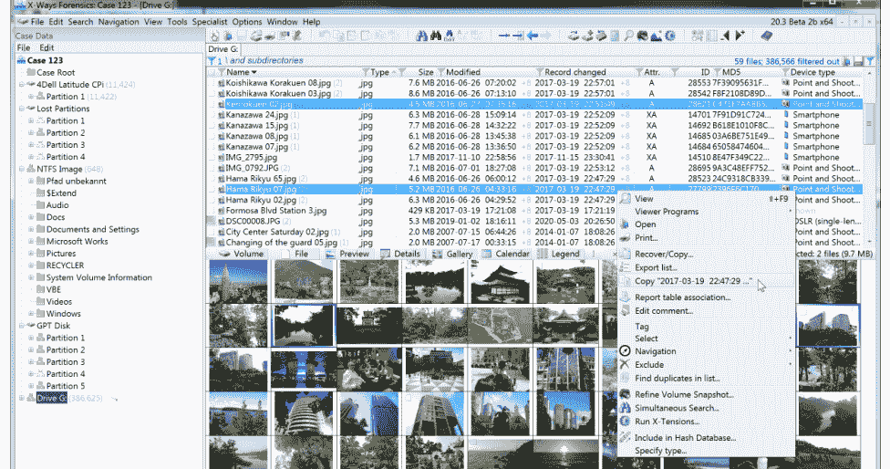
**图 16.2：X-Way forensics 界面**

- **移动设备取证软件：** 移动设备取证软件用于智能手机和平板电脑的数据提取、解密和分析。相关工具列举如下：
    - **Cellebrite UFED**：这是一款行业领先的移动取证工具。
    - **MSAB XRY**：此工具用于移动取证分析和报告生成。
    - **Magnet AXIOM**：此工具被用作移动、云和计算机取证的统一取证工具。

- **网络和云取证工具：** 网络和云取证工具用于捕获和分析网络流量、云日志和入侵数据。相关工具列举如下：
    - **Wireshark**：这是一款用于高效网络数据包分析的工具。
    - **Zeek (原 Bro)**：这是一款用于高效网络安全监控的工具。
    - **AWS CloudTrail, Google Takeout, and Microsoft Azure Security Center**：这些工具用于高效的云取证。

- **内存和恶意软件分析工具：** 这些工具用于分析挥发性内存 (RAM)、恶意软件行为和 Rootkit。相关示例包括：
    - **Volatility**：这是一个开源的内存取证框架。
    - **Rekall**：这是一个内存取证和事件响应工具。
    - **Cuckoo Sandbox**：这是一个自动化的恶意软件分析工具。

- **日志分析和 SIEM 工具：** 这些工具用于检查系统日志、安全日志和事件监控记录。相关示例包括以下内容：
    - **Splunk**：日志分析和威胁检测。
    - **Graylog**：开源 SIEM 解决方案。
    - **Elasticsearch, Logstash, Kibana (ELK Stack)**：日志关联和可视化。

- **哈希和数据完整性工具：** 这些工具使用加密哈希来验证证据的完整性。相关示例包括以下内容：
    - MD5, SHA-1, SHA-256 哈希计算器
    - Hashdeep, FTK Imager

- **隐写术和隐藏数据检测：** 此类工具尝试检测图像、音频和文件中隐藏或混淆的数据。该类别的相关工具包括以下内容：
    - **StegExpose**：此工具检测图像中的 LSB 隐写术。
    - **OutGuess, OpenStego**：这些是数字取证调查员使用的隐写检测工具。

- **云和 IoT 取证软件：** 云和 IoT 取证软件涉及从云存储和 IoT 生态系统中提取和分析取证数据。相关示例包括以下内容：
    - **Magnet AXIOM Cloud**：此工具辅助数字取证调查员进行云数据提取。
    - **AWS CloudTrail**：AWS CloudTrail 涉及 AWS 环境的取证日志记录。
    - **IoT inspector**：IoT inspector 是一款用于 IoT 流量分析的取证工具。

### 在实验室中设置工作站和服务器


一个设计良好的数字取证实验室需要配置适当的工作站和服务器，以处理高强度的取证调查、数据处理和安全的证据存储。该设置必须在支持计算机、网络、移动和云取证等多个取证学科的同时，确保高性能、数据完整性和安全性。数字取证的工作站要求如下：

- **选择高性能硬件**：高性能硬件的选择包括以下因素：
    - **处理器**：选择如 Intel i9、Xeon 或 AMD Ryzen Threadripper 等多核 CPU 对于快速数据处理至关重要。
    - **内存 (RAM)**：最低内存要求为 32GB，处理大型取证镜像和内存转储时建议使用 64GB 或更多。
    - **存储**：在设置数字取证实验室的工作站和服务器时，根据以下因素选择充足的存储至关重要：
        - **NVMe SSD (1TB 或更多)**：此存储对于快速取证数据处理非常理想。
        - **HDD (4TB 或更多)**：此存储对于证据存储非常理想。
        - **RAID 配置存储**：此存储对于冗余和数据完整性非常理想。
    - **图形处理单元 (GPU)**：高端的 NVIDIA 或 AMD GPU 对于密码破解和加速取证分析至关重要。

- **多显示器**：采用双屏或三屏设置的多显示器对于多任务取证工作非常理想。

- **操作系统考虑**：数字取证分析可以考虑以下**操作系统 (OS)**：
    - **Windows 10/11 专业版**：该操作系统与大多数取证工具（如 FTK、EnCase 和 X-Ways）兼容。
    - **Linux (Ubuntu, Kali, SIFT Workstation)**：这些操作系统用于开源取证工具和安全分析。
    - **macOS (用于 Apple 取证)**：该操作系统对于调查 Mac 设备至关重要。
    - **虚拟化软件 (VMware, VirtualBox, Hyper-V)**：该软件解决方案适用于分析恶意软件和运行取证模拟。

- **必要的取证软件和工具**：必要的取证工具如下：
    - **磁盘镜像工具**：相关的磁盘镜像工具包括 FTK Imager、EnCase 和 Autopsy。
    - **内存分析工具**：相关的内存分析工具包括 Volatility 和 Rekall。
    - **移动取证工具**：相关的移动取证工具包括 Cellebrite UFED 和 Oxygen Forensics。
    - **网络取证工具**：相关的网络取证工具包括 Wireshark 和 Zeek。
    - **云取证工具**：相关的云取证工具包括 Magnet AXIOM Cloud 和 AWS CloudTrail。
    - **密码恢复工具**：相关的密码恢复工具包括 Hashcat 和 John the Ripper。
    - **取证分析套件**：合适的取证分析套件包括 X-Ways Forensics、Autopsy 和 Magnet AXIOM。

取证服务器的设置涉及以下内容：

- **NAS/SAN 解决方案**：此解决方案对于集中式取证证据存储非常理想。
- **加密外部驱动器**：加密外部驱动器适用于长期证据保存。
- **网络接口**：选择 10GbE 网络适配器适用于快速的数据传输速度。

- **服务器软件和工具**：相关的服务器软件和工具包括以下内容：
    - **案件管理系统**：案件管理系统包括 Magnet REVIEW 和 Cellebrite Pathfinder。
    - **取证数据管理**：取证数据管理涉及 X1 Social Discovery 和 Paladin 等工具。
    - **网络监控和日志记录**：网络监控和日志记录的需求涉及 Zeek、Splunk 和 Graylog 等工具。
    - **安全备份解决方案**：安全备份解决方案包括 Veeam 和 Acronis Cyber Protect。
    - **云取证支持**：云取证支持包括 AWS、Azure 和 Google Cloud 安全工具。

在数字取证实验室中设置工作站和服务器对于高效的数据采集、分析和证据管理至关重要。高性能硬件、专业取证工具、安全存储解决方案和强大的访问控制确保了取证调查的完整性和可靠性。结构合理的实验室设置使调查人员能够处理大量的数字证据，进行多层取证分析，并根据法律和网络安全标准支持协作式案件管理。

### 数字取证调查的网络基础设施

强大的网络基础设施对于数字取证实验室至关重要，以便在保持取证数据完整性的同时，促进安全的证据收集、分析和协作。设计合理的网络基础设施可确保高效的数据传输、集中式日志记录、远程取证分析和安全的访问控制。

取证实验室网络基础设施的关键组件包括以下内容：

- **安全取证网络架构**：隔离的取证网络（物理隔离或 VLAN）用于防止外部威胁。独立的子网用于取证分析、证据存储和管理任务。**入侵检测与防御系统 (IDS/IPS)** 用于监控未经授权的活动。专用 VPN 和远程访问解决方案对于安全的取证调查非常理想。
- **高速网络设备**：高速网络设备涉及用于快速数据传输的 10GbE 或更高规格的网络交换机。此外，还可选择光纤骨干网以进行高速取证数据交换。负载均衡器的广泛使用旨在优化取证应用程序的性能。网络分段对于隔离取证工作站、证据存储和分析服务器非常理想。
- **集中式日志管理和 SIEM 解决方案**：集中式日志管理和 SIEM 解决方案涉及使用**安全信息和事件管理 (SIEM)** 来监控取证活动。相关示例包括 Splunk、ELK Stack 和 Graylog。在具体环境下，Syslog 服务器负责收集取证工作站和服务器的日志。
- **安全数据存储和备份解决方案**：安全数据存储和备份解决方案涉及使用**网络附属存储 (NAS)** 或**存储区域网络 (SAN)** 进行集中式证据存储。相关的 RAID 配置存储解决方案适用于冗余和可靠性。在具体环境下，基于云的取证存储解决方案适用于异地证据备份。自动化备份策略用于防止数据丢失。

取证实验室的网络取证能力如下：

- **网络数据包捕获和分析**：网络数据包捕获和分析涉及以下工具：
    - **Wireshark, Zeek (Bro), 和 TCPDump**：这些工具用于实时流量分析。
    - **深度数据包检测 (DPI) 工具**：这些工具对于检测隐藏威胁非常理想。
- **流量监控和异常检测**：流量监控和异常检测的需求涉及以下工具：
    - **网络行为分析 (NBA) 工具**：这些工具对于检测恶意流量非常理想。相关示例包括 SolarWinds、NetFlow 和 PRTG 网络监控。

结构合理的网络基础设施是任何数字取证实验室的关键组成部分，能够实现安全高效的证据获取、存储和分析。隔离取证网络、高速数据传输解决方案、集中式日志管理和安全访问控制的有效实施，有助于调查人员确保取证数据的完整性和机密性。此外，集成网络取证工具增强了数字取证实验室监控流量、检测异常和有效追踪网络威胁的能力。随着数字取证的不断演进，维持一个弹性且可适应的取证网络基础设施对于应对现代网络安全挑战至关重要。

### 取证镜像工具与设备

取证镜像（Forensic imaging）是数字调查中至关重要的第一步，旨在确保数字证据的精确、逐位（bit-by-bit）副本被保存用于分析，同时保持

原始数据的完整性。合适的取证镜像工具和设备可帮助调查人员从硬盘、**固态硬盘 (SSD)**、移动设备、网络存储和易失性内存中获取数据，而不会更改或损坏证据。取证镜像的过程涉及通过加密哈希（如 MD5、SHA-1 和 SHA-256）来维护数据完整性。取证镜像的另一个方面是通过确保写保护获取来防止数字证据被污染。取证镜像允许在不修改原始源的情况下对数字证据进行安全分析。取证镜像通过保留元数据和时间戳来支持法律可采纳性。不同类型的取证镜像在此列出：

- **磁盘镜像（全位对位复制）：** 此过程创建存储设备的精确副本，包括已删除和未分配的空间。常见格式包括 EnCase (E01)、Raw Image (DD) 和 **高级取证格式** (AFF)。相关工具包括 FTK Imager, EnCase, X-Ways, dd 和 Guymager。
- **实时内存 (RAM) 镜像：** 此过程涉及从 RAM 中捕获易失性数据，包括运行中的进程、加密密钥和打开的网络连接。使用的相关工具包括 Magnet RAM Capture, Volatility 和 Belkasoft Live RAM Capturer。
- **移动设备镜像：** 移动设备镜像的过程涉及提取智能手机和平板电脑的完整逻辑或物理副本。使用的相关工具包括 Cellebrite UFED, Oxygen Forensics 和 Magnet GrayKey。
- **云存储和虚拟机镜像：** 云存储和 **虚拟机 (VM)** 镜像涉及从 AWS、Google Drive 和 OneDrive 等云服务中捕获证据。此过程获取在云环境中使用之 VM 的取证镜像。使用的相关工具包括 Magnet AXIOM Cloud, AWS CloudTrail 和用于 VM 的 FTK Imager。

基本的取证镜像工具包括以下内容：

- **基于软件的镜像工具**：相关的基于软件的镜像工具包括：
    - **FTK imager**：FTK imager 用于创建取证磁盘镜像并验证完整性。
    - **Autopsy and Sleuth Kit**：Autopsy 和 Sleuth Kit 是开源的取证镜像和分析工具集。
    - **X-Ways forensics**：X-Ways forensics 是一款高级取证镜像和证据提取工具。
    - **Guymager**：Guymager 是一款基于 Linux 的镜像工具，具有高速获取能力。
    - **Magnet AXIOM**：Magnet AXIOM 是一款针对多种数字源的镜像和分析工具。
- **基于硬件的镜像工具**：相关的基于硬件的镜像工具包括：
    - **Tableau 取证复制机 (TX1, TD4, TD3)**：Tableau 取证复制机 (TX1, TD4, TD3) 有助于进行独立取证磁盘镜像。
    - **Logicube Falcon Neo**：Logicube Falcon Neo 是一款具有多种哈希算法的高速镜像系统。
    - **Ditto DX 取证复制机**：Ditto DX 取证复制机支持对加密和损坏驱动器的镜像。

取证镜像工具和设备通过确保准确且法律可采纳的证据获取，在数字取证中发挥着至关重要的作用。选择基于软件或基于硬件的镜像方案取决于介质类型、速度要求和安全考虑。通过使用写保护器、验证哈希值以及维护监管链 (CoC) 等最佳实践，鼓励取证调查人员维护数字证据的完整性并进行彻底调查。

### 数据存储和备份解决方案

数字取证实验室处理大量敏感数据，包括取证镜像、案件文件和调查报告。确保安全、可扩展且冗余的存储对于维护数据完整性、防止丢失以及遵守法律和监管要求至关重要。有效的备份解决方案可进一步防止硬件故障、网络威胁和意外删除。存储解决方案必须支持大容量取证镜像（每案可达数 TB）。容量和可扩展性进一步体现在优先选择 SAN 或 NAS 等可扩展架构。可靠的基于云的取证存储选项可提供按需扩展能力。数据完整性和安全性的概念涉及 **一次写入，多次读取 (WORM)** 存储，以防止证据被篡改。AES-256 和 TLS 等加密技术的应用确保了数据的机密性。部署 RBAC 和 MFA 等相关访问控制机制可限制未经授权的访问。通过实施哈希和校验和技术（如 MD5 和 SHA-256）来验证数据完整性。高速访问和性能则依赖于用于更快取证分析的 SSD 和 NVMe 存储。此外，还包括用于冗余和性能的相关 RAID 配置，如 RAID 5、RAID 6 和 RAID 10。此外，通过 10GbE 或光纤网络连接专用取证工作站，以实现高效的数据传输。

数字取证实验室的相关备份策略在此列出：

- **本地备份**：这涉及使用冗余存储系统（RAID, NAS 和 SAN）以实现即时访问。这进一步扩展到自动化备份调度，以减少人工错误。部署物理隔离（air-gapped）的备份服务器可提供额外的安全性。
- **异地和云备份**：基于云的取证备份解决方案（AWS S3, Azure, Google Cloud）用于灾难恢复。冷存储（磁带备份、离线磁盘）用于长期存档。混合云存储的使用可有效平衡成本和可访问性。
- **增量备份 vs 全量备份**：全量备份捕获整个取证数据集，但需要更多存储空间。增量备份仅存储更改的数据，从而优化空间。版本控制和快照功能确保了数据恢复选项。
- **合规性和 CoC 保存**：备份日志和元数据跟踪有利于取证审计追踪。遵循 NIST, ISO 27040 和 GDPR 等相关法律合规性有利于数据处理。不可变存储选项用于防止未经授权的修改。

合适的存储解决方案在此列出：

- **Synology NAS, QNAP NAS**：Synology NAS 和 QNAP NAS 是可扩展的 NAS。
- **Dell EMC Isilon 和 NetApp FAS**：Dell EMC Isilon 和 NetApp FAS 提供企业级取证存储。
- **Veritas NetBackup 和 IBM Spectrum Protect**：Veritas NetBackup 和 IBM Spectrum Protect 是高性能备份解决方案。

备份和灾难恢复工具如下：

- **Veeam backup and replication**：Veeam backup and replication 与 VM 和云备份相关。
- **Acronis cyber backup**：Acronis cyber backup 意味着安全的取证数据保护。
- **AWS Glacier 和 Google Vault**：AWS Glacier 和 Google Vault 提供具有成本效益的长期存储。

精心计划的数据存储和备份策略对于取证实验室确保数据完整性、安全性和可访问性至关重要。实施可扩展的存储解决方案、安全的访问控制和多层备份策略，鼓励取证团队保护关键证据免受数据丢失、网络威胁和合规违规的影响。在冗余、加密且符合法律要求的存储解决方案上的相关投资，确保了取证调查保持高效、可靠且在法律上可辩护。

### 移动设备取证工具和设备

移动设备在数字取证调查中起着至关重要作用，其中包含通话记录、消息、电子邮件、GPS 数据、应用数据和多媒体文件等宝贵证据。提取和分析这些数据需要专门的取证工具和设备，这些工具能够处理不同的操作系统、加密机制和数据恢复挑战，同时保持证据的完整性。移动设备取证表明，Android, iOS, Windows 和旧版移动操作系统需要平台特定的取证方法。然而，在不同制造商、硬件和操作系统版本方面的设备碎片化过程增加了数据提取的复杂性。相关的数据获取挑战包括限制访问的加密存储（如基于文件的加密和全盘加密）。此外，锁定设备和密码保护阻碍了直接的取证分析。云存储和远程抹除可能会在提取前擦除证据。相关的法律和合规问题涉及在获取数字证据之前必须具备的搜查令及其法律许可。相关的数据隐私法（如 GDPR, CCPA, CFAA 和 ECPA）监管着移动取证实践。监管链 (CoC)

文档记录可确保证据在法律法院中具有可采纳性。

相关的移动取证获取技术包括以下内容：

- **逻辑获取 (Logical acquisition)**：此获取技术提取可访问的数据，如联系人、消息、通话记录和媒体文件。这种获取技术侵入性较低，但无法恢复已删除或隐藏的文件。相关工具包括 Cellebrite UFED、Oxygen Forensic Detective 和 Magnet AXIOM。
- **物理获取 (Physical acquisition)**：此获取技术涉及创建整个设备内存的逐比特副本，包括已删除的数据。该过程需要专门的硬件并绕过加密/安全机制。相关工具包括 GrayKey（适用于 iOS）、JTAG 和 Chip-Off 技术以及 MSAB XRY。
- **云取证 (Cloud forensics)**：该工具从云备份（如 Google Drive、iCloud 和 OneDrive）中提取数据。使用此工具需要法律授权和访问凭证。相关工具包括 Elcomsoft Cloud Explorer 和 Magnet AXIOM Cloud。
- **SIM 卡和 SD 卡分析**：该工具从 SIM 卡中检索已删除的文本、联系人和网络日志。该工具从 SD 卡中提取多媒体文件、文档和隐藏数据。相关工具包括 SIM Analyzer 和 Belkasoft Evidence Center。

基本的移动取证工具包括以下内容：

- **商业移动取证工具**：Cellebrite UFED 是行业领先的从移动设备提取数据的工具。GrayKey 是一款先进的 iOS 取证工具，用于密码绕过和数据提取。MSAB XRY 支持从各种设备进行逻辑和物理提取。Oxygen Forensic Detective 是一款用于应用程序分析和云取证的综合工具。
- **开源和免费移动取证工具**：**Android Debug Bridge (ADB)** 用于从 Android 设备提取应用数据、日志和系统信息。带有移动模块的 Autopsy 是一款支持移动数据分析的开源取证套件。Magnet AXIOM Free Edition 是 Magnet AXIOM 的基础版本，用于初步的移动分析。**Linux Memory Extractor (LIME)** 用于捕获 Android 设备的实时内存以进行取证分析。iLEAPP 和 ALEAPP 是从 iOS 和 Android 设备中提取并分析应用程序和日志数据的工具。

移动设备取证的最佳实践包括在执行任何取证获取之前确保获得法律授权。使用法拉第袋 (Faraday bags) 和隔离工具可防止远程访问或篡改数据。最佳实践列表还涉及在分析设备之前始终先创建取证镜像。有效验证提取数据的完整性涉及使用加密哈希值，如 SHA-256 和 MD5。最佳实践进一步涉及记录监管链 (CoC) 以维持证据的可采纳性。移动设备取证是数字调查中复杂但至关重要的一部分，需要专门的工具和技术来处理不同的操作系统、加密挑战和数据获取方法。

### 取证分析软件和工具

取证分析软件和工具在从计算机、移动设备、网络和云环境等各种来源识别、提取和分析数字证据方面发挥着至关重要作用。这些工具帮助取证调查员进行深入的数据检查、恢复删除的文件、追踪网络犯罪，并在保留证据完整性的同时确保法律合规性。取证分析工具必须准确可靠，因为它们必须在不改变原始数据的情况下提取证据。取证分析工具需要支持哈希验证（如 MD5 和 SHA-256）以确保完整性。取证分析工具需要符合 NIST 和 ISO 27037 等行业标准。取证分析工具的多平台兼容性方面涉及支持 Windows、Linux、macOS 以及特定的移动操作系统（如 Android 和 iOS）。这些工具需要能够分析来自物理、虚拟和云环境的数据。

取证分析工具的相关类别列举如下：

- **磁盘和文件系统取证**：这涉及提取和分析已删除的文件、分区和元数据。此外还包括从存储设备中恢复损坏、隐藏和加密的数据。常用工具包括以下内容：
    - **Autopsy 和 Sleuth Kit**：Autopsy 和 Sleuth Kit 是用于高效磁盘分析的开源取证套件。
    - **X-Ways forensics**：X-Ways forensics 是一款先进的磁盘和内存取证工具。
    - **EnCase Forensic**：EnCase Forensic 是一个用于深度文件系统分析的行业标准工具。

- **内存和实时系统取证**：此类取证工具旨在从实时系统中提取 RAM Dump、运行中的进程和挥发性数据。这些工具进一步有助于调查恶意软件感染、Rootkit 和网络入侵。相关的知名工具列举如下：
    - **Volatility framework**：Volatility framework 是一款用于 RAM 分析的开源工具。
    - **Rekall**：Rekall 是一款用于提取挥发性数据的内存取证工具。
    - **Belkasoft RAM Capturer**：Belkasoft RAM Capturer 用于捕获实时系统内存以进行取证分析。

- **网络取证工具**：此类取证工具捕获并分析网络流量、日志和通信。此类取证工具有助于检测入侵、数据外泄和内部威胁。此背景下的常用工具陈述如下：
    - **Wireshark**：Wireshark 是一款领先的网络数据包分析工具。
    - **Xplico**：Xplico 用于提取和重构网络会话。
    - **NetworkMiner**：NetworkMiner 被动捕获网络数据包以进行取证分析。

- **移动取证工具**：此类工具从移动设备中提取应用数据、通话记录、短信、GPS 历史记录和已删除的文件。此类工具适用于 Android、iOS 和云备份。相关的知名工具列举如下：
    - **Cellebrite UFED**：这是移动数据提取的行业标准工具。
    - **MSAB XRY**：该工具捕获并分析来自移动设备的数据。
    - **Magnet AXIOM**：该工具恢复移动端、云端和计算机证据。

- **云和互联网取证工具**：这些取证工具从云存储、电子邮件、社交媒体和网页浏览历史记录中提取证据。这些取证工具有助于恢复删除的云数据和加密通信。此类常用工具包括以下内容：
    - **Magnet AXIOM Cloud**：该工具分析基于云的数据和备份。
    - **Elcomsoft Cloud Explorer**：该工具从 Google、Apple 和 Microsoft 云账户中恢复数据。
    - **X1 Social Discovery**：该工具捕获并分析社交媒体和网页内容。

- **日志和事件分析工具**：此类取证工具分析系统日志、安全事件和审计轨迹以进行取证调查。此类取证工具有助于识别未经授权的访问、系统异常和网络攻击。此背景下的常用工具包括以下内容：
    - **Splunk**：Splunk 是一款集中式日志分析和取证调查工具。
    - **ELK Stack (Elasticsearch, Logstash, Kibana)**：ELK Stack 是一款开源的日志管理解决方案。
    - **EventLog Analyzer**：EventLog Analyzer 是一款自动执行事件日志收集和分析的工具。

- **恶意软件和逆向工程工具**：此类取证工具识别并分析恶意软件、漏洞利用 (exploits) 和漏洞。这些工具用于对恶意软件行为进行逆向工程。此类广泛使用的工具列举如下：
    - **IDA Pro**：IDA Pro 是一款先进的逆向工程和反汇编工具。
    - **Ghidra**：Ghidra 是由 NSA 开发的开源逆向工程套件。
    - **Cuckoo Sandbox**：Cuckoo Sandbox 是一款自动化恶意软件分析工具。

取证分析软件和工具在数字调查中不可或缺，使取证专家能够从各种数字源中提取、分析和呈现关键证据。磁盘、内存、网络、移动和恶意软件取证工具的正确组合将引导数字取证

调查人员能够揭示数字足迹、追踪网络威胁并确保法律合规性。因此，采用最佳实践和合理的工具选择可增强取证调查的可靠性和准确性，从而确保调查结果在法庭上具有可采信度且在技术上稳健。

### 网络取证工具与设备

网络取证是数字取证的一个关键分支，专注于监控、捕获和分析网络流量、日志和通信，以检测网络威胁、入侵、数据泄露和其他安全事件。专业的网络取证工具和设备可帮助调查人员在保持取证完整性的同时，重建网络事件、分析异常分析并追踪恶意活动。

实时工具为活跃威胁提供实时监控和警报。事后工具则侧重于重建历史网络流量以进行取证分析。网络取证工具除了需要进行跨多个网络设备的日志关联以增强可见性外，还需要捕获完整数据包（PCAP）、元数据和会话日志。网络取证工具需要能够分析常用协议（TCP、UDP、HTTP、DNS、SMTP 和 FTP），同时处理加密流量分析，如 TLS/SSL、VPN 和 SSH。网络取证工具需要能够扩展以适应企业网络、云环境和 IoT 生态系统，这包括与 SIEM 系统集成以提高效率。

网络取证工具的不同类别如下所述：

- **数据包捕获与流量分析工具**：这些工具捕获并分析网络数据包、流量流和通信。它们有助于识别恶意软件活动、未经授权的访问和数据外泄。这方面的知名工具包括：
    - **Wireshark**：Wireshark 是一款行业领先的开源数据包分析工具。
    - **Tcpdump**：Tcpdump 是一款用于捕获和过滤网络数据包的命令行工具。
    - **TShark**：TShark 是 Wireshark 的终端版本，用于深度数据包分析。

网络取证工具和设备对于识别网络威胁、重建攻击时间线以及保障数字基础设施的安全至关重要。通过利用数据包捕获工具、IDS/IPS 解决方案、流量分析器和云取证平台，调查人员可以有效检测入侵、追踪恶意活动并响应事件。采用可扩展的取证解决方案和最佳实践可确保网络调查全面、可靠且具有法律可采信度。

### 数字取证的开源与商业工具

数字取证调查人员依赖广泛的开源和商业工具，从计算机、手机、网络和云环境等各种设备中获取、分析并报告数字证据。在开源工具和商业工具之间做出选择取决于预算、功能、法律可采信度和易用性等因素。

开源取证工具可免费获取，并在调查中被广泛使用。这些工具因其透明度、社区驱动的开发和灵活性而受到青睐，但它们可能需要一定的技术专长且缺乏官方支持。开源数字取证工具如下：

- **磁盘与文件系统取证**：相关工具包括 Autopsy 和 Sleuth Kit、TestDisk 和 PhotoRec，以及 X-Ways WinHex（免费版）。这些工具描述如下：
    - **Autopsy and Sleuth Kit**：Autopsy 和 Sleuth Kit 是一款基于 GUI 的取证套件，用于文件系统分析和证据恢复。
    - **TestDisk and PhotoRec**：TestDisk 和 PhotoRec 是磁盘分区恢复和文件恢复工具。
    - **X-Ways WinHex (Free Version)**：X-Ways WinHex 的免费版是一款用于原始数据分析的底层磁盘编辑器。

- **内存与易失性数据取证**：相关的内存和易失性数据取证工具包括 Volatility Framework、Rekall 和 Belkasoft RAM Capturer。这些工具详解如下：
    - **Volatility framework**：Volatility 框架是一款领先的内存取证工具，用于分析 RAM 转储。
    - **Rekall**：Rekall 是一款用于提取易失性数据和检测内存中恶意软件的开源工具。
    - **Belkasoft RAM Capturer**：Belkasoft RAM Capturer 为取证调查捕获实时系统内存。

- **网络与数据包分析**：网络和数据包分析工具包括 Wireshark、Tcpdump 和 Zeek (Bro)。这些工具详解如下：
    - **Wireshark**：Wireshark 是一款用于分析网络流量和识别异常的行业标准工具。
    - **Tcpdump**：Tcpdump 是一款用于网络取证调查的命令行数据包捕获工具。
    - **Zeek (Bro)**：Zeek 是一个网络安全监控和流量分析框架。

- **移动取证**：移动取证的相关工具包括 **Mobile Verification Toolkit (MVT)**、Andriller 和 AFLogical OSE。这些工具详解如下：
    - **Mobile Verification Toolkit (MVT)**：这是一个用于分析移动设备安全和检测间谍软件的开源工具。
    - **Andriller**：该工具从 Android 设备中提取数据，包括密码和 PIN 码。
    - **AFLogical OSE**：该工具从 Android 设备中捕获数据以进行取证分析。

- **恶意软件与逆向工程**：相关工具包括 Ghidra、Radare2 和 Cuckoo Sandbox。详解如下：
    - **Ghidra**：这个开源逆向工程框架由 NSA 开发。
    - **Radare2**：这是一个先进的逆向工程和二进制分析工具。
    - **Cuckoo Sandbox**：这是一个自动化恶意软件分析工具，可在隔离环境中运行可疑文件。

- **日志与事件分析**：相关工具包括 **Elasticsearch, Logstash, Kibana** (ELK Stack)、Graylog 和 Sysmon。列举如下：
    - **Elasticsearch, Logstash, Kibana (ELK Stack)**：这是一个开源的日志管理和分析框架。
    - **Graylog**：这是一个集中式日志收集和取证调查工具。
    - **Sysmon (Microsoft)**：该工具监控并记录系统活动以用于取证调查。

商业取证工具是由网络安全公司开发的专有解决方案，通常经过法律调查认证，并提供官方支持、自动化和高级分析功能。由于其用户友好的界面、全面的报告和内置的合规功能，这些工具被执法机构、企业和取证专业人士广泛使用。

- **磁盘与文件取证**：相关工具列举如下：
    - **EnCase Forensic**：这是一款用于取证镜像、分析和证据保存的行业领先工具。
    - **AccessData FTK (Forensic Toolkit)**：这是一个用于硬盘和注册表分析的高级取证套件。
    - **X-Ways Forensics**：这是一款轻量级但功能强大的磁盘分析取证软件。

- **内存与易失性数据取证**：相关工具列举如下：
    - **Magnet RAM Capture**：该工具为取证调查捕获实时内存。
    - **Belkasoft Evidence Center**：该工具可捕获、提取并分析 RAM、硬盘和云存储数据。

- **网络与云取证**：相关工具列举如下：
    - **Magnet AXIOM Cloud**：该工具捕获并分析基于云的数字证据。
    - **FireEye Helix**：这是一个先进的威胁检测和网络取证分析平台。
    - **Cellebrite Pathfinder**：这款网络取证工具适用于重建数字通信和流量。

- **移动取证**：相关工具包括：
    - **Cellebrite UFED**：这是提取和分析手机数据的行业标准工具。
    - **MSAB XRY**：这是一款用于从锁定设备中提取数据的移动取证软件。
    - **Oxygen Forensic Detective**：这是一个用于分析智能手机和 IoT 设备的高级取证工具。

- **恶意软件与逆向工程**：相关工具包括：
    - **IDA Pro**：这款商业工具用于恶意软件的反汇编和逆向工程。
    - **RE-Ghidra Pro**：这是 Ghidra 的增强专业版，具有额外的企业功能。
    - **Cuckoo Enterprise**：Cuckoo Sandbox 的高级版本，用于大规模恶意软件分析。

- **日志分析与 SIEM 集成**：相关工具列举如下：
    - **Splunk Enterprise Security**：这是一个先进的日志收集和取证调查平台。
    - **IBM QRadar**：这是一个 AI 驱动的安全智能和日志分析工具。
    - **Microsoft Sentinel**：这个云原生 SIEM 解决方案用于取证日志分析和事件


## 结论

建立数字取证实验室是确保有效调查、证据保存和分析的关键步骤。一个设计良好的实验室集成了专门的硬件、软件和网络基础设施，以便在保持数字证据完整性和监管链（CoC）的同时，高效地处理取证流程。取证镜像工具、数据存储解决方案以及移动取证设备的选择，在优化各种数字环境下的调查中起着至关重要的作用。

接下来的章节将重点讨论如何在数字取证领域发展职业生涯。

## 加入我们书籍的 Discord 空间

加入本书的 Discord 工作区，以获取最新更新、优惠、全球技术动态、新发布内容以及与作者的交流环节：

[https://discord.bpbonline.com](https://discord.bpbonline.com)

# 第 17 章：在数字取证领域发展你的职业生涯

## 引言

在技术进步、网络威胁增加和法律复杂性的驱动下，数字取证领域正在迅速演变。随着组织将网络安全和数字调查放在优先位置，对熟练数字取证专业人员的需求持续增长。在数字取证领域建立成功的职业生涯需要强大的技术基础、实践经验和持续学习。无论是追求在执法部门、私人安全公司、政府机构还是企业网络安全团队中的职位，专业人员必须时刻关注最新的工具、调查技术和法律考量。此外，获得行业认可的认证并参与实际的取证调查可以显著提升职业前景。本章将探讨职业路径、核心技能、认证以及行业趋势，以帮助有志之士和资深专业人员在数字取证领域获得晋升。

## 结构

本章涵盖以下主题：

- 数字取证领域的演变
- 企业环境中的数字取证
- 关键技能与知识
- 企业数字取证专业化
- 社交网络与专业协会
- 精通企业取证分析工具与技术
- 与法律及合规团队合作
- 管理企业级大规模数字取证调查
- 新兴技术与趋势
- 专业认证与继续教育

## 目标

本章详细介绍了数字取证领域在最新趋势和机会方面的演变。随后，本章将探讨数字取证在企业环境中的作用。本章包含了企业数字取证专业人员所需的关键技能和知识。本章专门探讨企业数字取证在事件响应、数据泄露、欺诈等方面的应用。本章指出了数字取证社区中的社交网络和专业协会。本章涉及精通企业取证分析工具与技术。本章涉及在企业数字取证中与法律和合规团队的协作。本章暗示了如何管理企业级的大规模数字取证调查。本章指出了如何紧跟企业数字取证中的新兴技术和趋势。本章强调了为企业数字取证专业人员培养领导力与沟通技巧的重要性。本章还包含了关于企业数字取证专业认证和继续教育的详细信息。

## 数字取证领域的演变

由于技术进步、复杂的网络威胁以及新的监管要求，数字取证领域在不断演变。随着数字生态系统的扩展，取证专业人员必须适应新兴挑战并利用新技术来增强调查。

塑造数字取证的关键趋势包括以下内容：

- **云和虚拟化取证：** 随着云计算成为主要需求，取证专业人员必须开发有效的技术来分析云存储数据、虚拟机和远程服务器。
- **物联网（IoT）和嵌入式设备取证：** IoT 设备和智能技术的日益增多带来了新的取证挑战，要求数字取证分析师专注于固件分析、传感器数据提取和网络设备调查。
- **取证中的 AI 和 ML：** AI 驱动的工具有助于自动化数字调查、模式识别和异常检测，从而加快取证进程。
- **加密货币和区块链调查：** 加密货币在网络犯罪中日益广泛的使用，促使了用于追踪区块链交易和揭露非法活动的取证工具的发展。
- **自动化和基于云的取证工具：** 数字取证正向基于云的解决方案和自动化方向转移，从而实现实时取证分析和远程调查。
- **5G 和边缘计算中的取证：** 5G 网络和边缘计算的持续扩展，促使取证专家开发策略以分析分布在去中心化环境中的数据。

塑造数字取证的关键机会与以下内容相关：

- **网络安全集成：** 取证专业人员向网络安全角色转型，包括威胁情报、风险评估和红队演习。
- **专业化取证领域：** 专业人员可以专注于细分领域，如恶意软件逆向工程、车辆取证、**工业控制系统 (ICS)** 取证和移动设备取证。
- **国际和企业调查：** 在全球企业和跨国组织中，对金融犯罪调查、欺诈检测和合规审计等方面的取证专业人员的需求正在增加。
- **学术与研究：** 对于希望在数字取证学术方面做出贡献的专业人员，在教学、培训和取证工具开发方面存在机会。

网络犯罪的快速扩张导致了数据隐私法规的出台和数字化转型。这意味着对高技能取证专业人员的持续需求在增长。在这个领域保持领先需要持续学习、高级认证、实践经验以及对演进技术的适应能力。

## 企业环境中的数字取证

网络威胁复杂性的不断增加，要求数字取证在企业环境中就识别、分析和缓解安全事件方面发挥关键作用。组织依赖取证专业人员来调查泄露、检测内部威胁、确保监管合规并加强网络安全防御。数字取证在企业环境中的重要性如下：

- **事件响应 (IR) 和威胁缓解：** 取证专家分析网络事件，重构攻击向量，并为遏制和恢复提供证据。这代表了有效的 IR 和威胁缓解。
- **内部威胁检测：** 取证分析有助于检测组织内部的数据窃取、未经授权的访问和员工违规行为。这类似于组织内部的内部威胁检测。
- **欺诈和金融犯罪调查：** 数字取证被用于揭露欺诈交易、身份盗用和企业间谍活动，作为欺诈和金融犯罪调查的一部分。
- **监管和合规要求：** 企业必须遵守 GDPR、HIPAA、PCI-DSS 和 ISO 27001 等标准，这些标准通常要求在安全事件后进行取证调查。这表明了组织在其运营领域相关的监管和合规要求。

实施取证就绪（forensic readiness）的最佳实践陈述如下：

- **制定数字取证策略：** 企业应建立明确的取证调查流程，以确保对事件做出及时响应。这涉及在企业内部建立有效的数字取证策略。
- **部署取证工具和日志记录机制：** 自动化取证工具和实时日志记录可提高调查效率。这是部署取证工具和日志记录机制的一部分。
- **培训和意识计划：** 对 IT 团队和员工进行定期培训有助于提高取证就绪能力和网络卫生习惯。这突出了培训和意识计划的重要性。

随着企业面临的网络风险日益增加，对精通企业安全、云...

调查以及合规审计的需求持续上升。在企业环境中，具备事件响应、恶意软件分析和取证数据恢复专业知识的人员将受到高度追捧。

## 关键技能与知识

要在企业数字取证领域脱颖而出，专业人员需要结合技术专长、分析能力、法律知识和调查熟练度。企业环境日益复杂，这就要求取证专家必须能够适应新兴威胁、云基础架构以及不断演变的合规要求。

核心技术技能阐述如下：

- **操作系统取证：** 操作系统取证是指数字取证调查员在分析 Windows、Linux、macOS 和移动操作系统痕迹以获取取证证据方面的熟练程度。
- **网络取证：** 网络取证是指在网络事件调查中对数据包分析、入侵检测和取证日志关联细节的理解。
- **云与虚拟化取证：** 云与虚拟化取证是指数字取证分析师从 AWS、Azure、Google Cloud 等云平台及虚拟机中提取和分析数据的能力。
- **恶意软件分析与逆向工程：** 恶意软件分析与逆向工程是指在沙箱技术、静态和动态恶意软件分析以及识别恶意代码行为方面的相关技能。
- **密码学与数据加密：** 密码学与数据加密方面涵盖了对加密算法、密码学哈希函数和安全数据恢复技术的知识。
- **脚本编写与自动化：** 数字取证调查员的熟练度体现在能够运用 Python、PowerShell 和 Bash 脚本来自动化取证数据的提取与分析。

数字取证调查员相关的调查和分析能力涉及以下领域：

- **证据收集与监管链 (CoC)：** 证据收集和 CoC 流程确保了取证数据的完整性、妥善的文档记录以及法律可采纳性。
- **时间线分析：** 时间线分析过程涉及从日志文件、系统痕迹和用户活动中重建事件序列。
- **行为分析：** 行为分析过程涉及理解攻击者的**技术、战术和过程 (TTPs)**，以识别**高级持续性威胁 (APTs)**。

相关的法律和合规知识涉及以下内容：

- **网络犯罪法律法规：** 相关的网络犯罪法律法规是指对 GDPR、HIPAA、CCPA、PCI-DSS 和 ISO 27001 要求的熟悉程度。
- **数字证据的可采纳性：数字取证调查员在数字证据知识方面的视角涉及对取证程序、宣誓书准备和专家证人证词的了解。
- **事件报告与文档记录：** 事件报告与文档记录是指数字取证调查员为执法部门、法律团队和公司管理层准备详细取证报告的能力。

除了技术技能外，为了满足企业取证需求，数字取证调查员还需要具备以下软技能：

- **批判性思维与问题解决：** 批判性思维和问题解决能力体现在关联证据、检测异常和重建网络事件的能力上。
- **沟通与报告：** 沟通方面是指向**技术和非技术利益相关者**清晰地展示取证结果。
- **协作与团队合作：** 协作与团队合作体现在与 IT 安全团队、法律部门和执法机构共同工作。

持续学习和专业发展涉及以下领域：

- **认证：** 认证方面是指潜在的数字取证调查员获取相关凭证，例如 GCFA、EnCE、CHFI、CCFP 和 CISSP。
- **实操训练：** 实操训练方面是指参与网络靶场、**夺旗赛 (CTF)** 比赛和取证模拟。
- **研究与社交：** 研究与社交方面是指参与取证社区、会议和行业协作。

企业数字取证专业人员需要将技术专长、调查能力、法律意识和分析技能相结合，以有效地处理网络事件和取证调查。数字取证调查员需要掌握操作系统取证、网络分析、云与虚拟化取证以及恶意软件分析，这对于识别和减轻安全威胁至关重要。

## 企业数字取证专业化

网络威胁日益复杂，促使企业数字取证专业人员通常在特定的调查领域进行专业化，以增强其专业知识和效率。专业化过程使取证分析师能够深入掌握与各种企业安全挑战相关的攻击方法、取证工具和调查技术。

事件响应和网络攻击调查涉及以下内容：

- **威胁识别与遏制：** 威胁识别与遏制是指快速检测并隔离勒索软件、内部攻击和 APT 等威胁。
- **内存与易失性数据取证：** 内存与易失性数据取证是指分析 RAM 转储、进程活动和实时系统痕迹以揭露活动威胁。
- **事件恢复与报告：** 事件恢复与报告是指制定事件时间线、实施缓解策略并准备详细的取证报告。

数据泄露调查涉及以下领域：

- **受损系统分析：** 受损系统分析是指在日志文件、网络流量和终端活动中识别相关的**失陷指标 (IoCs)**。
- **数据外泄追踪：** 数据外泄追踪是指使用相关的取证工具追踪被盗数据的移动路径并确定数据泄露的范围。
- **监管合规与报告：** 监管合规与报告是指确保符合 GDPR、HIPAA 和 CCPA 等数据保护法，并据此准备泄露通知报告。

金融欺诈和内部威胁调查涉及以下领域：

- **法务会计与交易分析：** 法务会计与交易分析是指调查财务记录、加密货币交易和洗钱活动。
- **员工违规与数据窃取：** 员工违规与数据窃取是指检测组织内部的未经授权访问、知识产权窃取和违反策略的行为。
- **行为分析与威胁情报：** 行为分析与威胁情报是指利用机器学习 (ML) 和取证画像来检测欺诈活动。

相关的云和基于 SaaS 的取证涉及以下领域：

- **云存储与虚拟机分析：** 云存储与虚拟机分析是指从 AWS、Azure、Google Cloud 及相关 SaaS 平台中提取和分析相关的取证证据。
- **日志聚合与威胁狩猎：** 有效使用 Splunk 和 ELK 等 SIEM 工具及相关的取证平台，可帮助数字取证调查员检测云环境中的异常情况。
- **法律与管辖权挑战：** 数字取证分析师面临的法律和管辖权挑战包括在取证调查过程中处理跨境数据法和云服务提供商的政策。


企业环境中的移动设备和 IoT 取证涉及以下内容：

- **企业移动设备调查**：对来自**自带设备 (BYOD)** 政策、公司配发的智能手机以及加密消息应用的移动痕迹进行有效分析，即构成了企业移动设备调查。
- **IoT 和嵌入式设备取证**：对智能安全系统、**工业物联网 (IIoT)** 以及网络化企业设备的调查与 IoT 和嵌入式设备相关。

相关的威胁情报和主动取证包括以下内容：

- **暗网调查**：暗网调查涉及监控地下论坛，以查找被盗的企业数据、凭据和网络犯罪活动。
- **主动威胁狩猎**：主动威胁狩猎过程涉及使用取证技术在隐藏的恶意软件、零日漏洞和持久性威胁升级到下一阶段之前对其进行检测。
- **与 SOC 和红队集成**：与**安全运营中心 (SOC)** 和渗透测试人员的有效协作以提升企业安全态势，类似于与 SOC 和红队的无缝集成。

在职业成长和专业化路径方面，专业人员可以通过获得 **GIAC 认证取证分析师 (GCFA)、注册舞弊审查师 (CFE)** 以及云安全认证 (CCSP 和 CCSK) 来在企业取证领域晋升。此外，通过在相关事件响应框架（如 NIST 和 MITRE ATT&CK）以及取证工具（如 Autopsy、X-Ways 和 Magnet AXIOM）中获得实操经验，可以进一步增强专业能力。在金融、医疗和政府等特定行业进行有效的专业化深耕，可以获得需求量更高的取证岗位。

## 社交网络与专业协会

对于寻求扩展专业知识、跟进新兴威胁并推进职业发展的数字取证专业人员来说，建立社交网络并积极参与专业协会至关重要。与行业同行交流、参加会议以及加入专业组织，为相关人员提供了知识共享、导师指导和职业增长的机会。

数字取证中社交网络的重要性体现在以下方面：

- **知识交换与协作**：知识交换与协作体现在通过与专家交流，帮助取证专业人员学习新技术、最佳实践和案例研究。
- **职业成长与机会**：职业成长与机会体现在有效的社交网络能够带来职位推荐、项目协作和专业认可。
- **获取专属资源**：获取专属资源体现在多个专业协会提供研究论文、取证工具包、培训课程和认证。
- **法律与伦理指导**：在法律和伦理指导方面，专业人员可以随时了解新法规、数字证据法以及法庭作证的最佳实践。

领先的数字取证专业协会包括以下组织：

- **国际计算机调查专家协会 (IACIS)**：IACIS 为执法部门和私营部门的取证分析师提供培训和认证。
- **高科技犯罪调查协会 (HTCIA)**：HTCIA 是一个全球性的网络，由专门从事网络犯罪调查和取证分析的专业人员组成。
- **国际取证计算机检查员协会 (ISFCE)**：ISFCE 提供 CCE 认证并支持全球范围内的取证检查员。
- **SANS 研究所和 GIAC 认证**：SANS 研究所和 GIAC 认证提供行业认可的认证，如认证取证分析师 (GCFA) 和恶意软件逆向工程 (GREM)。
- **注册舞弊审查师协会 (ACFE)**：ACFE 专注于金融犯罪调查、欺诈预防和法务会计。
- **云安全联盟 (CSA)**：CSA 提供关于云取证、安全控制以及云环境事件响应的指导。
- **国际隐私专业人员协会 (IAPP)**：IAPP 涵盖取证调查中的数据保护法、隐私法规和合规性。

通过积极建立社交网络并参与专业协会，取证专家可以提升其职业生涯，在领域内保持领先，并为数字取证的进步做出贡献。

## 精通企业取证分析工具与技术

企业数字取证要求专业人员利用专业工具和先进技术，高效地调查网络事件、数据泄露和内部威胁。精通取证分析工具使数字取证专家能够在收集、分析和解读数字证据的同时，确保其在法律程序中的完整性和可采纳性。企业取证工具的主要类别包括以下内容：

- **磁盘和文件系统取证**：磁盘和文件系统取证涉及使用相关工具进行磁盘镜像、删除文件恢复以及文件系统的取证分析。这些工具包括 Autopsy、X-Ways Forensics、EnCase、FTK 和 Sleuth Kit。
- **内存和易失性数据分析**：内存和易失性数据分析使用合适工具检查 RAM 痕迹，以检测恶意软件、活动进程和 Rootkit。这些工具包括 Volatility、Rekall 和 Redline。
- **网络取证**：网络取证工具捕获并分析网络流量，以调查网络入侵和可疑活动。相关工具包括 Wireshark、Zeek (Bro)、NetworkMiner 和 Snort。
- **云和虚拟化取证**：云和虚拟化取证涉及利用合适工具从云环境、虚拟机和 SaaS 平台中检索证据。这些工具包括 AWS CloudTrail、Azure Security Center 和 Magnet AXIOM Cloud。
- **日志和事件分析**：利用相关工具的优势，检查来自操作系统、防火墙、应用程序和安全设备的日志。这些工具包括 Splunk、**Elasticsearch, Logstash, Kibana Stack (ELK)** 和 Graylog。
- **恶意软件和逆向工程**：恶意软件和逆向工程使用 IDA Pro、Ghidra、Cuckoo Sandbox 和 PEStudio 等工具分析恶意代码行为和恶意软件感染的取证指标。
- **移动和 IoT 取证**：移动和 IoT 取证使用 Cellebrite UFED、MOBILedit Forensic 和 IoT Inspector 等工具从移动设备、嵌入式系统和 IoT 网络中提取数据。

先进的企业取证技术包括以下内容：

- **时间线分析**：时间线分析涉及利用日志、注册表文件和元数据中的时间戳来重建系统事件序列。
- **实时取证**：实时取证在不中断业务运行的情况下对活动系统进行调查。
- **隐写术检测**：隐写术检测用于识别多媒体内容中隐藏的消息或文件。
- **取证哈希和完整性校验**：取证哈希和完整性校验使用 MD5 和 SHA-256 等加密哈希算法来确保数据完整性。
- **暗网和 OSINT 调查**：暗网和 OSINT 调查涉及从相关的暗网来源收集网络威胁情报。
- **取证中的 AI 和 ML**：取证中的 AI 和 ML 可自动化威胁检测、异常分析和日志关联。

精通取证工具和技术对于有效调查企业网络威胁、确保合规性以及增强组织安全态势至关重要。


## 与法律和合规团队协作

企业数字取证不仅涉及技术调查，还需要与法律和合规团队紧密协作，以确保取证过程符合监管框架、公司政策和法律标准。适当的法律协调有助于组织降低风险，维护证据的完整性，并确保在法庭审理中的可采信性。

有效的法律和合规协作旨在确保调查与法律法规保持一致。这意味着数字取证需要遵守当地、国家和国际法律，如 GDPR、HIPAA、CCPA 和 PCI-DSS 等法律。对监管链（CoC）的适当保护涉及取证专业人员记录证据的收集、处理和存储程序，以防止法律质疑。企业取证中关键的法律和合规考量包括以下方面：

- **数据隐私和保护法**：数据隐私和保护法涉及了解数字取证调查如何影响**个人可识别信息 (PII)**、员工数据和客户记录。
- **电子发现 (eDiscovery) 和法律保留**：电子发现和法律保留确保电子证据被保存，以用于内部调查、监管查询或诉讼。
- **员工监控和职场调查**：在进行取证调查时，在企业安全政策与员工隐私权之间取得平衡，这涉及员工监控和职场调查。
- **知识产权盗窃和内部威胁**：在确保遵守劳动法的同时，调查企业间谍活动、未经授权的数据访问和商业秘密盗窃案件，这涉及知识产权盗窃和内部威胁。
- **跨境调查和管辖权挑战**：处理跨越多个国家、法律体系和数据主权法的取证调查，涉及跨境调查和管辖权挑战。

与法律和合规团队协作的最佳实践包括以下方面：

- **法律团队尽早介入调查**：法律团队的尽早介入是指从一开始就聘请法律顾问，确保取证工作符合监管要求。
- **标准化数字证据文档**：标准化数字证据文档涉及维护详细的取证报告、事件日志和妥善的监管链记录。
- **实施基于角色的访问控制**：实施基于角色的访问控制是指将取证数据的访问权限仅限于授权人员，以防止法律风险。

法律和合规团队之间的有效协作鼓励数字取证专业人员依法开展调查，从而保护组织免受法律风险。

## 管理企业级大规模数字取证调查

企业数字取证调查可能具有复杂性、时效性且资源密集，尤其是在处理大规模网络事件、数据泄露或内部威胁时。管理此类调查需要结构化的方法论、可扩展的取证解决方案以及取证、安全、法律和合规团队之间的有效协调。大规模取证调查中现有的挑战包括以下方面：

- **海量数据量**：海量数据量是指企业产生大量的日志、电子邮件、文件和系统活动，需要高效的数据处理能力。
- **分布式和混合 IT 环境**：分布式和混合 IT 环境意味着调查通常涉及本地系统、云存储、虚拟化环境和远程端点。
- **协调多个团队和利益相关者**：协调多个团队和利益相关者是指大规模案件需要安全团队、IT 管理员、法律顾问和执法部门之间的协作。
- **维护监管链 (CoC)**：维护监管链涉及在多个地点和团队之间处理证据完整性，这对于数字证据在法庭上的法律可采信性至关重要。
- **合规性和监管要求**：大规模调查在合规性和监管要求方面必须遵守全球隐私法、行业法规和公司政策。

用于大规模数字取证的有效工具和技术包括以下方面：

- **企业级取证套件**：企业级取证套件包括 EnCase Enterprise、FTK Enterprise 和 X-Ways Investigator。
- **云和远程取证**：云和远程取证包括 Magnet AXIOM Cloud、AWS CloudTrail 和 Azure Sentinel。
- **大数据和 AI 驱动的取证**：大数据和 AI 驱动的取证包括 Splunk、ELK Stack 和 IBM QRadar。
- **网络和端点监控**：网络和端点监控包括 Wireshark、Zeek、Carbon Black 和 CrowdStrike Falcon。
- **自动化日志分析和 SIEM**：自动化日志分析和 SIEM 包括 Splunk、ArcSight 和 Microsoft Sentinel。

管理企业级取证调查需要技术专业知识、结构化方法论、可扩展取证工具以及强大的跨部门协调能力的结合。高效的管理可确保快速的事件响应、最小的业务中断，并符合法律和监管标准。

## 新兴技术与趋势

在网络威胁、计算技术和取证方法论进步的驱动下，企业数字取证领域在不断演进。这意味着取证专业人员需要不断更新其技能、工具和调查方法，以领先于复杂的网络犯罪分子并适应不断变化的数字化格局。

影响数字取证的关键新兴技术包括以下方面：

- **取证中的 AI 和 ML**：AI 和 ML 驱动的取证工具有助于自动化数据分析、检测异常并加快证据关联。从情境上看，ML 模型有助于识别此前未知的攻击模式和行为异常。
- **云和远程取证**：云计算、混合环境和去中心化数据存储的兴起需要新的获取和分析取证证据的方法。相关的云取证工具包括 AWS CloudTrail 和 Magnet AXIOM Cloud，有助于调查云环境中的数据泄露和内部威胁。
- **区块链和加密货币取证**：加密货币和区块链技术使用量的增加促使取证调查员使用相关工具追踪比特币交易、分析智能合约并揭露金融欺诈。这些工具包括 Chainalysis、CipherTrac 和 Elliptic，它们辅助区块链调查。
- **物联网 (IoT) 和边缘计算取证**：企业中 IoT 设备的扩张创造了新的攻击面，需要专门的取证方法。调查员需要 IoT 取证框架来分析智能设备、嵌入式系统和工业控制网络。
- **零信任和端点取证**：零信任安全模型的实施要求取证专家持续验证身份、监控访问日志并分析端点遥测数据。
- **高级端点检测与响应 (EDR) 解决方案**：高级 EDR 解决方案包括 CrowdStrike Falcon（图 17.1）和 Carbon Black，用于辅助取证分析。


图 17.1：CrowdStrike Falcon 界面

塑造企业数字取证未来的关键趋势包括以下内容：

- **勒索软件调查的兴起**：企业面临的勒索软件攻击日益增多，需要专业的取证技术来追踪攻击者、解密文件并恢复系统。
- **与 SOC 和 IR 的集成**：数字取证现已成为 SOC 的核心功能，这意味着需要与事件响应（IR）团队紧密合作，实时分析违规行为。组织正在采用 **安全编排、自动化与响应 (SOAR)** 平台来简化取证工作流。
- **暗网与威胁情报取证**：调查人员需要利用 **开源情报 (OSINT)** 和暗网监控工具来揭露被盗凭据、数据泄露和网络犯罪活动。
- **自动化与云原生取证**：企业正在集成云原生取证解决方案，以实现实时调查和自动化证据收集。

紧跟新兴技术、工具和取证趋势，对于增强调查能力、提高威胁检测能力以及保持对不断演变的法规的合规性至关重要。

## 领导力与沟通技巧

仅凭技术专长不足以在企业数字取证领域取得成功。领导力和沟通技巧对于有效地管理调查、与跨职能团队协作以及向高管、法律团队和利益相关者传达取证结果至关重要。关键领导力与沟通技巧的培养包括以下内容：

- **增强问题解决与批判性思维能力**：强大的分析思维有助于取证领导者做出数据驱动的最终决策，并适应不断演变的网络威胁。
- **积累危机管理经验**：危机管理经验的积累涉及到处理高压力的取证案件，这需要韧性、适应能力以及在压力下保持冷静的能力。
- **提高公众演讲与报告写作能力**：提高公众演讲和报告写作技能鼓励参与专业写作课程、公众演讲研讨会以及取证演示培训，从而提高传递取证结果的清晰度。

强大的领导力和沟通技巧使取证专业人员能够有效地管理调查，与企业团队协作，并自信地展示取证结果。

## 专业认证与继续教育

网络威胁的持续演变促使企业数字取证专业人员不断更新最新的调查技术、法律考量和技术进步。获得专业认证并参与继续教育有助于取证专家增强可信度、精炼技能并推进职业生涯。针对企业专业人员的顶级数字取证认证包括以下内容：

- **GIAC 认证取证分析师 (GCFA)：** 该专业认证专注于高级取证分析、内存取证和事件响应。
- **GIAC 网络取证分析师 (GNFA)：** 该专业认证倾向于专注于网络流量分析、入侵检测和基于网络的取证调查。
- **认证计算机检查员 (CCE)：** 该专业认证涉及取证证据的获取、分析和报告方法论。
- **EnCase 认证检查员 (EnCE)：** 该专业认证涉及验证使用 EnCase 进行取证调查、电子发现（eDiscovery）和证据分析的专业能力。
- **认证取证计算机检查员 (CFCE)：** 该专业认证由 IACIS 提供，专注于数字取证最佳实践和证据的法庭呈递。
- **认证网络取证专业人员 (CCFP)：** 该专业认证涉及提供对网络取证、法律方面和取证管理策略的广泛理解。

数字取证的继续教育包括以下内容：

- **高级培训课程和研讨会：** **SANS Institute、EC-Council 和 ISFCE** 等组织提供实操取证培训。云取证、IoT 取证和移动设备取证的专业课程有助于专业人员保持领先。
- **高等教育和学位项目：** 在网络安全、数字取证或计算机科学领域攻读硕士学位，可以增强潜在数字调查员在企业取证方面的专业知识。
- **在线学习和自学培训：** 相关平台（如 Cybrary、Coursera 和 Pluralsight）提供灵活的取证培训选项。
- **参加会议和行业活动：** 参与 SANS DFIR Summit、Black Hat 和 RSA Conference 等活动，有助于取证专家从实际案例研究中学习并与行业领袖建立联系。
- **发表研究并为取证社区做出贡献：** 撰写关于取证调查的白皮书、博客或案例研究可以展示专业能力并帮助推动该领域的发展。

获得专业认证并参与继续教育，可确保企业数字取证专业人员保持技能先进、具备竞争力，并准备好处理复杂的取证调查。

## 结论

企业数字取证领域是一个动态且快速发展的学科，需要技术专长、领导能力和持续学习的结合。随着网络威胁变得更加复杂，取证专业人员需要通过掌握新兴技术、企业取证工具和调查方法论来适应变化。在企业数字取证领域取得成功的职业生涯需要专业技能，包括事件响应、欺诈调查、法律合规和大规模取证分析。专业人员还必须培养强大的沟通和领导能力，以便与安全团队、法律部门和执行利益相关者有效协作。紧跟最新的取证技术、工具和监管要求是成功的关键。这可以通过专业认证、继续教育、建立人脉以及积极参与行业活动来实现。诸如 GCFA、CCE、EnCE 和 CFCE 等认证可以提供行业认可并增加职业增长机会。

接下来的章节将重点介绍在数字取证领域部署的相关行业最佳实践。该章节将详细探讨数字取证领域潜在专业人员可选择的不同职业方向。

## 加入我们书籍的 Discord 空间

加入书籍的 Discord 工作区，获取最新更新、优惠、全球技术动态、新发布内容以及与作者的交流机会：

https://discord.bpbonline.com

# 第 18 章：数字取证的行业最佳实践

## 简介

数字取证是一个综合了网络安全、执法和企业调查的多学科领域。日益增长的网络威胁增加了对数字取证在证据收集和安全强制执行方面的依赖。数字取证的基础和演进与其在网络安全、执法和企业安全中的全面角色相关。数字取证的演进路径是从早期的基础文件恢复，发展到用于调查网络犯罪和违规行为的高级取证方法论。数字足迹的不断扩大，与由于云计算、**物联网 (IoT)** 和演进的数字平台而导致的网络威胁复杂性增加密切相关。本章旨在探讨相关的行业最佳实践以及数字取证领域的职业前景。


## 结构

本章涵盖以下主题：

- 行业最佳实践
- 数字取证的职业范围

## 目标

本章重点在于详细理解应用于数字取证不同领域的各种最佳实践。此外，本章还将指出数字取证在职业发展方面的不同方向。

## 行业最佳实践

数字取证在企业环境中的重要性体现在企业级应用、**事件响应 (IR)** 集成以及监管与合规需求方面。与数字取证相关的企业应用不再局限于执法部门，而是扩展到了公司安全、合规性和欺诈检测。IR 集成涉及取证团队在减轻安全漏洞影响和确保业务连续性方面的作用。企业利用取证手段调查数据泄露、欺诈和内部威胁。监管和合规需求包括遵守 GDPR、HIPAA、PCI-DSS 以及其他全球安全框架。企业将取证流程集成到安全运营中，以高效处理网络事件。法律和伦理考量包括认识到与伦理挑战和全球法律框架相关的监管链（chain of custody）的重要性。监管链的重要性在于维护数字证据在法律诉讼中的完整性和可采纳性。伦理挑战则在于如何在调查需求与隐私法及公司政策之间取得平衡。相关的全球法律框架意味着需要理解不同司法管辖区在数字取证法规上的差异。数字取证的方法论和流程包括超出传统方法的取证流程阶段以及标准化。取证流程阶段包括采集、保存、分析、记录和报告。利用 AI、自动化和基于云的取证解决方案来提高效率，涉及考虑超越传统方法的策略。有效的标准化包括采用 NIST、ISO 27037 以及其他取证最佳实践。

数字取证相关的历史视角体现在早期的取证调查侧重于硬盘，而如今则涵盖了云端和虚拟环境。相关的技术转变体现在先进加密技术的引入、基于云的存储以及去中心化网络。相关的未来增长领域包括 AI 驱动的取证自动化和实时取证情报，这些正在塑造数字取证领域的未来。有效地处理法律和伦理方面的问题与监管挑战相关，因为不同国家具有不同的数字证据法，因此要求取证专业人员保持更新。相关的伦理考量指出，应负责任地处理敏感数据，以避免侵犯隐私和法律冲突。法庭可采纳性是指取证证据需要遵循适当的**监管链 (CoC)** 程序才能在法律上被采纳。数字取证流程的展开涉及采集、保存、分析、记录和报告的标准化方法，以确保数字取证调查的完整性和保存。数字证据的处理涉及使用相关的取证镜像工具来创建安全副本并防止被篡改。报告和陈述则涉及以结构化方式记录调查结果，以便在法律诉讼中使用。

数字取证的工具库正在扩展到 Kali Linux 之外。这体现在多样化的工具集、针对不同领域的专业工具，以及可扩展性和自动化方面。**取证工具包 (FTK)** 的有效扩展与合适的开源和商业工具相关，例如 EnCase、Autopsy 和 Magnet Axiom 发挥着至关重要的作用。多样化的工具集旨在探索传统基于 Linux 的取证套件之外的商业和开源取证工具。针对不同领域的专业工具包括内存取证、移动取证、云取证和 IoT 调查。涵盖网络取证、内存分析、移动取证和云调查的不同工具。可扩展性和自动化涉及使用**机器学习 (ML)** 和自动化工具来提高取证效率。集成 ML 以加速取证数据处理和异常检测。

数字取证的过程与从数字犯罪现场采集的电子设备中进行数字证据的调查、分析和恢复相一致。在数字取证调查中部署标准化程序的必要性意味着确保数字证据在法庭上的准确性、完整性和整体法律可采纳性。有效数字取证调查的关键领域包括处理数字证据、数字证据镜像、数据分析、法律合规和报告。数字取证调查的程序类似于适当的指南，如**美国国家标准与技术研究院 (NIST)**、ISO/IEC 27037 和法律法规。数字取证调查员广泛在数字取证领域使用以下最佳实践，以便在法庭上的网络安全案件中实现正义：

- **证据处理与监管链**：数字证据对于网络安全案件的正义交付至关重要，因此在网络犯罪案件的整个过程中需要进行有效处理。适当的数字证据处理要求数字取证调查员部署监管链 (CoC)。该文档详细记录了数字取证调查员对数字证据的处理过程。因此，数字取证调查员使用适当的软件解决方案（如写保护工具 Write Blocker Tools）来限制对数字证据的篡改。数字取证调查员将数字证据存储在安全且防篡改的位置。数字取证调查员确保维护完整的数字证据文档，如时间戳、案件编号和签名。（图 18.1）

**图 18.1：数字证据记录的领域**

- **取证获取与镜像**：从网络犯罪现场有效获取数字证据，要求在启动数字取证调查过程之前为其创建取证副本。数字取证调查员使用行业认可的数字证据镜像工具，如 FTK Imager、EnCase 和 Autopsy。数字取证调查员鼓励使用 MD5、SHA-1 和 SHA-256 等哈希算法来验证所获取的数字证据镜像的完整性。（图 18.2）

| MD5 | SHA-1 | SHA-256 |
| :--- | :--- | :--- |
| • 消息摘要算法 5<br>• 固定长度输出<br>• 用于文件完整性检查 | • 安全哈希算法 1<br>• 固定长度输出<br>• 为加密安全而设计 | • 256 位安全哈希算法<br>• 固定长度输出<br>• 用于比特币 |

**图 18.2：不同的哈希算法**

取证证据获取和镜像的过程要求在最大可能范围内避免对数字证据的篡改。

- **数据分析与检查**：数据分析和检查的过程涉及遵循标准化的取证方法论，如 NIST **网络安全框架 (CSF)** 和 ISO/IEC 27037。（图 18.3）

**图 18.3：网络安全框架**

这需要使用多种取证工具对数字证据进行有效的交叉验证。这些工具包括 Autopsy、X-Ways 和 Magnet AXIOM。整个数据分析阶段需要记录所有发现并维护单个步骤的日志。数字证据检查的过程类似于将发现的结果与时间线、日志和元数据相结合以获取上下文。

- **法律与伦理合规**：数字取证的法律和伦理合规性体现在遵守多个法律框架，如**通用数据保护条例 (GDPR)**、**医疗保险可移植性与责任法案 (HIPAA)** 或**计算机欺诈与滥用法案 (CFAA)**。（图 18.4）


**图 18.4：** 网络安全中的法律框架

法律和伦理合规性要求相关的取证分析必须遵循法院认可的程序。这对于在数字取证调查阶段避免未经授权地访问数据或系统至关重要。伦理合规性进一步要求在数字取证调查处理个人和敏感信息的阶段，必须尊重隐私和保密性。

- **报告与记录：** 报告与记录意味着需要维护一份详细且结构良好的取证报告，其中包含调查结果、方法和结论等具体章节。详细的报告与记录涉及将屏幕截图、日志文件和提取的元数据纳入报告中以支持主张。一份高效报告的标志在于使用清晰、简洁且公正的语言，使其适用于法律诉讼。数字取证调查员需要准备好根据要求在法庭上作证。

- **IR（事件响应）与协作：** 组织中发生网络安全事件需要启动有效的 IR 和协作。这要求数字取证调查员与网络安全团队合作，以有效地遏制和缓解威胁。IR 与协作的结果是将调查结果与相关利益相关者、执法部门或法律团队共享。对由此产生的结果进行详细分析，有助于安排有效的培训，以增强组织员工对新兴威胁和技术的认知。

- **持续学习与工具验证：** 持续学习和工具验证的益处在于鼓励个人在新的数字取证工具和方法论方面保持更新。工具验证方面涉及定期测试取证软件的准确性和可靠性。这些要求鼓励持有专业认证的人员参与，例如**认证网络安全专家** (CCE)、GIAC **认证取证分析师** (GCFA)、EnCase **认证审查员** (EnCE) 和**计算机黑客取证调查员** (CHFI)。(*图 18.5*)

**图 18.5：** *专业认证*

GCFA 的培训涵盖高级 IR 和取证技术，旨在使相关组织受益。EnCE 认证侧重于在数字调查中使用 EnCase。CHFI 认证专注于提供取证分析和网络犯罪调查方面的专业知识。CISSP 认证是一个更广泛的网络安全认证，其中包含了取证原则。持续学习的过程要求个人参加研讨会、培训计划，并获得 FTK、Autopsy 和 Magnet AXIOM 等取证工具的实操经验，这对于职业成长至关重要。(图 18.6)

**图 18.6：** *取证工具*

相关人员需持续参与行业论坛和培训，例如 SANS 研究所和**数字取证事件响应** (DFIR) 社区。

## 数字取证的职业范围

数字取证的专业领域包括网络取证、内存取证、移动设备取证、虚拟化和管理程序 (Hypervisor) 取证、**工业控制系统** (ICS) 取证以及 IoT 取证。网络取证的概念包括调查网络攻击、入侵检测和流量分析。内存取证的概念是指提取易失性数据以检测高级恶意软件和 Rootkit。移动设备取证的优势在于处理加密设备、云备份和基于应用程序的证据。虚拟化和管理程序取证涉及在虚拟化和云托管环境的取证分析中面临的多种现有挑战。ICS 取证是指调查针对电网和交通等关键基础设施的攻击。IoT 取证在处理智能设备、嵌入式系统和边缘计算方面提出了独特的挑战。

网络流量分析方面涉及调查日志、数据包捕获和入侵检测系统的警报。恶意活动的识别涉及通过网络日志跟踪网络罪犯，从而重建攻击路径。暗网和深网分析涉及调查匿名网络中的非法活动。提取易失性数据的过程涉及分析 RAM 以检测恶意软件、隐藏进程和加密密钥。高级威胁分析涉及识别绕过传统安全工具的无文件恶意软件和 Rootkit。活体分析与死后分析（post-mortem analysis）的总体的区别在于它们分别是从活动系统中获取数据与分析内存转储文件的采集过程不同。

移动取证中的挑战在于加密、多样化的**操作系统 (OS)** 和锁定设备，这增加了调查的复杂性。除云取证和应用取证外，还涉及从云备份、应用元数据和社交媒体平台提取数据。移动威胁和恶意软件涉及分析针对移动用户的间谍软件、特洛伊木马和网络钓鱼尝试。

数字取证实验室和基础设施的效率涉及通过设计合适的硬件、软件和安全措施来轻松搭建实验室。工作站、服务器和网络需求涉及确保取证调查的可扩展性和效率。基于云的取证环境类似于利用虚拟取证实验室进行分布式调查。**虚拟机** (VMs) 和容器涉及调查基于云和虚拟化环境中的取证痕迹。管理程序攻击涉及识别 Hyperjacking 和虚拟机逃逸攻击等威胁。取证工具的局限性包括如何使传统取证工具有效地适应虚拟环境。

IR 和威胁狩猎涉及主动的取证调查，有助于防止网络攻击。威胁情报集成涉及将取证分析用于网络威胁情报和主动防御。**人工智能 (AI)** 和大数据在取证中的应用涉及自动化证据分析以处理大规模调查。区块链和量子计算在不同领域的快速集成意味着新兴技术将对数字取证产生未来的影响。快速事件处理过程涉及使用取证数据来检测、遏制和修复安全漏洞。与 SOC 团队的有效协作鼓励数字取证在**安全运营中心** (SOCs) 中发挥关键作用，以调查**高级持续性威胁 (APTs)**。事件记录涉及确保在取证主导的 IR 工作中符合法律和监管要求。

认证和培训涉及获取 GCFA、CCE、EnCE 和 CFCE 等凭证的重要性。专业的职业路径涉及企业安全、政府、网络安全公司和咨询等不同机会。持续学习和研究涉及紧跟新的取证工具、方法论和法律框架。

现代社会中数据泄露和数字欺诈等各类网络犯罪数量的增加，推高了对网络取证调查员的需求。在数字取证领域成功建立职业生涯，可以增强个人在执法、网络安全、企业安全、法律咨询和学术界等各个领域的职业发展空间。潜在的数字取证专家需要具备特定的关键技能和专业知识，如网络犯罪调查、恶意软件分析、移动取证和云取证。在广泛的政府机构、私营公司和跨国企业中，对数字取证专业人才的需求正在日益增长。

数字取证的不同职业范围阐述如下：

- **数字取证调查员：** 数字取证调查员的角色包括通过专注于数字证据的详细调查，来调查网络犯罪、欺诈和数据泄露。数字取证调查员所需的关键技能包括在计算机取证、证据处理、IR 和数据恢复等不同领域的专业知识。*(图 18.7)*


图 18.7图：数字取证调查员所需的核心技能

数字取证调查员可以无缝地在执法机构、私人调查公司和企业安全团队中工作。

- **网络犯罪调查员：** 网络犯罪调查员的角色包括专门追踪黑客、网络欺诈、身份盗用和数字诈骗。在数字取证领域履行此类职责要求相关人员具备核心技能，例如执行网络取证、恶意软件分析、加密以及**开源情报 (OSINT)** 的能力。（图 18.8）

图 18.8：网络犯罪调查员所需的核心技能

因此，具备相关技能的人员可以在 FBI、国际刑警组织 (Interpol)、网络警察、金融机构和咨询公司等知名机构工作。（图 18.9）

图 18.9：网络安全就业的知名机构

- **IR 分析师**：IR（事件响应）分析师被分配的任务是检测并响应安全事件、数据泄露和网络攻击。目标成为 IR 分析师的人员需要具备核心技能，例如威胁分析和 SIEM 工具（如 Splunk 和 QRadar）以及数字证据采集。（图 18.10 和 图 18.11）

图 18.10：IR 分析师所需的核心技能

图 18.11：IBM QRadar 界面

- **数字取证顾问**：数字取证顾问的角色包括在取证调查、法律案件和网络韧性方面提供专家建议。为了及时且有效地达成此类目标，所需的技能包括能够使用多种数字取证工具，如 EnCase、FTK 和 Autopsy。（图 18.12）

图 18.12：FTK 截屏

除此之外，还需具备遵守法律合规性和高效报告的能力。数字取证顾问倾向于被网络安全咨询公司、律师事务所和私人执业机构等领域无缝招聘。（图 18.13）

图 18.13：数字取证顾问所需的核心技能

- **恶意软件分析师/逆向工程师：** 恶意软件分析师或逆向工程师的角色意味着分析和剖析恶意软件，以追踪攻击机制并采取有效的缓解措施。此类角色所需的关键技能包括精通汇编语言，以及静态和动态恶意软件分析、沙箱技术和 YARA 规则。（图 18.14）（图 18.15）

图 18.14：恶意软件分析师所需的核心技能

图 18.15：Any.Run 上的恶意软件沙箱

恶意软件分析师在网络安全公司、威胁情报公司和政府机构中需求量很大。

- **电子发现 (E-discovery) 专家：** 电子发现专家的角色侧重于管理法律案件中的电子证据，包括电子邮件、文档和元数据。该角色的相关核心技能包括应用电子发现平台（如 Relativity 和 Nuix）、有效的数据保存能力以及对合规法律的遵守。电子发现专家可以在各种律师事务所、企业法律部门和诉讼支持公司工作。

- **移动取证分析师**：移动取证分析师的专业角色包括调查移动设备以恢复删除的消息、通话记录和**全球定位系统 (GPS)** 数据。履行此类角色所需的关键技能包括使用特定的移动取证工具（如 Cellebrite 和 Oxygen Forensics），以及有效的应用程序分析和适当的数据提取。执法机构、私人取证公司和电信安全团队对移动取证分析师有较大需求。

- **云取证专家**：云取证专家被赋予调查涉及云存储、**软件即服务 (SaaS)** 平台和虚拟环境的网络犯罪案件的责任。作为云取证专家，适合该角色的核心技能包括 AWS / Azure 安全以及各种云取证工具，如 Magnet AXION Cloud 和 Google Vault。云服务提供商、网络安全公司和大型企业对云取证专家有很高需求。

- **道德黑客/渗透测试员（红队）**：作为红队的道德黑客或渗透测试员，其角色是在真实黑客攻击之前，通过模拟网络攻击来测试安全性并发现漏洞。道德黑客或渗透测试员所需的技能包括渗透测试、漏洞利用技术和基于取证的威胁狩猎。网络安全公司、道德黑客团队和金融机构对道德黑客有显著需求。

- **数字取证培训师/教育者：** 数字取证培训师或教育者扮演导师的角色，培训包括学生和专业人员在内的个体掌握数字取证技能并获取相关认证。该职业范围所需的关键技能包括课程开发、取证实验室搭建以及相关的行业认证，如 GCFA 和 EnCE。数字取证培训师在大学以及 SANS、EC-Council 等培训机构和政府机构工作。

## 结论

数字取证日益增加的重要性与不断演变的网络威胁相关，因此，数字取证仍然是网络安全的基石。桥接技术与法律差距的需求，意味着取证专业人员需要同时理解技术和法律方面的内容。数字取证内部对创新和协作的相关要求，则旨在鼓励取证专家、法律团队和政策制定者之间开展跨学科合作。

## 加入我们书籍的 Discord 空间

加入本书的 Discord 工作区，获取最新更新、优惠、全球技术动态、新发布内容以及与作者的交流环节：

https://discord.bpbonline.com

# 索引

## A

- 高级取证格式 4 (AFF4) 157
- 高级持续性威胁 (APTs) 120, 220
- 高级战术，在数字取证中
    - 高级数据分析 227, 228
    - 反取证技术 221-223
    - 人工智能 (AI) 231
    - 案例研究 232
    - 加密货币取证 228, 229
    - 数据碎片化与重构 229-231
    - 机器学习 (ML) 231
    - 内存取证 220, 221
    - 移动设备脱壳取证 (chip-off forensics) 226, 227
    - 隐写分析 223-226
- AI 驱动的取证工具 232
- AI 驱动的威胁 32
- 亚马逊云服务 (AWS) IoT 52
- AMPED Five 122
- 分析与检查 105-107
- 反取证技术 221, 222
- ArtEx 125
- 人工智能 (AI) 47, 43, 231
- Autopsy 107, 119

## B

- Berkeley 数据包过滤器 (BPF) 137
- Bind, Torture, Kill (BTK) 杀手 107
- 位流复制 (Bit-stream copy) 44
- 僵尸网络 (botnets) 144
- 业务连续性 35, 36

## C

- 加州消费者隐私法 (CCPA) 77, 168
- 通话记录和消息分析 174, 175
- Cellebrite UFED 120
- 认证计算机检查员 (CCE) 69
- 认证取证计算机检查员 (CFCE) 69
- 认证反欺诈检查员 (CFE) 298
- Chainalysis 113
- 监管链 (Chain of Custody, CoC) 5, 30, 44, 84, 85
- 云取证 129
- 云取证专家 320
- 云存储和虚拟机镜像 280
- 命令与控制 (C2)
- 通信 146


- 命令行界面 (CLI) 157
- 合规性与法律要求 34, 35
- 计算机分析与响应小组 (CART) 43
- 计算机应急响应小组 (CERTs) 90
- 计算机取证
    - 规则 4, 5
- 计算机欺诈与滥用法 (CFAA) 62, 63, 78
    - 自动化 71, 72
    - 挑战与局限性 72
    - 早期方法 63-66
    - 新兴技术 66-68
    - AI 和 ML 的作用 70, 71
    - 标准与最佳实践 68, 69
- 同意与授权 85, 86
- 持续改进 36, 37
- 相关性与链路分析 111-113
- 法院 44
- 关键基础设施 240
    - 常见威胁 241
    - 利用数字取证进行保护 241
- 加密货币取证 228
- 网络犯罪调查员 316
- 网络取证工具 116-118

## D

- 数据恢复
    - 重建 103-105
- 拒绝服务 (DoS) 攻击 94, 146
- DFRWS 调查模型 5-7
- 数字证据 9, 44
    - 法律考量 9, 10
    - 为取证分析而保存 206-209
    - 工具和材料收集 12, 13
    - 类型 44, 45
    - 易失性级别 10-12
- 数字证据保存 29, 30
- 数字取证 1-4
    - 应用 38, 39
    - 职业范围 315-321
    - 案例研究 26, 56
    - 挑战 26
    - 扩展中的挑战 54
    - 新兴趋势与技术 49-54
    - 演进 42, 43
    - 领域演进 292, 293
    - 基础知识 44
    - 未来 73
    - 未来发展 55, 56
    - 未来趋势 27
    - 企业环境中的应用 293, 294
    - 现代世界中的应用 42
    - 调查标准与指南 241, 242
    - 关键组件 23
    - 概述 22, 40
    - 流程与方法论 45, 46
    - 六个 A (six A(s)) 7, 8
    - 工具 14, 15
    - 工具与技术 46-48
    - 传统数字取证 41
    - 类型 13, 14
- 数字取证分析
    - 主要技术 15, 16
- 数字取证顾问 318
- 数字取证事件响应 23, 24
- 工业控制系统 (ICS) 中的数字取证
    - 案例研究 250, 251
    - 挑战 248
    - 考量因素 248
- 数字取证调查
    - 挑战与机遇 90, 91
- 数字取证调查员 316
    - 所需技能 8, 9
- 数字取证实验室 270
    - 数据存储与备份解决方案 281, 282
    - 设计 271
    - 取证分析软件与工具 284-286
    - 取证镜像工具与设备 280
    - 硬件组件 272, 273
    - 移动设备取证工具与设备 282
    - 移动取证获取技术 283, 284
    - 网络取证工具与设备 286, 287
    - 网络基础设施 278, 279
    - 开源取证工具 287-290
    - 规划 271, 272
    - 重要性 270, 271
    - 软件工具 274, 275
    - 工作站与服务器部署 276-278
- 数字取证流程 94-96
    - 获取与成像 101-103
    - 识别与收集 98, 99
    - IR 与准备 96-98
    - 保存与记录 99-101
- 数字取证培训师/教育者 521
- 磁盘镜像 280
- 分布式控制系统 (DCS) 238
- DNS 日志 147
- 域名系统 (DNS) 135-137
- DumpIt 154
- 动态链接库 (DLL) 156

## E

- 电子证据开示 (E-discovery) 专家 320
- Elasticsearch, Logstash, Kibana 栈 (ELK) 110
- 静电释放 (ESD) 防护 271
- 嵌入式多媒体卡 (eMMC) 226
- 员工意识培训 25
- EnCase 120
- EnCase forensic 122
- EnCase Forensic 107
- 终端检测与响应 (EDR) 工具 97
- 企业数字取证 293
    - 新兴技术与趋势 303, 304
    - 关键技能与知识 294-296
    - 精通大规模数字取证调查 302, 303
    - 领导力与沟通技巧 605
    - 法律与合规协作 301, 302
    - 专业认证与继续教育 305, 306
    - 专业化方向 296-298
    - 精通工具与技术 299, 300
- 道德黑客 321
- 证据处理 84, 85
- 专家证词与报告 87, 88

## F

- 文件传输协议 (FTP) 135
- 取证证据恢复设备 (FRED) 47
- 取证工具包 (FTK) 64, 108, 120, 311
- 取证工具与技术 107-109
- FTK Imager 29, 30, 155

## G

- 通用数据保护条例 (GDPR) 34, 69, 77, 133, 168
- GIAC 认证取证分析师 (GCFA) 69, 298, 305
- GIAC 网络取证分析师 (GNFA) 306
- 全球定位系统 (GPS) 数据 620
- 证据收集与存档指南 (RFC 3227) 6
- Guymager 102

## H

- 硬盘驱动器 (HDDs) 13
- 健康保险流通与责任法案 (HIPAA) 34, 133, 168
- 人机界面 (HMI) 238
- 超文本传输协议 (HTTP) 135
- 管理程序 (Hypervisor) 取证 189
    - 最佳实践 199-201
    - 技术 189, 190
    - 工具 190
- 管理程序安全
    - 考量因素 195-198
- 管理程序技术 185, 186

## I

- iLEAPP 125
- 事件检测与响应流程 17-19
    - 分析 17
    - 遏制 18
    - 根除 18
    - 事件后活动 18, 19
    - 恢复 18
- 事件调查 27, 28
- 妥协事件 (IoC) 34, 160
- 事件响应 16
    - 流程 16, 17
- 事件响应小组 (IRT) 25, 97
- 妥协指标 (IoC) 31, 144
- 工业控制系统 (ICS) 235-238
    - 网络安全与取证 240
    - 漏洞 239
- 工业物联网 (IIoT) 系统 255
- 行业最佳实践 309-314
- 2000年信息技术 (IT) 法案 89, 90
- 知识产权与商业秘密 61, 87
- 国际计算机调查专家协会 (IACIS) 43
- 国际计算机证据组织 (IOCE) 43
- 互联网控制消息协议 (ICMP) 137
- 互联网工程任务组 (IETF) 6
- 物联网 (IoT) 43
- 物联网 (IoT) 设备 168
- 入侵检测与防御系统 (IDS/IPS) 315
- 入侵检测系统 (IDS) 133
- 入侵检测系统 (IDS) 日志 44, 147
- 物联网架构与通信协议调查 258-260
- 物联网设备概况与技术 255-257
- 物联网取证
    - 精通获取技术 261-263
    - 案例研究 267
    - 配置数据分析 264
    - 固件分析 264
    - 日志分析 264
    - 隐私与法律考量 266, 267
    - 真实案例研究 265, 266
    - 重要性 254, 255
- 物联网不安全性 32
- 物联网流量与通信
    - 分析 263, 264
- iPhone OS (iOS) 52
- IR 分析师 317
- IR 与数字取证的整合 204, 205
    - 案例研究 217
    - 利用数字取证结果 213-215
    - 利用取证工具与方法 210-213
    - 准备工作 305, 206
- ICS 中的 IR 流程
    - 工作流 249, 250
- IR 和 DF 调查员
    - 弥合差距 215, 216

## K

- Kali Linux 115, 116
- 键盘记录器 144

## L

- 法律与伦理考量 76-80
- 法律框架 80-83
- 法律准备
    - 针对诉讼的准备 88, 89
- Linux 内存提取器 (LiME) 284
- 实时内存 (RAM) 成像 280
- 位置数据与 GPS 分析 175, 176
- 日志分析 138, 139

## M

- 基于 Mac 的取证工具 123-126
- 机器学习 (ML) 27, 43, 231
- Magnet AXIOM 120-122
- Magnet RAM Capture 30
- 恶意软件分析与检测 143-146
- 恶意软件分析师 319
- 内存获取技术 154-156
- 内存分析 158
    - 基础知识 158, 159
- 基于内存的攻击
    - 识别 161
    - 指标 162
    - 调查 162
- 基于内存的恶意软件 160
    - 检测工具 161
- 内存取证 152, 153, 220, 221
    - 最佳实践 165
    - 挑战 154
    - 新兴趋势 166
        - 针对内部威胁调查 163, 164
        - 在 APT 调查中 165
        - 在数据泄露调查中 164, 165
- 消息摘要 5 (MD5) 30
- 移动应用取证 172, 173
- 移动设备获取

技术 170, 171

移动设备芯片脱离取证 (chip-off forensics) 226

移动设备加密 179, 180

移动设备取证 168-170
- 案例研究 181, 182
- 移动设备删除数据的恢复 180
- 在 BYOD 环境中 180, 181

移动设备取证工具 126

移动设备镜像 280

MOBILedit forensic 127

移动取证分析师 320

移动操作系统 (mobile OS) 171, 172

移动验证工具包 (Mobile Verification Toolkit, MVT) 288

刑事司法协助条约 (Mutual Legal Assistance Treaties, MLATs) 90

## N

美国国家标准与技术研究院 (National Institute of Standards and Technology, NIST) 43, 68

网络设备取证 141, 142

网络取证 132, 133
- 在内部威胁调查中的应用 148
- 在数据泄露调查中 149
- 在事件响应中 146, 147

网络取证工具 128

数字取证中的网络技术
- 重要性 298, 299

Network Miner 128

网络流量分析 134
- 工具的使用 135
- 使用案例 134

网络流量分析 (Network Traffic Analysis, NTA) 132

NIST CSF 243
- 核心功能 243, 244

NIST SP 800-53 246, 247

NIST SP 800-61 244, 245

NIST SP 800-86 245, 246

Nmap 121

保密协议 (Non-disclosure agreements, NDAs) 57

## O

开源取证工具 119, 120

Oxygen forensic suite 126

## P

数据包捕获 (Packet Capture, PCAP) 132

支付卡行业数据安全标准 (Payment Card Industry Data Security Standard, PCI-DSS) 43, 97, 133

PCAP 与分析 136, 137

渗透测试员（红队） 521

PhotoRec 107

隐私增强技术 (Privacy-enhancing technologies, PETs) 84

隐私权与数据保护 83, 84

可编程逻辑控制器 (Programmable Logic Controllers, PLC) 53, 238

数字取证的发展进程
- 概述 60-62

## R

- RAM 分析 120
- 勒索软件 144
- 勒索软件复燃 32
- 远程访问木马 (Remote Access Trojans, RATs) 160
- 远程桌面协议 (Remote Desktop Protocol, RDP), 133
- 逆向工程师 319
- Rootkit 和木马 144
- R-Studio 107

## S

- 萨班斯-奥克斯利法案 (Sarbanes-Oxley Act, SOX) 182
- 数字证据科学工作组 (Scientific Working Group on Digital Evidence, SWGDE) 68
- 搜索处理语言 (Search Processing Language, SPL) 136
- 安全哈希算法 1 (Secure Hash Algorithm 1, SHA-1) 30
- 安全外壳 (Secure Shell, SSH) 流量 133
- 安全套接层/传输层安全性协议 (Secure Socket Layer/Transport Layer Security, SSL/TLS) 135
- 安全控制 25
- 安全信息和事件管理 (Security Information and Event Management, SIEM) 139
- 安全运营中心 (Security Operations Centre, SOC) 70

安全态势
- 增强 25

服务器消息块 (Server Message Block, SMB) 133

简单邮件传输协议 (Simple Mail Transfer Protocol, SMTP) 135

Sleuth Kit 119, 129

快照分析 192, 193

Snort 135

社交媒体与即时通讯
- 应用取证 377, 178

软件即服务 (Software-as-a-Service, SaaS)
- 平台 320

固态硬盘 (Solid State Drives, SSDs) 13, 104, 122

间谍软件 144

标准操作程序 (Standard Operating Procedures, SOPs) 216

隐写术 223

隐写分析 223-226

监视控制与数据采集 (Supervisory Control and Data Acquisition, SCADA) 237

Suricata 135

系统完整性保护 (System Integrity Protection, SIP) 123

系统监控 25

## T

战术、技术和程序 (Tactics, Techniques, and Procedures, TTPs) 132

Tcpdump 287

tcpdump/tshark 137

洋葱路由器 (The Onion Router, TOR) 67

The Sleuth Kit (TSK) 51, 64

威胁检测 31, 32

威胁情报 (Threat Intelligence, TI) 41

威胁缓解 32-34

时间线与事件重建 109-111

TShark 287

## U

联合国毒品和犯罪问题办公室 (United Nations Office on Drugs and Crime, UNODC) 90

通用闪存存储 (eUFS) 芯片 226

通用取证提取设备 (Universal Forensics Extraction Device, UFED) 47

通用串行总线 (Universal Serial Bus, USB) 122

用户和实体行为分析 (User and Entity Behaviour Analytics, UEBA) 31

用户行为分析 (User Behavior Analytics, UBA) 148

用户数据报协议 (User Datagram Protocol, UDP) 137

## V

虚拟磁盘取证 191, 192

虚拟化 183, 184

虚拟化取证
- 案例研究 201, 202

虚拟网络取证 194, 195

虚拟专用网络 (Virtual Private Networks, VPNs) 67

VM 取证 187
- 调查 188

VM 快照 192

Volatility 框架 156-158

## W

基于 Windows 的取证工具 120-123

Windows 事件查看器与日志解析器 123

WinPMEM 156

Wireshark 120, 128, 287

蠕虫 143

写保护设备 (write blockers) 30, 44

一次写入多次读取 (WORM) 存储 281

## X

X-Ways forensics 120

## Z

Zeek 135

Zigbee 259

Z-Wave 259
