# Kali Linux 数字取证：通过使用 Kali Linux 进行网络和内存取证提升你的调查技能


我将这本书献给我的父亲 Harry Goolcharran Parasram (1950–2021)，他是一位作家、教师、诗人、艺术家，我见过的最有才华的男人，也是一个儿子所能指望和祈求的最慈爱的父亲。这个男人教会了我耐心和善良的重要性，教会了我何时该冒险。是他引导我进入计算机和技术世界的人。他教我如何照顾家庭，成为一个坚强、聪明且充满爱的男人。没有一天我不挂念你。每一天都非常想念你。谢谢你，爸爸。永远地爱你。

## 贡献者

## 关于作者

**Shiva V. N. Parasram** 是一位拥有超过19年经验的网络安全和风险顾问，担任**计算机取证与安全学院 (CFSI)** 的执行董事。该学院专门从事渗透测试、**数字取证与事件响应 (DFIR)** 以及全球范围的高级安全培训，其影响力遍及全球。作为加勒比地区唯一一名**认证 EC-Council 讲师 (CEI)**，他培训过数千人，并是 CFSI CyberFence 项目的创始人。Shiva 还是 Packt 出版其他三本书的作者，并为 ISACA、ISC2、大学和安全机构举办过区域性和全球性的研讨会。他还担任某全球金融机构的 PTRMS（加拿大）安全风险管理顾问，以及 Springboard（美国）的网络安全导师。

我要感谢 Packt 团队（Shrilekha, Sean, Adriya 和 Prachi）的支持；技术审稿员 Alex Samm 和 Deodath Ganga；我的恩师 Pt. Persad；我的父母 Harry 和 Indra；我的妻子 Savi；可爱的 Bindi；以及 Mala 博士、Nilash Ramarine 博士和 Sharad Mohip 博士。我还要感谢所有在最近我最艰难的时刻一直支持我的朋友们。特别感谢 CFSI 的家人。我是非常幸运的。

## 关于审稿员

Alex Samm 在网络安全领域工作了10多年，其任职的机构主要关注渗透测试和红队对抗。他曾为金融部门、教育、公用事业、石油天然气以及国家实体组织进行过渗透测试。他还为金融机构和其他国家实体执行过事件响应和数字取证。

Alex 目前任职于 BDO B.V. 的咨询服务团队顾问，提供的服务包括渗透测试、ERP 评估、数据分析、IT 风险评估和其他数字服务。

我要感谢我的家人提供的所有支持。他们鼓励了我对技术的痴迷，并驱动我学习更多。非常感谢那些让我保持脚踏实地提醒我花时间放松的朋友们。

Deodath Ganga 是一位信息安全和网络专业人士，在信息技术、网络和网络安全领域拥有超过20年的经验。他是一位高级安全顾问和顾问，担任某全球银行业客户的信息安全风险经理。他还是经验丰富的渗透测试员、数字取证调查员紫队专家，并担任高级网络安全讲师，教授伦理破解、数字取证调查和网络防御。Deodath 对网络安全意识教育充满热情，向人们普及网络世界的危险性以及作为高级网络安全官如何保护自己的方法。

## 前言

### 什么是 Kali Linux？

| 下载 Kali Linux |

| 下载 Kali Linux |

| 在 VirtualBox 中安装 Kali Linux |

| 在虚拟机上安装 Kali Linux |

| 在树莓派上安装 Kali Linux |

| 在 Kali 中启用 root 账户 |

| 安装 Wine |

| 测试我们的 Wine 安装 |

|

# 前言

在本书的第三版中，你会发现理论和方法论大部分保持不变，但对通用技术信息、最佳实践和框架进行了更新，因为这些操作流程和文档在整个领域内都是标准化的；然而，你会发现技术章节包含了使用新示例的新实验项目。我还添加了几个完全全新的章节，深入探讨了取证物分析、自动化数据恢复、恶意软件和网络分析，展示了多款工具并配有了实操练习，这些练习即使是初学者也能轻松上手。我们利用了 `Wine`，这使得允许我们在 Kali Linux 内部安装专为 Windows 平台构建的非常流行的数字取证与应急响应（DFIR）工具（例如 `Autopsy 4`）。对于希望学习或增强 DFIR 和蓝队技能的红队人员和渗透测试人员来说，这本书非常有用，他们可以通过将自己的渗透测试技能与本书将教授的数字取证与应急响应技能相结合，成为紫队专家（Purple Teamers）。

## 本书目标读者

本书的第三版结构经过精心设计，易于各个水平的人员理解，从初学者、数字取证新手到应急响应专业人士均可适用。前六章旨在让你熟悉所使用的技术，并引导你完成 Kali Linux 的设置，然后进入取证分析、数据恢复、恶意软件分析、自动化 DFIR 分析和网络取证调查。想要学习蓝队技能以成为紫队专家的红队和渗透测试人员可能会发现本书的内容非常有。

## 本书涵盖内容

第 1 章，“红队、蓝队与紫队基础”，将介绍渗透测试人员和取证调查员所属的不同类型网络安全工具以及所需的技能。

第 2 章，“数字取证导论”，带你进入数字取证的世界和取证方法论，并介绍各种取证操作系统。

第 3 章，“理解文件系统与存储”，深入探讨了自动化文件切分、数据恢复和分析，使用了一种最强大的免费取证工具之一，该工具将能力和调查提升到了专业水平，涵盖了数字取证调查的从哈希计算到报告的各个方面。

第 4 章，“额外采集与安装后任务”，在数据采集的理论和最佳实践的基础上，教你如何使用 `DC3DD`、`Guymager`、`FTK Imager` 和 `RAM Capturer` 来恢复数据并维护完整性。

第 5 章，“网络发现工具”，展示了网络扫描和侦察工具，如 `netdiscover` 和 `nmap`，虽然这些工具并非专门设计用于取证工具，但在执行应急响应时对于提供额外信息非常有用。

第 6 章，“理解文件系统与存储”，展示了 Kali Linux 的多功能性，带我们进入内存（RAM）和分页文件的分析。

第 7 章，“应急响应、数据采集与框架”，探讨了报告或检测到事件时会发生什么，使用 `fdisk` 进行分区识别和证据完整性维护。

第 9 章，“文件恢复与数据切分工具”，通过 `Foremost`、`Scalpel`、`bulk_extractor`、`scrounge-ntfs` 和 `recoverjpeg` 等多种工具介绍了数字取证的调查方面，用于恢复数据和镜像媒体。

第 10 章，“使用 Volatility 3 进行内存取证与分析”，带我们进入内存物证分析，以及保留易失性证据的重要性。

第 11 章，“物证、恶意软件与勒索软件分析”，带我们使用 `pof`、`swap_digger` 和 `MimiPenguin` 深入进行物证分析，并展示了如何使用 `pdf-parser`、`hybrid-analysis.com` 和 `Volatility` 执行恶意软件和勒索软件分析。

第 12 章，“Autopsy 取证浏览器”，展示了在 Kali Linux 中使用单一工具进行自动化文件恢复和分析。

第 13 章，“使用 Autopsy 4 GUI 执行全 DFIR 分析”，深入探讨了使用一种最强大的免费取证工具之一进行自动化文件切分、数据恢复和分析。

第 15 章，“使用 Xplico 进行数据包捕获分析”，提供了如何使用单一工具进行自动化包分析以调查网络和互联网流量的深刻见解。

第 16 章，“网络取证分析工具”，通过演示如何使用 `Wireshark`、`NetworkMiner`、`packettotal.com` 和 `apackets.com` 等多种工具和网站捕获并分析数据包来结束全书。

## 如何充分利用本书

尽管我们尝试解释了书中的所有概念和技术，但如果你预先具备下载和安装软件的知识，并且至少熟悉 RAM、CPU、虚拟化和网络端口等基础计算机和网络概念，对你将有益。

| 本书中涵盖的软件/硬件 | 操作系统要求 |
| :--- | :--- |
| Kali 2022.x 及更高版本 | 最低配置：一台具有 8 GB RAM、250 GB 空闲硬盘空间以及 Ryzen 7 或 i5 CPU 的个人电脑或笔记本电脑 |
| | 推荐配置：16 GB RAM、250 GB 空闲硬盘空间以及 Ryzen 7 或 i7 CPU |

如果您正在使用此书的电子版，我们建议您亲自输入代码，或从本书的 GitHub 存储库访问代码（下一节将提供链接）。这将帮助您避免任何与代码复制和粘贴相关的潜在错误。

## 下载示例代码文件

您可以从 GitHub https://github.com/PacktPublishing/Digital-Forensics-with-Kali-Linux-Third-Edition 下载本书的示例代码文件。如果代码有更新，将在 GitHub 存储库中进行。

我们还从丰富的书籍和视频目录中提供了代码包，地址为 https://github.com/PacktPublishing/。去查看一下吧！

## 下载彩色图片

我们还提供了一个 PDF 文件，其中包含书中截图和图表的彩色版本。您可以在此处下载：https://packt.link/vLuYi。

## 采用的规范


本书中使用了多种文本规范。

文内代码：表示文本中的代码词、数据库表名、文件名、文件扩展名、路径名、虚拟 URL、用户输入和 Twitter 账号。这里有一个例子：“打开您的 Pi，Kali 将启动。再次强调，默认用户名和密码均为 kali（全小写）。”

任何命令行输入或输出均如下所示所示：

```
sudo apt update
```

`粗体`：表示新术语、重要词汇或您在屏幕上看到的单词。例如，菜单或对话框中的单词将以`粗体`显示。这里有一个例子：“您可以通过点击 Kali 主菜单上的 `Applications | 11-Forensics` 来查看某些取证工具。”

> 提示或重要注释

显示如下所示。

# 联系我们

我们随时欢迎读者的反馈。

`一般反馈`：如果您对本书的任何方面有疑问，请发送电子邮件至 `customercare@packpub.com`，并在邮件主题中注明书名。

`错误更正`：尽管我们已尽力确保内容的准确性，但错误在所难免。如果您在书中发现错误，我们将不胜感激您向我们报告。请访问 `..packtpub.com/support/errata` 并填写表单。

`盗版`：如果您在互联网上发现我们作品的任何形式的非法复制，我们将不胜感激您提供位置地址或网站名称。请通过 `copyright@packt.com` 联系我们并附上材料链接。

`如果您兴趣成为作者`：如果您在某个领域拥有专长，并对编写或贡献书籍感兴趣，请访问 `authors.packtpub.com`。

# 分享您的想法

一旦您读完《基于 Kali Linux 的数字取证》，我们非常想听听您的想法！请点击此处直接跳转到本书的亚马逊评论页面并分享您的反馈。

您的评论对我们以及技术社区都至关重要，并将帮助我们确保提供高质量的内容。

# 下载本书的免费 PDF 副本

感谢购买本书！

您是否喜欢在途中阅读，或者在无法随身携带纸质书时阅读？您的电子书购买是否与选择的设备不兼容？

别担心，现在购买任何 Packt 书籍，您都可以免费获得该书的无 DRM 限制 PDF 版本。

在任何时间、任何地点、任何设备上阅读。直接从您喜爱的技术书籍搜索、复制并粘贴代码到您的应用程序中。

优惠不仅于此，您今天还可以在收件箱中获得专属折扣、时通讯和精彩的免费内容。

遵循以下简单步骤获取福利：

- 1. 扫描二维码或访问下方的链接

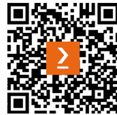

`https://packt.link/free-ebook/9781837635153`

- 2. 提交您的购买证明

- 3. 完成！我们将直接将免费的 PDF 和其他福利发送到您的电子邮箱。

# 第一部分：蓝队与紫队基础知识

当我们开始数字取证与事件响应 (`DFIR`) 的旅程时，明确理解蓝队（Blue Team）和紫队（Purple Team，与红队对比），并牢牢掌握创建蓝蓝紫队实验室环境所需的基础知识至关重要。本节将解释相关术语，介绍成为蓝队和紫队成员所需的技能，并演示设置 `DFIR` 实验室环境的各种方法。

本部分包含以下章节：

- `第 1 章，红队、蓝队和紫队基础知识`
- `第 2 章：数字取证简介`
- `第 3 章：安装 Kali Linux`
- `第 4 章：额外的 Kali 安装及安装后任务`
- `第 5 章：在 Kali Linux 中安装 Wine`

# 红队、蓝队和紫队基础知识

欢迎阅读《基于 Kali Linux 的数字取证》第三版，对于可能购买过旧版本的读者，欢迎回来。我也诚挚地感谢您再次选择这个令人兴奋的标题。与第二版相比，第三版更新了新工具、易于操作的实验以及几个新章节。我们有一段精彩的旅程在等待，我很高兴地宣布包含了一些重大新增，包括安装 Wine，这将允许我们在 Kali Linux 中运行 Windows 工具，并将在第 5 章“在 Kali Linux 中安装 Wine”中进行介绍。第 10 章“使用 Volatility 3 进行内存取证与分析”也是全新的，展示了如何在较新的操作系统上进行 RAM 痕迹分析。关于使用 Autopsy 图形用户界面 (`GUI`) 进行数字取证与事件响应 (`DFIR`) 分析和调查的章节位于第 13 章“使用 Autopsy 进行分析”。

除了这些重大新增，我们还将探讨一些新主题，例如树莓派 (`Raspberry Pi`) 和物联网 (`IoT`)，并介绍取证科学。对于可能具备红、蓝、紫队先知识的读者，可以跳过前两章，直接进入 Kali Linux 的实践。我们将从学习取证和证据保全开始。

## 什么是 Kali Linux？

随着时间的推移，我在 Windows、Macintosh 以及许多 Linux 发行版上研究了许多工具。我发现数字取证中使用的工具可以安装在各种 Linux 发行版或变体上，其中许多工具都得到了良好的维护、持续开发，并受到了领域同仁的认可。Kali Linux 是一种 Linux 发行版或变体，但在继续之前，让我先解释一下 Linux 发行版或变体的概念。想象你最喜欢的饮料：这种饮料可以有很多口味（不含甜味剂或糖），颜色不同，甚至是各种尺寸。无论如何变化，构成饮料的基本成分仍然是。这样我们就有了 Linux 以及不同类型和版本的 Linux。一些更流行的 Linux 发行版和变体包括 RedHat、CentOS、Ubuntu、Mint、KNOOPPIX，当然还有 Kali Linux。Kali Linux 将在第三章“安装 Kali Linux”中讨论。

那么让我们进入下一节，开始探索 Kali Linux 的迷人世界！

## 什么是 Kali Linux？

Kali Linux 是一个基于 Debian 的操作系统，被全球网络安全专业人士、学生和 IT 爱好者使用。Debian 是 Linux 的一种变体，完全免费、稳定、持续更新，支持许多类型的硬件，并且被 Ubuntu 和 Zorin 等流行操作系统使用。Kali Linux 在网络安全领域并不新鲜，它甚至可以追溯到 2000 世纪中期，但当时它被称为 BackTrack，它是 Audit Security 和 Whack 两个平台的组合。这是 2006 年的事了，随后的 BackTrack 版本一直发布到 2011 年，当时基于 Ubuntu 10.04 的 BackTrack 5 发布了。

2013 年，Offensive Security 发布了第一个版本的 Kali v1 (Moto)，它基于 Debian 7；随后在 2015 年发布了 Kali v2，基于 Debian 8。接着，Kali Rolling 在 2016 年发布，发行版的名称反映了发布年份和季度期间的主要更新更新。例如，在写作时，我使用了 Kali 2022.3 和 2022.4，它们都基于最新版本的 Debian。你可以在开源免费的 Debian 项目 `https://www.debian.org/intro/about` 找到更多信息。

作为一名网络安全专业人士、首席信息安全官 (`CISO`)、渗透测试员 (`pentester`) 以及现在的 `DFIR` 专家，自从我 2006 年开始学习认证伦理黑客 (`CEH`) 以来，我使用 BackTrack 以及现在的 Kali Linux 已超过十年。从那时起，我使用了许多操作系统进行测试和数字取证，但我首选的主要工具（特别是用于测试时）是 Kali Linux。Kali Linux 专注于渗透测试，这让我更容易在同一个平台上同时拥有渗透测试和 `DFIR` 工具，而无必在它们之间切换。

对于购买了本书第一版和第二版的读者，我想说你们绝对会有大饱过，因为我更新了许多实验室并在本版中引入了新工具，还包含了一个关于安装 Kali Linux 的章节。Windows 模拟器（Wine）允许在 Kali Linux 中运行 Windows 应用程序。虽然需要一些配置，我在第五章“在 Kali Linux 中安装 Wine”中编写了一份如何安装 Wine 的分步指南。

我们的一些读者可能会疑惑，为什么我们要安装 Wine 而不是直接使用 Windows 机器。实际上有很多合理的理由。首先，成本是一个因素。如果你是学生、处于失业状态、职业转换或者在汇率限制购买许可的情况下，Windows 许可并不是免费的。在写作时，Windows 10 专业版的费用为 199.00 美元，如微软网站 `https://www.microsoft.com/en-us/d/windows-10-pro/df77xa483rkt?activate-pivot=overviewtab` 所示。

虽然我们在书中不会使用商业工具，但 Windows 上有很多优秀的 Belaso RAM Capture、Autopsy 4 GUI 和 NetworkMinder，我们现在可以在我们的开源 Kali Linux 环境中安装它们，而不是授权的 Windows 机器。这些工具将在第八章“证据获取工具”和第十三章“使用 Autopsy 进行全面的 DFIR 分析”中详细介绍。

另一个考虑是 Wine 为我们节省了切换机器的麻烦，我们将进一步讨论。

## 为什么 Kali Linux 如此流行？


除了作为之一，Kali 还配备了 600 多个工具，你可以在开源免费的 Debian 项目 `https://www.debian.org/intro/about` 找到更多信息。它还有物理、虚拟、移动和便携设备版本，这些将在第四章中介绍。

# 理解红队 (Red Teaming)

可能是 Kali Linux 用户中最广为人知的名称，“红队”是负责处理安全攻击性方面的集体的名称，涉及开源情报 (`OSINT`)、漏洞评估以及对资源的渗透测试，包括但不限于个人、公司、主机用户（桌面、移动设备）以及网络和关键基础设施（如服务器、路由器、防火墙、数据库、Web 应用和门户）。还有如物联网 (`IoT`)、运营技术 (`OT`) 设备和工业控制系统 (`ICS`)，这些也需要高技能红队人员进行评估。

## 了解蓝队（Blue Teaming）

归根结底，这些知识允许红队人员（在明确许可的情况下）对公司进行进攻性攻击，以模拟内部和外部威胁系统及安全机制，其与恶意攻击者破坏并利用个人、公司或贵重资产攻击面的方式相同。

Kali Linux 包含了执行所有类型的攻击性和红队评估所需的所有工具。从个人角度来看，Kali Linux 是我进行渗透测试的首选操作系统，因为大多数用于指纹识别、侦察、开源情报（`OSINT`）、漏洞评估、利用和报告的工具在在该平台上都是随处可用并预装的。我已使用 Kali 进行红队演练了 12 年多，我预计短期内不会有任何变化，因为多年来他们一直维护着该操作系统和相关工具。

现在，让我们转向蓝队。

# 了解蓝队（Blue Teaming）

蓝队成员通常被认为处于防御方，而不是像之前提到的红队那样处于进攻方。虽然红队关注于威胁模拟和可能的利用，但蓝队则是领地的守护者。

考虑到每个团队的主要目标都是保护资源，并理解与泄露和数据外泄相关的潜在影响和风险，红队和蓝队是非常相似的。虽然蓝队可能关注攻击技术（例如网络杀伤链和渗透测试），但蓝队侧重于确保不仅有防御攻击的机制，还实施了正式的政策、流程甚至框架，以确保有效的检测与响应（`DF`）。

蓝队的工作涵盖了比红队更多的内容，因为蓝队必须分析威胁、理解风险和影响、实施安全和保护措施、理解取证和事件响应，并确保实施有效的监控、响应服务和警报。如果蓝队成员拥有红队成员员的知识或经验，也将有所帮助，因为这提供了对攻击面和威胁态势更深层次的理解。

蓝队成员还必须精通广泛的技术和分析领域。虽然对于 IT 领域的新手来说，进入蓝队和检测、响应与取证（`DFIR`）并非不可能，但这需要类似于网络和系统管理员、安全分析师以及威胁猎人的者的先备知识。例如，理解系统必须进行更新和补丁是一项至关重要的实践。蓝队将理解为什么需要打补丁，并理解在加固设备以减少攻击面时，还需要考虑零日漏洞和人类弱性，这些因素可能使攻击者轻易实施突破并绕过所有技术措施。

在招聘列表中要求蓝队成员精通安全信息和事件管理（`SIEM`）工具也并不常见，这些工具提供实时分析、监控和警报，极大地有助于 `DFIR` 管理，并允许在保护数据、系统和资产以维持高安全状态评分时，更深入地理解所需的保护水平。

蓝队还必须接受他们的责任不仅适用于内部和外部资源，在考虑要保护资产的威胁态势时，责任还将扩展。威胁态势可以是设备、人员、数据，以及任何在策划攻击时可能对攻击者有用的信息。这就是深入理解开源情报（`OSINT`）的用处。尽管之前被提到是一种红队技能，但事实证明这对蓝队同样重要，即能够在互联网、社交媒体和暗网上搜索任何可能构成威胁或以某种方式帮助威胁攻击者的信息。

一个很好的例子是搜索暗网上的数据库，蓝队（在采取所有必要保护措施后）浏览暗网，寻找被泄露的电子邮件或其所属团队的虚拟专用网络（`VPN`）凭据。蓝队还可能使用像 `Shodan.io` 这样的网站（我们将在本书后面的部分介绍），从外部视角寻找可访问的设备，例如防火墙和 CCTV 摄像头。蓝队开发的上述所有场景被称为所谓的“威胁概况（threat profile）”，虽然它不关注于内部和外部资产，但仍会创建潜在的威胁，甚至是入侵指示（Indicators of Compromise）。

## 理解紫队对抗（Purple Teaming）

当我们进入紫队对抗时，现在可以享受网络安全领域的“禅”时刻了。`紫队对抗（purple teaming）`指的是红队和蓝队技能的结合。紫色也可以通过红色和蓝色混合而成，因此被称为紫队对抗。回顾红队和蓝队部分中的所有技能和认证，这看起来似乎是一项无法完成的任务；但我向你保证，有很多紫队成员是从新手开始并最终成为专业人士的，我也在其中。

当我 2000 年初开始我的网络安全之旅时，当时我更对伦理黑客和渗透测试（红队）感兴趣，花了许多个晚上坐在电脑前阅读，并使用当时可用非常有限的工具。直到大约 2008 年，我才决定进入 `DFIR`（数字取证与事件响应），并对取证领域产生了浓厚兴趣，甚至开始在教授 `CEH` 课程的同时教授 `CHFI` 课程。

每当我认为自己专攻某一个领域时，就会遇到一个新工具，引导我走向另一个领域。坦率地说，这对我非常有利，因为我很快意识到红队和蓝队在许多方面都有重叠，而且永远没有一个时刻可以说我学过的已经足够了。我的观点是，网络安全是一个如此动态的领域，有如此多的路径，你永远也学不完。总会有新的新的漏洞、调查工具或事件响应程序需要学习，这取决于你决定是想专攻某个领域，还是像我一样继续学习和成长，并在需要时应用你的知识。

快进到今天，我是计算机取证与安全学院（`Computer Forensics and Security Institute`）的所有者，在那里我不仅领导一个紫队团队，还是首席渗透测试员以及首席取证和事件响应调查员。再次，只要你愿意投入，精通这两个领域是完全可能的。

在这方面，我可以轻松地表示，Kali Linux 是入门的完美之处，因为它为紫队对抗提供了最好的工具。让我们先预览一下可用的某些利用工具（红队工具），这些工具在任何版本的 Kali 中都是预装的。

这只是 Kali 中 `Exploitation（利用）` 菜单下工具的一个片段；然而，在红队评估中，我非常虔诚地使用 `metasploit framework`、`msf payload creator` 和 `social engineering toolkit (root)`。

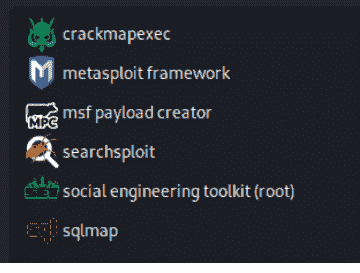

图 1.2 – Exploitation 菜单中的工具

现在让我们看看 Kali Linux 中的 Forensics（取证）菜单：


图 1.3 – Forensics 菜单中的工具

再次，这些只是一些取证工具，其他工具也可以通过 All Applications（所有应用程序）菜单找到，我们将在第 3 章“安装 Kali Linux”中探索它。Kali Linux 是少数几个为紫队对抗提供多种工具的用户友好型平台之一，我期待在接下来的章节中向你们展示如何有效地使用其中许多工具。

在第 3 章“安装 Kali Linux”中，我将一步一步教你如何在安全的虚拟测试环境中设置 Kali Linux，在该环境中我们可以使用工具并下载样本文件进行分析。虽然这个虚拟机将连接到互联网，但我们将在沙箱环境中使用它，以确保它不会影响你的生产环境。在第 5 章“在 Kali Linux 中安装 Wine”中，我还将带你完成在 Kali Linux 中安装 `Wine` 的过程，以帮助构建你的终极蓝队和紫队工具集，我们将这些工具与开源的 Windows 和 Linux 工具相结合。

现在我们已经看了红队、蓝队和紫队对抗之间的差异，我们将转向理解数字取证，并在第 2 章“数字取证简介”中查看其他取证平台和一些商业工具，并重要的是对取证框架有一定的见解。

# 总结

在本章中，我们介绍了基于 Debian 的 Kali Linux 操作系统及其在网络安全领域的用途。我们还学习了网络安全中的不同团队，例如渗透测试人员以及关注安全的人员组成的蓝队。我们还了解到紫队对抗是红队和蓝队之间的协作。我们探索了 Kali 中一些用于利用和取证的工具。在下一章中，我们将深入研究数字取证。

在过去的一或两年里，来自臭名昭著的勒索软件和高级持续性威胁（`APT`）组织的勒索攻击出现了惊人的增长，勒索软件在暗网上很容易购买。`ALPHV`、`Darkside`、`Revil` 和 `BlackCat` 是一些最臭名的勒索软件和 `APT` 组织，它们的名字令任何网络安全专业人员感到恐惧。众所周知，这些组织入侵个人并索赎金，金额从数千美元到数百万不等。不仅数据被高度加密，许多此类组织现在还通过 `DDoS` 攻击攻击受害者，并在暗网博客上发布泄露的受害者数据。我们将在书的后续部分对此进行更多介绍。

响应事件是一回事，你（希望）可能有一有一个计划或正式程序来执行，但如果我们没有建立起正确的机制来检测事件，那么情况可能比最初想象的要困难得多。这正是产生蓝队（Blue Teams）和紫队（Purple Teams）需求。黑客、恶意软件开发者、`APT` 组织完全不会、显然也不关心公司和经济的财务状况。勒索软件在过去在某些情况下被证明是非常盈利的，而且必须考虑到在任何一天，恶意软件开发者都在研究新的攻破方法。


每个组织都必须配备蓝队，如果没有紫队，或者在无法在内部建立团队的情况下，至少外包团队的人才和功能。有许多托管安全服务（MSS）公司的表现优于仅有一两支训练良好的蓝/紫队的公司。这些公司始终具有优势，因为不仅了解公司的技术细节，而且了解组织文化以及员工和普通人力资源的意识水平（有时是缺乏意识），而这在网络安全方面，在大多数时候往往是组织内部最薄弱的环节。

让蓝队进行网络安全意识培训，与修补防火墙、路由器、交换机和服务器等基础设施设备同样重要。网络安全意识必须像物理安全意识一样被重视，因为一个小小的错误就可能导致整个集团陷入瘫痪，并让组织损失数百万美元。如果员工意识到对组织和自身的通用网络安全威胁，将非常有帮助；如果他们意识到组织内部可能发生的特定威胁实例，则更有帮助。这样，蓝队就可以营造一种网络安全意识文化，让人们更加警觉，并理解个人行为对组织及其数据和资产安全的风险和影响。

总结上述陈述，蓝队和紫队负责组织内的几个关键角色，包括：

- 威胁情报
- 威胁狩寻
- 事件响应
- 监控和事件管理
- 日志审查
- 漏洞评估（红队/紫队）
- 渗透测试（红队/紫队）
- 威胁模拟

在下一节中，我们将介绍数字取证方法论和框架，我们可以将其执行证据获取和取证调查时作为最佳实践指南。

# 数字取证方法论和框架

记住取证是一门科学，数字取证要求你遵循适当的最佳实践和程序，以不断反复产生相同的结果，提供证据、保护和完整性的证明，这些结果在被需要时是可以复制的。

许多人可能并不是为了作为法庭证据而进行数字取证，但最好的实践是 DFIR（数字取证与响应），使其能够在法庭上被接受和呈现。专门从事数字取证和事件响应的组织遵循最佳实践的主要目的是在整个调查期间维护证据的完整性。如果调查人员的工作必须被他人审查、批评或需要重复意见，那么调查人员发现的结果必须能够重新创建，从而证明调查的完整性。此的目的是确保你的方法是可重复的，并且在被剖析或审查时，能够反复产生相同的结果。所使用的方法论，包括调查的程序和发现，无论使用什么工具，都应允许维护数据的完整性。

书中展示的最佳实践确保了原始证据未被篡改，或者在实地或生产环境中调查设备和数据时，有详尽的文档证明在调查期间采取了必要的步骤以避免对证据进行不必要的篡改，从而保护其完整性。对于对调查完全陌生的的人士来说，我建议他们熟悉一些专业社区可用并广泛实践的各种实践和方法论。

因此，存在几项指南和方法论是你应该采纳或至少遵循的，以确保检查和调查在取证学上是可靠的。

本章提到的最佳实践文档是：

- 首席警官协会（ACPO）数字证据良好实践指南
- 数字证据科学工作组（SWGDE）取证出版物

尽管编写于2012年，但现在作为国家警察局长委员会（NPCC）运行的ACPO提交了一份名为《数字证据良好实践指南》的PDF文件，其中包含了执行数字调查时的最佳实践，特别关注证据获取。随后，ACPO《数字证据良好实践》被英、威尔士和北爱尔兰的执法机构采纳并遵循，并可以在此处完整下载：https://www.npcc.police.uk/documents/crime/2014/Revised%20Good%20Practice%20Guide%20for%20Digital%20Evidence_Vers%205_Oct%2011_website.pdf。

该文档的一些有用用途包括：

- 证据收集
- 数据获取
- 分析与解释

该文档可在 https://www.oas.org/juridico/cyb_best.pdf 公开。

之后已有多次更新，所有新的动态文档现在可以在SWGDE网站找到。那里有35多份免费出版物，其中17份是在2017年至2022年之间发布的。我强烈下载这些文档，因为它们对DFIR专业人员来说很简短，大约在10页左右。

SWGDE最佳实践更新动态文档包含以下内容的优秀、研究充分的现代出版物：

- 车载信息娱乐和车载系统（2022）
- 无人机取证（2022）
- 在线内容获取（2022）
- 云服务提供商数字证据获取（2020）
- 移动证据收集与保护（2020）
- 数字证据收集（2018）
- 计算机取证检查（2018）
- 计算机取证获取（2018）

现在我们熟悉了DFIR方法论和最佳实践，现在让我们来看看DFIR框架。

# DFIR框架

上述最佳实践指南尽管有些年代，但仍可以与一个或多个框架结合。无论任务如何，目标应保持一致，在整个DFIR证据收集、检查和报告过程中维护证据的完整性。

存在几种DFIR框架，如果各种规模的组织应用并实施，可以协助业务连续性和灾难恢复过程，正如一份的DFIR计划应的那样。以下是在第7章事件响应、数据获取和DFIR框架中详细讨论的一些DFIR框架列表。下载这些文档作为参考材料是一个好主意（可以继续进入下一节，稍后再查看这些）：

- ISO/IEC 27037:2021 信息技术——安全技术——数字证据识别、收集、获取和保护指南：https://www.iso.org/obp/ui/#std:iso-iec:27037:ed-1:v1:en

## 数字取证操作系统对比

- NIST特别出版（SP）800-86 将取证技术整合到响应中的指南：https://nvlppubs.nist.gov/nistpubs/legacy/sp/nistspecialpublication800-86.pdf
- NIST特别出版（SP）800-61 版本2 计算机安全事件处理指南：https://nvlppubs.nist.gov/nistpubs/specialpublications/nist.sp.800-61r2.pdf
- DAI - 用于审查和调查网络安全的数字取证框架：https://tsaps.nist.gov/get_pdf.cfm?pub_id=929147
- NIST 8428 运营技术（OT）数字取证与事件响应（DFIR）框架（2022年6月）：https://nvlppubs.nist.gov/nistpubs/ir/2022/NIST.IR.8428.pdf

让我们在下一节中查看一些取证操作系统以及它们之间的区别。

# 数字取证操作系统对比

就像有多种商业可用一样，调查人员、业余爱好者和专业人士也有许多开源工具可用。其中许多是基于Linux的，正如我们在本节中讨论的，可以在几个免费的取证发行版中找到它们。

在选择工具时通常出现的主要问题是商业与开源的对比。无论你是使用商业工具还是开源工具，结果都应该是相同的，原始证据的保护和完整性是首要任务。

> **重要说明**
>
> 预算是一个问题，某些商业工具（尽管它们可能非常强大、准确且易于使用）可能花费数千美元。

开源工具在各种开源许可下可以免费使用，不应该因为它们没有企业开发人员和研究人员的支持就对其轻视。

许多开源工具经过了取证社区的广泛审查，并且由于它们向公众开放并采用非专有代码构建，可能会受到更严格的审查。

尽管本书的重点是Kali Linux中的取证工具（我们将从本节末尾开始查看这些工具），但这里是一些最流行的开源取证发行版（或称为发行版）。

在后续章节中提到的每个发行版都可以在许多地方免费获得，但出于安全考虑，我们将提供来自其主页的直接链接。本节介绍的操作系统没有按照特定顺序排列，也不反映任何评分、评论甚至作者的个人偏好。

我们将在本节中讨论的取证平台有：

- DEFT Linux 8
- 计算机辅助调查环境（CAINE）12.4 Sidereal 和 CAINE 11 Wormhole
- CSI Linux 2022.1
- Kali Linux 2022.3

如果你在好奇，我将上述提到的所有平台都作为现场系统和虚拟机，我还为CSI Linux和Kali准备了专用机器。以下是我的VirtualBox Manager列表截图：

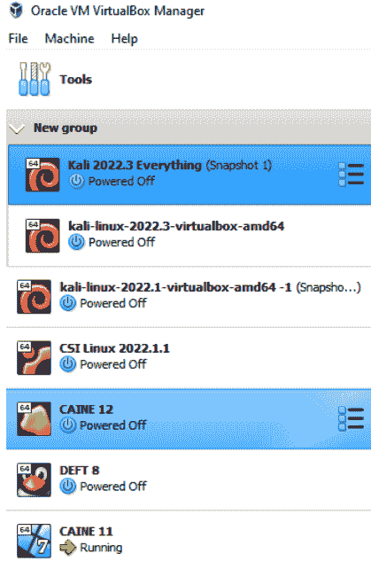

图2.1：VirtualBox Manager中的虚拟机列表

## 数字证据与取证工具包Linux

数字证据与取证工具包（DEFT）Linux有完整版和一个名为DEFT Zero的轻量级版本。为了取证目的，你可能希望下载完整版，因为Zero版本不支持移动取证和密码破解功能：

- DEFT Linux 8下载页面：https://archive.org/download/deft-8.2/deft-8.2.iso
- DEFT Linux Z（2018-2）下载页面：https://sourceforge.net/projects/archiveos/files/d/deft/detz-2018-2.iso/download
- 基于：Ubuntu Desktop
- 发行类型：取证与事件响应

与列表中的其他发行版一样，DEFT（如下所示）也是一个功能强大的现场响应取证工具，可以在无法关机的情况下使用，并对RAM和交换文件进行实时分析。虽然有些过时，但我个人仍然使用DEFT 8.2配合Xplico进行包分析：


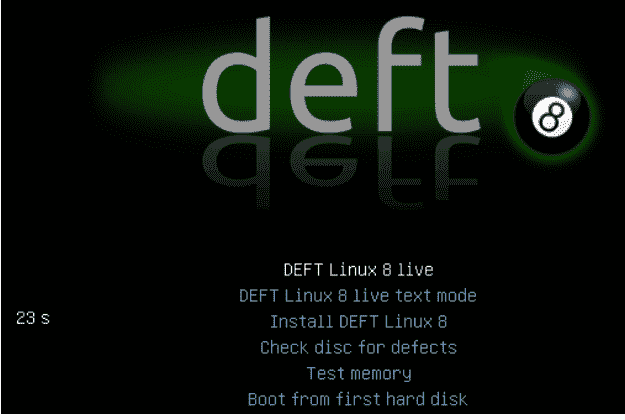

图 2.2：DEFT Linux 启动菜单

从 DEFT Linux DVD、启动闪存或其他介质启动时，你会看到各种选项，包括将 DEFT Linux 安装到硬盘、作为现场响应工具或作为操作系统使用，通过选择 DEFT Linux 8 选项，如下所示：

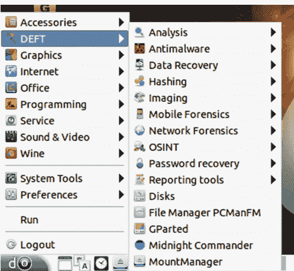

图 2.3：DEFT Linux 菜单

在之前的截中可以看到 DEFT Linux 8 中有多个取证类别，例如反恶意软件、数据恢复、哈希、镜像、移动取证、网络取证、密码恢复和报告工具。每个类别中都存在多种工具。

# 数字取证操作系统对比

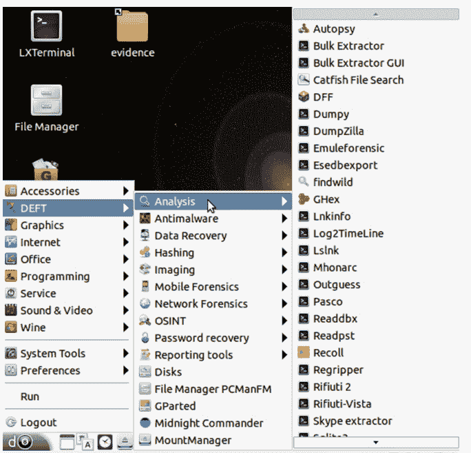

图 2.4：DEFT Linux 菜单

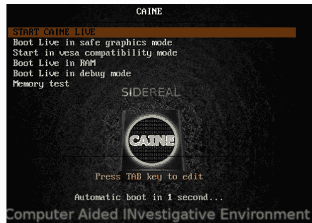

图 2.5：CAINE 启动菜单

# 数字取证引论

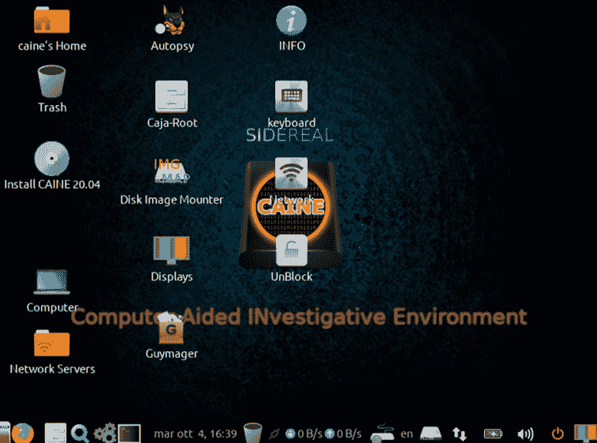

图 2.6：CAINE 12 界面

# 数字取证操作系统对比

让我们来看看 CAINE 中“分析”`Analysis`菜单下的工具。正如之前看到的，DEFT 中有更多的图形用户界面`GUI`数字取证与响应`DFIR`工具：

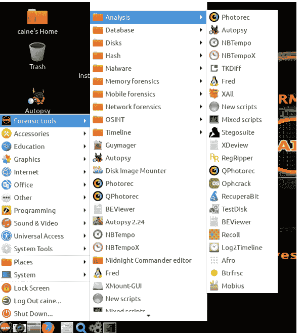

图 2.10：CAINE 12 中提供的分析工具

我们在 CAINE 的“内存取证”`Memory forensics`菜单中也有多种可用工具：

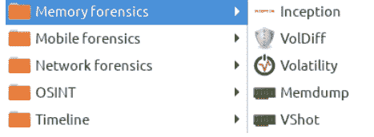

图 2.11 – CAINE 12 中提供的内存取证工具

如需查看发布时 CAINE 包含的特性和软件包完整列表，请访问 `http://www.caine-live.net/page11/page11.html`。

# 数字取证简介

最新版本的 CAINE 12.4 Sidereal 可以从 `https://deb.parrot.sh/direct/parrot/iso/caine12.iso` 下载（ISO 格式），大小约为 3.9 GB。

如前所述，如果你想使用可安装的 CAINE 11 Wormhole，可以从 `https://deb.parrot.sh/direct/parrot/iso/caine/caine12.4.iso` 下载。

若要在 USB 驱动器上进行安装，请确保驱动器容量不少于 8 GB；不过，可以使用 `Rufus` 工具自动创建可启动的 Kali Linux，如第 3 节“安装 Kali Linux”所示。

# CSI Linux

CSI Linux 在该领域相对较新，由富有远见的 Jeremy Martin 及其出色的团队开发。他们整合了一个极其稳健的取证/蓝队对抗平台，我使用它的频率经常与 Kali Linux 一样高。CSI Linux 2022.1 提供了适用于 VirtualBox 和 Kali Linux 的虚拟机设备安装版本，也可以作为用于实时 DFIR 的启动镜像下载。此外还计划在近期发布 CSI Linux 安全信息和事件管理`SIEM`系统。

CSI Linux 2022.1 可以直接从 `https://csilinux.com/download` 下载。

> 友好提示
> 
> 如果使用 CSI Linux，用户名和密码均为 `csi`。

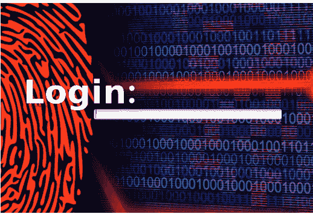

图 2.12：CSI Linux 登录界面

与 DEFT、CAINE 和 Kali 类似，CSI Linux 拥有非常用户friendly桌面界面：

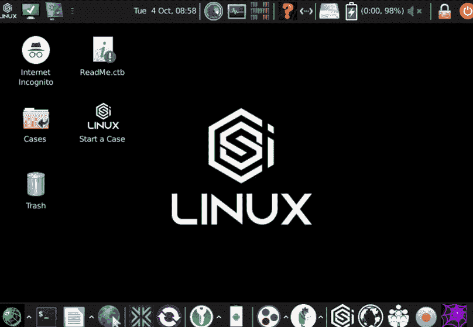

图 2.13：CSI Linux 桌面界面

点击 CSI Linux 菜单按钮会显示详尽的分类列表，包括开源情报`OSINT`与在线调查、暗网以及威胁情报类别。在我看来，这是 CSI Linux 真正闪光的地方，因为其他平台缺乏这些预装工具：

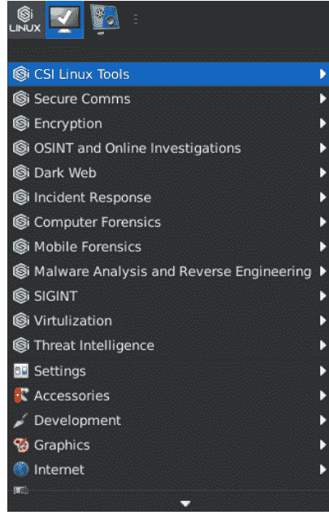

再次为了对比，让我们来看看 `OSINT` 与在线调查、暗网 以及 `计算机取证` 菜单。

OSINT 与在线调查菜单包含多个子菜单，其中有针对社交媒体、电子邮件、电话和社交工程的非常实用的工具，这些工具我经常使用：

图 2.14：CSI Linux 取证工具

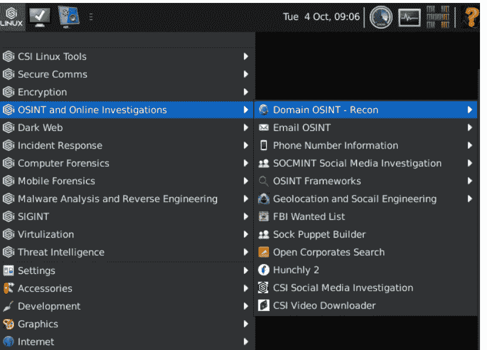

图 2.15：CSI Linux OSINT 与在线调查工具

`暗网`调查工具在紫队对抗`purple teaming`中也广受欢迎，因为渗透人员和 DFIR 从业者都会使用它们：

# 数字取证简介

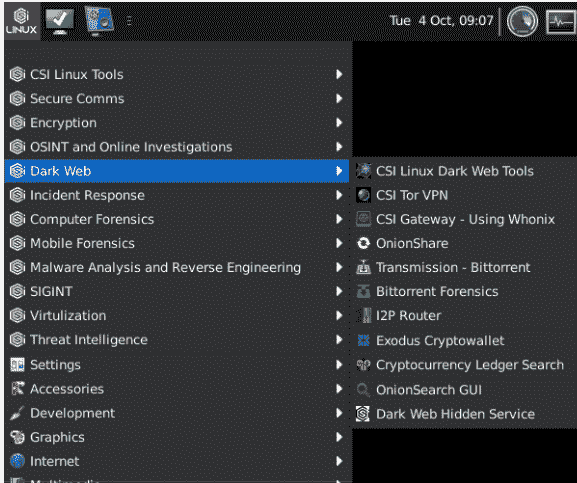

图 2.16：CSI Linux 暗网调查工具

“计算机取证与事件响应”中包含了大量更新的现代图形用户界面`GUI`和命令行界面`CLI`工具，用于进行全面调查：

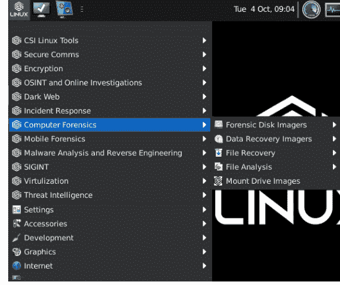

图 2.17：CSI Linux 计算机取证工具菜单

# 数字取证操作系统对比

CSI Linux 在事件响应工具方面拥有令人印象深刻的分类列表，如图 2.18 所示：

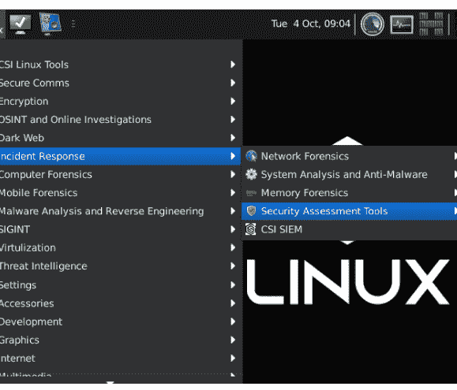

图 2.18：CSI Linux 事件响应菜单

我强烈建议下载并熟悉 CSI Linux。我们在本书中将学习使用的许多工具也安装在 CSI Linux 中，从而降低了学习曲线。

# Kali Linux

最后，我们将在下一章以及整本书中对这颗可爱的明珠——Kali Linux 进行详细讨论，从其安装到高级取证用法应涵盖：

- 首页：`https://www.kali.org/`
- 基于：Debian
- 分发版类型：渗透测试、取证和反取证

Kali Linux 是作为渗透测试工具创建的，在 2015 年更名为 BackTrack，后来演变为 Kali Linux。正如第 1 节“红蓝紫队对抗基础”提到的，它是渗透测试人员和安全爱好者的首选。它包含了从扫描、侦察到漏洞利用和报告的各种强大工具。

# 数字取证简介

与上述工具类似，Kali Linux 也可以作为实时响应工具使用，它包含了成功调查所需的许多工具。然而，Kali 还提供了移动设备（如 Nexus 和平板电脑）的许多工具。

值得注意的是，当 Kali 处于取证模式时，它不仅不会篡改原始数据，也不会将数据写入交换文件`swap file`，而最近访问并存储在内存中的数据可能位于此处。

当从 DVD 或闪存驱动器启动 Kali Linux 时，用户将看到安装选项。如下图所示：


图 2.19：Kali 启动菜单

一旦启动 Kali 取证选项，调查人员将看到与任何 GUI 相同的主界面，如下所示：

# 数字取证操作系统对比

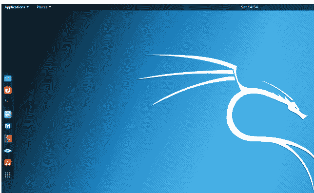

图 2.20：Kali Linux 桌面

当然，Kali 也可以作为完整的操作系统安装在虚拟机或直接安装在硬盘上，这将在第 3 节“Linux”中介绍。这里是我的桌面场景，其中通过 `Wine` 安装了一些取证工具，例如 `FTK Imager` 和 `Autopsy` 图形界面：

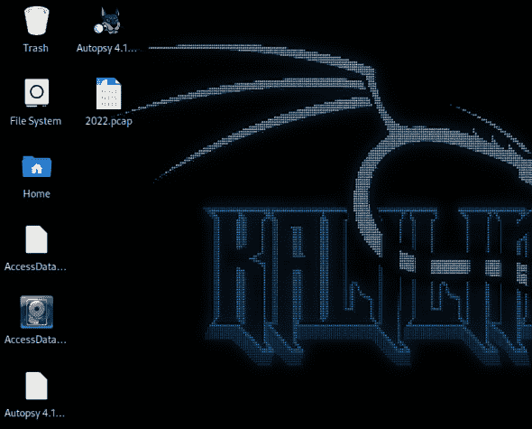

图 2.21：Kali Linux 定制桌面

## 数字调查中对多种取证工具的需求

Kali 可以作为实时响应取证工具运行，也可以作为一个完整的操作系统（如 Windows、macOS 和 Android）使用，因为它包含了多个用于生产力和日常使用的内置工具。Kali 可以安装在硬盘上，这一事实意味着可以定期下载并更新其他许多工具，从而确保能够持续访问所有的 IT 安全和取证工具。这允许你在使用工具时保存进度，而无需过于担心重启机器；你应该考虑将其作为一个完整的操作系统来使用。


使用这些其他操作系统（如 Kali）为我们提供了一系列供选择和使用的工具。在这些发行版中，针对每个类别，都存在许多可以执行相同任务的工具。这非常有用，因为我们的发现结果应该能够通过不同的工具进行复现。这在调查人员的工作可能受到质疑、案件和证据的完整性受到质疑和审查的实例中尤为有用；通过正确地使用多种工具将产生一致的结果。现在让我们在下一节中看看为什么我们可能需要使用一个以上的工具。

证据的保护至关重要。使用商业和开源工具可以正确得出结果；然而，对于符合取证学要求的工具，有时比一个工具能够产生相同的结果效果更好。

使用多种工具的另一个原因可能仅仅是为了效益。我们中的一些人可能有大量的预算来工作，而另一些人的预算有限或完全没有。商业工具可能昂贵，特别是考虑到研发、测试、广告和其他因素。开源工具（即经过社区测试的工具）可能没有像商业工具那样的可用资源和资金。

那么，我们如何知道选择哪些工具呢？

数字取证通常非常耗时，这是你可能希望针对证据的多个取证副本工作的原因之一。通过这种方式，你可以同时使用不同的工具来加速调查。虽然快速工具可能是件好事，但我们也应该对工具的可靠性和准确性提出质疑。

美国标准与技术研究院（NIST）开发了计算机取证工具测试（CFTT）计划，对数字取证工具进行测试并将所有发现向公布。某些工具根据其特定能力被选中并归入测试类别中，例如磁盘镜像、数据刻化和文件恢复。每个类别都有正式的测试计划和策略，并附有同样公开的验证报告。

有关 CFTT 计划的更多信息可以访问 https://www.cftt.nist.gov/disk_imaging.htm。本书涵盖的许多工具的测试和验证报告可以在 https://www.dhs.gov/science-and-technology/nist-cftt-reports 找到。

为了强调使用多种工具维护调查完整性的重要性，本书将从第 7 节“事件响应”、“数据采集”和 DFIR 框架开始，在后续演示多种工具。

到目前为止，我们涵盖了开源工具。在下一节中，我将讨论如果你是或打算成为 DFIR（数字取证与事件响应）专业人员可能会遇到的一些流行的商业取证工具。

## 商业取证工具

尽管我们正在使用开源工具，但我想提到一些你可能感兴趣或作为取证专业人员想要添加到你的武器库中的更流行的商业工具。

### Belkaso Evidence Center X

Belkaso Evidence Center (EC) X 是一种自动化的事件响应和取证工具，能够分析获取的内存储镜像、虚拟机、云、移动备份和物理逻辑驱动。

Belkaso EC X 还能搜索、恢复和分析以下类型的产物：

- Office 文档
- 浏览器活动和信息
- 电子邮件
- 社交媒体活动
- 移动应用程序
- 即时通讯应用程序（WhatsApp 和 Facebook Messenger）
- 云端采集

有关 Belkaso 产品的更多信息可以访问 https://belkaso.com/。

Belkaso 还提供一个免费的采集工具 Ram Capturer，以及 EC 的试用版本，访问 https://belkaso.com/get。

### Forensic Toolkit (FTK)

Forensic Toolkit (FTK) 已存在一段时间，被全球的取证人员和执法机构专业使用。FTK 还与 Belkaso 集成以获得更好的体验。FTK 的某些功能包括：

- 使用多核引擎快速处理
- 处理大量数据的能力
- 对数据进行索引以便更快地搜索和分析
- 密码破解和文件解
- 自动化分析
- 执行自定义数据刻化的能力

有关 FTK 的更多信息可以访问 https://accessdata.com/products-services/forensic-toolkit-ftk。

FTK 的试用版本可以在 https://go.exero.com/exero-software-demo 下载。Exero 还有一个免费下载的镜像采集工具，访问 https://go.exero.com/43312/2022-08-23/f7ry1q。

### OpenText EnCase Forensic

以前称为 Guidance EnCase Forensic，现在称为 OpenText EnCase Forensic，该工具多年来一直处于领先地位，国际专业人士和执法人员已使用了多年。与 FTK 类似，EnCase 提供了针对事件响应、电子发现以及终端和移动取证的多种解决方案。

除了作为完整的数字取证解决方案套件外，EnCase 的其他功能还：

- 从移动设备获取镜像
- 支持 Microsoft 365
- 深度分析

有关 EnCase 的更多信息可以访问 https://www.guidancesoft.com/encase。

## 反取证

增加这种复杂性还有更易于使用的工具的出现，这些工具有助于屏蔽个人身份信息（PII），或任何有助于发现网络犯罪嫌疑人的信息。

需要注意的是，许多 Wi-Fi 热点可能非常危险，因为这些热点可以被轻松设置以拦截连接到 Wi-Fi 并输入此类信息的个人数据，例如登录和密码信息，以及 PII（如社会安全号码、出生日期和电话号码）。

加密过程为通信双方之间提供了机密性，其使用技术的方式与我们使用锁和钥匙保护个人和私人财物的方式非常相似。锁要打开需要匹配的钥匙。因此，在数字世界中，数据使用加密算法加密或锁定，并必须使用相同的密钥解密或解锁。还存在另一种场景，即使用一个密钥加密或锁定数据，使用另一个密钥解密数据。两种非常流行的加密工具是 TrueCrypt 和 VeraCrypt。

## 数字调查中对多种取证工具的需求

这两种加密工具使用了非常高级的加密方法，能够保持数据的高度机密性。取证的主要障碍是获取解密密钥以解密或解锁对数据的访问。

> 注意事项
>
> TrueCrypt 和 VeraCrypt 不仅加密文件，还加密文件夹、分区和整个驱动器！

除了使用这里提到的加密工具外，我们还应该考虑使用匿名工具，例如下一节提到的工具。

# 在线和离线匿名化

加密尤其会让调查变得相当困难，但存在“匿名性”的概念，这增加了维持发现真实来源准确性的复杂性。与加密类似，在 Windows、MacOS、Linux 和 Android 等所有操作系统平台上都有许多免费的开源工具，它们尝试（也是最成功地）掩盖某人的数字足迹。这种数字足迹通过其 IP 地址和媒体访问控制（MAC）地址唯一地识别你。在不谈论网络方面的情况下，这两个数字地址可以分别比作人的姓名和家庭地址。

尽管一个人的 IP 地址可以根据其私有网络（家庭和工作）和公共网络（互联网）的改变，但 MAC 地址保持不变。

然而，也有各种免费的工具可以为了隐私和匿名为目的加速或伪造你的 IP 和 MAC 地址。此外，用户可以使用通过在线服务器和设备路由数据的系统，使追踪发送数据的来源变得非常困难。这种系统被称为代理链（proxy chaining），它可以在一定程度上隐藏用户的身份。

一个例子是 Tor 浏览器；它使用洋葱路由和全球的代理服务器来在代理服务器之间路由或传输数据，使得追踪来源变得非常困难，但并非不可能。你可以将代理链想象成接力赛，但不是由四个人一个接一个传递接棒，而是数据在全球范围内数百个代理设备之间传递。

现在，你应该对反取证有了基本的了解，并且理解了使用加密和匿名工具来隐藏或模糊可能使 DFIR（数字取证与响应）调查复杂的信息和数据。让我们总结一下刚刚涵盖的主题，然后进入下一章。

# 总结

我们看到数字取证仍然是一个相对新的领域，尽管取证科学已经存在很久，可以追溯到 20 世纪初。虽然数字取证可能从 21 世纪初才开始出现，但作为一门科学，我们有某些需要遵循的最佳实践、程序、标准和框架，例如由 ACPO、SWGDE 和 NIST 创建的标准。这些确保了无论是作为业余还是专业的数字取证调查员，在执行调查时保持结果和实际证据的准确性和完整性。

提到的一些商业工具包括 Belkasoft EC X、FTK 和 EnCase Forensics。许多可用开源工具适用于基于 Linux 的发行版并可以单独下载，但许多工具在某些取证和安全操作系统或发行版中可以直接可用。这些发行版包括 DEFT Linux、CAINE、CSI Linux，当然还有 Kali Linux，所有这些都可以通过链接免费下载。

希望这段关于数字取证的介绍对你来说是有启发性且有趣的。现在我们已经有了取证的基础，让我们深入研究 Kali Linux，在下一章中，我们将学习如何下载、安装和更新 Kali。下页见！

## 安装 Kali Linux

加入我，我们将开始 Kali Linux 的操作部分。你们中的一些人可能已经熟悉安装过程，甚至可能熟悉一些高级功能，如分区和网络。对于初学者和 Kali Linux 的新手来说，我们鼓励你特别关注这一章，因为我们将从下载 Kali Linux 的绝对基础开始，一直到成功安装。

我们将在本章中涵盖的主题是：

- 在用于 DFIR 的便携存储介质上安装 Kali Linux
- 作为独立操作系统下载并安装 Kali Linux
- 在 VirtualBox 中安装 Kali Linux

## 技术要求


如前所述，Kali Linux 已经存在了一段时间了。它以前被称为 BackTrack，发布过版本 1 到 5，Kali Linux 首次于 2015 年面世，并作为 Kali 1.0 版本发布。从 2016 年开始，Kali 根据年份命名。因此，例如在编写此书时，使用的版本是 Kali 2022。

对于使用最新版本的用户，Kali Linux 会定期更新。检查官方网站以确保你拥有最新的补丁和功能是非常重要的。

## 下载所需的工具和镜像

为了能够跟随本章在各种平台上安装 Kali Linux 的操作步骤，你需要下载以下版本的 Kali，以及我在这里列出的一些额外工具：

- Kali Linux 64 位安装程序镜像（此可以作为独立操作系统安装，也可以作为虚拟机 (VM) 安装）:`https://cdimage.kali.org/kali-2022.3/kali-linux-2022.3-installer-amd64.iso`
- 适用于 VirtualBox 的 64 位 Kali Linux：`https://kali.download/virtual-images/kali-linux-2022.3-virtualbox-amd64.7z`
- Kali Everything 种子文件：`https://cdimage.kali.org/kali-2022.3/kali-linux-2022.3-installer-everything-amd64.iso`
- Tixati 种子下载软件（用于下载 Kali ISO 镜像）：`https://www.tixati.com/download/windows64.html`
- 7-Zip 工具（用于解压缩和解压 .7 文件）：`https://www.7-zip.org/download.html`
- Rufus 3.2（用于创建启动盘的工具）：`https://github.com/ptbatard/rufus/releases/v3.20/rufus-3.20.exe`
- VirtualBox 和 VirtualBox Oracle 扩展包：`https://www.virtualbox.org/wiki/Downloads`
- Raspberry Pi Imager（用于在树莓派上下载并安装 Kali）：`https://www.raspberrypi.com/software/`。访问 Imager 页面时，确保选择正确的格式。我将在 Windows 机器上使用 Imager，其下载地址为 `https://downloads.raspberrypi.org/imager/imager_latest.exe`。

## 下载 Kali Everything 种子

Kali Linux 安装程序有一个变体叫做 Kali Everything。Kali Everything 镜像比其他版本要大得多，因为它包含了 Kali Linux 的所有工具。虽然这些工具可以通过存储库（通常称为 repos）的形式手动下载和安装，但如果你不熟悉安装 Kali 工具和存储库，那么下载 Everything 版本并探索这些工具会要简单得多。你可以通过以下步骤下载 Kali Everything ISO：

- 1. Kali Everything 可以直接安装到硬盘上作为独立操作系统 (OS)，也可以如果你倾向于此选项，作为 VirtualBox 中的虚拟机。我们将在接下来的章节中介绍这两种情况。访问 `https://kali.download/base-images/kali-2022.3/kali-linux-2022.3-installer-everything-amd64.iso.torrent` 下载 Kali Everything 种子。

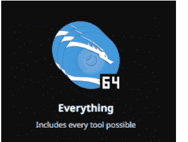

图 3.3：Kali Everything 下载按钮镜像

你可以可以使用任的种子应用程序打开该链接。我使用了 Windows 版的 Tixati 软件，它是从 `https://www.tixati.com/download/` 下载并安装在我的 Windows 10 笔记本电脑上的。点击链接后，Kali Everything 种子文件会在 Tixati 客户端中打开。我选择将 Kali Everything 文件保存到我的“下载”文件夹，如下截图所示。选择下载位置后，点击“开始 (Start)”按钮。

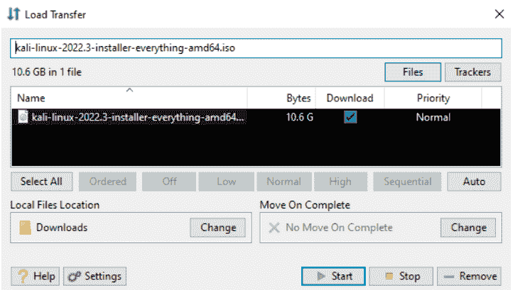

图 3.4：Tixati 种子界面

- 3. Kali Everything 文件下载将在 Tixati 中开始，并保存到所选文件夹中，名为 `kali-linux-2022.3-installer-everything-amd64.iso`。我们将在接下来的章节中使用这个 ISO 文件。

现在你的系统中至少已经下载了两个版本的 Kali Linux，就像我的下载文件夹中显示的那样。

| 名称 | 大小 | 类型 |
| --- | --- | --- |
| `kali-linux-2022.3-installer-amd64.iso` | 3,060,816 KB | 磁盘镜像文件 |
| `kali-linux-2022.3-installer-everything-amd64.iso` | 10,367,424 KB | 磁盘镜像文件 |
| `kali-linux-2022.3-installer-everything-amd64.torrent` | 792 KB | 种子元文件 |

图 3.5：下载文件夹中已下载的 Kali 镜像

现在让我们如何使用 Rufus 3.2 在闪存盘或其他存储介质上创建这两个 Kali Linux 实例的启动版本。

## 在便携式存储介质上安装 Kali Linux 用于实时 DFIR

如前所述，Kali Linux 可以安装在各种平台上，既可以作为独立操作系统安装，也可以作为虚拟机。我们将首先查看如何使用下载的 Kali ISO 文件创建一个启动版 Kali Linux 闪存盘。如果你还没有下载 ISO 文件，现在可以点击链接并按照上一节的说明进行操作。

这个 `.iso` 文件（或者有时也称为镜像文件）可以使用 Rufus 3.20 创建启动盘，通过启动盘在 PC 或笔记本电脑上安装 Kali Linux。它也可以在 VirtualBox 中作为虚拟机安装，我们将在本节稍后的部分使用 Kali Everything ISO 文件进行介绍。

创建启动闪存盘非常有用，因为它允许你在不安装硬盘的情况下任何电脑上运行 Kali Linux。这对于数字取证和事件响应 (`DFIR`) 特别有用。

Rufus 非常易用且简单。下载 Rufus 后，双击运行它。你会看到以下界面：

- 设备：你想要使用的闪存盘。
- 启动选择：选择镜像。
- 分区方案：`MBR`（旧版系统）或 `GPT`（新版系统）。
- 文件系统：`FAT32`（默认）。

在之前的截图中，你会注意到右侧有一个提示显示“**点击选择镜像**”。点击 SELECT 下拉并浏览到你下载 `-linux-2022.3-installer-amd64.iso` 文件的位置。我将其保存在下载文件夹。

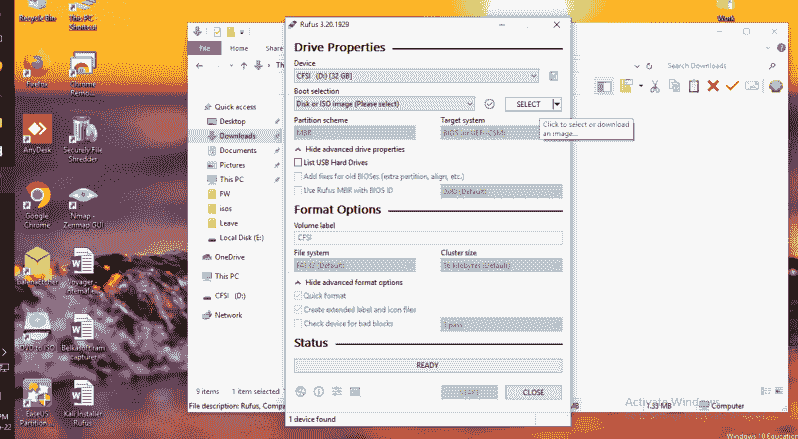

图 3.6：Rufus 界面

- 2. 在之前的截图中，你应该注意到启动选择下列出了 `kali-linux-2022.3-installer-amd64.iso`。我还将分区大小设置为 2 GB，这创建了一个空间，以便在需要下载文件或在启动安装中安装工具。
- 3. 此时，你再次可以在分区方案字段中选择 `MBR` 或 `GPT` 选项。我还将卷标签选项更改为 Kali Linux 64 1。在卷标签结尾使用 1 的原因是我已经用 `MBR` 分区方案使用了该驱动器，并且使用 `GPT` 分区方案创建了另一个启动盘，标记为 Kali Linux 64 2。
- 4. 当你配置好所有所需的选项并确保所有设置正确后，点击“开始 (`START`)”按钮。
- 5. 你可能会被提示下载名为 `ldlinux.sys` 和 `lldl...` 的附加文件。点击“是 (`Yes`)”按钮允许 Rufus 自动执行。电脑必须连接互联网以便 下载 下载这些文件。

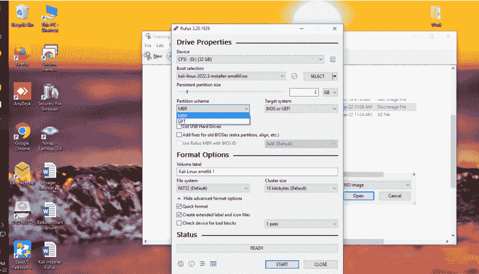

图 3.8：在 Rufus 中选择分区方案

## 安装 Kali Linux

下载所需

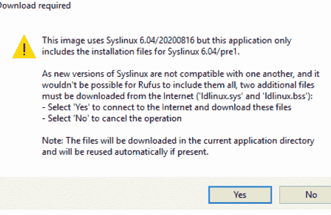

图 3.9: Syslinux 下载需求确认屏幕

- 6. Rufus 将要求确认并警告所有可移动存储设备上的所有数据都将被删除。如果您确定已选择正确的驱动器，请点击 `OK` 按钮继续。

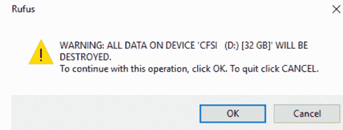

图 3.10: 操作确认屏幕

随后 Rufus 将开始格式化驱动器，如以下截图所示。


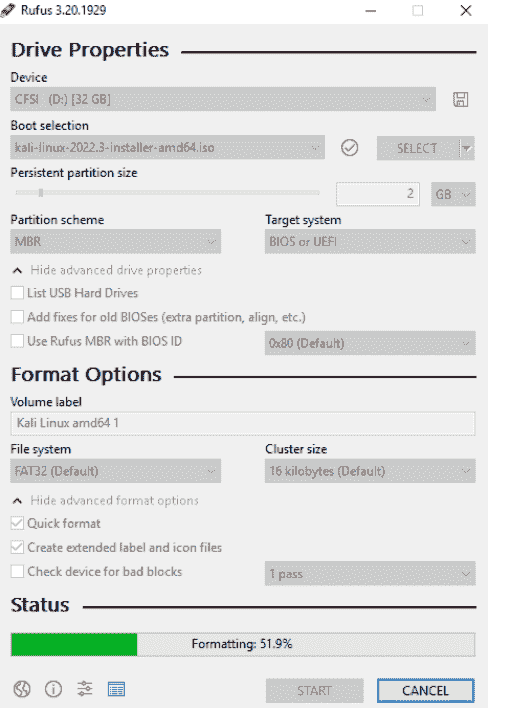

格式化完成后，Rufus 将将 ISO 文件复制到驱动器。

## 状态

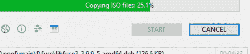

图 3.12: Rufus 文件复制状态

56 安装 Kali Linux

- 7. 当进程完成后，状态栏将变为绿色，并在中间显示 READY 字样。您现在可以点击 CLOSE 按钮，如下截图所示。

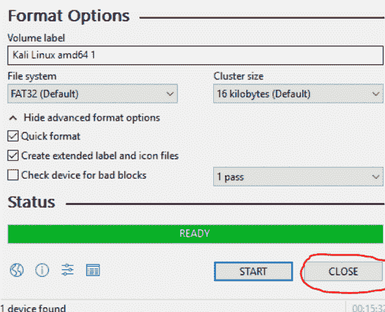

图 3.13: 启动盘创建完成

- 8. 您可以移除制作好的 Kali Linux 启动盘，并将其插入希望作为现场 OS 运行 Kali 的台式电脑或笔记本电脑中，或将其安装在硬盘上。

作为现场 OS 运行 Kali 意味着它没有安装在硬盘上，而是使用设备的随机内存（RAM）运行。通过这种方式，我们可以保留原始操作系统，并使用 Kali 以及所有用于数字取证和事件响应（DFIR）的工具，同时保持当前安装的操作系统完好无损。

- 9. 为此，将 Kali Linux 盘插入台式电脑或笔记本电脑并重启系统。您可能需要在重启时按 F12 键以选择 U 盘作为启动操作系统。这告诉基本输入输出系统（BIOS）从可移动介质而非硬盘启动，从而允许我们在 RAM 中作为现场 OS 运行 Kali Linux。

现在我们已经学会了如何在启动 U 盘上安装 Kali Linux，接下来我们将学习如何使用启动 U 盘在台式电脑或笔记本电脑上作为独立系统安装 Kali。

## 作为独立操作系统安装 Kali

在本节中，我们将 Kali Linux 安装到台式电脑或笔记本电脑上，作为一个独立操作系统。在此练习中，我们将使用使用 Rufus 3.2 创建的 Kali 安装程序 U 盘。如果您曾经从 U 盘或任何可移动存储介质启动过台式电脑，您可能已经熟悉了这一过程。对于任何不熟悉该过程的人，让我们逐步查看如何进入 Kali Linux。将 Kali 安装到物理机和虚拟机（VM）时，Kali Linux 的安装和配置是相同的（如果使用的是我们使用的 Kali Linux 安装程序版本）。因此，我们将在下一节中查看安装本身以保持一致性：

- 一旦创建了启动 Kali Linux 安装程序 U 盘，将驱动器插入您的台式电脑或笔记本电脑并开启设备。如果设备已开启，请在插入 U 盘的情况下重启设备。

- 设备一通电，按下键盘上的 F2 键进入高级启动选项。此键设置在不同的机器上可能有所不同，如果 F2 键无法让您进入启动界面，您可能需要参考设备手册。

- 选择 USB 或可移动设备作为主启动设备并按回车键。

现在您应该看到 Kali 启动菜单，如您拍摄的显示器照片所示。

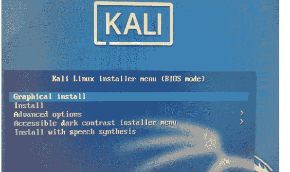

图 3.14: 台式电脑上 Kali 启动界面的图片

到达此处后，您可以参考接后的“在 VirtualBox 中安装 Kali Linux”章节继续完成安装和配置过程。让我们在独立安装的在此处停一下，学习如何在 VirtualBox 中中作为虚拟机（VM）安装 Kali Linux。一旦我们在 VirtualBox 中安装了 Kali，我们将恢复安装和配置，该方法同时适用于独立系统和虚拟系统。

## 在 VirtualBox 中安装 Kali

Kali Linux 的创建者（Offensive Security）非常贴心地为 VirtualBox 和 VMware 创建了预配置版本，这只需要极少的配置。这些预配置镜像甚至包括 Kali Everything 在内的安装镜像，都可以安装在虚拟平台上，且运行方式与在物理机上无异。使用 Kali 作为虚拟机的优势是，您不需要购买任何新或额外的硬件。您还可以轻松地删除和重新安装虚拟机，并创建系统的快照。

# 在您完全按照意愿配置好之后安装 Kali Linux，这样如果您弄坏了 Kali 机器并需要恢复到保存状态，就可以随时启动。

对于那些将 Kali 作为独立操作系统安装的用户，您可以在上述步骤中从您的启动 Kali U 盘启动后继续安装。

### 在 VirtualBox 中准备客户虚拟机

要创建一个新的虚拟机，首先打开 VirtualBox 并点击 **New**（新建）按钮。这将打开虚拟机向导，您可以在其中定义虚拟机的详细信息..

- **名称**：为虚拟机选择一个描述性名称。您选择的名称将在整个 VirtualBox 中标识此机器。

- **文件夹**：选择虚拟机文件的目标文件夹。

- **类型**：选择您打算安装的操作系统类型。

- **版本**：Debian (64-bit)

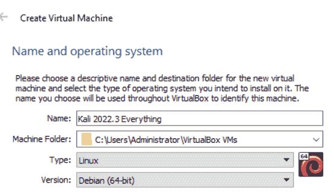

图 3.16: VirtualBox 名称和操作系统详情

我们然后点击 **Next**（下一步）在**内存大小**提示中分配内存。在我的屏幕上，您注意到我选择了 10 GB 内存。由于我有 32 GB，所以我选了这个数量。

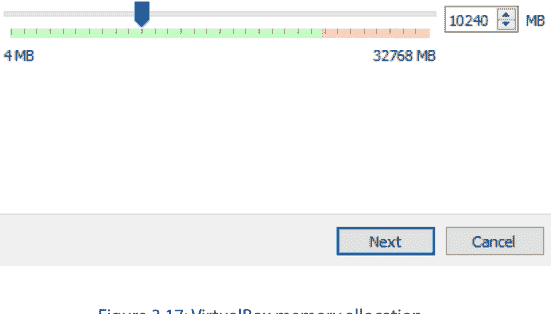

- 3. 接下来，我们通过添加虚拟硬盘来创建虚拟机。我建议创建一个虚拟硬盘，这是选择中的第二个选项。点击 **Create**（创建）继续：

### 创建虚拟机

### 硬盘

如果您想为新机器添加虚拟硬盘。您可以创建一个新的虚拟硬盘，也可以从列表或使用文件夹图标从另一个位置选择一个。

如果您需要更复杂的存储设置，可以跳过此步骤，并在虚拟机创建后对机器设置进行更改。

硬盘建议大小为 8.00 GB。

- 不添加虚拟硬盘

- 现在创建一个虚拟硬盘

- 使用现有的虚拟硬盘文件


4. 然后，选择 VDI (VirtualBox 磁盘镜像) 作为硬盘文件类型并点击“下一步”：

创建虚拟硬盘

### 硬盘文件类型

请选择您希望用于新虚拟硬盘的文件类型。如果您不需要将其与其他虚拟化软件配合使用，可以保持此设置不变。

- VDI (VirtualBox 磁盘镜像)

- VHD (虚拟硬盘)

- VMDK (虚拟机磁盘)

图 3.19：VirtualBox 硬盘类型选择

5. 一旦选了 VDI，请选择“动态分配”选项，以便在需要时允许虚拟磁盘扩展：

创建虚拟硬盘

### 物理硬盘上的存储

物理硬盘上的存储

请选择新虚拟硬盘文件是随使用情况而增长（动态分配），还是按其最大大小创建（固定大小）。

动态分配的硬盘文件仅在填充内容时才会占用您物理硬盘上的空间（最高达到指定的固定大小），尽管在释放空间后它不会再次自动收缩。

固定大小的硬盘文件在某些系统上创建可能需要更长时间，但使用时通常速度更快。

- 动态分配

- 固定大小

图 3.20：VirtualBox 存储分配

6. 下一步中，我们选择文件位置和所选虚拟硬盘的大小。Kali Linux VDI 的推荐大小为 8 GB，但我分配了充足的 32.00 GB。我还将 VDI 的位置选择为 `C:\Users\Administrator\VirtualBox VMs\Kali 2022.3 Everything\Kali 2022.3 Everything`。

7. 选择位置后，点击“创建”以完成虚拟硬盘的创建。

← 创建虚拟硬盘

### 文件位置和大小

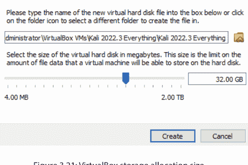

现在我们已经已经在 VirtualBox 中设置好了 Kali Linux ISO 镜像，可以开始安装过程，该将在将在节中进行。

## 在虚拟机上安装 Kali Linux

按照上一个小节中的步骤准备并完成虚拟硬盘后，我们就可以开始安装 Kali Linux。在 Oracle VM VirtualBox 管理窗口（这是 VirtualBox 的主操作系统管理窗口）中，我们可以看到虚拟机已准备就绪，现在可以安装 Kali Linux：

- 1. 在屏幕右侧，您可以看到分配的资源，例如“常规”部分中的名称和操作系统类型，以及“系统”部分中分配的 RAM 容量。其他设置，如视频显存 (VRAM)、网络和显示设置也可以在此部分进行访问。

Oracle VirtualBox 管理器

文件 帮助 工具

CS1 Linux

- Kali Linux 2021.2 (已关闭)

- kali-linux-2022.1-virtual-box-amd64-1 (快照 1-24.5.22 - 首次) (已关闭)

- Metasploable-2 (已关闭)

- Badstore123 (已关闭)

- 7 Test (已关闭)

- Kali 2022.3 Everything (已关闭)

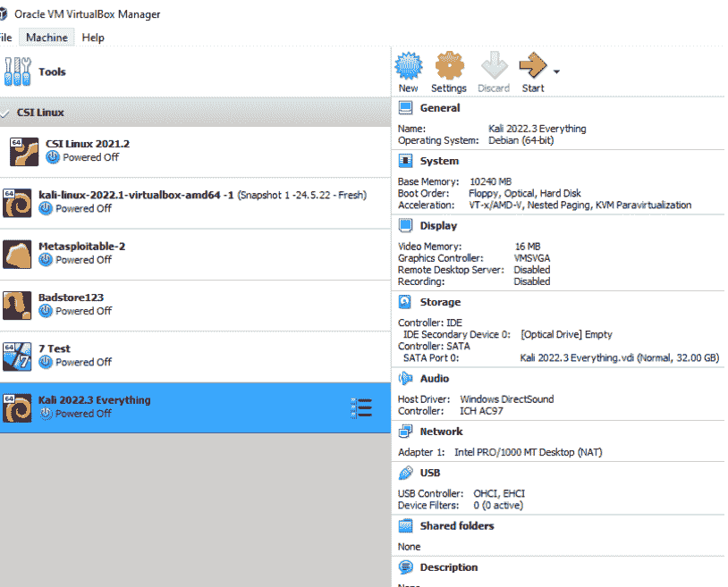

图 32：VirtualBox 管理器


要开始安装 Kali Linux，请点击左侧的 Kali 2022.3 Everything 条目，然后点击“选择启动磁盘”部分右上角的绿色“启动”按钮，如下截图所示。

## 安装 Kali Linux

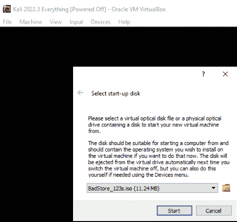

在下一步中，找到我们从 Offensive Security 网站下载的 Kali Linux Everything ISO 镜像。点击文件夹图标，这将带我们进入`光盘选择器`，然后点击对话框左上角的`添加`图标。

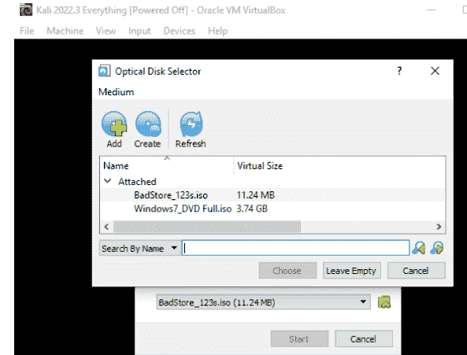

图 3.23：启动磁盘选择

图 3.24：光盘选择字段

导航到您之前下载的 `Kali-linux-2022.3-installer-everything-amd64.iso` 文件并点击它，然后点击“打开”按钮，使该 ISO 作为条目列在光盘选择器中。

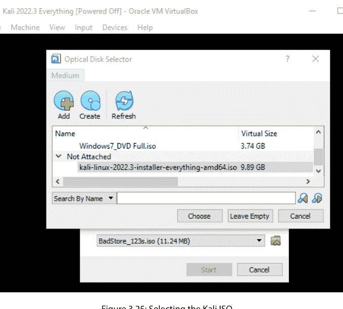

点击“选择”按钮继续，一旦选择了 `kali-linux-2022.3-installer-everything-amd64.iso` 文件，在“选择启动磁盘”框中点击“启动”按钮，如下截图所示。

图 3.25：选择 Kali ISO

### 66 安装 Kali Linux

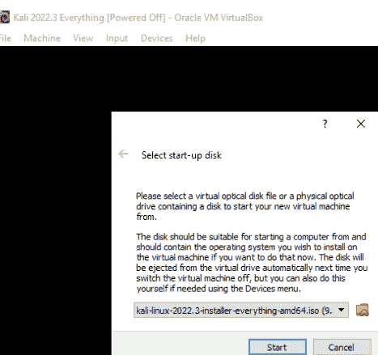

图 3.26：选择 Kali ISO 作为启动镜像

现在您可以看到 Kali Linux 安装程序服务器和您在上一节中也看到的菜单选项：`作为独立操作系统安装 Kali Linux`。


图 27：VirtualBox 中的 Kali 菜单

## 重要说明

对于那些作为独立操作系统安装 Kali Linux 的用户，在按照上述步骤设置好 Kali Linux 虚拟机后，就可以开始安装 Kali Linux。在安装 Kali Linux 时，无论是虚拟机还是独立系统，安装过程是完全一致的，如下截图所示。

- Kali 2022.3 Everything (已关闭)

- Kali Linux 2021.2 (已关闭)

- kali-linux-2022.1-virtual-box-amd64-1 (快照 1-24.5.22 - 首次) (已关闭)

- 1. 为了安装 Kali Linux，如下截图所示。

- 2. 选择您的语言并点击“继续”。

- 语言：

- `中文（繁体）`

- 英语

- 阿拉语

- 阿斯尼亚语

- 孟加拉语

- 越南语

- 捷牙语

- 波斯尼亚语

- 巴西葡萄语

- 丹麦语

- 德语

- 爱地尼亚语

- 希腊语

- 匈牙语

- 意大利语

- 冰岛语

- 日语

- 拉丁语

- 菲律宾语

- 波兰语

- 罗马尼亚语

- 俄语

- 斯洛语

- 塞尔语

- 斯洛语

- 西班牙语

- 西班牙语

- 斯瓦希里语

- 瑞典语

- 土耳其语

- 葡萄牙语（巴西）

- 乌克兰语

- 威尔士语

- 塞尔维亚语

- Zulu语

- 3. 选择您的国家或地区并点击“继续”。

- 4. 选择您的键盘配置并点击“继续”。

- 5. 为您的系统设置主机名，或留留默认名称。

- 6. 如果机器将加入域，可以在此处输入域名，如果不加入域则留空并点击“继续”。

- 7. 接下来，我们将创建一个不具有 root 或管理员权限的非 root 用户账户。请务必使用小写字母命名。

### 在虚拟机上安装 Kali Linux

#### 设置用户和密码

为新账户选择一个用户名。你的名字是一个合理的选择。用户名应该以小写字母开头，后面可以是任意数字和更多小写字母的组合。

你的账户的用户名：

```
shive
```

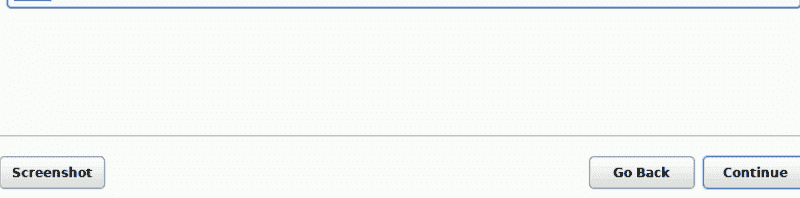

图 3.34：创建用户名

- 8. 接下来，创建一个安全且复杂的密码，然后点击`继续 (Continue)`。

设置用户和密码

良好的密码应包含字母、数字和标点符号的混合，并应定期更改。

为新用户选择密码：

```
██████████████████
```

明文密码

请再次输入相同的用户密码以验证你输入是否正确。

重新输入密码以验证：

```
██████████████████
```

明文密码


图 3.35：创建密码

### 72 安装 Kali Linux

9. 选择你的时区并点击继续 (Continue)。

配置时钟

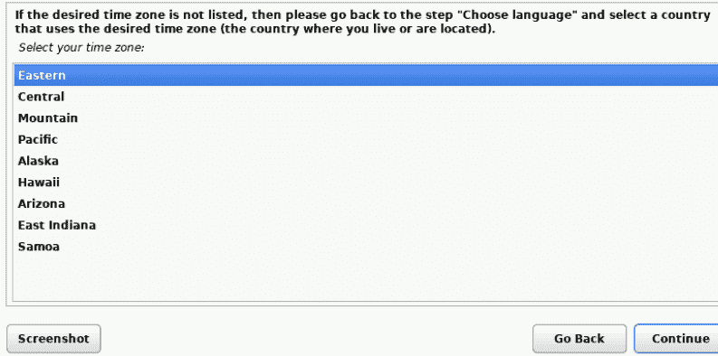

图 3.36：时区配置

10. 现在我们的个性化设置已经配置完成，让我们为安装准备硬盘。对于简单安装，无论是虚拟机还是物理机，我都建议使用整个硬盘来安装 Kali。要执行此操作，请选择“引导 – 使用整个磁盘 (Guided – use entire disk)”选项并点击继续。

分区磁盘

安装程序可以引导你对磁盘进行分区（使用不同的标准方案），或者如果你愿意，也可以手动进行。使用引导式分区，你稍后仍有机会查看并自定义结果。

如果你选择对整个磁盘进行引导式分区，下一步将询问应该使用哪块磁盘。

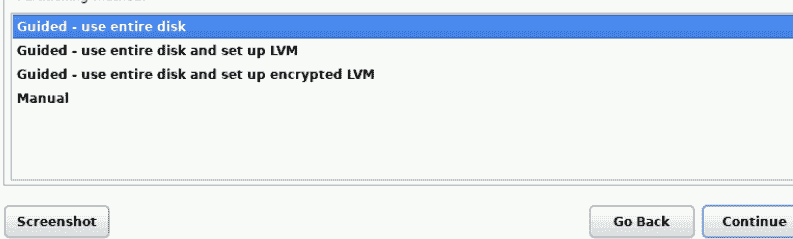

图 3.37：磁盘分区选项

11. 选择用于安装的磁盘，在我的情况下是一个 34.4 GB 的虚拟硬盘，然后点击继续。

分区磁盘

请注意，你选择的磁盘上的所有数据将被擦除，但在你确认确实要进行更改之前不会执行。

选择要分区的磁盘：

SCSI2 (0,0,0) (sda) - 34.4 GB ATA VBOX HARDDISK

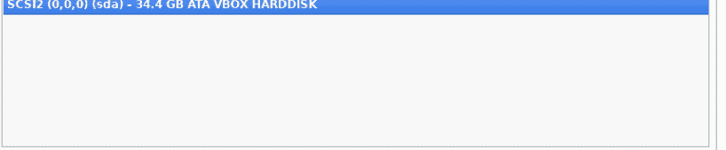

图 3.38：磁盘分区选择

12. 为了保持简单，我建议将所有文件放在一个分区中。选择“所有文件在一个分区中 (All files in one partition (recommended for new users))”选项并点击继续。

分区磁盘

已选择分区的磁盘：

SCSI2 (0,0,0) (sda) - ATA VBOX HARDDISK: 34.4 GB

磁盘可以使用几种不同方案之一进行分区。如果你不确定，请选择第一个。

分区方案：

所有文件在一个分区中 (All files in one partition (recommended for new users))

单独的 /home 分区

单独的 /home, /var 和 /tmp 分区

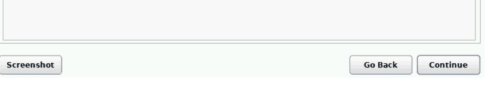

图 3.39：文件分区

13. 检查你的磁盘分区设置，选择“完成分区并将更改写入到磁盘 (Finish partitioning and write changes to disk)”并点击继续。

分区磁盘


图 3.40：写入更改到磁盘

14. 为了确认分区设置并开始写入磁盘，请选择“是 (Yes)”并点击继续。

分区磁盘

如果你继续，以下更改将写入磁盘。

要格式化的以下设备：

SCSI2 (0,0,0) (sda)

要格式化的以下分区：

SCSI2 (0,0,0) (sda) 作为 ext4

2SI2 (0,0,0) (sda) 作为 swap


图 3.41：完成分区

在虚拟机上安装 Kali Linux

分区和格式化将继续提取软件包。

基础系统


图 3.42：基础系统安装过程

15. 我们现在可以选择各种软件包。我选择了 GNOME 和 KDE 桌面，以及典型工具。

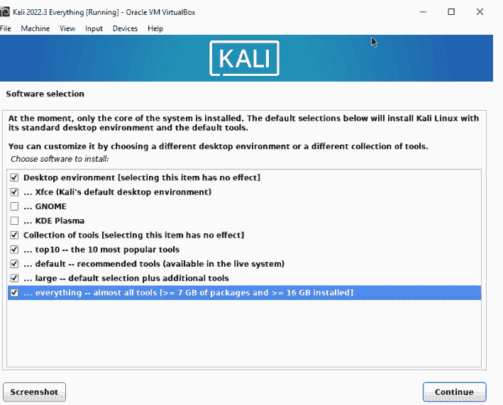

图 3.43：软件选择

16. 一旦你选择了软件，请点击继续。此过程需要一些时间。在此期间，你可以浏览其他选项。显示管理器是一个提供登录功能的程序。多个显示管理器可以同时运行。

默认管理器：

gdm3

lightdm

sddm


图 3.44：图形化显示管理器

选择并安装软件

安装将继续进行。

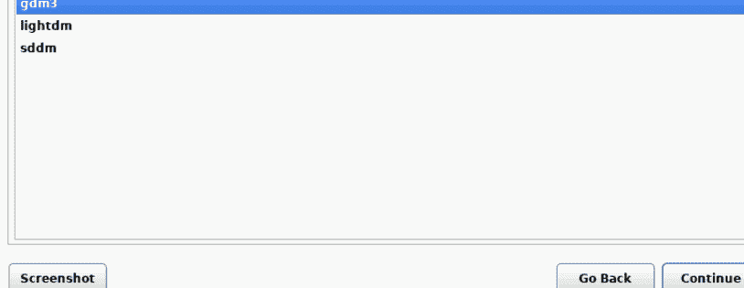


图 3.45：软件安装

17. 接下来，我们需要通过安装 GRUB 引导程序来使系统启动。选择`是 (Yes)`并点击继续。

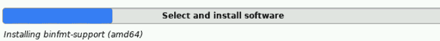

图 3.46：GRUB 引导程序

安装引导程序

19. 我们需要通过向磁盘安装引导程序来使新安装的系统启动。通常的做法是将 GRUB 安装到你的主驱动器。你也可以将其安装到可移动介质上。

安装设备：

手动输入设备

`/dev/sda (ata-VBOX_HARDDISK)`

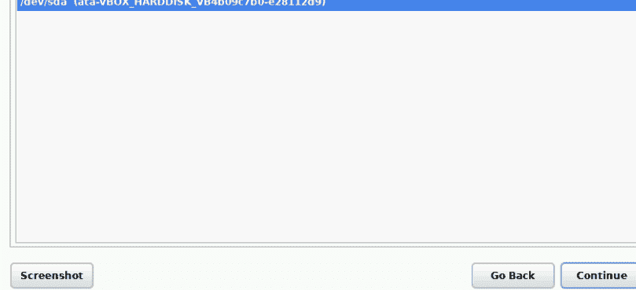

图 3.48：安装设备

20. 我们的安装很快就会完成。

完成安装

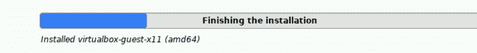

图 3.49：安装过程

在虚拟机上安装 Kali Linux 79

21. 在提示出现时，点击`继续 (Continue)`完成安装并重启系统。

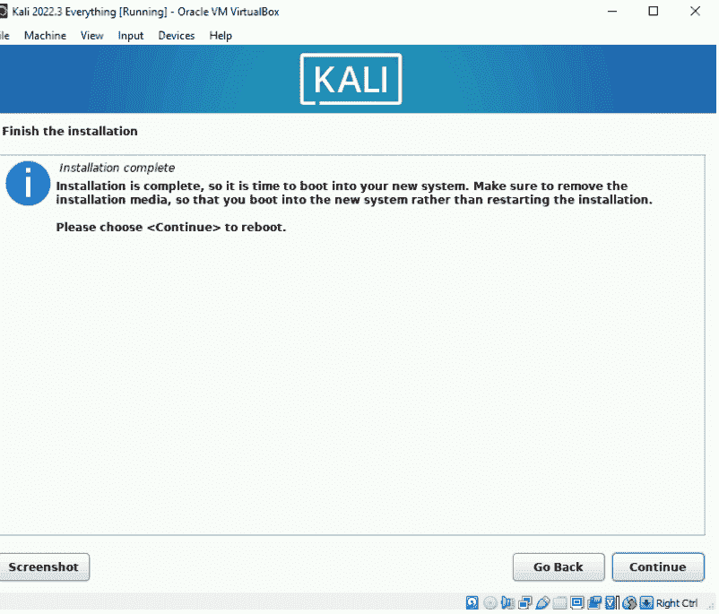

图 3.50：安装完成界面

22. 输入你的用户名和密码。

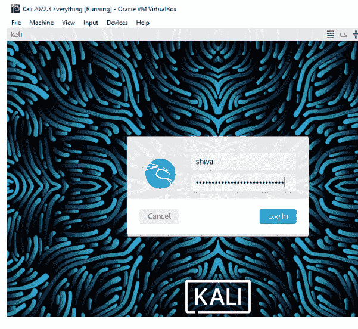

图 3.51：登录界面

# 4 额外的 Kali 安装与安装后任务

在上一一节中，我们学习了如何将 Kali Linux 作为一个独立的操作系统进行安装，以及如何在 VirtualBox 中安装 Kali。本章将继续介绍另外两种 Kali Linux 安装方式，这些方式被认为是更简单、更快速的安装方法，我将由你来判断。随后，我们将执行一些常见的安装后任务，以确保我们拥有完全更新且功能完的 Kali Linux 版本，用于数字取证与事件响应（DFIR）调查，无论选择何种安装平台。

本章将涵盖的主题有：

- 在 VirtualBox 中安装预配置版本的 Kali Linux
- 在 Raspberry Pi 4 上安装 Kali Linux
- 更新 Kali Linux
- 启用 root 账户
- 添加 Kali 仓库

## 在 VirtualBox 中安装预配置版本的 Kali Linux

你也可以通过更简单的方法在 VirtualBox 中安装 Kali：

- 如果你还没有下载第 3 章中为 VirtualBox 专门构建的 Kali 镜像，可以从 https://kali.download/virtual-images/kali-linux-2022.3/kali-linux-2022.3-vmware-amd64.7z 下载。

2. 你必须使用 7Zip 提取该镜像，可以在 https://www.7-zip.org/a/7z2201-x64.exe 下载。解压后，你将在图中看到相同的文件：

| 名称 | 修改日期 | 类型 | 大小 |
|---|---|---|---|
| kali-linux-2022.3-virtualbox-amd64.vbox | 08/08/2022 6:30 am | 虚拟机... | 4 KB |
| kali-linux-2022.3-virtualbox-amd64.vdi | 08/08/2022 6:30 am | 磁盘镜像 | 12,071, ... |

图 4.1 - 显示预配置 Kali 镜像的下载文件夹

3. 双击 `.vbox` 文件（其大小为几 KB），它会在 VirtualBox 中立即打开

图 4.2 - VirtualBox 管理器

4. 点击 VirtualBox 窗口顶部的设置图标

| | |
| --- | --- |
| 名称: kali-linux-2022.3-virtualbox-amd64 |
| 操作系统: Debian (64位) |
| `系统` | |
| 基础内存: 10240 MB |
| 处理器: 2 |
| 启动顺序: 硬盘 |
| 加速: VT-x/AMD-V, 嵌套分页, PAE/NX, KVM 虚拟化 |
| `显示` | |
| 视频内存: 128 MB |
| 显卡控制器: VMSGA |
| 远程桌面: 已禁用 |
| 录制: 已禁用 |
| `存储` | |
| 控制器: IDE |
| IDE 次要设备 0: [光驱驱动器] 空 |
| 控制器: SATA |
| SATA 端口 0: kali-linux-2022.3-virtualbox-amd64.vdi (正常, 80.9 GB) |
| `音频` | |
| 主机驱动程序: Windows DirectSound |
| 控制器: AC97 |
| `网络` | |
| 适配器 1: Intel Pro/1000 Desktop (NAT) |
| `USB` | |
| USB 控制器: OHCI |
| 设备过滤器: 0 (已激活) |
| `共享文件夹` | |
| `描述` | |
| Kali Rolling (2022.3) x64 |
| 2022-08-08 |

图 4.3 – Kali 虚拟机的预配置设置

5. 点击“系统”并使用滑块分配基础内存。完成后，点击“确定

图 4.4 – VirtualBox 中的内存分配

6. 要启动虚拟机，点击 器顶部的绿色“启动”按钮

图 4.5 – VirtualBox 启动按钮

7. 使用以下凭据登录（所有字母均为小写）：

- 用户名: `kali`
- 密码: `kali`

我们现在涵盖了三种安装 Kali Linux 的方法。我相信你觉得这种方法比其他的简单得多。让我们转向便携 Raspberry Pi 4 的另一种安装类型。

## 在 Raspberry Pi 4 上安装 Kali Linux

Raspberry Pi 4（也称为 Pi 4）是一种低功耗、小型、便携且强大的设备，正如本章早期提到的，它可以用于个人、企业甚至运营技术（OT）目的。在 Pi 4 上使用 Kali 非常有用，因为它功能强大，配备了 USB 3.0 端口、RJ-45 网络端口、双 mini-HDMI 端口、Wi-Fi、蓝牙以及高达 8 GB 的内存，只需几步即可从可启动的 microSD 卡上运行 Kali。你可以在 https://www.raspberrypi.com/products/raspberry-pi-4-model-b/ 了解更多关于 Pi 4 的信息。

按照以下步骤在 Pi 4 上安装 Kali（或旧的 Pi 2、3 和 400）：

- 1. 在 Pi 4（或旧的 Pi 2、3 和 400）上安装 Kali，我们需要 Pi Imager，它可以在 https://www.raspberrypi.com/software/ 下载，适用于 Windows、Mac 和 Linux。我建议使用 32 GB 或更大容量的 microSD 卡以确保你有足够的空间进行升级。
- 2. 一旦有了 Pi Imager，将 microSD 卡插入电脑或读卡器，并启动 Pi Imager

图 4.6 - Pi Imager 界面

- 3. 点击“选择存储”并选择你的 microSD 卡

图 4.7 - 存储选择

- 4. 点击“选择操作系统”并点击“其他”选项

图 4.8 - 操作系统选择

| | |
| --- | --- |
| 名称: kali-linux-2022.3-virtualbox-amd64 |
| 操作系统: Debian (64位) |
| `系统` | |
| 基础内存: 10240 MB |
| 处理器: 2 |
| 启动顺序: 硬盘 |
| 加速: VT-x/AMD-V, 嵌套分页, PAE/NX, KVM 虚拟化 |
| `显示` | |
| 视频内存: 128 MB |
| 显卡控制器: VMSGA |
| 远程桌面: 已禁用 |
| 录制: 已禁用 |
| `存储` | |
| 控制器: IDE |
| IDE 次要设备 0: [光驱驱动器] 空 |
| 控制器: SATA |


|SATA 端口 0: `kali-linux-2022.3-virtualbox-amd64.vdi` (正常, 80.9 GB) |

| **音频** | |

| 主机驱动程序: Windows DirectSound |

| 控制器: AC97 |

| **网络** | |

| 适配器 1: Intel Pro/1000 Desktop (NAT) |

| **USB** | |

| USB 控制器: OHCI |

| 设备过滤器: 0 (已激活) |

| **共享文件夹** | |

| **描述** | |

| Kali Rolling (2022.3) x64 |

| 2022-08-08 |

图 4.3 – Kali 虚拟机的预配置设置

- 5. 一旦选了版本，将返回主界面。点击“写入”将 Kali 安装到 microSD 卡上

图 4.9 - 可用的 Kali 版本

- 6. 随后将提示你继续。点击“YES”继续

图 4.10 - 最后配置

- 7. 进程完成后，将 microSD 卡从电脑或读卡器取出，并将其插入你的 Raspberry Pi 设备（此时设备应处于关闭状态以防损坏卡片）。开启 Pi，Kali 将启动。再次，默认用户名和密码均为 `kali`（小写）。

| 操作系统 | 存储 |
| --- | --- |
| RASPBERRY PI 2, 3, 4 AND 400 (32-BIT) | GENERIC MASS... |
| WRITING | Writing... 0% |

图 4.11 - 向 SD 卡写入 Kali

# 更新 Kali

现在我们已经查看了在各种平台上安装 Kali Linux 的许多可能方法，让我们看看在 Kali Linux 系统运行后的一些重要的安装后任务：

- 1. 要查看我们 Kali 系统的版本安装详情，让我们运行以下命令：

```
cat /etc/os-release
```

在下面的图中，我们可以看到命令输出显示了名称、版本、代号和更多细节以供验证。

## 额外的 Kali 安装与安装后任务

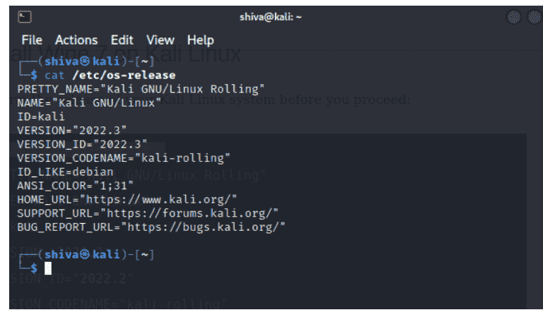

- 2. 在安装后，我们还应该更新我们的 Kali 系统，以确保我们拥有最新版本的工具和支持软件。

要更新 Kali Linux，请输入并运行以下命令：

```bash
sudo apt update
[shiva@kali]-$ sudo apt update
[sudo] password for shiva:
Get:1 http://kali.kali.org/download/kali-rolling/inRelease [30.6 KB]
Get:2 http://kali.kali.org/download/kali-rolling/main amd64 Packages [10.3 MB]
Get:3 http://kali.kali.org/download/kali-rolling/main amd64 Contents (deb) [42.5 MB]
Get:4 http://kali.kali.org/download/kali-rolling/contrib amd64 Packages [100 KB]
Get:5 http://kali.kali.org/download/kali-rolling/contrib amd64 Contents (deb) [15 KB]
Get:6 http://kali.kali.org/download/kali-rolling/non-free amd64 Packages [221 KB]
Get:7 http://kali.kali.org/download/kali-rolling/non-free amd64 Contents (deb) [98 KB]
Fetched 622.2 MB in 27s (2,273 kB/s)
Reading package lists... Done
Building dependency tree... Done
Reading state information... Done
674 packages can be upgraded. Run 'apt list --upgradable' to see them.
```

在接下来的截图中，安装了部分更新，最后几行显示有 674 个包可以升级：


- 3. 输入并运行以下命令查看升级列表：

```bash
apt list --upgradable
```

在接下来的截图中，我们可以看到正在执行的命令。升级所有组件可能需要一些时间。


图 4-15 - `apt list --upgradable` 命令输出

- 4. 输入并运行以下命令允许 Kali 升级所有之前的软件和包，而无需提示确认：

```bash
sudo apt upgrade -y
```

接下来的截图显示了命令的执行和输出。

### 额外的 Kali 安装与安装后任务

```bash
$ shiva@kali:[~]
sudo apt upgrade -y
Reading package lists ... Done
Building dependency tree ... Done
Reading state information ... Done
Calculating upgrade ... Done
The following packages were automatically installed and are no longer required:
libhttp-server-single lib-libc3 ruby-wacom-bin-python3-dataclasses-json
python3-limiter-python3-mypy-extensions-python3-responses-python3-jpyse
python3-django-bucket-python3-toning-inspecting python3.9-minimal
ruby2.7-dev ruby-2-doc
use sudo apt autoremove to remove them.
The following packages will be installed:
certify-ady colly-forward-matcher google-nexus-tools
libhos-libs-dev libcap-dev libbcp0-8-dev libwebsockets-17
mongo-python3-cryptography python3-json-pointer python3-munkres
python3-rfc3987 python3-webcolors python3-javp2 ruby-2.2
The following packages have been kept:
appear-util base-passwd-setup busbox cherry chkrootkit
cifutils-opt crypto cryptsetup-bin cryptupset-initramfs dash
dffails drutils ethol wf-tools firefox-esr g++ gcc gcc-12-base
girl.2-javascriptcore-4.0 girl2.2-mm-1.0 girl2.2-vte-291
```

图 4.16 - 升级 Kali Linux

注意，此过程可能需要一些时间才能完成。

- 5. 我们现在可以通过输入以下命令重启 Kali 来完成整个过程：

```bash
sudo reboot
```

接下来的截图显示了命令的执行和输出。

```bash
$ shiva@kali:[~]
sudo reboot
```

图 4.17 - 重启 Kali Linux

更新并升级 Kali 安装后，我们现在可以转向其他任务。接下来，我们将学习如何启用 root 账户。

### 在 Kali 中启用 root 用户账户

现在所有的更新和升级已经完成，让我们查看如何在 Kali Linux 中启用 root 用户账户。你可能会注意到某些版本的 Kali 在安装时允许使用 Kali 的默认用户名和密码访问。这是一种安全特性，防止无意中更改配置或工具。如果我们希望使用 root 或管理员权限执行命令或执行各种任务，请在相应的命令前输入 `sudo`。


Sudo 是 `superuser do` 的缩写，它允许我们以具有最高权限（即 root 权限）的超级用户身份运行命令和工具。有时在命令前输入这些内容可能有点麻烦，但习惯了就会好。

然而，如果你对 Linux 系统还不熟悉，建议在需要时使用 `sudo`。

# 在 Kali 中启用 root 账户

启用 root 账户非常简单，只需几个步骤：

首先，使用 Kali 的默认用户名和密码登录 Kali。

在接下来的截图中，点击屏幕右上角的 Kali 图标。


图 4.18 - Kali 登录界面

启用 root 账户

再次点击终端，你会发现提示符已经变成了 `(root@kali)`。


图 4.19 - 带有终端的 Kali 桌面

在新的终端中，输入以下命令以切换到超级用户账户：

成功！


# 额外的 Kali 安装与安装后任务

现在我们已经有了 root 用户账户，本章节的最后一个任务将使用元包添加取证工具。

## 添加取证包

Kali 元包是作为完整包下载的工具集合。取决于你安装的 Kali 版本，它可能不包含你在 https://kali.kali.org/tools/ 页面看到的所有工具。对于你的 DFIR 目的，所有的取证工具可以在 https://kali.kali.org/tools/kali-meta/#kali-tools-forensics 查看，你可以点击 Dependencies 部分的箭头查看列表。

所有之前的工具都包含在 `kali-tools-forensics` 元包中，可以通过以下命令安装：

```bash
sudo apt install kali-tools-forensics
```

接下来的截图显示了命令的执行和输出。


图 4.25 – 安装取证元包

> 注意

在安装任何元包之前，你应该像之前那样使用 `sudo apt update` 命令更新你的 Kali Linux。

我们已经在 Kali Linux 中安装了所有取证工具，如之前的截图所示。你可以点击 Kali 主菜单上的 Applications | 11-Forensics 来查看某些取证工具。

# 总结

在本章节中，我们学习了可以使用专门为 VirtualBox 设计的预配置 Kali 版本以更简单更快速的方法安装 Kali Linux。只需几次点击和微调，我们就完成了。我们还学习了在 Raspberry Pi 设备上安装 Kali，这仅需使用 Pi Imager 将 Kali 安装到 microSD 卡中，这在便携性方面非常有用。

随后，我们查看了任何安装后都应该完成的一些非常重要的安装后任务。我们学习了如何查找 Kali Linux 的版本，然后更新甚至升级 Kali 中的所有软件和包。最后，在本章中，我们查看了启用 root 账户，以避免在执行需要超级用户权限的操作时使用 `sudo` 命令。我们还学习了如何通过向安装中添加 `kali-tools-forensics` 元软件包来安装所有取证工具。

现在既然我们已经安装了各种版本的 Kali 并更新了系统，我们将转向一个名为 Wine 的非常实用的工具，它允许我们在 Kali Linux 系统上运行 Windows 工具。听我的，这玩意儿超酷的。我们下章再见！

# 5 在 Kali Linux 中中安装 Wine

在本章中，我们将学习如何通过使用 Wine 在 Kali Linux 中安装 Windows 工具的能力，来扩展我们 Kali Linux 环境的功能。

我们将从查看本章的以下主题开始：

- *Wine 是什么以及在 Kali Linux 中使用它的优势*
- 安装 Wine
- 测试我们的 Wine 安装

让我们先来看 Wine 及其优势。

## 什么是 Wine 以及在 Kali Linux 中使用它的优势

Wine 通常被误称为 Windows 模拟器，但正如官方网站所说，它最初被称为“Wine Is Not an Emulator”（Wine 不是模拟器），因此才有了这个缩写。Wine 允许非 Windows 用户在符合可移植操作系统接口 (POSIX) 的系统上运行某些 Windows应用程序，包括 macOS 以及各种 Linux 和 BSD 版本（包括 Kali Linux）。

对于我们的数字取证和事件响应 (DFIR) 目的来说，这是非常有用的，因为我们现在可以在 Kali Linux 系统上使用行业标准工具（特别是专门为 Windows 设计的工具），并将它们作为独立的操作系统或虚拟机使用。这也解决了必须购买 Windows 许可证的问题，因为我们不需要使用运行 Windows 的设备。当意识到现在可以在 Kali Linux 中运行所有 DFIR 工具时可以使用更少的硬件时，避免了这些费用。

通过在我们的 Kali Linux 实例中安装 Wine，我们不仅可以从 DFIR 的角度获得优势，从紫队团队（purple teaming）的角度也是如此，我们还可以在 Kali 机器上安装 Windows 的红队工具。根据个人经验，我一直会在 DFIR 练习和调查中使用两台笔记本电脑，一台运行基于 Linux 的操作系统（如 Kali Linux、CSI 和 Ubuntu），另一台运行 Windows 10。我几乎在每次 DFIR 练习和调查中使用的某些重要 Windows 应用程序包括 Belkaso RAM capturer、

## 在 Kali Linux 中安装 Wine

FTK Imager 和 Autopsy 4 GUI（图形用户界面）。这些工具在社区中被广泛使用，因为它们非常强大且易于使用。在我的 Kali Linux 和其他基于 Linux 的系统上安装 Wine 之后，我现在可以使用一台机器完成所有任务，从而节省时间、精力和成本。

在本章接后的章节中，我们将使用终端手动安装 Wine，然后安装 Google Chrome 浏览器作为测试，以确保我们的 Wine 安装成功。在随后的章节中，我们还将使用 Wine 在 Kali Linux 内为 DFIR 目的安装 Magnetisk RAM Capturer、FTK Imager 和 Autopsy 4。

## 安装 Wine

安装 Wine 需要我们按照精确顺序运行几个命令。虽然我确定使用的许多命令对你们许多人来说是新的，但我已经按照以下顺序列出了具体的步骤：

1. 在继续之前，确保你已连接到网络。

让我们通过打开一个新的终端并输入以下命令，然后按回车键来下载 Wine：

```
sudo dpkg --add-architecture i386
```

在接下来的截图中，我们添加了32位架构：


图 5.1：运行 `dpkg --add-architecture i386` 命令

2. 接下来，我们需要通过输入以下命令下载 Wine：

```
wget https://dl.winehq.org/wine-builds/wine.key
```

接下来的截图显示：


图 5.2：下载 Wine

3. 一旦下载完成，我们就可以通过输入以下命令将其添加到 `/usr/share/keyrings/wine.key`：

```
sudo mv wine.key /usr/share/keyrings/wine.key
```

接下来的截图显示：


图 5.3：添加 keyring

4. 接下来，通过输入以下命令下载 sources：

```
wget https://dl.winehq.org/wine-builds/dists/bullseye/sources
```

接下来的截图显示：


图 5.4：下载 sources

5. 一旦 sources 文件已下载，我们就可以通过输入以下命令将其添加到 `/etc/apt/sources`：

```
echo "deb https://dl.winehq.org/wine-builds/dists/bullseye main" | sudo tee -a /etc/apt/sources
```

接下来的截图显示：


图 5.5：更新 Kali


## 7. 更新系统

一旦你的终端看起来像截图所示，你就可以通过输入 `sudo apt update` 命令检查任何新更新。如下截图所示，有许多更新需要安装：

```bash
sudo apt update
Get:1: http://archive.us.org/debian/bullseye InRelease [116 kB]
Get:2: http://dl.winehq.org/wine-builds/debian InRelease [18.1 MB]
Get:3: http://dl.winehq.org/wine-builds/debian/main Packages [8,845 B]
Get:4: http://dl.winehq.org/wine-builds/debian/main i386 Packages [5 44 kB]
Get:5: http://dl.kali.org/kali-rolling InRelease
Get:6: http://ftp.us.org/debian/bullseye/main i386 Packages [8,122 kB]
Get:7: http://dl.winehq.org/wine-builds/bullseye/main amd64 Packages [533 kB]
Get:8: http://dl.kali.download/kali-rolling/main i386 Packages [8,182 kB]
Get:9: http://ftp.us.org/debian/bullseye/main Packages [8,182 kB]
Get:10: http://dl.kali.download/kali-rolling/main Contents (deb) [41.3 MB]
Get:11: http://ftp.us.org/debian/bullseye/main Translation-en [6,243 kB]
```

图 5.7：更新 Kali

## 8. 安装 Wine 稳定版

一旦所有更新都完成，我们现在可以使用以下命令下载最新稳定版的 Wine：

```
sudo apt install --install-recommends winehq-stable
```

接下来的截图显示命令的输出：

```
kali@kali~$ sudo apt install --install-recommends winehq-stable
[sudo] password for kali:
```

图 5.8：安装最新稳定版 Wine

注意

系统会提示输入密码并在提示时按 Y 表示是以继续安装。由于文件较大，可能需要几分钟来安装。

## 9. 验证 Wine 版本

一旦一切顺利且所有必要的文件和包都已安装，我们就可以通过运行以下命令来验证安装的 Wine 的版本：

```
wine --version
```

下面的截图显示了上一个命令的输出：

```
kali@kali:[~]
$ wine --version
wine-7.0
```

图 5.9: 验证安装的 Wine 版本

## 配置我们的 Wine 安装

在进入 Wine 的图形化安装和配置之前，我们在终端中执行的最后一步是运行 `winecfg` 命令：

```
kali@kali:[~]
$ winecfg
wine: created the configuration directory '/home/kali/.wine'
```

图 5.10: 运行 winecfg 命令启动 Wine

一旦一切正常，就会出现 Wine Mono Installer 框，并要求我们安装 Microsoft .NET Framework（这是 Windows 应用程序正常运行所所需的），然后按照以下步骤进行配置并完成安装：

### 1. 点击 Install（安装）按钮。


图 5.11: 安装 Wine Mono

### 2. 然后 Wine Mono 将开始下载并安装。


图 5.12: Wine Mono 安装状态条

### 3. 在 Wine 配置框中，你还可以选择想要在 Kali Linux 机器上模拟的 Microsoft Windows 版本。


图 5.13: 配置 Wine

在此示例中，我们可以看到默认选中并显示的是 Windows 7。要将此设置更改另一个 Windows 版本，请点击 Windows 版本右侧的下拉箭头并选择你喜欢的操作系统，如下：


图 5.14: Windows 操作系统选择

我选择了 Windows 10 作为我的操作系统，因为我们将安装的所有 Windows DFIR（数字取证、调查与响应）应用程序都运行在 Windows 10 上。


### 4. 点击 Apply（应用）继续，然后在 About（关于）选项卡中输入 Owner（所有者）和 Organization（组织）详情，如下，然后点击 Apply 和 OK 完成 Wine 配置。

## 测试我们的 Wine 安装

现在我们完成了本节中安装 Wine 的步骤，我们需要安装一个 Windows 程序进行测试，我们将在下一节进行。

走到这里做得很好。为了测试安装，让我们尝试使用 Wine 在 Kali Linux 系统中安装一个名为 Recuva 的文件恢复工具。Recuva 是一款流行的工具，提供免费版和付费版。让我们开始下载：

### 1. 你可以在此处免费版，用户只能执行高级文件恢复。在写作时，文件也可以直接从 `https://www.ccleaner.com/recuva/download/standard` 下载。


图 5.16: 完成 Wine 配置

### 2. 无论选择哪种下载方法，请务必点击 FREE RECUVA（免费版 Recuva）选项。文件名将显示为 `rcsetup153.exe`，这表明它是 Windows 可执行文件，如下方的所示：


图 5.17: Recuva 下载文件

### 3. 点击文件右侧的文件夹图标，或者进入 Downloads（下载）文件夹，我们应该可以在那里找到下载的文件 (`rcsetup153`)。


图 5.18: 下载文件夹中的 Recuva 安装文件

### 4. 从这里安装 Recuva 非常简单。双击 `rcsetup153.exe` 文件，它将打开安装程序，就像在 Windows 机器上一样，正如接下来的步骤所示。

### 5. 或者，你也可以右键点击文件并选择 Open With Wine Program Loader（使用 Wine 程序加载器打开）。


### 6. 点击 Install 继续在 Kali Linux 中安装 Recuva。


### 7. 安装完成后，你可以取消勾选 View release notes（查看说明）框，然后点击 Run Recuva（运行 Recuva）按钮启动 Recuva。

这完成了我们的安装，你现在也应该能在 Kali Linux 桌面上看到 Recuva 图标，如下所示。


图 5.21: Recuva 桌面快捷方式

### 8. 点击 Next（下一步）按钮关闭安装界面。注意接下来的截图，屏幕左上角有一个酒杯图标，表示 Recuva 正在使用 Wine 安装。

### 9. 虽然我们将在后面的章节中讨论使用 Recuva，但你可以现在运行 Recuva 作为最终测试，以确保程序和 Wine 都安装成功。

### 10. 一旦你看到下面的截图，说明 Wine 和 Recuva 都已成功安装：

此时，你可以点击 Cancel（取消）按钮停止运行 Recuva，因为我们稍后会再次配置并运行它。

# 存储媒介的历史与类型


这项调查的目的是证明存储媒介是否曾经存在、当前存在或曾发生过。在笔记本电脑、台式电脑、移动设备和智能设备中，数据驱动器必须存储某些某些，即使只是暂时的。我们大多数人可能对笔记本电脑、台式电脑、移动设备等硬盘（HDD）很熟悉，但我们也需要关注可拆卸和便携式存储设备，无论新旧，因为它们可能仍被使用。这些包括 DVD、移动硬盘、优盘或闪存盘、数字（SD）卡和 microSD 卡、CD 和软盘等旧介质以及许多其他类型的介质。

我们还应该考虑，许多便携式存储设备（如闪存盘）以新奇物品的形式具有各种有趣的形状和尺寸，可能不会采用普通的矩形驱动器形状。另一个需要考虑的问题是，多年来许多存储介质设备的尺寸发生了变化，并变得更小，这通常是因为技术的演进。

# IBM 与存储媒介的历史

在提到硬盘和存储媒介的历史时，如果不提到三个字母：IBM，就没有故事、旅程、书籍甚至讨论。我们都对这个知名的科技巨头非常熟悉，但我们可能并非都熟悉它的某些伟大成就。

**国际商业机器公司（IBM）**已经存在了很长时间。IBM 在 20 世纪初曾被称为**计算-制表-记录（CTR）**，它因制造了第一台硬盘、第一台 PC 以及其服务器、台式机和笔记本电脑而闻名。

在 1956 年至 1957 年之间，IBM 通过开发和发布 305 随机访问方法会计控制系统（RAMAC）取得了重大进展，该系统利用了第一个磁盘存储技术。这项革命性的技术约为一吨，尺寸约为 16 平英尺。然而，这个巨物的磁盘空间容量仅为 5 MB（兆字节）。

考虑到所有因素，按今天的标准5 MB 大约是移动设备拍摄的高清照片大小，这在那个时代确实是一项里程碑式的成就。在 IBM 发明之前，数据存储在打孔卡上，数百万张卡片才能装下几兆字节的数据。

当时引入这种数字存储时面临的一个大问题是设备体的尺寸。通过飞机和卡车运输对许多人来说可能不是选择；存储它的空间也会是一个问题。

随着技术的进步，IBM 在 1975 年发布了更便携的电脑——IBM 5100 便携式电脑。20 世纪 80 年，特别是 1981 年，我们看到了 IBM 个人电脑的诞生。这种便携式电脑的重量比前身轻得多，价格在 8000 到 20000 美元之间也非常便宜。

# 存储媒介的历史与类型

直到 1981 年 IBM 发布第一台个人电脑，电脑的便携性才成为现实。以 1565 美元的价格，所有者可以使用键盘和鼠标，并可以选择显示器、打印机和软盘驱动器。除了作为今天个人电脑标准的软盘驱动器之外。

随着这种更新且更便携的技术出现，多年来数据存储也得到了改进，见证了从磁带存储到软盘、磁盘、CD、DVD、蓝光光盘，当然还有机械硬盘和**固态硬盘（SSD）**的进步。

## 可拆卸存储介质

继续我们的存储媒介话题，我首先想讨论一下可拆卸存储介质，因为它在当今世界发挥了与固定存储介质同样重要的作用。

### 磁带驱动器

磁带由 IBM 在 20 世纪 50 年引入，是一种快速存储数据的方法，速度与其处理时间相当。IBM 726 磁带读写器是首批提供这种存储的设备之一，每线性英寸磁带的容量或密度为 100 位。每英寸磁带应该有一个磁带尺寸的指示，磁带绕在一个圆轮上，类似于旧电影胶带。

使用磁介质，数据跨越涂有磁层的塑料条宽度写入，并由数据块组成的间隙分隔成帧。磁带在今天仍被广泛使用，像许多其他存储介质类型一样，它的尺寸显著缩小，而容量和速度不断增加。

为了让大家了解截至 2017 年磁带存储的发展到了什么种程度，IBM 开发了新的磁带存储介质，单个卡带每秒可达**十亿比特（Gbps）**，可以记录高达 333 **吉字节（GB）**的数据。这些卡带（对于像我这样的老人家来说）尺寸像录音带，或者（对于年轻人来说）不比平均手机小多少，可以握在手中。

### 软盘

软盘再次由 IBM 引入，最早于 1971 年其软盘驱动器出现。尽管当时的主机已经有了硬盘和磁带存储介质，但仍需要一种单一的设备。

随着这种更新且更便携的技术出现，多年来数据存储也得到了改进……（注：此处原文逻辑重复）软盘的核心是比硬盘更便携的。软盘的核心是是比硬盘更便携的媒介。

#### 软盘的演变

软盘在尺寸和容量上的演变如下：

- 8 英寸：于 1971 年引入，容量未注明
- 5.25 英寸：于 1976 年引入，容量未注明
- 3.5 英寸：于 1984 年引入，容量未注明
- 1.44 英寸：于 1986 年引入，容量未注明

## 光存储介质

光存储介质之所以这样命名是因为使用了激光。

### 光盘

光盘（CD）由底部的凹槽和凸起制成，涂有薄层铝层：

- 直径：120 mm
- 写入数据的激光类型：780 纳米（nm）红外激光
- 最大容量：650–700 MB

CD 分为两大类：

- 唯读光盘（CD-ROM）：这种光盘以程序、游戏、音乐等形式带有数据，且只能读取，类似于可刻录光盘。
- 可刻录光盘（CD-R）：数据可以写入此光盘中，但只能写入一次。
- 可重写光盘（CD-RW）：数据可以多次写入此光盘中。

### 数字通用光盘

数字通用光盘（DVD）虽然直径相同，但存储的数据比 CD 多得多：

- 直径：120 mm（与 CD 相同）
- 写入数据的激光类型：650 nm 红激光
- DVD 的最大容量：4.7 GB 和 15.9 GB（双层 DVD）

DVD 的各种类型如下：

- 唯读光盘（DVD-ROM）：这种 DVD 已经写入了数据，类似于 CD-ROM
- 可刻录光盘（DVD-R）：数据可以写入一次 DVD。
- 正式可刻录光盘（DVD+R）：数据可以写入一次 DVD。DVD+R 使用了先进的错误检测和管理技术。
- 可写光盘（DVD-RW）：数据可以多次写入 DVD。
- 双层可刻录光盘（DVD-R DL）：这种 DVD 类型包含双层，导致存储容量更高，DVD-9 磁盘为 7.95 GB，DVD-18 磁盘为 15.9 GB。
- 双层可刻录光盘（DVD+DL）：与 DVD-R DL 相同，但被认为是一种更有效的格式，错误更少。
- 随机访问光盘（DVD-RAM）：主要用于视频录制设备，因其耐用性（寿命达二十年）和可以重写数据的能力。这种光盘比其他 DVD 格式贵得多，而且与许多常见的 DVD 驱动器和播放器不兼容。

### 蓝光光片 (Blu-ray Disc)

蓝光光片是当前移动式磁盘介质的标准，其名称来源于读写光片时使用的激光颜色。由于蓝光光片具有高容量，高清（HD）内容可以轻松存储在蓝光光片上而不损失质量：

- 直径：120 mm（与 CD 和 DVD 相同）
- 写入激光类型：405 nm 蓝激光
- DVD 的最大容量：25 GB 和 50 GB（双层蓝光）
- 数据传输：最高每秒 72 兆比特 (Mbps)

蓝光光片的两种容量也有重写和可录制格式：

- BD-RE: 蓝光可重写
- BD-RE DL: 蓝光可重写双层 (50 GB)
- BD-R: 蓝光可录制
- BD-R DL: 蓝光可录制双层 (50 GB)

## 闪存存储

闪存之所以如此，是因为数据是通过电荷进行写入和擦除的。你可能可能有人说他们必须“刷机”（flash）他们的移动设备。这与擦除手机和智能设备上的闪存存储介质非常相似，只是 Android 和 iOS 等操作系统刷机和重新安装操作系统需要更复杂的程序。然而，最终结果是非常相同的，因为内存和存储区域被重置或清除了。

闪存存储芯片有两种类型，称为 NAND (NAND) 和 NOR 闪存，负责闪存存储介质上数据的高速和高容量存储。它们绝不是电可擦除编程只读器 (EEPROM) 芯片，后者可以一次擦除数据块或整个驱动器，而不是一次擦除一个，且 EEPROM 的速度较慢。这种类型的闪存芯片是非易失的，这意味着即使在失去芯片电源后，数据仍然存在于芯片上。当通过所谓的“电路写入”（in-circuit writing）方法向芯片发送电信号指令时，数据就会被擦除，从而相应更改数据。

下面的照片显示了我的一个 1 GB（左）闪存盘和一个裸露 NAND 芯片的新型 32 GB 闪存盘（右）。注意，即使芯片的大小相似，右侧芯片的数据容量也是左侧的 32 倍，因为它们的制造时间相差了十年以上：

存储介质的历史与类型 123


图 6.1 – 闪存盘板上的 NAND 芯片。将你的拇指比作小指指甲的大小。闪存存储的寿命取决于使用情况，因为它们都有平均的读写使用次数，有时显示在设备的包装上。读写速度也是目前最快的之一，这就是为什么机械硬盘（HDD）从传统的机械磁盘机制转向固态机制的原因。本章将讨论 SSD。

> 注意
存储介质的容量从 2 GB 到 1 太字节 (TB) 更多，特别是在 SD、microSD 和闪存盘上，这些设备现在可以作为快速的移动驱动器，在上面安装操作系统，并可以使用各种工具进行分区。所以是的，Kali Linux 确实可以安装到仅有 8 GB 存储空间的闪存盘、SD 或 microSD 卡中（并制成可启动）。

## USB 闪存盘


通用串行总线（USB）端口或接口发布于 1995 年，已成为所有设备的标准，取代了以前连接到计算机特定并行端口的旧设备。看到通过 USB 连接到计算机的任何设备或外设非常常见，包括鼠标、键盘、闪存盘、打印机、扫描仪、相机、移动设备以及几乎所有设备。

此表显示了 USB 端口的演变：

| USB 版本 | 发布年份 | 数据传输速度 |
|---|---|---|
| USB 1.0 和 1.1 | 1995 | 12 Mbps |
| USB 2.0 | 2000 | 480 Mbps |
| USB 3.0 | 2008 | 5 Gbps |
| USB 3.1 | 2013 | 10 Gbps |

闪存盘有各种形状和大小，从标准的矩形到各种想象中的形状。闪存盘使用 NAND 芯片存储数据，如今有多种版本，定义了闪存盘的读写速度。接下来的图片显示了从旧到新的各种闪存盘，从左到右排列。前三个驱动都是 USB 2.0；然而，前两个是 8 GB 闪存盘，第三个是 32 GB。


图 6.2 – 闪存盘大小

> **重要说明**
>
> 特别提一下“显而易见的问题”——奇形闪存盘，它可以很容易当做钥匙扣使用，由于数据的敏感性，实际上可能会对员工带到办公室或遗忘闪存盘构成威胁。

## 闪存卡

与闪存盘一样，闪存卡（或亲切地称为内存卡）也使用 NAND 内存，正如之前学习的，是非易失性固态。然而，与闪存盘不同，这些卡没有 USB 接口，必须配合适配器或内存卡阅读器使用。多年年来，各种格式的内存卡曾点缀我们的桌面电脑、笔记本电脑、移动设备和其他设备，包括相机、MP3 播放器甚至玩具。尽管我只涵盖了当今的一些流行卡，但对你至少熟悉内存卡并能够识别它们很重要。以下是内存卡类型：

- Memory Stick PRO Duo (MSPD)（索尼的专利卡）
- SD
- MicroSD
- Compact Flash (CF)
- Multimedia Card (MMC)
- xD
- Smart Media (SMM)

在上述类型中，我选择在下面的照片中展示我收藏中的三张。顶部的卡是三星 SD 卡。SD 卡侧通常有一个滑动锁，用于防止数据被覆盖。在中间和下方，有两个 Memory Stick PRO Duo 卡，它们在某个时期可能很罕见，但功能完备：


图 6.3 – SD 卡与 PRO Duo 比较

# 理解文件系统与存储

我想简要比较 PRO Duo 卡、SD 卡以及图 6.4 中的 microSD 卡。PRO Duo 卡至少相差了十年，其容量分别为 2 GB 和 4 GB。

为了说明这一点，让我们看看图 6.4（由于相机对焦而模糊）中的 microSD 卡。左侧的 microSD 卡容量为 64 GB，被指定为 Class 10。右侧的 microSD 卡容量为 512 GB，是 Class 10 U3 卡，比指甲还小！仍然，随着技术的发展，microSD 卡拥有更大的容量：


图 6.4 – microSD 卡

各种级别的 microSD 卡标识了它们的读写速度和用途。我建议购买时选择 Class 10 microSD 卡，因为 C10 比其他等级（2、4、6）快得多，并支持 HD 甚至 4K 视频录制。

让我们看看四种速度等级：

| 等级 (C) | 最小写入速度 (Mbps) |
|---|---|
| C2 | 2 |
| C4 | 4 |
| C6 | 6 |
| C10 | 10 |

还有高速 (UHS) 等级，可以通过 microSD 卡上的 U 符号识别。

| UHS (U) 等级 | 最小写入速度 (MBps) |
|---|---|
| U1 | 10 |
| U3 | 30 |

为了适应大文件，特别是 4K 和 8K 视频素材，还有一种视频速度等级：

| 视频速度等级 | 最小写入速度 (MBps) |
|---|---|
| V6 | 6 |
| V10 | 10 |
| V30 | 30 |
| V60 | 60 |
| V90 | 90 |

如之前所述，闪存卡需要读卡器，读卡器通过 USB 端口连接到笔记本电脑、桌面和其他媒体播放器。图 6.5 中的照片展示了我许多读卡器之一，它支持 CF、Memory Stick PRO Duo、SD 甚至 SM 卡，而图 6.6 中的新型读卡器是 SD 和 microSD 卡阅读器，带有 USB 和 Type-C 插槽：


图 6.5 – SD 卡、CF 和 PRO Duo 读卡器


图 6.6 - USB 3.0 和 Type C SD 卡及 microSD 卡阅读器

## 硬盘驱动器

现在我们已经仔细观察了非易失性存储（包括磁带存储和闪存存储），让我们深入了解一下硬盘（HDD）的世界，它们作为固定存储介质。我将尝试通过专注于法医调查人员所需的知识，使内容保持非常简单且简短。

HDD 技术从最初在 IBM 主机中看到的巨型存储设备以来，确实取得了巨大的进步，现在变得更加紧凑、更快速且更廉价，容量达到了 TB 级。

尽管较新的固态硬盘（SSD）使用了与闪存设备相同的内存类型，但与机械硬盘相比，它们的价格仍然较贵。这可能是解释为什么旧的机械硬盘技术仍被使用的因素之一。机械硬盘由移动部件，包括盘片、执行器臂和一个非常强大的磁铁。虽然在如今的笔记本电脑和硬盘中经常发现这些机械硬盘，但它们比比新的固态硬盘慢得多，后者没有移动部件，看起来与 USB 闪盘的芯片组非常相似。

在你的法医调查和冒险中，你可能会遇到或面对旧的 HDD，它们可能具有不同的接口，并使用不同的电缆技术连接到主板。让我们来看看吧？

### 集成驱动器电子设备 HDD

20 世纪 80 年代中期的许多早期 PC 都配备了使用并行高级技术附件（PATA）和集成驱动器电子设备（IDE）技术的硬盘。与那时的所有旧设备一样，并行传输（同时发送多个位但速度较慢）是当时的主流，导致吞吐量非常有限。识别旧 IDE 硬盘的一种简单方法是只需观察数据和电源线连接到硬盘的接口。

这些旧硬盘如下所示所示，有四个用于电源的引脚（连接到 Molex 接口），中间隔着八个用于设置设备为主设备（master）或从设备（slave）的引脚，然后是 40 个用于 IDE 数据线的引脚，将数据传输到主板：


图 6.7 – 3.5 英型 IDE 硬盘

1994 年，技术的进步导致了增强集成驱动器电子设备（EIDE）的发布，其数据线引脚数量从 40 个增加到 80 个，并将传输速度从 40 Mbps 提高到可能的 133 Mbps。

然而，IDE/EIDE 仍然限制每台计算机最多连接四个 IDE/EIDE 硬盘，因为硬盘上的跳线引脚只允许两个主硬盘和两个从硬盘，以主/从配置设置。还需要考虑这样一个事实：当时 CD-ROM 和 RW 设备以及 DVD-ROM 和 RW 设备也使用 IDE/EIDE 技术。

## 串行高级技术 HDD 技术称为串行高级技术附件

2002 年，希捷推出了名为串行高级技术附件（SATA）的 HDD 技术，它使用串行传输代替较慢的并行传输。PATA 硬盘的速度为 33/66/133 Mbps，而 SATA 硬盘的自则为 150/300/600 Mbps。这意味着 SATA 最低传输速度 150 Mbps 比 PATA 的最高速度 133 Mbps 更快。

SATA 硬盘的连接接口也不同，但在当时，看到同时具有 SATA 和 PATA 电源线接口的 SATA 硬盘是很常见的，以实现后兼容。

SATA 数据线比 PATA 线细得多，因为它们只包含连接到七个引脚的七根线。这与在一根 IDE/EIDE 线缆上连接两个硬盘的 PATA 设备不同。

SATA 仍然是台式机和笔记本电脑硬盘的标准，并经过多次修订，如下所示（速度为 Mbps）：

- SATA 1: 150 Mbps
- SATA 2: 300 Mbps
- SATA 3: 600 Mbps

下面的照片显示了两个 2.5 英型硬盘。左侧是旧款硬盘，右侧是现代 SATA 硬盘：


图 6.8 – 2.5 英型 IDE（左）和 SATA

## 存储介质的历史与类型

下面的照片显示了两个笔记本 2.5 英型硬盘。左侧的损坏并已打开，我们可以看到中间的圆形盘片，顶部的执行器臂位于盘片上方。执行器臂的末端是读写头，用于读写盘片。

照片中提到的硬盘是混合硬盘或固态混合硬盘（SSHD）。它像左侧那样是机械硬盘，但也带有闪存，以便快速访问盘片上的数据：


图 6.9 – 机械硬盘中的盘片和执行器臂

### 固态硬盘

简要提到，SSD 是非易失性存储介质，使用阵列中的闪存来存储数据。SSD 已经存在一段时间了；但主流应用受到成本的极大限制。三星于 1996 年发布了 PATA 接口的 SSD，随后闪士发布了 SATA 接口的 SSD。

尽管 SSD 硬盘使用闪存，但使用的材料比硬盘中的更耐用，这使其非常适合移动使用，但再次，这导致了高昂的成本。

这是一张 250 GB SSD 的照片：


图 6.10 – SSD

注意 SSD 接口（左侧）的引脚布局，它连接到板载上的外围组件部件（PCIe），而不是普通的 SATA 连接。上一照片中的接口是 M.2 非易失性内存表达式（NVMe）SSD 类型，但也有其他类型。在对可能需要 USB 适配器的 SSD 进行取证时，请确保知道使用的是使用的是接口。

SSD 接口类型包括：

- M.2 NVme（带宽 32 Gb/s）
- M.2 SATA（带宽 6 Gb/s）
- mSATA（带宽 6 Gb/s）

我们现在已经熟悉了不同类型的 HDD 及其差异。让我们介绍可以在刚刚阅读的硬盘上安装的文件系统和操作系统。

## 文件系统和操作系统

现在我们已经涵盖了硬盘的物理方面，让我们进入逻辑层面！任何种类型的存储介质都需要用特定的文件系统进行格式化。所选的文件系统还将决定介质上可以安装哪些操作系统，以及文件和分区大小。

想这种情况的一种简单方法是把一张白纸想象成任何类型的全新或已擦除存储介质。我们可以在这张纸上放多种类型的信息，但我们首先希望以某种方式组织或准备这张纸，如句子和段落，或者我们可以选择从左到右书写，使我们的数据易于理解、访问甚至存储。也许使用行和列创建表格。我们甚至可以使用打印幻灯片显示我们的数据或图像、图表和流程图。此外，我们可以格式化存储介质，以最适合将存储和使用的数据。

文件系统确保数据的组织方式便于识别和索引。考虑存储在具有多个隔间的档案柜内的空间。某些可能专门用于按字母顺序存储文件，另一些按时间顺序，有些隔间用于文具用品、杂物甚至随机物品。尽管都用于存储物品，但它们都可以标记标签，并易于识别和组织，使得每个隔间的内容可以被轻松访问或移除。

要在硬盘或可移动介质上安装任何操作系统，必须首先格式化设备并通过选择合适的文件系统为操作系统做好准备。Windows、macOS、Android、Kali 等都是组织存储介质以便操作系统成功安装的文件系统。

一些更流行的操作系统及其文件系统包含在后续章节中。

# 理解文件系统与存储

## 概要

旧版本的 Microsoft Windows 默认支持文件分配表 (`FAT`) 文件系统。较新版本的 Windows 也支持 `FAT` 和 `FAT32`，但受到驱动器大小（8 TB）和文件大小（4 GB）的限制。可扩展文件分配表 (`exFAT`) 的创建是为了消除 `FAT32` 的局限性，但其受支持程度可能没有 `FAT32` 那么广泛。

## Macintosh (macOS)

以下是 Macintosh 操作系统 (`macOS`) 的一些简要特征：

- 分级文件系统 (`HFS+`)
- 支持的版本：直到版本 10 的 `macOS`
- 最大 卷大小：2 TB
- 最大支持的文件大小：2 GB

Apple 此后进化到一种名为 Apple 文件系统 (`APFS`) 的更新 64 位文件系统，该系统取代了 `HFS+`，并专门针对 SSD 和 iOS 设备进行了优化。

以下是 `APFS` 的一些简要特征：

- 支持的版本：`macOS` 10.13（更高版本）以及 `iOS` 10.3 及更高版本
- 最大支持的文件大小：8 艾字节 (`EiB`)

## Linux

以下是 Linux 文件系统的的一些简要特征：

- 文件系统：第四扩展文件系统 (`ext4`)。Linux 有多种文件系统可用，但如果你不确定应该使用哪一个，我推荐使用这一个。
- 支持的版本：红帽 (`Red Hat`)、`Kali`、`Ubuntu` 等。
- 最大 卷大小：1 `EiB`。
- 最大支持的文件大小：16 兆备字节 (`TiB`)。

## 注意事项

许多开源操作系统发行版都基于 Linux，包括 `Kali Linux` 和 `Android`，因此它们使用 `ext2`/`ext3`/`ext4` 文件系统。它们也能够使用 `FAT32` 文件系统。`FAT32` 可以在任何平台上使用，包括旧版本的 Windows、Macintosh 和 Linux，并被任何带有 USB 接口的设备支持。

对于数字取证与事件响应 (`DFIR`) 而言，了解文件系统以及我们能够读取的差异至关重要。一旦选择了文件系统（无论是通过驱动器管理器还是用户），数据就可以存储在介质上。现在让我们在下一节查看数据类型和状态。

## 数据类型和状态

首先，有传输中数据 (`data in transit`)，也称为运动中数据。这些简单描述了移动中的数据，可能在设备之间的网络中传输，甚至在存储介质之间活跃地移动位置。

还有使用中数据 (`data in use`)。在这一状态下，数据正被用户访问或被 CPU 处理。当数据被访问或使用时，它会从硬盘中提取并临时存储在 RAM 中，RAM 的速度比硬盘（特别是机械硬盘）快得多，只要用户访问它且设备有供电，数据就会存储在那里。

当数据不在运动、传输或使用状态时，它被描述为静态数据 (`data at rest`)。在这种状态下，数据静止或位于非易失性介质上，例如硬盘、光介质、闪存驱动和内存卡。

现在我们已经知道了描述数据状态的正式术语，接下来我们将学习元数据 (`metadata`) 和空隙空间 (`slack space`)。

## 元数据

元数据简单来说就是关于数据的数据。以一个存储在仓库中的笔记本电脑为例。在仓库的某处（可能在云等其他位置），可能会有几条信息可以作为关于笔记本电脑的数据，甚至是笔记本电脑元数据，如下：

- 笔记本电脑在仓库内的位置
- 笔记本电脑品牌和型号
- 制造日期
- 质修日期和信息
- 硬件和软件规格
- 颜色和尺寸

## 空隙空间 (Slack space)

簇 (`Clusters`) 是存储介质上存储数据的最小磁盘空间或分配单元。格式化驱动器时，我们需要定义这些分配单元的大小，或者可以使用 4 KB 的默认簇大小。这就是空隙 (`slack`) 出现的地方。

空隙空间是簇内包含数据但未被数据填充的空闲空间。为了完全理解这一点，我们需要了解不同操作系统的默认簇大小。使用 `NTFS`（用于 Windows）格式化的驱动器其默认簇大小为 4 KB。假设你向磁盘保存了一个簇大小为 3 KB 的文件。这意味着在簇内你仍然有 1 KB 的未使用空间或空隙空间。

空隙空间对法医调查人员具有特殊意义，因为数据可以很容易地隐藏在空隙空间中。同样，我们在 `Kali Linux` 中有几种可用工具，例如 `Sleuth Kit` 和 `Autopsy`，可以帮助调查空隙空间并寻找隐藏文件。务必熟悉这些术语和空隙空间，以便我们在本章后续内容中方便查阅。

## 易失性与非易失性数据以及易失性顺序

在本节中，我们观察当易失性内存失去电源时数据是如何丢失的。数据可以存在于其存储的介质上。硬盘（机械式和固态）、闪存驱动器和内存卡都是非易失性存储介质。尽管 SSD 在数据访问时间上提供了巨大的改进，但 RAM（通常称为内存）仍然是最快速的类型。

然而，RAM 是易失性的。与硬盘和闪存驱动器中的内存不同，RAM 是易失性的。当数据被访问或使用时，它会从硬盘中提取并临时存储在 RAM 中，RAM 的速度比硬盘（特别是机械硬盘）快得多，只要用户访问它且设备有供电，数据就会存储在那里。

当数据不在运动、传输或使用状态时，它被描述为静态数据。在这种状态下，数据静止或位于非易失性介质上，例如硬盘、光介质、闪存驱动和内存卡。

现在我们已经知道了描述数据状态的正式术语，接下来我们将学习元数据和空隙空间。


然而，RAM 是易失性的。与硬盘和闪存驱动器中的内存不同，RAM 是易失性的。当数据被访问或使用时，它会从硬盘中提取并临时存储在 RAM 中，RAM 的速度比硬盘（特别是机械硬盘）快得多，只要用户访问它且设备有供电，数据就会存储在在那里。

当数据不在运动、传输或使用状态时，它被描述为静态数据。在这种状态下，数据静止或位于非易失性介质上，例如硬盘、光介质、闪存驱动和内存卡。

现在我们已经知道了描述数据状态的正式术语，接下来我们将学习元数据和空隙空间。

## 易失性与非易失性数据以及易失性顺序

在本节中，我们观察当易失性内存失去电源时数据是如何丢失的。数据可以存在于其存储的介质上。硬盘（机械式和固态）、闪存驱动器和内存卡都是非易失性存储介质。尽管 SSD 在数据访问时间上提供了巨大的改进，但 RAM（通常称为内存）仍然是最快速的类型。

然而，RAM 是易失性的。与硬盘和闪存驱动器中的内存不同，RAM 是易失性的。当数据被访问或使用时，它会从硬盘中提取并临时存储在 RAM 中，RAM 的速度比硬盘（特别是机械硬盘）快得多，只要用户访问它且设备有供电，数据就会存储在在那里。

当数据不在运动、传输或使用状态时，它被描述为静态数据。在这种状态下，数据静止或位于非易失性介质上，例如硬盘、光介质、闪存驱动和内存卡。

现在我们已经知道了描述数据状态的正式术语，接下来我们将学习元数据和空隙空间。


# 易失性与非易失性数据以及易失性顺序

在本节中，我们观察当易失性内存失去电源时数据是如何丢失的。数据可以存在于其存储的介质上。硬盘（机械式和固态）、闪存驱动器和内存卡都是非易失性存储介质。尽管 SSD 在数据访问时间上提供了巨大的改进，但 RAM（通常称为内存）仍然是最快速的类型。

然而，RAM 是易失性的。与硬盘和闪存驱动器中的内存不同，RAM 是易失性的。当数据被访问或使用时，它会从硬盘中提取并临时存储在 RAM 中，RAM 的速度比硬盘（特别是机械硬盘）快得多，只要用户访问它且设备有供电，数据就会存储在在那里。

当数据不在运动、传输或使用状态时，它被描述为静态数据。在这种状态下，数据静止或位于非易失性介质上，例如硬盘、光介质、闪存驱动和内存卡。

现在我们已经知道了描述数据状态的正式术语，接下来我们将学习元数据和空隙空间。

# 理解文件系统与存储

## 概要

旧版本的 Microsoft Windows 默认支持文件分配表 `FAT` 文件系统。较新版本的 Windows 也支持 `FAT` 和 `FAT32`，但受到驱动器大小（8 TB）和文件大小（4 GB）的限制。可扩展文件分配表 `exFAT` 的创建是为了消除 `FAT32` 的局限性，但其受支持程度可能没有 `FAT32` 那么广泛。

## Macintosh (macOS)

以下是 Macintosh 操作系统 `macOS` 的一些简要特征：
- 分级文件系统 `HFS+`
- 支持的版本：直到版本 10 的 `macOS`
- 最大 卷大小：2 TB
- 最大支持的文件大小：2 GB

Apple 此后进化到一种名为 Apple 文件系统 `APFS` 的更新 64 位文件系统，该系统取代了 `HFS+`，并专门针对 SSD 和 iOS 设备进行了优化。

以下是 `APFS` 的一些简要特征：
- 支持的版本：`macOS 10.13`（更高版本）以及 `iOS 10.3` 及更高版本
- 最大支持的文件大小：8 艾字节 `EiB`

## Linux

以下是 Linux 文件系统的的一些简要特征：
- 文件系统：第四扩展文件系统 `ext4`。Linux 有多种文件系统可用，但如果你不确定应该使用哪一个，我推荐使用这一个。
- 支持的版本：红帽 `Red Hat`、`Kali`、`Ubuntu` 等。
- 最大 卷大小：1 `EiB`。
- 最大支持的文件大小：16 兆备字节 `TiB`。

## 注意事项

许多开源操作系统发行版都基于 Linux，包括 `Kali Linux` 和 `Android`，因此它们使用 `ext2`/`ext3`/`ext4` 文件系统。它们也能够使用 `FAT32` 文件系统。`FAT32` 可以在任何平台上使用，包括旧版本的 Windows、Macintosh 和 Linux，并被任何带有 USB 接口的设备支持。

对于数字取证与事件响应 `DFIR` 而言，了解文件系统以及我们能够读取的差异至关重要。一旦选择了文件系统（无论是通过驱动器管理器还是用户），数据就可以存储在介质上。现在让我们在下一节查看数据类型和状态。

## 数据类型和状态

首先，有传输中数据 `data in transit`，也称为运动中数据。这些简单描述了移动中的数据，可能在设备之间的网络中传输，甚至在存储介质之间活跃地移动位置。

还有使用中数据 `data in use`。在这一状态下，数据正被用户访问或被 CPU 处理。当数据被访问或使用时，它会从硬盘中提取并临时存储在 RAM 中，RAM 的速度比硬盘（特别是机械硬盘）快得多，只要用户访问它且设备有供电，数据就会存储在在那里。

当数据不在运动、传输或使用状态时，它被描述为静态数据 `data at rest`。在这种状态下，数据静止或位于非易失性介质上，例如硬盘、光介质、闪存驱动和内存卡。

现在我们已经知道了描述数据状态的正式术语，接下来我们将学习元数据和空隙空间。

## 元数据

元数据简单来说就是关于数据的数据。以一个存储在仓库中的笔记本电脑为例。在仓库的某处（可能在云等其他位置），可能会有几条信息可以作为关于笔记本电脑的数据，甚至是笔记本电脑元数据，如下：
- 笔记本电脑在仓库内的位置
- 笔记本电脑品牌和型号
- 制造日期
- 质修日期和信息
- 硬件和软件规格
- 颜色和尺寸

## 空隙空间 `Slack space`

簇 `Clusters` 是存储介质上存储数据的最小磁盘空间或分配单元。格式化驱动器时，我们需要定义这些分配单元的大小，或者可以使用 4 KB 的默认簇大小。这就是空隙 `slack` 出现的地方。

空隙空间是簇内包含数据但未被数据填充的空闲空间。为了完全理解这一点，我们需要了解不同操作系统的默认簇大小。使用 `NTFS`（用于 Windows）格式化的驱动器其默认簇大小为 4 KB。假设你向磁盘保存了一个簇大小为 3 KB 的文件。这意味着在簇内你仍然有 1 KB 的未使用空间或空隙空间。

空隙空间对法医调查人员具有特殊意义，因为数据可以很容易地隐藏在空隙空间中。同样，我们在 `Kali Linux` 中有几种可用工具，例如 `Sleuth Kit` 和 `Autopsy`，可以帮助调查空隙空间并寻找隐藏文件。务必熟悉这些术语和空隙空间，以便我们在本章后续内容中方便查阅。

## 易失性与非易失性数据以及易失性顺序

在本节中，我们观察当易失性内存失去电源时数据是如何丢失的。数据可以存在于其存储的介质上。硬盘（机械式和固态）、闪存驱动器和内存卡都是非易失性存储介质。尽管 SSD 在数据访问时间上提供了巨大的改进，但 RAM（通常称为内存）仍然是最快速的类型。

然而，RAM 是易失性的。与硬盘和闪存驱动器中的内存不同，RAM 是易失性的。当数据被访问或使用时，它会从硬盘中提取并临时存储在 RAM 中，RAM 的速度比硬盘（特别是机械硬盘）快得多，只要用户访问它且设备有供电，数据就会存储在在那里。

当数据不在运动、传输或使用状态时，它被描述为静态数据。在这种状态下，数据静止或位于非易失性介质上，例如硬盘、光介质、闪存驱动和内存卡。

# 总结

在本章中，我们将花时间介绍非易失性存储介质的基础知识，这类介质在断电后仍能存储数据。非易失性介质包括不同类型的硬盘 `HDD`，例如机械式和固态 `PATA` 及 `SATA` 驱动器、优盘和内存卡。

新的存储介质（包括 SSD）使用一种名为 `NAND` 闪存的特殊闪存来存储数据。由于设备不包含移动部件，这种闪存比传统的机械硬盘更快、更耐用；然而，目前它们的成本仍然相当高。

我们还查看了与各种操作系统相关的各种文件系统，并发现最小的数据分配单元是簇 `cluster`，它可能存在空隙空间 `slack space` 中。空隙空间是簇内未使用的空间，数据本身在该空间处于不同的状态，可以是静止、移动或使用状态。无论数据的状态如何，总会存在关于数据本身的信息，称为元数据 `metadata`。

用户或操作系统访问的任何数据都会临时存储在易失性内存或 RAM 中。虽然数据可以存储存在非易失性内存中，但当易失性内存 `RAM` 的电荷丢失时，数据就会丢失。硬盘上称为分页文件 `paging file` 的区域可以充当虚拟 RAM，允许计算机认为其拥有的内存比实际安装的多。

我鼓励你对这些主题进行更多研究并扩展知识，以便对所涵盖的内容有更深入的理解。

现在让我们进入下一章，在那里我们将学习调查程序和事件响应的最佳实践，例如获取易失性数据，以及处理和分析现机状态的程序。

# 事件响应、数据获取与 DFIR 框架

有时，要准确确定什么符合证据定义是困难的，特别是在调查的最开始阶段，关于发生了什么的所有事实可能尚未被收集或陈述。在任何调查中，我们都应该了解获取证据的指南、实践和程序，以确保证据在过程中不被篡改，或者在最坏的情况下不被丢失。

在犯罪现场（例如枪击案），某些特定物品可能立即符合证据标准。实物证据很容易被收集、装袋、贴标签，然后运往实验室和安全存储区域进行妥善保存。这些证据可能包括用过的弹壳、手枪、指纹和血样。我们也不不要忘记证人陈词和闭路电视 `CCTV` 录像。此外，考虑在现场的执法机构人员以及他们到达的顺序也很有意义。这看起来足够简单。

然而，当报告涉及计算机或智能设备的违规或犯罪时，收集证据有时并不那么简单，因为在将任何物品标记为证据之前，有许多因素需要考虑。

例如，如果作案时使用了台式电脑，我们是拿主机，还是收缴显示器、键盘、鼠标和扬声器？打印机和扫描仪等其他外围设备呢？现场是否有额外的固定或可移动存储介质，我们是否也将其没收了？

本章回答了所有这些问题，并为事件响应、证据获取等主题提供了指南和最佳实践，包括：
- 证据获取程序
- 事件响应与第一响应人员

## 证据获取程序

- 证据收集与记录
- 现机 `Live` 与离线 `Post-mortem` 获取
- 监管链 `Chain of Custody, CoC`
- 写写保护器的重要性
- 数据镜像与维护证据完整性
- 数据获取最佳实践、指南和 `DFIR` 框架


正如我们在上一章中所提到的，数据可以存储在固定和可移动存储介质上。然而，为了确保数据的保护，必须考虑许多因素，因为数据很容易被删除或完全覆盖。甚至有人认为，与纸质存储相比，数字存储面临的威胁更多。以下详细列出了对这两种者威胁的对比。

对纸质存储的威胁包括：

- 水
- 火灾和湿度虫（虫害）
- 老化
- 自然灾害——洪水、地震、龙卷、飓风等
- 人为失误和疏忽

存储介质上数据的威胁包括：

- 人为失误和疏忽
- 磁性和电磁场
- 水和冷凝
- 热量、灰尘
- 冲击电压
- 静电
- 自然灾害——洪水、地震、龙卷、飓风等

所以，数据究竟何时成为证据？在考虑已发生事件时，特定数据对于调查可能具有相对价值。在执行 `DFIR`（数字取证、调查与应急响应）时应考虑这一点，因为范围可能会超出仅仅的设备和存储介质，我们将在本章中进一步讨论。

## 事件响应与第一响应人员

让我们进入事件响应以及第一响应人员所承担的技术角色。

保护证据不仅始于数据获取，而是从物理查看嫌疑设备时就开始了。对涉嫌犯罪或违规行为应该有结构化的响应，就像向警方报告犯罪案件一样。同样，人们向紧急服务部门拨电话，由他们派遣警察、消防队、救救护人员和其他第一响应人员，这些人可能会将问题上交给 FBI 或其他机构。在处理需要数字调查的报告时，也应该有类似的指挥链。

当发现或怀疑发生违规时，应该有一个专门的第一响应人员被警觉并传到现场。通常情况下，此人对设备、网络，甚至组织的 IT 基础设施（如果适用）的工作原理具有某些知识或了解。

第一响应人员可以包括以下人员：

- 服务台和 IT 技术人员
- 系统管理员
- 网络管理员
- 安全管理员
- IT 经理和总监

虽然上述职位人员可能没有接受过数字取证或数字调查的培训或技能，但他们将负责保护现场，并确保数据、设备和存储器不被使用、篡改或移除。

第一响应人员的职责包括：

- 现场响应现场（如其名所示）并进行评估
- 以房间中心为焦点，对现场和房间进行完整的记录
- 保护现场，防止未经授权的用户或嫌疑人接触设备区域，特别是易失性数据和存储介质
- 对证据进行包装运输，确保使用 `CoC` 表格跟踪人员之间的证据交换

现在，让我们看看证据及其收集和记录的示例。

## 证据收集与记录

现场记录也应由第一响应人员进行以协助调查。现场记录应包括照片、视频、语音录音以及对以下内容的手动记录：

- 设备所在的房间（桌子、天花板、入口、窗户、照明、电源插座和数据接口）
- 设备状态（开启、关闭、电源灯闪烁）
- 屏幕内容（如果设备开启）（操作系统、运行的程序、日期和时间、有线和/或网络连接）
- 书籍、笔记或纸
- 连接和未连接的电缆
- 附近的设备，如打印机、扫描仪和外部硬盘（无论是否连接）

在第一响应人员对现场进行保护和记录后，应通知并派遣调查人员进一步检查和评估状况。

如果第一响应人员接受过证据收集和保护的培训，他们也可以开始获取可以被视为实物证据的过程。

实物证据的示例包括：

- 台式电脑和主机
- 笔记本电脑
- 平板电脑
- 智能手机
- `IoT` 设备
- 普通智能设备
- 固定和可移动存储介质：
    - 硬盘
    - 光介质
    - 磁带存储
    - 内存卡
    - 读卡器
- 适配器
- 底座
- 打印机
- 扫描仪
- 手机
- `iPod`

媒体、MP3 播放器以及可能在执行违规行为时使用的设备。路由器和交换机也可能包含连接日志、源地址和目的地址，甚至是访问过的网站。

- 线缆和充电器

这是一个小型便携且收纳良好的螺丝刀套装，我把它放在我的 `DFIR`（数字取证与事件响应）响应工具箱中。它带有打开台式电脑、笔记本电脑和平板电脑的所有附件，还用于移除甚至打开拆卸式存储媒体，如硬盘、光驱，甚至如果遇到的话还有软驱。


图 7.1 – 用于打开设备和驱动器的各种吸头的工具箱

## 物理取证工具

除了之前所示的工具箱，我们对数字证据的法证采集和提取还需要哪些工具？还记得我们在第 6 节“理解文件系统和存储”中介绍过不同类型的存储媒体吗？我们看到其中许多设备都有各种尺寸的专用连接器。

以下是执行证据采集时所需的一些设备列表：

- 写保护器（可以是基于硬件和/或软件的）
- 读卡器（优选 `USB 3`）
- 各种适配器（`USB` 转 `SATA` 和 `EIDE`、`USB` 转各种类型的 `USB`，以及 `VGA` 转 `HDMI`）
- 设备线，如电源线、`SATA`、`EIDE` 线、`HDMI` 和 `VGA` 线
- 网络线：直跳线、交叉线和控制线

下面的照片展示了一系列各种 `USB` 适配器，价格低于 10 美元，在亚马逊上均可购买：


图 7.2 – 各种 USB 适配器

对于笔记本驱动器，我使用一种串行高级技术接口（`SATA`）转 `USB 3.0` 的适配器，如下照片所示。该设备也是自供电，并配有一个可拆卸的电源适配器，以便为带有 `SATA` 连接器的全尺寸硬盘、DVD 和蓝光驱动器供电：


图 7.3 – 用于 2.5 英寸和 3.5 英寸驱动器的 USB 3.0 转 SATA 自供电适配器

连接路由器和交换机所需的控制线和串口转 `USB` 线也可以包含在你的包中，如所示：


图 7.4 - 串口转 JJ-45（左）和串口转 USB（右）线

包括手机和平板电脑在内的所有移动设备也可以通过 `USB` 端口连接到笔记本电脑。下面的照片显示了一个 `OTG` 线，它可以将 `USB` 设备连接到具有 `OTG` 能力的手机或平板电脑：


图 7.5 - OTG（随行连接）线

## 事件响应、数据采集和 DFIR 框架

以下是物理采集和保存的指南：

- 为所有线缆和连接器标记标签
- 根据需要使用证据采集袋
- 存储具有无线和无线功能的设备时，可能需要使用特殊的屏蔽袋，以防止与其他设备通信
- 将硬盘和闪存盘等敏感设备存储在防静袋和保护壳中
- 对运输过程中使用的容器进行标记
- 在证据从一个人/处理人员移交给另一个人时维护监管链（`CoC`）表（本节稍后将讨论）

现在，让我们来理解采集证据时的易失性顺序，并对比现场采集与事后采集。

## 现场采集与事后采集

在本节中，我们将查看现场采集和事后证据采集的不同程序。然而，在开始之前，我们必须首先理解易失性顺序。

### 易失性顺序

在采集时，我们应该记住数据的易失性。正如本章早期提到的，数据很容易丢失或销毁。因此，采集数据是一项记录完备且常见的最佳实践，如果可能，请按照从最易失到最不易失的顺序采集证据。

数字证据科学工作组（`SWGDE`）的现场系统采集文档列出了从最易失到最不易失且最重要的顺序，如下：

- `RAM`（内存）
- 运行中的进程
- 活跃的网络连接
- 系统设置
- 存储媒体

### 开机设备与关机设备采集

在调查开启和关闭状态的设备时，必须特别考虑数据的易失性。启动、重启或关闭设备可能会导致数据被写入硬盘，甚至在 `RAM` 和分页文件中丢失。

### 开机设备

在调查开启状态的设备时，应采取以下预防措施：

- 如果你怀疑设备可能处于睡眠状态，请移动鼠标或在触控板上滑动手指。不要点击按钮，因为这可能会打开或关闭某些进程。
- 拍摄屏幕。
- 如果设备处于锁定状态，不要唤醒它。
- 如果设备处于开启状态，保持其开启。

为了防止这种情况的发生，必须使用写保护器。顾如其名，写保护器可以防止数据被写入证据介质。写保护器分为硬件和软件两种类型。如果没有硬件写保护器，软件版本可以作为独立功能存在于法证操作系统中，包括在文本文第 2 章《数字取证导论》中提到的 `C.A.I.N.E.`，也可以作为 `EnCase` 和 `Autopsy` 等某些商业和开源工具的一部分。

再次，在调查中使用写保护器至关重要，以保护并保护原始证据免受修改的影响。下面的照片显示了一个廉价且高效的带有写保护开关的便携式 `SATA` 和 `IDE` 适配器，用于驱动器采集和恢复：


图 7.6 – USB 转 SATA 和 IDE 写保护器设备

既然我们已经熟悉了写保护器的作用和重要性，让我们学习数据镜像和证据完整性算法吧。

## 数据镜像与维护证据完整性


镜像（Imaging）是指将文件、文件夹、分区或整个存储介质或驱动器的数据进行精确复制。在对文件和文件夹进行常规复制时，并非所有文件都能根据其设置为系统或隐藏的属性被复制。为了防止遗漏文件，我们执行一种特殊的复制，即每一个位（bit）都按照其在当前介质上的状态精确复制或镜像，就像对数据拍照或拍摄快照一样。

## 事件响应、数据采集与 DFIR 框架

精确地创建每个位位数据的副本被称为物理镜像或法证镜像（physical or forensic image）。执行位流拷贝（bitstream copy）可确保副本的完整性。为了进一步证明这一点，会对原始证据和物理镜像进行哈希值计算并比较（我们稍后会深入探讨）。如果法证副本即使只差了一个位数据，相应算法生成的哈希值也将不同。

> 提示
>
> 原始证据应仅由经过培训和授权的专业人员处理，并且仅应用于创建法证级的物理镜像。否则，绝不使用原始证据，因为这会损害证据的完整性和调查。

## 消息摘要 (MD5) 哈希

哈希值由特定算法产生，用于通过证明数据未被修改来验证证据的完整性。哈希值可以被视为数字指纹，因为它们是唯一的，并在识别证据和物理镜像方面起着主要作用。

其中一种算法虽然较老，且主要用于验证从互联网下载内容的真实性，但它是消息摘要 (MD5) 加密算法，可产生一个 128 位的十六进制输出值。

为了进行一个工作示例，让我们打开浏览器并访问 `http://passwordgenerator.net/md5-hash-generator/`。

该网站可以创建单词和句子作为字符串的哈希。在这个示例中，我输入了 `Digital Forensics with Kali Linux` 字符串，没有带括号。自动计算出的 MD5 值显示为 `7E9506C4D9DD85220FB3DF671F09DA35`，如下截图所示：


您的 MD5 哈希：[ 复制到剪板 ] `7E9506C4D9DD85220FB3DF671F09DA35`

图 7 – MD5 哈希生成器结果

通过从 Kali 中删除 K，字符串现在显示为 `Digital Forensics with ali Linux`，MD5 现在显示为 `7A4C7AA85B114E91F247779D6A0B3022`，如下截图所示：


您的字符串的 MDS 哈希：[ 复制到剪板 ] `7A4C7AA85B114E91F247779D6A0B3022`

图 7.8 – 修改后的 MD5 生成器结果

作为快速对比，我们可以看到从 Kali 中删除 K 会产生一个明显不同的结果：

- Digital Forensics with Kali Linux: `7E9506C4D9DD85220FB3DF671F09DA35`

- Digital Forensics with ali Linux: `7A4C7AA85B114E91F247779D6A0B3022`

我鼓励你亲自尝试，也许可以在字符串中添加一个逗号或句号来进一步比较哈希值。

## 安全哈希算法 (SHA)

另一种在法证中常用并在下一章中使用的加密哈希算法是安全哈希算法-1 (`SHA1`)。`SHA1` 更安全，因为它产生 160 位的输出，而不是像 MD5 那样的 128 位。由于针对 MD5 和 SHA-1 的碰撞攻击，现在更安全更稳健的哈希选项是 SHA-2。

SHA-2 是一组哈希算法而不像 SHA-1 那样只有一个，最常见的位长度是 SHA-256，它产生 256 位的输出。SHA-2 的其他长度算法是 SHA-224、SHA-384 和 SHA-512。

使用的加密算法越强，被攻击或破坏的机会就越小。这意味着创建的证据和物理镜像的完整性保持完好，这在法庭案件和专家证言中将非常有用。

关于创建哈希的更多将在第 8 章《采集工具》中演示。

现在，让我们学习数据采集和 DFIR 的最佳实践和框架。

## 数据采集最佳实践与 DFIR 框架

到目前为止，我们涵盖了收集和保存证据的 DFIR 程序的概述。我强烈建议你阅读并熟悉一些官方文档，它们为现场记录、证据采集和数据采集提供了详细的说明和指南。

在过去的二十年里，技术和 IT（信息技术）发生了巨大变化。除了我们传统认为的信息技术（IT）之外，现在还增加了运营技术（OT）。OT 主要处理传统上制造业和公用事业部门常见的设备和机械，这些设备在逻辑上可以通过 IT 流程进行管理。一个很好的例子是 SCADA（监视控制与数据采集）系统，气体和公用事业公司常用它来监控运行设备。服务的中断可能会影响数百万个人和企业，因此应该实施正式的事件响应程序，以确保业务连续性和灾难恢复。NIST 发布了《NIST 8428 运营技术 (OT) 数字法取证与事件响应 (DFIR) 框架》（2022年6月），作为解决这些问题的框架，它涵盖了关于资产识别、远程数据采集、过程监控、现场分析等详细的 DFIR 流程。完整文档可以在以下地址下载：

`https://nvlpubs.nist.gov/nistpubs/ir/2022/NIST.IR.8428.pdf`。

我希望这节课程对你有所帮助，我鼓励你下载并将这些文档保存在文件夹中，或者将其打印并装订作为参考材料或整个 DFIR 剧本。

# 总结

如果这一章中我只想让你记住一件事，那就是：原始证据（特别是硬盘、存储介质和 RAM 镜像）应仅用于创建符合法医效力的位流拷贝（bitstream copies）。绝不能在原始证据上进行操作。

回顾一下，当报告发生泄露时，应该有一位已建立的第一响应者，负责执行记录和保护现场以及收集和保存证据的任务。第一响应者应该配备一个包含各种工具和物品的工具箱，用于获取证据，并在将证据移交给其他方时，要确保维护监管链（CoC）的完整性。

此外，我们还查看了在调查开机和关机状态下的设备时的各种程序和最佳实践，并讨论了使用写保护保护器（write blocker）防止原始证据被篡改的重要性，以及随后使用哈希工具进行完整性验证的目的。最后，我为你留下了了一些非常有用的 DFIR 框架，这些框架与 SWGDE 指南结合，可以作为一个令人印象深刻的 DFIR 剧本。

你已经走了这么远，我知道这可能让你感到信息过载，但现在我们就可以进入这本书的实用部分，我们将使用 Kali Linux 中的数字法证工具开始调查。让我们开始吧！

## 第3部分：Kali Linux 数字法证调查与事件响应工具

这是最有趣的部分。从现在开始，我们将通过带有实际实验室的操作进行实操方法。在本节中，我们将首先学习如何使用各种工具对内存（RAM）和存储介质进行法证获取。然后我们将转向文件恢复和数据切刻（data carving）工具，最后深入分析内存转储，并执行不同类型的物证分析。

此部分包含以下章节：

- 第8章：证据获取工具

- 第9章：文件恢复和数据切刻工具

- 第10章：使用 Volatility 3 进行内存法证调查与分析

- 第11章：物证、恶意软件和勒索软件分析

## 第8章：证据获取工具

在上一章中，我们学习了文档归记录和适当的 DFIR 程序是任何调查的关键。这些程序通过提供数据真实性的证明以及原始证据和文档的保存，确保了调查的完整性，如果重复使用这些工具和方法，可以获得完全相同的结果。

在本章中，我们将重点关注并演示通过创建包含数据哈值的证据位流拷贝来获取符合法医效力的数据的技术，并使用各种工具对硬盘、RAM 和分页文件进行证据获取。

这是 DFIR 调查中的第一个技术步骤，因此，熟悉本章中涵盖的证据获取工具和流程是非常重要的。在完成本章后，你将知道如何执行正式的证据获取。

常见的加密算法如下：

- MD5: 消息摘要

- SHA-1: 安全哈希算法版本 1

- SHA-256: SHA-2 256位

> 注意
>
> 有关加密哈希的更多信息，可以访问 `https://www.tutorialspoint.com/cryptography/cryptography_hash_functions.htm` 查找。

在 Kali Linux 中，我们使用 `md5sum`、`shasum` 或 `sha256sum` 命令，加上设备路径，来创建证据/输入文件的哈希输出。例如，要创建一个 SHA-256 哈希，我们将使用以下命令，其中 `sdx` 代表我们尝试获取或镜像的驱动器：

```
Sha256sum /dev/sdx.
```

尽管我提到了 `md5sum` 命令，但我建议使用更强的算法，例如 SHA-1 或 SHA-256，因为 MD5 要旧得多且容易被破解：

- MD5 强度：128 位哈希值

- SHA-1 强度：160 位哈希值

- SHA-256 强度：256 位值

- SHA-3 强度：256 位值（但比 SHA-2 快）

为了针对我的 Pro Du 卡 (`sdb`) 创建 MD5 哈希输出，我使用了以下命令：

```
sudo md5sum /dev/sdb.
```

为了针对我的 Pro Du 卡 (`sdb`) 创建 SHA-1 哈希输出，我使用了以下命令：

```
sudo sha1sum /dev/sdb.
```


为了针对我的 Pro Du 卡 (`sdb`) 创建 SHA-256 哈希输出，我使用了以下命令：

```
sudo sha256sum /dev/sdb.
```

在接下来的截图中，我运行了所有之前的命令。注意 SHA-256 的输出是最长的。


图 8.5 - 加密算法输出哈希

> 重要说明
>
> 在对任何驱动器或存储介质进行取证获取或取证镜像时，原始文件的哈希输出必须始终与取证获取的取证镜像输出匹配，这确保了证据以及证据副本（取证镜像）的完整性。

既然我们已经区分了驱动器并确定了要镜像的驱动器 (`sdb`)，我们就可以使用 DC3DD 开始取证镜像了。虽然我使用了一个旧的 8-GB Pro Duo 存储驱动器来演示 DC3DD 的用法，但可以使用任何驱动器（便携或其他）来练习本章中的工具。在继续之前，请务必使用 `fdisk -l` 来识别你的驱动器和分区。

## 使用 DC3DD 进行驱动器获取

我们将用于获取的第一个工具称为 DC3DD（由国防部网络犯罪中心开发）。DC3DD 是非常流行的 Data Dump (`DD`) 工具的补丁，用于取证获取和哈希计算。

这些是 `DD` 的功能：

- 位流（原始）磁盘获取和克隆
- 复制磁盘分区
- 复制文件夹和文件
- 硬盘错误检查
- 对硬盘上的所有数据进行取证擦除或取证及安全删除

DC3DD 每当 `DD` 更新时就会随更新。DC3DD 提供了 `DD` 的优点，并具有更多功能，包括以下：

- 瞬时哈希（或由工具立即飞速），使用更多的算法选择（MD5、SHA-1、SHA-256 和 SHA-512）
- 监控进度和获取时间的计时器
- 将错误写入文件
- 分割输出文件
- 验证文件
- 擦除输出文件（模式擦除）

DC3DD 必须在 Kali Linux 中手动安装。首先，我们将使用 `apt-get update` 命令更新 Kali Linux 版本。

```
(cfs1@Research:~)
$ sudo apt-get update
Get:1: http://kali.download/kali/kali-rolling/InRelease [30.6 KB]
Get:2: http://kali.download/kali/kali-rolling/main amd64 Packages [18.7 MB]
Get:3: https://dl.google.com/linux/chrome/deb stable InRelease [1,011 B]
Get:4: https://dl.google.com/linux/chrome/deb stable/main/amd64 Packages [1,095 B]
25% [2 packages 7,005 kB/10.7 MB 37%] 187 kb/s 5s
```

图 8.6 – 更新 Kali Linux

一旦 Kali 更新，你就可以通过输入 `sudo apt-get install dc3dd` 命令手动安装 DC3DD。

```
(cfsi@Research):~
$ sudo apt-get install dc3dd
[sudo] password for cfsi: /dev/sdb
Reading package lists ... Done
Building dependency tree ... Done
Reading state information ... Done
The following NEW packages will be installed:
dc3dd
0 upgraded, 1 installed, 0 to remove and 749 not upgraded.
Need to get 121 KB of archives.
After installation, 501 KB of additional disk space will be used.
Get: 1 http://kali.org/kali/kali-rolling/main_amd64/dc3dd_7.256-5+b1_amd64.deb [121 KB]
1/1 Fetched 121 KB in 1s (100%)
Selecting previously unselected package dc3dd.
Reading ... 312096 files and directories.
Preparing to unpack /dc3dd_7.256-5+b1_amd64.deb
Unpacking dc3dd (7.256-5+b1)
Setting up dc3dd (7.256-5+b1)
Processing triggers for db (1)
Processing triggers for kali (3)
```

图 8.7 - 安装 dc3dd

DC3DD 是一个命令行工具，可以通过打开终端并输入 `dc3dd` 在 Linux 中轻松运行。开始时，建议使用 `dc3dd --help`，它列出了可用的参数：

```
(cfsi@Research)
$ dc3dd --help
usage:
  dc3dd [OPTION1] [OPTION2] ... [OPTION N]
where each OPTION is selected from basic or advanced options listed below.```

图 8.8 - dc3dd help

如之前的截图所示，`dc3dd --help` 的 DC3DD 用法如下：

```
dc3dd [OPTION1] [OPTION2] ... [OPTION N]
```

为了对我的 8-GB 驱动器创建取证镜像，我在 dc3DD 中使用了以下选项：

```
sudo dc3dd /dev/sdb hash=sha1 log=dc3dd8gb of=8gb
```

接下来的截图显示了该命令的输出：

```
$ cfsi@Research:
$ sudo dc3dd /dev/sdb hash=sha1 log=dc3dd8gb of=8gb
dc3dd 7.256 started at 2022-10-26 11:20:05 -0400
compiled options:
  command line: dc3dd if=/dev/sdb hash=sha1 log=dc3dd8gb of=8gb
  device size: 1563036 sectors (probed), 8,002,732 bytes
  sector size: 512 bytes (probed)
  7500233 bytes (7.5 G) copied (100 %), 647 s, 12 M/s
```

图 8.9 – dc3dd 中的驱动器获取命令

以下列表解释了图 8.9 所示的输出：

- `if`：指定我们要镜像的设备（输入文件）。
- `hash`：指定我们将用于完整性验证的哈希类型。在这种情况下，我使用了 SHA1 哈希。
- `log`：指定日志文件，记录设备和获取的详情，包括错误。
- `of`：指定 DC3DD 创建的取证镜像文件名。虽然在本例中指定了 `.dd` 文件类型，但 DC3DD 也识别其他格式，如 `.img`，如后文示例所示。

应该记录设备大小（扇区和字节），稍后与设备字段的输出结果进行比较。获取过程完成后，将显示输入和输出结果。

在图 8.10 中，最后一行显示了获取过程的进度和状态、拷贝的数据量、过去的秒数以及镜像过程的 Mbps 速度：

```
(cfsi@Research)
$ sudo dc3dd /dev/sdb hash=sha1 log=dc3dd8gb of=8gbprod
dc3dd 7.256 started at 2022-10-26 11:20:05 -0400
compiled options:
  command line: dc3dd if=/dev/sdb hash=sha1 log=dc3dd8gb of=8gbprod
  device size: 1563036 sectors (probed), 8,002,732 bytes
  sector size: 512 bytes (probed)
  7500233 bytes (7.5 G) copied (100 %), 647 s, 12 M/s

input results for device '/dev/sdb':
1563036 sectors in
0 bad sectors replaced by zeros
97fb2b5d1da259ac9bea7d381596cd7e293b (sha)

output results for file '8gbprod'
1563036 sectors out
dc3dd completed at 2022-10-26 11:30:52 -0400
```

图 8.10 完成的 dc3dd 输出

我们获取的驱动器或文件越大。


分析图 8.10 中的结果，我们可以看到镜像了相同数量的扇区（`1563036`），没有坏扇区被零替换。我们还可以看到为镜像创建了精确的 `SHA1` 哈希，确保创建了未经修改的精确副本。

在终端中，我们还可以使用 `ls` 命令列出目录内容，以确保 `DC3DD` 输出文件 (`8gbprod.dd`) 和日志 (`dc3dd8gb`) 已创建：

```
(cfsi@Research)
$ ls
8gbprod.dd dc3dd8gb Desktop Downloads Music Public Templates Videos
(cfsi@Research)
$ |
```

图 8.11 使用 `ls` 命令列出的主目录列表

要访问我们的取证镜像和日志文件，可以通过点击桌面上的文件夹图标（位于左上角），然后点击“打开文件夹”进入 `/home` 目录。

## 证据获取工具

在 Home 文件夹中，第一个文件 `8gbproduo.dd` 是使用 `of=8gbproduo.dd` 命令通过 `DC3DD` 创建的输出镜像。最后一个文件 `dc3dd8gb` 是日志文件，是在我们使用 `log=dc3dd8gb` 命令时创建的：

- - cfsi


图 8.12 - Home 文件夹中的取证镜像和日志文件

保留此日志文件很重要，以便获得获取过程及其结果的记录，这些结果在完成后会显示在屏幕上：


图 8.13 - 日志文件内容

在第 12 节“Autopsy 取证分析浏览器”和第 13 节“使用 Autopsy 4 GUI 执行完整的 DFIR 分析”中，我们将使用 `Autopsy` 分析已获取的取证镜像；但是，如果调查人员需要，已获取的证据镜像也可以复制或直接克隆到任何其他设备。

例如，我们可以将之前获取的取证镜像（`8gbproduo.dd`）克隆到识别为 `sdc` 的新驱动器上。执行此任务的命令如下：

```
dc3dd if=8gbproduo.dd of=/dev/sdc log=drivecopy.log
```

将镜像复制到驱动器时，目标驱动器的大小应等于或大于镜像文件。

## 验证镜像文件的哈希输出

要验证 `sdb` 的哈希输出，可以使用以下命令：

```
sudo hashsum /dev/sdb
```

以下截图显示了上一个命令的输出：


图 8.14 – hashsum 输出

你也可以使用以下命令：

```
cat 8gbproduo.dd | hashsum
```

以下截图显示了上一个命令的输出：


图 8.15 – hashsum 输出

## 使用 DC3DD 擦除驱动器

我们已经看到了 `DC3DD` 作为一种非常令人深刻的取证获取工具的力量，但我还想进一步向大家介绍它作为数据擦除工具的能力。

`DC3DD` 可以通过三种方式覆盖数据并擦除驱动器中的数据：

- - 覆盖并用零填充数据。使用的命令如下：

```
dc3dd wipe=/dev/sdb
```

以下截图显示了上一个命令的输出：


图 8.16 - dc3dd wipe 命令输出

- - 使用十六进制模式和 `pat` 选项覆盖并填充数据和驱动器。使用的命令如下：

```
dc3dd wipe=/dev/sdb pat=10101010
```

以下截图显示了上一个命令的输出：


图 8.17 - 带有模式输出的 dc3dd wipe 命令

- 使用文本模式和 `tpat` 选项覆盖并填充数据和驱动器。使用的命令如下：

```
dc3dd wipe=/dev/sdb tpat=CFSI
```

以下截图显示了上一个命令的输出：


图 8.18 - 带有文本模式的 dc3dd wipe 命令

我们已经涵盖了 dc3DD 的用法以及各种取证擦除介质的方法。现在，让我们来看看另一个也可用于数据复制和擦除的工具。

## 使用 DD 获取驱动器

在开始学习 `DD` 之前，我需要你注意 `DD` 的功能之一：擦除数据、分区和驱动器的能力。因此，你可能会发现 `DD` 有时被称为“破坏者”。对于本章的练习，我将使用一个较旧的 2-GB 闪盘通过使用 `DD` 进行获取过程。如果你也想使用 `DD` 工具，其命令和用法大体相同。

你可能想通过运行 `dd --help` 来确保你可以访问 `dd` 工具。如果找不到 `dd` 命令，请运行 `apt-get` 命令进行更新，然后再次运行 `dd --help`。

```
root@kali:~# dd --help
Usage: dd [OPTION]..
将文件并转换为设备。
bs=BYTES    每次读取 BYTES 字节（默认: 512），覆盖 bs
conv=CONVS   根据逗号分隔的列表转换文件
count=N      仅处理 N 个输入块
ibs=BYTES    每次读取 BYTES 字节（默认: 512）
if=FILE      读取文件而非 stdin
```

## 使用 DD 获取驱动器

在将镜像复制到驱动器之前，我使用以下命令来获取镜像：

```
dd if=/dev/sdb of=.img
```

以下截图显示了上一个命令的输出：

```
(cfsi@ Research)
$ dd if=/dev/sdb of=
```

## 验证镜像文件的哈希输出

要验证 `sdb` 的哈希输出，可以使用以下命令：

```
sudo hashsum /dev/sdb
```

以下截图显示了上一个命令的输出：


图 8.14 – hashsum 输出

你也可以使用以下命令：

```
cat 8gbproduo.dd | hashsum
```

以下截图显示了上一个命令的输出：


图 8.15 – hashsum 输出

## 使用 DC3DD 擦除驱动器

我们已经看到了 `DC3DD` 作为一种非常令人深刻的取证获取工具的力量，但我还想更进一步，向大家介绍它作为数据擦除工具的能力。

`DC3DD` 可以通过三种方式覆盖数据并擦除驱动器中的数据：

- - 覆盖并用零填充数据。使用的命令如下：

```
dc3dd wipe=/dev/sdb
```

以下截图显示了上一个命令的输出：


图 8.16 - dc3dd wipe 命令输出

- - 使用十六进制模式和 `pat` 选项覆盖并填充数据和驱动器。使用的命令如下：

```
dc3dd wipe=/dev/sdb pat=10101010
```

以下截图显示了上一个命令的输出：


图 8.17 - 带有模式输出的 dc3dd wipe 命令

- 使用文本模式和 `tpat` 选项覆盖并填充数据和驱动器。使用的命令如下：

```
dc3dd wipe=/dev/sdb tpat=CFSI
```

以下截图显示了上一个命令的输出：


图 8.18 - 带有文本模式的 dc3dd wipe 命令

我们已经涵盖了 dc3DD 的用法以及各种取证擦除介质的方法。现在，让我们来看看另一个也可用于数据复制和擦除的工具。

## 使用 DD 获取驱动器

在开始学习 `DD` 之前，我需要你注意 `DD` 的功能之一：擦除数据、分区和驱动器的能力。因此，你可能会发现 `DD` 有时被称为“破坏者”。对于本章的练习，我将使用一个较旧的 2-GB 闪盘通过使用 `DD` 进行获取过程。如果你也想使用 `DD` 工具，其命令和用法大体相同。

你可能想通过运行 `dd --help` 来确保你可以访问 `dd` 工具。如果找不到 `dd` 命令，请运行 `apt-get` 命令进行更新，然后再次运行 `dd --help`。


```
root@kali:~# dd --help
Usage: dd [OPTION]..
将文件并转换为设备。
bs=BYTES    每次读取 BYTES 字节（默认: 512），覆盖 bs
conv=CONVS   根据逗号分隔的列表转换文件
count=N      仅处理 N 个输入块
ibs=BYTES    每次读取 BYTES 字节（默认: 512）
if=FILE      读取文件而非 stdin
```

## 使用 Guymager 获取驱动器

Guymager 应用程序运行并显示 Kali Linux 中识别到的现有驱动器。如下截图所示，显示了正在使用的 2-GB 闪存驱动的详细信息，包括：

- Linux 设备：识别为 `/dev/sdb`
- 模型：USB_Flash_Memory
- 状态：为空闲（Idle），因为镜像获取尚未开始
- 尺寸：2.0GB
- 序列号：001CC060D..（每个驱动器的此都是唯一的）
- 隐藏区域：未知

| 序列设备 | 模型 | 状态 | 大小 | 隐藏区域 | 坏道 | 进度 | 平均速度 [MB/s] | 剩余时间 | FIFO 队列单位 [%] |
|---|---|---|---|---|---|---|---|---|---|
| 12122016024 | `/dev/sdb` | Mass Storage_Device | VEBCH_HARDDISK | | 7.9GB | unknown | | | | |
| 00D1CC060D-E74153 | `/dev/sdb` | VEBCH_HARDDISK | | 79.3GB | Unknown | | | | | |

> 图 8.3 – Guymager 界面

如果您的设备未列在 Guymager 中或您需要添加额外设备，请点击应用程序左上角的 `Rescan`（扫描）按钮来检测设备。

### 使用 Guymager 获取证据

要开始获取过程，右键点击证据驱动器（本例中为 `/dev/sdb`）并选择获取镜像（Acquire image）。注意，如果您希望将证据驱动器克隆到另一个驱动器，也可以克隆（Clone）设备。如之前所述，克隆设备时，目标设备的容量必须等于或超过源（原始）证据驱动器：

#### 证据获取工具


图 8.24 – Guymager 中的获取和克隆选项

在实际获取过程开始之前，调查人员提示在以下两个部分输入关于自己和证据的详细信息：

- 文件格式：
  - 文件扩展名：`.dd`, `.xxx` 和 `.Exx`
  - 分卷大小：允许调查人员选择多个镜像部分的大小
  - 案件管理信息：案件号、证据编号、取证员姓名、描述和备注


图 8.25 – Guymager 文件格式选项

- 目的：
  - 镜像目录：创建的镜像文件和日志（info 文件）的位置
  - 镜像文件名：镜像文件名

### 使用 Guymager 获取驱动器

目的

| | | |
|---|---|---|
| 镜像目录 | ... | `/` |
| 镜像文件名（不带扩展名） | | |
| Info文件名（不带扩展名） | | |

图 8.26 – Guymager 目的文件夹选项

### 哈希计算/验证

可以选择并计算多种哈希算法，允许调查人员从 MD5、SHA-1 和 SHA-256 中进行选择。

`Re-read source after acquisition for verification` 选项将验证源。

`Verify image after acquisition` 选项将验证目标。

哈希计算 / 验证

| [ ] 计算 MD5 | [ ] 计算 SHA-1 | [ ] 计算 SHA-256 |
| [ ] 获取后重新读取源以验证（花费双倍时间） | | |
| [x] 获取后验证镜像（花费双倍时间） | | |
| 取消 | 复制镜像... | 开始 |

图 8.27 – Guymager 加密算法选项

在*图 8.27* 底部，请注意有两个灰掉的选项。

Guymager 有一个方便的 `Duplicate image...` 按钮（在*图 8.27* 中显示为灰色），用于创建重复副本，而无需重复数据输入过程。

对于新用户，您可能希望指定保存镜像文件的目录。在目的部分，点击 `Image directory` 按钮并选择您的位置。对于此次获取，我为镜像和日志文件都选择了 `Desktop`（桌面）目录。

#### 证据获取工具

以下截图显示了我用于 Guymager 获取的数据，我已选择 Desktop 作为镜像目录，并使用了 MD5 和 SHA-1 算法：


图 8.28 – Guymager 获取文件夹选项

点击 `Start` 按钮（参见图 8.29）后，注意状态从空闲（Idle）变为运行中（Running）。进度字段也会显示一个进度条：

| 序列号 | Linux | 模型 | 状态 | 大小 | 隐藏区域 | 进度 | 平均速度 (MB/s) | 剩余时间 | FIFO 队列 (%) |
|---|---|---|---|---|---|---|---|---|---|
| 122210062234 | `/dev/sdb` | Mass Storage Drive | Running | 7.8GB | | | 3.44 | 05:13 | 0m 0s |
| Vdb00c-d6b-e76484 | `/dev/sda` | HARDDISK | Idle | 79.3GB | unknown | | | | |

| 大小 | 扇区大小 | 镜像文件 | Info 文件 | 当前速度 | 哈希计算 | 源验证 | 镜像验证 | 总速度（所有获取任务） |
|---|---|---|---|---|---|---|---|---|
| 78,406,280 字节 (7.40GB / 7.95GB) | 512 | Test.exe | Test.info | 3.41 MB/s | MD5 | 14:27:14 (00:22) | 是 | 3.41 MB/s |

图 8.29 – Guymager 驱动器进程

### 使用 Guymager 获取驱动器

仔细观察屏幕左下角的细节，我们可以看到尺寸、镜像和文件路径、名称和扩展名、选择的颜色以及选择的哈希。我们还看到镜像验证已开启：

| 大小 | 扇区大小 | 镜像文件 | Info 文件 | 当前速度 | 哈希计算 | 源验证 | 镜像验证 | 总速度（所有获取任务） |
|---|---|---|---|---|---|---|---|---|
| 79,842,6080 字节 (7.40GB / 7.95GB) | 512 | Test.exe | Test.info | 3.41 MB/s | MD5 | 14:27:14 (00:51) | 是 | 3.41 MB/s |

图 8.30 – Guymager 详情

一旦获取过程完成，状态字段的颜色将从蓝色变为绿色，表示获取已完成，如果在哈希面板中选择了验证，它还会显示 Finished。进度条也会显示 100%:


| 序列 | Linux | 模型 | 状态 | 大小 | 隐藏区域 | 坏道 | 平均速度 (MB/s) | 剩余时间 | FIFO 队列使用率 (%) |
|---|---|---|---|---|---|---|---|---|---|
| 1122334455 | `/dev/sda` | Mass Storage Device | Finished - Verified | 79.8GB | | | 120 | 0 | |
| Vdb00:c6d6-e744b/.dev/sdb | | HARDDISK | Idle | 79.3GB | unknown | | | | |

| 大小 | 扇区大小 | 镜像文件 | Info 文件 | 当前速度 | 哈希计算 | 源验证 | 镜像验证 | 总速度（所有获取任务） |
|---|---|---|---|---|---|---|---|---|
| 79,842,080 字节 (7.40GB / 7.95GB) | 512 | `/test.exe` | `/test.info` | 3.49 MB/s | MD5 | 14:27:14 (03:35) | 是 | 3.49 MB/s |

Guymager 完成获取过程

我们的输出文件和 info 文件可以在桌面找到，因为这是在证据中指定的。现在我们将通过验证和比较哈希算法来深入研究。

## 探索 .info 文件


在镜像目录中双击 `info` 文件，允许我们查看获取过程的各种细节，从开始到完成，包括哈希输出。

此 `info` 文件包含比 DC3DD 生成的日志更多的数据，包含了案件管理细节。

## 证据获取工具

让我们仔细查看 `.info` 文件中的哈希详情：

我们可以看到 MD5 和 SHA-1 哈希已经创建并验证，如下截图的最后一行所示：

```
MD5 hash : 7d9f1d9c5aabf743799ce4a32395
MD5 verified source :
MD5 verified image : 7d9f1d9c5aabf743799ce4a32395
SHA1 hash : -
SHA1 verified source : -
SHA1 verified image : -
SHA256 hash : -
SHA256 verified source : -
SHA256 verified image : -
镜像验证 OK。镜像完全包含了写入的数据。
```

图 8.32 – Guymager 日志输出

# 在 Wine 中使用 FTK Imager 进行驱动和内存采集


图 8.33 – Kali 文件夹菜单


图 8.34 – 在 Wine 中打开 FTK Imager

4. FTK Imager 现在开始在你的 Kali Linux 机器上安装。点击 `Next` 继续。


图 8.35 – FTK Imager 安装程序

5. 接受许可协议，点击 `Next` 接受目标文件夹，然后点击 `Install` 按钮。安装完成后，点击 `Finish` 按钮启动 FTK Imager，如所示。


图 8.36 – FTK 安装完成

6. 你可能会被提示下载 Wine Gecko 安装程序，某些应用程序正确运行需要它。点击 `Install` 继续。


图 8.37 – Wine Gecko 安装程序

FTK Imager 现在应该已经安装并在你的 Kali Linux 机器上运行。


图 8.38 – Kali Linux 中的 FTK Imager 界面

7. 要查看镜像和采集的选项，点击 `File`。


8. 在 `File` 菜单中，FTK Imager 提供了多种证据采集和分析的选项。`Create Disk Image...` 选项允许你对物理和逻辑驱动器、文件夹内容、CD 和 DVD 进行取证采集。点击 `Create Disk Image...`。

图 8.39 – FTK Imager 菜单

9. 点击 `Next` 继续。我选择了一个 32GB 的金士物理硬盘进行采集。你可以选择任何需要的驱动器。选择完成后，点击 `Finish`。


图 8.40 – FTK Imager 源选择

10. 接下来，我们需要选择一个保存镜像文件的目标位置。点击 `Add`，选择镜像类型（Raw, SMART, E01 或 AFF），然后点击 `Next`。


图 8.42 – 镜像采集类型

11. 填写 `Evidence Item` 字段完成表单，然后点击 `Next`。


图 8.43 – 采集证据详情

12. 最后，选择镜像目标文件夹并输入带扩展的文件名。


图 8.44 – 镜像目标文件夹

我指定的镜像碎片大小值为 0。这告诉软件不要对镜像进行分段或分割。点击 `Finish` 然后点击 `Start` 开始采集过程。


图 8.45 – FTK Imager 证据采集过程

现在可以使用你选择的工具对创建的磁盘镜像进行分析，例如 Autopsy，它将在第 10 章《使用 Volatility 3 进行内存取证与分析》以及第 11 章《制品、恶意软件和勒索软件分析》中介绍。

## 使用 FTK Imager 采集 RAM

我们可以使用 FTK Imager 进行现场采集，获取 RAM 和分页文件：

1. 点击 `File and Memory Capture`。


图 8.46 - FTK 内存采集和分页文件采集过程

2. 接下来，选择目标路径并为内存转储文件 `.mem` 指定文件名。要包含分页文件，请勾选 `Include pagefile` 复选框。

3. 点击 `Capture Memory` 开始采集过程。

状态栏指示进程何时完成。与静态采集过程相比，这通常不是一个长时间的过程。在虚拟机中使用可能会出现问题；但它可以在安装了 Wine 的独立机器上使用。


图 8.47 - FTK 内存采集过程

## 使用 Belksoft RAM Capturer 采集 RAM 和分页文件

这是一个使用 FTK Imager 采集 RAM 的简单过程。让我们看看另一个名为 RAM Capturer 的工具。

### 使用 Belksoft RAM Capturer 采集 RAM 和分页文件

Belksoft 是一家拥有取证工具的公司，并提供了一套完整的用于取证和分析的工具，可以在 `https://belksoft.com/ram-capturer` 下载其免费的 RAM Capturer。这是一个使用 FTK Imager 采集 RAM 的简单过程。

# 总结

首先，我们使用了 DC3DD（数据转储工具的增强版），通过终端执行了许多包括设备镜像、哈希、验证和驱动器擦的任务。我们还使用 DD 进行了采集，它与 DC3DD 非常相似。我们的第三个工具 Guymager 具有内置案件管理功能，功能上与 DC3DD 相似，但它作为一个 GUI 工具，对初学者来说可能更容易。对于那些可能不经常使用 Guymager、DD 和 DC3DD 的人来说，Guymager 可能是更易用的工具，因为所有采集选项（包括克隆）都可以通过 GUI 获取，并配有易读的日志提供案件管理详情。最后，选择权在你手中。

我们还查看了 FTK Imager 和 Belksoft RAM Capturer。FTK Imager 运行在 Windows 上并可以采集 RAM 和磁盘镜像，它可以在 Kali 中通过 Wine 安装；而 Belksoft RAM Capturer（同样适用于 Windows）仅执行 RAM 采集。

## 文件恢复与刻取工具

现在我们已经学习了如何创建证据的取证镜像，让我们使用 Kali Linux 中的特定工具查看文件恢复和数据刻取过程。

文件刻取（File carving）通过文件结构和文件头的特定特征从未分配空间检索数据和文件，而不是使用文件系统创建或关联的传统元数据。思考文件刻取的一种简单方法是想象冰雕：它始于一块巨大的冰，交给熟练的人士后就可以刻成一件艺术品。在章节中，我们将使用各种工具从采集的取证镜像中提取有用数据和文件。

在本章中，我们将涵盖以下主题：

- 基础
- 下载本章实验的示例文件
- 使用 Foremost 执行文件恢复和数据刻取
- 使用 Magicrescue 执行镜像恢复
- 使用 Scalpel 进行数据刻取
- 使用 bulk_extractor 提取数据
- 使用 scrounge_ntfs 进行 NTFS 恢复
- 使用 Recoverpejpeg 进行 JPEG 恢复

## 文件基础

在开始实操部分之前，让我们简要回顾一些常用术语。

当我们上次在第6 章《理解文件系统与存储》中损坏文件系统时，我们学习了不同的操作系统使用自己的文件系统来存储、访问和修改数据。存储媒体也使用文件系统执行相同的操作。


元数据（Metadata），即关于数据的数据，可以帮助操作系统识别数据。元数据包括技术信息，例如创建和修改日期以及数据的文件类型。这些数据使得定位和索引文件变得简单得多。

顾名思，未分配空间（unallocated space）是存储媒体上被操作系统或文件表标记为为空，或未分配给任何文件或数据的区域。虽然文件的位置和信息可能不存在且有时已损坏，但文件的头部（header）和尾部（footer）中仍记录了关于文件的特征，这些特征可以识别文件甚至是文件的碎片。

即使文件扩展名已被更改或完全丢失，文件头也包含可以识别文件类型的信息，我们可以尝试通过分析头部和尾部来对文件进行数据提取（carve）。数据提取是一个非常长的过程，应该使用自动化工具来节省时间。如果调查人员对他们正在寻找的文件类型有一个大致了解，也会有所帮助，这让他们更有针对并节省时间。尽管如此，这是法医工作，我们知道时间和耐心是关键。

文件头中显示的某些文件类型包括：

- 联合图像专家组 (JPEG): FF D8 FF E0
- 便携式文档 (PDF): 25 50 44 46

虽然我们将在第 12 章《Autopsy 取证浏览器》和第 13 章《使用 Autopsy 4 GUI 执行完整的 DFIR 分析》中查看更多关于文件和头的分析，但在那之前，让我们在 Kali Linux 中下载将用于提取的第一批样本文件。

## 下载样本文件

在开始 DFIR 文件恢复和数据提取活动之前，我认为下载好所有样本文件是一个好主意，这样我们就可以直接进入每个工具的细节，而不会被过程中断。

我们将使用以下网站，这些网站慷慨地向公众提供免费的数据集和采集。特别感谢所有投入时间和资源进行编译索引以为我们提供这些资源的人：

- 数字取证工具测试镜像: https://dftt.sourceforge.net/
- 取证参考数据集 (CFREDS): https://cfreds.nist.gov/
- 数字语料: https://digitalcorpora.org/

## 使用 Foremost 进行文件恢复和数据提取

- Foremost 样本文件: https://cfreds-archive.nist.gov/FileCarving/Images/L0_Documents.dd.bz2
- Scalpel: http://prrdowns.sourceforge.net/dftt/11-carve-fat.zip?download
- Bulk Extractor: https://digitalcorpora.s3.amazonaws.com/corpora/d/nps-2010-emails/nps-2010-emails.E01

尽管实验室仅使用上述样本文件，但你完全可以从上述网站下载其他样本文件，并在适用于的情况下以下工具对这些镜像进行提取。

Foremost 是一个简单有效的 CLI 工具，通过读取文件的头部和尾部来提取和恢复文件。我们可以点击“应用程序 | 11 - Forensics | Foremost”来启动 Foremost。然而，我更倾向于在包含采集文件的文件夹内从终端启动 Foremost，这样可以简化流程并避免错误。那么，让我们开始吧：

1. 如果你还没有下载样本取证采集文件，现在点击此链接即可下载：https://cfreds-archive.nist.gov/FileCarving/Images/L0_Documents.dd.bz2
2. 文件下载完成后，我建议在“下载”文件夹中右键点击并点击“新建文件夹”来创建一个新文件夹。我们将此文件夹命名为 Foremost。随着本章的进行，我们还将为每个工具创建文件夹，以避免“下载”文件夹变得杂乱，并保持 DFIR 工作区的整洁。


图 9.1 – 下载文件夹中的已下载的文件

## 文件恢复和数据提取工具

3. 将 `L0_Documents.dd.bz2` 文件拖入你创建的 Foremost 文件夹中。默认情况下，`L0_Documents.dd.bz2` 文件将下载到你的“下载”文件夹。下载的文件是压缩的 BunZip (.bz2) 格式，包含一个必须提取的数据转储 (.dd) 采集文件。

要提取 .dd 文件，右键点击 `L0_Documents.dd.bz2` 文件并点击“在此解压”选项，所示。


图 9.2 – 提取已下载的文件

你现在应该 Foremost 文件夹中看到 `L0_Documents.dd` 证据文件了。


图 9.3 – 提取出的镜像

4. 有趣的部分来了！点击屏幕顶部的“终端”图标打开终端，并开始从我们的采集中提取和恢复文件。一旦进入终端，我们必须输入 `cd ~/Downloads/Foremost` 来将工作目录更改到 Foremost 文件夹。
5. 接下来，输入 `ls` 以确保我们处于文件所在的正确目录。
6. 为了更好地了解 Foremost 的开关，尝试以下命令：`man foremost`。
7. Foremost 的语法为：`foremost -i <input> -o <output>`
8. 使用上述格式，我们将 `L0_Documents.dd` 文件指定为输入文件 (-i)，并将命名为 `L0_Documents_Recovery` 的空文件夹作为输出文件 (-o)。此外，可能需要其他开关。

## 使用 Foremost 进行文件恢复和数据提取

尽管上述输出中的字符可能无法访问，但提取的文件将在指定的输出文件夹中清晰地分类和总结。

9. 要查看提取的文件，点击屏幕顶部的“主”文件夹，点击“下载”文件夹，然后点击“打开文件夹”。双击你的 Foremost 文件夹，然后打开 `LO_Documents_Recovery` 文件夹。


图 9.7 – Foremost 恢复文件夹

## 文件恢复与数据刻取工具

10. Foremost 自动为相关文件创建了子文件夹。要查看所有刻取并恢复的文件列表，打开 `audit.txt` 文件。

```
File: L0_Documents.txt
Start: Fri Oct 28 10:58:48 2022
Length: 40 MB (41943040 bytes)
```

| 序号 | 名称 | 大小 | 文件偏移 | 注释 |
|---|---|---|---|---|

| 0 | 00081300.jpg | 27 KB | 41625792 | |
| 1 | 00041137.xlsx | 22 KB | 21062144 | |
| 2 | 00051183.xlsx | 13 KB | 26206596 | |
| 3 | 00060124.docx | 8 KB | 31350520 | |
| 4 | 00072113.docx | 801 KB | 36844128 | |
| 5 | 00081227.png | 15 KB | 41658610 | [256 x 256] |
| 6 | 00081364.png | 3 MB | 51200000 | (PDF 已线性化) |
| 7 | 00081080.pdf | 2 MB | 13416448 | (PDF 已线性化) |
| 8 | | | | |

```
Finish: Fri Oct 28 10:58:48 2022

提取了 9 个文件
jpg: 5
zip: 5
png: 1
pdf: 2
```

Foremost 于 2022 年 10 月 28 日周五 10:58:48 完成

图 9-8 – audit.txt 文件的内容

11. `audit.txt` 文件告诉我们有九文件被刻取/恢复，包括图像、Office 和 PDF 文档。可以随时浏览各个子文件夹以查看刻取的文件。


图 9.9 – 恢复的 .xlsx 文档

恭喜你完成了首次成功的 DFIR 恢复！现在让我们转向另一个名为 Magic Rescue 的恢复工具。

## 使用 Magicrescue 进行图像恢复

Magicrescue 是一个较旧但仍然非常有用的工具，它可以快速扫描并恢复某些必须手动指定的文件类型。在实验中，我将使用一个 32-GB 的 SanDisk 闪盘，其中可能包含几个被误删的音频、视频和图像文件：

- 我将首先通过输入以下命令运行 `fdisk` 命令来查看设备信息：

```
sudo fdisk -l
```

接下来的 `fdisk` 命令输出显示驱动器被识别为 sdc2。


在继续之前，通过输入以下命令查看 `magicrescue` 的帮助文档是有帮助的：

```
man magicrescue
```

接下来的图显示了 `magicrescue` 的使用选项：


图 9.11 - Magicrecrescue 使用选项

### 3. 恢复文件类型
要运行 `magicrescue` 并搜索并恢复文件，我们必须先知道哪些文件类型是可以恢复的。我已进入 `usr | share | magicrescue | recipes` 文件夹，这里显示了 `magicrescue` 可恢复的配方或文件类型。这些被称为“配方”`recipes`的内容在使用 `magicrescue` 命令时必须手动指定。


图 9.12 – Magicrescue 配方类型

1. 为了使用 `magicrescue` 从识别为 `sdb2` 的闪盘中恢复 JPEG 文件，我将首先在桌面上创建一个名为 `Rescue` 的文件夹，这将作为保存恢复文件的目录。

2. 在新的终端 `Terminal` 中，输入以下命令切换到桌面 `Desktop` 目录：

```
cd Desktop
```

3. 然后，输入以下命令创建一个新文件夹：

```
mkdir Rescue
```

4. 输入以下命令切换到 `Rescue` 目录：

```
cd Rescue
```

下面的截图显示了切换目录时终端中的输出。


图 9.13 – 切换工作目录

### 8. 执行恢复
为了使用 Magic Rescue 将 `sdb2` 驱动器中的文件恢复到桌面上的 `Rescue` 文件夹，我将输入带有图像文件特定配方选项的命令：

```
sudo magicrescue -r png -r jpeg-jfif -r jpeg-exif -d recovered -M io /dev/sdc > logs
```

运行后，Kali 将输出恢复文件的详情，如下所示。


9. 我们现在可以打开 `Rescue` 文件夹查看恢复的文件。如图所示，几个被删除的图像已成功恢复。

## 使用 Scalpel 进行数据刻取


图 9.15 – 刻取和恢复的文件

让我们转向另一个强大的刻取工具 `Scalpel`。

`Scalpel` 是对早期版本 `Foremost` 的改进，旨在解决刻取数据时高 CPU 和内存占用的问题。与 `Foremost` 不同，感兴趣的文件类型必须在 `Scalpel` 配置文件中指定。该文件名为 `scalpel.conf`，位于 `etc/scalpel/`。 图 9.16 – Scalpel 配置文件

### 文件恢复与数据刻取工具
要指定文件类型，调查人员必须移除文件类型行开头的注释。接下来的截图显示了默认的 `Scalpel` 配置文件 `scalpel.conf`，所有文件类型都被注释掉了。注意每行都以 `#` 开头：

| | |

|---|---|

| # GIF and JPG files (very common) | 500000 |

| # jpg | 500000 524880 |

| # jpg | 524880 200000 |

| # png | 200000 500000 |

| # ANIMATION (Windows and MPEG-4 movies) | 500000 |

图 9.17 - Scalpel 文件类型

我删除了某些行的注释，以便 `Scalpel` 知道如何搜索特定类型。接下来的截图（图 17）显示 `Scalpel` 将搜索 `GIF`、`PNG` 和 `TIFF` 文件。我还删除了视频、`MS Office` 和 `PDF` 类型的注释以便搜索额外类型。如果你还没有这样做，现在可以点击以下链接：在 `Downloads` 文件夹中使用之前，点击 **Extract** 将 `carve-fat.zip` 文件提取到 `Downloads` 文件夹。让我们像之前使用时那样，使用终端切换到 `Downloads` 文件夹：

```
cd Downloads
```

要查看 `Scalpel` 的可用选项及其用法，输入以下命令：

```
scalpel -h
```

正如接下来的截图所示，使用 `scalpel` 时有很多可用的刻取选项 图 9-18 – Scalpel 使用选项

要对我们的样本文件运行 `Scalpel`，输入以下命令：

```
scalpel -o scalpelOutput/carve-fat.dat
```

下面的截图显示了上一个命令的输出。

```
[kali@kali:~Downloads]$$ scalpel -o scalpelOutput/carve-fat.dd
Scalpel version 1.60
Written by Golden Rich, based on Foremost 0.69.
Opening "/home/kali/Downloads/carve-fat.dd"
```

接下来的截图显示了我们使用的命令输出。图 9.19 - Scalpel 刻取命令

```
Image file pass 1/2
carve-fat.dd 100.0% ********** 62.0 MB 00:00 ETAAllocating working queues...
Work operations complete. Building carve curves.
Carve file 1: jpg with header "\xff\xd8\xff\xe0" and footer "\xff\xd9" -- 1 files
png with header "\xff\x50\x4e\x47" and footer "\xae\x42\x60\x82" -- 1 files
gif with header "\xff\x47\x49\x46" and footer "\xff\x3b" -- 1 files
bmp with header "\x42\x4d\x1a\x00\x00\x00\x28\x00\x00" -- 1 files
tiff with header "\x49\x49\x2a\x00\x00\x08\x00\x00\x2a" -- 1 files
mov with header "\x66\x74\x70\x20\x00\x00\x00\x60" -- 1 files
wav with header "\x52\x49\x46\x46\x20\x00\x00\x00" -- 1 files
mp4 with header "\x66\x74\x79\x70\x20\x00\x00\x00" -- 1 files
mp3 with header "\x66\x74\x79\x73\x20\x00\x00\x00" -- 1 files
avi with header "\x61\x76\x69\x61\x20\x00\x00\x00" -- 3 files
```

现在我们可以打开 `scalpelOutput` 文件夹来查看刻出的文件。`Scalpel` 的输出结果与 `Foremost` 类似，两个输出文件夹都包含多个带有刻出文件的子文件夹，以及一个包含发现详情的 `audit.txt` 文件：


图 9.22 - scalpelOutput 文件夹内的刻取内容

正如我们为止所看到的，`Foremost`、`magrescourse` 和 `Scalpel` 在文件刻取和数据恢复方面都非常令人深刻；然而，它们仅限于特定的文件类型。为了进一步提取数据，我们现在将查看另一个名为 `bulk_extractor` 的工具。

# 使用 bulk_extractor 进行数据提取

`bulk_extractor` 能够提取出若干种额外类型的信息，这些信息在调查中非常有用。尽管 `bulk_extractor` 能够很好地恢复和刻取图像、视频和文档文件，但 `bulk_extractor` 能够刻取和提取的其他数据还包括：

- 信用卡号
- 电子邮件地址
- URL
- 在线搜索
- 社交媒体简介和信息

对于此示例，我们将使用一个名为 `nps-2010-emails.E01` 的免费证据文件：

1. `nps-2010-emails.E01` 文件可以直接从数字语料库网站下载，允许出于取证研究目的取证镜像。


如果尚未下载，可以在 https://digitalcorpora.s3.amazonaws.com/corpora/rives/nps-2010-emails/nps-2010-emails.E01 下载。

## 2. 下载完成后，打开一个新的终端并切换到 Downloads 文件夹，就像我们之前做过的那样。你可以通过输入以下命令来查看选项和用法：

```
bulk_extractor -h
```

以下截图显示了之前使用的命令的输出。

```
[(kali@kali)]~~/Downloads]
$ bulk_extractor -h
bulk_extractor version 2.0.0: A high-performance flexible digital forensics program.
Usage:
bulk_extractor [OPTION...] image_name
-A, --offset_arg         Offset (in bytes) to feature locations (default:0)
-B, --banner_file arg     Path to file whose contents are prepended to top of all feature files
-C, --context_window arg Size of context window reported in bytes (default:10)
-d, --debug_arg           enable debugging (default:1)
-D, --debug_help          help on debugging
-E, --enable_exclusive arg disable scanners except the one specified. Same as -x -E scanner.
-e, --enable_arg          enable a scanner (can be repeated)
-x, --disable_arg         disable a scanner (can be repeated)
-f, --find arg            search for a pattern (can be repeated)
```

*图 9.23 – bulk_extractor 使用选项*

## 3. 像 Foremost 和 Scalpel 一样，使用 `bulk_extractor` 的语法非常简单，只需指定输出文件夹 `-o` 和取证镜像。现在让我们输入以下命令，使用 `bulk_extractor` 刻取证据文件并将所有发现的文件和信息保存到 Downloads 文件夹中名为 `bulk_carved` 的文件夹中：

```
bulk_extractor -o bulk_carved nps-2010-emails.E01
```

```
(kali@kali):~/Downloads
$ bulk_extractor -o bulk_curved nps-2010-emails.E01
opening nps-2010-emails.E01

bulk_extractor version: 2.0.0
Input file: "nps-2010-emails.E01"
Output directory: "bulk_curved"
Disk Size: 8MD570
Scanners: aes base64 elvx facebook gib httptps json klml_curved msxml nnet et tfndsf nftlogfile mftnfsun pdf rar sqlite utcmp vard_curved windirs winln
Threads: 2
goming multi-threaded... ( 2 )
bulk_extractor      Fri Oct 28 14:22:21 2022

available_memory: 6097850368
bytes_queued: 0
depth_queued: 0
depth_bufs_queued: 0
elapsed_time: 00:00:00
estimated_date_completion: 2022-10-28 14:22:20
estimated_time_remaining: n/a
fraction_read: 0.000000 %
max_offset: 0
```

图 9.24 - `bulk_extractor` 命令输出

## 4. 一旦 `bulk_extractor` 指出所有线程已完成，就会提供过程摘要甚至一些发现。以下截图中的最后一行列出了 67 个发现的电子邮件特征：

```
Phase 2. Shutting down scanners
Computing final histograms and shutting down ...
Phase 3. Generating stats and printing final usage information
All threads finished.
Elapsed time: 2.006 sec.
Total MB processed: 10
Overall performance: 5928 MB/sec 2.614 (MB/sec/thread)
bufs created: 62785
bufs uncreated: 0
Time producer spent waiting for scanners to process data: 00:00:00 (0.00 second)
s)
Time consumers spent waiting for data from producer: 00:00:00 (0.04 second)
s)
Average time spent waiting for data from producer: 00:00:00 (0.00 second)
s)
More time spent waiting for reader. You need faster I/O for improved performance.
Total email features found: 67
```

图 9.25 - `bulk_extractor` 输出片段

## 5. 要查看 `bulk_extractor` 的输出和发现，我们可以切换到 Downloads 中的 `bulk_carved` 文件夹并使用 `ls -l` 命令。在下面的截图中，我们可以看到如 `domain_histogram.txt`、`domain.txt`、`email_domain_histogram.txt` 和 `email.txt` 等文本文件包含数据，因为它们的大小大于零：


图 9.22 - scalpelOutput 文件夹内的刻取内容

## 6. 要查看 `bulk_extractor` 的输出和发现，我们可以切换到 Downloads 中的 `bulk_carved` 文件夹并使用 `ls -l` 命令。在下面的截图中，我们可以看到如 `domain_histogram.txt`、`domain.txt`、`email_domain_histogram.txt` 和 `email.txt` 等文本文件包含数据，因为它们的大小大于零：

# NTFS 恢复 scrounge-ntfs

`scrounge-ntfs` 是一种用于恢复 NTFS（New Technology File System 的缩写）驱动器的命令行工具，通常由 Windows 设备使用。大多数存储介质（包括闪盘）也可以使用 Windows 系统中的默认工具格式化为 NTFS。

硬盘出现损坏的 MFT（Master File Table，主文件表）是非常常见的。该表存储了 NTFS 驱动器中所有文件的信息，包括大小、权限、内容和时间戳。如果该表损坏，驱动器的内容可能无法访问，或者驱动器可能无法启动操作系统。

无论 NTFS 驱动器损坏的原因是什么，`scrounge-ntfs` 都是为了恢复 NTFS 分区内的文件而设计的。在实验中，我将使用一个格式化为 NTFS 的外部驱动器，其内容如下：

1. 运行以下命令查看我们的驱动器在 Kali 中被显示为：

```
sudo fdisk -l
```

以下显示了之前输入的命令的输出：

[此处为图像/表格内容]

图 9-2 - `fdisk` 输出

可见，我连接的驱动器也被显示为 `sdb`。

2. 在开始恢复过程之前，我想在桌面上创建一个名为 `Scrounge_recovery` 的文件夹，所有 `scrounge-ntfs` 恢复的文件将保存在其中。

为此，我将通过以下命令切换到 Desktop 目录：

```
cd Desktop
```

然后，我将通过以下命令创建一个新目录：

```
mkdir Scrounge_recovery
```


现在我将通过输入以下命令更改输出目录，这样在输入 `scrounge-ntfs.fs` 命令时无需再次指定目录名：

```
cd Scrounge_recovery
```

接下来的截图显示了之前命令的输出。


图 9.30 - 工作目录

在之前的截图（图 9.30）中，我们可以看到我的当前目录是 `Desktop/Scrounge_recovery`。

现在让我们通过输入以下命令查看 `scrounge_ntfs` 的用法和选项：

```
Scrounge-ntfs -h
```

接下来的截图显示了之前命令的输出。


图 9.31 - scrounge-ntfs 用法选项

让我们通过以下命令列出所有驱动器分区：

```
sudo scrounge-ntfs -l /dev/sdb
```

接下来的截图显示了之前命令的输出。


图 9.32 - 驱动器详情

现在可以看到特定的扇区、簇和偏移量值（为了清晰起见，我也在这里列出了），我们可以使用之前 `scrounge-ntfs -h` 输出中指定的格式（图 9.32）：

- 起扇区 (Start Sector): 16128
- 止扇区 (End Sector): 977680002
- 簇大小 (Cluster Size): 8
- MFT 偏移量 (MFT Offset): 24

`scrounge-ntfs` 的默认用法如下：

```
sudo scrounge-ntfs [-m offset] [-c clustersize] [-o outdir] disk start end
```

让我们拆解上述选项：

- `-o [outdir]` = 保存所有恢复文件的输出目录
- `disk` = 要恢复的驱动器
- `start` = 起始扇区
- `end` = 结束扇区

对于我的驱动器，命令将如下所示：

```
sudo scrounge-ntfs -m 629456 -c 8 /dev/sdb/ 2048 157265292
```

我没有指定 `outdir` 或输出目录命令，因为我已经在之前创建的 `Scrounge_recovery` 输出目录中了。

9. 一旦你双击检查这些值以确保它们正确，请按下 Enter 键。

```
$ (kali@kali):~ /Desktop/Scrounge_recovery
sudo scrounge-ntfs -c 24 - /dev/sdb 16128 976780002
[Scrounging via MFT ...]
[Processing MFT ... ]
$Txflog.bif ...
$TxflogContainer000000000000000000000
$TxflogContainer000000000000000000002
$RECYCLE.BIN
$RECYCLE.BIN-$S-1-S-21-105428521-904020205-1243921375-24603
$System Volume Information
$System Volume Information\IndexVolumeGuid
$System Volume Information\Settings.dat
$RECYCLE.BIN-$S-1-S-21-105428521-904020205-1243921375-24603.desktop.ini
$RECYCLE.BIN-$S-1-S-21-205376609-1608393438-128658101-501\$R1Q6G6\ISOs
$RECYCLE.BIN-$S-1-S-21-205376609-1608393438-128658101-501\$R1Q6G6
.trash-100\Files\Microsoft SQL Server 2016 13.0.4001 (Service Pack 1)
```

图 9.33 - scrounge-ntfs 命令和输出

在之前的输出中，你可以看到被恢复的文件。

10. 现在我可以列出 `Scrounge_recovery` 目录中的所有文件，或者双击桌面上的 `Scrounge-directory` 来查看我恢复的文件：


图 9.34 - 恢复的文件

正如本节所示，`scrounge-ntfs` 是 NTFS 驱动器和分区恢复非常有用的工具。让我们转向最后一个工具，称为 `recoverjpeg`，它可以用于从任何存储介质中快速恢复删除的图像。

本节的最后一个工具 `scrounge-ntfs` 是 NTFS 驱动器和分区恢复非常有用的工具。让我们转向最后一个工具 `recoverjpeg`，它可以用于从任何存储介质中快速恢复删除的图像。

为了保持整洁，我在桌面上创建一个名为 `recoverjpeg` 的文件夹，通过输入 `cd` 然后 `mkdir recoverjpeg` 创建此文件夹。


接下来，我将通过以下命令安装 `recoverjpeg`：

```
(kali@kali):~/Desktop
$ sudo apt-get install recoverjpeg
Reading lists... Done
Building dependency tree...
Reading state... Done
The following packages will be installed:
exiftool-base recoverjpeg
Suggested packages: 
exiftool-x graphicsmagick-compat
The following NEW packages will be installed:
exiftool-x graphicsmagick
The following packages will be upgraded:
0 upgraded, 0 remove.
After this operation, 965 KB of additional space will be used.
Do you want to continue? [Y/n]
```

图 9.3 - 安装 recoverjpeg

注意之前截图中的最后一行提示你按 Y 继续安装。按 Y 然后按 Enter。接下来，让我们使用 `fdisk -l` 让我的 U 盘被识别：

```
(kali@kali):~/Desktop
$ sudo fdisk
Disk /dev/sdb: 32.61 GB, 40008857216 bytes, 78142768 sectors
Disk model: GPT partition table
Units: sectors of 512 bytes = 512 bytes
Sectors size (logical/physical): 512 bytes / 512 bytes
I/O size (minimum/optimal): 512 bytes / 512 bytes
label type: dos
Disk identifier: 0xab0693
```

```
Disk /dev/sdb: 29.32 GB, 3144264528 bytes, 61481924 sectors
Disk model: Cruiser Blade
Units: sectors of 512 bytes = 512 bytes
Sectors size (logical/physical): 512 bytes / 512 bytes
I/O size (minimum/optimal): 512 bytes / 512 bytes
label type: dos
Disk identifier: 0xaceba7d
```


| Device | Boot | Start | End | Sectors | Size | Id | Type |
|---|---|---|---|---|---|---|---|
| /dev/sda | | 779423742 | 781422768 | 1998858 | 371.2 GB | | Linux |
| /dev/sdb | | 779423741 | 781422591 | 1998856 | 976M | 5 | Extended |
| /dev/sdc | | 779423744 | 781422541 | 1998848 | 976M | | Linux / Solaris |


| `/dev/sdb1` | * | 2048 | 57294814 | 57292767 | 27.36 | C | W95 FAT32 (LBA) |

| `/dev/sdb2` | | 57294818 | 61481102 | 4194288 | 20 GB | | Linux |

图 9.7 - `fdisk` 命令输出

在之前的截图，我们可以看到我的 Cruiser Blade 32-GB U盘被列为 `/dev/sdb`。

现在我将通过 `cd Recoverjpeg` 切换到之前创建的 `Recoverjpeg` 文件夹，恢复的文件将存储在那里：

```
(kali@kali):~/Desktop
$ cd Recoverjpeg
```

图 9.38 - 切换到输出目录

要查看 `recoverjpeg` 的用法选项，输入 `recoverjpeg`：

```
(kali@kali):~/Desktop
$ recoverjpeg
Usage: recoverjpeg [options] filedevice
Options:
-b block      Block size in bytes (default: 512)
-d format      Directory format string in printf syntax
-f format      File string in printf syntax
-h           This help message
-i index       Initial picture index
-m max       Max file size in bytes (default: 6m)
-o directory   Restore recoverjpeg files into this directory
-q           Be quiet
-r readsize   Size of disk reads in bytes (default: 128m)
-s cutoff     Minimal file size in bytes to restore
-s skip      Size to skip at the beginning
-v           Version
-V           Display version and exit
```

图 9.39 - `recoverjpeg` 用法选项

现在我知道想从哪个设备恢复图像了，现在我通过输入以下命令使用 `recoverjpeg` 扫描并恢复图像：

```
(kali@kali):~/Desktop/Recoverjpeg]
$ sudo recoverjpeg /dev/sdb
```

图 9.40 - 使用 `recoverjpeg` 命令

## 重要说明

取决于驱动器或镜像的大小，这可能需要几分钟时间。一旦恢复完成，`recoverjpeg` 将显示恢复的文件数量。在图 8.44 中，我们可以看到总共恢复了 2,021 个文件。

```bash
$ sudo recoverjpeg /dev/sdb
Restored 2021 pictures
```

图 9.41 – `recoverjpeg` 进程完成

恢复的文件保存在桌面的 `Recoverjpeg` 文件夹中，但它们不会保留原始名称。相反，所有恢复的图像将按数字顺序进行命名，从 `image00000.jpg` 开始，如下截图所示。


图 9.42 – 输出文件夹内恢复的 jpeg 照片

我希望你觉得这个工具像我一样有用且易于使用。这标志着我们本章的结束。我鼓励你练习使用这些工具，因为你会发现数据恢复是数字取证与事件响应（DFIR）最重要的方面之一。

# 总结

在本章中，我们学习了如何使用 Kali Linux 中流行的开源工具进行文件恢复和数据雕刻。我们首先使用令人印象深刻的 `Foremost` 执行文件雕刻，它对整个下载的取证镜像中支持的文件头和文件尾进行刻。随后我们使用 `MagicRecourse` 和 `Scalpel` 执行了相同的操作，我们需要通过选择想要雕刻的文件类型进行微调。`Foremost` 和 `Scalpel` 都为我们提供了一个 `audit.txt` 文件，总结了雕刻列表及其细节，以及包含实际证据的子文件夹。

`bulk_extractor` 是一个极好的工具，它能雕刻数据并寻找有用信息，例如电子邮件地址、访问过的 URL、Facebook URL、信用卡号以及各种其他信息。`bulk_extractor` 也适用于需要文件恢复和雕刻的调查，可以配合 `Foremost` 或 `Scalpel` 甚至两者都使用。

最后，我们查看了如何使用 `scrou_NTFS` 和 `recoverjpeg` 从驱动器而非取证镜像恢复数据和图像。

现在我们已经涵盖了文件雕刻和恢复，让我们转向更具分析性的内容。在下一章中，我们将使用非常强大的 `volatility` 探索 RAM 和分页文件，作为内存取证的一部分。我们下章见！

## 10 使用 Volatility 3 进行内存取证与分析

在之前的章节中，我们查看了数据雕刻和文件恢复的各种方法。在本章中，我们将使用非常强大的 `Volatility 3` 对存储在随机存存储器（RAM）中的内容进行分析。RAM 是易失的，这意味着当 RAM 不再供电或电流时，RAM 中的数据很容易丢失。由于 RAM 中的数据最具易失性，它在易失性顺序中排名靠前，必须作为高优先级事项进行取证级获取和保护。

许多类型的数据和取证产物存在于 RAM 和分页文件中。正如之前的章节中所讨论的，登录密码、用户信息、运行中和隐藏的进程、恶意软件甚至加密密码都只是进行 RAM 分析时可以发现的一些有趣数据类型，这进一步加剧了内存取证的性。

在本章中，我们将查看非常强大的 `Volatility` 框架及其在内存取证中的许多用途，包括以下主题：

- `Volatility 3` 的新特性
- 下载用于分析的内存转储样本文件
- 在 Kali Linux 中安装 `Volatility 3`
- 使用 `Volatility 3` 进行内存转储分析

### Volatility 3 的新特性

`Volatility` 框架是一个开源、跨平台的事件响应框架，它带有许多实用的插件，可以为调查人员从内存快照（也称为内存转储）中提供丰富的信息。`Volatility` 的概念已经存在了十年，除了分析运行和隐藏的进程外，它也是恶意软件分析的非常流行的选择。

### 使用 Volatility 进行内存取证与分析

要创建内存转储，可以使用多种工具，例如 `Belkasoft RAM Capturer`、`FTK Imager`、`dd`、`dc3dd`、`CAINE`、`Helix` 和 `LIME`（Linux Memory Extractor 的缩写）来获取内存镜像或内存转储（这是我们之前在第 8 章“证据获取工具”中做过的），然后作为 `Volatility` 框架中的插件进行分析。

`Volatility` 框架可以在任何操作系统（OS）上运行，包括 32 位和 64 位版本：

- Windows (XP, 7, 8, 10, Server 2003, 2008, 2012, 2016, 2019)
- Linux (Kali, Ubuntu, CentOS, Debian)
- macOS (Leopard, Snow Leopard)
- 虚拟机 (VirtualBox, VMware)

`Volatility` 支持多种内存转储格式：

- `.vmem` (VMware 休眠)
- `.msn` (VMware 保存/挂起)
- `.dd` (原始内存)
- `.E01` (Expert Witness Format)
- `.raw` (QEMU)

| Volatility 2 | Volatility 3 |
| :--- | :--- |
| Python 2 | Python 3 |
| 扫描较慢 | 扫描和处理更快 |
| 遗留支持 | 对新操作系统的支持 |

`Volatility Foundation` 随后发布了框架的完全重写，即 `Volatility 3`。该项目旨在解决自 2017 年发布以来原始代码库所面临的许多技术和性能挑战。重写的另一个好处是 `Volatility 3` 可以以更符合 `Volatility` 社区目标的许可发布。

### 下载内存转储文件

在本章中，我们将使用一个名为 `crudex.vmem` 的内存转储，并使用各种 `Volatility` 插件对其进行分析。许多其他可供分析的镜像可以在这里找到：https://github.com/volatilityfoundation/volatility/wiki/Memory-Samples。为了练习使用 `Volatility` 并提高技能，你可能希望下载尽可能多的镜像。


让我们首先下载并提取内存转储，稍后我们将将其移动到 Volatility 安装文件夹。如果你还没有下载该文件，请进行下载。我已经将 `crudex.vmem` 样本文件下载到了下载文件夹。要提取该文件，右键点击该文件并选择“在此解压”，正如你之前处理文件时所的那样。

## 226 使用 Volatility 3 进行内存取证与分析

我选择将文件保存在“下载”文件夹中。我还通过右键点击 `.zip` 文件并选择“解压到此处”提取了文件，如下截图所示。


图 10.2 - 解压 Volatility 3 ZIP 文件

> 注意
>
> 我还将提取出的文件夹重命名为 `volatility3` 以简化操作。请务必准确记录该文件夹名称，稍后会用到。

- 3. 在安装 Volatility 3 之前，我强烈建议更新您的 Kali 安装，以确保所有文件都是最新版本。运行 `sudo apt-get update` 命令进行更新。

```
(kali@kali):~$ sudo apt-get update
Get:1 http://kali.org/download/kali-rolling/main/InRelease [30.6 kB]
Get:2 http://kali.org/download/kali-rolling/main/amd64 Packages [18.7 MB]
Get:3 http://kali.org/download/kali-rolling/main/amd64 Contents (deb) [43.0 MB]
Get:4 http://kali.org/download/kali-rolling/contrib/amd64 Packages [111 KB]
Get:5 http://kali.org/download/kali-rolling/contrib/amd64 Contents (deb) [161 KB]
Get:6 http://kali.org/download/kali-rolling/non-free amd64 Packages [225 KB]
Get:7 http://kali.org/download/kali-rolling/non-free amd64 Contents (deb) [897 KB]
Fetched 63.2 MB in 27s (2,341 KB/s)
Reading package lists... done
```

图 10.3 - 更新 Kali Linux

- 4. 现在我们的系统已经更新完成，让我们输入以下命令安装 Python 3：

接下来的截图显示了安装 Volatility 时执行前述命令的输出。

```
sudo apt install python3

[kali@kali ~]
$ sudo apt install python3
Reading package lists ... Done
Building dependency tree: ... Done
Reading state information ... Done
The following packages were automatically installed and are no longer required:
python3.9-dev libbitt volatile python3.9-dev
Use apt-autoremove to remove them.
The following additional packages will be installed:
bleeman gcc-12-base gob-inspect libbc-bin libc-dev-bin libc-l10
libc6-dev libc6-db-lib6380 librepository-1.0-0 libgl2.0-0 libgl2.0-bin
libpmg-dev libdbmg10 libpmxg0db libdbmg30-dev libsqlite7
libsqlite3-dev python3.10-dev python3.10-stdb python3.10
python3.10-db python3.10-minimal python3.10-stdb liblibsal2-2
libsal2-modules-db smbclient libtd++ libtdalloc2 libdb1client
locales python3-dev python3-distutils python3-donut python3-jq python3-ldb
python3-lib2to3 python3-minimal python3-nassi python3-samba python3-talloc
python3-tdb python3.10-dev python3.10-minimal samba samba-common
samba-common-db samba-modules samba-vfs-modules smbclient
```

- 5. Volatility 3 还需要安装一些依赖项才能实现完整功能。要安装所有依赖项，请输入以下命令：

```
sudo apt install python3-pip build-essential
```

接下来的截图显示了在安装 Volatility 工具时执行上述命令的输出。

# 使用 Volatility 3 进行内存取证

```
kali@kali:~
$ sudo apt install python3-pip build-essential
Reading package lists... Done
Building dependency tree... Done
Reading state information... Done
build-essential is already at the newest version (12.9),
python3-setuptools is already at the newest version (44.1.2).
The following packages were automatically installed and are no longer required:
libpython3.9-dev libbitt python3-9-dev
$ sudo autoremove to remove them
The following additional packages will be installed:
python3-wheel
The following packages will be REMOVED:
python-pip
0 upgraded, 1 to remove and 0 not upgraded.
Need to get 353 KB of archives.
The NEW packages will be installed:
python3-pip-wheel
After this operation, 2.5 MB of additional disk space will be used.
Do you want to continue? [Y/n]
```

## 10.5 - 安装 Volatility 3

现在进入包含所有 Volatility 3 文件的文件夹。在此示例中，我已将下载文件夹中的文件夹重命名为 `volatility3`。进入该目录可以使用以下命令：

```
cd Downloads/volatility3
```

接下来的截图显示了上述命令的输出。

```
kali@kali:~
$ cd Downloads/volatility3
```

## 10.6 - 切换目录

可以使用 `ls` 命令显示 `volatility3` 文件夹中的所有文件：

```
kali@kali:~/Downloads/volatility3
$ ls
LICENSE.txt my.ini setup.py vol.py README.md volatility3 shell.py
```

## 10.7 - Is 命令

在接下来的截图中，我们可以看到设置和运行 Volatility 需要的所有文件。在 `volatility3` 文件夹中，现在通过以下命令安装 Volatility 3：

```
sudo python3 setup.py install
```

接下来的截图显示了安装 Python 3 时执行上述命令的输出：


```
kali@kali:~/Downloads/volatility3
$ python3 setup.py install
running install
/usr/lib/python3/dist-packages/setuptools/command/install.py:34: SetupDeprecation
Warning: setup.py is deprecated. Use build and other standards-based tools.
warnings.warn(
/usr/lib/python3/dist-packages/setuptools/command/easy_install.py:158: EasyInstallDeprecation
Warning: easy_install is deprecated. Use build and other standards-based tools.
warnings.warn(
/usr/lib/python3/dist-packages/pkg_resources/__init__.py:116: PkgResourcesDeprecation
Warning: 1.0-unknown is an invalid version and will not be supported in a future release
warnings.warn(
/usr/lib/python3/dist-packages/pkg_resources/__init__.py:116: PkgResourcesDeprecation
Warning: 2.1-git20207113.6 is an invalid version and will be supported in a future release
warnings.warn(
bdist_egg
```

### 图 10.8 - 安装 Volatility

现在 Python 3 以及所有 Volatility 软件包和前提条件已安装，我们可以通过输入以下命令验证安装：

```
python3 vol.py
```

接下来的截图显示了上述命令的输出。

```
kali@kali:~/Downloads/volatility3
$ python3 vol.py
Volatility 3 Framework 1.0.0
volatility [-h] [-j] [--parallel [processes,threads,off]]
[-e EXTEND] [-p PLUGIN_DIRS] [-s SYMBOL_DIRS] [-v] [-l]
[-o OUTPUT_DIR] [-q] [-f RENDERER] [-f FILE] [--write-config]
--cache [--single-location SINGLE_LOCATION]
stackers [STACKERS ...]
--single-swap-locations [SINGLE_SWAP_LOCATIONS ...]
plugin ...
volatility: error: Please select a plugin to run
```

### 图 10.9 - Volatility 安装验证

Volatility 包含许多你偶尔需要参考的插件。我建议将所有插件列表在单独的终端打开以便参考，因为这比滚动到终端顶部寻找 Volatility 插件命令要容易得多。

在 `volatility3` 目录中打开新终端并输入以下命令查看所有插件：

```
python vol.py -h
```

接下来的截图显示了上述命令的输出。


一个开源内存取证框架

选项:

--help 显示此帮助信息并退出，特定插件选项请使用 'volatility <pluginname> -help'

-c CONFIG, --config CONFIG 从 json 文件加载配置

--parallel [processes,threads,off] 启用并行处理（如果提供参数则默认关闭）

-e EXTEND, --extend EXTEND 使用新的（或更改的）设置扩展配置

-p PLUGIN_DIRS, --plugin-dirs PLUGIN_DIRS 用分号分隔的查找插件路径列表

### 图 10.10 - Volatility 帮助命令

## 在 Kali Linux 中安装 Volatility 3

Volatility 3 现在针对 Linux、Mac 和 Windows 使用特定的插件，如下 `python3.py -h` 输出片段所示：

```
mac.psaux.Psaux 恢复程序命令行参数。
mac.plist.PsList 列出特定内存内存镜像中的进程。
mac.pstree.PsTree 根据父进程 ID 以树的形式列出进程。
mac.socket_filters.Socket-filter 生成内核套接过滤器。
mac.timers.Timers 检查恶意内核定时器。
mac.trusteddbd.Trusteddbd 检查恶意 trusteddbd 模块
mac.vfevents.VFEvents 列出过滤文件系统事件进程
timeline.Timeline 所有提供时间信息的插件并按时间排序结果。
windows.bigpools.BigPools 列出大页池。
windows.callbacks.Callbacks 列出内核回调和通知程序。
windows.cmdline.Cmdline 列出进程命令行参数。
```

### 图 10-11 - Volatility 3 中的操作系统特定插件

- 11. 在分析我们之前下载的 `crudex.vmem` 内存转储文件之前，让我们将该文件从下载文件夹中的当前目录复制并粘贴到 `volatility3` 文件夹中。这让我们更轻松地访问内存转储文件，而无需每次使用插件时都指定文件的文件的路径。

## 使用 Volatility 3 进行内存转储分析

对于那些读过此书之前版本的读者，如果你使用过 Volatility 2 或者熟悉使用 Volatility 2，你会发现 Volatility 3 在插件方面略有不同。你可能还会注意到 Volatility 3 中插件的运行速度也更快。

在本实验中，我们将采用一种非常有结构化的方法，使用 Volatility 3 中的各种插件。我们将首先查看进程和服务的识别，收集一些用户信息，查看注册表信息，并发现可能运行在设备上的恶意软件。

使用 Volatility 3 非常简单。一旦你进入 Volatility 目录，除了插件名称外，使用插件的命令基本上是相同的。

语法如下：

```
python3 -f (dump name) (OS.plugin)
```

在前面的示例中，`-f` 指定内存转储的文件（在我们的案例中是 `cridex.vmem`），而 `OS.plugin` 将是我们想要针对内存转储运行的插件。让我们用 `info` 插件作为我们的第一个分析任务。

### 镜像和操作系统验证

虽然在 Volatility 3 中不再强制要求，但识别创建内存转储的设备的操作系统版本是非常有用的，以确保我们使用正确的插件，因为现在插件是针对各种操作系统的（正如我们在本章开头学到的）。

让我们使用 `info` 插件找出系统运行的是什么操作系统：

```
python3 vol.py -f cridex.vmem windows.info
```

## 使用 Volatility 3 进行内存转储分析

下面的截图显示了上述命令的输出。


```
(kai)@kali: ~~/Downloads/volatility3
$ python vol.py - cridex.vmem windows.info
Volatility 3 Framework 1.0.0
Progress: 100%
Variable: Value

Kernel Base: 0x084d7000
DTB: 0x2ff003
Symbol file: /home/kai/Downloads/volatility3/volatility3.json
Is64bit: False
ISPE: True
primary: 0 WindowsInPE
memorylayer: 1 Filelayer
KdversionDataPool: 0x0854c5ae0
NTBuildLab: 3
KdVersionBlock: 2600.xpsp-00413-2111
Major/Minor: 15.2600
MachineType: 332
KehNumberProcessors: 1
SystemTime: 2012-07-02 22:45:08
SystemRoot: C:\WINDOWS
NtProduct: NtProductWinNT
NtMajorVersion: 5
NtMinorVersion: 1
PE MajorOperatingSystemVersion: 5
PE MinorOperatingSystemVersion: 1
PE Machine: 332
```


`info`插件的输出很长；我在下面的图中包含了输出的一个片段，从中我们可以看到内存转储是从一台 Windows XP Service Pack 3 机器获取的：


## 进程识别与分析

这告诉我们，针对此转储我们只能使用 Windows 插件进行分析。现在让我们尝试识别进程和服务。

让我们开始 DFIR 内存转储分析，尝试识别和关联的进程、它们的 ID、启动时间以及在内存中的偏移位置。我们将使用几个插件，但首先从以下三个插件开始：

- `pslist`
- `pstree`
- `psscan`

### pslist 插件

该工具不仅列出所有正在运行的进程，还提供如进程 ID (`PID`) 和父进程 ID (`PPID`) 等等有用信息，并显示进程启动的时间。

运行 `pslist` 的命令为：

```
python3 vol.py -f cridex.vmem windows.pslist
```

在接下来的屏幕中，我们可以看到 System、smss、csrss、winologon.exe、services、lsass.exe、svchost.exe 和 explorer 服务都是先启动的，然后是其他几个。没有发现任何看起来可疑的服务吗？

```
(kali@~/downloads/volatility)$
$ python3 vol.py -f crindex.vmem windows.pslist
Volatility 2.6.1 (build 20190801-153535-77377)
Progress: 100%
PID PPID Offset(V) Scanning Threads Session N/A Win64 CreateTime ExitTime
368 System 0x8213e00 18 N/A False 2017-07-22 02:31:32 N/A Disabled
368 smss 0x822f7a58 19 N/A False 2017-07-22 02:31:32 N/A Disabled
364 winologon 0x82f7ae0 24 N/A False 2017-07-22 02:32:30 N/A Disabled
368 csrss 0x822fa50 23 N/A False 2017-07-22 02:31:32 N/A Disabled
608 lsass 0x821ba38 239 N/A False 2017-07-22 02:32:43 N/A Disabled
604 svchost 0x821b98 228 N/A False 2017-07-22 02:33:16 N/A Disabled
908 svchost 0x821bd4c 50 N/A False 2017-07-22 02:33:33 N/A Disabled
1052 svchost 0x821c04 157 N/A False 2017-07-22 02:34:15 N/A Disabled
1404 svchost 0x821c3bc 143 N/A False 2017-07-22 02:35:14 N/A Disabled
1464 explorer 0x821ca7 167 N/A False 2017-07-22 02:36:30 N/A Disabled
1516 svchost 0x821cd94 111 N/A False 2017-07-22 02:38:14 N/A Disabled
1640 reader_sl 0x821e7d0 39 N/A False 2017-07-22 02:42:30 N/A Disabled
1968 svchost 0x821f0f8 148 N/A False 2017-07-22 02:44:38 N/A Disabled
780 winuxinit 0x821fcad0 173 N/A False 2017-07-22 02:46:00 N/A Disabled
1136 1004 0x821fd53 5 N/A False 2017-07-22 02:44:01 N/A Disabled
1300 svchost 0x8220000 0
(kali@~/downloads/volatility)$
```


### 使用 Volatility 3 进行内存转储分析

`PID`识别进程，`PPID`识别父进程。查看 `pslist` 输出，可以看到 `winlogon.exe` 进程的 `PID` 为 608，`PID` 为 368。`services.exe` 和 `lsass.exe` 进程（紧随 `winlogon.exe` 之后）的 `PPID` 均为 608，这意味着 `winlogon.exe` 实际上是 `services.exe` 和 `lsass.exe` 的 `PPID`。

对于需要 `PID` 和进程的人，快速 Google 搜索可以帮助识别和描述。熟悉许多启动进程也有帮助，能够指出异常或可疑的进程。

进程的时间和顺序也应该被记录，因为它们可能有助于调查。如果我们向下滚动，我们还可以发现 `PID` 为 1484 的 `explorer.exe` 是 `reader_sl.exe` 的 `PPID`。

让我们深入研究 `pstree` 插件。

### pstree 插件

另一种列出进程的方法是使用 `pstree` 插件。该插件显示与 `pslist` 插件相同的进程列表，但使用了缩进来识别子进程和父进程。

通过输入以下命令运行 `pstree` 插件：

```
python3 vol.py -f crixdem.mem windows.pstree
```

在截图中，星号表示树形结构。一个星号表示 `PID`，多个星号表示它是子进程。

| PID | PPID | ImageName | Offset(Va) | Threads SessionId | WoW6 | CreateTime | ExitTime |
|---|---|---|---|---|---|---|---|
| * 368 | 0 | System | 0x2b50d8 | 54 | N/A | False | 2012-07-22 02:32:00 |
| * 368 | 608 | csrss | 0x2b50d0 | 23 | N/A | False | 2012-07-22 02:31:32 |
| * 364 | 368 | winologon | 0x2bf7ae0 | 24 | N/A | False | 2012-07-22 02:32:30 |
| * 608 | 368 | lsass | 0x2b1ba38 | 239 | N/A | False | 2012-07-22 02:32:43 |
| * 604 | 608 | svchost | 0x2b1b98 | 228 | N/A | False | 2012-07-22 02:33:16 |
| * 908 | 608 | svchost | 0x2b1bd4c | 50 | N/A | False | 2012-07-22 02:33:33 |
| * 1052 | 608 | svchost | 0x821c04 | 157 | N/A | False | 2012-07-22 02:34:15 |


| * 1404 | 608 | svchost | 0x821c3bc | 143 | N/A | False | 2012-07-22 02:35:14 |
| * 1464 | 608 | explorer | 0x821ca7 | 167 | N/A | False | 2012-07-22 02:36:30 |
| * 1516 | 608 | svchost | 0x821cd94 | 111 | N/A | False | 2012-07-22 02:38:14 |
| * 1640 | 1484 | reader_sl | 0x821e7d0 | 39 | N/A | False | 2012-07-22 02:42:30 |
| * 1968 | 608 | svchost | 0x821f0f8 | 148 | N/A | False | 2012-07-22 02:44:38 |
| * 780 | 608 | winuxinit | 0x821fcad0 | 173 | N/A | False | 2012-07-22 02:46:00 |
| * 1136 | 608 | 1004 | 0x821fd53 | 5 | N/A | False | 2012-07-22 02:44:01 |
| * 1300 | 608 | svchost | 0x8220000 | 0 | N/A | False | |

## 使用 Volatility 2 进行内存转储分析

输入以下命令运行 `modscan` 插件：

```bash
python3 vol.py -f cridex.vmem modscan
```

如截图所示，`modscan` 插件列出了所有在之前的扫描中未出现的正在运行模块。


图 10.18 - `modscan` 插件输出

让我们继续查看。

### getsid 插件

所有用户都可以通过安全标识符 `SID` 进行唯一标识。`getsid` 命令包含四个重要项目，按照进程启动的顺序排列（请参考图 10.15 和 10.16 中的 `pslist` 和 `pstree` 命令截图）。

`getsid` 命令的格式如下：

```
[Process] (PID) [SID] (User)
```

列表中的第一个结果用户，显示如下：

`System (4) : S - 1 - 5 - 18 (User)`

其中：

- `System` 是进程
- `(4)` 是 PID
- `S - 1 - 5 - 18` 是 SID
- `User` 是本地系统

运行 `getsids` 插件，请执行以下操作：

```bash
python3 vol.py -f crindex.vmem windows.getsids
```

下面的截图显示了运行 `getsids` 插件时上述命令的输出。


图 10.19 - `getsids` 插件输出

如果继续向下滚动，可以看到 `reader_sl.exe` 进程是由名为 Robert 的用户启动的，SID 为 `S-1-5-`。


图 10.20 - `getsids` 输出片段

### envars 插件

让我们继续使用 `envars` 插件进行分析，它会显示进程环境变量，并很好地将路径映射到进程和用户。

输入以下命令运行命令：

```bash
python3 vol.py -f crindex.vmem windows.envars
```

## 使用 Volatility 3 进行内存转储分析

```bash
$ python vol.py crindex.windows.envars
Volatility 3.0.0
Progress: 100% [PDB scanning finished]
```

| PID | Process Block | Path | Value |
| :--- | :--- | :--- | :--- |
| 366 | smss.exe | 0110048 | Path C:\WINDOWS\System32 |
| 368 | smss.exe | 0110048 | Systemdrive C: |
| 370 | smss.exe | 0110048 | Systemboot C:\WINDOWS |
| 372 | smss.exe | 0110048 | Ve C: |
| 374 | smss.exe | 0110048 | Systemboot C:\WINDOWS |
| 376 | smss.exe | 0110048 | nbc C:\WINDOWS |
| 378 | smss.exe | 0110048 | CompSpec C:\WINDOWS\System32\cmd.exe |
| 380 | smss.exe | 0110048 | NO |
| 382 | smss.exe | 0110048 | NUMBER_OF_PROCESSES 1 |
| 384 | smss.exe | 0110048 | OS_M |
| 386 | smss.exe | 0110048 | Path C:\WINDOWS\System32\C:\Windows\System32\Wbem |
| 388 | smss.exe | 0110048 | PATH,EXT;BAT;CMD;VBE;JS;JSF;WSH |
| 390 | smss.exe | 0110048 | PROCESS_IDENTIFIER |
| 392 | smss.exe | 0110048 | x86 Model Level 23 Stepping 6, Genuine |
| 394 | smss.exe | 0110048 | PROCESS_LEVEL 1700 |
| 396 | smss.exe | 0110048 | PROCESS_DISTRIBUTION |
| 398 | smss.exe | 0110048 | Systemdrive C: |
| 400 | smss.exe | 0110048 | Systemboot C:\WINDOWS\TEMP |
| 402 | smss.exe | 0110048 | TEMP C:\WINDOWS\TEMP |
| 404 | smss.exe | 0110048 | TMP C:\WINDOWS\TEMP |
| 406 | smss.exe | 0110048 | winuid C:\WINDOWS |

图 10-2 - `envars` 输出

滚动冗长的输出找到 `reader_sl.exe`，我们可以找到关于进程、路径和目录、计算机名称和架构、驱动器信息的一些非常有用的的信息：


```
reader_sl.exe 002048 ALL C:\Documents and Settings\All Users
reader_sl.exe 002048 APPDATA C:\Documents and Settings\Application Data
reader_sl.exe 002048 CURRENTUSER Console
reader_sl.exe 002048 PATH C:\Program Files\Common Files
reader_sl.exe 002048 COMPUTERNAME ACCOUNTING2
reader_sl.exe 002048 CompSpec C:\WINDOWS\System32\cmd.exe
reader_sl.exe 002048 UP_LEVEL_CHECK C:
reader_sl.exe 002048 NO
reader_sl.exe 002048 HOMEDRIVE C:
reader_sl.exe 002048 HOMEPATH C:\Documents and Settings\Robert
reader_sl.exe 002048 NUMBER_OF_PROCESSES 1
reader_sl.exe 002048 OS_M ACCOUNTING2
reader_sl.exe 002048 Path C:\WINDOWS\System32\C:\Windows\System32\Wbem
reader_sl.exe 002048 PATH,EXT;BAT;CMD;VBE;JS;JSF;WSH
reader_sl.exe 002048 PROCESS_IDENTIFIER x86 Model Level 23 Stepping 6, Genuine
reader_sl.exe 002048 PROCESS_LEVEL 1700
reader_sl.exe 002048 PROCESS_DISTRIBUTION C:\Program Files\Console
reader_sl.exe 002048 Systemdrive C:
reader_sl.exe 002048 Systemboot C:\WINDOWS\LOCAL-5\Temp
reader_sl.exe 002048 TMP C:\WINDOWS\LOCAL-5\Temp
reader_sl.exe 002048 USERNAME ACCOUNTING2
reader_sl.exe 002048 USERDOMAIN Robert
reader_sl.exe 002048 USERPROFILE C:\Documents and Settings\Robert
reader_sl.exe 002048 winuid C:\WINDOWS
```

图 10-2 - arrays 输出

# 内存取证与 Volatility 3

让我们进行一些注册表分析，看看能得到什么。

## hivelist 插件

`hivelist` 插件列出了获取内存转储时存在的注册表单元以及已登录的用户。`hivelist` 命令显示了虚拟和物理地址对应的明文名称和位置详情。

要运行此插件，请输入：

```bash
python3 vol.py -f cridex.vmem windows.registry.hivelist
```

下面的截图显示了在运行 `hivelist` 插件时上述命令的输出：


图 10.23 - hivelist 插件输出

## 密码提取

安全账户管理器 `SAM` 文件的位置也通过 `hivelist` 插件列出，显示它包含用户名的哈希密码。`SAM` 文件的路径在下面的截图所示：`Windows\system32\config\SAM`。此文件无法由该系统 Windows 内的用户访问。这可以进一步获取 `SAM` 文件中的哈希密码，并使用 Kali Linux 中也提供的 `John the Ripper` 等密码破解工具进行破解：


图 10.24 - SAM 文件

## userassist 插件

`userassist` 插件显示了关于用户程序的详细信息，包括时间戳。要运行 `userassist` 插件，输入以下：

```bash
python3 vol.py -f cridex.vmem windows.userassist
```

下面的截图显示了运行 `userassist` 插件时上述命令的输出：


图 10.25 - userassist 输出

## malfind 插件

`malfind` 插件用于搜索内存中的恶意代码。它会寻找具有可执行权限的内存区域，这些通常是注入代码的地方。要运行 `malfind` 插件，输入以下：

```bash
python3 vol.py -f cridex.vmem windows.malfind
```

下面的截图显示了运行 `malfind` 插件时上述命令的输出：


图 10.26 - malfind 输出

# 总结

在本章中，我们查看了使用 `Volatility 3` 框架进行内存取证和分析。我们能够成功执行进程、`DLL` 甚至恶意软件分析。正如我们所见，`Volatility` 可以在 `DFIR`（数字取证与响应）分析中执行多项重要功能。确保下载更多公开的内存镜像和样本，以便在这一领域进行测试。

接下来，我们将深入研究 `Volatility` 并使用其他工具来发现和分析各种数字取证。

# 11 遗留、恶意软件与勒索软件分析

在本章中，我们将介绍多种工具来揭示各种数字取证、恶意软件和勒索软件，其中一些位于 `RAM` 中。正如我们在上一章中学到的，这在 `DFIR` 调查中非常有用。

为了开始，我们将使用像 `p0f` 这样的工具识别设备和操作系统，使用 `swtdigger` 进行交换文件分析，然后使用 `Mimikatz` 进行密码转储。随后，我们将使用 `pdf-parser` 和 `PDFiD` 深入恶意软件分析，并使用 `Volatility 3` 进行勒索软件分析。

本章将涵盖以下主题：

- 使用 `p0f` 识别设备和操作系统
- 查看 `swtdigger` 工具以探索 Linux 遗留
- 使用 `Mimikatz` 进行密码转储
- `PDF` 恶意软件分析
- 使用 `Hybrid Analysis` 进行恶意文件分析

## 使用 p0f 识别设备和操作系统

让我们从 `p0f` 开始，`p0f` 是一个用于被动扫描和检测网络内操作的小型工具。该扫描工具被认为是被动的，因为它除了同步 `SYN` 包外不会向其他主机发送数据。这在 `DFIR` 调查中尝试从网络上的其他主机收集信息时非常有用。

让我们如何安装和运行 `p0f` 来检测网络上的操作系统：

1. 根据你运行的 Kali 版本 `2019.3 – 2023.1`，你可以运行 `p0f -h` 命令来确定是否已预安装。如果没有，Kali 将询问你是否想要安装。如截图所示，按 `y` 接受并安装。

```
kali@kali:~#
p0f -h
未找到命令 'p0f',可以通过可以通过方式安装：
sudo apt install p0f
要安装它吗？(N/y)y
sudo apt install p0f
[sudo] kali 的密码：完成
读取软件包列表...完成
建立依赖树...完成
读取状态信息...完成
```

图 11.1 – 在 Kali 中安装 p0f

2. 安装后运行 `p0f -h` 命令。这显示了网络接口选项、运行模式、输出设置和性能相关选项。

```
kali@kali:~#p0f -h
p0f 3.09b 由 Michal Zalewski <lcamtuf@coredump.cx>

p0f: 无效选项 '-h'
用法: p0f [ ... 选项 ] [ '过滤规则' ]

网络接口选项:
-i interface - 在指定的网络接口上监听
-r file - 从文件读取离线 pcap 数据
-p - 将监听接口设置为混杂模式
-L - 列出所有可用接口
```

图 11.2 – p0f 使用选项

3. 一旦验证了安装，如果你知道想使用哪一个，可以指定接口。通过输入以下命令检查你的网络接口：

```
ifconfig
```

## 使用 p0f 识别设备和操作系统

接下来的截图显示了上述 `ifconfig` 命令的输出。


```
eth0: flags=6163,BROCAST,RUNNING,MULTICAST> mtu 1500
  inet 172.16.77.159  netmask 255.255.0.0 broadcast 172.16.255.255
  inet6 fe80::a00e:ff42:e906/64 scope link 
      eth0:08:42:56:00len 1000 (Ethernet)
  RX packets 2268 bytes 43088 (KiB) errors 0 coll 0
  TX packets 2469 bytes 44562 (KiB) errors 0 coll 0
lo: flags=73,LOOPBACK,RUNNING  mtu 65536
  inet 127.0.0.1  netmask 255.255.0.0
  inet6 ::1  prefix 64 scope host
  RX packets 1572 bytes 13058 (KiB) errors 0 coll 0
  TX packets 1572 bytes 13058 (KiB) errors 0 coll 0
```

图 11.3 – `p0f` 输出

你也可以使用 `p0f -L` 命令列出所有接口。

4. 图 11.3 中的输出显示有两个接口：`eth0` 是 IP 为 172.16.77.159 的以太网接口，`127.0.0.1` 是回环地址。通过输入以下命令使用 `eth0` 接口：

```
sudo p0f -i eth0
```

接下来的截图显示了上述命令的输出。

```
kali@kali:~$ sudo 
p0f 3.09b 由 Michal Zalewski <lcamtuf@coredump.cx>
[+] 关闭
[+] 加载了 32 个签名来自 /etc/p0f.fp
[+] 正在拦截接口 eth0 上的流量
[+] 默认配置完成
[+] 进入循环
```

图 11.4 - `p0f` `eth0` 输出

## 遗留、恶意软件与勒索软件分析

这可能需要运行一时间，但在接下来的图中，我们可以看到 IP 地址和操作系统的输出。

```
[+] 关闭
[+] 加载了 32 个签名来自 /etc/p0f.fp
[+] 正在拦截接口 eth0 上的流量
- 172.16.77.161/33364 -> 172.16.77.159 (syn)
  client    = 172.16.77.161/33364
  os        = 通用
  dist      = Linux 2.2.3-x
  params    = 0
  raw_sig   = 4:64.0:1460:65535,7:mss,ts,nop,ws:df,id=0
- 172.16.77.161/33364 -> 172.16.77.159 (mtu)
  client    = 172.16.77.161/33364
  link      = 以太网或调制解调器
  raw_mtu   = 1500
```

图 11.5 - `p0f` 结果输出

让我们通过打开浏览器进一步检测其他主机可能正在通信。

5. 在 Kali 中打开网络浏览器，你会看到终端填充了更多 IP 信息。默认情况下，Firefox 浏览器首页会将我们带到 Offensive Security 网站，`p0f` 显示有关连接和到服务器的信息。

6. 尝试浏览一个网站。我在浏览器中打开了 `www.cidr.com`。`p0f` 实时更新终端信息，第一条记录显示了从 172.16.77.159（我的 Kali 机器）到 185.230.60.211 80端口的 SYN 请求。我还可以看到关于我的 Kali 机器的信息，例如由 `p0f` 识别出的操作系统（Linux 2.2.3-x）：

### 使用 `p0f` 识别设备和操作系统

```
[ 172.16.77.159/53382 -> 185.230.60.211/80 (syn) ]
client = 172.16.77.159/53382
os = Linux 2.2-x-3.x
dist = 0
params = 通用
raw_sig = 4:64.0:1460:mss*44,7:mss,sok,ts,nop,ws:df,id+0
```

```
[ 172.16.77.159/53382 -> 185.230.60.211/80 (mtu) ]
client = 172.16.77.159/53382
link = 以太网或调制解调器
raw_mtu = 1500
```

图 11.6 - 浏览后的 `p0f` 输出

让我们获取更多 IP 地址 185.230.60.211 的信息。在终端窗口中，点击文件 | 新标签页。在新标签页中，输入以下内容：

```
whois 185.230.60.211
```

在下面的输出中，可以看到 IP 指向 `wix.com`，它是 `www.cidr.com` 网站的主机：

```
inetnum: 185.230.60.0 - 185.230.60.255
netname: wix_com_inc
Country: US
adminc-: SP17239-RIPE
tech-: SP17239-RIPE
status: LIR-PARTITIONED PA
mnt-by: il-wicom-sys-mnt
mnt-by: il-wicom-1-mnt
created: 2018-05-21T11:00:58Z
last-modified: 2019-10-10T07:20:09Z
source: RIPE
person: Stanislav Panich
address: Namal Tel Aviv 40
phone: +972 3 5454980
nnic-hdl: SP17239-RIPE
el-wicom-sys-mnt
created: 2018-05-09T15:30:17Z
last-modified: 2018-05-09T15:30:17Z
source: RIPE
```

图 11.7 - `whois` 输出

250 伪迹、恶意软件与勒索软件分析

- 8. 滚动 `pof` 输出以查看其他其他信息，包括服务器的运行时间以及路径上的 IP 地址和跳数：

```
### [ 172.16.77.159/47460 -> 185.230.60.211/443 (uptime) ]-
| server = 185.230.60.211/443
| uptime = 33 days 15 hrs 14 min (modulo 49 days)
| raw_freq = 1003.42
```

```
### [ 172.16.77.159/52308 -> 35.241.16.116/443 (syn) ]-
| client = 172.16.77.159/52308
| os = Linux 2.2.x-3
| dist = 0
| params = generic
| raw_sig = 4:6+0:0:1460:mss,44,7:mss,ts,nop,ws,df,id+:0
```

图 11.8 - 额外的 `pof` 输出

现在我们已经学习了如何安装和使用 `pof` 来检测与我们的设备通信的其他操作系统，让我们转向另一个名为 `swap_digger` 的工具来探索 Linux 伪迹。

## 查看 `swap_digger` 工具以探索 Linux 伪迹

`swap_digger` 对 Linux 交换文件（`swap file`）进行自动分析，并检索系统密码、用户名和表单凭据，甚至是 Wi-Fi 信息（如 SSID），这些信息可能被存储在交换文件中。

### 安装和使用 `swap_digger`

按照以下步骤安装并使用 `swap_digger` 进行交换分析：

- 1. 在终端中切换目录到桌面，并输入以下命令将 `swap_digger` 克隆到桌面：

```
git clone https://github.com/sevagas/swap_digger.git
```

### 查看 `swap_digger` 工具以探索 Linux 伪迹

接下来的截图显示了安装 `swap_digger` 的前一个命令的输出。

```
(kali@kali) ~~/Desktop
$ git clone https://github.com/sevagas/swap_digger.git
Cloning into swap_digger
remote: Enumerating objects: 147, done.
remote: Counting objects: 100 (30/30), done.
remote: Compressing objects: 100 (19/19), done.
remote: Total 147 (delta 15), reused 21 (delta 11), pack-received 117
Receiving objects: 100 (147/147), 357.52 KiB/s, done.
Resolving deltas: 100 (69/69), done.
```


## 图 11.9–安装 swap_digger

- 2. 输入 `cd swap_digger` 切换到 `swap_digger` 目录，并输入以下命令确保 `swap_digger` 具有所需的权限：

```
chmod +x swap_digger.sh
```

- 3. 查看所有 `swap_digger` 使用选项，输入以下：

接下来的截图显示了前一个命令的输出。


选项：

- `-passwd`
- `--guessing`
- `--app-data`
- `-v --verbose`
- `--log`
- `--clean`
- `-t PATH --root-path`

交换设备：

- `-S PATH --swap-path`
- `-s --swap-search`
- `-h --help`

搜索系统密码

- 尝试根据观察和统计猜测密码。
- 数百个假误报。（警告：这不可靠，可能会导致比预期更多的交换损坏）
- 在目标交换文件上运行此命令以检索其他有趣的信息（网页密码、电子邮件、wifi 凭据、已访问的 URL、哈希值等）
- 详细模式。
- 脚本结束时生成在一个目录中的所有日志
- 目标文件系统根目录的位置（默认值为 `/`）
- 当目标是挂载文件时，为取证分析更改值
- 此选项必须与 `-s` 选项一起使用，以指示指向
- 交换设备或用于分析的 dump 位置
- 使用此选项对交换 dump 或 mou 进行取证/远程分析
- 此选项应与 `-r` 选项一起使用，至少 //
- 搜索所有可用的交换设备。
- 显示此。
- 扩展交换分区。
- 路径 `>/etc/shadow` 存在。
- 更多详情请参阅 https://github.com/sevagas/swap_digger 中的 `README.md` 文件。

图 11.10–swap_digger 使用选项

- 4. 要搜索（原文为 searching）在交换文件中搜索密码，输入以下命令：

```
sudo ./swap_digger.sh -p
```

接下来的截图显示了前一个命令的输出。


图 11.11 - 使用 swap_digger 查找密码

- 5. 随时尝试其他可用选项以发现交换文件中的伪迹。接下来，让我们查看内存转储（dumping）。

## 使用 Mimipeng 进行内存提取

`Mimipeng` 基于一个非常流行的工具 `memcat`。像 `swap_digger` 一样，`Mimipeng` 还可以通过内存转储检索伪迹。接下来的步骤：

- 1. 首先切换到桌面并克隆 `Mimipeng` 到桌面：

```
git clone https://github.com/sevagas/mimipeng
```

接下来的截图显示了安装 `Mimipeng` 的命令输出。


图 11.12–安装 Mimipeng

- 2. 输入 `cd mimeng` 切换到 `mimeng` 目录，然后输入 `ls` 显示文件。接下来的截图显示了该命令的输出。


图 11.13–查看 mimeng 内容

- 3. 输入以下命令运行 `Mimipeng`：

```
sudo ./mimipeng.sh
```

这可能需要一段时间。接下来的截图显示了该命令的输出。


图 11.14–Mimipeng 输出

- 4. 输入以下命令查看 `pdf-parser` 的用法和可用选项：

```
(kali@kali)~/Desktop
$ pdf-parser -h
此程序尚未在此版本的 Python (3.10.6) 中经过测试
如果你遇到问题，请使用 Python 3.10.4
用法: pdf-parser [options] pdf-file|zip-file|lurl
pdf-parser, 用于解析 PDF 文档

选项：
--version                   显示程序版本并退出
-h, --help                   显示帮助信息并退出
-m, --man                    打印手册
-s SEARCH, --search=SEARCH  在间接对象（排除流）中搜索字符串
                             标记命令的输出。
-f, --filter                通过过滤器传递流输出（FlateDecode,
ASIDecode,ASCII85Decode,LZWDecode 仅
LengthDecode）
-o OBJECT, --object=OBJECT  选择的间接对象 id()，使用逗号分隔
ids（版本无关）
-r REFERENCE, --reference=REFERENCE  被引用的间接对象的 id()（版本无关）
-e ELEMENTS, --elements=ELEMENTS  选择的元素类型 (ctsi)
-w, --raw                    数据和过滤器的原始输出
-a, --stats                  显示 PDF 文档统计信息
-t TYPE, --type=TYPE          选择的间接对象类型
-0, --objstm                   解析 /ObjSt 流
-V, --verbose                显示畸形的 PDF 元素
```

现在，让我们来看由 Didier Stevens (https://blog.didierstevens.com/about/) 创建的测试文件的相关统计数据，我将其重命名为 `testpdf.pdf` 并保存到桌面上。我们可以通过输入以下命令来分析此文件，以确定它是否包含嵌入代码或隐藏的恶意软件：

```
pdf-parser -a testpdf.pdf
```

在接下来的截图中，我们可以看到实际上有一个了一个文件，它可能是一个 JavaScript 文件。


图 11.16 – pdf-parser 结果

让我们使用 `-f` 选项应用过滤器来深入分析，看看 `pdf-parser` 是否能通过以下选项识别嵌入文件：

```
pdf-parser -f testpdf.pdf
```

## 256 产物、恶意软件和勒索软件分析

在接下来的截图中，我们确认了这是一个嵌入文件。该文件是一个名为 `eicar-dropper.doc` 的 Word 文档，它被嵌入在 PDF 文件之中。

```
(kali@kali)- [~/Desktop
$ pdf-parser -f testpdf.pdf
This program has not been tested with this version of Python (3.10.6)
Should you encounter problems, please use Python 3.10.4
PDF Comment '%\xd0\xd0\xd0\rn'
PDF Comment '%\xd0\xd0\xd0\rn'
obj 0
Type: /Catalog
Referencing: 2 O R, 3 O R, 7 O R, 9 O R
<<
 /Type /Catalog
 /Outlines 2 O R
 /Pages 3 O R
 /Names
 <<
 /EmbeddedFiles
 <<
 /Names [(eicar-dropper.doc) 7 O R]
 >>
>>
 /Action 9 O R
{(1, '\rn'), (2, '<<'), (1, '\rn'), (2, '/Type'), (1, '\rn'), (2, '\'), (2, '/Ca
\rn'), (2, '/Outlines'), (1, '\rn'), (3, '/3'), (1, '\rn'), (2, '/0'), (1, '\rn'), (1, '\rn'), (2, '/Pages'), (1, '\rn'), (3, '/3'), (1, '\rn'), (3, '/0'), (1

'),1, (1, '\rn'), (2, '/Names'), (1, '\rn'), (2, '<<'), (1, '\rn'), (2, '/Em
'),1, (1, '\rn'), (2, '/Names'), (3, '\2'), (2, '['
```

图 11.17 – pdf-parser 发现的嵌入文件

我们也可以通过运行以下命令使用 `PDFID` 工具确认 JavaScript 文件的存在：

```
pdfid testpdf.pdf
```


## 使用 Hybrid Analysis 进行恶意文件分析

下面的截图显示了上述命令的输出。

```
(kali@kali)-~/Desktop
$ pdfinfo testpdf.pdf
PDF10.2.8 testpdf.pdf
PDF Header: %PDF-1.1
obj 9
endobj 9
stream 2
endstream 2
xref 1
trailer 1
startxref 1
/Page 0
/Encrypt 0
/ObjSt 0
/JavaScript 1
/AA 0
/AcroForm 0
/JBGDecode 0
/RichMedia 0
/Launch 0
/EmbeddedFile 1
/XFA 0
/Colors >
```

图 11.18 - 使用 PDF 发现嵌入文件

现在我们已经了如何手动检查和分析可能包含恶意软件的 PDF 文件，让我们来看看用于恶意软件分析的在线工具。你可以使用 `Hybrid Analysis` (`https://www.hybrid-analysis.com/`) 等在线工具来分析各种类型的文件。如果你怀疑邮件中的链接或 URL 可疑，也可以将其粘贴到该网站进行分析。

### 产物、恶意软件和勒索软件分析

作为一个示例，我将使用之前章节用 `pdf-parse` 和 `PDFID` 分析的同一个 `testpdf.pdf` 文件。我将首先访问 `https://www.hybrid-analysis.com` 网站，将异常文件拖入上传区域并点击 `Analyze`，如下所示。


图 11.19 - hybrid-analysis.com 网站

提交 PDF 文件后，结果显示该文件可能是恶意的，如下截图所示：


图 11.20 – hybrid-analysis.com 文件分析和结果

关于文件的异常特征和可疑指标的详情如下截图所示：


图 11.21 – hybrid-analysis.com 显示恶意指标的内页

### 产物、恶意软件和勒索软件分析

希望你已经学习了 PDF 和文档取证。对于我们的最后一个工具，我们将重新回顾 `Volatility 3` 以进行勒索软件分析。

# 使用 Volatility 3 进行勒索软件分析

在课程中，让我们重新回顾在第 10 章中介绍过的强大分析工具 `Volatility 3`。在继续之前，请花点时间回顾一下。在本实验中，我们将使用一个名为 `wcry.raw` 的内存转储，它包含了 Windows 系统上 Wannacry 感染的信息。我们将使用多种 `Volatility 3` 工具对其进行分析。让我们先下载并提取示例内存转储，然后将其移动到 `Volatility` 安装目录进行分析：

1. WannCry 内存转储可以从 `https://mega.nz/file/7ZLYBT#KXZKYcqDiSA72wGt6cSSQqbQrMTHXY` 下载。
2. 我将 WannCry 内存转储下载到我的 `Downloads` 文件夹，命名为 `wannacry_infected.7z`。
3. 右键点击 `.7z` 文件并像之前一样点击“提取”。
4. 文件受密码保护，在提示时你需要输入单词“infected”。提取后，你的 `Downloads` 中现在应该有一个名为 `wannacry_infected` 的文件夹。双击该文件夹即可看到 `wcry.raw` 内存转储。
5. 在开始分析下载的 `wcry.raw` 示例内存转储之前，从当前的 `wannacry_infected` 目录复制文件并粘贴到 `volatility3` 文件夹（我们在第 5 章安装 Linux 时用于分析 `dex.vmem` 转储的该文件夹）。这由于不需要为使用不同插件的文件指定长路径，再次使得访问内存转储变得更容易。
6. 为了确保所有 `Volatility 3` 文件和 `wcry.raw` 都在正确的文件夹中，让我们打开新终端并切换到 `volatility` 文件夹，然后执行 `ls` 命令，如下所示：

```bash
(kali@kali)[~/Downloads/volatility3]
$ ls
build dex_memump.zip dex.vmem dist LICENSE.txt MANIFEST.in mypy.ini README.md setup.py volatility3 volatility3.egg-info vol.py volshell.py volshell.spec vol.spec 'wannacry_infected' 'wannacry_infected.7z' wcry.raw
```

图 11.22 - volatility3 目录

现在到了激动的部分。让我们使用 `Volatility 3` 进行一些 DFIR 分析，看看我们能发现什么：

1. 使用 `info` 插件找出系统运行的是什么操作系统：

```
python3 vol.py -f wcry.raw
```

下面的截图显示了上述命令的输出。

```
(kali@kali)[~/Downloads/volatility3]
$ python3 vol.py -f wcry.raw
Volatility 3 framework 1.0.0
Progress: 0b Reading file http://msdl.microsoft.com/sy
Progress: 40b Reading file http://msdl.microsoft.com/sy
Progress: 60b Reading file http://msdl.microsoft.com/sy
Progress: 80b Reading file http://msdl.microsoft.com/sy
Progress: 00b Reading file http://msdl.microsoft.com/sy
```

图 11.23 - Volatility 3 info 插件输出

`info` 插件的输出很长；如下，我们可以看到此内存转储是从 Windows XP Service Pack 3 获取的。

### 产物、恶意软件和勒索软件分析

| NTBuild | 2600.xpsp_sp3_qfe.130704-021 |
| SDVersion | 3 |
| KdBlock | 0x8054cf38 |
| Major/Minor | 15.2600 |
| MachineType | 332 |
| KeNumberProcessors | 1 |
| SystemTime | 2017-05-12 21:26:32 |
| SystemRoot | C:\WINDOWS |
| NtProductType | NtWin |
| NtMajorVersion | 5 |
| NtMinorVersion | 1 |
| PEMajorSystemVersion | 5 |
| PEMinorSystemVersion | 1 |
| PE Machine | 332 |
| PEStamp | Jul 4 02:58:58 2013 |

图 11.24 - pslist片段

在上节中，让我们使用 `pslist`、`pstree` 和 `pscan` 插件进行进程识别和分析。`pslist` 插件获取所有运行进程的列表：

```
python3 vol.py -f windows.pslist
```

在接下来的截图中，我们可以看到 `System`、`smss`、`winlogon.exe`、`services.exe` 和 `explorer.exe` 首先启动，随后是几个：

| PID | Offset | ImageBase | PDB | Threads | CreateTime | ExitTime | Status |
|---|---|---|---|---|---|---|---|
| 4 | 0x00000238 | system.exe | N/A | 1 | 2017-05-12 21:11:55 | | Disabled |
| 346 | 0x000002b0 | smss.exe | N/A | 1 | 2017-05-12 21:11:55 | | Disabled |
| 564 | 0x000005e0 | winlogon.exe | N/A | 2 | 2017-05-12 21:11:55 | | Disabled |
| 624 | 0x000006d0 | services.exe | N/A | 5 | 2017-05-12 21:11:55 | | Disabled |
| 678 | 0x000007c8 | lsass.exe | N/A | 1 | 2017-05-12 21:11:55 | | Disabled |


| 728 | 0x00000810 | svchost.exe | N/A | 3 | 2017-05-12 21:11:55 | | Disabled |
| 806 | 0x000009a0 | svchost.exe | N/A | 9 | 2017-05-12 21:11:55 | | Disabled |
| 1084 | 0x0000b5e8 | svchost.exe | N/A | 7 | 2017-05-12 21:11:55 | | Disabled |
| 1104 | 0x0000c4a8 | svchost.exe | N/A | 13 | 2017-05-12 21:11:55 | | Disabled |
| 1165 | 0x0000cd38 | spolsv.exe | N/A | 14 | 2017-05-12 21:11:55 | | Disabled |
| 1438 | 0x0000e330 | svchost.exe | N/A | 31 | 2017-05-12 21:22:14 | | Disabled |
| 1934 | 0x00011f68 | taskhost.exe | N/A | 51 | 2017-05-12 21:11:55 | | Disabled |
| 2068 | 0x000133d8 | svchost.exe | N/A | 5 | 2017-05-12 21:11:55 | | Disabled |
| 2604 | 0x000157a8 | svchost.exe | N/A | 56 | 2017-05-12 21:11:55 | | Disabled |
| 1768 | 0x000174c0 | wuscost.exe | N/A | 132 | 2017-05-12 21:22:52 | | Disabled |
| 1168 | 0x000188a0 | wscdef.exe | N/A | 7 | 2017-05-12 21:22:56 | | Disabled |

图 12.25 - `pslist` 插件输出

立即，通过 `pllist` 插件，我们看到了一个可疑的条目，名为 `@WanaDecryptor@`，其 PID 为 740，PPID 为 1940。为了方便起见，我包含了该条目的片段如下：

```
---kali@kali:~/downloads/volatility$
volatility -f wcry.exe windows.pllist
```

| 进程 | PID | PPID | 线程 | 会话状态 | 创建时间 | 退出时间 | 文件输出 | | |
| :--- | :--- | :--- | :--- | :--- | :--- | :--- | :--- | :--- | :--- |
| 348 | 0 | sms.exe | 0x02169920 | 31 | N | N/A | 禁用 | 2017-07-12 21:21:55.000000 | N/A | 禁用 |
| 624 | 0 | winlogon.exe | 0x0216a2b0 | 53 | N | N/A | 禁用 | 2017-07-12 21:21:52.000000 | N/A | 禁用 |
| 626 | 0 | svchost.exe | 0x0216a2c0 | 56 | N | N/A | 禁用 | 2017-07-12 21:21:52.000000 | N/A | 禁用 |
| 676 | 0 | svchost.exe | 0x0215a958 | 26 | N | N/A | 禁用 | 2017-07-12 21:21:52.000000 | N/A | 禁用 |
| 964 | 0 | svchost.exe | 0x0215a958 | 22 | N | N/A | 禁用 | 2017-07-12 21:21:52.000000 | N/A | 禁用 |
| 968 | 0 | svchost.exe | 0x0215a958 | 22 | N | N/A | 禁用 | 2017-07-12 21:21:52.000000 | N/A | 禁用 |
| 1084 | 0 | svchost.exe | 0x0215d238 | 76 | N | N/A | 禁用 | 2017-07-12 21:21:52.000000 | N/A | 禁用 |
| 1124 | 0 | svchost.exe | 0x0216b078 | 14 | N | N/A | 禁用 | 2017-07-12 21:21:52.000000 | N/A | 禁用 |
| 1168 | 0 | spoolsv.exe | 0x0216c2a8 | 12 | N | N/A | 禁用 | 2017-07-12 21:21:52.000000 | N/A | 禁用 |
| 1590 | 0 | taskche.exe | 0x0217b368 | 10 | N | N/A | 禁用 | 2017-07-12 21:21:52.000000 | N/A | 禁用 |
| 1748 | 0 | svchost.exe | 0x0217a0d5 | 5 | N | N/A | 禁用 | 2017-07-12 21:21:52.000000 | N/A | 禁用 |
| 1768 | 0 | wcmlt.exe | 0x0217a4c7 | 132 | N | N/A | 禁用 | 2017-07-12 21:21:52.000000 | N/A | 禁用 |
| 3168 | 0 | wscntfy.exe | 0x01feA08 | 37 | False | N/A | 禁用 | 2017-07-12 21:21:56.000000 | N/A | 禁用 |

图 11-26 – `pllist` 插件显示 `@WanaDecryptor@` 进程的片段

查看 `pllist` 输出，可以看到图 11.25 中的 `winlogon.exe` 进程的 PID 为 620，PPID 为 348。`services.exe` 和 `lsass.exe` 进程（直接在 `winlogon.exe` 进程之后）的 PPID 均为 620，这意味着 `winlogon.exe` 是 `services.exe` 和 `lsass.exe` 的父进程。我们还可以发现 PID 为 1636 的 `explorer.exe` 是 `taskche.exe` 和 `cfm.exe` 的父进程。

进一步，让我们查看 `pstree`：

```
python vol.py -f wcry.raw
```

## 产物、勒索软件分析

在接下来的图中，更容易看到 `explorer.exe` 是 `cfmon`、`tasksched` 和 `@WanaDecryptor` 的：

```
$ python vol.py -f W-raw windows.pstree

Volatility 3.0.0
```


| PID | PP | 映像名称 | Offset(0) | 线程 | SessionId | Wow64 | 创建时间 | 退出时间 |
| :--- | :--- | :--- | :--- | :--- | :--- | :--- | :--- | :--- |
| 0 | * | system.exe | 0x18aa0 | 244 | N/A | False | 2017-05-12 21:21:25.000000 | N/A |
| 620 | 348 | winlogon.exe | 0x1feaa0 | 536 | False | 2017-05-12 21:21:05.000000 | N/A |
| 666 | 628 | tasksched.exe | 0x1feaa0 | 205 | False | 2017-05-12 21:21:12.000000 | N/A |
| 750 | 666 | sm.exe | 0x1feaa0 | 1366 | False | 2017-05-12 21:22:03.000000 | N/A |
| 1768 | 1024 | wodll.exe | 0x1feaa0 | 132 | False | 2017-05-12 21:22:35.000000 | N/A |
| 2044 | 1024 | svchost.exe | 0x1feaa0 | 759 | False | 2017-05-12 21:22:35.000000 | N/A |
| 1152 | 664 | svchost.exe | 0x1feaa0 | 173 | False | 2017-05-12 21:22:35.000000 | N/A |
| 1536 | 664 | svchost.exe | 0x1feaa0 | 101 | False | 2017-05-12 21:22:35.000000 | N/A |
| 836 | 664 | explorer.exe | 0x1feaa0 | 215 | False | 2017-05-12 21:22:00.000000 | N/A |
| 1994 | 664 | svchost.exe | 0x1feaa0 | 927 | False | 2017-05-12 21:22:00.000000 | N/A |
| 1684 | 664 | spoolsv.exe | 0x1feaa0 | 124 | False | 2017-05-12 21:22:00.000000 | N/A |
| 1296 | 664 | svchost.exe | 0x1feaa0 | 590 | False | 2017-05-12 21:22:00.000000 | N/A |
| 6776 | 628 | lsass.exe | 0x1feaa0 | 553 | False | 2017-05-12 21:22:01.000000 | N/A |
| 1636 | 1608 | explorer.exe | 0x1feaa0 | 331 | False | 2017-05-12 21:22:18.000000 | N/A |
| 1936 | 1608 | cfmon.exe | 0x1feaa0 | 81 | False | 2017-05-12 21:22:18.000000 | N/A |
| 1940 | 1936 | tasksched.exe | 0x1feaa0 | 71 | False | 2017-05-12 21:22:16.000000 | N/A |
| 7440 | 1940 | @WanaDecryptor | 0x1feaa0 | 70 | False | 2017-05-12 21:22:22.000000 | N/A |

图 11-27. `pscan` 插件

我们现在使用 `pscan` 插件来显示由恶意软件、根内核以及已知用于规避检测和反病毒软件隐藏的进程：以下截图显示了 `pscan` 命令的输出：

```
$ python vol.py -f W-raw windows.pscan
Volatility 3.0.0
```

| PID | PP | 映像名称 | Offset(0) | 线程 | SessionId | Wow64 | 创建时间 | 退出时间 |
| :--- | :--- | :--- | :--- | :--- | :--- | :--- | :--- | :--- |
| 0 | * | system.exe | 0x18aa0 | 244 | N/A | False | 2017-05-12 21:21:25.000000 | N/A |
| 620 | 348 | winlogon.exe | 0x1feaa0 | 536 | False | 2017-05-12 21:21:05.000000 | N/A |
| 666 | 628 | tasksched.exe | 0x1feaa0 | 205 | False | 2017-05-12 21:21:12.000000 | N/A |
| 750 | 666 | sm.exe | 0x1feaa0 | 1366 | False | 2017-05-12 21:22:03.000000 | N/A |
| 1768 | 1024 | wodll.exe | 0x1feaa0 | 132 | False | 2017-05-12 21:22:35.000000 | N/A |
| 2044 | 1024 | svchost.exe | 0x1feaa0 | 759 | False | 2017-05-12 21:22:35.000000 | N/A |
| 1152 | 664 | svchost.exe | 0x1feaa0 | 173 | False | 2017-05-12 21:22:35.000000 | N/A |
| 1536 | 664 | svchost.exe | 0x1feaa0 | 101 | False | 2017-05-12 21:22:35.000000 | N/A |
| 836 | 664 | explorer.exe | 0x1feaa0 | 215 | False | 2017-05-12 21:22:00.000000 | N/A |
| 1994 | 664 | svchost.exe | 0x1feaa0 | 927 | False | 2017-05-12 21:22:00.000000 | N/A |
| 1684 | 664 | spoolsv.exe | 0x1feaa0 | 124 | False | 2017-05-12 21:22:00.000000 | N/A |
| 1296 | 664 | svchost.exe | 0x1feaa0 | 590 | False | 2017-05-12 21:22:00.000000 | N/A |
| 6776 | 628 | lsass.exe | 0x1feaa0 | 553 | False | 2017-05-12 21:22:01.000000 | N/A |
| 1636 | 1608 | explorer.exe | 0x1feaa0 | 331 | False | 2017-05-12 21:22:18.000000 | N/A |
| 1936 | 1608 | cfmon.exe | 0x1feaa0 | 81 | False | 2017-05-12 21:22:18.000000 | N/A |
| 1940 | 1936 | tasksched.exe | 0x1feaa0 | 71 | False | 2017-05-12 21:22:16.000000 | N/A |
| 7440 | 1940 | @WanaDecryptor | 0x1feaa0 | 70 | False | 2017-05-12 21:22:22.000000 | N/A |

# 使用 Volatility 3 进行勒索软件分析

现在让我们使用 `getsids` 插件查看进程的权限：

```python
python3 vol.py -f wcry.raw windows.getsids
```


下面的截图显示了命令行中 `getsids` 插件的输出：

```
$ python3 vol.py wcry.raw windows.getsids
| Volatility 3 Framework 1.0.0 |
| Progress: 100.00% PDB scanning finished |
| PID SID Name |
| 4 S-1-5-18 Local System |
| 4 S-1-3-32-544 Administrators |
| 4 S-1-1-0 Everyone Authenticated Users |
| 4 S-1-5-11 Local Authenticated Users |
| 348 smss.exe S-1-5-18 Local System |
| 348 smss.exe S-1-3-32-544 Administrators |
| 348 smss.exe S-1-1-0 Authenticated Users |
| 596 csrss.exe S-1-5-11 Local System |
| 596 csrss.exe S-1-3-32-544 Administrators |
| 596 csrss.exe S-1-1-0 Authenticated Users |
| 620 winlog.exe S-1-5-18 Local System |
| 620 winlog.exe S-1-3-32-544 Administrators |
| 620 winlog.exe S-1-1-0 Authenticated Users |
| 664 services.exe S-1-5-18 Local System |
| 664 services.exe S-1-3-32-544 Administrators |
```

图 11.32 - `getsids` 插件输出

如果我们向下滚动屏幕，可以看到 PID 为 740 的 `@WanaDecryptor@` 进程拥有管理员权限。

| PID SID Name |
| 740 @WanaDecryptor@ S-1-5-21-602162568-764733703-1957994488-1003 donkey |
| 740 @WanaDecryptor@ S-1-5-21-602162568-764733703-1957994488-513 Domain Users |
| 740 @WanaDecryptor@ S-1-1-0 Everyone |
| 740 @WanaDecryptor@ S-1-5-32-544 Administrators |
| 740 @WanaDecryptor@ S-1-5-345 Users |
| 740 @WanaDecryptor@ S-1-5-24- Interacting with other processes |
| 740 @WanaDecryptor@ S-1-5-11 Authenticated Users |
| 740 @WanaDecryptor@ S-1-5-0-39677 Logon Session |
| 740 @WanaDecryptor@ S-1-2-0 Local (with the ability to log in locally) |

图 11.33 - `getsids` 插件输出继续

让我们通过运行 `privileges` 插件来验证这一点，查看 `@WanaDecryptor@` 拥有哪些权限：

```python
python3 vol.py -f wcry.raw windows.privileges
```

如之前所示，`@WanaDecryptor@` 进程可以执行若干任务，并可能具有读/写权限。

| @WanaDecryptor | Privilege | Description |
|---|---|---|
| @WanaDecryptor 23 | SeChangePrivilege | Present, Default notifications to files |
| @WanaDecryptor 8 | SeSecurityPrivilege | Present Manage auditing |
| @WanaDecryptor 17 | SeBackupPrivilege | Present Backup and directories |
| @WanaDecryptor 12 | SeRestorePrivilege | Present Restore files and directories |
| @WanaDecryptor 19 | SeChangeTimePrivilege | Present Change the time |
| @WanaDecryptor 24 | SeShutdownPrivilege | Present shutdown from a remote system |
| @WanaDecryptor 22 | SeOwnershipPrivilege | Present Take ownership of files |
| @WanaDecryptor 20 | SeSystemPrivilege | Present Edit environment values |
| @WanaDecryptor 14 | SeIncreaseBasePrivilege | Present Increase level |
| @WanaDecryptor 13 | SeProfilePrivilege | Present single process |
| @WanaDecryptor 15 | SeLoadPrivilege | Present Load and unload drivers |
| @WanaDecryptor 16 | SeCreatePrivilege | Present pagefile |
| @WanaDecryptor 21 | SeDebugPrivilege | Present any process |
| @WanaDecryptor 25 | SeRemoteCreatePrivilege | Present Remote station |
| @WanaDecryptor 29 | SeImpersonatePrivilege | Present, Default impersonate client after authentication |
| @WanaDecryptor 10 | SeCreateGlobalPrivilege | Present, Default create global objects | 14 - Additional privileges

我们可以通过 `malfind` 插件确认这一点并找到 `@WanaDecryptor@` 恶意软件实例，它还会定位到像 `winlog.exe` 这样受感染的进程：

```python
python3 vol.py -f wcry.raw windows.malfind
```

下面的截图显示了命令的输出：

```
$ python3 vol.py - wcry.raw windows.malfind

Volatility 3 Framework 1.0.0

Progress: 100% PDB scanning finished

| PID Start Protection Commit PrivateMemory |

|---|---|---|---|

| 596 | rss.exe | 0x7f6f0000 | 0x7ffff | PAGE_EXECUTE_READWRITE |

| 628 | 0x0000000000000000 | 0x45454545 | MZ Header Temp |

| | | 0x0000000000000000 | | |

| | | 0x0000000000000000 | | |

| | | 0x0000000000000000 | | |

| | | 0x0000000000000000 | | |

| | | 0x0000000000000000 | | |

| | | 0d010000ffef007f | | |

| | | 0x0000000000000000 | | |

| | | 0x000000000000008b010000ffee08700008800 | | |

| 3 | 0x0000000000000000 | 0x21480000 | 0x21483fff | PAGE_EXECUTE_READWRITE |

| 620 | winlogon.exe | 0x21480000 | 0x21483fff | PAGE_EXECUTE_READWRITE |

| | | 0x0000000000000000 | | |

| | | 0x0000000000000000 | | |

| | | 0x0000000000000000 | | |

| | | 0x0000000000000000 | | |

| | | 0x0000000000000000 | | |
```


| | | 0x0000000000000000 | | |
| | | 0x0000000000000000 | | |
| | | 0x0000000000000000 | | |
| 620 | winlogon.exe | 0x3f0b0000 | 0x3f0b3fff | PAGE_EXECUTE_READWRITE |
| | | 0x0000000000000000 | | |
| | | 0x0000000000000000 | | |
| | | 0x0000000000000000 | | |

```
图 11.35 - malfind 插件输出
```

我希望你喜欢使用 Volatility 分析并发现 WannaCry 勒索软件的过程。这涉及大量工作，但通过稍加练习，你可以轻松掌握这个非常重要的 DFIR 工具。

# 总结

这确实是内容充实的一章！我们学习了如何使用 `pof` 检测运行中的进程和连接，并使用 `swap_digger` 进行了调查，这揭示了活动 Linux 系统分页文件中密码等有用用迹。随后，我们还使用了 `MimiPenguin` 尝试转储系统当前密码。

接着我们进入了非常兴奋的恶意软件分析主题，我们使用 `pdf-parser` 和 `PDFID` 在 PDF 中发现了嵌入的恶意文件，我还向你介绍了 `hybrid-analysis.com` 上的一个在线工具，我经常使用它来分析疑文件和 URL。

最后，我们进行了一个精彩的实验，使用非常有用的 Volatility 3 工具进行勒索软件分析，我们找到了属于 WannaCry 勒索软件的进程，并通过进一步分析，定位了受感染的用户、路径、文档和其他进程。

## 第 4 部分：自动化数字取证与事件响应套件

在这一部分，我们将介绍一种 DFIR（数字取证与事件响应）调查员和分析师最流行、最强大的开源工具之一，名为 Autopsy。Autopsy 同时适用于 Linux 和 Windows 系统。尽管我们在本书的早期版本中仅涵盖了 Linux 版本，但在本版中，我非常高兴向你们展示如何在 Kali Linux 中通过 Wine 运行功能更强大的 Windows 版本。

本部分包含以下章节：

- 第 12 章，Autopsy 取证分析浏览器
- 第 13 章，使用 Autopsy 4 GUI 执行全流程 DFIR 分析

## Autopsy 取证分析浏览器

Autopsy 和 The Sleuth Kit 是相辅相成的。它们都由 Brian Carrier 创建。The Sleuth Kit 是一套强大的命令行界面（CLI）取证工具套件，而 Autopsy 是构建在 The Sleuth Kit 之上的图形用户界面（GUI；读音为 "gooey"），可以通过浏览器访问。Autopsy 支持多种镜像文件类型，包括原始数据转储 (DD)、EnCase (.01) 和高级取证格式 (AFF)。

The Sleuth Kit 使用 CLI 工具执行以下任务：

- 查找并列出已分配和未分配（已删除）的文件，甚至是被 rootkit 隐藏的文件
- 揭示 NTFS Alternate数据流 (ADS)，文件可以隐藏在其他文件中
- 按类型列出文件
- 显示元数据信息
- 创建时间线

Autopsy 可以从现场紧光盘 (CD) / 通用总线 (USB) 以取证模式作为现场分析（live mode）的一部分运行，也可以在专用的 Kali Linux 机器上用于静态模式（dead mode）调查。

我们在本章中涵盖的主题包括：

- The Sleuth Kit 和 Autopsy 取证分析器的简介
- 下载用于测试的样本并在 Autopsy 浏览器中创建案件
- 使用 Autopsy 取证分析浏览器进行证据分析

### Autopsy 简介 – The Sleuth Kit

在本章中，我们将重点介绍 Autopsy 浏览器，它基于 The Sleuth Kit 内部的数据恢复和磁盘分析工具。The Sleuth Kit 中的工具都是基于命令行的，而 Autopsy 浏览器允许我们通过 GUI 访问这些工具及其功能，从而轻松地进行磁盘和文件切刻、恢复、分析和报告。

Autopsy 提供了对 The Sleuth Kit 中调查命令行工具的 GUI 访问，包括镜像分析、文件哈希计算、删除文件恢复以及案件管理等功能。Autopsy 的安装可能有点复杂，但对我们来说，它是内置在 Kali Linux 中的，而且设置和使用非常简单。

尽管 Autopsy 浏览器基于 Sleuth Kit，但 Windows 版本与 Linux 版本的特征有所不同。我们将在第 13 章“使用 Autopsy 4 GUI 执行全流程 DFIR 分析”中使用 Wine 介绍 Windows 版 Autopsy。The Sleuth Kit 和 Autopsy 2.4 在 Kali Linux 中提供的某些官方功能包括：

- **镜像分析**：分析目录和文件，包括文件排序、恢复删除的文件和预览文件
- **文件活动时间线**：根据文件写入、访问和创建的时间戳创建时间线
- **镜像完整性**：为使用的镜像文件以及单个文件创建 MD5 哈希值
- **哈希数据库**：将未知文件的数字哈希或指纹（例如怀疑是恶意的 .exe 文件）与 NIST 国家软件参考库 (NSRL) 中的条目进行匹配
- **事件搜索**：按日期和时间排序事件
- **文件分析**：分析整个镜像文件以显示目录文件信息和内容
- **关键词搜索**：允许使用关键词列表和预定义表达式进行搜索
- **元数据分析**：查看对数据恢复至关重要的元数据细节和文件结构

现在我们已经熟悉了 Autopsy 的一些用法，在使用工具之前，让我们先下载分析所需的样本文件。

### 下载用于测试的样本并在 Autopsy 浏览器中创建案件

在本节中，我们将找到用于 Autopsy 浏览器进行分析的所需样本文件链接。

#### 下载镜像文件
用于分析的镜像文件可以在 `http://downloads.digitalcorpora.org/corpora/scenarios/2009-m57-patents/usb/` 公共下载。
请务必记住下载的样本文件的位置，这稍后会用到。

我们将处理的文件是 `sorry-work-usb-2009-12-11.E01`，如下所示所示：

`corpora/scenarios/2009-m57-patents/usb/`

| 名字 | 大小 | 最后修改 | SHA2-256 |
| --- | --- | --- | --- |
| charlie-work usb-2009-12-11.E01 | 9,265,553 | 2020-11-22 09:40:13:00 | 7a98cc55b2ff54264a3dcaceadd1214a9cbfe22957edce461d5a84f4ba8 |
| jo-favorites usb-2009-12-11.E01 | 227,073,046 | 2020-11-22 09:40:13:00 | 7a98cc55b2ff54264a3dcaceadd1214a9cbfe22957edce461d5a84f4ba8 |

### 启动 Autopsy

Autopsy 有两种方式启动：

- 第一种方法，通过点击应用程序菜单使用...

3. 案件目录和配置文件的显示位置如图 12.9 所示。请注意案件目录的位置，如截图所示：
案件目录 (`/var/lib/autopsy/Terry_USB/`) 已创建。点击 ADD HOST（添加主机）继续：


图 12.9 – 案件位置和目录详情

> 注意
有多个调查员名称字段可用，因为可能存在多名调查员共同工作的情况。

4. 输入主机名（被调查计算机的名称）和主机的描述。

5. 这里是一些可选设置：

- * 时区 (Time zone)：若未指定，则默认使用本地设置。
- * 时间调整 (Timesew Adjustment)：增加秒为秒的值以补偿时间差异。
- * 警报哈希数据库路径 (Path of Alert Hash Database)：指定已知坏哈希数据库的路径。
- * 忽略哈希数据库路径 (Path of Ignore Hash Database)：指定类似于 NIST NSRL 的已知良好哈希数据库的路径：

1. 主机名：被调查计算机的名称。它可以仅包含字母、数字和符号。

```
host1
```

2. 描述：关于此计算机的可选单行描述或注释。

```
Forensic_Analyzer_3
```

3. 时区：可选的时区值（例如 EST5EDT）。如果提供，默认为本地设置。可以在帮助文件中找到时区列表。

```
GMT-4
```

4. 时间调整：可选值，描述此计算机时钟不同步的秒数。例如，如果计算机快了 10 秒，则输入 -10 来补偿。

```
0
```


5. 警报哈希数据库路径：已知坏文件的可选哈希数据库。

6. 忽略哈希数据库路径：已知良好文件的可选哈希数据库。


- 6. 点击 `ADD HOST` 按钮继续。

- 7. 一旦添加主机并创建了目录，我们通过点击 `ADD IMAGE`（添加镜像）按钮来添加想要分析的取证镜像：

```
Adding host: host1 to case Terry_USB

Host Directory (/var/lib/autopsy/Terry_USB/host1/) created

Configuration file (/var/lib/autopsy/Terry_USB/host1/host.aut) created

We must now import an image file for this host
```


- 8. 点击 `ADD IMAGE FILE`（添加镜像文件）按钮添加镜像文件：


图 12.12 - 添加取证镜像文件

- 9. 要导入分析镜像必须指定完整路径。在我的机器上，我将镜像保存在默认的 Downloads 文件夹中。因此，文件位置将为 `/Downloads/terry-work-usb-2009-12-11.E01`，如图 12.13 所示。


图 12.13 - 位置和导入方法详情

# 下载样本文件供使用并在 Autopsy 中创建案件

注意
对于导入方法（Import Method），我们选择了 `Symlink`（符号链接）。这样，镜像文件就可以从其当前位置（Downloads）导入到证据库（Evidence Locker）目录，而不会产生移动或复制镜像文件带来的风险。

- 10. 点击 `Next`（下一步）后，将显示镜像文件详情。点击 `ADD` 继续，然后点击 `OK`。


供参考，`mels` 输出如下：
`D05` 分区表偏移: 0
单位为 512 字节扇区

| 插槽 开始 结束 长度 描述 |
| :--- | :--- | :--- | :--- | :--- |
| 002: 000:000 | 0000000063 | 0004095944 | 0004095882 | Win95 FAT32 (0x0b) |

图 12.14 - 镜像文件详情

11. 此时，我们已经准备好分析镜像文件。请确保选择 `C:/` 选项并点击 `Analyze`（分析）。


现在我们已经添加了样本证据文件并配置了所有的案件和目录详情，可以开始对样本证据文件进行分析。在我们创建案件、添加了带有相应目录的主机信息并添加了样本证据文件后，进入分析阶段，这涉及以下文件分析、文件雕刻和恢复步骤：

- 1. 点击 `ANALYZE`（分析）按钮（见图 12.15），将以多个选项卡的形式开始调查：


- 2. 通过点击 `IMAGE DETAILS`（镜像详情）查看镜像详情，我们可以看到卷序列号和操作系统（OEM 名称）`BSD 4.4`：


# 普通文件详情

文件系统：`FAT32`
OEM 名称：`BSD 4.4`
卷 ID：`0x4a741208`
卷标签（根扇区）：`TERR WORK`
卷标签（根目录）（FS 信息）：`158074`
空闲扇区计数（FS 信息）：`393708`
前扇区：`0`
文件系统布局（扇区）
总范围：`0 - 409581`
* 预留扇区：`0`
* FS 扇区：`1`
* FAT：`32 - 4024`
* FAT：`4025 - 8017`
* 数据区域：`8018 - 40951`
* 簇区域：`8018 - 40951`

图 12.17 – `IMAGE DETAILS` 选项卡

- 3. 接下来，点击 `FILE ANALYSIS`（文件分析）选项卡。该选项卡允许浏览镜像内的目录和文件。镜像内的目录默认列在主视图中：


图 12.18 – `FILE ANALYSIS` 选项卡

在之前的图中，每个目录和文件都有显示写入、访问和创建的字段，以及大小和元数据：

- `WRITTEN`：文件写入的时间
- `ACCESSED`：文件最后访问的时间（仅日期准确）
- `CHANGED`：文件数据更改的时间
- `CREATED`：文件创建的时间
- `META`：描述文件的元数据和关于文件的信息

注意
如果我们向下滚动，可以看到红色的项目，这些是已删除的文件，如图 12.9 所示。

| | | | | | |
| :--- | :--- | :--- | :--- | :--- | :--- |
| d/d | .fsevd/ | 2009-11-17 10:48:38 (GMT) | 2009-11-17 00:00:00 (GMT) | 2009-11-17 10:48:38 (GMT) | 0 | 0 | 10 |
| d/d | Spotlight-V10/ | 2009-11-17 10:47:46 (GMT) | 2009-11-17 00:00:00 (GMT) | 2009-11-17 10:47:46 (GMT) | 4096 | 0 | 13 |
| d/d | .Trash/ | 2009-11-17 10:47:46 (GMT) | 2009-11-17 00:00:00 (GMT) | 2009-11-17 10:47:46 (GMT) | 4096 | 0 | 8 |
| d/d | 07841/ | 2009-11-20 10:59:48 (GMT) | 2009-11-20 00:00:00 (GMT) | 2009-11-20 10:59:48 (GMT) | 0 | 0 | 65 |
| d/d | 18982/ | 2009-11-20 11:33:04 (GMT) | 2009-11-20 00:00:00 (GMT) | 2009-11-20 11:33:04 (GMT) | 0 | 0 | 67 |
| d/d | 45781/ | 2009-11-20 11:48:20 (GMT) | 2009-11-20 00:00:00 (GMT) | 2009-11-20 11:48:20 (GMT) | 0 | 0 | 63 |
| d/d | 54468/ | 2009-11-20 10:49:32 (GMT) | 2009-11-20 00:00:00 (GMT) | 2009-11-20 10:49:32 (GMT) | 0 | 0 | 61 |
| r/t | utime.txt | 2009-11-20 10:31:36 (GMT) | 2009-11-20 00:00:00 (GMT) | 2009-11-20 10:31:36 (GMT) | 0 | 0 | 65 |
| d/d | 64468/ | 2009-11-20 10:51:54 (GMT) | 2009-11-20 00:00:00 (GMT) | 2009-11-20 10:51:54 (GMT) | 0 | 0 | 72 |
| d/d | Log/ | 2009-12-07 | 2009-12-07 | 2009-12-07 | 64307 | 0 | 72

图 12.9 – 雕刻文件

- 4. 如果我们继续向下滚动，可以看到一个 VNC 安装程序（`vnc_4_1_3_x86_win32.exe`），这可能是为了在其他机器上运行的，因为此操作系统不是 Windows。

列表中还有一个红色的按键记录器安装文件（`advancedkeylogger.exe`），意味着它已被删除。

- 5. Autopsy 窗口的左侧面板还包含可以协助我们 DFIR 调查的主要功能：

- * 目录搜索 (`Directory Seek`)：允许搜索目录。
- * 文件搜索 (`File Name Search`)：允许通过 Perl 表达式或文件名搜索文件。
- * 所有已删除文件 (`ALL DELETED FILES`)：搜索镜像中的已删除文件。
- * 展开目录 (`EXPAND DIRECTORIES`)：展开所有目录以便于查看内容。


图 12.21 - 额外的分析菜单

## 288 Autopsy 取证浏览器

6. 点击“展开目录 (`EXPAND DIRECTORIES`)”图标，可以方便地查看和访问左侧窗格及主窗口中的所有内容。目录旁边的图标表示其可以进一步展开为子目录（++）及其内容：


图 12.22 - 左侧窗格内展开的目录

7. 要查看删除的文件，点击左侧窗格中的“所有删除文件 (`ALL DELETED FILES`)”。被删除的文件标记为红色，并且同样遵循相同的写入（`WRITTEN`）、访问（`ACCESSED`）、修改（`CHANGED`）和创建时间格式。在截图中，我们可以看到该镜像包含几个已删除的文件：

| 目录查找 | | 创建 | 修改 | 访问 | 大小 |
| --- | --- | --- | --- | --- | --- | --- |
| | r/t | C://Spotlight-V100/76800E76-8809-AC7-/Trashes | 2009-11-17 13:35:14 (GMT) | 2009-11-17 00:00:00 (GMT) | 2009-11-17 13:35:14 (GMT) | 66800 | 0 |
| 输入您想要查看的目录名称 | r/t | C://Spotlight-V100/76800E76-8809-AC7-/Trashes/ | 2009-11-17 13:35:14 (GMT) | 2009-11-17 00:00:00 (GMT) | 2009-11-17 13:35:14 (GMT) | 360 | 0 |
| 查看 | r/t | C://Spotlight-V100/76800E76-8809-AC7-/Trashes/file/ | 2009-11-17 13:35:14 (GMT) | 2009-11-17 00:00:00 (GMT) | 2009-11-17 13:35:14 (GMT) | 0 | 0 |
| 为要查找的文件输入 Perl 正则表达式 | r/t | C://Spotlight-V100/76800E76-8809-AC7-/Trashes/file/ | 2009-11-17 13:35:14 (GMT) | 2009-11-17 00:00:00 (GMT) | 2009-11-17 13:35:14 (GMT) | 0 | 0 |
| 搜索 | r/t | 54068 | 2009-11-20 10:31:36 (GMT) | 2009-11-20 00:00:00 (GMT) | 2009-11-20 10:31:34 (GMT) | 0 | 0 |
| 所有删除文件 | d/d | 608466 | 2009-11-20 10:51:54 (GMT) | 2009-11-20 00:00:00 (GMT) | 2009-11-20 10:51:53 (GMT) | 0 | 0 |
| 展开目录 | d/d | 870421 | 2009-11-20 10:59:47 (GMT) | 2009-11-20 00:00:00 (GMT) | 2009-11-20 10:59:47 (GMT) | 0 | 0 |
| | d/d | 452791 | 2009-11-20 11:06:04 (GMT) | 2009-11-20 00:00:00 (GMT) | 2009-11-20 11:06:02 (GMT) | 0 | 0 |
| | d/d | 198812 | 2009-11-20 11:35:06 (GMT) | 2009-11-20 00:00:00 (GMT) | 2009-11-20 11:35:03 (GMT) | 0 | 0 |
| | r/t | c:/advancedlogger.exe | 2009-12-03 00:00:00 (GMT) | 2009-12-07 00:00:00 (GMT) | 2009-12-03 00:00:00 (GMT) | 158060 | 0 |

图 12.23 - 查看删除的文件

这标志着我们使用 Autopsy 浏览器分析的结束。然而，在下一节中使用另一个版本 Autopsy v4 继续。

# 总结

在本章中，我们查看了使用 Autopsy 浏览器和 The Sleuth Kit 进行自动 DFIR（数字取证与响应）调查。与独立工具相比，Autopsy 具有案件管理功能，并支持各种类型的文件分析、搜索以及未分配和隐藏文件。Autopsy 还可以对文件和目录层级执行哈希计算以维护证据。

在下一节中，我们将使用更新且功能更强大的 Autopsy GUI 版本（版本4）来分析相同的文件进行对比。

## 使用 Autopsy 4 进行全面的 DFIR 分析

正如我们在第 12 节（Autopsy 浏览器）中所学的，在使用 Kali Linux 自带的 Autopsy 浏览器时，Autopsy 在自动证据和文件分析方面是一个强大的工具。然而，Autopsy 浏览器存在一些局限性，因为它版本较旧，更新频率不如图形界面 (GUI) 版本。Autopsy 浏览器已是 2.2 版本多年，而在写作时 Autopsy GUI 为 4.19 版本。

在本章中，我们将关注 Autopsy v4 GUI（也称为 Autopsy 4 GUI），并分析上一节使用的的文件以比较用法、功能和差异（如果有）。本章将涵盖以下主题：

- Autopsy 4 GUI 功能
- 在 Kali Linux 上使用 Wine 安装 Autopsy 4
- 下载用于自动分析的样本
- 创建新案件并熟悉 Autopsy 4 界面
- 使用 Autopsy 4 分析目录并恢复删除的文件和制品

### Autopsy 4 GUI 功能

Autopsy 4 GUI 带有许多易于用于简单快速分析的功能。Autopsy 4 是少数取证套件之一，完全免费，并被专业人士和执法人员使用。

## 使用 Autopsy 4 GUI 进行全面的 DFIR 分析

部分功能包括：

- 简单直观的用户界面
- 案件管理，每个案件的所有文件都存储在各自的目录中
- 可用的第三方插件和模块
- 索引关键词搜索
- 从浏览器提取制品，包括 Chrome 和 Firefox 的 Cookie 和浏览器历史
- 使用 PhotoRec 进行自动文件恢复
- 使用照片和视频分析提取交换图像文件 (EXIF) 数据
- 高级时间线分析和事件查看
- 漏洞指示 (IoC) 分析
- 用于快速分析的并行任务处理
- Windows、Linux 和 Mac 免费可用

Autopsy 的完整细节可以在其首页找到：`https://www.sleuthkit.org/autopsy/#:-text=Autopsy"is a digital,来自您相机的内存卡。

现在我们已经熟悉了 Autopsy 4 GUI 的某些用法，让我们 Kali 中通过 Wine 安装它吧。

## 在 Kali Linux 上使用 Wine 安装 Autopsy 4

在示例中，我们将使用 Windows 版 Autopsy，并通过 Wine 进行安装。可以下载 Linux 版 Autopsy 4；但这可能最好留给高级用户。如果您尚未在 Kali Linux 上安装 Wine，可以重新查看第 5 节“在 Kali Linux 上安装 Wine”，然后返回本章。

现在，让我们开始在 Kali Linux 上使用 Wine 安装 Autopsy 4：

- 所有 Autopsy 4 版本均可在此处找到：`https://www.autopsy.com/download/`

要下载 Windows 版 Autopsy，可以点击此处的直接链接：`https://github.com/sleuthkit/autopsy/releases/download/autopsy-4.19.3-64bit.msi`

上述版本是 Windows 目前最新且稳定的 64 位版本，在写作时版本为 4.19.3。本教程也适用于后续版本。

## 下载用于自动分析的样本文件

我们将用到的样本证据文件与上一个章节中下载的 `terry-work-usb-2009-12-11.E01` 文件相同，该文件已使用 Autopsy 取证浏览器进行过分析。你可以再次此处此处下载：`https://digitalcorpora.s3.amazonaws.com/corpora/scenarios/2009-m57-patents/usb/terry-work-usb-2009-12-11.E01`。

我还想借此机会从 digitalcorpora.com 网站下载此示例的其它文件，你可以对这些文件进行独立分析，以完全熟悉 Autopsy 4，因为这是 DFIR（数字取证与响应）调查人员使用的主要开源免费工具之一：

- The Charlie-work-usb: `https://digitalcorpora.s3.amazonaws.com/corpora/scenarios/2009-m57-patents/usb/charlie-work-usb-2009-12-11.E01`
- Jo-favorites-usb: `https://digitalcorpora.s3.amazonaws.com/corpora/scenarios/2009-m57-patents/usb/jo-favorites-usb-2009-12-11.E01`
- Jo-work-usb 文件: `https://digitalcorpora.s3.amazonaws.com/corpora/scenarios/2009-m57-patents/usb/jo-work-usb-2009-12-11.E01`

同样，在阅读完本章后或读完这本书后，欢迎随时回到这些文件，以提高你的 DFIR 分析技能。

让我们回到 Autopsy 4 的安装并熟悉其界面。

## 创建新案件并熟悉 Autopsy 4 界面

现在我们已经通过 Wine 在 Kali 上安装了 Autopsy 4 GUI，并下载了上一节中的所需文件，我们现在可以通过使用样本证据文件创建一个新案件来启动 Autopsy 4 GUI 的工作，我们将在下一节中对该进行分析。

让我们从在 Autopsy 4 GUI 中创建一个新案件开始：

1. 无论从之前下载样本证据文件的地方继续，还是从桌面或应用程序菜单打开 Autopsy 4，你都会看到“开始新案件”或“打开案件”的选项。为了我们的目的，让我们点击 **New Case**（新案件）来创建一个新案件：


图 13.8 – 在 Autopsy 中创建新案件

2. 接下来，我们可以添加案件名称。我还选择了 Kali 中的 **Documents** 文件夹作为我的 **Base Directory**（基目录）文件夹，用于存放所有文件和日志。点击 **Next**（下一步）继续。

## 创建新案件并熟悉 Autopsy 4 界面


然后我们必须给出案件编号并填写调查员详情。完成后，点击 **Finish**（完成）按钮继续。


图 13.10 – 调查员详情

## 使用 Autopsy 4 GUI 执行全面的 DFIR 分析

创建你的新案件可能需要几分钟，因为 Autopsy 正在准备中使用。


图 13.11 – 打开新案件状态显示

4. 那么，选择主机。目前我们可以保持默认选项 **Generate new host name based on data source name**（根据数据源名称生成新主机名），并点击 **Next** 继续。

步骤

1. 选择主机
2. 选择数据源类型
3. 选择数据源
4. 配置导入 (ingest)
5. 添加数据源


图 13.12 – 案件主机名

5. 我们的下一步是一个必须注意的要步骤。在这里，我们选择数据源类型。我们的样本文件（`terry-work-usb-2009-12-11.E01`）是一个取证获取的证据镜像文件，因此我们将选择第一个选项，**Disk Image or VM File**（磁盘镜像或虚拟机文件）。选中后，点击 **Next** 继续。


图 13.13 – 选择数据源

6. 现在我们将选择要分析的文件。我将样本文件下载到了 Kali 的 Downloads 文件夹中。你可以点击 **Browse**（浏览）按钮并导航到 `C:\users\kali\Downloads`，然后选择 `terry-work-usb-2009-12-11.E01`。

## 使用 Autopsy 4 GUI 执行全面的 DFIR 分析


图 13.14 – 数据源路径

7. 接下来，我们可以配置将运行的导入模块。点击 **Next** 继续。

## 创建新案件并熟悉 Autopsy 4 界面

### 配置导入 (ingest)


图 13.15 – 配置导入

*注意*

遍历这些文件以发现任何有用信息或证据似乎是一项繁琐的任务，但是成功 DFIR 调查的关键！

## 使用 Autopsy 4 GUI 执行全面的 DFIR 分析

如果 Autopsy 遇到任何错误，由于文件数量巨大，过程可能会延长。

## 创建新案件并熟悉 Autopsy 4 界面

一旦忽略任何错误消息，点击 **Finish** 开始。


图 13.16 – 导入模块失败

## 使用 Autopsy 4 分析目录并恢复文件

如果我们仔细查看 File Types（文件类型），我们可以看到 Autopsy 已将文件类型分类为 Images、Videos、Audio、Archives 和 Documents 子文件夹，这些可能包含发现的证据。

在下面的截图中，我们可以看到 Autopsy 发现了多种类型类型，包括 4992 张图像、4 个数据库和 24 个删除的文件。我点击了包含修改、访问和创建文件的 Images 文件夹。在右侧面板中，我们可以看到所有图像列表以及图像文件被修改、访问和创建的时间。


图 13.21 – 查看发现的图像及关联时间戳

## 使用 Autopsy 4 分析

在下面的截图中，我通过点击每个项目旁边的加号 (+) 展开了 Data Sources（数据源）、File Views（文件视图）和 Deleted（删除）文件夹。


图 13.19- 分析过的源

通过展开左侧面板上的 Data Sources，我们可以看到证据文件有两个卷。卷 1 是未分配空间，卷 2 是 Windows FAT32 卷，展开后显示了橙色文件夹、未分配的文件甚至被删除的文件夹。


图 13.20- 数据卷和发现的证据

# 308 使用 Autopsy 4 GUI 执行全面的 DFIR 分析

接下来，我选择了 Deleted（已删除）文件夹，然后选择了 System（系统）文件夹。系统文件夹的内容显示在主窗口中，每个被删除的文件旁边都有一个红色的 X，如图 12.22 所示。我还向下滚动并点击了被删除的 `xadvancedkeylogger.exe` 文件，报告显示最后修改时间为 2009-02-03 08:40 EST。


图 12.22 – 发现并恢复的伪物

在之前的截图中，我们可以看到 Autopsy 如何允许我们筛选已删除的文件，因为它们都经过分组并标记了时间戳。
我想在这个非常短的教程中展示的最后一个细节是时间轴（Timeline）。点击应用程序顶部的 Timeline 可以显示按月份划分的时间线轴，如下截图所示。

# 使用 Autopsy 4 分析目录并恢复已删除的文件和伪物


在之前的时间轴中，你也可以按月份查看事件。让我们点击红色的十月标记处。在下方的面板中，我们可以看到有两个可执行文件在 2008-10-15 17:14 被创建和修改。这些文件是 vnc 文件，可用于获取或提供远程访问，并可能危害设备。

图 13.23 - Autopsy 时间轴功能


图 13.24 - 时间轴功能中的文件

这标志着我们使用 Autopsy 4 进行自动化 DFIR 分析的结束。我鼓励你使用章节开头提到的示例文件返回此工具，并分析本章节“下载示例文件进行自动分析”部分中提到的其他下载示例文件。

# 总结

在本章中，我们下载并安装了更强大的 Windows 版本 Autopsy，即 Autopsy 4 GUI，并能够在 Kali Linux 中通过 Wine 运行。我们还学习了如何使用此版本的 Autopsy 自动分析证据文件，以发现如已删除文件之类的伪物。我希望你喜欢这一章，因为它展示了与我们在第 12 章过的 Autopsy Forensic Browser（Autopsy 取证浏览器）相比强大多的 Autopsy 版本。

接下来，我们将学习一些流行的扫描和侦察工具，这些工具虽然不是专门为 DFIR 目的设计的，但在网络取证分析和调查中非常有用。第 14 章“网络发现工具”见！

# 第 5 部分：网络取证分析工具

在最后一部分，我们将使用大量的已安装工具和在线工具来发现和检查网络及在线活动，包括网络主机发现和指纹识别、IoT 发现与调查，以及通过数据包获分析检查网络流量。

该部分包含以下章节：

- 第 14 章，网络发现工具
- 第 15 章，使用 Xplico 进行数据包获分析
- 第 16 章，网络取证分析工具

# 14
网络发现工具

在本章中，我想介绍一些辅助网络发现、网络信息收集和侦察过程的常用工具，总体上辅助网络取证分析。特定的网络取证分析工具如 Xplico 和 NetworkMiner 将将在第 15 章“使用 Xplico 进行数据包获分析”和第 16 章“网络取证分析工具”中介绍。

在本章中，我们首先通过详述主机本身的特定信息（如操作系统 OS 和开放端口）来执行网络发现，然后使用在线工具发现外部和公开识别的主机。

在本章中，我们将学习以下内容：

- 在 Kali Linux 中使用 netdiscovery 识别网络上的设备
- 在 Kali Linux 中使用 Network Mapper (Nmap) 识别网络上的设备
- 使用 Nmap 获取主机详细信息（端口、操作系统等）
- 使用 Shodan.io 查找外部 IoT 设备，包括防火墙、CCTV 系统和服务器

在本章结束时，你将能够使用这些工具协助 DFIR 调查，调查需要你收集本地和远程连接设备的信息，例如 IP 地址、设备类型、OS 详情、开放端口等。

## 在 Kali Linux 中使用 netdiscovery 识别网络上的设备

我们将首先使用一个名为 netdiscovery 的非常简单的工具开始网络主机发现。netdiscovery 工具预装在 Kali Linux 中；然而，你可以使用以下命令在几乎任何 Linux 版本上安装它：

```


`sudo apt install netdiscovery`

# 314 网络发现工具

`netdiscover` 正如其所示，用于通过广播地址解析协议（ARP）请求来发现有线或无线网络上的主机。让 `netdiscover` 易于用的特点是它允许用户自动扫描网络上的整个 IP 地址范围或子网以检测主机。`netdiscover` 的另一个有用功能是它提供了媒体访问控制（MAC）地址以及设备或网络接口卡（NIC）的供应商，这可以使发现变得简单得多。

在我们开始使用 `netdiscover` 之前，我们应该注意我们的接口。这样做请输入以下内容：

```
ifconfig
```

在接后的输出图 14.1 中，我们可以看到有两个接口：以太网 (`eth0`) 和环回 (`lo0`)。


图 14.1 – `ifconfig` 输出

在 `eth0` 详情中，我们可以看到我们的 IP 地址是 `10.10.170.10`，子网掩码为 `255.255.0.0`。

## 在 Kali Linux 中使用 netdiscovery 识别网络上的设备

现在我们知道了接口和 IP 范围，可以继续使用 `netdiscover`。

1. 我们首先启动 `netdiscover` 并使用帮助选项查看所有可用选项和开关。为此，请输入：

```
(kali@kali ~]
$ sudo netdiscover -h

netdiscover 0.9 [Active/passive ARP tool]

Written by: Jaime Penilha <jaimepenalba@mail.com>

Using: netdiscover [-device] [-r] [-p] [-m] [-F] [-t]

[-c] [-n] [-d] [-e] [-P] - scan your device

-r range: 扫描给定范围而不是自动扫描.192.168.6.0/24

-f file: 扫描文件中包含的范围列表

-p passive mode: 不发送任何数据包，静默模式

-m file: 扫描 MAC 和主机名列表

-f filter: 自定义过滤表达式（默认: "arp"）

-t time: 等待 ARP 请求的时间（毫秒）

-c count: 发送 ARP 请求的次数（针对丢包率的网络）

-n node: 用于扫描的源 IP 偏移（从 2 到 253）

-d ignore files: 忽略自动扫描和快速模式的文件

-e extend hostname: 执行反向查找建议用于自动

-P print results: 以适合其他程序解析的格式打印结果并在完成后停止 ac
```


2. 现在我将使用以下命令扫描我的整个 `10.10.0.0` 网络范围：

```
netdiscover -i eth0 -r 10.10.0.0/16
```

> Note
> 请注意你使用的是自己的网络范围，因为你的可能与我的不同。

3. 现在，按回车键。按下回车后，`netdiscover` 将运行。留出分钟时间完成并编译 IP、MAC 地址以及供应商/主机名列表，如下截图所示：

> Note
> 出于隐私考虑，我屏蔽了 MAC 地址的一部分。

## 网络发现工具


图 14.3 - `netdiscover`

在之前的输出中，我们可以看到 `netdiscover` 捕获了 468 个 ARP 数据包并检测到 151 个活跃主机，列出了它们的 IP 地址、MAC 地址以及厂商/主机名。

让我们来看看使用 Nmap 进行主机发现。

## 使用 Nmap 查找网络上的其他主机和设备

`Nmap` 由 Gordon Lyon-Fyodor 创建，是漏洞评估和渗透测试中最常用的网络扫描和枚举工具之一。在调查需要披露网络上主机的通信时，它对于数字取证与事件响应（DFIR）任务和调查也非常有用。

`Nmap` 还是一个明星，曾被用于热门电影如《黑客帝国：重》、《敦刻谍：终命反杀》、《硬汉对战4》、《龙纹女孩》，以及非常受欢迎的剧集《机器人》中。

`Nmap` 是一个命令行界面 (CLI) 工具，预装在 Kali Linux 中。Windows 和 Mac 设备也有图形用户界面 (GUI)，但我个人认为使用 CLI 可以访问更多选项和功能。

`Nmap` 有许多开关，并且需要对端口、传输控制协议/网际协议 (TCP/IP) 以及 TCP 标志有先验知识，如果你熟悉这些主题，在继续之前应该阅读它们。请访问此链接获取更多关于 TCP 的信息：https://en.wikipedia.org/wiki/Transmission_Control_Protocol。

按照以下步骤使用 `Nmap` 查找网络上的其他主机和设备：

- 1. 要启动 `nmap` 并查看可用开关和选项，可以使用以下命令：

```
sudo nmap -h
```

如之前的输出所示，`nmap` 的通用格式和用法是 `nmap [Scan Type(s)] [Options] {target specification}`。

```
(kali)kali:~# sudo nmap

[password for kali]: ] Nmap 7.92 ( https://nmap.org ) [options] {target specification}

TARGET SPECIFICATION:

Usage: nmap [Scan Type[s]]

扫描主机、IP 地址、网络等。

Ex: nmap.org, microsoft.com, 192.168.0.1; 10.0.0-255.1-254

-I<filename>: 从主机列表输入

-IR <hosts>: 选择随机目标

--exclude hosts: 排除主机/网络

--excludefile: 从文件排除

HOST DISCOVERY:

-si 列出要扫描的目标

-sn 禁用端口扫描

-Pn: 将所有主机视为在线，跳过主机发现

-PS/PA/PY/[portlist]: 向指定端口进行 TCP SYN/ACK、UDP 或 SCTP 发现

-PE/PR/port range 子网掩码探测

-PO[protocol]: IP 协议

-n/R: 从进行 DNS 解析/始终[默认：有时]

-dns-servers {server1,server2,...}: 指定自定义 DNS 服务器

--traceroute: 追踪主机路径

SCAN TECHNIQUES:

-S/ST/SA/SW/SM: TCP SYN/Connect/(ACK)/Window/Maimon 扫描

-sN/SF/sX: TCP Null, Full 和 Xmas 扫描

-scanflags: 自定义 TCP 扫描标志

-i1 host(portprobe): 空闲扫描

-sV SCTP INIT/COOKIE-ECHO 扫描

-sO: IP 协议扫描

-b FTP relay: FTP 弹射扫描

PORT SPECIFICATION AND SCAN ORDER:

-p port ranges: 仅扫描指定端口

Ex: -p22 -p1-65535; -U 53,111,137,T:21-25,129,8080,S:9

--exclude-ports <port ranges>: 从扫描中排除指定端口
```

图 14.4 - `nmap` 帮助输出片段

- 2. 首先，我将尝试进行基本的 ping 扫描，列出可以进一步扫描的主机，就像上一节中 `netdiscover` 在我的网络中发现的在线主机一样。

要执行 ping 扫描，我们可以输入 `sudo nmap -sn` 后跟网络范围，在我的情况下是 `10.10.0.0/24`。你的范围可能不同，所以请确保使用你自己的网络范围。

- 3. 我们还可以使用 `-v` 选项按之前的 `nmap` 输出逐字列出：

下面的截图显示了特定命令的输出。

```
[kali@bali ~]
$ sudo nmap -sn -v 10.10.0.0/24

Starting Nmap 7.92 (https://nmap.org) at 2022-11-17 10:31

Initiating ARP Scan at 10:31 (Scanning 256 hosts)

ARP Scan has grown to be over 2 seconds, decreasing to 10:32

Completed ARP Scan at 10:32, 8.45s elapsed (256 total hosts)

Starting DNS resolution of 37 hosts. at 10:32, 4.01s elapsed
```


Nmap report for 10.10.0.1 [host] is (0.001ms latency).

MAC Address: CC:16:2E:FE:31:E1 (Cisco Systems)

Nmap report for 10.10.0.2 [host]

Nmap report for 10.10.0.3 [host]

Nmap report for 10.10.0.4 [host]

Nmap report for 10.10.0.5 [host] - blocked (https://nmap.org)

Nmap report for 10.10.0.6 [host]

Nmap report for 10.10.0.7 [host]

Nmap report for 10.10.0.8 [host]

Nmap report for 10.10.0.9 [host]

Nmap report for 10.10.0.10 [host]

Nmap report for 10.10.0.11 [host]

Nmap report for 10.10.0.12 [host]

Nmap report for 10.10.0.13 [host]

Nmap report for 10.10.0.14 [host]

Nmap report for 10.10.0.15 [host]

图 14.5 - nmap ping 输出

如果我们滚动 nmap 输出，就可以看到通过 ping 扫描发现的主机。和 netdiscover 一样，nmap 仍然显示了结果，如下。

## 使用 Nmap 进行主机指纹识别

| 文件 | 操作 |  | 帮助 |
|---|---|---|---|
| MAC Address: 9C:34:4E: | | | (Xerox) |
| Nmap report for 10.10.54 Host is up (0.012s latency). | | | (Hewlett Packard) |
| MAC Address: FC:F3:DE: | | | |
| Nmap report for 10.10.50 [host down] | | | |
| Nmap report for 10.10.50 Host is up (0.016s latency). | | | (Hewlett Packard) |
| MAC Address: 00:23:78: | | | |
| Nmap report for 10.10.57 [host down] | | | |
| Nmap report for 10.10.58 [host down] | | | |
| Nmap report for 10.10.59 [host down] Host is up (0.017s latency). | | | (Hewlett Packard) |
| MAC Address: 00:16:78: | | | |
| Nmap report for 10.10.62 Host is up (0.011s latency). | | | (Hewlett Packard) |
| MAC Address: F4:39:0E: | | | |
| Nmap report for 10.10.63 Host is up (0.0025s latency). | | | (Hewlett Packard) |
| MAC Address: 14:58:0D: | | | |
| Nmap report for 10.10.66 [host down] | | | |
| Nmap report for 10.10.66 [host down] | | | |
| Nmap report for 10.10.67 [host down] Host is up (0.0025s latency). | | | (Hewlett Packard) |
| MAC Address: 00:16:78: | | | |
| Nmap report for 10.10.69 Host is up (0.0008s latency). | | | (Hewlett Packard) |
| MAC Address: F4:39:0E: | | | |
| Nmap report for 10.10.70 Host is up (0.0005s latency). | | | (Hewlett Packard) |
| MAC Address: 0C:11:14: | | | (Xerox) |
| Nmap report for 10.10.71 [host down] | | | |
| Nmap report for 10.10.72 [host down] | | | |
| Nmap report for 10.10.73 [host down] | | | |

*(注：由于原文中存在大量重复内容，已根据要求仅翻译并保留核心部分)*

# 使用 Shodan.io 查找 IoT 设备，包括防火墙、摄像头和服务器

```
rdp-ntlm-info:

Target_Name:

NetBIOS_Domain_Name:

NetBIOS_Computer_Name: DESKTOP-CL6HVR6

DNS_Domain_Name:

DNS_Computer_Name: DESKTOP-CL6HVR6.

DNS_Tree_Name:

Product_Version: 10.0.10586

System_Time: 2022-11-17T16:16:15+00:00
```


图 14.9 – 显示主机信息的 nmap 输出

MAC 地址: `F0:1F:AF::` (Dell)
设备类型: 通用
运行: Microsoft Windows 10
OS CPE: `cpe:/o:microsoft:windows_10`
OS: Microsoft Windows 10 - 1607
运行时间: 3.0days (自 Mon Nov 14 09:40:36 2022 起)
网络距离: 1 hop
TCP 序列预测: 难度:259 (好运！)
ID 序列生成: 增量
服务信息: 主机: `DESKTOP-CL6HVR6`; OS: Windows; CPE: `cpe:/o:microsoft:windows`

图 14.10 – 显示主机操作系统的 nmap 输出

在前面的输出中，我们可以看到主机是一个运行 Windows 10 (1507 - 1607) 的 Dell 设备。

我们现在已经知道了如何扫描内部网络并识别活动系统以及这些系统的详细信息，例如操作系统、MAC 地址、运行时间和开放端口，而这一切只需要使用 `Nmap`。

让我们离开本地网络，学习如何使用 `Shodan` 定位和识别外部以及 IoT 设备。

快速想一个可以让你搜索任何内容的网站。在不需要当算命师的情况下，我猜你想到了 `Shodan`。也许我应该回归我的本职工作。就像 Google 爬取并扫描互联网大部分部分并索引网站和资源一样，`Shodan` 采用类似的方法扫描互联网和 IP 地址，并对可以跨网访问的设备的有用信息进行索引。

IoT（物联网的缩写）设备是指那些连接到互联网但可能不是传统电脑（如笔记本电脑和桌面级电脑）的设备。IoT 设备包括智能设备，如可穿戴健身设备和追踪器、智能微波炉和烤箱、Amazon Echo、门摄像头和智能汽车。IoT 设备还扩展到工业系统，被称为工业物联网 (`IIoT`) 设备。以一家大型制药公司为例。有系统和设备用于计数瓶子、罐子、标签、检查项目，并通过可编程逻辑控制器 (`PLCs`)、监控控制和数据采集系统 (`SCADA`) 以及工业控制系统 (`ICS`) 实现传感器之间的网络通信。这适用于每一个工业部门，甚至是电厂！这种运营技术 (`OT`) 结合 IoT（被称为 `OT-IoT`）或 `OT` 设备被 IoT 系统远程控制的情况并不罕见。

这里的问题在于确保 IoT 和 `IIoT` 设备以及访问的安全性，特别是远程访问设备的安全性。作为渗透测试员，经常使用 `Shodan.io` 来查找不同类型的系统，特别是大型组织。这项技能在进行数字取证与响应（`DFIR`）调查时也有，因为使用 `Shodan.io` 可以轻松找到外部和 IoT 设备的信息。

`Shodan` 团队声称，`Shodan` 可以找到所有连接到互联网的设备，并揭示有关设备的重要元数据。这是有益的，因为它允许公司使用 `Shodan` 发现它们的设备是否可以公开访问，但它向攻击者展示了相同的信息。这并不是说 `Shodan` 是一个坏或恶意的工具，因为还有数百种其他工具可以一起使用获取相同的信息。`Shodan` 只是让变得简单得多。

`Shodan` 是付费订阅制的；但是你可以免费使用（结果非常有限），或者注册免费账户并在执行 IoT 和 `IIoT` 时访问两页结果。如果你不想购买他们的订阅包，可以等待他们的年度促销（通常在黑色星期五和感恩节期间），届时提供 5 美元的个人使用无限期订阅。在练习中，我将使用 5 美元的订阅，但我鼓励你在网站上注册，这样你至少可以访问两页结果。

# 使用 Shodan 过滤器进行 IoT 搜索

`Shodan` 搜索不像 Google 搜索那样简单明了，但搜索 `Shodan` 过滤器和特定设备并不困难。你可以在 `https://beta.shodan.io/search/filters` 查看 `Shodan` 过滤器。以下是一些你可以使用的基础过滤器：

- `product`: 搜索硬件或软件开发者的名称
- `hostname`: 根据主机名查找设备
- `os`: 按操作系统搜索设备
- `port`: 查找设备上的开放端口
- `city`: 查找特定城市内的设备
- `country`: 查找特定国家内的设备
- `geo`: 通过 GPS 坐标查找设备

让我们自己尝试几次搜索。我住在特立比海靠近特立尼达的一个小岛上。如果我们想查看特立尼达的设备列表，我在 `Shodan` 栏中使用国家过滤器，后跟国家代码：`country: "TT"`

如果你不确定国家代码，简单的网页搜索应该帮助你找到。我发现的一个网站是 `https://www.countrycode.org/`。在接下来的截图中，我们可以看到国家过滤器的结果，其中 `TT` 代表特立尼达和的巴。在左侧，我们可以看到每个城市总共有 1249 个设备，下面是设备列表，随后是开放端口、顶级组织等。在中间和右侧，我们可以看到所有 IP 以及关于这些设备的信息。


图 14.11 - Shodan 国家结果

## 网络发现工具

由于隐私和法律考虑，请不要点击结果，因为这将带我们进入另一个页面，显示公司和主机详细信息，甚至公开设备的开放端口和操作系统。我们最好在继续操作之前进行网页搜索并查看你所在国家的法律。如果不确定，你可能希望先联系执法部门或了解当地法律的人士。

让我们尝试查找另一个位于特立尼达的 Fortinet，使用国家过滤器和产品过滤器：通过输入以下内容查找 "TT"：

```
country:"TT" product:"Fortinet"
```

在接下来的搜索中，我们可以看到 `Shodan` 为特立尼达的 Fortinet 返回了 54 个结果。再次，请留意 IP 地址，因为它将显示比主页面列出的更多设备详细信息。


| TOTAL RESULTS | |
| :--- | :--- |
| 54 | |
| TOP COLOUR | |
| Port of Spain | 16 |
| Chaguanas | 15 |
| San Fernando | 14 |
| Scarborough | 3 |
| Arima | 2 |
| TOP PORTS | |
| 161 | 53 |
| TOP ORGANIZATIONS | |
| Digicel Trinidad and Tobago Ltd | 21 |
| Columbus Communications Trinidad Limit | |
| Telecommunication Services of Trinidad | 8 |
| AMPL COMMUNICATIONS LTD. | |
| Direct TV |

图 14.12 – 特立尼达 Fortinet 的产品过滤器

## 使用 Shodan.io 查找 IoT 设备，包括防火墙、摄像头和服务器

我们还使用 `Shodan` 查找特定的服务器。假设我想搜索使用版本 2.2.3 的 Apache Web 服务器。这可以通过输入服务器过滤器后输入服务器版本来实现：

```
country:"TT" apache 2.2.3
```

在这里，我们看到 `Shodan` 显示了 11 个结果，大部分位于特立尼达的西班牙港和查瓜纳。


在最后一次搜索中，我想使用 `Shodan` 查找摄像头的 IP 地址。对于此，我们可以使用产品过滤器。我指定 Hikvision 系统（这是一个非常常见的 CCTV 系统），输入：

```
country:"TT" product:"Hikvision IP Camera"
```


正如最后一个实例所示，Shodan 返回了 7689 个 Hikvision 摄像头。如果你的 DFIR 调查需要录像，这可能非常有用，它可以提醒你摄像头可能在哪里，并提供一个你可以联系并请求查看的公司名称。


| TOTAL RESULTS |  |
| :--- | :--- |
| 7689 |  |
| TOP CITIES |  |
| Chaguanua | 1418 |
| Port of Spain | 1328 |
| San Fernando | 939 |
| Arima | 578 |
| Arouca | 492 |
| TOP PORTS |  |
| 80 | 6977 |
| 8088 | 133 |
| 81 | 113 |
| 8001 | 58 |
| 443 | 55 |
| TOP ORGANIZATIONS |  |
| Columbus Communications Trinidad Li | 6345 |
| Telecommunication Services of Trinidad | 457 |
| NETWORK TECHNOLOGIES LIMITED |  |
| Digicel Trinidad and Tobago Ltd. | 214 |
| RVR INTERNATIONAL LIMITED | 189 |

# 总结

在本章中，我们查看了网络发现和枚举工具 `netdiscover` 和 `nmap`，并学习了如何扫描网络中的开放主机，以及查看 IP、MAC 地址和主机名等细节。我们进一步利用 Nmap 发现了更多主机详细信息，如开放端口、运行的服务及其版本、计算机名称和域名。随后，我们转向使用 `Shodan.io` 寻找 IoT 设备，并利用各种搜索过滤器来寻找防火墙、服务器和 CCTV 摄像头。

这些工具对于任何需要收集网络 DFIR（数字取证与响应）调查中的本地和远程设备信息的人来说都非常有用。

接下来，我们将查看一个名为 `Xplico` 的网络取证分析工具 (NFAT)。下节见。

## 使用 Xplico 进行数据包捕获分析

在本章中，我们将深入研究 `Xplico`，它是一种自动化的网络取证分析工具 (NFAT)。可以在 Kali Linux 中找到 `Xplico`；然而，我发现最近的几个版本（2019–2022）中，尝试运行 `Xplico` 时会出现问题，这可能是由于 Kali Linux 本身的升级导致的。

尽管我会为那些幸运好可以在没有问题的情况下运行的用户解释如何在 Kali Linux 中启动 `Xplico`，但我们将在一个运行 DEFT Linux 8.1 的虚拟机中使用 `Xplico`，以供我们这些可能在 Kali 内部运行 `Xplico` 时遇到困难的人。

我们将涵盖本章的主要主题：

- 在 Kali Linux 中安装 `Xplico`
- 在 VirtualBox 中安装 DEFT 8.1
- 下载示例分析文件
- 在 DEFT Linux 中启动 `Xplico`
- 使用 `Xplico` 自动分析 Web、电子邮件和语音流量

## 在 Kali Linux 中安装 Xplico

按照以下步骤在 Kali Linux 中安装 `Xplico`：

- 如果你当前使用的 Kali Linux 版本没有带 `Xplico`，可以先输入以下命令更新 Kali Linux 并安装 Kali 取证存储库：

```bash
sudo apt update && sudo install kali-linux-forensics
```

- 2. 接下来，输入以下命令更新你的 Kali：

```bash
sudo apt update
```

- 3. 一旦 Kali 更新完成，输入以下命令在 Kali 中安装 `Xplico`：

```bash
sudo apt-get install xplico
```

- 4. 提示时按 Y 点击 Yes 以下载并安装必要的文件。

然后，我们需要启动 Apache 和 `Xplico` 服务。

- 5. 输入以下命令启动 `apache2` 服务：

```bash
sudo apache2 start
```

- 6. 输入以下命令启动 `Xplico` 服务：

```bash
sudo xplico start
```

- 7. 若要以 root 用户的完全管理员权限运行 `Xplico`，输入以下命令：

```bash
sudo /etc/init.d/xplico start
```


- 8. 在搜索栏输入 Xplico 并点击第一个 Xplico 选项：


图 15.1 – 搜索菜单中的 Xplico 选项

- 9. Xplico 将在浏览器中打开。你也可以通过在选择的浏览器中手动输入 `http://localhost:9876/` 来操作。

如果前面的步骤不起作用，你可以使用 DEFT Linux 中的 Xplico，我们将在下一节介绍。

## 在 VirtualBox 中安装 DEFT Linux 8.1

安装 DEFT Linux 非常简单，只需几分钟。我们很快就能运行 Xplico。对于那些能够在 Kali Linux 中启动 Xplico 的用户，可以跳过此过程，直接进入“下载示例分析文件”部分，我们将在那里下载并开始分析样本。

对于选择安装 DEFT 以便使用 Xplico 的用户，让我们开始吧：

- 1. DEFT 非常易用，并且基于一个轻量级的 Ubuntu 版本 Lubuntu。你可以在 `https://archive.org/details/deft-8.2` 下载 DEFT Linux 镜像。
- 2. 下载完成后，打开 VirtualBox 并点击“新建 (New)”创建虚拟机，如下：


- 3. 在如所示的相应字段中输入详细信息：


图 15.5 – VirtualBox 窗口中的 DEFT 细节

- 8. 接下来，点击启动磁盘（start-up disk）窗口右下角的黄色图标选择 DEFT ISO 镜像。

> 注意：现在不要点击启动 (Start)。


- 9. 然后，点击蓝色的“添加 (Add)”按钮。


- 10. 现在，浏览到下载 `deft-8.2.iso` 文件的文件夹，点击文件，然后点击“打开 (Open)”。

## 使用 Xplico 进行数据包捕获分析


图 15.8 – 选择 DEFT.iso 文件

你现在应该能在磁盘窗口中看到 `deft-8.2.iso`。

- 1. 点击 `deft-8.2.iso` 然后点击“选择 (Choose)”按钮：


图 15.9 – 选择光盘

- 2. 选择后，你将在启动窗口中看到 `deft-8.2.iso`。你现在可以点击“启动 (Start)”启动 DEFT。

## 在 VirtualBox 中安装 DEFT 8.1


图 15.10 – 选择启动磁盘

- 13. 一旦前面的步骤完成，你将看到 DEFT Linux 的启动界面。选择 **DEFT Live** 并按 *回车 (Enter)*。


图 15.11 – DEFT Linux 

## 使用 Xplico 进行数据包捕获分析


图 15.12 – DEFT Linux 桌面

进程加载后，你现在可以访问 DEFT 桌面，如下：


希望你顺利地到达了这里。现在让我们下载示例文件。

## 下载示例分析文件

我们在章节开头已经学习了如何在 Kali Linux 中启动 Xplico，现在对 DEFT 执行同样的操作。我们现在将下载所需的数据包捕获 (`.pcap`) 文件：

- `http_with_jpegs.cap.gz`
- `smtp.pcap`
- `nb6-telephone.pcap`

## 在 DEFT Linux 中启动 Xplico

现在我们已经准备好了所有示例文件，让我们最后启动 Xplico 吧。

在你的 DEFT 虚拟机中，点击桌面左下角的 DEFT 菜单，它看起来像足球旁边的字母 d。


图 15.13 – DEFT 菜单按钮

- 2. 点击“服务 (Service)”选项，然后点击 Apache 启动按钮。终端将打开，服务将启动。

- 3. 接下来，返回“服务 (Service)”选项并点击“Xplico Start”按钮。终端将打开并启动 Xplico 服务。

- 4. 最后，我们可以通过点击 DEFT 菜单、导航到 DEFT 菜单、切换到网络取证 (Network Forensics)菜单并选择 Xplico 来启动 Xplico，如下：


图 15.14 - 在 DEFT 中启动 Xplico

| 附件 | 分析 | DEFT | 反恶意软件 | 图形 | 数据恢复 | 互联网 | 哈希 | 镜像制作 | 移动取证 | 网络取证 | CapAnalysis | Nmap | Wireshark | Xplico | OSINT | 密码恢复 | 报告工具 | 系统工具 | 磁盘 | 偏好 | 文件管理器 PCManFM | GParted | 运行 | Midnight Commander | 注销 | 挂载管理器 |

> 用户名和密码均为 `xplico`（全小写）。

# 使用 Xplico 自动分析网络、电子邮件和语音流量


现在我们已经登录了 Xplico，让我们开始创建一个用于分析的案例和会话（session）。

# 使用 Xplico 自动分析网络、电子邮件和语音流量

一旦我们在 Kali Linux 或 DEFT Linux 中运行 Xplico，就可以开始创建并分析我们的 `.pcap` 文件了。Xplico 拥有非常直观的用户界面，并且允许对单个案例和会话进行管理。在 `.pcap` 文件被自动上传和分析之前，我们必须先创建一个案例会话：

- 1. 要创建一个新案例，点击 Xplico 窗口左侧的 **New Case**（新建案例）选项。


图 15.16 – Xplico 中的 New Case 选项

- 2. 接下来，给你的案例命名。我将案例命名为 `CFSI-HTTP-2023`，因为在这个案例中，我们将分析之前下载的 HTTP `.pcap` 文件：

- 3. 点击 **Create**（创建）继续，然后点击已创建的案例名称继续。所示，案例名称为 **CFSIHTTP2023**。


图 15.17 – 案例名称创建

- 4. 现在新案例已经创建，我们必须创建一个新会话。点击 Xplico 左侧菜单中的 **New Session**（新建会话）按钮，如下所示。


图 15.19 – Xplico 中的 New Session

# 使用 Xplico 自动分析网络、电子邮件和语音流量

- 5. 给你的会话起一个不同于案例名称的名称，并点击 Create：


- 6. 一旦会话创建，点击红色文本出的会话名称。所示，我的会话显示为 `CFSIHTTPAnalysis`：


这将返回我们的 Xplico 主窗口，我们可以在那里上传文件进行分析。

> 注意
对于每个下载的 `.pcap` 示例文件，你都需要创建一个新案例。在创建新案例和会话时，请随时查看本节。

案例创建完成后，我们就可以使用 Xplico 进行实际的数据包分析了。

# 自动网络流量分析

在本节中，我们将使用 Xplico 执行自动化的网络流量和 HTTP 分析：

- 1. 让我们继续 `CFSIHTTPAnalysis` 会话。对于此会话，我们将分析 `http_wit_jpegs.pcap` 文件，该文件包含在我们下载的 `http_wit_jpegs.gz` 文件中。要提取 `.pcap` 文件，右键点击下载的 `http_wit_jpegs.gz` 文件并点击 Extract Here（解压到此处）。

提取后，你将在其他下载的文件列表中看到 `http_witp_jpegs.pcap` 文件，所示。

# 下载

| 名称 (Name) |
| --- |
| | 2022-03-21-traffic-analysis-exercise.pcap |
| | 2022-03-21-traffic-analysis-exercise.pcap |
| | dns-remoteshell.pcap |
| | http_witp_jpegs.pcap |
| | http_witp_jpegs.cap |
| | nb6-telephone.pcap |
| | smtp.pcap |

图 15.22 - 所有下载和解压的示例

让我们回到浏览器中的 Xplico Web 界面，点击 Packet cap 部分的 Browse...（浏览）按钮，如下所示。


图 15.23 – Xplico 中的 Pcap 部分

找到 `http_witp_jpegs.pcap` 并点击 Open（打开）。

然后，点击 Pcap set 部分中的 Upload（上传）按钮上传文件进行分析。文件可能需要几秒钟上传，这将以红色文本消息显示，所示。

# 界面


图 15.24 – Pcap 文件解码

一旦文件被解码并分析，你将在 Xplico 的 Session（会话）区域看到 DECODING COMPLETED（解码完成）字样，所示。


图 15.25 – 解码完成

> 重要说明
上传和解码文件的过程必须对每个 `.pcap` 文件执行。如有需要，随时返回本节。

- 5. 为了分析我们的文件，我们将利用左侧菜单，该菜单允许我们检查网络、邮件、VoIP（IP 语音）和其他产物。

# 使用 Xplico 进行数据包分析


图 15.26 - Xplico 分析菜单

- 6. 让我们点击 Web 菜单并点击 Site（站点）选项开始分析。Xplico 显示了网站列表。我们也可以点击每个网站访问它们。


| 日期 (Date) | Url | 方法 (Method) |
| --- | --- | --- |
| 2004-11-19 22:29:20 | 10.1.1.1/Websean/2004/26/dagbook.html | 2232 | GET |
| 2004-11-19 22:29:10 | 10.1.1.1/Websean/2004/26/dagbook.html | 1263 | GET |
| 2004-11-19 22:29:17 | 10.1.1.1/Websean/dagbook.html | 416 | GET |
| 2004-11-19 22:29:23 | 10.1.1.1/Websean/index.html | 4223 | GET |
| 2004-11-19 22:29:17 | 10.1.1.1/Websean/index.html | 160 | GET |

> 为了完整查看 html 页面，请将浏览器设置为代理（Proxy），并指向 Web 服务器。

图 15.27 - 由 Xplico 解码的网站

- 7. 同时点击侧边菜单上的 Images（图像）选项。我们可以看到 Xplico 为我们解码并处理了四张图片，所示。


图 15.28 - 解码图像

# 自动分析网络、电子邮件和语音流量

现在我们知道如何执行自动 HTTP 分析并发现通过网络下载的各种产物，让我们转向使用 Xplico 进行自动 SMTP 和电子邮件分析。

# 自动 SMTP 流量分析

创建一个新案例来执行简单邮件传输协议 (SMTP) 分析。SMTP 用于发送电子邮件，SMTP 流量分析可以揭示发送者、接收者以及电子邮件的其他细节。因此，让我们开始新的案例和 SMTP 流量分析：

对于本次练习，我重复了前面的步骤来创建一个新案例和会话。详情如下：

- 案例名称：`CFSI-SMTP-2023`
- 外部引用：`SMTP分析`
- 会话名称：`CFSI SMTP 2023`

- 2. 一旦案例和会话创建，点击会话继续。


图 15.29 – SMTP 会话

- 3. 我们现在可以浏览 `smtp-.cap` 文件并上传进行处理、解码和分析。解码完成后将再次收到通知，所示。


图 15.30 – 解码完成

- 4. 点击 Mail（邮件）菜单下的 Email（电子邮件）选项显示解码内容。


图 15.31 – 解码的电子邮件

- 5. 如果我们如前面的屏幕所示点击 SMTP，我们可以看到 Xplico 解码了一封来自 `gurupart@yahoo.com` 的邮件。


图 15.32 – 电子邮件内容

转向另一个分析。

# 自动 VoIP 分析

Xplico 可以解码在 `.pcap` 文件中捕获的 VoIP 流量。按照以下步骤进行分析：

- 1. 再次创建一个新案例和会话：
    - 案例名称：`CFSI-Voice-2023`
    - 外部引用：`CFSI 分析`
    - 会话名称：`CFIVice023`

- 2. 一旦案例和会话创建，我们就可以导航并上传之前下载的 `nb6-telephone.pcap` 文件。

| 会话数据 (Session Data) |
| --- |
| 案例和会话名称 | CFS/Voice2023 -> CFS/Voice2023 |
| 捕获开始时间 | 2014-01-01 19:23:46 |
| 捕获结束时间 | 2014-01-01 19:24:00 |
| 状态 (Status) | 解码已完成 |
| 主机 (Hosts) | 过滤器 (Filter) |

- 3. 通过点击 VoIP 菜单中的 Sip 选项，查看 Xplico 揭示了什么。

| 搜索 (Search): Go |
| 日期 (Date) | 发件者 (From) | 时长 (Duration) |
| --- | --- | --- |
| 2018-01-01 19:23:51 | "0360653674" <sip:+3360653674@<sip:147@ims.mcc010.mcc208.3gpp | 0:0 |
| 上一个 (Previous) | | 1 个 1 |

图 15.33 - 解码的 VoIP 文件

- 4. 如前所示，Xplico 已自动解码了一个 VoIP 对话。你也可以点击通话时长来播放对话，如下截图所示。

| 日期 (Date:) | 2014-01-01 19:23:51 |
| 发件者 (From:) | "03660653674" <sip:+3360653674@<sip:147@ims.mcc010.mcc208.3gppnetwork.org |
| 收件者 (To:) | <sip:147@ims.mcc010.mcc208.3gppnetwork.org |
| 时长 (Duration:) | 0:0 |
| 命令 (Commands:) | cmd. |
| 信息 (Info:) | info.xml |


图 15.35 - 解码的 VoIP 通话

你可能需要安装插件来监听音频文件。系统将提示你安装相关插件，如图 15.35 所示。

# 总结

在本章中，我们学习了如何在 Kali Linux 和 DEFT Linux 中使用 Xplico，这两个系统是我们分别在 VirtualBox 中安装的。对于那些在 Kali 中安装 Xplico 时遇到问题的同学，DEFT 是一个很好的替代方案，如果你愿意，它还提供了许多其他可以探索的工具。我们了解到分析每个数据包捕获文件 (`.pcap`) 都必须创建一个案例和会话（session），并且 Xplico 会对 `.pcap` 文件进行自动解码，以揭示对 DFIR（数字取证与响应）调查有用的制品。最后，我们学习了如何使用 Xplico 寻找有用的制品，例如访问过的网站、查看和下载的图像、电子邮件以及 VoIP 通话。希望你喜欢使用这个自动化工具。我们将在最后一章中查看其他 NFAT 工具。下章节见。

# 16
网络取证分析工具

我们来到这里了。我们的最后一个章节。我深信“满收成功”的概念，所以让我们继续通过一些网络取证分析工具（NFAT）跟上我们的 DFIR 之旅，我想你会发现这些工具是有用的。

到为止，我们已经做了大量的采集和分析工作，包括硬盘、存储、RAM 和交换文件分析、恶意软件分析，以及一些网络数据包分析，目的是为了获取、记录和分析证据，以期发现或恢复制品。但让我们更进一步，去分析数据包、协议和网络通信，因为它们也可能是可以帮助我们进行 DFIR 调查的有用制品。

在意识到某些事件和犯罪发生在互联网上甚至是局域网（LAN）上时，捕获和分析网络流量应该是我们调查过程中的不可或缺的一部分。通过这种方式，我们可以发现可能帮助我们理解事件的制品，指向源头，并在某些情况下，如果怀疑事件可能不是孤立事件，它还可能协助扩大调查范围。

在本章中，我们将涵盖以下主题：

- 使用 Wireshark 创建数据包捕获（PCAP）文件
- 使用 NetworkMiner 进行数据包分析
- 使用 PcapXray 进行数据包分析
- 使用 packettotal.com 进行在线 PCAP 分析
- 使用 apackets.com 进行在线 PCAP 分析
- 报告与演示

# 使用 Wireshark 捕获数据包

Wireshark 是一个非常流行且知名的网络和数据包分析及故障排查工具。它预装在 Kali 中，一旦你了解了过滤器、协议和颜色代码，使用起来就非常简单。

如果你是 Wireshark 协议分析器和数据包分析的新手，可以在网上找到一些很棒的教程，包括位于 `https://www.wireshark.org/docs/wsug_html_chunked/ChapterCapture.html` 的官方文档。

首先，让我们看看什么是网络接口，然后开始使用 Wireshark：

- 1. 在启动 Wireshark 后，捕获数据包时我们需要指定接口。要获取 Linux 内核中接口的信息，请打开终端并输入 `ifconfig`：

```


```
$ ifconfig

eth0: flags=4163,UPCAST,RUNNING,MULTICAST  mtu 1500

        inet 10.10.170.105  netmask 255.255.0.0  broadcast 10.10.255.255

        inet6 fe80::71ce:bbaa:0339:0b3d  prefixlen 64  scope 0x20<link>

        ether 08:00:27:46:4f  tqueuelen 1000 (Ethernet)

        RX packets 575 bytes 65699 (55.2 KiB)

        RX errors 0 dropped overruns 0  frame 0

        TX packets 16 bytes 1932 (1.8 KiB)

        TX errors 0 dropped overruns 0  collisions 0

lo: flags=73<LOOPBACK,RUNNING>  mtu 65536

        inet 127.0.0.1  netmask 255.255.0.0

        inet6 :: prefixlen 128  scope 0x20<host>

        loop tqueuelen 1000 (loopback)

        RX packets 4 bytes 240 (240.0 B)  frame 0

        RX errors 0 dropped overruns 0  frame 0

        TX packets 0 bytes 240 (240.0 B)

        TX errors 0 dropped overruns 0  collisions 0
```

图 16.1 - `ifconfig` 输出

在之前的截图中，`ifconfig` 命令显示了两个接口。我们要使用的以太网接口列为 `eth0`，另一个回环接口列为 `lo`。
请注意：如果你使用的是无线网卡（NIC），它将列为 `wlan0`。

- 2. 现在我们已经知道要用哪个接口来捕获数据包并嗅探网络了，可以在终端中输入 `sudo wireshark` 启动 Wireshark。

- 3. 你也可以点击 `Applications | Sniff & Spoofing | Wireshark` 来运行 Wireshark：(img/7489105e357b7ff356cd1bb04_371_0.png) 图 16.2 - 在 Sniff & Spoofing 菜单中查找 Wireshark

- 4. 如所述，启动 Wireshark 后，我们需要选择一个接口来开始捕获。在此实例中，`eth0` 被高亮，但请确保选择你要工作的接口。

- 5. 一旦选择了接口，就可以点击蓝色图标或点击 Start 来开始数据包捕获：(img/7489105e357b7ff356cd1bb04_372_2.png) 图 16.4 - 在 Wireshark 中启动数据包捕获

点击 Start 后，数据包捕获会自动开始。

| No | Time | Source | Protocol | Length | Info |
|---|---|---|---|---|---|
| 931 | 0.0839028 | 10.0.1 | 255.255.255 | UDP | 345 | 345 Offer |
| 932 | 0.0685254 | 10.10.139.251 | 255.255.255 | NBNS | 92 | name query NOAAA |
| 933 | 0.09534095 | cisco:04:23:e1 | 10.10.123.48 | ARP | 60 | Who has 10.10.106.107? |
| 934 | 0.26027083 | cisco:16:7c:d6 | Broadcast | | 64 | Conf. (retrans: 32768) |
| 935 | 0.12655512 | cisco:03b:fe23:abc | PVST | | | |
| 936 | 0.04018729 | fe00:e97:af27:bc06 | 224.0.0.2 | ICMPv6 | 86 | Solicitation |
| 937 | 0.20674962 | fe00:e97:af27:bc06 | 10.10.255.255 | LLMR | 89 | Standard solicitation |
| 938 | 0.46109821 | fe00:e97:af27:bc06 | 10.10.255.255 | LLMR | 69 | Standard query 0xa6b1 |
| 939 | 0.46109821 | fe00:e97:af27:bc06 | 10.10.255.255 | LLMR | 69 | Standard query 0xa6b1 |
| 940 | 0.46419528 | fe00:e97:af27:bc06 | 10.10.255.255 | ICMPv6 | 86 | Neighbor Solicitation |
| 941 | 0.464195088 | fe00:f33:6397:50f | 10.10.255.255 | ICMPv6 | 86 | Neighbor Solicitation |
| 942 | 0.54288843 | fe00:f33:6397:50f | 10.10.255.255 | NBNS | 92 | name query NPIA65 |
| 943 | 0.27056624 | fe00:f33:6397:50f | 10.10.255.255 | NBNS | 92 | name query NOAAA |
| 944 | 0.84345568 | fe00:e97:af27:bc06 | fe00:f33:b9ca4 | ICMPv6 | 86 | Neighbor Solicitation |

# 网络取证分析工具


图 16.7 – 在 pcapng 文件中保存流量

8. 我们也可以使用 Wireshark 过滤器对数据进行排序，从而呈现出更有逻辑且更简单的数据包视图。

## Wireshark 过滤器

你可以在 https://www.networkdatedia.com/single-post-2019/01/29/Top-10-Wireshark-filters 查看所有 Wireshark 过滤器列表。

要为特定源 IP 或目的 IP 地址的数据包设置过滤器，我们使用 `ip.addr=a.b.c.d` 格式，如下所示：

```
ip.addr==172.16.79.21
```

接下来的图片显示了上述 `ip.addr` 过滤器的输出结果：


图 1.8 - `ip.addr` Wireshark 过滤器输出

9. 要为特定的 TCP 端口设置过滤器，你可以使用 `tcp.port==filter`，如下所示：

```
tcp.port==443
```


接下来的图片显示了上述 `tcp.port` 过滤器的输出结果：


| 编号 | 时间 | 源 | 目的 | 协议 | 长度信息 |
| --- | --- | --- | --- | --- | --- |
| 526 | 12:35:043429 | 172.16.79.94 | 35.164.109.147 | TCP | 74 443 - 5670 |
| 525 | 12:35:039168 | 35.164.109.147 | 172.16.79.94 | TCP | 74 443 - 5670 |
| 524 | 12:35:031741 | 172.16.79.94 | 35.164.109.147 | TCP | 465 583 Client Hello |
| 523 | 12:35:2931483 | 172.16.79.94 | 35.164.109.147 | TLSv2.1 | 583 Client Hello |
| 522 | 12:35:2399724 | 35.164.109.147 | 172.16.79.94 | TLSv2.1 | 64 443 - 5670 |
| 521 | 12:35:2387721 | 35.164.109.147 | 172.16.79.94 | TCP | 1514 [TCP Retransmission] |
| 520 | 12:35:23105082 | 172.16.79.94 | 35.164.109.147 | TCP | 1514 [TCP Retransmission] |
| 519 | 12:35:23817958 | 35.164.109.147 | 172.16.79.94 | TCP | 66 5670 - 4430 |
| 518 | 12:35:2467541 | 172.16.79.94 | 35.164.109.147 | TLSv2.1 | 192 Client Key Exchange |
| 517 | 12:35:02560563 | 35.164.109.147 | 172.16.79.94 | TLSv2.1 | 117 Change Cipher Spec |
| 516 | 12:35:02592199 | 172.16.79.94 | 35.164.109.147 | TCP | 66 5670 - 4430 |

图 1.9 - `tcp.port` 过滤器

### 10. 要设置一个搜索特定单词、字符串或任何用户的过滤器，帧中包含 `frame contains` 过滤器。例如，我访问了一个网站 (`malware-traffic-analysis.net`)，该网站托管了恶意软件感染的 PCAP 文件，并我下载了一个样本 PCAP 文件。为了搜索该单词，我使用了 `frame contains` 过滤器。

以下是 `frame contains malware` 的输出结果：

| 编号 | 时间 | 源 | 目的 | 协议 | 长度信息 |
|---|---|---|---|---|--|
| 183 | 15.5302860 | 172.16.79.94 | 8.8.8 | DNS | 84 Byte |
| 184 | 15.5381774 | 172.16.79.94 | 8.8.8 | DNS | 84 Byte |
| 185 | 16.6191732 | 8.8.8 | 172.16.79.94 | DNS | 159 Byte |
| 186 | 17.6297993 | 8.8.8 | 172.16.79.94 | DNS | 159 Byte |
| 187 | 18.6294507 | 172.16.79.94 | 8.8.8 | DNS | 84 Byte |
| 188 | 19.6299566 | 172.16.79.94 | 8.8.8 | DNS | 84 Byte |
| 189 | 20.7058572 | 172.16.79.94 | 172.16.79.94 | DNS | 159 Byte |
| 190 | 21.7075828 | 172.16.79.94 | 172.16.79.94 | DNS | 159 Byte |
| 191 | 22.6938129 | 172.16.79.94 | 172.16.79.94 | DNS | 92 Byte |
| 192 | 23.7044566 | 8.8.8 | 172.16.79.94 | DNS | 108 Byte |
| 193 | 24.7134756 | 172.16.79.94 | 8.8.8 | DNS | 92 Byte |
| 194 | 25.8125679 | 8.8.8 | 172.16.79.94 | TLSv1.2 | 162 Byte |
| 195 | 26.8226815 | 172.16.79.94 | 166.10.135.34 | TLSv1.2 | 585 |
| 196 | 27.8398642 | 166.78.13.34 | 172.16.79.94 | TLSv1.2 | 1514 |

图 6.10 - `frame contains` 过滤器

### 11. 设置查看两个 IP 之间会的过滤器，我们使用 `ipaddr==a.b.c.d && ipaddr==w.x.y.z` 格式，如下所示：

```
ipaddr==172.16.79.94 && ipaddr==172.16.0.1
```


以下是数据包过滤器的输出：

| 编号 | 时间 | 源 | 目的 | 协议 | 长度信息 |
|---|---|---|---|---|---|
| 368 | 37.3218917 | 172.16.79.94 | 172.16.0.1 | UDP | 74 50365 - 334 |
| 369 | 37.3221853 | 172.16.79.94 | 172.16.0.1 | UDP | 74 43833 - 334 |
| 370 | 37.3225358 | 172.16.79.94 | 172.16.0.1 | UDP | 74 46653 - 334 |
| 371 | 37.3230402 | 172.16.79.94 | 172.16.0.1 | UDP | 74 59728 - 334 |
| 372 | 37.3234213 | 172.16.79.94 | 172.16.0.1 | UDP | 74 57163 - 334 |
| 373 | 37.3240615 | 172.16.79.94 | 172.16.0.1 | UDP | 74 53344 - 334 |
| 374 | 37.3246245 | 172.16.79.94 | 172.16.0.1 | UDP | 74 51233 - 334 |
| 375 | 37.32515914 | 172.16.79.94 | 172.16.0.1 | UDP | 74 57700 - 334 |
| 376 | 37.32552353 | 172.16.79.94 | 172.16.0.1 | UDP | 74 54638 - 334 |
| 377 | 37.32592562 | 172.16.79.94 | 172.16.0.1 | UDP | 74 33878 - 334 |
| 378 | 37.32621374 | 172.16.79.94 | 172.16.0.1 | UDP | 74 44736 - 334 |
| 379 | 37.32659967 | 172.16.79.94 | 172.16.0.1 | UDP | 74 36037 - 334 |
| 380 | 37.32688860 | 172.16.79.94 | 172.16.0.1 | UDP | 74 58197 - 334 |
| 381 | 37.3465377 | 172.16.0.1 | 172.16.79.94 | ICMP | 70 Destination |

图 6.11 - 设备之间的数据包交换

> 注意
> 你可以在此处找到关于 Wireshark 的过滤器：https://wiki.wireshark.org/Filters。

8. 初看，我们在“主机（Hosts）”标签页中看到了有关设备的信息。.pcap 文件每个类别包含多个命中项：

- 主机 (Hosts) - 4
- 文件 (Files) - 1
- 图片 (Images) - 5
- 信息 (Messages) - 0
- 凭据 (Credentials) - 8
- 会话 (Sessions) - 19
- DNS - 0
- 参数 (Parameters) - 257

9. 在“主机”标签页中，可以通过点击 IP 地址旁边的展开 (+) 按钮查看每个主机的详情。让我们展开第二个 IP 地址 (10.1.1.1) 查看详情。我们也可以展开其他项目，例如操作系统（OS）、出站会话（Outgoing sessions）和主机详情（Host Details），查看 NetworkMiner 为我们自动解析的所有信息。

| 关键字 | 工具 | 帮助 |
| :--- | :--- | :--- |
| 异常 (Anomalies) | 主机 (4) | 文件 (1) | 图片 (5) | 信息 | 凭据 (8) | 会话 (19) | DNS | 参数 (257) |
| 按此排序主机：IP 地址（升序） | 排序并刷新 | |
| 10.1.1.1 [10.1.1.1] (Linux) | | |
| IP: 10.1.1.1 | | |
| MAC: 00:0CDF206CDF | | |
| NIC 厂商: KYE Systems Corp. | | |
| MAC: 4/22/1998 | | |
| OS: Linux | | |
| TTL: 64 (距离: 0) | | |
| 开放的 TCP 端口: 80 (HTTP) | | |
| 发送: 209 个数据包 (247,928 字节)，0.00% 最清晰 (0 个 0) | | |
| 接收: 138 个数据包 (11,585 字节)，0.00% 最清晰 (0 个 0) | | |
| 入站会话: 10 | | |
| 出站会话: 0 | | |
| 主机详情 | | |
| Web 服务器横幅: 1 TCP 80 : Apache/2.0.40 (Red Hat Linux) | | |
| 10.1.1.11 (Windows) | | |
| 209.225.0.6 [opera1-serverdby.advertising.com] [opera2-serverdby.advertising.com] [opera3-serverdby.adv... | | |
| 209.225.11.237 [ins1.opera.com] (其他) | | |


