# LibreOffice 2020 探索指南：成为 LibreOffice 专家


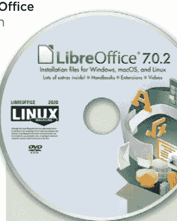

### LibreOffice 7.0.2

适用于 Linux、Windows 和 macOS 的安装文件

内部包含大量额外内容！

- 剪贴画
- 扩展
- 手册
- 模板
- 视频

### DVD 内容

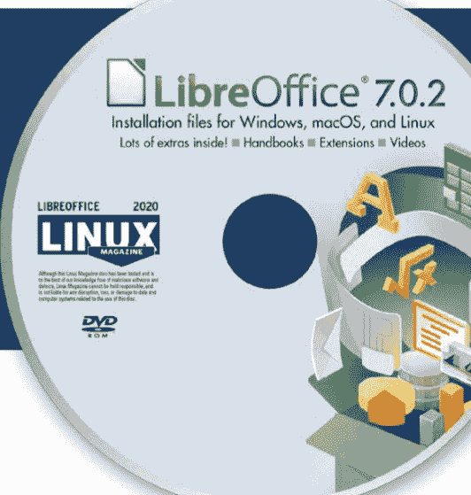

#### LIBREOFFICE 安装文件

本期附带的 DVD 包含用于在以下系统上安装完整版本 LibreOffice 的安装文件：

- 64 位 Windows
- 32 位 Windows
- 64 位 macOS
- 64 位 Linux（用于 deb 系统）
- 64 位 Linux（用于 RPM 系统）

最新版本安装包包含在单独的文件/目录中。有关安装 LibreOffice 的更多信息，请咨询您的包管理器文档或查看本期第 8 页的“介绍 LibreOffice”。

#### 更多内容！

作为额外福利，此 DVD 还包含一组其他宝贵的资源，帮助您扩展和学习 LibreOffice。请查看内部内容：

- **手册** – 完整的 LibreOffice 手册系列，包含数百页 PDF 格式的帮助和参考内容
- **扩展** – 在线可用的前 20 个 LibreOffice 扩展，包括多个语言词典、拼写检查器、图标和图库集合，以及条形码生成器
- **模板** – 100 多个现成的演示文稿模板，涵盖各种演示场景
- **剪贴画** – 一个 Openclipart 库，包含数千个适用于任何场合的剪贴画图形
- **视频** – 观看关于新 LibreOffice 功能的视频之旅，并了解来自顶级项目负责人和志愿者的关于 LibreOffice 项目及个人成功故事的信息


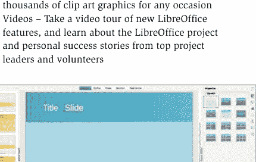

*有缺陷的光盘将被更换。请向 subs@linux-magazine.com 发送邮件。虽然此 Linux Magazine 光盘经过测试并据我们所知不含恶意软件或缺陷，但 Linux Magazine 不能负责，也不承担因使用此光盘而导致的任何中断、数据或计算机系统损坏的责任。*

#### LIBREOFFICE 7.0.2 下载链接

`https://www.libreoffice.org/download/download/?version=7.0.2`

# 高效工作与

## 101 个 Linux 技巧


通过这本充满灵感的技巧和快捷键合集，提升你的 Linux 技能，专为 Linux 极客打造。

- 撤销删除的文件
- 治愈“大写锁”疾病
- 在 shell 中运行 C 语言单行程序
- 禁用摄像头和麦克风
- 还有更多！

### 快速入门

### 介绍 LibreOffice

#### 什么是 LibreOffice，以及如何安装？


为什么要为办公生产力套件付费？LibreOffice 完全免费，并且可以在 Windows、macOS 和 Linux 上运行。

*作者：迈克·桑德斯（Mike Saunders）*

一套功能齐全、兼容微软文档且完全免费的办公套件——这样的好事真的存在吗？肯定有什么猫腻吧！嗯，不。没有猫腻。没有隐藏费用。没有任何可疑之处。`LibreOffice` [1] 确实是一套完整的办公工具，零成本，它也不通过广告或出售用户数据来盈利。

它免费的原因很简单：它由一个全球社区开发，由志愿者驱动，他们热衷于高质量的、“对每个人免费”的生产力软件。LibreOffice 的目标是弥合“数字鸿沟”，使强大的工具对每个人可用，无论其收入、地点或语言。事实上，LibreOffice 的用户界面已被翻译成 100 多种语言，使得在其他软件供应商未涉足的国家中，许多人也能使用该软件。

现在，这并不意味着所有 LibreOffice 开发者都纯粹出于慈善原因开发该软件。有很多“认证开发者”[2] 的客户在使用 LibreOffice（如公司或地方政府部门），他们受雇提供支持包、修复 bug 并实现新功能。LibreOffice 本身（并且永远）完全免费，但它仍然支持了一个可行的商业生态系统。

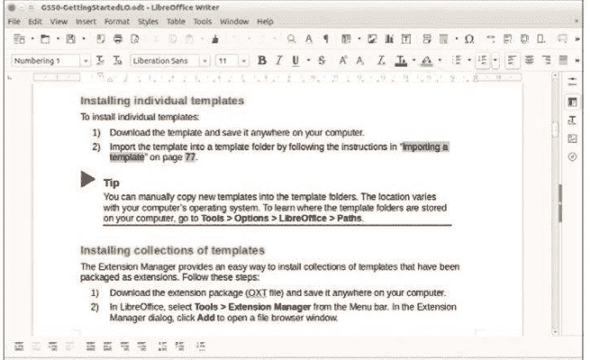

**图 1：** 这里是 Writer，文字处理软件...

如果 LibreOffice 真的完全免费（是的！）并且兼容 Microsoft Office（确实！），那么为什么全世界没有都转用它？为什么 MS Office 依然存在？原因有很多，例如：

- **熟悉度：** 很多人仍然不知道 LibreOffice 的存在。其背后的非营利实体“文档基金会”正在通过营销和活动来改善这一状况，但需要做得更多才能传播其知名度。
- **对变化的抵触：** 即使人们发现了 LibreOffice，他们往往也不愿意改变，尤其是如果他们已经付费购买了其他办公套件。LibreOffice 看起来很熟悉，但在某些地方外观和工作方式略有不同，一些更保守的用户不急于切换。
- **功能：** LibreOffice 拥有日常用户需要的大部分功能，在某些领域甚至比 MS Office 更多 [3]。但一些专为 MS Office 设计的工作流程需要宏或特殊功能集，这与 LibreOffice 并不完全匹配。不过，随着 LibreOffice 每六个月发布新版本，这种情况变化很快，LibreOffice 常常在推出尚未在 MS Office 中出现的新功能方面处于领先地位。

LibreOffice 套件包括几种工具，包括：

- **Writer** – 文字处理软件（图 1）
- **Calc** – 电子表格软件（图 2）
- **Impress** – 演示工具（图 3）
- **Draw** – 用于图表、流程图、传单等（图 4）
- **Base** – 用于数据库（图 5）
- **Math** – 用于创建公式

在接下来的几页中，我将提供更多关于 LibreOffice 及其背后社区的背景信息，并展示如何安装它。如果你真的迫不及待想开始，可以跳至安装部分 – 但别忘了稍后回来了解更多关于该套件的信息！通过学习其历史和背景，你可以帮助倡导 LibreOffice 并向其他潜在用户传播。

## 简短历史

LibreOffice 诞生于 2010 年，但其历史实际上可以追溯到更早的许多年前。事实上，要探索今天被称为 LibreOffice 的起源，你必须回到 1980 年代，一个名为 StarWriter 的程序（图 6）。StarWriter 是一个商业文字处理应用程序，由德国程序员 Marco Börries 创建，当时它可供 8 位和 16 位家用计算机（如 Amstrad CPC 和运行 MS-DOS 的 PC）使用。在接下来的几年里，Börries 创建了一家名为 Star Division 的小公司来监督其程序的开发，并增加了电子表格和绘图程序等额外工具。1992 年，StarOffice 1.0 for MS-DOS 发布，两年后发布了支持 Windows 和 macOS 的 StarOffice 2.0。

与强大的 MS Office 相比，StarOffice 相对不为人知，但它的普及程度足以在 1990 年代整个十年中发布新版本。然后发生了一件大事：Sun Microsystems，一家高端服务器和工作站的主要供应商，以相当惊人的 7350 万美元收购了 Star Division。背后的理由是什么？许多人猜测，对于当时拥有超过 20,000 名员工的 Sun 来说，收购 Star Division 是比购买 MS Office 许可证更便宜的方式来为其所有员工配备办公套件。另一些人则猜测 Sun 渴望更多地涉足家用/个人计算领域。

无论如何，这意味着 StarOffice 背后突然出现了一家更大的公司 – 有更多的资源和开发者可以投入工作。2000 年，Sun 将 StarOffice 5.2 作为个人使用的免费下载发布；该套件还随许多杂志的封面光盘提供。微软突然面临更多竞争，许多人发现 StarOffice 足以满足他们的日常任务。


然后另一次重大变化发生了。当时的自由和开源软件运动正在获得大量牵引力，承诺源代码（人类可读的配方）可自由获得的软件的好处。对于开源程序，任何人都可以“深入引擎盖”进行摆弄、改进，并将它们提交回给开发者。开源是一项大规模的协作努力，全世界都可以从中学习并产生影响，这与像 `MS Office` 这样的闭源程序形成对比，后者实际上很少有人能查看内部并进行改进。

`Sun` 观察到其他开源项目正在获得动力，例如 `GNU/Linux` 操作系统和 `Mozilla` 网络浏览器（如今以 `Firefox` 的形式存在，可能是最著名的开源应用）。作为回应，`Sun` 决定在一个名为 `OpenOffice` 的新项目中向所有人开放 `StarOffice` 代码。是的，这意味着世界现在拥有一套完全免费的办公套件 – 免费意味着零成本，但免费也意味着每个人都可以研究其工作原理、进行改进并分享。

经过两年的开发，`OpenOffice.org` 1.0 于 2002 年发布。它并不是最漂亮的发布版本，有一些粗糙的边缘和不如人意的性能，但它仍然是一个重要的里程碑。`Linux` 用户尤其高兴能有一套功能齐全、开源的办公套件，默认随其操作系统提供。一年后，一个小更新版本 `OpenOffice.org` 1.0 发布，随后 `OpenOffice.org` 2.0 于 2005 年到达，带来了许多性能改进。

## ODF 的诞生

2.0 版本还使用开放文档格式（`ODF`）[4] 作为其默认格式（图 7）。文档、电子表格和图形作为计算机可读数据块存储在我们的计算机上。当时，微软文档存储在奇怪的专有复杂数据块中，这些数据经过混淆，其他程序很难读取。

`ODF` 作为一种替代品被创建：数据以开放和标准化的方式结构化，基于 `XML`，因此以 `OpenOffice` 保存的文件可以轻易地被其他程序打开和理解。以 `ODF` 格式保存工作的用户可以保证未来能够读取这些文件，无论工具如何变化，无论 `OpenOffice.org` 发生什么。几年后，微软创建了另一个伪标准，称为“`OOXML`”，并且

`LibreOffice` 也支持它，而 `MS Office` 的近期版本则支持 `ODF`。）

在随后的几年里，`Sun` 和 `OpenOffice.org` 社区致力于该软件的新版本发布，但人们一直担忧一家大型公司对项目拥有过多的影响力。社区曾提出一些想法，例如成立一个独立基金会来监督 `OpenOffice.org` 的开发，但均未取得成效。

直到 2009 年。那一年，`Sun` 被数据库软件和其他企业工具供应商 `Oracle` 收购。`OpenOffice.org` 社区立即表示担忧，尤其是那些为项目做出巨大贡献的志愿者：现在该怎么办？`Oracle` 会关心 `OpenOffice.org` 吗？`Oracle` 是自由和开源软件的盟友吗？

当时进行了许多讨论，随后在 2010 年，一批社区成员做出了重大决定：终于该由一个完全独立、非营利的实体来为办公套件提供未来了。这个实体被称为文档基金会（`The Document Foundation`，简称 `TDF`），而软件则被称为 `LibreOffice`。

`LibreOffice` 最初是 `OpenOffice.org` 项目的“分支”（`fork`）。（因为 `OpenOffice.org` 是开源的，任何人都可以获取源代码并用来启动另一个项目。）`OpenOffice.org` 中绝大多数社区成员立即加入了 `LibreOffice` 项目。因此，`LibreOffice` 就是 `OpenOffice.org` 的未来——它基于相同的源代码构建，但背后有新的基金会、新的品牌以及对未来的新希望。`OpenOffice.org` 作为一个规模小得多的项目又维持了几年，但相比于迅速增长的 `LibreOffice`，它的更新非常有限。

自 2010 年以来，`LibreOffice` 蒸蒸日上：如今，该套件在全球各地都有大规模部署，例如法国政府拥有 500,000 个安装实例。`TDF` 估计 `LibreOffice` 的用户超过 1 亿，且每年有数百名社区成员聚在一起开会，开发新功能并讨论软件的未来。一些公司应运而生，为该类提供支持和额外功能。而现在，你手中正拿着一本关于它的杂志！

为了流畅使用，你至少需要 2GB 的空闲硬盘空间和 1GB 的 RAM——因此，过去几年里建造的任何 PC 都应该完全具备能力。对于某些功能，如 `Base`，需要 `Java` [6]，但如果你愿意，也可以在不使用 `Java` 的情况下使用该类。


*图 7：`OpenDocument` 是 `LibreOffice` 的原生格式，它是一种完全开放和标准化的格式，非常适合长期存储你的工作成果。*

# 10 年历程

## LibreOffice

### 文档基金会

`LibreOffice` 于 2010 年 9 月宣布发布。探索我们的社区和认证开发者在 10 年里取得的成就……

**19 个主要版本。**

新的主要版本如时钟般准时发布，每六个月一次。它们包含新功能、错误修复和兼容性改进。


**+ 2 亿用户**

`LibreOffice` 被全球超过 2 亿人使用。此外，得益于我们的本地化社区，它还支持 100 多种语言。

**九场会议**

年度会议已在巴黎、柏林、米兰、伯尔尼、奥胡斯、布尔诺、罗马、土拉纳和阿利坎特举行。未来还有更多会议！


**主要部署**

`LibreOffice` 正在全球各地的企业和政府中使用。更多详情请参见 `tdf.io/migrations`。也可获得专业支持。

**商业生态系统**

公司基于 `LibreOffice` 提供产品，开发新功能，并向项目和社区回馈代码。


让我们也让接下来的 10 年同样精彩！

`tdf.io/joinus`

### 入门指南

### 介绍 LibreOffice

### 在 Windows 上安装

- 1. 获取适合你系统的 `.msi` 安装文件（64 位系统文件名以 `win_x64.msi` 结尾，32 位系统以 `win_x86.msi` 结尾）。将文件保存到你的桌面，然后双击它以开始安装过程。
- 2. 安装向导将会出现，你只需不断点击“下一步”以接受默认选项，这对于日常使用来说是完全没问题的。（如果在过程中出现 *用户账户控制* 对话框，请单击“是”以继续安装。）
- 3. 安装完成后，点击 *完成*，现在你可以从桌面删除该 `.msi` 文件了。你崭新发亮的 `LibreOffice` 安装版本已可在你的程序菜单中找到！

如果你需要任何帮助，请查看网站上的安装说明 [7]，或者如果你遇到困难，请尝试向 `LibreOffice` 支持社区提问 [8]。发布消息时，记得包含大量细节（`LibreOffice` 版本、操作系统版本以及你看到的任何错误信息）。

### macOS

`macOS` 版的 `LibreOffice` 以 `.dmg` 格式提供，这是一种虚拟磁盘。将 `.dmg` 文件保存到你的桌面并双击打开。你会看到一个类似图 8 的窗口——点击并拖动 `LibreOffice` 图标到你的应用程序文件夹中。（你可能需要输入管理员密码。）然后，你可以直接从 *应用程序* 文件夹启动新软件（或将图标拖到你的程序坞中以便快速访问）。你也可以弹出并删除 `.dmg` 文件。

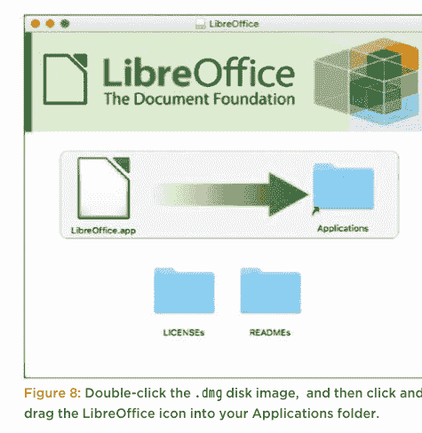

### Linux

本期附带的 DVD 上提供了最新版本的 `LibreOffice`，格式为 `.deb` 和 `RPM` 安装包。但我通常建议你直接从你的 `Linux` 发行版的包管理器安装。这能提供更好的系统整合，并允许将来自动更新。不过，如果你想像从最新的 `.deb` 或 `RPM` 文件安装，请遵循 wiki [9] 上的详细步骤。

#### 结语

`LibreOffice` 是一个先进的办公生产力套件，全球 `Windows`、`macOS` 和 `Linux` 用户均可免费使用。如果你准备好开始创建电子表格、演示文稿和文字处理文档，而不想把钱花在价格过高的工具和复杂的授权场景上，请继续阅读，发现 `LibreOffice` 的强大与多用途。■■■

### 那么，让我们开始安装吧！

你可以在随本杂志提供的 DVD 上找到 `LibreOffice` 的完整版，但你也可以随时从 `LibreOffice` 网站 [5] 下载。该软件适用于三大主要桌面操作系统——`Windows`、`macOS` 和 `Linux`，尽管主题和颜色可能因你的系统而异。第一步是查看系统要求：

- ■ `Windows`: Microsoft `Windows 7 SP1`、`Windows 8`、`Windows Server 2012` 或 `Windows 10`


- ■ Apple macOS（又名 macOS X）: macOS 10.10 (Yosemite) 或更高版本

- ■ Linux: Linux 内核 3.10 或更高版本

#### 信息

- [1] LibreOffice 项目: <https://www.libreoffice.org>

- [2] LibreOffice 认证开发者: <https://www.documentfoundation.org/gethelp/developers/>

- [3] LibreOffice 与 MS Office 功能对比: <https://wiki.documentfoundation.org/Feature_Comparison_-MSOffice_LibreOffice>

- [4] OpenDocument 格式: <http://opendocumentformat.org>

- [5] 下载 LibreOffice: <https://www.libreoffice.org/download/>

- [6] 下载 Java: <https://www.java.com/en/download/>

- [7] 在 Windows 上安装 LibreOffice: <https://www.libreoffice.org/get-help/install-howto/windows/>

- [8] LibreOffice 问题解答: <https://ask.libreoffice.org>

- [9] 在 Linux 上安装 LibreOffice: <https://wiki.documentfoundation.org/Documentation/Install/Linux>

# 针对真实网络的真实解决方案

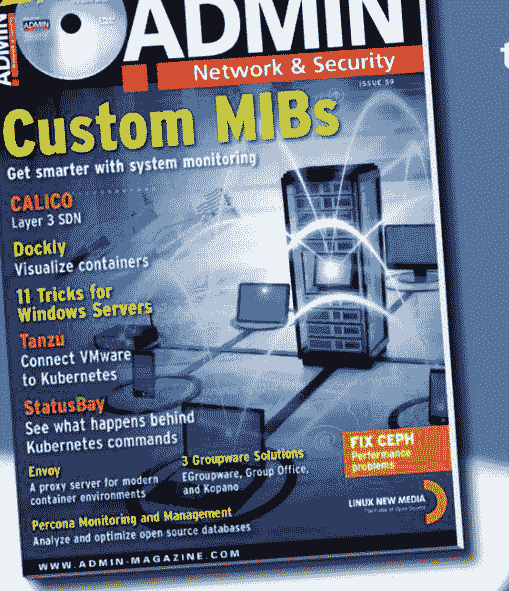

ADMIN 是您获取实际世界问题技术解决方案的来源。

通过关于以下内容的实用文章提升您的管理技能：

- 安全性
- 云计算
- DevOps
- HPC
- 存储及更多！


立即订阅！

shop.linuxnewmedia.com

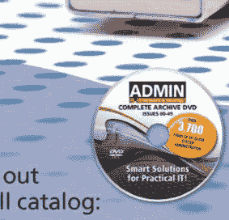

查看

我们的完整目录：

shop.linuxnewmedia.com

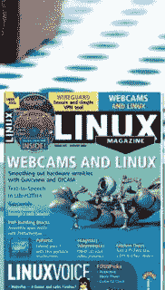


### 入门指南

LibreOffice 文本

### 基于样式的文字处理系统

#### 样式大师


Writer 是 LibreOffice 的文字处理组件，它不仅仅是一个文本编辑器。凭借其强大的样式系统，你可以为商务和个人用途构建详细且优雅的文档。文 / *Mike Saunders*

在 20 世纪 80 年代，文字处理器本质上是一个带有一些额外功能的文本编辑器——换句话说，是一个用于处理你文字的工具。然而如今，人们对这类程序的期望要高得多：丰富的版式功能、与其他办公软件的高兼容性，以及组织和导航复杂文档的能力。Writer 是 LibreOffice 的文字处理器，它是一个功能 exceptionally 强大的工具，其样式系统确实有助于保持文档的一致性——关于这一点稍后会有更多介绍。首先，让我们熟悉一下基础知识！当你启动 LibreOffice 并选择一个新的 Writer 文档（或者如果你已经运行了该应用程序，请在菜单中转到 `文件 | 新建 | 文本文档`），将会打开一个窗口（图 1），具有以下功能：

- 1. **菜单栏：** 你可以从这里访问几乎所有功能。点击、探索，看看 Writer 能做什么！
- 2. **工具栏：** 提供常用功能的快速访问。点击右侧的箭头以显示更多图标，或者右键点击工具栏以选择显示哪些图标。
- 3. **样式：** 显示预定义样式的列表，你可以向其中添加更多样式。建议使用样式而不是手动设置每段文字的字体、字号、字符样式等，这是一个好主意。
- 4. **侧边栏：** LibreOffice 的用户界面非常灵活，侧边栏允许你调整文档各个部分的设置。点击并拖动箭头以展开它。
- 5. **状态栏：** 显示页数、字数、使用的语言（点击可切换其他语言）以及文档是否已修改。
- 6. **视图模式：** 这些图标允许你更改文档的查看方式（例如，单页显示或并排显示）。
- 7. **缩放级别：** 点击并拖动滑块（或使用加减按钮）来放大或缩小文档。

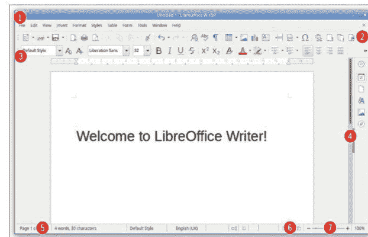

图 1：LibreOffice Writer 中的新建文本文档：菜单栏 (1)、工具栏 (2)、样式 (3)、侧边栏 (4)、状态栏 (5)、视图模式 (6) 和缩放级别 (7)。

# 自定义界面

我不打算在这里解释每一个工具栏按钮的具体功能；你只需将鼠标悬停在按钮上并阅读提示框即可探索它们。不过，有几点需要注意：撤销和重做按钮旁边有下拉列表，因此你可以选择在单次点击中撤销/重做多少操作（这通常能节省大量时间）。类似地，列表（项目符号列表和编号列表）也有不同的样式可供选择。

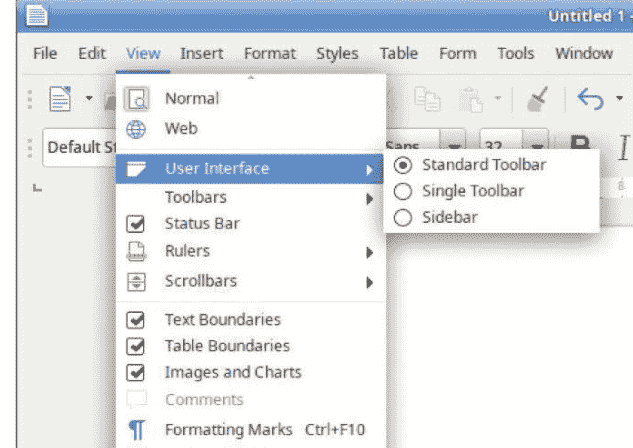

图 2：Writer 提供三种不同的用户界面布局。

图 1 显示的是标准布局，包含菜单栏、两个工具栏、侧边栏以及底部的状态栏。然而，LibreOffice 开发人员认为不应强制最终用户采用任何特定的界面，因此他们提供了大量的灵活性。例如，在菜单中转到 `视图 | 工具栏`，你可以看到可以启用或禁用许多额外的工具栏。

更好的是，转到 `视图 | 用户界面`，在那里你可以选择三个选项（图 2）：标准工具栏（默认模式）、单一工具栏（如果你屏幕垂直空间有限，这将很有用）和侧边栏（如果你使用的是超宽显示器并希望更好地利用水平空间，这是一个不错的选择）。尝试使用所有选项，看看哪个最适合你的屏幕尺寸和工作流程。

如前所述，你可以点击并拖动侧边栏旁边的箭头手柄来调整其大小。当你打开侧边栏时，试着将鼠标悬停在侧边栏右侧的图标上以显示提示框。侧边栏中的“属性”面板是特定于上下文的；换句话说，它会根据你在文档中的操作而变化（编辑文本、操作图像、处理表格等）。因此，如果你想对文档中的某个元素执行特定操作或修改，但不确定该去哪里，请点击该元素，然后打开“属性”面板。

通过 `工具 | 选项`（在 Windows 和 Linux 上）或 `LibreOffice | 偏好设置`（在 macOS 上）还可以获得一些额外的自定义选项。打开左侧的“LibreOffice 文本”部分，然后探索下面的各种选项。

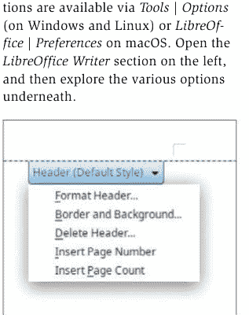

图 3：向页眉和页脚添加静态文本和页码很容易。

## 十大实用功能

以下是 Writer 中最有用的 10 项功能：

- 1. **页眉和页脚：** 这些是每页开头和结尾的部分，通常在页面间保持一致，尽管你可以引入变化的元素。页眉和页脚最常见的用例是标题。要向页眉或页脚添加文本，首先需要为它们创建空间；只需点击主页面部分上方或下方的区域，你就会看到一个蓝色框。点击它以添加页眉或页脚空间，蓝色框随后会变成菜单（图 3）。从这里，你可以直接在页眉或页脚中添加文本，这些文本将在所有页面中保持一致，并添加页码和页数（通常出现在书籍的页脚中）。

- 2. **图片和文本框：** 如果你想将 Writer 作为桌面出版工具使用，那么你会想在页面上添加浮动元素，如图片和文本框。你可以在 `插入` 菜单中找到其中大部分功能。

对于图片，系统会提示你从计算机中选择一张图片，然后该图片会显示在页面上。点击并拖动以移动它，或使用边缘和角上的蓝色手柄调整其大小。

如果你想更改图片与周围文本的交互方式，请右键点击该图片并选择“环绕”菜单。`最优页面环绕` 是图片的最佳选择，可以让文本很好地围绕其流动。

在这个右键上下文菜单中，还可以查看“属性”以获取更多选项，包括图片边框和精确位置。

文本框的工作方式类似：点击 `插入 | 文本框`，然后点击并拖动以在页面上定位。之后，你可以使用手柄拖动它并在其中点击以添加文本。


## 3. 修订记录
如果你与他人合作编辑文档，这是一个基本功能。首先，转到 `工具 | 选项`（或在 macOS 上，`LibreOffice | 偏好设置`）。在 `LibreOffice | 用户数据` 下，你可以输入你的名字——这不是强制性的，但这意味着你的名字将显示在更改和评论旁边。这有助于其他正在处理文档的人确切知道谁更改了什么。点击“确定”，然后在 `编辑` 菜单下，转到 `修订记录` 子菜单，确保 `记录` 和 `显示` 都已启用。

现在尝试输入；你会看到你对文档的更新被标记上颜色和下划线。将鼠标悬停在某个更改上，会出现一个提示框，提供有关谁在何时做了哪些更改的信息。如果有人发给你一份文档，你想提供具有建设性的反馈，详细说明你做了哪些更改，现在你知道该怎么做！

## 4. 评论
与上一个功能相关，此选项对于协作非常重要。将光标放置在你想要留下评论的行或段落内，然后点击 `插入 | 评论`。文档右侧会出现一个框（图 4），你可以从中添加一些评论文本。你的名字（以及你发表评论的时间）也会显示出来。此外，点击评论框中的下拉图标以获取一些额外选项（例如，删除评论）。

## 5. 拼写检查
根据你的操作系统设置，这可能已经启用，如果没有，请点击 `工具 | 自动拼写检查`。正如你期望的现代文字处理器那样，拼写错误的文本会以红色下划线标出。如果你正在处理一些不属于标准词典的单词，但又不希望总是看到表示“这是错误的”红色下划线，只需右键点击该单词并将其添加到词典中（或忽略它）。

如果你从 LibreOffice 网站安装了多个词典，并想要更改用于拼写检查的词典，请点击状态栏底部的语言。（你也可以在 `工具 | 语言` 中按段落级别进行更改。）要获取更多语言选项，请转到 `工具 | 选项`，`语言设置和语言`，在那里你可以设置所有文档的默认语言。

## 6. 页面布局
你已经在工具栏中看到了基本格式选项（字体、字号、粗体/斜体/下划线、颜色等），但对于更广泛的页面选项，请在菜单中转到 `格式 | 页面`。在这里，你可以切换纵向和横向模式，选择不同的页面尺寸，调整页边距和边框，甚至在 `区域` 选项卡下提供背景渐变或图片。

## 7. 导航器
随着文档复杂度的增加，包含多个元素、样式、标题等，你可能会发现它们更难导航。幸运的是，你可以使用命名巧妙的导航器来提供帮助：点击 `视图 | 导航器` 以启用它，或在侧边栏中找到它（图 5）。点击不同元素旁边的箭头以展开它们。

## 8. 特殊字符
如果你需要插入键盘上不可用的字符或符号，请转到 `插入 | 特殊字符`（

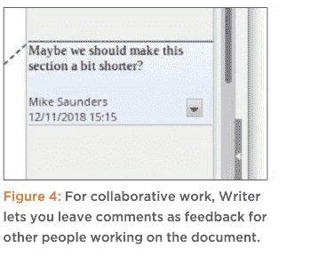

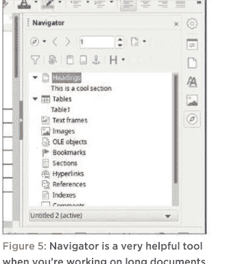

同时也有一个工具栏图标）。

你可以使用窗口右上角的下拉列表搜索特定字符或显示某些字符子集。窗口底部会显示你最近使用过的特殊字符选择。

### 自动更正
LibreOffice Writer 试图通过自动格式化某些内容（如日期）或更正拼写错误的单词来协助你。但如果你不想要此功能，请前往菜单中的 `工具 | 自动更正选项`。查看弹出对话框中的 `替换` 选项卡，即可查看 LibreOffice 自动替换的内容。如果不需要这些自动替换，请前往 `选项` 选项卡并取消勾选 `使用替换表`。这个 `选项` 选项卡也是禁用许多其他功能的地方，例如 URL 识别、双首字母更正等。

### 格式化标记
有时，准确查看 LibreOffice 如何处理文本会很有用。例如，你可能想知道空格的确切位置，或者判断文本是新段落（通过按 Enter 键创建）还是常规换行（通过按 `Shift + Enter` 创建）。要查看这些“幕后”数据，请前往 `视图 | 格式化标记`。选择此项后，你会看到通常不打印的“空白”内容现在以蓝色显示（见图 6）。要禁用此功能，只需在菜单中再次点击该选项即可。

### 入门指南

#### LibreOffice Writer

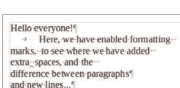

图 6：格式化标记选项可让你准确查看文档中空格、制表符、换行符和新段落字符的具体位置。

### 样式简介
如前文所述，样式是 Writer 的核心功能。在处理较长文档时，对于保持文档间的一致性至关重要。此外，它们也使得通过几次点击即可进行全文档范围的更改变得更容易。许多文字处理用户手动格式化段落、单词、表格、页面布局以及文档的其他部分，而完全忽略样式。他们习惯于根据单个物理属性撰写文档：例如，他们可能会单独指定字体族、字体大小以及加粗或斜体等格式，针对每个段落甚至每个单词。手动格式化并非理想选择。

一个更好的选项是样式，即一组你可以应用于文档中选定的页面、文本、框架和其他元素以快速更改其外观的格式集合。应用样式通常意味着同时应用一组格式。

因此，样式是逻辑属性（而非手动格式化中使用的物理属性）。使用样式意味着你不需要具体说明“此文本应为 12pt 无衬线字体、加粗、右对齐”。相反，你使用 `标题 1`，因为你已将 `标题 1` 样式定义为具有这些特征。换句话说，使用样式意味着你将重点从文本（或页面、或其他元素）的外观转移到文本本身是什么。

最终，样式有助于提高文档的一致性。此外，它们还使重大格式更改变得更加容易。例如，你可能决定更改所有段落的缩进，或更改所有标题的字体。对于长文档，手动执行此操作可能需要在几十处进行单独更改——这会浪费大量时间！相比之下，使用样式时，你只需进行一次修改。

### 样式的实际应用
在 Writer 中，有各种类型的样式：

- **页面样式。** 包括页边距、页眉和页脚、边框和背景。
- **段落样式。** 这些控制段落外观的所有方面，如文本对齐、制表位、行距和边框；它们可以包含字符格式化。
- **字符样式。** 这些影响段落中选定的文本，如文本的字体和大小，或加粗和斜体格式。
- **列表样式。** 这些允许你选择、格式化和定位列表中的编号或项目符号。

要试用它们，在文档中输入一些文本，并查看窗口左上角的 `默认样式` 下拉列表。点击列表以显示 Writer 的其他一些内置样式，如标题和题头（见图 7）。

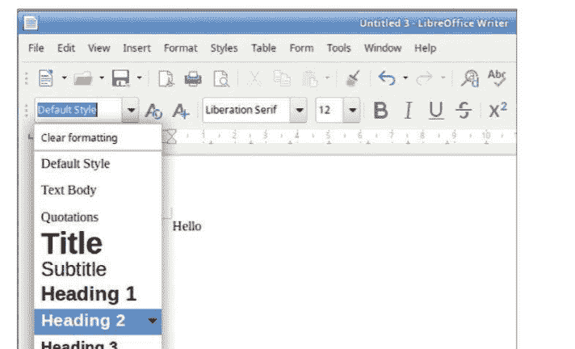

图 7：Writer 附带的一些默认样式。

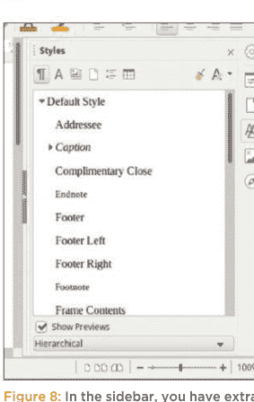

图 8：在侧边栏中，你可以对样式进行额外控制，包括创建新样式的能力。双击样式即可将其应用于文档。

你现在可以使用这些样式快速更改段落的格式，包括字体大小、字体样式、是否加粗等。每次在文档中使用标题时，你也会发现它在导航器中（如前文所述）——因此在长文档中，这是一种快速导航的好方法。

但如果你想要对样式进行更多控制，包括创建自己的样式怎么办？这就是实用的侧边栏发挥作用的地方！按前文所述打开它（或前往 `视图 | 侧边栏`），然后点击右侧的样式图标，你应该会看到类似图 8 的内容。

要创建新样式，首先点击侧边栏面板顶部的图标之一来选择你要创建的样式类别（例如段落或字符），然后点击右侧图标的箭头，并从弹出菜单中选择 `新建`。如果希望新样式与现有样式链接，首先从 deck 中显示的样式列表中选择该样式，然后右键点击选定的样式并选择 `新建`。

给样式命名，它将添加到列表中——然后右键点击它并选择 `修改`，你会看到有大量的选项可供调整。但不要被其淹没——你不需要更改其中大部分！但花点时间探索一下：你可以选择首字下沉、边框、字体效果、突出显示、缩进等更多内容。

注意：如果链接样式，并且你稍后更改了基础样式（例如，将字体从衬线体改为无衬线体），所有链接的样式也会随之更改。有时这正是你想要的——但其他时候你不希望更改应用于所有链接样式。定义新样式和修改现有样式所使用的对话框和选项是相同的。

### 加载、保存和导出
LibreOffice 的本地文件格式是开放文档格式，它以 `.odt` 扩展名保存 Writer 文档（开放文档文本）。这是一种完全开放和标准化的格式，被许多其他程序使用，因此绝对是存储你工作的最佳方式。当然，你可能会遇到（或收到）其他格式的文档，例如 Microsoft Word 的 `.doc` 和 `.docx`。LibreOffice 通常能很好地打开它们，但这些格式的文件通常包含混淆或文档记录不全的数据块，因此 LibreOffice 在处理它们时往往需要努力。如果 Microsoft Word 用户发给你一个 `.doc` 或 `.docx` 文件，而在你的 LibreOffice 安装中看起来不太对劲，请让他们尝试使用开放文档文本格式重新发送（较新版本的 Microsoft Office 支持该格式）。


对于保存，LibreOffice 可以导出许多不同格式的数据，包括前述的 `.doc` 和 `.docx`。只需前往 `文件 | 另存为`，然后点击 `格式` 下拉列表。你甚至可以保存为 `HTML` 或纯文本，显然许多格式会消失。类似地，在 `文件 | 导出` 下，你可以将工作保存为电子书阅读器的 `EPUB` 格式，或 `PDF`——如果你发送的文件只需查看或打印而不需要编辑，这是最佳选项。（导出为 `PDF` 时，你可以选择混合 `PDF` 版本，它还嵌入了原始 `.odt` 文件的副本，以便以后如需编辑。）

一个实用技巧：如果你经常处理 Microsoft Office 文档并希望默认保存为该格式，请前往菜单中的 `工具 | 选项`，然后在左侧选择 `加载/保存` 和 `常规`。然后，在右侧，你可以选择 `始终保存为` 以设置默认格式。

### 键盘快捷键

我可以在本指南中包含一个包含 Writer 中每个键盘快捷键的大型表格，但这些内容已在线可用 [1]。每个人有不同的工作流程和工作量，因此最好的做法是学习对你最有用的一些！进入任何菜单（或右键点击上下文菜单）并查看条目：如果启用了键盘快捷键，你应该能在右侧看到它们（见图 9）。（如果你的操作系统默认不显示这些，请前往 `工具 | 选项` – 或在 macOS 上前往 `LibreOffice | 偏好设置` – 然后在左侧选择 `视图` 并启用 `菜单中的图标` 和 `上下文菜单中的快捷键`。）

### 结论

LibreOffice Writer 提供了格式化文档并通过强大的样式系统进行通用更改的工具。它不仅允许你保持文档（跨文档）的一致性，还使你免于浪费时间手动格式化单个段落（甚至单词）。为了进一步节省时间，请查看“键盘快捷键”框。祝你享受文字处理！

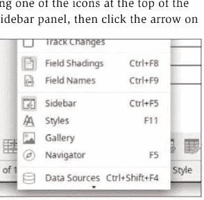

图 9：制作自己的键盘快捷键列表 – 在你使用的功能旁边的菜单中找到它们。

#### 信息

- [1] 键盘快捷键：https://help.libreoffice.org/Writer/Shortcut_Keys_for_Writer


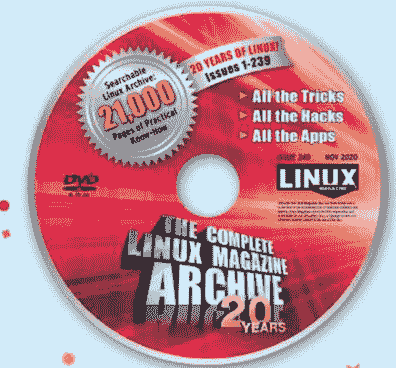

# LINUX 杂志

20 年存档 DVD

立即订购！

https://bit.ly/Archive-DVD


### 快速入门

LibreOffice Calc

# 风格鲜明的电子表格

# 形式与功能兼备


LibreOffice Calc 提供了 Excel 的功能，并附带更多优势。*作者：Bruce Byfield*

**C**alc 是 LibreOffice 的电子表格模块。作为 Microsoft Excel 的对应产品，Calc 旨在与其保持高度的兼容性。每个 Calc 工作表（图 1）都能处理 1,024 列和 1,048,576 行，对于大多数用途来说绰绰有余。如果你需要更多，或者发现电子表格在内存有限的机器上崩溃，可以考虑在 LibreOffice Base 中创建数据库。

如果你是完全的初学者，像 Calc 这样的电子表格或多或少是文本文档中表格的增强版本。实际上，在 LibreOffice Writer 中，表格也可以设置为使用一些简单的电子表格功能。电子表格是对文件的称呼，而工作表则是文件内的页面。在每个工作表中，列由大写字母指定，行由阿拉伯数字指定。因此，左上角的第一个单元格是 `A1`，这个标识符可以在操作数据时调出其包含的信息。

电子表格的强大之处在于用于显示和操作数据的一系列功能。这些功能包括组织列表过滤器、用于处理各种数据的完整函数集，以及杂项额外工具。如果你使用过 Excel，你很可能会很快熟悉 Calc。两个电子表格应用程序中的函数及其名称都很相似，尽管有些函数位于不同的位置。也许最大的区别在于，Calc 像 LibreOffice Writer 一样使用样式：单元格样式用于格式化任何电子表格，页面样式用于生成电子表格的纸质版本。一旦定义，这两类样式都能为你节省时间，让你能够专注于数据录入而不是格式化。

# 规划电子表格

电子表格有一种逐渐增长的特性，这可能就是它们在线上最常用的原因。然而，如果你花时间预先设计电子表格模板，就能更容易地找到你的数据。

首先，设计一个通用的默认电子表格模板，使用个人或公司颜色和字体。使用该模板作为其他模板的基础，为每种你使用的电子表格类型各创建一个模板。通常，一个重要考量是每个电子表格中默认工作表的数量（`工具 | 选项 | LibreOffice Calc | 默认`）。例如，你可能会有为不同类别员工着色的工作表。你可能还希望为数据透视表（对现有数据的新视图）使用单独的工作表。

大多数电子表格将属于两类之一：基于文本的列表和数字数据集合，或数据数组。列表是电子表格最简单的用途。它们包括待办

Photo by Modestas Urbonas on Unsplash

事项列表、地址集合、日历和项目日程。相比之下，数据数组由原始信息表格和帮助分析数据的函数组成，例如总和和平均值。数据数组的例子包括个人或公司财务或成绩单。有时，数据数组被用作教程，包含练习内容。

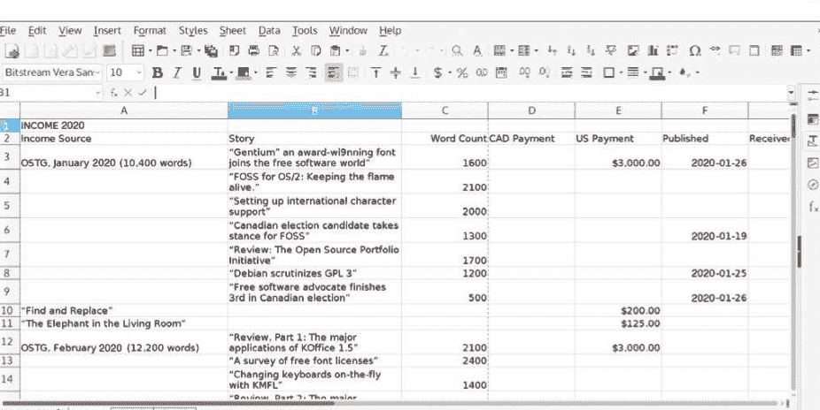

图 1：Calc 是一款旨在与 Microsoft Excel 兼容的电子表格应用程序。

列表和数据数组通常按列组织。在同一个工作表上将类似的信息分组，并留空间用于标签——标签是描述列或行中所含信息的标题。单元格格式化，例如边框和背景，可以帮助一眼区分不同类型的信息。例如，在老师的成绩单上，你可能会使用不同深浅的绿色来标记显示中位数和平均分的单元格。颜色越多，用户越容易在信息中导航——但过多的颜色编码可能变得复杂到失去优势。你可能想从草图近似布局开始，但务必为未来的增长留出空间。

# 设计列表

电子表格列表与文本文档中的表格作用大致相同。主要来说，它是一种使信息比按段落排列更易于查找的方式。字体、颜色和位置等格式帮助分组信息和区分信息类型。例如，在项目日程中，项目中的每个工作人员可能被分配不同的颜色。一旦每个工作人员知道他们的颜色，他们就可以跟踪自己的任务而忽略其他人的。项目日程还可能包括签字列，或者在每项任务完成时可以添加的颜色。由于列表通常提供简单信息，它通常使用很少的电子表格函数，尽管可以添加一些简单的函数，例如为预算目的计算工作时长的总和。

图 2 展示了我在我 2016 年的书《Designing with LibreOffice》[1]中用作示例的旅行规划器。注意不同类型的信息如何被边框分组在一起，并且每个部分都有自己独立的标题。空白单元格用于进一步分隔信息。在左侧，摘要下方，不同的任务按执行顺序排列在摘要下方。电子表格的其余部分是每日行程。目的是制作一个可以打印出来，并在出现时添加手写补充的电子表格。

# 设计数据数组

数据数组是 Calc 真正发挥优势的地方。数据数组可以像列表一样进行格式化以组织信息。然而，与大多数列表不同，数据数组包含多个用于操作原始数据的函数（或公式，有时也称为）。Calc 包含超过 450 个函数，许多函数与 MS Excel 中的名称相同，以便用户可以轻松切换到 Calc。一些 Calc 函数的输入变量在 Excel 中找不到，当包含这些函数的电子表格在 Excel 中打开时，这些函数不会被使用。一个函数及其独特数据集的特定实例被称为公式。每个函数都有自己的一组输入变量。大多数变量是必需的，但有些是可选的。所有变量都可以从公式工具栏手动输入，该公式工具栏还包括一些最常用函数的列表。不过，大多数人更喜欢选择一个单元格来保存结果，然后通过 `插入 | 函数` 添加函数，这会打开函数向导（图 3）。函数向导列出了所有变量，这些变量可以手动输入，或者有时通过拖放电子表格上的单元格输入。此外，函数向导预览结果，以便你能够在将错误函数插入文档之前修正变量。


图 2：列表导向的电子表格。

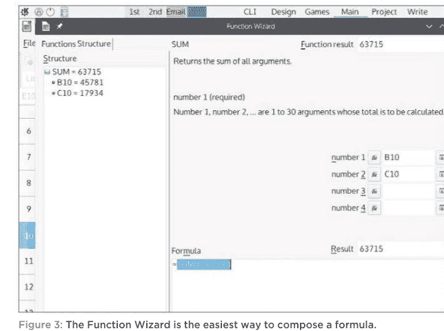

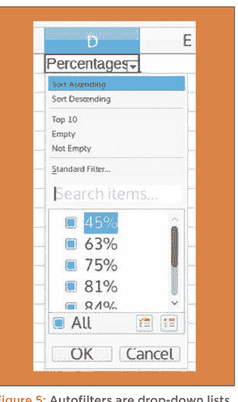

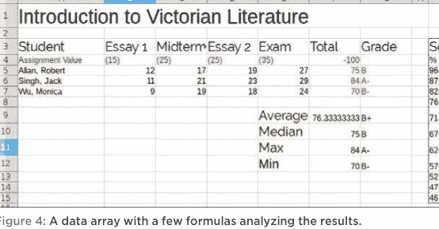

最大值和最小值。这些统计的输入是每个学生的总分，可以通过选择“总计”列中的数字来选择。通过使用函数向导，我可以快速利用这些函数，而无需记住单个函数的计算公式结构。例如，代替通过输入 `=SUM(E5:E5)` 来找到学生总分，列出相关单元格的列和行范围，我只需通过鼠标拖动选择单元格。


函数向导在浏览左侧窗格中的函数时也很有用。函数被安排到金融、逻辑和统计等类别中，你可以通过输入类别的首字母来显示单个类别。对于每个函数和变量，函数向导都包含简要说明。另一个来自《Designing with LibreOffice》的例子，图 4 展示了教师成绩册的一个摘录。上半部分是每个学生的每次作业成绩和课程总分（百分制）列表。评分标准在右侧的框选单元格中。更重要的是，一些基本统计量列在学生的成绩下方，由 `Average`（平均值）、`Median`（中位数）等函数生成，

# 使用 CALC 工具

除了 Calc 工具，Calc 还包括一些其他工具，可用于列表和数据数组。这些工具分散在菜单的各个角落——主要在“工具”和“数据”中——但可以分为改变格式化的工具和工作与函数相关以使其更强大且更易于导航的工具。表 1 和表 2 描述了一些最有用的 Calc 工具。

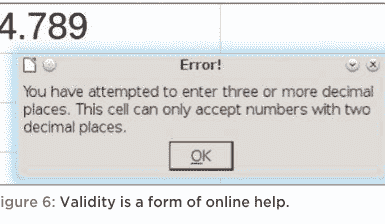

## 入门指南

### LibreOffice Calc

#### 条件格式

如果标准格式无法提供足够的视觉提示，您可以从“格式 | 条件格式”中添加其他提示。条件格式可以让用户一眼识别出总体数据趋势，但不会显示具体数据。例如，您可以使用表情符号，从笑脸到中性脸再到皱眉，来指示单元格内容。或者，可以使用颜色代码来表示数据（图 7）。

##### 表 1：选定的格式化工具

| 工具 | 描述 |
| :--- | :--- |
| 右键点击 \| 隐藏列/隐藏行 | 简化显示内容，并减少打印的信息量。请注意，隐藏并不会保护信息。例如，如果您有一个以欧元和美元列出的收入列表，并隐藏了列出欧元收入的列，查看者可能会推断出有一列未显示，因为美元列中的一些条目将是空白的。 |
| 数据 \| 组合及大纲 \| 组合 | 在列和行标头中创建一组树状控件，用于展开或折叠显示。如果需要，您可以在组内嵌套其他组。 |
| 数据 \| 筛选 | 更改列中显示哪些单元格。标准筛选或高级筛选为显示单元格设置条件，高级筛选提供更多选项。然而，对于日常使用来说，最便捷的筛选通常是自动筛选（图 5）。与标准或高级筛选不同，自动筛选始终显示在工作表上，并且可以包含空白单元格。此外，如有必要，您可以通过自动筛选的右键菜单创建其他类型的筛选。要使用自动筛选，您需要在要筛选的单元格范围的顶部有一个空白单元格。如果将鼠标置于该单元格中，选择“自动筛选”会添加一个下拉列表控件，其中包含筛选选项 – 这是一种明显的便利。作为导航辅助，请使用单元格控件对单元格范围进行标记。 |
| 数据 \| 有效性 | 如果多人使用同一个电子表格，或者一个人长期使用它，则非常有用。有效性定义了可以在选定单元格中输入的内容类型和格式，并显示自定义帮助消息，包括无效内容的定义以及如何更正这些内容（图 6）。 |

##### 表 2：选定的函数工具

| 工具 | 描述 |
| :--- | :--- |
| 数据 \| 汇总 | 允许您对由标头标记的数据范围（也称为数据数组）执行若干统计函数。您还可以选择汇总在工作表上的显示位置 – 但请确保左侧有空间放置标头。您可能需要添加一列来腾出空间。汇总可以同时处理多达三个数据数组。 |
| 工具 \| 侦查 | 用于帮助追踪公式所用数据的一系列实用程序子菜单（图 8）。例如，如果您选择一个包含公式的单元格，“追踪前驱”会绘制线条（轨迹）指向包含公式所用数据的单元格。双击一条线，您将被带到轨迹末端的单元格。相反，“追踪后续”会从当前单元格绘制线条到包含引用当前单元格的公式的单元格。您还可以使用“追踪错误”或“标记无效数据”。完成后，“删除轨迹”将删除这些线条。 |
| 工具 \| 单变量求解 | 为函数的变量创建多个值。这些值可以通过下拉列表更改。 |
| 数据 \| 多重运算 | 为变量创建数据范围，然后使用该变量运行公式。您可以为多个变量输入数据范围，甚至可以输入多个公式。 |
| 工具 \| 规划求解 | 提供一个对话框，用于一次性为多个单元格输入数值范围。它的运作方式很像单变量求解和多重运算，但允许您同时处理更多的单元格和变量。 |
| 数据 \| 数据透视表 \| 插入 | 重新排列数据数组中的数据以呈现新信息。例如，在图 9 中，数据数组显示了按国籍、性别和年龄划分的游客支出。通过使用并遵循在线帮助，您可以重新排列数据以创建图 10，该图展示了按性别划分的游客消费。根据此表，自认为女性的游客在度假期间花费最多，这一点从图 9 中并不直观。数据透视表在数据更改时不会自动刷新。相反，您必须点击“数据 \| 数据透视表 \| 刷新”来更新它们。 |

目前，LibreOffice 尚不支持迷你图，这是条件格式的原始形式 – 一个带有主要数据点标记的小型折线图。但是，您可以使用图表子系统创建一个图表，然后将其缩小，使其适合一个单元格或多个合并单元格。您也可以使用条形图。

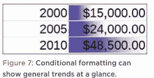

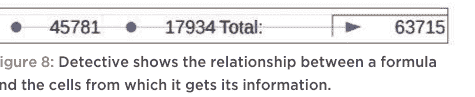

|  | 支出 | 国家 | 性别 | 年龄 |
| :--- | :--- | :--- | :--- | :--- |
|  | $750.41 | 加拿大 | M | 25 |
|  | $1,270.89 | 美国 | F | 46 |
|  | $980.13 | 美国 | M | 32 |
|  | $1,412.36 | 加拿大 | F | 25 |
|  | $673.19 | 加拿大 | O | 54 |
|  | $1,145.93 | 美国 | O | 35 |


### 使用单元格样式

在众多电子表格软件中，Calc 在样式使用上是独一无二的 – 具体来说，用于单元格和页面。与 Writer 一样，Calc 样式可以基于现有样式，以节省时间并提供统一的外观。Calc 样式可以应用于单个或多个单元格、整列或整行，或者通过点击第 1 行上方和 A 列左侧的空白区域，应用于整个工作表。按 `F11` 以在“样式和格式”对话框中显示和编辑样式。如果您已经使用了手动（直接）格式化，您应该选择“格式 | 清除直接格式化”，以避免在应用样式时遇到困难。

Calc 安装时附带了一些默认单元格样式。这些样式包含许多预定义设置，主要用于不同的目的，例如标题。其他单元格样式列在“状态”下，旨在标记对当前工作状态的评价，并随着改进的添加而更改。您可能还希望创建单元格样式来标记包含特定函数的单元格的汇总或总计。相比之下，Calc 仅附带两种页面样式，但可以根据需要添加更多样式。

单元格样式支持“字体”和“字体效果”设置，“单元格样式”和“页面样式”对话框均有“边框”和“背景”选项卡。这些选项卡几乎与其他 LibreOffice 模块中的选项卡相同，多样化的字体、边框和背景是区分不同数据数组的一种方法（图 11）。

然而，Calc 样式确实包含一些在 LibreOffice 其他地方不可用的选项卡。在“单元格样式”中，最重要的选项卡之一是“数字”选项卡。虽然 Calc 默认假设所有字符都是从左边距开始的待显示文本，所有数字都是从右边距开始的待显示数字，但您可以从“数字”选项卡指定单元格包含的信息类型。从同一选项卡，您可以选择日期等信息的格式。语言和区域设置也在“数字”选项卡中，因为它们决定不同类型数字的默认格式，包括用于使大数字更易读的十进制分隔符（图 12）。

单元格的第二个独特选项卡是“对齐方式”。从“对齐方式”选项卡，您可以按角度定位单元格条目，这可以在标题中节省空间。更重要的是，您可以设置文本自动换行和自动连字符，这两个设置使工作表更易读。您可能还会选择缩小内容以适应单元格大小，尽管这可能是一种对用户不友好的选择（图 13）。

单元格的第三个独特选项卡是“单元格保护”。在那里，您可以设置是保护整个工作表还是仅保护公式，或者是否在打印时隐藏单元格。这些设置主要不是为了安全，而是为了防止意外损坏并减少杂乱。

页面样式仅在打印电子表格时发挥作用。为方便起见，您可以为每一页添加页眉和页脚，使用的选项卡类似于 Writer 段落样式。对于页面来说，最重要的选项卡可能是“工作表”选项卡，其中包含关于工作表如何 – 通常处于

| 性别 | 支出之和 |
| :--- | :--- |
| F | $2683.25 |
| M | $1730.54 |
| O | $1819.12 |
| 总计结果 | $6232.91 |


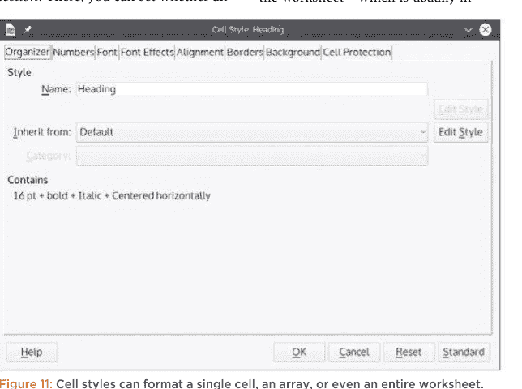

## 入门指南

### LibreOffice Calc

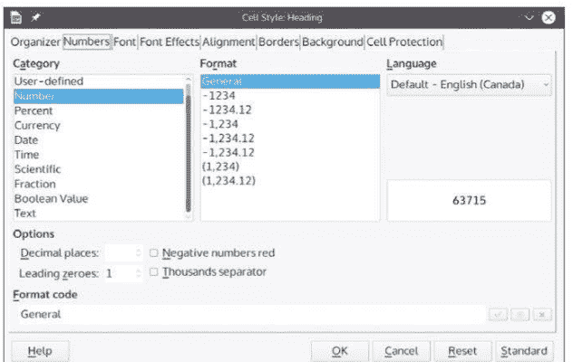

图 12：在“数字”标签页上的选择决定了单元格样式如何读取数据。

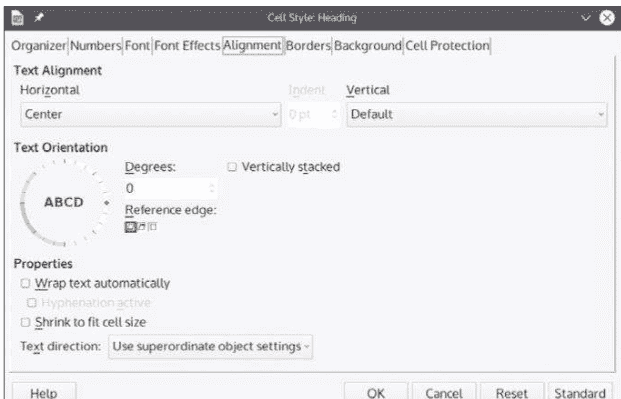


图 13：“对齐”标签页改进了单元格内数据的显示效果。

旨在供在线使用的内容可以转移到物理页面上。由于当总列数宽于页面时，这种转移可能会很别扭，因此您还可以选择打印哪些对象。在打印页面上定位对象、图像和图表可能特别困难。最终，您可能更愿意简单地缩小电子表格，尽管眼睛疲劳甚至无法阅读的可能性始终存在（图 14）。

作为样式的替代方案，您可以从 `格式` | `电子表格主题` 中选择一个颜色方案。但请注意，主题比样式更通用，而样式具有更多的功能性优势。

# 不断演进的电子表格

电子表格在 20 世纪 80 年代初开始被使用时，功能就是一切。即使是文本换行等格式化功能也不包含在内，这意味着长内容会遮挡相邻单元格，通常使电子表格一眼难以阅读。

如今，电子表格的功能依然强大，尽管在过去几十年中功能数量增长缓慢。电子表格真正发生演进的领域在于格式化选项的兴起。得益于爱德华·塔夫特（Edward Tufte）等信息设计师的影响，电子表格也开始强调展示的重要性，通过高亮和给单元格着色，在功能之上创建视觉印象和指引。

这些视觉印象本身并不是目的。如果您发现自己将电子表格视为艺术品而非理解辅助工具，您将需要重新评估您的优先级。然而，在最佳情况下，功能与视觉辅助的结合使电子表格比 40 年前更容易使用。凭借样式的使用，Calc 完全有能力满足这些不断增长的电子表格需求。

> 信息
> - [1] 布鲁斯·拜菲尔德（Bruce Byfield）。`使用 LibreOffice 进行设计。` 开放文档之友公司（Friends of Open Document, Inc.），2016 年

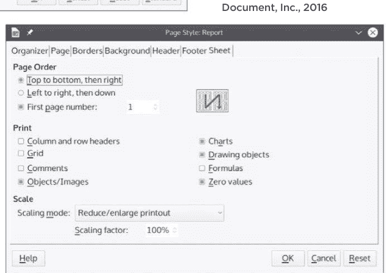

图 14：页面样式对话框提供了将电子表格挤压到物理页面上的选项。

# 通过特刊磨练您的技能！

通过我们的特刊库了解 Shell、LibreOffice、Linux 等更多内容。

`Linux Magazine` 团队创建了一系列单卷书籍，让您深入了解您感兴趣的主题。

提供印刷版或数字版

查看完整的库！  
shop.linuxnewmedia.com


# Impress

## 完美的演示文稿


需要用最新的销售统计数据给老板留下深刻印象吗？或者只是想以引人注目的格式展示一些假日照片？

Impress 是您需要的工具。`作者：迈克·桑德斯（Mike Saunders）`

“PowerPoint”一词已变得与演示文稿同义，即使该文件是用其他程序制作的。演示软件可以追溯到 20 世纪 80 年代初，例如 VCN ExecuVision 等工具，允许用户将图像添加到文本中并以幻灯片格式显示。LibreOffice 的演示组件称为 Impress，它是一个功能极其强大的工具，拥有众多功能和特殊效果。那么让我们深入了解一下吧！

启动 LibreOffice 并选择一个新的 `演示文稿`（或者如果您已经运行该应用程序，请在菜单中选择 `文件 | 新建 | 文本演示文稿`）。您将看到一系列预装的模板列表，选择一个您喜欢的模板，一个新的 Impress 文档将打开，显示以下功能：

- 1. `工具栏：` 最常用功能只需单击即可到达此处。如果您不确定某个图标的功能，只需将鼠标悬停在图标上即可显示工具提示。您也可以右键点击工具栏并选择 `可见按钮` 或 `自定义工具栏`，以进行更精细的布局控制。

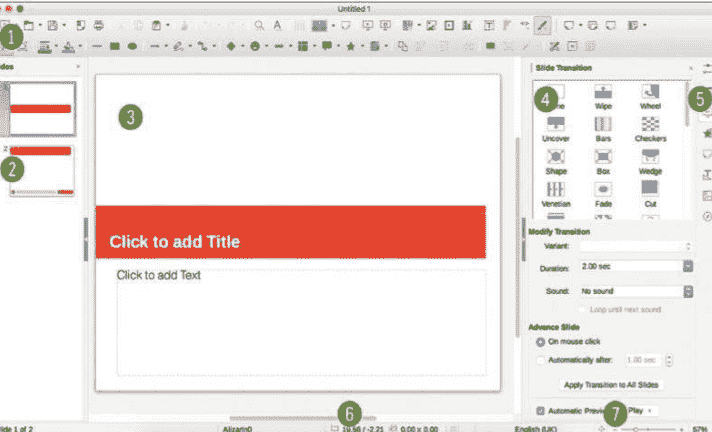

`图 1：` 一个新的 Impress 文档：工具栏（1）、幻灯片缩略图（2）、幻灯片内容（3）、侧边栏（4）、侧边栏选项（5）、位置和大小（6）以及缩放级别（7）。

### 入门指南

#### LibreOffice Impress

- 2. `幻灯片缩略图：` 在这里您可以看到幻灯片的缩小版本，并单击即可在它们之间切换。右键点击幻灯片以对其执行操作（例如，复制或删除），在空白区域右键点击以添加新幻灯片。您也可以点击并拖动以重新排列幻灯片。（注意：此面板可折叠；如果您看不到它，请单击灰色箭头将其打开。）您还可以使用应用命名的幻灯片菜单创建新幻灯片。

- 3. `幻灯片内容：` 这是您进行大部分工作的地方。在文本框中单击以编辑内容，然后单击文本框周围的灰色区域以显示绿色手柄，您可以使用这些手柄调整幻灯片中文本的大小和位置。使用插入菜单添加图像和额外的文本框。

- 4. `侧边栏：` 如果您看不到侧边栏，它可能已折叠到右侧，请单击灰色箭头将其打开（或前往 `视图 | 侧边栏`）。在图 1 中，侧边栏显示不同的幻灯片切换效果。

- 5. `侧边栏选项：` 侧边栏可以显示许多不同的内容，因此请使用右侧的小图标在它们之间切换（例如，文本属性、动画、有用的剪贴画库等）。

- 6. `位置和大小：` 当您移动或调整对象（如图像或文本框）大小时，检查状态栏以查找确切详情。（您也可以右键点击对象并选择 `位置和大小` 以精确指定尺寸。）

- 7. `缩放级别：` 一个快速滑块，允许您更改缩放级别，以便您可以放大查看许多细节，或缩小以查看概览。

# 演示的艺术

无论您对史蒂夫·乔布斯（Steve Jobs）持何种看法，毫无疑问他在展示苹果新产品方面非常出色。如果您从未看过他的任何演示，请上 YouTube 搜索一下——最初的 iPhone 和 MacBook Air 是两个经典的例子。乔布斯的演示文稿没有塞满文字和过多的细节，而是展示了个别功能、设备图像和偶尔的规格参数。他用语言对幻灯片进行阐述，最终形成了令人印象深刻的演示。

当然，乔布斯的演示风格并不适用于所有情况。向垂涎新技术的记者展示花哨的新奇玩意儿与向老板汇报销售情况或向家人和朋友展示假日照片（参见“创建相册”框）非常不同。但请记住以下一些通用技巧：

- `快速开始。` 没有人喜欢冗长的演示。不要以“在这个演示中我要……”开始，而是立即以一个有趣的事实、统计数据或发现开始。这能立即抓住观众的注意力，并让他们对演示的其余部分充满期待。

- `将重点放在观众身上。` 很容易一直转身看你的幻灯片，但这只会鼓励你阅读或描述屏幕上的内容，这对演示毫无帮助。看着你的观众，感受他们的反应。

- `添加轶事和故事。` 如果您看过 TED 演讲，您就知道它们充满了轶事。有时这可能显得有些做作，所以不要过度使用，但演示中一两个幽默的插曲有助于打破单调——还能唤醒那些快要睡着的人！

- `使用“10-20-30”规则。` 这也来自一位苹果员工，基本上是说演示通常不应超过 10 张幻灯片，时长不超过 20 分钟，并使用 30 磅或更大的字体大小。

- `用谈话替代文本。` 如果您的幻灯片有很多充满文字的页面，请尝试将它们减少为一些要点或图像，然后告诉观众其余内容。您是那里做演示的人，所以确保您在增加价值！

# 创建新演示文稿

那么让我们开始制作演示文稿吧！有关如何吸引观众并为最大效果塑造演示文稿的一般技巧，请参阅“演示的艺术”框。现在，专注于软件本身。

大多数预装模板包含两种或两种以上的设计变体。例如，在我在图 1 中选择的 Allianz 模板中，可以看到左侧自动创建了两个幻灯片：第一个适合介绍（或结尾），而第二个用于常规的文字和图像幻灯片。

因此，在第一张幻灯片中添加一些文本，然后从左侧面板中选择第二张幻灯片，并添加一些文本（也许还有图像）。在进一步工作之前，检查您超快的双幻灯片演示！按 `F5`（或前往 `幻灯片放映 | 开始`），您将看到它是如何工作的。当第一张幻灯片显示时，单击屏幕上的任意位置 – 或者按空格键 – 以转到第二张幻灯片。之后，演示结束。如果您不小心按了 `Esc` 键中断了演示，可以使用 `Shift + F5`（或 `幻灯片放映 | 从当前幻灯片开始`）从当前幻灯片恢复。

要更改幻灯片布局，请前往侧边栏，单击 `属性`“卡组”（即部分 – 使用右侧的按钮选择），然后向下滚动到 `布局`。您将在图 3 中看到一组替代设计。

要添加额外的文本框，请前往 `插入 | 文本框` 或按 `F2`。然后您可以点击并拖动以确定文本框的确切位置和大小。在这些文本框内格式化文本非常简单 – 只需使用侧边栏的 `属性` 卡组，然后是 `字符` 和 `段落` 卡组（如果您看不到卡组，点击 + 部件将其更改为 +，使其可见）。那里的大多数选项与 Writer 中相同，所以您可以直接应用您的知识！

您还可以添加形状：`插入 | 形状` 显示可用形状列表，包括线条、箭头、对称

### 入门指南

#### LibreOffice Impress

### 制作相册

您可以使用 Impress 从一组图像创建相册，通常每页幻灯片放一张照片。这个相册可以使用包含图形和图像的多媒体资源，甚至可以将您最新的假期照片收集到单个演示文稿文件中。为此，首先打开一个现有的或空白的演示文稿，然后选择 `插入 | 媒体 | 相册`。在出现的创建相册对话框中，点击 `添加` 以选择您的图像并浏览文件系统。具体如何选中多个图像取决于您的操作系统，但通常可以在按住 `Shift` 或 `Ctrl` 键的同时点击来选择。


选择图像后，Impress 提供了一些额外选项（见图 2）。其中最重要的是 `链接图像`，这意味着图像数据不会直接复制到演示文稿中，而是在观看演示文稿时按需从文件系统加载图像。这样可以节省磁盘空间，因为您不会复制那么多数据。但请注意：如果您从硬盘中移除图像文件，演示文稿中也不会显示它！完成后点击 `插入幻灯片`，然后您可以继续像往常一样编辑和展示演示文稿。

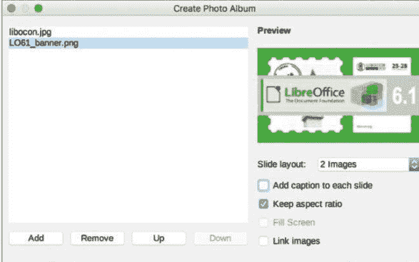

**图 2：创建相册时，您可以指定每页幻灯片应显示多少张图像。**

要更改形状或文本框的背景，请右键单击它并选择 `区域`，您将在图 4 中看到显示的对话框。您还可以使用此对话框添加阴影并设置对象的透明度。

想要为您的演示文稿添加更多形状和剪贴画吗？那就看看库（图 5），它位于侧边栏右侧面板，是自下而上的第二个图标。点击它以查看一系列可添加的内容——只需点击并拖动即可。与其他所有形状一样，如果您点击形状使其高亮，您将看到绿色手柄，可以点击并拖动它们以调整大小。

现在，您已经拥有了幻灯片、布局、文本框、文本格式、形状和图形——创建演示文稿的所有基本工具。但还有一件事需要考虑：转场效果（即用于从一张幻灯片移动到另一张幻灯片的动画）。从左侧面板选择一个幻灯片，然后从右侧侧边栏选择 `幻灯片切换` 卡片（它是自顶部向下的第三个图标）。

您将在侧边栏的主要部分看到许多转场效果，以及展示它们的小图像。请随意探索——只需点击一个转场效果即可查看其工作方式。许多转场效果在下方有额外选项，包括持续时间（以秒为单位）和附加音效。您还可以使用侧边栏的这一部分使演示文稿在等待一定秒数后自动继续——参见底部的 `切换幻灯片` 选项。

掌握了基础知识后，我将介绍一些高级功能：工作区视图、母版幻灯片和演讲者控制台。

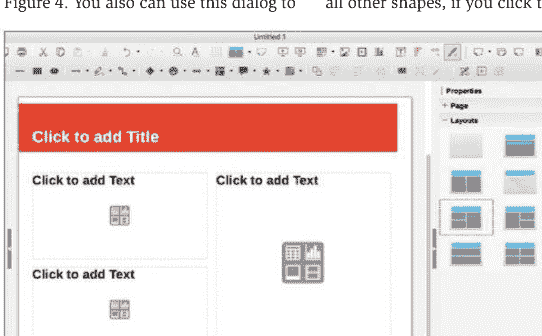

**图 3：使用侧边栏选择模板中的替代布局，带有额外的文本和/或图像框。**

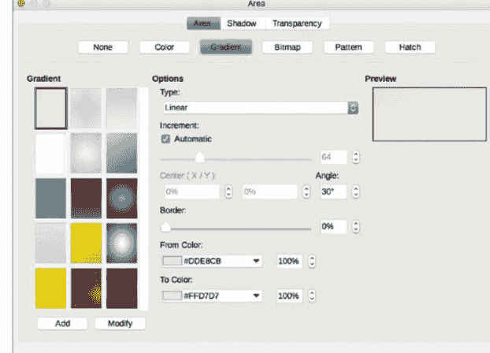

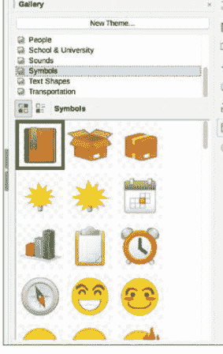

**图 4：Impress 为形状提供了广泛的背景选项——例如纯色、渐变和位图。**

**图 5：通过侧边栏访问的库提供许多额外的形状和图形，让您的演示文稿更生动。**

### 工作区视图

在 `视图` 菜单下，您会发现各种工作区选项——这些工作区视图中的每一个都旨在简化特定任务的完成。例如，`普通` 视图是处理单个幻灯片的主要视图。使用此视图来格式化与设计幻灯片，并添加文本、图形和动画效果。

然后是 `大纲` 视图，其中按顺序编号包含所有演示文稿幻灯片（图 6）。`大纲` 视图以大纲格式显示每个幻灯片主题标题、项目符号列表和编号列表。只显示包含在每个幻灯片默认文本框中的文本，因此如果您的幻灯片包含其他文本框或绘图对象，这些对象中的文本将不会显示。

`备注` 视图允许您为幻灯片添加备注。这些备注仅供您参考，在演示文稿展示时观众看不到。同时，`母版讲义` 视图用于设置您幻灯片的打印布局。点击侧边栏中的 `属性` 标签，您可以选择在 `布局` 部分中每页打印一张、两张、三张、四张、六张或九张幻灯片。此外，这还允许您在页眉和页脚部分添加自定义字段，例如当前日期——在其中一个框中点击，然后前往 `插入 | 域` 查看可用选项。

### 母版幻灯片

首先，一点背景知识：母版幻灯片是用作其他幻灯片起点的幻灯片。它类似于 Writer 中的页面样式，并控制基于它的所有幻灯片的基本格式。幻灯片放映可以拥有多个母版幻灯片。此外，母版幻灯片具有一组定义的特征，包括背景颜色、图形和渐变，以及其他对象（如徽标、装饰线等），页眉和页脚，文本框的位置和大小，文本格式等等。

样式控制母版幻灯片的所有特征。使用母版幻灯片创建的新幻灯片将继承所用母版幻灯片的样式。更改母版幻灯片中的样式会导致基于它的所有幻灯片发生变化。但是，您可以修改单个幻灯片而不影响母版幻灯片本身。

母版幻灯片关联两种类型的样式：演示文稿样式和图像样式。预装的演示文稿样式可以修改，但不能创建新的演示文稿样式。对于图像样式，您可以修改预装样式并创建新的图像样式。

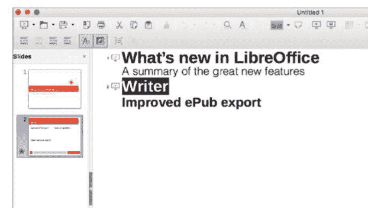

**图 6：使用大纲视图专注于演示文稿的文本内容和结构，而不是图形方面。**

演示文稿样式影响幻灯片母版的三个元素：背景、背景对象（如图标、装饰线和文本框）以及幻灯片上的文本。文本样式进一步分为 `备注`、`大纲 1` 到 `大纲 9`、`副标题` 和 `标题`。大纲样式用于大纲的不同级别。例如，`大纲 2` 用于 `大纲 1` 的子点，`大纲 3` 用于 `大纲 2` 的子点，等等。图像样式没有限制，可以影响幻灯片中的许多元素。请注意，文本样式既存在于演示文稿样式选择中，也存在于图像样式选择中。

让我们试一试！使用 Alizarrin 模板开始新的演示文稿，并在引言和第一页幻灯片中添加一些文本。然后，前往 `视图 | 母版幻灯片`，您应该会看到类似图 7 的内容。

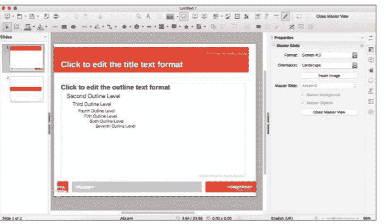

**图 7：Impress 的母版幻灯片模式：您可以进行影响基于它的所有幻灯片的更改。**

现在尝试更改幻灯片标题和其他部分的文本格式（即更改为不同的字体）。如果您返回 `视图 | 普通`，您将看到格式更改已应用于幻灯片。因此，您可以快速轻松地同时对许多（或所有）幻灯片进行更改，如果您有许多现有的公司演示文稿但需要根据新的品牌指南更新它们，这将节省大量时间。

要创建新的母版幻灯片，在左侧幻灯片面板的空白区域右键单击，并选择 `新建母版`。修改此母版以符合您的需求。请注意，建议重命名此新母版。在幻灯片窗格中右键单击幻灯片，并从上下文菜单中选择 `重命名母版`。完成创建母版幻灯片后，点击顶部工具栏上的 `关闭母版视图` 并返回普通幻灯片编辑模式。

现在您可以创建新幻灯片并使用侧边栏将母版幻灯片设计应用于它（见图 8）。只需点击右侧面板中的 `母版幻灯片` 图标，然后从顶部选择设计。

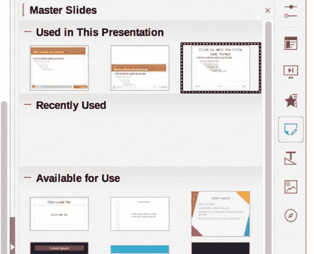

**图 8：创建母版幻灯片后，您可以使用侧边栏将其应用于新幻灯片。**

### 演讲者控制台

Impress 包含一个演讲者控制台功能，当连接了额外的演示显示器到计算机时可以使用。此演讲者控制台通过在不同视图下控制幻灯片放映来提供额外的控制，分别显示在您的计算机显示器和观众看到的演示显示器上。您在计算机显示器上看到的视图包括当前幻灯片、下一张幻灯片、任何幻灯片备注以及演示计时器。请注意，演讲者控制台仅在支持多显示器的操作系统上工作，且仅在连接两个显示器时生效（例如其中一个可能是笔记本电脑内置显示器）。

要启用演讲者控制台，前往 `工具 | 选项`（Windows 和 Linux）或 `LibreOffice | 偏好设置`（Mac OS），然后在左侧选择 `LibreOffice Impress`，接着选择 `常规`。勾选 `启用演讲者控制台` 按钮并点击确定。现在，当连接外部显示器并开始演示时，您应该在一个屏幕上看到主演示视图，在另一个屏幕上看到演讲者控制台（见图 9）。（如果不工作，且第二个屏幕只是镜像第一个屏幕，您将需要在操作系统中更改显示器设置。）

### 入门指南

LibreOffice Impress

### 导入与导出

Impress 在处理 PowerPoint 格式演示文稿的导入方面表现出色，尽管在复杂动画和效果方面可能存在某些局限性或差异。如果有人向你发送一份需要你修改的 Microsoft Office 演示文稿，请让他们以 `.pptx` 格式而不是 `.ppt` 格式发送——这是一种文档记录稍多但仍有限制的格式。在一个理想的世界中，所有办公软件都会使用像 `.odp`（开放文档演示文稿，即 LibreOffice 所采用的格式）这样完全开放和标准化的格式，但我们还是先梦想一下吧！

与此同时，Impress 允许你以多种格式保存文件。前往“文件 | 另存为”，查看打开的对话框中的“文件类型”下拉列表——你可以选择 Microsoft 格式、HTML，甚至纯文本。在“文件 | 导出为”下还有更多选项。在这里，你可以选择将演示文稿保存为 PDF 或 EPUB 格式（后者适合电子书阅读器）。

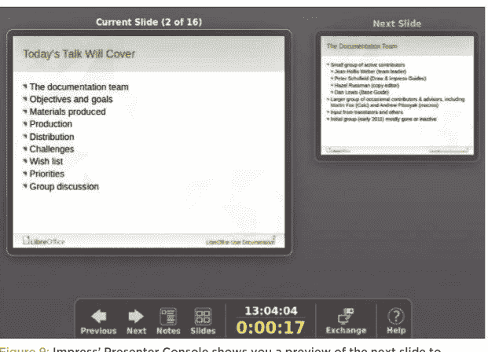

图 9：Impress 的演讲者控制台会显示下一张幻灯片的预览以提示你。

如果你只是想快速保存你的工作，请选择“直接导出”菜单项；如果你希望对手头生成的确切文件拥有更精细的控制，则选择其他项。

### 结论

从销售报告到照片幻灯片，LibreOffice Impress 提供了强大的工具来开发令人印象深刻的演示文稿。

### 逛商店

探索过去，并在 Linux New Media 的在线商店中投资新一年的 IT 解决方案。

- 想要订阅吗？


- 正在寻找那本你非常希望当时在报摊买到的旧刊吗？

`shop.linuxnewmedia.com`

### 数字版与印刷版订阅

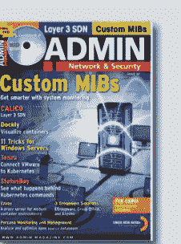

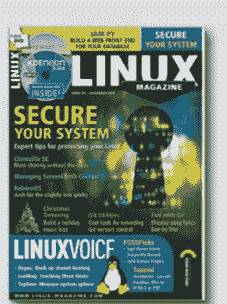

### 特刊


### 开始使用

LibreOffice Draw

#### 通用绘图工具

#### 素描艺术家


使用 LibreOffice Draw，你可以创建美观且信息丰富的基于矢量的绘图。作者：Thomas Krumbhein

LibreOffice Draw [1] 是一款免费的基于矢量的数学绘图程序，它帮助你创建从最简单的草图到复杂图表的各种内容。Draw 是一个面向页面、基于对象的程序，其基础是页面，页面开始时是一个空的工作表面，你通过将对象放置在该页面上来创建你的绘图。与 Writer（基于段落的文字处理器）和 Calc（基于单元格的电子表格）相比，Draw 的空页面提供了更多的自由度。

Draw 的对象是矢量图形，它们使用由数学向量定义线和曲线。向量根据几何形状描述直线、椭圆和多边形。矢量图形允许你对 Draw 对象进行拉伸、旋转或缩放，而不会损失信息。

所有对象都具有个别属性。要操作对象属性，你必须首先创建该对象并将其放置在页面的边界内。一旦放置完毕，你可以自由地在这些边界内移动对象。

Draw 文档可以包含多页，每页可以有不同的图层，每个图层包含不同的对象。因此，最终的 Draw 文档可以是一个复杂的创作，但它基本上是由简单对象编译而成的。一旦你用 Draw 创建了一个图形，你就可以在其他 LibreOffice 应用程序中使用它而不会遭受任何损失。当你需要重新制作或修改你的图形时，你不需要回到原始的 Draw 文档。相反，你可以使用 Draw 中最初提供的相同工具，直接在当前的 LibreOffice 应用程序（Writer、Calc 或 Impress）中编辑你的绘图。你还可以将其他 LibreOffice 程序中创建的对象，如表格、图表和公式，插入到你的 Draw 文档中。

#### 开始绘图

选择 *文件* \| *新建* \| *绘图* 以打开一个新的 Draw 文档（图 1）。你会看到活动工作区（中间部分），你在这里创建和操作对象。在工作区的左侧，“页面”窗格显示你文档中所有已创建页面的缩略图。在最左侧，工具栏包含对象创建所需的所有工具。在最右侧，属性侧边栏显示选定对象的属性。你需要同时使用工具栏和属性侧边栏才能充分利用 Draw。

当你打开新文档时，你只会看到“页面”窗格中的一个缩略图和一个基于标准页面尺寸的空工作区。要创建你的第一个对象，请通过点击相应的工具栏图标来选择你希望的绘图工具（图 2）。然后通过左键单击你计划对象的左上角的大致位置来放置对象，按住鼠标按钮，将鼠标移动到对象的右下角目标位置，然后松开按钮。你的对象将以默认属性创建。要修改对象属性，右键单击对象以查看对象外缘上的八个绿色或蓝色小手柄。这些手柄让你可以操作或更改对象的属性。

至少，每个对象具有以下属性（见图 1 中的属性侧边栏）：

- **位置**：所有对象都有相对于页面的位置 X 和位置 Y。通常，你的绘图页面的左上角（页面大小减去页边距）是 (0,0)。你的对象也默认使用周围方形的左上角作为其位置。

- **线条**：所有对象周围都有一条边框线。线条属性通常包括宽度、颜色、样式、边缘和透明度。如果你想要一条不可见的线，请在样式中选择“无”。要创建发丝线（取决于你的打印机，这是最小可打印线），请在宽度中选择 0.00mm。

- **区域**：所有对象都有填充属性，但只有当对象是封闭对象时它们才可见，这意味着边框是一条封闭的线，即使该线不可见（参见上文）。简单线条对象也可以具有填充属性，但它们是不可见的。

- **大小**：所有对象都有自己的大小属性，在宽度和高度方面表现为围绕对象的方形，当你单击对象时可见八个小手柄。你可以使用鼠标并移动单个手柄来操作大小，或者使用属性侧边栏输入宽度和高度值。

要更改属性，你可以使用属性侧边栏。此外，如果你右键单击对象，上下文菜单将弹出，允许你为每个属性打开单独的对话框；这种方法显示比通过属性侧边栏可用的更多详细属性。

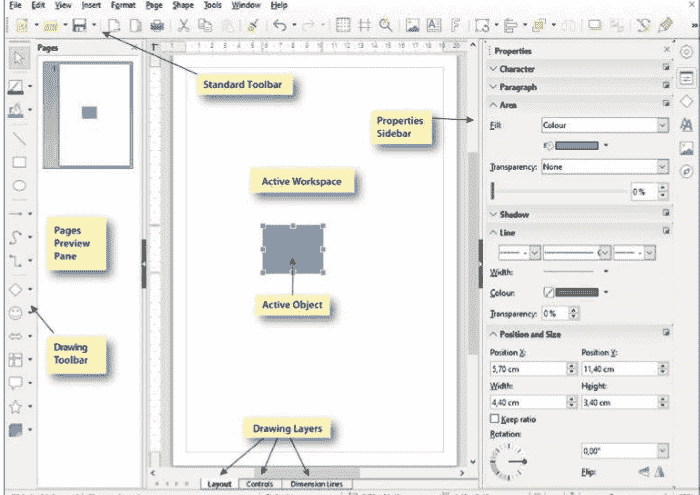

图 1：一个新的 Draw 文档，显示（从左到右）工具栏、页面窗格、活动工作区和属性侧边栏。

#### 文本

文本被视为对象的一部分，因此你需要先创建对象才能输入和编辑文本。你将使用文本工具创建一个空框作为你的对象。不幸的是，文本工具已从默认绘图工具栏中移除（图 2）。然而，你可以通过右键单击工具栏标题然后选择文本框来将文本图标放回工具栏。你还可以在标准工具栏（图 1）中找到替代的文本框工具，或使用键盘快捷键 F2。

一旦你创建了对象，光标将出现在框的左上角，你就可以开始插入文本。框将显示文本帧的左右边框，并自动换行。如果你插入的文本超过了原始框允许的容量，框将自动向下扩展。

如果你只想添加一段短文本序列，则不需要先绘制文本框。在这种情况下，只需选择文本框工具，并在你的活动页面上单击你希望文本出现的大致位置即可

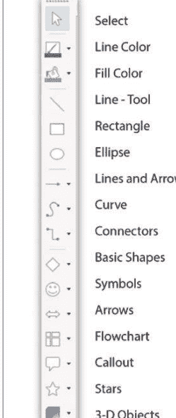

图 2：绘图工具栏提供多种用于创建对象的工具。

- 选择

- 线条颜色

- 填充颜色

- 线条 - 工具

- 矩形

- 椭圆

- 直线和箭头

- 曲线

- 连接线

- 基本形状

- 符号

- 箭头

- 流程图

- 标注

- 星形

- 3D 对象

### 快速入门

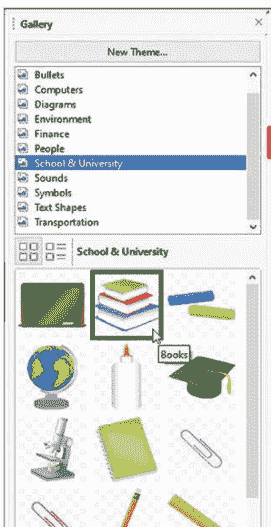

图 3：Draw 的图库提供了大量即开即用的图形；您甚至可以添加自定义图形。

开始输入文本：此时光标已可见，您可以立即插入文本。文本对象与其他绘图对象具有相同的属性，因此可以类似地进行操作。此外，绘图对象还具有文本属性。要在绘图对象中插入文本，请选中一个对象（例如矩形），然后双击该对象：您将看到光标，并可以插入一些文本。此文本是绘图对象的一部分，并会随对象一起移动。

对于所有文本，Draw 都提供文字处理功能，允许您更改字符和段落属性。您可以通过“属性”侧边栏或上下文菜单访问所选文本的这些功能。

### 形状

由于所有绘图都是各种对象的集合，您的绘图可能会变得非常复杂。您可以将对象编组，但也可以合并或交并/差集/相交选定的对象以生成新的复杂单一对象。通常，所有绘图对象都是使用非常简单的几何形状（如线条、矩形或椭圆）生成的。没有必要生成或构建所有所需的形状。LibreOffice Draw 提供了一组预定义的绘图对象，如基本形状、符号、箭头、流程图、对话框和星形。只需从绘图工具栏（图 2）中选择所需的形状，并使用鼠标创建对象即可。之后，您可以更改形状的位置和属性。

除了绘图工具栏中的预定义形状外，图库（位于“属性”侧边栏中）还提供了大量即开即用的图形（图 3）。您可以轻松地用鼠标拖动和放置单个对象。此外，您还可以通过点击图库中的“新主题”添加自己的类别，并保存自定义对象以备日后使用。

选定形状后，您可以使用“区域”属性、“透明度和填充”来为您的对象创建美观的效果。

### 对象排列

对象按照创建顺序放置在当前活动工作区中。第一个对象位于底层，随后的每个对象都位于前一个对象的上一层。要更改对象顺序，请从上下文菜单或“形状”菜单（位于菜单栏中）中选择“排列”。

使用鼠标创建和放置对象是获得可接受结果的快速方法。但是，有时您需要更高的精度。Draw 提供了一些实现精度的选项。

如果您仍想使用鼠标，可以激活“显示网格”或“参考线”。使用“显示网格”，您可以将对象自动吸附到页面的网格上。如果需要更多自定义，“参考线”允许您创建用于对齐的非打印线条。要创建参考线，请将鼠标光标置于页面标尺之一内，按住鼠标按钮，并将光标拖入绘图区域。创建后，您可以更改参考线的属性（x 或 y 位置），甚至可以通过输入坐标来放置参考线。

由于所有对象在活动工作区中都有度量尺寸和位置

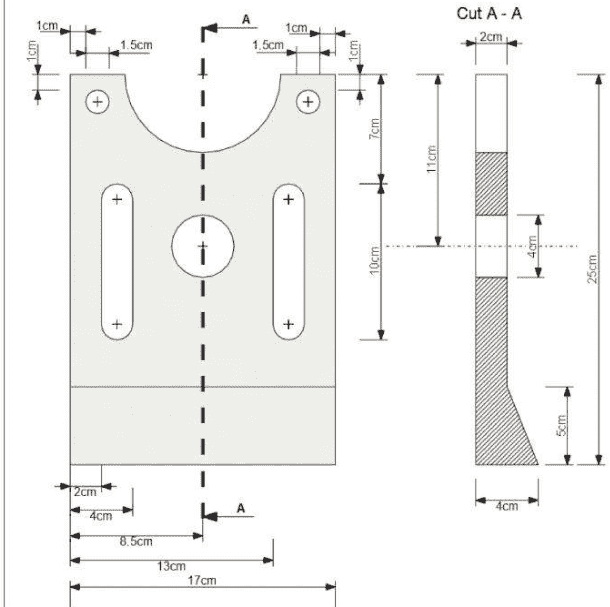

图 4：Draw 中输入精确数值的能力使其适用于简单的施工图纸。


因此，另一个选项是通过“属性”侧边栏（图 1）输入对象放置的精确数值。您还可以使用上下文菜单或“格式”菜单中每个属性的更详细对话框。通过使用精确数值，您可以使用 LibreOffice 创建简单的施工图纸（图 4）。您可以更改绘图比例（`扩展 | 选项 | LibreOffice Draw | 常规`）。创建对象后，LibreOffice 可以添加尺寸线。请记住，在处理施工图纸时，参考线是必要的。

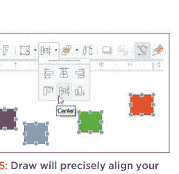

图 5：Draw 会精确对齐您的对象……

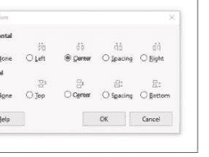

图 6：……并垂直和水平分布它们。

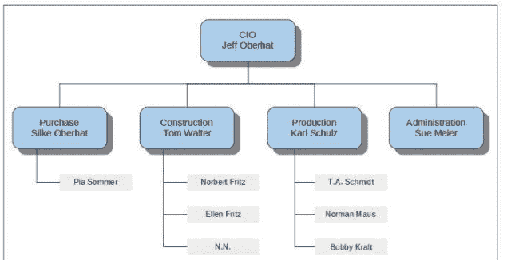

图 7：连接器允许您在组织结构图中移动一个项目，同时保持流程不变。

最后，如果您希望对齐一组对象，Draw 可以为您完成（图 5）。选中对象（按住 `Shift` 键并右键点击所需对象，或围绕对象画框），然后选择`对齐`（从上下文菜单或标准工具栏中）。您可以通过选择`分布`（图 6）进一步调整直线中对象的分布。

### 连接器

Draw 的另一个不错功能是用于连接对象的连接线。连接器是位于对象边框上的胶合点，用于连接到另一个对象。一旦两个对象通过胶合点连接，移动一个对象也会移动连接的另一个对象。典型用例是流程图或组织结构图（图 7）。连接器允许您在保持图表流程的同时移动单个对象。


图 8：Draw 提供一些很酷的功能，例如将 2D 形状转换为旋转的 3D 对象。

### 创意中心

虽然 LibreOffice Draw 不是像 Gimp 那样的面向像素的绘画程序，但它确实提供一些非常具有创意的工具。例如，您可以将 2D 形状转换为 3D 旋转对象。要生成 3D 对象，您首先绘制基本形状：所需对象的扁平半草图（图 8）。然后，点击该形状并选择`形状 | 转换为 3-D 旋转对象`。

### 打印和导出

打印您的绘图很简单。选择您的打印机，开始打印任务。确保您的文档页面设置符合打印机的要求。您还可以将绘图导出为流行的文件格式，如 PDF、PNG 或 SVG。请记住，SVG 是基于矢量的格式，而 PNG 是基于像素的。因此，质量在个别情况下会有所不同。

LibreOffice Draw 在打印文件方面有一个限制：没有颜色分离选项（CMYK 分离），这是印刷所必需的。如果需要 CMYK 分离，最终产品必须使用印前工具重新处理，并且必须将颜色更改为所需的颜色配置文件。

### 结论

借助 LibreOffice Draw，您拥有一个强大的、基于矢量的绘图工具，可以创建从最简单的草图到复杂图表的一切。一旦您创建了杰作，就可以将其用于其他 LibreOffice 应用程序，或导出供第三方应用程序使用。■■■

#### 信息

- [1] LibreOffice Draw：
- `https://www.libreoffice.org/discover/draw/`

### 帮助我们庆祝 *Linux Magazine* 20周年！

*Linux Magazine 是您通往 Linux 世界的指南：*
- 关于热门主题的深入文章
- 关于实用工具的入门指南和教程
- 故障排除和优化技巧
- 关于开源世界重要发展的深入新闻
- 用于树莓派、Arduino 和其他创客板系统的酷项目

立即订阅，并在第一期中免费获得 Linux Magazine 20周年存档！


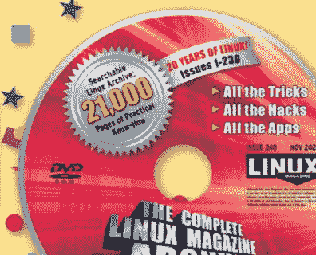

今日订购：
`https://bit.ly/20th-Anniversary`

# 创建数据库、查询和表单

## 数据大师


我们将向您展示如何在 LibreOffice Base 中设置数据库，并使用嵌入在表单中的 SQL 查询进行搜索。

作者：Robert Großkopf、Kerstin Großkopf 和 Joe Casad

**B**ase 是 LibreOffice 套件中的关系型数据库。数据库是一种工具，可将数据组织成结构化且易于访问的形式。您可能在想：“我以为这正是 LibreOffice Calc 电子表格所做的。”如果是这样，您的想法是正确的。数据库和电子表格都以结构化形式存储数据。对于某些类型的问题（例如财务台账），电子表格更为实用。另一方面，数据库专为轻松搜索和数据录入而设计，并且更易于扩展到更大的数据集。

数据库适用于用户拥有具有相似属性的离散数据对象或记录集合的情况。经典的例子是图书馆卡片目录——一系列具有相似字段集合的相似项目，显示标题、作者、目录号以及书籍的描述。

Base 提供了创建和管理数据库的易用用户界面。Base 6.1 版正在过渡到 Firebird 数据库引擎。Base 的早期版本使用 HSQL 引擎。您还可以使用 Base 连接多种不同格式的现有数据库文件。根据 LibreOffice 项目的说法，“LibreOffice Base 原生支持一些平面文件数据库格式，例如 dBASE 格式。您也可以使用 LibreOffice Base 连接外部关系型数据库，例如 MySQL 或 Oracle 的数据库……”

Base 用户界面支持多种向导和设计辅助工具，使创建数据库或构建向数据库输入数据的表单变得容易。当您首次启动 Base 时，创建数据库向导会询问您是否想要创建新数据库。图 1 显示了 Base 主窗口。左侧的图标使创建表、查询、表单和报告变得容易。

数据库从设计开始。数据库设计包括许多考虑因素，根据数据的性质，这可能是一项复杂的任务。为了本教程的目的，为了在可用空间内最大化信息量，我将描述典型的数据库场景，并带您走一遍设计和构建数据库的步骤，然后设置表单和查询。有关使用 Base 的更多信息，请参见 LibreOffice 入门指南 [1] 和 Base 手册 [2]。

### 设计数据库

本文中的示例是一个用于存储公司设备清单的简单数据库。表 1 显示了基本的数据库字段。`Article`（物品）是对对象的描述。数据库还包含有关对象所在房间的信息，对象存储的架子或柜子编号，以及对象的类别、该位置的对象数量以及对象数字图像的 URL。

| 表 1：数据库字段 | | |
| :--- | :--- | :--- |
| **字段名称** | **字段类型** | **描述** |
| Article | Text [VARCHAR] | 对象描述 |
| Image | Text [VARCHAR] | 通过其 URL 链接到数据库的对象图像 |
| Room | Text [VARCHAR] | 房间名称 |
| Cupboard | Small Integer [SMALLINT] | 柜子编号 |
| Rack | Small Integer [SMALLINT] | 架子编号 |
| Number_Needed | Small integer [SMALLINT] | 所需对象的数量 |
| Category | Text [VARCHAR] | 物品类型（例如，电子产品、光学仪器等） |

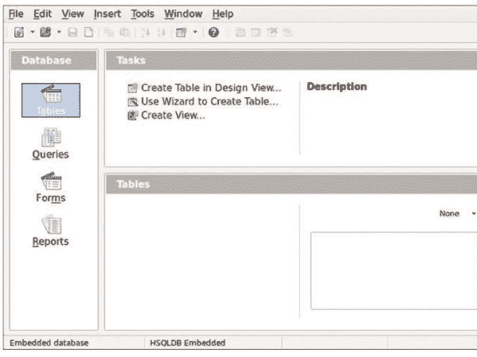

表 1 中的数据都可以驻留在一个表中，但是，如果某些字段多次出现且具有相同的数据，通常将重复出现的数据拆分为单独的表并通过唯一 `ID` 字段（被指定为主键）连接到主表会更有效率（表 2）。

一个简单的库存数据库可以使用以下三个表编制：每个 `Article`（物品）最多分配一个 `Category`（类别）和一个 `Place`（位置）（`Room`（房间）、`Cupboard`（柜子）和 `Rack`（架子））。用数据库术语来说，这被称为多对一 (n:1) 关系，只要某个事物仅被分配一次就足够了。然而，对于本示例数据库，每个物品可以有多个存储选项，*反之亦然* – 即多对多 (n:m) 关系。为了确保这种连接，附加表从 `Article` 的 `ID` 和 `Place` 的 `ID`（均为主键）创建一个新的 `ID`，并将 `Number_Needed` 从 `Article` 表移过来（图 2）。

| 表 2：数据库表 | | |
| :--- | :--- | :--- |
| Article ID | Category ID | Place ID |
| Article | Category | Room |
| Image | | Cupboard |
| Number_Needed | | Rack |

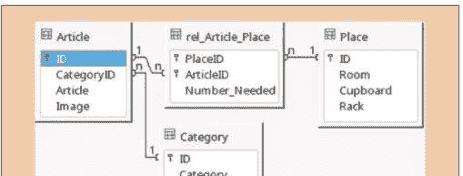

### 创建数据库


现在，在一个内部 Firebird 数据库中逐个创建这些表：

- 在 LibreOffice 中通过 *文件* | *新建* | *数据库* 启动数据库向导。
- 选择 *创建新数据库* 单选按钮，并从下拉菜单中选择 *Firebird 嵌入式*。
- 点击 *完成* 保存一个不需要注册的数据库文件。命名并保存文件后，将打开一个多表窗口；从表部分开始，在任务窗格中，选择 *在设计视图中创建表*。（要获取此功能，您需要 Java。前往 *工具* | *选项* | *高级* 查看系统上存在的 Java 运行时环境并选择其中一个。）

应打开一个空白数据库表，您可以在字段名称列中输入字段名称，在字段类型列中输入字段类型。

所有 `ID` 字段以及与 `ID` 字段连接的所有字段的字段类型应为 `Integer`（整数）。对于每个 `ID`，在字段属性部分将 `AutoValue`（自动值）设置为 `Yes`（是）（图 3）；这样该字段将自动递增并被设置为表的主键。为此，用左键单击标记第一个主键，按住“Shift”键并标记下一个。

对于 `Article`（物品）字段，在字段属性下将 `Entry Required`（必填项）设置为 `Yes`（是）。使用其名称保存每个表（例如，`Article`、`Category` 或 `Place`）。在建立多对多关系的 `rel_Article_Place` 表中，您需要创建两个主键（见图 2）。

保存所有表后，打开 *工具 > 关系*，并通过选择和拖动从主键 (`ID`) 到外键来创建连接，如图 2 所示。


*图 3：自动值设置为 Yes 的整数字段自动成为主键。*

## 数据录入表单

直接向表中输入数据在 `Category`（类别）这样的表中工作得相当好，除了自动编号的 `ID` 外只有一个字段。在 `Place`（位置）表中，所有房间、柜子和架子也可以直接填写。另一方面，`Article`（物品）和 `rel_Article_Place` 表更难填写，因为两个表都有字段的主键被设置为另一表中的外键。因此，这两个表都是输入表单的良好候选对象。

要创建表单，点击侧边栏中的 *表单* 并选择 *使用向导创建表单*。带有侧边栏的窗口显示创建表单的八个步骤。

1. **字段选择。** 向导打开时，主向导窗口中的下拉菜单中已经选择了 `Article` 表。所有字段都应显示在主表单中，因此使用双箭头将它们从左边的框（可用字段列表）转移到右边的框（将出现在表单中的字段列表）。
2. **设置子表单。** 不幸的是，此步骤目前尚未与新构建的 Firebird 数据库自动配合工作，因此您必须在后续步骤中自行选择表和链接字段。选择 *基于手动选择字段的子表单*。
3. **添加子表单字段。** 在下拉菜单中选择 `rel_Article_Place` 表，并将所有字段移动到最右边的框中。
4. **获取联接字段。** 将子表单 (`rel_Article_Place` 表) 中的 `ArticleID` 字段与主表单 (`Article` 表) 中的 `ID` 字段链接。
5. **排列控件。** 现在向导帮助您以四种格式之一布局界面。您可以将输入表单保留为表格，以列形式呈现带有左侧或顶部标签的数据输入单元格，或者将表单排列在 *块 – 标签在上方*。在本示例中，我将主表单显示为顶部带标签的列，并将子表单保留为 *数据表*。现在，`Article` 提到的所有地点都可以出现在表单视图中。
6. **设置数据录入。** 保持此步骤不变。
7. **应用样式。** 这一步纯属个人品味。如图 4 所示，表单背景设置为 *浅灰色*，边框设置为 *平面*。
8. **设置名称。** 表单现在可以使用，但存在许多缺点；因此，输入名称后，选择 *修改表单* 并点击 *完成*。

现在可以解决以下缺点：

- `Image`（图像）字段仅显示到图像的路径，而不显示图像本身。
- `ID` 字段是可编辑的（尽管这里不可见）。写入保护应防止修改主键。
- `CategoryID` 字段显示外键值（`Category` 表 ID），而不是 `Category`（类别）值本身。
- 在表外字段（子表单）中，显示 `PlaceID` 的外键值，而不是 `Place`（位置）表 `ID` 的内容。
- 由于值已在主表单的 `ID` 字段中显示，因此 `ArticleID` 的显示是不必要的。

如果表单不可编辑，请右键点击表单名称并选择上下文菜单中的 *编辑* 来关闭然后重新打开表单。字段现在将按照在表格中排列的顺序进行编辑。

通过 `Ctrl-点击` 选择 `Image` 输入框；然后，*右键点击* 并从上下文菜单中选择 *替换为 > 图像控件*。再次右键点击并选择 *控件* 以打开属性对话框。在 *常规* 选项卡中，在下拉菜单中点击 *缩放 > 保持比例*，以便图像不会变形。也可以更改字段的大小，或者您可以


*图 4：退出表单向导后的数据录入表单。*

## 入门指南

### LibreOffice Base


使用鼠标直接修改表单。在 *Data*（数据）选项卡中，选择 *Input required*（必须输入）| 无。如果未选择此项，则必须在保存之前声明一张图片。关闭 *Properties*（属性）对话框后，更改将生效。

现在 `Ctrl-单击` `ID input`（ID 输入）字段，并通过上下文菜单中的 *Control*（控件）打开 *Properties dialog*（属性对话框）。选择 *General*（常规）| *Read-only*（只读）| 是。该字段也应具有唯一标识性，例如通过使用不同的配色方案。

要为 `Category/ID`（类别/ID）输入字段显示列表框，请 `Ctrl-单击`，然后右键单击并从上下文菜单中选择 *Replace with*（替换为）| *List Box*（列表框）。在列表框的 *Properties dialog*（属性对话框）的 *Data*（数据）选项卡中，将 *Type of list contents*（列表内容类型）更改为 *Sql*。单击 *List content*（列表内容）旁边的三点按钮（图 5）将启动 SQL 命令编辑器，在那里你可以定义列表字段的内容。

首先，在 *Add Table*（添加表）或 *Query*（查询）对话框的 *Tables*（表）部分 *Add the Category table*（添加类别表）。将出现一个新的 `Category`（类别）框，其中包含其字段列表。双击 `Category` 字段会将其转换为第一个查询字段（数据库术语中的字段 0）。双击 `ID` 字段会使其成为第二个查询字段（图 6）。

接下来，为 `Category` 字段单击 *Sort*（排序）| *ascending*（升序）。关闭并保存 SQL 命令对话框后，将在 *List content*（列表内容）下拉菜单中显示新的 SQL 查询。现在切换到 *General*（常规）| *Drop-down*（下拉）| 是，以便列表框向下展开。在这里，你还可以更改显示的字段数量。

*Right-clicking*（右键单击）表格控件字段（子表单）中的 `PlaceID`（位置ID）会打开一个上下文菜单，你可以在其中选择 *Replace with*（替换为）| *List Box*（列表框）。再次打开 `PlaceID` 上下文菜单，并从 *Column*（列）属性开始。与之前一样，列表内容应在 SQL 命令查询编辑器中创建，在那里你 *Add*（添加）`Place`（位置）表。现在，依次双击 `Room`（房间）、`Cupboard`（柜子）、`Rack`（货架）和 `ID`（ID）。若要进一步编辑查询，请单击 *Switch Design View On/Off*（切换设计视图开/关）图标以查看 SQL 代码（图 7）：

```sql
SELECT "Room", "Cupboard", "Rack", "ID" FROM "Place"
```

该命令将按所示顺序分别显示表的所有字段。然而，列表字段只能显示一个字段并保存另一个字段的值；因此，前三个字的内容必须组合起来：

```sql
SELECT "Room" || "Cupboard" || "Rack", "ID" FROM "Place"
```

现在，`Room`、`Cupboard` 和 `Rack` 字段按顺序显示在一个字段中。另一方面，`ID` 的值保存在表单中，这对于在列表框中显示来说并不是最优的。

将 SQL 命令更改为

```sql
SELECT "Room" || ' - ' || "Cupboard" || ' - ' || "Rack" AS "", "ID" FROM "Place" ORDER BY ""
```


使用带空格的破折号分隔 `Room`、`Cupboard` 和 `Rack` 字段，并使用 `AS` 语句分配别名，该别名用于对列表框的内容进行排序。在继续之前，请关闭并保存 SQL 命令编辑器和 `Properties`（属性）框。

对于最后的修改，在控件表中右键单击 `ArticleID`（文章ID）并选择上下文菜单中的 `Delete column`（删除列）。虽然表单现在已准备就绪，但仍需修改字段大小，你还可以更改 `CategoryID` 和 `PlaceID` 标签。

在表单中导航、搜索数据记录等操作可以在屏幕底部的 `Navigation Bar`（导航栏）中进行（图 8），一旦输入数据，该导航栏会自动显示。

有时，在输入字段旁边单独使用一个导航栏也是可取的。


要创建此导航栏，你需要再次打开表单进行编辑。首先单击主表单中的字段，然后单击左侧边栏底部的 `More Controls`（更多控件）图标。通过 `Ctrl-单击` 新控件中的 `Navigation Bar`（导航栏），表单中会出现一个新的导航栏，其中包含与屏幕底部导航栏几乎相同的字段。

## 搜索数据集

Base 本身内置了一些搜索功能。不幸的是，在使用表单时这些功能更难管理。为了改变这一点，你需要深入一点，这就需要具备 `SQL` 代码的基础知识。对于一般性帮助，你可以参考可下载的 Base 手册。

首先，使用 `Tables | Create Table in Design View`（表 | 在设计视图中创建表）创建另一个表来保存搜索词，并添加字段：

- `ID` 作为 `Yes/No` [BOOLEAN]
- `Search` 作为 `Text` [VARCHAR]

右键单击 `ID` 字段使其成为主键，并以 `Search` 的名称保存该表。在表的第一行中插入 "ID" = `true`。此表应仅保存这一个数据集。

打开 `Queries | Create Query in SQL View`（查询 | 在 SQL 视图中创建查询），以便比在 `Design View`（设计视图）中更快地输入代码，并输入：

```sql
SELECT * FROM "Article"
WHERE "Article" LIKE COALESCE
(
  (SELECT "Search"
   FROM "Search"
   WHERE "ID" = TRUE
  ), "Article"
)
```


图 9：表单导航器显示了表单的所有元素。

`COALESCE` 函数检查 `Search`（搜索）是否为空；然而，如果为 `TRUE`，`Article` 和 `Article` 总是应该包含内容，并且 `Article` 应该始终与 `Article` 相同，该关键字现在显示所有 `Article` 表数据。如果在 `Search` 中输入一个单词，则只显示与输入值匹配的 `Article` 项。需要对此查询稍作改进，以便搜索条目的一部分也能显示结果：

```sql
SELECT * FROM "Article"
WHERE "Article" LIKE COALESCE
( '%' ||
  (SELECT "Search"
   FROM "Search"
   WHERE "ID" = TRUE
  ) || '%', "Article"
)
```

要测试查询，请单击工具栏中的 `Run Query`（运行查询）图标或按 `F5`。将显示 `Article` 表中的所有数据集。最后一行在 `ID` 字段中显示 `AutoField`（自动字段）。

修改代码以在 `Search` 表中查找值为 `Search` 的条目，并将其与 `Article` 表中的 `Article` 字段进行比较：

```sql
SELECT * FROM "Article"
WHERE "Article" LIKE
(
  SELECT "Search"
  FROM "Search"
  WHERE "ID" = TRUE
)
```

此时你可能不会看到任何值，因为 `Search` 表中的 `Search` 字段内容为空。再次修改代码：


图 10：仅循环遍历活动记录 – 无导航栏，无新行，...

通过使用 `%`，搜索词的命中结果现在可以在词前后包含任意数量的字符。因此，一次输入可能会获得多个命中结果。唯一的缺点是它仍然区分大写字母和小写字母。以下查询现在允许输入 `Article` 字段中任意位置包含的文本，无论大小写如何：

```sql
SELECT * FROM "Article"
WHERE LOWER ( "Article" ) LIKE COALESCE
( '%' ||
  (
    SELECT LOWER ( "Search" )
    FROM "Search"
    WHERE "ID" = TRUE
  ) || '%', "Article"
)
```

现在将此查询保存为 `qrySearchArticle`，在表单下复制已创建的表单，粘贴副本作为名为 `ArticleSearch` 的新表单，并通过右键单击选择 `Edit`（编辑）来打开此新表单进行编辑。


图 11：带有搜索功能的表单。在内容中包含 `Meter` 的情况下找到了九条记录。

要在现有表单中添加 `Search`（搜索）输入区域，你需要打开 `Form Navigator`（表单导航器）（图 9）。在打开的对话框中，右键单击 `Forms`（表单）并选择 `New | Form`（新建 | 表单）。然后将在 `MainForm` 旁边添加一个新表单。

通过其上下文菜单打开此表单的属性。在 `Data`（数据）选项卡中，在 `Content`（内容）下拉菜单中选择 `Search`。选择 `Cycle | Active record`（循环 | 活动记录）尤为重要。图 10 中显示的其余设置确保始终编辑和更改相同的数据集。

接下来，选择 `MainForm` 中可用的一个表单字段并调出其 `Properties`（属性）对话框，并在 `Properties`（属性）| `General`（常规）| `Action`（操作）| `Refresh form`（刷新表单）中设置。

关闭新表单的 `Properties`（属性）对话框后，选择 `MainForm`。在 `Data`（数据）选项卡中，将 `Content type`（内容类型）选择为 `Query`（查询），将 `Content`（内容）选择为 `qrySearchArticle`。接下来，`Ctrl-单击` 侧边栏中的 `Push Button`（按钮）图标。此按钮应出现在 `MainForm` 中（请检查 `Form Navigator`）。在按钮的 `Properties`（属性）对话框的 `General`（常规）选项卡中，选择 `Action`（操作）| `Refresh form`（刷新表单）。现在，每当你点击此按钮时，表单都会再次进行扫描。

在 `Form Navigator`（表单导航器）中，再次选择 `Search` 表的新表单，并通过选择 `Text Box`（文本框）图标并使用鼠标绘制一个框来创建输入区域。在此框的 `Properties`（属性）对话框的 `Data`（数据）选项卡中，将 `Data field`（数据字段）设置为 `Search`，将 `Input required`（必须输入）设置为 `No`（否）。现在，当点击 `MainForm` 中的按钮时，此文本框的内容将自动保存（图 11）。

如果你对表单满意且不希望进行任何设计更改，现在就可以保存它。

## 结论

起初，创建内部 Firebird 数据库比在 Calc 中创建表花费的时间要多得多，但一旦数据库构建完成，数据输入比在电子表格中输入数据要准确且快速得多。另一个优势是可以生成报告。

除了 Base 内部数据库外，Base 还允许你连接到外部数据库（例如，MySQL/MariaDB、PostgreSQL、电子邮件地址簿等）。此时，Base 仅访问表并提供图形用户界面。

由于 Base 可以访问如此多的数据库，具备 SQL 基础知识总是很有优势的。否则，访问将很快局限于仅包含单个表且只使用 Base 内置搜索功能的数据库。

### 信息

- [1] LibreOffice 入门指南：https://documentation.libreoffice.org/en/getting-started/getting-started-guide/


- [2] Base 手册：https://documentation.libreoffice.org/en/documentation/base/

# IT 亮点一览


太忙了无法翻阅新闻稿和喋喋不休的科技新闻网站？让我们将最相关的新闻、技术文章和小贴士直接发送到你的收件箱。

- • Linux Update • ADMIN Update • ADMIN HPC

掌握 IT 行业的脉搏。

- ADMIN 和 HPC：bit.ly/HPC-ADMIN-Update
- Linux Update：bit.ly/Linux-Update

## 使用公式编辑器

### 公式和格式


LibreOffice Math 包允许您显示简单和复杂的公式。*作者为 Franz Böhm 和 Paul Brown*

Math 公式编辑器可以作为独立程序运行，也可以从其他 LibreOffice 模块调用，并将完美排版的公式嵌入到文本文档、电子表格、演示文稿和绘图中。Math 可以表示分数、幂、积分、函数，甚至整个方程组或矩阵。

要在单独窗口中启动 Math，请单击 `File | New | Formula`。要在 Writer、Calc、Impress 或 Draw 中包含公式，请选择 `Insert | Object | Formula`。该公式将成为文档中嵌入的对象，您可以对其进行拖放以及放大或缩小。无论是在哪种情况下，使用三窗格 Math 编辑器的方法都是相同的。

左侧是一个侧边栏，右下角是一个命令窗格。该窗格通常停靠在那里，但可以通过按住 Ctrl 键并双击边框来分离和重新停靠。命令窗格上方是一个预览区域，显示公式在文档中的最终外观。单击 `View | Elements` 会在一个小的元素窗口中显示辅助工具，这对 Math 初学者特别有用，使输入公式变得更加容易。

请注意，公式编辑器不执行计算。Math 仅用于编写和显示公式。

### 工作区

当启动 Math 时，工作区是空的。要开始，请从侧边栏的下拉菜单或元素窗口顶部的两行图标中选择九个类别之一。这些类别包括：

- *一元/二元运算*
- *关系*
- *集合运算*
- *函数*
- *运算符*
- *属性*
- *括号*
- *格式*
- *其他*

主图 © Roman Gorikov. 123RF.com


### 入门

`Tools | Symbols` 或点击之前提到的 `Tools` 工具栏中最右侧的 omEGA 符号。在 `Symbols` 对话框中找到字符（图 2），然后单击 `Insert`，接着单击 `Close`。或者，您可以通过双击该字符来合并最后两步。关联的符号会出现在 `Commands` 窗格中，其名称前有一个百分号。大写字母以全大写拼写（例如，`%ALPHA`，`%BETA`，`%GAMMA`）；小写字符仅使用小写字母（例如，`%psi`，`%phi`，`%theta`）。有关所有希腊字母和标记等效物的完整列表，请参阅 Math 手册 [1]。

如您所见，希腊特殊字符出现在 `Commands` 窗格中，其名称前带有百分号。

每个类别显示一组操作。如果单击其中一项，`Command` 区域将显示相应的操作，并且 `Preview` 窗格将显示公式在文档中的外观。

例如，在侧边栏中选择 `Unary/Binary Operations` 并单击 `Multiplication` （`Dot`）符号。您将在 `Commands` 窗格中看到以下文本：

```
<> · cdot <>
```

`Preview` 中会出现两个带点的灰色方框（图 1）。当您将命令区域中的占位符 (`<>`) 替换为诸如 x 和 y 等数字或变量时，它们将显示在 `Preview` 中，而不是灰色方块。在插入新公式后，`Commands` 窗格中的第一个占位符已被选中，您可以通过输入字符来覆盖它。按 `F4` 键转到下一个占位符，按 `Shift+F4` 键返回到上一个占位符。默认情况下，Math 会自动更新公式，但您可以通过 `View | Auto-Update Display` 禁用此功能，并按 `F9` 键手动更新所有内容。

单击 `View | Toolbars | Tools` 会在工具栏中添加图标，这些图标可以通过鼠标单击来放大或缩小视图，或以最佳方式填充窗口。从右数第二个符号是一个公式光标，它通过突出显示点击的区域，帮助您找到文档或 `Commands` 窗格中公式的特定部分。

### 希腊字母

数学公式通常包含希腊字母，您可以在 `Tools | Symbols` 中找到，或者通过单击之前提到的 `Tools` 工具栏中最右侧的 omEGA 符号。在 `Symbols` 对话框中找到字符（图 2），然后单击 `Insert`，接着单击 `Close`。或者，您可以通过双击该字符来合并最后两步。关联的符号会出现在 `Commands` 窗格中，其名称前带有百分号。

大写字母以全大写拼写（例如，`%ALPHA`，`%BETA`，`%GAMMA`）；小写字符仅使用小写字母（例如，`%psi`，`%phi`，`%theta`）。有关所有希腊字母和标记等效物的完整列表，请参阅 Math 手册 [1]。

从 `Symbols` 对话框，您还可以修改现有符号或添加新符号。


图 4：括号的大小可以适应其中的公式。

图 3：编辑符号对话框允许将现有符号添加到符号集中，或使用常用的特殊字符创建新的符号集。

您在公式中经常需要的新符号。实现此功能所需的工具可以通过单击编辑按钮找到。例如，如果您想将“相当于”（带帽子的等号）特殊字符添加到特殊符号集中，请从顶部的下拉菜单中选择 Special，然后单击编辑以调出编辑符号对话框（图 3）。请注意显示的字符集下方的五个下拉菜单。符号字段包含要编辑的字符的名称，最初为 `perthousand`。从上方字符字段中选择带帽子的等号会将此值更改为 `Ux2259`（“相当于”的 Unicode 指定值）。符号集字段包含编辑的符号所在的集合名称，在此情况下为 Special。要将带帽子的等号字符添加到此集合，请单击 Add。或者，您可以在符号集字段中输入自己选择的名称以创建新集合。

### 带括号的

围栏（括号、方括号、花括号、竖线）对于构建公式是必不可少的。在左侧边栏中，它们在下拉菜单中有自己的条目，即 Brackets。LibreOffice Math 区分以下类别：

- 组括号。它们包围相关的表达式，但不出现在公式中。
- 花括号。如果您从键盘在命令窗格中输入花括号，Math 会将它们理解为组括号。相反，单击 Braces 下拉菜单中的花括号图标会在命令窗口中输入 `\lbrace` 和 `\rbrace`，并在预览窗格中显示一组花括号。
- 圆括号和方括号。这些像组括号一样具有组织属性，但 Math 会在预览公式中显示它们。

围栏通常成对出现。如果您在命令窗口中输入开圆括号或方括号，公式编辑器会自动添加闭括号。但是，如果您想使用单个括号而不带其配对项，请在字符前放置一个反斜杠 (`\`)。Math 此时会将其解释为符号而不是围栏。

所有类型的括号也都有可缩放形式。它们位于未缩放括号选项下方的部分中。可缩放括号会自动显示为所需的大小（图 4），并在命令窗口中的字符前显示 left 或 right。因此，图 4 中公式的命令为：

```
left( ( a + b ) over c + d right) = e
```

您也可以单独输入可缩放括号。使用关键字 `none` 来抑制第二个括号：

```
left brace right none
```

预览仅打印一个大左花括号，并通知 Math 右侧缺失。


图 5：顶部公式作为长行输入到命令窗口中，没有结构。使用空格和换行创建的相同公式使其更易管理。结果（右侧）是相同的。

### 更多结构！

组括号赋予公式结构，但通过按 Enter 键插入的空格和换行不影响布局。Math 简单地忽略它们，这意味着您可以在命令窗格中使用空格和换行来组织长而复杂的公式，使其更易读，而不影响预览中的呈现。图 5 显示了上方命令窗格中作为一个长行显示的矩阵公式。下方命令窗格显示了同一公式的更清晰版本，带有断行和空格，并在文档（右侧）中产生相同的结果。


在创建复杂和长公式时，很容易输错。如果您不小心在某个地方插入语法错误，LibreOffice Math 会通知您。预览窗格中一个倒置的深红色问号表示有问题。双击问号可直接转到命令窗格中对应的位置。按 `F3` 转到下一个错误，或按 `Shift + F3` 转到上一个错误。在窗口底部会出现额外的提示，例如“意外的字符”。

仅在命令窗格中显示而不显示在文档中的解释性注释非常有用，特别是在长而复杂的公式中。注释以双百分号（`% %`）开头。注释一直持续到行尾，所以要结束注释，请按 `Enter`。某些符号（例如，`*`，`%`，`^`，`&`，`_`，`|`）在 Math 中具有特殊含义。如果它们需要在文档公式中出现，您必须在命令窗格中在这些字符周围使用双引号。

### 最后但同样重要

如果您决定打印公式，LibreOffice 在打印对话框的 LibreOffice Math 选项卡中提供了一些实用选项。例如，您可以激活标题复选框以在顶部打印文件名。如果勾选公式文本，程序将打印命令窗格的内容。可选地，您可以使用边框并以原始大小打印公式，适应页面，或以其他比例缩放。预览将显示打印结果（图 6）。


图 6：打印公式时，您可以在打印对话框中调整各种设置。

如果您直接在 Math 模块中创建了公式，可以通过选择 `File | Save as` 将其保存为具有 `*.odf` (Open Document Formula) 扩展名的独立对象。如果您在 Writer 或 Calc 中嵌入了公式对象，您可以将公式与文本或电子表格文档一起保存，或者将其导出为独立对象。要导出它，请右键单击公式并从上下文菜单中选择保存副本为。

反之，您可以通过 `Insert | Object | Formula` 将完成的公式文件加载到 LibreOffice 文件中。此时您将再次看到 Math 公式编辑器；选择 `Tools | Import Formula` 以导入所需的文件，然后您可以对其进行修改或原样接受。一旦您单击上方区域的文本或表格文档，LibreOffice 将关闭 Math 窗口。

#### 信息

- [1] Math 手册：https://documentation.libreoffice.org/assets/Uploads/Documentation/en/GSS-2/PDF/GSS209-GettingStartedWithMath.pdf

## 提升生产力

### 开放文档格式

#### 开放标准确保文档在不同应用程序和版本之间保持兼容

## 保持开放

开放文档格式标准是 LibreOffice 取得成功的重要原因。*作者：Italo Vignoli 和 Joe Casad*

开放文档格式 (ODF) 是 LibreOffice 文字处理文件、电子表格、图表和演示文稿所使用的原生格式。ODF 是一种为办公应用程序开发的开放格式标准。ODF 由组织“结构化信息标准促进组织” (OASIS) 联盟的技术委员会 (TC) 于 2005 年发布，并于 2006 年作为 `ISO/IEC 26300:2006` 被批准为 ISO/IEC 国际标准。

在 ODF 开发时期，最流行的办公文档格式是 MS Office 格式集。当时，MS 格式是封闭且专有的，但由于这些格式非常普遍，它们成为了保存、共享和传输文档文件的准标准。（参见标题为“标准与准标准”的文本框。）这些专有文件格式的广泛使用增强了微软在市场上的影响力，使其能够主导市场并淘汰竞争对手。

开放文档格式演变自 OpenOffice.org 办公套件的 XML 规范，该套件是 LibreOffice 的前身。OpenOffice 的开发者希望拥有一种自由开放的办公格式，以与微软的文件格式竞争。自那以后，ODF 已在全世界范围内作为存储和传输文档数据的免费替代方案而广受欢迎。法律问题和来自其他工具的竞争，最终促使微软对其曾经隐藏的格式引入更多的开放性。微软 Office Open XML 格式 (OOXML 或 MOX) 具有足够的开放性，可以查看并编写程序，但微软继续保留对该标准的一定控制权。

另一方面，开放文档格式独立于 LibreOffice 或其他任何软件项目。开放标准流程意味着除了 LibreOffice 之外，ODF 现在已得到数十种其他办公工具的支持。


### 它是什么？

文档格式描述了保存在文档文件中的数据结构的描述。现代办公文档内部的数据远不止字母和数字。文档必须存储有关字体、字符标签、段落标签和分页的信息，以及页眉和页脚、脚注、目录和修订跟踪。该格式还记录有关文档加密、数字签名和宏的信息。此外，该格式必须具有弹性，因为每个文件将被不同的应用程序多次读取和编辑，包括未参与创建该文件的应用程序。在过程结束时，文件必须保持其完整性和特征，并且——最重要的是——保证内容独立于应用程序而得以保存。

ODF 不是单一格式，而是办公生产力套件所需的各种文件类型的格式集合。表 1 列出了 ODF 文件类型和文件扩展名。

### ODF 简史

关于 ODF 标准的第一次会议于 2002 年 12 月 16 日举行。ODF 1.0 规范于 2005 年 5 月 1 日发布，并于 2005 年 11 月 16 日在公共可用规范 (PAS) 下提交给 ISO/IEC 联合技术委员会 1 (JTC1)。经过六个月的审查期，2006 年 5 月 3 日，OpenDocument 在 JTC1 (ISO/IEC JTC1/SC34) 中一致通过为期六个月的国际草案标准 (DIS) 投票，参与范围广泛。2008 年，OpenDocument 获得 ISO/IEC JTC1/SC34 的批准，以 `ISO/IEC 26300:2006` 的名称作为 ISO 和 IEC 国际标准发布。2015 年 6 月 17 日批准的 ODF 1.2（`ISO/IEC 26300:2015`）增加了无障碍功能、基于 RDF 的元数据、基于 OpenFormula 的电子表格公式描述、数字签名支持以及一些由公众建议的功能。开放文档格式 1.3 于 2020 年 1 月 21 日被批准为 OASIS 委员会规范，从而为未来实施 ODF 1.3 标准铺平了道路，该标准将包括对文档安全的改进。

### ODF 内部

ODF 文件通常存储在 ZIP 容器中，并以此形式分发，其中包括多个 XML 文件和相关二进制内容，如图像或其他媒体。每个 ODF 文件包含四个关键的嵌入式 XML 文件：`mimetype`，ZIP 容器的内容表；`meta.xml`，包含文档级元数据；`styles.xml`，包含文档的样式定义；以及 `content.xml`，包含文档的所有结构化内容。ODF 提供了一个灵活的容器，可以嵌入几乎任何现有的数字对象，并允许其在办公文档中使用。

如果你想看看 ODF 文件的真实样子，可以从一个 LibreOffice Writer 文档开始，将文件名末尾的 `.odt` 扩展名更改为 `.zip`。然后使用 ZIP 归档工具查看容器内部（图 1）。

### ODF 的优势

与 ODF 一起使用的开放 XML 格式意味着软件供应商可以开发按设计具备互操作性 的应用程序。像 ODF 这样的基于开放 XML 的格式也允许比旧的二进制和准标准格式更严格的安全检查。由于其优势，ODF 已被多个政府选为公共行政部门内文件交换的标准。英国、荷兰、法国、瑞典和台湾在公共领域采用 ODF 方面走在前列，其他政府也在探索 ODF。

### ODF 的未来

在大多数文档以数字格式交换的世界里，开放标准应该是学校和所有教育机构的优先事项。政府需要采取更主动的角色，在教育领域和公共领域推广开放标准。自由软件组织正在尽最大努力填补这一空白，但开放标准的事业需要积极的倡导。文档基金会已重新启动了 ODF 采用技术委员会（图 2），并得到其他自由软件基金会项目、公司和公共管理机构的支。对开放标准的持续投资将有助于保护用户和开发人员免受与封闭格式相关的安全、互操作性和效率问题。■■■


### 标准与准标准

当软件被迫将其格式适应于一个不基于开放标准的占主导地位的产品时，主导厂商可以利用这种权力地位来影响市场。通常，占主导地位的产品会成为一种事实上的准标准，它从未经过审查或批准，仅仅是由于市场出于必要而采用。主导产品中的任何缺陷都会反映到整个行业中。例如，40 年前的“闰年 bug”，从 Visi-Calc 和 Lotus 1-2-3 继承而来并传递给 Excel，导致市场领先的电子表格错误地将 1900 年表示为闰年，这可能会导致计算天数或测量时间范围的应用程序出现错误。其他办公套件的开发者不得不复制该 bug 以确保持兼容性。

据供应商称，即使在新版本发布中，这种错误状态也必须维持，因为修复它会导致太多问题。因此，建议用户保留存在错误的电子表格，因为供应商不顾已支付软件许可证用户的需要，而保护其商业利益。


# 表 1：ODF 文件类型和扩展名

| 文件类型 | 扩展名 |
| :--- | :--- |
| 文本 | `.odt` |
| 电子表格 | `.ods` |
| 演示文稿 | `.odp` |
| 绘图 | `.odg` |
| 图表 | `.odc` |
| 公式 | `.odf` |
| 图像 | `.odi` |
| 数据库 | `.odb` |


> **图 1：** 要查看 ODF 文件的内容，请给文件名添加 `.zip` 扩展名，并使用 ZIP 归档工具打开它。

> **图 2：** OASIS ODF 技术委员会为考虑采用基于 ODF 工具的组织提供信息。

## 提升生产力

### LibreOffice 扩展

#### 扩展 LibreOffice 的功能

#### 自定义 LibreOffice


你可以使用超过 350 个实用扩展来增强 LibreOffice 的功能。*作者：Bruce Byfield*

**E**xtensions（扩展）是自由办公套件 LibreOffice 的非官方附加组件。有些扩展提供了额外的资源，例如图库中的图片或不同语言的目录。其他扩展则提供了具有额外功能或不同布局的替代对话框，例如替代的拼写检查器或语法检查器。少数扩展甚至提供了最终将成为标准安装部分的新功能。正如 Mozilla Firefox 或 Gimp 一样，扩展是 LibreOffice 广受欢迎的主要原因之一。如今，已有超过 350 个扩展。

一些扩展是资源的集合，例如替换图标。其他扩展则是用 LibreOffice 的 Basic 脚本语言或 Java 等标准编程语言编写的宏——并且如今越来越多地使用 Python。这种多功能性意味着开发者可以在不深入了解代码库的情况下开始为 LibreOffice 做出贡献。一个完成的扩展是一个独立的代码片段，在安装时会被插入到基本代码中。

##### 寻找扩展

LibreOffice 为模板和扩展维护了一个独立的网站 [1]。开发者可以在该网站上创建账户以上传他们的作品，而用户可以使用该网站来搜索扩展，并查看扩展的简要描述、许可信息和截图。由于有超过 350 个扩展——以及许多更新——找到一个扩展可能需要一些时间，但在每个页面的右侧边栏中都有链接，用于查看最新的扩展，也可以按类别浏览。

##### 安装扩展

所有 LibreOffice 扩展的文件名均以 `.OXT` 结尾。无论它们是资源还是程序，安装它们的步骤都是相同的：

1. 下载扩展到你的系统。
2. 点击 `工具` | `扩展管理器` | `添加`，并导航到下载位置（图 1）。
3. 选择扩展并点击 `打开`。如果扩展已经存在于你的系统上，系统会询问你是否要覆盖它。点击“确定”以继续。
4. 确认对话框会询问你是否希望为该系统上的所有用户安装扩展，还是仅为你自己安装。要为所有用户安装，你必须能够以 root 身份登录。选择这两个选项之一。
5. 你可能会被要求接受许可协议。阅读并滚动到许可协议底部，点击接受。
6. 在扩展管理器中点击 `选项` 按钮，并自定义扩展。并非所有扩展都有选项。
7. 关闭并重启 LibreOffice，扩展即可使用。

你可能需要搜索才能在编辑窗口中找到该扩展。像字典这样的资源很可能位于 `工具 | 语言` 中，而图库图片将显示在 `插入 | 媒体 | 图库` 中。其他语言可能位于菜单的某个位置，通常在“工具”菜单的底部。其他扩展可能位于工具栏中，尤其是在左侧。放置扩展没有标准位置，许多扩展开发者也没有说明在哪里可以找到已安装的扩展，因此你有时需要在搜索中发挥创造力。

##### 多种多样的扩展

多年来，扩展已成为安装拼写和连字符字典的首选方式。其中，大多数用于 Writer 和 Calc，这是 LibreOffice 中使用最广泛的模块。除非另有说明，大多数扩展将在 LibreOffice 支持的任何操作系统上运行。

最有趣的是那些增加或扩展功能的扩展。虽然数量太多无法一一详述，但下面讨论的是最通用的扩展。

##### 替代查找和替换对话框

此扩展替换了“编辑”菜单中的标准查找和替换对话框。它增加了以无数种新方式进行搜索的能力，包括书签、注释、交叉引用、图片和文本框。对于那些忍受默认查找和替换功能的用户来说，一个特别重要的增加功能是能够按字符样式而不是设计特征进行搜索。此外，内置的正则表达式使即使是初学者也能轻松进行高级搜索。用户还可以搜索多个段落并同时执行多个搜索。

替代查找和替换对话框可能需要一些时间才能掌握，但不要让它看似简陋的下拉列表迷惑了你：这是一个早已该成为默认工具的扩展。你写的文档越长，就会越欣赏它（图 2）。

##### 代码高亮器

LibreOffice Writer 并不是大多数人的首选编程工具。它有太多分散注意力的功能，而且你必须确保以 `文本` 格式保存。然而，一些用户可能在文章、手册或白皮书中包含代码片段。代码高亮器通过在 `工具` 菜单中放置一个下拉列表，根据数十种约定高亮显示代码，从而简化了这一任务（图 3）。

##### 仅复制可见单元格

在 Calc 电子表格中，你可以隐藏行或列，但如果你复制它们，也会复制隐藏的部分。使用“仅复制可见单元格”，只有可见的单元格会被复制，从而节省了粘贴后的额外步骤。

##### 导出为图像

Draw 和 Impress 都包含多个页面或样式。此扩展可一次性将页面生成 JPG、PNG、GIF、BMP 或 TIFF 格式的图像。如果你想在演示演讲后在线发布幻灯片，它特别有用（图 4）。

##### MULTIFORMATSAVE-DRAW

MultiFormatSave-Draw 取代了早期一个名为 MultiFormatSave 的扩展，后者缺乏对 Draw 模块的支持。它很有用，因为在微软主导的世界里，你经常需要以不同格式创建同一文件的多个副本。它支持 OpenDocument 格式（ODF，LibreOffice 的格式）、传统和现代 Microsoft Office 格式以及 PDF，每种格式都在同一目录中创建。当你保存文档时，你会找到此扩展（图 5）。


图 3：代码高亮器扩展有助于将代码格式化为在 IDE 中呈现的效果。

##### 审阅工具栏

审阅工具栏并没有添加任何新功能。然而，它通过在一个工具栏中收集有用的功能（如跟踪更改、插入注释、编号和突出显示行）使编辑变得更加容易。使用审阅工具栏，所有这些工具只需单击即可使用。

##### ZOTERO LIBREOFFICE 集成

Writer 的文献引用工具已严重过时且使用笨拙。此扩展允许你用基于 Web 的工具 Zotero 替换标准工具。它的主要优势之一是允许在所有主要文献样式中轻松格式化。

##### 注意事项

这些例子应该让你对可用功能的多样性有一个大致的了解。开始浏览可用的扩展，你经常会发现一些你之前从未意识到自己需要的工具。

对于用户而言，扩展是自定义 LibreOffice 和添加有用功能的简单方式。然而，你应该记住，有数百个扩展，而且它们并未经过系统性审查。因此，像字典或图库图片这样的资源不太可能比占用硬盘空间造成更大的危害，但其他扩展则具有更大的不确定性。你可以使用点赞或点踩评级作为扩展可靠性的粗略指南，但最终这并不能告诉你有关任何问题的信息。

同样，没有办法确定扩展一起使用时会发生什么，尤其是当它们影响相同的功能时。使用多个扩展就像服用多种处方药——事先无法确定一个扩展可能会如何与其他扩展相互作用。

此外，由于 LibreOffice 处于不断开发中，适用于某个版本的扩展可能不适用于另一个版本。不幸的是，虽然每个页面都有一个标签列出兼容性，但并非所有开发者都使用它——而且无论如何，确定扩展是否可用的唯一方法是安装它。如果它不起作用，你可以订阅官方站点的 RSS 源，以便在新版本发布时得到通知。值得赞扬的是，许多开发者确实努力更新他们的扩展。

不过，数据丢失的可能性极小，但你应该经常保存和备份以绝对确保安全。此外，如果你只从 LibreOffice 官方扩展站点下载，问题发生的可能性也会降低。但如果你确实遇到问题，你应该能够删除行为异常的扩展，最坏的情况也不过是失去一个喜欢的附加组件或资源。

要点是，不要让对意外行为的担忧使你望而却步，不敢使用扩展。采取一些基本的预防措施，使用扩展可以极大地改善你的 LibreOffice 体验。最可能发生的最坏情况是，你在从系统中移除扩展之前，花费了一点时间下载和检查它。 ■■■


图 4：导出为图像将 Draw 和 Impress 幻灯片转换为图像。


图 5：当你需要同一文件的多种格式时，`MultiFormatSave-Draw`可以节省数十次按键。

#### 信息

[1] **LibreOffice 扩展**：https://extensions.libreoffice.org/

# LIBREOFFICE 特刊 - 2020 年版本

55

## 轻松搞定文档格式

### 模型文档


LibreOffice 模板可以帮助你节省文档格式化的时间，从而让你专注于重要的内容。*作者：Bruce Byfield*

**文档格式化非常耗时。即使你使用了样式，格式化仍然需要花费大量精力——而这些精力本可以用来开发内容。此外，如果有多个人正在处理一系列文档，你也不希望每个人都各自为政地进行格式化，导致结果必然不一致。解决这两个问题的方案是模板——一种用于存储结构和内容以便轻松重复使用的特殊文件。配合样式使用，设计良好的模板可以节省时间，并保持多年有用。**

LibreOffice 对模板的处理方式与其他文档不同。首先，你可以通过扩展名的第二个字母来区分模板和其他 LibreOffice 文件，因为模板扩展名的第二个字母始终是 *t*。例如，Writer 模板的扩展名是 `*.ott` 而不是通常的 `*.odt`，而 Impress 模板的扩展名是 `*.otp` 而不是通常的 `*.odp`。更重要的是，为了在 LibreOffice 中工作，模板必须被注册为模板。模板还拥有自己独立的菜单和菜单项，与其他文件使用的菜单是分开的。这些独特的工具旨在防止过去在 Microsoft Word 中常见的文件损坏，并且为了追求稳定性，对如何与模板进行交互施加了限制，这些限制很难被规避。

### 模板是如何工作的

与 Microsoft Word 不同，LibreOffice 不在其菜单的任何位置显示默认模板。这一省略消除了因过度编辑默认模板而导致文档损坏的可能性。

不使用模板而改变 LibreOffice 默认格式的唯一方法是更改 `工具 | 选项 | LibreOffice Writer | 基本字体（西式）` 中的字体设置。诸如页面和列表样式等默认格式无法全局编辑，只能单独编辑。

然而，你也可以设计一个包含更多格式信息的模板作为默认模板。当你选择 `文件 | 新建` 时，除非你明确选择另一个模板，否则其设置将用于每个文档。

请注意，LibreOffice 文档中区分了默认模板（内置于 LibreOffice 的那个）和 Default 模板（你选择用于每个文档的那个）。默认模板可以是 Default 模板，但当另一个模板成为 Default 时，它仍然存在。如果删除了 Default 模板，则会使用内置的默认模板。

### 规划和命名模板

许多人以每个文档都是独一无二的理由而抵制使用模板。然而，这种说法更多是想象力的缺乏，而非其他什么。退一步说，几乎每个人都有设计偏好。例如，可能是喜欢的字体，或者也许是公司颜色。将这些偏好放入你的默认模板中，你就可以立即开始工作，而无需每次都设置格式。你的默认模板也可以成为其他文档的基础。如果你不确定还想创建哪些其他模板，考虑一下你不断创建的是哪种类型的文档，无论是备忘录、信函还是文章。为了唤起你的记忆，请查看 `文件 | 最近文档`。检查你附在电子邮件中的文件。如果以上方法都无效，请记录你在几周内制作的文档。你现在付出的努力将在未来几年发挥作用，并为你节省无数小时。

在创建你的模板库时，尽量让模板名称具有描述性。描述性的标题将使你的模板更容易找到。描述性的名称还可以防止将模板传输到另一台计算机时出现命名冲突。不要将模板标记为 `article.ott`，而是叫它更具体的名字，例如 `Linux-Pro-Magazine.ott`。你会很高兴自己花时间进行了智能规划。

### 获取模板的方法

获取模板最简单的方法是下载它们。在线有数百个 LibreOffice 模板可供下载 [1]，你肯定也能找到其他模板库。不过，下载的缺点是，浏览可用选项需要时间，而且各项之间的差异并不总是显而易见的。可能你也希望修改下载内容以符合自己的需求和偏好，因此下载可能没有你最初想的那么方便。

在线存在数千个的 Microsoft Office 模板是另一个有用的来源。但是，在使用这些模板之前，请先测试它们在 LibreOffice 中的显示效果。你可能还需要检查任何下载模板的许可证。

从技术角度来说，在 Microsoft Office 之外使用 Microsoft Office 提供的模板是非法的，这可能意味着你应避免将其用于专业用途。

一个更便捷的资源可以通过 `文件 | 向导` 获取。由于它们的创建可以是交互式的，因此向导可以在设计过程中教你如何思考。


图 1：即使你缺少详细信息，占位符和字段对于在模板中存储结构也非常有用。

这个来源的缺点是，向导只提供有限的模板选择，而且许多模板比必要的更复杂，尽管它们完全可用。

不过，迟早你可能需要为自己设计一个模板。无论是修改下载的模板还是从头创建一个，你都应该像创建任何文档一样去处理这项任务。

除了格式之外，你可能还希望包含一些内容。模板开头的一段简短说明可以解释如何使用该模板。可能还需要包含样板内容——那些在文档之间不变的内容，例如传记或公司背景。

如果你知道模板中特定位置所需的信息类型，但不知道具体细节，可以通过 `插入 | 字段 | 更多字段... | 函数 | 占位符` 添加占位符。其他字段，如文档信息或存储在 `工具 | 选项 | LibreOffice | 用户数据` 中的通用用户信息，也可以像其他文档一样添加到模板中（图 1）。这些字段中的一些，如日期和时间，可以是固定的（插入字段时插入的时间），也可以是可变的（显示打开文档时的时间）。与普通文档的区别只在你保存结果时才开始显现。

### 注册模板

一旦普通文件保存，它就准备好使用了。相比之下，无论模板是如何创建的，在使用之前都必须向 LibreOffice 注册，就像地址簿或数据库等数据源一样。

当然，你可以从普通文件对话框保存模板。但是，要使模板在你的系统上可用，你必须使用 `文件 | 模板 | 另存为模板` 首次保存它（图 2）。当对话框打开时，输入名称并选择一个类别来归档该模板。这些类别对应于模板管理器中的显示过滤器（见下文）。你还有选项将模板设置为默认模板，即除非被覆盖，否则在打开 LibreOffice 文件时自动使用的模板。如果你选择不分配类别，该模板将显示在模板管理器的顶层。

注册必须从编辑窗口一次完成一个模板。如果你下载了大量模板，你可以使用文件管理器将它们拖放到 `工具 | 选项` 中路径部分列出的目录之一中，或者使用模板管理器中的导入工具来注册它们。

### 使用模板

要管理模板，或基于模板启动新文档，请选择 `文件 | 新建 | 模板`。你也可以通过 `文件 | 模板 | 打开模板... | 管理模板` 来管理模板。在这两种情况下，都会打开模板管理器窗口（图 3）。模板管理器提供了所有模板在模板


图 2：在使用模板之前，必须在专用对话框中保存它们。

### LibreOffice 模板

路径列在 `工具 | 选项 | 路径` 中。默认情况下，这意味着你主目录中的模板，尽管路径也可能包括系统上所有用户可用的模板库。

模板管理器顶部有三种方式可定位已注册的模板：搜索框、LibreOffice 模块过滤器以及类别过滤器。窗口底部是用于管理编辑窗口视图以及导入和导出文件的工具。若要使用特定模板，请右键单击它。从右键菜单中，你可以基于所选模板开始新文档，将所选模板设置为其 LibreOffice 模块的默认模板，或者打开模板进行编辑。如果你正在编辑，可以使用常规的 `文件 | 保存` 对话框，因为该模板已经注册。

你无法删除通过扩展或针对整个系统安装的 LibreOffice 模板，尽管你可以从 `工具 | 扩展管理器` 中删除该扩展。但是，从编辑窗口创建的模板可以删除——但要小心，因为模板管理器不包含确认对话框。在模板管理器中，选择要删除的模板，然后点击删除按钮。

#### 规避模板限制

多年来，Microsoft Word 以允许向文档应用多个模板而闻名。“这种情况往往导致无法恢复的文件损坏。当编写 StarOffice（LibreOffice 的第一个前身）时，为了避免此类问题，使得混合模板变得不可能。唯一的麻烦是，用户仍然需要一种方便的方法来修改模板及其关联文件。


修改模板及其基于该模板的文档最方便的方法是通过在模板管理器中右键单击模板来编辑它。保存修订后的模板后，下次打开关联文件时，你将有机会对其进行升级（图 4）。如果你选择升级，模板与文档之间的关联将继续，对模板的进一步修改将触发升级对话框。然而，如果你不升级文档，它与模板的链接将被切断——尽管有些令人困惑的是，模板仍会列在 `文件 | 属性 | 常规` 中。你有时会发现一个声称允许你更改模板的扩展，但像所有扩展一样，使用此类工具的风险由你自己承担。考虑到 Microsoft Word 多年来存在的问题，你最好避免使用此类工具。

重新将文档附加到模板的一种方法是使用模板打开一个新文档，然后将未附加的文件复制并粘贴到其中。但请注意，使用粘贴而不是选择性粘贴。在某些情况下，可能的解决方案是设计一个新模板，仔细使用相同的样式名称，然后覆盖原始模板名称。新模板将被视为原始模板的修订版，因此当每个关联文件打开时都可以更新。

临时解决方案是使用主文档。过去，主文档用于将长文件分割成小到足以在有限内存下处理的片段。如今，它们仍被用于允许多个人同时在一个文档上工作。然而，这里重要的是，主文档可以使用与其任何组件文件不同的模板——即使只涉及一个文件。要利用此功能，请使用修订后的模板启动新文档，然后选择 `文件 | 发送 | 主文档`。然后打开主文档。从右键菜单中，选择 `插入 | 文件` 以从文件管理器添加文档，并选择 `更新 | 全部` 以将主文档的格式应用于该文档。关闭主文档而不保存，你仍然能够以原始格式打开该文档。如果你决定保留主文档的格式，请从右键菜单中选择 `编辑` 以在编辑窗口中打开文档，然后使用主文档的模板保存它。


如果你对 Microsoft Word 过去的版本有所了解，你可能会觉得将文件托付给主文档的想法令人惊恐，因为据说那些主文档要么已损坏，要么即将损坏。但虽然主文档更强大，并且有时会崩溃，但它们不应破坏其组件文件。尽管如此，为了安全起见，请确保你拥有最新的备份。

如果你不介意忽略或丢失文档与其模板之间的连接，你可以部分地使用 `编辑 | 选择性粘贴 | 无格式文本` 来重新格式化从其他文档选中的文本。使用此命令时，原始格式下的文本将使用其所在段落或字符样式的格式插入。但是，图像或表格等对象将被丢弃，必须使用 `编辑 | 粘贴` 单独复制和粘贴。

类似地，你可以使用 `样式和格式 | 加载样式` 从另一个文档导入样式。此选项允许你选择要上传的文件和样式类别：`文本`（段落和字符）、`编号`、`框架`和`页面`。为了达到最佳效果，使用与文件中相同名称的导入样式，并选中 `覆盖` 复选框（图 5）。

### 最佳实践

尽管在必要时你可以规避模板的限制，请记住这些限制旨在保护你的文档免受损害。通常，以下技术应帮助你高效地使用模板且毫无困难：

- 尽可能避免将文档与其模板分离。除非文档只使用一次且其维护不重要，否则不要尝试分离文档。
- 仅在模板上更改格式。
- 在模板上做出所有格式更改。然后将修订后的模板应用于文档。
- 在模板中做出更改后立即将其应用于文档。这样，你就不必记住更改了什么，也不必怀疑下次打开文档时是否不小心做了更改。

设计一个模板可能需要几个小时。也许在使用模板一两次后，你会想要做一些调整。然而，一旦模板能做到你想要的，它可以为你节省数小时，并多年来保持有用。约束自己，与模板系统合作，而不是追求短期便利，模板可以是你在 LibreOffice 中最有价值的工具之一。■■


图 5：从模板加载样式的效果类似于切换模板，而无需实际执行此操作。

### 信息

- [1] **LibreOffice 模板和扩展下载：** https://www.libreoffice.org/discover/templates-and-extensions/

### LibreOffice 宏

### 使用宏自动化 LibreOffice

LibreOffice 内置了一种类似 Basic 的脚本语言，可用于自动化重复任务并扩展该套件默认的功能。*作者：Dimitri Popov*

在熟练手中，LibreOffice Basic 脚本语言可以创造奇迹，但你不需要是编程专家就可以编写简单的，甚至更高级的、执行有用任务的宏。无论你是 Linux 家庭用户还是 IT 专家，你都可以使用 LibreOffice 套件的内置脚本功能来自动化常规任务。本文提供了一些示例，你可以将其用作自己 LibreOffice 编码项目的构建模块。

#### 查找单词

LibreOffice Basic 宏编辑器可以通过 `工具 | 宏 | 编辑宏` 访问（图 1）。传统上，编程语言的介绍始于一个简单的示例，显示“Hello world!”消息。虽然这很可爱，但并非特别有用，因此我将以一个更实用的示例开始：一个简单的宏，用于在维基百科中查找当前选定的单词。宏的关键元素是内置的 `Shell1` 函数 [1]，用于调用外部程序。例如，你可以使用以下代码打开机器上的默认浏览器：

```
Sub Main
Shell1 ("xdg-open", 1)
End Sub
```

`Shell1` 函数需要要运行的程序名称（如果应用程序不在包含在 Bash 的 `$PATH` 环境变量中的位置，你可能需要添加路径）。第二个参数是你希望程序如何打开的方式（例如，全屏；最小化、最大化或隐藏的程序窗口；有焦点和无焦点等）。

作为记录，`xdg-open` 是调用用户首选应用程序来处理给定文件类型或 URL 的最常见方式。例如，运行

```
xdg-open http://<some.url>
```

将在用户首选的 web 浏览器中打开 `http://<some.url>`。


图 1：LibreOffice 宏编辑器。

### 提高工作效率

#### LibreOffice 宏


一旦你将脚本放在你的机器上，你可以通过以下方式使其可执行：

```bash
chmod +x aws
```

然后再将其移动到 `/usr/bin` 目录。

下一步是创建一个新的文本文件，在第一行输入你的 Access Key ID，在第二行输入 Secret Access Key。现在将文件保存为主目录下的 `.awssecret`，并使用 `aws s3dir` 命令创建一个用于 LibreOffice 的新存储桶：

```bash
aws s3dir lookup
```

此时，你可以开始处理备份宏了。该宏首先获取当前活动文档，并检查其是否已保存。后者是为了获取文档的路径：

```basic
ThisDoc := ThisComponent
If ThisDoc.IsModified = False Then
    MsgBox ("Save the document first!", 16, "Attention!")
    End Sub
End If
```

接下来，该宏保存文档中所有未保存的更改：

```basic
ThisDoc = ThisComponent
If ThisDoc.IsModified Then
    ThisDoc.StoreAsURL(ThisDoc.URL, Args)
End If
```

为了构建上传当前打开文档的命令，宏需要获取两样东西：文档的路径和名称：

```basic
DocPath := ConvertFromURL(ThisDoc.getURL())
FileName := Dir(ThisDoc.getURL(), 0)
```

如果你想让宏在默认浏览器中打开某个 URL，你可以通过第三个参数将 URL 传递给 shell 命令：

```basic
Sub Main
Shell ("xdg-open", 1, "http://en.wikipedia.org/")
End Sub
```

只需稍作调整，你就可以将上述代码变成一个查找宏（列表 1）。首先，你需要添加获取当前选中单词的代码（第 2–3 行），然后修改 `Shell` 命令，使其指向维基百科的查询 URL，后接选中的单词（第 4 行）。

要为创建的宏分配键盘快捷键，请选择“工具” | “宏” | “组织宏” | “LibreOffice Basic”。在弹出的对话框中，点击“分配”按钮。此时会弹出一个新的自定义对话框（图 2）。

点击“键盘”标签页，并从“快捷键”部分选择一个空位。要找到你刚写的查找功能，请在对话框底部的类别窗格中查找“LibreOffice 宏”，然后突出显示功能窗格中的宏，点击“修改”按钮以进行分配。

在图 2 所示的示例中，我将 Lookup 分配给 Shift + F10 快捷键。现在，每次我按下 Shift + F10，就可以在当前打开的 LibreOffice 文档中查找光标下的单词。

### 备份


Amazon S3 [2] 提供按无可匹敌的价格计费的非限制存储，因此它是异地备份的完美服务。通过一点 LibreOffice Basic 魔术和 `aws` Perl 脚本，你可以无缝地将当前打开的文档备份到 Amazon S3。开始之前，你必须注册 Amazon S3 并从项目的 GitHub 存储库 [3] 下载最新版本的 `aws` 脚本。

### 列表 1: 单词查找宏

```basic
01 Sub Lookup()
02     ThisDoc := ThisComponent
03     LookupWord := ThisDoc.CurrentController.getViewCursor()
04     Shell ("xdg-open", 1, "http://en.wikipedia.org/wiki/" & LookupWord.String)
05 End Sub
```

图 2: 将宏分配给键盘快捷键可以让你随时运行它们。

### 列表 2: Amazon S3 备份宏

```basic
01 Sub AmazonS3Backup()
02     Dim Args() As New com.sun.star.beans.PropertyValue
03     ThisDoc = ThisComponent
04     If ThisDoc.hasLocation = False Then
05         MsgBox ("You have to save the document first!", 16, "Attention!")
06         End Sub
07     End If
08     ThisDocURL = ThisDoc.getURL()
09     If ThisDoc.IsModified Then
10         ThisDoc.storeAsURL(ThisDocURL, Args)
11     End If
12     DocPath = ConvertFromURL(ThisDoc.getURL())
13     FileName = Dir(ThisDoc.getURL(), 0)
14     PutCommand = "s3backup/" & FileName & " " & DocPath
15     Shell("aws put ", 1, PutCommand)
16 End Sub
```

要将文件上传到 Amazon S3，你可以使用 `aws put` 命令，其格式为：

```bash
aws put BUCKET_NAME/foo.txt /path/to/foo.txt
```

为了构建上传当前 LibreOffice 文档的命令，宏只需将获取的 `DocPath` 值插入字符串中，然后将其传递给 `shell` 例程：

```basic
PutCommand = "s3backup/" & FileName & " " & DocPath
Shell("aws put ", 1, PutCommand)
```

这就是一切。你可以从列表 2 中看到完整宏的美貌。

尽管备份宏完成了任务，但仍有几个功能可以改进。例如，存储桶的名称直接在宏中指定，这使其灵活性降低。如果你计划为不同类型的 LibreOffice 文档使用不同的存储桶，你可能希望调整宏，使其使用 `InputBox()` 例程显示一个输入框，在其中输入目标存储桶的名称。

```basic
BucketName = InputBox("Enter bucket name", "Bucket name")
PutCommand = BucketName & "/" & Timestamp & "/" & FileName & " " & DocPath
```

### 列表 3: 给文件名添加时间戳

```basic
01 Timestamp = Format(Year(Now), "0000") & _
02     Format(Month(Now), "00") & _
03     Format(Day(Now), "00") & "-" & _
04     Format(Hour(Time), "00") & _
05     Format(Minute(Time), "00") & _
06     Format(Second(Time), "00")
07 BucketName = InputBox("Enter bucket name", "Bucket name")
08 PutCommand = BucketName & "/" & Timestamp & "/" & FileName & " " & DocPath
```

如果你想保留当前文档的多个备份副本，你可以修改宏，使其将时间戳附加到文件名（列表 3）。该代码生成 `yyyyMMdd-HHMMSS` 格式的时间戳，并将其作为前缀添加到文件名中。

### 缩短 URL

在 Writer 文档中处理长 URL 真的非常令人烦恼。解决此问题的一种方法是使用缩短的 URL。然而，与其手动将长 URL 转换为其对应的短 URL，不如编写一个宏为我们做这个笨重的任务（列表 4）。

### 列表 4: 缩短 URL

```basic
01 Sub ShortenSelectedURL()
02     ThisDoc = ThisComponent
03     ThisText = ThisDoc.Text
04     SelectedURL = ThisDoc.CurrentController.getViewCursor()
05     LongURL = SelectedURL.String
06     If LongURL = "" Then
07         MsgBox ("Select URL first.", 16, "Error!")
08         End Sub
09     End If
10     FileName = FreeFile
11     Open "http://is.gd/gpi.php?longurl=" & LongURL For Input As #FileName
12     While Not EOF(FileName)
13         Line Input #FileName, SingleLine
14         If SingleLine <> "" Then
15             StringBuffer = SingleLine
16         End If
17     Wend
18     Close FileName
19     ShortURL = StringBuffer
20     ThisText.insertString(SelectedURL, ShortURL, True)
21 End Sub
```

为了执行 URL 缩短操作，宏依赖于 `is.gd` 服务，该服务提供一个简单的基于 HTTP 的 API 用于转换链接。宏首先获取包含长 URL 的当前选中文本片段并将其转换为字符串。一个简单的条件语句随后检查是否已进行选择，如果选择为空，则显示错误消息并中止。

为了获取由 `is.gd` API 调用返回的缩短 URL，宏使用了一个简单的技巧：它打开一个文件用于输入并将获取的结果传递给它。宏然后读取文件中的第一行，并将其值分配给 `StringBuffer` 变量，该变量随后被分配给 `ShortURL` 变量（第 9–18 行）。最后，宏将选中的长链接替换为获取的缩短 URL。

### MARKDOWN 格式

Markdown 是一种受到开发者和用户共同欢迎的轻量级格式，并受到多个 Linux 文本编辑器的支持。但是，如果你首选使用 LibreOffice Writer 作为写作工具呢？尽管文档处理程序不支持 Markdown 格式，但你可以轻松创建一个 LibreOffice Basic 宏，将 Writer 文档转换为 Markdown 格式的文本文件。

列表 5 中的宏可以处理标题、粗体、斜体和 URL。为了执行格式操作，宏依赖于三个函数：`MarkupHeadingsFunc` 函数处理当前打开文档中的标题，`MarkupTextFunc` 通过文本属性（即 *粗体* 和 *斜体*）进行搜索并执行替换，`MarkupURLFunc` 查找并格式化文档中的超链接。

宏本身可以大致分为两部分。第一部分处理文档的正文，并为标题、格式化文本和 URL 应用 Markdown 标签。第二部分获取当前处理文档的文件名和路径，并将其保存为具有 `.md` 文件扩展名的纯文本。

得益于其模块化结构，你可以轻松调整宏以用于其他标记格式：你所要做的只是替换宏主要部分中的开始和结束标签，并调整 `MarkupURLFunc` 函数（第 53–67 行）。例如，如果你想让宏应用 HTML 格式，宏的相关部分（第 4-8 行、63 行）和函数应该看起来像列表 6 中的代码。

### 列表 5: Markdown 格式化宏


```basic
01 Sub Markdown()
02     Dim Args(0) As New com.sun.star.beans.PropertyValue
03     ThisDoc = ThisComponent
04     MarkupHeadingsFunc("Heading 1", "#", "")
05     MarkupHeadingsFunc("Heading 2", "##", "")
06     MarkupHeadingsFunc("Heading 3", "###", "")
07     MarkupTextFunc("CharWeight", com.sun.star.awt.FontWeight.BOLD, "**&**")
08     MarkupTextFunc("CharPosture", com.sun.star.awt.FontSlant.ITALIC, "*&*#")
09     MarkupURLFunc
10     If (Not GlobalScope.BasicLibraries.IsLibraryLoaded("Tools")) Then
11         GlobalScope.BasicLibraries.LoadLibrary("Tools")
12     End If
13     DocURL = Dir.getDocumentURL()
14     DocDir = DirectoryManager.getNameOfPath(DocURL, "/")
15     FileName = Left(Dir/DocURL, 0), Len(Dir/DocURL, 0))-4
16     Args(0).Name = "FileName"
17     Args(0).Value = "Text"
18     TextFilePath = ConvertToURL(DocDir & "/" & FileName & ".md")
19     ThisDoc.StoreToURL(TextFilePath, Args())
20 End Sub

22 Function MarkupHeadingsFunc(StyleName, StartTag, EndTag)
23     ThisDoc = ThisComponent
24     ThisText = ThisDoc.Text
25     ParaEnum = ThisText.createEnumeration()
26     While ParaEnum.hasMoreElements
27         Para = ParaEnum.nextElement
28         PortionEnum = Para.createEnumeration()
29         While PortionEnum.hasMoreElements
30             Portion = PortionEnum.nextElement
31             If Portion.paraStyleName = StyleName then
32                 Portion.String = StartTag + Portion.String + EndTag
33             End if
34         Wend
35     Wend
36 End Function

38 Function MarkupTextFunc(SearchAttrName, SearchAttrValue, ReplaceStr)
39     Dim SearchAttributes()
40     As New com.sun.star.beans.PropertyValue
41     ThisDoc = ThisComponent
42     SearchAttributes(0).Name = SearchAttrName
43     ReplaceObj = ThisDoc.createSearchDescriptor()
44     ReplaceObj.SearchRegularExpression = true
45     ReplaceObj.searchAll = false
46     ReplaceObj.SearchAll = true
47     ReplaceObj.SetSearchAttributes(SearchAttributes)
48     ReplaceObj.SearchString = "*"
49     ReplaceObj.ReplaceString = ReplaceStr
50     ThisDoc.replaceAll(ReplaceObj)
51 End Function

53 Sub MarkupURLFunc
54     ThisDoc = ThisComponent
55     ThisText = ThisDoc.Text
56     ParaEnum = ThisText.createEnumeration()
57     While ParaEnum.hasMoreElements
58         Para = ParaEnum.nextElement
59         PortionEnum = Para.createEnumeration()
60         While PortionEnum.hasMoreElements
61             Portion = PortionEnum.nextElement
62             If Portion.HyperlinkURL <> "" then
63                 Portion.String = "[" + Portion.String + " (" + Portion.HyperlinkURL + ")"
64             End If
65         Wend
66     Wend
67 End Sub
```

## 提升生产力

### LibreOffice 宏

#### BASE 数据库

Base 应用程序允许你构建相当高级的数据库，用于存储各种数据，而 LibreOffice Basic 宏可以帮助你将其与其他 LibreOffice 应用程序集成。为了展示其在实践中的工作原理，我将创建一个简单的 Base 数据库来存储文本片段，然后创建一个宏，将当前 Writer 文档中的选中文本保存到该数据库中。

首先，我们需要创建一个 Base 数据库，其中包含一个单一的 `snippets` 表，由两个字段组成：`*id*` 一个作为主键的 `INTEGER` 整型字段，以及 `snippet` 一个用于存储文本片段的 `VARCHAR` 文本字段。在创建数据库时，请勾选“是，为我注册数据库”复选框，以将该数据库注册为 LibreOffice 中的数据源。一旦数据库准备就绪，你就可以开始编写宏了（清单 7）。

为了建立与数据库的连接，宏使用了 `ConnectToDatabase` 函数（第 5 行）。这种方法更加灵活，因为允许你在需要时从其他任何宏建立连接。该函数（第 16-30 行）包含一个简单的错误处理机制（第 19 行），当宏未能建立数据库连接时（第 28-29 行），它会终止宏并显示错误消息。

该宏本身执行了几个操作。首先，它初始化当前文档并获取选区。然后，它建立与在 LibreOffice 下注册为 `snippets` 名称的数据库的连接。接下来，宏使用 `Join()` 和 `Split()` 例程对文本选区进行清理，正确转义单引号（`'`）字符，这是生成有效 SQL 查询所必需的。然后，宏构建一个 SQL 查询，将文本片段插入到 `snippets` 表中。

##### 清单 6：HTML 格式化

```
...
04 MarkupHeadingsFunc("Heading 1", "<H1>", "</H1>")
05 MarkupHeadingsFunc("Heading 2", "<H2>", "</H2>")
06 MarkupHeadingsFunc("Heading 3", "<H3>", "</H3>")
07 MarkupTextFunc("CharWeight", com.sun.star.awt.FontWeight.BOLD, "<B>","</B>")
08 MarkupTextFunc("CharPosture", com.sun.star.awt.FontStyle.ITALIC, "<I>","</I>")
...
63 Portion.String = "<A HREF="""" + Portion.HyperlinkURL +"""""" +
                   Portion.String +"</A>"
...
```

##### 清单 7：数据库表宏


```
01 Sub InsertSnippet()  
02 Dim Library As Object  
03 ThisDoc=ThisComponent  
04 TextSnippet=ThisDoc.getCurrentController().getSelection().getByIndex(0).getString()  
05 Database=ConnectToDatabase("snippets")  
06 TextSnippetSanitized = Join(Split(TextSnippet, "'"," ''),"""")  
07 SQLQuery="INSERT INTO "snippets" " + "("snippet") VALUES "  
08 + "("'" + TextSnippetSanitized + "')"  
09 SQLStatement=Database.createStatement()  
10 Result=SQLStatement.executeQuery (SQLQuery)  
11 Database.close  
12 Database.dispose()  
13 MsgBox ("Text snippet has been saved.",64,"Result")  
14 End Sub  
15  
16 Function ConnectToDatabase(DBName As String) As Object  
17 Dim DatabaseOpt() as new com.sun.star.beans.PropertyValue  
18 DBContext=createUnoService("com.sun.star.sdb.DatabaseContext")  
19 On Error GoTo ErrEnd1:  
20 DataSource=DBCttext.getByName (DBName)  
21 ConnectToDatabase=DataSource.getConnection ("","")  
22 DatabaseFile = DataSource.DatabaseDocument  
23 DatabasePath = DatabaseFile.URL  
24 DatabaseOpt(0).Name = "Hidden"  
25 DatabaseOpt(0).Value = True  
26 DatabaseFile = StarDesktop.loadComponentFromURL(DatabasePath, "_blank",0, DatabaseOpt())  
27 Exit Function  
28 ErrEnd1:  
29 MsgBox("Failed to establish a database connection.",16, "Error"):End  
30 End Function
```

#### 结语

这些示例只是你可以使用 `LibreOffice Basic` 完成的众多功能中的寥寥几项。即使这些相对简单的宏，也包含多个你可以在自己的脚本中轻松重用的构建模块。当然，编码的乐趣不必止步于此。虽然 `LibreOffice Basic` 不像许多其他流行的编程语言那样灵活和强大，但它可以处理你扔给它的几乎所有与 `LibreOffice` 相关的任务。因此，一旦你掌握了它的基础，就可以释放 `LibreOffice` 生产力套件的全部潜力。

#### 信息

- [1] **LibreOffice Shell 函数：** https://help.libreoffice.org/7.0/en-US/text/basic/shared/03130500.html

- [2] **Amazon S3：** https://aws.amazon.com/s3/

- [3] **GitHub 上的 AWS Perl 脚本：** https://github.com/timkay/aws

### 通过数字档案整理你的书架

通过我们的数字档案捆绑包，完善你的 *Linux Magazine*（《Linux 杂志》）和 *ADMIN Network & Security*（《ADMIN 网络与安全》）收藏。

你将获得一整年的 *期刊*，以 *PDF 格式* 提供，可以随时在任何设备上访问。


bit.ly/2019-Digital-Archives

## 提升生产力

### LibreOffice 排版

#### 在 LibreOffice Writer 中设置文本

#### 类型转换


`LibreOffice Writer` 是一个实用的桌面排版工具，其排版功能比大多数用户想象的要多得多。*文 / Bruce Byfield*

多年前，Sun Microsystems 的员工 Elizabeth Mathias 给我讲了一个关于 StarOffice 的故事，这个专有程序后来变成了 OpenOffice.org，再后来变成了 LibreOffice 和 Apache OpenOffice。根据 Mathias 的说法，当 Writer 模块在几十年前最初开发时，程序员们被告知必须使用它来记录他们的工作。结果，他们确保 Writer 不仅仅是一个文字处理器，也是一个排版程序——这惠及了世界各地的自由软件用户。事实上，尽管功能并不完备，但 Writer 的功能足够先进，以至于几乎不应被视为纯粹的文字处理器。

诚然，Writer 的功能往往未被注意到。如果你手动格式化，你可能会完全不知道这些功能。即使你使用样式，可能也没有完全注意到它们。事实上，尽管功能并不完备，但 Writer 的功能足够先进，以至于几乎不应被视为纯粹的文字处理器。

然而，如果你想要增强文档，工具就在等待着你。以页样式中设置页眉的工具为例（图 1）。一旦开启页眉，你只需选择*左右内容相同*和*首页内容相同*，即可设置好页眉。

如果你想要更多的控制权，可以设置页眉与正文不同的边距（*左边距* 和 *右边距*）；调整页眉底部与正文之间的间距，使其固定（*间距*）或可变（*使用动态间距*）；或者将页眉高度设置为固定（*高度*）或可变（*自动调整高度*）。

此外，这只是第一个选项卡。点击*更多*按钮，你可以给页眉添加边框，或用信号线将其与正文分隔开，同时设置*样式*、*粗细* 和 *颜色*，以及边框或框与页眉内容之间的距离。你甚至可以自定义阴影以添加 3D 效果，除非你想要那种复古的 90 年代风格，否则我不建议使用该功能（图 2）。


*Writer* 中可用的每个功能都是如此。页边距、表格、文本环绕、目录以及上标和下标字母——几乎每个方面都拥有你可以想象到的众多选择。有时，你可能需要一些技巧来获得你想要的精确布局，但实际的限制很少。例如，你不能创建一个从 10 倒数的列表样式，但手动添加一个是极少且轻微的麻烦罢了。

#### 行距、字距调整和非连接法

Writer 的 *自定义工具* 包含许多仅在排版程序中发现的功能。与大多数文字处理器一样，*Writer* 提供默认的行距，可以是单倍行距或双倍行距，对于许多字体来说效果尚可。然而，对于许多字体，这种默认设置会使文本显得太浅或太深。当这种情况发生时，*Writer* 提供了替代方案：点击*缩进和间距 | 行距 | 固定*，以便像专业出版人员那样精确调整行距，以百分之一的磅（或 1/720 英寸）为增量（图 3）。


更好的是，如果你希望对调整拥有完全的控制权，你可以创建一个使用*格式 | 字符 | 位置 | 间距至* 来微调字符间距的字符样式，增量为二十分之一的磅（即 1/720 英寸）。完美主义者甚至可以为不同的字母组合创建单独的字符样式。

唯一的麻烦是，当你完成编辑和修订时，非连接法（连字符断字）不再是最佳结果。幸运的是，如果你安装了用于你所用语言的非连接法字典，你可以点击*工具 | 语言 | 非连接法* 来检查文档的非连接法，将连字符定位在你想要的位置（图 6）。如果仍有不佳的非连接法断点，你可以通过按 Ctrl + -（减号）手动插入断点，或者通过在*工具 | 选项 | 语言设置 |* 中列出单词以防止断字。


## 提升生产力

### LibreOffice 排版


图 5：连字符控制功能可以改善文档的外观。

写作辅助工具。请注意，除非该段落的样式设置了连字符范围且单词落在该范围内，否则这两个手动工具都无法发挥作用。

**连字符**工具非常有用，LibreOffice 用户应该养成在每个文档拼写检查后立即下载使用该工具的习惯。


然而，当你选择使用两端对齐（justified lines）时，`连字符`工具尤其有用，此时字符会填满左右页边距之间的所有空间。如果不加纠正，两端对齐的行可能会留下难看的不规则间距。只要愿意花些时间，通常可以消除文档中的不规则间距。你可能会遇到的唯一问题是段落中较短的最后一行，你可以通过将段落样式设置为“对齐 | 两端对齐 | 最后一行左对齐”来调整其外观。

### 自动化高级功能

从 5.3 版本开始，LibreOffice 使用了 HarfBuzz 字体渲染引擎。HarfBuzz 通过在字体支持的情况下在适当的时候自动使用小号大写字母和连字等功能，简化了这些功能的使用。无需手动格式化，甚至无需修改样式。例如，如果可用，LibreOffice 会自动使用特殊的连字符“fi”，而不是使用两个分开的“i”，从而自动添加专业的排版符号。如果某字体支持某项功能，你可以在“插入 | 特殊字符”中看到它，从而判断该功能是否可用。


图 6：在发布前使用连字符工具可以改善文档，特别是那些带有两端对齐段落的文档。


图 7：在最近的 LibreOffice 版本中，你可以在任何输入字体族的字段中添加代码片段，强制自动使用高级功能。在此示例中，Liberation Sans 被设置为使用旧体数字和小号大写字母。

你可以在任何指定字体的字段中通过直接在字体名称后输入小写的代码标签（中间不留空格，见图 7）来强制使用或关闭某项高级功能。例如，`:smcp` 或 `:smcp=on` 都会自动将小写字母转换为小号大写字母。如果你想关闭小号大写字母的使用，请添加 `:smcp=off`。可以按顺序添加多个片段，例如 `:liga:onum:cpss` 强制使用标准连字、旧体数字以及大写字母的字符间距。

在某些情况下，只能使用长格式，因为你需要指定一个变量。例如，`:frac=1` 强制使用带斜杠分隔线的较小分数，而 `:frac=2` 强制使用带水平分隔线的较小分数。包括非拉丁字符书写系统在内的所有可用标签的完整列表可以在在线[1]找到。表 1 列出了其中一些最有用的功能。

**表 1：高级功能的选择代码**

| 代码 | 功能 |
| :--- | :--- |
| `:smcp` | 将大写字母转换为小号大写字母。 |
| `:liga` | 应用标准连字。 |
| `:pnum` | 将旧体数字转换为比例数字。 |
| `:onum` | 将所有数字转换为旧体数字。 |
| `:frac=1` | 将分数转换为带斜线分隔的较小分数。 |
| `:frac=2` | 将分数转换为带水平线分隔的较小分数。 |
| `:kern` | 调整字符间距。 |

通过这些代码，可以一次性设置高级排版功能并保存在模板中，从而使你的文档拥有专业出版商的排版格式。

### 革命性的完善

近 20 年来，LibreOffice 及其前驱软件一直生成足够优秀的副本，导致许多技术出版商使用 LibreOffice 文件进行书籍印刷。不过，仍有少数收尾细节不够完美。

然而，在过去几年中，LibreOffice 增加了这些收尾细节。我可以亲自证明，LibreOffice 可以成功替代 FrameMaker 用于技术手册和小册子。其结果是，一款免费的排版工具，其质量可与任何专业使用的工具相媲美。

**信息**

- 1. 可用标签列表：https://en.wikipedia.org/wiki/List_of_typographic_features#OpenType_typographic_features

# 公共资金

# 公共代码


使用自由软件现代化公共基础设施

## 提升生产力

### 数字签名

### 使用数字签名

### 安全文档


> 通过添加数字签名，你可以提高文档的安全性。*作者：Bruce Byfield*

数字签名可以验证文档的可靠性。它保证发送者是其所声称的人，并且文档自签署后未被编辑。普通的文件共享可能不需要它，但如果隐私很重要——尤其是在商业或涉及财务事项时——数字签名是保护文件内容的主要方式之一。

最初，数字签名是由第三方证书管理器创建的，它们提供保证文档完整性的证书。LibreOffice 继续将数字签名称为……但是，有些令人困惑的是，它使用相同的术语来指代起相同作用的 GNU Privacy Guard (`GPG`) 密钥。`GPG` [1] 是一种跨平台的加密方法，可以安装在 Linux、macOS 或 Windows 上。尽管第三方服务称其为证书，而 `GPG` 称其为密钥，但两者的运作方式类似。两者都包含一个私人证书或密钥和一个公共证书或密钥，接收方必须收到公共证书或密钥才能读取发送的文件。作为发起人，你可以使用证书或密钥读取自己加密的文件。

创建证书或密钥是使用数字签名过程中最耗时的部分。一旦你创建好了，只需将数字签名与文件关联即可，这在 LibreOffice 的任何主要模块中只需几分钟。

### 设置证书

几年前，使用证书机构（CA）非常昂贵。实际上，证书机构超出了普通家庭用户的经济能力。然而，如今，许多免费的证书机构存在。这些免费的证书机构有时缺乏传统证书机构的所有功能，它们签发的证书有时仅在有限时间内有效。例如，Linux 基金会 Let’s Encrypt [2] 的证书有效期仅为 90 天，除非特意续期。然而，在许多情况下，这些免费证书对普通用户来说已经足够好。

描述所有主要证书机构的程序篇幅过长，无法在此详述。然而，Let’s Encrypt（图 1）的以下步骤应该与其他证书机构足够相似，以便你根据需要调整：

- 1. 登录并按照步骤生成证书。你将需要为证书命名、指定加密类型、识别要关联证书的 Web 服务器、提供有关你所在位置的详细信息，并选择是否自动续期证书或让它过期。
- 2. 将证书的 URL 添加到 Web 浏览器的偏好设置中，并设置好使其对文件可用。
- 3. 通过 *文件* | *数字签名* | *数字签名* ... 将证书应用到文件，然后重启 Writer。

你需要密钥的密码短语（图 2）。从同一个对话框窗口中，你可以查看或删除证书，也可以使用它签署文档。

### 使用 GPG

`GPG` 是一个跨平台加密工具，以各种相似名称可用。将其用于数字证书的优势在于它是免费的，无需注册，并且可以在你选择的时候过期。此外，由于 `GPG` 密钥是一个自包含系统，因此无需在 Web 服务器上注册即可使用——尽管你需要单独将公共加密密钥发送给将接收你文件的人。

要使用 `GPG` 生成密钥，请运行以下命令：

```
gpg --full-generate-key
```

`GPG` 通过五个步骤引导你创建一个密钥：添加你的名字和电子邮件、创建密码短语、选择算法、设置密钥大小以及指定过期日期。如果你对某些可能的选项不确定，只需接受默认值即可。这些默认值并不总是提供最高级别的加密，但在大多数情况下应该足够。如果你想要最高级别的安全性，你可以在遇到选项时随时研究它们（图 3）。

最后一步，你应该创建一个吊销证书，以便如果新密钥被泄露，你可以使其失效，运行以下命令：

```
gpg --armor --output revoke.asc \
--gen-revoke PUBLIC-KEY-ID
```

密钥创建完成后，你可以使用以下命令将公共密钥发送给数字签名文件的预期接收者：

```
gpg --output YOURNAME.gpg \
--export KEY-EMAIL
```

或者作为受保护的纯文本文件，格式如下：

```
gpg --armor --output YOURNAME.gpg \
--export KEY-EMAIL
```

在 LibreOffice 内部，可以通过 *文件* | *数字签名* | *数字签名* ...，导航到密钥所在的目录来选中该密钥。

拥有你公共密钥的文件接收者可以使用以下命令验证文件确实来自你：

```
gpg --fingerprint KEY-EMAIL
```


```
bb@nanday:$ gpg --full-generate-key
   gpg (GnuPG) 2.1.18; Copyright (C) 2017 Free Software Foundation, Inc.
   This is free software: you are free to change and redistribute it.
   There is NO WARRANTY, to the extent permitted by law.

   Please select what kind of key you want:
    (1) RSA and RSA (default)
    (2) DSA and Elgamal
    (3) DSA (sign only)
    (4) RSA (sign only)
   Your selection?
```

图 3：GPG 密钥是使用证书的现代替代方案。

### 提升效率

### 数字签名


然后使用以下命令创建该文件的解密副本：

```
gpg --decrypt ENCRYPTED-FILE
```

文件文本将显示在命令行中，文件的未加密版本将出现在与加密文件相同的目录中。

### 在 PDF 中使用数字签名

传统上，PDF 文件拥有自身的安全形式，由两个密码组成：一个用于查看文件，另一个用于编辑包含权限的文件。这些选项可在 *文件 | 导出为 | 导出为 Pdf…* | *安全* 中找到。然而，它们很容易破解，甚至只会被不熟悉的用户震慑。事实上，如果安全很重要，你根本不应该使用它们。

相反，请前往 *文件 | 导出为 | 导出为 Pdf…* | *数字签名*（图 4）。与其他文件一样，你可以选择使用证书管理器或 GPG。你不必填写证书密码，因为信息包含在证书中，但建议这样做。其他字段（*位置*、*联系信息*、*原因* 和 *时间戳机构*）也是可选的。


时间戳机构，例如 freeTSA.org [3]（图 5），在文件中的信息具有时效性，或在你需要在特定日期或时间之前批准某项操作的情况下非常有用。

### 相关安全选项

数字签名并不是保护 LibreOffice 文件的唯一方式。例如，通过 *插入 | 签名线*，你可以为文档添加一行用于硬拷贝签名的线条。虽然早期版本的 LibreOffice 允许在此功能中使用证书，但 LibreOffice 7.0 不支持。因此，对于数字文件而言，此功能对安全性或隐私性没有任何作用。

更有用的是，当你第一次保存或使用 *文件 | 另存为* 保存副本时，你还可以选择 *保存时设置密码* 和 *使用 GPG 密钥加密* 复选框。这两种选择都会打开额外选项以设置这些附加安全措施。事实上，你可能會更倾向于使用 *使用 GPG 密钥加密* 而非完全使用数字签名，因为仅通过加密就应该能验证文件的有效性。然而，为了获得更高水平的安全性，你可能希望同时使用这两个选项以及数字签名（图 6）。

对于许多用户来说，数字签名和这些附加功能可能需要熟悉许多新概念。但是，与你的初步印象相反，这些概念并不困难，一些在线研究和实践很快就能让你熟悉它们的运作方式。

一旦你掌握了基础知识，数字签名和相关功能就能为你提供强大的安全性和增强的隐私性，鉴于现代计算的诸多不安全因素，这两者都是迫切需要的。

#### 信息

- [1] GPG: https://gnupg.org

- [2] Let’s Encrypt: https://letsencrypt.org

- [3] 时间戳: https://freetas.org/index_en.php

# 专家技巧

*Linux Shell 手册* 现已出版！

这一版充满了用于配置和故障排除系统的实用程序。


*Shell 手册* 全面介绍了终端窗口内的世界。你将学习如何导航、操作文本、使用正则表达式以及自定义你的 Bash 设置。

以下是新版 Shell 手册中内容的一瞥：

- 自定义 Bash

- 管道和重定向

- 正则表达式

- 文本操作工具

- Systemd

- Bash 脚本

- 网络工具

- 还有更多！

让 *Shell 手册* 成为你桌面上关于终端窗口世界的永久参考书。

### 提升效率

### 检查 LibreOffice 文件内的 XML 代码

#### 深入挖掘

你可能听说过 LibreOffice 文件“基于 XML”或“使用 XML”，但当你试图用文本编辑器打开 Writer 文档时，你只会看到一串二进制代码。学习如何使用脚本来访问和修改隐藏的 XML 内容。**作者：Hans-Georg Eber**

**M**想象你在去年的公司回收活动上做过一场演讲，并创建了一个演示文稿和一份讲义与你的演讲配套——其中包含对旧年份 2018 和新年份 2019 的引用。现在你被要求再次这样做，所以你启动 LibreOffice，打开旧文档——你想重用许多幻灯片——并开始查找和替换。

想跳过手动工作吗？本文展示了如何做到这一点。当然，有一定的学习曲线。我将讨论 XML、Bash 和 Python——三种可能的新语言（一种用于数据，两种用于代码）。最终，你将能够自动搜索、分析和修改 LibreOffice 文件。

例如，图 1 展示了在 Impress 演示文稿中所有“Linux”出现的地方都被替换为“Windows”的过程。

用文本编辑器打开 Writer、Calc 或 Impress 文件会呈现一堆看似随机的字符集合——没有可理解的内容。但一旦你了解到这些文件是 zip 压缩的归档文件，事情就开始说得通了。为了窥视这样的归档文件内部，重命名文件（或创建副本），使文件名以 `.zip` 结尾。然后你可以使用你最喜欢的归档工具（或命令行工具 `unzip`）解包该归档文件，你会发现一个完整的文件层级结构（图 2）。


最重要的文件是 `content.xml`，它位于顶层文件夹中：它包含你在 LibreOffice 应用程序中输入的文本或数据，并且还包含指向多媒体元素（通常是图像文件）的链接。你可以在文本编辑器中打开 `content.xml` 和其他 XML 文件。

现在，你为什么想要彻底检查 XML 代码？会有许多实际应用浮现在脑海中。例如，想象你编写了一个包含某种编程语言源代码列表片段的文档，并且希望高亮显示关键字。

通常，人们会选择最快的方法（即截取一个启用高亮显示的文本编辑器窗口截图，然后将其粘贴到文档中），但这将阻止从文档中复制和粘贴代码。最好能直接逐字输入代码，然后自动对其进行格式化。通过查看（并修改）XML 数据，你可以做到这一点，但这实际上是一个高级任务，因为它需要从头生成一个新的文本字符样式并向 XML 树添加新节点。

对于本文，我将专注于两个标准任务：在文档中搜索关键字并自动对文档进行小修改。

#### 一个“HELLO WORLD”文档

为了开始，创建一个 Writer 文档并放入一行文本：“Hello World。”不要应用任何样式或其他格式，并将文档保存为 `hello-world.odt`。现在探索可以开始了：将新的 Writer 文件重命名为 `hello-world.zip` 并打开或解压缩它使用你最喜欢的 `unzip` 工具——如果你是命令行的爱好者并且拥有类 Unix shell（如 `Bash`），请尝试：

```
mkdir hello-world
cd hello-world
unzip ../hello-world.zip
```


如果你更喜欢点击操作，请阅读“解包 Zip 文件”框：虽然解包 zip 文件很简单，但你可能不希望内容溢出到你的默认文档文件夹，如果你只是双击文件可能会发生这种情况。假设你将归档文件解包到一个新的测试文件夹中，在文件管理器中打开该文件夹或在 Bash shell 中切换（`cd`）到该文件夹。你会发现四个 XML 文件，两个附加文件，以及三个子目录。这些 XML 文件的目的如下：

- `content.xml` 保存文档的文本内容（图 4）。我将详细描述此文件。

#### 解包 ZIP 文件

几年前，解包 zip 文件需要在 Windows 和 macOS（当时称为 Mac OS）上安装第三方工具：`WinZip` 和 `Stuffit Expander` 是当时的标准应用之一，只有 Linux 预装了 `unzip`。


在 Windows 中双击 zip 文件时，资源管理器将显示内容而不会永久创建新文件。点击“提取全部”以创建包含解压缩文件的新文件夹。默认情况下，资源管理器创建一个与 zip 文件同名的新文件夹（不包括 `.zip` 扩展名）。

在 macOS 上，双击此 `.zip` 文件可能会将其变成 `.zip.cpgz` 文件，这是一个 gzip 压缩的 tar 归档文件 - 这没有帮助 [1]。如果你在 Mac 上遇到这种情况，请使用命令行进行解压缩。或者，安装不同的归档程序：`Stuffit Expander` [2] 仍然可用。

对于 Linux，选择取决于你对桌面环境和文件管理器的选择。例如，KDE 的 `Dolphin` 提供了处理 zip 文件的多种选项。左键单击文件将在 `Ark` 程序中显示其内容，而右键单击会打开上下文菜单，其中“提取 | 在此处提取归档，自动检测（文件夹）”是最佳选择（图 3）。

根据你的 `unzip` 工具的默认设置，解包后的文件可能会出现在包含 zip 文件的同一文件夹中，因为 LibreOffice zip 文件将这些文件存储在顶层目录中：在大多数情况下，这不是你想要的。如果你的 unzip 程序提供解包到子目录的选项（如 Linux/KDE 上 `Dolphin` 上下文菜单中提到的那样），请使用它。

### 提升效率

ODF XML


- `meta.xml` 包含元数据，例如标题、作者、生成器（文字处理器的名称和版本）以及文件的创建和修改时间戳。
- `styles.xml` 描述了文档中使用的文本和段落样式。
- `settings.xml` 存储了一些文档属性。

由于我只对文本内容感兴趣，我将重点关注 `content.xml`。

在图 4 中，你可以看到“Hello World”文本在 XML 文件中的呈现方式：它被包裹在 `<text:p>` 的开始和结束标签之间。为了快速查找此类标签内的文本，你可以搜索从 `<text:p ... >` 到 `</text:p>` 的模式。在命令行中，`grep`（或其孪生兄弟 `egrep`）可以完成这项工作，但 XML 文件不包含换行符，因此我们首先会在每个“>”符号后添加一个换行符。流式编辑器 `sed` 可以做到这一点：

```
$ sed -e 's/>/\n/g' content.xml | egrep "</text:p"
```


如果你检查其他文档（格式更复杂的），你会发现 `<text:p>` 并不是唯一容纳文本的 XML 标签；Writer 还将文本存储在 `<text:span>` 标签中。这两个标签的正确 `egrep` 模式是

```
"</text:(p|span)"
```

实际上，这是一个正则表达式。正则表达式在计算的许多领域（无论是理论还是实践）中都有应用：它们允许你使用一种简单的语言来描述搜索词，从而支持非常复杂的模式。例如，

```
(([a-z]|[a-z0-9]){b}()*$</\1)
```

是一个匹配所有文本块的正则表达式，这些文本块由一个开始 HTML 标签（如 `<h1>`）、某些元素内容（如标题）以及相应的结束标签（`</h1>`）组成。因此，`<h1>Hello</h1>` 将会匹配，但 `<h1>None</h2>` 不会匹配，因为 h1 和 h2 不相同。

### 查找内容

如果你只是想在一组 Writer、Calc 或 Impress 文件中搜索某些关键词，你所需的所有工具已经具备。为了使这更具可用性，请创建清单 1 中所示的 shell 脚本 `logrep.sh`。

该脚本在 macOS 和 Linux 机器上开箱即用；Windows 用户需要安装带有 Bash shell 的 Unix/Linux 子系统，例如 `Cygwin` [4] 即可实现。或者，你可以通过新的“Windows 子系统 for Linux”功能安装 openSUSE 或 Ubuntu，这需要较新版本的 Windows 10 [5]，尽管该选项需要一些配置。

该脚本使用生成具有随机名称的临时文件的 `mktemp` 命令。该文件会被立即删除，并在其位置创建一个同名的新目录，以便可以解压缩 zip 文件。

如果你没有安装 Bash shell，请改用清单 2 中的 Python 脚本。它做的是同样的事情，但使用 Python 的 `zipfile` 模块访问 zip 文件内部的 `content.xml` 文件，并且它不像 Bash 脚本那样创建临时文件夹或文件。图 5 展示了 Bash 脚本和 Python 脚本如何产生相同的结果。

为了从 Linux 或 macOS 命令行启动 `logrep.py` 脚本，只需在保存脚本文件的目录中输入 `./logrep.py`（带前导点和斜杠），并提供搜索模式和文件名列表作为参数。运行 `cmd.exe` shell 的 Windows 用户输入 `python logrep.py`，后跟相同的参数。

如果你运行 Python 脚本时遇到奇怪的错误消息，请确保你使用的是 Python 2.x 版本——该脚本不兼容 Python 3.x。

Python 不是 Windows 安装的一部分，但如果你觉得在 Windows 上安装 Bash shell 和其他 Unix 工具是一种奇怪的做法，你可能会觉得安装 Python 更亲切。毕竟，Python 是一种通用脚本语言，对所有现代操作系统都有出色的支持。阅读“获取 Windows 版 Python”部分了解安装说明。同样，Linux 和 macOS 用户会发现他们的系统预装了 Python。

#### 清单 1: logrep.sh

```bash
#!/bin/bash

pattern="$1"; shift
for doc in "$@"; do
  echo "$doc"
  newtmp=$(mktemp)
  rm -r "${newtmp}"; mkdir -p "${newtmp}"
  unzip -q -d "${newtmp}" "${doc}"
  pushd "${newtmp}" > /dev/null
  escaped_doc="${doc}/\\\\
  sed -e 's/>/\n/g' content.xml \
    | egrep "</text:(p|span)" \
    | grep "${pattern}" \
    | sed -e "s/$/${escaped_doc}" \
    | grep -color "${pattern}"
  popd > /dev/null
  rm -r "${newtmp}"
done
```

#### 清单 2: logrep.py

```python
#!/usr/bin/env python

from zipfile import ZipFile
from sys import argv
from re import search, split

def highlight(s, pat):
  normal = ('\033[0m', high = '\033[21m'  # 31-red
  parts = split(pat, s)
  return (high+pat+normal).join(parts)

pattern = argv[1]
for doc in argv[2:]:
  zipf = ZipFile(doc, 'r')
  content = zipf.open("content.xml").read()
  zipf.close()
  lines = content.replace(">", ">\n").split("\n")
  for line in lines:
    if search('</text:(p|span)>', line):
      if pattern in line:
        line = highlight(line, pattern)
        print("%s: %s" % (doc, line))
```

清单 2 中的 Python 代码在做什么？第 1 行让程序在类 Unix 系统上找到正确的 Python 解释器，在第 3-5 行中，脚本导入了一些默认模块。这些模块提供了用于打开 zip 文件、评估命令行参数以及将正则表达式与字符串进行匹配的功能。

第 7-10 行实现了一个 `highlight()` 函数，它向字符串的某些部分添加转义序列，使得字符串的这一部分以不同的颜色显示。请注意，高亮显示仅在 Linux 和 macOS 上（以及在 Windows 上从 Bash 运行时）有效。如果你从 `cmd.exe` 启动脚本，你应该通过在倒数第二行前加上注释符号 (`#`) 来移除对 `highlight()` 的调用。


主代码在第 12-22 行。脚本期望将搜索模式作为第一个参数（`argv[1]`，参数向量，条目 1）。所有进一步的参数可以作为 `argv[2]`、`argv[3]` 等访问，并且第 13 行中的 `for` 命令开始对所有这些文件名进行循环。对于每个名称，将执行以下所有步骤。

第 14-16 行使用 `ZipFile` 函数打开当前 LibreOffice 文件，并从归档的根目录中提取 `content.xml` 的内容。

第 17 行模拟了该程序 shell 版本的行为：`replace` 方法在每个“`>`”字符后添加一个换行符，`split` 方法将字符串转换为字符串数组。


现在每个开始或结束标签都位于其独立的数组条目中。

第 18-22 行执行对所有在上一一步骤中生成的短行的循环。如果某一行匹配 `</?text:(p|span)>` 模式，并且搜索词出现在该行中，它将通过 `highlight()` 处理，然后以“文件名：行”的格式显示。

## 将黑客行为变成软件

到目前为止，所有内容都必须被称为一种权宜之计（hack）。快速编写一个“完成任务”的 Shell 或 Python 脚本并没有错，但使用简单的正则表达式来处理 XML 数据结构确实容易引发问题。例如，想象一下如果搜索词与 XML 元素名称相同会发生什么：用随机单词进行查找和替换会向文件中引入语法错误。

### 获取 Windows 版 Python

如果你的 Windows 安装既没有 Bash shell 也没有 Python 解释器，请转到 Python 项目的 Windows 下载页面 [3]。点击第二个条目（最新 Python 2 发行版），在下一个网页上，点击 Windows x86-64 MSI 安装程序链接。这将让你下载一个 MSI 安装文件，你可以运行它。

在安装程序中，选择所有用户的安装选项并接受所有默认值；这将创建一个新的文件夹 `C:\Python27`。在撰写本文时，Python 2.7.18 是 2.7 分支中的当前版本 – 不要安装 3.x 版本，因为 Python 3.x 使用了一种新的语法，与该脚本不兼容。

安装后，你需要找到 `python.exe` 文件并将其文件夹添加到 `PATH` 变量中：只有这样才能从命令行（`cmd.exe`）启动 Python 解释器（和 Python 脚本）。你可以通过 Google 搜索“Windows add to path”来了解如何做到这一点。如果你接受了默认值，请将 `C:\Python27` 添加到列表中。

是否有更好的方法来处理 XML 文件？Python 开发人员可以使用 `xml.etree.ElementTree` 模块 [6] 并正确解析 XML 文档。

其工作原理如下：

1. 使用 `fromstring` 函数将字符串转换为 XML 树结构。函数调用返回该树的根。
2. 使用 `findall` 方法搜索树（从根开始）以查找有趣的元素，如 `<text:p>` 或 `<text:span>`。
3. 对于每个匹配项，通过其 `text` 属性访问内容。然后你可以打印它、修改它、收集统计数据等。

因此，一个实现引言中提到目标（将单词“Linux”替换为“Windows”）的基本代码块如下所示：

```python
from xml.etree import ElementTree as et
# ... content is a string w/ XML inside
root = et.fromstring(content)
for x in root.findall('.//text:p') \
        + root.findall('.//text:span'):
    x.text = x.text.replace("Linux","Windows")
new_content = et.tostring(root)
```

（`findall` 方法需要元素名称中带有前导的 `./` 部分。）但事实证明这太简单了：LibreOffice 严重依赖于 XML 命名空间的使用，并且 XML 解析器必须了解文档中使用的所有命名空间。

### XML 命名空间的复杂性

什么是命名空间？每种特定的 XML 语言（例如 LibreOffice 文档中使用的语言、RDF 格式中使用的 XML [7]，或 XHTML [8]，即 HTML 的 XML 版本）都使用自己的一组标签和属性名称。

例如，XHTML 文档可以包含 `<head>`、`<body>`、`<title>`（文档标题）、`<p>`（段落）、`<h1>`（1 级标题）以及许多其他标签。

作为第二个例子，都柏林核心（DC）[9] 元数据可用于描述各种文档，它们使用诸如 `<description>`、`<publisher>` 等标签。

现在假设你想设计一种新的 XML 语言，但不想重新发明轮子。你打算让这种语言成为 XHTML 和 DC 的混合体。注意到 `<title>` 标签在 HTML 和 DC 中都出现，你可能会不知所措。为了


```python
ns = {
 'office':'urn:oasis:names:tc:opendocument:xmlns:office:1.0',
 'number': 'urn:oasis:names:tc:opendocument:xmlns:number:1.0',
 'table': 'urn:oasis:names:tc:opendocument:xmlns:table:1.0',
 'x': 'urn:oasis:names:tc:opendocument:xmlns:x:1.0',
 'draw': 'urn:oasis:names:tc:opendocument:xmlns:draw:1.0',
 'a':'urn:oasis:names:tc:opendocument:xmlns:x:1.0',
 'link': 'urn:oasis:names:tc:opendocument:xmlns:x:1.0',
 'dc': 'http://purl.org/dc/elements/1.1/',
 'meta': 'urn:oasis:names:tc:opendocument:xmlns:meta:1.0',
 'rpt': 'urn:oasis:names:tc:opendocument:xmlns:rpt:1.0',
 'presentation': 'urn:oasis:names:tc:opendocument:xmlns:presentation:1.0',
 'style': 'urn:oasis:names:tc:opendocument:xmlns:style:1.0',
 'chart': 'urn:oasis:names:tc:opendocument:xmlns:chart:1.0',
 'dt': 'http://www.w3.org/1999/02/22-dcterms/',
 'form': 'urn:oasis:names:tc:opendocument:xmlns:form:1.0',
 'fo': 'http://www.w3.org/1999/XSL/Format/',
 'script': 'urn:oasis:names:tc:opendocument:xmlns:script:1.0',
 'openoffice': 'http://openoffice.org/2001/office/',
 'ooow': 'http://openoffice.org/2001/writer',
 'calc': 'http://openoffice.org/2001/calc',
 'dom': 'http://www.w3.org/2001/xml-events',
 'xforms': 'http://www.w3.org/2002/xforms',
 'xsi': 'http://www.w3.org/2001/XMLSchema-instance',
 'xlink': 'http://www.w3.org/1999/xlink',
 'grddl': 'http://www.w3.org/2003/03/gdata-view#',
 'rdf': 'http://www.w3.org/1999/02/22-rdf-syntax-ns#',
 'officeooo': 'http://openoffice.org/2009/office',
 'calcext': 'http://openoffice.org/2011/calc:1.0',
 'drwxooo': 'http://openoffice.org/2010/draw',
 'math': 'http://openoffice.org/2010/math',
 'loext': 'urn:org:documentfoundation:extension:experimental:office:1.0',
 'smil': 'urn:oasis:names:tc:opendocument:xmlns:x:1.0',
 'loext1': 'http://openoffice.org/experimental:1.0',
 'css3t': 'http://www.w3.org/TR/css3-text/'
}
```


## 检查器程序

这就引出了 `inspect.py` 的代码，如清单 3 所示。该版本的代码解决了将所有出现的 "Linux" 更改为 "Windows" 的初始问题，其工作流程分为四个步骤：

1. 读取 `content.xml` 的内容到一个字符串变量中。你已经在清单 2 中见过这个过程。
2. 构建 XML 命名空间字典。字典是一种变量，可以像数组一样使用，但索引值使用字符串而不是数字。因此，虽然数组 `["First entry", "Second entry", "Third entry"]` 存储以下映射：

   0 -> "First entry"
   1 -> "Second entry"
   2 -> "Third entry"

   字典 `{"first":"one", "second":"two"}` 存储此映射：

   "first" -> "one" "second" -> "two"
3. 在第三步中，我访问 XML 元素树，从根元素开始，`root.findall("//", ns)` 查找所有元素（包括那些没有任何可读内容的元素），但在下一行我检查了 `text` 属性，如果没有文本，该属性为空（false）。注意这个 `findall` 调用接受一个额外的参数：第二个参数是命名空间字典。
4. 最后一步创建一个新的 zip 文件：`zipfile` 模块无法修改现有文件（否则显而易见的是：删除旧的 `/content.xml` 并将新版本添加到 zip 文件中）。相反，我创建了一个新的 zip 文件，然后将所有文件从旧 zip 复制到新 zip 文件中，`/content.xml` 除外。它在最后被添加（在第 35-36 行）。（`with` 关键字启用了一个 Python 特性，当你离开 with 块时会自动关闭打开的文件。）

第 27 行包含一个修改：旧文本（`x.text`）被新版本（`x.text.replace("Linux", "Windows")`）替换 – 这是你可以修改脚本以执行任意操作的地方。

我们没有使用更具体的 `root.findall('.//text:p') + root.findall('.//text:span')`，因为它会以错误的顺序呈现元素（先是所有 `text:p`，然后是所有 `text:span` 元素）。

由于脚本进一步筛选了一些文本（内容）的存在，因此这并不重要。

就是这样了。经过一些小的修改，你可以让脚本评估更多的命令行参数，并将其变成一个通用的搜索和替换工具。创建一个 for 循环（如清单 2 中的 `loggrep.py` 所示）以同时对你的多个文件应用更改。

### 清单 3: inspect.py


```python
#!/usr/bin/env python

from zipfile import ZipFile, ZIP_DEFLATED
from sys import stdout, argv    # 命令行参数
from xml.etree import ElementTree as et
from re import findall

filename, outputfilename = argv[1], argv[2]

# 步骤 1: 读取 zip 文件内的 /content.xml
inZipf = ZipFile(filename, 'r')
content = inZipf.open("content.xml", 'r').read()  # 访问 /content.xml

# 步骤 2: 构建 XML 命名空间字典
ns = {}                                            # {} = 空字典
for namespace in findall('xmlns:.*=".*"', content):
    namespace = namespace.split(":")[1]            # 去掉 "xmlns:"
    nsurl = namespace.split("=")[1]                # 去除前后的 "
    nsurl = nsurl[1:-1]                            # 添加到字典中并且
    ns[namespace] = nsurl                          # 为 ElementTree 模块注册
    et.register_namespace(namespace, nsurl)

# 步骤 3: 访问 XML 树
root = et.fromstring(content)
for x in root.findall("//", ns):
    if x.text:                                     # 内部有文本吗？
        x.text = x.text.replace("Linux", "Windows") # 修改内容

# 步骤 4: 创建输出文件
with ZipFile(outputfilename, "w") as outZip:        # 以写模式打开 zip 文件
    outZip.comment = inZipf.comment                 # 复制归档注释
    for file in inZipf.infolist():                  # 复制除 /content.xml 外的所有文件
        if file.filename != "content.xml":
            outZip.writestr(file, inZipf.read(file.filename))
with ZipFile(filename, mode="a", compression=ZIP_DEFLATED) as outZip:
    outZip.writestr("content.xml", et.tostring(root)) # 添加新的 content.xml

# 清理
inZipf.close()                                       # 其实不需要...
```

为了避免歧义，你可以使用命名空间标识符作为每个标签的前缀。因此，XHTML 世界中的 `<title>` 可以变成 `x:title`，而 DC 世界中的 `<title>` 可以变成 `<dc:title>`。这些命名空间必须在 XML 文件的头部声明。对于 XHTML/DC 示例，这可能如下所示：

```xml
<?xml version="1.0" encoding="UTF-8"?>
<myroot
 xmlns:x="http://www.w3.org/1999/xhtml"
 xmlns:dc="http://purl.org/dc/terms/">
...
</myroot>
```

可以有一个不需要前缀的命名空间，但在 LibreOffice 文档中，每个命名空间都分配了前缀。Python 的 `xml.etree.ElementTree` 实现期望你使用一个字典，该字典将前缀翻译为 URL。该文章早期版本的 Python 程序包含一个相当长的代码块，手动创建了这个字典（图 6），因为 LibreOffice 同时使用 38 个不同的命名空间。然而，由于所有有关命名空间的信息也存储在根元素中，解析它并自动生成字典更有意义。

构建字典是通过搜索模式 `xmlns:name="url"` 实现的，这更加灵活。名称 `<dictionary>` 是有意义的。例如，英德词典可以存储为 Python 字典 `en_de = {"one": "eins", "two": "zwei", "three": "drei", ...}`，并且 `en_de("one")` 将返回 "eins"。然后拆分每个匹配的字符串并去除不需要的部分（`"` 符号）。

### ODF XML

#### 电子表格中的数据

Calc 表格的 XML 必须遵循不同于 Writer 文档 XML 的规则：毕竟，Calc 要求每个表格中的列和行具有严格的排序。图 7 显示了一个 Calc 文件的 `content.xml` 片段，我重新格式化（换行和缩进）以便于阅读。

Calc 存储单元格内容的方式存在一些冗余。当你在单元格中输入数字 6，然后将其格式化为货币单元格时，该条目将存储为：

```xml
<table:table-cell
office:value-type="currency"
office:currency="USD"
office:value="6"
calcext:value-type="currency"
<text:p>6,00</text:p>
</table:table-cell>
```

实际上，这种冗余是有用的：Calc 将值（6）和格式提示（货币，USD）存储在 `<table:table-cell>` 的属性中，而该标签的内容是一个 `<text:p>` 标签，其中持有了在编辑时显示的可读（格式化）表示。

对于公式也是如此，例如：

```xml
<table:table-cell
 table:formula="of:SUM([.B3;.B4])"
 office:value-type="currency"
 office:currency="USD"
 office:value="11"
 calcext:value-type="currency"
<text:p>$11.00</text:p>
</table:table-cell>
```

这里，真实内容（从 Calc 的角度来看）是公式，存储为 `of: =SUM([.B3;.B4])`。然而，文本字段显示 `$11.00`，因为该单元格也格式化为美式货币。修改 Calc 单元格超出了本文的范围（因为你必须正确获取依赖关系），但这是可能的：`xml.etree.ElementTree` 模块还允许你检查元素属性。

搜索文档不成问题；`loggrep.py` 在 `<text:p>` 标签内显示匹配项：

```bash
$ ./loggrep.py l1 calc-test2.ods
calc-test2.ods:t11.00/<text:p>
```

### 现在自己动手

搜索和替换只是你可以自动化的任务之一。如果你能想到过去对 LibreOffice 文件进行过的某些手动编辑，你很可能会修改 `inspect.py` 脚本，以便下次自动完成它们。

当你尝试根据自己的想法调整 Python 脚本时，你可能会遇到一些疑问（除非你已经是


### 提高工作效率

Python 程序员）。但这恰恰是开始在线 Python 课程的完美理由，例如 learnpython.org 上[10]的优秀教程就提供了一个在线 Python 解释器，用于尝试代码示例。

最后一点说明，这些脚本没有进行错误处理。忘记一个参数或交换顺序，脚本就会因各种错误消息而崩溃。它们并不旨在容错。如果你已经知道如何向 Bash 或 Python 脚本添加此类代码，并且希望继续使用这些脚本，那么添加适当的参数检查和错误处理是明智之举。▪▪▪

### 资料

- [1] Paul Horowitz, “How to Open a Zip File That Turns Into a CPGZ”, OS X Daily, 2013 年 2 月, http://osxdaily.com/2013/02/13/open-zip-cpgz-file/
- [2] Stuffit Expander: https://my. smitmicro.com/stuffit-file- compression-software.html


- [3] Python for Windows: https://www.python.org/ downloads/windows/
- [4] Cygwin: https://www.cygwin.com/
- [5] 安装“Windows 子系统 for Linux”： https://docs. microsoft.com/en-us/ windows/wsl/install-win10
- [6] Python XML ElementTree: https://docs.python.org/3/ library/xml.etree.elementtree. html
- [7] RDF 维基百科条目： https://en.wikipedia.org/wiki/ Resource_Description_Frame- work
- [8] XHTML: https://html.spec.whatwg.org/ multipage/
- [9] Dublin Core 元数据, XML 模式: http://dublincore.org/ schemas/xml/
- [10] Learn Python: https://www.learnpython.org/

### 作者

Hans-Georg Eßer 是西南应用科技大学（South Westphalia University of Applied Sciences）的计算机科学教授，在那里他教授操作系统原理和其他主题。他的第一台计算机是一台配备 8 位 CPU (`Z80`) 的 Amstrad CPC 6128；他自 20 世纪 90 年代初以来一直使用 Linux，并且是两本德语 Linux 杂志的创刊编辑（2000- 2018）。当时间允许时，他喜欢阅读城市奇幻小说。


### 商店购物

shop.linuxnewmedia.com

### 错过某期了吗？

你运气不错。

大多数往期仍可获得。在它们消失之前立即订购！

shop.linuxnewmedia.com


### 立即获取！

选择我们的替代 PDF 版本以节省配送时间

## 提高工作效率

### LibreOffice 的隐藏瑰宝

深入探索 LibreOffice

### 隐藏瑰宝

发现 LibreOffice 中一些鲜为人知的隐藏功能，助你更快、更聪明地工作（还能额外获得极客积分）。*作者：Mike Saunders*


如果你一直在关注 LibreOffice 自 2010 年从 OpenOffice.org 分支以来的发展，你会知道大量精力都花在了清理源代码上。这使得套件更容易编译，更重要的是，更容易让新的贡献者参与进来。在此过程中，新特性被添加，Microsoft Office 的兼容性也得到了改善，但总体来看，多年来其外观和感觉变化不大。

- 顶部带有两个工具栏的标准布局
- 单一工具栏模式以节省屏幕空间
- 带有弹出式侧边栏的单一工具栏以提供额外功能
- 新的 NotebookBar

这当然是好事——办公套件用户往往更重视一致性和稳定性，而不是每个版本都出现的全新炫酷小部件。但也有一些改变和新功能确实可以将 LibreOffice 提升到一个新的水平。尽管它们并非开箱即用，但通过一些调整，你可以尝试它们。在本文中，我们将向你展示一些技巧和窍门，利用你可能之前未曾发现的功能，从 LibreOffice 中获取更多价值。

此时你可能在想：为什么要有这么多选项？设计团队难道不能专注于一种布局并将其做到完美吗？嗯，那是一种方法，但这可能会疏大部分用户。LibreOffice 设计社区必须让那些希望坚持使用常规工具栏布局的长期用户满意，同时也要吸引那些希望拥有更“现代”设计的新用户。Document Foundation 的经费主要依靠最终用户的捐赠，因此让尽可能多的人感到满意是合理的，即使最终结果是一堆界面选项。

#### 尝试 NOTEBOOKBAR

近年来，一些 LibreOffice 用户一直在寻求一种更“现代”的用户界面替代方案，以取代常规的工具栏布局。然而，实施这样的改变绝非易事。LibreOffice 设计社区[1] 必须不断平衡各类用户的需求，有些人喜欢一切保持原样并抵制任何改变，而另一些人则希望软件看起来和感觉起来更像 Microsoft Office。无论设计团队做什么，总有人不满意。这意味着在对 GUI 进行大规模更改时，需要考虑很多事情，可能会破坏许多工作流程。2016 年 12 月，Document Foundation（LibreOffice 背后的非营利实体）宣布了 MUFFIN，即“我的用户友好且灵活的界面”[2]。这一概念在 LibreOffice 5.3 中以新的（但可选的！）用户界面布局形式引入：

如上所述，其中一个选项就是 NotebookBar。它首次在 LibreOffice 5.3 中作为实验性选项出现，然后在 LibreOffice 6.2 中向所有用户推出（尽管不是默认界面）。NotebookBar 是由设计社区开发的一种“超越工具栏限制”的方法[3]。本质上，它是一个大型工具栏，设计者可以自由利用其空间做任何事情。

> 正如设计团队所言：“在一张空白画布上，设计者可以在上面放置任何 UI 小部件，包括带或不带标签的常规按钮、用于识别控件组的节标签，或更高级的小部件，如选项卡。他们还能够为按钮定义任何动画，使其作为视觉吸引物，并且拥有一个比经典工具栏更丰富的控件目录供选择。此外，他们可以定义主菜单是否隐藏，或者它是否应采用特定的图标主题。”

这里特别有趣的是上下文组的用法。这意味着当你执行某些任务时，NotebookBar 的某些控件和部分是禁用的。例如，你可能始终希望访问加载和保存文件以及执行撤销和重做操作的按钮，但除非你点击了图像，否则你不需要立即访问裁剪和旋转操作。要了解其工作原理，请查看设计团队在图 1 中的模型。


如果你选择前者，请尝试插入一张图像；当你随后点击该图像时，你会发现 NotebookBar 的设计发生了变化，以提供与图像相关的功能。然而，如果你输入一些文本，NotebookBar 会相应地适应（参见图 3 的一个示例）。

现在，你可以花些时间探索 NotebookBar 及其各种布局，但如果你想返回常规 GUI，请单击 `View | Toolbar`

#### 试试看

背景介绍到此为止——以下是尝试的方法！如前所述，NotebookBar 包含在 LibreOffice 7.0 中，但它默认未启用。因此，要尝试它，你必须进入菜单。打开 `Writer`、`Calc` 或 `Impress`，然后打开“视图”菜单。在那里你会看到一个“用户界面”子菜单——进入其中，你会看到各种选项。

选择 `Tabbed` 以激活主要的 NotebookBar 布局。

瞧，你会看到闪亮的新界面（见图 2）。立即，你会注意到 NotebookBar 顶部有几个选项卡，用于在不同类别之间切换。点击一个选项卡，下方的按钮会相应改变——这些按钮也按类别分组。与传统的工具栏方法相比，它可能看起来有点奇怪，你可能会注意到某些地方有一些故障（例如，缺失的图标），但正如提到的，它仍然是一个实验性功能。

现在，NotebookBar 也有一些替代布局。点击左上角的文档图标，选择 `Menubar` 以启用菜单。然后转到 `View | NotebookBar` 并尝试其他设计之一——`Contextual groups` 和 `Contextual single`。如果


## 提高效率

### LibreOffice 的隐藏瑰宝

布局 | 默认。就在你阅读此文之际，LibreOffice 设计团队正在致力于 NotebookBar 的更新和扩展工作，它甚至可能成为办公套件即将发布版本中的标准选项（即不仅仅是实验性功能）。如果你偏爱传统图形用户界面（GUI），觉得 NotebookBar 并不适合你，请放心——官方并没有计划移除标准工具栏布局。如需了解关于 NotebookBar 的更多信息（包括即将发布版本的路线图），请访问 TDF Wiki [4]。

#### 命令行技巧


你通常是通过桌面环境或窗口管理器来启动 LibreOffice 的，点击按钮即可启动整个套件或其中一个模块（例如 Writer 或 Calc）。但你也可以从命令行运行它，并附带一些有用的额外选项。首先，你使用的具体命令取决于你的发行版以及安装 LibreOffice 的方式。如果你使用的是发行版自带的软件包，通常可以使用 `soffice`（源自 StarOffice）、`ooffice` 或 `libreoffice` 来启动。但是，如果你是通过 LibreOffice 官方网站的软件包安装的，则需要添加版本号，例如 `libreoffice5.3`。

若要立即显示 Writer 来启动套件（而不是启动中心），请使用：

```
soffice --writer
```

对于 Calc，请使用 `--calc`；对于 Impress，请使用 `--impress`。这些参数在桌面环境或窗口管理器中创建新的启动按钮时特别有用。对于 Impress，你可以启动套件并直接进入演示文稿，无需最初显示用户界面，操作如下：

```
soffice --show filename.odp
```

这将立即切换到全屏模式，当演示结束时，LibreOffice 将关闭。如果你经常做演示，这个功能非常方便，因为你可以将它们链接到桌面或窗口中的启动器，只需点击几次即可无缝显示（无需在 GUI 中花费几秒钟进行繁琐操作）。另一个相关参数是 `--view`，它以只读模式显示文档——因此不允许编辑。

如果你不幸遇到 LibreOffice 崩溃，下次启动时，它将提供（尝试）恢复丢失的数据。你可以通过传递 `--norestore` 选项来防止这种情况发生。同样，如果你在启动 LibreOffice 时就遇到了重大问题（例如，由于扩展、硬件加速或用户配置文件的问题），你可以使用 `--safe-mode` 或从“帮助”菜单中激活套件的安全模式。这会弹出一个对话框（参见图 4），你可以禁用某些选项，甚至重置为“出厂设置”（即像全新安装一样）。


如果你想打印一批文件，而不必费事打开每个文件并逐一点击打印，请执行以下操作：

```
soffice -p doc1.odt doc2.odt
```

注意这里 `p` 前面的单个连字符。你可以提供任意数量的文档；它们都将发送到默认打印机。如果你有多个打印机并想指定其中一个，请使用 `--pt` 选项，后跟打印机名称，然后是你想打印的文档。

在使用命令行操作 LibreOffice 时，最大的省时功能之一是文档批量转换。考虑以下示例：

```
soffice --convert-to pdf *.odt
```

这会在当前目录中生成所有 Open Document Format Text (`ODT`) 文件的 PDF 版本。如果你有一批 Microsoft Word 文档，想将它们转换为 LibreOffice 的原生格式，请使用：

```
soffice --convert-to odt *.docx
```

LibreOffice 包含大量文件格式的导入和导出过滤器，你可以在批量转换任务中使用其中的许多格式。不幸的是，列出这些格式的文档并不完善——因此你需要找对地方。如果你想将 LibreOffice Writer 创建的 ODF 文档转换为 Microsoft Word 97 格式，请使用以下命令：

```
soffice --convert-to doc:"MS Word 97" file.odt
```

但你是怎么知道要使用这个确切命令的呢？诀窍是查看 LibreOffice 源代码树，特别是文件格式过滤器列表 [5]。在该网页上，你会看到一个名为 `MS_Word_97.xcu` 的文件——因此你知道它有一个针对 Word 97 文件的过滤器。如果你点击它，可以在文件顶部（第一个注释块之后）看到这一行：

```
<node oor:name="MS Word 97" oor:op="replace">
```

这告诉你，“MS Word 97” 是我们应用过滤器时应使用的名称。（这也与文件名相同，只是去掉了下划线——但检查过滤器文件的内容总是值得的。）

通过这个技巧，通过提供文档扩展名后跟引号内的过滤器名称，你可以访问广泛的文件格式。如果你正在处理大量遗留文档，并需要将它们从一种格式转换为另一种格式，这个命令将是神来之笔。是的，必须深入 LibreOffice 源代码来探索这一点有点繁琐，但它确实有效。而且，如果你想回馈该套件，开发团队将非常欢迎任何关于此文档记录的努力！

- 新增 Writer 大纲折叠模式。这会在文档中的每个标题旁边添加一个按钮，你可以点击它以显示/隐藏后续章节。这使得处理大型文档更加容易。
- 实现了样式检查器，用于显示段落样式、字符样式和手动格式化（直接格式化）属性的所有属性。
- 在 Impress 中，包含了新的基于物理的动画能力和新的动画效果预设：即模拟下落、向右/左发射并返回、下落并淡出。请关注维基 [6] 以获取关于更改和改进的最新详细信息！此外，请查看“LibreOffice Online”方框，了解浏览器版本的信息。

### LibreOffice 在线版

另一件值得关注的事情是 LibreOffice Online（参见图 5）。顾名思义，这是可以在 Web 浏览器中运行的套件版本，内容通过网络传输。LibreOffice Online 已经开发了好几年，但最近取得了重大进展，这要归功于 Collabora，该公司专门提供套件的长期支持版本（例如，用于政府和企业用途）。

目前，LibreOffice Online 的外观和感觉非常像桌面版套件，但并非每个菜单项或功能都可用——在某些方面它略显精简。


但它正在快速进步，很大程度上归功于 Collabora。因为它使用与桌面版 LibreOffice 相同的基础文档布局引擎，所以在浏览器和本地应用之间切换时，Open Document Format (`ODF`) 文件应该显示得完全一致。

LibreOffice Online 可以与 Nextcloud 集成，打造完全开源（FOSS）的文档共享和协作系统。它仍需一些工作，特别是在性能方面，但进展顺利——你可以在 Collabora 的网站 [7] 上获取演示版。请注意，Document Foundation 没有计划提供托管版的 LibreOffice Online，因为这需要大量资源 [4]。采用速度很快。相反，该软件可供第三方在服务器上安装和运行。

### LibreOffice 7.1 即将到来

LibreOffice 社区正在忙于下一个版本 7.1 的开发，该版本预计于 2021 年 2 月初发布。各种新功能正在开发中，包括（但不限于）：

### 信息

- [1] **LibreOffice 设计社区：** http://www.libreoffice.org/community/design/
- [2] **MUFFIN：** http://blog.documentfoundation.org/blog/2016/12/21/the-document-foundation-announces-the-muffin-a-new-tasty-user-interface-concept-for-libreoffice/
- [3] 工具栏的限制： https://design.blog.documentfoundation.org/2016/12/21/evolving
- [4] **TDF Wiki：** https://wiki.documentfoundation.org/Development/NotebookBar
- [5] **文件格式过滤器：** https://cgit.freedesktop.org/libreoffice/core/tree/filter/source/config/fragments/filters
- [6] **LibreOffice 发行说明：** https://wiki.documentfoundation.org/ReleaseNotes/7.1
- [7] **Collabora 演示：** https://www.collaboraoffice.com/collabora_online_demo/

### 管理员

网络与安全

#### 完整存档 DVD

第 00-49 期

2019 年第 50 期

## 超过

3,700

页深入的

系统

管理内容

## 几乎售罄！

面向网络专业人士

实用且智能的信息

## THE COMPLETE

树莓派极客

完整存档

233 期

2020 年 4 月

### Linux

杂志

## 超过

2,000 页

信息、项目

和趣味内容！

附赠 2 期特别版！

## THE COMPLETE

Ubuntu 用户

完整存档

可搜索 DVD

内容支持

HTML 和 PDF

两种格式

## 超过

3,000

页！

7 年精彩

Ubuntu 用户


# 用存档 DVD 完善您的开源图书馆！

每套完全可搜索的存档 DVD 都包含过往文章，让您快速找到所需内容。

使用便捷的存档 DVD，比单本购买节省数百元！


立即订购您的 DVD！ https://bit.ly/Archive-DVD

# LibreOffice 背后的社区力量

## 全球影响力


谁在开发 LibreOffice？大家是如何协作的？他们又在做什么？以下是关于全球 LibreOffice 社区动态的最新报道。*作者：Mike Saunders*

LibreOffice 是一个全球性的项目。该软件中的许多功能是由认证开发者 [1] 在 LibreOffice 生态系统中实现的——例如 Collabora、CIB 和 Red Hat。这些公司使用并基于 LibreOffice 开发产品，并支持该套件的长期维护版本。但根据开源许可协议，当他们对 LibreOffice 进行改进时，也会将更改回馈给社区。

虽然大量的“基础”编程工作是由这些开发者完成的，但更广泛的社区中还有数百人在其他方面发挥作用：本地化（翻译用户界面）、设计、营销、文档、处理错误报告，等等。欢迎所有人与社区 [2] 合作，帮助改进 LibreOffice——同时结识新朋友并提升技能。

那么，在过去几年中，社区做了哪些事情使 LibreOffice 能够不断壮大？请继续阅读全文，了解他们的工作，并查看您如何参与其中。

### 阿尔巴尼亚 – 本地化冲刺活动

阿尔巴尼亚首都地拉那是 2018 年 LibreOffice 大会的举办地。自那以来，当地社区在 LibreOffice 的设计、营销和本地化项目中一直非常活跃。2018 年 11 月，社区举办了一次本地化冲刺活动，其中一位组织者 Sidorela Uku 如此描述该活动：

> “这是我为 LibreOffice 组织的第一次活动，与我的朋友 Marcela Korreshi（我们的新贡献者）合作。演示内容介绍了 LibreOffice 以及人们可以通过多种方式为该项目做出贡献，而第二部分则专注于翻译。（*此外，我谈到了 whatcanidoforlibreoffice.org*）。活动中有 14 人参加，据我从翻译进度中看到，大约有 460 个字符串需要审核 – 其中大约 200 个字符串已翻译并审核完毕。”

### 保加利亚 – OpenFest

OpenFest 2019 于 11 月 2 日和 3 日在保加利亚索菲亚举行。来自文档基金会（

主图 © Sergey Nivens, 123RF.com

# LibreOffice 社区


阿尔巴尼亚 LibreOffice 社区的 Sidorela Uku 和 Marcela Korreshi 正在主持他们的活动。

(TDF) 会员委员会的 Gabriele Ponzio 出席了活动（TDF 是 LibreOffice 背后的非营利实体），并发表了以下言论：

> “我这次出访的目标是创建一个本地 LibreOffice 社区，并有可能增加 TDF 的会员基础，使该国得到更好的代表。我看到许多人都很感兴趣 – 所以我们看看他们是否会在我们的社区中活跃起来。此外，我有机会与来自 open-SUSE 社区的杰出人士共同使用展位。他们对我非常友好和热情，在很多方面帮助了我，从到机场接机 [up]，到用保加利亚语向展位参观者介绍 LibreOffice，与旁边用英语介绍的人并肩工作。”


一台笔记本电脑播放关于 LibreOffice 的视频，旁边是在保加利亚活动中分发的传单。

我们软件的用户，以及其他社区的开发者/爱好者。如果你们国家有类似的活动，请毫不犹豫地参加！”

## 德国 – 活动和聚会

德国和 LibreOffice 有着密切的联系。StarOffice（OpenOffice.org 的前身，而 OpenOffice.org 又是 LibreOffice 的前身）最早于 1980 年代在汉堡开发。多年来，许多其他开发者加入了团队，分布在汉堡及德国其他地区。即使多年后的今天，德国社区依然活跃，参加各类活动并定期举办社区聚会。

2019 年 8 月，社区成员参加了在波恩附近圣奥古斯汀镇举行的 FrOSCon。FrOSCon 是该国最大的自由和开源软件 (FOSS) 会议之一，约有 2,000 名与会者。大多数访客已经了解 FOSS，但有些人最近才听说过，并渴望发现更多。Gerrit Großkopf、Uwe Altmann、Stefan Unverricht 和我（Mike Saunders）设立了一个展位，摆放着传单、贴纸和一台演示 LibreOffice 6.3 和 LibreOffice Online（该套件的基于 Web 的版本 [3]）的计算机。许多展位访客不知道 LibreOffice Online 的存在，并渴望在自己的基础设施上尝试。

## 捷克共和国 – 自由软件活动

捷克 LibreOffice 社区的成员，包括 Stanislav Horáček、Zdeněk Chronek 和 Petr Valach，参加了 2019 年秋天的两场会议：10 月的 LinuxDays 和 11 月的 Open-Alt。他们设立了展位，摆放着传单、贴纸和展示最新 LibreOffice 版本的笔记本电脑，并回答了访客的问题。

访客提出的话题包括 LibreOffice Online、宏、自动更新、手写识别和捷克语词典。Stanislav 总结了他的体验：“我们确实推荐这类活动，因为你可以从最终


与 LibreOffice 一样，Linux 也是一个自由和开源的操作系统，LibreOffice 社区成员参加 Linux 活动。

### 社区

#### LibreOffice 社区


德国和 LibreOffice 有着密切的联系；LibreOffice 的前身 StarOffice 最初在汉堡开发。

展位上其他常见话题包括 LibreLogo、宏、邮件合并以及套件中的其他功能。有几位访客演示了他们在软件中发现的小 bug，这些对于创建错误报告很有用。除了协助展位工作外，Stefan 还做了一场关于“LibreOffice Online in EGroupware”的讲座。

### 日本 – 2019 年 LibreOffice 亚洲大会

*2019 年 LibreOffice 亚洲大会*于 5 月 25 日和 26 日在 Cybozu 的东京办公室举行。来自几个亚洲国家的与会者出席了会议 – 包括日本、台湾和印度尼西亚 – 一些 LibreOffice 支持者也从欧洲赶来。

第一天，来自台湾的 Mark Hung 做了开幕主旨演讲，谈论了 LibreOffice 在亚洲语言中的 bug、修复和成功案例。随后有三个轨道的演讲（一个日语，两个英语）。演讲内容包括：中国的教育实践、为本地语言组织翻译冲刺活动、在工厂中运行 LibreOffice、Collabora Online，以及来自 TDF 的新 ODF 工具包。

第二天，参与者参加了黑客马拉松、业务研讨会和认证评审。Eric Sun，TDF 会员，也是本次大会的认证面试候选人，获得了委员会的一致认可，成为认证的迁移专家和职业培训师。


亚洲拥有蓬勃发展的 LibreOffice 社区 - 他们于 2019 年在东京聚会。

### 尼泊尔 – 本地化活动

2019 年 9 月 21 日软件自由日，尼泊尔 LibreOffice 社区在加德满都大学组织了一次本地化冲刺活动。Sanjog Sigdel 和 Saroj Dhakal 组织了该活动并反馈：“14 名新志愿者报名。我们介绍了翻译指南，并在一个小时内将大约 376 个文本字符串翻译成尼泊尔语。”


得益于全球各地的本地化团队，LibreOffice 支持 100 多种语言。

### 乌干达 – LibreOffice 推广和培训

2019 年 9 月，Emmanuel Semutenga 在 TDF 博客上的一次采访中描述了他坎帕拉的活动。他是一个项目

## LibreOffice 社区


Kampabits 经理，“Kampabits 是一个成立于 2010 年的青年组织，它富有创意地利用 ICT 多媒体技术，致力于改善非正式定居点中弱势青年的生活。它还为残障人士创造安全空间，让他们在学习这些热门技能的同时自由表达自我。”

Kampabits 还开展了一项“科技女性”项目，培训 15 名女性掌握高级编码技能，以便她们在六个月内具备就业能力。该项目专注于那些已具备计算机基础知识的女性。

Emmanuel 在所有培训中均使用免费和开源软件，包括 LibreOffice、Gimp 以及各种 GNU/Linux 发行版。

### 感谢所有人

正是得益于这个全球社区，LibreOffice 才能在每次版本发布中变得越来越好。如果没有他们，该软件将无法支持如此多的语言，也就无法走进全球各地的学校、政府、企业和家庭。欢迎大家加入社区——详情请参阅下一页！

### 2020 年的活动

您可能已经注意到，我们之前介绍社区活动时，它们都发生在 2019 年。由于 COVID-19，线下活动寥寥无几。这让社区中的许多人感到颇为沮丧，因为他们


非常享受面对面交流以及在一起饮食聊天的时光。确实，原定于在德国纽伦堡举办的 LibreOffice 大会已改为线上举行。

不过，这并非世界末日。线上活动也有其优势：任何人都可以轻松参与，而无需长途跋涉。Daniel A. Rodriguez 是一位阿根廷的 LibreOffice 贡献者，也是 TDF 董事会成员，他谈到了在疫情初期举办的一次线上聚会：

> “五月份，西班牙语 LibreOffice 社区通过 TDF 的 Jitsi 实例举办了一场线上活动，并在 YouTube 上进行了直播。活动于 UTC 时间 17:00 开始，持续了近 4 小时。超过 35 人参与了活动，其中多位因在项目中的参与和协作而广受认可会员的存在使大家受益匪浅。来自墨西哥的 Celia Palacios 向我们介绍了文档团队的工作，而来自阿兹特克故地的 Mauricio Baeza 则谈到了使用 Python 编写宏的潜力。来自西班牙的 Xisco Fausil 解释了如何在开发阶段对软件进行质量控制，另一位西班牙人 Ísmael Fario 则介绍了数据透视表。最后，来自巴西的 Gustavo Pacheco 谈到了如何成为文档基金会（The Document Foundation）的成员，并邀请所有人申请加入。”

#### 信息

- [1] 认证开发者：[https://www.documentfoundation.org/gethelp/developers/](https://www.documentfoundation.org/gethelp/developers/)
- [2] 参与进来：[https://www.libreoffice.org/community/get-involved/](https://www.libreoffice.org/community/get-involved/)
- [3] LibreOffice 在线：[https://www.libreoffice.org/download/libreoffice-online/](https://www.libreoffice.org/download/libreoffice-online/)

### 作者简介

Mike Saunders 在文档基金会（The Document Foundation）负责市场营销和社区推广工作。他致力于宣传该软件，并吸引新的贡献者加入项目。

### 参与 LibreOffice 社区

### 欢迎所有人


加入 LibreOffice 社区，协助改进软件。你不需要是程序员；有很多方式可以让你深入其中并提升技能！作者：Mike Saunders

LibreOffice 是一款由社区驱动开发的软件，是非营利组织文档基金会（TDF）的一个项目。LibreOffice 由那些相信自由和开源软件原则，并愿意以非限制性方式与世界分享其工作成果的用户开发而成。这些原则的核心是四项基本自由以及 TDF《未来十年宣言》[1] 中的准则，社区对此做出了承诺：

- *通过免费向每个人提供办公生产力工具，消除社会中的数字鸿沟，使人们能够作为 21 世纪的完整公民参与社会*
- *通过鼓励人们用母语翻译、记录、支持并推广我们的办公生产力工具，支持母语的保存*
- *通过使用开放文档格式和开放标准，使办公生产力软件的用户能够保留其创建文档的知识产权*
- *倡导开放、透明的同行评审软件开发流程，重视技术卓越性*

同样，该宣言还拒绝了以下观点：

- *单一编程语言对计算机桌面的逐渐主导，迫使所有人必须学习一门外语才能以电子方式表达自己*
- *专有软件公司对文件格式的所有权——文档属于其创建者，而非软件供应商*
- *封闭的软件开发流程，错误可能隐藏其中，低质量被所接受*

#### 基本自由

LibreOffice 社区认为，用户应该拥有运行、复制、分发、研究、修改和改进其所分发软件的自由。虽然 TDF 提供 LibreOffice 程序套件的免费下载，但自由软件首先关乎自由，而非价格。LibreOffice 支持者为此类自由发起宣传，因为他们认为每个人都应享有这些权利。

同样，该社区致力于消除数字鸿沟，使所有人成为完整公民，支持保存母语，并避免专有软件和格式锁定。LibreOffice 社区通过以下方式实现其目标 [2]：

- 提供无限制的免费办公生产力工具访问权限

#### 社区

##### 参与进来


LibreOffice 全球社区——此处展示的是 2018 年在阿尔巴尼亚举行的 LibreOffice 大会——致力于推广自由软件和开放标准。

- *鼓励用母语翻译、记录和维护 LibreOffice 软件*
- *通过开放和透明的同行评审流程，积极推广并参与开放标准和自由软件的开发与创建*

尽管 LibreOffice 社区的成员来自许多不同的背景，但他们都重视个人选择和透明度，这在实践中转化为更广泛的兼容性、更高的实用性，以及用户不被锁定在单一产品上的自由。他们相信，自由软件能够提供比专有替代品更好的质量、更高的可靠性、增强的安全性以及更大的灵活性。

LibreOffice 背后的社区是该项目的心脏，如果没有它，项目将没有资源继续开发 LibreOffice 软件。每个个体带给社区的激情和动力促成了协作开发，其成果往往超出社区自身的预期。由于项目中存在数十种不同但至关重要的角色，欢迎大家加入工作，帮助让 LibreOffice 被所有人知晓并易于获取。

由 LibreOffice 社区成员制定的 TDF 章程指导着他们的工作方式，并鼓励新成员以惠及整个社区及自身的方式做出贡献。通过使用 copyleft 许可证，如 GNU 宽通用公共许可证（LGPL）、Mozilla 公共许可证（MPL）和知识共享相同方式共享（CC BY-SA）许可证，社区承诺保护用户作为开发者和内容创作者的权利。

#### 项目人员

在展示如何参与 LibreOffice 社区之前，让我们快速了解一下 TDF 的各个不同“机构”。它们协同工作，以确保 LibreOffice 在持续开发中保持强劲。随着你更深入地参与该项目，你将以某种方式接触到它们。TDF 机构包括：

- 董事会（BoD）是 TDF 项目和团队的主要行政机构。董事会成员是法定的司法和额外司法代表。
- 会员委员会（MC）管理会员申请和更新，并监督董事会选举。
- 受托人委员会（成员）由所有积极参与 TDF 项目的人员组成。要获得成员认可，你需要符合 TDF 章程中定义的 criteria，并使用申请表申请会员资格。

此外，还有一些实体，它们不是正式的 TDF 机构，但帮助董事会推进 TDF 的项目：

- 工程指导委员会（ESC）就战略性问题提供技术指导，理论上由社区中最优秀的工程师组成。


Lothar Becker 是 TDF 的董事会主席，TDF 是 LibreOffice 背后的非营利实体。

#### 社区

## 参与其中

顾问委员会（AB）为那些由董事会（BoD）认定对财务或其他方面作出重大最低限度支持的机构提供了一个论坛，使其能够与董事会会面并提供建议。

### 参与：本地化

LibreOffice 现已支持超过 100 种语言，但总有新的语言可以加入！随着新功能的增加，这些功能也需要翻译并以其他语言进行文档记录。通过协助本地化工作，您可以让世界上更多的人能够使用 LibreOffice。


对 LibreOffice 进行本地化不需要具备编程或开源软件的高度专业知识。也不需要具备特定操作系统（如 Linux）的知识。如果您愿意，也可以在 Microsoft Windows 上对 LibreOffice 进行本地化。一旦完成，您的本地化资源如果该语言脚本受其他平台支持，则可以非常轻松地用于在其他平台上本地化 LibreOffice – 或者如果缺乏这种基本支持，则难度会稍大。

您需要知道如何从互联网下载程序和数据、安装它们并运行它们（遵循详细指南）。强烈建议您订阅至少一个讨论 LibreOffice 本地化的邮件列表。

与整个开源世界一样，LibreOffice 是一项协作努力。许多人是志愿者，因此有时您需要礼貌、耐心——如果您真的想要实现某些目标——甚至富有魅力和说服力，或者学会自己动手去做。

邮件列表中有很多乐于助人的人，只要您以正确的方式提问，他们很乐意为您提供帮助。

要入门，请查看 LibreOffice 语言团队列表 [3]，以确认您的语言是否尚未有本地化项目。如果有，请联系项目负责人以了解项目状态，看看参与该项目是否适合您。不过请注意，并非所有团队都有时间在该页面上列出自己，因此缺少本地化项目并不一定意味着没有团队。我们还建议您查看 TDF wiki 上的其他页面 [4]，并快速浏览一下用于翻译的工具 Web-bite。如果您的语言状态仍不明确，您应该联系 L10n 邮件列表 [5]。

对 LibreOffice 进行本地化并非小事，它有很多层级。最低层级是确保 LibreOffice 正确处理您的文字系统（如果不是基于拉丁文的）。即使其界面是英语或其他外语，LibreOffice 也应该允许您所在国家的人使用您的文字系统。检查对您文字系统的支持可能是您可以独立完成的任务，但将整个 LibreOffice 界面翻译成新的语言是一项更大的任务，需要超过一个人的工作量（以年计）。理想情况下，应该有多人参与。

有关本地化的更多详细信息，请参见 LibreOffice 本地化网站 [6]。

### 成功案例：Jwiyar Ali

> Jwiyar Ali 协助将 LibreOffice 本地化为库尔德语。TDF 询问了他的相关体验。

**首先，请简单介绍一下你自己！**

嗨！我住在伊拉克北部的库尔德地区——苏莱曼尼耶市。我拥有物理学硕士学位，但我也热爱计算机科学。目前我在一家水泥厂的水泥质量控制部门担任物理学家。

我负责许多开源项目（如 Ubuntu、Gimp、Firefox 等）的翻译，并领导这些翻译项目。我的爱好是关注新的开源项目，看看它们如何能更具竞争力。我还喜欢足球、散步，以及在空闲时间阅读 Python 编程课程。

**在推广/使用自由软件和 LibreOffice 方面，您的地区有哪些机遇和挑战？**

在我的国家，推广开源应用程序和系统是一个非常大的挑战，因为大多数人——也许 90%——使用专有软件，因为他们听不到或不知道有开源替代品。

因此，我们在 www.chawg.org 的团队决定创建一个网站来介绍许多开源项目。为此，我们创建了一个 wiki 平台和一个论坛——现在我们还有 Facebook 群组和个人主页。

在我看来，这是一个向用户提供更多指南的机会，并让 LibreoOffice 与其他应用程序进行比较。向用户展示 LibreOffice 能做到而其他软件不能做到的事情。此外，向人们展示 LibreOffice 可以做与他们日常工作中相同——甚至更多——的事情，并向他们发送文章以普及该软件的常识。

**您目前在 LibreOffice 项目中做什么？**

我正在翻译 LibreOffice。我希望能在我的语言中看到 LibreOffice——那将是最完美的。此外，这将帮助用户比以前更频繁地与 LibreOffice 交互。

**您是如何参与 LibreOffice 的？体验如何？**

我对开源项目的热爱让我参与到 LibreOffice 及其背后的庞大社区中。在这个社区中，我觉得我不仅仅是在世界某个特定部分工作——而是全世界的人都可能从我所做的事情中受益。体验非常棒，因为事先我不知道我们有像 LibreOffice 这样伟大的应用程序。

**您还想补充什么吗？**

我想感谢所有帮助我加入这个伟大社区的人。

我对 LibreOffice 的热情没有国界，我希望看到其他开源项目以比以往更快的速度成长。

社区最好的部分是，我们都相信开源和团队合作。

这些天，我正在向同事和朋友推广 LibreOffice。我还帮助他们解决在安装或使用软件套件时可能遇到的任何问题。


### 参与：文档

LibreOffice 文档团队是一群志愿者，他们致力于为 LibreOffice 用户提供高质量的英文（及其他语言）指南。您可以通过为一个或多个项目做出贡献成为文档团队的一员。无论您的经验水平如何，您都可以做出宝贵的贡献。通过这种方式，您还可以为未来可能的技术写作职业生涯积累宝贵的经验。当前项目的例子包括：

- 用户指南
- 常见问题解答 (FAQ)
- 帮助（应用程序内部）
- 教程和操作指南
- 视频

以下是一些您可以提供帮助的方式：

- 写作：如果您擅长组织信息、解释概念和编写说明，那么写作是你能提供的最大帮助。理想情况下，您是一位经验丰富的技术写作者并具备良好的英语技能。这两项技能都不是必要条件，因为其他人可以编辑您的英文。如果您希望用其他语言写作或协助翻译，请联系相关的母语项目。有关更多详情，请参阅 LibreOffice 网站 [7]。
- 审阅：如果您对自己的写作能力或对 LibreOffice 本身的了解水平没有信心，审阅帮助主题或用户指南章节是一个很好的开始。在使用 LibreOffice 的同时阅读信息。说明是否正确？是否有遗漏的内容？截图是否最新？告知社区需要修复什么，或者自己进行更正。
- 编辑：有时这也称为校对，尽管两者并不完全相同。在这里，您确实需要良好的英语技能。除了纠正错误外，编辑还有助于提高文档的可读性。
- 研究：写作者通常没有时间确保现有文档是完整和最新的。您可以通过阅读论坛和邮件列表来查看用户的问题，从而提供帮助。文档中是否缺少信息，或者只是难以查找？社区是否需要新的常见问题解答、操作指南或用户指南中的章节？
- 美术：通过捕获、裁剪和标记截图，或创建图表和其他美术作品来帮助写作者。
- 索引：其他用户指南以 ODT、PDF 和印刷形式制作。书籍索引可能以自动化工具开始，但通过人工对主题的输入可以大大改善。
- 宣传：如果您在任何社交媒体上，请分享您看到的关于 LibreOffice 或其文档的内容，例如 LibreOffice Facebook 页面 [8] 或 Twitter 账号 (@libreoffice) 上的帖子。
- 建议和需求列表：欢迎新想法。是否有更好的方法做某事？在邮件列表上讨论您的想法。 ▪▪▪

### 其他参与方式

这些只是您如何加入社区并帮助改善全球数百万用户使用的 LibreOffice 的两个例子。但还有许多其他事情可以做，例如确认 bug 报告、在 Ask LibreOffice 上帮助其他用户、协助设计团队以及维护项目的基础设施。要了解更多信息，请访问 whatcanidoforlibreoffice.org。社区期待与您见面！

### 太忙没空上网？

我们的 ADMIN Online 网站提供您在印刷杂志中看不到的额外新闻和技术文章。

立即订阅我们的免费 ADMIN Update 通讯，即可获得：

- 关于我们最佳在线功能的有用更新
- 仅限通讯读者可用的及时折扣和特别赠品
- 关于新 IT 的深度知识

bit.ly/HPC-ADMIN-Update

#### 信息

- [1] TDF 下一个十年宣言：https://www.documentfoundation.org/pdf/tdf_manifesto.pdf
- [2] LibreOffice 目标：https://www.libreoffice.org/about-us/who-are-we/
- [3] 语言团队：https://wiki.documentfoundation.org/Language_Teams
- [4] 本地化小组：https://wiki.documentfoundation.org/Category:L10n
- [5] L10n 邮件列表：https://wiki.documentfoundation.org/Language/Mailing_List
- [6] 本地化页面：https://www.libreoffice.org/community/localization/
- [7] 母语社区：https://www.libreoffice.org/community/lnc/
- [8] LibreOffice Facebook 页面：https://www.facebook.com/libreoffice.org

#### 成功案例：Celia Palacios

Celia Palacios 活跃于 LibreOffice 文档项目。以下是她对这段经历的看法。

**请简单介绍一下你自己！**


我是墨西哥的一名老派 Linux 用户，自 2001 年起开始使用。我学习的是电子工程，自 1989 年以来一直在该领域工作。因为我喜欢自学，所以我学会了各种各样的 Linux 知识。此外，我喜欢阅读历史推理小说、大量科幻小说，并和我的丈夫一起去看电影。

我热爱哲学、象征主义以及各种关于一切的非主流观点。我也喜欢就每个人的预设（或假设？）进行长篇友好的辩论。我努力保持思想开放，尤其是在这些时候，当墨西哥人围绕我们的总统越来越两极分化时。我以前是个运动型女孩，但现在我是个彻底的沙发土豆！谢谢，Netflix！

### 你为什么决定成为 TDF 会员？

因为 LibreOffice 是自由/开源软件的领导者之一，它是拥有许多面孔和一颗心的社区的真正例子。也因为西班牙语 LibreOffice Telegram 频道里的人非常聪明、聪明、开放和有魅力：他们中的许多人真心实意地帮助他人。这深深打动了我。

### 您目前在 LibreOffice 项目中做什么？

我正在帮助西班牙语文档团队。我有一个想法，是请求大学学生帮助我们完成入门指南。如果我们成功，我们将拥有一份更新的入门指南，这在西班牙语中是真正需要的。


Celia Palacios 在文档项目中提供帮助。

### 未来您还计划做什么？

在不提到“在常规地方”的情况下，现在回答这个问题还为时过早。但我计划更新每个模块的西班牙语指南。还有一些针对 Calc 和 Base 的高级指南/教程，包含实际案例，特别是为了达到 Microsoft Excel 的 Power Business Intelligence 所实现的效果。

### 快速上手 Linux


### 加入 Linux 革命！

提供您所需的全部软件！

### Linux 入门

更强大 更安全 更有趣

学习如何配置 Linux 系统以：

- 听音乐
- 玩游戏
- 处理照片
- 浏览网页
- 以及更多！

希望您的朋友和同事转向使用 Linux？这期单月刊将向初学者展示如何：

- 安装 Linux
- 为您的 Linux 系统下载并安装免费软件
- 玩游戏
- 创建文档和电子表格
- 处理照片
- 播放音乐和视频
- 以及更多内容！


2020 年版

WWW.LINUX-MAGAZINE.COM

在线订购：shop.linuxnewmedia.com/specials

### 为我们要投稿！

我们始终在寻找关于 Linux 及其环境工具的优秀文章。虽然我们会考虑任何主题，但以下主题尤为关注：

- 系统管理
- 实用技巧与工具
- 安全，包括新闻和技术
- 产品评测，尤其是基于实际使用经验的评测
- 社区新闻与项目

如果您有创意，请将提案、大纲、篇幅估计、背景介绍及联系方式发送至 `edit@linux-magazine.com`。

文章的技术水平应与您在 *Linux Magazine* 中通常阅读的内容保持一致。

请记住，*Linux Magazine* 在多个国家发行，您的文章可能会被翻译成我们的姐妹刊物之一。因此，最好避免使用所有读者可能无法理解的俚语和习语。

在提及未来日期或事件时请谨慎。从您提交稿件到最终稿送达读者手中，可能会过去数周之久。在提交提案或手稿时，请在电子邮件主题行中填写有助于我们识别该邮件为文章提案的内容。截图及其他辅助材料始终受欢迎。

更多信息请访问：

<http://www.linux-magazine.com/contact/write_for_us>.

### 作者

| 作者 | 页码 |
| :--- | :--- |
| Franck Böhm | 46 |
| Paul Brown | 46 |
| Bruce Byfield | 20, 53, 56, 66, 70 |
| Joe Casad | 3, 40, 50 |
| Hans-Georg Eßer | 74 |
| Kerstin Großkopf | 40 |
| Robert Großkopf | 40 |
| Thomas Krumein | 34 |
| Dmitri Popov | 60 |
| Mike Saunders | 8, 14, 28, 82, 88, 92 |
| Italo Vignoli | 50 |

### 联系信息

**总编辑**

Joe Casad, jcasad@linuxnewmedia.com

**文字编辑**

Amy Petitt, Megan Phelps, Rita L. Sooby

**执行编辑**

Lori White

**本地化与翻译**

Ian Travis

**版面设计**

Dena Friesen, Lori White

**封面设计**

Dena Friesen, 插图图形

CCO 10 通用公有领域放弃声明

**广告**

Brian Osborn, bosborn@linuxnewmedia.com

电话 +49 89 3090 5128

**市场传播**

Gwen Clark, gclark@linuxnewmedia.com

**出版商**

Brian Osborn

**客户服务 / 订阅**

美国和加拿大：

电子邮件：cs@linuxnewmedia.com

电话：1-866-247-2802

（美国和加拿大境内免费）

其他国家/地区：

电子邮件：subs@linuxnewmedia.com

Linux New Media USA, LLC

2721 W 6th St. Ste D, Lawrence, KS, 66049

www.linux-magazine.com

尽管已尽力确保杂志内容的准确性，但出版方不对其中包含的信息准确性或因使用这些信息而产生的任何后果承担责任。使用随附 DVD 或其中提供的任何材料，风险自负。

版权与商标 © 2020 Linux New Media USA, LLC

未经出版方书面许可，不得以任何形式完整或部分复制任何材料。除非另有书面说明，否则假设所有提交的通信（例如信函、电子邮件、传真、照片、文章、插图）均为供出版或向第三方授予非独家全球许可之目的。

Linux Magazine 特刊（ISSN 1757-6369）由 Linux New Media USA, LLC 出版，地址为 2721 W 6th St. Ste D, Lawrence, KS, 66049, USA。

所有品牌或产品名称均为其各自所有者的商标。如果我们未标注您的版权，请联系我们；我们总会纠正任何疏忽。

由 hofmann infocom GmbH 在德国纽伦堡使用 FSC 和 PEFC 认证纸张印刷。

由 Seymour Distribution Ltd. 在英国发行

在欧洲由以下机构出版：Sparkhaus Media GmbH, Zieblandstr. 1, 80798 Munich, Germany

### 免责声明

所有品牌或产品名称均为其各自所有者的商标。如果我们未标注您的版权，请联系我们；我们总会纠正任何疏忽。

### 参与其中！


**LibreOffice** 由一个友好的全球社区开发和改进——就像您一样！是的，无论您是否是开发人员，您都可以加入该项目并提供帮助。我们的志愿者正在寻找以下领域的支持：

- 帮助其他用户
- 翻译界面
- 确认漏洞报告
- 用户界面设计
- 市场宣传与倡导
- 更新文档

……还有更多。在我们的社区中有一席之地属于您——立即了解您想要参与的领域！

https://tdf.io/joinus


文档基金会，Kurfürstendamm 188, 10707 Berlin

我们期待与您见面！

### Collabora Online

#### 云端中强大的本地化办公套件

保护您的隐私，并允许用户完全控制敏感数据

- 强大的互操作性
- 功能丰富的协作编辑
- 可定制集成
- 本地化隐私保护
- SLA + 协作路线图
- 最佳性能和可扩展性


Collabora 创建了一系列基于 LibreOffice 技术的开源解决方案。凭借拥有最多认证开发人员团队的优势，我们在过去一年中为 LibreOffice 贡献了所有代码提交的 45%。

- 1. 全球 200 家合作伙伴
- 2. col.la/getonline 立即获取免费在线演示！
- 3. 在 58 个国家提供商业支持
