# Linux 入门指南


已服务 4500 万名读者！

- 备份您现有的系统。
- 对您的系统进行盘清点。
- 创建磁盘计划。
- 执行以下命令：
  - `0: CD DOSUTILS`
  - `0: DOSUTILS > AUTOBOOT`

回答问题。

离线网络的网络数字：10.0.0。

| 扩展名 | 查看命令 |
| :--- | :--- |
| .txt | `more`,`less` |
| .1,.2,.3,.4,.5,.6,.7,.8 | `man` |
| .info | `info` |
| .html | `arena`, `netscape` |
| .dvi | `dvired` |
| .tex | `tex`, `dvired` |
| .txi | `makeinfo`, `info` |
| .ps | `gs` (GhostScript), `gv` |
| .rpm | `rpm` |
| .gz | `gunzip`, `zcat` |

`/usr/doc`

`/usr/info`

`/usr/man`

`/mnt/cdrom/docs`

`/mnt/cdrom/docs/untarried`

`tar`

`cpio`

`dump`

`taper`

- 使用 `minicom` 确定聊天脚本所需的项。
- 生成聊天脚本。
- 生成一个运行 PPP 的脚本。
- 如果你想连接到他人，执行以下命令：

`[root@#] chmod u+s /usr/bin/pppd`

- 将您的 ISP 名称服务器名称添加到 `/etc/resolv.conf`。

`mail` (基础电子邮件)

`pine`, `elm` (基于屏幕的电子邮件)

`xfm` (文件管理器)

`ispell` (检查文本文件拼写)

`groff` (基于 troff 的文本处理器)

`tex` (另一种、较新的文本处理器)

`eafax` (传真——发送和接收)

`ical` (日历管理器)

- Linux 提供的服务：
- `SMB` (Windows 3.1, Windows 95 和 Windows NT 网络)
- `NFS` (大多数 UNIX 系统使用)
- `IPX` (NetWare 网络)

`xv` (交互式图片查看器、处理器)

`ImageMagick` (交互式，但从命令行效果更好)

`pbm` (设计用于处理便携位图的程序包)

`xfig` (绘制对象)

`xpaint` (绘制位图)


STEVE OUALLINE


# 欢迎来到探索（Discover）系列

你是否想要发现使用计算机的最佳且最高效的方法并学习技术？《探索》系列书籍以友好、专业的方式教你技术精要。

你几乎可以在任何主题上找到《探索》系列丛书——从互联网到局域网，从 Web 设计和编程到让你的生活更便利的商业程序。

我们提供了宝贵的现实案例，帮助你更快地联系相关主题。《探索》系列书籍从一开始就立即向你介绍程序的主要功能。重点在于教你如何执行在日常工作中有用且有意义的任务。你可能创建一个文档或图形、探索你的计算机、浏览网页或编写一个程序。无论任务是什么，你都能学到最常用的功能，并专注于完成工作的最佳贴士和技巧。你将迅速获得结果，并发现日常生活中使用软件和技术的最佳方法。

你可能会在书中发现以下元素和功能：

- **探索中心 (Discovery Center)：** 这是一张抽拉式卡片，是书中涵盖的重要任务或想法的方便快速参考。
- **快速导览 (Quick Tour)：** 快速导览让你能够立即开始使用本书。
- **现实生活场景 (Real-Life Vignettes)：** 在整书中，你将看到一页的场景，说明所涵盖主题的现实生活应用。
- **目标 (Goals)：** 每一章开头都列出了你通过阅读该章可以实现的目标。
- **旁支 (Side Trips)：** 这些包含了关于处理涵盖主题的替代方法或高级方法的额外信息。
- **额外奖励 (Bonuses)：** 每一章都涵盖了节省时间的技巧和更高级的技巧。
- **探索中心 (Discovery Center)：** 该指南说明了贯穿本书的关键程序。
- **视觉索引 (Visual Index)：** 你将在视觉索引中找到现实世界的文档，页码将指引你翻到某一页以实现所示的效果。

在整书中，你还会注意到一些特殊的图标和格式：

## 特性聚焦 (FEATURE FOCUS)

“特性聚焦”图标突出了软件最新发布版本中的新功能，并指出其与以前版本之间的显著差异。

## 网络路径 (WEB PATH)

“网络路径”引导你指向提供有关主题额外信息的网站。

## 提示 (TIP)

“提示”提供了节省时间的快捷方式、专家建议、快速技巧或简要提醒。

## 交叉引用 (X-REF)

“交叉引用”图标引导你参考其他章节或部分以获取更多信息。

> 摘引（Pull Quotes）强调了章节中涵盖的重要观点。

## 注释 (NOTE)

“注释”提供了额外信息，或突出了关于某个主题感兴趣的特殊点。

## 注意 (CAUTION)

“注意”图标提醒你应该留意的潜在问题。

《探索》系列提供了关于技术的有趣、见见且启发性的信息，帮助你学得更快、记得更多。所以下次当你想要为技术问题寻找答案时，拿起一本《探索》系列书籍吧。我们希望这种轻松易读的风格能让你感到轻松并让学习变得有趣。

Gregory Croy

Mick Arellano

Greg Robertson

Mark Schumann

Nancy Crumpton

Phil Hughes

书籍设计

Seventeen Street Studios

Phyllis Beaty

Katy German

# 关于作者

Steve Oualline 在十一岁时就写了他的第一个程序。那个程序只有一行长，而且里面有一个错误。从那时起，他就以各种形式与计算机打交道。

Oualline 目前的研究包括 UNIX 操作系统和自由软件运动。他目前住在加州南部，在那里利用闲闲时间在蒙特里的一列蒸汽火车上进行真正的工程工作。

# 前言

linux 是一个免费提供的类 UNIX 操作系统，它还包含了一组在其下方运行的程序。该软件最令人惊讶的事情之一是，它比商业产品质量更好——而且它是免费的。

本书教你如何安装和使用 Linux。本书强调实用的现实世界方法论，旨在向你展示如何完成任务。

# 本书读者

本书专为了解 UNIX 并想自己运行 Linux 的人员设计。你应该作为普通用户熟悉 UNIX。

本书教你安装和运行 Linux 所需的所有知识。它还包含了对 Linux 系统附带的许多实用程序的导览。本书围绕 Linux 的实际用途组织。无论你是将 Linux 作为办公服务器、多媒体机器、Web 服务器还是编程工作站，本书都适合你。

# 本书的组织结构

本节描述了《探索 Linux》的组织结构，以便你充分利用本书。本书的基本导向是 Linux 的各种用途。例如，如果你想将 Linux 作为办公生产力工具，你只需要阅读两个部分：第一部分“Linux 的启动”和第三部分“办公室中的 Linux”。

由于本书以这种方式组织，你应该能够快速获取所需的信息，而不必翻阅大量与你情况无关的信息。

本书从安装过程开始。Linux 是一个非常强大的操作系统，为用户提供了一套强大且复杂的功能。在本书的这一部分，你将获得详细的安装说明，以便第一次就能正确执行安装。

每个人都必须阅读本书的部分。其他部分针对个人需求且相互独立。你应该只阅读你感兴趣的部分。

Linux 带有各种游戏，包括一些多人网络游戏。Linux 的一个优点是，你可以同时在一个窗口工作，在另一个窗口玩游戏。Linux 的另一个好的方面是你可以连接互联网——在那里无处不在。最后，你还将学习 Linux 包含的许多屏幕保护。

Linux 是理想的服务器。这是因为与专有系统不同——Linux 没有锁定在一个协议上。它可以与所有人通信。Linux 还带有许多处理常见办公任务的工具。

- 6 备份 93
视觉索引, 351
术语表, 417
- 多媒体机器, 21
- X 开发, 21
- Java 开发, 21
- Emacs, 22
- DOS/Windows 连接, 22
- 总结, 25
- 第一阶段：开始安装, 32
- 第五阶段：配置 Linux, 38
- 你想要更多软件吗?, 44
- 使用简单方法, 49
- 页面、屏幕与虚拟屏幕, 52
- 总结, 54
- 守护进程配置, 90
- 打印信息, 90
- 总结, 91
- 磁带设备名称, 95
- 磁带驱动器的特性, 97
- 备份文件到磁带, 98
- 恢复文件, 100
- 读取 cpio 存档, 102
- 使用 dump 和 restore 命令, 104
- 备份工具比较, 106
- 如何定期备份, 107
- 测试你的备份系统, 109
- 计划备份, 111


- 更多备份选项, 111
- 总结, 112
- 是什么?, 115
- 准备连接, 116
- npd 程序, 120
- 测试和调试 NFS 脚本, 121
- 如果无法建立路由, 123
- 终止连接, 124
- 完成, 124
- 使用 ftp 下载 Netscape, 125
- 安装 Netscape, 130
- 配置 Netscape, 131
- 总结, 137
- 从开始按钮玩 X 游戏, 140
- 俄罗斯块, 140
- Hexetris, 140
- 宝石, 142
- 金字塔, 142
- 毁灭光战士, 143
- 贪吃蛇, 143
- Galaga, 144
- 立方, 144
- Oct, 145
- Xball, 145
- 俄罗斯方块, 146
- Dingo, 147
- 眼睛, 147
- 迷宫, 147
- Logo, 147
- 地球, 148
- 鱼缸, 149
- 雪花, 149
- Blitspin, 150
- 卡罗姆, 150
- 台球, 151
- 斯诺克, 151
- 雪壶, 152
- 曲棍球, 152
- 面板, 153
- 蜘蛛, 154
- 陆陆者, 154
- 耐心, 155
- 变形, 155
- 恶魔, 156
- Bill, 156
- 方块, 156
- Gammon, 157
- 玩其他窗口游戏, 158
- ACM (飞行模拟器), 158
- Solis, 158
- Trojka, 159
- Demine, 159
- 飞行员, 160
- X 屏幕保护与锁屏程序, 163
- 蚂蚁, 163
- 蝙蝠, 164
- 空, 164
- 污斑, 164
- Bouboule, 165
- 弹跳, 165
- 编织, 165
- Bug, 166
- 时钟, 166
- 雏菊, 166
- Dclock, 167
- 恶魔, 167
- 眼睛, 167
- 旗帜, 167
- 火焰, 168
- 森林, 168
- 星系, 168
- 几何, 168
- 重力, 169
- 螺旋, 169
- 跳跃, 169
- Hyper, 170
- 图像, 170
- 彩虹, 170
- 激光, 171
- 生命, 171
- Life1d, 172
- Life3d, 172
- 闪电, 172
- Lissie, 172
- 循环, 173
- 跑马, 173
- 迷宫, 173
- 山脉, 174
- 鼻子, 174
- 彭罗罗斯, 174
- 花瓣, 175
- 谜题, 175
- 火焰, 175
- Qix, 176
- 随机, 176
- 旋转器, 176
- 形状, 177
- 滑行, 177
- 球体, 178
- 螺旋, 179
- 样条, 179
- 星星, 179
- 邮件程序, 185
- mt 命令, 186
- pine 邮件, 187
- xmailer, 187
- xbf 程序, 188
- 使用 X 窗口文件管理器, 189
- 文字处理器, 190
- 电子表格, 190
- StarOffice, 195
- 拼写检查, 196
- 文字处理, 198
- TeX 程序, 200
- 数据库, 200
- 发送和接收传真, 202
- 语音邮件, 203
- mfax 程序, 203
- 办公, 204
- 跨越微软, 206
- 总结, 208
- 使用 Linux 作为服务器, 209
- SMB 服务器, 210
- NFS 服务器, 211
- NFS 客户端, 212
- 自动挂载器, 213
- NIS, 213
- 设置 NIS 客户端, 215
- 设置 NIS 主服务器, 216
- 修改 NIS 文件, 217
- IPX 服务器, 218
- AppleTalk (DDP), 218
- RAID, 218
- 网络帮助, 220
- 总结, 220
- 配置 DOSEMU, 226
- Linux DOS 模拟器的局限性, 226
- WINE 和 WABI, 227
- 总结, 227

## 13 程序员的 13 工具，255
- C 和 C++ 编译器，256
- g++ 编译器，256
- C++ 标准模板库，256
- libg++ 中的容器，256
- libg++ 中的其他类，257
- 调试 C 和 C++ 代码，255
- ElectricFence，259
- 使用 make 程序，260
- 使用 Tags，260
- 版本控制，261
- RCS 简要介绍，261
- RCS 和 make，263
- 并发版本系统 (CVS)，264
- 其他与 C/C++ 相关的实用，264
- cdecl 程序，264
- cproto 工具，265
- indent 程序，265
- 使用线程，265
- patch 工具，266
- rdist 程序，266
- deadline 函数，267
- 其他常用语言，267
- f12c 和 for77，267
- PASCAL，267
- BASIC，267
- 编译器工具，269
- 其他语言，268
- Java，268
- Python 语言，268
- Slang 语言，268
- tcl 语言，268
- um-scheme 语言，268
- xlispstat 语言，269
- 环境，269
- 理解运行级别 (Run Levels)，274
- 在单用户模式下启动，276
- 在哪里找到深层次的内核信息，277
- 总结，277
- 在磁盘上创建测试内核，301
- 使用实验性内核，303
- 总结，303

## 16 自定义 X 窗口系统，305
- 硬件探测，306
- 使用 Xconfigurator，307
- 使用 XF86Setup，307
- 使用 XF86config，307
- 手动编辑配置文件，307
- 在 XF86Config 文件中生成数字，308
- 使用 xvidtime 进行调，308
- Linux 资源，322
- 获取在线帮助，323
- 总结，324
- 视觉中心，325
- 附录 A：软件软件包，361
- 索引，423


Linux 是世界上最强大的自由软件集合。它包括一个强大的内核、一个窗口系统、以及许多工具。首先，你可能会好奇 Linux 到底是什么。

Linux 是一个类似于 Unix 的开源操作系统。它由 Linus Torvalds 在 1991 年首次发布。Linux 是一系列自由软件，这意味着你可以查看、修改并分发。它通常与 GNU 项目的工具一起使用，因此被称为 GNU/Linux。

Linux 是自由软件的杰作，意味着你可以自由运行、研究、修改和分发它。Linux 包含了许多强大的工具，从编译器、编辑器到各种实用程序。它可以在各种设备上运行，从嵌入式系统到超级计算机。

Linux 的成功在于它的社区。全球的开发者都在不断改进和完善 Linux。这种协作使得 Linux 变得越来越强大和稳定。

Linux 在许多领域都有着广泛的应用，包括服务器、桌面电脑、移动设备（如 Android）以及云计算。它在基础设施中扮演着至关重要的角色。无论是在 Web 开发还是科学计算中，Linux 都是不可或缺的。

Linux 是开源的，这意味着任何人都可以访问其源代码。这种透明性允许社区共同发现并修复漏洞，从而提高了软件的可靠性和安全性。

Linux 是开源运动的里程碑。它改变了我们开发和使用软件的方式。通过 Linux，我们证明了自由软件可以与商业软件竞争并胜。

只有少数人在对其进行工作。由于用户在获取 Linux 时可以获得源代码，全世界有成千上万的人在参与开发。Linux 的人数越多，改进它的可能性就越大。

更棒的是，制作软件的人也会使用它。成千上万个实用工具是由那些需要程序执行特定任务的人创建的。他们需要一个程序——于是自己写了它。

换句话说，Linux 开发者是需求导向的。相比之下，商业软件程序员是以利润为导向。在管理层批准之前，商业程序员无法开始创建新程序。如果管理层认为他们无法从该程序中获利，就不会给予批准。

结果就是，Linux 程序是实用、务实且相当平实的程序。商业化工具在营销手册上往往看起来很漂亮，但——并没有提供多少实用性。

Linux 的购买价格为零。（事实上，你甚至可以在一些优秀书籍的最后找到它作为赠品插入其中。）然而，如果你需要支持，就必须从咨询公司（如红帽公司 Red Hat）购买。你必须购买商业软件的许可，但支持是免费的。

本《快速入门》不是传统的“探索型”类型的原因之一是安装 Linux 并没有那么简单。你看，Linux 是一个完整的操作系统和工具集。安装它的难度比只需输入 `:setup` 并按回车要困难得多。


# Linux 安装规划与硬件指南

## 系统概述与规划重要性

Linux 需要自己的磁盘分区（两个）。它还附带成千上万个程序。你可以将其配置为互联网服务器、编程工作站、办公服务器、多媒体机器，或者这些功能的任何组合。为此，配置规划对于从你的系统中获得最佳性能至关重要。

## 驱动程序与硬件兼容性

Microsoft Windows 自带的驱动程序很少：当你购买硬件时，它可能带有 Windows 驱动程序。然而，很少有硬件制造商提供 Linux 驱动程序。但这并不是大问题，因为 Linux 自带了大量的驱动程序，涵盖了大多数流行的显卡——以及少数冷门的卡。

不过，如果你知道系统中有什么硬件，安装过程会更加容易。你可以从 Windows 中轻松获取这些信息——但如果你已经在 Linux 安装过程中，就不行了。再次，规划会让安装过程运行得顺畅得多。


糟糕的 Linux 安装很容易抹除你的硬盘。在极端情况下，你可能会烧毁你的显卡。

你可以在开始之前通过规划来避免这些问题。记住那句古谚：“欲速则不达”。通过先思考，你的安装可能不会非常快，但你可以避免反复安装 Linux 的问题。

为了尽可能给 Linux 提供一个平稳的介绍，本书将尽可能带你了解 Linux 的基础知识，同时解释如何正确操作。

## 软件安装灵活性对比

如今大多数新电脑上都安装了 Windows 95。即使你需要从头安装系统，微软也尽力让它变得尽可能简单无痛。问题在于，你必须按照微软设想的方式进行安装；你没有多少选择。微软应用程序的一个大问题是，它们都想在 Windows 目录下安装一些内容。如果你的 C 盘满了，这可能会是一个大问题。

Linux 提供了更多的灵活性，这意味着你可以以多种方式安装它。然而，灵活性是以简单性为代价的。

## 支持与社区

听起来商业软件安装起来更便宜。在现实生活中，事实并非如此。你经常会遇到麻烦。如果你遇到了，就得拨打支持热线。这意味着你可能需要花费二三个小时，才能连接到一个完全不懂行的服务代表，他听着你的话并说：“噢，我没听过那个。我不知道怎么办。”

如果你在使用 Linux 时遇到问题，忘掉拨打支持热线吧：根本没有热线。相反，请在互联网上发帖。

如果你真的需要帮助，可以付费支持。你可以联系红帽这样的公司。

脑海中经常出现的问题是，有多少人在使用 Linux？统计商业软件的用户数很容易：只需计算收到的注册卡数量即可。你也可以计算销售数量。

这些人用 Linux 做什么？他们用它做很多事情。例如，Linux 是一个非常出色的 Internet 服务器。Linux 运行在廉价硬件上，它是免费的——而且健壮。

但 Linux 是免费的。没有注册卡。可以在 `http://counter.org` 找到“注册计数器”，但基于互联网的计数器很容易被伪造。此外，许多人并不通过这种方法注册。

Linux 拥有一个邮件系统，能够处理数十万条消息而不会卡顿。它能与万维网服务器连接，其网络能力极其稳定可靠。

你可以计算售出的 `CD-ROM` 数量。在1996年，基于 Linux 的 `CD-ROM` 销量达到了近50万份。但这并不包括从互联网免费网站下载软件的人数。它也没有考虑到购买多张 `CD-ROM` 以比较不同发行版之间差异的人数。

更棒的是 Linux 用户应对黑客攻击的能力。前段时间，一种“拒绝服务”攻击正在盛传。Linux 用户发现了一个修复方法并在几小时内完成了修复。（对于我使用的某个商业系统，我甚至无法让客户技术人员在任何时间内回电话，以便我报告漏洞。）

红帽公司使用了杂志调查和其他来源，估计有 1,368,000 到 4,560,000 人正在使用 Linux。

所以 Linux 并不是一个健壮的操作系统，但那是指如果你有时间和专业知识，你可以自己进入代码并解决问题。

Linux 在过去几年中呈指数级增长。如果这种增长速度持续到本世纪，我们可能像林纳·托瓦尔兹（`Linux Torvalds`）所说，“……不必担心比尔先生。”正如你看到的，Linux 不仅仅是代码。实际上，Linux 是一个人的社区，他们贡献技能互相帮助产出世界上最好的操作系统环境之一。


## 本章学习目标


本章涵盖了你在从书的后面取下 `CD-ROM` 并开始安装软件之前需要知道的所有内容。在开始安装之前做一点计划，可以节省大量时间。更好的是，你可以避免极其可怕的重新安装。

你有两种方法可以安装系统。第一种是花几分钟规划你的安装，然后开始工作。第二种方法是立即开始安装软件，进行完整安装，因为操作不当将其删除，然后重新开始过程——重复多次。

第一种方法快得多，尽管没有那么玩。本节将引导你完成规划安装所需的步骤。

## 安装规划要素

从本质上说，规划过程本身由几个元素组成。安装软件之前，你需要执行以下操作：

### 硬件兼容性检查

Linux 支持多种硬件。购买新硬件时，请检查以确保该项目受支持。如果你有现有硬件，你可能想检查列表以查看是否受支持或是否需要特殊的硬件驱动程序。

你需要小心的一个领域是显卡。尽管大多数显卡制造商都支持 Linux 开发，但某些公司拒绝向驱动程序开发者提供任何编程信息。这意味着这些显卡的支持是有限的（如果有的话），所以请检查硬件列表，确保你的显卡受支持。

如果你足够幸运为你的 Linux 系统购买新硬件，你获得的硬件取决于你计划如何使用你的 Linux 系统。以下各种用途的列表可以帮你决定需要什么硬件：

使用你已有的硬件。实际上，这并不是一个好的硬件选择策略，但它是强加给大多数用户的策略。

你应该拥有的之一是备份系统。大多数经验丰富的用户都有备份系统，其中许多是在由于之前没有备份系统而重建大量丢失数据后购买的。

基础服务器和一些简单的 Web 页面大约需要 1 到 2 吉字节 (`GB`) 的磁盘空间。如果你计划制作详细的目录、技术支持文档或其他需要大量磁盘空间的文档，则需要更多。

如果你计划制作详细的目录、技术支持文档或其他需要大量磁盘空间的文档，则需要更多。

你需要编辑页的支持。对于骨干服务器，你需要图形界面和 `X Window 系统`。在实践中，许多 `X` 工具可以让配置和管理变得更容易。如果你配置多个服务器，为主服务器（你使用的那个）准备图形系统，其他的越便宜越好。

你需要一个或多个网卡。取决于你如何连接互联网，你需要一个调制解调器、`ISDN` 调制解调器或网卡。确保你选择的是支持，因为某些 `ISDN` 不支持。

最后，你需要一个大容量备份系统。大多数情况下，这意味着一个 `4mm` 驱动器或 `8mm Exabyte` 磁带。这些磁带是备份媒体的行业标准。（可以使用其他磁带，但要确保它们有容量。）如果你有大容量网络（`10GB` 或更大），你可能想考虑使用库或自动磁带库。

对于图形，你需要一个磁带系统。Linux 支持多种磁带。例如，廉价的磁带是可以接受的。

## 公司文件服务器

除非你的公司非常小，否则你需要大量的磁盘空间和快速驱动器。这意味着 `SCSI` 磁盘和 `SCSI` 控制器。在你的预算范围内获取最快的磁盘和控制器。

此外，获取多个磁盘驱动器比获取一个大的要好。Linux 内置的 `RAID` 可以极大提高磁盘访问。`RAID` 允许将文件分布在多个磁盘上（磁盘条带）。这种方法提高了输入/输出 (`I/O`) 速度。`RAID` 还通过镜像和其他存储技术提高了可靠性。

此外，多个驱动器提供了针对硬件故障的额外保护。如果你有很多驱动器而坏了一个，你会遇到小麻烦。如果你只有一个驱动器而它坏了大问题。

网站变化不大，所以你很少需要完整备份。因此，一个只适用于增量备份的系统就可以了。

最后，你需要一个备份系统。磁带越多，备份所需的时间越长。

将学生系统连接到具有大量磁盘空间的中央服务器上。该系统应该拥有可靠的网络来处理所有学生系统。然而，有一点需要注意：不要让显卡、显示器或音响系统的配置比学生系统更好。如果你这样做了，会有很多老师催促你升级所有学生系统，以便他们也能拥有你为大系统所配备的那些精良的硬件。

最后，选择一个备份系统。你选择哪种备份系统取决于你的备份策略。你应该有足够的容量来备份系统文件。如果你计划备份老师和学生的个人文件，你需要一个容量更大的系统。（如果你的学校有不备份个人文件的政策，请准备好向某位刚刚发现自己删除了重要文件的愤怒的老师或学生解释这项政策。）

## 磁盘分区规划

Linux 至少需要两个磁盘分区：一个用于交换空间（`swapping`）的小分区，以及一个用于文件系统的大型分区。如果你计划运行 `MS-DOS-Windows 95` 或其他操作系统，你也需要为它准备一个分区。

你的交换分区至少应该是内存大小的四倍，或者至少为 `30MB`。如果你计划运行动画，请分配更多的空间，因为动画程序是一个真正的“内存大户”。在这种情况下，你应该至少分配 `100MB` 的空间。一个完整的 Linux 系统仅操作系统和实用程序就会占用高达 `400MB` 的磁盘空间。除了 Linux 本身的空间，你还需要用户家目录的空间，以及安装任何额外应用程序的空间。

> 注意：在所有 `UNIX` 系统中，所需的磁盘空间是可用磁盘数量的 1.5 倍。有人曾严肃建议，`UNIX` 应该带有一个预装的“今日消息”，要求用户清理他们的磁盘空间。

图 1-1 是磁盘分配清单。使用它来确定如何布局分区。


# Linux 启动系统的方法

Linux 提供了几种启动系统的方法，包括以下几种：

## 从软盘启动

要使用此方法，你需要在安装过程中创建一个启动软盘。当你想启动 Linux 时，将软盘插入 A 驱器并重置计算机。结果你就进入了 Linux。当你想要启动默认操作系统（MS-DOS、Windows 95、OS/2 或任何系统）时，取出软盘并重置计算机。

注意：这是启动操作系统实验版本（也称为内核）的首选方法。这样，如果新生成的操作系统有问题，你始终可以取出软盘并回到旧版本。我恰好喜欢这种方法，因为我正使用硬件在 Linux 和 MS-DOS 之间切换。切换这两个系统只需要插入或取出软盘并重启。

## 使用 LILO

LILO（Linux 加载程序）是一个在你重置机器后运行的启动程序，它允许你选择想要启动的操作系统。该程序具有高度可配置性：你可以告诉它等待命令行中的选择，或者在启动默认操作系统之前等待指定的时间，或者立即启动你选择的操作系统。

你将 LILO 安装在硬盘或软盘上。Red Hot 安装程序对 LILO 的配置做得很好，因此将其安装在硬盘上是相当安全的。另一方面，如果你对启动扇区的内容比较保守，请将其安装在软盘上。

| MS-DOS 分区 |
| Linux 交换空间（至少 30 MB） |
| Linux 根文件系统（至少 200 MB） |

## 先从 MS-DOS 启动

要求启动 MS-DOS，然后运行 MS-DOS 命令启动 Linux。这种方法行得通，但你会有启动两个操作系统的开销。

这在学生环境中可能最有用，因为你不能指望学生随身携带启动软盘，也不想骚扰学习 MS-DOS 的学生去理解 LILO 的细节。

在开始安装 Linux 之前，了解安装了哪些硬件是个好主意。Linux 可以在不需要配置的情况下运行大多数硬件，但某些东西（如声卡）可能需要重新编译内核。此外，了解你的电脑里有什么总是个好主意，以防发生冲突。

图 1-2 是一份系统清单表。MS-DOS 工具微软诊断程序（MSD）可以帮助你找到其中某些问题的答案。各种主板的驱动程序和诊断程序可以帮助你解决其他问题。

如果你不知道所有信息，不要担心。Linux 可以弄出大部分信息。你唯一可能遇到麻烦的地方是视频设备。如果你不知道你的显卡或显示器品牌，只管将该部分留空即可。这些信息被用于配置 X 窗口系统（X Window System），你可以跳过配置。第 16 章将介绍让你能够探测系统以获取此类信息的 Linux 实用程序。

系统清单非常有用。为了避免丢失，请将副本胶贴在你的计算机上，这样你就能随时知道里面有什么。这就是我所做的。

| I/O 地址 | 中断。 | 内存地址 | DMA # | 品牌名称 | 设备名称 |
|---|---|---|---|---|---|
| | | | | LPT1 |
| | | | | LPT2 |
| | | | | LPT3 |
| | | | | COM1, (连接到： ) |
| | | | | COM2, (连接到： ): |
| | | | | COM3, (连接到： ): |
| | | | | COM4, (连接到： ): |
| | | | | 网络适配器 0 |
| | | | | 网络适配器 1 |
| | | | | IDE 控制器 #0 |
| | | | | IDE 控制器 #1 |
| | | | | SCSI 控制器 #0 |
| | | | | SCSI 控制器 #1 |
| | | | | 声卡 |

视频信息

显卡品牌：________________________________

显示器品牌：________________________________

**图 1-2a** 系统清单

| 驱动器 | 分区 | 分区大小 |
|---|---|---|
| 驱动器 #1 | 分区 #0 | |
| | 分区 #1 | |
| | 分区 #2 | |
| 驱动器 #2 | 分区 #0 | |
| | 分区 #1 | |
| C | 分区 #2 | |
| 驱动器 #3 | 分区 #0 | |
| | 分区 #1 | |
| C | 分区 #2 | |
| 驱动器 #4 | 分区 #0 | |
| | 分区 #1 | |
| C | 分区 #2 | |
| SCSI ID | 控制器 #0 类型 | 控制器 #1 类型 |
|---|---|---|
| 0 | | |
| 1 | | |
| 2 | | |
| 3 | | |
| 4 | | |
| 5 | | |
| 6 | | |
| 7 | | |

**图 1-2b** 系统清单

# 决定安装哪些软件

Red Hat Linux 带有 460 个独立的软件包，附录包含了每个软件包的简要描述。Linux 适合所有人。

不要被软件包的大数量吓到。Red Hat 贴心地已经将它们分成了 24 个不同的组。你可以在初始安装时选择所需的组。如果你不喜欢 Red Hat 的分组方式，可以单独安装软件包。最后，你可以在运行 Linux 之后安装额外的软件包。

在开始安装过程之前，决定你将使用的哪些软件。这样你就不必没命地翻这本书来确定安装什么。

本章的后续章节描述了软件组；附录 B 包含了每个组的软件包完整列表。请注意，并不是所有的软件包都在组中。换句话说，你必须单独安装它们。

## C 开发

此组包含了 C 编译器、调试器以及编译 C 程序所需的其他工具。遗憾的是，它还包含了更高级的词法分析生成器和解析器生成器，这些只对开发计算机语言的人有用。

## 开发库

此软件包包含可以静态链接、调试和性能分析的库。它还包含了大部分 C 语言开发工具。如果你正在进行任何 C 或 C++ 编程，建议建议此软件包。

## C++ 开发

C++ 开发包包含了 C++ 编译器、调试器和工具。此软件包实际上是 C 开发软件组的插件。

## 打印服务器

这里你拥有允许你在本地和跨网络进行打印的工具。如果你计划从 Linux 打印，请选择此软件包。

## 打印机支持

此组包含本地打印所需的文件。只有当你打算将打印机直接连接到计算机时，才需要此包。

## 新闻服务器

此软件组包含一个软件包，即 INN（互联网新闻服务器）。如果你的系统将作为新闻主机，则你需要此包。如果你不知道哪里有新闻主机，请不要安装此软件组。

## NFS 服务器

网络文件系统（NFS）是标准的 UNIX 网络文件系统。如果你想为 UNIX 或 Linux 网络创建一个服务器，请安装此软件组。（NFS 客户端软件已内置在内核中）。

## 网络工作站

如果你的机器将作为网络客户端，请选择此包。它包含了执行客户端类任务的包，例如远程打印、阅读网络新闻和网络配置。此包还包含一个简单的万维网（WWW，或 Web）浏览器。

## LAN 管理器连接

此包包含用于服务 TCP/IP 和 SMB（Microsoft Windows）网络的工具和程序。

## 匿名 FTP/Gopher 服务器

匿名 FTP 允许网络上的任何人在无需在系统中拥有账户的情况下，从你的系统下载选定的文件。Gopher 是一种文档服务器，允许其他人访问你系统上选定的文档。此软件组还包含若干网络客户端工具，如 ftp 和新闻阅读器。此软件组对大多数用户来说的作用有限。

## Web 服务器

Apache 是目前最流行的 Web 服务器。它是免费的，并包含在该软件组中，以及 Web 站长最需要的工具。如果你正在建立一个网站，这就是你需要的软件组。

## 网络管理工作站

此软件组对于需要远程管理大量网络系统的人非常有用。

## 拨号工作站

如果你通过电话连接到互联网或任何其他计算机，此软件组包含了你所需的所有工具。

## 游戏机

此组包含了你消磨时间和娱乐所需的一切。然而，它不包括需要 X Window 系统的游戏。虽然这些游戏很好，但 X Window 版本的更好。

## 多媒体机器

这是一组用于在你的屏幕上播放声音和显示动画的工具集。

## X Window 系统

此组是标准的 UNIX 窗口系统。如果你计划使用任何基于 GUI 的工具，则需要此包。

## X 开发

你可以在这里找到编写 X Window 系统所需的所有库和工具。

## X 多媒体支持

此组提供了在 X Window 系统中运行的额外多媒体工具。

## Java 开发

此组包含 Java 开发工具包（JDK）以及许多相关工具。

## TeX 文档格式化

TeX 是一种文本格式程序。许多 GNU 文档是用 TeX 编写的。如果你想打印它们，就需要此软件组。

## Emacs

Emacs 是一个非常流行的文本编辑器。它也是一个非常大的程序。Emacs 的意思是“八兆字节内存并不断交换”（实际上，它代表编辑宏，但何何让真相毁掉一个佳的笑话呢？）。只有在你想使用此编辑器时，才安装此组。（使用哪种编辑器是 UNIX 用户之间持续不断的宗教战争的话题。）

## 带 X Window 的 Emacs

此组包含了支持 X Window 的 Emacs 编辑器。再次，只有在你想使用 Emacs 时，才安装此软件。

## DOS/Windows 连接


此软件组包含了在 MS-DOS/Windows 和 Linux 之间往返的有用工具。该组包含了处理 MS-DOS 软盘的工具、一个 MS 模拟器（它是有效的）和其他实用。

存在一个名为 `WINE` 的 Microsoft Windows 模拟器，但它没有包含在随书附带的光盘中。`WINE` 目前处于 alpha 阶段，在变得通用之前仍然需要大量工作。

不要期望能使用此软件组轻松地运行 MS-DOS/Windows 程序。在 MS-DOS 环境下运行它们会更好。虽然复制工具是有用的，但模拟器大多是玩具。

## 额外文档

这包含了各种文档。这些内容对于了解如何使用你的 Linux 系统非常有帮助。

## 建议软件包

表 1-1 将帮助你选择所需的软件包。

| 表 1-1 建议的软件包 | | | | |

| 你的选择 | 组名称 | 个人 | Web 服务器 | 学校 |

| :--- | :--- | :--- | :--- | :--- |

| C 开发 | | ? | N | N | Y |

| 开发库 | | ? | N | N | Y |

| C++ 开发 | | ? | N | N | Y |

| 组名称 | 个人 | Web 服务器 | 文件服务器 | 学校 |

| :--- | :--- | :--- | :--- | :--- |

| 打印机支持 | Y | Y | Y | Y |

| 打印服务器 | N | Y | Y | Y |

| 新闻服务器 | N | N | N | ? |

| NFS 服务器 | N | N | Y | ? |

| 网络工作站 | Y | Y | Y | Y |

| LAN 管理器连接 | N | N | ? | N |

| 匿名 FTP/Gopher 服务器 | N | N | N | N |

| Web 服务器 | N | Y | N | Y |

| 网络管理工作站 | N | N | Y | Y |

| 拨号工作站 | Y | N | N | N |

| 游戏机 | Y | N | N | Y |

| 多媒体机器 | ? | Y | Y | Y |

| X Window 系统 | Y | Y | Y | Y |

| X 开发 | ? | Y | N | Y |

| X 多媒体支持 | ? | Y | N | Y |

# 第二章 安装 LINUX

在本章中，你将学习这些关键技能：

- 将 MS-DOS 分区分为两个部分，一个用于 MS-DOS，一个用于 Linux，第 29 页
- 理解 Linux 如何命名设备，第 30 页
- 启动 Linux 安装系统，第 31 页
- 安装软件，第 32 页
- 在网络上安装额外的 Linux 系统，第 42 页


Linux 为你提供了一套非常丰富的工具、实用程序和游戏。安装过程比输入一个 `:setup` 要稍微复杂一些。本章将逐步介绍安装过程，以便你能够以最少的麻烦让你的 Linux 系统运行起来。

## 安装过程概述

在开始安装之前，请快速查看一下安装过程。本章将详细介绍以下每一个步骤：

- 1. 备份你现有的数据（以防万一）。
- 2. 如果你要在现有的 MS-DOS 分区上安装 Linux，请使用首次交互式分区分割器（FIPS）工具拆分分区。（FIPS 工具包含在你的 Linux 发行版中。）
- 3. 从 Linux CD-ROM 启动（随书附）。
- 4. 根据需要对磁盘进行分区。
- 5. 选择你想要安装的软件。
- 6. 使用你刚刚安装的 Linux 系统启动。

接下来的章节将详细介绍上述步骤。

## 备份你的系统

在安装任何新软件之前，备份任何现有的数据总是个好主意。这个建议并不意味着 Linux 会破坏你的系统，但谨慎行事总没有坏。

如果你没有备份系统，请去买一个，并备份你的数据。硬盘上的文件代表了你投入的大量和精力——也可能是他人投入的——它们值得被保护。

然而，光有一张备份带是不够的；你希望在出现问题时能够恢复数据。这意味着要制作一张紧急磁盘。将一张空白磁盘插入 A 驱动器，并执行以下命令：

```
C:\DOS> FORMAT A:/S
C:\DOS> COPY FDISK.EXE A:
C:\DOS> COPY FORMAT.COM A:
```

紧急磁盘包含足够的工具，以便在发生糟糕情况时你可以创建一个空白的 MS-DOS 分区。为了从备份带中获取你的数据，你需要一份备份软件的安装磁盘副本。

在灾难发生后（如果你真的遇到了的话），请按照以下步骤操作：

- 1. 使用你的紧急磁盘格式化硬盘，并在其上安装 MS-DOS。
- 2. 使用其安装磁盘安装你的备份软件。
- 3. 使用备份软件从带中恢复所有内容。

## 拆分 MS-DOS 分区（可选）

如果你的系统只包含一个有很多空闲的大硬盘，你可以将硬盘拆分为多个分区。你可以通过使用 `FIPS` 工具完成此任务。运行该程序后，你将有一个 MS-DOS 的分区，以及一个可以拆分为 Linux 根分区和交换区的分区。

要运行 `FIPS` 工具，请遵循以下步骤：

- 1. 确保你已经备份了系统：你正准备动你的主硬盘，所以备份是必不可少的。（此时，你们的一些人可能觉得所有关于备份的话都是多此一举。当你遇到第一次磁盘崩溃时，你会改变主意的）。
- 2. 将一张新磁盘插入 A 驱动器，并通过输入以下命令在上面安装操作系统：

```
C:\> FORMAT A:/S
```

- 3. 将 CD-ROM 设置为当前驱动器。在示例中，CD-ROM 是 F 驱动器。你的系统上 CD-ROM 驱动器的位置可能不同。要将 CD-ROM 设置为当前驱动器，输入以下命令（使用适当的驱动器号）：

```
C:\> F:
```

- 4. 到包含 `FIPS` 程序的目录，如下：

```
F:\> CD DOSUTILS
```

- 5. 使用以下命令将 `FIPS` 文件拷贝到磁盘：

```
F:\DOSUTILS> COPY RESTORB.EXE A:
F:\DOSUTILS> COPY FIPS.EXE A:
F:\DOSUTILS> COPY ERRORS.TXT A:
```

- 6. 打印 `FIPS` 文档，

```
F:\DOSUTILS> PRINT FIPS.DOC
```

- 7. 如果你运行的是 Microsoft Windows 3.1，确保你的交换文件是临时的。（在 Windows 控制面板的 386Enhanced 部分将其设置为临时。）


- 8. 使用以下命令对硬盘进行碎片整理：

```
F:\DOSUTILS DEFRAG C:
```

配置工具进行全面优化。（其思想是将你所有的 MS-DOS 内容推到磁盘前端，让 Linux 使用后部。）

- 9. 从 A 驱动器中的磁盘启动（你在步骤 1-5 中安装 `FIPS` 到的那张磁盘）。
- 10. 输入以下内容启动 `FIPS`：

```
F:\DOSUTILS> FIPS
```

程序读取你磁盘的分区表。经过几次检查后，Linux 显示如下

- 11. 使用左右方向键调整大小。当你设置好正确的大小后，按回车。
- 12. `FIPS` 写入分区表。
- 13. 移除磁盘并重启。

## Linux 如何命名

| 表格 2 | 描述 |

| :--- | :--- |

| `/dev/hda` | 第一块硬盘 |

| `/dev/hda1` | 第一块硬盘上的第一个分区 |

| `/dev/hda2` | 第一块硬盘上的第二个分区 |

| `/dev/hda3` | 第一块硬盘上的第三个分区 |

| `/dev/hdb` | 第二块硬盘 |

| `/dev/hdb1` | 第二块硬盘上的第一个分区 |

| `/dev/hdb2` | 第二块硬盘上的第二个分区 |

| `/dev/hdb3` | 第二块硬盘上的第三个分区 |

| `/dev/sda` | 第一块磁盘 |

| `/dev/sda1` | 第一块磁盘上的第一个分区 |

| `/dev/sda2` | 第一块磁盘上的第二个分区 |

| `/dev/sda3` | 第一块磁盘上的第三个分区 |

| `/dev/sdb` | 第二块磁盘 |

| `/dev/sdb1` | 第二块磁盘上的第一个分区 |

| `/dev/sdb2` | 第二块磁盘上的第二个分区 |

| `/dev/sdb3` | 第二块磁盘上的第三个分区 |

| `/dev/cua0` | 第一个串口 |

| `/dev/cua1` | 第二个串口 |

| `/dev/cua2` | 第三个串口 |

| `/dev/cua3` | 第四个串口 |

| `/dev/lp0` | 第一个并行端口 |

| `/dev/lp1` | 第二个并行端口 |

| `/dev/lp2` | 第三个并行端口 |

## 启动 Linux

在启动 Linux 之前，你可能需要准备一张 3.5 英磁盘。你可以在安装过程后期使用此磁盘进行 Linux 引导程序（`LILO`）。

要启动 Linux，请遵循以下步骤：


- 输入以下命令进入包含 MS-DOS 工具的目录：

```
C:\> F: (使用你的 CD-ROM 驱动器号。） F:\> CD DOSUTILS
```

- 使用以下命令启动 Linux：

```
F:\DOSUTILS> AUTOBOOT
```

## 安装 Linux

安装可能是一个复杂的过程，因此我们将其分解。每一系列安装步骤都包含在一个章节中。如果你按照顺序操作，你应该能够在你的电脑上安装 Linux。

### 第一阶段：开始安装

Linux 安装程序现在接管了工作。实际上，你启动了一个非常精简的 Linux 操作系统，它足够智能可以运行安装程序。安装程序会自动运行，如下：

- 安装程序首先询问你是否有彩色显示器。使用 Tab 键在“是”和“否”之间移动。当光标位于正确答案时，按回车。

- 随后会出现启动界面，给出软件描述，以及指向 Red Hat 网页的链接：

```
http://www.redhat.com
```

按回车继续。

> TIP 在安装过程中，你可以随时通过 Alt+F3 查看安装日志。通过 Alt+F4 查看内核消息。程序生成的任何消息都会将其输出到通过 Alt+F5 访问的屏幕。

- 你可以按 Alt+F1 返回主安装窗口。还有一个 Shell 窗口，你可以通过 Alt+F2 查看。可用的屏幕如下：

### 快捷键屏幕

| | |

|---|---|

| Alt+F1 | 主安装 |

| Alt+F2 | Shell |

| Alt+F3 | 安装日志 |

| Alt+F4 | 内核消息 |

| Alt+F5 | 程序输出 |

> 提示 所有的安装问题和解答都显示在主屏幕上。其他屏幕用于信息和特殊用途。在正常安装期间，你不需要查看它们。

- 4. 系统向你显示一个键盘列表。选择属于你系统的键盘，然后按回车。

- 5. 接下来，系统会询问你是否需要 PCMCIA 支持。如果你是从笔记本电脑进行安装，且要安装的设备是 PCMCIA 插槽，请回答 Yes。对于大多数系统，答案是 No。

- 6. 接下来的问题涉及安装介质。由于你购买这本书时附带了 CD-ROM，假设你的第一次安装是来自 CD-ROM。使用方向键选择介质。当正确的介质被高亮时，按回车。

- 7. 软件要求你将 CD-ROM 放入驱动器中。完成后按回车。

### 第二阶段：准备硬盘

Linux 安装过程现在已经知道从哪里获取软件，但它需要一个硬盘来存放它们。在这个阶段，你将对硬盘进行分区和格式化，并执行一些基本的磁盘配置。按照以下步骤继续安装：

- 1. 安装程序询问这是新安装还是升级。你正在进行安装，所以选择 Install。

- 2. 下一个屏幕询问你是否有任何 SCSI 设备。如果你回答 Yes，系统会向你询问 SCSI 控制器信息，然后将其配置到系统中。

- 3. 你现在到达了分区磁盘（Partition Disks）菜单，如图 2-1 所示。

除非你已经使用 Linux 对磁盘进行了分区（FIPS 不算），否则你现在需要对它们进行分区。如果你已经使用 Linux 划分了分区，可以选择 Done 并继续第 4 步。

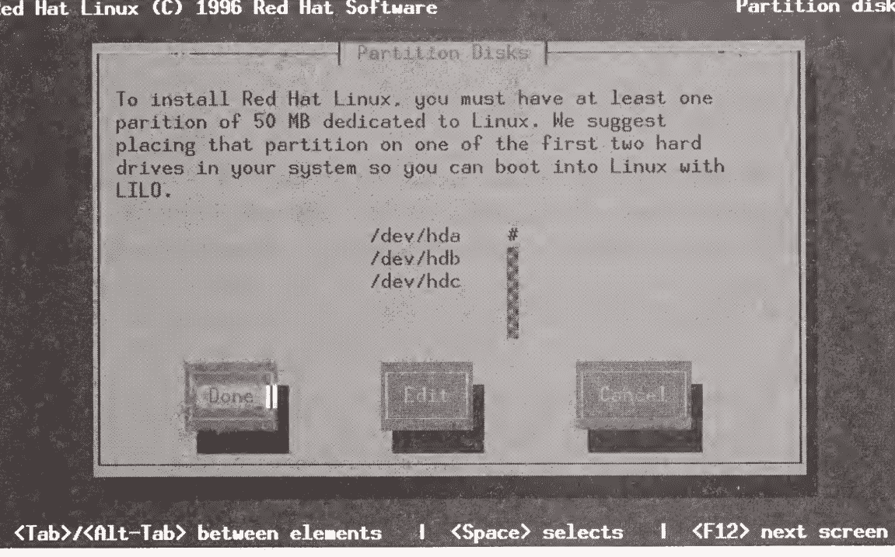

**图 2-1** 分区磁盘菜单

> ALL FIPS 会将你的 MS-DOS 分区分为两部分，一个用于 MS-DOS，一个用于 Linux。Linux 分区需要再次划分为 Linux 文件系统和交换分区（swap partition）。

某些应用程序你可能需要一个更大的 Linux 交换分区。

- 4. 使用 Tab 键进入滚动列表。使用方向键选择你想要分区的磁盘。按回车启动磁盘分区工具。

- 5. 你需要创建一个类型为 82 的分区（Linux swap），包含约 30 到 50MB，以及一个类型为 83 的分区（Linux native），并包含至少 100MB。以下列表显示了一个典型的分区过程：

此磁盘的磁道（cylinders）数设置为 4092。这比 1024 大，可能会导致以下问题：

- 1) 在启动时运行的软件（例如 LILO）

- 2) 从其他操作系统启动并分区软件（例如 DOS DISK，OS/2 DISK）

要做的第一件事是获取帮助。你可以通过 `m` 命令获取帮助。（为什么 `m` 被翻译为 help？某些错综复杂的脑回路将其与 menu 联系在一起。）

```
Command (m for help): m
Command action
  a toggle a bootable flag
  b edit bsd disklabel
  c toggle the dos compatibility flag
  d delete a partition
  l list known partition types
  m print this menu
  n add a new partition
  p print the partition table
  q without saving changes
  t change a partition's system id
  u change display/entry units
  v verify partition table
  w write table to disk and exit
  x extra functionality (experts only)
```

下面的示例显示了为 Linux 对整个磁盘进行分区。交换分区（编号 1）从磁道 1 开始，延伸 200 个磁道。根分区（编号 2）占据磁盘的剩余部分。

你需要为 Linux 交换分区创建一个新分区，因此使用新分区命令：`n`。当你在命令提示符处使用 `n` 时，结果如下：

```
Command (m for help): n
Command action
  e extended
  p primary partition (1-4)
```

程序正在询问你是想要主分区还是扩展分区。你通过输入来定义分区，Linux 需要知道分区号（在本例中，它是第一个分区，即 1）、第一个磁道（在本例中，它是磁盘的开头）以及分区的尺寸（在本例中为 200 个磁道），如下：

```
Partition number (1-4): 1
First cylinder (1-4092): 1
Last cylinder or +size +sizeM or +sizeK ([1-4092]): 200
```

现在在命令提示符处输入 `n`，为 Linux 根创建一个更大的分区（磁盘的剩余部分）。命令及其结果如下：


```
Command (m for help): n

Command action
e extended
p primary partition (1-4)

pPartition number (1-4): 2
First cylinder (1-4092): 201
Last cylinder or +size +sizeM or +sizeK ([1-4092]): 4092
```

此时，你可能想通过输入 `p` 来确认布局。显示如下：

```
Command (m for help): p

Partition number (1-4): 2
First cylinder (1-4092): 201
Last cylinder or +size +sizeM or +sizeK ([1-4092]): 4092

Disk /hd1: 16 heads, 63 sectors, 4092 cylinders
Units = cylinders of 1008 * 512 bytes

| Device | Begin | Start | End | Blocks | Id | System |
|---|---|---|---|---|---|---|
| /dev/hd1 | | 1 | 200 | 10078 | 82 | |
| /dev/hd2 | | 201 | 4092 | 19552 | 83 |
```

分区看起来良好。目前它们都被标识为 Linux native，这意味着你可以在它们上放置 Linux 文件系统。第一个分区需要标记为可启动（bootable）。要进行标记，在命令提示符处输入 `t`。显示如下：

```
Command (m for help): t
Partition number (1-4): 1
```

第二个分区需要标记为可启动。要进行标记，在命令提示符处输入 `a`，如下所示：

```
Command (m for help): a
Partition number (1-4): 2
```

此时，你可能想再次检查分区表。当你输入 `p` 时，程序的响应如下：


```
Command (m for help): p

Disk /dev/hd1: 16 heads, 63 sectors, 4092 cylinders
Units = cylinders of 1008 * 512 bytes

| Device | Begin | Start | End | Blocks | Id | System |
|---|---|---|---|---|---|---|
| /dev/hd1 | | 1 | 204 | 103888 | 82 | |
| /dev/hd2 | | 205 | 4092 | 19936 | 83 |
```

一切正常，因此输入 `w` 写入分区表：

```
Command (m for help): w
```

### 第三阶段：返回安装

此时，分区程序已完成。在间歇之后，是时候返回 Linux 安装程序了，从以下步骤开始：

- 1. 安装程序询问你使用哪个分区作为交换分区。只显示类型 ID 为 82 的分区。选择一个或多个，并继续。初始化交换空间需要几秒钟。
- 2. 接下来是选择根分区。这是所有软件存放的地方。根分区必须是 ID 代码为 83 的分区。选择一个，并继续。
- 3. Linux 现在扫描其他分区并允许你挂载它们。分区磁盘屏幕如图 2-2 所示。

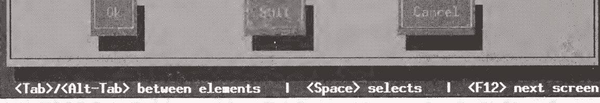

图 2-2 准备挂载分区
- 4. 当你完成分区后，选择 OK 继续。
- 5. 下一个屏幕将为你提供格式化任何 Linux 分区的机会。你应该对任何新创建的分区进行格式化。请注意，格式化会破坏分区上的任何现有数据。（你已经备份了系统，对吧？）

### 第四阶段：安装软件

现在你已经到了选择要安装的软件包的步骤。请按照以下步骤操作：

- 1. 使用你在第 1 章中创建的清单来选择要安装的软件包。
- 2. 去喝杯咖啡吧。Linux 需要一些时间来格式化磁盘并安装所选软件。

### 第五阶段：配置 Linux

软件安装完成后，将开始配置问题。请准备好回答许多问题。只需遵循以下步骤：

- 1. 第一个问题关于你的鼠标：Linux 要求你选择你使用的鼠标类型。

如果你有一个双键鼠标，可以通过同时点击两个按钮来模拟第三个按钮。如果你需要此功能，请勾选“模拟3个按钮”复选框。
- 2. 接下来，系统会询问鼠标端口。为你的系统选择正确的端口。
- 3. 鼠标信息之后是显卡和 X 服务器。如果你不知道使用的是哪种显卡，请选择“取消”并跳过 X 服务器的配置。安装和配置 X Window 系统将在第 16 章详细讨论。
- 4. 下一个问题询问你显卡上的显存大小。如果你不知道自己的配置，请选择一个较小的数字（例如 512）。你稍可以修改此设置。
- 5. 接下来，Linux 想要知道你想使用哪些视频模式。通常，X Windows 为每像素 8 位。在 X Window 系统运行时，你可以在不同分辨率之间切换。然而，如果你想要每像素更多的位数，你必须退出 X Window 并使用新选项启动它。

此屏幕允许你决定想要哪些分辨率。取决于每像素的位数，可以有不同的分辨率。

> 我建议对每一列每像素位数都使用可用的最高分辨率。
- 6. 如果你的系统包含网卡，你需要配置网络。此配置从选择网卡开始。
- 7. 接下来是 TCP/IP 网络信息。你的网络管理员可以提供这些值。

如果你在孤立网络上安装 Linux，可以使用网络号 10.0.0.1 作为第一个系统的地址，10.0.0.2 作为第二个，以此此类推。这些数字是不连接到互联网的私有网络的网络地址。

如果你计划使用电话线连接到互联网，请确保将“默认网关”设置留空。安装程序会尝试填入一个默认值，因此你必须删掉程序猜测的数值。
- 8. 接下来，你会被询问域名和主机名。如果你在自己的网络上安装，可以选择任何名称。如果你安装在现有网络中，请联系你的网络管理员获取名称。
- 9. Linux 需要知道本地时区。此信息非常重要，因为 Linux 设计用于在互联网上运行，并需要知道如何将本地时间转换为互联网 GMT。
- 10. 接下来是打印机配置。如果你有打印机，你可能想在这里安装它。

> 注意：你只能安装并行打印机。（安装串口打印机需要专家。）
- 11. 如果你选择添加打印机，系统现在会询问你是否有本地远程打印机。本地打印机物理连接到你的系统。远程打印机连接到另一台运行 Linux 或 UNIX 的机器。
- 12. 你需要为打印机起一个名称。默认打印机名称为 `lp1`，你可能至少想要一个该名称的打印机。如果你用竖线分隔它们，可以指定多个名称，例如 `lp|laser5`。（竖线也称为管道符字符。）
- 13. Linux 需要知道你的打印机连接到哪个端口。以下是打印机端口的 Linux 名称以及它们熟悉的 MS-DOS 名称：

| Linux 名称 | MS-DOS 名称 |
| :--- | :--- |
| `/dev/lp0` | LPT1 |
| `/dev/lp1` | LPT2 |
| `/dev/lp2` | LPT3 |
- 14. 接下来是打印机类型。安装程序向你列出打印机类型列表；选择适合你打印机的类型。此屏幕还可能包含“修复阶梯式”（Fix Stair stepping）选项。勾选此框可以修复在打印 UNIX 风格文本文件时可能出现的行尾问题。

如果你不设置此选项，你的文本打印可能会像这样。
- 15. 你现在已完成打印机配置。你可以安装另一台打印机或继续安装。
- 16. 选择 root 密码。选择一个不容易猜的密码至关重要。（参考侧边提示“选择密码”。）
- 17. 下一个屏幕允许你选择是否使用 Linux 引导程序 (`LILO`)。如果你想使用 `LILO` 从硬盘启动，请选择 `/dev/hda`。否则，在磁盘上安装 `LILO`。
- 18. `LILO` 可以从硬盘启动。下一个屏幕允许你选择哪些操作系统。
- 19. 你的配置已完成。`LILO` 已准备好重启。

### 选择密码

密码的一个问题是它很容易猜。创建密码的一种方法是从字典中挑选单词，并用数字或其他字符分隔。你可以通过改变单词的大小写来使密码更安全。

密码选择规则：

- 1. 密码长度至少为六个字符，且不能包含连续的字符，或按字母顺序正反排列的字符序列。例如：`HGXXXP` 是无效的。`GFEDCB` 是无效的。
- 2. 密码不能与之前的密码在相同位置包含两个字母。例如：如果之前的密码是 `GKPWTZ`，那么 `NRPWHS` 就是无效的，因为 `PW` 在相同位置出现。
- 3. 密码不能包含月份名称或月份缩写。例如：`MARCHBC` 是无效的。`VMARC` 是无效的。
- 4. 密码不能包含月份的数字表示。因此，除零以外的任何数字密码都是无效的：`WKB33G` 是无效的，因为它包含了三月的数字表示。
- 5. 密码不能包含任何语言的单词。因此，密码不能包含 A、o、I 或序列 AT、ME、TO 等单词。
- 6. 密码不能包含在键盘上水平、垂直或对角线相邻的两个字符序列。例如：`QWERTY` 是无效的。`GHLNT` 是无效的，因为 `G` 和 `H` 水平相邻。`HUKWVM` 是无效的，因为 `H` 和 `U` 对角线相邻。
- 7. 密码不能包含人物、地点或物品名称。例如：`JOHNBOY` 是无效的。

由于密码选择规则复杂，实际上只有一个密码可以通过所有测试。为了方便用户选择此密码，它将分发给所有主管。所有用户被指示从其主管处获取此密码并立即开始使用。

### 在网络上安装 Linux

你可以通过网络从一台计算机安装 Linux 到另一台。首先使用随书附带的光盘在服务器上安装 Linux。你可以使用磁盘和网络安装客户端。

### 制作 Linux 软磁盘

客户端安装需要两张软磁盘。第一张软磁盘包含操作系统的副本，第二张包含一个初始文件系统，该系统会在安装过程中被读入内存。

使用 MS-DOS 工具 `REWRITE` 将软磁盘镜像从 CD-ROM 复制到软磁盘。

要创建安装软磁盘，请按照以下步骤操作：

- 1. 进入包含 MS-DOS 工具的目录。（本示例使用下命令行中的 F 盘和 `DOSUTIL` 目录。如果您的驱动器不同，请替换为正确的驱动器和目录。）在 DOS 提示符下，切换到 F 盘或包含 CD-ROM 的驱动器。

```
F:\> CD \DOSUTILS
```
- 2. 将一张 3.5 英寸软磁盘插入 A 驱动器。
- 3. 按照如下创建启动软磁盘：

```
F:\DOSUTILS > REWRITE
Enter disk image source file name: \IMAGES\BOOT.IMG
ter target diskette drive: A
Please insert a formatted diskette into drive A: and press
-ENTER- :
复制过程大约需要 30 秒。
```
- 4. 当出现 MS-DOS 提示符时，取出软磁盘，对其设置写保护并标记为“Red Hat 4.2 BOOT”。
- 5. 将一张 3.5 英寸软磁盘插入 A 驱动器。
- 6. 按照如下创建补充软磁盘：


```
F:\>DOSUTILS > REWRITE
Enter disk image source file name: \IMAGES\SUPP.IMG
Enter target diskette drive: A
Please insert a formatted diskette into drive A: and press
-ENTER- :
复制过程大约需要 30 秒。
```

- 7. 当出现 MS-DOS 提示符时，取出软磁盘，对其设置写保护并标记为“Red Hat 4.2 SUPP”。


### 准备网络安装

你需要一个运行 Linux 带有 CD-ROM 驱动器的系统。将 CD-ROM 放入驱动器，确保它已挂载（见第 5 章）并且它位于 NFS 导出的分区上（见第 10 章）。

### 执行网络安装

现在是时候网络上安装 Linux 了。只需按照以下步骤操作：

- 1. 从本章节之前创建的 BOOT 磁盘启动。

- 2. 加载操作系统后，Linux 会向你索要 SUPP 磁盘。将其插入 A 驱动器并按 Enter。

从现在开始，将接管正常的安装过程。

## Bonus

### 你想要更多软件吗？

随书附的 CD-ROM 包含更多 Linux 软件。尽管它包含了最流行的软件包，但你可能需要不同的、更专业的工具。那时你该怎么办？

你可以查看互联网，这就是你所做的。许多程序以 Red Hat 包管理 (`RPM`) 格式分发。这使得它们安装方便快捷。

Red Hat 维护了一份非常有用的贡献包列表。你可以在以下 Web 地址找到它：

```
http://www.redhat.com/linux-info/pkglist/contrib_i386/
```

其他地方还有更多软件。主 Linux 仓库位于以下 Web 地址：

```
http://sunsite.unc.edu/pub/Linux
```

如果你知道自己在找什么，这个地址是寻找软件的好去处。

如果你不知道自己在找什么，你可以在以下地址找到包含所有 Linux 软件包描述的可搜索索引：

http://www.ssc.com/linux/resources/apps.html

Linux 的持续增长依赖于共享，有很多很棒的工具帮助你发现和共享 Linux 程序。

## 总结

安装曾是 Linux 的主要弱点之一。但多亏 Red Hat 人员以及其他人的努力，Linux 的安装过程得到了极大改进。诚然，它并不像“输入 setup 然后去喝咖啡”那么简单，但考虑到软件的复杂性和丰富性，Linux 的安装过程做得非常出色。

# 第三章

## 首次使用

在本章中，你将学习以下技能

- 首次登录 47

- 使用虚拟终端 48

- 正常关机 48

- 简单配置 48

- 窗口中导航 48

- 退出窗口 53

- 配置窗口 54


### 首次登录

在开始之前，先给出一个警告：错误配置此软件可能会损坏你的硬件。将显卡配置为错误的频率驱动显示器可能会导致损坏。换句话说，如果你不小心，可能会烧毁你的显示器。

本章描述的程序旨在最大限度地减少损坏的可能性。

- 1. 执行以下命令：

```
[root] /:
```

### 配置 X Window

PC 有各种不同的显卡和显示器。你必须配置 X Window 以与你的显示器正常工作。

本节介绍了易于配置的 X Window 系统。遗憾的是，“易”并不总是奏效。如果不起作用，你可以将显卡更换为 Linux 支持的型号。在本章中，请假设 `Xconfigurator` 程序可以工作。

### 理解虚拟终端

X Window 允许你在系统运行时切换模式。热切换意味着你可以在 X Window 系统运行期间更改视频分辨率。然而，它并不能让你切换到不同数量的色彩。

### 关闭 Linux

为了避免损坏文件系统，你必须正常关闭 Linux。

- 1. 发布以下命令：

```
[root] /:halt
```

- 2. 你也可以通过登录并输入以下命令来重启计算机：

```
[root] /:reboot
```

### 使用简单方法

这是配置你的 X Window 系统最简单的方法。对于 90% 的可用系统，这种方法都是有效的。对于剩下的 10% 的系统，解决该问题的高级方法将在后文中介绍。

### 测试 X

在启动你的 X Window 系统之前，请仔细阅读本节所有内容。

要测试你的 X Window 的配置，请按照以下步骤操作：

- 1. 使用以下命令启动 X Window 系统：

```bash
[root@pc /root]# startx
```

2. 如果屏幕立即出现异常，按 `Ctrl+Alt+Backspace` 终止 X Window。如果无效，请立即按下计算机上的重置（`reset`）按钮，或关闭电源。未能立即执行此操作可能会导致你的显示器损坏。

3. 按 `Ctrl+Alt+数字键盘加号 (+)` 在不同的视频模式之间切换。如果其中一种模式不起作用，请按 `Ctrl+Alt+Backspace` 立即终止 X 服务。

如果一切运行正常，说明你已完成。请进入下一节。

### 如果初次尝试失败了 . . .

下一步是尝试使用更保守的设置再次运行 `Xconfiguration` 命令。尝试创建一个最低可用视频分辨率（`640x480`）的配置。如果无效，请尝试选择另一块卡。如果别无选择，你始终可以选择 Generic VGA 显。这应该适用于几乎所有设备。

如果任何方法都无效，请考虑将你的显卡更换为更支持 Linux 的显卡。你可以在以下网站找到列表：http://sunsite.unc.edu/LDP/HOWTO/Hardware-HOWTO.html

最后，还有其他更原始的工具可以创建 X Window 配置文件。作为最后的手段，你可以编写自己的配置文件。你可以在第 16 章中找到高级 X Window 配置的说明。

### 启动 X Window

`startx` 命令会启动 X Window 系统。如果你以 root 身份登录，几分钟后会出现一个类似于图 3-1 所示的初始屏幕。

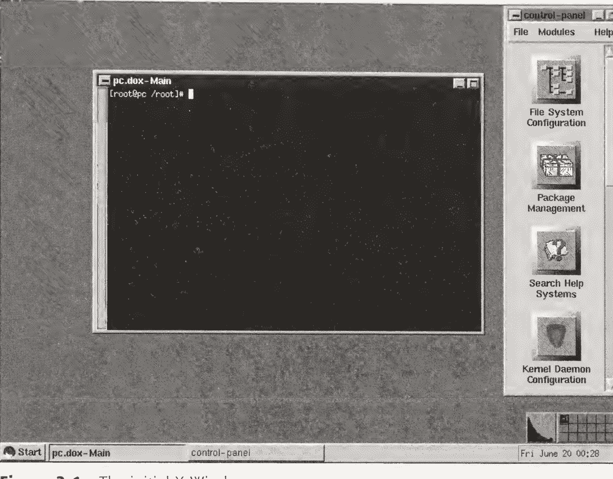

左上角有两个终端窗口。右侧是红帽控制面板。控制面板可以帮助你执行常见的系统管理任务，例如安装软件包（包管理）和查找帮助（搜索帮助系统）。第 5 章将详细讨论控制面板。

控制面板的下方是一个小的灰色正方形，显示当前平均负载的图表。平均负载是衡量系统使用程度的指标。该图表右侧的网格是分页器模块，它将在本章的下一节中被“诅咒”。

最后，底部是一个带有熟悉的“开始”（Start）按钮的任务栏。熟悉 Windows 95 的人应该觉得这个“开始”按钮很熟悉。

> 对于那些认为 Motif 非常棒且认为任何像 Windows 95 的东西都是倒退的真实 UNIX 黑客来说，第 16 章将向你展示如何将这种怪物替换为更像 UNIX 的东西。

### 页面、屏幕和虚拟屏幕

Window 是一个极其强大且灵活的系统。它拥有 Windows 95 无法梦想的功能。然而，有时所有这些功能往往互相干扰并导致混淆。

屏幕你在显示器上看到的内容。虚拟屏幕是程序绘制窗口的地方。虚拟屏幕的大小可以比屏幕大。屏幕和虚拟屏幕的大小都由你的 X 配置文件控制。

假设你以 `800x600` 的分辨率运行屏幕，由于两个屏幕的大小相同，所以没有异常。但现在你想使用较低的分辨率，因此按下 `Ctrl+Alt+数字键盘减号 (-)` 并切换到 `640x480`。

现在你的屏幕是 `640x480`，而你的虚拟屏幕是 `800x600`。你的程序认为屏幕是 `800x600`。你只看到 `640x480`。如果你的视口（你看到的虚拟屏幕部分）位于虚拟屏幕的顶部，你可能看不到屏幕底部的内容（例如任务栏）。这种情况如图 3-2 所示。

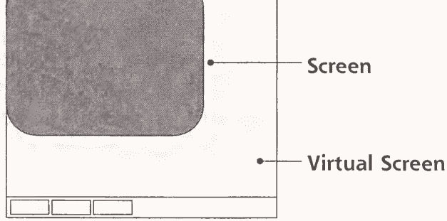

**图 3-2** 实际虚拟屏幕

如果你尝试将光标移动到屏幕底部，X Window 会将屏幕向下滚动到虚拟屏幕的底部。通过将光标移出上、下、左或右边缘，你可以让屏幕在虚拟屏幕上移动。

X Window 使用显卡上的额外内存来保存虚拟屏幕数据，速度极快。

现在牌牌中加入了一个新王牌：页面（Pages）是 X Window 创建的额外虚拟屏幕。分页器（屏幕右下角的网格）控制当前显示哪个页面。首次启动时，X Window 使用左上角的页面。点击分页器中的任何其他方格都会切换到一个新的虚拟屏幕。你使用计算机内存在页面之间切换，这仅仅是速度快（与虚拟屏幕极快的滚动相比）。

此外，如果你在 X Window 初始化文件中设置了适当的选项，你可以通过将光标移出虚拟屏幕从一个页面滚动到另一个页面。

这意味着通过屏幕、虚拟屏幕和页面，你可以将光标移出屏幕左侧并滚动虚拟屏幕，直到碰到虚拟屏幕的边缘。在此时（如果你启用了该选项），你开始让虚拟屏幕在页面之间移动。


假设你以 `800x600` 的分辨率运行屏幕，由于两个屏幕的大小相同，所以没有异常。但现在你想使用较低的分辨率，因此按下 `Ctrl+Alt+数字键盘减号 (-)` 并切换到 `640x480`。

现在你的屏幕是 `640x480`，而你的虚拟屏幕是 `800x600`。你的程序认为屏幕是 `800x600`。你只看到 `640x480`。如果你的视口（你看到的虚拟屏幕部分）位于虚拟屏幕的顶部，你可能看不到屏幕底部的内容（例如任务栏）。这种情况如图 3-2。

这意味着通过屏幕、虚拟屏幕和页面，你可以将光标移出屏幕左侧并滚动虚拟屏幕，直到碰到虚拟屏幕的边缘。在此时（如果你启用了该选项），你开始让虚拟屏幕在页面之间移动。

此外，如果你在 `X Window` 初始化文件中设置了适当的选项，你可以通过将光标移出虚拟屏幕从一个页面滚动到另一个页面。


**图 3-2** 实际虚拟屏幕

如果你尝试将光标移动到屏幕底部，`X Window` 会将屏幕向下滚动到虚拟屏幕的底部。通过将光标移出上、下、左或右边缘，你可以让屏幕在虚拟屏幕上移动。

`X Window` 使用显卡上的额外内存来保存虚拟屏幕数据，速度极快。

现在牌牌中加入了一个新王牌：页面（Pages）是 `X Window` 创建的额外虚拟屏幕。分页器（屏幕右下角的网格）控制当前显示哪个页面。首次启动时，`X Window` 使用左上角的页面。点击分页器中的任何其他方格都会切换到一个新的虚拟屏幕。你使用计算机内存在页面之间切换，这仅仅是速度快（与虚拟屏幕极快的滚动相比）。

### 在屏幕周围导航

要在窗口中输入，只需将光标移入窗口。要将窗口置到顶部，点击它的名称。绘制窗口角落可以调整其大小。

窗口顶部的按钮执行各种功能。图 3-3 显示了各种：

| 窗口菜单 最小化 最大化 |

| | pc |

| | Root |


图 3-3 窗口按钮

表 3-1 包含每个按钮的短描述。

### 表 3-1 使用窗口

| 按钮 | 描述 |
| --- | --- |
| 窗口菜单 | 显示窗口特定选项菜单 |
| 最小化 | 将窗口变为图标 |
| 最大化 | 扩展窗口以填充可用空间 |

## 关闭 X Window 系统

要关闭 `X Window` 系统，请按照以下步骤操作：

- 1. 点击“开始”按钮。
- 2. 选择 开始 -> 退出 -> 确实退出。

这将返回 shell 提示符。

## 奖励

针对新手

如果你是 Linux 新手，可以通过以下网址访问“Unix 提示”网页获取一些帮助：

```
http://andrew.triumf.ca/pub/linux/unix_tips.html
```

## 总结

本章提供了足够入门 Linux 的信息。然而，在 Linux 系统完全功能之前，你还有许多工作要做。在接下来的章节中，你将学习如何配置和自定义你的系统，以充分利用其潜力和力量。

表 4-1 列出了各种 Linux 文档文件的常见扩展名。在本章的后续部分，将对查看和打印这些文档的命令进行更详细的讨论。

## 表 4-1 常见文档文件扩展名及读取命令

| 扩展名 | 命令 |
|---|---|
| `.txt` | `more`, `less` |
| `.1,.2,.3,.4,.5,.6,.7,.8` | `man` |
| `.info` | `info` |
| `.html` | `arena`, `netscape` |
| `.dvi` | `dvired` |
| `.tex` | `tex`, `dvivired` |
| `.texi` | `makeinfo`, `info` |
| `.ps` | `gs` (GhostScript), `gv` |
| `.rpm` | `rpm` |
| `.gz` | `gunzip`, `zcat` |

## 在哪里查找文档

linux 将文档存放在许多地方；但许多位置是标准的。以下位置的列表可以作为您阅读后续章节并学习如何查看文档时的快速参考指南：

- `/usr/doc`
- `/usr/info`
- `/usr/man`
- `/mnt/cdrom/docs`
- `/mnt/cdrom/docs/untared`

## 使用 Linux 文档

linux 自带大量的在线文档。问题在于标准格式——有几十种。本章将告诉您如何查找、查看和打印在线文档，无论它是什么格式。

## 文档格式

当 UNIX 首次出现时，在线文档由“man”或“manual”页组成。这种方法在 20 年前是先进的，但今天有些局限性。尽管如此，大量的 Linux 文档仍然以 man 页面格式存在。


自由软件基金认为页面格式太局限，因此人们发明了自己的格式：`texinfo`。这种格式的文档可以转换为超文本信息文件，也可以打印成文档文件。

Linux 的标准文本处理器之一是 `TeX`（读作“tech”）。它接受一个包含单词和排版命令的文本文件，并产生排版后的输出。用户可以在屏幕上查看此输出，或将其发送到打印机。

最后，许多文件存储为 PostScript 文件。你可以使用 `gv` 软件包（后文将讨论）在 Window 窗口下查看这些文件，或在 PostScript 打印机上打印它们。（如果你没有 PostScript 打印机，不用担心，Red Hat 系统自带了可以将 PostScript 转换为你可以使用的内容的打印机。）


# RPM 系统

Red Hat Linux 发行版的优势之一是 Red Hat 软件包管理系统。软件包是一组被一起安装、卸载或删除的程序和文件。Red Hat 软件包还包含一些关于软件包本身的非常短的文档。本章将解释如何使用 `RPM` 系统来获取软件信息。

# 查找文件

文档存储在许多地方。事实上，查找文件有时就占战斗的一半。你可以使用 `find` 命令来定位包含特定单词或字符串的文件。

# 软件说明

本章涵盖了查看和打印文档的所有方法。这些方法中的几种方法需要特定的软件，而这些软件可能没有安装或配置。例如，许多文档仅在 X Window 系统下工作。

`X-REF` 特定软件软件包的安装和配置将在后面的章节中介绍。X Window 的配置见第 16 章，特定软件软件包的安装将在第 5 章中描述。尽管如此，本章提供的信息已足够让入门，在您设置好额外软件后，可以返回这里获取更多关于如何阅读文档的想法。

# 文档目录

你可以在任何地方找到文档，但大多数 Linux 软件包使用以下几个标准目录：

| 目录 | 描述 |
| --- | --- |
| `/usr/doc` | 文本文档和其他格式 |
| `/usr/info` | GNU 信息 |
| `/usr/man` | 帮助页面 |
| `/src` | 源码文档 |
| `/mnt/cdrom/docs` | 光盘中的文档 |
| `/mnt/cdrom/docs/untared` | 解压后的文档 |
| `/var` | 软件包日志 |

# 表 4-1 常见文档文件扩展名及读取命令

| 扩展名 | 命令 |
|---|---|
| `.txt` | `more`, `less` |
| `.1,.2,.3,.4,.5,.6,.7,.8` | `man` |
| `.info` | `info` |
| `.html` | `arena`, `netscape` |
| `.dvi` | `dvired` |
| `.tex` | `tex`, `dvivired` |
| `.texi` | `makeinfo`, `info` |
| `.ps` | `gs` (GhostScript), `gv` |
| `.rpm` | `rpm` |
| `.gz` | `gunzip`, `zcat` |

## 在哪里查找文档

Linux 将文档存放在许多地方；但许多位置是标准的。以下位置的列表可以作为您阅读后续章节并学习如何查看文档时的快速参考指南：

- `/usr/doc`
- `/usr/info`
- `/usr/man`
- `/mnt/cdrom/docs`
- `/mnt/cdrom/docs/untared`

## 使用 Linux 文档

Linux 自带大量的在线文档。问题在于标准格式——有几十种。本章将告诉您如何查找、查看和打印在线文档，无论它是什么格式。

## 文档格式

当 UNIX 首次出现时，在线文档由“man”或“manual”页组成。这种方法在 20 年前是先进的，但今天有些局限性。尽管如此，大量的 Linux 文档仍然以 man 页面格式存在。

自由软件基金认为页面格式太局限，因此人们发明了自己的格式：`texinfo`。这种格式的文档可以转换为超文本信息文件，也可以打印成文档文件。

Linux 的标准文本处理器之一是 `TeX`（读作“tech”）。它接受一个包含单词和排版命令的文本文件，并产生排版后的输出。用户可以在屏幕上查看此输出，或将其发送到打印机。

最后，许多文件存储为 PostScript 文件。你可以使用 `gv` 软件包（后文将讨论）在 Window 窗口下查看这些文件，或在 PostScript 打印机上打印它们。（如果你没有 PostScript 打印机，不用担心，Red Hat 系统自带了可以将 PostScript 转换为你可以使用的内容的打印机。）

同一命令更精炼的版本如下：

```
[user@pc user]$ man section subject
```

例如，要查看关于 `cp`（复制）命令的信息，你输入以下命令：

```
[user@pc user]$ man cp
```

`CP(1)`

`NAME`

`cp` - 复制文件

`SYNOPSIS`


```
cp [options] source dest
cp [options] source... directory
Options:
[-abdfilprsuvxPR] [-S backup-suffix]
[-V (numbered, existing,simple)] [--dereference]
[--no-dereference] [--force] [--interactive]
[--one-file-system] [--preserve] [--recursive]
[--update] [--verbose] [--suffix=backup-suffix]
[--version-control=numbered,existing,simple]
[--archive] [--parents] [--link]
[--symbolic-link] [--help] [--version]
```

# DESCRIPTION

此文档不再维护，内容可能不准确或不。Texinfo 文档是

Linux 版本的 `man` 命令使用一个名为 `less` 的增强型分页程序。该程序比典型 UNIX 系统自带的传统 `more` 命令多许多功能。要查看命令列表，请在提示符处输入 `h`。

如果你不知道想要执行什么命令，可以通过输入以下命令进行关键词搜索：

```
[user@pc user]$ man -k keyword
```

此命令在数据库中搜索指定的命令。然而，有一个问题：该数据库每周构建一次。如果你刚刚安装了 Linux，数据尚未可用。你可以通过执行 root 命令手动创建它，如下所示：

```
[root@pc root]$ /usr/sbin/makewhatis
```

## 使用 X Window 查看 man 页

`xman` 命令在 X 窗口中显示 man 页（见图 4-1）。它比传统的 `man` 命令提供了一些额外功能，但并不多。

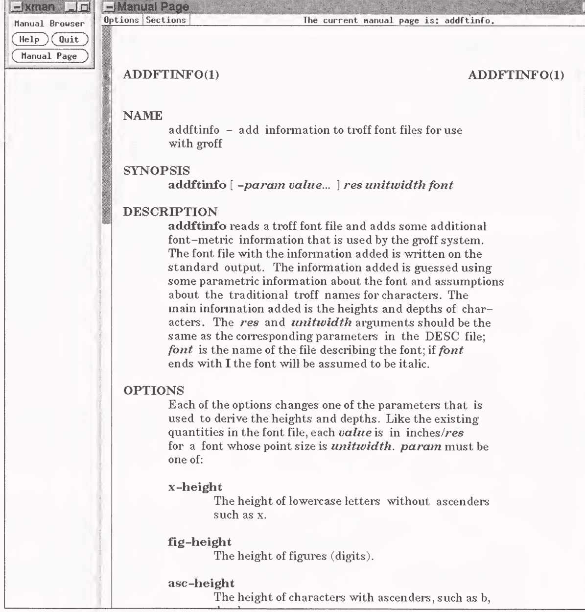

图 4-1 使用 xman 显示 man 页

## 将 man 页打印为文本

如果你想在文本文打印机上打印 man 页，请使用以下命令：

```
[user@pc user]$ man command | ul -tlp | lpr
```

`man` 命令对格式进行格式化。`ul -tlp` 命令将下划线和粗体格式代码转换为打印机可以理解的形式，而 `lpr` 命令将结果打印到名为 `lpr` 的行打印机。

此命令的输出非常糟糕。它使用了丑陋的等宽 Courier 字体，而且分页永远是不正确的。

## 将 man 页打印为 PostScript

要将 man 页转换为 PostScript，你需要首先找到原始 man 页。man 页安装在以下目录：

- `/usr/man/man<>`
- `/usr/man/X11/man<>`

在这些目录中，`<>` 是章节号。例如，你可以在 `/usr/man/man1/lpr.1` 找到 `lpr` 的 man 页。要打印它，使用以下命令：

```
[user@pc user]$ groff -man /usr/man/man1/lpr.1 | lpr
```

`groff` 命令格式化 `lpr.1` 文件中的文本。`-man` 选项切换 `groff` 使用的宏程序包。`lpr` 命令将输出发送到能够打印 PostScript 的打印机。

## GNU "info" 页

自由软件基金（GNU 社区）以 info 格式分发他们的在线文档。要使用它，只需使用以下命令：

```
[user@pc user]$ info
```

此命令会弹出一个类似超文本的界面。你可以使用空格键向下分页。Tab 键将光标移动到下一个超文本链接。这些链接没有高亮显示，可能很难发现。当光标位于链接上时，按回车键将跳转到链接指向的节点。

该界面包含大量用于移动的命令。如需获取完整的命令列表，请按 Ctrl+H。

信息安装在 `/usr/info` 目录下。文件以 `.info` 或 `.info.gz` 扩展名结尾。你可以使用以下命令直接进入信息文件：

```
[user@pc user]$ info subject
```

如果你想查看位于另一个目录的 info 文件，必须使用 `-f` 选项指定文件。例如，查看 Linux SGML 指南，输入此命令：

```
[user@pc user]$ info -f /usr/doc/linuxdoc-sgml1-1.5-6/guide.info
```

## PostScript 文件

`.ps` 扩展通常表示 PostScript 文件。你可以使用 `lpr` 命令打印这些文件，如下：

```
[user@pc user]$ lpr /usr/doc/lilo-0.19-1/doc/User_Guide
```

> 注意：如果你没有 PostScript 打印机，不要担心。Linux 使用一个名为 GhostScript 的程序自动转换文件，以便它们可以在你的打印机上打印。

你可以使用 `gv` 命令在 X Window 显示器上直接查看 PostScript 文件（见图 4-2）。该命令是 GhostScript 的前端，使查看 PostScript 变得简单。它只需要一个参数，即 PostScript 的文件名。

# 快速上手

本章总结了如何安装或升级 Red Hat Linux/Intel。本章节适用于具有安装 Linux 经验的用户。如果本章没有提供足够的信息，请阅读第 2 章“安装 Red Hat Linux”。

## 1.1 Red Hat Linux 错误列表

## 1.2 获取 Red Hat Linux

## 1.3 制作软盘

## 1.5 从之前的版本升级

## 1.6 为什么我不能直接从 CD 运行？

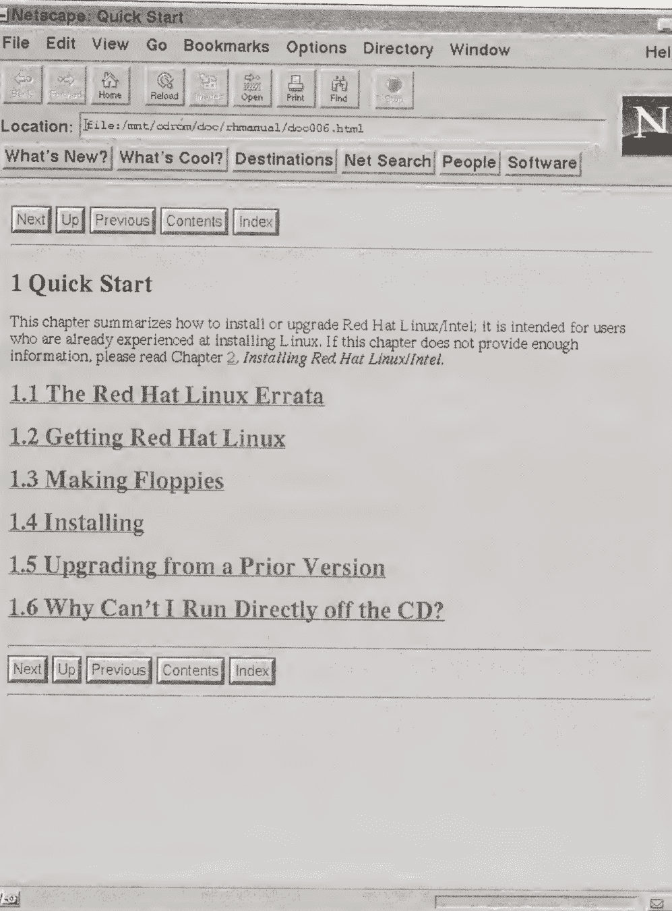

**图 4-4** 使用 Netscape Navigator 查看 HTML 文件

## TeX 和 .dvi 文件

TeX 是由 Donald E. Knuth 创建的一种排版语言。它是自由软件基金信徒者喜爱的语言。事实上，自由软件基金已将其采纳为其标准排版语言。通常，TeX 接受单个 `.tex` 文件作为输入并产生与设备无关的排版（扩展名为 `.dvi`）。例如，以下命令会生成 `paper.dvi` 文件：

```
[user@pc user]$ tex paper.tex
```

有时你必须运行两次 `tex`，特别是在生成目录时。第一次运行设置页码，第二次运行排版文档。

某些文档以 `.dvi` 文件和 `.tex` 文件的形式发行。你可以使用 `divype` 命令查看 `.dvi` 文件，如下：

```
[user@pc user]$ dvype paper.dvi
```

输出看起来有点丑。`xdvi` 命令在 Window（可能是 Windows）下运行，提供了更好的查看效果。它使用以下语法：

```
[user@pc user]$ xdvi paper.dvi
```

最后，你可以使用 `dvips` 命令将 `.dvi` 文件转换为 PostScript，如下所示：

```
[user@pc user]$ dvips -D600 -t letter -o paper.ps paper.dvi
```

在该命令中，`-D600` `dvips` 为 600 dpi 打印机排版输出。`-t letter` 选项选择纸张大小。使用 `-o paper.ps` 选项选择输出。输入是：`paper.dvi`。你可以通过上述讨论的命令打印或查看 PostScript 文件。

## Texinfo

GNU 人们以“texinfo”格式发行他们的大部分文档。这些文件以 `.texi` 结尾。你可以通过 TeX 排版这些文件，或使用 `makeinfo` 命令将它们转换为 `.info` 文件。

`makeinfo` 命令将 `.texi` 文件转换为 `.info` 文件。通常，你不需要运行此命令，因为所有在线文档已经处理过了。但如果你需要创建一个 `.info` 文件，只需使用以下命令：

```
[user@pc user]$ makeinfo filename
```

要排版 `.texi` 文件，你需要 `texinfo.tex` 宏包。该文件必须与你的 `texinfo` 文件位于同一目录中。获取此文件后，你可以使用普通的 Tex 命令排版该文件。

## Red Hat 软件包

Red Hat 发行版的最大优势之一是它的软件包系统。正如你所记得的，软件包是一组整体安装或删除的文件。Red Hat 软件包系统提供了丰富的命令来处理软件包的安装、删除、升级和构建。

RPM 软件包系统包含许多选项，但本节重点关注提供信息的选项。

## 这个包是什么的？

RPM 软件包位于 `/mnt/cdrom/RedHat/RPMS` 目录。要找出一个包的作用，请使用命令 `rpm -q -i -p <filename>`。例如，要查看 `xtrojka-1.2.2-2.i1386.rpm` 包文件的内容，使用以下命令：


```
[user@pc user]$ rpm -q -i -p xtrojka-1.2.2-2.i1386.rpm
Name : xtrojka             Distribution: Red Hat Linux Vanderbilt
Version : 1.2.2             Vendor: Red Hat Software
Release : 2                Build Date: Wed Nov 20 15:43:25 1996
Install date: (none)       Build Host: porky.redhat.com
Group : X11/Games/Video Source RPM: xtrojka-1.2.2-2.src.rpm
Size : 192461
Summary : falling blocks game
Description :
```

与 xjels 或俄罗斯方块类似，这个游戏向你提出了保持游戏区域不被掉落方块占据的挑战。

## 包中有哪些文件？

要找出构成软件包的文件，请使用以下命令：

```
[user@pc user]$ rpm -q -l -p filename
```

例如，要找出 xxdb 包的内容，发布此处所示的命令。以下显示了命令及其结果：

```
[user@pc user]$ rpm -q -l -p xxdb-1.12.1-i1386.rpm
/usr/X11R6/bin/xxdb
/usr/X11R6/lib/X11/app-defaults/XDbx
/usr/X11R6/man/man/xxdb.1
```

## 这个文件从哪里来？

RPM 系统维护了一个文件及其所属软件包的数据库。（亲爱的，卸载它们会更好）。你可以使用这个数据库来找出某个文件属于哪个包。例如，在我刚刚安装完系统后，我发现了 `/etc/drums.3` 文件。现在我非常熟悉许多不同的 UNIX 系统，但它们没有任何一个有 drums 文件。那么这是干什么用的呢？

以下命令告诉你一个文件属于哪个包：

```
[user@pc user$] rpm -q -f filename
```

所以，为了找出我的鼓文件来自哪里，我执行了如下命令：

```
[user@pc user$] rpm -q -f /etc/drums.03
```

命令结果如下：

`playmidi-2.3-7`

那么 `playmidi` 是干什么用的？我可以通过以下命令找到该信息，结果所示：

```
[user@pc user$] rpm -q -i playmidi-2.3-7.1386.rpm
```

| Name | playmidi | Distribution: Red Hat Linux Vanderbilt |
| :--- | :--- | :--- |
| Version | 1.2.2 | Vendor: Red Hat Software |
| Release | 2 | Build Date: Wed Nov 20 15:43:25 1996 |
| Install date: (none) | Build Host: porky.redhat.com |
| Group | X11/Games/Video | Source RPM: xtrojka-1.2.2-2.src.rpm |
| Size | 192461 | |
| Summary | falling blocks game | |
| Description | | |

等等，表格的输入文本是碎片化的。让我们根据内容重新对齐：

| Name | playmidi | Distribution: Red Hat Linux Vanderbilt |
| :--- | :--- | :--- |
| Version | 1.2.2 | Vendor: Red Hat Software |
| Release | 2 | Build Date: Wed Nov 20 15:43:25 1996 |
| Install date | (none) | Build Host: porky.redhat.com |
| Group | X11/Games/Video | Source RPM: xtrojka-1.2.2-2.src.rpm |
| Size | 192461 | |
| Summary | falling blocks game | |
| Description | | |

```
+ chown -R root 
+ chgrp -R root 
+ chmod -R a+rx,g-w,o-w 
+ exit 0
```

现在源代码已经是可读的形式了。你可以在 `/usr/src/redhat` 目录下找到它们。进入该目录，我们现在可以通过执行以下命令查看源码：

```
[root@pc SPECS]# cd /usr/src/redhat/BUILD/spider
```

## 额外内容

## 保持更新

Linux 正在不断变化。尽管你拥有 CD-ROM，但即使是最新版本，这也意味着你的信息已经稍微过时了。尽管如此，这并不意味着它是坏事。在 95% 的情况下，你不需要书中提供的之外任何额外内容。然而，对于那 5% 的情况，知道从哪里获取最新信息是很有用的。

- 网页路径：你可以在以下 Web 地址找到最新版本的 Linux FAQ（常见问题解答）和 HOWTO 文档：

`http://www.ssc.com/linux/resources/howto.html`

- 网页路径：如果你想获取所有最新的 Linux 手页（man pages）副本，请访问此 Web 地址：

`http://www.ssc.com/linux/resources/howto.html`

- 网页路径：Linux Gazette 是一本支持 Linux 的在线杂志，包含了大量有用信息。如果你想查看其内容，可以在以下 Web 地址找到它：

`http://www.ssc.com/lg/`

最后，Linux 文档项目是许多人共同努力，旨在让文档跟上软件的更新。你不仅可以在那里找到信息，而且许多文档已被翻译成其他语言。Linux 确实是一个国际化项目。

Linux 文档项目的主页位于以下 Web 地址：

```
http://www.ssc.com/linux/resources/ldp.html
```

该页面指向了若干项主要的文档工作，包括：

- 《内核黑客指南》（Kernel Hackers' Guide），Michael K. Johnson 著

- 《Linux 内核》（The Linux Kernel），David A. Rusling 著

- 《网络管理员指南》（Network Administrator's Guide），Olaf Kirch 著

- 《系统管理员指南》（System Administrator's Guide），Lars Wirzenius 著

- 《用户指南》（Users' Guide），Larry Greenfield 著

## 总结

Linux 包含了大量的有用信息；问题在于如何获取它们。在这一章中，你学习了如何定位、查看和打印几乎所有的 Linux 文档。

# 第五章

## 初始配置

在本章中，你将学习这些关键技能

- 挂载额外的磁盘 第 75 页

- 添加用户和打印机 第 80 页

- 配置调制解调器 第 87 页

- 添加和删除软件 第 88 页

- 其他配置命令 第 90 页

现在软件已经安装，你需要进行一些配置。本章将告诉你如何进行这些配置。

# 挂载 CD-ROM

随书附的 CD-ROM 包含了大量的工具和文档。然而，如果你无法访问它们，这一切都是徒用的。因此，你需要做的第一件事之一就是挂载 CD-ROM。挂载是使磁盘对 Linux 可用的过程。与 MS-DOS 不同（每个磁盘都有自己的驱动器号），Linux 将磁盘嫁接到一个无缝（几乎无缝）的文件系统中。挂载是将新磁盘或分区安装到该文件系统中。

第一步是为 CD-ROM 创建一个目录。你可以给它起任何名字，但某些 Linux 程序的默认名称是 `/mnt/cdrom`，因此使用这个名字可能是最好的选择。使用以下命令创建目录：

```
[root@pc root]# mkdir /mnt/cdrom
```

`/etc/fstab` 控制磁盘挂载。一个典型的 fstab 看起来如下：

## 示例 /etc/fstab

| /dev/hdb2 | ext2 defaults 1 1 |
| /dev/hdc2 | swap swap 0 0 |
| /dev/fd0 | mnt/floppy ext2 noauto 0 0 |
| none | /proc proc defaults 0 0 |

这仅仅是一个文本配置文件。每一行代表一个要挂载的单个磁盘。（以井号 `#` 开头的行是注释）。以上述 fstab 的第二行作为示例，表 5-1 描述了文件中的各种字段。

表 5-1 /etc/fstab 文件格式

| 示例条目 | 字段 | 描述 |
| :--- | :--- | :--- |


| `/dev/hdb2` | 磁盘的设备名称 | 实际磁盘驱动器的设备名称。查看表 5-2 获取 CD-ROM 设备名称列表，查看表 5-3 获取硬盘分区名称列表 |

| `/` | 挂载点 | 磁盘安装的 Linux 目录名称 |

| `ext2` | 文件系统类型 | 文件系统的类型。常见的文件系统类型有 `ext2`（Linux 原生）、`swap`（Linux 交换分区）、`msdos`（MS-DOS 文件）和 `iso9660`（CD-ROM 文件系统） |

| `defaults` | 选项 | 控制此磁盘挂载的选项。有很多，但大多数情况下，使用默认（默认选项）即可。 |

| | 倾储频率 | 这本应该是如何备份该文件系统的指示，但我从未见过有人用过它 |

| | 文件系统检查通过轮数 | 当 Linux 启动时，系统会检查它是否正常关闭。如果不是，Linux 将执行文件系统检查。 |

这并不是对 `/etc/fstab` 中所有内容的讨论。如果你非常聪明，可以利用这些数字来优化检查。通常情况下，根系统先检查，其他分区随后。你需要为 CD-ROM 添加一个条目。不同的 CD-ROM 需要不同的设备程序。表 5-2 列出了各种 CD-ROM 的设备名称；选择适合你设备的那个。

## 表 5-2 CD-ROM 设备名称

| 设备名称 | CD-ROM 类型 |
| :--- | :--- |
| `/dev/hda` | IDE 设备 1（主控制器，主设备） |
| `/dev/hdb` | IDE 设备 2（主控制器，从设备） |
| `/dev/hdc` | IDE 设备 3（从控制器，主设备） |
| `/dev/hdd` | IDE 设备 4（从控制器，从设备） |
| `/dev/src0` | SCSI CD-ROM |
| `/dev/azcd` | Aztech CD-ROM |
| `/dev/gsc` | 金星 CD-ROM |
| `/dev/hitcd` | 日立 CD-ROM |
| `/dev/bpcd` | BackPack CD-ROM |
| `/dev/mcd` | 松下 CD-ROM |
| `/dev/optcd` | 光学存储 CD-ROM |
| `/dev/sbp0` | 松下 CD-ROM 控制器 0 |
| `/dev/cm205cd` | 飞利 CM-205 CD-ROM |
| `/dev/sjd` | 三洋 CD-ROM |
| `/dev/sonycd` | 索尼 CDU-31a CD-ROM |
| `/dev/cdu535` | 索尼 CDU-535 CD-ROM |

## 表 5-3 Linux 磁盘分区名称

| Linux 名称 | 描述 |
| :--- | :--- |
| `/dev/hda` | 第一 IDE 磁盘（整个磁盘） |
| `/dev/hda1` | 第一 IDE 磁盘上的分区 1 |
| `/dev/hdb` | 第二 IDE 磁盘（整个磁盘） |
| `/dev/hdb1` | 第二 IDE 磁盘上的分区 1 |
| `/dev/sda` | 第一 SCSI 磁盘（整个磁盘） |
| `/dev/sda1` | 第一 SCSI 磁盘上的分区 1 |
| `/dev/sdb` | 第二 SCSI 磁盘（整个磁盘） |
| `/dev/sdb1` | 第二 SCSI 磁盘上的分区 1 |

您的完整 `fstab` 条目如下：

```
/dev/hdd /mnt/cdrom iso9660 ro,user 0 0
```

## 添加 MS-DOS 分区

如果您正在运行一个同时安装有 Linux 和 MS-DOS 的系统，您可以将您的 MS-DOS 分区挂载为 Linux 文件系统的一部分。

要挂载 MS-DOS 分区，请遵循以下步骤：

- 1. 创建一个用于挂载文件系统的目录。在本例中，使用以下命令创建 `/mnt/dos` 目录：

```bash
root@pc root]# mkdir /mnt/dos
```

- 2. 在 `/etc/fstab` 文件中添加如下所示的条目：

```
/dev/<device> /mnt/dos msdos defaults 1 1
```

以下是各个元素的说明：

- `/dev/<device>`: 包含 MS-DOS 分区的磁盘设备名称。
- `/mnt/dos`: 要挂载分区的目录名称。
- `msdos`: 文件系统类型。
- `default`: 选项。这些是备份频率（默认值）和文件系统检查轮次。（第二次检查为数字 1。第一次数字 0 预留给根文件系统。）

## 添加另一个 Linux 分区

当然，Linux 允许挂载其他 Linux 分区。有些人将系统文件和用户文件分开到不同的分区中。其他人则只使用一个大分区。

要挂载另一个 Linux 分区，请遵循以下步骤：

- 1. 创建一个用于挂载文件系统的目录。在本例中，使用以下命令创建 `/mnt/disk_2` 目录：

```bash
[root@pc root]# mkdir /mnt/disk_2
```

- 2. 在 `/etc/fstab` 文件中添加如下所示的条目：`/dev/<device> /mnt/disk_2 ext defaults 1 1`

- `/dev/<device>`: 包含 Linux 分区的磁盘设备名称。
- `/mnt/disk_2`: 要挂载分区的目录名称。
- `ext2`: 文件系统类型。
- `default`: 选项。
- `1 1`: 备份频率（默认值）和文件系统检查轮次（第二次）。

## 挂载 MS-DOS 软盘

不必费劲。您可以使用 `mcopy`、`mdir`、`mcd` 和 `mformat` 命令对软盘进行任何想要的操作（详情请参见第 11 章）。

## 添加、删除和禁用用户

到目前为止，您一直以 `root` 身份进行所有工作。这就像在没有安全网的情况下走钢丝。你可以这样做，但只要一步错就完蛋了。是时候创建几个用户账户了。

Red Hat Linux 自带有一个非常好 X Window 用户管理工具。当您启动 X Window 时，控制面板程序会自动启动。

要添加新用户，请遵循以下步骤：

- 1. 在控制面板程序中，滚动到“用户和组配置”图标并双击它。用户配置程序将启动（见图 5-1）。

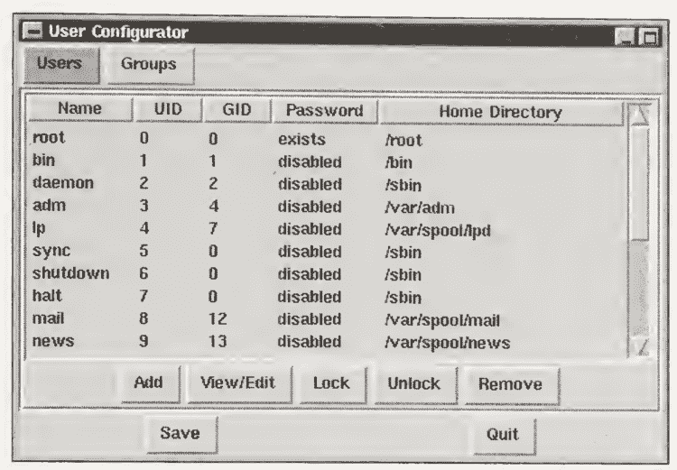

**图 5-1** 配置器用户/组管理器窗口。

- 2. 点击右侧 Linux 用户/组管理器窗口中的“添加（Add）”按钮。这将弹出图 5-2 所示的“编辑用户定义”对话框。

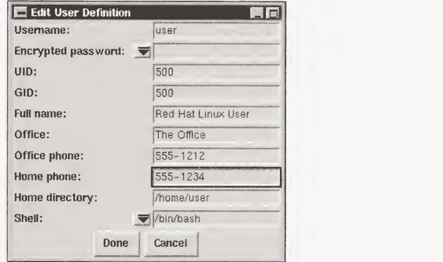

**图 5-2** 编辑用户定义对话框

- 3. 按照所示填写空白字段：

  - **用户名 (Username)**: 账户名称。
  - **加密密码 (Encrypted password)**: 选择密码选项。
  - **UID**: 管理程序会自动选择一个未使用的用户 ID。除非您知道自己在做什么，否则请留空。
  - **主组 (Primary Group)**: 默认情况下，Linux 会为每个用户创建一个新的组名，并使组名和用户名相同。如果您有不同的分组方案，请在此处输入。
  - **全名 (Full name)**: 用户的全名。此信息会被 `finger` 程序等使用。此字段是可选的。
  - **家目录 (Home directory)**: 用户的家目录。该工具会自动创建此目录并填充一组默认的配置文件。
  - **Shell**: 用户的命令行处理器（shell）名称。选择哪个 shell 是一个个人问题（每个人都有自己的喜好）。Linux 上最先进的 shell 是 Bourne again `/bin/bash`。

- 4. 填写字段后，点击“添加（Add）”创建账户。

删除用户会删除其文件和账户；这意味着该用户已消失（即系统不再识别该用户）。禁用用户则会为该账户标记一个特殊密码，防止任何人使用用户 ID 登录。

您可能想禁用一个账户而不是删除它。某些 Linux 命令（如 `tar`）使用密码文件将用户 ID 映射到用户名。当用户被删除时，其 ID 将无法被查找，`tar` 也无法确定特定文件的所有者。此外，如果您重新使用该用户 ID，可能会很容易遇到严重的命名混淆。除非您处理的用户超过 10 个……

## 名称

这是打印机的名称。单个打印机可以有多个名称，用竖线 (`|`) 分隔。

注意：Linux 打印机命令默认使用名为 `lp` 的打印机，因此您的默认打印机应该命名。可以为单个打印机指定多个名称。您应该用竖线 (`|`) 分隔列出它们，且不要留空格。例如，如果您想为打印机使用 `lp` 或 `ps` 作为名称，请输入 `lp|ps`。

使用默认值。

## 打印缓冲目录

这是等待打印时存储文件的地方。

使用默认值。

## 文件限制 (Kb)

此参数决定了可以打印的文件的最大大小（以千字节 KB 为单位）。限制为 0 表示可以使用任何大小的文件。

## 打印机设备

实际打印机的名称。请见下常用设备列表。（设置打印机极其困难，需要专家——而且必须是一个受虐倾向的专家。）


| Linux 名称 | MS-DOS 名称 |
| :--- | :--- |
| `/dev/lp0` | LPT1 |
| `/dev/lp1` | LPT2 |
| `/dev/lp2` | LPT3 |

## 输入过滤器

抑制页眉

参见相关讨论。

勾选此框可防止打印标识每个作业的横幅页。

- 6. 点击输入过滤器字段旁“选择”按钮，弹出图 5-7 所示的“配置过滤器”对话框。

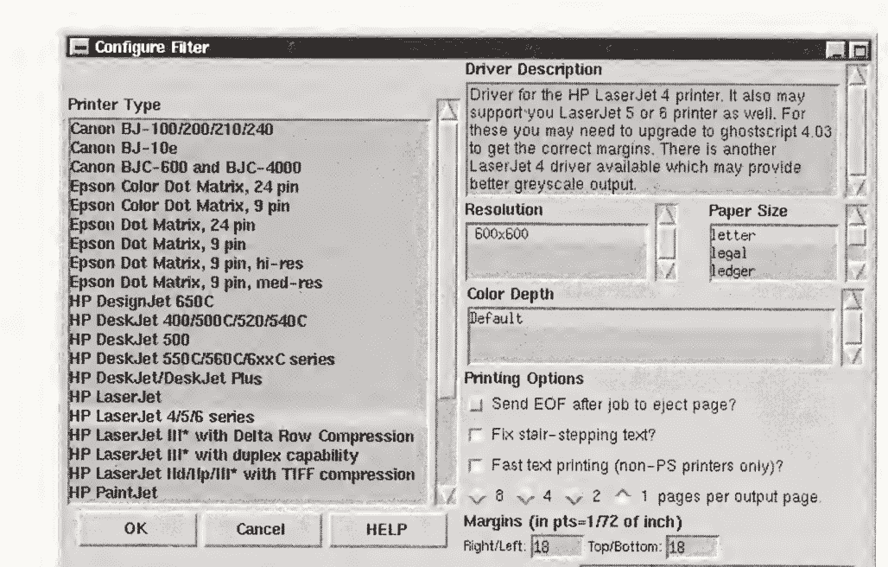

图 5-7 配置对话框

窗口中的字段如下：

打印机类型

选择与您的设备最匹配的打印机。

驱动程序描述

此窗口包含有关驱动程序的信息。

分辨率

选择您希望在此打印机使用的分辨率。

纸张大小

色彩深度

选择您将使用的纸张大小。

此选项告诉色彩驱动程序使用多少颜色。

作业完成后发送 EOF 以推出纸张？

某些打印机使用 EOF 字符来指示作业结束。如果您打印了此项，则该选项已开启。（PostScript 打印机以此方式使用 EOF。）如果您不确定，请关闭此选项。

修复阶梯文本？

空气步会导致 UNIX 文本文件打印错误。设置此选项会将 UNIX 结束结束序列（`<linefeed>`）翻译为大多数打印机使用的序列（`<carriage-return><linefeed>`）。

快速打印（仅限非 PS 打印机）？

当设置此选项时，文本将以文本发送到打印机。如果没有此选项，文本将转换为 PostScript，然后将 PostScript 数据在打印机上绘图。您可能希望设置此选项。设置它会导致您的文本打印变慢。

8 4 2 页/输出页

此选项选择每个物理页的逻辑页数。这称为 n 合页打印（n-up printing）。您可能想在此处选择 1 页。如果您需要，仍然可以使用 `mpage` 工具进行合页打印。

页边距

这是打印机的页边距，单位为磅（英寸的 1/72）。

额外的 GS 选项

Linux 使用 GhostScript 程序将 PostScript 翻译为打印机可以使用的内容。此字段允许您向 GhostScript 调用添加额外选项。请查看 `gs` 命令的手页以获取选项列表。

点击“选择”选择打印机的分辨率。

点击“选择”选择纸张大小。

如果勾选此框，每个作业后将发送一个文件结束符 (EOF)。

- 7. 设置打印机过滤器信息后，点击“确定”关闭对话框。
- 8. 点击“确定”安装打印机

您现在可以安装额外的打印机。

> 您可以为每个物理设备定义多个 Linux 打印机。您可以为每个打印机使用不同的选项。例如，您可以定义 `lp` 打印单页，定义 `lp4` 打印四合页。

## 简单网络配置

控制面板实用程序提供了网络配置工具。使用此工具，您可以进行一些非常简单的配置。对于任何中等复杂的情况，您应该适当编辑配置文件。然而，完整的网络配置远超本书的范围。更多信息请参阅在线文档。

## 配置调制调器工具

配置调制调器工具在名称 `/dev/modem` 和物理设备（如 `/dev/cual`）之间建立软链接。这使得某些程序更容易找到调制解调器。基本上，配置调制调器工具是一个基础 GUI，用于执行通过单个 Linux 命令即可轻松完成的操作（尽管它确实有效，但为什么不用它呢？）。

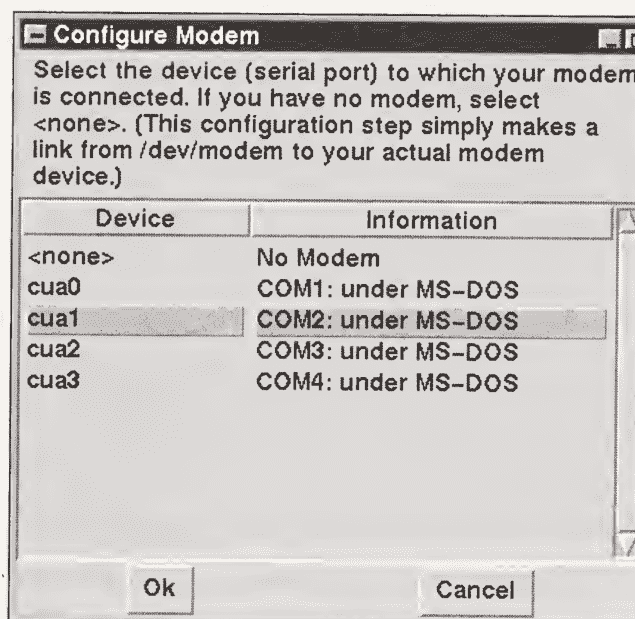

**图 5-8** 配置调制调器窗口

## 安装和删除软件包

名为“包管理”的控制面板实用程序允许您安装和删除包。首次启动时，“包管理”会显示一个窗口，类似于图 5-9 所示，显示当前已安装的包。

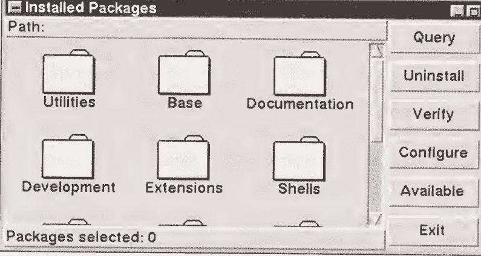

**图 5-9** 已安装包窗口

窗口中的文件夹可能有一点误导性。它们代表软件类别而不是目录。双击任何类别即可打开它。

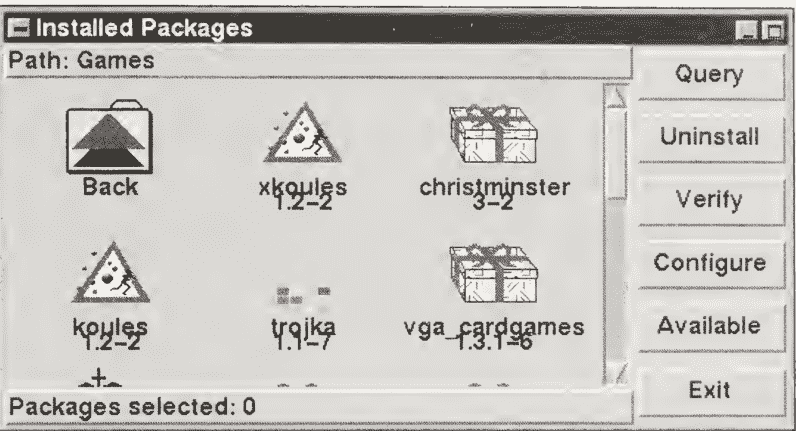

**图 5-10** 已安装包窗口

窗口中的文件夹可能有一点误导性。它们代表软件类别而不是目录。双击任何类别即可打开它。

## 其他面板项

此节描述了在面板中找到的其他项目。在大多数情况下，它们没用，所以不用理会。

## 文件系统配置

这是编辑 `/etc/fstab` 的 GUI。直接编辑文件比填写表单更容易。

## 时间和日期

此项设置系统时间和日期。最好在 BIOS 中进行。

## 级别编辑器

Linux 系统运行后台程序处理某些系统任务。这些程序被称为守护进程。级别编辑器允许您决定在初始化阶段运行哪些守护进程。

## 内核模块配置

此工具允许您添加、删除和配置内核模块。除非您真的懂，否则不要使用它。

## 补充：打印和网络信息来源

本章仅涵盖了常见的基础配置。您的系统可能需要额外工作。如果您在使用通过 Windows NT 或 Windows 95 打印服务器打印，请查看以下文件：

```
/usr/doc/HOWTO/mini/PrintWin
```

可以通过以下文件获取有关设置打印机的更多信息：

```
/usr/doc/HOWTO/Printing-Usage-HOWTO.gz
```

您必须解压文件才能读取。如果您有串口打印机，此文件提供了有关如何设置它的说明。然而，它并不能让变得简单——没有如此。您也可以查看以下文件：

```
/usr/doc/FAQ/Serial-FAQ.gz
```

设置网络是一个复杂且困难的任务。本章涵盖了非常简单的环境，但在较大的大学和办公室环境中，情况会变得非常复杂。您需要现场专家或快速学习来应对网络迷。

如果您没有现场专家，您可能想查看以下文件：

```
/usr/doc/FAQ/NET-FAQ
/usr/doc/FAQ/NET-2-FAQ
```

最后，您可以通过以下文件获取完整的 Red Hat 安装手册：

```
/mnt/cdrom/doc/rhmanual/index.html
```

## 总结

本章提供了足够的配置信息让您开始。后续章节将向您展示如何进行更高级配置和自定义。现在，您有了一个良好的开始。

# 第六章

# 备份

在本章中，你将学习以下关键技能

- 理解 Linux 如何处理磁带（第 93 页）
- 学习操作磁带的命令（第 98 页）
- 理解 Linux 磁带系统（第 102 页）
- 学习常用的备份命令（第 104 页）


此时，你已经花费了大量时间让 Linux 系统运行起来。为了保护你的工作，备份系统是一个好主意。Linux 提供了多种保存数据到磁带的方法。本章将讨论最常用的方法。

## 磁带的维护

为了最大限度地利用磁带设备，你需要了解 Linux 如何处理它们。UNIX 对磁带的使用源于老式主机的英寸磁带驱动器。磁带是通过让磁带经过写头写入的。在深入细节之前，只需说写头中的电流会改变磁带的磁性，从而存储数据。

读取磁带信息是通过让磁带经过读头实现的。

看看磁带上实际写入的内容。假设你正在创建一个磁带（也称为“dump”），你的程序向磁带写入 10K 缓冲区。驱动器旋转并向磁带写入 10K 数据。这被称为物理记录，其大小为 10K。数据写入后，磁带驱动器写入一段空白磁带，称为记录间隙（见图 6-1）。


**图 6-1** 磁带格式

一种特殊的记录称为文件结束标记（EOF），表示磁带文件的结束（见图 6-2）。


关闭后，磁头位于两个 EOF 标记之间。如果再次打开磁带并写入更多数据，EOM 标记将被擦除，只留下一个 EOF 标记。


**图 6-2** 磁带处理

空文件（连续两个 EOF 标记）表示磁带结束。这个空文件称为媒体结束（EOM）。

磁带驱动器常用的一种技巧是每当磁带关闭时写入两个 EOF 标记（即 EOM 标记）。如果打开磁带并写入更多数据，必须擦除 EOM 标记。由于磁带位于两个 EOM 标记的中间，任何写入都会擦除其中一个，留下 EOF。

Linux 有一个启用此功能的选项。它默认禁用，因为某些磁带设备不支持回溯。除非启用此技巧，否则无法到达媒体结束。你可以使用 `mt` 命令来启用此功能。

Linux 有一个选项在设备关闭时自动写入两个 EOF 标记（一个 EOM 标记），然后回格。当你开始写入新文件时，新文件的第一个块会擦除第二个 EOM 标记，从而删除 EOM 标记。某些磁带设备不支持文件，因此此功能默认禁用。你可以通过 `mt` 命令启用它。

关于磁带需要记住的一点是：你始终在媒体末尾写入。你无法返回并替换之前写入的记录而不擦除磁带的其余部分。换句话说，磁带不像磁盘可以你可以写入任何块。

## 磁带设备名称


Linux 支持多种磁带设备。包括从廉价的 HP/Colorado 备份磁带到贵的 SCSI 4mm 和 8mm 磁带驱动器。Linux 甚至支持旧式的卷带驱动器。以下是 Linux 支持的磁带设备类型：

- SCSI 磁带通过 SCSI 控制器连接。这些磁带包括用于备份大型系统的 4mm 和 8mm 设备。
- Ftape（软带）连接到软带控制器。这些类型的磁带包括许多 Colorado/HP 盒带。

表 6-1 列出了各种类型磁带设备的名称。

| 设备 | 描述 |
| --- | --- |
| `/dev/st0` | SCSI 磁带 #0 |
| `/dev/st1, /dev/st2...` | 其他 SCSI 磁带驱动器 |
| `/dev/rft0` | 软带 #0 |
| `/dev/ftape` | 软带的符号链接 |

实际上，每个设备有两个名称。表 6-1 列出了常规（或绕回）名称。当磁带关闭时，设备会绕回。通过在名称前加上字母 `n`，你可以获得非绕回设备。例如，`/dev/st0` 的非绕回版本是 `/dev/nst0`。当这些设备关闭时，不会发生移动。

## 使用 mt 命令

`mt` 命令是一个磁带操作工具。以以下命令为例：

```
user@pc user]$ mt -f /dev/nftape rewind
```

此命令重置磁带 `/dev/nftape`。其他命令包括表 6-2 中列出的。

| 表 6-2 mt 命令 |
| 命令 | 描述 |
| --- | --- |
| eom | 移动到媒体结束 (EOM) |
| fsf <count> | 向前移动 <count> 格 |
| bsf <count> | 向后移动 <count> 格 |
| off | 离线 |
| erase | 擦除 |

如何使用 `mt` 命令？你通过插入磁带来开始。磁带会自动绕回。由于你使用 `tar` 命令在磁带上放置特定的标记（见下文），磁带会绕回。

为了获取磁带数据，你需要执行以下命令：

```
user@pc user]$ mt -f /dev/nftape rewind
```

此命令重置磁带 `/dev/nftape`。

假设你想将家目录备份到磁带。以下显示了一个典型的 tar 命令命令行：

```
user@pc user]$ tar cvf /dev/ftape .
```

为了获取磁带数据，你需要执行以下命令：

```
user@pc user]$ mt -f /dev/nftape eom
user@pc user]$ find / \( -type f -type l \) -print0 | \
t--create verbose --file /dev/null -files-from - \
```

这里是这些命令涉及的元素：

`tar`
`cvf`

这是命令。
这些选项字母。在这种情况下，`c` 创建归带，`v` 用于详细输出（列出正在写入的文件），`f` 表示明下一个参数是磁带名称。

`/dev/ftape` 是设备名称。你在磁带上只分区了一个 tar 文件，所以你可以使用绕回设备。
（点）点或点号表示要备份的文件列表。在这种情况下，使用当前目录 `.` 及其所有子目录。

更复杂的示例如下：

```
user@pc user]$ mt -f /dev/nftape eom

user@pc user]$ find / \( -type f -type l \) -print0 | \
t--create verbose --file /dev/null -files-from - \
```

由于使用 `tar` 命令在磁带上放置特定的标记（见下文），磁带会绕回。

```
user@pc user]$ mt -f /dev/nftape rewind
```

为了获取磁带数据（off the tape），你需要执行以下命令：

`tar` 命令在磁带上提取文件。

```
user@pc user]$ mt -f /dev/nftape fsf 1
```

假设你想获取磁带上的文件：

```
user@pc user]$ mt -f /dev/nftape fsf 1
```

由于 `tar` 命令非绕回设备：

```
user@pc user]$ tar xf /dev/nftape
```

### 磁 tape 格式


**图 6-1** 磁带格式

一种特殊的记录称为文件结束标记（EOF），表示磁带文件的结束（见图 6-2）。


**图 6-2** 磁带处理

空文件（连续两个 EOF 标记）表示磁带结束。这个空文件称为媒体结束（EOM）。

磁带驱动器常用的一种技巧是每当磁带关闭时写入两个 EOF 标记（即 EOM 标记）。如果打开磁带并写入更多数据，EOM 标记必须被擦除。由于磁带位于两个 EOM 标记的中间，任何写入都会擦除其中一个，留下 EOF。

Linux 有一个启用此功能的选项。它默认禁用，因为某些磁带设备不支持回溯。除非启用此技巧，否则无法到达媒体结束。你可以使用 `mt` 命令来启用此功能。

Linux 有一个选项在设备关闭时自动写入两个 EOF 标记（一个 EOM 标记），然后回格。当你开始写入新文件时，新文件的第一个块会擦除第二个 EOM 标记，从而删除 EOM 标记。某些磁带设备不支持文件，因此此功能默认禁用。你可以通过 `mt` 命令启用它。

关于磁带需要记住的一点是：你始终在媒体末尾写入。你无法返回并替换之前写入的记录而不擦除磁带的其余部分。换句话说，磁带不像磁盘你可以写入任何块。

## 磁带设备名称

Linux 支持多种磁带设备。包括从廉价的 HP/Colorado 备份磁带到贵的 SCSI 4mm 和 8mm 磁带驱动器。Linux 甚至支持旧式的卷带驱动器。以下是 Linux 支持的磁带设备类型：

- SCSI 磁带通过 SCSI 控制器连接。这些磁带包括用于备份大型系统的 4mm 和 8mm 设备。
- Ftape（软带）连接到软带控制器。这些类型的磁带包括许多 Colorado/HP 盒带。

表 6-1 列出了各种类型磁带设备的名称。

| 设备 | 描述 |
| --- | --- |
| `/dev/st0` | SCSI 磁带 #0 |
| `/dev/st1, /dev/st2...` | 其他 SCSI 磁带驱动器 |
| `/dev/rft0` | 软带 #0 |
| `/dev/ftape` | 软带的符号链接 |

实际上，每个设备有两个名称。表 6-1 列出了常规（或绕回）名称。当磁带关闭时，设备会绕回。通过在名称前加上字母 `n`，你可以获得非绕回设备。例如，`/dev/st0` 的非绕回版本是 `/dev/nst0`。当这些设备关闭时，不会发生移动。

## 使用 mt 命令

`mt` 命令是一个磁带操作工具。以以下命令为例：

```
user@pc user]$ mt -f /dev/nftape rewind
```

此命令重置磁带 `/dev/nftape`。其他命令包括表 6-2 中列出的。

| 表 6-2 mt 命令 |
| 命令 | 描述 |
| --- | --- |
| eom | 移动到媒体结束 (EOM) |
| fsf <count> | 向前移动 <count> 格 |
| bsf <count> | 向后移动 <count> 格 |
| off | 离线 |
| erase | 擦除 |

## tar 命令

`tar`（磁带归档器）是 UNIX 系统之间通过磁带传输文件时最常用的标准。它也是一个很好的备份工具。

## 备份文件到磁带

假设你想将你的家目录备份到磁带。以下显示了一个典型的 tar 命令命令行：

```
user@pc user]$ tar cvf /dev/ftape .
```

这里是这些命令涉及的元素：

`tar`
`cvf`

这是命令。
这些选项字母。在这种情况下，`c` 创建归带，`v` 用于详细输出（列出正在写入的文件），`f` f 表示明下一个参数是磁带名称。

`/dev/ftape` 是设备名称。你在磁带上只分区了一个 tar 文件，所以你可以使用绕回设备。
（点）点或点号表示要备份的文件列表。在这种情况下，使用当前目录 `.` 及其所有子目录。

更复杂的示例如下：

```
user@pc user]$ mt -f /dev/nftape eom

user@pc user]$ find / \( -type f -type l \) -print0 | \
t--create verbose --file /dev/null -files-from - \
```

此命令将根磁盘上所有文件和符号链接附加到磁带副本中。为了提高效率，使用了较大的块大小（blocking factor）。块大小控制着向磁带进行物理写入的大小。在这种情况下，物理记录的大小为 65536 字节（128 * 512）。

```
[user@pc user]$ mt -f /dev/nftape eom
```


下一个命令实际上是用于执行复制的两个命令：

```
[user@pc user]$ find / \(-type f -o \type l \)-print0 |\nt--create --verbose --file /dev/null --files-from - \
null --block-size 128
```

第一个命令定位要复制的文件。它将此列表传递给 `tar`，由 `tar` 执行实际工作。

`find` 命令的各个部分如下：

- `find`：这是命令本身。
- `/`：这是搜索的顶层目录。在这种情况下，你从根目录开始。
- `\( `：`\(` 和 `\)` 参数用于对 `find` 的文件指令分组。
- `-type f`：此参数使命令找到所有类型为 `f`（普通文件）的文件。
- `-o`：这是操作符。这意味着命令将找到所有类型为 `f` 或类型 `l` 的文件（参见下一个参数）。
- `-type l`：这使命令找到所有类型为 `l`（符号链接）的文件。
- `\)`：参数关闭文件类型子句。
- `-print0`：此参数导致命令打印你找到的文件名，每个名称都以空字符 `(\0)` 结尾。

该命令的结果是一系列文件名，每个文件名都以空字符结束。这些内容被管道到 `tar` 命令中，该命令包含以下元素：

- `tar`：这是命令名称。
- `--create`：这会创建一个文件（它是 `c` 选项的长格式）。
- `--verbose`：此参数在复制每个文件时打印其名称（它是 `v` 选项的长格式）。
- `--file /dev/nftape`：此参数指定要备份到的文件。
- `example` 示例使用了非回绕磁带时间，因为你可能以后想向其附加内容。
- `--files-from`：此选项告诉 `tar` 从名为 `-` 的文件中读取文件列表。在这种情况下，特殊名称 `-` 表示标准输入。该文件实际上是 `find` 命令的输出。
- `--null`：此参数告诉 `tar` 用于 `--files-from` 的文件名列表是以空字符终止的。
- `--block-size 128`：此参数指定块大小为 `128`。这意味着物理记录大小为 `128 * 512` 字节，或 `6K`。

## 查找磁带上的文件

要获取 `tar` 磁带的目录，请使用以下命令：

```
[user@pc user]$ tar tfb /dev/ftape 20
```

该命令的参数如下：

- `tfb`：这是选项。`t` 表示目录，`f` 表示后面跟的是磁带设备（文件），`b` 表示后面跟的是块大小。
- `/dev/ftape`：此参数是磁带设备的名称（用于 `f` 选项）。
- `20`：此参数是块大小（用于 `b` 选项）。

## 恢复文件

要恢复文件，你使用 `tar` 的 `x`（提取）选项。一个典型的命令可能如下：

```
[user@pc user]$ tar xvf /dev/ftape lost.
```

以下是参数：

- `xvf`：这些是 `tar` 的选项。包括 `x` 用于提取文件，`v` 用于详细输出，以及 `f` 用于指定磁带文件。
- `/dev/ftape lost.c`：此参数是要恢复的磁带名称。此参数是待恢复的文件。可能会列出多个文件；它们的名称（路径）必须与磁带上的名称完全匹配。如果没有列出文件，则恢复整个磁带。

### 如果你从多个磁带文件恢复，tar 命令会有一个让你措手不及的惊喜。以下 tar 命令从第一个磁带文件提取所有磁盘文件，并让磁带位置位于磁带的文件结束符（EOF）之前：

```
[user@pc user]$ tar xvf /dev/nftape
```

如果你在这一命令之后运行另一个 `tar`，第二个 `tar` 将直接遇到 `EOF` 且什么都不提取。

要从两个磁带文件提取所有文件，请使用以下命令。第一个命令回绕磁带：

```
[user@pc user]$ mt -f /dev/nftape rewind
```

下一个命令提取第一个磁带文件中的所有文件：

```
[user@pc user]$ tar xvf /dev/nftape
```

接下来的命令移动 `EOF`：

```
[user@pc user]$ mt -f /dev/nftape fsf 1
```

最后，下一个命令提取第二个磁带文件中的所有文件：

```
[user@pc user]$ tar xvf /dev/nftape
```

## 使用 cpio 命令

`cpio` 命令是 AT&T 尝试设计的一种比 `tar` 更好的版本。它几乎是一个失败，很少被使用。它实际被使用的少数地方之一是在 Red Hat 包系统内部存储文件列表。

## 创建 cpio 磁带

在“拷贝出”模式下，`cpio` 将文件列表作为标准输入，并将文件作为存档复制到标准输出。

例如，下面的命令使用 `find` 命令列出所有以 `.c` 结尾的文件：

```
[user@pc user]$ find . -name "*.c" -print0 | tar --create --verbose --file /dev/null --files-from - --null --block-size 128
```

（注：此处原文重复内容）

## 查找磁带上的文件

要获取 `tar` 磁带的目录，请使用以下命令：

```
[user@pc user]$ tar tfb /dev/ftape 20
```

该命令的参数如下：

- `tfb`：这是选项。`t` 表示目录，`f` 表示后面跟的是磁带设备（文件），`b` 表示后面跟的是块大小。
- `/dev/ftape`：此参数是磁带设备的名称（用于 `f` 选项）。
- `20`：此参数是块大小（用于 `b` 选项）。

## 恢复文件

要恢复文件，你使用 `tar x`（提取）选项。一个典型的命令可能如下：

```
[user@pc user]$ tar xvf /dev/ftape lost.
```

以下是参数：

- `xvf`：这些是 `tar` 的选项。包括 `x` 用于提取文件，`v` 用于详细输出，以及 `f` 用于指定磁带文件。
- `/dev/ftape lost.c`：此参数是要恢复的磁带名称。此参数是待恢复的文件。可能会列出多个文件；它们的名称（路径）必须与磁带上的名称完全匹配。如果没有列出文件，则恢复整个磁带。

### 如果你从多个磁带文件恢复，tar 命令会有一个让你措手不及的惊喜。以下 tar 命令从第一个磁带文件提取所有磁盘文件，并让磁带位置位于磁带的文件结束符（EOF）之前：

```
[user@pc user]$ tar xvf /dev/nftape
```

如果你在这一命令之后运行另一个 `tar`，第二个 `tar` 将直接遇到 `EOF` 且什么都不提取。

要从两个磁带文件提取所有文件，请使用以下命令。第一个命令回绕磁带：

```
[user@pc user]$ mt -f /dev/nftape rewind
```

下一个命令提取第一个磁带文件中的所有文件：

```
[user@pc user]$ tar xvf /dev/nftape
```

接下来的命令移动 `EOF`：

```
[user@pc user]$ mt -f /dev/nftape fsf 1
```

最后，下一个命令提取第二个磁带文件中的所有文件：

```
[user@pc user]$ tar xvf /dev/nftape
```

## 使用 cpio 命令

`cpio` 命令是 AT&T 尝试设计的一种比 `tar` 更好的版本。它几乎是一个失败，很少被使用。它实际被使用的少数地方之一是在 Red Hat 包系统内部存储文件列表。

## 创建 cpio 磁带

在“拷贝出”模式下，`cpio` 将文件列表作为标准输入，并将文件作为存档复制到标准输出。

例如，下面的命令使用 `find` 命令列出所有以 `.c` 结尾的文件：

```
[user@pc user]$ find . -name "*.c" -print0 | tar --create --verbose --file /dev/null --files-from - --null --block-size 128
```

密度和尺寸参数来自惠尔-惠普的 Web 页面，该页面列出了用于备份的 HP DAT 设备的技术信息。对于大多数磁带来说，这些数字仅仅是猜测而已。

如果你计划将整个转储文件放在一块磁带上，可以使用很大的数字。如果你想处理多块磁带，可能需要通过实验来找到正确的数字。

`restore` 命令从转储磁带上读取文件。该命令具有交互模式，允许你浏览磁带上的文件目录，并选择你想要恢复的文件。

一个典型的 `restore` 命令如下：

```bash
[root@pc root]# restore ifb /dev/st0 64
```

以下是该命令的拆解：

- `ifb`：这些字母是标志位（flags）。
- `i` 表示交互式恢复
- `f` 告诉 `restore` 后面紧跟着磁带设备文件 (`/dev/st0`)
- `b` 表示后面紧跟着块因子 (`64`)

`restore` 随后启动一个交互式会话。你做的第一件事是执行 `ls` 命令来查看文件列表：

注意：执行四分交换（Quad swapping）

`restore > ls`

| 5lib/ finish/ mdec stand |


| adm flash3.8/ mount_c/ sys |

| bin/ games/ old/ tmp |

在这个示例中，假设你想恢复的内容在 `games` 目录中。进入该目录并执行以下命令环顾四周：

```bash
restore > cd games
restore > ls
./games:
```

| boggle lib/ random |

| boggiedict cribbage life robots |

你想恢复 `life` 目录，因此使用以下命令将其添加到待恢复列表中：

```bash
restore> add life
```

在没有其他需要恢复的内容后，你执行 `extract` 命令开始恢复过程。`restore` 询问要从哪块磁带开始（此时只有一块磁带），并开始恢复操作：


`restore > extract`

你还没有读取任何磁带。

除非你知道文件在哪个卷磁带上，否则应该从最后一卷开始，向第一卷处理。

指定下一个卷号 #: 1

`dump` 命令的设置很困难，但你只需要设置一次。

`restore` 的交互模式使这个系统成为了真正的赢者。

## 备份工具的比较

你应该使用哪种备份工具？哪种让你觉得最舒服用即可。本节介绍了各种工具的比较，以便你做出决定。其中一些评分是主观的，因此你可能想自己进行一些实验。

“易用性”和“可靠性”的评分是基于我个人的经验。

某些备份工具不仅允许你备份本地磁带，还能备份其他系统上的磁带。例如，磁带规格 `sabina:/dev/st0` 会告诉 `tar` 使用系统 `sabina` 上的 `/dev/st0` 磁带。

不同的程序处理“磁带结束”的方式不同。例如，`tar` 不仅具有检测磁带结束的能力，还能运行 shell 脚本来更换磁带。`cpio` 程序在磁带用尽时只会直接停止。

磁带的格式与你存储的速度有很大。例如，`tar` 和 `cpio` 写入磁带的方式如下：

- 文件头，文件数据
- 文件头，文件数据
- 文件头，文件数据

这意味着为了获取目录，你必须读取整块磁带以找到所有的文件头。`Taper` 程序将其目录保存在磁盘数据库中。不仅查找速度快得多，`Taper` 无需磁带即可定位文件。使用 `Taper`，你可以在数据库中找到文件，然后确定需要哪块磁带来恢复它。

`dump` 程序在磁带开头写入一个目录。这意味着获取文件列表或挑选要恢复的文件是比较快的。

如你所见，每个备份系统都有自己的优缺点。表 6-3 比较了每种工具的功能。

### 6-3 备份比较图

| 工具 | 易用性 | 可靠性 | 远程磁带 | 多块磁带 | 压缩 | 内容 |
| --- | --- | --- | --- | --- | --- | --- |
| tar | B | A | 是 | 是 | 是 | 文件头 |
| cpio | B | A | 是 | 否 | 否 1 | 文件头 |
| taper | A | D | 否 | 是 | 是 | 磁盘 |
| dump/restore | C/A | A | 是 | 是 | 否 | 开头 |

> 1 `cpio` 的设计使其数据流可以轻松地通过外部压缩程序（如 `gzip`）。

## 如何进行定期备份

备份计划对于有效运行计算机系统至关重要。即使你只将计算机用于个人用途，存储在磁盘上的数据也是有价值的，你应该保护它们。

在本节中，你将创建一组 shell 脚本来执行备份，然后创建一个 `cron` 任务。

### 你无法恢复

我通过一次惨痛的教训了解到，你永远无法恢复的程序就是恢复程序本身。我的硬盘崩溃了，我被迫更换了磁盘。当我正对磁盘进行全量恢复时，程序崩溃了。事实证明，在 Sunget上，如果你在使用某个程序时重写该程序文件，任何运行该程序的人都会崩溃。恢复程序在尝试恢复自己时崩溃了。这可不妙了。文件损坏了，导致我无法重新启动。幸运的是，我在磁带上有一份恢复程序的副本。但问题是，我需要通过恢复程序来从磁带上读取它。哎，我不得不回去重新安装操作系统，才能找回恢复程序。

### 调度自动备份

假设你有一个每周的备份周期。每天凌晨 2:00，你都会进行备份。你希望从周二早上开始并进行全量备份。在周的其他时间，你想进行 1 级备份。

在周一早上，你希望在备份后弹出磁带。这样，你周一早上只需要走进来，从驱动器中取出弹出的磁带，放入一个新磁带就可以开始工作了。

为了避免混乱，请创建七个短 shell 脚本——每天一个。脚本内容如下所示：

| 脚本 | 内容 |
|---|---|
| tue.sh | level0.sh |
| wed.sh | level1.sh |
| thur.sh | level1.sh |
| fri.sh | level1.sh |
| sat.sh | level1.sh |
| sun.sh | level1.sh |
| mon.sh | level1.sh ; mt -f /dev/nst0 |

你使用 `cron` 命令在特定时间运行程序。运行的内容由 `crontab` 文件控制。要编辑此文件，你使用以下命令：

```
[root@pc root]# crontab -e
```

然后你向 crontab 中添加以下行：

0 * * 0 /root/dump/sun.sh

0 * * 1 /root/dump/mon.sh

0 * * 2 /root/dump/tue.sh

0 * * 3 /root/dump/wed.sh

0 * * 4 /root/dump/thur.sh

0 * * 5 /root/dump/fri.sh

0 * * 6 /root/dump/sat.sh

crontab 条目中的第一个字段是执行时间的分钟，第二个是小时。在这种场景下，你从凌晨 2:00 开始（使用 24 小时制），所以这些条目是 0 2。接下来的两个目是日期和月份。对你来说，这两个都是“忽略”术语，所以你对这些字段使用 `*`。

第五个字段是星期。周日用 0 表示，周一用 1 表示，以此此类推。最后是你的命令。

现在一切都是自动的。备份每晚都会运行，你只需要每天早上检查邮件，以确保找到了日志文件即可。现在你只需要偶尔插一下磁带了。

事实上，事情进展得非常顺利，你可以稍微放松一下，看看这本书的下一部分，它将告诉你如何玩转 Linux（sun.sh, mon.sh, . . . ）。

## 奖励

### 更多备份选项

CD-ROM 上提供的备份工具并不是你唯一的选择。还有其他备份程序可用。

你可以在以下 Web 地址找到最完整的免费程序列表：

```
http://sunsite.unc.edu/pub/Linux/system/backup!!INDEX.html
```

当然，也有商业工具。

Arkeia 销售一种适用于 UNIX 和 Windows NT 的备份系统。该公司在它的产品文献中强调安全和高速。更多信息，请访问以下 Web 地址：

http://www.knox-software.com/

Enhanced Software Technologies 销售 BRU（备份和恢复实用）。该备份系统在 UNIX 社区中广泛使用。访问以下 Web 地址：

http://www.estinc.com/

## 总结

在本章中，你学习了如何通过备份来保护数据。Linux 为你提供了许多备份工具，因此无论你的安装有多简单或复杂，你应该都能轻松找到一组能够让你完成工作的工具。


# 第二部分

# 趣味与游戏

本部分包含以下章节

- 第 7 节 LINUX 与互联网
- 第 8 节 供 LINUX 用户的游戏和屏幕保护程序


现在你已经安装了 Linux，请休息一下，玩点开心。第二部分讨论了如何连接到互联网，以及如何玩玩 Linux 自带的一些游戏。此外，你还可以看到 Linux 中包含的屏幕保护程序的快照。

## 现实 LINUX：玩耍

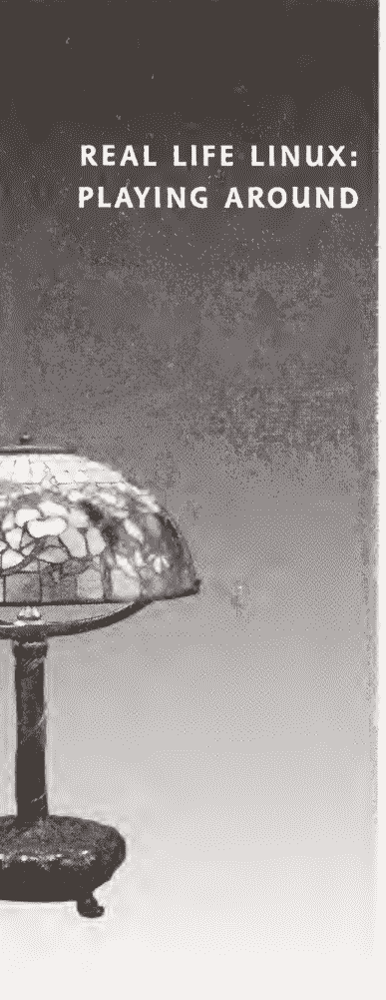

现在你已经安装了 Linux，请休息一下，玩点开心。第二部分讨论了如何连接到互联网，以及如何玩玩 Linux 自带的一些游戏。此外，你还可以看到 Linux 中包含的屏幕保护程序的快照。

## LINUX 与互联网

在本章中你将学习：

- 设置第 116 页
- 使用 FTP 获取第 125 页
- 设置网络第 134 页
- 阅读新闻第 135 页

在本章中，你学习了如何通过备份来保护数据。Linux 为你提供了许多备份工具，因此无论你的安装有多简单或复杂，你应该都能轻松找到一组能够让你完成工作的工具。

### 什么是 PPP？

点点协议（PPP）是一种在串口链进行通信的协议。PPP 替代了早期的名为 SLIP 的协议。SLIP 有许多 PPP 没有的限制。


要使用 PPP 连接到，你首先必须让电脑拨打服务商的电话。登录后，`pppd` 接管并处理连接。


## 准备连接

在连接之前，你需要：

- 服务商的电话号码
- 登录详情
- DNS 服务器地址（你的服务商系统的地址，计算机通过它将域名转换为 IP 地址）
- 新闻服务器系统名称（为你的系统提供新闻的系统）
- POP 邮件服务器名称（POP——邮局协议——用于获取电子邮件）
- SMTP 邮件服务器名称（SMTP——简单传输协议——发送邮件的标准）

为什么有两个邮件服务——POP 和 SMTP？SMTP 设计用于从 UNIX 机器发送到 UNIX 机器。这些机器预期运行能够处理多个账户邮件的复杂程序。当接收机器是一个几乎不运行任何程序的简单 DOS 盒子时，这种方法行不通，因此 POP 的发明是为了让中央服务器为多个账户存储邮件，每个账户由一个 POP 客户端服务。

然而，发送邮件比接收邮件简单得多，因此单用户机器可以轻松提供发送邮件的功能。结果就是没有必要开发用于发送的单用户版本 SMTP。

现在，连接上网唯一需要的登录详情。你可以通过实验轻松地确定这些详情。

`minicom` 程序是 Linux 的一部分，是一个终端仿真程序。在本章中，你将用它连接你的服务提供商。通过启用日志（logging），你可以记录你在系统上进行的所有操作。然后你可以使用这些信息为 PPP 连接创建一个 `chat` 脚本。

## 启动 minicom

在本节中，你将学习如何使用终端仿真器 `minicom` 来发现连接到 ISP 所需的精确命令序列。

大多数情况下，你的 ISP 会为你提供一个免费的 Windows 程序，让你连接到他们的系统。连接的细节隐藏在该软件中。然而，你的 ISP 并没有提供 Linux 软件，因此你必须自己寻找细节。别担心，这并不难。

按照以下步骤启动 `minicom`：

- 1. 第一步是确保没有设置 `MINICOM` 变量。随新账户提供的一些初始“点”文件可能会设置这个变量。我通过教训发现，这些点文件提供的值并不好用。

要确保 `MINICOM` 未设置，请使用以下命令：

```
[user@pc user]$ unset MINICOM
```

- 2. 使用以下命令启动 `minicom`：

```
[user@pc user]$ minicom
```

- 3. 输入 `AT` 检查你是否已连接到调制解器。调制解器应该响应 `OK`。如果没有反应，请检查你的 `/dev/modem` 链接和你的串口线。你可能还需要更改你的通信设置。

- 4. 按 `Ctrl+A` 然后按 `C` 开启日志。这将所有的输入和输出记录到 `minicom.cap` 文件中。

所有的 `minicom` 命令都是 `Ctrl+A` 后跟一个字母。

- 5. 输入 `ATZ` 重置调制解器。如果从调制解器的已知状态开始，事情会变得更容易。

- 6. 输入命令 `ATDT<number>` 拨号，`<number>` 是你要拨打的号码。（你没有使用 `minicom` 内置拨号器，因为 `chat` 没有内置拨号器。）

- 7. 几秒钟后，你应该连接到了远程机器。这一步涉及输入用户名和密码。它可能涉及向远程机器发送命令进入 PPP 模式。

大多数 ISP 的登录过程非常直接（在 "login:" 处输入用户名，在 "Password:" 处输入密码，依此类推）。如果你遇到任何问题，请联系你的 ISP 获取帮助。

当机器显示 `ppp connected` 或类似的内容，并开始输出乱码时，你就已经成功连接了。

- 8. 按 `Ctrl+A`, `H` 让 `minicom` 挂断。

- 9. 按 `Ctrl+A`, `X` 退出 `minicom`。

打印 `minicom.cap` 文件。你使用这个文件来配置 `chat` 程序，以便能够自动登录。

以下是 `minicom.cap` 示例：

```
ATZ
OK
ATDT487-1690
CARRIER 28800

PROTOCOL: LAP-M

COMPRESSION: V.42BIS

CONNECT 38400/ARQ

Welcome to CONNECTnet INS. Inc. Rancho Bernardo

max-rb login: oualine
Password:
  Entering PPP Mode.
  IP address is 204.252.1.154
  MTU is 1500.
!@#$%*$%$#%$^(    and other garbage
```

## 创建 chat 脚本

下一步是制作一个 `chat` 脚本，这是一个运行 `chat` 程序的 shell 脚本。放置此脚本的好地方是 `/usr/local/lib/connect.sh`。（通常，我将所有本地工具都放在 `/usr/local/`）

该实用工具的设计目的是让你连接。之后，PPP 程序将接管并运行后续操作。`chat` 程序非常简单：每对参数由期望的字符串和响应组成。命令的一般形式如下：

```
chat [options] expect1 response1 expect2 response2 ****
```

选项将在稍后讨论。程序开始从标准输入读取，直到看到 `expect1`。然后它发送 `response` 并返回等待模式，直到看到 `expect2`。此过程一直持续到命令用完参数或超时。

`chat` 有许多选项。`-v` 选项告诉 `chat` 将详细输出日志到 `syslog`。这意味着你可以在 `/var/log/messages` 中查看消息（如果你使用默认的 `/etc/syslog.conf`）。`-t 45` 选项告诉 `chat` 如果期望字符串在 4 秒内没有出现，则超时并终止。

你正在逐步构建你的 `chat` 命令。你的第一步从以下命令开始：

```
chat -t 45
```

调制解器响应 `OK`。当你看到此响应时，你拨打电话，如下所示：

接下来，你等待连接（CONNECT）并只需发送一个回车（`"\r"`）。

接随后是登录提示符。你实际上期望看到 `login:`，以防调制解器丢掉几个字符。当远程机器请求登录时，你发送你的名字（此示例使用了我的名字 `qualine`）。计算机询问密码，你发送密码。

你的 `/usr/local/lib/connect.sh` 脚本的完整版本如下：

```sh
#!/bin/sh
/usr/sbin/connect -v -t 45
```

大多数 ISP 的登录过程非常直接（在 "login:" 处输入用户名，在 "Password:" 处输入密码，依此类推）。如果你遇到任何问题，请联系你的 ISP 获取帮助。

当机器显示 `ppp connected` 或类似的内容，并开始输出乱码时，你就已经成功连接了。

```
Mar 4 19:00:21 pc chat[2465]: ^M
Mar 4 19:00:21 pc chat[2465]: PROTOCOL: LAP-M^M
Mar 4 19:00:21 pc chat[2465]: ^M
Mar 4 19:00:21 pc chat[2465]: COMPRESSION: V.42BIS^M
Mar 4 19:00:21 pc chat[2465]: ^M
Mar 4 19:00:21 pc chat[2465]: CONNECT - got it
Mar 4 19:00:21 pc chat[2465]: send (^M)
Mar 4 19:00:21 pc chat[2465]: expect (login:)
Mar 4 19:00:21 pc chat[2465]: 38400/ARQ^M
Mar 4 19:00:27 pc chat[2465]: ^M
Mar 4 19:00:27 pc chat[2465]: ^M
Mar 4 19:00:27 pc chat[2465]: last message repeated 23 times
Mar 4 19:00:27 pc chat[2465]: Welcome to CONNECTnet Ins, Inc. RB^M
Mar 4 19:00:27 pc chat[2465]: ^M
Mar 4 19:00:27 pc chat[2465]: ^M
Mar 4 19:00:27 pc chat[2465]: max-rb login -- got it
Mar 4 19:00:27 pc chat[2465]: send (ouallaine^M)
Mar 4 19:00:27 pc chat[2465]: expect (password:)
Mar 4 19:00:27 pc chat[2465]: ouallaine^M
Mar 4 19:00:27 pc chat[2465]: Password: -- got it
Mar 4 19:00:27 pc chat[2465]: send (mypass^M)
```


Mar 4 19:00:28 pc pppt[2461]: Serial connection established.

Mar 4 19:00:28 pc pppt[2461]: Using interface ppp0

Mar 4 19:00:28 pc pppt[2461]: Connect: ppp0 <--> /dev/modem

Mar 4 19:00:29 pc pppt[2461]: local IP address 204.252.1.123

Mar 4 19:00:29 pc pppt[2461]: remote IP address 207.110.0.120

此日志显示连接状态正常。但 `chat` 脚本通常会在此文件中留下痕迹。例如，如果你看到 `(mypass^M)` 后面跟着 Invalid login（无效登录），你就可以很确定你的用户名或密码有问题。同样，如果计算机接收到 `Password:` 并向你发送了账户 ID，你可以确定你的 `chat` 脚本参数出了问题。

如果 `chat` 正常但你仍然无法访问，问题可能出在你的 `pppd` 命令上。你可能需要检查它并调整某些参数。你可能需要联系你的 ISP（互联网服务供应商）寻求帮助，尽管他们对 Linux 并不了解。

这显然是一个硬件问题

一个用户在连接互联网时遇到困难，于是拨打了技术支持。

他们的对话大致如下：

- 用户：我无法连接。
- 支持：告诉我当你尝试连接时，调制解调器上哪些灯亮了。
- 用户：我做不到。
- 支持：没有这些信息我将很难为你提供帮助。你为什么不能告诉我呢？
- 用户：调制解调器在地下室。
- 支持：那么，你不能去地下室告诉我哪些灯亮着着吗？
- 用户：你是在开玩笑吗？那里有六英尺深的水！
- 支持：—— 不可打印 ——

## 当 PPP 无法建立默认路由时该怎么办

一种常见的问题发生于：即使你在命令行中包含了 `defaultroute` ，PPP 守护进程仍然无法建立默认路由。

你首先会注意到，尽管你连接到了远程计算机，但你什么也做不了。查看 `/var/log/messages` 文件，你会发现以下错误信息：

> Mar 4 18:59:52 pc pppd[2402]: Can't establish default route.

接下来，你检查你的路由表。这些表是告诉内核向何处发送数据包的内部表。典型的会话如下：

```
[user@pc]$]$sbin/route
Kernel IP routing table
| Destination | Gateway | Genmask | Flags | Metric | Use | Iface |
| :--- | :--- | :--- | :--- | :--- | :--- | :--- |
| 192.200.0 | 0.0.0.0 | 255.255.0 | U | 0 | 0 | eth0 |
| 127.0.0.0 | 0.0.0.0 | 255.0.0.0 | U | 0 | 0 | lo |
| 0.0.0.0 | 192.200.0 | 0.0.0.0 | UG | 0 | 0 | eth0 |
```

最后一条记录是问题所在。`0.0.0.0` 的目标地址表示默认路由。你无法设置默认路由的原因是已经设置了一个。但为什么呢？以 root 身份启动控制面板。默认网关应该是空的。如果它们不是，请清除它们并重启系统。当再次启动时，使用 `route` 命令检查默认路由。

## 终止连接

要终止连接，向 `pppd` 发送 `TERM` 信号。为此使用 `ps` 找到 `pppd` 的进程 ID：

```
root@pc root]# kill -TERM 1234
```

在这个命令中，`1234` 是进程的 ID。

## 完成启动

如果你的 `ppp-up` 脚本有效，你可能想让普通用户运行它。你可以通过以下命令实现这一目标：

```
root@pc root]# chmod u+s /usr/sbin/pppd
```

## 不要 Windows！

某大学的学生在连接运行约一小时后遇到了问题，于是他决定打电话寻求。

- 支持：你运行的是什么系统？
- 学生：Linux。
- 支持：是 PC 还是 Mac？
- 学生：PC，但操作系统是 Linux。
- 支持：噢，PC。双击图标，并告诉我设置。
- 学生：我在运行 Windows。
- 支持：好吧，启动 Windows，然后告诉我设置是什么。
- 学生：我在运行 Linux。
- 支持：噢，PC。PPP 服务器是内置的。
- 学生：我在运行 Windows 95。
- 支持：内置……噢，你在运行 Windows 95。
- 学生：我没有运行 DOS。
- 支持：我没有运行 Linux。
- 支持：抱歉，没有你的设置，我无法帮助你。


还需要创建一个 `ppp-down.sh` 脚本来关闭连接。该脚本包含以下命令：

```
#!/bin/sh
kill -TERM `cat/var/run/ppp0.pid`
```

注意第二行使用了反引号（`` ``）而不是单引号。

## 使用 ftp 下载 Netscape Navigator

现在你已经建立了互联网连接，可以尽情玩了。`ftp` 程序是基础互联网工具之一。你可以用它获取各种文件，包括来自远程站的免费软件。你需要工具之一是 Netscape Navigator，你可以从 ftp 服务器获取免费的90天试用版。Netscape ftp 服务器名为 `netscape.com`，因此通过以下操作将 ftp 命令指向那里：

```
[user@pc user]$ ftp ftp.netscape.com
Connected to ftp25.netscape.com.
220 ftp25 FTP server (UNIX) System V Release 4.0) ready.
```

你使用的是匿名 ftp，输入 `ftp` 作为用户名。对于密码，输入你的完整电子邮件地址。以下是你与 Netscape ftp 服务器之间的交互：

Name (ftp.netscape.com): ftp

331 Guest login ok, send your complete email address as password.

Password:

230 Guest login ok, access restrictions apply.

Remote system type is UNIX.

Using binary mode to transfer files.

好了，你进来了。现在是寻找 Netscape 的时候了。`ls` 命令为你提供文件列表，如下命令和响应所示：

```
ftp> ls
200 PORT command successful.
150 Opening ASCII mode data connection for *ls.
lrwxr-xr-x 1 ftp 512 Dec 18 16:12 bin -> /usr/bin
-rw-r--r-- 1 ftp 379860 Mar 08 12:24 core
drwxr-xr-xr-x 1 ftp ftp 512 Oct 22 13:12 dev
drwxr-x--x 1 ftp ftp 512 Oct 22 13:15 etc
drwxr-xr-xr-x 1 ftp ftp 512 Jan 30 17:07 pool
drwx-xr-xr-x 1 ftp ftp 512 Dec 12 14:45 usr
226 ASCII Transfer complete.
```

`pub` 目录看起来很有希望，所以去那里转转，如下所示：


## FTP 会话示例

```
ftp> cd pub
250 CWD command successful.
ftp> ls
200 PORT command successful.
150 Opening ASCII mode data connection for *ls.
drwxr-xr-xr-x 1 ftp ftp 512 Dec 05 12:00 calendar
drwxr-xr-xr-x 1 ftp ftp 512 Oct 22 15:55 collabra
drwxr-xr-xr-x 1 ftp ftp 512 Feb 21 15:59 communicator
drwxr-xr-xr-x 1 ftp ftp 512 Oct 02 15:55 cooltalk
drwxr-xr-xr-x 1 ftp ftp 512 Dec 18 16:59 live3d
drwxr-xr-xr-x 1 ftp ftp 512 Feb 21 18:59 livewire
drwxr-xr-xr-x 1 ftp ftp 512 Mar 08 15:15 navigator
drwxr-xr-xr-x 1 ftp ftp 512 Oct 22 15:54 powerack
drwxr-xr-xr-x 1 ftp ftp 512 Nov 25 10:51 review
drwxr-xr-xr-x 1 ftp ftp 512 Oct 22 15:48 smart
drwxr-xr-xr-x 1 ftp ftp 512 Oct 22 15:54 unsupported
226 ASCII Transfer complete.
```

你想要 Netscape Navigator，所以再进入一层目录：

```
ftp> cd navigator
250 CWD command successful.
ftp> ls
200 PORT command successful.
150 Opening ASCII mode data connection for *ls.
drwxr-xr-xr-x 1 ftp ftp 512 Oct 22 15:09 2.01
drwxr-xr-xr-x 1 ftp ftp 512 Oct 22 15:13 2.02
drwxr-xr-xr-x 1 ftp ftp 512 Mar 05 11:26 3.0
drwxr-xr-xr-x 1 ftp ftp 512 Oct 31 19:05 3.1
drwxr-xr-xr-x 1 ftp ftp 512 Feb 21 18:19 gold
drwxr-xr-xr-x 1 ftp ftp 512 Feb 21 18:19 intl
drwxr-xr-xr-x 1 ftp ftp 512 Dec 10 11:43 plugins
lrwxr-xr-x 1 ftp ftp 512 Oct 22 15:03 sdk ->
../sdk/plugin
226 ASCII Transfer complete.
```

你想要获取最新、最强大的版本，所以跳转到 `3.01` 版本

通过输入以下命令：

```
ftp> cd 3.01
250 CWD command successful.
ftp> ls
200 PORT command successful.
150 Opening ASCII mode data connection for *ls.
drwx-xr-x 1 ftp ftp 512 Oct 31 19:02 mac
drwx-xr-x 1 ftp ftp 1024 Mar 08 15:15 unix
drwx-xr-x 1 ftp ftp 512 Jan 25 20:28 unix
226 ASCII Transfer complete.
ftp> cd unix
```

250-本软件受许可协议约束。请务必在使用软件之前阅读并
250-同意该许可协议。
250-
250-出口：
250-任何软件或底层信息或技术均不得
250-下载或以其他方式出口或重新出口 (i) 进入（或到达
250-国家或居民）古巴、伊拉克、利比亚、苏丹、朝鲜、伊朗、
250-叙利亚或其他美国实施贸易禁运的国家；或
250-(ii) 向任何位于美国财政部“特别指定国民名单”
250-或美国商务部“拒绝出口清单”上的个人提供。通过下载或使用本软件，您即同意您并不位于
250-任何此类国家、不受其控制、或并非此类国家的公民或居民，
250-且不在任何此类列表中。
250-
250-再分发与镜像：
250-不允许分发 - 除非您是教育机构且
250-希望为您的教职、员工和学生提供镜像。如果您想
250-建立镜像，请查看：
250-
250-http://home.netscape.com/comprod/mirror/mirror_application.html
250-
250-mailto:mirror@netscape.com
250-
250-GZIP：
250-所有 Netscape Unix FTP 可下载文件现仅以 GNU
250-zip 格式提供。您可以从下处下载预构建的二进制文件（和/或源码)：
250-
250-ftp://ftp.netscape.com/pub/unsupported/gnu/
250-
250-COOLTALK：
250-CoolTalk 二进制文件已不再于 Navigator 发行版中。
250-要下载 CoolTalk，请访问：
250-
250-ftp://ftp.netscape.com/pub/cooltalk/
250-
250-请阅读 README.license.txt 文件
250-它最后修改于 1996 年 10 月 20 日星期日 23:33:45 142 天前
250-请阅读 README.txt 文件
250-它最后修改于 1996 年 10 月 20 日星期日 23:33:44 142 天前
250- CWD 命令成功。

呼！切换到该目录产生了大量的法律杂碎信息。现在在 `ftp>` 提示符下通过 `ls` 命令查找 Navigator，显示如下：

```
ftp> ls
200 PORT command_successful.
150 Opening ASCII mode connection for *.ls
r-w--r- 1 ftp ftp 12965 Oct 31 19:05 README.license.txt
r-w--r- 1 ftp ftp 9832 Oct 31 19:03 README.txt
export- 2924896 Oct 31 19:04 netscape-v301-export.alpha-osf2-2.0.tar.gz
r-w--r- 1 ftp ftp 2514850 Oct 31 19:05 netscape-v301-export.hppal.1-hp-hpux.tar.gz
r-w--r- 1 ftp ftp 2548788 Oct 31 19:03 netscape-v301-export.mips-sgi-irix5.2.tar.gz
r-w--r- 1 ftp ftp 3524482 Oct 31 19:04 netscape-v301-export.rs6000-ibm-aix-3.2.tar.gz
r-w--r- 1 ftp ftp 2725666 Oct 31 19:05 netscape-v301-export.sparac-sun-solaris2.3.tar.gz
r-w--r- 1 ftp ftp 2081485 Oct 31 19:05 netscape-v301-export.sparac-sun-solaris2.4.tar.gz
r-w--r- 1 ftp ftp 5531011 Oct 31 19:03 netscape-v301-export.sparac-sununos4.1.3_U1.tar.gz
r-w--r- 1 ftp ftp 2567262 Oct 31 19:03 netscape-v301-export.x86-unknown-bsd.tar.gz
lrw-r---x 1 ftp ftp 2338294 Oct 31 19:03 netscape-v301-export.x86-unknown-linux-elf.tar.gz
drwx-xr-x 1 ftp ftp 512 Oct 31 19:04 unsupported
226 ASCII Transfer complete.
```

你已经找到了文件；现在把它们带回家。使用 `binary` 命令传输文件，因为你想要服务器上文件的精确副本。`hash` 命令经常打印 `#` 以让你知道连接是活跃。这种交互如下：

```
ftp> binary
200 Type set to I.
ftp> hash
Hash printing on.
```

现在使用 `mget` 命令获取文件。该命令获取匹配特定模式的文件。在本例中，获取所有以 README 开头的文件：


```
mget READ*
mget README.license.txt? y
200 PORT command successful.
150 Opening BINARY data connection for README.license.txt (12965 bytes).
226 BINARY Transfer complete.
12965 bytes received in 4.16 secs (Kbytes/sec)
mget README.txt? y
200 PORT command successful.
150 Opening BINARY data connection for README.txt (9832 bytes).
226 BINARY Transfer complete.
9832 bytes received in 3.27 secs (Kbytes/sec)
```

接下来，使用 `mget` 命令获取 Linux Navigator：

```
ftp> mget *linux*
mget netscape-v301-export.x86-unknown-linux-elf.tar.gz? y
200 PORT command successful.
150 Opening BINARY data connection for netscape-v301-export.x86-unknown-linux-elf.tar.gz (233824 bytes).
```

此时，你可能想预读第 8 章并在那里尝试。下载 Netscape 花了我 20 分钟。最后，在 `ftp>` 提示符处输入 `quit` 退出 ftp。

```
ftp> quit
221 Goodbye.
```

# 安装 Netscape

现在你已经得到了 Netscape，是时候包装你的新玩具并玩玩了。Netscape 以压缩 tar 包的形式分发。要解包此文件，你需要使用 `zcat` 解压缩并使用 `tar` 命令归档。通过以下命令完成此过程：

```
[user@pc user]$ zcat *linux*.gz | tar xvf -
```

`xvf` 选项告诉 `tar` 提取 (`x`)、输出详细信息 (`v`)，并使用下一个参数作为提取的文件。文件参数是横杠 (`-`)，表示标准输入（换句话说，即 `zcat` 命令的输出）。执行此命令的结果：

```
[user@pc user]$ zcat *linux*.gz | tar xvf -
README
LICENSE
netscape
Netscape.ad
XKeysymDB
movemail
movemail-src/
movemail-src/movemail.c
movemail-src/COPYING
movemail-src/README
java301
```

`README` 文件包含了安装说明。实际上，安装非常简单。你只需要将两个文件移动到正确的位置，通过执行以下命令来实现：

```
[root@pc root]# mv netscape /usr/local/bin
[root@pc root]# mv java_301 /usr/local/lib/netscape/java_301
```

# 配置 Netscape

你现在需要配置 Netscape，以便你可以阅读新闻以及发送和接收电子邮件。配置 Netscape 需要执行执行以下步骤：

1. 启动 Netscape。
2. 选择 `Options` -> `Main and News Preferences`。
3. 点击 `Compose` 标签获取图 7-1 所示的 Netscape Mail and News Preferences 窗口。

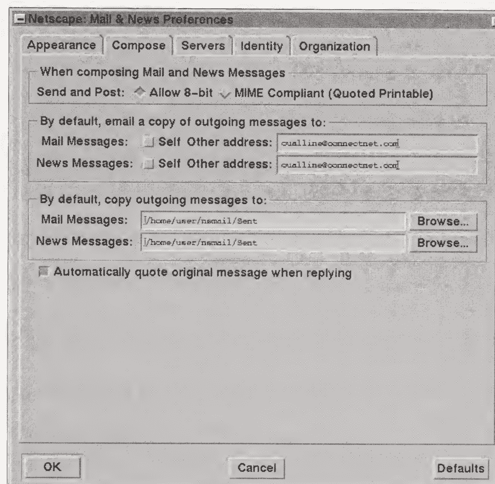

图 7-1 Netscape Mail & News Preferences 窗口的 Compose 标签
4. 在 Mail Messages/Self Other Address 和 News Messages/Self Other Address 块输入你的电子邮件地址（包括 @host 部分）。在本例中，使用地址 `oualling@connectnet.com`。
5. 点击 `Servers` 标签获取图 7-2 所示的窗口。

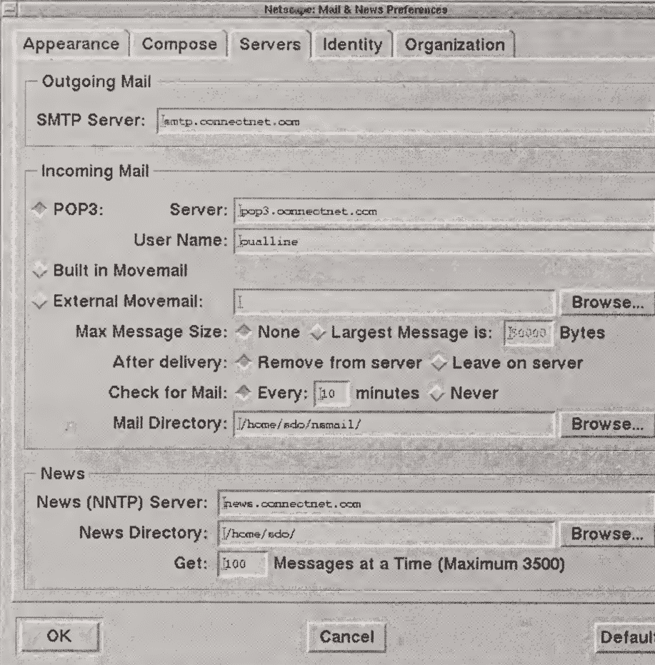

图 7-2 Netscape Mail & News Preferences 窗口的 Servers 标签
6. 在 `SMTP Server` 字段中输入你的 SMTP 服务器名称。在这个测试用例中，名称为 `smtp.connectnet.com`。
7. 在 `POP3 Server` 字段中输入 POP 服务器名称。在本例中，它是 `pop3.connectnet.com`。
8. POP 用户名位于 `User Name` 字段中。在本例中使用 `qualine`。
9. 转到 News 部分。在 `News (NNTP) Server` 字段中输入新闻主机名称。在本例中，使用 `nntp.connectnet.com`。
10. 点击 `Identity` 标签获取图 7-3 所示的窗口。
11. 输入你的信息。
12. 点击 `Organization` 标签获取图 7-4 所示的窗口。
13. 如果你不想每次接收消息都要输入 POP 邮件密码，请在 `Remember Mail Password` 复选框中打钩。
14. 点击 OK 关闭窗口。
15. 保存你的选项。选择 `Option` -> `Save Option` 菜单项。（如果不这样做，你必须重新执行这一切。）

LINUX AND THE INTERNET 133

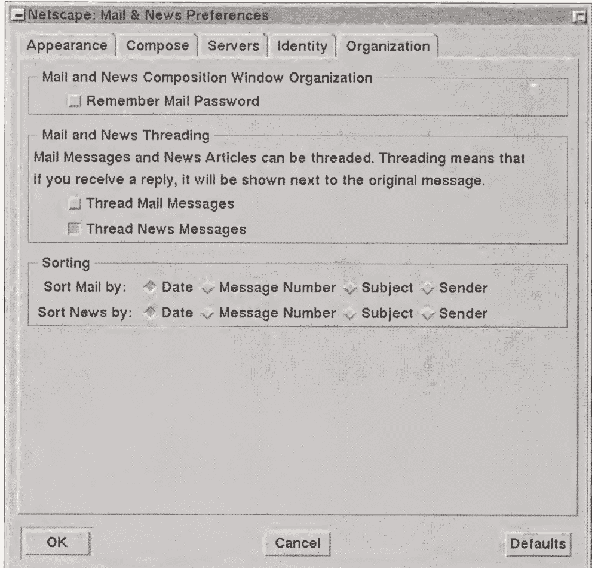

**图 7-4** Netscape Mail & News 选项窗口的“组织”选项卡

## 互联网邮件

阅读邮件最简单的方法是通过 Netscape。它功能良好且拥有具有吸引人的界面，如图 7-5 所示。

> 提示：为了确保你输入的所有内容都是正确的，给自己发一封邮件并看看是否收到是一个好主意。

其他邮件阅读器也可用；其中大多数都理解大多数服务提供商（ISP）使用的 POP 协议。其中一种邮件阅读器名为 `movemail`，它实际上是与 Netscape 一起分发的。遗憾的是，对许多邮件阅读器和发送邮件方式的详细讨论超出了本书的范围。

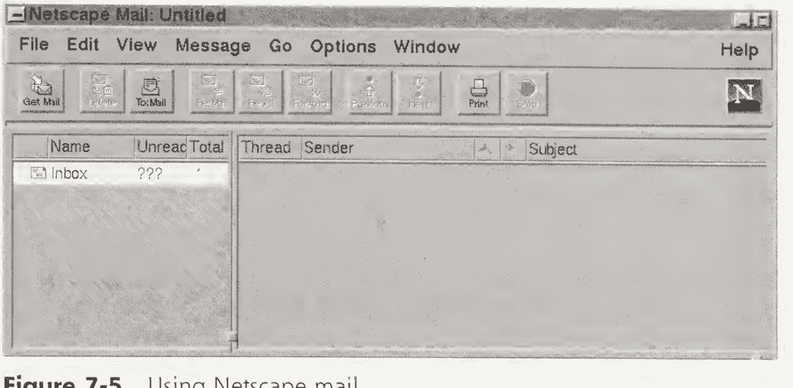

## 新闻

大多数 ISP 通过使用 NNTP 服务器提供 Usenet 新闻。Linux 有几个从远程服务器获取新闻的新闻阅读器。

在开始之前，你必须将环境变量 `NNTPSERVER` 设置为你的服务器名称，如下：

```
[user@pc user]$ NNTPSERVER=news.connectnet.com
[user@pc user]$ export NNTPSERVER
```

这些命令可能应该放在你的 `.profile` 或 `.cshrc` 文件中。之后，你就可以运行你喜欢的新闻阅读器了。Linux 上流行的程序有 `nnn`、`tin` 和 `slav`。它们各有自己的优势和追随者。

## 共享与学习更多

Linux 的增长依赖于共享。正由于如此，存在大量的与 Linux 相关的网站。本节仅包含了其中几个。

Red Hat 网站拥有官方的 Linux 发行版。该网站包含补丁、错误列表和其他有用信息。你可以通过以下地址访问 Red Hat 网站：

```
ftp site: redhat.com
Web page: www.redhat.com
```

Caldera 销售商业产品，包括 WordPerfect、Quattro Pro 和办公工具。你也可以访问 Caldera 组织的首页，该网页作为所有各种优质信息链接的汇集点。你也可以在这里找到《Linux Gazette》的在线副本。

```
www.caldera.com
```

Linux International 是一个通过提供 Linux 世界许多内容的链接来推广使用 Linux 的组织。你可以在以下网站找到 Linux International：

```
http://www.linux.org
```

Sunsite Repository 是一个无所不的网站：有大量的人同时从中下载内容。通过以下地址访问 Sunsite Repository：

```
ftp site: sunsite.unc.edu
Web page: sunsite.unc.edu
```


你可以在文件 `/usr/doc/FAQ/PPP.txt` 中找到常见 PPP 问题的答案。你可以在 `/usr/doc/ppp-2.2.0/README` 中找到 PPP 守护进程 (`pppd`) 的完整指南。这是一份关于 `pppd` 程序维护的相当全面的指南。如果你需要针对特定活动的快速指南，请查看 `/usr/doc/HOWTO/mini/PPP-over-ISDN` 和 `/usr/doc/HOWTO/mini/PPP-over-network`。如果你想看更通用的网络指南，可以在 `/usr/doc/HOWTO/NET-3-HOWTO.gz` 中找到。

## 总结

你现在知道如何连接互联网了。通过万网设施，这种能力为你开启了丰富的资源。Linux 是为了网络而设计的，Linux 中提供的工具让你能够充分利用网络。

# 第八章 面 Linux 用户的游戏和筛选器

在本章中，你将学习这些技能：

- 在从启动按钮页面运行的 X 窗口系统中玩游戏，第 138 页
- 学习其他窗口系统游戏，第 156 页
- 学习 FORTUNE 游戏，第 158 页
- 选择 X 筛选器，第 161 页

享受时光吧！本章包含了 Linux 提供的各种游戏目录。


## 从启动按钮运行 X 游戏

### XTetris

这是一个经典的方块消除游戏（见图 8-1）。要运行它，选择 `Start` -> `Games` -> `Arcade` -> `XTetris`

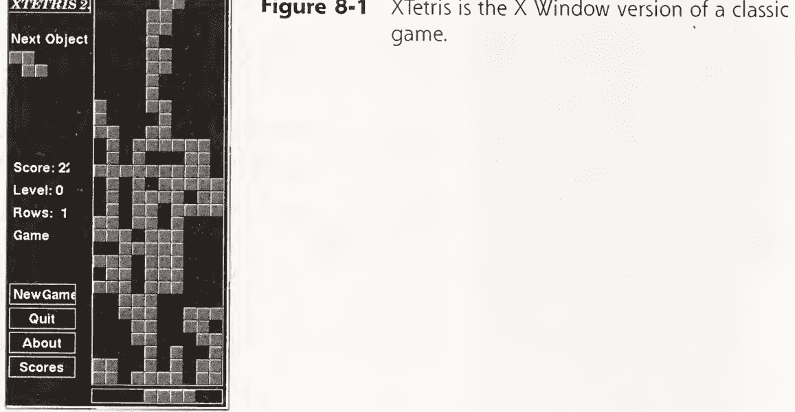

### XHextris

Tetris 的这种变体使用六边形而不是方形。它比 Tetris 更有挑战性且色彩丰富（见图 8-2）。要玩，选择 `Start` -> `Games` -> `Arcade` -> `XHextris`

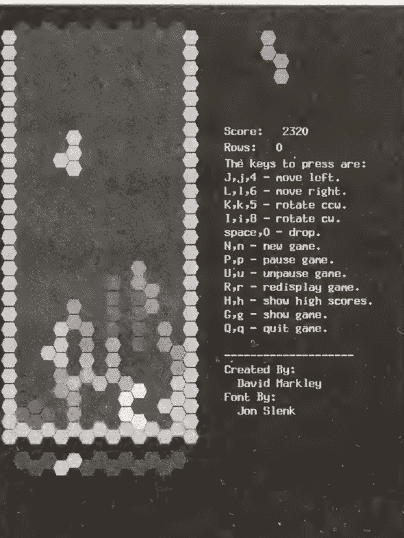

图 8-2 你拼合六边形的能力有多好？

```
Score: 2320
Rows: 6
使用按键：
Jj - 左移
Lk - 右移
Kk - 逆时针旋转
Lj - 顺时针旋转
space - 下落
Ww - 向上移动
Pp - 暂停游戏
Rs - 重启游戏
Rr - 重绘
Hh - 高分
Gg - 显示
Qq - 退出

作者：
David
```

### XBoing

XBoing 是一种掉落式游戏（见图 8-3）。要运行它，选择 `Start` -> `Games` -> `Arcade` -> `XBoing`


图 8-3 掉落的

### XJewel

XJewel 也是一种将三个相同颜色的宝石类的的游戏（见图 8-4）。要玩它，选择 `Start` -> `Games` -> `Arcade` -> `XJewel`

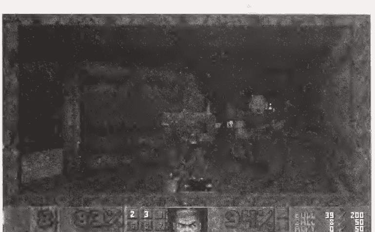

图 8-4 对齐的

### XPramid

XPramid 使用六边形碎片块（见图 8-5）。要玩它，选择 `Start` -> `Games` -> `Arcade` -> `XPramid`

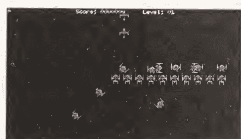

图 8-5 形状的

### XDoom

XDoom 是 Doom 的一种版本（见图 8-6）。要玩它，选择 `Start` -> `Games` -> `Arcade` -> `XDoom`


图 8-6 这里的

### XChomp

XChomp 是一种益智游戏（见图 8-7）。要玩它，选择 `Start` -> `Games` -> `Arcade` -> `XChomp`


图 8-7 吃掉的

### XGalaga

XGalaga 是一种射击游戏（见图 8-8）。要玩它，选择 `Start` -> `Games` -> `Arcade` -> `XGalaga`


图 8-8 你可以加入

### Xcubes

Xcubes 是一种滑块游戏（见图 8-9）。要玩它，选择 `Start` -> `Games` -> `Arcade` -> `Xcubes`

| 15 | 16 | 4 |

|---|---|---|

| 9 | 8 | 17 |

| 3 | 21 | 13 |

| 20 | 6 | 24 |

| 26 | 5 | 22 |

| 18 | 25 | 10 |

| 7 | | 11 |

| 12 | 19 | 2 |

| 14 | 1 | 23 |

## Xeyes

这是一对盯着你光标的眼睛（见图 8-14）。

要运行它，选择 `Start` -> `Games` -> `Toys` -> `Xeyes`


> 图 8-14 使用 Xeyes 盯着你的光标。

## Maze

Maze 生成迷宫并并在其中穿行（见图 8-15）。

通过选择 `Start` -> `Games` -> `Toys` -> `Maze` 运行 Maze。


> 图 8-15 很惊人，不是吗？

## XLogo

XLogo 显示 X Window 标志（见图 8-16）。它只做这一点。这个工具与“Hello World”并列，是世界上最复杂的程序之一。

要运行它，选择 `Start` -> `Games` -> `Toys` -> `XLogo`。


> 图 8-16 现在才叫兴奋！

## XEarth

这不是一个游戏，但它在你的根窗口（背景）中显示美丽的地球景色，如图 8-17 所示。图片中的地球旋转就像真实的一样——而且一样快。

要运行 XEarth，选择 Start -> Games -> Toys -> XEarth


**图 8-17** 现在你可以看着世界的旋转了。

## XFishtank

这个程序将你的屏幕变成鱼缸（见图 8-18）。

要让你的屏幕看起来像鱼缸，选择

`Start -> Games -> Toys -> XFishtank`


图 8-18 不要让悠闲游动的鱼影响了你的工作。

## XSnow

这个程序通常在圣诞节期间发布在 comp.sources.unix 上。它在你的根窗口上显示冬日场景，带有圣诞老人，如图 8-19 所示。

通过选择 `Start -> Games -> Toys -> XSnow` 运行 XSnow。

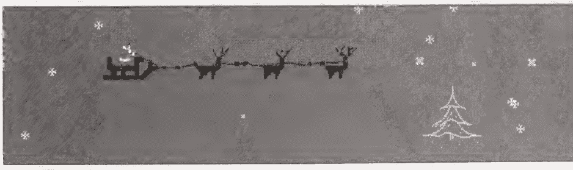

图 8-19 下雪吧，下雪吧，下雪吧！

## Blitspin

这个程序显示一个会散开又重新合在一起的图像（见图 8-20）。

要运行它，选择 Start -> Games -> Toys -> Blitspin


图 8-20 旋转的头部

## Xcarrom

用这个程序玩屏幕上的卡伦球（carrom）游戏（见图 8-21）。

要运行 Xcarrom，选择 Start -> Games -> Hockey -> Xcarrom


图 8-21 需要精准射击

## Xpool

有人玩台球（Pool）吗？如果没有，你可以自己玩（见图 8-22）。要运行 Xpool，选择 Start -> Games -> Hockey -> Xpool。

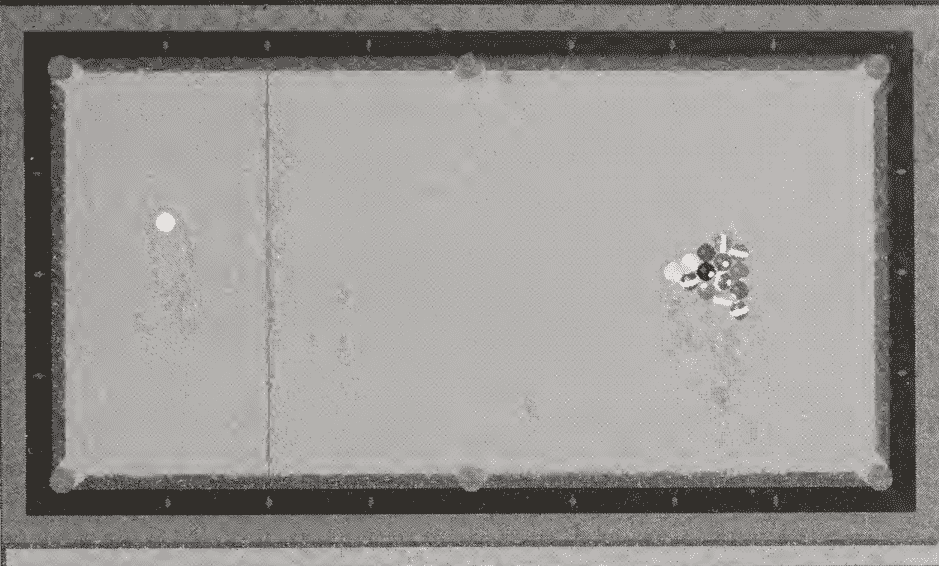

**图 8-22** 准备好巧笔。

## XSnooker

你更喜欢斯诺克（snooker）吗（见图 8-23）？玩 XSnooker，选择 Start -> Games -> Hockey -> XSnooker。


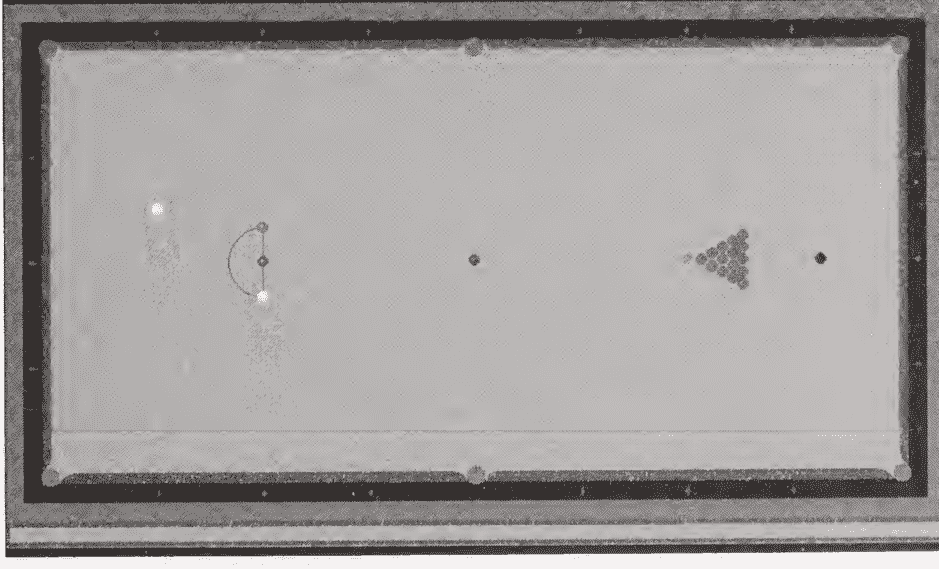

**图 8-23** 台球

## XCannon

与名称含义相反，`Cannon` 实际上是一个类似台球的游戏（见图 8-24）。

运行 `XCannon`，选择 `Start` -> `Games` -> `Hockey` -> `XCannon`。

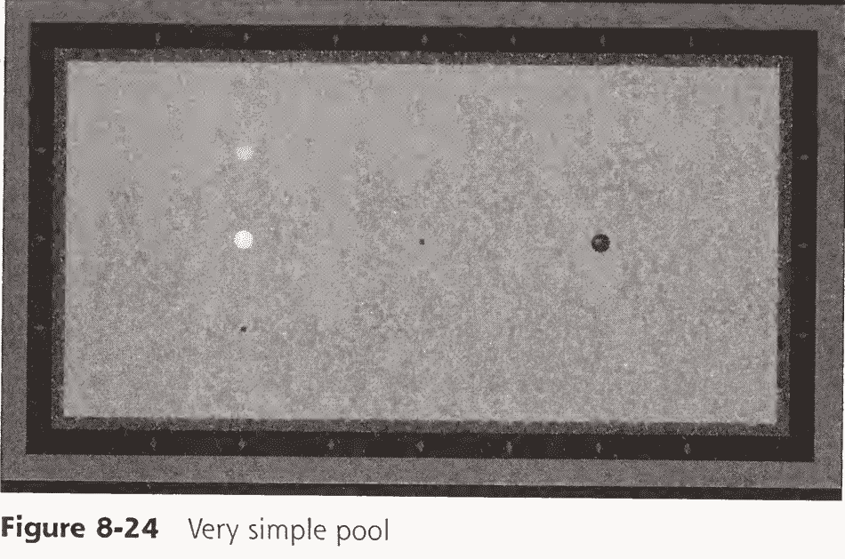

## Xcurling

冰壶（Curling）？San 对此一无所知（见图 8-25）。玩 `Xcurling`，选择 `Start` -> `Games` -> `Hockey` -> `Xcurling`。


## Xhockey

不用说，这是一个冰球游戏（见图 8-26）。

玩 `Xhockey`，选择 `Start` -> `Games` -> `Hockey` -> `Xhockey`。


## XBoard

从名字上看不出来，但这是一个国际象棋游戏（实际上是象棋前端），如图 8-27 所示。

运行它，选择 `Start` -> `Games` -> `XBoard`。

| 白方: 5 | | | | |

|---|---|---|---|---|

| ♙ | ♞ | ♝ | ♚ | ♝ | ♙ |

| | | | | | |

| | | | | | |

| | | | | | |

| | | | | | |

| | | | | | |

| ♟ | ♟ | ♟ | ♟ | ♟ |

| | | | | | |

| | | | | | |

| | | | | | |

| | | | | | |

| | | | | | |

| ♖ | ♘ | ♗ | ♔ | ♗ | ♖ |

图 8-27 深蓝（Deep Blue）曾击败过特大师。

## Spider

蜘蛛是一个双牌纸牌接龙游戏（见图 8-28）。

开始游戏，选择 `Start` -> `Games` -> `Spider`。


**图 8-28** 用一副扑牌获胜已经足够难了。

## XLander

对于留在地球的宇航员来说，尝试这个三维月球陆游戏（见图 8-29）。

运行 `XLander`，选择 `Start` -> `Games` -> `XLander`。


**图 8-29** 当你尝试降落在月球时，所有系统就绪。

## XPatience

这是经典版本的纸牌接龙（见图 8-30）。

玩它，选择 `Start` -> `Games` -> `XPatience`

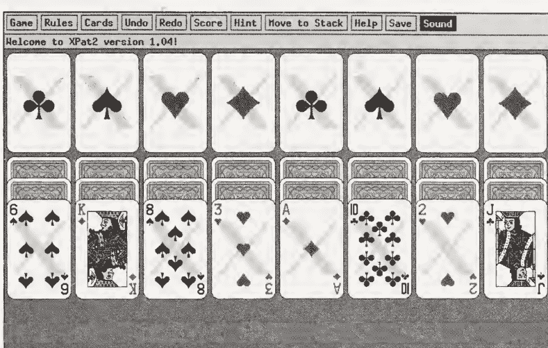

**图 8-30** 另一个纸牌接龙游戏

## XMorph

变形（Morphing）是指使用计算机将一张图片转换为另一张图片的术语（见图 8-31）。该程序仅接受 Targa 格式输入，且没有良好的文档。

开始 `XMorph`，选择 `Start` -> `Games` -> `XMorph`

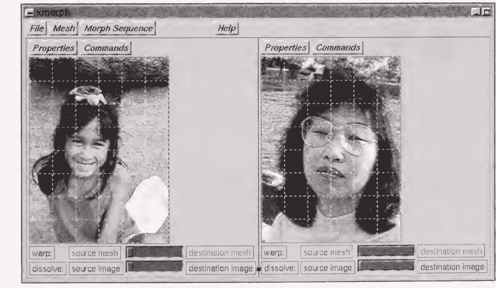

**图 8-31** 如何让图片老化

## XEvil

这是一个很多人互相射击的血腥游戏（见图 8-32）。

玩，选择 `Start` -> `Games` -> `XEvil`。

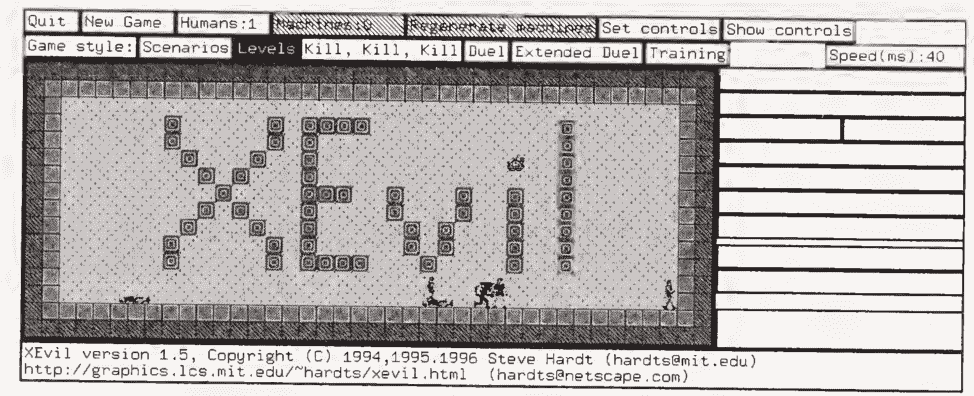

**图 8-32** 血腥战斗

## XBill

在比 Bill 把所有电脑变成 Microsoft Windows 机器之前修理他（见图 8-33）。这可以让你口笑一下，但不要认为这是一个真正的游戏。

玩 `XBill`，选择 `Start` -> `Games` -> `XBill`。

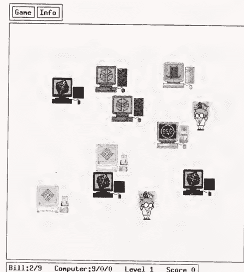

**图 8-33** 你可能想把这个游戏命名为世界统治（World Domination）。

## XBlockout

这个游戏是三维俄罗斯方（见图 8-34）。

玩 `XBlockout`，选择 `Start` -> `Games` -> `XBlockout`。

开始或恢复游戏

激活此窗口

并按任意键

| 分 | 用户ID | 数量 |

|---|---|---|

| 5 | 宽度 3 | 1 个 |

| 高分 | | |

| 5 | 深度 10 | |

| 最大重试 | 简单，碎片 | |

| 当前回合 | 开始，第二轮 | |

| 跟踪玩家 | 下一回合 | |

| 60 | 每个 | |

版权 © 1992-2004, Thomas J.

自由基于

## 粗俗行为礼仪指南

你每次都会得到不同的笑话。请对小小的帮助表示感谢。

> 注意：出厂设置时，幸运饼程序禁用了粗俗笑话。要启用这些笑话，你必须从源代码重新编译该程序。

要启用粗俗笑话，你必须首先执行以下命令安装源代码：

```
[root@pc /root]## cd /mnt/cdrom/SRPMS
[root@pc SRPMS]## rpm -i fortune-mod-1.0-3.src.rpm
```

现在你已经有了源代码，可以通过继续执行第 3 步来安装：

```
[root@pc SRPMS]## cd /usr/src/redhat/SPECS
[root@pc SPECS]## rpm -bp fortune-mod-1.0.spec
* Package: fortune-mod
* umask 022
+ echo Executing: %prep
Executing: %prep
+ cd /usr/src/redhat/BUILD
+ cd /usr/src/redhat/BUILD
+ rm -rf fortune
+ gzip -dc /usr/src/redhat/SOURCES/fortune-mod.tar.gz
+ tar -xvf -
drwx-xr-x  2  amy  users  0 Oct 20 20:34 1995 fortune/
```

… 省略了大量的解包信息

```
-rw-rw-r--  root/devel  3035 Oct 05 09:45 1995 fortune/Offensive
-rw-rw-r--  root/devel  665 Oct 20 20:49 1995 fortune/fortune-mod.lsm
-rw-rw-r--  root/devel  1750 Sep 26 19:41 1995 fortune/README.txt
+ [ 0 -ne 0 ]
+ cd fortune
+ chown -R root
+ chgrp -R root
+ chmod -R a+X,g-w,o-w
+ echo Patch #0:
Patch #0:
+ patch p1 -s
+ echo Patch #1:
Patch #1:
```

```
+ patch -pl -s
+ exit 0
```

现在你已经有了可以使用的源代码。进入包含该文件的目录并进行修改以包含粗俗幸运语，如下：

```
[root@pc SPECS#]# cd ../BUILD/fortune
```

编辑 `Makefile` 文件，并更改以下行：

```
OFFENSIVE=0
```

改为：

```
OFFENSIVE=1
```

接下来，使用 `make` 命令发布以下命令来构建程序：

```
[root@pc fortune]# make
make -C fortune
make[1]: Entering directory /usr/src/redhat/BUILD/fortune/fortune'
Creating photospheres.h
gcc -o2 -Wall -fomit-frame-pointer-pipe -c fortune.c -o fortune.o
gcc -s fortune.o -o fortune
```

... 省略了编译信息

最短字符串：21 字节

"work.dat" 已创建

有 630 个字符串

最长字符串：1446 字节

最短字符串：15 字节

"zippy.dat" 已创建

有 548 个字符串

最长字符串：486 字节

最短字符串：5 字节

make[1]: Leaving directory `/usr/src/redhat/BUILD/fortune/datatables'

最后一步是通过发布以下命令安装新程序和数据文件：


```
[root@pc fortune]# make -i install
install -s -m 0755 fortune/fortune /usr/games
install -s -m 0755 util/strfile /usr/bin
install -s -m 0755 util/unstr /usr/bin
install -s -m 0644 -o 0 fortune/fortune.man
```

... 省略了安装信息

done

make[1]: Leaving directory `/usr/src/redhat/BUILD/fortune/datfiles`

你现在可以使用“粗俗”选项 (`-o`) 来查看粗俗的幸运语。

然而，出于审美考虑，我们没有包含示例。

## X 屏幕保护程序和锁屏程序

X 带有各种屏幕保护程序。本章介绍了这些可用程序的视觉化列表。每个屏幕保护程序也是一个锁屏程序。

你通过选择 `Start -> Screensaver -> <Name>` 来激活屏幕保护程序。如果你想用同一个程序锁定屏幕，请选择 `Start -> Lock Screen -> <Name>`。

> 提示 你可以使用紧急退出离开 X Window 来轻松地破解锁屏程序。只需按下 `Ctrl+Alt+Backspace` 即可。

接下来的示例屏幕没有标题。不过，根据它们的名称，你判断这些程序显示的内容应该并不困难。

### 蚂 (Ant)


### 蝙蝠 (Bat)


### 空白 (Blank)


### 斑点 (Blot)


### 泡泡 (Bubble)


### 弹跳 (Bounce)


### 编织 (Braid)


### 昆虫 (Bug)


### 时钟 (Clock)

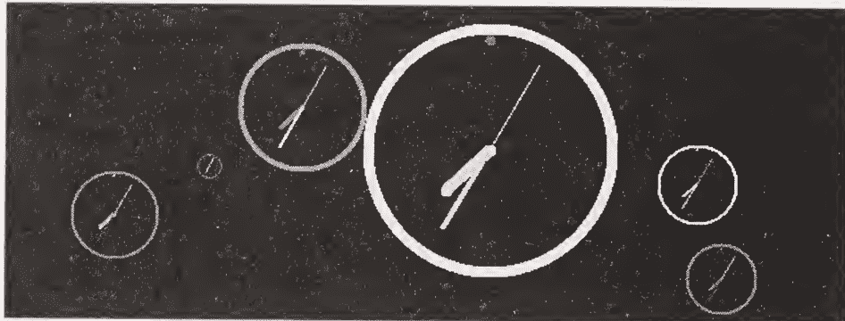

### 雏菊 (Daisy)


### 时钟 (Clock)


### 恶魔 (Demon)


### 眼睛 (Eyes)


### 旗帜 (Flag)


### 火焰 (Flame)


### 森林 (Forest)


### 银系 (Galaxy)


### 几何 (Geometry)


### 重力 (Grav)


### 螺旋 (Helix)


### 跳跃 (Hop)


### 超级 (Hyper)


### 图像 (Image)


### 万花筒 (Kaleid)


### 激光 (Laser)


### 生命 (Life)


### 1D生命 (Life1d)


### 3D生命 (Life3d)


### 闪电 (Lightning)


### 利西 (Lissie)


### 循环 (Loop)

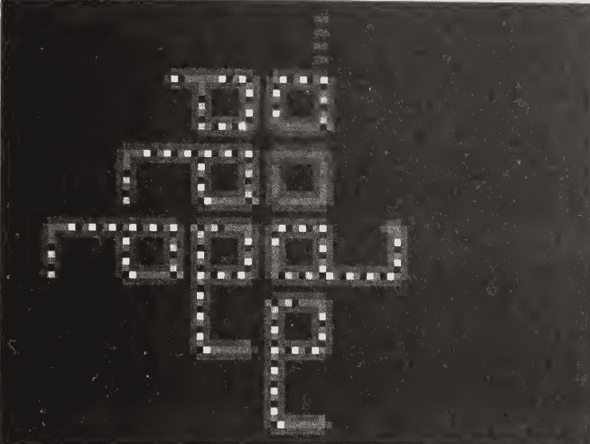

### 跑马灯 (Marquee)


### 迷宫 (Maze)


### 鼻子 (Nose)


### 罗三角形 (Penrose)


### 花瓣 (Petal)


### 益智 (Puzzle)


### 烟火 (Pyro)


### Qix


### 随机 (Random)

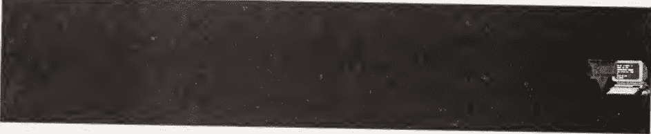

### 旋转子 (Rotor)


### 形状 (Shape)


### 滑滑 (Slip)


### 球体 (Sphere)


### 螺旋 (Spiral)


### 样线 (Spline)

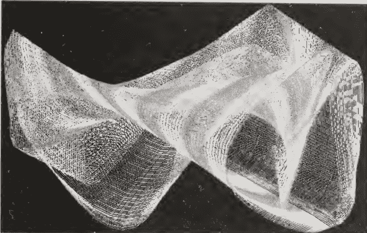

### 星星 (Star)


### 群群 (Swarm)


### 旋涡 (Swirl)


### 三 (Tri)


## 三角形 (Triangle)


## 海龟 (Turtle)


## Wator


# 丝//线 (Wire)

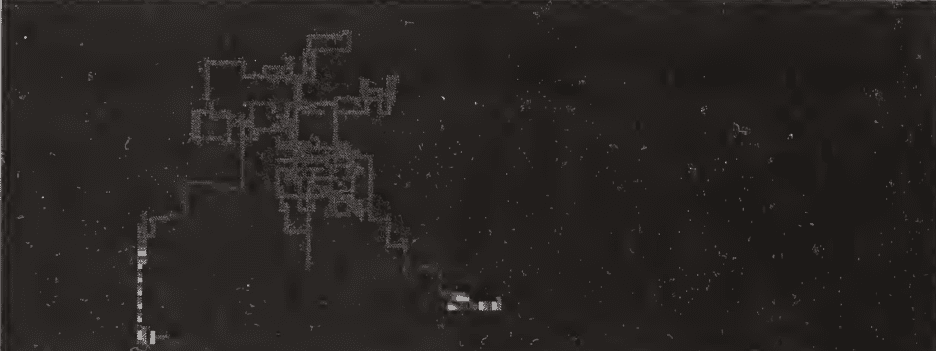

## 世界 (World)


## 虫 (Worm)

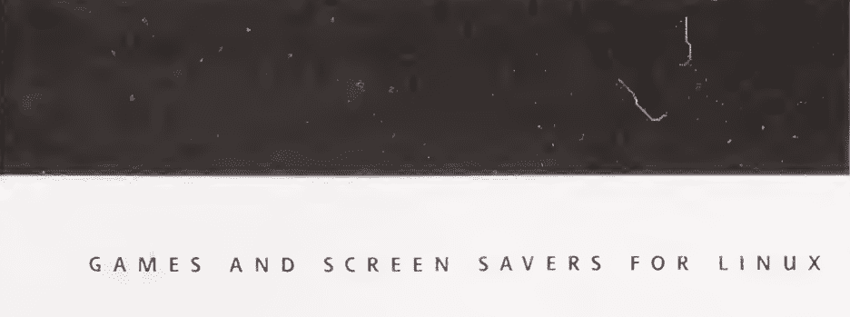

## 额外奖励

## 你是“游戏性”地就业了吗？

网页路径 -> 想要更多游戏吗？你可以在以下 Web 地址找到大量 Red Hat Linux 的贡献游戏：

```
http://www.redhat.com/linux-info/pkglist/contrib_i386/Games/
```

网页路径 -> 你可以在 Sunsite 主归档中获取更多游戏。这些游戏的网页地址如下：

```
http://sunsite.unc.edu/pub/Linux/games/!INDEX.html
```

在 Sunsite 网页上，你可以找到丰富的游戏，包括允许你在网络上与人类对手游戏的对战游戏。（这种功能在 Microsoft Windows 类型的游戏中很少见。）

## 总结

在本章中，你学习了 Linux 并不是只有工作而没有娱乐：你可以以许多方式从 Linux 中获得乐趣。你可以找到像象棋一样具有智力挑战性，或者像 Xdoom 一样令人兴奋的游戏。玩得开心！


# 办公中的 LINUX

本部分包含以下章节

- 第 9 章 使用办公工具
- 第 10 章 办公服务器
- 第 11 章 LINUX 遇上 DOS

本部分描述了你可以在办公室中使用 Linux 的一些方法。

考虑到为之设计的办公应用程序数量，Linux 无法与 Windows 95 竞争。尽管如此，几家商业公司正在为该系统开发传统的办公产品。

然而，在服务器部门，Linux 可以同时为 NFS (UNIX) 客户端、NetWare 客户端和 SMB (Windows 95/NT) 客户端服务。它比任何试图将你锁定在其系统中的专用服务器都廉便宜且更灵活。

MS-DOS 是无处不在，以至于你无法逃避它。例如，这本书是在 Linux 系统上编写的，但手稿将通过 MS-DOS 磁盘提交。Linux 有几种方法可以弥补 Linux 和 MS-DOS 之间的差距，包括处理 MS-DOS 软盘的工具以及一个几乎完全工作的 MS-DOS 模拟器。

# 现实中的 Linux：你疯了吗？你想把 Linux 用于业务关键型应用吗？

“疯了吗？你想用一个免费系统来进行业务关键型应用？这是大多数程序员在提议使用 Linux 作为办公服务器时收到的回答。

但令人惊讶的是，越来越多的人在办公室里使用 Linux。原因很简单：技术支持。Linux 作为一个不受官方支持的产品，如何能击败 Windows NT 和 Solaris-UNIX 等产品，特别是在支持领域？

关键在于 Linux 没有任何秘密：一切——所有的源代码对程序员都是开放的。例如，如果你在路由表中遇到问题，你可以检查并发明你所创建的工具来解决。

如果你在商业服务器上遇到问题，你必须拨打技术支持。这意味着要在排队中花费好几个小时¹听着背景音乐，直到你最终接通某人的电话。

但即便如此，问题还没有结束。很有可能客户服务代表是一个培训不当的新员工。所以你得花时间去教客服员工，直到他或她理解了问题为止：

程序员：“我的路由表出了问题。”

客服：“呃，什么是路由表？”

程序员：“这是一个内核表，我们用它来决定如何在系统中不同的网卡之间路由数据包。”

客服：“你的意思是你可以在系统上放置多个网卡。哇！”

程序员：“你知道电脑是什么吧？”

客服：“噢，当然。在我们为了这份工作所参加的八小时培训课程上他们告诉了。”

程序员：“不可理喻。”

当然，客服人员可以帮助你，但他或她会将你的报告输入数据库，然后工程师会在时间允许的情况下查看它（正如你所知，时间是允许的）。

Linux 的支持策略很简单：“自力更生”。你有代码；检查它，探测它，并弄清楚发生了什么。如果你不是程序员，就请一个程序员来解决你的问题。有数百万人正在使用 Linux。发现一个 bug，可能会有人修复它，然后向世界发布修复程序。

开发 Linux 的开发者比开发 Windows NT 的开发者还要多。使用 Linux 的人是疯了吗？有些人可能认为不使用 Linux 才是明智的。

¹ Queue jockey 指播放唱片的人，但他们不是向广播电听众广播，而是向所有在队列中等待技术支持的数百人进行“广播”。


# 第 9 章

使用办公工具

在本章中，你将学习这些核心技能

- 学习邮件程序，第 185 页
- 理解管理器，第 189 页
- 理解文字处理器、电子表格和数据库应用程序，第 190 页
- 学习文本处理工具，第 198 页
- 学习数据库库，第 201 页
- 理解传真软件，第 202 页
- 学习日历管理器，第 204 页

Linux 软件包包含许多用于办公的工具，例如电子邮件程序和处理普通办公任务的程序（如传真和安排预约）。本章讨论了 Linux 随附的一些办公应用程序。

## 使用邮件程序

UNIX 电子邮件系统最初设计为仅发送文本。毕竟，在电子邮件发明时，生成图形和声音是非常昂贵的。如果你想通过电子邮件发送它们，别想了。传输邮件的程序创建时假设它们处理的是 7 位字符。这一假设导致它们无法处理二进制数据和外语言字符集。

随着时间的推移，人们对寻找发送二进制文件的需求日益增长。为了跨越 7 位屏障，他们必须将数据编码为 7 位 ASCII。第一个常用的编码程序被称为 `uencode`。事实上，`uencode` 仍然在使用。

然而，`uencode` 并不是唯一的选择；一种新的方法已经取代了 `uencode`。这种方法被称为 MIME 编码，设计用于处理二进制文件以及其他格式。一些 Linux 程序（如 `elm`）是感知 MIME 的（即可以处理 MIME 附件）。而较旧的程序（如 `mail`）则不是。

## mail 命令

`mail` 命令是一个命令行程序。它非常简单，但功能强大。你可以用它发送和接收电子邮件。

## pine 邮件程序

`pine` 程序是一个菜单式界面。它比 `mail` 好用得多，而且具有更多功能。

## elm 邮件程序

`elm` 邮件程序是另一个菜单式邮件程序。它也比 `mail` 好用。

## mh 和 xmh 程序

`xmh` 程序是 `mh` 命令的前端。这些命令提供了各种邮件服务，但在使用它们之前，你需要将 `/usr/bin/mh` 放入你的路径路径中。

## xbiff 邮件检查程序

`xbiff` 程序设计用于在你有邮件时通知你，它显示一个看起来像旗帜插下的信箱图标。当邮件到达时，程序会发出响，旗帜会升起。

## 表 9-1 邮件程序比较

| 程序 | 支持 MIME | 菜单界面 | 需要 X | 注释 |
| --- | --- | --- | --- | --- |
| pine | 是 | 是 | 否 | |
| elm | 否 | 是 | 否 | 下一个版本将支持 MIME。 |
| mail | 否 | 否 | 否 | 这是原始的 UNIX 邮件程序。 |
| mh | 否 | 是 | 是 | 需要正确设置路径才能运行。文档说明允许 MIME 附件。 |

## 使用 X Window 文件管理器

X Window 有自己的文件管理器，与你在 Windows 3.1、Windows 95 以及 Macintosh 上看到的文件管理器类似。文件管理器允许你执行常见操作，如复制、删除和重命名文件以及其他功能。

要启动 X Window 文件管理器，选择 Start -> Utilities -> Xfm，将出现一个与图 9-5 所示类似的窗口。

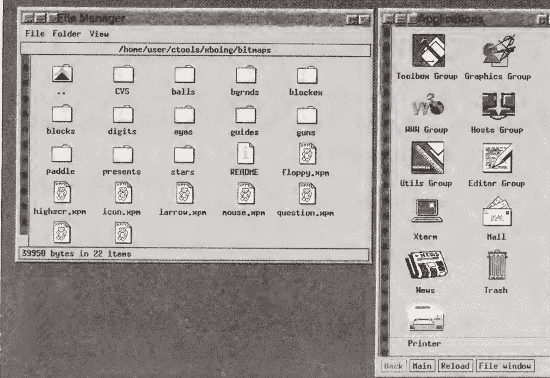

图 9-5 使用 xfm

该程序遵循传统的文件管理器模型，具体如下：

- 双击文件夹以打开文件夹并查看其中的文件。
- 双击文件以启动与该文件关联的应用程序。（关联关系由 `~/.fm` 中的一组配置文件控制）
- 在 Tools（工具）窗口中，双击任何工具组即可打开该组。


要使用工具，只需将文档拖到工具上并释放即可。例如，要打印文件，只需将文件拖到打印机并释放。

该界面非常直观简单，因此你在学习操作时不应该会遇到太大困难。

## 文字处理器、电子表格和数据库

如果你想要拥有 Microsoft Office 的所有功能和特性，请购买 Microsoft Office。微软在这些程序的开发上投入了数百万美元，许多人都在使用。

Linux 有多种优秀的办公套件可用，但它们需要付费。其中两个是：

Applizware。有关信息和订购，请访问以下地址：

```
http://www.redhat.com/products/apx.html
```

Caldera StarOffice。其他此外，Caldera 还销售一个可在 Linux 上运行的 WordPerfect。有关信息和订购，请访问以下 Web 地址：

```
http://www.caldera.com/products/
```

## StarOffice

StarOffice 免费供非商业使用。基本上，这意味着如果你用它赚钱，他们就要收钱。StarOffice 由一套办公程序组成，包括电子表格、文字处理器、图表生成器和图像处理程序。

要获取 StarOffice，你需要执行以下步骤：

1. 访问 Caldera 首页 (`http://www.caldera.com`)，按照链接进入 StarOffice 下载菜单。你需要提供姓名、地址和电话号码才能进入下载菜单。
2. 下载所有 `README` 文件，然后阅读它们。
3. 下载相应的 `.rpm` 文件。
4. 使用 `rpm` 命令安装每个文件，如下：

```
[root@pc root]# rpm -i --nodeps files
```

5. 运行安装程序可能需要较新版本的 C 库。你可以从以下 Web 地址的 Red Hat ftp 归档中获取当前库：

`ftp.redhat.com:/pub/contrib/i386/libc-xxxxxx`

将 `xxxx` 替换为库的最新版本号。
6. 使用以下命令安装新库：

```
[root@pc root]# rpm -i --upgrade libc*
```

7. 编辑文件 `/opt/StarOffice-3.1/sd.sh` 和 `/opt/StarOffice-3.1/sd.csn`，并按照指示进行更改，以便它们指向正确的路径。
8. 使用以下命令设置 shell，使其能够运行 StarOffice 程序：

```
[root@pc root]# .opt/StarOffice-3.1/sd.sh
```

9. 通过以下命令启动后台程序：

```
[root@pc root]# svdaemon &
[root@pc root]# svportmap #
```

### STAROFFICE

在运行任何 StarOffice 产品之前，你需要初始化 shell，以便它能找到 StarOffice 程序。你通过以下命令进行此初始化：

```
[user@pc user]$ .opt/StarOffice-3.1/sd.sh
```

现在你可以输入程序名称来运行 StarOffice 程序了。例如，要启动电子表格（名为 `calc3`），执行以下命令：

```
[user@pc user]$ calc3
```

图 9-6 显示了一个典型的 StarCalc 屏幕。

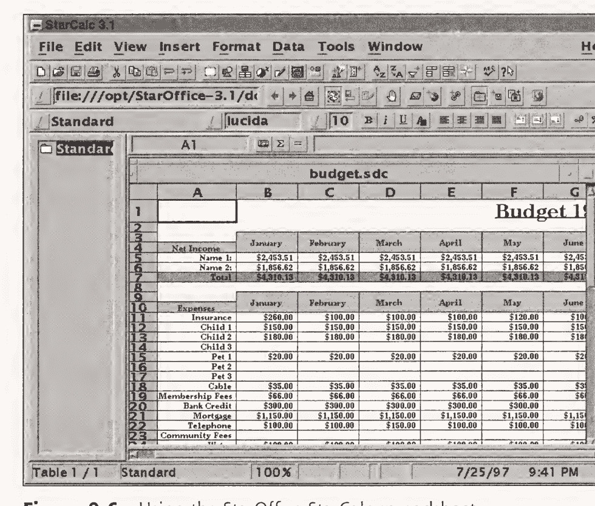

图 9-6 使用 StarCalc 电子表格

通过以下命令启动文字处理器：

```
[user@pc user]$ writer3
```

图 9-7 显示了一个典型的 StarOffice 文字处理器屏幕。


图 9-7 使用 StarOffice 文字处理器

该套件中的其他程序是图表生成器 (`chart3`)、公式生成器 (`math3`)、绘图程序 (`draw3`) 以及图像处理程序 (`image3`)。图 9-8 显示了这些。

## StarOffice 问题

StarOffice 在文档方面存在问题。安装运行说明并不清晰，你必须编辑配置文件才能运行软件。

StarOffice 的另一个问题是帮助文档。在编写本书期间，帮助文档仅提供德语版本。这对于只使用英语的用户来说有些困难。

我曾经得到一个瑞士程序。它是用德语编写的。在代码中，“is called by”被翻译成了“is shouted at”。

## Lyx 文字处理器

有很多免费文字处理器可用。其中许多程序处于 Alpha 阶段。这意味着它们有很多 Bug、缺乏文档，对黑客很有趣，但对普通用户来说极其困难。

一个例外是 Lyx 文字处理器。该程序功能丰富且免费提供。该程序不在随书提供的 CD-ROM 上，但你可以从以下 Web 地址下载它：

```
ftp://ftp.redhat.com/pub/contrib/386
```

本书作者将 Lyx 文字处理器称为 WYSAWYG（所见即几乎所所得）程序。该程序试图向用户呈现与最终文档非常接近的内容。虽然它很接近，但在某些情况下并不完全一致。

### Lyx 文字处理器

Lyx 文字处理器是一个很好的尝试，是一个布局良好的程序，可以导出到某些 Linux 文本处理工具中。

`Lyx:~/test.lyx` (已修改)

图 9-9 Lyx 文字处理器

## 拼写检查

每当你编写 `README` 文件、安装说明或电子邮件时，你都在处理文本文件。`ispell` 程序检查文本文件以确保所有单词拼写正确。你通过执行以下命令启动程序：

```
[user@pc]$ ispell file
```

程序读取文件并寻找拼写错误的单词。当发现时，它会在上下文中显示该单词，显示正确拼写的建议列表，并给你修正单词的机会。图 9-10 显示了一个典型的屏幕。

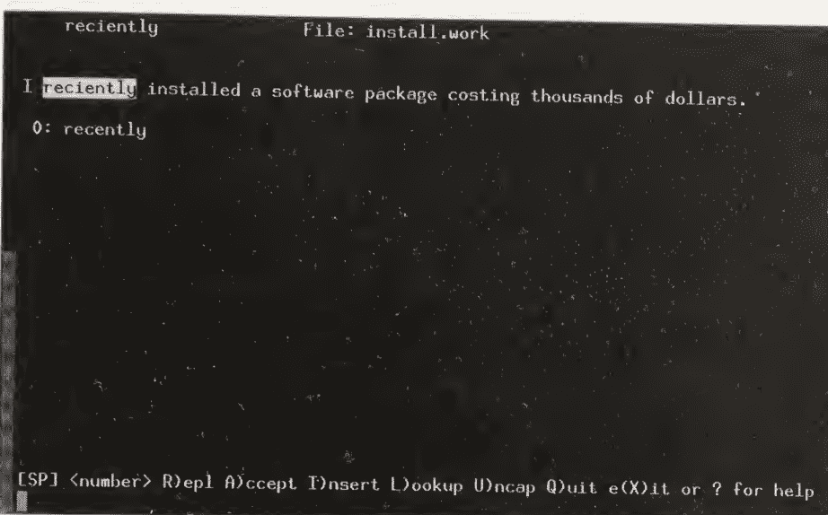

图 9-10 使用 ispell

图 9-10 所示的示例中，输入 `O` 将该单词替换为列表中的第一个（也是唯一的）选项。你可以通过 `?` 命令获取有关其他命令的帮助。

> 仅仅因为一个单词拼写正确，并不意味着它是正确的。例如，这个单词的拼写有什么问题：`cat`？（答案请参见本章最后一页。）

如果你能接近目标单词，`ispell` 程序就会很有帮助。但有时，你无法足够接近它以让 `ispell` 识别出你想要什么。

`look` 命令打印字典中所有以给定字符串开头的单词。例如，要找到所有以 `execute` 开头的单词，可以使用以下命令：

```
[user@pc user]$ look execute
```

`look` 命令会返回以下可能性：

- `executable`
- `execute`
- `executed`
- `executes`
- `executing`
- `execution`
- `executional`
- `executioner`
- `executions`
- `executive`
- `executives`
- `executor`
- `executors`

但如果你对单词开头部分的了解不足，导致无法起作用怎么办？假设你想找到 `endurance` 这个词，但只知道它以 `en` 开头，并且中间某个有一个 `ra`？

解决方案是将 `look` 命令的输出通过给 `grep` 来限制你的单词选择，如下例所示：

```
[user@pc user]$ look en | grep ra
```

此命令产生了一个单词列表，但由于太多了而没有参考价值。你必须进一步限制搜索。现在某处有一个 `d`，所以你又添加了一个 `grep` 来进一步减少单词数量，如下命令所示：

```
[user@pc user]$ look en|grep ra d
```

这一次，结果如下：

- `encouraged`
- `endurable`
- `endurable`
- `enturance`
- `engraved`
- `erraged`
- `entranced`
- `enumerated`

现在你有了一个足够小的列表，因此可以很容易地找到那个单词了。上述讨论的结论是：Linux 确实拥有很好的工具，但有时你必须将它们结合起来。

## 文本处理

Linux 在文字处理器方面可能比较有限，但在文本处理工具方面表现出色。文本处理器使用嵌入命令来排版文本。使用文字处理器时，你可以在屏幕上看到工作的样子。而使用文本处理器时，输入由文本和命令组成，与成品完全不像。你必须将输入通过文本处理器运行，才能看到打印页的样子。

例如，这是 `cat` 命令的原始格式的 Linux 手页：

```
.TH CAT 1 "GNU Text Utilities" "FSF" \* -*-
.SH NAME
cat - concatenate files and print on the standard output
.SH SYNOPSIS
.B cat
```


```
[benstuvAET] [--number] [--number-nonblank]
[squeeze-blank]
[show-nonprinting] [--show-ends] [--show-tabs] [--show-all]
[help] [--version]
file...
 DESCRIPTION
此手册页文档了 GNU 版本的
.BR cat
.B cat
写入每个给定文件的内容，或标准输入
```

通过 `groff` 处理器后，你将得到图 9-11 所示的结果。

CAT(1)

NAME

`cat`: concatenate files and print on the standard output

SYNOPSIS

`cat` [-benstuvAET] [-number] [-number-nonblank] [-squeeze-blank] [-show-nonprinting] [-show-ends] [-show-tabs] [-show-all] [-help] [-version] [file...]

DESCRIPTION

此手册页文档了 GNU 版本的 `cat`，`cat` 写入每个给定文件的内容，或其

# 图 9-11 cat 命令的手页

`groff` 程序还带有许多预处理器，包括以下：

| 程序 | 排版内容 |
| :--- | :--- |
| `eqn` | 方程 |
| `gtbl` | 表格 |
| `grefer` | 参考文献 |
| `gpic` | 绘图 |
| `soelim` | 包含文件移除器（将多个输入文件合并为一个） |

此外，`groff` 还有许多标准宏包，但在设置文档时你必须使用正确的包。希望当你获得 `groff` 文档时，供应商会包含一个 README 文件，告诉你应该使用哪个宏包。如果没有，你就必须查看文档并进行推测。

有了所有的预处理器，用于排版 `groff` 文档的命令行可能会变得非常长。此外，嵌入命令的语法非常晦涩，极其难以理解，且不一致，并包含了你见过的最奇怪的引用规则，让你意识到使用 `groff` 是多么困难。

底线是：除非你是专家或走投无路，否则不要使用 `groff`。这项技术已被全功能 WYSIWYG 文字处理器所取代。你唯一需要运行 `groff` 的可能是排版 man 页，这在第 4 章中介绍。

## TeX 程序

TeX 程序是另一个使用嵌入命令排版文本的文本处理器。它在 `groff` 之后设计，具有更好的命令语法。TeX 在学术界仍然流行，并广泛用于分发可能需要的文档。

当收到某人的传真电话时，你可以通过以下命令进行接收：

```
[user@pc user]$ fax receive
```

收到的传真会被放在一个溢出目录（spool directory）中。你可以通过执行以下命令获取该目录的索引：

```
[user@pc user]$ fax queue
```

要查看或打印传真，请给出相应的命令：

```
[user@pc user]$ fax view file
[user@pc user]$ fax print file
```

此程序还有许多选项；如需查看列表，请参阅帮助页（man page）或其他文档。

## mgetty 和 sendfax 程序

`mgetty` 程序设计用于监控连接到调制解调器的串口端口。如果有人拨入电话，该程序会运行登录程序以启动终端会话。该程序专为串口线路共享设计的，因此如果有人使用串口线路发送数据（例如发送传真或启动 ppp 会话），它不会产生干扰。

`mgetty` 程序能够识别传真调制解调器，并自动检测且正确处理传真电话。这有一个前提是你的调制解调器能够正确检测传真电话；请不要忽略此点。

## 语音信箱

`mgetty` 程序有一个与语音调制解调器配合的版本，称为 `vgetty`。你可以将 `vgetty` 程序配置为一个功能完整的语音信箱系统。

该软件的缺点是它目前处于测试阶段（beta），尚未经过完全调试。更糟糕的是，它几乎没有任何文档。如果你打算尝试使用这些代码，必须解包源码（如第 4 章所述）并对其进行检查以确定程序的功能。

如需更新的软件和文档，你可能想查看 Red Hat 首页：

http://www.redhat.com

你也可以查看 `mgetty` 首页：

http://www.leo.org/~doering/mgetty

## 日历程序

`helical` 程序是一个功能齐全的日历和调度程序。通过点击日历上的任何一天，你可以查看当天的事件。点击月份下方的空格，可以添加一个占满整天的新事件。点击特定的时间，可以为该特定时间添加事件。图 9-12 显示了一个典型的日历。

| 文件 编辑项目 重复 列表 选项 帮助 | 8:00am |
| :--- | :--- |
| ✧ 三月 ✧ 1997 ✧ | |
| 日 一 二 三 四 五 六 | | 9:00am |
| 2 3 4 5 6 7 8 | 10:00am |
| 9 10 11 12 13 14 15 | 11:00am |
| 16 17 18 19 20 21 22 | 12:00pm 与妻子吃午餐 |
| 23 24 25 26 27 28 29 | |
| 30 31 | | |
| 上一个 今天 下一个 | 1:00pm |
| 妻子生日 | 2:00pm |
| 重要 | 3:00pm |
| | 4:00pm |
| | 5:00pm |

图 9-12 使用

双击事件会显示该事件的属性窗口。图 9-13 显示了一个示例。

| 与妻子吃午餐 | 开始时间 | 12:00pm | |
| :--- | :--- | :--- | :--- |
| 结束时间 | 12:30pm | | |
| 日历 主日历 | 高亮 | 提前预警 |
| 总是 | 0 天 | | |
| 从不 | 5 | | |
| 直到过期 | 10 | | |
| 作为假期 | 15 | | |
| 事项 | |

以分钟为单位选择闹钟时间。通过拖动刻度右侧的标记来创建闹钟。你也可以拖动现有标记来更改闹钟时间。如果你将标记向上或向下移动足够远使其变暗，在松开鼠标按钮时它将被删除。

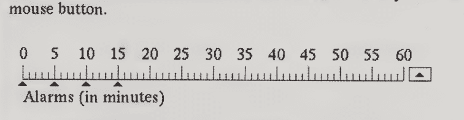

图 9-13  ical 事件窗口

“提前预警”列告诉日历程序，你希望在事件发生几天前收到提醒。例如，如果你想在配偶生日时收到提醒，你可能希望提前一周提醒。程序随后会在事件发生前不久产生闹钟。当闹钟响起时，屏幕上会弹出一个窗口，告诉你事件即将到来。

该程序可以处理多个日历。例如，你可能想要一个小组日历。此日历可能包含小组会议、设计评审、规划会议等。你可以将此日历与管理日历合并，管理日历可能包含高级会议的时间。最后，你可以将这两个日历与个人日历合并，生成一个完整的事件日历。日历程序是一个很好的工具，也是小组用于调度和其他事件的有用工具。要运行 `ical` 程序，选择开始 -> 日历。

## MoveWare 逊色，微软

`icalWare` 是一组程序，执行了你在 Microsoft office 中找到的许多功能，例如 Microsoft Office。ApplWare 可以从 Red Hat 获取，你可以通过公司的网页进行订购：

http://www.redhat.com

安装程序后，通过以下命令启动它：

```
[user@pc user]$ fax view file
[user@pc user]$ fax print file
```

此程序有许多更多选项；如需查看列表，请参阅帮助页或其他文档。


当收到某人的传真电话时，你可以通过以下命令进行接收：

```
[user@pc user]$ fax receive
```

收到的传真会被放在一个溢出目录（spool directory）中。你可以通过执行以下命令获取该目录的索引：

```
[user@pc user]$ fax queue
```

要查看或打印传真，请给出相应的命令：

```
[user@pc user]$ fax view file
[user@pc user]$ fax print file
```

此程序还有许多更多选项；如需查看列表，请参阅帮助页（man page）或其他文档。

## mgetty 和 sendfax 程序

`mgetty`程序设计用于监控连接到调制解调器的串口端口。如果有人拨入电话，该程序会运行登录程序以启动终端会话。该程序专为串口线路共享设计的，因此如果有人使用串口线路发送数据（例如发送传真或启动 `ppp` 会话），它不会产生干扰。

`mgetty`程序能够识别传真调制解调器，并自动检测且正确处理传真电话。这有一个前提是你的调制解调器能够正确检测传真电话；请不要忽略此点。

## 语音信箱

`mgetty`程序有一个与语音调制解调器配合的版本，称为 `vgetty`。你可以将 `vgetty`程序配置为一个功能完整的语音信箱系统。

该软件的缺点是它目前处于测试阶段（beta），尚未经过完全调试。更糟糕的是，它几乎没有任何文档。如果你打算尝试使用这些代码，必须解包源码（如第 4 章所述）并对其进行检查以确定程序的功能。

如需更新的软件和文档，你可能想查看 Red Hat 首页：

http://www.redhat.com

你也可以查看 `mgetty` 首页：

http://www.leo.org/~doering/mgetty

## 日历程序

`ical`程序是一个功能齐全的日历和调度程序。通过点击日历上的任何一天，你可以查看当天的事件。点击月份下方的空格，可以添加一个占满整天的新事件。点击特定的时间，可以为该特定时间添加事件。图 9-12 显示了一个典型的日历。

| 文件 编辑项目 重复 列表 选项 帮助 | 8:00am |
| :--- | :--- |
| ✧ 三月 ✧ 1997 ✧ | |
| 日 一 二 三 四 五 六 | 9:00am |
| 2 3 4 5 6 7 8 | 10:00am |
| 9 10 11 12 13 14 15 | 11:00am |
| 16 17 18 19 20 21 22 | 12:00pm 与妻子吃午餐 |
| 23 24 25 26 27 28 29 | |
| 30 31 | | |
| 上一个 今天 下一个 | 1:00pm |
| 妻子生日 | 2:00pm |
| 重要 | 3:00pm |
| | 4:00pm |
| | 5:00pm |

图 9-12 使用 

双击事件会显示该事件的属性窗口。图 9-13 显示了一个示例。

| 与妻子吃午餐 | 开始时间 | 12:00pm | | |
| :--- | :--- | :--- | :--- |
| 结束时间 | 12:30pm | | | |
| 日历 主日历 | 高亮 | 提前预警 |
| 总是 | 0 天 | | |
| 从不 | 5 | | |
| 直到过期 | 10 | | |
| 作为假期 | 15 | | |
| 事项 | | | |

以分钟为单位选择闹钟时间。通过拖动刻度右侧的标记来创建闹钟。你也可以拖动现有标记来更改闹钟时间。如果你将标记向上或向下移动足够远使其变暗，在松开鼠标按钮时它将被删除。


图 9-13 `ical` 事件窗口

“提前预警”列告诉日历程序，你希望在事件发生几天前收到提醒。例如，如果你想在配偶生日时收到提醒，你可能希望提前一周提醒。程序随后会在事件发生前不久产生闹钟。当闹钟响起时，屏幕上会弹出一个窗口，告诉你事件即将到来。

该程序可以处理多个日历。例如，你可能想要一个小组日历。此日历可能包含小组会议、设计评审、规划会议等。你可以将此日历与管理日历合并，管理日历可能包含高级会议的时间。最后，你可以将这两个日历与个人日历合并，生成一个完整的事件日历。日历程序是一个很好的工具，也是小组用于调度和其他事件的有用工具。要运行 `ical` 程序，选择开始 -> 日历。

## MoveWare 逊色，微软

`icalWare`是一组程序，执行了你在 Microsoft office 中找到的许多功能，例如 Microsoft Office。`ApplWare`可以从 Red Hat 获取，你可以通过公司的网页进行订购：

http://www.redhat.com

安装程序后，你通过以下命令启动它：

```
[user@pc user]$ fax view file
[user@pc user]$ fax print file
```

### 网络组件配置

3. 点击“添加”按钮。
4. 选择选择网络组件类型 -> 客户端（Select Network Component Type -> Client）。
5. 选择 Microsoft 为厂商，选择 Microsoft Network 为要添加的客户端。
6. 点击“添加”按钮。
7. 选择选择网络组件类型 -> 添加协议（Select Network Component Type -> Add Protocol）。
8. 选择 Microsoft 为厂商，TCP/IP 为协议。
9. 关闭网络窗口并重启电脑。

现在你的主屏幕上应该有一个“网络邻域”图标。点击此图标可以让你连接到 Linux 服务器。

默认的 SMB 配置已经做得相当不错。如果你愿意，可以通过调整参数来改进它。有足够的调调参数，你不仅可以调优它们使其恰到好处，还可以向你的老板展示你的工作有多么辛苦——花一周时间来调整所有参数。

假设默认 SMB 使用 Linux 密码系统来检查远程用户的用户名和密码。如果你有一个包含主账户列表的 Windows NT 服务器，你可能想使用它进行身份验证。

在这种情况下，你需要更改 `/etc/smb.conf` 中的以下行：

```
security = user
```

将其更改为：

```
security = server
```

你还需要使用以下配置行为软件提供服务器名称：

```
password server = NT-System-Name
```

## NFS 服务器


FS（网络文件系统）是 UNIX 用于共享文件的标准方法。服务器向使用它的机器（称为客户端）提供文件。单个系统可以可以是服务器也可以是客户端。

在服务器上，配置文件 `/etc/exports` 控制 NFS 为其客户端提供哪些目录。该文件中的每一行由一个要导出的目录和一组选项组成。例如，要使所有主目录可用，可以使用包含以下目录条目的 `/etc/exports` 文件：

```
/home
```

要创建一个 NFS 服务器，请遵循以下步骤：

- 1. 编辑 `/etc/exports` 文件，使其包含你想要导出的目录。
- 2. 如果 NFS 服务器程序 `/usr/sbin/rpc.nfsd` 和 `/usr/sbin/rpc.mountd` 未运行，通过执行两个命令启动它们：

```
[root@pc root]# /usr/sbin/rpc.nfsd
[root@pc root]# /usr/sbin/rpc.mountd
```

- 3. 如果 nfs 程序正在运行，使用以下命令告诉它你已修改 exports 文件：

```
[root@pc root]# kill -TERM <pid>
```

在这里，`<pid>` 是 nfs 程序的进程号。

PC-NFS 是适用于 MS-DOS 的 NFS 客户端。它的工作方式与其他任何 NFS 客户端一样，但它需要服务器端的额外支持。一个名为 `pcns` 的守护进程处理这种服务器端支持。该程序的源码以及如何安装它的说明包含在 PC-NFS 软件包中。

## NFS 客户端

unix 内置了 NFS 客户端系统。你只需通过挂载即可导入其他 NFS 服务器的磁盘。自动挂载程序（见下节）可以为你完成此操作，你也可以手动完成。

要使用 NFS 挂载磁盘，请遵循以下步骤：

- 1. 编辑 `/etc/fstab` 文件并为挂载添加新条目。一个典型的条目如下：

```
sabina:/usr /sabina nfs bg.defaults.intr
```

- 2. 创建你想挂载文件系统的目录，如下例所示。

```
[root@pc root]# mkdir /mnt/sabina
```

- 3. 执行挂载命令，如下：

```
[root@pc root]# mount /mnt/sabina
```

# 自动挂载器

自动挂载器（Auto Mount Daemon 或 AMD）是一个自动挂载其他系统 NFS 磁盘的程序。Red Hat 的默认配置文件会导致自动挂载器挂载 `/net` 目录下的目录。如果你想使用服务器上名为 sabina 的文件，只需执行以下命令：

```
[user@pc user]$ cd /net/sabina/usr/sam
```

自动挂载器会自动为你挂载 sabina 的文件系统。当你完成该目录后，自动挂载器将等待一段时间并自动卸载。

再次，正如本章介绍大多数工具一样，这个工具具有许多你可以配置的选项。然而，对这些工具的充分讨论远超本书的范围。

## NIS

网络信息系统（NIS）是一系列程序，旨在通过网络分发配置文件中的某些信息。NIS 服务器维护位于 `/etc/hosts`、`/etc/password` 和 `/etc/groups` 文件中的信息以及 `/etc` 中其他配置的数据库。NIS 客户端使用这些数据库。

从服务器是一种介于客户端和服务器之间的系统。这些系统从主服务器获取数据，但具有存储数据并在需要时充当服务器的能力。其理念是，当主服务器宕机或非常忙时，从服务器可以介入并提供所需的信息。从服务器在大型网络中有用；遗憾的是，对它们的讨论也超本书的范围。

## 修复 NIS

随此版本 Linux（4.2 版本）发布的 NIS 客户端包是损坏的，完全无法运行。要修复它，你必须从源码编译 `ybind` 程序并手动安装。

要修复客户端软件，请遵循以下步骤：

1. 确保 CD-ROM 已挂载到 `/mnt/cdrom`。
2. 进入源码所在的目录：

```
cd /mnt/cdrom/src/ybind
```

3. 编译程序：

```
make
```

4. 安装程序：

```
make install
```

5. 编辑 NIS 配置文件：

```bash
edit /etc/ypdomain
```

6. 启动 NIS 服务：

```bash
/etc/init.d/ybind start
```

7. 重启电脑。

我们需要几分钟来构建数据库...

正在构建 `/var/yp/dox-pc/ypservers`...

正在运行 `/var/yp/Makefile`...

NIS 映射更新开始于：

1997年4月19日 周六 11:31:54 PDT

```
make[1]: Entering directory '/var/yp/dox-pc'
Updating passwd.byname...
Updating passwd.byuid...
Updating hosts.byname...
Updating hosts.byaddr...
Updating group.byname...
Updating group.bygid...
Updating netid.byname...
Updating networks.byaddr...
Updating networks.byname...
Updating protocols.bynumber...
Updating protocols.byname...
Updating rpc.bynumber...
Updating rpc.bynumber...
Updating services.byname...
Updating netgroup...
Updating netgroup.byhost...
Updating netgroup.byuser...
Updating mail.aliases...
Updating shadow.byname...
Updating publickey.byname...
Updating ethers.byname...
Updating ethers.byaddr...
make[1]: Leaving directory `/var/yp/dox-pc'
```

## 修改 NIS 文件

如果你添加了用户、编辑了主机表或更改了 NIS 控制下的任何其他文件，你必须重建数据库。你使用以下命令重建数据库：

```
[root@pc root]# cd /var/yp
[root@pc yp]# make
```

> NIS 并不知道它将信息提供给谁。你网络上任何知道你域名的用户都可以获取包含加密密码的密码文件。然后，他们可以使用密码破解软件（如 `crack`）尝试破入你的系统。

## IPX 服务器

Linux 的不常特性之一是它支持使用多种网络协议。TCP/IP 是目前使用的主要协议，但许多 PC 网络使用由 Novell 开发的 IPX 协议。Linux 有许多旨在支持 IPX 客户端的程序。这些工具的文档位于 `/usr/doc/mars-new-0.98p18-1`。

## AppleTalk

DDP

红帽（Red Hat）发行版不包含 AppleTalk 服务器，但 Linux 提供了一个可用的服务器。访问以下 Web 地址获取它：

`ftp://terminator.rs.itd.umich.edu/unix/netatalk`

## RAID

Linux 自带一个 RAID（冗余磁盘阵列）驱动程序。该设备支持线性（linear）、raid-0 和 raid-1 磁盘。线性磁盘简单来说是由两个较小的磁盘组成的大磁盘。Raid-0 磁盘使用磁盘条带（striping），软件在不同磁盘之间划分写入操作。最后，raid-1 在不同磁盘上复制或镜像数据，以消耗大量磁盘空间为代价，为你提供了极大的冗余和安全性。

尽管 RAID 驱动程序随内核一起提供，但启用和配置它的工具并不包含。你可以从 `ftp:ftp.redhat.com/pub/contrib/RPMS` 下载它们。该包名为 `md-version`。（`md` 代表多磁盘。）

在安装软件后，你使用 `mdadd` 和 `mdrun` 命令来创建你的 RAID 驱动器。

> 请注意，RAID 软件仍处于实验阶段，请谨慎使用。

## 你疯了吗？

至少有一位网络管理员将 Linux 用于他的企业关键关键型办公室服务器。当他第一次提出这个想法时，老板的反应非常迅速：“你疯了吗？你想让我们公司的网络依赖于不受支持的软件吗？”

老板很聪明且愿意倾听（这是一个罕见的组合）。网络管理员解释道：“Linux 是一个没有任何秘密的操作系统。当出现问题时……”

“使用微软产品时”

“使用 Linux 时”

“当黑客对互联网发动了一系列‘同步’攻击并关闭了大量机器时”

“试着从商业操作系统供应商那里获得那种响应吧。得，”

“使用 Linux 时”

“Linux 搞定一切！”

## 额外内容

## 为你的网络寻求帮助

设置网络是一项艰巨的任务。如果你需要帮助，可以在以下 Web 地址阅读在线网络管理员指南：


http://www.uni-tuebingen.de/zdv/projekte/linux/books/nag/nag.html

Linux 是一个极好的路由器。（路由器是一个在多个网络之间移动消息的计算机）。如果你想使用你的系统路由消息，你可能想查看以下网页：

http://www.dc.net/twallace/linux_route/

ISDN（集成业务数字网络）是电信公司试图为企业和家庭提供高速（128 Kb特/秒）网络的尝试。要了解更多关于此类网络的信息，请参阅以下 Web 地址：

http://www.ix.de/ix/linux/linux-isdn.html

## 总结

在本章中，你学习了将 Linux 用作办公室服务器的基础知识。在这种身份下，它可以为各种类型的网络提供服务。你已经学习了足够入门的知识。但请注意，该软件具有高度的可配置性，你可能会花费几个小时来调整它们以达到完美。此外，随着你网络的增长，调优和效率将变得至关重要。这就是为什么拥有像 Linux 这样的系统非常重要，因为你可以调整一切以最符合你的网络需求。

# 第十一章

## Linux 遭遇 DOS

在本章中，你将学习到这些关键技能：

- 在 Linux 中使用 MS-DOS 软盘（第221页）
- 挂载 MS-DOS 分区（第224页）
- 使用 MS-DOS 模拟器（第225页）

MS-DOS 的一个问题是文件名限制。如果你将大量文件拷贝到软盘，文件名会变得混乱。`mkmanifest` 命令创建一个脚本来重命名这些混乱的文件。这里有一个如何将文件拷贝到软盘的示例：

```
[user@pc]$ mkmanifest Big.txt a.name A:
[user@pc]$ copy Big.txt a.name A:
```

`fix.sh` 文件包含了将 MS-DOS 文件重命名为原始名称的命令。`mtools` 命令不仅适用于软盘，还适用于硬盘，或包含 MS-DOS 映像的文件（MS-DOS 映像是软片的精确副本）。驱动器 A 和 B 映射到软盘。`/etc/mtools.conf` 控制其他驱动器的映射。

### 表 11-1 Linux 命令及其 MS-DOS 等效命令

| Linux | MS-DOS |
| :--- | :--- |
| `mattrib` | ATTRIB |
| `mcd` | CD |
| `mcheck` | CHKDSK / SANDISK |
| `mcopy` | COPY |
| `mdel` | DEL |
| `mdeltree` | DELTREE |
| `mdir` | DIR |
| `mlabel` | LABEL |
| `mmove` | RENAME |
| `mrd` | RD |
| `mren` | RENAME |
| `mtype` | TYPE |

`mtools` 命令测试此配置文件并打印其格式化版本。结果看起来如下：

```
drive A:
#fn=2 mode=128
file="dev/fd0" fat_bits=0
tr=0 heads=0 sectors=0
offset=0x0
partition=0x0
scsi=0x0
nolock=0x0
privileged=0x0
use_xdf=0x0
exclusive
```

```
drive B:
#fn=2 mode=128
file="dev/fd1" fat_bits=0
tracks=0 heads=0 sectors=0
offset=0x0
partition=0x0
scsi=0x0
nolock=0x0
privileged=0x0
use_xdf=0x0
exclusive
```

```
drive C:
#fn=2 mode=0
file="dev/sda" fat_bits=0
tracks=0 heads=0 sectors=0
offset=0x0
partition=0x0
scsi=0x0
nolock=0x0
privileged=0x0
use_xdf=0x0
```

> .. 省略了额外的配置信息

总来说，`m` 命令很好地让任何人都能以最少的麻烦使用 MS-DOS 软盘。

## 挂载 MS-DOS 分区

你可以将 MS-DOS 分区和软盘作为 Linux 普通文件系统的一部分进行挂载。你只需要为挂载点创建一个目录，并在 `/etc/fstab` 中添加一个条目。这些操作在第 5 章中有详细介绍。

# EOL（行结束）问题

在计算机之前的黑暗 BC 时代（Before Computers），曾存在一种名为 Teletype Model 33 的神奇设备。这台惊人的机器由一个电机、一个转子和一个由杠杆和弹簧组成的键盘制成。它包含一个键盘、一台打印机和一个纸带读取器/打孔器。通过调制解调器，它能以每秒 10 个字符的速度通过电话线传输信息。

电打字机有一个问题：打印头从右侧移动到左侧需要0.2 秒。0.2 秒是传输两个字符所需的时间。如果打印头在返回途中接收到第二个字符，那么这个字符就会丢失。

电打字机通过将“行结束”（EOL）设为两个字符来解决这个问题：`<carriage return>`（回车）用于将打印头置于左边距，`<linefeed>`（换行）用于将纸向上移动一行。

当早期计算机出现时，一些设计师意识到使用两个字符作为行结束会浪费存储空间（在当时，存储非常昂贵）。一些设计师选择 `<linefeed>` 作为它们的行结束字符，另一些则选择 `<carriage return>`。一些顽固者仍然坚持使用双字符序列。

Linux 像 UNIX 一样，使用 `<linefeed>` 作为行结束字符。MS-DOS 和 Windows 则使用两个字符：`<carriage return><line feed>`。

正如你可以想象的，在从 DOS 传输文件到 Linux 时，这个 EOL 问题可能会导致一些困难。

红帽版本的 `vi` 编辑器知道不同的行结束系统，并会此进行相应的调整。

## 将 DOS 格式转换为 Linux 格式

MS-DOS 文件使用 `<carriage return><linefeed>` 作为其行结束。Linux 仅使用 `<linefeed>`。要将 DOS 文件转换为 Linux 格式，你需要删除 `<carriage return>`。幸运的是，Linux 有一个命令可以让你完成此操作。

以下命令将名为 `in_file` 的输入文件转换为名为 `out_file` 的 Linux 文件：

```
[user@pc user]$ tr -delete '\r' <in_file> >out_file
```

## 将 Linux 文件转换为 DOS 格式

要从 Linux 转换为 DOS，你需要在文件的每行末尾添加一个 `<carriage return>`。以下命令转换 Linux 文件 `in_file` 并生成 DOS 格式的文件 `out_file`。

```
[user@pc user]$ sed -e '/s/\n/\r\n/' <in_file> >out_file
```

此命令向文件添加 `<carriage return>` 字符，创建一个 DOS 格式的文件。

## DOS 模拟器

> 如果你真的想用 DOS，最好的办法是启动 MS-DOS。

但是 Linux 确实包含一个 DOS 模拟器，它实际上提供了一个虚拟 8086 机器模拟器，可以运行 DOS —— 某种意义上的。不过，该软件仍处于测试阶段，在程序能够运行所有 MS-DOS 程序之前，必须完成大量工作。

该模拟器名为 `dosemu`，提供了一个虚拟的 8086 机器。换句话说，对 MS-DOS 来说，它似乎运行在 8086 机器上，并且对系统具有完全控制权。事实上，系统实际上是由模拟器创建的幻象。实际发生的是，8086 机器是由 Linux 进程的数字空间构建的。

虚拟 DOS 机器包含硬盘。对于 MS-DOS 来说，这是 C 盘。对于 Linux 来说，这是文件 `/var/lib/dosemu/image`。在使用模拟器之前，你需要在这块磁盘上安装 DOS。

按照以下步骤初始化 MS-DOS 模拟器：

- 第一步是启动 MS-DOS（真实的那个）。
- 2. 接下来将一张空白软盘插入 A 盘，执行以下命令：

```
C: > FORMAT A:/S
C: > COPY \DOS\SYS.COM A:
```

- 3. 取出软盘，启动 Linux。
- 4. 将软盘插入驱动器，并以 root 身份登录。
- 5. 通过发布以下命令启动模拟器：

```
[root@pc root]# dos -A
```

- 6. 通过以下命令将系统从 A 盘复制到 C 盘：

```
A: > SYS A:
```

- 7. 使用此命令退出模拟器：

```
A: > C:\EXITEMU
```

## 配置 DOSEMU


文件 `/etc/dosemu.conf` 包含了该程序的许多配置参数。此外，你应该创建 `/etc/dosemu.users` 文件。该文件包含允许运行模拟器的用户列表。你不仅需要将用户添加到 `/etc/dosemu.users` 文件中，还需要赋予他们对 `/var/lib/dosemu/hdiimage` 的写权限。

模拟器允许你通过 `emu-command redir` 映射你的 Linux 文件系统。例如，如果你想在 D 盘上挂载 `/home` 目录，你可以启动 DOS 并执行以下命令：

```
C:> redir d: linuxfs\Home
```

# Linux DOS 模拟器的局限性

DOS 模拟器远未完成：许多 MS-DOS 程序无法工作。当前版本的模拟器几乎无法运行所有程序。

## 第十二章

## LINUX 与多媒体

在本章中，你将学习这些关键技能：

- 学习三组图像处理工具（第 231 页）
- 使用绘制工具（第 247 页）
- 使用音频程序（第 249 页）
- 使用动画工具（第 251 页）

Linux 包含了丰富的多媒体工具。这些工具包括三个主要的图像包，以及处理音频和视频的工具。Linux 具有查看和操作多种格式多媒体文件的工具。

## 使用图像处理工具

图像处理工具允许你查看和操作图像。这些操作包括裁剪、色彩校正、降噪、锐化、模糊以及其他特殊处理，例如油画算法。

## xv 命令

使用 `xv` 命令，你可以查看、转换、操作和打印图形文件。使用以下命令启动程序：

```
[user@pc user]$ xv <file-list>
```

当你执行此操作时，程序会显示第一张图像。图 12-1 显示了一个典型图像的显示——在这种情况下，它是 Linux 游戏之一的扑卡片的背面。

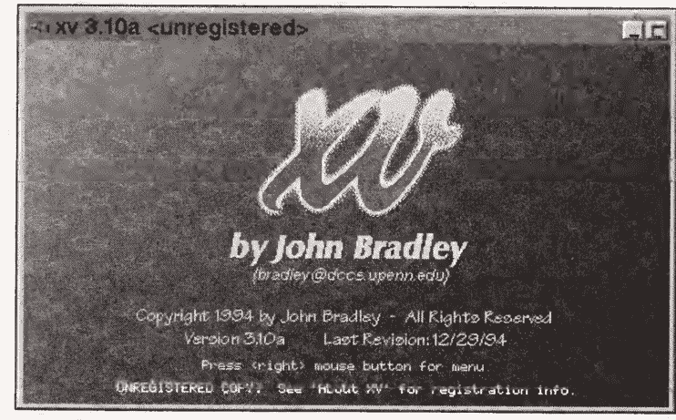

**图 12-1** 在 xv 中显示的图像

用鼠标**右**键点击图像可以弹出 *xv* 控制面板，如图 12-2 所示。

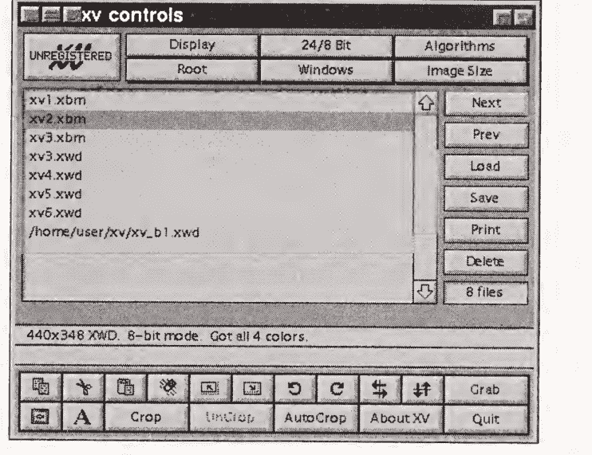

**图 12-2** *xv 控制面板*

点击 Next（下一页）按钮移动到列表中的下一张图像。点击 Prev（上一页）按钮移动到上一个图像。点击 Load（加载）按钮加载新图像，点击 Delete（删除）按钮删除当前图像。

点击 Save 不仅保存文件，还会进行转换。例如，你可以加载 GIF 格式的图像并将其保存为 San Raster 格式。*xv* 程序会为你完成转换。图 12-3 显示了 Save（保存）菜单。

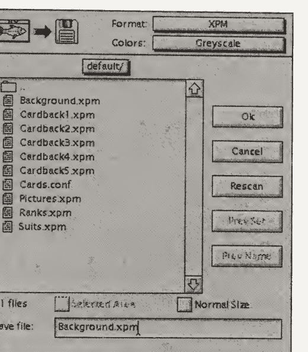

### 图 12-3 xv 中的 Save 菜单

Format（格式）菜单允许你使用不同的格式保存图像。点击此菜单会列出可以保存图像的可能格式。Colors（颜色）菜单的工作原理类似，允许你在全色、灰度、黑白和索引色之间转换。

表 12-1 包含了控制面板其他各种字段的解释。

| TABLE 12-1 | xv 中的控制面板元素 |
| --- | --- |
| 窗口元素 | 功能 |
| DISPLAY | 控制用于显示的色彩映射。 |
| ROOT | 允许你选择图像显示的位置。可以在根窗口（背景）上的 X 窗口中通过多种选项选择，包括 Tile（平铺）和 Center（居中）。 |
| 24/8 BIT | 设置用于将 24 位颜色转换为 8 位显示的参数。 |
| WINDOWS | 弹出控制窗口。这些将在后文中进行描述。 |
| ALGORITHMS | 此菜单包含你可以对图像进行的各种转换列表。这些将在后文中描述。 |
| IMAGE SIZE | 调整图像大小。 |

窗口底部的控制包括以下按钮：

COPY 将图像（或图像部分）复制到剪贴板。

### TABLE 12-1 xv 中的控制面板元素（续表）

| 窗口元素 | 功能 |
|---|---|
| CUT | 将图像（或图像部分）复制到剪贴板，然后从工作图像中删除该矩形。 |
| PASTE | 将剪贴板的内容粘贴到窗口中。 |
| 10% LARGER | 使图像窗口放大 10%。 |
| 10% SMALLER | 使图像窗口缩小 10%。 |
| ROTATE CCW | 将图像逆时针旋转 90 度。 |
| ROTATE CW | 将图像顺时针旋转 90 度。 |
| FLIP L->R | 将图像左右翻转。 |
| FLIP T->B | 将图像上下翻转。 |
| GRAB | 允许你抓取 X 屏幕的一部分并将结果放入图像窗口中。 |
| PAD | 在窗口周围添加边框。 |
| ANNOTATE | 在图像上添加文本。 |
| CROP | 将图片裁剪到选定的矩形。 |
| UNCROP | 撤销之前的裁剪操作。 |
| AUTOCROP | 通过移除任何恒色边框来裁剪图片。 |
| ABOUT XV | 弹出关于窗口。 |
| QUIT | 再见！ |

如果你选择 Visual Schnauzer，将弹出一个浏览窗口（见图 12-4）。

图 12-4 xv 中的 Visual Schnauzer 窗口

点击 Update 按钮会使 xv 扫描图像并为每个图像生成一个小图标，如图 12-5 所示。

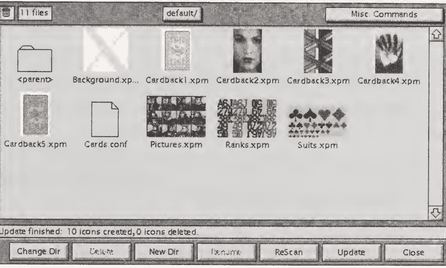

图 12-5 带有图标的 Visual Schnauzer

Visual Schnauzer 窗口允许你操作图像。

**图 12-6** 在 xv 中显示的图像

Color Editor 窗口包含了关于命令的信息。

### TABLE 12-2 其他窗口

| 命令 | 功能 |
| --- | --- |
| display | 在屏幕上显示图像。 |
| import | 抓取 X 屏幕的一部分到文件。 |
| animate | 显示系列图像。 |
| montage | 通过组合一组图像创建幻贴图或目录。 |
| convert | 将文件从一种格式转换为另一种格式。 |
| mogrify | 对图像进行各种转换。 |
| identify | 描述图像，例如图像的格式、颜色数和其他信息。 |
| combine | 组合图像创建新图像。 |
| segment | 执行色彩分割（无论如何）。 |
| xtp | 一个可以从命令行运行的类似 ftp 的工具，用于处理图像。 |

### TABLE 12-3 操作图像的命令

| 算法 | 功能 |
| --- | --- |
| BLUR | 模糊图像。 |
| SHARPER | 锐化图像。 |
| EDGE DETECT | 检测边缘。 |
| EMBOSS | 使图像产生浮雕效果。 |
| OIL PAINTING | 使图像看起来像油画。 |
| BLEND | 融合图像边缘。 |
| ROTATE | 按用户提供的角度旋转图像。 |
| CLEAR | 清除并按用户提供的角度旋转图像。 |
| PIXELIZE | 运行模糊图像算法。 |
| SPREAD | 在图像上执行扩散算法。 |
| DESPECKLE | 去除噪声。 |

## 使用 ImageMagick

ImageMagick 软件包是一系列执行与 xv 功能相似的程序。ImageMagick 在命令行中使用更方便，但与 xv 相比，其 GUI 非常糟糕。组成 ImageMagick 的程序包括：

- `display`：在屏幕上显示图像。
- `import`：抓取 X 屏幕的一部分到文件。
- `animate`：显示系列图像。
- `montage`：通过组合一组图像创建幻贴图或目录。
- `convert`：将文件从一种格式转换为另一种格式。
- `mogrify`：对图像进行各种转换。
- `identify`：描述图像，例如图像的格式、颜色数和其他信息。
- `combine`：组合图像创建新图像。
- `segment`：执行色彩分割（无论如何）。
- `xtp`：一个可以从命令行运行的类似 ftp 的工具，用于处理图像。

| pbm | 便携位图（2 色） | pgm | 便携灰度图（灰度级） | ppm | 便携点阵图（彩色） | pnm | 便携任意格式图（上述任一格式） | |

表 12-4 列出了 PBM 系统中可用的转换器。这些转换器允许您将输入文件转换为 PBM 格式，并将 PBM 文件转换为最常见的图形格式。

### 表 12-4 PBM 转换程序

| 格式 | 转换为 PBM | 从 PBM 转换 |
|---|---|---|
| AND TOOLKIT RASTER | `atktopbm` | `pbmtoatk` |
| ASCII | `asciitgm` | `pbmtoascii`（见注 1） |


| AT&T 4425 TERMINAL | | `pbmto4425` |

| ATARI DEAS .PI1 | `pltoppm` | `ppmtopi` |

| ATARI DEAS .PI3 | `pi3oppm` | `pbmtopi3` |

| ATARI COMPRESSED SPECTRUM | `spctoppm` | |

| ATARI UNCOMPRESSED SPECTRUM | `sputoppm` | |

| AUTOCAD SLIDE FILE | `sldtoppm` | `ppmtoacad`（见注 2） |

### 表 12-4 PBM 转换程序（续）

| 格式 | 转换为 PBM | 从 PBM 转换 |
|---|---|---|
| BBN GRAPHICS TERMINAL | | `pbmtobobbnb` |
| BENNETT YEE FACE FORMAT | `ybmtopbm` | `pbmptoybm` |
| BIORAD CONFOCAL | `bioradtopgm` | |
| CMU WINDOW MANAGER BITMAP | `cmuwtopbm` | `pbmbtocmuwm` |
| DDIF | | `pnmtodiff` |
| DEC LN03 | | `pbmtoln03` |
| DEC SIXEL | | `ppmtosixel` |
| DOODLE BRUSH | `brushtopbm` | |
| ENCAPSULATED POSTSCRIPT | | `pbmtoepsi` |
| EPSON PRINTER | | `pbmtoepson` |
| FITS | `fitspopnm` | `pnmptofits` |
| GEM .IMG | `gemtopbm` | `pbmbtogem` |
| GEMINI 10X PRINTER | | `pbmto10x` |
| GIF | `giftopnm` | `ppmtogif` |
| GOULD SCANNER | `gouldtoppm` | |
| GRAPHON TERMINAL | | `pbmbtogo` |
| GROUP 3 FAX | `g3topbm` | `pbmbtog3` |
| HIPS (HUMAN INFORMATION PROCESSING LAB) | `hipstopgm` | |
| HP LASERJET | | `pbmtolj` |
| HP PAINTJET | `pjtoppm` | `ppmtopj` |
| HP PAINTJET XL | | `ppmtopjxl` |
| ILBM | `ilbmtoppm` | `ppmtomlbm` |
| 格式 | 转换为 PBM | 从 PBM 转换 |
|---|---|---|
| IMG-WHATNOT | `imgtoppm` | |
| LISP MACHINE BITMAP | `lismptopgm` | `pgmtolispm` |
| MGR BITMAP | `mgrtopbm` | `pbmbtomgr` |
| MTV OR PRT RAY TRACE | `mvtoppm` | |
| MACPAINT | `macptopbm` | `pbmbtomacp` |
| MACINTOSH PICT | `pictoppm` | `pptoptict` |
| MICROSOFT BITMAP | `bmptoppm` | `ppmtobmp` |
| MITSUBISHI S340-10 | | `ppmmtomitsu` |
| MOTIF UIL ICON | | `ppttouil` |
| NCSA ICR FORMAT | `pktopbm` | `pbmtopk` |
| PACKED FONT (PK) | `pcxtoppm` | `ppmtopcx` |
| PCX | | |
| POSTSCRIPT | `pstnopnm` | `pnmtops`, `pbmtolps` |
| POSTSCRIPT IMAGE | `psidtopgm` | |
| PRINTRONIX | | `pbmptox` |
| QRT RAY TRACER | `qrttppm` | |
| RAW BYTES, RGB COLOR | `rawtoppm` | |
| RAW BYTES, GRAY-SCALE | `rawtopgm` | |
| SGI IMAGE | `sgitopnm` | `pnmntosgi` |
| SPOT SATELLITE IMAGES | `spottopgm` | |
| SOLITAIRE IMAGE RECORDER | `sirtopnm` | `pnmntosir` |
| SUN ICON | `icontopbm` | `pbmtoicon` |

### 表 12-4 PBM 转换程序（续）

| 格式 | 转换为 PBM | 从 PBM 转换 |
|---|---|---|
| SUN RASTERFILE | `rasttopnm` | `pnmttorast` |
| TIFF | `tifftopnm` | `pnmotiff` |
| TRUEVISION TARGA | `tgatopp` | `ppmtotga` |
| USENIX FACESAVER | `fstopgm` | `pgmttofs`, `fstopgm` |
| UNIVERSAL PRODUCT CODE | `pbmupc` | |
| UNIX PLOT(5) FORMAT | | `pbmbtplot` |
| X WINDOW BITMAP | `xbmtopbm` | `pbmtoxbm`, `pbmtox10bm` |
| X WINDOW DUMP FILE | `xwdtopnm` | `pnmotoxpm` |
| X11 PIXMAP | `xpmtoppm` | |
| X11 PUZZLE | | `ppmtopuzz` |
| XV THUMBNAIL FILE | `xvminittopp` | |
| XIM | `ximtoppm` | |
| Y, U, OR FILE | `yuvsplittopp` | `ppmtoyuv` |
| YUV, ABEK FILE | `yuvopp` | `ppmtoyuv` |
| ZEISS CONFOCAL | `zeistopnm` | |
| ZINC INTERFACE | | `pbmtotinc` |

注 1：ASCII 过滤器创建的图像像素灰度非常接近。例如，“M”是黑色，而“-”几乎是白色。

注 2：`ppm` 写入数据库和幻灯片文件。

注 3：`yuvsplitto` 接收三个文件（Y, U, V）并产生文件。`ppmtoysplit` 执行反操作。

表 12-5 列出了可以在 PBM 上使用的工具。

### 12-5 用于 PBM 的工具

| 工具 | 功能 |
|---|---|
| `ANYTOPNM` | 转换为任意格式；猜测使用哪种格式。 |
| `PBMCLEAN` | 清理位图 |
| `PBMLIFE` | 将“life”应用于位图。（Life曾经非常流行。） |
| `PBMMAKE` | 创建空白位图。 |
| `PBMMASK` | 创建掩码位图。黑白图像，颜色出现在原始位图中。 |
| `BMPSCALE` | 带有边缘平滑的位图。 |
| `PBMREDUCE` | 减少位图。 |
| `PBMTEXT` | 将字符串转换为便携位图。 |
| `PBMTOGPM` | 将便携位图转换为灰度图。 |
| `PGMBENTLEY` | 使用“Bentley”转换。 |
| `PGMCRATER` | 通过分形创建陨地。 |
| `PGMEDGE` | 执行边缘检测。 |
| `PGMENHANCE` | 增强边缘。显示图像。 |
| `PGMKERNEL` | 生成内核，其某些属性对 `pnmconv` 有用。 |
| `PGMNOISE` | 创建位位图。 |
| `PGNORM` | 归一化对比度。 |
| `PGMOIL` | 给图像油效果。 |
| `PGRAMP` | 生成灰度渐变。 |
| `PGMTEXTURE` | 计算纹理特征。 |
| `PGMTOPBM` | 将灰度图转换为便携位图。 |

### 12-5 用于 PBM 文件的工具（续）

| 工具 | 功能 |
|---|---|
| `PGMTOPPM` | 将灰度图转换为便携点阵图。 |
| `PNMALIAS` | 执行抗锯齿转换，一种移除多余颜色值的算法。 |
| `PNMARITH` | 对两个图像进行算运算。例如，它可以合并两个图像的颜色以生成第三幅图像。 |
| `PNMCAT` | 连接图像。 |
| `PNMCOMP` | 组合图像。 |
| `PNMCONVOL` | 执行卷积。 |
| `PNMCROP` | 移除边缘。 |
| `PNMCUT` | 从图像中剪出矩形。 |
| `PNMDEPTH` | 改变位图深度。 |
| `PNMENLARGE` | 放大图像。 |
| `PNMFILE` | 描述图像，显示类型、颜色数量、大小等信息。 |
| `PNMFLIP` | 翻转图像。 |
| `PNMGAM` | 修正图像。*Gamma 校正*是一种用于增强图像颜色的校正技术。 |
| `PNHISTMAP` | 生成颜色直方图。 |
| `PNMINDEX` | 创建视觉索引。 |


## 表 12-5 用于 PBM 文件的工具（续）

| `PNMINVERT` | 反转黑。 |
| `PNMMARGIN` | 为图像添加边框。 |
| `PNMNLIFT` | 应用过滤器，包括平滑和边缘增强。 |
| `PNMNORAW` | 将图像转换为原始数据。 |
| `PNMPAD` | 添加边框。 |
| `PNMPASTE` | 将一个图像粘贴在另一个图像上。 |
| `PNMROTATE` | 旋转图像。 |
| `PNMSALE` | 缩放图像。 |
| `PNMSHEAR` | 倾斜图像。倾斜是一种将图像顶部移动到一侧同时保持底部固定的过程。结果是一个倾斜的图像。 |
| `PNMSOOTH` | 平滑图像。 |
| `PNMTILE` | 将图像转换为瓦片。 |
| `PPM3D` | 将两个图像转换为红蓝 3D 对。 |
| `PPMBRIGHTEN` | 改变图像的饱和度和值。 |
| `PPMCHANGE` | 将一种颜色变为另一种。 |
| `PPMDIM` | 降低位图亮度。 |
| `PPMDIST` | 将颜色转换为灰度。 |
| `PPMDITHER` | 使用抖动将颜色转换为减少的颜色。 |
| `PPMFLASH` | 亮图像。 |
| `PGMFORGE` | 生成分形图像。 |
| `PPMHIST` | 打印颜色直方图。 |
| `PPMMAKE` | 创建单色图像。 |
| `PPMMIX` | 混合两个图像。 |
| `PPMNORM` | 归一化图像中的颜色。 |
| `PPMNTSC` | 将图像转换为电视上能看到的内容。 |
| `PPMPAT` | 创建图案图像。 |
| `PPMQUANT` | 量化颜色。*量化*是一个查看图像颜色并确定一组可用于图像的减少颜色集合的过程。然后将颜色重新映射到新的、减少的颜色集中。 |
| `PPMQUANTALL` | 在一组图像上量化颜色。 |
| `PPMQVGA` | 八平面量化。 |
| `PPMRELIEF` | 拉普拉斯平滑滤波器。 |
| `PPMMSIFT` | 向左或右移动。 |
| `PPMMSPREAD` | 让点阵图看起来模糊。 |
| `PPMTOMAP` | 提取图像中的所有颜色。 |

这些命令设计用于链式使用。例如，要读取一个 tiff 文件、修剪其边缘并将其写入 Sun 光栅文件，你将使用以下命令：

```
[user@pc user]$ tiftopnmm image.tif | pnmcrop | \
pmntoras >image.ras
```

## 比较图像工具

这三个主要的软件包各有其优缺点。表 12-6 列出了这些优缺点。

### 表 12-6 图像处理工具

| 工具 | 优点 | 缺点 |
| :--- | :--- | :--- |
| ? | - 非常好的交互式界面。<br>- 出色的色彩处理工具。 | - 命令行界面较差。 |
| ImageMagick | - 简单的命令行界面。<br>- 命令较少。 | - GUI 基于键盘命令，这些命令晦涩且隐藏。 |
| ? | 在所有图像处理软件包中，支持的格式和操作最多。 | - 无交互模式。<br>- 命令很多。 |

## 绘图程序

Linux 不仅包含查看和处理图像的程序，你还可以创建它们。这些绘图程序使你能够快速勾画和设计简单到中等复杂的图形。

### xfig 程序

`xfig` 程序是 Linux 的一部分，包含在本书背后的 CD-ROM 中，它为用户提供了一个交互式绘图工具，如图 12-7 所示。

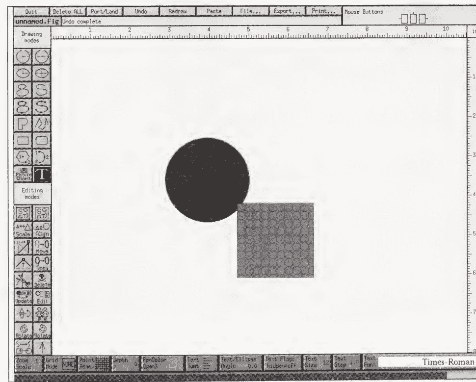

图 12-7 `xfig` 程序界面

窗口顶部是文件控制。你使用这些控制来加载、保存、转换和其他执行文件操作。

左侧是绘图控制。在顶部区域，你选择要绘制的物体。底部区域包含一组编辑工具。

窗口底部包含一组杂项控制。`xfig` 程序可以将文件导出为多种流行的图像格式。`xfig` 程序将窗口中的图像视为对象。其他程序（如 `xpaint`）则将其数据视为单个位图。

### xpaint 程序

`xpaint` 程序是另一个绘图工具。主要的区别在于，`xfig` 处理对象，而 `xpaint` 是一个纯的光栅画家。

`xpaint` 程序的优点是，在绘制对象后，你可以作为对象移动、调整大小、裁剪和粘贴它们。使用像 `xfig` 这样的光栅画家，在你绘制对象后，它就会变成位图。单个对象是可以被选中的。

`xpaint` 主窗口如图 12-8 所示。

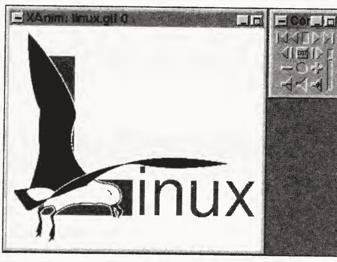

图 12-8 `xpaint` 程序的主窗口

## 杂项图形工具

`mxp` 程序生成曼德博集（Mandelbrot sets）。曼德博集是数学上非常有趣的、漂亮的图片。控制按钮几乎是不言自明的。图 12-9 显示了 `mxp` 程序。

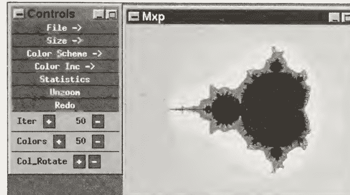

**图 12-9** `mxp` 程序界面

## 在 Linux 中使用声音

Linux 带有许多工具，让你通过声卡和扬声器播放声音。许多游戏和其他程序都有声音功能。以下章节描述了 Linux 自带的音频工具。

### cdp

如果你的电脑有 CD-ROM 驱动器，你可以使用 `cdp` 程序通过声卡播放 CD。`cdp` 程序是基于文本的，它会显示全屏，展示 CD-ROM 上的内容，如图 12-10 所示。

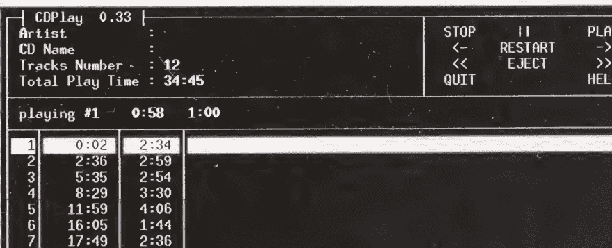

**图 12-10** `cdp` 程序界面

你通过数字小键盘控制 CD-ROM。（控制菜单在右上角。）例如，要播放 CD，你按下 9 键。要停止 CD，按下 7 键。你必须确保大写锁定（Num Lock）开启以便使用数字小键盘。

在使用此程序之前，你必须设置环境。程序会查找 `/dev/cdrom`，因此你需要在实际 CD-ROM 设备和 `/dev/cdrom` 之间创建一个符号链接。

假设你在第四个 IDE 驱动器上有一个 IDE CD-ROM。你需要使用以下命令：

```
[root@pc root]# ln -s /dev/hdd /dev/cdrom
```

你还需要通过以下命令赋予程序磁盘的写入权限：

```
[root@pc root]# chmod 666 /dev/cdrom
```

注意 起初，我担心给普通用户对磁盘的写入权限。毕竟，恶意用户可能会破坏磁盘上的数据。然后我意识到，用户更改 CD-ROM 上的数据相当困难。当然，如果你有 CD 刻录机，写保护就是非常重要的。

`cdp` 程序很愉快，但很原始。使用适用于 X Window 系统的 CD-ROM 播放器好得多。那个程序是 `xplaycd`。

### 使用 xplaycd

`xplaycd` 程序是一个 X Window 系统的 CD-ROM 播放器。如图 12-11 所示的控制模仿了大多数标准播放器的控制。有了该程序，你的电脑就有了音箱功能。

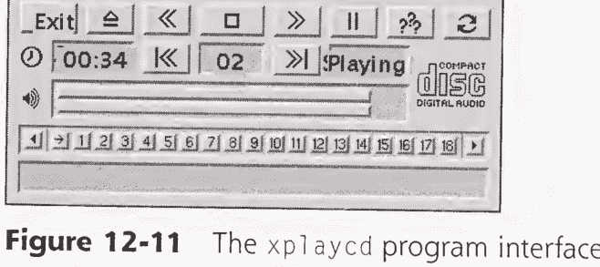

### 使用 xmixer

`xmixer` 程序是一个音频混合器（见图 12-12）。你使用 `xmixer` 混合来自不同来源的音频。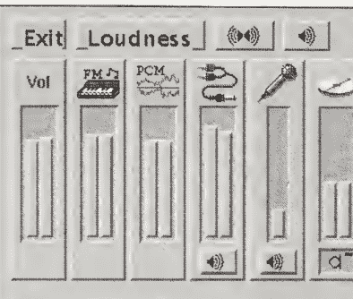

图 12-12 `xmixer` 程序界面

### 使用 maplay

`maplay` 程序播放 mpeg 文件的音频。

### 使用 sox

`sox` 程序通过声卡播放音频。`sox` 工具对文件进行各种转换。

## 图像处理工具

GNU 人创建了一个名为 `gimp` 的图像处理工具。你可以在以下 Web 地址找到它：

```
ftp.redhat.com/pub/contrib/i386/gimp-xxxxx
```

和大多数 GNU 工具一样，`gimp` 软件包包含了运行脚本的能力，因此你可以执行复杂的操作。

## 扫描仪

获取图像的方法有两种。第一种是绘制，第二种是扫描。如果你更倾向于扫描，请查看以下 Linux 扫描软件 Web 地址：

```
ftp.redhat.com/pub/contrib/i386/epscan-xxxxx
ftp.redhat.com/pub/contrib/i386/hpscanbm-xxxxx
```

`epscan` 软件包为爱普扫描仪设计，而 `hpscanbm` 适用于惠普版本。

## 音乐来源

Capitol Steps 是一个专门从事政治讽刺的音乐团体。如果你想听听他们的歌曲，可以尝试访问 Capitol Steps 网站：

```
http://www.captsteps.com
```

## 动画与 Linux

`xanim` 程序显示各种类型的动画文件，包括 .fli、.mov、.mpeg 以及许多其他类型。图 12-13 显示了 `xanim` 的运行。

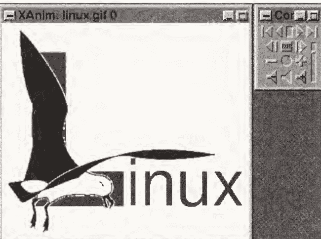

图 12-13 `xanim` 程序 程序

要启动 `xanim` 程序，执行以下命令：


```
[user@pc]$ xanim +f +Ae <file>
```

`+f` 选项告诉 `xanim` 不要在启动前加载整个文件。如果你不使用这个选项，`xanim` 启动会非常慢。`+Ae` 选项启用声音。如果没有它，动画将是无声电影。

注意 `xanim` 程序将整个动画加载到内存中。这使得 `xanim` 成为 Linux 中占用内存最大的。

## 奖励

## 更多你可以得到的东西

## 摘要

你已经学习了 Linux 处理多媒体文件的各种方式。它包含了三个用于简单图像的大型图像处理软件包。Linux 还可以以音乐 CD 和磁盘文件的形式处理音效。最后，图像、运动和声音的结合可以作为动画进行处理。

# 第十三章

## 程序员的工具

在本章中，你将学习到以下核心内容：

- 理解 C 和 C++ 编译器 第 256 页
- 学习 `ELECTRICFENCE` 调试库 第 259 页
- 使用 `GNU MAKE` 和 `PMAKE` 程序 第 260 页
- 理解 `TAG` 文件的维护与使用 第 260 页
- 理解版本控制系统 (`RCS`) 第 261 页
- 使用其他编程工具 第 264 页

本章将讨论了 Linux 特有的各种编程实用程序和工具。实际上，Linux 本质上拥有你在完整的 UNIX 系统上所期望的所有工具和语言。然而，通过 Linux，这些工具和语言得到了大幅的扩展和增强。


### C 和 C++ 编译器

Linux 自带了世界上最优秀的 C 编译器之一。GNU C 编译器 `gcc` 是编程教学以及生产环境编程的理想工具。

使 `gcc` 与众不同的主要原因之一是错误信息。其他编译器只发布一个“语法错误 (`syntax error`)”并就此停止，而 `gcc` 提供的错误信息实际上是有帮助的。（这些信息实际上能很好地引导你找到错误位置）

`gcc` 编译器还拥有大量的选项。它允许你对代码的优化方式进行精确控制。该编译器运行在许多不同的 CPU 上，并为每个处理器提供了特殊的开关。

GNU 社区的人对 C 语言进行了一些扩展。如果你确实想使用其中一些扩展功能，可以通过以下命令获取更多相关信息：

```
[pc user]$ info gcc
```

### g++ 编译器

GNU 版本的 C++ 编译器称为 `g++`。当前版本 (`2.7.2.1`) 处理了 ANSI 标准定义的大部分 C++ 语言。ANSI 标准仍然处于变动状态。

# C++ 标准模板库

标准模板库 (`STL`) 为 C++ 语言定义了一整套容器。Linux 自带的 C++ 库称为 `libg++`，包含了 `STL` 的完整实现。

然而，`STL` 也有其局限性。首先，它缺乏活性。其次，它的编译速度慢且生成的代码很多。GNU 社区实现了一组更好的（尽管不是标准的）容器类，将在下一节中进行描述。

# libg++ 中的容器

`g++` 库还包含许多其他模板类。它们实际上比 `STL` 好得多，因为它们允许你指定的不是容器本身，而是它的实现方式。你可以选择“集合 (`set`)”容器的一种实现方式，它允许快速插入元素；另一种实现方式允许快速搜索，但在插入方面非常慢。所有的 `set` 实现都执行相同的操作，但不同的实现方式在速度和效率上有所不同。

表 13-1 列出了各种容器类并对每种类进行了简短描述。

## 表 13-1 容器

| 名称 | 说明 |
| --- | --- |
| Vector | 向量（一维数组） |
| Plex | 可调整数组 |
| Stack | 经典栈 |
| Queue | 经典队列 |
| Deque | 双端队列 |
| PQ | 优先级队列 |
| Set | 集合（也称为包） |
| Map | 一对一映射 |

# libg++ 中的其他类

除了容器类外，GNU 库还提供了其他类。表 13-2 列出了这些额外类。

# 表 13-2 libg++ 中的其他类

| 名称 | 说明 |
| --- | --- |
| Obstack | 字符串表（无用） |
| AllocRing | 循环列表 |
| String | 字符串（与 C 风格字符串不同，你不需要定义最大长度。这些类会为你动态分配内存。） |
| Regex | 正则表达式 |
| Integer | 高精度整数 |
| Rational | 形式如 5 1/2 的数字（即它们可以包含整数也可以包含分数） |
| Complex | 复数算术类 |

# 表 13-2 libg++ 中的其他类（续）

| 名称 | 说明 |
| --- | --- |
| Fix | 固定点 |
| BitSet | 以一组位实现的集合 |
| BitString | 位串 |
| Random | 许多随机数生成类 |
| Data | 用于数据集合的类 |
| Curses | 光标类包装器 |
| List | Lisp 风格列表 |
| Linked List | 单链表、双链表 |

`libg++` 中的容器不使用 C++ 模板。相反，每当你想要使用容器时，必须使用 `genclass` 命令生成一组新的 `.cc` 和 `.h` 文件。这种方法比使用模板要干净得多，并且避免了目前模板存在的所有问题。

创建你自己的数据类型（在本例中为 `my_type`）的容器类的第一步，是获取 `genclass` 命令列表以生成一组新的 `.cc` 和 `.h` 文件。（注：原文文本在此处存在大量重复的 OCR 错误，已根据提供的逻辑进行了去重和清理。）

## 程序员的工具

在本章中，你将学习到以下核心内容：

- 理解 C 和 C++ 编译器 第 256 页
- 学习 `ELECTRICFENCE` 调试库 第 259 页
- 使用 `GNU MAKE` 和 `PMAKE` 程序 第 260 页
- 理解 `TAG` 文件的维护与使用 第 260 页
- 理解版本控制系统 (`RCS`) 第 261 页
- 使用其他编程工具 第 264 页

本章讨论了 Linux 特有的各种编程实用程序和工具。实际上，Linux 本质上拥有你在完整的 UNIX 系统上所期望的所有工具和语言。然而，通过 Linux，这些工具和语言得到了大幅的扩展和增强。

# 调试 C 和 C++

GNU C++ 调试器是 `gdb`。它包含了断点、检查变量常用功能。该程序只是 `gdb` 的前端，因此使用它与 `gdb` 没有太大区别。

## ElectricFence

`ElectricFence` 是一个帮助用户发现动态分配问题的库。每当调用 `malloc` 或 `new` 时，它会在页末尾分配请求内存。基本上，如果你不越界，它就会落入未映射页并导致段错误。这种技术的副作用是程序的内存占用激增。这是因为每次分配都是两个页（一个用于数据，一个用于标记）。

使用 `ElectricFence` 的程序转储很大，你应该尽快删除它们。

要使用 `ElectricFence` 库，请在链接命令中添加库命令 `-lefence`。

你可以通过设置环境变量 `EF_PROTECTION_BELOW` 为 1 来配置 `ElectricFence` 检查分配起始处的指针。你可以通过以下命令实现：

```
[pc user]$ EF_PROTECTION_BELOW=1
[pc user]$ export EF_PROTECTION_BELOW
```

使用 `ElectricFence` 测试你的程序是一个好主意。在未设置 `EF_PROTECTION_BELOW` 时检查越末的指针；在设置 `EF_PROTECTION_BELOW` 后再次检查起始处的指针。

# 使用 make 程序

程序员使用 `make` 工具组织构建程序所需的编译命令。Linux 提供了该工具两个版本。第一个版本 `make` 位于 GNU 标准 make 程序。它包含了 UNIX 标准 make 中的所有常用功能，以及处理条件 (`if/ifdef`) 和包含文件的新功能。

另一个命令 `pmake` 具有同时执行多个命令的能力（`pmake` 代表并行编译 parallel make）。

# 使用 Tags

`tag` 文件是一种类似于目录的文件，包含了 C 或 C++ 函数列表及其定义位置。`vi` 和 `emacs` 编辑器使用这些信息让用户在函数之间快速跳转。遗憾的是，这两个编辑器在 `tags` 文件上不使用相同的格式。`vi` 的 `tags` 文件名为 `tags`，由 `ctags` 生成。例如，要生成一个包含当前目录下所有函数位置的 `tags` 文件，请使用以下命令：

```
[user@pc user]$ ctags *.c
```

你可以通过执行以下命令告诉 `vi` 编辑包含 `start_process` 函数的文件：

```
[user@pc user]$ vi -t start_process
```

在 `vi` 中，你可以将光标置于函数名上并按下 `Ctrl+|` 跳到另一个函数。

`emacs` 编辑器使用一个名为 `etags` 的文件，该文件是通过 `etags` 命令生成的。

## 版本控制


版本控制系统是任何编程环境中不可或缺的组成。这种系统允许你记录或提交程序的一组更改。它不仅能跟踪最新版本，还能跟踪软件之前的版本。这样，你就可以回溯对软件进行了哪些操作以及做了哪些更改。（如果最后一次改进导致了某些功能停止工作，这一点尤为有用。）

## RCS 简介绍

修订控制系统 `RCS` 是一种简单的修订控制系统。它在处理中小型编程项目（涉及约 20 名或更少程序员的项目）的文件方面表现良好。它跟踪文件，保留修订历史（谁修改了什么），并防止两个程序员同时修改同一个文件。

为了演示如何使用 `RCS`，我们将创建一个程序。让我们从“Hello World”程序开始，因为这是每个人开始的程序。

首先，创建一个存放 `RCS` 文件的目录。通过以下命令创建该目录：

```
[user@pc user]$ mkdir hello
```

现在编写你的第一个版本 `hello.c`。完成后，使用 `check-in (ci)` 命令将其提交到 `RCS` 系统中。`RCS` 注意到你以前从未提交过此文件，因此它会为之创建一个 `RCS` 文件并要求你描述该文件。描述可以任意多行，但以一个包含单个句点的行结尾，如下所示：

```
[user@pc user]$ ci hello.c
```

`RCS/hello.c.v <-- hello.c`

`enter description, terminated with single '.' or end of file:`

`NOTE: 这不是日志消息！`

`> > 一个简单的 hello 程序。`

`> initial revision: 1.1`

`done`
此命令会将该文件从当前目录中移除。如果你想查看或编译它，需要将其检出（`check out`），如下：

```
[user@pc user]$ co hello.c

RCS/hello.c --> hello.c

revision 1.1

done
```

`RCS` 会为你获取文件并告知你版本 `1.1` 已检出。然而，此文件是以只读方式检出的，因此你无法修改它。

假设你想编辑该文件。为了做到这一点，你必须进行“锁定”`locked` 检出。只有一个程序员可以对文件进行锁定检出，因此同一时间只能一个人编辑它。这防止了两个人同时对一个文件进行更改：

```
[user@pc user]$ co -l hello.c

RCS/hello.c --> hello.c

revision 1.1 (locked)

done
```

现在你可以编辑该文件了。如果你想查看你更改了什么，使用 `rcsdiff` 命令，如下：

```
[user@pc user]$ rcsdiff hello.c
@@ ,3 @@
```

`> > /****************************************************************`
`* hello - 一个非常简单的问候程序 *`
`****************************************************************/`

开乱码告诉你在第 0 行（开头）之后添加了（a）三行（编号 1,3）。

完成后，使用 `ci` 命令提交你的更改，如下：

```
[user@pc user]$ ci hello.c

RCS/hello.c <-- hello.c

new revision: 1.2; previous revision: 1.1

enter log message, terminated with single '.' or end of file:

>> 添加了描述程序的注释。

>>

done
```

### 多媒体与编程工具

### RCS 和 make

随 `Linux` 分发的程序感知 `RCS` 的。如果你想编译一个程序，且源文件不在当前目录中（在 `RCS` 控制下），它会自动检出该文件。

换句话说，不用担心 `RCS` 和 `make`，因为 `make` 知道如何处理这些事情。

表 13-3 是 `RCS` 命令列表。

## 表 13-3 RCS 命令

| 命令 | 功能 |
| --- | --- |
| `ci` | 提交文件。 |
| `co` | 检出文件。 |
| `ident` | 在文件中搜索标识符关键字并打印它们，这对于查找组成文件的模块非常有用。 |
| `merge` | 将两个程序员所做的更改合并到一个文件中。 |
| `rsclean` | 清理目录中所有可以从 `RCS` 文件获取源码。 |
| `rcsdiff` | 对两个受 `RCS` 控制的源文件版本进行差异比较。 |
| `rcsmerge` | `merge` 的另一个版本。 |
| `log` | 显示文件的修订历史。 |

> 我们今天处于“虚无”的哪一个版本？

`UNIX` 有一个名为 `true` 的命令。该命令除了向命令处理器返回一个良好的状态（“真”状态）外，什么都不做。
当 `shell` 无错误地执行脚本中的所有命令时，它会返回一个良好的状态。`true` 的第一个版本仅仅是一个没有任何命令的文件。换句话说，它是一个零长度文件。

那是管理层和法律部门介入之前。

随 `Linux` 分发的程序感知 `RCS` 的。如果你想编译一个程序，且源文件不在当前目录中（在 `RCS` 控制下），它会自动检出该文件。

换句话说，不用担心 `RCS` 和 `make`，因为 `make` 知道如何处理这些事情。

表 13-3 是 `RCS` 命令列表。

## 表 13-3 RCS 命令

| 命令 | 功能 |
| --- | --- |
| `ci` | 提交文件。 |
| `co` | 检出文件。 |
| `ident` | 在文件中搜索标识符关键字并打印它们，这对于查找组成文件的模块非常有用。 |
| `merge` | 将两个程序员所做的更改合并到一个文件中。 |
| `rsclean` | 清理目录中所有可以从 `RCS` 文件获取源码。 |
| `rcsdiff` | 对两个受 `RCS` 控制的源文件版本进行差异比较。 |
| `rcsmerge` | `merge` 的另一个版本。 |
| `log` | 显示文件的修订历史。 |

> 我们今天处于“虚无”的哪一个版本？

`UNIX` 有一个名为 `true` 的命令...

## RCS 简介绍

修订控制系统 `RCS` 是一种简单的修订控制系统。它在处理中小型编程项目（涉及约 20 名或更少程序员的项目）的文件方面表现良好。它跟踪文件，保留修订历史（谁修改了什么），并防止两个程序员同时修改同一个文件。

为了演示如何使用 `RCS`，我们将创建一个程序。让我们从“Hello World”程序开始，因为这是每个人开始的程序。
首先创建一个存放 `RCS` 文件的目录。通过以下命令创建该目录：

```
[user@pc user]$ mkdir hello
```

现在编写你的第一个版本 `hello.c`。完成后，使用 `check-in (ci)` 命令将其提交到 `RCS` 系统中。`RCS` 注意到你以前从未提交过此文件，因此它会为之创建一个 `RCS` 文件并要求你描述该文件。描述可以任意多行，但以一个包含单个句点的行结尾，如下所示：

```
[user@pc user]$ ci hello.c
```

`RCS/hello.c.v <-- hello.c`
`enter description, terminated with single '.' or end of file:`
`NOTE: 这不是日志消息！`

`> > 一个简单的 hello 程序。`
`> initial revision: 1.1`
`done`

此命令会将该文件从当前目录中移除。如果你想查看或编译它，需要将其检出，如下：

```
[user@pc user]$ co hello.c
RCS/hello.c --> hello.c
revision 1.1
done
```

`RCS` 会为你获取文件并告知你版本 `1.1` 已检出。然而，此文件是以只读方式检出的，因此你无法修改它。

假设你想编辑该文件。为了做到这一点，你必须进行“锁定”`locked` 检出。只有一个程序员可以对文件进行锁定检出，因此同一时间只能一个人编辑它。这防止了两个人同时对一个文件进行更改：

```
[user@pc user]$ co -l hello.c
RCS/hello.c --> hello.c
revision 1.1 (locked)
done
```

现在你可以编辑该文件了。如果你想查看你更改了什么，使用 `rcsdiff` 命令，如下：

```
[user@pc user]$ rcsdiff hello.c
@@ ,3 @@
```

`> > /****************************************************************`

`* hello - 一个非常简单的问候程序 *`

`****************************************************************/`

开乱码告诉你在第 0 行（开头）之后添加了（a）三行（编号 1,3）。

完成后，使用 `ci` 命令提交你的更改，如下：


```
[user@pc user]$ ci hello.c
RCS/hello.c <-- hello.c
new revision: 1.2; previous revision: 1.1
enter log message, terminated with single '.' or end of file:
>> 添加了描述程序的注释。
>>
done
```

**多媒体与编程工具**

## RCS 和 make

随 Linux 分发的程序感知 RCS 的。如果你想编译一个程序，且源文件不在当前目录中（在 RCS 控制下），它会自动检出该文件。

换句话说，不用担心 RCS 和 `make`，因为 `make` 知道如何处理这些事情。

表 13-3 是 RCS 命令列表。

### 表 13-3 RCS 命令

| 命令 | 功能 |
| --- | --- |
| `ci` | 提交文件。 |
| `co` | 检出文件。 |
| `ident` | 在文件中搜索标识符关键字并打印它们，这对于查找组成文件的模块非常有用。 |
| `merge` | 将两个程序员所做的更改合并到一个文件中。 |
| `rsclean` | 清理目录中所有可以从 RCS 文件获取源码。 |
| `rcsdiff` | 对两个受 RCS 控制的源文件版本进行差异比较。 |
| `rcsmerge` | `merge` 的另一个版本。 |
| `log` | 显示文件的修订历史。 |

> 我们今天处于“虚无”的哪一个版本？

UNIX 有一个名为 `true` 的命令。该命令除了向命令处理器返回一个良好的状态（“真”状态）外，什么都不做。

当 shell 无错误地执行脚本中的所有命令时，它会返回一个良好的状态。`true` 的第一个版本仅仅是一个没有任何命令的文件。换句话说，它是一个零长度文件。

那是管理层和法律部门介入之前。

## patch 工具

`patch` 程序允许软件开发者向其源文件分发更新。这些更新是通过使用 `diff` 命令产生的。`patch` 工具会查看 `diff` 的输出，检测原始文件发生了哪些更改，并实施这些更改。

通过使用 `diff` 和 `patch`，你就不需要在每次发生变化时都下载包的完整源码。

## rdist 程序

`rdist` 程序设计用于处理跨多台机器分发程序的问题。它复制文件，确保权限和修改时间一致，并执行其他功能。

该程序在大型和中网络中非常有用，这些网络需要几台服务器且必须包含相同的工具。

# 隐形升级 (STEALTH UPGRADES)

某大型大学的网络管理员发现，每当他升级编译器时，所有人都会抱怨新编译器弄坏了他们的代码。在 99% 的情况下，并不是编译器的错，但这位管理员必须面对许多非常愤怒的教授。

他设计了一种安装方案来规避这个问题。

他会大张旗鼓地宣布，周日将安装新版本的编译器。那个周日，他什么也没做。更准确地说，他没有安装新编译器——他只是告诉了大家。

当周一到来时，他会遇到那群惯常的投诉者，他们指怪新编译器无法编译他们的代码。他会告诉他们是他们的代码有问题，而不是编译器的问题。他说话时可以非常有信心——因为编译器并没有改变。

最后，当投诉声平息后，他会秘密地升级编译器。之后他收到的任何投诉，他认为可能是合法的。

需要注意的是，这个技巧是从一个当无线电操作员的朋友那里学来的。那家伙会放上一个新的无线电天线但不连接它。邻居们会抱怨他干扰了他们的电视信号。联邦通信委员会会调查，发现天线没有连接，然后离开。随后，他会秘密地将它连接到自己的发射器上。

# readline 函数

`readline` 函数从键盘读取单行。听起来很简单，不是吗？但这个函数包含了 GNU 人们能塞进里面的所有功能。而他们非常擅长向软件中塞入功能。如果你正在开发一个允许用户向其中输入命令的程序，那么这是一个极其强大且实用的工具。

# 其他常用语言

任何 Linux 编程工具都面向流行的 C 和 C++ 语言，但这些并不是唯一被广泛使用的语言。Linux 还支持许多其他老旧且成熟的语言。

## f2c 和 fort77

`f2c` 程序将 FORTRAN 转换为 C 或 C++。这是在 Linux 上运行 FORTRAN 程序的一种方法。`fort77` 命令尝试模拟其他编译命令，并为你隐藏你的 FORTRAN 在变成程序之前变成 C 的事实。

## PASCAL

Linux 没有真正的 PASCAL 编译器。相反，`p2c` 程序将 PASCAL 转换为 C，然后运行 `gcc`。

## BASIC

Linux 自带一个版本的 BASIC。然而，这种语言已经过时了，不应该被使用。据传用 BASIC 会导致大脑损伤。如果你检查任何 BASIC 程序，就会看到这个传言是如何产生的。

## 编译器工具

`linux` 包含一个名为 `flex` 的词法分析器生成器。（如果你不知道什么是词法分析器生成器，你不需要。）这个工具是 UNIX 标准 `lex` 的增强快速版。

Linux 有两个编译器生成器。它们被称为 `bison` 和 `yacc`。`yacc` 程序是与 UNIX 一起发布的标准“另一个编译器 (Yet Another Compiler)”。`bison` 程序是自由软件基金对 `yacc` 的增强扩展版本。


## 其他语言

UNIX 的历史与 C 以及后来的 C++ 历史交织在一起。这两种语言是 UNIX 的语言。Linux 也支持其他语言。其中大多数其他语言是具有专门追随者的专用语言。其他语言，如 Java，是新的且实验性的，但它们也得到了 Linux 的完全支持。

## Java

Linux 包含了来自太阳微系统（Sun Microsystems）的完整 Java 开发包（JDK）。Java 是目前编程语言世界的热点。它被设计成一种比 C++ 更好的面向对象的语言。它的另一个卖点是可移植性。程序被编译成“字节码”并进行解释。这意味着同一个二进制程序可以在不同的架构上执行。

目前看来，Linux 很快将在内核中对 Java 程序提供原生支持。Linux 可能是第一个实现这一点的操作系统之一。

## Python 语言

Python 是一种具有类似 C++ 语法的解释型脚本语言。红帽（Red Hat）将其用于他们的控制面板应用程序。

## Slang 语言

`slang` 语言是一种经过增强的类 C 语言。它也是解释型的。

## tcl 语言

这是一个经常用于使用 TK 工具生成简单 GUI 程序的脚本语言。TK 工具包包含在 Linux 中。

## umb-scheme 语言

这种语言类似于 `lisp`。

## xslipstat 语言

`xlslipstat` 是 `lisp` 语言的完整版本，曾在人工智能人士中非常流行。这个版本增加了用于 X Window 生成统计数据的功能。

# 编程环境

任何用过 Borland C++ 的都知道它提供了一个多么优秀的编程环境。它给用户提供了一个集成编辑器、编译器和调试器。

`wpe` 和 `xwpe` 程序尝试模拟该环境。`wpe` 程序用于终端，`xwpe` 程序用于 X 系统（见图 13）。


**图 13-2 xwpe 的界面**

该系统非常有用，特别是在教学环境中，但有一个例外：文档。文档非常匮乏，使用起来很困难。

# 奖励 (BONUS)

## Linux 扩展

### gcc 的边界检查扩展

一位进取的同仁创建了一个“边界检查”版本的 `gcc`。这个版本在编译程序时带有额外的代码，用于检查错误的指针和越界的数组索引。你可以在以下地址找到他对编译器的修改信息：

```
http://www-dse.doc.ic.ac.uk/~rj3/bounds-checking.html
```

### g++ 扩展

就像 `gcc` 编译器，`g++` 编译器对语言进行了一些扩展。你可以在 `g++` 的 info 文件中找到这些扩展。

C++ 世界的争议之一是关于这个问题：“如何为模板生成代码？”这个问题的答案在 C++ 社区成员中引发了一场宗教战争。

关于应该如何实现模板的问题，C++ 标准委员会目前分成了两派。这场激烈的战争正在使用机枪和炸药（好吧，学术等同机枪和炸药，即措辞怪异的论文）进行。

争议的焦点在于 C++ 模板是如何生成的。尽管语法是标准的，但实现模板并没有标准。

GNU 人使用一种方法，你必须在模板体文件中定义模板生成将用到的所有类型。另一种常见方法是使用仓库来存放模板体，然后在链接时编译这些体。（本文作者属于哪一派？他认为在其他派系停止战斗之前，你应该远离模板。）

如果你想使用仓库方法，可以从 Cygnus plus 站点获取编译器的补丁，地址如下：

```
ftp://cygnus.com/pub/g++/gcc-2.7.2-repo.gz
```

270

多媒体与编程工具

## 总结

Linux 是由许多程序员创建的操作系统和工具集。实际上，几乎每一个这类工具都包含在 Linux 中。更棒的是，所有这些公有领域和 GPL 的内容都经过了编译和配置，在大部分情况下，它们都能正常工作。


C 和 C++ 是 Linux 的骨干语言，但也实现了许多其他语言。如果某个语言是为 UNIX 开发的，那么它可能就包含在 Linux 中，因此你可以用喜欢的语言尽情编程。


# 第十四章 理解初始化过程

在本章中，你将学习以下关键技能：

- 理解 Linux 启动过程（第 273 页）
- 配置 X11 登录页（第 275 页）
- 编写 Linux 初始化脚本（第 276 页）
- 以单用户模式启动进行系统维护（第 276 页）


本章解释了 Linux 如何启动并初始化其自身。这一过程将帮助你配置 Linux 以满足你的需求，而且当你尝试调试初始化问题时也非常有帮助。

## Linux 如何启动

当计算机被重置时，控制权会移交给 ROM 中的 BIOS。BIOS 会执行一些简单的自检，然后从磁盘的第一个区块读取引导程序。Linux 安装 LILO 作为它的引导程序。引导程序必须足够短，以便 BIOS 能够弄清楚如何加载，同时又要足够聪明以确定如何加载。LILO 程序输出消息 LILO 并等待输入。用户输入操作系统的名称。他或她为该操作系统输入参数。Linux 操作系统接受几个启动参数，这些参数将在本文稍后讨论。

接下来，LILO 加载实际的操作系统或内核。Linux 内核启动的第一个进程是 `init`，它读取 `/etc/inittab` 文件并根据其中找到的内容来初始化系统。

## 理解运行级别

`init` 程序使用“运行级别”（run level）的概念来决定执行什么工作。不同的程序在不同的运行级别运行。运行级别越高，运行的程序就越多。例如，在运行级别 1 下，仅运行足够支持单个 shell 的程序，而运行级别 4 则会运行所有支持多用户系统所需的程序。

`init` 程序从 `/etc/inittab` 获取关于每个运行级别要做什么的信息，以及使用哪种初始运行级别。

表 14-1 描述了基本的运行级别。

| 运行级别 | 描述 |
|---|---|
| 0 | 停止（关闭所有内容） |
| 1 | 单用户 |
| 2 | 不带 NFS 的多用户 |
| 3 | 全多用户（默认） |
| 5 | X11 |
| 6 | 重启 |

以下是对运行级别的更详细解释：

- *Halt（停止）*。停止所有处理并停止计算机。此运行级别强制 `init` 执行有序关机。
- *Single user（单用户）*。在此模式下，只运行一个进程。它是控制台上的一个 root shell。不运行守护进程或后台作业。此模式对于系统维护和检查启动各种系统守护进程的脚本非常有用。当某个守护进程导致系统挂起时，这一点尤为真实。
- *Multiuser without NFS（不带 NFS 的多用户）*。此模式执行 NFS 以外的所有操作。我不确定你为什么需要这个，但你可以使用这种模式来获取它。
- *Full multiuser（全多用户）*。这是正常的运行模式：全多用户，所有守护进程都在运行，每个人愉快地登录。
- *X11*。默认情况下，系统在控制台上启动基于文本的登录过程。在 X11 模式下，这会切换到基于 X11 的登录，而不是获取原始登录提示符，你将看到一个类似于图 14-1 所示的屏幕。这种登录看起来很漂亮，而且更好的是——用户不需要输入 `startx` 命令来运行 X。

那么为什么 Linux 不将 X11 运行级别设置为默认值呢？因为当你第一次启动 Linux 时，可能还没有正确配置 X。（而且在无法工作的系统上，你无法显示 X 登录界面）。

- *Reboot（重启）*。此运行级别执行系统的有序关机并重启。这类似于按下 DOS 组合键 Ctrl+Alt+Del，区别在于它给了正在运行的程序一个在杀死它们之前保存数据的机会。


图 14-1 X Window 系统登录界面

## 配置 X11 登录

如果你想要一个漂亮的登录界面，或者如果你想避免强制用户手动启动 X Window 系统，你可以配置 Linux 使用 X11 登录。

首先，测试你的系统查看 X11 登录界面是否正常。（如果你搞砸了登录过程，将很难恢复，因为你无法登录或修正）

要测试 X11 登录，以 root 身份登录并执行以下命令：

```
init 5
```

如果一切顺利，就会出现 X11 登录。要将 X11 设置为默认，请更改 `/etc/inittab` 使该行看起来如下：

```
id:5
```

下次启动时，你将受到 X11 登录的欢迎。要将 X11 设置为默认，将该行改为：

```
id:3
```

### rc 脚本

通过初始化过程，Linux 启动了许多程序。这些程序实际上是由位于 `rc.d` 中的一系列脚本启动的。在该目录中，你会发现每个运行级别一个子目录。例如，启动运行级别 3 程序的脚本位于 `/etc/rc.3`。

如果你想创建自己的守护进程，需要将脚本放在这些目录之一。存放在哪个目录取决于你想要的运行级别。

## 以单用户模式启动

解决这个问题的方法是以单用户模式启动你的系统。你通过在屏幕上出现 LILO 提示符时给内核输入 `single` 来实现，然后输入以下：

```
linux single
```

> 注意：在单用户模式下启动可以使用户在没有 root 密码的情况下获得 root 权限。如果你想确保你的系统安全，需要在你的 `/etc/lilo.conf` 文件中放置限制选项。

### 奖励

#### 在哪里查找深度内核信息

你可以通过《内核黑客指南》找到关于内核运行的扩展文档。你可以在以下 Web 地址找到该文档：

```
http://sunsite.unc.edu/pub/Linux/docs/LDP
```

## 总结

现在你已经了解 Linux 如何启动。通过这些知识，你可以调整 Linux 以满足你的需求。当你尝试调试启动问题时也很有帮助。


# 第五部分 高级配置

本部分包含以下章节：

- 第十五章 构建新内核
- 第十六章 定制化 X Window 系统
- 第十七章 你的 Linux 系统故障排排除


这部分介绍了高级 Linux 配置。

在你熟悉 Linux 系统后，你可能想对其进行微调。如何配置和调整内核是本文部分讨论的第一个主题。

接下来讨论了如何配置 X Window 环境。（X 不像 Windows 和 Windows 95 那样只有一个桌面；它有多个桌面，而且所有的桌面都可以自定义。）

这本书还详细讨论了如何编写视频配置文件。

## 现实生活 LINUX：如何“Mitch”化

从前，我在一家不便具名的公司担任软件总监。每隔一段时间，我们就会发布一份目录，其中包含各种程序 GUI 的截图。营销总监不喜欢我程序中的默认背景色和按钮颜色，总是催促我修改它们。这导致产生了一个新术语：“to mitch”（“Mitch”是营销总监的名字）。“mitch”的意思是为了为了调出满意的颜色，而永无止境地不断在颜色上反复。

为了自我保护，我在我所有的应用程序中都添加了一个“Mitch”按钮。该按钮允许用户按照他们喜欢的任何方式配置屏幕颜色。对我来说，这解决了问题。（根据营销部门的要求，我确实将 Mitch 按钮的标签从“Mitch”改为了“颜色配置”。）

UNIX 程序员总是主张，你应该能够配置几乎任何东西。你只需要通过更改文本文件中正确的条目来实现，就能得到你想要的结果。

当然，确定使用哪一个条目有时是一项挑战。

配置噩梦中无可争议的霸王是 emacs 编辑器。这个程序不仅仅是一个编辑器；它还是一个编程环境。人们花费大量时间为这个程序添加插件。对其进行调优可能是真正的挑战。对于像 `emacs` 这样的程序，人们创造“fritterware”（浪费时间的软件）这个词。你可以把所有时间都浪费在上面。

我仍然在使用 15 多年前第一次编写 UNIX 时得到的某些配置文件。从那时起，我对这些文件进行了增强和编辑，但大部分基础配置信息仍然保持不变。也许你也可以对你的 Linux 配置文件做同样的事：在未来的几年里一直使用它们。


# 第十五章 构建新内核

在本章中，你将学习到以下关键技能

- 理解高级内核配置（第 281 页）
- 构建新内核（第 300 页）
- 安装并测试你的新内核（第 302 页）


对于大多数计算机，Linux 操作系统的默认版本运行良好。然而，如果你有特殊的配置，或者你想自定义自己的系统，就需要重新配置并构建你的内核。本章将向你展示如何操作。

## 配置内核

在配置内核之前，你需要安装内核源码包（`/cdrom/RedHat/RPMS/kernel-source-2.0.30-3.i386.rpm`）。文件被安装在目录 `/usr/src/linux`。Linux 由基础操作系统和许多驱动程序模块组成。在配置过程中，你可以选择使用哪些驱动程序以及如何配置它们。

你可以通过两种方式加载驱动程序。首先，你可以让成为内核的一部分。这样，它们会在启动时随内核一起加载，并且永远不会被卸载。

其次，你可以通过模块加载驱动程序。模块是作为初始化过程的一部分加载的内核组件。由 `kerneld` 进程加载的某些模块如果检测到它们不再需要，会被自动卸载。

你应该选择哪种方式，模块还是单式（无模块）？这取决于你想做什么。如果你正在为单台计算机创建一个操作系统，单式可能是最好的。它也是最简单的。相反，如果你正在创建一个必须在具有不同硬件的多个服务器上运行的系统，那么模块内核更好。通过使用模块，你的系统可以在启动时进行自定制。

要配置内核，请执行以下命令：

```
[root@pc root]# cd /usr/src/linux
[root@pc linux]# make xconfig
```

结果是一个基于 X Window 的配置工具。每个按钮都会弹出一个不同的配置部分（见图 15-1）。

| Linux 内核配置 |
| :--- |
| 代码成熟度级别选项 |
| 可加载模块支持 |
| 通用设置 |
| 软磁盘、IDE 以及其他块设备 |
| 网络选项 |
| SCSI 支持 |
| SCSI 低级驱动程序 |
| 网络设备支持 |
| ISDN 子系统 |
| CD-ROM 驱动程序（不支持 SCSI 或 IDE/ATAPI 器） |
| 文件系统 |
| 字符设备 |
| 音频 |
| 内核破解 |
| 保存并退出 | 从文件加载配置 |
| 不退出退出 | 保存配置到文件 |

**图 15-1** 配置程序

例如，点击“通用设置”按钮会弹出图 15-2 所示的窗口。

## Linux 内核配置

| | | | |
| :--- | :--- | :--- | :--- |
| | | 内核数学仿真 | 帮助 |
| | | 网络支持 | 帮助 |
| | | 将内存限制为低 16MB | 帮助 |
| | | PCI bios 支持 | 帮助 |
| | | PCI 桥优化（实验性） | 帮助 |
| | | System V IPC | 帮助 |
| | | 内核对 .out 支持 | 帮助 |
| | | 内核对 ELF 支持 | 帮助 |
| | | 内核对 JAVA 支持 | 帮助 |
| | | | 将内核编译为 ELF | 帮助 |


例如，点击“通用设置”按钮会弹出图 15-2 所示的窗口。

（注：此处修正了原文中图片描述的混乱逻辑，按文档逻辑翻译）

下一节涉及某些通用内核参数的配置，我们将逐一进行：

- 通用设置 (General setup)

- 内核数学运算仿真 (`CONFIG_MATH_EMULATION`) [Y/n/?] n

如果你有一台没有数学协处理器的 386 计算机，请启用此选项，以便内核可以为你模拟浮点运算。如果你的计算机不是来自“远古时代”，请将其关闭，以节省一些内存。

- 网络支持 (`CONFIG_NET`) [Y/n/?] y

此选项开启网络支持。即使你没有网卡或不打算连接互联网，你可能也希望开启此选项。因为许多程序使用内部连接来完成工作。

- 将内存限制在 16MB 以下 (`CONFIG_MAX_16M`) [Y/n/?] n

某些旧款主板无法正确处理超过 16MB 的内存。如果你有这样的主板，此步骤将告诉 Linux 避开任何超过这个 16MB 魔术限制的内存。除非你有一块旧主板并在运行 Linux 时遇到奇怪的问题，否则不要启用它。

- bios 支持 (`CONFIG_PCI`) [Y/n/?] n

某些较新的主板带有用于高性能显卡的 PCI 总线。如果你有一个，则需要启用此选项。如果你不确定，启用它也不会有害。

- System V IPC (`CONFIG_SYSVIPC`) [Y/n/?] y

IPC 代表进程间通信（Process Communication），是程序之间通信的方式。除非你正在进行奇怪的操作——并且真的清楚自己在做什么——否则请启用此选项。许多程序需要它以便它们相互通信。

- 内核对 a.out 二进制文件的支持 (`CONFIG_BINFMT_AOUT`) [Y/n/?] y

- 内核对 ELF 二进制文件的支持 (`CONFIG_BINFMT_ELF`) [Y/n/?] y

程序有两种标准格式。旧的标准格式 a.out 正在快速被一种名为 ELF 的新程序格式所取代。为了运行这两种类型的程序，你应该启用对这些格式的支持。

- 将内核编译为 ELF格式 — 如果你的 GCC 是 ELF-GCC (`CONFIG_KERNEL_ELF`) [Y/n/?] y

`gcc` 编译器可以生成 a.out 或 ELF 格式的文件。对于此控制，在回答“内核使用何种格式”这个问题时，对 N（并使用 .out 格式）并不是一个好主意，因为许多处理内核的工具都假设它是 ELF 格式。


处理器类型 (386, 486, Pentium, PPro) [386] 486

定义 `CONFIG_M486`

编译器会对处理器的指令集和时序进行微调，这取决于你使用的是哪个处理器。因此，你需要在这里输入处理器类型。如果你输入了类型，不要担心，你的内核仍然运行，只是速度稍慢。

下一组问题为你的系统配置各种磁盘、磁带和其他设备。

- 软盘、IDE 和其他块设备

普通软盘支持 (`CONFIG_BLK_DEV_FD`) [Y/m/n/?] y

如果你有一个软驱驱动器，你对此问题回答 Yes。

增强型 IDE/MFM/RLL 磁盘光驱/磁带支持 (`CONFIG_BLK_DEV_IDE`) [Y/n/?] y

如果你有一个 IDE 卡或古老的 MFM 或 RLL 磁盘控制器，你需要这个驱动程序。

- 请查看 `Documentation/ide.txt` 获取有关 IDE 设备的帮助/信息

在主接口上使用旧磁盘驱动程序 (`CONFIG_BLK_DEV_HD_IDE`) [N/y/ ] n

较新的 IDE 不仅支持磁盘，还支持 CD-ROM 和磁带。新驱动同时支持主 和 和 IDE 接口。除非你有一个只能配合旧驱动器工作的旧奇系统，否则请使用新驱动并在此处回答 Yes。

包含 IDE/ATAPI CDROM 支持 (`CONFIG_BLK_DEV_IDECD`) [Y/n/] y

包含 IDE/ATAPI 磁带支持 (`CONFIG_BLK_DEV_IDEAPE`) [Y/n/] n

这两个选项允许你配置系统以使用连接到 IDE 接口的 CD-ROM 或磁带。（磁盘将自动配置）。你的回答取决于你连接了什么设备。

支持可插拔 IDE 接口 (PCMCIA) (`CONFIG_BLK_DEV_IDE_PCMCIA`) [Y/n/ ] n

PCMCIA 控制器允许你在计算机运行时添加和移除 IDE 设备。这个问题询问你是否想支持该功能。

CMD640 芯片组修复/支持 (`CONFIG_BLK_DEV_CMD640`) [Y/n/] n

其他 IDE 芯片组支持 (`CONFIG_IDE_CHIPSETS`) [N/y/?] n

## 高级配置 (ADVANCED CONFIGURATION)

## 286

某些 IDE 卡有缺陷。特别是 CMD640 芯片有一个会导致损坏数据的讨厌缺陷。好消息是，如果你对这个问题回答 Yes，Linux 知道如何回避该芯片的缺陷。如果你有任何疑问，回答 Yes 是安全的。

其他特殊芯片可能需要其他的驱动回避。回答 Y。

- 附加块设备

回环设备支持 (`CONFIG_BLK_DEV_LOOP`) [M/n/y] n

回环设备允许你将文件系统放在文件内部。如果你正在调试文件系统，这非常有用，但对于普通人来说没用。直接说 No。

多设备驱动 (`CONFIG_BLK_DEV_MD`) [Y/n/y] n

此驱动程序允许将多个磁盘分区合并为一个文件系统。要实际使用此功能，你需要一些额外的程序；如果你有一个拥有大量磁盘空间且希望运行快速的服务器，此功能可能是你需要的。但对于大多数人来说，不需要。

线性模式 (`CONFIG_MD_LINEAR`) [M/n/y] y

RAID-0 条带模式 (`CONFIG_MD_STRIPED`) [M/n/y] y

这两个选项控制多个磁盘如何协同工作。在线性模式下，磁盘是串联的。也就是说，第一个分区的最后一个块后面是第二个分区的第一个块，如图 15-3 所示。

| 虚拟磁盘 | 物理磁盘 |
|---|---|


| Block 1 | Block 1 |

| Block 2 | Block 2 |

| --- | --- |

| Block 500 | Block 500 |

| Block 501 | Disk 1 |

| Block 502 | Block 2 |

| Block 1000 | Block 500 |

### 线性配置

RAID 0 模式下，执行条带。如果你有两个分区，这意味着每个块位于不同的分区上。这种方法极大地提高了磁盘性能，特别是对于 SCSI 磁盘。图 15-4 展示了 RAID 访问。

| 虚拟磁盘 | 物理磁盘 |

|---|---|

| Block 1 | Block 1 |

| Block 2 | Block 2 |

| --- | --- |

| Block 500 | Block 500 |

| Block 501 | Disk 1 |

| Block 502 | Block 2 |

| Block 1000 | Block 500 |

### RAID 访问

RAM 磁盘支持 (`CONFIG_BLK_DEV_RAM`) [Y/n/m] n

此选项启用 RAM 磁盘支持。对于普通系统，RAM 磁盘没什么大用；只有当你为软盘或 CD-ROM 安装内核时才有用。通常，此问题的回答是 No。

XT 硬盘支持 (`CONFIG_BLK_DEV_XD`) [Y/n/m] n

此驱动程序支持旧的 XT、RLL 或 MFM 风格磁盘。如果你有任何一种，下一组问题将配置内核使用网络和网络设备。

#### 网络选项

- 网络防火墙 (`CONFIG_FIREWALL`) [Y/n/m] n

防火墙是一个旨在保护一组机器免受外部世界（特别是互联网）影响的系统。防火墙具有两个功能：首先，它充当门卫阻止恶意进入；其次，如果攻击渗透了防火墙，公司可以通过关闭此机器来隔断互联网。如果你计划将 Linux 作为防火墙或路由器，请回答 Yes。

网络别名 (`CONFIG_NET_ALIAS`) [Y/n/?] n

此选项允许你配置网络设备响应多个地址。如果你想配置响应不同系统名的 Web 服务器，此功能非常有用。也就是说，你可以让一台机器响应一组地址（www.sell_it.com, www.buy_it.com 等）。如果你不是一个非常聪明的管理员，请回答这个问题。

TCP/IP 网络 (`CONFIG_INET`) [Y/n/?] y

如果你正在进行任何将你的计算机连接到另一台计算机的网络，你需要启用 TCP/IP。这不仅以太网，还包括 PPP 和拨号上网。

IP 转发/网关 (`CONFIG_IP_FORWARD`) [Y/n/?] n

如果你将系统作为路由器（在网络之间切换消息的系统），你需要回答 Yes。如果你没有这样做或不知道什么是路由器，请回答 No。

IP 多播 (`CONFIG_IP_MULTICAST`) [Y/n/?] n

如果你将系统作为路由器，请回答 Yes；否则，回答 No。

IP 计数 (`CONFIG_IP_ACCT`) [Y/n/?] n

如果你是互联网服务提供商（ISP）并想对人们发送或接收的每个数据包收费，则 IP 计数很有用（某些供应商对于用法超过一定水平的用户这样做）。通常不需要，回答 No。

Linux 包含大量的网络选项来规避别人的 Bug。在大多数情况下，使用以下选项的默认值是安全的。

- （保持这些不变是安全的）

- IP: PC/TCP 兼容模式 (`CONFIG_INET_PCTCP`) [N/y/?] n

- IP: 反向 ARP (`CONFIG_INET_RARP`) [M/n/y/?] n

- IP: 禁用路径 MTU 发现（默认启用）

- `CONFIG_NO_PATH_MTU_DISCOVERY` [Y/n/?] n

- IP: 丢弃源路由帧 (`CONFIG_IP_NOS`) [Y/n/?] y

IP: 允许大窗口（如果内存小于 16MB 则不建议使用）

(`CONFIG_SKB_LARGE`) [Y/n/?] y

这些选项控制一些冷门的网络选项。大多数情况下请使用默认值。PC/TCP 选项控制 Linux 是否规避名为 PC/TCP 的产品中的 Bug。

反向 ARP（反向地址解析协议）是一种系统在不知道自己的 IP 地址时，可以向他人请求提供该地址的技术。它通常只用于无盘客户端。

MTU 代表最大传输单元（Maximum Transfer Unit）。通常，Linux 发送大数据包。如果接收端无法处理，它会尝试减小数据包大小直到成功为止。某些软件（如 DOS NCSA Telnet）无法处理这种情况。（伙计们，这是一个 Bug）。除非你正在遇到这些奇怪的问题，否则不要禁用此选项。

丢弃路由帧（Drop Routed Frames）问题涉及 IP 协议中一个名为源路由的特殊选项。通常情况下不使用此功能。启用它会轻易让你的网络暴露在黑客面前，因此通常源路由帧会被丢弃。

在网络术语中，“窗口”是指在对方确认接收到第一个字节之前所发送的数据量。窗口越大，同时在传输的数据就越多。除非内存紧张，否则通常该功能是开启的。

*

* *

* *

- IPX 协议 (`CONFIG_IPX`) [M/n/y/?] n

- Appletalk DDP (`CONFIG_ATALK`) [M/n/y/?] n

- 业余无线 AX.25 二层 (`CONFIG_AX25`) [N/y/?] n

- 内核/用户链路驱动程序 (`CONFIG_NETLINK`) [N/y/?] n

与大多数系统不同，Linux 可以处理多种协议。最流行的是 TCP/IP。一些较的协议包括 IPX（NetWorkworks 使用）、DDP（AppleTalk）和 AX.25（数据包无线）。

“网络链路”（network link）是一个实验性驱动程序，允许内核与某些特殊进程之间的通信。除非你正在玩这个驱动，否则该模块对你没有用。

下一节配置 SCSI 支持。你不仅可以选择使用哪种 SCSI 控制器（如果有），还可以选择预期连接到 SCSI 接口的设备。

*

* SCSI 支持

*

SCSI 支持 (`CONFIG_SCSI`) [Y/m/n/?] y

如果你有 SCSI 控制器，你需要驱动程序。

* * SCSI 支持类型（磁盘、磁带、CD-ROM）

*

*

- SCSI 磁盘支持 (`CONFIG_BLK_DEV_SD`) [Y/m/n/?] y

- SCSI 磁带支持 (`CONFIG_CHR_DEV_ST`) [M/n/y/?] y

- SCSI CD-ROM 支持 (`CONFIG_BLK_DEV_SR`) [Y/m/n/?] y

- SCSI 通用支持 (`CONFIG_CHR_DEV_SG`) [M/n/y/?] y

这些问题将告诉你要挂载在 SCSI 总线上的内核设备类型。通用驱动程序用于特殊设备（如扫描仪），并允许程序几乎直接地访问设备。

* 某些 SCSI 设备（例如 CD 自动点胶机）支持多个 LUN

- 探测每个 SCSI 设备上的所有 LUN (`CONFIG_SCSI_MULTI_LUN`) [N/y/?] n

SCSI 最初定义时，假设用户会有八个控制器，每个控制器上会有八个逻辑设备（逻辑单元号，或 LUN）。事实证明大多数 SCSI 设备将控制器内置在设备中并响应 LUN 0。一些不寻常的设备仍使用多个 LUN。如果你有其中一种设备，你需要启用此选项。

如果你没有设备，请不要启用此选项，因为探测不可用的设备会花费时间。

```
详细 SCSI 错误报告（内核大小 +12K）
(CONFIG_SCSI_CONSTANTS) [Y/ n/?] y
```

通常，你希望启用此选项，以便当你的 SCSI 设备出现故障时能获得尽可能的信息。

* * SCSI 低层驱动程序

* *

- 7000FAST SCSI 支持 (`CONFIG_SCSI_7000FASST`) [M/n/y/?] n

- Adaptec AHA152/282 支持 (`CONFIG_SCSI_AHA152X`) [M/n/y/?] y

- Adaptec AHA1542 支持 (`CONFIG_SCSI_AHA1542`) [M/n/y/?] y

- Adaptec AHA1740 支持 (`CONFIG_SCSI_AHA1740`) [M/n/y/?] n

- Adaptec AHA274/284/X 支持 (`CONFIG_SCSI_AITCXX`) [M/n/y/?] n

- AdvanSys SCSI 支持 (`CONFIG_SCSI_ADVANS`) [M/n/y/?] n

- Always IN2000 SCSI 支持 (`CONFIG_SCSI_IN2000`) [M/n/y/?] n

- AM53/7964 PCI SCSI 支持 (`CONFIG_SCSI_AM53C974`) [Y/m/n/?] n

- BusLogic SCSI 支持 (`CONFIG_SCSI_BUSLOGIC`) [M/n/y/?] n

- DTC3180/3280 SCSI 支持 (`CONFIG_SCSI_DTC3280`) [M/n/y/?] n

- ATA-DMA (DPT, NEC, AT&T, Olivix) (`CONFIG_SCSI_DMA`) [M/n/y/?]


## SCSI 控制器

- ATA PIO (DPT PM201) (`CONFIG_SCSI_PIO`) [M/n/y/?] n
- ISA/EISA/PCI 和通用 ISA/DMA (`CONFIG_SCSI_ISA`) [M/n/y/?] n
- Future Domain xx (`CONFIG_SCSI_FUTURE_DOMAIN`) [M/n/y/?] n
- Generic NCR5380 (`CONFIG_SCSI_GENERIC_5380`) [M/n/y/?] n
- NCR53c40 (`CONFIG_SCSI_NCR53C40`) [M/n/y/?] n
- Parallel Port (`CONFIG_SCSI_PPA`) [M/n/y/?] n
- PAS16 (`CONFIG_SCSI_PAS6`) [M/n/y/?] n
- Qlogic FAS (`CONFIG_SCSI_QLOGIC_FAS`) [M/n/y/?] n
- Seagate ST-02 Future Domain (`CONFIG_SCSI_SEAGATE`) [M/n/y/?] n
- Trantor T128 (`CONFIG_SCSI_T28`) [M/n/y/?] n

在本节中，你将列出你拥有的 SCSI 控制器或其他网卡。这个问题涉及到 Linux 支持的特殊设备。

## 网络设备

- 网络设备支持 (`CONFIG_NETDEVICE`) [Y/n/?] y
- Dummy 驱动支持 (`CONFIG_DUMMY`) [M/n/y/?] y
- EQ 负载均衡 (`CONFIG_EQUAL`) [M/n/y/?] n

EQ 是一种使用单根并行线连接两台机器的方法。你可能不需要。

- PLIP（并行端口）支持 (`CONFIG_PLIP`) [M/n/y/?] n

PLIP 带有并行线。再次，这可能是好主意。

- PPP（点对点）支持 (`CONFIG_PPP`) [M/n/y?] y

CCP 压缩器仅以模块形式构建。

PPP 是互联网服务提供商和其他人常用的流行的串口协议。

- SLIP（串口）支持 (`CONFIG_SLIP`) [M/n/y?] n

SLIP 是一种过时的 PPP 协议。如果没有请不要使用。

- 无线网络接口 (`CONFIG_NET_RADIO`) [M/n/y?] n

如果你在使用数据包无线且系统中有一个网卡，请选 Yes。

- 以太网（10 或 100Mbit）(`CONFIG_NET_ETHERNET`) [Y/n/y?] y

如果你有以太网卡，请选 Yes。

- 3COM 卡 (`CONFIG_NET_VENDOR_3COM`) [Y/n/y?] y
  - 3c501 支持 (`CONFIG_EL1`) [M/n/y?] n
  - 3503 支持 (`CONFIG_EL2`) [M/n/y?] n
  - 3509/3579 支持 (`CONFIG_EL3`) [M/n/y?] y
  - 3590 系列（592/595/597）“Vortex”支持 (`CONFIG_VORTEX`) [M/n/y?] n
- AMD LANCE 和 PCnet (AT1500 和 NE2100) (`CONFIG_LANCE`) [Y/n/y?] n
- 西数据/SMC 卡 (`CONFIG_NET_VENDOR_SMC`) [Y/n/y?] n
- 其他 ISA 卡 (`CONFIG_NET_ISA`) [Y/n/y?] n
- EISA, VLB, PCI 和板载控制器 (`CONFIG_NET_EISA`) [Y/n/y?] n
- 口袋和便携适配器 (`CONFIG_NET_POCKET`) [Y/n/y?] n
- 令牌环驱动支持 (`CONFIG_TR`) [Y/n/y?] n
- FDDI 驱动支持 (`CONFIG_FDDI`) [N/n/y?] n
- Arcnet 支持 (`CONFIG_ARCNET`) [M/n/y?] n

在这里，你列出你拥有的以太网或其他网卡。

## ISDN 子系统

ISDN 支持 (`CONFIG_ISDN`) [M/n/y?] n

如果你有 ISDN，你需要在这里配置。

## CD-ROM 驱动程序

支持非 SCSI/IDE/ATAPI CDROM 驱动器 (`CONFIG_CD_NO_IDESCSI`) [Y/n?]

| Format | Comments |
| :--- | :--- |
| DOS FAT | 这是 MS-DOS 和 Windows 95 系统支持的基础。 |
| MSDOS | MS-DOS 风格的文件系统。 |
| VFXT | Windows 95 风格的文件系统。 |
| umsdos | 该文件系统使用 MS-DOS 文件系统，提供 Linux 风格的命名和保护。这是一种临时方案（hack），可能不会被使用。 |

/proc 文件系统支持 (`CONFIG_PROC_FS`) [Y/n/?] y

`/proc` 文件系统通过特殊文件访问内核信息。它非常有用，所以你应该对此问题回答 Yes。

NFS 文件系统支持 (`CONFIG_NFS_FS`) [Y/m/n/?] y

NFS 上的根文件系统 (`CONFIG_ROOT_FS`) [N/y/?] n

如果你想将计算机配置为 NFS 客户端，必须启用 NFS 文件系统支持。你也可以将根目录设置在未适配的 NFS 分区上。

SMB 文件系统支持（用于挂载 WfW 等）(`CONFIG_SMB_FS`) [M/n/y/ ] n

SMB 文件系统在你需要挂载 NT 或 Windows 组共享资源时非常有用。

ISO09660 cd-rom 文件系统支持 (`CONFIG_ISO09660_FS`) [Y/m/n/?] y

如果你有 CD-ROM，你需要能够处理 CD-ROM 格式（ISO-ISO9660）文件系统。

OS/2 HPFS 文件系统支持（只读） (`CONFIG_HPFS_FS`) [M/n/y/?] n

System V 和 Coherent 文件系统支持 (`CONFIG_SYSV_FS`) [M/n/y/?] n

UFS 文件系统支持（只读） (`CONFIG_UFS_FS`) [M/n/y/?] n

最后三个文件系统涉及 OS/2 操作系统、System-V UNIX 和 UFS（Berkeley UNIX、SunOS、SOLARIS）。如果你计划使用这些类型的文件系统，请启用它们。

## 字符设备

- 标准/通用串口支持 (`CONFIG_SERIAL`) [Y/m/n/?] y

### 构建新内核

如果你正在使用串口或调制解调器，则需要启用内核对它们的支持。

Digibord PC/Xx 支持 (`CONFIG_DIGI`) [N/y/] n

Cyclades 异步复用器支持 (`CONFIG_CYCLES`) [M/y/] n

Stallion 多端口串口支持 (`CONFIG_STALDRV`) [N/y/] n

SDL RISCom/8 卡支持 (`CONFIG_RISCOM8`) [M/y/] n

Linux 支持多种串口接口卡。请确定你正在使用的哪些板卡。

并行打印机支持 (`CONFIG_PRINTER`) [M/y/] y

如果你使用并行端口，你需要此驱动程序。

鼠标支持（非串口鼠标） (`CONFIG_MOUSE`) [Y/n/] n

如果你有串口鼠标，则不需要此驱动程序。其他类型的鼠标（如总线鼠标）需要该驱动程序。

用户杂杂项设备模块支持 (`CONFIG_UMISC`) [N/y/] n

如果你需要支持非常奇特的设备（如手写笔或触摸屏），请回答 Y。

QIC-02 带支持 (`CONFIG_QICO2_TAPE`) [N/y/] n

Ftape (QIC-80/Travan) 支持 (`CONFIG_FTAPE`) [M/y/] y

这些选项配置了对某些磁带设备的支持。这些设备中的每个都支持特定类型的磁带（与 SCSI 设备带不同，后者支持多种磁带）。

- 在 `./drivers/char/ftape/Makefile` 中为 ftape 设置 IObase/IRQ/DMA

高级电源管理 BIOS 支持 (`CONFIG_APM`) [N/y/] n

如果你有笔记本电脑，电源管理是很有用的。否则，它将不起作用。

看门定时器支持 (`CONFIG_WATCHDOG`) [N/y/] n

如果你的系统绝对、绝对必须运行，你就你需要一个看门定时器。它是什么？它是一个必须在你打开后至少每一分钟写入一次的设备。在定时器运行时如果未写入，计算机将重置。如果你的程序崩溃并未能滴答该设备，计算机将重置。希望你已经配置了启动脚本来重启程序并保持运行。

该设备对于一直运行的应用程序非常有用。

## 增强型实时时钟支持

增强型实时时钟支持 (`CONFIG_RTC`) [N/y/?] n

每台 PC 都有一个可编程的实时时钟。此驱动程序通过 `/dev/rtc` 文件访问该设备。如果你有需要此功能的应用程序，请启用此设备。

## 音频

声卡支持 (`CONFIG_SOUND`) [Y/n/m/?] n 回答 Yes。配置过程随后会询问你细节。


```
make[1]: Entering directory '/usr/src/linux-2.0.27/drivers/sound'
gcc -I/usr/src/linux-2.0.27/include -o configure configure.c
********************************************************************
```

- `Readme.cards`（此目录）包含一些显卡*
- 特定的说明。
- 访问 `http://www.4front-tech.com/usslite` 获取大部分的更新信息。
- （欧洲镜像站 `http://personal.eunet.fi/pp/voxvare`）*
- 不要使用早于 * 的 `SND_UTIL` 包程序
- `snd-util`

```
make[1]: Entering directory '/usr/src/linux-2.0.27/drivers/sound'
gcc -I/usr/src/linux-2.0.27/include -o configure configure.c
********************************************************************
```

`make[1]: Entering directory '/usr/src/linux-2.0.27/drivers/sound'`

`gcc -I/usr/src/linux-2.0.27/include -o configure configure.c`

********************************************************************

`make[1]: Entering directory '/usr/src/linux-2.0.27/drivers/sound'`

`gcc -I/usr/src/linux-2.0.27/include -o configure configure.c`

********************************************************************

`make[1]: Entering directory '/usr/src/linux-2.0.27/drivers/sound'`

`gcc -I/usr/src/linux-2.0.27/include -o configure configure.c`

********************************************************************

配置音频

驱动版本 3.5

声卡支持- n

Gravis Audio 支持- n

Microsoft Sound 支持- n

Ensoniq Audio 支持- n

U-Audio 支持- n

Crystal Audio 支持- n

SoundBlaster Audio 支持- n

Yamaha Audio 支持- n

Neoplan Audio 支持- n

Olympus Audio 支持- n

Creative Audio 支持- n

Sound Labs Audio 支持- n

Tanner Audio 支持- n

Waveland Audio 支持- n

LPC Audio 支持- n

LogicMaster Audio 支持 a n

STMicroelectronics Audio 支持- n

VIA Labs Audio 支持- n

Cirtek Audio 支持- n

Realtek Audio 支持- n

通用 Audio 支持- n

## 构建测试内核（磁盘方法）

首先，通过执行以下命令更新 `Makefile` 并清理掉任何旧的内核文件：

```
root@pc linux]# make dep
root@pc linux]# make clean
```

现在通过执行以下命令编译内核本身：

```
root@pc linux]# make
```

如果你的内核使用了模块（`modules`），你需要创建它们并将它们放入 `/lib/modules/2.0.30` 目录中，如下所示：

```
root@pc linux]# make modules
root@pc linux]# make modules_install
```

## 创建测试内核

你可以通过两种方式创建测试内核。一种是创建一个可启动的软盘。这样的话，如果出现问题，你只需要拔掉软盘并重启即可。另一种方法是将内核安装在硬盘上，并使用特殊的 `LILO` 命令启动。

### 创建可启动软盘

尝试性内核的一种方便方法是将其放在软盘中。当你从软盘启动时，你将获得新内核。如果出现问题，拔掉软盘并重置，就能回到旧内核。这是一个简单且可靠的方法。

以下命令将你刚刚构建的内核复制到 `A` 驱动器的软盘中：

```
root@pc linux]# make zdisk
```

在你在使用它之前，你需要设置几个选项。通过以下命令设置第一个选项：

```
root@pc linux]# /usr/sbin/rdev -R /dev/fd0 1
```

此命令在内核中设置标记，以便在首次启动时将根设备挂载为只读。这是一个正常的启动选项。

接下来，你还需要通过执行以下命令告诉操作系统交换分区（`swap partition`）的位置：

```
root@pc linux]# /usr/sbin/rdev -s /dev/fd0 <partition>
```

在这里，`partition` 是磁盘的交换分区。

你现在已经准备好测试你的新内核了，使用以下命令重启：

```
[root@pc linux]# /sbin/reboot
```

如果一切顺利，你就可以进行下一步正式安装你的内核。

### 在磁盘上创建测试内核

测试内核的另一种方法将其安装到磁盘上并使用特殊的 `LILO` 配置启动。

首先，备份现有内核。（我总是喜欢备份一份初始内核，以防万一）。你只需要执行一次，如下所示：

```
[user@pc linux]# cd /boot
[user@pc boot]# cp vmlinuz vmlinuz.
```

接下来，通过执行以下命令创建一个可启动的内核：

```
[user@pc linux]# cd /usr/src/linux
[user@pc linux]# make zImage
```

现在将新内核复制到 `/boot` 目录，如下：

```
[user@pc linux]# cd arch/i386/boot
[user@pc boot]# cp zImage /boot/vmlinuz
```

现在告诉 `LILO` 引导加载程序新内核和旧内核。`/etc/lilo.conf` 文件用于配置该文件。通过大量的剪粘贴——以及少量的编辑——你得到了一个能理解你三个内核的 `/etc/lilo.conf`。新版本的 `/etc/lilo.conf` 如下：

```
boot=/dev/fd0
map=/boot/map
install=/boot/boot.b
prompt
timeout=50
other=/dev/hda1
label=dos
table=/dev/hda
image=/boot/vmlinuz
label=linux
root=/dev/hdb2
read only
image=/boot/vmlinuz.ok
label=ok
root=/dev/hdc1
```


```
read-only
image=/boot/vmlinuz.new
label=new
root=/dev/hdc1
read-only
```

完成此文件后，你需要安装新的 `LILO`。
`lilo` 命令执行此安装，所示：

```
[root@pc linux]# lilo
Added dos *
Added linux
Added ok
Added new
```

现在，使用以下命令重启：
`[root@pc linux]# /sbin/reboot`

当 `LILO` 提示符出现时，你可以通过选择命名为 `new` 的系统来启动你的新内核。

## 最终安装

在你测试了新内核并确保它可以正常工作后，你可以使用以下命令将其设置为默认内核：

```
[root@pc linux]# cd arch/i386/boot
[root@pc boot]# cp /boot/vmlinuz.new
```

在对 Linux 内核进行任何更改后，你必须再次运行 `LILO`，以便你的引导加载程序能找到更改后的内核。执行以下命令再次运行 `LILO`：

```
[root@pc boot]# lilo
```


## Bonus

### 使用实验性内核

随书附的 CD-ROM 带有 `2.0.30` 版本的 Linux 内核。第二个数字为偶数的任何内核被认为是稳定的。奇数表示实验性软件。
当前的实验性内核版本是 `2.1.47`。（当你读到这里时，它可能已经发生了变化，因为新内核不断发布。）

如果你很有冒险精神并且能够承受崩溃，你可能想尝试以下地址：

```
http://suns.edu/pub/Linux/
```

## 总结

随书附的 CD-ROM 带有 `2.0.30` 版本的 Linux 内核。第二个数字为偶数的任何内核被认为是稳定的。奇数表示实验性软件。
当前的实验性内核版本是 `2.1.47`。（当你读到这里时，它可能已经发生了变化，因为新内核不断发布。）

如果你很有冒险精神并且能够承受崩溃，你可能想尝试以下地址：

```
http://suns.edu/pub/Linux/
```

## 第十六章：自定义你的窗口系统

在本章中，你将学习以下技能：

- 理解 Free6 配置（第 306 页）
- 理解初始化过程（第 309 页）
- 学习窗口管理器（第 311 页）
- 执行常用配置任务（第 315 页）

窗口系统包含大量的自定义选项。通过设置这些选项，你可以让桌面变成你喜欢的样子。Free6 是一个比 Windows 运行得更快、更好的窗口系统。

### 为你的显卡和显示器配置 X

如果你已经运行了窗口系统，可以跳到“窗口系统启动”部分。否则，你需要先阅读本节以了解如何配置系统。
窗口系统非常快速且灵活，它对硬件的驱动非常好。为了充分利用你的系统，X 需要知道大量关于显卡和显示器的信息。
Free6 的配置信息存储在 `/usr/X1R6/lib/X11/X86Config`。该文件包含了视频、显示器信息，以及重要组件的位置（如字体数据库）。这个文件很长且复杂（我的只有 209 行，已经很短了）。
幸运的是，你很少需要自己编写配置文件，因为有很多工具可以为你生成。如果这种方法不起，有大量的文档可以告诉你要在文件中写入什么。然而，如果仍然失败了，你将面临大量工作。

## 硬件探测

配置窗口系统的问题之一是你需要大量关于显卡的知识。如果你丢失了操作此点的说明书，你可能不知道它有多少细节。你能做什么？尝试一个名为 `SuperProbe` 的程序。该程序查询你的系统并告诉你关于显卡的信息，如下所示：

```
SuperProbe 版本 2.11 (1996年10月20日)

... 略过 ...

警告 - 此软件可能会导致机器死机。

在运行此程序之前请阅读 SuperProbe.1 手册页。

在五秒内中断可中止！

第一个视频：Super VGA

芯片组：S3 86CB05i (端口探测)

内存: 2048 Kbytes

RAMDAC: Sierra SC1148(2,3,4) 15位色或

SC1148(5,7,9) 15/16位 HiColor
```

（使用 6 位宽查找表（或在 6 位模式下）
第二段视频：Hercules
芯片组：标准版）

随后，你可以找到关于 XFree86 配置程序的信息，例如 `XConfigurator`、`XF86Setup` 或 `xf86config`。这些程序均可用于配置 XFree86。其中一些易于使用，另一些更为完整。接下来的几节将讨论每个程序的特性。

## 使用 XConfigurator

我们已在第 3 章中介绍过 `XConfigurator` 程序。它是最简单、最易使用的程序，但它并没有涵盖所有情况。你可能需要使用技术上更复杂的工具。

## 使用 XF86Setup

如果 `XConfigurator` 不起作用，你可以尝试 `XF86Setup`。`XF86Setup` 是一个基于 GUI 的程序，它使用基本的 VGA 服务器来显示其图形。该程序对写入配置文件的内容提供了大量的控制。要使用此程序，请使用以下命令运行它：

```
[root@pc root]$ XF86Setup
```

然后填写空处。

## 使用 x86config

`x86config` 程序是一个较旧的非 GUI 程序。它会询问你许多关于显卡、显示器及更多信息。`xf86config` 是面向文本的，并且比 `XConfigurator` 技术性强得多。

该程序会在你的当前目录下生成一个 `XF86config` 文件。在尝试新配置之前，你需要将此文件复制到 `/etc/XF86config`。


记住，如果你使用新配置文件启动 X Window 系统，如果配置无效，请立即中止。（如果情况运行不符合预期，你的屏幕会变得错乱——这就是你知道该立即中止进程的方法。）

## 手动编辑配置文件

如果你有特殊的硬件，配置程序可能无法生成配置文件。在这种情况下，你可以尝试“手动”编辑 `XF86Config` 文件。


注意，编辑这个文件不是给胆子小的人准备的。它是晦涩的，充满了奇怪的数字，而且通常非常令人头疼。之所以有两个专门设计为你生成它的程序，是有充分原因的。

两个文本文件可能对你有所帮助。第一个是所有已知显卡及其配置的列表。它位于 `/usr/lib/X11/doc/`。

第二个文件包含显示器信息。该文件位于 `/usr/lib/X11/doc/Monitors`。

## 在 XF86Config 中生成数字

除非你是一个熟悉视频显示器和显示卡内部原理的电气工程师——并且可以使用专门的测试设备——否则不要尝试从零开始生成 `XF86Config`。

只有那些知道自己在做什么并且有大量时间的人才具备生成此类文件的诀窍和能力。如果你到为止还没有被吓跑，可以查看 XFree86 文档-`/usr/doc/FAQ` 获取更多信息。

有一个名为“视频模式漫游者指南”（The Hitchhiker's Guide to Video Modes）的非常好的教程可以帮助你。你可以在以下地址找到教程：

```
http://www.xfree86.org/3.1.2/VideoModes.html
http://www.ccil.org/~esr/faqs/video-modes.html
http://tsikova.tiac.net/video-modes.html
```


## 使用 xvidtune 进行调优

在你使配置基本工作后，可以使用 X Window 实用程序 `xvidtune` 对其进行调优。通过此工具，你可以对屏幕的位置和大小进行微调。图 16-1 显示了该程序提供的控制面板。

| Hdisplay: 1200 | Vdisplay: 1024 |
| HSyncStart: 1320 | VSyncStart: 1026 |
| HSyncEnd: 1512 | VSyncEnd: 1026 |

使用 6 位宽查找表（或在 6 位模式下）
第二段视频：Hercules
芯片组：标准版

随后，你可以找到关于 `XFree86` 配置程序的信息，例如 `XConfigurator`、`XF86Setup` 或 `xf86config`。这些程序均可用于配置 `XFree86`。其中一些易于使用，另一些更为完整。接下来的几节将讨论每个程序的特性。

## 使用 XConfigurator

我们已在第 3 章中介绍过 `XConfigurator` 程序。它是最简单、最易使用的程序，但它并没有涵盖所有情况。你可能需要使用技术上更复杂的工具。

## 使用 XF86Setup

如果 `XConfigurator` 不起作用，你可以尝试 `XF86Setup`。`XF86Setup` 是一个基于 GUI 的程序，它使用基本的 VGA 服务器来显示其图形。该程序对写入配置文件的内容提供了大量的控制。要使用此程序，请使用以下命令运行它：

```
[root@pc root]$ XF86Setup
```


然后填写空处。

## 使用 x86config

`x86config` 程序是一个较旧的非 GUI 的程序。它会询问你许多关于显卡、显示器及更多信息。`xf86config` 是面向文本的，并且比 `XConfigurator` 技术性强得多。

该程序会在你的当前目录下生成一个 `XF86config` 文件。在尝试新配置之前，你需要将此文件复制到 `/etc/XF86config`。


记住，如果你使用新配置文件启动 X Window 系统，如果配置无效，请立即中止。（如果情况运行不符合预期，你的屏幕会变得错乱——这就是你知道该立即中止进程的方法。）

## 手动编辑配置文件

如果你有特殊的硬件，配置程序可能无法生成配置文件。在这种情况下，你可以尝试“手动”编辑 `XF86Config` 文件。


注意，编辑这个文件不是给胆子小的人准备的。它是晦涩的，充满了奇怪的数字，而且通常非常令人头疼。之所以有两个专门设计为你生成它的程序，是有充分原因的。

两个文本文件可能对你有所帮助。第一个是所有已知显卡及其配置的列表。它位于 `/usr/lib/X11/doc/`。

第二个文件包含显示器信息。该文件位于 `/usr/lib/X11/doc/Monitors`。

## 在 XF86Config 中生成数字

除非你是一个熟悉视频显示器和显示卡内部原理的电气工程师——并且可以使用专门的测试设备——否则不要尝试从零开始生成 `XF86Config`。

只有那些知道自己在做什么并且有大量时间的人才具备生成此类文件的诀窍和能力。如果你到为止还没有被吓跑，可以查看 XFree86 文档-`/usr/doc/FAQ` 获取更多信息。

有一个名为“视频模式漫游者指南”（The Hitchhiker's Guide to Video Modes）的非常好的教程可以帮助你。你可以在以下地址找到教程：

```
http://www.xfree86.org/3.1.2/VideoModes.html
http://www.ccil.org/~esr/faqs/video-modes.html
http://tsikova.tiac.net/video-modes.html
```

## 使用 xvidtune 进行调优

在你使配置基本工作后，可以使用 X Window 实用程序 `xvidtune` 对其进行调优。通过此工具，你可以对屏幕的位置和大小进行微调。图 16-1 显示了该程序提供的控制面板。

| Hdisplay: 1200 | Vdisplay: 1024 |
| HSyncStart: 1320 | VSyncStart: 1026 |
| HSyncEnd: 1512 | VSyncEnd: 1026 |
| Hdisplay: 1200 | Vdisplay: 1024 |
| HSyncStart: 1320 | VSyncStart: 1026 |
| HSyncEnd: 1512 | VSyncEnd: 1026 |
（注：OCR 中的表格是重复的，根据视觉结构修正）


图 16-3 fwm2 窗口管理器


图 16-4 twm 窗口管理器


## 执行常见的 X Window 配置任务

本节介绍了如何执行常见的 X Window 配置任务，例如重映射键盘和自定义窗口管理器。

## 将 Control 键置回原位

当 IBM 设计 PC 时，它为这台机器设计了一个全新的、不同的键盘。他们之所以这样做是一个谜团，因为新键盘非常奇异、难以使用，并且通常被认为布局不当。IBM 因忽略了当时标准的文字处理键盘而受到严厉批评，那是 IBM 最初发明的 IBM Selectric 打字机所使用的键盘。

多年来，键盘变得越来越合理。尽管如此，一个问题经常存在：制造商将 Caps Lock（大写锁定）键放在了 Ctrl 键的位置。

你可以通过在你的 `$HOME/.Xmodmap` 文件中放入以下行来交换这两个键：

```
remove Lock = Caps_Lock
remove Control = Control_L
keysym Control_L = Caps_Lock
keysym Caps_Lock = Control_L
add Lock = Caps_Lock
add Control = Control_L
```

注意：Linux 还有其他工具允许你在 X Window 系统之外修改键盘映射。请参阅 `loadkeys` 和 `dumpkeys` 的 man 页面。

## 将你的窗口管理器更改 fwm2

默认情况下，Linux 选择 `fwm95-2` 作为你的窗口管理器。当你使用控制面板工具创建账户时，它通过在你的家目录中创建一个 `.Xclients` 文件来实现此操作。
`.Xclients` 文件包含以下行：

```
#!/bin/bash
rm -f /tmp/Xrootenv.0
rm -f /tmp/fwmrc*
if [ -f $HOME/.fwm2rc.m4 ]; then
  RCFILE=$HOME/.fwm2rc.m4
else
  RCFILE=/etc/X11/TheNextLevel/.fwm2rc.m4
fi
if [ ! -z $(type -path fwm95-2) ]; then
  env > /tmp/Xrootenv.0
  exec fwm95 2 -f "FwmM4 -debug $RCFILE" -display :0 \
  > $HOME/.FWM95-errors 2>&1
fi
```


if [ ! -z $(type -path fwm2) ]; then

  env > /tmp/Xrootenv.0

  exec fwm2 -f "FwmM4 -debug $RCFILE" -display :0 \
  > $HOME/.FWM2-errors 2>&1

fi

```
```
if [ ! -z $(type -path fwm) ]; then

  exec fwm

fi
```

## 最后手段

```
xterm & 

exec twwm
```

此文件实际上是一个定位并启动你的窗口管理器的 shell 脚本。通过注释掉此处所示的 fwm95-2 部分，你将执行到启动 fvwm 的逻辑：

```
# if [ ! -z $(type -path fwm95-2) ]; then

  # env > /tmp/Xrootenv.0

  # exec fwm95-2 -f "FvwMm4-debug RCFILE" -display :0 \
  # > $HOME/.FVWM95-errors 2&1

#fi
```

## 将你的窗口管理器更改为 olwm 或 olvwm

Open Look 窗口管理器是 Linux 自带许多窗口管理器之一。然而，它的外观和感觉与其他窗口管理器截然不同。这个窗口管理器的名称是 `olwm`。它有一个名为 `olwm` 的虚拟屏幕。要使用这些窗口管理器之一，你需要在你的 `.Xclients` 文件中执行它。

假设你想使用 `olwm`。你需要在你的 `.Xclients` 文件的开头放入以下行：

```
#!/bin/bash

PATH=/usr/openwin/bin:$PATH

olwm
```

（`PATH` 行是必要的，因为无法 `win` 程序无法通过默认路径访问）

## 配置 fvw95-2

大多数 X Window 窗口管理器的优点之一是它们可以很容易地配置。这些程序的缺点之一也是它们可以很容易地配置。你可以花费几个小时甚至几天的时间来调整菜单、尝试新颜色并调整你的桌面。如果你选择“开始 -> 选项”（Start -> Preferences），会调出许多工具。你应该了解的所有这些工具的一点是它们确实有效！因此，配置 `fwm95-2` 并不像想象中那么简单。


自定义 X WINDOW 系统
315

Linux 为 `fwwm9-2` 窗口管理器提供了两套配置文件。Linux 为 `fwwm9-2` 窗口管理器提供了两套配置文件。（等待，此处此处有重复，按照指令保留）。

Linux 为 `fwwm9-2` 窗口管理器提供了两套配置文件。Linux 为 `fwwm9-2` 窗口管理器提供了两套配置文件。（实际上，文本存在重复）。

Linux 为 `fwwm9-2` 窗口管理器提供了两套配置文件。

Linux 为 `fwwm9-2` 窗口管理器提供了两套配置文件。

Linux 为 `fwwm9-2` 窗口管理器提供了两套配置文件。

# 第十七章

# 你的 Linux 系统故障排除

在本章中，你将学习这些关键技能：

- 回顾典型的 Linux 问题，第 319 页
- 解压源文件并准备进行调试，第 320 页
- 理解调试工具，第 321 页
- 向 Linux 社区报告 Bug，第 322 页
- 寻找其他帮助来源，第 322 页


早晚，即使 Linux 已经如此优秀，你也会遇到麻烦。然而，与商业软件不同，Linux 为你提供了工具和资源，让你能够脱困。本章将探索故障排除的工具和技术。

## 遇到麻烦？

在本书期间，我测试了 Red Hat Linux 附带几乎所有的程序。我发现的大多数问题涉及程序缺失。你可能会奇怪，像 Red Hat 这样的公司如何发布一个缺少组件的产品？答案是，Linux 是一个极其复杂的系统，由数百人松散维护。对于像 Red Hat 这样的小型公司来说，在发布之前检查一切是不可能的。有些问题会会漏掉。

Linux 的伟大之处在于，如果某些东西缺失了，你可能可以轻松恢复。你拥有源代码。

319

此外，如果某个实用程序崩溃或给出一个晦涩难懂的错误信息，你可以检查源代码来大致了解出了什么问题。让我们面对现实吧：晦涩、无文档说明且奇怪的错误信息在 UNIX 中是家常便饭。我仍在试图弄懂以下信息的意思：

```
Error: Success
```

## 脱困

首先，希望别人已经解决了你的问题。Red Hat 在其网页上发布了一份更正列表（errata sheet），其中包含了计算机产品的更新信息。你可以在以下 Web 地址找到许多简单的修复方法：

```
http://www.redhat.com
```

如果计算机安全是你主要关心的问题，那么定期检查此页面也是一个好主意。因为安全补丁也会在这里发布。

## 使用源代码

如果你的问题尚未解决，源代码可以是一个无价的故障排除工具。本书的 CD-ROM 包含了书中所有程序的源代码。CD-ROM 目录 `/mnt/cdrom/SRPMS` 包含了源代码包。

检查源代码的第一步是使用以下命令安装包：

```
[root@pc]# cd /mnt/cdrom/SRPMS
[root@pc]# rpm -i f <package-file>
```

此命令将源代码安装到 `/usr/src/red-hat/SOURCES` 目录，并将包规范文件安装到 `/usr/src/red-hat/SPECS` 目录。原始源代码由直接从互联网下载的源包，以及为了让给定程序在 Linux 上运行所需的任何补丁组成。规范文件描述了源代码包。它包含了原始包的位置以及编译包中软件的指令——一种特殊的 `Makefile`。

## 解压程序

在安装源包后，你可以使用 `rpm` 解压源代码。`rpm` 包管理器设计用于执行规范文件中描述的各个阶段。

第一阶段是准备（prep）阶段。该阶段包括解压源代码并安装所需的 Linux 补丁。
执行此阶段请使用以下命令：

```
[root@pc SRMSPS#] cd /usr/src/redhat/SPECS
[root@pc SPECS#] rpm -bp <spec-file>
```

所有的“build”命令都使用规范文件，而不是包名。

此时，你可以检查源代码以查看发生了什么。在此时你还无法确定哪里出了问题，你可以进入下一步并编译源代码进行调试。

## 生成可调试程序

编译程序可能涉及很多命令。每个包都是不一样的；例如，GNU 包使用 `configure` 脚本来创建 `Makefile`。许多 X Windows 程序使用 `Makefiles`，这需要你使用 `xmkmf` 命令将它们转换为 `Makefile`。当然，某些程序不需要任何配置，只需通过输入命令即可构建。

创建二进制文件所需的精确命令存储在规范文件中。该文件是文本格式，所以你可以查看这些命令。更更好，你可以通过以下命令让 `rpm` 为你执行它们：

```
[root@pc SPEPS#] cd /usr/src/redhat/SPECS
[root@pc SPECS#] rpm -bc <spec-file>
```

这会编译包的调试版本。文件存储在 `/usr/src/redhat/BUILD/package-name` 中。

通常，这些是为生产环境编译的。如果你想使用调试器，必须重新编译它们。你必须经过各种 `Makefile` 并更改编译器标志，以使用调试选项（g）。

在编辑完 `Makefile` 后，你可以通过 `make clean` 和 `make` 重新编译它们。

现在你可以使用调试器运行程序，并看到大部分发生了什么。

## 调试程序

有时你可能会得到一个崩溃的程序。Linux 的优势之一（与商业软件——由付费工程师处理 Bug 不同）是 Linux 有数以千计的志愿者都在修复 Bug。通常，你可以在文档中找到维护者的姓名和电子邮件地址。

## 报告 Bug

如果你发现了一个 Bug 并修复了它，请告诉其他人。你可以在任何 Linux 相关的新闻组发布你的修复方案。

## Linux 资源

如果你无法找到问题的答案，有很多资源可供使用。

- 网络 -> 首先，你可以咨询各种新闻组：
- `alt.linux.*`
- `alt.os.linux.*`
- `comp.os.linux.*`
- `linux.*`

有几个网站专门负责 Linux。这些网站包括：

```
http://www.redhat.com  Red Hat 首页
http://www.linux.org
http://www.li.net
```

对于 X Window 问题，尝试这些网页：

```
http://www.x.org  X Window 协会
http://www.xfree86.org  XFree86 项目
```


此外，有很多 Linux 相关用户组。查看你当地的计算机杂志，看看当地有哪些资源。

如果你在大学或学院学习或工作，查看你计算机中心提供的任何帮助服务。

最后，你可以聘请顾问来帮助你。你可以通过 Red Hat 网页找到许多顾问。

无论问题是什么，只要有答案，你就能通过 Linux 找到它。

## 额外

## 获取在线帮助

你可以在以下 Web 地址获取 Linux 的通用支持信息：

```
http://www.redhat.com/support/docs/
```

在线杂志《Linux Journal》有一个“最佳技术支持”存档，你可以在以下 Web 地址访问它：

```
http://www.ssc.com/lj
```

## 摘要

任何软件都可能出现问题，但在 Linux 中，你拥有足够的资源让自己摆离困境。

# 发现中心

在本节中，你将发现在 Linux 中完成任务的许多重要步骤。发现中心作为各章节中最重要任务的方便参考。这些简要摘要包含了页面引用，如果你需要更多信息，将引导你参考相应的章节。

325

# 第 1 章

## 规划你的安装（第 11 页）

安装前清单：

- 选择你的硬件。
- 规划你的磁盘使用情况。你需要一个 Linux 交换分区（30MB 或更多）和一个 Linux 根分区（200MB 或更多），以及你可能想要使用的任何操作系统的分区。
- 决定你将如何启动你的系统。
- 对你的系统硬件进行清单。
- 决定你将安装哪些软件。

# 第 2 章

## 安装 Linux（第 29 页）


重要：备份所有现有的软件和数据。

如果你想为你的 Linux 系统使用现有版本的 MS-DOS，你需要使用 MS-DOS 程序 `FIPS` 划分 MS-DOS 分区。要安装 CD-ROM，请遵循以下步骤：

- 1. 从 MS-DOS 提示符，执行以下命令：

```
C:> F: (如果你的 CD-ROM 是 F 盘)

D:> CD \DOSUTILS

D:\DOSUTILS> AUTBOOT
```

- 2. 回答软件向你提出的问题。

要从网络安装 Linux，使用以下命令创建一组安装磁盘：

```
D:>DOSUTILS\RAWWRITE
```

你需要两个软磁盘，如下：

| 磁盘标签 | 镜像文件 |
| :--- | :--- |
| Red Hat 启动磁盘 | D:\IMAGES\BOOT.IMG |
| Red Hat 支撑 | D:\IMAGES\SUPP.IMG |

# 第 3 章

## 开始使用（第 47 页）

当 Linux 首次启动时，唯一的活动账户是 `root`。要登录全新的 Linux 系统，请在登录提示符处使用 `root`，并在密码提示符处使用 `root` 密码。

## 虚拟终端（第 48 页）

Linux 提供六个虚拟终端。要在这它们之间切换，请使用 `Alt+F1` 到 `Alt+F6` 键。

## 关闭 Linux（第 48 页）

作为 `root`，执行以下两个命令之一：

```
root@pc /root]# /sbin/halt
```
或
```
root@pc /root]# /sbin/reboot
```

## 以简单的方法配置 X Window 系统（第 49 页）

请注意，不恰 `X Window` 配置可能会损坏你的硬件。如果你在启动 X 时遇到任何问题，请按 `Ctrl+Alt+Backspace` 立即终止。
要配置 X，使用以下命令：

```
root@pc /root]# Xconfigurator
```
现在，只需回答问题即可。
要测试你的配置，执行以下命令启动 X Window 系统：

```
root@pc /root]# startx
```

## 基础 X 使用（第 50 页）

终端窗口，控制面板


开始按钮，启动 pc.dox-Main 控制面板，任务栏，分页器，平均负载

默认 X Window 屏幕上的大部分控制控件都是显而易见的。你可以通过开始按钮启动程序，例如，通过它们的标题栏移动、调整窗口大小或图标化窗口。

最大化 图标化，窗口菜单

不明显的是，X Window 虚拟屏幕比物理屏幕（你看到的那个）大得多。你可以使用“分页器”控制控件将物理屏幕移动到虚拟屏幕的不同部分。要关闭 X Window 系统，你通常选择 Start -> Exit fwm -> Really exit fwm

# 第 4 章

## 获取帮助（第 55 页）

以下是帮助文档扩展名以及读取它们的命令：

| 扩展名 | 命令 |
| :--- | :--- |
| .txt | more, less |
| .1,.2,.3,.4,.5,.6,.7,.8 | man |
| .info | info |
| .html | arena, netscape |
| .dvi | dvired |
| .tex | tex, dvired |
| .texti | makeinfo, info |
| .ps | gs (GhostView) |
| .rpm | rpm |
| .gz | gunzip, zcat |

## 在哪里找到文档（第 56 页）

- `/usr/doc`
- `/usr/info`
- `/usr/man`
- `/mnt/cdrom/docs`
- `/mnt/cdrom/docs/untarred`

## 查找文档（第 58 页）

要查找所有名为 something-FAQ-something 的文件，使用以下命令：

```
[user@pc user]$ find /name "*FAQ*" -print
```

另一种方法是使用 `locate` 命令，如下：

```
[user@pc user]$ locate "*FAQ*"
```

要查找所有 `.txt` 且包含字符串 CD-ROM 字符串的文件，使用以下命令：

```
[user@pc user]$ find -name "*.txt" -exec grep "CD-ROM" {} /dev/null
```

## 将 Man Page 打印为 PostScript（第 63 页）

要为激光打印机打印 man（或手册）页，请使用这个：

```
[user@pc user]$ groff -man /usr/man/man.1 | lpr
```

## 使用 GNU 命令（第 63 页）

从以下命令之一开始：

```
[user@pc user]$ info
```
或
```
[user@pc user]$ info <subject>
```

## 打印 PostScript 文件（第 64 页）

如果你想打印 PostScript 文件，使用以下命令：

```
[user@pc user]$ lpr <file>
```

## 打印 TeX 文件（第 67 页）

要打印 TeX 文件 `.tex`，使用以下命令：
你必须运行两次 `tex` 命令，一次用于设置目录和其他信息，一次用于真正的排版：

```
[user@pc user]$ dvips -D60 -o paper.ps paper.tex
```

## texinfo 文件（第 68 页）

你可以用 TeX 排版 texinfo 文件，或使用 `makeinfo` 命令将它们转换为 `.info` 文件。

## 获取信息（第 69 页）

你可以用 TeX 排版 texinfo 文件，或使用 `makeinfo` 命令将它们转换为 `.info` 文件。

```
[user@pc user]$ info <subject>
```

要查出某个软件包的信息，使用以下命令：

```
[user@pc user]$ rpm -q
```

要列出软件包的内容，使用以下命令：

```
[user@pc user]$ rpm -l
```

# 第 5 章

## 磁盘（第 76 页）

| 设备名 | 文件系统 |
| :--- | :--- |
| /dev/sda1 | ext2 |
| /dev/sda2 | swap |
| /dev/sda3 | ext2 |
| /dev/sda4 | ext2 |
| /dev/sdb1 | ext2 |
| /dev/sdb2 | ext2 |
| /dev/sdb3 | ext2 |
| /dev/cdrom | iso960 |

`/fstab` 示如下：

```
/dev/sda1 / ext2 0 0

/dev/sda2 swap swap 0 0

/dev/sda3 /root ext2 0 0

/dev/sda4 /var ext2 0 0

/dev/sdb1 /home ext2 0 0

/dev/sdb2 /usr ext2 0 0

/dev/sdb3 /opt ext2 0 0

/dev/cdrom /cdrom iso966 0 0
```

查看磁盘使用情况使用：


查看磁盘挂载情况使用：

```
[user@pc user]$ df -k
```

要查看分区表，使用：

```
[user@pc user]$ fdisk -l
```

要创建分区使用：

```
[user@pc user]$ fdisk /dev/sda
```

## 挂载

要将磁盘挂载到目录，使用：

```
[user@pc user]$ mount /dev/sda3 /home
```

要卸载磁盘使用：

```
[user@pc user]$ umount /home
```

要使用 `fdisk` 在磁盘上创建一个新分区（例如 `/dev/sda5`）：

```
[user@pc user]$ fdisk /dev/sda
```

格式化新分区，使用：

```
[user@pc user]$ mkfs.ext2 /dev/sda5
```

## 交换空间

要启用交换分区，使用：

```
[user@pc user]$ swapon /dev/sda2
```

要禁用交换分区，使用：

```
[user@pc user]$ swapoff /dev/sda2
```

## 备份

要备份整个磁盘，使用：

```
[user@pc user]$ dd if=/dev/sda of=/backup/sda.img
```

要备份某个特定分区，使用：

```
[user@pc user]$ dd if=/dev/sda3 of=/backup/sda3.img
```

要恢复整个磁盘，使用：

```
[user@pc user]$ dd if=/backup/sda.img of=/dev/sda
```

## 压缩

要压缩一个目录，使用：

```
[user@pc user]$ tar -czf backup.tar.gz /home
```

要解压缩一个目录，使用：

```
[user@pc user]$ tar -xzf backup.tar.gz
```

## cpio

这是一个较新的磁带归档工具，但它不像 `tar` 那样广泛使用。
以下是当前目录及其子目录下所有 `*.c` 文件归档的示例：

```
[user@pc user]$ find -name "*.c" -print | \
cpio -o >/dev/ftape
```

使用以下命令获取目录列表：

```
[user@pc user]$ cpio -t /dev/ftape
```

以下是恢复命令：

```
[user@pc user]$ cpio -i /dev/ftape
```

## Taper

这是一个基于 GUI 的备份/恢复工具，它使用了非标准的格式。不，等一下，这是一个基于 GUI 的备份/恢复工具，它使用了非标准的格式。它非常有用，但不会创建可以与其他 UNIX 系统相互交换的磁带。


## Dump/Restore

这些是大多数系统管理员使用的旧版 UNIX 标准。
一个典型的 `dump` 命令如下：

```
[root@pc root]$ dump Oubdsf 64 15000 15000 \
/dev/st0 /dev/hdc1
```

选项如下：

- `0` Dump 级别 `0-9`
- `u` 更新 `/etc/dumpdates`
- `b` 紧随块因子
- `d` 紧随密度
- `s` 紧随磁带大小
- `f` 紧随磁带文件名

最后一个参数是要 `dump` 的磁盘设备名称。
一个典型的恢复命令如下：

```
[root@pc root]# restore ifb /dev/st0 64
```

`ifb` 是标志。`i` 表示交互式恢复，`f` 告诉 `restore` 设备文件 `/dev/st0` 随其后，`b` 表示块因子 `64` 随其后。

| 工具 | 易用性 | 可靠性 | 远程磁带 | 多块磁带 | 目录列表 |
|---|---|---|---|---|---|
| tar | B | A | 是 | 是 | 文件头 |
| cpio | B | A | 是 | 否 | 文件头 |
| taper | A | D | 否 | 是 | 磁盘 |
| dump/restore | C/A | A | 是 | 是 | 开始 |

## 第7 章

## Linux 与互联网

按照以下步骤通过调制号器连接互联网：

- 1. 使用 `minicom` 程序发现连接调制号器所需的条件。`minicom` 也是一个通过调制号器连接 ISP（互联网服务提供商）的好程序，用于调试你可能遇到的任何调制号器设置问题。
- 2. 创建一个聊天脚本来建立连接，例如所示：

```
#!/bin/sh
/usr/bin/chat -v -t 45 " ATZ OK ATDT487-1690 " 
CONNECT " login: password"
```

发现中心

- 3. 创建一个 shell 脚本来启动 `ppp` 守护进程，如下：

```bash
#!/bin/sh
PATH=/usr/sbin:/sbin /usr/local/lib/connect.sh \
/usr/sbin/pppd connect \
crtscts lock defaultroute \
noipdefault passive /dev/modem 38400
```

- 4. 创建一个 `ppp-down` 脚本来关闭 `ppp` 连接，如下：

```bash
#!/bin/sh
kill -TERM `cat /var/run/ppp0.pid`
```

- 5. 编辑文件 `/etc/resolv.conf`，并将你的名称服务器地址添加其中。
- 6. 尝试连接。如果遇到问题，请检查 `/var/log/messages` 文件以获取调试信息。
- 7. 连接后，使用 `ftp` 获取 Netscape 的副本（当然，如果你想要的话），如下：

```
[user@pc user]$ ftp ftp.netscape
```

- 8. 使用以下命令解压 Netscape：

```
[user@pc user]$ zcat *linux*.gz | tar xvf -
```

- 9. 通过选择 Options -> Main & New Preferences 来配置 Netscape。在 Mail Message/Self Other Address 字段中输入你的电子邮件地址。
- 10. 在 Servers 标签页上，填入来自你的 ISP 提供的 SMTP、POP3 和 NNTP 服务器信息。你的名字填写在 User Name 字段中。
- 11. 在 Identity 标签页上，输入你的信息。
- 12. 在 Organization 标签页中输入组织信息。如果你不想每次收邮件都输入密码，请设置 Remember Mail Passwords 。

如果你想获取新闻，可以使用以下命令使用软件：

```
[user@pc user]$ NNTPSERVER=news.connectnet.com
[user@pc user]$ export NNTPSERVER
```

然后你可以使用任何常用的 UNIX 新闻阅读器（如 `trn`, `tin`, `slrn`）。

## 第8 章

面向 Linux 用户的游戏和屏幕保护

你可以通过 X Window Start 按钮启动大多数游戏。
唯一的例外是 XDoom。虽然它有一个菜单项，但你需要使用 `rundoom` 命令来启动 XDoom。
X Window 游戏包括：

| 游戏 | 描述 |
|---|---|
| acm | 飞行模拟 |
| xtroj | 扫地鼠 |
| xdemine | 星星入侵者 |
| xpilot | 幸运游戏 |

最后，这是一个简单的命令：
`fortune`（实际上，是这个。）

/usr/sbin/rpc.mountd 未运行，请使用以下命令启动它们：

```
/usr/sbin/rpc.nfsd
/usr/sbin/rpc.mountd
```

3. 如果 `nfsd` 程序正在运行，请使用以下命令告诉它 `exports` 文件已修改：
`[root@pc root]# kill -1 -TERM <pid>`

在此处，`<pid>` 是 `nfsd` 程序的进程号。

# NFS 客户端

NFS 客户端内置在 Linux 中，因此你只需要在 `/etc/fstab` 中添加一个条目并像普通目录一样挂载它。示例条目如下：

`sabina:/usr /sabina nfs bg.defaults.intr`

# 自动挂载

默认配置允许你通过 `/net` 目录访问。换句话说，要访问名为 `sabina` 的服务器上的文件，可以使用命令：

```
[user@pc user]$ cd /net/sabina/usr/sam/....
```


# NIS（黄页服务）（第 213 页）

NIS 代码在使用之前必须进行修复。你可以在第 10 章找到如何执行此修复的详细说明，以及关于设置 IPX 服务器的信息。

尽管作者知道很多东西，但这并不其中。抱歉。你可以尝试阅读在线文档，或者找一个知道自己在做什么什么的朋友。

# RAID（第 218 页）

通过以下网址查看实验性的 RAID 软件：

```
ftp://ftp.readhat.com/pub/contrib/RPMS
```

该包名为 `ms-<version>.rpm`。

# 第 11 章

## MS-DOS 软盘（第 222 页）

许多 Linux 命令与处理 DOS 磁盘的 MS-DOS “标准”相似。（注意：你不需要挂载磁盘）
以下是与标准 MS-DOS 命令类似的命令列表：

| LINUX | MS-DOS |
| --- | --- |
| mattrib | ATTRIB |
| mcd | CD |
| mcheck | CHDSK / SCANDISK |
| mcopy | COPY |
| mdel | DEL |
| mdeltree | DELTREE |
| mdir | DIR |
| mformat | FORMAT |
| mlabel | LABEL |
| mmd | MD |
| mmove | RENAME |
| mrd | RD |
| mren | RENAME |
| mtype | TYPE |

## EOL 问题（第 224 页）

MS-DOS 使用 `<回车><换行符>` 作为行结束符。Linux 使用`<换行符>`。从 MS-DOS 将文件传输到 Linux 可能会导致文本文件的每行末尾都有一个 ^M（回车符）。

## 将 DOS 文件转换为 Linux 格式（第 225 页）

使用以下命令将名为 `in_file` 的输入文件转换为名为 `out_file` 的 Linux 文件：

```
[user@pc user]$ tr --delete '\r' <in_file> <out_file>
```

## 将 Linux 文件转换为 DOS 格式（第 225 页）

使用以下命令向文件添加`<回车>` 字符，从而创建 DOS 格式的文件：

```
[user@pc user]$ sed -e 's/$/r/' <in_file> <out_file>
```

## DOS 模拟器（第 225 页）

此功能不起作用。如果你真的需要 DOS，请启动 DOS。毕竟，MS-DOS 是目前最好的 MS-DOS 模拟器。

# 第 12 章

## 图像处理工具（第 231 页）

Linux 提供了以下图像处理工具：

| 工具 | 注释 |
| --- | --- |
| ImageMagick | 交互式效果非常好，但不要尝试从命令行使用它。 |
| Bitmap Toolset | 一组好用的实用。你可以用这个工具包做任何事情，但只能从命令行操作——一次只能做一件事。 |

## 绘图程序（第 47 页）

| 程序 | 注释 |
| --- | --- |
| xfig | 绘图程序 |
| xpaint | 类似 Microsoft Paint 的程序 |

## 杂项图形工具（第 48 页）

| 程序 | 注释 |
| --- | --- |
| mxp | Mandelbrot 生成器 |

## 音频（第 49 页）

| 程序 | 注释 |
| --- | --- |
| cd | 基于屏幕的 CD 播放器 |
| xplaycd | X Window CD 播放器 |
| xmixer | 音频混合器 |
| maplay | 播放 MPEG 格式文件 |
| play | 播放声音 (.wav, .au 等) |
| tracker, analyzer, randomizer | 播放 Amiga MOD 文件 |

## 动画（第 251 页）

| 程序 | 注释 |
| --- | --- |
| xanim | 程序。源代码可用，但有些涉及专有格式。 |

# 第 13 章

## 程序员工具（第 256 页）

GNU C 和 C++ 编译器是我见过最好的。它们高质量、健壮，并且包含了大量的扩展但也支持标准。如果你在使用容器，可能想使用 GNU 扩展，因为它们比标准灵活得多。

编程工具包括：

| 程序 | 注释 |
| --- | --- |
| gcc | GNU C 编译器 |
| g++ | GNU C++ 编译器 |
| gdb | 调试器 |
| xdbdb | Window 调试器 |
| make | 编译管理器（GNU 版本带了很多技巧。） 编辑器可以使用它来快速查找内容。 |
| RCS | 文件的版本控制 |
| CVS | 项目的版本控制 |
| proto | 生成函数原型 |
| patch | 修复 C/C++ 程序 |
| Threads | POSIX 线程库 |
| dist | 远程发行程序 |

以下是其他命令及其语言：

| 命令 | 语言 |
| --- | --- |
| fc | FORTRAN |
| f7 | FORTRAN |
| pp | PASCAL |
| basic | 请避免这个 |
| flex | lex 命令的更好版本 |
| bison | yacc 命令的更好版本 |
| java | 包含 JDK |
| python | X Window 系统的脚本语言 |

# 第 14 章

Linux 启动过程如下：

1. 启动程序 `LILO`。
2. Linux 启动并运行 `init` 程序。
3. `Init` 读取 `/etc/init` 文件并决定运行哪些程序。大部分是 `/etc/rc.d` 目录下的脚本，用于进入所需的运行级别。

在 `/etc/init` 文件中，将行：
`default:`
改为：
`default:`

要进入单用户模式进行系统维护，在 LILO 提示符输入：
`linux single`

# 第 15 章

## 构建新内核（第 281 页）

要配置新内核，执行以下命令：

```
[root@pc root]# cd /usr/src/linux
[root@pc linux]# make xconfig
```

现在填写表单。编译你的新内核，执行以下命令：

```
[root@pc linux]# make clean
[root@pc linux]# make dep
[root@pc linux]# make
```

另外，如果你有模块，执行以下命令：

```
[root@pc linux]# make modules
[root@pc linux]# make modules_install
```

## 创建启动软盘（第 300 页）

要创建启动软盘，执行以下命令：

```
[root@pc linux]# make disk
[root@pc linux]# /usr/sbin/rdev /dev/fd0 1
[root@pc linux]# /usr/sbin/rdev -s /dev/fd0 <partition>
```

在此处，`<partition>` 是你的根分区名称。

## 在磁盘上创建测试内核（第 301 页）

要在磁盘上创建测试内核，使用以下命令：

```
[root@pc linux]# cd /boot
[root@pc boot]# cp vmlinuz vmlinuz.ok
[root@pc linux]# cd /usr/src/linux
[root@pc linux]# make zImage
[root@pc linux]# cd arch/i86/boot
[root@pc boot]# cp zImage /boot/vmlinuz.ok
```

现在编辑 `/etc/lilo.conf` 文件，使其看起来如下：

```
boot=/dev/fd0
map=/boot/map
install=/boot/boot.b
prompt
timeout=50
other=/dev/hda
label=dos
table=/dev/hda
image=/boot/vmlinuz
label=linux
root=/dev/hdb2
read-only
image=/boot/vmlinuz.ok
label=ok
root=/dev/hdc1
read-only
image=/boot/vmlinuz.new
label=new
root=/dev/hdc1
read-only
```

然后重新配置 LILO：
```
[root@pc linux]# lilo
```

你现在可以启动 linux（旧内核）、ok（安全内核）、（实验性内核）。

## 最终安装（第 302 页）

在确认一切运行正常后，您可以使用以下命令正式安装系统：

```
[user@pc linux]# cd arch/i86/boot
[user@pc boot]# cpImage /boot/vmlinuz
```


# 第 16 章

## 设置 XFree86 的工具（第 306 页）

- `SuperProbe` 命令可以告诉你你的显卡。
- `Xconfiguration` 是简单的 Red Hat 配置程序。
- 需要更精确的控制（以及更多问题），使用 `xf86config` 程序。
- 如果你必须手动编辑文件，请阅读 `/usr/lib/X11/doc/Devices` 和 `/usr/lib/X11/doc/Monitors` 中的文档。

如果你真的必须手动生成配置文件，请查看互联网上以下网址的文档：

`http://www.xfree86.org/3.1.2/VideoModes.html`
`http://www.ccil.org/-esr/faqs/video-modes.html`
`http://tsikora.tiac.net/video-modes.html`

* 在创建好配置后，你可以使用 `xvidtune` 对其进行调整。

## X Window 系统如何启动（第 309 页）

X Window 系统在启动时会执行以下步骤：

1. 运行 `startx` 命令。
2. 执行脚本 `$HOME/.xserverrc`。如果文件不存在，则使用 `/usr/X11R6/lib/X11/xserverrc`。
3. 客户端启动并执行 `$HOME/.xinitrc`，如果不存在，则执行 `/usr/X11R6/lib/X11/xinit/xinitrc`。
4. 该脚本通常查找 `$HOME/.clients`，如果可用则运行。

5. 脚本运行初始化程序，如下：

| 程序 | 用户文件 | 系统文件 |
| :--- | :--- | :--- |
| `xrdb` | `.Resources` | `/usr/X11R6/lib/X11/xinit/.Resources` 1 |
| `xmodmap` | `.Xmodmap` | `/usr/X11R6/lib/X11/xinit/.Xmodmap` 2 |

1. 首先加载系统资源，然后合并用户资源。
2. 你的键盘修改映射将覆盖系统映射。
6. 运行窗口管理器。

## 窗口管理器（第 311 页）

Linux 自带了以下窗口管理器：

| 名称 | 描述 |
| :--- | :--- |
| `fwm2-95` | Free 窗口管理器版本 2 |
| `fwm` | Free 窗口管理器 |
| `twm` | Trivial 窗口管理器 |
| `olwm`, `olvm` | Open Look 窗口管理器及其虚拟版本 |

## 映射映射（第 313 页）

要交换 Ctrl 和 Caps Lock 键，请将以下行放入 `$HOME/.Xmodmap` 文件中：

348

发现中心

```
remove Lock = Caps_Lock

remove Control = Control_L

keysym Control_L = Caps_Lock

keysym Caps_Lock = Control_L

add Lock = Caps_Lock

add Control = Control_L
```

## 将你的窗口管理器更改为 fwm2（第 314 页）

在默认的 `$HOME/.Xclients` 文件中注释掉以下行：

```bash
#if [ ! -z($type -path fwm95-2) ]; then
# env > /tmp/rootzenenv.0
# exec fwmM4 fwm95-2 -f "RCFILE"-debug -display :0 \
# $HOME/.FWM95-errors 2>&1
#fi
```

## 将你的窗口管理器为 olwm 或 olvm（第 315 页）

要使用 `olwm`，你需要将以下行放在 `.Xclients` 文件的开头：

```bash
#!/bin/bash
PATH=/usr/openwin/bin:$PATH
olvm
```

## 配置 fwm95-2（第 315 页）

从 `/etc/X11/TheNextLevel` 拷贝配置文件并对其进行编辑。你可能只需要 `.fwm92rc.defines` 即可。

# 第 17 章

## 调试源代码（第 320 页）

要调试源代码，请按照以下步骤操作：

1. 使用 `rpm` 命令安装源代码，如下：

```bash
[root@pc root]# cd /mnt/cdrom/SRPMS
[root@pc root]# rpm -i <package-file>
```

2. 使用以下命令解压源代码：

```bash
[root@pc SRPMS]# cd /usr/redhat/SPECS
[root@pc SPECS]# rpm -bp <spec-file>
```

3. 通过以下命令生成程序：

```bash
[root@pc SRPMS5]# cd /usr/src/redhat/SPECS
[root@pc SPECS]# rpm -bc <spec-file>
```


4. 编辑 `Makefile` 以包含调试选项 (`-g`)，然后重新编译。

5. 如果你的问题位于标准库中，请安装库源代码，并与可调试库 `/usr/lib/libg.a` 链接。


* 新闻组：
- `alt.linux.*`
- `alt.os.linux.*`
- `comp.os.linux.*`
- `linux.*`

* 网页页：
- `http://www.redhat.com`
- `http://www.linux.org`
- `http://www.li.net`
- Red Hat 首页

* X Window 页面：
- `http://www.x.org`
- `http://www.xfree86.org`
- X Window 联盟
- XFree86 项目

# 视觉索引

使用 X Window 系统


如何使用分页器（第 52 页）


如何使用 Start 按钮（第 51 页）

如何使用控制面板（第 80 页）

351

获取帮助

如何查看 man 页（第 62 页）


352 视觉索引

# gv 3.1.6

在 `gv` 中查看 PostScript 文件（第 64 页）

文件状态 1.000 user.dvi Tue 10:45 1996

| 变量 大小 |
| :--- | :--- |
| 打开 |
| 打印全部 |
| 保存全部 |

# LILO
Linux 通用加载程序
版本 1.96
用户指南
Werner Almelberger
`werner.almelberger@linux.de`
1996年5月21日
1.1 本
1.2 构建加载程序
1.3 选择“正确的”启动
2 启动提示
   2.1 命令行选项
   2.2 映像选择
3 主要功能
   3.1 命令行
   3.2 配置
   3.3 启动映像
   3.4 活性
4 安装与更新
   4.1 安装
   4.2 重新安装
   4.3 卸载
   4.4 其他系统的安装
5 故障排除
   5.1 警告与错误
   5.2 普通问题
   5.3 其他问题

LILO 是一个不依赖于系统的 Linux加载程序，可以从软磁盘或硬盘加载 Linux 内核映像。启动时可以通过命令行参数甚至交互菜单选择十六种不同的映像。本文介绍了该结构的基本知识，以及 LILO 的详细用法。故障排除部分涵盖了错误方法。

视觉索引 353

# 快速上手

本章总结了如何安装或升级 Red Hat Linux，适用于熟悉安装 Linux 的用户。如果本章提供的信息不足，请阅读第 2 章：安装 Red Hat Linux。

1.1 Red Hat Linux错误
1.2 获取 Red Hat Linux
1.3 制作软磁盘
1.4 安装
1.5 从之前的版本升级
1.6 为什么不能直接从 CD 运行？


# 如何下载 Netscape Navigator（第 125 页）


# 开始

本章总结了如何安装或升级 Red Hat Linux；适用于熟悉安装 Linux 的用户。本章提供的信息不足，请阅读第 2 章：安装 Red Hat Linux。

1.1 Red Hat Linux错误
1.2 获取 Red Hat Linux
1.3 制作软磁盘
1.4 安装
1.5 从之前的版本升级
1.6 为什么不能直接从 CD 运行？

视觉索引 355

# 控制面板


如何配置文件系统以及不用 GUI（第 90 页）

如何安装软件包（第 88 页）

内核守护进程以及为什么你可能不需要配置它们（第 90 页）

如何设置 `/dev/modem` 链接（第 87 页）


为什么不用控制面板配置网络（第 87 页）

如何添加或删除打印机（第 83 页）

为什么不用 GUI 设置时间和日期（第 90 页）

理解运行级别以及为什么你不需要配置它们（第 90 页）

如何添加或删除用户（第 80 页）

# 办公工具

如何使用窗口文件管理器 (`xfm`) (第 189 页）


如何使用 Ical 调度事件（第 204 页）


# 多媒体

如何使用 `xv` 窗口控制（第 23 页）

# xv 控制


如何使用文件控制（第 232 页）

# 如何使用 xv 图像编辑控制（第 234 页）


如何使用 `xfig`（第 247 页）

358 视觉索引

# 如何使用 xpaint（第 248 页）


# X Windows 登录

如何配置 Linux 默认使用 X Window 系统登录（第 275 页）


视觉索引 359

# 附录 A
软件包

本附录描述了 Red Hat 4.2 Linux 发行版包含的所有软件包。

# abuse

一款射击类 SVGA 或 X 游戏。

# acm

一个基于 X 的飞行模拟器，具备多玩家游戏的网络功能。

# adduser

添加用户

向您的系统添加新用户。

# adjtimex

时间调整工具。

# amd

伯克利自动挂载守护进程（automount daemon）。在网络客户端中有用。

# anonftp

用于为您的机器设置匿名 FTP 访问的一组文件。

# aout-libs

运行某些旧游戏需要的老旧库。

# apache

世界上最流行、性能最好的 Web 服务器。而且——令人难以置信——它是免费的。

# arena

一个用于 X 窗口的简单 HTML 3 维维网浏览器。别费劲了——去下载 Netscape 吧。

# ash

一个类似 `sh` 的命令处理器。系统用它在启动时处理命令。

# at

批处理和定时命令处理器。

# aumix

基于终端的音频控制和混合程序。

# autoconf

GNU 的 `autoconf` 工具。只有当你想要创建可以在许多不同 UNIX 平台上运行的工具时，它才有用。

# automake

自动生成 Makefiles。该软件仍处于实验阶段。

# bash

`bash` (Bourne Again Shell) 是具有许多实用功能的 GNU 命令处理器。

# basic

一个 BASIC 语言解释器。别安装它。用 BASIC 编程会导致脑损伤。

# bc

一个具有许多非常规功能的文本模式计算器。

# bdfflush

定期运行以将磁盘缓冲区从内存冲刷到磁盘。

# bin86

为实模式 80x86 指令提供汇编器和链接器。为了在实模式下运行程序（包括 LILO 和内核的自引导代码），你必须安装此包以便从源码构建它们。

# bind

名称服务器工具。

# bind-utils

一组处理网络名称服务器的工具。

# binutils

一组用于编译程序的工具集。包含汇编器和链接器。

# bison

与 `yacc` 兼容的 GNU 解析生成器。只有当你计划创建编译器或类编译器程序时，它才有用。

# blt

BLT 是 Tcl/Tk 工具集的一个扩展。

# blt-devel

BLT 的开发环境。

# bm2font

将位图转换为 LaTeX 字体。

# bootp

一组为想要从网络启动的客户端提供的服务器工具。

# bootpc

向网络请求 Linux 配置的 `bootpc` 客户端。

# bsd-games

一组游戏，包括黑棋、纸牌牌、吊字游戏、大富翁、质数、星际探险和星际大战。相当烂。

# byacc

`yacc` 的公有领域版本。只有当你计划创建编译器或类编译器程序时，它才有用。

# caching-nameserver

缓存名称服务器。该包对于使用拨号上网连接的人非常有用，因为可以极大地提高解析速度。

# cdecl

用于将英语翻译为 C/C++ 函数声明以及反向翻译的包。它对程序员很有用。

# cdp

通过你的声卡播放 CD。

# christminster

文本冒险游戏。

# cmu-snmp

用于网络管理和计的实用工具。

# cmu-snmp-devel

CMU SNMP 的开发库和头文件。

# cmu-snmp-utils

用于 CMU SNMP 的各种工具。包含 `snmpwalk`、`snmptest` 等工具。

# colour-yahtzee

一种骰子和棋盘游戏。

# control-panel

Red Hat 控制面板是一个用于各种配置工具的 X 程序启动器。

# cpio

包安装程序用于解压软件包的存档命令。它在创建磁盘存档和磁带备份系统方面运行良好。它是标准的 UNIX System V 存档命令。（不过，更常用的是 `tar`。）

# cproto

一个从 C 代码生成 C 原型声明的包。

# cracklib

检查密码的安全性——长度、唯一性等。

# cracklib-dicts

`crack` 命令和库用于猜测密码的字典。

# crontabs

包含 `crontab`，该程序用于调度各种系统程序的执行。

# csh

来自伯克利的 C shell。

# ctags

一个用于生成包含 C 和 C++ 函数名索引的程序。该程序比标准的 UNIX 版本更灵活、更健壮。

# cvs

RCS 系统的前端，它增加了许多功能以一次性处理一组文件。

# cxhextris

`hextris` 的 X 窗口版本。

# db

一组用于创建简单数据库索引的程序。Python 和 Perl 等脚本语言经常使用它。

# db-devel

一个允许你轻松创建数据库程序的库。

# dev

最常用的设备名称。

# dhcpcd

DHCP 包。DHCP 是一种用于大型网络的网络管理工具，可动态分配 IP 地址。（如果你的网络大到需要这个，你已经知道 DHCP 是什么。）

# dialog

用于构建文本模式 GUI 的工具。

# diffstat

提供关于 `diff` 生成的补丁的统计数据。

# diffutils

文件比较工具。

# dip

一个允许对调制调器拨号进行自动脚本化的程序。对于使用 PPP 连接你想连接的系统非常有用。

# doom

流行的 Doom 的 Linux 版本。

# dosemux

DOS 模拟器。用于备份文件系统。

# dump

备份系统。作者首的 Linux 备份方法。

# e2sprogs

用于创建、检查和修复 ext2 文件系统的工具。

# e2sprogs-devel

开发 ext2 文件系统所需的库和头文件。

# ed

一个简单的行编辑器。

# efax

通过类别 1 或类别 2 发送和接收真机的程序。

# eject

弹出 CD-ROM、ZIP 驱动和其他类型的驱动。

## ElectricFence

调试内存分配和指针问题的库。

# elm

一个非常流行的邮件程序。

# emacs

最流行的 UNIX 编辑器。

# emacs-X11

支持 X Window 的 emacs。

# emacs-el

emacs 宏。

# emacs-nox

包含不支持 X Window 的 emacs 二进制文件。

# etcskel

模板文件。这些文件用于创建和填充新账户。

# exmh

一个图形邮件程序。

# expect

一个自动化 `telnet`、`ftp`、`passwd` 等交互式程序的工具。该工具让脚本能够控制另一个程序并与其交互。

# exted

允许对扩展两个文件系统的包。它仅供黑客使用，应仅由经验人员使用。如果你不确定这是否是你，那么你就不是。另外，不要在这个软件附近抽烟。已经警告过你了。

# f2c

一个 FORTRAN 到 C 的翻译和构建程序。

# f2c-libs

`f2c` 的共享库。

# faces

主要用于 exmh。你可以拍摄某物的照片并将其转换为“脸”，这种脸可以在所有电子邮件中传输，并在 exmh 和其他阅读器中显示。

# faces-devel

xface 开发环境。

# faces-xface

处理 xface 邮件头的工具。它们被邮件读取器调用显示消息中的脸。

# faq

关于 Linux 的常见问题解答（FAQ）软件包。它是 Linux 最佳信息来源之一。此 FAQ 包来自以下 Sunsite Web 地址：

`sunsite.unc.edu`

# fetchmail

从 POP 或 IMAP 服务器获取邮件并使用 Linux 内部 SMTP 邮件服务传输给用户。该包对于使用拨号上网的人非常有用。

# file

一个判断你有什么类型文件的有用命令。

# filesystem

模板根文件系统。

# fileutils

文件管理工具。包含复制、重命名和对文件执行其他操作的程序。还包括检查目录的命令。

# findutils

包含类似 Linux `find` 命令在文件系统中搜索文件的程序。

# flex

标准 UNIX 词法分析生成器 `lex` 的 GNU 版本。比商业标准快得多。仅对进行某些类型编程的人（如编写编译器）的人有用。

# flying

与飞行无关的 X Window 。

# fort77

`f2c` 的驱动程序，一个将 FORTRAN 转换为 C 的编译器。

# fortune-mod

幸运饼模拟器。比这个摘要要有意思得多。

# fstool

一个用于 `/etc/fstab` 的相当没用的 X 程序。使用文本编辑器编辑该文件快得多，而且并没有那么困难。

# fvwm

一个小型、快速且非常灵活的窗口管理器。

# fvwm95

流行的“Feeble Virtual Window Manager”（免费虚拟窗口管理器）的版本，模拟了 Windows 95 的外观和感受。现在你可以在拥有 Linux 力量和便利性的同时，拥有 Windows 世界的外观。

# fvwm95-icons

包含 `fvwm95` 和 `fvwm` 的图标、位图和点图。

# fwhois

让你能够找到存储在世界各地数据库中关于人员的信息。

# gawk

一个非常有用的模式匹配语言，基于标准的 UNIX 语言 `awk`，该语言存在于所有的类 UNIX 系统。

# gcal

一个扩展的日历程序。

# gcc

GNU C 编译器。它是一个 ANSI C 编译器，比你买的强十倍。

# gcc-c++

针对 C++ 的 `gcc` 编译器的扩展。

# gcc-objc

为 GNU C 编译器增加了 Objective C 支持。

# gdb

GNU 调试器。适用于 GNU 编译的任何语言。

# gdbm

一个数据库库。兼容 UNIX 标准数据库库。

# gdbm-devel

`gdbm` 数据库例程的开发库。

# gencat

`gencat` 消息目录程序。这用于将 man 页面转换为 catman 页面。

# gettext

一个帮助程序国际化的库。

# getty_ps

使用 `getty` 和 `uugetty` 在控制台或终端上接受登录。

# ghostscript

PostScript 解释器。它可以在屏幕上显示结果，也可以将输出格式化以便在大多数打印机上打印。强烈建议安装。

# ghostscript-fonts

这些字体可以在 Ghostscript 解释器在文本渲染期间使用。

# ghostview

GhostScript PostScript 渲染器的 X 前端。该程序已被 `gv` 包取代。

# giftrans

一个从命令行转换和处理 GIF 图像的程序。

# git

UNIX 系统的文件系统浏览器。

# glint

RPM 包管理工具的图形界面。

# gn

一个 gopher 服务器。Gopher 现在已经过时了。

# gnuchess

一个象棋程序。

# gnuplot

GNU 绘图包。你可以用它将 X 窗口中的数据绘制文件中。

# gpm

为文本屏幕添加鼠标支持，以便你可以从一个屏幕剪切到另一个屏幕。

# gpm-devel

让你能够开发自己的文本模式程序以利用鼠标。

# grep

一组用于在文件集中搜索字符串的实用。

# groff

一个文本处理包，标准文档系统用它格式化文件。

# groff-gxditview

包含 `gxditview` 程序，该程序可以在 X Window 系统中格式化和查看 groff 文档。

# guavac

Java 编译器。

# gv

GhostScript 的前端，允许用户在 X 窗口中查看 PostScript 和 PDF 文档。它取代了旧的 `ghostview` 包。

# gzip

Linux 标准压缩程序。大多数免费软件软件包在使用。

# hdparm

一个用于设置硬盘参数的工具。

# helptool

一个用于搜索许多可用帮助来源统一图形界面，包括 man 页面和 GNU texinfo 文档。

# howto

最好的 Linux 文档集。它于 1996 年 8 月 30 日编制。如果你想找到这些文档的更新版本，请查看以下 Web 地址：

```


http://sunsite.unc.edu/linux


对于此包中的版本，请查看 `/usr/doc/HOWTO`。

# howto-dvi

HOWTO 的 dvi 版本。可能只对 TeX 黑客有用。

# howto-html

HOWTO 的 HTML 版本。你可以用你喜欢的 Web 浏览器查看它们。

# howto-ps

HOWTO 的 PostScript 版本。你可以用 ghostview 查看它们，或在 PostScript 打印机上打印它们。

# howto-sgml

HOWTO 的 SGML 版本。它们是 HOWTO 使用 linuxdoc-sgml 构建的源文件。

# howto-translations

许多 HOWTO 文档翻译成其他语言的译文。

# iBCS

此包允许你运行 iBCS（Intel 二进制兼容性标准）格式的程序。

# ical

一个流行的基于 X 的日历/调度应用程序。

# ImageMagick

一个窗口显示和转换工具集。

# ImageMagick-devel

用于图像处理的库。你可以使用此库构建类似 ImageMagick 的应用程序。

# imap

用于 POP 和 IMAP 邮件协议的服务器。

# indent

GNU 缩进程序。它用于美化 C 和 C++ 程序源代码。

# indexhtml

Red Hat 的 HTML 索引页。

# inews

某些新闻阅读器用于发布新闻的程序。

# info

让你能够查看 texinfo 文件。

# initscripts

用于启动和关闭的脚本。

# inn

一个新闻服务器。

# inn-devel

新闻阅读器需要的共享库。

# ipfwadm

一个防火墙管理工具。

# ipxutils

使用 IPX 配置和调试网络的工具。

# ircii

一个流行的互联网相对聊天（IRC）客户端。

# ircii-help

包含 客户端的帮助文件。

# ispell

GNU 语法检查器。

# jdk

Sun 的 Java 开发包。

# jed

一个快速紧凑的编辑器。

# jed-x

jed 是相同的编辑器；它在 X 窗口中运行。

# joe

一个友好且易于使用的编辑器。

# kaffe

Java 虚拟机。

# kaffe-bissa

用于 kaffe 的工具。

# kbd

键盘工具。

# kbdconfig

用于设置映射的工具。

# kernel

默认加载的 Linux 内核（操作系统）。

# kernel-headers

Linux 内核头。

# kernel-modules

主内核之后加载的其他内核模块。

# kernel-source

Linux 内核源代码。

# kernelcfg

提供一个图形界面，允许你管理内核配置。

# koules

一个街机游戏。

# koules-sound

玩 koules 时增强游戏的音频文件。

# kterm

日语终端模拟器。对于偏好日语的人，它使用日语字符集而不是英语字符集。

# ld.so

用于加载共享库的包。

# ld

 HTML 格式的 Linux 文档项目。对 HOWTO 很有用。

# less

一个良好的文本查看器。

# lha

一种长期用于 MS-DOS 归档的归压缩工具。

# libc

标准 C 库。Linux 运行必需。

# libc-debug

调试器用于跟踪程序执行的调试信息库。

# libc-devel

标准 C 库的开发版本。

# libc-profile

在使用 gprof 进行性能分析时，必须使用这些库代替标准 C 库，以便 gprof 能够正确进行分析。

# libc-static

标准 C 库的静态版本。

# libelf

访问 ELF 对象文件格式内部的库。

# libgr

处理各种图形文件格式的库，包括 fbm, jpeg, pbm, pgm, pnm, ppm, rel 和 tiff。

# libgr-devel

开发处理 libgr 支持的各种格式的程序所需的所有。

# libgr-progs

用于 libgr-programs 处理 JPEG 文件的各种实用程序。

# libpng

一组用于创建和处理 PNG 格式图形文件的例程。PNG 格式被设计为 GIF 的替代品，具有许多改进和扩展。

# libpng-devel

仅在开发使用 PNG 库的程序时才需要这些头文件和静态库。

# libtermcap

终端 I/O 数据库和库。许多系统例程需要它。

# libtermcap-devel

包含编写访问 termcap 数据库程序的程序开发库和头文件。

# lilo

默认的 Linux 启动加载程序。

# linuxdoc-sgml

一个基于 SGML 的文本格式化器，允许你生成多种输出格式。

# linuxthreads

一个为 Linux 提供 POSIX 兼容 threads() 库的库。

# linuxthreads-devel

Linux 线程的开发库。

# locale

生成和操作 libc 用于提供多语言支持的本地定义文件所需的工具。

# logrotate

日志轮转程序。

# losetup

回环设备。这是一个块设备，不应与网络回环设备混淆。用于将普通文件转换为文件系统。这仅在你进行内核文件系统黑客操作时有用。

# lout

一个文本处理器。

# lout-doc

完整的 Lout 文档。

# lpr

管理打印服务。

# lrzsz

Zmod 文件传输工具。如果你打算使用 minicom（一个终端模拟器）连接到系统，可能需要使用这些程序上传和下载文件。

# lynx

基于终端的 WWW 浏览器。

# m4

GNU 宏处理语言。

# macutils

一组用于操作 Macintosh 文件的工具。包含了一些常用工具，如 macunpack、hexbin 和 binhex。

# mailcap

Red Hat mailcap 包。在邮件消息中插入图片。

# mailx

标准 UNIX 邮件程序的增强版本。

# make

一个管理其他程序编译的程序。

# MAKEDEV

为所有 Linux 设备创建设备节点（`/dev` 树）。

# man

访问在线文档的标准 UNIX 命令。

# man pages

以 man 格式提供的大型在线文档合集。除非你已经背下了了手册，否则你需要这个包。

## maplay

通过你的 PC 声声卡播放 MPEG 2 格式的音频文件。

# mars_nwe

一个与 NetWare 兼容的文件和打印服务器。

# awk

awk 的一个版本。

# mb

一个名为 MetalBase 的关系数据库系统。

# mc

一个视觉 shell，类似于文件管理器，但具有更多功能。

# metamail

一个强大的邮件发送程序。

# getty-sendfax

两个工具。一个是产生登录提示的程序，另一个通过调制解调调器发送和接收传真。这些工具协同工作以共享一个调制解调器和通信线路。

# mgetty-voice

此版本的 mgetty 不仅处理普通的调制解调通信，还能处理传真和语音邮件。它需要一个支持传真、数据和语音的高级调制解调器。

# mh

一个邮件处理系统（支持 POP）。

# mingetty

负责虚拟控制台登录提示的程序。

# minicom

一个终端模拟器。

# mkdosfs-ygg

你可以在 Linux 下使用它创建 MS-DOS FAT 文件系统。

# mkinitrd

创建一个内存磁盘，用于在启动时将 SCSI 模块加载到内核。仅在你构建安装磁盘时有用。

# mkisofs

创建 ISO 9660 文件系统镜像以用于制作 CD-ROM。

# mkxauth

一个简单的图形化配置工具，用于选择你的哪个串口连接到调制解调器。

# modules

允许你向运行中的内核加载驱动或从内核卸载驱动。

# moonclock

显示当天的时间和当前的月相。

# mount

一个向 Linux 系统添加磁盘的命令。此包对你的系统功能至关重要。

# mouseconfig

鼠标配置工具。

# mpage

将多页 ASCII 文本格式化到单页 PostScript 页面。

# mt-st

对磁带执行操作（如回退和保留）。

# mtools

在不挂载的情况下操作 MS-DOS 文件系统的工具。

# multimedia

包含 Xplaycd、Xmixer 和 XGetfile。Xplaycd 是一个使用 CD 驱动器播放音频 CD 的程序。Xmixer 控制声卡上的混音器。XGetfile 是一个多功能文件浏览器，为 shell 脚本设计。

# mxp

用于 X Window 系统的极快速 Mandelbrot 生成器。

# mysterious

Brian Howarth 的神秘冒险系列。这是一个基于文本的冒险游戏。

# nctftp

增强版的 ftp。

# ncompress

一个压缩工具。别麻烦了——改用 gzip 吧。

# ncpfs

帮助配置和使用 ncpfs 文件系统的工具，这是一个理解 NCP 协议的 Linux 系统。Novell NetWare 客户端使用此协议与 NetWare 服务器通信。

# ncurses

一组全屏更新例程。

# ncurses-devel

开发使用 ncurses 的应用程序所需的头文件和库。

# nscriptscript

一个将文本打印为 PostScript 的打印过滤器。

# net-tools

配置 Linux 网络所需的工具集。

# netcfg

提供一个 GUI，允许你轻松地管理你的网络设置。

# NetKit-B

标准的 UNIX 网络工具，如 login、ftp 和 talk。

# netpbm

一组图像转换和处理工具。它们都是用于处理图片的命令行工具。

# newt

一个用于文本模式的窗口工具包。支持窗口、按钮、复选框、列表、输入框、标签和显示。

# newt-devel

开发使用 newt 的应用程序所需的头文件和库。newt 是文本模式的窗口工具包。

# nfs-server

NFS 服务器程序。（NFS 客户端已构建在 Linux 内核中）。

# nfs-server-clients

包含与 NFS 服务器交互的客户端程序。

# nls

某些 Netscape 3.0 以上版本所需的文件。

# open

在给定的虚拟控制台上运行命令。

# patch

一个允许你修补现有程序的实用。免费工具经常发送 diff 格式的更新。这些更新必须“补丁”到源代码。

# pcmcia-cs

支持 PCMCIA。

# pdksh

ksh 的重新实现。

# perl

一种非常有用的脚本语言。大多数系统管理员和 Web 管理员使用。

# pidentd

实现 RFC1413 标识服务器。

# pine

一个功能全的文本邮件和新闻客户端。

# pinfocom

一个用于旧 Infocom 兼容文本冒险游戏的解释器。

# playmidi

通过声声卡播放 MIDI 文件。

# playmidi-X11

一个通过声声卡播放 MIDI 文件的 X 程序。

# pmake

程序编译管理器。

# portmap

处理 RPC 连接的网络工具。

# ppp

支持 PPP 的客户端包。

# printtool

提供用于设置打印队列的图形界面。

# procinfo

获取有关系统中运行的进程信息的工具。

# procmail

一个邮件传递工具。

# procps

告诉你你的系统正在做什么的工具。

# procps-X11

报告系统状态的 X 工具。

# psacct

对进程活动进行计数所需的工具。

# psmisc

检查系统中运行的进程的额外工具。

# pwdb

赋予程序访问密码文件的库。

# passwd

允许用户更改其密码。

# patch

一个允许你修补现有程序的实用程序。（重复内容，见上文）

# python

一种解释型的、面向对象的脚本语言。

# python-devel

开发 Python 程序所需的库和头文件。

# python-docs

Python 语言的文档。

# pythonlib

包含各种 Red Hat 程序使用的代码。

# quota

配额管理包。这可能应该只用于学生环境或商业分时系统。

# rcs

RCS 源码控制系统。

# rdate

rdate 是一个可以从网络上的另一台机器获取时间的程序。

# rdist

rdist 是在多个主机上维护相同文件副本的程序。

# readline

一个从键盘获取行的库级例程。听起来简单，但它配备了你能想象到的所有可能的功能。

# readline-devel

如果你计划在程序中使用 readline 库，则需要这些文件。

# redhat-release

`/etc/redhat-release` 文件，包含发行版本的号。

# rmask

一个帮助你创建需要更新的文件列表的工具。该程序为非常特定的目的设计，用途有限。

# rhs-printfilters

将文件转换为你的打印机可以理解的内容所需的所需的程序。

# rootfiles

包含 root 用户的所有启动文件。

# rmt

允许人们从远程机器使用本地磁带驱动。换句话说，此包将你的系统变成“磁带服务器”。

# rpm

Red Hat 软件包系统。这对于安装其他包非常有用。强烈建议安装。

# rpm-devel

一个允许你操作 RPM 包的库。

# rxvt

用于 X 的 VT100 终端仿真器。它旨在为不需要 xterm 更深奥功能的用户替代 xterm。

# samba

提供一个 SMB 服务器，可以用于向 SMB（有时称为“局域网”）客户端提供网络服务，包括各种版本的 Microsoft Windows、OS/2 和其他 Linux 机器。Samba 还提供一些 SMB 客户端，作为对 Linux 内置 SMB 文件系统的补充。

# scottfree

一个 Scott Adams 格式文本冒险游戏的解释器。

# screen

一个允许你在一个终端上进行多次登录的程序。

# sed

一个非常有用的流编辑器。

# sendmail

一个将邮件从一个地方移动到另一个地方的程序。它非常灵活且非常难以配置。默认安装对于简单系统效果良好。对于复杂的系统，请寻求专家。

# sendmail-cf

sendmail 的配置工具。

# sendmail-doc

sendmail 文档。不要尝试阅读这个：请改为从 O'Reilly & Associates 购买书籍。

# setup

系统设置文件，包括初始密码、组和配置文件。

# seyon

一个用于 X Window 系统的完整、功能全电信包。

# sh-utils

许多基础的 UNIX 命令。必需的。

# shadow-utils

使用影子密码的实用程序。影子密码为你的系统提供安全性。

# sharutils

使用 shar 格式进行归档和解压缩的程序。

# slang

一种强大的脚本语言。

# slang-devel

开发基于 slang 的所需的所需的 静态库和头文件。它还包含了帮助你编写基于 slang 程序的文档。

# slilogin

将 SLIP 接口挂载到标准输入。

# slrn

一个易用但功能强大的全屏基于 NNTP 的新闻阅读器。它极地依赖 S-Lang 程序员库来实现其许多功能。slrn 在慢速网络连接上运行特别良好。

# smbfs

从 SMB 服务器挂载文件系统所需的工具。

# sox

自誉为“音频工具的瑞士军军刀”，sox 可以在许多不同的数字化音频格式之间进行转换，并执行简单的音频处理功能。

# spice

一个用于非线性直流、非线性瞬态和线性交流分析的通用电路仿真程序。

# spider

一种特别具有挑战性的双层纸接牌（游戏）。

# stat

打印文件的状态。

# statnet

一个良好的、全终端网络流量监控器。

# statserial

显示标准 9 针或 25 针串口端口上的信号表格，并指示握手线的状态。它对于调试串口或调制调器的问题可能很有用。

# strace

一个在程序执行时跟踪系统调用的实用程序。

# svgalib

一个允许程序访问图形控制台的库。

# svgalib-devel

允许你开发直接使用 SVGA 显示程序的库和头文件。不建议使用。如果你想进行图形编程，请使用 X Window System。

# swatch

监控日志文件。

# symlinks

检查系统中符号链接的若干问题，包括指向不存在的文件的符号链接（悬空符号链接）。它可以将绝对符号链接转换为相对符号链接。

# sysklogd

Linux 系统消息日志例程。

# SysVinit

包含初始化程序及其使用的文件。init 程序负责启动和关闭 Linux。

# taper

一个备份系统。

# tar

标准的 UNIX 磁带归档命令。

# tcl

一种旨在嵌入其他应用程序的简单脚本语言。

# tclx

一组扩展，使得 tcl 语言更适用于常见的 UNIX 编程任务。

# tcp-wrappers

监控并过滤 systat, finger, ftp, telnet, login, rsh, exec, tftp, talk 和其他网络服务的传入请求。

# tcpdump

打印网络接口上的数据包包头。它对于调试网络问题和安全操作非常有用。

# tcsh

csh 的增强版本。

# termcap

`/etc/termcap` 文件是一个定义各种终端能力的数据库。

# texex

TeX 格式化嵌入文本的命令。

# texinfo

GNU 项目使用 texinfo 格式作为大部分文档。此包包含了从 `.texinfo` 源创建 `.info` 文件的工具，以及一个这些工具的 emacs 界面。如果你想查看 GNU 工具自带的任何文档，请加载此。

# textutils

许多处理文本的标准 UNIX 命令。

# TheNextLevel

Next Level 桌面由 Greg J. Badros 创建，是 1996 年 Red Hat 桌面大赛的冠军作品。它具有强大且吸引人的 fwm 配置，可用于 fwm95 和 fwm2。大量文档可以在 `/usr/doc/NextLevel` 以 HTML 格式提供。

# time

对程序执行进行计时。

# timeconfig

配置系统时间和时区的工具。

# timetool

设置系统当前日期和时间的图形化界面。

# tin

一个全屏新闻阅读器。

# tix

tk 控件集的扩展，添加了许多复杂的控件。

# tk

一种旨在与 tcl 脚本语言紧密配合的 X Window 控件。

# tksysv

操作运行级别的图形化工具。

# tmpwatch

一个清理 `/tmp` 目录的实用程序。删除长时间未未使用的文件。

# traceroute

traceroute 打印数据包跨 TCP/IP 连接所经的路由。

# tracker

在声卡上播放 `.mod` 文件。

# transfig

一组创建带有可移植图形的 TeX 文档的工具。

# tree

非常有用的 DOS 工具 tree 的 UNIX 移植版，它会打印指定目录树的视图以及它拥有的文件。

# trn

一个全屏线程新闻阅读器。

# trojka

一种掉落块游戏。

# tunelp

配置并行端口。

# typhoon

一种关系型数据库管理系统。

# umb-scheme

一种编程语言。

# umsdos_progs

用于执行 UMSDOS 文件系统操作的实用。你可以使用这些程序在 Linux 下的 DOS 分区上允许长文件名，并且在 DOS 下仍可以使用这些文件（使用经过处理的短文件名名）。仅在必要时使用此工具。

# unarj

解压 `.arj` 格式的压缩包，这种格式曾一度在基于 DOS 的机器上非常流行。

# units

一个单位转换程序。

# unzip

zip 的反向工具。这类似于 DOS 命令 `pkunzip`。它与 GNU 的 `gunzip` 命令完全不同，不应与其混淆。

# usercfg

一个用户和组配置工具，提供图形化用户界面，允许你向系统添加用户、删除用户、编辑其属性以及管理用户组。

# util-linux

Linux 所需的一系列低级实用程序。

# uucp

一种 UNIX 到 UNIX 的传输机制。配置起来非常头疼。除非你知道它是什么，否则不要加载它。

# vga_cardgames

若干用于 Linux 控制台的各种卡牌游戏，包括纸牌接龙（Klondike）、地狱象棋（Oh Hell）、纸牌（Solitaire）和蜘蛛牌，以及其他一些流行的消时间游戏。

# vga_gamespack

若干使用 SVGalib 为 Linux 控制台编写的各种智力游戏。选择包括黑棋（Othello）、扫雷（Mineseper）和四连（Connect 4）等热门游戏。

# vga_tetris

这款极其有趣的方块游戏通过此包带来了 Linux 控制台。旋转掉落方块使其填空洞并形成实心的一行。

# vim

UNIX vi 编辑器的增强版本。

# vim-X11

适用于 X Window 系统的 vim。

# vixie-cron

一个标准的 UNIX 程序，按定期调定的时间运行程序。vixie 是增强版的 cron。

# vlock

一个虚拟终端锁定程序。

# which

查找命令。

# words

字典。

# wu-ftpd

一个 ftp 服务器。

# X11R6-contrib

来自 X11R6 贡献磁带（contrib tape）的 X 程序集合，其中包含了由各种用户贡献的程序。它包括 `listres`、`xbiff`、`xedit`、`xeyes`、`xcalcm`、`xload` 和 `xman`。

# x320

模拟一个 IBM 3270 终端。

# xanim

各种动画图形格式的查看器，包括 QuickTime 和 FLiC。

# Xaw3d

适用于 X Window 系统的 MIT Athena Widget 集的增强版本。

# Xaw3d-devel

Xaw3d 的开发库。

# xbanner

此实用程序允许你在根窗口上显示文本、图案和图像。这对于创建华丽的背景以及自定义窗口登录屏幕非常有用。

# xbill

一个 X Window 游戏。目标是击败 Mr. Bill。

# xbl

流行的街机游戏俄罗斯块的 3D 版本。

# xboard

使用 X Window 系统显示棋盘的棋类程序前端。

# xboing

一个类似俄罗斯块（Breakout）的游戏。

# xchomp

一个适用于 X Window 系统的吃鼠类游戏。

# Xconfigurator

X Window 配置工具。

# xdclock

X Window 时钟。

# xddemeur

一个 X Window 逻辑游戏。

# xdosemu

dosemu 的 X Window 版本。

# xearth

一个显示旋转地球的流行 X Window 背景。

# xevil

一个 X Window 动作/冒险游戏。

## xfig

一个 X Window 绘图程序。

# xfishtank

X Window 鱼缸背景。

# xfm

适用于 X Window 的文件管理器，允许你操作文件和目录。

# Free86

80x86 版本的 X Window 服务器。

# Free86-100dpi-fonts

X Window 服务器使用的 100-dpi 字体。

# Free86-75dpi

X Window 服务器使用的 75-dpi 字体。

# Free86-SVGA

 SV SVGA 的。

# Free86-VGA

适用于 VGA 的服务器。

# Free86-W32

适用于 W32 的服务器。

# Free86-devel

用于开发在 X 中运行程序的库、头文件和文档。

# xgalaga

一个街机游戏。

# xgammon

双棋游戏。

# xgopher

一个已被更好的工具取代的 gopher 版本。

# xinitrc

窗口启动脚本。

# xjewel

一个漂亮的俄罗斯块游戏。

# xkoules

一个街机风格的游戏。

# xlander

用于的月球着陆器。

# xlispstat

用于 X Window 系统的 Lisp。

# xloadimage

一个显示图像的窗口工具。

# xlock

一个窗口程序。

# xmailbox

邮件到达时通知你的窗口工具。

# xmorph

一个创建变形的窗口工具。

# xmplay

允许你在电脑上播放 MPEG 电影。

# xosview

一个 X Window 系统状态实用程序。

## xpaint

一个窗口绘图实用程序。

# xpat2

X Window 纸牌游戏集合。

# xpilot

一个具有多人能力的窗口动作游戏。

# xpm

允许应用程序显示位图。

# xpm-devel

允许你开发在 X Window 系统中显示位图的应用。

# xpuzzles

X Window 谜。

# xrn

一个 X Window 新闻阅读器。

# xscreensaver

X Window 屏幕保护程序。

# xsnow

X Window 圣诞显示。

# xsysninfo

显示当前系统状态的 X 工具。

# xterm-color

标准 X Window 终端模拟器 xterm 的彩色版本。

# xtetris

俄罗斯喜爱的街机游戏俄罗斯块的 X11 版本。

# xtoolwait

启动程序并等待其映射窗口的 X 实用程序。

# xtrojka

窗口堆叠游戏。

# xv

X 图像显示和处理实用程序。

# xview

X Window 工具包。

# xview-clients

若干使用 xview 风格控件的实用程序。

# xview-devel

使用 xview 库开发应用程序所需的所有文件。

## xview-devel-examples

包含了涵盖 xview 编程基础的示例程序。

## xwpe

一组类似于 Microsoft Windows IDE 开发环境中程序编辑器的程序编辑器。

## xwpe-X11

包含了 xwpe 包中适用于 X 窗口系统（X Window System）的 xwpe 和 xwe 程序。

## xwpick

允许你从 X11  服务器的任意窗口或矩形区域中选取图像，并将其以多种格式写入文件。

## xxgdb

GNU 调试器的图形界面。

## xzip

现在，通过这个 X 窗口解释器，你所有喜欢的文本冒险游戏都可以开启新的维度。

## yp-clients

网络信息服务（NIS）工具，用于创建全网络范围的密码和其他系统数据库。（在英国电信大发雷霆之前，它被称为黄页 Yellow Pages。）

## yppasswd

NIS/YP 密码修改器。

## ypserv

NIS/YP 服务器。

## ytalk

talk 的扩展版本。

## zgv

图片查看器。

## zip

一种压缩和文件打包工具。它与 pkzip（Phil Katz 为 MS-DOS 系统设计的 ZIP）兼容。不应与仅用于压缩的 GNU 程序混淆。

## zlib

一个压缩库。

## zlib-devel

一个压缩库。

## zoneinfo

时区信息包。

## zsh

sh 的扩展版本。

## 附录 B

## 组

这些章节列出了组包含的每个包。

## 始终安装

| MAKEDEV | SysVinit | at | bash | bc |
|---|---|---|---|--|
| adduser | ash | | | |
| bdflush | bootpc | cpio | cracklib-dicts | crontabs |
| db | dev | | diffutils | e2fsprogs |
| ed | eject | etckskel | file | filesystem |
| fileutils | findutils | gawk | gdbm | getty_ps |
| gpm | grep | groff | gzip | hdparm |
| info | initscripts | kbd | kbdconfig | kernel |
| kernel-modules | ld.so | less | libc | libg++ |
| libermcap | lilo | linuxthreads | grotate | losetup |
| mailcap | mailx | man | mingetty | mknitrd |
| modules | mount | mouseconfig | mt-st | ncompress |
| ncurses | net-tools | newt | pam | pamconfig |
| passwd | pcmcia-cs | procinfo | procmail | procs |
| psmisc | pwdb | quota | readline | redhat-release |
| rootfiles | rpm | sed | sendmail | setconsole |
| setup | sh-utils | shadow-utils | slang | stat |
| syslogd | tar | tsch | termcap | textutils |
| time | timeconfig | tmpwatch | util-linux | vim |
| vixie-cron | which | zlib | zoneinfo | |

## ## 匿名 FTP/Gopher 服务器

- NetKit-B
- anonftp
- elm
- gn
- mpage
- perl
- rdist
- tcp_wrappers
- Xfree86-libs
- bind-utils
- ghostscript
- lpr
- cctfp
- pine
- rhs-rprintfilters
- traceroute
- bootpc
- ghostscript-fonts
- lynx
- fs-server-clients
- rndate
- slrn
- wu-ftpd

## ## C 开发

- ElectricFence
- bin86
- byacc
- gcc
- kernel-headers
- man-pages
- rc
- binutils
- cproto
- gdb
- libc-devel
- patch
- strace
- bison
- flex
- gettext
- make
- perl
- texinfo

## ## C++ 开发

- ElectricFence
- bin86
- cproto
- gdb
- libg++-devel
- perl
- binutils
- flex
- gettext
- make
- rcs
- strace
- bison
- byacc
- gcc-C++
- gcc
- kernel-headers
- libc-devel
- man-pages
- patch
- texinfo

### 开发库

- ElectricFence
- bin86 binutils bison byacc
- cproto db-devel faces-devel flex
- gcc gdb gdbm-devel gettext
- gpm-devel kernel-headers lib-devel librgr-devel
- ibpng-devel libermicap-devel make man-pages
- ncurses-devel new-devel patch per
- rc readline-devel rpm-devel slang-devel
- strace svgal-devel texinfo zlib-devel

## 拨号工作站

- NetKit-B
- Xfree86-libs dip elm
- bind-utils bootpc
- ghostscript ghostscript-fonts lpr lrzsz
- lynx minicom mpage nctfp
- fs-server-clients pine ppp rdate
- rdist rhs-prrintfilters slrn statserial
- tcp_wrappers traceroute uucp

## DOS/Windows 连接性

- TheNextLevel X11R86-contrib Xfree86 Xfree86-75dpi-fonts
- Xfree86-libs
- Xaw3d XConfigurator arena control-panel
- dosemu exmh fstool fvm
- fwm95 fwm95-icons ghostscript ghostscript
- glint g helptool indexhtml
- kernelcfg lha libgr
- m4 mkdosfs-ygg
- mpage mtools nls
- printtool pythonlib
- rhs-printfilters tcl clx tetex-xdvi
- timool tksys umds-progs
- unzip usercfg
- xdosemu xfm xinitrc

## 软件组

## Emacs

- emacs-nox

## 带 X 的 Emacs

- TheNextLevel X11R6-contrib XFree86 XFree86-75dpi-fonts
- Xfree86-libs
- Xaw3d XConfigurator arena control-panel
- emmh fvwm fwm95
- fwm95-icons ghostscript-fonts glint
- ghostscript helptool kernelcfg
- libgr indexhtml
- m4 mpage netcfg nls
- perl printtool pythonlib
- rhs-printfilters tcl clx tetex-xdvi
- timool tksys usercfg
- xanner xfm xinitrc

## 额外文档

- faq howto

## 游戏机器

- bsd-games
- fortune
- gchess
- koules
- sgalib
- vga_card
- vgagames
- tetris

## Java 开发

- TheNextLevel X11R6-contrib XFree86 XFree86-75dpi-fonts
- Xfree86-libs
- Xaw3d XConfigurator arena control-panel
- exmh fvwm fwm95
- fwm95-icons ghostscript-fonts glint
- ghostscript helptool kernelcfg
- libgr indexhtml
- libgr
- m4 mpage netcfg nls
- perl printtool pythonlib
- rhs-printfilters tcl clx tetex-xdvi
- timool tksys- 附录 B

## 局域网管理器

- NetKit-B XFree86-libs ghostscript
- bind-utils bootpc lynx mpage
- ghostscript-fonts pine rdate
- ncctp nfs-server-clients slrn
- rdist rhs-printfilters traceroute
- smbfs tcp-wrappers kernelcfg

## 多媒体机器

- aumix cdp maplay playmidi
- sox svgal tracker

## 网络管理工作站

- NetKit-B XFree86-libs cmu-snmp
- cmu-snmp-utils bind-utils bootpc ghostscript ipffw
- elm ghostscript-fonts mpage nctfp
- lnfs-server-clients pidentd
- rdate rdist rhs-printfilters slrn
- statnet tcp-wrappers tracerdump yp clients

## 网络连接工作站

- NetKit-B Xfree86-libs
- bind-utils bootpc ghostscript
- ghostscript-fonts lynx mpage
- cftp nfs-server-clients pine rdate
- rdist rhs-printfilters slrn tcp-wrappers
- traceroute-out

## 新闻服务器

- inn

## NFS 服务器

- nfs-server portmap

### 打印服务器

- NetKit-B Xfree86-libs
- ghostscript-fonts lpr mpage
- rhs-printfilters tcp-wrappers tunelp

## 打印机支持

- Xfree86-libs
- ghostscript-fonts lpr mpage
- rhs-printfilters

## TeX 文档格式

- bm2font dialog perl tetex
- tetex-afm tetex-dvil tetex-dvips tetex-latex

## Web 服务器

- NetKit-B Xfree86-libs bootpc elm
- apache bind-utils ghostscript
- ghostscript-fonts lynx mpage
- nfs-server-clients perl
- pine date rdist rhs-printfilters
- slrn tcp-wrappers traceroute

## X 开发

- TheNextLevel X11R6-contrib Xfree86 Xfree86-75dpi-fonts
- Xfree86-devel Xfree86-libs
- Xaw3d Xaw3d-devel Xconfigurator arena
- control-panel exmh fstool fvwm
- fwm95 fwm95-icons ghostscript ghostscript-fonts
- glint g helptool indexhtml
- kernelcfg libgr lpr m4
- mh modemtool mpage netcfg
- nls perl rhs-printfilters python
- pythonlib rhs tcl clx
- tetex-xdvi timook tk tksys
- usercfg xbanner xfm xinitrc
- xpm xpm-devel xview-devel xxgb

## X 多媒体

- TheNextLevel X11R6-contrib Xfree86 Xfree86-75dpi-fonts
- Xfree86-libs
- Xaw3d Xconfigurator arena control-panel
- exmh fvwm fwm95
- fwm95-icons ghostscript-fonts glint
- ghostscript helptool kernelcfg
- libgr indexhtml
- libgr
- hodemtool lpr m4 mh
- mpage multimedia netcfg
- ls perl printtool python
- pythonlib rhs-printfilters support tcl
- tclx tetex-xdvi timetext tk
- tksys usercfg xanim xanner
- fm xinitrc xmplay xpm

## X 窗口系统

- TheNextLevel X11R6-contrib XFree86 XFree86-75dpi-fonts
- Xfree86-libs
- Xaw3d XConfigurator arena control-panel
- exmh fvwm fwm95
- fwm95-icons ghostscript-fonts glint
- ghostscript helptool kernelcfg
- libgr indexhtml
- libgr
- hodemtool lpr m4 mh
- mpage multimedia netcfg
- ls perl printtool python
- pythonlib rhs-printfilters support tcl
- tclx tetex-xdvi timetext tk
- tksys usercfg xanim xanner
- fm xinitrc xmplay xpm

# 安装软件

Linux 是一个完整的操作系统，因此安装起来不像输入 `d:setup` 那么简单。你至少需要两个完整的磁盘分区来安装 Linux。即使使用先进的红帽（Red Hat）安装程序，安装 Linux 也并不是一项简单的任务。它需要规划和准备。

本书的第一部分专门介绍安装。请仔细阅读第一部分以获取完整的安装操作说明；它将引导你逐步完成整个过程。这一对安装过程的解释，旨在消除安装 Linux 这一复杂且功能强大的系统时的挫败感。

# 术语表

.gz

表示文件已使用 gzip 压缩的扩展名。

.tgz

表示该文件是 `tar` 命令的输出，随后经过 gzip 压缩的扩展名。要解压此归包，请使用以下命令：

```


```
zcat <file>.tgz tar xvf -
```


Apache arena

一个免费的万维网服务器。

一个免费但充满 Bug 的万维网浏览器。

一个根据需要自动挂载远程 NFS 文件系统的程序。

`bash`

Bourne-Again Shell。这是旧版 UNIX `sh` 命令的 GNU 实现。与大多数 GNU 软件一样，它包含比被取代的旧软件得的功能。

`control-panel`

由红帽提供的程序，旨在简化系统管理。它提供了一套基于 GUI 的工具，用于处理大多数常见的系统管理任务。

Copyleft（左版权）

自由软件基金会（GNU）制作软件的许可协议名称。基本上，只要你不限制他人的权利，就有权使用基金会的软件（包括源代码）。换句话说，你也必须给他们源代码。请查看 `/mnt/cdrom/COPYING` 文件获取该许可协议的完整版本。这也被称为 GNU 公许可证，或 GPL。

`emacs`

一个高度灵活的编辑器。这是 UNIX 用户两个编辑器之一。另一个是 vi。

FIPS

首次交互分区分割器（First Interactive Partition Splitter）。该程序将一个大型 MS-DOS 分区分为两个。

Free Software Foundation

一个致力于为世界免费提供高质量软件的团体。他们编写了红帽使用的许多工具。他们的网址是：http://www.gnu.org

`/etc/fstab`

该文件控制对文件系统的监控。软带。这是对所有插入软带控制器的简单备份带的统称，例如许多惠尔士-帕特/科罗拉磁带驱动器。

`fvwm-95`

一个界面类似于 Windows 95 的 X 窗口管理器。但注意，尽管你的屏幕看起来像微软系统，但它的运行方式并不如此。相反，你将获得一个快速、有用且不会崩溃的软件。

`gcc`

GNU C 编译器。

`getty`

一个在后台运行并显示提示符的程序。该程序负责允许用户进入系统。

GNU

赋予自由软件基金会编写的软件的“品牌名”。它的全称是“GNU 不是 Unix”。

GhostScript

一种类 PostScript 解释器，可以将 PostScript 代码翻译给几乎任何打印机。你也可以用它在 X 窗口系统中显示 PostScript 文档。

GhostView

GhostScript 的前端，用于在 X 窗口系统中显示文档。这是一个已被 `gv` 程序取代的旧命令。

`gv`

使用 GNU GhostScript 在 X 上显示 PostScript 文档的程序。

`gzip`

标准的 GNU 压缩程序。注意：这不是归档工具；它只作用于单个文件。由于 `compress` 的专利问题，这种压缩形式现在取代了旧的 `compress` 程序。

ImageMagick

一组用于处理图像的程序。

info 文件

一种可以通过使用 `info` 命令阅读的文档形式。

IP 地址

这是一个唯一标识网络上 TCP/IP 主机的数字。该地址长 4 字节，通常用所谓的“点十进制表示法”表示，每个字节用十进制形式表示，并用点 (.) 分隔。一个典型的 IP 地址是 192.168.0.1。

# ISP

互联网服务提供商。计算机用户为了将其计算机连接到互联网而付费的众多公司之一。

# less

旧版 UNIX `more` 程序的增强扩展版。

# LILO

Linux 加载器。该程序是你正常启动期间运行的第一个程序。它让你决定想要哪种操作系统并启动它。

# Linux

任何人都可以自由分发的类 UNIX 操作系统。

# mcopy

用于从 MS-DOS 软磁盘拷贝文件的命令。

# mdir

用于获取 MS-DOS 软磁盘目录的命令。

# mformat

格式化 MS-DOS 软磁盘。

# mount

将磁盘挂载到 Linux 文件系统的命令。

# nameserver

计算机提供的一种服务，根据域名告知你计算机的 IP 地址。

# NFS

网络文件系统。大多数 UNIX 系统使用的共享文件系统方法。

# package

软件集合以及如何安装它的说明。红帽 Linux 使用软件包系统是 RPM。

# pam

可插认证模块（Pluggable Authentication Modules）。这是一套控制认证的模块系统。换句话说，这是控制访问你系统的软件。

# PBM

便携位图。它是许多工具的集合，用于在便携位图格式之间转换图像。它还包含了执行许多转换的工具。

# POP

邮局协议。一种互联网提供商常用的邮件服务器形式。

# PPP

点对点协议。一种用于在串口线路上运行 TCP/IP 连接的常用协议。

## RAID

冗余磁盘阵。一种将分区分布在多个磁盘上的系统，从而提高磁盘 I/O 速度。此功能内置在 Linux 中。

# route

IP 网络软件使用路由表来决定发送数据包。

# Red Hat

专门生产高质量 Linux 系统光盘的公司之一。红帽还销售 Linux 支持和办公工具。

# rpm

红帽软件包管理器。该命令对组成红帽系统的软件包执行安装、删除及许多其他操作。

# /sbin/halt

关闭 Linux 并停止计算机运行的程序。

# /sbin/reboot

关闭 Linux 并重启计算机的命令。

# SLIP

串口协议。一种在串口路上处理 TCP/IP 连接的老方法。该协议存在严重的开销问题，已被 PPP 协议取代。

# SMB

服务器消息块协议。NT、Windows 95 和 Windows 工作组共享文件的方式。

## 单用户模式

为维护设计的 Linux 运行模式。在此模式下，不会启动正常的后台作业，且不允许登录。

# SMTP

简单邮件传输协议服务器。一种标准的邮件转发和发送服务。

# tape

一种 Linux 备份系统，提供强大的功能和快速访问，并使用非标准格式。

# TCP/IP

Unix 和几乎所有人使用的网络协议。

# tex

字体程序。大多数 GNU 软件带有 tex 格式的文档。

# info

GNU 人使用的文档系统。输入可以通过两种方式处理：通过 tex 程序运行获得打印文档；使用 `info` 命令获得帮助文本。

# ummount

卸载文件系统的程序。

# 虚拟屏幕

X 窗口系统让你拥有比物理屏幕空间更大的屏幕空间。物理屏幕作为巨大的虚拟屏幕的一个窗口。

# 虚拟终端

对于程序来说，这是一个像普通屏幕的屏幕，但实际上只存在于网络空间中。Linux 有多个虚拟屏幕，其中一个映射到真实屏幕。你可以通过按下 Alt+F1 到 Alt+F6 键在这些映射之间切换。

# 窗口管理器

负责所有窗口任务的 X Window 程序，例如窗口放置、边框、移动窗口等。与 Microsoft Windows 不同（后者的该功能是基本系统的一部分），X Window 系统允许你选择自己的窗口管理器。

# XF86Config

控制 XFree86 如何使用视频硬件的配置文件。

# XFree86

专为个人电脑硬件定制的 X Window 系统版本。

# X Window System

一种用于 Linux 的窗口系统。

# 索引

# 符号与标记

+ - (连字符), 130
/ (正斜杠), 59
· (点), 98
# (井号), 76, 129
| (竖线), 85

安装和, 12–13, 28
名称, 95–96
定期备份与, 107–111
调度, 110–111
测试, 109–110
Badros, Greg J., 396
bash (Bourne Again Shell), 82
Bat, 164
电池寿命, 笔记本, 25
二进制命令, 128
BIOS (基本输入输出系统), 90, 273
bison, 267
空屏保护程序, 164
Blitspin, 150
阻塞因子, 99
斑点, 164
启动
  基本描述, 31–32

# A

acm (飞行模拟器), 158
算法, 236–237
AMD (自动挂载守护进程), 213,
amiga MOD 器, 251
动画, 238–252, 253
匿名 FTP, 20, 23
Ant, 163
Apache 服务器
  基本描述, 2–3
  安装和, 20, 23
AppleTalk DIP, 218
Applixware, 190, 206
档案, 读取, 102
are 命令, 56
arena 视器, 65–66
ASCII (信息交换美国标准代码), 83, 186
AT&T (美国电话电报), 101
音频, 16–179, 251, 253
自动挂载器, 213
  初始化和, 273–276
  安装和, 15–16, 41
  来自 MS-DOS, 16
  单用户模式, 276–277
Bouboule, 165
Bounce, 165
Braid, 165
BRU (备份与恢复工具), 112
Bug 保护程序, 166
漏洞, 报告, 322. 另见调试；错误

# B

备份系统
  自动备份与, 110–111
  基本描述, 93–112
  比较, 106–107
  教育系统和, 14
  特殊之处, 97–98

C 语言编程, 71
  调试和, 259
  安装和, 19, 22
  多媒体和, 229, 257–259, 264–268
C++ 编程
  调试和, 259
  安装和, 19, 22
  多媒体和, 229, 256–259, 264–267, 268, 269

索引
423

Caldera, 136, 190–195, 227
Caldera 网站, 191
日历程序, 204–205
Capitol Steps 网站, 230, 253
cat 命令, 198–199
cdei, 264–265
cdp, 249–250
CD-ROM
  设备名称, 77
  挂载, 75–80
聊天, 118–120
ci 命令, 261–262, 263
时, 166, 310
co 命令, 263
COM1 端口 (串口), 17, 31
COM2 端口 (串口), 17, 31
COM3 端口 (串口), 17, 31
COM4 端口 (串口), 17,
命令
  arena 命令, 56
  二进制命令, 128
  cat 命令, 198–199
  ci 命令, 261–262, 263
  co 命令, 263
  copy 命令, 108
  cp 命令, 61
  cpio 命令, 101–102, 107
  cron 命令, 110–111
  ctags 命令, 260
  dd 命令, 108
  dump 命令, 104–108
  dvips 命令, 68
  divs 命令, 56
  fax 命令, 202–203
  fgrep 命令, 59
  find 命令, 57, 58, 99
  fortran 命令, 267
  genclass 命令, 258
  gs 命令, 56
  gunzip 命令, 56, 60
  gv 命令, 56
  gzip 命令, 60
  ident 命令, 263
  info 命令, 56
  less 命令, 56
  location 命令, 59
  look 命令, 197–198
  lpr 命令, 64, 382
  mail 命令, 186
  make 命令, 260, 263–264
  makeinfo 命令, 56, 68
  man 命令, 56, 62
  matrib 命令, 222
  mcd 命令, 80, 222
  mcdtree 命令, 222
  mcheck 命令, 222
  mcopy 命令, 222
  mdadd 命令, 218
  mdel 命令, 222
  mdir 命令, 80, 222
  mdrun 命令, 218
  merge 命令, 263
  mformat 命令, 80, 222
  mget 命令, 129
  mkmanifest 命令, 222
  mlabel 命令, 222
  mmd 命令, 222
  mmove 命令, 56, 61
  mrd 命令, 222
  mren 命令, 222
  mt 命令, 95–96
  mtool 命令, 223
  mtype 命令, 222
  mycopy 命令, 80
PKZIP 命令, 60
rclean 命令, 263
rcdiff 命令, 263
rsmerge 命令, 263
restore 命令, 104–106, 107, 119
rem 命令, 107
rpm -bp 命令, 71
rpm 命令, 56
rpm -i 命令, 71
taper 命令, 102–104
tar 命令, 92–98, 101, 130
true 命令, 263–264
Xconfiguration, 50
xdvi 命令, 68
xman 命令, 62
xv 命令, 231–246
ypinit 命令, 216
zcat 命令, 56, 130
注释, 76
编译器(s)
  工具, 267
  升级, 266
压缩文件, 60
配置, 75–92
Figure Model, 77–88
Control 键, 313–314
控制面板, 87–90
convert, 238
copy 命令, 108
cp 命令, 61
cpio 命令, 101–102, 107
cproto, 265

索引
424

crack 程序, 41, 217
cracklib, 367
cracklib-dicts, 367, 409
cron 命令, 110–111
ctags 命令, 260
Ctrl+Alt+Del, 48
CVS (当前版本系统), 264
  文件, 打开, 55–56
  格式, 57
  在哪里找到, 56
xv 程序, 237
DOS
  软磁盘, 使用, 221–223
  文件, 转换到/从 格式, 225
  安装和, 14–15, 16
  多媒体和, 183, 210, 221–226
  分区, 挂载, 224
  Windows 连接性, 411
DOSEMU, 226
DOSUTILs 目录, 43
  绘图程序, 247–248
  dump 命令, 104–108
  dvisips 命令, 68
driver 命令, 56

# D

守护进程 (daemons)
  AMD (自动挂载守护进程), 213
  基本描述, 90
  配置, 90
Daisy, 166
DAT 磁盘, 13
  数据库, 190, 201–202
  时钟, 167
dd 命令, 108
Linux Debian 发行版, 2
调试, 321–322. 另见错误
C/++ 代码, 259
PPP 连接, 121–123
默认网关设置, 39
defaultroute 选项, 123–124
磁盘碎片整理, 你的硬盘, 30
Demon 保护程序, 167
拒绝服务攻击, 10
密度参数, 105
开发库, 19, 22
  设备名称, 30, 77
dialup 工作站, 21
Digital Equipment, 114
  目录, 75–77
  文档, 58
  磁盘分区, 5, 13–37, 38
    额外的, 79–90
    创建, 29–30, 79–90
    软磁盘, 15, 43–40
    方法, 300–302
    筛选, 12
EOF (文件结束) 标记, 86, 94, 95, 101
EOL (文件结束) 问题, 224–225
EOM (媒体结束) 标记, 94, 95, 98, 109
dex, 13

# E

Edit Local 打印机, 84–85
Edit 用户对话框, 81–83
教育系统, 13–14
ElectricFence, 259–260
emacs 编辑器, 22, 23, 260–261
电子邮件用户, 185–189
读取, 143–135
紧急启动磁盘, 28
配置, 131–134

# F

执行子进程错误, 102
FAQs (常见问题), 72
fax 命令, 202–203
find 命令, 57, 58, 99
防火墙, 268
Stepping 选项, 40
Flag, 167
Flame, 168
flex, 267
Forest, 168
fortune 游戏, 160–163
Free Software Foundation (自由软件基金会), 2, 63, 57, 200
F-tapes (磁带软带), 95
FTP (文件传输协议), 20, 23, 125–130
fwm, 311
fwm2-314, 315
fwm2-95, 311–312, 315–316
Helix, 169
帮助, 访问, 55–74
Helsinki 大学, 1
Hewlett-Packard 网页, 105
目录, 82
Hop, 169
热切换, 49
HOWTD 文档, 72
HTML (超标记语言), 65–67
HURD, 2
Hyper, 170

# G

g++ 编译器, 256
Galaxy, 168
Game Machine, 3, 21, 23
游戏, 3, 21, 23, 139–182
gcc 编译器 (GNU), 2
genglass 命令, 258
Geometry 保护程序, 168
Ghostscript, 87
gim, 252–253
GMT (格林尼治时间), 40
GNU 项目, 21
国际象棋包, 98
信息页, 58, 63–64
多媒体, 和 260
Gopher 服务器, 20, 23
显卡, 12
grav, 169
groff, 199–200
gs 命令, 56
GUI (图形用户界面), 88–89, 103, 104
gunzip 命令, 50, 60
gv 命令, 56
gzip 命令, 60

IBM (国际商业机器公司), 373
ical, 204–205
Iconify 按钮, 53–54
IDE 磁盘, 31, 77–78
IDE 控制器, 78
ident 命令, 263
identify, 238
Image 保护程序, 170
ImageMagick, 238, 246
图像处理工具, 231–246, 252–253
import (程序), 238
dent, 265
info 命令, 56
it, 274
初始化过程, 273–280
INN (互联网新闻服务器), 20
安装
  基本默认, 4–5, 27–46
  配置 Linux, 38–42
  软磁盘, 创建, 43–44
  进行系统清单, 16–18
  日志, 32
  网络, 42–44
  计划, 11
  准备, 11–26, 33–37, 44
  选择启动方法, 15–16
  选择硬件, 和 12–14
  选择软件, 和 19–24
  软件包, 88–89
  Windows 的, 5
  连接到 Internet, 115–138
IPX, 183, 218
ISDN (综合业务数字网络), 1220
ISO (国际标准组织), 78
ispell, 196–197
ISPs (互联网服务提供商), 115–125, 189

# H

硬盘, 准备, 用于安装, 33–37
硬件
  当前支持的，列表, 25
  停顿, 和 12–14
  探测, 使用 XFree, 306–307
软件配置, 和 48–49
系统清单, 16–18

# JDK (Java Development Kit), 21, 23, 268, 378

# K

- Kaleid, 170
- kbdconfig, 378, 409
- 内核 (kernel), 15–60
  - 构建, 281–304
  - 信息, 277
  - 消息, 32, 33
  - 测试, 300–302
- Knuth, Donald E., 67

# L

- LAN 连接性, 20, 23
- 笔记本, 24–25
- 激光, 171
- less 命令, 56
- libg++, 256–258
- 许可证, 237
- 寿命, 171
- LifeId, 171
- Life3d, 172
- 闪电 (Lightning), 172
- LILO (Linux LoaDer), 15–16, 31, 273–274
  - 301–302
- Linux 报, 72
- Linux International, 136
- Lisp, 229
- Lissie, 172
- 平均负载, 51
- loadkeys, 314
- 本地打印机, 40
- 本地时区, 40
- location 命令, 59
- 登录, 47–54
- look 命令, 197–198
- 循环 (Loop), 173
- lout, 200–201, 382
- lout-doc, 382
- lpr 命令, 64, 382, 410
- LPT1 (并行端口), 17, 31, 40
- LPT2 (并行端口), 17, 31, 40
- LPT3 (并行端口), 17, 31, 40
- Lyx 文字处理器, 195–196

# M

- 宏程序, 317
- mail 命令, 186
- 邮件检查程序, 188–189
- 邮件发送程序, 185–189
- make 命令, 260, 263–264
- makeinfo 命令, 56, 68
- malloc, 259–260
- man 命令, 56, 62
- man 手页 (UNIX), 56–58
  - 获取最新, 72
  - 基础描述, 60–63
  - 打印, 63
  - 使用 X Window 浏览, 62
- 曼德尔集合集合 (Mandelbrot sets), 248, 285
- maplay, 251
- 跑字 Marquee, 173
- mattrib 命令, 222
- 最大化 Iconify 按钮, 53–54
- 迷宫 (Maze), 147, 173
- cmd 命令, 80, 222
- mcdelree 命令, 222
- mcheck 命令, 222
- mcopy 命令, 222
- mdadd 命令, 218
- mdel 命令, 222
- dmir 命令, 80, 222
- dmrun 命令, 218
- merge 命令, 263
- format 命令, 80, 222
- get 命令, 129
- gettty, 203
- hmh, 187–188
- MIME, 187–188
- minicom, 117–118
- makmanifest 命令, 222
- mlabel 命令, 222
- mmd 命令, 222
- move 命令, 87–88, 117–123
- 模块, 281–284
- mrify, 238
- 监控器, 12, 13, 18
- more 命令, 56, 61
- Motif, 51
- 山脉 (Mountain), 174
- 挂载, 75–80
- moveal, 134
- mrd 命令, 222
- mmren 命令, 222
- MSD (微软诊断), 16
- MS-DOS
  - 磁盘, 使用, 221–223
  - 文件, 转换为/从 Linux 格式, 225
  - 安装和, 14–15, 16
  - 多媒体和, 183, 210, 221–226
  - 分区, 224
  - Windows 连接, 411
- mt 命令, 95–96
- mtoolest 命令, 223
- mype 命令, 222
- 多媒体
  - 基础描述, 222–287
  - 图像处理工具, 231–246, 252–253
  - 初始化, 273–280
- 多媒体机器 (Multimedia Machine), 21, 23
- 多任务处理, 3
- mmmxp, 248–249
- mycopy 命令, 80

# N

- 导航, 场景中, 53–54
- Netscape Navigator 浏览器, 66–67
  - 配置, 131–134
  - 下载, 66, 125–130
  - 硬件和, 12
  - 安装, 130–134
  - 读邮件, 134–135
  - 读新闻, 135
- netscape 命令, 56
- 网络 (network)
  - 适配器, 17
  - 网卡, 13
  - 信息源, 90–91
  - 在网络上安装 Linux, 13, 17, 20, 39–42
- 网络管理员指南, 220
- 网络管理工作站, 21, 23
- 新闻服务器, 20, 23
- 新闻组 (newssgroups), 135
- 通事通讯, 135
- NFS (文件系统), 3, 20, 23, 183, 211–213
  - 客户端设置, 215–216
  - 文件, 更改, 217–218
  - 修复, 213–214
  - 主设置, 216–217
  - NIS (网络信息系统) 基础描述, 52–53
  - 环境变量, 135
  - NNTP (新闻传输协议), 132, 135
- Nose, 174

# O

- 办公操作, 193–228
- 办公服务器, 209–220
- 办公工具, 185–208
- OS/2, 15, 295

# P

- 包管理 (Package Management), 88–89
- 页, 基础描述, 52–53
- 分区, 5, 13–15, 37–38, 77–90
  - 额外的, 79–90
  - 创建, 29–30, 34–36
  - 命名, 77–78
- PASCAL 编译器, 267
- PBM (位图工具包), 238–246
- PCCM 槽, 33
- Penrose, 174
- Petal, 175
- 物理记录, 94, 94
- 邮件程序 (mailer), 186–187
- PKZIP 命令, 60
- play, 251
- playmidi, 70
- pake, 260
- POP (邮局协议), 132, 134
- PostScript 文件, 57, 63, 86
- PPP (点对点协议), 244, 256, 292
  - 基础描述, 115
  - 连接, 调试, 121–123
  - ppd, 116, 120–125, 136
- 打印系统管理器 (Print Manager), 19–20, 23
  - 添加, 83–87
  - 配置, 83–87
  - 驱动程序, 86
  - 信息源, 90–91
  - 安装, 40
  - 本地/远程, 40
- 打印机工具, 83
- 编程环境, 269
- 伪账户, 82
- 谜 (Puzzle), 175
- Python, 229, 268
- RAID (冗余磁盘阵)
- sendfax, 203
- Random, 176
- 随机化, 251
- 屏幕保护程序, 177
- shels, 82
- RAWWRITE, 43
- 关机, 48, 54
- 脚本, 276
- 单用户方法, 276–277
- RCS (版本控制系统), 261–262
  - 参数, 105
  - rcs命令, 263
  - rcsdiff 命令, 263
  - rcmerge 命令, 263
  - rdist, 266
- readline, 267
- 重启, 48
- Red Hat 发版 (Linux), 2, 4, 51
- Red Hat 网站, 32, 136, 320, 323
- 解析器, 121
- restore 命令, 104, 106, 107, 109–110
- 恢复文件, 100
- 根文件系统, 15, 59
- 根分区, 29, 36–37
- 根级别, 274
- 旋转器, 220, 290
- , 274
- SCSI (计算机系统接口), 13, 17, 18
- 段, 238
- SGML 指南, 64
- SLIP (串口链路协议), 116, 177, 292
- 俚语, 268
- slrn, 135
- SMB (会话消息块)协议, 3, 23, 183, 210–211
- SMTP (简单邮件传输协议), 162
- 声音, 167, 249–251, 253
- 源路由, 290
- 配置, 80–83
- sox, 251
- 安装和, 15, 19
- SPECS, 71
- 拼写检查器, 196–198
- 球体 (Sphere), 178
- 打印机和, 83
- 蜘蛛虫, 154
- Sun, 10
- 用户服务, 10
- 螺旋 (Spiral), 178
- 样条 (Spline), 179
- 电子表格, 190, 201–202
- Star, 179
- StarOffice, 190–195
- 群群 (Swarm), 179
- Swirl, 179

# U

- UIDs (未使用用户 ID), 89
- um-方案, 268
- 卸载按钮, 89
- 卸载软件, 89
- UNIX, 1, 2, 14, 51, 221
  - 备份系统和, 93, 98, 112
  - 多媒体和, 211, 229, 255, 268
- NFS (网络文件系统), 3, 20, 23, 183, 211–213
- 新手网页提示, 54
- 升级系统, 24
- 用户
  - 添加, 80–81
  - 取消激活, 82
  - 删除, 82
  - 命名, 47
  - 调查, 10
- 用户配置程序, 80–83
- uuencode, 186

# W

- WABI (Windows 接口), 227
- 网站
  - Caldera 网站, 191
  - Capitol Steps 网站, 230, 253
  - Red Hot 网站, 32, 136, 320, 323
  - Sun 仓库, 136
- 窗口管理器, 311–318
- 窗口菜单, 53–54
- WIM 编辑, 227
- 线, 181
- 文字处理器, 190–196
- 世界, 181
- 蠕虫, 181
- wpe, 269

# X

- X11 模式, 275–276
- xanim, 230, 251–252, 253
- xbiff, 188
- XBill, 156
- Xblock, 156
- XBoard, 153
- XBoing, 141
- XCannon, 152
- XCarrom, 150
- xchomp, 143
- Xconfiguration 命令, 50
- Xconfigurator
- Xcubes, 144
- xcurling, 152
- XDino, 146
- Doom, 13
- Xearth, 148
- XEvil, 156
- Xeyes, 147
- XFree6, 305–309
- Xalga, 144
- XGammon, 157
- XHetrix, 140
- Xnockey, 152
- XJewel, 142

# V

- 验证按钮, 89
- 版本控制, 261–264
- vgetty, 203–204
- vi, 260–261
- 视频, 5, 13–48
- 虚拟屏幕, 52–53
- 虚拟终端, 48
- 语音媒体, 203–204

# Y

- yacc, 267
- yypinit 命令, 216

# Z

- zcat 命令, 56, 130

# CD-ROM 安装指南


# 从 CD-ROM 安装软件

随书附的 CD-ROM 包含了 Red Hat 4.2 版本 Linux 系统的完整发行版。

由于 Linux 是免费提供的，许多公司都制作 CD-ROM。不同发行版之间的主要区别在于安装。Red Hat 发行版包含一个非常健壮的安装程序，大大简化了安装过程。

Linux 是一个可以自由分发的操作系统，与 UNIX 非常相似。但 Linux 不仅仅是一个操作系统，它还包含了配套的工具和实用程序。

Linux 包含了以下领域的工具：

- 网络连接
- 多媒体
- 编程
- 文本处理
- 互联网

软件带有完整且完整的源代码，因此你可以查看这些工具是如何构建的。你也可以根据需要对它们进行修改和改进。

由于 Linux 是一个完整的操作系统，安装并不像输入 `d:setup` 并按回车那么简单。你至少需要两个分区来安装 Linux。即使使用先进的 Red Hat 安装程序，安装 Linux 也并非易事。这需要规划和准备。

附录 C 详细详细说明了 CD-ROM 的内容，本书的第一部分完全致力于安装工作。在安装 CD-ROM 之前，请仔细阅读第一部分“Linux 的启动与运行”，它将引导你逐步完成整个过程。它的设计是为了让 Linux 这样一个复杂且多功能的系统变得不再困难。更多指令请参考 CD-ROM 上的 ReadMe.txt 文件。

438


打开此光盘盒，即表示你接受书中包含的 IDG 全球许可协议条款。

本配套 CD-ROM 包含以下内容：Red LINUX 4.2

要安装此 CD-ROM，请参书末的附录 C CD-ROM 安装指南以及 CD-ROM 上的 ReadMe.txt。此外，请仔细阅读第一部分“LINUX 的启动与运行”。

# IDG 世界

CD-ROM 和软件编译版权所有 ©1997 IDG Books Worldwide, Inc. 保留所有权利。单独程序受其各自所有者的保护，可能需要单独许可。未经出版商许可，不可提取 CD-ROM。使用和重新分发 CD-ROM 上单独程序的权利取决于每个程序的许可。详情请参阅每个程序。

LINUX 是 Linus Torvalds 在美国及其他国家的注册商标。IDG Books Worldwide 标志是 International Data Group, Inc. 独占许可给 IDG Books Worldwide, Inc. 的商标。
部分号 #8513

# 探索 Linux

阅读邮件、浏览网页、完成电子表格并玩《毁灭战士》——这一切都可以同时进行！通过带有真实案例支持的分步说明，学习如何充分利用 Linux 的多任务功能。从安装 Linux 到设置网络以及排除系统故障，通过《探索 Linux》，你会感觉自己像个专业人士。

- 1 张彩色抽拉卡 —— 你可以用来提高操作速度的关键信息和快捷键
- 2 个探索中心 —— 汇总在书末的章节主要要点快速摘要
- 3 个真实生活案例 —— 人们如何利用技术改善生活的成功故事
- 4 个视觉索引 —— 便捷的图片映射，帮助你找到正在寻找的功能
- 5 个 Web 路径 —— 与功能或主题相关的网站便捷参考
- 6 个额外章节 —— 章节末的实用技巧和节约技巧额外奖励

# 在书中内部，探索如何……

使用 X 窗口系统

连接互联网


赠送 CD-ROM 包含二进制文件和完整源代码：

- Red Hat 4.2 Linux 发行版
- 用于 Windows 95 和 Novel 的 Apache Web 服务器和其他服务器
- Gnu 编译器和其他语言工具
- Sun Java 开发包
- 防火墙实用程序
- 多媒体工具

> 享受所有游戏和屏幕保护程序


> 创建出色的视觉效果和多媒体演示文

| 项目 | 数值 |
|---|---|
| 代码 | 2876 |
| 生命值 | 3 |
| 大小 | 1.8002 |
| 星级 | 5 |
| 得分 | 0 |


精装书

美国 $24.99
加拿大 $34.99
英国 £23.99（含值税）

# 注册赢奖！

my2cents.idbooks.com

读者级别：初学者
书架分类：操作系统/Linux

http://www.idbooks.com

ISBN 0-7645-3105-0
52499


短程序功能完备；然而，真正的程序需要注册。如果你使用特定的程序，请向其作者付费注册并获得获得授权的版本。我们在此不提供任何程序、受版权保护的应用程序和工具。你可以在这里使用任何数量的程序，但它们没有技术支持。Linux 是 Linux Foundation 在美国及其他国家的注册商标。IDG World Books 是一个商标，IDG Knowledge Revolution 是 International Data Group, Inc. 独占许可给 IDG Books Worldwide, Inc. 的注册商标。

IDG Books Worldwide, Inc.
国际 IDG 集团公司
Foster City, CA: 94404
美国打印

85555 53105

9780645531057
