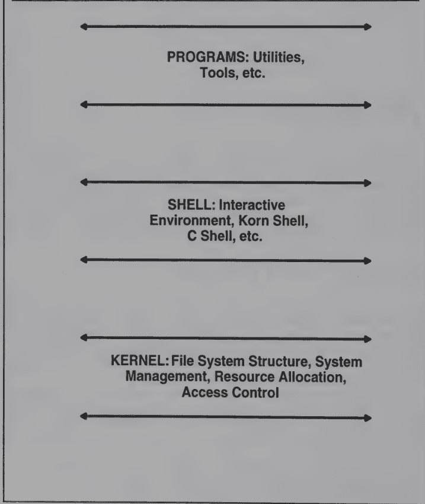
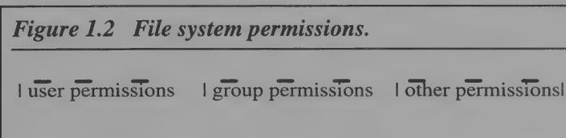
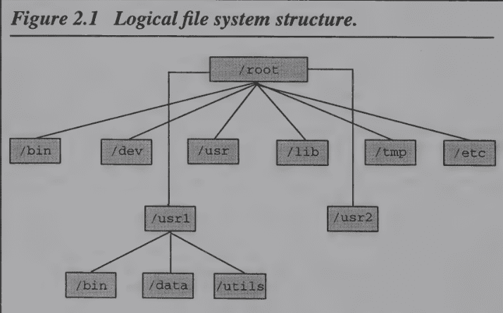
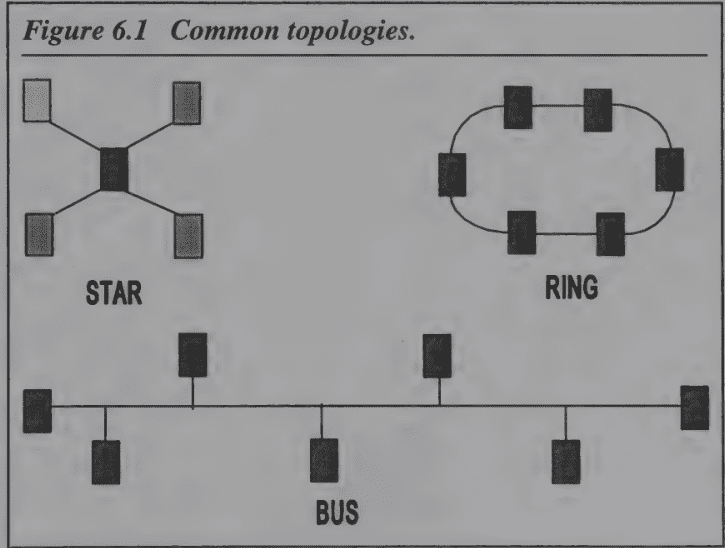
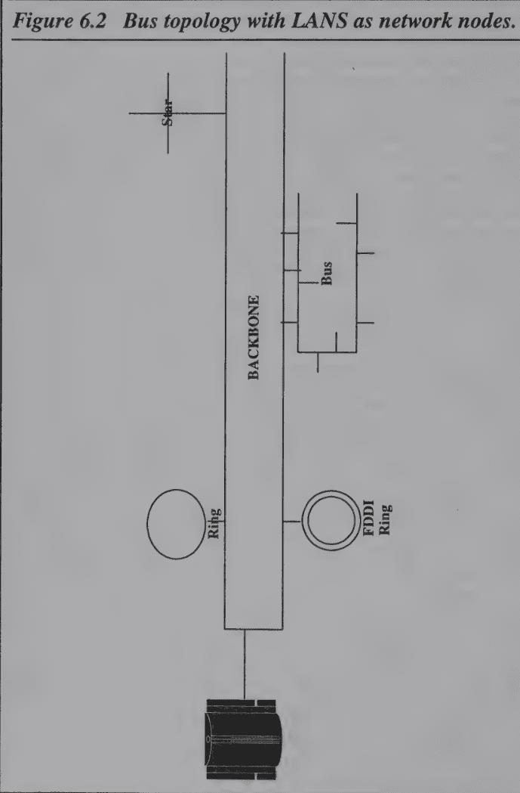
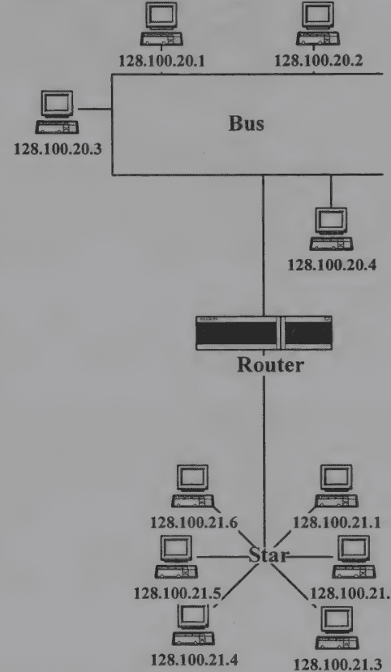
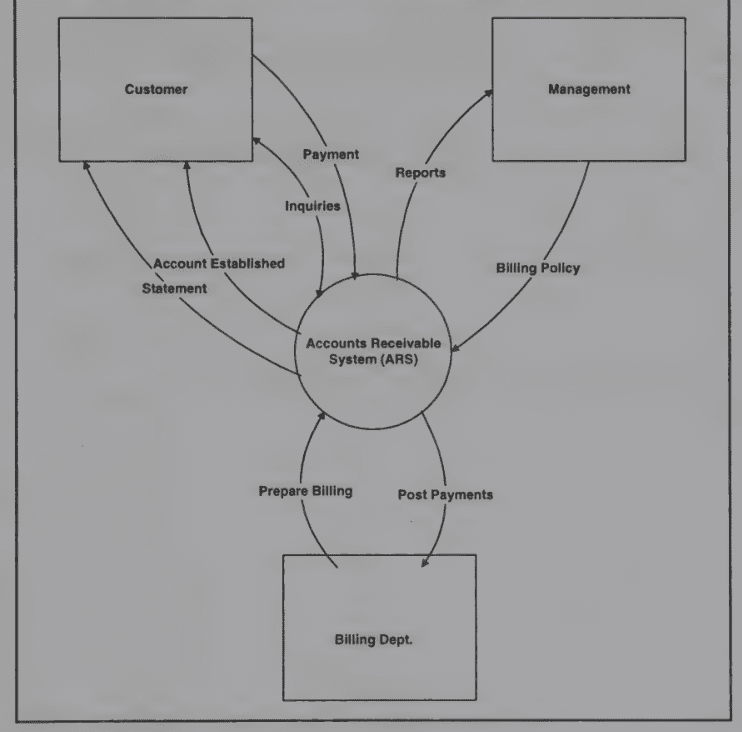
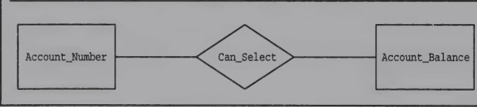
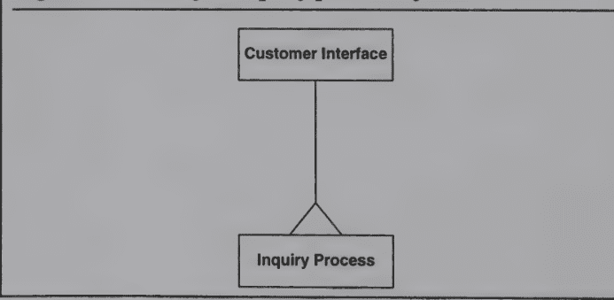
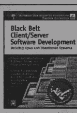

# 分布式 UNIX 系统管理：企业级团队流程

重点介绍 `Smatrix`，一种用于管理开放系统的 C++ 程序：

- 资源分配
- 任务集成
- 进程控制
- 通信

`JOHN R. WETSCH`

`rell IS&T`

`-240-3714`

插槽位 `5A`

`John R. Wetsch, .博士`


- 1.1. 技术支持 ....................................................................... 300
- 1.2. 免责声明 ............................................................................ 300
- 1.3. 系统要求 ................................................... 300
- 1.4. `SAmatrix` 概述 ....................................................................... 300
- 2. 安装 ........................................................................................ 301
- 3. 基本操作 ..................................................................................... 301
  - 3.1. 启动程序 ....................................................................... 301
  - 3.2. 加载数据库 ................................................................................ 301
  - 3.3. 分析数据 ....................................................................................... 301
  - 3.4. 打印矩阵列表 ................................................................ 302
  - 3.5. 退出 `SAmatrix` ................................................................................. 302
- 4. 创建/自定义数据库 ................................................ 303
  - 4.1. 记录格式 ....................................................................................... 303
  - 4.2. 添加记录 ................................................................................. 305
  - 4.3. 编辑记录 ................................................................................. 306
  - 4.4. 删除记录 ................................................................................ 306
  - 4.5. 添加数据库文件 ................................................................... 306
  - 4.6. 保存数据库文件 ................................................................... 306

# 索引 ............................................................................................ 307

# 引言

`UNIX` 是一种从大型机时代演变而来的 `Multics` 操作系统，已成为一种实用且可靠的多任务操作系统。它起始于贝尔实验室、马萨诸塞理工学院和通用电气的共同努力。两位贝尔实验室的计算机科学家 `Dennis Ritchie` 和 `Ken Thompson` 结合了对 `Multics` 和 `C` 语言（包括 `C` 的前身 `B`）的知识，在 20 世纪 70 年代初建立了第一个 `UNIX` 系统。

20 世纪80 年代的新兴技术是分布式计算。由运行网络和分布式操作系统的个人计算机组成的网络已成为业务处理的主流方法，取代了许多以前保留给大型机的功能。《分布式 UNIX 系统管理：企业团队程序》侧重于 `UNIX` 系统在企业中使用。它将企业的系统管理过程划分为软件、硬件、安全和运行管理模块，并提供了 `SAMatrix`——这是一个用 `C++` 编写的自动化程序，用于管理所有管理模块的任务。`SAMatrix` 提供的自定义框架可以帮助管理员评估分布式环境，识别弱点并组织改进措施。

`UNIX` 已证明自己能够运行在涵盖微型、中型系统、大型机甚至超级计算机的各种系统上。`UNIX` 也变成了一个非常开放的系统。今天，有许多 `UNIX` 的变体或版本，包括 `BSD`（伯克利软件发行版）及其变体（如 `Solaris`、`SunOS`、`freeBSD`、`Linux`）以及 `System V` 及其各种实现（如 `Xenix`、`AIX` 和 `HP-UX`）。

所有的 `UNIX` 版本都有许多共同点。几乎所有的 `UNIX` 都是用 `C` 语言编写的，只有内核的小部分用汇编语言编写。用汇编编写的部分以及特定计算机架构的部分是每个 `UNIX` 环境所特有的。本书探讨的主要环境是 `System V UNIX`。书中对变体进行了说明，但显而易见无法将所有变体都包含在内。然而，如果你的 `UNIX` 环境与文中讨论的内容不同，这里介绍的方法仍然可以形成一个动态基础，允许你通过将任务分类为管理模块并将其综合为运行管理来适应任务。它也可以作为学习日益瞬息万变的 `UNIX` 和其他计算机系统环境的阶脚石。

# 本书特点

# 读者群

《分布式 UNIX 系统管理》同时满足了技术和管理需求。它假设读者至少具有 `UNIX` 用户级知识。

# 约定

为了说明命令、输出等，通过字体类型、样式和符号系统对某些符号和命令进行了特殊处理，如下：

| 符号说明 | 示例/插图 |
|---|---|
| 命令使用 Courier 粗体 | `clown` |
| 非字面量参数使用 Courier 斜体 | `mkdir directory` |
| 输入、输出、代码、参数和文件名 | `/usr/adm/messages` |
| `[]`（方括号）表示可选输入参数 | `ls [-1]` |
| `~`（波浪号）是用户的家目录 | `~username` |
| `*`（星号）是匹配 0 或多个字符的通配符 | `*` |
| `?`（问号）匹配一个字符 | `?` |
| `{}`（花括号）包含参数，用 `|` 表示“或”选择 | `{yes|no}` |
| `^` 或 `Ctrl` 表示控制键组合，如 `Ctrl-d` | `^` 或 `Ctrl-d` |

# 目标

作为今天计算服务的提供者，系统管理员必须能够从企业系统的全局角度来看并维护本地环境。本质上，与互联网相似，技术支持人员在特定的专业领域工作，但必须出去并连接到其他领域。《分布式系统管理》旨在让你理解 `UNIX` 系统管理员的领域，并介绍 `UNIX` 系统管理的关键领域。

通常，系统管理和系统维护任务是同一件事。然而，随着组织的规模扩大，系统经理通常负责监督系统管理员和其他技术人员，并负责制定和执行信息策略和程序。由于本书将系统管理划分为管理员的领域，它可以作为一种手段，通过理解经理和其他管理员的通用任务，理解将 `UNIX` 系统引入环境的要求。

# 内容

软件、硬件、网络和安全模块为理解运行管理所需的任务提供了基础。你必须在评估系统之前对其进行理解。只有在理解并评估系统后，才能开发运行管理设计。

软件模块组织了内核和 `Shell` 编程、文件系统以及应用程序管理。硬件模块提供了管理设备驱动程序和外设硬件安装持续硬件维护的知识。网络模块解释了如何在 `UNIX` 机器上建立网络，提供了性能测试套件，并介绍了接入的选项。

安全模块提供了 `Shell` 脚本，并解释了安全、系统审计和监控程序。分层安全环境管理网络、系统、应用、数据和物理安全。为这些每一层都提供了支持安全程序的实用程序。


运行模块将之前的所有模块结合在一起，为整个企业的用户和管理提供服务。系统管理员必须管理广泛的任务：内核重编译、故障排除、性能监控、系统配置、编程等。运行模块提供了一种量化这些任务的方法。该模块建立了衡量运行管理的流程，以提高 UNIX 环境的质量和可靠性。这种方法适用于一个或多个系统，并为用户提供概述构成企业的分布式系统所需的统计分析。系统越分散，系统就越复杂，越需要统计分析来理解系统的整体运行情况。从此类分析中获得的信息为 UNIX 人员提供了手段，以建立管理企业和处理系统特定优弱点的合理策略和程序。

# xii — 分布式 UNIX 系统管理

使用这种方法，你可以将任何环境适配到操作管理模块中，为解决硬件、软件、网络和安全方面的异构环境提供手段。你对这些环境处理得越透彻，你的评估结果就越好。

# 本书能做什么

这本书可以成为一个动态参考书，提供系统级解决方案的指南。在书中，你将找到可能恰好是你所需要的的内容，或者可以作为获取与你环境相关的更多额外参考材料的索引。

# 本书不能做什么

这本书无法回答你关于分布式系统的所有问题。没有哪一本书能做到这一点，因为出现的问题太多且太复杂了。

作为一名系统管理员，你直接暴露在信息过载、无尽的任务和漫长的工作时间之中。在技术领域工作，你不断受到系统修改、更新、配置更改以及新旧技术整合的轰击。你的日常工作必须快速进行，并为你的用户提供可靠的服务，解决他们的需求和关注，从运行一个应用程序到设置和开发环境。随着你的工作从一个部门或工作组扩展到企业级系统，你的专业领域将超出操作系统和用户支持，延伸到网络、数据库管理、安全问题和整体系统管理。在企业级系统中，你不再是一个 UNIX 系统的系统管理员，而是技术人员团队的一员，负责硬件、软件、网络、安全和操作问题。

此外，任何分布式系统由异构组件组成，如局域网（LAN）、服务器平台和用户界面。这意味着 Novell 网络、TCP/IP、多个版本的 UNIX、Microsoft NT、大型机遗留系统、中型机、DOS、Windows、OS/2 等——基本上是非常复杂的混合体，一个人无法管理，也无法通过读一本书来理解。

# 针对动态工作的动态参考

系统管理员工作的组成包括提供信息系统（IS）支持、提供技术基础设施以及理解系统以便其正常运行。尽管分布式系统的信息系统管理和安全头疼问题大大增加，但也有相当的收益。这些好处为用户提供了更多样化的应用程序，从开发工具到文字处理程序。总而言之，系统集成已经达到了一个惊人的水平，以至于很少看到一个办公人员的桌面上没有放一台电脑。

我希望这本书能够帮助支持你的系统管理工作，并使你能够管理从大到小的系统，扩展你对 UNIX 环境的知识，并指导你完成企业级系统管理计划的发展。作为管理员或系统经理，了解你的系统使你能够做出影响系统硬件、软件、网络、安全或操作任务的决策。因此，对系统的了解以及构建有效操作计划的能力，是任何环境下企业级系统管理的关键。

尽管 UNIX 很复杂，但它为企业提供了优势，通过健全的系统管理策略和程序可以最大限度地享受这些优势。为此，《分布式 UNIX 系统管理：企业级团队程序》可以在支持和理解重要的 UNIX 系统模块方面提供价值。

# 第 1 章：基础

学习 UNIX 系统管理的基础是理解操作系统、了解关键组件并对文件组织建立理解。UNIX 操作系统是进程、文件和工具的结合，全部由内核控制，内核是负责管理系统任务的 UNIX 组件。这些组件赋予了 UNIX 作为企业级操作系统的力量，使其能够在几乎每一个计算机环境和平台中运行。

## 操作系统概述

UNIX 是一套软件程序，允许计算机和用户进行交互。这种人机界面是任何 UNIX 系统成功运行的关键，它允许控制计算机，提供工具包以方便环境的定制，并是你与机器之间的实际解释器。

一个 UNIX 系统有三个基本层，如图 1.1 所示：内核、外壳（shell）和程序。

顶层包含用户直接交互的环境。系统使用的程序和工具包括自带的实用程序或由管理员开发的程序；用于网络和通信的程序、工具和数据文件；以及数据库、文字处理、编程和其他用户应用程序。

要使用顶层，需要一个中间件来解释和执行用户与底层之间的指令和响应。这个中间件就是外壳。作为一个系统程序，外壳充当语言解释器、操作环境的定制器以及所有提交给计算机的请求的翻译器。多个外壳可以在内核之上运行，为每个用户提供一个可以运行多个用户多个任务的工作环境。变体包括 C shell 和 Korn shell（稍后将进行详细讨论）等。

### 图 1.1 基础 UNIX 系统。



## 基础 — 3

UNIX 操作系统的核心是内核，即底层，如图 1.1 所示。内核被加载到内存中，只要计算机开着，它就保持运行。正是通过内核，你才能访问你的机器。它负责计算机访问控制、资源分配、系统维护和内存管理。如果没有内核，你将无法访问或使用文件，无法与计算机交互，也没有工作的 UNIX 环境。

## 外壳 (Shells)

外壳是一个交互程序，在用户登录时或通过另一个外壳执行。外壳决定操作环境，有时可以通过其提示符来区分。某些外壳的可执行文件、描述性名称和提示符如下：

| 外壳 | 名称 | 提示符 |
| :--- | :--- | :--- |
| `sh` | Bourne shell | `$` |
| `bash` | Bourne again shell | `$` |
| `ksh` | Korn shell | `$` |
| `csh` | C shell | `%` |
| `jsh` | Job Control shell | `$` |
| `zsh` | Z shell | `%` |

常见的外壳是 Bourne shell (`sh`)、C shell (`csh`) 和 Korn shell (`ksh`)。这些常见外壳随商业 UNIX 产品提供，而其他如 Bourne again shell (`bash`) 和 Z shell (`zsh`) 属于公共领域，可以从 GNU 等公共网站获取。外壳对大小写敏感，与其他任何程序都很相似。你的工作外壳在你登录系统时变为激活，并在你注销之前不会终止。它是人机界面的核心，因为它翻译你的请求，并将需要的程序放入内存并执行。

在一种 shell 中开发的脚本可能无法无缝地转移到另一种 shell 中，但你可以通过阅读和经验来学习它们的区别。本书中编写的程序将使用 C shell 或 Korn shell。我将此任务留给初学者系统管理员，让他们通过运行不同的 shell 来发现差异。需要注意的是，以 `#`（井号）字符开头的 C 脚本会调用 Bourne shell 来解释该 shell 程序。在 Bourne 脚本中，程序员可能会使用 `:`（冒号）符号作为解释后的空值。在 C 和较新的 Bourne shell 脚本中使用 `#!\[path\]` 语法，其中 `path` 表示执行该脚本的 shell（例如 `#!/bin/sh`）。

在与内核交互时，用户通过程序、命令发送请求，或期望内核的响应。内核通过执行一个称为“进程”（process）的特殊程序来响应。进程是一个正在执行的程序，它由内核管理以允许程序正确执行。在执行期间，内核还管理文件的创建和删除；管理数据移出内存；并分离进程管理的启动者或所有者。进程由内核通过系统调用启动，尽管内核是直接调用 `init` 进程。相反，进程在完成或被所有者或管理员杀死后，由内核从内存中移除。

用户的父进程是 shell 进程，包括用户工作的环境。当用户输入命令时，内核会发出一个名为 `fork` 的系统调用，由内核创建一个新进程。通过 `fork`，内核创建了父进程的精确副本，即子进程，它包含了加载到内存不同区域的进程文本和数据。（任何产生新进程的进程都是父进程，生成的新进程被称为子进程。）还会向内核发出 `exec` 系统调用以允许进程运行。每个进程都被分配一个进程 ID（`PID`）。当进程完成或退出时，它会通知父进程以释放子进程所使用的资源。如果父进程没有确认子进程的死亡，子进程的 `PID` 将保留，资源虽然已释放，但结果是产生一个不会删除的进程，被称为“僵尸”（zombie）进程。（管理员看到的僵尸进程显示为 `<defunct>` 进程。）僵尸进程虽然很烦人，但在系统重启时会被清除。

特殊类型的进程被称为守护进程（daemons processes）或此类守护进程。守护进程通常在启动时启动，提供用户服务且在没有用户的情况下运行。它们也可以由用户、定时器或系统事件（如错误）请求，后者会激活 `errdaemon`。另一个例子是使用 `lp` 命令调用打印守护进程。打印守护进程 `lpsched` 留在内存中处于空闲状态，直到被 `lp` 唤醒以向打印机发送内容。其他警觉的守护进程如 UNIX 定时器程序 `cron`。用于调度的 `cron` 守护进程执行管理员或任何具有 `cron` 权限的用户定义的日志程序和命令。

## 密码与 ID


系统管理员和所有系统用户通过登录开始与系统的交互。用户输入区分大小的登录 ID 和密码。[设置用户登录 ID 和密码将在安全管理模块（第 8 和第 9 章）中讨论]。连接成功后，系统会显示 shell 提示符，如 `$` 或 `%`，取决于所使用的 shell 以及是否进行了系统特定的自定义。一个名为 `root` 的特殊用户 ID 具有严格保护的密码，允许用户以超级用户身份系统。成功登录后，超级用户或 `root` 用户将拥有独特的井号提示符 (`#`)。

管理员作为超级用户承担着全局权限的责任；即允许管理员对 UNIX 宇宙内所有文件、程序和进程执行任何允许操作的权限。只有管理员应该以 `root` 身份登录。永远将超级用户密码给非系统管理员人员。此外，对于普通系统使用，管理员不应使用超级用户密码。最好使用你的普通用户 ID 登录，如果在系统操作中需要超级用户权限，请使用 `su` 命令获取超级用户权限。

## 路径名与目录

下方示例显示的 `#` 表示系统处于超级用户模式。对于示例命令的普通用法不需要超级用户权限。首先，你可能想通过执行 `pwd`（打印工作目录）命令找到当前工作目录：

```bash
### pwd
### /usr/root
```

如果在登录后立即执行，`pwd` 会显示用户的家目录。如果你已经在系统中移动并确定了家目录的位置，输入不带参数的切换目录（`cd`）命令。此操作会将当前工作目录重置为你的家目录，然后自动执行 `pwd` 命令打印当前工作目录。

```bash
### cd
### pwd
### /usr/root
```

接下来，执行列表命令查看目录列表。

```bash
### ls
bin
c_files
john
list.c
```

到为止，这些都是普通用户命令，但对于系统管理员来说，`ls` 命令非常有益。当带有 `-a`（代表“所有”）执行时，`ls` 提供完整的列表：

```bash
### ls -a

.
..
.profile
bin
c_files
list.c
mbox
```

首先，注意 `.` 和 `..` 代表目录的相对路径。`.`（点）代表当前目录，`..`（点点）代表父目录。以 `.` 开头的文件（例如 `.profile`）不会通过 `ls` 显示，而 `ls -a` 会显示这些隐藏文件。

### 用户环境

注意 `.profile` 文件，它用于配置用户环境。一个用户的简单 `.profile` 可能如下所示：

```bash
$ cat .profile

### User profile

umask 077

PATH=$HOME/bin:$PATH

export PATH

TERM=vt100

export TERM

exec /usr/local/bin/usermenu
```

每个用户在自己的家目录下都有自己的配置文件。用户配置文件可以针对特定用户或一类用户进行自定义。因此，系统配置文件通常保留在 `/etc/profile`，为所有用户提供系统级配置。在示例 `.profile` 中，`#` 符号表示 shell 编程的注释语句。大写单词是环境变量。`PATH=$HOME/.` 行将当前目录分配给 `PATH` 变量。例如 `$HOME` 目录（如 `/usr`）被分配给 `$HOME` 以及 `PATH` 变量。分配给 `PATH` 的每个路径用冒号（:`）分隔。

分配后，通过将变量放入环境中完成配置，使其识别为正确的赋值。分配后，使用 `export` 命令导出 `PATH` 变量。对正确的终端分配也这样做；即将终端类型（`vt100`）分配给变量 `TERM`，并导出 `TERM`。最后，`.profile` 通过 `exec /usr/local/bin/usermenu` 行启动指定的用户菜单。此菜单可能包含系统管理员授予该特定用户的应用程序和系统访问权限。

对系统上的用户进行分类并正确设置环境至关重要。控制用户交互和系统访问的是 shell 环境。可以直接访问 shell 的用户可以更改环境变量。在某些情况下你可能希望这样做，但在其他情况下，更改 shell 变量的能力是不可取的，用户的 shell 使用可能会受到限制。例如，通过互联网访问 Web 页面不会访问系统 `$HOME`，但你可能会通过通用网关接口（CGI）获取写入权限，在这种情况下，访问 Web 页面并能够投放 shell 环境会导致安全问题。

通过设置变量，用户或管理员可以查看 shell 设置了哪些变量，使用 `env` 命令。

```bash
$ env

MENU_DIR=/usr/local/menu
LOGNAME=wetsch
MAIL=/var/mail/wetsch
TERM=vt100

PATH=.:/adm/wetsch/bin:/usr/bin:/usr/bin:/usr/local/bin
HOME=/usr/adm/wetsch
SHELL=/usr/bin/ksh
HZ=100
MANPATH=/usr/share/man:/usr/local/man
EDITOR=/usr/local/bin/vi
TZ=US/Eastern
```

在检查 shell 时，无论是检查变量还是解决问题，系统管理员绝不应该从 `root` 登录开始，以避免任何潜在的木马程序或在超级用户级别重复用户的问题。最好的方法是先以用户身份登录，查看问题所在。如果无法这样做，超级用户可以使用 `su` 命令切换用户以进入用户的环境。然而，要通过模拟用户及其 shell 的登录来在不需要密码的情况下进入用户环境，你必须 (1) 身份是超级用户，且 (2) 在用户的登录 ID 后面使用一个横杠（`-`）。如果不使用横杠，你当前所处的环境将保持不变。例如，`# su wetsch` 会切换到用户的环境，而 `# su - wetsch` 则保持当前环境。

使用切换用户。如果你通过不使用连字符选项来保留环境，你可能无法复制用户的问题。或者，如果你能够复制用户的问题，由于变量可能会扩展到你的目录、系统目录等，影响可能会增加。记住，如果你为不同类的用户设置了不同的权限，你的用户类与你正在帮助的用户不同。请注意，如果你知道用户的密码且你不是 `root`，可以使用 `su` 并输入密码来更改你的身份。

## 权限

使用 `-la` 选项执行 `ls` 命令以获取“长格式”列表：

```
total 70
drwxx--x 5 wetsch 512 Aug 9 00:09 .
drwxrx-x 36 root Jul 27 03:01 ..
-rw-r---- 1 wetsch 151 Dec 26 19:55 .profile
-rw-r---- 1 wetsch 512 Aug 9 00:09 _sh_history
drwx------ 2 wetsch 512 Nov 28 19:55 bin
drwx------ 2 wetsch 512 Apr 3 19:39 mail
-rw-r---- 1 wetsch 15659 Feb 19 11:32 kermit.man
drwx--x--x 2 wetsch 512 Apr 3 19:39 johns_html
```

基础 — 9

此列表从右侧列开始包含文件名、创建或最后修改日期时间以及文件大小（字节）。剩余四列包含与文件相关的权限信息。UNIX 文件基本上有三种权限：所有者、指定的组或 `root`。长格式右侧第四列列出了每个文件的权限。组被定义为一组用户（例如示例中的 `*sys*`），他们被赋予相同的权限，而不是授予给单个用户或世界的权限。系统管理员可以定义组以适应所有级别的用户。组名左侧是文件的所有者。所有者左侧的数字是文件的链接数。链接是引用同一个文件的符号链接。最左侧列是文件类型描述符，以及 `root`、组或所有者的可用权限。最左位开头为：

+ `-` 普通文件
- 目录
- 块类型设备文件
- 字符类型设备文件
- 域套接字文件
- 文件的符号链接
- 命名管道

后续位指的是允许文件的权限。这些位被分成三组，如图 1.2 所示。从左到右，前三位设置文件所有者的权限，中间三位设置组权限，最后三位设置所有其他用户的权限。系统的超级用户能够设置并维护所有五个权限位，以维护系统的完整性和可用性。

可用三种权限：读 (`r`)、写 (`w`) 和执行 (`x`)。读取权限允许用户查看文件而防止用户进行更改。写权限允许特权用户读取并更改


10 — 分布式 UNIX 系统管理

文件是 shell 脚本或其他可执行程序，执行选项允许所有者运行该程序。因此，标记为如下的文件

```
-rw--------
```

表示这是一个普通文件，`root` 和所有者具有读写权限。如果权限为：

```
-rr--
```

所有者和其他只有读取权限，排除了组。设置所有者 `other` 意味着对文件的全局或世界访问；也就是说，包括组在内的任何人都可以读取它。`chmod` 是更改权限的命令。你可以用两种方法使用 `chmod`。第一种方法是符号，使用指示符：

+ `u` 用户
`g` 组
`a` 所有用户

此外，加号 (`+`) 用于添加权限，减号 (`-`) 用于移除权限。这种格式下 `chmod` 的语法为：

```
chmod [ugo] [-rwx]
```


要为文件（其他）添加写权限，输入：

```bash
chmod o+w kermit.man
```

长列表 `ls -l` 更改前后的：

Before

```
-rw------ 1 wetsch other 51659 Feb 19 11:32 kermit.man
```

After

```
-rw-w- 1 wetsch other 51659 Feb 19 11:32 kermit.man
```

要完全移除写权限，输入

```bash
chmod u-w kermit.man
```

基础 — 11

并且 `ls -l` 返回

`-r------ 1 wetsch other 51659 Feb 19 11:32 kermit.man`

这种符号方法有一个基于八进制数的数值对应项。经验丰富的系统管理员更倾向于使用数值方法，因为它对简写语法提供了更大的控制。在数值方法中，每个位的权限都可以用 0 到 7 之间的数字填充。这意味着一个八进制数字就定义了所有者、组或其他用户的权限。在这种格式下，切换用户并输入密码

```bash
su
```

`kermit.man` 切换用户，设置权限

`-rw------ 1 wetsch other 51659 Feb 19 11:32 kermit.man`

切换位（sticky bit）和 1 设置了强制锁定。文件模式可以描述为文件的状态。例如，更改权限位改变了文件的安全性或保护模式。所有文件都可以设置其模式，但对于可执行文件的操作最为重要。在可执行文件上设置切换位允许文本更快速地放入执行区。它现在的使用频率不像 UNIX 历史中那样频繁，但有时被保留用于系统交付文件，如编辑器、编译器和 shell。因此，

### 表 1.1 chmod 八进制权限

| 八进制 | 权限位 | 描述 |
| --- | --- | --- |
| 0 | --- | 无权限 |
| 1 | --x | 执行权限 |
| 2 | -w- | 写权限 |
| 3 | -wx- | 写和执行权限 |
| 4 | r-- | 读权限 |
| 5 | r-x | 读和执行权限 |
| 6 | rw- | 读和写权限 |
| 7 | rwx | 读、写和执行权限 |

切换位（sticky bit）和 s 设置。除了 r、w、x 权限外，还有 s、t 权限。这些权限描述了文件的完整性。切换位（sticky bit）和 s 设置

用于公共目录，因为私有目录应该正确设置权限位。

你也可以使用 `chmod` 的八进制数字表示法来设置额外的位；因此，使用四个八进制数而不是三个来设置文件权限。八进制 1000 用于开启粘滞位（sticky bit）。通过用户 ID `setuid` 和组 ID `setgid` 命令可以实现额外的控制。通过设置这些位，你可以将所有者权限传递给用户组。八进制 2000 和 4000 分别代表 `setuid` 和 `setgid`。当这些位被设置时，r、w、或 x 权限行中的其中一个位会被 s 替换。

传递所有者的权限可能会导致安全问题。`setuid` 和 `setgid` 将“安全”模块（第 8 章和第 9 章）中进一步讨论。其他值得注意的项目涉及 SUID 以及获取诸如 `-rwSr-xr-x` 的权限列表，这意味着 SUID 已设置但执行位未设置。此外，当创建文件的副本时，权限设置不会被保留，并将默认为复制所有者的权限。

可以使用两种方法分配权限：`=` 符号和 `umask` 命令。为所有用户分配读写权限，请使用：

```
chmod a=rw filename
```

除了之前的方法之外：

```
chmod ugo+r+w-x filename
```

或者

```
chmod 555 filename
```

或者

```
chmod +rw-z filename
```

最后，`umask` 命令允许自动设置权限模式。在之前显示的 `.profile` 文件的输出中，`umask 077` 是文件中的第一个命令。`077` 并不是像 `chmod 077` 那样将权限位设置为 077（即为所有人和组设置读、写、执行权限，并关闭用户的权限）。相反，`umask 077` 掩盖组的读、写、执行位，但不掩盖用户的。`umask 077` 有效地开启了用户的读、写、执行权限并关闭了所有权限位。用户创建的结果文件为

`-rwx------`

在对目录应用 `umask` 时必须谨慎。当目录权限被设置时，它们将适用于目录中的所有文件。这意味着，如果你将一个目录设置为只读，该目录中的任何文件无论其分配的权限如何，都是只读。因此，通过设置系统 `umask`，你实际上是在设置其他如何访问文件的参数。要查找你系统的 `umask` 值，只需在提示符处输入 `umask`。

### UNIX 基础

除了此 UNIX 概述涵盖的主题外，还有五个领域是 UNIX 的基础：登录、系统启动/关闭、调度和使用编辑器。

登录是 UNIX 最重要的功能之一，允许用户访问系统并验证用户是否有权使用该系统。系统管理员不仅必须分配 ID 和密码，还必须管理用户并帮助他们成功登录系统，在处理新用户时这是一项具有挑战性的任务。登录时，屏幕会显示某种横幅，欢迎你进入系统。某些系统使用免责声明或警告作为横幅，告知你系统的预期用途。除了横幅外，系统还会显示登录提示符，例如：

```
Welcome to the UNIX system
login:
```

输入用户 ID（如 `root`）后，系统会提示你输入密码：

```
password:
```

为了防止他人在屏幕上看到密码，如果你输入的密码错误，将收到错误消息。系统还可能限制你在注销前可以进行的错误登录尝试次数。登录后，你可能会被要求输入终端类型，如 `TERM=(vt100)`

你的默认终端类型显示在括号中。按下回车键接受默认值。要更改终端类型，请在按回车键之前输入新类型。例如：`TERM=(vt100)`

系统会在终端配置文件查找可以分配给 `TERM` 变量的有效终端类型。如果系统找到有效类型，它将返回响应 `Terminal is vt320`

如果输入了无效的终端类型，响应为 `Terminal unknown`。给 `TERM` 分配错误的类型会导致可预测但奇特的结果。屏幕上的字符可能会被双倍显示，换行可能无法正常工作，退格键和控制代码可能无法被正确解释，屏幕上的大写和小写字母输出可能会反转，或者键盘键可能未启用。应该首先通过使用 `env` 命令检查 `TERM` 变量来解决这些问题。此外，你可能想检查终端默认值与实际使用的终端是否匹配。如果在成功登录后在屏幕上看到无意义的字符，也可能是因为你的通信速度不正确。按下 Break 或 Return 键有时可以解决这个问题。如果无效，尝试重新登录并检查正确的终端类型。用户不需要登录系统的唯一情况是系统登录已经建立且会话已打开。此外，在初始登录后，不同系统之间的登录程序可能是透明的。这允许用户在属于同一网络的各个系统之间移动，而只需登录网络上的一个系统。退出运行中的会话的方法各不相同，通常输入 `exit` 或 `Ctrl-d (^d)` 即可。

### 系统启动与关闭

对于运行任何 UNIX 系统来说，正确关闭和启动非常重要。与运行 DOS 的 PC 不同，UNIX 系统不能直接断电。任意的断电带有损坏系统文件、目录以及可能的驱动器的风险。在紧急情况下，例如需要快速关闭的疏散，或你的设施需要关闭电源而你没有时间执行关闭程序时，应该尝试断电。当你回到系统时，准备好做一些工作让一切恢复原状。


如果你想查看系统处于什么运行级别（run level），请执行 `who -r` 命令：

`run-level 3 Feb 8 22:12 S`

在这种情况下，系统运行级别为 3，右侧的信息显示在 2 月 8 日 22:12 从 S 切换到 0。某些 UNIX 系统（如 BSD 和 XENIX）只识别多用户和单用户模式，此时 `who -r` 的结果与此不同。`shutdown` 命令位于系统目录，对于 UNIX 系统通常在 `/etc` 或 `/sbin` 等文件存储目录。`shutdown` 用于将系统置于指定的状态并仅允许 `root` 运行。通用状态、操作模式或初始化级别（即运行级别）如表 1.2 所示。

3 之上还有初始化级别，包括用户定义的初始化级别 4、另一种关闭模式初始化级别 5，以及用于立即关机的初始化级别 6。如表 1.2 所示，初始化级别 S 和 1 看起来是重复的。但在这些看似相同的模式之间存在本质差异。在初始化级别 S 下，系统管理员将系统带入维护模式并移除任何后台进程。初始化级别 1 则保持后台进程运行。因此，在初始化级别 1 下，所有守护进程都在运行，而初始化级别 S 维持必要的守护进程。初始化级别 2 和 3 都是多用户级别，可以用于网络系统。然而，初始化级别 3 允许远程文件共享和网络系统，而初始化级别 2 用于非网络系统。可以通过两种方法调用初始化级别，设置初始化级别的权限应限制为超级用户。首先，可以使用 `init` 命令关闭系统：

```
init 0
```

| 表 1.2 主要关闭级别 |


| 初始化级别 | 描述 |
| S | 单用户模式 |
| 0 | 准备系统关电 |
| 1 | 单用户模式 |
| 2 | 多用户模式 |
| 3 | 网络多用户模式 |

然而，`shutdown` 命令被认为更好，因为它为系统管理员提供了更多选项。在命令行中

```
shutdown -i0 -g60 -y
```

`-i` 选项将 `init` 级别设置为 0；`-g` 在关机前设置 60 秒的宽限期（尽管系统可能将其定义为 60 分钟）；而 `-y` 则对任何系统提示做出自动响应。如果没有 `-y`，系统管理员会被提示确认关机。`Shutdown` 以优雅的方式关闭系统。它会发送消息让用户离开系统（这就是为什么宽限期非常重要），并且在系统重启时，它甚至可能会执行文件系统检查（`fsck`）。在维护期间进行 `fsck` 是审慎的，但在关机时并不总是需要。它会延长过程；也就是说，`shutdown` 命令在返回系统用户模式时需要将系统切换到不同的运行级别。重启系统后，重启会启动该过程。对于带有 `shutdown` 的 BSD 系统，为了更快速地启动，可以使用 `-f` 选项跳过 `fsck`。然而，在大多数情况下，读者应使用带有 `fsck` 的重启来在启动时提供必要的文件系统检查。

在 BSD 系统上，`shutdown` 命令的语法各异。基本上，执行该命令时可以将关机时间指定为现在、以分钟为单位或时钟时间，并附带要广播给所有用户的消息。例如，输入

`shutdown now`

或

`shutdown +15 "maintenance"`

或

下一章将讨论如何将系统关机维护模式。为正常的 V UNIX 关机准备的推荐步骤如下：

- 1. 尽可能通过系统消息通知文件警告用户系统何时关机以及持续多长时间（`motd` 用于存储用户在登录时读取的消息）。
- 2. 以超级用户（superuser）身份登录系统。
- 3. 使用 `wall` 命令向所有用户发送系统将要关机的消息。通常在关机前 10–15 分钟的警告足够了。我通常会留出足够的时间以防用户正在运行某个重要的进程，该进程可能会比计划关机时间延长几分钟。
- 4. 使用 `who -u` 或 `ps -ef`（单独使用或通过适当的管道配合 `grep` 进程类型）检查系统上有多少用户。
- 5. 执行 `sync` 命令。在 UNIX 中，这是一个传统的关机步骤，尽管在某些机器上可能不需要。当调用 `sync` 时，缓冲区会被刷新，正确的系统镜像会被写入磁盘。在某些 `shutdown` 命令中，`sync` 是嵌入的并自动执行的。尽管如此，运行 `sync` 是一个良好的习惯。
- 6. 最后，执行 `shutdown` 命令到 `init` 级别 0。应该调用宽限期并使用 `-y` 选项（即 `shutdown -i0 -g60 -y`）。注意：一旦关机正在进行，请不要尝试中断它。最好让系统优雅地关闭，然后你重启它。

当关机过程完成后，系统会发送消息表示可以安全地关机或重启系统。关机完成后，系统可能会提示“按任意键重启”。观察你的屏幕并注意任何出现的系统提示。还要注意屏幕上的输出会告诉你哪些守护进程（daemons）正在被关闭。在关机期间，观察输出消息可以让你很好地了解关机过程中发生了什么。

在关机过程中，系统运行一个 `init` 级别脚本，该脚本反过来调用脚本来优雅地关闭系统。在 System V UNIX 上，`/etc/rc0` 脚本调用 UNIX 工具和命令来关闭系统。（注意：`/etc/rc[0-6]` 脚本被设置为在级别切换、关机和系统启动时触发相应的 `init` 级别。）`/etc/rc0` 脚本调用 `killall` 工具，它通过根据需要发布 `sync` 命令来清理运行中的守护进程和其他进程，使用 `umount` 卸载文件系统，并发布 `umount` 命令停止处理器。

### Startup

在关机过程中，系统运行一个 `init` 级别脚本，该脚本反过来调用脚本来优雅地关闭系统。在 System V UNIX 上，`/etc/rc0` 脚本调用 UNIX 工具和命令来关闭系统。（注意：`/etc/rc[0-6]` 脚本被设置为在级别切换、关机和系统启动时触发相应的 `init` 级别。）`/etc/rc0` 脚本调用 `killall` 工具，它通过根据需要发布 `sync` 命令来清理运行中的守护进程和其他进程，使用 `umount` 卸载文件系统，并发布 `umount` 命令停止处理器。

```
-rw-r-- 1 root root 833 Jan 04 1995 .utillist2
drwxr-xr-x 2 bin bin 2416 Jul 17 1995 bin
-r------ 1 bin bin 78725 Jan 22 1995 boot
-rw-r-- 1 root other 28 Oct 27 1995 con
drwxr-xr-x 9 bin bin 9024 Jan 17 1995 dev
-r------ 1 bin bin 584 Dec 15 1995 dos
-rw-r-- 1 root other 508 Oct 13 1995 error.sh
drwxr-xr-x 1 auth 3664 Aug 20 1995 etc
drwxr-xr-x 5 bin bin 2640 Aug 07 1995 lib
drwxr-xr-x 1 root root 1024 Dec 29 1995 last
-rw-r-- 1 root other 4554 Mar 12 1153 mbox
drwxr-xr-x 2 root root 32 Jan 22 1995 mnt
drwxr-xr-x 2 bin bin 128 Jan 22 1995 sh
-d--x---- 6 bin bin 96 Jan 22 1995 tcb
drwxrwxr-wt 4 sys 2228 Aug 20 2215 tmp
drwxr-xr-x 8 root other 224 Sep 23 1995 usr
-r------ 1 mem mem 12341 Apr 17 1995 unix
-r------ 1 mem 108672 Jan 17 1994 unix.old
-r------ 1 root other 12528 Apr 17 1995 unix.sav
drwxr-xr-x 4 root auth 720 Mar 01 1995 usr
drwxr-xr-x 3 sys sys 48 Jan 22 1995 var
drwxr-xr-x 3 root other 128 Oct 28 1995 v
```

该文件是你操作系统的内核或核心。请注意两个额外的文件：`unix.old` 和 `unix.sav`。系统管理员会在系统中保留他们认为稳定的旧内核以备不时之。当构建了新内核但由于内核损坏或设备配置不当导致无法使用时，这一点尤为重要。让系统恢复运行是至关重要的。通过从旧内核（即使是更旧的）启动，可以启动系统并配置新内核。其他目录、子目录和文件将在本书随后的部分讨论。

### 调度

在每个计算环境中，准确调度任务都是必要的。在 UNIX 中，这是通过 `cron`（即 UNIX 定时器）实现的。`cron` 守护进程运行在多用户模式下，对时间敏感，并读取 `/etc/spool/cron/crontabs` 目录。可以使用文本编辑器轻松生成创建 cron 任务（cron job）的文件。要列出 cron 文件的内容，输入 `crontab -l`。要加载、更新或删除 cron 文件，输入 `crontab -r`。

## 22 — 分布式系统管理

在用户退出系统后，`cron` 继续运行，并可用于用户认为必要的任何自动化功能。由于 `cron` 对时间非常敏感，建议在系统处于单用户模式时更改系统日期，因为在该模式下 `cron` 是不活跃的，进程不会被意外启动或忽略。

系统概述介绍了路径和目录的概念，并讨论了理解文件组织和文件权限如何帮助你通过 `chmod` 和 `umask` 等进程保持系统组织良好并维护用户访问。系统组织首先由目录层次结构定义，根目录（root）位于顶部，随后是后续系统目录。

最后，系统概述讨论了权限和环境变量如何定义管理员或用户使用系统。授予权限和配置环境变量的能力赋予了系统相当大的权限，这直接影响了所有用户的人机界面。

本章还讨论了如何优雅地关闭系统以进行维护，以及如何设置调度。维护允许管理员让系统处于最佳状态。在维护模式下，管理员还可以完成任务，例如设置权限、调度、加载驱动程序等，而不会影响用户——只是管理员以外的用户在系统维护模式下无法访问系统。

本章展示了如何通过 `ls`、`pwd`、`ps` 和 `env` 命令来更好地查看你的系统——通过确定里面有什么、运行着什么，以及运行该系统需要什么。


UNIX 系统的骨架是它的文件系统。因此，必须维护该系统以确保系统的最佳性能、安全功能。


# UNIX 文件系统逻辑与物理结构

系统本身可以被解释为逻辑和物理结构。为了更好地理解 UNIX 文件系统，上一章引入了层次树结构，这是系统的逻辑表示，它从上到下查看文件结构，根文件系统位于顶部。文件系统是一个目录及其所有关联的子目录和文件。图 2.1 显示了 UNIX 文件系统的层次结构，所有目录都源自根目录。

除了源自根目录的关键目录外，图 2.1 还显示了两个系统 `/usr1` 和 `/usr2`。你可以假设系统管理员已将这两个目录添加到根目录中。

目录 `/usr1` 包含三个额外的子目录：`/bin`、`/data` 和 `/utils`。从理论上讲，你可以向 `/usr1` 和 `/usr2` 添加无限数量逻辑子目录和文件。图 2.2 显示了源自根目录或其他子目录的文件系统（虚线）。在层次结构中位于另一个目录之上的目录被称为父目录。

## 物理视图

UNIX 文件系统的物理视图显示了它的独特性。图 2.2 画了物理结构表示。注意连接 `/usr1` 和 `/usr2` 到根目录的虚线。虚线表示这些文件系统可以挂载或从根目录卸载，这种机制被称为文件系统的挂载（`mounting`）和卸载（`unmounting`）。

图 2.2 还提到关键目录（即第 1 章提到的 `/bin`、`/dev`、`/usr` 等）通过实线连接到根目录，这意味着它们是根文件系统的子目录，不能卸载。可挂载的目录（如 `/usr1` 和 `/usr2`）可以被卸载。

物理文件系统是一个子目录和文件的目录结构，可以在物理上与根目录分离。根目录也是一个物理文件系统，但只要 UNIX 运行，它就无法被卸载。重要目录实际上是根目录的子目录，只要 UNIX 运行就可以访问。如果这些目录位于根目录以外的挂载文件系统中，那么位于其中的实用程序和工具在其父目录挂载之前是无法访问的。

对于挂载的文件系统，根目录是文件层次结构的顶层，随后是挂载的文件系统。如果文件系统未挂载，它不应出现在 `ls -li` 命令的目录列表中。此外，`ls -li` 命令验证了挂载的文件系统是否作为根目录下的目录出现。



目录结构提供了 UNIX 系统的地图。如果你在 UNIX 内核内部寻找文件 `/usr1/data/appdb`，你将首先离开内核，进入名为“节点”（nodes）的踏脚石组成的电子流。第一个节点将根（`/`）节点。根指向 `/usr1`，`/usr1` 指向 `/usr2`。

> 注：此处原文存在大量重复，已根据逻辑合并处理

存储在文件系统中的节点不仅包含文件的地图信息，还包含描述性信息。当你运行 `ls` 命令时，这些信息会被解释。节点信息包括：

- 文件链接数
- 创建、修改和访问日期
- 节点更改日期
- 用户和组所有权
- 文件的权限，包括执行位
- 文件类型（例如：目录、普通文件、特殊文件、命名管道）
- 文件大小
- 起始块地址

每当你更改权限、创建文件等时，你都在更改并生成信息。

要实际查看文件的节点号，请执行 `ls -li`：

| Inode | 权限 | 链接 | 所有者 | 组 | 大小 | 日期 | 时间 | 名称 |
|---|---|---|---|---|---|---|---|---|
| 12543 | drwxr-xr-x | 9 | bin | bin | 6870 | 2月5日 | 11:18 | dev |
| 23451 | --------- | 1 | bin | root | 78725 | 3月22日 | 1995 | boot |
| 34521 | crw--w--w- | 1 | root | root | 19135 | 3月22日 | 1995 | `/dev/ttyA` |
| 45633 | brw-rw-rw- | 5 | bin | bin | 2, 4 | 3月22日 | 1992 | fd10 |

## 链接

`link` 命令有时被比作 `copy` 命令。也就是说，通过磁盘上的一个文件副本，你可以使用多个名称来访问它。然而，`link` 和 `copy` 之间有显而易见的区别：`copy` 是文件的完整拷贝，而 `link` 只是对文件的引用。`link` 命令的语法如下：

```bash
## ln /path/path/source-filename /path/path/dest-filename
```

这允许通过目标文件（`dest-filename`）访问源文件（`source-filename`）。

使用 `ln` 创建的链接有时被称为硬链接（hard link）。使用 `ln -s` 创建的链接被称为软链接（soft link），也称为符号链接（symbolic link）。硬链接不能跨文件系统，而软链接可以。硬链接不能指向目录，而软链接可以。软链接指向的是路径，如果源文件被删除，硬链接仍然有效，但软链接会失效（变成死链接）。如果硬链接被删除，软链接也会被删除，但如果软链接被删除，硬链接仍然有效。

## 创建文件系统

`mkfs` 命令用于创建文件系统。在 UNIX 系统中，有许多文件系统类型，如 `ext2`, `ext3`, `xfs` 等。在创建文件系统之前，通常需要对磁盘进行分区。

```bash
## mkfs [-t type] device
```

其中 `-t` 参数用于指定文件系统的类型。如果不指定，系统将使用默认类型。

创建文件系统始于规划。在创建新文件系统之前，请收集以下信息：

- 文件系统所需的块数：这是文件系统使用的物理块。你唯一的限制是磁盘上可用的空闲空间。你需要知道在文件系统中的将存储什么内容，例如数据库、存储位置或工作空间。
- 文件系统所需的 inode 数量：每个文件（无论大小如何）都需要一个 inode。如果要在开发环境中向文件系统中存储大量文件，则需要分配大量的 inode。
- 文件系统是块设备还是字符设备：这取决于硬件设备。
- 要求的块大小：如果你的块大小与默认的 1024 字节不同。
- 每个 inode 的字节数：如果你需要为每个 inode 分配特定的字节数。
- 需要预留的空闲空间。
- 你是否需要特定类型的文件系统，例如 BSD 快文件或旧的 System V。

注意，某些参数具有默认值。要确定默认值和最低需求，请检查操作系统提供的文件系统安装/配置文档。

创建一个名为 `/dev/c1d2` 的文件系统以存储多个数据文件，输入：

```bash
### mkfs /dev/c1d2 10000
```

这将文件系统创建为块设备，如果存储文件设备的磁盘驱动器也是块设备（类型为 b）。这种特殊块设备文件的创建也可以使用 `mknod` 命令，该命令在硬件管理模块中进行了详细讨论。

在上述 `mkfs` 命令的用法中，数字 `10000` 指定块数；指定 inode 数量是可选的。当仅指定块数时，`mkfs` 为每 2Kb 的 1024 字节块大约创建一个 inode。因此，对于 10000 块的文件系统，`mkfs` 创建 5000 个 inode，这应该足够了。要指定所需的精确 inode 数量（例如 2500 个），输入：

```bash
### mkfs /dev/data01 10000:2500
```

要将文件系统的块大小更改为 512 字节的另一个倍数（例如 2048 字节），请添加 `-b` 选项：

```bash
### mkfs -b 2048 /dev/c1d2
```

此行告诉 `fsck` 专门检查 `/dev/disk/c0t0s0` 文件系统，使用 `-D` 选项进行额外检查，并使用 `-y` 选项自动对所有提示回答是。表 2.1 显示了 `fsck` 选项列表。这些选项为 `fsck` 命令提供了相当的灵活性。

当 `fsck` 运行时，它会经过几个步骤，多达六个阶段（某些版本为五个阶段）。表 2.2 描述了所有六个阶段，包括该工具的操作。

步骤 1 可能会返回此类错误：

无法读取：块 1044

继续吗？

由于这可能是硬件错误，你的第一个响应应该是记录报告的块并回答 y 表示“是”。如果块读取在这些错误下持续，请回答 n 表示“否”。过多失败的块读取可能意味着磁盘问题，例如控制器损坏。不要继续执行 `fsck`，并去检查你的硬件。

> 当 `fsck` 出现错误消息时，通常会导致终止。最好让 `fsck` 运行完成，然后重新运行它，直到错误被清除。

| 表 2.1 关键 fsck 选项。 | 选项 | 说明 |
| :--- | :--- | :--- |
| y | 对所有 fsck 查询回答是 |
| n | 对所有 fsck 查询回答否 |
| s | 重建空闲列表（无条件） |
| S | 仅当 fsck 阶段 1-4 显示无错误时重建空闲列表 |
| f | 进行快速检查，忽略 fsck 阶段 2-4。仅在第 1 和第 5 阶段检查块和大小，并可能在第 6 阶段重建空闲列表 |
| b | 如果根文件系统发生变化且认为需要启动，则强制自动启动 |
| q | fsck 静默运行，可能不会报告所有问题 |
| D | 对目录进行额外检查，包括 .（点）和 ..（点点）目录索引节点 |

| 步骤 | 名称 | 说明 |
| :--- | :--- | :--- |


| 1 | 读取、写入和寻道错误 | 表示在检查文件系统时发生了硬件错误。当尝试访问某个块但工具被阻止到达它时，会发生寻道错误。如果工具无法从块或写入块，则会发生读取/写入错误 |

| 2 | 初始化 | 检查文件系统的超级块以查看其是否有效。检查索引节点列表与分配给文件系统的大小进行比较。如果报告索引节点列表比文件系统大，则发生错误，表明超级块不再可靠，因此已损坏 |

| 3 | 阶段 1 | 检查块和大小。检查链接、大小、类型和地址的索引节点信息 |

| 4 | 阶段 1b | 再次通过索引节点以检查重复块。如果发现多于 10 个重复或损坏的块，则执行此操作 |

| 5 | 阶段 2 | 检查目录和路径名，并将将其数据与从阶段 1 获得的信息进行比较 |

| 6 | 阶段 3 | 检查到目录的连接，并为阶段 2 中无法定位的目录创建索引节点。工具将尝试将这些目录连接到 `lost+found` 目录，如果成功，此阶段将再次调用阶段 2 以检查连接的目录 |

`fsck` 在初始化期间报告步骤 2 错误。如果你得到的大小检查显示文件大小小于索引节点大小，说明你的文件系统已损坏——特别是超级块已损坏。你可能需要再次运行 `fsck` 来检查此错误。System V 文件调试器 `fsdb` 也用于检查超级块，其语法与 `fsck` 类似，如下：

```
### fsdb /dev/os1
```

其中该命令与文件系统配合。如果你不确定文件系统的物理名称，请检查 `fstab` 文件。`fsdb` 的输出可能是晦涩的，且操作由 `fsdb` 报告的索引节点是有风险的。最好彻底检查你的用户手册，了解 `fsdb` 命令可用选项的使用。当大小错误持续存在且超级块无法修复时，最好重新创建文件系统并从备份中恢复。

步骤 2 还检查 `fsck` 成功运行所需的初始化区域。这包括内存检查、查找根索引节点、确定文件系统是块或字符设备等。在此步骤报告的一个常见错误是文件系统已挂载。为了在文件系统上运行 `fsck`，必须将其卸载——唯一的例外是根目录。

步骤 3 如果数据被意外写入未分配的索引节点或索引节点损坏，则会产生一个错误。未知文件类型或部分分配索引节点等错误会与索引号一起出现。你将被要求以 `{y|n}` 响应来清除这些索引节点。如果有疑问，回答 `y`。

| 表 2.2（续） | | |

| :--- | :--- | :--- |

| 7 | 阶段 4 | 检查阶段 2 和 3 中发现的索引节点的引用。此阶段允许清除重复块和损坏索引节点，并在错误时更新索引节点计数 |

| 8 | 阶段 5 | 此阶段检查空闲列表，包括检查块地址并确保分配给文件系统的块存在且块的完整性完好 |

| 9 | 阶段 6 | 在阶段 6 ，重建空闲列表 |

步骤 3 如果数据被意外写入未分配的索引节点或索引节点损坏，则会产生一个错误。未知文件类型或部分分配索引节点等错误会与索引号一起出现。你将被要求以 `{y|n}` 响应来清除这些索引节点。如果有疑问，回答 `y`。

（注：提供的 OCR 文本包含步骤 3 的多次重复，已根据逻辑流进行了合并。）

步骤 3 如果数据被意外写入未分配的索引节点或索引节点损坏，则会产生一个错误。未知文件类型或部分分配索引节点等错误会与索引号一起出现。你将被要求以 `{y|n}` 响应来清除这些索引节点。如果有疑问，回答 `y`。

```bash
### mkdir lost+found
### cd lost+found
### touch fa fb fc fd fe ff [.........nn]
### rm f*
```

你可以在 `lost+found` 中创建任意数量的文件，但你也必须删除它们以腾出“槽位”（notches）——通常 20–30 个槽位足够了。当 `fsck` 返回 `lost+found` 错误时，你的 `lost+found` 目录要么满了，要么缺失，因此当你想要确保创建一个足够大的目录时。请注意，当文件被放置在 `lost+found` 中，它们通过其 `inode` 被引用并丢失了文件名。由系统管理员负责调查这些文件并找到它们的所属者。如果无法追溯到所有者，可以将它们移动以进一步研究或将其删除。然而，建议不要让它们留在 `lost+found` 中，因为它们会占用目录中提供的槽位数量。此外，在对第 3 阶段重连无响应的情况下，系统会忽略错误并继续。

第 4 阶段检查引用计数。在这一步（7）中，你可能会收到 `UNREF FILE` 错误。此消息是第 3 阶段中的未引用目录错误。响应 `y` 将文件节点连接到 `lost+found` 目录。如果你收到第 3 阶段提到的相同 `lost+found` 目录错误，你将获得选项 `{y|n}` 来响应 `CLEAR?`。如果链接计数不匹配，你将收到关于文件或目录的 `LINK COUNT` 报告。如果你收到此消息的 `{y|n}` 查询是 `ADJUST?`，响应 `y` 将链接计数调整为正确设置，而 `n` 则忽略该问题。如果没有清除未引用的文件，将不允许你移动文件系统。

第 4 阶段是 `fsck` 运行期间清除第 1 阶段报告的坏块和重复块的时间。会报告 `BAD/DUP` 文件和目录错误，并在查询提示处需要 `y` 来清除它们。超级块空闲 inode 计数并进行比较。第 4 阶段还将将其与 `fsck` 计算的空闲 inode 计数进行比较。如果发现差异，你会得到错误：

### FREE INODE COUNT IN SUPERBLOCK

FIX?

`A` 修正计数，`n` 保持其处于错误状态。inode 计数检查文件系统中指向文件和目录的链接计数。

第 5 阶段带我们进入 `fsck` 运行的第 8 步。此阶段检查空闲列表（free list）。空闲列表是文件系统维护的空块列表，以确保有正确数量的空闲块可用。这一步保持文件系统的大小完整。它报告空闲列表中的坏块数量、空闲列表中重复块数量、坏空闲块计数，或者发现但在分配列表或空闲块列表中缺失的块数量。

## 42 — 分布式 UNIX 系统管理

你需响应 (y|n) 的查询：

- FREE BLK COUNT WRONG IN SUPERBLK

FIX?

通过对 `FIX?` 给出明显的 `y` 响应来修复超级块中的块计数。

- EXCESSIVE BAD BLOCKS IN FREE LIST

CONTINUE?

此报告你的空闲列表中仍有太多不可接受的块。响应 `y` 可以终止 `fsck`，响应 `n` 继续，但要完成 `fsck`，你需要回答 `y`。响应 `y` 不会对这些块采取任何操作，但你无疑需要再次运行 `fsck`。

- EXCESSIVE DUP BLOCKS IN FREE LIST

CONTINUE?

此处的 `(y|n)` 响应产生与之前的错误消息相同的操作，但也可能导致下一个错误。

- BAD FREE LIST

SALVAGE?

虽然此消息可能引用更多类型的空闲列表错误，但你仍然希望拥有良好的空闲列表。响应 `n` 将无法修复它。响应 `y` 可以完成空闲列表块的刷新，新的正确列表将替换旧列表。

由于空闲列表的重要性，`fsck` 过程的第 9 步调用第 6 阶段来 `SALVAGE FREE LIST`。在第 5 阶段，`fsck` 尝试修复此列表，但以防万一，空闲列表会在第 6 阶段重建。如果第 5 阶段的修复操作出现问题，这将特别有益。

现在 `fsck` 已完成所有步骤，它将终止，但并不是不留下可能的告别信息。如果 `fsck` 对文件系统进行了修改，你会看到：

***** FILE SYSTEM WAS MODIFIED *****

更晦涩的响应

***** BOOT UNIX (NO SYNC) *****

如果根文件系统或根超级块被修改，也是可能的。需要注意的是，`fsck` 已修改了磁盘上的根文件系统，但“损坏”的根文件系统信息仍在内存中。因此，不要运行 `sync` 命令，因为你会将坏的内存副本覆盖到良好的副本上。任何其他运行 `sync` 的选项也会这样做。因此，正如第 1 节所述，`shutdown` 命令也会执行 `sync`，如果你让系统停在那里，你的系统也能够执行自动同步。解决方案是对系统进行硬启动（重置）。因为你应该处于单用户模式，且你的文件系统通常是未挂载的，你可能不需要担心创建额外的问题。重启系统到单用户模式并再次运行 `fsck`，直到你可以顺利通过这个重要文件系统工具的各个步骤。

运行 `fsck` 以免文件系统退化为不可恢复的混乱。记得在运行 `fsck` 后挂载你的文件系统。在 System V 上，当你完成单用户模式下的维护工作时，最好的做法是关闭系统到 `init` 级别 0。当准备好关机时，关闭它并让它重启到正常的多用户模式。

## 其他实用文件命令

一些额外的命令用于检查文件系统。`df` 命令是查看剩余空间的好工具。例如，你可能想用 `-t` 选项查看使用了多少空间。使用 `-v` 选项查看有多少块可用。`df` 的输出可能如下：

```
/dev/s0  3401
/dev/s1  1045
/dev/s2  15672
/dev/s3  65433
/tmp     764
/root    16478
```


作为一个经验法则，你应该将文件系统维护在 90% 以下。这对于根文件系统尤其如此。当系统接近满时，系统性能会下降。`du` 命令显示目录的大小。使用 `du -a` 如下：

## 44 — 分布式 UNIX 系统管理

```
855 /appuser/prgs
430 /appuser/src
8677 /appuser/data
5746 /appuser/data/old
6 /appuser/spool

764 /appuser/test
```

在此，注意列表底部的块大小是系统 `/appuser` 使用的总块数。

注意 `du` 和 `df` 等报告大小的命令以 512 字节块报告，原生 UNIX 可能使用不同的块大小，例如 1024。在这里，两个 512 字节的块等于一个 1024 字节。

清理文件系统也是维护工作的一部分。可以通过手动执行命令或通过 `cron` 设置自动运行命令来实现。清理移除未使用的旧文件——核心文件（进程意外终止时创建）和零字节文件。在某些情况下你可能想保留这些文件，但通常旧文件应该备份并删除，核心文件和零字节文件应该删除。管理员的其他重要文件是日志文件。应该监控这些文件以防止它们过大；必要时应将其清零并允许重新增长。

此 shell 脚本检查文件和目录的大小并采取适当的操作。

```bash
## cleanup — 检查文件大小的脚本
PATH=/bin:/usr/bin

CLEANLOG=/tmp/cleanup.tmp
rm -rf $CLEANLOG

## 报告关键文件的大小。自定义块大小以反映你的系统认为过大的值。
## 这主要取决于可用磁盘空间。
echo "今天的清理日期是 `date`"
echo "--------------------------------------------------"
/usr/adm/messages   25000
/usr/adm/pacct      25000
/usr/adm/sulog      25000
```

通过定期运行工具来维护您的系统，可以减少运行整套自动脚本所需的时间。同时，监控并修改您的脚本也是必要的，以确保它们正在执行您预期的工作。从安全角度来看，确保您的维护程序仅允许超级用户（superuser）访问和执行。如果您赋予的权限过于慷慨，可能会给潜在恶意用户留下修改或替换您维护程序的漏洞。

# 第 3 章

## 维护应用程序访问

应用程序是使系统可用的程序。它们的范围从提供系统服务的 UNIX 守护进程（daemons）到 shell 脚本。在许多情况下，主应用程序可能是数据库系统，例如 Oracle、Informix 或 Sybase，用于提供企业级解决方案。这些应用程序需要维护。根据您组织的情况和系统管理员的角色，您可能有一个专门的数据库管理员，也可能要求系统管理员也执行数据库管理功能。在任何情况下，系统管理员和数据库管理员的角色都需要紧密程度的合作。

系统管理员是人机界面（MMI）中人类要素组成部分。因此，系统管理员通过为终端用户提供运行的系统来维护系统上任何应用程序的能力，对于履行 MMI 角色至关重要。为了促进 MMI 的成功，系统管理员必须确保系统功能完备、可靠且完整。也就是说，系统管理员确保系统提供了帮助用户完成工作的工具，确保系统不会经常崩溃，并确保用户以一致的方式访问他们的工具和程序。

本章从软件管理的角度关注 UNIX 系统管理。它更详细地讨论了第 1 章引入的进程概念、如何设置 UNIX 环境，以及如何通过内核优化您的 UNIX 系统。最后，它触及了数据库管理，这可以是 UNIX 系统的关注重点。

### 进程

应用程序以单个进程开始——即一个在您的系统内存中运行的程序（例如 shell）。当调用命令或向初始进程发出请求时，它创建一个新进程。例如，shell 进程创建了 UNIX 和用户之间的 shell 接口。

新进程由原始进程或父进程使用 `fork` 命令创建，因此被视为“分叉”（forked）。分叉进程也被称为子进程。分叉进程、并发子进程或普通进程也可以称为线程。然而，从技术上讲，线程是一个可以与内存中其他进程交互的运行进程。

### 识别进程

`ps` 命令用于报告内存中运行进程的状态。列式报告提供的数据包括：

- `PID`，进程 ID
- `PPID`，父进程 ID
- `TTY`，关联终端
- `TIME`，进程运行的 CPU 时间
- `CMD`，ps 命令及其参数，其中一些如下：

探索 `ps` 命令及其参数，部分如下：

```
- -e 显示所有进程
- -f 提供完整列表
- -u 提供特定用户的进程列表
```

`ps -ef` 的快照和部分列表如下：

$ ps -ef

| UID | PID | PPID | STIME | TTY | TIME | CMD |
| :--- | :--- | :--- | :--- | :--- | :--- | :--- |
| root | 0 | 80 | Jul 15 | ? | 0:06 | sched |
| root | 1 | 80 | Jul 15 | ? | 6:13 | /etc/init - |
| root | 2 | 80 | Jul 15 | ? | 2:31 | timeout |
| root | 3 | 80 | Jul 15 | ? | 564:22 | flush |
| root | 544 | 1 | 80 | Jul 15 | ? | 0:03 | /usr/lib/sac -t 300 |
| root | 545 | 1 | 60 | Jul 15 | console | 0:01 | -sh |
| root | 238 | 1 | 80 | Jul 15 | ? | 10:44 | /usr/sbin/in.routed -s |
| root | 240 | 1 | 80 | Jul 15 | ? | 10:53 | /usr/sbin/in.rdis -r |

```
| root | 224 | 1 | 8 | Jul 15 | ? | 0:00 | /usr/sbin/aspppd -d 1 |
| root | 18439 | 1 | 80 | Aug 16 | ? | 4:40 | /usr/sbin/in.named |
| root | 272 | 1 | 80 | Jul 15 | ? | 9:30 | /usr/sbin/inetd -s |
```

`ps -ef` 生成一个很长的列表。为了过滤特定信息（例如 tytmon 的信息），可以执行：

```
### ps -ef grep tytmon*
```

| UID | PPID | C | STIME | TTY | TIME | COMD |
| :--- | :--- | :--- | :--- | :--- | :--- | :--- |
| root | 598 | 548 | 1 | Jul 20 | ? | 0:00 | /usr/lib/saf/tytmon |
| root | 599 | 548 | 2 | Jul 20 | ? | 0:00 | /usr/lib/saf/tytmon |
| root | 600 | 548 | 1 | Jul 20 | ? | 0:00 | /usr/lib/saf/tytmon |
| root | 603 | 548 | 1 | Jul 20 | ? | 0:00 | /usr/lib/saf/tytmon |
| root | 604 | 548 | 1 | Jul 20 | ? | 0:00 | /usr/lib/saf/tytmon |
| root | 605 | 548 | 1 | Jul 20 | ? | 0:00 | /usr/lib/saf/tytmon |
| root | 606 | 548 | 1 | Jul 20 | ? | 0:00 | /usr/lib/saf/tytmon |
| root | 607 | 548 | 2 | Jul 20 | ? | 0:00 | /usr/lib/saf/tytmon |
| root | 608 | 548 | 1 | Jul 20 | ? | 0:00 | /usr/lib/saf/tytmon |
| root | 609 | 548 | 2 | Jul 20 | ? | 0:00 | /usr/lib/saf/tytmon |

`UID` 给出用户名，`PID` 是进程号，`PPID` 是产生或分叉该进程的父进程的 PID，`C` 告诉该进程是如何调度的。你可以使用 `-l` 参数找到进程的优先级 (`PRI`)，它会返回一个包含状态、进程地址等更多信息的长列表。

在此列表中，为了过滤特定信息（例如 tytmon 的信息），执行以下：

$ ps -ef

UID PPID C STIME TTY TIME COMD

| UID | PPID | C | STIME | TTY | TIME | COMD |
| :--- | :--- | :--- | :--- | :--- | :--- | :--- |


| root | 598 | 548 | 1 | Jul 20 | ? | 0:00 | `/usr/lib/saf/tytmon` |
| root | 599 | 548 | 2 | Jul 20 | ? | 0:00 | `/usr/lib/saf/tytmon` |
| root | 600 | 548 | 1 | Jul 20 | ? | 0:00 | `/usr/lib/saf/tytmon` |
| root | 603 | 548 | 1 | Jul 20 | ? | 0:00 | `/usr/lib/saf/tytmon` |
| root | 604 | 548 | 1 | Jul 20 | ? | 0:00 | `/usr/lib/saf/tytmon` |
| root | 605 | 548 | 1 | Jul 20 | ? | 0:00 | `/usr/lib/saf/tytmon` |
| root | 606 | 548 | 1 | Jul 20 | ? | 0:00 | `/usr/lib/saf/tytmon` |
| root | 607 | 548 | 2 | Jul 20 | ? | 0:00 | `/usr/lib/saf/tytmon` |
| root | 608 | 548 | 1 | Jul 20 | ? | 0:00 | `/usr/lib/saf/tytmon` |
| root | 609 | 548 | 2 | Jul 20 | ? | 0:00 | `/usr/lib/saf/tytmon` |

`UID` 给出用户名，`PID` 是进程号，`PPID` 是产生或分叉该进程的父进程的 `PID`，`C` 告诉该进程是如何调度的。你可以使用 `-1` 参数找到进程的优先级 (`PRI`)，它会返回一个包含状态、进程地址等更多信息的长列表。`ps -ef` 的快照和部分列表如下：

`$ ps -ef`

| UID | PID | PPID | STIME | TTY | TIME | COMD |
| :--- | :--- | :--- | :--- | :--- | :--- | :--- |
| root | 0 | 80 | Jul 15 | ? | 0:06 | sched |
| root | 1 | 80 | Jul 15 | ? | 6:13 | `/etc/init -` |
| root | 2 | 80 | Jul 15 | ? | 2:31 | timeout |
| root | 3 | 80 | Jul 15 | ? | 564:22 | flush |
| root | 544 | 1 | 80 | Jul 15 | ? | 0:03 | `/usr/lib/sac -t 300` |
| root | 545 | 1 | 60 | Jul 15 | console | 0:01 | `-sh` |
| root | 238 | 1 | 80 | Jul 15 | ? | 10:44 | `/usr/sbin/in.routed -s` |
| root | 240 | 1 | 80 | Jul 15 | ? | 10:53 | `/usr/sbin/in.rdis -r` |

```
| root | 224 | 1 | 8 | Jul 15 | ? | 0:00 | /usr/sbin/aspppd -d 1 |
| root | 18439 | 1 | 80 | Aug 16 | ? | 4:40 | /usr/sbin/in.named |
| root | 272 | 1 | 80 | Jul 15 | ? | 9:30 | /usr/sbin/inetd -s |
```

`UID` 给出用户名，`PID` 是进程号，`PPID` 是产生或分叉该进程的父进程的 `PID`，`C` 告诉该进程是如何调度的。你可以使用 `-1` 参数找到进程的优先级 (`PRI`)，它会返回一个包含状态、进程地址等更多信息的长列表。`ps -ef` 的快照和部分列表。

### 分布式系统管理

### 中断进程

有时，进程的行为并不符合预期。它们可能会无限运行并看起来卡住了。它们可能是任何状态。失效进程（Defunct processes）被称为僵尸进程（z processes）。如果进程持续存在，运行 `kill` 命令来终止它。

`kill` 命令向当前运行的进程发送中断信号。表 3.1 列出了 `kill` 函数可用的各种信号。这些信号中断用于 shell 编程，为特定事件为程序提供特定操作。

不顾后果地杀死，请使用：

```
### kill -9 7950
```

要移除进程及其所有相关的子进程

```
### kill -9 5006
```

当将信号 9（`SIGKILL` 参数）传递给进程时，会导致进程突然停止。此选项不对僵尸进程进行任何清理，甚至可能导致连接到它的其他进程变成僵尸。你必须手动清理它们。如果僵尸进程与数据库应用程序相关，来自超级用户的 `-9` 可能会对其他相关进程造成破坏，例如已执行的存储过程，可能导致数据库损坏。因此，尽管 `-9` 非常用，但最好将其用于无法通过其他选项移除的进程。此外，如果你的 `kill` 命令没有移除僵尸进程，你必须找到父进程并移除它。如果父进程是僵尸且无法终止，你仍然需要重启系统来移除僵尸。僵尸通常不会对你的系统产生不利影响，但可能会造成困扰。因此，如果你无法移除僵尸，不要立即打算重启系统。先评估情况，它可能没有你想象的那么严重。如果可能，等在定期维护期间再重启。如果你的僵尸频繁出现并填满了

对于进程表，你需要确定问题产生的原因并尝试消除根源以消除症状。

对于数据库后端的进程，`kill -13` 或 `kill -15` 更好，因为发送的信号（即指定的选项）允许进程以更优雅的方式退出。`-13` 或 `-15` 信号需要一点时间才能生效，请耐心等待。注意，当 `SIGQUIT (-3)` 中断进程时，它会创建一个名为 `core` 的转储文件。`core` 文件在信号发送到内核时创建。除非你想使用 core 文件调试，否则应该将其删除，因为它们可能很大并占用空间。

`kill -13` 的效果可能因应用程序而异。直接使用 `kill -9` 或在某些情况下使用 `kill -13` 可能会导致错误状态。如果你处理的是商业应用程序，制造商可能有推荐的 kill 流程，以避免产生额外问题。如果未知，管理员应从 `-15` 开始。如果失败，在尝试 `-9` 之前，可以依次应用 `-1`、`-3` 然后 `-13` 信号。

### 表 3.1 kill 可用的信号中断

| 信号中断 | 说明 |
|---|---|
| 0 | 正常终止 (SIGEXIT) |
| 1 | 挂起 (SIGHUP) |
| 2 | 中断信号 (^d) (SIGINT) |
| 3 | 退出进程 (SIGQUIT) |
| 4 | 非法指令 (SIGILL) |
| 5 | 陷阱跟踪 (SIGTRAP) |
| 6 | IOT 指令 (SIGIOT) |
| 7 | EMT 指令 (SIGEMT) |
| 8 | 算术/浮点数异常 (SIGFPE) |
| 9 | 杀死所有 —异常 (SIGKILL) |
| 10 | 总线错误 (SIGBUS) |
| 11 | 段错误 (SIGSEGV) |
| 12 | 系统调用错误 (SUGSYS) |
| 13 | 管道错误 (SIGPIPE) |
| 14 | 闹钟 (SIGALARM) |
| 15 | 杀死或终止信号 (SIGTERM) |
| 16 | 用户自定义信号 (SIGUSR1) |

## 修改进程优先级

当你的系统相对于 CPU 以高负载运行时，你可以降低任务的调度优先级，以便其他进程有更好的机会获得 CPU 时间片。要提高任务的优先级，请降低其 *nice number* —— 即 *ps* 输出中的变量 `NI`。要显示进程的 nice 数，请运行带有 `-1` 选项的 *ps*。在 *ps -1* 的输出中，`NI` 是 nice 数列的表头，`PRI` 是优先级列的表头。在 BSD 类型的系统上，nice 数的范围通常为 -19 到 +19。请检查你的系统文档以确定你系统的实际范围。

要提高进程的优先级，请减小 nice 数。进程所有者降低自己进程的优先级，但只有 root 用户可以提高进程的优先级。这防止了系统的普通用户在没有超级用户协助的情况下提高命令的优先级。*nice* 命令的语法为 *nice -/+n command*。要将进程设置为最高优先级运行，请输入：

```bash
### *nice -19 myprocess*
```

其中 *process* 是你想要执行的任何程序。

要提高进程的调度优先级，你需要知道它的 `PID` 和 `NI` 变量。如果一个进程的 `PID` 为 5500 且其 `NI` 数为 0，你可以通过输入 *renice 5 5500* 来提高它的优先级。这会将进程优先级提高五个步。执行 *ps -l* 5500 查看增加优先级的操作是否有效果。如果你的 UNIX 实现没有 `renice`，则可能无法对进行中的进程调整 niceness 值。

## 配置用户界面


人机界面 (MMI) 的控制始于系统环境，该环境由超级用户和用户（在允许的情况下）设置和维护的变量建立。诸如 `HOME`、`PROMPT`、`PATH`、`TERM` 和 `SHELL` 等变量经常用于控制用户对 shell 的访问、设置变量并提供用户界面，该界面可以是基于字符的菜单过程或图形用户界面 (GUI)。

### 52 — 分布式 UNIX 系统管理

以下示例演示了用户：

```bash
### umask 022
```

## 维护应用程序访问

人机界面 (MMI) 的控制始于系统环境，该环境由超级用户和用户（在允许的情况下）设置和维护的变量建立。诸如 `HOME`、`PROMPT`、`PATH`、`TERM` 和 `SHELL` 等变量经常用于控制用户对 shell 的访问、设置变量并提供用户界面，该界面可以是基于字符的菜单过程或图形用户界面 (GUI)。

以下示例演示了用户：

```bash
### umask 022
```

### 52 — 分布式 UNIX 系统管理

以下变量经常用于控制用户对 shell 的访问、设置变量并提供用户界面，该界面可以是基于字符的菜单过程或图形用户界面 (GUI)。

以下示例演示了用户：

```bash
### umask 022
```

### 列表 3.1（续）

### 注意，你可以在脚本中从配置文件中重置环境变量

```
PATH=$PATH:/etc;bin
DBPATH=/usr/database/bin
TERM = vt100

export PATH DBPATH TERM #设置你的环境参数

while true
do
  clear
  echo "

  菜单 SHELL 菜单

  主菜单

  1.) 访问数据库
  2.) 进入报告菜单
  3.) 谁登录了
  4.) 退出

  请输入你的选择：

  read selection
  case $selection in
    1) dbms #在此处输入要运行的命令或shell脚本
       ;;
       #数据库应用程序
    2) clear
       rpt.sh #显示报告子菜单的shell脚本
       ;;
    3) clear
       user.sh #执行shell脚本的另一个示例
       ;;
    4) exit #退出菜单
       ;;
  #注意：根据需要继续菜单
esac
done
```

## 56 — 分布式 UNIX 系统管理

`mtune` 文件看起来类似于表 3.2 所示的示例。完整列表相当大，因此此处的插仅用于让你对文件的外观有一个大致的感觉。从本质上，性能是一种平衡，参数在不同的 UNIX 系统之间是不一致的。性能直接受可用 RAM 数量和系统上运行进程数量的影响。软件应用程序也会影响性能。企业级数据库系统的配置将与专用于网络流量的系统不同。参数的更改不应轻率，除非系统使用另有要求，否则应保持系统默认值。

在更改内核参数时，请记住这个简单的规则——当你增加系统某个区域的性能时，你会影响并可能降低另一个区域的性能。

`stune` 文件包含与 `mtune` 相同的变量，但只有一个显示当前系统设置的设置。因此，要更改某个值，请通过更改 `stune` 参数来指定有效值。更改 `stune` 文件后，创建一个新内核。请记住，在对内核开始实际工作之前，你必须处于维护模式或单用户模式，并确保手头有原生系统文档可用以帮助分析这些变量。当你完成对 `stune` 的修改后，从根目录运行 `config`。你可能还有一个系统管理员界面程序（例如 `sysadm`），它允许你构建内核。再次，请务必检查你的原生系统文档以获取构建内核的正确接口。该接口将防止你进行许多（如果有的话）手动干预，因为它不仅允许配置系统，还可以保存更改并安装新内核。

## 表 3.2 mtune — 内核参数。

| 变量 | 默认值 | 最小值 | 最大值 |
|---|---|---|---|
| `NBUF` | 250 | 200 | 1000 |
| `NCALL` | 30 | 30 | 250 |
| `NINODE` | 150 | 100 | 600 |
| `NFILE` | 150 | 100 | 600 |
| `MOUNT` | 25 | 25 | 25 |
| `NPROC` | 100 | 50 | 400 |
| `ULIMIT` | 3072 | 2048 | 12288 |
| ******** | | | |

以此此类推

## 维护应用程序访问 — 57

启动后，不要尝试停止内核构建过程的运行。即使你发现了错误，最好让内核运行完成，并将系统重置为从旧内核运行。构建完成后，你将在根目录下获得一个新的 `unix` 文件。你应该重启系统，并确保所有设备、文件系统和新参数启动并上线。如果是这样，说明你的内核成功了。在修改内核变量时，为了避免创建不稳定系统的风险，请运行进程或进行常规维护检查以确保一切正常。监控系统也很重要，特别是在生产环境中，以确保一切运行顺利。

如果你遇到任何系统问题，请返回旧内核并尝试再次构建。根据问题的严重程度，你可能希望这样做，直到你留出一些不利影响用户的维护时间。

## 建立性能基准

监控 UNIX 系统的性能可能是一项巨大的任务，但为了提供最佳系统是必要的。通过监控你的系统，你可以确定它的常态并创建一个基准。当发生未知情况时，你可以更好地估算它对你系统的影响。如前所述，没有两个 UNIX 系统是相同的。每个 UNIX 系统都由系统管理员配置以提供特定的服务。在 UNIX 中没有这种同质环境，即使找到完美模拟其生产对应的备份或“热”站点也是罕见的。

要监控 UNIX 性能，你显然可以购买性能监控工具。然而，你有能力监控命令使用情况、页面使用、CPU 使用率等。System V UNIX 使用 `sar` 命令。其他 UNIX 平台使用 `vmstat`。在某些系统（如 AIX 或 Solaris）上，`sar` 和 `vmstat` 都可用。我将专注于 `sar` 和 System V 监控。

Activity Reporter (`sar`) 允许管理员在指定时间内对系统进行采样。`sar` 测量缓冲区活动、CPU 利用率、缓存、内存交换、分页、队列和进程状态。关于 `sar` 命令的文档提供了必要的选项以及你可以从系统中预期的样本输出描述。某些 `sar` 选项是 `-u` 用于 CPU 利用率，`-b` 用于缓冲区活动，`-p` 用于分页，`-n` 用于缓存统计。要查看 CPU 利用率，输入：

## 58 — 分布式 UNIX 系统管理

在这里你让 `sar` 每秒报告一次：

| | %usr | %sys | %io | %idle |
|---|---|---|---|---|
| 10:44:05 | 8 | 33 | 12 | 47 |
| 10:44:10 | 5 | 65 | 11 | 19 |
| 10:44:15 | 10 | 74 | 16 | 0 |
| 10:44:20 | 10 | 70 | 20 | 0 |
| 10:44:25 | 5 | 30 | 10 | 55 |
| 10:44:30 | 0 | 0 | 0 | 100 |
| 10:44:35 | 0 | 0 | 0 | 100 |
| 10:44:40 | 6 | 73 | 13 | 11 |
| 10:44:45 | 3 | 42 | 8 | 47 |
| 10:44:50 | 0 | 0 | 0 | 100 |


在建立建立基准后，真正的工作开始于理解 `sar` 数据的含义。通过收集与系统典型负载相关的 `sar` 数据（例如最小、平均和峰值负载），当未知情况发生时，你可以更好地估算其对你系统的影响。如果不确定这些负载何时发生，`sar` 可以通过观察系统性能来提供数据。你对典型活动的观察将成为系统的基准。初始视图应关注 CPU 利用率、缓存、交换和分页，尽管为了彻底，你可能想要收集所有系统组件的数据。准备好花费大量时间分析这些数据以发现趋势。你可能想监控处理信号量活动、inode 状态和队列状态的区域，特别是当你这些方面遇到问题或者任何其他活动都没有提供线索时。

## 维护应用程序访问 — 59

这类工作是枯燥的，因为最好一次只更改一个变量然后重新测试。因此，你应该明智地选择需要更改的参数，记录详细的笔记，并做好将参数恢复到原始配置的准备。这些任务非常复杂，需要全职投入。经验是最好的指南。如有必要，请引入内核性能专家。永远不要认为更改一个内核参数就会让你的系统变得更好。确保你可以对其进行测试并证明这一点。

## 进程审计

建立原生审计系统可以为分析系统提供丰富的信息。与 `sar` 报告不同，系统审计可以提供关于谁在使用系统以及他们如何使用系统的信息。这种使用情况会对系统性能产生重要影响。例如，如果你有软件人员在系统上工作，他们可能在其他用户使用应用程序时编译程序。小型组织通常有独立的开发系统。如果这种用法导致了你的问题，你可能需要考虑将负载拆分运行在不同的 UNIX 机器上。你的组织正处于提供 UNIX 服务的路上。

对于软件管理，你可以提供各种审计报告，范围从使用了哪些命令到在指定期间实际传输和访问了多少字节的数据。`wtmp`、`utmp` 和 `pacct` 文件持有系统审计信息。`pacct` 位于 `/usr/adm`（在某些 UNIX 版本如 BSD 中，此目录可能也包含 `wtmp`）。

`wtmp`（用于 "who"）存储了登录过程。如果你不想存储这些信息，请删除此文件，并检查你的 `init` 脚本（即 `/etc/rc`）以及任何可能引用此文件的其他程序。进程信息记录在 `pacct`（用于进程审计）文件中。该文件记录的信息包括所用命令的名称、开始和停止时间、处理时间和以及使用的内存。这当然是大量的信息，并且它们会在 `pacct` 文件中迅速堆积。

记录处理信息的过程不是自动的。你必须启动 `acct` 程序以开启向审计文件写入进程信息的能力。你可以通过在启动脚本（`/etc/rc`）中执行来自审计库的启动命令（通常为 `/usr/lib/acct`）来调用审计进程。该命令会写入 `wtmp` 并运行 `acct`。如果你不想运行启动，必须在 `/etc/rc` 文件中注释掉该命令。启动的常见设置是来自你的 `init` 级别 2 启动脚本，在该文件中输入 `/bin/su -adm -c /usr/lib/acct/acct`。此外，`shutacct` 用于在调用关机时停止审计。

有了这些关于审计过程的背景信息，来看审计系统的概览。用户 `adm` 有一个子目录，其中包含额外的 `fiscal`、`nite` 和 `sum` 目录。只需记住审计工具位于 `/usr/lib/acct`（图 3.1）。

`fiscal` 目录用于设置你的报告周期，可以指定周期，但默认是每月。`fee` 文件用于输入分配给用户的、整合到你审计系统中的任何特定费用。使用 `chargefee` 命令，输入：

```
# chargefee wetsch 15
```

`nite` 子目录保留了每天处理的审计记录、系统状态记录以及磁盘审计记录。`nite` 子目录中包含 `diskacct` 文件，该文件包含磁盘使用数据。来自系统审计的汇总报告和记录保存在 `sum` 目录中。

System V 审计过程的复杂性在于文件在 user `adm` 目录中的布局、审计工具文件以及 `wtmp` 和 `pacct` 文件。但该系统的用途在于报告审计数据。如上所述，报告存储在 `sum` 子目录中，并包含生成报告的月份和日期。使用三个基本的账户命令来生成报告，你可以使用 `cron` 自动激活它们，或根据需要手动激活。这些工具是：

- `/usr/lib/acct/ckpacct`
- `/usr/lib/acct/runacct`
- `/usr/lib/acct/monacct`


## 维护应用程序访问 — 61

`pacct` 文件包含系统上运行的每个进程的信息。这对于识别哪些进程消耗最多的资源以及寻找潜在的性能瓶颈有用。`pacct` 文件也可用于审计目的，例如确定谁访问了特定文件或运行了特定命令。

`pacct` 文件位于 `/usr/adm`，应该定期进行轮转以防止其占用过多空间。你可以使用 `clearacct` 命令轮转 `pacct` 文件，它将清空当前的 `pacct` 文件并启动一个新的文件。

审计系统是监控和管理系统性能的强大工具。通过使用提供的信息，你可以识别并修复性能问题，并就如何改进系统做出明智决策。

## 表 3.4 (续)

| 完整路径 | 类型 | 简要描述 |
|---|---|---|
| `/usr/adm/fee` | 目录 | 收集费用信息 |
| `/usr/adm/pacct` | 文件 | 维护系统中运行的每个进程信息的会计文件。 |
| `/usr/adm/wtmp` | 文件 | “who is is”文件，提供登录和注销数据的摘要。 |
| `/usr/lib/acct/disk` | 文件/工具 | 处理磁盘 I/O 信息。建议在运行 `runacct` 前执行。 |
| `/usr/lib/acct/ckpacct` | 文件/工具 | 检查 `pacct` 状态，并在 `/usr/adm` 目录剩余空间不足 500 扇区时停止处理。 |
| `/usr/lib/acct/runacct` | 文件/工具 | 一种收集进程、磁盘、连接、命令使用和费用信息的每日工具。报告文件具有 `mmdd` 格式的月/日指示。 |
| `/usr/lib/acct/monacct` | 文件/工具 | 创建月度摘要报告。 |
| `/usr/lib/acct/start-up` | 文件/工具 | 启动会计进程所需的。 |
| `/usr/lib/acct/shutacct` | 文件/工具 | 关闭会计进程。 |
| `/usr/lib/acct/chargefee` | 文件/工具 | 允许将若干单位计入特定的 log-ID。 |
| `/usr/lib/acct/holidays` | 文件 | 设置峰值和非峰值时间。假期必须每年重置。此文件中的 * 等同于注释标记符。 |
| `/usr/lib/acct/nulladm` | 文件/工具 | 创建一个权限为 664 的文件名，并将用户和组分配给 `adm`。 |

## 64 — 分布式 UNIX 系统管理

`acctcom` 工具将是本章关于会计的最后总结性内容。它报告了特定用户 `-u`、特定时间 `-s`、特定组 `-g` 或这些与其他可用选项组合的特定使用情况。报告来自存储在 `pacct` 中的信息，格式如表 3.5 所示。表 3.6 显示了通过 `acctcom` 工具可以获得的可选显示内容。

这些输出让你对系统的形成情况、形成方式以及何时有极佳的理解。例如，要查看自己在下午 6:00 之后运行的占用因子（hog factor）较高的进程的使用情况，输入：

```
$ acctcom -s 18:00 -u wetsch -h

END AFTER: Mon July 7 11:00:00 1997

COMMAND START END HOG

NAME USER TTYNAME TIME (SECS) (SECS) FACTOR

v wetsch tty10 11:33:42 10:47:22 1415.15 1247.92 0.88

lp wetsch tty10 11:49:13 10:49:33 20.43 3.21 0.22
```


`s`选项指定24小时格式的请求时间（00:00–23:59）。这意味着从18:00到当前系统时间运行的任何进程都会显示在输出中。`-u`选择特定用户，`-h`选项请求占用因子。在输出中，HOG FACTOR标题取代了显示的MEAN SIZE标题。占用因子告诉你有特定进程消耗了多少CPU时间。占用因子为1.0意味着进程在运行时消耗了100%的CPU资源。0.90的占用因子表示利用率为90%。必须在高CPU利用率与完全运行该进程所需的时间之间进行权衡。例如，一个占用因子为1.0但仅需几毫秒即可运行的进程可能不会影响你的系统，用户也将将保持愉悦。

| 表 3.5 acctcom 输出描述 |
| 命令名称 | 被测量进程的名称 |
|--- | --- |
| USER | 登录 ID |
| TTYNAME | 进程使用的 TTY  own（例如 ttyla） |
| STARTTIME | 进程开始的系统时钟时间 |
| ENDTIME | 进程结束的系统时钟时间 |
| REAL(SECS) | 实际处理时间（秒） |
| CPU(SECS) | CPU 使用时间（秒） |
| MEAN SIZE (K) | 平均内存大小 |

## 维护应用程序的访问 — 65

如果你有一个进程真的在“霸占”你的系统，你可能希望确保该进程的运行时间不会不利于你的系统进程或用户。你可以使用`nice`命令来更改命令执行时的优先级，从而最大限度地减少高占用因子进程的影响。这允许占用因子不高的进程在高占用因子的命令之前执行。总的来说，这是一个必须做出的主观判断，以便在不影响系统完整性或可靠性的前提下，保持系统性能的最优。

| 表 3.6 可选 acctcom 输出 |
|---|---|
| F | 表示设备类型。 |
| STAT | 表示系统状态。 |
| HOG | 消耗的 CPU 时间百分比。 |
| K | 以分钟为单位内存内存。 |
| CPU FACTOR | 计算方法为 (用户时间)/(系统时间)。 |
| CHARS | I/O 期间传输的总字符数。 |
| BLOCKS | I/O 期间使用的总块数。 |

# 第 4 章 硬件管理

## 与外设备通信

计算机的物理层是系统使用的实际硬件。系统必须通信和控制的设备包括硬盘、软盘驱动、磁带驱动、打印机、网络连接。

### 设备文件

UNIX 使用称为“特殊文件”的文件类型与外设通信。系统使用设备文件作为接口。设备文件位于`/dev`，不占用磁盘空间。`/dev`目录可以包含数百个文件。这些文件分为基本类型：普通文件、目录和特殊文件。UNIX 与特殊文件的交互与普通文件相同。特殊文件上的文件权限可以设置

### 设备驱动程序

完成设备文件与内核之间接口的是设备驱动程序——内核中实现与外设接口的代码。为了让系统识别设备驱动程序，它们必须加载到你的内核中。早期的 UNIX 系统要求用户手动输入设备、关机并重启系统使设备激活并首次上线。现在，手动加载新设备驱动程序的情况很少。许多供应商提供的设备被操作系统识别。此外，系统中的 SCSI（小型计算机系统接口）驱动可以为 SCSI 设备进行配置。

## 70 — 分布式 UNIX 系统管理

这些 inode 提供了通常的文件类型，包括识别 inode 是块设备还是字符设备的方法。因此，操作系统始终认为它正在与文件通信。使用设备文件进行 UNIX I/O 的其他优势（这基本上是 UNIX 的方式）包括：

- I/O 可以重定向到另一个文件。
- I/O 可以重定向到外设。
- 设备驱动 I/O 处理方式与普通文件相同。

## 命名与编号

理解特殊文件的名称含义以及主/次设备号所指的内容可能会令人困惑。`/dev`的列表可能如下：

### 与外设备通信 — 71

| 权限 | 用户 | 组 | 大小 | 日期 | 节点号 | 名称 |
| :--- | :--- | :--- | :--- | :--- | :--- | :--- |
| brw-r----- | 1 | root | other | 45,143 | 1995年1月 | 993 | 5si |
| brw-r----- | 1 | root | other | 45,175 | 1996年1月 | 994 | 5sa |
| crw-rw-rw- | 3 | bin | bin | 52, 2 | 2022年2月 | 1994 | cga |
| crw-r--rw- | 1 | root | other | 8, 0 | 3月13日 12:21 | clock |
| crw-r--r-- | 1 | root | other | 7, 0 | 2022年2月 | 1994 | cmos |
| crw------ | 3 | bin | terminal | 3, 1 | 1992年8月 | 02:31 | console |
| drwxr-xr-x | 2 | root | backup | 2544 | 1995年4月 | 1994 | dsk |
| crw-rw-rw- | 1 | root | other | 19, 120 | 1995年4月 | 1994 | tty000 |
| crw-rw-rw- | 1 | root | other | 19, 121 | 1994年4月15日 | 1994 | tty001 |
| crw-rw-rw-rw | 1 | root | other | 19, 122 | 1995年4月 | 1994 | tty002 |
| crw-rw-rw- | 1 | root | other | 19, 123 | 1995年4月 | 1994 | tty003 |
| crw-rw-rw- | 1 | root | other | 19, 124 | 1995年4月 | 1994 | tty004 |
| crw-rw-rw- | 1 | root | other | 19, 125 | 1995年4月 | 1994 | tty005 |
| crw-rw-rw- | 1 | root | other | 19, 126 | 1995年4月 | 1994 | tty006 |
| crw-rw-rw- | 1 | root | other | 19, 127 | 1995年4月 | 1994 | tty007 |
| crw-rw-rw- | 1 | root | other | 19, 128 | 1995年4月 | 1994 | tty008 |
| crw-rw-rw- | 1 | root | other | 19, 129 | 1995年4月 | 1994 | tty009 |
| crw-rw-rw- | 1 | root | other | 19, 130 | 1995年4月 | 1994 | tty010 |
| crw-rw-rw- | 1 | root | other | 40, 24 | 1995年4月 | 1994 | e380 |
| crw-rw-rw- | 1 | bin | bin | 52, 4 | 2022年2月 | 1994 | ega |
| crw-r--r-- | 1 | root | other | 64, 0 | 1995年4月 | 1994 | eisa |
| crw-r--r-- | 1 | root | adm | 32, 0 | 2022年2月 | 1994 | error |
| brw-rw-rw- | 5 | bin | bin | 2, 60 | 5月0日 | 1993 | fd |
| brw-rw-rw- | 5 | bin | bin | 2, 60 | 5月0日 | 1983 | fd015 |
| brw-rw-rw- | 4 | bin | bin | 2, 36 | 2月0日 | 1984 | fd035 |
| brw-rw-rw- | 5 | bin | bin | 2, 4 | 2月0日 | 1984 | fd028 |
| brw-rw-rw- | 6 | bin | bin | 2, 52 | 2月0日 | 1984 | fd066 |
| brw-rw-rw- | 6 | bin | bin | 2, 52 | 2月0日 | 1984 | fd065 |
| brw-rw-rw- | 5 | bin | bin | 2, 60 | 5月0日 | 1993 | fd068 |
| brw-rw-rw- | 4 | bin | bin | 2, 36 | 2月0日 | 1984 | fd069 |
| brw-rw-rw- | 7 | bin | bin | 2, 53 | 2月0日 | 1984 | fdl1 |
| brw---- | 2 | root | adm | 1, 0 | 2月0日 | 1984 | hd000 |
| brw---- | 2 | root | adm | 1, 15 | 2月0日 | 1984 | hd001 |
| brw---- | 2 | root | adm | 1, 23 | 2月0日 | 1984 | hd002 |
| crw-rw-rw- | 1 | root | other | 19, 120 | 1995年4月 | 1994 | tty000 |
| crw-rw-rw- | 1 | root | other | 19, 121 | 1994年4月15日 | 1994 | tty001 |
| crw-rw-rw-rw | 1 | root | other | 19, 122 | 1995年4月 | 1994 | tty002 |
| crw-rw-rw- | 1 | root | other | 19, 123 | 1995年4月 | 1994 | tty003 |
| crw-rw-rw- | 1 | root | other | 19, 124 | 1995年4月 | 1994 | tty004 |
| crw-rw-rw- | 1 | root | other | 19, 125 | 1995年4月 | 1994 | tty005 |
| crw-rw-rw- | 1 | root | other | 19, 126 | 1995年4月 | 1994 | tty006 |
| crw-rw-rw- | 1 | root | other | 19, 127 | 1995年4月 | 1994 | tty007 |
| crw-rw-rw- | 1 | root | other | 19, 128 | 1995年4月 | 1994 | tty008 |
| crw-rw-rw- | 1 | root | other | 19, 129 | 1995年4月 | 1994 | tty009 |
| crw-rw-rw- | 1 | root | other | 19, 130 | 1995年4月 | 1994 | tty010 |
| crw-rw-rw- | 1 | root | other | 40, 24 | 1995年4月 | 1994 | e380 |
| crw-rw-rw- | 1 | bin | bin | 52, 4 | 2022年2月 | 1994 | ega |
| crw-r--r-- | 1 | root | other | 64, 0 | 1995年4月 | 1994 | eisa |
| crw-r--r-- | 1 | root | adm | 32, 0 | 2022年2月 | 1994 | error |
| brw-rw-rw- | 5 | bin | bin | 2, 60 | 5月0日 | 1993 | fd |
| brw-rw-rw- | 5 | bin | bin | 2, 60 | 5月0日 | 1983 | fd015 |
| brw-rw-rw- | 4 | bin | bin | 2, 36 | 2月0日 | 1984 | fd035 |
| brw-rw-rw- | 5 | bin | bin | 2, 4 | 2月0日 | 1984 | fd028 |
| brw-rw-rw- | 6 | bin | bin | 2, 52 | 2月0日 | 1984 | fd066 |
| brw-rw-rw- | 6 | bin | bin | 2, 52 | 2月0日 | 1984 | fd065 |
| brw-rw-rw- | 5 | bin | bin | 2, 60 | 5月0日 | 1993 | fd068 |
| brw-rw-rw- | 4 | bin | bin | 2, 36 | 2月0日 | 1984 | fd069 |
| brw-rw-rw- | 7 | bin | bin | 2, 53 | 2月0日 | 1984 | fdl1 |
| brw---- | 2 | root | adm | 1, 0 | 2月0日 | 1984 | hd000 |
| brw---- | 2 | root | adm | 1, 15 | 2月0日 | 1984 | hd001 |
| brw---- | 2 | root | adm | 1, 23 | 2月0日 | 1984 | hd002 |

*(注：原文表格中存在部分重复和逻辑混乱，译文已根据原文内容进行对应翻译并修正了显示错误)*

### 特殊用途设备文件

`/dev`目录中的某些特殊文件具有特定的目的和含义。你可能会遇到的一些文件包括`/dev/console`、`/dev/mem`、`/dev/kmem`和`/dev/null`。`/dev/console`通常是一个显示器，是一个具有写权限的字符设备。文件`/dev/syscon`和`/dev/systty`都关联`/dev/console`。这三个文件具有相同的主设备和次设备号，因此指向同一个设备驱动。`/dev/syscon`和`/dev/systty`的权限对于root和超级用户组（如adm）是读写权限，但对其他用户只读。`/dev/systty`指向控制台的硬件，而syscon指向虚拟控制台。（注意：并非所有系统都有syscon和systty。）

`/dev/mem`和`/dev/kmem`文件是内存映射特殊文件。`/dev/mem`映射物理内存，`/dev/kmem`映射内核内存。驱动程序可以编写来访问和使用这些内存区域，但它们很少，且超本书的范围。

`/dev/null`是一个非常有用的字符设备，可以作为丢弃不需要数据的桶。通过将输出重定向到该文件，你可以消除不需要的数据，同时保持程序运行。例如，如果你验证了磁带但不写入磁带内容，可以将输出重定向到`/dev/null`。

`/dev`中的其他用途文件类型如表4.1所示。`/dev`还可能包含符号链接，帮助系统管理员和用户连接到设备。符号链接使用`link`命令创建，允许管理员为设备命名任何所需的名称，以便于管理。例如，如果`/dev/rt0p0`指向磁带设备，你创建一个链接并将其命名为`tape`，则链接将指向磁带的特殊文件。

### 表 4.1 其他设备文件名和描述

| 特殊文件名 (/dev) | 描述 |
| :--- | :--- |
| mtn | 磁带设备 |
| pts | 也用于终端 |
| win | 窗口设备 (SunOS) |
| mouse | 鼠标设备 |
| ram | 磁盘 |
| swap | 交换分区 |
| stn | SCSI 设备 (SunOS) |

## 与外围设备通信 — 75

完成此任务的硬件，再次避免了典型 UNIX I/O 过程中的某些开销。

作为查看原始磁盘设备的替代方案，可以使用`dd`命令。通过将 I/O 指向原始设备，`dd`命令可以查看原始磁盘空间。然而，在此处应万加小心，`dd`命令无法替换数据库应用程序所使用的完整性检查。在数据库运行时使用它可能会破坏数据库正在读取的原始磁盘空间。

## 创建特殊文件

在大多数情况下，不需要定期创建特殊文件。创建特殊文件和安装新设备需要使用`mknod`命令，该命令只能由超级用户（root）执行。你可以在系统的任何地方执行`mknod`，但为了保持系统的可性，请将设备保留在`/dev`目录中。在`/dev`目录中，正确的语法为：

```


`mknod filename devicetype (c|b) major number minor number`

当此命令执行完成后，新设备将在 `/dev` 目录中创建。为新设备分配一个未被使用的文件名。为字符设备分配 `devicetype` `c`，为块设备分配 `b`。根据设备类型指定主设备号（major number），以及特定特殊文件的访问次设备号（minor number）。对于 TTY 设备，则指定设备的端口。这些信息中的可以通过查看相似类型的最后一个设备来收集。例如，在简略的 `/dev` 列表中，最后一行是：

```
crw-rw---- 1 root root 5, 0 tty0
```

要创建另一个类似的设备，输入：

```
mknod tty1 c 5 1
```

在例例中，上一个文件名是 `tty0`，因此新文件名是该系列中的下一个。要分配相同的设备请添加 `c`。TTY 的主设备号保持为 `5`，次设备号是系列中的下一个。完成后，使用 `list` 命令（即 `ls -l`）确认文件已创建并设置了正确的权限。（TTY 将在下一章进行详细讨论。img/8fa5b92479352d7146c2ac703b14_92.png）

## 分布式系统管理 — 76

某些系统通过提供 `makeddev` 实用使得创建设备文件变得更简单。该工具会查找分配给命名设备所需的数字和类型。执行 `makeddev` 将为该设备创建一个特殊文件。

## 需要避免的危险

`/dev` 目录对 UNIX 系统的运行至关重要。每当访问设备时，都会使用该目录下的一个文件。避免错误地输出到 `/dev` 目录下的普通文件的错误。例如，要将文件从你的主目录复制到备份中，使用 `cpio` 的正确语法是：

```
ls filename | cpio -oc > /dev/backup
```

但如果是这样，你将是在写入 `/dev` 中的普通文件，而不是备份设备。如果这种情况发生在大量文件上，或者在系统备份期间，根文件系统将会增大，导致系统性能下降。在某些情况下可能会发生系统崩溃，因为根系统已填满，无法为临时存储或其他 I/O 功能留出空间。结果是系统资源被消耗，新进程无法启动，系统变得无响应。因此，必须杀死此进程，并移除写入到 `/dev` 的设备。

`/dev` 中的此类文件并不总是很大。为了避免问题，请定期检查此目录，并保留其备份以备不时。例如，为了进行检查，你可以在每次更改时创建一个包含 `/dev` 内容的文件，并将此文件保存在安全位置。运行

```
ls -l > /usr/admin/dev_check
```

在 `/dev` 目录下运行此命令以存储这些文件。例常地，你可以手动或自动地执行相同的过程，创建一个不同名称的文件，然后运行与存储在 `dev_check` 中的备份一起的 `diff` 工具。此时可以观察到异常情况并与主列表进行比较，允许你移除不需要的文件。要找到 `/dev` 中的普通文件，请输入：

```
cd /dev

find . | grep "^_"
```

这会找到 `/dev` 中的所有文件并将它们发送给 `grep`，`grep` 会打印所有以下划线（`_`）开头的行，表示这是一个普通文件。然后你可以返回并删除不需要的文件。

此外，如果你遇到了系统无响应崩溃，且没有最新的备份来重建你的 `/dev` 目录，那么保留一份纸质副本也没有坏处，以防你必须进行重新构建。由于某些 `/dev` 目录的很大，这似乎并不实际，因此请务必也保留备份。如果你的备份不是最新的，可以使用纸质副本进行修正，以便将你的系统重置为最后良好的 `/dev` 配置。

在查看 `/dev` 目录时，请注意操作系统使用的原生语法或上一个系统管理员创建的设置。并不是所有内容都遵循规范，无论是由于设计还是干预。例如，可以将 TTY 称为 `console` 而不是 `TTS`。同样，文件系统命名可能不遵循既定标准。为了避免许多熬夜，最好让你的系统遵循命名规范。这将改进系统的维护和故障排除。

## 总结

设备特殊文件是 UNIX 系统的核心功能。这些文件管理所有形式的 I/O。甚至管道操作（`|`）也是一个特殊文件。这些文件对于维护网络、显示器、打印机、软盘、硬盘以及任何连接的设备至关重要。这无疑增加了管理 UNIX 系统的复杂性，但也赋予了你控制的灵活性。只需使用正确的权限就可以限制所有者、组或世界对设备的使用。配置不当的设备会导致系统可靠性降低并增加安全风险。

# 第 5 章：维护硬件

第 4 章讨论了与操作系统进行 I/O 设备配置。本章将查看终端和打印机是如何维护的，提供对外围设备与 UNIX 交互的见解，并为所有硬件提供预防维护建议。

## 终端

### 将终端连接到端口

当终端连接到系统时，连接必须与系统上的可用端口相对应。连接端口的过程从启动 init 守护进程开始。init 启动或“spns”一个进程，主要通过 `getty` 进程。getty 通过 `/etc/inittab` 文件获取特定端口的信息（在某些系统中 `inittab` 被 `/etc/ttys` 替换），这允许系统开启端口。

## 80 — 分布式 UNIX 系统管理

init 进程决定系统的运行级别（run level）。启动时，init 进程成为第一个启动的进程，其进程 ID 为 1。根据指定的运行级别，`/etc/initab` 文件提供了 init 动作的操作信息，说明应打开哪些端口。与终端接口的通信协议从 `/etc/getdefs` 文件获取。当系统运行时，它必须处于运行状态。在运行期间，init 会定期唤醒并检查 `/etc/initab` 文件。要强制 init 执行 `/etc/initab`，请在提示符处输入 `init -q`（某些系统为 `telinit -q`）。initab 文件的示例输出所示：

```
fs:sysinit/sbin/rc ap S

is3:initdefault:

p3:sl1234:power=/usr/sbin/shutdown -y -15 -g0 >dev/console 2>&1

s0:wait/sbin/rc0 >dev/console 2>&1

s1:wait/sbin -y -is >dev/console 2>&1

fw0:wait/sbin/umask 2 >dev/console 2>&1

a24:respawn:/etc/get tty00 9600 #Punch Block A24
```


`/etc/initab` 文件包含由冒号（`:`）分隔的四个字段。第一个字段提供了进程运行的 ID，因此可以输入多个运行状态。下一个字段指定要执行的操作（在表 5.1 中描述）。最后一个字段包含要执行的程序以及任何需要传递给程序的其他参数。许多 `initab` 文件还由系统管理员使用 `#` 字符进行注释，以便于阅读。

在上述示例的最后一行中，`#Punch Block A24` 告诉管理员该设备连接到什么——这在发生故障时有助于排除故障的帮助。命令前的 `9600` 指的是传递的波特率，并指向 `/etc/getdefs` 中的通信协议。注意第一行，`sysinit` 操作没有指定运行级别。这是因为该进程在你的控制台上线以及指定的 `init` 进程运行之前就会执行。

并不是所有的 `initab` 文件都遵循上述布局，但所有 UNIX 系统都遵循相同类型的进程与各种设备进行通信。相同主题的变体包括将 `init.d` 设为 `/etc` 下的子目录，并在该目录下包含各种系统配置文件。其他系统将终端信息保存在 `/etc/ttytab` 中，并将端口信息和终端类型信息合并到 `/etc/ttytab`。

为了将所有信息整合到一个通用的跨平台描述中，最流行的 UNIX 配置都有能力根据 UNIX 变体通过 `/etc/initab`、` /etc/ttytab` 或 `/etc/ttys` 来控制端口和设备进程。`/etc/initab` 中 `getty` 的设置参数位于 `/etc/getdefs` 中。对于 `/etc/ttytab` 或 `/etc/ttys`，这些参数在 `/etc/gettab` 中。被引用终端的终端类型要么在 `/etc/ttytype`（以及使用 `/etc/initab` 的系统的 `/etc/initab` 文件）中，要么在 `/etc/ttytab` 和 `/etc/ttys` 文件中并在内部定义。其他系统（如 Solaris）这些文件有自己的约定，通过 `sacadm` 进程进行管理，该进程充当系统配置管理器。

### 表 5.1 /etc/initab 动作操作

| /etc/initab 操作字段 |  |
| :--- | :--- |
| boot | 在启动时启动该进程。当进程终止时，它不会重启，但系统继续启动且不等待该进程终止。 |
| bootwait | 在启动时启动该进程。当此进程终止时，它不会重启，但系统会等待该进程终止。 |
| initdefault | 默认级别。如果没有指定运行级别，则使用此级别。 |
| off | 检查是否有进程在运行。如果是，则发送警告并终止进程。操作系统在终止前提供了内置延迟。 |
| once | 启动一次进程。指定该进程在终止后不会重启，系统继续加载并等待该进程终止。 |
| powerfail | 仅在发送掉电信号时启动该进程。此操作等待进程终止。 |
| respawn | 启动进程，如果它终止，则会重启。 |
| sysinit | 在系统初始化期间启动该进程。 |
| wait | 启动进程并等待其终止。 |

维护硬件 — 81

## 82 — 分布式 UNIX 管理

### 指定终端类型

`stty` 命令用于设置终端参数。例如，将速度设置为 9600：

```bash
stty 9600
```

一个常见问题是终端行为不正常。这通常是因为设置不当。

```bash
stty -parenb -parodd cs8 -cstop -hup -int -parmk -inpck -inlcr -igncr
```

`stty` 的输出定义了终端类型。例如，登录时用户通常无法删除字符。所有删除字符的操作都会返回屏幕返回 `^h`。输入命令 `stty erase ^h` 通过将 `^h` 分配给终端删除字符来解决这个问题。

如果终端出现异常，可以通过 System V UNIX 的 `stty sane` 或 BSD 系统的 `reset` 来修复。这些命令从 `terminfo` 或 `termcap` 文件获取适当的信息并将终端恢复正常。

如果无法在终端解决问题，请尝试从另一个终端恢复终端状态。在开始之前，检查在问题终端上运行的进程。例如，假设 `/dev/tty100` 异常，输入：

```bash
ps -t /dev/tty100
```

如果有失控进程，将其杀死。然后使用 `stty -a` 检查终端参数是否正确。如果你没有终端设置的记录，请到另一个终端检查。

如果需要重置设置，使用 `stty sane` 命令。如果无法直接访问问题终端 `/dev/tty100`，你需要从另一个终端纠正问题，输入：

```bash
stty sane < /dev/tty100
```

## 84 — 分布式 UNIX 系统管理

在这里，问题设备被重定向到 `sane` 命令，这样它就不会重置你正在工作的的终端。

如果终端被锁定或乱码，你也可以尝试使用以下命令将终端恢复到正常模式：

```
^ stty sane ^j
```

其中 `^j` 是 Ctrl-j。此命令还会重置连接到终端的串口，并恢复回显（将键盘输入的字符返回到显示屏的属性）。

## 打印机

### 连接打印机

UNIX 中的打印机可以作为串行或并行设备连接，并作为本地或远程设备工作。串口打印机接口一次传输一个字符，而并行打印机接口一次传输七或八字节，因此通常比串口打印机快。打印机的实际速度通过每秒字符数（cps）或每分钟页数（ppm）来。

标准的串口打印机连接是 RS-232C 线缆。打印机与计算机通过接口进行的初始通信被称为握手（handshaking）。握手用于建立通信并控制数据流。

基于 RS-232 的打印机握手最初是为调制解调器设计的。打印机文档标识了 UNIX 串口端口接收打印机信号的物理线缆。然而，打印机握手需要串口接口使用的所有四根线。线线的物理连接通过电缆中的引脚完成。表 5.2 解释了打印机串口接口使用的引脚。

由于 RS-232 最初是为调制解调器设计的，引脚 2、3 和 7 在串口打印机和调制解调器之间是通用的。尽管如此，不同制造商之间的引脚定义可能不同。某些制造商识别引脚 2 和 3 用于传输

| 表 5.2 RS-232 打印机引脚连接 |
| 引脚编号 |  |
| :--- | :--- |
| 2 | 发送数据 (TD) |
| 3 | 接收数据 (RD) |
| 7 | 公共返回 (Common Return) |
| 制造商定义 | DTR (数据终端就绪) |

### 硬件维护 — 85

表 5.3 定义了讨论握手串口通信时使用的缩写。握手决定了将相互通信的 DTE 和 DCE 设备。连接到打印机的计算机或终端（可能是调制解调器）是 DTE。DCE 设备可以与其他 DTE 或 DCE 设备通信。打印机或调制解调器是 DCE 设备。由于引脚 2 和 3 用于发送和接收数据，其他引脚用于提供数据控制，例如何时停止发送、何时接收、何时停止接收等。当连接设备确认连接时就会发生握手。首先，DCE 设备上的 DTR 发送显示其已就绪的信号。DCE 返回确认表示它也就绪。DCE 通过 DSR 引脚执行。在某些情况下，计算机使用 DTR 并等待来自打印机的 CTS 和 DSR 信号。发送到打印机的数据快于其处理速度，因此打印机在发送额外数据之前必须信号计算机停止并等待。大多数打印机都有缓冲区，以便它们以比处理快的速度接收数据，当缓冲区满时，打印机信号计算机停止，然后告诉它开始。实现此操作的机制是软件流控制，称为 XON/OFF。硬件流控制可用。

| 表 5.3 打印机握手术语 |
| 缩写 | 描述 |
| :--- | :--- |
| TD | 发送数据 (Transmit Data) |
| RD | 接收数据 (Receive Data) |
| DTR | 数据终端就绪 (Data Terminal Ready) |
| RTS | 请求发送 (Request To Send) |
| CTS | 可以发送 (Clear To Send) |
| DSR | 数据集就绪 (Data Set Ready) |
| DCD | 载波检测 (Data Carrier Detect) |
| GND | 信号地 (Signal Ground) |
| RI | 环路指示 (Ring Indicator) |
| DCE | 数据通信设备 (Data Communication Equipment) |
| DTE | 数据终端设备 (Data Terminal Equipment) |

### System V 打印

由于 System V 和 BSD 的打印过程显著不同，本节将分别介绍。

## 配置打印环境

在 System V UNIX 中，使用 `lpadmin` 配置打印环境。它添加和删除打印机及打印机类，并指定打印机的名称和路径。`lpadmin` 可用的选项见表 5.4。

设置打印机的最少要求是打印机名称 (`-p`)、接口 (`-m`) 和设备文件 (`-v`)。例如：

```
/usr/lib/lpadmin
/usr/lib/lpadmin -p laser2 -m dumb -v/dev/tty10
/usr/lib/lpadmin accept laser2
/usr/lib/enable laser2
```


### `/usr/lib/lpsched`

在上述过程中，如果路径被设置为包含 `/usr/lib` 目录，则不需要指定完整路径。上述过程

| 表 5.4 lpadmin 命令的选项 |
| lpadmin 选项 | 描述 |
| :--- | :--- |
| `-c` | 设置打印机类（例如：laser、line 等） |
| `-d` | 通过打印机名称或类名指定系统默认目标。 |
| `-h` | 识别直接连接到计算机的打印机。 |
| `-l` | 识别通过登录终端访问的打印机。 |
| `-i` | 指定接口程序的绝对路径。 |
| `-m` | 提供打印机接口程序的名称。 |
| `-e` | 为指定的打印机复制现有打印机接口程序的名称。 |
| `-p` | 指定打印机名称 |
| `-r` | 移除打印机类 |
| `-v` | 提供打印机设备的路径 |
| `-x` | 按名称移除特定打印机。 |

### 硬件维护 — 87

使用 `lpshut` 停止调度器，然后定义了一个名为 `laser2` 的新打印机，使用 `-m` 指定了名为 `dumb` 的接口，这允许其作为标准打印机运行。`-v` 选项告知关联设备文件，在此例中为 `/dev/tty10`。注意此设备文件也在 `iptab` 文件中，通过 `getdefs` 配置通信的协议。在 `iptab` 中，该标识应关闭以防止连续打印信息。你也可以通过执行 `lpadmin -dlaser2` 将 `laser2` 设置为默认，在建立打印之后。

在使用打印机之前，必须告诉 `lpsched` 开始向打印机添加请求，`enable` 开始指定的打印机，`accept` 仅在添加打印机时需要使用，除非由于某些原因被拒绝或禁用。

你可能希望使用打印机的特殊功能，指定合适的接口文件。接口文件允许你的系统与打印机正确交互，否则可能会得到奇怪的打印结果。接口文件通常位于 `/usr/spool/lp/model`。

要将打印机分配到打印机类（例如 `laser`），输入 `lpadmin placer2 -claser`。设置类通常是为了便于管理员管理打印机。建立类有助于标准化类类型的打印机名称，使用户更好地理解可用打印机是如何命名的。

要从网络移除打印机，使用 `lpshut` 停止调度器，使用 `/usr/lib/lpadmin -xlaser2` 移除打印机，然后使用 `ipsched` 重启调度器。

网络共享打印机非常常见，特别是组织希望网络用户可以使用它们时。带有 `-R` 选项的 `lpadmin` 设置远程机器打印服务。购买网络打印机时，请确保制造商有适用于你的 UNIX 类型的驱动程序，以便设置并添加到网络。

## 获取打印机状态

在运行 `lpadmin` 之前，必须停止 `lpsched`。在完成 `lpadmin` 任务后，必须重启调度器，之后验证它正在运行、打印服务可用以及打印机已安装。使用 `lpstat` 命令执行此操作。表 5.5 列出的各种选项允许你查看打印系统的全部或部分状态。

使用 `-t` 选项显示打印系统完整状态的示例

```
### lpstat -t
```

`scheduler is running`

`system default destination: laser1`

`members of class jet:`

`jet1`

`members of class laser:`

`laser1`

`laser2`

`device for jet1: /dev/jet1`

`device for laser1: /dev/laser1`

`device for laser2: /dev/laser2`

`jet1 accepting requests since Aug 5 9:00`

`jet accepting requests since Jul 1 6:00`

`laser1 accepting requests since Aug 5 9:05`

`laser accepting requests since Jul 1 6:02`

`laser2 accepting requests since Aug 7 13:43`

`printer jet1 is idle. enabled since Aug 5 9:00`

`printer laser1 is idle. enabled since Aug 5 14:12`

`printer laser2 is idle. enabled since Aug 7 13:44`

### 表 5.5 lpstat 命令的选项。

| lpstat 选项 |  |
| :--- | :--- |
| `-a` | 显示打印机的接受状态。 |
| `-c` | 显示打印机类以及类内打印机的目的地。可以使用 `-c[classname]` 请求特定的类。 |
| `-o` | 显示输出请求的状态。 |
| `-p` | 提供打印机状态。 |
| `-r` | 返回调度器状态。 |
| `-s` | 返回状态摘要。 |
| `-t` | 返回打印系统的完整状态。 |
| `-u` | 返回请求 ID 的统计信息。可以通过 `-u[request-id[n]]` 查询特定的请求 ID。 |
| `-v` | 返回打印机列表和设备名称。 |

## 硬件维护 — 89

如表 5.5 所示，你还可以使用 `-a`、`-p` 和 `-v` 选项请求特定打印机的信息。例如：

```
### lpsat -plaser2
```


显示打印机 `laser2` 的状态。

## 启动和停止打印进程

`lp` 命令启动一个打印作业，而 System V 打印守护进程 `lpsched`（打印调度器的缩写）对打印请求进行池化处理，并从你输入 `lp` 命令开始开始跟踪它。首先，`lp` 与调度器通信并创建一个包含请求 ID 的临时文件，将其放置在池目录 `/usr/spool/lp/Request Out` 中。如果打印机当前正忙，`lpsched` 会将打印请求加入先先出（FIFO）队列，并等待打印机空闲后提交下一个待打印的请求 ID。当请求的目的地可用时，`lpsched` 将文件传输到请求的设备。`spool` 的缩写代表离线同步外围操作（simultaneous peripheral operation off line）。基本上，池化从计算机内存中获取数据并传输到外围设备。外围设备的运行速度比计算机内存慢，因此数据被放在文件中并在队列中。当请求的目的地可用时，池化会将文件传输到请求的设备。

`cancel` 命令从队列中移除打印请求或取消打印作业。当 `lpsched` 接受作业时，它会向用户发送响应，例如 `request-id is laser2-5677 (1 file)`，告诉用户打印作业的目的地以及数字 `5677` 是请求 ID。要取消打印作业，用户只需输入 `cancel laser2-5677`。如果成功，`lpsched` 将回复一条消息确认打印作业已取消。前述描述的 `lpstat` 也可以提供请求 ID 和目的地。

`lpsched` 在系统启动时运行。为了防止同时运行多个副本，`lpsched` 会创建一个名为 `SCHLOCK` 的锁文件。如果启动的 `lpsched` 发现 `SCHLOCK` 文件，该守护进程将终止。同样，如果锁文件不存在，`lpsched` 会创建此文件以防止其他调度器运行。

`lpshut` 停止 `lpsched` 并移除 `SCHLOCK` 文件。在 `lpsched` 停止后，`lp` 仍然可以向池目录发送请求，但不会有作业被打印。可以使用命令 `/usr/lib/lpsched` 重启 `lpsched`。如果它是由 `lpshut` 以外的任何进程停止的，则在重启 `lpsched` 之前必须手动删除 `SCHLOCK`。


## 池化和打印控制

System V 中 `lp` 池化器使用的关键目录描述于表 5.6。表 5.7 描述了控制池化和打印的命令。`accept` 和 `reject` `lp` 决定是否将请求添加到打印队列；`enable` 和 `disable` `lp` 决定是否将打印作业发送到指定的打印机。当执行 `accept` 命令时，系统会给出响应，例如 `laser2 accepting requests`。同样，使用 `enable` 命令，系统会响应 `laser2 enabled`。`-r` 选项可以配合 `reject` 使用显示文本消息，例如 `printer is down`。同样，`c` 选项可以配合 `disable` 使用显示文本消息。

### 表 5.6 lp 池化器使用的关键目录

| 目录 | 描述 |
| :--- | :--- |
| `/usr/spool/lp` | 池化主目录。 |
| `/usr/spool/lp/model` | 定义打印机类型的文件。 |
| `/usr/spool/lp/request` | 包含打印请求的文件。 |
| `/usr/spool/lp/admins/classes` | 按类分类打印机。 |
| `/usr/spool/lp/admins/interfaces` | 包含接口的文件。 |
| `/printers` | 包含打印机配置。 |

### 表 5.7 控制池化和打印的命令

| 命令 | 描述 |
| :--- | :--- |
| `accept` | 接受作业进行池化。 |
| `reject` | 拒绝作业进行池化。 |
| `enable` | 启用打印。 |
| `disable` | 禁用打印。 |

## 硬件维护 — 91

### 打印选项

BSD 系统使用与 System V 不同的打印方法。`lpr` 命令对数据进行池化并将其放入目录。然后打印守护进程 `lpd` 检查队列并将作业发送到打印机。`lpr` 通常位于 `/usr/lib`。其他程序可能用于打印，但它们调用 `lp` 进行队列并调用 `lpd` 进行打印。在 `lpr` 队列之前，它必须知道如何处理数据，即它必须知道目的地、通信需求以及打印细节。`lpr` 从命令行、环境变量和全局系统配置获取这些信息。例如，使用 `-P` 选项指定打印机：

```
lpr -Plaser2
```

## 配置打印环境

在上面的示例中，指定了目的地。如果没有指定目的地，`lpr` 将使用 `/etc/printcap` 文件定义的默认打印机。`printcap` 文件指定环境变量的方式类似于 `termcap` 指定终端信息的方式。`printcap` 文件中的某些关键变量位于表 5.9。其他变量见于 UNIX 文档。

`printcap` 还引用了打印过滤器。过滤器有 `if`、`lpf` 或 `of`。`if` 和 `of` 过滤器用于输入 `i` 和输出 `o`。`lpf` 记录统计数据。
`/printcap` 还让打印驱动程序知道在哪里池化打印作业。当作业信息被提交时，`lpr` 创建两个文件。其中一个是打印请求的作业号，另一个是作业号引用的数据。作业号允许你和系统跟踪并完成打印作业，并在需要时将其杀死。控制打印作业的文件名（控制文件）以 `cf` 开头。同样，数据文件的名称以 `df` 开头。对于 BSD 系统上打印控制的信息，通过在系统提示符下输入 `lp` 查看打印作业。

### 表 5.8 lp 命令的选项

| lp 选项 | 描述 |
| :--- | :--- |
| `-d` | 指定目的地。`LPDEST` 环境变量决定目的地。 |
| `-m` | 打印文件的副本。 |
| `-n` | 打印多份副本。 |
| `-s` | 关闭池化输出。 |
| `-t` | 在页面上放置标题。 |
| `-w` | 请求完成时通知用户。 |

## 92 — 分布式 UNIX 系统管理

不同 UNIX 版本之间 `lp` 的差异。

## BSD 打印

### 启动打印进程

BSD 系统使用与 System V不同的打印方法。`lpr` 命令对数据进行池化并将其放入目录。然后打印守护进程 `lpd` 检查队列并将作业发送到打印机。`lpr` 通常位于 `/usr/lib`。其他程序可能用于打印，但它们调用 `lp` 进行队列并调用 `lpd` 进行打印。在 `lpr` 队列打印请求之前，它必须知道如何处理数据，即它必须知道目的地、通信需求以及打印细节。`lpr` 从命令行参数、环境变量和系统配置中获取这些信息。例如，使用 `-P` 选项指定打印机：

```
lpr -Plaser2 filename
```


## 打印缓冲与打印控制

`lpc` 命令用于控制打印缓冲和打印。`lpc` 可用的交互式命令如表 5.10 所示。如果你遇到打印机问题，`lpc` 可能不是修复系统最可靠的方法。对于以下 `lpc` 示例，请使用打印机的实际名称（例如 `laser2`）。

作为 root 用户，你可能想要删除所有打印作业。执行此操作：

- `# lpm -`

要删除特定打印机的所有作业，请输入

- `# lpc`
  ### `lpc>clean laser2`

或直接输入

- `# lpc clean laser2`

其中 `laser2` 是打印机的名称。

| 表格 5.9 BSD /etc/printcap 变量。 | |
| 变量名 |  |
| :--- | :--- |
| `af` | 打印机的计费文件变量。提供打印机使用信息。 |
| `br` | 波特率。看起来与 termcap 条目相似，例如 `br#14400` |
| `fc` or `fs` | 设置标志页的变量。`fs` 也用于控制串口打印机的奇偶校验、延迟、数据流、回声等。注意：这些实际上是设置：`fc` 清除标志；`fs` 设置标志。 |
| `lf` | 打印机错误日志变量。通常位于 `/var/adm/lpd-errs` |
| `lo` | 提供锁文件路径的变量。 |
| `lp` | 指向打印机的实际设备名称。当此变量指向一个无特定打印机文件时，通常意味着它应该指向网络打印机。 |
| `rm` or `rp` | 访问远程打印机。 |
| `sd` | 每个打印机的缓冲目录。 |

## 94 — 分布式 UNIX 系统管理

要指定特定作业，请输入

### `lprm 235`
其中 `235` 指的是作业 ID，该 ID 可以通过 `lpq` 获取。你也可以通过输入以下命令删除特定用户的打印作业：

### `lprm wetsch`
其中 `wetsch` 是你想删除其打印作业的用户 ID。

表 5.10 BSD `lpc` 命令及其语法。

| 命令 | 语法 |  |
| :--- | :--- | :--- |
| `abort` | `abort printer` | 终止打印机上当前的打印活动。使用 `start` 重启打印作业。被认为比 `stop` 更强制。打印作业仍留在队列中。 |
| `clean` | `clean printer` | 清除指定打印机的打印队列。 |
| `disable` | `disable printer` | 防止打印机接受新的打印作业。为了防止打印机突然关闭，请在 `disable` 命令后使用 `stop`。 |
| `down` | `down printer [message]` | 禁用队列并停止打印。添加消息以便用户在运行 `lpq` 时收到通知。与 `disable` + `stop` 命令相同。 |
| `enable` | `enable printer` | 在 `disable` 之后运行，以恢复打印队列和打印机的使用。 |
| `help` | `help [lpc command]` | 为 `lpc` 命令提供帮助。 |
| `start` | `start printer` | 在 `abort` 或 `stop` 命令后恢复打印机队列中的打印作业。 |
| `status` | `status printer` | 提供指定打印机的状态。 |
| `stop` | `stop printer` | 停止打印机但仍允许用户将作业输入打印队列。使用 `start` 恢复。这是打印机常规维护期间使用的良好命令。 |
| `up` | `up printer` | 结合 `enable` + `start` 来启用队列并恢复打印。 |

## 打印机故障排除

当你的打印机无法工作时，请遵循以下系统化的故障排除步骤。

- 1. 检查打印机并确保它已开启。如果是，则检查其是否已在线。
- 2. 检查电缆连接并确保连接良好。
- 3. 通过关闭再重新开启来重新初始化缓冲进程（spooler）。
- 4. 检查任何硬件错误，如缺纸、缺墨、卡纸、无法与服务器通信等。按照供应商的指南纠正问题。
- 5. 运行 `lstat` 检查打印机状态。如果被禁用，尝试启用打印机。如果打印作业被拒绝，请在打印机上使用 `accept` 让其接受打印请求。
- 6. 如果是网络打印机，检查到打印机的网络连接。如果打印作业正在运行但没有打印，或者在启用打印机后打印机状态似乎不可预测，那么网络连接可能是罪祸首，即使到打印机的电缆连接看起来良好。
- 7. 检查打印机配置并确保系统识别了打印机端口。通过向打印机设备文件发送一些输出。使用 `cat testfile>/dev/printer_device` 直接向设备文件发送输出，或使用 `stty` 为串口打印机引导输出。也尝试重定向到不同的端口。
- 8. 运行 `ps` 命令查找可能在内存中的打印进程（使用 `ps -ef | grep lp`）。在杀死这些进程之前，先关闭出现问题的打印机并执行 `lpshut`。运行 `lpshut` 后，再次检查内存进程。如果 `lp` 进程仍在内存中尝试运行，则杀死这些进程。在最坏的情况下，即使尝试重启打印机也可能无法杀死这些进程。你可能需要重置系统以使内存中的所有进程重置。这将涉及切换到单用户模式，然后重启系统到多用户模式。
- 9. 如果你成功删除了错误进程，但打印机仍然无法工作，检查缓冲目录是否存在 `SCHEDLOCK` 文件。如果该文件存在（因为 `lpsched` 没有删除它），请将其删除。然后重启 `lpsched`。
- 10. 检查缓冲目录是否存在 `SCHEDLOCK` 文件。如果存在（因为 `lpsched` 没有删除它），请将其删除。然后重启 `lpsched`。检查其是否包含在启动脚本中，完整路径为 `/usr/lib/lpsched`。如果缺失或有误，请添加或纠正。如果调度程序没有启动，检查 `SCHEDLOCK` 文件。在上方执行

```
rm -f /spool/lp/SCHEDLOCK
```


96 — 分布式系统管理

关机脚本应该包含调用 `lpshut` 的绝对路径。你不需要添加 SCHEDLOCK，因为 `lpshut` 在执行时会移除该文件。

其他可用选项包括根据你特定的 UNIX 版本检查原生打印故障排除技术，或联系相应的客户支持小组。例如，你可能会遇到坏字符、额外的换行符等问题。深入调查原因，可能包括接口错误、打印机设备文件或损坏的打印机。

## 硬件预防性维护

在一个系统中，需要管理、监控和维护多种硬件，远不止终端和打印机。常见的设备包括硬件磁盘、磁带备份单元、CD-ROM、光库、RAID（冗余磁盘阵）阵列、线缆盒、收发器、路由器。管理员必须遵循供应商说明，并在时获得供应商支持，以将设备集成到 UNIX 服务器或桌面。

硬件管理层涵盖 UNIX 系统的所有方面。物理安全对于保持硬件完好至关重要。软件配置允许硬件正常运行。设备故障可能会从引起的小问题到导致整个系统的灾难性故障。

在系统硬件上引入预防性维护（PM）程序从远来看可以避免很多麻烦。应该认真考虑的一些维护程序：

- 在磁带设备上，定期使用供应商建议的清洁/维护带来清洁驱动器。灰尘和频繁使用磁带驱动器会降低磁带的读写能力。如果你每天进行备份，建议每周清洁一次驱动器。
- 定期检查电缆。移动硬件或在机房内移动可能会无意拉扯电缆或其他导致线缆松动的事件。定的检查可以减少连接松动的发生率。
- 定期检查所有设备。按照建议对打印机进行清洁和维护，重置调制调器并检查网络连接。注意：检查设备或连接得越频繁，需要检查的次数就越少。例如，一个
磁带设备可能需要每周进行维护，但用户网络连接可能每年只需要检查一次。
- 设置定期的维护时间，将服务器切换至单用户模式并执行磁盘维护。计划性维护还允许您重启系统并重新初始化设备、计算机内存和软件。
- 一些管理员建议在系统降级到 0 级时完全关闭服务器，以清除任何不需要的变量。在某些系统中，这可能是必要的，取决于系统的报告内容、从冷启动所有设备所需的时间，以及在关机之前是否需要将操作转移到备份系统。
- 某些设备（如大型光光库）可能超出了本地系统管理员或 PM 技术人员的维护范围。如果是这样，预算出供应商支持合同是一个好主意，以保持某些笨重设备的完好运行。
- 准备适当的工具和零件以支持环境。工具范围从简单的螺丝刀套装到良好的计算机工具、布线设备以及备用零件，包括电缆、连接器和网卡。
- 如果你有大量的网络布线，务必正确标记从机房到通信设备的连接。这将节省大量的排错网络问题时间，当您需要跟踪服务器和用户连接之间的物理链路时。一个良好的电缆测试器也是必不可少的。
- 保持您的系统清洁，但在使用清洁剂时要小心。如果你有很多外围设备（如打印机），建议对其进行标记。许多清洁剂和溶剂会损坏或破坏系统，特别是磁带驱动器。至少，无尘擦和异丙酒精效果良好。您还可以使用罐装空气吹除灰尘。

总体而言，硬件维护需要额外的时间，但它是极其重要的功能。支持硬件减少了管理员在排错问题上花费的时间（即维修或更换成本）；同时也增加了系统的可靠性。

## 网络管理模块

### 第 6 章 网络引论

在企业中，网络是系统最复杂的部分。它必须可靠地传输数据并持续运行。维护网络是一项复杂的任务。管理员专注于为特定的网络提供服务。例如，为 Novell 网络提供基于 TCP/IP 的支持大不同。尽管网络原理是相同的，但维护和配置网络的实际细节是不同的。

本章提供了理解网络的基础，但准备深入研究您的特定环境。网络实现在 UNIX 变体之间存在。在复杂的企业级环境中，良好的系统管理需要技术覆盖的广度和深度。

### 网络类型

通常包含在地理位置接近的环境中的网络（如单栋建筑、校园或办公园区）称为局域网（LAN）。覆盖更广泛地理区域的网络（如跨城市或州的网络）称为广域网（WAN）。LAN 通常是 WAN 的构建模块。

102 — 分布式 UNIX 系统管理

LAN 可分为两大类：点对点网络和基于服务器的网络。在点对点网络中，没有工作划分。网络上的所有计算机既是客户端也是服务器，即网络上的个人访问本地计算机。安全、维护和资源共享由网络上的个人决定。点对点网络在小型环境中运行良好，例如具有有限数量计算机和设备的办公室，或者安全和维护需求简单的环境。

随着网络增长，点对点网络的性能可能无法满足。此外，大型网络所需的安全和维护可能点对点服务失效。在这种情况下，另一大类网络——基于服务器或分布式系统是替代方案。在分布式系统中，系统上的个人计算机执行有助于更大的任务；例如提供网络通信。专用计算机服务器为网络提供这些服务，如通信、打印、数据库、邮件或传真服务。与支持少数计算机且必须地理位置接近的点对点网络不同，基于服务器或分布式网络可以支持距离另一个国家的数千个节点。

### 网络架构

网络架构不仅描述了网络的物理结构（拓扑和传输介质），还描述了软件和硬件如何相互作用（网络模型和通信协议）。本书专注于 UNIX 系统最流行的网络实现——总线配置的以太网网络——它遵循 IEEE 802.3 媒体访问标准，称为载波多接入冲突检测（CSMA/CD）。

### 物理连接

联网需要物理连接和逻辑连接。物理连接包括硬件，如计算机、电缆、收发器和接口卡。

#### 电缆和连接器

连接到网络的任何计算机或设备（如打印机）都被视为节点。节点可以通过线或电缆连接，也可以使用无线技术通过无线、微波或红外传输交换数据。

网络引论 — 103

介质取决于您的网络需求。带宽是电缆可以携带的最高频率之间的差异，描述了介质可以传输多少数据。例如，理论上的以太网传输率为 10 Mbps，而 100BaseX（以太网）允许高达 100 Mbps。然而，由于噪声和其他网络开销，网络的实际吞吐量并不是 100%。

使用以太网电缆和连接器构建的网络允许选择不同特征的物理线缆。10BaseT 布线（双绞线）的有效范围为 100 米，节点之间的最小距离为 0.5 米。10BaseT 的范围最短，但由于其维护简单且灵活性高，它是最常见的网络连接之一。

10Base2（也称为细轴）是一种同轴电缆，其范围比 10BaseT 好。它的有效长度小于 200 米，约 185 米被认为是最大长度。10Base2 耐用性较差，但在用户可以接触的地方保护其免受踩踏、拉扯、弯曲或误操作，这减少了更换电缆的任务。

10Base5（也称为粗轴）的有效长度为 500 米，收发器之间的最小距离为 2.5 米。它支持最多 100 个节点。10Base5 电缆不易弯。其耐用性加上更有效的长度使得 10Base5 电缆适用于大型安装。

10BaseF（光纤）链路以光脉冲的形式携带数字信号。光纤可以在数英里内传输调制光而不衰减。相比 10Base5，光纤更灵活，不受电干扰影响，并用于更快的 100 Mbps 网络，如 FDDI（光纤分布式数据接口）。

不同的电缆类型使用不同的连接方法。10BaseT 需要 RJ-11 接口，而 10Base2 使用 BNC 连接器。以太网网卡（NIC）的连接结构范围从 10BaseT、10Base2 和 10Base5 连接到单一类型的连接。

#### 其他网络设备

在有线网络（如以太网网络）中，节点电缆连接到接口设备电缆。收发器确保线路上有信号，并管理节点之间的传输。NIC 是收发器和节点之间的外设。通常，收发器集成在 NIC 中。

另一种硬件设备——集中器，允许多个节点插入连接到网络的设备中。此外，集中器还可以允许一个网络接入另一个网络，通过多路连接，可以容纳数百个网络节点。集中器用于双绞线网络。

104 — 分布式 UNIX 系统管理

随着网络的扩大，节点之间信号传输的距离会增加，有时会超过传输信号介质的最大限制。如果距离过远，可以在节点之间连接一个继器（repeater），这是一种用于增强信号的设备。除了增强信号外，继器还用于连接线缆。在使用继器时，任意两个节点之间最多放置两个。与其他连接硬件相比，继器的价格通常更低。然而，它们需要电源以及可能出现故障的电子元件。此外，继器对好坏信号均进行放大，因此它们会在网络中放大噪声以及良好的信号。

额外的设备还将网络与网络连接。对于一个完整的企业系统，路由器（router）将信号从一个局域网（LAN）路由到另一个，并限制局域网的连接。例如，一个局域网网络可以被分成每段三个局域网的段。可以在段之间插入路由器以防止段之间出现意外访问。一种特殊的路由器——网桥（bridge），连接相似的网络。另一种特殊的路由器——网关（gateway），则连接不同的网络。

### 拓扑结构与访问方法

网络拓扑结构描述了网络中节点的物理布局。常用的拓扑结构包括总线型、星型和环型配置，如图 6.1 所示。网络拓扑结构也有许多变体和混合方案。每种配置都有其优缺点。拓扑结构是网络基础设施的重要组成部分，因此必须选择最符合组织需求的结构。

总线型拓扑结构通过单条传输线（称为骨干，backbone 或主干，trunk）连接许多节点。数据被传向网络上的特定计算机，并发送到主干上的所有设备。只有具有正确地址的计算机可以接收数据。由于信号被发送到主干上的所有节点，信号将从总线的线的未连接端反射到另一个端，阻止其他节点传输，直到某些东西停止。称为终止器（terminator）的设备会吸收这些自由信号。以太网总线上所有未连接的电缆都需要50欧姆终止器。未连接的端可以是断裂的电缆、断开的电缆或骨干的末端。当总线上的节点断裂或断开形成未连接的端时，整个网络就会崩溃。

总线上的流量由 CSMA/CD 控制，该协议定义在 IEEE 标准 802.3 中。当节点想要传输时，它会测试总线是否有载波或信号。如果它感应到载波，将在等待随机时间后尝试重传。当网络上的两台计算机同时发送数据时，就会发生冲突，导致涉及的两台计算机都随机停止一段时间后才尝试重传。

在环型配置中，节点相互连接形成一个节点环。当节点网络发生故障时，整个网络都会崩溃。环形网络的访问通常由称为令牌传递（token passing）的方法控制，其中称为令牌（token）的电子信号在环路中持续传递。当环形网络上的计算机想要发送信号时，它会等待令牌。当它接收到令牌时，它将目标地址添加到令牌中，发送令牌和数据。令牌和数据沿着环路移动，直到到达匹配目标地址的计算机。目标计算机复制数据，然后在令牌上添加确认信号，令牌通过环路传递直到到达发送数据的计算机。接收到确认后，发送计算机在环路上放置一个新令牌。

星型配置将节点连接到中心节点或集线器（hub）。集线器可以是被动的（仅重传任何接收到的信号），也可以是主动的（选择性地将接收到的数据切换到指定目标并为网络提供大部分处理）。当星型拓扑结构上的节点故障或断开时，只有故障节点无法在网络上发送或接收数据。网络的其他部分不受影响。如果中心节点故障，整个网络就会崩溃。

在大系统中，网络除了计算机外，还可以连接集线器（concentrators）和继器等设备。一种可能的设置是总线拓扑结构，总线网络上的节点被星型、环型和其他网络占据，如图 6.2 所示。





### 逻辑连接

网络中的逻辑连接遵循称为通信协议（protocols）的规则和程序。每个协议完成不同的通信任务。一种称为分层（layering）的技术通过定义协议执行任务的顺序，允许不同的协议协同工作。这组协议称为协议栈（protocol stack）。在网络上传输的数据从源端计算机的协议栈向下移动，通过传输介质，然后在接收端计算机的协议栈向上移动。

### 网络模型

网络协议栈遵循由计算社区创建的模型或标准。两种常见的参考模型是国际标准组织（ISO）和开放系统互连模型（ISO/OSI）。表 6.1 显示了 OSI 模型的七层，并给出了每层功能的示例。

| 表 6.1 OSI 参考模型 (RM)。 |
| OSI 层 | 层名称 | 描述 | 示例 |
| --- | --- | --- | --- |
| 7 | 应用层 | 应用程序提供的服务。 | 应用程序编程接口 (API)。 |
| 6 | 表示层 | 决定数据的格式化方式。 | 加密解密程序。数据压缩。 |
| 5 | 会话层 | 提供数据流。协助同步。 | |
| 4 | 传输层 | 端到端通信和可靠性。 | |
| 3 | 网络层 | 路径确定和路由。 | |
| 2 | 数据链路层 | 节点到节点寻址。 | |
| 1 | 物理层 | 物理传输。 | |

IEEE 802 标准通过细分第 2 层来进一步定义数据链路通信、媒体访问以及使用的硬件。802.3 定义了双绞线的使用。本书关注的网络实现——以太网总线拓扑，遵循电缆和媒体访问的标准。

比 OSI 模型更常见的是传输控制协议和网协议 (TCP/IP)，它用于互联网和许多企业。与 OSI 相比，TCP/IP 使用四层协议，如表 6.2 所示。

TCP/IP 缺少 OSI 模型提供的某些服务，并合并了多个层的服务。虽然 TCP/IP 无法精确映射到 OSI 模型，但 TCP/IP 模型中的传输层协议提供了与 OSI 模型传输层等效的服务。使用以太网总线拓扑和双绞电缆构建网络提供了数据链路层和物理层所需的连接性。

### 网络协议

# 地址和地址寻址协议。包寻址方案以 IP 地址的形式为数据提供逻辑目的。

#### 表 6.2 TCP/IP 网络模型。

| TCP/IP 层 | 层名称 | 描述 |
| --- | --- | --- |
| 4 | 应用层 | 用户端应用程序 |
| 3 | 传输层 | 网络上程序之间的通信 |
| 2 | 网络层 | 基础通信、寻址和路由 |
| 1 | 链路层 | 网络硬件和设备驱动程序 |

网络导论 — 109

### IP 地址
TCP/IP 应用层协议使用 Internet 地址与其他节点进行通信，该地址指定了要访问的网络和主机（网络上的节点）。主机可以是某台特定的机器，也可以是另一个网络，即子网。

| 表 6.3 常见网络协议。 |
| 缩写 | 全称 |
| --- | --- |
| BGP | 边界网关协议 |
| CLNP | 无连接网络协议 |
| CMIP | 通用管理信息协议 |
| DAP | 数据访问协议 |
| DDCMP | 数字数据通信消息协议 |
| EGP | 外部网关协议 |
| FTP | 文件传输协议 |
| ICMP | 网上控制消息协议 |
| IDRP | 间域路由协议 |
| IGRP | 内部网关路由协议 |
| IP | 网协议 |
| IS-IS | 中间系统—中间系统协议 |
| LAP-B | 链路访问协议—平衡型 |
| LAT | 局域网传输协议 |
| MNP | Microcom 网络协议 |
| NHRP | 下一跳解析协议 |
| NSP | 网络服务协议 |
| RARP | 反向地址解析协议 |
| RIP | 路由信息协议 |
| SMTP | 简单邮件传输协议 |
| SNAP | 子网访问协议 |
| SNMP | 简单网络管理协议 |
| SSCO | 特定特定面向连接的协议 |
| TCP | 传输控制协议 |
| TCP/IP | 传输控制协议/网际协议 |
| UDP | 用户数据报协议 |
| VMTP | 通用消息事务协议 |

110 — 分布式 UNIX 系统管理

IP 地址长度为四个字节。前两个字节识别逻辑网络。
第三和第四个字节识别主机，例如，在地址 250.100.99.35 中，字段 250.100 指定网络，字段 99.35 识别主机。路由器使用 IP 地址将数据路由到正确的目的地（见图 6.3）。
将上述示例地址转换为二进制格式的拆分如下：

| 网络 | 第一字段 | | | | |
|---|---|---|---|---|
| | 250 | = | 1111 1010 |
| | 第二字段 | 100 | = | 0110 0100 |
| 主机 | 第三字段 | 99 | = | 0110 0011 |
| | 第四字段 | 35 | = | 0010 0011 |

IP 地址还遵循取决于网络类型的类结构。下表显示了这些类在 IP 地址第一个字段中的值。

| IP 类 | 第一字段范围 |
|---|--- |
| A | 1–126 |
| B | 128–191 |
| C | 192–223 |
| D | 224–239 |
| E | 240–254 |

这些类以不同的方式将字节分配给 IP 地址的网络和主机部分。A 类地址的格式为 net.host.host。只有非常大的网络才会接收此类地址。A 类地址几乎无法获得。B 类地址格式为 `.net.host.host`，分配给大型子网化网络，也非常稀有。更常见的 C 类地址格式为 `.net.net.host`，分配给增长中或中规模的网络，可以分块获取。D 类和 E 类地址仍在开发中或处于实验阶段。这些类有助于填充不断扩展的 TCP/IP 世界和互联网。

注意，第一个字段不使用值 0、127 或 255。这些数字被留作特殊用途。值 0（四个字段中的任何一个）代表本地主机或网络。例如，地址 0.0.45.50 指向本地网络上的 45.50。值 127 识别环回网络，这是一个没有硬件接口的虚拟网络，仅包含本地主机。地址 127.0.0.1 指向当前主机。

值 255 识别 IP 地址的网络部分，该部分在一种称为子网划分的技术中被掩码化。扩展了 IP 方案的实用性。通过使用子网划分，大型网络通过将网络划分为逻辑子网，限制了可识别的主机数量。将 IP 地址的主机部分分配给网络部分，创建了逻辑子网。例如，B 类地址可以从

### 图 6.3 带路由器的子网。



112 — 分布式 UNIX 系统管理

net.net.host.host 变为 net.net.net.host，将潜在的主机从 64,000 多个减少到最多 254 个。B 类网络之外的主机仍然只能看到一个 B 类地址。B 类网络内部的主机看到254 个类似 C 类的子网，而不是 B 类网络上实际主机的真实数量。

为了实现子网划分，启动时应用的子网掩码会覆盖确定地址网络部分的内核指令。该掩码将值 255（二进制 1）分配给网络字节，将 0（二进制 0）分配给主机字节。UNIX 系统中用于实现子网掩码的文件是 `/etc/netmask`（注：原文此处为netmasks，通常为单数），示例如下：


## Netmasks 文件

### 使用 地址

### 格式: 网络-地址 掩码

`128.35.0.0` `255.255.0.0`

`132.55.0.0` `255.255.255.0`

如所示，网络 `132.55.0.0` 被 `fffff00` 掩码化，由此主机使用 `255.255.250`。

## 端口地址

IP 地址识别进程。为了指定特定进程（如电子邮件和 ftp），一个称为端口地址的双字节数字补充了 IP 地址。端口地址可以是 `0` 到 `65535`。当机器连接到系统时，它必须能够在目标地址机器上启动进程。

## 网络导论 — 113

## 地址映射
为了方便起见，IP 地址到文本名称使用域名系统（DNS），这是一个存储主机名、IP 地址和路由信息的分布式数据库。在 `/etc/hosts` 中，主机被映射到符号名称。典型的 `/hosts` 文件所示：

```
### host 文件

#
127.0.0.1 localhost

132.55.0.10 science.com

132.55.0.13 science.eng

132.55.0.14 science.admin
```

### hosts.equiv
另一个文件 `/etc/hosts.equiv` 列出了所有允许免登录的主机，也称为信任主机。`hosts.equiv` 文件仅在添加机器时更新。向 `/hosts.equiv` 添加主机时要小心。磁盘工作站永远不应该被信任，访问都需要登录。

除了映射 IP 地址到文本名称外，磁盘工作站的硬件必须映射到 IP 地址。反向地址协议（RARP）提供这种服务。更常用的协议 BOOTP 也提供了这种翻译功能。系统硬件定义了必须使用哪种协议。

在启动时使用 BOOTP 协议系统中，磁盘工作站请求启动信息。当 `bootpd` 守护进程接收请求时，它读取 `boottab` 文件查找请求者的太网地址。如果 `bootpd` 找到了适当的信息，将返回请求者的 IP 地址和请求者必须启动的文件名。`boottab` 文件中的条目可以是：

```
client:
:hd=/clientboot/\
:ha=0600F56458FF:\
:ip=185.124.110.220:\
:bf=boot1:
```

`boottab` 文件可以包含一个组启动文件，单个客户端可以从该文件继承启动参数。这将通过设置一个 `boottab` 目录来实现，识别一组客户端的启动参数，例如 `486group`。然后，任何客户端都可以通过指定模板主机来继承通用的启动参数。

## 114 — 分布式 UNIX 系统管理

在客户端参数的第一行使用 `(tc)`。在接后的示例中，组文件 `486group` 将作为子网掩码 `(sm)` 和启动文件主目录 `(hd)` 指定明了参数。指定的客户端 `client25` 继承了这些参数，并根据客户端文件第一行变量 `tc` 的指示，继承了组文件中的其他任何参数。

```
486group:
  sm=255.255.255.0
  :hd=/clientboot:
  :gw=185.102.5.2
  :ht=ether:
```

```
client25:
  :tc=486group:
  :ha=0600D564589F:
  :ip=185.102.5.22:
  :bf=boot1
```

变量说明表位于 `bootptab` 文件中。
在带有 RARP 协议的无盘工作站上，`ethers` 文件建立了硬件以太网地址与更具符号性的 IP 地址之间的对应关系。`rpcd` 进程读取 `/etc/ethers` 和 `/etc/hosts` 文件以寻找适当映射。

## 申请地址

为了确保所有 IP 地址都是唯一的，它们由互联网数字分配机构（IANA）控制，并由一个名为 InterNIC 注册服务（简称 InterNIC）的组管理。目前正在努力创建一个非营利性、自给自足且独立的组织，来处理互联网协议号的分配。拟议的组织是美国互联网数字注册局（ARIN）。您可以在 `http://www.arin.net` 查看 ARIN 的进展和发展。

InterNIC 允许注册域名并颁发 IP 地址。您可以通过电子邮件 `hostmaster@internic.net` 联系 InterNIC。您也可以通过 `internic.net` 访问 InterNIC。位于子目录 `templates` 下的 InterNIC 站点中包含一个名为 `Internet-number-template.txt` 的互联网地址应用程序。此外，您还可以在他们的网站 `http://www.internic.net` 获取您所需的内容。

## 路由协议

路由协议为路由守护进程提供了选择数据到达目的地路径的规则和程序。表 6.4 列出了一些常见的路由协议。是否需要路由服务，以及如果需要，使用哪种协议，由网络管理员决定。有关配置 UNIX 系统进行路由的信息，请参见下文的“网络服务”。

## 网络服务

## 管理服务

所有 UNIX 系统中都有一个重要守护进程 `inetd`，它管理提供 TCP/IP 网络服务的其他守护进程。`inetd` 被称为网络超级服务器（network superserver），它在检测到服务请求时启动相应的守护进程。`inetd` 可以产生多个 TCP/IP 服务，允许运行多个 `telnet`、`ftp` 或或其他网络进程。要查找 `inetd`：

```
### ps -ef | grep inetd
```

此命令提供了 `inetd` 的进程 ID（PID），以备必须更改配置文件。一旦您获取了该文件的 PID（在本例中为 `25`），您可以使用 `kill` 命令向 `inetd` 发送 `SIGHUP` 信号

```
### kill -HUP 25
```

导致 `inetd` 读取 `inetd.conf` 文件并继续运行。突然停止 `inetd` 会停止所有网络服务。

`inetd.conf` 文件（列表 6.1）为 `inetd` 守护进程提供了网络信息。`#` 号用于注释，字段之间用空格分隔。第一个字段是服务名称，第二个字段是 socket 类型，随后是协议、等待状态、服务器程序和服务器参数。例如，在这一行中：

```
telnet stream tcp nowait root /usr/sbin/in.telnetd in.telnetd
```

服务类型是 `telnet`，它映射到一个端口号。socket 类型是 `stream`。其他可用的 socket 类型包括：`dgram`（数据agram套字）、`raw`（原始套）、`sepacket`（顺序数据包套）或 `tli`（传输层接口 TLI）。

| 表 6.4 常见路由协议。 |
| 缩写 | 全称 |
| :--- | :--- |
| RIP | Routing Information Protocol |
| OSPF | Open Shortest Path First |
| IGRP | Interior Gateway Routing Protocol |
| EGP | Exterior Gateway Protocol |
| BGP | Border Gateway Protocol |
| DVMRP | Distance Vector Multicast Routing Protocol |

### 列表 6.1 inetd.conf — 用于 inetd 守护进程的网络信息。

```
### ident "@(#)inetd.conf 1.1 94/03/08" /* Svr4.0 */
### inetd(4) 的配置文件。参见 inetd.conf。
# 若要重新配置运行中的 inetd 进程，请编辑此文件，然后向 inetd 进程发送 SIGHUP 信号。
# 基于 socket 的互联网服务的语法：
# <service_name> <socket_type> <proto> <user> <pathname> <args>
# 基于 TLI 的互联网服务的语法：
# <service_name> tli <proto> <user> <pathname> <args>
### Ftp 和 telnet 是标准的互联网服务。
ftp stream tcp nowait root /usr/sbin/in.ftpd in.ftpd
telnet stream tcp nowait root /usr/sbin/in.telnetd in.telnetd
# name 为过时的服务器协议服务。
name dgram wait root /usr/sbin/in.tnamed in.tnamed
# shell, login, exec, 和 talk BSD 协议。
shell stream tcp nowait root /usr/sbin/in.rsh in.rsh
login stream tcp nowait root /usr/sbin/in.logind in.logind
```


# 网络介绍 — 119

接口被定义为一种设备，例如 INTEL 接口的 `eth0`。要查找你可用的接口，请运行 `netstat -i`。`netstat` 命令是一个极其有用的工具。它提供了有关网络资源、开放端口以及网络整体状态的信息。`netstat -a | more` 可以提供网络配置的概览。

## 配置静态路由

`/etc/route` 中的 `route` 命令定义了静态路由——即在路由守护进程运行时永远不会改变路由。`route` 通常在系统启动时执行，其语法如下：

```
/etc/route command destination gateway [metric]
```

可用的命令有 `add` 或 `delete`。`destination` 是与路由相关的下一个主机的地址。`gateway` 指定数据包的目标地址。`metric` 是到达目的地的跳数；默认值为 0，因此除非路由被设置为环回，否则 `metric` 应该是 1 或更多。

## 管理动态路由

动态路由用于较大的系统，并通过标准路由守护进程 `routed` 访问的内部路由表进行管理。在 UNIX 中，`routed` 使用 RIP 协议控制。当 `routed` 接收到信息包时，它会检查表并决定适当的响应。守护进程读取 `etc/gateways` 文件来确定它是连接到网络 `net` 还是主机 `host`，以及连接是被动的、主动的还是外部的。被动网关始终维护在路由表中，主动网关在指定的地址没有活动时可以被删除。外部网关的存储方式与被动网关相同，但它不会包含在任何路由更新中。这告诉 `routed` 该路由需要另一个进程安装。

## 基础连接与文件传输

两种常用的网络服务是 `telnet` 和 `ftp`。终端-远程主机协议（或称 `telnet`）是 TCP/IP 标准连接包。使用 IP 地址或符号名称通过 `telnet` 访问站点，例如：

```
# telnet 124.53.32.23
```

或

```
# telnet access.asite.net
```

其中 `access.asite.net` 是一个域名的符号名称。

`ftp` 命令是一种文件传输协议。访问站点的语法与 `telnet` 相同。远程登录命令与 `telnet` 非常相似；它被称为 `login`。此外，还有远程命令，如用于远程文件复制的 `rcp` 和用于远程 shell 命令执行的 `rcmd`。

## 文件共享

另一种 UNIX 服务——网络文件系统或 NFS，允许在计算机之间共享文件。NFS 提供了对远程文件上的工具、服务和其他信息的访问。此外，NFS 允许客户端站仅访问主机上的选定文件。对于用户来说，它看到文件系统就像任何其他文件系统一样对用户系统可用。从管理员的角度来看，这些文件是以类似于普通文件系统的方式进行挂载的。

NFS 需要网络服务以及 `nfsd`、`bind`、`exports`、`portmap` 和 `rpc.mount` 守护进程。`nfsd` 守护进程运行在 NFS 服务器上，接收客户端请求并将其传递给内核。`block` 守护进程为文件系统提供预读和后写块缓存。`exportfs` 处理共享目录，`portmap` 提供过程调用 `RPC` 映射到端口地址，而 `rpc.mount` 处理共享文件系统。

`rc` 启动脚本应该启动 `nfsd` 守护进程，它会派生自身的副本来管理系统上的流量。指定的 `nfsd` 副本数量取决于 `nfsd` 在给定时间内建立的连接数。副本过少会导致 `netstat` 溢出错误。过多会导致性能受损，`netstat -s` 报告的错误降为零。这表明最大数量是不断添加副本，直到系统能够支持套字溢出。要测试系统性能，请添加 `nfsd` 进程，直到性能明显受影响。这同时也对系统处理负载允许的最大 `nfsd` 进程数量给出了估计。

指定的 `nfsd` 守护进程最大数量可能并非最优数量。仅对于 `nfsd`，`bind` 也将要派生的副本数作为参数。在确定了 `nfsd` 副本的最大数量后，指定相同数量的 `bind` 守护进程，然后检查系统性能是否退化。如果性能仍然不可接受，继续减少两个守护进程的副本数量，直到性能满足要求。

在以下来自启动脚本的示例中，`bind 12` 和 `nfsd 12` 告诉系统为每个进程派生 12 个副本。

```
if [ ... ]; then bind 12; nfsd 12
```

# 网络介绍 — 123

无法构建请求的进程。此类测试的数据可以帮助建立网络能力和处理能力的评估。通过查看系统核算以确定 CPU 使用情况和其他处理因素，可以对通过 `forkit` 程序建立的评估进行补充。

要建立 `forkit`，请确定要在什么种水平对系统进行测试。通过执行单次多次 `ping` 来启动进程，并将结果写入名为 `level_1` 的文件中。输入

```
### ping host 128 100 > /usr/data/level_1
```

如有必要，请多次执行此操作，增加字节数的增量，例如 64 字节包、128 字节包等，直到达到可用限制。将文件标记为 `level_1_64b`、`level_1_128b` 等。

接下来，使用编辑器创建一个文件，通过 `cron` 执行连续的 `ping`，如示例所示 `npt`（网络性能测试）。

```
/etc/ping host 10 64 > /usr/data/level_2_64b
/etc/ping host 10 64 >> /usr/data/level_2_64b
/etc/ping host 10 64 >> /usr/data/level_2_64b
/etc/ping host 10 64 >> /usr/data/level_2_64b
```

如有必要，请创建多个 `npt` 文件以记录一系列数据包大小。
对于第二层，不必强制执行 `cron`，但对于第三层及以后，这样做是非常重要的。对于第三层，启动在 `cron` 中错开执行的多个 `npt` 文件，以便以最小的时间间隔进行执行（`cron` 使用的最小间隔是分钟）。脚本应确保所有 `cron` 文件同时运行。为了做到这一点，在第 3 层执行的第一个文件将具有较大的计数，计数从那里开始递减，因为最后一个执行的文件并不一定需要运行得像第一个那么久。为了增加计数，可以增大包大小，对于每个第 3 层测试，包大小应保持与第 1 层和第 2 层测试使用的相同。

# 调制解调器通信

在历史早期，UNIX 提供了一种名为 UUCP（Unix 到 Unix 通信协议）的实现，用于通过调制解调器通信进行文件传输和邮件连接。由于互联网以及对更大功能的需求，UUCP 正在被串行链路协议（SLIP）和点点协议（PPP）取代。尽管已经过时，UUCP 仍然是类似 UNIX 系统之间通信的常用协议。


UUCP 有两种常用的变体：V7 和 HoneyDanBer。V7 变体类似于原始的 UUCP 实现。HoneyDanBer 由 Peter Honeyman `Honey`、David A. Nowitz `Dan` 和 Brian E. Redman `Ber` 为 AT&T 版本的 UNIX 编写。本文讨论重点是 HoneyDanBer UUCP。

本质上，UUCP 是一个程序集合，通过基本的串行线和电话线提供网络功能。提供 UUCP 服务的程序包括 `cu`、`uuico`、`ucp`、`uuto` 和 `uux`。`cu` 命令是 `telnet` 的串行版本，用于拨入另一个 unix。`uucpc` 命令处理在机器之间拷贝的二进制文件和文本文件。`uxm` 命令在远程站点执行命令。此外，`unname` 显示本地系统可以通信的系统列表，前提是这些系统在本地系统中经过精确定义。

为了使 UUCP 成功，机器必须能够调用远程站点并向远程站点上的目录写入。`/usr/lib/uucp` 包含在远程站点上的权限文件，该文件指定了系统可以写入的目录。通用默认目录是 `/usr/spool/uucp`。向配置了 UUCP 通信的远程机器发送文件：

```
# uucp /usr/home/wetsch/sendfile blue1!~/sendfile
```

示例正在向名为 `blue1` 的机器发送名为 `sendfile` 的文件。`~/sendfile` 是文件所在目录的路径，可能是 `/usr/spool/uucppublic/sendfile`。在指定要发送文件的完整路径时，请省略波浪号 `-`。感叹号分隔文件发送到的站点。要将文件传输到机器 `blue1`、`blue2` 和 `blue3`，输入

```
# uucp /usr/home/wetsch/sendfile blue1!blue2!blue3!~/sendfile
```


UUCP 首先将文件传输到 `uucp` 目录，然后尝试传输。路径还通过 `blue2` 和中间跳节点将 `blue3` 指定为最终目的地。如果传输失败，实用程序将通知用户并可能尝试重发文件。要检查 UUCP 作业的状态，请使用 `uustat` 命令。

要设置 UUCP 通信，系统必须识别已安装的调制解调器并能够拨号。一旦连接，系统必须有一个每台机器都能识别的名称，如所述，可以通过 `unname` 命令找到。你的系统名称是 `unname-n`，可以使用 `unname-a` 获取完整列表。该列表由 `Systems` 文件提供。其他需要设置的文件还包括 `Dialcodes` 文件，其中包含拨出序列以及使用代码的助记符。UUCP 使用的设备在 `Devices` 文件中设置，并且必须在 `/dev` 中设置。

在决定是否实现 UUCP 时，请确定你是否需要。如果你已经使用 SLIP 或 PPP，除非你需要连接远程站点，否则可能并不需要 UUCP。通常随着能力的提高，UUCP 的实现可能会有所不同。通常来说，为了有效使用 UUCP，你必须拥有 UUCP 账户、拨号能力以及访问远程站点的权限。

### 网络介绍 — 125

对于运行中的 UNIX，你可能需要进行调试；使用带有 `-x` 选项的 `uustat`。

早些，我注意到 UUCP 可以发送电子邮件。此服务通过 `sendmail` 提供，它通过 `sendmail.cf` 文件配置，是一个允许通过互联网或本地通过 SMTP（简单邮件传输协议）发送邮件的网络守护进程。

`sendmail` 实用程序是另一个真正需要深入理解的 UNIX 组件。由于该工具的复杂性和错综性，读者参考制造商和第三方文档来研究、学习并成功地实施、维护和使用 `sendmail`。

### 网络优化

网络必须能够提供性能。流量拥塞或配置不当等问题会降低网络速度，令用户沮丧。例如，瓶颈会影响性能。虽然容易描述，寻找瓶颈可能困难。连接过多导致传输介质过载通常被认为是瓶颈的源头。尽管这可能是问题，但必须调查影响网络负载的其他因素，例如 CPU 利用率、可用内存和服务器状况。

表 6.5 列出了系统管理员需要考虑的一些因素。处理这些问题允许你优化系统，从而根据硬件限制和软件约束获得最佳性能。

对于运行中的 UNIX，可以使用性能监控工具进行优化，也可以通过利用系统中已有的系统核算工具进行优化。彻底的优化评估涉及统计评估技术的使用，如利特法则（Little's Law）、利用定律（Utilization Law）、强制流定律（Forced Flow Law）和通用响应时间定律（General Response Time Law）。通常，关于性能分析有大量的文献。所需的分析水平应与系统的复杂性和问题的解决程度相对应。此外，如果你正在原型新系统，则需要良好的性能分析知识，以便提供基准来衡量你的系统开发。

#### 表 6.5 某些网络优化术语的定义。

| 优化元素 | 描述 |
| --- | --- |
| 可用性 (Availability) | 有时与可靠性混淆。然而，它实际上是随时间变化的可靠性。也就是说，系统可能处于运行状态且一切正常，但访问时间太长；因此，可用性较低。 |
| 可靠性 (Reliability) | 这是系统的实际可靠性。系统能够在不崩溃的情况下从错误中恢复吗？ |
| 完整性 (Integrity) | 高完整意味着错误很少。例如，我的系统在发送电子邮件方面可能非常可靠，但如果信息以乱码状态到达，传输的完整性可能较低。 |
| 开销 (Overhead) | 在给定时间内正在的处理量。当有大量用户使用系统时，开销通常很高。 |
| 传输可靠性 (Reliability of delivery) | 一种优化措施，决定带误差发送和接收的网络传输百分比。 |
| 吞吐量 (Throughput) | 单位时间内网络上发送的传输次数。 |
| 发生速度 (Incidence speed) | 也称为延迟。决定交付的最小和最大时间。例如，启动应用程序的最快和最慢时间就会应用程序的发生速度。 |
| 平均速度 (Average speed) | 指特定应用程序或标准数据传输的平均时间。 |
| 通道容量 (Channel capacity) | 传输数据的能力限制。例如，10Base2 以太网的通道容量或带宽为 10Mbps。 |
| 范围 (Reach) | 网络在支持设备数量方面的容量。范围也可以指网络介质长度的限制。 |
| 传播延迟 (Propagation delay) | 数据通过网络介质、继器、网关、路由器、桥接等时产生的延迟。 |

### 互联网与企业系统

互联网已成为一种全球信息工具，将计算技术推入了 21 世纪。互联网提供了许多主题的信息，并具有下载工具和实用程序以简化工作的能力。企业还可以构建内部的互联网连接和服务，被称为内网，外部世界无法访问。

互联网接入几乎已成为家喻户晓，通过其在企业、图书馆和大学的使用，变得越来越容易获得。接入提供提供免费电子邮件服务。网络计算机正在开发，以直接连接到服务器和互联网。此外，电话、电视和计算机技术之间更大的集成提供了日益增加的多媒体服务，这些服务最终将整合到网站中。

### 互联网的演变

#### 基础设施

互联网并不新鲜。它始于美国国防高级研究计划局（DARPA）的一项研究计划，旨在确定链接网络的方法。到 1969 年，高级研究计划网络（ARPANET）开始，通过连接主机的持续增长持续到 20 世纪 70 代。TCP/IP 成为 ARPANET 标准协议，随着增长的增加，ARPANET 被互联网取代。

20 世纪 80 年代中期，国家科学基金会安装了一组骨干站点，统称为 NSFNET。NSFNET 成为美国分层基础设施的顶层（A 类可容纳 128 个网络，每个网络最多有 16,777,216 个主机）。从那时起，政府机构、机构和企业将区域租赁专线网络连接到 NSFNET，包括国家大气研究中心（NCAR）、WESTNET、科罗拉多大学博尔德德分校（UCB）和犹他大学。这些骨干网成为美国互联网的第二层。B 类地址支持 16,284 个网络，每个网络最多有 65,536 个主机。第三层网络（C 类地址允许 2,000,000 个网络，每个网络最多 256 个主机）从政府机构、大学和企业之间的连接演变为更小的网络和个人桌面，这些桌面计算机必须拨号到其上层的计算机才能访问互联网。

### UNIX 的角色

UNIX 引导了互联网，并开发了几种基于字符的协议以改进互联网上的计算机交互。开发了服务和服务方法以增加可用工具的实用性。建立了匿名 ftp 站点，允许一个主机上的用户使用名为“anonymous”的通用登录名且无需密码连接到其他主机以下载和上传文件。一旦匿名 ftp 服务器变得丰富，就建立了服务器来归档文件，麦吉尔大学开发了 Archie，它提供了匿名 ftp 服务器上可访问内容的数据库。表 7.1 提供了被认为是 Archie 或匿名 ftp 站点的示例。

#### 表 7.1 Archie 和匿名 ftp 站点。

| 站点名称 | 站点类型 |
| --- | --- |
| archie.ans.net | Archie |
| archie.internic.net | Archie |
| archie.rutgers.edu | Archie |
| archie.sura.net | Archie |
| archie.unl.edu | Archie |
| ftp.uu.net | 匿名 ftp |
| oak.oakland.edu | 匿名 ftp |
| rtfm.mit.edu | 匿名 ftp |
| sunsite.unc.edu | 匿名 ftp |

Gopher，来自明尼苏达大学，成为主要的基于字符的互联网服务，提供了显示文件、页面服务的方法。通过 gopher，用户在互联网上看到了改进的界面。WAIS（万维索引系统）成为了一种访问大量数据库的方法。WAIS 和 gopher 需要特殊的客户端软件。

### 世界维网

最终互联网变成了一种被称为 Web 的图形界面。Web 出于欧洲的核实验室（CERN）。随着 Web（或世界维网 WWW），互联网的使用量激增。Web 协议开发了超文本传输协议（http），它允许称为 URL（通用资源定位）的链接或地址访问用超标记语言（HTML）编写的互联网站点文件。从 HTML 文档，可以链接到其他 HTML 页面、其他站点、图形和电子邮件服务。

浏览器成为想要在互联网上“冲浪”的人的首选工具。浏览器能够读取互联网上的多种协议。以下行：

```
http://pages.prodigy.com/NC/drjohn/index.html
```

使用浏览器访问 Web。以下行：

```
http://pages.prodigy.com/NC/drjohn/index.html
```


符号名称或 `pages.prodigy.com`。虚拟服务器确实是一个服务器。并不是所有的 Web 服务在所有浏览器上可用，或者某些 Web 服务可能被关闭。例如，Usenet 新闻服务在 Web 上提供了新闻组。许多用户可能希望具有 `telnet` 到站点、`ftp` 到站点、`Archie` 以及其他服务的能力。对于这些服务中的某些，你可能访问命令提示符。`Java` 是像 `C++` 一样的工具，允许与数据库、动画交互。`CGI`（通用网关接口）定义了 `http` 如何与网关程序通信，并允许对数据库、动画和其他程序员定义的交互进行请求。

## 管理

随着计算机技术的快速变化，互联网也是如此。全球范围内正在研究和开发更快的网络。互联网上的商业活动已增加到这种程度，用户收到的垃圾邮件广告可能比收到的推销员推销电话更多。互联网上的系统协议以前只处理基于字符的信息，现在已扩展到使用 `http` 的图形网站。还开发了语言来支持 Web 服务器，例如 `HTML` 和 `Java`。

这种快速增长需要监控和协调。最初由 `DARPA` 等政府机构处理的互联网管理现在正离开政府控制并转向私营部门。现在，互联网的管理归属于商业组织。分配 `IP` 地址、管理域名系统和管理主要骨干网的路由信息等日常管理工作已由一个名为网络信息中心（`InterNIC`）的团体接。`InterNIC` 的成员 `Network Solutions, Inc.`、`AT&T` 和 `General Atomics` 提供注册服务、目录和数据库服务以及信息服务。一个名为互联网架构委员会（`IAB`）的机构提供长期规划。

## 表格 7.2 互联网守护进程描述

| 互联网守护进程 | 描述 |
| --- | --- |
| `fingerd` | 允许 `finger` 程序提供用户信息 |
| `ftppd` | 处理 `ftp` 请求 |
| `gated` | 解释路由器协议 |
| `httpd` | 处理 `http` 协议并使你的站点能够参与 Web |
| `innd` | 与 `nntpd` 守护进程配合以访问新闻站点 |
| `nntpd` | 处理通过互联网传输新闻。与 `C-News` 软件包相关联，并使用 `NNTP` 协议 |
| `popper` | 使用 `POP`（邮局协议）为非 UNIX 用户用户处理邮件 |
| `rlogind` | 由守护进程 `inetd` 调用，该守护进程处理到远程主机的登录 |
| `routed` | 跟踪路由表。在某些实现中正被 `gated` 替换 |
| `rpc.rexd` | 处理远程过程调的执行 |
| `rsh` | 处理来自 `rsh` 的远程请求，例如远程命令执行和复制 |
| `talkd` | 建立两台机器之间的链接，以便用户可以使用 `talk` 命令相互通信 |
| `telnetd` | 处理远程登录。类似于 `rlogind`，但性能更好 |
| `timed` | 允许网络上的从机根据主钟调整时 |
| `xntpd` | 另一个使用 `NTP`（网络时间协议）的时钟守护进程 |

132 — 分布式 UNIX 系统管理

单词计数命令 (`wc`) 返回由 `ps` 命令检索的 `httpd` 实例。`httpd` 守护进程的数量等于正在使用的 `http` 端口数量。我们统计传递给它的 `httppdps` 数量。计数的进程中将包含 `grep httpd` 命令，因此请务必从总数中减1。

## 下载 UNIX 工具

互联网是 UNIX 用户和管理员工具与学习材料的永恒不变的源泉。在新闻组中，你可以分享想法、问题、疑问和实验场，或者只是“潜水”（lurk）观察别人在说什么。此外，通过各种技巧网站，你可以下载大量可以整合到新家（home）的软件——从编辑器和实用程序到安全程序和网络守护进程。

本书推荐通过自由软件基金会的 GNU 项目在官方和非官方网站免费提供的软件。在《GNU 简报》第 1 卷第 5 号中，FSF 描述了其目的（参见 `http://www.cs.pdx.edu/~trent/gnu/bull/05/015.html#SEC5`）。

自由软件基金致力于消除对人们使用、复制、修改和分发计算机程序的权利限制。我们通过促进自由软件的开发和使用来实现这一点。具体来说，我们正在整合一个名为“GNU”的完整集成软件系统（读作 "guh-new"，意为 "GNU 不是 Unix"），它将与 UNIX 向上兼容。该系统的很大一部分已经在使用并分发了。

我们名称中的“free”（自由）一词指的是自由，而不是价格。你可能付钱或不付钱获取 GNU 软件，但无论何种，你都获得了两种自由：第一是复制程序并将其分发给朋友和同事的自由；第二是按意愿更改程序的自由，拥有对源代码的完全访问权限。你可以研究并学习此类程序是如何编写的。然后你就可以导入它，并与他人分享它的更改。如果你分发 GNU 软件，你可以收费或免费赠送，只要你包含了源代码和 GPL（即通用公共许可证）。

其他组织分发的免费软件恰好也是可用的。相比之下，自由软件基金专注于开发新的自由软件，致力于构建一个足够完善的 GNU 系统，以消除对私有系统的需求；FSF 以分发费用分发 GNU 软件和手册，并接受捐赠（在美国可抵税）以支持 GNU 开发。FSF 的大部分资金来自其分发服务。

读者可能想要想要访问 `http://www.gnu.org` 网站以获取最新信息。

## 互联网与企业级系统 — 133

自由软件基金（Free Software Foundation）可以通过以下地址联系：

自由软件基金会 (Free Software Foundation, Inc.)
59 Temple Place - Suite 330
Boston, MA 02111-1307
电话：617-542-5942
`gnu@prep.ai.mit.edu`

使用互联网搜索引擎（如 `Lycos`、`WebCrawler`、`Yahoo`、`NetSearch` 等），你可以找到许多指向 GNU 站点和其他信息的链接。`Lycos` 可以在 `http://www.lycos.com` 找到，`Yahoo` 可以在 `http://www.yahoo.com` 找到。一个布局良好、包含《GNU 宣言》、《公共许可证和编码标准的优质站点位于 `http://www.utah.edu/csinfo/texinfo.html`

表格 7.3（第 134 页和 135 页）显示了可以通过 Web、`ftp` 站点和 GNU 找到的文件示例。当从互联网下载文件时，仅从信誉良好的站点下载。例如，如果你在搜索安全分析器时发现了一个提供该产品的个人页面，可能忽略它对你更有好处。使用修改过的副本可能会允许未经授权的进程在你的系统上运行，并创建无法被检测的安全漏洞。

## 互联网发展面临的挑战

互联网开发的一个主要挑战是安全。理解不当或设计、实现不良的安全措施会导致限制不足和病毒检查不足。莫里斯蠕虫（Morris Worm）是安全漏洞可能造成损害的极端案例。1988 年，莫里斯利用了软件的缺陷和不完善。该蠕虫依赖于某些管理员没有更改默认密码。`finger` 守护进程和 `sendmail` 也提供了进入未经授权区域的入口。`finger` 守护进程缓冲区溢出让蠕虫获得了由管理员留下的 privileged shell 访问。尽管存在安全风险，网络不受控的增长可能是更大的挑战。新的地址方案正在

## 表格 7.3 互联网上提供的 UNIX 软件

| 文件名 | GNU 路径 | 描述 | 管理模块 |
| --- | --- | --- | --- |
| `ange-ftp` | `http://www.ai.mit.edu/~info/first` | 远程文件编辑 | 网络 |
| `apache` | `http://www.apache.org/` | 将你的站点作为 Web 服务器 | 网络 |
| `autoconf` | `http://www.ai.mit.edu/~info/first` | GNU 自动配置 | 硬件 |
| `bash` | `http://www.utah.edu/csinfo/texinfo.html` | GNU Bourne Again | 软件 |
| `cops` | `ftp://......` | 检查目录、文件和设备的权限问题 | 安全 |
| `crack` | `ftp://.../comp.misc/volume28` | 检查弱密码 | 安全 |
| `diff` | `http://www.utah.edu/csinfo/texinfo.html` | 检查文件差异 | 软件 |
| `emacs` | `http://www.utah.edu/csinfo/texinfo.html` | 一个好用的编辑器 | 软件 |
| `finger` | `http://www.utah.edu/csinfo/texinfo.html` | 查找本地站点或互联网上的用户信息 | 网络 |
| `FreeBSD` | `http://www.freebsd.org/` | UNIX 操作系统 | 软件 |
| `Gzip` | `http://www.utah.edu/csinfo/texinfo.html` | 压缩文件 (GNU) | 软件 |

## 表格 7.3 (续)

| 文件名 | GNU 路径 | 描述 | 管理模块 |
| --- | --- | --- | --- |
| `g-whiz` | `http://www.ai.mit.edu/info/dir/first` | GNU C++ 编译器 | 软件 |
| `perl` | `http://www.utah.edu/csinfo/texinfo.html` | 脚本语言 | 软件 |
| `satan` | `http://www.cs.rui.nl/cert-uu/satan.html` | 探测站点的安全分析器。包含 SATAN 的最新更新和信息 | |
| `screen smalltalk` | `http://www.utah.edu/csinfo/texinfo.html` | 管理虚拟终端 | 硬件 |
| `tar` | `http://www.utah.edu/csinfo/texinfo.html` | 对象语言 | 软件 |
| `tezcap` | `http://www.cisio-state.edu/htbin/info/dir` | GNU 磁带存档程序 | 软件 |
| `vip` | `http://www.ai.mit.edu/info/dir/first` | 终端配置 | 硬件 |
| `vm` | `http://www.cisio-state.edu/info/dir` | emacs 的 vi 仿真程序 | 软件 |
| `w3` | `http://www.ai.mit.edu/info/dir/first` | 带 mailx 和 elm 文件夹的邮件接口。与 emacs 使用 | 网络 |
| `zsh` | `http://www.ai.mit.edu/info/dir/first` | Web 浏览器 | 网络 | 软件 |

为了适应不断增加的网络数量而进行了研究。当用户寻求更快、更可靠的访问以改善互联网上图形、音频和视频的使用时，带宽的缺乏会导致性能下降。用户通过获取更快的调制调器来应对，而网络端也需要同样的升级。尽管如此，用户拥塞是一个问题，随着用户群的增长，互联网基础设施无疑也会之增长。

## 访问规划

企业系统在跨越整个组织的范围内整合了组织的所有业务需求。通信信息和数据（对任何组织都是重要资产）的需求，使得互联网成为现代企业系统中不可或缺的工具，标准化了跨越整个组织的知识交换。

在企业系统中规划安全且有效地使用互联网，需要对企业内部所有复杂性的流程和交互进行评估。系统组件必须被拆解并进行端端的映射。许多问题必须在最微的细节得到解答，例如：

- 用户在何一点进入系统？
- 用户可以使用哪些应用程序？
- 当用户执行交易时，交易会发生什么？
- 数据是如何在应用程序之间移动的？
- 实现通信目标需要哪些客户端/服务器方法论？
- 是否需要软件开发工程师从头编写应用程序，还是可以使用现成的软件？
- 将采用什么样的消息策略？

对企业设计的研究可以为这些问题提供答案。企业系统的设计分为四个步骤。未能妥善完成每一步都会导致设计缺口和临时开发。基于不完整设计的企业可能会因为不可预的需求、功能以及各种系统组件的故障而产生更高的成本和更长的开发时间。许多具有启发性的书籍提供了关于企业设计、分析、设计符号和数据管理的信息，本节提供了设计过程的简单概述。

设计企业的第一步是开发业务流程模型（BPM）。BPM 定义了一个系统以及该系统所需的流程。图 7.1 显示了一个名为 ARS 的虚构应收账款系统的示例 BPM，它使用了动态交互图（DIG）。一个完整的 BPM 将更具全面性，因为 ARS 是更大的会计业务模型的子系统。

## 互联网与企业系统 — 137

一旦定义了 BPM，在第二步中建立业务规则。业务实体（如对象和数据元素）通过用于进行业务交易的流程相互关联。每种关系都需要一条规则。业务规则可以是 BPM 的一部分，并使用标准的实体关系图进行可视化。例如，虚构 ARS 系统中的查询过程允许客户对他们的账户进行查询并接收信息。在一次典型的查询中，账户余额、数据元素 `Account_Balance` 和 `Account_Number` 发生交互。业务规则——`Account_Balance` 与 `Account_Number` 之间的交互可以描述为：有效的账户号码将选择该账户的当前余额。

## 图 7.1 ARS 动态交互图



该业务规则如图 7.2 所示。数据元素 `Account_Number` 通过名为 `Can_Select` 的过程与数据元素 `Account_Balance` 关联。

当系统建立了业务规则后，可以用三步开发信息系统模型（ISM）。ISM 将从上一个模型收集并构建的关系放入一种显示信息如何交付的形式。关系和交互通过随后的图进行拆解。图 7.3 是基于图 7.2 所示业务规则的 ISM 。

当 ISM 开发并正确理解了系统后，在第四步中对实际技术解决方案进行建模。系统的技术模型确定了可用于解决问题并整合信息技术（IT）的实际产品。虚构 ARS 系统的技术解决方案可能有许多形式，但其中一种可以是 Web 应用程序，允许客户访问公司网站并对账户数据库进行查询。结构查询语言（`SQL`）可用于建立 `Can_Select` 程序，而 `HTML` 和 `CGI` 可用于构建客户界面。

## 图 7.2 ARS 业务查询关系



## 图 7.3 ARS 查询过程的 ISM



## 安全管理模块

## 第8 章

## UNIX 安全

安全管理是任何持有业务、工业、政府或个人信息的计算机系统的首要考虑。信息是一种资产，并不一定意味着自由分发。

安全措施保护独立计算机和网络计算机免受故意和意外伤害。对计算机系统的故意攻击包括某人入侵系统并四视等事件，以及拒绝服务、破坏文件或导致系统崩溃的攻击。意外伤害发生在文件被无意删除时，或在不可预见的事件发生期间，例如大风暴干扰系统。

本章侧重于内核提供的基础 UNIX 安全。提供这种安全性的内核组件被称为可信计算基础（trusted computer base）。UNIX 环境中的某些安全功能已经讨论过，例如权限、`root` 用户和目录结构。

## 安全关注点

系统可能在不同级别被破坏，管理员必须意识到所有这些问题。安全措施必须增强而非危及这些关注领域，否则它们会降低系统的价值和实用性。

## 142 — 分布式 UNIX 系统管理

首先，必须通过保护数据免受未经授权人员或行为的篡改或删除来保持数据完整性。其次，必须控制系统的访问（也称为隔离），以确保现有文件不被更改或不添加未经授权的文件。第三，服务水平（或系统可用性）必须满足授权用户的需求。

与访问和可用性相关的是隐私和系统行为这两个额外安全关注点。隐私控制对信息的访问。例如，在业务中，对人员数据的访问应限制管理层。账户号码、社会安全号码以及客户和其他识别特征必须保持隐私，并必须开发安全方案来保护这些信息。

系统行为是可用性的变体。用户期望系统每次以相同的方式运行。改变行为可能会产生问题。例如，没有正确权限加载新文件的数据库升级可能会导致合格用户无法访问。糟糕的情况是具有不可预测结果的工具。例如，人员完全可能替换同名的工具文件（如脚本文件），其中包含删除 `root` 所有权的命令。

管理员必须记住，没有系统是 100% 安全的。对于外部攻击者或灾难的保护无法防止授权用户的行为。授权用户可能会故意或无意地引起安全问题。跟踪系统用户的方法被称为审计（auditing）。系统上的应用程序可能内置了自己的审计跟踪。在系统层面，可以实现跟踪谁在使用系统以及何时。审计可能无法阻止安全泄露，它提供了一种追踪泄露的方法。此外，审计可能会震慑潜在的恶意用户尝试攻击。

实施安全措施时，必须监控表 8.1 所示的大量系统组件。

每执行一个进程会被分配一个进程 ID（`PID`）。进程还会分配额外的 ID。这些 ID 是用户标识符（`UID`）和组标识符（`GID`）。正是通过 `UID` 和 `GID`，可以在用户和组级别上为文件分配权限。用户的身份可以使用 `su` 命令进行更改。使用 `su` 时，`root` 用户之外的用户必须知道该用户的密码。

`newgrp` 命令将用户切换到不同的组。你只能切换到已分配的组。分配信息保存在 `/etc/group` 文件。


dbdam: `:root`, `admin`, `wetsch`

# 表 8.1 需要监控的系统组件。

| 安全关注 | 描述 |
| --- | --- |
| 系统文件 | 关键系统文件的所有者（通常为 `root`）是具有 `rwx` 权限的授权超级用户。绝不应授予任何世界 `w` 权限。除非该组由授权用户组成，否则不建议授予组 `w` 权限。修改日期和时间也应与这些文件保持一致。 |
| 设备 | 设备文件应集中存储在 `/dev` 中。应仔细监控这些文件的权限。应提供指向具有 `rw` 权限的存储设备的链接，以防止直接对设备进行 `rw` 访问。对于 `TTY` 设备，不应允许任何世界 `m` 权限。修改日期和时间也应与这些文件保持一致。 |
| 用户文件 | 用户主目录不应具有世界或其他组权限。检查隐藏文件（`.files`）是否可以被该用户以外的人写入或拥有。此外，如果管理员不希望所有者修改启动点文件，则应将所有者权限设置为 `rx`。 |
| 可疑文件 | 系统上类似于系统可执行文件（如 `cp`、`rm`、`ls`）但不在正确目录下的文件。这些是可疑文件，执行时可能会导致损坏或违反安全。将这些文件视作可疑软件包。 |
| 特殊文件和守护进程 | 系统上可能存在为了特殊目的可用并加载的专有设备文件和守护进程。检查安装时确保权限设置正确，并将权限检查作为定期系统级检查的一部分。通常，所有者具有 `rwx` 权限，而组和世界可能具有 `rx` 授权。 |
| 网络文件 | 网络文件可能被入侵。检查 `/etc/hosts` 和 `/etc/hosts.equiv` 文件是否存在未授权的 IP 地址。`/etc/hosts.equiv` 中的未授权地址意味着一台不可信机器被视为本地主机的信任主机。 |

144 — 分布式 UNIX 系统管理

### 表 8.1（续）

| 安全关注 | 描述 |
|---|---|
| 日志文件 | 应定期检查系统日志文件（如 `lastlog`、`utmp` 和 `wtmp`）。如果系统使用 `su` 命令，检查 `sulog` 文件以监控谁在使用它。跟踪为使用的服务维护的日志文件内容（例如 `ftp`）。检查服务文件。为了获得更强的保护，请用 `sudo` 替代 `su`。当使用 `sudo` 时，仅为授权用户指定命令权限。 |
| 网络 | 1) 当使用登录访问受信任主机（即 `/etc/hosts.equiv` 文件中的主机）时，不需要密码。2) 如果使用 `NFS`，根据需要检查并设置导出的文件系统的访问权限和验证。检查 `/etc/exports`。还可以在 `/etc/fstab` 为挂载的共享文件系统设置安全选项。`exports` 命令列出了正在导出的文件系统。3) 如果使用 `sendmail`，确保版本不早于 1989 年。确保 `sendmail` 中的 `debug` 未处于激活状态。此外，应禁用向导密码；否则用户可以执行由 `root` 拥 `shell`，这将超过用户被授予的权限。4) 使用当前版本的 `finger`。较旧版本（截至 1988 年 11 月）存在被莫里斯蠕虫利用的漏洞。5) 使用 `tftp`（也称为简易型 `ftp`）时要小心。通常用户认证不是 `tftp` 的一部分。如果使用它，尝试在不进行身份验证的情况下访问主机上的文件。如果访问尝试失败，则说明 `tftp` 版本可能是安全的，否则请更新它。 |
| RPC | 一种广泛用于网络间流量的远程过程调用。安全 `RPC`（来自 `Sun`）是一种可能的解决方案，或者可以在系统中添加 `Kerberos` 认证。在选择其中一种之前，确保你理解实现这些方法的特性和局限性。 |

# UNIX 安全 — 145

显示由冒号（`:`）分隔的文件中的字段。第一个字段是组名字段，第二个字段持有加密的组密码，在此处未使用。某些系统在密码字段中有一个星号（`*`）。第三个字段是组的 `GID`，在这种情况下，`0` `GID` `0` 留给名为 `root` 的组，或在某些情况下为 `wheel`，该组具有超级用户权限。属于该组的用户名用逗号分隔，位于 `GID` 之后的第四个字段中。此示例为 `root`、`admin` 和 `wabarakatuh` 组创建了一个具有超级用户权限的数据库管理组。

必须定期检查 `/etc/passwd` 文件以查找是否存在未授权的超级用户。发现可疑的超级用户可能表明有人破解了你的系统并以超级用户级别使用它。

## 加密

在 20 世纪 70 年代中期，提出了数据加密标准（`DES`）。`DES` 有一种保护非分类文件和消息的方法，并经过定期审查。`DES` 可以在决定加密类型的模式下运行。

| 表 8.1（续） | |
| --- | --- |
| 安全关注 | 描述 |
| 调制解调器 | 调制解调器是访问系统的手段。确保在用户离开或从系统断开时挂断。仅向授权用户提供号码。确定调制解调器是单向还是双向的。这提供了对拨出线路数量的控制，以及用于拨入的独立线路。定期测试调制解调器连接，或者为了更高的安全，针对失败的登录实现回拨功能，让电话公司防止该线路的第三方计费，或者如果拨出限制为单一源，则获取租用专线。 |
| Shell 逃逸 | 许多程序允许用户使用 `!` 或 `~` 逃逸到 `shell`。 |

146 — 分布式系统管理

这些模式是密码块链（`CBC`）、密码反馈（`CFB`）、输出反馈（`OFB`）和电子密码块（`ECB`）。`NIST` 以信息处理标准（通常称为 `FIPS`）的形式提供了关于 `DES` 的出版物。`DES` 可以在 `FIPS 8` 中。由于对加密软件出口的限制，美国以外的用户可能无法合法访问。

加密工具需要一个密钥来解密，`DES` 可以通过多次迭代和多个密钥进行增强。`DES` 加密工具称为 `des`，有时使用一个硬件设备作为 `DES` 芯片。`des` 的用法可能有所不同。使用密钥加密文件的一种方法是：

```
# des -k thekey -f inputFile outputfile
```

此行使用 `-e` 选项使用 `DES` 进行加密。`-k` 选项指定行中用户定义的密钥。`-f` 选项指定要加密的文件（`inputFile`）和生成的加密文件名（`outputfile`）。`DES` 采用一种对称加密技术，要求加密和解密使用相同的密钥。

要解密该文件，你必须知道密钥。输入

```
des -s encryptedfile > decryptedfile
```


输入参数现在是已加密的文件，输出文件是解密后的文件名称。此行返回一个输入密钥的提示。就像在登录时输入密码一样，输入的密钥信息不会显示在终端上。

UNIX 工具 `crypt` 是 UNIX 系统的一部分，变也可以在匿名 `ftp` 服务器上找到并下载使用。尽管有多个版本的 `crypt` 可用，但它被认为是最安全的加密方法。使用 UNIX 压缩工具然后使用 `crypt` 可以提高安全性。

## 用户帐户和密码

密码保护数据完整性和真实性并增强用户隐私。遗憾的是，在缺乏强制执行标准的情况下，许多用户可能会采取捷径，使用易于记忆的密码，如名字、姓氏、亲属名字或其他简单的内容。此外，当给出默认密码时，用户通常会保留而不是更改。包含常用名称和系统默认值的密码被称为“joe 账户”。`ftp` 下载的 `COPS` 程序可以检测系统上的 joe 账户。为了真正拥有安全的系统，必须消除 joe 账户。系统可以对密码实施限制

## UNIX 安全 — 147

为了执行公司标准，名为 `passwd+` 的 FTP 下载程序允许系统对密码设置并强制执行安全特性。

创建易记密码的一种技巧是选择两个没有关联意义的名称，然后将它们连接起来，或者用特殊字符或数字替换其中一个字母。例如，密码 `birdcage`（鸟笼）可能并不安全，特别是如果用户是一个鸟类爱好者。更安全的密码是使用不相关的词汇，如 `birddirth`，即 `bird;dirt;b1rdirth;bird7dir;3irD11`。用户想出一个容易记忆的助记符，然后创建一个该记忆符的变体以确保安全。因此，良好的助记符允许用户使用同一个记忆符创建许多密码，这在强制执行密码过期的系统中非常有用。更改密码时，保持相同的记忆符并仅更改形式，或者想出一个新的记忆符并重新开始。

与密码不同，账户命名可以包含人的姓氏和名字首字母，或者在多个同名账户的情况下进行变体。账户名存储在 `/etc/passwd` 文件中。该文件的默认权限允许任何人读取。

当建立账户时，初始密码由系统管理员设置。新账户如果一段时间后仍被使用，应对其进行监控并在之后禁用。新用户首次访问系统时，应要求其更改密码。强制执行密码过期并让用户定期更改密码是一项良好的策略。每月一次被认为是最低时间。如果用户由于任何原因认为其密码已泄露，应立即更改密码。用户还应该联系系统管理员以及组织内的安全组。最好对于密码泄露时该做什么拥有一项清晰的策略。使用 `passwd` 命令更改密码。

`passwd` 命令提供了根据认可的组织策略配置密码的选项。某些选项包括：`-f`，强制用户在下次登录时更改密码；`-n`，设置密码最小长度；`-x`，设置最大长度；以及 `-w`，警告用户密码必须更改前的剩余天数。使用 `-n` 和 `-x` 选项可以检查您的 UNIX 版本支持的密码参数。此外，用于向系统添加新用户的工具 `aduser` 可以配置为要求新用户在登录后输入密码。

密码存储在 `/etc/passwd` 文件中。`passwd` 文件中的分隔符是冒号（`:`），正如 `/etc/group` 文件中一样。`passwd` 文件中几行的布局如下：

```
root:g74D34bf:0:1:Administrative User:/bin/ksh

wetsch:d8fej8sGJ:10:10:John Wetsch:/usr/home/wetsch:/bin/ksh
```

148 — 分布式 UNIX 系统管理

第一个字段是账户名，随后是加密密码。第三字段是 UID，第四字段是 GID。第五个字段填充了关于用户的描述性信息，通常是全名。随后的字段分别是主目录和默认 shell（外壳）。再次需要注意的是，超级用户的 UID 为 0。任何任何 UID 为 0 的未授权用户都是可疑的。这种情况表明有人渗透了系统，并为一个不应拥有权限的账户分配了超级用户权限。

在所有旧版本的 UNIX 中，通过 `/etc/shadow` 文件使 `passwd` 文件中的密码加密得更加安全。安全评级为 C2 级的版本可能不包含 shadow 文件。shadow 文件提供了一种机制，在与 `passwd` 文件分离的位置存储加密密码。

`passwd` 和 `shadow` 文件应始终在常规备份中进行备份。要在不删除文件的情况下禁用用户，可以在 `passwd` 文件的密码字段中添加 `!`。此外，将启动 shell 替换为 `/bin/false` 在尝试登录时退出系统。空密码字段允许用户无密码登录。如果这出现在看起来异常的文件中，请检查它，并在必要时禁用账户。用户可能在没有身份验证的情况下进入了账户。`passwd` 文件中另一个需要关注的区域是启动目录或 shell。入侵者可能会放置一个启动时运行的程序，授予未经授权的权限。

## 防火墙

计算机防火墙防止外部用户访问网络。系统可以是开放或关闭的。关闭系统是必须保持内部网络或网络。开放系统允许任何人访问，例如全球可访问的 Internet 网站。对开放或关闭系统的访问取决于源 IP 地址或其他授权。有效的防火墙可以将入侵者挡在系统之外。如果被渗透，防火墙可以使入侵者更难越过防火墙并攻击网络上的其他机器。如果防火墙被完全破解，入侵者将访问整个内部网络。

防火墙是网络上的一个节点，专门设置用于处理入站连接。它可以将已验证的用户从他们获得授权访问的节点路由，并将外部用户限制在特定节点。防火墙由两个主要部分组成。第一部分包含控制机制，根据用户的授权级别采取行动允许访问服务。在这里，用户可能是一个可以访问网站、相关文件以及该网站可用查询服务的客户。这可以扩展到允许拥有账户（例如服务的付费订阅）的客户在获得适当授权的情况下获得额外权限。

## UNIX 安全 — 149

控制机制对于员工也会不同。下一部分是包过滤器，它可以过滤 IP 地址并仅允许授权的 IP 地址；即受信主机。控制部分监控并控制包过滤器采取的行动。防火墙的功能取决于所需的安全水平和服务。首先，包过滤器必须能够处理多种协议，包括基于 RPC 的 NFS、RPC 服务、UDP、`ftp` 等。其次，防火墙应该能够审核系统、跟踪访问，并在发生针对过滤的操作时通知管理员。第三，控制模块必须了解受信计算机资源并实施支持用户可用访问的规则。第四，防火墙的交互应该是无缝的，以便授权用户可以在整个范围内自由移动。（注意：例外是如果您需要增加用户在服务之间移动时的登录和连接。）

防火墙可以是商业构建，也可以下载并实施。免费的防火墙软件可以通过 `ftp.tis.com` 的匿名 `ftp` 获取。

## 工具

某些通过 `ftp` 下载的工具为管理员提供了大量的安全工具库，包括用于网络安全的 `satan` 以及用于测试 UNIX 服务器的 `cops` 和 `crack`。管理员也可以使用常用的 UNIX 工具构建工具。

为了跟踪关键目录中的文件，使用 `ls -1` 构建包含权限列表的文件。创建一个主列表，定期对系统运行 `ls -1`，并将结果与主列表进行比较，以查看是否有文件被更改。此外，扩展主列表的内容以查找通过 `-1` 选项可见的文件，配合 `-1` 使用其他选项，例如 `-a` 查找隐藏文件。SCO UNIX 有一个名为 `integrity` 的实用，可以报告文件权限的变化。

## 150 — 分布式 UNIX 系统管理

关于表 8.2 有几点涉及这些命令的实现。首先，通过 `cron` 在脚本中执行 `find` 命令可以自动化大部分文件检查工作。在将文件写入目录时，请将其放在安全的地方并仅赋予 `root` 权限，以便他人无法查看或修改这些文件。其次，为了保存通过邮件发送这些命令的信息和结果，将 `> /file_path/filename` 替换为 `mail root`。

为了对输出的文件进行分类，可以通过设置脚本变量指定日期：

```
LRGFILE = "/usr/admin/security/lrgfile$(date +%Y%m%d)"
```


| 表 8.2 find 命令的一些用法。 | |
| --- | --- |
| find 命令 | 描述 |
| `find / -type f -size +1000 -print` | `xargs ls -1 $LRGFILE` | 查找大于 1,000 块的文件，并将它们写入一个从根目录（`/`）开始的文件中。请根据需要修改块大小。 |
| `find / -name file -print -depth -exec rm {} \;` | 使用通配符查找指定名称的文件，并从根目录开始删除。其他带有 `-exec` 的命令可以增加此语句的功能。对于某些 UNIX 系统，可以省略 `-depth`。它只是确保对子目录进行搜索的手段。你可能想在第一次运行时不带 `-exec rm {} \;` 运行它，以确保你没有删错文件。 |
| `find / -type d -size +10 -print -exec ls -1d {} \; > lrgdirs` | 查找大于 10 块的目录，并将它们写入一个从根目录（`/`）开始的名为 `lrgdirs` 的文件中。请根据需要修改块大小；然而，两位范围内的目录大小可能会降低性能。 |
| `find / -name core -exec rm {} \;` | 移除在异常终止后留下的那些讨厌的 core 文件。 |

## UNIX 安全 — 151

一个使用 `find` 命令处理大文件的简单脚本看起来如下：

```bash
# 带有日期戳的文件输出文件示例

# 管理文件。输出较大的系统文件

#

### 设置你的变量。

LRGFILE = "/usr/adm/security/lrgfile$(date +%m%d%y)"; export LRGFILE

#

# 执行你的命令

find / -type f -size +1000 -print | xargs -1 $LRGFILE
```

| 表 8.2（续） | | |
| --- | --- |
| find 命令 | 描述 |
| `find / -type f -perm -777 -print > permfile` | 检查文件的权限。可以修改八进制权限位以检查你需要的任何权限，并将结果写入文件（`permfile`）。该示例检查了用户、组和其他人的 `rwx` 权限。如果你只想检查针对世界（其他）的权限，请将 `-777` 替换为相应值。使用 `-perm -4000` 检查未授权的 SUID，使用 `-perm -2000` 检查未授权的 SGID 文件。`-perm -1000` 检查文件是否设置了粘滞位（sticky bit）。 |
| `find /files_to_check -mtime -7 -print > modify` | 查找在指定时间范围内（本例中为 ≤7 天）修改过的文件，并将输出写入文件。对于系统文件，你可能希望将其设置为每日检查（即 `-mtime -1`）。 |
| `find . -exec chmod 744 {} \;` | 更改当前目录下找到的所有文件的权限。（点 `.` 指定当前目录。） |

## 152 — 分布式 UNIX 系统管理

这种技术允许你写入不会覆盖已存在的文件。然后你可以设置自己的检查和归档方法来跟踪并保留这些文件。

你也可以按照以下方式设置变量并输出文件：

```bash
# 带有日期戳的文件输出文件

# 管理文件。输出较大的系统文件

#

### 设置你的变量。

LRGFILE = "/usr/adm/security/lrgfile$(date +%m%d%y)"; export LRGFILE

#

# 执行你的命令

find / -type f -size +1000 -print | xargs -1 $LRGFILE
```
（注：此处根据原文逻辑翻译，原文中存在部分重复或逻辑跳跃，已尽量忠实还原）

这种技术允许你写入而不会覆盖已存在的文件。然后你可以设置自己的检查和归档方法来跟踪并保留这些文件。

你也可以按照以下方式设置变量并输出文件：

```bash
# 带有日期戳的文件输出文件

# 管理文件。输出较大的系统文件

#

### 设置你的变量。

LRGFILE = "/usr/adm/security/lrgfile$(date +%m%d%y)"; export LRGFILE

#

# 执行你的命令

find / -type f -size +1000 -print | xargs -1 $LRGFILE
```
（注：原文提供的文本中存在大量重复段落，此处已按要求进行对应翻译）

这种技术允许你写入而不会覆盖已存在的文件。然后你可以设置自己的检查和归档方法来跟踪并保留这些文件。

你也可以按照以下方式设置变量并输出文件：

```bash
# 带有日期戳的文件输出文件

# 管理文件。输出较大的系统文件

#

### 设置你的变量。

LRGFILE = "/usr/adm/security/lrgfile$(date +%m%d%y)"; export LRGFILE

#

# 执行你的命令

find / -type f -size +1000 -print | xargs -1 $LRGFILE
```
（注：原文提供的文本中存在大量重复段落，此处已按要求进行翻译）

这种技术允许你写入而不会覆盖已存在的文件。然后你可以设置自己的检查和归档方法来跟踪并保留这些文件。

你也可以按照以下方式设置变量并输出文件：

```bash
# 带有日期戳的文件输出文件

# 管理文件。输出较大的系统文件

#

### 设置你的变量。

LRGFILE = "/usr/adm/security/lrgfile$(date +%m%d%y)"; export LRGFILE

#

# 执行你的命令

find / -type f -size +1000 -print | xargs -1 $LRGFILE
```
（注：原文提供的文本中存在大量重复段落，此处已按要求进行翻译）

这种技术允许你写入而不会覆盖已存在的文件。然后你可以设置自己的检查和归档方法来跟踪并保留这些文件。

你也可以按照以下方式设置变量并输出文件：

```bash
# 带有日期戳的文件输出文件

# 管理文件。输出较大的系统文件

#

### 设置你的变量。

LRGFILE = "/usr/adm/security/lrgfile$(date +%m%d%y)"; export LRGFILE

#

# 执行你的命令

find / -type f -size +1000 -print | xargs -1 $LRGFILE
```


（注：由于提供的英文原文存在严重的内容重复，以上翻译严格遵循原文结构，确保不漏掉任何行）

## 备份程序

将文件备份到磁带是一项重要的系统管理实践。它可以防止在文件意外损坏时导致丢失。系统管理员必须尽快恢复它们。描述备份程序的文档可以说明存档和存储方法。随着系统的添加或更改，备份和恢复程序也会发生变化，因此备份文档必须保持更新。

在备份文档中，始终指定归档的系统和使用的设备，并实施任何特殊程序，例如为了顺利恢复所需的程序。保留磁带标签的纸质。在磁带上标记备份日期，并注明是增量备份（自上次备份以来变化）还是全备份（整个系统）。为了保持文件系统清晰，按文件系统运行备份。备份可以从根目录和关联系统开始，随后为每个后续文件系统准备磁带。相对静态的文件系统的备份频率可以降低。一个操作流程可能如下：

- 在 `/etc/motd`（今日消息）中显示系统停机的时间，包括计划的备份时间。
- 在系统停机几分钟前，向所有用户广播消息，告知系统几分钟后将进行维护。使用 `/etc/wall` 命令并在并在关机注销前留出时间完成正在的工作。

154 — 分布式 UNIX 系统管理

7. 在备份过程中，如果你有控制台打印机，应将其开启以记录 `fsck` 活动、磁盘使用数据以及备份期间执行的命令。这可以用来维护一份纸质副本。

8. 在每月全量备份期间，会使用磁带工具中的 `scan` 命令在 `tmp` 目录下创建一个磁带扫描文件，并将其打印并保存。

9. 在执行所有备份程序、脚本等时，确保控制台打印机已开启，以记录到终端的所有输入和输出。

10. 应该为磁带池提供充足的磁带供应。每周开始时应检查磁带池，并在需要时添加额外的磁带。定期轮换磁带，不要使用超过其正常寿命和预期的磁带。

11. 应该使用 `cpio` 工具来恢复磁带和文件。对于挂载的磁带，输入 `cpio -icvB /dev/ct`。

12. 备份完成后，返回多用户模式。

13. 处理磁带时，应考虑将其存储在非季节性地点；以防发生火灾、飓风、龙卷风和洪水等灾难性事件时保护备份。如果你的组织没有安全的现场设施，当地的商业存储设施可以定期为你取走并妥纳备份磁带。

许多管理员倾向于使用 `tar` 命令或现成的备份恢复产品。使用任何你认为方便的工具。当使用现成软件时，系统上的备份软件可能也已经崩溃，必须重新加载。如果崩溃是破坏性的，系统上的系统可能也已经崩溃，在线系统目录可能被销毁。因此，备份软件应该能够进行无目录恢复（no-catalog restore），并在崩溃后能够易于访问；否则，备用的 UNIX 磁带工具 `cpio` 或 `tar` 可能是更好的选择。

## 安全标准

某些政府机构和私营组织研究计算机安全问题，并试图规范安全策略和程序。在联邦政府内部，各机构必须遵循1987年的《计算机安全法案》。国防部有“橙色书”（Orange Book），它已成为某种事实上的标准。各机构还可以与美国标准与技术研究院（NIST）合作，NIST 被赋予了开发安全标准和评估方法的任务。私营组织如计算机机器学会（ACM）、电气电子工程师学会（IEEE）计算机协会和国家计算机安全协会（NCSA）也处理计算机安全问题、教育和研究。计算机应急响应小组（CERT）积极监控计算机安全并发布通知以帮助用户防止安全问题。此外，任何涉及计算机或安全的团体也必须处理安全问题。无论你是个人电脑的唯一用户，还是全球最大企业系统的管理员，都没有真正的办法可以规避计算机安全问题。

之前提到的一个事实上的标准被称为《橙色书》（DOD 5200.2-STD）。《橙色书将系统的安全性分解为具有特定安全意图的级别。表 8.3 提供了安全级别的简要描述，从最低到最高安全级别列出。每个后续级别必须包含前一个级别的安全标准。读者必须意识到，实际的书面标准将这些级别细分为具体的标准，以定义什么是安全级别。表 8.3 中的描述是通用的，旨在让你理解这些级别。请注意，主级别下面还有子级别。

### 表 8.3 橙色书安全级别描述。

| 安全级别 | 描述 |
|---|---|
| D | 最低安全级别。不能被更高级别引用。 |
| C1 | 通过允许定义组或用户密码来允许访问系统。访问机制由管理员决定。 |
| C2 | 允许受控访问系统，包含审计功能，并通过验证单个用户并分配权限来增加系统隔离用户和资源的能力。 |
| B1 | 强制访问系统的控制，并对数据和设备提供审计。 |
| B2 | 进一步将安全功能模块化，例如分离管理员和操作员可使用的功能。为设备提供安全级别并结合正式的安全模型。 |
| B3 | 持续检查安全机制的缺陷并提供增强的审计能力。系统的特定部分可以分解为特定的安全子系统。 |
| A1 | 最严格的安全级别。要求对所有软件部署层和软件访问进行身份验证。 |

156 — 分布式 UNIX 系统管理

《橙色书》为安全环境提供了定义。例如，一个没有安全防护但安装了病毒检查器的家用电脑被视为 D 类。从供应商处购买安全软件的现成 UNIX 系统通常是 C2 级，有时是 B1 级。

选择的安全级别必须适合系统。用户不希望不断被计算机安全问题困扰，因此必须在实用性、用户适用性与为系统提供安全性之间取得良好平衡。因此，计算机安全标准并不真正存在。行业可能会遵循指南，但会在其认为合适的范围内实施安全。

## 更多信息

计算机应急响应小组（CERT）是持续安全问题以及计算机安全各方面信息（包括病毒、木洛马、防火墙、加密等）的主要贡献者。CERT 始于 1988 年，是梅隆大学的一项服务标记。CERT 的通告和技术信息可以在网站 `http://www.cert.org` 找到。可以通过 ftp 下载文件，或者直接访问 `http://info.cert.org/pub`。可以向 `cert@cert.org` 向 CERT 发送电子邮件。CERT 还以其在入侵发生期间和发生后提供协助的能力而闻名。

CERT 以其通告而闻名。CERT 通告提供了让读者了解如何获取安全问题解决方案的信息，而关于攻击的信息是一项持续工作。可以在 USENET 新组找到通告，存档通告可以通过 `ftp://info.cert.org/pub/cert_advisories` 找到。

国家计算机安全协会（NCSA）是一个基于成员制的组织，也是安全信息和培训的重要来源，NCSA 定期举办会议并建立了防火墙认证和网站安全指南。可以通过 `http://www.ncsa.com/ncsa.html` 访问 NCSA。

## 多层安全模型

为了有效实施和维护安全系统，从管理层到用户层的组织内所有层级都必须支持这项工作。包含策略和程序的安全模型有助于产生支持。

三份文档描述了安全系统。首先是安全计划，它提供了安全模型的概述、安全方法论和物理环境的描述，以及灾难恢复计划中策略和程序的概要；策略程序手册必须包含如何找到灾难恢复文档。第二份文档是处理突发情况的灾难恢复手册。第三份文档是策略程序手册，详细描述了管理员开发和使用的任何程序。由于程序会随时间变化，策略程序手册的编写和设计应便于在环境变化时进行修订。在实施安全计划之前，必须完成风险分析。

这里介绍的模型被称为多层安全。多层安全模型提供了一种分类安全需求的方法。然而多层安全并没有提供层之间的清晰区分。这种区分可以根据系统定义的粒度来做出。

158 — 分布式 UNIX 系统管理

多层安全确保了管理员已完全解决相关问题。然而，任何评估的程度取决于系统的复杂性。没有任何系统是100%绝对安全的。

## 概述

多层安全是一种旨在确保管理员制定适用于环境的安全计划的方法。无论是否了解《橙色手册》（Orange Book）标准，多层方法都提供解决系统所有层级的方法。安全计划必须具备从独立系统到客户端/服务器系统的可扩展性。在任何环境中，管理员都必须理解其所处的环境并采用适当的方法论。为了制定全面的安全计划，管理员必须考虑网络、系统、应用、数据和物理层面的安全，这些也称为不同的“层”。每一层都提供了一种访问方式。用户通过网络层访问系统，通过应用层进入系统，并可能在物理上访问硬件。配置这些层以进行保护是管理员的责任。

## 网络层

网络层是最薄弱的一层。它的范围从简单的连接到复杂的实现形式不等。仅使用现代连接时，安全性可能从服务器基本的登录和密码认证开始。通常情况下，网络层允许所有类型的用户在网络中移动。如果合适，防火墙可以通过在传输信用卡交易等信息时使用加密来加强网络入口。防火墙旨在阻止入侵者在系统中的进展，类似于建筑中的防火墙。防火墙隔离了对服务器的访问，仅允许用户访问所需的服务器。可以在网络化系统上实现简单的防火墙，允许管理员控制关键区域。例如，Ethernet TCP/IP 环境可能由一个用于开发的局域网（机器名 alpha）和另一个用于生产的局域网（机器名 beta）组成。在这种环境中，防火墙可以阻止用户进入开发系统，但允许访问两个系统。在每个用户的 `.profile` 中，为开发者添加 `login alpha` 语句，为生产用户添加 `login beta` 语句并不使用 IP 过滤，仅建议用于小型网络，即仅给用户所需的资源，不再提供更多。如果安装了网络文件系统 (`NFS`)，还可以通过它对资源进行额外的分段。为了确保用户在退出时注销系统，请在 `.profile` 底部登录语句之后添加 `kill -9 0` 语句，如下：

```bash
```


`login machine-name` `#machine-name` 为 alpha 或 beta

`kill -9 0` `#退出用户 shell 并移除用户进程`

## 系统层

与系统层的交互始于登录和密码认证。作为系统管理员，你可以充分利用操作系统中许多工具来监控和控制用户访问。系统层的安全始于了解系统的关键区域，并根据特定环境处理每个区域。需要完成的任务包括：

- 了解权限位如何设置。
- 识别并监控关键区域。
- 建立密码策略。
- 设置用户环境。
- 建立系统审计。
- 建立系统检查程序。
- 监控开销。

了解权限位如何设置涉及用户 ID 和 组 ID、粘滞位（sticky bits）以及 `umask` 的正确设置。`umask` 用于设置文件的默认权限。用户也可以用它设置默认权限。管理员还使用粘滞位允许只有超级用户和文件所有者修改文件。重要的文件区域包括设备目录 `/dev`；`/bin` 用于提供 UNIX 命令和实用程序的公共访问；`/etc` 用于配置文件和其他可执行文件；根目录以及其他。当安装了额外的程序时，使用 `/usr/local/bin` 作为这些程序的公共目录，以避免它们与 `/bin` 实用混合。

在学习了关键文件的设置和位置后，使用由 `crontab` 激活的检查工具对两者进行监控。以下示例工具 `checksys` 假设存在名为 `/etc/checkfil` 的目录，只有超级用户可以访问。脚本简单地创建关键目录，然后使用 `ls -1` 将列表列到文件中。脚本对运行命令前创建的主文件运行 `diff` 操作，并将 `diff` 命令的结果保存到单独的文件。通过 `cut` 处理 `diff` 输出，可以列出自主文件创建以来文件的任何更改。如果 `diff` 输出良好，则通过 `rm master` 然后执行 `mv master` 来更新主文件。定期运行 `checksys` 可以让系统感知到哪些文件经常变化，以及关键文件的权限和位设置是否发生了变化。

### CHECYS 示例脚本

```bash
# 此程序将创建一个列表，以便你的文件和
# 权限与主文件进行对比。首次运行时
# 请确保创建一个主文件。这可以通过
# 注释 diff 语句然后将 checkfil
# 文件移动到 master 来完成。
ls -l /etc/* >> checkfil
ls -l /dev/* >> checkfil # 根据需要包含其他关键文件
ls -l /bin/* >> checkfil
ls -l /usr/local/bin/* >> checkfil
```

密码策略包括处理长度、有效期、更改之间的最小时间，以及是否允许用户选择自己的密码等区域。密码策略还包括设置账户、移除非活动用户的策略。设置用户环境涉及定义用户可以访问的路径、失败登录尝试的限制、注销前的最大空闲时间，以及是否设置限制以防止用户使用过多磁盘空间。设置配额（quotas）也可以限制用户可用的磁盘空间量。要设置配额，创建一个配额文件并对其进行配额配置，然后文件系统将接受配额。

## 多层安全模型 — 161

在名为 `/usrec` 的文件系统中创建配额文件，首先输入：

```bash
touch /usrec/quotas
```

然后确保 root 是该文件的唯一所有者并具有相应的访问权限，输入：

```bash
chown root /usrec/quotas
```

然后输入：

```bash
chmod 600 /usrec/quotas
```

文件系统现在有了配额文件。此外，当系统启动时读取文件系统信息时，它将允许文件系统接受配额。配额工作需要重启。在设置完成后，配置配额并添加用户。输入 `edquota` 命令：

```bash
edquota wetsch johnson edwards
```

其中 `wetsch johnson edwards` 是用空格分隔的用户。系统随后显示一个 vi 界面以设置配额限制。软配额建立了一个磁盘空间水平，产生消息警告用户他们正在接近磁盘空间限制。硬限制是实际限制且不能超过。以字节指定硬限制和软配额。要检查配额使用情况，输入 `quotacheck` 和 `repquota` 命令。还有其他配额选项。要告知系统配额已激活，编辑文件系统，例如 `/etc/fstab`。本质上文件系统 `/usrec` 应该是：

```
/dev/usrec rw 1 q 2
```

其中 `rq` 表示带配额读写。等效行是：

```
/dev/usrec rw,noquota 1 2
```


要关闭配额，请将第二行中的 `quota` 替换为 `noquota`。

## 应用层

应用层安全允许用户访问其所需的应用程序，同时保护 shell（壳）。并非所有用户都需要访问 shell。在之前的网络层示例中，开发人员用户可能需要 shell 访问权限，但生产系统用户只需要访问他们的应用程序。

在单个应用程序中，可以将应用程序的启动命令放在 `.profile` 文件中，并配合 `login` 语句和 `kill` 语句。在这种情况下，用户登录后将直接进入应用程序。`kill` 语句会强制用户在退出应用程序后离开系统。

更可能的情况是，用户需要访问多个应用程序。用户界面提供了访问应用程序的能力，而不会让用户掉到 shell。如果不使用图形用户界面（GUI），可以实现一个简单的菜单脚本。请参考列表 3.1 中“软件管理”模块提供的菜单脚本。

菜单可以提高系统的易用性；然而，对某些应用程序的访问可能会无意中允许访问 shell，导致其处于不受保护状态。通过菜单允许 vi 编辑器就是一个例子。一旦调用 vi 编辑器，用户就可以使用 `!` 运算符输入命令。有效的应用层安全取决于对系统应用程序范围和局限性的了解。

最后，从应用层开始，系统管理员可以调用应用程序特定的安全功能。例如，在管理数据库时，要考虑数据库安全功能，包括事务日志；对表和字段的权限（如添加、修改或删除），以及对特定数据视图的访问。

## 数据层

数据层安全涉及备份和恢复策略，以保护系统数据以及系统资源。系统管理员必须建立完整的系统备份以及每日、每周和每月备份的策略策略和程序。选择合适的备份工具（如 `tar`、`cpio` 或现成软件包）来标准化备份环境。备份方法必须允许管理员恢复系统上丢失、销毁或损坏的任何文件。总之，管理员必须评估环境以确定确保数据可靠性的最佳方法。

## 物理层

物理层安全保护硬件和授权软件。管理员必须处理存放系统的设施的安全性。是否任何人都可以靠近设备、看到闪烁的灯光并按下按钮？组织是否有一个针对火灾、盗窃或系统故障的应急预案？数据层的备份介质是否存储在安全位置？

## 多层安全模型 — 163

如果不处理物理层，仅实现网络、系统和数据层的各种组件是不够的。在这一层中，管理员需要制定灾难恢复计划，并处理当任何其他层发生故障时需要做的工作。如果已经有了计划，管理员必须确保该计划是实时的并反映当前环境。

结论是，分层系统设计为管理员提供了一种处理用户进入系统的手段。通过每一层处理系统环境，管理员就有手段可以收集编写安全计划所需的所有信息。还应该强调的是，如果没有良好的政策执行，良好的系统程序将无用处。任何实施的安全功能都必须进行维护。

# 实现安全系统

## 风险分析

在组织实施安全系统，甚至是其中一份基础文档之前，必须进行风险分析。风险分析的复杂性取决于公司规模及其设备和设施。

风险分析对资源进行清单统计，并识别它们对企业的重要性。每个主要资源代表安全模型中的一层。表 9.1 描述了可以应用于资源的重要性级别（或关键性因素）。

| 表 9.1 关键性因素 |
| 关键性因素 | 说明（基于可用性） |
| :--- | :--- |
| 0 | 资源丢失对系统或特定层没有影响。 |
| 1 | 资源丢失对系统或特定层的影响最小。 |
| 2 | 资源丢失对至少一个层产生影响。 |
| 3 | 资源丢失影响一层的完整性。 |
| 4 | 资源丢失影响系统的完整性。 |
| 5 | 资源丢失降低至少一层的可用性。 |
| 6 | 资源丢失导致至少一个层无法访问。 |
| 7 | 资源丢失降低系统的可用性。 |
| 8 | 资源丢失导致短时间内无法访问系统。 |
| 9 | 资源丢失导致长时间内无法访问系统。 |

164 — 分布式 UNIX 系统管理

关键性因素具有某种主观性，因为本地环境决定了资源丢失对系统其余部分的影响。通过考虑事件发生的频率（例如丢失资源），可以对风险分析增加进一步的细化处理。例如，网络路由器的丢失可能更频繁，并被分配 6 或 7 的关键性因素。然而，一场摧毁了计算机大楼的火灾无疑比路由器故障频率低，但灾难性要大得多，关键性因素为 9。表 9.2 中风险分析调查问的初稿在 F 列中增加了权重因素：1 = 低频率，2 = 中等频率，3 = 高频率或发生概率。

# 表 9.2 风险分析调查初稿。

| 调查问题 | L | Y/N | C | F | R | 备注 |
| :--- | :--- | :--- | :--- | :--- | :--- | :--- |
| 建筑访问受控制吗？ | P | Y | 1 | 1 | | |
| 计算机设施访问受控制吗？ | P | Y | 3 | 1 | | 胸读器 |
| 需要 ID 证吗？ | P | Y | 0 | 0 | | |
| 在计算设施是否佩戴 ID 证？ | P | Y | 0 | 0 | | |
| 在建筑内是否佩戴 ID 证？ | P | Y | 0 | 0 | | |
| 介质存储设施是否与机房分开？ | P | N | 7 | 2 | 14 | 需要独立的设施 |
| 介质存储设施是否锁定？ | P | Y | 3 | 2 | 6 | 与房间相同 |
| 是否有针对灾难的建筑应急计划？ | P | Y | 9 | 1 | 9 | 参考建筑 |
| 建筑维护得当吗？ | P | Y | 8 | 1 | 8 | 旧线路导致潜在断电 |
| 是否提供空调？ | P | Y | 3 | 1 | 3 | |
| 是否有火灾/烟雾检测系统？ | P | Y | 9 | 1 | 9 | |
| 计算设施是否有架空地板？ | P | N | 1 | 2 | 2 | 可能会踩到或拉动电缆 |

### 表 9.2 续

| 调查问题 | L | Y/N | C | F | R | 备注 |
| :--- | :--- | :--- | :--- | :--- | :--- | :--- |
| 设备是否提供 UPS（电源）？ | P | Y | 8 | 1 | 8 | |
| 是否建立了灾难响应小组？ | P | Y | 9 | 1 | 9 | |
| 易燃设施内无易燃材料吗？ | P | Y | 9 | 1 | 9 | 易燃清洁用品放在储物间 |
| 备份介质是否使用了离线存储设施？ | P | Y | 9 | 1 | 9 | |
| 是否有建立和删除用户的程序？ | S | Y | 6 | 1 | 6 | |
| 是否向用户提供系统培训？ | S | Y | 1 | 1 | 1 | |
| 是否向用户提供安全培训？ | S | Y | 3 | 1 | 3 | 为所有新员工提供安全培训，对所有员工进行年度培训 |
| 是否定期监控以下资源？ | | | | | | |
| 磁盘使用率？ | S | Y | 0 | 1 | | |
| 文件系统大小？ | S | Y | 0 | 1 | | |
| 文件大小？ | S | Y | 0 | 1 | | |
| CPU 利用率？ | S | Y | 1 | 1 | 1 | |
| 处理器性能？ | S | Y | 2 | 1 | 2 | |
| 网络性能？ | N | Y | 2 | 3 | 6 | 正在监控但并非定期进行 |
| 是否建立了并监控访问权限级别？ | S | Y | 4 | 1 | 4 | |

### 表 9.2（续）

| 调查问题 | L | Y/N | C | F | R | 备注 |
|---|---|---|---|---|---|---|
| 是否有处理未经授权用户的程序？ | S | N | 4 | 3 | 12 | 在 30 天内建立 |
| 是否使用了备份媒体？ | D | Y | 5 | 1 | 5 | 磁带加  RAID |
| 备份是自动且定期的吗？ | D | Y | 5 | 1 | 5 | 每日 |
| 是否执行了手动备份？ | D | Y | 5 | 1 | 5 | 用户请求 |
| 是否为以下设备提供了冗余系统： | | | | | | |
| CPU? | P | Y | 7 | 1 | 7 | 需要额外的网络设备 |
| 网络设备？ | P | N | 7 | 3 | 21 | |
| 显示器？ | P | Y | 1 | 2 | 2 | |
| 是否限制了超级用户权限？ | S | Y | 9 | 1 | 9 | 仅限管理员。频繁更改密码 |
| 是否为公司数据库建立了超级用户和组访问权限？ | A | Y | 6 | 1 | 6 | 数据库管理员拥有应收账款和应付账款组 |
| 是否限制了 shell 权限？ | S | Y | 4 | 1 | 4 | |
| 是否建立了隐私控制？ | A | Y | 4 | 1 | 4 | 不允许公共访问系统。报告被划分为会计和决策支持部分 |
| 关键系统文件是否受到保护？ | S | Y | 7 | 1 | 7 | |
| 应用数据是否受到保护？ | D | Y | 8 | 1 | 8 | |

# 多层安全模型 — 167 页

在表 9.2 中，风险 (R) 等于关键性 (C) 乘以发生的频率 (F)。表中的层级 (L) 分为物理 (P)、网络 (N)、应用 (A)、系统 (S) 和数据 (D)。

表 9.2 仅涵盖了风险分析的基础内容，但它展示了风险分析可以达到多详细的。然而，分析越详尽越好。

风险分析有助于确定系统是处于高风险、中等风险还是低风险。在表 9.2 所示的分析中，关键性 (C) 乘以频率 (F) 等于风险 (R)。虽然没有任何系统是完全安全的，但如果存在一个 100% 安全的系统，R 的值将为 0，意味着系统没有风险。在一个完全脆弱的系统中，所有项目的关键性均为 9，频率为 3，导致每项的 R 值为 27。在表 9.2 中，对 39 项内容进行了评估，最大风险因子为 1,053。R 列的总和为 208。

为了计算系统的最优风险（$R_{Optys}$），组织必须决定允许安全、备份和程序完成工作的关键性，同时最大限度地减少对系统整体的影响。此外，企业必须决定一个可接受的故障频率。对于关键性为 2 且频率 F = 1 的情况，2 × 1 = $R_{Optys}$ 即为系统的最优风险。

风险的实际 $R_{sys}$ 是 C 平均值乘以 F 的平均值，或 $R_{sys} = C_{avg} \times F_{avg}$；在表 9.2 中，计算结果为 170/39 = 4.4 = $C_{avg}$；45/39 = 1.2 = $F_{avg}$；因此 $R_{sys} = 5.25$。

用通俗的话说，这些计算显示一个或多个层级面临无法访问的风险。要预测哪一层最脆弱，请查看各行。

## 170 — 分布式 UNIX 系统管理

## 系统环境：

目的：

XYZ 公司计算机设备的目的是支持业务的核心功能。[说明组织所支持的业务功能。]

位置：

XYZ 公司的计算机设施位于某州某市公司路 4423 号 XYZ 大楼 328 室。此地点的每台计算机系统都配备了不间电源 (UPS)。该处提供空调，每台计算机都放置在安全的机柜中。机柜可以封装计算机以使其免受潜在的水损坏，并使封闭设备具有移动性。设施内的火灾检测设备包括湿式自动喷淋系统、报警器和应急灯。设有架空地板以便空气流通和电缆布线。计算机设施的物理访问通过门禁卡控制，仅允许授权员工访问。

硬件：

[列出组织的硬件和网络配置。提供基本设置的示意图。需要详细信息。]

软件：

[列出主要的软件组件，包括操作系统和主要的系统应用程序。]

人员控制：

XYZ 公司计算资源的人员控制位于《XYZ 公司人力资源手册》中。只有合格的员工才能访问 XYZ 计算资源。附录 D 提供了所有系统用户所需的安全培训。

内部控制：

XYZ 公司计算资源的内部控制或程序可在《XYZ 公司系统策略与程序手册》中找到。本文进一步介绍了元控制（Metaconts）。

## 多层安全模型 — 171

## 访问安全：

XYZ 公司建立了基于多层安全模型的控制措施，并引用了[列出任何用于支持控制的可用行业、组织或政府安全参考]。

[提供每一层的描述并引用用户如何获得层的访问。按照从上到下的顺序描述层：网络、系统、应用、数据和物理。]

## 网络层：

访问 XYZ 公司广网 (WAN) 通过 AJAXNET X.25 服务实现。服务密码和口令由 XYZ 公司发布给授权用户。局域网 (LAN) 连接限于 XYZ 员工和可以访问信任主机的用户。公共访问限于 XYZ 网页服务器。直接调制调器访问限于计算机设施内的十台 14,400 波特异步 Z-Brand 调制调制调器。其中两条调制调器线路仅限于拨号登录，并带有 3270 仿真。

## 系统层：

所有访问 XYZ 系统的用户都必须提供有效的登录 ID 和密码。一旦登录 ID 和密码通过验证，用户将根据以下类结构获得访问权限：

- 类 0 — 超级用户。仅分配给负责系统维护和管理的选定 XYZ 公司员工和经理。
- 类 1 — shell 访问。仅分配给需要 shell 访问但不需要超级用户权限的 XYZ 公司人员。
- 类 2 — 应用程序访问。适用于需要访问具有文件传输能力的应用程序 shell 以支持核心业务活动的 XYZ 公司员工和用户。
- 类 3 — 特殊应用程序访问。为仅需要特殊系统资源来完成工作的 XYZ 员工提供的受限应用访问权限。
- 类 4 — 仅查询用户。仅允许查看数据和对指定数据库执行查询的用户。适用于外部合作伙伴。
- 类 5 — 临时用户。允许为用户建立临时账户。无 shell 访问权限。账户有效期为 30 天。

这些账户的维护在《XYZ 公司系统策略与程序手册》中描述。XYZ 公司通过实施用户分类来控制 shell 访问并对用户权限提供更强的问责性。

## 172 — 分布式 UNIX 系统管理

## 应用层：

通过适当的用户分类，可以访问 XYZ 公司的应用程序。类权限根据用户的登录和密码确定。对于某些类类型，密码可能会进行分组。类 0 和 1 用户可能被分配应用程序超级用户权限。类 2 和 3 用户根据其分配的应用程序和工作功能拥有读、写、修改、更新或执行权限。类 4 和 5 用户仅被赋予查询权限。

## 数据层：

数据层是位于硬盘上的实际文件。类 0–2 用户可以通过操作系统或应用程序 shell 访问这些文件。类 3 用户可能仅通过应用程序 shell 修改此层。由于具有操作文件的能力，类 0-3 用户被认为是系统最受信任的用户。

此层的保护由审计以及备份和恢复程序提供。这些程序在《XYZ 公司系统策略与程序手册》中引用。在发现此层存在欺诈意图或安全泄露（即文件的破坏或篡改）时，应遵循《XYZ 公司系统策略与程序手册》中的程序。

## 物理层：

系统用户、访客和技术人员通常可以访问物理层。授权的技术人员以及类 0 和 1 用户可以在无陪护的情况下进入计算机设施。所有其他用户在计算机设施内必须由类 0 或类 1 用户陪同。如果发生安全漏洞，应立即联系大安全性。如果发生系统崩溃、自然灾害或其他意外事件，请遵循《XYZ 公司灾恢复计划》中的程序。

## 隐私：

[说明公司拥有的任何私密和专利信息。同时引用任何处理这些问题的法律或公司政策。]

## 总结：

没有任何计算机（特别是网络上的计算机）是免受入侵的。入侵系统可能是故意的，也可能是无意的。本计划旨在通过用户访问分类和系统计数来跟踪入侵。此外，它旨在限制访问关键系统区域的用户数量。

## 多层安全模型 — 173

维护和执行本计划中讨论并在《XYZ 公司系统策略与程序手册》中引用的系统控制和办公室政策，将减少未经授权入侵的机会。通过处理系统的每一层，减少了忽视每层存在组件的概率。本计划应每年审查一次并进行相应更新。

## 参考文献：

[引用本计划所使用的任何参考文献。]

## 附录：

[在此处附上引用的附录。]

本示例计划提供了多层安全计划的概述。它在需要时引用了其他文档，并在需要时包含了详细信息。一个通原则是，安全信息越静态，将其包含在安全计划中越好。变化快速的数据（如办公室政策或其他程序）应包含在为变更设计的支持性文件中。

在编写安全计划之前，管理层应解决系统的安全需求。系统管理员通常没有权限实施安全策略，且所有策略必须获得管理层的支持。如果没有管理层的共识和支持，用户将在系统中肆意妄为，包括那些可能不需要他们坚持要拥有的访问权限的其他经理。

# 用户安全培训

实施用户安全培训和意识培养是维护安全计算环境的关键方面。安全培训不必过于复杂，应从一份赋予用户访问计算机系统权限的授权访问表开始。这些表格应由相应的经理签字。为了节省纸张，将公司的安全政策放在经理签字和员工签字确认已阅读的表格上也是明智之举。应应给授权用户一份表格副本。政策的内容应以易于阅读的形式呈现，并至少应包含以下主题：

- 电子邮件或即时消息政策
- 设备使用政策
- 授权访问政策
- 登录 ID/密码的泄露处理
- 联系人

## 174 — 分布式 UNIX 系统管理

- 信息分类与披露标准
- 企业伦理

这些都是重要的考虑因素。即使对于小型组织来说，它们也至关重要，且不需要描述得过于详尽。例如，任何规模大小的业务机构都认为其财务信息是机密的。在系统上工作的人员必须理解安全的必要性，并在处理任何信息系统时使用恰当的业务伦理。政策的很大一部分是为了防止用户利用公司资源进行个人业务，甚至是兼职业务。偶尔的个人邮件通常是允许的，但超出此范围的行为都是对计算机资源的不当使用。监控员工电子邮件的公司必须告知员工。

如果违反了政策（从而违反了安全），必须明确说明后果。此外，员工应该知道对政策有疑问时联系谁，或者向谁报告安全违规。安全政策和后果不能违反用工法。要运用常识，保持公平，但不要因为疏忽而损害系统的安全性。

还应该进行年度培训。这并不意味着要把所有员工聚在一起，花一天时间讲解安全政策、问题和关注点。员工应该已经意识到这些要求，但以既定政策备忘录的形式进行年度提醒有助于强化系统安全。同样，如果政策发生变化，务必尽快让员工知道；否则可能会发生无意的安全违规，导致情况恶化和挫败感。

## 示例安全策略

根据安全策略和用户级访问，这里是一些策略示例。策略采用标准格式，设计用于适应快速变化。如果添加或修改了策略，可以很容易地将其插入或替换到策略和程序手册中。此外，手册应包含以摘要形式提供的文档目的和意图的初步信息、适当系统定义以及与多层模型相关的各种策略大纲。以下是这些策略的建议布局。

| 编号: | 批准人: |
| :--- | :--- |
| 名称： | 部门: |
| 生效日期: | |
| 用户级别: | |
| 状态: | |

## 多层安全模型 — 175

安全注意事项：

系统配置

杂项备注：

参考文献：

备注和参考文献不是强制性的，但所有其他区域都应该包含在。你可能还想为每项策略进行编号，例如系统策略和程序为 SPP-01。请注意，这些策略并非按任何特定顺序引用。用户级别数字指的是安全计划中建立的类别代码，Init 指 UNIX 机器的 init 级别。

编号：SPP-01
名称：年度及杂项任务
生效日期: 1996/10/1
用户级别: 0
Init 状态: 1–3

安全注意事项：年度任务是数据的年度报告汇总和年度维护服务。

系统配置：适用于所有 XYZ 公司 UNIX 机器。

实施程序：

- 日历年：
  1. 更新假期文件。

- 财政年：
  1. 归档每月财务报告并从系统中删除
  2. 准备年度报告。

杂项备注：

## 176 — 分布式 UNIX 系统管理

杂项任务：

- 1. 根据需要更新时区变更。在相应的任务清单上报告变更。
2. 对系统每半年一次性能检查和诊断。这些应在每月停机期间进行。建议时间为每个日历年的1月和7月。

编号：SPP-02
名称：自动化安全程序
生效日期: 1996/10/01
用户级别: 0
Init 状态: 2, 3

安全注意事项：XYZ 公司的大多数自动化安全程序通过 `crontab` 文件调用。`crontab` 使用的文件是 `/etc/admincron`。该文件为 XYZ 计算机提供自动化安全检查。该文件的修改只能由系统超级用户进行。安全文件包含在 `admin` 目录中，并在 SA 仓库中有备份。

系统配置：适用于除培训中心计算机外的所有 XYZ 系统。涉及的机器有 `xerxes`、`yarns` 和 `zeus`。

实施程序：`admincron` 使用的安全文件为：

- `joacctchk`
- `chklsfile`
- `autologout`
- `login`

`joacctchk` 是一个从 `crontab` 运行的程序，用于测试系统是否存在 "joe" 账户。这些账户是指用户能够设置一个与登录 ID 或任何账户密码相同的弱密码。操作系统会防止账户密码与账户登录名相同的情况。操作系统要求用户在密码中至少使用一个非字母字符。因此，`joacctchk` 会检查系统密码完整性的违规情况。

`chklsfile` 程序从 `crontab` 运行，提供一个被视为关键系统文件的文件列表。当该程序运行时，会将文件副本与主列表进行比对。由于某些系统文件的动态性质（例如密码文件和影子文件），必须定期制作新的主列表。当报告差异时，将进行检查以确定系统是否已检查过或是否存在不利条件。

## 多层安全模型 — 177

`autologout` 程序从 `crontab` 运行，设计用于每 20 分钟检查一次系统用户活动状态。在终端无活动超过 20 分钟的用户将收到警告消息，然后有 60 秒时间变为活跃否则将被注销。警告和注销记录在 `logoutlog` 文件中。登录功能是 UNIX 操作系统的固有功能，并记录失败的登录尝试。尝试访问系统的用户有五次机会。在第五次登录失败后，系统将在 `login` 文件中记录使用的登录和 TTY。

- 杂项备注：
1. `joacctchk` 和 `chkfile` 程序的运行结果记录在每日清单表和打印的控制台显示上。
2. 登录和注销文件每月打印并重置。
3. 每周重置一次 `checkfile`。SA 将 `checkfile` 移动到归档存储位置，然后将 `checkfile.new` 移动为 `checkfile`。

编号：SPP-03
名称：传输所需的自动化系统文件存储
生效日期: 1996/10/1
用户级别: 0
Init 状态: 3

安全注意事项：这些自动化程序提供了重要系统相关文件的每月系统备份。这些文件每月移动到中央系统存储区域，然后备份到磁带上，之后从系统中删除。系统要求每月使用 `crontab` 完成所需任务。

系统配置：每月使用 `crontab` 完成所需任务。

实施程序：每月使用 `crontab` 完成所需任务。

杂项备注：每月使用 `crontab` 完成所需任务。

## 178 — 分布式 UNIX 系统管理

编号：SPP-04
名称：每日增量备份
生效日期: 1996/10/1
用户级别: 0
Init 状态: 3

安全注意事项：`/adm/incback` 文件具有 rwx 权限。该文件由 `cron` 守护进程启动离线备份。在 `xerxes` 和 `zeus` 机器上，日志文件位于 `/translog`。在 `yarn` 上，这些文件位于 `/usr/storage`。这些日志文件每月归档到磁带。为了防止超级用户以外的用户写入磁带，已移除 `/dev/tape` 的普通用户写入权限。

系统配置：每日备份提供了备份当天创建的所有修改和新文件。此方法作为每月备份的补充。为了验证，`incback` 文件会对磁带内容进行 `cpio` 扫描，并使用 `dd` 验证写入磁带的块数。备份的要求如下：

- 1. `yarn` 需要 DC 6150 (150Mb) 磁带放入内部驱动器。设备：`/dev/tape`。
2. `zeus` 和 `xerxes` 需要 DC 6250 (250Mb) 或 DC 6150 (150Mb) 磁带放入内部驱动器。设备：`/dev/tapeold`（建议 250Mb）。
3. `zeus` 和 `xerxes` 需要 8mm 磁带（例如 D-112，2.3Gb）用于内部驱动器 `/dev/tape`。
4. XYZ 公司增量备份的默认方法是使用参数 `-ocvB` 的 `cpio` 输出磁带。

实施程序：实施每日增量备份程序，首先要将 `incback` 文件放在 `/adm` 目录中并运行 `cron` 守护进程。一旦启用 `incback` 和 `cron`，每日操作如下：

1. 在备份日志中录入放入驱动器的磁带名称。
2. 使用 XYZ 公司磁带标签正确标记带。
3. 使用相应的机器将合适的磁带放入驱动器槽。确保磁带已开启写入。
4. 磁带必须在设定的 `cron` 执行时间之前放入驱动器。

5. 请在下一个工作日移除磁带。还需要进行以下检查：

-   a. `Cron` 输出将通过邮件发送给管理员。打印从增量备份中收到的邮件。在备份日志和磁带标签上记录备份的块大小（blocksize）。为了准确起见，请检查写入磁带的文件块大小与已扫描（备份后）的磁带的块大小是否一致。
-   b. 检查预印本是否存在异常。以下错误将导致必须进行手动备份：
  i. 磁带写入密钥文件不匹配。
  ii. 生产区域密钥文件缺失。.db、.mlogfile 和 b-tree 索引文件 (*ibx*) 是可能被备份的重要文件。然而，这些文件可能不会每天更改，如果出现问题，用户应手动检查它们。

- 6. 一旦增量磁带经过验证并记录，它们将被存放在现场媒体存储设施中。请务必确保进入存储的每带磁带都启用写保护功能。

- 7. 建议在完成当天磁带验证后，准备次日的增量磁带。

- 8. 备份的打印物必须盖日期戳、签署姓名，并放入备份数据文件中。

杂记说明。

- 1. 增量磁带可以临时从驱动器槽取出，以适应其他磁带备份、恢复、加载和卸载。操作人员必须记住在完成任何其他磁带操作后重新插入增量磁带。
2. 每周第一个工作日的早上，上周的增量磁带将运往场外。更多信息请参阅场外磁带存储程序。
3. 恢复备份请恢复程序。
4. 增量磁带的验证由用户使用 `cpio -icvbt` 和移除写入权限的 `dd` 自动完成，`incback` 脚本已验证的磁带不一定需要再次检查。然而，为了系统质量控制，建议至少每周提取一组磁带并使用 `cpio` 或 `dd` 进行手动验证，以确保磁带内容符合 `incback` 验证程序。

编号：SPP-05
标题：系统审计
生效日期：1996/10/1
用户级别：0
初始状态：1, 2, 3

安全备注：系统审计是对系统资源的监控。系统监控的范围还包括其他程序未涵盖的系统维护工作。系统审计报告可结合安全检查以查找异常事件。

系统配置：这些做法将应用于 XYZ 公司的所有系统，XYZ 训练计算机除外。`dodick`、`runacct`、`chkpacet` 和 `monacet` 审计文件将 `crontab` 运行。

实施程序：每天将在每日清单上记录使用过系统的用户数量。`de-also` 将运行并打印在每日清单上记录的数据。文件系统的分类标准如下：

- 占用率 80% — 正常
- 占用率 80-90% — 警告
- 占用率 90% — 严重

当文件系统达到 90% 或更高的容量时，必须立即采取行动将文件系统容量降低到 80% 以下。

每周将对用户目录运行 `du`。超出分配限制的用户目录将收到来自系统管理员（SA）的如下警告声明：

> 您分配的目录已超过您的使用限制 xxx 字节。请请减小您的文件系统大小。未能减小文件系统大小将导致产生一次额外警告。两次警告后，您的账户权限将被挂起。

没有邮件权限的用户将由系统人员决定对其文件系统进行缩减。

- 家庭目录的分配配额：
- 级别 0–1：5Mb (9,800 块)
- 级别 2：2Mb (3,900 块)
- 级别 3–5：5Kb (10 块)

每月将打印系统审计记录。此报告中的数据将放在每月清单中，用于每月 SA 报告。每月报告存储在 `/usr/adm/acct/fiscal` 目录下。这些报告将按财政年累计、存档并从系统中移除。

每月将对生产区域进行监控和检查。对于生产数据库，这包括每月 SA 报告中的数据库统计。

## 多层安全模型 — 181

编号：SPP-006
标题：文件系统清理
生效日期：1996/10/1
用户级别：0
初始状态：1, 2, 3

安全备注：清理会影响系统维护和文件大小。此程序的设计是为了保持文件管理和系统性能所需的清洁系统。

系统配置：适用于 XYZ 公司的所有系统。

实施程序：

- 每日：在所有系统上，通过 `crontab` 运行 `rmtrash` 脚本以清理 `tmp` 目录以及字母和核心文件。
- 每月：必须在每月第一个工作日完成每月清理。在开始每月清理（包括制作每月备份）之前，必须清理所有系统的磁带。
- 1. 对于生产区域，`../rpt/storage` 目录中的文件必须备份到磁带。
- 2. `..//rpt` 目录中的文件移动到 `../rpt/storage` 目录。
- 3. 上个月的数据库加载文件移动到 `../rpt/storage` 目录。
- 4. 存储目录的数据移动到 `/usr2/storage`，存档到磁带，然后移除。
- 5. 日志移动到 `translog` 目录，备份后从系统中移除。

杂记说明：

- 1. 在从系统中移除日志之前，请确保先打印它们。在多用户模式下使用打印是建议的。
- 2. 在移动所有区域的文件并从系统中移除之前，将其移动到相应的存储位置。
- 3. 所有的日志在备份后必须清零。
- 4. 对于正确的日志，请遵循建议的每月程序。

编号：SPP-007
标题：账户设置
生效日期：1996/10/1
用户级别：0
初始状态：3

## 182 — 分布式 UNIX 系统管理

安全备注：账户设置由系统人员完成。这些程序的设计是为了消除系统中未经的账户。用户级别定义在 XYZ 公司安全计划中。数据库组配置如下：

- ARECV 应收账访问
- ACPE 账户专家
- APAYB 应付账访问
- DISB 支出访问
- REPRT 报告处理
- SYSDM 系统管理员

这些组由 XYZ 管理团队根据情况分配给 XYZ 公司。级别 3–5 用户获得相应的查询状态——例如 REPRT。生产数据库的超级权限限制给级别 0 用户。测试数据库的超级权限将授予级别 0–3 用户。上述组定义决定了用户访问哪些数据库视图以及拥有哪些用户权限，如添加、修改、删除和查询。每月打印系统权限报告。

系统配置：当用户账户获得批准后，系统人员将在与账户和组权限相关的 XYZ 公司资源上设置账户。建立账户时使用密码老化。未授予 shell 权限的用户将获得一个 `.profile` 文件，该文件仅允许访问应用程序并在退出时杀死用户进程。

实施程序：在激活新账户时，XYZ 公司将在相应的机器上建立账户。该账户还将设置指定的默认密码和密码老化。使用的密码老化语法为 `password -f -x 90 -n 7`。此命令将强制用户在首次登录时更改默认设置密码。它还允许用户在 90 天内维护密码而无需更改。

当账户设置好后，XYZ 公司将通知用户账户已建立、默认密码是什么，以及应使用系统指南。

## 多层安全模型 — 183

一旦对部分策略和程序进行了审查，也可以建立每日检查清单和崩溃报告，以跟踪您的系统并建议崩溃恢复程序。

以下是一个每日任务清单示例。

# 日每日系统检查清单

机器名称：
日期：
检查人：

+ 系统：
- 验证、记录并存储增量备份带
- 载入新的增量备份带
- 启动锁箱传输
- 验证 rmtrash 例程
- 打印、删除管理员邮件

+ 安全：
- 验证 joactchk
- 验证 chksfile
- 验证超级用户访问权限
- 验证带有自动注销的 crontab 激活

+ 数据收集：
- 前一天用户数：
- 运行 `df -v`
- 将每日打印件存放在 datafile 中（备份文件, df -v）

意见：

## 184 — 分布式 UNIX 系统管理

这是一个崩溃报告单的示例。

## 崩溃报告

每当发现系统级停机时，必须填写此报告。完全系统崩溃是指如 CPU 崩溃之类的完全故障。部分崩溃是指支持系统（如通信）不可用。

机器名称：________________________________________________________________

崩溃日期：
[ ] 完全崩溃
[ ] 部分崩溃
影响的系统：
[ ] 紧急关机
停机时间：__________________________________
恢复时间：__________________________________
系统机时长：__________________________________小时/分钟

崩溃原因/已采取的纠正措施：

签名__________________________________________日期

崩溃报告作为一种提供反复崩溃证据的方式，详细说明修复系统所遵循的程序，并为系统管理员提供指导——这些管理员可能忘记了上次系统崩溃时发生了什么，或者是新入职、不熟悉系统。

专业和策略声明应尽可能明确，且每项活动都应有相应的分配程序。在一个文档完良好的系统中，文件不会丢失，管理员在知道系统运行正常的情况下可以睡几个晚上觉。在灾难中，文档提供了恢复的指导和方向。文档良好的系统还能让经理了解系统管理员正在做什么，从而分配资源，而不是增加系统人员的负担。

总的来说，策略和程序任务包括例行系统维护、系统功能、自动化任务、系统性能、报告和系统安全。作为任务需求文档，本手册为熟练的系统人员提供了完成关键系统任务所需的知识。

## 运营管理模块

# 第10 章

# 运营管理

本章介绍了运营管理概念，该模块评估的是整个组织的系统管理实践，而不是单个部门和分支。对组织内部系统管理实践的评估，可以确定由于采用传统数据处理标准和管理资源的方法而导致的风险程度和位置。

## 概述

运营任务始于对系统管理实践的评估。这种评估从建立基准开始，用以识别组织的运营需求。该基准反过来为衡量信息资源的生产力提供了标准。

为了理解组织的运营需求，必须回答几个重要问题。这些问题是：

- 组织是否已存在标准的管理模型，还是需要开发一个？
- 组织的系统管理实践是否符合接受的数据中心操作规范？
- 组织的信息资源是否被认为存在风险？
- 基本系统管理功能是否完成？
- 自动化系统在处理系统负载方面的有效性如何？

188 — 分布式 UNIX 系统管理

在回答这些问题后，就可以建立基准，并开发适用于特定企业的标准实践和系统管理模型。使用该模型和标准实践，就可以完成运营管理工作；即对系统任务进行持续且持久的编目，确保它们被执行，并协调本地系统或企业级系统的系统管理工作负载。

## 开发标准

系统管理标准和实践由组织的系统管理员决定。系统管理员根据所使用的技术，纳入有效的实践并丢弃不生效的实践。随着时间的推移，标准的系统管理实践已经从政府和行业对其信息系统的预期中演变而来。从这些实践中，可以开发出一种适用于广泛组织的管理模型。如果没有系统模型，组织的运营实践等同于让熟练的管理员随性行事，并希望不要发生任何灾难性事件。本质上，由一组独特的人员（系统管理大师）控制着系统的运行。系统管理将变得被动且混乱。

为组织建立系统管理模型涉及对分布式系统的一般方面进行分类，并一直落实到信息系统个体特征的层面。这种通用的概述必须忽略位置、设备状态、规模以及各组织对系统环境的态度等特定环境。在收集通用特征时，应记录注意到的特定异常，以便在系统管理模型的后续版本中处理。

标准并不适用于每种情况；然而，需要类似的方法论来避免无序的去中心化，特别是当类似的应用程序可能用于一个用户物理上并不相邻的组织时。在没有清晰内部策略、程序和控制的情况下，漏洞会渗透进组织的系统，以应对现代业务日益增长的复杂。

## 系统管理员的角色

客户端/服务器和其他分布式技术中使用的标准模型源于几十年来可用的管理资源的方法；即运营效率、基础事务处理、提供与管理相关的信息、监控和记录状态的变化。

在旧范式中，系统管理员充当信息中间人。然而，如今数据处理的去中心化消除了中间人。用户直接负责事务处理，允许他们在工作站或客户端系统上构建应用程序、连接到数据存储并呈现无限的数据视图。在旧范式中，用户准备处理数据（如打字字），然后提交给操作员输入。现在，用户直接或通过网络提交数据。然而，系统与用户之间的直接交互并没有消除对系统管理员的需求，而是重新定义了角色。在目前的系统管理模型中，管理员对于维护复杂的设备环境至关重要。确保系统可用性和可靠性的责任属于系统管理员。此外，系统管理员或系统管理负责决定需要哪些规则。系统管理员实施这些规则，以在计算环境的限制范围内提供最大程度的计算服务。这些规则对应于适合数据处理环境的策略、实践和程序。在为应用程序提供服务功能时，系统人员正在支持人机界面。

在成熟的信息处理环境中，系统人员的角色通过策略和程序有明确定义，因为这些被认为是基础的数据中心运营方法论。

## 系统管理员培训

运营管理的多维度方面需要对系统人员进行培训，以执行安全管理、运营管理和网络管理。系统管理员培训从介绍 UNIX 开始，引导硬件、Unix软件和应用程序以及维持基本管理计算服务的理解。然而，正式培训教授基础任务，例如设置和维护用户账户。然而更高级的任务（如制定安全计划）在系统管理培训中并没有得到同样详细的讲解。

经验允许管理员在 UNIX 变体和其他计算机平台之间切换，以保持对系统的控制。

## 结论

虽然配套磁盘 SAMatrix 提供的模块并非完全自动化，但自动化的系统跟踪和风险分析可以作为系统管理人员的最终目标。通过持续不断的努力，可以对系统任务进行分类，确保它们执行，并涵盖本地系统或企业级系统的所有管理任务。当系统引入新技术时，系统管理人员可以纳入实施和支持新技术所需的任务。

了解新技术如何融入信息系统和整个企业，可以提供一种评估其对安全、网络、操作、硬件和软件产生影响的手段。例如，假设系统上安装了一个新软件。可能需要实施新的安全程序以及软件维护程序。通过界定这些任务，可以使其得到充分的解决并添加到系统管理员的标准操作程序中。这些任务随后可以转移到另一个地点负责相同任务的下一个组织小组。因此，在安装新软件后，远程小组的软件和安全管理评分可能低于仅安装了软件但未实施安全和维护程序的小组。

这一主题有许多变体。组织必须针对其特定环境开发一套评估方案，维护评估矩阵，并建立其标准水平。这些标准反过来成为系统人员衡量其生产力、有效性和对企业价值的基准。它还缓解了其他管理员和经理对某些任务未执行的担忧，因为任务可以在矩阵中进行跟踪和比较。如果任务完成水平较低，特定管理模块和系统模型的性能水平将会下降，并为完成的系统管理功能提供可量化的衡量。

## 第 11 章

## 实现系统管理矩阵

组织可以开发一个矩阵，帮助其对系统管理实践进行周期性的自动评估。前十章介绍了主要的管理变量——软件、硬件、网络、安全和操作管理——让你熟悉理想系统管理模型的组件，并指导你开发一个模型。本章描述了如何创建调查卷或自定义 SAMatrix 提供的卷，以及如何将结果格式化为矩阵供 SAMatrix 使用。通过 SAMatrix 收集和处理的数据进行分析的结果，可以帮助建立系统管理的基线（或当前状态），以此衡量进一步的改进。

配套磁盘上提供的矩阵名为 SAMatrix。它可以作为为特定组织定制矩阵的模板。SAMatrix 源于对一个真实的分布式 UNIX 环境的评估。研究对 41 个特定站点进行了评估。许多特定的环境任务项已被重写，以便读者在不涉及读者不熟悉的特定环境技术的情况下，能更好地了解这些任务。

像 SAMatrix 这样的矩阵会产生企业系统评估（ESA）。ESA 评估组织的企业环境，确定组织的资源是否面临风险，并提供信息以指导采取行动来维护或改进管理实践。ESA 支持这样一种观点：如果任何一个关键管理领域（主要变量）被忽视，组织中的系统就会处于风险之中。ESA 识别企业系统中需要更多系统管理支持的区域，并衡量由于忽视所识别区域而导致的问题风险。由系统管理服务不足引起的问题范围涵盖从数据操作不当到不可预测的系统崩溃。

初始的 ESA 确立了识别组织运营需求的基线。该基线反过来为衡量所选行动的有效性提供了基准。

## 开发模型

随着时间的推移，标准的系统管理实践根据政府和行业对信息系统的预期演变而来。从这些可接受的实践中，可以开发出适用于广泛组织的管理模型。系统管理标准和实践由组织的管理员决定。你可能已经识别了你组织中使用的标准并创建了模型。如果没有，不要再等了。在为你的组织开发矩阵之前，先完成你的系统管理模型。

以下是开发 SAMatrix 所用的模型：

- 模块 1：软件管理
  - 1A: 维护和调整操作系统的程序。
  - 1B: 维护和调整软件应用的程序。
  - 1C: 测量应用程序性能的程序。
  - 1D: 维护操作系统进程的程序。
- 模块 2：硬件管理
  - 2A: 排除硬件故障的程序。
  - 2B: 提供服务和支持的程序。
  - 2C: 测量硬件性能的程序。
  - 2D: 添加和删除系统外围设备的程序。
  - 2E: 系统启动和关机程序
- 模块 3：网络管理
  - 3A: 为用户提供网络服务的程序。
  - 3B: 评估网络性能的程序。
- 模块 4：安全管理
  - 4A: 确保操作系统和软件应用准确性和完整性的程序。
  - 4B: 确保数据和系统可靠性的程序。
  - 4C: 确保访问控制的程序。
  - 4D: 确保信息隐私的程序。
  - 4E: 控制物理环境的程序。
  - 4F: 实施和控制自动化任务的程序。
- 模块 5：操作管理
  - 5A: 处理用户请求的程序。
  - 5B: 监控和维护系统配置的程序。
  - 5C: 向用户交付信息的程序。
  - 5D: 数据所有权策略。
  - 5E: 合格的系统人员

UNIX 训练规定和预期的 DP 操作可以压缩并放在矩阵中（如表 11.1 所示），以查看标准实践如何适应你的系统管理模型。除了“任务”标题外，此矩阵中的标题是系统管理模型的五个模块：软件管理（SA）、硬件管理（HA）、网络管理（NA）、安全管理（CA）和操作管理（OA）。

### 表 11.1 系统管理矩阵。

| 任务 | SA | HA | NA | CA | OA |
|---|---|---|---|---|---|
| 系统组件 | | | X | X | X |
| 关机 | | | X | X | X |
| 系统开机 | | | X | X | X |
| 系统备份 | X | | | X | X |
| 系统恢复 | X | | | X | X |
| 文件系统维护 | X | | | X | X |
| 文件系统结构 | X | | | X | X |
| 数据库结构 | X | | | X | X |
| 数据库维护 | X | | | X | X |
| 磁盘结构 | X | X | | X | X |
| 磁盘维护 | X | X | | X | X |
| 物理连接 | X | X | X | X | X |
| 外围服务 | X | X | X | X | X |
| 进程维护 | X | | | X | X |
| 用户访问 | X | | | X | X |
| 安装新软件 | X | | | X | X |
| 人员 | | | | X | X |
| DP 管理 | | | | X | X |

194 — 分布式 UNIX 系统管理

该矩阵的显著特征是，所有要求的系统管理实践方面都包含在模块 4 和 5 中，即安全管理和操作管理。安全涉及到系统的可靠性、完整性和可用性，因此涉及系统的物理环境、使用的系统类型以及对硬件和软件的访问和控制。这些属性的整合了计算机安全计划和灾难恢复计划的资格。

软件管理（模块 1）涉及系统中所有软件的维护。这包括 UNIX 操作系统和 BrandX 数据库应用程序。系统文件和数据库备份对于确保数据的完整性和可用性是必要的。恢复程序确保当系统损坏或删除时，这些数据可以放回系统。在 UNIX 世界中，`cpio` 和 `tar` 等工具用于备份和恢复文件及目录。BrandX 数据库管理员使用 `dbback` 工具进行数据库备份，使用 `restdb` 进行恢复。此外，操作系统提供了连接外围设备、运行进程、创建和删除文件以及允许软件与硬件和用户交互的系统所需的必要服务。BrandX 数据库提供了检查数据库状态、操作环境变量、启用数据库安全以及使用功能重建损坏数据库实体（如 树索引和哈希表）的方法。

硬件管理（模块 2）要求系统管理员了解系统组件、这些组件如何相互连接以及如何诊断硬件问题。排除故障的能力使系统管理员能够对崩溃或系统不可用做出快速响应。此外，当现有资源不足以解决硬件问题时，系统管理员必须知道联系谁寻求服务和支持。

网络管理（模块 3）与系统的所有其他模块密切相关。网络可以被视为系统的外围，也可以被视为独立的系统。尽管如此，网络是一个主要的关注领域，需要特定的带带系统支持。交付从简单的双节点局域网到大规模网络环境的通信服务。在评估的环境中，网络问题范围从简单的 9600bps 短距离连接到局域网和广域网技术。

## 设计调查卷

模型概述的程序的实际实施可能会根据组织的物理位置而异。因此，模型必须包含由组织特定的信息系统环境决定的任务和实践。你通过使用的调查工具来识别这些差异。

# 实现系统管理矩阵 — 195

ESA。调查测试了服务的可用性（服务是指由系统管理员提供的任何服务任务），并确定了企业信息系统相对于既定模型的相关状态。

## 规划

关于调查设计和问卷编写有整本书的著作，但有些准则则是通用的。一个有效的调查必须有目标和目的；也就是说，你必须知道为什么需要它，以及你想从中学习到什么。在初始调查的情况下，你需要对系统管理实践进行调查，以建立活动基准，该基准可以作为衡量改进的参照。此外，你还需要识别当前系统管理实践与理想模型之间的差异。随后的调查将用于了解某项措施是否比上一次评估有所改进，并识别与理想模型的偏差。

除了目标和目的外，在设计调查之前，你必须知道：

- 收集并分析后将如何处理这些信息？
- 目标群体是谁？

只有调查的预期受众——经验丰富的系统管理员，才能对问题给出有效回答。丰富的系统管理员具备必要的知识，能够以足够的范围和对内容领域的代表性进行有效的评估。

- 是对整个群体进行调查，还是仅对群体进行抽样？

仅在情况阻止进行完全普查时才抽样。阻止完全普查的情况可能包括评估工具的复杂性、数据收集方法、系统管理员的地理位置、有限的时间范围或有限预算。抽样时，使用能够产生目标群体代表性样本的方法。

- 将通过如何收集数据？

例如，通过电子邮件发送和返回的调查，其设计要求与通过内网网站基于浏览器的表单进行的调查不同。这个问题的答案将影响物理产品的设计。

- 将通过如何分析数据？

同样，答案将影响物理产品的设计。

在设计调查之前回答这些问题可以节省时间和精力的，并产生一个能够更准确提供企业系统管理需求画像的评估工具。

## 编写问卷

评估企业系统管理支持所需的的问题虽然数量很多，但并不复杂。它们不需要意见，只需要系统管理员的专业知识。它们询问正在使用什么技术、提供哪些服务，以及这些服务的提供频率如何。清单类型的问卷对于收集评估所需的信息是有效的。编写问题时的挑战是确保它们的有用性和完整性。

每个问题都必须支持调查的目标和目的；也就是说，它必须提供有助于建立系统管理实践基准的有用信息，或帮助识别与模型的偏差。每个问题的措述都必须是为了收集某个特定的信息或相关信息片段。例如，“你对 XYZ 公司服务器的质量感觉如何？”这个问题将诱发出可量化的数据，有助于评估网络硬件故障的风险，即使提供了了可能答案的清单。尽管上述答案可能有助于衡量系统管理员的满意度，但它并不支持建立实践基准的目的或识别与理想模型偏差的目标。诸如“你每个月经历多少小时的计划外停机？”的问题，配合范围清单，可以提供揭示该领域是否存在漏洞的数量。它支持了建立基准的目的（XYZ 公司惯常经历 x 小时的计划外停机），并识别了与模型的偏差（模型中经历 y 小时的计划外停机）。

调查问卷中的问题必须是完整的；也就是说，它们必须征集到对企业进行准确评估所需的所有信息。如果没有企业内部系统管理功能的完整画像，最终的风险评估可能会出现危险的错误，或者至多也具有误导性。

你可能希望编写一份提供评估问题背景信息的文档，例如问题的目的、合规示例或样本回答。背景文档为系统管理员或系统经理提供了一个共同参考。它帮助他们理解问题的含义以及系统是否合规。它也有助于识别符合或不符合系统的相关区域。这可能因环境而异，因此取决于组织如何实施标准的评估。如果已经建立了评估和风险分析，你可以将评估分为。

## 实现系统管理矩阵 — 197

调查必须根据组织的需求尽可能详细和深入。为了确保结果有效性，调查的格式必须易于完成。调查的主要模块是软件管理 (SA)、硬件管理 (HA)、网络管理 (NA)、安全管理 (CA) 和运营管理 (OA)。表 11.2 显示了某些问题相关的模块。

| 仪器编号 | 相关模块 |
|---|---|
| 9 | 1, 3, 5 |
| 11a | 5 |
| 11b | 4, 5 |
| 11c | 5 |
| 11d | 1 |
| 11f | 2 |
| 11g-i | 1, 3, 5 |
| 11j-k | 1, 4, 5 |
| 11l-m | 3, 5 |
| 11n-o | 1, 3, 5 |
| 11p-q | 3, 5 |
| 11r-s | 1, 3, 5 |
| 11u-w | 1, 2, 3, 5 |
| 11x-y | 1, 2, 3, 4, 5 |

定制的调查必须通过评估问题的内容和措辞与整体范围的契合程度来显示一致性。表 11.2 列出了某些问题相关的模块。问题 1, 2, 3, 4, 5, 6, 8 和 10 用于建立组织的环境。问题 1 直接涉及 UNIX 环境。如果某个站点没有基于 UNIX 的机器，调查将跳到问题 31，以确定组织内部自动化服务的程度。技术专业知识和系统管理知识将有助于确保系统得到充分支持。技术人员或系统管理员和经理小组团队能够有效地完成此自评估。如前所述，测试用例中评估了 41 个站点。

### 表 11.2（续表）

| 仪器编号 | 相关模块 |
|---|---|
| 11z-aa | 1, 3, 5 |
| 11ab | 1, 2, 3, 4, 5 |
| 11ac | 1, 2, 3, 5 |
| 11ad | 1, 2, 3, 4, 5 |
| 12 | 3, 5 |
| 13 | 1, 3, 4, 5 |
| 14–15 | 3, 5 |
| 16 | 1, 3, 5 |
| 17 | 3, 5 |
| 18 | 1, 3, 5 |
| 20 | 2, 3, 5 |
| 21–22 | 1, 3, 5 |
| 23 | 1, 2, 3, 5 |
| 32–34 | 5 |

# 系统管理评估问卷

1. 你们的系统主要是 UNIX 吗？
[ ] 是
[ ] 否（请跳至第 31 题。）

2. 你管理着多少台基于 UNIX 的服务器？（仅限一项）
[ ] 1
[ ] 2
[ ] 3
[ ] 4
[ ] 5
[ ] 5 台以上

3. 你们的 UNIX 服务器是否连接了网络？
[ ] 是
[ ] 否

4. 你们的 UNIX 系统基于什么硬件技术？（勾选所有适用项）
[ ] a. Intel 386
[ ] b. Intel 486
[ ] c. Pentium (Pentium)
[ ] d. RISC
[ ] e. 其他____________________

5. 有多少用户可以使用你们的 UNIX 系统？（仅限一项）
[ ] 1-20
[ ] 20-40
[ ] 40-60
[ ] 60-80
[ ] 80-100
[ ] 100+

6. 你们所在站点使用了哪些公司的 UNIX 应用程序？（勾选所有适用项）
[ ] a. 财务管理系统 (FMS)
[ ] b. 决策支持报告 (DSR)
[ ] c. 公共用户访问域服务 (PUADS)____________________
[ ] d. 其他____________________

7. 你们进行系统备份的主要工具是什么？（仅限一项）
[ ] combkup
[ ] cpio____________________
[ ] tar____________________
[ ] 其他____________________

8. 你们主要的 UNIX 数据库管理系统（DBMS）是什么？（仅限一项）
[ ] BrandX
[ ] INFORMAT
[ ] ORACLE (Oracle)
[ ] 其他。

9. 如果你使用 BrandX 数据库应用程序，请勾选你在所在地执行了以下功能：
[ ] a. 重建哈希表和 b 树索引。
[ ] b. 设置数据库可执行文件并在数据库中注册。
[ ] c. 使用 grpmnt 设置组用户对的访问权限。
[ ] d. 设置 BrandX 菜单。
[ ] e. 运行应用程序。
[ ] f. 定期执行备份功能（dback）。
[ ] g. 根据需要执行注册功能（regdb）。
[ ] h. 其他。

10. 你们为用户提供哪些网络服务？（勾选所有适用项）
[ ] a. 局域网以太网连接
[ ] b. UUCP
[ ] c. 除 UUCP 外的调制（拨入、拨出）
[ ] d. 空调制器/直连
[ ] e. 广域网 (WAN)
[ ] f. 其他。

11. 在提供系统管理功能时，请勾选下方所有与你提供的服务或系统人员提供的服务领域：（勾选所有适用项）
[ ] a. 回答关于系统功能的用户问题。
[ ] b. 定期评估用户需求以更好地提供公司服务。
[ ] c. 根据需要为用户提供培训支持。
[ ] d. 排除 UNIX 软件问题。
[ ] e. 将用户办公室连接到你的 UNIX 服务。
[ ] f. 排除 UNIX 硬件问题。
[ ] g. 定期进行文件系统备份。
[ ] h. 定期进行应用程序备份。
[ ] i. 维护备份介质以完全恢复操作系统。
[ ] j. 设置登录账户。
[ ] k. 定期强制用户更改密码。
[ ] l. 拥有书面的系统安全计划。
[ ] m. 拥有书面的灾难恢复计划。
[ ] n. 将备份介质存储在异地。（异地指另一栋建筑。）
[ ] o. 将现场备份介质存储在独立于计算机设施的媒体存储室内。
[ ] p. 维护系统备份日志。
[ ] q. 维护系统错误日志。
[ ] r. 监控系统文件的权限。
[ ] s. 监控 passwd 文件是否有未经授权的超级用户访问。
[ ] t. 操作和维护 crontab 文件以自动化系统任务。
[ ] u. 监控系统日期函数的准确性和时间更改。
[ ] v. 挂载和卸载文件系统。
[ ] w. 设置新的文件系统。
[ ] x. 维护 intab 和 gettydef 文件。
[ ] y. 设置并排除打印机故障。
[ ] z. 根据需要进行内核重配置。
[ ] aa. 安装从总部收到的数据库应用程序新版本。
[ ] ab. 设置终端设备。
[ ] ac. 设置数据通信服务。
[ ] ad. 已对你的设施完成风险分析。
[ ] ae. 其他

12. 你是否曾经需要恢复过 UNIX 操作系统？
[ ] 是
[ ] 否

13. 请指明你监控哪些系统资源。（勾选所有适用项）
[ ] a. 数据库大小
[ ] b. 用户使用情况
[ ] c. 文件系统大小
[ ] d. CPU 占用率
[ ] e. 其他

14. 你多久监控一次系统资源？（仅限一项）
[ ] 每日
[ ] 每周
[ ] 每月
[ ] 根据需要
[ ] 不监控系统资源
[ ] 其他

15. 你们为用户提供哪些正式培训？（勾选所有适用项）
[ ] a. UNIX
[ ] b. 安全
[ ] c. 数据库应用程序
[ ] d. 其他

16. 你多久为用户提供一次 UNIX 培训？（仅限一项）
[ ] 每日
[ ] 每周
[ ] 每月
[ ] 每年
[ ] 根据需要
[ ] 不提供 UNIX 培训
[ ] 其他

17. 你多久为用户提供一次安全培训？（仅限一项）
[ ] 每日
[ ] 每周
[ ] 每月
[ ] 每年
[ ] 根据需要
[ ] 不提供安全培训
[ ] 其他

18. 你多久为用户提供一次应用程序培训？（仅限一项）
[ ] 每日
[ ] 每周
[ ] 每月
[ ] 每年
[ ] 根据需要
[ ] 不提供应用程序培训
[ ] 其他

19. 你们从何处获取系统培训？（仅限一项）
[ ] 公司
[ ] 学术（学术）
[ ] 人员
[ ] 供应商

20. 你们维护哪些硬件？（勾选所有适用项）
[ ] a. 磁带驱动
[ ] b. 磁盘驱动
[ ] c. 服务器性能
[ ] d. 网络性能
[ ] e. 线缆连接
[ ] f. 系统关机和重启
[ ] g. 其他

21. 你们通过程序维护软件？（勾选所有适用项）
[ ] a. 数据库备份
[ ] b. 全系统备份
[ ] c. 数据库统计
[ ] d. 系统备份

22. 你多久执行一次备份？（仅限一项）
[ ] 每日
[ ] 每周
[ ] 每月
[ ] 根据需要
[ ] 不执行备份
[ ] 其他

23. 你多久检查一次系统？（仅限一项）
[ ] 每日
[ ] 每周
[ ] 每月
[ ] 根据需要
[ ] 不检查
[ ] 其他

24. 你多久检查一次统计？（仅限一项）
[ ] 每日
[ ] 每周
[ ] 每月
[ ] 根据需要
[ ] 不检查
[ ] 其他

25. 你们建立了哪些程序？（勾选所有适用项）
[ ] a. 自动备份
[ ] b. 指定时间
[ ] c. 未经授权登录
[ ] d. 常规系统任务
[ ] e. 其他

26. 你们每月经历多少小时计划停机？（仅限一项）
[ ] 无
[ ] 1-5 小时
[ ] 6-10 小时
[ ] 11-15 小时
[ ] 16-20 小时
[ ] 20 小时以上

27. 你们每月经历多少小时非计划停机？（仅限一项）
[ ] 无
[ ] 1-5 小时
[ ] 6-10 小时
[ ] 11-15 小时
[ ] 16-20 小时
[ ] 20 小时以上

28. 你们认为每年平均崩溃多少次？
[ ] 0
[ ] 1
[ ] 2
[ ] 3
[ ] 4
[ ] 5
[ ] 6-12
[ ] 12 次以上

29. 你们的系统支持多少人员记录？

30. 自动化系统支持多少客户记录？

31. 你是否参与制定系统预算？
[ ] 是
[ ] 否

32. 你是否为你的站点采购设备和物资？
[ ] 是
[ ] 否

33. 在管理计算机资源时，请勾选你目前参与的所有领域：
[ ] a. 设施设计
[ ] b. 设备安装
[ ] c. 自动化资源的使用确定
[ ] d. 建立自动化操作程序
[ ] e. 其他

34. 你们主要从哪里获得自动化支持服务？（仅限一项）
[ ] 公司支持中心
[ ] 公司总部
[ ] 供应商

35. 你有多少多年系统管理经验？（仅限一项）
[ ] 无
[ ] 0-1 年
[ ] 2-4 年
[ ] 5-7 年
[ ] 7-9 年
[ ] 10 年以上

36. 你在该机构工作了多久？（仅限一项）
[ ] 0-1 年
[ ] 2-4 年
[ ] 5-7 年
[ ] 7-9 年
[ ] 10 年以上

37. 你的职位是：_________________\_\_\_\_\_\_

38. 你的教育背景是？_________________\_\_\_\_\_\_\_\_\_
[ ] a. 高中毕业
[ ] b. 大学肄
[ ] c. 大专学历
[ ] d. 学士学位
[ ] e. 研究生或专业学位
[ ] f. 技术认证：_________________\_\_\_\_\_\_\_\_
[ ] g. 其他

39. 如果你上过大学，你的专业是什么？
本科学位专业：________________________________
研究生学位专业：________________________________

感谢完成本次评估。请在下方的空间内留你可能有的任何额外意见（也可以使用本页背面的额外空间）。

## 实施调查

从理论上讲，在开始创建调查工具的辛苦工作之前，你必须回答两个问题：“调查将如何实施？”以及“数据将如何分析？”这些答案将指导你对物理产品格式的选择。如果你在设计和编写问卷之前已经完成了建议的准备工作，且该问卷是一份实体产品，则可以将其分发给目标受众——系统管理员。

系统管理员也是人。因此，你将面临所有调查共同共同的问题，即获得尽可能高的响应率。如果调查的系统管理员人数少到可以进行个人接触，这可能不是一个问题。然而，如果目标群体过大无法进行个人接触，你可以通过对调查进行预先宣传、让体验尽可能有回报，并在一段时间后进行跟进提醒回复来提高响应率。

参与调查的预先宣传

- 调查的益处
- 调查的目的
- 用于数据收集和采样的方法
- 内容概述
- 确保调查不会很难填写
- 调查何时分发
- 结果何时报告

为了让调查体验尽可能有回报，请包含一封自信，其中重复预先宣传中的信息，强调他们参与的重要性，并提前感谢受访者的配合。此外，请遵循编写问题的指南，使工具具有趣味性、易于填写、无威胁性，并且在视觉上具有吸引力。

## 评估结果

在设计和编写问卷之前，你必须回答问题：“数据将如何分析？” SAmatrix 可以通过分析从调查中收集的数据来节省你的时间和精力的。该程序基于更稳健的系统管理实践的统计应用，使用统计分析包来分析从人工调查中收集的数据。Samatrix 的简化将统计分析还原为一组可以应用于所提供数据的规则。随后对数据的分析可以向用户提供反馈，说明系统是否存在风险。也就是说，随着系统风险的增加，系统的完整性和可靠性就会降低。Samatrix 使用的方法已成功应用于国家范围内的分布式系统。

当程序加载加载了格式正确的数据库文件时，你可以通过点击“分析（Analysis）”菜单并选择要分析的模块或选择“系统（System）”来分析整个系统，立即对数据进行分析。分析完全取决于所提供的输入质量。

模块评估将显示主模块评估的合规性。图 11.1 显示了 SAmatrix 的模块评估示例。系统评估将显示整个系统的合规性，包括核心评估区域和相关的遵守模块。图 11.2 显示了 SAmatrix 的系统评估示例。注意，所有字段均包含 0，因为样本数据库不包含数据。

## Samatrix 数据格式

Samatrix 数据库文件包含通过调查收集的简单 ASCII 文本信息矩阵。每条记录包含七个由换行符分隔的数据元素。每条记录中的字段必须遵循以下顺序：

可以分配给这些数据元素的值为：

- 评估（Assessment） = 评估问题的字符串。
- 模块（Module） = 字符值 S（软件）、H（硬件）、N（网络）、C（安全）或 O（操作）。
- 合规性数据（Compliance Data） = 0 或 1，其中 1 代表 TRUE（真），0 代表 FALSE（假）。

例如，合规性记录显示：

调查 评估问题
- S（软件）0
- H（硬件）0
- N（网络）0
- C（安全）0
- O（操作）0

向新用户提供培训？
C（模型）

以下是来自 samatrix 的三个样本。在本例中，所有合规性值均为零。


# 来自 samatrix 的样本

## 向新用户提供培训？

- S（软件）0
- H（硬件）0
- N（网络）0
- C（安全）0
- O（操作）0


## 210 — 分布式 UNIX 系统管理

向所有用户提供年度安全培训？
- S（软件）0
- H（硬件）0
- N（网络）0
- C（安全）0
- O（操作）0

定期监控服务器资源？
- S（软件）0
- H（硬件）0
- N（网络）0
- C（安全）0
- O（操作）0

--- 记录文件结束 ---

每个评估问题必须包含一个模块。这使得评估问题成为该模块的核心问题。在上面的示例中，评估是针对硬件的。硬件合规值为 0，表明该资源管理不合规。如果此评估合规，数据库记录将为：

--- 合规的硬件记录 ---

定期监控服务器资源？
- H（硬件）1
0

上述记录现在表示系统符合该评估问题。
评估可能会影响主模块之外的区域。当评估影响多个模块时，执行评估的人可能希望为额外模块分配一个值，以表示该模块已有程序。在上面的示例中，“定期监控服务器资源？”也是一个操作问题。为了显示硬件和操作模块的合规性，记录现在看起来像这样：

## 211 — 实现系统管理矩阵

------ 显示硬件和操作合规性的记录------
定期监控服务器资源？

- H（硬件）1
1

## 统计测试

它可能帮助你理解在开发阶段如何分析 SAmatrix 结果。为了从调查中获得意义的结果，采用了相关性方法，通过皮尔逊 r 相关统计将调查结果与管理模型相关起来。相关结果用于 t 检验统计来测试研究假设。基于计算机的研究方法使用了 SPSS（社会科学统计包）统计软件包。（然而，任何良好的统计包都可以提供所需的结果。）测试结果为组织整体系统相对于管理模型的表现提供了一个定量图景。

相关系数 r 的显著性通过 t 检验进行测试。在假设在 95% 置信水平（α = 0.05）下拒绝零假设的情况下，使用了双侧显著性。

## 预期结果

理想的情况是在所有模型中都达到 100% 合规。合规率高于 90% 表示缺少了一些次要服务，但系统处于低风险。合规率低于 90% 但高于 80% 表示对模型的各个方面已给予关注，但在主要领域无疑存在空白，并可能使系统面临风险。任何低于 80% 的评估得分表明，所评估的组织或区域整个模块缺乏适当的管理。

目前的研究尚未为任何管理模型提供一种公认的合规程度；因此，在 SAmatrix 开发过程中进行的评估尝试将实践情况对模型化的操作进行量化。预计该组织的信息系统将无法符合系统管理模型。同时，也预计组织系统的可靠性直接取决于其对管理模型的合规程度。为了拥有一个可靠的系统，每个地点都需要证明其为每个模块提供系统管理服务。由于该模型支持系统管理的所有方面，可以合理地预期组织在所有主要变量上的总体评分应达到 90% 或以上。这表明对系统管理所有领域的关注已得到了很大程度的解决。

## 第 12 章
## SAmatrix 案例研究

本章介绍了在 SAmatrix 开发期间进行的案例研究结果的描述和解释。

在实际案例研究中，调查工具被发送到了该组织总共 94 个站点中的 50 个地点。共收回 41 份调查工具问卷，回收率占样本总人数的 82%。有 4 份问卷因数据无效或受访者拒绝参与研究而被全部或部分拒绝。用于研究的有效回收问卷包含 37 份案例，占样本总数的 74%。这与试点研究中进行的 70% 回收率相比。

每个调查问题的答案出现在附录 A。附录 A 中报告的问题编号和变量与第 11 章中的工具问题相对应。构建了 SPSS 数据文件以及应用于每个问题的相关变量，并据此运行了适当的 t 检验和 Pearson r 统计，以确定变量之间的线性关系以及调查工具的可靠性。数据文件出现在附录 B，并说明了所使用的 SPSS 脚本。t 检验结果位于附录 C。

## 矩阵结果

将表 11.1 的矩阵应用于评估结果。问题被插入到表 11.2 的关系模型中。当调查中的某任务或回答被勾选时，该问题被视为肯定（是）。当任务或回答为空时，答案被视为否定（否）。对于少数问题，如果回答在指定范围内，则被评为肯定。

回答取决于响应范围的问题：
- 16. 你多经常监控系统资源？可接受的回答包括每天、每周或每月。
- 16. 你多经常为用户提供 UNIX 培训？可接受的回答包括每天、每周、每月、每年或按需。

表 12.1 软件管理模块。
| Value | Freq | Percent | Valid percent | Cum percent |
|---|---|---|---|---|
| 0.500 | 1 | 2.4 | 2.7 | 2.7 |
| 0.686 | 2 | 4.9 | 5.4 | 8.1 |
| 0.714 | 1 | 2.4 | 2.7 | 10.8 |
| 0.742 | 1 | 2.4 | 2.7 | 13.5 |
| 0.743 | 2 | 4.9 | 5.4 | 18.9 |
| 0.771 | 1 | 2.4 | 2.7 | 21.6 |
| 0.800 | 6 | 14.6 | 16.2 | 37.8 |
| 0.828 | 2 | 4.9 | 5.4 | 43.2 |
| 0.829 | 3 | 7.3 | 8.1 | 51.4 |
| 0.857 | 2 | 4.9 | 5.4 | 56.8 |
| 0.886 | 4 | 9.8 | 10.8 | 67.6 |
| 0.912 | 2 | 4.9 | 5.4 | 73.0 |
| 0.914 | 3 | 7.3 | 8.1 | 81.1 |
| 0.943 | 6 | 14.6 | 16.2 | 97.3 |
| 1.000 | 1 | 2.4 | 2.7 | 100.0 |
| 9999 | 4 | 9.8 | MISSING | |
| TOTAL | 41 | 100.0 | 100.0 | |

表 12.2 SA 统计数据。
| | | | |
|---|---|---|---|
| Mean | 0.838 | Median | 0.829 |
| Mode | 0.800 | Std Dev | 0.098 |
| Variance | 0.010 | | |
| Valid Cases | 37 | Missing Cases | 4 |

- 17. 你多经常为用户提供安全培训？每月、每年。
- 18. 你多经常为用户提供应用培训？可接受的回答包括每天、每周、每年或按需。
- 22. 你多经常执行备份程序？可接受的回答包括每天或每周。
- 23. 你多经常在系统上运行？可接受的回答包括每天或每周。
- 24. 你多经常检查数据库统计数据？可接受的回答包括每天、每周或每月。

为了使组织能够对其模块进行分析（网络管理除外），它必须对问题 1（你的系统主要是 UNIX 吗？）回答“是”。要要对网络管理进行分析，站点必须对问题 3（服务器有网络连接吗？）回答“是”、问题 4（你向用户提供哪些网络服务？）或问题 5（你是否将办公室连接到服务上？）回答“是”。这些问题有助于确定环境，因为并非所有站点在技术基础设施的实现上都已成熟。

矩阵结果源自表 11.1 和表 11.2。这种推导始于每个问题被分配到的一个或多个模块，并在表 11.2 中报告。每个问题都分配了变量名称。每个变量的定义在附录 B 中提供。表 11.2 的矩阵提供了一种有效方法，将分配与其表 11.1 模块的适用性进行交叉。软件管理 `SA`、硬件管理 `HA`、安全管理 `CA`、网络管理 `NA` 和运营管理 `OA` 的变量数量分别为 35、14、60、16 和 70。针对每个评估模块的最大回答数 `MAX` 分配的变量，用每个地点的否定回答 `NEG` 从 `MAX` 中减去，并将此结果除以 `MAX`。在调查工具的回答被认为无效的情况下，必须相应地调整 `MAX`。公式 1 的结果提供了每个模块的矩阵结果 `MATX`：

`(MAX - NEG)/MAX = MATX`

`SA`、`HA`、`CA`、`NA` 和 `OA` 的矩阵结果位于表 12.1、12.3、12.5、12.7 和 12.9（表格位于本章末尾）。每个矩阵模块的统计数据分别位于表 12.2、12.4、12.6、12.8 和 12.10。这些表中报告的描述性统计为平均值、中位数、众数、标准差和方差。

表 12.11 和 12.12 包含了矩阵模块的复合平均值以及复合值的统计数据。复合值是根据主要变量 `SA`、`HA`、`CA`、`NA` 和 `OA` 计算出的总体矩阵评分。复合变量为 `COMP`。

Pearson r 统计用于比较主要变量软件管理 `SA`、硬件管理 `HA`、安全管理 `CA`、网络管理 `NA` 和运营管理 `OA`。表 12.3 展示了变量之间的相关性，复合值 `COMP` 是每个案例根据其调查工具得到的得分。

表 12.3 中的每个变量有三行数据。第一行是相关系数，第二行指示计算 r 的有效案例数，第三行是在 95% 置信水平下计算的双侧显著性值 `P`。对于 `P = 0.000` 的值，显著性小于 0.0005。

表 12.3 硬件管理模块。
| Value | Freq | Percent | Valid percent | Cum percent |
|---|---|---|---|---|
| 0.500 | 2 | 4.9 | 5.4 | 5.4 |
| 0.571 | 3 | 7.3 | 8.1 | 13.5 |
| 0.643 | 6 | 14.6 | 16.2 | 29.7 |
| 0.714 | 7 | 14.6 | 16.2 | 45.9 |
| 0.786 | 8 | 19.5 | 21.6 | 67.6 |
| 0.846 | 1 | 2.4 | 2.7 | 70.3 |
| 0.857 | 5 | 12.2 | 13.5 | 83.8 |
| 0.928 | 5 | 12.2 | 13.5 | 97.3 |
| 1.000 | | 2.4 | 2.7 | 100.0 |

表 12.4 HA 统计数据。
| | | | | |
|---|---|---|---|---|
| Mean | 0.754 | Median | 0.786 | |
| Mode | 0.786 | Std Dev | 0.129 | Variance | 0.017 |
| Valid Cases | 37 | Missing Cases | 4 | |

SAmatrix 案例研究 — 217

### 表 12.5 安全管理模型。

| 数值 | 频率 | 百比 | 有效百分比 | 累积百分比 |
|---|---|---|---|---|
| n|0.508 | 1 | 2.4 | 2.7 | 2.7 |
| 0.633 | 1 | 2.4 | 2.7 | 5.4 |
| 0.650 | 3 | 7.3 | 8.1 | 13.5 |
| 0.667 | 3 | 7.3 | 8.1 | 21.6 |
| 0.700 | 1 | 2.4 | 2.7 | 24.3 |
| 0.717 | 2 | 4.9 | 5.4 | 29.7 |
| 0.733 | 4 | 9.8 | 10.8 | 40.5 |
| 0.750 | 1 | 2.4 | 2.7 | 43.2 |
| 0.767 | 3 | 7.3 | 8.1 | 51.4 |
| 0.783 | 1 | 2.4 | 2.7 | 54.1 |
| 0.800 | 1 | 2.4 | 2.7 | 56.8 |
| 0.814 | 1 | 2.4 | 2.7 | 59.5 |
| 0.817 | 4 | 9.8 | 10.8 | 70.3 |
| 0.833 | 1 | 2.4 | 2.7 | 73.0 |
| 0.850 | 1 | 2.4 | 2.7 | 75.7 |
| 0.862 | 1 | 2.4 | 2.7 | 78.4 |
| 0.867 | 2 | 4.9 | 5.4 | 83.8 |
| 0.883 | 2 | 4.9 | 5.4 | 89.2 |
| 0.900 | 2 | 4.9 | 5.4 | 94.6 |
| 0.933 | 1 | 2.4 | 2.7 | 97.3 |
| 0.950 | 1 | 2.4 | 2.7 | 100.0 |
| 9999 | 4 | 9.8 | 缺失 | |
| 总计 | 41 | 100.0 | | 100.0 |

### 表 12.6 CA 统计数据。

| 平均值 | 0.773 | 中位数 | 0.767 | | |
|---|---|---|---|---|
| 数 | 0.733 | 标准差 | 0.098 | 方差 | 0.010 |
| 有效案例 | 37 | 缺失案例 | 4 | | |

### 分布式 UNIX 系统管理

`COMP` 对每个主要变量的 r 值范围在 0.7721 到 0.9729 之间，表明存在强线性关系。

为了测试 `COMP` 与实际系统管理实践之间的关系，表 12.14 显示了评估中被模型判定为错误的响应数量。这些结果的统计数据报告在表 12.15 中。

通过 t 检验对零假设进行了测试，即测试矩阵 `COMP` 值与每个站点报告的错误操作数量的关系。在 37 个有效案例中，组 1 的 `COMP` 值大于或等于平均值 0.781，而 18 个案例（组 2）小于平均值。对于组 1，其错误操作平均数为 27.21，标准差为 8.4，标准误为 1.93。对于组 2，其错误操作平均数为 55.83，标准差为 10.1，标准误为 2.4。35 个自由度的合并方差得到的 t值为 -9.35，在 95% 置信区间下双侧显著性小于 0.0005。33.03 个自由度的独立 t值为 -9.30。

### 表 12.7 网络管理。

| 数值 | 频率 | 百比 | 有效百分比 | 累积百分比 |
|---|---|---|---|---|
| 0.500 | 1 | 2.4 | 2.7 | 2.7 |
| 0.563 | 3 | 7.3 | 8.1 | 10.8 |
| 0.625 | 8 | 19.5 | 21.6 | 32.4 |
| 0.688 | 6 | 14.6 | 16.2 | 48.6 |
| 0.750 | 4 | 9.8 | 10.8 | 59.5 |
| 0.813 | 5 | 12.2 | 13.5 | 73.0 |
| 0.875 | 5 | 12.2 | 13.5 | 86.5 |
| 0.938 | 3 | 7.3 | 8.1 | 94.6 |
| 1.000 | 2 | 4.9 | 5.4 | 100.0 |
| 9999 | 4 | 9.8 | 缺失 | |
| 总计 | 41 | 100.0 | | 100.0 |

### 表 12.8 NA 统计数据。

| 平均值 | 中位数 | |
|---|---|---|
| 0.745 | 0.750 | |
| 数 | 0.625 | 标准差 | 0.134 | 方差 | 0.018 |
| 有效案例 | 37 | 缺失案例 | 4 |

### 表 12.9 运维管理模型。

| 数值 | 频率 | 百比 | 有效百分比 | 累积百分比 |
|---|---|---|---|---|
| 0.536 | 1 | 2.4 | 2.7 | 2.7 |
| 0.657 | 1 | 2.4 | 2.7 | 5.4 |
| 0.686 | 2 | 4.9 | 5.4 | 10.8 |
| 0.700 | 1 | 2.4 | 2.7 | 13.5 |
| 0.710 | 1 | 2.4 | 2.7 | 16.2 |
| 0.714 | 1 | 2.4 | 2.7 | 18.9 |
| 0.729 | 1 | 2.4 | 2.7 | 21.6 |
| 0.743 | 2 | 4.9 | 5.4 | 27.0 |
| 0.757 | 2 | 4.9 | 5.4 | 32.4 |
| 0.770 | 1 | 2.4 | 2.7 | 35.1 |
| 0.771 | 1 | 4.9 | 5.4 | 40.5 |
| 0.779 | 1 | 2.4 | 2.7 | 43.2 |
| 0.786 | 2 | 4.9 | 5.4 | 48.6 |
| 0.800 | 2 | 4.9 | 5.4 | 54.1 |
| 0.814 | 3 | 7.3 | 8.1 | 62.2 |
| 0.826 | 2 | 4.9 | 5.4 | 67.6 |
| 0.829 | 1 | 2.4 | 2.7 | 70.3 |
| 0.843 | 1 | 2.4 | 2.7 | 73.0 |
| 0.857 | 2 | 4.9 | 5.4 | 78.4 |
| 0.871 | 1 | 2.4 | 2.7 | 81.1 |
| 0.886 | 1 | 2.4 | 2.7 | 83.8 |
| 0.897 | 1 | 2.4 | 2.7 | 86.5 |
| 0.900 | 2 | 4.9 | 5.4 | 91.9 |
| 0.914 | 2 | 4.9 | 5.4 | 97.3 |
| 0.957 | 1 | 2.4 | 2.7 | 100.0 |
| 9999 | 4 | 9.8 | 缺失 | |
| 总计 | 41 | 100.0 | | 100.0 |

### 表 12.10 OA 统计数据。

| 平均值 | 0.795 | 中位数 | 0.800 | | |
|---|---|---|---|---|
| 数 | 0.814 | 标准差 | 0.085 | 方var | 0.007 |
| 有效案例 | 37 | 缺失案例 | 4 | | |

### 表 12.11 复合模块。

| 数值 | 频率 | 百比 | 有效百分比 | 累积百分比 |
|---|---|---|---|---|
| 0.521 | 1 | 2.4 | 2.7 | 2.7 |
| 0.644 | 1 | 2.4 | 2.7 | 5.4 |
| 0.665 | 1 | 2.4 | 2.7 | 8.1 |
| 0.669 | 1 | 2.4 | 2.7 | 10.8 |
| 0.675 | 2 | 4.9 | 5.4 | 16.2 |
| 0.684 | 1 | 2.4 | 2.7 | 18.9 |
| 0.702 | 1 | 2.4 | 2.7 | 21.6 |
| 0.711 | 2 | 4.9 | 5.4 | 27.0 |
| 0.719 | 1 | 2.4 | 2.7 | 29.7 |
| 0.734 | 1 | 2.4 | 2.7 | 32.4 |
| 0.738 | 1 | 2.4 | 2.7 | 35.1 |
| 0.746 | 1 | 2.4 | 2.7 | 37.8 |
| 0.753 | 1 | 2.4 | 2.7 | 40.5 |
| 0.758 | 1 | 2.4 | 2.7 | 43.2 |
| 0.764 | 1 | 2.4 | 2.7 | 45.9 |
| 0.781 | 1 | 2.4 | 2.7 | 48.6 |
| 0.789 | 1 | 2.4 | 2.7 | 51.4 |
| 0.790 | 1 | 2.4 | 2.7 | 54.1 |
| 0.793 | 1 | 4.9 | 5.4 | 56.8 |
| 0.795 | 1 | 2.4 | 2.7 | 59.5 |
| 0.816 | 1 | 2.4 | 2.7 | 62.2 |
| 0.834 | 2 | 4.9 | 5.4 | 67.6 |
| 0.839 | 1 | 2.4 | 2.7 | 70.3 |

从调查结果中，通过查看每个管理模块可以确定系统管理的概况。总体而言，近44%的站点每个站点管理超过三台服务器，支持平均1688条人员记录和11684条客户群记录。

在软件管理方面，如运行 `fsck`、检查 `dbstats`、备份、监控文件大小、执行关机和重启以及任务自动化，几乎所有地点都回答执行了这些例行操作。注意到，近四分之一的受访者从未对其系统进行过内核配置或设置新的文件系统。尽管如此，63.4% 的受访者表示公司支持中心是他们主要的自动化服务。大多数站点也遵循程序建议。

### 表 12.11（续）

| 数值 | 频率 | 百比 | 有效百分比 | 累积百分比 |
|---|---|---|---|---|
| 0.521 | 1 | 2.4 | 2.7 | 2.7 |
| 0.841 | 1 | 2.4 | 2.7 | 73.0 |
| 0.842 | 1 | 2.4 | 2.7 | 75.7 |
| 0.844 | 1 | 2.4 | 2.7 | 78.4 |
| 0.870 | 1 | 2.4 | 2.7 | 81.1 |
| 0.881 | 1 | 2.4 | 2.7 | 83.8 |
| 0.885 | 1 | 2.4 | 2.7 | 86.5 |
| 0.906 | 1 | 2.4 | 2.7 | 89.2 |
| 0.908 | 1 | 2.4 | 2.7 | 91.9 |
| 0.927 | 1 | 2.4 | 2.7 | 91.6 |
| 0.928 | 1 | 2.4 | 2.7 | 97.3 |
| 0.929 | 1 | 2.4 | 2.7 | 100.0 |

为了支持他们的 BrandX（即 ORACLE、Informix 等）数据库应用程序，这些应用被视为组织系统中的主要 UNIX 数据库。此外，只有 12.2% 的站点使用公司提供的备份工具，而 78.1% 的组织站点选择了标准的 UNIX `cpio` 工具或其他其他方案。使用 BrandX 供应商提供的 `dbback/rest` 数据库函数来备份和恢复其 BrandX (RDBMS) 程序的受访者占比为 80%。总体而言，78% 的组织收到的软件模块矩阵值在 80% (0.800) 或以上。其中一个站点获得了 100% (1.000) 的满分。

### 表 12.14（续）

| 数值 | 频率 | 百分比 | 有效百分比 | 累计百分比 |
|---|---|---|---|---|
| 27.00 | 1 | 2.4 | 2.7 | 24.3 |
| 28.00 | 1 | 2.4 | 2.7 | 27.0 |
| 29.00 | 1 | 2.4 | 2.7 | 29.7 |
| 31.00 | 2 | 4.9 | 5.4 | 35.1 |
| 32.00 | 2 | 4.9 | 5.4 | 40.5 |
| 33.00 | 1 | 2.4 | 2.7 | 43.2 |
| 34.00 | 1 | 2.4 | 2.7 | 45.9 |
| 40.00 | 1 | 2.4 | 2.7 | 48.6 |
| 41.00 | 1 | 2.4 | 2.7 | 51.4 |
| 42.00 | 2 | 4.9 | 5.4 | 56.8 |
| 44.00 | 1 | 2.4 | 2.7 | 59.5 |
| 48.00 | 2 | 4.9 | 5.4 | 64.9 |
| 50.00 | 1 | 2.4 | 2.7 | 67.6 |
| 52.00 | 1 | 2.4 | 2.7 | 70.3 |
| 54.00 | 1 | 2.4 | 2.7 | 73.0 |
| 57.00 | 2 | 4.9 | 5.4 | 78.4 |
| 58.00 | 1 | 2.4 | 2.7 | 81.1 |
| 59.00 | 2 | 4.9 | 5.4 | 86.5 |
| 62.00 | 1 | 2.4 | 2.7 | 89.2 |
| 63.00 | 1 | 2.4 | 2.7 | 91.9 |
| 64.00 | 1 | 2.4 | 2.7 | 94.6 |
| 65.00 | 1 | 2.4 | 2.7 | 97.3 |
| 83.00 | 1 | 2.4 | 2.7 | 100.0 |
| 9999 | 4 | 9.8 | 缺失 | |
| 总计 | 41 | 100.0 | 100.0 | |

224 — 分布式 UNIX 系统管理

在硬件管理方面，所有站点均报告他们会排除故障并设置终端设备。在维护硬件方面，绝大多数站点定期清理磁带驱动；然而，41.5% 的站点不检查服务器性能，73.2% 的站点不清理磁盘驱动器，85.7% 的站点使用带有恢复程序的 Intel 486 平台，46.3% 的站点不检查连接松动，61% 的站点不检查其网络性能。32% 的站点硬件模块分值为 80% 或以上。一个站点获得了 100%。

安全管理结果显示，22% 的站点未强制用户定期更改密码，31.7% 的站点未监控文件权限，26.8% 的站点未检查未经授权的访问。

在灾难恢复领域，所有受访者均报告他们维护备份介质以恢复操作系统和备份；85.4% 的人还报告将备份介质存储在异地，29.3% 的人没有书面灾难恢复计划，41.5% 将备份存储在与机房同一房间内。

安全管理结果显示，大多数受访者（46.3%）没有书面安全计划，80.5% 的人未完成其设施分析。此外，只有 4.9% 的站点提供安全培训，36.6% 的站点不提供任何培训，48.8% 的站点按需提供培训。只有 46% 的站点矩阵值为 80% 或以上。

受评估站点的网络管理至关重要：LAN 连接和其他网络连接构成了环境的重要组成部分。许多地点建立了自己的通信服务。在网络管理方面，26.9% 的站点报告每年发生四次或以上的崩溃。只有 41% 的站点网络矩阵值为 80% 或以上。有两个站点得分为 100%。

| 表 12.15 错误程序表。 | | | |
|---|---|---|---|
| 平均值 | 41.135 | 中位数 | 41.000 |
| 众数 | 25.000 | 标准差 | 17.165 |
| 方差 | 29.620 | | |
| 有效案例 | 37 | 缺失案例 | |

大多数受访者负责设备预算、设备采购、建立程序以及确定如何使用自动化资源。在运维管理方面，51% 的站点在运维矩阵上得分为 80% 或以上。总体而言，41% 的受评估地点获得的矩阵值为 80% 或以上；14% 的站点获得 90% 以上的值。反之，16% 的站点软件管理值低于 70%。

## 启示

评估结果表明，从系统角度来看，由于没有遵循适当的管理实践，组织正面临风险。本研究的零假设 `H0` 认为由于提供了良好的系统管理实践，组织不存在风险。相反，研究断定如果忽视管理程序，评估的系统将面临风险。为了接受或拒绝零假设，研究了主要变量与矩阵的相关性。

从 t 检验中，可以得出矩阵值与错误数量之间存在差异。结果表明，错误数量随着矩阵值的降低而增加；因此，我们拒绝零假设，我们的评估接受组织正面临风险的结论。

你也可以通过评估得出结论，组织未遵循已知的数据处理标准。特别是公司在系统管理培训期间建议的程序主要是维护操作系统和数据库的软件实践。低矩阵值由于站点忽视了维护操作系统、数据库和其他应用程序的程序。

识别他们所面临的所有风险以及如何最大限度地减少这些影响。如果没有风险分析，站点将无法评估入侵或灾难对自动化系统的影响。

拥有安全计划但没有风险分析的站点，其安全计划可能也存在问题。例如，一份有效的安全计划规定要定期进行计算机安全培训。不定期培训或不进行培训会降低安全意识，并可能导致安全漏洞。此外，缺乏安全计划和未提供安全培训表明不遵守公司政策。

随着网络技术的扩展和在游戏中变得无处不在，多样的网络环境将变得日益复杂。与硬件管理一样，网络必须进行性能监控、检查电缆连接并提供网络服务。本研究仅涵盖了网络管理的表面，而网络管理本身涵盖了系统管理的大多数方面，因为它是为用户信息的主要子系统。尽管如此，大多数站点都使用某种类型的网络系统（如局域网、调制解调器等），并负责维护这一接口。总的来说，根据评估结果，将增加网络管理。

总的来说，受评估站点在运营管理方面得分良好，因为系统人员对系统程序、预算、采购、设施设计和资源分配具有投入或控制权。然而，站点运营管理对该领域产生了负面影响，这是建立适当系统策略和程序的主要指标。大多数站点尚未完成重大程序，如安全计划、灾难恢复计划和风险分析。

整体复合矩阵值表明了组织整体遵循的系统管理程序水平。预计复合平均值低于 80% (0.80) 将表明系统管理实践存在重大差距。该组织获得的 0.781 复合平均值表明管理实践中存在主要缺口或疏忽。之前对每个模块分析的注释支持了这一联系。

得分较低的单个站点可能已经面临着严重的系统问题，范围从维护系统时的挫败感到评估工具中未出现的可靠性问题不等。其他站点可能运行良好，但尚未对常规流程的任何重大中断做好准备。

所指出的系统管理缺陷的原因超出了本次评估的范围。在尝试消除问题之前，有必要确定问题是什么。根据这项评估，可以推测缺乏支持、人员任务过载、冷漠、缺乏知识、挫败或其他因素可能导致这些发现。解决现有核心问题是管理层的责任。

## 228 — 分布式 UNIX 系统管理

这种推测的见解来自受访者的评论。一位受访者在提到他们参与的信息资源任务类型时表示“许多其他领域”。在自动化支持方面另一个回答是“我们主要依靠自己”。一条与安全相关的评论是，“他们听厌了我谈论密码、注销等”。

上述评论来自受过教育且经验丰富的系统工作人员。在受访者中，78.1% 拥有学士及以上学位，51.2% 拥有计算机科学、管理信息系统或技术学科的学位。受访者的经验表明，80.5% 拥有五年以上系统管理经验，56.1% 在该组织拥有五年或以上的经验。从评论和受访者数据来看，似乎需要提出更多问题并建立假设来回答“为什么”的问题。

对本次评估获得的数据进行进一步分析显示，系统可靠性与员工遵循程序之间没有直接关系。文献并没有否定程序不当会导致系统可靠性降低的观点。结果未能证实这一假设可能是由于评估未涵盖的因素导致的。这些因素包括但不限于 (a) 站点从支持中心获得支持的频率，(b) 在支持电话上花费的时间，c) 可靠性问题的原因，(d) 问题重复以及e) 系统问题的实际记录和报告。因此，可以在调查中增加更多问题，并扩大评估范围。这可以分阶段进行。在进行初步评估后，为额外的意见和建议敞开了门。后续的投入可以完善模型，使评估工具与技术保持同步和更新。

## 建议

对组织系统管理实践的这一总体评估表明，组织需要完成其自动化设施的风险分析。此分析应用于为每个站点制定并实施安全计划，并建立适当的系统策略和程序。完整的风险分析将为组织提供更准确的停机影响估计。安全计划需要考虑物理安全以及操作程序。

从管理的角度来看，该工具提供了计算环境的整体视图。无论在何种情况下，详细的评估都将支持组织的信息工作。它还提供了一种报告系统可靠性的手段，而不是主观地使用轶事证据，以确保适当的系统管理任务到位并适应变化的环境。

## 附录

## 附录 A
## 系统管理调查结果

1. (UX) 你是否拥有 UNIX 环境？

| 值标签 | 数值 | 频率 | 百比 | 有效百分比 | 累计百分比 |
|---|---|---|---|---|---|
| 是 | 1 | 38 | 92.7 | 92.7 | 92.7 |
| 否 | 2 | 2 | 4.9 | 4.9 | 97.6 |
| 无数据 | 9 | 1 | 2.4 | 2.4 | 100.0 |

2. (UX) 你管理多少台基于 UNIX 的服务器？

| 值标签 | 数值 | 频率 | 百比 | 有效百分比 | 累计百分比 |
|---|---|---|---|---|---|
| 1 | 1 | 8 | 19.5 | 19.5 | 19.5 |
| 2 | 2 | 12 | 29.3 | 29.3 | 48.8 |
| 3 | 3 | 17 | 41.5 | 41.5 | 90.2 |
| 4 | 4 | 1 | 2.4 | 2.4 | 92.7 |
| 无数据 | 9 | 3 | 7.3 | 7.3 | 100.0 |

3. (UX) 你的服务器是否已联网？

| 值标签 | 数值 | 频率 | 百比 | 有效百分比 | 累计百分比 |
|---|---|---|---|---|---|
| 是 | 1 | 20 | 48.8 | 48.8 | 48.8 |
| 否 | 2 | 17 | 41.5 | 41.5 | 90.2 |
| 无数据 | 9 | 4 | 9.8 | 9.8 | 100.0 |

4. 你的 UNIX(s) 基于什么硬件技术？

a. (UXHDA) Intel 386

| 值标签 | 数值 | 频率 | 百比 | 有效百分比 | 累计百分比 |
|---|---|---|---|---|---|
| 是 | 1 | 13 | 31.7 | 31.7 | 31.7 |
| 否 | 2 | 25 | 61.0 | 61.0 | 92.7 |
| 无数据 | 9 | 3 | 7.3 | 7.3 | 100.0 |

b. (UXHDB) Intel 486

| 值标签 | 数值 | 频率 | 百比 | 有效百分比 | 累计百分比 |
|---|---|---|---|---|---|
| 是 | 1 | 35 | 85.4 | 85.4 | 85.4 |
| 否 | 2 | 3 | 7.3 | 7.3 | 92.7 |
| 无数据 | 9 | 3 | 7.3 | 7.3 | 100.0 |

c. (UXHDC) Unisys 5000

| 值标签 | 数值 | 频率 | 百比 | 有效百分比 | 累计百分比 |
|---|---|---|---|---|---|
| 是 | 1 | 17 | 41.5 | 41.5 | 41.5 |
| 否 | 2 | 21 | 51.2 | 51.2 | 92.7 |
| 无数据 | 9 | 3 | 7.3 | 7.3 | 100.0 |

d. (UXHDD) Motorola 68K

| 值标签 | 数值 | 频率 | 百比 | 有效百分比 | 累计百分比 |
|---|---|---|---|---|---|
| 是 | 1 | 4 | 9.8 | 9.8 | 9.8 |
| 否 | 2 | 34 | 82.9 | 82.9 | 92.7 |
| 无数据 | 9 | 3 | 7.3 | 7.3 | 100.0 |

e. (UXHDE) 其他硬件平台

| 值标签 | 数值 | 频率 | 百比 | 有效百分比 | 累计百分比 |
|---|---|---|---|---|---|
| 是 | 1 | 2 | 4.9 | 4.9 | 4.9 |
| 否 | 2 | 36 | 87.8 | 87.8 | 92.7 |
| 无数据 | 9 | 3 | 7.3 | 7.3 | 100.0 |

5. (UX) 有多少用户访问你的系统？

| 值标签 | 数值 | 频率 | 百比 | 有效百分比 | 累计百分比 |
|---|---|---|---|---|---|
| 1–20 人 | 1 | 1 | 2.4 | 2.4 | 2.4 |
| 20–40 人 | 2 | 5 | 12.2 | 12.2 | 14.6 |
| 40–60 人 | 3 | 9 | 22.0 | 22.0 | 36.6 |
| 60–80 人 | 4 | 9 | 22.0 | 22.0 | 58.5 |
| 80–100 人 | 5 | 4 | 9.8 | 9.8 | 68.3 |
| 100 人以上 | 6 | 10 | 24.4 | 24.4 | 92.7 |
| 无数据 | 9 | 3 | 7.3 | 7.3 | 100.0 |

6. 你们站点使用了哪些 UNIX 应用？

a. (UXAPA) FMS

| 值标签 | 数值 | 频率 | 百比 | 有效百分比 | 累计百分比 |
|---|---|---|---|---|---|
| 是 | 1 | 37 | 90.2 | 90.2 | 90.2 |
| 否 | 2 | 1 | 2.4 | 2.4 | 92.7 |
| 无数据 | 9 | 3 | 7.3 | 7.3 | 100.0 |

b. (UXAPB) DSR

| 值标签 | 数值 | 频率 | 百比 | 有效百分比 | 累计百分比 |
|---|---|---|---|---|---|
| 是 | 1 | 21 | 51.2 | 51.2 | 51.2 |
| 否 | 2 | 17 | 41.5 | 41.5 | 92.7 |
| 无数据 | 9 | 3 | 7.3 | 7.3 | 100.0 |

c. (UXAPC) UADS

| 值标签 | 数值 | 频率 | 百比 | 有效百分比 | 累计百分比 |
|---|---|---|---|---|---|
| 是 | 1 | 19 | 46.3 | 46.3 | 46.3 |
| 否 | 2 | 19 | 46.3 | 46.3 | 92.7 |
| 无数据 | 9 | 3 | 7.3 | 7.3 | 100.0 |

d. (UXAPD) 其他 UNIX 应用

| 值标签 | 数值 | 频率 | 百比 | 有效百分比 | 累计百分比 |
|---|---|---|---|---|---|
| 是 | 1 | 18 | 43.9 | 43.9 | 43.9 |
| 否 | 2 | 20 | 48.8 | 48.8 | 92.7 |
| 无数据 | 9 | 3 | 7.3 | 7.3 | 100.0 |

7. (UXUT) 你进行系统备份的主要工具是什么？

| 值标签 | 数值 | 频率 | 百比 | 有效百分比 | 累计百分比 |
|---|---|---|---|---|---|
| cdup | 1 | 5 | 12.2 | 12.2 | 12.2 |
| cpio | 2 | 27 | 65.9 | 65.9 | 78.0 |
| 其他 | 4 | 5 | 12.2 | 12.2 | 90.2 |
| 无数据 | 9 | 4 | 9.8 | 9.8 | 100.0 |

报告的其他系统备份工具：cdup, bru, 和 smbsbackup。

8. (UXDB) 你的主要的 UNIX DBMS 是什么？

| 值标签 | 数值 | 频率 | 百比 | 有效百分比 | 累计百分比 |
|---|---|---|---|---|---|
| UNIFY | 1 | 38 | 92.7 | 92.7 | 92.7 |
| 无数据 | 9 | 3 | 7.3 | 7.3 | 100.0 |

9. 如果你使用 UNIFY，在你的站点执行以下功能：

a. (UXNA) 重建表和索引。

| 值标签 | 数值 | 频率 | 百比 | 有效百分比 | 累计百分比 |
|---|---|---|---|---|---|
| 是 | 1 | 36 | 87.8 | 87.8 | 87.8 |
| 否 | 2 | 2 | 4.9 | 4.9 | 92.7 |
| 无数据 | 9 | 3 | 7.3 | 7.3 | 100.0 |

b. (UXNB) 设置数据库可执行文件。

| 值标签 | 数值 | 频率 | 百比 | 有效百分比 | 累计百分比 |
|---|---|---|---|---|---|
| 是 | 1 | 36 | 87.8 | 87.8 | 87.8 |
| 否 | 2 | 2 | 4.9 | 4.9 | 92.7 |

c. (UXNC) 设置数据库访问。

| 值标签 | 数值 | 频率 | 百比 | 有效百分比 | 累计百分比 |
|---|---|---|---|---|---|
| 是 | 1 | 38 | 92.7 | 92.7 | 92.7 |
| 无数据 | 9 | 3 | 7.3 | 7.3 | 100.0 |

d. (UXND) 设置菜单。

| 值标签 | 数值 | 频率 | 百比 | 有效百分比 | 累计百分比 |
|---|---|---|---|---|---|
| 是 | 1 | 35 | 85.4 | 85.4 | 85.4 |

e. (UXNE) 运行程序。

| 值标签 | 数值 | 频率 | 百比 | 有效百分比 | 累计百分比 |
|---|---|---|---|---|---|
| 是 | 1 | 34 | 82.9 | 82.9 | 82.9 |

f. (UYFF) 定期执行数据库备份。

| 值标签 | 数值 | 频率 | 百比 | 有效百分比 | 累计百分比 |
|---|---|---|---|---|---|
| 是 | 1 | 35 | 85.4 | 85.4 | 85.4 |
| 否 | 2 | 3 | 7.3 | 7.3 | 92.7 |
| 无数据 | 9 | 3 | 7.3 | 7.3 | 100.0 |

g. (UYNG) 根据需要执行数据库恢复功能。

| 值标签 | 数值 | 频率 | 百比 | 有效百分比 | 累计百分比 |
|---|---|---|---|---|---|
| 是 | 1 | 34 | 82.9 | 82.9 | 82.9 |
| 否 | 2 | 4 | 9.8 | 9.8 | 92.7 |
| 无数据 | 9 | 3 | 7.3 | 7.3 | 100.0 |

h. (UYNH) 其他 BrandX DBMS 应用。

| 值标签 | 数值 | 频率 | 百比 | 有效百分比 | 累计百分比 |
|---|---|---|---|---|---|
| 是 | 1 | 5 | 12.2 | 12.2 | 12.2 |
| 否 | 2 | 33 | 80.5 | 80.5 | 92.7 |
| 无数据 | 9 | 3 | 7.3 | 7.3 | 100.0 |

10. 你为用户提供哪些网络服务？

a. (USNETA) 局域网以太网

| 值标签 | 数值 | 频率 | 百比 | 有效百分比 | 累计百分比 |
|---|---|---|---|---|---|
| 是 | 1 | 22 | 53.7 | 53.7 | 53.7 |
| 否 | 2 | 16 | 39.0 | 39.0 | 92.7 |
| 无数据 | 9 | 3 | 7.3 | 7.3 | 100.0 |

## 系统管理调查结果 — 239

### b. (USNETB) UUCP

| 数值标签 | 值 | 频率 | 百比 | 有效百分比 | 累计百分比 |
|---|---|---|---|---|--|
| 是 | 1 | 32 | 78.0 | 78.0 | 78.0 |
| 否 | 2 | 6 | 14.6 | 14.6 | 92.7 |
| 无数据 | 9 | 3 | 7.3 | 7.3 | 100.0 |

### c. (USNETC) 除 UUCP以外的调制解调器（拨入、拨出）

| 数值标签 | 值 | 频率 | 百比 | 有效百分比 | 累计百分比 |
|---|---|---|---|---|--|
| 是 | 1 | 36 | 87.8 | 87.8 | 87.8 |
| 否 | 2 | 2 | 4.9 | 4.9 | 92.7 |
| 无数据 | 9 | 3 | 7.3 | 7.3 | 100.0 |

### d. (USNETD) 空调制解调器/直接连接

| 数值标签 | 值 | 频率 | 百比 | 有效百分比 | 累计百分比 |
|---|---|---|---|---|--|
| 是 | 1 | 32 | 78.0 | 78.0 | 78.0 |
| 否 | 2 | 6 | 14.6 | 14.6 | 92.7 |
| 无数据 | 9 | 3 | 7.3 | 7.3 | 100.0 |

### e. (USNETE) WAN

| 数值标签 | 值 | 频率 | 百比 | 有效百分比 | 累计百分比 |
|---|---|---|---|---|--|
| 是 | 1 | 6 | 14.6 | 14.6 | 14.6 |
| 否 | 2 | 32 | 78.0 | 78.0 | 92.7 |
| 无数据 | 9 | 3 | 7.3 | 7.3 | 100.0 |

### f. (USNETF) 其他网络服务

| 数值标签 | 值 | 频率 | 百比 | 有效百分比 | 累计百分比 |
|---|---|---|---|---|--|
| 是 | 1 | 2 | 4.9 | 4.9 | 4.9 |
| 否 | 2 | 36 | 87.8 | 87.8 | 92.7 |
| 无数据 | 9 | 3 | 7.3 | 7.3 | 100.0 |

报告的其他网络服务为：LAN ARCET；广域电子邮件。

240 — 分布式 UNIX 系统管理

11. 在提供系统管理功能时，请勾选下方与你或你的系统人员提供的服务相关的区域：

a. (SAFNA) 回答关于系统功能的问题。

| 数值标签 | 值 | 频率 | 百比 | 有效百分比 | 累计百分比 |
|---|---|---|---|---|---|
| 是 | 1 | 37 | 90.2 | 90.2 | 90.2 |
| 无数据 | 9 | 4 | 9.8 | 9.8 | 100.0 |

b. (SAFNB) 定期评估用户需求，以便更好地提供系统服务。

| 数值标签 | 值 | 频率 | 百比 | 有效百分比 | 累计百分比 |
|---|---|---|---|---|---|
| 是 | 1 | 35 | 85.4 | 85.4 | 85.4 |
| 否 | 2 | 2 | 4.9 | 4.9 | 90.2 |
| 无数据 | 9 | 4 | 9.8 | 9.8 | 100.0 |

c. (SAFNC) 根据需要为用户提供支持。

| 数值标签 | 值 | 频率 | 百比 | 有效百分比 | 累计百分比 |
|---|---|---|---|---|---|
| 是 | 1 | 36 | 87.8 | 87.8 | 87.8 |
| 否 | 2 | 1 | 2.4 | 2.4 | 90.2 |
| 无数据 | 9 | 4 | 9.8 | 9.8 | 100.0 |

d. (SAFND) 排除 UNIX 故障。

| 数值标签 | 值 | 频率 | 百比 | 有效百分比 | 累计百分比 |
|---|---|---|---|---|---|
| 是 | 1 | 37 | 90.2 | 90.2 | 90.2 |
| 无数据 | 9 | 4 | 9.8 | 9.8 | 100.0 |

e. (SAFNE) 连接环境到 UNIX 服务。

| 数值标签 | 值 | 频率 | 百比 | 有效百分比 | 累计百分比 |
|---|---|---|---|---|---|
| 是 | 1 | 28 | 68.3 | 68.3 | 68.3 |
| 否 | 2 | 9 | 22.0 | 22.0 | 90.2 |
| 无数据 | 9 | 4 | 9.8 | 9.8 | 100.0 |

### 系统管理调查 — 241

f. (SAFNF) 排除硬件故障。

| 数值标签 | 值 | 频率 | 百比 | 有效百分比 | 累计百分比 |
|---|---|---|---|---|---|
| 是 | 1 | 37 | 90.2 | 90.2 | 90.2 |
| 无数据 | 9 | 4 | 9.8 | 9.8 | 100.0 |

g. (SAFNG) 定期进行系统备份。

| 数值标签 | 值 | 频率 | 百比 | 有效百分比 | 累计百分比 |
|---|---|---|---|---|---|
| 是 | 1 | 37 | 90.2 | 90.2 | 90.2 |
| 无数据 | 9 | 4 | 9.8 | 9.8 | 100.0 |

h. (SAFNH) 定期进行应用程序备份。

| 数值标签 | 值 | 频率 | 百比 | 有效百分比 | 累计百分比 |
|---|---|---|---|---|---|
| 是 | 1 | 37 | 90.2 | 90.2 | 90.2 |
| 无数据 | 9 | 4 | 9.8 | 9.8 | 100.0 |

i. (SAFNI) 维护备份介质以完全恢复系统。

| 数值标签 | 值 | 频率 | 百比 | 有效百分比 | 累计百分比 |
|---|---|---|---|---|---|
| 是 | 1 | 37 | 90.2 | 90.2 | 90.2 |
| 无数据 | 9 | 4 | 9.8 | 9.8 | 100.0 |

j. (SAFNJ) 设置登录账户。

| 数值标签 | 值 | 频率 | 百比 | 有效百分比 | 累计百分比 |
|---|---|---|---|---|---|
| 是 | 1 | 37 | 90.2 | 90.2 | 90.2 |
| 无数据 | 9 | 4 | 9.8 | 9.8 | 100.0 |

k. (SAFNK) 强制用户定期更改密码。

| 数值标签 | 值 | 频率 | 百比 | 有效百分比 | 累计百分比 |
|---|---|---|---|---|---|
| 是 | 1 | 28 | 68.3 | 68.3 | 68.3 |
| 否 | 2 | 9 | 22.0 | 22.0 | 90.2 |
| 无数据 | 9 | 4 | 9.8 | 9.8 | 100.0 |

l. (SAFNL) 拥有书面安全计划。

| 数值标签 | 值 | 频率 | 百比 | 有效百分比 | 累计百分比 |
|---|---|---|---|---|---|
| 是 | 1 | 18 | 43.9 | 43.9 | 43.9 |
| 否 | 2 | 19 | 46.3 | 46.3 | 90.2 |
| 无数据 | 9 | 4 | 9.8 | 9.8 | 100.0 |

m. (SAFNM) 拥有书面灾难恢复计划。

| 数值标签 | 值 | 频率 | 百比 | 有效百分比 | 累计百分比 |
|---|---|---|---|---|---|
| 是 | 1 | 25 | 61.0 | 61.0 | 61.0 |
| 否 | 2 | 12 | 29.3 | 29.3 | 90.2 |
| 无数据 | 9 | 4 | 9.8 | 9.8 | 100.0 |

n. (SAFNN) 将备份介质存放在异地。（异地被视为独立的建筑。）

| 数值标签 | 值 | 频率 | 百比 | 有效百分比 | 累计百分比 |
|---|---|---|---|---|---|
| 是 | 1 | 35 | 85.4 | 85.4 | 85.4 |
| 否 | 2 | 2 | 4.9 | 4.9 | 90.2 |
| 无数据 | 9 | 4 | 9.8 | 9.8 | 100.0 |

o. (SAFNO) 将备份介质存放在独立于计算机的机房内。

| 数值标签 | 值 | 频率 | 百比 | 有效百分比 | 累计百分比 |
|---|---|---|---|---|---|
| 是 | 1 | 20 | 48.8 | 48.8 | 48.8 |
| 否 | 2 | 17 | 41.5 | 41.5 | 90.2 |
| 无数据 | 9 | 4 | 9.8 | 9.8 | 100.0 |

p. (SAFNP) 维护系统日志。

| 数值标签 | 值 | 频率 | 百比 | 有效百分比 | 累计百分比 |
|---|---|---|---|---|---|
| 是 | 1 | 32 | 78.0 | 78.0 | 78.0 |
| 否 | 2 | 5 | 12.2 | 12.2 | 90.2 |
| 无数据 | 9 | 4 | 9.8 | 9.8 | 100.0 |

### 系统管理调查 — 243

q. (SAFNQ) 维护错误日志。

| 数值标签 | 值 | 频率 | 百比 | 有效百分比 | 累计百分比 |
|---|---|---|---|---|---|
| 是 | 1 | 33 | 80.5 | 80.5 | 80.5 |
| 否 | 2 | 4 | 9.8 | 9.8 | 90.2 |
| 无数据 | 9 | 4 | 9.8 | 9.8 | 100.0 |

r. (SAFNR) 监控文件权限。

| 数值标签 | 值 | 频率 | 百比 | 有效百分比 | 累计百分比 |
|---|---|---|---|---|---|
| 是 | 1 | 24 | 58.5 | 58.5 | 58.5 |
| 否 | 2 | 13 | 31.7 | 31.7 | 90.2 |
| 无数据 | 9 | 4 | 9.8 | 9.8 | 100.0 |

s. (SAFNS) 监控 passwd 文件的未经授权访问。

| 数值标签 | 值 | 频率 | 百比 | 有效百分比 | 累计百分比 |
|---|---|---|---|---|---|
| 是 | 1 | 26 | 63.4 | 63.4 | 63.4 |
| 否 | 2 | 11 | 26.8 | 26.8 | 90.2 |
| 无数据 | 9 | 4 | 9.8 | 9.8 | 100.0 |

t. (SAFNT) 运行并维护 crontab 文件以自动化任务。

| 数值标签 | 值 | 频率 | 百比 | 有效百分比 | 累计百分比 |
|---|---|---|---|---|---|
| 是 | 1 | 35 | 85.4 | 85.4 | 85.4 |
| 否 | 2 | 2 | 4.9 | 4.9 | 90.2 |
| 无数据 | 9 | 4 | 9.8 | 9.8 | 100.0 |

u. (SAFNU) 监控系统日期函数的准确性和时间更改。

| 数值标签 | 值 | 频率 | 百比 | 有效百分比 | 累计百分比 |
|---|---|---|---|---|---|
| 是 | 1 | 33 | 80.5 | 80.5 | 80.5 |
| 否 | 2 | 4 | 9.8 | 9.8 | 90.2 |
| 无数据 | 9 | 4 | 9.8 | 9.8 | 100.0 |

v. (SAFNV) 挂载和卸载文件系统。

| 数值标签 | 值 | 频率 | 百比 | 有效百分比 | 累计百分比 |
|---|---|---|---|---|---|
| 是 | 1 | 35 | 85.4 | 85.4 | 85.4 |
| 否 | 2 | 2 | 4.9 | 4.9 | 90.2 |
| 无数据 | 9 | 4 | 9.8 | 9.8 | 100.0 |

w. (SAFNW) 设置新的文件系统。

| 数值标签 | 值 | 频率 | 百比 | 有效百分比 | 累计百分比 |
|---|---|---|---|---|---|
| 是 | 1 | 28 | 68.3 | 68.3 | 68.3 |
| 否 | 2 | 9 | 22.0 | 22.0 | 90.2 |
| 无数据 | 9 | 4 | 9.8 | 9.8 | 100.0 |

x. (SAFNX) 维护 initab 和 gettydef 文件。

| 数值标签 | 值 | 频率 | 百比 | 有效百分比 | 累计百分比 |
|---|---|---|---|---|---|
| 是 | 1 | 37 | 90.2 | 90.2 | 90.2 |
| 无数据 | 9 | 4 | 9.8 | 9.8 | 100.0 |

y. (SAFNY) 设置和排除打印机故障。

| 数值标签 | 值 | 频率 | 百比 | 有效百分比 | 累计百分比 |
|---|---|---|---|---|---|
| 是 | 1 | 37 | 90.2 | 90.2 | 90.2 |
| 无数据 | 9 | 4 | 9.8 | 9.8 | 100.0 |

z. (SAFNZ) 根据需要进行内核重配置。

| 数值标签 | 值 | 频率 | 百比 | 有效百分比 | 累计百分比 |
|---|---|---|---|---|---|
| 是 | 1 | 27 | 65.9 | 65.9 | 65.9 |
| 否 | 2 | 10 | 24.4 | 24.4 | 90.2 |
| 无数据 | 9 | 4 | 9.8 | 9.8 | 100.0 |

### 系统管理评估调查结果 — 245

aa. (SAFNAA) 安装从总部收到的数据库应用程序新版本。

| 值标签 | 数值 | 频率 | 百比 | 有效百分比 | 累计百分比 |
|---|---|---|---|---|--|
| 是 | 1 | 37 | 90.2 | 90.2 | 90.2 |
| 无数据 | 9 | 4 | 9.8 | 9.8 | 100.0 |

ab. (SAFNAB) 设置终端设备。

| 值标签 | 数值 | 频率 | 百比 | 有效百分比 | 累计百分比 |
|---|---|---|---|---|--|
| 是 | 1 | 37 | 90.2 | 90.2 | 90.2 |
| 无数据 | 9 | 4 | 9.8 | 9.8 | 100.0 |

ac. (SAFNAC) 设置数据通信服务。

| 值标签 | 数值 | 频率 | 百比 | 有效百分比 | 累计百分比 |
|---|---|---|---|---|--|
| 是 | 1 | 35 | 85.4 | 85.4 | 85.4 |
| 否 | 2 | 2 | 4.9 | 4.9 | 90.2 |
| 无数据 | 9 | 4 | 9.8 | 9.8 | 100.0 |

ad. (SAFNAD) 完成对设施的风险分析。

| 值标签 | 数值 | 频率 | 百比 | 有效百分比 | 累计百分比 |
|---|---|---|---|---|--|
| 是 | 1 | 4 | 9.8 | 9.8 | 9.8 |
| 否 | 2 | 33 | 80.5 | 80.5 | 90.2 |
| 无数据 | 9 | 4 | 9.8 | 9.8 | 100.0 |

ae. (SAFNAE) 其他

| 值标签 | 数值 | 频率 | 百比 | 有效百分比 | 累计百分比 |
|---|---|---|---|---|--|
| 是 | 1 | 3 | 7.3 | 7.3 | 7.3 |
| 否 | 2 | 34 | 82.9 | 82.9 | 90.2 |
| 无数据 | 9 | 4 | 9.8 | 9.8 | 100.0 |

报告的其他系统管理功能还：排查我们的 RACER 系统<公司电子记录的远程访问>中的问题，并为系统的外部用户提供支持（例如配置他们的通信包等）。支持公司 PC 应用程序，维护和订购计算机用品以及新设备。PC 设备的内部维修或联系外部来源；任何需要做的工作；监控拨入活动以防止未经授权的使用。

## 12.(UXRS) 你是否曾经需要恢复你的 UNIX 操作系统？

| 值标签 | 数值 | 频率 | 百比 | 有效百分比 | 累计百分比 |
| --- | --- | --- | --- | --- | --- |
| 是 | 1 | 28 | 68.3 | 68.3 | 68.3 |
| 否 | 2 | 9 | 22.0 | 22.0 | 90.2 |
| 无数据 | 9 | 4 | 9.8 | 9.8 | 100.0 |

## 13.指明你监控哪些系统资源

### a. (UXMNA) 数据库大小

| 值标签 | 数值 | 频率 | 百比 | 有效百分比 | 累计百分比 |
| --- | --- | --- | --- | --- | --- |
| 是 | 1 | 37 | 90.2 | 90.2 | 90.2 |
| 无数据 | 9 | 4 | 9.8 | 9.8 | 100.0 |

### b. (UXMNB) 用户使用情况

| 值标签 | 数值 | 频率 | 百比 | 有效百分比 | 累计百分比 |
| --- | --- | --- | --- | --- | --- |
| 是 | 1 | 24 | 58.5 | 58.5 | 58.5 |
| 否 | 2 | 13 | 31.7 | 31.7 | 90.2 |
| 无数据 | 9 | 4 | 9.8 | 9.8 | 100.0 |

### c. (UXMNC) 文件系统大小

| 值标签 | 数值 | 频率 | 百比 | 有效百分比 | 累计百分比 |
| --- | --- | --- | --- | --- | --- |
| 是 | 1 | 35 | 85.4 | 85.4 | 85.4 |
| 否 | 2 | 2 | 4.9 | 4.9 | 90.2 |
| 无数据 | 9 | 4 | 9.8 | 9.8 | 100.0 |

### d. (UXMND) CPU 利用率

| 值标签 | 数值 | 频率 | 百比 | 有效百分比 | 累计百分比 |
|---|---|---|---|---|--|
| 是 | 1 | 20 | 48.8 | 48.8 | 48.8 |
| 否 | 2 | 17 | 41.5 | 41.5 | 90.2 |
| 无数据 | 9 | 4 | 9.8 | 9.8 | 100.0 |

### e. (UXMNE) 其他

| 值标签 | 数值 | 频率 | 百比 | 有效百分比 | 累计百分比 |
|---|---|---|---|---|--|
| 是 | 1 | 1 | 2.4 | 2.4 | 2.4 |
| 否 | 2 | 36 | 87.8 | 87.8 | 90.2 |
| 无数据 | 9 | 4 | 9.8 | 9.8 | 100.0 |
另一个回答是：（系统活动）。

## 14. (TMMN) 你多久监控一次系统？

| 值标签 | 数值 | 频率 | 百比 | 有效百分比 | 累计百分比 |
|---|---|---|---|---|--|
| 每日 | 1 | 12 | 29.3 | 29.3 | 29.3 |
| 每周 | 2 | 9 | 22.0 | 22.0 | 51.2 |
| 每月 | 3 | 1 | 2.4 | 2.4 | 53.7 |
| 需要 | 4 | 13 | 31.7 | 31.7 | 85.4 |
| 其他 | 6 | 1 | 2.4 | 2.4 | 87.8 |
| 无数据 | 9 | 5 | 12.2 | 12.2 | 100.0 |
另一个回答是：几天一次。

## 15.你向用户提供哪些正式培训？

### a. (USTRA) UNIX

| 值标签 | 数值 | 频率 | 百比 | 有效百分比 | 累计百分比 |
|---|---|---|---|---|--|
| 是 | 1 | 9 | 22.0 | 22.0 | 22.0 |
| 否 | 2 | 28 | 68.3 | 68.3 | 90.2 |
| 无数据 | 9 | 4 | 9.8 | 9.8 | 100.0 |

### b. (USTRB) 安全

| 值标签 | 数值 | 频率 | 百比 | 有效百分比 | 累计百分比 |
|---|---|---|---|---|--|
| 是 | 1 | 7 | 17.1 | 17.1 | 17.1 |
| 否 | 2 | 30 | 73.2 | 73.2 | 90.2 |
| 无数据 | 9 | 4 | 9.8 | 9.8 | 100.0 |

### c. (USTRC) 数据库应用程序

| 值标签 | 数值 | 频率 | 百比 | 有效百分比 | 累计百分比 |
|---|---|---|---|---|--|
| 是 | 1 | 35 | 85.4 | 85.4 | 85.4 |
| 否 | 2 | 2 | 4.9 | 4.9 | 90.2 |
| 无数据 | 9 | 4 | 9.8 | 9.8 | 100.0 |

### d. (USTRD) 其他

| 值标签 | 数值 | 频率 | 百比 | 有效百分比 | 累计百分比 |
|---|---|---|---|---|--|
| 是 | 1 | 9 | 22.0 | 22.0 | 22.0 |
| 否 | 2 | 28 | 68.3 | 68.3 | 90.2 |
| 无数据 | 9 | 4 | 9.8 | 9.8 | 100.0 |

其他回答包括：文字处理；基于 DOS 的应用程序；DOS、Windows、WordPerfect、Excel 等；UNIX 电子邮件 (elm)；wp；邮件；PC 应用程序；办公自动化应用程序；WordPerfect、Windows、Excel。

## 16. (UXTR) 你多久向用户提供 UNIX 培训？

| 值标签 | 数值 | 频率 | 百比 | 有效百分比 | 累计百分比 |
|---|---|---|---|---|--|
| 需要 | 5 | 25 | 61.0 | 61.0 | 61.0 |
| 不提供 | 6 | 11 | 26.8 | 26.8 | 87.8 |
| 无数据 | 9 | 5 | 12.2 | 12.2 | 100.0 |

## 17.(SCTR) 你多久向用户提供培训？

| 值标签 | 数值 | 频率 | 百比 | 有效百分比 | 累计百分比 |
|---|---|---|---|---|--|
| 年度 | 1 | 4 | 4.9 | 4.9 | 4.9 |
| 需要 | 5 | 20 | 48.8 | 48.8 | 53.7 |
| 不提供 | 6 | 15 | 36.6 | 36.6 | 90.2 |
| 其他 | 7 | 1 | 2.4 | 2.4 | 92.7 |
| 无数据 | 9 | 3 | 7.3 | 7.3 | 100.0 |

对此的评论是：只要我有机会；他们听厌了关于密码的内容。

## 18.(TRDB) 你多久向用户提供培训？

| 值标签 | 数值 | 频率 | 百比 | 有效百分比 | 累计百分比 |
|---|---|---|---|---|--|
| 每日 | 1 | 1 | 2.4 | 2.4 | 2.4 |
| 每月 | 3 | 1 | 2.4 | 2.4 | 2.4 |
| 需要 | 4 | 34 | 82.9 | 82.9 | 87.8 |
| 否 | 6 | 1 | 2.4 | 2.4 | 90.2 |
| 无数据 | 9 | 3 | 7.3 | 7.3 | 100.0 |

## 19.(TRSA) 哪些主要人员接收培训？

| 值标签 | 数值 | 频率 | 百比 | 有效百分比 | 累计百分比 |
|---|---|---|---|---|--|
| 中心 | 1 | 21 | 51.2 | 51.2 | 51.2 |
| 本地 | 2 | 6 | 14.6 | 14.6 | 65.8 |
| 之前 | 3 | 8 | 19.5 | 19.5 | 85.3 |
| 无数据 | 9 | 4 | 9.8 | 9.8 | 95.1 |

## 20.你实施哪些程序维护硬件？

### a. (SAHDA) 清洁磁带。

| 值标签 | 数值 | 频率 | 百比 | 有效百分比 | 累计百分比 |
|---|---|---|---|---|--|
| 是 | 1 | 32 | 78.0 | 78.0 | 78.0 |
| 否 | 2 | 6 | 14.6 | 14.6 | 92.6 |
| 无数据 | 9 | 3 | 7.3 | 7.3 | 100.0 |

### b. (SAHDB) 清洁磁盘。

| 值标签 | 数值 | 频率 | 百比 | 有效百分比 | 累计百分比 |
|---|---|---|---|---|--|
| 是 | 1 | 8 | 19.5 | 19.5 | 19.5 |
| 否 | 2 | 30 | 73.2 | 73.2 | 92.7 |
| 无数据 | 9 | 3 | 7.3 | 7.3 | 100.0 |

### c. (SAHDC) 检查 UNIX 服务器性能。

| 值标签 | 数值 | 频率 | 百比 | 有效百分比 | 累计百分比 |
|---|---|---|---|---|--|
| 是 | 1 | 21 | 51.2 | 51.2 | 51.2 |
| 否 | 2 | 17 | 41.5 | 41.5 | 92.7 |
| 无数据 | 9 | 3 | 7.3 | 7.3 | 100.0 |

### d. (SAHDD) 检查网络性能。

| 值标签 | 数值 | 频率 | 百比 | 有效百分比 | 累计百分比 |
|---|---|---|---|---|--|
| 是 | 1 | 13 | 31.7 | 31.7 | 31.7 |
| 否 | 2 | 25 | 61.0 | 61.0 | 92.7 |
| 无数据 | 9 | 3 | 7.3 | 7.3 | 100.0 |

### e. (SAHDE) 检查电缆连接是否松动。

| 值标签 | 数值 | 频率 | 百比 | 有效百分比 | 累计百分比 |
|---|---|---|---|---|--|
| 是 | 1 | 19 | 46.3 | 46.3 | 46.3 |
| 否 | 2 | 19 | 46.3 | 46.3 | 92.6 |
| 无数据 | 9 | 3 | 7.3 | 7.3 | 100.0 |

# 系统管理评估调查结果 — 251

f. (SAHDF) 执行系统关机和重启。

| 值标签 | 值 | 频率 | 百比 | 有效百分比 | 累计百分比 |
|---|---|---|---|---|---|
| 是 | 1 | 38 | 92.7 | 92.7 | 92.7 |
| 无数据 | | 3 | 7.3 | 7.3 | 100.0 |

g. (SAHDG) 其他

| 值标签 | 值 | 频率 | 百比 | 有效百分比 | 累计百分比 |
|---|---|---|---|---|---|
| 是 | 1 | 3 | 7.3 | 7.3 | 7.3 |
| 否 | 2 | 35 | 85.4 | 85.4 | 92.7 |
| 无数据 | | 3 | 7.3 | 7.3 | 100.0 |

其他意见包括：fsck；例行硬件预防性维护；各种事情。

21. 你建立了并实施哪些程序来维护软件？

a. (SASWA) 检查数据库统计信息

| 值标签 | 值 | 频率 | 百比 | 有效百分比 | 累计百分比 |
|---|---|---|---|---|---|
| 是 | 1 | 38 | 92.7 | 92.7 | 92.7 |
| 无数据 | | 3 | 7.3 | 7.3 | 100.0 |

b. (SASWB) 全系统备份

| 值标签 | 值 | 频率 | 百比 | 有效百分比 | 累计百分比 |
|---|---|---|---|---|---|
| 是 | 1 | 37 | 90.2 | 90.2 | 90.2 |
| 否 | 2 | 1 | 2.4 | 2.4 | 92.7 |
| 无数据 | | 3 | 7.3 | 7.3 | 100.0 |

c. (SASWC) 数据库备份

| 值标签 | 值 | 频率 | 百比 | 有效百分比 | 累计百分比 |
|---|---|---|---|---|---|
| 是 | 1 | 37 | 90.2 | 90.2 | 90.2 |
| 否 | 2 | 1 | 2.4 | 2.4 | 92.7 |
| 无数据 | | 3 | 7.3 | 7.3 | 100.0 |

d. (SASWd) 在所有文件系统上运行 fsck

| 值标签 | 值 | 频率 | 百比 | 有效百分比 | 累计百分比 |
|---|---|---|---|---|---|
| 是 | 1 | 38 | 92.7 | 92.7 | 92.7 |
| 无数据 | 9 | 3 | 7.3 | 7.3 | 100.0 |

e. (SASWE) 其他

| 值标签 | 值 | 频率 | 百比 | 有效百分比 | 累计百分比 |
|---|---|---|---|---|---|
| 否 | 2 | 38 | 92.7 | 92.7 | 92.7 |
| 无数据 | 9 | 3 | 7.3 | 7.3 | 100.0 |

22. (TMBK) 你多频率执行一次备份程序？

| 值标签 | 值 | 频率 | 百比 | 有效百分比 | 累计百分比 |
|---|---|---|---|---|---|
| 每天 | 1 | 36 | 87.8 | 87.8 | 87.8 |
| 每月 | 3 | 1 | 2.4 | 2.4 | 90.2 |
| 无数据 | 9 | 4 | 9.8 | 9.8 | 100.0 |

23. (TMFSCK) 你多长时间在系统上运行 fsck？

| 值标签 | 值 | 频率 | 百比 | 有效百分比 | 累计百分比 |
|---|---|---|---|---|---|
| 每天 | 1 | 15 | 36.6 | 36.6 | 36.6 |
| 每周 | 2 | 15 | 36.6 | 36.6 | 73.2 |
| 每月 | 3 | 1 | 2.4 | 2.4 | 75.6 |
| 根据需要 | 4 | 5 | 12.2 | 12.2 | 87.8 |
| 其他 | 6 | 1 | 2.4 | 2.4 | 90.2 |
| 无数据 | 9 | 4 | 9.8 | 9.8 | 100.0 |

提供的意见是：每周两三次。

# 系统管理评估调查结果 — 253

24. (TMDBST) 你多长时间检查一次数据库统计信息？

| 值标签 | 值 | 频率 | 百比 | 有效百分比 | 累计百分比 |
|---|---|---|---|---|---|
| 每天 | 1 | 1 | 2.4 | 2.4 | 2.4 |
| 每周 | 2 | 15 | 36.6 | 36.6 | 39.0 |
| 每月 | 3 | 15 | 36.6 | 36.6 | 75.6 |
| 根据需要 | 4 | 6 | 14.6 | 14.6 | 90.2 |
| 其他 | 6 | 1 | 2.4 | 2.4 | 92.7 |
| 无数据 | 9 | 3 | 7.3 | 7.3 | 100.0 |

这里的意见是：每周和每月之间。

25. 你建立了哪些自动化程序：

- a. (SAUTOA) 自动备份

| 值标签 | 值 | 频率 | 百比 | 有效百分比 | 累计百分比 |
|---|---|---|---|---|---|
| 是 | 1 | 30 | 73.2 | 73.2 | 73.2 |
| 否 | 2 | 8 | 19.5 | 19.5 | 92.7 |
| 无数据 | 9 | 3 | 7.3 | 7.3 | 100.0 |

- b. (SAUTOB) 提供安全检查（例如，未经授权的登录，错误的密码）。

| 值标签 | 值 | 频率 | 百比 | 有效百分比 | 累计百分比 |
|---|---|---|---|---|---|
| 是 | 1 | 16 | 39.0 | 39.0 | 39.0 |
| 否 | 2 | 22 | 53.7 | 53.7 | 92.7 |
| 无数据 | 9 | 3 | 7.3 | 7.3 | 100.0 |

- c. (SAUTOC) 指定闲置时间后注销。

| 值标签 | 值 | 频率 | 百比 | 有效百分比 | 累计百分比 |
|---|---|---|---|---|---|
| 是 | 1 | 22 | 53.7 | 53.7 | 53.7 |
| 否 | 2 | 16 | 39.0 | 39.0 | 92.7 |
| 无数据 | 9 | 3 | 7.3 | 7.3 | 100.0 |

- d. (SAUTOD) 执行例行系统任务。

| 值标签 | 值 | 频率 | 百比 | 有效百分比 | 累计百分比 |
|---|---|---|---|---|---|
| 是 | 1 | 30 | 73.2 | 73.2 | 73.2 |
| 否 | 2 | 8 | 19.5 | 19.5 | 92.7 |
| 无数据 | 9 | 3 | 7.3 | 7.3 | 100.0 |

- e. (SAUTEE) 其他

| 值标签 | 值 | 频率 | 百比 | 有效百分比 | 累计百分比 |
|---|---|---|---|---|---|
| 是 | 1 | 2 | 4.9 | 4.9 | 4.9 |
| 否 | 2 | 36 | 87.8 | 87.8 | 92.7 |
| 无数据 | 9 | 3 | 7.3 | 7.3 | 100.0 |

26. (SHHDOWN) 你每月经历多少小时的计划停机？（计划停机应解释为系统处于多用户模式之外，状态 0 或 1，且拒绝访问应用程序）。

| 值标签 | 值 | 频率 | 百比 | 有效百分比 | 累计百分比 |
|---|---|---|---|---|---|
| 无 | 1 | 12 | 29.3 | 29.3 | 29.3 |
| 1–5 小时 | 2 | 14 | 34.1 | 34.1 | 63.4 |
| 6–10 小时 | 3 | 3 | 7.3 | 7.3 | 70.7 |
| 11–15 小时 | 4 | 2 | 4.9 | 4.9 | 75.6 |
| 16–20 小时 | 5 | 4 | 9.8 | 9.8 | 85.4 |
| >20 小时 | 6 | 3 | 7.3 | 7.3 | 92.7 |
| 无数据 | 9 | 3 | 7.3 | 7.3 | 100.0 |

# 系统管理评估调查结果 — 255

27. (UNDOWN) 你每月经历多少小时的非计划停机？（例如，系统崩溃、紧急维护等导致的停机）。

| 值标签 | 值 | 频率 | 百比 | 有效百分比 | 累计百分比 |
|---|---|---|---|---|---|
| 无 | 1 | 17 | 41.5 | 41.5 | 41.5 |
| 1–5 小时 | 2 | 20 | 48.8 | 48.8 | 90.2 |
| 无数据 | 9 | 4 | 9.8 | 9.8 | 100.0 |

28. (CRASH) 你认为你平均系统崩溃次数是多少？

| 值标签 | 值 | 频率 | 百比 | 有效百分比 | 累计百分比 |
|---|---|---|---|---|---|
| 0 | 1 | 7 | 17.1 | 17.1 | 17.1 |
| 1 | 2 | 9 | 22.0 | 22.0 | 39.0 |
| 2 | 3 | 9 | 22.0 | 22.0 | 61.0 |
| 3 | 4 | 2 | 4.9 | 4.9 | 65.9 |
| 4 | 5 | 2 | 4.9 | 4.9 | 70.0 |
| 5 | 6 | 4 | 9.8 | 9.8 | 80.5 |
| 6–12 | 7 | 4 | 9.8 | 9.8 | 90.2 |
| 12 以上 | 8 | 1 | 2.4 | 2.4 | 92.7 |
| 无数据 | 9 | 3 | 7.3 | 7.3 | 100.0 |

# 256 — 分布式系统管理

29. (PSREC) 自动化系统支持多少人员记录？

| 值标签 | 值 | 频率 | 百比 | 有效百分比 | 累计百分比 |
|---|---|---|---|---|---|
| 0 | 1 | 3 | 39 | 39 | 73 |
| 50 | 1 | 3 | 42 | 42 | 76 |
| 150 | 1 | 3 | 45 | 45 | 79 |
| 187 | 1 | 3 | 48 | 48 | 82 |
| 200 | 1 | 3 | 52 | 52 | 85 |
| 250 | 1 | 3 | 55 | 55 | 88 |
| 300 | 1 | 3 | 58 | 58 | 91 |
| 350 | 1 | 3 | 61 | 61 | 94 |
| 375 | 1 | 3 | 64 | 64 | 97 |
| 425 | 1 | 3 | 67 | 67 | 100 |
| 500 | 1 | 3 | 70 | 70 | |
| 无数据 | | | | | | 99999 | 8 |

下表提供了自动化系统支持的人员数量的描述性统计。

| 平均值 | 1687.758 | 中位数 | 1010.000 | 数 | 600.000 |
|---|---|---|---|---|---|
| 差 | 7115.000 | 最小值 | 0.0 | 最大值 | 7115.000 |
| 有效样本 | 33 | 缺失样本 | 8 |

# 系统管理评估调查结果 — 257

30. (CUSREC) 自动化系统支持多少客户记录？

| 值标签 | 值 | 频率 | 百比 | 有效百分比 | 累计百分比 |
|---|---|---|---|---|---|
| 290 | 1 | 3 | 37 | 37 | 69 |
| 800 | 1 | 3 | 40 | 40 | 71 |
| 1100 | 1 | 3 | 43 | 43 | 74 |
| 1200 | 1 | 3 | 46 | 46 | 77 |
| 1500 | 1 | 3 | 49 | 49 | 80 |
| 2600 | 1 | 3 | 51 | 51 | 83 |
| 3000 | 1 | 3 | 54 | 54 | 86 |
| 3100 | 1 | 3 | 57 | 57 | 89 |
| 3500 | 2 | 6 | 60 | 60 | 91 |
| 3872 | 1 | 3 | 63 | 63 | 94 |
| 4100 | 1 | 3 | 66 | 66 | 97 |
| 10600 | 1 | 3 | 69 | 69 | 100 |
| 40000 | 2 | 6 | 6 | 100 |
| 缺失数据 | | | | | | 99999 | 6 | |

下表提供了自动化系统支持的客户记录数量的描述性统计。

| 平均值 | 11684.514 | 中位数 | 7700.000 | 数 | 3500.000 |
|---|---|---|---|---|---|
| 差 | 39710.000 | 最小值 | 290.000 | 最大值 | 40000.000 |
| 有效样本 | 35 | 缺失样本 | 6 | |

258 — 分布式 UNIX 系统管理

## 31. (BUDGET) 你是否参与信息系统预算的制定？

| 值标签 | 数值 | 频率 | 百比 | 有效百分比 | 累计百分比 |
|---|---|---|---|---|---|
| 是 | 1 | 31 | 75.6 | 75.6 | 75.6 |
| 否 | 2 | 7 | 17.1 | 17.1 | 92.7 |
| 否 | 9 | 3 | 7.3 | 7.3 | 100.0 |

## 32. (PROCURE) 你是否为你的所在地采购自动化设备和用品？

| 值标签 | 数值 | 频率 | 百比 | 有效百分比 | 累计百分比 |
|---|---|---|---|---|---|
| 是 | 1 | 35 | 85.4 | 85.4 | 85.4 |
| 否 | 2 | 4 | 9.8 | 9.8 | 95.1 |
| 无数据 | 9 | 2 | 4.9 | 4.9 | 100.0 |

## 33. 在管理你的计算机资源时，请勾选你目前参与的所有领域：

- a. (MANAGEA) 设施设计

| 值标签 | 数值 | 频率 | 百比 | 有效百分比 | 累计百分比 |
|---|---|---|---|---|---|
| 是 | 1 | 31 | 75.6 | 75.6 | 75.6 |
| 否 | 2 | 8 | 19.5 | 19.5 | 95.1 |
| 无数据 | 9 | 2 | 4.9 | 4.9 | 100.0 |

- b. (MANAGEB) 设备安装

| 值标签 | 数值 | 频率 | 百比 | 有效百分比 | 累计百分比 |
|---|---|---|---|---|---|
| 是 | 1 | 39 | 95.1 | 95.1 | 95.1 |
| 无数据 | 9 | 2 | 4.9 | 4.9 | 100.0 |

- c. (MANAGEC) 确定自动化资源的使用

| 值标签 | 数值 | 频率 | 百比 | 有效百分比 | 累计百分比 |
|---|---|---|---|---|---|
| 是 | 1 | 38 | 92.7 | 92.7 | 92.7 |
| 否 | 2 | 1 | 2.4 | 2.4 | 95.1 |
| 无数据 | 9 | 2 | 4.9 | 4.9 | 100.0 |

- d. (MANAGED) 建立自动化操作程序

| 值标签 | 数值 | 频率 | 百比 | 有效百分比 | 累计百分比 |
|---|---|---|---|---|---|
| 是 | 1 | 39 | 95.1 | 95.1 | 95.1 |
| 无数据 | 9 | 2 | 4.9 | 4.9 | 100.0 |

- e. (MANAGEE) 其他

| 值标签 | 数值 | 频率 | 百比 | 有效百分比 | 累计百分比 |
|---|---|---|---|---|---|
| 是 | 1 | 2 | 4.9 | 4.9 | 4.9 |
| 否 | 2 | 37 | 90.2 | 90.2 | 95.1 |
| 无数据 | 9 | 2 | 4.9 | 4.9 | 100.0 |

收到的其他意见为：与 PC 管理员一起监督 PC 库存；许多其他领域。

## 34. (AUTOSUP) 你主要从谁那里接收自动化支持服务？

| 值标签 | 数值 | 频率 | 百比 | 有效百分比 | 累计百分比 |
|---|---|---|---|---|---|
| 支持中心 | 1 | 2 | 4.9 | 4.9 | 4.9 |
| 总部 | 2 | 26 | 63.4 | 63.4 | 68.3 |
| 供应商 | 3 | 3 | 7.3 | 7.3 | 75.6 |
| 其他 | 4 | 2 | 4.9 | 4.9 | 80.5 |
| 无数据 | 9 | 8 | 19.5 | 19.5 | 100.0 |

收到的另一条意见是：我们主要依靠自己。

260 — 分布式 UNIX 系统管理

## 35. (EXPER) 你有多少年的系统管理经验？

| 值标签 | 数值 | 频率 | 百比 | 有效百分比 | 累计百分比 |
|---|---|---|---|---|---|
| 0–1 年 | 2 | 1 | 2.4 | 2.4 | |
| 2–4 年 | 3 | 5 | 12.2 | 12.2 | 14.6 |
| 5–7 年 | 4 | 14 | 34.1 | 34.1 | 48.8 |
| 7–9 年 | 5 | 12 | 29.3 | 29.3 | 78.0 |
| ≥10 年 | 6 | 7 | 17.1 | 17.1 | 95.1 |
| 无数据 | 9 | 2 | 4.9 | 4.9 | 100.0 |

## 36. (EMPLOY) 你在该机构工作了多久？

| 值标签 | 数值 | 频率 | 百比 | 有效百分比 | 累计百分比 |
|---|---|---|---|---|---|
| 2–4 年 | 2 | 15 | 36.6 | 36.6 | 36.6 |
| 5–7 年 | 3 | 8 | 19.5 | 19.5 | 56.1 |
| 7–9 年 | 4 | 6 | 14.6 | 14.6 | 70.7 |
| ≥10 年 | 5 | 9 | 22.0 | 22.0 | 92.7 |
| 无数据 | 9 | 3 | 7.3 | 7.3 | 100.0 |

## 37. (TITLE) 你的职位是：

| 值标签 | 数值 | 频率 | 百比 | 有效百分比 | 累计百分比 |
|---|---|---|---|---|---|
| 系统管理员 | SA | 4 | 9.8 | 10.3 |
| 系统经理 | SM | 35 | 85.4 | 89.7 | 100.0 |

## 38. 你的教育背景是？（最高学历。）

- a. (EDA) 高中毕业

| 值标签 | 数值 | 频率 | 百比 | 有效百分比 | 累计百分比 |
|---|---|---|---|---|---|
| 否 | 2 | 39 | 95.1 | 95.1 | 95.1 |
| 无数据 | 9 | 2 | 4.9 | 4.9 | 100.0 |

系统管理调查 — 261

- b. (EDB) 大学学分

| 值标签 | 数值 | 频率 | 百比 | 有效百分比 | 累计百分比 |
|---|---|---|---|---|---|
| 是 | 1 | 6 | 14.6 | 14.6 | 14.6 |
| 否 | 2 | 33 | 80.5 | 80.5 | 95.1 |
| 无数据 | 9 | 2 | 4.9 | 4.9 | 100.0 |

- c. (EDC) 专科学位

| 值标签 | 数值 | 频率 | 百比 | 有效百分比 | 累计百分比 |
|---|---|---|---|---|---|
| 是 | 1 | 1 | 2.4 | 2.4 | 2.4 |
| 否 | 2 | 38 | 92.7 | 92.7 | 95.1 |
| 无数据 | 9 | 2 | 4.9 | 4.9 | 100.0 |

- d. (EDD) 学士学位

| 值标签 | 数值 | 频率 | 百比 | 有效百分比 | 累计百分比 |
|---|---|---|---|---|---|
| 是 | 1 | 27 | 65.9 | 65.9 | 65.9 |
| 否 | 2 | 12 | 29.3 | 29.3 | 95.1 |
| 无数据 | 9 | 2 | 4.9 | 4.9 | 100.0 |

- e. (EDE) 研究学位

| 值标签 | 数值 | 频率 | 百比 | 有效百分比 | 累计百分比 |
|---|---|---|---|---|---|
| 是 | 1 | 5 | 12.2 | 12.2 | 12.2 |
| 否 | 2 | 34 | 82.9 | 82.9 | 95.1 |
| 无数据 | 9 | 2 | 4.9 | 4.9 | 100.0 |

- f. (EDF) 其他

| 值标签 | 数值 | 频率 | 百比 | 有效百分比 | 累计百分比 |
|---|---|---|---|---|---|
| 否 | 2 | 39 | 95.1 | 95.1 | 95.1 |
| 无数据 | 9 | 2 | 4.9 | 4.9 | 100.0 |

39. 如果你上过大学，你的专业是？

### (UNDER) 本科专业

| 值标签 | 数值 | 频率 | 百比 | 有效百分比 | 累计百分比 |
|---|---|---|---|---|---|
| 计算机科学/管理系统 | 1 | 18 | 43.9 | 43.9 | 43.9 |
| 技术类 | 2 | 2 | 4.9 | 4.9 | 48.8 |
| 其他 | 3 | 16 | 39.0 | 39.0 | 87.8 |
| 无数据 | 9 | 5 | 12.2 | 12.2 | 100.0 |

### (GRAD) 研究专业

| 值标签 | 数值 | 频率 | 百比 | 有效百分比 | 累计百分比 |
|---|---|---|---|---|---|
| 计算机科学/管理系统 | 1 | 1 | 2.4 | 2.4 | 2.4 |
| 其他 | 3 | 5 | 12.2 | 12.2 | 14.6 |
| 无数据 | 9 | 35 | 85.4 | 85.4 | 100.0 |

本科和研究生专业的回答被分为三类。第一类是 CS/MIS，指计算机科学、管理系统或相关学科专业的人员。第二类是技术类，指非 CS/MIS 的技术类专业，例如电气工程。第三类是其他，包含了所有其他专业。

受访者关于调查的结束意见为：
“优秀的调查！祝你好运！我们非常有兴趣获得一份支持代表系统的调查结果副本。希望调查结果如预期。”

# 附录 B SPSS 数据文件及关联变量

这些行不是 SPSS 文件的一部分。以下是使用的变量列表：

```


data list / `ux` 1 `uxer` 2 `uxnet` 5 `ukhda` 7 `xuhdb` 9 `xuhdc` 11 `uxhdd` 13 `uxde` 15 `uxus` 17 `uxapa` 19 `uxapb` 21 `uxapc` 23 `uxapd` 25 `uxut` 27 `uxdb` 29 `ufyina` 31 `ufynb` 33 `ufync` 35 `ufynd` 37 `ufyne` 39 `ufyfn` 41 `ufyng` 43 `useta` 47 `usnetb` 49 `usnetc` 51 `usnetd` 55 `usnetf` 57 `safna` 59 `safnb` 61 `safnc` 63 `safnd` 65 `safne` 67 `safnf` 69 `safng` 71 `saafn` 73 `safnj` 75 `safnk` 79 `safnl` 81 `safmn` 83 `safeto` 87 `safnb` 89 `safniq` 91 `safnfs` 95 `saafnt` `safnu` 99 `safnv` 101 `safnw` 103 `safnix` 105 `saafny` 107 `safnz` 109 `saafaa` 111 `safnu` 113 `safnac` 115 `safnad` 117 `uxrs` 121 `uxmna`


COMMENT: 变量的标签。

- variable labels
- `ux` 'UNIX Environment'
- `uxer` 'Number of UNIX Servers'
- `uxnet` 'Are Servers Networked?'
- `ukhda` 'Intel 386'
- `xuhdb` 'Intel 486'
- `xuhdc` 'Pentium'
- `uxhdd` 'RISC'
- `uxde` 'Other Hardware Platform'
- `uxus` 'Number of Unix Users'
- `uxapa` 'FMS'
- `uxab` 'DSR'
- `uxpc` 'PUADS'
- `uxapd` 'Other UNIX Applications'
- `uxut` 'Primary Backup Utility'
- `uxdb` 'Primary UNIX DEMS'
- `fufyna` 'Rebuild Unify hash tables & b-trees'
- `fufnyb` 'Set up and register Unify execs'
- `fufnyc` 'Use grpwnt'
- `fufynd` 'Set up menus'
- `fufyne` 'Run appl'
- `fufynf` 'Run dbback'
- `ffyyg` 'Run restdb'
- `ffyng` 'Wait, the source says ufyng and ufyfn, let me correct based on source list'
Actually, let's re-list the provided source variables carefully:
- `ufyfn`
- `ufyng`
- `useta`
- `usnetb`
- `usnetc`
- `usnetd`
- `usnetf`
- `safna`
- `safnb`
- `safnc`
- `safnd`
- `safne`
- `safnf`
- `safng`
- `saafn`
- `safnj`
- `safnk`
- `safnl`
- `safmn`
- `safeto`
- `safnb` 'repeat check'
- `safniq`
- `safnfs`
- `saafnt`
- `safnu`
- `safnv`
- `safnw`
- `safnix`
- `saafny`
- `safnz`
- `saafaa`
- `safnu`
- `safnac`
- `safnad`
- `uxrs`
- `uxmna`

COMMENT: 变量的标签。

- variable labels
- `ux` 1
- `uxer` 2
- `uxnet` 5
- `ukhda` 7
- `xuhdb` 9
- `xuhdc` 11
- `uxhdd` 13
- `uxde` 15
- `uxus` 17
- `uxapa` 19
- `uxapb` 21
- `uxapc` 23
- `uxapd` 25
- `uxut` 27
- `uxdb` 29
- `ufyina` 31
- `ufynb` 33
- `ufync` 35
- `ufynd` 37
- `ufyne` 39
- `ufyfn` 41
- `ufyng` 43
- `useta` 47
- `usnetb` 49
- `usnetc` 51
- `usnetd` 55
- `usnetf` 57
- `safna` 59
- `safnb` 61
- `safnc` 63
- `safnd` 65
- `safne` 67
- `safnf` 69
- `safng` 71
- `saafn` 73
- `safnj` 75
- `safnk` 79
- `safnl` 81
- `safmn` 83
- `safeto` 87
- `safnb` 89
- `safniq` 91
- `safnfs` 95
- `saafnt` 99
- `safnu` 101
- `safnv` 103
- `safnw` 105
- `safnix` 107
- `saafny` 109
- `safnz` 111
- `saafaa` 113
- `safnu` 115
- `safnac` 117
- `safnad` 119
- `uxrs` 121
- `uxmna`


data list / `ux` 1 `uxer` 2 `uxnet` 5 `ukhda` 7 `xuhdb` 9 `xuhdc` 11 `uxhdd` 13 `uxde` 15 `uxus` 17 `uxapa` 19 `uxapb` 21 `uxapc` 23 `uxapd` 25 `uxut` 27 `uxdb` 29 `ufyina` 31 `ufynb` 33 `ufync` 35 `ufynd` 37 `ufyne` 39 `ufyfn` 41 `ufyng` 43 `useta` 47 `usnetb` 49 `usnetc` 51 `usnetd` 55 `usnetf` 57 `safna` 59 `safnb` 61 `safnc` 63 `safnd` 65 `safne` 67 `safnf` 69 `safng` 71 `saafn` 73 `safnj` 75 `safnk` 79 `safnl` 81 `safmn` 83 `safeto` 87 `safnb` 89 `safniq` 91 `safnfs` 95 `saafnt` `safnu` 99 `safnv` 101 `safnw` 103 `safnix` 105 `saafny` 107 `safnz` 109 `saafaa` 111 `safnu` 113 `safnac` 115 `safnad` 117 `uxrs` 121 `uxmna`


# SPSS 数据文件及变量 — 265

`safnk` '密码有效期'
`safnl` '书面安全计划'
`safnm` '书面灾难恢复计划'
`safnn` '离线存储备份介质'
`safno` '在独立位置存储现场备份'
`safnp` '维护备份日志'
`safnq` '维护错误日志'
`safnr` '监控系统权限'
`safns` '监控 passwd 文件'

`safnt` '使用 crontab 自动化'
`safnu` '监控系统日期'
`safnv` '挂载和卸载文件系统'
`safnw` '设置新文件系统'
`safnx` '维护 inittab 和 gettydefs'
`safny` '设置和排除打印机故障'
`safnz` '是否进行内核重配置？'
`safaa` '从总部安装 DEBS 软件'
`safab` '设置终端'
`safac` '设置数据通信'
`safad` '是否完成风险分析？'
`safae` '其他 SA 功能'
`uxrs` '是否恢复过 UNIX 操作系统'
`uxmna` '监控 DEBS 大小'
`uxmnb` '监控用户使用情况'
`uxmmc` '监控文件系统大小'
`uxmnd` '监控其他资源'
`uxmne` '系统资源监控频率是多少？'
`ustra` 'UNIX 正式培训'
`ustrb` '安全正式培训'
`ustrc` 'DEBS 正式培训'
`ustrd` '其他正式培训？'
`uxtxr` 'UNIX 培训频率是多少？'
`sctr` '安全培训频率是多少？'
`trdb` 'DEBS 培训频率是多少？'
`trsa` '在哪里接受的技术培训？'
`sahda` '清理磁带驱动'
`sahdb` '清理磁盘驱动'
`sahdc` '检查服务器性能'
`sahdd` '检查网络性能'
`sahde` '检查电缆松动'
`sahdf` '执行关机和重启'
`sahdg` '其他硬件操作'
`saswa` '检查数据库统计信息'
`saswb` '全系统备份'
`saswc` '数据库备份'

附录

# 266 — 分布式 UNIX 系统管理

`saswd` '对文件系统运行 fsck'
`saswe` '其他系统管理程序'
`tmbk` '备份频率是多少？'
`tmfcsck` 'fsck 频率是多少？'
`tmdbst` 'DEMS 统计检查频率是多少？'
`saautoa` '自动化备份'
`saautob` '自动化安全检查'
`saautoc` '自动化用户注销'
`saautod` '自动化常规 SA 任务'
`saautoe` '自动化其他 SA 任务'
`shdown` '计划停机'
`down` '非计划停机'
`crash` '年平均崩溃次数'
`tndown` '平均崩溃停机时间'
`persrec` '人员记录数'
`cusrec` '客户记录数'
`budget` '参与自动化预算'
`procure` '自动化采购'
`manage` '参与设施设计'
`mangeb` '参与设备安装'
`manec` '参与资源分配'
`managed` '参与自动化程序'
`mangee` '其他管理资源'
`autosup` '接受自动化支持'
`xper` '工作经验年'
`tmemploy` '入职年限'
`title` '职位'
`eda` '高中'
`edb` '大学专读'
`edc` '专科学位'
`edd` '学士学位'
`ede` '研究生学位 /'
`edf` '其他教育 /'
`under` '本科专业'
`grad` '研究生专业'
`result` '发送结果'。

注释：变量的适用值

value labels
`ux` 1 '是' 2 '否' 9 '无数据' /
`uxser` 1 '1' 2 '2' 3 '3' 4 '4' 5 '5' 6 '5次以上' 9 '无数据' /
`uxnet` 1 '是' 2 '否' 9 '无数据' /
`uxhda` 1 '是' 2 '否' 9 '无数据' /
`uxhdb` 1 '是' 2 '否' 9 '无数据' /
`uxhdc` 1 '是' 2 '否' 9 '无数据' /

# SPSS 数据文件及变量 — 267

`uxdd` 1 '是' 2 '否' 9 '无数据' /
`dde` 1 '是' 2 '否' 9 '无数据' /
`xus` 1 '1-20' 2 '20-40' 3 '40-60' 4 '60-100' 6 '100+' 9 '无数据' /
`uxapa` 1 '是' 2 '否' 9 '无数据' /
`uxapb` 1 '是' 2 '否' 9 '无数据' /
`uxapc` 1 '是' 2 '否' 9 '无数据' /
`uxapd` 1 '是' 2 '否' 9 '无数据' /
`uxit` 1 'combkup' 2 'clio' 3 'tar' 4 'other' 9 '无数据' /
`uxdb` 1 'BrandX' 2 'Informix' 3 'Oracle' 4 '其他' 9 '无数据' /
`ufyna` 1 '是' 2 '否' 9 '无数据' /
`ufynb` 1 '是' 2 '否' 9 '无数据' /
`ufync` 1 '是' 2 '否' 9 '无数据' /
`ufynd` 1 '是' 2 '否' 9 '无数据' /
`ufyne` 1 '是' 2 '否' 9 '无数据' /
`ufynf` 1 '是' 2 '否' 9 '无数据' /
`ufyng` 1 '是' 2 '否' 9 '无数据' /
`uffnh` 1 '是' 2 '否' 9 '无数据' /
`useta` 1 '是' 2 '否' 9 '无数据' /
`usnetb` 1 '是' 2 '否' 9 '无数据' /
`usnetc` 1 '是' 2 '否' 9 '无数据' /
`usnetd` 1 '是' 2 '否' 9 '无数据' /
`usnette` 1 '是' 2 '否' 9 '无数据' /
`usnetf` 1 '是' 2 '否' 9 '无数据' /
`safna` 1 '是' 2 '否' 9 '无数据' /
`safnb` 1 '是' 2 '否' 9 '无数据' /
`safnc` 1 '是' 2 '否' 9 '无数据' /
`safnd` 1 '是' 2 '否' 9 '无数据' /
`safne` 1 '是' 2 '否' 9 '无数据' /
`safri` 1 '是' 2 '否' 9 '无数据' /
`safng` 1 '是' 2 '否' 9 '无数据' /
`safh` 1 '是' 2 '否' 9 '无数据' /
`safni` 1 '是' 2 '否' 9 '无数据' /
`safnj` 1 '是' 2 '否' 9 '无数据' /
`safnk` 1 '是' 2 '否' 9 '无数据' /
`safnl` 1 '是' 2 '否' 9 '无数据' /
`safnm` 1 '是' 2 '否' 9 '无数据' /
`safnn` 1 '是' 2 '否' 9 '无数据' /
`safno` 1 '是' 2 '否' 9 '无数据' /
`safnp` 1 '是' 2 '否' 9 '无数据' /
`safnq` 1 '是' 2 '否' 9 '无数据' /
`safnr` 1 '是' 2 '否' 9 '无数据' /
`safns` 1 '是' 2 '否' 9 '无数据' /
`safnt` 1 '是' 2 '否' 9 '无数据' /
`safnu` 1 '是' 2 '否' 9 '无数据' /
`safnv` 1 '是' 2 '否' 9 '无数据' 附录

`safnw` 1 '是' 2 '否' 9 '无数据' /
`safnx` 1 '是' 2 '否' 9 '无数据' /
`safny` 1 '是' 2 '否' 9 '无数据' /
`safnz` 1 '是' 2 '否' 9 '无数据' /
`safna` 1 '是' 2 '否' 9 '无数据' /
`safab` 1 '是' 2 '否' 9 '无数据' /
`safac` 1 '是' 2 '否' 9 '无数据' /
`safad` 1 '是' 2 '否' 9 '无数据' /
`safae` 1 '是' 2 '否' 9 '无数据' /
`uxrs` 1 '是' 2 '否' 9 '无数据' /
`uxmna` 1 '是' 2 '否' 9 '无数据' /
`uxmnb` 1 '是' 2 '否' 9 '无数据' /
`uxmnc` 1 '是' 2 '否' 9 '无数据' /
`uxmnd` 1 '是' 2 '否' 9 '无数据' /
`uxmne` 1 '是' 2 '否' 9 '无数据' /
`tmmn` 1 '每天' 2 '每周' 3 '每月' 4 '需要' 5 不监控系统资源 6 '其他' 9 '无数据' /
`ustra` 1 '是' 2 '否' 9 '无数据' /
`ustbr` 1 '是' 2 '否' 9 '无数据' /
`ustrc` 1 '是' 2 '否' 9 '无数据' /
`ustrd` 1 '是' 2 '否' 9 '无数据' /
`uxtr` 1 '每天' 2 '每周' 3 '每月' 4 '每年' 5 '需要' 6 不提供 UNIX 培训 7 '其他' 9 '无数据' /
`sctr` 1 '每天' 2 '每周' 3 '每月' 4 '每年' 5 '需要' 6 不提供安全培训 7 '其他' 9 '无数据' /
`trdb` 1 '每天' 2 '每周' 3 '每月' 4 '每年' 5 '需要' 6 不提供数据库应用培训 7 '其他' 9 '无数据' /
`trsa` 1 'AO' 2 '以往经验' 3 '本地系统人员' 4 培训供应商: 5 '其他' 9 '无数据' /
`sahda` 1 '是' 2 '否' 9 '无数据' /
`sahdb` 1 '是' 2 '否' 9 '无数据' /
`sahdc` 1 '是' 2 '否' 9 '无数据' /
`sahdd` 1 '是' 2 '否' 9 '无数据' /
`sahde` 1 '是' 2 '否' 9 '无数据' /
`sahdf` 1 '是' 2 '否' 9 '无数据' /
`sahdg` 1 '是' 2 '否' 9 '无数据' /
`saswa` 1 '是' 2 '否' 9 '无数据' /
`saswb` 1 '是' 2 '否' 9 '无数据' /
`saswc` 1 '是' 2 '否' 9 '无数据' /
`saswd` 1 '是' 2 '否' 9 '无数据' /
`saswe` 1 '是' 2 '否' 9 '无数据' /
`tmbk` 1 '每天' 2 '每周' 3 '每月' 4 '需要' 5 不监控系统资源 6 '其他' 9 '无数据' /

# SPSS 数据文件及变量 — 269

SPSS 数据文件及变量 — 269

`tmdbst` 1 '每天' 2 '每周' 3 '每月' 4 '需要' 5 不监控系统资源 6 '其他' 9 '无数据' 
`saautoa` 1 '是' 2 '否' 9 '无数据' /
`saautob` 1 '是' 2 '否' 9 '无数据' /
`saautoc` 1 '是' 2 '否' 9 '无数据' /
`saautod` 1 '是' 2 '否' 9 '无数据' /
`saautoe` 1 '是' 2 '否' 9 '无数据' /
`shdown` 1 '是' 2 '否' 9 '无数据' /
`down` 1 '是' 2 '否' 9 '无数据' /
`crash` 1 '是' 2 '否' 9 '无数据' /
`tndown` 1 '每天' 2 '每周' 3 '每月' 4 '需要' 5 不监控系统资源 6 '其他' 9 '无数据' /
`persrec` 1 '是' 2 '否' 9 '无数据' /
`cusrec` 1 '是' 2 '否' 9 '无数据' /
`budget` 1 '是' 2 '否' 9 '无数据' /
`procure` 1 '是' 2 '否' 9 '无数据' /
`manage` 1 '是' 2 '否' 9 '无数据' /
`mangeb` 1 '是' 2 '否' 9 '无数据' /
`manec` 1 '是' 2 '否' 9 '无数据' /
`managed` 1 '是' 2 '否' 9 '无数据' /
`mangee` 1 '是' 2 '否' 9 '无数据' /
`autosup` 1 '是' 2 '否' 9 '无数据' /
`xper` 1 '是' 2 '否' 9 '无数据' /
`tmemploy` 1 '是' 2 '否' 9 '无数据' /
`title` 1 '是' 2 '否' 9 '无数据' /

## 270 — 分布式 UNIX 系统管理

注释：问卷数据

```
begin data.
| | | | | | | | | | | | | | | | | | | | | | | | | | | |
|---|---|---|---|---|---|---|---|---|---|---|---|---|---|---|---|---|---|---|---|---|---|---|---|---|---|---|---|
| 3 | 1 | 1 | 2 | 2 | 2 | 6 | 1 | 2 | 1 | 2 | 1 | 1 | 1 | 1 | 1 | 1 | 1 | 2 | 1 | 2 | 1 | 1 | 1 | 1 | |
...
```
# SPSS 文件及关联变量 — 271

```
| 1 | 2 | 1 | 2 | 2 | 3 | 4 | 1 | 1 | 2 | 2 | 1 | 1 | 1 | 1 | 1 | 1 | 1 | 1 | 2 | 2 | 2 | 1 | 1 | 1 | 1 | 1 | | | |
...
```

## 分布式系统管理 — 272

```
| 1 | 2 | 1 | 2 | 2 | 3 | 2 | 2 | 1 | 2 | 2 | 1 | 1 | 1 | 1 | 1 | 1 | 1 | 1 | 2 | 2 | 2 | 1 | 1 | 1 | 1 | 1 | 1 | | | |
...
```

# 附录 C

## SPSS t 检验结果

原始数据或转换通过正在进行
41 个个例已写入未压缩的活动文件。

图例：
`COMP` = 复合变量
`GE` = 大于等于
`LT` = 小于

`COMP` 的独立样本
组 1: `COMP` GE .781 组 2: `COMP` LT .781

t 检验：`TOTPROC`（每个案例的错误练习总数）

| 个例数量 | 平均值 | 标准差 | 标准误 |
|---|---|---|---|
| 组 1 | 19 | 27.2105 | 8.404 | 1.928 |
| 组 2 | 18 | 55.8333 | 10.182 | 2.400 |

合并方差估计 独立估计

| F | 双尾 | t | 自由度 | 双尾 | t | 自由度 | 双尾 |
|---|---|---|---|---|---|---|---|
| 数值 | 概率 | 数值 | 自由度 | 概率 | 数值 | 自由度 | 概率 |
| 1.47 | .427 | -9.35 | .781 | .000 | -9.30 | 33.03 | .000 |

...

# 附录 D

# 使用 vi 编辑器

# 简介

`vi` 是一种在 UNIX 环境中常用的编辑器。一旦学会，命令很容易使用。遗憾的是按照文字处理器的标准，`vi` 显得过时且不直观。尽管如此，它对于系统管理员来说是一个非常有用的工具。

# 模式

`vi` 以两种模式运行：命令模式和插入模式。命令模式用于光标控制和文件操作。插入模式用于输入和处理文本。在错误的模式下执行命令将不会产生动作并发出提示声。启动时处于命令模式。要进入插入模式，按下 `a`、`i` 或 `o` 键（后将在插入模式中介绍）。返回命令模式，按下 `Esc` 键。在输入文本和移动屏幕时，你会经常在插入模式和命令模式之间切换。

# 命令模式

`vi` 启动时处于命令模式。在插入模式下，按下 `Esc` 进入命令模式。以下命令大小敏感。字母相同但大小不同的命令执行不同的任务。

# 退出命令

按下 `Esc` 后跟 `:`（冒号）允许你退出 `vi` 执行某些文件操作。退出命令有：

- `:wq` 写入文件并退出
- `:w` 写入文件（不退出）
- `:q` 退出
- `:q!` 退出但不保存更改
- `:w <文件名>` 写入名为 `<文件名>` 的文件
- `:w! <文件名>` 覆盖名为 `<文件名>` 的文件
- `:r <文件名>` 读取 `<文件名>` 并在光标处插入

# 光标控制

这些命令用于移动光标。

- `j` 向下一行
- `k` 向上一行
- `h` 向左移动一个字符
- `l` 向右移动一个字符
- `w` 向前移动一个单词
- `W` 向前移动一个单词，忽略标点符号
- `b` 向后移动一个单词
- `B` 向后移动一个单词，忽略标点符号
- `$` 到行尾
- `^` 到行首
- `{` 跳到上一段
- `}` 跳到下一段
- `g` 跳到文件的最后一行
- `nnG` 跳到文件的 nn 行，其中 nn 是行号
- `H` 移动到屏幕顶部（首页）
- `M` 移动到屏幕中间
- `L` 移动到屏幕底部
- `Cntl-F` 向翻一屏
- `Cntl-B` 向后翻一屏
- `Cntl-D` 向翻半屏
- `Cntl-U` 向后翻半屏
- 回车键将光标移到下一行开头
- `+` 将光标移到下一行开头
- `-` 将光标移到上一行开头
- `^` 将光标移到当前行首
- `e` 到单词结尾
- `E` 到单词结尾，忽略标点
- `{` 跳到上一段
- `)` 跳到下一段
- `(` 跳到上一个句子
- `)` 跳到下一个句子

# 搜索命令

搜索命令用于在命令模式下定位特定文本（下文用 `textcriteria` 表示）。这些命令允许你根据提供的搜索标准查找文本。在指定新的搜索模式之前，`vi` 会存储当前的搜索模式。注意命令后不要输入空格。

- `/textcriteria` 正向搜索文本
- `?textcriteria` 反向搜索文本
- `ntextcriteria` 在相同方向重复搜索
- `Ntextcriteria` 在反方向重复搜索
- `;textcriteria` 重复上一次查找
- `fxcriteria` 移动到字符 x 的下一个出现位置

# 附录 E

# UNIX Shell 脚本编写

# 引言

UNIX shell 解释在命令行输入或通过名为脚本的程序输入的命令。`shell` 脚本是用编辑器创建的文本文件。由于 `shell` 脚本中的文本充满了命令和程序控制语句，它变成了一个由 `shell` 解释的可执行文件。在一种 `shell`（如 Bourne）中运行的脚本可能在另一种 `shell`（如 Korn）中无法执行，除非你对其进行修改。本教程侧重于 Bourne 脚本。

本附录旨在向用户概述 `shell` 脚本，它提供了健壮的系统工具，可以自动化任务、提高系统利用率并支持应用程序。它与 C 语言非常相似。请注意，`shell` 脚本不是编译的，而是由操作系统在运行时解释。关键脚本应该赋予适当的权限，以防止未经授权修改脚本内容。

# 创建简单脚本

本节描述了如何创建一个简单的 `shell` 脚本，用于查找以 a-i 字母（注意是小写）开头的文件（它不会查找以 A-I 开头的文件），文件名名为相似的 `plane`。该脚本从根目录（`/`）开始搜索。

在提示符处输入 `vi filename` 并输入以下内容创建创建简单脚本：

```sh
```


# Shell 脚本示例

```sh
#!/bin/sh

find / -name [a-i]plane -print
```

如果 shell 中的命令不在搜索路径中，它们将不会执行。也可以为命令指定显式路径。按如下所示在脚本中放置 `PATH` 语句：

```sh
#!/bin/sh

PATH=/usr/bin:/bin; export PATH #搜索路径

find / -name [a-i]plane -print
```

要退出 `vi` 并保存文件，请输入 `:wq`

按照惯例，`#!/bin/sh` 通过指定正在使用的解释器表示这是一个 Bourne shell 程序。指定解释器不是必须的，但它可以提高脚本内容的可读性，并有助于理解脚本的执行方式。`PATH` 语句设置了一个路径变量并导出到 shell 解释器；分号（`;`）用于分隔同一行上的命令，因此 `PATH=/usr/bin:/bin; export PATH` 实际上是两个命令语句。第一条语句 `PATH=/usr/bin:/bin` 分配路径，第二条语句 `export PATH` 显然是导出了该函数。

## 检查输入和退出状态

shell 脚本应该始终验证传递的参数（如果有）。传递的参数可以包括选项和文件名等参数。例如，命令 `ls -l fun*` 实际上包含三个参数。第一个是 `ls`，要执行的命令的文件名。第二个是 `-l`。第三个是 `fun*`，检查以 `fun` 开头并跟随任何字符的单词。

```sh
if [ "$(echo $argument | cut -c1)" = "#" ];
then
    echo "传递的参数无效"
    exit 5
fi
```

在上面的示例脚本中，通过变量 `$argument` 传递了一个参数标签。从参数中截取第一个字符并比较判断它是否等于井号（`#`）。如果真实的脚本报告传递的参数无效，则会退出。退出值 `0` 表示正常终止。非零退出代码表示发生错误条件。脚本可能会继续运行并正常退出而无需显式退出。然而，以退出状态结束脚本是一个良好的习惯。退出状态代码有时被称为信号中断，它们非常重要，因为它们可以处理意外的控制信号，例如用户发送的信号。常见信号有：

- `1` 挂断 (Hangup)
- `2` 中断 (Break)
- `3` 退出 (Quit)
- `4` 非法指令 (Illegal instruction)
- `12` 系统调用错误 (System call error)
- `14` 闹钟 (Alarm)
- `15` 杀死 (Kill)
- `18` 子进程死亡 (Child process is dead)
- `19` 停电 (Power failure)

## 程序控制

与任何编程语言一样，都有控制语句：

### 条件语句

```sh
if condition; then
    执行某些操作
fi
```

该语句根据指定的条件在 `if` 结构中做出判断。如果满足条件，则执行操作。`fi` 命令结束 `if` 结构。例如：

```sh
if ls -l; then
    echo 列出目录内容 ^D
fi
```

### If-then-else 结构

```sh
if condition
then
    执行语句1
else
    命令
fi
```

例如：

```sh
if command; then command; else command; fi
```

### While/until 循环结构

在条件不再有效之前继续循环

```sh
{while | until} 命令
do
    命令
done
```

例如：

```sh
# 对于提到的每个参数，删除该目录
while [ $# -ge 1 ]; do
    rm $1
    shift
done
```

### stdin, stdout, stderr

标准输入、输出和错误文件使用描述符 `0`、`1` 和 `2`。每个描述符都有特定的角色，并应相应使用。

```sh
# 范围外的年份
if [ $year -lt 1901 -o $year -gt 1999 ]; then
    echo "年份 $year 超出系统范围" >&2
    exit 127
fi
```

确保在 `stderr` 上包含错误信息。输出应该出现在 `stdout` 上。
例如：

```sh
# 在指定条件下退出的能力
if tty -s ; then
    case "$res" in
        *)
            echo "tty"
            ;;
    esac
else
    echo "not tty"
fi
```

## UNIX Shell 脚本编写 — 295

## 变量

变量包括字母、数字或其他有效字符，并以字母或下划线开头。

### 变量赋值

通过 `variable=value` 给变量赋值。例如：

```sh
PATH=/usr/bin:/bin
```

或者

```sh
variable=$(date)
```

### 引用变量

使用 `$variable` 或 `${variable}` 引用该值。

```sh
if [ "$USER" != "root" ]; then
    PATH=$HOME/bin:$PATH
else
PATH=/etc:$PATH
```

### 双引号

双引号允许变量替换（即美元符号被解释），文件名不会（即 `*` 和 `?` 被引用）。结果是一个单词。

```sh
if [ ! "$(parent)" ]; then
    parent=$(group)/$(user)
fi
```

### 反引号

反引号允许运行命令并为输出提供替换。

```sh
if [ "$(echo -n)" = "-n" ]; then
    nn=""
else
    nn="-n"
fi
```

`今天=$(date)`

## 函数

函数可以在 shell 脚本。与任何编程语言一样，它们是强大的编程手段，并且类似于 C 结构。

```sh
funcname ()
{
    shell 命令
}
```

例如：

```sh
# 检测目录存在的函数
dirchk() {
    # 检查目录是否存在
    if [ ! -d $1 ]; then
        echo "$1: 无此类目录" >&2
        return
    fi
}
```


# 附录 F SAmatrix 用户指南

## 目录

- 1. 引言
  - 1.1 技术支持
  - 1.2 免责声明
  - 1.3 系统要求
  - 1.4 SAmatrix 概述
- 2. 安装
- 3. 基础操作
  - 3.1 启动程序
  - 3.2 加载数据库
  - 3.3 数据分析
  - 3.4 打印矩阵列表
  - 3.5 退出 SAmatrix
- 4. 创建/自定义数据库
  - 4.1 记录格式
  - 4.2 添加记录
  - 4.3 编辑记录
  - 4.4 删除记录
  - 4.5 添加数据库文件
  - 4.6 保存数据库文件

## 1. 简介

### 1.1. 技术支持

问题、反馈和建设性建议可以通过电子邮件 `DR_WETSCH@prodigy.net` 发给作者。

### 1.2 免责声明

使用本软件或通过本程序进行分析的任何结果完全由用户自行决定。作者或发布者对用户对结果的使用或解释承担任何责任。

### 1.3. 系统要求

`SMatrix` 需要 `Windows 3.1` 或更高版本。

### 1.4. SMatrix 概述

`SMatrix` 是一个用于评估系统管理和系统维护实践的工具。`SMatrix` 提供了一个框架，用户可以在此基础上构建针对特定系统定制的评估工具。利用书中提供的信息和其他系统管理来源的信息，用户可以开发一套针对特定计算环境的综合评估问题。

该程序基于对系统管理实践的稳健统计应用，使用统计分析包对从手动调查中收集的数据进行分析。`SMatrix` 对分析的简化将其转化为一组适用于数据的规则。数据分析可以向用户提供反馈，说明系统是否存在风险。也就是说，随着系统风险的增加，系统的完整性和可靠性就会降低。`SMatrix` 采用的方法已成功应用于国家范围的分布式系统。

`SMatrix` 包含五个模块，分别评估系统管理的主要领域：软件、硬件、网络、安全和运行。该程序提供了一个包含超过100个与每个模块相关的评估问题的数据库。此外，正计划对 `SMatrix` 的未来版本进行改进和增强，以提高系统界面和对数据的专家级分析。用户输入对于改进此软件至关重要，欢迎反馈。

没有任何系统是完全没有风险的。该程序能提供的最佳风险评估是“低（LOW）”。显示中等风险、实质性风险或高风险的结果可能意味着需要对组织的系统管理策略和程序进行审查。如果结果显示数据可靠性低或质疑数据的可靠性，则应检查各个评估模块以确保其完整性。

## 2. 安装

磁盘中包含以下文件：

- `samatrix.exe` // SAMatrix 程序
- `samatrix.adm` // SAMatrix 数据库
- `sauser.txt` // SAMatrix 用户指南（本文档）

要安装 `SAMatrix`，请在选定的驱动器上创建一个目录；例如 `C:\samatrix`。将磁盘内容复制到新目录中。

## 3. 基本操作

### 3.1. 启动程序

从“文件”或“开始”菜单启动 `SAMatrix`。选择“运行”，并输入驱动器、目录和可执行文件 `samatrix.exe`，例如 `C:\samatrix\samatrix`，以启动程序。主屏幕显示主界面，其中包含菜单栏、可滚动的评估问题列表、当前加载的数据库文件名以及“编辑”和“取消”键。

### 3.2. 加载数据库

若要将数据库加载到 `SAMatrix` 进行分析，请选择“文件/打开”，然后选择数据库文件名。`SAMMatrix` 识别扩展名为 `.adm` 的文件。本程序提供了一个名为 `samatrix.adm` 的模板数据库文件。

若要了解如何创建或自定义数据库，请参阅本文本文档的第 4 节“创建/自定义数据库”。

### 3.3. 分析数据

程序加载后，您可以通过点击“分析”菜单并选择要分析的模块，或选择“系统”来分析整个系统，从而立即进行数据分析。如果您使用的是 `samatrix.adm` 文件，请注意数据库中的所有数值字段均为零 `0`，因此所有数据分析结果都将返回 `0%` 合规。


模块评估将仅显示核心模块评估的合规性。系统评估将显示整个系统的合规性，包括核心评估区域相关的合规模块。

分析完全取决于所提供的输入质量。应提供公平的评估和常识。应编写一份文档，提供有关评估问题的背景信息，如问题目标、合规示例或样本回答。背景文档为系统管理员或系统经理提供了一个共同参考。它帮助他们理解问题的含义以及系统是否合规。它还帮助识别系统不符合合规的关联区域。这在不同环境之间可能有所不同，因此取决于组织如何实施标准化评估。如果已经建立了评估和风险分析，您可以将评估拆分为适用于 `Smatrix` 的适当数据格式。

### 3.4. 打印矩阵列表

`Smatrix` 可以打印当前数据库的列表。在菜单栏上选择“文件/打印”。以下是输出示例：

```
Matrix Listing

Module: S

Assessment: Do you have a software configuration management

plan?

SW: 0

HW: 0

NET: 0

SEC: 0

OPS: 0
```

只能打印完整的数据库。

### 3.5. 退出 Smatrix

要退出 `Smatrix`，请在主屏幕上选择“取消”。如果自上次取消以来发生了更改，`SMatrix` 将询问您是否要保存更改。选择“是”或“否”。程序随后关闭。或者，您可以选择“文件/退出”或屏幕角的角的退出图标。所有方法都会提示您保存更改。

## 4. 创建/自定义数据库

通过您的调查收集的信息可以添加到数据库文件中以便 `SMatrix` 对其进行分析。（有关设计调查的更多信息请参阅第 11 章“实施系统管理矩阵”。）可以使用提供的 `samatrix.adm` 数据库文件，也可以创建自己的。

`SMatrix` 数据库文件必须是 `ASCII` 文本。可以使用任何编辑器创建文件，但数据必须符合后续章节描述的格式。每个数据库文件最多包含 `200` 个评估问题。如果超过此数量，请考虑制作额外的评估文件。

可以维护多个数据库文件。例如，在企业级系统中，您可以维护特定位置特定系统的评估，也可以维护整个企业的系统评估。然而，系统一次仅加载一个文件。

### 4.1. 记录格式

一条记录包含由换行符分隔的七个数据元素。记录中的字段必须按以下顺序排列：

- 评估 `Assessment`
- 模块 `Module`
- 软件合规 `Software Compliance`
- 硬件合规 `Hardware Compliance`
- 网络合规 `Network Compliance`
- 安全合规 `Security Compliance`
- 运行合规 `Operations Compliance`

分配这些数据元素的赋值：

- 评估 | 评估问题的字符串。
- 模块 | 字符值 `S`（软件）、`H`（硬件）、`N`（网络）、`C`（安全）和 `O`（运行）。
- 合规数据 | `0` 或 `1`，其中 `1` 代表真，`0` 代表假

例如，样本中的最后记录是：

- 您是否为新用户提供安全培训？（评估）
- `C`（模块）
- `0`（软件合规）
- `0`（硬件合规）
- `0`（网络合规）
- `0`（安全合规）
- `0`（运行合规）

这里是 `samatrix.adm` 的三个问题示例。在此示例中，所有合规值均为零。

```
------来自 samatrix.adm 的样本记录------

您是否为新用户提供安全培训？

C

0

0

0

0

您是否为所有用户提供年度安全培训？

C

0

0

0

0

服务器资源是否定期且频繁监控？

H

0

0

0

0

----------------数据文件记录结束----------------
```

每个评估问题必须包含一个模块。这使得该评估问题成为模块的“核心”问题。在上面的最后一个示例中，模块评估是针对硬件的。硬件合规值为`0`，表示该资源的管理不合规。如果此评估合规，数据库记录将如下：

```
----------------合规的硬件评估记录----------------

服务器资源是否定期且频繁监控？

H

0

1

0

0

0
```


上述记录现在表明系统符合评估问题。
评估可能会影响主模块以外的其他区域。当评估影响多个模块时，评估人员可能希望为记录分配一个值，以表示针对额外模块的程序已经建立并强制执行。在上面的示例中，该问题也是一个操作问题。为了显示在硬件和操作模块中均合规，记录将显示如下：

---显示硬件和操作合规性的数据记录---
| H | O |
|---|---|
| 服务器资源是否定期且频繁地监控？ | |
| 0 | 0 |
| 1 | |

## 4.2. 添加记录

在菜单栏上，选择 `Edit/Add Entry`（编辑/添加项目）。`Smatrix` 显示模块编辑界面。
在标记为 `Assessment`（评估）的字段中，输入评估问题。长度受提供的字段限制。较长必须重新措述，或可能拆分为两个或多个评估问题。评估问题的编写应标明 1 表示合规，0 表示不合规。应避免否定表述。有关如何制定评估问题的更多信息，请参阅第 11 章。

按 `Tab` 键跳转到下一个字段，或点击标记为 `Module Data`（模块数据）的字段。输入分配给评估问题的模块，通常是受其影响最大的模块。通常，与应用程序、数据库、操作系统相关的问题分配到软件模块 (`S`)；安装硬件、硬件维护等分配到硬件模块 (`H`)；网络操作系统、协议和网络管理分配到网络模块 (`N`)；访问、密码、物理安全和其他安全问题分配到安全模块 (`C`)；通用程序、程序执行、系统管理问题和用户满意度分配到操作模块 (`O`)。`Module Data` 字段仅接受图例中的字母。

按 `Tab` 键或点击第一个 `Admin Data`（管理数据）字段。为合规输入 1，为不合规输入 0。按 `Tab` 键继续，或点击下一个框并输入相应的数字，直到所有 `Admin Data` 字段填写完毕。`Admin Data` 字段（也称为合规数据或评估数据）仅接受 1 或 0。

当所有字段填写完成后，选择 `OK` 将其添加到数据库而不进行保存。无论你是否保存了数据库，新记录都将包含在下一次分析中。

## 4.3. 编辑记录

在主界面上，滚动问题列表直到找到需要编辑的问题/记录。
点击该问题进行高亮。
选择 `Edit`（编辑），或在菜单栏上选择 `Edit/Edit Entry`（编辑/编辑项目）进行编辑。
完成后，点击 `OK` 将更改添加到数据库而不进行保存。无论你是否保存了数据库，更改都将包含在下一次分析中。

## 4.4. 删除记录

在主界面上，滚动问题列表直到找到需要编辑的问题/记录。
点击该问题进行高亮。
在菜单栏上，选择 `Edit/Delete Entry`（编辑/删除项目）。`SAmatrix` 将提示确认。
根据需要选择 `Yes`（是）或 `No`（否）。

## 4.5. 添加数据库文件

要添加新数据库文件，在菜单栏上选择 `File/New`（文件/新建）。`SAmatrix` 显示模块编辑界面。按照之前的描述添加记录。文件名区域显示 `New File`（新文件）。
添加所需记录后，在菜单栏选择 `File/Save`（文件/保存）。输入正确的驱动器、子目录和文件名。

## 4.6. 保存数据库文件

要保存当前数据库文件，在菜单上选择 `File/Save`（文件/保存）。

# 索引

# A

- 账户，用户 146–148
- 会计，进程 59–65
- 目录 61
- 记录信息 59
- 启动 59, 61
- 停止 60, 61
- 工具程序 60, 64
- ACM
- 地址
- 类 128
- IP 109–112
- 映射 112–114
- 获取 114
- 端口 112
- 解析 108–114
- 高级研究计划网。参见 ARPANET。
- 美国互联网数字注册机构。参见 ARIN。
- 维护
- 内核
- 配置 54–57
- 性能基准 55–59
- 进程
- 更改优先级 52
- 识别 48–49
- 中断 50–51
- Archie 129
- ARIN 114
- ARPANET 128
- 计算机学术协会。参见 ACM。
- 审计 142
- 任务自动化 21–24

# B

- B 语言 ix
- 骨干 104
- 备份 153–154
- 带宽 103
- bang。参见感叹号符号。
- 波特率 80, 83
- 贝尔实验室 ix
- bin 目录 3, 20
- 块
- 启动 29
- 文件 70, 74
- 大小 29
- 结构 29
- 超块 29
- BNC 连接器 103
- 启动 29
- BOOT 协议 113
- 启动脚本 19
- 瓶颈 125
- Bourne shell 3
- Bourne shell 3, 4
- 桥接 104
- 浏览器 129
- 总线
- 访问方法 104
- 拓扑 104
- 业务模型 136
- 业务规则 137

# C

- C 语言 ix
- C shell 3, 4
- C++ 130

# 308 — 分布式系统管理

- 以太网 102–103
- 未连接 104
- 缓存 57, 58, 120
- 取消命令 89
- 载波多接入冲突检测。参见 CSMA/CD。
- `cd` 命令 5
- CERN 129
- CERT 155, 156
- 字符文件 70
- 子进程 4, 48
- `chmod` 命令 10–13
- 类
- 控制访问 23
- 活动 21–24
- `cron.allow` 23
- `cron.deny` 23
- `crontabs` 目录 22
- `crypt` 146
- CSMA/CD 102, 104

# D

- 守护进程 4
- DARPA 127, 130
- 选项，配置用户 8
- `dd` 命令 75
- 国防高级计划局。参见 DARPA。
- 缺陷进程 4
- DES 145
- 数据加密标准。参见 DES。
- dev 目录
- 互联网地址 128
- 打印机 110
- 清洁代理 97
- 同轴电缆 103, 108
- 合规，百分比 22
- 应急响应小组。参见 CERT。
- 集中器 103, 105
- 配置 54
- 内核 54–57
- 性能基准 55–59
- 参数，系统 54
- 内容 69
- 设备文件 20
- 错误 66–77
- 文件 74–75
- BSD 系统 92
- 系统 86–87
- sturne 54
- 用户界面 52
- 连接器 102, 103
- 驱动程序 70
- 命名 70–72
- 位置 69
- 命名 70–72
- 特殊用途 72–73
- 创建 75–76
- 网络 102–104
- 分区 72
- 原始 74

# 索引 — 309

- 命令 43
- 目录 5–6
- 当前 6
- 父 6
- 目录信息，监控 43
- 灾难恢复计划 157
- 磁盘剥离
- 无磁盘工作站 113
- 分布式计算 ix
- 分布式系统 102

# F

- FDDI 103
- 联邦信息处理标准。参见 FIPS Pubs。
- 光纤数据接口。参见 FDDI。
- 光纤 103
- 设备 69–70
- 命名 70–72
- 特殊用途 72–73
- 76
- 查找 20–21
- 链接 9
- 链接 inode 31–32
- 所有者 9
- 共享 120–122
- 特殊用途 72–73
- 创建 75–76
- 传输 119–120

# E

- 编辑器，使用 24
- 加密 145–146
- 企业系统评估 191
- `env` 命令 7
- 环境，用户 1, 6–8
- 错误文件 76
- ESA 191
- etc 目录 26
- 以太网线 103
- 网卡 103
- 传输速率 103
- `ethers` 文件 114
- 感叹号符号作为用户界的安全危险 53
- 使用 UUCP 124
- `exec` 命令 4
- 文件系统
- 块结构 29
- 构建 33–34
- 配置文件 34
- 错误检查 35–36
- lost+found 目录 40
- 杂命令 43–45
- 挂载/卸载 28, 34–35
- 命名规范 77
- 导航 29
- 物理 28
- 规划 32–33
- 建议容量 43
- 结构 27–28
- 过滤器，打印 92
- `find` 命令 149
- FIPS 标准 146
- 防火墙 148–149
- 自由软件 149
- 流控制 85

# 310 — 分布式系统管理

- `fork` 命令 4, 48
- 格式化，SAmatrix 数据 209–211
- 自由软件基金 132
- 空闲，监控 43

# I

- 错误信息 36–43
- 运行 35–36
- 关机 17
- 启动 19
- ftp 119–120
- 匿名 128
- 端口地址 112
- 站点 133
- IAB 130
- IANA 114
- ID 5, 142–145
- IEEE 154
- 802 标准 108
- 802.3 标准 102, 104
- `inetd` 守护进程 115
- 信息系统模型。参见 ISM。
- `init` 命令 4
- `inittab` 文件 80
- 端口信息 79, 80
- inode 31

# G

- 网关 104
- `getty` 命令 19, 79
- `gettydefs` 文件 19, 80, 87
- GNU 站点 133
- gopher

- 链接文件 31–32
- 接口
- 卡 108, 118
- 文件，打印机 87
- 打印机 84
- 用户，配置 52–54
- 国际标准组织和开放系统互连。参见 ISO/OSI。

- 组文件 142, 147
- 组 ID 142–145

Internet
- 访问 136–138
- 命令 130–132
- 守护进程 130–132
- eolution

索引 — 311

- IP 地址 109–112
  - 分类 110
  - 特殊值 110
  另参见 address。
- 回环网络 110
- lost+found 目录 40
- `lp` 命令 89
- `lp` 打印池池目录 90
- `lpadmin` 命令 86
- `ipc` 命令 93
- `ipd` 守护进程 92
- `ipr` 命令 92
- `lpsched` 命令 89
- `ipshut` 命令 87
- `ipt` 命令 91
- `ls` 命令 6
- ISM 138
- ISO/OSI 107

# J

- Java 130
- joe 账户 146

# K

- 内核 (kernel)
  - 配置 54–57
  - 建立性能基准 57–59
  - 文件 21
  - `mtune` 文件 56
  - 概述 33
  - 参数 56
  - 安全 141
- `kill` 命令 50, 53, 83
- 中断 50
- knem 文件 73
- Korn shell 3, 4

# M

- 主设备号 71, 75
- 马萨诸塞理工学院 (Massachusetts Institute of Technology)
- ix
  - 矩阵，案例研究 213–225
- mem 文件 73
- 内存映射 73
- 消息，fsck 36–43
- 次设备号 71, 72, 75
- `mkfs` 命令 32
- knod 命令 75
- 模型
  - 安全，多层 158–163
  - 系统管理，开发中 192–194

# L

- 局域网 (LAN) 101, 102
- 分层结构 107
- 链接 (link)
  - 符号链接，创建 73
  - 类型 32
- `link` 命令 31
- in 命令 31
- 锁文件 89
- 登录 14–15
- 模拟用户 28
- 模块
  - s 系统管理过程 ix
  - SAmatrix，在矩阵中使用 192–194
- 莫里斯蠕虫 (Morris Worm) 133
- `mount` 命令 121
- une 文件 54, 56
- 内核参数 56
- Multics 项目 ix

## 312 — 分布式 UNIX 系统管理

# N

- 命名规范 70–72
  - 文件系统 77
- 美国计算机安全协会 (National Computer Security Association)。另参见 NCSA。
- 美国标准与技术研究院 (National Institute of Standards and Technology)。另参见 NIST。
- 国家科学基金会 (National Science Foundation) 128
- NCSA 154, 156
- `netstat` 命令 119, 120
- 故障排除
  - 类型 101–102
- 网络文件系统 (Network File System)。另参见 NFS。
- 网络接口卡 108
- `newfs` 命令 32
- `newgrp` 命令 142
- NFS 120–122, 159
- NIC 卡 103, 108
- `nice` 命令 52, 65
- nice 值 52
- 网络
  - 访问 104–105
  - 架构 102–114
  - 评估 123
  - 瓶颈 125
  - 线缆 102–103
  - 连接 102–103
  - 逻辑 107–114
  - 物理 102–104
  - 负载 125
  - 模型 102, 107–108
  - 优化 125
  - 点对点 102
  - 协议 108
  - 服务
    - 基本通信 119–120
    - 配置网络接口 118–119
    - 调试 122–123
    - 文件共享 120–122
    - 文件传输 119–120
    - 管理 115–118
    - 调制解调器通信 123–125
    - 路由 118–119
    - TCP/IP 119–120
    - 拓扑 104–105
  - 拥塞 125
- NIST 146, 154, 156
- 节点 102
- glob  82
- SFNET 128
- 空文件 73
- `nulladm` 命令 61
- 编号规范 70–72
- 进制数 11, 13
- 操作系统
  - 维护 54–65
  - 调优 54–65
  - 管理，概述 187–188
  - 系统的角色 188–189
- 橙色书 (Orange Book) 154, 155, 156, 158
- OSI 模型 107, 108
- 数据包 108
- 过滤器 149
- 分页 57, 58, 76
- 父进程 4
- 奇偶校验 79, 83
- 分区
  - 设备名称 72
- 原始磁盘 74
- 交换 72
- 用户系统 72
- `passwd` 命令 147
- 密码 5, 146
  - 系统层，使用策略 160
  - 路径名 5–6
  - 权限 8–14
  - `umask` 命令 13, 14
  - 带等号符号 13
  - 位 9, 11
  - 更改 10–13
  - 组 9
  - 数字方法 11
  - 类型 9
  - 符号方法 10–11
  - 权限位 159
  - 物理内存 73
  - `ping` 命令 122–123
  - 系统规划 192–194
  - Internet 访问 136–138
  - 安全 168–173
  - 点对点协议 (Point-to-Protocol)。另参见 PPP。
  - 特殊用途 112, 117
  - 连接终端 79–81
  - 掉电 15–18
  - PPP 123, 125
  - `printcap` 文件 92
  - printcap 84–85
    - 分类 87
    - 连接 84–85
    - 配置 92
    - 控制 93–94
    -  92
    - 故障排除 95–96
  - System V 配置 86–87
    - 控制 90
    - 选项 91–92
    - 打印机状态 87–89
    - 启动/停止 89
  - 进程 4–5
    - 会计 59–65
    - 子进程 4, 48
    - 占用 65
    - 识别 48–49
    - 中断 50–51
    - 优先级 52
    - 状态 48
    - 地址解析 108–114
    - 网络 108
    - 世界维网 129
  - 协议栈 107, 108
  - `ps` 命令 48
  - `pwd` 命令 5
  - Q。另参见 survey。

## 314 — 分布式 UNIX 系统管理

# R

- 彩虹系列出版 156
- RARP 协议 113, 114
- `rarpd` 守护进程 114
- 原始设备 74
- `rcmd` 命令 120
- `rcp` 命令 120
- drdsk 子目录 74
- 中继器 104, 105
- 研究方法 211
- 重置命令 83
- 资源共享 102
- 响应率 213
- 反向地址解析协议 (Reverse Address Protocol)。另参见 RARP 协议。
- 环
  - 访问方法 104
  - 拓扑 104, 105
- RIP 协议 119
- 安全分析 163–168
- Ritchie, Dennis ix
- RJ-11 连接器 103
- `rlogin` 命令 120, 159
- `rm` 命令 44
- root
  - 目录 20
  - 用户 5
- 路由守护进程 119
- 路由器 104, 110
- 路由 118–119
  - 配置网络接口 118–119
  - 动态 119
  - 协议 114
  - 静态 119
- RS-232C 84

# S

- SAmatrix
  - 数据格式 209–211
  - 描述 ix
  - 模型 192
  - 在矩阵中使用模块 192–194
  - 分配站点 191
- `sane` 命令 83, 84
- `sar` 命令 57
- 数据，含义 58
- schLOCK 文件 89
- 任务调度 21–24
- 
  - shell 4
  - 启动 19, 59
- SCSI 驱动程序 70
- 安全
  - 备份 153–154
  - 监控组件 142
  - 灾难恢复计划 157
  - 下载工具 133
  - 加密 145–146
  - 防火墙 148–149
  - 组 ID 142–145
  - 信息资源 156
  - Internet 133–136
  - 问题 141–142
- 层
  - 应用 162
  - 数据 162
  - 网络 158–159
  - 物理 162–163
  - 系统 159
- 多层
  - 实现 161–184
  - 层概述 158–163
- 密码 5, 146
  - 所有者 133

## 315 — 索引

- 安全（续）
  - 计划 157
  - 示例 169–173
  - 策略与程序 157
  - 安全分析 163–168
  - 标准 154–156
- 启动 19–20
  - 粘滞位 11, 13
  - 停止 82
  - stty 84
  - stune 文件 54
  - stune 文件 56
  - su 74
  - 超数据块 110
  - 用户 72
  - root 317
  - 用户
    - 账户 146–148
    - 环境 6–8
    - ID 142–145
    - 接口
      - 配置 52–54
      - 叹号 (!) 作为
        安全风险 53
- 密码 146–148
- 安全
  - 备份 153–154
  - 监控组件 142
  - 灾难恢复计划 157
  - 下载工具 133
  - 加密 145–146
  - 防火墙 148–149
  - 组 ID 142–145
  - 信息资源 156
  - Internet 133–136
  - 问题 141–142
  - 
- 层
  - 应用 162
  - 数据 162
  - 网络 158–159
  - 物理 162–163
  - 系统 159
- 多层
  - 实现 161–184
  - 层概述 158–163
- 密码 5, 146
  - 所有者 133

## 316 — 分布式 UNIX 系统管理

- 终端 82–84
- 终止器 104
- 类型 82

# U

- 案例 213–225
- 期望 211–212
- 厚体网 103
- 纤网 103
- Thompson, Ken
- 线程 48
- tmp 目录 20
- 令牌传递 104
- `umask` 命令 13, 14
- UNIX
  - 起源 ix
  - 文件共享 120–122
  - Internet 136–138
  - 角色 188–189
  - 登录 14–15
  - 维护 54–65
  - 概述 187–188
  - 
- 性能
  - 监控 132–134
  - 性能 131
  - 
- 培训
  - 运行 189–190
- 收发器 103

# 关于你所有 UNIX 系统管理问题的解答

- 崩溃恢复
- 互连性
- 性能调优
- 备份
- Web 集成
- NT 集成
- 安全
- 以及更多

获取这本唯一致力于 100% UNIX 系统管理的杂志——提供坚实的技术信息，包含提高系统性能和扩展系统功能的各种方法。定期专目和更新为你提供机会、会议和交流活动。涵盖了包括 Solaris、AIX、SCO、Linux 等在多种平台。如果你管理 UNIX 系统，《Sys Admin》可以为你和你的组织节省时间与金钱。

在一个资源中提供一年的有效技巧和技术。

## 如何设置精美表格以获取免费预览期！

## 拨打800-365-2210 或发送邮件至 samag@neodata.com

12 期 39 美元。美国以外的订单必须预付——CANMAX，北美以外 89 美元。


| 主题 | 作者 | 页码 |
|---|---|---|
| ACIA 访问控制与用户管理 | Adam McKee | | |
| 协议——不仅仅是文件标题 | Jim Dunlop | 19 | |
| 管理目录服务 | Jeffrey Holmes | 27 | |
| 构建 Unix 网络 | | | |
| UNIX 中的 PGP | Arthur Pearson | 43 | |
| 隐私安全：良好实践指南 | David | | |
| 简单的系统和内存监视器……问答 | | 71 |

## 黑带客户端/服务器软件开发
大师级程序员的实用技巧

开发和维护尖端的选项和分布式系统。软件开发会议的专家将解决一系列难题。工具涵盖了从系统架构的管理和规范到构建可扩展数据仓库的低级细节。网络系统开发演示涵盖了从需求工程和架构设计到实现和生命周期测试的内容。附带光盘提供了客户端/服务器环境下的软件开发示例，包含适用于 C++ 和 Java 应用的可用代码。包含光盘，352 页，ISBN 0-89793-498-7。



黑带
客户端/服务器
软件开发
大师级程序员的实用技巧

RD2801 $34.95


## UNIX 性能调优
来自 Sys Admin manage 编辑部

通过这个关于系统和网络性能的完整指南，让你的 UNIX 系统运行既快速又可靠！Sys Admin manage 的专家将带你进入 UNIX 系统监控和性能的世界。你将学习系统输入/输出的内核调优、X 窗口调优、进程和负载检查输入/输出进程、跟踪内存分配以及更多内容。附带光盘，240 页，ISBN 0-89730-470-0。

RD2361 $29.95

## 标准 C 日期时间库
为世界日历和时钟
作者 Lance Latham

2000 年的问题是否让你在深夜代码时焦虑？使用我们完整的 C 语言编程库来掌握“Y2K 问题”、网络、ISO 8601、时间戳压缩或任何其他遇到的时间/日期应用。通过将儒略日作为世界日历之间的公分母，Lance Latham 解决了几乎所有世界日历的转换（包括中国历！）。需要将玛雅历法中的日期转换为哈里齐曼历吗？只需接入入模块，编写几行代码即可完成！所有这些内容连同基本的西方日历/时钟应用程序，均以简单、易读的 C 语言提供。包含 CD-ROM，576 页，ISBN 0-89793-496-0。


标准 C 日期时间库
世界日历编程
作者 Lance Latham

RD2735 $49.95


在当地书店寻找 R&D Books。
邮件：orders@rdbooks.com
http://www.rdbooks.com
直拨 800-500-6875

## 光盘里有什么？

分布式系统管理配套光盘包含了作者的 SAmatrix，这是一个带有 Windows 用户界面的 C++ 程序。SAmatrix 需要 Windows 3.1 或更高版本。SAmatrix 是一个评估系统管理的工具。利用书中提供的信息以及其他管理来源的信息，用户可以对特定系统开发全面的评估。五个模块（软件、硬件、网络、安全和运维）每个模块都提供了一个包含 100 个评估问题的数据库。书中第 299 页的附录 F 光盘内容的完整说明和用户指南。

## 网络管理

你的 UNIX 系统列表让你疲于奔吗？通过对企业团队程序的调查，学习如何有效地管理你的分布式系统。然后使用作者的 SAmatrix 实现自动化管理——这是一套自动执行常见管理任务的完整工具包。五个模块每个都提供了系统任务解决方案：

- 软件模块——基础内核和 Shell 编程、文件系统和应用管理
- 硬件模块——设备驱动管理、外围硬件安装和硬件维护
- 网络模块——UNIX 机器的网络设置和测试工具包
- 安全模块——用于系统安全的 Shell 脚本和实用程序
- 运维模块——企业内部用户的信息发布

John Wetsch 因开发了 SAmatrix 被授予博士学位。他是一位出色的 UNIX 系统管理员和 C/C++ 程序员，曾与该领域的其他管理员合作验证实用的方法。

R&D Books 是 Miller Freeman 的旗下品牌。
Miller Freeman 家族的其他优秀出版物包括：


