本书可在 [`leanpub.com/dockerforsysadmins`](http://leanpub.com/dockerforsysadmins) 购买。


---

这是一本来自 [Leanpub](http://leanpub.com) 的书。Leanpub 通过精益出版（Lean Publishing）流程为作者和出版社提供支持。[精益出版](http://leanpub.com/manifesto)是指使用轻量级工具和多次迭代来出版进行中的电子书，以获取读者反馈，不断调整直到获得正确的书籍，并在一旦成功后建立影响力。

---

非常感谢我的妻子和孩子，忍受家里有一个极客，他真心认为自己是一堆运行在中端生物硬件之上的容器内的软件。和我生活一定不好过！

非常感谢所有观看我 Pluralsight 视频的人。我喜欢与你们联系，并非常感谢多年来获得的所有反馈。这是我决定写这本书的主要原因之一！我希望它成为一个很棒的工具，帮助你的职业更进一步。

## 0: 关于这本书

这是一本关于 Docker 的书，**专为系统管理员量身定制**。不需要任何先验知识！

但是开发者和 DevOps 呢？

如果你是一个对运维不感兴趣的开发者，那么这本书不适合你。如果你对 DevOps 感兴趣，我认为你将从书中获益良浅。

简而言之……这本书**不是**关于教你如何用 Docker 开发微服务应用。这本书**是**关于 Docker 核心底层管道是如何工作的。你将学习到*如何做*以及*为什么这么做*——即*命令*和*深度解析*。我真的想让你在 Docker 方面的水平达到像现在精通 Linux、Windows 或 VMware 那样精通。

### 我为什么应该读这本书或关注 Docker？

Docker 正在到来，无法逃避。开发者们都在使用。在 IT 运维中，我们需要准备好在我们的业务关键生产环境中支持*Docker 化*的应用。

### Docker 难道仅仅是给开发者用的吗？

绝对不是！！！

开发者创建的所有那些*Docker 化*应用都需要一个稳固的 Docker 基础设施来运行。这就是 IT 运维介入的地方……IT 运维将被要求构建和运行高性能、高可用的 Docker 基础设施来支持业务应用。如果我们在 Docker 上没有精通，我们将陷入困境。

### 为什么是这本 Docker 书而不是其他书籍？

在我决定写这本书的第一版时，市面上已经有*非常多* Docker 书太糟糕了！它们是*写得糟糕*、充斥*技术错误*或严重*过时*的令人震惊……它们三者兼具！坦率地说，我的本意并不是冒犯任何人，但去 Amazon 上读读那些评论吧。市面上**有些** Docker 书简直是对树木和纸张的耻辱！

所以我决定写一些*写得良好*、*技术准确*且*保持更新*的内容。我希望你喜欢这本书。

如果你买了书并觉得它很烂，可以在 [Twitter](https://twitter.com/nigelpoulton) 上找我，给书写差评，做任何你认为必要的事。我会尝试修复它。但我相信你不需要做这些事情。

### 如果我已经看过了你的视频课程，我还需要买这本书吗？

如果你喜欢我的[视频课程](https://app.pluralsight.com/library/search?q=nigel+poulton)，你可能喜欢这本书。如果你不喜欢我的视频课程，你可能就不会喜欢这本书。

### 本书的结构

我将书分为两个部分：

* 基础信息内容
* 技术内容

*基础信息内容*涵盖了诸如之类的内容——Docker, Inc. 是谁？Docker 项目是什么？什么是 OCI？我们为什么需要容器……这不是书中最酷炫的部分，但如果你想对 Docker 和容器有一个全面的了解，那么这些内容是重要的。这只是一个很短的章节，你可能*应该*读一下。

*技术内容*是这本书的核心！在这里你将找到开始使用 Docker 所需的一切内容。它深入了*镜像*、*容器*以及日益重要的*编排*主题。你将获得理论支持，让你了解它们是如何整合在一起的，你将获得命令和示例向你展示它们在实践中是如何工作的。

*技术内容*部分的每一章都分为三部分：

* TLDR（要点）
* 深度解析
* 命令

*TLDR* 将给你两或三段你可以用来解释的文字。

> **TLDR** 是一个现代缩写，意为“太长了，没读”。它通常用于指示某内容太长而未读。*深度解析*是我们将解释一切是如何运作的地方。

*命令*列出了你所学的所有内容。

### 关于书的其他事项

这里只有我想要让你知道的另外几点。

#### 文本换行

在制作过程中，我不得不裁剪了一些命令的输出内容，但我认为你没有遗漏任何重要内容。然而，尽管如此，如果你在足够小的设备上阅读，仍然会遇到一些换行 :-(

> 为了获得最佳效果，你可能希望将阅读设备侧过来。

```
$ docker service uber-service
ID          NAME                 IMAGE                    NODE    REPLICA    DESIRED STATE   CURRENT STATE   ERROR
7zi85ypj7t6k             uber-service.1       docker-docker-node:18.09-3-alpine node.1    1/1         Running (1s)     0
a1dh...mzn817f             uber-service.2       docker-docker-node:18.09-3-alpine node.22    1/1         Running (1s)     0
cc0j...ar099v5             uber-service.3       docker-docker-node:18.09-3-alpine node.32    1/1         Running (1s)     0
```

……你*应该*得到这样的。

```
$ docker service web-fe
ID          NAME      IMAGE             NODE    REPLICA    DESIRED STATE   CURRENT STATE   ERROR
817f...f6z             web-fe.1       docker-docker-node:18.09-3-alpine node.1    1/1         Running (1s)     0
a1dh...mzn817f             web-fe.2       docker-docker-node:18.09-3-alpine node.22    1/1         Running (1s)     0
cc0j...ar099v5             web-fe.3       docker-docker-node:18.09-3-alpine node.32    1/1         Running (1s)     0
```

#### 但你没有包含我非常希望你包含的内容……

我知道这本书没有涵盖关于 Docker 的*所有*内容。但它本就不该涵盖全部！我写这本书是为了让你尽可能快地进入状态，同时花时间学习它们是如何整合在一起的。如果这本书有 1000 页打印版，它**并不会**帮助你快速进入状态！

然而，如果我认为某些内容足够重要且基础，我会在书中添加章节。请使用书的反馈页并在 [Twitter](https://twitter.com/nigelpoulton) 上与我联系，分享你认为在下一版本书中应该包含的想法。

好了，废话够了。我们开始吧！

# 第 1 部分：基础信息内容

## 1: 从万米高空看容器

容器对很多人来说是一个*新*事物。

在本章中，我们将提供一些背景知识，并浅浅介绍一些话题：为什么我们需要容器？它们为我们做了什么？以及我们可以在哪里使用它们。

### 糟糕的过去

应用程序运行着业务。如果应用程序崩溃，业务就会遭受损失，有时甚至会死亡。这些说法每天都变得更加真实！

在大多数情况下，应用程序运行在服务器上。在过去，我们每台服务器只能运行一个应用程序。Windows 和 Linux 的开放系统世界并没有能够在同一台服务器上安全、可靠地运行多个应用程序的技术。

因此故事通常是这样的……每当业务需要新应用程序时，IT 部门就会去购买一台新服务器。大多数时候，没有人知道新应用程序的性能需求！这意味着 IT 部门在选择购买的服务器型号和尺寸时必须进行猜测。

结果，IT 部门做了唯一合理的事情——购买大容量、高速且具有高可用性的服务器。毕竟，任何人（包括业务部门）最不希望看到的就是性能不足的服务器。性能不足的服务器可能无法执行交易，从而导致客户流失和收入损失。因此，IT 部门购买的服务器通常比实际需要的更大。这导致大量服务器的运行效率仅为其潜力的 5-10%。这是对公司资本和资源的悲剧浪费！

### 你好，VMware！

在这一切之中，VMware, Inc. 为世界带来了虚拟机（VM）。几乎在一夜之间，世界变成了一个更好的地方！我们终于有了一项技术，让我们可以在单台服务器上安全、可靠地运行多个业务应用程序。

这改变了游戏规则！IT 部门不再需要每当业务请求新应用程序时就采购一台全新的超大服务器了。大多数情况下，他们可以在带有空闲容量的现有服务器上运行新应用。

突然之间，我们能够从现有的企业资产（如服务器）中榨出巨大的价值，从而为公司的投入换来更大的回报。

### VM 的缺陷 (VMwarts)

但是……总有一个“但是”！尽管虚拟机很棒，但它们并不完美！

每个虚拟机都需要一个专用的操作系统（OS），这是一个巨大的缺陷。每个操作系统都会消耗 CPU、内存和存储空间，而这些资源本可以用于运行更多的应用程序。每个操作系统都需要补丁和监控。在某些情况下，每个操作系统还需要许可。这一切都是对运营支出（op-ex）和资本支出（cap-ex）的浪费。

虚拟机模型还有其他挑战。虚拟机启动速度慢，且移植性不好——在虚拟机管理程序和云平台之间迁移和移动虚拟机负载比想象的要困难。

### 你好，容器！

长期以来，像 Google 这样的大型 Web 巨头一直使用容器技术来解决虚拟机模型的这些缺点。

在容器模型中，容器大致相当于虚拟机。主要的区别在于，每个容器都不需要完整的操作系统。事实上，单个系统上的所有容器都共享同一个操作系统。这释放了大量的系统资源，如 CPU、内存和存储。它还减少了潜在的许可成本，并降低了操作系统补丁和其他维护的开销。这在资本支出和运营支出方面都实现了节省。

容器启动速度快且具有极高的移植性。将容器负载从笔记本电脑移动到云端，然后移动到数据中心的虚拟机或裸机是非常轻而易举的。

### Linux 容器

容器起源于 Linux 世界，是很多人长期一段时间内大量工作的产物。举个例子，Google Inc. 为 Linux 内核贡献了许多容器相关的技术。没有这些以及其他贡献，我们今天就不会有现代容器。

近年来实现容器爆炸式增长的一些主要技术包括`kernel namespaces`（内核命名空间）、`control groups`（控制组）以及当然还有 `Docker`。再次强调之前说过的话——现代容器生态系统深感激那些为我们现在构建的基础奠定坚实的个人和组织！

尽管如此，容器仍然是大多数组织无法接触的。直到 Docker 的出现，容器才真正实现了民主化并让大众可以使用。

> 存在许多与容器类似的操作系统虚拟化技术，它们早于 Docker 和现代容器。有些甚至可以追溯到大型机上的 `System/360`。BSD Jails 和 Solaris Zones 是其他一些著名的 Unix 类型容器技术示例。然而，在本节中，我们将讨论和评论限制在由 Docker 普及的现代容器。

### 你好，Docker！

我们将在下一章更详细地讨论 Docker。但现在足够说明，Docker 是让 Linux 容器对凡人来说变得可用的魔术。换句话说，Docker, Inc. 为世界提供了一套技术和工具，让创建和使用容器变得简单！

### Windows 容器

虽然容器通过 Linux 进入大众，但微软公司（Microsoft Corp.）付出了巨大努力将 Docker 和容器技术引入 Windows 平台。

在编写时，Windows 容器已在 Windows Server 2016 平台上可用。为了实现这一点，微软与 `Docker, Inc.` 紧密合作。

实现容器所需的 Windows 技术统称为 `Windows Containers`。用于处理 Windows 容器的用户空间工具是 Docker。这使得 Windows 上 Docker 体验与 Linux 上的 Docker 几乎一样。这样，熟悉 Linux 平台 Docker 工具集的开发者和系统管理员在使用 Windows 容器时会感到如归家。

### Windows 容器对比 Linux 容器

从一开始理解至关重要：Windows 容器只会运行在 Windows 服务器上，而 Linux 容器只会运行在 Linux 服务器上。

这是因为运行在系统上的所有容器都会访问运行该系统的操作系统内核。因此，原生运行在 Windows 系统上的容器必须访问 Windows 内核。Linux 容器（在其内部运行 Linux 应用程序）显然无法使用 Windows 内核，反之亦然。

### 本章总结

我们曾生活在一个世界，每当业务想要新应用程序时，我们必须为它买一台新服务器。然后 VMware 出现了，让 IT 部门能够从公司的新旧现有资产中挖掘更多价值。但尽管 VMware 和虚拟机模型很好，但它们并不完美。在 VMware 和虚拟机管理程序成功之后，出现了一种更先进、更高效、轻量级的虚拟化技术，称为容器。但容器最初很难实现，只出现在拥有 Linux 内核工程师的互联网巨头的数据中心中。然后 Docker Inc. 出现了，容器虚拟化技术突然变得大众可用。

说到 Docker……让我们去找 Docker 是谁、是什么以及为什么！

## 2: Docker

任何关于容器的书籍或对话如果没有提到 Docker 都是不完整的。但当有人说“Docker”时，他们可能指的是至少三者中的一种：

1. `Docker, Inc.` 公司
2. `Docker` 容器运行时和编排技术
3. `Docker` 开源项目

如果你想在容器世界大展身脚，你需要了解一下这三者。

### Docker - 简要版 (TLDR)

我们即将详细介绍每一个部分，但在那之前，这里是简要说明（TLDR）：Docker 是一种运行在 Linux 和 Windows 上的软件。它负责创建、管理和编排容器。该软件作为 GitHub 上 Docker 开源项目的一部分进行开放开发。Docker, Inc. 是一家位于旧金山的公司，也是该开源项目的整体维护者。

好了，这就是快速版本。现在，我们将更详细地探索每一个部分。我们还会简单谈一下容器生态系统，并提到开放容器标准（OCI）。

### Docker, Inc.

Docker, Inc. 是一家由出生法国的美国开发者兼企业家 Solomon Hykes 在旧金山创立的科技初创公司。

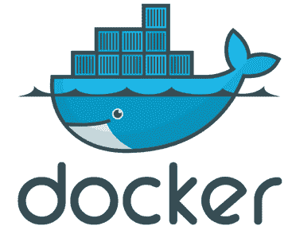

图 2.1 Docker, Inc. 标志。

有趣的是，Docker, Inc. 最初是以名为 `dotCloud` 的平台即服务（PaaS）供应商身份存在的。在背后，dotCloud 平台利用了 Linux 容器。为了帮助创建和管理这些容器，他们构建了一个绰号为“Docker”的内部工具。Docker 就此诞生了！

2013 年，dotCloud 的 PaaS 业务陷入困境，公司需要新的转机。为了解决这个问题，他们聘请 Ben Golub 为新首席执行官，将公司重命名为“Docker, Inc.”，放弃了 dotCloud PaaS 平台，并开启了带着将 Docker 和容器带给世界的使命的新旅程。

今天，Docker, Inc. 被广泛认为是一家创新科技公司，市场估值据称在 10 亿美元左右。在写作时，它已通过来自硅谷一些顶级风险投资机构的 6 轮融资筹集了超过 1.8 亿美元。几乎所有的资金都是公司转型为 `Docker, Inc.` 之后筹得的。

自成为 Docker, Inc. 以来，他们进行了多次小规模的收购（金额未公开），以帮助其产品和服务组合的增长。

在写作此时，Docker, Inc. 大约拥有 200-300 名员工，并举办了名为 Dockercon 的年度会议。Dockercon 的目标是聚集不断壮大的容器生态系统，并推动 Docker 和容器技术的采用。

在整本书中，当我们提到 Docker 公司时，将使用“Docker, Inc.”这一术语。“Docker”一词的所有其他用法将指的是该技术或开源项目。

> **注意：** “Docker”一词源于英国英语口语，意为码头工人——即负责装卸船舶的人。

### Docker 运行时和编排引擎

当大多数技术人员谈论 Docker 时，他们指的是 `Docker Engine`。

`Docker Engine` 是运行和编排容器的底层基础设施管道软件。如果你是 VMware 管理员，你可以将其类比为 ESXi。就如 ESXi 是运行虚拟机的核心虚拟化程序技术一样，Docker Engine 是运行容器的核心容器运行时。

所有其他 Docker, Inc. 的产品和第三方产品都接入 `Docker Engine` 并围绕其构建。图 2.2 显示了 `Docker Engine` 位于中心。图中的所有其他产品都构建在引擎之上，并利用其核心能力。

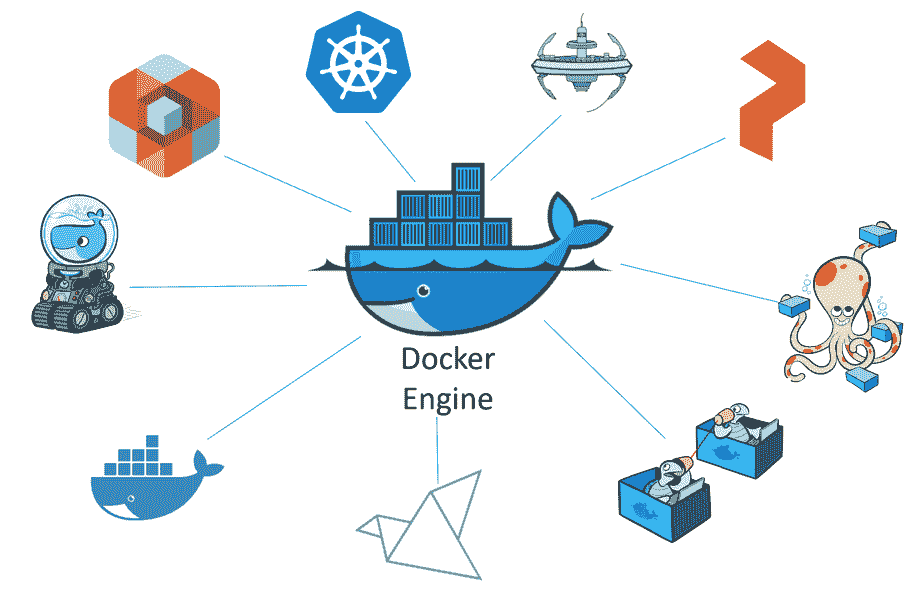

图 2.2


`Docker Engine`可以从 Docker 网站下载，也可以从 GitHub 从源码构建。它适用于 Linux 和 Windows 系统，并提供开源版本和商业支持版本。在写作此时，`Docker Engine`大约每三个月发布一个新的大版本（<https://github.com/docker/docker/wiki>）。

## Docker 开源项目

“Docker”一词也可以指开源的 `Docker 项目`。

Docker 项目托管在 GitHub 上，你可以在 `https://github.com/docker` 查看 Docker 仓库中包含的子项目和工具列表。核心的 `Docker Engine` 项目位于 `https://github.com/docker/docker`。

作为一个开源项目，源代码是公开的，你可以自由地下载、贡献、对其进行调整并使用它，只要你遵守 [Apache License 2.0](https://github.com/docker/docker/blob/master/LICENSE) 的条款。

如果你花时间查看项目的提交历史，你将看到基础设施技术领域的大人物，包括：红帽（RedHat）、微软、IBM、思科和 HPE。你还会看到与大型公司没有关联的个人姓名。

该项目及其工具大部分是用 `Go` 编写的——这是 Google 开发的一种相对新的系统级编程语言，也称为 `Golang`。如果你用 Go 语言编程，你将非常适合为该项目做出贡献！

Docker 作为开源项目的一个很好的副作用是，它很大程度上是在开放范围内开发和设计的。这消除了许多代码为私有并锁在闭门之后的旧模式。它意味着发布周期是在开放范围内发布和处理的。不再有那种保密、然后在几个月前以荒谬的仪式感提前预告的不确定的发布周期。Docker 项目不是那样运作的。大多数事情都是公开完成并供所有人查看和贡献的。

Docker 项目非常庞大且正势如破竹。它有数千个 GitHub 拉取请求、数万个 Docker 化的项目，更不用说从 Docker Hub 下载的数十亿次镜像了。该项目正字面上席卷整个行业。

不要被迷惑了，它正被广泛使用！

## 容器生态系统

Docker, Inc. 的哲学之一通常被称为“自带电池但可拆卸”。

这种说法意味着你可以换掉许多原生的 `stuff` 并替换为第三方的 `stuff`。一个很好的例子就是网络栈。核心产品自带网络栈，但网络栈是可插拔的，这意味着你可以移除原生网络栈并替换为第三方的。

在早期，第三方插件比原生提供的要好。然而，这为 Docker, Inc. 带来了一些业务模式挑战。毕竟，Docker, Inc. 必须在某个时刻盈利才能成为一个可持续的企业。因此，自带的电池变得越来越好。这在更广泛的生态系统中产生了涟漪，他们本可能希望 Docker, Inc. 生产平庸的产品，并打开大门让他们进入掠夺。

如果这曾经如此，现在已经不是了。简而言之，原生的电池仍然可以拆卸，只是拆卸的理由越来越少。

尽管如此，容器生态系统在健康的合作与竞争中蓬勃发展。谈论容器生态系统时，你经常听到人们使用“竞合”（合作与竞争的平衡）和“友敌”（朋友与敌人混合）等术语。这太好了！健康的竞争是创新的母亲！

## 开放容器标准

在讨论 Docker 和容器生态系统时，不能提到 [开放容器标准 - OCI](https://www.opencontainers.org)。

OCI 是一个相对新的治理委员会，负责标准化容器基础设施的最基础组件，例如 `镜像格式` 和 `容器运行时`（如果这些术语对你来说很新，不用担心，我们会在书中介绍）。

同样，任何关于 OCI 的讨论如果不提到历史是不完整的。而正如所有的历史描述一样，你得到版本取决于谁在说。所以，这就是 Nigel 眼中的 OCI 历史版本 :-D

从第一天起，Docker 的增长就非常惊人。越来越多的人在越来越多的场景下为了越来越多的事情使用它。因此，某些人感到沮丧是不可避免的。这是正常且健康的。

这段 `根据 Nigel 说的历史` 的要点（TLDR）是：一家名为 [CoreOS](https://coreos.com) 的公司不喜欢 Docker 处理某些事情的方式。于是他们采取了行动！他们创建了一个名为 `appc`（https://github.com/appc/spec/）的新开放标准，定义了镜像格式和容器运行时等内容。他们还创建了该标准的实现，称为 `rkt`（读作“rocket”）。

这让容器生态系统处于了尴尬的境地，出现了两个竞争的标准。用更准确的说法来说，Docker 的东西是 `事实上的`（de facto）标准和运行时，而 CoreOS 的东西则更像是 `法定的`（de jure）标准。

回到故事，这一切都威胁到了生态系统的碎片化，并让用户和客户陷入两难境地。虽然竞争通常是好事，但 `竞争性标准` 并非如此。它们会导致混乱并减缓采用速度。对任何人都没有好处。

考虑到这一点，大家都尽力像成年人一样表现，并共同组成了 OCI —— 一个治理容器标准的轻量级敏捷委员会。

在编写本文时，OCI 已发布了两个规范（标准）：

- 一个[镜像规范](https://github.com/opencontainers/image-spec)
- 一个[运行时规范](https://github.com/opencontainers/runtime-spec)

在提到这两个标准时，经常使用的一个类比是轨道。这两个标准就像对铁轨的标准尺寸和属性达成共识，让其他人自由地建造更好的火车、更好的车厢、更好的信号系统、更好的车站……而且他们都放心地知道这些可以在标准轨道上运行。没有人希望铁轨尺寸上出现两个相互竞争的标准！

可以说，这两个 OCI 规范对核心 Docker 引擎的架构和设计产生了重大影响。从 Docker 1.11 开始，`Docker Engine` 架构符合 OCI 运行时规范。

到目前为止，OCI 取得了良好的成效，并在整合生态系统方面做出了努力。然而，标准总是会拖慢创新速度！尤其是那些以接近光速发展的新技术。这导致了容器社区中出现了一些激烈的争论和热烈的讨论。在作者看来，这是一好事！容器行业正在改变世界，前沿人士充满激情并持有自己的见解是正常的。请期待会有更多关于标准和创新的 `热烈讨论`！

OCI 在 Linux 基金赞助下组织，Docker, Inc. 和 CoreOS, Inc. 都是主要的贡献者。

## 3: 安装 Docker

有很多方法和地方可以安装 Docker。有 Windows、有 Mac，显然还有 Linux。但也有云端、本地部署、以及你的笔记本电脑。更不用说手动安装、脚本安装、基于向导的安装了。安装 Docker 的方法和地方真的非常多！

但不要被这些吓着了！它们都非常简单。

在本章中，我们将涵盖一些最重要的安装方式：

- 桌面安装
  - Docker for Windows
  - Docker for Mac
- 服务器安装
  - Linux

我们将在 Windows Server 2016 正式发布（G.A.）后添加其安装方法。在编写本文时，Windows Server 2016 TP5 的安装方法处于变动中，尚未稳定到可以包含在此。

### Docker for Windows

首先需要注意的是，`Docker for Windows` 是 Docker, Inc. 的一个封装产品。它在 64 位 Windows 10 桌面或笔记本电脑上启动一个单引擎 Docker 环境。

这意味着我们**并不是**要向你展示如何在 Windows 桌面或笔记本电脑上手动破解安装 Docker。不！在本节中，我们将介绍如何安装 Docker, Inc. 的名为“Docker for Windows”的产品。而且非常简单！

但要提醒你一点！`Docker for Windows` 仅用于**测试**和**开发**（dev）工作。你可不想在上面运行你的生产环境！记住，它只会安装一个引擎。换句话说，它只会安装一个 Docker 副本。你可能还会发现，一些最新的 Docker 特性在 `Docker for Windows` 中并不总是可用。这是因为 Docker, Inc. 对该产品采取了 `稳定性优先，功能次后` 的方法。这一切共同构成了一个快速简便的设置，但这种设置**不适用于**生产工作负载。

废话够了。让我们看看如何安装 `Docker for Windows`。

首先是先决条件。`Docker for Windows` 需要：

- Windows 10 专业版 | 企业版 | 教育版
- 必须是 64 位
- Windows 中必须启用 Hyper-V 和 Containers 功能
- 系统 BIOS 必须启用硬件虚拟化支持

在 BIOS 中启用硬件虚拟化支持因机器类型而异。大多数现代机器默认启用了这些设置，因此我们在这里不详述。但过程通常是这样的：重启电脑 > 按住特殊的 BIOS 键（通常是 `Del`、`F12` 或 `Insert`） > 在 BIOS 中找到硬件虚拟化支持设置（`Intel VT-x` 或 `AMD-V`） > 启用设置 > 保存并退出。

> **警告：** 修改 BIOS 设置时要非常小心。错误的更改会导致你的机器无法启动。

在 Windows 10 中要做的第一件事是确保安装了 **Hyper-V** 和 **Containers** 功能。

1. 右键点击 Windows 按钮并选择`程序和功能`
2. 点击`启用或关闭 Windows 功能`
3. 勾选`Hyper-V` 和 `Containers` 复选框并点击`确定`

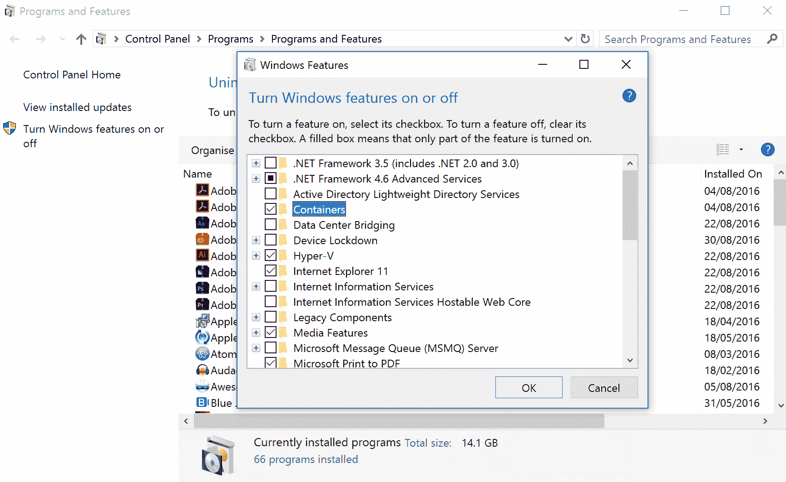

图 3.1

*Containers* 功能仅在你运行 2016 年夏季 Windows 10 周年更新（内部版本 14393）时可用。一旦安装完成……并重启电脑，就可以安装 `Docker for Windows` 了。

1. 访问 `www.docker.com` 并点击首页顶部的 `Get Docker`。
2. 点击 **WINDOWS** 部分下的 `Learn More` 按钮。
3. 点击 `Download Docker for Windows` 将 `InstallDocker.msi` 包下载到你的默认下载目录。
4. 找到并运行你刚刚下载的 `InstallDocker.msi` 包。

按照安装向导操作，并提供本地管理员凭据完成安装。Docker 将自动作为系统服务启动，Windows 通知区域中会出现一个 Moby Dock 图标。

恭喜你！你已经安装了 `Docker for Windows`。

现在已经安装了 `Docker for Windows`，你可以打开命令提示符或 PowerShell 窗口并运行一些 Docker 命令。尝试以下命令：

```
C:\Users\nigelpoulton> docker version
Client:
    Version:      1.12.1
    API version:  1.24
    Go version:   go1.6.3
    Git commit:   23cf638
    Built:        Thu Aug 18 17:32:24 2016
    OS/Arch:      windows/amd64
    Experimental: true

Server:
    Version:      1.12.1
    API version:  1.24
    Go version:   go1.6.3
    Git commit:   23cf638
    Built:        Thu Aug 18 17:32:24 2016
    OS/Arch:      linux/amd64
    Experimental: true
```

注意在上面的输出中，**Server** 组件的 `OS/Arch:` 显示为 `linux/amd64`。这是因为目前的安装会将 Docker 守护进程安装在一个轻量级的 Linux Hyper-V 虚拟机内部。在这种默认情况下，你只能在 `Docker for Windows` 安装上运行 Linux 容器。

如果你想运行 `native Windows containers`，可以右键点击 Windows 通知栏中的 Docker 鲸鱼图标，并选择 `Switch to Windows containers...`（切换到 Windows 容器）。如果你尚未启用 `Windows Containers` 功能，可能会收到以下提示。

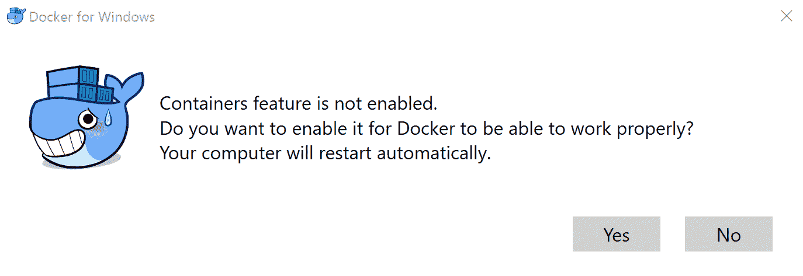

图 3.2

如果你已经启用了 Windows Containers 功能，仅需几秒钟即可完成切换。一旦切换完成，`docker version` 命令的输出将如下所示。

```
C:\Users\nigelpoulton> docker version
Client:
 Version:      1.12.1
 API version:  1.24
 Go version:   go1.6.3
 Git commit:   23cf638
 Built:        Thu Aug 18 17:32:24 2016
 OS/Arch:      windows/amd64
 Experimental: true

Server:
 Version:      1.13.0-dev
 API version:  1.25
 Go version:   go1.7.1
 Git commit:   c2decbe
 Built:        Tue Sep 13 15:12:54 2016
 OS/Arch:      windows/amd64
```

注意，Server 版本现在也显示为 `windows/amd64`。这意味着守护进程现在原生运行在 Windows 内核上，因此只会运行 Windows 容器。

另外注意，上述系统运行的是 Docker 的 `experimental` 版本（`Experimental: true`）。`Docker for Windows` 有稳定版和实验版两个通道。你可以在两者之间切换，但在在此之前，你应该检查 Docker 网站上的限制和影响。

如下所示，其他常规 Docker 命令可以正常工作。

```
C:\Users\nigelpoulton>docker info
   Containers: 0
    Running: 0
    Paused: 0
    Stopped: 0
   Images: 0
   Images: 0
   Server Version: 1.13.0-dev
   Storage Driver: windowsfilter
    Windows:
   Logging Driver: json-file
   Plugins:
    Volume: local
    Network: nat null overlay
   <Snip>
   Registry: https://index.docker.io/v1/
   Experimental: true
   Insecure Registries:
    127.0.0.0/8
```

`Docker for Windows` 包含了 `Docker Engine`（客户端和守护进程）、`Docker Compose` 和 `Docker Machine`。使用以下命令验证每个组件是否成功安装以及你拥有的各个版本：

```
C:\Users\nigelpoulton> docker --version
Docker version 1.12.1, build 23cf638, experimental
```

```
C:\Users\nigelpoulton> docker-compose --version
docker-compose version 1.8.0, build d988a55
```

```
C:\Users\nigelpoulton> docker-machine --version
docker-machine version 0.8.1, build 41b3b25
```

### Docker for Mac

关于 `Docker for Mac` 需要注意的第一点是，它是 Docker, Inc. 的一个封装产品。所以放松吧，你不需要成为内核工程师，我们也不会带你通过复杂的破解手段来将 Docker 安装到你的 Mac 上。我们将引导你完成 Mac 桌面电脑或笔记本电脑上安装 `Docker for Mac` 的过程，这极其简单。

#### 什么是 `Docker for Mac`？

`Docker for Mac` 是一个封装产品，允许你轻松在 Mac 本地启动并运行一个微小的单引擎 Docker 环境。如果你听过 `boot2docker`，那么 `Docker for Mac` 就是你一直希望 `boot2docker` 拥有的样子——它是平滑、简单且稳定的。但 `Docker for Mac` 仅用于测试和开发工作。你不应该将其视为运行业务的生产环境平台。不！`Docker for Mac` 的核心是以最简单的方式在你的 Mac 上启动并运行一个小型的 Docker 安装，以便你在 Mac 上测试和开发容器化应用程序。

同样注意的是，`Docker for Mac` 并不会让你原生运行在 Mac OS Darwin 内核上的 Docker Engine。在后台，它在一个轻量级 Linux 虚拟机中运行 Docker Engine。然后它无缝地将该 Docker Engine 和 API 暴露给你的 Mac 环境。但它实现这一切的方式让整合所有环节的奥秘和魔法都隐藏在了幕后。你只需要知道，你可以在 Mac 上打开终端并使用常规 Docker 命令调用 Docker API。

尽管这在你的 Mac 上无缝运行……但其底层显然是 Linux 版 Docker，因此它只能与基于 Linux 的 Docker 容器配合。不过这是好事，因为大多数容器操作都在这里发生。

图 3.3 显示了 `Docker for Mac` 架构的高层表示。


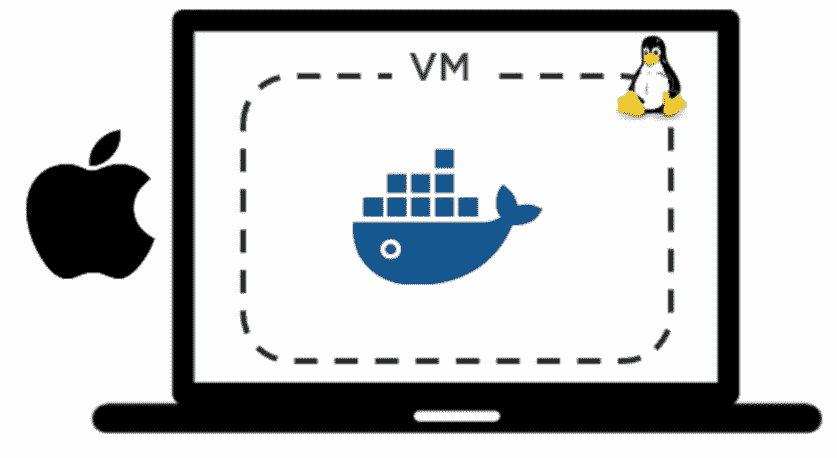

图 3.3

> **注意：** 对于好奇的读者，`Docker for Mac`利用 [HyperKit](https://github.com/docker/hyperkit) 实现了一个超轻量级的虚拟化程序。HyperKit 基于 [xhive 虚拟化程序](https://github.com/mist64/xhyve)。`Docker for Mac` 还利用了 [DataKit](https://github.com/docker/datakit) 的功能，并运行了一个基于 [Alpine Linux](https://alpinelinux.org/) 的经过高度优化的 Linux 发行版，称为 Moby。

让我们来看如何在 Linux 上安装 Docker。

这是生产环境中最常见的安装方式，而且出乎意料地简单。常见的困难是不同 Linux 发行版之间（如 Ubuntu 与 CentOS）的细微差异。本节中使用的示例基于 Ubuntu Linux，但应该适用于上游和下游分支。它也应该适用于 CentOS 及其上游和下游分支。无论你的 Linux 机器是自己数据中心里的物理服务器、位于地球另一端公有云上的实例，还是笔记本电脑上的虚拟机，完全没有任何区别。唯一的要求是机器必须运行 Linux 并且能够访问 `https://get.docker.com`。

在 Linux 上安装 Docker 之前，你首先需要决定想安装哪个通道的 Docker。Docker 目前有三个通道：

* 稳定版 [Stable](https://get.docker.com/)
* 实验版 [Experimental](https://experimental.docker.com/)
* 测试版 [Test](https://test.docker.com/)

在下面的示例中，我们将使用`wget`命令调用安装稳定版通道的脚本。如果你想安装不同的通道，只需将`https://get.docker.com`替换为列表中相应的通道即可。

1. 在你的 Linux 机器上打开一个新的 shell。
2. 使用`wget`从`https://get.docker.com`获取 Docker 安装脚本并将其传递给你的 shell。

```
$ wget -qO- https://get.docker.com/ | sh

modprobe: FATAL: Module aufs not found in directory /lib/modules/4.4.0-36-generic
+ sh -c 'sleep 3; yum -y -q install docker-engine'
<Snip>
```

如果你想以非 root 用户身份使用 Docker，现在应该考虑使用类似命令将你的用户添加到 "docker" 组：

`sudo usermod -aG docker your-user`

记住，你必须注销并重新登录才能生效！

3. 在操作 Docker 引擎时，仅使用非 root 用户是一个良好的实践。要做到这一点，你需要将非 root 用户添加到 Linux 机器上的本地`docker`Unix 组。下面的命令显示了如何将`npoulton`用户添加到`docker`组并验证操作是否成功。

```
$ sudo usermod -aG docker npoulton
$
$ cat /etc/group | grep docker
docker:x:999:npoulton
```

如果你已经以刚刚添加到`docker`组的用户身份登录，则需要注销并重新登录才能使组权限生效。

恭喜！Docker 现在已安装在你的 Linux 机器上。运行以下命令验证你的安装情况。

```
$ docker --version
Docker version 1.12.1, build 23cf638
$
$ docker info
Containers: 0
 Running: 0
 Paused: 0
 Stopped: 0
Images: 0
<Snip>
Kernel Version: 4.4.0-36-generic
Operating System: Ubuntu 16.04.1 LTS
OSType: linux
Architecture: x86_64
CPUs: 1
Total Memory: 990.7 MiB
Name: ip-172-31-41-77
ID: QHFV:6HK7:VNLZ:RIKE:JWL6:BTIX:GC3V:RAVR:6AO5:RAMT:EJCI:PUA7
Docker Root Dir: /var/lib/docker
Debug Mode (client): false
Debug Mode (server): false
Registry: https://index.docker.io/v1/
WARNING: No swap limit support
Insecure Registries:
 127.0.0.0/8
```

如果上述过程对你的 Linux 发行版不起作用，你可以去 Docker 文档网站并点击与你的发行版相关的链接。这将带你进入官方 Docker 安装说明，这些说明通常会保持最新更新。但请注意，Docker 网站上的说明倾向于使用包管理器，并且需要的步骤比我们上面使用的过程多得多。事实上，如果你用浏览器打开`https://get.docker.com`，你会发现它是一个为你完成所有安装工作的 shell 脚本。

警告：如果你从官方 Docker 仓库的其他源安装 Docker，你可能会得到一个 Docker 的分叉版本。这是因为某些供应商和发行版选择分叉 Docker 项目并开发他们自己的略微定制版本。如果你从自定义仓库安装，需要意识到这一点，因为你可能在不经意间运行着一个偏离了官方 Docker 项目的分支版本。只要这是你的意图，就不是问题。如果这不是你的意图，可能会导致你的供应商所做的修改和修复无法回传到官方 Docker 项目。在这些情况下，你无法从 Docker, Inc. 或其授权合作伙伴处获得安装的商业支持。

## 章节总结

在本章中，你学习了如何在 Windows 10、Mac OS X 和 Linux 上安装 Docker。现在你已经知道如何安装 Docker，准备好开始处理镜像和容器了。

## 4 概览

在接下来的几章中，我们将进入镜像、容器和编排等细节。但在在此之前，我觉得先向你展示大局是个好主意。

在本章中，我们将下载镜像、启动新容器、登录容器、在容器内部运行命令，然后销毁它。这将让你对 Docker 是什么有一个良好的感觉。

### 引擎检查

安装 Docker 时会有两个主要组件：

* Docker 客户端
* Docker 守护进程（有时称为服务器）

守护进程实现了 Docker API。在默认 Linux 安装中，客户端通过`/var/run/docker.sock`本地 Unix Socket 与守护进程通信。你可以通过`docker version`命令测试客户端和守护进程运行正常以及是否可以通信。

```
$ docker version
Client:
 Version:      1.12.1
 API version:  1.24
 Go version:   go1.6.3
 Git commit:   23cf638
 Built:        Thu Aug 18 05:33:38 2016
 OS/Arch:      linux/amd64

Server:
 Version:      1.12.1
 API version:  1.24
 Go version:   go1.6.3
 Git commit:   23cf638
 Built:        Thu Aug 18 05:33:38 2016
 OS/Arch:      linux/amd64
```

只要你从`Client`和`Server`组件 `get` 响应，就没问题。如果你从 `Server` 组件收到错误响应，请尝试在命令前加上`sudo`重试：`sudo docker version`。如果`sudo`有效，你需要在本章的剩余命令前加上`sudo`。

### 镜像

现在让我们来看镜像。

目前，理解 Docker 镜像最好的方式是将其视为包含操作系统和应用程序的对象。它与虚拟机模板没有太大区别。虚拟机模板本质上是一个停止的虚拟机。在 Docker 世界中，镜像实际上是一个停止的容器。

在你的 Docker 主机上运行`docker images`命令。

```
$ docker images
REPOSITORY    TAG        IMAGE ID       CREATED       SIZE
```

如果你是从一个新安装的 Docker 主机开始工作，它将没有任何镜像，看起来就像上面的输出一样。

将镜像获取到 Docker 宿主机称为“拉取”（pulling）。使用下面的命令将`ubuntu:latest`镜像拉取到你的 Docker 宿主机。

```
$ docker pull ubuntu:latest
latest: Pulling from library/ubuntu

952132ac251a: Pull complete
82659f8f1b76: Pull complete
c19118ca682d: Pull complete
8296858250fe: Pull complete
24e0251a0e2c: Pull complete
Digest: sha256:f4691c96e6bbaa99d...a2128ae95a60369c506dd6e6f6ab
Status: Downloaded newer image for ubuntu:latest
```

再次运行`docker images`命令查看你刚刚拉取的`ubuntu:latest`镜像。

```
$ docker images
REPOSITORY      TAG      IMAGE ID        CREATED         SIZE
ubuntu          latest   bd3d4369aebc    11 days ago     126.6 MB
```

我们将在下一章详细介绍镜像的存储位置及其内部包含的内容。目前，只需要理解它包含了足够的操作系统（OS）以及运行其专为设计的任何应用程序的代码即可。我们拉取的`ubuntu`镜像是一个精简版的 Ubuntu Linux 操作系统，并包含了一些常用的 Ubuntu 工具程序。

值得注意的是，每个镜像都有其唯一的唯一 ID。在操作镜像时（正如我们将在下一步中做的那样），你可以使用它的`ID`或名称来引用它。

### 容器

现在我们已经已经在 Docker 宿主机上本地拉取了镜像，可以使用`docker run`命令从它启动一个容器。

```
$ docker run -it ubuntu:latest /bin/bash
root@6dc20d508db0:/#
```

仔细观察上面命令的输出。你会注意到你的 shell 提示符（prompt）已经发生了变化。这是因为你的 shell 现在已经连接到了新容器的 shell 上——你实际上位于新容器内部！

让我们检查一下`docker run`命令。`docker run`告诉 Docker 守护进程启动一个新的容器。`-it`标志告诉守护进程让容器保持交互，并将我们当前的 shell 连接到容器的 shell（我们将在容器的章节中详细说明）。接下来，命令告诉 Docker 我们希望容器基于`ubuntu:latest`镜像，并告诉它在容器内部运行`/bin/bash`进程。

在容器内部运行以下`ps`命令来列出所有运行中的进程。

```
root@6dc20d508db0:/# ps -elf
F S UID    PID  PPID   NI ADDR SZ WCHAN  STIME TTY  TIME CMD
4 S root     1     0    0 -  4560 wait   13:38 ?    00:00:00 /bin/bash
0 R root     9     1    0 -  8606 -      13:38 ?    00:00:00 ps -elf
```

从`ps`命令的输出可以看出，容器内部只有两个进程在运行：

*   PID 1。这是我们通过`docker run`命令告诉容器运行的`/bin/bash`进程。
*   PID 9。这是我们运行的列出运行进程的`ps -elf`进程。

输出中出现`ps -elf`进程可能会有一点误导性，因为它是一个短命进程，一旦`ps`命令退出，它就会死亡。这意味着容器内部唯一长时间运行的进程是`/bin/bash`进程。

按下`Ctrl-PQ`退出容器。这会将你回到 Docker 宿主机的 shell 中。你可以通过观察 shell 提示符来验证这一点。

现在你回到了 Docker 宿主机的 shell 提示符，再次运行`ps -elf`命令。

```
$ ps -elf
F S UID        PID  PPID    NI ADDR SZ WCHAN  TIME CMD
4 S root         1     0     0 -  9407 -      00:00:03 /sbin/init
1 S root         2     0     0 -     0 -      00:00:00 [kthreadd]
1 S root         3     2     0 -     0 -      00:00:00 [ksoftirqd/0]
1 S root         5     2   -20 -     0 -      00:00:00 [kworker/0:0H]
1 S root         7     2     0 -     0 -      00:00:00 [rcu_sched]
<Snip>
0 R ubuntu   22783 22475     0 -  9021 -      00:00:00 ps -elf
```

注意，你的 Docker 宿主机上运行的进程比容器内部单个长时间运行的进程要多得多。

在上一个步骤中，你按下`Ctrl-PQ`从容器退出 shell。在容器内部执行此操作会让你退出容器而不杀死它。你可以使用`docker ps`命令查看系统中所有正在运行的容器。

用于处理 Docker 镜像的最常用命令是`docker pull`（将镜像拉取到本地 Docker 主机）、`docker images`（查看已拉取到 Docker 宿机的镜像列表）以及`docker rmi`（在不再需要时删除镜像）。

恭喜你！你现在对 Docker 镜像是什么已经有了初步的了解 :-D 现在是时候深入研究了。

# Docker 镜像 - 深度解析

我们已经提到过几次，容器镜像就像是停止的容器。事实上，你可以停止一个容器并从它创建一个新镜像。考虑到这一点，镜像被视为构建时构造物，而容器是运行时构造物。

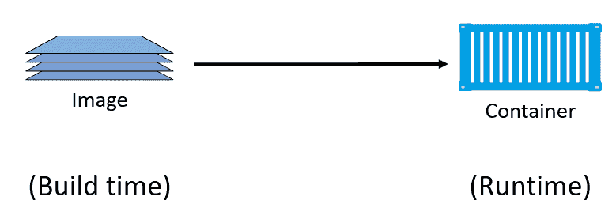

图 5.1

## 镜像与容器

图 5.1 显示了镜像与容器关系的高级视图。我们使用`docker run`命令从单个镜像启动一个或多个容器。然而，一旦你从镜像启动了容器，这两个构造物就会相互依赖，在最后一个使用它的容器停止并销毁之前，你无法删除该镜像。尝试在不停止和销毁所有使用它的容器的情况下删除镜像将导致以下错误：

```
$ docker rmi <image-name>
Error response from daemon: conflict: unable to remove repository reference \
"<image-name>" (must force) - container <container-id> is using its referenc\
ed image <image-id>
```

容器的全部目的是运行应用程序或服务。这意味着创建容器的镜像必须包含运行容器所需的任何操作系统文件和应用程序文件。然而，容器的核心在于快速和轻量化。这意味着构建容器的镜像通常很小，并且剥离了所有非本质部分。

例如，Docker 镜像往往不会带 6 种不同的 shell 供你选择——它们通常只带一个极简的 shell。它们也不包含内核——所有运行在 Docker 主机上的容器都共享对 Docker 主机内核的访问。由于这些原因，我们有时说镜像包含了足够的操作系统。

Docker 镜像可以有多小的极端例子可能是官方 Alpine Linux Docker 镜像，它目前的大小大约在 5MB 左右。这不是笔错误！它真的只有 5 兆字节！不过，一个更典型的例子可能是官方 Ubuntu Docker 镜像，它目前大约是 120-130MB。

## 拉取镜像

一个干净安装的 Docker 主机在其本地缓存中没有任何镜像（Linux 主机上为`/var/lib/docker/<storage-driver>`）。你可以通过`docker images`命令验证这一点。

```
$ docker images
REPOSITORY  TAG      IMAGE ID       CREATED         SIZE
```

将镜像获取到 Docker 主机的行为被称为“拉取”（pulling）。所以，如果你想在 Docker 主机上获取最新的 Ubuntu 镜像，你就拉取它。使用以下命令拉取 Alpine 和 Ubuntu 镜像，然后检查它们的大小。

> 如果你还没有将用户账户添加到本地的`docker`Unix 组，可能需要在以下所有命令的开头添加`sudo`。


```bash
$ docker pull alpine:latest
latest: Pulling from library/alpine
e110a4a17941: Pull complete
Digest: sha256:3dcdb92d743...3626d99b889d0626de158f73a
Status: Downloaded newer image for alpine:latest
$
$ docker pull ubuntu:latest
latest: Pulling from library/ubuntu
952132ac251a: Pull complete
82659f8f1b76: Pull complete
c19118ca682d: Pull complete
8296858250fe: Pull complete
24e0251a0e2c: Pull complete
Digest: sha256:f4691c96e6b...28ae95a60369c506dd6e6f6ab
Status: Downloaded newer image for ubuntu:latest
$
$ docker images
REPOSITORY  TAG      IMAGE ID       CREATED         SIZE
ubuntu      latest   bd3d4369aebc   12 days ago     126.6 MB
alpine      latest   4e38e38c8ce0   10 weeks ago    4.799 MB
```

如你所见，这两个镜像现在都存在于你的 Docker 主机。

让我们仔细观察一下我们刚才的操作。

我们使用 `docker pull` 命令拉取镜像。在每个命令中，我们必须指定要拉取哪个镜像。所以，让我们花一点时间看看镜像的命名。为此，我们需要一些关于存储镜像的背景知识。

## 镜像仓库（Image registries）

Docker 镜像存储在镜像仓库中。最常见的镜像仓库是 Docker Hub。还存在其他仓库，包括第三方仓库和安全的本地部署仓库，但 Docker Hub 是默认的，也是我们在本书中将使用的。

镜像仓库包含多个镜像存储（image repositories）。镜像存储包含镜像。这可能有点困惑，所以图 5.2 显示了一个包含 3 个存储的镜像仓库图片，每个存储又包含几个镜像。

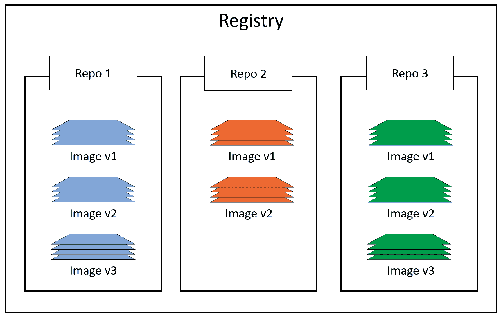

图 5.2

Docker Hub 也有镜像仓库和镜像存储的概念。（注：提供的文本在后续部分包含重复/混淆的句子，已进行审查并格式化以确保清晰）。

## 镜像命名与标记

在命令行中从官方仓库引用镜像只需提供仓库名称和由冒号 `:` 分隔的标签。在处理官方仓库的镜像时，`docker pull` 的格式为：

`docker pull <repository>:<tag>`

在我们之前的示例形式中，我们通过以下两个命令拉取了 Alpine 和 Ubuntu 镜像：

`docker pull alpine:latest` 和 `docker pull ubuntu:latest`

这两个命令从 `alpine` 和 `ubuntu` 存储拉取了标记为 `latest` 的镜像。

以下示例显示了如何从官方仓库拉取各种不同的镜像：

```bash
$ docker pull mongo:3.3.11
//这将从官方 `mongo` 仓库中拉取标记为 `3.3.11` 的镜像。

$ docker pull redis:latest
//这将从官方 `redis` 仓库中拉取标记为 `latest` 的镜像。

$ docker pull alpine
//这将从官方 `alpine` 仓库中拉取标记为 `latest` 的镜像。
```

关于上述命令有几点需要注意。首先，如果你在仓库名称后没有 `do not` 指定镜像标签（tag），Docker 将假设你指的是标签为 `latest` 的镜像。其次，`latest` 标签并没有任何神奇的力量！仅仅因为镜像被标记为 `latest`，并不意味着它是仓库中最新的镜像！这里的教训是——使用 `latest` 标签时要小心！

从 `unofficial repository`（非官方仓库）拉取镜像本质上是一样的——你只需要在仓库名称前面加上 Docker Hub 用户名或组织名称。下面的示例展示了如何从 Docker Hub 账户名为 `nigelpoulton` 的某人的 `tu-demo` 仓库中拉取 `v2` 镜像。

```bash
$ docker pull nigelpoulton/tu-demo:v2
//这将从我的个人 Docker Hub 账户命名空间内，\
//从 `tu-demo` 仓库中拉取标签为 `v2` 的镜像。
```

如果你想从第三方注册表拉取镜像，你需要在仓库名称前面加上注册表的 DNS 域名。例如，如果上述示例中的镜像位于 Google 容器仓库（GCR）中，你需要在仓库名称之前添加 `gcr.io`，如下所示：`docker pull gcr.io/nigelpoulton/tu-demo:v2`。

你可能需要在第三方注册表中拥有一个账户并登录后才能从中拉取镜像。

### 带有多个标签的镜像

关于镜像标签的最后一点……单个镜像可以拥有你想要数量的标签。这是因为标签是任意的字母数字值，作为元数据存储在镜像旁边。让我们来看来看。

使用带有 `-a` 标志的 `docker pull` 命令拉取下方仓库所有的镜像。然后运行 `docker images` 查看拉取的镜像。

```bash
$ docker pull -a nigelpoulton/tu-demo
latest: Pulling from nigelpoulton/tu-demo
237d5fcd25cf: Pull complete
a3ed95caeb02: Pull complete
<Snip>
Digest: sha256:42e34e546cee61adb1...3a0c5b53f324a9e1c1aae451e9
v1: Pulling from nigelpoulton/tu-demo
237d5fcd25cf: Already exists
a3ed95caeb02: Already exists
<Snip>
Digest: sha256:9ccc0c67e5c5eaae4b...624c1d5c80f2c9623cbcc9b59a
v2: Pulling from nigelpoulton/tu-demo
237d5fcd25cf: Already exists
a3ed95caeb02: Already exists
<Snip>
Digest: sha256:d3c0d8c9d5719d31b7...9fef58a7e038cf0ef2ba5eb74c
Status: Downloaded newer image for nigelpoulton/tu-demo
$
$ docker images
REPOSITORY            TAG       IMAGE ID      CREATED      SIZE
nigelpoulton/tu-demo   v2       6ac2...ad  4 months ago   211.6 MB
nigelpoulton/tu-demo   latest   9b91...29  4 months ago   211.6 MB
nigelpoulton/tu-demo   v1       9b91...29  4 months ago   211.6 MB
```

关于刚刚发生的情况有几点需要注意。

第一，该命令从仓库拉取了三个带有标签的镜像：`latest`、`v1` 和 `v2`。

第二，仔细观察 `docker images` 命令输出中的 `IMAGE ID` 列。你会发现只有两个唯一的镜像 ID。这意味着尽管拉取了三个标签，但实际上只下载了两个镜像。这是因为其中两个标签指向同一个镜像。换句话说，其中一个镜像有两个标签。如果你仔细看，会发现 `v1` 和 `latest` 标签具有相同的 `IMAGE ID`。这意味着它们是同一个镜像的两个标签。

这是我们之前发布的关于 `latest` 标签警告的完美范例。正如我们所看到的，这个例子中的 `latest` 标签与 `v1` 标签指向同一个镜像，而不是 `v2` 标签。这意味着它指向两个镜像中较旧的那个——而不是最新的。`latest` 是一个任意的标签，不能保证它指向仓库中最新的镜像。

### 镜像和层

所有的 Docker 镜像都由所示的一个或多个只读层（layers）组成。

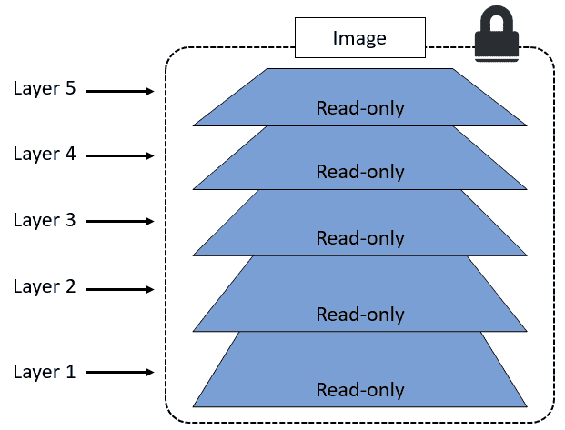

图 5.3

有几种查看和检查组成镜像层的方法，我们已经见过其中一种了。让我们再次查看之前 `docker pull ubuntu:latest` 命令的输出：

```bash
$ docker pull ubuntu:latest
latest: Pulling from library/ubuntu
952132ac251a: Pull complete
82659f8f1b76: Pull complete
c19118ca682d: Pull complete
82968588829:: complete
82968588822: Pull complete
82968588829: Pull complete
82968588828: Pull complete
82968588827: Pull complete
82968588826: Pull complete
82968588825: Pull complete
82968588824: Pull complete
82968588823: Pull complete
82968588822: Pull complete
82968588821: Pull complete
82968588820: Pull complete
82968588819: Pull complete
82968588818: Pull complete
82968588817: Pull complete
82968588816: Pull complete
82968588815: Pull complete
82968588814: Pull complete
82968588813: Pull complete
82968588812: Pull complete
82968588811: Pull complete
82968588810: Pull complete
82968588809: Pull complete
82968588808: Pull complete
82968588807: Pull complete
82968588806: Pull complete
82968588805: Pull complete
82968588804: Pull complete
82968588803: Pull complete
82968588802: Pull complete
82968588801: Pull complete
82968588800: Pull complete
c19118ca682d: Pull complete
82968588829: Pull complete
82968588828: Pull complete
82968588827: Pull complete
82968588826: Pull complete
82968588825: Pull complete
82968588824: Pull complete
82968588823: Pull complete
82968588822: Pull complete
82968588821: Pull complete
82968588820: Pull complete
82968588819: Pull complete
82968588818: Pull complete
82968588817: Pull complete
82968588816: Pull complete
82968588815: Pull complete
82968588814: Pull complete
82968588813: Pull complete
82968588812: Pull complete
82968588811: Pull complete
82968588810: Pull complete
82968588809: Pull complete
82968588808: Pull complete
82968588807: Pull complete
82968588806: Pull complete
82968588805: Pull complete
82968588804: Pull complete
82968588803: Pull complete
82968588802: Pull complete
82968588801: Pull complete
82968588800: Pull complete
...（此处省略重复的 Pull complete 行）...
82968588800
```

`$ docker pull ubuntu:latest`

```text
latest: Pulling from library/ubuntu

952132ac251a: Pull complete

82659f8f1b76: Pull complete

c19118ca682d: Pull complete

82968588829: Pull complete

82968588828: Pull complete

82968588827: Pull complete

82968588826: Pull complete

82968588825: Pull complete

82968588824: Pull complete

82968588823: Pull complete

82968588822: Pull complete

82968588821: Pull complete

82968588820: Pull complete

82968588819: Pull complete

82968588818: Pull complete

82968588817: Pull complete

82968588816: Pull complete

82968588815: Pull complete

82968588814: Pull complete

82968588813: Pull complete

82968588812: Pull complete

82968588811: Pull complete

82968588810: Pull complete

82968588809: Pull complete

82968588808: Pull complete

82968588807: Pull complete

82968588806: Pull complete

82968588805: Pull complete

82968588804: Pull complete

82968588803: Pull complete

82968588802: Pull complete

82968588801: Pull complete

82968588800: Pull complete

Digest: sha256:...

Status: Downloaded newer image for ubuntu
```

有几种方法可以查看和检查组成镜像的层，我们已经见过其中了。让我们再次查看之前的 `docker pull ubuntu:latest` 命令的输出：

多个镜像可以共享层。这在空间和性能上带来了效率。让我们再次查看几分钟前运行的带有 `-a` 标志的 `docker pull` 命令，该命令用于了 `nigelpoulton/tu-demo` 仓库中所有标记的镜像。

```bash
$ docker pull -a nigelpoulton/tu-demo

latest: Pulling from nigelpoulton/tu-demo

237d5fcd25cf: Pull complete

a3ed95caeb02: Pull complete

<Snip>

Digest: sha256:42e34e546cee61adb100...a0c5b53f324a9e1c1aae451e9

v1: Pulling from nigelpoulton/tu-demo

237d5fcd25cf: Already exists

a3ed95caeb02: Already exists

<Snip>

Digest: sha256:9ccc0c67e5c5eaae4beb...24c1d5c80f2c9623cbcc9b59a

v2: Pulling from nigelpoulton/tu-demo

237d5fcd25cf: Already exists

a3ed95caeb02: Already exists

<Snip>

eab5aaac65de: Pull complete

Digest: sha256:d3c0d8c9d5719d31b79c...fef58a7e038cf0ef2ba5eb74c

Status: Downloaded newer image for nigelpoulton/tu-demo

$

$ docker images

REPOSITORY             TAG      IMAGE ID       CREATED        SIZE

nigelpoulton/tu-demo   v2       6ac...ead   4 months ago   211.6 MB

nigelpoulton/tu-demo   latest   9b9...e29   4 months ago   211.6 MB

nigelpoulton/tu-demo   v1       9b9...e29   4 months ago   211.6 MB
```


注意以`Already exists`结尾的行。这是因为 Docker 足够智能，能够识别出当它被要求拉取本地已有的副本的镜像层时。在这个示例中，Docker 首先拉取了标记为`latest`的镜像。当它去拉取`v1`和`v2`镜像时，它发现自己已经拥有构成这些镜像的某些层。这是因为该仓库中的三个镜像除了顶层外，几乎是完全相同的。

Linux 上的 Docker 支持许多不同的文件系统和存储驱动。每种驱动都以自己的方式实现镜像分层、写复制（copy-on-write）行为和镜像层共享。然而，整体结果和用户体验本质上是相同的。

### 通过摘要拉取镜像

到目前为止，我们向你展示了如何通过标签（tag）拉取镜像，这是目前最常见的方法。但它有一个问题——标签是可变的！这意味着可能会无意中给镜像标记上错误的标签。有时甚至可能给镜像标记上与现有镜像相同的标签。这可不妙！

例如，假设你有一个名为`golftrack:1.5`的镜像，它包含一个已知漏洞。你拉取了镜像，应用修复，并使用**相同的标签**将更新后的镜像推回你的仓库。花几秒钟理解一下刚才发生了什么。你有一个名为`golftrack:1.5`的带有漏洞的镜像，该镜像正在你的生产环境中运行。你拉取了镜像并应用了修复。但错误发生了，你将修复后的镜像以**与漏洞镜像相同的标签**推回了仓库。你该如何知道哪些生产系统运行的是带漏洞的镜像，哪些运行的是修补后的镜像？它们拥有相同的标签！

这就是镜像摘要（digest）大显身场的地方。

Docker 1.10 引入了新的内容寻址存储模型。作为这种新模型的一部分，所有镜像现在都有了加密哈希值。为了讨论起见，我们将这个哈希称为`digest`。因为摘要是镜像内容的哈希，所以可以在不改变摘要的情况下更改镜像内容。另一种说法，摘要是不可变的。这显然避免了我们刚才讨论的问题。

每次拉取镜像时，`docker pull`命令都会包含镜像的摘要。你也可以通过向`docker images`命令添加`--digests`标志来查看 Docker 主机本地缓存中的镜像摘要。如下例所示：

```
$ docker pull alpine

Using default tag: latest

latest: Pulling from library/alpine

e110a4a17941: Pull complete

Digest: sha256:3dcdb92d7432d56604d...6d99b889d0626de15f73a

Status: Downloaded newer image for alpine:latest

$ docker images --digests alpine

REPOSITORY  TAG     DIGEST              IMAGE ID      CREATED       SIZE

alpine      latest  sha256:3dcd...f73a  4e38e38c8ce0  10 weeks ago  4.8 MB
```

上述输出显示`alpine`镜像的摘要为`sha256:3dcdb92d7432d56604d...6d99b889d0626de15f73a`。

现在我们已经了镜像的摘要，就可以使用它了。

```
$ docker rmi $(docker images -q) -f

Untagged: ubuntu:latest

Untagged: ubuntu@sha256:f4691c9...2128ae95a60369c506dd6e6f6ab

Deleted: sha256:bd3d4369aebc494...fa2645f5699037d7d8c6b415a10

Deleted: sha256:cd10a3b73e247dd...c3a71fcf5b6c2bb28d4f2e5360b

Deleted: sha256:4d4de39110cd250...28bfe816393d0f2e0dae82c363a

Deleted: sha256:6a89826eba8d895...cb0d7dba1ef62409f037c6e608b

Deleted: sha256:33efada9158c32d...195aa12859239d35e7fe9566056

Deleted: sha256:c8a75145fcc4e1a...4129005e461a43875a094b93412

Untagged: alpine:latest

Untagged: alpine@sha256:3dcdb92...313626d99b889d0626de158f73a

Deleted: sha256:4e38e38c8ce0b8d...6225e13b0bfe8cfa2321aec4bba

Deleted: sha256:4fe15f8d0ae69e1...eeeeebb265cd2e328e15c6a869f

$ docker images

REPOSITORY     TAG    IMAGE ID    CREATED     SIZE
```

让我们回顾一下用于 Docker 镜像的主要命令。

### 镜像 (Images) - 命令

- `docker pull`是下载镜像的命令。我们从远程注册表的内部仓库拉取镜像。默认情况下，镜像将从 Docker Hub 仓库拉取。该命令将从 Docker Hub 的`alpine`仓库拉取标记为`latest`的镜像：`docker pull alpine:latest`。
- `docker images`列出存储在 Docker 主机本地缓存中的所有镜像。要查看镜像的 SHA256 摘要，请添加`--digests`标志。
- `docker rmi`是删除镜像的命令。该命令展示了如何删除`alpine:latest`镜像`docker rmi alpine:latest`。你不能删除与处于运行（UP）或停止（Exited）状态的容器相关的镜像。

## 章节总结

在本章中，我们学习了 Docker 镜像。我们了解到镜像由一个或多个只读层组成，这些层堆叠在一起就成了整个镜像。我们使用了`docker pull`命令将它们拉到 Docker 主机的本地缓存中，并涵盖了镜像命名规范。然后，我们学习了镜像层以及它们如何在多个镜像之间共享。最后，我们涵盖了用于操作镜像的最常用命令。

在下一章中，我们将对容器进行类似的介绍——它是镜像的运行时同类。

## 6: 容器 (Containers)

现在我们已经对镜像有所了解，接下来的逻辑步骤是进入容器。由于这是一本关于 Docker 的书，我们将专门讨论 Docker 容器。然而，Docker 项目最近一直致力于实现由开放容器倡议（OCI）在`https://www.opencontainers.org`发布的镜像和容器规范。这意味着你在这里学习的部分内容将适用于其他符合 OCI 标准的容器运行时。

让我们来学习容器吧！

### Docker 容器 - 极简要点 (TLDR)

容器是镜像的运行时实例。就像我们可以从虚拟机模板启动虚拟机（VM）一样，我们从单个镜像启动一个或多个容器。虚拟机和容器之间的巨大区别在于容器更快、更轻量——容器并不像虚拟机那样运行完整的操作系统，它们不运行内核，只需要足够完成任务的操作系统。

图 6.1 显示了使用单个 Docker 镜像启动了多个 Docker 容器。

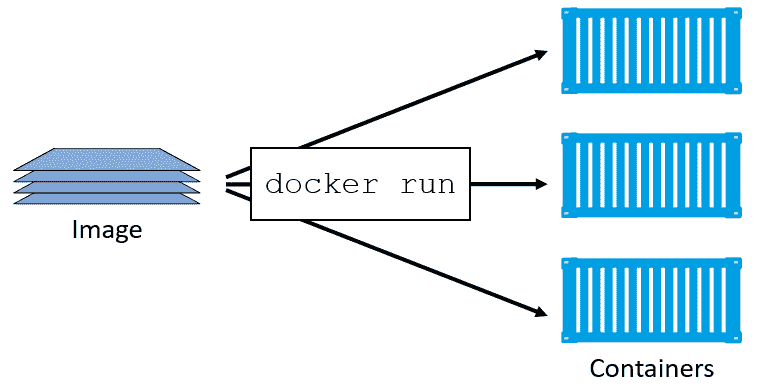

图 6.1

启动容器的最基本方法是使用`docker run`命令。该命令可以接受很多参数，但在最基本的形式下，你告诉它要使用的镜像和运行的命令：`docker run <image> <command>`。下一个命令将启动一个运行 Bash Shell 的 Ubuntu Linux 容器：`docker run ubuntu /bin/bash`。

容器会一直运行直到它们执行的命令退出。你可以使用`docker stop`命令手动停止容器，然后用`docker start`重启它。要永久删除容器，你必须使用`docker rm`显式地删除它。

这就是核心介绍！现在让我们进入细节……

### Docker 容器 - 深度解析

我们在这里涵盖的首要是容器和虚拟机之间的基本区别。在这个阶段主要是理论性的，但非常重要。在此过程中，我们会指出容器模型具有潜力的地方。

> 在此过程中，我们会指出容器模型具有潜力的地方。

> **注意：** 在虚拟机模型中，物理服务器通电，管理程序启动（我们跳过了 BIOS 和引导加载程序代码）。一旦管理程序启动，它就会声领系统上的资源，如 CPU、内存、存储和网卡（NICs）。然后，管理程序将这些硬件资源切割成虚拟版本，看起来和感觉完全像真实的一。它将其封装成一个名为虚拟机（VM）的软件结构。然后我们获取这些虚拟机并在每个虚拟机上安装操作系统。我们说我们有一台物理服务器并需要运行 4 个应用程序，因此我们会创建 4 台虚拟机，安装 4 个操作系统，然后安装这 4 个应用程序。完成后，它看起来像图 6.2。

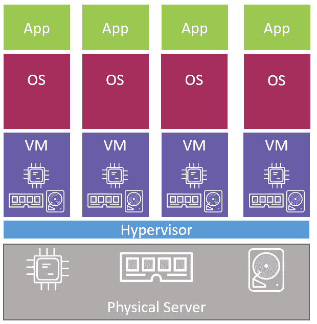

图 6.2

#### 容器 vs 虚拟机

容器和虚拟机都需要宿主机来运行。这可以是你的笔记本电脑、数据中心的裸机服务器，一直到公云上的实例。

在容器模型中，服务器通电，你选择的操作系统启动。在 Docker 世界中，这可以是 Linux，也可以任何在内核中支持容器原型的 Windows 版本。与虚拟机模型一样，操作系统占用所有硬件资源。在操作系统之上，我们安装了如 Docker 的容器引擎。然后容器引擎获取操作系统资源，如*进程树*、*文件系统*和*网络栈*，并将它们切割成安全的隔离构造结构，被称为*容器*。每个容器看起来和感觉都像真实的操作系统。在每个*容器*内部，我们可以运行应用程序。和之前一样，我们假设有一台运行 4 个应用程序的物理服务器。因此，我们会划分出 4 个容器，并在每个内部运行单个应用程序，如图 6.3 所示。

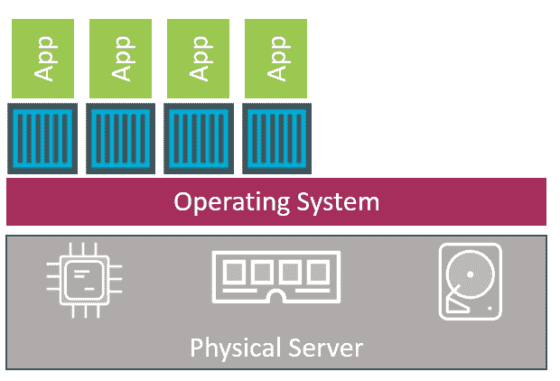

图 6.3

从高层次来说，管理程序执行硬件虚拟化——它们将物理硬件资源切割成虚拟版本。而容器执行操作系统虚拟化——它们将操作系统资源切割成虚拟版本。

#### 虚拟机税 (The VM tax)

让我们在刚刚涵盖的内容的基础上，深入研究管理程序模型的主要问题之一。

我们从相同的物理服务器和运行 4 个业务应用程序的需求开始。在两种两种模型中，我们都安装了操作系统或管理程序（显然，管理程序是一种针对虚拟机高度调优的操作系统）。到目前为止，这些模型几乎是相同的。但相似性到此为止了。

虚拟机（VM）模型将`low-level hardware resources`划分为虚拟机。每个虚拟机都是包含虚拟 CPU、虚拟内存、虚拟磁盘等的软件构结构。因此，每个虚拟机都需要自己的操作系统（OS）来声明、初始化和管理所有这些虚拟资源。遗憾的是，每个操作系统都带有它自己的包袱和开销。例如，每个操作系统都会消耗一部分 CPU、一部分内存、一部分存储空间等。大多数操作系统还需要自己的许可证，以及人员和基础设施来对其进行补丁和升级。每个操作系统还呈现出相当大的攻击面。我们通常将这一切统称为`OS tax`（或`VM tax`）——你安装的每一个操作系统都会消耗资源！

容器模型在宿主机操作系统层级只有一个内核。在单个宿主机上可以运行几十或数百个容器，且每个容器都共享这同一个操作系统内核。这意味着只需要一个操作系统来消耗 CPU、内存和存储。一个需要许可的操作系统。一个需要升级和打补丁的操作系统。以及一个提供攻击面的单一操作系统内核。总而言之，只有一份 OS 费用账单！

在我们单台服务器需要运行 4 个业务应用程序的示例中，这可能看起来不多。但当我们谈论数百或数千个应用（虚拟机或容器）时，这可能会改变游戏规则。

另一个需要考虑的问题是，由于容器不是完整的操作系统，它的启动速度比虚拟机`much faster`。记住，容器内部没有需要定位、解压和初始化的内核——更不用说与正常内核引导相关的所有硬件枚举和初始化了。启动容器时不需要这些！位于操作系统层级的单一共享内核已经启动了！结果是，容器可以在不到秒的时间内启动。影响容器启动时间的唯一因素是它运行的应用程序启动所需的时间。

这一切都意味着容器模型比虚拟机模型更轻量、更高效。我们可以在更少的资源上封装更多的应用程序，启动得更快，并支付更少的许可和管理成本，同时向“黑暗面”呈现更小的攻击面。所有这些对业务都有利！

解决这些理论问题后，让我们来玩玩容器。

### 运行容器

为了跟随这些示例，你需要一个运行良好的 Docker 宿主机。对于大多数命令来说，使用 Linux 还是 Windows 没有区别。然而，在写这本书时，所有的示例都使用了一个运行 Ubuntu 16.04 的 Docker 宿主机。

### 检查 Docker 守护进程

当我登录 Docker 宿主机时，做的第一件事总是检查 Docker 是否正在运行。

```
$ docker version

Client:
 Version:      1.12.1
 API version:  1.24
 Go version:   go1.6.3
 Git commit:   23cf638
 Built:        Thu Aug 18 05:33:38 2016
 OS/Arch:      linux/amd64

Server:
 Version:      1.12.1
 API version:  1.24
 Go version:   go1.6.3
 Git commit:   23cf638
 Built:        Thu Aug 18 05:33:38 2016
 OS/Arch:      linux/amd64
```

只要你在`Client`和`Server`部分得到响应，你就可以正常工作了。如果你在`Server`部分收到错误代码，那么很有可能是 docker 守护进程（服务器端）没有运行，或者你的用户账户没有访问它的权限。

如果你的用户账户没有访问守护进程的权限，你需要确保它是本地`docker` Unix 组的成员。如果不是，你可以通过`usermod -aG docker <user>`添加它，然后你必须注销并重新登录 shell 使更改生效。

如果你的用户账户已经是本地`docker`组的成员，那么问题可能是 Docker 守护进程没有运行。要检查 Docker 守护进程的状态，请根据你的 Docker 宿主机操作系统运行以下命令之一。

```
// 在未使用 Systemd 的 Linux 系统上运行此命令
$ service docker status
docker start/running, process 29393

// 在使用 Systemd 的 Linux 系统上运行此命令
$ systemctl is-active docker
active

// 在 PowerShell 窗口从 Windows Server 2016 系统运行此命令
> Get-Service docker
Status    Name      DisplayName
------    ----      -----------
Running   docker    Docker Engine
```

假设 Docker 守护进程正在运行，你就可以继续。

### 启动一个简单的容器

启动容器简单的方法是使用`docker run`命令。

下面的命令启动了一个简单的容器，该容器将运行一个容器化的 Ubuntu Linux。

```
$ docker run -it ubuntu:latest /bin/bash

Unable to find image 'ubuntu:latest' locally
latest: Pulling from library/ubuntu
952132ac251a: Pull complete
82659f8f1b76: Pull complete
c19118ca682d: Pull complete
8296858250fe: Pull complete
24e0251a0e2c: Pull complete
Digest: sha256:f4691c96e6bbaa99d9...e95a60f0
```

当我们在上一节中启动容器时，我们告诉它运行 Bash shell（`/bin/bash`）。这使得 Bash shell 成为**容器内运行的唯一一个进程**。你可以通过在容器内部运行`ps -elf`来看到这一点。

```
root@3027eb644874:/# ps -elf
F S UID   PID  PPID   NI ADDR SZ WCHAN  STIME TTY     TIME      CMD
4 S root    1     0    0 -  4558 wait   00:47 ?     00:00:00  /bin/bash
0 R root   11     1    0 -  8604 -      00:52 ?     00:00:00  ps -elf
```


尽管上面的输出看起来似乎有两个进程在运行，但实际上并非如此。列表中的第一个进程 `PID` 为 1，是我们告诉容器运行的 Bash shell。列表中的第二个进程是运行为了生成列表而运行的 `ps -elf` 命令。这是一个短命进程，在输出显示在终端上时，它已经退出了。简而言之，这个容器正在运行单个进程：`/bin/bash`。

> **注意：** Windows 容器略有不同，往往倾向于运行许多进程。

这意味着，如果你输入 `exit` 来退出 Bash shell，容器将会终止。这是因为容器在没有运行进程的情况下是不可能存在的——杀死 Bash shell 就会杀死容器的唯一进程，导致容器也会被杀死。

按下 `Ctrl-PQ` 退出容器而不终止它。这样做将你带回 Docker 宿主机的 shell 中，并让容器在后台运行。你可以使用 `docker ps` 命令查看系统上正在运行的容器列表。

```text
$ docker ps

CNTNR ID  IMAGE          COMMAND    CREATED  STATUS    NAMES

302...74  ubuntu:latest  /bin/bash  6 mins   Up 6mins  sick_montalcini
```

重要的是，要理解这个容器仍在运行，你可以使用 `docker exec` 命令将终端重新附加到它。

```text
$ docker exec -it 3027eb644874 bash

root@3027eb644874:/#
```

> **注意：** 你可以通过容器的名称或 ID 来指定容器。

如你所见，shell 提示符已变回容器。如果你再次运行 `ps -elf` 命令，现在你会看到**两个** Bash 进程。这是因为 `docker exec` 命令创建了一个新的 Bash 进程并附加到上面。这意味着在此 Bash 提示符下输入 `exit` 不终止容器，因为 `PID` 为 1 的原始 Bash 进程将继续运行。

输入 `exit` 离开容器并退出容器。

容器现在被删除了——字面上从地球表面上消失了。如果它是一个乖容器，它会在另一个世中变成一个 VM；如果它是不听话的容器，它就会变成一个哑终端 :-D

总结一下容器的生命周期。你可以随意次数地对容器进行 `stop`、`start`、`pause` 和 `restart`。这一切都会发生得非常快。但容器和它的数据始终是安全的。只有当你显式地 `kill` 一个容器时，你才有可能丢失它的数据。即便如此，如果你将数据存储在 `volume` 中，即使容器消失了，这些数据仍然会存在。

让我们快速提一下为什么我们推荐在删除容器之前先停止容器的两个阶段方法。

### 优雅地停止容器

大多数容器都会运行单个进程。在我们之前的示例中，该进程是 `/bin/bash`。当你使用 `docker rm <container> -f` 杀死一个正在运行的容器时，容器会在没有任何警告的情况下被杀死。这个过程非常粗暴——就像从背后溜到容器并对着它的后脑开枪。你完全没有给容器及其运行的进程任何在被杀死之前处理好事务的机会。

然而，`docker stop` 命令要礼貌得多。它会通知容器内部的进程即将被停止，给它一个在终结到来之前整理好一切的机会。一旦 `docker stop` 命令返回，你就可以用 `docker rm` 删除容器了。

背后的魔法涉及到 `signals`（信号）。`docker stop` 向容器内部 `PID 1` 的进程发送一个 `SIGTERM` 信号。正如我们所说，这给了进程一个清理并优雅自关闭的机会。如果它在 10 秒内没有退出，将收到一个 `SIGKILL`。这实际上是致命一击。但嘿，它至少先获得了 10 秒来处理自己。

`docker rm <container> -f` 则不会通过 `SIGTERM` 礼貌地询问，而是直接执行 `SIGKILL`。正如我们刚才说的，这就像是从背后溜过去直接一锤敲断脑袋。我可不是一个暴力的人！

### Web 服务器示例

到为止，我们已经看到了如何启动一个简单的容器并与其交互。我们也看到了了如何 `stop`、`restart` 和销毁容器。现在让我们来看一个 Web 服务器的示例。

在这个示例中，我们将从一个镜像启动一个新容器，这个镜像是我在一些 [Pluralsight 视频课程](https://app.pluralsight.com/library/search?q=nigel+poulton) 中使用的。该镜像在 8080 端口运行一个极其简单的 Web 服务器。

使用 `docker stop` 和 `docker rm` 命令清理系统上现有的容器。然后运行以下 `docker run` 命令。

```bash
$ docker run -d --name webserver -p 80:8080 \
  nigelpoulton/pluralsight-docker-ci

Unable to find image 'nigelpoulton/pluralsight-docker-ci:latest' locally

latest: Pulling from nigelpoulton/pluralsight-docker-ci

a3ed95caeb02: Pull complete

3b231ed5aa2f: Pull complete

7e4f9cd54d46: Pull complete

929432235e51: Pull complete

6899ef41c594: Pull complete

0b38fccd0dab: Pull complete

Digest: sha256:7a6b0125fe7893e70dc63b2...9b12a28e2c38bd8d3d

Status: Downloaded newer image for nigelpoulton/plur...docker-ci:latest

6efa1838cd51b92a4817e0e7483d103bf72a7ba7ffb5855080128d85043fef21
```

注意，你的 shell 提示符没有变化。这是因为我们使用 `-d` 标志在后台启动了这个容器。在后台启动容器不会将其挂载到你的终端。

这个示例向 `docker run` 命令传递了几个更多的参数，所以让我们快速看一下它们。

我们知道 `docker run` 会启动一个新容器。但这次我们给了它 `-d` 标志而不是 `-it`。`-d` 告诉容器在后台运行，而不是挂载到你的终端终端。“d”代表 daemon mode（守护进程模式），`-d` 和 `-it` 是互斥的。这意味着你不能在同一个容器上同时使用两者——显而易见的原因是你不能同时在后台和前台启动一个容器。

之后，我们为容器命名并给了它 `-p 80:8080`。`-p` 标志将 Docker 宿主机端口映射到容器内的端口。这次我们将 Docker 宿主机上的 80 端口映射到容器内部的 8080 端口。这意味着访问 Docker 宿主机 80 端口的流量将被重定向到容器内部的 8080 端口。正好我们用于容器的镜像定义了一个监听 8080 端口的 Web 服务。这意味着我们的容器将启动并运行一个监听在 8080 端口的 Web 服务器。

最后，我们告诉它使用哪个镜像。

### 检查容器

在之前的示例中，你可能注意到我们没有为容器指定命令。这是如何发生的？

在构建 Docker 镜像时，可以嵌入想要容器运行的默认命令或进程。如果我们对使用的镜像运行 `docker inspect` 命令，我们就能看到启动命令。

```text
$ docker inspect nigelpoulton/docker-ci

[

    {

        "Id": "sha256:07e574331ce3768f30305519...ba1",

        "RepoTags": [

            "nigelpoulton/docker-ci:latest"

        ],

        "Cmd": [

            "/bin/sh",

            "-c",

            #(nop) CMD [\"bin/sh\" \"-c\" \"cd /src \u0026\u026 node \./app.js\"]

        ]

    }

]
```

我们裁剪了输出以便更容易找到感兴趣的信息。

`Cmd` 之后的项显示了容器运行的命令，除非你在 `docker run` 中使用不同的命令覆盖它。如果你移除上面示例中所有的 shell 转义字符，你会得到以下命令：`/bin/sh -c "cd /src \u0026\u026 node ./app.js"`。

在构建镜像时带有默认命令是很常见的，这让启动容器变得更容易，强制了默认行为，并且是镜像的一种自我文档。

### 清理工作

本章的示例到此结束。让我们来看看快速清理系统的方法。

在这里，我们将向你展示最简单快捷的方法来移除 Docker 宿主机上的所有运行中的容器。但请警告，该过程将强制销毁所有容器而不给它们清理的机会。**绝对不要在生产系统或运行重要容器的系统上执行此操作。**

在你的 Docker 宿主机 shell 中运行以下命令来删除所有容器。

```bash
$ docker rm $(docker ps -aq) -f

6efa1838cd51


在本示例中，我们只运行了一个单一容器，因此只删除了一个（`6efa1838cd51`）。然而，该命令的工作方式与我们在上一节中用于删除单个 Docker 主机上所有镜像的`docker rmi $(docker images -q)`命令相同。我们已经知道`docker rm`命令用于删除容器。将`$(docker ps -aq)`作为参数传递给它，实际上是传递了系统上每个容器的 ID。`-f`标志强制执行操作，使得正在运行的容器也会被销毁。结果是……所有容器（无论运行还是停止）都将从系统中销毁并移除。

## 容器 - 命令

- `docker run`是用于启动新容器的命令。在最简单的形式下，它接受一个镜像和一个命令作为参数。镜像用于创建容器，命令则是你希望容器运行的进程或应用程序。此示例将在以前台启动一个 Ubuntu 容器并运行 Bash shell：`docker run -it ubuntu /bin/bash`。
- `Ctrl-PQ`将你的 shell 从容器的终端中分离，并让容器在后台运行（`(UP)`）。
- `docker ps`列出所有处于运行（`(UP)`）状态的容器。如果你添加`-a`标志，你还会看到处于停止（`(Exited)`）状态的容器。
- `docker exec`允许你在运行的容器内部运行新进程。它非常用于将 Docker 主机的 shell 附加到运行中容器内部的终端。此命令将在运行的容器内启动一个新的 Bash shell 并连接到它：`docker exec -it <container-name or container-id> bash`。
- `docker stop`将停止运行的容器并将其置于`(Exited (0))`状态。它通过向容器内`PID 1`的进程发送`SIGTERM`来实现。如果进程在 10 秒内未清理并停止，则将发送`SIGKILL`以强制停止容器。`docker stop`接受容器 ID 和容器名称作为参数。
- `docker start`将重启已停止（`(Exited)`）的容器。你可以给`docker start`容器的名称或 ID。
- `docker rm`将删除停止的容器。你可以通过名称或 ID 指定容器。建议在用`docker rm`删除容器之前，先用`docker stop`命令停止容器。
- `docker inspect`将为你显示有关容器的详细配置和运行信息。它接受容器名称和容器 ID 作为主要参数。你也可以对 Docker 镜像使用`docker inspect`。

## 本章总结

在本章中，我们对比了容器模型和 VM 模型。我们研究了 VM 模型的`OS tax`（操作系统开销）问题，并看到容器模型如何带来巨大的效率，就像 VM 模型相对于物理模型带来了巨大优势一样。

我们看到了如何使用`docker run`命令启动几个简单的容器，并看到了前台交互式容器与后台运行容器之间的区别。

我们知道杀死容器内`PID 1`的进程就会杀死容器。我们还学习了如何启动、停止和删除容器。

我们使用`docker inspect`命令查看了详细的配置元数据，完成了本章的学习。

到目前为止一切顺利！

在下一章中，我们将看到如何利用 Docker 1.12 引入的一些改变游戏规则的技术，在多个 Docker 主机上编排容器化应用。

## 7: Swarm 模式

现在我们已经了解了如何安装 Docker、拉取镜像以及与容器交互，下一步我们需要的是一种在大规模范围内处理所有这些工作的方法。这就是编排（orchestration）和`swarm mode`（集群模式）派上用场的地方。

按照，我们将采用三阶段方法：顶部是高层概述，随后是包含所有细节和示例的较长章节，最后用我们学到的主要命令列表结束。

### Swarm 模式 - 简要说明 (TLDR)

跟随书中的简单示例是一回事，但在几十个或数百个 Docker 主机上运行数千个容器完全是另一回事！这正是编排大显身手的地方！

从高角度来看，编排的核心在于自动化和简化大规模容器化应用的管理。例如：在节点故障时自动重新调度容器、在需求增加时扩展规模，以及将更新和修复平滑地推送到实时生产环境中。

长期以来，这种编排是很困难的。虽然有`Docker Swarm`和`Kubernetes`等工具，但它们非常复杂。随后 Docker 1.12 和新的原生`swarm mode`问世——一夜之间一切改变了。`swarm mode`让所有这些编排工作变得简单得多。

这就是快速解释。现在让我们进入细节。

### Swarm 模式 - 深度解析

首先，正如章节标题所示，我们将关注`swarm mode`——这是首次作为 Docker Part 1.12 出发的原生集群和编排技术。虽然存在其他的编排解决方案，但我们在这里不涵盖它们。

#### 概念和术语

`swarm mode`为我们大规模规模管理容器的方式带来了一系列变化和改进。这些变化的核心是深度集成到 Docker Engine 中的原生集群技术。我们谈论的不是像`Kubernetes`那种独立工具（它需要高技能的专家在现有的 Docker 基础设施之上进行配置）。不！我们在这里讨论的集群是 Docker 技术栈中真正的“一等公民”。而且它简单！

但 Docker, Inc. 的人们并不太喜欢使用`cluster`（集群）这个词。他们将编排的 Docker 引擎集群称为`swarm`，而参与`swarm`的 Docker 引擎被认为运行在`swarm mode`下。我们将尝试在书剩余部分保持一致并使用这些术语。我们还将开始使用`single-engine mode`（单引擎模式）来指代不在 swarm 模式下的 Docker 引擎。

图 7.1 显示了一个拥有 4 个节点的`swarm`，其中节点以`swarm mode`运行，还有两个不在 swarm 中以`single-engine mode`运行的节点。

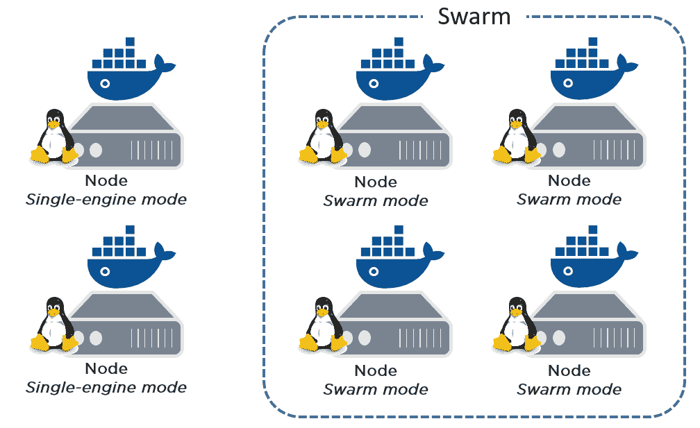

图 7.1

#### 向后兼容性

引入`swarm mode`对于 Docker, Inc. 具有极其重要的意义。维护向后兼容同样重要！这导致他们在 Docker 1.12 中将 swarm mode 设为可选。Docker Engine 的标准安装将默认运行在`single engine mode`，以确保与之前的 Docker 版本保持 100% 的向后兼容。

如果你是第三方集群工具类工具的用户或开发者，这是一个极好的消息。只要你让 Docker 1.12 及更高版本运行在`single engine mode`下，你所有的现有工具和应用都能正常工作！然而，一旦你决定投入并将 Docker Engine 切换到`swarm mode`，你就会面临破坏那些第三方工具和应用的风险。

简而言之，将 Docker Engine 置于`swarm mode`让你拥有所有最新的编排优势，但代价是牺牲向后兼容性。

#### Swarm 模式入门

让我们花一两分钟解释一下`swarm`中的主要组件和结构。

一个`swarm`由一个或多个节点（nodes）组成。这些可以是物理服务器、虚拟机或云实例。唯一的要求是`swarm`中的所有节点都能通过可靠网络相互通信。

节点随后被配置为`managers`（管理者）或`workers`（工作节点）。`managers`负责集群的状态，并负责向`workers`分发任务。`workers`接受来自`managers`的任务并执行它们。

当我们在`swarm`的上下文中提到`tasks`时，我们指的是容器。所以，当我们说“管理器将`tasks`分发给工作节点”时，我们的意思是它们分发了容器工作负载。你可能还会听它们被称为`replicas`（副本）。这可能会让你感到困惑，所以请记住`tasks`和`replicas`都是`containers`的意思。

接下来我们需要了解的是`services`（服务）。`Services`是我们在`swarm`上运行的主要构造体。服务本质上就是一种为一组任务（容器）设置`desired state`（期望状态）的声明式方法。但它非常强大。能够为以下内容设置`desired state`的能力是改变游戏规则的：

*   设置组成服务的任务数量
*   设置服务中容器将使用的镜像
*   设置更新到更高版本镜像的程序

`swarm`的配置和状态存储位于 swarm 中所有管理器节点上的分布式`etcd`数据库中。它保持极新的状态，并以内存形式托管在所有`manager nodes`上以确保速度。但它最棒的一点是它需要零配置——它会自动运行。

`swarm mode`的另一个改变游戏规则的特点是它的安全方法。TLS 的集成如此紧密，以至于没有它就无法构建 swarm。在当今注重安全意识的世界里，这样的功能应该得到所有的赞誉！总之，`swarm mode`使用 TLS 来加密通信、验证节点身份并授权角色。自动密钥轮也是锦上添花！而且这一切发生得如此顺畅，以至于你甚至察不到它的存在！

入门介绍就足够了。让我们通过示例来开始实际操作吧。

## 实验设置

在本章的剩余部分中，我们将构建图 7.2 所示的实验环境，包含 6 个节点，配置为 3 个管理器和 3 个工作节点。每个节点都运行带有 Docker 1.12 或更高版本的 Linux。实验中的所有节点都可以通过网络通信。

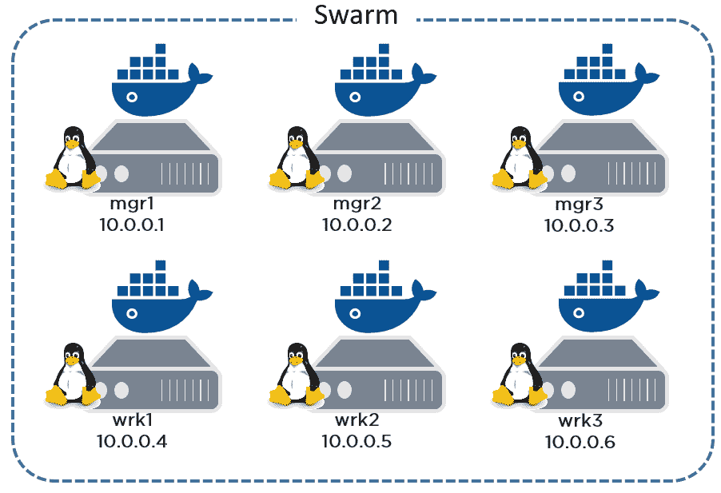

图 7.2

名称和 IP 地址并不重要，在你的实验中可能会有所不同。如果你正在跟随示例操作，请记住将它们替换为你自己的地址。

## 启用 swarm 模式

在以`single-engine mode`（单引擎模式）运行的 Docker 主机上运行`docker swarm init`将该节点切换到`swarm mode`并创建一个新的`swarm`。它还将使该节点成为`manager`。

然后可以使用`docker swarm join`命令将其他节点作为工作节点和管理器加入 swarm。这使这些节点作为操作的一部分进入`swarm mode`。

以下步骤将把`mgr1`放入`swarm mode`并初始化一个新的 swarm。随后随后会将`wrk1`、`wrk2`和`wrk3`作为工作节点加入——自动将它们放入`swarm mode`。最后，它会将`mgr2`和`mgr3`作为额外的管理器添加并将它们切换到`swarm mode`。程序结束，所有 6 个节点将成为同一个 swarm 的一部分，并且都在`swarm mode`下运行。

1.  登录到`mgr1`并初始化一个新的 swarm。

    ```
    $ docker swarm init \
      --advertise-addr 10.0.0.1:2377 \
      --listen-addr 10.0.0.1:2377

    Swarm initialized: current node (d21lyzn0v5qvgdyfzec79qzkx) is now a manager.
    ```

    该命令可以分解如下：

    *   `docker swarm init`通知 Docker 启动一个新集群并将此节点变为第一个管理器。它还启用了节点上的 swarm 模式。
    *   `--advertise-addr`是其他节点连接此管理器应使用的 IP 和端口。该标志是可选的，但它允许你控制在具有多个 IP 的节点上使用哪个 IP。它还让你有机会指定节点上不存在的 IP 地址，例如负载均衡器的 IP 地址。
    *   `--listen-addr`允许你指定要在哪个 IP 和端口上监听 swarm 流量。这通常与`--advertise-addr`匹配，但在你希望在具有多个 IP 的系统中将 swarm 限制在特定 IP 时非常有用。在`--advertise-addr`指向负载均衡器等远程 IP 地址的情况下，也是必须的。

    我建议你始终使用这两个标志。

    swarm 模式运行的默认端口是`2377`。这是完全可以自定义的，但 Docker, Inc. 正在向 IANA 注册此端口为官方 Docker swarm 端口。

2.  列出 swarm 中的节点

    ```
    $ docker node ls

    ID            HOSTNAME   STATUS  AVAILABILITY  MANAGER STATUS
    d21...qzkx *  mgr1       Ready   Active        Leader
    ```

    注意，`mgr1`目前是 swarm 中唯一的节点并被列为`Leader`（领导者）。我们稍后会回到这一点。

3.  从`mgr1`运行`docker swarm join-token`命令以提取向 swarm 添加新工作节点管理器所需的命令和令牌。

    ```
    $ docker swarm join-token worker

    To add a manager to this swarm, run the following command:

       docker swarm join \
       --token SWMTKN-1-0uahebax...c87tu
    ```

    ```
    $ docker swarm join-token manager

    To add a manager to this swarm, run the following command:

       docker swarm join \
       --token SWMTKN-1-0uahebax...c87tu
    ```

4.  登录到`wrk1`并使用加入工作节点的令牌通过`docker swarm join`命令将其加入 swarm。

    ```
    $ docker swarm join \
        --token SWMTKN-1-0uahebax...c87tu \
        10.0.0.1:2377 \
        --advertise-addr 10.0.0.4:2377 \
        --listen-addr 10.0.0.4:2377
    ```

    该节点已加入 swarm。

    我手动添加了`--advertise-addr`和`--listen-addr`标志，因为我认为在涉及网络方面尽可能具体是最佳实践。

5.  在`wrk2`和`wrk3`上重复之前的步骤，将它们作为工作节点加入。确保对`wrk2`和`wrk3`自身的 IP 地址使用`--advertise-addr`和`--listen-addr`标志。

6.  登录到`mgr2`并使用加入管理器的令牌通过`docker swarm join`命令将其作为管理器加入 swarm。

    ```
    $ docker swarm join \
        --token SWMTKN-1-0uahebax...c87tu \
        10.0.0.1:2377 \
        --advertise-addr 10.0.0.2:2377 \
        --listen-addr 10.0.0.2:2377
    ```

    该节点已作为管理器加入 swarm。

7.  在`mgr3`上重复之前的步骤，记得对`advertise-addr`和`--listen-addr`标志使用`mgr3`的 IP 地址。

8.  通过从 swarm 中的任何管理器节点运行`docker node ls`来列出 swarm 中的节点。

    ```
    $ docker node ls

    ID               HOSTNAME     STATUS  AVAILABILITY  MANAGER STATUS
    0g4rl...babl8 *  mgr2         Ready   Active        Reachable
    2xlti...l0nyp    mgr3         Ready   Active        Reachable
    8yv0b...wm67     wrk1         Ready   Active
    9mzwf...e4m4n    wrk3         Ready   Active
    d21ly...9qzkx    mgr1         Ready   Active        Leader
    e62gf...l5wt6    wrk2         Ready   Active
    ```


恭喜！你刚刚创建了一个包含 3 个管理器和 3 个工作节点的 6 节点 swarm。在此过程中，你将每个节点上的 Docker 引擎放入了 `swarm mode`。作为额外奖励，`swarm` 自动通过 TLS 实现了安全保护。

如果你在之前的输出中查看 `MANAGER STATUS` 列，你会发现三个管理节点显示为 "Reachable"（可达）或 "Leader"（领导者）。我们很快就会学习更多关于领导者的知识。`MANAGER STATUS` 列为空的节点是 `workers`（工作节点）。另外，请注意显示 `mgr2` 的那一行 ID 后面有一个星号（`*`）。这告诉我们是在从哪个节点运行了 `docker node ls` 命令。在本例中，命令是从 `mgr2` 发出的。

> **注意：** 每次将节点加入集群（swarm）时都要指定 `--advertise-addr` 和 `--listen-addr` 标志是一件头疼的事。然而，如果你搞错了集群的网络配置，那可能会更加头疼。手动将节点添加到集群中不太是一项日常任务，因此我认为投入额外的前期精力来使用这些标志是值得的。不过这取决于你的选择。在实验室环境或只有单个 IP 的节点上，你不需要使用这些标志。

现在我们已经建立并运行了一个 `swarm`（集群），让我们来看看管理节点的高可用性。

## 集群管理器高可用性 (HA)

到目前为止，我们已经向集群添加了三个管理节点。为什么要添加三个？它们又是如何工作的？在本节中，我们将回答所有这些问题以及更多内容。

集群 `managers`（管理器）原生支持高可用性（HA）。这意味着其中一个或多个节点可以故障，幸存的节点将保持集群运行。

从技术上讲，集群模式实现了一种主备式多管理器 HA 高可用性。这意味着尽管你可能——并且应该——有多个 `managers`（管理器），但在任何时候只有一个管理器会被认为是 `active`（活跃的）的。我们将这个活跃管理器称为 `leader`（领导者）。领导者是唯一会对 `swarm`（集群）发布实时命令的，例如更改集群配置或向工作节点（`workers`）发布任务。如果非活跃管理器接收到集群命令，它会将这些命令代理给领导者。

该过程如图 7.3 所示，其中步骤 `1` 是来自远程 Docker 客户端发送到 `manager` 的命令。步骤 2 是非领导者管理器将命令代理给领导者。步骤 3 是领导者将该命令推送到集群中的相关节点。

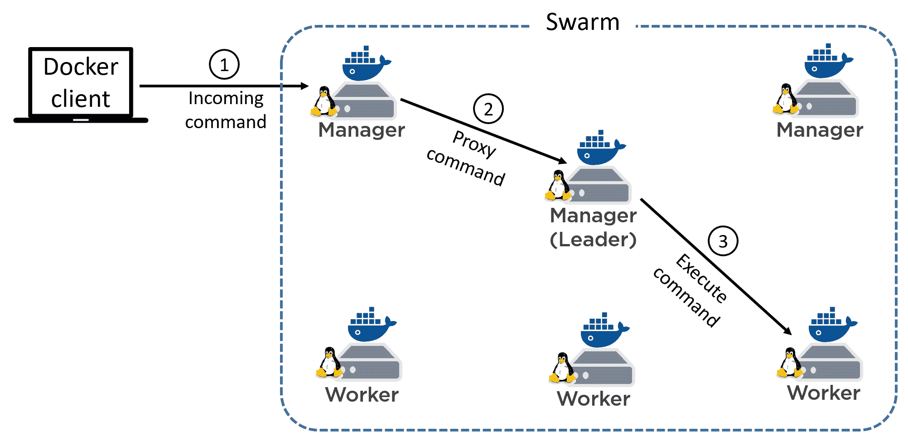

图 7.3

集群使用 [Raft 共识算法](https://raft.github.io/) 的实现来驱动管理器 HA，并适用以下两个最佳实践：

1. 部署奇数个管理器。
2. 不要部署过多的管理器。

部署奇数个 `managers`（管理器）可以增加达到法定人数（`quorum`）的机会，并避免脑裂（`split-brain`）。例如，如果你有 4 个管理器且发生了网络分区，你可能会在分区的每一侧各剩下两个管理器。这被称为脑裂——每一侧都知道曾经有 4 个，但现在只能看到 2 个。任何一方都无法知道它们再也看不见的那 2 个节点是否仍然存活，以及哪一侧持有多数份额（法定人数）。然而，如果你有 3 个或 5 个管理器并发生了同样的网络分区，则不可能在分裂的双方拥有相同数量的管理器。这意味着其中一方有更大的机会知道自己是比另一方多还是少，并实现法定人数通过。

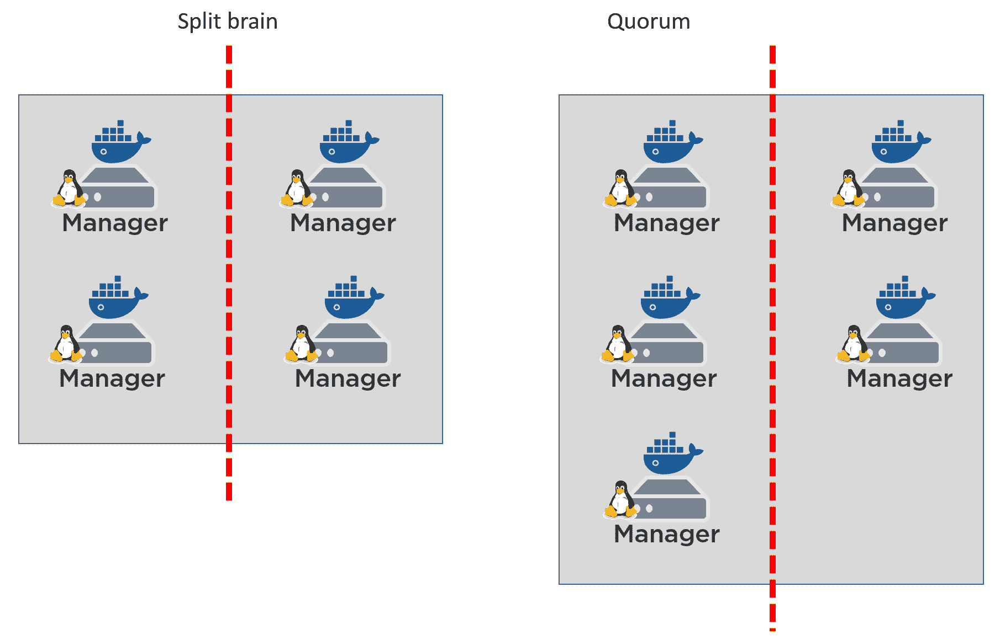

图 7.4

与所有的共识算法一样——参与者越多，达成共识所需的时间越长。这就像决定在哪里吃饭——3 个人做决定总是比 33 个人更快更更容易！考虑到这一点，为了高可用性，拥有 3 个或 5 个管理器是最佳实践。7 个可能可行，但通常公认为 3 个或 5 个是最优的。你绝对不想要超过 7 个，因为达成共识所需的时间会更长。

关于管理器 HA 的最后警告。虽然将你的管理器分布在网络内的可用区中显然是一项良好做法，但你需要确保连接它们的网络是可靠的！网络分区可能是一个极其痛苦的问题！这意味着，在编写时，跨越 AWS 和 Azure 等多个云提供商托管你的活跃生产应用和基础设施有点像是一场白日梦。请花时间确保你的管理器通过高速、可靠的网络连接起来！

现在我们已经构建了 `swarm`（集群）并理解了 `leaders` 和 `manager HA` 的概念，让我们转向 `services`（服务）。

## Services（服务）

正如我们在 `Swarm primer（集群入门）`中所说的……服务是 Docker 1.12 引入的一种新结构，仅存在于 `swarm mode`（集群模式）中。

它们允许我们为一组容器（任务）`declare`（声明）`desired state`（期望状态）并将其传递给 Docker。例如，假设你有一个带有 Web 前的应用。你有一个 Web 服务器的镜像，并且测试显示你需要 5 个 Web 服务实例来处理正常的日常流量。你将此项需求转换为一个 `service`（服务），声明容器应该使用的镜像，以及该服务应该始终有 5 个正在运行的任务。

稍后我们将看到其他可以作为服务一部分进行声明的内容，但在那之前，让我们看看如何创建我们刚刚描述的那个服务。

我们使用 `docker service create` 命令创建一个服务。

``` bash
$ docker service create --name web-fe \
   -p 8080:8080 \
   --replicas 5 \
   nigelpoulton/web-fe
```

让我们回顾一下该命令和输出。

我们使用 `docker service create` 告诉 Docker 我们要创建一个服务，并使用 `--name` 标志将服务命名为 `web-fe`。我们使用 `--replicas` 标志告诉 Docker 应该有 5 个任务。最后，我们告诉 Docker 使用哪个镜像：`nigelpoulton/web-fe`。

但此尚未结束。所有的 `services`（服务）都由集群持续进行监控——集群运行一个协调循环，不断比较服务的 `actual state`（实际状态）和 `desired state`（期望状态）。如果两个状态匹配，世界就太平了，不需要采取任何进一步行动。如果它们不匹配，集群会采取行动使其匹配。换句话说，集群在不断确保 `actual state` 匹配 `desired state`。

例如，如果托管其中 5 个 `web-fe` 容器任务的其中一个 `workers`（工作节点）发生故障，则该 `web-fe` 服务的 `actual state` 将从 5 个运行任务减少到 4 个。这不再符合 5 个的 `desired state`，Docker 将启动一个新的 `web-fe` 任务，以使 `actual state` 恢复到与 `desired state` 一致。这种行为非常强大，允许服务在节点故障时进行自愈。

## 查看和检查服务

你可以使用 `docker service ls` 命令查看集群上运行的所有服务的列表。

``` bash
$ docker service ls
ID            NAME    REPLICAS  IMAGE                         COMMAND
2kffzpz721nr  web-fe  5/5       nigelpoulton/plur...cker-ci
```

上面的输出显示了单个运行的服务以及关于状态的一些基本信息。除其他之外，我们可以看到服务的名称，以及 5 个期望任务/容器中有 5 个处于运行状态。如果你在部署服务后不久运行此命令，它可能不会显示所有任务/容器均为运行状态。这可能是因为在每个节点上拉取镜像所需的时间。

你可以使用 `docker service ps` 命令查看服务的任务列表及其状态。

``` bash
$ docker service ps web-fe
ID         NAME      IMAGE             NODE  DESIRED  CURRENT
817...f6z  web-fe.1  nigelpoulton/...  mgr2  Running  Running 2 mins
a1d...mzn  web-fe.2  nigelpoulton/...  wrk1  Running  Running 2 mins
cc0...ar0  web-fe.3  nigelpoulton/...  wrk2  Running  Running 2 mins
6f0...azu  web-fe.4  nigelpoulton/...  mgr3  Running  Running 2 mins
dyl...p3e  web-fe.5  nigelpoulton/...  mgr1  Running  Running 2 mins
```

该命令的格式为 `docker service ps <service-name or service-id>`。输出每行显示一个任务，显示它在集群的哪一个节点上执行，并显示期望状态和实际状态。

要查看有关服务的详细信息，请使用 `docker service inspect` 命令。

``` bash
$ docker service inspect --pretty web-fe
ID:             2kffzpz721nrjikmxqhj474qg
Name:           web-fe
Mode:           Replicated
 Replicas:      5
Placement:
UpdateConfig:
 Parallelism:   1
 On failure:    pause
ContainerSpec:
 Image:         nigelpoulton/pluralsight-docker-ci
Resources:
Ports:
 Protocol = tcp
 TargetPort = 8080
 PublishedPort = 8080
```

上面的示例使用 `--pretty` 标志将输出限制为以易读的格式打印的最感兴趣的项目。省略 `--pretty` 标志将获得更详细的输出。

我们稍后会回到这些输出中的某些。

让我们来看看如何扩展服务。

## 扩展服务

服务的另一个强大功能是能够轻松地向上或向下扩展规模。

假设业务兴隆，我们看到访问 Web 前端的流量是预期的两倍。幸运的是，扩展 `web-fe` 服务只需运行 `docker service scale` 命令一样简单。

``` bash
$ docker service scale web-fe=10
web-fe scaled to 10
```

上述命令将任务/副本的数量从 5 扩展到 10。在后台，它正在将服务的期望状态从 5 更新到 10。运行另一个 `docker service ls` 命令来验证操作是否成功。

``` bash
$ docker service ls
2kffzpz721nr  web-fe  10/10     nigelpoulton/pluralsight-docker-ci
```

运行 `docker service ps` 命令将显示服务中的任务在集群的所有节点上尽可能均匀地分布。

``` bash
$ docker service ps web-fe
ID         NAME      IMAGE             NODE  DESIRED  CURRENT
817...f6z  web-fe.1  nigelpoulton/...  mgr2  Running  Running 5 mins
a1d...mzn  web-fe.2  nigelpoulton/...  wrk1  Running  Running 5 mins
cc0...ar0  web-fe.3  nigelpoulton/...  wrk2  Running  Running 5 mins
6f0...azu  web-fe.4  nigelpoulton/...  mgr3  Running  Running 5 mins
dyl...p3e  web-fe.5  nigelpoulton/...  mgr1  Running  Running 5 mins
912...vtb  web-fe.6  nigelpoulton/...  mgr1  Running  Running 1 min
3wu...o7y  web-fe.7  nigelpoulton/...  wrk3  Running  Running 1 min
aso...6hh  web-fe.8  nigelpoulton/...  wrk3  Running  Running 1 min
97u...4bn  web-fe.9  nigelpoulton/...  wrk1  Running  Running 1 min
a1u...4jj  web-fe.10 nigelpoulton/...  mgr2  Running  Running 1 min
```

在后台，swarm 模式运行着一种调度算法，该算法默认尝试在集群节点之间尽可能均匀地平衡任务。在写本文期间，这相当于在每个节点上运行等数量的任务，而不考虑 CPU 负载等因素。

再次运行另一个 `docker service scale` 命令将数量从 10 调回 5。

``` bash
$ docker service scale web-fe=5
web-fe scaled to 5
```

现在我们已经知道了如何扩展服务，让我们来看看如何删除它。

## 删除服务

删除服务非常简单——可能太简单了。

以下 `docker service rm` 命令将删除我们之前部署的服务。

``` bash
$ docker service rm web-fe
web-fe
```

使用 `docker service ls` 命令确认服务已删除。

``` bash
$ docker service ls
ID  NAME  REPLICAS  IMAGE  COMMAND
```

使用 `docker service rm` 命令时要小心，因为它会在不询问确认的情况下删除服务中的所有任务。

现在服务已从系统中删除，让我们来看看如何向服务推送滚动更新。

## 滚动更新

向已部署的应用程序推送更新是生活中的常态。在很长一段时间里，这一直都非常痛苦。我为了重大的应用程序更新损失了太多的周末，如果可以的话，我不想再次经历那样了。

嗯……多亏了 Docker 服务，向已部署的应用推送更新变得简单多了！

为了看到这一点，我们将部署一个新的服务。但在此之前，我们将创建一个叠加网络（`overlay network`）。

``` bash
$ docker network create -d overlay uber-net
43wfp6pzea470et4d57ud9
```

`uber-net` 网络已成功创建，具有 `swarm` 范围，并且目前仅在集群的管理器节点上可见。

叠加网络本质上是在多个底层网络之上创建一个新的第 2 网络。图 7.5 显示了由第 3 层路由器连接的两个底层网络。然后跨越这两个网络有一个单一的叠加网络。Docker 宿主机连接到这两个底层网络。

我们可以将容器放置在 `uber-net` 网络上。叠加网络上的所有容器相互通信，即使它们运行的 Docker 宿主机位于不同的网络。

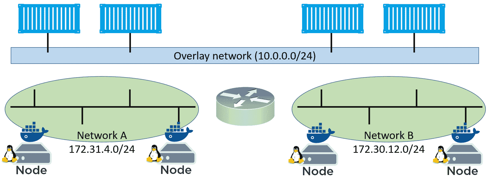

图 7.5

运行 `docker network ls` 以验证网络创建正确并在宿主机上可见。

``` bash
$ docker network ls
NETWORK ID          NAME                DRIVER      SCOPE
490e2496e06b        bridge              bridge      local
a0559dd7bb08        docker_gwbridge     bridge      local
a856a8ad9930        host                host        local
ailuc6rgcnr        ingress             overlay     swarm
be581cd6de9b        none                null        local
43wfp6pzea47        uber-net            overlay     swarm
```

让我们创建一个新服务。

``` bash
$ docker service create --name uber-svc \
   --network uber-net \
   -p 80:80 --replicas 12 \
   nigelpoulton/tu-demo:v1
dhbtgvqrg2q4sg07ttfuhg8nz
```

让我们看看刚才 `docker service create` 命令声明了什么。

我们做的第一件事是命名服务，然后使用 `--network` 标志告诉它将所有容器放在新的 `uber-net` 网络上。然后我们在整个集群中暴露 80 端口，并将其映射到每个请求的 12 个副本或任务内部的 80 端口。最后，我们告诉它所有任务都基于 `nigelpoulton/tu-demo:v1` 镜像。

``` bash
$ docker service ls
ID            NAME      REPLICAS  IMAGE
dhbtgvqrg2q4  uber-svc  12/12     nigelpoulton/tu-demo:v1
$
$ docker service ps uber-svc
ID        NAME          IMAGE                NODE  DESIRED   CURRENT STATE
0v...7e5  uber-svc.1    nigelpoulton/...:v1  wrk3  Running   Running 1 min
```


假设你是一个高级文档工程师，请参考下面的注意事项了解 Markdown 文档的格式，然后参考示例，将给定英文或中文文本排版。

请执行以下操作：

1. 重新划分标题层级（保留合理的# ## ###结构）
2. 优化段落格式，删除多余空行
3. 保留正文核心内容
4. 所有单独出现的变量名（`varName`），函数名（`funcName()`），类名（`ClassName`），路径名（`/path.to.xxx`），命令名（`cmdname`）以及它们的语句或表达式（`ClassName.funcName(var1 + var2, "cmd arg0 arg1"`）都需要添加反引号。如果上述东西被粗体（**）或者斜体（*）包围，去掉星号再加反引号。
5. 代码块前后加上三个反引号（```）

## 重要规则

- 不要修改正文内容的语义
- 不要删减有价值的信息
- 确保输出是标准Markdown格式
- 只返回处理后的内容，不要重复输出原文，也不要添加额外说明
- 排版后文本应包含在“[content]...[/content]”中

## 示例

原文：

[content]
进入 /path/to/xxx 目录，找到 xxx.json。

在表达式 cvar = avar + bvar 中，加法运算符（+）将 avar 与 bvar 相加，得到它们的和 cvar

在 List.of(arg0, arg1, arg2) 中，List 接口的工厂方法 of() 接受一系列的元素，返回包含它们的只读列表。

之后我们这样调用 cmd 命令：cmd arg0 arg1 arg2。

if (condVar > someVal) {console.log("xxx")}
[/content]

排版后：

[content]
进入`/path/to/xxx`目录，找到`xxx.json`。

在表达式`cvar = avar + bvar`中，加法运算符（`+`）将`avar`与`bvar`相加，得到它们的和`cvar`

在`List.of(arg0, arg1, arg2)`中，`List`接口的工厂方法`of()`接受一系列的元素，返回包含它们的只读列表。

之后我们这样调用`cmd`命令：`cmd arg0 arg1 arg2`。

```
if (condVar > someVal) {console.log("xxx")}
```
[/content]

## 以下是需要排版的文本

[content]
`bh...wa0  uber-svc.2    nigelpoulton/...:v1  wrk2  Running   Running 1 min`

`23...u97  uber-svc.3    nigelpoulton/...:v1  wrk2  Running   Running 1 min`

`82...5y1  uber-svc.4    nigelpoulton/...:v1  mgr2  Running   Running 1 min`

`c3...gny  uber-svc.5    nigelpoulton/...:v1  wrk3  Running   Running 1 min`

`e6...3u0  uber-svc.6    nigelpoulton/...:v1  wrk1  Running   Running 1 min`

`78...r7z  uber-svc.7    nigelpoulton/...:v1  wrk1  Running   Running 1 min`

`2m...kdz  uber-svc.8    nigelpoulton/...:v1  mgr3  Running   Running 1 min`

`b9...k7w  uber-svc.9    nigelpoulton/...:v1  mgr3  Running   Running 1 min`

`ag...v16  uber-svc.10   nigelpoulton/...:v1  mgr2  Running   Running 1 min`

`e6...dfk  uber-svc.11   nigelpoulton/...:v1  mgr1  Running   Running 1 min`

`e2...k1j  uber-svc.12   nigelpoulton/...:v1  mgr1  Running   Running 1 min`

```

通过向服务传递 `-p 80:80` 标志将确保创建一个整个集群范围的映射，将进入集群中任一节点 80 端口的流量映射到该服务中任何容器内部的 80 端口。

打开网络浏览器并将其指向集群中任一节点 80 端口的 IP 地址，即可查看在服务中运行的应用。

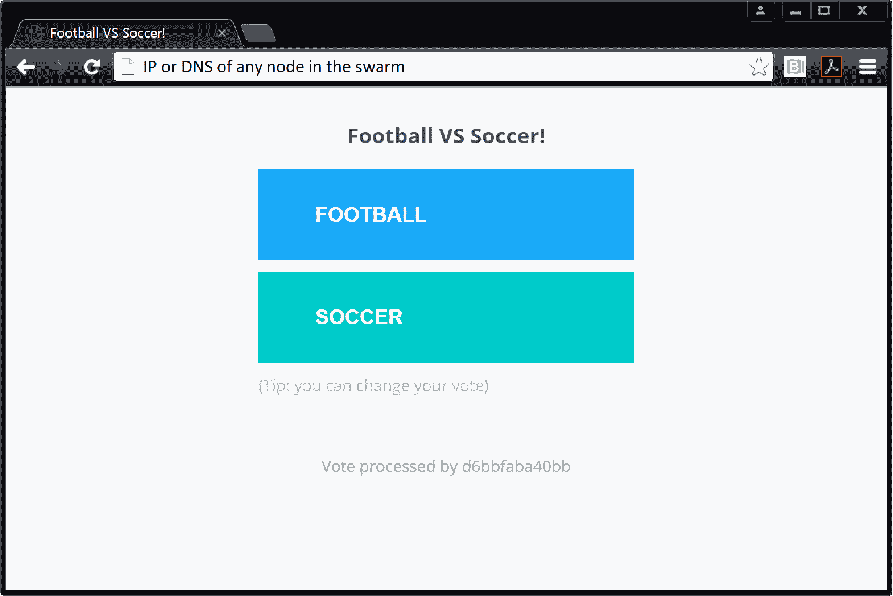

图 7.6

你可以看到，该应用程序是一个简单的投票程序，将为“足球”或“足球”注册投票。可以将你的网络浏览器指向集群中的其他节点。你将从集群中的任一节点访问 Web 服务器，因为 `-p 80:80` 在每个主机上都创建了映射。即使在可能运行该服务任务的节点上也是如此的——每个节点都获得了一个映射，因此可以将你的请求重定向到运行该服务的节点。

现在，假设这次特定的投票已经结束，你的公司现在正在一项新调查。已为新调查创建了新的镜像并将其添加到相同的 Docker Hub 仓库中，但这次镜像的标签为 `v2` 而不是 `v1`。

让我们假设你被指派分阶段将更新后的镜像推送到集群——每次 2 个容器，每批 2 个容器之间延迟 20 秒。我们可以使用以下 `docker service update` 命令来实现这一点。

```

$ docker service update \

   --image nigelpoulton/tu-demo:v2 \

   --update-parallelism 2 \

   --update-delay 20s uber-svc

uber-svc

```

让我们查看该命令。`docker service update` 允许通过更新服务的期望状态来对运行的服务进行更新。这次我们给了它一个新镜像标签 `v2` 而不是 `v1`。我们使用了 `--update-parallelism` 和 `--update-delay` 标志，以确保新镜像每次推送到 2 个任务，并且每对任务之间有 20 秒的冷却期。最后，我们告诉 Docker 对 `uber-svc` 服务执行这些更改。

如果我们对该服务运行 `docker service ps`，将看到服务中的某些任务处于 `v2`，而另一些则处于 `v1`。如果我们给操作足够的时间来完成（4 分钟），所有任务最终都将达到使用 `v2` 镜像的新期望状态。

```

$ docker service ps uber-svc

ID        NAME              IMAGE        NODE   DESIRED   CURRENT STATE

7z...nys  uber-svc.1    nigel...v2   mgr2  Running   Running 13 secs

0v...7e5  \_uber-svc.1  nigel...v1   wrk3  Shutdown  Shutdown 13 secs

bh...wa0  uber-svc.2    nigel...v1   wrk2  Running   Running 1 min

e3...gr2  uber-svc.3    nigel...v2   wrk2  Running   Running 13 secs

23...u97  \_uber-svc.3  nigel...v1   wrk2  Shutdown  Shutdown 13 secs

82...5y1  uber-svc.4    nigel...v1   mgr2  Running   Running 1 min

c3...gny  uber-svc.5    nigel...v1   wrk3  Running   Running 1 min

78...r7z  uber-svc.7    nigel...v1   wrk1  Running   Running 1 min

2m...kdz  uber-svc.8    nigel...v1   mgr3  Running   Running 1 min

b9...k7w  uber-svc.9    nigel...v1   mgr3  Running   Running 1 min

ag...v16  uber-svc.10   nigel...v1   mgr2  Running   Running 1 min

e6...dfk  uber-svc.11   nigel...v1   mgr1  Running   Running 1 min

e2...k1j  uber-svc.12   nigel...v1   mgr1  Running   Running 1 min

```


但需要注意的是，尽管 swarm mode 在 Docker 1.12 中是一个新特性，但它并不是像某些项目那样盲目引入了数千行从未面世的全新代码。底层代码已经存在相当一段时间，并且已经在生产环境中积极部署。

话虽如此，在决定在上面运行业务关键型应用之前，你仍然应该进行常规测试！

## 清理

让我们清理一下服务。

```bash

$ docker service rm uber-svc

uber-svc

```

使用 `docker service ls` 命令验证 `uber-svc` 已不再运行。

```bash

$ docker service ls

ID  NAME  REPLICAS  IMAGE  COMMAND

```

## Swarm 模式 - 命令

*   docker swarm init 是创建新集群的命令。你运行该命令的节点将成为新集群中的第一个管理器，并切换到 swarm mode 模式运行。
*   docker swarm join-token 显示了将工作节点和管理节点加入现有集群所需的命令和令牌。使用 docker swarm join-token manager 命令显示加入新管理节点的命令，使用 docker swarm join-token worker 命令获取加入工作节点的命令。
*   docker node ls 列出集群中的所有节点，并列出哪些是管理器，哪个是节点（leader）。
*   docker service create 是声明式创建新服务的命令。
*   docker service ls 列出集群中运行的服务，并提供有关服务状态及其运行的任何任务的基本信息。
*   docker service ps 提供有关服务中运行的任务的更详细信息。
*   docker service inspect 提供服务的详细信息。它接受 `--pretty` 参数将返回的信息限制为最重要的信息。
*   docker service scale 允许你扩展或缩小服务中任务的数量。
*   docker service update 允许你更新运行中服务的许多属性。
*   docker service rm 是从集群中删除服务的命令。请谨慎使用该命令，因为它会在不询问确认的情况下删除服务中的所有任务。

## 章节总结

在这一章中，我们学习了 swarm 模式以及如何构建集群。

我们使用 `docker swarm init` 命令创建一个新集群，并使运行命令的节点成为该集群的第一个管理器。随后，我们加入了管理节点和工作节点。我们了解到管理器以高可用（HA）形态运行，推荐的管理器数量为 3 或 5 个。

我们学习了如何声明服务并在集群上运行它们。我们看到网络端口是如何跨整个集群暴露的，允许我们能够访问集群中的任何节点并到达服务端点——即使我们访问的节点并没有运行服务的任务。

最后，我们通过扩展服务再缩小服务，以及使用滚动更新（rolling update）向运行中的服务推送更新，完成了本章的结束。

## 8: 后续计划

希望你现在已经熟练地讨论 Docker 并使用它了。

在当今世界，将你的旅程推向下一步非常简单。在云端启动基础设施和工作负载是异常容易的，你可以在那里构建和测试 Docker 直到你成为该领域的全球权威！

你也可以前往 [Pluralsight](http://app.pluralsight.com/author/nigel-poulton) 查看我的视频培训课程。如果你不是 Pluralsight 的成员，就加入一个吧！是的，这需要花钱，但这绝对是一个物超所值的服务！如果你不确定……他们一直有免费试用期，你可以在有限时间内免费访问我的课程。

我还建议你参加像 [Dockercon](https://www.dockercon.com) 以及你当地的 [Docker meetups](https://www.docker.com/community/meetup-groups) 这样的活动。

## 反馈

感谢阅读我的书。真心希望它对你有帮助！

关于这一点，我很想听到你的反馈——好坏都可以。如果你觉得这本书非常棒，请告诉我告诉其他人！但也想知道你不喜欢它的哪里，以及我如何让下一个版本变得更好！！！请在书的反馈页面上留言，并随时通过 [Twitter](https://twitter.com/nigelpoulton) 告诉你的想法！


再次感谢阅读我的书，祝你的职业发展一风顺！！

```
