# 绘画学校：完整课程

如果你有兴趣学习绘画，这就是你想要就读的学校。你将通过创建项目来学习一项又一项的技能，这将帮助你掌握技巧和媒介，就像在美术学院的课程中那样。

尝试不同的观察和比较物体的视角——它们将使你能够准确地描绘主体。专注于从日常环境中选择的简单静物，从二维向三维过渡，并按照你自己的节奏学习。从单色材料开始，例如孔特蜡笔 (`conté crayons`)、石墨棒和墨水，这些材料能产生黑白阴影。尝试使用它们——观察你能创造出怎样的多样线条、涂抹效果和强度。加入色粉笔、马克笔和铅笔来增加色彩——很快你的画作就会呈现出新的复杂性和趣味性。

将你的主题范围扩展到风景、街景和人体。在户外实地写生可以让你练习快速创作，而且这非常令人兴奋，因为可能会发生各种你直到……才意识到的事情。

美国国会图书馆编目在版数据可用

10 9 8 7 6 5 4 3 2 1

QUMNDC

## 什么是绘画？

所有的绘画都可以被定义为在表面上绘制的一系列标记，以产生一幅图画或图表，但它们还包含许多其他含义。我们通常将绘画与用铅笔或钢笔绘制的线条联系在一起，但如今“绘画”一词涵盖了极其广泛的单色和彩色媒介，且可以以许多不同的方式使用。

绘画可以纯粹地用于描述，或者更具表现力地用来传递情绪和情感。但也许最重要的一点是绘画的直接性。它是艺术家对激发其兴趣的事物做出反应最迅速的手段。无论你是在回应外部视觉世界的事物，还是想象中的内部世界，记录它的最快方式就是把它画下来。本书将使你发现什么能激发你的兴趣，并向你展示如何在绘画中传达这种兴趣。

绘画主要通过实践来学习。世界上所有的教师和书籍只能为你提供信息；学习是通过练习实现的。然而，这种练习需要有方向，对于许多人来说，一个提供可遵循路径的结构化课程可能是学习绘画最有效的方式。本书就提供了这样一个课程，而且因为它是以书籍形式呈现，你可以按照最适合自己的速度前进。

### 课程目标

本书基于一个前提：任何人都可以学习绘画。绘画是一种自然的沟通和表达方式，所有孩子都能做得很好，但随着年龄增长，他们往往会放弃，认为这只有那些拥有特殊“天赋”和特定才华的人才能做到。这部以一系列课程形式呈现的《全方位绘画课程》，首先旨在通过让你学会像艺术家那样以分析性和选择性的方式观察，从而教会你绘画。其次，它向你展示如何以系统的方式探索视觉世界，并在此过程中发现你自己的个人绘画方式，去描绘那些最让你感兴趣和兴奋的事物。

### 如何使用本书

这不是一本普通的阅读后就搁置的书。它是一种工作手册。它经常会给你指令并布置具体任务。在阅读时，请试着将文字想象成老师在对你说话。对于大多数章节，你应该先直接通读文本，然后回到开头，逐步遵循给出的指导。在练习时，请将书打开放在身边以便参考。

### 第一部分

本书的第一部分是绘画基础课程，你将从中学习如何“用所有感官”去观察，以及如何将所见之物转化为绘画。它由七个课程组成，每个课程涵盖一个主要的绘画基础知识。每个课程都为你准备了项目。

## 信息专栏

### 实用信息

关于绘画媒介的信息专栏列出了你入门所需的一切，并鼓励你尝试不同的媒介。其他信息专栏则解释了一些有帮助的“基础知识”，例如人体比例。

### 理论信息

这些专栏概述了一些创作绘画的基本原则，旨在帮助你开发个人风格。

#### 进一步信息

每页右侧的交叉引用面板会引导你寻找关于当前讨论主题的更多信息。

## 第一和第二部分：课程

### 导论

本书的核心是一系列精心构建的课程和项目。引导性文字解释了项目的通用原则和具体目的。

#### 项目目标

每个课程都包含一个信息面板，列出项目的目标并告知你完成这些项目需要多少时间。

### 步骤详解

每个项目都配有完整的演示图解。有些项目由两位艺术家完成，以便你可以看到不同的方法和解读。

#### 自我评判

项目之后是一系列需要你自问的问题。这将帮助你检查进度并纠正作品中的错误。

### 其他示例

每个项目之后都会展示其他当代艺术家的完成作品。这些作品都与该课的主题相关，但展示了极其多样化的风格和媒介。

#### 进一步信息

每页右侧的交叉引用面板会引导你寻找关于当前讨论主题的更多信息。

这些练习旨在让你执行，并配有明确的目标和示范，以便你确切地知道该怎么做。为了让你能够检查自己的完成情况，书中提供了一组以问题形式呈现的自我评判，供你审视自己的作品。你给出的答案将告诉你已经取得了怎样的成就。这一点至关重要，因为在任何课程中，你都需要意识到自己的长处和短处，并确保自己正在取得进步。

在课程和项目之间的战略位置，设有“信息专栏”（`Information Features`），提供技术帮助和相关信息，例如关于透视法和人体比例的内容。

## 第二部分

本书的第二部分《主题与处理》（`Themes and Treatments`）在结构上与第一部分类似，包含课程、项目和信息专栏。不同之处在于，第一部分的项目主要要求你绘制简单的静物，而第二部分则扩展了主题范围，并引入了绘画中遇到的一些最重要的问题。

## 第三部分：课程

- **其他示例**：除了“关键”绘画外，每节课还包括采用类似风格或处于相同主题领域的当代艺术家的作品示例。

- **建议研究的其他艺术家**：每节课都提供了艺术家的简短传记，你可以研究他们的作品以获取进一步的灵感和创意。

- **建议项目**：每节课结束时都会提供项目建议，使你能够尝试构成该课程基础的风格或方法。

### 关键绘画

这些课程探讨了绘画的各种原因，并研究不同的主题和风格。每节课都以一位古代大师或重要现代艺术家的“关键”绘画为特色。

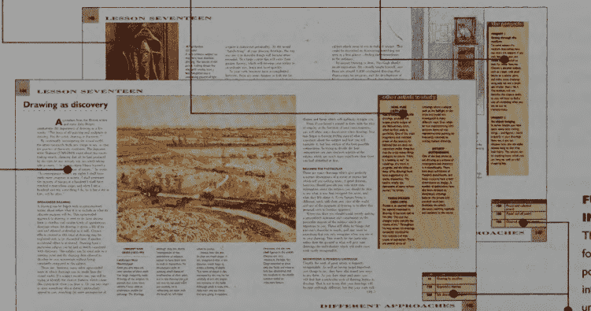

### 第十七课：作为探索的绘画

- **进一步信息**：每页右侧的交叉引用面板将引导你获取关于讨论主题的进一步信息。

## 第四部分：技巧

### 示范

通过逐步示范那些既实用又令人兴奋的技巧，向你展示一些可选的方案。

### 其他示例

与本书之前的章节一样，当代艺术家完成的绘画作品提供了进一步的灵感。

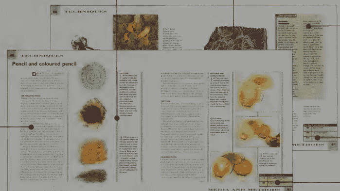

### 正文

清晰的文字扩展了此前关于绘画介质的信息，从而帮助你最大限度地发挥所选介质的潜力。

### 项目

为每种介质设定了一个项目，鼓励你尝试各种技巧。

#### 进一步信息

每页右侧的交叉引用面板将引导你获取关于讨论主题的进一步信息。

## 第三部分

第三部分向你展示绘画的主要方法，以及除了视觉世界之外，记忆和想象力如何成为艺术家的灵感来源。它讨论了绘画与油画之间的密切关系，以及如何通过绘画实现抽象。研究杰出艺术家的作品是艺术系学生教育的重要组成部分，在本部分的每节课中，都以一位古代或现代大师的“关键绘画”为特色。课程包含让你执行的项目，就像本书之前的部分一样，尽管这里没有提供插图。

## 第四部分

当你进行到课程的这个阶段时，你将已经培养了相当的技术能力。在本书的最后一部分中，我们将重新审视技巧，以便你探索使用绘画介质的一些新方法。通过这些方法，你将发现如何发展自己的绘画风格，并就新旧主题找到新的表达方式。

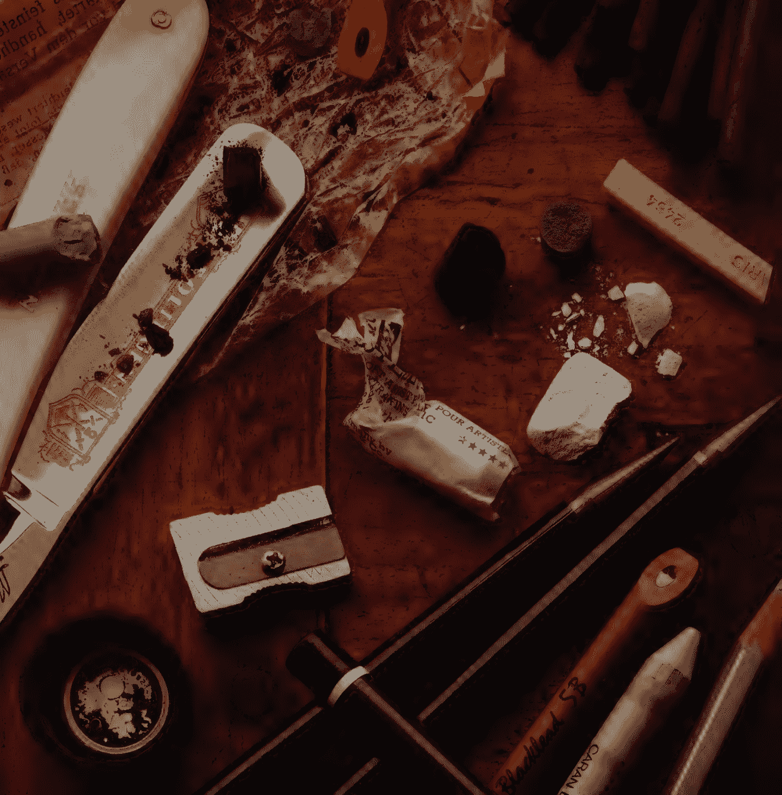

# 第一部分：基础课程

学习绘画的主要目的并非学习特殊技巧，而是学习用一种新的方式去观察。观察同一事物有许多不同的方式。如果你沿着平时开车经过的街道行走，你会注意到许多在车里看不到的东西。如果你随后停下来观察街道旁的一个物体，你会发现当你走过它时没有注意到的特征。绘画可以被描述为“仔细观察的艺术”；你必须训练自己以一种积极的、分析的方式去观察。无法画出一个物体几乎总是因为没能“看到”它，而不是缺乏技术能力。当你完成基础课程中的项目时，你会发现，如果你能真正地“看到”某样东西，那么你就能把它画出来。

接下来的课程项目仅需要最基本的材料和设备，且无需任何绘画基础知识。绘画主题选自你熟悉的日常环境。你被要求绘制的第一批作品将是普通的家用物品，然后随着信心的增加并进入第二部分的课程，你将继续绘制风景、街景、花果以及人物。

## 基础绘画材料

绘画最基本的形式是单色的。物体、人物和场景的幻象在不使用任何颜色的情况下被神奇地实现。有些人可能会说，所有“真正的绘画”都局限于使用单色介质（如钢笔、铅笔等），这使得艺术家只能通过一种颜色的深浅（通常是黑白）来传递信息。

然而，很难将绘画仅仅限制在单色术语中，因为诸如“水彩画”和“粉彩画”这类名称都表明绘画将包含颜色，这使得上述限制变得不可能。在基础课程的后续部分中，有一个关于彩色绘画介质的信息专栏，但这里仅讨论基础的单色绘画介质。

### 纸张：尺寸与类型

纸张通常以国际认可的 A 系列尺寸销售。`A1` 是最大尺寸，`A5` 是你将需要的最小尺寸。

| 尺寸 | 英制测量 | 公制测量 |
| :--- | :--- | :--- |
| `A1` | 33 × 23³⁄₈ in | 840 × 594 mm |
| `A2` | 23⁷⁄₈ × 16½ in | 594 × 420 mm |
| `A3` | 16¼ × 11¾ in | 420 × 297 mm |
| `A4` | 11⅜ × 8¼ in | 297 × 210 mm |

纸张的厚度以每令（480 张）的重量表示。绘图纸（`Cartridge paper`）通常在 72 到 90 磅之间，而用于水彩和洗色画的较厚纸张则在 140 磅到 300 磅之间。你可以购买画册纸或单张纸。建议购买单张纸，因为购买 `A1` 大纸然后根据需要裁剪成较小尺寸的成本更低。

不同的纸张适合不同的绘画介质；例如，钢笔在光滑的纸上绘画效果最好，而粉笔和木炭则需要更粗糙的表面——即通常所说的具有一定“齿形”（`tooth`）的纸张。纸张也有不同的颜色，但白色绘图纸是一个很好的通用起点，足以应对本阶段课程要求的所有工作。

#### 纸张类型

- **绘图纸**：一个优秀的通用选择。
- **光滑水彩纸**：非常适合墨水画或墨水洗色画。
- **中粗和粗纹水彩纸 / 木炭纸**：两者都能给木炭画和孔特蜡笔画带来有趣的纹理。

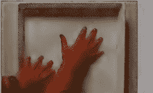

#### 绷纸

1. 这样做是为了防止纸张在湿润时起皱。将纸浸湿并将其放置在画板上。
2. 为每条边剪一段胶带并将其打湿——但不要太湿，否则可能会撕破纸张。
3. 将胶带贴在纸张边缘，在操作时用手将其抚平。让纸自然干燥。

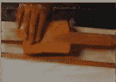

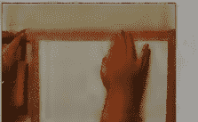

### 素描本

你需要一个素描本。素描本有不同的尺寸、各种装订方式并包含不同种类的纸张。不要选择太小的素描本；`A2` 尺寸可以为你创作较大的绘画提供充足的空间，但对于随身携带来说又太大了。如果你购买一个 `A3` 尺寸且采用线装的素描本，你可以将其摊开，在需要时跨两页进行大尺寸绘画。

▲ 你需要让自己适应你的写生本，在找到适合自己的尺寸和类型之前，你可能需要尝试几种不同的本子。

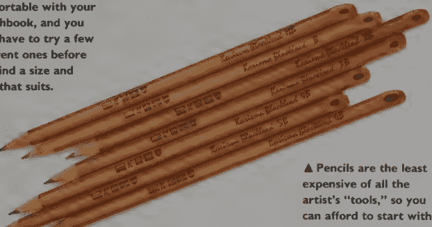

▲ 在所有艺术家的“工具”中，铅笔是最便宜的，因此你可以负担得起一套丰富的选择，范围从 `HB` 到 `4B` 甚至 `6B`。

两本带有绘画纸的写生本，一本至少是 `A3` 尺寸，另一本较小，可以放入口袋或包中。

### 绘画媒介

铅笔是最基本的绘画工具，也是最通用地工具之一，范围从非常硬的 `6H` 到非常软的 `6B`。硬铅笔通常仅用于技术制图。你至少需要一支 `HB`、一支 `2B` 和一支 `4B`。

在这个阶段唯一需要的蜡笔是孔特蜡笔（`conté crayons`），这是一种方形截面、略带蜡质的画棒，通常有黑色、白色和两种棕色。尽量每种颜色各准备一根。你还需要一盒中号柳木炭条和一些压缩炭条。

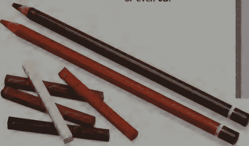

▲ 孔特蜡笔有画棒和铅笔两种形式。如果需要，可以用刀削尖画棒。

► 石墨棒（没有木质外壳的铅笔）也非常有用。

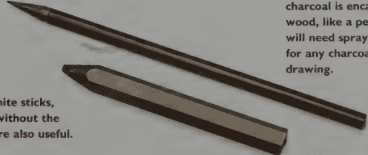

> **提示：绘画姿势**
> 你绘画时的姿势非常重要，因为能够同时看到纸张和你所画的对象而无需移动头部至关重要。尽量让画板尽可能垂直；如果倾斜过多，你看到的画面会产生畸变。并且调整你的位置，使你能从画板上方看到对象，而不是不得不从侧面窥视。

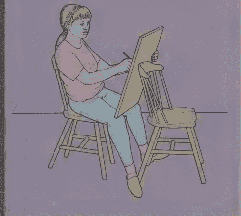

► 柳木炭条呈细枝状，有不同的粗细，而压缩炭条像铅笔一样包裹在木材中。任何炭笔画都需要使用喷雾定画液。

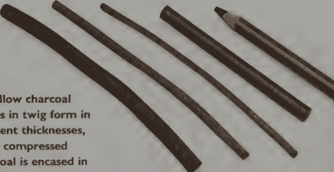

| 进一步信息 | |
| :--- | :--- |
| 180 | 铅笔和彩色铅笔 |
| 196 | 炭笔和孔特蜡笔 |

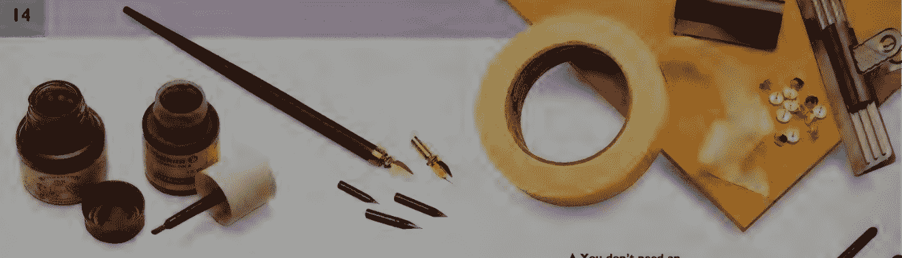

绘画墨水有很多种，但主要分为防水和水溶两类。绘画笔也很多样，但一个带有可更换笔尖的蘸水笔是很好的入门选择。

炭精铅笔很有用，虽然不是必需的。它们的软硬度通常相当于普通的 `2B` 铅笔。

虽然绘画笔和绘画墨水的种类繁多，但请从一小瓶黑色绘画墨水和一支可更换笔尖的绘画笔开始。绘画墨水通常可以用蒸馏水稀释，因此请确保你购买的任何墨水都可以通过这种方式稀释。

> 你不需要昂贵的画板；像这样的一块纤维板就足够了。你还需要夹子、遮蔽胶带或图钉来固定纸张。

各种圆珠笔、纤维笔和毛毡笔不仅在美术用品供应商处有售，在文具店也有。只要笔尖不过粗，其中许多笔都适合绘画。如果你发现使用笔很适合你，请尝试尽可能多的种类。大多数商店都有样品笔供你实验，因此你可以尝试并剔除你不喜欢的，而无需购买。

> 这些刷子是真正的貂毛刷，但如今市场上有很多较便宜的替代品。

> 毛毡笔和纤维笔的种类多得令人眼花缭乱。购买前请先试用，并确保它们耐光——有些褪色严重。

最后，你需要喷雾定画液，用来保护用炭条、炭精铅笔和软铅笔完成的画作，防止它们被抹花。这可以购买成气雾罐（环保型），或者装在瓶子里并配合喷雾扩散器使用。

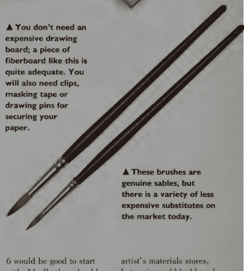

### 画笔

你可能认为画笔是用来绘画（`painting`）而不是素描（`drawing`）的，但你会发现它们是非常有用的素描工具。你至少需要两支圆形软刷；`4` 号和 `6` 号是很好的开始。理想情况下应该是貂毛刷，但即使是这么小的尺寸也非常昂贵，所以你可能想从合适的替代品开始。

### 画板

你需要一块平整的板子来支撑绘画纸，这块板子需要比你可能使用的最大纸张稍大一点。专门制作的画板可以在美术用品店购买，但一块 3/4 英寸厚的块板或胶合板就完全足够了。刨花板太粗糙，普通的美工板通常太薄而无法保持平整，不过有些厚美工板是可以使用的。

使用弹簧夹、画板夹或遮蔽胶带将纸固定在板上。图钉不适用于推荐的画板。

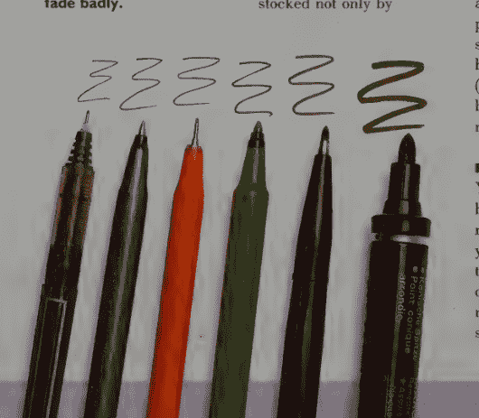

### 其他有用物品

不需要画架，但绘画时通常需要某种东西来支撑你的画板。在室内绘画时，你可以使用椅背；如果你已经有画架，可以用它以类似的方式支撑画板。

- 橡皮擦——虽然我经常会建议你不要使用它，但一个塑料通用橡皮擦还是很有用的。
- 一把快刀——可以是像美工刀那样带可更换刀片的，或者是带折断刀片的。刀既可以用来裁剪纸张，也可以用来削铅笔。或者，后者可以使用铅笔削笔刀。
- 调色盘——可以是专门的艺术家瓷制（或塑料）调色盘，但普通的碟子也可以。碟子用于稀释墨水以制作绘画用的淡彩（`washes`）。
- 如果你要裁剪纸张，金属直尺是必要的。
- 一个笔记本——虽然不是必需的，但对于记录你的问题和进展很有帮助。
- 水杯和抹布或纸巾，用于清洗画笔和 general 清理。

▼▶ 如果你打算进行任何墨彩画（`ink and wash`）工作，你需要一个调色盘和一个水杯。在室内工作时，果酱罐就很好，但带盖的防溢水杯在户外绘画时非常有帮助。

▼▶ 橡皮擦很有用——但不要太依赖它。金属直尺并非必需。

某种用于存放画作的作品集（`portfolio`）——画作需要平放。可以用两张板子（例如装裱板）用遮蔽胶带铰接起来做一个简单的文件夹。

▲ 你的工具包中应包含一把用于裁剪纸张和削铅笔的刀。

◀ 一旦你的画作开始堆积，你就需要某种作品集。

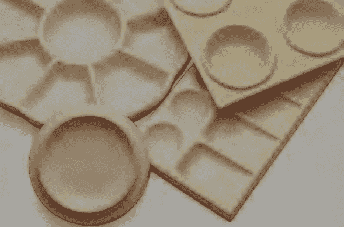

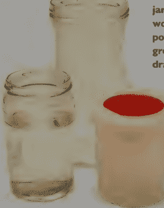

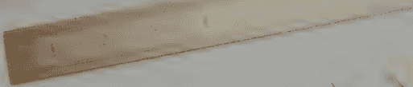

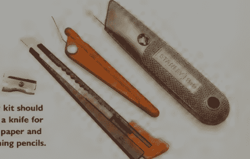

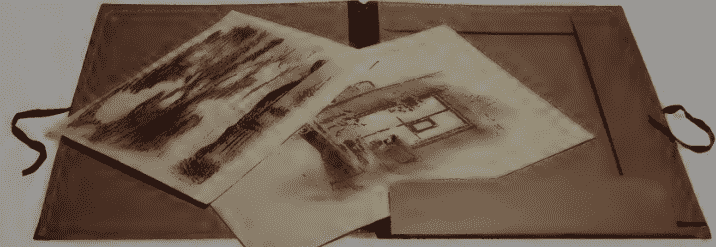

| 进一步信息 | |
|---|---|
| 202 | 墨水绘画技巧 |
| 210 | 混合媒介技巧 |

## 材料与痕迹

在本部分的课程中，你将使用第 12 页描述的单色绘画媒介来转化你所看到的景象。然而，在你开始记录视觉体验之前，你需要熟悉将要使用的材料，并熟悉用它们可以制造的痕迹。因此，在第一课中，我不会要求你对着物体绘画，也不会要求你凭记忆绘画。这些项目仅关注于发现你的绘画媒介能够做什么。不过，你会发现的一件事是，它们会在几乎不需要你努力的情况下，偶然在纸上创造出某些形状。

#### 项目目标

- 尝试你的绘画材料
- 探索你可以产生的各种可能的痕迹
- 观察是否偶然创造出可辨认的效果

### 你需要准备什么

你需要所有的绘画材料、画板、至少五张白色绘画纸以及用于将纸固定在板上的夹子或胶带。稀释绘画墨水需要蒸馏水，固定炭笔需要喷雾定画液。你还需要一根长度约等于棒针的细木棍。一根相当直的细枝即可。

### 时间

这三个项目总共应该花费你大约 2 小时。不过，你可能需要更多时间来重复其中一些项目，并在继续下一个项目之前理解其目的。

## 偶然绘画

超现实主义艺术家告诉我们，潜意识在艺术中起着非常重要的作用。大多数人都曾在纸上漫无目的地涂鸦，并注意到几笔偶然的线条可以暗示某些东西，比如一只鸟或一朵花。艺术家在绘画时会寻找这种偶然效果，并尝试利用它们。

我们通常认为超现实主义是 20 世纪的一种艺术形式，但事实上它有着悠久的历史。15 世纪的希罗尼穆斯·博斯（Hieronymus Bosch，约 1450–1516）和 18、19 世纪的弗朗西斯科·戈雅（Francisco de Goya，1746–1828）等艺术家都表达过诡谲和幻想的事物。在 20 世纪，两位超现实主义领军人物——勒内·马格里特（René Magritte，1898–1967）和萨尔瓦多·达利（Salvador Dalí，1904–89）的作品已为大多数人所熟知，即使不是通过原作，也是通过广告中对这些作品的改编。

## 项目 1：绘画媒介实验

将你的材料摆放在桌子或类似的表面上。在这个项目中，你可以将画板平放在桌子上工作。将一张 A2 纸固定在画板上，然后依次使用你拥有的所有媒介在其上绘画。

不要试图画任何具体的东西，而是让自己完全沉浸在每种媒介产生的线条、点和阴影种类中。发挥你的想象力，至少花三十分钟尝试你能想到的每一种用绘画媒介制造痕迹的方法。这有点像练习书法。一旦你对每种媒介能做什么感到自信，你就能够开始使用它们来描述你所看到的景象了。

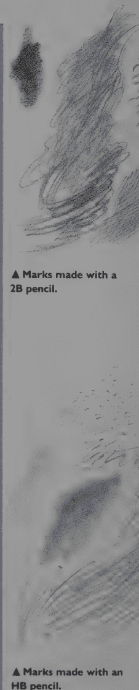

**黑、白、红、棕色孔特蜡笔。** 白色部分叠画在黑色和棕色之上。

**圆珠笔（biro），** 一种出人意料地具有亲和力的绘画工具。

**带有细笔尖的蘸水笔和中国墨水。**

**用布抹开并用手指揉擦的炭笔。**

**画笔和印度墨水。** 在底部，墨水经过稀释，并在仍处于湿润状态时在其上绘制了一些线条。

**细尖纤维笔。**

| 页码 | 主题 |
| :--- | :--- |
| 180 | 铅笔与彩色铅笔 |
| 196 | 炭笔与孔特蜡笔 |
| 202 | 墨水绘画技巧 |

## 项目 2：自动绘画

为了辅助释放潜意识，超现实主义者开发了“自动绘画”的实践。他们认为，如果你让你的手和手臂自由移动，而不受意识控制，你将画出潜意识中的内容。在许多不自称超现实主义者的艺术家的作品中，也能看到一定程度的自动标记。例如，观察巴勃罗·毕加索（Pablo Picasso, 1881-1973）或亨利·马蒂斯（Henri Matisse, 1869-1954）的绘画复制品，看看你认为哪些线条是由艺术家手臂的自动挥洒而成的。

使用一张新纸，尝试进行你自己的自动绘画。首先，使用任何或所有你的绘画介质，在纸上纵向或横向地挥洒线条，让你的手和手臂自由移动。接着，想象一棵树的叶簇，然后尝试用自由绘制的线条来描述它。不要试图去“画一棵树”。让你的手由冲动引导，由脑海中浮现的想象中的叶簇形态来驱动。结果可能像右侧的这幅画，但也可能完全不同。

然后，想象一个从远处看到的城镇并尝试将其画出来。在绘画时，除非绝对必要，否则不要将绘画工具离开纸面。尽可能用一条连续且不中断的线来绘制。尽快描述城镇的特征，不要停下来查看进展如何。然后再次绘制一个你想象中的城镇远景，但这一次在绘画时请闭上眼睛。

- 线条由炭笔、蘸水笔与墨水以及铅笔绘制，叶簇则由炭笔绘制。使用不同介质进行“涂鸦”是积累经验的极佳方式。
- 用蘸水笔和墨水以一条连续线绘制的想象城镇。

以同样方式绘制的想象城镇远景。

这次城镇是在闭眼状态下绘制的。由于使用蘸水笔不切实际，因此使用了圆珠笔。

从木棍滴下的印度墨水斑点，通过用同一根木棍添加线条，被演变成了一幅风景画。

## 项目 3：斑点绘画

现在人们公认偶然效果可以是绘画的一个重要特征，但这并非新发现。200多年前，英国画家兼卓越的绘画大师亚历山大·考恩斯（Alexander Cozens, 1717-86）从15世纪艺术家列奥纳多·达·芬奇（Leonardo da Vinci, 1452-1519）那里获得灵感，并将其发展成一种创作风景画的方法。这个想法很简单：将墨水斑点滴在纸上，然后从这些随机的标记中演化出风景。考恩斯的系统在他 1785/6 年出版的著作 *《辅助创作原创风景画的新发明方法》* (*New Method of Assisting the Invention in Drawing Original Compositions of Landscape*) 中进行了阐述。

在一张新纸上，尝试先用木棍滴墨水，然后用笔和画笔滴墨水。仔细观察斑点群，看看它们的偶然排列是否给你某种启发。你可能会将这些标记看作乌云、植物、一张脸或可能是人物。让你的想象力自由驰骋，一旦斑点给了你某种启发，尝试使用更多斑点或用笔/画笔绘制的墨线来发展这个图像，使想象的主题变得更清晰。然后再次尝试实验，但这次先用清水打湿准备滴斑点的纸张区域。

滴在湿纸上的斑点会形成有趣的图案，这些图案可能会启发一个主题。

#### 自我评析

- 你是否使用了所有的绘画介质，并产生了所有你认为可能的效果？
- 你现在对使用所有绘画介质是否感到相当自信？
- 你是否更偏好某种介质而非另一种？

| 页码 | 主题 |
| :--- | :--- |
| 122 | 表现主义绘画 |
| 196 | 炭笔与孔特蜡笔 |
| 202 | 墨水绘画技巧 |

**基础课程 19**

## 第一课

**约翰·豪瑟 (John Houser)**

*画笔与墨水*

在这幅肖像画中，墨水既以原强度使用，也经过稀释。深色背景使用了干刷法，使侧脸轮廓更加突出。画笔是一种非常灵敏的绘画工具，在这里被熟练且自信地运用。

**大卫·卡帕宁尼 (David Carpanini)**

*炭笔*

在这幅极具戏剧性和氛围感的矿区风景画《南温德》(South Winder) 中，几乎没有线条；炭笔侧锋被用来构建深色区域，并在部分地方进行揉擦以创造柔和效果。对于此类绘画，通常需要在不同阶段使用喷雾定画液，以便使炭笔能够厚重地堆叠。

**约翰·埃利奥特 (John Elliott)**

*钢笔与墨水*

这幅肖像画笔触自由，阴影采用了松散的涂抹，提供了关于模特令人惊讶的丰富信息。艺术家可能需要舍弃许多画作，才能创作出如此自然且毫不费力的作品。

**卡罗尔·卡琴 (Carole Katchen)**

*粉彩与墨水*

这幅名为《小提琴手》的画作创作速度极快，整个构图仅由几块用粉彩棒侧面绘制的阴影区域以及一些钢笔线条点缀而成。

通过捕捉人物最显著的特征并避免不必要的细节，艺术家有力地暗示了音乐家在表演中的状态。

#### 进一步信息

| 页码 | 主题 |
| :--- | :--- |
| 160 | 绘制肖像 |
| 206 | 画笔绘画 |
| 196 | 炭笔与孔特蜡笔 |

## 不同的观察方式

本绘画课程强调的是“观察”，因此当你继续阅读时，会发现接下来的涉及绘制物体的项目主要关注观察而非技巧，这并不奇怪。乍一看，这三个项目似乎仅适用于绝对初学者，但事实并非如此。经验丰富的艺术家也可以一次又一次地回到这些项目，从而开阔视野，摆脱预设的观察方式。

### 观察的方式

观察同一个物体 undoubtedly 存在不同的方式。马蒂斯说，当他看一个番茄时，他看到的和任何人看到的一样，但当他画它时，他看到的就不同了。在本课中，你将开始理解他的意思。

你决定如何绘画，是决定你如何观察物体的因素之一。例如，如果你说“我要画一幅线条画”，你会非常仔细地观察物体的轮廓形状，而不太关注它的明暗。然而，如果你决定创作一幅没有线条的画，那么物体的明暗就变得重要了。接下来的项目都要求你绘制线条画，但你会发现，你不仅仅是在观察轮廓。

### 绘画时的位置摆放

一旦你开始绘制实际物体，你的位置以及画板的位置就变得重要了。回顾第 12 页，你会看到一张艺术家将画板支撑在椅子上绘画的插图。注意，画板支撑在他的膝盖上，因此几乎是垂直的，而他坐得较远，绘图臂充分伸展。他透过画板的左侧观察主体。

为了轻松且流畅地绘画，你必须……

#### 项目目标

- 以不同方式观察物体
- 识别物体的特征
- 培养运用线条的技巧

#### 所需材料

- 铅笔、钢笔、炭笔、孔特蜡笔。
- 几张至少 A3 尺寸的纸。

### 时间

每个项目 1 和 2 应至少花费 1 小时，项目 3 至少花费 2 小时。

### 项目 1：轮廓绘画

你的第一幅画的主题可以是任何不过于大或过于复杂的东西。我建议一对鞋、一对手套，或者一个茶杯、茶托和盘子。将它们放在离你方便距离的桌子上，并确保你和画板处于正确的绘画位置。

选择任何适合绘制线条画的介质，然后将眼睛固定在其中一个物体轮廓形状的某个特定点上，并将铅笔（或其他工具）的笔尖落在纸上。纸上的点必须与你在主体上观察的点相对应。现在你将开始在不看纸的情况下绘画。非常缓慢地让眼睛沿着物体的轮廓形状摸索——不要看纸——并且同样缓慢且深思熟虑地，配合眼睛的节奏，让你的手描述你所看到的内容。

如果你的手和眼睛失去了同步，请将铅笔重新定位在画作的某个特定点上，将眼睛固定在主体轮廓的相同点上，然后继续。不要擦除任何线条。一直画到你完成了主体的完整轮廓，然后才看你的画。

如果你真正遵循了轮廓，你的画将不仅仅是一个剪影，因为在某些地方，你的眼睛会被引导到轮廓形状内部去描述（例如杯子的边缘），然后才重新回到剪影形状。

产生一幅看起来正确的画可能需要一些时间。你的第一幅画可能看起来一点也不像主体，但这没关系。学会用眼睛去“感觉”才是最重要的。

#### KAY GALLWEY

1. 艺术家正在感受其中一只鞋子的轮廓，用一支 conté 蜡笔的锐利边缘，沿着物体的边缘进行绘制。
2. 第二只鞋子被引入到画作中。线条保持连续，除非方向发生改变。
3. 绘画继续，第二只鞋子的轮廓引导回第一只鞋子。
4. 最终的画作极好地展现了鞋子的形态，尽管它是快速且毫不犹豫地完成的。艺术家还通过绘制鞋子所放置的纸张轮廓，将其与下方的平面联系起来。

| 页码 | 章节 |
| :--- | :--- |
| 56 | 另外两种观察方式 |
| 196 | 木炭与 conté 蜡笔 |

### 项目 2：内在力量

绘制物体的轮廓只是描述物体的一种方式。另一种方式是观察轮廓内部，看看是否能识别出某些特定的特征。在绘制静止人物时，艺术家经常提到“动势”（movement），其含义是即使一个人完全静止，依然可以识别出一种运动感。人物可能是瘫在椅子上，或者站立着向上伸展。在本课程的后续部分，你将研究人物中包含的动势，但并非只有人物才具有这些内在的动态特质。在人物身上，这些特质比在椅子、桌子、花瓶、瓶子、杯碟中更明显，但它们确实存在。一张桌子或一把椅子有一种重量将其压在地面上的感觉，甚至一个丢在谷仓角落的麻袋也会因为内部物品的特性而鼓起。

选择一个看起来沉重或具有某种内在张力的物体来绘制。你可以将物体悬挂在挂钩上，观察它在自身重量下是如何下垂的；或者选择一袋胡萝卜或土豆，它们因内部物品而呈现出特定的外观。然后，我希望你通过绘画来描述这些内在力量。这些画作不应该是描述物体的外部外观，而应该展示主体的特定内在特征。

当你的线条描述其动势时，有时你会画到物体的中心，有时为了给画作赋予真实的动态，你最终可能会完全画到物体之外。请绝对自由地绘制，最重要的是不要遵循物体的轮廓，因为那样无法描述内在力量。

仅使用线条绘制，并使用与上一个项目不同的媒介。快速绘制，使用连续线条，笔触不要离开纸面，不过这次你可以在绘画时看向纸面。让你的绘画工具快速穿梭，描述物体看起来是如何扭曲、冲撞或下坠的。让手的动作去描述物体中的动势。

#### KAREN RANEY

- **1** ◀ 塑料袋里的水果是一个绝佳的素材。艺术家使用细纤维笔，开始绘制物体悬挂的方式——它们的重量和向下的力量。
- **2** ◀ 描述水果向下冲力的“方向线”，由一系列细腻且果断的线条组成。
- **3** ▶ 完成的画作给人一种悬挂重量的感觉，而没有遵循水果或袋子的轮廓。艺术家让手随物体隐含的动势而移动。这赋予了画作一种动态品质，描述的是主体的内在力量而非外部外观。

### 项目 3：外部与内部

人们在开始学习绘画时，往往倾向于专注于轮廓而忽略内部发生的情况。在这个项目中，我希望你不仅考虑物体的“边缘”，还要考虑边缘之间发生了什么。你需要一个基本的圆柱形物体，可以垂直或水平放置；类似于画中夹克的袖子是最理想的。袖子内部填充了纸张使其变圆，从而使织物的褶皱像不规则的波纹一样环绕在手臂周围。

类似的素材可以用一条裤子来完成，但物体不一定得是衣物。带有条纹图案的花瓶、一段木头或几个叠在一起的杯子都会很出色。需要的是一组从管状形式边缘向内延伸的实线。

#### IAN SIMPSON

- **1.** 使用一支黑色细纤维笔来追踪这件夹子上的褶皱。这些线条描述的是衣物的横截面，而不仅仅是其轮廓形状。
- **2.** 夹子褶皱的起伏绘制方式，与描述风景中的山丘和低谷非常相似。非常重要的一点是，在绘画时，你要意识到物体的“中间”部分与它的边缘同样重要。

用线条绘制，使用一个你在本课中尚未用过的媒介。让你的眼睛跟随条纹或褶皱在所绘形体上的延伸，并用线条描述你所见。如果你在画一件衣服，你会发现其边缘并没有一个连续的轮廓线。线条经常会向内转折以描述褶皱（例如），在此过程中，它可能会提供物体准确的横截面。

环绕形体的线条对于使物体呈现三维感非常重要。在绘画课上，学生经常被告知必须学习“横跨形体”地绘制，而不仅仅停留在边缘。这个项目应当迫使你这样做。

#### 自我评析

- 在项目 1 和 2 中完成的绘画是否帮助你在项目 3 中创作出了令人信服的画作？
- 你是否开始知道在绘画时应该观察什么？
- 你的绘画是否变得更加自由和流畅？
- 你是否在写生簿上坚持定期绘画？

| 更多信息 | 页码 |
| :--- | :--- |
| 基础绘画材料 | 12 |
| 另外两种观察方式 | 56 |
| 水墨绘画技巧 | 202 |

## 第二课

保持舒适，能够自由地移动手臂和手腕。你应该能够以最快的时间将视线从物体转移到画板上。你的画板必须尽可能接近垂直，这样你才能看到画作的真实样子。如果画板是水平的，你会看到扭曲的画作视角。

所有这些点看似显而易见，但令人惊讶的是，许多学生因为没有考虑到这些而使绘画变成了一项几乎不可能完成的任务。令人惊叹的是，即使在视线从物体转移到画板的瞬间，你也会忘记很多看到的东西，但看到学生试图绘制几乎就在他们身后的物体并不罕见。许多人还将画板平放在膝盖上，并惊讶地发现，为了补偿画作的透视缩短（foreshortened view），他们将物体拉长了。

### Barbara Walton

综合媒介

无论你的经验水平如何，你都可以尝试在同一幅画中使用多种媒介。在《黑瓶中的百合》中，艺术家结合了木炭、粉彩和少量的丙烯，创作出一幅整合度高且具有强烈动势感的画作。

### Paul Bartlett

油画棒

在《椅子》中，通过将软垫家具独特的图案和纹理作为一系列轮廓线来构建形体，绘制了一幅软垫家具的特写图。

## 开始建立速写本

从现在起，除了本书要求你完成的各项项目外，还有一个重要的学习过程需要你主动开展。你现在必须开始以全新的眼光审视一切，并绘制任何以及所有事物。这些画作应记录在你的速写本中，它们将成为你探索视觉世界的记录，同时让你看到自己的绘画技巧如何逐渐变得更加自信、流畅且具有个人风格。

你的目标应该是每天绘画，即使只有三四分钟。快速绘画非常重要，因为你必须迅速概括主体并画出看似重要的部分。随着课程的推进，你会发现这种决策的重要性，而且你练习得越多，这项技能发展得就越快。

在这个阶段，我不希望你担心在速写本中如何绘画；随着你掌握新技能并发现新策略，你的画作自然会提高。重要的是，在执行各项课程项目之余，你要尽可能多地练习绘画。只有当你亲身经历过书中所阐述的观点时，才能真正理解这本书。绘画最终是通过练习习得的，而速写本允许你尝试自己的想法，扩展来自项目的灵感，并绘制那些特别吸引你的事物。

**木炭 (Charcoal)**

木炭是营造宽广效果的理想媒介，在《人体绘画 II》中，它被非常自由地用来描述光线在人体上的嬉戏以及姿势的动态特质。阴影是通过乱涂、排线和涂抹完成的，这种对媒介的强有力运用赋予了画作生命力和活力。

#### 进一步信息

| 页码 | 主题 |
| :--- | :--- |
| 110 | 裸体绘画 |
| 186 | 柔和粉彩与油粉彩 |
| 196 | 木炭与孔特蜡笔 |
| 210 | 混合媒介技术 |

## 基础课程

### 绘制二维空间

当你绘制物体的形状时，你只需要考虑两个维度：高度和宽度，但要画出准确的轮廓线并不总是那么容易。在本课中，你将学习如何将物体的形状与背景联系起来，首先是通过在方格网格上绘画，然后利用背景特征来校验形状。

#### 项目目标

将物体与其背景相结合

- 学习准确地观察

如果你的画作起初不够完全准确，不要失望。能够清晰地观察形状并将其良好地绘制出来需要专注和练习。有些人认为他们应该能够坐在物体前，铅笔就那样自然地流出线条，自动将形状描绘在纸上，但这只是一个幻想。有些人可能比其他人更有绘画天赋，但最重要的是训练自己的观察力。当你开始注意到物体的实际形状与画中形状之间的差异时，你就在学习绘画了。

本课的项目将使你意识到，在绘画时比较形状和方向是多么重要。通常人们孤立地看待物体；例如，看待风景时，先看到一棵树，然后是另一棵，最后才是背景。在学习同时观察并比较所有这些特征的过程中，你正在学习像艺术家那样观察。

### 你需要准备的材料

- 你的绘图板
- 三张绘图纸（或两张纸和一张白卡纸）
- 一把直尺
- 一支 B 或 2B 铅笔和一支笔

### 时间

每个项目约 1½ 小时

### 项目 1：将物体与网格相结合

你将绘制一个水壶、茶壶或类似物品的剪影形状。选择一个带有把手、壶嘴和其他凸起部分的物体，使其具有有趣的形状。你的画作将绘制在一个方格网格上，同时在物体后面放置另一个相同的网格，因此请先绘制网格。在每张纸的侧边以 1½ 英寸为间隔标记点，然后使用直尺或直边将它们连接起来。如果你没有方便的墙壁来固定放置在物体后面的网格，你可能需要将其画在卡纸上并将其撑起来。它必须绝对垂直，不能有角度倾斜。将物体放在桌子上，距离网格不超过 2 英寸，定位在你能获得最佳视角的位置，并清晰地看到把手或其他凸起部分。仅用线条绘制物体的形状，不断检查以确保水壶与你纸上的网格的关系，与它与背后网格的关系完全一致。

你可以从剪影上的任何点开始绘画。检查这个特定点相对于背景方格的位置，并确保你在绘图纸的方格中在完全相同的位置开始。继续根据网格绘制水壶的形状。如果线条画错了位置，不要擦除；反复绘制形状，直到它尽可能准确。然后花几分钟将你的画作与实际物体的视觉效果进行比较。

在绘画课上，学生经常被建议将铅笔垂直持有作为辅助工具，或者将铅笔手臂伸直持有以测量两个形状的不同尺寸。根据我的经验，这些方法并不可靠，我建议你在物体之间进行比较，观察它们如何相互关联以及如何与背景关联。这种绘画习惯可能需要一段时间来养成，但一旦你习得，你就能自动地以这种方式绘画。

**约翰·汤恩德 (JOHN TOWNEND)**

1. 艺术家使用黑色纤维笔，仔细地绘制盖子的形状，并对照背景网格的方格进行检查。

2. 在展开绘画时，他继续对照背景方格检查形状。

3. 重要的一点是不要以任何方式改变你的视角，因为这会改变物体与网格的关系。

4. 因为这位艺术家是一名经验丰富的绘图员，他能够无需修改地完成绘画。学生几乎肯定需要多次尝试才能产生准确的画作。如果你必须进行一些修正，不要擦掉早期的线条。

#### 自我评价

- 你是否发现很难决定物体相对于绘图纸上方格的准确位置？

- 你是否发现了关于该物体的某些出乎意料之处？例如，它的形状是否完全对称？

- 在 1-10 分的量表上，你会给你的画作准确度打几分？

- 你是否发现自己过于专注地绘制一个物体，而忽略了它与所有其他事物的关系？

#### 进一步信息

| 页码 | 主题 |
| :--- | :--- |
| 12 | 基础绘画材料 |
| 64 | 透视法 |
| 70 | 透视法的运用 |

## 第三课

### 项目 2：将物体与其背景相结合

显然，你无法将所有想要绘制的东西都安排在有网格的背景前。在实践中，你必须最大限度地利用背景，并尽可能地将物体与背景联系起来，以便准确地观察它们。请记住，背景与物体本身一样重要。在这个项目中，我想让你绘制两个具有有趣剪影的物体——其中一个可以用你在上一个项目中使用过的，另一个是类似的，也许是一个浇水壶或花瓶。

将这两个物体紧凑地摆放在桌子上，要么改变你的绘画位置，要么移动桌子，以便你看到的不仅是物体后面一面无图案的墙。如果墙上有明确的图案，那将是一个极佳的背景；如果没有，试着安排一下，让窗框或窗帘的褶皱出现在两个物体后面。如果这不容易安排，你可以在物体后面放置一些扁平简单的东西——比如几本书靠在墙上。如果你愿意，可以将物体放在有图案的桌布上，或者将每个物体放在餐垫或书本上。

这一次，使用铅笔或木炭绘画，仍然仅用线条。仅绘制物体的剪影形状，但不要孤立地绘制它们。像上一个项目那样将它们与背景联系起来。这一次你必须寻找网格的替代品，因此在开始绘画之前，仔细观察你可以使用什么作为参照。例如，窗框会形成垂直线，可以通过这些线来评估水壶和茶壶的曲线；而有图案的桌布则提供了可识别的形状，用于比较两个物体的底部。

从你自信能画对的部分开始。任何水平线和垂直线都是很好的起点，因为它们只需要绘制与纸张边缘平行的直线。它们在绘画中至关重要，因为它们为你提供了可以用来测量角度的即时参照。反复绘制物体和背景，直到你觉得它们在画中的契合度达到了你能实现的最高准确度。

**约翰·汤恩德 (JOHN TOWNEND)**

1. 这一次艺术家使用木炭，但与之前项目一样，他仅用线条绘制。在绘画过程中，他对照背景图案检查形状。你可以看到已经出现了一些必要的修正线。

2. 随着其他物体的加入，画作逐渐展开。

3 ◄ 仔细关注壶嘴的形状与背景布花纹之间的关系。

4 ▲ 所有物体现在都已标出，形状之间以及形状与背景之间都经过了校验。

5 ▲ 在绘制一组物体时，观察“负空间”形状（即物体之间的空间）会很有帮助（见第 56 页）。在这里，负空间形状和正空间形状都得到了良好的观察。

#### 自我评价

- 这幅画是否比上一幅更准确？

- 你是否成功地将物体相互关联，并将其与背景联系起来？

#### 进一步信息

| 页码 | 主题 |
| --- | --- |
| 56 | 空间绘制 |
| 196 | 木炭笔与孔特蜡笔 |

## 第三课

▲ John Houser

铅笔

小提琴的四个不同视角为艺术家提供了令人兴奋的微妙曲线形状关系。这里没有尝试进行阴影处理，因为这可能会破坏整体效果。

► Olwen Tarrant

木炭铅笔

艺术家在这些画作中仅使用了线条，但人物看起来依然具有令人信服的立体感，因为她在人物身上运用了向内的轮廓线。注意肩膀和背部重叠的线条是如何营造出三维形式感的。

### Carole Katchen

**钢笔与墨水**

与绘制小提琴一样，艺术家主要关注形状之间的关系，并通过排列它们来创造优雅的构图。即便如此，她仍然通过追踪人物的轮廓线来描述形式。在这里，服装——帽子、围巾和夹克的下摆——提供了关于三维形式的视觉线索。

### Kay Gallwey

**粉彩**

这里同样仅使用了线条，用黑色粉彩棒的尖端果断地勾勒而出。令人惊讶的是，通过线条粗细和方向的微妙变化，可以传达如此多的形式感。

| 进一步信息 | |
| :--- | :--- |
| 32 | 轮廓绘制 |
| 180 | 铅笔与彩色铅笔 |
| 188 | 粉彩与油画粉彩 |
| 202 | 墨水绘图技巧 |

## 第四课：绘制三维空间

你在上一课中创作的画作仅关注形状的轮廓，但绘画真正神奇之处在于它能够在二维的纸面上创造出三维——高度、宽度和深度——的错觉。在这里，你将尝试使用阴影，这是使物体看起来具有立体感的基本方法之一。

### 光线与形式

形式是由落在物体上的光线创造的，因此当你想要绘制像苹果这样坚实、圆润的物体时，首先要观察它被照亮的方式，这样你才能使用阴影来描述光影。同时寻找任何有助于描述其立体感的照明效果。例如，如果苹果有柄且光线从左上方射入，绘制果柄投下的阴影将有助于描述苹果顶部的凹陷。处于阴影中的苹果右侧将比左侧暗，但如果它放在浅色表面上，你可能会看到一条细小的光线沿着这个暗边延伸。这通常被称为“反光”，是由桌面反弹回苹果上的光线。你不一定非要画出反光，但它在描述形式开始弯曲远离的地方时非常有用。

### 阴影与轮廓

苹果正下方可能会有一个深色的阴影，但处理时要谨慎；如果你在画中将其处理为一个非常深的标记，几乎肯定会破坏立体感。这是因为该标记会强调轮廓（或水果的外形），而这实际上是水果离你最远的部分，其曲率在视野中消失。要使圆润的形式看起来真正立体，你需要将重点放在物体最近的部分。绘画中的阴影有时有助于描述桌面的平坦度，或防止物体看起来像漂浮在空间中，但它们并不总是有效，因为它们经常会掩盖或模糊物体。

#### 项目目标

- 通过光影描述物体的形式
- 选择最重要的照明效果
- 使用不同的阴影处理方法
- 绘制圆润的形状和凹陷

### 你需要准备的材料

- 铅笔、钢笔、木炭笔和孔特蜡笔。用于绘制水洗效果的墨水和画笔、调色板和水。两张 A2 纸。

### 时间

- 项目 1：约 1½ 小时
- 项目 2：2 小时

### 项目 1：圆润的形式

我想让你绘制一组水果，例如两三个苹果和一个或两个梨，或者一些橙子和柠檬。苹果和梨是最好的选择，因为你需要表面相当光滑的物体，否则你会被纹理分心，而纹理并不是本次练习的重点。将水果放在简单的浅色表面上，如一张白纸。只要能清楚地看到所有水果，不必担心它们的位置。最重要的是光线，因为光线描述了形式。这组物体只需要从一侧照亮，所以如果你在白天绘画，可能需要将桌子移到窗边。如果你在晚上工作，可以使用台灯作为光源。选择一个能让你看到水果顶部的绘画位置，使用软铅笔、木炭笔或孔特蜡笔，尽可能地将它们画大，仔细注意光线落下的方式，并尝试识别每个水果最暗和最亮区域。不要仅仅因为能看到某些东西就全部画上去；集中精力只画那些能让物体看起来立体的部分。时不时地批判性地审视你的画作，看看水果是否具有三维感。一个常见的错误是将轮廓画得太强，这会破坏阴影效果；另一个错误是将物体下方的阴影画得太深。这是一个非常重要的课题，你会发现对同一组物体进行多次绘画是有价值的，尝试改变光线方向，并实验不同的媒介和阴影方法。例如，如果你在第一幅画中使用了木炭，那么在另一幅画中可以尝试墨水洗染。或者如果你觉得木炭太软、难以控制，可以尝试铅笔，使用排线法（`hatching`）和交叉排线法（`crosshatching`）进行阴影处理。

#### IAN SIMPSON

▲ 首先用孔特蜡笔轻快地勾勒出水果和盘子的形状。艺术家现在开始使用阴影来标示光线的方向，光线从上方射入。

▶ 通过识别最亮和最暗的区域来描述水果的形式。注意艺术家在同时推进整幅画，而不是只集中在一个物体上。

◀ 现在在背景中引入了深褐色的孔特蜡笔，以强调水果最近的部分。虽然水果上的轮廓线相当深，但阴影足够强，使物体显得立体。艺术家只画了他认为重要的部分；例如，物体投下的阴影被忽略了。

| 页码 | 主题 |
| --- | --- |
| 12 | 基础绘画材料 |
| 196 | 木炭笔与孔特蜡笔 |
| 180 | 铅笔与彩色铅笔 |

#### ELIZABETH MOORE

1 ▶ 在这幅铅笔画中，阴影从一开始就被视为重点。在确立盘中水果形状的同时，艺术家还将这些物体与桌子的近边、边缘以及水果盘下的布料联系起来。

2 ▶ 在这幅画中，光线从右侧射入，艺术家现在通过叠加阴影来描述水果的暗部。

3 ▶ 这个特写细节揭示了艺术家如何仔细地描述苹果顶部的凹陷以及梨子表面微妙的起伏。阴影是由自由地涂抹的线条组成的，这赋予了画作生命力。

#### 自我评价

- 水果是否能看起来更立体、更具三维感？
- 你是否过多地关注了轮廓形状？
- 你是否因为绘制阴影而使画面变得混乱？
- 使用不同的绘画媒介是否会让你更满意？

4 ▶ 在创作过程中，艺术家对主题中不同种类的三维形式产生了浓厚兴趣。她使用线条和阴影来描述桌子坚硬锐利的边缘、水果圆润光滑的形式以及盘下布料柔软褶皱的形式。

当你开始绘画时，请记住这个形体中哪一部分距离你最近，并确保你的画作能体现出这一点。牢记上次绘画中出现的所有错误，并尽最大努力在这次绘画中予以纠正。经常停下来检查，确保你的画作能恰当地呈现出凹面和凸面的形体。

#### 自我评析

- 对比你在本节课中完成的所有画作。
- 是否某些画作中的物体看起来比其他画作更具说服力？你知道原因吗？
- 你是否发现投影很有用，或者它们倾向于掩盖物体？
- 除了其他绘画媒介外，你是否使用了渲染（`wash`）？
- 你是否很好地观察了阴影和反射光？

### 项目 2：凸面与凹面形体

本项目是上一个项目的延伸，但增加了一个最重要的额外特性——绘制空洞的问题。同样，你需要一组表面光滑的物体，但不一定非要是水果。一组理想的物体可以用鸡蛋和乒乓球组成。无论你选择什么，至少必须有两个凸面形体和两个凹面形体，因此鸡蛋特别合适，因为你可以将其掰成两半。蛋壳的两片将提供绝佳的空洞练习素材（而蛋液可以用来烹饪）。同样地，乒乓球也可以被切成两半。

如果你在之前的项目中使用了多种不同媒介进行了绘画，那么在这个项目中，请选择让你感觉最舒心的那种媒介。将物体放置在一起，以便你能全部看到，并将其中一个凸面形体放置在比其他任何东西都近的位置。

#### 伊丽莎白·摩尔 (ELIZABETH MOORE)

1. 考虑到该主题的细腻程度，选择了铅笔作为合适的媒介。左侧凹面形体与右侧凸面形体之间的对比，是通过破碎鸡蛋空洞内部的阴影来暗示的。

2. 注意艺术家如何强调破碎蛋壳的锯齿状边缘，以使它们产生凸出感。她还利用了反射光和破碎鸡蛋下方的阴影来增强立体效果。

3. 光线来自左侧，但艺术家关注的重点不在于光线的方向，而在于描述光线照亮凸面和凹面形体的方式。

| 页码 | 主题 |
| :--- | :--- |
| 12 | 基础绘画材料 |
| 196 | 木炭与孔泰蜡笔 |
| 181 | 排线与交叉排线 |

## 第四课

**罗伊·弗里尔 (Roy Freer)**

**木炭**

在这幅名为 *Still Life, Flatford* 的画作中，木炭被既自由又扎实地运用，赋予了强烈的光感和深度感。虽然房间里的物体被暗示了出来，但并没有进行任何细节描写，而是被简化成了近乎抽象的形状和形体。该媒介以多种方式被使用——排线、自由的交叉排线和涂抹都清晰可见，而一些白色形状是通过将橡皮擦作为绘画工具来“提起”这些亮区而创造的。（此技巧在第 193 页有演示。）在描写与抽象的边缘工作是很困难的；许多人发现自己无法避免陷入描写细节中，而这往往会削弱这幅画所极好地传达的光影和图案效果。

### 约翰·豪瑟 (John Houser)

**铅笔**

《灯光下的壁球研究》(Squash Studies in Lamplight) 是用 HB 铅笔完成的，通过巧妙的阴影处理和晕染来描述光线、反射光和阴影。

### 布莱恩·耶鲁 (Brian Yale)

**木炭**

相比之下，这里使用了一支非常软的铅笔，采用了精心控制的排线、涂抹和晕染技巧。强烈的明暗对比以及将主体组织成简单形状的做法，使这幅画充满了力量感，且看起来简单得令人惊讶。这种冲击力来自艺术家仅选择了主体的重要特征；体会创作此类画作所需技巧的最佳方式，就是试着想象他可能省略了哪些细节。

### 奥尔文·塔兰特 (Olwen Tarrant)

**木炭**

这里木炭的使用方式与弗里尔的画作（对面页）截然不同。可以看到一定程度的涂抹，但以线条为主，既用于描述某些物体的形状，也用于排线和交叉排线以构建色调区域。这幅画更多地关注单个物体的特征，而非光影效果。

| 进一步信息 | |
| :--- | :--- |
| 12 | 基础绘画材料 |
| 196 | 木炭与孔泰蜡笔 |
| 180 | 铅笔与彩色铅笔 |
| 181 | 排线与交叉排线 |

## 彩色绘画媒介

在绘画（`drawing`）和绘画（`painting`，指油画/水彩等）之间很难划出一条清晰的分界线。传统上，绘画被视为导向另一种媒介完成作品的准备阶段，但至少从 19 世纪末开始，两者之间的区别已经变得模糊。在此之前，绘画——通常是单色的——是根据实物完成的，然后以此发展出绘画作品。

然而，印象派画家通过直接对着主体绘画，以一种崭新且具表现力的方式将两者结合，此后艺术家们可以自由地将颜色作为绘画不可分割的一部分。绘画不再总是被视为达到目的的手段；当然，它可以是，但它也可以是其本身完整的作品。

关于哪些媒介专用于绘画，哪些专用于绘画，并没有固定规则。然而，为了本绘画课程的目的，我不将绘画作品列入彩色绘画媒介中，彩色绘画媒介仅限于色粉笔、马克笔、彩色墨水和彩色铅笔。你不需要购买这里介绍的所有绘画媒介。尝试用颜色绘画将是一次宝贵的体验，但刚开始使用一两种就足够了。

- 软色粉笔（`Soft pastels`），也称为粉笔色粉，可以单独购买或以套装形式购买。

### 色粉笔 (PASTELS)

软色粉笔是由粉末状颜料（所有油漆的基础）和极少量的粘合剂制成的彩色棒。色粉笔可以产生灿烂的色彩效果，使用起来令人兴奋，尽管需要练习才能用好。色粉笔有不同的硬度等级，有些带有纸套或塑料涂层，以保护手指免受颜料污染，因为色粉很容易脱落和摩擦。此外还有色粉铅笔，使用起来更干净，但缺乏“真实”色粉笔的多功能性。色粉棒可以用侧面来铺设大面积的颜色，但用色粉铅笔显然无法做到这一点，而且它们产生的线条通常不如使用传统方形截面色粉棒的边缘那样锐利。色粉笔必须像木炭一样进行定画处理。

- 就柔软度而言，色粉铅笔介于软色粉笔和硬色粉笔之间。

你可以通过在纸上层叠颜色来混合色粉颜色，但它们的混合程度不如油漆那样彻底。色粉画家通常尽可能少地进行混色，而依赖于制造商提供的丰富颜色；某家制造商生产的颜色范围多达 194 种。色粉笔有杂色套装，也有针对特定主题的专用套装，例如 72 色的风景套装或 72 色的肖像套装。如果你想尝试色粉笔，我建议从大约 24 色的杂色套装开始。

- 硬色粉笔可以与其他媒介结合使用，也可以单独使用。

### 马克笔 (MARKERS)

马克笔（在此标题下我将毡尖笔也包含在内）有多种颜色可选。它们具有尖头或楔形笔尖，其含有的颜色分为水基（`water-based`）或酒精基（`spirit-based`）。酒精基颜色倾向于扩散——即“渗出”笔尖绘制的形状之外。它们还倾向于渗透整个纸张，这意味着使用时必须小心，尤其是在速写本中，因为它们可能会损坏前一页的画作。有一些使用特殊纸张制作的马克笔画册，在很大程度上控制了色彩渗出的问题。马克笔颜色的另一个问题是它们在光照下会褪色。

马克笔墨水是透明的，因此你可以通过层叠颜色来混合。这需要练习，但使用马克笔和毡尖笔可以创作出充满活力且色彩灿烂的画作，非常值得尝试。我推荐水基马克笔，建议从深红色、亮红色、蓝色、黄色、亮绿色和黑色开始。

- 马克笔既有细尖（上图），也有宽楔形尖（上图）。它们可以是酒精基或水基的。

| 页码 | 主题 |
| :--- | :--- |
| 44 | 用颜色绘画 |
| 50 | 颜色的创造性使用 |

### 墨水

彩色墨水可以用钢笔、画笔或任何棒状工具使用。虽然颜色范围有限，但对于需要线性构图的彩色绘画来说已经足够。最适合使用的笔是带有可更换笔尖的蘸水笔。

某些彩色墨水（有时被称为液体水彩）是水溶性的，可以根据需要进行稀释、混合或作为洗染（`washes`）使用。其他基于虫胶的墨水（通常称为绘图墨水）可以用蒸馏水稀释。使用防水墨水时，笔和画笔在用后必须仔细清洗，否则墨水会在上面干涸且无法去除。防水墨水绝不能用于任何带有储墨池的笔（如钢笔或技术绘图笔）。

我建议您购买基于虫胶的墨水，它们具有明亮透明的色彩。两种红色（其中一种为深红色）、一种蓝色、一种黄色、一种绿色和黑色，就足以开始彩色墨水绘画了。

> 上述的彩色绘图墨水和（右侧的）“液体丙烯”都可以相互混合并用水稀释。

### 彩色铅笔

彩色铅笔可能是您最熟悉的彩色绘画介质。这些铅笔由包裹在木材中的细色芯组成，其硬度根据类型而有所不同。有些相对较硬，可以削尖以绘制非常锐利的线条。另一些则较软，使用感更像粉彩，但更容易控制。使用彩色铅笔时，可以通过层叠叠加在一定程度上混合颜色，但与粉彩一样，市面上也有大量预混好的颜色可供选择。

> 彩色铅笔的色系非常广泛。不同品牌的颜色一致性有所差异。

还有水溶性彩色铅笔，有时被称为水彩铅笔，可以用干法或湿法使用。如果您用干铅笔在纸上绘画，然后可以用蘸有净水的软刷打湿彩色区域，像水彩一样将其晕染开。如果您愿意，也可以将这些彩色铅笔蘸水直接在纸上使用。

> 水溶性彩色铅笔尤其多功能。它们既可以用干法，也可以用刷子蘸水在绘画的某些区域产生晕染效果。

如果您已经拥有这里介绍的一些绘画介质，请尽管使用；但如果您还没有，我建议在开始彩色绘画时，先买一些彩色铅笔。您需要两种红色（一种深红色）、一种蓝色、一种黄色、一种绿色和黑色，或者您可以买一套多种颜色的套装。

## 其他彩色绘画介质

上述介质并非唯一可用于彩色绘画的工具。其他主要的介质包括彩色粉笔（与粉彩相似，但颜色范围远没有那么广）和油画粉彩。油画粉彩是类似于软粉彩的色棒，但用油结合，有时还加入了蜡，使其质地柔软且油腻。如果运用得当，它们可以产生类似于油画的效果，而且因为不会掉粉，大多数人发现它们比软粉彩更容易控制。与"真正"的粉彩相比，可用颜色范围有限，但其蜡质特性使得颜色在纸上更容易混合。

> 油画粉彩与软粉彩和彩色铅笔一样，也可以成盒购买或单独购买。

## 彩色绘画用纸

这里描述的所有介质都可以在绘图纸上使用。与所有墨水一样，彩色绘图墨水最适合光滑的纸张，而粉彩和彩色粉笔（像炭笔一样）可以利用较粗糙纸张的纹理。有一些特制的纸张（如炭笔纸和 `Mi-Teintes` 纸）专门用于粉彩绘画，它们具有独特的纹理，并且有多种颜色可选，以便选择与主题相匹配的纸张颜色。这种颜色随后可以融入到画作中，从而避免费力地用粉彩阴影覆盖整张纸。

> 彩色纸几乎总是用于粉彩画，有时也用于彩色铅笔画，但只要不过分突兀，一些单色画也能从彩色背景中获益。

| 页码 | 主题 |
| :--- | :--- |
| 188 | 粉彩与油画粉彩 |
| 180 | 铅笔与彩色铅笔 |
| 202 | 墨水绘画技巧 |

## 用彩色绘画

对于许多主题来说，最先引起注意的往往是颜色。例如，您只要想到风景画或海景画，就能意识到颜色的重要性，而这通常正是让您想要重现所见之物的主因。

从本课开始，如果您愿意，可以在项目中使用颜色，但如果您更倾向于单色绘画，或希望在彩色和单色之间交替，请尽管这样做。

### 颜色的属性

任何颜色都有三个基本属性——色相（`hue`）、色调（`tone`）和强度（`intensity`）。色相是指通过名称识别的颜色，例如红色或蓝色。色调是指颜色的明暗。例如，您可以拥有浅蓝色或深蓝色。除了色相和色调，颜色还有不同程度的强度。两种红色在色调上可能完全相同，但看起来明显不同，其中一种比另一种更强烈或更亮。这种强度的差异有时被称为色彩饱和度（`saturation`）或彩度（`chroma`），但在本文中将使用"颜色强度"一词。

当您使用"颜色"这个词时，通常是指色相、色调和强度这三种属性的综合体。然而，能够分别识别它们是有帮助的，因为当您注意到某种颜色"不对"时，您将能更好地精准定位问题所在——是色调太浅，还是强度太高。

### 固有色

物体的固有色（`local color`）是指在自然光下看到的实际颜色（或者更准确地说，是它反射的颜色）。然而，如果您仔细观察任何物体，您只能在很小区域内看到固有色，有时甚至完全看不到，因为它受到了光影以及物体与您之间距离的影响。简单来说：任何从一侧受到强光照射的物体，看起来就不再像单一颜色。虽然阴影侧和亮侧具有相同的固有色，但亮侧看起来会更浅，阴影侧则更深。

#### 项目目标

- 识别颜色的色调
- 尝试您的彩色绘画介质
- 使用颜色来描述物体

### 您需要准备的材料

项目 1：五种不同深灰色调的纸张；剪刀，胶水。

项目 2：您的彩色绘画介质；彩色或白色纸张。

### 时间

项目 1：约 2.5 小时。

项目 2：约 2 小时。

### 项目 1：用彩色纸"绘画"

作为彩色创作的入门，我希望您先从将颜色转化为色调开始。不过，您将不会以通常的方式绘画。您不需要在创作过程中逐步构建色调，而是使用深灰色、灰色和白色的纸片，将它们剪成或撕成小块，然后粘贴在工作面上。

您可以使用购买的纸张（颜色不超过五种），或者用铅笔在描图纸上涂抹来制作自己的纸张。如果您选择前者，请尝试获取一张黑色或深灰色、一张白色和两种不同的中灰色。在米白色纸上工作，这将提供第五种色调。

当您进行"常规"单色绘画时，可以使用广泛的色调，可能达到十种或更多。当您被限制在特定数量时，您必须仔细观察对象，找出哪些色调是最重要的。这种方法还强迫您专注于形状，因此具有很强的设计元素，可以教给您很多关于画面创作过程的知识。

#### 创作绘画

在这个项目中，您可以绘制任何您喜欢的物体，但您需要一组能提供强烈色调对比的物体。

**KAREN RANEY**

> 静物组的主要形状已用铅笔绘制，作为放置纸片的指南。

像橙子、柠檬和葡萄这样的水果，或者像灯笼椒、洋葱和胡萝卜这样的蔬菜，都能为你提供有趣的形状以及点缀的色彩。或者，你可以布置两三个不同颜色的瓶子和罐子，或许可以使用有图案的背景。不要选择过于复杂的东西，因为用撕纸绘画是一个缓慢的过程。

首先用铅笔画一个轮廓图，作为纸形绘制的指南。然后找出这组物体中最主导的形状和色调，并尽可能地将其与你的一张纸相匹配。例如，如果这组物体中包含一个茄子，你可以从剪一块大块的黑色或深灰色纸开始。

一旦你安置好最深的色调，你就有了完成其余绘画的关键。接下来寻找最浅的色调区域，放入一些白色纸片，然后逐渐建立中间色调，直到你描绘出每个物体。

完成之后，将画作放在附近，以便你在进行下一个项目时可以参考，并保持物体的原样，因为你将再次绘制它。

- **2 ▲** 正在识别最深的形状，并剪出相应的形状并粘贴上去。如果之后发现任何形状或色调不对，可以通过在上面粘贴更多纸片来轻松修正。
- **3 ▶** 深色调的主要图案现已建立，"绘画"开始成形。
- **4 ▲** 现在最浅的色调（水果上的高光）被粘贴在作为中间色调的中灰色纸上，艺术家为刀子添加了深灰色。 ▶

| 进一步信息 | |
|---|---|
| 50 | 颜色的创意使用 |
| 214 | 拼贴画 |

### 项目 2：描述性色彩

在这个项目中，你可以使用任何你喜欢的彩色绘画媒介，但在开始之前，请在备用纸上尝试你选择的媒介，以便了解如何混合颜色，并对你可用的颜色范围有一个概念。如果你只有第 40-43 页"信息专栏"中列出的基础颜色，你将不得不简化你看到的颜色。

你不必绘制与上一个项目相同的物体组，但如果这样做，你会学到更多。而且这会更容易，因为你已经花时间分析过颜色和色调了。

如何开始取决于你使用的媒介。对于软粉彩，你可以先用木炭画出主要形状，或者直接使用其中一支粉彩棒进行绘画。如果你使用彩色铅笔，请使用浅中性色进行构图。对于墨水或标记笔，先用铅笔绘制轻盈的草图，但要保持简单，因为墨水是透明的，可能无法覆盖铅笔线条。

现在开始使用颜色来描述物体，记住你在上一个项目中关于色调的发现，但这次还要同时考虑色相和色彩饱和度。保持画作简单，不要过多细节，并尽可能准确地翻译颜色，依赖于你实际看到的，而不是你认为在那里的。记住，如果你仔细观察，任何东西都有颜色。例如，阴影不仅仅是灰色或黑色。在寻找颜色的同时，不要忘记观察色调。不断问自己：这是什么颜色；它有多深；它有多浓烈。除非有你想要留白的区域，否则用颜色覆盖整张纸。如果你使用软粉彩，你可能需要在每个阶段之间以及最后进行定画。

5 以这种方式定义和翻译色调通常能产生清晰且有力的画作，如此例所示。撕纸画（即拼贴画）不仅创作过程令人兴奋，而且是进行色彩工作的有用准备。如果你喜欢这个项目，你可能会想进一步尝试拼贴画。第 214 页有更多关于该技巧的介绍。

#### 自我评析

- 你是否成功地传达了颜色的概念？
- 你是否传达了光影效果？
- 画作看起来写实吗？
- 你是否觉得木炭难以掌控？

#### KAREN RANEY

艺术家现在正使用油粉彩为同一组物体绘制彩色画，此前已用木炭确定了主要形状。

**4 ▶** 颜色是通过一层层叠加上粉彩而建立起来的。注意香蕉中是如何引入冷绿色和冷灰色的，与橙子温暖、浓郁的颜色形成对比。

#### 自我评析

- 你的画作是否成功翻译了你看到的颜色？
- 如果没有，你能找出缺陷吗？
- 如果有更广泛的颜色范围，你能改进它吗？
- 你是否觉得混合静物中看到的颜色很困难？

**2 ▲** 使用这种媒介，颜色必须逐渐建立，作为第一步，艺术家正在识别主体中的主要固有色。

**3 ▼** 不仅要仔细注意识别物体的颜色，还要注意其色调。水壶不仅仅是蓝色（与前景水果的黄色相对），它的色调也深得多。

**5 ▲** 画作现在已完成，颜色得到了进一步深化，且保留了色调对比。

| 进一步信息 | |
|---|---|
| 50 | 暖色与冷色 |
| 214 | 拼贴画 |

## 第五课

颜色，它们看起来完全不同。如果你拿两张颜色完全相同的纸或布料，一张放在离你很近的地方，另一张放在房间的另一端，你会发现它们看起来也不同；距离较远的颜色饱和度较低。

当你开始处理颜色时，面临的问题之一是使你看到的颜色与固有色保持一致。大多数没有经验的艺术家试图模仿实际颜色；例如，他们知道柠檬是黄色的，因此忽略了它的某些部分可能是绿色或棕色。另一些人则夸大他们看到的颜色，从而完全失去了黄色的感觉。

**Barbara Walton**

*混合媒介*

在《红带上的两朵鸢尾花》中，艺术家主要使用了木炭、粉彩和丙烯，以生动地描绘在浅色背景衬托下的花卉剪影。色彩的使用非常克制。鸢尾花的黄色仅被暗示；它的颜色不如紫色鸢尾花和低调的红色桌布重要，后者构成了画作的两个主要色彩区域。

**Paul Powis**

*彩色铅笔*

静物组被简化为基础形状，并用有力的铅笔排线填充颜色。在不同方向绘制的粗犷线条为结构简单的画作赋予了生命力。

### Barbara Walton

*混合媒介*

主要用木炭绘制，并在纹理纸上使用丙烯

### Brian Yale

*混合媒介*

在这幅生动且富有氛围的渔民小屋画作中，艺术家结合了墨水、铅笔、彩色铅笔和钢笔。色调经过仔细观察，小屋在海景的衬托下呈现出戏剧性的深色形状，而海水在岸边较浅，向地平线方向逐渐加深。色调对比赋予了画作戏剧感和强烈的三维空间感。

| 进一步信息 | |
|---|---|
| 50 | 颜色的创意使用 |
| 73 | 空间透视 |
| 122 | 表现主义绘画 |
| 210 | 混合媒介技巧 |

## 颜色的创意使用

在上一课中，你使用颜色为画作提供额外的描述性元素，但颜色还有其他用途。你现在将探索其中两种——如何利用颜色增强三维空间的幻觉，以及如何利用颜色表达情感。

### 色彩对比

不同的色彩效果是由颜色之间相互对比的方式产生的。颜色通常排列在一个圆圈上，称为色相环，从红色开始，依次经过橙色、黄色、绿色和蓝色到达紫色。最大对比发生在色环上相对的颜色之间，例如红色和绿色。这些颜色被称为补色，能给彼此提供最大的视觉刺激，并能制造出明确的不和谐感。和谐的颜色是指色环上相邻的颜色，例如黄色和橙色，蓝色和紫色。

### 暖色与冷色

还有另一种非常重要的颜色对比，这在绘画中创造三维空间幻觉至关重要。这有时被称为"色温"。色相偏红的颜色被描述为"暖色"，而偏蓝的颜色则是"冷色"。通常，暖色看起来像是向画作的前景推进，而冷色则向背景后退。这不能被视为绝对的规则；例如，如果你在前景中使用浓烈的蓝色，在背景中使用柔和的红色，那么饱和度将补偿蓝色后退的倾向。

### 颜色与情感

颜色还可以用来传达某种情绪。颜色所具有的关联性显而易见……

**项目的目标**

- 使颜色产生后退感
- 对比暖色和冷色
- 学习通过颜色表达自我
- 获得颜色媒介的实践经验

**你需要的材料**

你选择的彩色绘画媒介，纸张。如果你使用粉彩，这是一个尝试彩色纸的好机会。初次尝试请选择一个不显眼的中间色。

**时间**

- 项目 1：约 2 小时。
- 项目 2：5-8 小时。

### 项目 1：创造空间

你可以绘制一直以来绘制的同类物体，但你需要一些明亮、温暖的颜色，如红色、橙色和黄色。本项目与之前项目的不同之处在于，你需要让画作具有更多的深度，因此请布置你的物体组，使你能够透过它们清晰地看到房间的深处或一扇开着的门。

#### 进行绘画

这一次，不要用木炭或铅笔；从绘画的最开始就直接使用颜色。使用一种不显眼的颜色（例如淡蓝色）快速绘制主要形状，但要尽快在画作中确定主色调。这次绘画的目标是识别暖色和冷色，并通过强调这些色彩特性来营造深度感。

你可能会开始注意到，阴影的颜色往往比物体受光区域的颜色更冷，在阴影中使用蓝色或绿色将有助于让它们看起来更具实体感。你还会发现背景中的颜色比前景中的颜色更冷、饱和度更低，如有必要，你可以夸大这一点。这个练习听起来可能很复杂，但经验丰富的艺术家会自动使用暖/冷对比，一旦你学会识别颜色，就不会觉得困难了。

#### 伊丽莎白·摩尔 (ELIZABETH MOORE)

1 组群的主要轮廓已用线条勾勒，使用灰色软粉笔，并在部分位置用蓝色加强，艺术家已确定蓝色将是本幅画作中的重要颜色。

2 现在引入了黄色色块，以帮助艺术家评估蓝色布料所需的色彩深度。目前蓝色已略微加强。

3 组群的草图现已基本确定，所有物体定义清晰，主要颜色已填入。背景保留了纸张的冷灰色，未做覆盖。

4 艺术家增强了葡萄柚（前景中最大的物体）的色彩，以赋予其更强的三维立体感。其他水果的颜色则通过与近前景中亮黄色和蓝色的对比来进行评估。

| 更多信息 | 页码 |
|---|---|
| 彩色绘画 | 44 |
| 软粉笔与油粉笔 | 188 |

## 基础课程

5 所有物体逐渐被开发成更完整的表达。在这里，艺术家用手指揉搓软粉笔，以创建一片柔和的色彩区域。

6 完成后的画作具有良好的深度感，部分原因是物体看起来具有令人信服的实感和立体感，部分原因是背景颜色比前景颜色更冷。蓝色通常是一种"后退"色，但在本例中，其鲜艳度通过与黄色的强烈对比而得到了凸显。

### 项目 2：色彩与心境

在这个项目中，我想让你绘制一组对你具有特殊意义的物体，并尝试使用色彩为你的画作营造一种恰当的心境。在之前的项目中，你选择绘制的物体并不太重要，但在绘画作品中，物体可以具有巨大的意义。

自 17 世纪中叶以来，物体的绘画（通常被称为静物画）一直是艺术的一个重要分支，其中的物体往往经过精心挑选。例如，早期的静物画包含沙漏、头骨、花卉和部分燃烧的蜡烛，旨在表达死亡最终战胜生命的主题。在更现代的时期，艺术家经常选择具有更个人意义的物体，如书籍、私人物品，甚至是餐后的残羹剩饭。

#### 自我评析

- 你的画作是否有深度感？
- 如果有，你认为这主要是因为你对色彩的使用吗？
- 还是因为你准确地绘制了物体的相对大小？
- 你是否发现评估一种颜色是暖色还是冷色很容易？
- 你是否发现更多的色彩练习正在提高你匹配所见颜色的能力？

#### 选择组群

我想让你思考一些对你有意义的物体，并组建一个具有个人意义的群体。它可能象征你的童年、你生命中的某个特定阶段，或者是你亲近的人的某个阶段。这些物体可能来自一个让你产生强烈记忆的地方，或者可能是你喜爱的人（也许是父母、祖父母，或者是现在已经长大的孩子）曾经拥有过的东西。

你不必使用传统的静物对象。你的组群可以包括一把椅子、一件衣服、一些珠宝或一件最喜欢的玩具。以你认为能增强其意义的方式将它们组合在一起，并尝试安排光线，使其有助于你想要营造的氛围。最后，在开始绘画之前，观察整体色彩。你看到的是单一的主色调，还是几种相互竞争的颜色？

#### 规划绘画

首先对组群进行两到三次快速的小规模彩色习作，每次大约花费五分钟。尝试通过色彩的选择，寻找在画中营造恰当心境的不同方法。例如，如果你想要一种快乐的效果，你就不想强调阴暗、沉重的颜色。让物体以及你对它们的感情来暗示配色方案，并且在开始绘画时，不要试图完全还原组群中每种颜色的原貌。相反，要忠实于你的色彩构思，翻译你所看到的，始终从绘画本身的角度去思考。

#### 自我评析

- 你是否觉得表达情感而不是处理视觉事实过于抽象？
- 你是否发现自己必须重新思考之前学到的关于色彩的知识？
- 你是否认为这是一种你想再次尝试的工作方式？
- 你觉得这个项目需要学习的主要教训是什么？

#### 罗莎琳德·库斯伯特 (ROSALIND CUTHBERT)

静物画中的头骨通常表示它是"虚无"(`vanitas`) 类型，提醒人们生命的短暂。在这幅软粉笔画中，艺术家忽略了大多数物体的实际颜色，为了契合主题，赋予了画作一种惆怅、略带忧郁的配色方案。

#### 简·斯特罗瑟 (JANE STROTHER)

相比之下，这幅关于假期的视觉回忆呈现出一种明亮、无忧无虑的观感，这既源于物体的选择，也源于色彩的选择。

### 更多信息

| 页码 | 主题 |
|---|---|
| 122 | 表现力绘画 |
| 188 | 软粉笔与油粉笔 |

## 第六课

**斯蒂芬·克劳瑟 (Stephen Crowther)**

*木炭与软粉笔*

在《威尼斯之夜》中，心境由落日和映射在水中的天空之细腻色彩所奠定。太阳的颜色在一些建筑的立面以及桥边的灯具上得到了重复。注意小人物身上的亮色点缀是如何让场景看起来愉快且繁忙的。

**芭芭拉·沃尔顿 (Barbara Walton)**

*混合媒介*

这幅不寻常的肖像画《带花之筱》(`Shino with Flowers`) 主要使用了木炭和软粉笔。头部以单色绘制，重点在于光线照射在面部特征上的方式。亮色被富有想象力地保留给花朵，从而提供了鲜明的对比强调。

日常语言中——我们会说"愤怒得发红"(`seeing red`) 或"感到忧郁"(`feeling blue`)。这类短语并不是颜色情感特性的可靠指南：红色虽然确实是一种具有主张性的颜色，但不一定代表愤怒；而蓝色现在被广泛认为具有镇静作用，而非令人沮丧。然而，颜色在绘画中的使用和并置方式可以具有极强的表现力。阴暗、沉重的颜色营造出忧郁的心境，而轻盈、明亮的颜色则给人以无忧无虑的印象，剧烈冲突的颜色则能产生不安或局促的感觉。在本课的第二个项目中，你将探索色彩的表现力用途，而第一个项目则关注使用暖色和冷色来创造空间。

**大卫·库斯伯特 (David Cuthbert)**

*软粉笔*

在他对 *丹尼斯* (`Denise`) 的肖像画中，艺术家以一种自由且非写实的方式使用了色彩，女孩手臂上的蓝色和黄色漩涡与人物背后的深蓝色和黑色形状相呼应。蓝色灰色的纸张得到了巧妙的利用，在某些地方让纸色透过软粉笔显露出来，提供了一个统一的元素。色彩的使用和软粉笔的强力地铺画，赋予了静止、摆好姿势的人物以生命感和能量。

| 页码 | 主题 |
|---|---|
| 122 | 表现力绘画 |
| 188 | 软粉笔与油粉笔 |
| 210 | 混合媒介技巧 |

## 进一步的观察方式

除了最后一课（你在其中尝试通过色彩表达自我）之外，我在整个课程中一直要求你仔细观察，将一件事物与另一件对比，并画出你所看到的。这看起来相当直接且并非太难，但你现在可能觉得这并不像听起来那么简单。

## 眼睛与大脑

问题在于，视觉比看起来复杂得多。虽然我们的眼睛在某些方面像相机一样接收图像，但它们不像相机那样将图像翻译成照片。它们与大脑协作，以微小电脉冲的形式发送编码信息。这些信息被排列成某种方式，对大脑而言，它们代表了物体，起到了替代作用，就像单词替代物体一样。

大脑极其擅长解码接收到的信息并告诉我们视觉世界的情况，但它并非万无一失，可能会被误导而得出错误的结论。然而，从绘画的角度来看，最重要的一点是：大脑总是试图根据从眼睛接收到的信息来构建物体，且只需要很少的刺激就能产生这些构建。在绘画中，你必须在纸上留下模拟视觉世界对眼睛产生影响的痕迹。有时几根线条就足以创造一个物体，甚至在纸上画一条简单的水平线，大多数人也会将其视为风景画的地平线。

## 条件反射

更重要的一点是，你的大脑有时会编辑你所看到的内容。它为你实现某些预期，并使你习惯于以某些方式观察。正是这一点让观察变得如此困难。就像孩子将重要的物体……

### 项目目标

- 将你的眼睛从先入为主的想法中解放出来
- 观察空间
- 从不寻常的视角进行绘画

### 所需材料

木炭或孔特蜡笔 (conté crayon)，或墨水，白色颜料和画笔。A2 纸。

## 时间

每个项目大约需要 3 小时。

## 项目 1：负形

在第四课中，你被要求对照背景检查物体的形状，但这一次，你要通过观察物体之间的空间来检查物体的形状和大小。事实上，你根本不需要绘制物体。原因很简单：你可能对物体的样子有先入为主的想法，但你对它们之间的空间没有任何预设，因此你能以全新的视角面对主题。这些物体“正形”之间的空间通常被称为“负形”，我想让你完全专注于这些空间，看看会产生什么样的结果。

### 绘制空间

如果你填充形状而不是用线勾勒，最容易检查形状是否正确。因此，首先快速用线勾勒负形，然后使用木炭或单一颜色的墨水将它们作为区域填充。

在进行此操作时，不要只是填充你画出的线条之间，而要仔细观察，并不断检查形状是否正确。

记得将一个形状与另一个形状联系起来，并且……

### 安排组群

由于在这个项目中你实际上并没有绘制物体，在某种意义上，它们是什么并不重要。不过，最好选择具有有趣且复杂剪影形状的物体，这样你就可以摆脱到目前为止在项目中频繁出现的盒子和瓶子。尝试至少准备六个不同的物体，如果它们主要是像厨房用具和盘子那样扁平的，请将它们放在视线水平以下，以便你能清晰地看到形状和空间。如果你选择高大的物体，请将它们放高，使它们在墙壁的衬托下形成剪影。安排它们，使负形具有各不相同的形状和大小。

利用背景中的任何元素都可以用来帮助你尽可能准确地获取方向和形状。你几乎肯定需要多次绘制和重新绘制负空间形状，直到它们看起来正确为止。因此，如果你使用墨水和画笔绘图，请在工作过程中使用白色颜料进行修正。

起初你可能会发现忽略物体本身很困难，但随着你的绘制，它们将像幽灵般的剪影一样开始显现。将它们保持为单一的抽象图案，并抵制将它们发展成可识别物体的诱惑。

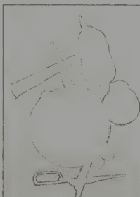

#### KAREN RANEY

- 1 ▲ 物体之间和周围的形状——即负空间形状——已用木炭勾勒出线条。艺术家成功地忽略了物体本身。
- 2 ▲ 负空间形状现在被填充了，形状经过检查并在必要时进行了修改。这张照片显示了艺术家正在绘制投射阴影的形状。
- 3 ▶ 在再次检查准确性后，负空间形状被涂得更深且绘制得更精确。虽然物体开始呈现出明确的身份，但绘画集中在由正负空间形状构成的抽象图案上。阴影可以像物体一样被忽略，从而产生一个更简单的画作。
- 4 ◀ 在最终的画作中，最明显可识别的物体是一把剪刀。当某个东西具有独特且熟悉的形状时，只需要极少的信息就能对其进行描述。

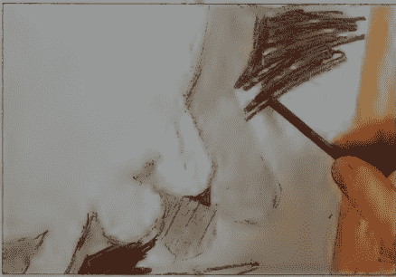

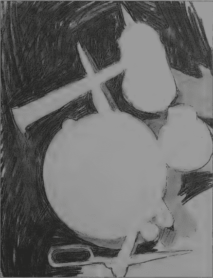

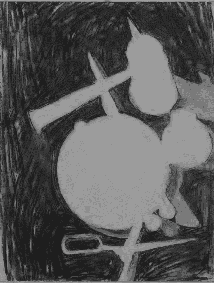

| 更多信息 | 页码 |
| --- | --- |
| 不同的观察方式 | 22 |
| 绘制二维空间 | 28 |
| 木炭和孔特蜡笔 | 196 |

#### KAY GALLWEY

- 1 ▲ 物体的形状已用红色孔特蜡笔勾勒，并开始对负空间形状进行阴影处理。
- 2 ▼ 负空间形状现在通过揉擦孔特蜡笔来产生色调区域。
- 3 ▲ 物体现在开始在画作中出现——以剪影的形式。请注意，艺术家未能完全忽略物体——为了正确绘制椭圆的后曲线，杯子和水壶的顶部已被仔细绘制（见步骤 1）。
- 4 ▲ 作为最后的一笔，艺术家决定为桌面引入第二种色调，但如果仅限于白色和单一的深色调，画作同样会很有效。

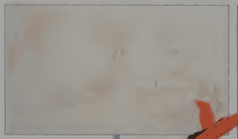

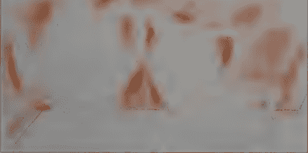

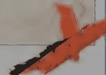

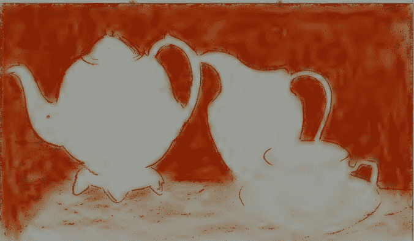

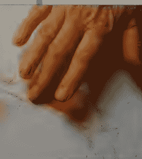

#### 自我评析

- 你是否成功坚持仅绘制负空间形状？
- 你的画作中的正空间形状（物体）是否准确？
- 你是否觉得这种绘画方法有所帮助？
- 你是否发现这比直接绘制物体本身更容易？

## 项目 2 物体倒置

另一种消除我们对物体预设观念的方法是将它置于一个不熟悉的环境中。在艺术学校里，有时会构建复杂的组合，以不寻常的方式呈现熟悉的物体。这是一次非常宝贵的绘画体验，值得你自己尝试，但你只需将物体倒置即可达到同样的效果。告诉你这能让你更清晰地观察物体，你可能会感到惊讶，但你可以向自己证明这一点。选取本书中的任何画作，花几分钟尝试复制它，先正着画，然后倒着画。几乎可以肯定，你的第二幅画会更准确，因为一旦画作倒置，你就会忘记其中的物体是什么，而专注于抽象形状。

### 绘画练习

选择一个物体，如凳子、椅子或烫衣板，或者像碟架这样的小东西，将其倒置在地面或桌子上。该物体需要具有一定的复杂性，但其构造应易于识别。根据你的喜好，使用线条、颜色或线条与色调结合进行绘画。这次绘制物体本身，但不要忘记负空间形状的重要性，因为它们是非常有用的绘画辅助手段。在绘制过程中，不时地将你的画作倒置（或恢复正向）看看效果，但要抵制继续正向绘制的诱惑。完成后，将画作倒置（或恢复正向）进行审视。

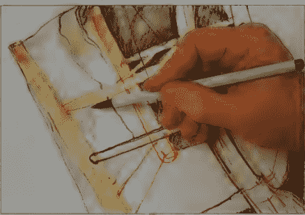

**IAN SIMPSON**

- 1 ▲ 绘画以线条开始，使用彩色水溶性标记笔绘制。选择这种特定的颜色是因为稍后将用它来描述椅子的颜色。同时关注负空间形状和椅子的抽象图案。
- 2 ▲ 现在使用深色标记笔为背景上色，并重新定义和加强描述椅子的某些线条。
- 3 ▼ 绯红色条纹得到了加强，并使用湿刷子将标记笔墨水扩散成背景区域的洗色效果。
- 4 ▲ 当物体处于不熟悉的环境中或像本例这样倒置时，更容易专注于其抽象特质。

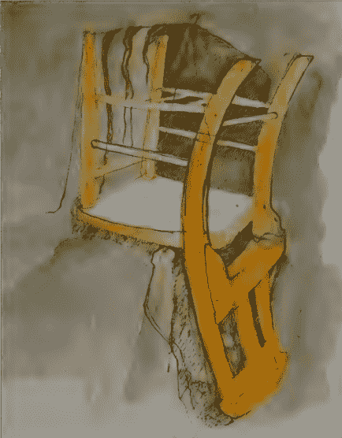

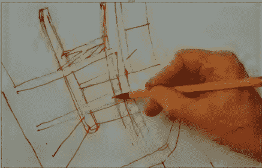

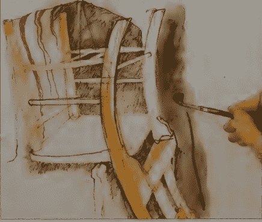

#### 自我评析

- 物体看起来是否具有说服力？
- 你是否觉得倒着画物体更容易？或者你发现自己必须不断地转动画板？
- 你是否发现通过这种方式更容易产生准确的画作？

| 页码 | 主题 |
| --- | --- |
| 41 | 标记笔 |
| 170 | 通过绘画实现抽象化 |
| 196 | 木炭和孔特蜡笔 |

**Christopher Chamberlain**

*木炭*

负空间形状在这次绘画中起到了重要作用，负空间和物体的正空间形状都被反复勾勒。相比于物体的身份，作者更关注形状和图案，这产生了一幅具有强烈抽象特质的有力画作。

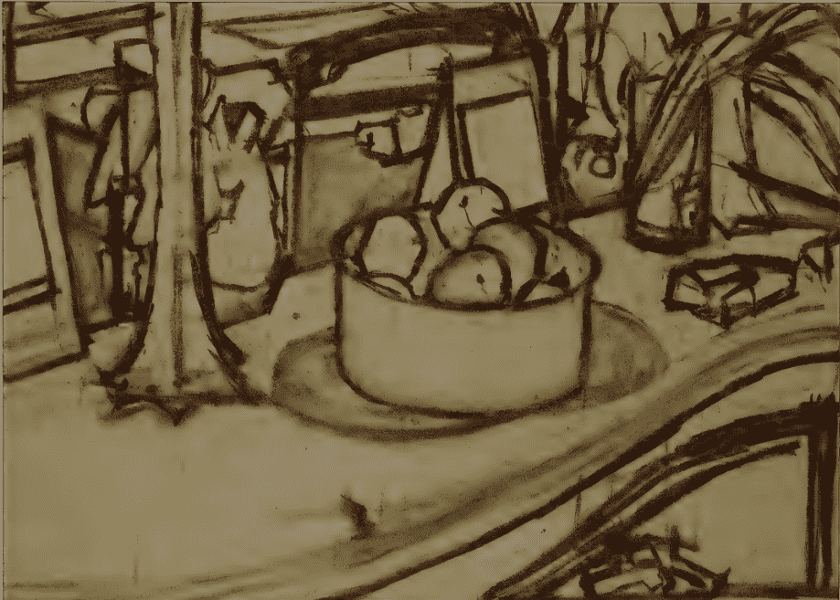

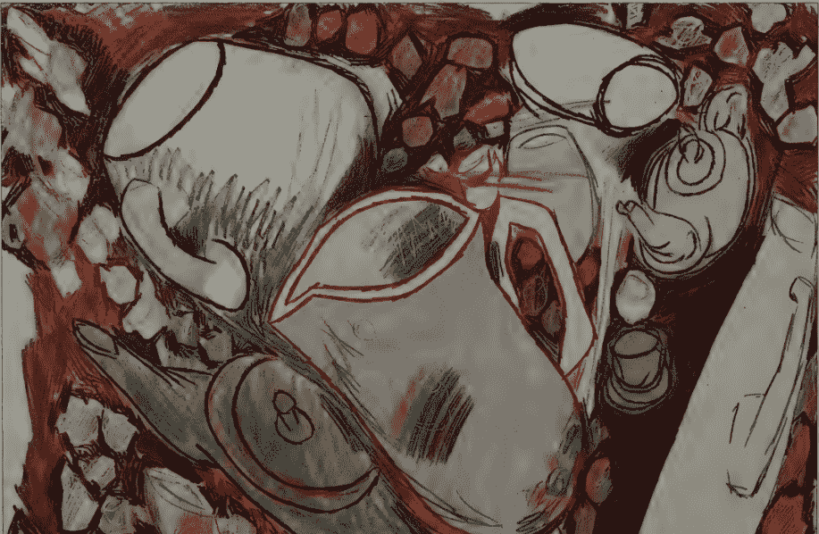

**David Cuthbert**

*彩色铅笔*

**石器**是一幅更具描述性的画作，但重点仍然在物体构成的图案上。颜色被选择性地用于描述物体，但整体效果像是一个精致的抽象设计。

#### John Townend

*黑、棕、白孔特蜡笔*

在这幅大胆且准确的画作中，负空间形状虽然没有起到主导作用，但在作品的早期阶段被用作检查手段。如果你仔细观察椅子腿、支撑杆等之间空间的形状和相对大小，绘制这样一个复杂的主题会容易得多。

> **关于速写本的提醒**
>
> 我已经强调过养成记录速写本习惯的重要性，希望你们能经常在其中绘图。通过在速写本中尝试从各种不同主题中绘制负空间形状，将有助于扩展本课的项目练习。这样你就可以检查不同的主题如何通过这种绘画方法被揭示。
>
> 同样，你可以更详细地探索当事物处于陌生环境中时，你是如何更清晰地观察它们的。

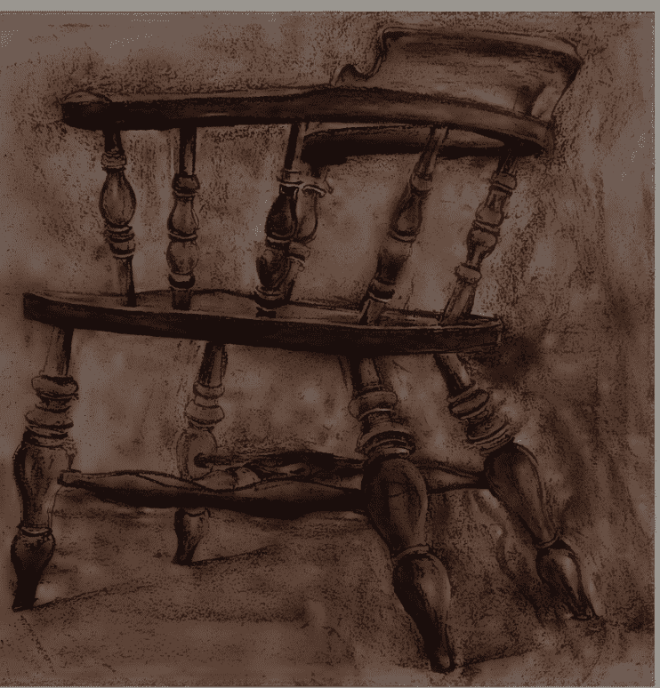

由于其在画面中的尺寸较大，因此我们无法看到物体的相对大小，因为我们对它们有预设的观念。如果你在镜子中看自己的脸，你一定会认出那个图像，并且因为你知道头部的实际大小，你会将镜像读作同样的大小。但这远非事实；如果你在镜子上标记出头顶和下巴的位置，你会惊讶地发现镜像比你本人小得多。这给“无法相信自己的眼睛”这句话赋予了新的含义。

大脑这种快速得出结论的能力部分是由我们的教育造成的，这种教育主要是口头语言形式的。从孩童时期起，我们就给事物命名，并学习用词汇来观察它们。当你看到一把椅子时，你的大脑实际上在说：“那是一把椅子。你知道椅子是什么样的。”因此，你绘制的不是你所看到的，而是一个椅子的符号，这个符号可能来自童年。那么，你如何才能制服你的大脑，从而将物体看作它原本的样子呢？本课中的两个项目展示了重新观察物体的两种方法。

| 页码 | 主题 |
| --- | --- |
| 170 | 通过绘画实现抽象化 |
| 180 | 铅笔和彩色铅笔 |
| 196 | 木炭和孔特蜡笔 |

# 第二部分：主题与处理

在课程的第一部分中，你已经尝试了各种绘画媒介，并学习了观察和比较物体的方法，这有助于你准确地绘制它们。到目前为止，绘画对象主要是一些简单的静物，使你能够按照自己的节奏进行绘制——并学习。课程的第二部分在结构上与第一部分相同，由一系列课程、项目和信息专题组成，但你将绘制广泛的新主题，包括风景、街景和人体。

在本节中，你还将接触到一些绘画中的通用问题。例如，你将学习如何绘制比你所见更大或更小的物体，以及如何利用透视系统来创建三维空间。更重要的是，你将发现如何培养自己的视觉“手写体”，使你的作品更具表现力和个人特色。

## 透视

如果你仔细观察并准确地绘制你所看到的一切，即使在完全不懂透视的情况下，你也能创作出令人信服的物体绘画，但掌握一些规则是有帮助的。“透视”（Perspective）一词在日常生活中也被使用。短语“getting things in perspective”意味着决定事情的相对重要性；而在艺术中，透视是一种以正确的比例和相互关系来描绘物体的法。

### 透视的历史

在艺术的漫长历史中，透视是一个相对较晚的发现。它在 15 世纪出现在意大利艺术中，并很快成为所有艺术家在绘画和绘图中创建三维效果的方法。然而，艺术家在此之前就已设法创造出三维效果；早在公元 1 世纪的希腊壁画中就有展现牧羊人和牛的写实风景。前景物体被画得较大，背景物体则较小，这种比例差异使风景看起来很真实。只有当你试图计算出物体之间确切的距离时，你才会意识到当时的艺术家并没有试图描绘这类信息——他们简单地将物体视为“近”或“远”。但重要的是要意识到，尽管这些艺术家没有使用透视法，但他们创作的作品是写实的，而并非原始或天真的。

在 15 世纪的前十年，佛罗伦萨建筑师菲利波·布鲁内莱斯基（Filippo Brunelleschi, 1377-1446）受雇完成佛罗伦萨大教堂的工程，雇主希望他用一个巨大的穹顶跨越广阔的空间，而这个穹顶大到似乎无法设计。他成功解决了这个在很大程度上依赖数学的问题，使他瞬间成名。正是他对数学和测量的兴趣，引导他发现了希腊风景画家所忽略的东西。他发现，存在数学定律支配物体在向后退去时尺寸缩小的规律。

这一发现虽然引起了同时代的极大兴奋，但并没有立即带来比之前更写实的绘画。我们可以从保罗·乌切洛（Paolo Uccello, 1397-1475）的画作 *《圣罗马诺之战》* 中看到人们对透视法的热情。但如你所见，整体效果并非完全写实。人物看起来像被剪纸一样，因为乌切洛尚未掌握如何使用光影。

### 透视能做什么

从某种意义上说，透视一直存在，但直到艺术家对距离的精确测量产生兴趣时，它才被正式发现。阐明布鲁内莱斯基用数学术语解释的内容最简单的方法，就是观察一个普通的矩形门框，首先看门关闭时的样子，然后再看门打开时的样子，如照片所示。

### 形态的改变

即便你知道规则，也很容易低估透视的效果。这是一个典型的无法抛弃预设观念的问题；我们知道门是矩形的。起初，你可能会发现举起铅笔并倾斜它来评估角度很有帮助。同时检查负空间形状（negative shapes）——即你在门的顶部、底部和侧面能看到的空间。

> 乌切洛的绘画并没有真正成功地描述三维空间。就透视而言，最重要的一部分是前景。躺在地上的人虽然与前景的骑马者比例不符，但却是一个令人信服的透视缩减（foreshortened）人物表现。

### 新知识

| 进一步信息 | 页码 |
|---|---|
| 负空间形状 | 56 |
| 使用透视 | 70 |

## 主题与处理：信息专题

### 尺寸缩减

现在考虑另一个视觉事实。如果你再次观察开门，先采取坐姿，然后站起来，当你改变位置时，门的形状也会随之改变。这些简单的观察练习阐明了透视法赖以生存的基本原理。后退的平行线（开门的顶边和底边）如果延伸下去，将在某一点相交。这个点被称为消失点（vanishing point），简称 VP，它始终处于你眼睛的高度，在透视书籍中常被称为“地平线”（horizon line）或简称“地平线”。

简单来说，透视依赖于一个一致的视点，将你的画面置于窗户的位置，并想象你只有一只眼睛且头部固定在一个位置。只要你接受这个限制，掌握透视规则就能让你绘制出，例如，房屋向后退去的墙壁，或一条通往远方的路径，并将前景中一个人的高度与一百码外花园里的人联系起来。

正如我们所见，当门打开时，它不再是一个矩形，而变成了一个不规则的直边形状，后方的垂直边比前方的短。物体离你越远，就变得越小，直到消失。通常人们凭眼睛判断，但“透视缩减”（foreshortening）涉及一个根本性问题。几乎在所有直接观察绘画中，物体被缩减的程度都被低估了，因为你知道它们的真实尺寸，因此没能察觉到当它们在空间中被推后时，尺寸缩减得有多多。

### 平行线汇聚

平行线在消失点相遇的效果，很少像在这个正视图中如此明显。通常你必须处理路径边缘的弯曲或不规则，或者路径可能稍微上坡或下坡，这会影响消失点的高度。

当你从坐姿变为站姿时，门看起来改变了形状，原因是你的视线高度发生了变化，随之改变的还有两条平行线相交的点。

如果你向右或向左移动，形状将再次改变，你可以通过另一个简单的练习来尝试。透过一个高窗向外看，窗外既有近处的建筑也有远处的建筑，然后在玻璃上描出视野的主线。你可以使用蜡笔或颜料和小刷子，但即使只是用湿手指在玻璃上描绘，你也能明白其中的道理。你会发现，除非闭上一只眼睛，否则无法准确地描绘视野；而一旦你移动头部，你所描绘的物体将相对于你留在玻璃上的线条发生位移。

### 固定视点

这些图表清晰地展示了当你稍微移动视点时会发生什么。如果你闭上一只眼睛看某个东西，然后睁开那只眼并闭上另一只，一切看起来都会向右或向左偏移。

### 角透视 (ANGULAR PERSPECTIVE)

起初，所有的透视画法都像这里第一个盒子的照片那样，主物体的一个平面与画面平行。平行透视的局限性使得无法描绘物体的转角视图。为了绘制此类视图，角透视法应运而生。例如，在角透视中，一座建筑实际上互成直角的两个面，可以被画成向不同的消失点延伸。

### 消失点 (VANISHING POINTS)

- 如果你正在绘制一个简单的物体，无论是使用平行透视（左）还是角透视（右），最初标出消失点可能会对你有所帮助。

### 倾斜平面 (SLOPING PLANES)

- 在 John Townshend 的画作中，道路的消失点将低于房屋的消失点。
- 下倾平面（向下倾斜）和上倾平面（向上倾斜）的消失点分别位于你的视平线（眼平线）下方或上方。
- 然而，房屋建在水平地基上，因此遵循常规规则。

## 更多信息

| 页码 | 主题 |
| :--- | :--- |
| 70 | 使用透视 |
| 80 | 实地写生 |

### 圆柱体与椭圆 (CYLINDERS AND ELLIPSES)

学生在透视画法中绘制圆形和圆柱形物体时经常遇到困难。

这里有一个简单的规则可以帮到你——圆形可以放入正方形中，因此一旦你能画出一个桌面或盒子，你就能画出一个圆或圆柱体。另一件需要记住的重要事情是，圆形就像第 65 页上的矩形一样，会根据你的视角而改变形状。照片展示了透视如何使圆形看起来像椭圆（通常称为 ellipse），以及椭圆的形状如何根据它们与你视平线的位置关系而变化。

### 透视中的圆形 (CIRCLES IN PERSPECTIVE)

- 圆形和椭圆是许多绘画学生——甚至是某些专业艺术家的噩梦。请记住，它们会根据你的视平线而改变，因此在创作时请务必保持一致的视角。如果你先标出中心点，然后在画作上测量每一边以确保两者相等，你会发现绘制起来容易得多。

### 复杂的透视 (TRICKY PERSPECTIVE)

一个顶部带有方形结构的圆顶在透视中似乎是一个非常复杂的问题，但如果你相信自己的眼睛并寻找线索，就不会出错。注意在`Audrey MacLeod`自信的铅笔画中，圆顶的各个部分在边缘处变得越来越小，且曲线遵循下方直线平行线的总体方向。

## 景观中的透视 (PERSPECTIVE IN LANDSCAPE)

自然界中很少有直线平行线，但线性透视的规则仍然适用，而且大气透视（见第 73 页）也很重要。`David Prentice`的墨水与粉笔画熟练地运用了这两者，传达出一种奇妙的空间感。还要注意他如何利用路径像带子一样的曲线来帮助描绘山丘的轮廓。

## 透视与细节 (PERSPECTIVE AND DETAIL)

用正确的透视画出建筑的粗略轮廓相当简单，但当你开始填充细节时，麻烦就来了。例如，一排砖块的倾斜度可能过大，或者窗户的倾斜度不足，从而与透视相矛盾。在`Martin Taylor`的铅笔画中，每一块砖、每一片瓦和每一个窗框的位置都非常精准且比例正确。

| 页码 | 主题 |
| :--- | :--- |
| 73 | 大气透视 |
| 80 | 实地写生 |

## 使用透视

在本节课中，我将要求你将前几页关于透视的一些信息付诸实践。这些项目涉及观察绘画，但要利用透视系统；你不被要求制作复杂的透视图或轴测图，不过如果你愿意，练习各种绘图系统也没有坏处，因为它们都会增加你的知识和经验。在其中四个项目中，你将绘制放在桌上的物体；而在另一个项目中，你需要一个窗外的视角。

### 理论与实践

你可能会对本节课产生的画作感到失望。这是因为将“你应该看到什么”的理论与“你实际看到并画出什么”进行对比，会暴露许多不准确之处。尝试绘制真正精确的图纸可能既具有挑战性又令人沮丧，但检查你是否达到了正确的缩短程度（`foreshortening`）或后退线是否处于正确的角度是非常重要的。如果你处理不好，会降低画作的空间感。一旦你完成了这里所示的几个基础练习，你会发现一切都变得简单多了。

你还会发现透视规则对你的绘画有帮助。虽然透视具有要求固定视角和狭窄视野的严苛局限，但它`nevertheless`与你所见相关，在出错时非常有用。例如，如果两个矩形物体在画中看起来不在同一平面上，但实际上应该在，你可以检查它们的后退边是否真的在大致相同的水平线上相交，并且这个视平线是否与你观察物体的视角一致。

#### 项目目标

用平行透视绘制物体：

- 评估角度和缩短程度
- 体会线性透视与实际所见之间的关系

### 你需要准备的材料

- 所有的绘画材料，以及至少七张白色绘图纸。
- 一把长尺子或直边尺（约一码长的木条最为理想）。
- 胶带或类似物品，用于项目 2 中连接纸张。

### 时间

- 项目 1：约 1 小时。
- 项目 2：约 1 小时。
- 项目 3：约 2 小时。

## 项目 1：凭视觉判断缩短程度 (Foreshortening by eye)

为了演示后退的物体在多大程度上被缩短，我希望你首先绘制两张大小相同的明信片。你只需要画出它们的形状，所以它们可以是空白的或带有图片的。按照这里所示的方式摆放，并画出卡片形状的线稿。垂直的矩形将是一个比例与实际卡片完全一致的完美矩形。水平的卡片将被缩短，其后退边的角度和缩短的程度可以通过与直立的明信片进行对比来判断。

## 项目 2：更多缩短的矩形

将两本大小相同的书平放在面前的桌子上，一本距离你约 6 英寸，且正好在另一本后面。将另外两本书（任何大小）支撑在合适的物体上（饮用玻璃杯即可），使它们平放但在桌上方处于不同的高度。这些书也应正对着观察。绘制这四本书，仔细检查其后退边相对于水平边的角度。在不使用尺子的情况下绘图，并反复修改线条直到看起来正确。务必仔细评估每本书的缩短程度，看看你是否能识别出两本垫高书在缩短程度上的差异。

当你尽可能准确地画完这些书后，直视前方，决定从你的眼睛投影出的一条想象中的水平线在画中位于何处。这条画在书之上的线就是你的视平线。用尺子将其标出。

尽管你绘制的书在桌上的位置不同或高度不同，但每对后退边都是平行的，且这些边形成的线如果延伸，将在视平线上的同一个消失点相交。在你的画作中延伸它们，看看是否如此。

#### JOHN TOWNEND

1. 使用彩色铅笔绘制了书以及支撑顶层书籍的马克杯。虽然后者不是练习的一部分，但如果没有它，画作看起来会很奇怪。
2. 艺术家标出了他的视平线，并使用长尺子延伸书的侧边，以检查它们是否在视平线上的同一点相交。
3. 在最终的画作中你可以看到，所有书籍的侧边如果延伸，都会在视平线上的同一个消失点相交。

## 项目 3：角透视 (Angular perspective)

我已经提到过，在能够绘制角度视图之前，必须先开发出角透视法。为了理解其工作原理，请排列六本或更多任意大小的书，使它们都以转角面向你，其中一些以一定角度叠在另一些书之上。根据观察绘制它们的形状。这一次，书籍不会提供任何水平线来帮助你检查角度，但你可以使用桌边作为参考，或者在书附近的桌上放置某个物体，以提供一个垂直线来与书籍的后退边进行比较。

| 页码 | 主题 |
| :--- | :--- |
| 28 | 将物体与网格关联 |
| 30 | 将物体与其背景关联 |
| 64 | 透视 |

当你尽可能准确地凭视觉绘制出书籍后，像上一个项目那样画出你的视平线，并延伸书籍的侧边直到它们相交。如果其中任何书籍实际上是彼此平行的，那么每对平行边应该交于同一个消失点。否则，每本书将有两个消失点，但它们都将位于同一条视平线上。绘制倾斜物体的困难之处在于，大多数消失点将落在画纸之外，因此你需要在视平线两侧延伸你的纸张，以便检查后退线在哪里相交。

#### JOHN TOWNE

- 1 ▶ 由于书籍是以角对着放置的，艺术家必须在没有水平线帮助的情况下评估角度。这比绘制平行透视的物体要困难得多。

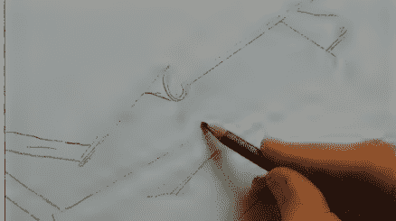

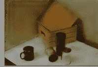

## 项目 4：盒子与圆柱体

准备一组至少六个不同的盒状和基本圆柱状物体。盒子可以是鞋盒或像火柴盒那样的小盒子。圆柱体可以是果冻罐或水果/蔬菜罐头，但其中一些应该是透明玻璃制成的，这样你可以轻松检查每个圆柱体顶部和底部椭圆之间的差异。你不必非常仔细地摆放物体，但要将它们聚集在一起，盒子以不同的角度排列，其中几个圆柱体侧卧并背对着你。在这幅画中不要画出你的视平线；相反，尝试通过观察尽可能准确地绘制盒子和圆柱体，可以使用任何你喜欢的媒介或绘画方法。

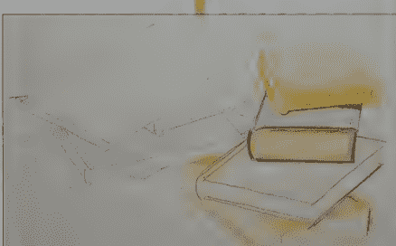

- 2 ▶ 即使你在绘制一个看似枯燥的主题，你使用媒介的方式也能让画作变得有趣。这里艺术家很好地利用了彩色铅笔。

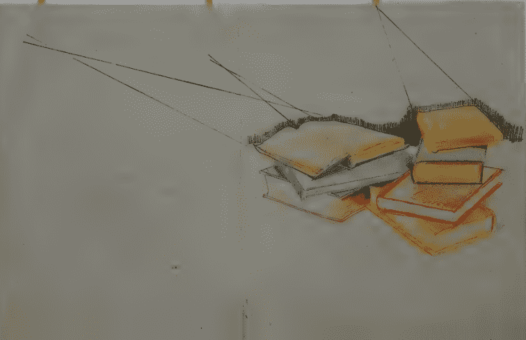

- 3 ▶ 画作中增加了一张纸，以便延伸视平线，并检查书籍后退边的消失点。在画作的另一侧增加一张纸则可以检查书籍的另一侧。

#### KAREN RANEY

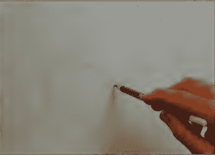

- 1 ▲ 首先用铅笔标出物体的位置。

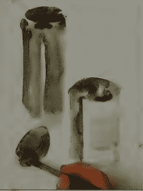

- 2 ► 使用墨水和淡彩来完善画作并重新确立椭圆的形状。

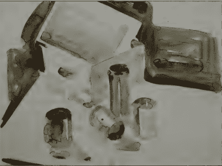

- 3 ▲ 背景中的盒子现在已被添加到画作中，整体风格仍然相当随意。

在创作过程中，艺术家不断重新评估物体的准确形状及其相对位置。

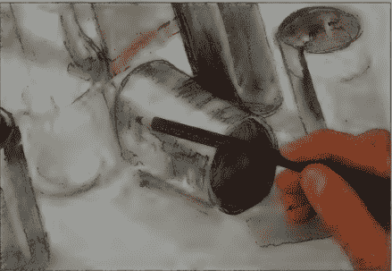

- 4 ▲ 现在使用铅笔使物体更具定义感，并在这种混合媒介绘画中构建出有趣的表面。

- 5 ▼ 使用铅笔和淡彩将画作推向最终状态。注意玻璃罐顶部、中部和底部椭圆之间的差异，顶部较扁，然后逐渐变得更圆。

## 项目 5：大气透视

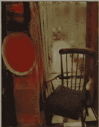

大气对色调和颜色的影响在光线开始暗淡的傍晚或雾天最为明显。对于这幅画，你需要一个方便的窗外视野，以便将远近物体联系起来。从高窗向下俯视你的院子或俯瞰屋顶将是一个极佳的主题。观察色调对比度如何随着距离的增加而变得越来越不明显。尽可能少地使用线条（理想情况下完全不用），并使用孔特蜡笔（`conté crayon`）、木炭或淡彩将你所见转化为色调画。如果你愿意，可以在画中加入颜色，这将有助于通过远景颜色的蓝色感来营造深度感。

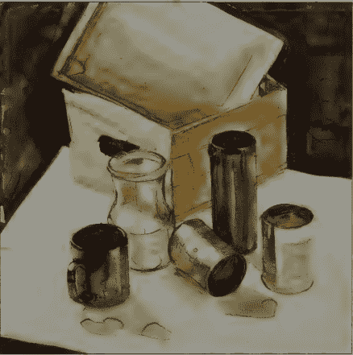

#### 进一步信息

| 页码 | 主题 |
| :--- | :--- |
| 64 | 透视 |
| 30 | 外出写生 |

### 主题与处理

#### KAREN RANEY

- 1 ▲ 艺术家使用木炭，首先确定椅子和后面窗户的位置。
- 2 ▲ 她现在加强了椅子的刻画，因为它是最突出的前景物体。
- 3 ▲ 阴影是通过将木炭侧平放置来完成的。

## 自我评估

- 你是否觉得本课的练习让你进步了一步？
- 或者你是否发现其中一些练习所要求的准确度相当令人生畏？
- 你是否理解了绘画系统背后的原理？
- 是否有一些内容你觉得在继续之前应该回头重新尝试？
- 本课中哪些画作效果最好，为什么？
- 你是否觉得你对绘画媒介的掌控力有所提高？
- 4 ▲ 在最终的画作中，前景强烈的色调对比营造出了深度感。当你透过门向小径远望时，对比变得不再那么明显，定义也变得模糊。

> ▲ David Carpanini *铅笔*

在这幅速写本画作中，前景的墙壁、建筑以及后面的排屋为艺术家提供了一个极具吸引力的角度透视难题。

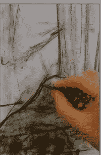

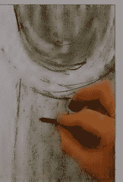

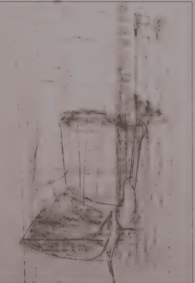

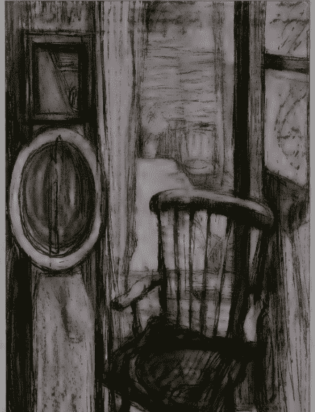

## Christopher Chamberlain

### 铅笔

艺术家选择了一个给他带来极其复杂透视问题的视角。比例的差异、向多个方向后退的线条以及右侧拱门的曲线都被出色且果断地绘制了出来。注意他在刻画前景篱笆和人行道方向变化时所付出的细心。

## Geoff Masters

### 木炭与铅笔：下农场谷仓 (Lower Farm Barn)

尽管这座旧谷仓中的横梁并非完全笔直，但《下农场谷仓》是一幅具有单一消失点的画作，所有后退的平行线都交于一点。除了在透视方面观察得非常精准外，这幅画还传达出强烈的氛围感。

#### 进一步信息

| 页码 | 主题 |
| :--- | :--- |
| 64 | 透视 |
| 30 | 外出写生 |

## 改变比例

你绘制物体的大小可能非常重要。你可能希望专注于某个很小的东西，并将其绘制得宏大且具有纪念碑感。在另一个极端，你可能想在小速写本中绘制宽阔的全景图，这将涉及将所有东西缩小比例。这两件事并不总是那么容易，因为大多数人绘制物体的习惯大小就是他们看到的实际大小。如果你尝试放大一个小物体，你可能会发现，虽然开始时足够自信，但随着绘制的进行，画作会变得越来越小。同样，缩小一个巨大的前景物体也同样困难，正如你在速写本中绘画时可能已经发现的那样。通常主体会超出纸面，另一个危险是，在努力将其保持在页面边界内时，你可能会扭曲比例和形状。

### 视觉大小 (SIGHT SIZE)

按照你看到的尺寸而非物体实际的尺寸来绘制物体，通常被描述为绘制“视觉大小”。为了检查你自然绘制的大小，请使用铅笔快速勾勒出你在房间里看到的任何物体，或透过窗户看到的物体的轮廓。保持你的绘画姿势，将铅笔伸直手臂举起，闭上一只眼，用拇指在铅笔上测量物体的主要比例，并将这些测量值与你的画作进行比较。你几乎肯定会发现，如果操作仔细，画中的测量值与实际一致。

正因为我们天生倾向于绘制视觉大小，绘画教师经常主张不断用这种方式用铅笔进行测量，并将这些测量值直接转移到画作中。我个人认为，虽然这种建议可能有帮助，但很难执行，因为很难确保在每次测量时都保持完全相同的位置，并且手臂伸出的程度完全一致。

#### 项目目标

- 绘制比实际视觉尺寸更大的物体
- 绘制比视觉尺寸更小的物体

### 准备材料

项目 1 需要一张大纸，项目 2 需要较小的纸片或一个速写本。在这种情况下颜色并不重要，因此我建议你使用线条和色调进行单色绘画。

### 时间

每个项目大约 3 小时

#### ELIZABETH MOORE

- 1. 如果你使用一种能让你画得非常大胆的媒介，你会发现放大物体更容易。这里选择了孔特蜡笔。
- 2. 手柄上的脊状图案以及下方的阴影得到了关注，这两者都描述了物体的形状并赋予了它立体感。

## 项目 1：放大

我想让你在这个项目中完成三幅画，每幅大约花费一小时。第一幅，我想让你将某个小东西放大绘制，比如一个弹簧夹、一把牙刷或一个电源插头。你的画作要填满一张 A4 纸，所以仔细观察你的主体，试着想象它像一座你可以围绕其行走的大楼一样大。首先快速画出轮廓形状，然后在该形状内构建尽可能详细且准确的画作。注意不同表面的形状，并尝试还原你看到的阴影。

当你完成画作并掌握了比视觉尺寸更大地绘画的技巧后，再进行两幅画，将小物体放大到纪念碑般的尺寸。其中一个可以是厨房用具，如压蒜器、烤面包机或搅拌机。对于第三幅画，选择一个柔软的物体，比如一块揉皱的手绢，你可以将其想象成规模巨大的风景地貌。

**3** ► 看到熟悉物体的放大图可能会产生一种不安的效果，因此艺术家有时会在绘画和素描中“玩弄”比例。

**KAY GALLWEY**

**1 ▼** 像这样的人造物体，其直线和干净的边缘是其特征的重要组成部分，必须准确地绘制，因此艺术家使用了直尺。

**2 ▼** 透视处理非常谨慎——在这种比例下，任何错误都会非常明显。

#### 自我评析

- 放大绘制是否导致你弄错了物体的比例？
- 你是否发现某些物体比其他物体更容易放大？
- 柔软物体的形状是否比精确的形状更容易放大？
- 在进行放大绘制时，你是否尝试过任何测量方法？

**3 ◄** 随着阴影的完成，这个巨大的订书机看起来完全具有说服力。像这样的物体非常理想，因为它的建筑特质在放大后变得更加明显。

#### 进一步信息

| 页码 | 主题 |
|-----|---------------------|
| 128 | 扩展视野 |
| 148 | 绘制细节 |

此外，视尺寸（`sight size`）可能出奇地小，通常小到无法创作出一幅令人兴奋的画作，例如在人体写生课上绘制人物时。你可以通过举起画板，闭上一只眼睛并标记水平测量值（如头部和肩宽）来轻松检查视尺寸。你会发现，人物可以恰好画在一张相当小的纸上。同样的情况也适用于静物，比如一组瓶子，如果你按视尺寸绘制，它们会非常小；而如果你按其实际大小（`life size`）绘制，可能会看起来更有趣。

## 放大与缩小

由于视尺寸绘制并不适用于所有题材，你必须学习如何放大和缩小，以便能够绘制任何你选择的尺寸。有两种半机械的方法可以放大或缩小物体的比例，一种被称为“方格法”（`squaring up`），另一种是被称为“比例尺”（`pantograph`）的绘图辅助工具。

### 关于方格法

方格法和比例尺都有其用途，但它们本质上是复制或描摹的工具，会消除绘画中的生命力和自发性。如果想要保留绘画中最重要的一些特质，能够通过目测进行缩小和放大至关重要。

## 项目 2：缩小

这个项目同样要求你完成三幅画，每幅大约花费一小时。对于第一幅画，选择一件大型家具，例如放有物品的厨房碗柜、梳妆台，或一个开着门露出内部物品的衣柜。决定你的绘画位置，但在开始绘画之前，先对该物件的宽度进行视尺寸测量。我要求你的画作尺寸不超过这个尺寸的一半。在纸上标记出你打算让该物体占据的宽度，然后在该维度内绘制家具的整体形状。继续绘制，添加抽屉、搁板和把手等细节。特别注意家具的比例以及细节相对于整体的规模。

完成这幅画后，寻找两个完全不同的题材，绘制尺寸远小于视尺寸的画作。你可以绘制房间的一个角落，或者通过窗户看到的另一栋建筑。你需要那些迫使你将大量细节融入到较大整体形状中的题材。这将使你能够在决定物体的总体尺寸后，观察是否能继续以相同的比例进行绘制。尝试看看在不丢失任何重要细节的情况下，你能画到多么小。

**JOHN TOWNNEND**

**1 ▼** 绘制比所见之物更小的图像出奇地困难，尤其是当你使用相对较大的画纸时。艺术家发现，首先为画作设定一个明确的边距至关重要。使用能鼓励微小细节工作的媒介（例如这种细尖笔）也会很有帮助。

**2 ▲** 虽然两幅画都略微超出了边界，但它们非常成功；椅子的比例正确，且艺术家设法包含了相当多的细节。

#### 自我评析

- 你是否成功将详细信息融入到画作中？
- 你是否发现空间似乎不足以容纳所有内容？
- 你的小比例画作是否比前一个项目中的放大画作更好？

**ELIZABETH MOORE**

▲ 这三幅同样使用钢笔和墨水绘制的画作，是艺术家工作室的小速写研究，专门用于练习缩小比例。在能够自信地完成此类绘画之前，你需要进行大量的练习，但随着时间的推移，它会变得越来越容易。

| 页码 | 进一步信息 |
|---|---|
| 148 | 绘制细节 |
| 202 | 墨水绘画技巧 |

## 主题与处理

## 外出写生

当你刚开始学习绘画时，在室内舒适的环境中工作，绘制精心挑选且周到摆放的物体是很方便的。但现在是时候尝试以一种更具冒险精神的方式，通过户外工作来锻炼你的绘画技巧了。本课的题材将不再是经过特别安排的物体，你在绘画时将有更多部分交给随机性。

想到在公共场合绘画最初可能会让你感到不安——也许你不喜欢应对那些好奇地凑到你肩后观看的人——但这些问题是可以克服的，如果可能的话，我希望你尝试一下。如果你确实发现因为某些原因无法在户外绘画，你也可以在室内通过门口或窗户向外观察来完成本课的项目。

如果你能找到一个遮蔽点，在大多数国家，你一年中的大部分时间（如果不是全年）都可以在户外绘画。雨水比寒冷更是一个障碍，虽然爱管闲事的人可能会令人烦恼，但大多数画作可以在写生本中完成，这是一种相对私密的工作方式。无论如何，一旦你开始绘画，你会如此专注于所做的事情，以至于意识不到路人的存在，而他们可能也不会注意到你——你永远不像你想象中那样引人注目。

然而，要求你在户外绘画的目的并不是为了进行一项耐力测试。这是一个激动人心的体验，如果没有它，任何绘画课程都是不完整的。特别是现场绘画会给你带来巨大的压力，要求你快速工作。即使在天气稳定的日子里，光线也在不断变化，如果你在画中加入人物，他们不久后一定会移动。但正因为你必须快速工作，你的画作中可能会发生各种你直到回家才意识到的事情。这些可能是意外，但随机发生的事件往往比高度受控的方法能产生更好的作品。

**项目目标**

- 根据户外题材创作自发的绘画
- 快速工作并利用随机效果
- 选择好的题材并包含其最重要的特征
- 进行构图

**你将需要**

所有绘画都可以在写生本中完成。较大的画作需要`A2`尺寸的写生本，但如果你有一个沿长边装订（非螺旋装订）的`A3`写生本，你可以跨两页绘制。

或者，较大的画作可以使用画板和`A2`纸完成。你需要所有的绘图材料，如果愿意，可以使用颜色。

- **时间**：每个项目约 3 小时

### 项目 1：城市景观

一旦到达选定地点，我希望你至少完成三幅快速研究（每幅约 20 分钟）和一幅较大的`A2`尺寸画作（应投入至少两小时）。如果你不能在一次行程中完成所有绘画，可以分两次前往，将较大的画作留在第二次。为此，你需要至少两小时的不间断时间，如果你中途停止并计划稍后继续，你可能会在休息后发现景物发生了如此大的变化，以至于不知道从哪里重新开始。

### 选择

一旦你决定了在何处绘画，你会发现第一个问题是画什么。到目前为止，你绘制的题材都非常具体，但现在你将面临一个...

## PHILIP WILDMAN

这三幅快速铅笔速写是从不同的视角创作的，旨在探索主题的构图可能性。中间那幅被选作反页所示的大幅画作的基础。

视角和物体的选择范围要广。这就是初步研究的目的，它将帮助你决定什么才是大幅画作的最佳主题。所有的研究可以是同一个视角的变体，比如在其中一幅中增加更多前景，在另一幅中尝试更多右侧内容。或者，每一幅都可以是从同一地点绘制的不同视角。仅仅通过转动头部，视角竟然能产生如此惊人的差异。你会发现“取景框”（一块带有矩形孔的卡纸）是一个很好的入门辅助工具，因为它能帮你从复杂的主题中选取一小部分。

### 大幅画作

完成研究后，仔细观察它们，决定哪一个最适合发展成大幅画作。如果可能，请将这幅画设为`A2`尺寸，如果不行，则尽可能地将其画大。它应当同时包含线条和色调，你也可以考虑使用颜色。尽可能在现场完成整幅画；不要试图快速地画一点然后回家后再完成，因为那样行不通。不过，你之后可以进行微调。如果你将画作搁置几天，然后再次结合研究图一起观察，你可能会发现一些可以修正的缺陷，例如前景中的某个特征可以稍微加强。当然，也可能你觉得没有什么需要改变的。但请尽可能少地改动，因为一旦离开主题，修改画作很少能使其变得更好。

### 更多信息

| 页码 | 主题 |
| --- | --- |
| 122 | 表现性绘画 |
| 136 | 构图 |
| 144 | 作为探索的绘画 |

## 第十课

对于成品画，艺术家采用了不同的媒介——钢笔淡彩，他经常使用这种媒介，并发现它非常适合都市主题。教堂尖顶两侧云朵的暗示是通过蜡染法（见第 210 页）实现的。

#### 自我评析

- 你对你的研究图和画作感觉如何？
- 你是否加入了一些令你惊讶的元素？
- 你现在是否觉得你选择了最有趣的练习图进行深化？
- 你认为大幅画作是否公正地展现了主题？
- 你是否学到了某些可以在下次绘画中付诸实践的技巧？

### 项目 2：风景

都市和村庄场景提供了广泛的地点和不同的主题，但对许多人来说，正是与自然接触的渴望激励了他们最初开始绘画。绘制风景可以带来丰厚的回报。法国画家欧仁·布丹 (`Eugène Boudin`, 1824–98) 曾建议印象派画家这样做：“研究，学习观察和绘画，绘制风景画。大海和天空是如此美丽——动物、人物、树木就像自然创造它们那样，具有自己的个性，以及它们在空气中、在光线中真实存在的方式。”

“风景”这个词并不只是指山丘、山脉、田野和树木的通用术语；公园和花园同样是风景。温室可以提供一种“室内风景”，甚至窗台花箱也可以是一个微型风景。你可以在窗边完成风景画，但如果可能，请采纳布丹的建议，在户外写生。公园是特别好的地方，而且那里还提供座位。

**ROSALIND CUTHBERT**

在前两幅速写（见上图）中确定了基本构图后，艺术家对房子旁边的树木形状进行了进一步研究，这是成品画中的一个重要特征。

| 页码 | 主题 |
| --- | --- |
| 136 | 构图 |
| 144 | 作为探索的绘画 |
| 210 | 蜡染法 |

## 主题与处理

### 最终画作

最终画作是用彩色粉笔绘制的，参考了速写和色彩笔记。画作的视觉中心是房子及其前方的树线，因此艺术家对中心前景的树处理得非常轻盈细腻，以免它成为眼睛的“阻碍”。

### 研究与绘画

我希望你像上一个项目那样规划你的工作：先做三幅初步研究图，然后创作一幅大幅画作。后者应至少花费你两小时，并且你应该尝试在不休息的情况下一次性完成。可以使用线条和色调或颜色，但考虑使用与上一个项目不同的媒介。完成此项目后，将你的作品以及上一个项目的画作一起钉在墙上进行对比。

#### 自我评析

- 你是否发现从城市景观项目中学到的经验有助于你绘制风景？
- 你觉得哪幅画作或研究图最能捕捉到主题？
- 你是否在所使用的媒介方面发现了什么新东西？
- 你是否发现树木和植物比定义更清晰的建筑形式更难转换？

**Stephen Crowther**（木炭和孔泰蜡笔）

`Crowther` 经常在现场创作，虽然他的许多画作都是油画的习作，但这幅名为**《至高追求》**（`Supreme Endeavour`）的作品被视为独立完成的最终作品。其构图经过精心规划；请注意明暗色调的平衡，以及由码头和栈桥组成的三角形如何呼应并增强船头不规则三角形的视觉效果。

在户外工作时时间往往有限，必须决定包含多少内容。在这幅简洁且平衡得极美的画作中，艺术家将重点限制在探索形状和色调的平衡上。

## 特殊设备

根据你选择的媒介，在户外工作时可能需要一些额外物品，例如一个装水瓶用于稀释墨水或颜料。可以使用塑料矿泉水瓶或类似容器。你还需要一个塑料盒来倾倒部分水以便使用。需要一个袋子来携带绘画材料，根据你决定前往的地点，一把折叠凳可能会很有用。另外，记得带保暖衣物；即使在温暖的日子里，因为在绘画时不动，户外写生也可能会感到寒冷。

这或许也是考虑购买写生画架的时机。它们轻便且相当易于携带，也非常适合室内使用。如果你有绘画的朋友，尝试借用他们的画架试用；或者如果你直接去商店，在购买前先在店内撑开画架，确保它适合你，尺寸和重量方便携带，并且能令人满意地支撑你的画板。

在出发写生前，列一份所需物品清单是个好主意。最令人懊恼的事情就是鼓起勇气准备开始，却发现把像铅笔削一样至关重要的东西落在家里了。

### Martin Taylor（铅笔）

很难相信包含这么多复杂细节的画作竟是在现场完成的，但 `Taylor` 无论是绘画还是写生，始终在现场工作，有时会在几天的时间里反复地回到同一个主题。在天气恶劣时，他将汽车当作移动工作室。

| 页码 | 主题 |
| --- | --- |
| 136 | 构图 |
| 144 | 作为探索的绘画 |
| 148 | 绘制细节 |

## 主题与处理

## 第十课

**奥黛丽·麦克劳德 (`Audrey Macleod`)**

*钢笔与墨水*

在这幅都柏林海关大楼的速写研究中，使用的墨水是水溶性的，因此可以通过涂抹清水来产生色调区域。在建筑物的圆顶上可以最清晰地看到这种晕染效果，它与纤细的钢笔线条形成了绝佳的对比。

**约翰·汤温德 (`John Townend`)**

*彩色铅笔*

汤温德发现彩色铅笔是外写（`location work`）的理想介质，既多功能又快捷。在科佩德大厅（`Copped Hall`）的画作中，他大胆且自由地运用铅笔，将构建色彩和色调的倾斜笔触与确定形状的坚实轮廓线相对比。

**大卫·普伦蒂斯 (`David Prentice`)**

*墨水与粉笔*

**大卫·费里 (`David Ferry`)**

*炭笔*

这两幅画，**马尔文的坚毅 (`Malvern Perseverance`)**（上）和 **攀登马尔文灯塔 (`Climbing the Beacon, Malvern`)**（下）是作为绘画研究而创作的，多种介质的混合使艺术家能够记录大量的视觉信息。他反复地回到这个特定的风景主题，并在不同季节地使用多种不同的介质进行绘制和绘画。

炭条和炭笔并不最适合小型速写本绘画，但在较大规模的外写绘画中可以发挥优势；这幅建筑研究的尺寸为 `A1`。强烈的深色线条和果断的对角线排线非常适合这个较为阴郁、不浪漫的主题。

**进一步信息**

| 页码 | 主题 |
|-----|-------|
| 180 | 铅笔与彩色铅笔 |
| 202 | 墨水绘画技巧 |
| 210 | 混合介质技巧 |

## 主题与处理

### 自然形态

本课将带你回到室内，处理你在外写绘画时几乎肯定会遇到的一些问题。无论你在上一个项目中决定绘制什么样的风景，你几乎肯定经历过绘制树木、灌木或植物的困难，因此在本课中，我想让你思考绘制这些以及其他自然形态时涉及的一些特殊问题。

在城市景观项目中，你处于一个较为熟悉的领域，即基于几何形状的对象，具有清晰定义形状的人造物体；但风景则让你面对可能显得不规则且不可预测的形状。然而，几何学同样是自然的底层逻辑，在本课中，我想让你发现自然世界与人造世界之间的平行之处。此外，我还想让你考虑另一个在外写绘画中会让你敏锐觉察到的特征——质感。

## 透视

即使你是在画盆中的一株小植物，你所学到的关于缩短法（`foreshortening`）以及物体随距离增加而减小的知识依然适用。如果植物最近的叶子以近乎水平的位置生长并面向你，它们将像你之前画的明信片一样产生缩短效果。而且，如果一朵花的形状基本上是圆形的，那么从某个角度看时，它将变成一个椭圆。正如你所意识到的，透视对于自然形态与人造物体同样重要。

### 细节与质感

绘制自然形态的困难之一是你会发现自己面对大量的细节，而在试图描述这些细节时，很容易丢失物体的特性和形态。一个完美的例子就是树木，无论是绿叶繁茂还是冬日凋零；人们往往倾向于关注叶子和树枝的形状，或者是叶丛的质感。

#### 项目目标

- 利用绘制几何物体所获得的经验来绘制自然形态
- 利用质感来描述并增强形态
- 尝试不同的介质

#### 所需材料

所有的绘画材料。多种不同的纸张选择。

**时间：** 每个项目大约需要 4 小时。

### 项目 1

#### 植物与花卉

对于这个项目，你至少需要两个主要物品：一些带有叶子的切花，形状简单（或盆栽花卉），以及一株由密集叶片组成、形成实心圆形三维形态的大型植物。该植物可以有花，但选择它的决定因素应该是叶片的质量；你需要一株能够呈现出与绘制树木或灌木相同问题的植物。

不要忘记，本项目的目标之一是尝试不同的介质，因此请思考你想从哪种介质开始，并计划在绘画进行到一半时更换。这也是尝试不同种类绘画纸的时间。尽量让你的画作尺寸尽可能大。在绘制花卉时，我希望你主要关注它们的缩短效果，以及让植物看起来像是一个实心的三维形态。

尝试在这些自然形态中寻找底层的几何结构。从一个非常简单的概括开始，然后逐渐引入花瓣和叶片形状的细节。确保花卉在你的画中结构正确，花头与茎杆正确对齐，并尝试在脑海中想象花卉和植物被遮挡的部分，例如叶子覆盖茎杆，或花瓣遮挡茎杆连接点的情况。在绘画时，请记住植物的这些隐藏部分，并思考植物的实际构造。

如果你决定绘制叶脉，请绘制你实际看到的。不要只用黑线画叶脉。对于许多植物来说，叶脉实际上比叶片颜色浅。特别注意茎部连接的地方。寻找生长特征，并注意到植物和花卉的接缝处通常能提供关于茎横截面的重要信息，并有助于解释其特定的三维形态。

**伊丽莎白·摩尔 (`ELIZABETH MOORE`)**

艺术家在这幅画中选择了钢笔和水洗法（`pen and wash`）。在用钢笔勾勒出基本形状后，她现在用稀释的墨水和画笔来构建形态。

随着水壶和叶子的精确位置逐渐确定，墨水线条画与水洗画交替进行。

现在花卉和花盆已经完成，艺术家能够进行审视，并决定是否还需要加入其他内容。

在之前的阶段，画作的底边相当沉闷且平坦，因为花盆和水壶处于同一水平线上。因此，艺术家决定加入一块布的尖角形状，从而将观众的视线引导进入画中。

#### 自我评析

- 你是否成功地让花卉和植物看起来具有三维感？
- 你是否发现自己在过早的阶段就过于沉溺于细节？
- 你是否避免了绘制表面的细节？
- 你的画作是否具有厚实感和潜在的结构感？
- 你是否在绘画介质方面发现了什么新东西？

| 页码 | 主题 |
|-----|-------|
| 64 | 透视 |
| 80 | 外写绘画 |
| 202 | 墨水绘画技巧 |

### 项目 2

#### 质感的对比

对于这个项目，请收集一组尽可能呈现多种不同质感的物体。这可以包括植物和花卉，但看看你是否还能找到一些不寻常的物体，例如动物头骨或填充鸟标本。水果和蔬菜将是理想的物体，因为它们提供广泛的质感：光滑、闪亮的番茄和茄子将与某些类型卷心菜的粗颗粒叶片，或许多根茎类蔬菜粗糙、暗淡的表面形成鲜明对比。粗糙的石头和光滑的鹅卵石也能提供类似的质感对比。尝试将一些水果和蔬菜切半。例如，石榴、灯笼椒或花椰菜可以揭示非常有趣的截面供你绘制。

你可以为这组物体添加一个有质感的背景，比如一块麻袋布或粗织织物。画中的重点应放在质感上，但这些质感必须增强特定物体的厚实感，并有助于赋予画作三维空间感。

记住，你必须尝试不同的绘画介质以及有质感且有颜色的绘画纸。尽量让你的画作尺寸尽可能大。

**凯·加尔韦 (`KAY GALWEY`)**

1. 艺术家在有色纸上使用柔和粉彩（`pastel`），开始轻微地涂抹黑色以标出篮中水果和蔬菜的位置。
2. 使用更多黑色，并引入一些白色和乳白色来构建质感和色调对比。
3. 茄子的闪亮表面是通过用手指揉搓黑色粉彩（晕染）然后在其上添加高光来描述的。此时，形状被刻画得更加坚定。

...树皮，而忽略了树是一个三维形体这一事实。这会使绘画看起来扁平且缺乏说服力。

然而，质感（`Texture`）非常重要，你需要寻找描述表面特质并将其相互对比的方法。质感也可以作为揭示形体和创造深度感的一种有用手段。例如，动物皮毛的质感随身体起伏而变化的方式，能够完美地描述底层的形体；而粗糙耕作田地中凹凸不平、深浅不一的沟壑，则能产生极佳的三维空间错觉。

#### 自我评判

- 你的画作整体是否协调，还是看起来像是一系列独立物体的碎片化练习？
- 你是否选择了最合适的媒介来描述各种质感？
- 你是否发现了某种能够自动暗示你想要描述的特定质感的媒介？
- 你认为质感现在是否在你的绘画中扮演了更重要的角色？
- 你是否发现小比例地绘制质感能为你提供一些可以应用于大物体（如树木和灌木）的灵感？
- 你现在是否对各种绘画媒介的能力有了更深刻的认识？

许多事物在绘画中可以通过暗示而非直接陈述来表达。物体的轮廓可以暗示其质感。一个坚实、精确的形状可能被用来暗示西红柿的光滑表面，而模糊的边缘则能给人以动物柔软皮毛的感觉。这些手段必须灵敏地使用，同样重要的是，要勇于尝试。创造羽毛、石头或草地的质感没有固定公式；你必须高度集中注意力观察，并从所见之物中提取出对你而言重要的特质。

- 进一步的高光被应用于茄子发亮表面，与大蒜和欧防风较为粗糙的质感形成鲜明对比。在这里，色粉笔没有进行晕染。
- 充分利用了纸张的中色调，并大胆使用媒介来描述水果和蔬菜的对比质感，以及盛放它们的坚硬、僵直的篮子。

正如你绘制的物体具有质感一样，你的画作本身也包含由所用材料的内在特性所产生的质感。例如，铅笔线条涂鸦的区域，其特质与用孔特蜡笔（`conté crayon`）阴影创造的效果，或使用渲染（`wash`）实现的平滑过渡色调截然不同。线条也具有可以暗示物体特定特质的质感可能性。铅笔可以产生犹豫、柔软的灰色线条，这与钢笔锐利、明确的线条形成对比。

| 进一步信息 | |
|---|---|
| 34 | 绘制三维形体 |
| 188 | 软粉彩与油粉彩 |

## 绘画媒介实验

在这些项目中，你应该尝试不同绘画媒介的质感特质，以及不同种类的纸张（包括有色纸和有纹理的纸）。有时你会发现，某种特定的媒介能非常自然地描述某种质感。将木炭笔侧向地在粗糙纹理的纸上使用，可能会自动创造出完美描述石材的质感。玉米茬地的锐利、尖刺的质感，或许最适合用钢笔在光滑纸面上快速点戳和飞溅来描述。你不必全程使用同一种媒介；你的实验应扩展到创作混合媒介画。某些媒介在描述特定质感效果方面比其他媒介好得多，选择最有效的工具至关重要。

**Audrey Macleod —— 木炭**

木炭创造广泛质感的能力在这幅迷人的画作中得到了清晰的体现。苹果使用了坚实的线条；在一些树木上，木炭阴影让纸张的纹理透了出来；而前景的田野则将木炭揉抹得很平滑。艺术家极好地利用了苹果树向下 sweeping 的枝条与较为直立的树木之间的对比。

**Pip Carpenter —— 油粉彩**

在 *《白色水仙》* 中，油粉彩被大胆用于描述茎秆的向上冲力，并顺着花瓣生长的方向用手指揉抹，以创造出生命感和流动感。背景的对比质感是通过用调色刀刮除油粉彩而创造的，这种技术被称为刮画法（`sgraffito`）（参见第 191-2 页）。

**Elizabeth Moore —— 钢笔与水彩**

在这本速写本研究中，线条与色彩被巧妙地结合在一起，以描述一组物体中不同的质感。钢笔的坚实线条和涂鸦阴影得到了绝佳色彩点缀的辅助，且前景水果的绘画更为细致。

**James Morrison —— 铅笔**

在这幅速写画中，艺术家的首要关注点是主树强烈的、近乎建筑般的形状，但他也给出了对比质感的总体印象。

| | |
|---|---|
| 122 | 表现力绘画 |
| 180 | 铅笔与彩色铅笔 |
| 196 | 木炭与孔特蜡笔 |
| 204 | 线条与渲染 |

## 主题与处理

### 人体比例

也许比任何其他主题都多，当我们在绘制人体时，往往倾向于忽略所见之物而凭想象作画。一些学生似乎基于他们见过的其他人体画来作画，而另一些人则创作出一个理想化的人体，其比例与面前的模特截然不同。这是因为人体是所有主题中最熟悉的，这使得人们很难在没有先入之见的情况下接近它，像看待植物或树木那样观察它。

### 身体比例

当然，没有标准的人类；每个人都不同。但由于相似之处多于差异，记住一些关于人体的通用要点，特别是关于其比例和测量值是非常有用的。

从头顶到下巴测量的头部被用作测量站立人物高度的“基准尺”。许多艺术家设计了比例系统，关于衡量人体高度的具体头数，观点各异。然而，自 19 世纪的人体测量学家保罗·里歇（`Paul Richer`）教授——他花费一生测量不同年龄的人体——决定成年男女的身体长度均为 7.5 个头后，这一比例被广泛接受。有时也会提到 7 个或 8 个头的比例，这可能是为了方便测量，而非其他原因。

另一个关键比例是腿与躯干的比例。腹股沟（`groin`）是站立人物高度的大约中点，而不是人们有时假设的腰部。当然，男女之间存在差异，尽管基本比例相似，但男性的肩膀通常比女性宽得多，而臀部比女性窄。

### 标准测量

你绘制的人很少有人能绝对符合规范，但你会发现“身体高度为 7.5 个头”的规则在检查时非常有用。

### 女性/男性

一般而言，男性的肩膀比女性更宽、更方，且臀部相对于腰部更窄。头身比基本相同。

### 头部比例

不出所料，绘制头部面临着与绘制人体类似的问题。当你试图画出那些你认为能让人物被识别出的特征时，比例往往被忽略了。关于头部令人惊讶的一点是，五官所占的部分比大多数人最初认为的要小得多。如果你有一个头部的正面视图并测量眼睛的位置，你会发现它们大约位于头顶和下巴之间的一半线上。穿过鼻底的一条线位于眼睛和下巴的中点，而嘴巴大约位于鼻子和下巴的中点。

头部的深度同样具有欺骗性。从侧面看，前后距离与从头顶到下巴的距离相同。

### 根据规范检查

对人体较为随意观察而产生的画作通常有两个主要错误：头部过大和腿部过短。始终明智的做法是检查你的画作，确保头部和腿部根据“平均”比例大致正确。你显然会发现有些人腿比平均水平短，或头部较小，你应该识别并记录这些特征。

在绘制站立人物时检查比例并不太困难，但当主体坐着时则更难。在这种情况下，特别是从正面观察时，在检查比例时必须考虑透视缩短（`foreshortening`），因此，为了判断比例是否合理，你必须在想象中将画中坐着的人物设为站立状态。

### 头部角度

当头部向上、向下或向一侧倾斜时，它是以透视形式呈现的，五官占据的空间比正面视图要小。

肖像画中最常见的错误是将五官画得太大。此外，如果头部是以侧面或四分之三视图呈现，其深度往往被低估。

**透视缩短 (`FORESHORTENING`)**

在面对透视缩短时，比例规则没什么用——在这里你必须相信你的眼睛。比较左侧和上方照片中大腿的相对长度。

| 进一步信息 | |
|---|---|
| 96 | 绘制头部 |
| 102 | 穿着的人物 |
| 110 | 绘制人体裸体 |

## 第十二课：头部绘制

到目前为止，你所绘制的大多数对象都可以被归类为静物或自然形态。这些对象为课程的开始提供了便捷的素材，尤其是因为它们触手可及，且易于布置以提供特定的绘画练习问题。现在，我希望你将从绘制物体中获得的技术和经验转移到一个更具挑战性的主题——人体。这看起来可能完全不同，但请记住，不同的主题并不需要不同的绘画方式。无论你是在画静物、风景、建筑、人体还是肖像还是头像，观察、选择和转换这些基本问题始终是一样的。

### 相似之处与不同之处

我已经说过，自然形态是基于几何形态的，人体也是如此。在本课中，你将绘制头部，首先是自画像，然后是他人的肖像。你会发现，你将面临与之前课程中相似的问题。头部的四分之三侧面图与方块的类似视角并没有太大区别；脸颊和下巴的圆润感，以及眼睛所在的凹陷处，都与你之前绘制的凸面和凹面形态相似。头部的透视原理也是一样的：例如，穿过眼睛和嘴巴的直线，在延伸后会在你视平线上的一个消失点汇聚。意识到视平线的位置，以及头部在视平线之上和之下的点，与绘制建筑一样重要。

然而，头部的形态比方块和圆柱体更微妙。绘制人体与其他自然形态的主要区别或许在于，人体绘画要求的准确度标准通常远高于绘制树木或植物的要求。花卉绘画中的不准确之处可能并不……

**项目目标**

创作看起来坚实且具有三维立体感的绘画

- 理解头部的结构

- 将透视与面部特征相结合

**所需材料**

你选择的绘画介质；可以使用多种介质。第一个项目需要一面镜子，第二个项目需要一位模特为你摆姿势。你需要模特大约 4 小时，但可以分两次或多次进行。

**时间**

每个项目约 4 小时

### 项目 1：绘制自画像

选择一种能够让你构建出坚实体积感的绘画介质。调整你与镜子的位置，使你能够观察到头部的四分之三侧面，而不是正前方视角；坐姿要舒适，确保你的眼睛可以在画纸和镜子之间移动而无需转动头部。

这一点非常重要。它将帮助你准确地绘画，并避免你每次在绘制后看向镜子时都需要重新调整头部位置。如果可能，请布置镜子，使光线从一个方向照射在你的头部上。绘制自画像会揭示许多你之前可能没有意识到的外貌特征。你可能会惊讶于你的五官是多么不对称。眼睛形状的细微差异或鼻子的轻微歪斜都是需要观察并记录的。正是这些特征赋予了你的面孔个性，会让你的画作看起来真实且具有说服力。

#### 形状与比例

然而，在开始考虑五官细节之前，请确保你头部的整体比例正确。检查头部的整体形状：是长而窄，还是比较方正？然后，回想你对自然形态的绘画，尝试让头部的基础形状看起来具有三维立体感。在绘画时，思考你所看到的。例如，眼睛处于凹陷处，而嘴唇是两个圆润的表面，一个可能朝向光线，另一个处于阴影中。不要担心是否像本人。你的首要任务是让画作看起来具有三维立体感，且五官的布局具有说服力。

鼻子是在绘画中经常引起问题的部位。它是一个从脸部前方突出的形状，你必须通过绘制两侧和下方的平面来表现它。人们经常忽略鼻子的三维形态，只画两个黑洞作为鼻孔，但鼻孔通常是次要的；重要的是鼻子本身。

**KAY GALLWEY**

1. 在色调纸上轻用孔特蜡笔（`Conté crayon`）确定头部的形状、五官的位置以及主要的阴影区域，使头部呈现出坚实的三维感。

2. 在添加亮区后，艺术家现在使用彩色铅笔来构建暗部并定义细节。纸张本身被用作中间色调。

3. 进一步轻涂彩色铅笔以引入色彩暗示，并增强形态感。

4. 尽管艺术家完全专注于头部，但画作并没有变得呆板或过于琐碎。五官描述精准，但阴影和色彩的点缀采用了自由、随性的方式，使画作保持了生命力。另一篇自画像方法见背面。

| 更多信息 | 页码 |
| --- | --- |
| 人体比例 | 94 |
| 绘制像真 | 160 |

### 主题与处理

**KAREN RANEY**

1. 绘画开始于用木炭自由地勾勒出头部的主要形态。注意在这个阶段，艺术家关注的是头部的整体形状。

2. 她现在开始描述五官，依然保持概括，并在头部画出“检查线”以确保位置准确。虽然每个人的头部和五官各异，但值得记住的是，眉毛几乎总是与耳朵顶部齐平。

3. 现在标出头发的方向，艺术家继续反复检查各个点。

4. 许多用于探索形态的线条被保留了下来，这赋予了画作一种活力，如果被“清理干净”，这种活力可能会丧失。

### 项目 2：绘制肖像

确保你的模特感到舒适，不要显得僵硬不安。只要头部和身体保持大致相同的位置，他或她可以阅读或织毛衣。如果时令合适，你可以让模特在室外、温室或阳光房中摆姿势——忘掉那种带有阴暗、模糊室内背景的传统肖像画吧。

调整自己的位置以获得四分之三侧面视角，并使用与自画像不同的介质；你可以尝试使用色彩，但这并非必须。不要尝试绘制全身，而应专注于头部和肩膀。

起初，绘制他人可能会让你感到有些畏惧。你可能会担心他们看到你笔下的形象时会有什么反应。但不要过于纠结于“像不像”。像处理自画像那样对待这幅画，考虑形态、色彩和色调。如果你潜心研究头部和脸部的底层结构，以及你认为模特最关键的特征，最终你很可能会画得很像。

**KAREN RANEY**

1. 这里艺术家使用了她自己的技巧：先涂一层丙烯底料（`gesso`，一种主要用作绘画底层的厚质物质），然后用孔特铅笔在上面绘画。这里底料被涂在画线之上以进行修正。

2. 五官现在定义得更清晰，但重点依然在大的形状和脸部的平面上。

3. 所有五官同步开发，并相互关联地观察。

4. 随着画作接近完成，嘴唇被赋予了更强的定义感。

5. 完成后的作品是对艺术家认为重要之物的直接表达。

### 自我评价 (项目 1)

- 头部看起来坚实且真实吗？
- 你是否发现了五官的不对称之处并将其画了出来？
- 画作是否有生命感，还是像一个面具？
- 你遇到的主要问题是什么？

### 自我评价 (项目 2)

- 肖像头部看起来坚实吗？
- 你是否发现自己过于陷入细节之中？
- 你觉得这幅画比自画像更容易还是更难？
- 画作看起来像模特本人吗？
- 如果不像，你能分析出缺陷在哪里吗？

**更多信息**

| 页码 | 主题 |
| --- | --- |
| 94 | 人体比例 |
| 160 | 绘制像真 |

## 第十二课

**约翰·豪泽 (`John Houser`)**

**碳笔**

在侧面视图中，很难避免头部看起来扁平，但在这一幅塞里印第安人的画作中，艺术家以极高技巧和细腻的手法刻画了脸颊、前额和下巴。所有的注意力都集中在面部特征上，而模特佩戴的头饰（一个塑料雨帽）仅作简单示意。

**约翰·利兹利 (`John Lidzey`)**

**铅笔**

这幅速写自画像具有惊人的说服力——它几乎像是要从纸面上跳出来。请注意，头部周围没有传统的轮廓线；艺术家专注于面部特征上的光影变化，用几根代表头发和耳朵的线条来暗示头顶和两侧。

**雷·穆蒂默 (`Ray Mutimer`)**

**彩色铅笔**

在这幅侧面视图中，形体的塑造同样精湛，远端眉毛和睫毛的若隐若现，以及被下巴遮挡的肩膀，都有助于营造深度感和体积感。尖峭的头发与绘制较为平滑的面部特征形成了活泼的对比，且色彩的点缀非常有效。

除了植物学家，可能没人会注意到这些，但我们都是人体结构的专家，能够迅速识别出不协调的形状或比例。

### 光线的重要性

通常，面部和头部的形体可以通过有选择地描述落在其上的光线来解释，因此照明方式至关重要。本课的每个项目可能需要多次绘画练习，且每次练习必须保持相同的光线。如果你使用自然光，这意味着你必须计划在每天大约相同的时间进行练习。在第一个项目中，你需要绘制自己的头部，光线从一侧射入，以便通过阴影来营造立体感。在第二个项目中，你可以尝试不同的照明方式。

在肖像画历史上，对于模特照明方式的偏好各不相同。一些艺术家（如伦勃朗 1606-69）喜欢强烈的明暗对比。另一些则采用所谓的“意大利风格”，避免极端的色调。如果你从正面为模特照明，你可以尝试这种以扁平光线为特征的意大利风格。无论你使用自然光还是人造光，请尝试从不同的角度和方向为模特照明。

**伦纳德·J·利昂 (`Leonard J Leone`)**

**孔特蜡笔 (`Conté crayon`)**

《艰难时光》(`Tough Times`) 是在经过底料处理的画板而非纸张上绘制的，赋予了作品浓厚的绘画质感。人物的阴影侧以单一色调精美地勾勒出来，而头部的亮面则通过一条敏感的线条与柔软的背景分离，这条线在某些点上完全消失。

| 页码 | 主题 |
| :--- | :--- |
| 122 | 表现性绘画 |
| 160 | 绘制相似度 |

## 主题与处理

## 绘制着衣人物

在学习绘制头部之后，你现在将进入到可以说所有主题中最具挑战性的部分：人体。为了成功地绘制人物，你必须学会寻找核心要素并忽略任何先入为主的观念。对于站姿人物，能够分析特定姿势的特点至关重要。理解这一点的最佳方法是让某人先以一个姿势站立几秒钟，然后变换另一个姿势，观察这种位置变化对身体产生的影响。

例如，请注意，如果重心主要在一条腿上，该腿上方的臀部会升高，而另一侧的臀部会下降。如果你随后观察肩膀，你会发现它们通过向相反方向倾斜来补偿臀部的倾斜。为了避免跌倒，没有支撑的人物必须围绕重心保持平衡。你会发现，单腿承重的站姿人物，其头部处于该腿正上方的垂直线上。请亲自验证这一点，并观察重心如何随姿势而改变。

#### 项目目标

- 识别姿势的核心特征
- 进行快速绘制
- 绘制具有说服力的着衣人物

#### 所需材料

- 你选择的绘画材料和一个模特。
- 项目 1 的习作可以在速写本中完成。项目 2 和项目 3 需要大尺寸纸张。

### 时间

- 项目 1：约 1½ 小时。
- 项目 2 和 3：每个约 2½ 小时。

## 项目 I：短时姿势

为了掌握分析特定姿势并绘制其核心特征的重要性，本项目要求你进行几幅相当快速的绘制。如果可能，这些画作应全部采用站姿，因为当人物站立时，平衡感和重心最为明显。

首先绘制十幅不同姿势的画作，模特每次摆姿时间不超过三分钟。你会发现三分钟足以让你记录每个姿势的核心要素。画作几乎可以像火柴人一样简单，但必须显示出肩膀和臀部的角度，以及头部和腿的位置。要求你的模特在某个姿势中前倾，在另一个姿势中后倾。尝试将重量放在一条腿上，然后换到另一条腿上，以此类推，尽可能尝试广泛的姿势。手的位置很重要。有些姿势应将手置于头顶，有些则向两侧伸展。

### 选择正确的绘画位置

你绘制人物的距离非常重要。你已经知道大多数人在绘画时会按照他们看到的实际尺寸来画，因此如果想在 A2 尺寸的纸上将人物画得足够大，从远处画是没有意义的。

然而，离得太近也有危险。除非你在 6 到 8 码（约 5.5 到 7.3 米）外绘制人物，否则你可能会产生严重的畸变，因为你无法一眼看完整个形体。你不得不抬头看头，低头看脚，实际上产生的是两幅不同视角画作的拼接。

### 利用背景

在第一个项目中，你将进行一系列三分钟的绘制，这将不足以让你记录每个姿势的所有细节。

**伊丽莎白·摩尔 (`ELIZABETH MOORE`)**

这些画作每幅的创作时间均不超过三分钟，使用软粉彩快速勾勒。粉彩是快速习作的绝佳媒介，因为你可以非常迅速地填入色彩区域和色调。

**进一步信息**

| 页码 | 主题 |
| :--- | :--- |
| 94 | 人体比例 |
| 110 | 绘制裸体 |
| 156 | 绘制动作 |
| 188 | 软粉彩与油粉彩 |

## 第十三课

当你完成这些画作后，再绘制四幅，这次要求模特每次摆姿十五分钟。这些同样应该是站姿。在这四幅画中，你仍应寻找姿势的核心特征，但要尝试进一步深化画作，并加入一些对背景的暗示。

它们不需要是完成度极高的作品，但应示意出完整的人物形体——甚至包括手和脚。绘制头部的主要特征，但不必纠结于过多细节；重要的是捕捉每个姿势的主要特点，使人物看起来平衡且稳固。

**凯·加尔威 (`KAY GALLWEY`)**

这些钢笔淡彩画同样是三分钟姿势，展示了在识别出姿势核心特征后，如此短的时间内能绘制出多少内容。

## 自我评析

- 人物是否描述了姿势的核心要素？
- 哪幅画效果最好，为什么？
- 画作是否有生命力？
- 你是否成功地保持了画面的简洁与直接？

## 伊丽莎白·摩尔 (ELIZABETH MOORE)

▼ 在这幅笔触水彩画中，艺术家利用背景中的形状和方向来辅助自己正确把握人物的平衡。她清晰地识别并描绘出了人物左侧的紧张感，重心牢牢地落在左腿上，而人物的右侧则较为放松。

## 凯·加尔威 (KAY GALLWEY)

▲ 使用黑色孔泰蜡笔，艺术家在十五分钟内创作了一幅极佳的人物习作，为模特的衣着、面部特征和发型提供了惊人丰富的视觉信息。

### 使用铅垂线

如果你有一个可以作为参考的垂直线，绘制站姿人物总是会更容易。如果背景中没有垂直线，你可能会发现铅垂线是一个有用的替代方案。数百年来，艺术家们一直借助铅垂线绘制人物，铅垂线简单来说就是绳子末端系一个重物。如果你是一个木工爱好者，可能已经有铅垂线了；如果没有，几秒钟内就能做一个。你只需要一根约一码半长的细绳，以及一个带有方便穿绳孔的小型且相对较重的物体。

#### 进一步信息

| 页码 | 主题 |
| --- | --- |
| 94 | 人体比例 |
| 110 | 裸体写生 |
| 156 | 绘制动作 |

## 第十三课

### 项目 2：坐姿人物

在这个项目中，你将绘制一个头部向下倾斜的人物。当一个人向下看时，其面部特征会产生透视缩短（`foreshortened`），你会比平时看到更多的头顶部分。当头部处于直立状态的正面或四分之三侧面时，鼻子只有轻微的缩短，但当头部向下倾斜时，鼻子看起来会更长。当头部直立时，面部特征占据头部的一半，但当头部向下看时，它们可能只占据三分之一或更少。

让你的模特舒适地坐在椅子上，向下注视膝盖，双手放在大腿上或拿着一本书。这次绘画的时间比之前的更多，但请以同样的方式开始：花十五分钟左右仅用于正确把握人物的比例和姿势特征。尝试像绘制短时间姿势那样，在绘画中融入尽可能多的自由感和生命力。

**凯伦·雷尼 (KAREN RANEY)**

1. 使用木炭绘制，艺术家首先描绘了环绕头部的独特发型形状，以及下方由手臂和紧握的双手形成的三角形。

2. 识别出了头部透视缩短的面部特征，绘制了完整的鼻子长度，而脸部下半部分则被大幅度压缩。
3. 用于为毛衣上色阴影的强有力垂直线增强了姿势的向下冲击力。
4. 强有力且简单的形状、鲜明的色调对比、低垂的头部和紧握的双手指，赋予了这件作品强大的情感特质。

- 你是否成功捕捉到了姿势的核心特征？
- 你是否有效地利用了背景？
- 你在处理透视缩短时是否遇到了困难？
- 较长的创作时间是否对画作产生了负面影响？
- 下次你会尝试另一种媒介吗？

### 项目 3：更多透视缩短

在这个项目中，让你的模特坐着或躺着，腿部蜷缩或交叉，手臂处于任何舒适的位置。如果你选择卧姿人物，寻找任何能描述人物横截面的元素；如果模特能穿着一件带有水平条纹的 T 恤或类似服装，将会很有帮助。除非你绘制侧视图，否则绘制卧姿人物的主要挑战再次是透视缩短，而且如果身体被严重缩短（例如当你从模特脚前或头后绘制时），很难体现人物真实的尺寸和厚实感。让模特穿着条纹装会让你更意识到其三维形态。如果你选择坐姿人物，请仔细观察腿部的透视缩短。同时不要忽略透视的其他方面；如果你的模特坐在床上或沙发上，你必须非常仔细地评估其后退侧面的角度。

你不需要直接从正面绘制，但需要一定的透视缩短效果，因此请先进行一些快速写生，以便决定最佳视角。一旦开始正式绘画，方法与上一个项目相同，但务必将人物与其躺卧的物体联系起来。这也会帮助你正确处理透视缩短——这种效果几乎总是被低估。思考人物或单个肢体的宽度与其长度的对比，并记住，获得复杂形状最有效的方法通常是绘制其周围的负形。

**伊丽莎白·摩尔 (ELIZABETH MOORE)**

▲ 在这幅柔和色粉画中，艺术家利用人物周围的形状来帮助她评估左臂、下躯干和腿部的轻微透视缩短。

#### 自我评判

- 你画中的人物看起来像是躺着的吗？
- 透视缩短的效果是否令人信服？
- 你是否观察到了横截面，并将其用于画中以解释形态？
- 沙发或床的透视是否正确？

**凯·加尔威 (KAY GALLWEY)**

◀ 在这幅使用相同姿势的孔泰蜡笔画中，人物与背景的融合更加紧密。与上面的画作一样，条纹衬衫被用来解释人物的三维形态，同时它还与模特坐着的碎花地毯形成了对比。

#### 进一步信息

| 页码 | 主题 |
|---|---|
| 94 | 人体比例 |
| 96 | 绘制头部 |
| 122 | 表现主义绘画 |

## 主题与处理

## 第十三课

**奥黛丽·麦克劳德 (Audrey Macleod)**

（纤维笔和粉笔）

粉笔被涂抹以营造出朦胧的色调区域，与松散、写意但敏锐的笔线完美融合，强调了头部和双手。

**蒂莫西·伊斯顿 (Timothy Easton)**

（铅笔）

在这幅画中，尽管人物的平衡和比例被精准地观察到，但重点在于衣服。艺术家非常详细地描绘了夹克的缝线、裤子的口袋和靴子上的扣环。然而，他也利用每一个机会来描述底层的形体，使人物完全具有说服力。

**约翰·斯普雷克斯 (John Sprakes)**

（铅笔）

这幅不寻常的画作通过使用镜子同时呈现了人物的背面和正面视图——镜子的侧边提供了有用的垂直参考线，用于对照人物。这幅画具有强烈的叙事元素，每一个部分都经过了深思熟虑；例如，加入了茶杯和茶托。

线条和色调的使用具有多样性和活力，画作既有生命力和动感，又具有高度的控制力。

你不需要绘制任何背景，但通常不应将人物孤立地绘制。你已经发现背景在检查方向和形状是否正确时非常有用，但绘制背景还有另一个重要原因。除非你的画作在人物背后有三维空间的提示，否则几乎不可能让它看起来真实且立体。即使是几根描述房间角落或窗框形状的线条，也足以营造出深度的感觉。

## 衣物下的人物形体

在本课中，你将绘制穿着衣服的人物，因此你必须面对一个额外的困难。虽然服装简化了人物的形态，但它们也会掩盖形体，因此如果希望画作具有说服力，就必须考虑底下的身体。这并不意味着你必须能极其详细地想象出被掩盖的解剖结构，但视觉化地想象从衬衫中伸出的脖子如何与肩膀连接，或者裙子下方可见的腿部如何与臀部连接，是非常重要的。

**约翰·德纳希 (John Denahy)**

（色粉笔）

在《条纹连衣裙》中，艺术家巧妙地利用两组条纹将人物的三维形态与其扁平的背景形成对比。对人物和前景的简化处理确保了没有任何东西会分散对条纹的注意力，而条纹正是这幅极具效果的画作的主题。

#### 进一步信息

| 页码 | 主题 |
|---|---|
| 94 | 人体比例 |
| 136 | 构图 |
| 148 | 绘制细节 |

## 主题与处理

## 绘制人体裸体

在过去，人体写生室被视为学习真正绘画的地方，而裸体模特被认为是只要能攻克这一主题，学生就能绘制任何事物的核心。裸体模特不仅是艺术家的基本训练场，而且还必须以一种特定的方式来绘制。就我个人而言，我不认为绘画主题之间存在一种以裸体为最高顶峰的等级制度，也不认为学习绘画应该是为了习得某种特定的绘画风格。我认同法国画家卡米耶·毕沙罗（`Camille Pissarro`, 1831–1903）的观点。他在给儿子的信中建议道：“当你训练自己能够观察一棵树时，你就知道如何观察一个人体。”然而，毫无疑问，绘制裸体是一个令人兴奋的挑战，而且有趣的是，在艺术院校被冷落数十年后，人体写生现在正重新开始受到青睐。

在之前的课程中，你一直在训练自己观察各种物体，我相信这已经给了你现在绘制裸体的经验和信心。不要被吓到，像绘制其他物体那样去绘制它：选择你认为重要的部分，并将你所看到的转化为画面。

## 你的模特

当然，本课最重要的要求是模特。你可能会在寻找愿意摆姿势的人时遇到困难，即使找到了，你的工作计划也可能完全取决于对方的时间。如果你找不到模特，有两种替代方案：你可以在大镜子前绘制自己，尽管这显然会限制你能绘制的姿势；或者你可以加入一个写生班，与其他艺术家共享模特。在后一种情况下，你可能无法获得完全想要的姿势，但通过仔细选择绘画位置，你能够为自己设定与本项目中类似的问题。

#### 项目目标

- 分析姿势的特点
- 传达运动感
- 获得进一步的绘画经验

### 你需要准备什么

快速阅读项目内容，查看需要模特的时间段。第二个项目可以使用着装模特。

### 时间

每个项目大约需要 3 小时。

## 项目 1

### 短姿势与长姿势

本项目包含两个姿势，一个持续约 15 分钟，另一个（不包括休息时间）约 1 到 2 小时。对于第一个姿势，我希望你快速且自发地绘制，捕捉姿势的核心特征。如果可能，请让模特站立摆姿。他或她可以倚靠在桌子或椅子上，这样就不用承担支撑身体站立这种困难且疲劳的任务。

尝试在可用时间内尽可能包含所有内容，但如果你发现你的画作在基础结构上是不正确的，就不要添加细节。确保平衡感和比例正确，比是否画出了五官或手指要重要得多。

对于长姿势，你的模特应该是坐姿或斜卧姿。以之前相同的方式开始，快速作画，使你的画作保持早期绘画的生动感。你可以使用线条，或线条加色调，使用任何你喜欢的媒介。不要因为有更多时间就想从微小细节开始。使用铅垂线（见第 105 页）来检查哪些点直接落在另一些点之下，并确保人体的平衡感正确。

每隔 15 分钟左右，离开画作几分钟，从房间的不同位置观察姿势。这将帮助你理解人体的定位方式。

### 脱离模特的绘制

当模特休息时，并不意味着你必须停止绘画。休息时间给了你评估画作的机会，并决定当模特重新摆姿势时哪些部分需要特别关注。这也是绘制在模特摆姿时被遮挡的背景部分的时刻。这将使你能够观察到画中所有元素是否协调地组合在一起。当你绘制坐姿人物时，模特的休息时间给了你绘制椅子的机会。这一点至关重要。通常，当你单独观察椅子时，会对透视缩短（`foreshortening`）的感知比模特坐在上面时要敏锐得多。确保椅子绘制正确且稳固地落在地面上，将有助于确保人物也绘制得准确。

**KAY GALLWEY**

这张 15 分钟的速写（上方）使用了木炭和白垩，而在长姿势绘画中，艺术家使用了一小组柔和的粉彩。

**ELIZABETH MOORE**

这张 15 分钟的速写（上方）和长姿势的画作都使用了油画棒，将其作为线性媒介使用（见第 191 页）。

#### 自我评判

- 你是否觉得绘制裸体比绘制着装人物更容易？
- 第二幅画是否具有与第一幅画相同的生命力？
- 在第二幅画中，你是否有效地利用了额外的时间？
- 还是发现自己在“瞎忙活”？
- 你为两幅画选择了合适的媒介吗？
- 两幅画中是否都绘制了背景？

| 页码 | 文章 |
| :--- | :--- |
| 94 | 人体比例 |
| 105 | 使用铅垂线 |

## 项目 2

### 运动中的人体

摆好姿势的人物提供了一个迷人的主题，但在某种意义上它是人为设计的。人们通常不会长时间保持静止，一种更自然地绘制他们的方式是在他们移动时。

绘画中的“运动”可以有两种含义。它可以是我在第二课中提到的“内在力量”，也可以是指对实际动作的描述，而这正是本项目的主题。它分为三个部分，每个部分你应至少花费一小时。你可以使用任何媒介。这些画作都可以通过着装模特完成，但对于最后的运动序列，裸体模特将特别有帮助，因为它能让你更清晰地了解人体在移动时平衡感发生的改变。

首先，绘制一个大致在同一位置站立并进行一系列重复动作的人物。可以是熨衣服、准备食物或梳头的人，也可以是练习的音乐家或排练舞步的舞者。进行几次快速绘制，以决定动作中的哪个特定瞬间最能捕捉到该活动。

**ELIZABETH MOORE**

一幅充满生机的五分钟笔触洗墨画。

**KAY GALLWEY**

自由绘制的白垩线条营造了强烈的运动感。

**KAY GALLWEY**

在这幅用孔特蜡笔（`conté`）绘制的作品中，描述头发的强方向线增强了运动感。

**ELIZABETH MOORE**

注意这幅孔特蜡笔画中手臂的位置和重新定位，增强了人物运动的感觉。

| 页码 | 文章 |
| :--- | :--- |
| 94 | 人体比例 |
| 132 | 表现主义绘画 |
| 156 | 绘制运动 |

## 主题与处理

## 第十四课

接下来，我想让你绘制一个人从椅子上起身。让你的模特坐在椅子上，然后起身移动，最后回到原位。每当他或她开始起身时，你必须敏锐地观察并记住这个动作。然后尽快凭记忆将其画出来，这样当你的模特回来并重复该动作时，你可以再次检查动作。

对于第三幅画，你的模特应该再次在房间的不同位置之间移动。这次尝试记录整个动作序列，在纸上绘制五幅或更多画作，展示人物在五个关键位置的状态。你的模特可以从站立姿势开始，非常缓慢地走过房间，然后慢慢坐下。你应该在序列画作中从一幅移到下一幅，每幅仅花费几秒钟。画中的单个人物可能不够详细，但这没关系——重要的是运动的整体效果。

**ELIZABETH MOORE**

这幅孔特蜡笔画记录了模特将身体从椅子上撑起的精确时刻。

**KAY GALLWEY**

艺术家为她的粉彩画选择了动作中较后的一个时间点。

> KAY GALWEY

一组由五幅毛笔水墨画组成的序列，展示了模特在穿过房间时不同时刻的状态。这类绘画具有很强的记忆元素，因为你永远无法在模特移动的同时以同样的速度绘画。

#### 自我评析

- 尽管你“冻结”了时间中的某一瞬间，但这些画作是否给人以运动感？
- 哪幅画最能体现运动感，为什么？
- 你是否发现这些项目促使你自由地绘画，并且这有助于暗示运动感？
- 当你试图捕捉运动时，人物的比例是否趋于不准确？
- 你的画作中是否包含了背景特征，这些背景是否帮助你绘制了人物？
- 你是否发现某种特定的绘画媒介最适合绘制运动？

> ELIZABETH MOORE

这位艺术家同样选择了用画笔创作，但使用的是水彩而非水墨。

## 更多信息

| 页码 | 主题 |
|---|---|
| 94 | 人体比例 |
| 156 | 绘制运动 |
| 204 | 毛笔绘画 |

## 第十四章

▼ Robert Wraith

**红孔泰蜡笔 (Red conté crayon)**

这幅敏感且细腻的画作让人想起早期艺术家的身体研究，例如安格尔 (`Ingres`, 1755–1814)，无论是在经典姿势还是媒介使用上均是如此。

▲ Peter Graham

**柔和粉彩 (Pastel)**

亮丽的色块和人物身上强烈的光感赋予了《思想者》一种生命力和活力，尽管其姿态是静止的，且运动并非主题的一部分。将这种粉彩的运用与前几页的一些画作进行对比会很有趣，因为在这种情况下，几乎没有使用线条。

▼ Paul Millichip

**彩色铅笔 (Colored pencil)**

这幅画展现了彩色铅笔的一种有趣且极具个性的用法，轻盈的叠加线条构建了人物的立体感，而没有显得过于刻意。断续的线条、尖锐的重音和涂鸦式的阴影给人一种感觉：这幅画是在模特改变位置之前快速完成的。

▲ Peter Willock

**木炭 (Charcoal)**

在这里，艺术家的兴趣在于人物休息时所形成的一系列优美形状，他主要在色调上发力，仅在线条上使用了少量的尖锐重音。然而，木炭以宽大的色块从人物向外辐射的铺设方式，赋予了人物一种内在的动态感。

| 页码 | 媒介 |
|---|---|
| 178 | 铅笔和彩色铅笔 |
| 186 | 粉彩和油画粉彩 |
| 196 | 木炭和孔泰蜡笔 |

## 为绘画而绘图

绘画本身可以是一个目的——一件完整的艺术作品——也可以是达到目的的手段。艺术家经常将绘画用于后者，将其作为探索和发现的手段，画家们广泛地将其用于尝试构思和收集信息。例如，画家可能会直接观察并绘制一幅风景画，随后在远离原景的画室里，完全依赖这些绘图提供的信息和灵感，创作一幅相同主题的油画。

在与油画的关系中，绘图非常重要，因为它是对视觉创意做出反应最快的方式。几根在短短几秒钟内画出的线条，就能有效地勾勒出一幅画作的初步构思。绘图甚至比拍拍立得照片更快，而且有用得多，因为为了进行任何绘图，你已经必须决定主题的哪些方面是重要的，并将它们记录在纸上。

### 工作草图 (WORKING DRAWINGS)

作为通向另一种媒介作品的步骤而创作的画作通常被称为工作草图。绘图在这一目的上特别有用，很少有艺术家不以这种方式使用它。

用于创作油画的绘图与为了艺术本身而创作的绘图不同，因为它不仅本身要有效，而且必须包含你在开始绘画时所需的所有信息。它通常必须能够被放大，并且必须具备油画所需的关于形状、色调和色彩的所有信息。为了让这类绘图真正发挥作用，必须始终将最终的油画作品牢记在心。你关注的不应该是创作一幅你认为美丽的画，而应该是记录能够让你稍后进行绘画的那类信息。

工作草图本身可能并不总是具有很高的艺术价值，有时它们仅仅充当一个助记符，用以唤醒记忆中某个特定的视觉瞬间，而非真正地描述它。

### 视觉笔记 (VISUAL NOTES)

▼ Gordon Bennett 主要是一位风景画家，尽管他在现场写生，但他是在画室里创作油画的，通过像这样的速写来构建他的画作。这幅画虽然执行迅速，但包含了一系列色彩笔记，并包含了他所需的所有信息。

### 方格放大法 (SQUARING UP)

▲ Bruce Cody 的这幅工作草图已经通过方格法处理以便转移。这种方法使你能够放大速写：在原画上绘制一个小方格网，在绘画表面绘制一个大方格网，然后将信息从一个方格复制到另一个方格中。

### 视觉调查 (VISUAL INVESTIGATION)

▼ Joyce Zavorskas 的石墨画 `Wrapped Urn and Trees`（包裹的瓮与树）是一系列研究速写之一，旨在探索下方单刷版画 (`monotype print`) 主题的可能性。有些艺术家只画一张图，而有些艺术家则会花费几个工作时段进行这种准备性的调查。

有些艺术家发现很难创作出能用于后续绘画的绘图，问题通常出在线条上。我们太习惯于使用线条来描述视觉世界，以至于忘记了自然界中实际上并没有线条。我们画一条线来表示一个物体结束而另一个物体出现的地方，但将这种对视觉经验的解读转化为两个相遇并产生同样效果的色彩区域，可能会极其困难。

你打算据此发展成油画的绘图，首先应该是对主题的一次调查，测试其绘画潜力。这就像是一种彩排，你绘图中的痕迹预示了你认为稍后会用画笔留下的痕迹。你必须限制自己，仅记录可以据此绘画的信息。

有时你可能会创造出一种在绘图中看起来很完美的效果，但如果稍后无法用颜料将其再现，你就必须放弃它。在其他情况下，如果绘图在缺少某样东西时看起来没问题，你可能会倾向于将其省略，认为油画中不需要它。然而，只要有一丝怀疑，就要准备好毁掉这张绘图，以确保有足够的信息进行绘画。

你可以根据单幅绘图准备一幅画，在其中记录形状、色调、色彩的信息，包括文字笔记。但有时，分别对形状、色调和色彩进行单独研究，并将这三者都作为绘画的参考会更好。

### 绘制形状 (DRAWING SHAPES)

一旦确定了主题，你的首要任务应该是视觉化绘画中的主要形状。如果在尝试记录这些形状后，你认为绘图太小无法涵盖所有内容，请根据需要通过拼接额外的纸张来扩展它；如果你是在速写本上工作，则直接画到下一页。

不要让原纸张的尺寸决定绘画的结果，即使这意味着你最终得到的一幅画比你的画板还要大。在开始油画创作之前，你不需要决定画面的边缘在哪里。铅笔、木炭或钢笔是这类绘图的理想选择。

| 更多信息 | 页码 |
|---|---|
| 铅笔和彩色铅笔 | 180 |
| 外出写生 | 80 |

## 主题与处理 (THEMES AND TREATMENTS)

## 色调与笔触

任何媒介都可以用于绘制色调画，但铅笔（极软铅笔或炭笔除外）在色调范围上有所限制。炭笔或孔泰蜡笔（`conté crayon`）在绘制色调画时都非常有效。你可以使用它们自由且宽泛地绘画，以重现你所看到的色调模式，且使用方法与你绘画时使用画笔的方式非常相似。

## 形状与色调

为你绘画所做的准备画取决于你的个人风格和视觉兴趣。在罗纳德·杰斯蒂（Ronald Jestý）的绘画中，形状以及光影模式都起着重要作用，因此他做了两项独立的研究，一项侧重于线条，另一项侧重于色调。

一幅完成的色调画可能包含你在最初的形状草图中未加入的信息，因为到此时，你可能在主题中发现了之前未曾注意到的可能性。开始色调画的一个好方法是先画出主要形状，然后确定主题的色调极限——即最亮和最暗的区域。接着决定在这些极限之间设置多少个色调。事实上，在主题中可能会看到许多略有不同的色调，但通常需要将它们简化为两到三种，以便在对比度与和谐感之间达到足够的平衡。一旦确定了色调框架，就在其中绘制色调，如果看起来不对，就对其进行修改。

## 颜色信息

一些艺术家会在画作上写关于颜色的注释。这非常有用，但前提是你已经学会了如何描述颜色。例如，仅仅写“蓝色”在开始绘画时并没有太大用处。写“暖蓝色”或“紫蓝色”会更好，而“显著的暖蓝色”或“后退的紫蓝色”则更具信息量。为了有效，颜色注释必须能让你在记录几个月后，依然知道重现预期颜色所需的信息。颜色注释可以写在画作的相应位置，或者在必要时写在边缘并用线条指向其位置。

你也可以进行彩色绘图，但除非绘图和绘画使用相同的媒介，否则这些绘图也有局限性。很难将例如毡尖笔（`felt-tips`）或粉彩创造的独特效果转化为油画或水彩等媒介。如果最终作品是油画，你可以使用油画粉彩（其特性与油画颜料相似），或者使用丙烯或油画颜料在纸上进行色彩研究。

## 颜色与线条

在约翰·德纳希（John Denahy）为《泰晤士河驳船》（`Thames Barges`）所做的草图中，粉彩与墨水的结合使他能够记录细节以及颜色。

## 素描

詹姆斯·莫里森（James Morrison）的粉彩与铅笔画是在一本大格式的素描本上完成的，这位艺术家拥有好几本这样的素描本。

## 开发速记法

### 速记注释

因为用于绘画的草图只是过程中的一个步骤，它们只需要对相关的艺术家本人有意义即可。通过经验，艺术家会学习哪些信息可以留在记忆中，哪些需要记录下来，他们经常会开发出一种速记法。

一种快速记录视觉笔记的方法极其宝贵，首先是因为它能让你记录那些可能很快就会改变的事物（例如特定的气象效果）；其次是因为它能让你在不便的地方绘画，在那些速度至关重要的场合，比如在陡峭的河岸边或繁忙的公路旁。

只有通过经验你才能培养出这种专业能力，但也有一些经过验证的记录色调和颜色信息的方法。我已经提到过书写颜色注释，许多艺术家还拥有一套自己的色调编号系统。色调可以从最亮到最暗编号，反之亦然。如果需要，也可以在画作上写关于色调计划的注释，例如描述整体效果或标出特别暗和亮区域。

看着这张画，很难相信能据此创作出一幅画作，但亚瑟·马德森（Arthur Maderson）开发了一套高效的个人“代码”，对颜色和色调进行编号，有时还在草图中写更详尽的注释。

| 更多信息 | 页码 |
| :--- | :--- |
| 外出写生 | 80 |
| 铅笔与彩色铅笔 | 180 |
| 粉彩与油画粉彩 | 188 |

## 主题与处理

### 表现主义绘画

在第六课中，你尝试使用颜色来达到情感效果，但单色媒介也可以用来表达情感，营造情绪感和氛围感。这些特质可以成为一幅画中最具个人色彩且最重要的特征，能以文字无法企及的方式传达对一个人、一个地方或特定的一种日子的感受。

一些艺术家比起忠实地描绘物体或场景，更感兴趣于表达这些主题所唤起的情感。挪威画家爱德华·蒙克（Edvard Munch, 1863–1944）描述过一个特定场景带来的压倒性感觉：“一天傍晚，我沿着一条路行走——一边是城市，下方是峡湾。太阳下山了——云被染成了红色，像是血一样。我觉得整个自然都在尖叫——我似乎能听到一声尖叫。”基于这次情感体验，蒙克创作了著名的画作《呐喊》（`The Scream`），其中的云被画得像血一样，而他的情感在关于同一主题的黑白版画中同样得到了充分表达——就像在油画中一样，一个扭曲头颅的尖叫由黑色的曲线回响。

你不需要处于蒙克那样不安的情绪状态才能创作表现主义绘画，也不一定总是需要夸张或扭曲形状和形式来赋予主题情感内容。法国印象派画家阿尔弗雷德·西斯莱（Alfred Sisley, 1839–99）曾写信给一位朋友说：“每一幅画都展现了一个艺术家与之坠入爱河的地方，”你可以像西斯莱那样表达对主题的爱，而无需大幅脱离你实际看到的景象。

### 情绪与氛围

正如你的心情会影响你观察主题的方式，一些主题（尤其是户外场景）的情绪和特质也在不断变化。风景、海景和城市景观……

#### 项目目标

- 以表现力为重点的绘画
- 表现性地使用不同媒介
- 对不同种类的情绪和氛围做出回应

#### 所需材料

你需要准备所有的绘图材料，并做好可能在户外工作的准备。

### 时间

每个项目大约需要 3 小时。

## 项目 I：天空研究

至少绘制三幅天空图。你可以选择在户外或窗前进行。你需要寻找最适合绘画的特定日期和时间——那些能看到最剧烈效果的时候。雨天、即将来临的风暴、日落或日出都能提供截然不同的情绪，可能需要完全不同的绘画方法。

除了在画中重现天气的情绪外，你的主要挑战将是描绘运动感。云朵移动迅速，光线不断变化，自然界中没有任何东西是静止的。就像你在第十四课绘制移动人物时一样，你需要专注地观察，记住所见并快速记录。在开始之前，思考一下你要使用哪种绘画方式或一种/多种媒介。你可能会发现，色调或颜色媒介（如墨水洗染、炭笔或粉彩）能给你提供最大的发挥空间，而铅笔和圆珠笔则没那么有用。

### 罗莎琳德·库斯伯特（ROSALIND CUTHBERT）

这幅画很好地传达了深度感和运动感，使用了黑色的孔泰蜡笔绘制出柔和的交叉曲线。

**2▼** 风云可以形成剧烈的漩涡图案，为了达到艺术效果可以将其夸张化，就像这幅粉彩画一样。

**3▲** 注意这幅轮廓画中的深度感。天空并不是平面的；它们受透视法则的影响，云朵在接近地平线时会变得越来越小。

**4▼** 这幅粉彩画的重点在于天空的图案，但白色粉彩的涂抹方式暗示了某种运动感。

#### 自我评析

- 你的画作是否具有某种特定的情感基调或氛围感？
- 你是否觉得这些画作展现了个人化的“笔触”？
- 你是否发现绘制动态人物的经历有所帮助？
- 你是否发现所选择的媒介或材质影响了你表达视觉体验的方式？
- 你是否觉得这种绘画方法会引导你创作出更具个人特色的作品？

## 更多信息

| 页码 | 主题 |
|----|---------------------|
| 80 | 外出写生 |
| 156 | 绘制动态 |

## 主题与处理

# 第十五课

**约翰·利兹利 (JOHN LIDZEY)**

1 ▶ 窗外射入的自然光为这幅孔特蜡笔画提供了有趣的视觉效果，床的剪影构成了一个极佳的前景。松散且有力的绘画技巧增添了额外的兴奋感。

## 项目 2

### 室内光线

室内光线的效果在某种程度上是可以控制的。然而，通常是日光进入房间时产生的一种偶然效果营造了特定的氛围。你的画作可以捕捉这样一种偶然效果，例如，光线透过百叶窗帘形成的条纹，或者可以是人工光源在房间内营造的氛围，甚至是昏暗、阴郁的光线。

2 ▶ 在这个案例中，正对着窗户的视角提供了一些大胆的剪影和强有力的前景，且光亮桌面上的反射效果令人兴奋。这幅画使用了软铅笔。

3 ▶ 同样使用软铅笔，艺术家精妙地捕捉到了通过开门看到的明亮走廊与阴暗房间之间氛围的对比与转变。

在决定主题之前，请在一天中的不同时间观察你的家。在写生本上快速绘制一些你认为会成为有趣绘画主题的室内景观。如果你决定绘制日光效果，你可能需要快速地研究光线图案，以便在绘制更大、更详细的画作时可以参考；因为在你作画的过程中，光线会发生变化。

如果你在人工光线下工作，光线当然不会改变，你也不会面临必须快速作画的压力。这既是优点也是缺点：你无需匆忙，但由于有时间沉溺于主题，可能会扼杀画作的表现力。本课的画作应强调主题的基调、你对它的感受以及媒介的特性。快速且自发地作画，让你的手直接响应你的眼睛。

光线每分每秒都在变化。一年中的季节、一天中的时间以及天气都会营造出一种心情和特定的氛围，这可能会引发你强烈的反应。你对一个浸在灰色日子均匀光线下的主题的反应，可能与你在夕阳下或雨天看到它时的反应截然不同。

## 表现性地使用媒介

绘画是响应视觉感觉最快的方式；寥寥几线便能唤起某个特定的人或地点，而这些线条的绘制方式——其柔软度、锐利度或执行速度——可以描述艺术家对主题的反应。当你进行表现性绘画时，铅笔或钢笔留下的痕迹就像你的手写体一样具有揭示性，而作画时手的动作将清晰地揭示你对主题的兴奋感和投入程度。让手和眼直接响应主题，是让你的绘画从“描述性”转向“表现性”的主要途径之一。

另一种使绘画具有表现力的方法是利用色调（`Tone`）。色调在营造特定心情或氛围时尤为有用。例如，黑白之间剧烈的对比将有助于唤起夏日灿烂的阳光。一幅几乎全黑的画则会给人一种绝望和沮丧的感觉。

4 ▲ 这里，灯光创造了一片光池和强烈的色调对比。主题内在的戏剧感通过艺术家的技巧得到了增强：通过使用涂抹、排线和乱涂的轮廓阴影，他创作了一幅生动且具有表现力的画作。

#### 自我评析

- 室内的直线是否降低了你画作的表现力？
- 你是否发现时间越多，反而越难自由地作画？
- 你是否觉得你捕捉到了那种基调？
- 你认为你选择了最合适的媒介吗？

## 主题与处理

| 更多信息 | 主题 |
| --- | --- |
| 136 | 构图 |
| 144 | 绘画即探索 |

# 第十五课

**大卫·卡帕宁尼 (David Carpanini)（木炭）**

《村端》，深色的建筑在充满动感的背景天空中形成剪影，这是一幅氛围极佳的画作，艺术家通过大胆、有力的木炭运用强化了色调对比。前景中细微的色调变化以及房屋左侧和篱笆上的点点光亮，巧妙且微妙地暗示了深度感。

**布莱恩·耶鲁 (Brian Yale)（粉彩）**

在这幅看似简单的画作中，艺术家提炼了核心的视觉元素，重现了太阳消失在云层中的戏剧性时刻。

**芭芭拉·沃尔顿 (Barbara Walton)（木炭与粉彩）**

强烈的对比总是能产生冲击力，在这里被有效地用于创作一幅极具力量感的肖像。面部的形体是通过犀利的黑线和较柔和的涂抹木炭阴影相结合而构建的，而深色毛衣则被绘制成一个扁平的黑色形状。

**卡罗尔·卡琴 (Carole Katchen)（粉彩）**

这幅充满活力的画作《肚皮舞者》给人一种强烈的动作感；即使不知道标题，我们也能感受到其中的律动。对角线的笔触、醒目的侧脸，以及艺术家在画作边缘截断手臂和身体的方式，都是促成这一效果的因素。这种将主体“裁剪”（见第 143 页）的构图方式很难画好，但如果像这幅画一样成功，它可以绝佳地表达氛围和运动感。

## 更多信息

| 页码 | 主题 |
| --- | --- |
| 143 | 裁剪 (Cropping) |
| 196 | 木炭与孔特蜡笔 |
| 188 | 粉彩与油画粉彩 |
| 120 | 混合媒介技巧 |

## 主题与处理

# 第十六课

## 扩展视野

当你观察任何场景时，你会自然地“环视”，移动眼睛和头部以摄取所有信息。如果你决定以常规方式绘制该场景，你会将注意力集中在主题的特定部分，以一个固定的视点直接观察该区域。但你也可以按照自然观察的方式进行绘画。

特别是在 20 世纪，艺术家们尝试了不同形式的现实主义。有些艺术家不使用单一的固定视点。在本课中，我希望你尝试这种绘画方式，让你的头部和眼睛随之移动，为你提供一个广角视野。

### 广角视野

习惯上人们使用窄角视野作画，因为否则画作边缘的物体往往会产生畸变。将视野扩大到包含多个视点的观察结果，有时会产生奇怪的画作。我在第十三课中解释过，如果你离模特太近，以至于必须移动头部才能看到完整的身体，会发生什么。以这种方式扩大视野会导致两个不同视角的身体图像被拼接在一起。在人体写生中，这种畸变通常很明显，但在其他主题（如风景或室内）中，畸变不那么明显；事实上，除非你对该主题非常熟悉，否则你可能根本不会注意到。而且畸变不一定是错误的；如果刻意使用，它可以成为你画作中的一个重要特征。

### 扫描

如果你允许眼睛“扫描”一个主题——例如一个室内空间——将头部从左向右转动，目光从脚下一直看向头顶上方，你可能会产生十五个甚至更多的视点。如果你以这种方式作画，将每个视点看到的画面拼接在一起，它将……

#### 项目目标

- 尝试多视点绘画
- 产生不寻常的视觉效果
- 体验不同类型的现实感

### 准备材料

你需要所有的绘画材料。对于第二个项目，你可以决定是否邀请一名模特，但这并非必须。

### 时间

项目 1：至少 4 小时。项目 2：3 小时。

## 项目 1

### 全景图

主题最好是从高处观察的风景或城市景观，在户外或窗边绘制。如果无法实现，你也可以绘制室内景观，例如从一个房间看向另一个房间，或者横跨房间看向窗外。我希望你在两张 A2 尺寸的纸上作画。每张纸应分别进行绘制，但完成后应能拼接在一起成为一幅画。

在开始绘制大画之前，先做一个非常快速的小比例草图，规划你预期包含的内容。这样你就能大概知道第一张纸从哪里开始。你可以使用任何媒介，如果愿意也可以使用彩色。当你完成第一张纸后，你需要将其中一些主线转移到第二张纸上，以便跨页的物体能够连接起来。连接得不完全精确也没有关系。独立地在两张纸上作画。如果你使用彩色，发现第二张纸的颜色感受有所不同也不必担心。虽然两张纸将拼接在一起，但它们不必看起来像是同一时间绘制的。事实上，你可以刻意在不同的日子绘制它们，使每一张都有不同的氛围。第二张纸完成后，使用美纹纸胶带或胶条在背面将其与第一张纸连接。

## KAY GALLAWEY

1 ▲ 艺术家从房间的左侧开始绘画。在首先标出物体的位置后，她现在开始使用毡尖笔更坚定地勾勒其中一些物体。

2 ▼ 现在引入粗大的水溶性彩色铅笔，为绘画添加彩色区域。

3 ▲ 这张照片展示了第一幅画的全貌。为了包含更多从左向右看的房间景色，艺术家采用了横向构图，这样两幅画将形成一条长带。

4 ▲ 将视角向右移动，她现在开始绘制第二幅画，使用的媒介与之前相同。

#### 进一步信息

| 页码 | 主题 |
| :--- | :--- |
| 64 | 透视 |
| 210 | 混合媒介技巧 |

## 主题与处理

5 ▲ 这张照片显示了第二幅画的整个区域，随后将通过进一步添加彩色区域来完善。

6 ▼ 由于她绘制的是自己的工作室，艺术家费心将墙上的所有画作都包含在内。在这里，她通过用清水刷过水溶性铅笔，产生了一种色晕效果。

7 ▼ 两幅画现在被连接在一起，呈现出房间的全景图。这类具有不同视角的绘画可能会导致透视看起来很奇怪，物体显得扭曲，但在这种情况下并不明显，因为艺术家并没有试图传达深度的感觉，而是更多地将主体视为一种图案。

#### 自我评析

- 你的画看起来是否奇怪，或者不同的视角是否不明显？
- 你是否觉得你的画因为没有集中于单一视角而失去了某些东西？
- 以这种方式绘画是否开启了新的可能性？

### 项目 2：特写

我现在希望你从近距离（例如两码远）绘制一个物体，这样当你看着顶部时，如果不移动眼睛就看不到底部。你需要绘制一个相当大的物体；可以是一个梯子、一棵小树或一株大型植物。也可以是一个人物。如果你能找个人为你做模特会很有帮助，但如果你有一面长镜子，也可以画你自己。让你的模特（或你自己）坐在高凳上，以便获得尽可能高的主体。

绘画应在单张纸上完成，因此首先请粗略评估需要多大的纸张。你可能可以使用 A2 纸，如果不够，可以通过拼接另一张纸来扩展。使用任何媒介，这次尝试让整个绘画以同样的速度展开。不要画完主体上半部分后再拼接下半部分。画你所看到的，这次不要在绘画过程中停下来后退观察进度。尝试继续将物体的不同视角和背景连接起来，而不要太在意结果。

### ELIZABETH MOORE

1 ▼ 在这幅彩色铅笔自画像中，艺术家标出了整个人物，但此刻正集中在头部。

2 ▼ 在画头部时，艺术家直视镜子，但画手和画板时，她不得不向下看。

### IAN SIMPSON

1 ▲ 这同样是一幅自画像，使用孔特蜡笔（conté crayon）绘制。在绘画的早期阶段，扭曲感已经很明显了。

2 ▲ 尽管艺术家能够通过人物与镜子之间的负空间来检查比例，但绘画失去了比例。为了画脚而必须将视线向下移动，使得身体下半部分看起来像是向后倾斜。

#### 自我评析

- 结果是否令你惊讶，你是否觉得你的画很不寻常？
- 这个项目是否让你更加意识到视角的重要性？
- 在集中精力创作多视角绘画时，你是否忽略了绘画的其他方面？
- 你认为这幅画成功吗？如果成功，原因是什么？

#### 进一步信息

| 页码 | 主题 |
| :--- | :--- |
| 94 | 人体比例 |
| 96 | 头部绘画 |

## 第十六章

**Ian Simpson**

*铅笔，炭笔和丙烯*

这幅画是在现场作为绘画习作创作的，包含了许多不同的视角。艺术家首先从天空向下扫描风景，经过岩石直到他的脚下。在后期，他还决定将视角向右扩展，因此需要在画作右侧增加一张纸。丙烯色晕被用来描述主要色调和色彩，此外还有一些关于色调和色彩的书面记录。

**Samantha Toft**

*铅笔*

艺术家创作了一幅有趣且不寻常的横向长画，因为她是沿着一排等公交车的人群观察的。在不破坏整体群体统一性的前提下，她对排队的人们进行了令人愉悦的个体研究，描述了他们消磨时间的方式，或是等待时烦躁、厌倦的态度。

**Richard Wills**

*炭笔*

在 *Coldra Roundabout, M4* 中，艺术家采取的宽广视角和锐角的透视创造了一幅具有戏剧性的画作。画作的宽度使得道路强烈的垂直方向感能够被其下方的环岛椭圆以及左侧山丘上的风景点缀所平衡。

这些视角产生了拉伸和扁平化物体的效果。你可能会准确地画出所见之物，但这种画法不会像单一视角那样产生相同的深度错觉，有些物体最终会出现比例奇特的情况。为了理解我的意思，请在你现在坐的位置快速画一幅画。我假设你在室内，所以请快速画出从你的脚到头顶天花板的景象。这可能需要你移动四五次头部，实际上就是将四五个视角拼接在一起。结果可能会是一幅令你惊讶的画。或许它能证明，当你绘画时，只要你明白自己在做什么，就不必限制你的视角。你可以自然地画出所见之物，并创造出不寻常的效果和图像。

#### 进一步信息

| 页码 | 主题 |
| :--- | :--- |
| 80 | 现场绘画 |
| 122 | 表现主义绘画 |

## 主题与处理

# 第三部分：不同的方法

本书的这一部分提供了关于绘画处理方式的深刻见解。你会发现，绘画可以是一次纯粹的“探索之旅”，艺术家没有预设的想法，对结果持完全开放的态度。但这只是绘画的一种方式：你也可以带着明确的目标开始绘画，比如对一个物体进行详细的特写研究，或者推敲构图想法。

本节以构图专题开始，构图在绘画中与在油画中一样重要，特别是当绘画本身就是最终作品时。接下来的每节课都以一位旧大师或重要当代艺术家的“关键”作品为主题，演示一种特定的绘画方法。

## 构图

正如我之前所说，绘画可以是开发另一种媒介作品的第一阶段，也可以是独立完整的艺术作品。如果一幅画旨在成为最终作品，那么它的构图必须像油画一样谨慎。当绘画是对一个主题的探索时，部分目的是为了研究该主题的构图潜力。

构图是将绘画（或油画）中的各种元素组合成一个令人满意的视觉整体的艺术。在优秀的构图中，各种形状、形式和色彩（如果使用了色彩）的排列方式，使得作品在产生初步冲击力后，仍能持续吸引观众的兴趣。绘画必须包含在一个比例和尺寸适当的矩形中，并且在这个矩形内创造的各种动态力量必须保持平衡。当你看到一幅构图良好的画作时，你应该感觉到它的构图没有向任何一个方向倾斜，而是一切都处于平衡状态。

### 三角构图

◁ 在 John Denahy 的钢笔淡彩画 *The Shopper* 中，整体形状是一个三角形，放置在矩形中，其顶点位于中心左侧。这由一个倒 L 形背景人物所平衡。

### 对称构图

▼ Christopher Chamberlain 的钢笔淡彩画具有几乎对称的平衡感，但左前景中强烈的垂直线和对角线防止了构图变得过于可预测。

### 矩形的动态

当你在一张纸上落下第一个标记时，你就开始处理至关重要的构图问题了。矩形本身是静态的，但引入其中的任何东西，哪怕是最微小的标记，都会打破它的平衡，并影响人们对矩形的感知。它与标记之间建立了一种关系。例如，放在右上角的标记会立即引导你的眼睛看向该点。如果你通过添加大大小小的正方形和会聚线使构图更复杂，新的方向力将会产生。通过添加暗区引入色调，将进一步改变矩形的平衡，而引入曲线形状将再次改变平衡。

### 绘画的灵活性

绘画的特点之一就是它的灵活性。正如你可以非常轻松地改变画中的标记一样，你也可以改变绘画矩形的形状。如果纸张对于主题来说太大了，你可以把它剪掉；如果你的画开始超出边界，你可以拼接纸张来扩展。

你可以轻松地添加纸片。通常的做法是将要拼接的纸张重叠在画作上，并在背面使用不会导致纸张起皱的粘合剂将其固定。你也可以通过将两张想要连接的纸紧贴在一起，并在背面用胶带粘贴，从而制造出几乎看不见的接缝。

### 尺寸与形状

画作没有理由不能在圆形或椭圆形中规划，但大多数画作都是矩形的。根据这些形状是横向还是纵向，通常分别被称为“横幅”或“纵幅”格式。传统上，这些主题一直以这些特定的形状来绘制和绘画，但并非必须如此；当你想要一个具有纵向强调感的构图时，纵向的风景画也可以非常有效。重要的是形状要与主题相匹配。

## 不同的方法

在绘画构图中，有两种主要的方法。第一种是不考虑画作最终将呈现的形状地进行绘制，直到接近完成时，再决定包含它的比例最合适的矩形。这可以通过用纸条遮挡画作，或使用从卡纸或纸上剪下的两个 L 形角，直到你满意地找到了最佳形状为止。摄影师也会这样做，以帮助他们决定底片中最适合冲洗的区域。

第二种方法是将矩形本身视为起点，并在其中构图。如果你是为了绘画而进行素描，你心中可能已经有了画作的具体尺寸，因此素描需要具有相同的比例。

在艺术史上，许多绘画和画作都是基于简单的几何设计的。绘画矩形以特定方式被分割，构图的主要特征被要求符合这一预定设计。例如，许多构图基于三角形，底边在纸的底部，顶点在顶部。然而，如今更常见的是通过试错法来绘画，在创作过程中进行构图，并利用判断力来决定什么样的视觉效果是正确的。

### 纵向构图

保罗·巴特利特（Paul Bartlett）那幅不同寻常的铅笔画《人体写生室的第一学期》（First Term in the Life Drawing Room）极好地传达了你在人体写生工作室中透过其他学生看向模特时经常看到的狭窄视角。前景中的手和画板的侧边将你的视线引向模特，但这些方向力被许多近乎水平的线条所平衡。

### 椭圆格式

大卫·卡帕尼尼（David Carpanini）的铅笔画《兄弟》（The Brothers）的形状与站立男子的头部形状相呼应。由梯形房屋提供的水平线，连同屋顶的线条和烟囱的棱角形状，与曲线和重复的椭圆形成了对比。

| 页码 | 主题 |
|---|---|
| 80 | 外出写生 |
| 102 | 着衣人物 |

### 探索可能性

- 在这两幅作为静物画构图研究的铅笔速写中，罗纳德·杰斯蒂（Ronald Jesty）尝试了一个主题的两种变化——椭圆形状与棱角形状之间的对比。在右侧的示例中，蘑菇被切成两半，产生了另外两种形状，他将它们放置在深阴影区域之间的一条浅色条带上。

### 对角线

在奥尔文·塔兰特（Olwen Tarrant）的炭笔画《丹尼尔》（Daniel）中，人物占据的面积不足矩形的一半，但腿部的对角线以及模特向左看的方向提供了一个平衡的方向力。

### 黄金分割

正式的几何构图经常基于一种称为“黄金分割”的比例，即将一条线或一个矩形分成两部分，使得较短部分与较长部分之比等于较长部分与整体之比。这个比例（大约 8:13）自古以来就为人所知，并被认为具有内在的美学价值，能使艺术与自然和谐统一。文艺复兴时期的艺术家广泛使用了黄金分割比例。虽然如今它被认为不那么重要，但有趣的是，许多画作在分析时显示出使用了这种比例，即使相关的艺术家并非有意识地使用它。看来我们天生倾向于以这种方式分割绘画矩形。

伊恩·辛普森（Ian Simpson）的亨格福德桥（Hungerford Bridge）笔墨画是现场创作的。事先没有选择确定的形状，但艺术家最终决定的矩形显示，河对岸和桥梁的一个强有力的纵向线条将画面分成了黄金分割比例。

| 进一步信息 | |
|---|---|
| 80 | 为绘画而素描 |
| 118 | 外出写生 |

## 基本规则

构图的基本规则是画面不应是对称分割的。虽然你可以通过在画作左侧的一条线与右侧距离边缘相同距离的相同线条相呼应来产生平衡的构图，但这只能实现类似于重复图案的那种平衡。画作需要一种比这复杂且微妙得多的平衡形式，且平衡不能过于明显。一幅构图良好的画作是当你观察一段时间后仍然感到令人满意——这有点像剥洋葱，每一层都会揭示出新的东西。

构图中的非对称基本规则可以延伸出进一步的规则。例如，将站立的人物放置在纸张正中央，或者将篱笆布置成水平贯穿画作，将画作底边到地平线的距离等分，这都是在自找麻烦。然而，没有绝对不能打破的规则，艺术家有时确实能让对称构图产生很好的效果。构图是需要意识到并尊重的，但就像遵循一套规则不能保证成功一样，打破规则并不总是意味着失败。

### 纵向强调

- 彼得·格雷厄姆（Peter Graham）的粉彩画《巴黎北站》（Gare du Nord, Paris）有几条纵向线，给画作带来了向上的方向感。它们与背景中的拱窗以及轨道上的人物所创造的强烈的水平兴趣相平衡。

### 纵向分割

- 在她的粉彩画《早晨的沉睡乘客》（Sleeping Passenger, Morning）中，罗莎琳德·库斯伯特（Rosalind Cuthbert）实现了一种巧妙平衡的构图，其中强调的中心纵向对称被重叠的侧脸打破了。

## 三维构图

到目前为止，我一直强调二维设计，但同样重要的是画作在深度上的平衡，前景、中景和背景之间的空间间隔应像表面图案一样多样化。在创造空间幻觉时，画作的深度必须像主要形状的平衡和矩形的分割一样经过仔细构思。

对于某些主题，这比其他主题更容易。一个典型的困难构图示例是建筑立面的特写——这个主题似乎对许多绘画学生有着致命的吸引力。经验丰富的艺术家可能能够利用门窗凹陷的小深度间隔来抵消建筑物的平坦面，但对于许多艺术家来说，绘制这类主题几乎肯定会导致失败。几乎不可能创造出一个有趣的构图。

## 深度构图

在 Piper 的混合媒介绘画中，田野的曲线迅速将观众的视线引向背景，但随后通过中间三维空间中的兴趣区域，将视线再次引导回画作并环绕其中。

深度构图即便在能够选出令人满意的二维形状排列时也具有挑战性。如果主体的主要兴趣点在中景，难度可能同样大，因为你必须找到组织前景的方法，使视线能够通过有趣的空间间隔被引导进入画面。

然而，大多数主题只要处理得当，都可以用来提供有趣的构图，但你需要警惕上述这类问题。

## 选择

可以说，在你画下第一根线条或标记之前，你就已经开始构图了，也就是说，当你决定从哪个位置绘制主体时，甚至更早——在构思画什么的阶段。在这一预规划阶段，你将面临的另一个问题是如何确定主体的包含范围。无论多么详细的绘画，都不可能包含艺术家能看到的所有东西。选择关键元素，并舍弃那些对于绘画目的不重要的元素，是构图过程中的核心环节。这可能意味着舍弃整个物体，比如一棵树或一座建筑。

你决定的构图类型也会决定你在画作中包含的细节数量。例如，如果你将景观的中景绘制成宽泛、简单的形状，不要被诱导去尝试描绘这些区域草地的纹理。如果你决定将画作的前景保持简洁，以便视线能通过该区域进入中景中一个有趣的事件，那么请不要试图添加不必要的细节。

在决定画作中包含什么和舍弃什么时，请记住，一些与主体无关的特定物体可能会为构图增色。例如，在村庄的景色中，一个无线电天线看起来可能脱离语境，但它能提供非常有效的垂直强调感。始终同时考虑你的画作和主体，思考每个元素如何为构图做出贡献。

如果你发现很难做出这些决定（这确实很难），请将主体分解为简单的形状。一旦你看到这些形状在二维空间中是如何运作的，你就可以进一步选择更多细节并逐渐构建。

### 形体之间的形状

Timothy Easton 的铅笔画 *《锄地队》* 将视线引导地穿过工作人物之间一系列迷人的三维空间间隔，直至中景的拱门。这条路径与左侧的道路相平衡，道路在垂直线条之间延伸至背景景观。注意艺术家如何利用锄头将人物联系在一起，并创造出多种有趣的视角。

### 更多信息

| 页码 | 主题 |
|---|---|
| 188 | 软粉彩与油粉彩 |
| 210 | 混合媒介技巧 |

## 不同方法

### 信息特写：关键元素

发型和服装显然是这里的关键元素，因此 Rosalind Cuthbert 明智地将她的粉彩画背景保持简洁，以强调这两者以及面部的精细描绘。

## 节奏与平衡

Ray Mutimer 舍弃了任何会损害其铅笔画构图的元素。上下排列的人物创造了一种有趣的垂直感，而水面的旋转曲线和水平线，以及中间人物裙子上条纹图案的对角线，则与之形成了平衡。

## 裁剪

直到 19 世纪中期，构图惯例要求画中的主要兴趣点必须完全包含在画框矩形内。没有任何关键元素会被截断在绘画或油画的边缘。摄影的出现给人们看待构图的方式带来了重大变化。“快照”照片有时会以奇怪的方式截断人物和物体，艺术家们开始尝试类似的效果。通过“裁剪”人物或物体可以获得戏剧性的效果，艺术家还发现其他摄影效果也很有用，例如让画面的部分区域模糊且失去焦距，这可以增加画面的深度感和戏剧感。

在画作边缘截断物体可以产生一种将观众带入场景的效果，有时能营造出事件存在于画作限制之外的错觉。这类由印象派首次使用的绘画手法被 20 世纪的艺术家广泛利用。选择过程的一部分就是决定画作的外边缘应该在哪里，以及它们应该如何容纳主体。如果你在裁剪某个物体或人物，请考虑绘画矩形的边缘如何切过它们；如果裁剪得不自然，构图看起来会显得随意且缺乏规划。

### 特写头部

在 Robert Geoghegan 的粉彩画 *《头部研究》* 中看到的这种戏剧性构图形式，更多地与摄影而非绘画相关联。

### 特写人物

在 Diana Constance 的这幅粉彩画中，艺术家选择了近景视角来创造有趣的构图。连接在一起的手臂和向上顶起的膝盖使构图完整，尽管人物的大部分已被省略。

### 更多信息

| 页码 | 主题 |
|---|---|
| 96 | 头部绘画 |
| 102 | 着装人物 |
| 110 | 裸体绘画 |

## 不同方法

## 绘画即探索

英国作家兼评论家 John Berger 的一段话用寥寥数语总结了绘画的重要性：“所有绘画和雕塑的基础都是绘画。对于艺术家来说，绘画就是探索。”

通过不断地研究视觉世界，艺术家能不断地发现新的表达方式，从而使探索过程得以延续。日本艺术家葛饰北斋（1760-1849）在描述这种永无止境的追求时写道，他在七十岁之前所创作的一切都不足挂齿。“七十三岁时，我对自然的真实结构有了一点认识，”他写道，“因此，当我八十岁时，我会取得更多进展；九十岁时，我将洞悉万物的奥秘；一百岁时，我将达到一个奇妙的阶段；而当我一百一十岁时，我所做的一切，哪怕只是一个点或一条线，都将具有生命。”

### 开放式绘画

一幅画可以在没有任何关于包含内容或最终目的的预设观念下开始。这种开放式的绘画方法在涂鸦和类似的自发性绘画中表现得最明显，在这种绘画中，画作拥有自己的生命，并被允许随心发展。在这类绘画中创造的随机效果可能被利用，但如果发现了另一个更令人满意的偶然效果，之前的则会被舍弃。对特定主体的绘画同样可以专注于探索。主体可以仅被用作起点，然后让画作发展出自身的动力，而不需要不断地与主体进行对比。

然而，从视觉世界进行创作还有许多其他开放的方式。如果一个主体令你兴奋，你在绘制它时会试图识别那些创造这种兴奋感的难以捉摸的特征。或者你可能会开始绘制一些并不特别吸引你的东西，寻找某种……的排列。

### 文森特·梵高 (1853-90)

#### 蒙马茹附近的风景

芦苇笔和棕褐色墨水，带有少量黑粉笔触。梵高经常绘制他所画的主题，但这些很少（如果曾经有的话）被用作油画的初步习作。这些绘画虽然显然是对主题可能性的探索，但似乎被视为目的本身。他发展出一种以厚涂笔触为特征的绘画风格，在这幅画中你可以看到他使用了短的笔触；他是在预演他在绘画时将使用的画笔戳击。注意前景的笔触比远景的大得多，这有助于营造深度感。这种深度感通过他精心描绘的田野形状和纹理而进一步增强。尽管规模很小，但那一辆小火车和一辆马车正朝着相反的

方向，而且中景中的两个小人物非常重要。也许梵高起初打算只画田野和树木，但随后发现中景中的事件增加了一个重要的特征。

那些会突然吸引你的形状和形式。

即使你并非带着“探究”的想法开始绘画，但在绘画过程中你也经常会有新发现。你可能在开始绘画时对主体的重点以及如何将其转化为画面很有信心，但对最佳构图却不太确定。在尝试决定最佳构图时，你可能会发现主体的某些方面比你最初确定的要重要得多。

## 描绘特质

许多画作能对场景或人物给出极其准确的描述，但除此之外毫无建树。然而，一幅优秀的画作应该提供比关于主体的单纯信息更多的内容；你应该能够从中看出是什么吸引了艺术家，以及他们对此有何感受。每个人都是不同的，拥有自己看待世界的视角，而绘画的目的之一就是让这种个人视角变得清晰可见。

在绘画时，你应该避免仅仅做出概括性的陈述，而应专注于主体中对你而言重要的特质。这些往往是你无法用语言描述的事物，甚至可能是你只有在画作中看到时才能意识到的东西。这种对“特质”而非“概括”的追求，将赋予你的画作以个性，使你的作品具有极高的辨识度。

## 探索个人语言

通常，伟大艺术家的作品是瞬间可辨的。在找到了重要的表达主题的同时，他们也找到了新的表达方式。随着绘画经验的增加，你会发现一种特定的绘画风格开始形成。这并不是说你的画作会变得截然不同，而是你的作品将获得一种独特的个性。随着你绘画时实际“笔触”的养成，你用它来描述事物的方式将变得更加私人化。这在很大程度上源于流畅度的提高，这将增强你快速协调眼睛、大脑和手的能力。

然而，随着作品日趋成熟，有一些危险需要警惕。一种是作品变得“程式化”，即相同的形状、形式和效果频繁地出现在你的作品中，而与具体的视觉体验无关。另一种危险是形成一种肤浅的“圆滑感”，导致作品乍一看像是不错的画，但所有的形状和形式都看起来相似且概括。在防范程式化和圆滑感的同时发展个人语言的方法，就是去寻找那些在你看来使主体变得独特且唯一的元素。这可以被描述为发现第一眼看不见的东西——在平凡中寻找非凡。

对于任何学习绘画的人来说，梵高都应该是一个灵感来源。他几乎是自学成才的，大约有 1,600 幅编目画作记录了他的进步以及他绘画语言的发展。甚至在他决定全身心成为艺术家之前，他就热衷于绘画，而绘画支撑他度过了生命中许多情感困难的时期。“尽管如此，”他在 1880 年写道，“我将再次崛起：我将拿起那支因极度沮丧而被我丢弃的铅笔，继续我的绘画。”

因为绘画是记录视觉信息最直接的方式，艺术家的素描往往比他们的油画更能揭示真相，为人们提供关于其思考方式和观察视觉世界的途径的特殊洞察。而最能揭示真相的画作通常是那些快速且自发创作的作品。例如，当你进行户外写生时，你必须快速工作，有时当你稍后回顾这些画作时，你会从中看到一些你并不记得且无法想象自己画过的东西。绘画不仅是一种发现外部视觉世界的媒介，它也擅长让我们洞察内心。

## 绘画作为灵感

虽然这看起来像是个矛盾，但绘画可以成为发现绘画主题的一种手段。如果你在寻找绘画主题时陷入僵局，最好的建议就是直接开始画——任何地方，任何东西。法国画家皮埃尔·博纳尔（`Pierre Bonnard`, 1867-1947）是一个强迫性的素描者。他无论走到哪里都带着铅笔和碎纸片，他尤其擅长在周围环境中发现新主题（或关于旧主题的新说法）。一份记录他在某栋房子居住期间创作的画作目录显示，他画了 74 幅餐厅画和 21 幅浴室画。其中许多作品都是基于他在日记中快速勾勒的想法发展而来的。

绘画可以揭示你未曾意识到自己拥有的想象力和创造力。它可以让你意识到到处都存在着惊人的图案丰富度和三维形式——即使是在起初看来最单调的环境中。它还能让你更深入地了解其他艺术家的作品，并欣赏他们的成就。

## 值得研究的其他艺术家

### 保罗·克利 (PAUL KLEE, 1879-1940)

克利创作了约 5,000 幅画作，这可能是 20 世纪任何艺术家中最大的图形产出，他将这些作品分门别类地存档在文件夹中。作为本世纪最具想象力和个性的艺术家之一，他认为艺术不是复制可见的事物，而是艺术家创造与自然类比的事物。在谈到一件正在创作的作品时，他会说：“现在它在看着我”，而他许多画作的标题是由作品本身启发而来的。他写道：“我的手完全是某种远程力量的工具。”

### 巴勃罗·毕加索 (PABLO PICASSO, 1881-1973)

对于任何对绘画感兴趣的人来说，研究毕加索都是必不可少的。有人评价他：“没有人比他更彻底地改变了艺术的本质。”在他漫长的职业生涯中，他的画作不断探索新的主题和新的表达手段。在几个系列的作品中，他以许多不同的方式研究了诸如斗牛或艺术家与模特之类的主题。即使在他实验极端的非具象绘画形式时，他也经常回归写实绘画。

### 艺术家的速写本

观察绘画作为一种调查和发现过程的最佳场所之一就是速写本。毕加索的速写本曾举办过展览，许多博物馆也展出了艺术家的速写本。许多出版物专门研究速写本绘画，因为这些私人且个人化的作品最能体现艺术家的性格、工作方法以及对世界的反应。

## 更多信息

| 页码 | 主题 |
|------|------|
| 16 | 偶然绘画 |
| 122 | 表现主义绘画 |
| 202 | 墨水绘画技巧 |

## 不同方法

### 第十七课

**保罗·巴特利特 (Paul Bartlett)**

*油画棒*

一个非常普通的主题激发了一幅极具戏剧性的画作。夹克衫的袖子看起来几乎像象鼻子，被简化为一种明暗对比的图案，极好地传达出粗糙厚实材质的感觉。注意艺术家如何使用油画棒沿着袖口、衣领和口袋周围的折痕和皱褶勾勒，从而营造出三维形式感。

**彼得·威洛克 (Peter Willock)**

*木炭*

虽然光线在人物身上的交织是这幅画的重要部分，但这并非传统的人物画。艺术家的首要关注点是将人体作为一系列平面和半几何形状，并与周围物体相联系。这些关系经过了仔细观察；头部与暗色背景相连，而前景中人物面前的棱角形状与人物锐角的手臂相呼应。

**约翰·斯普雷克斯 (John Sprakes)**

*铅笔、木炭和粉笔*

这幅画——一个大型丙烯画的习作——中自由绘制的色调区域与精准的直线之间形成了对比，赋予了画面一种有趣的张力。深度主要通过透视法来营造。最深的线条和色调被留给了玻璃柜顶上的猫，这将是这幅画的核心特征。

### 项目

- **项目 1：透过媒介观察**

在某种程度上，媒介决定了你如何描绘主体；如果你只有一支细笔，你将被迫寻找线性特征。选择一个细节丰富的主题，例如叶子细小的灌木或类似的植物，仅使用墨水和不小于 4 号的画笔进行绘画。这种媒介无法轻易描述物体，因此你必须找到一种将所见之物转化为符合其特性的方法。

- **项目 2：悬挂的物体**

在之前的课程中，你花了一些时间研究如何让物体——以及人物——在画中正确地“站立”。现在看看你能否发现如何让物体“悬挂”，使其看起来具有重量感。主题可以是任何你可以挂起来的沉重物体，例如一个装满东西的购物袋。

## 更多信息

| 页码 | 主题 |
|------|------|
| 180 | 铅笔与彩色铅笔 |
| 188 | 软粉彩与油画棒 |
| 196 | 木炭与孔特蜡笔 |

## 细节绘画

### 阿尔布雷希特·丢勒 (ALBRECHT DÜRER, 1471-1528)

**《岩石研究》**

水彩刷绘

在艺术史上，很难想到有人能在如此小的画面区域内填充如此多的信息。丢勒的木刻画和铜版画通常不超过 6×4 英寸，但它们包含极其惊人的细节——例如，墙上开裂的灰泥，以及在屋顶腐烂木梁中筑巢的鸟类，都经过了敏锐的观察。在创作这些作品时所投入的耐心，同样体现在丢勒直接对着自然绘制的精美画作中，其中一些（如他的《野兔》）已举世闻名。这幅在意大利旅行期间创作的、经过敏锐观察的风景画充满了细节。尽管岩石的表面、从中生长出的树木和植物，以及光线在它们棱角分明形状上的交织都被细致地记录下来，但这些细节只有在第二眼观察时才会注意到。最初的冲击力来自于岩石结构戏剧化且不寻常的形状，正是这种强有力的抽象形状首先吸引了你的注意力。

关于一幅画应该包含多少细节并没有统一的规则；这取决于绘画的类型和艺术家的兴趣。那些并非旨在成为独立作品，而仅作为收集信息手段的速写，可能只关注主题的单一方面，如色调或纹理。但即使一幅画是艺术家的完整表达，它也未必需要深入到复杂的细节中。例如，一幅在逆光下观察的人物画，可能包含很少的人物面部细节，因为这些细节会削弱绘画的重点——即在亮背景下勾勒出的一个深色剪影。

决定在画中包含多少细节，是决定“包含什么”和“忽略什么”这一重要过程的一部分。

然而，许多人发现很难做出这些决定，因为他们看到可以包含的内容越来越多。通常，在尝试画出所有能看到的东西并发现这导致画面繁琐且过度加工后，他们会退缩到在画作刚变得有趣时就停止绘画，以免将其毁掉。

## 细节的创造性运用

细节并不是用来装饰画作的工具。如果你的画作要追求高细节，那么这些细节必须服务于某个目的。有时，尤其是在 17 世纪，画作中细节的数量是艺术家技艺高超的标志。例如，荷兰的静物和花卉画家将主题作为展示其技术能力的媒介——尽管即便在当时，细节也次于经过精心规划的整体构图。然而，绘画中的细节可以用作其他目的。它可以将观众的注意力吸引到画作的特定部分，并与处理得较为简单的其他区域形成对比。在风景画中，细节还可以通过比背景物体更精细地描绘前景，从而增强空间感。

### 威廉·霍加斯 (WILLIAM HOGARTH, 1697-1764)

霍加斯是一位出色的画家，尤其擅长肖像画，但他在世时以及现在的名声主要源于他精湛的讽刺版画。“我努力像剧作家一样处理我的主题，”他写道。“我的画面就是我的舞台，男人和女人就是我的演员，他们通过某些动作和姿态来表演一场哑剧。”他的主题——前三部分别是《娼妇进步史》、《浪子回头》和《时尚婚姻》——充满了组织极其精妙的信息。每个道德故事都由一系列画面讲述，在将每幅画作为整体欣赏的同时，有必要逐一处处细节地去阅读它们。它们包含了对人物、场所和态度的迷人且敏锐的观察。

### 细节与插图

最详细的绘画往往倾向于关注社会评论或讽刺。这种更具插图性质的绘画用途在 18 世纪和 19 世纪初两位艺术家的作品中尤为明显，他们就是威廉·霍加斯 (1697-1764) 和托马斯·罗兰森 (Thomas Rowlandson, 1756-1827)。他们的画作通常旨在转化为版画并作为印刷品出售，传达了强烈的意识形态信息。在某种意义上，这些作品旨在被“阅读”，而不仅仅是被欣赏其视觉魅力，因此艺术家在其中填充细节以强化其传达的信息。这些画作通常使用钢笔创作并以锐利的版画线条复制，这并非巧合——犀利的线条通常是创作高度描述性绘画的最佳手段。

## 明示细节与暗示细节

但细节不必非要以这种方式绘制；许多最高质量的画作在第一眼看来像是粗犷的概括，但在仔细检查后发现其实相当详细。埃德加·德加 (Edgar Degas, 1834-1917) 是精通这种“含蓄”表达的艺术家的绝佳例子。他用木炭和粉彩绘制的人物画通常给人一种对特定姿势主要特征的精彩转译之感，只有当你观察一段时间后，才会意识到它们实际上多么详细。例如，手腕、膝盖和脚踝的骨骼结构——这些在绘画中经常被忽略的重要关节点——被美妙地暗示了出来，但德加并不允许细节干扰他认为的姿势中最关键的特征。

### 埃德加·德加 (EDGAR DEGAS, 1834-1917)

德加接受过传统的绘画训练，并且非常崇拜古典写实画家安格尔 (Ingres, 1755-1814)。同时他也接纳了印象主义的思想，通过吸取两者的精华，他创作出了艺术史上一些最具原创性和吸引力的画作。从 1873 年左右开始，他开始对描绘工作中的女性、更衣和洗浴的女性、舞者以及卡巴莱艺术家感兴趣。他创作了一些宏大的画作（通常使用木炭），描绘处于休息状态的人物，简单的轮廓中包含着绘制精美的细节。这些画作中的头部、手部、足部以及肌肉和骨骼结构经过敏锐的观察，并被非常微妙地暗示出来。

### 比例与细节

在绘制细节时，你必须时刻意识到的一点是，很容易导致比例完全失调。这有时源于我之前提到过的一个常见问题：当我们把注意力集中在绘画的一个方面时，往往会忽略整体。墙壁或建筑中的砖块或石头经常被画得太大，尤其是当它们处于前景时，这会立即破坏结构的真实感。如果一个物体距离你有一段距离，比如中景的一棵树，如果你把单个叶子画得太大，你也会失去空间感。

| 进一步信息 |  |
|------------|--|
| 88 | 自然形式 |
| 160 | 绘制相似度 |
| 206 | 刷绘 |

## 第十八课

**Jean Canter**

彩色纸上的铅笔与白色粉笔

纸张被用作中间调，铅笔作为深色调，白色用于亮部。这给了艺术家更多空间来详细描述叶子，每一根叶脉都被完整且准确地绘制出来。注意巧妙地利用阴影来描述叶子的曲率，并解释它们在三维空间中的位置。

**Martin Taylor**

铅笔

这幅画包含惊人的细节量，识别并描述了单个植物和草类以及各种纹理。然而，深度并没有为了细节而被牺牲，作者小心地把握了细节的比例，并将最强烈的色调对比留给了前景。

## 构建细节

创作一幅细节丰富的画作，最重要的是需要耐心。在专注于细节之前，你必须确保画作的基本形状和主要特征是正确的。通常，这种绘画是一个累加过程，不断添加视觉信息，直到你创造出所需的表达。你还需要仔细考虑最合适的媒介。我之前已经提到过钢笔画的精准度，铅笔和彩色铅笔同样非常适合详细的创作方法。

### 实践项目

### 项目 1：单一物体

对于这幅应包含尽可能多信息的画作，你需要一个具有纹理、形状和复杂性的物体。你可以选择一些不寻常的东西，例如一卷粗绳（无论是躺在地上还是悬挂着），一块堆叠或揉皱的粗织织物，或者你也可以绘制一个更常规的主题，如一朵带叶的花。

### 项目 2：建筑细节

建筑主题经常在包含多少细节上产生困惑。这幅画的主题可以是室内或室外。一座教堂可以提供广泛的建筑细节。画出你看到的一切——石工、砖工和建筑特征——但要确保它们是添加在一个结构良好的基础草图之上的。

### 项目 3：房间里的人物

在人物绘画中，人们往往倾向于集中精力绘制人物，而对背景仅做简单示意。对于这幅画，你需要一个穿着衣服的人物（可以是自画像），你应该尝试画出你能在人物及其周围环境中看到的所有东西。背景的清晰度应与人物一样。

**Rosalind Cuthbert**

铅笔

在这幅名为 *《感觉不适的林恩》* 的肖像画中，可以看到一种截然不同的铅笔运用方式。这种媒介不仅被用来赋予人物立体感，还通过深浅色调来描述色彩。在这里，细节的数量绝没有削弱画作的冲击力，这种冲击力部分来自于强烈的深色调，部分来自于模特深邃的目光。

| 进一步信息 |  |
|------------|--|
| 88 | 自然形式 |
| 160 | 绘制相似度 |
| 180 | 铅笔与彩色铅笔 |

## 凭记忆绘画

所有绘画在某种程度上都是凭记忆绘画，因为人不可能在观察对象的同时地观察画作。当你对着实物绘画时，视觉信息只需要在记忆中保留一两秒钟，但令人惊讶的是，如果这段时间比必要的时间多出哪怕一小部分秒，都会产生巨大的差异。

许多人觉得如果没有实物在面前就无法画出任何东西，但通过训练自己记忆形状、色调和颜色，视觉记忆是可以提高的。这一点非常有用，因为凭记忆绘画有时是重现某个主题的唯一手段。当你绘制动态的人物或动物时，你只能通过记住它们在某个特定位置的样子来完成。如果你的记忆力足够好，你还可以在画中添加实际并不存在的东西。例如，在画完公园或花园后，你可能会决定在前景中增加一个工作中的人物。

## 分析

为了记住某样东西以便凭记忆绘制，需要一定程度的有意识分析，这几乎肯定要比直接观察绘画时的分析程度更高。你不能像在实物面前那样通过尝试和错误（试错法）来工作。

如果你花五分钟观察一个打算稍后绘制的对象，你不仅需要在脑海中保留许多图像，还要将它们按相对重要性进行分类。当你开始绘画时，你会发现，虽然没有实物的好处是可以防止你抄袭无关的细节，但这也可能让你很难重新捕捉到精确的形状或色调关系。

## 19世纪的一场争论

视觉记忆对艺术家的重要性在上个世纪中叶引起了广泛讨论。当时巴黎是艺术世界的中心，那里发展出了一种学术绘画传统，体现了一套学习系统和常规的视觉语言。大多数绘画是以人物为对象的，但首先，学生必须通过绘制古典雕塑的石膏像来学习精细的渐变阴影技法。从这个过程中学到的古典比例和简化，实际上被叠加到了工作室里绘制的活体模特身上。当绘画大师纠正学生的画作时，这些修正既是为了向美学理想靠拢，也是为了追求准确的观察。

巴黎国立高等美术学院（`Ecole des Beaux-Arts`）作为学术主义堡垒的僵化保守，在 `Horace Lecove de Boisbaudran` 被任命为皇家特种绘画学校（`Ecole Royale et Speciale de Dessin`）院长后受到了挑战。`Lecove` 将绘画描述为“用眼睛观察对象，在用手绘画时将其图像保留在记忆中”。他致力于训练记忆，因为他认为如果听之任之，记忆倾向于存储无关的信息。他的记忆训练练习从简单的物体进展到动态人物，涵盖户外和工作室工作，并强调他的教学灵活性鼓励创造。

亨利·方坦-拉图尔（`Henri Fantin-Latour`, 1836-1904）现在以其精美的静物画而闻名，他曾是 `Lecove` 的学生。由于方坦-拉图尔与当时大多数前卫艺术家关系密切，`Lecove` 关于记忆重要性的观点渗透到了印象派圈子中。例如，卡米尔·毕沙罗（`Camille Pissarro`, 1830-1903）建议他的儿子在晚上凭记忆画出白天在写生室所画的内容。当时开始流行的一种潜在信念是，自然本身提供的是未经编辑的信息，在开始绘画之前，必须通过记忆对其进行过滤。引用毕沙罗的话：“你凭记忆进行的观察将比你直接接触自然所获得的观察具有更强的力量和原创性。画作将具有艺术感——它将是你自己的。”

**约瑟夫·马洛德·威廉·透纳 (JOSEPH MALLORD WILLIAM TURNER, 1775-1851)**

*《日内瓦湖与奥什峰》(水彩)*

透纳是一位多产的艺术家，在他去世时给国家留下了近 20,000 幅素描和水彩画。他的视觉记忆力异常出色；他声称在看到阿尔卑斯山风暴后的很长时间里，依然能记得天空的确切样子。一名英国火车乘客的目击记录写道，透纳如何将头伸出停在原地的火车车窗外，在呼啸的狂风中保持数分钟。这是为了将一个场景固定在记忆中，他后来在著名的画作《雨，蒸汽和速度》中重现了这一场景。在他的一生中，他经常快速地用铅笔勾勒或绘制小型彩色草图作为提醒。这是他洛桑速写本中的一页。同为艺术家兼作家的约翰·拉斯金（`John Ruskin`）描述了透纳在这次瑞士之行的工作方法：“透纳在镇上行走时，口袋里揣着一卷薄纸，在其中一两张纸上随便勾勒几笔，这在他想要记住的所有东西中就像是速记符号。当他晚上回到旅店时，他会迅速完成铅笔勾勒，并根据记录画作计划的需要添加颜色。”

## 其他值得研究的艺术家

### 保罗·高更 (PAUL GAUGUIN, 1848-1903)

高更也是凭记忆工作的倡导者。他写道：“年轻艺术家有模特是好事，但在绘画时，他们应该用窗帘将其遮住。凭记忆工作更好，这样作品才会是你自己的。”通过记忆过滤视觉世界对他来说非常重要，他建议不要抄袭自然。“艺术是一种抽象：在自然面前做梦时将其画出来，更多地思考创造。”

# 沃尔特·理查德·西克特 (WALTER RICHARD SICKERT, 1860-1942)

西克特受到惠斯勒的影响，采用类似的方法，省略不必要的细节。他的许多主题是剧院场景以及伦敦、迪耶普和威尼斯较破旧地区发生的事件（通常带有人物）。他从不在现场作画，而是依赖记忆、素描，有时还依赖报纸照片和明信片。他绘制了许多素描，有时同一个主题会有几个略有不同的版本。其中许多以蚀刻画的形式呈现。

# 詹姆斯·艾博特·麦克尼尔·惠斯勒 (JAMES ABBOTT McNEILL WHISTLER, 1834-1903)

惠斯勒是一位在巴黎学习绘画并主要生活在英国的美国人，他以精湛的蚀刻画和油画而闻名。作为勒科克的学生方坦-拉图尔的朋友，他吸收了凭记忆工作的想法，并将他著名的《夜曲》系列画作描述为“出自我的心智和思考”。他强调，在绘画（和油画）中，重要的不是主题，而是将其转化的方式。他最著名且极受欢迎的一幅画是他母亲的肖像，名为《灰色与黑色的组合》。

| 页码 | 主题 |
| :--- | :--- |
| 118 | 为油画而绘画 |
| 122 | 表现性绘画 |
| 166 | 凭想象绘画 |

## 不同方法

## 第十九课

- **Kay Gallwey** (*粉彩*)

这幅画的是艺术家的狗 `Clarence`，是在这只狗去世几年后绘制的，当时它和它的猫伙伴 `Mr Bill` 成了一本儿童书的主角。这幅画显示了惊人的准确回忆能力；狗的比例、颜色和特有的姿态都被优美地传达了出来。

- **Stephen Crowther** (*钢笔与不透明水彩*)

这幅充满力量和表现力的画作《达勒姆矿工》，是凭记忆完成的速写本研究的一个细节，作为石版画的基础。原画描绘的是铁路车厢里的矿工，显示了更多的人物身体和周围环境，但艺术家后来决定仅截取头部部分，并以此形式展出。

- **Ian Simpson** (*钢笔与墨水*)

这幅幻想画是以剧院内部为基础的，虽然并非严格准确的再现，但传达了强烈的氛围感。凭记忆绘画虽然最初看起来是个艰巨的任务，但也可以是解放的，因为它让你从对透视和比例的细微忠实所带来的约束中解脱出来。

## 练习项目

### 项目 1

这并不完全是记忆绘画，但它是一个有趣的变体，并且将作为一个有用的入门练习。选取几个体积小且质地坚硬的物体，比如一些鹅卵石、一只鞋撑和一把剪刀，将它们放在桌子上并观察约三分钟。尝试在脑海中固定它们在桌上的位置以及它们彼此之间的关系。然后将这些物体放入一个由某种薄且不透明的材料制成的袋子中。凭记忆将这组物体画下来，但要时不时地通过袋子触摸它们，这样你可以在不实际看到它们的情况下提醒自己它们的外形。

### 项目 2

找一个人为你摆姿势，时间不超过五分钟，尝试在脑海中固定他们的特征和特点——头部的形状、鼻子的形态，以及他们独特的下巴和嘴唇。然后凭记忆尽可能详细地将其画出来。尽量避免让它看起来像警察局的合成照片（`identikit` picture），即每个特征看起来像是被单独记忆起来的。时不时闭上眼睛，在脑海中审视你正在绘制的头部。

## 记忆辅助

从理论上讲，皮萨罗（`Pissarro`）的建议可能是正确的，但可能需要像勒科克（`Lecoq`）提供的那种彻底的记忆绘画训练才能开花结果。在实践中，大多数人凭记忆绘画时，作品往往不是具有原创性，而是模糊且概括的。他们发现很难精确地记住某样东西原有的样子，因此只能用一个相当不具体的表达方式来凑合。

然而，如果你将记忆与快速记录结合起来，记忆将对你有所帮助。在无法对某个地点、人物或事件进行深思熟虑的绘画时，可以做一些快速记录，作为对该主题重要部分的提醒。这些可能是信封背面上的乱涂乱画，也可能是快速在速写本上勾勒出主体的主要形状并附带一些书面笔记。许多艺术家发展出了自己的“绘画速记法”，产生了一些对其他人来说几乎毫无意义的视觉笔记，但对于创作者而言，这些笔记包含至关重要的信息，结合记忆可以将场景重新还原为画作。此外，简单的绘画行为，无论多么快速或粗糙，都能帮助将场景刻入记忆，而这仅仅靠观察是无法实现的。

**凯伦·雷尼（Karen Raney）** *《木炭》*

自画像是记忆绘画练习的一个很好的起点。但请尝试让你的绘画在形式上具有说服力，而不是仅仅集中在特征上。在这幅自画像中，艺术家首先确立了面部的形式和平面，因此这幅画既是一个合理的肖像，又像一个三维结构一样奏效。

#### 进一步信息

| 页码 | 主题 |
| :--- | :--- |
| 16 | 材料与痕迹 |
| 114 | 动态人物 |

## 不同的方法

## 第二十课：绘制运动

视觉世界最显著的特征之一就是几乎没有任何东西是静止的。我们自己几乎从未静止，而且到处都是永久处于运动状态的自然物和人造物。即使是实际上不移动的东西，如建筑物或山脉，由于光线的变化以及阳光与阴影的交织，也会给人以运动的印象。当你在第十五课研究天空并在第十四课绘制动态人物时，已经处理了绘制运动的一些问题。通过这些经验，你已经意识到观察和记录运动时存在的一些困难。

一直以来都有针对运动对象的绘画；事实上，我们所知的最早的绘画（大约在 15,000 年前）就是关于运动动物的洞穴壁画。然而，大多数动态绘画的目的都是为了对其进行静态记录，也就是说，将运动“冻结”在某一时刻，而不是展示它们的运动过程。通常即使是这样做也被证明极其困难，因为我们的眼睛无法捕捉并保存复杂运动中的单一时间点，尤其是当运动迅速时。直到摄影术的发展，奔跑的马腿是如何移动的才被明确；在此之前，艺术家在绘制奔跑的马时，其腿部位置完全是不准确的。

像埃德沃德·迈布里奇（`Edweard Muybridge`）在 19 世纪 70 年代制作的那样的一系列照片，不仅展示了马在慢跑、小跑或奔驰时腿部如何移动，还证明了一系列展示物体逐渐从一个地方移动到另一个地方的图片可以产生运动的印象。一些艺术家开始尝试在绘画中使用这种效果。

### 莱昂纳多·达·芬奇 (1452-1519)

**《大洪水，海神与风神》**

*黑粉笔结合钢笔和墨水*

莱昂纳多是文艺复兴时期最伟大、最全才的艺术家之一。他不仅预见了艺术领域的许多后续发展，还预见了其他领域（如航空学和军事工程）的许多后续发现。

他的油画作品幸存极少，但幸运的是，他给我们留下了数以千计的素描，这些作品持续给艺术家们带来灵感。他的《大洪水》是探索地球恐怖力量系列作品中的一幅，预见了许多后世艺术家的手法。特别是他对螺旋线的运用，是一种艺术手段，后来被特纳（`Turner`）、梵高（`Van Gogh`）和维克多·帕斯莫尔（`Victor Pasmore`）（见第 170 页）等截然不同的艺术家多次用来创造戏剧效果。

这幅画几乎肯定地是凭想象创作的，但毫无疑问是基于莱昂纳多的个人经验。他似乎意识到运动的效果最好能以抽象形式描述，因此他使用抽象图像让我们感受到风的强力旋转和自然元素的猛烈。在这幅画中（灰色纸张上的黑粉笔和少许钢笔墨水），他并没有仅依赖线条来创造戏剧效果；他对色调的运用有助于赋予画面一种氛围感和预兆感，预示了表现主义艺术家作品中的类似效果。

### 其他值得学习的艺术家

**奥古斯特·罗丹 (1840-1917)**

罗丹是 19 世纪最著名的雕塑家，他在雕塑中反对学院派传统的方式与印象派在绘画中的做法非常相似。他以及像德拉克罗瓦（`Delacroix`）和德加（`Degas`）这样的画家对绘制动态人物越来越感兴趣。他那些自由绘制的、具有多重轮廓的裸体画（通常采用线描和渲染相结合），给人一种极佳的运动感和能量感。

**奥诺雷·多米埃 (1808-79)**

印象派对绘制动态人物的兴趣此前已被画家兼漫画家多米埃所预示。他为期刊创作了 4,000 多幅画作，其中许多是激烈的政治和社会讽刺画。他培养了敏锐的视觉记忆，这结合他自由的线条运用，使他的画作具有极大的神韵和生命力。他对比线和色调的自由处理，让当时的一位评论家写道，他“将肌肉变成了悬挂在骨架上的碎布”。然而，他非常擅长描述运动；在他绘制骑马者的画作中，一系列线条汇聚在一起，创造出强烈的速度感。

## 线条与运动

在绘画中描述运动有多种方式。其中一些在连环漫画的图形惯例中表现得最为明显。一个快速移动的人物后面经常跟着“运动线”，表明他的身体不是静止的。我们的眼睛很容易追踪强烈的线性方向，这可以赋予线条以运动的属性。

因此，绘画中的运动主要通过线条的运用来创造，部分是通过艺术家在快速尝试描述运动图像时手的姿势（`gesture`）来创造的。莱昂纳多许多快速的男与马速写本画作就非常清晰地展示了这一点——它们是有史以来最优秀的运动研究作品之一。

线条的使用方式至关重要。一种运动可能最适合用大胆、有力的钢笔笔触或流动的笔刷绘制来描述，而另一种则可以通过用……绘制的旋涡线最有效地重建。

#### 进一步信息

| 页码 | 主题 |
| :--- | :--- |
| 16 | 材料与痕迹 |
| 114 | 动态人物 |

## Aubrey Phillips

### 软粉彩

在**《萨瑟兰峰》**（`Sutherland Peaks`）中，风和海的运动被简单而有效地描述为使用短截软粉彩的侧面所绘出的宽阔且快速的笔触。云朵的形状和岸边波浪的浅线给人一种微风习习和波涛汹涌的良好感觉。

铅笔则采用了随意的挥洒笔法。通常，为了在绘画中营造出运动的错觉，必须牺牲一部分写实感。相比于对细节的写实描述，通过钢笔、铅笔或其他绘画媒介产生的挥洒笔触所带来的能量，在营造运动感方面要重要得多。

## 定格动作

在绘制运动中的主体时，你可以像动画师那样，描述对象在移动过程中的不同位置，或者“定格”动作。如果你选择后者，那么考虑你要描绘出动作中哪个精确的时间点至关重要。通常，表现某个特定动作最剧烈时刻之前的瞬间，比表现动作本身的高潮点更有效。例如，如果你在画一个人在铁砧上锻造金属，锤子举到最高点的时刻比锤子击中金属的瞬间更能体现戏剧性的运动感。

同时请记住，无论是人体还是动物，最轻微的动作都会影响全身。仅仅是将一只脚迈在另一只脚前面，就会改变躯干的整体位置。有时，最好的办法是亲自尝试你打算绘制的动作，这样你就能感受到动作中最具动态的点，以及身体其他部位如何移动以补偿平衡的变化。

> **Elsie Dinsmore Popkin 木炭画**

> 在《莫扎特音乐节》中，艺术家为每位音乐家绘制了一幅肖像，但由于身体和乐器的线条非常自由，使得这些肖像显得非常非正式。画中由挥洒的线条和散布的小面积深色调所创造的强律动感，很好地传达了音乐和运动的印象。

## 改变视角

到目前为止，我一直假设艺术家处于固定位置，而对象在移动。当艺术家移动并绘制主体的一系列不同视角时，可以创造出另一种运动感。如果将这些画作并排排列（或随后排列），它们将传递出时间流逝的概念，并提供关于对象的累积体验。就像我在前文关于透视（第 64 页）的文章中提到的某些立体主义绘画一样，来自不同视角的图画可以叠加在一起，从而在同一幅画中呈现两个或多个视角。

### 实践项目

### 项目 1：水波纹

水的运动可以用许多不同的方式来表达。你的画作可以是线性的、具有手势感的，强调水流过岩石时的旋转运动；或者关注形状的相互作用，或许是描述平静河流中被轻轻扰动的水波纹。尽可能多地绘制各种形式的水运动，从水龙头滴入水桶的水滴，到在岸边或码头上破碎的波浪。尝试绘制具有戏剧效果的水景，如瀑布，在这种情况下，描述水的力量几乎肯定需要强有力的直线。同时绘制图案效果，就像你在池塘中投掷一颗小石子时看到的那样。

### 项目 2：动作中的人物

绘制室内或室外工作的人们。最好有几个人供你绘画，但如果不可行，你可以多次绘制同一个人物。你可以选择在建筑工地工作的人、游泳者、网球运动员、练习中的舞者，或者正在训练或比赛中的运动员。在开始绘画之前，花一些时间观察人物的动作，并尝试分析其活动的哪个方面能最好地体现动作感。

> **▲ Paul Powis**

> **墨水与树胶水彩**

> 在绘画中，运动感通常通过迅速执行、有力地绘制的线条来传达。然而在这幅画中，强烈的明暗对比色调在贡献运动感和兴奋感方面同样重要，因为它们引导眼睛在画面中快速跳跃。

**延伸信息**

| 页码 | 主题 |
| --- | --- |
| 102 | 着装人物 |
| 110 | 裸体写生 |
| 188 | 软粉彩与油粉彩 |

## 不同的方法

## 第 21 课：绘制相似度（形似）

我们立刻会将“相似度”这个词与肖像画联系起来，但相似度——在一种能被瞬间认出的表达方式意义上——可以用于任何事物的绘画。虽然肖像画是本课的核心主题，但本课也将探讨如何从其他主体中创造出可辨识的图像。

或许所有优秀艺术作品的共同特点就是它们具有极强的说服力。优秀的戏剧或书籍也是如此。随着故事展开，情节和角色都完全可信，因为作者创造了一个让你进入的世界，而当你身处其中时，其逻辑是不被质疑的。同样，艺术家可以创作出一幅完全具有说服力的画作。我最喜欢的例子之一是安东尼·凡·戴克（`Anthony van Dyck`, 1599-1641）在伦敦国家美术馆的一幅画作 *《科内利斯·凡·德·格斯特》*（`Cornelis van der Geest`）。画中人望着我们，眼睛微润，嘴唇湿润，我毫不怀疑这幅肖像正是他真实的样子。表面上看，这似乎是个奇怪的说法，因为我不可能知道这个早已去世的人真实长什么样，但我仍然完全相信我认识科内利斯·凡·德·格斯特，如果我在街上看到他，我会认出他。

在大多数漫画中，一个特别具有特征的部位——独特的鼻子、浓密的眉毛或巨大的耳朵——被识别并夸大，成为画中的主要特征，而人物外观的大部分其他方面则被忽略。选择并利用一个人的显著特征——尽管方式不那么夸张——在获得形似方面起着重要作用，你需要留意特征中最明显的地方、头部的形状等等。学生们经常认为在画中填满细节——绘制眉毛、睫毛或嘴角皱纹——是创造形似的秘密，但事实很少如此，事实上，绘制不必要的细节反而可能损害形似，而非增强它。

## 彼得·保罗·鲁本斯爵士 (SIR PETER PAUL RUBENS, 1577-1640)

### 伊莎贝拉·布兰特肖像

**黑、红、白粉笔及浅褐色淡彩，辅以钢笔点缀**

鲁本斯是宫廷画家和外交官，由查理一世封爵，可能是整个绘画史上最成功的艺术家。

年轻的凡·戴克曾在鲁本斯位于安特卫普的工作室工作，那是一个组织严密的工作坊，助手们帮助他处理因名声而带来的大量委托订单。他的许多画作是以一种华丽的风格自由执行的，但这幅他第一任妻子的肖像则是用细腻的塑造和对细节的高度关注深情地绘制的。

尽管如此，这幅画的笔触依然相当自由，眼睛、头发和衣服的示意非常简洁。注意鲁本斯如何安置模特，光线从左上方射入，从而揭示了她头部的结构。

▲ 嘴、鼻、眼周围细微而精致的塑造，创造了对形态和平面完全具有说服力的印象。

## 其他值得研究的艺术家

### 玛丽·卡萨特 (MARY CASSATT, 1844-1926)

卡萨特是一位定居巴黎并成为马奈和德加之友的美国人，她在 1879 年至 1886 年间的印象派展览中展出作品。她创作了一些美丽的家庭场景画，这些作品通常是非正式的肖像。像动物一样，儿童也是经常产生过于感伤画作的主题，但卡萨特关于母亲与婴儿的画作虽温柔，却从未陷入陈腐的感伤主义。

### 斯坦利·斯宾塞爵士 (SIR STANLEY SPENCER, 1891-1959)

斯宾塞的许多绘画和素描可以被称为非正式肖像；他将可辨认的人物融入到他的宗教绘画中。他还创作了经过仔细观察并巧妙简化的正式肖像，并为他生活的大部分时间所在的英国伯克郡库克姆周围的风景和房屋创作了许多“肖像”。他的画作将强烈的图案感与三维形式的程式化表达相结合，展现了对不寻常细节的敏锐眼光和极高的技术确定性。

### 大卫·霍克尼 (DAVID HOCKNEY, 1937)

在 20 世纪 70 年代，当时艺术界认为抽象绘画和概念艺术是唯一值得追求的形式，霍克尼是少数几个逆流而上、推广具象艺术的艺术家之一。他是一位出色的素描家，他许多最灿烂的作品是他朋友们的自发非正式肖像。此外还有更正式的肖像，包括他父母的素描以及利用摄影巧妙创作的人物和建筑肖像。

### 空间感 (A SENSE OF PLACE)

当我们绘制风景或城市场景时，我们很少像画人一样担心是否创造了“形似”。然而，在绘制肖像时应考虑的所有事项，在处理风景和静物等其他主题时同样重要。

并非所有的人物描绘都旨在让人认出是谁；他们正在做什么可能比他们是谁更重要。同样，并非所有风景画都旨在成为某个特定地点的肖像。风景画的优势之一也许在于，可以将对同一景观的多次不同体验结合起来，以传达一个地点的感觉，而不是对实际景观的字面描述。如果你在绘制一个特定的景观，你可以像处理肖像一样对待它，夸大某些特征并忽略其他特征，但绘画……

**延伸信息**

| 页码 | 主题 |
| --- | --- |
| 34 | 绘制三维空间 |
| 96 | 绘制头部 |

## 不同的方法

只有在具备一种“场所感”时，它才具有说服力，这在很多方面相当于肖像画中的“神似”。

## 不同类型的肖像

还有许多其他可能的肖像类型，例如，没有理由不能为宠物绘制肖像——作为家庭成员，我们经常几乎将它们视为人。然而，宠物肖像很难绘制，部分原因是它们无法长时间保持静止，部分原因是它们的形状和形态在很大程度上被毛发或皮毛所遮掩。遗憾的是，尽管在艺术史上出现过许多精美的动物画，但我们看到的大多数动物肖像——以及我们或许在潜意识中试图模仿的那些——都带有甜腻的感伤主义色彩。但如果你能避开这个陷阱，请务必尝试宠物肖像。就像画人一样，寻找那些重要的特征，而在动物的情况下，这些特征更有可能是颜色、质感和典型的姿态，而非具体的面部特征。

**琼·埃利奥特·贝茨 (Joan Elliott Bates)**

钢笔淡彩

在《弗里希利亚娜》(`In Frigiliana`) 中，艺术家成功地塑造了一个依山而建的小镇的神似之貌。尽管经过了简化，但小镇及其周围环境的所有特征都被涵盖在内，且具有明显的“场所感”。尽管距离较远，但单体建筑依然清晰可辨，岩石小径的特征以及田野中的动物同样如此。

**克里斯托弗·钱伯林 (Christopher Chamberlain)**

钢笔淡墨

在《斯托克在特附近》(`Near Stoke on Trent`) 中，艺术家熟练地运用了不同性质的线条来传达铺路石和墙壁的质感，以及电线杆坚硬、深色的结构。艺术家精准地捕捉到了某些人看来平淡无奇的主题中的显著特征，并向我们展示了它们是多么有趣。这幅画是作为绘画的参考而作，因此包含了一些关于颜色的笔记。

**理查德·威尔斯 (Richard Wills)**

木炭

这幅观察入微的人头素描即便在我们不认识模特的情况下也具有完全的说服力。眼镜后深邃的眼睛、不对称的嘴唇以及略显凌乱的衣领和领带，展示了艺术家是如何寻找那些能够揭示模特个性和独特之处的特定特征的。阴影是通过细腻的排线（部分区域使用了交叉排线）构建的，赋予了作品一种静谧的生命力。

### 更多信息

| 页码 | 主题 |
|---|---|
| 64 | 透视 |
| 80 | 外出写生 |
| 96 | 人头绘制 |

除了人和动物，传统的另一个主要肖像主题是房屋。至少从 16 世纪起，富有的地主就开始为自己的家作画，而近期这一理念已扩展到商业建筑的肖像中。建筑师委托绘制其建筑的图画并不罕见，但要求不是产出平淡的建筑表现图，而是以一种类似肖像画的、选择性的方式来呈现。

**埃里克·布朗 (Eric Brown)**

木炭

这座著名的伦敦地标——圣潘克拉斯车站 (St Pancras station) 独特的深色剪影和巍峨的尺寸，使其瞬间便能被认出。虽然《圣潘克拉斯车站》不是一幅详尽的建筑图，但它作为一幅“肖像”非常成功，因为它涵盖了这座维多利亚哥特式建筑的所有重要特征，且比例完全准确。

**奥尔温·塔兰特 (Olwen Tarrant)**

孔泰蜡笔

在这幅充满活力的画作中，艺术家在描述特征的同时也传达了氛围，头部被简化为两种主色调，背景则使用了第三种更深色调。

## 摄影与绘画

然而，我们通常将“神似”联系到我们现在认识且外貌熟悉的人，而非遥远的过去。他们可能是我们私下认识的人，或是电影、电视中的名人，而这种神似通常以照片的形式呈现。虽然照片客观且在某种意义上准确地描绘了人，但并不总能让我们满意地认为它是真正的“神似”。当然，也有许多优秀的摄影肖像，通常是因为光线经过精心布置以强调模特的某个特定特征；但尽管有了摄影，手绘或油画肖像的传统依然存在，因为它可以地刻画一个人的特质，而这在摄影中很少能实现。

## 识别特征

漫画在获取“神似”方面可以给我们一些启示。“Cartoon”这个词（源自意大利语，意为一张大纸）最初是指为绘画或挂毯准备的全尺寸底稿，完成后即可转移到工作面上。这个词现在仍被如此使用，但对大多数人来说，漫画是指出现在几乎每份报纸或杂志上的幽默或讽刺画。它们通常涉及外貌众所周知的人物，有趣的是，尽管这些人物能被瞬间认出，但他们看起来其实一点也不像本人。它们不像伟大的肖像画或素描那样具有说服力，而且除非你熟悉那个人的真实长相，否则这些画毫无意义。尽管如此，它们提供了一种神似，而且往往手段极其简练。

### 实践项目

- **项目 1：环境中的肖像**

  虽然神似主要取决于选择那些看起来是模特独有的特定特征，但一幅好的肖像画还应该传达出他们的性格。你可以通过暗示人物的职业或兴趣，并将模特置于适当的环境中，为肖像增加一个额外的维度。例如，画一个园丁时可以将花园或温室作为背景，或者将作家画在堆满书籍的书房里。请创作一幅既能体现神似，又能尽可能描述模特性格的画作。

- **项目 2：一个特定的地点**

  选择一座建筑或某个场景作为主题，你认为你可以像画肖像一样去画它——它可以是你自己的房子，或者公园里的一棵单树。

请记住，“肖像”的成功取决于选择，而不仅仅是尝试绘制尽可能多的细节。在绘画时，试着发现它最能说明问题的特征，并准备好强调甚至夸大它们，使主题能够被认出是某一座特定的房子或某棵特定的树。

**凯·加尔威 (Kay Gallwey)**

黑色油画棒

这幅画的主导特征是飘逸的头发，由长而卷的线条勾勒，但面部特征也得到了细致的关注。眼睛和嘴唇被详细地描绘，并利用阴影和反射光来塑造鼻子和下巴的独特形状。

| 页码 | 主题 |
|---|---|
| 64 | 透视 |
| 80 | 外出写生 |
| 96 | 人头绘制 |
| 122 | 表现主义绘画 |

## 不同方法

### 凭想象绘画

绘画是艺术家最直接的沟通手段，通过它，艺术家可以释放想象力，描绘内心世界。大众对艺术家的认知是，他或她完全凭想象工作，但实际上绝大多数艺术家（即使是那些创作抽象作品的人）通常基于对外部视觉世界的直接经验来工作。然而，对于某些人来说，内心景观提供了一个迷人的视野，这值得认真探索。

在 18 世纪中叶到 19 世纪中叶（通常被称为浪漫主义时代）期间，许多艺术家将想象力作为灵感的来源。在某种程度上，这是对当时科学发现的一种反应，因为科学正逐渐尝试解释此前被认为是神奇和神秘的事物。在 20 世纪，也出现过艺术家背离理性与逻辑的时期，他们认为虽然科学能解释某些事情，但它不能将一切合理化。例如，人们为什么会做梦？超自然现象如何解释？

#### 内在愿景

关于艺术家威廉·布莱克 (William Blake) 的预见能力，有许多有趣的故事。像许多 18 世纪的艺术家一样，布莱克对超自然现象产生兴趣，并与同行艺术家约翰·瓦利 (John Varley) 参加降神会。在这些降神会上，布莱克看到了历史和神话中的人物并将其画了下来；这些画作被称为《幻象之首》(Visionary Heads)。瓦利说他自己什么也没看到，但完全相信布莱克确实看到了幻象。布莱克将想象力描述为“永恒的世界；它是神圣的怀抱，在肉体死亡后我们都将进入其中”。因此，他将想象力等同于灵魂，并认为如果一个人想要透过窗户窥见灵魂，其心智需要具备接收能力。

艺术家透过这扇窗户看到的景象并非

## 其他值得研究的艺术家

### 塞缪尔·帕尔默 (SAMUEL PALMER, 1805-81)

**想象中的动物**

钢笔淡彩

在帕尔默的速写本中，除了充满幻视感的风景画，还有圣徒和天使、神秘的森林、奇怪的扭曲树木以及带有威胁感的形象。其中还包含像这件作品一样奇特的生物，出自 1824 年的一本速写本。这个略显滑稽的生物以帕尔默典型的风格自信地勾勒而出——坚实的钢笔轮廓，并辅以巧妙的肌理运用和细致的重叠形体刻画来暗示三维空间感。

这幅画所属的速写本是仅有的两本幸存之作之一。帕尔默留下了二十本，但其余的在他移民加拿大之前被他的儿子烧掉了。尽管帕尔默本人对其极其重视，但他的儿子认为其中只包含一些“简单的草图、污迹和设计”。

### 威廉·布莱克 (WILLIAM BLAKE, 1757-1827)

布莱克不仅是一位诗人，也是他那个时代最具原创性的艺术家之一，他的绘画和版画作品真正地令人震撼。虽然他的作品在生前仅被少数崇拜者所知，但他的天才在 19 世纪下半叶开始被认可，许多人对天堂和地狱的想象都源于布莱克画作中的呈现。《幻视头像》系列绘画所基于的愿景真实性，自布莱克创作以来一直备受质疑。他真的看到了他所画的人吗？

他们是来自他的想象吗？他是否在愚弄瓦利（Varley）？他疯了吗？无论真相如何，这些画作都属于布莱克最不寻常且最具想象力的作品之列。

### 弗朗西斯科·戈雅 (FRANCISCO DE GOYA, 1741-1825)

18 世纪末，戈雅是西班牙最时髦的肖像画家，也是国王的首席宫廷画家，尽管他将王室成员描绘得粗鄙、愚蠢且傲慢。在从事肖像画事业的同时，他也致力于创作想象性的绘画和版画。戈雅被他认为真实存在的恶魔所折磨，他的许多画作和版画中出现了恐怖的想象生物和惊悚的场景。他越来越受想象力的支配。一次严重的疾病使他失聪，且变得更加内省。在晚年，他创作了最令人不安的作品——在他自己房子里的一系列壁画（《黑色绘画》），其想象力激发了暴力激烈的意象。

想象力不一定总是浪漫的，它也可以是非常令人不快的，就像有时梦境那样。西班牙伟大画家弗朗西斯科·戈雅画出了困扰他心神的恐怖生物，而出生于瑞士的艺术家亨利·富塞利（Henry Fuseli, 1741–1825）在 18 世纪末和 19 世纪初创作的画作至今仍能令我们感到不安。典型的例子是那些看起来心怀恶意、带有威胁感的女性画像，这清晰地揭示了他对潜意识中阴暗地带的着迷。

## 理想世界

艺术中的想象力经常被用来将艺术家从当下的平凡琐事带向理想化的过去世界。题材通常取自历史，尤其是中世纪，但这种对过去的颂扬与历史现实关系不大；艺术家试图重建一个他们希望在当下能够居住其中的过去。

塞缪尔·帕尔默也重建了一个理想世界，但并非过去的世界。作为一名田园风景画家，他在 1824 年结识了布莱克并成为其追随者。在他二十出头时，他绘制了居住地英格兰肯特郡肖勒姆周边的风景，认为那里充满了基督教的象征意义。帕尔默最典型的作品将自然、上帝和崇拜融合在一起。他的早期作品基于自然，但自然被想象力转化为梦幻般的、理想化的英国景色。这些画作反映了帕尔默希望成为现实的世界：羊群在圆润完美的山丘上吃草；有彩虹、闪烁的星辰和炽热的太阳，有时还用金色绘制。遗憾的是，他对风景那种“原始且纯真”的感觉逐渐消退，作品变得更加常规。

## 记忆与潜意识

直到本世纪初，绘画的题材一直被认为是最重要的。印象派通过描绘被认为过于平凡、因此不适合作为艺术题材的场景震惊了公众；而像保罗·克利（Paul Klee, 1879-1940）这样的艺术家则更进一步，创作完全没有具体题材的绘画。克利将绘画描述为“带一条线去散步”，他的自由幻想艺术允许他在纸上绘制线条，而这些线条最终会引导出他想象中的真实或虚幻的题材。他坚信，这些“被发现”的图像比任何根据实物创作的画作都更真实、更贴近自然。

受西格蒙德·弗洛伊德著作启发而深受影响的超现实主义艺术家，在 20 世纪 20 年代试图创造出比现实本身更真实的东西。弗洛伊德揭示了当我们清醒的意识被麻痹时，内在的孩童或野蛮人就会接管控制权。这让超现实主义者相信，艺术永远不能源于清醒的理智。浪漫主义时期的作家曾尝试使用药物来压制理智以释放想象力，而超现实主义者则寻找能让潜意识深处之物浮出水面的方法。与克利一样，他们认为艺术家不应规划作品，而应让其自然生长，他们绘制的画作中，物体像在梦境中一样融合并互换位置。

**保罗·波维斯 (Paul Powis)**

板材上的石墨绘图

这幅画实际上并非想象题材；它是伦敦阿尔伯特纪念碑上雕塑的细节。但由于面具和人物被脱离原有的语境，你首先注意到的就是极不协调的比例差异，这创造了一种梦幻般的、近乎威胁的效果。

| 进一步信息 | 页码 |
|---|---|
| 表现主义绘画 | 122 |
| 凭记忆绘画 | 152 |

## 想象力与题材

然而，这并不意味着根据题材创作的画作在定义上就一定缺乏想象力。如果一个完全不懂绘画的人看到两三个艺术家在画同一个题材，他可能会好奇为什么每个人对同一题材的笔触如此不同。艺术家对同一题材绘画产生的差异，一定有一部分并非来自题材本身，而是来自艺术家赋予它的东西。这可能包括知识和经验，但也包括想象力。当我们赞赏一幅写实绘画并好奇为什么我们没有想到画那个特定的题材，或者没有以那种方式看待它时，我们赞赏的正是艺术家的想象力。

艺术家天生就是好奇的人，通过仔细研究事物的特性，他们可以发现奇异的特征和意想不到的关联。就像你可以在火堆中看到图像一样，你也可以将事物从一个语境置于另一个语境中，运用“如果……会怎样？”（what if?）的原则。在开始创作一系列位于自己村庄的宗教画之前，斯坦利·斯宾塞（Stanley Spencer，见第 161 页）可能会问自己：“如果基督来到库克姆会怎样？”最平凡的物体或地点只需要极少的加工，就能将其转化为另一个世界的产物。

### 项目

由于你的内在自我定义上是私密的，你必须寻找自己的方式从中汲取灵感，因此不可能设定一系列要求你“发挥想象力”的具体项目。不过，可以提供一些想法或切入点来激发你的想象力。这些列在下方。建议你尝试所有项目，但你可能会发现其中一两个特别有成效，并决定围绕它们创作几幅画。

- 将一件往事作为幻象——类似于热拉尔杜（Géricault）画的马。
- “如果……会怎样？”原则；例如，如果一场生态灾难袭来会怎样？
- 一个理想世界，可以是过去的或现在的。
- 梦境与幻想。
- 脱离语境的事物。
- 一首诗或一段音乐。

**大卫·库斯伯特 (David Cuthbert)**

彩色铅笔

在《燃烧的茶滤》中，艺术家充分利用彩色铅笔的特性，对这一想象事件进行了令人眼花缭乱的刻画，浓郁的蓝色背景与橙色火焰形成了鲜明的对比。由于这幅画主要并非写实，艺术家可以随意改变茶滤和茶壶的相对大小，并扭曲形状。

**琳达·安妮·兰德斯 (Linda Anne Landers)**

木炭

女人、狮子和树被以一种简化、程式化的方式绘制，引导我们将它们视为符号。这棵树是否象征着生命？女人和狮子是否是对男女关系的评论？标题《狮子上的女人》并没有透露太多信息。这类画作可能源自梦境，或者其绘画风格和题材源自对想象力的更有意识的构建。

| 进一步信息 | 页码 |
|---|---|
| 偶然绘画 | 16 |
| 自动写作/绘画 | 18 |
| 改变比例 | 76 |

## 通过绘画实现抽象

抽象艺术基于这样一种信念：形状、形式和色彩具有内在的美学价值，因此不一定非要与真实的客体相关联。一些 20 世纪的艺术家发现，仅仅描绘所见之物过于受限。他们转向音乐，发现音乐可以作为一种艺术形式，通过各种方式进行交流而无需模仿自然之声。于是他们提出，为什么艺术不能以类似的方式存在，从而独立于具象地呈现？

这个想法并不新鲜。早在公元前 4 世纪，希腊哲学家柏拉图就预见到了抽象形状和形式的艺术潜力。他写道：“我现在所指的形状之美，并非大多数人所期待的，比如生物的形状……而是直线、曲线以及通过车床、直尺和方尺产生的立体形状的表面。……这些东西并非像其他事物那样具有相对美，而是天然且绝对的美。”

## 抽象艺术简史

“抽象艺术”和“现代艺术”这两个术语有时被认为是指同一个东西，但这种流行观念是完全误导的。在某种意义上，抽象艺术一直存在，通常以装饰图案的形式出现。例如，在禁止表现人物形象的穆斯林文化中，抽象艺术已经发展到了极高美感和表现力的水平。即使在强调描绘所见之物的西方艺术中，也经常存在抽象元素，且在某些艺术家身上的体现比其他人更明显。15 世纪的意大利画家皮耶罗·德拉·弗朗切斯卡就是一个很好的例子，他对画作中正负形状相互作用的兴趣，与其对描述性特质的关注一样深。

然而，直到 19 世纪，对非具象艺术的探索才变得更加紧迫。这种实验主要有两个原因：首先，摄影术的发明在一段时间内似乎让具象艺术变得多余；其次，艺术家们开始意识到，西方艺术的主要目标——描绘我们所见之物——是一个无法实现的目标。他们发现真正的困难在于，无论他们如何尝试改变，他们画出的仍然是他们习以为常的认知之貌，而非事物的实际外观。印象派画家在发现如何以他们认为的“科学”准确度来绘制所见之物时，认为自己在绘画上取得了重大突破，但很快人们意识到，在这种意义上他们并不准确，尽管他们的“印象”可能比其他绘画形式更接近我们实际看到的景象。我们现在知道，我们无法成为一个完全客观的观察者，将我们“看到”的东西与我们“知道”的东西分离开来。我们承认存在不同的观察方式，并且并不将此视为一种劣势。

本世纪的实验艺术主要采取了两条路线。一条是传递艺术家的情感，而另一条则是将形状、形式和色彩的形式排列作为艺术家的实际主题。在形式路线中，方向再次分为两个不同的分支，其中一个我称之为“纯”抽象艺术，它在自然界中没有外部视觉起点。另一个方向我称之为“抽象化”，它从视觉世界中提取那些能给艺术作品带来有趣且不寻常效果的事物，而不论它们是否有助于营造现实感。本课关注的是后一个方向——从自然中抽象。

**维克多·帕斯莫尔 (VICTOR PASMORE, 生于 1908 年)**

**《康沃尔的海滩》(Beach in Cornwall)**

*铅笔*

帕斯莫尔是一位极具影响力的教师。他开发了一门基于抽象设计原则并受包豪斯（Bauhaus，1919 年至 1933 年在德国运行的著名建筑与设计学校）影响的基础设计课程。在从写实主义转向抽象的过渡阶段，帕斯莫尔创作了许多像《康沃尔的海滩》这样的画作。这幅画仅使用线条，云朵和岩石被转化为相互锁定的形状，而大海被夹在其中。一个螺旋形基调开始被引入帕斯莫尔的绘画中以传递运动感，在这幅画的海水中就出现了初步的形式。有趣的是，达芬奇在他的洪水画（见第 156 页）以及透纳的海景画中都使用过螺旋线。

## 从写实到抽象

本世纪的许多艺术家从具象绘画转向了抽象。有些人又回到了具象，有些人则在两者之间交替，就像毕加索那样（尽管他认为他所有的作品都是具象的）。

维克多·帕斯莫尔最初是一位绘制细腻风景和室内空间的画家，但他的画风变得越来越简化，其色调感和图案感让人想起东方绘画。在 20 世纪 50 年代，他开始创作主要基于水平线和垂直线的抽象浮雕结构，此后他一直以抽象艺术家的身份工作。

他将自己转向抽象描述为职业演进的逻辑结果。“我对反叛没有兴趣，我从未尝试做任何新奇的事。……我探索了所有的可能性，我对自己的风格不感兴趣。我甚至不反对主题，但它不适合我。我相信抽象是自文艺复兴以来绘画的逻辑终点。”他后来解释说，他得出的结论是，“传统自然主义中坚实且具有空间感的世界，一旦被立体主义者扁平化……并瓦解，就不能再作为客观基础……画家面对的是一个深渊，他必须从中撤退，或者跳过去，在一个新的平面上开始。这个新平面就是抽象艺术。”

并非所有的抽象艺术家都经历这些阶段。

### 莱昂内尔·费宁格 (LYONEL FEININGER, 1871-1956)

虽然是美国人，但费宁格直到 1937 年才回到纽约，此前他在德国接受培训并生活，并在巴黎对立体主义产生兴趣。他的素描和绘画展示了他如何从立体主义发展出一种抽象形式，并为此选择了特别合适的主题。他巧妙地利用重叠的透明三角形来构建画面，这使他能够传达深度错觉，并允许他在不使物体看起来扁平的情况下简化画面中的对象。山墙建筑的顶端和船帆为他基于三角形的构图提供了充足的空间，他的大部分作品都围绕这些主题，试图摆脱他认为继承而来的“良好品味”，并“打破周围所有的精致”。他擅长将其他艺术家的想法吸收进自己的作品中。他在巴黎遇到了毕加索、布拉克以及 20 世纪 30 年代的许多领先艺术家。他尤其受到荷兰抽象画家皮特·蒙德里安 (Piet Mondrian, 1872-1944) 的影响，开始创作半抽象绘画，其中一些带有刻线，这些线条有时描述对象，有时则具有自身的生命。随后，他转向创作受几何启发地抽象浮雕（有些是白色的，有些是有颜色的），这些作品被认为是英国抽象艺术的高峰。他后期的作品在完全抽象与虽然是抽象但能清晰揭示主题的绘画之间交替。后一种风格中有许多特别有趣的素描。

### 本·尼科尔森 (BEN NICHOLSON, 1894-1982)

尼科尔森出身于画家世家，起初以一种让人想起他父亲作品的自然主义风格进行创作。在早年时期，他花费了一些时间……

| 进一步信息 | 页码 |
|---|---|
| 不同的观察方式 | 22 |
| 更多的观察方式 | 56 |

## 不同的方法

# Ray Mutimer

黑色蜡笔和不透明水彩。艺术家采用了高视角，以便在没有风景背景干扰或无需描述三维空间的情况下，研究石头和水的图案。溪流和岩石能被立即识别，但这幅画具有强烈的抽象特质。

# Pip Carpenter

碳铅笔和水洗法。这些岩层近距离的视角强化了它们的抽象特质，而主题的粗犷特性通过线与线的重叠来翻译，几乎就像艺术家在雕刻这幅画一样。碳铅笔比石墨铅笔更浓黑，在其上覆盖了色块，产生了近乎彩绘玻璃的效果。

过渡阶段。近期一些著名的抽象艺术家并没有写实绘画的经验，同样，在过去的三十年左右时间里，许多艺术专业的学生从一开始就是抽象艺术家。

## 抽象 (ABSTRACTION)

抽象是从主体中提取出那些具有最大绘画意义的形状、形式和色彩。当你从自然中进行抽象时，不必担心你的画作是否看起来写实；事实上，你可以选择并夸大形状、形式和颜色，直到主体完全无法被辨认。大多数人发现，如果不在画中营造出一种现实的幻象，很难画出任何东西，因此你可能会发现，基于之前画过的一幅画来创作会更容易。根据第一幅画再创作一幅，提取出重要的形状、形式、纹理和色调。

**大卫·费里 (David Ferry)**

**铅笔**

在 **《颅骨形式》(Skull Form)** 中，顾名思义，一个鸟类颅骨成为了这幅大胆画作的灵感，画中清晰定义的形状与明暗色调形成了鲜明对比。艺术家还将前景的有机形式与背景中具有建筑质感的形式进行了对比。深色阴影区域和锐利的线条赋予了形状和形式清晰的定义。

## 项目 (THE PROJECTS)

### 项目 1：静物抽象

开始创作抽象画的一个好起点是静物主体，就像立体主义者通常所做的那样。你可能（像他们一样）喜欢使用瓶子、乐器和其他具有清晰定义形状的物体。

### 项目 2：平面的延伸

这次抽象的目标是创作一幅关注图案且深度极浅的画作。寻找一个平坦的垂直区域，例如一面带有污渍、或许有苔藓、裂缝以及一般磨损痕迹的老墙，尽可能地创作一幅令人兴奋的画作，将其视为一个复杂的抽象设计。

### 项目 3：一棵树或一道树篱

在这个项目中，想法是从单一的自然形式中进行抽象。格雷厄姆·萨瑟兰 (Graham Sutherland, 1903-80) 创作过一些迷人的关于荆棘篱笆和其他自然形式的绘画，在开始之前你可能想看看这些作品。剪影、纹理、交织的树枝和叶片形状都是抽象的可能性。

一种方法是在第一幅画上铺一层描图纸，将你认为重要的形状和形式描下来。然后将这些转移到一张绘图纸上以深化作品。

如果你直接根据主体创作，先用色调或颜色勾勒出主要形状，然后通过选择并夸大你认为重要的形状、形式和颜色（如果你使用颜色的话）来深化你的画作。你可能需要定期地将视线从主体移开，独立地深化画作，否则你可能会发现自己无法克制地将其写实地描绘出来。

| 进一步信息 | 主题 |
| :--- | :--- |
| 180 | 铅笔与彩色铅笔 |
| 204 | 线条与水洗法 |
| 210 | 混合媒介技术 |

## 不同的方法 (DIFFERENT APPROACHES)

## 通过绘画学习绘图

人们普遍认为，为了能够绘画，必须先学习绘图。这种观点起源于 19 世纪的学院，那里的学生在完成严格的学术绘图课程后才能晋升到绘画阶段。

然而，即使在那个时代，也有人质疑这种方法的正确性。一些印象派画家反抗学术教条，而保罗·高更 (Paul Gauguin, 1848-1903)——当时少数没有接受过第一手学术教学的主要艺术家之一——嘲讽学院的“烹饪学校方法”，并以自己“未被学术教育的腐烂之吻所触碰”而自豪。在就此发表观点时，他说：“先学习绘图，然后再学习绘画，这相当于说一个人通过给现成的轮廓上色来开始绘画，就像给雕像上色一样。”

约翰·拉斯金 (John Ruskin, 1819-1900) 是 19 世纪英国最具影响力的艺术评论家，同时也是一位艺术家和细致的绘图员，他在一个多世纪前指出：“虽然我们现代人一直学习或尝试通过绘图来学习绘画，但古人是通过绘画来学习绘图的”。拉斯金所说的“古人”是指文艺复兴时期的艺术家。他进一步观察到，你在任何一位“古人”的作品中都看不到幼稚或软弱的绘图，因为他们是在已经成为成熟的画家之后才转向绘图的。拉斯金说，他们的绘图是“为了快速记录思想或研究模型，而绝不是为了帮助他们绘画而进行的练习”。

### 绘图作为一门独立的艺术

另一位卓越的作家和评论家赫伯特·里德 (Herbert Read) 在他 1933 年出版的《艺术的意义》(*The Meaning of Art*) 一书中建议，旧大师们的绘图“构成了一门独立的艺术，与绘画截然不同；它在某种程度上是绘画的辅助，因为它提供了一种快速记录视觉或思想瞬间的手段，这些瞬间随后可以转化为绘画，但与绘画过程没有直接关系”。里德将这些绘图视为一种速记形式，并观察到“我们并不认为速记是对写作艺术的一种有用准备”。

### 绘图与绘画

艺术家绘画作品与其绘图作品之间的关系通常很容易看出，但有时两者似乎几乎没有联系。例如，画家伊万·希钦斯 (Ivan Hitchins, 1893-1979) 的一些绘图看起来就像是由一个与通过绘画而为人熟知的艺术家截然不同的人创作的。绘图是简洁、清晰的陈述，具有强烈的黑白对比，而绘画则是不清晰且富有氛围感的，是用自由的色彩扫抹而成的。

赫伯特·里德似乎发现毕加索的绘图与他的绘画之间几乎没有关系。那些不断变化的风格……

| 进一步信息 | 主题 |
| :--- | ---|
| 44 | 色彩绘图 |
| 98 | 肖像绘图 |
| 122 | 表现主义绘图 |

## 亨利·德·图卢兹-劳特累克 (HENRI DE TOULOUSE-LAUTREC, 1864-1901)

### 《花园中坐着的女人》

板上油画

劳特累克深受德加的技术和题材选择的影响，他的作品与德加一样，是对其个人生活的记录。他描绘了巴黎舞厅、咖啡馆和妓院、卡巴莱表演场和马戏团的场景；女演员、小丑、马戏团表演者以及许多全裸或半裸的妓女。他描绘她们洗澡或穿衣时的样子（正如德加所画的那样），或者等待客人的样子。他厌恶摆拍的模特，而妓女为他提供了所需的自然姿态。

他画了许多肖像，同样是非正式的，且经常处于户外环境中。这幅作品很典型，它非常清晰地展示了他用画笔绘制一系列彩色线条来构建形式的技术。像他的许多绘画一样，这幅作品是在未上底漆的板子上完成的，油画颜料用松节油大量稀释，这是德加开创的一种技术。头部的侧面视角和人物身后的叶子赋予了画作一种图案感，就像劳特累克及其同时代人非常欣赏的日本版画一样。画笔的线条与宽板子透出的暖灰色相融合，赋予了画作一种生命力。

## 其他值得研究的艺术家

### 阿尔贝托·贾科梅蒂 (ALBERTO GIACOMETTI, 1901-66)

雕塑家、画家和诗人，贾科梅蒂在意大利和法国接受训练，最著名的作品是极高、极瘦的单人站立雕塑。作为一名画家，他的题材通常是室内，有时是空的，有时只有一个人。他使用的色彩范围刻意限制在几乎单色的程度，而用画笔绘制的细线作品看起来非常像绘图，但具有一种独特的氛围和强度。

在极度专注的工作中，贾科梅蒂发现，他盯着主体看的时间越长，主体就越不显得静止，正是这一点导致了他几乎近乎疯狂地尝试通过不断陈述和重复线条来固定物体位置。他经常感到绝望，因为他发现无法记录自己的视觉感受。

### 克劳德·莫奈 (CLAUDE MONET, 1840-1926)

莫奈的早期作品包括一些极其成熟的绘图和精彩的讽刺漫画——他具有捕捉神似的天赋。有趣的是，他的许多后期绘图是根据绘画作品而创作的，而不是为了绘画而作（这些是为了在期刊上发表）。他的大多数绘画在创作时没有经过复杂的初步绘图，在他成熟时期，他的绘图通常是对可能绘画主题的快速速写研究，在其中他经常尝试不同的视点。这些作品给人一种不耐烦的印象，仿佛他迫不及待地想要开始正式绘画。

从 19 世纪 80 年代起，绘画本身变成了绘图，画布上几乎没有初步的绘图。他的绘画，特别是最后的大型《睡莲》(Nympheas) 系列，实际上是宏大规模的绘图，是由画笔绘制的交织彩色线条的排列。

## Pip Carpenter

**铅笔与彩色铅笔**

在这幅快速创作的写生簿画作中，艺术家在直接地响应主题，但或许也在下意识地测试其绘画潜力。画中描述叶群、草丛以及伸向画面深处的路径的线条，既可以是`铅笔线`，也可以同样轻松地成为画笔的笔触。

### Carole Katchen

**柔和粉彩**

Katchen 在这幅名为 *Turquoise Kiss*（绿松石之吻）的画作中使用粉彩的方式，与劳特雷克在 *Woman Seated in a Garden*（花园中坐着的女人，第 174 页）中使用油画颜料的方式有某种相似之处。背景人物被简单地用色块勾勒，而前景人物则由自由涂抹的彩色线条构建，并用一条深色线将男性人物与背景分开。

## Ken Paine

**水彩与不透明水彩**

Paine 的水彩技法很不寻常，这可能是因为他主要使用粉彩创作。《Amelia》是通过一系列线性的笔触构建图像而完成的，因此其结果更像是一幅速写而非绘画。纸张的底色在某些地方被保留，成为了成品画作的一部分。

### 实践项目

绘画曾让里德感到困扰，但这些素描使他确信毕加索是一位最高水准的艺术家。里德认为，这些素描具有一致性，并且“以极少的努力地表达了三维形式的宏大”。

### 项目 1：无需预演

这次请使用你所有的马克笔颜色（或者如果你有颜料的话，也可以使用颜料），直接对着风景、人物或静物进行绘画，在开始上色之前，不要进行任何预先的素描，也不要在画面表面绘制任何辅助线。直接用颜色来描述主体，并在画面上移动所有元素，直到你对构图感到满意为止。

如果你有颜料，可以使用细笔刷，或者再次使用粉彩，但不要将颜色揉和。像劳特雷克在 *Woman Seated in a Garden* 中那样，用一系列线条来构建图像。主题可以是户外的的人物、风景，或者一盆带花卉的静物。

### 项目 2：彩色底色

劳特雷克使用暖灰色的色板来统一他的“绘画素描”。与白色底色相比，颜料线条与绘画表面之间的对比度较低，而色板的颜色可以成为绘画内在的一部分。

## 关于概念性的思考

有些人将素描视为绘画或任何其他艺术活动的有机组成部分。例如，画家画笔留下的每一个痕迹，都可以被视为一种用颜色进行的素描。在一次采访中，当代雕塑家迈克尔·肯尼（Michael Kenny）将素描描述为一种可以用任何媒介实现的“概念性事物”。他指出，在创作抽象石雕时，关于这些雕塑中各种元素的形状和形式的决策，对他来说就像进行人物写生一样，都是一种素描。

肯尼认为，当“素描（drawing）”一词被用来描述某种特定媒介（如铅笔或墨水）的作品时，这是一个误称。他将素描视为一个“排序的过程”，关注于选择以及决定什么是重要的、什么是可以舍弃的——他认为所有伟大的艺术家都使用过这个过程。他相信每一种艺术活动都是一种形式的素描。

因为线条画对我们来说如此熟悉，且使用线条似乎是一种非常自然的绘画方式，所以意识到线条画具有多么强的概念性可能会让人感到惊讶。自然界中不存在线条。线条被用作一种手段，用来描述一个物体在哪里结束，另一个物体在哪里开始。布莱克将线条视为想象力的工具。他写道：“自然没有轮廓，但想象力有。”他将“边界轮廓及其无限的折射与运动”视为伟大艺术最显著的特质。“艺术以及生活的……黄金法则……是……边界线越清晰、越有力，艺术作品就越完美。”

## 以绘画方式进行素描

那么，素描（drawing）与绘画（painting）的主要区别似乎在于线条。我们习惯性地将素描认为是由线条组成的，而将绘画认为是由色块组成的。虽然在绘画时通常建议尽量减少线条，但并非所有艺术家都这样操作。对于某些人来说，他们的绘画就是素描，他们使用颜料的方式就如同使用素描媒介一样。这类画家的一个绝佳代表就是瑞士艺术家贾科梅蒂（Alberto Giacometti）。他坚信一切必须通过素描来发现，而在画布上用颜料进行素描，为他提供了最理想的表面，让他能在他所见之物上不断地描绘与重绘。

图卢兹-劳特雷克的许多作品也具有线性的、素描般的质感；事实上，他的绘画风格之精髓就在于他的素描。作为一名擅长捕捉动态的卓越绘图员，他能用寥寥几线或几笔笔触传达出主体的神韵，这使得他的早年导师莱昂·博纳（Léon Bonnat）的一番话显得格外有趣。博纳说：“你的绘画不错——很聪明，但确实没那么糟，但你的素描简直是糟糕透顶。”在今天看来，这几乎令人难以置信，因为劳特雷克的素描和石版画是如此流畅且有力，但博纳是一位学院派，而劳特雷克的素描风格根本不是他所习惯的那种。

## 更多信息

| 页码 | 主题 |
| :--- | :--- |
| 80 | 外出写生 |
| 118 | 为绘画而进行的素描 |
| 122 | 表现主义素描 |

## 不同的方法

# 第四部分：媒介与方法

许多人认为学习绘画最好的方法是研究绘画技巧——他们希望被告知在肖像画中画眼睛或头发的特定方法，或者在风景画中画叶群的方法。但正如我在本书中反复强调的，学习绘画首先且最重要的是学习观察，在早期阶段过分关注技巧实际上会抑制你，阻碍你清晰地观察。

然而，当你进行到绘画课程的这个阶段时，你已经养成了专注于主体、分析主体并决定其中重点所在的好习惯。同时，你也已经培养了技术技能，并找到了使用绘图媒介来转化所见之物的方法。

现在正是重新审视技巧的时候。艺术家总面临一种危险，即在找到一个自己擅长的主题、媒介或技巧后陷入窠臼，从而不断重复。但素描关乎探索，你应该不断寻找新主题，或对熟悉的主题表达新见解。尝试不同的媒介和技巧可以帮助你实现这一点，而本节可以通过提供关于如何处理视觉经验的新视角，为你指明不同的方向。

## 铅笔与彩色铅笔

在执行本书前面章节的项目过程中，你一定已经发现了铅笔的一些能力——包括普通的石墨铅笔和彩色铅笔。这里描述的技巧将帮助你尝试一些表达视觉经验的新方法。

### 多功能的铅笔

虽然第一支铅笔是在 1662 年英国坎布里亚郡博罗代尔发现纯石墨矿床后制造的，但我们现在所熟知的铅笔直到 18 世纪才开始量产。从那时起，铅笔成为了所有绘图工具中最广泛使用的工具。几乎没有哪个艺术家不准备一套铅笔，尽管现在的绘图材料种类日益增多，许多人仍然比起其他任何媒介更偏爱铅笔。

原因显而易见。铅笔是一种便捷且多功能的工具，能够实现多种效果：从细腻的线条，到排线、交叉排线和乱线，再到密集的阴影区域。你能获得的效果取决于几个因素：铅笔的等级（硬度或软度）；你施加的压力；线条的速度；纸张的表面，以及最后但同样重要的一点——持笔的方式。

因为我们用铅笔写字，所以倾向于在素描时也像写字那样握笔。这能提供最大的控制力，适用于精细的阴影和线条区域，但会导致画面显得僵硬，缺乏表现力。尝试不同的持笔方式，即使起初感觉陌生，也能让你手臂的挥洒更加自由。通常，站在画架前，用肩膀而不是手指和手腕来绘图，可以彻底改变你的绘画方式。尝试不同的铅笔使用方法，比如在画作的一部分使用锐利的笔尖，而在另一部分使用钝端。通常情况下，笔尖应保持锐利，但总有例外。

### 拓印法（FROTTAGE）

- 使用这种技法获得的效果差异很大，因为它们受纸张厚度和拓印工具的影响。这两个示例都来自同一个物体，一个带有图案的锡箔装饰物。首先是在薄打字纸上使用彩色铅笔，然后是在厚绘图纸上使用孔特蜡笔（conté crayon）。

- 木纹是拓印法一个受欢迎的主题；如此处所示的图案和纹理可以很容易地融入到素描中。这两幅图都是将纸铺在松木厨房桌上完成的——更粗糙的表面会产生更明显的图案。第一幅拓印使用了硬粉彩，另一幅使用了软（6B）铅笔。

规则总有例外。在绘画中，也不要将自己局限于使用一种硬度的铅笔；你可以使用两种或三种不同的铅笔，从而扩展可能的色调范围。

由于铅笔如此多才多艺，因此与铅笔画相关的特殊技巧或“行内诀窍”较少；每位艺术家都会发展出自己的“笔迹”。不过，有一种有趣的技术，虽然不限于铅笔，但在这里值得一提。

## 拓印法 (FROTTAGE)

这是一种常用于构建纹理区域的方法。将绘图纸覆盖在某些粗糙表面上（如纹理较重的木材或粗糙的织物），然后用软铅笔、彩色铅笔、孔特蜡笔（conté crayon）或粉彩棒进行揉擦，使纸张呈现出下方材料的纹理和图案。

这项技术长期以来被用于铜版拓印，但在艺术领域的应用是由德国超现实主义艺术家马克斯·恩斯特（Max Ernst, 1891–1976）开创的。据说他在观察一些刷洗过的地板时产生了这个想法，地板上突出的木纹就像绘画中的线条一样。在绘画中，拓印区域既可以用于暗示性表达，也可以用于写实地刻画。例如，你可能只是想要一些不规则的色调来增加画面的生动感；但如果你在画一张放在纹理木桌上的物体组，或者靠在有纹理的墙边，你可以直接拓印实际的纹理。

### 彩色铅笔

彩色铅笔的发明比石墨铅笔晚得多，且由于深受插画师的喜爱，其种类变得越来越多样。有些制造商生产的颜色范围比其他厂家更广，且铅笔的特性各异——从柔软、粉质且不透明，或柔软且蜡质，到坚硬且半透明。这些差异是由所使用的黏合剂（将彩色颜料结合在一起并使铅笔易于操作的物质）比例不同而导致的。黏合剂通常是高岭土等白色填充剂以及各种蜡。与石墨铅笔一样，你可以在同一幅画中混合使用不同类型的彩色铅笔，并且你可能需要收集不同品牌的铅笔以提供全面的颜色范围——这些铅笔既单支出售也成套出售。你还可以将彩色铅笔与石墨铅笔混用，两者是天然的搭档。

## 技巧

### 构建颜色与色调

彩色铅笔易于操作且轻便便携，是快速绘画和户外写生的绝佳媒介。它们还能实现复杂、高度详细的效果和丰富的色彩混合。在大多数彩色铅笔画中，色调和颜色是通过各种叠加方法构建的，例如排线（hatching）、交叉排线（crosshatching）和晕染（shading）。

排线和交叉排线传统上用于构建单色绘画（如钢笔淡彩，见第 202 页）中的色调区域，但在彩色铅笔中用于混合颜色同样有效。晕染也可以用于混合和修改颜色。一层晕染可以覆盖在另一层之上，以实现比排线更柔和的效果。

### 排线与交叉排线

1. 这种在单色媒介中构建色调区域的传统方法也用于颜色的叠加。交叉线的方向没有固定规则；在这里，艺术家首先绘制了大致的对角排线，然后在其上叠加交叉排线。

2. 进一步的交叉排线构建了形体和颜色，艺术家在需要颜色密集的地方增加了铅笔的压力。

3. 颜色丰富，且铅笔的强力运用赋予了作品一种迷人的灵动感。

| 更多信息 | 主题 |
|---|---|
| 12 | 基础绘图材料 |
| 40 | 彩色绘画媒介 |

### 抛光法 (BURNISHING)

这是一种有时用于增加色彩亮度（鲜艳度）的技巧。在纸上完成颜色混合后，用手指或抹布揉擦表面以产生轻微的光泽。金属或覆盖金箔的表面经常通过抛光来增加光泽，彩色铅笔画中也采用了同样的原理。揉擦动作有时会抚平纸张的纹理，并将颜色磨碎，使颜料颗粒压入纸张中，从而使它们以任何其他颜色叠加方法都无法实现的方式融合在一起。

1. 抛光始终是绘画的最后阶段；首先必须确定所有颜色，并将其构建到所需的厚度。
2. 艺术家继续铺色，结合使用晕染和排线技巧。请注意，在绿色花瓶的瓶身，他使用了顺着轮廓的曲线。
3. 现在使用一支深蓝色的铅笔将颜色压入纸张，创造出一小块深色反射区。在反射表面上，色调的变化通常非常突然，不同色调和颜色之间有明显的、硬边界。
4. 在罐子表面的这个区域，颜色融合得更柔和，因此艺术家通过使用纸揉笔（torchon）揉擦，将颜色“推”入彼此以及推入纸张中。
5. 小花瓶的底缘现在被加深了；因为它向后并向下弯曲到罐身下方，所以处于阴影中。物体闪亮、具有反射性的表面使艺术家能够引入广泛的颜色。
6. 浓郁的抛光色与闪烁的高光之间的对比，营造出了罐子光滑表面的真实感。

你可以使用纸揉笔（torchon，一种卷起来的纸戳）、塑料橡皮擦或铅笔本身进行抛光。纸揉笔和橡皮擦最适合柔软的蜡质铅笔。硬彩色铅笔画有时使用白色或浅灰色铅笔，通过紧密的晕染和强压力进行抛光。这能像纸揉笔或橡皮擦那样使颜色融合，但底层颜色会被这种形式的抛光所改变。白铅笔抛光法非常适合在高度反射表面上绘制高光。抛光是一个缓慢的过程，通常仅限于绘画的一个区域，例如用来描述单个金属或玻璃物体。

| 页码 | 主题 |
|---|---|
| 40 | 彩色绘画媒介 |
| 44 | 用颜色绘图 |

### 晕染（SHADING）

1. 艺术家首先轻盈地铺色，将纸上的某些区域留白作为高光。
2. 现在加入深色阴影。有了阴影，艺术家将能更好地判断还需要多少进一步的晕染来构建蔬菜的颜色。
3. 与排线和交叉排线一样，晕染线的方向可以由你随意选择。在这里，铅笔顺着蔬菜的形体走线。
4. 在最后阶段，通过进一步的晕染，红色和绿色被构建得更加密集。在高光区域，纸张保持未覆盖或仅轻微覆盖，而在颜色最深的区域，纸张已不再可见。

### 压印法（IMPRESSING）

如果纸张表面被压出凹痕，当你在此之上上色时，铅笔会滑过压印线，从而使线条显现出来。最好使用相当坚韧的纸张，如优质平滑的水彩纸，并在下方垫另一张纸以提供有弹性的表面。你可以使用画笔柄或针织针等工具直接在纸上“盲画”，也可以使用描摹法。对于复杂的设计，先将其画在描摹纸上，将其覆盖在工作表面上，用掩盖胶带固定以防滑动，然后用硬铅笔或圆珠笔在上面勾勒。在这种情况下请勿使用画笔柄，因为你将无法看到自己勾勒了哪些线条。

如果你的纸是白色的，凹痕会产生有时被称为“白线画”的效果，但线条不一定要是白色的；你也可以用彩色铅笔或石墨铅笔的尖端压印设计，然后在上面铺另一种颜色。或者你可以在压印之前铺一层实色，然后在上面铺进一步的图层。有许多不同的可能性，压印的设计可以根据你的喜好简单或复杂。

1. 艺术家首先绘制了一幅画，然后将其描摹。现在他用圆珠笔用力地勾勒描摹线。
2. 在确保所有线条都用力勾勒之后，他移走描摹纸。当彩色铅笔铺在上面时，压印线就会显现。
3. 彩色铅笔在压印线上滑动，铺的颜色越多，线条显现得越强烈。
4. 现在加入了第二种颜色，盘子的边缘变得可见。可以通过后续的压印阶段进一步构建画面。

#### John Townend

### 彩色铅笔

在这幅活泼且速写的地点写生中，艺术家的个人“笔触”非常明显。请注意线条方向的变化：天空使用了对角线标记，前景田野使用了垂直线，而多方向的线条则暗示了树木不同的生长模式。

## John Denahy

### 铅笔

没有两幅铅笔或彩色铅笔画是完全相同的——将这幅画与反页 John Houser 的作品对比，你会看到两种截然不同的风格。在《模特》这幅作品中，Denahy 使用了一种高度受控的乱涂法（scribbling technique），并在部分地方轻轻地将铅笔晕染。尽管整体呈现出一种“软焦”效果，但形体和特征的描述却相当精准。

### 更多信息

| 页码 | 主题 |
|---|---|
| 80 | 地点写生 |
| 122 | 表现主义绘画 |
| 160 | 肖像写生 |

# 媒介与方法

## 技巧

**▲ Jean Houser**

**铅笔**

在这幅绘制在光滑纸张上的细腻作品中，铅笔的使用方式极其精准且受控，形体由精细的排线（hatching lines）构建而成。这种技巧让人联想到银针笔画（silverpoint）——这是一种在铅笔发明前使用的方法，利用细金属尖在特制的涂层纸上绘图（见词汇表）。

**► Philip Wildman**

**彩色铅笔**

在这幅活泼的画作中，艺术家使用了压印技巧（impressing technique）来强化其充满能量的线条。在左侧的树木及其背后的天空区域可以清晰地看到这一点。用压印笔（stylus）制造的白色线条在相反方向上被覆盖绘制，营造出一种强烈的风感和动态感。

**◀ Paul T Bartlett**

**彩色铅笔**

将这幅画与下方和对面的作品对比，可以感受到彩色铅笔的范围之广和用途之多。Bartlett 那幅细节惊人且复杂的作品 *Some Sort of Bloom of Hope in the Thicket of Despair* 使用的是水溶性铅笔，这使得色彩既可以通过线条地构建，也可以通过叠加洗色（washes）来增加。

## 项目：综合技巧

通常情况下，你在任何一幅画中可能只会使用前面描述的一两种技巧。但在本项目中，请尝试寻找一个能让你运用所有技巧的主题。你将使用石墨铅笔和彩色铅笔，利用排线（hatching）和交叉排线（cross-hatching）来构建色彩，并利用拓印（frottage）、压印（impressing）和磨光（burnishing）来制造其他视觉效果。

例如，你可以布置一个静物，其中裸木桌的纹理可以用拓印法创造，水壶上的刻花图案用压印法，而金属碗上的光泽则用磨光法。如果你更喜欢户外写生，可以选择公园的景色，用拓印法画前景的树，将竹竿的线条压印在纸上，并用磨光法描述温室闪亮的光窗。

> **◀ David Cuthbert**
>
> **彩色铅笔**
>
> 这幅名为 **Wired** 的画作展示了该媒介一种有趣且不寻常的用法。在彩色铅笔画中，浅色无法覆盖底层的深色，因此浅色部分（浅灰色和橙色）是先绘制的。随后，线条之间的形状通过留白（不覆盖纸张区域）形成了白线。

仔细考虑主题，但不要过于痴迷于技巧。你几乎不可能在同一幅画中同等程度地使用所有技巧。它们必须在你的画作中找到正确的位置，而不能成为技巧本身的展示。在这些技巧中，最难掌控的可能是拓印法。使用这种技巧很容易创造出纹理，但它必须与画作的比例相匹配。通常拓印法只能用于靠近你的表面，否则纹理的比例会过大。

| 页码 | 主题 |
|---|---|
| 88 | 自然形式 |
| 102 | 着衣人物 |
| 122 | 表现主义绘画 |

# 技巧

## 柔和粉彩与油画粉彩

粉彩既可以是绘画媒介也可以是油画媒介，具体取决于使用方式，这说明了两者之间并没有绝对的分界线。一件粉彩作品可以完全由线条组成，或者像彩色铅笔画那样通过排线和交叉排线来构建色彩和色调。当颜色被分层并揉合时，结果看起来几乎像油画。

### 粉彩笔触

使用彩色铅笔这类线性媒介时，能制造的不同标记种类有限。粉彩棒（无论是软粉彩，也称粉笔粉彩，还是硬粉彩，见第 40-41 页）的美妙之处在于，你可以使用笔杆侧面或笔尖绘图，从而实现从宽阔、挥洒的线条到精细、精准线条的过渡。通过增加或减轻压力，还可以进一步增加变化。

如果你没有过多使用过粉彩，值得尝试线性笔触和侧边笔触，以感受该媒介并开始培养你自己的“笔触”。侧边笔触最好使用较短的粉彩段，因此可以将粉彩棒折断。你将能够利用产生的锐利边缘绘制线条。通过这种方式可以实现非常细的线条，尤其是使用硬粉彩时。

### 粉彩画的表面

纸张的纹理也会影响粉彩笔触的外观。粉彩几乎是纯颜料，仅加入少量阿拉伯树胶（gum tragacanth）将彩色粉末结合在一起（硬粉彩中这种粘合剂的比例更高）。如果粉彩用于光滑的纸张（如绘图纸），颜料容易脱落，因此专门为粉彩创作设计的纸张具有轻微的“齿”（tooth）或纹理，能够“咬住”颜料颗粒并将其固定在原位。

最著名的两种粉彩专用纸：

> **侧边笔触**
>
> ◁ 要铺设大面积的颜色，最快的方法是使用短粉彩段的侧面。压力可以根据你的喜好轻重不等，笔触方向不限，你可以通过将一种颜色叠在另一种颜色之上在纸面混合色彩。

> **线性笔触**
>
> ◁ 根据粉彩的软硬程度、笔尖或边缘的锐利度以及持笔方式，这些笔触可以产生近乎无限的变化。在画作中引入的线条种类越多，表现力就越强。

> **水彩纸**
>
> ◁ 有些粉彩画家很喜欢这种纸，而另一些人则讨厌它。如你所见，它会分解粉彩颜色，产生斑点效果，而且几乎不可能将颜色完全推入纸张的纹理中。

### 木炭纸

▶这种纸是专门为木炭画设计的，在粉彩和孔特蜡笔（conté drawing）绘画中也很受欢迎（见第 198 页）。它不适合进行非常厚重的颜色叠加。

### MI-TEINTES 纸

▶这是另一种“标准”粉彩纸。有些人觉得其粗颗粒过于明显，更喜欢使用其“背面”，背面更光滑但仍有足够的纹理来固定颜料。这种纸和木炭纸都有多种颜色可选。

### 天鹅绒纸（Velour Paper）

▶这种纸很昂贵，只能从专业供应商处获得。它能提供迷人的柔和线条，且不会露出纸底，非常适合那些喜欢构建厚色层的人。

**▲ Alan Oliver**

### 软粉彩

在粉彩画中，纸张的颜色与纹理同样重要。在这里你可以看到浅褐色（在前景和部分天空区域清晰可见）如何与画面整体的暖色调完美融合。在开始粉彩绘画之前，尝试构思整体方案和任何主导色，并据此选择纸张。

| 页码 | 主题 |
|---|---|
| 16 | 材料与标记 |
| 44 | 彩色绘画 |

# 媒介与方法

常见的有炭纸（charcoal paper），具有由细小且规则的线条组成的横纹图案；以及 Mi-Teintes 纸，具有类似极细金属丝网的图案。但除此之外还有许多其他合适的表面，包括水彩纸，它可以打断笔触并营造出轻微的斑点效果。那些更倾向于用色粉笔进行“绘画”而非“绘画”的艺术家，在厚涂颜色的过程中，还会使用具有迷人天鹅绒质感的绒面纸（velour paper），以及一种专门为此目的设计的细砂纸。

除非涂抹得非常厚，否则色粉笔的痕迹不像油画颜料或墨水那样能彻底覆盖纸张。因此，色粉笔画通常在彩色纸上完成，否则细小的白色斑点会跳脱出来，破坏色彩的效果。这并不是说你永远不能在白纸上创作；如果你的手法主要是线性的，你会发现白纸相当令人满意，但对于更具“绘画感”的创作，你会发现彩色纸非常有帮助。只要颜色选择得当，它不仅能与色粉笔颜色融为一体，还能让你无需覆盖整个表面。例如，如果你在蓝色背景下绘制静物，你可以选择一种色调合适的蓝色纸，并留下部分未覆盖的区域。

## 叠加色彩

如果你使用的颜色范围较小，并希望实现细腻的效果或浓郁的深色调，你必须通过叠加在纸上“混合”颜色。在彩色铅笔画中使用的排线（hatching）和交叉排线（crosshatching）方法同样适用于所有类型的色粉笔。对于使用侧锋笔触创造的宽阔效果，你可以更直接地叠加颜色，只需将一笔覆盖在另一笔之上。如果你在纹理较重的纸上创作，可以进行多次这样的叠加；但较轻的纸会更快地被颜料填满，你可能需要在图层之间喷洒定画液（fixative）。

与色粉笔创作特别相关的色彩混合技术是晕染（blending），即将两种或多种颜色叠加在一起，然后用棉球、手指或晕染棒（torchon，适用于小区域）揉搓，使它们融合在一起。这种方法允许你实现几乎任何颜色或色调，但不要过度晕染，否则会使你的画作看起来平淡且乏味。你经常需要在画作的某些区域晕染颜色，但请尝试将此技术与有力的线条相结合，或者在晕染好的颜色上定画后再次作画。

## 用线条构建

1. ▶ 这位艺术家主要使用彩色铅笔创作，他以类似的方式使用色粉笔，绘制一系列坚实的排线。
2. ▶ 他现在引入更深的颜色，并使用相同的方法。

## 晕染

1. ▼ 这位艺术家的工作方式完全不同，她将颜色揉进纸中以创造柔和的效果。这里她用少许白色来修改绿色。
2. ◁ 用手指揉搓可以将一种颜色融入另一种颜色中。这里选择了灰色纸（Mi-Teintes 的“背面”），因为这更容易判断深色和亮部。
3. ▼ 注意线条方向是如何变化的，以表达瓶子的形态和两个独立的水平平面。
4. ▸ 因为色粉笔是不透明的，只要纸面上积累的颜色不过多，浅色就可以叠在深色之上。因此，高光部分最后才处理。
5. ▽ 对于瓶子侧面的晕染来说，手指这个工具太笨拙了，因此使用了棉签。艺术家更倾向于使用棉签而非晕染棒，因为棉签更柔软，作用更温和。
6. ▲ 这与对面演示的形成了有趣的对比；这里没有可见的线条。这两种方法可以在一幅画中结合使用。

| 更多信息 | 页码 |
|---|---|
| 绘制三维空间 | 34 |
| 色彩绘画 | 44 |

## 油性色粉笔

油性色粉笔分为两种版本：油性色粉笔（oil pastels）和蜡油色粉笔（wax-oil pastels）。实际上，两者都使用蜡的混合物作为粘合剂，但在蜡油类产品中，蜡的含量在实际使用中更为明显。这对于蜡染抗染技术（见第 210-11 页）非常有用，但有些人认为它们不如非蜡类产品适合一般绘画，因为后者更柔软且更易塑形。

与普通色粉笔一样，油性色粉笔可以通过叠加在纸上混合。它们不能通过揉搓来晕染，但颜色可以用松节油（turpentine）或白节油（white spirit）溶解，这样你就可以像在调色板上混合颜料一样在纸上混合它们。

油性色粉笔的另一个巨大优点是不需要定画，你可以叠加颜色层而不用担心顶层脱落。缺点是在炎热天气里，即使没有松节油的帮助，它们也倾向于融化，导致使用时变得脏乱且难以处理。

## 刮画法（SGRAPHITO）

油性色粉笔是一种比粉笔色粉笔新得多的媒介，没有同样悠久的传统技法历史。因此，艺术家在接触它时没有先入为主的观念，并热衷于通过实验来发现它的潜力。一种日益与该媒介相关联的技术是刮画法（sgraffito），即刮掉一层颜色以露出下面的另一层。如果第一层颜色喷了定画液，用粉笔色粉笔也可以实现，但难度更大，效果也不那么剧烈。

使用这种技术需要使用相当坚韧的纸——水彩纸会比标准色粉纸更好的选择。首先铺一层纯色；如果涂抹得足够厚，油性色粉笔可以彻底覆盖纸张。然后在其上覆盖另一种颜色，并使用锋利的工具（如工艺刀或 X-acto 刀）将部分颜色刮掉。你可以创造多种不同的效果：尝试用刀尖绘制细线，或者用刀侧轻轻刮除，通过仅部分去除顶层颜色来创造破碎的色彩区域。你可以构建多层刮画效果，或者在画作的不同部分变换颜色组合。

### 媒介与方法：技巧

#### 油性色粉笔与白节油

1. 用蘸有白节油的布将深色铺开。
2. 现在使用同样蘸有白节油的画笔将天空区域的颜色铺开。
3. 艺术家现在用色粉笔棒的尖端在铺开的颜色上作画，在风景的前景中引入更多线性的元素。
4. 这种结合了素描和绘画的方法是构建色彩区域的一种非常快速且有效的方式，非常适合时间有限的外出写生。

#### 刮除法

1. 这种技术的效果取决于你使用的纸张和刮除工具。这里艺术家在水彩纸上创作，并使用折刀刮掉顶层颜色。
2. 在这种情况下，折刀在很大程度上被当作绘画工具，将颜色操纵成暗示树木的形状。
3. 刮画的效果并不突兀，但为画面的焦点——一群在阳光下休息的人——增添了一丝灵动和兴奋感。注意艺术家如何巧妙地通过在前景色中使用相似的颜色来营造呼应，并采用对角线笔触引导观众的视线进入画面。

## Pip Carpenter：硬质色粉笔

这些令人愉悦的习作是在同一天接连完成的。色粉笔，无论硬质还是软质，都是快速绘图的完美媒介。艺术家美妙地捕捉到了猫咪放松的姿势，并仅通过改变色粉笔笔触的方向，就成功地暗示了皮毛的质感。在这两幅作品中，她都使用了暖色调的中色纸，这与画中的冷灰色和蓝色形成了一定的对比。

| 更多信息 | 页码 |
|---|---|
| 外出写生 | 80 |
| 表现主义绘画 | 122 |
| 绘制肖像 | 160 |

## 琼·艾略特·贝茨（Joan Elliott Bates）

### 油画棒（Oil bar）

这位艺术家热衷于尝试新媒介，并在这次大胆的绘画中使用了油画棒。虽然严格来说它们不是油粉彩，但这些由浓缩油画颜料制成的粗棒状画材可以达到类似的效果，且使用方法基本相同。然而，它们比粉彩要厚实得多，且更多地被用于绘画而非素描。

## 奥布里·菲利普斯（Aubrey Phillips）

# 软粉彩 (Soft pastel)

这幅可爱的绘画作品《威尔士农场》(`Welsh Farm`) 是在现场创作的，通过快速应用的侧边笔触和线条笔触的结合，以极简的方式构建出了场景的印象。请注意其对纸张颜色的巧妙选择，纸色与整体色调相融合，使得大面积区域无需覆盖即可自然呈现。

## 卡罗尔·卡特琴 (Carole Katchen)

### 软粉彩 (Soft pastel)

在《再次成为伴娘》(`A Bridesmaid Again`) 中，艺术家高效地结合了晕染效果以及使用粉彩棒侧边和尖端绘制的对角线笔触。整体效果柔软，但粉彩的运用痕迹清晰可见，甚至在背景中也是如此，为作品赋予了能量与活力。

## 实践项目

### 项目 1：软粉彩风景画

将粉彩和油性媒介结合并非不可能，但两种媒介的兼容性并不太好，我建议你在现阶段分别探索它们各自的可能性。

本项目应利用不同类型的笔触来构建颜色以及晕染技巧。请使用一种你之前未用过的纸张，也许是那种纸张本身的颜色可以成为绘画一部分的纸张。使用有限的颜色范围，这样你会不得不通过叠加来构建画面中的色彩。

我建议选择一个没有过多细节的风景，这样你可以对每个区域进行大块的处理。

### 项目 2：油粉彩水景画

对于这个项目，你可以选择海景、河流、湖泊或池塘的景色。与软粉彩一样，通过叠加来构建颜色，这次尝试在某些区域使用白精油（`white spirit`）将粉彩铺开的技巧。同时尝试利用刮画法（`sgraffito`）。这种技巧可用于描绘河边的草丛或芦苇，或是波纹的线条，以及水流退去在沙滩上留下的图案。

## 约翰·豪泽 (John Houser)

### 硬粉彩 (Hard pastel)

在这里，粉彩的使用方式同样在绘画中起到了主要作用，对角线和近乎垂直的线条既描绘了形态，又提供了视觉上的冲击感。颜色仅在面部进行了实色的叠加；在画面的其余部分，大部分纸张被留白，使其本身成为一种颜色。

#### 进一步信息

| 页码 | 主题 |
| :--- | :--- |
| 80 | 外出写生 |
| 96 | 头部绘画 |
| 122 | 表现主义绘画 |
| 156 | 绘制动态 |

## 媒介与方法

## 木炭与孔特蜡笔 (Charcoal and conté crayon)

木炭是最古老的绘画媒介之一，它是将柳树等木枝在密封容器中高温加热而成，使木材碳化同时保持枝条完整。它是一种极具多样性的媒介，经常被美术教师推荐，因为它比铅笔或钢笔更少地限制创作者，鼓励一种宽广、自由的创作方式。

### 线条与色调

木炭对压力的轻微变化非常敏感，因此你可以创作出从最浅色调到深邃、浓重的黑色的线条。你留下的痕迹还受到木炭运用方式的影响，就像刷绘（见第 206 页）一样，尝试不同的方法是值得的。例如，请注意将木炭向下拖动与向上推行的区别。向上推行会产生更强有力的线条。尝试将木炭棒水平地在纸上拖动。然后折下一小段，用侧边绘制宽阔、厚重的笔触。仅使用木炭棒的侧边就能轻松且快速地创建色调区域。如果你想要一个平整、均匀的中色调，可以用手指将木炭揉进纸里。之后可以通过进一步涂抹来加深颜色。如果你使用的是柳木炭，若想要非常深的色调区域，可能需要不时地进行定画处理，或者将柳木炭与压缩炭结合使用。

- 1▲ 在将木炭均匀地铺满整张纸后，艺术家的下一步是用可塑橡皮擦出大面积的浅色调区域。

### 从深到浅

通常，绘画中的暗部是逐渐构建起来的，但使用木炭也可以反其道而行之：从深色调开始，使用可塑橡皮擦“减去”浅色部分。这是经常给美术学生布置的练习，因为它具有解放意识的作用，特别是对于那些过度依赖线条的人。你可以用这种方法绘制任何主题，但应当是具有强色调对比的主题。例如，由窗户光照且部分区域在阴影中的室内景，或是一侧被强烈光照的肖像，都是合适的主题。

- 2▲ 她现在使用可塑橡皮的角来清除更多木炭，从而开始“画”出门光亮的前边缘。可塑橡皮的使用可以像木炭本身一样精准。
- 3▲ 前景中大理石顶的桌子现在开始成形，通过涂抹更多木炭来加深并定义边缘。
- 4◀ 并不总是能清除掉所有木炭，而这个区域需要纯白色，因此使用了少量的白色粉彩。
- 5▼ 完成后的绘画具有令人愉悦的氛围感。如有必要，可以在所有亮区被擦出且局部通过进一步涂抹木炭加深后，对木炭画进行定画。

方法很简单。你首先用木炭覆盖整张纸——压缩炭或舞台背景炭效果最好。将木炭充分揉进纸中，使其变为深灰色，然后在这个灰色基底上绘制主题。不要加入太多细节，如果出错也不要擦除；只需将线条揉进背景中并重新绘制。完成绘画后，轻轻地揉搓线条，使其依然可见但与背景灰色融合。(如果你对主题很有信心，可以省略这个起稿阶段。)

最强的高光应首先被提取出来，因此请仔细观察对象并决定高光位置，然后使用橡皮擦将它们“提”出来。这比听起来要简单，因为你可以将橡皮捏成尖端或使用平边，实际上可以用它来“画画”。当主要高光就位后，开始处理中色调，并在必要时加强暗部区域。

> ▲ 大卫·卡帕宁尼 (David Carpanini)：《煤》。这里同样有一种强烈的氛围感，但最令人印象深刻的是圣加布里埃尔（`St Gabriel's`）的戏剧性和动感。盘旋的云朵与田野和山丘的波浪状形状相呼应，而小教堂则是这个变幻莫测的景观中稳定的中心。

#### 进一步信息

| 页码 | 主题 |
| :--- | :--- |
| 12 | 基础绘画材料 |
| 122 | 表现主义绘画 |

## 技巧

### 纸张纹理

- 1. 在木炭、粉彩和孔特蜡笔绘画中，纸张的纹理是一个重要因素。这张照片展示了在绘画纸上的孔特蜡笔效果，这种纸相对光滑，不会在很大程度上打断笔触。
- 2. 木炭纸（在英国被称为英格拉纸 `Ingres paper`）具有均匀的横纹图案，除非孔特蜡笔涂抹得非常厚，否则纹路会显现出来。这在绘画中可以转化为优势，但难以实现浓重的黑色。
- 3. 水彩纸具有非常明显的纹理，因为孔特蜡笔仅附着在凸起的纹路之上，会产生独特的斑点效果。这对于主要由浅色和中色调组成的绘画很有效，但不适用于需要实黑色的作品。

### 孔特蜡笔方法

与木炭和粉彩一样，孔特蜡笔的尖端或边缘可以产生细线，或者可以使用侧边创建大面积的色调。你还可以利用不同的纸张纹理。在绘画纸等光滑纸张上用力按压可以获得实黑色，而水彩纸或粉彩纸等较粗糙的表面则会分解色调，营造出活泼的斑点效果。一些艺术家比起木炭或石墨铅笔，更倾向于使用孔特蜡笔，因为它们能产生如此强烈且积极的效果。它们的主要缺点是几乎无法擦除，但比木炭更不容易弄脏，且不需要定画。

如前所述，孔特蜡笔由天然颜料制成，共有四种颜色——两种棕色、黑色和白色——且有棒状和铅笔状两种形式。红色（通常被称为红色粉笔或 `sanguine`）具有特别令人愉悦的质感，在艺术史上被广泛用于人体绘画、肖像和风景习作。通常选择温暖的奶油色或淡黄色纸张来增强红赭石颜料的质感。

另一种传统方法被称为“三色法”（`à trois couleurs`），在灰色或浅棕色纸上使用黑色和白色孔特蜡笔，这使得色调能够被非常迅速地转化。纸张代表中色调；暗部用黑色构建，亮部则使用白色。此外，五种颜色全部结合在同一幅画中，可以构建出几乎具有油画质感的效果。

## 三色孔特蜡笔 (CONTÉ IN THREE COLORS)

1 由于孔特蜡笔的颜色与静物组不匹配，艺术家选择了色调等效色，使用浅褐色孔特蜡笔来绘制柠檬和马克杯。
2 随后引入深褐色，最后使用黑色来处理阴影区域。这里使用的是孔特铅笔而非蜡笔，因为铅笔能够进行更细腻的绘画并提供更多的定义。
3 除非你选择一个以褐色为主的题材，否则无法实现自然主义的色彩，但你仍然可以创作出一幅有趣的画作。这种方法还会教会你很多关于色调关系的知识，就像第五课中用彩色纸进行“绘画”一样。

**莱昂纳德·莱昂内 (Leonard Leonne)**

**孔特蜡笔 (Conté crayon)**

这位艺术家在进行孔特蜡笔创作时喜欢光滑的表面，在这幅纳瓦霍印第安人的画作中，他使用了涂底的木面板。这不适合用木炭绘制，因为它的纹理不足以承载木炭，但孔特蜡笔的附着力更高。

| 更多信息 | 页码 |
| --- | --- |
| 基础绘画材料 | 12 |
| 用彩色纸“绘画” | 44 |

## 媒介与方法 (MEDIA AND METHODS)

### 斯蒂芬·克劳瑟 (Stephen Crowther)

**木炭 (Charcoal)**

这几页上的三幅木炭画展示了该媒介截然不同的三种用途。在《第一个婴儿》(`The First Baby`) 中，轻盈地使用了细柳木炭，以营造出一种与主题温柔感相符的细腻效果。

### 彼得·威洛克 (Peter Willock)

**木炭与白色粉彩 (Charcoal and white pastel)**

在这幅人体研究中采用了完全不同的方法，几乎没有线条。艺术家使用木炭棒的侧面来构建阴影，从而定义身体的主要平面。白色粉彩以类似的方式用于受光区域，而纸张的颜色则代表中间调，使整幅画具有整体的温暖感。

## 实践项目 (THE PROJECTS)

### 项目 1：减法绘画 (Subtractive drawing)

对于这个项目，我建议选择一个具有单一人工光源的室内场景。光线应该是微弱的，且可能安置在房间较低的位置，以便产生阴影和黑暗的区域。放在桌上的台灯或蜡烛将是理想的选择。准备一张纸，用木炭覆盖直到出现浓厚的灰色/黑色。然后在此基础上进行绘画，用可塑橡皮擦出最亮区域，如第 196-7 页所示。这幅画不需要高度详细，它应该是对室内物体光影交织的描述。在进入最后阶段之前，你无法对画作进行定画处理，因此必须尽量避免过多无意的涂抹。

**奥尔温·塔兰特 (Olwen Tarrant)**

**木炭与铅笔 (Charcoal and pencil)**

木炭和铅笔是一种不寻常的组合，但在《摆姿的瑞秋》(`Rachel Posing`) 中被非常成功地运用了。木炭的使用较为轻盈，并通过局部涂抹产生了一种柔软、细腻的效果。

### 项目 2：“三色法” ("A trois couleurs")

我建议你为这次绘画选择一个人物或头部。可以是裸体、着装人物、肖像或自画像。仅使用黑色和白色的孔特蜡笔，但要在有色纸（中灰色或浅褐色）上创作。孔特蜡笔很难擦除，但不要因此而畏缩。如果你在错误的地方画了东西，可以用纸上的黑白混合色将其覆盖。利用黑色、纸色和白色这三种截然不同的色调，来构建一个清晰的三维形体表现。

| 更多信息 | 页码 |
| --- | --- |
| 绘制头部 | 96 |
| 绘制裸体 | 110 |
| 混合媒介技巧 | 210 |

## 媒介与方法 (MEDIA AND METHODS)

### 技巧：墨水绘画 (TECHNIQUES: Ink drawing)

墨水是所有绘画媒介中最古老的。在古埃及，芦苇笔配合某种形式的墨水用于书写和绘画；在中国，早在公元前 2500 年就开始制作墨，通常是用黑色或红色的赭石颜料与胶溶液制成固体棒状或块状。使用时将其与水混合。这些墨水后来以固体形式被引入西方，被称为中国墨或印度墨。中国墨块至今仍被广泛用于毛笔绘画。

#### 钢笔与墨水 (PEN AND INK)

从罗马时代后期到 19 世纪，标准笔具是羽毛笔，由鹅、火鸡，有时是乌鸦或海鸥的羽毛制成。然而，芦苇笔一直被使用，且至今仍在使用。伦勃朗和梵高都以精湛的技巧利用了它灵敏的线条。在东方，几个世纪以来一直使用一种类似的由竹子制成的笔。它比芦苇笔或羽毛笔更粗，能产生一种非常有吸引力的、偏干的线条。竹笔可以在一些专业美术用品店买到，或者你可以自己制作。羽毛笔也可以很容易地制作，一些艺术家仍然这样做，他们发现羽毛笔比金属笔尖笔更具表现力。

如果你发现自己喜欢钢笔与墨水这种媒介，那么尝试自制笔是非常值得的。然而，如今市场上有很多种不同的绘画笔，从传统的（但仍被广泛使用的）带木柄和可更换笔尖的蘸水笔，到储墨笔以及各种圆珠笔、纤维笔和毛毡笔。只有通过尝试，你才能发现哪种最适合你，而且你可能需要几种不同类型的笔来适应具体的工作。例如，圆珠笔和毛毡笔产生的线条变化不多，但非常适合户外写生。蘸水笔和竹笔作为绘画工具更具多功能性，但在外景创作中不太实用，因为需要随身携带一瓶墨水。

#### 竹笔 (BAMBOO PEN)

- 艺术家和书法家都会使用，通常可以通过书法用品供应商购买。它们多功能且使用起来令人兴奋，但你需要一定的练习。

#### 羽毛笔 (QUILL PEN)

- 同样被书法家使用，且在过去是书写和绘画的标准工具。它们非常灵敏，能提供多种不同类型的线条。

#### 芦苇笔 (REED PEN)

- 与竹笔相似但稍细，非常值得尝试。对面大卫·普伦蒂斯的画作就是用芦苇笔完成的，第 144 页还有一幅梵高的示例。

### 构建色调 (BUILDING UP TONE)

当你使用铅笔或木炭绘画时，可以通过阴影轻松实现色调变化，但在钢笔墨水中无法使用同样的技术。用钢笔构建色调画作的传统方法是排线（`hatching`）和交叉排线（`crosshatching`）。这在讨论彩色铅笔时已经提到过（见第 181-82 页），但在钢笔墨水中更为重要。

记住，虽然排线和交叉排线的线条应该是大致平行的，但它们不需要完全笔直和均匀。虽然非常受控、规整的线条网络可能适合建筑等主体，但通常你应该旨在创造尽可能多的变化，否则画作可能会变得呆板和机械。如果你在绘制树干或人物等实心形体，请尝试……

**大卫·普伦蒂斯 (David Prentice)**

**芦苇笔与墨水 (Reed pen and ink)**

《黑山之下》(`Under Black Hill`) 极好地展示了使用芦苇笔可以实现的灵敏且多样的线条。

#### 构建色调（分步指南） (BUILDING UP TONES (Step-by-Step))

- 1. **艺术家使用细纤维笔尖的绘画笔铺设一组排线。**
- 2. **现在他准备开始构建较深色的色调。** 钢笔墨水无法擦除，因此在经验丰富之前，先用浅铅笔打底可能是明智之举。
- 3. **使用排线和交叉排线法来产生深色调区域。** 这里的线条是斜线，与上方描述挡风玻璃平面的线条形成对比。
- 4. **注意艺术家如何变化排线和交叉排线**，既是为了增加画作的趣味性，也是为了暗示不同的形状和平面。

**更多信息**

| 页码 | 主题 |
| --- | --- |
| 12 | 基础绘画材料 |
| 34 | 绘制三维空间 |

## 媒介与方法 (MEDIA AND METHODS)

### 乱线法 (SCRIBBLE LINE)

- 1. ◀ 艺术家从一系列松散的线条开始，大致遵循头部和面部的主体形状。
- 2. ◀ 随着线条网络变得更加复杂，头部的具体印象开始显现，尽管此时尚未尝试详细定义面部特征。
- 3. ◀ 在最后阶段，进一步的乱线勾勒构建出了头部和身体的形态，画作极好地呈现了熟睡之人萎靡的姿态。这种效果比排线（`hatching`）和交叉排线（`crosshatching`）产生的效果更柔软，且不那么精确。

让排线遵循形体的轮廓。这被称为“手镯式阴影法”（`bracelet shading`），由伟大的德国艺术家阿尔布雷希特·丢勒（`Albrecht Dürer`, 1471–1528）开创。

另一种同样有效但更难掌握的定义色调的方法是乱线法（`scribble-line`），毕加索（`Picasso`, 1881–1973）就曾使用过。钢笔自由且随机地前后移动，直到构建出合适的色调密度。这种方法需要练习，但非常值得尝试，因为它能创造出一种极其自由且充满能量的效果。然而，这种能量可能是以牺牲控制力为代价的，因为你无法达到非常精确的效果。

### 线条与晕染 (LINE AND WASH)

另一种实现色调深浅的方法是将墨线画与晕染（`wash`）相结合，可以使用稀释墨水的单色晕染，或者水彩或彩色墨水的彩色晕染。线条与晕染是一种历史悠久的传统技法，因其表现力和暗示性而至今依然深受欢迎。由于你不需要依赖钢笔线条来提供色调，因此它比使用钢笔排线绘图时是一种更自由、更快速的绘画方法。形体以及光影的印象可以用几笔刷触来暗示，并在必要时用线条点缀以增强效果。

重要的是将色调和线条同步发展，而不是先画轮廓，然后再用晕染填充。如果你是这种技法的新手，可以从轻盈的铅笔草图开始，将其作为第一批色调区域的引导。然后你可以根据画作需求增加线条和进一步的色调，或者使用水溶性墨水的钢笔，通过用清水冲洗画作区域来将其晕开。利用这一极具吸引力的技法有许多不同的方式。

### 线条与晕染（演示）

- 1. ► 为了营造花瓣柔软的效果，艺术家在潮湿的纸上创作，使墨水扩散并渗染。她现在使用中国毛笔将未稀释的墨水轻巧地滴入较浅的稀释晕染区。
- 2. ◀ 在使用蘸水笔为茎和花瓣增加定义之前，先让第一层晕染干燥。
- 3. ◀ 在钢笔线条之后再次添加晕染区域，以使画面统一。必须小心避免线条过于主导，但在本例中，绘画融合得非常好。

> ▲ 琼·埃利奥特·贝茨 (Joan Elliott Bates)
> 线条与晕染
> 对于这幅大胆而细腻的画作，艺术家使用了一种实验性技巧。她没有使用常规钢笔，而是用墨水瓶盖内部的塞子进行绘制，从而产生了有趣且多变的线条质感。晕染被控制在最低限度，仅用几笔灵巧的浅灰色暗示身体和头部的平面。

| 进一步信息 | 页码 |
| :--- | :--- |
| 自然形态 | 88 |
| 头部绘画 | 96 |
| 人体绘画 | 110 |

## 技法 (TECHNIQUES)

### 墨水与画笔 (INK AND BRUSH)

1 ◀ 直接用刷子绘画非常令人满足，同时也是快速写生的一种极佳方法。因为想要营造柔软的效果，艺术家首先将纸张弄湿。

### 刷绘 (BRUSH DRAWING)

刷绘与晕染是类似技法，其中线条仅由画笔的笔尖绘制。伦勃朗创作了一些极具表现力的人物画，其中人物及其周围环境仅通过几笔不同浓淡的刷墨来简洁地暗示。这是进行快速色调风景写生的一种绝佳方法，可以进一步发展成绘画或完成画，约翰·康斯特勃 (`John Constable`, 1776–1837) 等人就使用过此法。

2 ◀ 现在将未稀释的墨水覆盖在仍然湿润的浅色晕染之上。

画笔的线性特质可以与多种颜色的墨水配合使用。它是一种非常灵敏的绘图工具，能够产生几乎无穷无尽的各种痕迹。几个世纪以来，中国和日本艺术家一直挖掘其潜力，创作出精美的水墨画。

3 ◀ 中国毛笔是一种灵敏的绘画工具。这里它被用来绘制大胆的线条和暗示树木的小尖形。

你留下的痕迹取决于你使用的画笔类型和尺寸、笔触的方向和压力以及持笔方式。你可以使用任何高质量的画笔，最好是貂毛笔，因为它们坚挺且有弹性，且吸墨性好。或者你也可以尝试中国毛笔，现在这种笔很容易买到且相对便宜。尝试不同的持笔方式。东方艺术家和书法家开发了一系列不同的手势，且经常在笔垂直、工作平面水平的情况下创作。

> **4 ◀** 尽管尚未完工，但这幅画很好地呈现了田野和树木的印象，且前景中墨水扩散的效果本身就很有吸引力。

> **埃里克·布朗 (Eric Brown)**
>
> *线条与晕染*
>
> 在这里，线条仅限于定义前景中的人物、汽车和其他物体。画作主要以色调为主，使用稀释的虫胶基墨水晕染完成。水在这种类型的墨水上产生的效果有时会出现奇怪的结果——在天空区域，你可以看到有些地方变成了黄色，而另一些地方出现了不透明的蓝白色“霜花”。始终留意这些偶然效果，你可以将其转化为优势。树上和天空中的白色乱线是通过蜡染（wax resist）技法产生的，该技法在第 210–11 页有详细解释和演示。

> **斯蒂芬·克劳瑟 (Stephen Crowther)**
>
> *钢笔辅以少量晕染*
>
> 这幅名为 *我的父亲和母亲* 的作品使用了细钢笔。大部分色调是通过排线和交叉排线构建的，但在女装外套的衣领和背部，水溶性墨水被湿刷子晕开，以产生更柔和、更均匀的色调。

## 进一步信息

| 页码 | 主题 |
| :--- | :--- |
| 80 | 外出写生 |
| 160 | 绘制肖像 |

## 媒介与方法 (MEDIA AND METHODS)

**▲ 约翰·德纳希 (John Denahy)**

**钢笔与棕色墨水**

在这幅表现力十足的 **《老人》** 中，艺术家使用了与第 204 页演示类似的乱线法。尽管线条看起来随机且自由，但特征被刻画得极其娴熟，面部充满了性格。

**→ 伊丽莎白·摩尔 (Elizabeth Moore)**

**画笔与水彩**

这幅优美的人物写生很好地阐明了画笔作为绘图工具的优点，并展示了可以实现的令人兴奋的线条变化。画笔线条极准确地描绘了人物和头发，同时传达了强烈的运动感。

## 项目 (THE PROJECT)

### 钢笔与画笔 (PEN AND BRUSH)

很难在一个项目中包含所有可用的钢笔种类，但你应该尝试使用两种或三种。也许你可以将羽毛笔或芦苇笔与蘸水笔以及一种现代的纤维笔或毡尖笔结合起来。在这个项目中，你还应该使用画笔，既用于绘制线条，也用于通过晕染创造色调区域。你将运用的技法包括交叉排线、乱线色调、手镯式阴影法和晕染色调。

我建议你选择一个主题，例如室内的人物。背景应该是这幅画的重要组成部分。手镯式阴影法可以有选择地用于描述衣服的褶皱和 `creases`，这有助于营造人物的三维立体感。晕染可用于描述人物被照亮的方式以及主题的特定氛围。钢笔和画笔线条应被用于对人物进行详细描述——特别是头部和双手。这应该是一幅肖像画，要特别注意刻画坐者的个性。

> **▲ 约翰·德纳希 (John Denahy)**
>
> **钢笔与晕染**
>
> 在这幅作为绘画参考的法国风景写生中，艺术家使用了线条和晕染来提供他关于形状和色调所需的所有视觉信息。在这种情况下，钢笔绘图是先完成的，然后在其上覆盖了两层稀释的棕色墨水晕染。

### 约翰·豪瑟 (John Houser)

### 刷墨 (Brush and ink)

伦勃朗也许是史上最伟大的刷墨画代表人物，这幅极具力量的切罗基印第安人肖像具有鲜明的伦勃朗风格。深色的服装和背景被允许融合在一起，从而使处理得较为详细的面部成为了无可争议的视觉中心。

## 进一步信息

| 页码 | 主题 |
| :--- | :--- |
| 118 | 为绘画而绘图 |
| 122 | 表现主义绘画 |
| 160 | 绘制肖像 |

## 混合媒介

本书第一部分和第二部分中的一些项目已经向你介绍了混合媒介绘画，你可能已经发现，某些绘画媒介的结合比其他媒介更自然且更有效。在混合媒介创作中，你不仅需要考虑所画的主题，还需要考虑媒介的物理特性，并决定它们产生的效果是否兼容。

- 普通家用蜡烛可以非常有效地用于蜡染（wax resist），但在这种情况下，除非随后覆盖另一种颜色，否则被遮蔽的区域将保持白色。在演示中，艺术家使用了油蜡笔。

例如，木炭和粉彩是天然的搭档，因为它们都具有同样的柔软、易晕染的特性。木炭有时被用于制作色调底稿，然后固定，最后在上面涂抹粉彩。或者，木炭可以与粉彩同时使用，以构建深色区域。正如前面提到的，彩色铅笔和石墨铅笔非常契合，而一个兼容媒介的经典例子——它们被结合使用的时间之久，以至于现在几乎不再被视为混合媒介——就是线描水洗法（line and wash，见第 204 页）。

另一方面，铅笔（或彩色铅笔）和马克笔可能难以在同一幅画中结合，因为除非铅笔痕迹非常深且实，否则它们会被亮丽的墨色所淹没。同样，精细的钢笔线条可能很难与黑色轮廓蜡笔融合，尽管你可以将轮廓蜡笔与粗黑毡头笔或墨水结合使用。只有通过实验，你才能发现哪些组合最适合你的绘画风格以及你想要表达的想法，你可能会发现，通过混合一些看似完全不兼容的媒介，可以创造出令人兴奋的效果。

### 蜡染 (WAX RESIST)

一种目前非常著名且被广泛应用于绘画和油画的互不相容材料混合方式就是油和水。如果你用蜡笔绘图，然后覆盖一层稀释的黑墨或彩色墨水——或者用马克笔在上面绘画——蜡会排斥颜色，从而使图像清晰地显现出来。

### 蜡笔与墨水

1. 她首先用蜡笔在树木上轻轻地涂抹。需要经过一些尝试和错误才能发现应该施加多少压力，但一般来说，涂抹得越密集，遮蔽效果越成功。

2. 第一次涂抹太彻底地覆盖了蜡笔，因此在添加更多蜡和更多墨水之前，先让画作晾干。你可以看到颜色是如何从涂蜡区域滑落的。

3. 在这个区域，蜡染并不打算过于明显，因此她使用了与覆盖在其上的墨水接近的颜色。

4. 这张在墨水尚未干透时拍摄的照片清晰地展示了效果，墨水形成了不规则的斑点和积聚。这种技术具有令人兴奋的偶然性——你永远无法完全确定会发生什么。

5. 在创作过程中，艺术家发现浅色的油粉彩比深色的更能有效排斥墨水。注意用于云朵的白色如何完全阻挡了墨水。

**David Ferry**

**单刷版画与绘画**

为了实现 **Cathedral** 中看到的丰富效果，艺术家首先制作了一幅单刷版画（monoprint）——这是一种将绘画纸放在涂有油墨的金属片或玻璃片上的“一次性”印刷品。然后，他先用彩色铅笔在版画上绘图，接着使用黑色油粉彩，最后使用彩色绘画墨水。

蜡染是一种令人愉悦且刺激的技术，因为它具有不可预测性——在涂上颜色之前，你无法确定画作看起来会是什么样子。你可以简单地用白色蜡笔或家用蜡烛画一些粗大的色块，从而在背景中创造纹理或颜色区域；你也可以通过分层法构建整幅画作：先涂彩色蜡笔，然后上墨水或马克笔，接着再涂蜡笔，依此类推。你甚至可以使用在讨论油粉彩时提到的刮画法（sgraffito，见第 191-192 页）在蜡层中刻画。普通的蜡笔（卖给儿童的那种）足以实现简单的效果，或者你也可以尝试颜色范围更广的蜡油粉彩。

## 更多信息

| 页码 | 主题 |
| :--- | :--- |
| 40 | 彩色绘画媒介 |
| 188 | 粉彩与油粉彩 |
| 204 | 线描水洗法 |

## 媒介与方法技巧

**Samantha Toft**

**混合印刷方法与油粉彩**

**Three Portly Women** 的背景采用了丝网印刷，以创造柔和的色调渐变，而人物的绘画则使用了油粉彩。精细的类钢笔黑线条是通过单刷版画工艺实现的。将纸面朝下放在涂有印刷油墨的金属板上，然后在背面用铅笔绘图，从而有选择性地将油墨转移到纸上。

**Rosalind Cuthbert**

**木炭与粉彩**

这两种媒介可以通过多种不同方式结合。木炭通常扮演辅助角色，用于绘制初步底稿或帮助构建深色区域，但在这一幅充满力量的人物肖像画 **Kate** 中，木炭和粉彩各自保持了独立的身份，其中木炭提供了紧凑的线性元素。

## 复印绘画

这幅使用毡头笔创作的小素描是根据艺术家特别崇拜的康斯特布尔（Constable）的一幅画作而创作的。

## 使用复印机

喜欢混合媒介创作的艺术家经常将复印机作为创作的一个阶段，这些机器虽然主要用于复制文档，但可以产生迷人的效果。如果你复印一张黑白照片或彩色照片，你会发现它立即获得了一种不同的特质——看起来非常像木炭画。如果你随后在同一台机器上将其放大（大多数现代复印机都可以实现），色调会被进一步分解，进一步的放大将延续这一过程。

2. **▲** 这似乎是一个适合圣诞卡的题材，因此艺术家制作了一份复印件，并在其上使用修正液将树涂成白色，营造出积雪压枝的效果。随后又制作了更多副本，此图即为其中之一。

3. **◀** 在后期阶段，艺术家决定将复印件进一步提升，并用彩色铅笔对其进行重新创作。

| 页码 | 主题 | 页码 | 主题 |
| :--- | :--- | :--- | :--- |
| 188 | 粉彩与油粉彩 | 196 | 木炭与孔特蜡笔 |

如果你对自己的画作做同样的操作，你会发现结果很有趣——例如，铅笔画会变得更具肯定感，而且当比例改变时，画作看起来截然不同。缩小尺寸通常会产生更紧凑、更清晰的图像。“复印艺术”是回收旧画作或将想法进一步推进几步的绝佳方式。你可以在复印件上使用任何你选择的媒介进行创作——木炭、孔特蜡笔、钢笔墨水，或者如果你需要颜色，可以使用马克笔和彩色墨水。一些艺术家随后会再次复印加工后的成品，或进行激光打印，然后添加进一步的绘画层。通过这种方式，你可以自由实验而无需担心损坏原稿。

### 拼贴 (COLLAGE)

复印机和激光彩色打印机也广泛应用于拼贴技术。拼贴基本上是通过粘贴碎片来产生图像的方法，这些碎片可以是彩色纸、织物或剪碎的画作和照片。利用现有画作或照片的复印件可以制作出令人兴奋的拼贴画（你肯定不想剪碎原件）。这些拼贴画可以保持原样，也可以用其他媒介在上面加工。

即使不使用复印机，在一幅拼贴画中可以包含的媒介和技术范围几乎是无限的。立体主义艺术家将剧院节目单、公交车票和报纸碎片融入到他们的绘画中，而彩色或黑白的印刷纸仍然深受拼贴艺术家的喜爱。亨利·马蒂斯 (Henri Matisse, 1869-1954) 用剪切并排列成抽象图案的亮色纸片创作了一些有史以来最精彩的拼贴画。这些大规模的作品与绘画的关系比与素描的关系更近，但类似的方法也可以用于素描中。剪纸构成了绘画的底层基础，然后使用任何合适的媒介在拼贴画上进行创作，开发细节。

**纸张拼贴**

1. **▲** 以照片为参考，艺术家开始撕碎纸片。

2. **▲** 将粗略撕掉的碎片铺在人物将占据的区域，并用孔特蜡笔定义主形状。

3. **▲** 在开始工作之前，大致规划了配色方案，艺术家决定使用一系列相对低调的颜色，并配以一两个强烈的深色。她混合使用了纯色纸和杂志页面，后者提供了图案和纹理的暗示。

4. **▲** 剪切边缘与撕裂边缘之间的对比在拼贴画中非常重要。厚纸主要采用撕裂方式，而较薄的杂志纸则采用剪切方式。

5. **▼** 注意艺术家如何巧妙地选择纸张来暗示纹理。你可以在前景物体和男子的手臂上清晰地看到这种效果。

### Andrea Maflin

**拼贴与墨水**

这里通过彩色纸张和少量的笔触绘画，实现了极其丰富的视觉效果。艺术家通常在拼贴之前先给纸张上色，并使用水性胶水以防止变色。她为自己的作品收集了大量的纸张，并不断尝试不同的纹理和绘画效果。

| 更多信息 | 页码 |
| :--- | :--- |
| 用彩色纸“绘画” | 44 |
| 颜色的创意运用 | 50 |

### Rosalind Cuthbert

**铅笔、蜡笔与圆珠笔**

圆珠笔是一种被低估的绘画工具，在这里，细圆珠笔被证明是替代钢笔和墨水以定义细节和图案区域的有效选择。《前排座椅》是一幅构图优美的作品，展现了对日常主题的富有想象力的处理方式。

### Sarah Hayward

**拼贴与墨水**

与前一页 Andrea Maflin 的拼贴画一样，深沉浓郁的色彩与笔触绘画相结合。《女人》一作的冲击力很大程度上源于其简洁性——仅使用了四种颜色的纸张，并避免了纹理对比。注意顶部的区域是如何被撕裂纸张边缘形成的白线所“提升”的。

### Paul Powis

**液体遮蔽液与水彩**

使用液体遮蔽液可以产生令人兴奋的效果，它提供了一种“负向绘画”的手段。它是一种装在瓶中用于遮蔽的橡胶状物质，但具有相当大的创意潜力。将其涂在纸上，覆盖墨水、水彩或马克笔，然后擦掉，就会留下一个清晰、边缘锐利的白色“绘画”区域。

## 项目：混合媒介绘画

我建议你为这个项目使用你之前创作的一幅画。一个理想的主题是城市景观，前景有一些建筑物，可能还有一些人物。首先，尽可能地将你的原画复印两三份，如果可能的话将其放大。根据绘画的大小，你可能需要分部分进行复印。如果你没有复印机，可以根据原稿进行描摹，并在必要时通过目测放大（或缩小）绘画的部分。

现在开始在一张复印件上进行创作，可以是放大的版本，也可以是与原稿等大的版本。你应该尝试尽可能地结合多种不同的媒介，并探索拼贴和蜡染（wax resist）技术的可能性。考虑是否可以使用其他复印件中的某些元素粘贴在主画上，以增强某种特定效果。或者，你是否可以通过拼贴引入色彩或纹理？是否可以使用蜡染技术来创造戏剧性的天空或烟囱中飘出的烟雾？允许这幅画比你通常的绘画更趋于抽象，将重点放在交错的形状以及对比的颜色和纹理上。

### Samantha Tof

**油画蜡笔与墨水**

在《谢幕》中，艺术家结合了蜡染（wax resist）和刮画（sgraffito）技术：在油画蜡笔上覆盖墨水，然后刮掉部分并重新涂抹油画蜡笔以创造纹理。

| 页码 | 主题 |
| :--- | :--- |
| 191 | 刮画 (Sgraffito) |
| 210 | 蜡染 (Wax resist) |

## 术语表

- **前进色 (ADVANCING COLORS)** ~ 看起来向画面前方移动的颜色。这些通常是暖色（如红色和黄色）或任何特别鲜艳的颜色。
- **空气透视 (AERIAL PERSPECTIVE)** ~ 随着物体远去，色调和颜色变得更淡，明暗对比减弱的效果。空气透视在创造空间感方面至关重要，尤其是在风景画中。
- **粘合剂 (BINDER)** ~ 与颜料 (PIGMENT) 混合以形成颜料、蜡笔或彩色铅笔的任何媒介。软粉笔（Pastels）使用阿拉伯胶或其他天然树脂作为粘合剂。
- **晕染/混合 (BLENDING)** ~ 实现从亮到暗的渐变，或将一种颜色融入另一种颜色。软粉笔经常通过用手指、布块或 `TORCHON`（揉擦棒）将两种颜色揉在一起来实现混合。
- **铺大色块 (BLOCKING IN)** ~ 这个短语意味着大致确定主要色调和色彩区域，最常用于绘画。然而，它也适用于非线性类型的绘画，如软粉笔 (PASTEL) 或炭笔 (CHARCOAL) 画。
- **环绕阴影 (BRACELET SHADING)** ~ 一种与排线 (HATCHING) 相关的方法，但使用遵循形状轮廓的曲线。
- **抛光/压色 (BURNISHING)** ~ 彩色铅笔绘画中的一种技术，使用 `TORCHON`、塑料橡皮擦或白色铅笔将颜色互相揉入并压入纸张。由于抛光会抹平纸张的纹理并压缩颜料，它会给表面带来轻微的光泽并增加颜色的亮度。
- **粉笔 (CHALK)** ~ 自史前时代起就用于绘画的材料，由各种软石或大地颜料制成。这个术语并不精确，经常被用作孔特蜡笔 (CONTE CRAYON) 或软粉笔 (PASTEL) 的另一种名称。列奥纳多·达·芬奇创作了许多红粉笔和黑粉笔画。
- **炭笔 (CHARCOAL)** ~ 用于绘画的烧焦小树枝或木棒，特别适合创造宽阔、大胆的效果。
- **明暗对照法 (CHIAROSCURO)** ~ 一个意大利语词汇，意为“亮-暗”，描述在绘画或绘画中利用强烈且戏剧性的光影效果。
- **拼贴 (COLLAGE)** ~ 一种将任何合适的材料（普通纸片、照片图像、新闻剪报、织物等）粘贴在平面上形成图像的技术。拼贴碎片经常与绘画段落结合。随着印刷品的普及，拼贴在 20 世纪初成为一种被认可的艺术技术。
- **互补色 (COMPLEMENTARY COLORS)** ~ 在色轮上出现在彼此相对位置的一对颜色，例如红色和绿色，黄色和紫色，以及蓝色和橙色。
- **视觉锥 (CONE OF VISION)** ~ 当眼睛固定在一个位置时，所有物体都能被清晰看到的视野范围。这个范围大约只有 40°。

- 孔特蜡笔 (CONTÉ CRAYON) ~ 一种硬质、方截面的蜡笔棒，有黑色、两种棕色和白色。这种蜡笔以尼古拉斯-雅克·孔特 (Nicolas-Jacques Conté) 命名，他在 18 世纪末发明了它以及石墨 (GRAPHITE) 铅笔。
- 轮廓线 (CONTOUR) ~ 在地图中，contour 是陆地的轮廓；在绘画中，轮廓线的意义非常相似。轮廓线 (Contour) 不能与外轮廓 (Outline) 混淆，后者仅描述物体的二维形状，而轮廓线则增加了第三维度。
- 蜡笔 (CRAYON) ~ 一个不精确的术语，但通常指使用油性或蜡性粘合剂制成的彩色棒。孔特蜡笔 (CONTE CRAYON) 在这个意义上并不真的是蜡笔，因为它不是油性的。
- 交叉排线 (CROSSHATCHING) ~ 一种在绘画中通过交叉的平行线来构建色调或颜色的方法。另见排线 (HATCHING)。
- 深度 (DEPTH) ~ 绘画中三维空间的错觉。
- 视平线 (EYE-LEVEL) ~ 见地平线 (HORIZON LINE)。
- 具象的 (FIGURATIVE) ~ 这个词简单来说是指对实际事物的绘画，而非抽象呈现；它并不一定意味着有人物出现。“表现主义的 (Representational)”是另一个意思相同的词。
- 透视缩短 / Foreshortening ~ 当物体远离你时，长度或尺寸减小的光学错觉。
- 拓印法 (FROTTAGE) ~ 一种类似于铜版拓印的技术，将纸放在有纹理或凹陷的表面上，然后用任何软绘图媒介揉擦。通过这种方式创建的设计和纹理有时被用作拼贴 (COLLAGE) 作品的成分。
- 黄金分割 (GOLDEN SECTION) ~ 一种组织构图几何比例以创造和谐效果的系统。它在古典时代就为人所知，定义为一条线（或矩形）被分割，使得较短部分之于较长部分，等于较长部分之于整体。
- 石墨 (GRAPHITE) ~ 一种碳形式，与细粘土压缩在一起，用于制造铅笔。
- 排线 (HATCHING) ~ 通过紧密排列的平行线构建色调或颜色；线条越密，色调或颜色越实。当在上方覆盖一组方向相反的线条时，这种技术被称为交叉排线 (CROSSHATCHING)。
- 地平线 / 视平线 (HORIZON LINE) ~ 一条在你的视平高度穿过主题的虚拟线，消失点 (VANISHING POINT) 位于此处。透视中的地平线不应与陆地与天空交汇的线混淆，后者可能比你的视平线高得多或低得多。
- 压痕法 (IMPRESSING) ~ 一种通过用尖端工具（如画笔柄）在纸张表面压出凹痕来制作设计的方法。然后在其上涂色，凹陷的线将显示为白色（这种技术有时被称为白线画）。它最常与彩色铅笔相关，但也可以用于石墨 (GRAPHITE) 铅笔或孔特蜡笔 (CONTE CRAYON)。
- 铅笔 (LEAD PENCIL) ~ 这是一个误称，但石墨铅笔有时仍被这样称呼。这个术语源自最初用于绘画的金属笔尖（见银尖笔 SILVERPOINT）。

## 提亮法 (LIFTING OUT)

这种方法最常用于绘画，尤其是水彩画，但也是一种著名的木炭画技巧。先铺好深色调，然后使用可塑橡皮擦去掉部分木炭，从而实现高光和中间调。

## 线性透视 (LINEAR PERSPECTIVE)

通过使用会聚线和消失点来创造深远感（后退效果）的方法。

## 本色 / 固有色 (LOCAL COLOR)

一个物体在不考虑特定光照条件下的实际颜色。例如，柠檬的本色是黄色，但在阴影面可能会呈现深绿色或棕色。

## 支撑杆 (MAHLSTICK)

一根一端带有垫层的木杆，在绘画时将垫层端支撑在工作面上，另一端则支撑绘画的手。支撑杆在色粉笔 (PASTEL) 绘画中尤为有用，因为在这种绘画中，手或手腕很容易抹花柔软的颜料。

## 媒介 / 介质 (MEDIUM)

1. 用于绘画或着色的材料，例如铅笔、钢笔和墨水。
2. 添加到颜料中或用于颜料制造的物质，用于绑定颜料并提供良好的操作性能。

为避免混淆，第一种含义的复数形式通常用 “media”，第二种含义则用 “mediums”。

## 金属笔 (METALPOINT)

参见银针笔 (SILVERPOINT)。

## 塑造 / 建模 (MODELLING)

1. 通过光影关系建立三维形式的印象。
2. 为绘画而摆姿势。

## 明度 / 值 (VALUE)

色调 (TONE) 的另一种说法，在美国尤其常用。

## 素描 / 写生 (SKETCHING)

这个词现在带有了“户外”的含义，但实际上，任何快速完成且未达到高度完成阶段的绘画都可以称为素描 / 草图。

## 消失点 (VANISHING POINT)

在线性透视 (LINEAR PERSPECTIVE) 中，是指在地平线 (HORIZON LINE) 上，后退的平行线相交的点。

## 色粉笔 (PASTEL)

由纯颜料与阿拉伯胶混合而成的圆柱形或方截面彩色棒。色粉笔分为软色粉和硬色粉，前者也被称为粉笔色粉 (chalk pastels)。此外还有油性色粉笔，其绑定媒介 (MEDIUM) 是油和蜡的混合物。

## 画面平面 (PICTURE PLANE)

绘画物理表面所占据的平面。在具象绘画 (FIGURATIVE drawing) 中，大多数元素看起来像是从这个平面向后延伸（后退）的。

## 渲染 / 洗色 (WASH)

用画笔涂抹的稀释墨水或水彩。渲染常与线描钢笔画结合使用。

## 颜料 (PIGMENT)

极细的彩色颗粒，是所有油漆、色粉笔和彩色铅笔的基础。大多数颜料现在是合成的，但过去它们源自广泛的植物、动物和矿物资源。

## 蜡染 / 蜡排斥法 (WAX RESIST)

一种基于油水不相容原理的方法。如果用蜡烛或蜡笔 (CRAYON) 绘制痕迹，然后在上面涂抹墨水渲染或不稀释的墨水，蜡会排斥水分。

## 后退色 (RECEDING COLORS)

看起来向画面平面 (PICTURE PLANE) 后方后退的“冷色”或柔和色，而明亮的暖色则会向前凸显。（另见前进色 ADVANCING COLORS。）

## 白线画 (WHITE LINE DRAWING)

参见压印法 (IMPRESSING)。

## 准备图 / 工作图 (WORKING DRAWING)

专门作为绘画或完成图基础而绘制的图稿。与草图 (见 SKETCHING) 不同，准备图确立了整体构图，虽然通常比预期的完成作品小，但可以通过方格法 (SQUARING UP) 转移到工作面上。

## 刮画法 (SGRAFFITO)

刮掉一层颜色以露出另一层颜色或下方纸张颜色的方法。这种方法常用于油画和丙烯画，但在绘画中，唯一真正合适的媒介 (MEDIUM) 是油性色粉笔 (PASTEL)。

## 阴影 / 排线 (SHADING)

在绘画中描述光影的渐变色调区域。

## 方格法 / 定格法 (SQUARING UP)

一种传统的转移和放大准备图或草图的方法，通过在两个表面上都画好方格阵列，将视觉信息从一个表面转移到另一个表面。

## 定画液 (SPRAY FIXATIVE)

喷在木炭画 (CHARCOAL) 或色粉笔画 (PASTEL) 上的薄漆，以防止其被抹花。定画液常在绘画的不同阶段使用。它倾向于使色粉颜色变深。

## 银针笔 (SILVERPOINT)

在石墨铅笔 (PENCIL) 发明之前，人们使用细小的尖金属棒在特制的纸上绘制细线画。细灰色线条随着时间推移会氧化成浅棕色。近期银针笔绘画重新受到关注，但它仅适用于小规模作品，因为很难实现大的色调变化。

## 点画法 (STIPPLING)

通过小点来构建色调区域的方法。该方法与排线 (HATCHING) 和交叉排线 (CROSSHATCHING) 相关，但速度慢得多且更费力。主要被使用钢笔和墨水的插画师采用。

## 支撑体 (SUPPORT)

指任何用作绘画表面的材料，无论是纸张、画布还是画板。这个词在绘画 (painting) 背景中比在素描 (drawing) 中更常用。

## 色调 (TONE)

指主题任何区域的明亮或黑暗程度，与其颜色无关。色调仅在某些颜色天然比其他颜色亮这一点上与颜色相关。黄色在色调上总是亮的，紫色总是暗的。

## 纸齿 / 纹理 (TOOTH)

指有纹理纸张的颗粒感，它可以“咬住”彩色颜料或色粉尘末并帮助其固定在原位。

## 纸揉棒 (TORCHON)

一种用于色粉画 (PASTEL) 晕染 (BLENDING) 以及有时用于抛光 (BURNISHING) 的卷纸印章。Tortillon 是该工具的另一个名称。

# 索引

## A

- 抽象 (abstraction) 170–3
- 学术主义 (academicism) 153, 174
- 丙烯颜料 (acrylic paints) 42, 121
- 动作 (action) 见运动 (movement)
- 胶带 (adhesive tapes) 14
- 前进色 (advancing colors) 50
- 空气透视 (aerial perspective) 69, 73–5
- 视野角度 (angle of vision) 128
- 角度透视 (angular perspective) 67, 71–2
- 动物肖像 (animals, portraits) 162–4
- 建筑细节 (architectural detail) 151
- 非对称，构图 (asymmetry, composition) 139–40
- 氛围 (atmosphere)：
  - 空气透视 (aerial perspective) 73
  - 表现主义绘画 (expressive drawing) 122–5
- 自动绘画 (automatic drawing) 18–19

## B

- 背景 (backgrounds)：
  - 颜色 (colors) 50
  - 人体绘画 (figure drawing) 102–9
  - 肖像 (portraits) 165
  - 物体与背景的关系 (relating objects to) 30
- 袋子 (bags) 85
- 平衡，构图 (balance, composition) 139–40
- 圆珠笔 (ballpoint pens) 14, 17, 202, 216
- 竹笔 (bamboo pens) 202
- 巴特利特，保罗 (Bartlett, Paul) 146
  - 《Charis》 26
  - 《人生绘画室的第一学期》(First Term in the Life Drawing Room) 137
  - 《绝望丛林中的某种希望之花》(Some Sort of Blossom of Hope in the Thicket of Despair) 186
- 贝茨，琼·埃利奥特 (Bates, Joan Elliott) 85, 194, 205
  - 《Frigiliana》 162
  - 《人体绘画》(Life Drawing) 27
- 本内特，戈登 (Bennett, Gordon) 118
- 伯格，约翰 (Berger, John) 144
- 圆珠笔 (biros) 见圆珠笔 (ballpoint pens)
- 布莱克，威廉 (Blake, William) 166, 167, 177
- 晕染，马克笔 (bleeding, marker pens) 41
  - 晕染色粉 (blending pastels) 190–1
- 墨迹绘画 (blot drawing) 19
- 画板 (boards) 见绘画板 (drawing boards)
- 身体 (body) 见人体绘画 (figure drawing)
- 邦纳特，皮埃尔 (Bonnart, Pierre) 147
- 邦纳特，莱昂 (Bonnart, Léon) 177
- 博斯，希罗尼穆斯 (Bosch, Hieronymus) 16
- 布丹，欧仁 (Boudin, Eugène) 83
- 盒子，透视 (boxes, perspective) 72–3
- 手镯阴影 (bracelet shading) 204, 209
- 布拉克，乔治 (Braque, Georges) 171
- 布朗，埃里克 (Brown, Eric) 207
  - 《国王十字车站和圣潘克拉斯车站》(Kings Cross and St Pancras Station) 164
- 布鲁内莱斯基，菲利波 (Brunelleschi, Filippo) 65
- 笔墨 (brush and ink) 206, 209
- 画笔 (brushes) 14, 17
- 建筑肖像 (buildings, portraits) 164, 165
- 燕尾夹 (bulldog clips) 14
- 抛光 / 磨光 (burnishing) 182, 183–4

## C

- 卡特，珍 (Carter, Jean) 150
- 卡帕尼，大卫 (Carpani, David) 74
  - 《兄弟》(The Brothers) 137
  - 《圣加百列》(St Gabriels) 197
  - 《南温德》(South Winder) 20
  - 《村尽头》(Village End) 126
- 卡彭特，皮普 (Carpenter, Pip) 141, 172, 176, 193
  - 《白水仙》(White Duffodils) 92
- 漫画 / 原画 (cartoons) 157, 160, 165
- 卡萨特，玛丽 (Cassatt, Mary) 161
- 重心，人体绘画 (center of gravity, figure drawing) 102
- 粉笔色粉 (chalk pastels) 40
- 粉笔 (chalks) 43
- 钱伯林，克里斯托弗 (Chamberlain, Christopher) 60, 75, 136
  - 《斯托克-昂-特伦特附近》(Near Stoke on Trent) 162
- 木炭 (charcoal) 13
  - 痕迹 (marks) 17
  - 混合媒介 (mixed media) 210, 212
  - 纸张 (papers) 198
  - 技巧 (techniques) 196–8, 201
  - 纹理 (texture) 92
  - 色调绘画 (tonal drawings) 120
- 木炭纸 (charcoal paper) 12, 43, 189, 190, 198
- 木炭铅笔 (charcoal pencils) 13
- 中国毛笔 (Chinese brushes) 206
- 彩度 (chroma) 44
- 圆形，透视 (circles, perspective) 68
- 夹子 (clips) 14
- 特写 (close-ups) 131
- 紧凑的人体 (clotted figures) 102–9
- 云 (clouds) 122–3
- 科迪，布鲁斯 (Cody, Bruce) 118
- 拼贴 (collage) 44–6, 214–16
- 颜色 (color)：
  - 空气透视 (aerial perspective) 73–5
  - 抛光 (burnishing) 182, 183–4
  - 互补色 (complementary colors) 50
  - 构图 (composition) 136
  - 对比 (contrasts) 50
  - 冷色 (cool colors) 50
  - 创意用途 (creative uses) 50–5
  - 描述性 (descriptive) 46–7
  - 为绘画而绘制 (drawing for painting) 118, 119, 120–1
  - 使用彩色纸“绘画” (“drawing” with colored paper) 44–6
  - 排线和交叉排线 (hatching and crosshatching) 181
  - 本色 / 固有色 (local color) 44–8
  - 媒介 (media) 40–3
  - 与情绪 (and mood) 50–5
  - 纸张 (papers) 177, 190
  - 色粉 (pastels) 190
  - 属性 (properties) 44
  - 暖色 (warm colors) 50
- 色轮 (color wheel) 50
- 彩色铅笔 (colored pencils) 42–3
- 混合媒介 (mixed media) 210
- 技巧 (techniques) 181–7
- 互补色 (complementary colors) 50
- 构图 (composition) 136–43
- 压缩木炭 (compressed charcoal) 13
- 凹形 (concave forms) 37
- 康斯特布尔，约翰 (Constable, John) 206
- 康斯坦斯，戴安娜 (Constance, Diana) 143
- 康泰蜡笔 (contour crayons) 13
  - 痕迹 (marks) 17
  - 混合媒介 (mixed media) 210
  - 纸张 (papers) 198
  - 技巧 (techniques) 198–9, 201
  - 色调绘画 (tonal drawings) 120
- 轮廓画 (contour drawing) 22–3
- 对比，颜色 (contrast, color) 50
- 凸形和凹形 (convex and concave forms) 37
- 冷色 (cool colors) 50
- 棉签 (cotton buds) 191
- 考万斯，亚历山大 (Cowans, Alexander) 19
- 蜡笔 (crayons) 见康泰蜡笔 (conté crayons)

- 颜色的创意用途 (creative uses of color) 50–5
- 裁切 (cropping) 143
- 交叉排线 (crosshatching)：
  - 彩色铅笔 (colored pencils) 181, 182
  - 色粉 (pastels) 190
  - 钢笔和墨水 (pen and ink) 203–4
- 克劳瑟，斯蒂芬 (Crowther, Stephen)：
  - 《达勒姆矿工》(Durham Miner) 154
  - 《威尼斯之夜》(Evening in Venice) 54
  - 《第一个婴儿》(The First Baby) 200
  - 《我的父母》(My Mother and Father) 207
  - 《至高努力》(Supreme Endeavour) 84
- 立体主义 (Cubism) 159, 171, 172, 214
- 库斯伯特，大卫 (Cuthbert, David)：
  - 《Denise》 55
  - 《火焰茶滤》(Flaming Tea Strainer) 169
  - 《石器》(Stoneware) 60
  - 《Wired》 187
- 库斯伯特，罗莎琳德 (Cuthbert, Rosalind) 53, 83–4, 122–3, 142
  - 《前排座椅》(The Front Seat) 216
  - 《Kate》 212
  - 《感觉不适的林恩》(Lynne Feeling Poorly) 151
  - 《早晨的睡眠乘客》(Sleeping Passenger, Morning) 140
- 圆柱体，透视 (cylinders, perspective) 68, 72–3

## D

- 达利，萨尔瓦多 (Dali, Salvador) 16
- 多米埃，奥诺雷 (Daumier, Honoré) 157
- 下倾平面 (declined planes) 67
- 德加，埃德加 (Degas, Edgar) 149, 157, 161, 175
- 德拉克罗瓦，欧仁 (Delacroix, Eugène) 157
- 德纳希，约翰 (Denahy, John) 209
  - 《模特》(The Model) 185
  - 《老人》(The Old Man) 208
  - 《购物者》(The Shopper) 136
  - 《条纹连衣裙》(The Striped Dress) 109
  - 《泰晤士河驳船》(Thames Barges) 121
- 深度，构图 (depth, composition) 140–1
- 描述性颜色 (descriptive color) 46–7
- 细节 (details) 148–51
  - 构图 (composition) 142
  - 与相似度 (and likenesses) 160
  - 自然形式 (natural forms) 88
  - 透视 (perspective) 69
- 蘸水笔 (dip pens) 202
- 绘画作为发现 (discovery, drawing as) 144–7
- 蒸馏水 (distilled water) 42
- 畸变，广角视角 128, 130
- 涂鸦 18, 144
- 绘图板 14
  - 位置 13, 22–6
  - 支架 15
- 绘图板夹 14
- 绘图纸 12, 43, 198
- 丢勒，阿尔布雷希特 204
  - *岩石研究* 148
- 荷兰画家 149

## E

- 画架 15, 85
- 伊斯顿，蒂莫西 108
  - *锄地小组* 141
- 巴黎国立高等美术学院 153
- 埃利奥特，约翰 21
- 椭圆，透视 68
- 情感 50–5, 122–5
- 蚀刻版画 149
- 放大 76–7, 78, 118
- 橡皮擦 15, 184
  - 可塑橡皮 196–8
- 恩斯特，马克斯 181
  - 表现主义 157
  - 表现主义绘画 122–7
- 视平线，透视 66, 70
  - 眼睛：
    - 观察 56–61
    - 比例 95, 96
    - 扫描主体 128–33

## F

- 面部，比例 95
- 凡汀-拉图尔，亨利 153
  - 特征：
    - 不对称 96
    - 透视缩短 106
    - 相似度 160
    - 比例 95
- 费宁格，利奥内尔 171
- 纤维笔/彩色签字笔 14, 41, 202, 210
- 费里，大卫 87
  - *大教堂* 211
  - *颅骨形式* 173
- 纤维尖笔 14, 17, 202, 203
- 人体绘画：
  - 特写 131
  - 衣着人体 102–9
  - 裁剪 143
  - 细节 151
  - 透视缩短 106–7
  - 头部 96–101
  - 动作 112–14, 159
  - 裸体 110–17
  - 透视 95
    - 姿势 102
    - 比例 94–5
    - 坐姿人物 106–7
    - 尺寸 78
    - 站姿人物 102–5
    - “三色法” 201
- 定画液，木炭 13, 14, 196
- 佛罗伦萨大教堂 65
- 花卉 88–9, 149
- 前景 50, 141, 142, 149
- 透视缩短 26, 65, 66, 70–1, 88, 95, 106–7
- 形式：
  - 构图 136
  - 凸面与凹面 37
  - 头部绘画 96–101
  - 光线与形式 34–9
  - 自然形式 88–93
  - 圆形形式 34–6
- 尺寸/格式 137
- 弗里尔，罗伊，*静物，弗拉特福德* 38
- 凝固动作 158–9
- 弗洛伊德，西格蒙德 168
- 拓印法 180, 181
- 水果 34–6, 90–1
- 弗塞利，亨利 167

## G

- 盖尔威，凯 23, 33, 58, 77, 90–1, 97, 104, 105, 107, 111–15, 129–30, 154, 165
- 高更，保罗 153, 174
- 乔格汉，罗伯特，*头部研究* 143
- 几何学，黄金分割 138–9
- 贾科梅蒂，阿尔贝托 175, 177
- 黄金分割 138–9
- 戈雅，弗朗西斯科·德 16, 167
- 格雷厄姆，彼得：
  - *巴黎北站* 140
  - *思想者* 116
- 石墨棒 13
- 网格：
  - 将形状与网格关联 28–9
  - 方格法 78
- 有色底色 177
- 悲剧阿拉伯胶 188

## H

- 手部，人体绘画 103
- “手写体”，个人语言 146
- 硬色粉笔 41, 188
- 排线法：
  - 彩色铅笔 181, 182
  - 柔和色粉笔 190
  - 钢笔淡彩 203–4
- 海沃德，莎拉，《女人》 216
- 头部：
  - 绘画 96–101
  - 凭记忆绘画 155
  - 透视缩短 106
  - 透视 96
  - 比例 94–5, 96
  - 参见人体绘画：肖像
- 高光：
  - 抛光/磨光 184
  - 木炭画 197–8
  - 使用有色纸“绘画” 45
- 希金斯，伊冯 175
- 霍克尼，大卫 161
- 霍加斯，威廉 149
- 北斋 144
- 凹陷形式 37
- 地平线 66
- 水平构图 137
- 豪泽，约翰 20, 32, 100, 186, 195, 209
  - *灯光下的壁球研究* 39
- 房屋，肖像 164, 165
- 色调/色相 44
- 人体，参见人体绘画

## I

- 理想主义 167
- 想象力，凭想象绘画 166–9
- 压印 184
- 印象派 40, 83, 143, 149, 153, 157, 167–8, 171, 174
- 倾斜平面 67
- 印度墨水 17, 202
- 安格尔，J.A.D. 116
- 墨水 14
  - 墨迹画 19
  - 彩色墨水 42
  - 马克笔 41
  - 笔触/标记 17
  - 混合媒介 210
  - 技巧 202–9
  - 蜡染抗染 210–13
- 内在力量 24
- 内在视觉 166–7
- 灵感 147, 166
- 强度，色彩 44
- 室内：
  - 光线 124–5
  - 广角视角 128
- 内部张力 24
- “意大利风格”，肖像 101

## J

- 杰斯蒂，罗纳德 120, 138
- 拼接纸张 137

## K

- 卡钦，卡罗尔 33
  - *肚皮舞者* 127
  - *再次成为伴娘* 194
  - *绿松石之吻* 176
  - *小提琴手* 21
- 肯尼，迈克尔 177
- 克利，保罗 145, 168
- 刻刀/美工刀 15, 192, 193

## L

- “液体丙烯” 42
- “液体水彩” 42
- 固有色 44–8
- 外景写生 80–7
- 观察 22–7, 56–61
- 兰德斯，琳达·安，*狮子上的女人* 169
- 横向格式 137
- 风景 83–4
  - 构图 142
  - 细节 149
  - 表现主义绘画 122–5
  - 相似度 161–2
  - 柔和色粉笔 195
  - 透视 69
  - 广角视角 128–30
- 语言，个人语言 145–7
- 激光彩色打印机 214
- 波博德兰之课，霍拉斯 153, 155
- 腿部，比例 95
- 达芬奇 19, 157, 171
  - *洪水，海神与风神* 157
- 莱昂，伦纳德·J. 199
  - *在艰难时期* 101
- 利兹，约翰 100, 124–5
- 人体写生 110–17
- 等大绘画 78
- 光线：
  - 与形式 34–9
  - 室内 124–5
  - 固有色 44–8
  - 肖像 101
  - 反射光 34
  - 相似度 99, 160–5
- 线描：
  - 木炭 196
  - 作为概念艺术 177
  - 轮廓线 22–3
  - 为绘画做草图 119
  - 表现主义绘画 125
  - 内在力量 24
  - 动作 157–8
  - 负形状 56–8, 60–1
  - 与背景的关系 30
  - 与质感 91–2
  - 三维效果 25
  - 倒置绘画 58–9
  - 使用网格 28–9
- 线描淡彩 204–6, 210
- 线性透视 65–9

## M

- 麦克唐纳，奥德丽 68, 92, 108
  - *都柏林海关大楼* 86
- 麦德森，亚瑟 121
- 麦德林，安德里亚 215
- 马格里特，雷内 16
- 曼内曼 146–7
- 马克笔 41, 210
- 笔触/标记 16–21
- 遮蔽与构图 138
- 遮蔽液 216
- 遮蔽胶带 14
- 马斯特斯，杰夫，*下农场谷仓* 75
- 材料：
  - 彩色绘画 40–3
  - 单色绘画 12–15
- 马蒂斯，亨利 18, 22, 214
- 测量辅助，铅笔 28, 76
- 中号水彩纸 12
- 记忆：
  - 凭记忆绘画 152–5
  - 凭想象力绘画 167–8
- 男性，比例 94, 95
- Mi-Teintes 纸 43, 189, 190
- 米利奇普，保罗 117
- 镜像 61
- 镜子，自画像 96
- 混合媒介 210–17
- 调色，色粉笔 40, 190–1
- 模特，人体写生 110
- 蒙德里安，皮特 171
- 莫奈，克劳德 175
- 单色绘画：
  - 有色纸 43
  - 使用有色纸“绘画” 44–6
- 媒介 12–15
- 单刷版画 211, 212
- 情绪：
  - 色彩与情绪 50–5
  - 表现主义绘画 122–5
- 摩尔，伊丽莎白 51–2, 76–7, 79, 89, 93, 103, 105, 107, 111–15, 131, 208
- 莫里森，詹姆斯 93, 121
- 现代主义者 170
- 嘴部，比例 95
- 动作 156–9
  - 凭记忆绘画 152
  - 内在力量 24
  - 裸体 112–14
  - 天空研究 122
- 多媒介绘画 92
- 蒙克，爱德华 122
- 穆蒂默，雷 100, 142, 172
- 迈布里奇，埃德沃德 157

## N

- 自然形式 88–93, 173
- 负形状 56–8, 60–1
- 笔尖 14, 41, 42
- 尼科尔森，本 171
- 鼻子 95, 96, 106
- 鼻孔 96
- 笔记本 15
- 笔记：
  - 色彩 120–1
  - 凭记忆绘画 155
  - 裸体 110–17

## O

- 观察 22–7, 56–61
- 油画棒 194
- 油画，工作草图 121
- 油性色粉笔 43
  - 描述性色彩 46–7
  - 技巧 191–4
  - 工作草图 121
- 旧大师 174–5
- 奥利弗，艾伦 189
- 开放式绘画 144–5
- 椭圆格式 137
- 椭圆，透视 68

## P

- 佩恩，肯·阿米莉亚 176
- 绘画 (Painting)：
  - 为绘画做草图 118–21
  - 与素描的关系 174–7
- 调色板 15
- 帕尔默，塞缪尔 167
  - *想象中的动物* 167
- 全景视角 128–30
- 比例规 78
- 纸张：
  - 木炭画用纸 198
  - 拼贴 214–16
  - 彩色绘画用纸 43
  - 炭笔画用纸 198
  - 使用有色纸“绘画” 44–6
  - 拼接 137
  - 马克笔用纸 41
  - 色粉笔用纸 188–90
  - 尺寸 12
  - 素描本 12–13
  - 绷纸 12
  - 纹理 92
  - 类型 12
  - 克重 12
- 平行线，透视 66, 67
- 描绘具体事物 145
- 帕斯莫尔，维克多 157, 172
  - *康沃尔的海滩* 170–1
- 柔和色粉笔 40–1
  - 描述性色彩 46–7
  - 混合媒介 210, 212
  - 纸张 43, 188–90
  - 技巧 188–91
  - 工作草图 121
  - 参见油性色粉笔
- 钢笔淡彩 14
  - 彩色墨水 42
  - 马克笔 41
  - 笔触 17
  - 混合媒介 210
  - 技巧 202–9
  - 质感 92
- 铅笔 13
  - 木炭铅笔 13
  - 彩色铅笔 42–3, 181–7
  - 笔触 16
  - 作为测量辅助 28, 76
  - 混合媒介 210
  - 色粉笔 40
  - 技巧 180–1
  - 明暗素描 120
- 个人语言 145–7
- 透视 64–75
  - 航空透视 69, 73–5
  - 角透视 67, 71–2
  - 圆柱体与椭圆 68
  - 放大绘画 77
  - 人体绘画 95
  - 透视缩短 26, 65, 66, 70–1, 88, 95, 106–7
  - 头部 96
  - 历史 64–5
  - 风景 69
  - 自然形式 88
  - 平行透视 66, 67
  - 天空 123
  - 用途 65–6, 70–5
  - 广角视角 130
- 菲利普斯，奥布里：
  - *萨瑟兰山峰* 158
  - *威尔士农场* 194
- 复印机 213–14, 217
- 照片 171
  - 裁剪 143
  - 与相似度 165
  - 动作 157
- 毕加索，巴勃罗 18, 145, 171–2, 175–7, 204
- 皮耶罗·德拉·弗朗切斯卡 170
- 毕沙罗，卡米耶 110, 153, 155
- 植物 88–9
- 柏拉图 170
- 铅垂线，人体绘画 105, 110
- 波普金，艾尔西·丁斯莫尔，*莫扎特音乐节* 159
- 作品集/画夹 15
- 纵向格式 137
- 肖像 96–101
  - 相似度 160–5
  - 自画像 96–8, 100, 131, 155
  - 参见头部
  - 姿势：
    - 人体绘画 102–4
    - 裸体 110
- 位置，绘画 13, 22–6
- 波维斯，保罗 48, 159, 168, 216
- 普伦蒂斯，大卫 69
  - *攀登马尔文灯塔* 87
  - *马尔文的毅力* 87
  - *黑山之下* 202–3
- 比例：
  - 人体 94–5
  - 肖像 96
- 可塑橡皮 196–8

## Q

- 鹅羽笔 202

## R

- 瑞尼，凯伦 24, 44–6, 57, 73, 74, 98, 99, 106, 155
- 里德，赫伯特 174–6
- 写实主义 128
- 重新着色 50
- 卧姿人物 107
- 矩形：
  - 构图 136–8
  - 透视缩短 70–1
  - 黄金分割 138–9
- 红垩 198
- 缩小绘画 78–9
- 芦苇笔 202
- 反射光 34
- 伦勃朗 101, 202, 206, 209
- 文艺复兴 139, 157, 174
- 抗染技巧 191, 210–13
- 里希特，保罗 94
- 罗丹，奥古斯特 157
- 浪漫主义时代 166, 168
- 圆形形式 34–6
- 罗兰森，托马斯 149
- 鲁本斯，彼得·保罗爵士，*伊莎贝拉·布兰特肖像* 161
- 拉斯克，约翰 152–3, 174

## S

- 貂毛刷 14, 206
- 赭红/桑吉因 198
- 饱和度，色彩 44
- 比例/尺度：
  - 改变 76–9
  - 与细节 149–51

- 与透视 64–5, 66
- 扫描 128–33
- 刮削法 192, 193
- 丝网印刷 212
- 乱线描 204
- 海景 122–5, 195
- 坐姿人物 95, 106–7, 110–11
- 观看 22–7, 56–61
- 选择，构图 141–2, 143
- 自画像 96–8, 100, 131, 155
- 擦抹法 (sfregrato) 191–3, 213
- 阴影/阴影处理：
  - 彩色铅笔 182
  - 钢笔淡彩 204
- 阴影：
  - 颜色 50
  - 与形式 34–9
  - 固有色 44–8
  - 肖像 101
- 形状：
  - 抽象 170
  - 构图 136, 137
  - 为绘画做草图 119–20
  - 使用网格绘画 28–9
  - 负形状 56–8, 60–1
  - 透视 65–6
  - 肖像 96
  - 与背景的关系 30
- 削笔刀，铅笔 15
- 虫胶基墨水 42, 207
- 速写/简记：
  - 凭记忆绘画 155
  - 工作草图 121
- 希克特，沃尔特·理查德 153
- 实物大小观察 76–8
- 剪影，参见线描
- 辛普森，伊恩 25, 59, 131, 132, 154
  - *亨格福德桥* 139
- 希斯莱，阿尔弗雷德 122
- 尺寸：
  - 改变比例 76–9
  - 人体绘画 102
- 素描本与速写 12–13, 27, 61, 145
  - 凭记忆绘画 155

## T

- 塔兰特，奥尔文 32, 39, 164
  - *丹尼尔* 138
  - *摆姿的瑞秋* 201
- 泰勒，马丁 69, 85, 150
- 色温，色彩 50
- 质感：
  - 与细节 151
  - 拓印法 181
  - 自然形式 88–92
- 三维 25, 34–9
  - 构图 140–1
  - 历史方法 64–5
  - 透视 64
  - 与质感 91
- 托夫特，萨曼莎 133
- 落幕 (Curtain Call) 2117
- 三位丰满的女性 (Three Portly Women) 212
- 明暗素描 120
- 明暗 (tone)：
  - 空间透视 (aerial perspective) 73–5
  - 木炭 196
  - 颜色 44
  - 彩色铅笔 182
  - 构图 136
  - 炭精棒 (conté crayons) 198
  - 为绘画而进行的素描 119, 120
  - 用彩色纸进行的“绘画” 44–6
  - 表现主义素描 125
  - 编号 121
  - 钢笔与墨水 203–4
  - 纸张“齿距/纹理” (tooth) 12, 188
  - 擦笔纸 (torchons) 183, 184, 191
  - 绘画笔触 155
- 图卢兹-劳特累克 (Toulouse-Lautrec, Henri de) 177
  - 《花园中坐着的女人》(Woman Seated in a Garden) 175, 176, 177
- 约翰·汤森 (Townsend, John) 29, 30–1, 61, 67, 71, 72, 78–9, 185
  - 科佩德大厅 (Copped Hall) 86
- 城市景观 80–2
  - 自动绘画 18–19
  - 表现主义素描 122–5
  - 肖像/相似物 161, 162
  - 混合媒介 217
  - 广角视角 128
- 树木 88–91, 173
- 三角形，构图 138
- “三色法” (à trois couleurs) 201
- 约瑟夫·玛洛德·威廉·透纳 (Turner, Joseph Mallord William) 157, 171
  - 《日内瓦湖与奥什峰》(The Lake of Geneva with the Dent d'Oche) 152–3
- 松节油 191
- 二维空间 28–33

## U

- 保罗·乌切洛 (Uccello, Paolo) 65, 66
- 倒置绘画 58–9

## V

- 安东尼·凡·戴克 (Van Dyck, Anthony) 160, 161
- 文森特·凡·高 (Van Gogh, Vincent) 147, 157, 202
  - 《蒙马若尔附近的凡景观》(Van Landscape Near Montmajor) 144–5
- 消失点 66, 67, 72
- 虚无静物画 (vanitas still life) 53
- 约翰·瓦利 (Varley, John) 166, 167
- 蔬菜 90–1
- 天鹅绒纸 189, 190
- 纵向构图 137, 140
- 取景器 81
- 视点：
  - 捕捉动态绘画 159
  - 透视 66, 70
  - 扫描主体 128–33
  - 广角视角 130
- 幻象绘画 166–7
- 视觉记忆 152–5

## W

- 芭芭拉·沃尔顿 (Walton, Barbara) 126
  - 《黑瓶中的百合》(Lilies in a Black Vase) 26
  - 《带花的花瓶》(Shino with Flowers) 54
  - 《红条上的两朵鸢尾花》(Two Irises on a Red Strip) 48
  - 《两个梨》(Two Pears) 49
- 暖色 50
- 勾线淡彩 (wash, line and) 204–6
- 蒸馏水 42
- 水性马克笔 41
- 水瓶 15, 85
- 水溶性彩色铅笔 43
- 水彩纸 12, 188, 190, 193, 198
- 水彩铅笔 43
- 水彩：
  - 勾线淡彩 204
  - 液态水彩 42
- 防水墨水 14, 42
- 水景 159, 195
- 蜡质油画棒 191
- 蜡染/蜡抗法 191, 210–13
- 天气 122, 125
- 重量，内在力量 24
- 詹姆斯·艾伯特·麦克尼尔·惠斯勒 (Whistler, James Abbott McNeill) 153
  - “白线绘画” 184
- 白节油 191, 192
- 广角视角 128–30
- 菲利普·怀尔德曼 (Wildman, Philip) 81–2, 186
- 彼得·威洛克 (Willock, Peter) 117, 146, 200
- 柳木炭 13, 196
- 理查德·威尔斯 (Wills, Richard) 163
  - 《M4公路Coldra环岛》(Coldra Roundabout, M4) 133
- 女性，人体比例 94, 95
- 木纹，拓印法 (frottage) 180
  - 工作草图 118–19
- 罗伯特·雷思 (Wraith, Robert) 116

## Y

- 布莱恩·耶鲁 (Yale, Brian) 39, 49, 126

## Z

- 乔伊斯·扎沃斯卡斯 (Zavorskas, Joyce), 《包裹的瓮与树》(Wrapped Urn and Trees) 119

## 致谢

Quarto 感谢所有慷慨提交作品或同意进行演示的艺术家。

我们还要感谢以下单位提供照片和透明胶片，以及允许复制版权材料。虽然我们已尽一切努力追踪并鸣谢所有版权持有者，但若有遗漏，我们深表歉意。

伦敦国家美术馆 64, 174 – 大英博物馆信托基金 144, 148, 160, 166 – 伦敦泰特美术馆透纳收藏馆 152 – 伦敦南岸中心艺术委员会收藏 170。

回到家中。然后了解一些最常见的挑战以及如何克服它们。例如，学习如何使用透视法创建三维空间，或者如何绘制比你看到的更大或更小的物体。更重要的是，看看如何让你的画作更具表现力和个性。

在绘画中你可以采取哪些多样化的方法？一张开放式的画作在开始时对包含的内容或最终目的没有预设观念；而细节画则仅关注主体的单一方面，如明暗或质感。此外，相似物并不一定必须是肖像——它可以是你想要绘制的任何具有即时辨识度的代表物。

当你完成这门课程时，你将以优异的成绩毕业！

## 艺术/工艺

无需进入艺术学校，即可学习绘画并培养自己的风格——你只需要这套完整的居家课程。通过一个项目练习，准备好后再进入下一个——你完成的绘画将使你能够在实践中掌握基础知识。

用所有的感官去观察。将你的视觉转化为绘画，然后从简单的静物进阶到风景、人物等。你的信心将不断增强：创建透视和改变比例将成为你的本能。参考大师和当代艺术家的关键作品作为示例——很快你就会明白绘画可以通过不同的方式来实现。技术技能已经就绪——现在尝试从油画棒、木炭到墨水画和混合媒介的各种传统和实验技术。什么吸引了你的目光？你就能把它画出来！

Sterling Publishing Co., Inc.

纽约

封面摄影：Nancy Palubniak
