# Dreamweaver 4 视觉洞察指南

## Dreamweaver 快捷键

将此实用的快捷键列表放在键盘旁，以便快速查阅。

| 文件菜单 | Windows | Macintosh | 编辑菜单 | Windows | Macintosh |
|---|---|---|---|---|---|
| 新建文档 | Ctrl+N | Cmd+N | 撤销 | Ctrl+Z | Cmd+Z |
| 打开 | Ctrl+O | Cmd+O | 重做 | Ctrl+Y | Cmd+Y |
| 在帧内 | Ctrl+Shift+O | Cmd+Shift+O | 剪切 | Ctrl+Shift+Z | Cmd+Shift+X |
| 保存 | Ctrl+W | Cmd+W | 或或 Shift+Del | 或 Shift+Del |
| 另存为 | Ctrl+Shift+S | Cmd+Shift+S | 复制 | Ctrl+C | Cmd+C |
| 检查链接 | Shift+F8 | Cmd+F8 | 或或 Ctrl+Ins | 或 Cmd+Ins |
| 退出 | Ctrl+Q | Cmd+Q | 粘贴 | Ctrl+V | Cmd+V |

| 页面视图 | Windows | Macintosh |
|---|---|---|
| 标准视图 | Ctrl+Shift+F6 | Cmd+Shift+F6 |
| 布局视图 | Ctrl+F6 | Cmd+F6 |
| 工具栏 | Ctrl+Shift+T | Cmd+Shift+T |

| 获取帮助 | Windows | Macintosh |
|---|---|---|
| 使用 Dreamweaver | F1 | F1 |
| 参考资料 | Shift+F1 | Shift+F1 |
| 支持中心 | Ctrl+F1 | Cmd+F1 |

| 编辑文本 | Windows | Macintosh |
|---|---|---|
| 创建新段落 | Enter | Return |
| 插入换行 | Shift+Enter | Shift+Return |
| 插入不换行空格 | Ctrl+Space | Option+Space |
| 将选中项目加入库 | Ctrl+Shift+B | Cmd+Shift+B |

| 查找 | Windows | Macintosh |
|---|---|---|
| 替换文本 | Ctrl+F | Cmd+F |
| 查找下一个/再次 | F3 | Cmd+3 |
| 替换 | Ctrl+H | Cmd+H |

| 处理图像 | Windows | Macintosh |
|---|---|---|
| 更改源属性 | 双击图像 | 双击图像 |
| 在外部编辑器中编辑图像 | Ctrl+双击图像 | Cmd+双击图像 |

| 清除 | Windows | Macintosh |
|---|---|---|
| 全选 | Ctrl+A | Cmd+A |
| 父标签 | Ctrl+Shift+C | Cmd+Shift+< |
| 选择子项 | Ctrl+Shift+S | Cmd+Shift+>> |

| 查找 | Windows | Macintosh |
|---|---|---|
| 查找并替换 | Ctrl+F | Cmd+F |
| 查找一个 | Ctrl+G | Cmd+G |
| 对齐大括号 | Ctrl+' | Cmd+' |

| 查看页面 | Windows | Macintosh |
|---|---|---|
| 视觉辅助 | Ctrl+Shift+I | Cmd+Shift+I |
| 标尺 | Ctrl+Alt+R | Cmd+Option+R |
| 显示网格 | Ctrl+Alt+G | Cmd+Option+G |
| 对齐到网格 | Ctrl+Shift+G | Cmd+Option+G |

| 插入对象 | Windows | Macintosh |
|---|---|---|
|  | Ctrl+Alt+I | Cmd+Option+I |
| 表格 | Ctrl+Alt+T | Cmd+Option+T |
| Flash 电影 | Ctrl+Alt+F | Cmd+Option+F |
| Shockwave Director | Ctrl+Alt+D | Cmd+Option+D |

| 目标/预览 | Windows | Macintosh |
|---|---|---|
| 在主浏览器中预览 | F12 | F12 |
| 在辅助浏览器中预览 | Ctrl+F12 | Cmd+F12 |

## 在表格中工作

### Windows / Macintosh

#### 打开/关闭面板

|  | Windows | Macintosh |
|---|---|---|
| 选择表格（光标在表格内） | Ctrl+A | Cmd+A |
| 对象 | Ctrl+F2 | Cmd+F2 |
| 移动到下一个单元格 | Tab | Tab |
| 属性 | Ctrl+F3 | Cmd+F3 |
| 移动到上一个单元格 | Shift+Tab | Shift+Tab |
| 站点文件 | F5 | F5 |
| 插入（行之前） | Ctrl+M | Cmd+M |
| 站点地图 | Ctrl+F5 | Cmd+F5 |
| 在表格末尾添加行 | 在最后一个单元格中按 Tab |  |
| 资源 | Shift+F1 | Shift+F1 |
| 删除当前行 | Ctrl+Shift+M | Cmd+Shift+M |
| CSS 样式 | Shift+F1 | Shift+F1 |
| 插入列 | Ctrl+Shift+A | Cmd+Shift+A |
| HTML 样式 | Shift+F1 | Shift+F1 |
| 删除列 | Ctrl+Shift+- | Cmd+Shift+- |
| 行为 | Shift+F3 | Shift+F3 |
| 历史 | Shift+F9 | Shift+F9 |
| 时间轴 | Shift+F9 | Shift+F9 |
| 代码检查器 | F10 | F10 |
| 帧 | Shift+F2 | Shift+F2 |
| 参考资料 | Ctrl+Shift+F1 | Cmd+Shift+F1 |
| 显示/隐藏面板 | F4 | F4 |
| 最小化所有窗口 | Shift+F4 | Mac 无等对应项 |
| 恢复所有窗口 | Alt+Shift+F4 | Mac 无等对应项 |

## 文本格式

|  | Windows | Macintosh |
|---|---|---|
| 缩进 | Ctrl+] | Cmd+] |
| 缩进 | Ctrl+- | Cmd+- |
| 段落格式 | Ctrl+Shift+P | Cmd+Shift+P |
| 应用标题 | Ctrl+Shift+6 | Cmd+Shift+6 |
| 左对齐 | Ctrl+Shift+L | Cmd+Shift+L |
| 居中对 | Ctrl+Shift+C | Cmd+Shift+C |
| 右对齐 | Ctrl+Shift+R | Cmd+Shift+R |
| 选中文字加粗 | Ctrl+B | Cmd+B |
| 选中文字斜体 | Ctrl+I | Cmd+I |

## 处理层

|  | Windows | Macintosh |
|---|---|---|
| 选择层 | Ctrl+Shift+click | Cmd+Shift+click |
| 添加层 | Ctrl+Shift+drag | Cmd+Shift+drag |
| 移除层 | Shift+click | Shift+click |

## 创意专业人士的其他书目

网络上的视觉呈现

作者：Daniel Gray

Flash™ 5 视觉洞察

作者：Sherry London, Dan London

Illustrator® 9 视觉洞察

作者：T. Michael Clark

GoLive™ 5 视觉洞察

作者：David A. Crowder, Rhonda Crowder

Photoshop® 6 视觉洞察

作者：Ramona Pruitt, Joshua Pruitt

Paint Shop Pro™ 6 视觉洞察

作者：Ramona Pruitt, Joshua Pruitt

Flash™ 5 f/x 与设计

作者：Bill Sanders

Illustrator® 9 f/x 与设计

作者：Sherry London

GoLive™ 5 f/x 与设计

作者：Richard Schrand

Painter® 6 f/x 与设计

作者：Sherry London 和 Rhoda Grossman

Flash™ ActionScript f/x 与设计

作者：Bill Sanders

Photoshop® 6 深度解析

作者：David Xenakis, Benjamin Levisay

QuarkXpress™ 4 深度解析


作者：William Harrel 和 Elaine Betts

给我的女儿 Zosia 和 Lucy，

她们是我私人的梦想编织者。

—Greg Holden

给 Betsey 和 Emily，你们的创造力、活力和生活乐趣（Joie de vivre）

不断激励着我，并提醒我什么才是真正重要的。

—Scott Wills

# 关于作者

Greg Holden 以作家维持生。在计算机世界，以通俗易懂的方式解释技术主题是他最擅长的。除了撰写专栏和书籍外，他还为公司编写文档并创建在线课程。作为名为 Stylus Media 的小公司的创始人兼总裁，他制作了各种印刷和电子出版物。他之前为 Coriolis Group 编写的著作包括《Windows 98 注册小黑书》和《Apache 服务器评论》。在最近让他感到非常快乐的出版物中，是他女儿 Zosia 和 Lucy Holden 编写并插图的那些。他还暂时离开了与计算机相关的材料创作，撰写了《文学芝加哥：书爱好者的风之城指南》，该书将很快由 Lake Claremont Press 出版。他是位于密歇根州安诺堡的藏传冥想学习小组 Jewel Heart 的活跃成员。欲了解更多关于 Greg 的信息，请访问他的个人和业务网站 `www.gregholden.com`，或发送邮件至 `greg@gregholden.com`。

Scott Wills 是芝加哥传播设计公司 Scott Wills & Associates 的负责人，自 1980 年以来，他一直在那里从事图形设计的实践、教学和研究。他的办公室位于一座维多利亚风格的排屋里，他与妻子（演员 Betsey Means）、女儿 Emily、父亲 Gordon 以及各种小生物住在一起。Scott 在创作方面的其他尝试还包括《面向艺术家、设计师和桌面出版者的计算机技巧》以及《字字体排版技巧》，这两本书均由 W.W. Norton 出版。在写本文时，他的网站正处于“建设中”。

# 致谢

传统上，作家的形象通常是一个孤独的身影。随着计算机时代的到来，我与编辑和合作者的联系充其量只是一系列电子邮件和共享文件。因此，我几乎不敢相信自己的运气，竟然在我的“后院”就找到了一位胜任且志同道合的合著者。只需转过角就能咨询 Scott Wills，这种感觉简直太棒了。你手里的这本书是我们合作的成果，但我们女儿们经常在一起玩时的咯咯笑声，才是这段非常重要的友谊最好的致敬。提到朋友，我想感谢 Ann Lindner 以她那一如既往的极其精彩的方式存在着。在业务方面，Lucinda Scharbach 在收集许可方面提供了有力协助。Studio B 的 Neil Salkind、Kristen Pickens 以及 David 和 Sherry Rogelberg 对塑造我的职业生涯起了关键作用，我想对他们帮助我以最棒的一年开启新千禧年表示特别的感谢。对于这本书，Coriolis 的员工们非常出色，特别感谢 Beth Kohler、Sally Scott、Michelle Stroup、Greg Turecek、Laura Wellander、Jody Winkler 和 April Nielsen。我是非常幸运的人。

--Greg Holden

如果 Greg Holden 之外还有人邀请我参与这本书的写作，我一定会答应。但多亏了 Greg 的配合、耐心和敏锐指导，写作过程非常顺畅。

--Greg Holden

- 查看网站链接 121
- 创建电子邮件 (`Mailto`) 链接 122
- 将图像转换为超链接 123
- 更改链接属性 126
- 检查链接 127
- 文本字段 135
- 复选框 138
- 文件字段 144
- 框架集如何工作 146

## 第二部分项目

### 第11章创建一个简单的网站 187

- 项目 1：创建一个新网页 188
- 使用图层构建网页 190
- 项目 3：格式化段落文本 198
- 基本段落格式 198
- 文本过期 201
- 项目列表 203
- 编号列表 207
- 项目 5：处理代码工作 211
- 更改标签颜色 212
- 使用参考面板 214
- 项目 3：创建 Logo 226
- 更改背景和其他颜色 229
- 为图像和文本应用配色方案 232
- 使用平铺方格作为背景图像 235
- 设置表格结构 238
- 调整表格属性 241

# 关于 Dreamweaver 4

自 Macromedia 在 1998 年初首次发布以来，Dreamweaver 一直是一款广受欢迎的 Web 设计工具。从一开始，Dreamweaver 就因其对 Microsoft Internet Explorer 和 Netscape Navigator 的支持，以及作为图层的动态 HTML 功能而脱而出。该程序的最新功能包括支持查看代码，以及无需编写代码即可创建弹出菜单和鼠标悬停图像等交互式功能。新的布局视图（Layout View）让你能够在所有浏览器中创建表格。此外，它与 Macromedia Web 内容创建软件（包括 Fireworks 和 Flash）有着更好的集成。（有关这些程序的更多信息，请参阅 The Coryolis Group 于 2001 年出版的《Fireworks 4 f/x and Design》和《Flash 5 Visual Insight》。）

Dreamweaver 的优点之一是对是对 Macintosh 的支持。该软件的 Windows 和 Mac 版本同时发布；Mac 版本是在 Mac 平台上开发的，而不是从 PC 移植过来的。事实上，作者其中之一的专业设计师 Scott Wills 使用 Dreamweaver for Mac 创建了本书的色彩部分以及示例中显示的许多图形。另一位作者 Greg Holden 则使用 Windows 版本完成了其余工作。在适用的情况下，我们尝试为键盘快捷键指示 Macintosh 对应项，并展示了使用程序 Mac 版本捕获的图像。

你可以在 `www.macromedia.com/software/dreamweaver/trial` 下载功能完备的 30 天试用版 Dreamweaver 程序。

# 使用 Dreamweaver

在安装 Dreamweaver 并启动程序后，你就可以开始工作和处理图像了。Dreamweaver 工作环境的主要组件包括文档窗口（Document Window）、站点窗口（Site Window）、工具栏、菜单栏以及各种元素面板（elements panels）和检查器（inspectors）。这些元素让你执行诸如如插入页面对象（对象面板）、调整对象属性（属性检查器）或管理整个 Web 网站的内容（资源面板或站点窗口）。

要激活 Dreamweaver 的某个面板或检查器，请查看程序的菜单栏。选择 `修改/选择` 菜单来显示至关重要的属性检查器，或者如果你需要显示（或隐藏）站点窗口或程序的任何面板，请转到 `窗口` 菜单。

祝玩得愉快！

## 第一部分

技巧与任务


## 第一章

基础工具

- 探索 Dreamweaver 界面的核心组件
- 熟悉基础工具和功能
- 管理窗口并最大化你的桌面空间
- 自定义窗口设置和程序偏好

# 你的第一次 Dreamweaver 会话

Dreamweaver 是一款强大的 Web 网站设计和管理程序，它让你在无需学习实现这些效果的技术语言的情况下，实现复杂且交互的网页效果。虽然你不一定需要学习 HTML、JavaScript 或其他编程语言，但你必须投入初始精力并熟悉 Dreamweaver 的工作环境。通过学习如何使用程序的系列基础工具（包括对话框、菜单和按钮），你可以处理更高级的功能，这些功能让你创建复杂的设计元素。很快，你就能创建出像任何经过高度训练的 Webmaster 创建的一样丰富且组织良好的网站。

在本章中，我们将向你介绍应用程序界面。然后你将学习如何使用程序的三个基本元素（窗口、面板和检查器），以及如何管理你的桌面，以便查看并方便地找到所需的工具。最后，我们将触及自定义常用 Dreamweaver 设置的主题。

# 打开 Dreamweaver

安装 Dreamweaver 后，通过选择以下路径启动程序：`开始|程序|Dreamweaver| Dreamweaver 4`。当你第一次打开 Dreamweaver 时，会看到启动界面，它会验证你是注册所有者。

在 Mac 上，双击 Dreamweaver 图标打开程序。

# 创建快捷方式

如果你计划经常使用 Dreamweaver 并希望从桌面快速启动程序，请创建一个桌面快捷方式。在 Windows 资源资源管理器或“我的电脑”中找到 Dreamweaver 文件（名为 `Dreamweaver.exe`），右键点击其图标，从上下文菜单中选择“创建快捷方式”。将生成的快捷方式图标拖到桌面上。

在 Mac 上，在访达中选择 Dreamweaver 程序图标，并选择 `文件|制作别名`（或按 `Cmd+A`）创建一个别名，然后你可以将其拖到桌面。

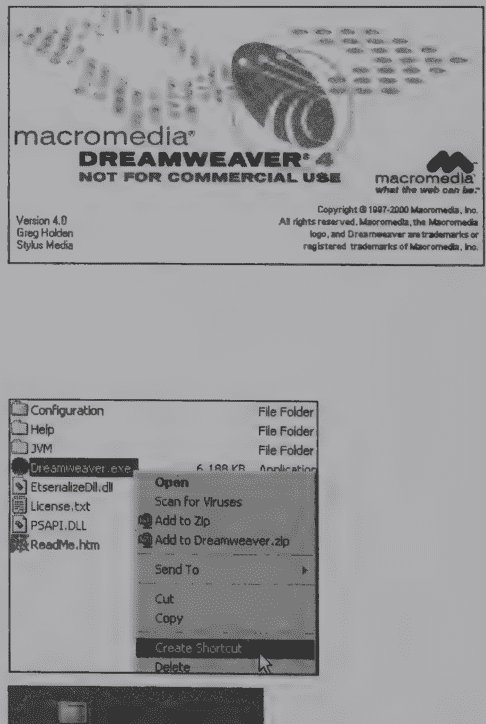


# 探索界面

在 Dreamweaver 加载完成后，你就可以开始创建网页并处理它们的组件部分了。窗口、面板和工具栏会在桌面的不同部分打开。你首先看到一组默认元素，当你更熟悉这个程序时，可以重新排列它们，并根据广泛的选项增加或减少内容。如果你看到屏幕上打开了更多面板，或者它们与此处显示的不完全一致，请不要慌。在本章后面的部分，你将学习如何移动、删除或添加窗口。现在，我们选择了并安排了你可能认为最有用的组件：

1. 文档窗口
2. 对象面板
3. 属性检查器
4. 启动器

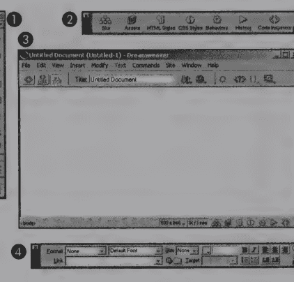

# 窗口

Dreamweaver 中的窗口具有工具栏、菜单栏和滚动条，并出现在屏幕上。你最可能使用的窗口是文档窗口。

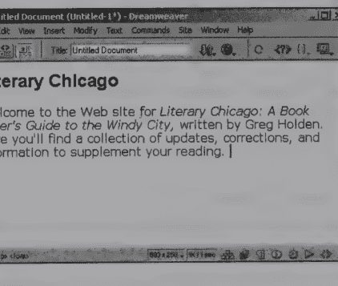

# 文学

欢迎阅读《文学芝加哥》（Literary Chicago），该书由 Greg Holden 编写。

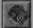

# 面板

像此处所示的面板包含让你格式化网站部分的选项或按钮。面板有一个关闭框和标题栏，你可以抓取标题栏来移动面板。面板的内容根据当前选择的项目而改变。

你看到的面板是之前的那个，只是调整了大小。你可以通过点击边缘或右下角并向内拖动（变窄）或向外拖动来调整面板的大小。

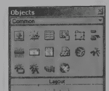

# 检查器

检查器是 Photoshop、PageMaker 等程序用户的熟悉项目。它为当前选中的网页对象提供特定信息。如果选择了图像，你会看到图像检查器。如果选择了单词或其他文本元素，会出现文本检查器，显示有关字体字体的规格（包括字体大小）以及让你更改设置的控件。


# 上下文菜单

另一种获取 Dreamweaver 界面特定方面信息的方法是查看与元素相关的上下文菜单。当你右键点击（Windows）或 Ctrl+点击（Mac）某个元素时，屏幕上会弹出上下文菜单；它包含仅适用于该元素的菜单选项。


# 基础工具

将鼠标光标悬停在任何图标上几秒钟。提示提示会显示图标名称，状态栏中会出现解释性文本。当你忘记特定图标的作用或正在寻找正确的功能时，工具提示非常有帮助。

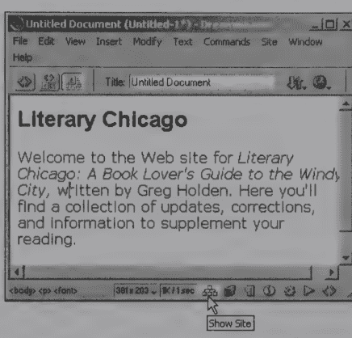

# 不可见元素

网页像文字处理器和其他软件一样，包含初始不可见的格式元素，这些元素指示空格、段落标记、换行符等。在 Dreamweaver 中，通过选择 `视图|视觉辅助|不可见元素` 来显示不可见元素。

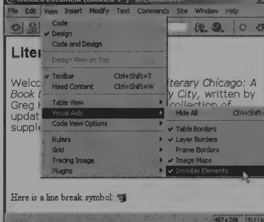

## 文档窗口格式

文档窗口是 Dreamweaver 中创建和编辑网页内容的大部分工作发生的地方。该窗口配备了丰富的工具，因此从一开始就熟悉熟悉它是至关重要的。文档窗口包含 10 个主要组件：

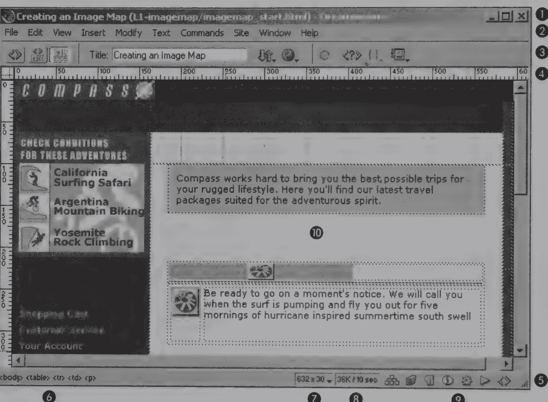

- 1. 标题栏
- 2. 菜单栏
- 3. 工具栏
- 4. 标尺
- 5. 状态栏
- 6. 快速标签编辑器
- 7. 窗口大小指示
- 8. 下载统计
- 9. 启动器栏
- 10. 内容区域

## 基础工具

你在 Dreamweaver 中处理的每一个网页文件——即使尚未开始编辑的无命名文件——都是通过文档窗口顶部标题栏中的信息来标识的。

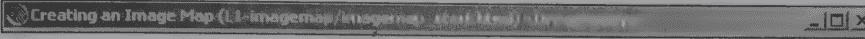

以下项目是标题栏的重要部分：

- Dreamweaver 标志
- 当前页面的标题
- 文件位置/文件名 [位于括号中]
- 最小化/最大化/还原框

> 网页的标题与文件名不同。文件名是你分配给文件的简短名称，它出现在访问者使用 Web 浏览器定位文件的统一资源定位符 (URL) 中。当页面打开时，页面标题会显示在标题栏中。

## 菜单栏

Dreamweaver 菜单栏位于标题栏正下方，与你在其他 Windows 程序中菜单栏相似。创建和格式网页所需的菜单选项（如“修改”、“命令”和“站点”）将在后面的章节中介绍。

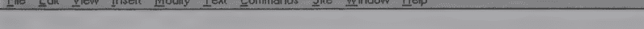

### 工具栏

工具栏出现在菜单栏下方，包含标题文本框以及控制它的按钮，就像你查看显示的文档一样。

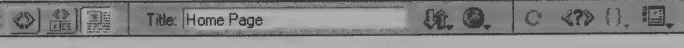

从左到右，这些按钮如下：

- 显示代码视图——点击此按钮将显示当前页面的 HTML 代码。

代码视图对于习惯于输入或编辑页面原始 HTML 代码的网页设计师非常有用。在代码视图中，你不仅可以查看 HTML，还可以编辑它，就像在网页本身上输入和替换将出现在网页上的文本一样。

- 显示代码和设计视图——此按钮将文档分为两半。上半部分显示代码；下半部分显示设计视图。（在设计视图中，文本和图像显示方式与浏览器窗口中相同。）对代码进行更改，你可以立即在窗口的下半部分看到效果。

- 设计视图——如果你处于代码视图或设计视图中，按此按钮将文档窗口恢复到原始的设计视图。

- 标题文本框——在此框中为当前网页输入一个简短、清晰的标题。你在页面标题栏中输入的标题将是该标题。默认标题为“无命名”。

- 文件状态菜单——使用此按钮，它包含帮助你协作创建网站的选项。你可以从本地和远程服务器检入/检出文件，并使用设计注释（Design Notes）为团队添加注释和备注。

- 在浏览器中预览/调试——当你想要启动浏览器并预览外观时，点击此按钮，以便调试问题并在必要时进行更改。

- 刷新设计视图——如果你对页面进行了更改但没有立即显示，请点击此按钮刷新页面，以便查看任何最近更改的效果。

- 参考——此按钮打开参考面板，你可以使用它来查找有关 HTML 命令、JavaScript 代码或样式表指令的信息，以防你忘记了实现某种特定效果所需的确切命令。

- 代码导航器——点击此按钮打开代码导航器菜单，该菜单包含作为脚本编辑代码元素的编辑选项。例如，如果你在页面中添加了 JavaScript，你可以插入一个断点，告诉浏览器在该点停止执行代码。

- 选项菜单——此按钮包含隐藏或显示框架或表格边界、标尺、网格或其他视觉辅助工具的选项。

## 标尺和网格

虽然在设计网页时无法达到完美，但 Dreamweaver 在定位、图像或其他元素方面为你提供了高程度的控制。这种控制来自标尺以及由垂直线和水平线组成的网格。你通过分别选择 `视图|标尺` 和 `视图|网格` 来显示这些定位辅助工具。这些菜单选项中的每一个都有子菜单，让你控制零点和其他设置。

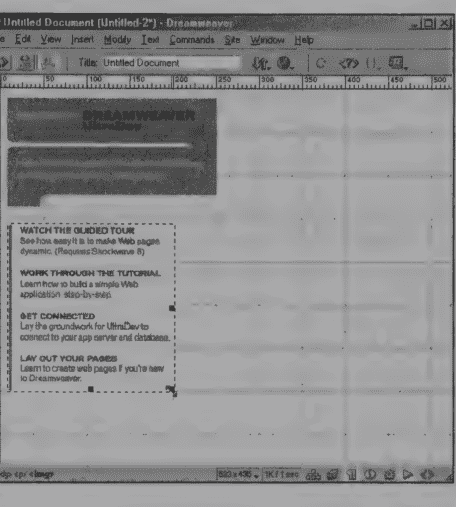

### 状态栏

文档底部的此条包含许多关于你正在处理的文件的有用信息。它还包含一组控件（启动器栏），允许你打开其他窗口和面板。

```
<body><p></body>
```

以下是状态栏的主要组件：

- 标签选择器——控制当前选中内容格式的 HTML 标签出现在状态栏左侧的此区域。
- 窗口大小指示——此区域以像素为单位显示当前窗口的大小。点击大小将显示下拉窗口，你可以从中选择标准窗口大小来配置当前页面。
- 下载统计——状态栏的此区域通过告诉你页面大小（千字节，K）以及使用 28.8Kbps 调制解器下载整个页面所需的时间，跟踪你的网页变得多么复杂。
- 启动器栏——状态栏右侧的这组按钮让你打开其他窗口和面板。这组按钮可以打开站点、资源、样式、行为、历史、代码导航器、选项、参考、调试、预览和设计视图。-调整句柄——点击并拖动此处来调整 Dreamweaver 窗口。

## 选择标签

根据光标在状态栏中的位置，状态选择器会显示控制当前选中内容格式的 HTML 标签，出现在状态栏的左侧。你可以点击状态选择器来选择 `<body>`、`` 等标签。状态选择器会根据你选择的标签。例如，当你点击 `<body>` 标签，整个网页将变为高亮。

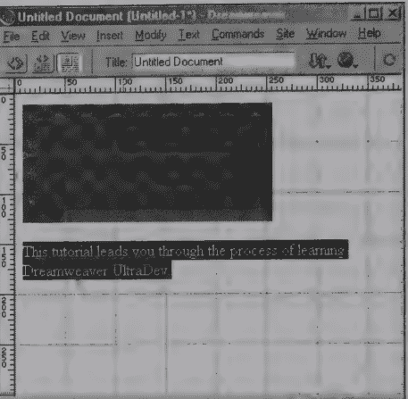

## 文档窗口大小

窗口大小指示不仅显示当前窗口的大小，还可以通过点击右侧的小箭头来选择尺寸。一组预设尺寸会出现。当你选择一个尺寸时，Dreamweaver 会进行调整。

在设计网页时，请记住，查看你工作的人并不都有 17 英寸或更大的显示器。为了调整你的网页以便大多数观众能够看到内容，请选择一个标准尺寸，如 800x600。

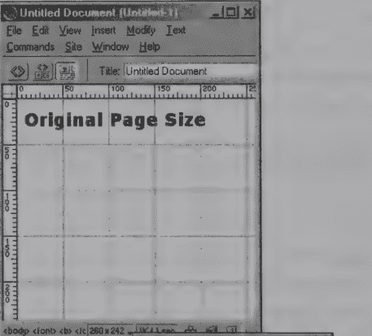


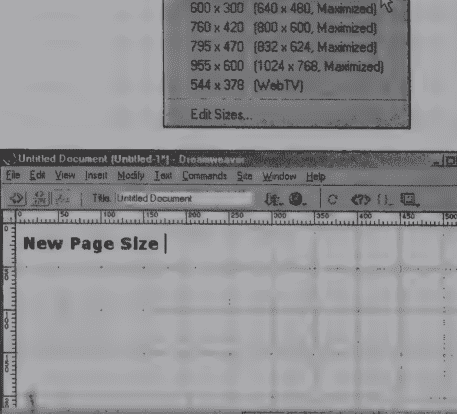

## 启动器栏

正如你第一次启动 Dreamweaver 时看到的，这是一个带有窗口、面板和检查器的程序。为了保持桌面区域整洁，可以通过点击各个组件框来关闭它们。你可以从“窗口”菜单中取消或选择窗口、面板或检查器。启动器栏提供了打开组件的快捷方便的方法。它是状态栏右侧的一组按钮。由于启动器栏是启动器的微版本，这两个组件将在本文稍后介绍。

要了解启动器栏按钮的功能，将鼠标指针悬停在每个按钮上即可查看工具提示。启动器栏在启动器关闭时使用最为理想。你可以同时使用两者，也可以单独使用启动器。要关闭启动器栏，选择“编辑|首选项”打开首选项窗口，点击“状态栏”类别，并取消勾选状态栏中的“显示启动器栏”复框。

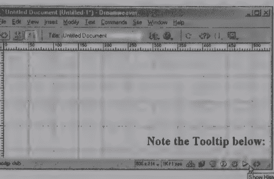

## 内容区域

内容区域是你查看和编辑网页文档或正在处理的网站内容的地方。由于 Dreamweaver 是一款 WYSIWYG 编辑器，其内容与 Web 浏览器窗口中的显示方式非常接近。左边距处的文本光标会变为箭头。当箭头可见时，你可以单击一次选择相邻的行，单击三次选择相邻的段落。点击并按住鼠标按钮向上或向下滚动以选择一组段落或图像。

## 使用属性检查器

在许多网页编辑器中，你可以通过选择菜单选项来格式化文本或图像：点击菜单，选择一个选项，可能将鼠标移动到子菜单选项，打开一个对话框，然后从对话框中选择选项。最后，点击“确定”应用更改。Dreamweaver 通过让你能够持续访问属性检查器上的格式选项，极大地简化了这一过程。属性检查器上可用的选项取决于所选内容。例如，文本、图像或可点击的热点将有不同的可用选项。

| 格式 | 标题 2 | 默认字体 | 大小 | 无 |
|---|---|---|---|---|

| 链接 | | | | | | |

这里讨论了属性检查器中每个元素都通用的某些重要选项：

- 拖动条—`Drag Bar`—将属性检查器拖到新位置。
- 关闭框—`Close Box`—关闭检查器。
- 指向文件—`Point To File`—打开本地文件的链接。
- 浏览—打开导航窗口，你可以在其中浏览计算资源以查找文件或对象。
- 帮助—`Help`—打开浏览器窗口，其中包含当前属性检查器中每个元素的详细解释。
- 快速标签编辑器—`Quick Tag Editor`—打开一个窗口，显示当前选中元素的 HTML，以便你可以在需要时编辑代码。
- 展开箭头—`Expander Arrow`—增大属性检查器的尺寸，以显示你可能需要的额外选项。

## 基础工具

当你点击展开箭头时，属性检查器会根据你正在操作的检查器显示新选项。这里显示的文本属性检查器选项非常实用。“列表项目”按钮出现了；它仅在列表中的项被选中时才会高亮，你可以用它来更改项目符号或数字的格式。但图像和表格的选项更为详尽。点击“放大”版本检查器中的展开箭头可将其恢复到原始大小。

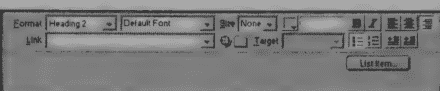

## 查看图像属性

通过图像属性检查器的选项，你可以指定图像的属性，如高度和宽度、对齐方式和间距。在图像中，顶部显示了图像属性检查器的小版本，下方是扩展版本。这将在第 4 章中详细介绍。

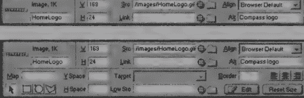

## 使用对象面板

对象面板提供了一系列快捷按钮，让你能够快速向正在创建的网页中插入常用项目。要向当前页面添加图像、水平规则或整个表格，可以点击该按钮或将按钮拖入文档窗口。对象将添加到插入点。

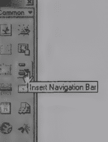

对象面板默认不出现在启动器栏中，但你可以通过更改面板偏好为该组件添加按钮，这将在本章后文中描述。

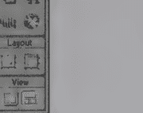

# 第 1 章

## 添加常用对象

默认情况下，对象面板中出现的按钮是一常用的 Web 项目，你可以从面板标题栏附近的“常用”标题看到。根据你的所选内容，可能会出现对话框，要求你指定文件或提供有关要添加内容的信息，例如你想创建的表格的行数或列数。

Dreamweaver 提供了在通常出现对话框时不出现添加对象的选项。该对象将作为你正在编辑的网页上的占位符，以便你稍后添加。在点击按钮或将其拖入文档窗口时，按住 `Ctrl` 在 Macintosh 上按 `Option` 键。在许多情况下，对象将在不显示对话框的情况下被添加，导航栏、框架和 Flash 按钮除外。

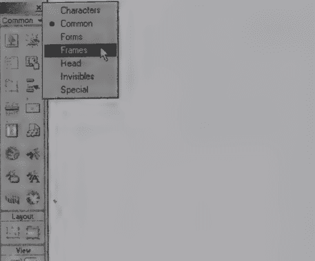

## 伸缩面板

默认情况下，对象面板是一个窄的垂直面板。你可以调整其形状以适应可用的桌面空间。将鼠标悬停在面板的四个边缘的任意一个上。当普通的单箭头变成双箭头时，点击并按住鼠标按钮，然后向外或向内拖动窗口以赋予它新的形状。

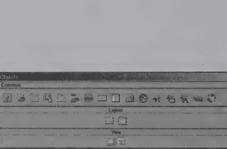

对象面板的布局和视图区域有助于简化使用表格单元格布局网页的过程。这些内容将在本章后半部分和第 5 章中讨论。

## 基础工具

你可以通过点击“常用” 字旁边的箭头并选择另一个选项，将对象面板的内容从默认常用对象更改其他元素集。如果你正在创建一个表单，选择“表单”选项。如果你正在将页面分为框架，选择“框架”。“字符”选项允许你选择特殊字符，如版权符号等符号和元素，在 HTML 中，它们由一组难以记忆的字符表示。你不需要查找字符并输入它们。


在许多情况下，对象将在不显示对话框的情况下被添加，导航栏、框架和 Flash 按钮除外。

与其需要查找字符并输入它们，你直接从字符面板中选择它们。

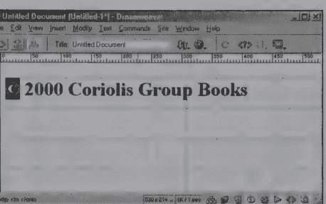

如果你正在创建一个网页表单，选择表单选项。如果你正在将页面分为框架，选择框架。你可以通过选择下拉菜单来添加对象。

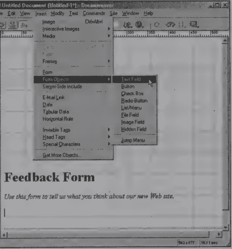

## 查看其他面板

之前介绍的 Dreamweaver 面板是你最可能使用的，但它们并不是你可用的全部面板。其他面板将在本书中介绍，如下所示：


1. 对象
2. 文档窗口
3. 属性检查器
4. 启动器
5. 代码
6. 行为

## 资产

当你需要更新网站时，对象面板提供了一个可以查看所有元素的地方，如模板、Flash 按钮等，它们位于面板底部。

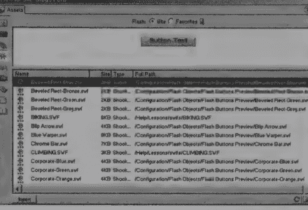

## 引用

选择 `窗口>引用`，可以访问包含 HTML 和 JavaScript 详细说明的库。从描述下拉菜单中选择选项。

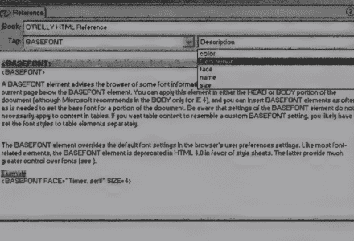

## 行为

你可以使用行为面板上的选项让你的网站更具交互性。在文档窗口中选择一个对象，如弹出菜单，然后为其关联一个行为。参见第 9 章和第 14 章。

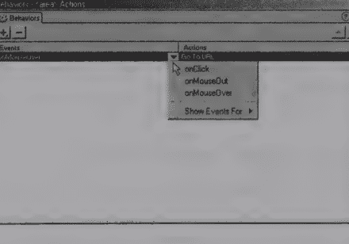

## HTML 样式

选择 `窗口>HTML 样式` 或在启动器中点击 HTML 样式将显示样式检查器，它提供了一个可以使用常用样式的地方。样式检查器的其他选项卡包含你可以使用的层叠样式表 CSS 样式或行为。选择样式和清除段落样式特别有用。它们可以让你擦除应用于所选文本的任何格式。

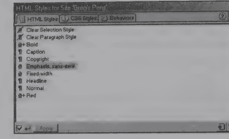

## 历史

创建和编辑网站涉及许多重复任务。你可以通过使用历史面板重放任务，加快你的工作。此面板显示了自你创建或打开文件以来，执行的所有步骤。你可以重做以前执行的操作，甚至为自动化重复任务创建快捷方式。

如果历史面板中缺少某些操作，请不要惊讶；你不会看到在其他框架、其他文档窗口或站点窗口中执行的操作。

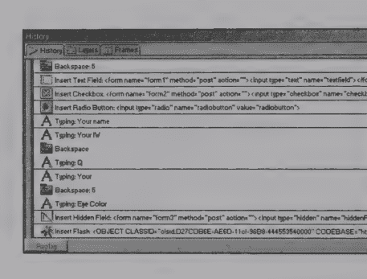

## 基础工具

让桌面整洁的一种方法是点击每个打开面板的标题栏/拖动条，并将其拖动到新位置。你可以选择 `窗口(Window) | 排(Arrange)`，让 Dreamweaver 整理所有打开的窗口和面板——它们会自动对齐到桌面的边缘。


你可以使用“窗口”菜单选项来快速排列打开的面板。选择“隐藏面板(Hide Panels)”或按 `F4` 键隐藏所有打开的面板（“文档窗口”保持不变）。此时，“隐藏面板”选项将变为“显示面板(Show Panels)”，会让任何被“隐藏”的面板重新出现。

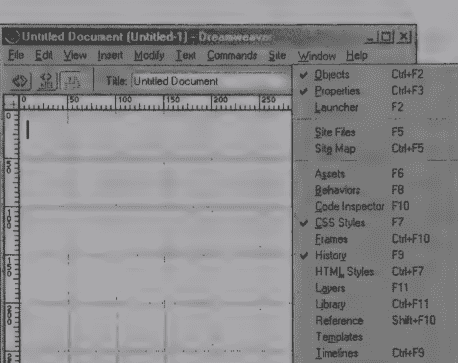

## 堆叠面板

排列面板的另一种方法是拖动它们，使它们堆叠在另一个之上。

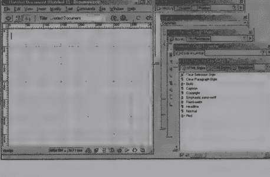

### 最小化窗口

选择“窗口(Window) | 全部最小化(Minimize All)”并不仅仅是影响你当前打开的面板。它会将所有打开的文档窗口和面板缩小为 Windows 工具栏上的一个按钮（在 Mac 上，则为 Finder 菜单）。在 Windows 上，“全部最小化”选项的作用与点击标题栏中的最小化按钮相同。

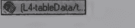

选择“窗口(Window) | 还原(Restore)”将重新打开你之前最小化到任务栏的任何文档窗口。

## 吸附对齐

当你拖动一个面板且它靠近另一个面板时，你正在拖动的面板会吸附到静态面板的旁边。当你将面板或窗口拖动到显示器可视区域的边界时，该组件会自动对齐。

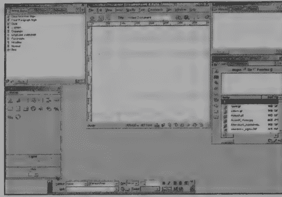

## 停靠面板

节省面板空间的一种巧妙方法是合并或停靠两个或多个独立的面板，使它们成为单个面板中的独立标签页。Dreamweaver 中的大多数面板都可以停靠——也就是说，合并为一个具有多个标签页的单个浮动面板。将一个面板拖到另一个面板上方即可进行停靠。

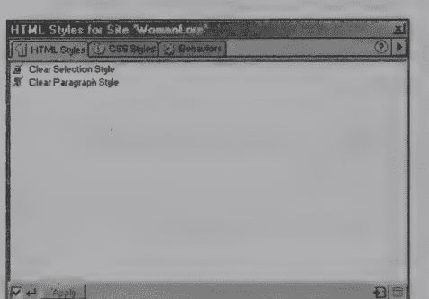

启动器(Launcher)、属性检查器(Property Inspector) 和站点窗口(Site Window) 无法停靠。

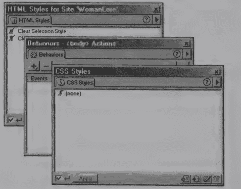

## 自定义工作环境

正如网页根据其描述的人员或业务风格进行定制一样，Dreamweaver 也可以进行定制以适应你的工作风格。除了更改文档窗口的外观，你还可以对面板、HTML 显示以及许多功能进行细微的个性化修改。在接下来的章节中，我们将介绍最常见的修改、优化和微调。（从一开始熟悉这些偏好设置是好的。）

## 打开首选项

Dreamweaver 界面的大多数自定义选项都可以通过（按下 `Ctrl+U`）打开“首选项(Preferences)”对话框来找到，该对话框控制 Dreamweaver 的应用程序选项。此对话框包含一个自定义选项列表；我们在这里介绍最常用的。

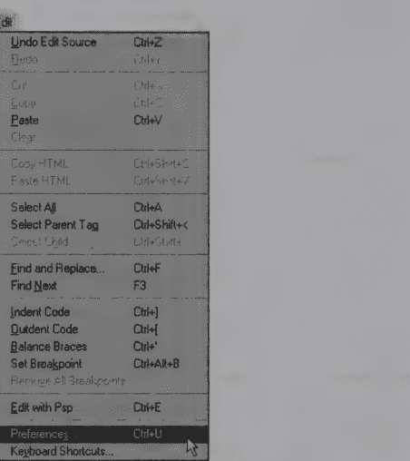

### 首选项窗口

首选项对话框有两个组件。左侧是 Dreamweaver 功能列表。当你点击列表中的某一项时，右侧会出现一组控制控件。如果你不理解所有的首选项设置，请点击“帮助(Help)”按钮。Dreamweaver 的帮助窗口将打开，并解释适用于当前所选功能的选项。

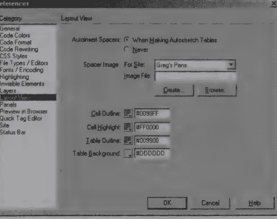

## 通用首选项

Dreamweaver 的通用首选项分为两个部分。顶部部分的选项控制文件的处理方式。“在新窗口中打开文件(Open Files In New Window)”控制网页是否在独立的 Dreamweaver 窗口中打开；取消勾选此选项意味着新文件将在相同窗口中替换旧文件。

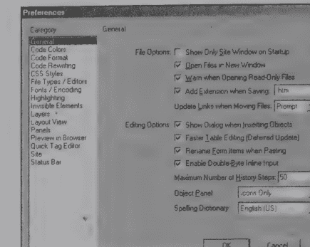

“移动文件时更新链接(Update Links When Moving Files)”告诉 Dreamweaver 当文件从一个目录移动到另一个目录时应具有多少控制权。当你选择“始终(Always)”时，Dreamweaver 会自动更新链接；“提示(Prompt)”会让 Dreamweaver 在链接需要更新时提醒你；“从不(Never)”——如果你选择此选项，链接可能不会更新。

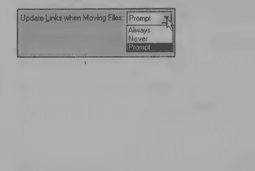

通用首选项的第二部分控制……（此处原文不完整，对应图片）

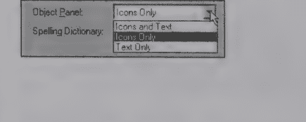

## 字体/编码(Fonts/Encoding)

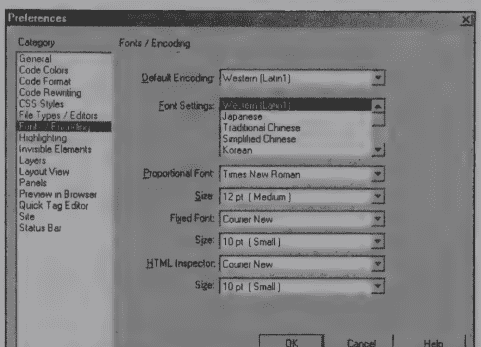

字体/编码首选项允许你设置 Dreamweaver 使用的字体。在编辑期间，你可以设置字体大小和属性。等比例字体通常用于正文，而等宽字体用于代码。属性检查器中的字体列表显示了你使用的字体。

### 修改默认字体列表

1. 在属性检查器中，点击“默认字体(Default Font)”旁边的箭头打开“字体列表(Font List)”。

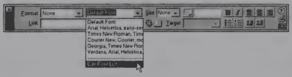

2. “可用字体”框列出了系统上可用的字体。滚动列表并点击字体名称。

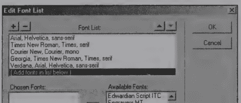

3. 点击箭头按钮将选字体移动到“已选字体(Chosen Fonts)”列表——即显示在属性检查器中的字体。

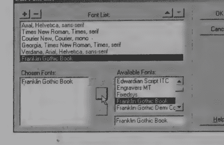

4. 点击“确定(OK)”关闭字体列表，并检查属性检查器中的字体列表。

## 文档窗口首选项

文档窗口是 Dreamweaver 中大多数网页编辑操作的地方。你可以自定义许多文档窗口元素。

### 显示网格

选择“视图(View) | 网格(Grid)”打开网格菜单，你可以用它显示或隐藏网格或更改网格设置。

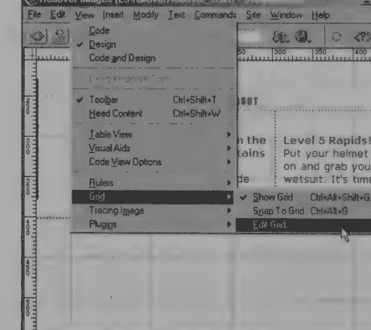

## 基础工具

当你从网格菜单中选择“编辑网格(Edit Grid)”时，会弹出“网格设置”对话框。你可以控制网格线的外观和间距，以及对象是否吸附到网格。

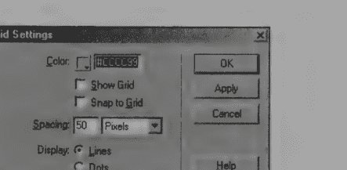

## 修改刻尺设置

选择“视图(View) | 刻尺(Rulers)”打开刻尺菜单，正如预期的那样，你可以自定义刻尺设置。刻尺标记可以是像素、英寸或厘米。

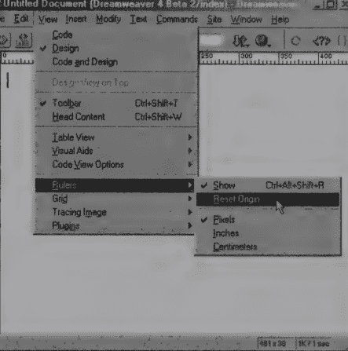

## 调整零点

位于垂直和水平刻尺交处的交叉线框控制着零点。要移动零点，请点击该框并向下拖动到内容区域。

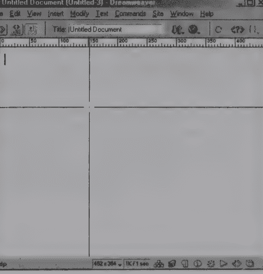

## 基本工具

### 1.

选择“编辑(Edit)|偏好(Preferences)”或按下 `Ctrl+U`。

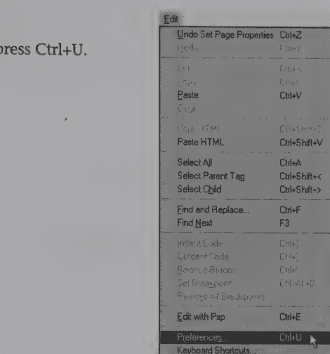

### 2.

点击偏好窗口左侧列表中的“状态栏(Status Bar)”。

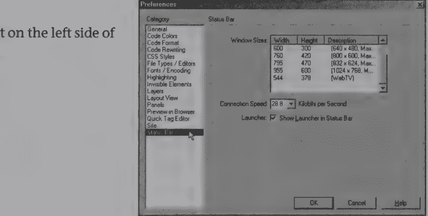

### 3.

从连接速度(Connection Speed)下拉菜单中选择一个选项。（速度以秒千比特或 Kbps 为单位）。点击“确定(OK)”关闭偏好。


## 自定义启动器和启动栏偏好

启动器（Launcher）是一个包含关闭和打开（或启动）Dreamweaver 面板按钮的面板。点击按钮，相应的面板将打开；再次点击，打开的面板将关闭。

### 默认启动器按钮

启动器及其微型版本（状态栏中的启动器栏）包含的默认按钮可以自定义，以包含你最常用工具的控制按钮。


以下列表包含了你可能会遇到的一些常用按钮：

- 站点(Site)—打开站点窗口，你可以用它直观地跟踪当前站点中位于本地硬盘上的网页布局。
- HTML 样式(HTML Styles)—打开 HTML 样式面板，可以在其中分配样式或创建新样式。
- CSS 样式(CSS Styles)—控制 CSS 样式选项，你可以用它跟踪附加到网页或站点的任何自定义样式表。
- 代码检查器(Code Inspector)—打开代码检查器，通过它可以查看并快速编辑当前页面的 HTML 代码。

## 基本工具

### 添加启动器按钮


要向启动器添加按钮，请选择`编辑(Edit) > 偏好(Preferences)`，然后点击`面板(Panels)`类别。在面板偏好设置中，点击启动器当前现有按钮列表上方的加号按钮 (`+`)。在出现的下拉列表中，当前出现在启动器中的面板名称显示为灰色。选择一个未灰色的面板，即可将相应的面板添加到列表中。

你在偏好窗口中对启动器所更改也会影响启动器栏中的按钮。每个组件上的按钮是相同的。


## 删除启动器按钮

要删除启动器按钮，请在`面板偏好(Panel Preferences)`窗口的当前按钮列表中选择你想要删除的按钮。然后点击按钮列表上方的减号按钮 (`-`)。所选选项将从列表中移除，当你关闭偏好时，该按钮将从启动器中消失。

在偏好窗口的当前按钮列表中选择一个选项，点击`向上`或`向下`按钮，你可以重新调整所选按钮与其他按钮之间的位置。列表顶部的按钮将出现在启动器和启动器栏的最左侧。


## 启动器方向

要将启动器栏的方向从水平改为垂直（或反之），点击右下角的方向图标。启动器将立即吸附到新位置。


# 第 2 章：处理网页文件

- 查看并编辑 HTML 或或其他网页代码
- 创建并保存新网页
- 打开、编辑和关闭已有的网页
- 分配背景颜色和边距
- 打印网页
- 获取帮助

## 在台前/幕后工作

如果你以前使用过网页创建程序，你就会意识到，它的主要目的是让你能够添加图像、格式化文本并设计网页的整体外观，而无需手动输入超文本标记语言 (`HTML`) 命令。`Dreamweaver` 为你提供了丰富的按钮、菜单、面板和其他用户友好元素，简化了添加网页可见部分的过程。`Dreamweaver` 拥有一项先进的优势：它非常容易通过代码窥探“幕后”，这些代码控制着网页（以及网站）的运行。这不仅包括 `HTML`，还包括 `JavaScript` 和层级样式表 (`CSS`)。

在本章中，你将学习使用 `Dreamweaver` 创建网页以及编辑或设计网页的基本技术。如果你是经验丰富的网页设计师，这大部分材料将作为复习，尽管关于 `Dreamweaver` 用于编辑和处理代码的强大功能的描述对你来说可能是新内容。如果你是刚开始，你将概述网页是如何工作的，以及你如何使用 `Dreamweaver` 与之交互。

## 网页的剖结构

几乎所有的网页编辑器都允许你查看和编辑。如果你在文档窗口的`代码视图(Code View)`部分难以找到某段代码，请在`设计视图(Design View)`部分选择你想要编辑的元素。你想要编辑的代码将在代码窗口中高亮显示。

代码视图和设计视图之间的对应关系也是双向的。在窗口的代码视图部分选择某些代码，相关内容将出现在窗口的设计部分。


### 切换代码视图和设计视图

如果你想更改 `Dreamweaver` 中的任何工作方式，请搜索帮助菜单（或此本书的索引）或查找菜单选项。例如，如果你不喜欢代码视图在顶部、设计视图在底部，选择`视图|设计视图在顶部(View|Design View On Top)`。这两个视图将交换。

要返回原始布局，再次选择`视图|设计视图在顶部`。设计视图将翻回到文档窗口的下半。


### 显示代码检查器

文档窗口不是查看代码的唯一地方。你可以将整个文档窗口留给设计视图，随时使用代码检查器处理代码。要显示代码检查器，你可以选择`视图|代码检查器(View|Code Inspector)`、按下 `F10` 键，或者点击启动器或启动器栏中的代码检查器按钮。


## 网页文件操作

## 代码检查器工具栏

文档窗口中几个与代码编辑相关的按钮位于代码检查器自身的微工具栏中。例如，如果您在代码检查器窗口中更改了代码，可以通过点击`刷新设计视图(Refresh Design view)`在文档窗口中看到效果。（本章将讨论其他按钮。）

当文档窗口中显示代码时，代码检查器可以同时打开。这允许您在需要时，同步地查看和/或编辑同一个 `HTML` 文件的两个部分。


## 理解 HTML 标签

每个 `HTML` 文档都由两个命令（标签）定义，这两个标签可能也可能出现在文件的开头和结尾（可选的）：`<HTML>` 和 `</html>`。第一个标签被称为`开始标签`（start tag），第二个（带有正斜杠的）是`结束标签`（end tag）。在这两个闭合标签之间，`HTML` 文件有一个头部部分（Head section）和一个主体部分（Body section）。主体部分由 `<BODY>` 和 `</BODY>` 标记，包含了在文档窗口中显示的网页内容。


```html
<<html>
<head>
<title>Untitled Document</title>
<meta http-equiv="Content-Type" content="text/html; charset=iso-8859-1">
</head>
<body bgcolor="#FFFFFFFF">
</body>
</html>
```

## 查看头部内容

头部部分包含终端用户不可见的信息，页面标题除外，页面标题被 `<TITLE>` 和 `</TITLE>` 标签包围。但作为网页作者，可以通过选择 `查看|头部内容(View|Head Content)` 或按下 `Ctrl+Shift+W` 来查看和编辑头部内容。文档窗口会打开一个独立的区域。


### 头部内容图标

文档头部部分的图标代表了您正在工作的网页文件中头部部分当前包含的标签。在此处显示的页面中，第一个用于页面标题，第二个用于元信息——作为文档描述或描述文档内容的关键词——搜索引擎可以利用这些信息更轻松地找到该页面。


## 幕后操作

大多数用户喜欢 `Dreamweaver` 保护他们免于处理 `HTML` 和其他代码。但对于许多经验丰富的用户来说，访问代码是有用的。随着 `CSS` 和 `XML`（可扩展标记语言）的加入，网页变得越来越复杂，某些命令通过直接编辑代码来跟踪最好。以下章节描述了在 `Dreamweaver` 中处理网页代码的实用技术。

## 编辑代码

使用代码和设计视图（Code And Design Views）的一个优势是，如果您通过在文档窗口的半侧编辑代码来更改代码，只需遵循几个步骤，就可以几乎立即在另一侧看到结果。

### 1.

打开您想要编辑的文件，点击工具栏上的`显示代码和设计视图(Show Code And Design Views)`或选择 `查看|代码和设计视图(View|Code And Design Views)`。当文档窗口分为两个视图时，您可能需要调整窗口大小以更完整地查看网页。


### 2.

在文档窗口的`代码视图(Code View)`部分，滚动到您想要编辑的代码，并像使用任何文本编辑器一样进行更改：将文本光标置所需的位置，开始打字或删除您想要替换的代码。在代码区域选中的代码将同时在设计区域被选中。


Printers Row (`https://example.com/printers-row`)

| | | | | | | |

|---|---|---|---|---|---|-|

| 需要打印材料。Printers Row 是 | 解释了如何请求报价、如何了解打印机的 | | 如何以成本效益的方式准备作业。 | | | |

PRINTERS ROW

为企业、个人以及任何需要打印材料的人提供的资源。Printers Row 是一个关于如何请求报价、如何了解打印机，以及如何以成本效益的方式准备作业的资源。


### 3.

当在代码视图中替换或添加新代码时，您不会立即在设计视图（Design View）中看到更改反映。（毕竟您并不一定是在编辑可见文本；例如，您可能将一个图像标签从 `ALIGN=LEFT` 更改为 `ALIGN=RIGHT`。）点击`刷新设计视图(Refresh Design View)`工具栏以查看更改。


当在设计视图中替换文本时，也会立即在代码视图中看到更改。


Printers Row (https://example.com/printers-row)

| | | | | | | | | | |

|---|---|---|---|---|---|-||||

| 需要打印材料。Printers Row 是 | 解释了如何请求报价、如何了解打印机的 | | | 如何以成本效益的方式准备作业。 | | | | |

PRINTERS ROW

为企业、个人以及任何需要打印材料的人提供的资源。Printers Row 是一个关于如何请求报价、如何了解打印机，以及如何以成本效益的方式准备作业的资源。


# 编辑标签

HTML 文件的头部部分包含了元文档信息：适用于该文件的详细信息。

# 启动外部编辑器

所选的编辑器会被添加到“编辑”菜单中。例如，如果你将 Wordpad 指定为你的 HTML 编辑器，则会出现“使用 WORDPAD 编辑”选项，它会替换“使用外部编辑器编辑”。当你选择此新选项时，Wordpad 会自动启动，并且当前文件将在 Wordpad 窗口中显示，准备好进行编辑。

Dreamweaver 的 Mac 平台版本已与流行的 HTML 编辑器 BBEdit 集成。要启用此功能，点击“编辑|首好设置”，点击“外部编辑器”，并勾选旁边的复选框以“启用 BBEdit 集成”。之后，你就可以在 Dreamweaver 和 BBEdit 中打开同一个文档，你在其中一个程序中做的更改将自动反映在另一个程序中。


# 将外部编辑器集成到 Dreamweaver

当你使用所选的外部编辑器对文件进行更改后，保存该文件。然后返回 Dreamweaver。你将看到一个对话框，提示已进行更改。点击“是”刷新在 Dreamweaver 中显示的页面并查看更改。


# 文件操作

无论你是想创建一个全新的 Web 页面，还是编辑你或同事最初创建的页面，都可以轻松地从 Dreamweaver 开始。

## 打开现有文件

在 Dreamweaver 中打开已有的Web页面文件与其他许多应用程序中打开现有文件几乎相同：选择“文件|打开”或按 `Ctrl+O`（Mac 上为 `Cmd+O`），就会出现“打开”对话框。导航到你想要的文件，双击它或选择它并点击“打开”。该文件（只要它是Web页面文件类型，例如 HTML 文件或 JPEG 或 GIF 图像）就会在文档窗口中打开。

## 第 2 章

Dreamweaver 默认显示Web页面文件（以 `.htm` 或 `.html` 结尾的文件）。你也可以通过从“文件类型”框中选择“所有文档”打开图像文件或活动页面（在 Mac 上，从“显示”下拉菜单中选择“所有文档”）。


## 重新打开最近的文件

最后打开的四个文件可以通过“文件”菜单底部的列表快速访问。

## 创建新文件

创建一个Web页面文件在某些方面甚至比编辑现有文档更简单：选择“文件|新建”或按 `Ctrl+N`（Mac 上为 `Cmd+N`）即可开始运行。但 Dreamweaver 为新文件提供了一些选项和额外步骤，让你运行得更快。

## 更改文件首好设置

通常，当你选择“文件|新建”时，你创建的文件会在新的 Dreamweaver 窗口中打开。你可以通过更改首好设置来节省空间，让新文件也可以在现有的 Dreamweaver 窗口中打开。

### 1.

选择“编辑|首好设置”打开“首好设置”窗口，点击“常规”分类显示 Dreamweaver 的常规首好设置。


### 2.

点击“在新窗口中打开文件”旁边的复选框取消勾选。点击“确定”关闭“首好设置”窗口。


### 3.

现在，当你创建一个新文件时，它将不会创建一个新的 Dreamweaver 窗口。你可以通过选择文件名在文件之间切换。


## 输入标题

现在，当你创建一个新文件时，它将不会创建一个新的 Dreamweaver 窗口。你可以通过选择文件名在文件之间切换。当你创建一个新文件后，你需要指定标题。在“标题”框中输入文件名，按回车键以替换默认标题。


## 预览页面

文档窗口可以让你看到页面在线时的外观。你可以通过“文件|预览”并从子菜单中选择浏览器来预览你的页面。


## 启动浏览器

当你对页面做出更改后，通过“文件|预览”并选择浏览器来启动它。要预览页面，可以按 `Ctrl+F12`（Mac 上为 `Cmd+F12`）。


## 查看首好设置

在本地测试你的站点始终是个好主意。要添加浏览器，请选择“文件|首好设置|外部编辑器”。


## 编辑浏览器列表

点击加号 `+` 打开“添加浏览器”对话框。点击“浏览”找到你想要的浏览器，然后点击“打开”。在“主要”或“次要”旁边的框上标记，指示 Dreamweaver 使用哪种浏览器。如果你在计算机上运行服务器，则应勾选“使用本地服务器”框。


## 保存文件

每15分钟保存一次工作是个好主意。当你选择“文件|保存”或按 `Ctrl+S`（Mac 上为 `Cmd+S`）时，会弹出“保存”对话框。选择保存文件的目录，分配名称并点击“保存”。

当你保存文件时，Dreamweaver 会自动添加 `.htm` (Windows) 或 `.html` (Mac) 扩展名。如果你手动删除文件扩展名，Dreamweaver 将该文档视为纯文本文件。

## 处理网页文件

选择`文件(File)|还原(Revert)`，将文档窗口中当前显示的文件恢复到上一次保存的版本。执行此操作后，你自上次保存以来所做的所有更改都会丢失；如果你更改了一系列内容，这是一个删除这些更改的快速方法。


## 关闭文件

当你完成工作后，应该关闭你正在编辑的文件。在 Dreamweaver 中关闭文件很容易——但有几点你需要注意的“陷阱”。

### 不保存更改并关闭

选择`文件(File)|关闭(Close)` 或按 `Ctrl+W` (Mac 为 `Cmd+W`) 来关闭文档窗口中的文件。如果你没有保存最近的更改，Dreamweaver 会在关闭文件之前询问你是否要保存更改。大多数情况下，当此对话框出现时，你应该点击“是(Yes)”。如果你点击“否(No)”，将丢失自上次保存以来的所有更改。


## 关闭 Dreamweaver

如果你选择`文件(File)|关闭(Close)`并关闭了一个并非正在工作的唯一文件——也就是说你还有另一个打开的文件，因为你在两个 Dreamweaver 窗口中工作，或者在同一个窗口中处理两个或多个文件——该文档将关闭，而其他文件将保持打开。然而，如果你关闭的文件是 Dreamweaver 中唯一打开的文件，整个程序将退出。除非你想完全退出程序，否则不要关闭这一个打开的文件。

要通过更传统的方法退出 Dreamweaver，请点击“退出(Exit)”按钮，或关闭`文件(File)|退出(Exit)`、`Ctrl+Q (文件(File))|退出` 或 Mac 上的 `Cmd+Q`。


## 页面属性

在本章的早些部分，你学习了为网页分配标题的简单方法。页面属性适用于整个文件，而不是特定的元素（如表格、段落或图像）。学习如何定位和指定页面属性可以帮助你设计并在并在网站中定位该页面。

### 查看页面属性

选择`修改(Modify)|页面属性(Page Properties)` 或按 `Ctrl+J` (Mac 为 `Cmd+1`) 来查看文档窗口中当前显示文件的页面属性。


属性检查器（Property Inspector）不允许你查看整个页面属性，只能查看页面内所选元素的属性。你也可以选择`修改(Modify)|选择属性(Selection Properties)`来查看属性检查器中选中项的属性。

# 处理网页文件

## 设置背景颜色

当你选择“页面属性(Page Properties)”时，会打开页面属性对话框。你可以在“标题(Title)”框中输入标题。你可以点击“背景图像(Background image)”旁边的“浏览(Browse)”按钮并定位一个文件，将其插入到页面文本和其他内容之后方。（有关背景图像和颜色的更多信息，请参阅第 4 章。）你还可以指定除默认白色以外的实色背景颜色。

页面属性有一个“应用(Apply)”按钮，点击它可以将特定更改（例如你输入的标题或选择的颜色）应用到页面；此时页面属性对话框将保持打开，以便你进行进一步更改。如果你想应用更改并同时关闭对话框，请点击“确定(OK)”。


### 要为页面选择背景颜色，请点击“背景(Background)”旁边的白色按钮。会弹出一个颜色选择框，鼠标指针将变成吸管。点击你想要分配为背景的颜色。

“背景(Background)”旁边的框显示你所选颜色的十六进制代码。例如，白色的颜色代码是 `#FFFFFF`。

如果你编辑网页的 HTML，你可能需要此代码；在 HTML 中，代码有时以这种形式显示，尽管常见的颜色名称（红色、绿色）也能被识别。


### 点击“确定(OK)”或“应用(Apply)”将背景颜色添加到页面中。当你点击“确定(OK)”关闭页面属性对话框时，你也可以查看你所选择的颜色。

你还可以使用页面属性为页面的正文文本和标题文本分配颜色；更多信息请参阅第 3 章。

# 文档编码

“文档编码(Document Encoding)”选项允许你你的网页选择特殊编码，例如中文、希腊语或日语。当你设置编码时，浏览器将能够加载相应的字体。


## 修改页边距

页面属性中的页边距框可以用于调整周围的空间。“顶部(Top)”和“左侧(Left)”用于 Explorer，“高度(Height)”和“宽度(Width)”用于 Navigator。


# 预览你的页面

页边距框中输入的数值是任意值（像素、英寸等）。要预览页面，点击工具栏上的“在浏览器中预览”并选择你想使用的浏览器。


# 打印页面

你无法直接从 Dreamweaver 中打印；而是需要在浏览器中打开文档（见上文“预览你的页面”），然后从选定的浏览器进行打印。


# 使用打印预览

Internet Explorer 和 Netscape 都包含“打印预览(Print Preview)”选项，可以让你查看页面打印时的外观。这是检查分页符情况的好方法。选择`文件(File)|打印预览(Print Preview)`打开预览窗口。


# 获取帮助

如果你在编辑网页（或 Dreamweaver 的任何操作）方面需要帮助，请点击文档栏上的“帮助(Help)”菜单以访问 Dreamweaver 极其详尽且实用的帮助系统。

帮助菜单中的某些选项（如 Dreamweaver 支持 或 Dreamweaver Exchange）需要连接互联网。如果你尚未连接，选择这些选项之一将提示你的计算机建立连接。

# 通用帮助

要获取关于 Dreamweaver 的通用帮助，选择“使用 Dreamweaver(Using Dreamweaver)”或按 `F1`。如果你的默认浏览器程序（在本章早前的“预览网页”中定义）尚未运行，将启动并显示“欢迎使用 Dreamweaver”帮助页面。


# 帮助内容

帮助窗口分为两个框架。使用左侧框架查找主题；右侧显示该主题的信息。当你第一次打开窗口时，左侧框架显示“帮助内容”。浏览主题列表并点击主题旁边的展开器以查看其中的子主题。点击单个主题或子主题的名称，它将出现在右侧。

当你将鼠标指针悬过每个帮助主题时，其名称将显示在浏览器的状态栏中以验证你的选择。


# 帮助索引

点击左侧帮助框架中的“索引”(Index)可访问按字母排序的帮助主题列表。点击某个字母将显示该字母开头的主题列表。点击单个主题查看其帮助说明。


# 搜索帮助

点击左侧帮助框架中的“搜索”(Search)，将打开一个新的搜索窗口。在搜索窗口顶部的框中，输入一个或两个关键词来标识您想要查找的主题。点击“列主题”(List Topics)，包含关键词的主题集将出现在“选择显示主题”(Select Topic To Display)框中。点击其中一个主题，然后点击“显示”(Display)在主浏览器窗口查看该主题的帮助。


# 第 3 章

# 文本

- 为您的文本和其他文件创建本地网站
- 为网页文本分配字体、大小和颜色
- 探索 Dreamweaver 的文本选择和编辑工具

# 建立本地网站

俗话说，内容是 Web 之王，因此在选择和格式化图像以及连接您的文件以创建一个组织良好的网站之前，开始编写网页的文本是有意义的。网站是共同工作以传递信息的网页集合。

然而，在深入研究 Dreamweaver 的文本格式化工具之前，请考虑网站组织的另一个元素——将您的文件和其他 Web 内容放置在一个网站中，这样您在发布到网上之前，可以在计算机上对其进行测试。

# 网站菜单选项

文档窗口工具栏中“网站”(Site)菜单下的选项允许您创建或编辑已制作的网站。选择 `网站|新网站(Site|New Site)` 创建一个新网站。


## 网站定义窗口

当您选择 `网站|新网站` 时，会出现“网站定义窗口”。在“网站名称”(Site Name)框中为您的网站输入名称。


## 定义现有网站

在创建本地网站后，您可以选择 `网站|定义网站(Site|Define Sites)` 来添加有关它的信息。例如，您可以复制网站以进行备份。您还可以编辑现有网站或将网站与远程 Web 服务器（能够让您的文件在互联网上可见的计算机）关联。


在某些情况下，在有任何文件可以放入其中之前定义网站是最容易的。然而，您也可以通过指向包含网页和其他文件的现有文件夹位置来定义网站。

## 选择您的网站位置

当您的网站有了名称后，请在您的硬盘之一上为其选择一个位置。您将在该位置创建一个文件夹，其中包含您的 HTML 网页文件以及图像和其他内容。Dreamweaver 建议您在本地根文件夹（即硬盘的顶层）中创建网站文件夹。如果您的网站名为 MySite，则在 Windows 中的位置将是 `C:\MySite`。


您也可以将网站位于计算机的桌面上——考虑创建一个名为“Sites”的文件夹并在其中定位各种 Web 网站。Dreamweaver 会检查连接您的网页内容（如图像）与它们所在的网页之间的链接。将您的网站放在易于访问的位置可以使 Dreamweaver 轻松找到您所需的文件——更不用说让您也能找到它们了。

## 链接和缓存


在设置网站时，输入您的网站在远程 Web 服务器上发布文件时将拥有的 Web 地址（URL，统一资源定位符，以 `http://` 开头），以便其可以在互联网上查看。这样，Dreamweaver 就可以为您的图像和其他文件创建链接；当您将文件传输到远程 Web 服务器时，链接将就可以工作。

缓存是计算机内存中预留给特定选项的部分。网站定义对话框下半部分的“启用缓存”(Enable Cache)复选框告诉 Dreamweaver 为网站管理任务留出缓存，例如在“资源”(Assets)面板中维护网站内容的列表。除非您的内存极度低，否则请勾选此项。


# 处理网页文本

一旦为您的文件留出一个文件夹，您就可以专注于您的网站内容。本节将介绍您在 Dreamweaver 中可以使用许多文本和段落格式选项。

## 在文档窗口中输入文本

在网页中输入文本最明显的方法只需将光标置于文档窗口中并开始输入。按 `Enter` 插入换行。按 `Shift+Enter` 插入段落。按 `Tab` 键插入制表符。Dreamweaver 使用列表格式，每个项目单独占一行。


## 选择文本

可以通过鼠标在文本上点击并拖动在文档窗口中选择文本。选择一个单词，双击该单词。选择一个段落，三击该段。选择整个文档，按 `Ctrl+A` (Windows) 或 `Cmd+A` (Mac)。

要选择特定范围的文本，点击范围的开头，按住鼠标按钮并将鼠标拖到范围末尾。要删除高亮文本，按 `Backspace` 或 `Delete`。


## 处理文本

如果您已经在 Word、记事本或其他文字处理器中准备了文本，可以通过按 `Ctrl+C` (Mac 上为 `Cmd+C`) 复制它。切换到 Dreamweaver 并按 `Ctrl+V` (Mac 上为 `Cmd+V`)。Dreamweaver 不保留 Word 格式，但会保留换行。

## 导入 HTML

如果您更习惯在 Word 中创建内容，可以使用 Dreamweaver 的某些导入选项将文本引入文档窗口。

1. 在 Word 中创建文本并通过 文件|保存 保存您的更改。（您可能还想检查拼写。）如果它已打开，请切换到 Dreamweaver。如果没有打开，点击任务栏 (Windows) 或从 Finder 选择 Dreamweaver。文件|导入 Word HTML。

您还可以通过选择 文件|导入表格数据(Import Tabular Data) 导入在表格中格式化的文本和数值数据。参见第 5 章获取更多信息。

2. 打开“选择导入 Word 文件”对话框。找到文件，点击选择它，然后点击打开。

要导入的 Word 文件必须保存为 HTML 文档才能出现在“选择导入 Word 文件”对话框中。如果没有，请从“文件类型”下拉菜单选择“所有文件”以显示文件名。


3. 显示“清理 Word HTML”对话框。从顶部下拉菜单选择您用于创建文件的 Word 版本。默认情况下，对话框中的所有复选框均已选中，背景颜色设置为白色（十六为 `#FFFFFF`）。根据需要更改任何元素并点击确定。


4. 弹出一个对话框，告诉您从导入的文件清理了多少 Word 格式命令。点击确定。


5. 文件在文档窗口中打开。


## 在层中输入文本

层（Layer）是你可以在 Web 上创建的容器，用于包含文本、图像或其他内容。可以使用 Dreamweaver 创建和编辑的此类网页层被称为“动态”层，因为它们可以在页面上轻松地移动——例如，Dreamweaver 允许你将层堆叠在其他层之上。层的设计可能性非常强大，虽然它们是高级的 HTML 特性，但简要提到它们是有意义的，因为它们可以改进网页上的文本布局。

### 创建层

从文档窗口（Document Window）的菜单栏选择 插入>层（Insert>Layer），可以在窗口左上角插入一个层。层的大小是预设的，但你可以轻松地调整其大小和位置。


### 选择层

层左上角的小方块是选择句柄。点击它可以选择该层。层的轮廓周围会出现八个黑色句柄。此外，当鼠标悬停在层上时，文本光标会变成四头箭头。


### 调整层的大小/重新定位

要移动层，点击选择句柄，按住鼠标按钮并将层拖动到文档窗口的另一个部分。当层到达你想要的位置时释放它。要调整层的大小，点击并拖动句柄。向外拖动以使层变大；向内拖动使其变小。

层可以位于网页上的任何地方；如果你让网格显示出来，可以使用它来帮助精确定位层。


# 第 3 章

## 查看层属性

当你选择一个层时，属性面板（Property Inspector）会变为层检查器（Layers Inspector）。你可以在检查器中查看层的属性，并为层分配除默认的 `Layer1`、`Layer2` 等以外名称。


层的问题是，早于 Microsoft Internet Explorer 4 和 Netscape Navigator 4 的浏览器不支持。尝试查看使用层的页面的访问者除非使用表格创建一个替代版本，否则他们将看不到任何内容。关于表格的更多信息请参阅第 5 章，层请参阅第 4 章。

## 使用字体

在 Dreamweaver 或任何其他网页布局程序中指定字体不像在图形程序中那样简单，因为你创建的网页将在 Web 浏览器中查看，而不是打印在纸上。尽管如此，你可以控制文本显示的某些方面，并且可以通过 Dreamweaver 的文本工具轻松地指定。

### 选择字体

终端用户对网页正文和标题的显示方式具有控制权。如果你不指定字体，用户的浏览器将使用其默认字体显示你的网页内容。然而，你可以通过选择字体（Font）并从下拉列表中选择一组字体来指定一组字体。


你也可以通过点击属性面板中的字体下拉菜单访问字体组列表。

## 处理文本

### 更改字体列表

如果你在系统中安装了想要在网页上使用的字体，且该字体未出现在字体列表中，请选择 文本|编辑字体列表（Text|Edit Font List）。在字体列表对话框中选择一个或多个字体，点击左箭头将字体移动到左侧框中，新字体将添加到你的字体列表中。


字体列表并不包含系统中的所有字体，而是建议你可能使用的字体。默认情况下，它不包含字体名称，因为你无法控制查看者是否安装了指定的字体。相反它包含了字体组（等宽、无衬线或衬线），以便查看者从其系统中找到最匹配的。

### 指定文本大小

除非使用样式表（参见第 10 章），否则你必须使用相对指定字体大小，而不是精确的点数。网页查看者控制正文的基础大小，这通常是 10、12 或 14 点。然而，你可以通过选择 文本|大小（Text|Size）或点击属性面板中的大小菜单，指定文本相对于用户基础字体的大小。


### 字体大小

默认的基础字体大小为标准；如果你选择它，可能在文档窗口中看不到任何变化。范围从 `+7` 到 `-7`；`+7` 比基础字体大 7 点；`-7` 小 7 点。


## 分配文本样式

要使选定文本加粗、斜体或下划线，选择要格式化的文本，从文本子菜单中选择选项。显示的许多样式是逻辑样式——与其告诉浏览器具体做什么（加粗、斜体等），不如使用强（Strong）或引用（Citation）等逻辑样式让浏览器决定如何格式化文本。


### HTML 样式

如果你在网页的多个位置为选定文本分配相同的样式，选择 文本|HTML 样式（Text|HTML Styles）来定义 HTML 样式对话框。你可以创建一个包含多个文本属性的样式。


### 分配 HTML 样式

为你的样式分配一个名称，它会被添加到文本|HTML 子菜单。


### 分配文本颜色

要给单个字符、单词或其他文本段分配颜色，选择文本|颜色（`Text|Color`）显示 Windows 或 Macintosh 的颜色对话框。


#### 属性面板颜色框

你也可以选择文本并使用属性面板分配颜色；点击大小下拉菜单旁的颜色框，会出现颜色对话框。点击某种颜色来选择它。


# 其他常用文本功能

现在你已经学会了如何进行基础文本格式化，准备好迈下一步，执行比简单分配样式或更改字体大小更常用的功能。

### 添加特殊字符

许多重要字符，如版权符号（©），无法在标准 ASCII 文本中生成。相反，必须使用指定的字符序列添加到网页中：例如用于版权符号的 `&copy;`。幸运的是，你不需要记住这些序列。你可以通过访问对象面板来插入特殊字符。点击与你要使用的特殊字符对应的按钮，将项目插入文档窗口。


# 第 3 章

如果你想在字符之间或网页上添加额外空格，按下空格键是不起作用的。你需要插入一个不换断空格。将文本光标放在合适的位置，然后选择插入|特殊字符|不换断空格（`Insert|Special Characters|Non-breaking Space`）。


### 使用对象面板

你也可以按下对象面板不可见（`Invisibles`）部分的插入不换断空格按钮来添加不换断空格。

你可以连续添加多个不换断空格，在你的文本中创建更多空间。一旦添加了一个空格，使用编辑/重做（`Edit/Redo`）或按 `Ctrl+Y` 重复插入。


# 检查拼写

在 Dreamweaver 中创建网页之前，你不需要文字处理器的拼写检查器找出找出错误。你可以通过选择文本|检查拼写（`Text|Check Spelling`）或按 `Shift+F7` 使用 Dreamweaver 的内置工具检查当前在文档窗口显示的页面。


### 检查拼写对话框

在检查拼写对话框的“字典中未找到单词”字段中，Dreamweaver 显示你正在检查的页面上第一个识别的单词。如果你想保留当前拼写，点击忽略。点击全部忽略让 Dreamweaver 在单词再次出现时不再检查。点击更改来更改拼写；你可以使用 Dreamweaver 在更改框中的建议，也可以输入你自己的单词。点击全部更改更改所显示单词的所有实例。


## 查找和替换文本

Dreamweaver 最强大的功能之一是搜索单词并将其替换为您指定的文本。假设在本书正在创建的 WomanLore 站点中，名称已更改为 WomanLore。你可以快速查找并替换所有的 WomanLore 实例。

### 1.

首先选择“编辑|查找和替换”，或者按 `Ctrl+F` 来显示“查找和替换”对话框。


### 2.

在“查找内容”旁边的框中，输入你想要查找的文本，然后点击“查找下一个”。如果 Dreamweaver 找到了该文本，该文本将在“文档窗口”中当前显示的 Web 页面上被高亮显示。


你可以搜索单词的一部分，而不必搜索整个单词。

### 3.

如果你想替换文本，请在“替换为”框中输入替换文本。如果你希望 Dreamweaver 精确匹配其找到的大写和小写字母，请勾选“区分大小写”。勾选“忽略空格差异”框可以告诉 Dreamweaver 在查找文本时忽略空格差异。点击“替换”来替换 Dreamweaver 刚刚找到的高亮文本；点击“替换全部”来替换当前文档中所有的搜索项实例。


### 4.

你可以通过从“查找和替换”对话框顶部的“查找范围”下拉菜单中选择选项，将查找替换范围扩展到同一 Web 站点其他文档。你可以搜索包含文档的整个 Web 站点、站点中选定的文件，或者包含当前文档 Web 站点的文件夹中的所有文件。

在创建指向图像和其他文件的链接时，将属于单个 Web 站点的所有文件都保存在单个文件夹中将是最简单的。尽管如此，单个文件夹也可以包含多个站点，或者它可以包含不同的子文件夹，每个子文件夹持有单个 Web 站点或属于某个站点的一些文件（一个文件夹可以包含文本文件、图像文件等）。


### 5.

要更改位置，请点击“查找”按钮旁边的文件夹图标。然后在“选择搜索文件夹”对话框中浏览你的计算机计算资源，点击你想要搜索的文件夹，然后点击“选择”。


# 导出文本

导出你的 Web 页面的部分或全部内容与复制文本并粘贴到另一种格式是不同的。当你导出时，你要么保留某些特殊格式，要么以特殊格式保存内容的某些方面。当你选择“文件|导出”时，可以将当前显示的 Web 页面部分内容保存为可扩展标记语言（XML）格式。你还可以保存当前页面的样式表信息，或者选择页面上的表格并将其内容导出到另一个文档。


# 为早期浏览器进行转换

许多 Web 浏览器使用旧版本的 Microsoft Internet Explorer、Netscape Navigator或其他浏览器——通常是因为他们没有内存来运行新版本。Web 页属性与 Web 浏览器的3 或更早版本不兼容。作为你普通 Web 页面的替代方案，你可以提供一个旧浏览器的访问者可以查看。选择“文件|转换到|3.0 浏览器兼容”。在“转换为3.0 浏览器兼容”对话框中选择一个选项并点击“确定”来转换文件。


请确保仅在完成文件编辑后进行转换——否则，你每次更改都必须重新转换。

# 段落和页面划分

你为 Web 页面创建的文本吸引访问者的注意力，但文本以可读段落形式排列的方式首先吸引了他们的注意力，并让他们在你的站点的各个页面之间移动。本节简要概述了一些更重要的段落对齐功能；你将在第11章的项目中学习更多关于它们的知识。

## 创建分隔符

与 Web 页设计的其他方面相比，分隔符非常简单。它们只分为两类：段落和换行符。

段落通过空格与其他文本或图像隔开。当你想要换行但不在该行与相邻文本或图像之间添加空格时，则使用换行符。

在此处按 `Return` 创建段落

## 换行符

与 Web 页设计的其他方面相比，换行符只分为两类：段落和换行符。

段落通过空格与其他文本或图像隔开。当你想要换行但不在该行与相邻文本或图像之间添加空格时，则使用换行符。

在此处按 `Return` 创建段落

## 创建段落

你为 Web 页面创建的文本吸引访问者的注意力，但文本以可读段落形式的方式首先吸引了他们的注意力，并让他们在你的站点的各个页面之间移动。本节简要概述了一些更重要的段落对齐功能；你将在第11章的项目中学习更多关于它们的知识。

段落通过空格与其他文本或图像隔开。当你想要换行但不在该行与相邻文本或图像之间添加空格时，则使用换行符。

在此处按 `Return` 创建段落

## 创建换行符

与 Web 页设计的其他方面相比，分隔符只分为两类：段落和换行符。

段落通过空格与其他文本或图像隔开。当你想要换行但不在该行与相邻文本或图像之间添加空格时，则使用换行符。

在此处按 `Return` 创建段落

## 段落选项

你为 Web 页面创建的文本吸引访问者的注意力，但文本以可读段落形式的方式首先吸引了他们的注意力，并让他们在你的站点的各个页面之间移动。本节简要概述了一些更重要的段落对齐功能；你将在第11章的项目中学习更多关于它们的知识。

段落通过空格与其他文本或图像隔开。当你想要换行但不在该行与相邻文本或图像之间添加空格时，则使用换行符。

在此处按 `Return` 创建段落

# 段落格式


你为 Web 页面创建的文本吸引访问者的注意力，但文本以可读段落形式的方式首先吸引了他们的注意力，并让他们在你的站点的各个页面之间移动。本节简要概述了一些更重要的段落对齐功能；你将在第11章的项目中学习更多关于它们的知识。

# 添加列表

在系列中的每个项目后插入换行符只是创建列表的一种方法。引起一组文本项目注意的更好方法是将它们分组为编号列表或其他类型的列表。

Web页面列表类型：

- 有序列表

  包含一系列编号的项目
- 无序列表

  呈现一组项目符号的项目
- 定义列表

  看起来就像这个列表

# 对齐段落

你可以对单个单词或段落（以及图像——请参见第 4 章）进行左对齐、右对齐，或者让它们在页面上居中。选择你想要对齐的文本，在属性检查器中点击“左对齐”、“居中对齐”或“右对齐”按钮。

你也可以通过选择文本|对齐|左侧（或居中或右侧）来对齐。


# 使用缩进按钮

另一种缩进的方法是首先将文本光标置于想要缩进的行或段落之前，点击属性检查器中的“缩进”按钮。你也可以选择文本|缩进或按 `Ctrl+Alt+I`。多次点击“缩进”或多次选择“文本|缩进”可以从左边距缩进文本。


缩进按钮旁边的“取消缩进”按钮会将缩进文本向左边距移动。你也可以选择文本/取消缩进或按 `Ctrl+Alt+[`；

# 添加水平规则

任何可以为 Web 网页添加留白并将页面重要部分隔开的方法，都能让你的内容在计算机显示器上更具可读性。划分页面文本最简单且有效的方法之一就是添加水平规则。

# 插入分页符

要创建水平规则，将光标置于文档中你希望规则出现的位置。按 `Enter/回车` 键在你想要插入规则的地方创建一个空白段落；默认情况下，它将跨越整个 Web 页面的宽度，而不会干扰你的文本。然后选择插入|水平规则来添加线条，该线条前后都有段落分隔符。


# 修改水平规则属性

默认情况下，水平规则显示为轮廓而非实黑线；它还具有 3D 阴影。无论页面多窄或多宽，规则都会跨越 Web 页面的全宽。你可以更改规则使其成为实黑线，也可以通过点击规则将其高亮，然后选择“修改选定属性”来显示属性检查器。


# 修改水平规则宽度

当前选中水平规则的宽度可以用像素值表示，也可以以 Web 页面宽度的百分比表示。Web 页面可以被调整得非常窄或非常宽。从下拉菜单选择“像素”或“%”，然后在 W 旁边的框中输入测量值以指定宽度。输入“100”表示 100 像素宽的规则，输入“50”表示占页面宽度 50% 的规则。


要使规则变为实黑色，请取消勾选属性检查器中“阴影”旁边的复选框。从“对齐”下拉菜单中选择选项，可以将较短的规则向左或向右对齐以使其居中。

# 修改水平规则厚度

你可以通过选择规则，然后在属性检查器中 H（高度）旁边的框中输入数字来更改水平规则的厚度。你输入的数字代表磅（points）的高度——例如，输入“3”表示规则高度为 3 磅。


### 第 4 章

添加和格式化图像

- 学习 页面图像格式
- 在 Web 页面上放置现有图像
- 编辑图像尺寸、对齐和其他属性
- 控制图像与相邻文本的交互
- 使用颜色和图像作为 Web 页面背景
- 使用图像作为标题并创建悬停效果

# 理解 Web 格式

为万维网创建图形的过程与为打印或其他媒体设计有很大不同。然而，目标是相同的：通过有效的视觉通信传达强有信息。本章将带你开始使用 Dreamweaver 创建 Web 图形，以满足你的通信目标。

## 位图

矢量图形

计算机图形大致分为两类：由位图组成的图像和由矢量组成的图像。虽然两种类型在互联网上都能找到，但位图远为常见的 Web 图形，也是你可能自己创建的类型。位图是由称为像素的微小方形组成的图像，每个像素代表一个位信息。


# GIF 图像

如 TIFF（标记图像文件格式）或 EPS（封装 PostScript）等高分辨率图像格式无法在 Web 页面上，因为文件大小太大。取而之使用的是压缩格式。其中最流行的是 GIF，代表图形交换格式，最适合图像。


# JPEG 图像

`JPEG`（读作 jpeg）代表联合图像专家小组。`JPEG` 适用于需要更高压缩率的照片。


# PNG 图像

`PNG`（读作 png）代表便携网络图形，是对 `GIF` 的改进。

# 添加和格式化图像

# 剪画

剪画源自网络上的可用目录。某些剪画在商业网站上的使用有限制，或要求你注明作者。


# 使用 Web 图像

Dreamweaver 使插入、操作和调整图像变得简单，如下节所示。

# 插入现有图像

浏览器通过识别类型（也称为 MIME 类型）显示图像。通常，MIME 类型是由文件名结尾的三个或四个扩展名决定的。你可以通过编辑|首选项查看扩展名列表。


要向当前显示的页面添加图像，首先将光标置于页面上插入图像的位置。然后选择插入|图像或按 `Ctrl+Alt+I`（Mac 上为 `Option+Cmd+I`）显示选择图像对话框。


### 第 4 章

你也可以通过点击对象面板中的插入图像按钮来向当前显示的页面添加图像。


# 选择图像对话框

选择图像对话框比通常的打开对话框信息更多。你不仅可以了解文件的位置和名称，还能在预览区域看到图像的缩略图，以及它的像素高度和宽度、文件类型和文件大小。


如果你不需要预览并想节省空间，请取消勾选图像预览框。

# 在层中放置图像

你可以将图像添加到层中，就像将文本添加到层中一样（参见第 3 章）。

# 1.

选择文件|新建或按 `Ctrl+N` 打开新页面。

## 2.

你可以选择“`InsertLayer`”（插入层）来插入一个默认尺寸的层。然而，你也可以绘制自己的层，将其精确放置在你想要的任何位置。点击“Objects”（对象）菜单中的“`Draw Layer`”（绘制层）按钮。


## 3.

当你点击“`Draw Layer`”（绘制层）按钮时，文本光标会变成十字准。在“Document Window”（文档窗口）中点击你想作为图层角的点。例如，点击左上角，然后向向右拖动直到到达右下角。

选择“`ViewGrid`”（视图网格）可以在文档窗口中显示一个有助于定位图层的网格。


## 4.

你可以向层中输入、复制、粘贴或导入文本。要添加图像，首先将文本光标置在你希望图像出现的位置。然后选择 `Insert|Image`（插入|图像）或点击“Objects”（对象）面板中的“Insert”（插入）按钮。


## 5.

当“Select Image Source”（选择图像源）对话框出现时，找到你想添加的文件，单击一次，然后点击“Select”（选择）。


## 6.

如果你尚未保存放置图像的文件，Dreamweaver 会显示此处所示对话框。点击 `OK`（确定）继续。

### 要使文档成为相对路径，应先保存文档。

在保存文档之前，将使用文件：`"//"` 路径。

不再再次显示此消息

确定

## 7.

如果你要插入的图像与当前文档所在的网站根目录不在同一目录，Dreamweaver 将显示此对话框。点击“Yes”（是），你将在根文件夹中放置该图像的副本，以便与其他 Web 文件一起发布。


文件位于站点 'Lessons - Dreamweaver' 的根文件夹之外，在发布网站时可能无法访问。

你的根文件夹是

`:\Program Files\Macromedia\Dreamweaver 4 Beta\Lessons\Lesson Files\`

你想要将文件复制到此处吗？

是 否

如果你点击“No”（否），那么在你决定发布包含该图像的页面时，你必须跟踪文件的位置并维护通到该文件的链接。

## 8.

如果你决定将文件复制到根文件夹，将出现“Copy File As”（另存文件）对话框，此时你可以点击“Save”（保存）。文件将被复制，图像将添加到当前页面。


## 选择句柄 (Selection Handles)

你可以像处理其他 Web 页面对象一样复制、删除或移动图像。点击图像，周围会出现一组选择句柄，显示图像已被选中。


## 添加和格式化图像 (Adding and Formatting Images)

### 移动图像 (Move an Image)

不要期望像绘图或页面布局程序中那样选择图像并将其拖动到文档窗口。当句柄可见时，你可以按 `Backspace` 或 `Delete` 键清除图像，或者可以选择 `Edit|Cut`（编辑|剪切）将图像剪到剪贴板，以便将其粘贴到面的其他地方。然后点击将光标置于页面新位置并选择 `Edit|Paste`（编辑|粘贴）插入图像。


你可以在 Web 页面上直接上下移动图像，但图像只会以小增量移动。

### 调整图像大小 (Resize an Image)

要快速调整图像大小，单击图像进行选择。然后将鼠标箭头悬停在某个句柄上，使其变成双向箭头。点击句柄，按住鼠标按钮并拖动图像以更改大小。


> 在许多情况下，仅仅拖动图像会导致其失真。除非按住 `Shift` 或 `Ctrl` 键按比例调整大小，否则拖动会导致照片失真：但某些线条画在调整大小后仍然看起来尚可，无论你是否按住 `Shift` 或 `Ctrl`。

### 编辑图像 (Editing Images)

一旦你将图像添加到 Web 页面，就可以更改其属性使其与页面的其他内容有效融合。你还可以指定一个 Dreamweaver 可识别的图像编辑程序，这样你就可以在两个程序之间轻松切换，在编辑其他 Web 页面的同时改进图像。

### 图像属性 (The Image Property)

一旦你将图像添加到 Web 页面，就可以更改其属性使其与页面的其他内容有效融合。你还可以指定一个 Dreamweaver 可识别的图像编辑程序，这样你就可以在两个程序之间轻松切换，在编辑其他 Web 页面的同时改进图像。


### 指定图像 (Specify an Image)

一旦你将图像添加到 Web 页面，就可以更改其属性使其与页面的其他内容有效融合。你还可以指定一个 Dreamweaver 可识别的图像编辑程序，这样你就可以在两个程序之间轻松切换，在编辑其他 Web 页面的同时改进图像。


### 为图像命名 (Name an Image)

一旦你将图像添加到 Web 页面，就可以更改其属性使其与页面的其他内容有效融合。你还可以指定一个 Dreamweaver 可识别的图像编辑程序，这样你就可以在两个程序之间轻松切换，在编辑其他 Web 页面的同时改进图像。


### 备用文本 (The Alt Text)

一旦你将图像添加到 Web 页面，就可以更改其属性使其与页面的其他内容有效融合。你还可以指定一个 Dreamweaver 可识别的图像编辑程序，这样你就可以在两个程序之间轻松切换，在编辑其他 Web 页面的同时改进图像。


### 添加和图像 (Adding and Images)

一旦你将图像添加到 Web 页面，就可以更改其属性使其与页面的其他内容有效融合。你还可以指定一个 Dreamweaver 可识别的图像编辑程序，这样你就可以在两个程序之间轻松切换，在编辑其他 Web 页面的同时改进图像。


### 第 4 章

图像周围的边框会引起额外的注意。如果图像作为链接，也可以使用边框（见第 6 章）；尽管 Dreamweaver 会自动为作为链接图像添加边框，但你仍然可以调整默认边框。要调整边框或创建新的边框，请遵循以下步骤。

# 添加和格式化图像

默认情况下，图像与左边界对齐，除非你在首次放置要使用的图像时，将光标放在文本块中间或另一幅图像的右侧。你可以通过点击图像属性检查器（Image Property Inspector）下方（展开）部分的对齐按钮之一来更改图像对齐方式。


## 指定图像编辑器

你可以使用 Dreamweaver 来放置并对图像进行调整；然而，在更改对比度或色彩方面，你需要单独的图像编辑程序。你可以配置 Dreamweaver，以便在图像处于文档窗口（Document Window）时对其进行快速编辑。

### 1.

选择 `Edit|Preferences`（编辑|首选项）或按 `Ctrl+U` 打开首选项对话框。


### 2.

点击 `File Types/Editors`（文件类型/编辑器）。然后在，在扩展名（Extensions）框中，点击代表你想编辑的图像文件类型的扩展名，例如 GIF 图像的 `.gif`。然后点击编辑器框上加号 `+`。


### 3.

在选择外部编辑器（Select External Editor）对话框中，找到你想要使用的图像编辑程序。选择该程序并点击打开。

在 Windows 中，程序以 `.exe` 结尾（例如 `Paint Pro.exe`）。在 Mac 上，程序在访达（Finder）中被标记为“应用程序程序”。


### 4.

选中的程序出现在编辑器（Editors）框中。对你预计编辑的每种图像类型重复步骤 2 和 3——你可能也想选择 JPEG `(.jpg/.jpeg)` 图像，可能还有 PNG `(.png)` 文件。你可以为一个文件扩展名指定多个可能的图像编辑器。


### 5.

当你需要编辑图像时，右键点击它以显示右键菜单。选择 `Edit With`（用...打开），然后选择指定的编辑器。编辑器会自动启动并打开图像以供编辑。

你也可以展开属性检查器（Property Inspector）并点击 `Edit`（编辑）来启动编辑器。


### 6.

在你的图像编辑器中保存更改，然后返回 Dreamweaver。点击图像，它会立即刷新以反映你的更改。


# 文本与图像的交互

对网页图像可以进行的一些重要调整涉及图像与相邻文本的交互方式。在文本和图像之间添加额外的空间可以让页面看起来更专业。

# 图像周围的环绕

你可以通过两种方式让文本环绕相邻图像。

### 1.

在环绕图像文本时，要么将文本光标放在文本之前然后插入图像，要么将文本光标放在图像侧面然后插入文本。


### 2.

选择图像并选择 `Modify|Selection Properties`（修改|选择属性）以显示图像属性检查器。点击对齐（Align）框旁箭头，从对齐选项列表中选择左对（Left）。


### 3.

文本环绕图像。


# 调整图像周围的空间

默认情况下，图像与相邻文本之间只有大约三点磅的空间。你可以通过选择图像并在展开的属性检查器的 V Space（垂直空间）和 H Space（水平空间）框中输入数字来调整空间。

## 1.
V Space 设置控制图像上方或下方的垂直空间：H Space 控制图像左侧或右侧的水平空间。将 V Space 改为 6 磅，H Space 改为 9 磅。


## 2.
点击应用（Apply）查看文档窗口中的更改。


# 图像与换行

有时你并不希望文本环绕图像。你可以指定文本在图像之前换行并在图像之后恢复。

## 1.
选择图像，然后从属性检查器的对齐（Align）菜单中选择顶部（Top）以查看更改。


## 2.
从对齐（Align）菜单中选择中间（Middle），使第一行文本从图像中间开始，并让后续文本出现在下方。这种对齐方式适用于单行标题。


# 背景图像

每个网页都有一个背景颜色，显示在主文本和图形之后。默认情况下，颜色是灰色或白色，但设计师可以指定另一种颜色或可以平铺（重复）的图形图像作为壁纸出现。请参此颜色选择器的示例。

## 分配颜色

### 确保对比度
避免选择与网页上的文本冲突或过于相似的背景颜色。红色背景将使橙色或蓝色文本几乎不可读。只要你指定文本为白色或任何浅色，黑色或深色背景都没有问题。


### 使用浏览器安全色
坚持使用216 种标准 Web 安全色确保所有浏览器的显示一致。Dreamweaver 的颜色选择器带有多种调色板；颜色立方体（Color Cube）和连续色调（Continuous Tone）调色板中显示的颜色是安全的。选择调色板，点击页面属性（Page Properties）框中的背景（Background）或文本（Text）框。点击右上角的箭头。在出现的菜单中选择颜色立方体或连续色调。

216 这个数字源于红、绿、蓝的各六个值——6 x 6 x 6 = 216 种可能的颜色组合。如果你正在使用调色板或任何非 Web 安全的颜色并选择了“对齐到 Web”（Snap To Web），Dreamweaver 会自动将选定的颜色替换为接近的 Web 安全色。

| | #FFFFFF | Color Cube |
|---|---|---|
| 文本 | | Continuous Tone |
| 链接 | | Windows OS |
| 左边距 | | Mac OS |
| 上边距 | | Grayscale |
| 文档编码 | | Snap to Web |

# 创建背景图像

网页背景图像通常是较小的虚化设计，不会干扰网页的其他内容。在背景中使用图像会让页面看起来像背后的壁纸，并增加深度和视觉趣味。

## 1.
在你的图形程序中创建虚化图像。


## 2.
选择修改|页面属性（Modify|Page Properties）显示页面属性对话框。点击背景图像（Background Image）框旁边的浏览（Browse）按钮。


## 3.
在选择图像源（Select Image Source）对话框中选择图像文件，然后点击选择（Select）返回属性。点击确定关闭页面属性。


## 4.
你返回 Dreamweaver 文档窗口，图像显示在当前网页的背景中。

# 特殊网页图像

当你创建交互图像或将图像作为标题或其他导航地标时，网页在图形上会变得非常有趣。一旦熟悉了放置和调整图像的基础知识，就可以应用特殊图像让你的页面更具吸引力。

## 使用图像作为标题

为了增强冲击力，许多设计师避免使用标准的网页标题，而是使用 Photoshop 等图形程序创建它们。他们将标题保存为 GIF 或 JPEG 格式并作为图像放置在网页上。


## 创建鼠标停图像

网页上流行的图像行为之一是鼠标停图像（rollover）——当你的鼠标经过它时，它会变成另一种样子。这种效果通过网页脚本语言 JavaScript 实现。通常，鼠标停图像用于按钮：原始按钮图像会变成某些东西，提示你点击按钮后浏览器将去向何处。


## 添加和格式化图像

创建你想要使用的两张图像——“之前”图像以及鼠标箭头经过该原始图像后显示的“之后”图像。

将光标置在你想创建悬停效果的地方。从文档菜单栏中选择插入交互式图像|悬停图像（Insert Interactive Images|Rollover Image）。出现插入悬停图像的对话框。

在“插入悬停图像”对话框中，你可以为悬停图像指定一个名称。在“原始图像”（Original Image）框中输入“之前”图像的文件，在“悬停图像”（Rollover Image）框中输入“之后”图像的文件。你还可以指定访问浏览器在点击悬停图像后应显示的页面 URL。点击确定。

确保包含悬停效果的 Web 以及图像本身位于相同的目录中。如果不是，你可能会得到“损坏的图像”图标，因为 Dreamweaver 无法从网页建立到图像的链接。


## 5.
如果所有文件不在同一目录中，请重新创建悬停，并在“插入悬停图像”对话框中“原始图像”和“悬停图像”框旁的浏览按钮上。在相应的选择对话框中找到图像文件，以便 Dreamweaver 能够建立链接。

## 6.
当“插入图像悬停”对话框关闭且原始图像出现在页面上时，按 F12 在 Web 浏览器中预览图像，以便测试悬停效果。将鼠标箭头悬过图像以查看其悬停切换。

通过创建一系列使用悬停效果的按钮，你可以在 Web 页面上创建一个交互式导航栏。与其单独创建每个按钮，不如通过选择插入|交互式图像|导航栏（Insert|Interactive Images|Navigation Bar）一次性创建所有悬停。


# 第 5 章
使用表格组织网页内容

- 理解 Web 表格的组件
- 创建新表格并向单元格添加内容
- 使用表格设计并为网页添加颜色

## Web 表格的结构

表格是 Web 页面的功能，在最简单的范围内，它们允许文本或图像像电子表格一样按行和列进行排列。但你不需要成为财务天才就能使用它们。通过 Dreamweaver，你可以格式化并编辑表格使其成为复杂的页面布局工具。

### 行和列
表格最基本的用法是以列和行的形式呈现表格数据，就像在电子表格中呈现的数据一样。此表格有六行。第一行有一列。其他五行有三列。

| 姓名 | 日期 | 写作类型 |
|---|---|---|
| George Ade | 1866-1934 | 报纸专栏、剧本 |
| Nelson Algen | 1902-1938 | 小说、短篇、文章 |
| Sherwood Anderson | 1876-1941 | 小说、短篇 |
| Finley Peter Dunne | 1867-1936 | 以“Dooley 先生”为特色的 |

### 边界
默认情况下，表格周围会出现一个可见的边界。默认边界具有三维外观并与页面背景颜色相同（尽管你可以更改几乎所有其他方面）。边界也可用于将页面上的大量信息分隔为单元格。

### 单元格内边距和间距
内边（Cell padding）是指单元格内容与单元格边界之间的空间（单位为像素）。单元格间距（Cell spacing）是指单元格之间的空间（单位为像素）。

- 默认间距/内边


- 添加 6 像素间距

- 添加 6 像素内边

| | | |

|---|---|---|

| Brownsville, TX | 1926 | |

| Fargo, ND | 1228 | 1376 | 727 |

| Norfolk, VA | 2546 | 1986 | 1363 |

| | | |

|---|---|---|

| Brownsville, TX | 1926 | |

| Fargo, ND | 1228 | |

| Norfolk, VA | 2546 | |

## 创建新表格

了解表格的主要组件是有用的，因为当你使用 Dreamweaver 提供的创建新表格选项时，会立即要求指定表格属性。虽然你可以更改表格布局，但最好第一次就做好。

### 使用插入菜单

要添加新表格，将文本光标置于你想让表格出现的地方。选择插入|表格（`Insert|Table`）或按 `Ctrl+Alt+T`（Mac 为 `Option+Cmd+T`）。当“插入表格”对话框出现时，指定表格的大小和尺寸。


在计算机上创建表格之前，画一个表格的草图通常很有帮助。用笔和纸手绘表格，或使用 Mac 的 MacDraw 或 Windows 的 Paint。


### 拖动表格按钮

如果你喜欢拖放，可以使用对象面板将插入按钮拖入文档以打开“插入表格”对话框。尝试将按钮拖到你想让表格出现的地方（箭头悬停在文档窗口时会变成加号）。当你松开鼠标时，会出现“插入表格”对话框。

如果你没有将表格放置在精确的位置，可以点击外部边界选择整个表格。选择编辑|剪切将表格剪入剪贴板，然后选择编辑|粘贴将其到所需位置。


### 插入表格对话框

当“插入表格”对话框出现时，你指定要创建的表格的初始设置。（你可以随时更改设置。）

当你首次打开“插入表格”对话框时看到的设置是你上次插入表格时使用的。可以随意更改。

#### 1.

输入你想要的表格行数和列数，以及任何内边（单元格与单元格边界之间的空间）和间距（单元格之间的空间）。

#### 2.

在“宽度”字段中，你可以指定固定像素的宽度。例如，如果你输入 200，表格宽度将为 200 像素。


#### 3.

你还可以将表格宽度指定浏览器窗口的百分比。在这种情况下，宽度取决于浏览器的宽度。


#### 4.

在“边界”字段中，输入一个指定表格外部边界宽度的数字。例如，如果你输入“6”，边界宽度为 6 像素。边界将具有可见的斜角外观。


#### 5.

如果你将边界宽度更改为 0，表格将没有可见边界。

“边界”框中的设置不控制单元格之间的宽度——那是单元格间距。


### 不使用对话框插入表格

如果你想在先指定这些选项之前插入表格，请选择编辑|首选项（`Edit|Preferences`）打开首选项对话框。确保显示常规首选项。取消勾选“插入时显示”。点击确定关闭首选项。现在，当你插入|表格或从对象面板将表格图标拖入文档窗口时，表格将立即出现。


出现的表格具有与上次创建的表格相同的设置。你可以按照本章后面的说明修改表格。

## 向单元格添加内容

一旦创建了表格并建立了通用配置，下一个逻辑步骤是向表格中的单个单元格添加内容。

### 输入文本

将文本光标置于单元格内的任何位置，然后点击。光标出现在单元格内，你可以开始输入文本。


### 格式化单元格文本

格式化表格单元格内文本的方法与格式化 Web 文件任何其他部分的文本相同：将文本光标置于单元格内，如果属性检查器未显示，则选择修改|选择属性（`Modify|Selection Properties`）显示属性检查器。


## 使用表格组织网页内容

### 关闭换行（Wrap）

通常情况下，当你向表格单元格中添加文本时，文本会在每行末尾换行。然而，你可以禁用自动换行。这将强制表格单元格扩展以适应文本。点击单元格，然后在属性检查器（Property Inspector）中勾选“不换行”（No Wrap）框。

| 换行 (Wrap) | 不换行 (No Wrap) |

|---|---|

| 小说、短故事、文章 | |

| 小说、短故事、文章 | |

### 复制和粘贴内容

向表格单元格添加文本或图像的另一种方法是复制和粘贴。将内容复制到剪贴板，在显示内容的单元格中粘贴光标，选择编辑|粘贴（`Edit|Paste`）或按 `Ctrl+V`（Mac 用户按 `Cmd+V`）。内容将出现在表格单元格中。

如果你粘贴的内容比单元格宽，单元格宽度将调整以适应你粘贴的内容。


### 插入图像

当然，你可以像将图像添加到网页的其他部分一样，向表格单元格插入图像。只需将光标放在所需的单元格中，然后选择插入|图像（`Insert|Image`）。当“选择图像源”对话框出现时，找到你需要的图像，点击其图标，然后点击“选择”（Select）将图像添加到表格单元格。

你还可以向表格单元格添加交互式图像（如鼠标悬停效果，选择插入|交互式图像 `Insert|Interactive Image`），以及插入菜单中显示的许多选项。


## 导入表格数据

你可以将电子表格或数据库信息导入 Dreamweaver 表格中，前提是你处理的是电子表格文件，且内容是逗号或制表符分隔。你需要将其保存为可以导入 Dreamweaver 的数据文件。

#### 1.

如果你想导入 Excel 或 Access 文件等电子表格数据，请将文件保存为文本（制表符分隔）或 CSV（逗号分隔）或类似的格式。


#### 2.

打开包含要插入数据页面的 Dreamweaver 文窗口。将光标置在你希望表格出现的位置，选择插入|制表数据（`Insert|Tabular Data`）。

你也可以选择文件|导入|制表数据（`File|Import|Tabular Data`）。如果你这样做，会弹出“插入表格数据”对话框，但它与第 3 步描述的“插入表格数据”对话框是相同的。


#### 3.

出现“插入表格数据”对话框。在“数据文件”（Data File）字段中，输入你之前保存的数据文件的名称（如果知道的话）。从分隔符下拉菜单中选择你使用的分隔符。如果你希望表格大小由内容自动决定，请选择“适应数据”（Fit To Data）。否则，请点击“设置”（Set）按钮并选择一个宽度。如果你想在创建表格之前确定表格外观，可以在其他字段中添加规格。点击“确定”（OK）。


如果你不知道数据文件的名称，点击“浏览”（Browse）打开“打开”对话框。找到文件，选择它，并点击“打开”（Open）。

#### 4.

表格出现在你插入的位置。


## 修改表格属性

到目前，你已经学习了 Dreamweaver 在网页中插入表格的不同选项。一旦创建了表格，乐趣就开始了你可以对表格应用颜色和其他设计特性，使其成为网页外观不可或缺的一部分。

### 选择表格部分

要对一个或多个表格单元格进行更改，你需要选择它们。有时，只想选择表格的某些部分可能是棘手的。当你点击单元格时，单个单元格并像图像那样清晰地高亮。


#### 选择整个表格


通过点击左上角（当鼠标变成四头箭头时）可以快速选择整个表格。或者，点击表格中的任意位置，并选择`Modify|Table|Select Table`或按 `Ctrl+A`。


### 选择行或列

选择一行或一列中所有单元格的一种方法是将鼠标指针靠近行或列的边缘。当指针变成指向单元格的黑色箭头时，点击鼠标按钮。该行或该列将被选中。


## 第 5 章

### 跨表格单元格拖动

点击一个单元格，按住鼠标键并按顺序跨越相邻单元格，以选择多个。
你也可以通过点击一个单元格，然后按住 `Shift` 键并根据需要点击其他单元格来选择多个相邻单元格。

### 选择不相邻单元格

如果你需要选择表格不同部分的单元格，点击第一个单元格，然后在想要选择的其它单元格中按住 `Ctrl` 键（Windows）或 `Cmd` 键（Mac）。


### 修改表格尺寸

一旦你知道了如何选择，就可以调整表格的大小。假设你想要让某个单元格变宽。选择该单元格，然后让鼠标悬停在边界上。当箭头变成双头箭头时，点击并拖动边界来更改单元格。

## 修改表格属性

一旦你选择了表格，就可以更改其属性。如果你想更改某行或列，先选择它。

### 删除行和列

如果你想从表格中删除某行或列，选择该行或列并选择`Modify|Table|Delete Row`。如果你想删除列，选择`Modify|Table|Delete Column`。


### 添加行和列

向表格添加行比删除它们稍微复杂一点。如果你想向表格添加行，点击该行并选择`Modify|Table|Insert Row`。

| 名称 | 类型 |
|---|---|
| Algen | 1909 |
| Sherwood | 1976 |
| Fisher | 1867 |
| Peter Dunne | |

### 控制新行或列的位置

当你选择行或列时，根据选择的是行还是列，会出现插入行或列对话框。如果选择了行，可以指定在上方或下方出现。如果选择了列，可以指定在当前选择之前或之后出现。


### 列或行的大小

要更改列的大小，选择该列，然后让鼠标悬停在边界上。当箭头变成双头箭头时，点击并拖动边界更改大小。

### 列或行跨度

默认情况下，单元格跨单行单列。单元格的跨度可以调整，使其跨越两个或多个相邻单元格。

### 1.

选择你想跨越多个列或行的单元格。你只需点击想要更改的单元格的任意位置即可。


### 2.

如果你想让单元格变宽，选择`Modify|Table|Increase Column Span`。选择`Modify|Table|Decrease Column Span`以缩小单元格宽度。


### 3.

如果你想让单元格变深，选择`Modify|Table|Increase Row Span`。选择`Modify|Table|Decrease Row Span`以缩小单元格深度。

### 拆分单元格

拆分单元格与减少其行列跨度非常相似。要将单个单元格拆分为两个独立的单元格，点击该单元格，然后选择`Modify|Table|Split Cell`或按 `Ctrl+Alt+S` 打开拆分单元格对话框。选择行或列，指定要创建的行或列数，然后点击“确定”拆分单元格。


## 使用表格组织网页内容

## 合并单元格

当你合并单元格时，你会将两个或多个单元格合并为一个单一的较大单元格。选择你想要合并的单元格，然后选择“`Modify|Table|Merge Cells`”来合并它们。


## Dreamweaver 预设表格

重新设计你已经插入的表格，一种快速且优雅的快捷方法是使用 Dreamweaver 的预设布局之一。

1. 选择你想要重新排列的表格，并选择“`命令|格式化表格`”。


2. 出现“格式化表格”对话框。点击框中左侧列出的选项之一（例如 `Simple1`、`Simple2` 等），以查看对应的表格设计方案图。设计方案包含了不同的、吸引人的颜色和字体组合，用于区分行和列。


3. 如果你愿意，可以通过选择“格式化表格”对话框下半部分字段和菜单中的选项来修改选定的表格设计。完成后，点击“确定”。

| 行颜色 | 第一：#CC9900 | 第二：#CCCCCC |
| :--- | :--- | :--- |
| 交替 | 每隔一行 | |
| | 不交替 | 文本样式：斜体 |
| 顶端行 | 对齐：每隔一行 | |
| | 每两行 | |
| 背景颜色 | 文本颜色：#CC9900 | |
| 留 | 对齐：无 | 普通 |
| 边框 | 0 | |
| 选项 | 将所有属性应用到 Td 标签而不是 TR 标签 | |

4. 表格将根据你指定的方案进行修改。

## 使用表格设计网页

企业级网页设计师可以使用表格来安排整个页面或页面的大部分区域，通过将表格边框设置为 0，使表格轮廓变为内联，并在某些表格单元格中填充空白，使其充当空列为页面添加更多留白。但用这种方法既笨拙又乏味。然而，Dreamweaver 提供了“布局视图”，方便你使用表格设计页面。


## 使用布局视图

要开始使用布局视图，选择“`视图|表格|布局视图`”，或点击对象面板底部的“布局视图”按钮。


1. 第一次使用布局视图时，会出现“布局视图快速入门”对话框。阅读内容并点击“确定”。


2. 使用对象面板中布局区域部分的两个按钮，可以直接在文档窗口中显示的网页上绘制表格元素。


3. 点击“绘制布局单元格”按钮，然后在文档窗口中点击。当指针经过文档窗口时，指针会变成一个加号 (+)。向下并向右拖动以绘制单个单元格。


4. 当你在绘制完表格单元格后释放鼠标时，它周围会出现一个带有绿色轮廓的较大框。实际上，这个较大的容器是 Dreamweaver 创建的用于包含该表格单元格的表格。默认情况下，单元格显示为蓝色轮廓。


要创建多个表格单元格而无需每次都点击“绘制布局单元格”按钮，在绘制时按住 `Ctrl` 键（Windows）或 `Cmd` 键（Mac）。

5. 你绘制的单元格大小不需要完全准确。点击单元格以选中它，然后在属性检视器中更改设置以调整单元格属性。


6. 要绘制整个表格，点击对象面板中的“绘制布局表格”按钮，然后在文档窗口中点击并向右拖动。

要创建多个表格而无需每次都点击“绘制布局表格”按钮，在绘制时按住 `Ctrl` 键（Windows）或 `Cmd` 键（Macintosh）。


7. 你可以绘制的表格或单元格可以像本章前面介绍的那样填充内容。然而当你插入没有任何内容的单元格或表格时，布局视图变得变得强大——它们的目的是在网页上创建空白空间，以增加页面额外的视觉趣味。

## 在表格中添加点色

表格中的单元格可以包含图像以及文本，而且单个单元格的颜色可以与其周围单元格的颜色不同。这为设计师提供了一些吸引人的选项。

1. 点击你想添加颜色的单元格以选中它。
2. 在属性检视器中，点击“背景 (Bg)”按钮并从出现的颜色选择框中选择一种颜色。颜色将被添加到单元格中。


3. 预览页面以查看颜色显示效果；确保颜色与单元格内的类型或图像相协调。


# 第 6 章

## 通过链接扩展网站

- 创建页内、站内和外部超链接
- 将图像转换为可点击的链接
- 创建热点地图
- 修改属性

## 网页链接的种类

在深入研究链接之前，理解链接的一些基本概念是重要的。

- 网页链接
创建可点击的链接
- 网页链接的种类
在深入研究链接之前，理解链接的一些基本概念是重要的。
- 网页链接
创建可点击的链接
- 网页的种类
- 创建热点地图
- 修改属性

## HTML 中的锚点

在 HTML 中，超链接是通过使用 anchor 标签制作的。通常情况下，标签的形式为 `<A HREF="destination.html">点击链接</A>`。


## 链接本地页面

你可以创建的最简单且常见的链接之一是指向站点中的另一个页面。源页面和目标位于不同的页面，但它们在同一个目录中。这种 URL 是相对于源页面构造的。

1. 高亮作为链接起点的文本——虽然这个示例为了简单使用了文本，链接的“起点”可以是文本、图像或另一个对象。


2. 如果属性检视器未显示，选择`修改|选择属性`来显示它。在 `Link` 框中，输入你想指定为目标的网页名称。如果该页面名为 `table.htm`，在 `Link` 框中输入“`table.htm`”。按回车/Return。

你正在 `Link` 框中输入目标网页的 URL。如果你将所有的网页文件都保存在同一个目录中，你只需要输入文件名。


3. 可点击的超链接会被显示（默认情况下，链接有下划线；但是你可以将高亮改为颜色）。要测试你的链接，在浏览器窗口中预览页面并点击链接。浏览器应该跳转到新页面。如果没有，返回 Dreamweaver，显示链接文本并调整你在 `Link` 框中输入的 URL。

## 指向本地文件

“指向文件”图标位于属性检视器中 `Link` 框的右侧，提供了另一种从文档窗口中当前显示的文件链接到计算机上另一个文件的方法。

1. 高亮你想作为可点击链接的文本或图像。

2. 确定你想要链接的文件，并确保该文件的图标在桌面上显示可见。

在 Windows 资源管理器或“我的电脑”（在 Mac 上为 Finder）中找到该文件，或者使用 Dreamweaver 的站点窗口（Site Window）。要显示站点窗口，请选择 `Site|Map` 或按 `Alt+F8`。


当你点击“指向文件”（Point To File）图标时，链接（Link）框中会出现指令，告诉你要如何操作：“拖动文件以创建链接。”在 Mac 上，选择 `Site|Open Site`，点击启动器（Launcher）中的 Site 按钮，或者选择 `View|Sites` 来显示站点窗口。

3. 点击并按住“指向文件”（Point To File）图标，将鼠标指针拖到你想要指向的文件。在拖动过程中，会出现一个箭头，选中的文件会被高亮。释放鼠标按钮即可链接。链接的 URL 会自动出现在属性检查器（Property Inspector）的 `Link` 框中。


### 链接到另一个目录中的页面

如果你需要移动到另一个目录，请使用两个点加正斜杠 (`../`)。假设你的网站根目录是 `C:\Mysite`（在 Mac 上，为 Mysite 文件夹位于硬盘的顶层）。在 Mysite 内部，你有一个名为 pages 的文件夹，在 pages 中有一个名为 catalog 的目录。在 catalog 内部有一个名为 `table.htm` 的页面。要从 `table.htm` 链接到 pages 文件夹中的 `index.htm`，你需要在属性检查器的 `Link` 框中输入“`../pages/index.htm`”。


## 链接到外部网页

创建指向他人网站上网页的链接（即互联网上的另一个位置）的前两个步骤与创建指向本地页面链接的步骤相同：高亮链接文本，在 `Link` 框中输入远程网页的 URL。区别在于，你需要使用远程页面的完整 URL，包括 `http://` 前缀。

`http://` 前缀仅用于指向网页的链接。你可以创建指向互联网其他部分文档的链接。Gopher 页面使用 `gopher://` 前缀，FTP 文件使用 `ftp://`，依此类推。

## 同页内链接

你可以创建一个指向当前页面特定地点的链接，而不是指向另一个文件或网页。通常，网页非常长，页内链接可以帮助查看者点击一次即可从一个点跳转到另一个点。有时，网页顶部会有一系列指向较远区域的链接。


## 使用链接扩展网站

### 1.

要创建同页内链接，请使用命名锚点（named anchor）。创建命名锚点的方法是：首先高亮链接的目标点（该点可以是文本、图像或另一个对象），然后选择 `Insert|Named Anchor`。


在 HTML 中，命名锚点使用 NAME 属性配合 A 锚点标签，如下所示：`<A NAME="fred">`


### 2.

当出现 Insert Named Anchor 对框时，为链接输入一个名称。名称可以是任何内容，只需确保它容易记住即可（当你创建链接的起点时，需要记住这个名称）。点击 OK。


### 3.

同页内链接的目标点旁边会出现一个高亮的锚点符号。此外，属性检查器会显示关于该命名锚点的信息。为了看到锚点符号，你需要开启隐藏元素（Invisible Elements）；选择 `View|Visual Aids|Invisible Elements`。

### 4.

 创建命名锚点的另一部分很简单：高亮你想作为起点的文本、图像或其他对象。在属性检查器的 `Link` 框中输入你在第3步中创建的名称并加上井号 (`#`)。按下 Enter 完成链接。

## 使用站点窗口

通过选择 `Site|Site Map` 显示站点窗口，它可以提供网站根目录下所有文件的列表，以及文件之间链接的可视映射。

## 查看网站链接

正如在本章前面看到的，本地文件夹（Local Folder）部分包含网站的文件和文件夹。站点导航（Site Navigation）部分提供了网站页面之间链接的视觉表示。要显示站点导航内容，点击站点窗口工具栏上的 Site Map 按钮。

如果尚未显示，点击站点窗口工具栏上的 Files 按钮。


### 从站点窗口链接

你可以在不使用属性检查器的情况下从站点窗口创建链接。点击它旁边的 File 图标。点击图标，将鼠标指针拖到本地文件区域你想链接的文件图标上。释放鼠标按钮即可创建链接。


## 移除链接

要从站点导航中移除链接，请右键点击该文件。在 Mac 上，点击文件，将鼠标指针拖到本地文件区域你想链接的文件图标上。释放鼠标按钮即可完成。


## 特殊类型链接

网页链接并不非要是文本。你还可以创建指向互联网其他部分文档的链接。

## 创建电子邮件 (mailto)


通过电子邮件立即联系某人的能力是 Web Popular 的原因之一。当访问者点击 `mailto` 时，电子邮件程序启动（如果尚未运行）并打开消息编写窗口。

### 1. 高亮将作为链接起点的文本或对象。


### 2. 选择 `Insert|Email Link`。


### 3. 出现 Insert Email 对框。在 `E-Mail` 框中输入你想与链接关联的电子邮件地址。你可以编辑 `Text` 框中的文本。


### 4. Insert Email 对框关闭，你在第1步中高亮的文本现在显示为高亮的链接。


### 5. 如果你使用第5步中的步骤创建电子邮件链接，请确保在 `mailto` 电子邮件地址的冒号和 @ 符号之间没有插入空格。


## 目标链接 (Targeted Links)

通过为链接指定目标（`target`），你可以控制用户点击链接时发生的情况。如果你高亮链接并点击属性检查器中 `Target` 框旁边的箭头，会出现四个选项（`_blank`、`_parent`、`_self` 和 `_top`），允许你选择目标。选择目标会导致与链接连接的文本、图像或其他内容替换查看者浏览器中当前显示的内容。

目标链接主要用于划分为框架的网页。你也可以指定一个框架作为链接内容的目标（`_parent` 和 `_self` 选项对框架非常有用）。更多信息请参见第 8 章。

## 打开新浏览器窗口

如果你在属性检查器的 `Target` 下拉菜单中选择 `_blank`，链接的内容将在新的空白浏览器窗口中打开。这让引用页面（包含原始高亮链接的页面）也保留在查看者的桌面上。


## 将图像转换为超链接

图像也可以作为链接的起点或终点。使用图像可以增加网页的视觉吸引力以及交互性。

### 单图链接

网页上最常见的图像链接类型是将单个图像与目标位置关联的链接。用户通过将鼠标箭头悬停在图像上，并在浏览器的状态栏中查看链接目标，即可知道该图像是一个链接。

#### 1.

选择您想要作为可点击链接的图像。


#### 2.

如有必要，选择 `Modify/Selection Properties` 以显示属性检查器（Property Inspector）。然后按照之前描述的任一选项创建链接：您可以在 `Link` 框中输入 URL 或地址，可以点击指向（Point To）图标并将其拖到文件，等等。


#### 3.

按下回车键（`Enter/Return`）。链接创建完成。可以通过在图像周围添加黑色边框，让用户更容易看出图像是一个链接。选择图像。在属性检查器中，在 `Border` 框中输入数字（像素）。再次按下回车键（`Enter/Return`）创建边框。


## 导航栏

导航栏（有时称为按钮栏）是一系列引导访问者浏览您网站不同区域的按钮。导航栏中的每个按钮都链接到一个网页。在 Dreamweaver 中，您可以通过为每个按钮分配行为，使它们在用户悬停其上或点击它们时看起来发生了变化，从而使导航栏具有交互性。


您可以使用 Macromedia Fireworks 中的按钮编辑器（Button Editor）创建按钮，并将它们导出到 Dreamweaver。

#### 1.

Dreamweaver 允许您让按钮在发生四个事件之一时呈现不同的外观：用户简单地查看页面上的按钮（按钮处于所谓的“常规”样式 `Up` 中）、将鼠标箭头悬停在按钮上（悬停 `Over`）、点击按钮（按下 `Down`）、以及将鼠标箭头悬停在已点击或“按下”的按钮上（按下悬停 `Over While Down`）。要实现这些效果，您需要为每个按钮制作四个单独的版本，每个版本都有不同的外观。


常规 (`Up`)


悬停 (`Over`)


按下 (`Down`)


按下悬停 (`Over While Down`)


#### 2.

将四个图像文件保存在您网站的同一目录下。选择 `Insert|Interactive Images|Navigation Bar` 以显示插入对话框。


## 使用链接扩展网站

在常规图像（`Up Image`）框中，输入您想要作为导航栏常规版本的图像的文件。或者点击 `Browse`，在选择图像源（Select Image Source）对话框中找到该文件，并点击 `Select` 以选取图像。


对导航栏的其余三个版本重复步骤 3。完成所有三个版本后，点击 `OK`。


导航栏的常规版本出现在 Dreamweaver 文档窗口中。预览页面以查看当鼠标悬停在按钮上并点击它们时，导航栏是如何工作的。


## 图像映射和热点

图像映射是一种 GIF 或 JPEG 图像，其内容被划分或映射到两个或多个称为热点（`hotspots`）的区域。每个热点（圆形、矩形或多边形）都可以链接到 Web 上文件或对象的 URL。当用户将鼠标箭头置于热点内并点击时，浏览器将连接到该 URL。


## 第6 章

### 属性检查器中的图像映射

具有多个定义状态的图像（例如美国）可以进行链接映射。Dreamweaver 提供了工具来创建这些映射。


## 链接到热点

在绘制热点后，在 `Link` 框中输入要作为链接位点的 URL。或者点击 `Browse`，在选择图像源对话框中找到文件，并点击 `Select` 以选取图像。在 `Target` 字段中指定显示方式。当用户将鼠标箭头置于热点内并点击此处时，浏览器将连接到该 URL。


## 网站上更改链接

一旦创建链接，其外观是由 HTML 命令决定的：

- 链接 (`Link`)
- 悬停 (`Over`)
- 按下 (`Down`)

## 使用链接扩展网站

#### 1.

选择 `Page|Properties` 以显示属性对话框。


#### 2.

从下拉菜单中选择链接（`Link`）、已访问（`Visited`）或活动（`Active`）状态。


#### 3.

在常规图像（`Up Image`）框中，输入您想要作为导航栏常规版本的图像的文件名。或者点击 `Browse`，在选择图像源对话框中找到该文件，并点击 `Select` 以选取图像。对导航栏的其余三个版本重复步骤 3。完成所有三个版本后，点击 `OK`。

## 全局更改网站链接


假设您链接了页面并更改了其位置。Dreamweaver 允许您一次性更改所有出现该链接的地方。显示站点窗口，然后选择`Site|Change Link Globally`以显示全局更改对话框。在顶部框中输入旧链接 URL，在底部框中输入新 URL。点击确定进行更改。


## 检查链接

一旦链接了页面，您可以通过显示页面并选择`File|Check Links`来检查链接。链接检查对话框将会出现。损坏（即由于位置不匹配而无效）的链接将显示在损坏链接区域。


从链接检查顶部的下拉菜单中选择`External Links`，以检查您到外部站点的所有链接。

## 处理数据

任何表单的不可见部分都是 CGI 脚本，它是使用 Perl 或 JavaScript 等语言编写的，用于收集数据并以可读的形式呈现给您。例如，此处显示的表单可以通过将其与以下名为 `submit.cgi` 的脚本关联来处理：

```perl
#!/usr/local/bin/perl
print "content-type:text/html";
print "\$ENV{QUERY_STRING}";\n($name, $phone, $color) = 
split(/&/,\$ENV{QUERY_STRING});
($LeftSideOfEqualSign, $username) = 
split(/=,\$name); ($firstname, 
split(/\+,\$username); =
($LeftSideOfEqualSign, $phone) = 
split(/=,\$phone);
($LeftSideOfEqualSign, $usercolor) = 
split(/=,\$color);
print<<heredoc
<html><title>The results</title>
<body bgcolor="#ffffff">
<b>Name:</b> $firstname $lastname</b><br>
Phone: $phone<br>
Color: $usercolor<p>
</body>
</html>
heredoc
```

```perl
open(FILE,"*records/$usercolor.html");
print FILE "<b>Name: $firstname $lastname</b><br>\n";
print FILE "Phone: $phone<br>\n";
print FILE "Color: $usercolor<p>\n";
close FILE;
```

您可以通过在属性检查器（Property Inspector）的“操作（Action）”字段中输入文件名来识别您编写的脚本。您也可以使用在网上找到许多现成的 CGI 脚本。

请咨询您的互联网服务提供商（ISP），以确保您可以在服务器上运行 CGI 脚本。ISP 可能会提供一个允许您运行处理脚本所需的 Perl（或其他其它应用程序）的地方。您需要在脚本中对该程序进行引用。


## 创建表单

尽管 Dreamweaver 无法帮助您编写处理表单的 CGI 脚本，但在设计前端方面，它可以为您提供领先优势。前端是表单中用户用于发送数据的数据输入部分。

### 查找表单对象

创建表单的起点是对象面板（Objects-panel），它包含全套对象，您可以将这些对象添加到表单中，以便用户输入数据。从对象面板顶部的菜单中选择“表单（Forms）”，以显示可以使用的表单相关选项。

您可以通过三种方式插入表单对象：

- 您可以点击对象面板中的按钮；
- 您可以选择`Insert|Form Object`并选择子菜单项；
- 您可以点击对象面板上的按钮并将该按钮拖入文档窗口（Document Window）。


### 创建新表单

您不需要成为程序员就可以创建网页表单的前端，前端由用户填写、点击或选择，并最终提交给您进行通信的元素组成。您甚至可以设计表单，使其与您网站上其他网页的设计兼容。

如果您没有注意到，Dreamweaver 自己的属性检查器使用了与网页表单相同类型的数据输入对象，包括单选按钮、文本框、图像等。

#### 1.

将文本光标置在当前显示的网页上您希望表单出现的位置。然后点击对象面板中的“插入表单（Insert Form）”图标或选择“插入表单（InsertForm）”。


您不需要让表单成为网页上的唯一内容。一个小小的表单（例如搜索框）可以放在页面中间的任何地方。

### 构建表单

#### 2.

在表单放置的位置周围会出现（或应该出现）一条红色的虚线。如果您没有看到虚线，请选择`View/Visual Aids/Invisible Elements`。用户看到的所有数据输入元素都包含在虚线内。


#### 3.

点击表单轮廓的任何地方以显示它（如果是因为您正在处理网页的其他部分而未显示，例如）。属性检查器会显示一组表单选项。如果您需要，可以在“表单名称（Form Name）”字段中输入一个名称，尽管这是可选的——如果表单数据需要通过 JavaScript 或 VBA 编写的程序进行验证，此类名称是有用的。


#### 4.

- 指定处理表单数据的 CGI 脚本的位置。可以输入 CGI 脚本相对于您正在处理的网页的 URL，或者点击属性检查器中“操作（Action）”字段旁的文件夹图标显示“选择文件（Select File）”对话框。找到文件并点击“选择（Select）”。

在创建表单之前，您需要编写或获取 CGI 脚本；如果没有准备好处理表单的 CGI 脚本，设计表单将毫无意义。


#### 5.

如果您尚未保存当前文档窗口中显示的网页，则会出现此对话框。点击“确定（OK）”继续。


#### 6.

接下来，您需要选择用户的 Web 浏览器将将数据传输到远程 Web 服务器的方法。从属性检查器的“方法（Method）”下拉菜单中选择三个选项之一：默认（Default）、GET 或 POST。

GET 方法导致表单数据以 URL 的形式发送到 CGI 脚本——每个表单值之间用加号（`+`）隔开。POST 方法对材料进行编码。


### 常见数据输入元素

用于网页表单的常见数据输入图标位于对象面板顶部，与插入表单按钮一起列出。可以在表单内插入元素。


### 构建表单

当您点击对象面板上的文本字段（Text Field）按钮时，会出现一个文本字段。在属性检查器中显示一组选项，您可以根据需要通过`Edit|Cut|Paste`移动或删除它们。


#### 修改框宽

如果您在属性检查器的“初始值（Init Val）”字段中输入某些文本，该文本会在访问连接您的表单时显示。要更改框宽，在“字符（Char）”框中输入一个新数字。如果您想限制框使用户输入最多数量的字符，在“最大字符（Max Char）”框中输入该数字。


#### 2.

只有当元素被选中时，属性检查器才会显示文本框选项，以及其他元素的特定选项。通常，元素周围会出现一条虚线表示其已被选中。

### 构建表单

将文本光标置在网页表单中您希望让按钮出现的位置，点击对象面板中的“插入单选按钮”（Insert Radio Button）。您可以通过直接在显示按钮的页面上输入文字为按钮添加文本标签；该标签可以位于按钮的上方、下方、右侧或左侧。

| A | B. | C |
|---|---|---|
| C | C | C |
| 12-21岁 | C | |
| 22-31岁 | C | |
| 32-41岁 | E | |

### 标签选项


为了在按钮之间或按钮与其文本标签之间添加间距，按下 `Ctrl+Shift+Spacebar` 插入不换行空格。请记住，您还可以剪切并粘贴按钮（或其他表单对象）来重新定位它们。

## 为按钮命名

不要只给按钮命名并让它原样地留在表单中。为了让表单在按钮被选中时能够记录结果，你需要指定两个参数。首先，设置按钮的名称（在属性检查器的单选按钮框中替换默认名称“`radiobutton`”）。然后，替换“选中值”（`Checked Value`）框中的默认名称“`radiobutton`”。这些名称将为处理表单的 CGI 脚本标识按钮及其选中值。


如果您希望按钮在最初查看表单时显示选中状态，请选择该按钮，然后点击属性检查器中的“选中”（`Checked`）按钮。

## 复选框

复选框与单选按钮不仅在于外观（它们是正方形的，选中时用“X”或勾号标记），而且在于使用方式。用户可以勾选一组中的多个复选框，如果访问者有机会从一组选项中选择几个项，这非常有用。

勾选所有适用：
- 我自己磨咖啡豆。
- 我喝豆浆。
- 我吃过草并且活了下来。
- 我确实穿麻布。

## 插入复选框

要创建复选框，将文本光标置在表单的合适位置，然后点击对象面板中的“插入复框”（`Insert Check`）按钮。复选框出现时周围会有一个高亮框，表示它已被选中。按下 `Ctrl+Shift+Space` 在框后添加一个或多个不换行空格，以便添加一些标识性文本。

勾选所有适用：
- 


## 为复选框命名

命名复选框的属性检查选项与命名单选按钮类似。您必须将“复选框名称”（`Checkbox Name`）框中的默认文本替换为新名称，即使是简单的 A 也行。“选中值”（`Checked Value`）框应包含清晰标识用户所选内容的文本，例如 `drinks_soy` 或 `is_married`。

如果您希望复选框在表单首次出现时显示选中状态，请点击属性检查器中的“选中”（`Checked`）单选按钮。


## 列表/菜单

列表/菜单（也称为下拉菜单，较少情况下称为拉下菜单）是许多网页表单（以及 Dreamweaver 本身）中的常用元素：点击菜单右侧的箭头，会弹出一系列选项。您点击列表中的一个选项进行选择；即使您选择了同一列表中的其他选项，该先的选项也会保持选中状态。

### 1.

将文本光标置在表单中您希望菜单出现的位置。通过点击对象面板中的“插入列表/菜单”（`Insert List/Menu`）按钮、将按钮拖入文档窗口，或通过选择“插入|表单对象|列表/菜单”来插入菜单。会出现一个微型的下拉菜单。


### 2.

点击列表以选择它（列表周围会出现一个高亮框，表示其已被选中）。如果属性检查器未显示，选择“修改|选择性属性”（`Modify|Selection Properties`）来显示它。


### 3.

点击“列表值”（`List Values`）显示“列表值”对话框。此对话框允许您命名用户在点击下拉列表旁箭头时想要显示的菜单选项。标题下方会出现一个文本字段，其内部带有一个正在闪烁的文本光标。


### 4.

输入您想要出现在下拉列表中的项。然后按 `Tab` 键，在“值”（`Value`）标题下方会出现另一个高亮的文本字段。输入一个代表该列表项数值的数字——该数字对应于该项出现在列表中的位置。如果您希望该项出现在列表顶部，请输入“1”。


### 5.

点击列表以选择它（列表周围会出现一个高亮框，表示其已被选中）。选择“修改|选择性属性”（`Modify|Selection Properties`）来显示属性检查器，如果它尚未显示。


### 6.

点击列表以选择它（列表周围会出现一个高亮框，表示其已被选中）。选择“修改|选择性属性”（`Modify|Selection Properties`）来显示属性检查器，如果它尚未显示。


## 构建表单

### 创建下拉菜单

在菜单中，下拉内容的目的是给用户提供一种方便选择选项的方式。按照前面的步骤创建菜单。选择菜单，然后点击属性检查器中的“列表”（`List`）。

## 按钮

任何网页表单必不可少的部分是告诉浏览器执行特定操作的按钮。该操作可能是激活 Web 服务器上的 CGI 脚本，也可能是发送数据。要添加按钮，点击对象面板中的“插入按钮”（`Insert Button`），将该按钮拖入文档窗口，或选择“插入|表单对象|按钮”。按钮出现在文档窗口中；默认标签为“提交”。


### 选择按钮类型

通过点击属性检查器中的操作（`Action`）单选按钮来选择您所需的按钮类型。提交按钮将数据发送到处理表单的 CGI 脚本。重置按钮将清除所有表单数据并将表单恢复原始外观。“无”选项插入一个空白按钮——一个什么都不做的按钮。但如果您为其编写了 JavaScript 命令，它可以被赋予。

您创建的按钮不需要显示“提交”、“重置”或任何内容。要重命名按钮，点击按钮，使其周围出现高亮框表示其已被选中。在属性检查器中，在“按钮名称”（`ButtonName`）框输入新名称。


### 图像字段

您可以像将图像添加到页面的任何其他部分一样将图像添加到表单。点击对象面板上的“插入图像字段”（`Insert Image Field`）按钮，将按钮拖入文档窗口，或选择“插入|表单对象|图像字段”。出现“选择图像源”对话框。找到图像并点击“选择”。图像出现在表单中，周围有虚线。您可以在属性检查器中调整它的高度、宽度和其他属性。


## 跳跃菜单 (Jump Menus)

跳转菜单的外观和功能类似于传统的下拉菜单，有一个很大的不同：当用户选择菜单项时，她的浏览器会“跳转”到你为该菜单选项关联的 URL。要插入跳转菜单，点击“插入跳转菜单”按钮，将按钮拖入文档窗口，或选择“插入|表单对象|跳转菜单”。随后会出现“插入跳转菜单”对话框。


跳转菜单通过 JavaScript 实现。Dreamweaver 会自动插入必要的 JavaScript 命令。不支持 JavaScript 的网页浏览器会将传统的超链接作为跳转菜单的替代方案。

### 在“插入跳转菜单”对话框中，在文本框中输入菜单名称。然后为该项目关联一个 URL。如果目标是您网站上的本地文件，点击“浏览”，找到该文件，并点击“确定”进行插入。如果是远程 URL，请将其复制并粘贴到标记为“当选择时，转到 URL”的框中。


### 编辑跳转菜单

你可以使用属性检查器预选某个项目，或将菜单更改为列表。

如果你需要向跳转菜单列表添加项目，请选择该菜单，然后点击“插入跳转菜单”对话框顶部的加号 (`+`)。通过选择某个项目并点击向上或向下箭头来重新调整其在列表中的顺序。点击减号 (`-`) 可以删除某个项目。


## 隐藏字段 (Hidden Fields)

如你预期的那样，隐藏字段实际上不会显示在表单中。你可以将其添加到表单，以包含一些参考数据，这些数据将与用户提交的数据一起发送。要添加隐藏字段，点击“对象”面板中的“插入隐藏字段”按钮，将按钮拖入文档窗口，或选择“插入|表单对象|隐藏字段”。在“值”文本框中添加你想要与隐藏字段关联的数据。

在隐藏字段中，你可能包含表单出现的 URL、作者，或其他在查看用户提交的数据时认为有用的数据。


# 文件字段 (File Fields)


如果你想从访问者处收集的信息过于广泛，无法包含在常规的数据输入字段中，你可以包含一个文件字段。点击“插入文件字段”按钮或选择“插入|表单对象|文件字段”。用户可以点击文件字段，从其电脑上传文件到你在属性检查器的“操作”字段中输入的 URL；当他通过点击包围它的虚线来选择表单时，就会出现此检查器。文件字段看起来像一个文本框，但包含一个“浏览”按钮。用户可以在文本框中输入文件的 URL，或点击“浏览”找到文件并点击“确定”将 URL 输入文件字段中。


除非你将表单方法设置为 POST，否则文件字段将无法工作。

# 第 8 章 将页面划分为框架 (Frames) 和列 (Columns)

- 使用框架组织网站
- 使框架布局具有交互性
- 将行为 (behaviors) 与框架结合

## 框架集 (Framesets) 是如何工作的

在之前的章节中，你学习了如何使用表格将网页内容组织成行和列，以及如何通过创建链接添加交互性。框架结合了组织结构和交互性，极大地改变了网页的外观，并将整个网站的内容对访问者可用。框架是单个浏览器窗口的划分部分。每个框架都有自己的文档和自己的统一资源定位符 (URL)。页面可以根据设计者的意愿划分为多个框架，但通常只使用二到四个，因为框架会让整个页面变得复杂。

## 框架集文件 (The Frameset File)

一组框架被称为 *frameset*。该名称源于标识和布局单个框架的 HTML 命令 `<FRAMESET></FRAMESET>`。标签提供了框架的整体布局。例如，将页面划分为两个垂直框架的简单 HTML 文档如下：

```html
<HTML>
<HEAD>
<TITLE>Simple Frames</TITLE>
</HEAD>
<FRAMESET cols="200">
<FRAME SCROLLING="no" NAME="menubar" SRC="frames/menus.htm">
<FRAME SCROLLING="yes" NAME="main" SRC="frames/main.htm">
</FRAMESET>
如果你的浏览器不支持框架，你将看到此备用文本：
</FRAMESET>
</HTML>
```


生成的页面左侧框架显示 "menus.htm"，右侧框架显示 "main.htm"。上方显示的框架集信息是第三个独立文档；双框架布局由三个独立的网页组成。此 HTML 文档的 `<FRAMESES>` 部分是不支持框架的浏览器显示的备用文本。大多数现代浏览器都支持框架，但早期版本的 Netscape Navigator 和 Microsoft Internet Explorer 不支持。

### 创建框架集 (Creating a Frameset)

创建一组框架时，有件事可以帮助你开始。首先，在纸上画出你想要的布局草图。然后检查 Dreamweaver 预排的布局，看看你需要的是否可用——或者其他的是否可行。如果你没有看到喜欢的布局，可以在文档窗口中绘制自己的框架。

## 使用框架菜单选项 (Using the Frames Menu Options)

框架布局通常具有相似的表单，你可以通过选择“插入|框架”并从子菜单中选择选项，在 Dreamweaver 提供的常用布局中快速选择。


### 9.

当“另存为”对话框出现时，在“文件名”框中为您的框架集输入名称，然后点击“保存”。

#### 其他框架布局

之前的步骤仅显示了一种布局，称为“左侧（Left）”。其他七种预设的 Dreamweaver 框架布局显示在此。


## 将页面分为框架和列

当您想创建一个八种“快捷”布局中未提供的布局时，该该怎么办？您可以将框架拖入页面以拖出自己的自定义布局。

### 1.

打开一个新的空白 Web 页面或现有的 Web 页面。

无论您“绘制”框架的页面是否已经被分为框架都没有关系；您可以在现有框架之外绘制新的框架。


### 2.

选择 `视图|视觉辅助|框架边框` (`View|Visual Aids|Frame Borders`)。


### 3.

文档窗口边缘出现了一个额外的边框。点击该边框以用虚线突出显示。


### 4.

点击并按住框架边框四边的任意侧。将文档窗口的边框拖到新位置并松开。您现在已将 Web 页面分为两个独立的框架。


### 5.

重复步骤 4，点击并拖动文档窗口周围边框的其他侧以创建新框架。


## 修改框架布局

如果没有像 Dreamweaver 这样的 Web 编辑器，更改框架的外观将是一项复杂的任务。您必须以像素或屏幕宽的百分比来更改框架的大小，并在 HTML 文件中搜索找到要修改的正确标签或属性。Dreamweaver 为您提供了直观的视觉辅助，您可以使用它们让框架看起来完全符合您想要的那样。

### 拖动分割线

您对一组框架可以做的最简单的修改可能是点击其中一个分割线并将其拖动到新位置，从而增大或缩小相邻框架的大小。

当鼠标指针经过框架分割线时，它会变成双向头的箭头。这告诉您您正处于正确的位置，可以点击分割线并移动它。


### 查看框架属性

Dreamweaver 提供了两个工具来查看（并能够修改）适用于单个框架的设置：框架面板 (`Frames panel`) 和属性检查器 (`Property Inspector`)。

#### 打开框架面板

可以通过选择 `窗口|框架` (`Window|Frames`) 或按下 `Shift+F2` 随时查看框架面板。如果页面未被分为两个或多个框架，您只会看到单个框架。


#### 查看框架属性

如果未显示属性检查器，请选择 `窗口|属性` (`Window|Properties`) 显示它。仅点击框架内部并选择 `修改|选择属性` (`Modify|Selection Properties`) 并不会显示框架属性。要查看这些属性，请按住 `Alt` 并点击框架内部（在 Mac 上，按下 `Option+Shift` 并点击框架内部）。一旦在属性检查器中显示了框架属性，您就可以更改框架的外观。


当页面被分为两个或多个框架时，您可以查看框架属性。


### 修改高度和宽度

`Height` 框影响框架上下边缘之间的空间。`Width` 框影响框架左右边缘之间的空间。在属性检查器中找到要修改的正确标签或属性。一旦属性检查器中显示了框架属性，您就可以更改。

### 增大尺寸

当您输入的边距大于 12 像素时，框架边距会增大。


### 缩小尺寸

当您输入的边距小于 12 像素时，框架边距会缩小。


### 添加滚动条

滚动条是内容过长时显示的框架的重要功能。根据需要，可以在框架设置垂直或水平滚动条。


### 指定滚动条状态

属性检查器底部的滚动条下拉菜单决定在什么情况下会出现滚动条：

- 是 (Yes)：这意味着在任何情况下都会显示滚动条。
- 否 (No)：这意味着框架永远不会出现滚动条。
- 自动 (Auto)：这意味着只有当内容过长时才会显示滚动条。
- 默认 (Default)：这意味着将使用默认设置。


## 将页面分为框架和列

### 选择不调整大小

如果您勾选了不调整大小 (`No Resize`) 框，将防止通过拖动框架之间的分割线来调整框架大小。您可能需要这样做，如果一个框架包含诸如横幅或标志等保持不变的内容。


### 笔触

自古代以来，笔触就被用于传递信息。在现代记录中，笔触读取磁盘或记录上的痕迹，并将其转换为许多媒介使用的电子数据。

### 联系信息

笔触媒介将您的思想、词汇以及可能的诗歌扩展到各种电子媒介中，以便与


### 分割框架

考虑示例所示简单双框架布局：左侧是一个较窄的框架，右侧是一个较宽的框架。假设您想分割一个框架，但想保持另一个不变。与其拖动文档窗口的一部分（这将分割两个框架），不如选择 `Modify|Frameset` 并从子菜单中选择。

| 页面属性 | 检查 |
| :--- | :--- |
| 选择属性 | `Ctrl+J` |
| 快速标签编辑器 | `Ctrl+T` |
| 创建链接 | `Ctrl+L` |
| 未链接页面 | `Shift+L` |
| 链接标签 |  |
| 表格 |  |
| 无链接内容 |  |
| 向左分割框架 |  |
| 向右分割框架 |  |
| 向上分割框架 |  |
| 向下分割框架 |  |
| 橙色对齐 |  |
| 转换 |  |

确保光标位于您想要选择四个分割选项之一的框架中。当您分割框架时，实际上是创建一个新的框架集，由您刚刚创建的框架和被分割框架的剩余部分组成。嵌套框架包含在“父级”之中

### 移动框架内容

如果您需要将文本段、图像或对象从一个框架移动到另一个框架，可以从一个框架中剪切该项目并粘贴到另一个中。一种更快更优雅的方法是选择该项目，点击它，并将其从一个拖动到另一个。

## 设置目标框架

一旦你设计了符合你预期外观的框架，并包含了你想要的内容，就可以让它们产生相互交互。当点击其中一个框架中的链接，导致内容在另一个框架（或包含该链接的同一个框架）中出现时，这些框架就具有了交互性。

## 命名框架

为了给框架设置目标以便使其能够响应链接，你首先需要为你的框架集（frameset）中的每个框架命名（或者至少知道标准名称）。默认情况下，框架会被赋予通用名称。该名称显示在属性检查器（Property Inspector）的“框架名称（Frame Name）”框中。在“左、上、下”三栏标准布局中，顶部的框架称为 `topFrame`，左侧框架称为 `leftFrame`，底部框架称为 `main`。你可以保留默认名称，也可以在每个框架的“框架名称”框中输入新的、更的名称。


## 设置目标链接

一旦你对每个框架的名称感到满意，就可以将框架与链接关联。点击现有链接或创建一个新链接。在属性检查器的“目标（Target）”框中，输入你想要设置的框架名称。

## 测试目标链接

按下回车（`Enter/Return`）完成链接。保存页面并预览；当你点击该链接时，与链接关联的 Web 页面将出现在你设置的目标框架中。


## 将页面分为框架和列

### 设置目标

你可以为链接设置目标，而不仅仅是在特定框架中打开链接的 Web 页面。通过点击属性检查器中的“目标（Target）”下拉菜单，你可以选择四个特殊目标链接之一（以及当前框架集的任何其他框架）：

- `_blank_`—在新的空白浏览器窗口中打开链接。
- `_parent_`—当你使用嵌套框架集时，在父级框架中打开链接。
- `_self_`—在包含链接的同一个框架中打开链接。
- `_top_`—在新窗口中打开链接并替换当前窗口。

## 设置无框架内容（No-Frames Content）

并不是所有的 Web 浏览器都支持框架。不支持框架的浏览器只会显示空白页，而不是你精心设计的框架集——除非你准备了一些被 Dreamweaver 称为“无框架内容（no-frames content）”。不支持框架的 Web 浏览器将显示你提供的内容。表格通常是框架的良好替代（有关表格的更多信息请见第 5 章）。选择 `Modify|Frameset|Edit No-Frames Content` 来打开一个空白的无框架页面。然后你可以创建框架的替代方案。


## 将行为与框架结合

若干动态 Web 页面行为（见第 9 章）可以与框架配合工作。例如，你可以使用“转到 URL（Go To URL）”行为，通过单击鼠标点击同时在两个不同的框架中打开内容。选择你想要的目标文本或对象（例如链接）。然后选择 `Window|Behaviors` 打开行为面板。点击加号 (`+`)，从行为下拉列表中选择“转到 URL”。

## 将框架与行为关联

在“转到 URL”对话框显示的框架列表中选择一个框架。当用户点击链接时，输入你希望在所选框架中打开的文档 URL。点击“确定”。保持链接选中状态，并重复上一步和当前这一步骤，以关联框架集中的另一个框架。


## 第 9 章

## 添加行为

- 为鼠标悬停、点击以及页面或图像加载分配操作
- 使用行为面板
- 创建图像切换
- 整理“浮动”窗口，包括某些带有的窗口

## 理解行为

在初级阶段，你可能最熟悉的 Web 页面“行为”涉及当人们点击链接时发生的情况：出现新页面、加载图像、查看器的浏览器跳转到新位置（在当前页面或另一个页面中）等等。

## 鼠标事件

然而，Dreamweaver 让你可以将 JavaScript 行为和效果集成到你的 Web 页面中，而无需学习这种底层的 Web 编程语言。你可以创建常见的 JavaScript 效果，例如书籍出版商运营的在线书店页面上的鼠标悬停效果。将鼠标悬停在左侧分类之一上，就会弹出一个新菜单。

## 行为、事件和操作

行为并非产生于真空。实际上，一种行为是多种因素结合的结果：事件发生在与该行为关联的对象上。通常，事件是用户使用对象或 Web 页面，例如 `onMouse` 或 `onClick`，这是 JavaScript 对用户操作的描述。事件也可以是 JavaScript 的 `onload`，即浏览器加载 Web 页面的过程。操作就是当你创建的 Web 页面上发生事件时产生的结果。这里显示了 Dreamweaver 支持的大约十种操作的部分列表。


## 添加行为

，以指定你想要与对象（在此例中为图像）关联的操作。出现的选项是是与所选对象类型可以关联的操作。


4.

从列表中选择一个操作。Dreamweaver 将向你显示一个对话框或消息，为你提供有关该操作的更多信息，或者要求你提供更多信息。例如，如果你选择“弹出消息”（Popup Message），就会出现“弹出消息”对话框。输入你希望在用户对图像进行操作（即点击或鼠标悬停在图像上）时显示的消息，然后点击确定。


5.

所选的操作将出现在“行为”面板的“操作”列中。触发操作的事件——`onMouseOver`——默认出现在“行为”面板的“事件”列中。


### 6.
如果你想更改触发操作的默认事件，点击事件名称和操作名称之间的下拉菜单；将出现一个列表，其中你可以代替默认事件与操作关联的事件。


### 7.
如果你想指定应用于所选事件特定浏览器，点击“显示于”`Show For`并在额外的弹出列表中选择浏览器类型。当你做出选择后，弹出列表将消失。再次点击下拉列表，将出现另一组事件。如果你选择像 IE `Internet Explorer` 4 这样被广泛使用的浏览器，列表可能会比以前要长得多。不同的用户创建的事件仅在某些浏览器中有效。Dreamweaver 的所有内置事件适用于 Netscape Navigator 版本 4 或 Internet Explorer 版本 4 或更高版本，但某些事件（`instance`、`onMove`）仅在 Navigator 中有效，而其他事件（`MouseEnter` 和 `mouseExit`）仅出现在 Internet Explorer 中。请咨询 Dreamweaver 帮助获取完整的事件列表以及支持它们的浏览器。


### 8.
选择`文件|保存`以保存你的更改。选择`文件|在浏览器中预览`或按 `F12` 预览页面。如果你好奇自己刚刚的操作，打开已添加的 HTML 命令（这是学习某些 JavaScript 的好方法）。


### 9.
如果你以后需要更改或删除该行为，请在“文档”窗口中重新打开 Web 页面，然后选择附带了事件和操作的对象。选择`窗口|行为`显示“行为”面板，然后选择事件/操作本身。如果需要删除事件/操作，按 `Delete` 键，或者点击下拉箭头并选择不同的事件。


如果你想更改操作，你需要删除事件/操作，然后向所选对象重新附加新的事件和操作。然而，如果你想编辑操作，请双击操作名称，然后在出现的对话框中输入新信息。要更改操作的顺序（如果你向一个对象添加了多个操作），请选择事件/操作并点击“行为”面板中的向上或向下箭头。

## 切换图像

在第 4 章中，你学习了如何制作简单的翻滚（rollover），这是一种当观众将鼠标箭头经过图像时，它会变为第二个图像的行为。例如，你使用了文档菜单栏中的“插入|交互图像|翻滚图像”命令开始创建翻滚效果。

当你使用“行为”面板时，可以选择“切换图像”`Swap Image`选项。切换图像允许你创建一个与翻滚相同的行为。不同之处在于，当你使用“切换图像”时，必须预先为两个图像命名。


- JavaScript
- 更改属性
- 检查浏览器
- 检查页面
- 创建幻灯片或 Flash
- 嵌入
- 转到 URL
- 跳跃到 Go
- 打开浏览器窗口
- 播放声音
- 弹出消息
- 打印图像
- 设置导航图像
- 设置文本
- 隐藏工具

### 1.
创建你想用于“切换图像”行为的两个独立图像。为它们赋予不同的文件名。


### 2.
将第一张图像插入你的 Web 页面并选择它。在“属性检查器”的“图像”文本框中为图像输入名称，然后按 `Enter`/`回车`键。

尽管你给图像命名了文件名，但你需要在“属性检查器”中为它指定一个名称，以便“切换图像”效果生效。


### 3.
在保持选中图像的情况下，如果需要，选择`窗口|行为`显示“行为”面板。点击加号 `+`，从下拉菜单中选择“切换图像”。出现“切换图像”对话框。


## 添加行为

### 4.
“切换图像”对话框显示所选图像的名称与当前显示页面上的其他图像相同。在“设置源”`Set Source`框中，输入你想在页面上替换第一张图像的第二张图像的名称，或者点击“浏览”来定位第二张图像。


### 5.
第二张图像的名称出现在“设置源”框中。当你做出选择后，弹出列表将消失。点击确定关闭对话框。


如果你想指定应用于所选事件特定浏览器，点击“显示于”`Show For`并在额外的弹出列表中选择浏览器类型。当你做出选择后，弹出列表将消失。再次点击下拉列表，将出现另一组事件。如果你选择像 IE `Internet Explorer` 4 这样被广泛使用的浏览器，列表可能会比以前要长得多。不同的用户创建的事件仅在某些浏览器中有效。Dreamweaver 的所有内置事件适用于 Netscape Navigator 版本 4 或 Internet Explorer 版本 4 或更高版本，但某些事件（`instance`、`onMove`）仅在 Navigator 中有效，而其他事件（`MouseEnter` 和 `mouseExit`）仅出现在 Internet Explorer 中。

### 6.
如果你想更改触发操作的默认事件，点击事件名称和操作名称之间的下拉菜单；将出现一个列表，其中你可以代替默认事件与操作关联的事件。


### 7.
选择`文件|保存`以保存你的更改。选择`文件|在浏览器中预览`或按 `F12` 预览页面以测试该行为。

## 浮动窗口

Web 页面的另一种常见行为是页面加载时弹出的小窗口。要创建浮动窗口，可以使用“打开浏览器窗口”`Open Browser Window`行为

### 1.
首先，决定你想使用的音频文件。使用连接到电脑的麦克风和声卡录制，并将其保存为 `.AU` `Mac` 或 `.WAV` `Windows` 等音频格式。

### 2.
在“选择文件”框中，选择你想添加到 Web 页面的音频文件。点击“选择”关闭“选择文件”框。

### 3.
插件图标出现在“文档”窗口。最初，插件图标很小；你可能需要点击它，选择一个手柄并向右拖动以放大。这样在查看页面时，浏览器的音频播放插件将完全显示。


### 4.
当你预览页面时，浏览器使用的插件图形将会。在这种情况下，显示的是 Netscape Navigator 的音频插件图形。现在你已经创建了浮动窗口页面，可以将其附加到另一个 Web 页面以便其弹出。


### 5.
打开你想附加浮动窗口的 Web 页面。选择你想与行为关联的对象。打开“行为”面板，点击加号 `+`，并选择“打开浏览器窗口”。

你不需要将浮动窗口与对象关联；你也可以让它在每次页面加载时出现。

## 6
出现“打开浏览器窗口”对话框。在“要显示的 URL”框中输入你之前创建的页面的 URL，或点击“浏览”并选择该文件。在“窗口宽度”和“窗口高度”框中输入以像素为单位的大小，使浮动窗口具有特定尺寸（通常此类窗口较小）。点击“确定”。


## 7
该行为将显示在“行为”`Behaviors`面板中。点击行为（打开浏览器窗口）旁边的箭头，以选择一个要附加到该行为上的用户事件，例如 `onClick` 或 `onMouse`。


## 8
当你预览页面并执行事件时，浏览器窗口应该弹出并浮动在页面上方。


# 第 10 章

## 管理网站

- 跟踪网站资产和收藏
- 创建并使用页面模板
- 使用库文件、样式表工作
- 发布并更新你的文件

### 管理资产

Dreamweaver 非常适合创建单个网页，但该程序在管理整个网站方面更为出色。它管理一组相关页面的主要方法之一是让你对 Dreamweaver 称为资产的——即所有图像、多媒体文件和其他赋予生命的元素进行更改。

### 资产面板

当你创建一个网站时，Dreamweaver 会自动在资产面板中保留网站资产的列表，你可以通过选择`窗口|资产`来显示。Dreamweaver 认为的元素显示在这里；点击图标可以在资产面板的主部分查看列表。


只有当你通过“网站|定义”定义网站后，Dreamweaver 才会列出资产。在你选择“窗口|资产”后，Dreamweaver 编译并显示列表可能需要几秒钟。

# 管理网站

## 刷新资产面板

资产面板在你创建页面、添加链接或颜色时不会立即刷新。要查看最新的网站资产，点击“刷新列表”按钮，它是资产面板右下角的三个按钮之一。


## 编辑资产

当你点击资产时，资产面板的上方会出现一个视觉表示。如果你想更改资产，可以点击面板底部的“编辑”按钮从资产面板开始编辑过程。如果选定的图像是模板（参见本章后面的“使用模板”部分），当你点击“编辑”时，模板会在文档窗口中打开，你可以添加内容。


注意，根据显示的资产不同，资产面板底部的按钮会发生。大多数资产（如图像、颜色和 URL）只有三个按钮。对于模板，“新建模板”按钮取代了“添加到收藏”按钮，并且面板底部会出现第四个按钮——垃圾图标，你可以删除该资产。

## 汇总收藏

对于大型网站，可用资产列表可能会变得很长。很难找到计划使用的重要资产。你可以将此类资产添加到可以方便访问的收藏列表中。要将资产设为收藏，在资产面板中选择它，然后点击“添加到收藏”按钮。


你无法将模板或库项目（可以在页面间重复使用的文本项目）保存为收藏。

# 第 10 章

## 查看收藏

要查看你的可用收藏，点击资产面板顶部的“收藏”按钮。要切换回查看特定类型的可用资产，点击“网站”按钮回到网站视图。

点击此处查看收藏


## 使用模板

管理网站的一个方面是实现页面之间外观的一致性。在许多页面上，你可以通过重复页面间的标准元素来实现一致性——背景颜色、标题、徽标志、导航栏或以上所有内容。然而，在大型组织中，许多设计师和编辑可能会处理同一个网站中的不同页面。


## 表演

感谢你有兴趣邀请 WomanLore 为你的小组表演。请填写此表，告诉我们你的需求以及希望表演发生的活动地点。你提供的信息越多，我们越能……

## 预格式化文本

（带有新文本）

模板的不可编辑区域

Dreamweaver 允许你识别页面的标准元素，并创建不可编辑的固定元素。你可以留出可以编辑的页面区域（Dreamweaver 将这些称为可编辑区域）；本章后面的“定义可编辑区域”，以确保你的网页正文是可编辑的。

## 从头开始创建模板

如果你想创建一个模板但还没有页面模型，可以通过打开资产面板并点击面板左侧的“模板”按钮来实现。点击面板底部的“新建模板”按钮。新模板会在文档窗口中打开。你可以从资产面板的半部分开始编辑该模板。


## 从现有文件创建模板

如果你想将现有文件转换为模板，在文档窗口中显示文件并选择“文件|另存为”。


## 为模板选择位置

当你选择“文件|另存为”时，会出现“另存为模板”对话框。从下拉菜单中选择已定义的网站。在“另存为”框中为模板命名。点击“确定”。模板会在文档窗口中打开。


当你创建一个模板时，网站根目录下会创建一个“模板”的文件夹。你创建的所有模板都在这里。

## 定义可编辑区域

如果你或同事无法向模板添加内容，它将毫无意义。为了能够添加内容，你需要指定可编辑区域。打开模板，将光标置于希望出现可编辑区域的地方，然后选择“修改|模板|新建可编辑区域”（Mac 上为 Command+Option+V）。出现“新建可编辑区域”对话框。


### 命名可编辑区域

在“新建可编辑区域”对话框的“名称”框中为可编辑区域命名。如果你想创建一个包含标题区域，输入“标题”。如果你创建一个文本区域，输入“文本”或“正文”。点击“确定”。可编辑区域会在文档窗口中出现。你可以编辑可编辑区域最初显示的文本。


你可能想在可编辑区域输入一些指令，告诉其他编辑那里应该放什么。

## 定义库文件

另一种你可以在页面间重复复用的 Web 页面元素是库文件。库文件是一段文本或 JavaScript，你可以通过将其存储在 Dreamweaver 库中来快速地访问和复用。库项的良好候选对象包括放置在每个 Web 页面底部的版权和联系信息、导航栏以及使命宣言。

## 创建库文件

创建库文件非常简单，它可以在你组装网站时节省大量的剪切粘贴时间。

1. 保存你的文件，并选择你想要保存为库文件的文本。


2. 选择 修改(Modify)|库(Library)|将对象添加到库(Add Object To Library)，或按 Ctrl+Shift+B (Mac 上为 Cmd+Shift+B)。


3. 弹出一个对话框，警告你所选文本在添加到另一个文档时可能看起来并不一样，因为样式表信息——位于 Dreamweaver 文件头部的 HTML（它包含该文件的通用格式信息）——也没有一并复制（请参见本章稍后的“创建样式表”部分）。点击确定。


4. 打开资产(Assets) 面板，显示你在当前站点中拥有的任何库。你刚刚创建的库文件在资产面板的半部分被高亮，文件内容显示在半部分。


5. 要为库文件命名，点击资产面板中的文件名。默认名称“Untitled”（无标题）周围会出现一个矩形。输入新名称并按 Enter/Return 回车键。要将库文件添加到另一个文档中，将文本光标置于该位置，打开资产面板，点击库图标，然后点击插入按钮。


层级样式表 (CSS) 在最流行的浏览器 Netscape Navigator 和 Microsoft Internet Explorer 的 4 及更高版本中有效。Internet 3 识别某些 CSS，但大多数早期的浏览器会忽略它们。

## 创建样式表

层级样式表 (CSS) 是 HTML 的一种高级且可能复杂的特性，它允许设计师控制 Web 文档的单个部分、整个文档，或一组独立文档的格式。

## 管理你的网站

## 查看样式表信息

样式表信息会自动添加到每个 Dreamweaver Web 页面中。你可以通过选择 查看|代码(View|Code) 或 查看|代码设计(View|Code Design) 来查看当前页面的样式表。滚动到 `<STYLE>` 标签（位于文档的 `<HEAD>` 部分），它标记了样式表信息的开始。


## CSS 样式面板

任何链接到你文档的样式都包含在 CSS 样式面板中，你可以通过选择 窗口|CSS样式(Window|CSS Styles) 或点击文档窗口底部栏上的 CSS 图标来显示该面板。


## 附加样式表

如果你熟悉 HTML 样式表命令，并且已经创建了想要附加到当前页面的样式表，请点击 CSS 面板底部的附加样式表(Attach Style Sheet) 按钮。会出现选择样式文件(Select Style File)对话框。找到该文件，点击该文件名进行选择，然后点击选择。


## 添加设计笔记


无论你是在小组工作并需要为同事提供有关你创建的 Web 页面的额外信息，还是仅仅需要一个地方存放笔记以便以后查找，你都会喜欢使用 Dreamweaver 的设计笔记(Design Notes) 功能。设计笔记可以包含关于 Web 页面如何创建的文档、样式信息，或关于影响你设计的注释。

## 选择站点

要向站点或站点内的模板添加备注，请选择 `站点|定义站点(Site|Define Sites)` 打开定义站点对话框。点击你想要附加的站点名称，然后点击 `编辑(Edit)`。


## 启用设计笔记

当你点击 `编辑` 时，会出现站点定义[站点名称]对话框。如果设计笔记框未勾选，请勾选它（如果已勾选，则不要勾选）。如果你想与小组的其他成员共享笔记，请勾选 `共享(Sharing)` 框。点击 `确定` 关闭站点定义对话框，然后在定义站点对话框中点击 `完成(Done)` 返回站点窗口。

## 打开设计笔记

要向站点或站点内的模板添加备注，选择 `站点|定义站点(Site|Define Sites)` 打开定义站点对话框。点击你想要附加的站点名称，然后点击 `编辑(Edit)`。


## 定义库文件

另一种你可以在页面间重复复用的 Web 页面元素是库文件。库文件是一段文本或 JavaScript，你可以通过将其存储在 Dreamweaver 库中来快速地访问和复用。库项的良好候选对象包括放置在每个 Web 页面底部的版权和联系信息、导航栏以及使命宣言。

## 创建库文件

创建库文件非常简单，它可以在你组装网站时节省大量的剪切粘贴时间。

1. 保存你的文件，并选择你想要保存为库文件的文本。

2. 选择 `修改(Modify)|库(Library)|将对象添加到库(Add Object To Library)`，或按 `Ctrl+Shift+B` (Mac 上为 `Cmd+Shift+B`)。

3. 弹出一个对话框，警告你所选文本在添加到另一个文档时可能看起来并不一样，因为样式表信息——位于 Dreamweaver 文件头部的 HTML（它包含该文件的通用格式信息）——也没有一并复制（请参见本章稍后的“创建样式表”部分）。点击 `确定`。


# 第 10 章

4. 打开 `资产(Assets)` 面板，显示你在当前站点中拥有的任何库。你刚刚创建的库文件在资产面板的半部分被高亮，文件内容显示在半部分。

5. 要为库文件命名，点击资产面板中的文件名。默认名称 `Untitled` 周围会出现一个矩形。输入新名称并按 `Enter/Return` 回车键。要将库文件添加到另一个文档中，将文本光标置于该位置，打开资产面板，点击库图标，然后点击插入按钮。


层级样式表 (CSS) 在最流行的浏览器 Netscape Navigator 和 Microsoft Internet Explorer 的 4 及更高版本中有效。Internet 3 识别某些 CSS，但大多数早期的浏览器会忽略它们。

## 创建样式表

层级样式表 (CSS) 是 HTML 的一种高级且可能复杂的特性，它允许设计师控制 Web 文档的单个部分、整个文档，或一组独立文档的格式。

## 管理你的网站

## 查看样式表信息

样式表信息会自动添加到每个 Dreamweaver Web 页面中。你可以通过选择 `查看|代码(View|Code)` 或 `查看|代码设计(View|Code Design)` 来查看当前页面的样式表。滚动到 `<STYLE>` 标签（位于文档的 `<HEAD>` 部分），它标记了样式表信息的开始。


## CSS 样式面板

任何链接到你文档的样式都包含在 CSS 样式面板中，你可以通过选择 `窗口|CSS样式(Window|CSS Styles)` 或点击文档窗口底部栏上的 CSS 图标来显示该面板。


## 附加样式表

如果你熟悉 HTML 样式表命令，并且已经创建了想要附加到当前页面的样式表，请点击 CSS 面板底部的 `附加样式表(Attach Style Sheet)` 按钮。会出现 `选择样式文件(Select Style File)` 对话框。找到该文件，点击该文件名进行选择，然后点击 `选择`。


## 添加设计笔记

无论你是在小组工作并需要为同事提供有关你创建的 Web 页面的额外信息，还是仅仅需要一个地方存放笔记以便以后查找，你都会喜欢使用 Dreamweaver 的设计笔记(Design Notes) 功能。设计笔记可以包含关于 Web 页面如何创建的文档、样式信息，或关于影响你设计的注释。

## 选择站点

要向站点或站点内的模板添加备注，选择 `站点|定义站点(Site|Define Sites)` 打开定义站点对话框。点击你想要附加的站点名称，然后点击 `编辑(Edit)`。


## 启用设计笔记

当你点击 `编辑` 时，会出现站点定义[站点名称]对话框。如果设计笔记框未勾选，请勾选它（如果已勾选，则不要勾选）。如果你想与小组的其他成员共享笔记，请勾选 `共享(Sharing)` 框。点击 `确定` 关闭站点定义对话框，然后在定义站点对话框中点击 `完成(Done)` 返回站点窗口。

## 打开设计笔记

要向站点或站点内的模板添加备注，选择 `站点|定义站点(Site|Define Sites)` 打开定义站点对话框。点击你想要附加的站点名称，然后点击 `编辑(Edit)`。

# 管理您的网站

### 查看远程站点的内容

建立连接后，远程站点的内容将显示在“站点”窗口的左侧。状态栏会显示“已连接到[站点名称或文件夹名称]”。


### 上传文件

上传是通过互联网将文件从计算机“向上”移动到远程服务器的过程。要使用 Dreamweaver 的站点窗口将文件从计算机移动到远程站点，您必须首先在站点窗口的“本地文件夹（Local Folder）”区域显示您想要移动的文件，并在站点窗口的“远程站点（Remote Site）”部分选择您想要存放文件的文件夹。选择要移动的文件，然后点击站点窗口工具栏上的“放置文件（Put File(s)”按钮。


如果您需要在远程站点或本地目录中创建文件夹，请点击想要包含新文件夹的文件夹，然后选择“文件>新建文件夹（`File>New Folder`）”或按 `Ctrl+Alt+Shift+N`（Mac 上为 `Cmd+Shift+Option+N`）。

## 下载文件

下载是通过互联网将文件从远程服务器“向下”移动到您自己的计算机的过程。在站点窗口的“远程站点（Remote Sites）”面板中选择您想要下载的文件，然后点击“获取文件（`Get File(s)`”按钮。


# 同步文件

一旦您在自己的计算机上有了站点的本地版本并在互联网上有了远程站点，您可能会更新本地站点的文件并将其上传到远程站点。Dreamweaver 可以帮助简化同步这两个站点的过程。首先，通过选择“编辑|选择较新的本地（`Edit|Select Newer Local`）”或“编辑|选择较新的远程（`Edit|Select Newer Remote`）”来识别较新站点版本。Dreamweaver 将比较站点窗口中所包含的文件日期。比较完成后，选择“站点|同步（`Site|Synchronize`）”来同步文件。


# Dreamweaver Studio

后续页面包含在 Dreamweaver 中准备的示例网站，并对其中包含元素讨论和示例。

# 网页库

此处显示的每个站点都是用 Dreamweaver 4 设计制作的。每个站点都使用了许多让万维网成为卓越资源的功能：交互式设备、适用于站点的图形、链接、可更新的信息等。通过 Dreamweaver 和这本书，您正在迈向在 Web 上发布页面的道路！


# 色轮

色轮是进行配色方案选择的传统工具，也是 Web 设计师非常有用的参考。此色轮基于色谱，遵循与 Dreamweaver 的 HLS 和 HSV 颜色选择器相同的模型。颜色可以组合以产生各种效果：一起使用的相似色（或邻色）可以产生微妙、和谐的构图；或者，互补色（或对立色）可以产生充满活力或刺眼的效果。暖色趋前，冷色后退。两者在网页上结合可以创建多维的视觉效果。


# Dreamweaver 颜色选择器

Dreamweaver 的颜色选择器将光谱压缩为包含 216 种浏览器 安全色的调色板。可以通过点击向右的箭头并从下拉菜单中选择将默认的“颜色立方体（`Color Cubes`）”更改为“连续色（`Continuous Tone`）”调色板。该下拉菜单还提供四个非 Web 安全调色板选项：CMYK 选择器、颜色选择器、HLS 选择器和 HSV 选择器。

 默认颜色立方体

 连续色

| 选择颜色 | 原始 | 新颜色 |
| :--- | :--- | :--- |
| CMYK 选择器 | 0% | 青色: 25 75 100 0 |
| 颜色选择器 | 0% | 品红色: 75 100 50 |
| HSV 选择器 | 0% | 黄色: 75 100 60 |
| | 选择器 | 0% | 黑色: 75 100 100 |
| 选择颜色 | 原始 | 新颜色 |
| :--- | :--- | :--- |
| CMYK 选择器 | 0% | 三鲑鱼色 (Salmon) |
| 颜色选择器 | | |
| HSV 选择器 | | |
| 选择颜色 | 原始 | 新颜色 |
| :--- | :--- | :--- |
| CMYK 选择器 | 120° 60° | 亮度: 64% |
| 颜色选择器 | 120° 60° | 数值: 94% |
| HSV 选择器 | | |

Dreamweaver 将从选择器选出的颜色转换为 Web 安全颜色。您还可以从其他应用程序或桌面选择颜色；通过这种选择的颜色将经过转换以正确显示。您将在第 4 章和第 12 章找到更多关于使用颜色和准备图形的知识。

# 网页图形的准备

当您使用 Web 安全颜色的图形时，原始颜色有时会发生变化。剪画（以原始 RGB 格式）在 Photoshop 中被转换为非 Web 安全的颜色并进行抖动处理，然后使用最匹配的颜色转换为 Web 安全颜色。

 原始 RGB 颜色

 非 Web 安全颜色

 Web 安全颜色

# 为了易读性选择配色方案

颜色选择会极大影响网页的特征和可读性。使用相似色可以营造轻松、友好的外观。同样，颜色的对比值可以营造出微妙、优雅的外观。色相或色调元素的对比过大会会导致您的文本难以阅读。您将在第 4 章和第 12 章找到更多关于使用颜色和准备图形的知识。

 相似色

 具有对比值的颜色

 色相对比过大的颜色

# Dreamweaver 的预设配色

您可以将 Dreamweaver 的预设配色方案作为默认颜色应用于背景、文本和链接。更多信息请参见第 12 章。

 设置配色对话框

# 作为 HTML 代码检查器

跟踪 Dreamweaver 文档中使用的颜色的方法是显示“代码检查器（`Code Inspector`）”。代码检查器显示文档中使用的所有 HTML 代码。注意，选中的文本会在代码检查器中高亮。您可以在第 2 章了解更多信息。


# 在文本在使用背景

Dreamweaver 允许您预览背景在网页上的显示效果，以确保获得想要的效果。同时，考虑网站的配色方案是明智的。由于可读性至关重要，背景不应与文本和其他元素冲突。适当的背景在补充其他元素的同时增加了有趣的维度。适当背景可以是简单的渐变、背景图像与实色的组合、用于“壁纸”效果的平铺图像或全帧图像。您将在第 4 章和第 12 章找到创建和整合背景图像的技巧。

 文字与背景冲突

 文字与背景互为补充

 简单渐变

 图像组合，以及框架（frameset）

 平铺图像

 全帧图像

## 背景平铺效果

背景效果仅受限于你的想象力和互联网的限制。尽管你必须使用其他程序来创建图像，但 Dreamweaver 可以随后导入图像，像浏览器一样对其进行平铺，并将文件保存到站点文件夹中。

正方形图像可以用作平铺，将边缘缝隙作为图案的一部分，或者通过处理隐藏缝隙。平铺条或色带可以水平或垂直方向平铺，以创建各种条纹图案，或产生侧边栏效果。最后，互补色和纹理可以在同一个页面或框架集中并列。


# 图像平铺技术

第 12 章介绍了创建图像平铺并并导入到 Dreamweaver 的几种技术。


带有边缘缝隙的平铺图


隐藏缝隙的平铺图


水平平铺图


垂直平铺图


侧边栏效果


互补色和纹理

## 准备用于网页的扫描照片

每张用于互联网的照片都需要经过特殊处理，以获得最佳外观和文件大小。这些示例展示了在 Photoshop 中优化的三种原始 RGB 扫描方案，每种方案都会产生不同的效果。GIF 图像使用了 Web 安全色板（216 色）、无抖动，文件大小为 24K。相反，36K GIF 使用了自适应色板、6 像素色彩密度、64 色和扩散抖动。最后一张图像保存为 RGB JPEG，文件大小为 32K。每张转换后的图像都重采样为 72 dpi。

更多详情请见第 4 章和第 12 章。


原始 RGB 扫描

24K GIF 图像


36K GIF 图像

32K GIF 图像

## 图像重采样和调整大小的影响

大多数图像在网页中使用需要调整大小并重采样；不同的方法会产生显著不同的结果。

原始 300 dpi 扫描图在没有重采样的情况下放大了 200%；请注意像素化效果，这与在 Photoshop 中重采样至 200% 的相同图像相比。


原始 300 dpi 扫描


未重采样放大 200%


在 Photoshop 中重采样 200%


原始 72 dpi 扫描


未重采样放大 200%


应用锐化边缘后重采样 200%

原始扫描图被下采样为 72 dpi，这是网页使用的推荐分辨率。在未重采样的情况下放大 200% 时，图像开始崩溃。然而，当重采样为 200% 并应用锐化边缘时，图像效果要好得多。

## 透明 GIF 图像效果

原始矢量形式的 Logo 在保存为 GIF 文件时可以有多种形式。如果编辑并保存为不透明 GIF，它将在网页文档中显示，并带有一个自身背景色的矩形框（在此情况下为白色，即默认值）。保存为带有抗齿的透明 GIF 时，Logo 边缘显示出轻微的光晕。当图像放在背景色上时，这种光晕出现在网页文档中；当保存为透明 GIF 时，光晕则不会出现。


原始矢量形式


不透明 GIF


带有抗齿的透明 GIF


透明 GIF


透明 GIF

该技术在这些最后的帧中显示，详细步骤见第 12 章。

## 表格中的颜色和图像

当使用 Dreamweaver 的颜色和文本样式选项时，表格可以增强可读性和趣味性。包含图像增加了视觉趣味，这在第 5 章和第 12 章中讨论。对于其他类型的元素，你可能希望在其他位置添加文本或图像链接。

## 女性人物

艾米莉·迪金森（Emily Dickinson，1830-1886）：出生并死于阿默斯特。她不传统的强烈的诗歌影响了后来的许多诗人。“灵魂应该永远远远，准备好迎接。”


玛莎·格拉姆（Martha Graham，1894-1991）：舞者、编舞和老师，创造了新的表达形式。“在舞者的身体里，我们感知到的不是另一个星球的生物，而是人类的奇迹。”


玛丽·哈里斯·“母亲”·琼斯（Mary Harris "Mother" Jones，1830-1920）：重要的工人运动领袖，取得了巨大成就，是一个民间英雄。“我不是人道主义者。我是一个崛起者。”


玛丽·金利（Mary Kingley，1862-1980）：探险家和旅行作家，曾前往赤道非洲。她爬了喀麦隆山（该地区的最高峰），发现了新的鱼类。“你必须考虑到我对这种国家的喜爱，它有巨大的森林、河流和原始居民，让我更舒适的是英语。”


哈里特·比奇·斯托（Harriet Beecher Stowe，1811-1886）：《汤姆叔的小屋》作者，这部小说阐明了内战的道德目的。“我的职业仅仅是画家，我的目标将尽可能以图形化的方式呈现隶制、反转、改变和黑人形象。”

## 导航栏

导航栏可以有多种形式，从简单的文本链接到包含文本和图像的按钮栏，再到图像映射和复杂的 JavaScript Set。图像本身必须在图像编辑程序中创建；Dreamweaver 的工具将导航设备的所有资源结合。除了 Dreamweaver 准备的行为外，你还可以为导航栏应用自定义的行为。成功导航栏的关键在于简单，具有用户容易理解的功能结果。

你可以在第 13 章学习更多关于创建导航栏的知识。


简单文本链接


按钮栏示例


图像映射示例


复杂图像集示例

## Dreamweaver 工作室

Dreamweaver 的图像映射工具允许你将单张图像分为多个热点；这些热点在浏览器中悬停或点击时将执行预设的行为。Dreamweaver 文档中的每个热点由亮绿色覆盖层显示。该显示可以关闭且不会在浏览器中显示。

第 6 章和第 13 章有关于图像映射和热点的更多信息。


原始图像


应用于原始图像的图像映射

## 滚轮效果 (Rollovers)

滚轮效果是通过交换图像来实现的简单 JavaScript 动画；当你的鼠标指针悬停在原始图像上时，它会变成另一个。一旦你在图像编辑程序中创建了原始图像，Dreamweaver 会导入这些图像，跟踪它们的位置，并应用和测试应用于它们上的行为。

此页面上的示例展示了“之前”和“之后”。在第一个示例中，注意当点击文字时文字如何从白色变为黄色。在第二个示例中，大脑获得了火焰般的光芒。在第三个示例中，单词似乎点亮了。

有关创建滚轮效果的更多信息，请参阅第 4 章和第 14 章。


## 第二部分项目


# 第 11 章 创建一个简单的网站

- 项目 1：创建一个新的 Web 页面
- 项目 2：导入 Web 页面文本
- 项目 3：格式化段落文本
- 项目 4：添加项目符号列表和编号列表
- 项目 5：处理代码

## 网站设计 101

在第 2 章中，你学习了如何执行与创建和编辑 Web 页面相关的各种功能。在本章中，你将通过开始创建一个简单的网站来将所学知识付诸实践。Dreamweaver 让创建自己的 Web 页面变得简单——不用说有趣了——并开始将它们编织成一个相互互联且协调良好的网站。

## 项目 1：创建一个新的 Web 页面

在第一个项目中，你将遵循创建一套专业设计的 Web 页面的初始步骤。跟随平面设计师 Scott Wills 的操作，创建内容并设置构成 WomanLore 网站的文件。这是一个使用 Dreamweaver 组装并发布到在线的真实网站。目标是掌握基础知识，以便你可以将其应用到自己的业务或个人网站上。

网站设计涉及一系列步骤，从设置网站文件结构开始。在设计页面时，你将创建页面标题并添加图层、放置并格式化文本、添加项目符号列表和编号列表，并处理 HTML 代码。

### 设置站点结构

首先，你将设置一个新网站并创建一组 Web 页面作为网站的内容。有关相关工具和技术的详细信息，请参阅第 3 章。

### 创建简单站点

#### 1.

首先，设置一个站点结构来存放你的“进行中的站点”以及所有相关材料。从硬盘的根目录（Windows）或桌面（Mac）开始，创建一个新文件夹并将其命名为 `Sample Sites`。在内部创建另一个文件夹，作为你将工作的站点的根文件夹。


每当你处理站点时，Dreamweaver 都会引用根目录文件夹及其内容。当你用浏览器检查站点时，它还将充当本地服务器。

#### 2.


要定义本地站点，启动 Dreamweaver 并选择 `Site|New Site`。站点 Definition（站点定义）对话框中，确保选择了 Local（本地）。在 `Site Name` 字段中输入你的站点名称（在此例为 `Womanlore`）。该名称将出现在 `Site Window`（站点窗口）中。

#### 3.


在 `Local Root Folder` 字段中，点击文件夹图标并浏览以查找并选择你在步骤 1 中创建的根文件夹（`Sample Sites`）。在 `HTTP Address` 字段中，输入指定你站点的 URL (`http://womanlore.com`)。选择 `Cache`（缓存）选项，点击 `OK`，你就准备好创建第一个页面了！

### 使用图层构建 Web 页面

使用图层允许你快速轻松地创建和重新定位页面元素。站点结构就绪后，你已经准备好为站点构建首页了。

#### 4.

首先保存文档。在 `Document Window`（文档窗口）中，选择 `File|Save`。在 `Save` 对话框中，选择你的站点根文件夹，在 `Name` 字段中输入名称 `Dreamweaver.html`，并点击 `Save`。在浏览器中查看页面时，此文件名将出现在浏览器的标题栏中。如果页面被书签，文件名将添加到书签列表中。


#### 5.

选择 `Modify|Properties` 以查看 `Page Properties`（页面属性）对话框。在 `Title` 字段中，为页面输入名称（`Dreamweaver hp`）。


#### 6.

将背景颜色更改为蓝色。（点击 `Background` 字段旁菜单。有关向 Web 背景添加颜色的更多详情，请参阅第 4 章。Dreamweaver 的颜色器仅选取 Web 安全色板中的 216 色颜色。Web 安全色与所有流行浏览器兼容，并在文档中的显示方式与它们在 Web 上显示的相同。请查看随附颜色部分获取 Dreamweaver 调色板的版本。）


#### 7.

接下来创建一个图层。在 `Layers Window`（图层窗口）中选择一个图层作为页面的内容。在 `Document Window` 处于激活状态时，选择 `Insert|Layers` 以打开图层面板。


#### 8.

你可以点击 `Objects` 面板中的按钮来创建图层。在 `Layers` 面板激活状态时，点击 `Draw`（绘制）图层。


#### 9.

要调整图层大小，点击图层并拖动。你可以通过按住 `Shift` 键使用方向键来移动图层。不需要的图层可以通过 `Edit|Clear` 来删除。


#### 10.

图层已就位准备接收文本。接下来，你把一些文本引入你的文档。


## 项目 2：导入 Web 页面文本

在此项目中，你将从 Word 文档导入文本。

#### 1.

准备一个保存为 HTML 格式的 Microsoft Word 文。你可以导入文本并让 Dreamweaver 检查并清理代码。选择 `File|Import` 打开一个新的 Dreamweaver 文。然后选择 `File|Import Word`。在 `Select Word HTML` 对话框中，导航到你的文件并点击 `Open` 选择文件。提示选择文档时，点击 `OK`。


#### 2.

包含文本的 Dreamweaver 文在后台打开，同时 `Clean HTML` 对话框在前打开。确保选中了所有默认选项并点击 `OK`。


#### 3.

清理结果显示在 `Clean HTML log` 日志框中。点击 `OK` 关闭日志框。


#### 4.

选择 `Edit|Select All` 选中文档文本，然后 `Edit|Copy`。关闭文本文。在你的首页文中，选择一个框架并选择 `Edit|Paste` 将文本插入到图层中。


#### 5.

通过在句子之间添加段落回车将文本划分段落。你现在准备好使用属性检查器格式化文本了。


#### 6.

选择“窗口|属性”以打开属性检查器。选中文本图层后，选择该图层中的所有文本。


#### 7.

点击属性检查器中的第二个“格式 (Format)”下拉菜单，并为文本选择一种字体样式。（在此情况下，选择 `Georgia`、`Times New Roman`、`Times`。）所选图层中的字体将更新，以反映你所做的更改。


### 8.

在属性检查器的“大小 (Size)”下拉菜单中，选择 4。所选图层中的文本大小将更新，以反映你所做的更改。


### 9.

为了给文本中的某些单词添加强调，请创建一个应用于文本的 HTML 样式。首先，选择“窗口|HTML 样式”打开 HTML 样式面板。点击 HTML 样式面板底部的“新建样式 (New Style)”图标。


### 10.

出现“定义 HTML 样式 (Define HTML Style)”对话框。在“名称 (Name)”字段中，输入你想要创建的新样式名称 `WL 1`。对于“应用 (Apply)”选项，选择“选取 (Selection)”；这将把样式的应用限制在选定的文本范围内。保持“清除现有样式 (Clear Existing Style)”单选按钮被选中；这是默认设置。


### 11.

在“字体属性 (Font Attributes)”下，选择你希望应用的属性。从“字体 (Font)”下拉菜单中选择 `Georgia, Times New Roman, Times, serif`。从“大小 (Size)”下拉菜单中选择 5。在颜色框中，输入 `#CC3333`。对于“样式 (Style)”，点击“其他 (Other)”，选择“强调 (Emphasis)”，然后点击确定。你创建的新样式已添加到 HTML 样式面板中。样式名称前的“a”图标表示这是一个选取样式而非段落样式。


### 12.

在文档窗口中，选择包含文本的框架，选择你想应用任何新样式的文本部分。


### 13.

在 HTML 样式面板中选择新样式。文档中的选中文本将新应用的样式。

要撤销新样式，选择“编辑|撤销应用样式 (Edit/Undo Apply Style)”。


## 项目 3：格式化段落文本

现在你准备好格式化你的网站文本了。使用 Dreamweaver 的段落格式化和对齐工具可以让你的网站具有统一、有序且易读的外观。请参考第 3 章获取有关处理文本的信息。

### 基本段落格式化

首先，为你的网页文本分配标题和对齐选项。

#### 1.

从为你工作的网站创建的 Dreamweaver 文本开始。该文件包含两种文本：标题和段落。


#### 2.

将插入点置在内联文本的任何位置。选择“文本|段落格式 (Text|Paragraph Format)”并向下滚动选择一个标题选项（如所示的标题 5）。


#### 3.

接下来，选择一个段落（或一系列段落），再次向下滚动文本列表列表选择一个（如大小）。继续这些步骤，直到所有文本都按照你的意愿进行格式化。如果你决定从“段落格式”列表中移除应用的格式，请选择“无 (None)”。

将“无”作为所选段落的格式将删除之前应用于该文本的任何段落格式。你可能也想在向文档输入新文本之前应用此设置。

### 文本对齐

HTML 文本对齐有三种选择：左对齐、右对齐和居中。

#### 4.

HTML 文本的默认是左对齐，没有缩进，且右边距不齐。文本行在空格出现的地方换行。

#### 5.

要将文本更改为右对齐，选择你想重新对齐的文本，并点击属性检查器中的“右对齐 (Align Right)”按钮。


#### 6.

接下来，点击属性检查器中的“对齐 (Align)”按钮使文本居中。居中对齐适用于标题和短段落；在长段落中很奇怪且难以阅读。


### 文本缩进

缩进的文本在格式限制内工作以区分文本段。缩进影响左右边距以及文本所占据的垂直空间（文本会自动换行）。它以两个空格为单位应用。


#### 7.

选择要缩进的文本。


#### 8.

点击属性检查器中的“文本缩进 (TextIndent)”按钮缩进两个空格。


## 创建简单网站

#### 9.

要继续缩进，根据想要的效果多次点击该按钮。


### 反缩进文本

反缩进会消除缩进的效果，将段落文本向边距移动。缩进时文本以两个空格为单位反缩进，只有已经缩进的文本才能反缩进。


#### 10.

选择要反缩进的文本。

#### 11.

点击属性检查器中的“文本反缩进 (Text Outdent)”按钮减少两个空格。


#### 12.

默认情况下，你无法将文本反缩进到边距之外。


## 项目 4：添加项目列表和编号列表

接下来，创建列表使你的网页更易读，这将有助于鼓励访问者返回你的网站。

### 项目列表

你可以添加到网页的最常见的列表类型是从左边距缩进并用实色点（项目符号）标记的项目。在网页术语中，这些被称为无序列表 (unordered lists)。

#### 1.

开始输入你的列表。每个列表项目应该有自己的段落，因此在每个项目后按 Enter（Mac 上为按 Return）。不要按 Shift+Return 创建换行。

如果你的列表项目超过一行，在最初输入文本时不要担心缩进或调整换行。当你格式化项目列表时，Dreamweaver 会为你完成缩进。

#### 2.

显示你想格式化的列表项目。确保排除任何不属于列表的文本。使用文档窗口左边距附近的选取区域一次性选择多个段落。


#### 3.

一旦选择了列表中的所有项目，选择“文本|列表|无序列表 (Text|List|Unordered List)”。


#### 4.

作为步骤 3 中描述的文本菜单选项的替代方案，点击属性检查器中的“无序列表 (Unordered List)”按钮。

#### 5.

当选定的列表项目段落格式化为无序列表时，它们将各获得一个项目符号，行间距从双倍间距变为单行间距。


+   * 女俱乐部和男俱乐部

*   女学习和男学习小组

*   图书馆

*   企业活动

*   私人派对

*   舞会

*   博物馆

*   老年人

*   大学

*   高中

* 

这些表演将令……

#### 6.

如你所示，当格式化步骤 5 所示的列表时，末尾有一个额外的空段落。这也格式化为了列表项目。你可以点击此空段落并按 Backspace 删除整个段落。或者，选择“文本|列表|无 (Text|List|None)”来取消此段落的无序列表样式。


+   * 女俱乐部和男俱乐部

*   私人派对

*   舞会

*   博物馆

*   老年人

*   大学

*   高中


# 创建简单的网站

## 更改列表和符号样式

默认情况下，无序列表中的每个项目都用实心圆点标记。你可以通过属性检查器（Property Inspector）来更改符号的外观。

### 7.
要更改整个无序列表的外观，点击列表中的任何项目。选择“窗口|属性”（`Window|Properties`）或按 `Ctrl+F3` 使属性检查器可见。点击右下角的展开箭头以展开检查器。然后点击“列表项目”（`List Item`）按钮。

只有当文本光标位于单个列表项目时，“列表项目”按钮才会高亮，当选中整个列表或一组列表项目时不会高亮。


### 8.
当你点击高亮的“列表项目”按钮时，会弹出“列表属性”（`List Properties`）对话框。对话框的上部分影响整个列表。从“样式”（`Style`）列表中选择“正方形”（`Square`），然后点击确定。现在所有列表项目前面都变成了正方形。

你也可以选择“文本|列表|属性”（`Text|List|Properties`）来打开列表属性。


### 9.
要更改列表中的单个项目，将文本光标置于项目的段落中。点击“列表”按钮显示“列表属性”对话框。然后从“列表属性”对话框的“列表”部分选择一个选项。符号发生了更改，但仅针对该项目。

## 列表属性


## 嵌套列表

你可以将一个列表放在另一个列表中。这是引起对信息子类别关注同时保持其易读性的好方法。还有一个额外的益处：当你创建一个“嵌套列表”时，它的项目会被分配不同的符号样式，这为你的网页提供了更多视觉上的多样性。


### 10.
将文本光标置于列表中你想创建列表的位置，然后输入你的第一个嵌套列表项目。按 `Enter/Return` 键，然后根据需要输入其他列表项目。选择列表中你想要嵌套的所有项目。

- 这些表演将令人惊叹：
- 女士和男子俱乐部
- 女士男子学习小组
- 图书馆
- 公司活动
- 年度会议
- 社区救济
- 私人派对
- 博物馆
- 老年人

或者，你也可以只输入一个嵌套列表项目，然后按照第 11 步所述对该项目进行缩进，然后输入后续的嵌套列表项目而无需再次缩进。

### 11.
点击属性检查器中的“文本缩进”按钮，或选择“文本|缩进”（`Text|Indent`）来缩进或“嵌套”。

如果你想要嵌套的项目已经输入，你只需要选中那些项目并对其进行缩进。


### 12.
默认情况下，嵌套列表符号是带有黑色轮廓的空心圆。你可以通过点击“列表项目”并按照前面的步骤说明选择新的符号样式来更改默认的嵌套列表格式。


### 13.
你可以继续对嵌套列表进行缩进。当你这样做时，符号样式再次发生。要撤销缩进，选择嵌套列表项目，然后点击属性检查器中的“反缩进”（`Outdent`）按钮或选择“文本|反缩进”（`Text|Outdent`）。


## 编号列表

编号列表（也称为有序列表）通常用于说明按顺序发生的系列步骤，比如你在本书中遵循的步骤。Dreamweaver 创建这些列表就像创建项目符号列表一样简单。

### 14.
开始输入你的列表。在每个项目后按 `Enter/Return` 键。重要的是不要在每个列表后面输入实际的数字；Dreamweaver 会为项目分配数字。一个常见的错误是自己输入数字然后创建编号列表，导致每个项目前面出现两个数字。在这种情况下，你只需按 `Backspace` 键删除第二个数字。


### 15.
高亮你想要格式化的列表项目。务必排除任何不属于列表部分的文本。

### 16.
一旦选选了列表中的所有项目，选择“文本|列表|有序列表”（`Text|List|Ordered List`）或点击属性检查器中的“有序列表”按钮。

### 17.
当选中的列表项目段落被格式化为有序列表时，每个将获得一个数字，且行间距从双倍行距变为单倍。

## 更改数字样式

默认情况下，有序列表中的每个项目都获得一个普通数字（1, 2, 3 等）后跟一个句号。你可以使用属性检查器更改数字样式。

### 18.
点击有序列表中的任何项目（不要选中项目）。选择“窗口|属性”（`Window|Properties`）或按 `Ctrl+F`（Mac 上为 `Cmd+F3`）使属性检查器可见。点击右下角的展开箭头以展开检查器。


### 19.
从“样式”列表中选择“罗马数字”（`Roman`）或“字母”（`Alphabet`）。


### 20.
点击确定更改所有列表的颜色。


## 更改起始点

默认情况下，有序列表中的每个项目都获得一个普通数字（1, 2, 3 等）后跟一个句号。你可以使用属性检查器更改数字样式。

### 21.
点击有序列表中的任何项目（不要选中项目）。选择“窗口|属性”（`Window|Properties`）或按 `Ctrl+F`（Mac 上为 `Cmd+F3`）使属性检查器可见。点击右下角的展开箭头以展开检查器。然后点击“列表项目”按钮。


### 22.
在“起始计数”（`Start Count`）文本框中，输入你希望作为起始点的数字。例如，如果你想从数字 4 开始，就输入 4。


### 23.
如果你的列表以字母（a, b, c 等）而不是数字开始，你仍然需要在“起始计数”文本框中输入。


## 项目 5：处理代码

一旦你格式化了文本，通过查看其代码来获取网站内容的完整图景。

## 查看代码

首先，更改 Dreamweaver 中代码显示的方式以便编辑。

### 1.
在文档窗口中打开你想编辑的页面，然后选择“视图|代码”（`View|Code`）或点击相应的“代码”按钮。


### 2.
要更改代码的外观，选择“编辑|选项”（`Edit|Preferences`）打开选项对话框，然后点击类别中的“格式”。


### 3.
选择不同的格式设置选项来更改代码的外观。指定标签以小写显示，属性以全大写显示。完成后，点击确定关闭选项并在文档窗口中查看更改。


## 更改代码颜色

Dreamweaver 让初学者处理代码不再那么恐惧的方法之一是为代码类型着色。默认颜色可能难以阅读，因此你应该更改它们。

### 4.
如果你发现页面的部分难以阅读，通过选择“编辑|选项”（`Edit|Preferences`）更改高亮系统。


### 5.
当选项对话框打开时，点击“代码颜色”（`Code Colors`）。点击你想更改的页面内容（文本、注释等）旁边的颜色框之一，从弹出的颜色选择框中选择一种颜色。


### 6.


要高亮特定类型的 HTML 标签，在“特定标签”部分选择标签名称（在本例中为“`FORM`”点击颜色框旁单选按钮，并选择你想与特定标签关联的颜色（在本例中为绿色，尽管并不明显）。点击确定在文档窗口中查看更改。


# 创建一个简单的网站

## 快速标签编辑器

接下来，你可以通过“快速标签编辑器”快速调整代码，而无需更改文档窗口。

### 7.
点击你想要编辑的文本。与该文本关联的 HTML 标签将显示在文档窗口状态栏最左侧的“快速标签编辑器”区域。


### 8.
在“快速标签编辑器”中，右键点击你想要编辑的标签，并从右键菜单中选择“编辑标签”。


### 9.
选中项目的完整 HTML 标签和属性会被选中。


### 10.
更改你想要修改的 HTML 部分。如果你将鼠标箭头悬停在元素上，将出现一个可能的选择列表。

### 11.
按下 `Enter/回车键`，查看更改反映在文档窗口中。

## 使用参考面板

`Dreamweaver` 让你能够轻松编辑网页底层的代码，但这并不意味着你必须了解每一个细节，例如 `HTML` 或层级样式表。

### 12.
你已经知道可以通过选择“`窗口|参考`”来打开参考面板。但是，如果你在“代码视图”或“设计视图”中，可以右键点击任何标签，并从右键菜单中选择“参考”。


### 13. 参考面板打开，显示你点击的标签或命令的解释。

| 标签 | 说明 |
| --- | --- |
| `<LINK>...</LINK>` | `NN IE` 结束标签 |
| 与元素（正式称为带有 `href` 属性的链接）不同不同，`LINK` 元素属于一个元素，它是用于建立与外部文档（如样式表或字体定义）连接的地方。在很大程度上，浏览器利用作者建立的此元素属性来建立当前文档与可能相关的文档之间的关系。在这里，其中一些关系可能是 |

### 14. 通常，你可以滚动到说明页的底部，查看该标签或命令的使用示例。

```
Example
<HEAD>
<TITLE>Section 3</TITLE>
<LINK REL="Prev" HREF="sect2.html">
<LINK REL="Next" HREF="sect4.html">
<LINK rel="stylesheet" TYPE="text/css" HREF="MyStyles.css">
</HEAD>
```

对象模型参考

`IE [window.document.all.getElementById]`

### 15. 点击“标签”下拉菜单以选择要研究的标签；点击“属性”下拉菜单（标签菜单右侧）以查看与显示的标签可用的属性的说明。

| 参考 | |
| --- | --- |
| 名称参考 | |
| 标签 `LINK` | `lang media rel as` |
| `HREF="URI"` | |
| 用于此目的的链接属性的目标地 URI。为了跨浏览器实现，请包含这两个属性。 |

```
Example
<LINK REL="Prev" HREF="sect2.html">
```

值

任何有效的 URI

## 为网站添加视觉效果

- 项目 1：编辑图片
- 项目 2：插入图片
- 项目 3：创建图片
- 项目 4：使用图片
- 项目 5：添加背景

## 使用图片

`Dreamweaver` 让你能够轻松编辑网页底层的代码，但这并不意味着你必须了解每一个细节，例如 `HTML` 或层级样式表。

### 12.
你已经知道可以通过选择“`窗口|参考`”来打开参考面板。但是，如果你在“代码视图”或“设计视图”中，可以右键点击任何标签，并从右键菜单中选择“参考”。

## 插入图片

## 第12 章

### 9. 要更改图像的垂直位置，请点击图像选择框顶部出现的标签，并将图像向上或向下拖动。

文本将自动环绕，以适应图像的新位置。

如果您想在图像的生应用程序中编辑它，只需在 `Dreamweaver` 文档中双击图像即可；`Dreamweaver` 将启动图像编辑程序并为您打开该图像。


### 10.
与图像选择框对齐的占位标签会分散注意力，因此请选择“`视图(View)|视觉辅助(Visual Aids)`”，并从子菜单中选择“`不可见元素(Invisible Elements)`”。这些标签将不再显示。


## 项目 2：扫描、编辑和插入照片

为 Web 使用准备照片意味着处理位图图像。在这个项目中，你将扫描一张原始照片，在图像编辑应用程序中对其进行 Web 优化，并将其放入 `Dreamweaver` 文档中。然后你将添加一个边框来增强图像的外观。

### 1.
以 `RGB`（红、绿、蓝）模式扫描你的照片，并使用足够的分辨率捕捉良好的细节。你可以用任何与你使用的图像编辑器兼容的格式保存文件。在本例中（使用了 `Fireworks`），`Photoshop`、`JPEG`、`GIF` 和 `TIFF` 都是很好的文件格式选择。


### 2.
修改图像大小。调整图像的垂直和水平尺寸（在大多数情况下，如此例所示，选择“`限制比例(Constrain Proportions)`”以等比例缩放图像并避免变形）。在调整的同时，还将将图像的像素尺寸调整为 72 ppi，以在最小文件大小下实现 Web 兼容性。在“打印尺寸(Print Size)”下，将“分辨率(Resolution)”设置为 72，并在下拉菜单中选择“像素/英寸(Pixels/Inch)”。


`Fireworks` 将自动将你的图像颜色范围调整为 216 色的 Web 安全色板。你可以在 `Photoshop` 和其他图像编辑程序中通过选择 Web 兼容的颜色表来实现。请参阅本书附带的颜色章节查看不同类型颜色图像的比较。

| 图像大小 | | |


| --- | --- | --- |
| | 96 | 像素 (Pixels) |
| | 170 | 像素 (Pixels) |
| 打印尺寸 | | |
| | 1.333 | 英寸 (Inches) |
| | 2.365 | 英寸 (Inches) |
| 分辨率:72 | 像素/英寸 |

### 3.
点击文档窗口顶部的标签可以使用多种查看选项。默认的“原始(Original)”标签显示 Fireworks 原生 PNG 格式的未修改图像。“预览(Preview)”显示应用效果和优化设置更改后的图像。“2 合1(2-Up)”和“4合1(4-Up)”标签（此处所示）将原始图像与多个更改版本并显示，允许你选择你想要的外。


### 4.
当你探索了所有选项并准备导出图像时，导出向导（Export Wizard）将帮助你选择格式和设置。“导出预览(Export Preview)”对话框通过显示多种优化可能性和相关信息（如文件大小和下载时间）进一步协助该过程。这里选择了 JPEG 格式进行导出。


## 为你的网站添加视觉趣味

### 5.
点击对象面板中的“插入图像(Insert Image)”按钮，或选择“插入|图像(insert|Image)”，将图像引入 Dreamweaver。


### 6.
通过在图像周围放置边框来框图像并与周围页面隔离开。要这样做，请选择图像。在属性检查器（Property Inspector）的边框（Border）框中，输入 3 像素的边框宽度并点击属性检查器外部；图像周围会出现一个边框。

通常，1 到 6 像素的窄边框效果最好；Dreamweaver 中大于 6 像素的边框往往显得很笨兀。设置边框颜色。

## 项目 3：创建一个 Logo

克服 HTML 限制的一种方法是使用矢量设计。在这个项目中，你将使用矢量软件创建一个 Logo，对其进行 Web 优化，并将其放入 Dreamweaver 文档中。

### 1.
从矢量软件（例如 Illustrator）开始你的设计。


### 2.
将设计引入 Photoshop。


### 3.
在 Photoshop 中，通过选择一个 Web 兼容的颜色表将其转换为索引色彩。


### 4.
由于 Logo 要显示在背景上，需要进行抗齿处理以避免边缘出现“光晕”。


### 5.
通过“文件|导出(File|Export)”将其保存为 GIF。


### 6.
打开一个新的 Dreamweaver 文档并通过“页面属性(Page Properties)”更改背景颜色。


### 7.
通过点击对象面板上的插入，导航到文件、选择它并打开来引入 Logo。


### 8.
调整插入的图像并对其缩放。


### 9.
注意，得益于透明效果，Logo 的轮廓在背景上显得非常清晰。


## 为你的站点添加视觉趣味

## 项目 4：处理背景颜色和图形

正如其他地方讨论过的，在 Web 页面上显示颜色是设计师的强大工具。颜色如果使用良好且经过深思熟虑，可以增强网站的信息，捕捉观众的注意力并将其引导至设计师想要强调的页面元素。

然而，颜色过度使用或使用不当时，Web 页面可能会变得枯燥无味或混乱杂乱。在这个项目中以及相应的颜色章节示例中，你将学习一些 Web 颜色的实用指南，并学习 Dreamweaver 处理颜色的工具。

### 更改背景和其他颜色

通常，Web 页面最好的背景颜色是白色。它给人一种清爽、干净的感觉。彩色文本和图像在这种颜色下会非常突出；当页面上有许多彩色元素时，简单的白色背景可以很好地展示其他颜色，而不会产生冲突。

#### 1.
首先向新的 Dreamweaver 文档引入一些文本；文本将以白色背景上的黑色文字显示。


#### 2.
通过选择 修改(Modify)|页面属性(Page Properties)更改背景颜色。打开页面属性对话框。你可以通过两种方式指定背景颜色：在选择文本框中输入颜色的十六进制数字，或者使用取色器工具(Eyedropper)从下拉 Web 安全色板中选择颜色。该色板包含 216 颜色，无论使用何种系统、平台或浏览器都能显示。选择黑色 (#000000)并点击确定(OK)，背景颜色就会发生变化。


#### 3.
通过选择 编辑(Edit)|全选(Select All)选中文本。在属性检查器(Property Inspector)中，点击文本规格框并选择一种颜色；对于本示例，选择白色 (#FFFFFF)，并注意文本在黑色背景上反转显示的效果。


## 为你的网站添加视觉吸引力

#### 4.
重复前面的步骤，尝试各种背景色和文本色的组合。注意浅色与深色、相关与对比色调的不同并置方式如何影响可读性和外观。尝试选择单个单词和短语，并通过为它们应用不同的颜色使其脱颖而出。这种视觉手段在为文本应用链接时非常有用。


### 匹配网页图形与文本中的颜色

使用 Dreamweaver 时，你可以通过属性检查器中的取色器工具(Eyedropper)轻松地在网页元素之间复制颜色。

#### 5.
向包含某些文本的 Dreamweaver 文档插入一个彩色图形图像。在本示例中，一个大橙色大写字母 I 被放置在一个覆盖另一个包含黑色文本的层上。


#### 6.
选中文本后，点击属性检查器中的文本颜色框；注意当下拉颜色框出现时，光标会变成取色器工具(Eyedropper)。


#### 7.
继续点击并拖动取色器的尖端到彩色图形图像的部分；注意属性检查器中的颜色选择块将变为与选图像部分相同的颜色。


#### 8.
点击选中图像以外的页面，文本颜色将更改为匹配所选图像的颜色（在本例中为橙色）。


放置图像中的颜色可以匹配并复制到 Dreamweaver 中的文本和背景，但图像本身的颜色必须在图像编辑程序中进行更改。

### 为图像和文本应用颜色方案

网页使用的颜色组合可以通过页面属性对话框或属性检查器单独选择。还可以利用 Dreamweaver 的许多预设颜色方案。

#### 9.
选择 命令(Commands)|设置颜色方案(Set Color Scheme)。在打开的对话框中，你可以尝试背景、文本和链接的预设颜色组合。你的选择将出现在预览窗口中以便选择。点击应用(Apply)按钮，你可以在网页上看到颜色方案。点击几种背景颜色；注意文本和链接颜色发生了变化。


#### 10.
选择一种组合并点击确定(OK)将其应用到你的文档。


# 添加平铺带

背景图像为网页添加了有趣的颜色和纹理。浏览器通过平铺显示背景图像：图像重复直到填充整个区域。通过这种方式可以使用小型图像，从而缩短下载时间。平铺带图像填充网页，允许页面上出现颜色和色调的变化，这对于创建侧边栏和其他元素非常有用。在本节中，你创建一个简单的平铺带。后续页面所示示例源自 Photoshop。


## 11.

在图像编辑程序（如 Photoshop）中创建一个新文件。指定文件的尺寸为目标网页的像素宽度；在本例中指定宽度为 600 像素，深度为 8 像素。在 RGB 模式下，创建一个从深色到浅色的渐变。在选择背景颜色时，记住你在网页上使用的文本和前景图像颜色，以便它们保持和谐而不互相抢夺。


## 12.

在索引颜色(Indexed Color)对话框中选择自适应色板(Adaptive)，将你的渐变图像转换为索引颜色。将图像保存为 GIF 文件。


## 13.

在新的 Dreamweaver 文档中，选择 修改(Modify)|页面属性(Page Properties)，点击背景图像框的浏览(Browse)按钮。找到你的渐变图像并选择它；其路径和文件名将出现在文本框中。点击确定(OK)。


## 14.

渐变图像作为页面背景显示在你的文档中。


## 15.

现在你可以像在背景颜色上添加文本、图像、层和其他元素。


# 使用平铺方形作为背景图像

你可以使用细微的图案在网页元素后面创建“壁纸”效果。这里的技巧是准备图像，使其能够在页面上无缝平铺，四个边缘都对齐。在本节中，你将使用背景图像在 Dreamweaver 中产生这种效果。

## 16.

在正方形内创建一个简单的浅色设计。这里使用了 Illustrator。


## 17.

在 Photoshop 中以 100x100 像素 RGB 过滤器打开平铺设计。选择 其他(Other)/偏移(Offset)，并在每个框中输入“50”（像素，即图像大小的一半）。在定义区域(Undefined Areas)部分，选择环绕(Wrap Around)以完成平铺。为了获得最佳效果，请使你的平铺图像文件的像素尺寸是你计划使用的网页宽度的倍数。


## 18.

将图像转换为索引颜色。这是一个简单的双色图形，选择 4 位色深可以大幅减小文件大小。通过选择 文件(File)|导出(Export)|GIF89a 并选择交错(Interlaced)选项将图像保存为 GIF 文件。


## 19.

完成后的平铺现在包含了原始图形的四个副本，排列方式使所有边缘在中心无缝衔接。


## 20.

在新的 Dreamweaver 文档中，选择 修改(Modify)|页面属性(Page Properties)，点击背景图像的浏览(Browse)按钮。找到你的平铺文件并选择它，点击打开；然后在页面属性对话框中点击确定(OK)。


## 21.

背景图像在所有方向填充 Dreamweaver 文档。


# 项目 5：添加表格

第 5 章教你如何将数据组织成行和列，但你对表格可以做更多。你还可以用它们以视觉化的方式呈现。跟随操作查看表格如何很有信息。

## 设置表格结构

使用第 5 章讨论的技术来决定你想让表格包含的内容。开始时不需要内容完全正确，因为以后需要可以轻松更改表格属性。一旦你对表格内容有了大致想法，就可以开始创建。

### 1.

将插入点置于文档中你想让表格出现。点击对象面板中的插入表格按钮（或选择 插入|表格）。


### 2.

在插入表格对话框中，为表格设置五行三列以及两 像素的边框。让表格占据页面宽度的 50%，并点击确定(OK)。


### 3.

点击表格中的任意位置，通过在属性检查器中的对齐(Align)下拉菜单中选择居中(Center)，使其在页面上居中对齐。

## 为你的网站添加视觉趣味

## 添加表格内容

表格单元格可以包含图像，还可以包含文本和数字，并且每个表格单元格都可以分配自己的背景。接下来，一个一个单元格地向表格中添加内容。

如果你计划在表格中添加图像，请将图像文件放在包含该表格的网页所在的目录下。这样，Dreamweaver 就不需要寻找图像或创建复杂的链接了。

### 4.

点击第一个单元格，选择“插入|图像”（或按下 Ctrl+Alt+I，在 Mac 上按下 Cmd+Option+I）。


### 5.

在“选择图像源”对话框中，找到你想要添加的图像文件并点击它。然后点击“选择”。


### 6.

图像已添加到表格单元格中。不用担心其他表格单元格看起来扭曲了；你可以稍后调整它们。


### 7.

点击下一个表格单元格并添加内容。

如果你想为计划添加到表格的文本使用特殊字体，请一次性选择所有文本，并在“属性检查器”的“字体”下拉菜单中选择字体。这样，你只需要分配一次类型属性，而不需要逐单元格地进行。

### 8.

要让文本对齐到表格单元格顶部，选择它，然后从“属性检查器”的“对齐”下拉菜单中选择。

### 9.

要让图像在所在的表格单元格内垂直居中，点击图像以选择它。然后在“属性检查器”的“V Space”框中输入数字（像素）（在本例中为 6）。点击左侧的缩略图以应用更改。


## 为你的网站添加图形

### 10.

对表格中的其他行重复步骤 1 到 6。

务必选择文件（保存）或按下 Ctrl+S）来定期保存你的更改。


## 调整表格属性

一旦你在表格中获得了所有内容，不要让它们留在那里。通过调整表格属性，你可以显著提高表格的外观。

### 11.

你可以解决的第一个设计问题涉及第三列的表格单元格。此示例中的一些引用非常长，导致相邻单元格变得没必要深度。你可以通过选择该行，在“属性检查器”的“W (宽度)”框中输入较高的百分比（在本例中为 40%）来使第三列变浅。


属性检查器中的表格缩略图高亮了单列，表示更改适用于整列。

### 12.

你还可以让图像在其各自的表格单元格中居中。依次选择每个图像，然后点击“属性检查器”中的“居中对齐”按钮。


### 13.

要让第一行的引用垂直居中，点击该单元格的任何位置，然后从“属性检查器”的“Vert”下拉菜单中选择“中间（Middle）”。


### 14.

此表格缺少的一个元素是表头：包含表格名称的行。通过点击当前顶行的任何位置，然后选择“修改|表格|插入行”，在表格顶部创建该行。


| Link | New | Default | Target |
|---|---|---|---|---|
| Cell | Hang | Ctrl+37 | Np Wrap | |
| Vert | Mode | 164 | Header | Bg |
| 页面属性 | Ctrl+B |
| 选择属性 | Ctrl+Shift+J |
| 快速标签编辑器 | Ctrl+F |
| 创建链接 | Ctrl+L |
| 链接目标 | |
| 表格 | 选择表格 | Ctrl+A |
| 框架 | 分拆单元格 | Ctrl+Alt+S |
| 排列 | 插入行 | Ctrl+- |
| 对齐 | 插入列 | Ctrl+Shift+A |

### 15.
创建完成后，新行与其他行相同。因为它包含单个标题，所以不需要很大。拖动底边使行变窄。


### 16.
选择行中的所有单元格，点击展开的属性检查器中的“合并单元格”按钮（或选择“修改|表格|合并单元格”，在 Mac 上按下 Ctrl+Alt+M）。顶行的三个单元格合并为一个单元格。

### 17.
在新单元格中输入标题，并将其格式化为其他文本。

### 18.
当你完成表格后，选择“文件|保存”以保存更改，然后按下 F12 预览。


## 女性传说


# 第13 章

## 为你的网站引导流量


- 项目 1：添加导航栏 
- 项目 2：插入其他链接 
- 项目 3：创建图像映射 
- 项目 4：添加反馈表单

## 网页链接

链接让你的网站真正具有互动性和动态，将用户连接到网站内外的世界。在第 6 章和第 8 章中，你学习了链接、如何使用它们以及如何在 Dreamweaver 中处理它们。在本章中，你将创建网站页面到其他位置的链接。你将使用文本和图像链接来引用其他 URL。

Dreamweaver 提供了一些创建和处理链接的实用工具，例如站点地图和图像映射工具。在本章中，你将使用这些工具为你的网页创建一个互连的链接系统。你可以在书中颜色部分找到补充插图。

### 项目 1：添加导航栏

导航栏允许用户访问网站的不同位置。它可以由文本链接组成，可以以图像链接的形式存在，也可以两者的结合。在第一个项目中，你将创建一组图形链接来装饰你的网页并连接网站中的其他位置。

> 在 Dreamweaver 中设计导航栏有多种方法，包括使用“插入导航栏”菜单或对象面板上的按钮。在本例中，你将“从零”构建。

#### 使用悬停图像创建导航栏

悬停图像是设计师经常的一种网页图形设备；当用户鼠标悬停或点击导航栏中的链接时，它会提供视觉提示。

### 1.
像第 11 章那样设置本地站点，打开一个新的网页，从网站的本地根目录添加你需要的任何文本和图形。


### 2.
在此项目中，你将使用层来包含你的图像链接，从而轻松地将导航栏放置在你想要的位置。选择“窗口|层”，并在层面板中选择“防止重叠”框。点击文档窗口使其激活，然后点击常用对象面板中的“绘制层”按钮。使用绘图工具点击并并将新层拖入你的文档中。


### 3.
你可以通过插入悬停图像作为导航按钮来“装饰”你的导航栏并获得帮助，这样当光标移动到图像上时显示将会更改。要实现这一点，请为图像分配行为。首先将插入点放置在你想要放置第一个按钮的地方，然后点击常用对象面板中的“插入悬停图像”图标。


### 4.
出现“插入悬停图像”对话框。在“图像名称”字段中为图像输入名称（在此情况下为“thewomen”）。点击“原始图像”字段旁边的“浏览”按钮，导航到原始图像文件并选择它。文件名出现。对“悬停图像”字段执行相同的步骤。选择“预加载悬停图像”选项，以便两张图像都加载到浏览器缓存中，从而在页面上快速显示。浏览并选择用于“点击时转到 URL”字段的目标链接文件，然后点击“确定”。


### 5.
选择“文件|在浏览器中预览”来尝试效果。注意，当光标经过按钮图像时，光标会变成手形图标，图像会被你选择的悬停图像所替换。


### 6.
点击按钮将打开你指定的 URL 链接，该链接将出现在浏览器窗口中。

在实化链接时，可能会有两种类型的 URL。相对 URL 指向同一网站文件夹内的文件，并用简写地址表示。绝对 URL 通常指向网站外部的任何文件，相应的地址也更详细。


## 项目 2：插入电子邮件链接和其他链接

在这个项目中，你将使用若干种不同的 Dreamweaver 方法和工具为你的网页添加链接。

### 创建基础电子邮件链接

你会发现，电子邮件链接是大多数网站上必不可少的元素。当用户点击电子邮件链接时，它会在用户的备用邮件程序中打开一个空白的消息窗口；该空白窗口的收件地址为链接中指定的位置。

### 1.
在文档窗口（Document Window）中，选择你想要指定为电子邮件链接的文本或图像。选择“插入（Insert）|电子邮件链接（E-Mail Link）”，或点击常用对象面板（Common Objects panel）中的“电子邮件链接”图标。


### 2.
出现“插入电子邮件链接”（Insert E-Mail Link）对话框。在“文本（Text）”字段中，输入或编辑你想作为链接显示的文本。如果你指定的是图像，请留空此字段。在“电子邮件（E-Mail）”字段中，输入你希望邮件自动发送到的地址。点击“确定（OK）”。


### 3.


### 使用站点创建链接

Dreamweaver 的站点地图（Site Map）功能提供了网站布局的清晰视图，显示各种链接并允许你从一个窗口方便地更改结构。

接下来，你将创建一个站点地图，并使用它和“指向文件（Point To File）”按钮添加新链接。

### 4.
点击启动栏（Launcher bar）上的“站点窗口（Site Window）”按钮打开站点窗口。站点窗口出现，右侧列出了与站点相关的文件。


### 5.
点击站点窗口工具栏上的“站点地图”按钮，并在下拉菜单中选择“地图和文件（Map And Files）”。


### 6.
你为站点指定的首页（在本例中为 WomanLore 2）将在站点地图窗口中显示，以及你已创建的任何链接。

### 7.
然而，如果你的网站没有指定首页，将弹出一个提示框，要求你定义首页。点击“定义站点（Define Sites）”按钮。

### 8.
在“定义站点”（Define Sites）对话框中，选择你正在工作的站点并点击“编辑（Edit）”按钮；这将打开“站点定义”（Site Definition）对话框。

### 9.
在“站点定义”对话框中，选择“站点地图布局（Site Map Layout）”类别，并点击“首页”字段旁的文件夹图标浏览并选择首页 HTML 文件。路径将出现在“首页”字段中。点击“确定”，站点窗口将打开并在地图上显示新定义的首页。


### 10.
在站点地图中点击你想链接的页面。旁边会出现“指向文件（Point To File）”按钮。将指针停留在图标简写名称上将显示该页面的完整地址。


### 11.

点击并拖动“指向文件”按钮到站点地图或本地文件夹列显示的任意文件。（此示例显示本地文件夹列。）


### 12.

一个文本链接被添加到窗口左上角的指定页面（在本例中为默认位置）。


## 使用属性面板添加链接

使用属性面板（Property Inspector）是为各种页面元素快速添加链接的方便方法。

### 13.

选择页面上你想添加链接的图像或文本。属性面板会根据所选页面类型进行调整。


### 14.

在属性面板中，点击“链接（Link）”字段旁的文件夹图标，浏览并选择要链接的文件。其地址将出现在“链接”字段中。

### 15.

如果你创建了如所示的文本链接，链接文本将显示下划线（默认）。该链接也将记录在站点地图中。


### 16.

通过选择`File|Preview In Browser`来测试你的链接。点击你指定的元素（页面和链接）会在浏览器中加载新页面。如果没有，你可以返回属性面板检查这些链接。Dreamweaver 提供了另一个检查站内链接的工具：链接检查（Link Checker）。站外链接必须在浏览器或另一个应用程序（如 Link）中手动检查。


## 玛丽·金斯利

长长的探险家名单包括一位卓越的女性玛丽·金斯利（Mary Kingsley，1862-1900），她在 1893 年写过书。她有两个目标：为英国博物馆收集标本以及向他人介绍非洲。她分别于 1993 年 7 月到 12 月进行了一次旅行，另一次是在 1994 年 1 月到 1995 年 11 月。


## 项目 3：创建图像地图

图像地图（Image map）是网页上包含多个链接的图像。这些链接被称为“热点（hotspots）”，每个都指向站内或站外的不同链接。在这个项目中，你将把一个图像引入 Dreamweaver 文档，并创建一个指向你站点其他页面的图像地图。

图像地图也可以在其他程序（如 Fireworks）中创建并引入 Dreamweaver。

### 1.

打开一个新的 Dreamweaver 文档，并为该页面插入图像和任何希望的任何文本。


### 2.

点击属性面板上的展开箭头，显示图像映射工具。在“地图（Map）”文本框中为地图输入名称（例如“balloons”），如本例所示。


### 3.

决定你想让热点呈现什么形状，并在地图框下选择矩形、圆形或多边形工具。点击并拖动你想放置热点的区域（在本例中为气球）。


### 4.

图像上出现了一个热点（默认颜色为透明蓝色）。你可以通过选择箭头工具点击热点并将其移动到新位置。要更改大小或形状，选择热点并拖动选择柄。


### 5.

属性面板窗口现在变为热点属性面板。点击“链接”字段旁的文件夹图标，浏览并选择用户点击热点时打开的文件。然后在“目标（Target）”字段中指定链接文件加载的窗口。点击下拉菜单会出现四个选项：`_blank`、`_parent`、`_self` 和 `_top`。在本例中，选择 `_self`，指定链接文件在与链接相同的窗口中打开。


### 6.

重复步骤 3、4 和 5，在图像容纳的范围内添加尽可能多的热点。

# 您的网站流量导引

## 项目 4：添加反馈表单

在商业和个人网站中，为访问者提供提交信息的途径是非常实用的。有时，信息可能相对简单，例如用户名和您分配给个人以访问受密码保护信息的密码。其他情况下，信息会非常详尽，例如关于一个人的背景和需求的信息。

当表单的数据输入部分变得复杂时，您可以使用表格或其他网页格式化工具来安排表单元素，将大量的数据输入信息整合进较小的空间内，同时保持表单的易读和易用，正如您在这个项目中看到的。

## 导入模板

如果您正在为具有标准设计的网站创建表单，那么创建一个在页面间一致使用颜色和图像的网页是一个好主意，然后将其作为模板（您通过选择`File|Save As Template`来实现这一点，正如第10章所讨论的）。

### 1.

选择`File|New From Template`打开模板。

### 2.

当选择模板（Select Template）对话框出现时，点击您想要使用的模板名称（例如 WL Template），然后点击选择（Select）。


### 3.

模板在文档窗口中打开。


## 添加标题和文本

表单的标题应该是短的，并应该清晰地解释您希望从读者那里得到什么。标题不需要是实际表单的一部分；它可以在您将表单插入网页之前输入。


### 4.

选择模板中的占位符标题（Heading），并将其替换为表单的标题。在这里添加了“请求演出”（Request a Performance）。

如果您的模板中可编辑区域的名称覆盖了可见文本，请担心。当您预览页面时，这些名称不会出现。


### 5.

选择模板中的正文，并将其替换为一段解释您希望观众在填写表单时做什么的内容。点击`File>Save As`用新名称保存页面，这样它不再是模板，而是一个独立的网页。然后在浏览器窗口中预览该页面。


### 6.

返回 Dreamweaver 文档窗口，并按回车键（Enter/Return）输入一个新的空行。然后选择`Insert|Form`开始创建您的请求表单。


## 将表单分为列

组织表单以使所有内容看起来整齐对齐的一种方法是通过创建表格将表单分为两或多列。此示例演示了一个双列表格。


### 7.

当文本光标仍位于您刚刚创建的表单中，选择`Insert|Table`。


### 8.

在插入表格（Insert Table）对话框中，指定一个一行两列且占据浏览器宽度 100% 的表格。将表格边框保持为 0 是重要的，这样就无法看出您正在使用表格来组织表单。点击确定（OK）。

### 9.

表格出现在您正在编辑的页面表单中。

标题

请求演出

感谢您兴趣让我们为您的团体表演。请使用此表单告诉我们贵团的需求，以及您希望演出的时间和地点。您提供的信息越详细，我们越能满足您的需求。

## 输入文本框

现在您可以开始在表单中输入数据输入元素，从一些文本框开始。

### 10.

将文本光标放在您刚刚创建的表格左侧单元格中。为您即将创建的文本框输入标签，然后按一次空格。然后选择`Insert|Form Objects|Text Field`插入文本框。

名称

名

### 11.


通过在属性检查器的`Char Width`框中输入数字`40`来更改文本框的大小。这为用户留出了更多空间。

字符宽度：`40`

最大字符 (`Max Char`)

### 12.

输入更多文本框以提供信息。在表格的右侧列重复此过程。

名称

名

姓

## 输入单选按钮和复选框

接下来添加单选按钮和复选框允许观众进行特定选择。

### 13.

当文本光标位于您刚刚创建的表单中时，选择`Insert|Button`。

### 14.

对于下一项信息“在哪里见面？（Where Do You Meet?）”，添加单选按钮。


### 15.

对于接下来的信息“告诉我们您的团体（Tell Us About Your Group）”，添加复选框。


### 16.

要创建下拉列表，选择表单中的位置并插入`Insert|Form Objects|Menu`。


### 17.

选择列表并点击`Values`按钮。


### 18.

输入列表的值，每个值占新行。


### 19.

选择`File|Save`保存您的更改并预览下拉菜单。


## 您的网站流量导引

### 20.

在列表中，所有项目都显示在屏幕上；它们不会“下拉”。按照步骤 16 到 19 创建一个菜单。然后，在属性检查器中，点击`List`按钮。在`Height`文本框中输入您希望显示的行数——五。

### 21.

点击属性检查器左上角的微列表图标输入您的更改。列表框立即出现在文档窗口中。


## 创建评论框

当您想给观众提供输入扩展评论的机会，该创建一个多行文本框了。

### 22.

创建一个单行文本框，然后选择该文本框。如果属性检查器未显示，请显示它。点击`Multiline`单选按钮。


### 23.

文本框立即转换为包含滚动条的形式。


# 完成表单操作

如果你忘记包含一个用于将用户数据提交到远程位置的按钮，以便表单处理器进行处理，那么仅仅创建数据输入元素是没有任何作用的。

## 24.


## 25.

选择该按钮，如果你想更改，可以在属性检查器的`Label`框中输入不同的文本来更改默认的名称`Submit`。


# 预览整个表单

现在你可以预览已完成的表单了。

## 26.

点击封装表单的虚线框来选择整个表单。在属性检查器中，从下拉菜单选择`GET`或`POST`。在`Action`框中，输入在提交时处理数据的 CGI 脚本的 URL。保存更改并预览已完成的表单。


# 第 14 章

让你的网站具有交互性


## 项目 1：将页面分为帧


## 项目 2：创建一个目标帧


## 项目 3：切换图片


## 项目 4：创建一个简单的鼠标悬停图像


## 项目 5：添加一种行为

# 你是导演！

计算机是交互式设备，而且由于万维网是一个计算机网络，发布在那上面的任何内容都具有交互特性。响应用户的输入，Web 页面可以回答问题、显示图片、计算贷款摊还，或执行从简单到复杂的无数功能。这种可能性仅限于 Web 设计师的想象力。设计师的任务是引导用户通过 Web 页面的交互部分，将其各个工具与网站访问者的需求协调起来。这就像在导演一部你从未见过的演员的电影！

在第 8 章和第 9 章中，你学习了如何使用帧、`behaviors`和其他元素来扩展网站的功能。在本章中，你将把刚刚学到的知识付诸实践，在你的 Web 页面中构建交互功能。所以，请坐到导演椅上，让我们开始吧。

# 项目 1：将页面分为帧

正如你在第 8 章中所学的，帧是很有用的设计元素，可以在保持页面部分设计可见的同时，让其他部分的内容发生变化。在这里，我们将网站分为不同的帧：一个用于放置导航栏，一个用于显示 Logo 图形，一个用于显示从菜单选择的内容。

帧基本上是一个单独的 Web 页面。帧集`frameset`是一组一起出现的帧，是一种同时显示多个页面的方法。你可以在书中彩色部分找到 Web 页面帧的示例。


# 让你的网站具有交互性

在第一个项目中，你将学习使用 Dreamweaver 的多种工具和方法将 Web 页面划分为帧，每个帧都可以包含自己的内容。你还将学习修改你创建的帧和帧集，以便它们协同工作。

### 通过拖拽创建帧

从创建一些简单的帧开始。

- 1. 在打开文档时，选择`View|Visual Aids|Frame Borders`来制作帧的边界。
- 2. 通过选择`Window|Frames`来启用帧面板。因为还没有帧，帧面板是空的。随着帧的添加，你将看到它们的图形。
- 3. 要创建新帧，将光标放置在窗口的灰色边界上。注意光标的箭头变成了双向箭头。
- 4. 
- 5. 随着帧的添加，帧面板将显示它们的图形。
- 6. 页面现在被分为两个帧。
- 7. 属性检查器将更新以显示帧。
- 8. 你可以以这种方式创建尽可能多的帧。
- 9. 通过拖动帧的边界来调整其大小。
- 10. 这种方式生成的帧填充了页面。
- 11. 要删除一个帧，点击帧的边界。

# 让你的网站具有交互性

在这一第一个项目中，你将学习使用 Dreamweaver 的多种工具和方法将 Web 页面划分为帧，每个帧都可以包含自己的内容。你还将学习修改你创建的帧和帧集，以便它们协同工作。

### 通过拖拽创建帧

从创建一些简单的帧开始。


1. 在打开文档时，选择 `View`（视图）| `Visual Aids`（视觉辅助）| `Frame Borders`（帧框）来制作帧的边界。

2. 通过选择 `Window`（窗口）| `Frames`（帧）来启用帧面板。因为还没有帧，帧面板是空的。随着帧的添加，你将看到它们的图形。

3. 要创建新帧，将光标放置在窗口的灰色边界上。注意光标的箭头变成了双向箭头。

4. 

5. 页面现在被分为两个帧。

6. 属性检查器将更新以显示帧。

7. 你可以以这种方式创建尽可能多的帧。

8. 通过拖动帧的边界来调整其大小。

9. 这种方式生成的帧填充了页面。

10. 要删除一个帧，点击帧的边界。

### 使用对象面板创建预定义帧集

Dreamweaver 让你能够轻松创建帧集。

9. 从 Objects 面板顶部的下拉菜单选择 Frames。

10. 在窗口中点击其轮廓来激活帧集。

11. 这种方式生成的帧填充了页面。

### 选择帧和帧集

在项目的这一部分，你将学习选择帧和帧集以便对其进行修改。

12. 打开文档时，通过选择 `Window`| `Frames` 使帧面板可见。通过 `Window`| `Properties` 激活属性检查器。

13. 在帧面板中点击其表示来选择帧。注意帧面板中的轮廓从灰色变为黑色。点击帧面板中的轮廓来选择整个帧集。

14. 检查属性检查器，你会发现它已变为显示所选帧的名称和属性。正如你在后续项目中所学的，你可以从属性检查器更改帧的许多特性。

15. 你也可以通过点击窗口中帧的边界来选择帧。帧周围会出现一条虚线，其在帧面板中的表示将被高亮，让你知道它已被选中。

### 修改帧和帧集

为了此 Web 页面的设计，我们将通过拆分帧并更改单个属性来修改帧的结构。Dreamweaver 提供了完成此点的工具。

16. 从设置帧集属性开始。在帧面板或窗口中点击边界以选择帧集。属性检查器将变为显示帧集的当前属性。

17. 点击 `Borders` 下拉菜单并向下滚动选择 `Yes`。这将设置帧集的边界在浏览器中显示为 3D 条。在 `Border Width` 文本框中输入“10”（像素）。点击 `Border Color` 框从调色板中选择一种颜色。你选择的结果出现在窗口中。

18. 在属性检查器（Property Inspector）底部的 `Value`（值）框中设置框架集（frameset）中框架的比例。在框中输入“25”，点击 `Units`（单位）行按钮，滚动下拉菜单并选择不同的单位：`Pixels`（像素）、`Percent`（百分比）和 `Relative`（相对），观察每种选择的结果。然后将 `Percent`（百分比）设为你的单位。

19. 点击属性检查器右下角的缩略图图形，以选择框架集内不同的行或列，对其应用测量单位。从 `Unit`（单位）菜单中选择 `Relative`（相对），指定浏览器用该框架填充窗口的剩余空间。

## 将一个框架划分为多个框架

当你想要在 Web 页面上打开新区域显示内容时，Dreamweaver 提供了方法。在项目的这一部分，你把一个框架划分为多个框架。

20. 点击框架边界内部，选择一个要一分为二的框架。

21. 选择 `Modify`（修改）| `Frameset`（框架集），滚动下拉菜单选择 `Split Frame Left`（向左分割框架）。

22. 框架中心出现了一个分割线，由原始的一个框架变成了两个。

23. 使用此方法继续划分并创建新框架。注意 `Frames`（框架）面板每次都会更新，以显示新框架并指示当前活动的框架。

## 保存框架和框架集

为了在浏览器中预览由框架组合的页面，你必须保存框架或框架集。你可以使用 Dreamweaver 的多个选项之一保存整个框架集或其包含的单个框架。

24. 一旦你创建了想要保存的框架集布局，选择 `File`（文件）| `Save Frameset`（保存框架集）。

25. 在 `Save As`（另存为）对话框中，选择你想保存框架集的文件夹，在 `Name`（名称）文本框中输入它的名称以便以后识别。点击 `Save`（保存）。

26. 使用类似的方法保存单个框架。选择一个框架并选择 `File`（文件）| `Save Frame`（保存框架）。当对话框打开时，确保文件保存在正确的文件夹中，为它命名，并点击 `Save`（保存）。

## 设置单个框架属性

框架集中的每个框架本质上都是独立的 Web 页面。因此，你像处理任何 Web 页面一样更改它的属性和内容：在文档窗口（Document Window）中打开框架，并使用 Dreamweaver 的工具设置其属性。

27. 从已保存的框架列表中选择一个要处理的框架并在文档窗口中打开它。

28. 选择 `Modify`（修改）| `Page Properties`（页面属性）。

29. 在出现的 `Page Properties`（页面属性）对话框中，你可以为框架设置新属性，包括背景颜色、背景图像（正如你在第4章中学会的那样），一旦你对新属性设置满意，选择 `File`（文件）| `Save`（保存）。

30. 继续在其他文档窗口中打开框架集中的其他框架。为每个框架赋予新属性并保存文件。

31. 打开包含你刚刚修改的框架集文件。你会发现框架集已更新，反映了你在每个单独框架中做的更改。

## 项目2：创建目标框架


在第一个项目中，你将页面划分为框架。当一个框架的链接指向另一个框架时，它们是相互目标的。

## 命名你的框架

这看起来可能很混乱，但框架集中的每个框架有两个名称：一个文件名（例如 `.html`）和一个框架名称（例如 `Frame`）。为了让链接在某个框架中显示内容，我们需要指定一个目标。

1. 打开包含你刚刚修改的框架的框架集文件。


2. 点击 Frames（框架）面板中的其中一个框架，以高亮显示它。


3. 现在，选择 Modify（修改）|Properties（属性）显示属性检查器（如果没有显示）。


4. 在 Name（名称）框中输入框架名称，以便你以后识别它。


5. 点击 Frames（框架）面板中的另一个一个框架，以高亮显示它。


6. 点击框架集中的任何一个框架，以高亮显示它。框架是默认的。


## 添加框架内容

当你命名了框架后，就可以像之前所示那样为每个框架添加内容。

7. 在框架中放置光标，然后选择 Insert（插入）|Image（图像）。

8. 在 Image Source（图像源）对话框中，找到你想添加的图像并点击它。正如我们在之前的项目中做的，我们为框架设置了背景颜色。


9. 图像被添加到框架中。你可以为另一个插入插入图像。


10. 选中顶部框架，选择 File（文件）|Save Frame（保存框架）显示 Save As（另存为）对话框。为框架输入文件名，然后点击 Save（保存）。


11. 为了让左侧框架中的内容不干扰主标题，我们使用图形程序（在本例中为 Paint Shop）创建了一个透明的“间隔”GIF 图像，文件名为 `spacer.gif`。


12. 点击左侧框架并选择 Insert（插入）|Image（图像）显示 Select Image Source（图像源）对话框。选择 `spacer` 文件并点击。


13. 间隔图像被添加到框架中。为了获得更多空间，点击一个手柄，按住鼠标并拉伸间隔符。


14. 将光标放置在间隔图像下方，选择 Insert（插入）|Interactive Images（交互式图像）|Navigation Bar（导航栏），开始向左侧框架添加导航栏。

15. 在 Navigation Bar（导航栏）对话框中，为 Up Image（向上图像）文本框指定文件名。然后为 When Clicked, Go To URL（点击时，转到 URL）框中的按钮指定要链接的文件，并通过点击“In（在）”旁边的下拉菜单为想要链接的内容指定目标。选择 Main（主），使链接的内容出现在你分配名称为“main”的框架中。

### 15.

点击“插入导航”（Insert Navigation）对话框中的加号 (+)，并对导航栏中的其他每个按钮重复步骤 13 和 14。点击“确定”（OK）。

### 16.

导航栏将会出现。选择“文件|保存”（File|Save）以保存你的更改，然后在浏览器窗口中预览页面。

稍后如果你对已创建的导航栏进行了更改，可以通过点击导航栏中的任意图像，然后选择“修改|导航栏”（Modify|Navigation Bar）来打开修改导航栏的对话框进行编辑。

### 17.

当你预览页面并点击其中一个按钮时，链接的内容将出现在出现在目标框架（或主窗口）中。

### 18.

如果你是在为普通图像或文本链接选择目标，而不是导航栏中的元素，请从属性面板（Property Inspector）中的“目标”（Target）下拉菜单选项中选择链接目标。


## 让你的网站具有交互性

## 项目 3：切换图像

Dreamweaver 提供了工具，让你为图像分配行为，包括图像切换（你在第 9 章学过）和鼠标悬停（你在第 4 章学过）。图像切换行为会在网页访问者鼠标悬停在图像上或点击它时用一个文件替换另一个。本项目将更详细地讨论悬停。

### 1.

在文档窗口（Document Window）中，打开一个包含你想分配切换行为图像的页面。选择“窗口|行为”（Window|Behaviors）显示行为面板。

为了避免图形失真，最好切换尺寸相同的图像。


### 2.

选择你想分配行为的图像，点击行为面板中的加号 (+)；然后向下滚动下拉菜单找到“切换图像”（Swap Image）并选择该选项。


### 3.

出现“切换图像”对话框。从图像列表中选择你想要用切换图像替换的那个。点击“设置源到”（Set Source To）文本框旁的“浏览”（Browse）按钮，浏览并选择“切换到”图像文件。确保勾选了“预加载图像”（Preload Images）和“鼠标离开恢复图像”（Restore Image on Mouse）复选框。点击“确定”完成过程。


### 4.

行为面板更新以显示与所选图像相关的新行为。


### 5.

选择“文件|在浏览器中预览”（File|Preview In Browser），用你选择的浏览器打开刚刚修改的页面。当你将鼠标指针悬停在图像上时，你可以看到你指定的动作。注意鼠标移开后，切换后的图像会恢复原状。


## 项目 4：创建一个简单的悬停图像

简单的悬停本质上是一种当鼠标悬停时用一个图像交换另一个图像的行为。悬停通常用于网页上的导航按钮。在这个项目中，你将创建在 Dreamweaver 中设置悬停事件所需的两个相关按钮。按钮可以在任何图像编辑程序（如 Fireworks 或 Photoshop）中创建。在本例中使用 Photoshop。

### 1.

在你的图像编辑程序中打开新文档，指定其尺寸为 72 像素宽、21 像素高，分辨率为 72 dpi。用你喜欢的颜色填充背景（本例使用了红褐色）。


### 2.

添加你想显示在按钮上的文本。如果你使用图层并保存原始文件，可以将其作为其他按钮的模板。


### 3.

如果你还没有在使用安全色，请将图像转换为兼容 Web 的索引（Index）模式，使用 256 色调板，并保存或导出为 GIF 文件。


### 4.

重复步骤 1 到 3，更改按钮颜色或文本创建第二个悬停图像。

### 5.


在 Dreamweaver 中打开网页文档，选择你想插入悬停图像的地方并选择“插入|图像”（`Insert|Image`）。找到你想插入的图像文件并选择它。通过“窗口|行为”（`Window|Behaviors`）打开行为面板。


### 6.
通过“窗口|属性”（`Window|Properties`）显示属性面板，并在属性面板左上角的窗口中为图像输入名称。

### 7.
选中悬停图像，点击行为面板中的加号 (`+`)，从下拉菜单中选择“切换图像”（`Swap Image`）。


### 8.
从图像列表中选择你想要作为原始图像的图像。点击“浏览”并选择切换图像文件。新图像的文件名出现在“设置源”（`Set Source`）字段中。勾选“预加载图像”（`Preload Images`）选项，以防止图像被另一个图像替换时出现下载延迟。


### 9.
当步骤 5 到 8 描述的过程完成后，行为面板将更新以显示你刚刚指定的行为。属性面板也会更新：你会注意到“链接”（`Link`）文本框显示“javascript”，表示 Dreamweaver 已将此行为应用到所选图像。


### 10.
现在是见真时刻了！设置好悬停行为后，选择“文件|在浏览器中预览”（`File|Preview In Browser`）在浏览器窗口中打开你的页面并测试悬停。它运行符合预期吗？


## 项目 5：添加行为

在第 9 章中，你学会了让点击对象时出现浮动窗口。网页通常配置为加载时出现弹出窗口。通常，页面包含额外的营销或促销信息，如新产品发布。例如，在编写此书时，Netscape Communications 的主页 `www.netscape.com` 显示了一个宣布其浏览器新版本的弹出窗口。

## 创建浮动窗口

首先，创建你想在主窗口上方浮动的窗口。通常，此类窗口比“主”窗口小。尺寸将在后续步骤中指定。

### 1.
返回项目 2 创建的框架。点击左侧帧选择它。选择“文件|另存帧”（`File|Save Frame`）。

复制帧可以让你“借用”背景颜色以便用于浮动窗口。你也可以通过“修改属性”（`Modify Properties`）在属性对话框中查看帧的颜色，并创建一个新页面分配相同的颜色。


### 2.
在另存为对话框中，为页面分配新名称“`floater`”并点击“保存”。


### 3.
选择“文件|打开”（`File|Open`）或按 `Ctrl+O`（Mac 上为 `Cmd+O`）打开你创建的页面。选择当前内容并按 `Del` 或 `Ctrl+X` 剪切，以便添加新文本。


### 4.
为你的窗口添加图像和文本。选择“文件|保存”（`File|Save`）保存你的更改。


## 添加行为

一旦创建并保存了浮动窗口，切换回主页面（即新窗口将浮在上面的页面），并分配行为。

### 5.
从“窗口”（`Window`）菜单中，选择原始框架集的名称 `LCFrameset-3`，使其窗口变为活动状态。点击其中一个框架中的图像或其他对象以选择它。

如果原始窗口仍然显示在屏幕上，请点击它将其置于顶层——或者点击其在任务栏按钮（在 Windows 系统上）。


### 6.
选择“窗口|行为”（`Window|Behaviors`）或按 `Shift+F3`（Windows 和 Mac 均适用）来显示“行为”面板。


### 7.
点击“行为”面板中的加号 (`+`) 显示可用行为列表，并从列表中选择“打开浏览器窗口”（`Open Browser Window`）。


## 第 14 章

### 8.
出现“打开浏览器窗口”对话框。点击“浏览”（`Browse`）。


### 9.
在“选择”（`Select`）对话框中，点击代表你想浮动的页面图标，然后点击“选择”（`Select`）返回“打开浏览器窗口”对话框。


### 10.
在“窗口宽度”和“窗口高度”框中，以像素输入浮动窗口的大小（宽 216 像素，高 288 像素）。勾选浮动窗口所需的的其他属性旁边的复选框。你可以在“窗口名称”框中为窗口命名。完成后点击“确定”（`OK`）。


请记住，1 英寸约为 72 像素，因此宽 3 英寸、高 4 英寸的窗口将是 216 比 288 像素，总共 62,208 像素。

### 11.
该行为已添加到“行为”面板。点击事件名称旁边的箭头并选择 `onLoad`。保存更改（在这种情况下，由于你正在处理框架集，请选择“文件|保存所有框架”`File|Save All Frames`）并在浏览器中预览页面进行测试。


### 12.
当页面出现时，第二个窗口将悬浮在其上方。


## 第 15 章

## Dreamweaver 的站点管理工具

- 项目 1：管理你的网站资产
- 项目 2：向新模板添加库文件
- 项目 3：为模板附加文件
- 项目 4：创建并应用样式表
- 项目 5：发布你的文件

## Dreamweaver 的站点管理工具

许多应用程序都允许你格式化单个网页并将其链接到其他网页，但只有少数程序（Dreamweaver 之一）能让你以图形方式查看站点中的所有页面，并简化更改链接以及跨整个站点进行其他更改的过程。

Dreamweaver 的功能包括多种用于同时管理整个网站的工具——例如查看页面间如何链接的“站点地图”、检查任何无效链接的“链接检查器”、查看整个站点中许多重复网站组件的“资产”面板，以及向多个页面添加标准文本的库文件，这些在第 10 章中进行了详细介绍。在本章中，你将创建包含在线编辑、插入文本和移动多个网页的项目，以简化网站管理流程。

## 项目 1：管理你的网站资产

在第 1 章中，你学习了如何创建 Dreamweaver 视为网站资产的多种类型的网页文件。你还学习了如何使用“资产”面板查看站点的资产并将其添加到收藏列表（你经常使用的文件）。在这个项目中，你将学习如何将资产从一个站点移动到另一个站点，以及如何一次性更改多个页面上的链接。

## 使用 Dreamweaver 的站点管理工具

## 定义站点

在开始使用“资产”面板之前，你需要定义你想要操作的站点。这样，Dreamweaver 就能找到并跟踪它们，以便你对其进行操作。

### 1.
如果你准备首次创建一个站点，选择“站点|新建站点”（`Site|New Site`）。如果你已经在处理站点文件但尚未标识根文件夹或定义站点，请选择“站点|定义站点”（`Site|Define Sites`）。


### 2.


### 3.
出现“站点定义”对话框。在“根文件夹”（`Root Folder`）框中指定站点的根文件夹。勾选旁边的“启用缓存”（`Enable Cache`）复选框很重要；除非留出磁盘空间，否则“资产”面板无法跟踪站点资产列表。点击“确定”（`OK`）关闭站点对话框并返回“定义站点”框。


## 查看站点地图

当打开定义的站点“站点窗口”时，你会看到站点包含的文件和文件夹列表。“站点窗口”的“本地文件夹”面板分为“本地文件夹”、“大小”、“修改”和“已检出”列。你可以通过打开“站点定义”对话框、点击“列”并分别点击加号 (`+`) 或减号 (`-`) 来删除或添加这些标题。

### 4. 点击“站点窗口”工具栏上的“站点地图”按钮，在“站点窗口”左侧面板中查看站点的视觉化表示。


### 5. 通过“站点|检查链接”（`Site|Check Links`）或按 `Ctrl+F8`（Mac 为 `Cmd+F8`）检查页面上的链接。


### 6. 审核站点中的链接，出现“检查器”对话框并显示链接状态报告。


### 7. 要修复损坏的链接（磁盘上未找到的文件），双击它。出现“属性检查器”。在“链接”框中输入正确的 URL，或点击链接旁边的文件夹图标导航到你需要的文件。


### 8. 修复链接后，点击该框关闭“站点窗口”。点击“文档窗口”使其变为活动。选择“窗口|资产”（`Window|Assets`）或按 `F11` 打开“资产”面板。

### 9. 点击“资产”面板左侧的“图像”图标查看站点的图像。

### 10. 在站点的所有页面中创建或添加此处显示的“向我们反馈！”图像（在图像编辑软件中创建）。还可以添加其他图像。


### 11. 点击“刷新站点列表”（`Refresh Site List`）刷新“资产”面板以显示该图像。同时让“文档窗口”和“资产”面板可见。


### 12. 在“文档窗口”中向下页面直到到达让图像出现的位置。点击该位置，然后点击“资产”面板中的“插入”（`Insert`）按钮。


### 13. 图像已插入。对所有想要包含新图像的页面重复步骤 10 和步骤 11。


## 项目 2：向新模板添加库文件

网页模板允许你创建一个具有标准字体和配色方案的统一新网页文件。创建模板的方法是与创建任何网页时选择相同的菜单选项或点击相同的按钮，但编辑区域——即你留作放置文本的页面区域。

### 1. 打开你想要操作的站点，然后通过“窗口|资产”（`Window|Assets`）显示“资产”面板。点击“模板”图标显示该站点提供的任何模板。


### 2. 点击“资产”面板底部四个按钮组中的“新建模板”（`New Template`）按钮。


### 3. 模板列表底部出现一个名为“无标题”（`Untitled`）的新模板。“资产”面板的上半部分会显示一些有用的说明。为你的模板输入名称“`Newpage`”并按 `Enter/Return` 替换高亮的文件名 `Untitled`。


### 4. 输入新的模板名称 `Newpage`，它将出现在模板列表中按字母顺序排列。点击资源面板（`Assets panel`）底部的编辑（`Edit`）按钮。


### 5. 空白模板会在资源面板后面打开。移动或关闭资源面板，以便清晰地看到模板窗口并开始编辑。


### 6. 选择修改（`Modify`）|页面属性（`Page Properties`）以打开页面属性对话框。指定背景颜色 `#FFFFCC`，文本颜色为 `#993300`，页边距为 6 像素。完成后，点击确定（`OK`）返回文档窗口。


### 7. 选择插入（`Insert`）|图像（`Image`）添加图像，并选择插入（`Insert`）|层（`Layer`）为模板添加层。


### 8. 选择修改（`Modify`）|模板（`Templates`）|新建可编辑区域（`New Editable Region`）或按 `Ctrl+Shift+V`（Mac 上为 `Cmd+Option+V`）为你的文档添加可编辑区域。


### 9. 在新可编辑区域对话框中，为可编辑区域输入名称“`Heading`”。点击确定（`OK`）。


### 10. 新建可编辑区域对话框关闭，你返回文档窗口，此时可编辑区域已出现。


### 11. 根据需要添加新的可编辑区域。然后让资源面板再次可见（如果它尚未显示）。

### 12. 点击资源面板中的库（`Library`）图标，显示你拥有的任何库文件。

### 13. 将文本光标置模板中你想让库文件出现的位置。（或者，如果你正在替换模板中的占位符文本，请选择你想替换的文本。）然后在资源面板中，点击一次你想添加的库文件，然后点击插入（`Insert`）。


### 14. 库文件内容已添加到你的模板中。保存对模板的更改。


## 项目 3：为模板附加文件

一旦你创建了一个包含你想应用于网站所有页面的标准元素的模板，就可以将新文件附加到模板。通过将现有文件附加到模板，你本质上是将模板的布局属性复制到文件中，同时保留文件的现有内容。

### 1. 将文件附加到模板有几种选择。这里是第一种：如果你刚开始从头创建一个新页面，请选择“新建”（`New From`）。


### 2. 在选择模板（`Select Template`）对话框中，通过站点（`Site`）下拉菜单选择包含该模板的站点。点击一次模板名称选择它，然后点击选择（`Select`）。


### 3. 模板打开。向下滚动到模板的可编辑区域并添加你新页面的文本。完成后，点击文件保存（`File Save`）并以 `Profiles.htm` 命名保存文件。


### 4. 现在尝试另一种将文件附加到模板的方法。首先创建文件并将其附加到模板。为你的站点创建一个新页面。将 `Heading` 样式分配给页面。保存文件并命名为 `Profiles.htm`。


### 5. 对于文档窗口中打开的文件，选择修改（`Modify`）|模板（`Templates`）|应用模板（`Apply Template`）。


### 6. 当选择模板（`Select Template`）对话框出现时，选择你想附加活动页面的模板。点击选择（`Select`）。


### 7.


出现选择孤立内容的区域（Choose Editable Region for Orphaned Content）。显示所选模板中的可编辑区域。选择一个可编辑区域，该区域将包含你想附加到模板的页面内容。如果第一次没有选对区域，不要担心，之后可以将内容从一个区域移动到另一个。


## 8.

模板的背景颜色、类型选择以及创建的任何标准元素都应用于当前页面。当前页的内容位于步骤 7 指定的可编辑区域中。如果需要，现在可以将文本从一个区域移动到另一个。


# 项目 4：创建并应用样式表

在十章中，你学习了样式表，它可以对单个元素（如段落）、单个网页或一组页面应用标准格式。要对一组页面应用相同的样式以实现一致的外观，你需要创建一个外部样式表，然后按照以下步骤将其应用于页面。

## 创建样式表

要对一组网页应用外部样式表，你首先需要创建样式表。Dreamweaver 通常使你无需实际处理浏览器用于显示格式的级联样式表（CSS）代码（除非你想显示代码查看器并直接处理代码）。样式表格式将仅在版本 4 及以上的浏览器中显示，包括 Internet Explorer 和 Netscape Navigator。如果你认为大量的网站访问者将使用早期浏览器，请不要使用样式表——或者为“旧”浏览器提供网站的备版本。

### 1.

点击文档窗口底部启动栏上的显示 CSS 样式（Show CSS Styles）按钮打开 CSS 样式面板。当然，你可以通过窗口（Window）菜单选择窗口|CSS 样式来打开面板。你也可以按 `Shift+F11`。


### 2. CSS 样式

CSS 样式面板出现。


### 3.

点击 CSS 样式面板底部按钮组中的新建样式（New Style）按钮。

如果你有一个包含你想添加到样式表部分的文档，请先打开该文档（而不是新建空白文件），然后打开 CSS 样式面板。这将让你在创建样式表时领先。


### 4.

出现新建样式（New Style）对话框。点击重新定义 HTML（Redefine HTML）单选按钮来定义特定类型的网页元素。


### 5.

选择重新定义 HTML 标签（Redefine HTML Tag）时，对话框顶部下拉菜单中的选项会发生。你可以点击标签下拉菜单并选择你想定义属性的 HTML 标签。在这种情况下，从主体标签 `<BODY>` 开始是一个很好的地方。点击确定（OK）关闭新建样式对话框。


### 6.

因为这是一个新的样式表，会出现另存为（Save File As）对话框。在文件名框中为你的样式输入“Womanyles”。从保存到菜单中为样式表选择位置——在本情况下，选择 WomanLore 文件夹。完成后，点击保存（Save）。


### 7.

出现样式定义（Style Definition）对话框。在此对话框中选择应用于你想定义的标签（Georgia、“Times New Roman”、Times, serif；字体大小：12 点；颜色：`#993300`）。完成后，点击确定（OK）。样式定义对话框关闭，你返回 CSS 样式面板。


### 8.

当你想要格式另一个标签或创建一个称为类（class）的自定义网页样式时，点击 CSS 样式面板底部的编辑样式（Edit Style Sheet）按钮。


### 9.

出现编辑样式（Edit Style Sheet）对话框。选择你想编辑的样式。如果你想更改现有样式，点击编辑（Edit）。如果你想创建一个新样式，点击新建（New）打开新建样式对话框；按照步骤 4 到 7 重复操作按需要创建新样式。

# 附加样式表

一旦你创建并保存了样式表，就可以轻松地将其附加到你正在工作的文件。这样，你就可以快速应用样式表中嵌入的所有格式指令，而无需为每个想要格式化的元素反复选择菜单选项并点击按钮。

通过样式表，你还可以实现其他方法无法实现的格式效果，例如缩进。

### 10.

打开你想要附加样式表的文件。点击启动栏中的“CSS 样式表（CSS Styles）”打开 CSS 样式表面板。点击面板底部的“附加样式表（Attach Style Sheet）”按钮。


### 11.

出现“选择样式表文件（Select Style Sheet File）”对话框。找到你想要附加的样式表文件。点击文件名（在此例中为 Womanrolet）以选择该文件。然后点击“选择（Select）”。样式将应用于任何现有文本上。当你输入新文本时，样式表的指令同样适用。

对于网站中其他任何想要使用相同样式表的文件，重复步骤 10 和 11。


# 项目 5：发布你的文件

在你创建并纠正了内容、检查了链接，并应用了创建的任何模板和样式表以提高网站展示的一致性后，有趣的部分开始了：将你的网站发布到万维网，以便你和其他可以使用 Web 浏览器查看。

你可能希望保持两个版本的网站处于状态：发布在 Web 上的版本和存在于计算机上的本地版本。在你将文件传上线后，可以更新本地文件的内容。然后，你可以使用 Dreamweaver 同步 Web 和本地版本，这样只有你更新的文件会自动传输。

从计算机连接到 Web 的第一步是进入你的 FTP 目录并获取访问信息。

### 1.

从文档窗口菜单栏选择“站点（Site）|定义站点（Define Sites）”。

在发布文件之前，请确保你已经通过在一个或两个浏览器中打开页面进行了测试，以确保显示效果符合你的预期。

### 2.

出现“定义站点（Define Sites）”对话框。点击你想要发布的站点名称（例如 WomanLore），然后点击“编辑（Edit）”。


### 3.

当出现“WomanLife 定义（Site Definition For WomanLife）”对话框时，点击左侧类别列表中的“远程信息（Remote Info）”。从“访问（Access）”下拉菜单中选择 FTP。


### 4.

从访问菜单选择 FTP 时，会出现一组新的数据输入字段。输入由互联网服务提供商（ISP）或 Web 托管服务提供的 FTP 信息。点击“确定（OK）”。


大多数 ISP 为其客户提供个人或业务网站空间。请向你的提供者索要获取文件上线所需的信息。如此处图像所示，你并不总需要在主机名开头输入“ftp”，而且并不总是需要指定目录。

### 5.

出现“定义站点（Define Sites）”对话框。点击“完成（Done）”。


### 6.

站点窗口（Site Window）打开。从站点窗口的菜单栏中选择“站点（Site）|连接（Connect）”，以启动与托管你文件的远程站点的连接。

如果你在选择“站点|连接”时尚未连接到互联网，Dreamweaver 将告知你使用何种拨号软件建立连接。


# 使用 Dreamweaver 的站点管理工具

### 7.

短暂出现一个窗口，告知你已找到主机并正在建立连接。


如果你无法连接，将看到错误消息。通常，无法连接是因为你没有正确输入密码或主机名。返回文档窗口，点击“站点|定义站点”，选择你想要发布的站点，点击“编辑”，并重新输入站点定义对话框中的“远程信息（Remote Info）”部分的信息。

### 8.

站点窗口打开。从站点窗口的菜单栏中选择“站点（Site）|连接（Connect）”，以启动与托管你文件的远程站点的连接。

如果你在选择“站点|连接”时尚未连接到互联网，Dreamweaver 将告知你使用何种拨号软件建立连接。

### 9.

站点窗口打开。从站点窗口的菜单栏中选择“站点（Site）|连接（Connect）”，以启动与托管你文件的远程站点的连接。

如果你在选择“站点|连接”时尚未连接到互联网，Dreamweaver 将告知你使用何种拨号软件建立连接。

### 10.

打开你想要附加样式表的文件。点击启动栏中的“CSS 样式表（CSS Styles）”打开 CSS 样式表面板。点击面板底部的“附加样式表（Attach Style Sheet）”按钮。


11. 出现“选择样式表文件（Select Style Sheet File）”对话框。找到你想要附加的样式表文件。点击文件名（在此例中为 Womanrolet）以选择该文件。然后点击“选择（Select）”。样式将应用于任何现有文本上。当你输入新文本时，样式表的指令同样适用。

### 11.

短暂出现一个窗口，告知你已找到主机并正在建立连接。


如果你无法连接，将看到错误消息。通常，无法连接是因为你没有正确输入密码或主机名。返回文档窗口，点击“站点|定义站点”，选择你想要发布的站点，点击“编辑”，并重新输入站点定义对话框中的“远程信息（Remote Info）”部分的信息。

### 12.

出现“定义站点（Define Sites）”对话框。点击“完成（Done）”。


# 术语表

- 项目列表（bulleted list）——一系列项目，每个项目前都有一个圆点或正方形；也称为无序列表。
- 停靠（dock）——通过合并一个或多个独立面板来保存面板，使其成为单个面板中的选项卡。
- 缓存（cache）——计算机内存中为特定选项留出的部分。
- 文档窗口（Document Window）——Dreamweaver 界面的主要元素。这是显示正在工作的文档的区域；文档文件名出现在标题栏中。
- 级联样式表（Cascading Style Sheets, CSS）——用于指定类型和布局属性的指令集，适用于选定的单个 Web 页面文件或一组 Web 页面。
- 下载（download）——通过互联网将文件从远程服务器“下载”到计算机。
- 单元格（cell）——表格中用于存储信息的元素。
- 动态 HTML 特性（Dynamic HTML features）——可以精确控制或增加交互性的特殊 Web 页面功能。例如层和行为。
- 单元格内边距（cell padding）——单元格内容与单元格边框之间的像素间隔。
- 可编辑区域（editable region）——模板的一部分；可编辑区域可以包含文本并进行编辑。
- 单元格间距（cell spacing）——单元格之间的像素间隔。
- 剪贴画（clip art）——可以从网络下载并用于 Web 页面的图标、按钮和其他插图。
- 可扩展标记语言（Extensible Markup Language, XML）——一种标记语言，与 HTML 一样源自 SGML（标准通用标记语言）。你可以创建包含 Web 页面内容的标签，以便浏览器解析这些内容并对其执行操作。
- 代码检检器（Code Inspector）——Dreamweaver 面板，可用于当前显示的 Web 页面的 HTML 代码。
- 文件字段（file field）——一种允许用户向网站提交文件的表单。
- 通用网关接口（Common Gateway Interface, CGI）——在作为浏览器的应用程序与 Web 服务器之间传递信息的方法，通常称为 CGI 脚本。
- 文件名（file name）——分配给文件的简短名称。文件名出现在用户使用 Web 浏览器查看文件时的统一资源定位符（URL）中。当文件在 Dreamweaver 中打开时，文件名会出现在标题栏中。
- 定义列表（definition list）——由一对项目组成的列表。每对包含一个术语（被定义的对象）和它的定义。
- 帧（frame）——单个浏览器窗口内的划分。每个帧都包含自己的独立文档并有自己的 URL。
- 设计注释（Design Notes）——包括 Web 页面创建方式说明、内部样式说明，或关于影响设计决策的营销因素的信息。注释可以与工作组中可能处理相同 Web 页面的其他人共享。
- 联合图像专家组（Joint Photographic Experts Group, JPEG）——
- 帧面板（Frames panel）——Dreamweaver 工具，允许查看并修改适用于帧集（frameset）内单个帧的设置。一种对于照片和需要更高压缩率的复杂插图理想的图形压缩格式。
- 帧集（frameset）——组成 Web 页面的帧组。
- 跳跃菜单（jump menu）——一种下拉菜单。用户的浏览器“跳转”到与所选菜单关联的 URL。
- 图形交换格式（Graphics Interchange Format, GIF）——一种图形压缩格式。GIF 最适合线条、艺术或或图像。
- Kbps——每秒千比特（一千个数据位）。
- 隐藏字段（hidden field）——用户不可见的表单字段。它可以添加到表单中，以包含随提交数据一起发送的某些引用数据。
- 启动器（Launcher）——一个包含用于关闭和打开（或启动）其他 Dreamweaver 面板按钮的面板。
- 水平规则（horizontal rule）——插入在 Web 页面各个部分之间的线段。
- 启动器栏（Launcher bar）——Dreamweaver 窗口底部状态栏右侧的区域，包含打开和关闭其他 Dreamweaver 面板的按钮。如果没有显示启动器栏，请检查状态栏首选项中的“在状态栏中显示启动器”。
- 超链接（hyperlink）——超文本链接的缩写。该词源于超文本。
- 层（layer）——一个容器，可以在 Web 页面上进行定位。
- 超文本标记语言（HyperText Markup Language, HTML）——一组用于标记 Web 页面内容的指令，以便浏览器解析这些内容并对其执行操作。
- 可编辑文件（editable file）——在 Dreamweaver 中查看 Web 页面时，在浏览器中显示的可以编辑的页面。
- 缩进（indenting）——将段落、图像或其他对象向中间移动。
- 换行（line break）——在 Web 页面段落之间插入的行。
- 检视器（inspector）——显示关于所选图像的信息的对话框。
- 链接检查器（Link Checker）——用于检查网站损坏链接的 Dreamweaver 工具。
- 邮件链接（mailto link）——会导致打开指定收件人的邮件链接。
- MIME 类型（MIME type）——文件末尾的三个或四个字符扩展名，指示浏览器等程序如何处理它。
- 发布（publishing）——将文件移动到 Web 服务器的过程。
- 鼠标悬停（mouseover）——当鼠标经过对象时发生的 JavaScript 行为。
- 单选按钮（radio button）——Web 页面上的圆形按钮。在一组单选按钮中，只能点击一个。点击时，显示实心圆点。
- 命名锚点（named anchor）——HTML 中的 `<A>` 标签变体，用于创建同页链接。
- 引用（referring）——作为链接点的 Web 页面。
- 导航栏（navigation bar）——一组作为访问区域链接的按钮。列表中的每个按钮都链接到一个 Web 页面。
- 翻滚（rollover）——被分配了行为的图像。当鼠标经过其上方时，翻滚图像会变成其他。
- 数字列表（numbered list）——每个项目前都有数字、字母或罗马数字列表；也称为有序列表。
- 选择句柄（selection handle）——层左上角的小正方形。可以使用选择句柄选择层以便进行定位。
- 对象面板（Objects panel）——Dreamweaver 元素，为用户提供快捷按钮，允许将常用的图像或链接快速插入到正在工作的 Web 页面中。
- 显示代码和设计（Show Code And Design View）——一种 Dreamweaver 视图，可同时查看 Web 页面的 HTML 代码和内容。文档分为两部分：一半显示代码，另一半显示浏览器中的页面。
- 悬挂（outdent）——消除缩进的效果，将段落文本向边距移动。


- 切换图像（swap image）——被分配了翻滚行为的图像——当用户点击、鼠标悬停或执行其他操作时，一个图像在 Web 页面上替换另一个。

- 段落分隔（paragraph break）——在段落与其他文本或图像之间添加单个空白的间隔。

- 可变网络图形（Portable Network Graphics, PNG）——一种图形格式。

- 表格（table）——以列和行呈现“表格化”数据的 Web 页面元素。

- 比例字体（proportional font）——通常用于正文和标题的字体（等宽字体用于代码）。每个字符占据的空间与其字符的大小成比例——例如，“窄”占据的空间比“w”少。

# 术语表

标签选择器（tag selector）Dreamweaver 文档窗口底部状态栏左侧的区域，用于显示包含当前选中的 Web 页面内容或文本光标所在位置的 HTML 标签。

目标（target）打开与链接关联的内容的窗口或框架。

上传（upload）通过互联网将文件从计算机“向上”移动到远程服务器。

访问过的链接（visited link）最近访问过的链接。当链接为文本链接时，字体颜色会发生变化，使用户知道之前访问过该链接。

零点（zero point）Dreamweaver 的垂直标尺和水平标尺相交的点。

# 索引

`../` 前缀，117

`#`（井号），119

## A

背景颜色
与文本的对比，90, 230–231
设置，49–50, 199–231
Web 安全色，90, 190, 230

`<A HREF=>`, 115

`<ANAME=>`, 119

表单动作按钮，141–142, 266

动作。另见行为（Behaviors）。

背景图像
渐变平铺条，233–235
平铺方块，91–92, 235–278

对选定对象可用，161
更改，165
选择，163

`BDEdit`, 41

行为（Behaviors）
活动链接（链接颜色），126
别名，4
对齐图像，85
与文本对齐图像，77–88, 221
对齐段落，72, 199–200
对齐文本，199–200
动作, 160, 161, 163
更改，165
创建，162–166
删除，165
事件，160, 161, 164
浮动窗口，168–170, 291–295
框架，与图像关联，158
鼠标悬停图像，92–94, 166–248
285–286, 287–290
`Alt` 属性，82–83
锚点标签（Anchor tag）
链接，115
命名锚点，199
应用 HTML 样式，197
排列面板，21
资产（Assets）
切换图像，166–167, 288
第三方行为，161
行为面板，18, 19, 161
显示，172–173
编辑，173
收藏，173–174
库文件，177–178, 306–307
模板，174–176
资产面板，19, 172
位图图像，76
`_blank` 选项，122, 157, 257
`<BODY>`, 37
将文件附加到模板，308–310
附加样式表，179, 314
音频文件，嵌入，168
自动化重复任务，320
模板化文本（库文件），177–178, 306–307
加粗文本，64
边框
框架集，269–271, 274
图像，84, 225
表格，96, 99
间断符
换行符，69, 70
列表，71
段落，69, 70, 194
断链，127, 301
浏览器安全色，90, 190, 230
浏览器（Browsers）
添加到浏览器列表，45
将 Web 页面转换为旧版浏览器兼容格式，69
可用的事件，164
无框架内容，157
在新浏览器窗口中打开链接，122, 157
预览 Web 页面，44, 51
主浏览器，44, 45
打印 Web 页面，51
次要浏览器，45
`span`，调整，106
分割单元格，106
单词循环，101
居中单元格内容，242
居中文本，200
`CGI` 脚本，131, 133, 134, 266
字符对象面板，17, 65
复选框，138
清理 HTML 代码，40, 60, 90–194
剪贴画（Clip art images）
编辑，218–220
插入，220–222
概述，77
关闭 Dreamweaver，48
关闭文件，47
关闭窗口和面板，11
代码（Code），另见标签（tags）
在设计视图中显示更改，39
清理，40, 60, 90–194
代码检查器，18, 30, 36–37
代码视图，10, 35–36, 211–212
复制并保存，59
编辑，38–41, 213–214
外部排序，40–241
格式化，211
导入，59–60, 193–194
用于编辑的定位，36
快速标签编辑器，8, 21–14
代码检查器，18, 30, 36–37
代码视图，10。另见设计视图（Design View）。
代码颜色，35, 212
格式化代码，211
概述，35–36
显示代码和设计视图按钮，110
显示代码按钮，100–233
项目列表
创建，71, 203–204
列表样式，204–205
嵌套列表，206–207
按钮栏，124–125
按钮。另见鼠标悬停图像（Rollover images）。
银行按钮，142
按钮栏，124–125
启动器，31
导航栏，124, 248
单选按钮，136–137, 263
重置按钮，142
提交按钮，141–142, 366
工具栏，Document 窗口，10
缓存（Cache），用于站点管理，57, 299
级样式表（Cascading Style Sheets）。另见样式（styles）。
附加到 Web 页面，179, 314
创建，211–313
`<STYLE>` 标签，179
单元格内边距，96
单元间距，96
单元格（Cells）
添加图像，101, 239
添加文本，100–101, 240
单元格内边距，96
单元格间距，96
居中内容，242
格式化内容，100, 240
导入数据，102–103
合并单元格，107, 243
调整，241
选择单元格，104
颜色（Colors）
背景颜色，Web 页面，45–50, 90, 190, 229–
代码颜色，35, 212
颜色方案，232–233
Web 页面元素间的颜色复制，231–232
渐变平铺条，233–235
链接颜色，添加到表格，110–111
点颜色，添加，65, 230–231
在 Web 页面中使用，229
Web 安全色，90, 190, 230

## 列（Columns）

数据处理，表单中，131
添加，105
数据库，导入表格，102–103
单元格 `span`，调整，106
默认字体列表，25–26
概述，96
定义 站点，56, 189, 299
移除，104
定义列表，71
调整，105, 241
设计笔记，180–181
选择，103
设计视图（Design View）。另见代码视图（Code View）。
注释框，265
代码更改，显示，39
常用对象，16
显示代码和设计视图按钮，10
内容（Content）。另见文本（Text）。
显示设计视图按钮，10
添加到框架，148
桌面，管理，20–22
内容区域，Document 窗口，8, 13
跳转菜单的目标，143
在框架之间移动，155
尺寸（Dimensions）
内容，Dreamweaver 帮助，52
水平规则，73
右键菜单，66
图像，84
对比，背景颜色，90, 230–231
表格，15, 99
将 Web 页面转换为旧版浏览器兼容格式，69
文本字段，135, 262
复制并粘贴 HTML 代码，59
目录（Directories）
Web 页面元素间的颜色复制，231–232
`../` 前缀，117
到其他目录文件的链接，117
本地 站点，57, 189
创建新文件，42–44
划分框架，155, 275–276
`CSS`。级联样式表（Cascading Style Sheets）。
对接面板，22
`CSS` 样式面板，30, 179
文档编码，50
自定义布局，创建，151–152
自定义工作环境（Customizing work environment）
`Document` 窗口
浏览器偏好，45
组件，8
内容区域，13
`Document` 窗口偏好，26–28
网格，11, 26–27
新文件偏好，24, 43
菜单栏，9
程序偏好，23–26, 40
重绘，26
状态栏偏好，28–29
调整，12
标尺，11–28
数据（Data）
导入表格，102–103
状态栏，11
输入元素。另见表单（Forms）。
文本输入，58
复选框，138
工具栏，10


下拉菜单，141, 264

单词换行，58

文件字段，144

隐藏字段，144

下载按钮，124

下载统计，8, 11–29

下载字段，183

跳转菜单，143

Dreamweaver 列表/菜单，139–141, 264

关闭，48

多行文本字段，136, 265

程序帮助，52–53

程序偏好，23–26, 40

开始，4

可编辑区域（Editable regions），175–176, 305

编辑代码，36, 38–41, 213–214

编辑器（Editors）

链接到本地文件，115–117

HTML 编辑器，40–41

图像编辑器，85–87, 218–220, 223–224

编码（Encoding），文档，50

嵌入音频文件，168

结束标签，37

环境（Environment），自定义

浏览器偏好，45

Document 窗口偏好，26–28

新文件偏好，24, 43

程序偏好，23–26, 40

状态栏偏好，28–29

链接到当前文件，118–119

新文件偏好，43

打开，24, 41–42

发布，181–184, 315

打开最近文件，42

保存，46, 190

样式表，附加，179, 314

同步，184, 318

模板，46, 174–176, 259–260

303–305, 308–310

瓷砖，49, 190

上传，183, 317

查找并替换文本，67–68

用于代码的查找，36

事件（Events）

指定浏览器的可用，164

默认事件，更改，164

概述，160, 161

导出属性检查器（Exporting Property Inspectors），15

从 Fireworks 导出图像，220, 224–225

导出文本，68

火花（Fireworks）

编辑艺术图像，218–220

编辑照片，223–224

固定宽度字体，25

浮动窗口，168–180, 291–295

文件夹（Folders）

外部编辑器

HTML 编辑器，40–41

图像编辑器，85–87, 218–220, 223–224

吸管工具，231–32

收藏（Favorites），173–174

反馈表单，259–266

字段（Fields）

文件字段，144

隐藏字段，144

图像编辑器，144

多行文本字段，136, 265

文本字段，135–136, 262

文件字段，144

文件状态菜单按钮，10

文件（Files）。另见 Web 页面（Web pages）。

关闭，47

创建，42–44

设计笔记，180–181

加载，183

文件字段，144

HTML。另见 HTML 文件（HTML files）。

HTML 编辑器，40–41

http:// 前缀，118

到外部页面的链接，118

到其他目录文件的链接，423

字体（Fonts）。另见文本（Text）。

添加到字体列表，63

默认字体，25–26

标题大小，70, 198

选择，62, 195

尺寸，63, 195

字体/编码偏好，25

外外语言，文档编码，50

表单对象面板，132

格式化代码，211

格式化文本。*另见*模板（Templates）。

对齐文本，199–200

级联样式表（casading Style Sheets），178–179, 311–314

居中文本，200

标题表单，70, 198

HTML 样式，20, 64, 196–197

缩进文本，220–201

不缩进文本，201–202

段落文本，198–199

表格单元格，100, 240

表单（Forms）

动作按钮，141–142, 266

复选框，138

创建，132–143

从模板创建，259–260

数据输入元素, 130, 134

数据处理, 131

数据传输方法, 134, 266

下拉菜单, 141, 264

反馈表, 259–266

文件字段, 144

表单对象面板 (Form Objects panel), 132

隐藏字段, 142

图像字段, 142

跳转菜单, 143

列表/菜单, 139–141, 264

多行文本字段, 136, 265

概览, 130

密码字段, 136

单选按钮, 136–137, 263

表格, 261–262

文本字段, 135–162

保存, 277

选择, 273

FTP, 发布文件

下载文件, 183

FTP 信息, 182, 315–316

概览, 181

远程站点, 182, 183

同步文件, 184, 318

上传文件, 183, 317

# G

GET 方法, 134, 266

GIF 图像, 76

渐变平铺条, 233–235

图形 (Graphics)。参见图像 (Images)。

网格 (Grid), 文档窗口, 11, 26–27

# H

框架 (Frames)。另参见框架集 (Framesets), 148, 281–284

行为，关联, 158

删除, 271

框架对象面板 (Frames Objects panel), 147, 272

框架面板 (Frames panel), 152

框架属性检查器 (Frames Property Inspector), 153

外边距 (margin), 153–154

在帧之间移动内容, 155

名称, 280–281

无框架内容, 157

概览, 146, 268

防止调整大小, 155

属性, 278–279

调整大小, 152, 153, 275

保存, 149–250

滚动条, 154

选择, 149, 273–274

间距项目, 282–283

分割, 155–276

目标帧, 156, 280–284

框架对象面板 (Frames Objects panel), 147, 272

框架面板 (Frames panel), 152

框架属性检查器 (Frames Property Inspector), 153

Head 区域 (Head section)

编辑, 39–40

Head 内容图标, 38

查看, 37

Head 标签, 插入, 40

标题 (Headings)

标题大小, 70, 198

图像相关, 92, 226–228

图像高度, 84

帮助 (Help)

Dreamweaver 帮助, 52–53

参考面板, 19, 214–215

隐藏字段, 144

历史面板, 18, 20

水平规则, 72–73

热点 (Hotspots), 125, 126–258

<HTML>, 37

HTML 代码。另参见 HTML 标签。

更改，在设计视图中显示, 39

清理代码, 40, 190–193

代码检查器 (Code Inspector), 18, 30, 36–37

代码视图 (Code View), 10, 35–36, 211–212

在其中显示的颜色, 35, 212

复制并粘贴, 59

编辑, 38–41, 213–214

外部编辑器, 40–41

格式化, 211

导入, 59–60, 193–194

定位以编辑, 36

快速标签编辑器 (Quick Tag Editor), 8, 213–214

<FRAMESET>, 另参见框架 (Frames)。

边界, 274

创建, 147–152, 269–272

自定义布局, 151–152

概览, 146, 268

预设布局, 147, 148, 150, 270

调整帧大小, 152, 153, 275

# 索引 (Index)

HTML 编辑器

图像映射 (Image maps), 125, 126, 256–258

在 Dreamweaver 中整合更改, 41

对齐图像, 85, 221

图像属性检查器 (Image Property Inspector)

指定, 40

HTML 文件。另参见网页 (Web pages)。

边界, 84, 225

闭合, 47

创建, 22–44

图像高度和宽度, 84

图像映射工具, 126, 256–257

命名图像, 82

设计注释 (Design Notes), 180–181

Head 区域 (Head section), 37–38

与文本对齐, 87–88, 221

HTML 编辑器, 40–41

作为标题, 92, 226–268, 260

标题 (titles), 44, 190

高度, 84

上传, 183, 317

热点, 125, 126, 257–258

HTML 文件。另参见层样式表 (Cascading Style Sheets)。

链接 (links), 123–125

应用样式, 197

图像编辑器 (image editors), 85–87, 218–224

定义样式, 64, 196

图像映射 (image maps), 125, 256–258

HTML 样式检查器 (HTML Styles Inspector), 20


插入帧中, 281–282

HTML 样式面板 (HTML Styles panel), 30

插入到单元格中, 101, 239

HTML 标签。另参见层样式表 (Cascading Style Sheets)。

特定标签, 77–78–222

层样式表 (Cascading Style Sheets), 312–313

标志 (logos), 226

在视图中的颜色, 35, 212

移动, 81

命名图像, 82

快速标签编辑器 (Quick Tag Editor), 8, 213

导航栏, 124–125, 247–248

参考面板, 19, 214–215

照片, 223–225

标签选择器 (tag selector), 11

在层中放置, 78–80

http 前缀, 11

调整大小, 81, 221

超链接 (Hyperlinks)。

悬停图像 (rollover images), 92–94, 166–167, 28

超文本链接 (Hypertext links)。

285–286, 287–290

选择柄 (selection handles), 80

单图像链接 (single-image links), 123

图像编辑器 (Image editors)

图像周围的空间, 88–89

Fireworks, 218–220

切换图像, 166–167, 285

指定, 85–87

平铺正方形, 91–92, 235–237


# 索引 (Index)

+ 宽度, 84

环绕, 87–88, 221

导入 HTML 代码, 59–60, 193–194

缩进按钮 (Indent button), 72

缩进文本, 200–201

Dreamweaver 帮助, 52

插入对象 (Inserting objects)

+ 字符对象 (Character objects), 17, 65

数据输入对象 (data-entry objects), 134

公共对象 (Common objects), 16

表单对象面板 (Form Objects panel), 132

框架对象面板 (Frames Objects panel), 147, 272

Head 标签, 40

水平规则, 72

图像, 77–78, 101, 220–222

插入菜单 (Insert menu), 17

对象面板 (Objects panel), 15–17, 78

特殊字符, 17, 65

检查器 (Inspectors), 6。另参见特定的 (specific)。

+ 界面 (Interface), Dreamweaver

右菜单, 6

不可见元素, 7

面板, 6

工具提示 (tooltips), 7

窗口, 5

不可见元素 (Invisible elements), 显示, 7

斜体文本 (Italic text), 64

+ JavaScript

库文件, 177–188

参考面板, 19

JPEG 图像, 76

# 语言 (Languages)

+ 文编码, 50

启动器 (Launcher)

添加按钮, 31

默认按钮, 30

方向更改, 32

排列按钮, 31

移除按钮, 30

文档窗口 (Document Window), 8

+ 启动 Dreamweaver, 4

启动窗口和面板, 11, 13

层 (Layers)

创建, 61, 191

在层中放置图像, 78–80

在层中放置文本, 194

属性, 62

定位, 61, 191

调整大小, 61

选择, 61

+ 层检查器 (Layers Inspector), 62

布局视图 (Layout View), 108–110

布局 (Layouts), 帧

自定义布局，创建, 151–152

修改, 152–155

预设布局, 147, 148, 150, 272

+ 库 (Libraries)

库文件, 177–178, 206–307

参考面板, 19, 214–215

+ 换行 (Line breaks), 69, 70

链接框，文本检查器 (text Inspector), 116

链接（颜色）, 126

链接 (Links)

锚点标签 (anchor tag), 115

全局更改, 128

检查有效性, 127, 300

颜色, 125–127

在站点地图中创建, 253, 301–302

使用检查器创建, 254–255

邮件链接, 121–122

到外部网页, 118

修复损坏链接, 301

热点, 125, 126, 257–258

图像映射, 125, 126, 257–258

在层中放置, 123

在网页中放置, 77–78–222

在帧中放置, 11

在目录中放置, 117

在浏览器中打开, 122

在当前文件中放置, 11

导航栏, 124–125, 247–248

不可见元素 (Invisible elements), 显示, 7

目标帧, 156

目标链接 (targeted links), 122

更新, 157

站点 (Site Map), 253

特定的 (specific), 6

# 索引

- 打开和关闭, 11

- 概述, 6

- 调整大小, 6

- 吸附对齐, 22

- 堆叠, 21

## 发布文件

- 下载文件, 183

- FTP 信息, 182, 315–316

- 概述, 181

- 同步文件, 184, 318

- 上传文件, 183, 317

## 段落

- 对齐, 72, 199–200

- 标题格式, 70, 198

- 段落间距, 69, 70, 194

- _parent 选项, 122, 157, 257

- 下拉菜单, 139–141, 264

## Q

- 快速标签编辑器, 8, 213–214

- 退出 Dreamweaver, 48

- 密码字段, 136

- 粘贴 HTML 代码, 59

- 粘贴文本, 59

## R

### 照片

- 编辑, 223–224

- 从 Fireworks 导出, 224–225

- 扫描, 223

- 单选框按钮, 136–137, 263

- 最近文件, 重新打开, 42

- 重做操作, 20

- 重绘文档窗口, 263

- 冗余代码，清理, 40, 193–n

- 引用工具, 100

- 指向文件图标, 116–117

- POST 方法, 134, 266

- 符号 (#), 119

## 首选项

- 浏览器首选项, 45

- 文档窗口首选项, 26–28

- 新文件首选项, 24, 43

- 程序首选项, 23–36, 40

- 状态栏首选项, 28–29

- 引用面板, 18, 19, 214–215

- 引用文件, 114

- 刷新设计视图按钮, 10

- 相对大小字体, 63

- 相对 URL, 115

- 远程站点，发布文件, 182, 183

### 前缀, URL

- `../prefix`, 117

- `http://prefix`, 118

- 预设表格, 107–108

- 防止框架调整大小, 155

- 在浏览器中预览/调试按钮, 10

- 主浏览器, 44, 45

- 编写 Web Pages, 51

- 处理表单数据, 131

## 程序首选项

- 重新打开首选项, 42

- 修复断开链接, 301

- 替换文本, 67–68

- 调整图像位置, 81, 222

- 调整图层位置, 61, 191

- 重置句柄，状态栏, 11

- 调整框架大小, 14

- 外部编辑器, 40, 85

- 文件，在新窗口中打开, 24, 43

- 字体/编码首选项, 25

- 链接，自动更新, 24

- 首选项窗口, 23

- 设计框架集, 152, 153, 275

- 防止, 155

- 调整图像大小, 81, 221

- 调整图层大小, 61, 191

- 调整行和列, 105, 241, 242

- 回到预先保存的版本, 47

- 右对齐文本, 199

- 属性检查器。另见特定检查器的名称。

- 创建链接, 254–255

- 展开, 15

- 滴管工具, 231–232

- 概述, 14

- 右键菜单, 6

- 鼠标悬停图像, 92–94, 166–178, 248, 285–286, 287–290

## 行

- 添加, 105, 242

- 单元格跨度，调整, 106

- 删除, 104

- 比例字体, 25

- 调整大小, 105, 242

- 选择, 103

- 尺子, 8, 11, 27–28

- 规则，水平规则, 72–73

- 分拆框架, 155, 275–276

- 专网色，添加到表格, 110–111

- 电子表格，导入表格, 102–103

- 堆叠面板, 21

- 开始标签, 37

- Dreamweaver, 4


## 状态栏

- (等待，查看文档窗口章节)

## S

- 保存文件, 46, 190

- 保存框架和框架集, 149–150, 277

- 扫描照片, 223

- 滚动条, 154

- 搜索并替换文本, 67–68

- 次级浏览器, 45

### 文档窗口, 8

- 下载统计, 11, 28–29

- 启动栏, 11, 13, 30–32

- 概述, 11

- 调整句柄, 11

- 标签选择器, 11, 12

- 窗口指示器, 11, 12

- 伸缩面板, 16

- `<STYLE>`, 179

- 选择框架, 149, 273–274

- 选择框架集, 273

- 选择图层, 61, 191

- 选择表格列, 103–104

- 选择文本, 58

### 样式

- 样式表, 178–179

- 格式化文本, 64, 198–202

- HTML 样式, 20, 196–197

- 列表样式, 204–205, 208–209

- 提交按钮, 141–142, 266

- 选择句柄，图像, 80

- `_self` 选项, 122, 157, 257

- 快捷键

- 重复任务, 20

- 桌面快捷键, 4

- 显示代码和设计视图, 10

- 显示代码视图, 10

- 显示设计视图, 10

- 站点定义窗口, 56

- Dreamweaver, 52–53

- 引用面板, 19, 214–215

- 切换图像, 166–167, 295–286

- 同步文件, 184, 318

### 站点管理

- 资产, 172–174, 306–307

- 缓存, 57, 299

- 设计备注, 180–181

- 库文件, 177–178, 306–307

- 公共文件, 181–184, 315–318

- 表格按钮, 97

- Dreamweaver 帮助, 52

### 站点地图

- 检查链接, 300

- 创建, 251–252

- 创建链接, 253, 301–302

- 修复链接, 301

- 添加行或列, 105, 242

- 边框, 96, 99

- 单元格内边距和间距, 96

- 居中单元格内容, 242

- 创建, 97–100, 108–110

- 单元格内格式, 100, 240

- 在表单中, 261–262

- 窗口, 30, 120, 189

- 吸附对齐, 22

- 音频文件，嵌入, 168

- 图像周围空间, 88–89

- 间隔图像, 282–283

- 表格单元格间距, 96

- 行或列跨，调整, 145

- 特殊字符，插入, 17, 65, 66

- 拼写检查, 106

- 分拆单元格, 106

- 添加图像, 101, 239

- 导入数据, 102–103

- 布局视图, 108–110

- 合并单元格, 107, 243

- 预设表格, 107–108

- 删除行或列, 104

- 调整行或列大小, 105, 241, 242

- 选择单元格, 104


### 表格数据

- 导入表格, 102-103

- 标签选择器, 11

## 标签。HTML：另见 HTML 代码；特定标签名称。

- 样式表, 312–313

- 代码视图中的颜色, 35, 212

- 概述, 37

- 快速标签编辑器, 8, 213–214

- 引用面板, 19, 214–215

- 标签选择器, 11, 12

- 目标框架, 156, 280–284

- 目标链接, 122, 157, 257

- 目标, 114

## 技术支持

- Dreamweaver 帮助, 52–53

- 引用面板, 19, 214–215

# 文本

- 添加库文件, 306–307

- 编辑文件, 308–310

- 从现有文件创建, 175–176

- 从零创建, 17, 303–305

- 从模板创建页面, 176, 259–260

- 可编辑区域, 175–176, 305

- 概述, 174

- 存为, 46

- 添加到表格单元格, 100–101, 240

- 对齐, 199–200

- 与图像对齐, 87–88, 221

- 图像前换行, 89

- 居中, 200

- 颜色，分配, 65, 230

- 颜色方案, 232–233

- 背景颜色, 49–50, 90, 230–331

- 颜色框, 65

- 链接框, 16

- 概述, 14, 15

- 第三方行为, 161

- 渐变背景, 233–235

- 平铺正方形, 91–92, 235–337

- 文本属性检查器

- 颜色框, 116

- 工具栏, 37

- 文档窗口, 8, 10

- 提示框, 7

- `_top` 选项, 257

- `<TITLE>`, 37

- 标题栏, 8, 9

- 文本框, 10, 44, 190

- 工具栏

- 代码检查器, 37

## V

- 有效链接, 127, 300

- 已访问链接（颜色）, 126

- 复制和粘贴, 59

- 在文档窗口中输入, 58

- 导出, 68

## W

Web 浏览器

- 添加到浏览器列表, 45

- 为旧版浏览器转换, 69

- 事件, 164

- 无框架内容, 157

- 在新浏览器中打开链接, 122, 157

- 浏览器预览 Web Pages, 44, 51

- 主浏览器, 44, 45

- 打印 Web Pages, 51

- 次级浏览器, 45

- Web 页面。另见。

- `/prefix`, 117

- 添加资产, 301–302

- 背景颜色, 49–50, 90, 229–231

- 背景图像, 91–92

- 样式表, 178–179, 311–314

- 代码视图, 10, 35–36, 211–212

- 颜色，使用, 229

- 颜色方案, 232–233

- 元素间的颜色, 231–252

- 为旧版浏览器转换, 69

- 创建, 188–192

- 从模板创建, 176, 259–260

- 设计备注, 180–181

- 设计视图, 35, 36

- 导出文本, 68

- 标题, 70, 92, 198, 226–228, 260

- HTML 编辑器, 40–41

- HTML 样式, 64, 19, 197

- `//prefix`, 118

- 插入图像, 77–78, 218–220

- 布局视图, 108–110

- 外部页面链接, 118

- 本页面链接, 115–117

- 当前文件位置链接, 118–119

- 其他目录页面链接, 117

- 边距, 50–51

- 页面属性, 48–50

- 浏览器预览, 44–45, 51

- 打印, 51

- 拼写检查, 66

- 样式表，附加, 179, 314

- 表格, 108

- 文本。另见文本。

- 标题，分配, 44, 190

- Web 安全颜色, 40, 190, 230

## Web 站点

- 缓存，启用, 57, 299

- 定义, 56, 189, 299

- 设计备注, 180–181

- 文件夹位置, 57, 189

- 本地站点, 56–179

- 管理。另见站点管理。

- 发布文件, 181–184, 315–318

- 远程站点, 182, 183

- URL, 57

## 空白, 66

## 宽度

- 水线, 73

- 图像, 84

- 表格, 98, 99

- 文本字段, 125, 262

- 窗口大小指示器, 8, 11, 12

## 窗口

- 浮动窗口, 168–170, 291–295

- 最小化, 21

- 打开和关闭, 11

- 概述, 5

- 调整大小, 6, 12

- Word HTML 文件, 59–60, 193–194

- 换行

- 文档窗口, 58

- 表格单元格, 101

## 工作环境，自定义

- 浏览器首选项, 45

- 文档窗口首选项, 26–28

- 新文件首选项, 24, 43

- 程序首选项, 23–26, 40

- 状态栏首选项, 28–29

# Dreamweaver 4

## 视觉化

## 洞察

Dreamweaver 4 视觉 Insight 将引导新手和专业 Web 设计师一步步完成设计和管理功能全网站的过程。Dreamweaver 4 让复杂的 Web 设计任务变得人人都能触手可及——而且你不需要学习编程！本书的视觉化教程将教你该程序的关键功能，如添加行为、使用框架和表格进行设计，以及许多其他惊人的功能。

通过图层背景、图像、颜色和文本，创建专业且内容丰富的 Web 页面。

# 关于作者

Greg Holden 编写了 12 多本关于 Web 和计算机相关主题的书，包括《Apache Server Little Black》。他还在 CNET 撰写专栏，并为《Publish》等出版物贡献文章。


Scott Wills 教教平面设计，并在芝加哥经营一家设计公司。他编写过几本关于计算机辅助设计和字体排版的书籍，包括《艺术家、设计师和桌面出版者的计算机技巧》以及《字体排版技巧》。

## 本书将向你展示如何：

- 精通 Dreamweaver 4 界面
- 自定义程序的面板和检查器
- 使用项目符号和编号列表进行组织
- 为 Web 页面添加背景图像和颜色
- 使用图层进行精确设计
- 为你的 Web 页面创建炫酷的 Fireworks 图形
- 设计表格以添加行、列和点色
- 设计交互式 Web 页面图像映射
- 将页面分为单个框架
- 使用站点地图（Site Map）视觉化地管理网站链接
- 为对象附加鼠标悬停（MouseOvers）和其他行为
- 跟踪网站组件并即时进行更改


点击气泡跳转到该产品页面

CORIOLIS / Professionals Press / www.coriolis.com / WEB DESIGN /ISBN: 1-57610-924-0 /U.S. $24.99 /CAN. $37.99 /U.K. £17.99

用户级别：初级到中级


