# Dreamweaver CS3 入门指南


## 关于作者

**Janine Warner** 是一位畅销书作者、记者和互联网顾问。

自 1995 年以来，她撰写和合著了十多本关于互联网的书籍，包括《*Creating Family Web Sites For Dummies*》和《*Teach Yourself Dreamweaver Visually*》。

她还是 Total Training（创新视频培训的先驱）一系列网页设计培训视频的主持人。她的第一个关于 Dreamweaver 的视频获得了两项行业奖项，她的视频片段在 Microsoft.com 和 Adobe.com 上均有展示。

作为一名屡获殊荣的记者，她的文章和专栏发表在各种出版物上，包括《*迈阿密先驱报*》、《*Shape 杂志*》以及获得普利策奖的《*Point Reyes Light* 报》。她还为《*Layers 杂志*》撰写关于 Dreamweaver 的定期专栏。

Janine 是美国国内外会议和活动上的热门演讲者，她曾在南加州大学安纳伯格传播与新闻学院和迈阿密大学教授在线新闻课程。

Warner 是消费者技术节目 Into Tomorrow（一个联合播出的节目，每周拥有超过一百万听众）的特约记者，并且曾是 ABC、NBC 和 TechTV 电视新闻和技术节目的特邀嘉宾。

Warner 拥有丰富的互联网工作经验，参与过大型和小型网站项目。从 1994 年到 1998 年，她经营 Visiontec Communications，这是一家位于北加州的网页设计公司，客户群体多样，包括 Levi Strauss & Co.、AirTouch International、Beth's Desserts 以及许多其他中小型企业。

1998 年，她加入《迈阿密先驱报》担任在线管理编辑。一年后，她被提升为新媒体总监，管理一个由设计师、程序员、记者和销售人员组成的团队。她离开该职位，担任 CNET Networks（一家国际科技媒体公司）拉丁美洲业务总监。

Warner 在马萨诸塞大学阿默斯特分校获得了新闻学和西班牙语学位，职业生涯的最初几年在北加州担任记者和编辑。

欲了解更多信息，请访问 www.JCWarner.com。

## 献词

献给所有敢于梦想网络可能性的人：愿这本书让您的工作更轻松，使您能够实现这些梦想。

## 作者致谢

我热爱教授网页设计，因为看到每个人在互联网上创造的东西非常有趣。最重要的是，我要感谢多年来所有读过我的书或看过我的视频并继续创建网站的人。你们是我最大的灵感。谢谢，谢谢，谢谢。

感谢我的爱人 David LaFontaine，他的耐心和支持让我衣食无忧、充满爱意且乐在其中。也感谢 Duce、Yuki 和 Faust。

感谢 Frank Vera，一位技艺精湛的程序员，他负责修订了本书中最复杂的三章（第13、14和15章），并帮助我测试 Dreamweaver 中的动态数据库功能，功不可没。

感谢网页设计师 Mariana Davi Cheng (DaviDesign.com)、Susie Gardner (HopStudios.com)、Sheila Castelli (DigitalCottage.com) 和 Anissa Thompson (Anissat.com)，她们设计了本书示例中展示的许多网站。

感谢整个编辑团队：Travis Smith 出色的技术编辑；Susan Pink 捕捉细节并改进文笔；以及 Bob Woerner 引导本书完成开发和出版过程。

多年来，我在书中感谢过许多人——家人、朋友、老师和导师——但现在我有幸遇到这么多优秀的人，以至于出版商无法给我足够的页面来一一感谢他们所有人。所以最后，让我感谢每一位曾在我创建网站、撰写书籍或进行写作和互联网研究的任何其他方面帮助过我的人，这样我今晚才能安然入睡，知道自己没有遗忘任何人。


## 出版者致谢

我们为这本书感到自豪；请通过我们的在线注册表 www.dummies.com/register/ 将您的意见发送给我们。

帮助将本书推向市场的部分人员如下：

## 采购、编辑与媒体开发

- **项目编辑：** 苏珊·平克
- *（前一版：丽贝卡·休尔斯）*
- **采购编辑：** 鲍勃·沃纳
- **技术编辑：** 特拉维斯·史密斯
- **编辑经理：** 乔迪·詹森
- **媒体开发专家：** 安吉拉·丹尼、凯特·詹金斯、史蒂文·库迪尔卡、基特·马隆
- **媒体开发协调员：** 劳拉·阿特金森
- **媒体项目主管：** 劳拉·莫斯
- **媒体开发经理：** 劳拉·范温克尔
- **媒体开发副制作人：** 理查德·格雷夫斯
- **编辑助理：** 阿曼达·福克斯沃思
- **高级编辑助理：** 切丽·凯斯
- **漫画：** 里奇·坦南特 *（www.the5thwave.com）*

## 排版服务

- **项目协调员：** 希瑟·科尔特
- **版面与图形：** 克劳迪娅·贝尔、卡尔·拜尔斯、乔伊斯·豪吉、芭芭拉·摩尔、劳拉·彭斯、拉谢尔·史密斯、罗纳德·特里
- **校对员：** 约翰·格林诺
- **索引编制：** Aptara
- **周年纪念标志设计：** 理查德·帕西菲科

## 技术类图书出版与编辑

- **理查德·斯瓦德利**，副总裁兼执行集团出版人
- **安迪·卡明斯**，副总裁兼出版人
- **玛丽·贝德纳雷克**，执行采购总监
- **玛丽·C·科德**，编辑总监

## 消费者类图书出版

- **黛安·格雷夫斯·斯蒂尔**，副总裁兼出版人
- **乔伊斯·佩佩尔**，采购总监

## 排版服务

- **格里·法希**，生产服务副总裁
- **黛比·斯塔利**，排版服务总监


## 引言

在我撰写网页设计相关文章的十余年里，我见证了诸多变化——从早期（Dreamweaver 尚未问世之前）只能用 HTML 1.0 创建简单页面的时代，到如今使用 XHTML、CSS、JavaScript、多媒体等技术通过 Dreamweaver 创建精美设计的时代。

如果你还不确定这些缩写词的含义，别担心。我也记得学习这些东西的感受，因此我编写本书的目的是向你介绍基本概念。但我也希望你为瞬息万变的网页设计世界做好准备，所以我会展示如何使用 Dreamweaver 创建充分利用最新网络技术（如 CSS 和 XHTML）的网站。

当今网页设计面临的一项挑战是，网页不仅要显示在不同类型的计算机上，还要下载到显示器尺寸大至宽屏电视、小至手机的各种设备上。因此，创建让所有访客看起来都满意的网站比以往复杂得多，标准也变得愈发重要。这就是为什么你不仅需要了解如何使用 Dreamweaver 的所有强大功能，还需要了解如何判断哪些功能最适合你的目标和受众。

### 关于本书

我编写《*Dreamweaver CS3 入门经典*》是为了帮助你在需要时找到所需答案。你不必从头到尾通读本书，更无需死记硬背。本书可以作为你随时查阅的快速学习指南和参考手册。每个部分独立成章，为你提供针对特定问题的简洁解答和常见任务的分步操作说明。

想要了解如何在"页面属性"中更改背景颜色、设计样式以对齐图像，或使用"交换图像"行为添加交互式照片画廊？请直接翻到你最感兴趣的部分。如果你把它带到海滩上也不用担心沙子弄脏书页，带到早餐桌上也不必担心咖啡溅到上面——我保证它不会抱怨！

### Dreamweaver CS3 的新功能

Dreamweaver 的高端功能使其成为专业网页设计师的首选，其易于使用的图形界面也使其深受初学者和业余爱好者的欢迎。随着每个新版本的推出，Dreamweaver 变得更加强大、功能更加丰富，但这次升级可以说是最为重大的，具有以下新功能：

- 与 Photoshop、Flash 及其他设计程序的集成更加完善。

Dreamweaver CS3 中一些最酷的改进得益于 Macromedia（创建了所有早期版本 Dreamweaver 的公司）被 Adobe（以创建 Photoshop、Illustrator 和 InDesign 等流行软件而闻名的公司）收购。因此，以前属于 Macromedia 的软件（包括 Fireworks 和 Flash）现在与 Adobe 创建的软件（如 Photoshop 和 Acrobat）完全集成。这意味着你现在可以更高效地使用这套广受欢迎的工具，在 Photoshop 中创建图形，然后轻松地复制粘贴到 Dreamweaver 中。如果你是经验丰富的 Photoshop 用户，可能已经熟悉 Adobe 的 Bridge 程序，它能方便地在不同程序之间共享图像和其他文件。CS3 版本中的 Bridge 现已支持来自多种程序的文件，包括 Dreamweaver。

- CSS 支持增强。

Dreamweaver CS3 的其他改进还包括更好的 CSS 支持、新的 CSS 功能和模板。使用级联样式表创建网站是目前的最佳选择。这就是为什么 Dreamweaver 的许多改进都与 CSS 相关，也是为什么我在本书中比以往更多地介绍了创建样式和 CSS 布局的最佳策略。

- 内置设备模拟器。

在测试网页设计方面，Dreamweaver CS3 最令人兴奋的新增功能之一是设备模拟器（如第2章末尾所示）。Adobe Device Central 配备了一系列模拟器，让你可以看到页面在各种手机品牌和型号上的显示效果，并且可以在有新模拟器发布时自行添加。

- 动态网站开发的进步。

Dreamweaver CS3 中最强大的功能旨在帮助你使用多种技术创建数据库驱动的网站。无论你偏好 PHP、ColdFusion、ASP 还是其他选项，都可以使用 Dreamweaver 创建这类高级网站技术。如果你仍然不确定动态网站的工作原理或其优势，可以在第13章找到数据库开发的入门介绍，以及在第13章和第15章中关于定义数据源、在网页中显示数据和创建母版页的操作说明。

### 在 Mac 或 PC 上使用 Dreamweaver

Dreamweaver 在 Macintosh 和 Windows 计算机上的运行方式几乎完全相同。在这两幅图中，你可以看到同一个网页分别在 Mac 和 PC 上以设计视图打开。为了保持全书截图的一致性，我使用的是运行 Windows XP 的计算机。不过，我已在两个平台上测试过该程序，每当某个功能的操作存在差异时，我都会在说明中予以注明。

**图1：** 在运行 Macintosh 的计算机上以 Dreamweaver CS3 打开的 JCWarner.com 网站首页。

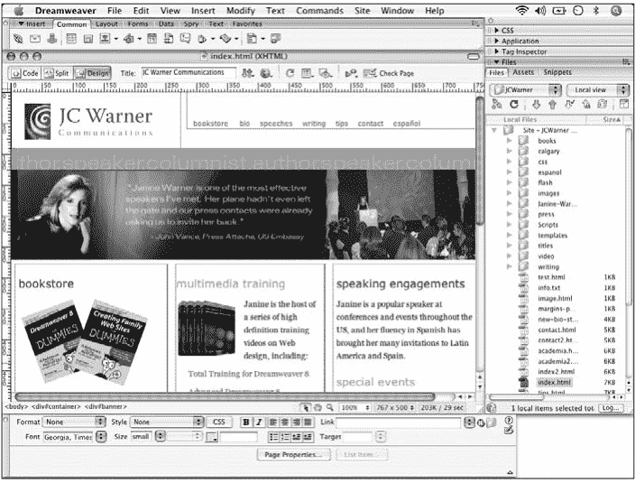

**图2：** 在运行 Windows XP 的计算机上以 Dreamweaver CS3 打开的 JCWarner.com 网站首页。

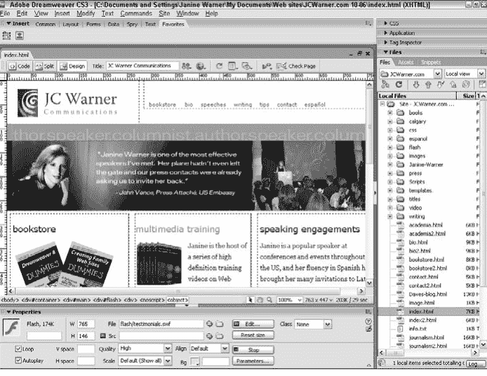

### 本书中使用的约定

保持一致性有助于理解。在本书中，这些一致的元素就是约定。注意 *conventions* 这个词使用了斜体？这是我经常使用的一种约定。我会将新术语用斜体标出，然后加以定义，以便你了解其含义。

当我在正文中输入网址（Web 地址）或电子邮件地址时，它们看起来像这样：www.jcwarner.com。但有时我会将网址单独放在一行，像这样：

```
www.jcwarner.com
```

这样做的目的是让你在页面上轻松找到它们，以便输入浏览器访问网站。我还假设你的 Web 浏览器在输入网址时不需要前面的 http://。如果你使用的是较旧的浏览器，请记住在地址前输入这部分（在 Dreamweaver 中创建链接时也要确保包含这部分地址）。

尽管 Dreamweaver 使你不必了解 HTML 代码，但你可能偶尔还是想涉足 HTML 领域。我在本书中包含 HTML 代码，是因为我认为它能帮助你更好地理解事物的工作原理


设计视图。有时在代码视图中删除或编辑标签比在设计视图中更方便。当我提供示例时，比如下面这个将 URL 链接到网页的代码，我会用与 URL 相同的等宽字体来显示 HTML：

```
<A HREF="http://www.jcwarner.com">Janine's Web Site</A>
```

当我向你介绍一组新功能时，比如对话框中的选项，我会用项目符号将这些项目排列出来，以便你看出它们之间的关联。当我希望你按照步骤操作时，我会用编号步骤来引导你完成整个过程。

### 你不必阅读的内容

如果你和我认识的大多数网页设计师一样，你没有时间在开始制作网站之前通读一本厚厚的书。这就是我编写 *Dreamweaver CS3 For Dummies* 时，让你能快速找到所需答案的原因。你不必从头到尾读完这本书。如果你很赶时间，直接跳到你最需要的内容，然后回去工作就好。如果你是网页设计新手，或者想了解 Dreamweaver 的细节，可以先浏览各章获得概览，然后再回头仔细阅读与你的项目最相关的内容。无论你是第一次构建简单网站，还是第无数次重新设计复杂网站，你都会在本书中找到所需的一切。

### 愚蠢的假设

虽然 Dreamweaver 是为*专业*开发人员设计的，但我并不假设你已经是专业人士——至少目前还不是。秉承 *For Dummies* 系列的理念，本书是一本易于使用的指南，适合具有不同经验水平的读者。对网页设计感兴趣并想创建网站是关键，但这正是我对你的全部期望。

如果你是一位经验丰富的网页设计师，*Dreamweaver CS3 For Dummies* 是你理想的参考书，因为它能帮助你快速上手使用这个程序，从基本的网页设计功能开始，逐步进阶到更高级的选项。如果你是网页设计新手，本书将引导你掌握创建网站所需的一切知识，从创建新页面到在互联网上发布完成的项目。

### 本书的组织方式

为了帮助你轻松度过学习任何新程序的曲线期，我将 *Dreamweaver CS3 For Dummies* 组织成一本完整的参考手册。本节提供了本书五个部分的概览以及你可以在每个部分中找到的内容。每章都引导你逐步了解 Dreamweaver 的功能，提供技巧并帮助你掌握网页设计的术语。

#### 第一部分：创建出色的网站

第一部分向你介绍网页设计的基本概念以及 Dreamweaver 的主要功能。在第 1 章中，我对网页设计的多种方法进行了概述，以便你在深入了解 Dreamweaver 中哪些功能最适合特定设计方法之前，能最好地确定你想要如何构建网站。在第 2 章中，我将引导你开始创建第一个网站，包括创建新站点、导入现有站点、创建新网页、应用基本格式和设置链接。为了使本章更有趣，并帮助你了解这些功能如何协同工作，我会在展示这些功能的同时，引导你创建一个真实的网页。

在第 3 章中，我们转向图形，介绍如何为网页创建图形，概述不同格式（GIF、JPEG 和 PNG 文件）之间的差异，并提供在页面中添加和定位图形的详细说明。在第 4 章中，你将了解 Dreamweaver 的测试和发布功能，这样你就可以在准备好后立即将页面上传到互联网。如果你与设计师团队协作，你可能会对签入/签出功能特别感兴趣，该功能使得多人协作管理网站变得更加轻松。你还会找到使用集成电子邮件与团队成员沟通的说明。

#### 第二部分：欣赏网页设计选项

第 5 章概述了层叠样式表的工作原理以及它们如何为你节省时间。CSS 已经成为创建页面设计和管理网页格式的*首选*方式，这些功能在 Dreamweaver CS3 中得到了显著改进。在本章中，你可以找到 Dreamweaver 中可用的样式定义选项的描述，以及创建和应用样式的说明。在第 6 章中，我将带你进一步了解 CSS，介绍 `<div>` 标签的强大功能以及如何创建 CSS 布局。在这里，你会找到使用 Dreamweaver 层功能的说明，以及如何创建居中的 CSS 设计和流式布局。

在第 7 章中，你将了解如何使用 HTML 表格功能。在第 8 章中，你将找到关于使用框架和 iframe 设计网站所需的所有知识。（本章还包括关于框架何时有用以及为何有时应避免使用的提示。）

在第 9 章中，我向你介绍了一些我最喜欢的 Dreamweaver 功能，包括强大的模板功能，这些功能使你能够创建更一致的设计，并一次性对多个页面进行全局更新。我还将介绍 Dreamweaver 的库项目，这些项目可用于放置和更新常用元素，如导航栏或版权标签。

#### 第三部分：用多媒体和 JavaScript 让网站更酷

在第三部分中，你将发现当你的网站添加交互式图像功能、音频、视频和 Flash 时会变得多么炫酷。在第 10 章中，你将找到使用交换图像行为创建交互式照片库的说明，以及如何使用 Dreamweaver 行为面板中的其他功能，包括打开新浏览器窗口行为。在第 11 章中，你将了解如何为网页添加多媒体内容，包括如何插入以及创建指向各种文件类型的链接——从 Flash 到视频和音频文件。在第 12 章中，我介绍了 Dreamweaver 的 HTML 表单选项，你可以使用这些选项添加反馈表单、调查问卷等。

#### 第四部分：处理动态内容

第四部分包含三章，涵盖了 Dreamweaver CS3 中最高级的功能。第 13 章旨在帮助你了解数据库驱动网站的工作原理，以及它们为何在互联网上变得如此重要。在第 14 章中，你将了解如何向页面添加动态内容、定义数据源、显示记录集，并利用 Dreamweaver CS3 的新 Spry 功能。在第 15 章中，你将把所有内容整合在一起，了解如何构建母版页、创建数据库搜索页面以及使用实时连接测试你的工作。

#### 第五部分：十大精选

第五部分包含三个快速参考，帮助你开发出尽可能最好的网站。第 16 章提供了一系列在线资源，你可以在那里注册域名和寻找托管服务，还有一些可以帮助你应对更高级挑战的服务，例如建立电子商务系统。在第 17 章中，你将找到十条设计技巧，帮助你充分利用 Dreamweaver，第 18 章展示了十个使用 Dreamweaver 创建的网站，让你了解其可能性并为你的网页项目带来灵感。

### 本书使用的图标

当我需要指引你下载某些可用资源时，我会使用此图标。


此图标指引你前往互联网上的宝贵资源。


此图标提醒你注意重要的概念或操作步骤，你需要将其牢记于心以便日后使用。


此图标表示技术性内容，你可能会觉得有信息量且有趣，但对于使用 Dreamweaver 并非必不可少。你可以放心跳过这些信息。


此图标表示一条能为你节省时间和金钱——以及避免麻烦——的提示或技巧。


此图标提醒你注意潜在的陷阱——并为你提供如何避免这些陷阱的重要信息。


### 下一步该做什么

如果你想熟悉最新的网页设计策略和选项，请不要跳过第 1 章，本章旨在帮助你了解当今创建网站的多种方法。如果你准备立即动手构建一个基本网站，请直接跳到第 2 章。如果你想了解特定的技巧或技术，请查阅目录或索引；这样你在赶那些不可能完成的网页设计截止日期时也不会错过任何内容。最重要的是，祝你在所有网页项目中取得巨大成功！


# 第一部分

## 创建优秀的网站

### 第五波

作者：里奇·坦南特

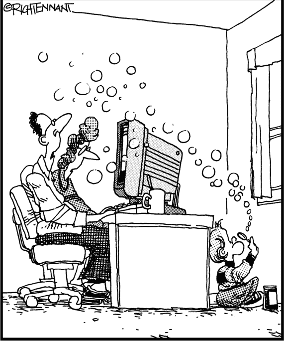

> "我得说，这个洗车网站的交互性让我印象深刻。"

### 本部分内容...

在第一部分，你将了解网页设计的入门知识，并概览在 Dreamweaver 中创建网站的多种方式。第 1 章比较了不同的布局技巧，并介绍了构成 Dreamweaver 界面的工具栏、菜单和面板。

在第 2 章，你将直接动手设置网站、创建网页，并添加文本、图像和链接。第 3 章介绍了网页图形，以及使用 Photoshop 优化 GIF、PNG 和 JPEG 格式图像的技巧。第 4 章涵盖了测试和发布功能，以便你在网站上线前确保一切正常。

# 第 1 章
## 设计网页的多种方法

*本章内容*

- 比较网页设计选项
- 理解浏览器差异
- 开发网站
- 自定义你的工作区

网页设计是一门艺术，也是一门科学。我想这正是它如此困难的原因。我们大多数人既没有创造出色网页设计的艺术天赋，也没有开发所有技术元素所需的科学和数学技能，更没有让网站易于使用、导航直观的界面设计和可用性理解。但是，你需要所有这些技能才能创建一个出色的网站。这就是为什么大多数优秀的网站都是由一个拥有多种不同专业技能的团队创建的。

在早期，网页设计相对简单——而且单调乏味。你可以组合图像和文本，但也就仅此而已；没有复杂的布局，没有花哨的字体，当然也没有多媒体或动画。

多年来，网页设计已经发展成一个日益复杂的领域，Dreamweaver 也随之演进，添加的新功能远远超出了组合文字和图像的基础。

当我在 90 年代中期刚开始学习创建网站时，它学起来容易，教别人也容易。十多年后，出了十几本书，情况变得复杂得多，我逐渐意识到，关于网页设计，你必须首先理解的一点是：创建网站的方式不再只有一种。

如今，你可以用几个小时就学会如何用 HTML 设计简单的网站，也可以花费数年时间来培养创建像 Amazon.com 或 MSNBC 那样复杂网站所需的高级编程技能。

对于介于两者之间的一切，Dreamweaver 在专业网页设计师以及越来越多希望为自己的爱好、俱乐部、家庭和小型企业建站的人群中，都是明确的选择。

但在我们深入探讨如何在 Dreamweaver 中创建网页的细节之前，我认为先介绍创建网站的多种方式会很有帮助。你对各种网页设计方法了解得越多，就越能更好地理解你的选择。

### 比较网页设计

在整本书中，你会发现涵盖网页设计各个方面的章节，从创建页面、添加图像和链接的基础知识，到更复杂的概念，例如使用 Dreamweaver 的行为（behavior）创建鼠标悬停效果和弹出窗口，这些行为利用 JavaScript 创建高级交互功能。

你还会发现一些章节探讨不同的页面布局技术。你可以使用 HTML 表格、框架或层叠样式表 (CSS) 来创建网页设计。你甚至可以组合使用这些不同的技术。接下来的几个小节旨在帮助你在决定哪种方式最适合你的网站之前，理解这些方法之间的差异。

#### 领会 CSS 的优势

如今，制定互联网标准的 W3C 推荐在几乎所有网页设计方面都使用 CSS。这是因为最好的 CSS 设计是可访问的、灵活的和可适应的。而且，遵循标准的事实多年来变得越来越重要。

如果每个设计网站的人和每个创建浏览器来显示这些网站的人都遵循相同的标准，我们今天会拥有一个更好的互联网。不幸的是，多年来网络技术不断发展，但网络浏览器并不总是以相同的方式显示网站的功能。因此，同一个网页在不同的浏览器中看起来可能非常不同，尤其是在较旧的浏览器中。（你将在第 4 章中了解更多关于浏览器差异和测试你的设计的内容。）

如今，世界上一些最优秀的设计师正在发起一场运动，鼓励所有人遵循相同的标准，使用 CSS 创建网站，并确保它们对每个人都是可访问的。

当网页设计师谈论*可访问性*时，他们指的是创建一个可以被任何可能访问你网页的人访问的网站——这包括使用特殊浏览器（通常称为屏幕阅读器）*朗读*网页的视力受限者，以及出于各种其他原因使用特殊浏览器的许多其他人。

如果你在大学、非营利组织、政府机构或类似组织工作，你可能被要求创建可访问的设计。但即使你没有被要求使用 CSS 或进行可访问性设计，这仍然是良好的实践。这就是为什么 Dreamweaver CS3 包含如此多的 CSS 功能和一系列预设计的 CSS 布局，比如我用来创建图 1-1 所示网站设计的那个。你将在第 6 章中找到创建类似此 CSS 布局的说明。

CSS 的一大优势在于它让你能够将内容与设计分离。例如，你可以为 `<h1>` 标签创建一个样式，并将其用于格式化你所有的标题，而不是将网站中的每个标题都格式化为 24 点 Arial 粗体。然后，如果你后来决定所有标题都使用 Garamond 字体而不是 Arial，你只需在样式表中更改一次 `<h1>` 标签的样式，它就会自动应用于所有使用该样式的地方。

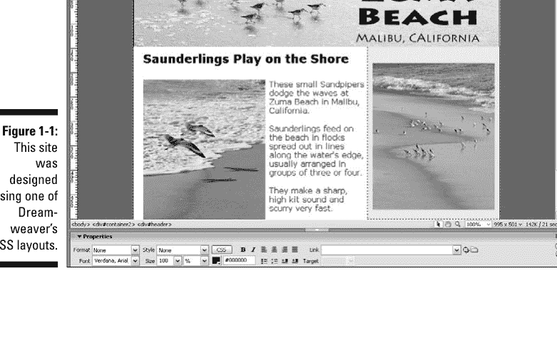

图 1-1：此网站是使用 Dreamweaver 的 CSS 布局之一设计的。

将内容与设计分离还允许你为不同的受众和设备创建不同的样式表。随着越来越多的人在从巨型平面显示器到如图 1-2 所示的小型手机屏幕等各种设备上查看网页，这一点在未来可能变得更加重要。Dreamweaver CS3 最酷的新功能之一是 Device Central，你可以在各种手持设备和手机上预览你的页面设计，以查看它们在这些小屏幕上的显示效果会有多么不同。

随着你对 CSS 的掌握更加深入，你可以为同一个网页创建多个样式表。例如，你可以创建一个非常适合如图 1-2 所示的小屏幕的样式表，另一个在打印时效果最佳的样式表，以及一个为可能难以阅读网页上常见小字的人设计的、采用更大字号的样式表。

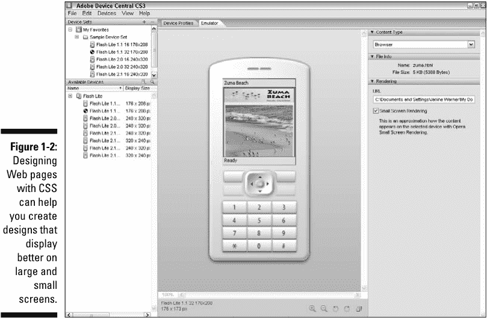

#### 回顾传统设计

尽管 CSS 是目前创建网页设计的最佳选择，但网络上许多网站都是使用表格来控制布局的，如图 1-3 所示。像这样的传统网站是使用 HTML 的 table 标签创建的。为了帮助你理解这个页面是如何创建的，我修改了原始设计以显示表格边框，尽管大多数设计师在使用表格创建此类布局时会关闭边框。

因为你可以合并和拆分表格单元格，所以你可以控制页面的布局，将文本和图像大致放置在你想要的位置。如果你将表格边框设置为 0（而不是我这里为展示边框而设置的 10），你可以隐藏表格，使其不会干扰设计。

在第 7 章，你将了解 Dreamweaver 表格功能的介绍，以及通过在所有表格中包含表头标签 (th) 来创建可访问表格设计的技巧。你甚至可以将 CSS 与表格结合，以创建更精简的设计。

**图 1-3：** 过去，创建复杂网页设计的唯一方法是使用像这里显示的 HTML 表格来控制文本和图像的放置位置。

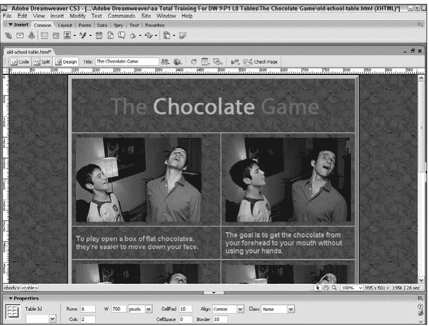


尽管我建议你使用 CSS 和 `<div>` 标签重新设计如图 1-3 所示的网站（你将在第 6 章学习如何操作），但我理解许多设计师仍然觉得用表格创建布局更容易，而且并非所有人都有时间立即重新设计他们的网站。我必须承认，在自己学会更好的方法后，我也曾长时间将那些用表格设计的网站保留在网上。因此，在关于表格的章节中，我将向你展示如何使用 Dreamweaver 的功能来创建类似图 1-3 的页面布局，以及如何最好地创建表格来展示如电子表格中那样的表格数据。

虽然表格不再推荐用于页面布局，但它们仍然被认为是展示如图 1-4 艺术家网站订单页面这类表格数据的最佳方式。

### 考虑框架选项

在第 8 章，你将找到创建使用框架的网站的说明，例如图 1-5 所示的家庭网站。许多设计师会像我侄女在图 1-5 照片中那样皱起眉头，因为他们认为框架是设计网站的一种糟糕方式。

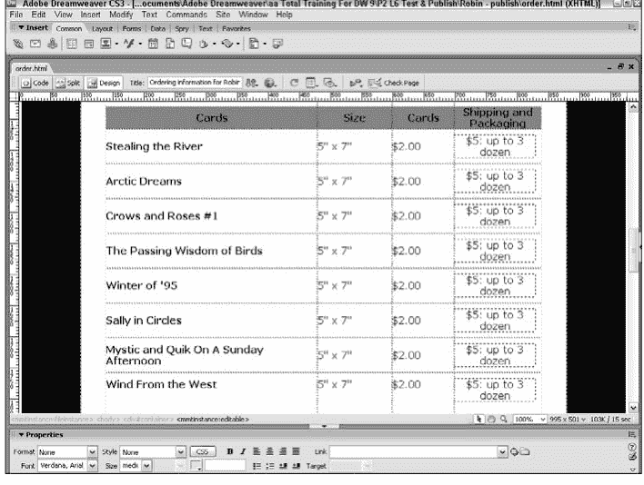

框架名声不佳，并且有一些令人信服的理由解释了为什么它们不再被广泛使用。但框架在网络上仍有其一席之地，因此我包含了一个章节，介绍使用 Dreamweaver 框架功能的基础知识，以创建像图 1-5 那样在一个浏览器窗口中显示多个网页的页面。

### 创建动态网站

当你使用 Dreamweaver 最高级的功能时，你可以创建（如图 1-6 和 1-7 所示的）连接到数据库并在网页上动态显示内容的网站。

像 www.PowerYoga.com 这样的网站背后的运作机制会变得非常复杂，但使用这种技术的优势之一是，你可以创建像图 1-7 这样的网页，并使任何人（即使他们不知道如何使用 Dreamweaver）都能轻松输入数据，例如新活动的详情。如果你使用过 Dreamweaver 的编程功能，如 PHP 或 ASP，来设置一个自动将数据保存到数据库的系统，那么你就可以在一个像图 1-6 所示的页面（其中包含一个长长的活动和静修列表）上，将表单内容提供给在线网站。

#### 第一部分：创建出色的网站

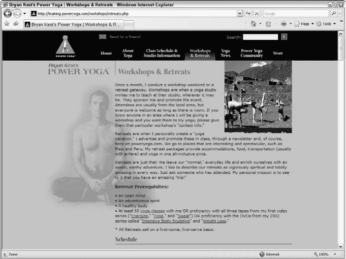

**图 1-6：** PowerYoga.com 是一个使用 PHP 从数据库显示内容的动态网站。

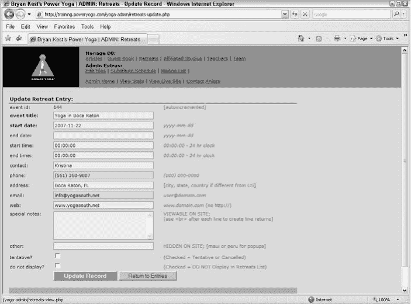

**图 1-7：** 使用 Dreamweaver 的动态网站开发功能来创建像这样的交互式页面，这是用于向图 1-6 所示的活动页面添加活动的管理工具。

在图 1-7 中，你看到的是一个管理工具，它被设计得让 Power Yoga 的员工可以轻松地更新网站的这一部分，而无需了解 HTML 甚至 Dreamweaver；但你也可以使用这项技术来创建一个在线讨论板或任何其他系统，这些系统在一个页面中收集数据，然后利用这些数据来决定在另一个页面上显示什么内容。

这就是网络上最先进的网站实现诸如提醒你上次搜索的书籍或在在线购物车中选择产品时跟踪你的订单等功能的方式。尽管我无法在本书中涵盖所有这些高级功能，但你将在第 13、14 和 15 章找到关于创建数据库驱动网站的介绍。

此时我忍不住要提及的另一点是，世界上大多数大型、复杂的网站是由一个开发团队创建的，而不仅仅是一个人。以 Power Yoga 网站为例，设计由 Kathy McCarthy 创作，而使所有动态功能得以实现的编程则由我的朋友 Anissa Thompson 完成。这也是为什么 Christine Fang（负责运营 Power Yoga 的董事总经理）能够自己使用网络浏览器更新培训部分的原因，尽管她只懂一点 HTML。

#### 了解浏览器差异

在开始创建网页之前，另一件需要理解的重要事情是，无论你多么精心地创建你的设计，你的页面在每个可能的访问者眼中永远不会完全相同。这是因为网络最大的优势之一也是最大的挑战之一。HTML 的创建是为了以可以在地球上每台计算机上显示的方式分享信息。不幸的是，并非所有这些计算机都使用相同的浏览器、相同的字体或相同尺寸的显示器。除此之外，还有许多旧的网络浏览器仍在使用，它们无法显示最新的网络功能。即使较新的浏览器，其功能显示方式也不尽相同。

因此，尽管你现在比以往任何时候都有更多的设计控制权，并且能够创建更有趣的网站，但如果你想让页面在所有可能访问你网站的人眼中都看起来不错，你也面临着更多挑战。我最好的建议是测试、测试、再测试，然后让你的朋友再测试你的页面。如果你想稳妥行事，你的页面设计越简单，它在所有访问者眼中看起来相同或至少相似的可能性就越大。

如果你想创建更有趣的设计，并且希望触及尽可能广泛的受众，请特别关注 Dreamweaver 的浏览器预览和兼容性功能，并准备好在读完本书后寻找更高级的书籍和培训项目。有专门的书籍和网站致力于创建能在各种计算机和浏览器上正常工作的布局。

因为你正在阅读本书，我假设你相对还是网络设计的新手，或者正在寻找一门复习课程，并有机会用 CSS 和 Dreamweaver CS3 的新功能来更新你的技能，所以我从基础知识开始。在本章接下来的部分，你将找到一些关于规划网站的提示和建议。在本章末尾，你将找到 Dreamweaver 界面的介绍。

在接下来的近 400 页中，你将找到各种网络设计方法，从表格和框架等传统技术到 CSS 和多媒体等最新最先进的功能。

### 开发新站点

简而言之，构建网站涉及创建单独的页面并将它们链接到其他页面。你需要一个主页（访问者到达你的网址时看到的第一页），该页面需要引导他们进入网站的其他页面，通常是通过指向网站每个主要部分的链接。这些页面又反过来链接到子部分，子部分可以链接到更深层的子部分。

规划网站的一个重要部分是确定如何将网站的页面划分成部分，以及这些部分应该如何相互链接。Dreamweaver 使创建页面和设置链接变得容易，但如何组织页面则取决于你。


如果你是新手，你可能认为不需要过多担心网站将如何成长和发展。请三思。所有好的网站都会成长，而且规模越大，管理起来就越困难。在开始之前规划网站的成长路径，可以在以后产生巨大的差异。忽视考虑成长可能是新设计师最常见的错误之一。当不止一个人在同一个网站上工作时，这一点变得更加严重。如果没有明确建立的网站组织架构和一些通用的任务约定（例如命名文件），混乱就会蔓延。

#### 管理网站结构

管理网站结构有两个方面：用户看到的一面，这取决于你如何设置链接；以及后台的一面，这取决于你如何组织文件和文件夹。


### 用户所见

用户看到的部分完全关乎导航。当用户访问你的主页时，你会引导他们去往何处？他们如何在你的网站内从一个页面移动到另一个页面？一个优秀的网站设计应使用户能够轻松、直观地进行导航，并能直达与他们最相关的信息。在规划时，请确保用户能够

-   从网站的多个位置轻松访问关键信息
-   在页面和各部分之间轻松来回切换
-   一步返回主页和子章节

在 Dreamweaver 中设置链接很容易；挑战在于确保这些链接易于访客使用。

### 幕后运作

管理网站结构的第二个层面发生在幕后（用户看不到这些信息，但你需要某种组织系统来记住各个部分是什么）。在你深入使用 Dreamweaver 构建网站之前，花些时间思考一下跟踪你为网站创建的所有文件所涉及的管理问题。*文件*包括你放入网站中的所有图像、HTML 页面、动画、声音文件以及其他任何内容。

一旦你的网站发展超过少数几个页面，将它们组织在单独的文件夹或目录中可以帮助你进行跟踪。幸运的是，Dreamweaver 通过提供一个文件面板（如图 1-8 所示）使这变得很容易，在这里你可以看到网站的所有文件，甚至可以移动和重命名文件和文件夹。（你可以在第 2 章和第 4 章中找到有关如何在网站中组织文件和文件夹的详细说明。）

> 建设中？这里不戴安全帽！
>
> 所有优秀的网站都处于“建设中”状态——始终如此。这是网络的本质。但构建你的网站时，你应该做到能在页面准备就绪时添加它们，而不是放置占位符。不要用一个似乎在说“你点击这个链接毫无道理。改天再来吧，也许那时我们有些东西给你看”的戴黄帽子的家伙来迎接你的访客。不要创建“建设中”的占位符，而是创建目录结构，使日后添加新页面变得容易。你可以通过在已有内容的页面上放置通知来告知读者新内容即将到来——类似“下周四来这里查看一个更酷的东西的链接”这样的消息是个好主意。但永远不要让用户点击一个链接，等待页面加载，结果发现只有一个戴安全帽的家伙等着他们。

### 准备和规划网站

新网页设计师最常犯的错误之一是在没有仔细考虑所有目标、优先级、预算和设计选项的情况下就一头扎进网站开发。本能反应是简单地开始创建页面，将它们全部放入一个大目录，然后用链接把所有东西串起来。然后，当设计师最终在观众中测试网站时，他们常常对用户反馈说网站难以导航、找不到所需内容而感到惊讶。

提前规划，省去一些烦恼，你就有更大的机会创建一个既吸引人又易于维护和更新的网站。

### 可视化你的网站

在深入构建网页之前，花些时间规划你的网站并思考其结构和组织。一个好的起点是回答以下问题：

-   你希望通过你的网站实现什么？（你的目标和目的是什么？）
-   你的目标受众是谁？
-   谁将负责你的网站？你有多少开发人员需要管理？
-   你将如何为网站创建或收集所需的文本和图像？
-   你将如何组织网站中的文件？
-   你会包含多媒体文件，如 Flash、音频或视频吗？
-   你会需要交互功能，如反馈表单或聊天室吗？
-   你的网站将采用什么样的导航系统（即，你如何让访客轻松地在网站的页面或部分之间移动）？
-   你将如何适应网站的增长和进一步发展？（优秀的网站总是会随着时间而成长。）

花时间明确你的目标和目的是非常值得的。它可以帮助你从一开始就为成功的网络项目定下基调，并确保你将宝贵的时间、金钱和精力投入到最重要元素和功能上。

### 为开发做准备

许多专业网页设计师与团队或公司合作开发新网站时，首先要做的事情之一就是与几个理解网站使命的关键人物举行头脑风暴会议。这次会议的目的是为网站提出建议的版块和功能、应包含的内容以及网站应如何组织。一次好的头脑风暴会议是无评判的自由讨论——让每个参与者分享他们能想到的所有想法，无论是否现实。

> **在头脑风暴阶段不否定想法很重要。通常，一个不切实际的想法会导致一个无人想到的创新，尤其是在互联网领域工作时，最好的想法几乎总是全新的想法。**

像这样的头脑风暴会议之后，你可能会有一个很长的可能功能列表，需要将其发展成你的网站。你的下一个挑战是编辑这个列表，选出最重要的功能，然后规划你的开发路线，以确保最终所有功能都能良好协作。

### 自定义 Dreamweaver CS3 工作区

Dreamweaver 一开始可能看起来有点令人生畏。它有如此多的功能，并且分散在众多的面板、工具栏和对话框中，很容易让人迷失。如果你喜欢通过自己摸索来理解，那就开始吧（并随意跳到下一章，你将立即开始构建你的第一个网页）。如果你想在开始之前有个概览，本章最后几节会介绍界面，旨在让你快速了解这个强大程序的功能。

当你启动 Dreamweaver 时，开始屏幕会出现在程序的主区域（并且除非你通过选择“不再显示”选项永久关闭它，否则在没有文件打开时它会重新出现）。从开始屏幕，你可以选择从众多 Dreamweaver 预设的示例文件中创建一个新页面，或者你可以通过从中间列的“新建”选项中选择 HTML 来创建一个新的空白页面。当你选择 HTML 时，Dreamweaver 会在主*工作区*中创建一个新的空白 HTML 页面，如图 1-8 所示。

你在工作区中构建 HTML 页面、模板、样式表和其他文件，工作区由一个主窗口（显示你正在处理的页面）和围绕它的多个面板和菜单组成，这些面板和菜单提供可用于设计和开发页面的工具。Dreamweaver 工作区由以下基本组件组成：菜单栏（在最顶部）、插入栏（紧接其下）、文档窗口（屏幕的主区域，就在插入栏下方）、属性检查器（在屏幕底部）以及垂直停靠面板（在文档窗口右侧），这些面板可根据需要展开和折叠。接下来将更详细地描述每一个。

### 图 1-8：使用拆分视图时，你可以在设计视图中选择文本，Dreamweaver 会自动在代码视图中高亮显示相应的代码。

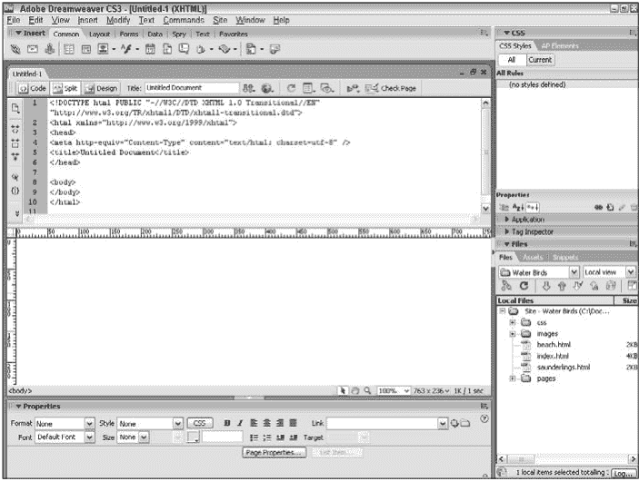

Dreamweaver 有两种主要的程序布局设置：设计器布局（如图 1-8 所示）和编码器布局，后者将面板放在屏幕左侧而不是右侧。你可以通过选择“窗口” > “工作区布局”，然后选择“编码器”或“设计器”来更改布局。

### 文档窗口

工作区主区域的大块开放区域是文档窗口，你在这里处理新页面和现有页面。如果你在设计视图中使用设计器界面，你会看到页面在 Web 浏览器中的呈现效果。如果你想查看页面背后的 HTML 代码，请单击工作区顶部的“代码”按钮。选择“拆分”按钮可以同时查看 HTML 代码和设计视图（如图 1-8 所示）。


### 自定义界面

Dreamweaver 中的停靠面板、调色板和工具栏可轻松访问程序的大部分功能，您可以在屏幕上拖动这些元素。您也可以通过点击每个面板右上角微小的选项图标，然后从下拉列表中选择“关闭面板”来关闭右侧的任何面板。（该选项图标看起来像三个带线条的圆点，下方还有一个小箭头，它非常非常小。）您还可以通过选择“窗口”>“隐藏面板”（或点击面板行中间的箭头）一次性关闭所有面板。如果要打开某个面板，请从“窗口”菜单中选择它。例如，要打开 CSS 样式面板，请选择“窗口”>“CSS 样式”。

### 插入栏

插入栏位于屏幕顶部，包含七个子类别，每个子类别都有一组代表常用功能的不同图标。点击名称右侧的小箭头可访问下拉列表，从而从一个子类别的按钮切换到另一个子类别的按钮。选项包括：

- **常用栏：**显示许多最常用功能的图标，包括链接、表格和图像。
- **布局栏：**显示用于创建页面布局所必需的 div、表格和框架选项。
- **表单栏：**包含最常见的表单元素，如单选按钮和复选框。
- **数据栏：**显示用于构建由数据库材料驱动的动态网页的选项。
- **Spry 栏：**包含一组小部件，这些小部件结合了 HTML、CSS 和 JavaScript，用于创建交互式页面元素。
- **文本栏：**显示常见的文本格式化功能，包括段落、换行和列表。
- **收藏栏：**允许您右键单击（Windows）或 Control+单击（Mac），将任何其他插入栏选项中的任何图标添加到您的收藏功能集合中。

下拉列表末尾是“显示为选项卡”选项，该选项允许您将插入栏的名称作为选项卡显示在屏幕顶部，如图 1-9 所示。

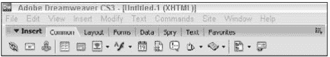

常用插入栏可访问表单、表格、图像等内容。

### 属性检查器

在 Dreamweaver 中，属性检查器停靠在工作区的底部。如果您希望它位于屏幕顶部，可以将其拖动到顶部，它会锁定到位；但我个人更喜欢它位于屏幕底部，既方便又不碍事。

属性检查器显示页面上任何选定元素的*属性*或选项，它会根据所选内容而变化。例如，如果您单击图像，属性检查器会显示图像属性。如果您单击 Flash 文件，它会显示 Flash 属性。图 1-10 显示了属性检查器中显示的图像选项，包括高度和宽度、对齐方式以及链接设置。

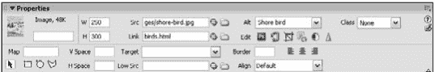

属性检查器显示任何选定元素的属性，如这里显示的图像。

在属性检查器的右下角，您会看到一个小箭头。单击此箭头（或在任意打开的检查器空间中双击）可显示额外的属性，让您控制更高级的功能，例如选择图形时的图像映射选项。

### 停靠面板

当您选择设计器布局时，停靠面板位于工作区的右侧，如图 1-11 所示，或者如果您选择编码器布局，则位于左侧。您可以通过单击并拖动它们将面板移动到屏幕上的任何位置。

停靠面板在 Dreamweaver 中显示各种重要功能，包括文件面板中的站点所有文件和文件夹，以及 CSS 面板中的层叠样式表。您可以通过单击每个面板名称左侧的小箭头来打开和关闭面板。要显示更多面板，请从“窗口”菜单中选择面板名称。要一次性隐藏所有可见的面板，请单击面板行中间带小箭头的选项卡。

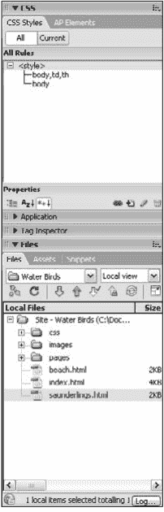

> 图 1-11：面板提供对网站中所有文件、样式以及许多其他资产的便捷访问。


### 菜单栏

与您使用过的大多数程序一样，屏幕顶部的菜单提供了对大多数程序功能的便捷访问，包括您在插入栏、属性检查器和面板中找到的选项，以及一些仅在菜单中可用的其他功能。

### 状态栏

状态栏位于文档窗口底部，包含有关程序中打开页面的许多有用详细信息，以及对许多有用功能的访问。状态栏右侧是工具图标，用于控制文档的屏幕显示。在左端，您会找到标签选择器，其中包含一组 HTML 标签，这些标签会根据您在页面上的光标位置而变化。这些标签指示您页面上的元素是如何格式化的。如果在标签选择器中单击一个标签，您可以在主文档窗口中选择该标签及其包含的所有内容，这是 Dreamweaver 中用于精确选择的便捷功能。

> 请记住：您使用 Dreamweaver 的次数越多，您就越可能欣赏其自定义功能的能力。请记住，您始终可以更改工作区以更好地适应您的工作方式，并且您可以轻松地使用图 1-12 所示的“首选项”对话框（在 Windows 计算机上通过选择“编辑”>“首选项”，或在 Mac 上通过选择“Dreamweaver”>“首选项”）来更改 Dreamweaver 的首选项设置。

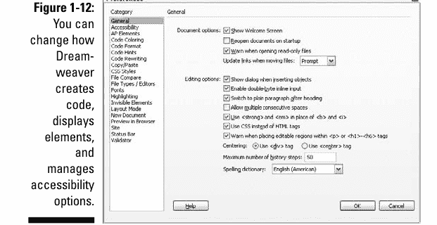

# 第 2 章

## 在 Dreamweaver 中打开和创建站点

### 本章内容

- 打开现有网站
- 创建新网站
- 制作新页面
- 插入和格式化文本
- 创建链接

如果您已准备好投入并开始构建网站，那么您来对地方了。如果您正在处理现有站点并需要进行更改，这也是开始的地方，因为在本章中您将发现一个重要的初步步骤——站点定义过程，它使 Dreamweaver 能够跟踪您站点中的图像和链接。完成站点设置过程后，您就可以创建网页、插入文本和图像、设置链接等。但无论您做什么，请不要跳过这第一步。

尽管您可以在不进行此初始站点定义的情况下使用 Dreamweaver，但这样做可能会在上传站点时破坏链接，而且 Dreamweaver 的许多功能，如自动链接检查和库，将完全无法工作。

### 设置新站点或现有站点

关于站点定义过程，首先需要理解的是，您需要将站点的所有资源存储在硬盘上的一个本地根文件夹中，并在 Dreamweaver 中指定该文件夹。这是因为站点的所有元素必须保持与在 Web 服务器上相同的相对位置，这样您的链接、图像和其他元素才能正常工作。

### 构建和发布网站

通常，您应该首先在计算机的硬盘驱动器上创建一个网站，您可以在该网站在互联网上可见之前对其进行测试。然后，当您准备好发布完成的站点时，将其传输到 Web 服务器。*Web 服务器*是一台与互联网永久连接的计算机，具有特殊软件，使其能够与 Web 浏览器（如 Internet Explorer 和 Firefox）进行通信。您可以在第 4 章中找到有关发布网站的详细说明。

在进行站点定义过程时，您可以在硬盘驱动器上创建一个新文件夹并将其指定为本地根文件夹，也可以识别一个现有文件夹。

站点定义对话框（您在其中定义站点）还包含 Dreamweaver 的文件传输功能，包括其 FTP（文件传输协议）功能。目前，我们将跳过这些（以及 Dreamweaver 的其他发布和站点管理功能）以保持简单。但是，在第 4 章中，您将找到有关使用这些功能的详细说明，以及有关下载托管在远程服务器上的现有网站的说明。

FTP 是通过网络（如互联网）在连接的计算机之间复制文件的常用方法。FTP 是您在准备在 Web 上发布网站时可能使用的协议，用于将您的网页发送到您的 Web 服务器。

### 在 Dreamweaver 中定义网站

如果站点定义过程一开始看起来有点令人困惑，请不要担心；这是一个快速、相对无痛的过程，并且您只需为每个站点执行一次。请相信我；不要跳过这个初步步骤。

无论您是创建新站点还是处理现有站点，以下步骤将引导您完成定义根站点文件夹的过程。

1.  选择“站点”>“新建站点”。

    站点定义对话框出现，如图 2-1 所示。

2.  单击“高级”选项卡。

    高级窗口出现。如果您愿意，可以使用逐步引导您完成设置过程的基本向导，但我发现使用高级选项卡一次查看所有选项更快更容易。


## 第2章：在 Dreamweaver 中打开和创建站点

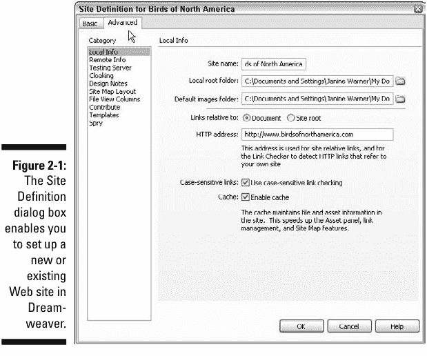

3.  在左侧的“类别”框中，确保选中了“本地信息”类别。
4.  在“站点名称”文本框中，为你的站点输入一个名称。

你可以随意为你的站点命名；此名称仅用于帮助你管理站点。许多人在 Dreamweaver 中处理多个站点，此功能使你能够按名称进行区分。你在此处输入的名称将出现在“文件”面板的下拉列表中以及“管理站点”对话框中。你使用此列表在打开 Dreamweaver 时选择要处理的站点。在图 2-1 所示的示例中，我将新站点命名为 "Birds of North America"。

5.  单击“本地根文件夹”文本框旁边的“浏览”图标，在硬盘上定位要用作网站所有文件主文件夹的文件夹。

如果你正在处理一个新站点，请创建一个新文件夹并将其指定为 Dreamweaver 中的站点位置。如果你正在处理一个现有站点，请选择包含该站点文件的文件夹。

6.  通过输入位置或使用“浏览”图标定位来指定“默认图像文件夹”。

你不必指定一个图像文件夹，但这是 Dreamweaver 帮助你管理文件的另一种方式。如果你将图像存储在多个文件夹中，我仍然建议你指定一个主图像文件夹。如果你正在设置一个新站点，可以在站点文件夹内创建一个新文件夹，并将其指定为你的图像文件夹，即使它是空的。

7.  对于“链接相对于”，保留“文档”选项被选中，除非你确定希望你的链接相对于站点根目录进行设置。

此设置控制链接中的路径设置方式。如果你正在与其他开发人员一起处理一个站点，并且不确定，请咨询你的同事。如果你独自处理自己的站点，“链接相对于文档”是最简单的管理选项。（你可以在本章后面的侧边栏“创建相对、根和绝对链接”中了解更多信息。）

8.  在 "HTTP 地址" 文本框中，输入你的网站 URL。

HTTP 地址是你的站点发布在 Web 服务器上时将具有的 URL 或 Web 地址。如果你还不知道站点的 Web 地址，或者不打算将其发布到 Web 服务器，可以将此框留空。请在开头包含 `http://`，在结尾包含 `/`。

9.  选择“使用区分大小写的链接检查”复选框。

除非你确定无需担心文件名的大小写，否则选中此复选框意味着 Dreamweaver 将确保你站点的所有链接大小写匹配（许多 Web 托管服务都要求这一点）。

10. 选择“启用缓存”选项。

Dreamweaver 会创建站点的本地缓存，以便快速引用站点中文件的位置。本地缓存可加速程序的许多站点管理功能，并且只需几秒钟即可创建。

11. 单击“确定”关闭“站点定义”对话框并保存你的设置。

如果你选择的本地站点文件夹已包含文件或子文件夹，它们将被自动缓存，你站点中的所有文件和文件夹都将显示在“文件”面板中，如图 2-2 所示。

如果你没有选中“启用缓存”选项，将出现一个消息框，询问你是否要为站点创建缓存。

### 编辑和管理多个站点

你可以在 Dreamweaver 中定义任意数量的站点，并通过在“文件”面板中选择站点名称从一个站点切换到另一个站点。要加载不同的站点到“文件”面板，请使用站点名称旁边的下拉箭头，然后选择要显示的站点名称。

在图 2-3 中，我从已定义站点列表中选择了 Digital Family 站点。最好始终在“文件”面板中选择你正在处理的站点。

**图 2-2：** 站点设置完成后，现有站点中的文件和文件夹将显示在“文件”面板中。

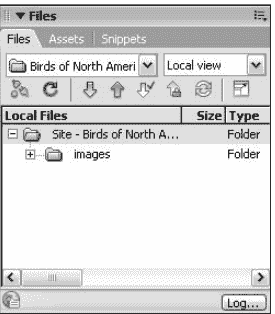

**图 2-3：** 你可以定义多个站点，并通过选择其名称在“文件”面板中切换活动站点。

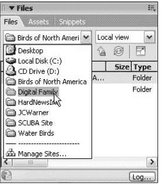

一旦你完成了前面练习中介绍的站点定义过程，你就可以通过选择“站点”>“管理站点”，在“管理站点”对话框中选择站点名称，然后单击“编辑”按钮来对站点定义进行更改和添加。然后将在“站点定义”对话框中打开已定义的站点，你可以在其中更改任何设置。

在图 2-4 中，我选择了 Birds of North America 站点进行编辑。你可以使用此对话框定义新站点、删除现有站点、复制站点以及导入或导出站点。请注意，当你从“管理站点”对话框中删除站点时，并不会从硬盘驱动器上删除站点的文件或文件夹。

**图 2-4：** 你可以在“管理站点”对话框中选择任何站点定义，并单击“编辑”按钮打开“站点定义”对话框进行编辑。

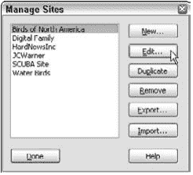

### 创建新页面

每个网站都始于单个页面。访问者首先看到的是你站点的首页，或称 *主页*，这通常是一个很好的起点。Dreamweaver 使创建新页面变得简单：当程序打开时，你会看到一个“开始屏幕”，其中包含用于以多种格式创建新页面的便捷功能的快捷方式。

如果你想创建一个简单的空白网页，请从中间列的“新建”列表中选择 HTML（参见图 2-5）。如果你正在创建动态站点，请选择 ColdFusion、PHP 或其中一个 ASP 选项。（如果你甚至不知道这些选项的含义，你可能暂时不需要使用它们，但你可以在第 13、14 和 15 章中找到有关这些高级选项的信息。）

养成将新网页保存在主网站文件夹中的习惯，即使它们仍然是空白页。当你为页面创建链接或添加图像时，Dreamweaver 需要能够识别页面的位置。尽管在页面保存之前 Dreamweaver 会设置临时链接，但最好先保存页面。

你可以从“开始屏幕”创建新页面，或使用“文件”菜单中提供的“新建文档”窗口，如以下步骤所示。如果你不想使用“开始屏幕”，可以通过选择左下角的“不再显示”框将其关闭。

**图 2-5：** “开始屏幕”提供了在 Dreamweaver 中创建新文件或打开现有页面的快捷方式列表。

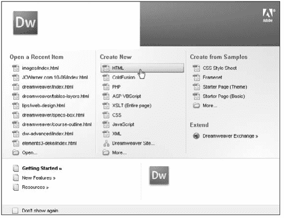

请按照以下步骤使用“新建文档”窗口创建新页面：

- 选择“文件”->“新建”。

“新建文档”窗口打开。

- 从屏幕左侧选择“空白页”。

- 从“页面类型”列表中选择 HTML，然后单击“创建”。

- 选择“文件”->“保存”以保存你的页面。

你可以在 Dreamweaver 的“新建文档”窗口中找到许多其他选项，包括各种预先设计的模板。现在，让我们从一个简单的空白页开始。你可以在第 9 章中找到有关使用模板的说明。

立即添加页面标题也是一个好习惯。这是一个容易忘记的细节，而网页标题为 "Untitled document" 时看起来很糟糕。你可以通过更改工作区顶部“标题”框中的文本来添加页面标题。页面标题不会出现在网页的主体部分，但它会出现在浏览器窗口的顶部，通常就在浏览器名称的右侧或左侧。页面标题也是用户收藏夹或书签列表中显示的文本。也许更重要的是，许多搜索引擎会特别优先处理出现在网页标题中的词语。


#### 命名网页

多年来，我收到过无数惊慌失措的网页设计师发来的电子邮件，他们因文件名冲突导致的链接失效而困扰，这几乎是所有问题中最常见的。由于这些问题通常要到网站发布到服务器之后才会出现，因此尤其令人困惑且难以理解。如果你将网站发布到运行 Mac 或 Windows 的 Web 服务器，以下内容可能不适用；但如果你使用的是运行 Unix 或 Linux 的 Web 服务器（许多商业网络托管公司都使用这类系统），以下说明就尤为重要。如果你不确定，遵循这些规则以确保安全。

在保存网站上的网页、图片和其他文件时，第一条规则是在末尾添加扩展名以标识文件类型（例如 HTML 文件用 `.html`，GIF 图片用 `.gif`）。Dreamweaver 会自动在 HTML 文件末尾添加 `.html` 扩展名（这对大多数 Web 服务器都适用），但如果你的 Web 服务器需要，你可以在 Dreamweaver 的首选项对话框中更改扩展名。

文件名在网站中尤为重要，因为当你设置链接时，它们会被包含在 HTML 代码中。规则很简单：不要在名称中使用空格或特殊字符。例如，你不应该使用带撇号的名称来命名网页，比如 `cat's page.html`。如果你想分隔单词，可以使用下划线（`_`）或连字符（`-`）。例如，`cat-page.html` 就是一个不错的文件名。大多数情况下数字是可以使用的，而且大小写通常无关紧要，只要文件名和链接中的代码匹配即可。

这些文件名限制可能会产生误导的是，当你在 Mac 或 PC 电脑上测试页面时，包含空格和特殊字符的链接工作得完全正常，但互联网上许多 Web 服务器使用的软件程序无法理解链接中的空格或特殊字符。因此，不遵循这些规则的链接在将网站发布到 Web 服务器时可能会失效。

另一条令人困惑的规则，也是最重要的规则之一，是你的网站主页（或*首页*）必须命名为 `index.html` 或 `default.html`，具体取决于你的 Web 服务器。这是因为大多数服务器都设置为首先提供 `index.html` 页面。要确定你的网站主页应该命名为什么，你应该咨询你的服务提供商或系统管理员。（有些服务器设置为处理 `home.html`，或者动态网站使用 `default.asp`，但大多数商业服务提供商会在网站任何文件夹中优先提供 `index.html`，而不是其他页面。）你网站中的其他页面可以按你的喜好命名，只要名称不包含任何空格或特殊字符（连字符或下划线除外）。

### 设计你的第一个页面

许多人惊喜地发现，在 Dreamweaver 中创建一个基本的网页是多么容易。

如果你准备直接开始，创建一个页面，然后在空白页面顶部单击以插入光标。（如果你需要从头开始，请参阅上一节"创建新页面"。）在页面上输入一些文本，什么都可以；你只需要一些内容来开始。在图 2-6 的示例中，我输入了文本"A Great Egret Hunts Prey in Northern California"。我将把它作为我正在创建的简单页面的标题。


在本章中，我坚持使用最基本的格式选项。在第 5 章中，你将找到详细的说明，通过创建层叠样式表（Cascading Style Sheets）来控制和管理格式，从而超越这些基本格式选项。

#### 创建标题

最常见的文本格式选项之一是使用标题标签集合。在 HTML 中，使用标题标签（`<h1>`、`<h2>` 等）来格式化用作标题或标题的文本有很多优势。这是因为标题标签被设计为以相对大小显示，其中 `<h1>` 最大，`<h2>` 较小，`<h3>` 更小，依此类推直到 `<h6>`。这很有价值，因为无论网页的默认文本大小是多少（文本大小可能因浏览器设置和计算机平台等因素而异），任何用 `<h1>` 标签格式化的文本总是会比用 `<h2>` 标签格式化的文本大。


许多搜索引擎还会优先处理用 `<h1>` 标签格式化的文本中的关键词，因为它被认为是页面上最重要的文本。

要用标题样式格式化文本，请按照以下步骤操作：

1.  **高亮显示你要格式化的文本。**
2.  **在页面底部的属性检查器中，使用格式字段中的下拉箭头选择一个样式**（参见图 2-6）。

    应用标题标签后，文本会自动更改以在设计视图中显示格式。


虽然 Dreamweaver 的设计视图很好地预览了文本、图片和其他元素在 Web 浏览器（如 Firefox 或 Internet Explorer）中查看时的外观，但页面显示因浏览器而异，具体取决于浏览器设置和用于显示页面的操作系统。

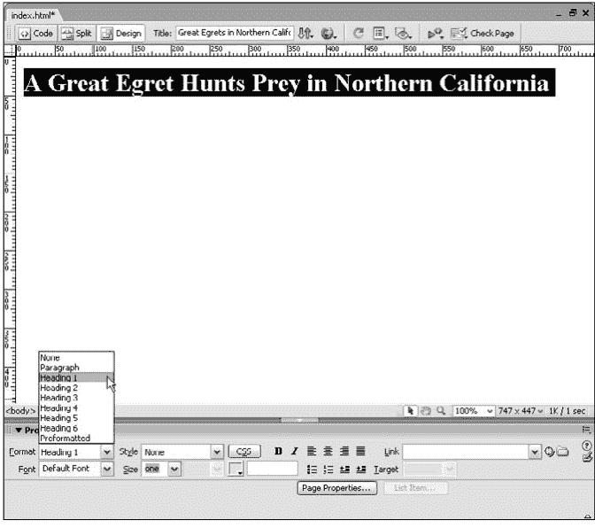

**图 2-6：** 属性检查器提供了对常用格式功能的便捷访问，例如标题标签。

总的来说，我发现属性检查器是应用基本格式最简便的方法，但有些人更喜欢使用文本菜单。两者都能达到相同的效果，只是属性检查器提供字体大小（列为 9 到 36 以及 xx-small 到 xx-large），而文本菜单仅提供增大或减小字体大小的功能。

##### 更改字体和文本大小

你可以更改整个页面或页面上任何选定文本的字体和大小。在下一节"更改页面属性"中，你可以找到更改整个页面字体选项的说明。要更改选定文本部分的字体或大小，请按照以下步骤操作：

1.  高亮显示你要更改的文本。
2.  在工作区域底部的字体下拉列表中，选择一组字体，如图 2-7 所示。

选定的文本会更改为你所选字体集合中的第一种字体（除非该字体在你的硬盘上不可用）。你也可以选择"编辑字体列表"选项并使用任何字体，但要注意，你应用的字体只有在访客的硬盘上也有该字体时才会显示。（有关其工作原理的更多信息，请参阅"为什么有这么多字体？"侧边栏。）

3.  在大小下拉列表中，指定文本的大小。

HTML 中的字体大小与你可能在文字处理或图像程序中习惯使用的字体大小不同。你的大小选项更有限，而且你还有额外的选择，如 small、x-small 等。编号的字体大小与你可能习惯使用的大小类似，但它们为网站用户提供的灵活性较小。当你使用包括 *small*、*medium* 或 *large* 等设置来设置大小时，文本会根据用户浏览器的设置显示。你将在第 5 章中找到有关字体大小的更多信息，届时我将介绍使用 CSS 创建文本样式。

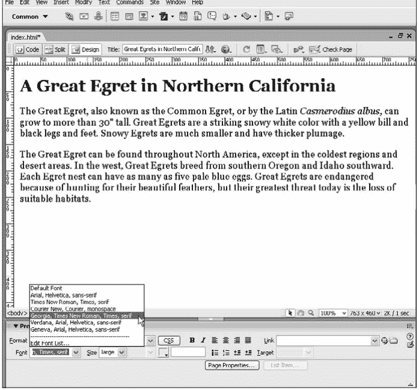

**图 2-7：** 你可以使用属性检查器中的文本设置来更改字体和大小。

##### 为什么有这么多字体？

虽然你可以为网页上的文本指定任何你想要的字体，但你无法完全控制该字体在访客计算机上的显示方式。这是因为你应用的字体只有在访客拥有相同字体的情况下才能正确显示。为了帮助确保你的文本按你的意图显示，Dreamweaver 提供了常用字体集合，按字体族分组，例如 Arial、Helvetica、sans-serif、Georgia、Times New Roman、Times 和 serif。

其工作原理如下。当你应用这样的字体集合时，浏览器会在字体列表中显示第一种可用的字体来显示格式化文本。例如，如果你选择以 Georgia 开头的字体集合，而你的访客没有 Georgia，则文本将以 Times New Roman 显示；如果他们没有该字体，文本将以 Times 显示；如果他们甚至没有 Times，浏览器会寻找另一种 serif 字体。（如果你不熟悉字体术语，*serif* 描述的是像 Times 这样在字母边缘有小卷曲装饰的字体；*sans serif* 意思是没有卷曲装饰，这是像 Arial 这样的字体所具有的。）

你可以通过在属性检查器的字体字段底部选择"编辑字体列表"选项并使用"编辑字体列表"对话框来创建自己的字体集合。使用"编辑字体列表"对话框顶部的加号和减号按钮来添加或删除字体集合。要向集合中添加字体，请从对话框右下角选择字体名称，然后使用箭头将其添加到字体列表中。

确保文本以你想要的字体显示的唯一方法是在 Photoshop 或 Fireworks 等程序中将文本创建为图形，然后将带有文本的图形插入到你的页面中。对于特殊文本（如横幅或徽标）来说，这不是一个坏选择；但对于所有文本来说，通常不是个好选择，因为图形的下载时间比文本长，而且以后更难更新。

你在属性检查器中还可以找到许多其他文本格式选项，例如粗体和斜体。去吧，稍微尝试一下；如果你不喜欢它们的外观，你总是可以撤销你的格式选择或再次更改它们。

#### 添加段落和换行

当你为 Web 创建页面设计时，你必须在许多限制条件下工作，这些限制起初可能令人困惑，即使它们有其目的。如何创建段落和换行就是一个很好的例子。

如果你在 Dreamweaver 的设计视图中工作，然后按 Enter 键（Windows）或 Return 键（Mac），Dreamweaver 会在代码中插入一个段落（或 `<p>`）标签，这会创建一个换行后跟一个空行。如果你想要换行而不带额外的空行，请按住 Shift 键并按 Return 或 Enter；Dreamweaver 会在代码中插入 `<br />` 标签，创建一个单行换行。


#### 从其他程序插入文本

Dreamweaver 为您提供了多种选项，用于在从其他程序复制粘贴文本时保持格式。当您选择“编辑➡粘贴”时，您可以更改 Dreamweaver 处理格式的默认设置，并在“复制/粘贴”类别中调整首选项。并且您可以选择“编辑➡选择性粘贴”，以便每次粘贴新内容时都能看到所有可用选项。以下是您的四个选项：

- **仅文本：** Dreamweaver 会去除任何格式，仅插入纯文本。
- **带结构的文本：** Dreamweaver 包括段落、列表、表格和其他结构化格式选项。
- **带结构和基本格式的文本：** Dreamweaver 包括结构化格式以及基本格式，如粗体和斜体。
- **带结构和完整格式的文本：** 除了上述选项外，Dreamweaver 还包括由样式表创建的格式，例如在 Microsoft Word 等程序中创建的格式。
- **保留换行符：** 即使您不保留其他格式选项，换行符也会被保留。
- **清理 Word 段落间距：** 此选项解决了将内容粘贴到 HTML 文件时，Microsoft Word 的段落间距转换方式的一个常见问题。

如果您想添加大量空白，您需要使用其他格式选项，因为默认情况下，大多数 Web 浏览器会压缩由段落或换行标签创建的额外间距，并在浏览器中显示页面时删除额外的空白。如果您使用 CSS 来创建页面布局，您将拥有更大的设计控制权和更一致的结果。（我在第 5 章和第 6 章中介绍了 CSS。）

如果您在代码视图中工作并使用 Enter 或 Return 键添加空格，您将在代码中添加空白空间，但这不会影响设计视图中的页面显示效果或其在浏览器中的外观。

#### 添加图像

现在到了有趣的部分。在 Dreamweaver 中将图像添加到您的网页可能起初看起来几乎像魔法一样简单。Web 图形的挑战不在于将它们添加到您的页面，而是在于创建外观精美且在查看者的浏览器中加载迅速的图像。您需要另一个程序，例如 Photoshop 或 Fireworks，来创建、转换和编辑图像。Dreamweaver 只是让您可以将图像放置在您的页面上。

有关查找和创建图像以及保持文件大小较小的更多信息，请参阅第 3 章。现在，我假设您已准备好一个 GIF 或 JPEG 图像文件，并且希望将图像插入到您的页面中。您可以在网页上使用的两种最常见的图像格式是 GIF 和 JPEG（通常缩写为 JPG），但 PNG 文件如今越来越受欢迎，因为它优于 GIF 格式。但要注意：旧版本的 Internet Explorer 不完全支持 PNG。在接下来的练习中，您可以使用任何 GIF、JPEG 或 PNG 格式的图像。

如果您手头没有图像，您可以从我的网站 www.DigitalFamily.com/free 下载免费图像。（您可以在该网站上找到下载免费图像的说明）。

在将图像插入网页之前，最好将图像保存在您的本地根文件夹中（即您应该在本章前面“在 Dreamweaver 中定义网站”部分描述的网站定义过程中确定的那个文件夹）。将图像保存在您网站的本地根文件夹中很重要，因为您需要将网页和图像保持在网站中彼此相对相同的位置，否则当您将网站发布到服务器时，可能会导致图像链接断开。如果您将图像插入到未保存在本地根文件夹中的页面，Dreamweaver 将显示一条警告，并在将图像插入页面时提供将图像复制到您的本地根文件夹的选项。

许多设计师会创建一个名为 *images* 的文件夹，以便将所有图像文件集中存放在一个地方。如果您正在处理一个非常大的网站，您可能希望在网站的每个主要子文件夹内创建一个 images 文件夹，以更好地组织您的文件。需要记住的是，如果您在将图像放置在页面上之后，将页面或图像移动到另一个文件夹，可能会破坏页面和图像之间的链接。

为避免链接或图像引用中断，请始终使用“文件”面板来移动或重命名文件。当您这样做时，Dreamweaver 会自动修复您的链接。如果您在 Dreamweaver 之外移动或重命名文件或文件夹，链接将会断开。您可以在第 4 章中找到有关管理和修复链接的更详细说明。

好的，假设您已保存了页面，并且要链接的图像已保存在您的主网站文件夹中（或者您准备让 Dreamweaver 在插入图像时将其复制到您的本地根文件夹），您可以按照以下步骤在网页上添加图像：

1.  **单击将光标置于页面上您想要添加图像的位置。**

    我将光标插入在标题下方、第一段的开头。

    您不能在空白页面上的任意位置放置光标并将其插入到您想要的位置。这不是 Dreamweaver 的限制；这是由 HTML 在网页上的显示方式造成的限制。默认情况下，所有图像、文本和其他元素都从左上角开始插入。要创建更复杂的布局，您需要使用 CSS（第 6 章介绍的最推荐选项）来定位元素，或者使用 HTML 表格（第 7 章介绍）或层（也在第 6 章介绍）。

2.  单击位于工作区顶部“常用插入”栏中的 **图像图标**，并从下拉列表中选择 **图像**。

    “选择图像源”对话框打开，显示您硬盘驱动器上的文件和文件夹。

3.  **导航到包含要插入的图像的文件夹，然后双击选择要插入到页面中的图像。**

    如果您在首选项中启用了辅助功能选项（默认），则会出现“图像标签辅助功能属性”对话框。在此对话框中始终添加替代文本是一个好的做法。为此，只需在“替代文本”字段中输入文本。您可以在此字段中输入任何文本，但它旨在提供图像的描述。除非图像不可见，否则替代文本不会出现在您的网页上，但当用户将光标悬停在图像上时，它会在 Internet Explorer 中显示。对于使用“朗读”网页的浏览器的网络用户（例如视力受限的用户），替代文本也很重要。因此，替代文本是满足无障碍访问要求所必需的。在大多数无障碍访问指南下，长描述被认为是可选的。您也可以在“属性”检查器中添加或编辑替代文本。

4.  **单击确定。**

    图像会自动出现在网页上。

5.  **单击以选中网页上的图像。**

    图像选项会自动显示在页面底部的“属性”检查器中。

6.  **使用“属性”检查器指定图像属性，例如对齐方式、间距和替代文本。**

    在图 2-8 所示的示例中，我使用“属性”检查器右下角的“对齐”选项将对齐方式设置为左对齐。这就是我让文本环绕到图像右侧的方法。我还使用“水平边距”字段添加了 10 像素的间距，以在图像和文本之间创建边距。

    如果您使用 CSS，可以创建更精确的格式选项。例如，“水平边距”会在图像的左右两侧都插入空间。使用 CSS，您可以创建一个样式，在图像的任意一侧或所有侧应用边距空间。

#### 第一部分：创建出色的网站

图 2-8：当选中图像时，“属性”检查器可轻松访问常见图像属性，如对齐和间距。

选中图像后，“属性”检查器允许您指定图像的许多属性。表 2-1 描述了这些属性。如果您的屏幕上未看到表中列出的所有属性，请单击“属性”检查器右下角的三角形以显示所有图像选项。

### 表 2-1 “属性”检查器中的图像属性

| 缩写 | 属性 | 功能 |
| --- | --- | --- |
| Image | N/A | 指定文件大小。 |
| 图像名称 | 名称 | 在页面上唯一标识图像——如果您使用行为或其他由图像触发的脚本，这是一个重要的细节。 |
| Map | Map Name | 为图像映射分配一个名称。所有图像映射都需要一个名称。 |


# 第2章：在Dreamweaver中打开和创建站点

## 表2-1

| 缩写 | 属性 | 功能 |
|---|---|---|
| 热点工具 | 图像映射坐标 | 使用矩形、椭圆形和多边形图标创建用于链接的图像映射热点。（有关如何创建图像映射，请参见第5章。） |
| W | 宽度 | Dreamweaver会根据图像的实际尺寸自动指定图像的宽度。 |
| H | 高度 | Dreamweaver会根据图像的实际尺寸自动指定图像的高度。 |
| Src | 源 | 必需。*源*是从当前文档到目标图像的文件名和路径。插入图像时，Dreamweaver会自动设置此项。 |
| Link | 超链接 | 如果图像链接到另一个页面，此字段将显示地址或路径。（有关链接的更多信息，请参见本章后面的“设置链接”。） |
| Alt | 替换文本 | 如果图像因用户浏览器禁用图像而无法显示，则您输入的单词将被显示。替换文本对于搜索引擎和用于阅读网页的盲人浏览器尤为重要。 |
| Edit | 用于Fireworks、优化、裁剪、重新取样、亮度和对比度以及锐化的图标 | 单击Fireworks图标可启动Fireworks。使用其他任何图标可在Dreamweaver中对图像进行其他细微更改。 |
| V Space | 垂直间距 | 以像素为单位，此设置在图像上方和下方插入空白区域。 |
| H Space | 水平间距 | 以像素为单位，此设置在图像左侧和右侧插入空白区域。 |
| Target | 链接目标 | 当图像出现在您希望控制目标的页面中时，使用此选项，例如当页面是HTML框架集的一部分或您希望链接在新窗口中打开时。Target指定链接页面在哪个框架中打开。我将在第7章介绍如何创建框架以及如何在框架中设置链接。 |
| Low Src | 低分辨率源 | 此选项允许您将两个图像链接到页面上的同一位置。低分辨率源图像会先加载，在页面其余部分加载后，它会被主图像替换。当您有大尺寸图像时，您可能会发现此选项特别有用，因为您可以设置一个较小的图像（例如拉伸的黑白版本）作为低分辨率源，它在主图像下载时显示。以这种方式组合两个图像可以创建简单动画的错觉。 |
| Border | 图像边框 | 以像素为单位，此属性允许您在图像周围添加边框。当使用图像作为链接时，我几乎总是将图像边框设置为0（零），以防止图像被链接颜色的边框包围。 |
| Align | 对齐 | 此选项使您能够对齐图像。自动换行会包裹向右或向左对齐的图像。其他选项，包括基线、顶部和居中，控制文本或其他元素如何与图像对齐。对齐图标控制包含图像的整个段落，并将文本左对齐、右对齐或居中对齐。 |
| Class | CSS设置 | “类”字段使您能够应用在Dreamweaver中定义的任何类样式。要使用此选项，请在工作区中选择任何元素，然后从下拉列表中选择要应用的任何类样式。 |

### 创建多个页面以设置链接

创建新页面以开始构建网站似乎显而易见，但请考虑这一点：您可能希望在开发过程深入之前就创建一堆新页面，甚至可能希望在页面内容为空时就开始将新页面组织到子目录中。这样做使您能够在开始设置链接之前组织网站的结构。毕竟，您无法链接到一个不存在的页面。如果您计划在主页上设置指向网站中其他页面的五个链接，请继续创建那些其他页面，即使您还没有在其中放入任何内容。

例如，假设您正在为一家大公司的部门创建一个网站。您可能需要几个主要页面，例如一个关于员工的页面，另一个关于您做什么的页面，以及第三个包含一般信息和资源的页面。在这个初始阶段，您可以创建四个页面——一个用于网站的主页，另外三个用于每个子部分。将主页命名为`index.html`，将其他页面命名为`staff.html`、`about.html`和`general.html`。有了这些初始页面，您可以从早期规划网站组织结构中受益，并且可以更轻松地开始在网站的主要页面之间设置链接。有关网站规划以及管理和测试链接的更多提示，请参见第4章。

虽然您可以通过单击并拖动图像边缘或更改属性检查器中的高度和宽度值来调整Dreamweaver中图像的大小，但我不建议您以这种方式更改图像大小。在属性检查器中更改高度和宽度实际上不会改变图像的大小，只会改变它在页面上的显示方式。这有两个问题。首先，使用此选项使图像看起来更大或更小可能会使图像变形。其次，使用此选项使图像看起来更小要求您的访客下载比必要更大的文件。

您可以使用属性检查器中的Dreamweaver裁剪工具裁剪图像，但这样做会永久更改图像文件。有关更精确的图像编辑选项，请使用图像编辑器，例如Fireworks或Photoshop。在第3章中，您将找到有关在Photoshop中优化网页图像的说明。

### 设置链接

Dreamweaver在设置链接方面确实是一个梦想。要记住的最重要的一点是，链接本质上是一个地址（URL），它告诉查看者的浏览器，当查看者单击包含链接的文本或图像时应该转到哪个页面。

#### 第一部分：创建出色的网站

如果您要链接的页面在您的网站内，您可以创建一个*相对链接*，其中包含描述如何从当前页面到达链接页面的路径。相对链接不需要包含网站的域名，只需要告诉浏览器如何从您网站内的一个页面到达另一个页面。以下是我的网站`www.JCWarner.com`主页到books部分主页面（位于名为books的文件夹中）的相对链接代码示例：

```
<A HREF="books/index.html">Janine's Books</A>
```

如果您在“站点定义”对话框中选择“根目录”选项而不是“相对”，此地址将以正斜杠开头（如您在此处所见），指示浏览器从根级别开始：

```
<A HREF="/books/index.html">Janine's Books</A>
```

因为我的Web服务器设置为无论文件夹如何都首先提供名为`index.html`的任何页面，所以当子目录的主页面命名为`index.html`时，我获得了优势。优势如下。如果我将此页面命名为`books.html`，那么要在我的网站上访问此页面，您必须在浏览器中输入`www.JCWarner.com/books/books.html`。如果主页面命名为`index`，您只需在浏览器中输入`www.JCWarner.com/books`即可访问同一页面。（在设置为提供`default.html`的服务器上，此方法类似。）

如果您链接到不同网站上的页面，您需要创建一个绝对链接或外部链接。*绝对链接*包含另一个站点的完整Internet地址。如果您创建从您的网站到我的站点上books页面的链接，以下是绝对链接后面可能的代码示例：

```
<A HREF="http://www.jcwarner.com/books/index.html">Janine's Books</A>
```

请注意，因为我将主页面命名为`index.html`，所以您可以省略文件名并使用缩短的地址`http://www.jcwarner.com/books`。如果所有这些HREF代码对您来说像天书一样，请不要担心。下一节将向您展示Dreamweaver如何为您设置此类链接，这样您甚至不必查看此代码。（但我确实认为对幕后发生的事情有一点理解是有帮助的。）

### 在网站内链接页面

从一个页面链接到您网站中的另一个页面很容易。最重要的是记住将页面保存在网站的根文件夹中。


#### 创建链接

（如本章前面“在 Dreamweaver 中定义网站”部分所述）在开始设置链接之前。以下是如何将网站中的一个页面链接到另一个页面：

1.  在 Dreamweaver 中，打开您想要创建链接的页面。
2.  选择您想用作链接的文本或图像（即用户将点击以触发链接的文本或图像）。
3.  点击工作区顶部“常用”插入栏中的“链接”图标。
4.  在“超链接”对话框中（参见图 2-9），点击“链接”下拉列表右侧的“浏览”图标。
5.  点击文件名以选择您希望图像或文本链接到的页面，然后点击“确定”（Windows）或“选取”（Mac）。

点击并拖动以高亮文本，或单击以选择图像。在此示例中，我选择了文本 *Great Egret*，并将其链接到位于同一文件夹中名为 `egret.html` 的页面。

或者，您可以使用“属性”检查器中的“链接”字段来设置链接。

“选择文件”对话框将打开。

图 2-9：“超链接”对话框包含许多链接设置，包括目标选项。

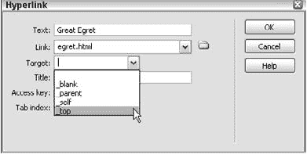

链接会自动设置，对话框会关闭。如果您尚未保存页面，则会打开一个消息框，说明您必须在保存页面后才能创建相对链接。最好在设置链接之前保存您正在处理的页面。请注意，要测试链接，您必须在浏览器中查看页面，此过程将在本章后面的“在浏览器中预览页面”部分介绍。

您可以使用图 2-9 中所示“超链接”对话框中的“目标”字段来指定链接页面的“目标”打开位置。例如，_top 选项会使链接的页面在新浏览器窗口中打开。其他选项在使用框架时最为重要，框架在第 8 章介绍。

#### 设置到页面内命名锚点的链接

如果您喜欢创建非常长的页面，使用锚点链接来分解页面内的导航是一个好主意。*命名锚点链接*，通常称为*跳转链接*，允许您设置到网页特定部分的链接。您可以使用命名锚点将页面上的图像或文本字符串链接到同一页面上的另一个位置，或从一页链接到另一页的特定部分。要创建命名锚点链接，您首先在要链接到的位置插入一个命名锚点，然后当访问者点击链接时，使用该锚点将浏览器定向到页面的特定部分。

假设您想在页面顶部的单词 *Convertible* 和页面下方以 *Convertible Sports Cars* 标题开头的部分之间设置链接。您首先在 *Convertible Sports Cars* 标题处插入一个命名锚点。然后将页面顶部的单词 *Convertible* 链接到该锚点。

要插入命名锚点并设置到它的链接，请按照以下步骤操作：

1.  打开要插入命名锚点的页面。
2.  将光标放在页面上您想要链接到的单词或图像旁边。
3.  选择“插入” ➪ “命名锚点”。
4.  为锚点输入一个名称。

您无需选择单词或图像；您只需要一个在选择链接时出现的参考点。在此示例中，我将光标放在标题 *Convertible Sports Cars* 的左侧。

“插入命名锚点”对话框出现。

您可以为锚点命名任何您想要的名称（只要不使用空格或特殊字符）。只需确保在同一页面上的每个锚点使用不同的名称。然后请务必记住您给锚点起的名称，因为您必须输入锚点名称来设置链接，或者从“超链接”对话框中的下拉列表中选择它，如步骤 8 所示。在此示例中，我选择了 *convertible* 作为锚点名称，因为它很容易记住。

5.  点击“确定”。

对话框关闭，并在页面上插入锚点名称的位置出现一个小锚点图标。您可以通过点击锚点图标并将其拖动到页面上的另一个位置来移动锚点名称。

如果您好奇这个命名锚点在 HTML 中是什么样子，以下是我示例中出现在标题之前的代码：

```html
<A NAME="convertible"></A>
```

6.  要设置到命名锚点位置的链接，请选择您想要从中链接的文本或图像。

您可以从同一页面上的任何其他位置链接到命名锚点，也可以从另一页面链接。在我的示例中，我将页面顶部的单词 *Convertible* 链接到我在标题旁边制作的锚点。

7.  点击屏幕顶部“常用”插入栏中的“链接”图标。

8.  在“超链接”对话框中，使用“链接”框右侧的小箭头选择锚点。

或者，您可以使用“属性”检查器通过输入后跟锚点名称的井号（#）来设置跳转链接。

您也可以选择文本，并从“指向文件”图标（在“链接”文本框旁边）拖动一条线到锚点图标。锚点名称会自动出现在“链接”框中，这样您就无需输入名称了。

在我的示例中，我在“链接”文本框中输入了 **#convertible**。此行的 HTML 代码如下所示：

```html
<A HREF="#convertible">Convertible</A>
```

如果您想链接到另一个文件名为 `coolcars.html` 的页面上名为 *convertible* 的锚点，请在“链接”文本框中输入 **coolcars.html#convertible**。

#### 链接到另一个网站

链接到另一个网站上的页面——称为*外部链接*——甚至比链接到内部链接更容易。您只需要知道您想要链接到的页面的 URL，就几乎完成了大部分工作。

要创建外部链接，请按照以下步骤操作：

1.  在 Dreamweaver 中，打开您想要从中链接的页面。
2.  选择您想要用作链接的文本或图像。
3.  在“属性”检查器的“链接”文本框中，输入您希望文本或图像链接到的页面的 URL。

链接会自动设置。在图 2-10 的示例中，我使用白鹭的照片创建了一个链接，指向加州自然保护协会网站 www.nature.org。

尽管在大多数浏览器中，您不必在网站地址的开头输入 http:// 甚至 www. 就能访问网站，但在 HTML 中创建外部链接时，您必须始终使用完整的 URL，包括 http://。否则，浏览器将无法找到正确的外部网站地址，访问者最终可能会看到错误页面。

图 2-10：要设置到另一个网站的链接，请高亮显示您想要链接的文本或图像，然后在“链接”文本框中输入 URL。

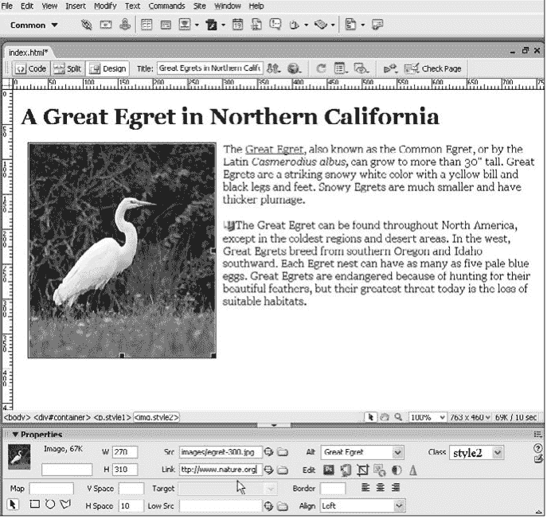

#### 设置到电子邮件地址的链接

另一个常见的链接选项是指向电子邮件地址。通过电子邮件链接，访问者可以轻松地向您发送消息。我总是建议您邀请访问者与您联系，因为他们可以指出您网站中的错误，并就您如何进一步发展网站提供宝贵的反馈。设置到电子邮件地址的链接与设置到另一个网页的链接一样容易。您需要知道的是您想要链接到的电子邮件地址以及设置链接时要使用的文本或图像。

要创建电子邮件链接，请选择您想要链接的文本，然后点击“常用”插入栏中的“电子邮件链接”图标。在“电子邮件链接”对话框中，在“链接”字段中输入电子邮件地址，然后点击“确定”。如果您想将图像用作电子邮件链接，则必须在主工作区中选择图像，然后在“属性”检查器的“链接”字段中输入电子邮件链接。

当您使用“属性”检查器中的“链接”字段创建电子邮件链接时，电子邮件链接必须以代码 `mailto:` 开头（没有 //）。例如，如果您要在“属性”检查器中输入链接到我的电子邮件地址的链接，则需要输入 **mailto:janine@jcwarner.com**。以下是该电子邮件链接背后的完整代码行：

```html
<A HREF="mailto:janine@jcwarner.com">Send a message to Janine</A>
```

当您网站的访问者点击电子邮件链接时，他们的计算机系统会自动启动其电子邮件程序，并创建一封发送给指定电子邮件地址的空白电子邮件。这是一个很酷的技巧，但如果用户没有预料到这一点，可能会感到不安，而且如果他们的计算机上没有电子邮件程序，则无法使用。这就是为什么我总是尝试在使用电子邮件链接时告知用户。例如，我不只是链接 *Contact Janine* 这些词，而是链接 *E-mail Janine*。更好的做法是，我经常链接实际的电子邮件地址。

当您在将在公共互联网上显示的网页上创建电子邮件链接时，您可能会被垃圾邮件发送者盯上，其中一些人使用自动程序从网页“提取”电子邮件地址。这就是为什么许多网站不包含电子邮件链接，而是使用诸如 *Send e-mail to Janine at jcwarner.com* 之类的文本。您也可以使用表单来解决这个潜在问题。通过设置一个带有将表单内容发送到电子邮件地址的脚本的表单，您可以保护您的电子邮件地址免受垃圾邮件发送者的侵扰，同时仍然使访问您网站的访问者能够轻松发送评论。您可以在第 12 章找到创建表单的说明。


## 54 第一部分：创建优秀的网站

### 更改页面属性

你可以在“属性”检查器中更改页面上的许多个别元素，但如果你想做出影响整个页面的更改，比如更改整个页面的背景颜色或更改链接和文本的格式，则需要使用“页面属性”对话框。

如你在图2-11中所见，“页面属性”对话框左侧包含一系列类别。每个类别都显示不同的页面选项。其中一些选项在本书的其他部分有所介绍，例如“跟踪图像”功能（第5章）和“背景图像”功能（第3章）。目前，为保持简单，本节仅专注于通过“外观”类别（如图2-11所示）以及“链接”类别中的选项来更改背景和文本颜色。

图2-11：“页面属性”对话框中的“外观”类别使你能够更改文本颜色、字体、字号、背景和边距。

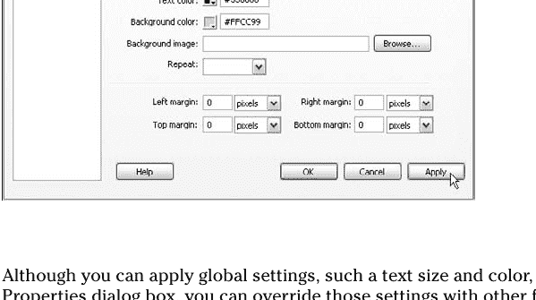

> 尽管你可以在“页面属性”对话框中应用全局设置（如文本大小和颜色），但你可以在特定情况下使用其他格式设置选项来覆盖这些设置。例如，你可以在“页面属性”中将所有文本设置为Helvetica字体，然后使用“属性”检查器中的“字体”字段将单个标题的字体更改为Arial。

要更改整个页面的字体设置、背景和文本颜色以及页边距，请按照以下步骤操作：

-   1. **选择“修改”→“页面属性”。** 将出现“页面属性”对话框的“外观”类别（参考图2-11）。
-   2. 在“页面字体”下拉列表中，指定你希望用于页面文本的字体。
在本例中，我将字体集合设置为以Georgia字体开头的集合。如果你不指定字体，你的文本将显示在用户浏览器指定的字体中，通常是Times。

-   3. 如果你希望页面上的所有文本都显示为粗体或斜体，请分别单击“页面字体”下拉列表右侧的 **B** 或 **I**。
如果你选择其中一个选项，页面上的所有文本都将显示为粗体或斜体。

-   4. 在“大小”下拉列表中，指定你希望用于页面文本的字体大小。
同样，你可以为页面上的任何文本覆盖这些设置。

-   5. 单击“文本颜色”色板框以显示调色板。选择你喜欢的任何颜色。
你选择的颜色会填充色板框，但只有在你单击“应用”或“确定”按钮后，才会更改页面上的文本颜色。

-   6. 单击“背景颜色”色板框以显示调色板。选择你喜欢的任何颜色。
你选择的颜色会填充色板框。只有在你单击“应用”或“确定”按钮后，颜色才会填充背景。

-   7. 如果你想在页面背景中插入图形或照片，请单击“背景图像”框旁边的“浏览”按钮，然后在“选择图像源”对话框中选择图像。
当你插入背景图像时，它会自动重复或平铺整个页面，除非你从“重复”下拉列表中选择“不重复”选项，或使用CSS进一步定义显示方式。

-   8. 使用对话框底部的边距选项来更改页面的左边距、右边距、上边距或下边距。
在这四个字段中都输入0，将移除自动在网页顶部和左侧添加边距空间的默认边距设置，从而使你能够创建从浏览器边缘开始的设计。

-   9. 单击“应用”按钮，查看颜色在页面上的效果。
-   10. 单击“确定”以完成并关闭“页面属性”对话框。

**提示**

当你更改背景、文本或链接颜色时，请确保这些颜色在一起看起来协调，并且你的文本仍然可读。一般规则是，浅色背景与深色文本颜色搭配效果最佳，反之亦然。

要更改链接颜色和下划线选项，请按照以下步骤操作：

-   1. 选择 **“修改”**→**“页面属性”**。
将出现“页面属性”对话框。

-   2. 在 **“类别”** 列表中，选择 **“链接”** 选项。
将显示“链接”类别，如图2-12所示。

图2-12：“链接”类别使你能够更改链接颜色并删除下划线。

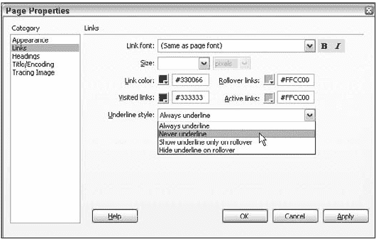

-   3. **为页面上的链接指定所需的字体和大小。**
如果你不指定字体，你的链接将显示为与文档文本相同的字体和大小。

-   4. 在“链接字体”下拉列表的右侧，如果你希望页面上的所有链接分别显示为粗体或斜体，请单击 **B** 或 **I**。
如果你选择其中一个选项，除非你在页面中指定了其他格式，否则所有链接都将显示为粗体或斜体。

-   5. **为任意或所有链接选项指定颜色。**
你选择的颜色将根据链接状态应用于页面上的链接。共有四种链接状态，并且都可以显示为相同或不同的颜色：
- **链接颜色：** 此选项控制链接首次显示在页面上时的颜色。
- **已访问链接：** 此选项控制访问者已点击（或访问过）的链接的颜色。
- **悬停链接：** 当用户将鼠标悬停在链接上（也称为 *悬停*）时，链接会更改为这种颜色。
- **活动链接：** 当用户正在点击链接时，链接会短暂地更改为这种颜色。

-   6. 在“下划线”下拉列表中，指定是否要为链接添加下划线。
默认情况下，网页上的所有链接在浏览器中都显示为带下划线，但许多设计师认为下划线会分散注意力，并更喜欢通过选择“从不”来关闭下划线。你也可以选择“仅在悬停时显示下划线”，以便在用户将鼠标移到链接上时显示下划线。“悬停时隐藏下划线”会导致用户将鼠标移到链接上时下划线消失。

-   7. 单击“应用”按钮，查看更改在页面上的效果。
-   8. 单击“确定”以完成并关闭“页面属性”对话框。


当你在“页面属性”对话框中更改格式设置选项时，Dreamweaver会自动创建与这些设置对应的样式，并将它们保存在CSS样式面板中，如图2-13所示。我在第5章和第6章中详细介绍了Dreamweaver的CSS面板。

图2-13：当你在“页面属性”对话框中指定格式设置选项时，Dreamweaver会自动创建出现在CSS面板中的样式。

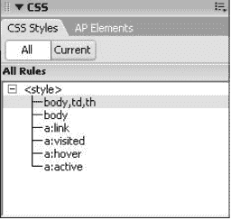

### 为搜索引擎添加Meta标签

如果你听说过Meta标签，你可能会将它们与搜索引擎联系起来，这是正确的。Meta标签有多种用途，但最常见的用途是提供一些特殊的文本，这些文本不会出现在你的页面上，但会被爬虫、机器人和其他程序读取，这些程序会为Yahoo!、Google以及一长串其他与搜索相关的网站整理和排名网页。

一些搜索引擎会读取关键词标签和描述标签的Meta标签。前者使网站设计师能够包含一个关键词列表，当有人在搜索引擎中输入相同的关键词时，他们希望这些关键词用于匹配他们的网站。不幸的是，Meta关键词已被Web设计师滥用，试图误导访问者了解其网页的真实内容，以至于大多数搜索引擎忽略了Meta关键词标签。不过，一些搜索引擎仍然识别Meta关键词，并且如果你使用这个Meta标签，应该不会损害你在任何搜索引擎中的排名。

Meta描述标签使用更广泛，绝对值得使用。此标签旨在让你包含对你网站的书面描述，并且搜索引擎通常将其用作搜索结果页面中显示的简短描述。如果你没有在Meta描述标签中包含自己的文本，许多搜索引擎会使用出现在你首页上的前几个单词，或你页面上的其他文本集合，通常基于页面上的格式或位置。根据你的设计，前几个单词可能不是对你网站的最佳描述，包含你自己的Meta描述会更好。

按照以下步骤填写Meta描述标签：

-   1. 打开要添加Meta描述的页面。
你可以在网站的任何或所有页面上使用Meta描述。（许多使用搜索引擎查找你网站的人可能会直接进入内部页面，如果内容与搜索匹配的话。）

-   2. 选择“插入”→“HTML”→“头标签”→“描述”，如图2-14所示。
将出现“描述”对话框。

-   3. 在“描述”文本框中，输入你希望用于页面描述的文本。
不要在此框中的文本中添加任何HTML。

-   4. 单击“确定”。
你输入的描述文本将插入到页面顶部HTML代码的Head区域中。Meta内容不会显示在页面的正文中。

如果你想添加关键词，请重复步骤1到4，在步骤2中选择“插入”→“HTML”→“头标签”→“关键词”。


**图 2-14：** 许多搜索引擎会将输入到元描述字段中的文本，作为搜索结果中您的网页描述显示。

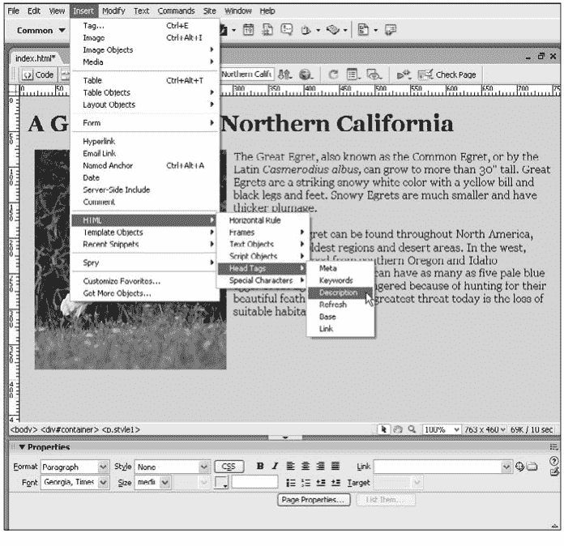

### 在浏览器中预览您的页面

尽管 Dreamweaver 显示网页的方式与 Web 浏览器非常相似，但并非所有交互功能都能在 Dreamweaver 中正常工作。例如，要测试链接，您需要在 Web 浏览器中预览您的作品。

预览作品最简单的方法是保存您正在处理的页面，然后点击工作区右上角的“在浏览器中预览/调试”图标（它看起来像一个小地球）。您也可以选择“文件”->“在浏览器中预览”。

安装 Dreamweaver 时，它会自动查找您计算机上安装的所有浏览器并进行设置，以便您轻松选择它们来预览页面。在多个 Web 浏览器中测试您的页面总是一个好习惯，因为页面显示可能会有所不同。您需要在多少个浏览器上测试页面取决于您预期访问网站的用户群体，但大多数优秀的 Web 设计师至少会在最新两到三个版本的 Internet Explorer 和 Firefox 上测试他们的页面。同时，在 Macintosh 和 Windows 计算机上预览页面也是一个好习惯，因为页面显示可能会有差异。

如果您在计算机上安装了更多浏览器，您可以通过选择“编辑”->“首选项”（在 Mac 上是“Dreamweaver”->“首选项”），然后从类别列表中选择“在浏览器中预览”，将它们添加到浏览器预览列表中。点击屏幕顶部的加号以添加浏览器，然后浏览您的硬盘以选择已安装的浏览器添加到列表中。或者，您也可以点击工作区顶部的地球图标并选择“编辑浏览器列表”。

Dreamweaver CS3 最新和最令人兴奋的新增功能之一是设备模拟器，如图 2-15 所示。Adobe Device Central 具有令人印象深刻的手机品牌和型号列表，并且随着新模拟器的推出，您可以随时添加。本质上，设备模拟器使您可以轻松地查看您的网页在手机或其他设备上显示的效果。

要使用此功能，请打开您想要测试的页面，然后选择“文件”->“预览”->“Device Central”。当您双击左侧“设备列表”中的名称时，网页会自动显示在对话框主区域对应的模拟器中。测试网页在手机上的显示效果从未如此简单。

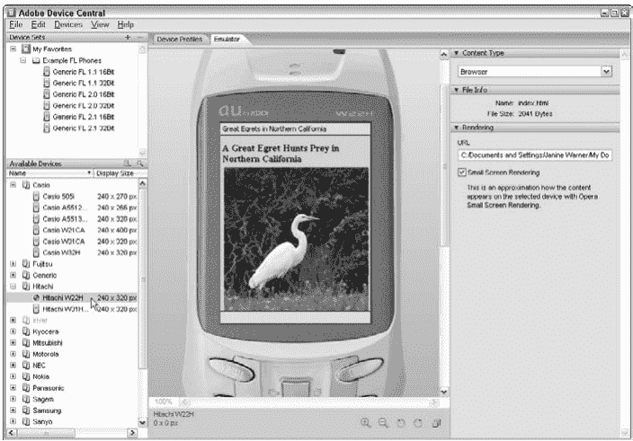

#### 第一部分：创建出色的网站

# 第 3 章

## 添加图形

### 本章内容

- 为 Web 创建和优化图像
- 购买免版税图像
- 对齐图像
- 图像编辑
- 添加背景图像
- 使用图像热点

无论您网站上的文字内容多么出色，图形总是最先吸引人们的注意力。而给人留下良好第一印象的关键在于使用看起来很棒、下载速度快，并且与您的网站设计相得益彰的图像。

如果您熟悉使用图形编辑程序（如 Adobe Photoshop 或 Fireworks）为 Web 创建图形，那么您已经领先一步。如果不熟悉，本章会提供一些指导，告诉您如何为 Web 转换图像、使用哪种图像格式，以及如何优化图像以加快下载速度。

如果您的图像已经是 GIF 或 JPEG 格式并准备好用于 Web，您可以直接跳转到“在页面上插入图像”部分，在那里您将了解如何放置和对齐图像、创建图像热点，以及使用图像作为背景。您还会发现 Dreamweaver 一些内置的图像编辑功能，它们使您无需启动外部图像编辑程序即可裁剪图像，甚至调整对比度和亮度。

### 比较 Adobe Web 图形程序

大多数专业设计师强烈偏好 Adobe Photoshop，尽管我必须说 Photoshop Elements 也给我留下了深刻印象，它是一个“精简”版本，但以很低的成本提供了许多相同的功能。（如果您正在设计用于印刷的图像，您需要 Photoshop；但对于 Web，Elements 是一个功能出人意料完整、低成本的替代方案。）对于矢量图形（插图的一个好选择），Adobe Illustrator 是首选。

以下是目前市场上最流行的图像编辑程序列表。除非另有说明，以下所有图像程序均可用于 Mac 和 Windows：

- **Adobe Fireworks** (www.adobe.com/fireworks)：Fireworks 是最早为创建和编辑 Web 图形而设计的图像编辑程序之一。最初由 Macromedia 创建，现在该程序已成为 Adobe Web Suite 的一部分，并与 Dreamweaver 完全集成。Fireworks 提供了您在一个设计精良的产品中创建、编辑和输出 Web 图形所需的一切。

- **Adobe Photoshop** (www.adobe.com/photoshop)：Adobe 称 Photoshop 为“心灵的相机”。这无疑是市场上最受欢迎的图像编辑程序，并且是图形专业人士广泛使用的标准。
使用 Photoshop，您可以创建原创艺术作品、校正照片色彩、修饰照片、扫描图像等等。除了特效和滤镜，Photoshop 还拥有丰富的强大绘画和选择工具，可以创建超出您用胶片拍摄或用其他插图程序所能实现的图像效果。在以前的版本中，Photoshop 捆绑了一个名为 Image Ready 的程序，这是一个专为 Web 图形设计的配套程序。在 CS3 版本中，这些 Web 功能已包含在 Photoshop 中。并且得益于对 Macromedia 的收购，Photoshop 现在也与 Dreamweaver 完全集成。

- **Adobe Photoshop Elements** (www.adobe.com/elements)：如果您不是为印刷品设计图像，并且不需要完整版 Photoshop 提供的所有复杂功能，Photoshop Elements 是一个功能非常强大的程序——成本大约是 Photoshop 的六分之一。如果您是专业设计师，Photoshop CS3 将为您提供最好的服务。但如果您是爱好者或小企业主，希望以低成本且无需经历专业图形程序学习曲线就能创建外观精美的图像，那么 Elements 是一个绝佳的选择，并且非常适合创建 Web 图形。

### 创建和优化 Web 图形

为 Web 创建图像时，最重要的一点是要记住对图像进行*优化*，以保持尽可能小的文件大小。您可以使用压缩技术或减少颜色的方法来优化图像。

如何优化图像取决于图像的创建方式以及您希望将其保存为 JPEG 还是 GIF。下一节中您将找到使用 Photoshop 优化 GIF 和 JPEG 的说明，但首先您应该知道，无论选择哪种程序、格式或优化技术，最大的挑战是在较小的文件大小和良好的图像质量之间找到最佳平衡点。本质上，您减少颜色或压缩图像的程度越高，图像看起来越差，但下载速度越快。

#### 选择最佳图像格式

关于 Web 图像最常见问题之一是何时使用 GIF，何时使用 JPEG。表 3-1 提供了简单的答案。

| 格式 | 最佳用途 |
|--------|----------|
| GIF | 用于线条图（如单色或双色徽标）、简单绘图、动画，以及基本上任何没有渐变或混合的图像。GIF 也是需要透明背景显示的图像的最佳格式。 |
| PNG | 对于同类有限颜色的图像，PNG 通常能生成比 GIF 外观更好、文件更小的图像。只需注意，非常旧的浏览器（如 IE 3）不支持 PNG 格式，即使是较新的浏览器（如 IE 4、5 和 6）在完全支持 PNG alpha 通道方面也存在问题。 |
| JPEG | 色彩丰富、复杂的图像（如照片）、包含渐变或颜色混合的图像，以及任何其他拥有数百万种颜色的图像。 |

#### 为 Web 保存图像

您可以将任何格式（包括 TIF、BMP 和 PSD）的图像转换为 GIF、PNG 和 JPEG 格式。并且您可以优化已经是 GIF、PNG 或 JPEG 格式的图像，以进一步减小其文件大小，从而在互联网上更快下载。

您可以使用许多程序来创建 Web 图形，但最好且最易用的程序之一是 Photoshop。在 Photoshop（和 Photoshop Elements）的“文件”菜单下，您会找到“存储为 Web 所用格式”选项。（在 Photoshop CS3 中，该选项是“存储为 Web 和设备所用格式”）。Fireworks 提供了类似的功能，但为了让您了解文件转换的工作原理，我在此提供一些立即转换 Web 图形的说明。尽管不同程序的对话框不同，但压缩和减少颜色的基本选项是相同的。


#### 在 Photoshop 中优化 JPEG 图像

编辑时始终最好使用尽可能高质量的图像，因此请在为网页优化图像之前完成调整大小和其他所有编辑操作。如果需要进一步编辑，请务必返回到更高分辨率的图像。

在“存储为 Web 所用格式”对话框中，您可以预览图像并选择优化设置，包括格式、压缩量和颜色选项。您可以并排查看同一图像，以便轻松地将原始图像与不同设置下的优化版本进行比较。

在原始图像预览下方，您可以看到原始图像的文件名和文件大小。在每个优化后的图像预览下方，您可以看到选择该预览时指定的优化设置所产生的效果，包括格式、设置以及新的文件大小和估计下载时间。下载时间是使用估计的互联网连接速度计算的。您可以通过右键单击（在 Mac 上为 Option 单击）文件大小和优化时间文本来更改此设置。

当您使用“存储为 Web 所用格式”功能时，Photoshop 会使用您指定的设置创建图像的新副本，并在主 Photoshop 工作区中保留原始图像不变。

JPEG 格式是优化连续色调图像（如照片）以及具有多种颜色或渐变的图像的最佳选择。在优化 JPEG 时，您需要指定应应用的压缩量，这一过程会使图像的文件大小变小。

如果您有一张数码照片或其他想为网页准备的图像，请按照以下步骤在 Photoshop 中对其进行优化和保存。如果您使用其他图像处理程序，过程类似，尽管具体步骤可能有所不同：

1.  在 Photoshop 中打开图像，选择“文件” > “存储为 Web 和设备所用格式”（或“文件” > “存储为 Web 所用格式”）。
    “存储为 Web 和设备所用格式”对话框出现。

2.  单击箭头打开对话框右侧的“优化文件格式”下拉列表，并选择 JPEG（参见图 3-1）。

3.  设置压缩质量。
    使用下拉列表中的预设选项：低、中、高、非常高或最高。或者使用“品质”字段下方的滑块进行更精确的调整。降低质量会减小文件大小并使图像下载更快，但如果将此数值降得太多，图像会看起来模糊且有色斑。

## 第 3 章：添加图形

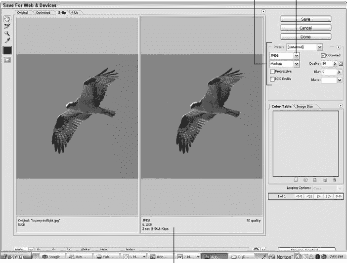

图 3-1：
JPEG 格式最适合包含数百万种颜色的照片和其他图像。

JPEG 设置
优化文件格式列表
文件大小和设置

Photoshop 在此对话窗口中对 JPEG 使用 0 到 100 的压缩比例，其中 0 是最低可能的质量（最高压缩量和最小文件大小），100 是最高可能的质量（最低压缩量和最大文件大小）。低、中和高分别代表 10、30 和 60 的压缩值。

4.  如果您想使图像焦点更柔和，请使用“模糊”设置。
5.  单击“存储”。
    “存储优化结果为”对话框打开。
6.  输入图像的名称，并将其保存到您网站文件夹中的 images 文件夹中。
    Photoshop 将优化后的图像作为原始图像的副本保存，并在主 Photoshop 工作区中保留原始图像打开。

对要优化为 JPEG 的每个图像重复这些步骤。

#### 在 Photoshop 中优化 GIF 图像

如果您处理的是图形，例如可以在 256 种或更少颜色中显示的徽标、卡通角色或绘图，则应使用 GIF 格式，并尽可能减少图像中使用的颜色总数以减小文件大小。为了帮助弥补因颜色减少而导致的图像质量下降，GIF 使用了一种称为仿色的技巧。*仿色*涉及以棋盘格状图案交替像素，以创建微妙的颜色变化，即使在有限的调色板下也是如此。此效果可以平滑图像的边缘，并使图像看起来使用了比实际更多的颜色。

要在 Photoshop 中将图像转换为 GIF，请按照以下步骤操作：

1.  **在 Photoshop 中打开图像，选择“文件” > “存储为 Web 和设备所用格式”（或“文件” > “存储为 Web 所用格式”）。**
    “存储为 Web 和设备所用格式”对话框出现。

2.  **在屏幕右侧的“优化文件格式”下拉列表中，选择 GIF，如图 3-2 所示。**

3.  **在“颜色”框中，选择颜色数量。**
    您使用的颜色越少，文件大小就越小，图像下载速度就越快。为了获得更小的文件大小，请将数量减少到 4 或 8 种颜色，但要小心。理想数量取决于您的图像；如果走得太远，您将丢失细节，图像看起来会很糟糕。

4.  **如果您想在图像中保留透明区域，请选择“透明度”选项。**
    图像中在编辑器中创建时为透明的任何区域在预览窗口中都会显示为透明。如果您的图像中没有透明区域，则此设置将不起作用。
    透明度是使文本或图像的另一部分出现在网页上时仿佛漂浮着的一个好技巧，因为透明背景不会出现在网页上。您可以在创建新图像时在“新建”对话框中选择透明度作为背景选项。

5.  **保持其他设置不变。**
    此对话框中的其余设置在 Photoshop 中可以保持其默认值。

6.  **单击“存储”。**
    “存储优化结果为”对话框打开。

7.  **输入图像的名称，并将其保存到您的本地根文件夹中。**

对要为您的网站准备的每个图像重复这些步骤。


## 第 3 章：添加图形

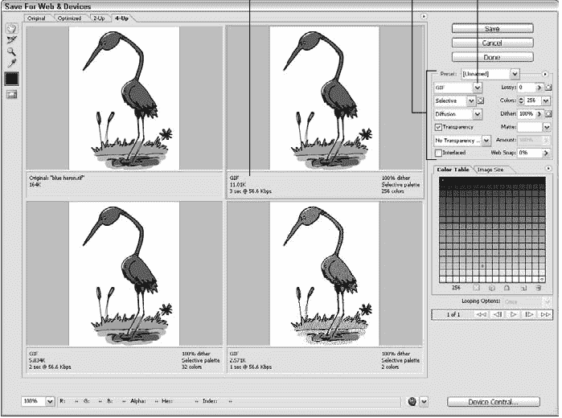

文件大小和设置
GIF 设置
优化文件格式列表

图 3-2：GIF 格式最适合颜色有限的图像，如卡通和线条图。

插图：Tom McCain

在“存储为 Web 和设备所用格式”对话框中，反复试验是一种很棒的技术。在图 3-2 中显示蓝鹭卡通图像优化版本的三个预览窗口中的每一个，我使用了越来越少的颜色，这减小了文件大小。左上角的版本是原始版本，文件大小为 164K。将图像减少到 256 种颜色显著减小了文件大小至 11K，但对图像几乎没有明显改变，如您在右上角所见。在左下角，图像减少到 32 种颜色，文件大小降至 5.8K，但对图像仍没有太大改变。在右下角，我将其减少到 2 种颜色，尽管在本书的黑白复制中很难看出，但图像质量急剧下降。由于它仅以两种颜色显示，因此失去了鸟的原始蓝色和脚边草地的绿色。在最后一种情况下，文件大小的微小节省显然不值得以图像质量的损失为代价。

#### 多小才算足够小？

在您了解如何优化 GIF 和 JPEG 并欣赏将它们尽可能变小的目标之后，您可能会问，“多小才算足够小？”答案大多是主观的——请记住，您的图形文件越大，人们为了看到它们必须等待下载的时间就越长。您的网站首页可能拥有最美丽的富士山图片，但如果下载需要 forever，大多数人不会耐心等待查看它。同时请记住，当您构建包含多个图形的页面时，必须考虑页面上所有图形的累积下载时间。即使每个单独的图像文件很小，它们也可能累加起来。与生活中的大多数事情不同，在网络上，越小肯定越好。

#### 购买免版税的剪贴画和照片

如果您不想费心创建自己的图像（或者如果您缺乏艺术天赋），您可能会高兴地发现有许多可用的剪贴画来源。免版税图像（包括剪贴画和照片）通常以一次性费用出售，该费用授予您使用该图像的全部或大部分权利。（阅读随您购买的任何艺术作品附带的协议，以确保您不会错过任何排除项或例外情况。例如，您可能需要为商业目的使用图像支付额外费用。）您可以找到各种各样的 CD-ROM 和网站，其中充满了剪贴画、照片甚至动画，您可以将它们用于您的网站。（说到动画，如今您甚至可以找到销售 Flash 文件、动画、按钮和其他艺术元素的网站，您可以对其进行编辑并整合到您的网站中。有关如何向网站添加多媒体的更多信息，请参见第 11 章。）许多专业设计师购买剪贴画图像，然后在图像程序（如 Adobe Fireworks、Adobe Illustrator 或 Adobe Photoshop）中进行修改，以适应特定项目或使图像更具特色。

以下是一些剪贴画供应商：

-   **Getty Images, Inc.** (www.gettyimages.com)：Getty Images 是网络上最大的免版税数字图像供应商，专门从事各种主题（包括电影片段）的照片和插图。按使用付费购买图像和片段。
-   **Photos.com** (www.photos.com)：Photos.com 是一个基于订阅的免版税库存摄影和照片对象服务。1 到 12 个月的订阅可让您无限访问和使用其收藏。
-   **iStockphoto.com** (www.istockphoto.com)：这是按使用付费模式的一个创新变体，iStockphoto 允许您用自己的照片换取库存图像。
-   **Web Promotion** (www.webpromotion.com)：动画 GIF 和其他网络图形的绝佳来源。该网站上的艺术作品是免费的，前提是您在您的网站上创建一个指向 Web Promotion 的链接，或者您可以支付少量费用购买该艺术作品。


## 第三章：添加图形

大多数网页专业人士认为，单个页面上所有元素的*累计大小*在75K到150K之间是一个理想的上限。随着DSL和电缆调制解调器的日益普及，许多网站开始在图形使用上变得更加丰富，超出了这个大小限制。然而，任何超过150K的大小都在挑战极限，特别是如果你期望使用拨号调制解调器（56K及以下）的用户能够停留足够长的时间来查看你的页面的话。

> 为了让你轻松确定页面上图像的总文件大小，Dreamweaver在当前文档窗口的状态栏中包含了此信息，如图3-3所示。这个数字表示你页面上所有图像和HTML的总文件大小，以及在给定连接速度下的预计下载时间。（你可以通过选择Edit▸Preferences▸Status Bar▸Connection Speed来设置你自己的连接速度。在Mac上，选择Dreamweaver▸Preferences▸Status Bar▸Connection Speed）。

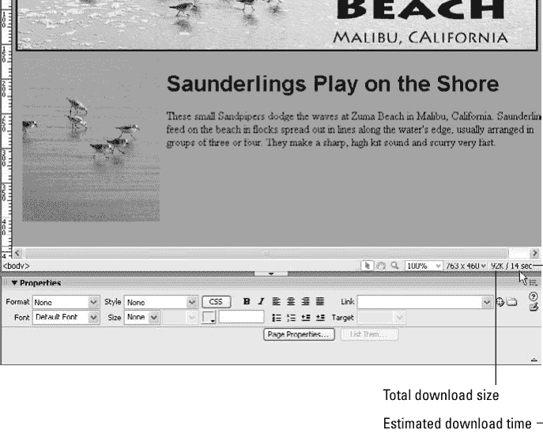

**图3-3：** Dreamweaver状态栏指示页面上所有元素的总文件大小和估计下载时间。

### 在Dreamweaver中插入图像

Dreamweaver使得在网页上放置图像变得简单，并提供了多种方式，包括选择Insert➤Image，点击Common Insert栏中的Image图标并使用Insert image对话框选择图像，或者简单地点击Files列表面板中的图像名称并将其拖动到页面上。

要在网页上放置图像，请按照以下步骤操作：

1.  打开现有页面，或选择File➤New创建新页面。

2.  确保在插入图像之前保存页面，选择File➤Save并将其保存到你的主站点文件夹。

3.  单击页面上你希望插入图像的位置来放置光标。


4.  点击工作区顶部Common Insert栏上的Image图标（图标看起来像一棵小树）或选择Insert➤Image。

将出现Select Image Source对话框。

5.  浏览以找到你要插入的图像。

从View菜单中选择Thumbnails，如图3-4所示，可以在Select Image Source对话框中查看图像的预览。如果你使用的是Windows操作系统，你还可以在对话框右侧看到任何选定图像的预览。（Mac没有图像预览选项。）

6.  要插入图像，双击它，或单击一次然后点击OK。

图像会自动出现在页面上。


当你在页面上插入图像文件时，你创建了页面到该图像的引用。底层代码看起来很像从一个页面链接到另一个页面时创建的链接，然后包含从图像到页面的路径。因此，如果你的图像和它们链接的页面在你的硬盘上的相对位置与在服务器上的位置不同，你就会破坏对图像的引用，它们将不会出现在你的页面上。（相反，你会看到那个难看的断开图像图标。）确保你的图像和文件保持彼此相对正确位置的最佳方法是将所有图像保存在你的本地根文件夹中（或在该文件夹内的子文件夹中），并确保它们在你的Web服务器上位于相同的文件夹或子文件夹中。关于创建和识别本地根文件夹的更多信息，请参阅第2章开头。

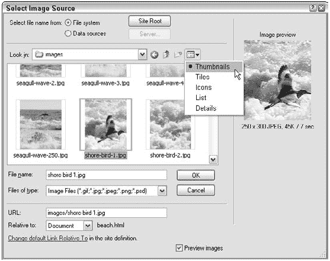

**图3-4：** 你可以定位并预览要放置的图像。

#### 在页面上对齐图像

在网页上放置图像后，你可能希望将其居中或对齐，以便文本可以环绕它。在接下来的两个部分——“图像居中”和“图像与文本环绕对齐”——你将找到使用基本HTML实现这两个目标的步骤。在第5章和第6章中，你将找到使用CSS对齐和定位图像的说明，这提供了更精确的设计选项。

##### 图像居中

要在页面上居中图像，请按照以下步骤操作：

1.  **单击选择你想要居中的图像。**

属性检查器会更改以显示图像属性。

2.  **从图3-5所示的属性检查器中的对齐选项图标中，单击Align Center图标。**

图像会自动移动到页面的中心。

#### 第一部分：创建出色的网站

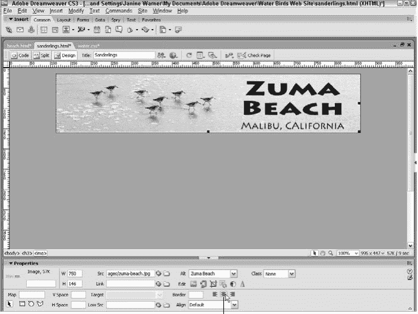

**图3-5：** 使用属性检查器中的对齐工具来居中图像。

你可能已经注意到属性检查器中的Align下拉列表有左对齐和右对齐选项，但没有居中选项。在HTML中，图像标签没有居中选项，但当你使用属性检查器中的Align center图标时，你可以为包围图像的任何标签（通常是段落标签`<p>`）添加居中对齐选项。你也可以创建一个CSS样式，通过将左右边距设置为默认值来居中图像。关于创建样式的更多信息，请参阅第5章和第6章。

##### 图像与文本环绕对齐

要将图像对齐到页面右侧，并让文本环绕在其左侧，请按照以下步骤操作：

1.  将图像插入到文本第一行的紧左侧（见图3-6）。

    最简单的方法是将光标放在文本第一个字母之前；然后选择Insert➤Image或点击Common Insert栏中的Image图标。

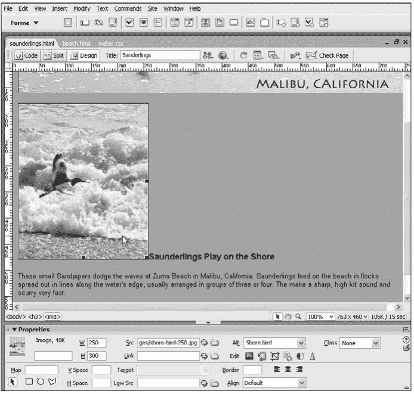

如果你想让文本环绕，请不要在图像和文本之间添加空格或换行符。

2.  单击选择图像。

属性检查器会更改以显示图像属性选项。

3.  在属性检查器中，从Align下拉列表中选择Right。

图像将右对齐，文本将自动环绕其周围，如图3-7所示。

要将图像左对齐并让文本环绕在其右侧，请遵循步骤1和2，但在步骤3中从Align下拉列表中选择Left而不是Right。

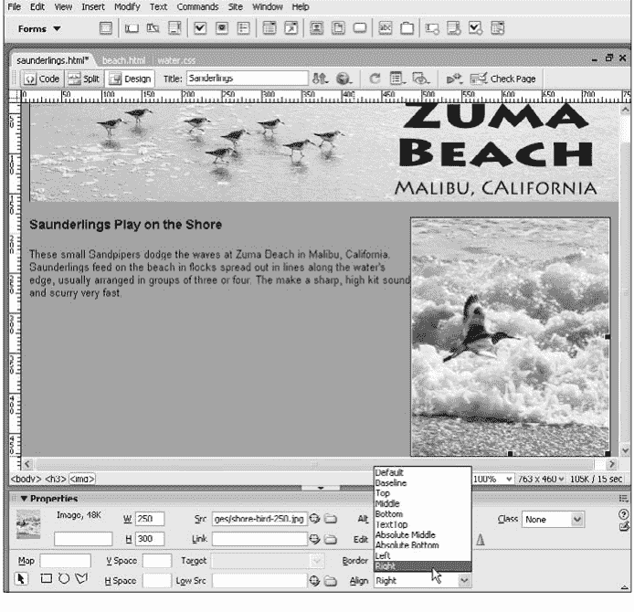

要防止文本紧贴图像，请单击图像，在属性检查器中找到V和H间距，然后输入你想要的空间量（空间以像素为单位）。五到十像素通常足以防止文本紧贴其边缘。如果你想只在图像的一侧添加空间，这会有点复杂，但你可以用CSS更精确地控制间距（在第5章和第6章中介绍）。

#### 使用图像创建复杂设计

HTML中可用的对齐选项使你能够垂直或水平对齐图像，但你不能同时进行两者。此外，对齐选项并不能真正让你精确地将图像彼此定位或与文本定位。例如，如果你尝试将一个紧贴文本块的图像居中，文本也会被居中。解决这个限制的一种方法是创建HTML表格，然后组合和合并表格中的单元格以控制定位。这种老派但仍然常见的技术在第7章中介绍。一个更好的选项是使用层叠样式表（见第5章和第6章）来创建布局和对齐样式，以按照最新标准控制页面上所有元素的定位。

### Dreamweaver中的图像编辑

Dreamweaver中的图像编辑功能使你可以在Dreamweaver内部对图像进行微小更改，而无需打开Fireworks或Photoshop或任何其他图形编辑程序。这些工具在选中图像时可从属性检查器中访问（见图3-8）。

**图3-8：** 使用图像编辑工具进行基本图像编辑。

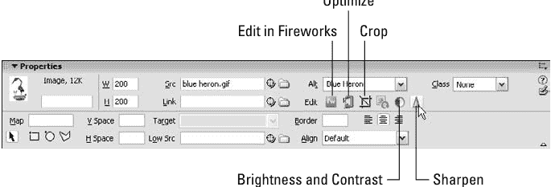

你还会找到两个按钮，使你能够轻松地在Dreamweaver和Fireworks之间移动图像，从而简化图像编辑。Edit按钮会启动Fireworks并在程序的主窗口中打开选定的图像。这些程序之间的集成意味着，当你在Fireworks中保存对图像的更改时，这些更改会自动反映在Dreamweaver的页面中。一个位于Edit按钮右侧的新按钮旨在使在Fireworks中优化图像变得快速而简便。第10章将更详细地介绍Edit in Fireworks和Optimize in Fireworks功能。

在你沉迷于编辑图像之前，请记住Dreamweaver主要是一个网页创建应用程序，并非真正设计用于编辑图形。尽管这些工具可能很有用，但它们不应取代在图形应用程序（如Fireworks或Photoshop）中进行严肃的图形处理工作。


### 裁剪图像

本质上，裁剪图像就是对其进行修剪。要裁剪图形或照片，请按照以下步骤操作：

1.  **在文档窗口中，通过单击选择要裁剪的图像。**

    属性检查器会更改以显示图像的属性。

2.  **单击裁剪图标（如图 3-8 所示）。**

    会出现一个对话框，警告你裁剪将更改原始图像。

    如果你希望保留完整的原始图像，请不要进行更改。如果你有顾虑，最好的做法是复制图像，然后对副本进行裁剪。

3.  **单击确定。**

    图像上方会出现一个带有边角和侧边控点的实心裁剪线，如图 3-9 所示。

4.  **单击并拖动控点，框选出要保留的图像区域。**

    完成裁剪时，裁剪线外的任何部分（以及被阴影覆盖的部分）都将被删除。

5.  **在框内双击，或按 Enter 键（Mac 上为 Return 键）。**

    图像即被裁剪。

你可以通过选择“编辑” ➪ “撤销”来撤销裁剪。但是，在保存页面后，更改将永久应用于图像，无法撤销。

### 调整亮度和对比度

调整图像的*亮度*可以改变图像整体的明暗程度。*对比度*则控制图像中明暗区域之间的差异。

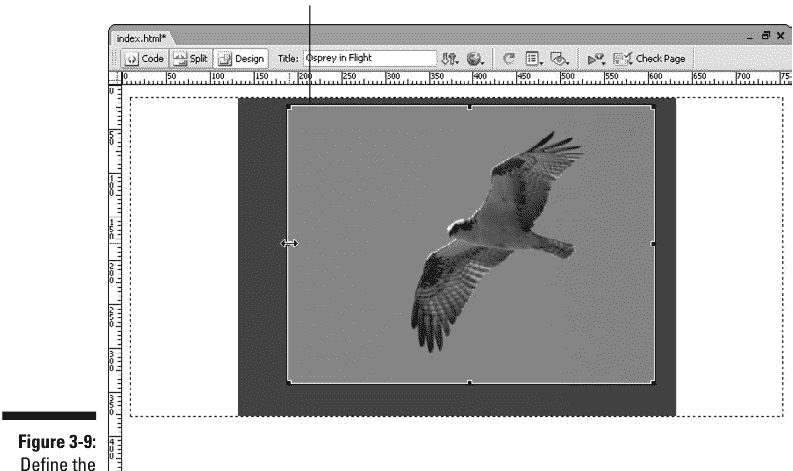

> 使用 Dreamweaver 的编辑工具会在保存页面时永久更改图像。如果你有顾虑，最好的做法是复制图像，然后对副本进行调整。

要调整亮度和对比度，请按照以下步骤操作：

1.  在文档窗口中，选择要更改的图像。
    属性检查器会显示图像属性。
2.  单击亮度和对比度图标（如图 3-8 所示）。
    会出现一个对话框，表明你所做的更改将应用于原始文件。
3.  单击确定。
    会出现亮度/对比度对话框。
4.  使用滑块调整图像的亮度和对比度设置。如果你希望在移动滑块时查看更改对图像的影响，请确保选中“预览”复选框。
5.  **单击确定。**

    保存页面时，设置将永久生效。

### 锐化图像

当你对图像应用*锐化*时，会增加不同颜色区域之间的区分度。其效果可能是增强图像中形状和线条的清晰度。


要锐化图像，请按照以下步骤操作：

1.  **在文档窗口中，选择要锐化的图像。**

    属性检查器会显示图像属性。

2.  **单击锐化图标（如图 3-8 所示）。**

    会出现一个对话框，表明你的更改将应用于原始文件。

3.  **单击确定。**

    会出现锐化对话框。

4.  **使用滑块调整图像的锐化程度。**

    如果你希望在移动滑块时查看更改对图像的影响，请确保选中“预览”复选框。

5.  **单击确定。**

    图像将被优化，并且在你保存页面更改时将永久生效。

### 在 Dreamweaver 中优化图像

Dreamweaver CS3 包含一个优化图标，你可以用它将图像转换为 GIF、PNG 或 JPEG 格式，并通过减少颜色或增加压缩来优化图像，就像在 Photoshop 或 Fireworks 中一样。要使用此功能，只需选择任何图像，然后单击属性检查器中的优化图标。（提示：它看起来像一个 C 形夹。）

> 警告！Dreamweaver 的编辑工具会在保存页面时永久更改图像。如果你有顾虑，请复制图像并对副本进行更改。

要在 Dreamweaver 中优化图像，请按照以下步骤操作：

1.  **在文档窗口中，选择要优化的图像。**

    属性检查器会显示图像属性。

2.  **单击优化图标（如图 3-8 所示）。**

    会出现一个对话框，表明你的更改将应用于原始文件。

3.  **单击确定。**

    会出现图像预览对话框，如图 3-10 所示。

    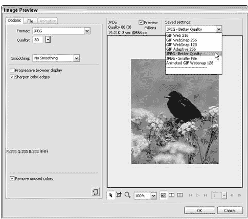

4.  **在格式下拉列表中，选择所需的图像格式。**

    你可以从 GIF、JPEG 或 PNG 格式中进行选择。

5.  **如果你选择 JPEG，请使用“质量”旁边的滑块选择压缩级别。如果你选择 GIF 或 PNG，请选择所需的颜色数量。**

    图像将根据你指定的设置进行更改。你还可以在图像预览对话框中更改其他设置，例如 GIF 格式的透明度设置，就像在 Photoshop 或 Fireworks 中一样。

### 插入背景图像

背景图像可以通过添加颜色和饱满度为页面设计增加深度和丰富感。巧妙使用背景图像有助于营造整个页面是一张大图的错觉，同时仍然能够快速高效地下载。诀窍是使用文件大小较小的图像来营造大图的印象。在网页上实现这一点的一种方法是使用背景图像的默认设置，这会导致图像在页面上*平铺*（重复）显示（参见图 3-11）。

请注意，某些背景（如图 3-11 所示）可能会使放置在其上的文本难以阅读。请谨慎选择背景图像，并确保背景和文本之间有足够的对比度——在计算机屏幕上阅读本身就很困难。

**图 3-11：** 此背景示例显示了当使用默认 HTML 设置将其插入背景时，图像如何在页面上水平和垂直重复。

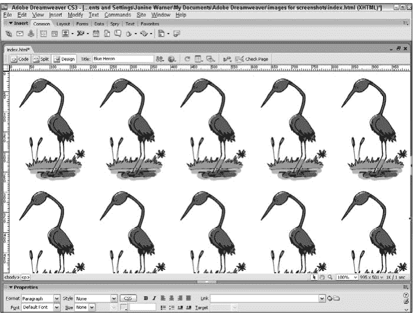

使用 CSS，你可以更精确地控制背景图像的显示。当你创建 CSS 背景样式时，可以插入一个不重复的背景图像，或者仅在页面的 Y 轴方向重复或 X 轴方向重复的背景图像。当你使用 Dreamweaver 的页面属性功能插入图像时（如图 3-12 所示），可以使用“重复”下拉菜单指定图像在页面上的重复方式，Dreamweaver 会自动为页面创建具有这些设置的背景样式。如果你使用 CSS 定义对话框进一步编辑 body 样式中的背景选项，你还可以指定背景图像在页面上的显示位置。（你可以在第 5 章中找到更多关于 CSS 背景选项的信息）。

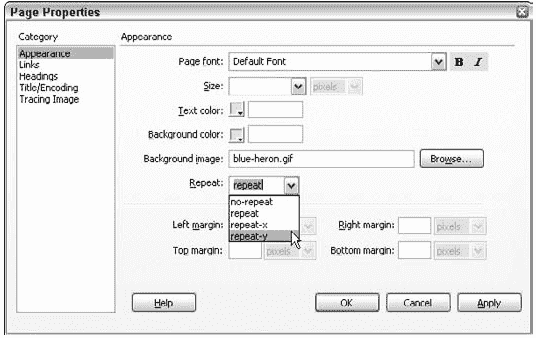

### 创建图像地图

图像地图在网络上很流行，因为它们允许你在图像中创建热区并将其链接到不同的 URL。图像地图的一个常见用途是与地理地图结合，例如美国地图，根据选择的地图部分链接到不同的位置。例如，如果你有一家国家银行，并希望客户能够轻松找到当地的分支机构或自动柜员机，你可以在美国地图的图像地图上创建热区，然后将每个热区链接到列出该地理位置银行的页面。

Dreamweaver 通过提供一套简单的绘图工具，使创建图像地图变得轻松，这些工具使你能够创建热区并设置其相应的链接。要创建图像地图，请按照以下步骤操作：

1.  将要用作图像地图的图像放置在你的页面上。
2.  选择该图像。

图像属性将显示在属性检查器中。


3. 要绘制热点，请从属性检查器左下角的图像地图工具中选择一个形状工具（在图 3-13 中已标注）。

形状工具（矩形、圆形和不规则多边形）允许你在图像上绘制区域，这些区域称为*热点*，每个热点都有特定的链接。

**4.** 选择形状工具后，在图像上你想要设为*热点*（链接到另一个页面）的区域点击并拖动。

以下是不同热点工具的使用方法：

- **矩形：** 点击并拖动时，你正在绘制的热点区域周围会出现浅蓝色高亮显示；该高亮区域表示活动区域。如果需要重新定位热点区域，请选择指针热点工具（在图 3-13 中已标注），然后选中该区域并将其移动到所需位置。你也可以通过点击并拖动任意角点来调整热点大小。

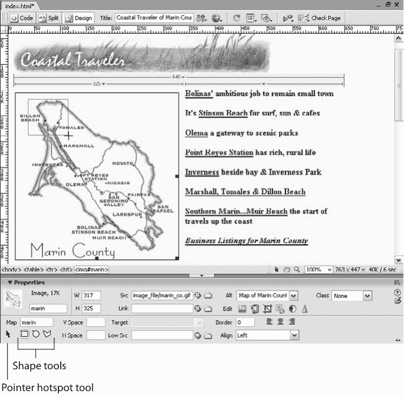

形状工具

指针热点工具

- **圆形：** 圆形工具的使用方法与矩形工具类似——只需点击并拖动即可。要调整圆形热点的大小，请选择指针热点工具，然后点击并拖动其边缘上的小方框之一。

- **多边形：** 多边形工具的使用方法与其他两个工具有所不同。要进行多边形选择，你需要为多边形形状的每个顶点点击一次工具。点击时，形状会自动连接各个顶点。完成后，切换到其他地图工具或点击图像外部。你可以使用指针热点工具来更改多边形的大小或移动其任意顶点。

**5. 要链接选定的热点区域：**

a. **点击链接文本框（位于属性检查器顶部）旁边的浏览图标。**

选择文件对话框将打开。

b. **浏览找到你想要链接到图像热点的 HTML 文件。**

c. **双击你想要链接的文件。**

热点将链接到选定的页面，选择文件对话框会自动关闭。

你也可以直接在链接文本框中输入路径。

**6. 要添加更多热点，请选择一个图像和一个形状工具，然后重复步骤 4 和 5。**

**7. 要为图像地图命名，请在形状工具上方的 Map 文本字段中输入名称。**

为地图（及其包含的所有热点）命名有助于在同一页上有多个图像地图时进行区分。你可以任意命名地图，只要不包含空格或特殊标点符号即可。

完成后，所有图像地图热点都会以浅蓝色高亮显示。

你可以随时返回并编辑图像地图。只需点击并选中图像上的蓝色区域，拖动边缘即可调整热点大小，或输入新的 URL 来更改链接。

## 第一部分：创建优秀的网站

# 第 4 章

## 管理、测试和发布网站

*本章内容*

- 在不同 Web 浏览器中测试你的网站
- 使用 Dreamweaver 站点报告功能测试你的网站
- 修复损坏的链接
- 设置 FTP 和其他文件传输选项
- 在 Web 上发布你的网站
- 使用 Dreamweaver 的站点管理功能

构建完网站后，你可能希望将其发布到 Web 上。但在网站上线之前，我建议你花一些时间使用 Dreamweaver 的众多测试功能来测试你的页面，这些内容将在本章开头介绍。

在本章末尾，你将找到使用 Dreamweaver 站点管理功能的说明，这些功能旨在帮助设计团队更好地协作。其中包括签入/签出功能，它可以防止两个人同时编辑网站上的同一个页面——如果你想确保一个设计师不会覆盖另一个设计师的工作，这是一个非常重要的功能。相信我，你需要尽一切努力来防止这种情况发生。

如果你急于将网站上线，请跳到本章中间部分，在"将网站发布到 Web 服务器"章节中可以找到使用 Dreamweaver 发布功能的说明。

如果你想在进入测试和发布之前继续完善网站设计，请随意跳到后面的 CSS 章节和其他更高级的章节。当你准备好将作品上线时，随时可以回到本章。

## 第一部分：创建优秀的网站


如果你正在寻找有关 Web 托管服务和域名注册网站的信息，可以在第 16 章中找到选择最佳托管和域名服务的建议和技巧。

### 在不同浏览器中测试你的网站

Web 设计中比较令人困惑和沮丧的方面之一是，你可以在 Dreamweaver 中创建一个看起来很棒的页面设计，并在浏览器中测试确认它看起来不错，但后来却发现在另一个浏览器中看起来很糟糕。网页在不同浏览器中看起来不同有很多原因，但归根结底是：浏览器显示网页的方式不同，因为 HTML 和其他 Web 技术多年来发生了巨大变化，并且并非所有浏览器制造商都以相同的方式设计他们的程序来显示 Web 设计功能，如 HTML 和 CSS。

如今，Web 上有数十种浏览器在使用，还不包括每种浏览器的不同版本。例如，在撰写本文时，Internet Explorer 7 是微软的最新版本，但很大一部分 Web 用户尚未升级，仍在使用 IE 6 或更早版本。同样，Firefox 和 Safari 等浏览器公司现在已经创建了多个仍在 Web 上使用的版本。

再加上 Macintosh 和 Windows 计算机之间的差异。例如，相同的字体大小在 Macintosh 上可能比在 PC 上显得更小，图像颜色也可能因计算机不同而有所差异。此外，同一个网页在 21 英寸显示器和 15 英寸显示器上的外观可能大不相同。

因此，访问网站的不同用户看到的同一个网页可能看起来非常不同。例如，图 4-1 显示了 Internet Explorer 中的网页，图 4-2 显示了同一页面在 Firefox 中的效果。在这两个浏览器中看到的差异在较旧的浏览器和不同尺寸的显示器上可能会更加明显。

Web 设计的这一挑战性方面是创建优秀网站的许多限制和复杂性的根源。但只要耐心、测试，并了解哪些标签和样式最容易出问题，你就可以创建出优秀的网站，让你的访问者——即使不是全部——大多数人都能看到良好的效果。

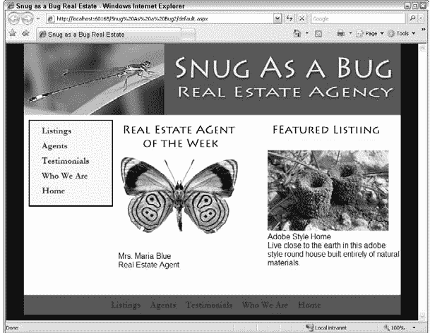

**图 4-1：**
Internet
Explorer 中的
网页。

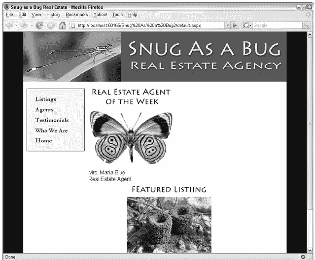

**图 4-2：**
同一网页，
但这次在
Firefox 中
显示。

在图 4-1 和图 4-2 所示的示例中，设计使用 HTML `<div>` 标签来分隔各个元素并在页面上创建列。CSS 样式将 `<div>` 标签中的元素定位在页面上，并添加外边距和内边距。由于在这些示例中，Firefox 和 Internet Explorer 显示的间距不同，因此显示效果在不同浏览器之间存在差异，右列在图 4-2 中被挤到了中列下方。（你将在第 6 章中了解更多关于使用 `<div>` 标签和 CSS 创建页面布局的内容，以及一些避免这种常见问题的技巧。）

#### 了解浏览器差异

有专门的书籍和网站来介绍浏览器之间的差异，尤其是在 CSS 方面。虽然我无法在此涵盖所有差异，但我提供了使用 Dreamweaver 功能的说明，这些功能可以帮助你管理此类设计挑战，例如第 2 章中介绍的在浏览器中预览功能。测试你作品的最佳方式是在多种浏览器中查看你的页面。

要让你的页面在 Web 上使用的所有浏览器中看起来完全一样，是非常困难甚至是不可能的，除非你愿意仅使用最简单和最基本的 HTML 格式选项，或者创建同一页面的多个副本，每个副本针对可能用于显示你页面的不同浏览器的独特显示设置进行设计。大多数设计师会创建一个在尽可能多的他们认为重要的浏览器上看起来尽可能好的页面，即使页面在所有浏览器上看起来并不完全一样。

你应该为哪些浏览器进行设计取决于你的受众。如果你有良好的日志文件或访客统计数据，你可能能够获得访问你网站的访客使用的浏览器（甚至浏览器版本）列表。例如，你可能能够确定 50% 的受众使用 Firefox，40% 使用 Internet Explorer，10% 使用 Safari。考虑到这一点，你可能会决定针对 Firefox 优化你的页面，确保它们在 Internet Explorer 中即使不是同样好也看起来几乎一样好，并确保内容在 Safari 中至少是可读和可访问的。

如果你想使用 CSS 创建复杂的页面设计，并希望你的页面在尽可能多的浏览器上看起来尽可能好，Web 设计师已经开发了大量技巧和变通方法来帮助确保页面在广泛的受众中看起来良好。其中一些技巧相对简单；另一些则异常复杂。


## 第4章：管理、测试和发布站点


因为这类问题非常常见，尤其是在使用 CSS 时，Adobe 在其网站上推出了一个专门栏目，旨在帮助 Web 设计师分享使用 CSS 进行设计的想法和策略。你可以在 Adobe CSS Advisor 栏目中找到这些技巧和提示。只需访问 adobe.com/go/cssadvisor 并搜索 CSS Advisor。

如果你知道访问者只会使用一种浏览器——例如，如果你正在设计一个企业内部网，并且可以要求所有员工使用同一浏览器——你的设计工作就会简单得多。一些公共网站设计师会在网站首页添加一条说明，告知任何访问者该页面在特定浏览器中显示效果最佳。尽管在某些情况下这或许情有可原，但我不建议这样做，因为你可能会流失许多潜在访客。

### 使用 Dreamweaver 的浏览器兼容性检查功能

为了帮助你测试页面在不同 Web 浏览器中可能存在的问题，Dreamweaver 提供了浏览器兼容性检查功能。要测试一个 Web 页面，请在 Dreamweaver 中打开该页面并选择“文件 > 检查页面 > 浏览器兼容性”。你也可以通过点击工作区右上角“检查页面”旁边的下拉箭头来访问该功能。任何已识别的冲突都会在工作区底部的一份报告中显示。

你可以点击“浏览器兼容性检查”对话框右上角的小菜单图标，来指定要针对的浏览器和浏览器版本（光标在图 4-3 中停留在该图标上）。你也可以从“检查页面”下拉列表中访问“浏览器设置”。当你选择“浏览器设置”时，会出现“目标浏览器”对话框，如图 4-3 所示。

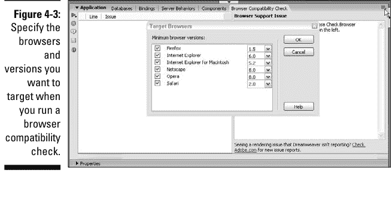

### 使用站点报告功能检查工作

在将网站上线供全世界浏览之前，使用 Dreamweaver 的站点报告功能检查你的工作是个不错的主意。你可以生成多种报告，甚至可以自定义报告，以识别外部链接、冗余和空标签、未命名文档以及缺少 Alt 文本等问题。你很容易遗漏某些问题——尤其是在时间紧迫的情况下——而遗漏的问题可能会给你的访问者带来真正的麻烦。

在 Dreamweaver 加入这个出色的新功能之前，发现这类错误是一项繁琐且耗时的任务。现在，你可以运行报告来为你识别这些错误，并使用 Dreamweaver 自动纠正整个站点中的错误。

请按照以下步骤生成整个网站的站点报告：

1. 在“文件”面板顶部的下拉列表中，选择站点名称。在出现的列表中，选择你要处理的站点。

    只有完成了第 2 章中介绍的站点设置过程，你的站点才会出现在“文件”面板列表中。

2. 通过选择“文件 > 全部保存”，确保所有打开的文档都已保存。

3. 选择“站点 > 报告”。

    “报告”对话框出现（见图 4-4）。

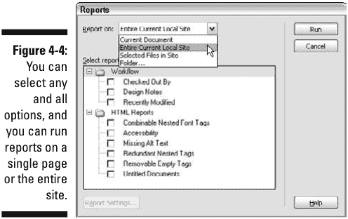

4. 在“**报告范围**”下拉列表中，选择“**整个当前本地站点**”。

    你也可以只检查单个页面，方法是在 Dreamweaver 中打开该页面，然后在“报告范围”下拉列表中选择“当前文档”。你还可以对所选文件或某个特定文件夹运行报告。如果选择“所选文件”，你必须已经在“文件”面板中选中了要检查的页面。

5. 在“**选择报告**”部分，选择你需要的报告。

    表 4-1 说明了每种选项生成的报告类型。你可以根据需要选择任意数量的报告。

    “选择报告”部分中的工作流选项只有在你已经在“站点定义”对话框的“远程信息”部分启用了“签入/签出”，并在“站点定义”对话框“高级”选项卡的“设计备注”部分中选择了“维护设计备注”之后才可用。你可以在有关 Dreamweaver 站点定义对话框的第 2 章中，以及在本章后面的“充分利用 Dreamweaver 的站点管理功能”部分中，了解更多关于设计备注和签入/签出的信息。

6. 点击“**运行**”按钮生成报告。

    如果你尚未执行相应操作，系统可能会提示你保存文件、定义站点或选择文件夹。（有关在 Dreamweaver 中定义站点的更多信息，请参见第 2 章。）

    “结果”面板将出现，如图 4-5 所示，显示在站点中发现的问题列表。你可以通过点击相应的列标题，按不同类别（文件名、行号或描述）对列表进行排序。

**图 4-5：**  
“结果”面板显示站点中的问题列表。

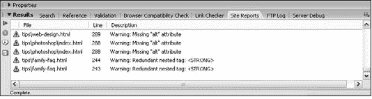

7. 在“结果”面板中双击任意项目，即可在“文档”窗口中打开相应的文件。

    你也可以右键单击（Windows）或 Control+单击（Mac）报告中的任意行，然后选择“更多信息”以查找有关特定错误或条件的更多详细信息。

8. 使用“**属性检查器**”或 Dreamweaver 的其他功能来纠正已识别的问题，然后保存文件。

#### 表 4-1：站点报告选项

| 报告名称 | 功能 |
|---|---|
| 签出者 | 列出从站点中签出的文件，并标识签出这些文件的人。 |
| 设计备注 | 列出站点中使用的设计备注。 |
| 最近修改 | 列出在指定时间段内编辑过的文件。你可以通过选中“最近修改”复选框，然后点击对话框底部的“报告设置”按钮来设置报告的时间范围。 |
| 可合并的嵌套字体标签 | 列出所有可以合并嵌套标签的实例。例如，`<font color="#000000"><font size="2">Great Web Sites You Should Visit</font></font>` 会被列出，因为你可以通过将两个 font 标签合并为 `<font color="#000000" size="2">Great Web Sites You Should Visit</font>` 来简化代码。 |
| 可访问性 | 列出多种类别中可能存在的可访问性问题。要指定该报告检查哪些内容，请选中“可访问性”复选框，然后点击对话框底部的“报告设置”按钮。 |
| 缺少 Alt 文本 | 列出所有不包含 Alt 文本的图像标签。Alt 文本是图像标签的文本描述，包含在 HTML 代码中，作为图像未显示时的替代内容。Alt 文本对于使用特殊浏览器阅读网页的人来说非常重要。 |
| 冗余嵌套标签 | 列出所有包含冗余嵌套标签的位置。例如，`<h1>Good headlines <h1>are harder to write</h1> than you might think</h1>` 会被列出，因为你可以通过删除第二个 `<h1>` 标签来简化代码，使其变为：`<h1>Good headlines are harder to write than you might think</h1>`。 |


| 报告名称 | 功能说明 |
| --- | --- |
| 可移除的空标签 | 列出您网站上的空标签。当您删除图像、文本区域或其他元素，但未删除应用于该元素的所有标签时，可能会出现空标签。 |
| 无标题文档 | 列出没有标题的文件名。`title`标签很容易被忽略，因为它不会出现在页面正文中。`title`标签指定了出现在浏览器窗口最顶部的文本，以及当用户收藏页面时出现在收藏夹列表中的文本。您可以通过在工作区上方的标题字段中输入文本，或在页面属性对话框中的标题字段中输入文本来为任何页面设置标题。 |

### 查找和修复断开的链接

如果您试图整理一个混乱的网站，或者只想检查网站中是否存在断开的链接，您会很高兴发现“检查链接”功能。您可以使用“检查链接”来验证单个文件或整个网站中的链接，并且可以使用它一次性自动修复所有引用的链接。

以下是“检查链接”功能示例。假设您团队中的某人（因为您自己绝不会做这样的事）在未使用“文件”面板或Dreamweaver任何自动链接更新功能的情况下，将文件名从`new.htm`更改为`old.htm`。也许这个人使用其他程序更改了名称，或者只是在资源管理器（Windows）或Finder（Mac）中重命名了它。更改文件名很容易，但这个人可能没有意识到的是，如果他或她在重命名文件时没有更改指向该文件的链接，那么这些链接现在就断开了。

如果只有一个页面链接到您那位不小心的队友更改的文件，修复断开的链接并不是什么大问题。只要您记得该页面是从哪个文件链接过来的，您可以简单地打开该页面，并使用属性检查器像最初创建链接时一样重新设置链接。（您可以在第2章中找到有关链接创建的所有基础知识。）

但在许多情况下，网站中的一个页面会链接到许多其他页面。在这种情况下，修复所有链接引用可能非常耗时，而且很容易忘记一些。这就是为什么“检查链接”功能如此有用的原因。首先，它作为一个诊断工具，可以识别出断开的链接。

#### 检查断开的链接

要检查网站中是否存在断开的链接，请按照以下步骤操作：

1.  在“文件”面板顶部的下拉列表中，选择网站名称。在出现的列表中，选择您要处理的网站。

链接检查仅适用于在Dreamweaver网站对话框中列出的网站。有关网站对话框以及如何设置新网站或导入现有网站的更多信息，请参阅第2章。

2.  选择“站点” > “检查整个站点的链接”。

“链接检查器”选项卡会在页面底部的“结果”面板中打开，就在属性检查器下方，如图4-6所示。该选项卡显示内部链接和外部链接的列表。它还列出了未从网站中任何其他页面链接的任何页面、图像或其他项目。（Dreamweaver称这些为*孤立文件*。）未使用的图像可能会浪费服务器上的空间，因此如果您想清理旧图像或网站中不再使用的其他元素，此列表非常方便。

大多数服务提供商会限制您服务器上的空间，如果您超出限制则会额外收费。您可以通过删除未使用的文件来节省宝贵的服务器空间，尤其是如果它们是图像或多媒体文件。但请记住，仅从硬盘驱动器中删除它们并不意味着它们已从服务器中删除。确保您同时从“文件”面板中的“远程站点”窗口和“本地站点”面板中移除它们。（有关使用FTP和同步功能在服务器上更新或删除文件的更多信息，请参阅本章后面的“将您的网站发布到Web服务器”部分。）

#### 修复断开的链接

断开的链接是您在网站上可能遇到的最糟糕的问题之一。在您识别出网站中的断开链接后，应尽快修复它。没有什么比点击一个链接却得到一个`File Not Found`错误页面更让访客反感的了。幸运的是，Dreamweaver通过提供对具有断开链接文件的快速访问以及自动化修复指向同一文件的多个链接的过程，使修复断开的链接变得简单。

### 图4-6：

该报告可以按断开的链接、外部链接和孤立文件（未使用的文件）组织。

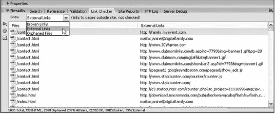

在使用上一节描述的“链接检查器”选项卡识别出断开的链接后，请按照以下步骤使用“结果”面板来修复它们：

1.  **在“结果”面板打开于页面底部的情况下，双击Dreamweaver识别为断开链接的文件名。**

    该页面及其对应的属性检查器会打开。“结果”面板保持可见。

2.  **在打开的页面上选择断开的链接或图像。**

    在图4-7中，选择了一个断开的图像，并正在通过使用属性检查器查找正确的图像名称来修复它。

3.  **在属性检查器中，单击Src文本框右侧的文件夹图标，以确定正确的图像文件。**

    （或者，您可以在文本框中键入正确的文件名和路径，而不是使用浏览选项来查找正确的图像。）“选择图像源”对话框会出现。修复指向页面的链接与修复指向图像的链接方法相同，只是您需要在Link文本框中键入正确文件的名称，或单击其旁边的文件夹图标在站点文件夹中查找文件。

4.  **单击以选择正确图像或文件的文件名，然后单击确定。**

    链接会自动更改为反映新的文件名和位置。如果您替换了图像，图像文件将重新出现在页面上。

如果您更正的链接出现在多个页面中，并且您使用断开链接的“结果”面板修复了该链接，Dreamweaver会提示您一个对话框，询问是否要修复指向该文件的其余断开链接引用。单击“是”按钮可自动更正所有其他引用。单击“否”按钮可保持其他文件不变。

### 通过地址查找文件

如果您不确定保存文件的位置或文件的名称，但您可以通过浏览器访问它，您可以通过查看浏览器地址栏中的URL来确定文件名和位置。网站中的每个文件夹都包含在指向该文件夹内页面的地址中。文件夹名称用正斜杠`/`分隔，每个文件名可以通过扩展名来区分。例如，图中显示的页面地址告诉我，该文件名为`dw8fd.html`，位于名为`dreamweaver`的文件夹中，该文件夹是名为`books`的文件夹的子文件夹。

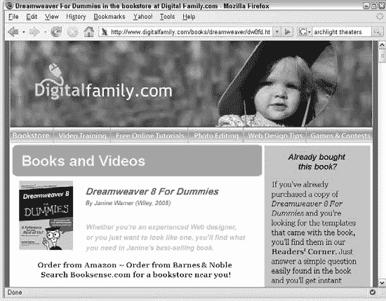

同样，您可以确定您正在查看的网页上任何图像的名称和位置。如果您使用的是Internet Explorer，将光标放在图像上，然后右键单击（Windows）并选择“属性”。“属性”对话框包含图像的具体URL，其中包含名称和文件夹（路径）。在此示例中，图像名为`DW8FD-cover-sm.gif`，存储在名为`dreamweaver`文件夹内的`images`文件夹中，而`dreamweaver`文件夹又位于名为`books`的文件夹内。

如果您使用的是Mac上的Safari浏览器，操作方式略有不同。Control+单击图像，然后选择“在新窗口中打开图像”。在新窗口中，图像URL会出现在位置栏中。

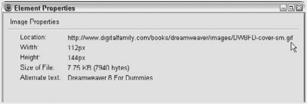

图4-7：使用属性检查器中的“浏览”按钮，通过确定正确的文件来修复断开的链接。

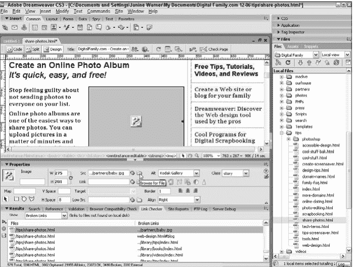

### 更改和移动链接的文件

Dreamweaver包含多种工具，可帮助您管理站点内的文件和文件夹，而不会破坏链接。您可以使用“文件”面板通过拖放轻松地重命名和重新排列文件和文件夹，以及创建新文件夹。

您需要为Dreamweaver的“文件”面板功能定义您的站点才能使其工作。如果您尚未定义站点，请参阅第2章开头的说明。

要重命名或重新排列文件，请按照以下步骤操作：

1.  如果尚未激活，请在“文件”面板顶部的下拉列表中选择您要处理的站点，如图4-8所示。

当您通过单击站点名称选择一个站点时，该站点中的文件夹和文件将出现在“文件”面板中。


2.  要在“文件”面板中打开和关闭文件夹，分别使用加号(`+`)和减号(`-`)。

3.  在“文件”面板中，选择要移动或重命名的文件或文件夹。

4.  要移动选定的文件或文件夹：

    a. 将选定的文件或文件组拖到另一个文件夹中。

Dreamweaver会自动更改所有相关链接。“文件”面板的工作方式非常类似于PC上的资源管理器窗口或Mac上的Finder窗口。


在 Mac 上，Dreamweaver 会在你通过文件面板移动文件时自动跟踪并修复链接。相反，如果你在 Finder 或资源管理器中移动或重命名站点文件或文件夹，指向这些文件或从这些文件发出的链接都会被破坏。

当你在 Dreamweaver 中将一个已链接的文件移动到新文件夹时，"更新文件"对话框会出现，并列出需要更新的链接，如图 4-9 所示。

- b. 要调整链接，请选择**更新**。如果你选择**不更新**，则指向该文件或从该文件发出的所有链接将保持不变。

5. 要重命名一个选定的文件：

- a. 双击任意文件名或文件夹名。

- b. 当名称周围出现编辑框时，像在 Finder 或资源管理器中编辑名称一样进行编辑。然后按 **Enter**（Mac 上为 **Return**）。

同样，系统会弹出"更新文件"对话框，提示你更新因文件名更改而受影响的链接。

- c. 选择**更新**以调整链接。

**图 4-9：**"更新文件"对话框列出了在更新过程中将被更改的所有文件。


### 全局更改链接

如果你想全局更改某个链接，使其指向新的 URL 或你站点上的其他页面，可以使用"在整个站点中更改链接"选项来输入新的 URL 并自动更改每个引用。你可以使用此选项更改任何类型的链接，包括 mailto、ftp 和脚本链接。例如，如果你在整个站点中使用的电子邮件地址发生了更改，你可以使用此功能自动修复——这非常节省时间。当你想让一段文本链接到与其当前链接不同的文件时，也可以使用此功能。例如，你可以将整个网站中所有 *Enter this month's contest* 的实例更改为链接到 `/contest/january.htm` 而不是 `/contest/december.htm`。

要使用"在整个站点中更改链接"功能来更改一组链接，请按照以下步骤操作：

1. 确保你要操作的站点显示在文件面板中。

请参阅前面的练习，了解选择站点的说明。

2. 选择 站点 ➪ 在整个站点中更改链接。

"在整个站点中更改链接"对话框将出现。

4. 输入旧地址，然后输入新地址，或单击"浏览"按钮来指定要更改链接的文件。

你可以使用此功能更改任何链接，包括电子邮件链接、站点内从一个页面到另一个页面的链接，或指向其他网站的链接。

5. 单击确定。

Dreamweaver 会更新所有包含指定链接的文档。


使用 Dreamweaver 的自动链接功能所做的任何更改仅会应用到硬盘上站点的本地版本。请确保将所有受影响的文件上传到你的 Web 服务器，以确保所有更改都包含在已发布的站点中。要自动同步本地和远程站点上的更改，请使用 Dreamweaver 的"同步文件"功能，该功能将在本章后面介绍。

### 将站点发布到 Web 服务器

在你创建了 Web 站点、进行了测试并准备好将其发布到网上之后，就该让 Dreamweaver 的发布工具发挥作用了。具体使用哪些功能取决于你所使用的 Web 服务器类型。如果你使用的是商业服务提供商，你很可能需要 Dreamweaver 的 FTP 功能，这将在下一节中详细介绍。

要访问 Dreamweaver 的发布工具：

1. 选择 站点 ➪ 管理站点。

"管理站点"对话框将打开。

2. 在已定义站点的列表中，选择你要发布的站点，然后单击"编辑"按钮。

"站点定义"对话框将打开。如果你尚未定义站点，请参阅第 2 章开头关于这个重要的初始站点设置过程的说明。

3. 从"站点定义"对话框顶部选择"高级"选项卡。高级选项将出现，取代基本选项卡上可用的"站点定义"向导。

4. 在"类别"列表中，选择"远程信息"类别。

5. 单击"访问"框右侧的下拉箭头（见图 4-10），选择最适合你的 Web 服务器和开发环境的发布选项。

如图 4-10 所示，Dreamweaver 提供五种"访问"选项：

- **无**：如果你不打算将站点上传到服务器，或者尚未准备好填写这些设置，请选择此选项。
- **FTP**：选择此选项以使用 Dreamweaver 内置的文件传输协议功能，这将在下一节中详细介绍。如果你使用的是商业 Web 托管服务，这很可能是你需要的设置。
- **本地/网络**：如果你使用的是本地网络上的 Web 服务器（如公司或大学服务器），请选择此选项。具体设置和要求请咨询你的系统管理员。


**图 4-10：**"远程信息"类别有许多用于发布 Web 站点的选项。

- **WebDAV（基于 Web 的分布式创作和版本控制）：**如果你使用的是支持 WebDAV 协议的服务器（如 Microsoft IIS），请选择此选项。
- **RDS（快速开发服务）：**如果你在远程服务器上使用 ColdFusion，请选择此选项。
- **Microsoft Visual SourceSafe：**如果你使用的是 Microsoft Visual SourceSafe，请选择此选项。请注意，此选项仅在 Windows 上可用。

#### 设置用于 FTP 的 Web 服务器访问

为了简化你的操作，Dreamweaver 集成了 FTP 功能，使你可以轻松地将页面上传到远程 Web 服务器。FTP 选项包含一些功能，可以帮助你跟踪硬盘上文件的更改，并确保它们与 Web 服务器上的文件保持一致。

#### 使用巧妙的密码保护自己

有非常多的人在用户 ID 和密码中使用相同的单词。这似乎是个好主意，因为它容易记住，但如果有人找到（或猜到）你的用户 ID 并想闯入你的系统，这也是最容易被猜到的密码。

如果你想让别人更难闯入你的计算机系统，请不要只使用一个名字或一个常用单词（使用宠物的名字也是一种流行的密码选择）。在密码中添加标点符号和混合大小写会使密码更难被猜到，但如果你足够巧妙，不一定更难记住。例如，如果你的狗叫 Spot，你住在 44 Maple，你可以将数字添加到狗的名字中，创建一个很好的密码，如 spot44。目标是想出一个你容易记住但别人很难猜到的密码，即使他们使用专门尝试随机名称和字典中常用单词作为密码的软件程序。

添加一个随机的大写字母，会使密码更难被猜到。例如，sPoT44 将是一个更具挑战性的密码。（假设你的 Web 服务器上的密码系统区分大小写，大多数都是如此。）另外，不要把密码写在便利贴上贴在电脑旁边，除非你想让任何走进你家或办公室的人都能访问你的系统。也要注意不要把写有密码的纸条扔进垃圾桶（在垃圾箱中翻找是窃取密码的一种久经考验的方法）。电子邮件也可能被截获或发现，所以如果你关心安全性，最好不要通过电子邮件分享密码。传统的电话服务仍然是分享密码的最佳选择之一。

## 第 4 章：管理、测试和发布站点

要使用 FTP 上传你的站点，你需要从你的 Web 托管服务获取以下信息：

- FTP 主机名
- Web 目录的路径（这是可选的，但很有用）
- FTP 登录名
- FTP 密码

要访问 Dreamweaver 中的 FTP 功能：

1. 按照上一节的步骤操作，在第 5 步中选择 FTP。

图 4-11 中的对话框将出现。

2. 在 **FTP 主机**文本框中，输入你的 Web 服务器的主机名。

它应该类似于 `ftp.host.com` 或 `shell.host.com` 或 `ftp.domain.com`，具体取决于你的服务器。（在我的示例中，我使用了 `ftp.techytranslator.com`。）

3. 在 **主机目录**文本框中，输入远程站点上存储公众可见文档的目录（也称为 _站点根目录_）。

它应该类似于 `public_html/` 或 `www/htdocs/`。同样，这取决于你的服务器。

4. 在 **登录**和 **密码**文本框中，分别输入访问 Web 服务器所需的登录名和密码。如果你勾选了"保存"复选框，Dreamweaver 会存储这些信息，并在你连接到远程站点时自动提供给服务器。

这是你独特的登录名和密码信息，用于获取服务器的访问权限。

5. **仅在你的服务提供商或站点管理员要求你这样做时，才选择"使用被动式 FTP"或"使用防火墙"选项。**

如果你不在网络上但使用商业服务提供商，你不需要选择这两个选项。

6. **单击确定以保存你的 Web 服务器信息设置并关闭"站点定义"对话框。**

单击"测试"按钮以确保你已正确输入所有内容。如果没有问题，Dreamweaver 会显示一个对话框，提示 `Dreamweaver connected to your Web server successfully.`。


## Part I: Creating Great Web Sites


**图 4-11：** 如果你使用的是商业网络托管服务，你需要在 Dreamweaver 中指定 FTP 设置以上传你的网站。

如果你更喜欢使用专用的 FTP 程序而不是 Dreamweaver 的内置功能，你可以在以下网址下载适用于 Mac 和 PC 的 FTP 程序：

- PC 上一款名为 WS_FTP 的流行 FTP 程序，可以从 www.ipswitch.com 下载。
- 另一款流行的 Windows 程序 Cute FTP，可以从 www.cuteftp.com 下载。
- 如果你使用的是 Macintosh 电脑，流行的选择是 Fetch，可在 www.fetchsoftworks.com 下载；以及 Transmit，可在 www.panic.com/transmit 下载。

## *将你的网站上线*

既然你的网站已经设置好了，是时候将页面上传到你的服务器，并通过 Dreamweaver 的内置 FTP 功能来检索它们。

### 下载现有网站

如果你想处理一个现有的网站，而你的本地计算机硬盘上还没有它的副本，你可以使用 Dreamweaver 下载该网站中的任何或所有文件，这样你就可以编辑现有页面、添加新页面，或使用 Dreamweaver 的其他功能来检查链接和管理网站的进一步开发。第一步是从服务器下载，将网站副本获取到你的计算机上。

要下载现有网站，请遵循以下步骤：

1.  **在你的计算机上创建一个新文件夹来存储现有网站。**

2.  **使用 Dreamweaver 的站点设置功能，将此文件夹指定为该网站的本地根文件夹。**

    如果你不确定如何操作，请查阅第 2 章中关于定义站点的信息。

3.  **设置“远程信息”对话框。**

    我将在“为 FTP 设置网络服务器访问”部分解释如何操作。

4.  **通过在“文件”面板中单击“连接到远程主机”按钮（图标看起来像两个电缆末端）连接到远程站点。**

5.  **单击“获取文件”按钮（图标是向下箭头），将整个网站下载到本地驱动器。**

    有时你的网络主机在远程服务器上有一些你不需要下载的文件。如果你只想从网站中下载特定的文件或文件夹，请在“文件”面板的“远程站点”窗格中选择这些文件或文件夹，然后单击“获取文件”按钮。Dreamweaver 会自动复制远程站点结构的一部分或全部（即文件夹，但不一定是其中的所有文件），并将下载的文件放置在网站层次结构的正确位置。在本地计算机上重新创建文件夹结构很重要，因为 Dreamweaver 需要知道文件相对于网站其他部分的位置，以便正确设置链接。最安全的选项是下载整个网站；但如果你正在处理一个大型网络项目，下载一部分并复制结构使你能够处理网站的一个部分而无需下载全部内容。

    如果你只处理网站中的一页或一个部分，通常应选择包含*依赖文件*（即那些页面链接的任何文件），以确保在你进行更改时链接设置正确。

6.  **下载网站或特定文件/文件夹后，你可以像处理 Dreamweaver 中的任何其他文件一样编辑它们。**

要在你的硬盘和远程服务器之间传输文件，请遵循以下步骤：

1.  **确保你已定义站点（如第 2 章开头所述），要上传的站点已打开并显示在“文件”面板中，并且你已使用上一节描述的所有 FTP 设置。**

2.  在“文件”面板的左上角，单击“连接到远程主机”图标。

    如果你尚未连接到互联网，“连接到远程主机”图标会启动你的拨号连接。如果这样连接有问题，请尝试像平常检查电子邮件或上网冲浪一样建立你的互联网连接，然后返回 Dreamweaver 并在建立互联网连接后单击“连接到远程主机”图标。当你的计算机在线时，Dreamweaver 应该可以轻松地与你的主机服务器自动建立 FTP 连接。

    如果你仍然无法连接到网络服务器，请参考前面的部分“为 FTP 设置网络服务器访问”，并确保你正确指定了服务器信息。如果你仍有问题，请联系你的服务提供商或站点管理员，以确保你拥有连接到服务器的所有正确信息。第一次正确设置所有这些信息可能很棘手，而且每个服务提供商都不同。

建立连接后，服务器上的目录会出现在“文件”面板中。你可以通过选择右上角的下拉列表（如图 4-12 所示）在视图之间切换。主要选项是“本地视图”（显示本地硬盘上的文件）和“远程视图”（显示服务器上的文件）。


3.  要**上传**文件（将文件从硬盘传输到网络服务器），请从“本地视图”面板（显示硬盘上的文件）中选择文件，然后单击“文件”面板中的“上传文件”图标（向上箭头）。

传输文件时，文件会自动复制到服务器。你可以选择多个文件或文件夹同时进行传输。

将文件上传到服务器后，请使用网络浏览器在线查看以测试你的工作。有时在计算机上看起来和工作正常的项目（例如链接）在服务器上可能无法正常工作。

4.  要**下载**文件或文件夹（将文件或文件夹从网络服务器传输到硬盘），请从“远程视图”面板（显示服务器上的文件）中选择文件或文件夹，然后单击“文件”面板中的“获取文件”按钮（向下箭头）。

传输文件时，文件会自动复制到你的硬盘。请注意，当你将文件复制到服务器或从服务器复制文件时，传输的文件会覆盖目标位置已有的文件。如果你用新文件替换旧文件，Dreamweaver 会通知你覆盖操作，但它并不总是能够正确评估正确的时间差异。传输完成后，你可以在硬盘上打开这些文件。

通过单击“文件”面板最右侧的“展开/折叠”图标（在图 4-12 中标注），你可以同时查看远程和本地视图。要折叠此“站点”对话框并使“文件”面板再次返回到屏幕一侧，请再次单击“展开/折叠”图标。

文件面板顶部带有复选标记和小锁的箭头用于“签入/签出”功能，该功能使你能够跟踪谁正在处理一个网站，并防止多人同时修改同一页面。本章后面的“使用签入和签出”部分将涵盖这些功能。

### 同步本地和远程站点

Dreamweaver FTP 选项中最有价值的功能之一是能够自动同步硬盘上的文件和服务器上的文件。这很酷，因为它可以帮助你跟踪哪些页面已编辑过，并确保它们已在服务器上更新。对于你第一次上传网站，或者你的网站只有几个页面时，这可能并不重要。但如果你有一个大型网站并经常更新，这个功能是确保你所有的更改都传送到服务器的好方法。Dreamweaver 还会在同步完成后确认哪些文件已更新。

请遵循以下步骤来同步你的网站：

1.  确保你要处理的网站已被选中并显示在“文件”面板中。


#### 第一部分：创建出色的网站


2. 在“文件”面板左上角，点击“连接到远程主机”图标，以登录到远程站点。

3. 点击展开/折叠图标（图 4-12 中已标注）以展开对话框，并同时查看远程和本地站点。

站点对话框会同时显示站点的远程视图和本地视图。（若要折叠此对话框，请再次点击展开/折叠图标。）

4. 选择“站点”→“同步整站”。

随即出现“同步文件”对话框。

5. 在“同步”下拉列表中，选择同步“整个站点”还是“仅选定文件”。

6. 在“方向”下拉列表中，选择要用于复制文件的选项：

    - **上传较新的文件到远程**：此选项将本地站点中最近修改的文件复制到远程站点。如果你希望从网站中删除这些文件，请勾选“删除本地驱动器上没有的远程文件”复选框。

    - **从远程下载较新的文件**：此选项将远程站点中最近修改的文件复制到本地站点。如果你希望从本地副本中删除这些文件，请勾选“删除远程服务器上没有的本地文件”复选框。

    - **同时上传和下载较新的文件**：此选项使用所有文件的最新版本同时更新本地和远程站点。

7. 确保未选中“删除本地驱动器上没有的远程文件”复选框。

请谨慎使用此功能。通常，我建议保持不勾选，因为你的服务器上可能有一些文件夹和文件（例如日志文件）在硬盘中并不存在，而你并不希望误删它们。

8. 点击“预览”按钮。

站点 FTP 对话框会显示即将更改的文件。

现在你可以验证要删除、上传和下载的文件。如果你不希望 Dreamweaver 更改某个文件，请立即在站点 FTP 对话框中取消选中它，否则后果自负。


9. 点击“确定”。

所有已批准的更改会自动完成，Dreamweaver 会更新站点 FTP 对话框中的状态。

10. 同步完成后，你可以选择将验证信息保存到本地文件，也可以选择不保存。

我建议选择保存验证信息，因为如果你要在同步完成后查看更改，它会很有用。


请小心使用“删除本地驱动器上没有的远程文件”选项，尤其是当你有一些特殊的管理页面（例如统计文件）时，这些文件通常由服务提供商添加到你的服务器空间，用于跟踪网站流量。

### 设置 Cloaking 选项

Dreamweaver 的 Cloaking 选项允许你将某些文件夹或文件排除在所有站点操作之外，这意味着在同步或批量来回传输文件时，它们不会被上传至线上站点。如果你有一些希望保存但不想向访问者展示的网站部分，这项功能会非常方便。例如，如果你有一个特殊的节日文件夹，一年中其他时候不想让它显示，你可以使用 Cloaking 功能将其保存在本地，并确保在取消隐藏并于 12 月发布之前，任何人都不会意外通过 Dreamweaver 发布这些文件。

要使用 Cloaking 功能，请按以下步骤操作：

1. **选择“站点”**➢**“管理站点”**。

2. **选择你要处理的站点，然后点击“编辑”。**

   站点定义对话框随即出现。

3. **在左侧的类别列表中，选择“Cloaking”类别。**

4. **选中“启用 Cloaking”复选框。**

5. **如果你想隐藏某种类型的文件，请选中“隐藏以...结尾的文件”复选框，并在文本字段中输入扩展名，如图 4-13 所示。**

   例如，如果你想隐藏可能保存在本地根文件夹中的原始 Photoshop 文件，使它们不上传并占用服务器空间，请输入 `.psd` 扩展名。如果你想隐藏多种文件类型，请用空格分隔每个扩展名，不要使用逗号或其他分隔符。

6. **点击“确定”关闭站点定义对话框，然后点击“定义站点”对话框中的“完成”按钮将其关闭。**

   与指定扩展名匹配的文件（如果有）现在已被隐藏。


> 图 4-13：Cloaking 功能允许你指定不希望传输到服务器的文件或文件夹。

7. 如果你想手动隐藏特定文件夹，请在**文件面板的“文件”选项卡**中选择这些文件夹。

   只有 Dreamweaver 的程序员知道为什么你无法隐藏单个文件。

8. **右键单击（Windows）或 Control+单击（Mac）**，然后选择 **Cloaking**→**隐藏**。

要取消文件或文件夹的隐藏，请重复步骤 4 至 8，然后从快捷菜单中选择“取消隐藏”。你也可以使用这些步骤取消当前站点中所有文件的隐藏、在站点中禁用 Cloaking，以及更改 Cloaking 设置。

### 在线编辑网页

如果你是一位经验丰富的网页设计师，只想对站点进行快速更改，或者使用 FTP 功能访问服务器上的文件而不执行站点设置步骤，Dreamweaver 确实允许你在未完成站点设置的情况下使用这些功能。要快速访问并设置 FTP 功能，请选择“站点”→“管理站点”，然后在“管理站点”对话框中选择“新建”→“FTP 和 RDS 服务器”。此快捷方式允许你使用 FTP 和 RDS 服务器直接在服务器上工作；然而，Dreamweaver 不会管理链接检查，其他站点管理功能也均不可用。

如果你对所有文件禁用 Cloaking，那么你做出的任何手动隐藏选择都会丢失，即使你以后再次启用 Cloaking。

### 充分利用 Dreamweaver 的站点管理功能

在以下几节中，你将找到有关使用“站点定义”对话框中更多选项的说明和指示，包括设计备注、签入/签出和集成电子邮件。如果你是唯一负责某个网站工作的人，可能不需要本节介绍的功能，因为这些功能面向由团队开发的站点，团队成员需要相互沟通，并确保不会覆盖彼此的工作。

### 使用测试服务器

“测试服务器”选项允许你指定一台开发服务器，如果你要使用 Dreamweaver 的动态页面创建功能来开发使用 PHP、ASP 或 ColdFusion 的站点，这是必要的一步。你可以在第十三章、第十四章和第十五章中找到有关使用这些选项的更多信息。

### 使用签入和签出

签入/签出功能旨在防止多个人在同一网站上工作时互相覆盖彼此的工作（如果你想保持网页设计团队所有成员之间的和谐，这是一项非常有价值的功能）。当网站上的某个人签出文件时，其他在该站点工作的开发人员就无法对该文件进行更改。当你签出文件时，“文件”面板中的文件名旁会显示一个绿色对勾。如果其他人签出了文件，你会在文件名旁看到一个红色对勾。

要使用签入/签出功能，请在“远程信息”对话框底部选择“启用文件签入和签出”选项。对话框会展开以显示其他选项。如果你希望文件在打开时自动签出，请选择“打开时签出文件”选项（参见图 4-14）。


使用此功能，你可以跟踪某个人正在处理哪些文件。但如果你想使用这一跟踪机制，请选择“打开时签出文件”选项，然后在“签出名称”字段中填写你希望与文件关联的名称（通常是你的姓名或昵称），并在“电子邮件地址”字段中填写你的电子邮件地址。（“电子邮件地址”字段用于 Dreamweaver 与电子邮件的集成，这有助于促进站点开发人员之间的沟通。有关集成电子邮件的更多信息，请参见下一节。）

> **通过版本控制保持和谐**
>
> 版本控制系统能够帮助你更好地管理更改，并防止不同团队成员覆盖彼此的工作。如果你已经在使用这些程序，你会很高兴知道可以将 Visual SourceSafe 和使用 Web DAV 协议的系统都与 Dreamweaver 集成。这样，你既能利用 Dreamweaver 的站点管理功能，又能保护你的代码开发过程。如果你不了解这些程序，请访问 Microsoft 网站（http://msdn.microsoft.com/ssafe/）了解更多关于 Visual SourceSafe 的信息。有关 Web DAV 的更多信息，请访问 www.webdav.org。


### 通过集成电子邮件保持联系

当你使用 Dreamweaver 的签入/签出工具（在上一节中介绍过）时，Dreamweaver 提供了集成电子邮件功能，作为协同 Web 设计的又一便捷工具。通过你已经在用的电子邮件程序，集成电子邮件可以让你轻松访问团队其他成员的电子邮件地址。

当与团队成员协作开发网站时，经常会遇到其他人已经签出了你要编辑的页面的情况。在那个人将文件签回之前，你无法对该页面进行所需的操作。在 Dreamweaver 站点定义对话框中，每位开发者需要在签入/签出功能中输入自己的电子邮件地址。然后，当你发现其他人持有你需要的页面时，只需在文件窗口中点击那个人的名字，就能轻松发送电子邮件，要求对方将文件签回以便你进行编辑。（我觉得贿赂比威胁更管用，尤其是用巧克力或免费电影票来贿赂的时候。）

你团队中的开发者可以按照以下步骤，在签入/签出设置中将自己的电子邮件地址与 Dreamweaver 进行关联：

1.  **选择站点 → 管理站点。**

    管理站点对话框将打开。

2.  **选择你要操作的站点，然后点击编辑按钮。**

    站点定义对话框将打开。

3.  **点击高级选项卡。**

4.  **在左侧的类别列表中，选择远程信息。**

    远程信息页面将显示（参见图 4-14）。

5.  **选中启用文件签入和签出复选框。**

6.  **选中打开文件时签出复选框。**

7.  **在签出名称文本框中，输入你的名字。**

    昵称也可以，只要团队中的每个人都知道你那个傻乎乎的名字就行。

8.  **在电子邮件地址文本框中，输入你的电子邮件地址。**

9.  **点击确定保存你的更改。在管理站点对话框中点击完成按钮。**

    管理站点对话框将关闭。

### 使用设计备注

如果你有时会忘记工作的细节，或者忘了告诉同事关于你们共同开发的网站的重要事项，Dreamweaver 的设计备注功能可能会为你省去不少麻烦。

如果你想向访问者隐藏敏感信息（如价格结构或创意策略），同时又能让开发团队成员查阅，那么设计备注就是理想的选择。在 Dreamweaver 中保存为设计备注的信息可以随任何 HTML 文件或图像一起传输，即使文件从一个网站转移到另一个网站，或者从 Fireworks 转移到 Dreamweaver。

本质上，设计备注使你能够记录信息（例如给你团队中其他设计师的消息）并将其与文件或文件夹关联。设计备注的工作方式与*注释标签*（HTML 代码，允许你在页面中嵌入浏览器中不显示的文本）非常相似，但更加私密。与直接嵌入页面 HTML 代码中的注释标签（如果有人查看网页源代码就能看到）不同，设计备注永远不会被访问者看到。访问者查看设计备注的唯一方式是故意输入你的备注子目录路径，直接查看备注文件。你甚至可以明确阻止此操作，但前提是你拥有服务器的管理访问权限。为了更加安全，你可以将备注保存在本地硬盘上，阻止它们被上传到服务器——当然，这样你的团队成员就看不到你的妙语了。

要访问设计备注页面，请在站点定义对话框的类别列表中选择设计备注（参见图 4-15）。此页面上的设置使你能够控制 Dreamweaver 如何使用设计备注：

- **维护设计备注：** 选择此选项可确保在上传、复制或移动文件时，设计备注仍然附属于该文件。
- **上传设计备注以供共享：** 选择此选项可在通过 FTP 发送文件到服务器时包含设计备注。
- **清理：** 使用如图 4-15 所示的清理按钮，删除与站点中任何文件都不关联的设计备注。


**图 4-15：** 在将文件发送到 Web 服务器时可以包含设计备注。

当你在 Adobe Fireworks 中创建图形时，可以为每个图像文件保存一条设计备注，该备注在 Dreamweaver 中同样可用。要使用此集成功能，请在 Fireworks 中创建设计备注并将其与图像关联。然后，当你将 Fireworks 图像保存到本地网站文件夹时，设计备注会随之保存。当你在 Dreamweaver 中打开该文件时，右键点击图像（在 Mac 上为 Control+点击）即可看到设计备注。此功能为图形设计师与 Web 开发团队其他成员之间的沟通提供了极大的便利。

# 第 4 章：管理、测试和发布站点


**图 4-15：** 在将文件发送到 Web 服务器时可以包含设计备注。

要激活设计备注功能，请按照以下步骤操作：

1.  **选择站点 → 管理站点。**

    管理站点对话框将打开。

2.  **选择你要操作的站点，然后点击编辑按钮。**

    站点定义对话框将打开。

3.  **选择高级选项卡。**

4.  **在左侧的类别列表中，选择设计备注。**

    设计备注页面将显示（参见图 4-15）。

5.  **选择维护设计备注选项。**

    选中此选项后，当你复制、移动、重命名或删除文件时，关联的设计备注文件也会随之被复制、移动、重命名或删除。

6.  **如果你希望在将文件上传到服务器时一并发送设计备注，请选中上传设计备注以供共享选项。**

    如果你只是给自己做备注，并且不想在上传文件到服务器时与页面关联，请取消选中此选项，这样设计备注将保留在本地但不会随文件一起上传。

7.  **在站点定义对话框中点击确定，然后在管理站点对话框中点击完成按钮。**

    管理站点对话框将关闭。

要为文档添加设计备注，请按照以下步骤操作：

1.  **打开你要添加设计备注的文件，然后选择文件 → 设计备注。**

    设计备注对话框将打开（参见图 4-16）。你需要签出文件才能添加或修改设计备注，但读取备注不需要。


**图 4-16：** 设计备注可以方便地为文档、图像甚至整个文件夹添加消息。

2.  **在状态下拉列表框中，选择文档的状态。**

    你的选项有：草稿、修订 1、修订 2、修订 3、Alpha、Beta、最终版和需要注意。你可以选择任何状态，并且应该与你的设计团队制定一个关于每个状态含义以及如何使用这些选项来管理开发过程的规范。

3.  **在备注文本框中，输入你的评论。**

4.  **如果你想插入当前本地日期，请点击插入日期图标，它就在备注文本框的正上方。**

    当前日期将自动插入。

5.  你也可以选中文件打开时显示复选框。如果选中此框，每次打开文件时都会显示设计备注，这样就不会被遗漏。

你可以添加其他对网站开发者可能有用的信息。例如，你可以命名一位关键设计师（在名称字段中）并将值定义为该人的姓名或项目的优先级（在值字段中）。你还可以定义一个用于客户或常用文件类型的字段。

6.  **点击加号（+）按钮添加新的信息项；点击减号（–）按钮删除选定的项目。**

7.  **点击确定保存备注。**

你输入的备注将保存到与当前文件同一位置下名为 *notes* 的子文件夹中。文件名为文档文件名加上扩展名 `.mno`。例如，如果文件名为 `art.htm`，则关联的设计备注文件名为 `art.htm.mno`。在站点视图中，设计备注通过一个类似卡通气泡的黄色小图标来标识。

### 激活站点地图布局

如果你难以跟踪网站中的所有文件及其相互链接关系，你并不孤单。随着网站越来越大，这项任务变得越来越艰巨。这就是 Dreamweaver 包含站点地图布局功能的原因——帮助你跟踪网站的结构和层次。这不是那种你在网站上常见的、链接到网站主要页面的站点地图。Dreamweaver 的站点地图布局**永远不会被访问者看到**；它是一个站点管理功能，旨在帮助你以可视化方式管理网站中的文件和文件夹。

要从站点地图布局页面创建站点地图，请按照以下步骤操作：

1.  **选择站点 → 管理站点。**

    管理站点对话框将打开。

2.  **选择你要操作的站点名称。**

3.  **点击编辑按钮。**

    站点定义对话框将打开。

4.  **确保站点定义对话框顶部的高级选项卡已选中，并且高级选项可见。**

5.  **在左侧的类别列表中，选择站点地图布局。**

    站点地图布局选项将显示在站点定义对话框的右侧，如图 4-17 所示。


## 118 第一部分：创建优秀的网站


**图 4-17：** 站点地图布局选项允许你指定站点地图导航窗口的显示方式。

+   6. 单击**主页**文本框旁边的**浏览**图标，浏览并找到网站的主文件夹。**注意：** 如果你已经为站点填写了本地信息页面，则此字段已预填。

此文本框指定了网站主页和主站点文件夹的位置。此信息至关重要，因为它向 Dreamweaver 显示了网站的起始和结束位置。

+   7. 指定你希望在站点地图中每行显示的**列数**。

+   8. 在**列宽**文本框中，以像素为单位设置站点地图列的宽度。

同样，如果不确定宽度，可以从默认值 125 开始。

+   9. 在**图标标签**部分，选择**文件名**或**页面标题**选项，分别将文件名或页面标题作为站点地图中每个页面的标签。

生成站点地图后，你可以手动编辑显示的文件名或页面标题。

+   10. 在选项部分，你可以选择隐藏某些文件，这意味着它们在站点地图窗口中不可见。

如果你选择“显示标记为隐藏的文件”选项，你标记为隐藏的文件将以斜体形式出现在站点地图中。如果你选择“显示相关文件”选项，站点层次结构中的所有相关文件都会出现。*相关文件*是浏览器在加载主页面时加载的图像或其他非 HTML 内容。

+   11. 单击“确定”。

站点地图会自动生成。

+   12. **要查看站点地图，请打开屏幕右侧的文件面板，然后从右上角的下拉列表中选择“地图视图”。**

（在图 4-18 中，由于文件面板已展开，下拉列表显示在左侧。）站点地图出现在文件面板中，使用图标表示站点中的每个文件和链接。


**图 4-18：** 站点地图提供了网站结构、层次和链接的可视化参考。

## 使用“文件视图列”选项

你可以使用“站点定义”对话框中的“文件视图列”类别（参见图 4-19）来自定义文件和文件夹选项在展开的文件面板中的显示方式。这对于以新颖的方式对文件进行排序或分组非常有用——例如，添加一个*部分*、*部门*、*季度*或*版本*列。

## 120 第一部分：创建优秀的网站


**图 4-19：** 你可以更改文件面板的显示选项。

你可以通过以下方式自定义文件视图列：

- 你可以通过单击对话框顶部的小加号，并输入每个新列的名称、关联和对齐方式，最多添加 10 个新列。
- 你可以通过选择列名，然后单击对话框右上角的向上或向下箭头，将其在列表中向上或向下移动，从而重新排序或重新对齐列的显示顺序。
- 你可以通过选择列名称并单击“显示”框以删除复选标记，来隐藏除文件名列以外的任何列。
- 你可以通过选择列名称并单击以删除“启用列共享”复选框中的复选标记，来指定哪些（如果有）列与其他有权访问该站点的开发人员共享。
- 你可以通过选择列名称并单击对话框顶部的减号，来删除任何自定义列（无法删除默认列）。
- 你可以像编辑文件名一样重命名自定义列。
- 你可以通过选择列名称并使用“关联设计备注”旁边的下拉列表，将设计备注与自定义列关联起来。

### 启用 Contribute 功能

Adobe Contribute 是一个程序，旨在让不太了解网页设计的人能够轻松地为网站做出贡献。可以将 Contribute 视为某种 Dreamweaver 精简版，尽管它作为独立程序运行效果不佳。Contribute 旨在与在 Dreamweaver 中设计的站点一起工作，并且许多功能都经过精心集成，以使协作顺利进行。如果你与其他使用 Contribute 的站点开发人员合作，请确保在“站点定义”对话框的“Contribute”类别中选中“启用 Contribute 兼容性”旁边的复选框。

### 记录你的历史

你可以使用历史记录面板跟踪你的操作，甚至重播你的步骤。历史记录面板还允许你撤销一步或多步操作，并创建命令来自动化重复性任务。

要打开如图 4-20 所示的历史记录面板，请选择“窗口” > “历史记录”。一旦你打开一个文件，历史记录面板就会在你于 Dreamweaver 中工作时自动记录你的操作。你无法重新排列历史记录面板中步骤的顺序，但你可以复制、重播和撤销它们。不要将历史记录面板视为命令的任意集合；将其视为一种按你执行顺序查看你已执行步骤的方法。如果你必须一遍又一遍地重复相同的步骤，这是让 Dreamweaver 为你工作的绝佳方式。如果你犯了一个重大错误并希望在你的开发工作中返回一步或多步，这也会是一个救星。


图 4-20：历史记录面板跟踪你的操作，使撤销和重复步骤变得容易。

## 122

## 第一部分：创建优秀的网站

### 使用录制的命令重复你的步骤

你可以使用 Dreamweaver 的“录制的命令”功能（从“命令”菜单中访问）来自动化重复性任务。只需启动录制选项，在 Dreamweaver 中执行一系列操作，停止，然后保存它们。然后你只需重播录制内容即可自动重复操作。要使用“录制的命令”选项，请选择“命令：开始录制”，然后仔细执行一系列你希望能够重复的步骤。当你完成想要录制的步骤后，请选择“命令：停止录制”并为命令命名以保存它。要播放操作，请选择“命令：播放录制的命令”，然后选择你的新命令。然后退后一步观看操作；或者更好的是，休息一下，离开办公室换个环境。

以下是你可以如何利用历史记录面板的一些方法：

- **要复制你已经执行的步骤：** 使用“复制步骤”选项作为自动化你想要重复的步骤的快捷方式。你甚至可以单独选择步骤，以防你希望完全按照原样重播某些（但不是全部）操作。
- **要重播历史记录面板中显示的任何或所有步骤：** 高亮显示你想要重播的步骤，然后单击历史记录面板底部的“重播”按钮。
- **要撤销重播步骤的结果：** 选择“编辑”： “撤销重播步骤”。
- **要将步骤应用于页面上的特定元素：** 在选择和重播步骤之前，在“文档”窗口中高亮显示该元素。例如，如果你只想将加粗和斜体格式应用于页面上的几个单词，你可以重播将加粗和斜体应用于选定文本的步骤。

你还可以通过选择“编辑”： “首选参数”（Windows）或“Dreamweaver”： “首选参数”（Mac），并从左侧的类别列表中选择“常规”，来设置历史记录面板中显示的步骤数。默认为 50 步，对大多数用户来说绰绰有余。数字越高，历史记录面板使用的内存就越多。

### 使用快速标签编辑器

如果你是那种喜欢在 Dreamweaver 所见即所得编辑环境中工作，但偶尔仍想查看 HTML 标签的开发人员，你会爱上快速标签编辑器。

## 第 4 章：管理、测试和发布站点

快速标签编辑器，顾名思义，允许你快速访问 HTML 标签，并使你无需打开 HTML 源代码窗口即可修改、添加或删除 HTML 标签。这意味着当你在设计视图中处理页面中间时，无需切换到代码视图即可查看你正在处理的 HTML 标签。你可以使用快速标签编辑器插入 HTML、编辑现有标签，或在选定的文本块或其他元素周围包裹新标签。

快速标签编辑器以三种模式之一打开——编辑、插入或包裹——这取决于你启动编辑器之前在页面上选择的内容。在快速标签编辑器打开时，使用键盘快捷键 Ctrl+T（Windows）或 ⌘+T（Mac）来切换模式。

你可以在快速标签编辑器中输入或编辑标签，就像在代码视图中一样，无需在代码视图和设计视图之间来回切换。要在快速标签编辑器中输入或编辑标签，请按照以下步骤操作：

+   1. **打开要编辑的文档，选择一个元素或文本块。**
    如果要添加新代码，只需在文件中的任意位置单击，无需选择文本或元素。


+   2. **选择“修改” > “快速标签编辑器”。**
    你也可以按 Ctrl+T（Windows）或 ⌘+T（Mac）。
    快速标签编辑器以最适合你选择的模式打开，如图 4-21 所示。例如，如果你单击图像或格式化的文本，它会显示当前标签以便你可以编辑它。如果你不选择任何内容或选择未格式化的文本，快速标签编辑器会打开并显示空白，你可以输入要添加的代码。按 Ctrl+T（⌘+T）切换到另一种模式。
    如果你想编辑现有标签，请转到步骤 3。如果你想添加新标签，请跳到步骤 4。

+   3. **如果你选择了具有多个 HTML 标签格式的元素或具有多个属性的标签，请按 Tab 键从一个标签、属性名或属性值移动到下一个。按 Shift+Tab 键移动回上一个。**
    如果你不确定某个标签或属性，请暂停几秒钟，一个下拉列表会自动出现，为你提供当前正在编辑元素的所有可用标签或属性的列表。如果此提示列表未出现，请选择“编辑” > “首选参数” > “代码提示”（Windows）或“Dreamweaver” > “首选参数” > “代码提示”（Mac），并确保选中了“启用代码提示”选项。


4. 要添加新标签或属性，只需在“快速标签编辑器”中输入代码。

你可以使用 Tab 键和方向键将光标移到要添加代码的位置。你可以让“快速标签编辑器”保持打开状态，并继续编辑、添加属性名和属性值，想保持多久都可以。

5. 要关闭“快速标签编辑器”并应用所有更改，请按 Enter（Windows）或 Return（Mac）。


**图 4-21：** 你可以在“快速标签编辑器”中查看和编辑 HTML 标签，而无需切换到代码视图。

# 第二部分

## 欣赏网页设计选项

The 5th Wave

By Rich Tennant


> “我的网站应该多么准确地反映我的营业场所？”

### 本部分导读……

创建符合标准的、可访问的网页设计的最佳方式是使用层叠样式表（CSS）。本部分将向你介绍 CSS 的强大功能和优势，但你也会找到有关使用表格和框架的说明，它们仍然是可行的网页设计方法。

在第 5 章，你会找到 CSS 简介以及 Dreamweaver 中 CSS 功能的概述。在第 6 章，你将继续学习创建 CSS 布局，使用 div 标签和其他块级元素来创建可访问的、灵活的设计。

在第 7 章，你将了解如何创建表格、拆分和合并单元格以及使用表格属性。在第 8 章，你将初步了解框架，并发现如何通过目标设置使链接在页面的特定部分打开。在第 9 章，你将了解 Dreamweaver 的模板如何加快网页创建速度，以及如果你需要重新设计页面，如何节省更多时间。

# 第 5 章

## 层叠样式表

### 本章内容

- 层叠样式表简介
- 使用 Dreamweaver 的 CSS 功能
- 比较内部和外部样式表
- 使用标签、类和高级样式选择器

想为你的页面增添一点风格吗？*层叠样式表（CSS）* 是当今创建网站的方式，如果你想遵循最新标准并开发可访问、灵活且能在多种设备上运行的网站。

创建样式的概念早在网络出现之前就已经存在。桌面出版程序（如 Adobe InDesign），甚至文字处理程序（如 Microsoft Word），长期以来都使用样式来管理印刷页面中文本的格式和编辑。在文字处理器中使用样式，你可以为常见元素（如标题、副标题和说明文字）创建样式。在印刷设计中，样式是节省时间的利器，因为它们使你能够将一系列格式选项（如 Arial、粗体、斜体和居中）组合到一个样式中，然后使用单个样式将所有这些选项一次性应用到文档中的任何选定文本。当你在印刷品中以这种方式使用样式时，还有一个好处：如果更改某个样式，你可以将更改应用到所有使用过该样式的地方。

在 Web 上，你可以使用 CSS 完成所有这些以及更多功能，因为样式表不仅可以用于文本格式化。除了为标题等创建样式外，你还可以使用 CSS 创建将图像对齐到页面左侧或右侧的样式，在文本或图像周围添加内边距，以及更改背景和链接颜色。你还可以创建仅应用于当前页面的样式表，或者创建作为独立文档的样式表，以便应用于同一站点中的多个页面。使用这种方法，只需更改外部样式表中的样式，就可以在整个网站的任意或所有页面上进行更改。由于可以为同一页面创建多个样式表，CSS 正迅速成为大多数专业网页设计师首选的网页设计方法。

如果你还没有加入 CSS 的行列，本章旨在帮助你领会 CSS 的好处，向你介绍 Dreamweaver 的 CSS，并展示如何创建和应用样式。在第 6 章，你会找到使用 CSS 控制元素位置并通过组合 HTML `<div>` 标签和样式来创建页面布局的说明。

### 层叠样式表简介

CSS 最强大的功能之一，就是你可以利用它在整个网站上进行全局样式更改。例如，假设你通过重新定义 `<h1>` 标签，为标题创建了一种大字号、蓝色、加粗的样式。后来有一天，你决定所有标题都应该变成红色而不是蓝色。如果你没有使用 CSS，更改所有标题可能是一项艰巨的任务——你需要打开站点中的每个网页，并修改标题周围的字体标签。但如果你使用了 CSS，只需更改样式表，瞧！你的标题就会自动全部变成红色。如果你曾经需要重新设计网站（相信我，每个好网站都会定期进行重新设计），并且你的设计是使用 CSS 创建的，那么你可以节省数小时甚至数天的工作。

CSS 还有许多其他优点，应用范围也非常广泛。下面的部分列表展示了你可以使用 CSS 做的一些事情：

- 只需更改原始样式，即可在任何应用了该样式的地方进行全局更改。
- 为同一页面创建多种样式。例如，你可以创建一种用于打印的样式，以及另一种使用较大文本大小的样式，以帮助那些难以阅读网页小字的人。
- 为常用元素（如标题、说明文字和侧边栏）创建样式，以实现更一致的设计并加快开发过程。
- 定义用于对齐和定位元素的样式，包括图像、表格和 `<div>` 标签。
- 使用百分比、像素、派卡、点、英寸、毫米、em 和 ex 来定义固定或相对的字体大小（详见本章后面的“了解 CSS 大小选项”边栏）。
- 在图像、表格、`<div>` 标签等周围添加或移除边框。
- 更改现有 HTML 标签的显示方式，例如无序列表标签，你可以将其重新定义，使其在浏览器中显示为带项目符号或不带项目符号的水平或垂直列表。你还可以将标准 HTML 项目符号替换为各种其他项目符号样式或图像。
- 更改链接颜色、移除链接下划线，并使用文本链接创建鼠标悬停效果。

### 了解样式基础知识

创建 CSS 规则时，你实际上是在定义一个元素，方法可以是重新定义现有的 HTML 标签，也可以是创建并命名一个新样式。你可以随意命名样式，只要不使用空格或特殊字符，并遵循关于如何创建不同类型选择器的几条简单规则。

创建 CSS 定义（例如 .imagecaption）后，你可以将该样式应用到网页中的某个元素，例如照片下方的文字，浏览器将根据你在样式表中创建的定义来格式化文本或其他元素。

> 许多人一开始觉得 CSS 令人困惑。如果你此时开始感到困惑，请坚持下去。一旦你了解了基本概念，并开始自己创建和应用样式，一切都会变得更有意义。

### 了解样式选择器

你可以创建多种不同类型的样式或选择器。每种都有不同的命名限制和用途。以下是最常见的选项：

- 类选择器，必须以句点开头，并且可以在任何页面上使用任意多次。
- ID 选择器，以 #（井号）开头，并且每个页面只能使用一次。（Dreamweaver 将 ID 选择器归入“高级”类别。）
- 标签选择器，重新定义现有的 HTML 标签，并且必须与 HTML 标签完全匹配。例如，如果你重新设计 `<h3>` 标签，就必须将样式命名为 H3，而不是 heading3 之类的变体。
- 你还可以创建上下文样式，它们是这些样式类型的组合，使你能够定义只在某样式被同一页面上另一个样式包含时才生效的规则。（有关上下文样式的更多信息，请参见第 6 章。）

[content]
### 了解样式表选项

您还可以选择创建内部、外部或内联样式。如果创建内部样式，或仅应用于当前文档的样式，它们会在 HTML 页面顶部的 `<HEAD>` 区域内创建并存储。

如果将样式保存在外部样式表中，它们会存储在扩展名为 `.css` 的单独文件中。外部样式表可以附加到任何网页，方式类似于将一个网页链接到另一个网页。您可以将相同的样式附加到多个页面，也可以将多个样式表附加到同一页面。

内联样式在文档中使用样式的位置创建，并且仅应用于它们在文档中所附加的元素。

无论您如何创建样式，每个样式定义或*规则*都包含一个*选择器*和一个*声明*。选择器标识样式的名称和类型；例如，选择器可能是 H1、#container 或 .caption。声明定义样式并描述其属性，例如粗体或蓝色。

### 查看后台代码

如果您不希望查看 HTML 和 CSS 代码，那么您会欣赏到在设计视图中工作时永远*不必*查看代码这一点。不过，我认为对后台代码有一个基本的了解，有助于更好地理解 CSS 的工作原理及其原因。

以下示例展示了在 Dreamweaver 中，一个名为 .imagecaption 的类样式（定义为小字体、粗体、斜体，字体为 Times）以及一个重新定义的 HTML 标签 H1（定义为大字体、粗体，字体为 Arial）的 CSS 代码是什么样子。

```css
.imagecaption {
    font-family: "Times New Roman", Times, serif;
    font-size: small;
    font-style: italic;
    font-weight: bold;
}
H1 {
    font-family: Arial, Helvetica, sans-serif;
    font-size: large;
}
```

### 使用 CSS 创建页面布局

在格式化文本方面，CSS 是纯 HTML 的绝佳替代方案。但格式化的乐趣不止于此！除了帮助您设置文本样式外，CSS 还可用于创建复杂的布局，通过样式控制页面上每个元素的位置和对齐方式。在第 7 章中，您将找到有关创建 CSS 布局以及使用浮动和定位等样式选项来创建灵活、适应性强的页面设计的详细说明。

当您将一个样式（如前面的 .imagecaption 样式）应用到网页中的元素（例如照片下方的文本）时，HTML 代码大致如下：

```html
<p class=".imagecaption">This text is formatted with the caption style.</p>
```

在此示例中，样式 .imagecaption 被应用于已经包围文本的段落标签（`<p>`）；但同样的样式也可以应用于 `<div>` 标签、`<span>` 标签或任何其他已与文本关联的 HTML 标签。

当您重新定义一个样式（如 `<h1>` 标签）时，只需使用该现有标签即可应用样式。在这种情况下，只需使用 `<h1>` 标签格式化文本，即可将定义的样式应用于标题，因为当浏览器读取样式表中 H1 的新定义时，它会用这些规则格式化所有被 `<h1>` 标签包围的文本。因此，无论您是否用 CSS 规则重新定义了 `<h1>` 标签，使用 `<h1>` 标签格式化的标题代码都将如下所示：

```html
<h1>This headline is formatted with the H1 tag.</h1>
```

如果您恰好已经了解一些 CSS，并且水平足以手写 CSS 或 HTML 代码，那么您会对一个名为代码提示的酷炫功能感兴趣，它提供了用于填写代码的自动完成选项。代码提示仅在代码视图中有效。要使用它们，只需开始输入代码，Dreamweaver 的代码提示就会帮助您填写细节，例如闭合标签。您可以在首选项对话框中更改代码提示选项，该对话框可通过编辑 ➪ 首选项（在 Mac 上为 Dreamweaver ➪ 首选项）访问。您也可以通过按 Ctrl+空格键（在 Mac 上为 ⌘+空格键）来显示代码提示列表。


### 在 Dreamweaver 中创建样式

当您开始创建和使用层叠样式表时，您正在使用 Dreamweaver 最复杂和高级的功能之一。因此，创建样式表比应用基本 HTML 标签并修改其属性需要更多时间来掌握。尽管如此，Dreamweaver 使得定义样式表比手写要容易得多。

为了帮助您掌握使用 Dreamweaver 创建样式表，本章后面的“使用 CSS 面板”部分详细描述了所有定义 CSS 规则的面板和对话框。

#### 定义新样式

在 Dreamweaver 中使用样式格式化文本是一个相对简单的过程。首先定义一个样式，然后，如下面的练习所示，将其应用于页面上的元素。第一个练习将引导您完成创建可应用于文本的类样式的全过程。在此示例中，您将创建一个名为 .imagecaption 的类样式，然后在下一个练习中使用它来格式化照片下方的文本。

在执行 Dreamweaver 中创建新样式的步骤时，您可能会对创建 CSS 的众多面板和对话框中提供的选项数量感到惊讶。在探索这些可能性时，请记住，如果您不想使用某些属性，可以将其留空不指定。例如，如果您正在为标题创建样式，但未指定字体，浏览器将使用默认的页面字体。

要定义新样式，请创建一个新文档或打开一个现有的 HTML 文件，并按照以下步骤操作：

- 1. 选择 文本 ➪ CSS 样式 ➪ 新建。

将出现“新建 CSS 规则”对话框，如图 5-1 所示。


## 2. 选择一个选择器类型。

对于本示例，选择“类”。

创建新样式时，必须首先指定要创建的样式类型。选择与您要创建的样式类型相对应的单选按钮。您可以选择：

- **类：** 创建一个类样式，可以应用于页面上的任何元素，并且可以在同一页面上多次使用。您可以将类样式命名为任何您喜欢的名称，只要不使用空格或标点符号。类样式名称必须以点 (.) 开头。如果您选择“类”选项但忘记在名称开头输入点，Dreamweaver 会为您添加一个。创建后，类样式将从属性检查器的“类”下拉列表中可用。

- **标签：** 重新定义任何*现有的* HTML 标签。在这种情况下，您正在创建一个新样式，该样式将覆盖所选标签的现有规则，或向现有标签规则添加额外的格式。更改现有标签时，您将更改该 HTML 标签在页面中所有实例的显示方式，除非使用“高级”选项在另一个样式内重新定义标签。

- **高级：** 创建 ID 样式、上下文样式或任何其他高级样式选项。ID 样式必须以井号 (#) 开头，并且每个页面只能使用一次。上下文样式指定一种样式的显示需要另一种样式的上下文。（在第 6 章中，您可以找到创建上下文样式的说明）。

## 3. 在“名称”字段中，从下拉列表中选择一个现有的 HTML 标签，或为样式输入一个新名称。

对于本示例，输入 **.imagecaption**。

输入的名称取决于您在步骤 2 中选择的选项。下拉列表提供了一系列 HTML 标签，如果您想创建标签样式，可以选择并重新定义它们。如果您想重新定义现有标签并选择了“标签”选项，则必须从下拉列表中选择一个标签。如果选择“类”选项，应输入以点开头且不包含其他空格或特殊字符的名称。如果选择“高级”选项并想创建 ID 样式，则应在名称开头输入 #。

## 4. 在“定义在”区域中，选择“仅限该文档”以创建内部样式表。


内部样式表仅影响当前页面。选择此选项时，样式将被创建并添加到 HTML 页面的 `<head>` 部分顶部。如果选择第一个单选按钮，可以从下拉列表中选择任何现有的外部样式表，或者通过选择该单选按钮并在字段中保留“（新建样式表文件）”来创建新的样式表。


-   5. 点击确定。

CSS规则定义对话框将打开。

-   6. 从CSS规则定义对话框的左侧选择一个类别。

在本例中，选择“类型”类别，如图5-2所示。（有关每个类别的详细描述，请参阅本章后续的“比较CSS规则选项”部分。）

图5-2：CSS规则定义对话框的“类型”类别。


-   7. 在“字体”字段中，从下拉列表中选择一个字体集，或输入字体名称。

在本例中，我选择了`Arial, Helvetica, sans-serif`。要使用未包含的字体，请从下拉列表中选择“编辑字体列表”选项，并使用你自己的字体创建新的字体列表。

Dreamweaver包含预先设计的字体列表，旨在优化网页上的显示效果。使用较少见字体时，最大的挑战在于浏览器只有在用户计算机上安装了该字体时才能显示页面文本中的该字体。如果用户没有该字体，浏览器会在字体列表中搜索下一个字体。如果用户没有任何指定的字体，浏览器将使用默认字体来显示文本。通过指定多种字体，你有机会让文本按你预期的方式显示。如果你想为标志或其他特殊文本使用不寻常的字体，最好的选择是创建一个图形或Flash文件，并将该文件插入页面，而不是使用格式化文本。

-   **8. 在“大小”下拉列表中，选择你想要的说明文字样式大小。**

在本例中，我选择了“中”。你可以以像素、派卡、毫米等几种度量单位指定文本大小。有关选项的解释，请参阅本章后续的侧边栏“了解CSS大小选项”。

-   **9. 在“样式”下拉列表中，选择一种字体样式。**

在本例中，我选择了“斜体”。

-   **10. 在“粗细”下拉列表中，选择一种粗细。**

在本例中，我选择了“粗体”。

-   **11. 单击颜色井，并为样式选择一种颜色。**

坚持使用颜色井（方形图标）中的默认颜色色板无疑是选择颜色最快的方式，但你也可以通过单击颜色井右上角的彩虹地球图标，并从系统颜色拾取器中选择一种颜色来创建自定义颜色。在本例中，我将颜色保留为默认值，在大多数浏览器中为黑色。

-   **12. 单击确定。**

如图5-3所示，新样式已添加到CSS面板中。如果样式未显示，请单击`<style>`标签旁边的加号（+）（或Mac上的三角形）以显示当前样式中的规则。

当你创建一个类样式，如本例中的`.imagecaption`样式时，它也会被添加到属性检查器中的类下拉列表中，你将在下面的练习中看到这一点。

图5-3：CSS样式面板显示名为`.imagecaption`的类样式。


### 在Dreamweaver中应用样式

在Dreamweaver中定义自定义样式是耗时的部分。定义后应用它们则是节省时间的部分。如何应用样式取决于你创建的样式的类型。如果你重新设计了一个现有的标签，只需使用该标签格式化文本或其他元素，新样式就会自动与该标签关联。如果你创建了一个类样式，如上一课中创建的说明文字样式，你可以通过简单地选择要影响的文本或其他元素，然后从属性检查器的“类”字段中选择样式来应用它（如你在本练习中所见）。

要在Dreamweaver中应用样式，请按照以下步骤操作：

-   1. 打开现有文档或创建一个新文档，并添加一些文本或图像。突出显示要应用样式的文本或其他元素。

-   2. 在属性检查器中，单击“样式”弹出菜单以显示与文档关联的样式列表，然后选择你想要的样式。

请注意，Dreamweaver通过根据样式定义中的指定选项格式化下拉列表中的名称来提供样式预览。当你选择一种样式时，文档窗口中选定的文本或其他元素会自动更改以反映样式应用的效果。在图5-4中，你可以看到在上一个练习中创建的说明文字样式应用于此页面中图像下方的文本。

图5-4：要应用类样式，请在主工作区中选择文本或其他元素，然后从属性检查器的“样式”字段中选择该样式。


另一种将样式应用于突出显示的文本选择的方法是，从你选择“文本”->“CSS样式”时出现的菜单中，或在右键单击（Mac上为Control+单击）选定文本并从弹出菜单中选择样式时出现的菜单中选择样式名称。你选择哪种方法取决于你自己的喜好。我喜欢使用属性检查器，因为它是唯一允许你在应用样式之前预览样式显示效果的方法。

### 在Dreamweaver中移除样式

要从选定的文本块或其他元素中移除样式，请选择该元素，然后在属性检查器的“样式”下拉列表中选择“无”选项。你也可以使用标签选择器移除样式或任何HTML标签，如图5-5所示。


### 重新定义HTML标签

正如你在上一节中所看到的，当你创建一个类样式时，你创建了一个全新的样式，它有自己唯一的名称和在CSS规则定义对话框中定义的任何规则。

第二部分：欣赏网页设计选项

相比之下，当你重新定义一个现有的HTML标签时，你是从与该标签关联的所有格式选项开始的——例如标题标签中已经包含的粗体设置。你在CSS规则定义对话框中指定的任何选项都会添加到标签的样式中，或者如果存在冲突，则替换标签创建的现有格式。例如，在接下来的练习中，我通过将标题字体更改为Garamond而不是浏览器的默认字体来重新定义`<h1>`标签，但我无需将粗体作为样式定义的一部分，因为它已经包含在`<h1>`标签的样式中。

当你重新定义一个现有的HTML标签时，你无需应用样式就能使格式发生变化。你只需应用HTML标签，样式定义设置就会同时应用。

你可能会问“为什么我要重新定义`<h1>`标签，而不是创建一个新的标题样式作为类样式？”或者“使用这些选项的最佳场景是什么？”在上一节中，你了解了如何创建一个新的样式类，你可以*选择性地*将其应用于页面上的任何文本块，但有时使用现有的HTML标签更好。标题样式尤其重要，因为它们在网络上被广泛认为是页面上最重要文本的指示器。


许多搜索引擎对出现在`<h1>`标签中的关键词的优先级高于页面上的任何其他文本。因此，通过将重要文本放在`<h1>`标签中，你可以提高搜索引擎排名。通过重新定义`<h1>`标签的样式，你可以获得`<h1>`标签的好处，同时仍然可以将文本格式更改为你喜欢的任何方式。

要重新定义HTML标签，例如`<h1>`标签，请按照以下步骤操作：

-   **1. 选择“文本”->“CSS样式”->“新建”以创建新的CSS规则。**

或者，你可以右键单击（Mac上为Control+单击）CSS面板中的任意位置，然后选择“新建”，或者单击CSS面板右下角的“新建CSS规则”图标。该图标看起来像一个小加号（+）。

-   **2. 在“选择器类型”区域，选择“标签”选项。**

请注意，当你选择“标签”选项时，顶部“名称”文本框的名称会变为“标签”。

-   **3. 单击“标签”弹出菜单以显示全面的HTML标签列表，然后从此列表中选择你想要的标签（参见图5-6）。**

如果你不确定这些HTML标签中任何一个的含义，请参阅参考面板，可通过选择“窗口”->“参考”获得。


## 第5章：层叠样式表

4.  在“定义于”框中，选择“仅限本文档”选项以创建一个**内部样式表**。

如果你愿意，也可以在创建样式时选择“新建样式表文件”选项来创建一个新的外部样式表，或者你可以使用下拉列表选择任何已附加到页面的现有样式表，并将新样式添加到其中。

5.  **单击“确定”按钮，然后使用CSS样式定义类别来定义新的标签样式。**

在本示例中，我重新定义了`<h1>`标签，使其使用Garamond字体而非浏览器默认字体，并将大小更改为“大”。

> 请注意，当你重新定义一个现有的HTML标签时，任何已经使用该标签格式化的文本都会更改以反映新的定义。如果你想对同一个标签使用不同的样式定义，可以创建上下文样式，如第7章所述。

### 更改链接样式

如果你和许多设计师一样，可能不喜欢所有链接文本下面都出现下划线。你会发现，删除下划线并更改网页中链接的颜色和其他样式选项是多么容易。

虽然你可以通过前面两个练习中介绍的CSS规则定义对话框重新定义锚点标签来更改链接样式，但更改整个页面链接样式最简单的方法是在“页面属性”对话框中进行更改。当你使用此选项时，Dreamweaver会自动创建所有对应的样式并将其添加到CSS面板中。

要使用“页面属性”对话框更改超链接样式，请按照以下步骤操作：

1.  选择**修改**⇒**页面属性**。

    或者，你可以在属性检查器中单击“页面属性”按钮。“页面属性”对话框将出现。

2.  在“页面属性”对话框左侧选择“链接”类别，如图5-7所示。

**图5-7：** 你可以使用“链接”类别来更改所有四种超链接状态的样式定义。

3.  **指定字体和大小，或留空这些字段以使用页面的默认文本设置。**

    如果你不想更改链接文本的字体大小或字体，最好将这些选项留空；这样，如果你更改页面的文本设置，就不会有为链接指定冲突设置的风险。

4.  **通过单击对应的颜色井并从颜色对话框中选择颜色，为每种超链接状态指定颜色。**

    你可以更改任何链接颜色设置。如果你没有指定链接颜色，浏览器将使用默认的链接颜色。以下是对四种链接状态的解释：

    **链接颜色：** 当页面首次加载且链接页面尚未被浏览器访问时，你的链接所显示的颜色。对应的HTML标签是`<a:link>`。

    **已访问链接：** 当浏览器已经查看过链接页面后，你的链接所显示的颜色。对应的HTML标签是`<a:visited>`。

    **鼠标悬停链接：** 当用户将光标悬停在链接上时，链接变为的颜色。对应的HTML标签是`<a:hover>`。

    **活动链接：** 当用户正在单击链接时，链接变为的颜色。对应的HTML标签是`<a:active>`。

5.  在“下划线样式”列表中，选择一种样式。

    许多设计师更喜欢通过选择“从不”来删除自动出现在链接文本下的下划线，如图5-7所示。

6.  单击“确定”。

    “页面属性”对话框关闭，样式设置自动应用于页面上的任何链接，并且新样式被添加到CSS面板。

要查看链接样式并测试链接，你必须在Web浏览器中预览页面。当进行类似前面练习中的更改时，最好在浏览器中测试链接设置。看看你的链接现在如何显示，以及当触发悬停颜色和其他选项时它们如何与用户交互。请记住，以这种方式创建的任何样式会影响页面上的*所有*链接，除非你为单个链接应用不同的类样式来覆盖重新定义的标签样式，或者使用第7章介绍的高级选项创建上下文样式。

### 创建高级样式

Dreamweaver将许多样式类型归入*高级选择器*类别。例如，如果你想创建ID样式，就需要在“新建CSS规则”对话框中选择“高级”选项。ID样式和上下文样式（通常包含ID样式）在第7章中有详细介绍。

### 管理冲突样式

当你将多个样式应用于同一个元素时要小心（这比你意识到的要容易发生）。这条建议适用于CSS样式以及通过HTML应用的样式属性，例如字体样式属性。这些样式可能会冲突，而且由于浏览器在显示样式的方式上并不一致，结果可能不一致且不理想。

在大多数情况下，最新版本的Firefox和Internet Explorer会显示应用于任何元素的所有属性，只要这些样式不冲突。如果确实冲突，浏览器会根据样式的定义方式和出现的顺序来确定优先级。确定此优先级的方法就是层叠的核心所在。

术语*层叠*指的是多种样式可以应用于——或层叠在——页面上同一个元素的方式。由于多种样式可能影响同一个元素，CSS有许多规则来帮助防止冲突。这些规则决定了浏览器解释样式时每个样式应获得的优先级。样式优先级按层级顺序组织，并以一种自上而下的方式工作，类似于水流过岩石时形成的瀑布。

为了帮助你更好地理解样式如何层叠，请考虑这个例子。你可以通过重新定义`<body>`标签（HTML标签，环绕浏览器主窗口中显示的所有内容）来为整个页面创建一个样式。例如，你可以用一条规则重新定义`<body>`标签，使页面上所有文本的默认字体为Arial。然后，你可以用一条规则重新定义`<h1>`标签，使你的标题字体为Garamond。然后浏览器必须根据这些冲突的信息来决定如何显示你的标题。标题应该是Arial，因为页面字体在body样式中设置为Arial，还是应该是Garamond，因为那是h1样式中的字体？

为了解决这种冲突，CSS遵循一个可能相当复杂的层级结构，但最简单的记忆方法之一是：样式离元素越近，或者样式对元素的定义越具体，该样式的优先级就越高。所以，正如你可能想象的那样，标题样式会覆盖页面样式，因为它比应用于整个页面的body样式更具体地定义了标题的样式。

CSS选择器也遵循层级结构。使用ID选择器创建的样式优先级高于使用类选择器创建的样式，而这两者都优先于使用标签选择器重新定义现有HTML标签的样式。当样式具有相同的优先级时，最高优先级取决于哪个样式最具体地应用于某个元素。

另一个基本原则是：CSS规则具有最高优先级，其次是HTML表现属性（例如，align、color、face和bgcolor），然后是浏览器默认设置（例如，字体类型和字体大小）。在任何情况下，CSS规则总是具有最高优先级。但在CSS内部，

内部样式表的优先级高于外部样式表，而内联样式（即在 HTML 代码标签所在行内定义的样式）具有最高优先级。

### 编辑现有样式

创建样式后，你可以通过编辑其样式定义来更改任何样式的属性。这正是层叠样式表（CSS）一些最大优势的体现。你可以通过使用外部样式表修改已应用于多个元素的样式，从而对某个页面甚至整个网站进行全局更改。但请注意，当你进行编辑时，使用该样式定义的所有内容都会发生变化，因此也有可能一次性意外更改多个页面上元素的样式。

你也可以通过复制现有样式并对其进行修改来创建新样式。然后，你可以应用这个新样式，而不会影响页面上已使用原始版本样式设置格式的元素。

要编辑现有样式，请按以下步骤操作：

1. 打开 CSS 面板，选择“窗口”⇨“CSS 样式”。
2. 在 CSS 面板中单击选择一个现有样式的名称。其对应的定义设置会显示在下方 CSS 属性面板中。
3. 在 CSS 属性面板中单击选择任意设置并进行编辑。或者，你也可以在 CSS 面板中双击任意样式的名称，打开 CSS 规则定义对话框并在其中编辑该样式。
4. 单击“确定”关闭 CSS 规则定义对话框，并自动应用样式更改。如果你在 CSS 属性面板中编辑了样式定义，只要按下 Return 或 Enter 键，或单击面板中格式字段以外的区域，更改就会自动应用。

### 比较 CSS 规则选项

当你选择创建新样式，并在“新建 CSS 规则”对话框中选定三种样式选项之一时，会打开 CSS 规则定义对话框。你可以定义各种各样的属性选项，在 CSS 中它们被称为 *规则*。该对话框包含八个类别，每个类别都有多个选项，可用于定义各种规则，作为 CSS 声明的一部分应用。在本节中，你将概览这八个类别中每个类别的选项。

创建新样式时，你不必指定任何类别中的任何选项。事实上，通常每个样式你只需选择几个属性。任何留空的选项都会保留浏览器的默认设置。例如，如果你不指定文本颜色，文本会显示为黑色或浏览器默认的任何颜色。


CSS 规则定义对话框中的某些选项并非所有当前浏览器都支持，它们之所以被包含是为了未来的兼容性。其他一些 CSS 属性没有显示在这些对话框中，因为它们并不被普遍支持。

#### Type 类别

如你在本章前面练习中所见，Type 类别包含一组控制页面中文本显示的选项。选择 Type 类别后（见图 5-8），可以使用以下格式选项：

- **字体：** 指定字体、字体系列或一系列字体系列。你可以通过在下拉列表中选择“编辑字体列表”来添加字体。
- **大小：** 定义文本大小。你可以选择具体的数值大小或相对大小。使用下拉箭头从列表中选择选项，包括像素、派卡和百分比。有关大小选项的详细信息，请参阅旁栏“理解 CSS 大小选项”。
- **样式：** 用于选择文本显示为正常、斜体还是倾斜体。（在 Web 浏览器中，italic 和 oblique 通常没有区别，因此除非有特别理由，否则请使用 italic。）
- **行高：** 用于指定文本所在行的高度（平面设计师通常称之为 *行距*）。
- **修饰：** 用于指定文本是否带下划线、上划线（线条出现在文本上方而非下方），或删除线。你也可以选择 Blink，使文本闪烁，或选择 None，移除所有修饰效果。


即使要使用修饰选项，也应尽量节制。链接会自动添加下划线，因此如果你给非链接文本加下划线，可能会让用户感到困惑。上划线和删除线文本可能难以阅读。只有在你认为它们能提升设计效果时才使用这些选项。务必避免使用 blink 选项；它会分散注意力，且使屏幕难以阅读。（上划线和 blink 效果不会显示在文档窗口中；你必须在 Web 浏览器中预览页面才能看到这些效果。）

- **粗细：** 通过使用特定的或相对的加粗选项，控制文本显示的加粗程度。
- **变体：** 用于选择字体变体，例如 small caps。遗憾的是，大多数浏览器不支持该属性；例如，如果你指定 small caps，文本可能只会显示为全部大写。
- **大小写：** 用于全局更改所选单词的大小写，使其全部大写、全部小写或首字母大写。
- **颜色：** 定义文本颜色。你可以使用颜色井（方形图标）打开一个网络安全色板，从中选择预定义颜色或创建自定义颜色。


为样式表选择 Type 选项后，单击“确定”保存设置。

#### Background 类别

CSS 规则定义对话框中的 Background 类别（见图 5-9）允许你为样式指定背景颜色或图像，并控制背景在页面上的显示方式。你可以为网页中的任何块级元素使用背景样式设置。例如，你可以修改 `<body>` 标签，并包含应用于整个页面的背景设置；或者创建一个带有背景设置的类样式，并将其应用于表格单元格或 `<div>` 标签。如你在第 7 章所见，你也可以修改 ID 标签的背景设置。

#### 理解 CSS 大小选项

CSS 中比较令人困惑的一个方面是，它有多种方法来指定字体和其他元素的大小。一个常见的选择是使用磅值或像素大小。如果你熟悉印刷领域，这可能是最熟悉的选项，但它不一定是最好的，尤其是在你考虑无障碍设计时。

更好的选择是使用相对大小，例如 small、medium 和 large。其优势在于，字体大小会根据访问者的设置进行调整，同时保持相对关系，因此无论默认字体大小如何，格式化为 large 的文本总会比格式化为 small 的文本显示得更大。这样你就能保持页面中文本元素的层级关系，让用户可以控制文本显示的大小。

为页面设置字体大小后，你可以选择百分比选项，使用百分比来相对于基准大小增大或缩小文本。例如，如果你将页面字体设置为 medium，可以将说明文字样式中的文本定义为 90%，那么说明文字就会显示为 medium 默认文本大小的 90%。

另一种大小选项是 em，它以字母 *M* 命名。当你使用 em 作为大小度量单位时，其大小基于所显示文本的字体和字号中字母 *M* 的字体大小。ex 选项与此类似，但它基于小写字母 *x* 的大小。这两个大小常用于行间距，因为间距会根据所显示文本的大小进行调整。这可能会令人困惑，但 em 和 ex 的作用与百分比类似，并且在适应不同用户设置方面甚至更好。

**图 5-9：** CSS 规则定义对话框中的 Background 类别。


#### The Background 类别

你可以从以下选项中进行选择：

- **Background Color（背景颜色）：** 指定元素（如表格）的背景颜色。你可以使用颜色选择器打开 Web 安全色板，在其中选择预定义颜色或创建自定义颜色。
- **Background Image（背景图像）：** 允许你选择背景图像作为样式定义的一部分。单击 Browse（浏览）按钮选择图像。
- **Repeat（重复）：** 确定背景图像在页面上水平和垂直方向上的平铺方式以及是否进行平铺。在所有情况下，如果图像无法完全显示在元素后面，则会被裁剪。Repeat 的选项有：
  - **No Repeat（不重复）：** 背景仅在元素的起始位置显示一次。
  - **Repeat（重复）：** 背景图像在元素后面同时在水平和垂直方向上重复。
  - **Repeat-x：** 背景图像仅在水平方向上重复，不在垂直方向上重复。
  - **Repeat-y：** 背景图像仅在垂直方向上重复，不在水平方向上重复。
- **Attachment（附件）：** 此属性确定页面滚动时背景的行为方式。
  - **Fixed（固定）：** 背景固定在视口中的某个位置，即使滚动 Web 页面也不会滚动出视野。
  - **Scroll（滚动）：** 背景随 Web 页面一起滚动。这是背景的默认行为。
- **Horizontal Position（水平位置）：** 允许你将图像左对齐、居中或右对齐，或者设置数值来确定背景的水平位置。只有在背景不重复时才能使用水平定位。
- **Vertical Position（垂直位置）：** 允许你将图像顶部对齐、居中或底部对齐，或者设置数值来确定背景的垂直位置。只有在背景不重复时才能使用垂直定位。

#### The Block 类别

Block 类别（参见图 5-10）定义了标签和属性的间距和对齐设置。

你可以从以下选项中进行选择：

- **Word Spacing（单词间距）：** 定义单词之间插入的空白量，单位可以是磅、毫米（mm）、厘米（cm）、picas、英寸、像素、ems 和 exs。
- **Letter Spacing（字符间距）：** 定义字符之间插入的空白量，单位可以是磅、毫米（mm）、厘米（cm）、picas、英寸、像素、ems 和 exs。
- **Vertical Alignment（垂直对齐）：** 将内联元素（如文本和图像）相对于其周围元素进行对齐。请注意，你可能需要在浏览器中预览页面才能看到这些效果。你的选项有 baseline、sub、super、top、text-top、middle、bottom 和 text-bottom，也可以设置数值。
- **Text Align（文本对齐）：** 允许你将文本左对齐、右对齐、居中或两端对齐。
- **Text Indent（文本缩进）：** 指定第一行文本的缩进量。如果你想让第一行突出显示，可以使用负数。
- **Whitespace（空白）：** 告诉浏览器如何处理文本块中的换行和空格。你的选项有 Normal、Pre（预格式化）和 Nowrap。
- **Display（显示）：** 指示如何在浏览器中呈现元素。你可以选择 None 来隐藏元素。

#### The Box 类别

Box 类别（参见图 5-11）定义了控制页面上元素的放置和外观的标签和属性设置。正如你在第 7 章中所见，这些设置对于使用 CSS 创建页面布局尤为重要。

你可以使用 Box 类别属性来设置盒级标签（如 table、list 和 `<div>` 标签）的定位和间距：

- **Width、Height（宽度、高度）：** 允许你指定宽度和高度，可用于应用于图像、`<div>` 标签或任何其他可以指定尺寸的元素的样式。你可以使用像素、磅、英寸、厘米、毫米、picas、ems、exs 或百分比作为度量单位。
- **Float（浮动）：** 允许你将盒级元素左对齐或右对齐，使其他元素（如文本）环绕在其周围。
- **Clear（清除）：** 防止浮动内容与左侧、右侧或两侧的区域重叠。
- **Padding（内边距）：** 设置元素边缘周围的间距。你可以分别设置上、右、下、左的内边距。内边距的度量单位可以是像素、磅、英寸、厘米、毫米、picas、ems、exs 和百分比。
- **Margin（外边距）：** 设置元素边缘与页面上其他元素之间的间距。你可以分别设置上、右、下、左的外边距。外边距的度量单位可以是像素、磅、英寸、厘米、毫米、picas、ems、exs 和百分比。

#### The Border 类别

Border 类别定义了页面上盒元素边框的设置，如宽度、颜色和样式。如图 5-12 所示，你可以为元素的所有四条边指定边框设置，也可以仅在元素的一条、两条或三条边上创建边框。使用此技术，你可以利用边框设置创建分隔线和其他类型的边框。

#### The List 类别

List 类别定义了列表标签的设置，如项目符号的大小和类型。你可以指定项目符号为 disc（实心圆）、circle（空心圆）、square（正方形）、decimal（十进制数字）、lower-roman（小写罗马数字）、upper-roman（大写罗马数字）、upper-alpha（大写字母）、lower-alpha（小写字母）或 none（无）（参见图 5-13）。如果你想使用自定义项目符号，可以使用 Browse（浏览）按钮定位要用作项目符号的图像。你可以控制列表项目符号相对于列表项的位置。在第 7 章中，你会找到关于重新定义无序列表标签以创建链接的悬停效果的说明，这是一种用于创建导航行和其他链接集合（或列表）的流行选项。

#### The Positioning 类别

Positioning 类别（参见图 5-14）允许你更改页面上元素的定位方式。正如你在第 7 章中所见，定位可以显著改变块级元素在浏览器中的显示方式。块级元素包括 table、list、header、paragraph 和 `<div>` 标签。例如，Dreamweaver 中的 AP Div 仅仅是使用绝对定位将元素放置在页面特定位置的 `<div>` 标签。

要理解定位的工作原理，重要的是要知道定位始终是相对于其他事物来确定的，例如页面上的另一个元素或浏览器窗口。定位的设置方式取决于元素在页面上的位置以及该元素是否位于另一个元素（如 `<div>` 标签）的内部。以下是 Positioning 的选项：

- **Type（类型）：** 允许你指定元素（如 `<div>` 标签）的定位方式为 absolute（绝对）、relative（相对）、fixed（固定）或 static（静态）：
  - **Absolute（绝对定位）：** 使用 top 和 left 坐标来控制元素相对于浏览器窗口左上角或包含该元素的元素的左上角的位置。（例如，包含在另一个 AP Div 中的 AP Div 的定位基于第一个 AP Div 的位置。）
  - **Fixed（固定定位）：** 将元素相对于浏览器的左上角进行定位。使用固定定位的元素内容将保持不变，即使用户向下或横向滚动页面。
  - **Relative（相对定位）：** 使用相对于将元素插入页面时的位置或相对于其容器的位置。
  - **Static（静态定位）：** 默认情况下，所有可定位的 HTML 元素都是静态的，即将内容放置在其在文档流中的位置。
- **Visibility（可见性）：** 允许你控制浏览器是否显示该元素。你可以将此功能与 JavaScript 等脚本语言结合使用来动态更改元素的显示。可见性用于在页面上创建多种效果，因为你可以控制某项内容何时可见或不可见。例如，你可以使元素仅在用户单击按钮时出现在页面上，然后在再次单击该按钮时使其消失。选项有：
  - **Inherit（继承）：** 元素继承其包含元素的可见性。这是默认值。
  - **Visible（可见）：** 元素被显示。
  - **Hidden（隐藏）：** 元素不被显示。
- **Width、Height（宽度、高度）：** 允许你指定宽度和高度，可用于应用于图像、AP Div 或任何其他可以指定尺寸的元素的样式。你可以使用像素、磅、英寸、厘米、毫米、picas、ems、exs 或百分比作为度量单位。
- **Z-Index：** 控制元素（如 AP Div）在 Z 坐标上的位置，即元素相对于页面上其他元素的堆叠顺序。编号较大的元素会覆盖编号较小的元素。
- **Overflow（溢出）：** 告诉浏览器当元素无法容纳全部内容时如何显示该元素的内容。（此选项目前未出现在 Dreamweaver 工作区中。）
  - **Visible（可见）：** 强制元素增大尺寸以显示所有内容。元素向下方和右方扩展。
  - **Hidden（隐藏）：** 裁剪掉无法容纳的内容。此选项不提供滚动条。
  - **Scroll（滚动）：** 无论内容是否超出元素大小，都为元素添加滚动条。
  - **Auto（自动）：** 仅在元素内容超出其边界时才显示滚动条。（此功能目前未出现在 Dreamweaver 工作区中。）
- **Placement（位置）：** 定义元素在其包含元素内的大小和位置。例如，你可以将元素的右边缘设置为与其包含元素的右边缘对齐。你可以使用像素、磅、英寸、厘米、毫米、picas、ems、exs 或百分比作为度量单位。


+   • **裁切：** 当元素的内容溢出其分配的空间，并且你将溢出属性设置为 scroll 或 auto 时，你可以设置裁切选项来指定元素的哪个部分是可见的，其原理是控制元素在无法适应显示区域时哪个部分被裁掉。

#### 扩展类别

扩展（参见图 5-15）包括滤镜和光标选项：

-   • **分页符：** 在页面中插入一个点，打印机会将其识别为分页。此选项允许你控制文档的打印方式。
-   • **光标：** 定义当用户将鼠标悬停在某个元素上时显示的光标类型。
-   • **滤镜：** 允许你为元素应用特殊效果，如投影和运动模糊。这些效果仅在 Microsoft Internet Explorer 中可见。


### 使用外部样式表

本章的第一部分重点介绍了仅在内部样式表上下文中使用 CSS。内部样式表信息存储在你正在编辑的文档的 HTML 代码中，仅适用于当前文档。如果你想创建可在多个文档之间共享的样式，就需要使用外部样式表。外部样式表允许你将样式信息存储在一个单独的文本文件中，该文件可以被任何 HTML 文档链接，从而创建可应用于整个网站各页面的样式。

外部样式表（也称为*链接样式表*）是使用 CSS 能带来最大时间节省的地方。你可以为整个网站中常用的格式选项定义样式，例如标题、说明文字甚至图像，这使得将多种格式选项快速且轻松地应用于元素变得十分便捷。大型新闻和杂志类网站通常使用外部样式表，因为它们需要在整个网站中保持一致的外观和风格，即使有许多人同时在编辑同一个网站。通过外部样式表将样式与 HTML 标签关联起来，是一种确保为你的网站创建内容的每个人最终都能生成外观一致页面的可靠方法。使用外部样式表还使全局更改变得更容易，因为当你修改外部样式表时，网站中所有应用了该样式的元素都会被全局更改。

#### 创建*外部*样式表

创建外部样式表与创建内部样式表的方式几乎完全相同，不同之处在于外部样式表需要另存为单独的文件。当你使用 Dreamweaver 创建外部样式表时，Dreamweaver 会自动将样式表链接到你正在编辑的页面。然后你可以将其链接到任何其他需要应用样式定义的网页。

要在创建新样式时创建外部样式表，请按照以下步骤操作：

1.  **选择 Text**→**CSS Styles**→**New**。
    此时会显示"新建 CSS 规则"对话框。

2.  **从 Selector Type 类别中选择你要创建的样式类型。**
    三个选项——Class、Tag 和 Advanced——在本章前面的"理解样式选择器或类型"部分中有详细描述。

3.  **根据你在第 2 步中选择的选择器类型，填写 Name 字段或从 Tag 或 Selector 字段中选择一个选项。**

4.  **在 Define In 区域中，选择 (New Style Sheet File)。**
    这就是你创建外部样式表而非内部样式的方式。

5.  **单击 OK。**
    此时会打开"另存样式表文件"对话框。

6.  **选择保存样式表文件的位置。**
    请注意，你应该将样式表保存在网站的根文件夹中，并在发布网站时将其上传到 Web 服务器。（有关根文件夹和如何在 Dreamweaver 中定义站点的更多信息，请参阅第 2 章。）

7.  **为文件命名，并确保使用 `.css` 扩展名以标识你的文件为样式表。**
    Dreamweaver 会自动添加 `.css`；只需确保不要将其删除。

8.  **单击 Save。**
    此时会打开"CSS 规则定义"对话框。

9.  **定义新的样式规则，指定你希望新样式应用的所有格式选项。**

10. **单击 OK 以保存新样式并关闭对话框。**
    你的新样式已保存到外部样式表中，并可供链接到网站中的任何文件。

#### 链接外部样式表

设置好外部样式表后，你可能希望将其链接到更多网页。首先打开要附加样式表的页面，然后按照以下步骤操作：

1.  **选择 Window**→**CSS Styles。**
    此时会显示 CSS 面板。

2.  **单击 CSS 面板中的"附加样式表"图标（位于右下角区域的第一个按钮）。**
    此时会显示"附加外部样式表"对话框（如图 5-16 所示），提示你选择外部样式表的位置。

3.  **使用 Browse 按钮在站点文件夹中定位 CSS 文件。**
    如果你想使用位于另一个网站上的远程 CSS 文件，也可以输入 URL，但最常见的情况是使用你正在编辑的网站中包含的样式表。无论哪种方式，Dreamweaver 都会自动为你设置样式表的链接，将样式表链接代码插入到 HTML 文件的顶部，并将样式应用到页面。


4.  **选择 Link 或 Import 选项。**
    你可以通过链接的方式将样式表附加到 HTML 文件；导入则用于允许一个样式表引用另一个样式表。

5.  **在 Media 下拉列表中，选择一个选项。**
    使用 Media 列表，你可以指定样式表的预期用途。例如，如果你创建了一个用于打印页面格式化的样式表，请在此菜单中选择 print 选项。如果你附加样式表是为了控制页面在浏览器中的显示方式，可以将此选项留空。

6.  **单击 OK。**
    对话框关闭，外部 CSS 文件会自动链接到页面。你在外部样式表中定义的所有样式会显示在 CSS 面板中该样式表的名称下，样式也会自动应用到页面（参见图 5-17）。


> **提示**
> 你可以将多个样式表附加到同一个 HTML 页面。例如，你可以将所有文本样式保存在一个样式表中，将所有布局样式保存在另一个样式表中，然后将两者都附加到同一个文档上，使所有定义的样式都可用于该页面。同样，你可以为不同目的创建不同的样式表，例如一个用于打印文件，另一个用于浏览器显示。

#### 编辑外部样式表

你编辑链接的外部样式表的方式与编辑内部样式表相同：使用 CSS Styles 面板，该面板列出了文档可用的所有样式，无论它们是内部还是外部的。你可以使用位于 CSS Styles 面板底部的"属性"窗格来编辑每个样式的规则，也可以在 CSS Styles 面板中双击任何样式名称以打开"CSS 规则定义"对话框并在其中进行编辑。

你对外部样式表中的样式所做的任何更改都会自动应用到所有附加了该外部样式表的文件（只要该样式表在计算机或 Web 服务器上与文件处于相同的相对位置）。

如果你想编辑远程 CSS 文件，应该先将其下载到硬盘，然后在 Dreamweaver 中打开它。在 Dreamweaver 中，你可以通过双击 .css 文件或选择 File→Open 来打开它们，这两种方式都会在代码视图中打开样式表。代码视图是 CSS 文件唯一可用的视图，因为它们是文本文件，没有布局组件。以这种方式查看外部样式表时，你仍然可以使用 CSS 面板编辑所有已定义的样式，即使该样式表没有链接到 HTML 页面。编辑完成后一定要保存！

如果你愿意，也可以在代码视图中直接手动编辑代码。图 5-18 展示了一个直接在 Dreamweaver 中打开的样式表示例。请注意，CSS Styles 面板显示了所有相关的样式信息，并为你提供 CSS 编辑工具的访问入口。

图 5-18：你可以通过像打开其他文档一样打开外部样式表（扩展名为 .css 的文件）来进行编辑。


当你编辑一个外部样式表时，必须先将其上传到服务器，然后才能将样式更改应用到你实时网站的页面上。

#### 应用现成的外部样式表

Adobe 提供了一系列示例样式表，供你在创建网站新页面时使用。这些样式表以包含一些流行样式的外部样式表形式呈现，旨在帮助你更好地熟悉样式表，并为你使用它们进行设计提供一个快速入门。你可以直接使用这些样式，也可以根据需要进行修改。

要访问 Adobe 提供的示例样式表，请按照以下步骤操作：

- **1.** 选择 文件 → 新建。

  此时会打开“新建文档”对话框，如图 5-19 所示。

- **2.** 在“示例文件夹”列表中，选择 CSS 样式表以显示 CSS 文件列表，然后单击选择“示例页面”下列出的任意示例样式。

  请注意，当你单击任何示例样式时，其样式的预览效果会显示在右侧。

- **3.** 选择你喜欢的样式，然后单击“创建”。

  一个新的、未命名的样式表将在代码视图中打开。

- **4.** 要保存该样式表，请选择 文件 → 保存（或另存为），并将其保存在你计划使用的网站目录中。

如果你想自定义样式表，也可以在保存文件之前修改规则。当你保存示例文件时，Dreamweaver 会保存一个副本，这样就不会覆盖原始的示例文件。

### 认识 CSS 样式面板

CSS 样式面板提供了一个绝佳的场所来存储、管理、组织和编辑 CSS 规则。要打开 CSS 样式面板，请选择 窗口 → CSS 样式，或单击面板顶部 CSS 旁边的小箭头。

你也可以使用如图 5-20 所示的 CSS 样式面板，在附加样式表后组织样式。例如，你可以通过在 CSS 样式面板中单击选中一个样式的名称，并将其拖动到你想要移动到的外部样式表名称上，从而将样式从一个样式表移动到另一个样式表。你还可以使用单击拖动来更改样式表内样式的顺序，以及将样式从内部样式表移动到外部样式表。

你也可以在 CSS 样式面板中重命名样式，但请注意，重命名样式并不会更改它在你网页 HTML 代码中的相应引用。如果你在 CSS 样式面板中更改了一个名称，还必须更改页面 HTML 代码中的相应名称，或者使用新名称重新应用样式。例如，如果你创建了一个名为 `.imagecaption` 的样式并将其应用到网页文本中，然后在 CSS 样式面板中将该样式重命名为 `.bigimagecaption`，你就需要用新名称重新应用该样式。

在面板左侧，你可以看到“显示类别视图”、“显示列表视图”和“显示仅设置属性”图标（参见图 5-20）。这些适用于“属性”面板的“当前”和“全部”两种模式。使用方法如下：

- **显示类别视图：** 在属性视图的类别视图中，Dreamweaver 会将可用于规则的所有属性按其所属类别进行组织显示。例如，所有字体属性都会归入“字体”类别。

- **显示列表视图：** 在列表视图中，Dreamweaver 会将可用于规则的所有属性按字母顺序排列显示。

- **显示仅设置属性：** 当你定义一个新规则时，你会设置某些属性；当然，你可以设置更多。在此视图中，Dreamweaver 只会显示你为此规则定义的那些属性。

CSS 样式面板右下方的第二组图标（参见图 5-20），无论面板处于何种模式都非常有用。从左到右，这些图标分别代表“附加样式表”、“新建 CSS 规则”、“编辑样式”和“删除 CSS 属性”。启动新样式表的最简单方法是同时创建一个新样式和样式表。为此，请单击“新建 CSS 规则”图标（在图 5-20 中有标注）。

**图 5-20：** CSS 样式面板，显示与打开文档相关的所有样式。

- 新建 CSS 规则
- 编辑样式
- 删除 CSS 属性
- 附加样式表
- 显示仅设置属性
- 显示列表视图
- 显示类别视图

#### CSS 样式面板的全部模式

CSS 样式面板有两种模式，可通过单击面板顶部的标签进行切换。第一个标签显示“全部”模式，它会列出文档或附加样式表（或两者）中所有已定义的规则，无论样式是内部的还是包含在外部样式表中的。当你处于“全部”模式时，可以在 CSS 样式面板中选择一个样式，其属性将显示在 CSS 样式面板底部的“属性”窗格中。在“全部”模式下选中一个样式时，你可以在“属性”窗格中添加、编辑和删除现有的样式规则。（参见图 5-20）。

如果你在顶部选择“全部”标签时，样式没有在 CSS 样式面板中列出，可能是因为你还没有打开样式表来查看它们。要查看样式表中定义的任何样式，你需要单击加号（Mac 上是三角形）来打开样式表。如果你使用的是内部样式表，箭头（或三角形）会在 `<style>` 标签旁边；如果你使用的是附加到页面的外部样式表，则会在样式表名称旁边。（如果在顶部选择“全部”标签时 CSS 样式面板为空白，则意味着没有样式与该页面关联。）

### 将 CSS 与模板结合使用

模板（第 9 章涵盖）是 CSS 的完美补充，因为它们使你能够轻松地重新创建页面设计，并在内容变化时自动更新。你可以将内部或外部样式与模板一起使用，并通过更改模板设计、样式或两者，对从模板创建的任何页面进行自动更新。尽管最初使用 CSS 和模板创建页面可能需要稍长一点时间，但你可以通过从模板创建新页面以及同时更新多个页面来节省的时间，足以弥补最初的投资。

#### CSS 样式面板的当前模式

当你选择 CSS 样式面板顶部的“当前”标签时，你可以查看应用于页面上任何选定元素的 *当前* 样式，如图 5-21 所示。“当前”模式对于识别样式如何应用于特定元素以及在样式冲突时进行故障排除非常有用。

**图 5-21：** CSS 样式面板的“当前”模式，显示应用于打开文档中选定元素的样式。

“当前”模式有三个部分：“所选内容摘要”窗格、“规则”窗格和“属性”窗格。在“所选内容摘要”窗格中，你会看到为所选样式当前定义的规则。在“规则”窗格中，你会看到所有应用于当前选定元素的规则；当你创建了一个复杂的布局并试图理解不同样式如何影响同一元素时，此窗格特别有用。在“属性”窗格中，你可以像在“全部”模式中一样编辑、添加或删除样式规则。

### 使用设计时样式表

当你熟练使用样式表后，你会发现使用外部样式表提供了最强大的功能，因为你可以从网站中的多个页面链接到它们，而不必为网站中的每个页面创建一个新的内部样式表。还有一个额外的好处是，如果需要在应用样式后进行更改，你可以轻松地只在一处更改样式。更好的是，你可以在设计过程中创建多个外部样式表，并使用 Dreamweaver 的一个名为“设计时样式表”的功能，在处理文档时在它们之间切换。

设计时样式表功能的一个好处是，你可以查看不同的外部样式表如何影响你的页面，而无需实际链接到它们。此功能是在文档中的样式表之间快速切换，并在你应用之前探索你所创建样式表的各种假设场景的好方法。你可能会开始喜欢这个功能，因为你可以通过它来尝试和探索 CSS 的全部功能。

当你决定喜欢某个特定样式表后，可以像应用任何其他样式表一样将其应用到你的页面。（有关应用样式的信息，请参阅本章前面的“在 Dreamweaver 中应用样式”部分。）

设计时样式表仅影响 Dreamweaver 中的样式外观。因为它们不是真实的链接，所以只在 Dreamweaver 文档打开时的设计阶段才会显示。设计时样式表信息也存储在设计备注文件中。如果你想保留设计时样式表信息，请确保不要删除相应的设计备注文件。

要设置设计时样式表，请按照以下步骤操作：

- **1.** 选择 **文本** → **CSS 样式** → **设计时**。

  “设计时样式表”对话框将出现。

- **2.** **要使用特定样式表，请单击“仅在设计时显示”字段上方的“添加项目”按钮 (+)。**

  “选择文件”对话框出现，你可以选择一个 CSS 文件。请记住，CSS 文件通常以 `.css` 扩展名结尾。你也可以通过再次单击“添加”按钮来添加多个 CSS 文件。

- **3.** **要隐藏特定样式表，请单击“在设计时隐藏”字段上方的“添加项目”按钮 (+)，并从“选择文件”对话框中选择要隐藏的样式。**

- **4.** **要从任一类别中删除列出的样式表，请选择该样式表，然后单击“删除项目”按钮 (-) 将其删除。**


## 第六章

### 创建 CSS 布局

### *本章内容*

- 使用 CSS 创建页面布局
- 理解盒模型
- 比较浏览器差异
- 使用 `<div>` 标签创建 CSS 布局
- 使用 Dreamweaver 的 AP Div
- 深入了解 CSS

如果您想创建能够适应各种浏览器、屏幕尺寸和设备并良好显示的 Web 设计，并且希望确保您的页面能够被现在和未来访问您网站的所有人轻松访问，那么 CSS 是您的最佳选择。在第五章中，您已经了解了 CSS 的基础知识以及如何为文本格式化创建 CSS 样式。在本章中，您将通过创建样式来定位和对齐网页上的图像、文本和其他元素，从而进入更高级的 CSS 应用领域。

请做好准备。您即将接触 Dreamweaver 提供的一些最复杂的 Web 设计功能，但我相信您会发现这些选项的强大功能和精确性完全值得付出努力。如今，您可以通过多种方式创建网页设计，但随着浏览器支持度的提高和无障碍访问变得越来越重要，使用 CSS 进行格式化和布局显然正成为最佳方法。

## *使用 CSS 进行页面布局*

理解 CSS 如何实现页面布局的关键在于，将其想象为使用一系列无限可调的容器进行设计，这被称为盒模型。可以这样理解*盒模型*：首先，您使用 HTML 标签，例如 `<div>` 标签或 `<p>`（段落）标签，将内容包含在一个框中。然后，您使用 CSS 为每个框设置样式，通过属性控制每个框的位置和对齐方式，并指定诸如外边距、内边距和边框等设置。

#### 比较块级元素和内联元素

一般来说，HTML 标签可以分为块级元素和内联元素。*块级元素*，例如 `<div>` 标签，会中断页面的正常流，在其周围创建一个框或块，其他页面元素会围绕它对齐。在 HTML 中，块级元素包括段落（`<p>`）标签，它会在其前后创建换行，并且不允许任何内容与其并排出现。标题标签，如 `<h1>`、`<h2>` 和 `<h3>`，以及列表标签，如 `<ul>` 和 `<ol>`，也是块级元素。相比之下，*内联元素*会与文本一起流动。例如，`<strong>` 和 `<em>` 标签就是内联元素。您可以将这些元素一个接一个地放置，它们之间不会出现新的换行。它们只是随着文本流动。

虽然您可以使用任何 HTML 元素进行页面布局，但 `<div>` 标签最常用于使用 CSS 创建页面布局。`<div>` 代表*分组*。可以将 `<div>` 标签仅仅看作一个容纳其他内容或在页面上进行划分的容器，将一个内容部分与另一个部分分隔开。与其他 HTML 标签不同，`<div>` 标签没有固有的格式化特性。除非对 `<div>` 标签应用 CSS，否则它在页面上可能看起来不可见。然而，它有一个强大的用途，因为任何被开始和结束 `<div>` 标签包围的内容都会成为一个可以使用 CSS 进行格式化的对象（或框）。当您创建与某个 `<div>` 标签 ID 对应的样式时，您可以指定对齐方式、边框、外边距、高度和宽度等属性来控制该 `<div>` 标签在页面上的显示方式。在接下来的练习中，您将找到使用 `<div>` 标签容纳内容以及使用 CSS 创建布局的分步说明。

#### 使用盒模型创建设计

虽然您可以使用多种方法创建 CSS 布局，但最流行且最有效的方法之一是创建一系列块级元素，例如 `<div>` 标签，为每个元素分配一个 ID，然后创建一个 ID 样式来控制该块级元素或容器在页面上的显示方式。

在图 6-1 中，您可以看到一系列块级元素的示意图，图中的文字描述了 `<div>` 标签的 ID 及其对应的样式（必须使用相同的名称）。ID 样式名称始终以 # 号开头，并且必须与 HTML 代码中分配给元素的 ID 相匹配。

在图 6-2 中，您可以看到使用 CSS 如何排列这些相同的容器：控制容器 `<div>` 标签的宽度和位置，使其在页面上居中，并将故事和边栏 `<div>` 标签并排放置。CSS 定义还用于指定每个 `<div>` 标签内文本的字体和位置。

**图 6-1：** 一系列 `<div>` 标签及其 ID 样式。这些对应于图 6-3 中的页面。


**图 6-2：** 使用 CSS 定位的相同 `<div>` 标签。这些对应于图 6-4 中的页面。


#### 在 Firefox 中查看无样式的页面

当您创建这样的 CSS 布局时，首先只需创建跨越整个页面宽度并相互堆叠的 `<div>` 标签。框就位后，您可以开始向每个框中添加内容，例如文本和图像。内容和框就位后，您就可以创建样式，定位每个框以创建您想要的页面设计。（或者，您可以先创建 CSS 样式来定位框，然后再添加内容，但我发现在看到内容就位后，更容易决定如何定义样式。）

在接下来的练习中，您将创建一系列带有 ID 的 `<div>` 标签，然后插入文本和图像，如图 6-3 所示。在练习的第二部分，您将创建与分配给每个 `<div>` 标签的 ID 对应的 ID 样式，以创建如图 6-4 所示的页面布局。

当您在 Web 浏览器 Firefox 中查看 HTML 页面时，可以使用“无样式”选项移除样式表，查看网页的底层结构。这是理解样式如何影响 HTML 文档以及测试您自己的设计以确保其组织良好的有用方法。


**图 6-3：** 与图 6-4 相同的页面，但关闭了样式表，因此只显示底层结构和 HTML 格式化。

在图 6-3 中，您可以看到与图 6-4 相同的页面，但样式表已关闭。要使用 Firefox 关闭样式表，请选择“查看”⇨“页面样式”⇨“无样式”。要将样式表重新应用于页面，请选择“查看”⇨“页面样式”⇨“基本页面样式”。（请注意，一些网页设计使用了多个样式表，因此您可以使用此功能在不同样式之间进行选择。）

#### 创建语义化的页面设计

图 6-3 和图 6-4 中显示的页面是语义化设计的，因此即使样式不可见或被关闭，页面的内容也会按照重要性顺序显示，并且格式化具有逻辑意义。

例如，无论样式表是否开启，横幅都是页面顶部的第一样东西。横幅下方是使用 `<ul>`（无序列表）标签格式化的链接列表。无序列表标签是格式化*链接列表*越来越常见的约定，因为即使没有 CSS，也可以清楚地看到链接列表应该在页面上组合在一起。使用 CSS，您可以更改无序列表和链接标签的显示方式，使此类格式化的链接以不同的样式显示，例如图 6-4 顶部的水平显示。您将在本章后面的“为链接设置无序列表样式”部分找到更改无序列表显示的说明。


#### 比较外边距和内边距

盒模型在设计方面更令人困惑的方面之一是外边距和内边距的工作方式。本质上，内边距在元素内部添加空间，而外边距在元素外部添加空间。在图 6-5 中，您可以看到一个 `<div>` 标签及其对应的 ID 样式，该样式创建了边框，并在 `<div>` 标签边框内部放置了 25 像素的内边距，在 `<div>` 标签边框外部放置了 50 像素的间距。

可以将内边距视为在框内部添加缓冲，这样您的内容就不会碰到框的边。可以将外边距视为在框之间添加空间，这样它们就不会相互碰撞。

令人困惑的地方在这里。如果您为 `<div>` 标签（或任何其他框元素）指定了宽度，就像我在图 6-5 的示例中所做的那样，宽度会受到内边距的影响。控制图 6-5 中所示 `<div>` 标签显示的 ID 样式宽度为 350 像素。但是，当您向容器添加内边距时，浏览器会将内边距添加到容器的总宽度中，因此带有内边距的 `<div>` 标签宽度为 400 像素。


**图 6-5：** 内边距添加到元素内部，外边距添加到元素外部。


`<div>` 标签样式的边距设置为 50 像素，因此 `<div>` 标签距离页面顶部和左侧均为 50 像素，右侧和底部也有 50 像素的边距。这样可以防止任何其他元素显示在该区域中。

`<div>` 标签的 ID 样式还包含边框设置，使深色边框环绕 `<div>` 标签。细边框为 `<div>` 标签的轮廓增加了 2 像素，因此 `<div>` 标签的最终宽度为 404 像素——即 350 像素的宽度加上 50 像素的内边距，再加上 4 像素的边框。正如你在接下来的练习中会看到的那样，理解样式如何影响元素的宽度尤为重要，尤其是当你想要将两个容器并排放置时，例如图 6-4 所示页面设计中所用的 story 和 sidebar `<div>` 标签。

### CSS 选项一览

创建 CSS 页面布局时，最好结合使用多种 CSS 选择器，包括类选择器、标签选择器和 ID 选择器。请把本节视为快速参考，以便随时回顾每种选择器在网页中的用法。（这些选择器的详细说明请参见第 5 章。）

**类选择器**可用于创建全新的样式。创建类样式后，你可以将其应用于任意元素，并在同一网页中任意重复使用。例如，你可以创建一个名为 `.image-right` 的类样式，并通过将其应用于图像标签来把图片对齐到其他内容的右侧，如下所示：

```html

```

**标签选择器**用于重新定义现有的 HTML 标签。一旦为某个 HTML 标签创建了样式，那么每次使用该标签时都会应用样式中的属性。例如，你可以重新定义 `<ul>` 和 `<li>` 标签，以改变无序列表中内容的显示方式。具体操作方法请参阅本章后面的“为链接设置无序列表样式”一节。

**ID 选择器**在 Dreamweaver 中属于“高级选择器选项”类别。你可以使用 ID 选择器来定义网页中只使用一次的元素。例如，如果你在页面底部创建一个版权区域，可以使用 HTML `<div>` 标签作为版权信息的容器，并为该 `<div>` 标签指定一个 ID，使其对应于控制版权信息位置和格式的 ID 样式。ID 属性可用于任何标签，但通常与 `<div>` 标签一起用于定位和格式设置。带有 ID 样式的 `<div>` 标签如下所示：

```html
<div id="copyright">Copyright 2007</div>
```

请注意，通过控制 `<body>` 标签的样式，页面边距被设置为 0。将页面边距设为 0 意味着页面上的所有内容都会紧贴页面顶部和左侧，而不是像大多数 Web 浏览器和 Dreamweaver 工作区默认的那样偏移 10 像素。你可以使用“页面属性”对话框设置页面边距：选择“修改”>“页面属性”，然后在“外观”类别的各个“边距”字段中输入 0，如图 6-6 所示。


### 在不同浏览器中显示 CSS

无论是 Dreamweaver 还是我，都无法精确展示你的网页在所有访问者浏览器中的显示效果，因为不同的浏览器显示网页的方式不同，尤其是那些不支持符合标准 CSS 以及许多其他功能的旧版浏览器。

如果你希望每个可能访问你页面的浏览器都能呈现一致的外观，那么读完本书后，你需要继续学习更高级的 CSS 课程，并研究为应对浏览器差异而开发的“hack”技巧。你可以找到许多专门介绍高级 CSS 的书籍、网站和培训视频。

如需更多线上和线下高级 CSS 培训资源列表，请访问 www.DigitalFamily.com/dreamweaver。

就本书而言，我设计的页面在 IE 6 及更高版本、Firefox 1.5 及更高版本，以及 Mac 上的 Safari 和 Firefox 中显示一致。我无法涵盖为当今网络上所有浏览器设计 CSS 布局所需的全部 CSS hack，但我针对的这些浏览器代表了大多数 Web 浏览器。是否担心使用旧版浏览器的访问者，以及是否在完成本书后继续学习更高级的 CSS，都由你自己决定。

### 拆分视图

如果你正在创建一系列 `<div>` 标签来定位网页内容，使用 Dreamweaver 的拆分视图可能会让你更容易跟踪这些 `<div>` 标签，因为拆分视图可以同时显示代码视图和设计视图。要拆分工作区，请选择“视图”>“代码和设计”，或单击“显示代码和设计视图”按钮，该按钮位于工作区顶部“插入”栏的下方。

如图所示，如果在设计视图中选中页面上的图像、文本或其他元素，代码视图中会自动高亮显示该元素。这是一个很实用的功能，当你试图排查幕后发生的问题时，可以更容易找到代码中的位置。

我喜欢在创建页面设计时使用拆分视图来监视代码，尤其是在插入 `<div>` 标签时；因为仅使用设计视图时，很难跟踪 `<div>` 标签的排列和嵌套方式。


下面的练习将带你创建一个两列 CSS 布局，该布局能在当今网络上使用的所有最新浏览器中良好显示。

### 创建 CSS 布局

使用 CSS 创建布局有多种方法。你可以创建流体布局，使其无论浏览器窗口宽窄都会扩展和收缩以填满窗口；也可以创建固定布局，使其无论浏览器窗口多宽都保持指定的宽度。在设计固定宽度布局时（如本练习中的布局），最好将设计居中对齐在网页上，这样无论浏览器窗口大小如何，它都会像漂浮在页面中央一样。

下面的练习将带你使用在名为 *container* 的 `<div>` 标签中创建的一系列 `<div>` 标签，来创建图 6-4 所示的设计。对应的容器样式将容器定义为固定宽度 780 像素。正如你在步骤 6 中会看到的那样，使用样式使 `<div>` 标签居中的诀窍是将左右边距设置为 Auto，这样浏览器会在容器两侧显示相等的边距，从而有效地将 `<div>` 标签居中。这是一个重要的技巧，因为 `<div>` 标签和其他块级元素没有居中选项。

请按照以下步骤，使用 CSS 和 `<div>` 标签创建一个带有页眉和页脚区域的固定宽度两列布局：

1.  **选择“文件”>“新建”，然后在左列中选择“空白页”，在中间“页面类型”选项中选择“HTML”，在“布局”部分选择 <none>。**

    或者，你也可以使用“布局”部分列出的某个预设计 CSS 布局。

2.  **将页面保存在网站根文件夹中。**

    将网站所有页面保存在根文件夹中非常重要。有关在 Dreamweaver 中定义网站和指定根文件夹的详细信息，请参阅第 2 章。

3.  **选择“修改”>“页面属性”，并设置页面级选项。**

    在本例中，我将页面边距设置为 0，并将背景颜色设置为绿色。

    请注意，使用“页面属性”对话框时，Dreamweaver 会为 `<body>` 标签创建相应的 CSS 样式，并将其保存在 HTML 文档顶部的内部样式表中。

4.  **为每个内容区域插入 `<div>` 标签。**

    这一步可能有点棘手，但目标很简单——为每个要显示在页面上的内容集合插入一个 `<div>` 标签。具体操作是：单击页面顶部“常用”插入栏中的“Div”按钮，然后在每个 `<div>` 标签的 ID 字段中输入一个名称。单击“确定”后，`<div>` 标签会被插入到页面中，并横跨工作区顶部。关键是要确保按顺序创建每个 `<div>`，并且所有区域 `<div>` 都放置在容器 `<div>` 内。我发现将设计区域设置为“拆分”模式会更容易确保这一点，这样在工作时就能看到代码，如图 6-7 所示。


## 5. 为每个 `<div>` 标签添加内容。

在此示例中，我创建了一个 ID 为 container 的 `<div>` 标签，然后在该容器内放置了一系列其他 `<div>` 标签。首先我插入了一个 ID 为 top 的 `<div>` 标签（用于横幅图形），然后插入了一个 ID 为 navbar 的 `<div>` 标签用于导航链接。之后，我又插入了两个 `<div>` 标签，一个 ID 为 story，另一个 ID 为 sidebar，最后添加了一个 ID 为 footer 的 `<div>` 标签。

根据设计的复杂程度，你可能希望像这样进一步划分页面，创建设计的两个主要区域，例如 top 和 main。然后在 top `<div>` 内插入用于横幅图形和导航元素的 `<div>`，在 main `<div>` 内插入用于 story 和 sidebar 的 `<div>`。你划分页面内容越细致，在设计变得越复杂时，你对元素位置的控制就越好。

尽管你可以在创建 `<div>` 的同时创建对应的样式，但我发现先把所有 `<div>` 和内容放置好，再创建定位样式会更容易。你可以像在页面其他位置添加内容一样为 `<div>` 添加内容。在此示例中，我使用复制粘贴从单独的 Word 文档中插入文本，并使用 Common 插入栏中的插入图像图标来添加图片。


## 6. 为容器 `<div>` 标签创建样式。

要为容器 `<div>` 创建新样式：

- a. 选择 **文本** > **CSS 样式** > **新建**。
- b. 选择 **高级** 选项并输入名称（注意，你的样式名称必须与 `<div>` 名称完全匹配）。请记住，创建 ID 样式时，名称必须以井号（#）开头。
- c. 指定该样式是应用于 **仅限此文档** 还是添加到外部样式表。在本练习中，我选择了 **仅限此文档**。
- d. 单击 **确定**。
- e. 在 **CSS 规则定义** 对话框中，指定格式设置。如图 6-8 所示，对于此示例中的容器 `<div>` 标签，我将宽度设置为 780 像素。这里有一个居中 `<div>` 标签的技巧：将左右边距设置为 auto。这样浏览器会自动在 `<div>` 标签的两侧添加相等的边距空间，从而有效地将其居中。我还将背景设置为白色，为内容创建一个白色框。

当你创建的 ID 样式与分配给 `<div>` 标签的 ID 名称匹配时，单击 **应用** 按钮后样式会立即生效。（确保 ID 和样式名称完全匹配。如果多加了空格或输错了字符，将不会生效。）

- f. 单击 **确定** 关闭 **CSS 规则定义** 对话框并保存样式。

**图 6-8：** 使用 Box 设置来定义宽度、边距和其他设置。


## 7. 计算设计中两列的宽度和定位。

要确保布局在两列模式下正常工作，你需要计算 story 和 sidebar `<div>` 的样式宽度。如图 6-9 所示，如果 #container 样式设置为 780 像素宽，我们希望 #story 样式使其对应的 `<div>` 标签宽度为 410 像素，并带有 10 像素的内边距。这意味着总宽度为 430（10+10 = 20 像素内边距，加上 410）。对于 sidebar，由于边框以及与容器和 story 分隔的边距更加复杂，我将宽度设置为 310 像素，添加了 20 像素的外边距（每侧 10），然后是 16 像素的内边距（每侧 8），最后是 4 像素的边框（每侧 2），总宽度为 350 像素。因为 350 加 430 等于 780，所以两个 `<div>` 都能放入容器内，并有足够的空间并排显示。（是的，你可以使用计算器。）

如果你在多列设计中没有为 `<div>` 指定宽度，`<div>` 会自动调整以填充剩余空间。使用这种方法可以省去数学计算，并有助于处理浏览器差异。例如，我可以将 #story 样式的宽度设置为 410 像素，而不指定 #sidebar 样式的宽度，页面设计在大多数浏览器中看起来是一样的，并且更能适应浏览器差异。由于浏览器对边距和内边距设置的显示方式可能不同，在另一个固定宽度的列中设置固定宽度的列可能会溢出容器的边界，导致一个列被挤到另一个列的下方。这是一个简单的示例，展示了如何设计 CSS 以在多个浏览器中更一致地工作。

**图 6-9：** 通过加上包括外边距、内边距和边框设置在内的总宽度，计算每个 `<div>` 标签可用的宽度。


## 8. 为 story 和 sidebar `<div>` 标签创建样式。

计算完成后，你应该可以通过为 story 和 sidebar 创建 ID 样式来定义两列的样式。除了将宽度、内边距、外边距和边框设置为第 7 步中的值之外，我还使用了 **浮动** 选项将 `<div>` 分别对齐到页面的左侧和右侧，具体步骤如下：

- a. 选择 **文本** > **CSS 样式** > **新建**。
- b. 选择 **高级** 选项并输入名称。在此例中，我将第一个样式命名为 #sidebar，以匹配 sidebar `<div>` 中的 ID 名称。
- c. 选择 **仅限此文档** 选项，然后单击 **确定**。
- d. 选择 **Box** 类别并指定格式设置。如图 6-10 所示，对于此示例中的 sidebar `<div>`，我将宽度设置为 310 像素，外边距设置为 10，内边距设置为 8，**浮动** 设置为 **右**。在图 6-11 中，你可以看到我还使用了 **Border** 类别将边框设置为实线、细线和深红色。
- e. 通过重复步骤 8a 到 8d，为 story `<div>` 创建第二个样式。将样式命名为 #story，并定义为无边框、宽度 410、内边距 10，**浮动** 设置为 **左**。


**图 6-10：** 使用 Box 设置来定义宽度、外边距、内边距和浮动，浮动会使元素对齐到页面的右侧或左侧。

**图 6-11：** 使用 Border 类别，你可以创建完全包围元素的边框，或者仅在左侧或右侧显示的边框。


## 9. 使用清除选项为页脚创建样式，以保持页脚位于页面布局的底部。

如果你正在创建像本示例这样的两列设计，并使用 **浮动** 选项将列分别对齐到左右两侧，那么底部的页脚 `<div>` 有显示在一侧列旁边而不是列下方的风险。造成这一问题的原因很复杂，但它与使用 **浮动** 设置将框元素从页面正常流中移出时的变化有关。由于不同浏览器和计算机平台上文本大小差异导致列高度可能不同，在网页上创建两列文本并始终以相同高度显示几乎是不可能的。因此，使用 **清除** 选项来确保页脚始终保持在设计底部是一个好习惯。使用 **清除** 选项还能确保容器在浏览器中显示时包围页面上的所有内容。请按照以下步骤为页脚 `<div>` 创建样式：

- a. 选择 **文本** > **CSS 样式** > **新建**。
- b. 选择 **高级** 选项并输入名称。我将第一个样式命名为 #footer，以匹配页脚 `<div>` 中的 ID 名称。
- c. 选择 **仅限此文档** 选项。
- d. 单击 **确定**。
- e. 选择 **Box** 类别并指定图 6-12 中所示的格式设置。

内边距设置为 10，以便在将要添加到页脚的文本周围创建空间，而“清除”字段设置为“两者”以强制页脚*清除*其上方的两列，从而确保页脚出现在页面的最底部。我还将页脚的背景色设置为与导航栏样式的颜色相匹配。


## 10. 为设计中的图像和其他元素添加更多样式。

为了实现你在图 6-4 中看到的最终设计，我创建了一些样式，使图像向右和向左对齐，这样文本就可以环绕它们。我还为无序列表和链接标签创建了一系列样式，以便使用 CSS 创建一个具有简单鼠标悬停效果的导航栏。（你可以在本章后面的“为链接设置无序列表样式”部分找到创建此类样式的说明。）

### 创建用于对齐图像的样式

如果你曾经因 `V space` 和 `H space` 的局限性（即不熟悉 HTML 的人所称的垂直空间和水平空间）而感到沮丧，那么你会喜欢 CSS 为你的图像带来的效果。在只有 `H space` 和 `V space` 作为选项的时代，你只能在图像周围添加边距，但必须在两侧添加相同数量的空间，这几乎从未看起来不错。

正如你将在本练习中看到的，使用 CSS 为图像创建样式使你能够仅在需要的地方添加边距空间。我通常为我处理的每个网站创建两种图像样式，一种是使图像向右对齐，在左侧和底部留出一点边距空间，另一种是使图像向左对齐，在右侧和底部留出一点边距空间。这使我能为图像定位边距，防止它们与页面上的文本和其他元素碰撞，同时仍然保持它们与页面或列的侧边齐平。

要创建使用浮动和边距的图像样式，请按照以下步骤操作：

1.  **打开现有页面或创建一个新页面。**
2.  **使用 Dreamweaver 的标准插入图像功能将图像插入到你的页面中。**
    你可以选择“插入”>“图像”，然后选择要插入的图像，或者单击屏幕顶部“常用插入”栏中的图像图标来选择要插入的图像。
3.  **通过选择“文本”>“CSS 样式”>“新建”来创建一个用于将图像右对齐的新样式。**
    “新建 CSS 规则”对话框将打开。
4.  **选择“类”选项。**
    类样式非常适合像我在本示例中创建的图像样式，因为它们可以在每个页面上按需使用多次，并且可以应用于图像以及其他元素。
5.  **在“名称”字段中，为你的样式输入一个名称。**
    我将此样式命名为 `.image-right`。请注意，所有类样式都必须以句点开头。如果你自己不输入，Dreamweaver 会在你创建类样式时在样式名称前添加一个句点。
6.  **指定样式是应仅应用于此文档还是应添加到外部样式表：**
    - 要将样式仅应用于此文档，请选择“仅此文档”选项，然后单击“确定”。
    - 要将样式添加到现有的外部样式表，请选择“定义于”，从下拉列表中选择样式表，然后单击“确定”。
    - 要在创建新样式时将其添加到新的外部样式表，请选择“定义于”，然后单击“确定”。然后在“保存样式表文件”对话框中，为外部样式表输入名称并单击“保存”。

“CSS 规则定义”对话框将打开。

像这样在外部样式表中保存图像样式的一个优点是，你可以将相同的外部样式表附加到网站中的任何页面，并在整个站点中使用相同的样式。


## 180 第二部分：欣赏 Web 设计选项

7.  选择 **“方框”** 类别。

将显示“方框”类别选项。

8.  单击 **“浮动”** 旁边的下拉箭头，然后选择 **“右对齐”**，如 **图 6-13** 所示。

这将导致当新的 CSS 样式应用于图像时，该图像会浮动到右侧。

9.  取消选择 **“边距”** 下方的 **“全部相同”** 选项，仅设置 **“左”和“下”边距**。

当我将图像右对齐时，我通常希望在左侧包含 8 到 10 像素的边距，以便在图像与环绕在其左侧的文本之间创建空间。我还希望在底部包含 8 到 10 像素的边距。你应该输入最适合你设计的边距值。

10. **单击“确定”保存新样式。**
11. **创建一个用于将图像左对齐的样式。**

重复步骤 3 到 10，将样式命名为 **.image-left**。在“方框”类别中，将“浮动”设置为左对齐，并仅为右和下边距输入值。

要将图像样式应用于网页上的图像，请单击选择该图像，然后在属性检查器的“类”字段中选择图像样式，如图 6-14 所示。

当你将类样式应用于图像时，该样式的效果会显示在工作区中。正如你在图 6-14 所示的示例中看到的，将 `.image-right` 样式应用于所选图像，会使图像与页面右侧对齐，使文本在其左侧环绕，并在图像和文本之间创建 8 像素的边距。

**图 6-13：**
使用“方框”类别为图像样式设置边距和浮动。


## 第 6 章：创建 CSS 布局


图 6-14：要应用类样式，请选择一张图像，然后从属性检查器的“类”列表中选择该样式。

提示：如果你想为图像添加边框，可以在用于左右对齐图像的相同样式中定义边框。如图 6-14 所示的示例中，`.image-right` 样式包含一个设置为实线、细线和黑色的边框。

### 为链接设置无序列表样式

这是一个很棒的 CSS 技巧，可以将项目符号列表转换为具有简单鼠标悬停效果的导航栏。使用项目符号列表作为导航栏是符合当前可访问性标准的网站的公认惯例。项目符号列表是导航元素的逻辑选择，因为即使移除了样式，链接仍然会从页面上的其他元素中脱颖而出，并且清晰地分组在一起。

多亏了 CSS，你可以获得使用无序列表标签为链接列表设置样式的好处，同时仍然可以使用你选择的任何样式来格式化链接，这样你就不必保留那些无聊的项目符号，并且可以水平或垂直对齐你的链接。使用 CSS 而不是图像来创建鼠标悬停效果也有助于你的页面加载更快。

### 创建上下文样式

当你重新定义标签（如无序列表和链接标签）时，除非你通过将容器的名称包含在样式名称中来将标签重新定义为上下文样式，否则新样式将应用于页面中该标签的所有使用情况。

例如，在“为链接设置无序列表样式”部分的练习中，我可以创建一个名为 `#navbar ul` 的新标签样式，而不是只使用 `<ul>` 标签的名称创建新的标签样式，以便仅当 `<ul>` 标签包含在 ID 为 `navbar` 的 `<div>` 标签内时，才重新定义它（见图）。

当你创建这样的高级样式时，使用容器的名称后跟标签名称，中间用单个空格分隔。在这个例子中，我也可以用同样的方式为 `<li>` 和 `<a>` 标签创建样式，创建名称如 `#navbar li`、`#navbar a:link` 和 `#navbar a:hover` 的样式。


要创建一个使用 CSS 重新定义无序列表和链接标签的导航栏，请按照以下步骤操作：

1.  将光标放在你希望导航栏出现的 HTML 页面中，然后单击页面顶部“常用插入”栏中的“Div”按钮以插入一个 `<div>` 标签。
2.  在“插入 Div”对话框中，在 ID 字段中输入一个名称。
    你可以将 `<div>` 标签的 ID 命名为任何你喜欢的名称，只要不使用空格或特殊字符即可。在这个例子中，我将 `<div>` 标签命名为 `navbar`。（注意：建议使用 ID 样式来定位像导航栏这样的 `<div>` 标签）。
3.  指定样式是应仅应用于此文档还是应添加到外部样式表：
    - 要将样式仅应用于此文档，请选择“仅此文档”选项，然后单击“确定”。
    - 要将样式添加到现有的外部样式表，请选择“定义于”，从下拉列表中选择样式表，然后单击“确定”。


要将样式添加到新的外部样式表，可以在创建新样式时选择“定义在”，然后点击“确定”。接着，在“保存样式表文件”对话框中，为外部样式表输入名称并点击“保存”。

CSS 规则定义对话框随即打开。

## 4. 选择“方框”类别，并为导航栏 `<div>` 标签指定高度。

我将高度设置为 20 像素。你也可以定义宽度。在此示例中，宽度已由容器 `<div>` 标签的样式控制，因此我为导航栏 `<div>` 标签留空了宽度设置。

## 5. 选择“背景”类别，并为导航栏 `<div>` 标签选择背景颜色。

如果你不指定颜色，导航栏 `<div>` 标签的颜色将由包含它的任何 `<div>` 标签的颜色或指定的页面颜色决定。在此示例中，我选择了一种金色，以使导航栏与设计的其余部分区分开来。

## 6. 选择“类型”类别，并指定文本选项。

我将字体设置为 Geneva，字号设置为“小”，文本颜色设置为深棕色。

## 7. 点击“确定”。

ID 设置为 navbar 的 `<div>` 标签会自动更改，以反映相应的 #navbar ID 样式中的设置。

## 8. 将每个链接的文本插入到导航栏 `<div>` 区域中。

确保每行文本之间用回车键分隔（这样代码中会用 `<p>` 标签格式化文本）。

## 9. 要将文本格式化为无序列表，请点击并拖动以选择导航栏 `<div>` 中的所有文本，然后点击属性检查器中的“无序列表”图标。

如果你尚未重新定义无序列表标签，文本将更改为无序列表的默认设置，移除每行之间的空格并添加项目符号。

## 10. 为每个文本部分设置链接，就像你为任何其他文本块或图像设置链接一样。

你可以在第 2 章找到设置链接的详细说明，但最简单的方法是先选择文本，然后点击屏幕顶部“常用插入”栏中的“链接”图标。在“超链接”对话框中，输入你希望文本链接到的 URL，或使用链接字段右侧的小文件夹图标来定位你想要链接的文件。

## 11. 按照以下步骤创建一个新样式来重新定义无序列表标签：

- a. 选择“文本”>“CSS 样式”>“新建”。
- b. 在“选择器类型”下，选择“标签”。
- c. 在“标签”字段中，输入 **ul** 或点击箭头并从 HTML 标签的下拉列表中选择 **ul**，如图 6-15 所示。然后点击“确定”。

**图 6-15：** 你可以创建样式来重新定义任何现有的 HTML 标签。


- d. 在“CSS 规则定义”对话框中，选择“方框”类别，并在“填充”和“边距”部分，将“全部相同”复选框都选中，并将值设置为 0，以移除 UL HTML 标签中包含的边距和填充。

## 12. 按照以下步骤创建一个新样式来重新定义列表项标签：

- a. 选择“文本”>“CSS 样式”>“新建”。
- b. 在“选择器类型”下，选择“标签”。
- c. 在“标签”字段中，输入 **li** 或在 HTML 标签的下拉列表中选择 **li**。然后点击“确定”。
- d. 在“CSS 规则定义”对话框中，选择“区块”类别，并将“显示”设置为 **inline**（内联）（参见图 6-16）。

这会将 li 标签的样式从垂直更改为水平。

- e. 选择“列表”类别，并将“类型”设置为 **none**（无）以移除项目符号。
- f. 选择“方框”类别，并将“左边距”和“右边距”设置为 10 像素。

这会将水平列表中的列表项彼此分开。你可以将设置更改为任何测量值，以创建最适合你设计的链接间距。


**图 6-16：** 将“显示”设置为“内联”会将无序列表显示为水平列表，而不是垂直列表。

## 13. 按照以下步骤创建一个新样式来重新定义链接标签：

- a. 选择“文本”>“CSS 样式”>“新建”。
- b. 在“选择器类型”下，选择“标签”。
- c. 在“标签”字段中，输入 a:link 或在 HTML 标签的下拉列表中选择 a:link。然后点击“确定”。
- d. 在“CSS 规则定义”对话框中，选择“类型”类别，并点击文本框将“装饰”设置为“无”。

（这将移除链接文本的下划线。）

- e. 仍在“类型”类别中，将文本颜色更改为你希望链接在页面上首次加载时显示的颜色。

我将文本颜色设置为深棕色。

## 14. 创建一个新样式来重新定义悬停链接标签，以便当用户将光标悬停在链接上时链接颜色会发生变化：

- a. 选择“文本”>“CSS 样式”>“新建”。
- b. 在“选择器类型”下，选择“标签”。
- c. 在“标签”字段中，输入 a:hover 或在 HTML 标签的下拉列表中选择 a:hover。然后点击“确定”。
- d. 在“CSS 规则定义”对话框中，选择“类型”类别，并点击文本框将“装饰”设置为“无”。
- e. 仍在“类型”类别中，将文本颜色更改为你希望用户将光标悬停在链接上时链接显示的颜色。

我将文本颜色设置为亮红色。

## 15. 创建一个新样式来重新定义已访问链接标签，以便当用户点击链接后链接颜色会发生变化：

- a. 选择“文本”>“CSS 样式”>“新建”。
- b. 在“选择器类型”下，选择“标签”。
- c. 在“标签”字段中，输入 a:visited 或在 HTML 标签的下拉列表中选择 a:visited。然后点击“确定”。
- d. 在“CSS 规则定义”对话框中，选择“类型”类别，并点击文本框将“装饰”设置为“无”。
- e. 仍在“类型”类别中，将文本颜色更改为你希望用户点击链接后链接显示的颜色。

我将文本颜色设置为浅灰色。

## 16. 在浏览器中预览页面，以查看链接样式的效果。

# 使用 AP Div

*AP Div* 在 Dreamweaver 8 中被称为 *层*，它允许在 HTML 页面上精确地定位元素。可以将 AP Div 视为其他元素（如图像、文本、表格，甚至其他层）的容器。你可以将这个容器放置在 HTML 页面的任何位置，甚至可以将这些容器堆叠在一起。

使用 AP Div，你可以通过指定 AP Div 距离页面顶部和左侧或另一个 `<div>` 标签的距离，将文本块和图像精确定位在页面上所需的位置。使用 AP Div，你还可以将元素分层或堆叠。使用 AP Div 时，一种称为 Z 轴索引的定位选项增加了这种功能，使你能够创建包含文本、图像和其他元素的独立层。

因为 AP Div 是一个容器，所以你可以将其所有内容作为一个单元来操作。例如，你可以移动一个 AP Div，使其与另一个重叠。你甚至可以使 AP Div 不可见，并使用 JavaScript 或其他脚本语言动态更改其可见性。Dreamweaver 的“显示/隐藏”行为可用于创建这种级别的交互性。（Dreamweaver 的行为在第 11 章介绍。）

## 创建 AP Div

要创建 AP Div，请按照以下步骤操作：

- 1. 选择 **插入** > **布局对象** > **AP Div**。

    一个表示空 AP Div 的方框以蓝色轮廓出现在页面顶部。或者，你可以单击“布局插入”栏中的“绘制 AP Div”按钮，然后单击并拖动在工作区的任何位置创建一个新的 AP Div（参见图 6-17）。

- 2. **点击 AP Div 轮廓上的任意位置以选中它。**

    当你将鼠标悬停在 AP Div 的轮廓上时，光标会变成四向箭头（在 Macintosh 上则是手形）。你还会看到方框周围有八个微小的方形控制点。

- 3. **点击并拖动任何控制点以调整 AP Div 的大小。**

**图 6-17：** 通过单击“插入布局”栏中的“绘制 AP Div”按钮，然后在主工作区中单击并拖动，可以在页面上的任意位置创建 AP Div。


## 添加元素、调整大小和重新定位层

要使 AP Div 有用，你必须在其中放入内容。你可以在 AP Div 中放置几乎任何可以放置在文档中的内容。要向 AP Div 添加图像或文本，请按照以下步骤操作：

- 1. 点击以将光标插入到 AP Div 内部。

    一个闪烁的光标出现在 AP Div 方框内。

- 2. 选择“插入”>“图像”。

    “选择图像源”对话框出现。

- 3. 点击要插入的图像文件名，然后点击“确定”。

    “图像标签辅助功能属性”对话框打开。

- 4. 填写“替换文本”和“长描述”字段，然后点击“确定”。

    图像出现在 AP Div 内部。

- 5. 选择图像，并使用属性检查器对其进行任何格式更改。

    在 AP Div 内部格式化图像与在 HTML 页面的任何其他位置格式化图像的工作方式相同。例如，你可以使用“居中对齐”图标将图像在 AP Div 内居中。

- 6. 再次点击 AP Div 内部以插入光标并输入一些文本（参见图 6-18）。

- 7. 点击出现在 AP Div 左上角区域的标签或沿边框的任意位置以选择 AP Div。

    当你看到选择 *控制点*（出现在每个角和边中间的小黑方块）时，你就知道已经成功选择了 AP Div。

- 8. 点击任意控制点并拖动以调整 AP Div 的大小。

    通常，应调整 AP Div 的大小，使其内容 *恰好* 适合其边界。然后更容易在页面上定位 AP。

    你可以在属性检查器的宽度 (W) 和高度 (H) 字段中输入精确的尺寸值（如图 16-19 所示），而不是拖动调整大小。属性检查器仅在选中 AP Div 时才显示这些选项。


你可以在一个 AP Div 中插入图像、文本和其他元素，就像在网页的其他位置插入元素一样。

在使用文本时，AP Div 可能会带来问题，因为文本大小在不同计算机平台上的网页显示中可能会发生变化，而且用户可以在浏览器中更改文本大小。如果你创建的 AP Div 大小仅根据你计算机上显示的文本尺寸来适配，那么当页面在其他计算机上显示时，布局可能会发生巨大变化。例如，如果文本变大，文本可能会被截断或与页面上的其他元素重叠。避免此问题的最佳方法是不指定高度，以便 AP Div 可以调整大小以适应内容，并确保在布局中没有将可能被隐藏的元素定位在 AP Div 下方（如果文本重叠到 AP Div 上的话）。

在属性检查器中更改 AP Div 的高度和宽度。

## 堆叠和更改 AP Div 的可见性

- 9. 要移动 AP Div，请单击并拖动小标签（当 AP Div 被选中时，它会出现在 AP Div 的左上角区域）。

因为 AP Div 使用精确（或*绝对*）定位，你可以将它们移动到页面上的任何精确位置，并且它们相对于浏览器窗口的左侧和顶部总是出现在那个确切的位置。

属性检查器在 AP Div 被选中时会显示其相对于浏览器窗口左侧和顶部的坐标：L（表示左）、T（表示顶）。如图 6-19 所示，本示例中的 AP Div 距离浏览器窗口左侧正好 200 像素，距离顶部 75 像素。除了使用单击并拖动的方法移动层之外，你还可以通过在位置框中输入数字来更改层的位置：L（距离页面左边缘的像素数）和 T（距离页面顶部的像素数）。

- 10. 通过在属性检查器左上角的 AP Div ID 文本框中键入名称来为你的 AP Div 命名。

当你创建一个新的 AP Div 时，Dreamweaver 会自动为你命名 AP Div，从 apDiv1、apDiv2 等开始。我发现当页面上有大量 AP Div 时，将名称更改为更具描述性的内容会更容易跟踪它们。

你必须首先在主工作区域中选择 AP Div，其属性才会出现在属性检查器中，你可以在那里重命名 AP Div 并更改高度、宽度、左、顶和其他设置。

AP Div 的一个强大功能是其可操作性：你可以将它们堆叠在一起，并使其可见或不可见。要堆叠 AP Div，只需将一个 AP Div 拖到另一个 AP Div 上方即可。与网页中的其他元素不同，AP Div 通过包含相互重叠的功能，为你提供了完全的布局控制。并且你可以使用 AP Div 来定位和分层页面上的任何元素。例如，要重叠图像，只需将每个图像放在单独的 AP Div 中，然后移动一个 AP Div 使其重叠另一个。为了让您控制哪个 AP Div 在顶层，Dreamweaver 提供了两种使用 Z 索引更改堆叠顺序的方法。你可以从属性检查器或 AP 元素面板（见图 6-20）更改 Z 索引。要打开图 6-20 所示的 AP 元素面板，请选择 **窗口➪AP 元素**。

图 16-20：AP 元素面板可用于更改 AP Div 的可见性和堆叠顺序。

要更改 AP Div 的堆叠顺序和可见性，请按照以下步骤操作：

- 1. 打开一个包含两个或更多层的页面，例如图 16-21 所示的 deer.html 页面。

图 16-21：你可以通过单击眼睛图标下方来更改 AP Div 的可见性。

#### 第二部分：欣赏网页设计选项

- 2. 通过单击 AP Div 边界轮廓上的任意位置来选择一个 AP Div。

- 3. 选择 **窗口->AP 元素** 以打开 AP 元素面板。

AP 元素面板列出了已插入网页中的所有 AP Div。

如果你熟悉 Adobe Photoshop 或 Macromedia Fireworks 中的图层，你可能会发现这里有一些相似之处，例如控制可见性的眼睛图标，以及能够在面板中拖动 AP Div 以更改其顺序的功能。

- 4. 通过在属性检查器或 AP 元素面板中更改 AP Div 对应的 Z 索引数字来重新排序 AP Div 的堆叠。

最低的数字是最底层的图层。最高的数字是最顶层的图层。要更改堆叠顺序，只需单击选择 Z 索引字段下的数字，然后输入一个更高或更低的数字。

- 5. 单击 AP 元素面板中任何 AP Div 左侧的眼睛图标，以打开或关闭图层可见性。

如果没有出现眼睛图标，则可见性设置为默认值，通常表示打开，除非是嵌套 AP Div 的情况。（你将在下一节中了解嵌套 AP Div。）如果眼睛是睁开的，则 AP Div 在屏幕和浏览器中都是可见的。如果眼睛是闭上的，则该层是不可见的。

如果你想防止任何 AP Div 重叠，请在 AP 元素面板中选中“防止重叠”复选框。

## 嵌套 AP Div：一个快乐的大家庭

在页面上定位 AP Div 的另一种方法是嵌套它们。嵌套的 AP Div 本质上是包含在另一个 AP Div 中的 AP Div，形成一种父子关系。子 AP Div 使用父 AP Div 的左上角（而不是浏览器窗口的左上角）作为其定位的方向点。即使 AP Div 位于页面的不同区域，它们仍然保持这种父子关系。当你移动父 AP Div 时，嵌套的 AP Div 会随之移动。你也可以将这种情况想象成主人用皮带遛狗——无论主人走到哪里，狗都必须跟随，尽管狗仍然可以在皮带长度的限制内独立于主人移动。

如果你将一个 AP Div 嵌套在另一个已经嵌套在第三个 AP Div 中的 AP Div 内，那么新嵌套的 AP Div 将同时是父级和子级。新的 AP Div 然后将使用其父级的左上角作为其方向点。嵌套链中的第一个 AP Div 仍然对所有子 AP Div 保持控制，因此当父级移动时，它们都会移动。

嵌套 AP Div 提供了一种很好的方法，可以在页面上移动布局块时保持它们协同工作，而不是试图跟踪大量不同的 AP Div 并单独移动每一个，你可以将它们分组为更易于管理的*家庭单元*。此外，你可以通过单击 AP 元素面板中父 AP Div 的眼睛图标来使整个家庭可见或不可见。如果子 AP Div 的可见性已设置为默认值（在 AP 元素面板中没有眼睛图标），它将继承其父层的可见性。

要创建嵌套的 AP Div，请按照以下步骤操作：

- 1. **选择 插入➪布局对象➪AP Div** 或单击布局插入栏中的 AP Div 图标，然后单击并拖动在页面任意位置创建 AP Div。

  一个代表 AP Div 的框会出现在页面顶部，Dreamweaver 会自动为其命名，例如 apDiv1。

- 2. **将光标放在第一个 AP Div 内部，然后选择 插入➪布局对象➪AP Div** 在第一个 AP Div 内部创建第二个 AP Div。

- 3. **通过拖动 AP Div 框左上角的小标签或单击并拖动 AP Div 边界上的任意位置，将第二个 AP Div 定位在页面上的任意位置。**

  从视觉上看，嵌套的 AP Div 不需要位于其父 AP Div 内部；它们可以放置在页面上的任何位置或彼此堆叠。

- 4. **选择 窗口➪AP 元素 以打开 AP 元素面板。**

  在 AP 元素面板中，你可以看到 AP Div 的嵌套方式，因为嵌套 AP Div 的名称显示在其父级下方并略微缩进，如图 6-22 所示。

你可以通过按住 Control 键（Mac 上为 Option 键），单击选择一个 AP Div，然后将其拖动到 AP 元素面板中另一个现有 AP Div 的名称上来将现有的 AP Div 嵌套在另一个中。

**图 6-22：** 你可以在 AP 元素面板中管理嵌套选项。


## 设置 AP Div 选项

与其他 HTML 元素一样，AP Div 具有许多您可以设置的属性。当您选择一个 AP Div 时，Dreamweaver 会在属性检查器中提供这些选项。

此列表描述了 AP Div 选项及其控制的内容：

-   **AP Div ID：** 您可以在属性检查器左上角的此下拉列表中键入自己的描述性名称。如果您不为 AP Div 命名，Dreamweaver 会为您命名。为 AP Div 命名时，请勿使用特殊字符，例如空格、连字符、斜杠或句点。
-   **L（左）：** 此值指定 AP Div 距离页面左侧或父 AP Div 的距离。使用拖放创建或移动 AP Div 时，Dreamweaver 会自动输入像素值。您也可以输入数字值（以像素或百分比为单位，正或负）来控制定位。
-   **T（顶）：** 此值指定 AP Div 距离页面顶部或父层的距离。使用拖放创建或移动 AP Div 时，Dreamweaver 会自动输入像素值。您也可以输入数字值（以像素或百分比为单位，正或负）来控制定位。
-   **W（宽度）：** 在页面上创建 AP Div 时，Dreamweaver 会自动指定宽度。您也可以输入数字值来指定宽度。您可以将默认度量单位 px（像素）更改为以下任何一种：pc（皮卡）、pt（点）、in（英寸）、mm（毫米）、cm（厘米）或 %（页面或父层宽度的百分比）。数字和度量单位缩写之间不要留任何空格。
-   **H（高度）：** 在页面上创建 AP Div 时，Dreamweaver 会自动指定高度。您也可以输入数字值来指定高度。您可以将默认度量单位 px（像素）更改为以下任何一种：pc（皮卡）、pt（点）、in（英寸）、mm（毫米）、cm（厘米）或 %（页面或父层高度的百分比）。数字和度量单位缩写之间不要留任何空格。
-   **Z-Index：** 此选项确定当多个 AP Div 堆叠时，一个 AP Div 相对于其他 AP Div 的位置。编号较高的 AP Div 显示在编号较低的 AP Div 之上，值可以是正数或负数。
-   **Vis：** 此可见性设置控制 AP Div 是可见还是不可见。您可以使用脚本语言（如 JavaScript）修改此设置，以动态更改 AP Div 的显示。

您可以从以下可见性选项中选择：

-   **默认：** 在大多数浏览器中，默认选项与父级的值具有相同的可见性属性。如果没有父级 AP Div，则默认状态为可见。
-   **继承：** 此选项始终使用 AP Div 父级的可见性属性。
-   **可见：** 无论父级的值如何，此选项始终显示 AP Div。
-   **隐藏：** 无论父级的值如何，此选项始终使 AP Div 不可见。即使在隐藏时，当在浏览器中查看页面时，AP Div 中的所有内容也会被下载，但不会显示。您可以使用第 10 章介绍的 JavaScript 行为来动态控制可见性。

**背景图像：** 使用此选项，您可以像为网页选择背景图像一样，为 AP Div 选择背景图像。点击文件夹图标选择图像，或在文本框中输入名称和路径。

**背景颜色：** 使用此选项为 AP Div 设置背景颜色。点击颜色方块可打开调色板。如果您希望背景透明，请将背景颜色留空。

**溢出：** 这些选项决定当 AP Div 中的内容超出其大小时如何显示。

您可以从以下溢出选项中选择：

-   **可见：** 如果 AP Div 的内容过多，此选项会让内容溢出 AP Div 的边缘——尽管此效果在某些浏览器中可能无法按预期执行。确保内容不会超出 AP Div 的界限通常是最佳做法。请务必在浏览器中预览结果，以确保获得所需的效果。
-   **隐藏：** 裁剪掉超出 AP Div 指定大小的内容边缘。请小心使用此选项；它不提供滚动条。
-   **滚动：** 无论其内容是否超出 AP Div 的大小，都为 AP Div 的侧面添加滚动条。
-   **自动：** 仅当 AP Div 的内容无法在其边界内完全显示时，才显示滚动条。

**裁剪：** 此选项控制当 AP Div 不够大以显示其所有内容时，其内容的哪些部分被裁剪。您应指定距离 L（左）、T（顶）、R（右）和 B（底）的值。您必须以像素为单位指定裁剪值，或选择自动值。

### 使用 Dreamweaver 的 CSS 布局

除了您可以在 Dreamweaver 中用来创建自己的 CSS 布局和样式的所有工具、面板和对话框之外，您还会发现程序中包含许多预先设计好的 CSS 布局和样式。

要使用 Dreamweaver 的 CSS 布局之一创建新页面，请选择文件 ➩ 新建，在左侧选择空白页面，从页面类型选项中选择 HTML，然后在右侧的布局下选择列出的任何 CSS 布局。在图 6-23 中，我选择了一个预设计的 CSS 布局，该布局使用固定宽度创建了一个带有页眉和页脚的两列页面布局。


创建带有 CSS 布局的页面后，您可以更改页面附带的各种样式来修改布局。例如，要更改图 6-24 所示 CSS 布局中侧边栏的宽度，您首先应在 CSS 面板中选择侧边栏的样式，然后使用 CSS 面板下方的 CSS 属性进行编辑。或者，您可以双击 CSS 面板中的样式名称，打开 CSS 定义对话框进行任何更改。

## 第 6 章：创建 CSS 布局


要使用 Dreamweaver 中包含的任何 CSS 样式集合，请选择文件 ➪ 新建。在新建文档窗口中，在左侧选择示例中的页面，从示例文件夹中选择 CSS 样式示例，然后从右侧列出的任何示例页面中进行选择。当您单击示例页面的名称时，最右侧会显示 CSS 样式的预览。

想了解更多关于 CSS 的知识吗？您会在网上找到许多高级 CSS 资源。访问 www.DigitalFamily.com/dreamweaver，获取一些优秀的在线资源列表，以查找更多提示、技巧、窍门以及其他辅助信息，助您在掌握 CSS 的过程中不断进步。

# 第二部分：欣赏 Web 设计选项

# 第 7 章

## 接触 HTML 表格

**本章内容**

-   介绍 HTML 表格
-   超越电子表格
-   自定义表格结构
-   创建复杂设计

在 Web 设计的早期，HTML 表格是创建复杂页面布局的为数不多的选择之一。通过拆分和合并表格单元格，并将其用作文本和图像的容器，Web 开发人员能够突破 HTML 的限制，创建复杂的页面设计。我们大多数人都对这种解决方案感到不满。

使用表格创建设计远非理想，我们常常不得不采用一些特殊的技巧，例如使用透明 GIF 来控制间距（参见本章后面的透明 GIF 技巧侧边栏）。但至少使用表格，您可以在页面上任意位置放置文本、图像和其他元素。例如，您可以使用表格将两列文本并排放置，并在顶部放置一个标题，就像您在报纸或杂志中可能看到的格式一样。而且，由于您可以使表格的边框不可见，因此您可以使用表格创建此类设计，而表格本身在页面上不可见。

如今，CSS 正在迅速改变创建网页的方式。尽管表格仍然是在互联网上呈现表格数据的理想方式（例如，几乎任何可以在电子表格中显示的内容都可以用表格轻松有效地格式化），但它们不再被推荐用于创建像杂志或报纸中那样的页面布局。相反，越来越多的设计师正在使用 CSS 创建页面设计，因为这些页面下载速度更快、更容易更新，并且比表格更灵活、更易访问。第 5 章和第 6 章专门介绍 CSS 以及 Web 设计的最新发展。


### 在表格与CSS之间做选择

越来越多的网页采用CSS进行设计，你可以预期这一趋势将持续下去。随着互联网用户升级浏览器，以及新浏览器对CSS的支持越来越好，CSS的优势正迅速超越其局限性。CSS比表格提供更优的设计控制，尤其在Dreamweaver中，你只需点击和拖拽即可将其放置在页面的任何位置。你可以将任何元素放入一个层中，包括图像、文本和多媒体文件。你甚至可以将多个层堆叠在一起，从而获得像素级的精确设计控制，这远胜于使用表格。

本章旨在帮助你了解如何在Dreamweaver中创建和编辑表格。尽管表格已不再*推荐*用于大多数网页布局，但你仍会在许多网站上看到它们的使用；因此，我包含了关于在Dreamweaver中使用表格进行页面布局、格式化和排序表格数据的操作说明。

我还将向你展示如何创建HTML表格，以用于从列式数据到复杂页面设计等各种场景。表格的创建有点复杂，且可能不如你期望的那样精确，但Dreamweaver提供了多种工具来简化表格创建过程。

### 创建HTML表格

表格由三个基本元素组成：行、列和单元格。如果你曾使用过电子表格程序，你可能对表格很熟悉。HTML中的表格与电子表格的主要区别在于，它们用于更复杂的数据对齐，这需要大量的单元格合并和拆分。在那个需要手工用原始HTML代码设计网页的年代，即使是简单的表格也难以创建。HTML表格背后的代码是一系列复杂的`<tr>`和`<td>`标签，用于标识表格行和表格数据单元格。弄清楚如何键入这些标签，以便在网页上创建一系列小方框，从来都不是一个直观的过程。如果你想合并或拆分单元格以创建具有不同单元格数量的行或列，你将面临一个真正复杂的挑战。

感谢网络之神，你有Dreamweaver来简化这个过程。使用Dreamweaver，你可以轻松创建表格，并通过简单地点击和拖拽边缘来修改表格的外观和结构。你可以向单元格中添加任何类型的内容，例如图像、文本和多媒体文件——甚至是嵌套的表格。使用属性检查器，你可以合并和拆分单元格、为背景或边框添加颜色，以及更改单元格内元素的垂直和水平对齐方式。

你可以在Dreamweaver的标准模式或扩展模式下创建表格。如图7-1所示，扩展模式通过在表格边框周围添加空间，使得选择表格内部和周围的内容更加容易。然而，在扩展模式下，表格的显示方式会发生变化——它实际上会扩展单元格。添加的空间使得编辑表格内的内容更容易，但也改变了显示效果。由于标准模式（如图7-2所示）与表格在浏览器中的呈现方式更一致，因此你通常应在标准模式下进行大部分表格编辑，尤其是调整大小和移动表格。你可以通过点击图7-1和图7-2所示工作区顶部布局菜单栏中的标准和扩展模式按钮在这两种模式之间切换。

扩展模式


#### 在标准模式下创建表格

尽管扩展模式对于选择和编辑表格内容很有用，但标准模式最适合创建表格。你可以通过选择“插入 表格”或点击“常用”或“布局”插入栏中的表格图标来插入表格。

当你插入一个新表格时，如图7-3所示的“表格”对话框使得一次性指定许多表格设置变得容易。不必担心所有设置都完美，你总可以稍后更改这些选项（本节稍后会包含常用表格设置及其描述的列表）。

不要跳过“表格”对话框底部的“辅助功能”选项。它们对于任何使用“读取”网页的浏览器的人都很重要，例如视力受限者使用的浏览器。如果你输入表格标题，它将显示在表格内部。（你可以使用“标题对齐”选项指定标题的显示位置。）表格摘要不会出现在页面上，仅用于向无法看到表格内容和布局的访客描述表格。


**图7-3：** 当你向网页插入表格时，可以在此对话框中指定许多表格设置。

你可以在属性检查器中编辑除辅助功能选项外的所有表格选项。当你选择一个表格或单元格时，属性会显示在工作区底部的属性检查器中。点击任何表格的边框以选择整个表格，属性检查器将显示如图7-4所示的表格选项。要查看所有选项，请点击属性检查器右下角的展开箭头。（单元格属性将在下一节描述。）

##### 表格应该设多宽？

设计师在使用表格控制页面布局时，常常想知道应该将表格设多宽。我的建议是，如果你为800 x 600的屏幕分辨率（在互联网用户中仍然流行）设计页面，一个稳妥的做法是将表格宽度设为不超过780像素，并将其居中放置在页面中间。这样在每边留出一点空间，可以防止出现横向滚动条，并且如果用户使用更大的显示器，表格会在页面中间“浮动”。

**图7-4：** 选择表格时的属性检查器。


如果你在选择表格时遇到困难（有时选择整个表格而不是单个单元格很棘手），只需将光标放在表格内的任何位置，然后选择“修改 表格 选择表格”。

属性检查器提供了以下表格选项，用于自定义表格外观：

- **表格Id：** 提供一个文本区域，你可以在其中为表格输入名称。
- **行：** 显示表格中的行数。你可以通过更改数字来改变表格大小。但要小心：如果你输入一个较小的数字，Dreamweaver会删除底部的行——包括内容。
- **列：** 显示表格中的列数。你可以通过更改数字来改变表格大小。同样，如果你输入一个较小的数字，Dreamweaver会删除表格右侧的列——包括内容。
- **宽：** 显示表格的宽度。你可以通过更改数字来改变宽度。你可以将宽度指定为百分比或像素值。以百分比表示的值会相对于用户浏览器窗口或任何容器（如另一个表格或`<div>`标签）的大小增加或减小表格的尺寸。
- **高：** 显示表格的高度。你可以通过更改数字来改变高度。你可以将高度指定为百分比或像素值。以百分比表示的值会相对于用户浏览器窗口的大小增加或减小表格的尺寸。此表格属性在XHTML 1.0中不再受支持。尽管许多浏览器仍然识别此设置，但在未来的浏览器版本中可能不受支持，并且通常建议你不要指定高度设置，以便表格能够自动调整以适应内容。

以百分比表示的表格尺寸使你能够创建一个随浏览器窗口大小调整而改变大小的表格。例如，如果你希望一个表格始终占据浏览器窗口的75%，无论用户的显示器或显示区域有多大，请将尺寸设置为百分比。如果你希望一个表格始终保持完全相同的大小——即无论浏览器窗口大小如何，其大小都保持不变——请为表格尺寸选择像素而非百分比。


如果将表格插入到另一个容器中，例如 `<div>` 标签或具有固定宽度的表格，它将不会根据浏览器窗口改变大小，而是根据容器进行调整。

- **单元格边距 (CellPad)：** 指定单元格内容与其边框之间的空间。
- **单元格间距 (CellSpace)：** 指定表格单元格之间的空间。
- **对齐 (Align)：** 控制表格的对齐方式。选项有默认、左对齐、右对齐和居中对齐。一般而言，默认设置会使表格与浏览器窗口或其他容器的左侧对齐。
- **边框 (Border)：** 控制表格周围边框的大小。数值越大，边框越粗。如果希望边框不可见，请将其设置为 0。
- **类 (Class)：** 提供对样式表选项的便捷访问。（有关 CSS 的更多信息，请参阅第 5 章和第 6 章。）
- **清除和转换：** 属性检查器左下角的图标（点击右下角的展开箭头查看）提供以下格式化选项：
  - **清除行高** 和 **清除列宽** 使你能够一次性移除所有高度和宽度值。
  - **将表格高度转换为像素** 和 **将表格高度转换为百分比**，以及 **将表格宽度转换为像素** 和 **将表格宽度转换为百分比** 使你能够自动将高度和宽度设置从百分比更改为像素。像素指定固定宽度；百分比设置意味着浏览器自动调整浏览器显示区域的指定百分比。
- **背景颜色 (Bg Color)：** 控制背景颜色。点击此标签旁的颜色方块以打开调色板。点击方块中的颜色进行选择，或点击右上角的色轮选择任意颜色。另请注意，当你点击颜色方块时，光标会变为吸管工具，使你可以通过点击页面上的任何位置来选取颜色。你可以通过在指定颜色前将光标置于特定单元格中，将此选项应用于单个单元格；或者通过选择表格，将其应用于整个表格。
- **背景图像 (Bg Image)：** 使你可以选择背景图像。指定文件名或点击文件夹图标定位图像。你可以将此选项应用于单个单元格或整个表格。
- **边框颜色 (Brdr Color)：** 控制整个表格的边框颜色。点击此标签旁的颜色方块，从出现的方框中选择一种颜色，或使用右上角的色轮选择任意颜色。另请注意，当你点击颜色方块时，光标会变为吸管工具，使你可以通过点击页面上的任何位置来选取颜色。

##### 确保表格适合内容

请注意，表格单元格会自动调整以容纳你插入其中的任何内容。例如，如果你创建一个宽度为 100 像素的单元格，然后插入一个宽度为 300 像素的图像，表格单元格会调整以适应图像。如果表格的总体大小未设置得足够大以容纳表格单元格内的所有对象，这可能会导致问题。在构建表格时，请注意插入单元格中的图像和多媒体文件的大小，否则可能会产生不可预测的结果。例如，如果你将表格的总宽度设置为 400 像素，然后插入价值 600 像素的图像，表格在所有浏览器中可能看起来不一样。

> 提示
>
> 你还可以将格式化选项应用于表格单元格内的任何元素（如文本、图像或多媒体文件），并更改其属性。要执行此操作，请点击选择该元素，然后使用属性检查器中的选项进行所需的更改，就像该元素不在表格单元格中一样。

##### 合并和拆分表格单元格

有时，修改表格中单元格数量的最简单方法是 *合并* 单元格（将两个或更多单元格合并为一个）或 *拆分* 单元格（将一个单元格拆分为两个或更多行或列）。使用此技术，你可以改变表格部分的空间并自定义其结构。例如，你可能希望表格顶部有一个跨越整个表格宽度的长单元格区域用于横幅，然后下方有多个单元格，以便你可以控制文本或图像列之间的间距。以下两组步骤向你展示如何在表格中合并和拆分单元格。

> 提示
>
> 你只能在标准模式下合并和拆分单元格。

要合并单元格，请创建新的 HTML 页面或打开现有的 HTML 文件，然后执行以下步骤（有关创建文件的更多信息，请参阅第 2 章）：

1.  选择 插入(Table) 并创建一个具有四行四列、宽度为 75%、边框为 1 的表格。跳过表头和辅助功能。点击确定，表格将出现在页面上。
2.  通过点击并从第一个单元格拖动鼠标到最后一个单元格来高亮显示两个或更多相邻单元格。

    你只能合并彼此相邻且在同一行或同一列中的单元格。

3.  点击属性检查器左下角区域的“合并所选单元格”图标，将所选单元格合并为一个单元格。

单元格通过使用 Colspan 或 Rowspan 属性合并为一个单元格。这些 HTML 属性通过跨越表格中的额外行或列，使单个单元格与相邻单元格合并。

要拆分单元格，请执行以下步骤：

1.  点击将光标置于要拆分的单元格内。
2.  点击属性检查器左下角区域的“拆分所选单元格”图标。

    “拆分单元格”对话框将出现。

3.  根据你希望如何划分单元格，在对话框中选择“行”或“列”。

    你可以将单元格拆分为任意数量的新行或新列。

4.  输入要创建的行数或列数。

    所选单元格将被拆分为你输入的行数或列数。

##### 控制单元格选项

除了更改表格外，你还可以控制表格中各个单元格的选项。当你选择一个单元格（通过点击单元格区域内的任何位置）时，属性检查器会更改以显示该单元格的各个属性（参见图 7-5）。属性检查器是你可以找到用于合并和拆分单元格以及更改特定单元格内容对齐方式的控件的地方。

图 7-5：选择表格单元格时的属性检查器。


你可以通过一次选择多个单元格，将相同的属性应用于多个单元格。要选择相邻单元格，请在点击选择单元格时按住 Shift 键。要选择多个不相邻的单元格，请按住 Ctrl 键（Mac 上的 ⌘ 键）并点击要选择的每个单元格。你在属性检查器中更改的任何属性都将应用于所有选定的单元格。

如果由于单元格包含图像而难以选择单个单元格，请点击图像，然后使用键盘上的 ← 或 → 键移动光标并取消选择图像，这将激活属性检查器并显示该单元格的选项。

当选择一个或多个单元格（必须相邻才能工作）时，属性检查器的上半部分控制表格单元格内文本和 URL 的格式。属性检查器的下半部分提供以下表格单元格属性选项（参见图 7-5）：

- **合并单元格图标**：合并两个或更多单元格。要合并单元格，你必须首先通过点击并拖动或在选择多个单元格时按住 Shift 或 Ctrl 键来选择两个或更多单元格。
- **拆分单元格图标**：将一个单元格拆分为两个。当你选择此选项时，对话框让你指定是希望拆分行（水平拆分单元格）还是拆分列（垂直拆分单元格）。然后你可以指定列数或行数，这控制单元格拆分的次数。请注意，你一次只能对一个单元格应用“拆分单元格”选项。
- **水平 (Horz)**：控制单元格内容的水平对齐方式。
- **垂直 (Vert)**：控制单元格内容的垂直对齐方式。
- **宽 (W)**：控制单元格的宽度。
- **高 (H)**：控制单元格的高度。
- **不换行 (No Wrap)**：防止单元格内文字换行。当你输入或粘贴文本到单元格时，单元格会变宽以适应所有文本。（通常，多余的文本会移到下一行并增加单元格的高度。）
- **标题 (Header)**：使用标题标签格式化单元格内容，该标签在大多数 Web 浏览器中默认以粗体和居中显示文本。
- **背景 (图像)**：背景字段后跟一个带有浏览图标的文本字段，使你可以浏览选择背景图像，或通过输入来键入背景图像的名称和路径。
- **背景 (颜色)**：它下方的背景字段具有一个色井，你可以点击从调色板中选择背景颜色，以及一个文本字段，你可以在其中输入十六进制颜色代码。如果你使用调色板，十六进制代码将自动输入到背景颜色字段中。
- **边框 (颜色)**：允许你更改单元格的边框颜色。


### 在表格中格式化多列

当你需要处理表格中的大量单元格时，可能希望以相同的方式格式化多个单元格。Dreamweaver 使这项任务变得简单，无论你是要对齐数字、将标题加粗，还是更改配色方案。但在开始规划如何完美对齐所有数字之前，请注意，在 HTML 中你对格式的控制不如在 Excel 等程序中那样灵活——在 Excel 中你可以按小数点对齐数字。不过，你可以将列的内容向左、向右或居中对齐。因此，如果所有数字的小数点后使用相同的位数，就可以让它们对齐。例如，如果一个价格是 $12.99，另一个是 $14，将后者表示为 $14.00；这样在右对齐时，数字就能正确对齐。（如果列仍然没有按你期望的方式对齐，可以考虑使用等宽字体，如 Courier，它的对齐效果更好。）

本节中的步骤说明如何在标准模式下创建表格，并将所有数据单元格右对齐，使数字或其他内容保持一致的对齐方式。你也可以利用这些练习来将表格单元格的内容左对齐或居中对齐，以及应用其他格式选项，如加粗或斜体。在以下步骤中，我在 Dreamweaver 中创建表格之后再插入数据。

如果你想从 Word 或 Excel 等程序中创建的表格导入数据，请参阅本章后面的"从其他程序导入表格数据"一节。如果你正在处理一个已包含数据的表格，只想格式化或对齐单元格，请直接跳到步骤 7。

如果从零开始，请创建一个新的空白 HTML 页面，并从头开始按照以下步骤操作：

- 1. 确保你处于标准模式。（选择 View➪Table Mode➪Standard Mode。）
- 2. 单击鼠标，将光标放在要创建表格的位置。
- 3. 单击 Common 或 Layout Insert 栏上的 Table 图标。
- 4. 在相应的框中，输入表格要包含的列数和行数。

在标准模式和扩展模式下，表格都会自动创建在页面的左上角区域，除非你将其插入到其他内容之后。

此外，你也可以选择 Insert➪Table。将出现"插入表格"对话框。

请记住，你随时可以使用属性检查器来添加或删除单元格。

## 第 210 页 第二部分：了解网页设计选项

- 5. 指定宽度、边框、单元格边距和单元格间距，然后单击 OK。

表格将自动出现在页面上。

- 6. 单击将光标放在单元格中，然后输入该单元格中的数据。对每个单元格重复此操作。

此外，你也可以使用 Edit⇄Paste Special 从 Excel 等其他程序插入列式数据。

- 7. 选择要更改对齐方式的列或行。

将光标放在要对齐的列或行的第一个单元格中；然后单击并拖动鼠标，高亮显示要更改的其他列或行。

- 8. 在高亮显示的列或行中的任意单元格上右键单击（Windows）或 Ctrl+单击（Mac）。

将出现一个弹出菜单，如图 7-6 所示。此外，你也可以使用属性检查器来更改所选项。

> 图 7-6：通过选择一个元素（如表格），然后右键单击（Windows）或 Ctrl+单击（Mac），可以访问许多格式化选项。


- 9. 从弹出菜单中选择 Align，然后从子菜单中选择 Left、Center、Right 或 Justify。

此选项可以一次更改列或行中所有高亮显示的单元格的对齐方式。如果你处理的是财务数据，请选择 Align➩Right，这能为数字提供最佳的对齐效果。你还可以通过从弹出菜单或属性检查器中选择相应的选项，为所选单元格及其属性应用其他格式选项，如加粗或斜体。

如果你想将列或行中的某个单元格设置为与其他单元格不同的格式，只需单击将光标放在该单元格中，然后单击属性检查器中的某个格式选项。你还可以选择对齐多个*不相邻*（彼此不相邻）的单元格——在 Windows 中按住 Ctrl 键（Mac 上为 ⌘ 键）的同时单击要选择的单元格。你在弹出菜单或表格属性检查器中更改的任何选项都会应用于所有选定的单元格。


### 对表格数据排序

当你处理大量列式数据时，希望能够像在 Excel 等电子表格程序中一样对数据进行排序。在 Dreamweaver 中，即使数据已经格式化为 HTML，你也可以对其进行排序（这在以前是不容易做到的）。不过，你的选项仍然不如 Excel 那样多。例如，你不能对不同的行单独排序，但可以根据指定的行对整个表格进行排序。

要使用"对表格数据排序"功能，请创建一个新的空白 HTML 页面，添加一个包含若干行和列的表格，并添加一些内容。（我在前面的章节中已经介绍过如何操作。）你也可以打开一个已包含列式数据的现有页面。然后，按照以下步骤操作：

- 1. **选择要排序的表格。**

   将光标放在要排序的表格中的任意单元格中。

- 2. **确保你处于标准模式。**（选择 View➩Table Mode➩Standard Mode。）

- 3. **选择 Commands➩Sort Table。**

   将出现"对表格排序"对话框，如图 7-7 所示。

> 图 7-7：即使数据已格式化为 HTML，你仍可以按字母顺序或数字顺序对单元格内容进行排序。


- 4. 指定要按哪一列进行排序。然后选择 Alphabetically 或 Numerically，以及 Ascending 或 Descending。

你可以设置同时进行一到两个排序，并选择是否包含第一行，以及是否通过选择 Keep All Row Colors the Same 将 TR（表格行）属性保留在已排序的行中。

- 5. 单击 OK。

选定的单元格将被排序，就像在 Microsoft Excel 等程序中一样。（是不是很酷？）

### 从其他程序导入表格数据

手动转换财务数据或其他电子表格信息可能会非常繁琐。幸运的是，Dreamweaver 提供了一个特殊功能，使你能够插入在 Microsoft Word 或 Excel 等其他应用程序中创建的表格数据。要使用此功能，表格数据必须从其他程序以*分隔*格式保存，这意味着各列数据由制表符、逗号、冒号、分号或其他类型的分隔符分隔。大多数电子表格和数据库应用程序以及 Microsoft Word 都允许你以分隔格式保存数据，例如 CSV（即 Comma Separated Values，逗号分隔值），因为这是它们的文件扩展名。请查阅你所使用应用程序的文档以了解具体操作方法。数据以分隔格式保存后，你就可以将其导入到 Dreamweaver 中。

要将表格数据导入到 Dreamweaver 中（数据已保存为分隔格式，如 CSV，或以其原生应用程序格式保存，如 Access 或 Excel），请创建一个新的空白 HTML 页面或打开一个现有文件，然后按照以下步骤导入数据：

- 1. 选择 File→Import→Tabular Data，或选择 Insert→Table Objects→Import Tabular Data。

将出现"导入表格数据"对话框（参见图 7-8）。


- 2. 在 Data File 文本框中，输入要导入的文件名称，或使用 Browse 按钮定位文件。
- 3. 在 Delimiter 下拉列表中，选择在原生应用程序中保存文件时使用的分隔符格式。

分隔符选项包括 Tab（制表符）、Comma（逗号）、Semicolon（分号）、Colon（冒号）和 Other（其他）。你应该在从创建数据的原始程序（如 Excel 或 Access）导出数据时就做出了此选择。如果记不清当时的选择，你可以随时返回原始程序重新导出数据。你必须选择正确的选项，数据才能正确导入。
- 4. 选择表格宽度。

如果选择 Fit to Data，Dreamweaver 将自动创建适合导入数据的表格。如果选择 Set，你必须指定百分比或像素大小。
- 5. 仅当你希望在创建的表格中数据周围留有额外空间时，才指定单元格边距和单元格间距。
- 6. 仅当你想格式化表格第一行的数据时，才从 Format Top Row 选项中选择一个选项。

你的选项有 Bold（加粗）、Italic（斜体）或 Bold Italic（加粗斜体）。
- 7. 指定边框大小。

默认值为 1，即在表格周围添加一个小边框。如果你不希望显示边框，请选择 0。如果你想要更粗的边框，请选择更大的数字。
- 8. 单击 OK，自动创建一个包含导入数据的表格。


### 使用表格进行间距和对齐

长期以来，网页上一直使用表格来创建需要超出基本元素对齐的页面布局。通过使用表格，你可以绕过基本 HTML 的许多限制，实现一些原本不可能的设计壮举，例如均匀分布项目符号、在页面上并排创建列，以及跨多列放置标题或图像。如今，CSS 为这类设计提供了更好的选择，但许多人仍在使用表格，你可能会继承使用表格的设计，因此我提供了这个练习，以帮助你了解如何使用表格来格式化复杂内容，例如即将展示的图 7-10 底部表格中显示的表单元素。

### 使用表格设计表单

在 Dreamweaver 中为 HTML 表单创建文本框和下拉列表很容易，但如果你希望所有字段对齐，你可能需要使用表格或 CSS 来辅助格式化。你可以在第 5 章和第 6 章找到使用 CSS 格式化表单、文本和其他元素的说明。在第 12 章，你可以找到创建各种表单的分步说明；目前，我假设你已经创建了一个表单，并希望使用表格均匀对齐文本框。我使用了一个只有几个问题的简单表单作为示例，但你可以使用此技术对齐任何表单元素。

我在本书的这个修订版中保留此练习有两个原因：表格提供了一种简单的方式来控制表单元素的对齐和定位，而且你在此练习中发现的内容将有助于你格式化任何表格设计。话虽如此，对于像本例中所示的表单格式化，CSS 提供了一个好得多的选择，如果你希望你的网站符合当代网络标准，它是推荐的选择。

Dreamweaver 还允许你将表格中的数据导出为分隔符格式。如果你想将数据从网页导出，以便导入到另一个程序（如 Word 或 Excel）或数据库程序（如 FileMaker 或 Access），此功能非常有用。要从 Dreamweaver 导出数据，请将光标置于表格中的任意位置，然后选择“文件” > “导出” > “表格”。在“导出表格”对话框中，从“分隔符”下拉列表中选择选项（你可以选择制表符、空格、逗号、分号或冒号）。从“换行符”下拉列表中，指定操作系统（你可以选择 Windows、Mac 或 Unix）。

### 透明或清除 GIF 技巧

网络设计师在 HTML 表格限制内创建复杂布局的方法之一，是使用一种通常称为透明或清除 GIF 技巧的技术。本质上，你创建一个不可见的图像（一个具有透明背景且没有其他内容的 GIF），然后将该不可见 GIF 插入你的页面，并使用 Dreamweaver 中的图像高度和宽度设置来控制图像的大小。其效果是在页面上创建空白区域，该区域可以通过高度和宽度属性精确控制。

过去，这是精确控制表格内以及网页元素之间边距和其他间距的少数方法之一。如今，CSS 提供了控制间距以及添加边距和内边距的优越得多的方式。

清除 GIF 技巧的挑战之一是在设计区域内管理它们可能非常困难，因为它们是不可见的。当你选择一个透明 GIF 时，在选中状态下可以看到图像的轮廓，但一旦取消选择，它在 Dreamweaver 中就变得不可见了（除非你在图像属性中添加边框）。你总可以通过点击区域直到光标高亮显示来重新选择图像。只要注意，选择它，特别是如果它非常小，可能会很棘手，因为它不可见。

由于 CSS 提供了更好的方式来控制间距（使用边距和内边距设置），我不再建议你使用清除 GIF 技巧。但是，如果你正在编辑由他人使用 HTML 表格创建的网页布局，你可能会发现许多小的不可见 GIF。我提供这个简要解释，只是想确保你知道这个技巧，这样你就不会对为什么有人会在整个网页上放置不可见图形感到困惑。

如果你继承了一个使用这种设计方法的网站，我强烈建议你使用 `<div>` 标签和 CSS（第 6 章涵盖）重新设计页面，而不是使用带有清除 GIF 的表格。

要使用表格对齐页面上的表单元素（如文本框），请按照以下步骤操作：

1. **打开一个包含 HTML 表单的页面**（或创建一个 HTML 表单）。有关如何创建 HTML 表单的信息，请参见第 12 章。

2. **单击以将光标置于你想要开始格式化表单位置。**

3. **选择“插入” > “表格”。** “插入表格”对话框出现。

4. **输入你想要的列数和行数。** 我将表格设置为三行两列。

## 第二部分：了解网络设计选项

5. 将宽度设置为最适合你设计的值，然后单击“确定”。

请记住，如果你为 800x600 的屏幕分辨率进行设计，宽度最大为 760 像素是一个不错的宽度，许多设计师认为这是覆盖最多用户最佳的尺寸。

6. 将边框设置为 0。

当你将边框设置为 0 时，表格的边缘从实线变为虚线，这样你在 Dreamweaver 中工作时仍然可以看到边框的位置。当你在浏览器中查看页面时，如图 7-9 所示，表格的边框是不可见的。

7. 单击“确定”。

表格自动出现在页面上。

8. 你需要将表单中的数据复制到表格中。使用“编辑”菜单中的“剪切”和“粘贴”命令，剪切表单第一个文本字段之前的文本，并将其粘贴到表格左上角的单元格中。


或者，你可以选择文本，然后单击并将其拖动到每个表格单元格中。

在我图 7-10 的示例中，我剪切了文本 *你最喜欢什么歌？* 并将其粘贴到第一个表格单元格中。

9. 选择第一个文本字段（用户输入回复的空框），并将其剪切和粘贴（或单击并拖动）到表格中所需的单元格。

10. 重复步骤 8 和 9，直到你将所有表单元素移动到表格单元格中。

11. 单击第一列和第二列之间的垂直分隔线，并向左或向右拖动它，以创建你想要的表单对齐方式。

### 垂直对齐解决常见问题

如果你在让相邻单元格的内容相互对齐时遇到问题，将 **垂直对齐** 设置为 **顶部** 可能会解决你的问题。构建表格时一个常见的挫折是，你有两个或多个并排的行，一行有文本，另一行有图像，你希望图像的顶部和文本的顶部对齐。它们通常不对齐，因为长度不同，并且表格试图调整内容以最好地利用各自单元格内的空间。解决方案很简单：选择你想要对齐的所有单元格，然后在属性检查器中，将 **垂直对齐** 更改为 **顶部**。仿佛变魔术一般，所有内容都跳到单元格的顶部并完美对齐。这是一个非常常见的问题，我经常将表格单元格的垂直对齐设置为 **顶部**。

## 图 7-9

当表格中的表单字段在浏览器中显示时，它们均匀对齐；边框设置为 0 时，你甚至看不出来。


## 图 7-10

你可以使用表格更好地对齐表单数据和元素。


### 使用嵌套表格：表格中的表格

将表格放置在表格中，称为 *嵌套表格*，可以帮助你创建极其复杂的设计。你通过在另一个表格的单元格中插入表格来创建嵌套表格。在你必须自己编写代码的日子里，这个任务令人生畏。Dreamweaver 现在使嵌套表格变得简单，使你无需查看 HTML 代码即可创建复杂的设计。

最好的网络设计以最优雅和可理解的方式向受众传达信息，并且易于下载。为确保你的设计不会变得太乱，请记住以下准则：

- 表格中的表格中的表格是三层嵌套。超过三层会变得复杂。
- 使用嵌套表格的页面下载时间更长，因为浏览器在渲染页面之前必须单独解释每个表格。对于某些设计，稍长的下载时间是值得的，但在大多数情况下，最好在一个表格中添加或合并单元格，正如我在本章前面的“合并和拆分表格单元格”部分所解释的。嵌套表格值得增加下载时间的一种情况是，当你想在复杂页面设计的中间放置一个财务或其他数据表格时。

要将一个表格放置在另一个表格内，请按照以下步骤操作：

1. **单击以将光标置于你想要创建第一个表格的位置。**

2. **选择“插入” > “表格”。** “插入表格”对话框出现。

3. **输入你的设计所需的列数和行数。**

4. **将宽度选项设置为适合你设计的值，然后单击“确定”。** 表格自动调整为你设置的宽度。

5. **单击以将光标置于你想要放置第二个表格的单元格内。**

6. **重复步骤 2 到 4，指定你想要的列数和行数以及表格的宽度。** 新表格出现在第一个表格的单元格内。

7. **在嵌套表格单元格中输入你想要的信息，就像在任何其他表格中输入内容一样。**


## 第8章

## 页面框架设计

### 本章内容

- HTML 框架简介
- 创建框架页面
- 了解何时*不*使用框架
- 设置目标和链接
- 更改框架属性

没有人愿意被"框住"，无论是被冤枉做了你没做过的事，还是被困在一个无法逃脱的网站 HTML 框架集中。如果你不想让访问者感觉被困在你的页面中，那么不仅要掌握创建框架的最佳方法，还要了解如何使用它们来增强网站导航，这一点非常重要。

许多经验丰富的网页设计师说你不应该使用框架。我采取更开放的态度——我不*推荐*框架，但我认为你应该自己决定。此外，我能想到一些框架非常方便的情况，比如当你想引入其他网站的内容，同时保持自己的导航和标识时。当然，你应该只在获得其他网站许可的情况下这样做（参见本章后面的边栏"链接到其他网站时避免使用框架"）。

为了帮助你充分利用这个 HTML 设计功能，本章介绍如何在 Dreamweaver 中构建 HTML 框架集，并讨论框架何时最有用以及何时应该避免使用它们。框架增加了广泛的设计可能性，但它们也可能创建令人困惑的导航系统，并让浏览者感到沮丧。在阅读本章时，不仅要考虑如何创建框架，还要考虑它们是否真的是你网站项目的最佳解决方案。

### 了解 HTML 框架

框架增加了创新的导航控制，因为它们使你能够在一个浏览器窗口中显示多个 HTML 页面，并单独控制每个框架区域的内容。网页开发人员通常使用框架在一个浏览器窗口中创建包含两个或更多部分的设计。每个部分由不同的 HTML 页面组成，你可以在一个部分中放置链接，当选择这些链接时，在同一浏览器窗口的不同部分的另一个页面中显示信息。

使用框架的网页被分割成独立的部分——或单个*框架*。所有框架一起构成一个*框架集*。在后台，框架集的每个框架都是一个独立的 HTML 文件，这使得带有框架的页面创建起来有点复杂，即使使用 Dreamweaver 也是如此。如果你选择在文本编辑器中创建框架文件，你必须同时处理多个页面，一次处理一个框架，而且只有在浏览器中预览作品时才能看到创建的内容。Dreamweaver 中的可视化编辑器使创建框架变得更加容易，因为你可以同时查看组成框架集的所有 HTML 文件，并可以在它们以浏览器中显示的方式出现时进行编辑。

作为导航功能，框架使你能够在同一浏览器窗口中保持某些信息不变，同时更改其他信息。例如，你可以在一个框架中保持链接列表可见，并在另一个框架中显示每个链接带来的信息，如图 8-1 所示的网站那样。

**图 8-1：** 框架使缩略图和链接在左侧保持可见，标题保持在顶部，同时更改页面的主要部分以显示不同的照片。


你可以在一个浏览器窗口中创建任意数量的框架。不幸的是，有些人过度使用它们，创建的设计如此复杂和破碎，既不美观也不容易导航。在一个页面上放置太多框架也会使网站难以阅读，因为单个窗口太小。这导致许多网络冲浪者强烈讨厌框架。一些在框架首次推出时急于实施框架的网站，此后要么放弃了框架，要么将其使用降至最低。

以下是使用框架时的指导原则列表：

- **不要为了使用框架而使用框架。** 如果你有令人信服的理由使用框架，创建一个优雅且易于遵循的框架集。但不要仅仅因为 Dreamweaver 使创建它们相对容易就这样做。
- **限制框架的使用并保持文件小巧。** 请记住，你创建的每个框架都代表另一个 HTML 文件。因此，一个包含三个框架的框架集需要浏览器获取并显示四个网页，这可能会显著增加下载时间。
- **关闭框架边框。** 支持框架的浏览器也支持关闭框架集中分隔框架的边框的功能。如果你关闭边框，你的页面看起来更干净。图 8-1 中显示的框架边框又厚又难看的灰色，它们会破坏一个漂亮的设计。你可以在属性检查器中更改颜色，但我仍然建议你只在觉得绝对必要时才使用它们。在本章末尾的"更改框架属性"部分，我将向你展示如何关闭框架边框。
- **当你可以使用 CSS 或表格代替时，不要使用框架。** 表格比框架更容易创建，并为你的设计需求提供更优雅的解决方案，因为它们的侵入性更小。我在第 7 章包含了大量关于创建表格的信息，你可以在 第 5 章和第 6 章找到关于 CSS（一种越来越流行的设计选项）的详细介绍。
- **不要在框架内放置框架。** 窗口变得太小，几乎无法用于任何用途，而且屏幕看起来非常复杂。当你的框架网站链接到在你的框架集中显示的另一个网站时，你也可能遇到问题。"链接到其他网站时避免使用框架"边栏提供了更多限制在框架内使用框架的理由。
- **放入替代的 `<noframes>` 内容。** 使用不支持框架的浏览器浏览网页的用户数量每天都在减少。不过，向他们显示*某些内容*而不是空白页面仍然是个好主意。我通常会放一行文字，说明"本网站使用框架，需要支持框架的浏览器才能查看。"搜索引擎也可以读取 `<noframes>` 内容，否则它们可能无法索引框架页面内的内容。

### 了解框架的工作原理

框架有点复杂，但 Dreamweaver 有助于使创建它们的整个过程变得更容易一些。当你在 Dreamweaver 中创建带有框架的网页时，你需要记住每个框架区域都是一个独立的 HTML 文件，Dreamweaver 将每个框架区域保存为一个独立的页面。你还需要跟踪哪个文件显示在哪个框架中，以便正确设置链接目标。

图 8-2 显示了一个简单的框架集示例，包含三个框架，每个框架包含不同的 HTML 页面和不同的文本（*页面 1*、*页面 2* 和 *页面 3*），以便我可以在以下编号步骤中清楚地引用它们。

除了出现在每个框架中的文件外，你还需要创建一个单独的 HTML 文件来生成框架集。这个页面没有 `<body>` 标签，但它描述框架并告诉浏览器如何以及在何处显示它们。这有点复杂，但别担心：Dreamweaver 会为你创建框架集 HTML 文件。我只是想让你对你正在创建的所有文件有一个大致的了解，以便以下步骤更有意义。

**图 8-2：**
这个三框架框架集由四个不同的 HTML 文件组成：frameset.html、page1.html、page2.html 和 page3.html。


为了帮助你了解这是如何工作的

#### 在 Dreamweaver 中创建框架

当你在 Dreamweaver 中创建框架页面时，意识到你开始的文件是*框架集*文件很重要——该文件不会显示在浏览器中，而只是指示浏览器如何显示其余框架以及使用哪些页面作为每个框架的内容。当你编辑框架集中任何框架的*内容*时，你编辑的不是框架集文件，而是填充框架集内框架区域的文件。

如果你不使用像 Dreamweaver 这样的程序，你必须单独编辑文件，但 Dreamweaver 通过让你在浏览器中看到的框架集*上下文*中编辑每个框架的内容，使使用框架的设计变得更加容易。如果你能掌握这个概念，你就已经在理解框架的工作原理以及如何使用 Dreamweaver 创建和编辑它们方面取得了很大进展。如果还没有完全理解，请继续阅读，你会理解的。

##### 使用拆分框架命令创建框架

你可以在 Dreamweaver 中以两种方式创建框架。创建框架的第一种方法是将单个 HTML 文件拆分为两个部分，然后它们成为独立的框架。当你这样做时，Dreamweaver 会自动生成一个带有 `<frameset>` 标签的未命名页面，然后在框架集内的每个框架中会出现额外的未命名页面。突然之间，你管理的不是一页，而是多个页面。理解这个概念很重要，因为你必须将每个页面保存并命名为独立的文件，即使 Dreamweaver 让你觉得你在处理一个被分成部分的页面。

在插入任何内容之前，始终先保存你的 HTML 文件。然而


#### 第二部分：欣赏网页设计选项

要在 Dreamweaver 中创建一个简单的框架集，例如图 8-2 所示的那样，请遵循以下步骤：

1.  选择 **文件 > 新建**。

新建文档对话框会打开，如图 8-3 所示。

2.  从左侧的图标中，选择 **来自示例的页面**。

3.  在 **示例文件夹** 列表中，选择 **框架集**。

预定义的框架集会显示在“示例页面”类别下的列表中。

4.  在 **示例页面** 列表中，选择一个框架集设计。

当你点击选择一个预定义框架集的名称时，预览会显示在对话框的最右侧，如图 8-3 所示。

5.  点击 **创建** 按钮。

框架集会自动创建并在 Dreamweaver 的工作区中打开。如果你在 Dreamweaver 的首选项中开启了辅助功能提示，你会收到一个警报和一个辅助功能对话框，在那里你可以为框架集输入辅助功能属性。

6.  点击并拖动分隔框架的任何分隔条来调整框架区域的大小。


7.  要编辑框架集的每个部分，点击你想要处理的框架内部，并像编辑任何其他 HTML 页面一样编辑它。

请记住，在设置链接或插入图像和其他文件之前，务必保存你的文件。

你可以输入文本、插入图像、创建表格以及添加任何其他功能，就像处理任何其他页面一样。

关于如何保存框架集中的所有文件，请参阅本章后面“保存框架集中的文件”一节的说明。

### 使用“布局”插入栏上的“框架”图标创建框架

创建框架的另一种方法是使用“框架”图标，它在一个下拉列表中显示几个预定义的框架集，如图 8-4 所示。“布局”插入栏（通过点击工作区顶部插入栏上的“布局”选项卡获得）包含“框架”图标。

要使用“布局”插入栏上的“框架”图标创建带框架的页面，请遵循以下步骤：

1.  选择 **文件 > 新建 > 空白页**。

2.  在 **页面类型** 列表中，选择 **HTML**。然后在 **布局** 列表中，选择 **\<none\>**。


如果你在 Dreamweaver 的工作区中看不到框架的边框（如图 8-1、8-2 和 8-4 所示），你可能需要更改 Dreamweaver 的视图设置。要使框架边框可见，请点击将光标置于框架集中的一个框架内，然后选择 **视图 > 可视化助理 > 框架边框**。你的框架边框应会自动出现在工作区中。要在 Dreamweaver 的工作区中隐藏框架边框，请再次选择 **视图 > 可视化助理 > 框架边框**。请注意，这不会关闭浏览器中框架边框的显示。如果你不希望访问者看到边框，你需要关闭框架边框，如本章后面“更改框架边框”一节所述。

##### 查看框架边框

3.  点击 **创建** 按钮以创建新的空白页。

一个空白的 HTML 页面会在 Dreamweaver 的主工作区中创建并打开。

4.  从“布局”插入栏中，点击 **框架** 图标。在下拉列表中，选择与你想要构建的框架集类型最接近的设计（参考图 8-4）。

选中的框架集会自动创建并在 Dreamweaver 工作区中打开，替换掉步骤 3 中创建的空白 HTML 页面。

如果它不完全是你想要的设计，也不用担心；你稍后可以修改它。

5.  根据需要修改框架集。

你可以通过点击并拖动边框来调整框架的大小。

你也可以通过选择 **修改 > 框架集**，然后选择向左、向右、向上或向下拆分框架来拆分框架。

要保存你的文件，请参阅下一节“保存框架集中的文件”中的说明。

##### 保存框架集中的文件

正如我之前提到的，在添加所有框架之前，你不应该保存框架集文件；否则，跟踪你的文件会变得复杂。请记住，HTML 中的框架至少由两个或多个 HTML 文件组成，即使看起来你只处理了一个文件。

当你准备好保存时，Dreamweaver 为你提供两种保存所有文件的选项。你可以一次性保存所有内容，也可以单独保存每个框架和框架集。上一节“在 Dreamweaver 中创建框架”中的示例由四个独立的 HTML 文件组成，每个文件都需要命名并保存到你的硬盘驱动器上。

要保存你创建的框架文档中的所有文件，请遵循以下步骤：

1.  **选择 文件 > 全部保存。**

    “另存为”对话框出现，要求你命名文件并指定保存它的文件夹。这是你看到的几个“另存为”对话框中的第一个（数量取决于你的文档包含多少个框架）。

2.  **输入文件名。**

    Dreamweaver 会建议一个名称，但你可以选择自己的名称。你保存的第一个文件代表 *框架集* 文件（该文件将所有其他框架固定到位）。你可以通过查看“另存为”对话框后面的 Dreamweaver 文档窗口来判断：整个文档周围有粗虚线高亮显示，代表框架集。

3.  **浏览你的硬盘驱动器以找到所需文件夹来保存 HTML 文件，然后点击“保存”按钮。**

    第一个框架集文件已保存，并出现一个新的“另存为”对话框用于下一个文件。对于每个框架集文件，你需要一个独特的名称。我喜欢诸如 `frame1.html` 和 `frame2.html`，或 `leftframe.html`、`rightframe.html` 之类的名称。这不太重要，但这样的名称可以帮助你在以后区分框架文件。在你保存所有框架后，“另存为”对话框会消失。

请仔细命名你保存的文件，以帮助你保持顺序并识别它们代表的区域。请注意，当你被提示保存每个文件时，Dreamweaver 会通过在对话框后面的屏幕上用深色边框高亮显示来指示框架区域。

在你第一次保存并命名文档后，选择 **全部保存** 会保存框架集中的所有文件，而不会为你单独提示每个框架。选择 **全部保存** 是确保当你编辑基于框架的文档时，框架集中的所有页面都被保存的好方法。

有时，你可能不想一次保存所有文件。要保存框架集中显示的单个框架而不保存所有其他框架，请将光标置于任何框架中，然后像保存任何其他单个页面一样选择 **文件 > 保存框架**。Dreamweaver 只保存光标所在框架的文件。

要仅保存定义框架集的页面，请确保整个框架集被选中（你可以通过点击工作区的左上角来做到这一点），然后选择 **文件 > 保存框架集**。如果你没有选择整个框架集，“保存框架集”选项不会出现在“文件”菜单上。*请记住：* 此页面不会出现在任何框架中；它只是定义整个显示区域，指定其他页面中的哪些页面出现在每个框架中，以及框架的位置和大小。

当你继续处理你的框架页面时，请记住，每当你在内容框架之一中进行更改时，你是在一个 *不同于* 你开始时的文件（框架集文件）的文件中编辑内容。当你以这种方式工作时，你可能会对需要保存哪个文件感到困惑。不用担心——这正是许多人在 Dreamweaver 中使用框架时感到困惑的地方。当你编辑其中一个框架中的内容时，请确保在选择 **文件 > 保存框架** 时，你的光标仍在该框架中，这样你保存的就是与你正在处理的框架对应的页面。为安全起见，你总是可以选择 **文件 > 保存所有框架** 来保存框架集中所有文件的所有更改，包括框架集文件本身。当你对多个框架进行了更改，并希望只需一个命令就保存所有更改时，**全部保存** 命令也很有用。

##### 链接到其他网站时抵制使用框架

我理解大多数人在创建链接时不想因为链接到另一个网站而失去观众，但这就是网络的本质。如果你的网站设计良好，你就不必担心失去用户。相反，你应该向他们展示你内容丰富的网站，然后礼貌地引导他们到其他可能感兴趣的资源——并让他们离开。如果你将链接指向另一个网站，并在你的框架内定为目标，你就禁锢了用户，通常会让他们因为占用宝贵的浏览器空间并使他们更难导航到通过你的链接访问的网站而对你感到恼火。通过在一个或多个框架中显示其他网站的内容，你做弊大于利的风险很大。

如果你坚持在链接到其他网站时使用框架，至少如果你发现自己陷入了一个带框架的困境，你可以从中摆脱出来。


### 在框架中设置目标与链接

框架的最佳特性之一，是你可以分别在Web浏览器中更改每个框架的内容。这项特性为网站设计开辟了广泛的可能性，提升了网站的导航性。使用框架集的常见方法之一，是创建一个显示站点各页面链接列表的框架，然后将这些链接在同一页的另一个框架中打开。这种技术使得链接列表可以始终保持可见，让导航变得更加简单直观。

在一个框架的文件中设置链接，使其链接到的页面在另一个框架中打开，这类似于从一个页面链接到另一个页面，本质上就是你在做的事情。框架内链接的独特之处在于，除了指明你希望链接打开哪个页面外，你还必须指定链接的*目标*框架（即在哪个区域打开）。

但在设置这些链接之前，你需要做几件事：首先，你需要创建一些可以链接到的其他页面（如果还没有创建的话）。在Dreamweaver中像创建任何其他页面一样创建新页面，使用任何模板或示例页面选项，然后单独保存每个页面。如果你的页面已经存在，那你就已经完成大半了；只需链接到这些页面即可。

设置链接前要做的另一件事是为每个框架命名，这样你才能指定链接文件加载到哪个位置。如果不这样做，当有人点击链接时，页面就会替换整个框架集，这就违背了使用框架的初衷。

#### 为框架命名

为*框架*命名与为框架所代表的*文件*命名是不同的。你可以在前面的“在框架集中保存文件”一节中了解如何命名文件。*框架名称*就像一个昵称，允许你在页面上区分各个框架并单独引用它们——这在设置链接并希望将链接定位到框架集的特定区域打开时就显得非常重要。文件名是框架的HTML文件的名称。框架名称则是你在设置链接时引用的昵称。

你可以在“框架”面板中看到你框架的名称，如图8-5所示。如果你对Dreamweaver自动分配的名称满意，可以跳过以下步骤。

230 第二部分：欣赏网页设计选项


图8-5：通过“框架”面板可以访问框架属性，例如框架名称。

如果你想更改框架集中框架的名称，或者在创建新框架时指定自己的名称，请按照以下步骤操作：

1.  **打开现有的框架集或创建一个新框架集。**
    如果你不知道如何创建框架集，请参阅本章前面的“在Dreamweaver中创建框架”部分。

2.  **选择“窗口” > “框架”。**
    “框架”面板将在工作区右侧打开（参见图8-5）。“框架”面板是你页面上框架的微缩表示，允许你通过单击面板内相应的框架区域来选择不同的框架。

3.  **单击将光标置于“框架”面板中与你想要命名的框架相对应的区域。**
    在图8-5中，我选择了顶部框架。你可以单击选择面板中的任何框架。“属性”检查器将显示该特定框架的属性。选择框架后，你可以通过更改“属性”检查器中的属性来修改框架的任何属性。你也可以通过单击“框架”面板中所有框架周围的边框来选择整个框架集。“框架”面板一次只允许你选择一个框架或一个框架集。

4.  **在“属性”检查器左侧的“框架名称”文本框中，键入框架的名称。**
    Dreamweaver在你在框架集中保存文件时会自动分配名称。在图8-5所示的示例中，Dreamweaver分配了`topFrame`、`mainFrame`和`leftFrame`这些名称。你可以在“属性”检查器中保留这些名称不变或更改为任何其他名称（只是不要使用空格或特殊字符）。

    在这个例子中，我将`topFrame`改为了`bannerFrame`。你应该用对你有意义并能帮助你记住它们是什么的方式为框架命名，以便更好地定位它们。

5.  **选择“文件” > “保存框架集”以保存框架集页面。**
    框架集是你在显示区域看不到的文件，它描述了其他框架并包含诸如框架名称等信息。

    请记住，你可以通过将光标放在框架中并选择“文件” > “保存”来保存任何单个框架，也可以通过选择“文件” > “保存所有框架”来保存框架集中的所有文件（包括框架集页面）。有关保存框架的更多信息，请参阅本章前面的“在框架集中保存文件”部分。

    现在你已经识别或更改了框架的名称，就可以开始设置指向目标框架的链接了。先不要关闭这些文件——你想使用它们来按照下一节的步骤设置链接。

    

    我喜欢定期保存我的工作，这样如果系统崩溃或断电，我最多只会损失几分钟的工作。但要注意，当你使用框架时，你需要保存所有页面才能保存你的工作。

#### 设置指向目标框架的链接

在框架集中设置链接需要一些准备工作。如果你跳过创建框架集或为框架命名的部分直接来到这一节，你可能需要参考本章前面的部分。如果你已经有了框架集，已经为框架命名，并且只想了解如何设置链接，那么你来对地方了。

在框架集中设置链接类似于设置页面之间的任何其他链接，只是你需要指定*目标框架*，即用户点击链接时链接页面将出现在哪个框架中。例如，如果你想让左侧框架中的一个链接控制主框架的内容，你需要在链接中将主框架指定为目标。如果不指定目标，链接将在链接所在的同一个框架中打开。因为使用框架最常见的原因是在一个框架中保留导航链接，而在另一个框架中打开它们对应的页面，所以你在设置链接时可能希望指定目标框架。

第二部分：欣赏网页设计选项

如果这看起来令人困惑，别担心。在你尝试了以下步骤后，目标在框架集中如何工作就会变得清晰：

1.  **打开现有的框架集或创建一个新的框架集。**
    在图8-6中，你看到我正在使用“我的夏日家庭幻灯片”网站，这是我创建的在本章中用作示例的网站。

2.  **高亮显示文本或单击选择要用作链接的图像。**
    在我的示例中，我选择了左列中的第二个缩略图图像。请注意，无论你是用文本还是图像创建链接，定位链接的过程都是一样的。

3.  **在“属性”检查器中，在“链接”文本框中输入任何URL，或使用“浏览”按钮选择要链接到的页面。**
    在我的示例中，我使用“浏览”按钮设置了一个指向名为`Yeah.html`的文件的链接（该页面包含我所选缩略图照片的更大版本）。

4.  **在“属性”检查器的“目标”下拉列表中，选择你希望链接打开到的框架名称。**
    在我的示例中，我选择了名为*main*的框架作为目标。你应该选择与你希望链接页面打开到的框架相对应的名称。请注意，Dreamweaver方便地在“目标”下拉列表中列出了你在文档中命名的所有框架，如图8-6所示。

    结果如图8-7所示。当框架集出现在浏览器中，用户单击左侧框架中两个拍手小女孩的第二张缩略图时，名为`Yeah.html`的页面（包含该照片的更大版本）将出现在主框架区域。

    

    你必须在浏览器中预览你的工作才能测试链接，并且你必须保存所有带框架的页面以确保预览能正常工作。要保存框架集中的所有页面，请选择“文件” > “全部保存”。

#### 比较目标选项

在框架集中定位链接时，你有很多选项。如前面的“设置指向目标框架的链接”部分所示，你可以指定链接页面在框架集内的另一个框架中打开。但除此之外，你还可以设置链接页面在与链接所在的页面相同的框架中打开、打开一个完全没有框架的新页面，甚至打开第二个浏览器窗口来显示页面而不影响原始的框架设计。表8-1提供了目标选项及其含义的列表。你可以在“属性”检查器的“目标”下拉列表中找到所有这些选项。


图 8-6：
使用属性检查器中的“目标”字段来指定链接页面在框架集中的显示位置。


图 8-7：
选中的链接会打开页面，并定位到主框架区域。

属性检查器中的“目标”下拉列表仅在您选择链接图像或文本部分时才会激活——您必须先在属性检查器的“链接”字段中设置链接，然后才能设置目标。

| 目标名称 | 功能描述 |
| --- | --- |
| _blank | 将链接的文档在新浏览器窗口中打开。 |
| _parent | 将链接的文档在包含该链接的页面的父文件中打开。（父文件是指包含该链接所在框架的文件、框架或框架集。） |
| _self | 将链接的文档在与原始链接相同的框架中打开，替换该框架的当前内容。这是默认选项，通常无需指定。 |
| _top | 将链接的文档在最外层的框架集中打开，替换浏览器窗口的整个内容。 |

### 更改框架属性

随着您对框架的使用越来越熟练，您可能希望进一步调整框架，通过更改属性来关闭框架边框、更改框架或边框颜色、限制滚动等等。要在 Dreamweaver 中访问这些选项，请选择“窗口”⇨“框架”，在“框架”面板中单击与您要更改的框架相对应的区域，然后使用属性访问器来访问我将在以下四个部分中描述的选项。图 8-8 显示了在“框架”面板中选择框架集时属性检查器的外观。

#### 更改框架边框

我认为您能为框架边框做的最好的事情就是将其关闭。您可以通过在框架集或框架集中任何单个框架的属性检查器中，从“边框”下拉列表中选择“否”来为您的站点关闭边框。您的其他选项包括“是”（强制边框可见）和“默认”（通常表示“是”）。不过，对于单个框架，“默认”选项会继承父框架集的设置。


您可以使用属性检查器并将设置应用于框架集来进行全局边框设置。要选择框架集以便在检查器中显示其属性，请在“框架”面板中单击围绕框架集的边框。图 8-8 显示了在“框架”面板中选中的框架集及其在属性检查器中显示的对应属性。

如果您选择保留边框可见，您可能需要通过单击属性检查器中的“边框颜色”方块，然后从调色板中选择一种颜色来自定义颜色。

如果您选择特定边框，属性检查器还允许您指定边框宽度。只需在“边框宽度”文本字段中输入以像素为单位的值，即可更改所选边框的宽度。

并非所有浏览器都很好地支持框架边框颜色，并且可能不会按您的意图显示。大多数设计人员只是关闭框架边框，但如果您确实保留它们，请确保您的设计在边框为灰色且较粗（这是默认值）的情况下看起来仍然没问题。许多浏览器，包括较新的浏览器，不会显示不同的边框颜色。

#### 更改框架大小

更改框架大小最简单的方法是选择边框并拖动它，直到框架达到您想要的大小。当您选择边框时，属性检查器会显示框架的大小，使您可以通过在“行”或“列”文本框中输入数字，以像素或显示区域的百分比来更改大小。如果您将框架边框的宽度指定为 0，您可能无法在页面上看到它们以便拖动和调整大小。如果发生这种情况，您可以通过选择“查看”➪“视觉辅助”➪“框架边框”来查看边框，Dreamweaver 会用一条细灰线标示边框，您可以轻松选择。

#### 更改滚动和调整大小选项

滚动选项控制查看者是否可以在框架区域内上下或左右滚动。如图 8-9 所示，框架的滚动选项有“是”、“否”、“自动”和“默认”。作为一般规则，我建议将“滚动”选项保持为“自动”，因为这样访问者的浏览器可以在必要时打开滚动。也就是说，如果查看者的显示区域太小而无法看到框架的所有内容，框架将变为可滚动的。如果内容适合在可见边界内，则不会出现滚动箭头。


如果您将此选项设置为“是”，无论是否需要，滚动箭头都将是可见的。如果您将其设置为“否”，即使这意味着您的查看者无法看到框架的所有内容——这有时是个危险的选择，因为无法轻松滚动——滚动箭头也不会可见。“默认”则由浏览器决定。在大多数浏览器中，“默认”选项的结果与“自动”选项相同，但“默认”会产生不可预测的结果。作为一般规则，使用“自动”是最好的。

另请注意图 8-9 中的“不调整大小”选项。如果您选择此选项，您网站的访问者将无法更改框架的大小。如果您不勾选此选项，您的用户可以选择边框并拖动它来使框架区域变小或变大，就像您在 Dreamweaver 中开发框架时一样。通常，我喜欢给查看者控制权，但有时如果我想确保我的查看者不改变设计，我会选择“不调整大小”选项。

#### 设置边距高度和宽度

“边距宽度”和“边距高度”选项使您能够指定框架周围的边距空间量。通常在浏览器窗口中，窗口边缘与任何内容（如图像或文本）之间可以看到一个小的边距。这就是为什么您通常无法将图像放置在浏览器边缘齐平的位置。然而，使用框架，您实际上可以控制边距的大小，甚至消除边距。

我通常建议您将边距设置为至少两个像素，并且如果您想在内容周围创建更多空间，则将边距设置得更大。如果您想消除边距，请将其设置为 0，这样框架中的任何图像或文本都会紧贴框架边缘或浏览器窗口边缘（如果框架接触到浏览器边缘）。如果框架接触到另一个框架，您可以使用此技术来创建跨框架的无缝图像效果。

#### 第二部分：欣赏网页设计选项

# 第 9 章

## 协调您的设计工作

### 本章内容

- 创建模板以加速开发
- 使用模板进行全局更改
- 将元素保存在 Dreamweaver 库中以便于访问
- 使用预设计的模板
- 使用 Dreamweaver 描摹图像功能设计网页

在您的所有设计中追求一致性——除非您想出其不意。偶尔的一点小惊喜可以让您的网站保持活力。但通常，大多数网站在遵循一致的设计主题时效果最佳且最易于导航。一个典型的例子：大多数读者理所当然地认为书籍不会逐页更改其设计，报纸也不会每天更改标题字体和标志。书籍和报纸希望使读者的生活更轻松，而一致性是确保读者认为出版物熟悉的首要工具之一。这并不意味着您应该将现代网页设计限制在印刷所能实现的范围内，但这确实意味着我们都可以从数百年的印刷设计中学到一两点。

Dreamweaver 提供了多种功能来帮助您开发和维护网站一致的外观和感觉。在本章中，您将发现我最喜欢的 Dreamweaver 功能中的三个——模板、库项目和描摹图像功能。了解它们如何协同工作，使您的设计工作更快、更易于管理，您将在开始之前就已经走上了简化工作的道路。在本章末尾，您还会找到有关如何使用 Dreamweaver 预设计模板、入门页面和样式表的说明。

### 您的文本类型模板化

许多网页设计程序都以自己的 HTML 模板为傲。通常，他们真正意思是该程序包含一些现成的页面设计。Dreamweaver 通过提供模板


#### 设计特性

设计特性使您能够创建预先设计好的页面，并指定哪些部分可以更改、哪些部分不能更改。如果您与技能水平参差不齐的团队合作，或者需要创建数十个具有相同基本布局的页面，这是一个非常有价值的功能。例如，如果您正在为一家房地产公司构建网站，并希望让员工更新销售列表而不破坏页面设计，那么带有锁定区域的模板可以是一种理想的方式，允许销售人员添加新信息而不会意外破坏任何内容。


当您创建多个共享相同特征的页面时，模板最适合使用，例如相同的背景颜色、列设计或图像排列。例如，如果您正在为一家住宿加早餐旅馆创建网站，您可能会为所有想要展示旅馆房间的页面创建一个模板。在这种情况下，您可能会创建一个房间模板设计，其中包含照片位置、描述性文字以及前进和后退箭头，以便访问者可以轻松浏览所有房间页面。在创建每个新页面时，您将从模板开始，只更改照片、描述性文字和链接。

Dreamweaver模板功能最强大的方面是能够对从模板创建的每个页面进行全局更改。

### 创建模板

创建模板与在Dreamweaver中创建任何其他文件一样简单。您可以先创建一个HTML页面，就像创建任何其他页面一样（或修改现有页面，就像编辑任何其他页面一样）。主要区别在于，当您保存文件时，您将其保存为模板，文件存储在一个特殊的Templates文件夹中，Dreamweaver会自动在您的网站主文件夹中创建该文件夹。模板必须保存在这个公共文件夹中，Dreamweaver的自动化功能才能正常工作。


只有在Dreamweaver中定义了您的网站，模板功能才能工作。如果您还没有完成定义网站的设置过程，请参阅第2章。

### 创建可编辑和不可编辑区域

关于模板，最难理解的概念可能是可编辑区域和不可编辑区域如何工作以及它们为什么重要。以下是简要回答（我们将在本章后面详细介绍）。

# 第9章：协调您的设计工作

当您创建模板设计时，设计的每个方面都会自动锁定，或不可编辑，直到您将其指定为*可编辑区域*——这是Dreamweaver对模板中可以在从模板创建的任何页面中更改的区域的称呼。使区域可编辑的步骤相对简单（您将在后面的练习中找到详细说明）。当您从模板创建新页面时，*只有*可编辑区域可以更改。如果您想使用模板进行全局更改，则只能使用不可编辑区域来跨多个页面进行更改。

例如，假设您为在线杂志创建一个设计，页面顶部的徽标和导航栏以及页面底部的版权和导航链接设置为不可编辑。然后，您创建一个设计区域，用于在从模板创建的每个页面中间添加故事和照片；您将该区域指定为可编辑区域。当您从模板创建新页面时，您可以替换每页上的照片和故事，因为它们在可编辑区域中，但您无法更改徽标、导航链接或版权。因此，您可以创建许多相同的页面，但每个页面在指定为可编辑区域的区域中都有不同的故事和照片。

现在想象一下，有一天您决定更改公司的徽标。必须在从模板制作的所有页面上更改它。没问题。您只需打开最初创建的模板文件并在那里编辑徽标。这些更改会自动应用于从该模板创建的所有页面，因为徽标位于不可编辑区域。这节省了大量时间，因为您不必在每一页上替换徽标。您可以对页面底部的版权进行相同类型的全局更改，因为它也位于锁定的或不可编辑的区域，只能在模板上更改。

您对模板中的故事或照片区域所做的任何更改都不会应用于从模板创建的任何页面，因为您已将该部分创建为可编辑区域。这很重要，因为您不会希望进行全局更改并覆盖您已插入到每个页面中的所有单独故事和照片。如果这仍然令人困惑，在接下来的课程中实际操作可能会对您有所帮助。

归根结底：模板的锁定区域（您未指定为可编辑的区域）只能在模板本身中更改，但这些更改随后可以自动应用于从该模板创建的所有页面。模板中指定为可编辑的区域可以在从模板创建的任何页面中更改，但这些区域无法通过更改模板自动更新。

您可以在Dreamweaver模板中创建*可编辑区域*和*可编辑属性*。可编辑属性仅与模板中的特定元素相关。例如，您可能希望使图像的属性可编辑，以允许将对齐方式从左更改为右，即使图像本身不可编辑。

### 为什么头部部分默认可编辑

在新模板中，除文档头部部分外，所有元素默认都是锁定的，文档头部部分由`<head> </head>`标签指示。这些标签使您能够在从模板创建的任何页面中更改标题，或者如果您在页面上使用行为，则可以插入JavaScript。为了使模板对构建新页面有很大用处，您还必须使页面主体中的区域可编辑。请记住，您以后随时可以返回模板以更改设计、使更多区域可编辑，或锁定区域使其无法更改。

### 创建新模板

要创建可用于创建新页面的模板，请按照以下步骤操作：

1.  **选择文件**→**新建**。新建文档窗口打开。
2.  在左侧列表中，单击**空白模板**图标，如图9-1所示。
3.  在**模板类型**列表中，选择**HTML模板**。您还可以从各种其他模板选项中进行选择，包括ASP（Active Server Pages）、ColdFusion、JSP和PHP模板。这些文件类型用于创建动态网站。您将在第13、14和15章中找到创建动态网站的介绍。在此示例中，我正在创建一个新的HTML页面模板。

**图9-1：** 模板面板显示所选站点中所有可用模板的列表，并提供对模板编辑功能的访问。


4.  在布局区域中，选择<none>以创建空白页面。或者，您可以从许多CSS布局选项中进行选择。这些CSS布局选项在第6章中介绍。
5.  单击创建按钮。一个新的空白模板被创建并在主工作区中打开，新建文档对话框关闭。
6.  选择文件 ➤ 保存。如果您没有禁用它，应该会出现一个对话框，说明模板没有任何可编辑区域，并询问您是否确实要保存它。
7.  单击确定以暂时按原样保存页面。另存为模板窗口出现。
8.  为模板指定名称和描述，如图9-2所示。描述字段是可选的。请注意，另存为模板对话框包含已与您站点关联的任何模板的列表。它还在顶部包含一个站点字段，其中包含一个下拉列表，其中包括您在Dreamweaver中定义的所有站点。这使得在创建模板时可以将其保存到您定义的任何站点中。


9.  单击保存，模板将自动以.dwt扩展名保存。保存文件时，Dreamweaver会自动添加.dwt扩展名，将文件指定为Dreamweaver模板。您现在可以像编辑任何其他HTML页面一样编辑此页面，插入图像、文本、表格等。
10.  选择修改 ➤ 页面属性并指定页面范围的设置。使用页面属性对话框指定背景、文本和链接颜色，以及适用于整个页面的其他选项（页面属性选项在第2章中介绍）。


## 第二部分：了解网页设计选项

当你设置页面属性时，Dreamweaver会在模板文件中创建相应的CSS样式，并在CSS面板中显示它们。关于CSS编辑选项的更多信息，你可以在第5章和第6章中找到。

- 11. 创建可编辑区域：
  - a. 选择任意内容区域、图像或文本。
  - b. 右键单击（Windows）或按住Control单击（Mac），然后选择“模板”→“新建可编辑区域”（如图9-3所示）。

    “新建可编辑区域”对话框将会打开。

  - c. 为新区域命名。我建议使用能标识其内容类型的名称，例如 *头条* 或 *主图*。


你定义为可编辑的区域，在基于该模板创建的任何页面中都可以被修改。一个模板中可以有多个可编辑区域，例如一张照片是一个可编辑区域，而照片说明文字是另一个独立的可编辑区域。每个可编辑区域必须有不同的名称，且名称不能包含空格或特殊字符（下划线和连字符是可以的）。

- d. 单击“确定”。

可编辑区域会被一个高亮区域包围，左上角有一个标签，显示你为该区域设定的名称。

- 12. 页面设计完成后，选择“文件”→“保存”以保存你的模板。

当你保存新的模板页面或将现有页面另存为模板时，Dreamweaver会自动添加`.dwt`扩展名，并将文件保存到名为“Templates”的文件夹中。如果你的本地根文件夹中还没有“Templates”文件夹，Dreamweaver会为你创建一个。（如果Dreamweaver没有自动创建模板文件，请确保你创建一个名为“Templates”的新文件夹，并将所有模板文件保存在其中。）模板要显示在“新建文档”窗口中，必须保存在名为“Templates”的文件夹里。


如果你在指定任何可编辑区域之前就在Dreamweaver中保存模板，会收到警告提示，因为没有可编辑区域的模板用处不大。你不必在保存模板之前就创建可编辑区域，但在你创建一个或多个可编辑区域之前，将无法对基于该模板创建的任何页面进行任何更改。你总可以稍后回来添加可编辑区域，所以如果你想在创建可编辑区域之前先保存工作，这也不是问题。

### 将任何页面另存为模板

有时，你在创建页面的过程中会意识到，你可能需要更多类似的页面，因此应该创建一个模板，这样就不必一遍又一遍地重新创建相同的页面设计。同样，你可能正在处理别人创建的页面，并想将其转换为模板。无论原始页面来自哪里，从现有页面创建模板与从头开始创建新模板一样简单。

要将页面另存为模板，请按照以下步骤操作：

- 1. 打开你想要转换为模板的页面。

选择“文件”→“打开”，并浏览找到你的文件。或者在“文件”面板中打开站点，然后双击文件将其打开。

- 2. 选择“文件”→“另存为模板”，如图9-4所示。

“另存为模板”对话框出现（参考图9-2）。

- 3. 在“站点”下拉列表中，选择一个站点。

该菜单列出了你在Dreamweaver中定义的所有站点。默认情况下，对话框打开时会选中你在“文件”面板中定义并打开的站点。如果你正在处理新站点或尚未定义站点，请阅读第2章了解如何定义站点。

你可以使用“另存为模板”选项将页面作为模板保存到任何已定义的站点，这使得将一个站点的页面设计保存为另一个站点的模板变得很容易。

- 4. 在“另存为”文本框中，为模板输入一个名称。

- 5. 单击“保存”按钮。

注意，文件现在有了`.dwt`扩展名，表明它是一个模板。你现在可以像编辑其他任何模板一样对这个模板进行更改。


- 6. 更新模板中的链接。

当你保存新的模板页面或将现有页面另存为模板时，Dreamweaver会自动添加`.dwt`扩展名，并将文件保存到名为“Templates”的文件夹中。（如果Dreamweaver没有自动执行此操作，请确保你创建一个名为“Templates”的新文件夹，并将所有模板文件保存在站点根文件夹中的“Templates”文件夹内。）因为你的原始文件可能没有保存在“Templates”文件夹中，所以当文件保存时，任何指向其他页面或图像的链接都必须更新。单击“确定”，Dreamweaver在将文件保存到“Templates”文件夹时会更正文件中的所有链接。

- 7. 进行任何你需要的更改，然后选择“文件”→“保存”。

你编辑模板的方式与在Dreamweaver中编辑任何其他页面相同。

- 8. 创建可编辑区域：

  - a. 选择任意内容区域、图像或文本。

  - b. 右键单击（Windows）或按住Control单击（Mac），然后选择“模板”→“新建可编辑区域”（如图9-3所示）。

    “新建可编辑区域”对话框将会打开。

  - c. 为新区域命名。

    你定义为可编辑的区域，在基于该模板创建的任何页面中都可以被修改。你可以在任何模板中创建多个可编辑区域。

  - d. 单击“确定”。

    可编辑区域会被一个高亮区域包围，左上角有一个标签，显示你为该区域设定的名称。

- 9. 页面设计完成后，选择“文件”→“保存”以保存你完成的模板。

### 使属性可编辑

要在模板中创建可编辑属性，请按照以下步骤操作：

- 1. 在任何Dreamweaver模板中，选择你希望具有可编辑属性的项目。

在图9-5所示的示例中，我选择了一段文本，并正在使其文本属性可编辑。

- 2. 选择“修改”→“模板”→“使属性可编辑”。

“可编辑标签属性”对话框出现，如图9-6所示。


图9-5：选择任意文本、图像或其他页面元素，并使用“修改”菜单使该元素的属性可编辑。


图9-6：标识你希望可编辑的属性。

- 3. 从“属性”下拉列表中，选择你希望可编辑的属性。

如果该属性尚不存在，请单击“添加”按钮。

- 4. 选择“使属性可编辑”选项，并填写“标签”、“类型”和“默认”选项。

属性选项根据你选择的是图像、文本还是页面上的其他元素而有所不同。使用这些选项，你可以控制图像是否可以更改，以及在使用模板时可以更改图像标签的哪些特定属性。

- 5. 单击“确定”。

### 从模板创建新页面

创建模板后，你就会想要使用它。你可以使用一个模板来创建或修改网站中的所有页面，或者为不同的部分创建不同的模板。例如，在像这些示例中所示的SCUBA站点这样的网站中，你可能会为每个展示不同国家照片的部分创建一个模板，或者为所有照片库使用一个模板，为每个部分的主要页面使用另一个模板。一旦你创建了一个模板或一组模板，使用模板创建新页面就类似于创建任何其他HTML页面。

要使用模板创建页面，请按照以下步骤操作：

- 1. 选择“文件”→“新建”。

“新建文档”窗口打开。

- 2. 在左侧列表中，单击“页面来自模板”选项，如图9-7所示。

- 3. 在页面中间的“站点”列表中，选择包含你要使用的模板的站点名称。

所选站点中的模板将显示在“新建文档”窗口中“站点”列表右侧的“站点模板”部分（见图9-7）。

- 4. 在“站点模板”列表中，选择你要使用的模板。

注意，当你单击模板名称时，所选模板的预览会出现在“新建文档”窗口的最右侧。在图9-7所示的示例中，我选择了SCUBA站点中名为gallery-template4的模板。

- 5. 单击“创建”按钮。

基于模板创建的新页面出现在主工作区中。

- 6. 使用Dreamweaver的常规编辑功能编辑页面中任何可编辑的区域，并像保存任何其他HTML页面一样保存文件。


### 使用模板进行全局更改

使用模板的最大优势之一是，你可以通过修改原始模板，自动将更改应用到使用该模板创建的所有页面。例如，如果我使用前面示例中展示的画廊模板创建了一系列页面，我可以通过编辑模板中任何不可编辑的区域来对这些页面进行更改。

当你从模板创建新页面时，只能更改从模板创建的每个文件中的可编辑区域。当你编辑模板时，只有未被定义为可编辑的区域才能用于对使用该模板创建的所有页面进行全局更改。

要更新网站中从模板创建的文件，请按照以下步骤操作：

1. **打开模板文件。**

    请注意，模板文件可通过 `.dwt` 扩展名来识别，除非你将它们保存到网站上的其他位置，否则它们会被保存到 Templates 目录中。

2. **使用 Dreamweaver 的编辑功能对模板进行所需的任何更改。**

    请记住，只有对不可编辑区域的更改才会自动更新。

3. **选择 File -> Save。**

**图 9-7：** 从"新建文档"窗口中，你可以预览并选择保存在任何已定义网站中的模板来创建新页面。


将出现"更新模板文件"对话框，如图 9-8 所示。

4. 点击 Update 按钮来修改"更新模板文件"对话框中列出的所有页面。点击 Don't Update 按钮则保持这些页面不变。

如果你点击 Update，Dreamweaver 会自动更改"更新模板文件"对话框中列出的所有页面，以反映对模板不可编辑区域所做的任何更改。

**图 9-8：** 你可以更新从模板创建的所有文件。


### 识别模板

如果你不确定某个页面使用了哪个模板，可以在打开该页面的同时打开模板，对模板进行更改，然后按照以下步骤更新所有使用该模板创建的页面：

1. 打开一个使用了你想要更改的模板的文档。

2. 选择 Modify -> Templates -> Open Attached Template，如图 9-9 所示。

模板将会打开。

3. 使用 Dreamweaver 的常规编辑功能来修改模板，就像编辑任何页面或模板一样。

4. 选择 File -> Save。

将出现"更新模板文件"对话框（参见图 9-8）。

5. 点击 Update 按钮来修改"更新模板文件"对话框中列出的所有页面。点击 Don't Update 按钮则保持这些页面不变。

如果你选择了 Update，Dreamweaver 会自动更改"更新模板文件"对话框中列出的所有页面。

> **提示：** 你也可以使用 Update Pages 选项来对从模板创建的所有页面应用更改。为此，你必须先打开模板，然后进行更改并保存，而不将这些更改应用到使用该模板创建的页面。之后任何时候，你都可以选择 Modify -> Templates -> Update Pages 来应用更新。

### 附加和分离模板

你可以通过附加的方式将模板应用于现有页面，也可以通过分离的方式将模板从页面中移除。当你将模板应用于现有文档时，模板中的内容会添加到文档中已有的内容之后。如果页面已经应用了模板，Dreamweaver 会尝试匹配两个模板中具有相同名称的可编辑区域，并将页面可编辑区域中的内容插入到新模板的可编辑区域中。如果所有区域名称相同，此过程将自动完成。

如果你希望确保对原始模板的更改不会影响使用该模板创建的页面，可以从页面中移除或分离模板。分离模板还会解锁页面的所有区域，使其完全可编辑。


你可以使用以下任意一种技术将模板应用于现有页面：

- 选择 Modify -> Templates -> Apply Template to Page，然后双击模板名称将其应用于页面。
- 从"模板"面板将模板拖放到文档窗口中。

如果可编辑区域不匹配，Dreamweaver 会在一个对话框中要求你匹配不一致的区域名称。解决区域冲突后，点击 OK。

你可以通过选择 Modify -> Templates -> Detach from Template 来分离模板，或从文件中移除模板关联。此操作会使文件重新完全可编辑，但你之后对该模板所做的任何更改都不会反映在已分离的页面上。

### 使用库功能重用元素

库功能在其他网页设计程序中并不常见，因此即使你已经从事网站开发一段时间，这个概念可能对你来说仍然是新的。当你有一个需要在多个页面上重复使用的单一元素时，库功能非常方便，例如你希望出现在每个页面底部的版权声明，甚至是像一排导航链接这样复杂的内容。

*库项目*是一段代码片段，几乎可以包含任何内容，包括图像引用和链接。将一段代码保存到库中之后，你可以轻松地通过拖放方式将其插入到任何页面中。如果你需要更改一个库项目（例如添加或修改链接），只需编辑已存储的库项目，Dreamweaver 就会自动更新该库项目在网站中出现的所有页面上的内容。

与模板一样，库项目是将优秀设计师的工作成果分享给经验较少的设计师的好方法。例如，一位设计师可以创建标志，另一位创建导航元素，然后将这些放入库中供整个团队使用。库项目比模板更灵活，因为它们是可以放置在任何页面上任何位置的元素，甚至可以多次放置。库不像模板那样在网站之间共享，但你可以将相同的库元素从一个网站复制粘贴到另一个网站。

> **第 254 页 第二部分：了解网页设计选项：** 库项目不能包含自己的样式表，因为样式的代码只能作为 HTML 文件 head 区域的一部分出现。不过，你可以将外部样式表附加到库项目上，以查看样式如何影响库项目的显示效果，但必须在使用该库项目的每个页面上都提供相同的样式，样式才能被应用。（有关样式表的更多信息，请参阅第 5 章和第 6 章。）

### 创建和使用库项目

以下部分将向你展示创建库项目、将库项目添加到页面以及在多个页面上编辑和更新库项目的步骤。要使这些步骤正常工作，你必须按顺序执行。在创建或使用库项目之前，你必须先定义一个网站并在"文件"面板中打开它。（有关在 Dreamweaver 中定义网站的说明，请参阅第 2章。）

> 在现有页面内创建库项目效果很好，因为你可以看到项目在添加到库之前的外观。你可以在项目存入库后对其进行编辑，但它的外观可能与在网页上显示的效果不完全一样。例如，库项目保存到库中时不包含 `<body>` 标签，因此在库中查看时，链接颜色会显示为默认的蓝色，即使链接颜色已在页面的 `<body>` 标签中更改为其他颜色（如紫色）。

#### 创建库项目

要创建一个可在网站多个页面上使用的库项目，请按照以下步骤操作：

1. **打开任何现有文件，该文件的页面上包含你想要保存为库项目的图像、文本或其他元素。**

    或者，你也可以创建一个新页面，仅插入你想要保存到库中的元素。

2. **在此页面上，选择你想要保存为库项目的元素或元素集合，例如用于网站导航的一排图像。**

3. **选择 Modify > Library > Add Object to Library。**

    "文件"面板的"资源"选项卡将打开并显示库。你的新库项目将以 *Untitled* 出现。

4. **像在 PC 上的资源管理器或 Mac 上的 Finder 中命名文件一样为元素命名。**

    当你为库项目命名时，它会自动保存到库中。然后你可以轻松地将该项目应用到网站中的任何新页面或现有页面。"资源"面板的"库"部分列出了所有库项目，如图 9-10 所示。


**图 9-10：**

"资产"面板显示所有库项目，你可以使用拖放操作来保存和插入库项目到页面中，以及从页面中提取库项目。


### 将库项目添加到页面

你可以轻松地将库中的元素添加到页面中，只需将它们从"资产"面板拖到页面即可。当你将库项目添加到页面时，内容会被插入到文档中，并在页面上的内容与库中的项目之间建立关联。这一点很重要，因为关联使你能够在后续编辑库项目并将更改应用到该项目出现的所有页面，但这也意味着你无法在插入该项目的页面上对其进行编辑。你必须在库内部编辑库项目，正如你在下一节中看到的那样。

要将库项目添加到页面，请按照以下步骤操作：

1.  **在 Dreamweaver 中创建新文档或打开任意现有文件。**

2.  **在"文件"面板中，单击"资产"选项卡，然后单击"库"图标。**

库将在"资产"面板中打开（参见图 9-10）。

3.  **将库中的项目拖到文档窗口中。**

或者，你也可以在库中选择一个项目，然后单击"插入"按钮。该项目会自动出现在页面上。将库项目插入页面后，你可以使用 Dreamweaver 的任何格式化功能来调整它在页面上的位置。

### 高亮显示库项目

库项目会被高亮显示，以便与页面上的其他元素区分开来。你可以在"首选项"对话框中自定义库项目的高亮颜色，并显示或隐藏高亮颜色。要更改或隐藏库高亮显示，请按照以下步骤操作：

1.  **选择"编辑"菜单 > "首选项"（Windows）或 Dreamweaver 菜单 > "首选项"（Mac）。**

"首选项"对话框将会出现。

2.  **在左侧的"类别"部分中，选择"高亮显示"。**

3.  **单击颜色框为库项目选择颜色。勾选"显示"框，以便在页面上显示库高亮颜色。**

如果不希望显示高亮颜色，请保持该框为空。

4.  **单击"确定"关闭"首选项"对话框。**

### 使用库项目进行全局更改

Dreamweaver 库功能最大的省时优势之一是，你可以更改库项目，并自动将这些更改应用到该库项目出现的任何或所有页面。要编辑库项目，请按照以下步骤操作：

1.  **在"文件"面板中，单击"资产"选项卡，然后单击"库"图标。**

库将在"资产"面板中打开（参见图 9-10）。

2.  **双击库中列出的任意项目以打开它。**

Dreamweaver 会打开一个新窗口，你可以在其中编辑库项目。

由于库项目只是一段代码片段，它不会有用于指定背景、链接或文本颜色的 `<body>` 标签。不用担心——库项目会从你插入它的页面上的标签中获取正确的设置。

3.  **像编辑 Dreamweaver 中的任何元素一样更改库项目。**

例如，你可以更改链接、编辑文本措辞、更改字体或大小，甚至可以添加图片、文本和其他元素。

4.  **选择"文件"菜单 > "保存"以将更改保存到原始项目。**

"更新库项目"对话框将会打开，显示库项目出现的所有页面列表。


5.  要将你对库项目所做的更改应用到所有列出的页面，请单击"更新"按钮。如果你不想将更改应用到库项目出现的所有页面，请单击"不更新"按钮。

如果你单击了"更新"按钮，"更新页面"对话框将会出现，并显示更新进度。如有需要，你可以从此对话框中停止更新。

如果你想基于现有库项目创建新的库项目而不修改原始项目，请按照步骤 1 至 3 操作，并在步骤 4 处选择"文件"菜单 > "另存为"，并为项目赋予一个新名称。

### 编辑库项目的单个实例

如果你想更改在特定页面上插入的库项目，或者只想对少数几个页面进行更改，你可以通过分离库项目来覆盖自动化的库功能，即断开库中原始项目与插入到页面中的项目之间的链接。


断开连接后，你将无法再自动更新该页面上的库项目。

要使库项目可编辑，请按照以下步骤操作：

1.  **打开包含库项目的任意文件并选择该库项目。**

"属性"检查器将显示如图 9-11 所示的库项目选项。


2.  **单击"从原文件分离"按钮。**

将出现一条警告消息，告知你如果继续将库项目从原文件中分离，当原始项目被编辑时，你将无法再更新此实例。

3.  **单击"确定"以分离库项目。**

### 使用 Dreamweaver 设计文件创建预设页面

Dreamweaver 提供了一系列预设页面，你可以使用它们来创建包含级联样式表、框架和其他复杂页面设计的网站。Adobe 将这些称为*示例和起始页*。本质上，这些是可以用你自己的内容进行自定义的预设页面。使用示例创建新页面类似于在 Dreamweaver 中创建任何其他页面，其优势在于大部分工作已经为你完成。

你可以将 Dreamweaver 示例的强大功能与 Dreamweaver 的模板功能结合起来，使用示例布局或设计创建新页面，然后按照本章前面"将任意页面另存为模板"部分中的步骤将其保存为模板文件。

在 Dreamweaver 的示例和设计文件中，你可以找到以下类型：

-   **CSS 样式表：** 这些文件使用级联样式表来控制布局和设计。
-   **框架集：** 这些页面设计专门针对 HTML 框架，框架允许你在屏幕上同时显示多个页面。第 7 章有关于使用框架和框架模板的说明。
-   **起始页（主题）：** 这些页面设计包含基本布局、文本内容和配色方案。
-   **起始页（基本）：** 这些页面设计包含基本布局和文本内容。
-   **CSS 布局：** 这些布局未包含在示例中，但当你从"新建文档"对话框中选择"空白模板"时可以使用。（使用 Dreamweaver 的 CSS 布局在第 6 章中介绍。）

要使用 Dreamweaver 的设计文件之一来创建页面，请按照以下步骤操作：

1.  **选择"文件"菜单 > "新建"。**
    或者，你也可以选择 Dreamweaver 起始页上"从示例创建"部分中的任意选项。

2.  **在左侧的列表中，选择"示例中的页面"。**

3.  **在"示例文件夹"列表中，选择四个集合之一：CSS 样式表、框架集、起始页（主题）或起始页（基本）。**
    示例的预览将显示在"新建文档"对话框的最右侧。在图 9-12 中，我选择了"起始页（主题）"选项，该集合中的示例页面将会显示。

**图 9-12：**
你可以预览 Dreamweaver 的每个示例文件。


4.  在**"示例页面"**列表中，选择你想用来创建新页面的设计。

6.  选择**"文件"菜单 > "保存"**，在进行任何更改之前先保存页面。

确保将新页面保存在你要使用该页面的网站的本地根文件夹中。

7.  单击以选择页面上的任何文本区域、图片、链接或其他元素，然后**用你自己的图片或文本替换它**以自定义设计。

在图 9-13 所示的示例中，我选择了文本 *insert website name*，现在可以用任何我想用作网站名称的文本替换它；新文本将保留字体、颜色和其他格式。

8.  继续编辑页面，替换图片和占位文本（Dreamweaver 经常使用拉丁文作为占位文本），设置链接，并对页面进行任何其他修改或添加。

9.  完成后，选择**"文件"菜单 > "保存"**以保存你的更改。


第二部分 260 页：欣赏网页设计选项


图 9-13：您可以像编辑其他任何页面一样，编辑从 Dreamweaver 设计文件创建的页面。

### 使用描摹图像引导布局

描摹图像功能在设计师中尤为流行。这一概念可以追溯到设计的最初时期。描摹图像功能允许您将图形用作页面设计的参考，就像您可能通过薄透明纸来描摹一幅卡通画一样。

描摹图像功能非常适合那些喜欢先在 Photoshop 或 Fireworks 等程序中创建设计，然后再以此为蓝本制作网页的人。通过使用描摹图像功能，您可以将任何适用于 Web 的图像插入到任何 Dreamweaver 页面的背景中。然后，您可以在描摹图像之上放置 `<div>` 标签或创建表格，从而更轻松地在 Dreamweaver 中重现您的设计。您可以使用 JPG、GIF 或 PNG 图像作为描摹图像，并且可以在任何支持这些格式的图形应用程序中创建它们。


尽管描摹图像出现在页面的背景中，但它不会取代背景图像，也不会在浏览器中显示。

要将描摹图像添加到您的页面，请按照以下步骤操作：

1.  在 Dreamweaver 中创建一个新页面或打开一个现有页面。
2.  选择“修改”：“页面属性”。“页面属性”对话框打开。
3.  在“分类”列表中，选择“描摹图像”。描摹图像选项将显示在右侧，如图 9-14 所示。

**图 9-14：**“页面属性”对话框允许您设置在布局 HTML 页面时使用的描摹图像。


4.  单击“浏览”按钮以定位要用作描摹图像的图像。“选择图像源”对话框出现。
5.  单击您要描摹的图像，然后单击“确定”。
6.  使用“透明度”滑块设置描摹图像的不透明度。降低透明度级别会使描摹图像呈现为半透明状态，这使得区分描摹图像和页面上的内容变得容易。您可以根据自己的喜好设置透明度级别，但大约 50% 的透明度对大多数图像效果良好。
7.  单击“确定”。描摹图像将出现在文档窗口中（参见图 9-15）。

第 262 页 第二部分：欣赏网页设计选项


**图 9-15：**当您在 Dreamweaver 中将描摹图像放置在页面后面时，可以使用该图像作为参考，更精确地定位各个元素，例如图像。

关于描摹图像功能，您还有一些其他选项。选择“视图” ➪ “描摹图像”以显示以下选项：

-   **显示**：如果您想在不移除描摹图像的情况下检查工作但又不想让其可见，则可以隐藏描摹图像。
-   **对齐到选区**：允许您自动将描摹图像与页面上的选定元素对齐。
-   **调整位置**：允许您使用箭头键或输入 X、Y 坐标来控制描摹图像在页面后面的位置。
-   **重置位置**：将描摹图像重置为 X、Y 坐标上的 0, 0。
-   **载入**：允许您添加或替换描摹图像。

# 第三部分：使用多媒体和 JavaScript 让它变酷

### 第 5 波

作者：Rich Tennant


## *在本部分中...*

Dreamweaver 的行为功能使得使用 JavaScript 创建交互式功能（如鼠标悬停图像和弹出窗口）成为可能。多媒体选项可帮助您的网页变得生动有趣。在第 10 章，您将了解行为面板并学习创建鼠标悬停、图像交换等效果的分步指南。在第 11 章，您将了解如何将声音、视频和 Flash 动画等多媒体文件添加到您的网页。而在第 12 章，您将发现 Dreamweaver 拥有创建网站表单所需的所有工具。

# 第 10 章：使用行为添加交互性

*在本章中*

-   创建图像鼠标悬停效果
-   使用“交换图像”行为
-   打开新的浏览器窗口
-   使用扩展程序增强 Dreamweaver

想要添加像鼠标悬停和弹出窗口这样酷炫的效果吗？Dreamweaver 的行为功能使您比以往任何时候都更容易使用一种称为 JavaScript 的脚本语言来创建这些交互式功能。

行为是预先编写的脚本，可以进行定制以创建各种功能。您可以将行为应用于 HTML 页面上的几乎任何元素，甚至可以应用于整个页面本身。例如，您可以使用“交换图像”功能创建交互式幻灯片，或使用“打开浏览器窗口”选项在单独的小浏览器窗口中播放视频。

当您设置一个行为时，可以从多个*触发器*或*事件*中进行选择，例如 `OnMouseOver` 或 `OnClick`。考虑这个略显老套的例子：如果您挠某人痒痒并使那个人笑了，您就是使用一个事件来触发了一个动作。Dreamweaver 会将挠痒痒称为*事件*，将笑称为*动作*。它们的组合就是一个 Dreamweaver *行为*。

您可能已经熟悉了*鼠标悬停*行为，即一个图像切换为另一个图像。在鼠标悬停中，将鼠标移到图像上是*事件*。*动作*是将原始图像切换为另一个相同大小的图像。鼠标悬停在导航中很常见。您可以创建仅使用两张图像的简单鼠标悬停效果，但通过使用“交换图像”行为，您可以创建更复杂的效果，例如当任何其他元素被触发时，页面上的任意或所有图像都会发生变化。

第三部分：使用多媒体和 JavaScript 让它变酷

编写 JavaScript 比编写 HTML 代码更复杂，但不如使用 C# 或 Java 等编程语言那么困难。（不，Java 和 JavaScript 并不相同。）Dreamweaver 通过提供一个图形界面，为您免去了大部分 JavaScript 的复杂性，该界面无需您编写复杂的后台代码。

为了充分了解 Dreamweaver 能为您做些什么，您可能需要在设置一个行为后切换到代码视图，以查看使用 JavaScript 时所需的复杂代码。如果您不喜欢所看到的内容，不用担心：返回设计视图，您可以继续让 Dreamweaver 为您处理代码。（我只是想让您看到，Dreamweaver 包含这些功能是多么幸运。）

Dreamweaver 包含大约 20 个行为，您可以下载并安装更多。（您可以在本章末尾的“为行为安装新扩展程序”部分找到说明。）在本章中，我将向您介绍行为面板，并向您展示如何使用 Dreamweaver 最流行的一些选项，例如图 10-1 所示的鼠标悬停。


### 创建图像鼠标悬停效果

顾名思义，图像鼠标悬停效果旨在对用户将鼠标光标悬停在图像上时做出反应。其效果可以非常显著，例如一张狗的图片被一张狮子的图片取代；也可以非常细微，例如当一张图像替换另一张图像时，一个单词的颜色发生变化。无论哪种方式，Dreamweaver 都包含一个专门用于鼠标悬停的对话框，使得创建简单的鼠标悬停效果成为最容易应用的行为之一。

您可以使用行为面板中的“交换图像”选项创建更复杂的图像效果，这使得同时更改多个图像成为可能，您将在下一节中看到。

要使用 Dreamweaver 的“插入图像鼠标悬停”对话框创建图像鼠标悬停效果，请按照以下步骤操作：

1.  单击将光标放置在页面上您希望出现鼠标悬停效果的位置。

    鼠标悬停效果至少需要两张图像：一张用于初始状态，另一张用于鼠标悬停状态。您可以使用两张不同的图像或两张相似的图像，但它们都应具有相同的尺寸。否则，由于两张图像必须显示在页面上的完全相同的空间内，您会得到一些奇怪的缩放效果。

2.  选择“插入” ➪ “图像对象” ➪ “鼠标悬停图像”。“插入鼠标悬停图像”对话框出现，如图 10-2 所示。


**图 10-2：**指定原始图像和鼠标悬停图像。

3.  在“图像名称”框中为您的图像命名。

    在将行为应用于元素（如图像）之前，该元素必须有一个名称，以便行为脚本可以引用它。您可以为元素命名任何您喜欢的名称，只要不使用空格或特殊字符即可。


4. 在**原始图像**框中，指定你要显示的第一张图像。使用"浏览"按钮来定位并选择图像。

如果这些图像尚未位于你网站的根文件夹中，Dreamweaver 会在你创建翻转时将它们复制到你的网站中。（如果你尚未在 Dreamweaver 中定义你的网站，请参阅第 2 章了解这一重要预备步骤的更多信息。）

5. 在**翻转图像**框中，输入当访客将鼠标移过第一张图像时要显示的图像。

同样，你可以使用"浏览"按钮来定位并选择图像。

6. 选中**预加载翻转图像**复选框，以便在页面首次加载时将所有翻转图像加载到浏览器的缓存中。

如果你不选择执行此步骤，你的访客可能会遇到延迟，因为第二张图像不会在鼠标移过原始图像之前被下载。

7. 在**单击时，转到 URL** 框中，输入任何网址，或浏览定位到你网站中要链接到的另一个页面。

如果你不指定 URL，Dreamweaver 会自动插入 # 号作为占位符。

8. **单击"确定"。**

图像会自动设置为翻转效果。

9. 单击工作区顶部的地球图标，在浏览器中预览你的作品，你可以在此测试翻转效果的工作方式。

### 为行为选择最佳事件

**事件**，在交互式网页术语中，是用户为触发网页中的行为或操作而执行的动作。单击图像是一个事件，将页面加载到浏览器中也是事件，按下键盘上的按键同样是一个事件。不同的浏览器版本支持不同的事件（浏览器越新，可用的事件越多）。某些事件仅适用于特定类型的对象或行为。如果某个事件无法与所选元素或行为一起使用，它将显示为灰色不可用状态。以下列表描述了最常见的事件：

- **onAbort**：当用户阻止浏览器完全加载图像时触发（例如，当图像正在加载时用户单击浏览器的"停止"按钮）。
- **onBlur**：当指定元素不再成为用户交互的焦点时触发。例如，当用户在点击文本字段后又点击了文本字段外部时，浏览器会为该文本字段生成一个 `onBlur` 事件。`onBlur` 与 `onFocus` 相反。
- **onChange**：当用户更改页面上的值时触发，例如从弹出菜单中选择一个选项，或当用户更改文本字段的值后又点击页面上的其他位置。
- **onClick**：当用户单击某个元素时触发，例如链接、按钮或图像。
- **onDblClick**：当用户双击指定元素时触发。
- **onError**：当页面或图像加载过程中发生浏览器错误时触发。例如，当图像或 URL 在服务器上找不到时，可能会触发此事件。
- **onFocus**：当指定元素成为用户交互的焦点时触发。例如，单击或按 Tab 键进入表单中的文本字段会生成一个 onFocus 事件。
- **onKeyDown**：当用户按下键盘上的任意键时立即触发。（用户无需释放按键即可触发此事件。）
- **onKeyPress**：当用户按下并释放键盘上的任意键时触发。此事件类似于 onKeyDown 和 onKeyUp 事件的组合。
- **onKeyUp**：当用户在按下键盘上的按键后释放该键时触发。
- **onLoad**：当图像或整个页面完成加载时触发。
- **onMouseDown**：当用户按下鼠标按钮时触发。（用户无需释放鼠标按钮即可触发此事件。）
- **onMouseMove**：当用户在指向指定元素时移动鼠标，且指针没有移出元素范围时触发。
- **onMouseOut**：当指针移出指定元素（通常是链接）时触发。
- **onMouseOver**：当鼠标指针移过指定元素时触发。与 onMouseOut 相反。
- **onMouseUp**：当已按下的鼠标按钮被释放时触发。
- **onMove**：当窗口或框架被移动时触发。
- **onReset**：当表单被重置为默认值时触发，通常是通过单击"重置"按钮。
- **onResize**：当用户调整浏览器窗口或框架的大小时触发。
- **onScroll**：当用户在浏览器中向上或向下滚动时触发。
- **onSelect**：当用户通过光标高亮选中文本字段中的文本时触发。
- **onSubmit**：当用户提交表单时触发，通常是通过单击"提交"按钮。
- **onUnload**：当用户离开页面时触发，可以通过单击转到另一个页面或关闭浏览器窗口。

### 使用多张图像创建交换效果

在我们开始使用 Dreamweaver 的"交换图像"行为创建此设计之前，让我们先看一下完成后的页面，以便在深入了解细节之前了解我们将要做什么。注意图 10-3 中，页面左侧有一组缩略图，右侧显示了其中一张图像的较大版本。

## 第三部分：使用多媒体和 JavaScript 让页面更酷炫


然后注意图 10-4 中，当页面在浏览器中显示时，你可以看到交换图像的效果——我将鼠标移过左侧的一张缩略图，从而更改右侧显示的大图。使用"交换图像"行为，你可以替换页面上的任意或所有图像。

请按照以下步骤使用"交换图像"行为：

1. **创建包含所有初始要显示图像的页面设计。**

在图 10-3 中，初始页面设计包括左侧排列的所有缩略图，以及右侧区域中的第一张大图。

你可以使用"交换图像"行为来更改任何网页上的图像，无论布局是如何创建的。在本课展示的设计中，我使用了 CSS 布局，为左侧每一行缩略图创建一个单独的 div，为右侧的大图创建另一个 div。这些 div 使用 CSS 定位。（你可以在第 6 章中找到创建 CSS 布局的说明。）你也可以使用 HTML 表格或 Dreamweaver 的绝对定位 div 来创建类似的布局。无论你如何创建布局，这些使用"交换图像"行为的说明都同样适用。


**图 10-4：** 当你在浏览器中预览行为时，你可以看到当鼠标移过图像时"交换图像"行为的效果。

2. **在属性检查器中为你的图像命名。**

要使用 JavaScript 定位你的图像——这也是行为的工作方式——你首先需要为每张图像提供一个唯一的名称。在此示例中，我根据每幅画作的标题为每张缩略图命名，这些名称也用于图像文件名。为你的图像和图像文件名使用相同或相似的名称有助于在创建行为时更容易地匹配它们。我将右侧的大图命名为 `bigpainting`，如图 10-5 所示。因为这是页面上加载的第一张图像，我每次为缩略图设置"交换图像"时都会替换它。将其命名为简单的名称，如 `bigimage` 或 `bigpainting`，可以轻松地跟踪每次替换的是哪张图像。

虽然 Dreamweaver 会自动为页面上的每张图像分配一个名称，但我发现在设置"交换图像"行为时，使用有意义且能描述图像的名称更容易跟踪。

## 图 10-5：

在属性检查器的左上角，为每张图像输入一个名称。


3. **选择"窗口"➪"行为"。**

行为面板会在工作区的右侧打开（如果你已将 Dreamweaver 的显示设置为"编码器"视图，则在左侧）。你可以将行为面板拖动到页面上的其他位置，也可以通过拖动其底部或侧边来展开它。你可能还想关闭一些其他面板以腾出空间。

4. **指定行为的目标浏览器。**

在行为面板中，单击加号下方的小箭头，然后选择"显示事件"（位于下拉列表底部倒数第二项）。然后选择一个目标浏览器。在图 10-6 所示的示例中，我选择了 IE 6。当你指定目标浏览器时，你会将行为限制为仅在所选浏览器及更高版本中可用的行为。该浏览器版本不支持的行为将显示为灰色且不可用。*注意：*如果某些行为不适用于所选元素，它们也可能会显示为灰色不可用状态。

5. **选择图像并选择"交换图像"行为。**

首先单击选择页面中将作为操作触发器的图像。在此示例中，我使用缩略图作为触发器，因此我逐一选择它们。在工作区中选中触发图像后，单击行为面板中的"添加行为"箭头（加号下方的小箭头）以打开操作的下拉列表，然后选择你要应用的操作。在示例中，我选择了"交换图像"操作，这会打开"交换图像"对话框。

6. **指定要交换的图像。**

在"交换图像"对话框中，选择将被替换的图像。在图 10-7 中，我选择了 `bigpainting` 图像。然后使用"浏览"按钮选择将替换 `bigpainting` 的图像。我选择了页面左侧底部的 `gifts` 缩略图，以及同一张图像的较大版本 `gifts`。现在，当用户将鼠标移过 `gifts` 图像的缩略图时，右侧的 `bigpainting` 将被替换为 `gifts` 图像的较大版本。


### 使用交换图像行为

在交换图像对话框的底部，选择"预加载图像"以指示浏览器在页面加载时将所有图像加载到缓存中。如果未选择此选项，使用交换图像时可能会出现延迟。"OnMouseOut时恢复图像"选项表示当事件完成后（例如鼠标移开触发缩略图时），会替换回原始图像。默认情况下，Dreamweaver会为交换图像行为预先选中此选项，但在本示例中，我选择取消选中它，因为我发现每次将光标悬停在缩略图上时都替换原始图像会让人分心。

- 7. **指定完行为的所有设置后，点击确定。**

新的行为会出现在行为面板中。

8. **为行为指定事件。**

应用操作后，你可以返回并指定触发该操作的事件（如图10-8所示）。默认情况下，当你使用交换图像操作时，Dreamweaver会应用 `OnMouseOver` 事件，但你可以将其更改为任何可用事件，例如 OnClick，这需要用户点击图像才能触发交换图像操作。我将其保持为 `OnMouseOver`。有关事件及其各自功能的更多信息，请参阅本章后面的"为行为选择最佳事件"部分。

**图10-7：**
使用浏览按钮选择要交换的图像。


**图10-8：**
设置行为时，你可以指定任何可用的操作来触发事件。


你可以通过点击行为面板左上角的显示所有事件图标来显示或隐藏事件。请注意，如果你使用的是 Windows 系统，你还会看到一组以 `<A>` 开头的事件，这些事件适用于已链接的元素。

## 9. 应用其他行为。

要将交换图像行为应用于页面上的其他图像，请重复步骤5到7，点击选择要作为触发器的图像，然后指定应交换的对应图像。在本示例中，我依次选择每个缩略图，并设置了一个交换图像行为，将名为 `bigpainting` 的图像替换为缩略图中对应的较大版本图像。

尽管本示例中展示的画作尺寸不同，但我在 Photoshop 中创建了具有相同画布大小的版本，使用较大或较小的白色背景来保持整体图像尺寸一致。我还在图像中包含了画作名称，以便它随图像一起变化。

## 10. 在浏览器中测试你的作品。

在 Firefox 或 Internet Explorer 等浏览器中预览页面之前，你无法看到此类行为的效果。（如果你想查看此示例的实际效果，请访问 www.RobinEschner.com。）

### 使用打开浏览器窗口行为

你可以使用 Dreamweaver 中的行为来创建许多交互功能，例如当有人点击链接时打开一个新浏览器窗口。如图10-9所示，这是一种在不丢失访客正在查看的原始页面的情况下提供补充信息的好方法。打开新浏览器窗口行为使你能够指定新窗口的大小，并将其显示在现有窗口之上。

**图10-9：** 当用户点击猫的缩略图时，一幅较大的猫画作会显示在新的浏览器窗口中。


#### 要将打开浏览器窗口行为添加到页面上的选定图像（或任何其他元素），请按照以下步骤操作：

- 1. 创建将在新浏览器窗口中打开的页面。

在此示例中，我创建了一个新的空白 HTML 页面，并插入了与我将用作触发器的缩略图对应的较大版本图像。目标是当用户点击触发图像时，打开一个大小恰好适合该较大图像但比完整浏览器窗口小得多的浏览器窗口。

- 2. 选择要作为操作触发器的图像、文本或其他元素。

你可以选择页面上的任何图像、文本或图层，并以相同的方式为其应用行为。

- 3. 选择"窗口" > "行为"以打开行为面板。

- 4. 点击加号（+），然后从下拉列表中选择你想要的行为。

在此示例中，我选择了打开浏览器窗口行为。

如果某个行为显示为灰色，则无法将其与选定元素关联。例如，拖动图层行为只能应用于图层，因此如果你选择了图像或文本，它将显示为灰色。


- 5. 在打开浏览器窗口对话框中，指定设置。

你可以设置多个选项来控制新浏览器窗口的显示方式。（例如，你可以限制新浏览器窗口的大小，如图10-9所示。）

在图10-10中，你可以看到打开浏览器窗口对话框。使用"要显示的URL"框右侧的浏览按钮，选择要在新浏览器窗口中打开的页面。（你也可以在此框中输入URL，以打开另一个网站的页面。）设置窗口宽度和高度以指定将要打开的新浏览器窗口的大小。在此示例中，我将宽度设置为图像的确切大小，并将高度增加20像素，以便在画作名称下方提供一些呼吸空间。如果你希望新浏览器窗口包含以下任何功能，请选择"导航工具栏"、"地址工具栏"、"状态栏"、"菜单栏"、"需要时显示滚动条"或"调整大小手柄"选项。我选择了"需要时显示滚动条"，以防访客的浏览器窗口小于我为照片指定的大小，但我取消了所有其他选项，因为我想要一个干净、简单的浏览器窗口，没有任何菜单或其他功能。最后，你可以为新窗口命名，如果你想将该窗口作为目标来加载其他页面，这一点很重要。

- 6. 指定完行为的所有设置后，点击确定。

新的行为会出现在行为面板中。

## 第10章：使用行为添加交互性


- 7. 要更改触发行为的事件，请从行为面板的左侧选择当前事件。

在事件下拉列表中，选择任何可用事件作为行为的触发器。有关事件及其各自功能的更多信息，请参阅本章后面的"为行为选择最佳事件"部分。

- 8. 要测试操作，选择"文件" > "在浏览器中预览"。

点击图像以测试是否如图10-9所示打开了新的浏览器窗口。


如果你正在使用行为，请避免在名称中使用斜杠或在文件名开头使用数字（你可以在名称中的其他位置使用数字）。

### 附加多个行为

你可以将多个行为附加到页面上的同一元素上（当然，只要它们不冲突）。例如，你可以附加一个在用户点击图像时触发的操作，以及另一个在用户将光标移到图像上时触发的操作。你也可以通过使用多个事件来触发同一操作。例如，当用户触发任意数量的事件时，你可以播放相同的声音。

要将其他行为附加到元素上，请点击行为面板中的加号，然后从弹出菜单中选择另一个选项。根据需要重复此过程。

### 编辑行为

你始终可以在创建行为后返回编辑它。你可以选择不同的事件来触发行为，选择不同的操作，或移除行为。你还可以在应用行为后更改行为选项。


要编辑行为，请按以下步骤操作：

1. 选择一个附加了行为的对象。
2. 选择"窗口 ➪ 行为"以打开行为面板。

以下是你可以在行为面板中选择的一些选项：

- **更改触发事件：** 在行为面板的"事件"下拉列表中选择不同的事件。
- **移除行为：** 在行为面板中点击该动作以选中它，然后点击面板顶部的减号按钮。该行为即会消失。
- **更改动作的参数：** 双击动作旁边的齿轮图标，在弹出的对话框中更改参数。
- **更改多个动作时的动作顺序：** 选中一个动作，然后点击"上移事件值"或"下移事件值"按钮，将该动作移动到动作列表中的不同位置。

### 为行为安装新扩展

即使 Dreamweaver 拥有丰富的功能，几乎总有一天你会想要实现 Dreamweaver 内置功能无法完成的操作。幸运的是，Dreamweaver 的开发人员通过扩展管理器使其他程序员能够为其添加功能。结果如何？你可以通过添加来自各种第三方来源的扩展来获得新功能。

你能找到各种各样的扩展，从添加 Flash 按钮、弹出菜单到功能齐全的购物车系统，应有尽有。请记住，并非所有扩展都得到良好的支持，而且也不是所有扩展都是免费的。有些扩展价格高达数百美元，但大多数在 20 到 50 美元之间。当你访问 Dreamweaver Exchange 站点时，会看到评论和排名，帮助你筛选出最佳选项。

在本章的最后一个练习中，我将带你一步步查找、下载并安装一个免费扩展，该扩展可以为 Dreamweaver 添加 Flash 按钮。虽然扩展安装后的工作方式可能差异很大，但将它们添加到 Dreamweaver 的基本过程几乎是相同的。

## 第 10 章：使用行为添加交互性

1. 访问 Dreamweaver Exchange 站点。

   你可以通过点击 Dreamweaver 启动屏幕右下角的链接进入 Dreamweaver Exchange 站点，也可以访问 www.adobe.com/exchange 并按链接进入 Dreamweaver 部分。

   注意：如果你启动 Dreamweaver 后看到的是 Dreamweaver 更新下载链接，而不是 Exchange 站点链接，请务必先下载并安装更新。更新完成后，更新链接将被 Exchange 站点链接所替代。

2. 筛选众多可用的扩展。

   你会在 Dreamweaver Exchange 站点上找到各种各样的扩展。你可以按类别、关键词和排名选项搜索扩展。我在本教程中使用的 Flash 按钮就是在主页右侧栏的"最多下载"列表顶部找到的。还需注意的是，Exchange 站点上推荐的许多扩展都包含指向其创作者网站的链接，你通常可以在那里找到更多扩展。

3. 选择一个扩展并查看其功能说明。

   当你点击 Exchange 站点上某个扩展的链接时，会看到关于该扩展的更多信息，包括系统要求和该扩展所适用的 Dreamweaver 版本。通常，你可以将为早期版本 Dreamweaver 设计的扩展用于较新版本。在此示例中，我将为 Dreamweaver 4 设计的 Flash 按钮添加到 Dreamweaver 8 中。但请注意，为较新版本 Dreamweaver 设计的扩展通常无法在较早版本的程序中使用。

   在离开扩展页面之前，我强烈建议你花时间阅读页面中间的特别说明。以该 Flash 按钮扩展为例，这些说明解释了该扩展包含 13 种按钮设计，而且 Flash 按钮的源文件也会被安装到 Dreamweaver 文件夹根目录下名为 Flash Button Source 的目录中（这是一个很实用的提示，方便你日后使用 Adobe Flash 自行编辑这些 Flash 按钮）。

   一些扩展包含更重要的说明，例如安装后在 Dreamweaver 界面中哪里可以找到新功能，或者警告某些扩展功能只能在 Web 服务器上预览时才能生效（例如随机图片扩展就是如此）。

## 第三部分：用多媒体和 JavaScript 让页面更酷

4. 要下载扩展，请点击页面顶部的 **下载** 按钮，然后将扩展保存到硬盘。

5. 下载完成后 **安装新扩展**，选择 **帮助** ➪ **管理扩展** 以打开安装对话框。

   大多数扩展要求在安装前关闭 Dreamweaver，而且大多数只需点击一个按钮即可完成安装。就 Flash 按钮而言，我只需点击下载的文件，Dreamweaver 的扩展管理器就会自动启动来安装这些按钮。

6. 在 **扩展管理器对话框** 中，选择 **文件** ➪ **安装扩展**，然后浏览驱动器选择你下载的扩展文件。

   安装完成后，Dreamweaver 会显示使用该扩展的说明。这些说明通常与 Exchange 站点页面中间包含的说明相同。

   请特别注意说明中关于新安装扩展位置的部分。扩展可能会根据其功能和程序员的设置被添加到菜单、对话框和 Dreamweaver 的其他部分中，如果你不知道在哪里查找，可能会很难找到它们。

   在此示例中，说明的最后一行（我在图中已高亮标出）告诉我，新的 Flash 按钮已被添加到 Flash 按钮对象对话框中。

7. **使用你的新扩展**，启动 Dreamweaver 并找到控制新扩展的新菜单选项、按钮或其他界面功能。

   就新的 Flash 按钮而言，我只需在 Dreamweaver 中打开现有页面或创建新页面，然后打开 Flash 按钮对话框（选择 **插入** ➪ **媒体** ➪ **Flash 按钮**）即可看到新的 Flash 按钮。

Adobe 不断更新 www.adobe.com/exchange 上的 Exchange 站点。请定期访问该站点，查找可以下载和安装的新扩展，以增强 Dreamweaver 的功能集。

## 第 11 章：用多媒体展示风采

### 本章内容

- 了解多媒体
- 在 Dreamweaver 中创建 Flash 按钮和文本
- 将 Flash 文件添加到网页
- 比较音频和视频格式
- 插入多媒体文件
- 链接到 PDF 文件

用多媒体让你的网页唱起来、跳起来。音频、视频和动画在网络上蓬勃发展，将静态页面转变为丰富的多媒体体验。你可以使用 Dreamweaver 链接到多媒体文件，也可以插入音频、视频和其他文件，使它们在页面中播放。你甚至可以控制它们为用户播放的时间和方式。

并非所有网站都需要多媒体；如果你的目标是以最快的速度向最广泛的受众提供信息，文本仍然是最佳选择。但如果你想为用户提供更丰富的体验，用 *展示* 而非仅仅 *讲述*，或者在提供信息的同时带来娱乐效果，添加声音、视频和动画可以帮助你更生动地分享更多信息，甚至让你看起来更专业。

网络上多媒体最复杂的方面是为你的受众选择最佳格式，这就是为什么本章会包含音频和视频格式的入门介绍。你无法在 Dreamweaver 中创建或编辑多媒体文件；但一旦你的文件经过优化并准备好用于网络，Dreamweaver 会使将它们添加到网页变得相对简单。

正如你在本章中将要发现的，插入视频、音频和 Flash 文件与将图像文件添加到网页类似，但拥有更多选项，例如控制它们的播放方式和播放时间。


### 理解多媒体播放器

当你在网站中添加声音、视频或任何其他类型的多媒体时，应该知道你的访客可能需要一个专门的播放器（有时需要关联的插件）来播放或查看你的文件。

*播放器*是独立工作或与 Web 浏览器协同工作的小程序，用于增加对播放声音、视频和动画文件等功能的支持。一些最知名的多媒体播放器包括 Flash Player、Windows Media Player、Real Networks RealPlayer 和 Apple QuickTime。

挑战在于，并非所有网络用户都使用相同的播放器，而访客必须拥有正确的播放器才能查看你的多媒体文件。因此，许多网站开发者会提供两到三种格式的音频和视频，以便用户选择最符合他们现有播放器的格式。一些开发者还会提供不同文件大小的相同多媒体文件，这样连接速度较慢的访客就不必等待太长时间。为网络优化多媒体的工作原理与图像类似：文件大小越小，质量越低，但文件下载速度越快。许多网站开发者还会提供有关访客如何下载和安装最佳播放器的信息（如果需要查看文件的话）。

你可以使用 Dreamweaver 插入或链接任何类型的多媒体文件，但选择最适合你受众的格式取决于你。尽管有数十种插件可用于网页，但只有少数几种（如 Flash、Windows Media 和 QuickTime）在当今网络上普及。

一般来说，我建议你避免使用那些较为冷门的播放器，除非你提供的专业内容有充分的理由让用户下载，例如需要特殊程序运行的三维游戏。

### 在网站上描述多媒体文件

由于多媒体文件需要专门的播放器，因此在网站上添加视频、音频或其他多媒体文件时，最好附带一个说明。一个好的做法是包含文件类型的说明、文件大小、播放时长以及查看它所需的播放器类型。

例如，你可能需要为视频文件添加如下警告：

要播放此视频文件，请点击上方的播放按钮。这段我小狗弹钢琴的视频片段时长30秒。如果你使用的是现代连接，视频可能需要一两分钟才能下载完毕并开始播放（但值得等待）。如果视频在一两分钟内没有播放，你可能需要下载 XXX 播放器才能查看。

（提示：你应该将你的多媒体文件所需的播放器名称替换到该句子中的 XXX 处。）

### 使用 Adobe Flash

Flash 已明确成为创建网络动画和各种交互功能的首选技术。你甚至可以将声音和视频集成到 Flash 中，使其成为组合格式的常见选择。凭借新的 Flash 视频文件，你可以使用 Flash 创建所有视频，这是一个极好的选择，因为 Flash 是如此流行的播放器。

Flash 动画在网络中如此灵活且快速的一个原因是 Flash 使用*矢量图形*而非*位图*。这意味着 Flash 中的图形基于数学描述（矢量）而非点（位图），而这些矢量方程占用的空间远小于位图图像。矢量图形还可以在缩放时不会影响图像质量或下载文件的大小。这种缩放能力使 Flash 非常适合网络观众使用的众多不同显示器尺寸，以及手机和其他手持设备的小型显示屏。你甚至可以将 Flash 图形投射到墙壁或电影屏幕上而不会损失质量，尽管集成到 Flash 文件中的任何照片或视频文件在更高或更低的分辨率下可能会损失质量或看起来变形。

Flash 文件使用文件扩展名 `.swf`，你可以将它们插入任何网页。Flash 视频使用 `.flv`（本章后面的视频部分将详细介绍）。除了能够插入 Flash 文件和 Flash 视频（在 Adobe Flash 中创建）外，你还可以在 Dreamweaver 中创建 Flash 按钮和文本。如果你想了解如何创建功能齐全的 Flash 文件，请参阅 Ellen Finkelstein 和 Gurdy Leete 合著的《Adobe Flash CS3 For Dummies》（由 Wiley Publishing, Inc. 出版）。

不利的一面是，Flash 可能无法按你希望的方式打印，并可能导致可访问性问题。此外，Flash 文件中包含的文本可能不会被搜索引擎读取（尽管包含替代文本可以帮助缓解这些限制）。如果这些还不足以成为理由，完全用 Flash 创建的网站更难链接，特别是如果你想链接到网站内的某个部分，而不仅仅是网站的主页。


#### 使用 Dreamweaver 添加 Flash 按钮和文本

你可以从 Dreamweaver 中创建和编辑简单的 Flash 文件，例如 Flash 按钮和文本。虽然你无法用 Dreamweaver 创建功能齐全的 Flash 动画，但这些内置的 Flash 功能使你能够创建图形文本对象和酷炫的交互式 Flash 按钮。Dreamweaver 甚至包含一个 Flash 对象库，帮助你入门。

284

# 第三部分：使用多媒体和 JavaScript 让网站更酷

更棒的是，由于 Dreamweaver 是可扩展的，你可以通过点击插入 Flash 按钮对话框中的“获取更多样式”按钮，从 Adobe Exchange 网站下载新的 Flash 按钮样式。（你必须拥有实时的互联网连接才能使用此功能。）


在第10章中，你会找到关于从 www.adobe.com/exchange 的 Adobe Exchange 网站下载 Flash 按钮以及其他扩展的说明。

### 使用脚本让 Flash 运行得更好

当你使用 Dreamweaver CS3 插入 Flash 或其他多媒体文件时，该程序会创建一个 JavaScript 来帮助文件自动播放。该文件名为 AC_RunActiveContent.js，存储在名为 Scripts 的文件夹中，Dreamweaver 会自动在你的根网站文件夹内创建该文件夹。Dreamweaver 第一次创建此文件时，会弹出一个对话框提醒你需要上传脚本，以便多媒体文件正常工作。请确保在将网站发布到 Web 服务器时包含此脚本。

如果不包含此脚本，你的多媒体文件可能无法正常播放，或者你的访客可能需要点击两次播放按钮，文件才会开始播放。原因是一个漫长而复杂的关于标准和权利的技术故事，我不会用它来烦扰你（特别是因为它将来可能会改变）。好消息是 Adobe 一直在应对这些多媒体挑战；只要你包含此脚本并确保使用 Adobe 提供的任何未来更新来更新 Dreamweaver，你的多媒体就应该能在网络上良好运行。

### 使用 Dreamweaver 创建 Flash 文本

使用 Flash 文本对象，你可以创建一个 Flash (.swf) 文本文件并将其插入文档中。与其他 Flash 文件一样，Flash 文本文件是用矢量创建的，因此它们比大多数图像文件加载更快，并会自动调整大小以适应可用的显示区域。Flash 文本的另一个优势是你可以使用任何想要的字体，并且可以创建悬停效果，而无需创建单独的图像。

要插入 Flash 文本对象，请按照以下步骤操作：

- 1. **在 Dreamweaver 中打开任何现有页面，或创建并保存一个新文档。**
    始终在插入 Flash 文本对象之前保存新文档。
- 2. **从插入栏中选择“常用”，如果尚未选择。**
- 3. **从常用插入栏的“媒体”下拉列表中，选择“Flash 文本”，如图 11-1 所示。**

或者你可以选择“插入”→“媒体”→“Flash 文本”。“插入 Flash 文本”对话框会出现，如图 11-2 所示。


4. 选择选项，包括字体、样式、大小、颜色、对齐方式和背景色：

    - **字体和大小：** 选择硬盘上可用的任意字体，并指定要显示的字体大小。字体大小决定了 Flash 文本周围框的大小。要在所选字体中预览文本，请勾选"显示字体"框。使用字体框下方的格式选项来指定文本的对齐方式，以及是否以粗体或斜体显示。

    - **颜色：** 使用此选项指定文本的颜色。

    - **悬停颜色：** 这是用户将鼠标悬停在文本上时文本变为的颜色。

    - **链接、目标：** 在链接框中，指定查看者点击链接时打开的页面或文件。在目标框中，指定链接页面打开的位置。

    - **背景色（Bg Color）：** 如果将此选项设置为与放置文本的网页背景色相同，文本将看起来像是浮动在页面上。如果指定不同的颜色，文本周围会出现一个填充此颜色的框。如果不指定颜色，背景为白色，而非透明。

    - **另存为：** 因为使用此选项时会创建一个 Flash 文件，所以需要为新文件命名。务必以 `.swf` 扩展名保存文件。点击浏览按钮以指定要将 Flash 文件保存在硬盘上的位置。

5. 点击确定。

您也可以点击应用按钮，在点击确定之前预览 Dreamweaver 文档中的 Flash 文本。

对话框关闭，Flash 文本被插入到页面中。要再次编辑文本或更改任何选项，请双击 Flash 文本以打开对话框。

### 使用 Dreamweaver 创建 Flash 按钮

比 Flash 文本更令人兴奋的是 *Flash 按钮*，它们是预先设计的图形，您可以自定义并用作网站上的交互式按钮。与 Flash 文本一样，Flash 按钮由矢量图形组成，因此您可以缩放和调整大小而不会降低质量。

要插入 Flash 按钮，请按以下步骤操作：

1. 在 Dreamweaver 中打开任意现有页面，或创建并保存一个新文档。

在插入 Flash 按钮之前，必须先保存文档。

2. 从插入栏中选择常用，如果尚未选择的话。

3. 从常用插入栏上的媒体下拉列表中，选择 Flash 按钮（参见图 11-1）。

或者选择插入 > 媒体 > Flash 按钮。插入 Flash 按钮对话框出现，如图 11-3 所示。


4. 在样式字段中，滚动选择要使用的按钮类型。

选定的按钮显示在顶部的示例字段中。

5. 通过输入要在按钮上显示的文本、选择字体等方式自定义按钮。

在按钮文本字段中，键入要使用的文本，如果不希望按钮上有任何文本，则留空。选择其他文本选项，包括字体、样式、大小、颜色和对齐方式。

6. 如果希望按钮用作链接，在相应字段中选择链接、目标和背景颜色。

因为使用此选项时会创建一个 Flash 文件，所以需要为新文件命名。务必以 `.swf` 扩展名保存文件。使用浏览按钮指定要将 Flash 文件保存在硬盘上的位置。

### 插入 Flash 文件

7. **点击确定以插入按钮。**

您也可以点击应用按钮，在点击确定之前预览 Dreamweaver 文档中的按钮。

对话框关闭，按钮被插入到页面中。要再次编辑按钮或更改任何选项，请双击按钮以打开对话框。

要在 Flash 文本中查看悬停效果，您必须在浏览器中预览页面，或点击选择 Flash 文件，然后点击属性检查器中的播放按钮。

Flash 文件，通常称为 Flash *影片*，即使它们不包含视频，使用 Dreamweaver 插入到网页中相对容易。在本节中，我假设您有一个已完成的 Flash 文件（动画或其他 Flash 影片），并且想要将其添加到您的网页中。要创建 Flash 文件，您需要 Adobe Flash 或支持 Flash 格式的类似程序。

因为 Flash 是一个开放标准，您可以使用各种程序创建 Flash 文件，包括 Adobe Illustrator，它具有导出为 SWF 选项。

插入 Flash 文件的方式与插入图像文件非常相似。但因为 Flash 能做的远不止静态图像，您有各种设置和选项来控制 Flash 文件的播放方式。

在开始之前，请确保将要插入的 Flash 文件保存在网站的主文件夹中。我建议在主网站文件夹中创建一个多媒体文件夹，用于存放音频和其他多媒体文件，就像大多数设计师为图像文件创建图像文件夹一样。

要将 Flash 文件添加到网站，请打开现有页面或创建新文档并保存文件。然后按以下步骤操作：

1. **点击以将光标插入到您希望 Flash 文件在网页上显示的位置。**

2. **从插入栏中选择常用，如果尚未选择的话。**

3. **从常用插入栏上的媒体下拉列表中，选择 Flash（参见图 11-1）。**

    您也可以选择插入 > 媒体 > Flash。选择文件对话框出现。

4. 浏览您的驱动器以找到要插入页面中的 Flash 文件。点击选择该文件。

5. 如果启用了辅助功能选项，系统将提示您添加替代文本来描述 Flash 文件。输入文件描述并点击确定。

对话框关闭，Flash 文件被插入到您的文档中。

Dreamweaver 将 Flash 显示为灰色框，其尺寸为 Flash 文件的尺寸。要显示 Flash 文件，请点击选择它，然后点击属性检查器右侧的绿色播放按钮。（在即将到来的图 11-4 中，您会看到停止按钮，因为我已经点击了播放按钮，当文件开始播放时，它已变为停止按钮。）如果您的计算机上安装了 Flash 播放器，在浏览器中预览页面时，Flash 文件也会播放。


### 设置 Flash 选项

与大多数 HTML 标签一样，将 Flash 和其他多媒体文件链接到网页的标签具有 *属性*，用于定义文件在浏览器中的显示方式，控制诸如动画是否在页面加载时自动播放，或者访问者是否必须点击链接才能开始动画等操作。Dreamweaver 会自动设置其中一些选项，例如 Flash 文件的高度和宽度，您可能还想指定其他选项。

如果您在属性检查器中没有看到所有选项，请点击右下角的展开箭头以显示更高级的选项。


您可以在属性检查器中设置以下任何 Flash 选项，如图 11-4 所示：

- **名称字段：** 使用属性检查器左上角的文本字段，位于 F 图标右侧，为文件分配名称。如果将此字段留空，Dreamweaver 不会自动输入名称。该名称很重要，因为它可以在 JavaScript 中用于引用该文件。
- **W（宽度）：** 使用此选项指定文件的宽度。文件以像素为单位测量。
- **H（高度）：** 使用此选项指定文件的高度。文件以像素为单位测量。
- **文件：** 当您插入 Flash 文件时，Dreamweaver 会自动填充此字段，包含文件名和路径。如果修改此字段，您可能会破坏与 Flash 文件的链接。

# 第三部分：使用多媒体和 JavaScript 让它更酷


- **Src（源）：** 此文本字段使您能够识别用于创建插入页面中的 `.swf` 文件的源文件。设置此选项后，点击编辑按钮会自动在 Flash 中打开源文件，并提供一个完成按钮将更改集成回 Dreamweaver。因为这些程序是集成在一起的，使用此选项时，您在 Flash 中所做的任何更改都会自动反映在 Dreamweaver 中。

- **编辑：** 点击此按钮以使用 Adobe Flash 程序打开 Flash 文件进行编辑。请注意，您只能编辑源 Flash 文件。以 `.swf` 扩展名保存用于 Web 的 Flash 文件后，您无法再次编辑它。

- **重置大小：** 您可以通过点击角并拖动来更改 Flash 文件的显示大小。点击此按钮可将 Flash 文件恢复为原始大小。您可以调整 Flash 文件的大小，与图像、视频和许多其他文件类型不同，而不会影响图像质量，因为它们是矢量基础的。要保持文件比例，请在拖动调整大小时按住 Shift 键。


### 在线查找 Flash 资源

要了解更多关于创建 Flash 文件的知识，互联网是最佳去处之一。众多网站提供了从可轻松自定义的预设计 Flash 文件，到充分发挥这项获奖技术优势的绝佳创意等各类资源。如果您想了解更多关于 Flash 的信息，这些网站或许能派上用场。

- **Adobe** (www.adobe.com)：您可以在这里找到大量关于创建和使用 Flash 文件的技巧与窍门（以及许多令人赞叹的 Flash 实际应用案例）。
- **Swish** (www.swishzone.com)：如果您在寻找 Adobe Flash 的替代品，Swish 是一款非常出色的小程序，价格也更为合理。
- **Flash Kit** (www.flashkit.com)：您可以在这里找到面向 Flash 开发者的各类丰富资源。
- **Flash Arcade** (www.flasharcade.com)：该网站收录了一些用 Flash 制作的最佳互动游戏。

**类别：** 使用下拉列表为文档应用任何已定义的样式表。

**循环：** 选择此框会导致 Flash 文件重复播放（或*循环*）。如果未选择此框，Flash 影片将在播放到最后一帧后停止。

**自动播放：** 选择此框会导致 Flash 影片在下载到浏览者计算机后立即开始播放。如果未选择此框，则需要根据 Flash 文件本身设置的选项（例如 `onMouseOver` 或 `onMouseDown`）来启动影片。您也可以在文档的其他地方应用行为来启动播放（第 9 章介绍了 Dreamweaver 行为）。

**垂直间距：** 如果您希望文件上方或下方有空白区域，请输入像素数。

**水平间距：** 如果您希望文件两侧有空白区域，请输入像素数。

**品质：** 此选项允许您在图像的抗锯齿选项与播放速度之间进行权衡。*抗锯齿*可使您的文件看起来更平滑，但可能会减慢每一帧的渲染速度，因为计算机必须首先平滑边缘。品质参数允许您通过设置基于外观重要性与播放速度的优先级来调节该过程被减慢的程度。您可以从以下品质选项中选择：

- **低：** 从不使用抗锯齿。播放速度优先于外观。
- **高：** 始终使用抗锯齿。外观优先于播放速度。
- **自动高：** 选择此选项时，播放将以抗锯齿开启开始。但是，如果用户计算机支持的帧率下降过低，抗锯齿将自动关闭以提高播放速度。此选项最初同等强调播放速度和外观，但如果有必要，会为了播放速度而牺牲外观。
- **自动低：** 播放以抗锯齿关闭开始。如果 Flash 播放器检测到处理器可以处理，则会打开抗锯齿。使用此选项最初强调速度，但会在可能的情况下改善外观。

**缩放：** 仅当您更改文件的原始高度和宽度大小设置时，才指定此选项。缩放参数允许您定义 Flash 影片在这些设置内如何显示。缩放下拉列表中的以下选项允许您设置缩放后的 Flash 影片在窗口中的显示偏好：

- **默认（显示全部）：** 此选项使整个影片显示在指定区域内。原始影片的宽度和高度比例得以保持，不会发生失真，但影片两侧可能会出现边框以填充空间。
- **无边框：** 此选项允许您缩放 Flash 影片以填充指定区域。不会出现边框，且保持原始纵横比，但可能会发生一些裁剪。
- **精确匹配：** Flash 影片是所设置的确切宽度和高度，但原始纵横比可能无法保持，影片可能会显得被挤压。
- **对齐：** 此选项控制文件在页面上的对齐方式。此设置对插件文件和图像的工作方式相同。
- **背景色：** 此选项设置填充文件区域的背景色。当指定的高度和宽度大于文件时，或者在影片因正在加载或播放完毕而未播放期间，此颜色会出现。
- **播放按钮：** 点击绿色的播放按钮可在 Dreamweaver 中播放 Flash 文件。请注意，当播放按钮被激活时，按钮会变为停止按钮，如图 11-4 所示。
- **参数：** 此按钮提供一个对话框，您可以在其中输入特定于 Flash 文件的参数。

### 在网络上处理视频和音频

随着网络带宽的增长，视频文件的使用增长幅度几乎超过了所有其他多媒体文件类型。从 YouTube 到 Revver，从 Odeo 到小型个人网站，每天都有数百万个视频文件被添加到网络上。

使用 Dreamweaver 将视频文件添加到网页相对容易，特别是当您使用本章稍后“添加 Flash 音频和视频文件”部分中描述的 Flash 视频格式时。如果您使用其他视频格式，例如 Windows Media Video 或 QuickTime，您可以在下一节“将音频和视频文件添加到网页”中找到有关如何将音频和视频文件添加到页面的说明。您可以通过更改设置参数来指定视频和音频设置，例如自动播放，此选项在 Dreamweaver 中稍显复杂，并在本章稍后的“设置音频和视频文件的选项”中介绍。

处理多媒体的第一个挑战是选择正确的格式并优化您的视频，以便其快速下载且仍然看起来不错。优化视频超出了本书的范围，但我提供了一些关于视频格式的通用信息，以帮助您对添加到页面中的视频文件类型做出更明智的决策。

遗憾的是，没有一种视频格式适用于网络上的所有人（尽管 Flash 视频正迅速普及）。大多数新计算机都预装了可播放最常见文件格式的视频和音频播放器。如果您使用 Windows 计算机，您可能安装了 Windows Media Player。如果您使用 Mac，您拥有 QuickTime。这两种视频播放器都能处理多种视频格式，因此任何拥有相对较新计算机的人都可能查看常见格式的视频。

许多人在办公室、图书馆和其他场所浏览网络，在这些地方，意外的声音可能会令人不适、干扰他人，甚至更糟。在播放视频或音频之前，请务必给人们一个警告，并务必在必要时为用户提供快速关闭它的方法。

### 流媒体播放更快

*流式传输*多媒体指的是在文件从服务器下载的同时播放它。这是网络上的一个实用技巧，因为视频和音频文件可能需要很长时间才能下载。流式传输的工作原理如下。当您点击指向视频文件的链接时，您的计算机开始从服务器下载它。如果您使用支持流式传输的播放器，只要文件下载了足够多以确保体验不中断，视频或音频文件就会开始播放。如果不使用流式传输，则必须下载整个文件后才能播放。虽然下载整个文件可能需要相同的时间，但流式传输可以大大减少访问者在开始在线观看视频之前需要等待的时间。

### 比较流行的视频格式

使用大多数视频编辑程序，您可以相对轻松地将视频从一种文件格式转换为另一种格式。例如，您可以在 Adobe Premier Elements（一款适合初学者的优秀视频编辑器）等程序中打开 AVI 格式的视频，然后选择“文件”→“导出”将其转换为十几种格式和压缩选项中的任何一种。例如，您可以将 AVI 文件转换为适用于 56K 调制解调器的 Windows Media 格式，或者转换为适用于电缆调制解调器的 QuickTime 格式。视频编辑可能会变得复杂，优化视频以在最快下载时间内获得最佳质量既是一门艺术也是一门科学，但一旦您了解了转换选项，转换视频文件的最基本过程并不困难。

以下各节简要介绍了最常见的数字视频格式、其文件扩展名，以及您可以找到有关每个选项更多信息的网站地址。

#### Flash 视频

您可以使用 Adobe Flash 创建 Flash 视频，这是网络上最新的视频格式，可以说是流行度增长最快的一种。由于 Flash 播放器在网络上如此受欢迎，许多开发者认为 Flash 是当今可用的最佳选项之一。

- 文件扩展名：.flv
- 网站：www.adobe.com

#### Windows Media Video

由微软定义并在 PC 上流行，此视频格式支持流式传输，并可使用 Windows Media Player 以及许多其他流行播放器播放。

- 文件扩展名：.wmv、.asx
- 网站：www.microsoft.com/windows/windowsmedia

#### RealVideo

RealNetworks 设计了 RealVideo 文件格式，用于在 RealPlayer（适用于 Mac 和 PC）中播放。RealMedia 提供的优化非常适合低速和高速连接，但需要在您的 Web 服务器上安装特殊软件才能进行流式传输。

- 文件扩展名：.rm、.rv
- 网站：www.real.com


#### QuickTime

QuickTime 播放器内置于 Macintosh 操作系统中，并被大多数包含视频或动画的 Mac 程序所使用。QuickTime 是一种非常适合网络视频的格式，并支持流媒体传输，但它主要被那些偏爱 Mac 的用户使用（尽管 QuickTime 文件也可以在 Windows 电脑上查看）。

- 文件扩展名：`.qt`, `.mov`
- 网站：`www.quicktime.com`

#### AVI

由 Microsoft 创建，AVI（音频视频交错格式）是 Windows 电脑上最常见的视频格式之一，可以在大多数常见的视频播放器上播放。如果你是在 CD 或硬盘上观看视频（文件无需下载），AVI 是不错的选择，但你无法很好地优化 AVI 文件以供网络使用。如果你的文件是 AVI 格式，在将其添加到网站之前，你应该将其转换为其他格式之一。否则，你将迫使访问者下载不必要的大型视频文件。

- 文件扩展名：`.avi`
- 网站：没有专门关于 AVI 的网站，但你可以在 `www.microsoft.com` 搜索 *AVI* 来查找信息。

### 比较流行的音频格式

音频在网络上的工作方式与视频非常相似。你可以链接到一个声音文件或将文件嵌入到你的页面中；无论哪种方式，你的访问者都需要拥有正确的播放器才能收听该文件。在接下来的章节“将音频和视频文件添加到网页”中，你会找到向页面添加音频和视频文件的说明。

以下部分简要描述了最常见的数字音频格式、它们的文件扩展名以及可以了解更多关于每个选项信息的网址：

#### MP3

作为最成功的音频压缩格式之一，MP3 支持流媒体音频。你可以从互联网下载的大部分音乐都是 MP3 格式，它显然是许多网络开发者的首选。大多数流行的网络多媒体播放器都可以播放 MP3 文件。

- 文件扩展名：`.mp3`
- 网站：`www.mp3.com`

#### Windows Audio

Microsoft 的 Windows Audio 格式支持流媒体，并且可以使用 Windows Media Player 以及许多其他流行的播放器播放。它还提供了数字版权管理功能。

- 文件扩展名：`.wma`
- 网站：`www.microsoft.com/windows/windowsmedia`

#### RealAudio

RealNetworks 设计了 RealAudio，这是一种流媒体文件格式，可在 RealPlayer（提供 Mac 和 PC 版本）中播放。RealAudio 在广播电台和娱乐网站中尤其流行。

- 文件扩展名：`.ra`
- 网站：`www.real.com`

#### WAV

WAV 文件格式在数字媒体中很受欢迎，因为它提供了尽可能高的音质。但此格式的音频文件通常太大，不适合在网络上使用，一分钟音频的平均大小为 10MB。（相比之下，一个长度是其五倍的 MP3 文件大小可能不到其三分之一。）尽管 WAV 文件因其几乎通用的兼容性而常用于互联网，但我建议你将 WAV 文件（尤其是较长的音频片段）转换为其他音频格式之一。

- 文件扩展名：`.wav`
- 网站：没有 WAV 文件的官方网站，但你可以在 `www.microsoft.com` 搜索 WAV 来找到一些文档。

### 将音频和视频文件添加到网页

与其他多媒体文件一样，你可以链接到一个音频或视频文件，也可以将其插入到页面中。链接到多媒体文件与链接到任何其他文件一样简单，正如你在接下来的说明中看到的那样。插入音频或视频文件稍微复杂一些，但它允许访问者在不离开网页的情况下播放文件。本节将介绍如何插入音频和视频文件。如果你正在使用 Flash 视频或音频，请参阅本章前面的“添加 Flash 音频和视频文件”部分。

#### 链接到音频和视频文件

许多人喜欢让多媒体文件（如视频）在新浏览器窗口中弹出。为此，请创建一个 HTML 文件并在其中嵌入你的多媒体文件。然后，使用 Dreamweaver 中的“打开浏览器窗口”行为创建一个弹出窗口来显示你的多媒体页面。有关如何使用 Dreamweaver 行为的更多信息，请参见第 10 章。

要使用 Dreamweaver 链接到视频文件、音频文件或其他多媒体文件，请按照以下步骤操作：

1.  单击以选择你想用来创建链接的文本、图像或其他元素。

这与创建链接到另一个页面的链接完全一样（见图 11-5）。

如果你链接到视频文件，一个好的技巧是从视频中截取一张静态图像并将其插入到你的网页中。然后，从该图像创建一个指向视频文件的链接。

2.  在属性检查器中，单击链接字段右侧的“浏览”按钮。

“浏览”按钮看起来像一个小文件夹。

**图 11-5：** 你可以像创建链接到另一个网页一样，链接到音频或视频文件。


3.  浏览你的硬盘驱动器，找到要链接的视频或音频文件。

与链接到任何其他文件一样，请确保已将音频或视频文件保存到你的主网站文件夹中。

4.  单击选择要链接的文件，然后单击“确定”。

对话框关闭，链接自动创建。

5.  单击“预览”按钮（在工作区顶部）在浏览器中打开页面，你可以在其中测试指向多媒体文件的链接。

Dreamweaver 启动你指定的 Web 浏览器并显示该页面。如果你拥有必要的播放器，文件会下载，你的播放器启动，然后你的文件会自动播放。

#### 插入音频和视频文件

当将音频或视频文件插入到网页中时，你可以将文件设置为在页面加载时自动播放（只要你的访问者拥有必要的播放器），或者你可以要求访问者首先单击“播放”按钮。无论哪种方式，当你将音频或视频文件插入到页面中时，该文件将在页面内播放，而不是要求单独打开视频或音频播放器。

要使用 Dreamweaver 将音频或视频文件嵌入到网页中，请按照以下步骤操作：

1.  单击以将光标插入到你希望文件在网页上出现的位置。

如果你插入的是声音文件，播放、暂停和停止控件将出现在你插入文件的位置。如果你插入的是视频文件，视频的第一帧应出现在你插入文件的位置。

2.  从插入栏中选择“常用”。在“媒体”下拉列表中，选择“插件”（参考图 11-1）。

你也可以选择“插入” > “媒体” > “插件”。将出现“选择文件”对话框。

3.  浏览你的驱动器，定位要插入到页面中的声音或视频文件，然后单击选择它。

4.  单击“确定”。

对话框关闭，文件自动插入到页面中。一个小图标（类似于拼图块）代表该文件。


当你添加音频或视频时，Dreamweaver 不会自动确定文件大小，因此你需要在插入文件后在属性检查器中添加该信息。设置正确的文件大小后，插件图标会更改以反映指定的大小。

5.  单击该图标在属性检查器中显示文件选项，并指定所需的设置。

你将在下一节“设置音频和视频文件的选项”中找到对每个选项的描述。


6.  单击“预览”按钮（在工作区顶部）在浏览器中打开页面。

Dreamweaver 不包含音频和视频文件的播放按钮（除非它们是 Flash 格式）。如果你的计算机上安装了必要的播放器，并且你将文件设置为自动播放（默认设置），你的文件将在页面加载到浏览器时自动播放。要更改视频和音频设置（例如自动播放），请参阅本章后面的“设置多媒体参数”部分。

#### 设置音频和视频文件的选项

当你通过选择“插入” > “插件”来选择插入的多媒体文件（如声音或视频文件）时，属性检查器会显示该文件的选项，如图 11-6 所示。以下描述了这些选项：

-   **名称字段：** 如果你想为文件分配一个名称，请使用属性检查器左上角、插件图标右侧的文本字段。如果你将此字段留空，Dreamweaver 不会自动输入名称。该名称很重要，因为它可以在 JavaScript 中用于引用该文件。


与图像文件或 Flash 文件不同，Dreamweaver 无法自动检测音频文件或视频文件的高度和宽度，因此在属性检查器中设置这些选项非常重要。要确定视频文件的高度和宽度，你可能需要在视频编辑程序中打开它。对于音频文件，你应该根据所使用的播放器所需的高度和宽度来设置。

-   **W（宽度）和 H（高度）：** 以像素为单位指定文件的尺寸。对于大多数插件，高度和宽度标签是必需的，但 Dreamweaver 不会自动插入它们。相反，你需要在创建该文件的程序中记录文件大小，或者做出最佳猜测并在浏览器中预览文件以确保其正常显示。如果你添加的是声音文件，高度和宽度指定了控制按钮的大小。


-   **类别**：此选项允许你将类别样式应用于多媒体文件。
-   **源文件**：此选项指定文件的名称和路径。你可以输入文件名，或点击文件夹图标浏览查找文件。当你嵌入文件时，此字段会自动填充。
-   **对齐**：此选项允许你指定元素在页面上的对齐方式。其工作方式与图片对齐相同。
-   **播放按钮**：点击绿色的播放按钮可以预览媒体文件。必须在 Dreamweaver 中安装相应的媒体插件（位于 Configuration/Plugins 文件夹中），才能在 Dreamweaver 内进行预览。
-   **类别**：使用下拉列表应用为文档定义的任何样式表。
-   **插件 URL**：此选项允许你提供一个 URL，以便没有该插件的访问者可以下载它。
-   **垂直边距**：如果你希望在插件的上方和下方留出空白空间，请在此处输入像素值。
-   **水平边距**：如果你希望在插件的两侧留出空白空间，请在此处输入像素值，或使用百分比来指定浏览器窗口宽度的一部分。
-   **边框**：此选项指定文件显示时其周围边框的宽度。
-   **参数**：点击此按钮可打开一个对话框，你可以在其中输入与所插入的多媒体文件类型相关的其他参数。更多信息，请参见以下章节。

#### 设置多媒体参数

你可以使用参数来控制各种多媒体选项，例如视频文件或音频文件是否在页面加载后立即开始播放。设置参数并非直观，我认为 Dreamweaver 在帮助用户进行这些设置方面做得并非最好；但只要你对你正在使用的文件类型的选项进行一些研究，并在使用 Dreamweaver 的参数对话框时稍加留意，就能对你的多媒体文件拥有更多的控制权。

公平地说，对于创建 Dreamweaver 的程序员而言，要将当今网络上所有可能使用的多媒体文件类型的所有参数都包含进来确实很困难。不过，我认为他们本可以包含一些常用参数。因为他们没有这样做，所以我为你提供这份关于使用参数设置以及几种常见文件类型的常用选项的简要入门指南。你还可以找到一些网址，那里有针对几种最流行的音频和视频格式的更完整的参数列表。

## 第十一章：用多媒体炫技


**图 11-6：** 在 Dreamweaver 中选择一个音频或视频文件（例如此处显示的 QuickTime 视频），即可在属性检查器中显示该文件的属性。

两个最常见且最有用的参数是 `Autoplay` 和 `Autostart`（取决于文件类型）。默认情况下，当你将视频或音频添加到 HTML 文件时，大多数浏览器会在页面加载后立即播放文件（Firefox 除外，它更喜欢让用户有更多控制权）。如果你希望防止你的多媒体文件在 Internet Explorer 和其他浏览器中自动播放，可以将 `Autoplay` 或 `Autostart` 参数设置为 `false`。在参数设置中，可以将 `true` 和 `false` 理解为“开”和“关”。

在图 11-7 中，你可以看到用于 Windows Media Video 文件的“参数”对话框。要访问“参数”对话框，请点击选择网页中的多媒体文件，然后点击属性检查器中的“参数”按钮。使用对话框顶部的加号 (+) 添加参数；使用减号 (–) 删除选定的参数。在对话框的左侧，你输入参数的名称，例如 `Autostart`；在右侧，你输入所需的值，例如 `false`（在此示例中，我输入了 `false` 以防止 Windows Video 文件自动播放）。

`Loop` 是一个常用参数。它使你能够控制视频文件或音频文件是否循环播放或持续重复播放。另一个常用参数是 `showControls`。此选项使隐藏文件的视频或音频控件成为可能。请谨慎组合使用此类选项。例如，如果你将 `AutoPlay` 设置为 `false`，并将 `showControls` 也设置为 `false`，那么访问者将永远无法播放你的文件。默认情况下，大多数多媒体文件的控件是可见的，除非你将 `showControls` 参数设置为 `false`。


**图 11-7：** 你可以进一步指定音频和视频文件的播放方式。


当你在 www.Microsoft.com 搜索 WMV 属性时，会找到更多关于 Windows Media 格式的属性。关于 QuickTime 属性，请访问 www.Apple.com 并搜索 QuickTime 属性，或直接访问 www.apple.com/quicktime/tutorials/embed2.html。在 www.realnetworks.com/resources/samples/embedded.html，你可以找到大量关于使用 RealMedia 文件的优质信息，包括 RealPlayer 的所有可用设置。

### 添加 Flash 音频和视频文件

Flash 视频正迅速成为许多设计师首选的视频格式。网络视频长期以来一直是个问题，因为存在如此众多的格式，你永远无法保证你的所有观众都能以任何一种特定格式观看你的视频。

但是，在视频播放器争斗不休的同时，Flash 跳出来提供了一种选择，由于许多人已经安装了 Flash 播放器，而对于没有安装的人来说它又是一个小巧且易于下载的播放器，因此这种选择获得了越来越广泛的支持。

由于 Adobe 同时拥有 Flash 和 Dreamweaver，你会发现 Dreamweaver 对 Flash 文件的支持要好得多。一个插入对话框使得设置 Flash 参数变得轻松。“插入 Flash”对话框如图 11-8 所示。Dreamweaver 甚至可以自动检测 Flash 视频文件的大小。你也可以使用 Flash 来创建和插入音频文件，仅显示播放器（在 Flash 中称为皮肤），如图 11-9 中的示例所示。


**图 11-8：** 指定你的 Flash 文件在网页中如何显示。


**图 11-9：** 使用 Flash 将音频文件添加到你的网页中，仅显示播放器。

## 304 第三部分：用多媒体和 JavaScript 让页面变酷

按照以下步骤将 Flash 视频文件插入网页。

1.  点击将光标插入到你希望文件在网页上出现的位置。

2.  从插入栏选择“常用”，然后从“媒体”下拉列表中，选择**媒体**：**Flash 视频**（参考图 11-1）。

    你也可以选择 **插入**：**媒体**：**Flash 视频**。将出现“插入 Flash 视频”对话框，如图 11-8 所示。

3.  **在对话框顶部，指定流式传输或渐进式传输。**

    流式视频需要特殊的服务器。请咨询你的 Internet 托管服务或系统管理员，以确定你的 Web 服务器是否支持流式 Flash 文件。如果不支持，请选择“渐进式”。

4.  **URL 字段应自动显示 Flash 文件的路径，但你可以使用“浏览”按钮来更改它。**

5.  **从下拉列表中选择一种“皮肤”。**

    Dreamweaver 将 Flash 文件的控件称为 *皮肤*。如图 11-8 所示，对话框中会显示所选皮肤的预览，以便你更好地决定哪一种最适合你的 Flash 文件和设计。你也可以在 Adobe Flash 中创建自定义皮肤。

6.  **当你将 Flash 文件插入网页时，Dreamweaver 应该会自动设置高度和宽度，但如果这些字段为空，请点击“检测大小”按钮以插入 Flash 文件的高度和宽度。**

7.  **如果你希望 Flash 视频在页面加载后立即播放，请选择“自动播放”选项。**

8.  **如果你希望视频在播放完成后自动倒回，请选择“自动倒回”选项。**

9.  **如果你选择“必要时提示用户下载播放器”选项，任何访问你的网站但尚未安装播放器的访问者都将被提示获取播放器。**

    如果你想将消息更改为类似“加入现代世界——赶快获取最新的 Flash 播放器吧！”这样的内容（好吧，也许你不应该这么说，但你可能希望根据你网站的风格定制消息），可以编辑“消息”框中的内容。你在“消息”框中输入的任何消息，仅在浏览器检测到访问者没有正确的播放器时才会显示。

10. **点击“确定”插入 Flash 文件并关闭对话框。**

    Flash 文件将出现在页面上，表示为一个与文件等高等宽的灰色框。要查看 Flash 视频，请点击选择它，然后点击属性检查器中的“播放”按钮。


当你插入一个Flash视频文件并包含播放器外观时，Dreamweaver会创建一个扩展名为`.swf`的Flash文件，并将其保存在你的根网站文件夹中。此Flash文件包含播放器控件，必须在你发布包含播放器控件的Flash文件的页面时一并上传到你的网站，播放器控件才能正常工作。

你可以通过双击插入的Flash文件来打开Flash对话框，从而更改外观。每次选择一个外观，Dreamweaver都会创建一个新的`.swf`文件。你可以删除任何未使用的外观，也可以使用文件面板将任意或所有`.swf`文件移动到子目录中；Dreamweaver会调整代码中相应的引用，以保持外观与视频文件的关联。

如果你想了解更多关于其他Flash参数的信息，请访问 `www.Adobe.com` 并搜索 *设置Flash参数*。

### 使用Java

*Java* 是一种编程语言，类似于Basic、C或C++，你可以用它来创建在计算机上运行的程序。Java的特别之处在于它可以在任何计算机系统上运行，并且可以在浏览器中显示。

如果你使用另一种编程语言创建一个程序，通常需要为Macintosh创建一个版本，为PC创建另一个版本，为Unix创建第三个版本。但由Sun Microsystems创建的Java是平台无关的，因此开发者可以用它来创建几乎任何类型的程序——甚至包括复杂程序，如复杂的游戏甚至文字处理程序——这些程序可以在任何类型的计算机上运行，而无需用户针对每个平台定制代码。

Java的另一个优势是，该程序（通常称为*小程序*）可以在Web浏览器中运行，允许程序与页面的不同元素或网上的其他页面进行交互。这一能力使Java在互联网上广受欢迎，因为它提供了一种无论Web浏览器运行在哪个操作系统上，都能为网页添加复杂功能的方式。你可以在网页中嵌入Java小程序，可以使用Java生成整个网页，或者可以在它们下载后单独运行Java应用程序。

#### 插入Java小程序

要在你的网页中插入Java小程序，请按照以下步骤操作：

1.  **点击以在网页上你想让小程序出现的位置插入光标。**

#### JavaScript不是Java

JavaScript是一种脚本语言；Java是一种编程语言。尽管它们的名称相似，但两者几乎没有共同之处。尽管JavaScript比HTML复杂得多，但它比Java简单得多，功能也少得多。与Java不同，JavaScript可以直接写入HTML代码以创建交互功能，例如鼠标悬停效果。Dreamweaver使用JavaScript来创建行为面板中包含的大多数功能（在第10章中介绍）。

Java程序或小程序通常是小型、独立的程序，可以在任何操作系统上运行。如果你在网上搜索Java小程序，你可能会找到一些很酷的小时钟、转换器和其他程序，你可以下载并添加到你的网页中。你可以使用Java创建同时适用于Mac和PC的程序，这一优势使Java特别适合Web设计的多平台世界。

使用Java，你可以创建比用JavaScript能创建的更复杂的程序。

2.  如果尚未选择，请从插入栏中选择“常用”。在常用插入栏的媒体下拉列表中，选择小程序（参考图11-1）。

    或者，你可以选择 插入->媒体->小程序。会出现选择文件对话框。

3.  使用浏览按钮定位你想要插入到页面中的Java小程序文件。

4.  点击以高亮显示文件名，然后点击确定关闭对话框。

    Dreamweaver不会在Dreamweaver工作区中显示小程序。相反，你会看到一个代表该小程序的图标。要查看网页上的小程序（查看小程序实际效果的唯一方法），请在支持小程序的浏览器中预览页面，例如Navigator 4.0及更高版本或Internet Explorer 4.0及更高版本。

5.  点击小程序图标以打开属性检查器。

    你可以在属性检查器中设置许多选项。如果你想了解有关这些选项的更多信息，请继续阅读。

#### 设置Java参数和其他选项

与其他需要插件或高级浏览器支持的文件格式一样，Java小程序的显示可以通过指定多个选项来控制。如果你在Dreamweaver中点击选择一个Java小程序，属性检查器将显示以下选项：

-   **小程序名称**：如果你想为小程序键入一个名称，请使用此左上角字段。如果你将此字段留空，Dreamweaver不会应用名称。此名称用于标识小程序以进行脚本编写。
-   **W（宽度）**：此选项指定小程序的宽度。你可以将度量单位设置为像素或相对于浏览器窗口宽度的百分比。
-   **H（高度）**：此选项指定小程序的高度。你可以将度量单位设置为像素或相对于浏览器窗口高度的百分比。
-   **代码**：当你插入文件时，Dreamweaver会自动输入代码。代码指定小程序的内容文件。你可以键入自己的文件名或点击文件夹图标选择文件。
-   **基址**：插入文件时自动输入，基址标识包含该小程序的文件夹。
-   **对齐**：此选项确定对象在页面上的对齐方式。对齐方式与图像的工作方式相同。
-   **替代内容**：此选项允许你指定一个替代文件（例如图像），如果查看者的浏览器不支持Java，则显示该文件。这样，用户就不会看到损坏的文件图标。如果你在此字段中键入文本，查看者将看到此文本；Dreamweaver会使用`<applet>`标签的Alt属性将其写入代码。如果你使用文件夹图标选择图像，查看者将看到图像；Dreamweaver会自动在applet的`<applet>`和`</applet>`标签内插入一个``标签。
-   **V Space（垂直间距）**：如果你想在小程序上方或下方留出空白空间，请在此处输入像素数。
-   **H Space（水平间距）**：如果你想在小程序的任一侧留出空白空间，请在此处输入像素数。
-   **参数**：点击此按钮可访问一个对话框，你可以在其中为小程序输入额外的参数。
-   **类**：使用此下拉列表可访问使用CSS创建的样式表。

你可以在 *Java For Dummies*，第4版，作者Barry Burd（由Wiley Publishing, Inc.出版）中找到更多信息。

### 在适当时使用PDF

Adobe的便携式文档格式（PDF）在互联网上越来越受欢迎，这是有充分理由的。既然Acrobat Reader已被广泛分发，甚至内置于较新的浏览器版本中，你可以假定你的大多数受众都可以阅读PDF文件。

不幸的是，像许多流行技术一样，PDF已经被过度使用，而且我敢说，是那些不想花时间用HTML设计页面的人的捷径。话虽如此，对于你希望轻松完整下载并保存到硬盘上的文件，以及你希望按设计打印的文档，PDF是一个很好的选择。

要将PDF文件添加到你的网站，只需将文件复制到你的主根文件夹，然后像链接网站上的任何其他网页一样链接它。

### 308 第三部分：使用多媒体和JavaScript打造酷炫效果

## 第12章

## 表单遵循功能

**本章内容**

-   了解表单能做什么
-   创建表单
-   使表单工作
-   将表单连接到CGI脚本

表单遵循功能，套用这句老话。在Web上，你可以添加到网页的许多最先进和交互式的功能都需要表单来收集用户的信息——这些信息随后可以用于各种目的。表单通常用于创建留言簿、联系表单、搜索引擎输入框、聊天室和讨论区。

当你设计表单时，Dreamweaver可以相对轻松地创建复选框、单选按钮、文本框和其他常见的表单元素。你还可以在Dreamweaver中找到指定文本框大小、字符限制和其他功能的选项。在构建表单后，你可能需要考虑格式化选项（如CSS）使其看起来更美观。

但是，如果你希望你的表单实际做点什么，你必须将其与Web服务器上的一个程序配对使用。使用HTML表单时，最令人困惑的方面之一是，除非将它们连接到脚本，否则它们几乎做不了什么。大多数表单由通用网关接口（CGI）脚本或其他程序处理。这些脚本可以用不同的编程语言编写，包括C、C#、Java和Perl。CGI脚本比简单的HTML文件复杂得多，即使是有经验的Web设计师也经常购买第三方解决方案或聘请经验丰富的程序员为他们开发CGI脚本，特别是对于讨论板或购物车等复杂功能。

幸运的是，对于我们这些没有计算机科学学位或没有巨额程序员预算的人来说，网上有许多免费和低价的脚本可供使用。在网上搜索 *CGI脚本*，你会发现大量令人印象深刻的即用程序，其中许多是免费的。但是，请注意，当你下载一个程序时，可能会为你的服务器创造安全风险（因此请寻找信誉良好、评价和支持都很好的脚本）。


你还需要知道如何配置和安装任何你下载到Web服务器上的脚本，这可能需要特殊的访问权限。如何在你的服务器上安装脚本取决于你的服务器设置方式。遗憾的是，在本书中我无法向你展示关于在Web上所有不同类型的服务器上使用所有不同类型的脚本的所有知识，但我将尝试让你了解使用CGI脚本涉及哪些内容，以及你需要在Dreamweaver中做些什么来确保你的HTML表单能与脚本协同工作。

本章第一部分包含了在HTML表单中创建常见元素的说明，从单选按钮到文本框。在本章最后一部分，我包含了配置表单以使用一个常见CGI的说明，该CGI可用于将表单内容发送到任何指定的电子邮件地址。最终练习中涵盖的步骤和功能也将帮助你处理其他类型的CGI脚本。

在使用Dreamweaver的ColdFusion、ASP.NET或PHP功能构建动态网站时，你也需要创建表单。如果你要创建动态或数据库驱动的网站，你将需要使用这些特定技术提供的功能，这些内容在第13、14和15章中有介绍。在本章中，你将了解如何在Dreamweaver中创建HTML表单。

### 创建HTML表单

HTML表单的基本元素——例如单选按钮、复选框和文本区域——很容易用Dreamweaver创建，正如你在本主要部分中看到的演示。请记住，除非配置为与脚本协同工作，否则你的表单不会执行任何操作。尽管Dreamweaver不提供任何脚本，但它确实使将HTML表单链接到脚本或数据库变得相对容易。

以下步骤将引导你创建HTML表单。从打开一个页面开始——可以是一个新页面，也可以是一个你想要添加表单的现有页面：

1.  **选择 插入 ➪ 表单 ➪ 表单 或 点击 表单 插入栏上的 表单 图标。**

    表单插入栏显示所有常见的表单元素。一个空的 `<form>` 标签被插入到你的文档中，并显示为一个红色虚线轮廓的矩形，如图12-1中的文档区域所示。这条虚线在HTML代码中定义了表单的边界。

## 第12章：表单遵循功能

你可以控制不可见元素（如 `<form>` 标签）的显示。选择 编辑 ➪ 首选项 (Windows) 或 Dreamweaver ➪ 首选项 (Mac)。然后，在 不可见元素 类别中，选择或取消选择 表单定界符 框。

2.  点击红色轮廓以选中 `<form>` 标签，并在属性检查器中显示 `<form>` 标签选项（如图12-1底部所示）。

3.  在 表单名称 文本框中，输入一个名称。

    你可以为此字段选择任何名称，只要不使用空格、特殊字符或标点符号即可。

    当显示 `<form>` 标签选项时，属性检查器中显示的大部分字段应根据将用于收集和处理表单数据的CGI脚本或其他程序进行设置。你会在本章末尾的“配置表单以与脚本协同工作”部分找到填写这些字段的说明。

### 使表单易于访问

通过使用label标签和其他表单项目的Accessibility属性，你可以使你的表单更易于使用，并且对所有访问者都更易于访问。Dreamweaver通过包含如图所示的“输入标签可访问性属性”对话框使这变得简单。要使此对话框在你插入表单项（如单选按钮或复选框）时出现，你必须在Dreamweaver的首选项设置中开启可访问性功能。要开启这些功能，选择 编辑 ➪ 首选项 (Mac上为 Dreamweaver ➪ 首选项)；在首选项对话框中，点击 可访问性 类别并选择 表单 选项。

开启可访问性选项后，当你插入表单项（如单选按钮或文本框）时，“输入标签可访问性属性”对话框会自动打开。使用此对话框指定以下选项：

-   **ID**：使用 ID 字段为表单元素分配一个名称。你可以将此字段留空，Dreamweaver不会自动输入名称。此名称很重要，因为它可用于在JavaScript中引用该文件。如果你选择样式选项下的 使用For附加标签标签 选项，也会使用ID。
-   **标签**：输入与单选按钮或复选框对应的名称。这是屏幕阅读器将读取的名称。
-   **样式**：选中这三个选项之一以指定标签应如何在HTML代码中与单选按钮或文本框关联。建议使用 使用For附加标签标签 选项，这是实现可访问性的最佳选项。如果你选择此选项，大多数浏览器会将焦点矩形关联到复选框或单选按钮。这使得用户可以通过单击与其关联的文本中的任何位置来选择复选框和单选按钮，而无需精确单击复选框或单选按钮内部。
-   **位置**：选中相应的框以指定标签应出现在每个表单项之前还是之后。
-   **快捷键**：此属性使你能够为每个表单项创建键盘快捷键。你可以在此字段中输入任何字母，你的用户将能够通过按住Alt键(Windows)或Control键(Macintosh)并输入你指定的字母来选择表单项。例如，如果你输入Q作为快捷键，使用Windows计算机访问你网站的访问者可以按Alt+Q来选择该表单项。
-   **制表符索引**：默认情况下，当你在Web上查看表单时，可以使用Tab键从一个表单字段移动到另一个。使用制表符索引，你可以指定Tab键从一个表单项移动到另一个的顺序。如果你页面上有链接和其他表单项，并且你希望用户能够按特定顺序依次浏览它们，这尤其有用。要控制顺序，请为每个表单分配一个数字。

### 创建单选按钮和复选框

单选按钮和复选框使你网站的访问者填写表单变得容易。你可以提供单选按钮和复选框，这样用户只需点击框或按钮，而不是让用户输入一个单词，例如“是”或“否”。

单选按钮和复选框有什么区别？*单选按钮*允许用户从一组中仅选择一个选项。因此，单选按钮适用于“二选一”的选项或你希望用户仅进行单一选择的情况。*复选框*则允许多重选择，因此它们适用于“选择所有适用项”的情况或需要批准的情况，例如：“如果……请选中此框”。

#### 创建单选按钮

要在表单上创建单选按钮，请按照以下步骤操作：

1.  **点击将光标置于你希望添加单选按钮的 `<form>` 标签边界内。**

    如果你尚未插入 `<form>` 标签，请按照本章前面“创建HTML表单”部分中的步骤操作。

2.  **点击 表单 插入栏上的 单选按钮 图标。**

    你也可以选择 插入 ➪ 表单 ➪ 单选按钮。无论哪种方式，一个单选按钮都会出现在表单的红色边界线内。

    如果你在首选项中开启了可访问性选项，则会打开“输入标签可访问性属性”对话框。（有关这些选项的更多信息，请参见侧边栏“使表单易于访问”。）

3.  **重复步骤2，直到获得所需数量的单选按钮。**

4.  **选择表单上的一个单选按钮，以在属性检查器中显示单选按钮的属性，如图12-2所示。**

5.  **在属性检查器最左侧的 单选按钮 文本框中，输入一个名称。**

    一组中的所有单选按钮应具有相同的名称，以便浏览器将它们相互关联并防止用户


## 第三部分：使用多媒体和 JavaScript 让页面更酷

（……）能够选择多个选项。如果你希望用户能够从列表中选择多个项目，请使用复选框，具体操作如下节所述。

6. **在"Checked Value"文本框中输入一个名称。**

一组中的每个单选按钮都应具有不同的"Checked Value"名称，以便与其他按钮区分开来。以单选按钮所代表的事物来命名通常是一个好习惯，例如，当选择为"是"时使用 *yes*，为"否"时使用 *no*。如果你在询问用户最喜欢的冰淇淋口味，可以使用每个按钮所代表的口味作为值。这个名称通常包含在表单被处理后返回给你的数据中（它可以通过电子邮件返回，也可以直接发送到数据库）。数据的返回方式取决于用于处理表单的 CGI 脚本或其他程序。如果你以后再查看数据，名称具有实际含义会更方便解读。

7. **对于"Initial State"选项，选择"Checked"或"Unchecked"。**

这两个选项决定了网页加载时表单上的单选按钮是否已经处于选中状态。如果你希望预选一个选项，请选择"Checked"。你应该只将一个单选按钮选项设置为预选状态，并且记住用户始终可以通过选择另一个单选按钮来覆盖此设置。

8. **在主设计区域中逐一选择其他单选按钮，并重复步骤 5 到 7，在属性检查器中为每个按钮指定相应的属性。**

如果你的表单已经完成，请跳到本章后面的"使用提交和重置按钮完成表单"部分。

#### 创建复选框

要创建复选框，请按照以下步骤操作：

1. **单击将光标放置在想要添加复选框的 `<form>` 标签内。**

如果你还没有插入 `<form>` 标签，请按照本章前面"创建 HTML 表单"部分中的步骤操作。

2. **单击"Forms"插入栏上的"Check Box"图标。**

你也可以选择 Insert ➪ Form ➪ Check Box。

如果你在"Preferences"中启用了 Accessibility 选项，"Input Tag Accessibility Attributes"对话框将会打开。（请参阅旁注"使表单可访问"以了解更多关于这些选项的信息。）

3. **重复步骤 2，放置所需数量的复选框。**

4. 在表单上选择一个复选框，以在属性检查器中显示该复选框的属性，如图 12-3 所示。


5. 在"Checkbox Name"文本框中输入一个名称。你应该为每个复选框使用不同的名称，因为用户可以选择多个复选框，你需要确保提交的信息与每个单独的复选框正确关联。

6. 在"Checked Value"文本框中输入一个名称。一组中的每个复选框都应具有不同的"Checked Value"名称，以便 CGI 脚本能够区分它们。以它们所代表的事物来命名是一个好习惯。与单选按钮一样，"Checked Value"通常包含在表单被处理后返回给你的数据中。如果你以后再查看数据，名称具有实际含义会更方便解读。

7. 对于"Initial State"选项，选择"Checked"或"Unchecked"。此选项决定了网页加载时复选框是否已经处于选中状态。如果你希望预选一个选项，请选择"Checked"。用户始终可以通过再次单击该复选框来取消选择，从而覆盖此预选设置。

8. 逐一选择其他复选框，并重复步骤 5 到 7，在属性检查器中为每个复选框设置相应的属性。

如果你的表单已经完成，请跳到本章后面的"使用提交和重置按钮完成表单"部分。

### 添加文本框和文本区域

当你需要用户输入文本（如姓名、电子邮件地址或评论）时，需要使用文本框。要插入文本框，请按照以下步骤操作：

1. 单击将光标放置在想要添加文本框的 `<form>` 标签内。如果你还没有插入 `<form>` 标签，请按照本章前面"创建 HTML 表单"部分中的步骤操作。


2. **单击"Forms"插入栏上的"Text Field"图标。**

你也可以选择 Insert ➪ Form ➪ Text Field。一个文本框将会出现。如果你在"Preferences"中启用了 Accessibility 选项，"Input Tag Accessibility Attributes"对话框将会打开。（请参阅旁注"使表单可访问"以了解更多关于这些选项的信息。）

3. **在表单上，将光标放在第一个文本框旁边，然后输入问题或其他文本提示。**

例如，你可能想在一个文本框旁边输入 *Email Address:*，要求用户在此输入电子邮件地址。

4. **在表单上选择该文本框，以在属性检查器中显示文本框属性，如图 12-4 所示。**

**图 12-4：** 使用"Text Field"选项创建表单字段，用户可以在其中输入一行或多行文本。


5. **在"TextField"文本框中输入一个名称。**

表单上的每个文本区域都应具有不同的文本框名称，以便 CGI 脚本能够区分它们。以它们所代表的事物来命名通常是最佳选择，但不要使用空格或特殊字符。在图 12-4 中，你可以看到我将"Email Address"选项命名为 *email*。许多脚本会将此名称连同访问者在你网站上输入的文本框内容一起返回。如果你以后再查看数据，名称与选项对应会更方便解读。

6. **在"Char Width"框中输入你希望在字段中显示的字符数量。**

此设置决定了页面上显示的文本框的宽度。在此示例中，我将字符宽度设置为 50，以创建一个对于大多数电子邮件地址来说绰绰有余的文本框。文本框的宽度应该取决于你期望用户输入的信息量以及设计的约束条件。

7. 在"Max Chars"框中输入你希望允许的最大字符数。

如果你将此字段留空，用户可以输入任意数量的字符，即使它们超出了"Char Width"字段中指定的文本框的实际长度。我通常只在需要保持数据一致性时才限制字符数。例如，我喜欢将"State"字段限制为两个字符的缩写。

你可以将"Char Width"字段设置得比"Max Chars"字段更长或更短。如果用户输入的字符数超出了文本框能显示的范围，文本会滚动显示，这样用户仍然可以看到他们输入的所有文本，即使无法同时全部显示在文本框中。

8. 在"Type"旁边，选择以下选项之一：

- **Single Line** 创建单行文本框，例如我在图 12-4 中为"Name"和"Address"字段创建的那种。
- **Multi Line** 为用户提供输入文本的空间。（注意，如果你选择"Multi Line"，你还需要通过在"Num Lines"字段中输入数字来指定文本区域的行数，该字段在选择"Multi Line"时会作为选项出现。）
- **Password** 用于你要求用户输入可能不希望在屏幕上显示的数据时。此类型的字段使输入的数据显示为星号，并禁止从字段中复制内容。

9. 使用"Class"下拉列表应用站点中可能已定义的任何 Class CSS 样式。

你可以为多种目的创建 Class 样式，包括格式化表单元素。你将在第 5 章和第 6 章中了解更多关于创建和应用 Class 样式的内容。

10. 在"Init Val"文本框中输入你希望表单加载时显示的任何文本。

例如，你可以在表单中"Comments"下方的文本框中添加 `Add comments here` 字样。用户可以删除"Init Val"文本，也可以保留它并在同一文本框中添加更多文本。

11. 如果你正在创建多行文本区域，请指定"Wrap"选项。

"Wrap"字段控制用户数据超出文本框长度时的显示方式。选择"Off"或"Default"可以防止用户的文本自动换行到下一行。（注意，此选项仅适用于多行文本框。）

12. 逐一选择其他文本区域，并重复步骤 5 到 9，在属性检查器中为每个文本区域设置相应的属性。

如果你的表单已经完成，请跳到本章后面的"使用提交和重置按钮完成表单"部分。


表单在不同浏览器中的显示方式各异

Firefox、Netscape、Safari 和 Microsoft Internet Explorer 显示表单中的文本字段并非完全相同。差异因浏览器版本而异，但总体结果是一个浏览器中的文本字段尺寸与另一个浏览器中有所不同。复选框的颜色、滚动条和形状也存在细微差别。表单在 Macintosh 和 PC 计算机上的显示方式也不同。不幸的是，这个问题没有完美的解决方案，但只要你的表单在你认为最重要的浏览器中看起来没问题，那么它们在其他浏览器中显示略有不同就不应成为一个问题。为获得最佳效果，请在多种浏览器以及 Mac 和 PC 上测试你的页面，并特别注意表单字段和其他元素没有被截断。

### 创建下拉列表

当你想为用户提供多选选项但又不想在页面上占用大量空间时，下拉列表是理想的选择。要使用 Dreamweaver 创建下拉列表，请按照以下步骤操作：

1. 点击将光标放在你想要添加下拉列表的 `<form>` 标签内。

    如果你尚未创建 `<form>` 标签，请按照本章前面“创建 HTML 表单”部分中的步骤操作。

2. 点击“表单”插入栏上的“列表/菜单”图标。

    你也可以选择“插入” > “表单” > “列表/菜单”。此时会出现一个下拉列表。如果你在首选项中打开了“辅助功能”选项，则会打开“输入标签辅助功能属性”对话框。（有关这些选项的更多信息，请参阅侧边栏“使表单可访问”。）

3. 点击将光标放在“列表”字段旁边，然后输入问题或其他文本提示。

    我输入了 *你居住在哪个州？*

4. 选择页面上代表该列表的字段，以在属性检查器中显示“列表/菜单”属性，如图 12-5 底部所示。

5. 在“列表/菜单”文本框中输入一个名称。

    表单中的每个列表或菜单都应有不同的名称，以便在返回表单数据时你可以区分这些列表。

## 第 12 章：表单遵循功能

### 图 12-5：

“列表/菜单”选项使你能够创建一个不会在页面上占用大量空间的选项下拉列表。


6. 在 **类型** 旁边，选择 **菜单** 或 **列表** 选项。

    这一步决定了表单元素是下拉菜单还是可滚动列表。如果你选择“列表”，你可以指定高度并控制一次显示多少个项目。你还可以指定用户是否可以选择多个项目。如果你选择“菜单”，则无法使用这些选项。

7. 点击属性检查器右上角的 **列表值** 按钮。

    此时会出现“列表值”对话框，如图 12-6 所示。

### 图 12-6：

在“列表”表单字段中创建选项。


8. 输入你想要提供的选项。

    点击加号 (+) 以添加一个项目标签；然后在对话框中出现的文本框中输入你想要的标签文本。项目标签将按照你输入的顺序显示在网页上的菜单或列表中。使用减号 (-) 删除选定的选项。

    按下 Tab 键将光标移动到对话框的“值”一侧，在那里你可以输入一个值。值是可选的，但如果存在，它们会发送到服务器而不是标签文本。这提供了一种包含你不想在下拉菜单上显示的信息的方式。例如，如果你在左侧输入 **Alabama** 作为标签，你可以在右侧输入缩写 **AL** 作为值。如果你输入 **Alaska** 作为标签，你可以输入 **AK** 作为值，以此类推。这样，你的访问者可以从显示每个州全名的列表中进行选择，但你的脚本可以只收集两个字母的缩写。如果你没有输入值，则在处理表单时，标签将用作提交的数据。

    在“列表值”对话框中输入的第一个标签是页面上唯一显示的标签，直到用户点击下拉箭头。因此，最好在此处包含一个说明，例如“选择一个州”，如图 12-5 和图 12-6 中的示例所示。

9. 点击“确定”关闭对话框。

### 使用提交和重置按钮完成表单

为了让你的用户能够将他们填写完成的表单发送给你，你需要创建一个“提交”按钮，当点击时，它会告诉用户的浏览器将表单发送到处理表单的 CGI 脚本或其他程序。你可能还想添加一个“重置”按钮，使用户能够清除他们已输入的任何信息，以便重新开始。

许多开发者不使用“重置”按钮，因为他们发现这可能会让访问者感到困惑（如果这意味着他们意外删除了刚刚输入的所有信息，那将是令人恼火的）。因为访问者总是可以在点击“提交”按钮之前离开页面，如果他们选择不完成表单，避免这个问题的最简单方法是避免使用“重置”按钮。

要在 Dreamweaver 中创建“提交”、“重置”或其他按钮，请按照以下步骤操作：

1. **点击将光标放在你想要添加按钮的 `<form>` 标签内。**

    如果你尚未插入 `<form>` 标签（它显示为围绕你的表单的红色虚线），请在继续此练习之前按照“创建 HTML 表单”部分中第一个练习的步骤操作。

    你可能还想至少输入一个文本字段或其他字段选项。如果你不提供任何用户可以输入要提交的数据的字段，那么有一个“提交”按钮就没什么意义了。

2. 点击“表单”插入栏上的“按钮”图标。

    你也可以选择“插入” > “表单” > “按钮”。此时会出现一个“提交”按钮，并且属性检查器会更改以显示图 12-7 中所示的表单按钮属性。你可以通过更改属性检查器中的属性将按钮更改为“重置”按钮或其他类型的按钮，如后续步骤所示。

    当你插入一个按钮或其他表单项目时，属性检查器会自动更改以显示该项目的属性。如果你通过点击页面上的其他位置取消选择该按钮，你需要再次点击并选择该按钮才能在属性检查器中查看按钮属性。

### 图 12-7：

“提交”和“重置”按钮分别使用户能够提交信息或清除表单。


4. 在“动作”旁边，点击“提交表单”或“重置表单”选项。

    “提交表单”选项会调用一个操作，例如将用户信息发送到电子邮件地址。“重置表单”选项会将页面恢复为页面加载时的样子。还有一个“无”选项，它会创建一个按钮，除非与 Dreamweaver 的某个 JavaScript 行为一起使用，否则该按钮不会执行任何操作。

5. 在“值”文本框中，输入你希望在按钮上显示的文本。

    你可以为标签输入任何你想要的文本，例如“搜索”、“转到”、“清除”或“删除”。

> 点击表单中的“提交”按钮不会有太大作用，除非你已将表单配置为与 CGI 脚本或其他程序一起工作以收集或处理用户输入的数据。

### 使用跳转菜单

许多设计师使用跳转菜单作为导航元素，因为它们可以在不占用网页大量空间的情况下提供下拉列表中的链接列表。你也可以使用跳转菜单来启动应用程序或开始动画序列。

要创建跳转菜单，请按照以下步骤操作：

1. 点击将光标放在你想要添加按钮的 `<form>` 标签内。

    如果你尚未插入 `<form>` 标签（它显示为围绕你的表单的红色虚线），请在继续此练习之前按照“创建 HTML 表单”部分中第一个练习的步骤操作。

2. 点击“表单”插入栏上的“跳转菜单”图标。

    你也可以选择“插入” > “表单” > “跳转菜单”。此时会打开“插入跳转菜单”对话框。

3. 在“菜单项”下的“文本”字段中，输入你希望在下拉列表中显示的名称。

    点击加号 (+) 以添加更多项目。当你在“文本”字段中输入项目时，它们会出现在“菜单项”列表中，如图 12-8 所示。

    

    

4. 点击“浏览”按钮以找到你要链接的页面，或者在“当选中时，转到 URL”字段中输入页面的 URL。

    你可以链接到本地文件，也可以输入任何 URL 以链接到另一个网站上的页面，并且你可以使用“浏览”按钮来指定你要链接到的 URL。


### 让你的表单看起来更美观

让表单字段整齐排列的最佳方式是使用 CSS。通过创建控制表单元素间距和内边距的样式，你可以使所有字段、按钮和其他元素整齐排列。你也可以使用 HTML 表格来对齐字段。如果使用表格来对齐表单，可以考虑将所有文本放在一行单元格中，所有文本字段放在相邻的一行。你可能还需要将所有的单选按钮放在左侧单元格中，将按钮对应的文本放在右侧单元格中。（第 5 章和第 6 章介绍了 CSS；第 7 章向你展示了如何创建和编辑 HTML 表格。）

- 5. 如果你使用了框架，请使用 "在 URL 打开" 字段来指定目标。

如果你不使用框架，默认是 "主窗口"。那么，当用户选择一个选项时，新页面会替换他或她正在查看的页面。

- 6. 如果你想为此菜单输入一个唯一标识符，请使用 "菜单名称" 字段。

如果你在一个页面上有多个跳转菜单，此选项会很有用。你可以使用任何你想要的名称，但不能使用空格、特殊字符或标点符号。

- 7. 如果你希望强制用户点击按钮来激活选择，请选择 "在菜单后插入转到按钮" 选项。

如果你不添加 "转到" 按钮，一旦用户做出选择，链接的页面就会立即加载。"转到" 按钮的作用类似于跳转菜单选项的 "提交" 按钮。

### 了解 CGI 脚本的工作原理

通用网关接口（CGI）脚本是用 Perl、Java、C++、ASP 或 PHP 等编程语言编写的程序。它们与你的 Web 服务器协同工作，处理用户提交的数据。可以将 CGI 脚本想象成 HTML 表单和网站上许多其他自动化功能背后的引擎。这些脚本比 HTML 页面复杂得多，而且这些语言比 HTML 需要更长的时间来掌握。CGI 脚本驻留在服务器上并运行，通常由用户执行的操作触发，例如点击 HTML 表单上的 "提交" 按钮。

脚本的一个常见场景可能是这样的：

- 1. 用户加载一个页面，例如留言簿，填写 HTML 表单，然后点击 "提交" 按钮。

- 2. 浏览器收集表单中的所有数据，并以标准格式将其发送到 Web 服务器。

- 3. Web 服务器获取传入的数据并将其传递给 CGI 脚本，脚本解压缩数据并对其进行处理，例如将数据放入电子邮件中并将邮件发送到指定的电子邮件地址，或者将数据添加到数据库中。

- 4. CGI 脚本通过 Web 服务器向浏览器发送指令或一块 HTML 代码，以报告脚本的结果，例如一个 "谢谢" 页面。

### 配置你的表单以与脚本配合工作

在使用本章前面章节介绍的功能创建表单后，现在是时候配置表单以与 CGI 脚本或程序配合工作了。为了帮助你理解这个过程，我将在以下练习中使用一个名为 `formmail.pl` 的常见脚本。这个巧妙的小脚本旨在收集输入到 HTML 表单中的数据，并将其发送到指定的电子邮件地址。你可以在 `www.scriptarchive.com` 找到更多关于 `formmail.pl` 的信息（一个可以找到许多免费 CGI 脚本的好地方）。

每个脚本都是不同的，如何安装和配置每个脚本的细节取决于程序以及你的服务器的设置方式。

如果你的服务提供商不提供表单邮件脚本，如果你在服务器上有适当的访问权限并且了解服务器的配置方式，你可以自己下载并配置脚本。请向你的服务提供商询问更多信息。如果它不提供你想要的交互式脚本，你可能需要考虑将你的网站转移到提供你可以使用的 CGI 脚本的托管服务。

以下练习向你展示了如何将 Dreamweaver 与 `formmail.pl` 脚本一起使用。它应该能很好地介绍如何设置任何表单以与任何脚本一起工作，但请注意，你可能需要更改一些步骤以与你正在使用的程序配合使用：

- 1. **通过点击表示 `<form>` 标签边界的红色虚线上的任意位置，或者通过点击工作区底部的标签选择器中的 `<form>` 标签来选中包围你的表单的 `<form>` 标签，如图 12-9 所示。**

选中 `<form>` 标签后，属性检查器会更改以显示表单标签选项。*注意：*所有 HTML 表单都必须用 `<form>` 标签括起来。如果你的脚本没有 `<form>` 标签，你需要按照本章第一个练习中的步骤在整个表单内容周围添加一个。

这是一个在 Dreamweaver 中选择 `<form>` 标签的提示。将光标放在表单正文中的任意位置，然后使用工作区底部的标签选择器来选择 `<form>` 标签。确保你选中的是 `<form>` 标签，而不仅仅是表单元素之一，例如我在此表单中为评论创建的文本框。

- 2. 在属性检查器中，为你的表单命名。

Dreamweaver 会自动为你创建的每个表单分配一个独特的名称（form1、form2 等），但我更喜欢将名称更改为更有意义的名称，例如此联系表单的 *contact*。你可以随心所欲地命名你的表单，但不要使用空格或特殊字符。

图 12-9：你可以使用标签选择器来选择 `<form>` 标签，并在属性检查器中显示表单属性。


第三部分：用多媒体和 JavaScript 让它变酷

### 3. 为表单指定动作（Action）。

对于本示例中使用的 formmail.pl 脚本（以及你可能使用的许多其他脚本），动作只是脚本在服务器上位置的路径。在图 12-10 中，你可以看到我输入了地址 /cgi-bin/formmail.pl。你输入的地址取决于你的服务提供商，但通常将存储 CGI 脚本的文件夹命名为 cgi-bin 是一种常见约定。地址的最后一部分（formmail.pl）是脚本的名称。在这个例子中，它是一个 Perl 脚本，由 .pl 扩展名表示。

只有当你在实时服务器上工作并且 Dreamweaver 已经识别出你的脚本位置，或者如果你在本地系统上的脚本目录结构与服务器上的相同时，你才能使用 "浏览" 按钮（属性检查器中的黄色文件夹图标）在 "动作" 字段中自动输入地址。然而，在大多数情况下，最简单的方法是询问你的服务提供商或程序员地址，然后将其输入 "动作" 字段。

图 12-10：在 "动作" 字段中，输入脚本的路径。


### 4. 在 "方法" 字段中，使用下拉箭头选择 Get、Post 或 Default。

同样，你选择什么取决于你的脚本，但 Dreamweaver 的默认值是 Post。而且如果你使用像 formmail 这样的脚本（本章最后几节将介绍），最佳选项是 Post。

Get 选项通常用于非破坏性的、可重复的 "安全" 表单事务，例如搜索引擎。Post 选项通常用于应该只发生一次的事务，例如使用表单中的数据发送电子邮件、注册服务或退订新闻通讯。Post 还可以比 Get 处理更大的数据块。另请注意，使用 Get 选项的事务通常存储在服务器的日志文件和浏览器的历史记录文件中，因此不建议将此选项用于敏感数据，例如财务信息。

### 5. 点击 "目标" 选项来指定浏览器在完成提交动作后做什么。

如果你选择 _top，结果页面将在新的浏览器窗口中打开。如果你将此字段留空，浏览器窗口将简单地被结果页面替换。结果页面通常是一个简单的 HTML 页面，其中包含一个


### 使用隐藏字段

许多脚本，包括`formmail.pl`脚本，都需要使用隐藏字段。要插入和使用隐藏字段，请遵循以下步骤：

1.  **点击将光标置于`<form>`标签内。**

    如果你还没有插入`<form>`标签（它表现为表单周围的红色虚线），请在继续本练习之前，按照“创建HTML表单”部分中第一个练习的步骤操作。

    尽管隐藏字段不会在表单区域显示，但在添加隐藏字段之前，你需要确保它位于`<form>`标签内部。在插入隐藏字段之前，将光标置于表单区域的顶部或底部是一个不错的选择，因为这使得在HTML代码中更容易找到隐藏字段。

    一旦隐藏字段被插入到`<form>`标签中，属性检查器将变为显示隐藏字段选项。

2.  在属性检查器中，输入一个名称。

    如果你使用的是formmail.pl，你可以输入*recipient*作为名称，并将希望接收表单数据的电子邮件地址作为值。你甚至可以输入多个电子邮件地址，用逗号分隔。所以，例如，我可以在值字段中输入"janine@jcdwarner.com, janine@digitalfamily.com"，当用户点击提交按钮时，表单中的数据将通过电子邮件发送到这两个电子邮件地址。参见图12-12。

    **图12-12：隐藏字段属性。**

    

3.  点击将光标置于`<form>`标签内，然后点击表单插入栏中的隐藏字段图标，添加另一个隐藏字段以创建主题行。

4.  在属性检查器中，输入名称**subject**。在值字段中，包含一个主题行，该主题行将在用户提交表单时自动插入到电子邮件消息中。

    在这个例子中，我输入了*Contact Information from DigitalFamily.com*作为值。

你可以向表单中添加许多其他隐藏字段，具体取决于你使用的脚本以及你希望自定义结果的程度。

就是这样。假设所有字段都已正确填写，并且formmail.pl（或类似）脚本已在你的服务器上正确安装和配置，你应该能通过电子邮件接收到用户输入到你的表单中并提交的任何数据。

在Web上创建表单的原因有很多，但通过电子邮件发送联系表单的内容是最常见的原因之一。我希望这个小练习能帮助你了解如何让你的HTML表单与服务器上的CGI脚本进行交互。

记住，大多数服务提供商都提供了一系列可用于常见任务的脚本，例如讨论板和留言簿。你所要做的就是创建表单的HTML部分，然后指定表单字段以与你的脚本进行交互。

# 第四部分

## 使用动态内容

### 第五浪潮

作者：里奇·坦南特


> “显然，他在一个马拉松式的会话中为他的个人网站上的所有内容制作动画后，死于自然原因。而且，不，摩根斯坦——我当然也注意到了这种讽刺。”

### 本部分内容...

最复杂和技术含量最高的网站是使用数据库动态生成网页创建的——非常适合内容丰富的网站。尽管创建具有这些高级功能的网站比使用本书前面部分介绍的方法要复杂得多，但回报可能是值得的。在第13、14和15章中，你将发现创建动态网站的好处，了解如何在Web上使用数据库，并按照分步说明构建一个简单的、由数据库驱动的网站。

# 第13章

## 构建动态网站：入门

### 本章内容

- 定义动态网站
- 概述基本术语
- 授予权限

互联网上最复杂的网站，如Amazon.com或CNN.com，都是使用复杂的编程和数据库创建的。将记录用户信息的数据库与自动生成页面的功能相结合，使得亚马逊能够在你返回其网站时向你问好、跟踪你的订单，甚至根据你之前的购买记录提供建议。

静态网站，你可以按照第11章的说明构建，对于许多网站（包括我自己的www.JCWarner.com）都运行良好。但对于任何创建真正大型、内容丰富的网站的人，例如杂志或报纸网站，或需要跟踪库存并希望用户能够搜索产品的大型电子商务网站，动态网站是更好的选择。

在你开始这条道路之前，让我先警告你两件事。首先，创建一个由数据库驱动的网站比本书前面章节中描述的网站类型要复杂得多。其次，网络上最复杂的网站，如亚马逊和CNN，使用的是高度定制化的系统，需要由非常有经验的程序员团队来创建（远远超出了你使用Dreamweaver动态网站功能所能做的范围）。

话虽如此，Dreamweaver确实包含了基本的数据库开发功能，你可以用它们来创建动态网站。在本章及接下来的两章中，你将了解这些功能的介绍以及创建基本的、由数据库驱动的网站的说明。

对更高级的Dreamweaver数据库功能的描述超出了本《傻瓜书》的范围。如果你想使用Dreamweaver最高级的数据库功能，请参阅Joseph Lowery所著的《Dreamweaver CS3 Bible》（由Wiley出版）以获取更多信息。

本章首先向你介绍什么是动态网站和数据库，以及通过动态网站你可以展示和编辑数据库中包含的信息的多种方式。你还将了解创建动态网站需要具备哪些条件。在第14和15章中，你将找到在真实网站上创建各种动态功能的分步说明。

### 理解动态网站

一个*动态*网站通常连接到一个*数据库*，该数据库根据每个网站访问者的请求向其提供不同的数据。许多动态网站还拥有允许管理员或网站访问者通过一系列简单的步骤对显示的信息进行更改的网页，而无需离开Web浏览器。动态网站的一个很好的例子是搜索引擎。你在搜索字段中输入你想查找的内容，当你提交请求时，你会立即获得与你的搜索请求相关（理想情况下是这样！）的信息结果。


如果你想仅为网站添加一个简单的搜索引擎，请参阅第17章，了解在任何网站上使用Google免费搜索引擎功能的提示。

除了能够创建全站搜索功能外，动态网站还有许多其他优势。假设你有一个销售657种糖果的网站。在一个*静态*网站上，你必须创建657个页面，每个糖果产品一个页面。使用动态网站，你只需创建*一个*页面，该页面包含在服务器上运行的特殊代码，用于描述在页面上何处显示产品名称、图像、描述以及任何其他相关信息。其他技术，如异步JavaScript和XML（Ajax），将部分显示和格式化信息的工作转移到了Web浏览器本身。无论哪种方式，你都将所有产品信息输入到数据库或XML文件中（如果尚未在其中），页面中的特殊代码与数据源通信，收集每个产品的信息，并在访问者请求该产品时动态创建每个产品的页面。

这种系统不仅可以节省大量时间（因为你不必创建所有那些单独的页面），动态网站还使你能够以更少的努力进行更改和更新。你甚至可以以更少的努力将相同的产品信息以多种页面设计、不同的组合，甚至在不同的网站上显示出来。

这些网站通常设置得使网站可以通过Web浏览器进行管理，允许没有或只有很少技术技能的员工轻松添加或


# 第13章：构建动态网站：入门

移除产品并修改现有产品。他们只需通过网络浏览器在表单中输入或编辑信息，然后点击提交，即可将更改更新到网站，甚至在系统设置允许的情况下直接修改数据库。更新后，新信息会在访客下次加载产品页面时立即显示。

通常，你会限制进行这些更改的权限，仅限少数员工使用。你不一定希望客户随意更改价格或产品描述，但可能希望销售人员能够轻松进行更改，即使他们在外工作。你可以通过设置不同级别的密码访问权限来控制这种情况。这样，客户可以搜索特定信息，而拥有特殊访问权限和正确密码的员工可以搜索更多信息并进行更改。用于执行这两个任务的系统本质上是相同的，但你设置了不同的访问级别，使其以这种方式运作。

然而，请注意，在非技术人员能够轻松修改和更新动态网站之前，必须由技术人员完成大量的设置工作来创建动态系统。同样，这种类型的网站系统只有在你创建非常大型、复杂且数据丰富的网站时才有意义。程序员可能花费比创建许多静态网页更多的时间来设置一个简单的数据库网站，但一旦网站达到约100页或更多，最初的设置时间可能是值得的。

### 术语解析：关键概念

如果你确定要创建动态网站，并且Dreamweaver中的基本数据库功能能满足你的需求，那么请继续阅读。即使你不打算创建下一个亚马逊，你也可以利用数据库驱动的网站实现一些很酷的功能。然而，在开始你的第一个动态网站之前，以下页面旨在帮助你熟悉几个在动态网站开发中起关键作用的概念。

*数据库*是一个或多个*表*中编译的信息集合。每个表有多个*字段*（也称为*列*）和按行排列的单个*记录*。什么？好吧，想象一个邮购目录，比如Pottery Barn。（请迁就我——这是我的最爱。）

目录本身就是一个*数据库*。它包含关于各种产品的信息集合。每个产品都是数据库中的一条*记录*。在这种情况下，所有特定产品都有一个物品编号、一个价格和一种颜色——其中每一个都是一个*字段*。数据库中的*记录*由表中所有字段的完整集合组成。进一步说，在目录中，各种产品按类别组织，通常是因为它们有共同之处（家具、地毯、床上用品）。每个类别是一个*表*——一组来自数据库的、有共同之处的各种记录。


这种表格与第7章讨论的表格不同，在第7章中你了解了如何使用HTML表格来格式化信息，就像使用电子表格程序（如Excel）一样。数据库表不是用于格式化；它们用于分组和组织内容。

现代浏览器允许你在网页已经从服务器加载后进行更改。使用JavaScript和动态HTML（DHTML），网页可以在浏览器中更改，而无需使用异步JavaScript和XML（Ajax）从Web服务器重新加载页面。Ajax本身并不是一种技术。它描述了JavaScript、DHTML和XML的某种组合，用于在每次用户点击链接时，无需从Web服务器加载整个页面即可显示内容或与浏览网页的用户交互。此功能使网站看起来更快、更具交互性。

网络上的数据库以大致相同的方式工作。假设你访问www.poweryoga.com以获取有关力量瑜伽的更多信息。从主页开始，你可以将鼠标悬停在“About Yoga”菜单项上，然后点击菜单中的“Library of Articles”。在下一页，你可以从多篇文章中进行选择，以了解更多关于瑜伽的信息（见图13-1）。

文章库页面是由服务器使用从数据库中提取的故事列表动态生成的。点击故事链接会将你带到一个页面，该页面在浏览器中向你展示数据库中的整篇文章。

### 图13-1：PowerYoga.com文章库页面。


### 数据库应用程序

有各种专门用于创建和管理数据的应用程序，包括Microsoft Access、FileMaker Pro、SQL Server、MySQL、FoxPro和Oracle。初学者最常使用Access来创建小型数据库（MDB文件）。Access也通常用于与更大的数据库（如Microsoft SQL Server）进行可视化通信。

我在本书中的示例是在运行Windows XP Professional操作系统的Microsoft Access 2000中创建的。如果你想深入探索数据库世界，可以考虑购买Allen G. Taylor编写的《Database Development For Dummies》和《SQL For Dummies》第6版；John Kaufeld编写的《Access 2003 For Dummies》；Carol McCullough-Dieter编写的《Oracle8i For Dummies》第2版；以及Alex Kriegel和Boris M. Trukhnov编写的《SQL Bible》（均由Wiley出版）。

现在你已经掌握了数据库基础知识，你需要提供一种让网站和数据库通信的方法。在下一节中，我将向你逐步展示如何设置Web服务器和应用程序服务器，以便你可以开始工作。

在处理*静态*网站（内容是手动输入的，并且不会根据查看网站的人进行永久更改或定制）时，你可能习惯于直接从本地硬盘驱动器预览页面。当内容是动态的时候，情况就没那么简单了，因为Dreamweaver会添加一些特殊代码，服务器需要在内容发布给查看者之前处理这些代码。在处理动态网站时，拥有Web服务器至关重要，因为你需要随时测试你的工作，以确保达到预期的结果。

> *Web服务器*既是一个存储网站的计算机硬件设备，也是该系统上提供服务器功能的软件。在这种情况下，我所说的Web服务器是指安装在系统上的软件，而不是一个位于米色大机箱中的实际计算机芯片。

### Dreamweaver支持的动态内容技术

Dreamweaver支持这五种服务器技术（在以下部分详细描述）：

- ✓ 活动服务器页面（ASP）
- ✓ ASP.NET
- ✓ Java服务器页面（JSP）
- ✓ ColdFusion
- ✓ PHP（代表PHP：超文本预处理器——一个递归缩写，供语言爱好者参考）

本书中的示例使用Microsoft Windows中的ASP。本质上，所有五种技术都旨在实现相同的结果：网页或网站上的动态内容。它们都提供了动态生成HTML的能力。使用服务器端代码，它们可以根据是否满足某些条件或特定用户指定的条件，从数据库显示信息并创建HTML。我为本书选择了ASP和Microsoft Windows，因为ASP是最常见且相对易于使用的服务器软件选项之一。然而，推荐一种技术优于另一种其实并不公平，因为它们都提供类似的功能，只是在速度和效率上略有差异。


Dreamweaver CS3现在支持使用Adobe的新工具集Spry框架 for Ajax来实现客户端交互内容的Ajax功能。

要了解更多关于这些技术的信息，请查看以下其他书名，它们均由Wiley Publishing, Inc.出版：Bill Hatfield编写的《Active Server Pages For Dummies》；Bill Hatfield编写的《ASP.NET For Dummies》；MacCormac Rinehart编写的《JavaServer Pages For Dummies》；John Paul Ashenfelter编写的《ColdFusion MX For Dummies》；Janet Valade编写的《PHP 5 For Dummies》；以及Steve Holzner编写的《Ajax For Dummies》。

以下部分对这些脚本语言中的每一种提供了更多细节。

#### ASP

ASP是一种服务器技术，内置于Windows 2003 Server、Windows 2000、Windows XP Professional和Windows Vista中，无需额外费用，并且可以轻松安装到Windows 98和NT中。ASP与Microsoft IIS或个人Web服务器一起使用，它本身不是一种独立的编程语言，因为为ASP页面编写的大部分代码使用的是VBScript或JScript（Microsoft版本的JavaScript）。你可以访问www.4guysfromrolla.com，以更接近纯英语的方式了解更多关于ASP的信息。

#### ASP.NET

ASP.NET是Microsoft对ASP的替代品。它不是ASP 3.0的修订版；事实上，它是该语言的完全重新设计。ASP的这个版本不像3.0相对于2.0那样——Microsoft所做的不仅仅是添加新标签。该语言更类似于传统编程语言，如C++，其中代码是被编译的。这种安排表明，用ASP.NET编写的应用程序可以比目前可用的任何应用程序运行得更快，因为Web服务器工作效率更高，编码开销更小。然而，ASP.NET不像ASP那样冗长。

ASP 3.0，因此对新手程序员来说阅读难度更大。ASP.NET 是微软的技术，你可以在 http://msdn.microsoft.com/asp.net/ 找到更多信息。也可以从 http://aspnet.4guysfromrolla.com/ 获取更多关于 ASP.NET 的资料。

#### JavaServerPages (JSP)

JSP 来自 Sun Microsystems。由于其动态代码基于 Java，你可以在非微软的 Web 服务器上运行页面。你可以在 Allaire JRun Server 和 IBM WebSphere 上使用 JSP。使用 JSP，你可以创建并将动态代码与 HTML 页面分离（通过使用 JavaBeans），或者将 JSP 代码嵌入到页面中。然而，除非你是硬核程序员，否则这门语言不适合你。JSP 非常复杂。

#### ColdFusion MX

ColdFusion 由 Adobe 拥有，使用自己的服务器和脚本语言。ColdFusion 可能是最容易上手的语言，它提供内置的 XML 处理和自定义标签，同样允许你将动态代码与 HTML 分离，这使其与 JSP 类似。与 JSP 类似的是，它最终也基于 Java。

#### PHP

PHP 最初是为基于 Unix 的服务器开发的。不过，你现在可以从 www.php.net 下载 Windows 二进制文件，在任何版本的 Windows 上运行 Apache（一种通常与 PHP 搭配使用的服务器软件），也可以在 NT、2000、XP Professional 和 2003 Server 上运行 IIS。你甚至可以配置 PHP 在 Personal Web Server 上运行（尽管这样做比较棘手）。PHP 脚本语言基于 C、Perl 和 Java。使用 PHP 开箱即用的功能比 ASP 多得多。例如，几乎每一个在 www.serverobjects.com 上出售的 ASP 插件，在 www.php.net 上都内置了或可以免费获取。

#### Spry

Adobe Spry 框架是一个基于 Ajax 的客户端 JavaScript 库，使 Web 设计师能够为客户提供更丰富的用户体验。Dreamweaver 提供各种 Spry 组件和效果以包含在网页中。Spry 效果是提升网站外观和体验的一种方式。Spry 组件是现成的常用网页组件，可以使用 CSS 进行自定义。通过 Dreamweaver，你可以添加 XML 驱动的列表，

### 提供动态网页

要搭建 Web 服务器，你需要服务器软件。*Web 服务器*（有时称为 HTTP 服务器）通过根据请求提供网页来响应 Web 浏览器的请求。你还需要搭建*应用服务器*，它帮助 Web 服务器处理带有特殊标记的网页。当浏览器请求这些页面之一时，Web 服务器将页面交给应用服务器，应用服务器处理后再将其发送到浏览器。

对于本书中的示例，我选择了 ASP，主要是因为它比其他任何技术都容易搭建得多。一旦你了解了使用 ASP 的基本原理，你就可以升级到其他选项，比如 PHP 或 ASP.NET。因此，将本章和接下来两章的内容视为动态网站设计的入门。我不想把你一下子推入深渊（至少现在还不想）。

这里有一个警告。即使使用 ASP 这个相对简单的选项，接下来的几课（以及随后的两章）也会比本书前面的章节技术性更强。我们将从在你的本地计算机上搭建 Web 服务器开始，这样你就可以在自己的硬盘上测试动态网站。

### 搭建本地 Web 服务器

要使用 ASP，服务器的选择是微软 IIS 或 Personal Web Server (PWS)。两者都既可以作为 Web 服务器，也可以作为应用服务器。PWS 可以在 Windows XP、Windows NT 和 Windows Vista 上运行；你可以从 Windows 安装光盘安装它们。如果你使用的是 Windows 2000 Server、NT 4、XP Professional 或 Vista Professional，IIS 已包含在其中。如果你找不到安装光盘，你总是可以从微软网站免费下载 IIS 或 PWS。

如果你运行的是 Windows XP 或 Vista Professional，IIS 已经在你的系统中，你只需要确保它已启动。

如果你运行的是 Windows XP 或 Vista Professional 而 IIS 未启用，你可以通过选择"控制面板"➤"添加/删除程序"➤"添加/删除 Windows 组件"来安装它。当 Windows 组件界面出现时，向下滚动列表，确保 Internet Information Server 选项旁边有一个勾选标记。

IIS 不能在 Windows XP Home Edition 上运行。你必须升级到 Windows XP Professional 才能使用它。

要下载并安装微软 Personal Web Server，请访问 www.microsoft.com/downloads/ 并搜索 option pack。点击 Windows NT 4.0 Option Pack 选项。

### 授予权限

基于 Windows NT 的操作系统（Windows NT 和 XP Professional）具有安全功能，限制计算机账户访问计算机的方式。如果你使用的是这些操作系统之一，你的硬盘可能使用的是微软注重安全的 NTFS（新技术文件系统）格式。为了让后续章节中的数据库示例正常工作，IIS 用户需要拥有读写数据库的权限。为了正确设置权限，我假设以下条件：

- 你正在使用 Windows XP Professional。
- 你已经安装了 IIS。
- 你在以下文件夹中有一个现有的 Microsoft Access 数据库文件：C:\inetpub\wwwroot\dreamweaver\_database\。
- 你的 C: 盘文件系统是 NTFS。
- 你的计算机上已禁用简单文件共享。
- 你的计算机名称是 Computer。

按照以下步骤授予 IIS 使用数据库的权限：

1. 选择"开始"➤"程序"⇒"我的电脑"。
   "我的电脑"打开，显示你的硬盘列表。
2. 双击 C: 盘，双击 Inetpub，然后双击 wwwroot。
   Inetpub 文件夹在安装 IIS 时创建，wwwroot 是默认网站的根文件夹。
3. 双击 Dreamweaver，然后单击 \_database 一次以选择该文件夹。
4. 选择"文件"➤"属性"。
   \_database 属性对话框出现。
5. 单击"安全"选项卡，然后单击"添加"按钮。
   选择用户或组对话框出现，如图 13-2 所示。

## 第 340 页 第四部分：处理动态内容

图 13-2：选择用户或组对话框。

6. 在**输入要选择的对象名称**字段中，输入 COMPUTER\IUSR\_COMPUTER，然后单击**确定**。

   安装 IIS 时，它会使用模板 IUSR\_COMPUTER NAME 创建一个用户。在本例中我假设你的计算机名为 COMPUTER。如果你的计算机使用不同的名称，请在此处使用该名称。

7. 在**组或用户名称**列表中，单击选择 **Internet Guest Account (COMPUTER\IUSR\_COMPUTER)**。在其下方的**Internet Guest Account 的权限**列表框中，确保**允许**列中已选中**修改**。

   这将授予 Internet Guest Account 修改文件夹的权限，如图 13-3 所示。

8. 单击**高级**按钮。

   \_database 的高级安全设置对话框出现，如图 13-4 所示。

9. 在对话框底部，选择**替换子对象的权限项目...**选项，然后单击**确定**。

   此设置确保 \_database 文件夹中的所有文件都可以被 Internet Guest Account 修改。

**图 13-3：** \_database 属性对话框。

**图 13-4：** \_database 的高级安全设置对话框。

10. 当安全对话框出现时，单击"是"。

    此对话框警告你，你设置的权限将替换 \_database 文件夹中所有文件的现有权限。此警告是预期的。

11. 单击"确定"关闭 \_database 属性对话框。

### 为 Windows 设置 Dreamweaver

在 Dreamweaver 中创建数据连接只需几个快速步骤。首先设置网站的本地信息和远程站点信息。如果你对这个过程不太熟悉，请查看第 2 章。

在本例中，我假设你在运行 Dreamweaver 的同一台机器上运行 IIS（或 PWS），因此我向你展示如何设置本地连接。

要检查 IIS 或 PWS 是否已启用，请打开 Web 浏览器并在地址栏中输入 **http://localhost**。如果 IIS 或 PWS 设置正确，你会看到一个确认你的 Web 服务器已启动并运行的页面。

按照以下步骤开始：

1. **选择"文件"➤"新建"以创建一个新的 ASP JavaScript 页面。**
   新建文档对话框打开，如图 13-5 所示。

2. **从左侧选择空白页图标。**

3. **在页面类型列表中，单击 ASP JavaScript。**
   你必须有一个文档打开才能对应用程序面板进行任何操作。

4. **在布局下，选择"无"以创建空白页，然后单击"创建"。**
   如果你希望使用其中一种设计来开始你的页面，也可以从布局列表中包含的任何 CSS 布局中选择。


## 第13章：构建动态网站：入门

5.  选择“窗口” -> “数据库”以打开数据库面板。

如果应用程序面板已在工作区中打开，你可以点击面板旁边的小箭头将其展开，然后点击“数据库”选项卡。

6.  点击加号（+）并从列表中选择“自定义连接字符串”，如图13-6所示。

你会看到“自定义连接字符串”对话框。

7.  为新连接输入名称。

例如，输入 **myContacts**。

8.  输入连接字符串（参见图13-7）。

在此示例中，我假设你的计算机上已安装了 Microsoft Access 驱动程序，并且在 `c:\Inetpub\wwwroot\dreamweaver\database\contacts.mdb` 处有一个具有适当权限的 MS Access 数据库。在框中完全按照此处所示输入以下内容（确保 Data 和 Source 之间有空格）：

```
"Provider=Microsoft.Jet.OLEDB.4.0;Data Source=c:\Inetpub\wwwroot\dreamweaver\database\contacts.mdb;"
```


**图13-6：** 数据库选项卡。


**图13-7：** 自定义连接字符串对话框。

9.  点击“测试”按钮。

会出现一条弹出消息，通知你连接已成功建立，你的数据库现在会列在数据库选项卡上（参见图13-8）。

在文件面板中，你还会在本地驱动器上看到一个 Connections 文件夹，其中包含一个 ASP 文件，其中存储了此数据库的连接信息。Dreamweaver 会自动在你创建的任何使用此数据库连接的页面中引用此文件，从而省去你每次都需要插入它的麻烦。


**图13-8：** 显示新连接的数据库选项卡。

Connections 文件夹中的 ASP 文件存储了使你的页面与数据库正确工作所必需的信息。将站点文件上传到应用服务器时，请同时上传此文件夹。

如果连接失败，请再次检查你的自定义连接字符串，并检查应用服务器的 URL 前缀。你也可以查阅 Dreamweaver 帮助索引以获取其他故障排除提示。

现在你已准备好构建动态网站了。在第14章和第15章中，我将深入探讨更多细节，以便你能够立即将这些强大的 Dreamweaver 功能应用到你的网站上。

### 为 Mac 用户设置 Dreamweaver

在 Mac 上设置数据连接稍微复杂一些，因为除非你运行的是 OSX，否则无法在本地运行 Dreamweaver 支持的 Web 服务器或应用服务器；你必须连接到远程服务器。理想情况下，你可以将你的 Mac 连接到一个具有浏览 Mac 权限的 NT 服务器。联网后，你就可以进行数据连接。Dreamweaver 在其帮助文件中包含了专门针对 Mac 用户此过程的信息。

或者，OSX 用户可以从 `http://httpd.apache.org/` 下载 Apache 的 HTTP 服务器。然而，任何使用 OS9 及更早版本的用户则无法实现。

#### 第四部分：处理动态内容

## 第14章：将数据引入系统

### 本章概览

-   查看面板
-   涵盖记录集基础
-   让你的数据动起来

如果你从未使用过 Dreamweaver 的动态开发功能，那么在开始创建第一个项目之前，你需要先熟悉本章开头介绍的窗口和检查器。在本章的其余部分，你将了解这些元素如何协同工作，创建一个充满动态功能的网站。

为了便于说明，本章中的所有图表和步骤均基于一个示例网站，该网站具有一个联系人管理系统，其中包含各种人员的信息——姓名、地址和图片。如果你的网站展示的是另一种类型的数据，例如产品描述或文章，请不要担心——你可以将本章中的信息应用到你自己的数据上，创建任何类型的动态网站。

请确保你的应用服务器正在运行，并且，因为本章假设你使用的是 Internet Information Server 或 Windows 的 Peer Web Services，请确保将所有页面保存为 ASP 页面（`filename.asp`），以便服务器正确解析代码。关于如何设置应用服务器的快速提醒，请参阅第13章。

### 探索面板

在 Dreamweaver 中，创建动态网站最基本的元素位于应用程序面板中，该面板包括数据库、绑定、组件和服务器行为面板。在本节中，我将向你介绍这些面板，它们将帮助你创建动态网站。

#### 数据库面板

数据库面板允许你查看应用服务器上的数据库。在数据库面板中，你可以直接在 Dreamweaver 内查看整个数据库结构——表、字段、视图和存储过程——而无需使用单独的数据库软件。

你可以通过选择“窗口” -> “数据库”来找到数据库面板。

你可以通过点击数据库面板中的加号（+）来创建自定义连接字符串（如图14-1所示）。如果这一切对你来说都是全新的，你可以在第13章中找到有关使用数据库面板通过自定义连接字符串创建连接的说明。

#### 绑定面板

绑定面板使你能够向文档添加和移除动态内容数据源。可用数据源的数量和种类可能因你使用的是 ASP、JSP 还是其他服务器技术而异。（第13章提供了关于服务器的复习。）*数据源*是你在动态网页上获取信息的地方。数据源的一个例子是来自数据库的记录集，你将在本章接下来的几节中进一步探讨它。*记录集*用于保存来自数据库的数据集合。一旦创建了记录集，就可以在网页上显示数据。

如果你看不到绑定面板，可以通过选择“窗口” -> “绑定”来打开它。

通过绑定面板，你可以通过多种方式访问数据源。你可以通过点击绑定面板中的加号（+）来显示“添加绑定”弹出菜单（参见图14-2），从而找出你有哪些可用的数据源对象。

### 服务器行为面板

“添加绑定”弹出菜单包含以下选项：

-   **记录集（查询）：** 记录集存储来自数据库的数据，供页面或一组页面使用。我将在本章中更详细地解释记录集。
-   **命令（存储过程）：** 命令或存储过程是可重用的数据库项，包含 SQL 代码，通常用于修改数据库（插入、更新或删除记录）。
-   **请求变量：** 通常用于任何涉及搜索的场景，请求变量携带信息从一个页面传递到另一个页面。当你使用表单将数据提交到另一个页面时，就会创建一个请求变量。
-   **会话变量：** 会话变量在用户会话（或访问）期间存储和显示信息。服务器会为每个用户创建一个不同的会话，并将其保持活跃状态一段时间，或者直到网站上的特定操作终止该会话（例如注销）。
-   **应用程序变量：** 应用程序变量存储和显示所有用户都需要且在整个应用程序生命周期内保持不变的信息。这些类型的变量通常用于页面计数器或日期时间计数器。应用程序变量仅适用于 ASP 和 ColdFusion 页面，不适用于 PHP 和 JSP。
-   **Spry XML 数据集：** XML 数据集将现有的 XML 文件链接起来，以便与各种 Spry 小部件一起显示。
-   **获取更多数据源：** 使用此选项可在你的浏览器中打开 Dreamweaver Exchange。你可以使用 Exchange 下载 Dreamweaver 的扩展。有关扩展的更多信息，请参见第15章。

服务器行为是执行某种类型操作的服务器端脚本。通过服务器行为面板，你可以向页面添加服务器端脚本，例如用户身份验证和记录导航。你可以在本章后面以及第15章中阅读更多相关内容。可用的服务器行为因你使用的服务器技术而异。

你可以通过选择“窗口” -> “服务器行为”来进入服务器行为面板。

你可以通过点击服务器行为面板中的加号（+）来查看可用的服务器行为，从而获得“服务器行为”弹出菜单（参见图14-3）。


服务器行为弹出菜单包含以下选项：

-   **记录集（查询）：** 一个*记录集*用于存储来自数据库的数据，供一个页面或一组页面使用。我将在本章后续部分更详细地解释记录集。

-   **命令：** *命令*是可重用的数据库项目，包含SQL代码，通常用于修改数据库（插入、更新或删除记录）。

-   **重复区域：** 此服务器对象在页面上显示多条记录。重复区域最常用于HTML表格或HTML表格行。你可以在本章后续部分了解更多关于此行为的信息。

-   **记录集分页：** 如果你需要显示大量记录并希望它们按页显示，这组行为允许你从一页导航到另一页，或从一条记录导航到另一条记录。

-   **显示区域：** 使用这组服务器行为，你可以根据显示的记录来显示或隐藏记录导航。例如，如果你在每个页面底部都有“上一条”和“下一条”链接，并且用户位于记录集的第一页或第一条记录，你可以设置一个行为仅显示“下一条”链接。如果用户位于最后一页或最后一条记录，情况同样如此——你可以设置行为隐藏“下一条”链接，仅显示“上一条”链接。

-   **动态文本：** 此选项允许你将记录集中的信息显示在页面的任何位置。

-   **转到详细页面：** 使用此行为，你可以将重复区域中的每条记录链接到该特定记录的详细页面。此行为还会告诉详细页面应显示哪条记录的信息。

-   **转到相关页面：** 你可以使用此行为将特定的动态页面链接到包含相关信息的另一个页面，并将第一个页面的参数传递给相关页面。

-   **插入记录：** 在页面上使用此行为，可以通过Web浏览器向数据库添加新记录。

-   **更新记录：** 在页面上使用此行为，可以通过Web浏览器更新数据库中的现有记录。

-   **删除记录：** 在页面上使用此行为，可以通过Web浏览器从数据库中永久删除一条记录。

-   **动态表单元素：** 这组服务器行为将文本字段、列表或菜单字段、单选按钮或复选框转换为动态表单元素，你可以设置它们从记录集检索并显示特定信息。

-   **用户身份验证：** 用户身份验证行为集允许你让用户登录、注销、根据数据库中的信息检查用户名，以及限制对页面的访问。

-   **XSL转换：** 可扩展样式表语言转换（XSLT）是一种将XML数据转换为HTML后在网页上显示该数据的语言。

-   **编辑服务器行为：** 使用此选项可自定义或移除现有的服务器行为。除非你非常熟悉编码或SQL，否则我建议你不要随意操作此选项。（如果你对SQL感兴趣，请参阅Allen G. Taylor所著、Wiley Publishing, Inc.出版的《SQL傻瓜书》第六版。）

-   **新建服务器行为：** 使用此选项可创建新的服务器行为并将其添加到现有行为列表中。同样，此选项适用于熟悉编码的高级用户。

-   **获取更多服务器行为：** 使用此选项可在浏览器中打开Dreamweaver Exchange。你可以使用Exchange下载Dreamweaver的扩展程序。有关扩展程序的更多信息，请参阅第15章。

#### 组件面板

组件是可重用的代码片段，你可以创建它们并直接插入到你的页面中。要打开组件面板，请选择“窗口”>“组件”。在Dreamweaver中，你可以为JSP、Cold Fusion和ASP.NET页面创建组件，以使用（或调用）Web服务、显示信息，或用于你能想象的任何其他用途。

### 创建记录集

记录集保存来自数据库的数据，供一个页面或一组页面使用。查询从数据库中收集信息以供页面使用，仅选择符合特定查询字段和条件的记录。记录集的查询是使用SQL（结构化查询语言）构建的，但你不需要了解SQL就能完成这项工作。Dreamweaver会为你编写所有代码。

有了记录集，你就可以用各种方式显示来自数据库的信息。

在创建记录集之前，你必须首先连接到数据库。第13章包含了创建自定义连接字符串的说明，这是创建记录集之前的必要步骤。

要在Dreamweaver中定义记录集：

1.  打开将使用该记录集的ASP页面。
2.  在绑定面板中，单击加号并选择“记录集（查询）”。你会看到“记录集”对话框。
3.  在“名称”框中，为你的记录集输入一个名称。通常建议在名称开头添加字母“rs”，以便在代码中将其区分为记录集，但这并非必需。我使用了rsContacts，如图14-4所示。
4.  在“连接”下拉列表中，选择你的连接。此列表包含从数据库面板定义的任何数据连接。第13章解释了如何创建连接。
5.  在“表格”下拉列表中，选择将收集记录集数据的数据库表。你可以选择所有列，或仅选择要显示的特定数据列。
6.  如果你希望可用信息仅显示满足特定条件的记录，请在“筛选”区域选择一个筛选器。
7.  如果你想更改显示记录的排序顺序，请使用“排序”下拉列表指定要对记录进行排序的字段（姓名、电话号码等），然后指定“升序”或“降序”。

如果你想进一步调整结果，并且熟悉SQL，可以单击“高级”按钮直接编辑SQL语句。

8.  要测试与数据库的连接，请单击“测试”按钮。

你可以通过选择“窗口”>“数据库”来找到数据库面板。要创建更复杂的记录集，请单击“高级”按钮，你可以直接创建SQL语句。

如果测试成功，你会看到一个包含记录集数据的窗口（类似于图14-5）。

9.  单击“确定”关闭测试屏幕。

10. 单击“确定”完成“记录集”对话框。

绑定面板会显示该记录集。你可以通过单击记录集旁边的加号来展开它，如图14-6所示。

**图14-5：** 成功的测试屏幕。

**图14-6：** rsContacts记录集出现在绑定面板中。

### 在页面上使用记录集

创建记录集后，你可以按自己的意愿将信息放置在页面上。在本节中，我创建了一个数据库中所有联系人的基本列表，包含姓名、电子邮件地址、电话号码和网站URL。我已经构建了一个页面，其中包含一个表格，表格单元格数量适合我将要插入的所有动态文本（参见图14-7）。

设置好文档后，你可以按照以下步骤将每个数据源拖放到页面上的相应位置：

1.  **从绑定面板中，选择你的第一个数据源并将其拖到页面上，放在你想要的位置。**

    动态文本的名称显示在花括号内。你现在可以像处理普通HTML文本一样，以任何方式格式化这段文本（参见图14-8）。

2.  **单击“实时数据”按钮测试结果。**

    数据库的第一条记录将替代动态文本代码显示（参见图14-9）。

> **提示**
> 要在网页上显示第一条以外的记录，你需要定义并重复一个区域，你将在接下来的几节中了解如何操作。


## 第14章：将数据融入其中


动态文本已插入并格式化。

**图14-8：**


数据库中第一条记录的信息替换了数据源代码。

**图14-9：**

### 重复区域

在一个旨在列出所有联系人的页面上，你可能希望一次显示不止一条记录。你可以通过将服务器行为应用于你的区域来实现这一点。*服务器行为* 是让你能够为网站添加动态功能的代码块。

*区域* 是页面上显示来自数据库信息的任何区域。定义区域后，你可以应用“重复区域”服务器行为，这会导致该区域被反复写入页面，显示记录集定义数据库中的每条记录，或者显示你指定数量的记录，直到所有记录都出现。重复区域最常用于 HTML 表格或表格行。

要在页面上添加重复区域服务器行为：

1.  在页面上选择要定义为区域的区域。
2.  单击“服务器行为”面板，单击加号 (+)，然后从出现的菜单中选择“重复区域”。

出现“重复区域”对话框（参见图14-10）。

**图14-10：** 在“重复区域”对话框中定义一个区域。


3.  选择要在页面上显示的记录数，然后单击“确定”。
4.  单击“实时数据”按钮以查看结果（参见图14-11）。

### 添加动态图像

每当拥有动态网站时，无论是产品目录网站还是新闻存档，通常都会涉及图像。你可以通过多种简单的方式将图像绑定到记录集，这样图像就会根据页面上绑定到同一记录集的其他部分而变化。但在绑定图像之前，你需要执行一些初步步骤：

1.  确保数据库中的每条记录都有一个字段，列出了该记录对应图像的实际路径。

例如，如果你的图像存储在名为 *images* 的文件夹中，该文件夹在动态页面的上一级目录，那么你需要在数据库的图像字段中输入：**images/imagename.gif**，记住将 *imagename.gif* 部分替换为每张图像的实际文件名。

2.  将你的图像文件夹上传到服务器。

如果你想在实时数据视图中预览带有图像的页面，此步骤是必要的。

3.  在你希望所有记录都显示图像的位置放置一个占位图像。

你可以使用图像文件夹中的任何图像作为占位符，或者选择“插入”⇨“图像对象”⇨“图像占位符”来使用内置的图像占位符。

你可以在第2章中找到更多关于插入图像的信息。


**图14-11：** 使用重复区域，你可以一次显示不止一条记录。

#### 绑定图像

插入占位符图像后，你可以通过两种简单的方式绑定图像——使用“绑定”面板或“属性”检查器。

按照以下步骤使用“绑定”面板绑定图像：

1.  在打开的文档中选择你的占位符图像。
2.  单击加号 (+) 以展开你的记录集。（如果你使用的是 Mac，请单击三角形。）
3.  选择记录集中包含图像文件名的字段。
4.  单击“绑定”面板底部的“绑定”按钮（参见图14-12）。


**图14-12：** “绑定”面板使图像动态化。

按照以下步骤使用“属性”检查器绑定图像：

1.  在打开的文档中单击你的占位符图像以选中它。
2.  在“属性”检查器中，单击“源文件”框旁边的“浏览”按钮。
3.  在“从数据源获取文件名”部分（顶部），选择“数据源”选项。

出现“选择图像源”对话框（参见图14-13）。


**图14-13：** “选择图像源”对话框。

4.  选择包含图像信息的字段。
5.  单击“确定”。

图像会变成一棵旁边带有闪电标志的树。

执行完这两种方法中的任意一种将图像绑定到页面后，单击“实时数据”按钮查看结果（参见图14-14）。

### 为动态页面添加导航

如果你的数据库包含许多记录，你可能会选择每页只显示少量记录，以免使用户应接不暇。Dreamweaver “服务器行为”面板允许你为页面添加导航，以便你可以向前或向后浏览记录。

定义你的重复区域（我在本章前面已经解释了如何操作），并确保你选择的值不大到足以显示所有记录。你可以在页面底部添加按钮图像或文本链接，以指示某种导航，例如“上一页”和“下一页”链接。有了按钮后，你可以使用“服务器行为”面板来激活它们。

例如，要为“下一页”和“上一页”按钮添加导航功能：

1.  在“文档”窗口中选择你添加的“上一页”按钮。

对于这些步骤，我假设你已经将图像或文本插入到页面底部的表格中，并带有“首页”、“上一页”、“下一页”和“末页”标题。


**图14-14：** 测试你的图像以确认它们是否正确绑定。（注意本例中使用的是占位符图像。）

2.  打开“服务器行为”面板。

你可以通过选择主菜单上的“窗口”⇨“服务器行为”来打开“服务器行为”面板。

3.  单击加号 (+)，然后从菜单中选择“记录集分页”。

4.  从子菜单中，选择适当的导航操作（“移至下一条记录”或“移至上一条记录”），如图14-15所示。

出现“移到记录”对话框，在大多数情况下，你只需单击“确定”，因为默认设置是正确的。

5.  对“下一页”按钮重复步骤1至4。

6.  选择“文件”⇨“在浏览器中预览”，然后选择你设置为默认预览浏览器的浏览器。

你现在可以逐页浏览记录了。

**图14-15：** 选择“记录集分页”并选择适当的导航操作。


这是一个相当巧妙的技巧。但你有没有注意到，在第一页上，“上一页”按钮或链接仍然会出现，即使没有上一页？别担心——服务器行为会告诉导航按钮何时显示：

1.  在“文档”窗口中单击“上一页”按钮以选中它。
2.  单击“服务器行为”面板中的加号 (+)，然后从菜单中选择“显示区域”。
3.  如果你正在处理“上一页”按钮，请选择“如果非第一条记录则显示区域”。如果你正在处理“下一页”按钮，请选择“如果非最后一条记录则显示区域”。参见图14-16。
4.  单击“文档”工具栏上的“在浏览器中预览”按钮在浏览器中预览。

出现“显示区域”对话框。通常选中的记录集是正确的，因此只需单击“确定”。

注意，现在当你处于记录的第一页时，“上一页”按钮不会出现，而当你处于最后一页时，“下一页”按钮不会出现。

既然你知道如何为记录集添加导航，你可以添加更高级的功能，添加按钮以跳转到第一条或最后一条记录。因此，如果你有，比如说，100页的记录，你可以从第1页跳转到第100页，而无需通过无数其他记录页单击“上一页”或“下一页”。这两个的服务器行为是“移至记录”⇨“移至第一条记录”和“移至记录”⇨“移至最后一条记录”。这是很有用的知识。

### 创建主详细信息页集

在网站上显示信息的一种常见方式是显示记录列表，例如联系人列表，并链接到每条单独的记录以获取更详细的信息。


主页面显示一个记录列表和每条记录的链接。当用户单击特定链接时，会出现一个详细信息页面，显示有关该记录的更多信息。主页面有两种类型。第一种是你决定的记录列表。用户无法更改此页面上的记录列表；他们只能单击以查看有关显示的这些记录的更多信息。第二种是动态创建的主页面。这种主页面的一个很好的例子是用户搜索特定记录时出现的搜索结果页面。

详细信息页面是用户从主页面单击特定链接时出现的页面。此页面可以显示有关记录的更多信息（例如在线目录），也可以设置用于管理目的，例如更新或删除记录。


## 第14章：将数据引入其中

## 图14-16：选择“显示区域”，并从子菜单中进行相应选择。


创建主从页面只需点击几下鼠标。使用本章前面描述的功能，创建一个用于列出所有联系人的页面，并将其命名为*contacts.asp*之类的名称。这是您的主页面。接下来，以相同方式创建用作详细信息页面的页面，并将其命名为*contactdetails.asp*之类的名称。现在，您可以开始创建主从页面集了：

1. 打开您创建为主页面的contacts.asp页面，并选择“插入” > “数据对象” > “主从页面集”。

“插入主从页面集”对话框将打开（参见图14-17）。对话框的上半部分用于定义主页面的属性。下半部分用于定义详细信息页面。

2. 在“记录集”下拉列表中，选择用于主页面的记录集。

3. 在“主页面字段”旁边，分别使用加号 (+) 和减号 (-) 向主页面添加字段或从中移除字段。

4. 选择您希望为每条记录提供指向详细信息页面链接的字段。

例如，如果您列出一系列联系人，可以使用联系人的姓名作为链接指向详细信息。

#### 第四部分：处理动态内容


**图14-17：** “插入主从页面集”对话框。

5. 在“传递唯一键”下拉列表中，通常默认选项是正确的；如果不是，请选择您希望传递到详细信息页面的唯一标识符。

6. 选择您希望在主页面上一次显示的记录数量。

仅显示部分列表是可以的，因为您可以添加导航以查看更多记录。

7. 在“详细信息页面名称”框中，键入详细信息页面的文件名，或单击“浏览”按钮搜索文件。

8. 与“主页面”部分一样，使用加号和减号添加或移除您希望或不希望在详细信息页面上出现的字段。

9. 单击“确定”。

Dreamweaver会自动为您添加所有必要的记录集信息和SQL代码，以便您开始使用主从页面集。从导航到记录状态的一切都已包含在内。

创建主页面和详细信息页面后，您可能需要重新排列和格式化字段。（Dreamweaver只是将内容放置到页面上，创建出通用的外观。）例如，您可以将列标签更改为更有意义、对访问者更友好的文本。您还可以格式化字体、颜色和大小，为表格单元格添加内边距，并更改列的顺序。

## 第15章：使用表单管理动态网站

### 本章内容

- 设置用户认证
- 保护敏感信息
- 创建搜索页面
- 编辑数据库
- 了解电子商务的基本要素

动态网站能让您做的远不止是向网站访客提供内容和产品列表。您可以使用Dreamweaver创建各种类型的表单，以实现许多有用的目的。一些例子包括：供用户注册使用您网站的登录页面、供用户在您网站上搜索特定信息的搜索页面、用于电子商务的购物车系统，或者一个数据录入表单，以安全地允许非技术性数据录入人员轻松编辑网站内容。

### 建立用户认证

动态网站的优点之一是您可以对其保持高度的控制，从谁可以查看以及用户可以查看多少内容，到谁可以编辑以及该人可以编辑多少内容。您还可以根据您确定的标准为不同用户分配不同的访问级别。例如，您可能有一个在线员工目录，所有员工都可以用它来查找部门信息、职位和电话分机号。但是，如果该目录还包含每位员工的家庭电话号码和家庭住址，您就不希望整个公司都能访问每个人的个人信息，对吧？Dreamweaver用户认证服务器行为使您可以创建不同的访问级别，以限制用户可以查看的信息类型，因此您可以将个人信息设置为只有特定人员才能访问的内容。

#### 创建登录页面

在本章的第一个练习中，您将创建一个用户登录表单，该表单会根据数据库检查信息。我使用了一个包含以下字段的员工示例数据库：

- 员工编号
- 密码
- 姓氏
- 名字
- 部门
- 职位
- 访问级别

如果您想使用预构建的数据库，我在我的网站 www.digitalfamily.com/dwd 上提供了一个名为employees.mdb的示例数据库。我是使用Microsoft Access 2000创建的。

一旦您将要使用的数据库放在计算机上，就创建一个包含以下字段的表单的页面：一个用户名文本框、一个密码文本框和一个提交按钮。有关如何创建表单的更多详细信息，请参阅第11章。接下来，创建一个数据库连接和一个记录集，其中包含您的员工编号、姓氏、名字、密码、部门、职位和访问级别。如果您需要快速回顾这些内容，请查阅第13章和第14章。

现在，您已经准备就绪，可以为表单添加用户认证了。以下步骤将引导您完成公司员工目录的用户认证设置。我使用员工编号作为用户名。

1. 选择表单，然后在“服务器行为”面板中单击加号 (+)。

在Dreamweaver中选择整个表单有时可能有点棘手。一个快速选择整个表单的方法是单击表单内的任意位置，然后在Dreamweaver窗口底部的状态栏中选择“form”这个词。这将选择整个表单。

2. 从菜单中，选择“用户认证” > “登录用户”，如图15-1所示。

“登录用户”对话框将出现。

## 第15章：使用表单管理动态网站


**图15-1：** 服务器行为面板中的用户认证菜单。

3. 在**从表单获取输入**字段中，输入表单名称。

为表单命名是良好的实践，特别是当页面上有多个表单时。为表单命名可以使每个表单在代码中更容易识别。

4. 在**用户名字段**和**密码字段**框中，输入表单中相应文本框的名称。

在我的示例中，用户名字段名为*user*，密码字段名为*pass*。请参见图15-2。

5. 在**使用连接验证**和**表**下拉列表中，进行相应选择。

选择与您的用户数据库对应的连接和表。例如，如果您使用示例`employees.mdb`表，您将使用Employees连接和employees表。

#### 第四部分：处理动态内容


**图15-2：** “登录用户”对话框。

6. 在**用户名列**和**密码列**下拉列表中，选择数据库中用于验证用户在登录时提供的用户名和密码的字段。

因为我使用员工编号作为用户名，所以我选择了该字段作为我的用户名列，但如果您的数据库中有特定的用户名字段，请选择那个字段。

Dreamweaver期望用户名字段是文本字段，并包含一个单选按钮，如果该字段用作密码，则会添加一些加密功能。如果您决定使用像员工编号这样的字段，请确保它在数据库中被定义为文本字段。


7. 输入用户登录成功后重定向到的页面名称。

如果您想将其用作通用的登录页面，也请选中“转到上一个URL”框。这样，在用户尝试访问受限页面并被发送到此登录页面后，该用户在输入正确的用户名和密码后将返回到受限页面。在下一节“限制页面访问”中了解更多关于受限页面的信息。

在我的示例中，该页面是`employeeDirectory.asp`，这是实际的员工目录列表。

8. 输入用户登录失败后重定向到的页面名称。

您可以将他们引导至同一个登录页面，或者创建一个看起来像第一个页面但包含错误消息（如`该用户名和/或密码不正确。请重试。`）的辅助登录页面。


### 限制页面访问

如果你想要进一步控制具有特定访问级别（例如，经理或员工）的用户访问，你也可以在此区域进行定义。其效果是，只有数据库中访问级别与你指定内容匹配的用户才会被带到登录成功页面。其余用户则会被重定向到登录失败页面。

现在你可以在浏览器中预览此页面，并通过输入数据库中的用户名和密码来测试表单。

当你有一个想要限制访问的页面（例如，用户详细信息页面）和一个登录页面后，你就准备就绪了。在接下来的步骤中，我假设你想要限制访问的页面名称是 `directory.asp`，你的登录页面名称是 `user_auth.asp`，并且为登录页面定义了“转到上一个 URL”选项。（有关更多信息，请参阅上一节“创建登录页面”。）

要限制对网页的访问，请按照以下步骤操作：

1.  打开 `employeeDirectory.asp` 或任何你想要限制的页面。
2.  在“服务器行为”面板中，单击加号并选择“用户身份验证” ➪ “限制对页面的访问”。

“限制对页面的访问”对话框随即打开（见图 15-3）。


你可以通过选择“窗口” ➪ “服务器行为”来打开“服务器行为”面板。

#### 第四部分：处理动态内容

3.  选择 **“基于用户名和密码限制”**。

4.  在“如果访问被拒绝，转到”框中，输入你的登录页面名称。我使用了 `user_auth.asp`。当用户试图直接访问此页面时，他们会被发送到 `user_auth.asp` 进行登录，然后才能看到此页面。

5.  单击“确定”。

6.  按 F12 在默认浏览器中预览页面。

你看到的不是员工目录页面，而是用户登录页面。输入有效的用户名和密码以查看员工目录。

# *保护您网站上的敏感信息*

您可以采取安全措施，帮助使您的敏感信息在网络上更安全（有些步骤适用于更高级的用户）：

- **仔细选择您使用的密码。** 尤其要仔细选择您的 FTP、数据库以及网站管理登录区域的密码。人们太常用普通的单词、姓名和数字组合作为密码，这很容易被黑客破解。一个有效的密码由字母和数字混合组成——越随机越好——并且尽可能混合使用大写和小写字母。
- **保护您的开发机器。** 许多网站入侵都是内部人员所为，公司内部人员因为有权访问网站文件而获取敏感信息。如果您的开发机器在网络中，并且您必须授予访问权限，请仅授予受限访问。
- **在您的 Web 服务器上，关闭目录浏览。** 这样做是为了让没有索引页的文件夹不会显示其中的所有内容。如果您不是 Web 服务器的管理员或不知道如何操作，请要求您的托管公司的技术支持代表指导您完成操作或为您操作。这是一个相当简单的步骤。
- **需要身份验证的页面，** 例如上例中的 `directory.asp`，**其页面上应包含代码，用于踢出未登录就尝试访问该页面的用户。** 这样，如果有人碰巧在未使用登录页面的情况下访问该文件，他们将被重定向到其他地方（请参阅本章前面的“限制页面访问”）。最简单的方法之一是使用 cookie——ASP 类型的，而不是巧克力曲奇！事实上，Dreamweaver 的服务器行为在后台就是这样做的。您可以在 David Buser 等人所著的 *Beginning Active Server Pages 3.0*（由 Wrox Press 出版）中找到有关 cookie 和 ASP 的更多信息。

# 第 15 章：使用表单管理您的动态网站

- **不要将 Access 数据库用于重要的网站。** 它不仅速度慢，而且窃取信息很简单，因为它通常是一个单独的文件。即使恶意人员不懂 SQL，他或她也可能找到 Access 文件并从您的 Web 服务器上读取它。如果您使用的是 Access 数据库，请确保它存储在网站根文件夹之外的文件夹中。
- **将您的数据库保存在专用机器上，远离直接互联网访问。** 您可以通过允许您的 Web 服务器通过本地网络基础设施访问该机器来增强数据库安全性。
- **使用 SSL 技术加密从服务器来回发送的敏感信息。** *安全套接字层* (SSL) 是一种最初由 Netscape 开发的加密形式，Web 服务器和 Web 浏览器使用它来交换敏感信息。您可以在 `http://computer.howstuffworks.com/encryption.htm` 找到有关加密和 SSL 的更多信息。
- **不要复制和粘贴您在网上找到的复杂代码片段，除非您完全信任来源并已检查过所有环节。** 一些黑客会寻找运行这种广泛使用代码的网站，那些了解其特定漏洞的人可以轻松访问您的机器。


请记住，如果您只遵循本书概述的基本步骤，Dreamweaver 的登录验证可以作为限制页面访问的基本方法。业余黑客很可能找到您的数据库，破解密码，或绕过登录页面来获取他或她想要的信息。如果您正在构建包含敏感信息的网站，并且不熟悉网站安全，请考虑聘请顾问为您提供建议。至少，您应该阅读该主题的相关资料，以便更好地了解您可能遇到的安全风险。Simson Garfinkel 所著的 *Web Security, Privacy and Commerce*（由 O'Reilly & Associates 出版）对此主题进行了深入探讨。

### 搜索数据库记录

使用 Dreamweaver，您可以创建一个表单，使用特定条件搜索数据库中的记录。如果您有一个大型数据库，这很有用。无论员工记录、产品还是其他任何内容，您都不想让用户阅读一页又一页的列表。提供搜索表单可以让您的用户快速找到他们想要的信息。在本节中，您将发现一种在动态网站上实现数据库搜索的简单方法。

#### 设置搜索页面

搜索页面是最简单的部分。您只需要一个表单，其动作指向结果页面，一个表单文本字段和一个提交按钮：

1.  创建一个新页面，其中包含一个带有您希望用户搜索的字段的表单。

请查看第 11 章以更详细地了解表单。我使用了一个员工目录数据库；我的文本字段是 *Lname*，它允许我的用户按员工姓氏搜索。

2.  在属性检查器的 **“动作”** 字段中，输入结果页面的名称。

请参阅下一节以了解如何创建此页面。我的结果页面名为 *search_results.asp*。

3.  保存此页面。

#### 设置结果页面

结果页面比搜索页面稍微复杂一些。搜索实际上是在结果页面上、服务器后台进行的，您看到的只是搜索的结果。在搜索页面中确定的文本字段在结果页面中被称为 *表单变量*。在此表单中输入的信息将传递到结果页面以进行搜索：

1.  创建一个新页面，其中包含一个表格，该表格的每一列对应您想要在结果中显示的字段。

2.  使用您想要从中获取结果的数据库或表为此页面创建连接和记录集。

如果您需要更详细的信息，请参阅第 13 章和第 14 章。

3.  在“记录集”对话框（见图 15-4）中，选择适当的连接和表。

4.  在“筛选器”下拉列表旁边，选择与您希望用户搜索的字段相对应的列。

5.  在“筛选器”下拉列表正下方的下拉列表中，选择“表单变量”。在下拉列表旁边的文本框中，输入搜索表单中文本字段元素的名称。

6.  在“排序”字段中，选择您希望对结果进行排序的字段。


#### 第四部分：处理动态内容

+   7. 点击确定。

+   8. 将“绑定”面板中的记录集字段逐一拖拽到结果页表格的相应列中（参见图15-5）。

    第14章将向你展示如何拖放字段。

+   9. 将你的页面传输到服务器，并在浏览器中打开你的搜索页。

    关于使用Dreamweaver内置发布功能将文件传输到服务器的说明，请参见第4章。

+   10. 尝试搜索你数据库中的某个条目。

    搜索会找到该条目并将其列在你的搜索结果页上，显示你请求在结果页上显示的所有字段。我搜索了*Jackson*，图15-6显示了我的搜索结果。

    如果你想返回多条匹配的记录行，你需要定义一个区域并使用“重复区域”服务器行为。你可以在第14章中找到更多关于此的信息。

    **提示**

    **图15-6：** 正常运行的搜索结果页。

    就这样。很简单，对吧？这是最简单的数据库搜索形式。你对Dreamweaver和SQL语言的理解越深入，就能制作出越复杂的搜索表单。对SQL有基本理解的用户可以增强此页面，使其能够使用多个条件进行搜索、筛选搜索结果、按不同字段排序，甚至根据执行搜索人员的访问级别仅显示特定结果。

    如果你想了解更多关于数据库和SQL操作的知识，我推荐艾伦·G·泰勒（Allen G. Taylor）所著的《数据库开发傻瓜书》和《SQL傻瓜书》第6版（均由Wiley出版公司出版）。

### 从浏览器编辑数据库

使用表单也是在数据库上执行数据录入任务的一种便捷方式，无需打开数据库应用程序。执行这些任务的人员甚至不需要了解数据库的工作原理就能使用表单。所有操作都在浏览器窗口中直接完成。通过表单，用户可以向数据库添加、更新或删除记录。

假设一位经理想要为刚刚获得晋升的各种员工添加新员工并更新员工目录中的某些信息。使用Dreamweaver，你可以创建一个用户友好的界面，让这位经理可以访问他的浏览器，登录，并对数据库进行那些更改。他可以直接在浏览器中保存更改并立即查看更新后的信息，所有这些都无需打开数据库应用程序（如Access）。

你可以使用Dreamweaver的身份验证功能来保护内容管理页面（如本节讨论的页面）免受公众访问。有关这些身份验证功能的更多信息，请参见本章开头。

#### 向数据库添加记录

数据库中的记录（一行）由数据库中所有字段的完整集合组成。

在本节中，你将使用表单向数据库添加记录。开始之前，你必须创建一个新的动态页面并将其连接到你正在编辑的数据库。如果需要回顾如何操作，请参见第13章。

创建页面后，你就可以使用Dreamweaver的“记录插入表单向导”数据对象了。通过一个简单的步骤，这个数据对象向导可以创建一个脚本，允许你向数据库添加记录。它还会创建用于执行添加操作的表单。

*数据对象*允许你通过一个简单的步骤创建更复杂的函数。

请按照以下步骤使用表单添加记录：

+   1. 打开你的新页面，并将光标放在你希望表单开始的位置。

+   2. 选择“插入” > “数据对象” > “插入记录” > “记录插入表单向导”。

    将打开“记录插入表单”对话框（参见图15-7）。

+   3. 选择适当的数据库连接，从该数据库中选择适当的表，然后输入用户在添加新记录后被重定向到的页面名称。

+   4. 在对话框的**表单字段**部分，验证是否显示了所有字段。

    在“标签”列中，你可以通过从列表中点击字段并编辑“标签”文本来更改列的实际名称。你还可以确定每个字段使用哪种类型的表单字段（文本、单选按钮、选择菜单）以及哪种类型的格式（数字、文本等）。如果任何字段有默认值，你也可以定义它。

    > 如果你的数据库表有一个自动编号字段（一个由数据库为每条记录按顺序自动编号的字段），你无法为该字段提交数据；需要将其从“表单字段”区域中移除。

+   5. 点击**确定**。

    你现在可以测试你的页面了（参见图15-8）。只需将页面上传到你的服务器，在浏览器中打开它，然后输入新记录的所有信息。点击“插入记录”按钮。你的新记录就会出现在数据库中。

    > 当你将网站文件上传到应用服务器时，也需要上传“Connections”文件夹；否则，你会得到一个ASP `Include File Not Found`的错误消息。

    当你创建数据库连接时（参考第13章），一个“Connections”文件夹会被添加到你本地驱动器的站点中。“Connections”文件夹中的ASP文件存储了使你的页面能与数据库正确工作所需的必要信息。这种文件通常被称为*包含文件*，因为其内容被另一个页面中的代码所引用。Dreamweaver会自动在你创建的任何使用此数据库连接的页面上*包含*此文件的内容。

#### 使用浏览器更新记录

要从数据库中编辑或*更新*记录，你首先需要创建一个搜索表单来搜索你想要更新的记录，或者创建一个主页面列表以便你挑选出记录。找到记录后，“更新记录”表单就会出现，你就在那里执行实际的更新操作。

请按照以下步骤更新现有记录：

+   1. 在一个新页面上，创建一个简单的搜索表单，包含一个文本字段元素和一个提交按钮。

    如果需要复习如何创建搜索表单，请参见本章前面的“搜索数据库记录”部分。

+   2. 在页面上选择文本字段，在“属性”检查器中，将*textfield*替换为更具描述性的名称。

    例如，将*textfield*替换为*mysearch*。这个名称有助于区分页面上包含多个字段时不同的文本字段。

+   3. 创建一个记录集，并按你用作搜索条件的字段进行筛选。

    我使用了员工编号（EmpNumber）作为搜索条件。

+   4. 在“筛选”列表正下方的下拉列表中，选择“表单变量”。在“表单变量”旁边，输入你搜索表单中文本字段的名称。

    在我的例子中，我输入了*mysearch*。

+   5. 点击**确定**。

+   6. 选择“插入” > “数据对象” > “更新记录” > “记录更新表单向导”。

    将打开“记录更新表单”对话框（参见图15-9）。

+   7. 选择适当的连接和表。

+   8. 在“更新后，转到”框中，输入你希望在更新完成后显示的页面名称。

    我使用`employeeDirectory.asp`，这是我默认的员工目录页面。

+   9. 在“表单字段”列表中，确保字段标签正确，或者通过在列表中选择标签并在**标签**字段中编辑名称来重命名它们。

    标签将出现在更新表单上。你也可以稍后通过在Dreamweaver设计区域中直接选择并替换页面上每个字段的文本来重命名这些字段。

## 第15章：使用表单管理你的动态网站

+   10. 点击确定。

    一个新的表单出现在你的页面上。你可以格式化表单的外观（字体、颜色等），使其与网站的其余部分保持一致。

+   11. 选择“服务器行为”面板并点击加号（+）。选择“显示区域”： “如果记录集不为空则显示区域”。

    最后一步确保了如果在搜索字段中输入的条件没有匹配的记录集时，你不会得到错误。

    你的更新表单现在完成了（参见图15-10）。

    图15-10：新创建的更新表单。

    你可以通过在浏览器中预览来测试新页面。输入你知道存在于该数据库字段中的值，然后点击提交按钮。“记录更新表单”现在就填充了该记录的信息。你现在可以对该记录进行任何更改，然后点击“更新记录”按钮将更改保存到数据库。下次在线查看该记录时，更改就会显示出来（参见图15-11）。


### 使用 Spry 验证小部件验证用户输入

如果您不希望浏览器在字段未正确填写的情况下提交表单，可以使用 Dreamweaver 新的 Spry 验证小部件，在用户点击“提交”按钮时验证用户输入的信息。这些 Spry 小部件仅在用户浏览器启用 JavaScript 时有效。它们是一种便捷的方式，可在提交内容之前对表单字段进行至少基本的检查，以确认其包含有效信息。如果用户未正确填写表单字段，Spry 小部件可以阻止表单提交，并向用户显示错误消息，要求重新输入或更正信息。


**图 15-11：** 更新后的记录。

### 完全验证

Spry 验证小部件仅在浏览器启用 JavaScript 时有效。要完全验证用户表单，您需要服务器端运行代码，检查每个字段的信息以确保其正确，然后再使用数据。Dreamweaver 的 Spry 小部件仅在使用 ASP.NET 或 ColdFusion MX 7 页面时提供服务器端验证。

然而，如果您使用 ASP.NET 验证，验证会自动在服务器端执行，并可选择在浏览器端也执行；其结果与 Spry 小部件的效果类似，但即使浏览器不支持 JavaScript 或用户在浏览器中禁用了 JavaScript，它也能提供验证。

如果您想了解更多关于 ASP.NET 输入验证的信息，请访问 http://msdn.microsoft.com/library/default.asp?url=/library/en-us/cpgenref/html/cpcontextboxwebservercontrol.asp，但请注意，相关信息很快会变得非常技术化。ColdFusion 字段验证可以指定在服务器端或使用 JavaScript 在浏览器端工作。如果您想同时使用这两种方法进行验证，则需要做更多工作。您可以在 http://www.adobe.com/devnet/coldfusion/getting_started.html 获取更多关于使用 ColdFusion 开发的信息。

在以下步骤中，我假设您正在使用记录更新表单向导创建的表单，并且表单上至少有一个“员工编号”字段和一个“密码”字段。

要使用 Spry 验证小部件验证表单字段，请按照以下步骤操作：

1.  打开包含“更新记录”表单的页面。

2.  同时选择“员工编号”和“密码”字段，并记下属性检查器中显示的文本字段名称。
    您需要为每个字段使用相同的名称来命名 Spry 验证文本字段。在我使用的示例表单中，字段名称为 *EmpNumber* 和 *Pword*。

3.  右键单击“员工编号”(EmpNumber) 字段，从菜单中选择 **删除标签 \<input\>**（参见图 15-12）。然后对“密码”字段重复此步骤。
    您将在后续步骤中用 Spry 验证文本字段替换这些输入框。

4.  在 Spry 插入栏中，为“员工编号”拖入一个 Spry 验证文本字段（参见图 15-13）。


**图 15-13：** 您可以通过单击 Spry 插入栏中的图标来添加 Spry 验证字段。


5.  在“输入标签无障碍属性”对话框的 ID 框中，输入第 1 步中“员工编号”输入字段的名称（参见图 15-14）。


只有在 Dreamweaver 首选项中未禁用无障碍属性时，“输入标签无障碍属性”对话框才会出现。如果该对话框未出现，您*必须*在属性检查器中设置文本字段的名称。


您可以通过选择编辑→首选参数（Mac 上为 Dreamweaver 首选项），单击“无障碍”类别，并选择“表单”来为表单启用无障碍属性。（有关表单无障碍选项的更多详细信息，请参阅第 12 章。）

6.  从“绑定”面板中，将相应的“源”字段拖入 Spry 输入字段，以便从数据库获取其初始值（参见图 15-15）。
    您可以通过选择窗口→绑定行为来打开“绑定”面板。

7.  选择您插入到页面中的 Spry 文本字段，在属性检查器中显示其属性，并根据需要指定选项。
    确保选中“必需”。此外，您可以通过选择“模糊”（当用户离开文本字段时）或“更改”（当用户在文本字段中输入任何内容时）来更改 Spry 小部件何时验证输入字段。“提交”选项是自动选中的，因为 Spry 小部件在表单提交之前验证文本字段。


**图 15-14：** “输入标签无障碍属性”对话框。


**图 15-15：** 您可以从“绑定”面板中单击并拖动任何“源”字段到输入字段中。

8.  对“密码”字段重复步骤 4 至 7。
    记得使用第 1 步中的密码字段名称。

9.  保存页面并预览以查看验证的实际效果（参见图 15-16）。
    “密码”字段右侧的文本是由 Spry 验证小部件生成的，因为用户未输入密码。


#### 第四部分：处理动态内容

### 电子商务基础

大多数想要网站的人都肯定一件事：他们想从中赚钱。宣传册网站的时代已不复存在，朋友们。人们在互联网上兜售从精美瓷器到圣地土壤的一切（关于这点我可不是开玩笑）。电子商务有助于将购物者和卖家聚集在互联网上。

在本章的其余部分，我将向您介绍更多关于什么是电子商务网站以及创建一个电子商务网站需要什么。但是，如果您正在寻找关于如何使用 Dreamweaver 立即创建电子商务网站的信息，那么请就此打住。这不太可能实现。我不知道为什么 Adobe 的决策者还没有包含这个功能。坦率地说，我认为这是我能找到的 Dreamweaver 少数主要缺陷之一。您*可以*使用 Dreamweaver 创建一个电子商务网站，但这需要一个扩展程序，我稍后会介绍。

### 什么使得网站成为电子商务网站？

第 15 章：使用表单管理您的动态网站 387

简而言之，电子商务网站是一个接受商品和服务实时付款的网站。例如，如果您正在寻找减肥补充剂，您可以访问 www.MetabolicNutrition.com，浏览其减肥产品线中的产品，并让其中一个产品在一夜之间送到您手中。

并非所有电子商务网站都相同——许多公司已构建了定制工具来辅助用户的购物流程。例如，Metabolic Nutrition 还允许您存储您的送货信息，这样您就不必每次订购时都输入这些信息。它还有一个虚拟个人助理，根据您的健康状况、年龄、饮食和生活方式推荐产品。

电子商务网站的成本明显高于构建普通网站的成本，因为您必须考虑几项第三方成本。以下是最低限度（传统）电子商务要求的简要概述：

-   **购物车**：购物车是一系列脚本和应用程序，用于显示数据库中的项目，允许用户选择他们想要的项目，然后收集付款和送货信息。一些虚拟主机账户附带购物车。一个流行的选择是 Miva Merchant (www.miva.com)。各种 Dreamweaver 购物车扩展也值得关注。例如，PDG Software (www.pdgsoft.com) 提供了一个 Dreamweaver 扩展，可与 PDG 的购物车完全集成，终身许可的价格约为 400 美元。
-   **商户账户**：这字面上是一个银行或金融机构的账户，允许您接受客户的信用卡付款。许多商户账户提供商还提供支付网关和虚拟终端作为套件，这可以节省您的金钱和时间。成本和交易费各不相同，因为服务提供商自行设定价格。Online Data Corp (www.onlinedatacorp.com) 是一个不错的选择。
-   **支付网关和虚拟终端**：支付网关是将您的购物车与商户账户连接起来的桥梁。虚拟终端就像电子记账员和收银机的结合体——您可以查看网站交易、发放退款和管理订单。PayPal Merchant Services（前身为 Verisign 的 PayFlow）提供了一个流行的商户套餐。更多信息请访问 www.paypal.com。
-   **安全站点证书**：它在您的网站和客户计算机之间对信息进行加密，以保护信息在您在线购物时不被窃取。这通常被称为安全套接字层 (SSL) 技术。Verisign 和 Thawte 的 128 位证书是热门选择。如果您使用的是共享虚拟主机账户，

你或许可以共享服务器的证书来节省开支；然而，这通常被视为不专业，因为安全证书上不会显示你的公司名称——查看证书的购物者会看到你的网络托管公司的名称。

随着新技术和应用服务提供商的出现，对*传统*电子商务网站的定义也在不断变化。像雅虎商店（Yahoo! Stores）这样的服务，允许你无需购买之前提到的任何项目即可创建网站。PayPal.com 提供包含一切的电子商务服务，附带免费的购物车工具。

预制的购物车和电子商务系统能为你预先节省时间和金钱，购买其中之一是让你的业务快速上线最快的方式。使用预制购物车的缺点在于，你通常无法使其看起来像你网站的有机组成部分，这意味着你通常对购物车驱动页面的图形元素控制有限。此外，大多数购物车使用自己的数据库，并且对你访问代码的权限有限（因为很多代码可能是编译后的 CGI，Dreamweaver 无法读取），因此在尝试构建未随购附带的新功能时，你可能会碰壁。

考虑到投资和风险，许多公司更喜欢聘请专业编程团队从头开始创建一个外观和功能完全符合他们要求的系统。例如，亚马逊（Amazon.com）在其系统上花费了数百万美元，才使其成为今天这样极其智能且易于使用的系统。但你不必倾家荡产——许多成功的、定制构建的电子商务网站花费数千美元就能建成，而非数百万。

### 为 Dreamweaver 添加电子商务扩展

就在刚才几分钟前统计，Adobe 网站上有 113 个与 Dreamweaver 相关的电子商务扩展，从独立的购物车到允许你的购物者直接通过你的网站使用 PayPal 付款的 PayPal 扩展。

然而，对于扩展 Dreamweaver 而言，电子商务只是冰山一角。在 Adobe Exchange 网站上，你可以下载几乎适用于任何网站功能的扩展。在第 10 章中，你将找到关于如何在 Dreamweaver 中下载和安装扩展的详细说明。

# 第五部分

## 十全十美部分

### 第五次浪潮

作者：里奇·坦南特


> **本部分内容...**

十全十美部分汇集了十个优秀的在线资源，帮助你为网页添加更高级的功能，以及十个节省时间的技巧，助你充分利用 Dreamweaver。你还将找到十个用 Dreamweaver 设计的优秀网站，向你展示使用这款网页设计程序能实现什么。

## 第16章

## 你可能需要的十项资源

**本章内容**

- 寻找域名注册服务
- 选择网络服务器
- 发现易于使用的电子商务选项
- 弄清楚字体
- 以及一些获取更多信息的好地方

尽管 Dreamweaver 是一个创建网站的绝佳工具，但它无法处理将网站上线所需的所有事务。例如，你无法使用 Dreamweaver 注册域名，并且当你准备发布网站时，你需要一个网络服务器。我添加本章是为了在你需要超越 Dreamweaver 的功能时，为你提供一份便捷的资源清单，帮助你完成网站。

### 注册域名

你网站的地址被称为其*域名*。这是访问者找到你的网站所需知道的信息。例如，你可以通过 `DigitalFamily.com` 访问我的数字家庭网站。

甚至在你开始构建网站之前，我就建议你注册自己的域名。这个过程简单、无痛，每年花费不到 10 美元，但域名注册过程完成可能需要几小时到几天不等。

你可以注册任何尚未被他人占用的域名，并且可以免费查看某个域名是否已被占用。只需访问任何域名注册商，例如 `www.godaddy.com` 或 `1and1.com`，并在注册商网站首页的搜索框中输入你想要的域名。如果你想要的名称不再可用，大多数注册服务会为你提供一份推荐的备选列表。

392 第五部分：十全十美

大多数域名注册服务也提供网络托管服务，但你不必将网站托管在与你注册域名相同的地方。你可以在任何你想要的地方设置网络服务器，然后使用域名注册服务中的域名管理设置，将你的域名指向托管你网站的服务器。


> 当你在网络浏览器中输入域名时，扩展名（即 .com、.net 或 .org 部分）之前的任何内容都可以大写或小写书写，它都能正常工作。但是，如果你想访问网站中的特定页面，例如 www.DigitalFamily.com/videos，扩展名之后的文本通常是区分大小写的。由于 .com 之前的部分无关紧要，我发现用大写字母书写的域名更容易识别。因此，例如，我在名片上使用 www.DigitalFamily.com 而不是 www.digitalfamily.com。

### 选择网络托管服务

网络服务器是一台与互联网有永久连接的计算机，并装有特殊软件，使其能够与网络浏览器（如 Internet Explorer、Safari 或 Firefox）通信。一般来说，你使用 Dreamweaver 等程序在你计算机的硬盘驱动器上创建网站，然后在你准备好将其发布到互联网上时，将完成的网站传输到网络服务器。如果你在大公司或大学工作，你或许可以访问由你所在组织拥有和运营的中央服务器。如果你是为自己或较小的企业或组织创建网站，使用商业服务提供商或网络托管服务可能是最佳选择。

大多数商业服务提供商都有装满计算机的房间，这些计算机配备了非常大的硬盘驱动器、特殊的服务器软件以及特殊的高速互联网连接，使它们能够全天候保持连接（或者至少在其技术支持和备份系统允许的情况下尽可能接近全天候）。当服务提供商出售托管服务时，它通常是在将其计算机上某个硬盘驱动器的一部分租给你，并给你一个特殊的密码，以便只有你可以访问该部分，你可以在其中上传你的页面并使其在网络上可访问。

并非所有的网络托管服务都是平等的。有些比其他服务更能处理流量激增，有些提供更好的安全性，有些则专门为流式传输视频和音频文件而设置。有些非常昂贵（每月花费数百甚至数千美元），而另一些则有很高的折扣，每月可能只需几美元。

第16章：你可能需要的十项资源

根据我的经验，选择网络托管服务有点像选择长途电话公司：你必须仔细研究他们的计划，找到适合你的那个。例如，如果你偶尔打电话但经常国际旅行，你可能想要一个与那些在美国境内打电话数小时的人不同的手机套餐。

对于网络服务器，影响成本的主要因素通常是你需要多少硬盘空间、你收到多少流量以及你想要什么级别的安全性。当然，在竞争激烈的市场中，任何服务都存在变量——你可能需要为知名品牌服务支付额外费用，或者如果你货比三家，可能会找到很好的折扣。

你最好的选择是尝试几个。只需在 Google 或其他搜索引擎中搜索托管服务，你就会发现几十个受欢迎的选择（我不愿推荐某一个胜过另一个，但 `Dreamhost.com` 让我感到满意）。

以下是你在考虑选择时可能需要问的一些问题。

#### 你们收费多少？

查明基本套餐包含多少硬盘空间，如果需要增加空间要花多少钱，以及网站的流量费用是多少。除非你的流量出现急剧增长，或者你在托管大量内容（如大型多媒体文件），否则大多数大型服务提供商的基本套餐都是一个好的起点；但在开始之前，请先弄清楚升级的费用。

#### 你们提供电子商务服务吗？

一些服务提供商包含优秀的电子商务系统，但无论你选择哪个服务提供商，你或许都可以使用第三方解决方案，例如 PayPal 或雅虎商店。

#### 你们如何提供技术支持？

如果你在上传或维护网站时遇到问题，你可能需要联系你的托管公司，以了解更多关于连接到其网络服务器的具体细节。

一些 ISP（互联网服务提供商）拥有 24 小时待命的、知识丰富的技术支持人员；而其他 ISP 可能永远不会接电话（尤其是那些费率最低的），因为他们只通过电子邮件与你沟通。在注册服务之前，我建议你联系你正在考虑的服务提供商的技术支持部门，看看他们每个人通过电话或电子邮件回应你初步问题需要多长时间。


#### 你在哪里？

当你寻找网络托管服务时，请记住它不一定需要位于你的地理位置。你可以在互联网上将文件发送到任何地方，因此你的网站几乎可以位于任何地方。如果你身处小镇或偏远地区，很少有公司提供网络托管服务，你可能需要扩大搜索范围，在邻里之外寻找更优惠的方案。

#### 我可以托管多个域名吗？

在比较各种选项时，你可能会注意到一些服务提供商对允许多个域名托管的套餐收费更高。如果你正在运营多个网站，选择一个更昂贵但允许多个域名托管的服务，可能比为每个你维护的站点使用较便宜的服务更省钱。

请注意，托管指向不同网站的多个域名与将两个或多个域名指向同一个网站是有区别的。例如，我同时注册了 `www.JanineWarner.com` 和 `www.JCWarner.com`，但这两个域名都指向同一个网站。我能够在我注册域名的地方设置这一点，无需额外费用。

### 在网络上销售商品

在线销售商品的方式有很多种。一般来说，我建议你从简单开始，在确认网站能盈利后再添加更复杂和昂贵的选项。

在简单的层面，你可以使用 `PayPal.com` 提供的服务添加一个购买按钮。如果想增加复杂性和价格，你可以在 `smallbusiness.yahoo.com/ecommerce/` 创建一个购物系统。如果你想要更定制化的解决方案和自己的购物车，可以查看功能强大、高度可定制的 Dreamweaver 扩展 `http://cartweaver.com/`。

### 追踪访问流量

大多数网络托管服务提供基本的日志报告和流量信息，但如果你真的想知道人们如何找到你的网站以及他们到达后在做什么，考虑使用 `StatCounter.com` 等服务。你可以从 StatCounter 的免费、有限服务开始，然后付费升级以查看更多数据。

要使用此服务，你需要设置一个账户，并将一小段代码从该网站复制到你的网页中。（这是一个简单的复制粘贴过程，你可以使用 Dreamweaver 中的代码视图完成。）然后 StatCounter 会使用这段代码来跟踪你的流量。访问 `StatCounter.com` 查看演示和示例报告，了解你可以收集的所有不同类型的信息，包括某人通过搜索引擎使用哪些搜索词找到你的网站。研究人们如何使用你的网站是确定你应如何继续发展内容和设计的最佳方式之一。

### 调查你的访客

想知道你的访客真实想法吗？问他们。你可以在 `SurveyMonkey.com` 创建一个免费的在线调查，并从你的网站链接到它。Survey Monkey 使你能够通过网络浏览器轻松创建调查，然后自动汇总结果，并以一系列报告和饼图的形式呈现。这是在下一次年度董事会上给董事会留下深刻印象的好方法。

### 那是什么字体？

如果你曾试图识别一种不寻常的字体，你知道这有多困难，你可能会欣赏 `WhatTheFont.com` 提供的字符识别软件。使用这项免费的在线服务，你可以上传任何图形或输入任何网络图像的 URL，程序将分析图像并尝试识别字体。它不是一个完美的系统，但即使它不能识别字体，它也会尝试给你最接近的匹配。当你使用此服务匹配字体后，网站的创建者会很乐意向你出售该字体，以便你下载。

### 使用模板节省时间

如果你想要比 Dreamweaver 中包含的更多预设计模板，可以使用众多第三方公司之一，它们创建并（通常）在线销售模板。

访问 `www.dreamweaver-templates.org`，获取提供免费或付费模板的网站长列表。只需下载它们并在 Dreamweaver 中打开，你就可以立即开始围绕这些专业创建的模板构建你的网站。

第 396 部分 V：十部分

### 在 W3.org 跟上网络标准

如果你想跟上网络设计的最新发展并确保你遵循标准，没有比 W3.org 更好的地方了，它是制定网络标准的组织的官方网站。你会在这个非营利网站上找到大量信息，包括 HTML、CSS 等的完整规范。你还可以通过将你的网页 URL 输入他们的验证系统来测试它们：jigsaw.w3.org/css-validator/。

### 在 Adobe.com 扩展 Dreamweaver

访问 Dreamweaver 交换站点 www.adobe.com/cfusion/exchange/index.cfm?view=s n120，找到大量可用的扩展集合，你可以用它们为 Dreamweaver 添加行为和其他功能。使用扩展管理器安装它们很容易，第 10 章将介绍。

当你访问该站点时，请查看 Adobe 不断增长的教程、更新和资源集合，包括新的 CSS 部分，你将在那里找到最新的 CSS 技巧、提示和解决方法。

### 使用 Favicon 装饰地址栏

你是否曾想知道一些网站如何在浏览器（如 Internet Explorer）顶部的地址栏中添加自定义图形？Google 添加了一个大写的 G，Adobe 添加了它的标志，你也可以添加一个图像。但首先你必须将其转换为正确的格式。

要将图像转换为 Favicon，请访问 Favicon.com，你可以上传图形并免费进行转换。然后只需将该图像添加到你的主网站文件夹的根级别，它就会自动显示在浏览器的地址栏中。

### 从其他网络设计师那里了解更多

如果你想跟上顶级网络设计师的热议，请访问 AListApart.com，你会发现很棒的文章、笔记和提示，内容更新及时且频繁。该网站以其令人印象深刻的贡献者团队为荣，自称为一本“探索网络内容的设计、开发和意义，并特别关注网络标准和最佳实践”的杂志。

# 第 17 章：十个节省时间的技巧

本章内容

- 为你的受众设计
- 创建一致的设计
- 遵循三次点击规则
- 在你的设计中抢占先机
- 分割视图
- 快速设计
- 找到实用的字体
- 将常用物品放在手边
- 做好快速更新的准备
- 备份它

所有好的网站都会成长和发展。如果你从一个强有力的设计开始，并密切关注关于界面、导航和样式的一些基本规则，你就有了一个更好的基础。以下设计思路和 Dreamweaver 技巧可以帮助你节省时间，同时创建对所有访客都看起来很棒的网站。

### 为你的受众设计

无论一个网站在技术上多么复杂或写作多么出色，大多数人首先注意到的是设计。确保你留出足够的时间和预算来为你的网站开发一个合适且有吸引力的设计。正确的设计是最适合你的受众的——这可能意味着也可能不意味着大量花哨的图形和动画。

在设计之前，思考你想吸引谁访问你的网站。一个面向青少年的游戏网站应该与一个为半退休人士提供园艺提示的网站或一个为忙碌专业人士提供的在线投资网站看起来非常不同。

获取想法的一个好方法是访问其他为你的目标市场设计的网站，即使它们不提供相同的内容、产品或服务。在考虑设计思路时，记住你受众的时间限制、注意力跨度和目标。如果你正在为忙碌的专业人士创建一个网站，你可能希望包含一个搜索引擎和链接列表，让人们能够轻松直接访问关键信息。如果你正在设计一个娱乐目的地，你的受众可能愿意多等一会儿，以等待动画、视频和其他交互功能。

### 创建一致的设计

大多数网站在遵循一致的设计时效果最好，也最容易导航。一个典型的例子：大多数读者都认为书籍的页面设计不会改变，报纸的标题字体和标志也不会每天变化。一致性是书籍和报纸用来帮助读者区分不同元素并跟随故事或主题的主要工具之一。

在布局网页时，将相关项目放在一起，并在设计类似内容元素时保持一致性。你希望你的观众立即理解哪些信息片段是相互关联的。通过以下方式区分不同类型的信息：

- 设计
- 位置
- 显著性

这种组织方式使视觉上跟随信息变得容易得多。

确保类似的元素遵循相同的设计参数，如字体样式、横幅大小和页面背景颜色。给予类似重要性的元素在页面上相同的权重。如果你在页面或同一网站上使用太多不同的元素，可能会让观众感到困惑。

为了确保一致的风格，定义一组你在整个网站中使用的颜色、形状或其他元素。为你的网站选择两到三种字体，并同样一致地使用它们。使用太多字体会使你的页面吸引力降低，阅读难度增加。


在设计中力求保持一致性——除非你有意制造一些不可预测的惊喜。偶尔的惊喜能让你的网站保持活力。

## *遵循三次点击规则*

三次点击规则指出，网站上任何重要信息都不应超过三次点击才能到达。最重要的信息应该更触手可及。某些信息，例如联系方式，应该确保只需一次点击即可获取。你可以通过创建一个*网站地图*（包含指向网站所有或大部分页面的链接）和一个*导航栏*——一组指向网站所有主要部分的链接，来让访客更轻松地找到信息。

## *在设计上抢占先机*

Dreamweaver CS3 提供了众多预设计模板，包括一组升级的 CSS 设计，你可以编辑它们来创建两栏、三栏及其他流行的 CSS 布局。

你还会找到“入门页面”，它们不仅包含基于主题的设计，还包含文本。你可能需要编辑文本以满足需求，但如果你正在创建一个常见的网站功能，例如日历或产品列表，其中已有的通用文本能让你抢占先机。

当你在 Dreamweaver 中创建文件时（例如选择“文件”>“新建”），“新建文档”窗口提供了多种创建预设计页面的方式，包括以下选项：

-   **模板页面：** 选择“模板页面”类别以打开模板类型列表。选项包括 ASP JavaScript、ASP VBScript、ASP.Net C#、ASP.Net VB、ColdFusion、HTML、JSP 和 PHP。请注意，除 HTML 外，所有这些格式都需要编程知识，并需要 Dreamweaver 的高级功能。你可以在第 13、14 和 15 章中找到更多关于这些选项以及如何使用它们创建数据库驱动网站的信息。
-   **框架布局设计：** 选择“框架集”以打开一组预设计的框架集。由于这些模板可以为你节省大量时间，如果你正在创建一个使用框架的网站，它们是“必用”功能。
-   **CSS 设计页面：** 在创建新文件时，从“新建文档”窗口下的“布局”中包含的任何预设计布局中进行选择。
-   **带文本的预设计页面：** 选择“入门页面”以打开常见页面设计列表，其中包含可轻松用于各种网站的内容。
-   **常规模板设计：** 选择“页面设计”以打开基本 HTML 模板列表。尽管相比之下它们可能显得简单，但这些都是精心设计的页面，可以帮助你以比从头开始创建少得多的精力，让一个静态网站运行起来。

400 第五部分：十大精选

### 拆分视图

如果你喜欢在 Dreamweaver 的 HTML 源代码和设计视图之间来回切换，你会喜欢拆分窗口的选项，这样你就可以同时查看源代码和页面设计。要拆分窗口，请选择“视图”>“代码和设计”，或单击位于工作区顶部插入栏下方的“显示代码和设计视图”按钮。

随着 Dreamweaver CS3 中的代码改进，源代码具有更好的颜色编码和标签功能，类似于 HomeSite 和 BBEdit 等 HTML 编辑器中的功能。在操作过程中请注意，如果你在设计视图中选择页面上的图像、文本或其他元素，它会在代码视图中自动高亮显示，这是一个很棒的功能，使你更容易在原始代码中找到位置。

### 用 Flash 设计

Flash 棒极了！Adobe 通过提供与 Dreamweaver、Photoshop 和 Fireworks 的增强集成，使 Flash 变得比以往更好。Flash 是一种基于矢量的设计和动画程序，是当今网络上大多数最酷网站所使用的工具。Flash 使得创建加载快速的图像、复杂动画甚至能动态调整以适应任何屏幕尺寸的视频文件成为可能。现在绝大多数网络冲浪者都安装了 Flash 插件，Flash 已经成为一种标准，而 Dreamweaver 使插入 Flash 文件变得前所未有地简单。

你甚至可以使用 Dreamweaver 创建 Flash 文件，例如 Flash 按钮和 Flash 文本（即使你没有 Adobe Flash）。使用 Dreamweaver 的集成工具，你可以自定义 Flash 按钮的按钮样式、文本和其他元素，并创建炫酷的 Flash 文本效果。只需选择“插入”▶“媒体”，从列表中选择所需的 Flash 选项，然后使用对话框自定义 Flash 文件并将其保存到你的网站。

你可以在第 11 章中找到将 Flash 文件插入网页的详细说明。

### 寻找功能性字体

设计师们发现他们可以在网页上使用任何字体时都会非常兴奋。但实际上，你的访客仍然必须在他们的计算机上安装该字体才能显示。字体越常见，它按你意图显示的可能性就越大。如果你想使用更独特的字体，那就去用吧——只是确保你也包含了备选字体。Dreamweaver 的字体列表已经包含了常见字体集，你可以通过选择“文本”▶“字体”▶“编辑字体列表”来创建自己的字体列表。

为了使网络上的文本更易于阅读，Adobe 和 Microsoft 都创建了特别适合计算机屏幕的字体。要了解更多信息，请分别访问他们的网站 www.adobe.com 和 www.microsoft.com，并搜索“Web 字体”。

### 将常用项目放在手边

是否曾希望你能将所有喜欢的 Dreamweaver 功能都放在一个方便的位置？你可以使用“收藏夹”选项卡来实现。

当你启动 Dreamweaver 时，工作区顶部的插入栏中会显示“常用”选项卡。单击其右侧的箭头将其打开（如果尚未打开），你会看到一组选项卡或一个下拉列表（取决于你设置界面的方式）。插入栏包括几个部分或选项卡，包括“布局”、“表单”和“HTML”。在插入栏的末尾（或下拉列表的底部），你会找到“收藏夹插入栏”。

选择“收藏夹插入栏”，你可以用所有你喜欢的功能图标来自定义它；只需右键单击（或 Control+单击）并选择“自定义收藏夹”。使用“收藏夹插入栏”作为一种便捷方式，将你所有喜欢的功能放在手边。你甚至可以为需要一系列步骤或元素的特殊项目更改它。

402 第五部分：十大精选

### 为快速更新做好准备

网络为企业和非营利组织提供了一个强大的平台，可以在悲剧事件、负面新闻和其他危机发生时，迅速呈现他们的观点并传递信息。

但不要等到紧急情况发生时，才去发现自己是否准备好快速向网站添加新信息，也不要自欺欺人地认为，因为你不是管理日报网站，就不用担心快速更新的问题。

通过提前进行一些规划并设置关键系统，你可以为需要及时信息的事件做好准备——无论是国际危机导致航空旅行中断、洪水导致你的非营利组织关闭，还是令人尴尬的事件让你的首席执行官难堪并要求尽快澄清事实。

大多数组织开发的网站是每周、每月甚至每年更新一次。更复杂的网站可能会链接到跟踪库存或实时更新产品列表的数据库，但即使是高端网站，在快速更新特殊信息方面也常常准备不足。

以下是一些你可以采取的预防措施，以便为网站的及时更新做好准备：

-   **确保你能快速将新信息发送到网站。** 许多网站都设计了测试系统，以防止粗心大意的错误，但这些系统可能会为向网站添加新信息增加数小时甚至数天的时间。与你的技术人员或顾问合作，确保你在必要时能够快速更新网站。这可能需要创建一个新部分，该部分可以独立于网站的其余部分进行更新，或者可以覆盖常规更新系统。
-   **让更新网站重要部分变得容易。** 考虑构建或购买一个内容管理系统，该系统使用基于 Web 的表单将新信息发布到你的网站。这样的系统可以设计成像填写在线订单表一样轻松地更改或添加网页上的信息。你需要一位经验丰富的程序员来开发基于表单的更新系统。许多网络顾问以合理的费用提供此类服务。例如，如果你是房地产经纪人需要更改房源信息，或者你有一个活动日历，这种方法就适用。包含密码保护，以便你控制对表单的访问。作为一个额外的好处，表单使你可以从任何连接到互联网的计算机进行更新，因此即使你无法返回办公室，也可以更新你的网站。


### 备份你的网站

确定并培训关键员工来更新网站。只要建立好合适的系统，即使没有太多技术经验也能完成网站的简单更新，但你的员工需要一些指导和定期提醒。确保你还制定一个再培训计划，以保证没有人会忘记应急程序。你最严重的紧急情况可能明天就会发生，也可能数年内都不会发生——你永远不知道——但有备无患，终究会有回报。

确保你已经建立好网站备份系统。始终将服务器上所有文件的副本保存在另一个独立位置，并定期更新，以确保随时都有网站最新版本的备份。即使是最好的互联网服务提供商有时也会出现技术问题，因此你应该在自己方便访问的位置保存网站备份，以便在服务器上的任何或所有文件被删除时能够快速恢复上线。

同时保留原始源文件的备份，例如 Photoshop 图片。例如，当你为网站制作图片时，通常会从 Photoshop 这样的程序开始，创建一个可能包含图层和其他元素的高分辨率图像。在图片放到网站上之前，这些图层会被合并，图像会被压缩、缩小并转换为 GIF 或 JPEG 格式。如果你以后想回头修改那个图像，你会需要压缩和合并图层之前的原始源文件。无论你是自己制作图片还是聘请专业设计师，确保你建立一个保存所有原始素材的系统，并尽可能从设计师那里获取原始文件，以便日后需要修改图像时能够使用。

# 第 18 章

## 十个用 Dreamweaver 设计的优秀网站

### 本章内容

- 一位画家展示她的画作
- 一个功能强大的瑜伽网站由 PHP 驱动
- 一位小镇出版商将专栏搬上网络
- 一位作家的网站讲述她的故事
- 这位导演运用多媒体
- 一位艺人搭乘网络快车
- 一个美味的博客用 Dreamweaver 设计
- 展示作品集以推广服务
- 数字家庭
- 我当然用 Dreamweaver 设计自己的网站

Dreamweaver 是专业网页设计师的明确选择，也是网络上许多设计最精美网站背后的制作工具。

本章中的网站展示了你可以用 Dreamweaver 实现的功能概览——它们都是当今网络可能性的绝佳范例。许多网站利用了最新的网络技术，整合 Flash 来创建生动的动画效果。它们还使用动态技术，如 PHP，来添加强大的交互功能。

阅读以下描述，了解设计师使用了哪些工具以及 Dreamweaver 如何帮助他们创建这些网站。然后花些时间在网上浏览每个网站，充分感受它们在设计、导航和其他功能方面的效果。

### 画家作品展示

RobinEschner.com

Robin Eschner 最初找到 Digital Cottage 帮她创建一个网站，用于展示和销售她精美的画作、贺卡和版画。后来该网站由 Mariana Davi Cheng 重新设计，她创建了整体网站设计，并添加了如图 18-1 所示的鼠标悬停效果。

一个简单的图像替换实现了鼠标悬停功能，吸引用户关注链接，并为页面增添了色彩丰富的交互元素。在内页中，Davi 创建了一种可以同时显示多张图片的设计，使用更复杂的图像替换技术，当访问者将鼠标悬停在缩略图上时，展示每幅画作的大幅图像。（图像悬停效果和其他行为在第 10 章中介绍。）


### 功能强大的瑜伽网站

Poweryoga.com

如图 18-2 所示的这个令人身心舒畅的瑜伽网站设计由 Kathy McCarthy 创作，而使这个网站如此强大的编程工作由 Anissa Thompson 完成，她使用 Dreamweaver 创建了一个使用 PHP 和 MySQL 的动态网站。这些先进的网络技术使网站能够与数据库连接，并创建管理工具，让客户可以轻松更新自己的网站。例如，Anissa 开发了一个管理系统，客户 Chris Fang 无需学习 Dreamweaver 或 HTML 就能向网站添加研讨会简介和日期。Chris 只需使用网络浏览器，登录到网站上的一个特殊页面（该页面不对公众开放），通过填写几个表单字段并按下提交按钮即可完成更新。结果是一个美观、交互性丰富且易于更新的网站。你可以在第 13、14 和 15 章中找到 Dreamweaver 最高级功能的介绍。


### 网络上的睿智之声

sparselysageandtimely.com/blog

普利策奖获奖出版商 David Mitchell 出售了他的小镇报纸《The Point Reyes Light》后，将他的专栏和多年新闻工作经验带到了网络上，开设了一个博客，沿用了他在报纸专栏中使用的名称——Sparsely Sage and Timely（见图 18-3）。


**图 18-3：** 出版商 David Mitchell 每周三晚上更新他的博客。

我在很久很久以前开始从事新闻工作时，大学毕业后第一份工作就是在《The Point Reyes Light》，此后 David 和我一直保持着友谊。因此，当他最终退休时，帮助他开发博客是一种荣幸和愉快的体验。当 David 想要创建超出 WordPress 内置功能的文章时——他用这个程序来运行博客——我使用 Dreamweaver 来帮助排版。博客是像 David 这样的人频繁更新网站的简便方式，无需学习如何使用 Dreamweaver 这样的程序，但这并不意味着你不能偶尔使用 Dreamweaver 出色的设计功能来为设计增添一些额外的格式效果。

### 记忆守护者的女儿

memorykeepersdaughter.com

Kim Edwards 的处女作小说《记忆守护者的女儿》取得了巨大的成功，她和出版商决定专门为这本书建立一个网站。这本小说讲述了一位中西部医生在深夜做出的决定——将他新生的唐氏综合症女儿送进收容机构，并向他的妻子和双胞胎婴儿隐瞒她的存在。这本书令人难以忘怀的封面和意象为 Hop Studios 的网页设计师们创建配套网站提供了绝佳的起点。

他们用 Dreamweaver 构建了网站（见图 18-4），大量依赖 Dreamweaver 优秀的 CSS 工具，并使用库项目将第三方流量统计工具的代码包含在每个页面中。网站还配备了 Dreamweaver 制作的联系表单，网站访问者可以用它给 Kim 的公关人员发送电子邮件。Dreamweaver 的模板和库功能在第 9 章中介绍。


### 灯光、摄影机、多媒体

Studiowesael.com

导演 David LaFontaine 使用 Flash 视频展示他最新电影项目的片段，并利用 Dreamweaver 的多媒体功能将视频文件整合到如图 18-5 所示的网站页面中。Flash 视频拥有不断增长的受众群体，因为 Flash 插件分发广泛，而且 Flash 视频格式在网页设计师中越来越受欢迎。


由于 Adobe 同时拥有 Flash 和 Dreamweaver，将 Flash 文件插入网页非常方便，甚至可以在设计窗口中直接测试效果。你可以在第 11 章中了解更多关于使用多媒体和插入 Flash 文件的内容。

### 娱乐业的可靠之选

sureshotentertainment.com

竞技表演和西部牛仔表演者 Sally Bishop 将她的网站作为参加影视试镜时的名片，以及展示她骑术技能的平台（见图 18-6）。这个以西部牛仔为主题的网站完全用 Dreamweaver 构建，并充分利用了 Dreamweaver 最好的内置工具之一——库项目。网站的导航和页脚都是作为库项目构建的，因此当 Sally 需要添加新板块时，网站可以快速更新。


**图 18-6：** 该网站每张照片后面的背景图片营造出老式相框的效果。

该网站最巧妙的小代码特性是照片周围的边框。利用 Dreamweaver 内置的 CSS 工具，Hop Studios 的网页设计师为每张照片设置了背景图片和边距。由于背景图片比照片大，背景图片在照片周围可见，从而创造出木质边框的效果。Dreamweaver 的 CSS 功能在第 5 和第 6 章中介绍。


### 用 Dreamweaver 编辑的美味博客

candyblog.net

Cybele May 的糖果博客（如图 18-7 所示）每周七天都是一场美味的盛宴。她对甜食零食的评测文笔幽默，但又足够认真，足以取悦任何一位糖果鉴赏家。Cybele 并不满足于简单的竖大拇指或倒竖大拇指；她还会提供关于成本、尺寸和卡路里这些残酷的真相。搭配上她出色的特写摄影，这个网站本身就是一个全面而有趣的糖果盛宴。


图 18-7：这个糖果博客的设计是在 Dreamweaver 中创建的。

该网站由位于温哥华的 Hop Studios 设计和制作，其设计师们以这个项目为借口，在制作过程中吃了很多糖果。最终，该网站使用博客软件运行，Hop Studios 的创意总监 Susannah Gardner 在创建糖果博客时面临一个特定的挑战：他们当时正在同时重新设计 Cybele 的另外两个博客（Fast Fiction 和 Playwright），并且必须控制成本。他们很早就决定在所有三个博客中使用相同的布局和设计机会。例如，这意味着每个博客的标志会有所不同，但将占据相同的空间量，并位于相同的位置。

Dreamweaver 的 CSS 菜单对于在代码层面实现这种效率至关重要。Hop Studios 为这些博客设置了一个单一模板，然后本质上创建了三种不同风格的样式表。通过选择性地应用这些样式，同一个页面就能变身为三个外观不同的博客。从 Dreamweaver 中，HTML 模板和 CSS 被迁移到博客软件中，其结果就是那甜蜜诱人的糖果博客！

### 展示作品集

christophernoxon.com

作家兼自由记者 Christopher Noxon 有一个展示其作品的作品集网站已有一段时间，但在 2006 年，他决定认真对待这件事。他真正想要的，他决定，是一个设计和组织都能匹配其内含写作品质的网站。并且，为何不也用它来突出展示他的艺术作品呢，从照片到素描？

网站重新设计（如图 18-8 所示）由 Hop Studios 承担，他们同时也为 Christopher 的书 *Rejuvenile: Kickball, Cartoons, Cupcakes and the Reinvention of the American Grown Up*（www.rejuvenile.com）制作了网站。


图 18-8：Dreamweaver 是创建在线作品集和其他展示网站的理想工具。

对 Christopher 来说，重要的是新网站也能反映其写作中特有的多样性和幽默感，Hop Studios 与 Christopher 合作，为网站的每个部分创建了不同的处理方式。Dreamweaver 在这种增量设计过程中发挥了重要作用。Hop Studios 在 Dreamweaver 中设计并构建了每个部分的模板，Christopher 在代码迁移到内容管理系统之前进行了预览和微调。

### 我不断壮大的数字家庭

DigitalFamily.com

认识需要简单解决方案来创建家庭网站、相册或博客的人吗？你可以在 DigitalFamily.com（如图 18-9 所示）找到免费的教程和课程。你还会找到更多关于 Dreamweaver 和其他专业网页设计工具的教程。我设计这个网站是为了帮助我的朋友和家人创建用于婚礼、新生儿、家庭聚会或任何看似在互联网上流行且用途无限的个人网站。多年来，它已经发展到也包括针对使用 Dreamweaver 等程序的更专业设计师的提示和教程。


DigitalFamily.com 是一个例子，说明像我这样的许多作者如何创建网站来补充他们的书籍，并在修订版之间提供更新信息。我使用 Dreamweaver 创建这个网站应该不足为奇，我严重依赖模板功能来快速轻松地添加页面，以及在整个网站中保持一致的设计主题。你将在第 9 章学习如何设计模板，在第 4 章学习如何使用其他站点管理功能。

### 谨启

JCWarner.com

我使用自己的网站 JCWarner.com 作为个人作品集和在线档案（参见图 18-10）。我建议如今每位专业人士都考虑建立一个这样的网站，即使你的个人简介已经出现在另一个网站上。


图 18-10：我自己的网站当然是用 Dreamweaver 构建的。

我的网站最初是使用 HTML 表格构建的，这是一种在网页上长期流行的布局选项，但如今，如果你查看我网页背后的代码，你会看到它完全使用 CSS 设计，使用 div 标签、无序列表和其他基本 HTML 来组织内容。其结果是一个高度可访问且易于管理和更新的网站。（CSS 在第 5 和第 6 章介绍。）我使用 Dreamweaver 来进行所有对网站的添加、更新和更改。

## 索引

### A

-   绝对链接, 48
-   绝对定位, 151
-   Access 数据库, 373
-   Access Key 选项, 312
-   *Access 2003 入门必读* (Kaufeld), 335
-   表单的无障碍选项, 312
-   无障碍报告, 92
-   活动链接, 56
-   Active Server Pages (ASP), 336
-   *Active Server Pages 入门必读* (Hatfield), 336
-   通过地址查找文件, 96–97
-   Adjust Position 选项（Tracing Image）, 262
-   Adobe. *另请参见* Flash
    -   ColdFusion MX, 337
    -   CSS Advisor, 89
    -   Fireworks, 62
    -   Photoshop Elements, 62
    -   Spry, 337–338
-   *Adobe Flash CS3 入门必读* (Finkelstein and Leete), 283
-   Adobe Photoshop
    -   在 Photoshop 中优化 GIF 图像, 66–67
    -   在 Photoshop 中优化 JPEG 图像, 64–65
    -   概述, 62
    -   为网页保存图像, 63–64
-   Ajax, 334
-   *Ajax 入门必读* (Holzner), 336
-   对齐选项
    -   音频文件, 300
    -   Flash, 292
    -   HTML 表格, 205
    -   Java, 307
    -   视频文件, 300
-   Align with Selection 选项（Tracing Image）, 262
-   对齐图像
    -   在页面上居中图像, 71–72
    -   使用图像创建复杂设计, 74–75
    -   CSS 布局, 178–181
    -   用于对齐的 CSS, 75
    -   用于对齐的 HTML 表格, 75
    -   概述, 71
    -   图文环绕，对齐图像, 72–74
-   对齐属性（属性检查器）, 44
-   使用表格进行对齐, 214–217
-   All 模式（CSS 样式面板）, 160
-   Alt 选项（Java）, 307
-   Alternate Text 属性（属性检查器）, 43
-   动画, 68
-   AP Div
    -   AP Div ID 选项, 194
    -   Bg Color 选项, 195
    -   Bg Image 选项, 195
    -   Clip 选项, 195
    -   创建, 187
    -   H (Height) 选项, 194
    -   隐藏, 195
    -   图像，添加, 188
    -   L (Left) 选项, 194
    -   移动, 190
    -   命名, 190
    -   嵌套 AP Div, 192–193
    -   Overflow 选项, 195
    -   概述, 186
    -   调整大小, 188–189
    -   堆叠, 190–192
    -   T (Top) 选项, 194
    -   Vis 选项, 194–195
    -   可见性, 190–192
    -   W (Width) 选项, 194
    -   Z-Index 选项, 194
-   Applet name 选项（Java）, 307
-   应用程序面板, 347–353
-   Application Variable 选项（绑定面板）, 350
-   应用样式, 136–137
-   Ashenfelter, John Paul *(ColdFusion MX 入门必读)*, 336
-   ASP (Active Server Pages), 336
-   ASP.NET, 336–337
-   *ASP.NET 入门必读* (Hatfield), 336
-   Asynchronous JavaScript, 334
-   Attachment 选项（CSS 规则定义对话框）, 147
-   受众，为你的受众设计, 397–398
-   音频文件
    -   对齐选项, 300
    -   边框选项, 300
    -   Class 选项, 300
    -   在网页中嵌入视频文件, 298–299
    -   格式, 295–296
    -   H (Height) 选项, 299
    -   H Space (Horizontal Space) 选项, 300
    -   链接到, 297–298
    -   Name field 选项, 299
    -   选项，设置, 299–300
    -   概述, 296
    -   Parameters 选项, 300
    -   参数，设置, 300–302
    -   Play button 选项, 300
    -   Plg URL 选项, 300
    -   Src (Source) 选项, 300
    -   V Space (Vertical Space) 选项, 300
    -   W (Width) 选项, 299
-   身份验证. *另请参见* 用户身份验证
-   Autoplay 选项（Flash）, 291
-   AVI (Audio Video Interleave), 295

### B

-   备份, 403
-   Base 选项（Java）, 307
-   *Beginning Active Server Pages 3.0* (Buser), 372
-   行为
    -   编辑, 277–278
    -   事件, 268–269
    -   扩展，添加新, 278–280
    -   Extensions Manager, 280
    -   多个行为, 277
    -   Open Browser Window 行为, 275–277
    -   概述, 265–266
    -   鼠标经过图像, 267–268
    -   Swap Image 行为, 269–275
-   Bg Color 选项
    -   AP Div, 195
    -   HTML 表格, 205
-   Bg (Color) 选项（HTML 表格）, 208
-   Bg Image 选项
    -   AP Div, 195
    -   HTML 表格, 205
-   Bg (Image) 选项（HTML 表格）, 208
-   Bg 选项（Flash）, 292
-   绑定面板
    -   Application Variable 选项, 350
    -   Command (Stored Procedure) 选项, 350
    -   Get More Data Sources 选项, 350
    -   概述, 349–350
    -   Recordset (Query) 选项, 350
    -   Request Variable 选项, 350
    -   Session Variable 选项, 350
    -   Spry XML Data Set 选项, 350
-   Bishop, Sally (rodeo performer), 411
-   `_blank` 目标, 234
-   Block 类别（CSS 规则定义对话框）, 147–148
-   块级元素, 164
-   Border 类别（CSS 规则定义对话框）, 149–150
-   Border 选项
    -   音频文件, 300
    -   HTML 表格, 205
    -   视频文件, 300
-   边框, 169, 234–235
-   Box 类别（CSS 规则定义对话框）, 148–149
-   Background 类别（CSS 规则定义对话框）, 145–147
-   背景，更改, 54–55
-   背景图像, 80–81


# 索引 419

- 盒模型
    - 使用其创建设计，164–167
    - 概述，163–164
    - 创建语义化页面设计，167
    - 在 Firefox 中查看无样式的页面，166–167
- 新站点开发的头脑风暴会议，22–23
- Brdr（颜色）选项（HTML 表格），205，208
- 亮度，调整，76–78
- 亮度和对比度图标属性（属性检查器），43
- 断开的链接
    - 使用检查链接，93–94
    - 查找，94
    - 修复，94–97
    - 进行全局更改，99–100
    - 移动文件，98–99
    - 孤立文件，94
    - 概述，93–94
    - 重命名文件，98–99
- 浏览器兼容性功能，89
- 浏览器。*另请参阅*从浏览器编辑数据库；在不同浏览器中测试你的站点
    - 差异，19–20
    - 文件名，使用浏览器识别，96–97
    - 表单在不同浏览器中显示不同，318
    - 在浏览器中预览你的页面，59–60
- Burd, Barry（*Java For Dummies*），307
- Buser, David（*Beginning Active Server Pages 3.0*），372
- 按钮，添加 Flash 按钮，283–284

## ● C ●

- Candy Blog（网站），412–413
- 卡通，67
- 层叠样式表（CSS）。*另请参阅*外部样式表
    - 绝对定位，151
    - 高级样式，133，141
    - 应用样式，136–137
    - 背景图像，80–81
    - 类选择器，129
    - 类样式，133
    - 代码，130–131
    - 代码提示，131
    - 管理冲突样式，141–143
    - 上下文样式，129
    - 声明，130
    - 编辑现有样式，143
    - 外部样式，130
    - 固定定位，151
    - 字体大小，146
    - ID 选择器，129
    - 内联样式，130
    - 内部样式，130
    - 更改链接样式，139–141
    - 定义新样式，132–135
    - 概述，12–14，128–129
    - 使用 CSS 创建的页面布局，131
    - 重新定义 HTML 标签，137–139
    - 相对定位，152
    - 移除样式，137
    - 规则，130
    - 选择器，130
    - 静态定位，152
    - 标签选择器，129
    - 标签样式，133
- 大小写选项（CSS 规则定义对话框），145
- CellPad 选项（HTML 表格），205
- 单元格
    - 选项，207–208
    - 概述，200–201
- CellSpace 选项（HTML 表格），205
- 在页面上居中图像，71–72
- CGI（通用网关接口）脚本
    - 配置你的表单以使用脚本，324–327
    - formmail.pl 脚本，324–328
    - 隐藏字段，327–328
    - 概述，323–324
- 复选框，创建，314–315
- 签入/签出功能，111–112
- 检查链接，93–94
- 签出者报告，92
- Cheng, Mariana Davi（网站设计师），406
- Christopher Noxon（网站），413–414
- Class 选项
    - 音频文件，300
    - Flash，291
    - HTML 表格，205
    - Java，307
    - 视频文件，300
- 类选择器，129，169
- 类样式，133
- 清理选项（设计备注），114
- 清理 Word 段落间距选项，41
- 清除并转换选项（HTML 表格），205
- 透明 GIF 技巧，215
- 清除选项（CSS 规则定义对话框），149
- 剪贴画，68
- Clip 选项
    - AP Div，195
    - CSS 规则定义对话框，153
- 遮蔽功能，109–111
- CSS 代码，130–131
- 代码选项（Java），307
- ColdFusion MX，337
- *ColdFusion MX For Dummies*（Ashenfelter），336
- 链接颜色，56
- 颜色选项（CSS 规则定义对话框），145
- Cols 选项（HTML 表格），204
- 可合并嵌套字体标签报告，92
- 命令选项（服务器行为面板），351
- 命令（存储过程）选项（绑定面板），350
- 常用栏，25
- 通用网关接口脚本。*请参阅* CGI 脚本
- 使用图像创建复杂设计，74–75
- 组件面板，353
- 管理冲突样式，141–143
- 创建一致的设计，398–399
- 确保表格适应内容，206
- 上下文样式，129，182
- 对比度，调整，76–78
- Contribute 程序，121
- 复制已执行的步骤，122
- Crop 图标属性（属性检查器），43
- 裁剪图像，47，76
- CSS。*请参阅*层叠样式表
- CSS 顾问，89
- CSS 布局
    - 进阶资源，197
    - 对齐图像，178–181
    - AP Div，186–195
    - 边框设置，169
    - 盒模型，163–167
    - 类选择器，169
    - 上下文样式，182
    - 创建，171–178
    - 在不同浏览器中显示 CSS，170–171
    - ID 选择器，169
    - 外边距，168–170
    - 创建新页面，196
    - 概述，163–164
    - 内边距，168–169
    - 预设计页面，400
    - 创建语义化页面设计，167
    - 拆分视图，171
    - 标签选择器，169
    - 无序列表，181–186
    - 使用，196–197
    - 在 Firefox 中查看无样式的页面，166–167
- CSS 规则定义对话框
    - 背景类别，145–147
    - 区块类别，147–148
    - 边框类别，149–150
    - 方框类别，148–149
    - 扩展类别，153
    - 列表类别，150
    - 概述，143–144
    - 定位类别，151–153
    - 类型类别，144–145
- CSS Setting 属性（属性检查器），44
- CSS 样式面板
    - 全部模式，160
    - 当前模式，161
    - 概述，159–160
- 光标选项（CSS 规则定义对话框），153
- Cute FTP，104

### D

- 数据栏，25
- 数据，排序，211–212
- 数据库，333
- 数据库应用程序，335
- *Database Development For Dummies*（Taylor），335，376
- 从浏览器编辑数据库
    - 添加记录，377–378
    - 概述，376–377
    - 更新记录，379–381
    - 验证用户输入，382–386
- 数据库搜索
    - 概述，373
    - 结果页，设置，374–376
    - 搜索页，设置，374
- 数据库面板，348
- 声明，130
- 装饰选项（CSS 规则定义对话框），144
- 将数据库放在专用机器上，373
- 删除记录选项（服务器行为面板），352
- 使用分隔格式导入数据，212–214
- 依赖文件，105
- 设计文件，258–259
- 设计备注
    - 激活，115–116
    - 向文档添加设计备注，116–117
    - 清理选项，114
    - 保留设计备注选项，114
    - 概述，114
    - 上传设计备注以共享选项，114
    - 使用，116–117
- 设计备注报告，92
- 设计时样式表，162
- 保护你的开发机器，372
- 设备模拟器，60
- DHTML（动态 HTML），334
- Digital Family（网站），414–415
- 关闭 Web 服务器上的目录浏览，372
- 显示选项（CSS 规则定义对话框），148
- 抖动，66
- 停靠面板，27
- 文档窗口，24
- 域名，注册，391–392
- 域名注册服务，391–392
- *Dreamweaver CS3 Bible*（Lowery），332
- Dreamweaver Exchange 站点，279–280，396
- 下拉列表，创建，318–320
- 动态表单元素选项（服务器行为面板），352
- 动态 HTML（DHTML），334
- 动态文本选项（服务器行为面板），352
- 动态网站。*另请参阅*用于管理动态网站的表单
    - Active Server Pages（ASP），336
    - ASP.NET，336–337
    - ColdFusion MX，337
    - 数据库，333
    - 数据库应用程序，335
    - 字段，333
    - 添加动态图像，358–359
    - 绑定图像，360–361
    - JavaServerPages（JSP），337
    - 主从页面集，364–366
    - 导航，362–364
    - 概述，17–19，332–334
    - 设置权限，339–341
    - PHP，337
    - 记录，333
    - 记录集，353–357
    - 区域，358
    - 重复区域服务器行为，358
    - 服务器行为，358
    - Dreamweaver 支持的服务器技术，335–338
    - 为 Macintosh 设置 Dreamweaver，345
    - 为 Windows 设置 Dreamweaver，342–345
    - Spry，337–338
    - 表格，333–334
    - Web 服务器，335，338–341

## ● E ●

- 电子商务网站
    - 扩展，388
    - 商户账户，387
    - 概述，386–388
    - 支付网关，387
    - 安全站点证书，387–388
    - 购物车，387
    - 虚拟终端，387
- 编辑选项（Flash），290
- 编辑服务器行为选项（服务器行为面板），352
- 可编辑属性，241，247–249
- 可编辑区域，240–241
- 编辑
    - 行为，277–278
    - 现有样式，143
    - 外部样式表，156–158
    - 库项目，257
    - 在线编辑网页，110
- 编辑图像
    - 调整亮度，76–78
    - 调整对比度，76–78
    - 裁剪图像，76
    - 优化图像，78–80
    - 概述，75–76
    - 锐化图像，78
- Edwards, Kim（*The Memory Keeper's Daughter*），409
- 电子邮件链接，53
- 在网页中嵌入视频文件，298–299
- Eschner, Robin（艺术家），406
- 事件
    - onChange，268
    - onClick，269
    - onDblClick，269
    - onError，269
    - onFocus，269
    - onKeyDown，269
    - onKeyPress，269
    - onKeyUp，269
    - onLoad，269
    - onMouseDown，269
    - onMouseMove，269
    - onMouseOut，269
    - onMouseOver，269
    - onMouseUp，269
    - onMove，269
    - onReset，269
    - onResize，269
    - onScroll，269
    - onSelect，269
    - onSubmit，269
    - onUnload，269
    - 概述，268–269
- 下载现有网站，105
- 可扩展样式表语言转换（XSLT），352
- 扩展
    - 添加新扩展，278–280
    - 电子商务网站的扩展，388
- 扩展类别（CSS 规则定义对话框），153
- 扩展管理器，280
- 外部链接，51–52
- 外部样式表
    - 创建，154–155
    - CSS 样式面板，159–161
    - 设计时样式表，162
    - 编辑，156–158
    - 链接到，155–156
    - 概述，153–154
    - 外部样式表示例，158–159

## ● F ●

- Fang, Christine（Power Yoga），19，407
- Favicon，396


# 索引 423

收藏夹标签，使用，401
Fetch，104
字段，333
文件扩展名，283
文件选项（Flash），289
文件传输协议。*参见* FTP
文件视图列，119–120
文件名，使用浏览器识别，96–97

文件
- 向网站添加 Flash 文件，288–289
- 隐藏，109–111
- 依赖文件，105
- 下载，107
- 文件视图列，119–120
- 通过地址查找文件，96–97
- 移动文件，98–99
- 重命名文件，98–99
- 使用站点地图布局管理，117–119
- 上传，106–107

筛选器选项（CSS 规则定义对话框），153
芬克尔斯坦，艾伦（《Adobe Flash CS3 入门经典》），283
Fireworks 图标属性（属性检查器），43
首页，设计你的，37
固定位置，151

Flash
- 向网站添加 Flash 文件，288–289
- 对齐选项，292
- 自动播放选项，291
- 背景选项，292
- 按钮，添加 Flash，283–284
- 类选项，291
- 编辑选项，290
- 文件选项，289
- H（高度）选项，289
- H 空格（水平间距）选项，291
- 循环选项，291
- 名称字段选项，289
- 选项设置，289–292
- 概述，283
- 参数选项，292
- 播放按钮选项，292
- 品质选项，291
- 重置大小选项，290
- 资源，292
- 缩放选项，291–292
- 脚本，284
- 源（Src）选项，290
- 文本，创建，284–286
- 使用，400–401
- V 空格（垂直间距）选项，291
- W（宽度）选项，289

Flash Arcade，292
Flash Kit，292

Flash 视频文件
- 添加，302–305
- 概述，294

浮动选项（CSS 规则定义对话框），149
*.flv* 文件，283
字体集合，40
字体选项（CSS 规则定义对话框），144

字体
- 用于计算机屏幕，使用，401
- 概述，38–40
- 资源，395
- 无衬线字体，40
- 衬线字体，40
- 设置，更改，54–55
- 大小调整，146

`formmail.pl` 脚本，324–328

表单
- 访问键选项，312
- 无障碍选项，312
- 外观，改进，323
- 浏览器，不同浏览器中表单显示不同，318
- CGI 脚本，323–328
- 复选框，创建，314–315
- 创建，310–311
- 下拉列表，创建，318–320
- ID 选项，312
- 跳转菜单，322–323
- 标签选项，312
- 概述，309–310
- 位置选项，312
- 单选按钮，创建，313–314
- 重置按钮，320–321
- 样式选项，312
- 提交按钮，320–321
- 标签索引选项，312
- 文本区域，添加，315–317
- 文本字段，添加，315–317

表单栏，25

用于管理动态网站的表单
- 浏览器，从浏览器编辑数据库，376–386
- 数据库记录，搜索，373–376
- 电子商务网站，386–388
- 安全性，372–373
- 用户身份验证，建立，367–372

框架
- `_blank` 目标，234
- 边框，234–235
- 创建，223–226
- 使用框架图标创建，225–226
- 指南，221
- 工作原理，222–223
- 链接到其他网站，避免使用框架，228
- 链接，设置，229，231–232
- 边距高度，237
- 边距宽度，237
- 命名，229–231
- `<noframes>` 内容，包含，221
- 概述，16–17，219–221
- `_parent` 目标，234
- 属性，更改框架属性，234–237
- 属性检查器，使用目标下拉列表，232–234
- 调整大小选项，236–237
- 在框架集中保存文件，226–228
- 滚动选项，236
- `_self` 目标，234
- 大小调整，236
- 使用拆分框架命令创建，223–225
- 目标框架，将链接设置到目标，231–232
- 目标选项，232–234
- `_top` 目标，234
- 查看框架边框，226

框架集
- 创建，224–225
- 预设计页面，399

FTP（文件传输协议）
- 访问，设置 Web 服务器，102–104
- Cute FTP，104
- 在线编辑网页，110
- Fetch，104
- 概述，30
- 同步本地和远程站点，107–109
- Transmit，104
- 使用，103
- WS_FTP，104

## **● G ●**

- 加德纳，苏珊娜（Hop Studios），412
- 加芬克尔，辛姆森（《Web 安全、隐私与电子商务》），373
- 获取更多数据源选项（绑定面板），350
- 获取更多服务器行为选项（服务器行为面板），352
- Getty Images, Inc，68
- GIF 格式，63
- GIF 图像，66–67

全局更改
- 对链接进行的更改，99–100
- 使用库项目进行的更改，256–257
- 使用模板进行的更改，250–253
- 概述，54–57

- 转到详细页面选项（服务器行为面板），352
- 转到相关页面选项（服务器行为面板），352
- 目标和目的，明确你的，22

图形
- Adobe Fireworks，62
- Adobe Photoshop，62
- Adobe Photoshop Elements，62
- 对齐图像，71–75
- 背景图像，80–81
- 亮度，调整，76–78
- 购买免版税图像，68
- 比较 Adobe 网页图形程序，62
- 对比度，调整，76–78
- 裁剪图像，76
- 抖动，66
- 编辑图像，75–80
- 格式，选择最佳图像格式，63
- GIF 格式，63
- 图像映射，81–83
- 在 Dreamweaver 中插入图像，70
- JPEG 格式，63
- 优化，62–63，78–80
- 在 Photoshop 中优化 GIF 图像，66–67
- 在 Photoshop 中优化 JPEG 图像，64–65
- 概述，62–63
- PNG 格式，63
- 重复图像，80–81
- 为网页保存图像，63–64
- 锐化图像，78
- 页面上图像的总文件大小，68–69

## **● H ●**

- H（高度）选项
  - AP Div，194
  - 音频文件，299
  - Flash，289
  - HTML 表格，204
  - Java，307
  - 视频文件，299

- H 选项（HTML 表格），208

- H 空格（水平间距）选项
  - 音频文件，300
  - Flash，291
  - Java，307
  - 视频文件，300

- 哈特菲尔德，比尔
  - 《Active Server Pages 入门经典》，336
  - 《ASP.NET 入门经典》，336

- 模板的头部区域，242
- 表头选项（HTML 表格），208
- 标题，37–38
- 高度属性（属性检查器），43

- 高度选项
  - 框类别（CSS 规则定义对话框），149
  - 定位类别（CSS 规则定义对话框），152

- 隐藏字段，327–328
- 高亮显示库项目，256
- 历史记录面板，121–122
- 霍尔茨纳，史蒂夫（《Ajax 入门经典》），336
- Hop Studios，412–413
- 水平位置选项（CSS 规则定义对话框），147
- 水平间距属性（属性检查器），43
- 水平对齐选项（HTML 表格），208

HTML 表格
- 对齐选项，205
- 对齐，使用表格进行对齐，214–217
- 背景颜色选项，205
- 单元格背景（颜色）选项，208
- 背景图像选项，205
- 单元格背景（图像）选项，208
- 边框选项，205
- 边框颜色选项，205
- 单元格边框（颜色）选项，208
- 单元格选项，控制，207–208
- 单元格填充选项，205
- 单元格，200–201
- 单元格间距选项，205
- 类选项，205
- 清除并转换选项，205
- 透明 GIF 技巧，215
- 列选项，204
- 内容，确保表格适合内容，206
- 创建，200–211
- 数据，排序，211–212
- 分隔格式，导入数据，212–214
- 使用表格设计表单，214–217
- H 选项，208
- H（高度）选项，204
- 表头选项，208
- 水平对齐选项，208
- 从其他程序导入数据，212–214
- 合并单元格图标选项，208
- 合并单元格，206–207
- 多个单元格，更改，207–208
- 多列，设置格式，209–211
- 嵌套表格，218
- 不换行选项，208
- 概述，15–16，199–200，333–334
- 行选项，204
- 间距，使用表格进行间距设置，214–217
- 拆分单元格图标选项，208
- 拆分单元格，206–207
- 标准模式，在标准模式下创建表格，202–203
- 表格 ID 选项，204
- 垂直对齐选项，208
- 垂直对齐到顶部选项，216
- W 选项，208
- W（宽度）选项，204
- 宽度，203

- 图像映射，81–83

图像。*另请参阅* 对齐图像；编辑图像；属性检查器中的图像属性
- 添加，42–43，188
- 添加动态图像，358–359
- 绑定，360–361
- 裁剪，47
- 在 Dreamweaver 中插入图像，70
- 概述，41–42
- 调整大小，47

- 导入表格数据对话框，213
- 从其他程序导入数据到 HTML 表格，212–214

HTML 标签
- 块级元素，164
- 行内元素，164
- 快速标签编辑器，122–124
- 重新定义 HTML 标签，137–139

- 超链接属性（属性检查器），43

- index.html 页面，36
- 行内元素，164
- 行内样式（CSS），130
- 插入栏，25
- 插入记录选项（服务器行为面板），352
- 集成电子邮件，113
- 内部样式（CSS），130
- iStockphoto.com，68

## **● 1 ●**

- ID 选择器，129，169

Java
- 对齐选项，307
- 替代文本选项，307
- 小程序名称选项，307
- 基础选项，307
- 类选项，307
- 代码选项，307
- H（高度）选项，307
- H 空格（水平间距）选项，307
- 在网页中插入 Java 小程序，305–306
- JavaScript 比较，306
- 选项设置，306–307
- 概述，305
- 参数选项，307
- V 空格（垂直间距）选项，307
- W（宽度）选项，307

- 《Java 入门经典》（Burd），307
- JavaScript，306
- 《JavaServer Pages 入门经典》（Rinehart），336

属性检查器中的图像属性
- 对齐属性，44
- 替代文本属性，43
- 亮度和对比度图标属性，43
- 裁剪图标属性，43
- CSS 设置属性，44
- Fireworks 图标属性，43
- 高度属性，43
- 水平间距属性，43
- 超链接属性，43
- 图像边框属性，44
- 图像映射坐标属性，43
- 链接目标属性，44
- 低分辨率源属性，44
- 映射名称属性，42
- 名称属性，42
- 优化图标属性，43
- 重采样图标属性，43
- 锐化图标属性，43
- 源属性，43
- 垂直间距属性，43
- 宽度属性，43


## 索引

JavaServerPages (JSP), 337
JCWarner（网站）, 415–416
JPEG 格式, 63–65
跳转链接, 50–51
跳转菜单, 322–323

### K

Kaufeld, John（*Access 2003 For Dummies*）, 335
Kriegel, Alex（*SQL Bible*）, 335

### L

L（左）选项（AP Div）, 194
表单的 Label 选项, 312
LaFontaine, David（导演）, 410
布局栏, 25
Leete, Gurdy（*Adobe Flash CS3 For Dummies*）, 283
字母间距选项（CSS 规则定义对话框）, 148
库项目
- 将库项目添加到页面, 255
- 创建, 254
- 编辑, 257
- 使用库项目进行全局更改, 256–257
- 高亮显示, 256
- 概述, 253–254
线条画, 67
换行符, 40–41
行高选项（CSS 规则定义对话框）, 144
链接目标属性（属性检查器）, 44
链接样式表。*请参阅*外部样式表
链接。*另请参阅*断开的链接；设置链接
- 活动链接, 56
- 链接到音频文件, 297–298
- 链接颜色, 56–57
- 链接到外部样式表, 155–156
- 对链接进行全局更改, 99–100
- 悬停链接, 56
- 更改链接样式, 139–141
- 测试链接, 141
- 无序列表, 181–186
- 链接到视频文件, 297–298
- 已访问链接, 56
列表类别（CSS 规则定义对话框）, 150
加载选项（描摹图像）, 262
本地站点，同步远程站点和, 107–109
日志文件, 88
创建登录页面, 368–371
循环选项（Flash）, 291
低源属性（属性检查器）, 44
Lowery, Joseph（*Dreamweaver CS3 Bible*）, 332

### M

保留设计备注选项（设计备注）, 114
站点管理。*请参阅*站点管理
Map Name 属性（属性检查器）, 42
框架的边距高度, 237
边距选项（CSS 规则定义对话框）, 149
框架的边距宽度, 237
CSS 布局的边距, 168–170
主从页面集, 364–366
May, Cybele（博主）, 412
McCarthy, Kathy（网站设计师）, 19, 407
McCullough-Dieter, Carol（*Oracle8i For Dummies*）, 335
*The Memory Keeper’s Daughter*（Edwards）, 409
Memory Keepers Daughter（网站）, 409
菜单栏, 28
商户账户, 387
合并单元格图标选项（HTML 表格）, 208
合并单元格, 206–207
Meta 标签, 57–58
Microsoft
- ASP, 336
- ASP.NET, 336–337
- Visual SourceSafe, 102, 112
缺少替代文本报告, 92
Mitchell, David（博主）, 408
MP3, 295
多媒体文件, 282
多媒体播放器, 282
多个行为, 277
更改多个单元格, 207–208
多列格式设置, 209–211
创建多个新页面以设置链接, 47
包含 `<noframes>` 内容, 221
Noxon, Christopher（*Rejuvenile: Kickball, Cartoons, Cupcakes and the Reinvention of the American Grown Up*）, 413–414

### N

Name 属性, 42
Name 字段选项
- 音频文件, 299
- Flash, 289
- 视频文件, 299
命名锚点链接, 50–51
命名
- AP Div, 190
- 框架, 229–231
- 重命名文件, 98–99
- 网页, 36
导航
- 动态网站, 362–364
- 新站点开发, 21
嵌套 AP Div, 192–193
嵌套表格, 218
新建 CSS 规则对话框, 132–133
新建文档窗口, 35
新页面
- 从模板创建, 249
- 使用 CSS 布局创建, 196
- 创建新页面, 34–35
新建服务器行为选项（服务器行为面板）, 352
新站点开发
- 幕后工作, 21
- 头脑风暴, 22–23
- 明确目标和目的, 22
- 管理站点结构, 20–21
- 导航, 21
- 概述, 20
- 规划, 22–23
定义新样式, 132–135
创建新模板, 242–245
不换行选项（HTML 表格）, 208
onAbort 事件, 268
onBlur 事件, 268
onChange 事件, 268
onClick 事件, 269
onDblClick 事件, 269
onError 事件, 269
onFocus 事件, 269
onKeyDown 事件, 269
onKeyPress 事件, 269
onKeyUp 事件, 269
onLoad 事件, 269
onMouseDown 事件, 269
onMouseMove 事件, 269
onMouseOut 事件, 269
onMouseOver 事件, 269
onMouseUp 事件, 269
onMove 事件, 269
onReset 事件, 269
onResize 事件, 269
onScroll 事件, 269
onSelect 事件, 269
onSubmit 事件, 269
onUnload 事件, 269
打开浏览器窗口行为, 275–277
优化图标属性（属性检查器）, 43
优化图形
- 在 Photoshop 中优化 GIF 图像, 66–67
- 在 Photoshop 中优化 JPEG 图像, 64–65
- 概述, 62–63
- 优化步骤, 78–80
Oracle8i For Dummies（McCullough-Dieter）, 335
孤行, 94
溢出选项
- AP Div, 195
- CSS 规则定义对话框, 151

### O

内边距, 168–169
内边距选项（CSS 规则定义对话框）, 149
更改页面边距, 54–55
页面属性对话框
- 更改背景, 54–55
- 更改字体设置, 54–55
- 更改链接颜色, 56–57
- 概述, 54, 140–141
- 更改页面边距, 54–55
- 更改文本颜色, 54–55
- 更改下划线选项, 56–57
分页选项（CSS 规则定义对话框）, 153
段落, 40–41
参数选项
- 音频文件, 300
- Flash, 292
- Java, 307
- 视频文件, 300
设置参数, 300–302
_parent 目标, 234
密码
- 选择密码, 372
- 概述, 102
支付网关, 387
PDF（便携式文档格式）, 307–308
设置权限, 339–341
照片, 68
Photos.com, 68
PHP, 337
PHP 5 For Dummies（Valade）, 336
放置选项（CSS 规则定义对话框）, 152
新站点开发的规划, 22–23
播放按钮选项
- 音频文件, 300
- Flash, 292
- 视频文件, 300
Plg URL 选项
- 音频文件, 300
- 视频文件, 300
PNG 格式, 63
便携式文档格式（PDF）, 307–308
定位类别（CSS 规则定义对话框）, 151–153
Power Yoga（网站）, 17–19, 334, 407
设计的页面
- CSS 设计的页面, 400
- 框架集, 399
- 概述, 258–259
- 模板页面, 399, 400
- 带文本的页面, 400
- 使用方法, 399–400
在浏览器中预览页面, 59–60
属性检查器
- 其中的图像属性, 42–44
- 概述, 26–27
- 使用目标下拉列表, 232–234
将站点发布到 Web 服务器
- 访问 Dreamweaver 的发布工具, 100–102
- 为 FTP 设置 Web 服务器访问, 102–104
- 概述, 100–102
- 在硬盘和远程服务器之间传输文件, 105–107
- 上传网站, 104–107

### Q

质量选项（Flash）, 291
快速标签编辑器, 122–124
QuickTime, 295

### R

创建单选按钮, 313–314
RDS（快速开发服务）, 102
RealAudio, 296
RealVideo, 294
最近修改报告, 92
录制的命令, 122
记录
- 添加记录, 377–378
- 概述, 333
记录集
- 定义记录集, 353–355
- 概述, 353
- 使用记录集, 356–357
记录集分页选项（服务器行为面板）, 351
记录集（查询）选项
- 绑定面板, 350
- 服务器行为面板, 351
重新定义 HTML 标签, 137–139
冗余嵌套标签报告, 92
区域, 358
Rejuvenile: Kickball, Cartoons, Cupcakes and the Reinvention of the American Grown Up（Noxon）, 413
相对链接, 48
相对定位, 152
远程站点，同步本地站点和, 107–109
可移除空标签报告, 93
重命名文件, 98–99
重复选项（CSS 规则定义对话框）, 147
重复区域选项（服务器行为面板）, 351
重复区域服务器行为, 358
重复图像, 80–81
重放历史记录面板中显示的任何/所有步骤, 122
请求变量选项（绑定面板）, 350
重采样图标属性（属性检查器）, 43
重置按钮, 320–321
重置位置选项（描摹图像）, 262
重置大小选项（Flash）, 290
调整大小
- AP Div, 188–189
- 框架, 236–237
- 图像, 47
资源
- 域名注册服务, 391–392
- Dreamweaver Exchange 站点, 279–280, 396
- Favicon, 396
- Flash 资源, 292
- 字体资源, 395
- 在线销售资源, 394
- 调查资源, 395
- 模板资源, 395
- 流量跟踪服务, 394–395
- 网页设计师, 396
- Web 托管服务, 392–394
- Web 标准资源, 396
限制页面访问, 371–372
设置结果页面, 374–376
保留换行符选项, 41
Rinehart, MacCormac（*JavaServer Pages For Dummies*）, 336
RobinEschner（网站）, 406
悬停图像, 267–268
悬停链接, 56
定义根站点文件夹, 30–32
行选项（HTML 表格）, 204
规则。*另请参阅* CSS 规则定义对话框
- 层叠样式表（CSS）, 130
- 文件命名规则, 36
- 三次点击规则, 399
示例外部样式表, 158–159
示例和起始页面, 258–259
无衬线字体, 40
存储为 Web 和设备所用格式对话框, 67
缩放选项（Flash）, 291–292
脚本, 284
框架的滚动选项, 236
设置搜索页面, 374
安全站点证书, 387–388
安全
- Access 数据库, 373
- 身份验证，需要身份验证的页面, 372
- 将数据库保存在专用机器上, 373
- 保护开发机器, 372
- 关闭 Web 服务器上的目录浏览, 372
- 概述, 372–373
- 选择密码, 372
- 了解代码来源, 373
- SSL, 373
选择器, 130
_self 目标, 234
在线销售资源, 394


## 索引

语义页面设计，创建，167
*衬线*字体，40
服务器行为，358

### 服务器行为面板
- 命令选项，351
- 删除记录选项，352
- 动态表单元素选项，352
- 动态文本选项，352
- 编辑服务器行为选项，352
- 获取更多服务器行为选项，352
- 转到详细页面选项，352
- 转到相关页面选项，352
- 插入记录选项，352
- 新建服务器行为选项，352
- 概述，350–352
- 记录集分页选项，351
- 记录集（查询）选项，351
- 重复区域选项，351
- 显示区域选项，351–352
- 更新记录选项，352
- 用户身份验证选项，352
- XSL 转换选项，352

Dreamweaver 支持的服务器技术，335–338
会话变量选项（绑定面板），350

### 设置链接
- 绝对链接，48
- 电子邮件链接，53
- 外部链接，51–52
- 跳转链接，50–51
- 创建多个新页面来设置链接，47
- 命名锚点链接，50–51
- 概述，47–48
- 相对链接，48
- 与你的网站设置链接，48–50

### 设置 Dreamweaver
- Mac 版，345
- Windows 版，342–345

锐化图标属性（属性检查器），43
锐化图像，78
购物车，387
显示选项（描摹图像），262
显示区域选项（服务器行为面板），351–352

**站点定义对话框**，30

### 站点定义流程
- 多站点，32–33
- 概述，29–30
- 定义根站点文件夹，30–32

### 站点管理
- 签入/签出功能，111–112
- Contribute 程序，121
- 设计备注，114–117
- 文件视图列，119–120
- 集成电子邮件，113
- 站点地图布局，117–119
- 测试服务器选项，111
- 版本控制系统，112

站点地图布局，117–119

### 站点报告
- 可访问性报告，92
- 签出者报告，92
- 可合并嵌套字体标签报告，92
- 创建报告，90–91
- 设计备注报告，92
- 缺失替代文本报告，92
- 概述，90
- 最近修改报告，92
- 冗余嵌套标签报告，92
- 可移除空标签报告，93
- 无标题文档报告，93

大小选项（CSS 规则定义对话框），144
调整框架大小，236
排序表格对话框，211–212
源属性（属性检查器），43
了解代码来源，373
使用表格进行间距控制，214–217
Sparselysageandtimely（网站），408
拆分单元格图标选项（HTML 表格），208
使用拆分框架命令创建框架，223–225
CSS 布局中的拆分视图，171
拆分单元格，206–207
拆分视图，400
Spry，337–338
Spry 栏，25
Spry 验证组件，382–386
Spry XML 数据集选项（绑定面板），350
*SQL 宝典*（Kriegel 和 Trukhnov），335

*SQL 入门经典*（Taylor），335，352，376

### Src（源）选项
- 音频文件，300
- Flash，290
- 视频文件，300

SSL，373
堆叠 AP Div，190–192
标准模式下创建表格，202–203
StatCounter，394–395
静态定位，152
状态栏，28
流媒体，293
Studioweasel（网站），410

### 样式选项
- CSS 规则定义对话框，144
- 表单，312

表单的提交按钮，320–321
Sureshotentertainment（网站），411
Survey Monkey，395
调查资源，395
交换图像行为，269–275
.swf 文件，283
Swish，292
同步本地和远程站点，107–109

### T

T（顶部）选项（AP Div），194
Tab Index 选项（表单），312
Table Id 选项（HTML 表格），204
表格。*参见* HTML 表格
标签选择器，129，169
标签样式，133
目标框架，设置链接到指定框架，231–232

### Taylor, Allen G.
- *Database Development For Dummies*，335，376
- *SQL For Dummies*，335，352，376

### 模板
- 附加，252–253
- 创建，240–249
- 分离，252–253
- 可编辑属性，241，247–249
- 可编辑区域，240–241
- 使用模板进行全局更改，250–253
- 头部区域，242
- 识别模板，251
- 从模板创建新页面，249
- 创建新模板，242–245
- 概述，239–240
- 预设计页面，399，400
- 资源，395
- 将任意页面另存为模板，245–247
- 不可编辑区域，240–241
- 更新模板中的文件，250–251

### 测试
- 查找并修复断链，93–100
- 链接测试，141
- 使用站点报告进行测试，90–93

测试服务器选项，111

### 在不同浏览器中测试网站
- 浏览器兼容性功能，89
- 浏览器之间的差异，88–89
- 使用日志文件，88
- 概述，86–88

### 文本
- 添加文本区域，315–317
- 更改文本颜色，54–55
- 在 Flash 中创建文本，284–286
- 添加文本字段，315–317
- 标题，37–38
- 从其他程序插入文本，41
- 预设计页面，400
- 调整文本大小，39

文本对齐选项（CSS 规则定义对话框），148
文本栏，25
文本缩进选项（CSS 规则定义对话框），148
文字环绕，使图像与文字环绕对齐，72–74
Thompson, Anissa（网站设计师），19
三次点击规则，399

### 节省时间的技巧
- 为你的目标受众设计，397–398
- 备份，403
- 创建统一的设计风格，398–399
- 使用收藏夹选项卡，401
- 使用 Flash，400–401
- 使用适合计算机屏幕的字体，401
- 使用预设计页面，399–400
- 拆分视图，400
- 三次点击规则，399
- 为快速更新做好准备，402–403

_top 目标，234

### 描摹图像
- 向页面添加描摹图像，261
- 调整位置选项，262
- 与选区对齐选项，262
- 加载选项，262
- 概述，260
- 重置位置选项，262
- 显示选项，262

### U

"建设中"占位符，21
更改下划线选项，56–57
撤销重放步骤的结果，122
不可编辑区域，240–241
无序列表，181–186
无标题文档报告，93
更新记录选项（服务器行为面板），352

### 更新
- 模板中的文件，250–251
- 为快速更新做好准备，402–403
- 记录，379–381

上传设计备注用于共享选项（设计备注），114

### 上传
- 文件，106–107
- 网站，104–107

### 用户身份验证
- 创建登录页面，368–371
- 概述，367
- 限制页面访问，371–372

用户身份验证选项（服务器行为面板），352
user_auth.asp，371–372

### V

### V Space（垂直间距）选项
- 音频文件，300
- Flash，291
- Java，307
- 视频文件，300

Valade, Janet（*PHP 5 For Dummies*），336
验证用户输入，382–386
变体选项（CSS 规则定义对话框），145
矢量图形，283
版本控制系统，112
垂直选项（HTML 表格），208
垂直对齐选项（CSS 规则定义对话框），148
顶部垂直对齐选项（HTML 表格），216
垂直位置选项（CSS 规则定义对话框），147
垂直间距属性（属性检查器），43

### 视频文件
- 对齐选项，300
- 边框选项，300
- 类选项，300
- 在网页中嵌入视频文件，298–299
- 添加 Flash 视频文件，302–305
- 视频文件格式，292–295
- H（高度）选项，299
- H Space（水平间距）选项，300
- 链接到视频文件，297–298
- 名称字段选项，299
- 设置视频文件选项，299–300
- 概述，296
- 参数选项，300
- 设置参数，300–302
- 播放按钮选项，300
- Plg URL 选项，300
- Src（源）选项，300
- V Space（垂直间距）选项，300
- W（宽度）选项，299

虚拟终端，387

Vis 选项（AP Div），194–195
可见性选项（CSS 规则定义对话框），152
已访问链接，56

### W 选项（HTML 表格），208

### W（宽度）选项
- AP Div，194
- 音频文件，299
- Flash，289
- HTML 表格，204
- Java，307
- 视频文件，299

Warner, Janine C.（JCWarner 网站），415
WAV，296
Web 浏览器。*参见* 浏览器

### 网页设计
- 设计比较，12–19
- 使用 CSS 进行设计，12–14
- 动态网站，17–19
- 使用框架进行设计，16–17
- 传统设计（表格），15–16
- 概述，11–12
- 使用表格进行设计，15–16

网页设计师，396
虚拟主机服务，392–394
Web 推广，68
*Web Security, Privacy and Commerce*（Garfinkel），373

### Web 服务器
- 动态网站，335
- 概述，30
- 设置权限，339–341
- 搭建 Web 服务器，338–341

### 使用 Dreamweaver 设计的网站
- Candy Blog，412–413
- Christopher Noxon，413–414
- Digital Family，414–415
- JCWarner，415–416
- Memory Keepers Daughter，409
- Power Yoga，407
- RobinEschner，406
- Sparselysageandtimely，408
- Studioweasel，410
- Sureshotentertainment，411

Web 标准资源，396
WebDAV（基于 Web 的分布式创作和版本控制），102，112
粗细选项（CSS 规则定义对话框），145
空白选项（CSS 规则定义对话框），148
宽度属性（属性检查器），43
HTML 表格的宽度，203

### 宽度选项
- 框类别（CSS 规则定义对话框），149
- 定位类别（CSS 规则定义对话框），152

Windows Audio，296
Windows Media Video，294
字间距选项（CSS 规则定义对话框），148

### 工作区
- 编码员布局，24
- 自定义工作区，25
- 设计师布局，24
- 停靠面板，27
- 文档窗口，24
- 插入栏，25
- 菜单栏，28
- 概述，23–24
- 属性检查器，26–27
- 状态栏，28

WS_FTP，104

XML，334
XSL 转换选项（服务器行为面板），352
XSLT（可扩展样式表语言转换），352

### Z-Index 选项
- AP Div，194
- CSS 规则定义对话框，152


### 商业、职业与个人理财

另有售：

-   《傻瓜式商业计划工具包》 0-7645-9794-9
-   《傻瓜式经济学》 0-7645-5726-2
-   《傻瓜式拨款申请》 0-7645-8416-2
-   《傻瓜式购房指南》 0-7645-5331-3
-   《傻瓜式管理》 0-7645-1771-6
-   《傻瓜式市场营销》 0-7645-5600-2
-   《傻瓜式个人理财》 0-7645-2590-5*
-   《傻瓜式简历撰写》 0-7645-5471-9
-   《傻瓜式销售》 0-7645-5363-1
-   《傻瓜式六西格玛》 0-7645-6798-5
-   《傻瓜式小企业工具包》 0-7645-5984-2
-   《傻瓜式eBay创业》 0-7645-6924-4
-   《傻瓜式理想职业规划》 0-7645-9795-7

### 家庭与商业计算机基础

另有售：

-   《傻瓜式Windows Vista清理》 0-471-78293-9
-   《傻瓜式Excel 2007》 0-470-03737-7
-   《傻瓜式Mac OS X Tiger》 0-7645-7675-5
-   《傻瓜式MacBook》 0-470-04859-X
-   《傻瓜式Macs》 0-470-04849-2
-   《傻瓜式Office 2007》 0-470-00923-3
-   《傻瓜式Outlook 2007》 0-470-03830-6
-   《傻瓜式PC》 0-7645-8958-X
-   《傻瓜式Salesforce.com》 0-470-04893-X
-   《傻瓜式笔记本电脑升级与维修》 0-7645-8959-8
-   《傻瓜式Word 2007》 0-470-03658-3
-   《傻瓜式Quicken 2007》 0-470-04600-7

### 美食、家居、园艺、爱好、音乐与宠物

另有售：

-   《傻瓜式糖果制作》 0-7645-9734-5
-   《傻瓜式纸牌游戏》 0-7645-9910-0
-   《傻瓜式钩针编织》 0-7645-4151-X
-   《傻瓜式狗狗训练》 0-7645-8418-9
-   《傻瓜式健康碳水化合物食谱》 0-7645-8476-6
-   《傻瓜式家庭维护》 0-7645-5215-5
-   《傻瓜式马匹知识》 0-7645-9797-3
-   《傻瓜式珠宝与串珠制作》 0-7645-2571-9
-   《傻瓜式兰花种植》 0-7645-6759-4
-   《傻瓜式幼犬养护》 0-7645-5255-4
-   《傻瓜式摇滚吉他》 0-7645-5356-9
-   《傻瓜式缝纫》 0-7645-6847-7
-   《傻瓜式歌唱技巧》 0-7645-2475-5

### 互联网与数字媒体

另有售：

-   《傻瓜式博客》 0-471-77084-1
-   《傻瓜式数码摄影》 0-7645-9802-3
-   《傻瓜式数码摄影全能桌面参考》 0-470-03743-1
-   《傻瓜式数码单反相机与摄影》 0-7645-9803-1
-   《傻瓜式eBay商业全能桌面参考》 0-7645-8438-3
-   《傻瓜式高清电视》 0-470-09673-X
-   《傻瓜式家庭娱乐PC》 0-470-05523-5
-   《傻瓜式MySpace》 0-470-09529-6
-   《傻瓜式搜索引擎优化》 0-471-97998-8
-   《傻瓜式Skype》 0-470-04891-3
-   《傻瓜式互联网》 0-7645-8996-2
-   《傻瓜式数字家庭布线》 0-471-91830-X

### 运动、健身、育儿、宗教与灵性

0-471-76871-5

0-7645-7841-3

另有售：

-   《傻瓜式天主教》 0-7645-5391-7
-   《傻瓜式健身球》 0-7645-5623-1
-   《傻瓜式健身》 0-7645-7851-0
-   《傻瓜式橄榄球》 0-7645-3936-1
-   《傻瓜式犹太教》 0-7645-5299-6
-   《傻瓜式如厕训练》 0-7645-5417-4
-   《傻瓜式佛教》 0-7645-5359-3
-   《傻瓜式怀孕》 0-7645-4483-7
-   《傻瓜式十分钟塑形》 0-7645-7207-5
-   《傻瓜式纳斯卡赛车》 0-7645-7681-X
-   《傻瓜式宗教》 0-7645-5264-3
-   《傻瓜式足球》 0-7645-5229-5
-   《傻瓜式圣经中的女性》 0-7645-8475-8

### 旅行

0-7645-7749-2

0-7645-6945-7

另有售：

-   《傻瓜式阿拉斯加》 0-7645-7746-8
-   《傻瓜式邮轮度假》 0-7645-6941-4
-   《傻瓜式英国》 0-7645-4276-1
-   《傻瓜式欧洲》 0-7645-7529-5
-   《傻瓜式德国》 0-7645-7823-5
-   《傻瓜式夏威夷》 0-7645-7402-7
-   《傻瓜式意大利》 0-7645-7386-1
-   《傻瓜式拉斯维加斯》 0-7645-7382-9
-   《傻瓜式伦敦》 0-7645-4277-X
-   《傻瓜式巴黎》 0-7645-7630-5
-   《傻瓜式房车度假》 0-7645-4442-X
-   《傻瓜式迪士尼世界与奥兰多》 0-7645-9660-8

### 图形、设计与网页开发

0-7645-8815-X

0-7645-9571-7

另有售：

-   《傻瓜式3D游戏动画》 0-7645-8789-7
-   《傻瓜式AutoCAD 2006》 0-7645-8925-3
-   《傻瓜式网站建设》 0-7645-7144-3
-   《傻瓜式网页制作》 0-470-08030-2
-   《傻瓜式网页制作全能桌面参考》 0-7645-4345-8
-   《傻瓜式Dreamweaver 8》 0-7645-9649-7
-   《傻瓜式InDesign CS2》 0-7645-9572-5
-   《傻瓜式Macromedia Flash 8》 0-7645-9691-8
-   《傻瓜式Photoshop CS2与数码摄影》 0-7645-9580-6
-   《傻瓜式Photoshop Elements 4》 0-471-77483-9
-   《傻瓜式通过RSS订阅聚合网站》 0-7645-8848-6
-   《傻瓜式Yahoo! SiteBuilder》 0-7645-9800-7

### 网络、安全、编程与数据库

0-7645-7728-X

0-471-74940-0

另有售：

-   《傻瓜式Access 2007》 0-470-04612-0
-   《傻瓜式ASP.NET 2》 0-7645-7907-X
-   《傻瓜式C# 2005》 0-7645-9704-3
-   《傻瓜式黑客入门》 0-470-05235-X
-   《傻瓜式无线网络入侵》 0-7645-9730-2
-   《傻瓜式Java》 0-470-08716-1
-   《傻瓜式Microsoft SQL Server 2005》 0-7645-7755-7
-   《傻瓜式网络全能桌面参考》 0-7645-9939-9
-   《傻瓜式身份盗窃防范》 0-7645-7336-5
-   《傻瓜式电信》 0-471-77085-X
-   《傻瓜式Visual Studio 2005全能桌面参考》 0-7645-9775-2
-   《傻瓜式XML》 0-7645-8845-1

### 健康与自助

0-7645-8450-2

0-7645-4149-8

另有售：

-   《傻瓜式双相情感障碍》 0-7645-8451-0
-   《傻瓜式化疗与放疗》 0-7645-7832-4
-   《傻瓜式胆固醇控制》 0-7645-5440-9
-   《傻瓜式糖尿病》 0-7645-6820-5* †
-   《傻瓜式离婚》 0-7645-8417-0 †
-   《傻瓜式纤维肌痛》 0-7645-5441-7
-   《傻瓜式低热量饮食》 0-7645-9905-4
-   《傻瓜式冥想》 0-471-77774-9
-   《傻瓜式骨质疏松》 0-7645-7621-6
-   《傻瓜式克服焦虑》 0-7645-5447-6
-   《傻瓜式灵气疗法》 0-7645-9907-0
-   《傻瓜式压力管理》 0-7645-5144-2

### 教育、历史、参考与备考

0-7645-8381-6

0-7645-9554-7

另有售：

-   《傻瓜式ACT考试》 0-7645-9652-7
-   《傻瓜式代数》 0-7645-5325-9
-   《傻瓜式代数练习册》 0-7645-8467-7
-   《傻瓜式天文学》 0-7645-8465-0
-   《傻瓜式微积分》 0-7645-2498-4
-   《傻瓜式化学》 0-7645-5430-1
-   《傻瓜式法庭科学》 0-7645-5580-4
-   《傻瓜式共济会》 0-7645-9796-5
-   《傻瓜式法语》 0-7645-5193-0
-   《傻瓜式几何学》 0-7645-5324-0
-   《傻瓜式有机化学 I》 0-7645-6902-3
-   《傻瓜式SAT I考试》 0-7645-7193-1
-   《傻瓜式西班牙语》 0-7645-5194-9
-   《傻瓜式统计学》 0-7645-5423-9

### 在dummies.com®上变得更聪明

-   查找完整的傻瓜系列书籍目录
-   浏览大量免费在线文章
-   注册获取每周免费发送的电子技巧邮件
-   了解其他使用傻瓜品牌的电子产品
-   直接从傻瓜书店在线购买
-   每月参与抽奖，赢取新奖品！

* 亦有独立的加拿大版本销售
† 亦有独立的英国版本销售

在所有书店均有销售。欲了解更多信息或直接订购：美国客户请访问 www.dummies.com 或致电 1-877-762-2974。英国客户请访问 www.wiley europe.com 或致电 0800 243407。加拿大客户请访问 www.wiley.ca 或致电 1-800-567-4797。


### 用《傻瓜书》做得更多


**教学DVD•音乐精选**
**游戏&新奇玩意儿•烹饪工具包**
**手工&缝纫模板**
**家庭改进/DIY工具包•以及更多！**

访问 www.dummies.com 的傻瓜书专卖店，获取更多信息！
