# Linux 上的 Dspace


## Me vs. Dspace

### 前置软件需求。

- Java 开发工具包 (JDK)
- Apache Tomcat
- Apache Maven
- Apache Ant
- PostgresSQL
- .M2

JDK 可以从 [http://java.sun.com/javase/downloads/widget/jdk6.jsp](http://java.sun.com/javase/downloads/widget/jdk6.jsp) 下载

Apache Tomcat 可以从 [http://tomcat.apache.org/download-60.cgi](http://tomcat.apache.org/download-60.cgi) 下载

Apache Maven [http://maven.apache.org/download.html](http://maven.apache.org/download.html)

PostgreSQL

Apache Ant [http://ant.apache.org/bindownload.cgi](http://ant.apache.org/bindownload.cgi)

首先，我们需要借助某些包管理器或任何软件安装程序（这是 Linux 操作系统内置的一个工具）来下载并安装 PostgreSQL 和 Maven2（你的电脑必须连接互联网）。该工具会从全球 Linux 软件库中搜索你所需的软件，并为你下载和安装它。是不是很酷..?!?!. 让我们开始吧...

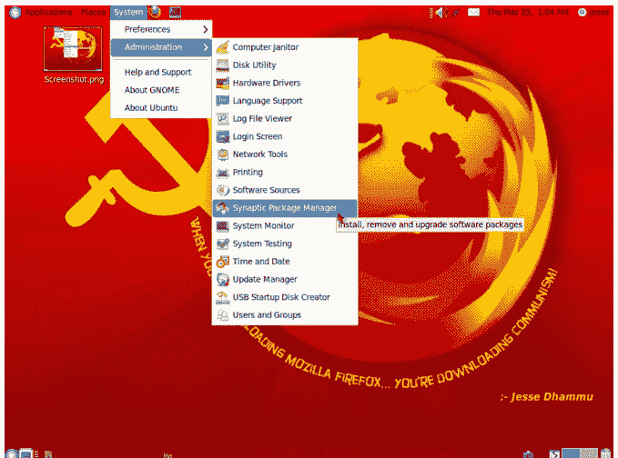

如果系统提示，请输入你的用户密码。包管理器将开始工作。

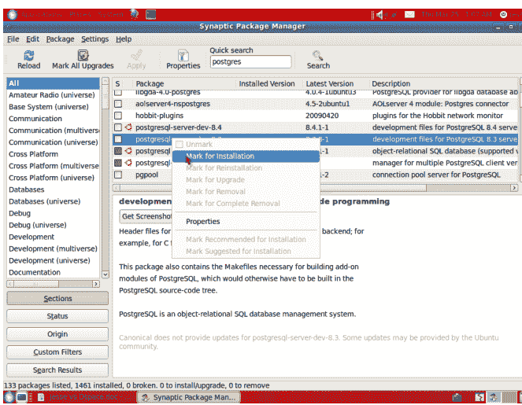

快速搜索 postgresSQL，它现在将从整个 Linux 软件库中搜索该软件，并给你一个所有匹配你搜索关键词的可用软件列表，右键单击你所需的软件并点击“标记以安装”（Mark for Installation）。

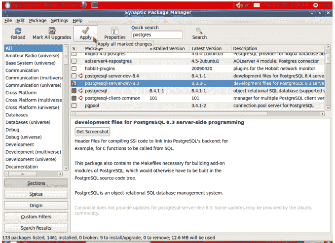

然后单击“应用”（Apply）按钮。这将开始下载该软件，下载完成后，其安装将自动开始。就像这样。

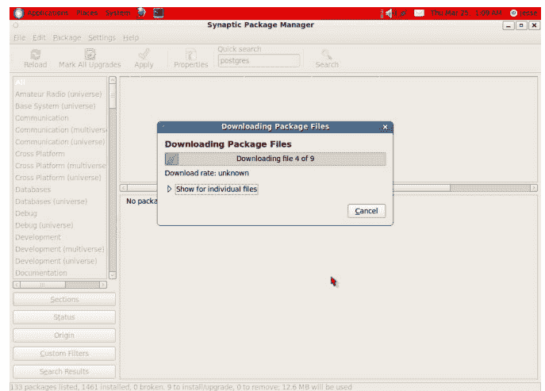

现在的下一个任务是通过此工具以相同方式安装 Maven2。搜索 Maven2，右键单击它并将其标记为安装。系统会自动为你下载并安装它。

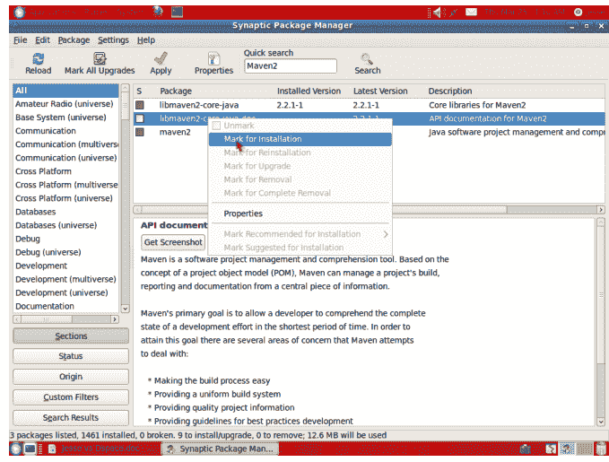

好的，现在 PostgresSQL 和 Maven2 已经安装在你的 PC 上。接下来，你需要按照以下命令在你的 PC 上创建 Dspace 用户。

```
jess@jess-desktop:~$ sudo adduser dspace
```


在这里，执行此命令后，它会要求你提供其他一些信息，如密码、全名，请输入密码和全名，其余项留空。最后按 Y 键即完成。

现在你可以注销当前的用户或管理员，并登录 Dspace。


现在登录 Dspace 后，打开那里的终端窗口，并使用以下命令创建一个名为“Source-files”的文件夹。

```
dspace@jesse-desktop:~$ mkdir source-files
```

现在你可以下载所有必需的前置软件以及所有源文件到这个文件夹中，或者如果你已经下载了文件，只需通过输入此命令将那些文件移动到这个文件夹中。

```
dspace@jesse-desktop:~$ mv /home/dspace/Downloads/hspace-1.5.2-src-release.tar.gz /home/dspace/source-files/
```

（使用相同的命令但不同的文件名，逐个移动所有文件。）

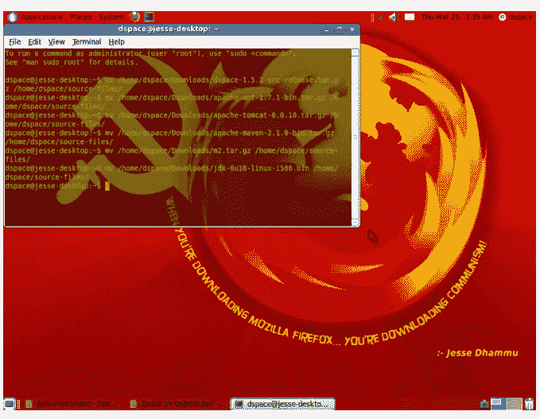

现在所有文件都在 source-file 文件夹中，你需要从这里将这些 tar 文件解压到 /home/dspace。

可以通过输入此命令来完成。

```
dspace@jesse-desktop:~$ tar -zxvf /home/dspace/source-files/dspace-1.5.2-src-release.tar.gz -C /home/dspace/
```

此命令将 dspace 源文件中的所有文件解压到 /home/dspace 文件夹，你会看到这些内容在你的终端屏幕上运行。

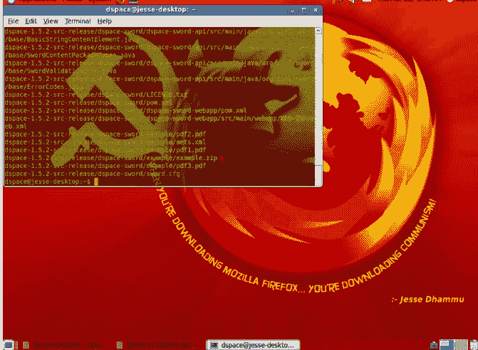

现在通过输入相同的命令但更改每条命令中的源文件名，也解压其他源文件.. 像这样。

```
dspace@jesse-desktop:~$ tar -zxvf /home/dspace/source-files/apache-ant-1.7.1-bin.tar.gz -C /home/dspace/
```

```
dspace@jesse-desktop:~$ tar -zxvf /home/dspace/source-files/apache-maven-2.1.0-bin.tar.gz -C /home/dspace/
```

```
dspace@jesse-desktop:~$ tar -zxvf /home/dspace/source-files/apache-tomcat-6.0.18.tar.gz -C /home/dspace/
```

```
dspace@jesse-desktop:~$ tar -zxvf /home/dspace/source-files/jdk-6u18-linux-i586.bin /home/dspace/
```

```
dspace@jesse-desktop:~$ mv /home/dspace/source-files/jdk-6u18-linux-i586.bin /home/dspace/
```

然后更改该 bin 文件的权限，以便你能够执行它。在终端中给出此命令。

```
dspace@jesse-desktop:~$ chmod 777 jdk-6u18-linux-i586.bin
```

现在使用以下命令安装 JDK 文件

```
dspace@jesse-desktop:~$ jdk-6u18-linux-i586.bin
```

此命令将执行 JDK 二进制文件并显示 EULA，按回车键以向上滚动屏幕文本。

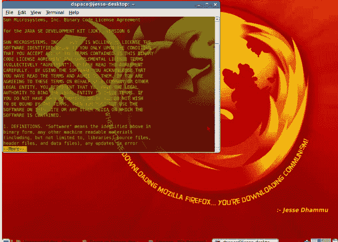

在此许可协议末尾按 Y，然后它将开始解压文件，如果处理在此屏幕停止 .... 这意味着你的 Java 开发工具包已安装。

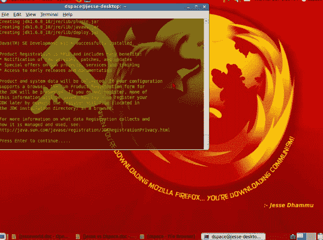

现在给出以下命令，以查看在你的 Home/dspace 文件夹中安装的目录和程序列表。

```
dspace@jesse-desktop:~$ ls -l
```

这将显示一些文件如下 ..

- apache-ant-1.7.1
- apache-maven-2.1.0
- apache-tomcat-6.0.18
- dspace-1.5.2-src-release
- jdk1.6.0_18

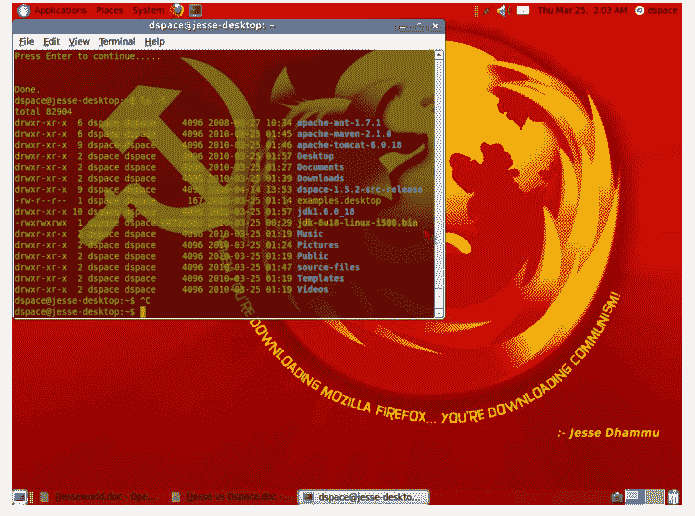

现在在你的 Linux 操作系统中为这些文件设置环境变量，可以通过这种方法完成。

```
dspace@jesse-desktop:~$ sudo gedit .bashrc
```

此命令将打开你的 dspace 用户可编辑的 .bashrc 文件。在此文件中，将以下行复制到底部

```
JAVA_HOME=/home/dspace/jdk1.6.0_18
ANT_HOME=/home/dspace/apache-ant-1.7.1
CATALINA_HOME=/home/dspace/apache-tomcat-6.0.18
MVN_HOME=/home/dspace/apache-maven-2.1.0
PATH=$JAVA_HOME/bin:$ANT_HOME/bin:$CATALINA_HOME/bin:$MVN_HOME/bin:$PATH
export PATH JAVA_HOME ANT_HOME CATALINA_HOME MVN_HOME
```

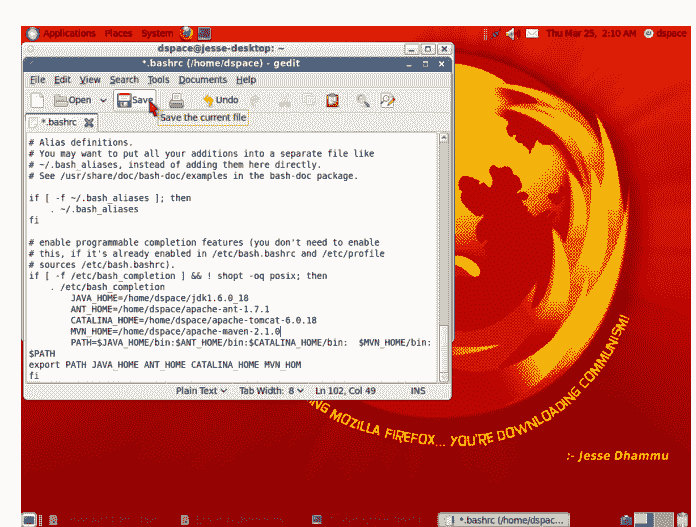

保存并关闭该文件。

这部分完成。现在我们的下一步是为 postgres SQL 服务器创建数据库。我们从这里开始。

### 使用以下命令启动你的 postgresSQL 服务

```
dspace@jesse-desktop:~$ sudo /etc/init.d/postgresql-8.4 restart
```

然后切换到 postgres 用户。

```
dspace@jesse-desktop:~$ sudo su postgres
```

你将获得这样的用户提示符

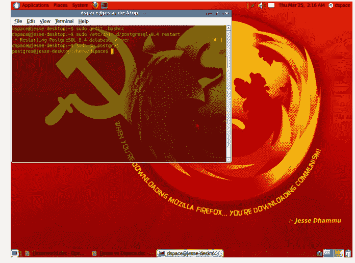

现在用此命令创建数据库。

```
postgres@jesse-desktop:/home/dspace$ createuser -U postgres -d -A -P dspace
```

（它会询问密码，输入 dspace（你可以选择自己的密码，但别忘了在 dspace.cfg 文件中输入它 :-) 它会询问新角色是否能够创建新角色，回答"不"）

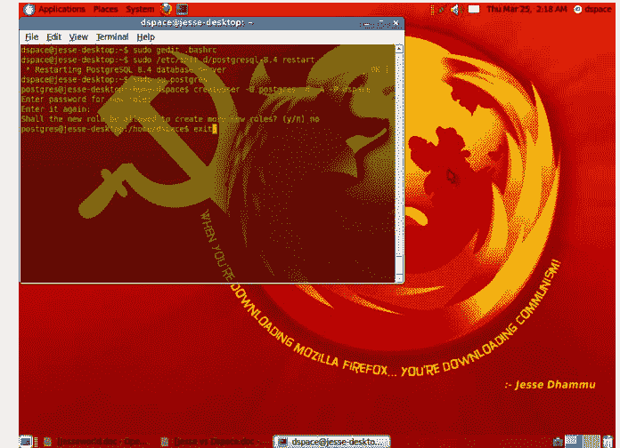

```
postgres@jesse-desktop:/home/dspace$ exit
```

退出后，你将返回 Dspace 用户模式。

### 这里以 Dspace 用户身份创建 Database dspace。

```
dspace@jesse-desktop:~$ createdb -U dspace -E UNICODE dspace
```

现在在 postgres 配置文件中做一些更改。用此命令打开配置文件。

```
dspace@jesse-desktop:~$ sudo gedit /etc/postgresql/8.4/main/pg_hba.conf
```

（添加这行 **host dspace dspace 127.0.0.1 255.255.255.255 md5**）

对于 postgresQL 最新版本，用“trust”替换“ident sameuser”

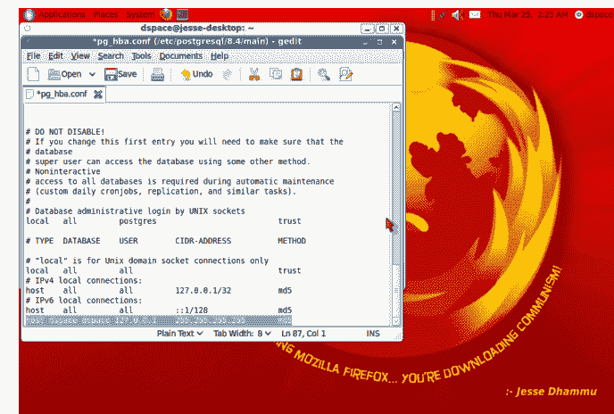

保存并退出

现在再运行一个命令

```
dspace@jesse-desktop:~$ sudo gedit /etc/postgresql/8.4/main/postgresql.conf
```

通过删除开头的 # 来取消注释 **listen localhost** 这一行。

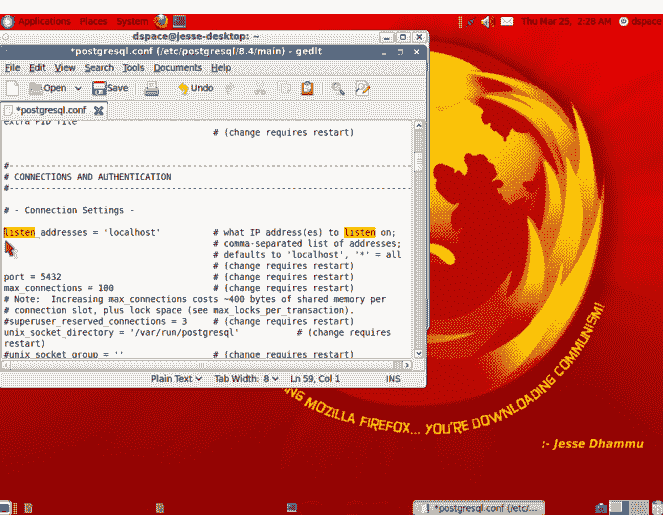

保存并退出

现在编辑 space.cfg 文件：这个文件非常重要，因为在此文件中还要进行许多配置。

```
dspace@jesse-desktop:~$ cd /home/dspace/dspace-1.5.2-src-release/dspace/config/
dspace@jesse-desktop:~/dspace-1.5.2-src-release/dspace/config$ sudo gedit dspace.cfg
```

在此文件中定义了 webapps 文件夹的路径。你需要将路径更改为 /home/dspace。

dspace.dir = /dspace
dspace.dir = /home/dspace (如果你在这里路径写错，它不会在 /home/dspace 中创建 webapp 文件夹)


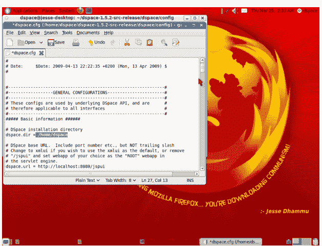

你还需要进行一些其他更改，例如 URL、邮件服务器、用户名、密码等。

```
dspace.url= http://localhost:8080/ispui
```

## 站点名称

```
dspace.name = Dspace at my university
```

## 数据库用户名和密码

```
db.username = ${default.db.username}
db.password = ${default.db.password}
#db.username = dspace
#db.password = dspace (dspace is default passwd if u will change passwd at the time of creation of database,than u have to change here also).
```

## 邮件设置

## SMTP 邮件服务器

```
mail.server= <your smtp mail server> (I left this place blank as I don't have any email server running on my local network this time)
```

```
mail.from.address = <your mail server>
```

```
feedback.recipient = <your Email ID> (here you can put your email id if you are the administrator, so all requests and feedbacks will reach to you through this id)
```

现在差不多完成了。我们只需要编译并为 Dspace 目录创建 webapps 文件夹。

打开终端窗口，并输入以下命令以 **运行 maven**

```
sh
dspace@jesse-desktop:~$ cd home/dspace/dspace-1.5.2-src-release/dspace
dspace@jesse-desktop:~/dspace-1.5.2-src-release/dspace$ mvn package
```

（这可能需要一些时间，因为该命令将下载并安装所有必需的 maven 软件包。）

等待了这么长时间后，它会向你显示这个屏幕，并在 home/dspace/dspace-1.5.2-src-release/dspace 目录中创建一个 target 文件夹。

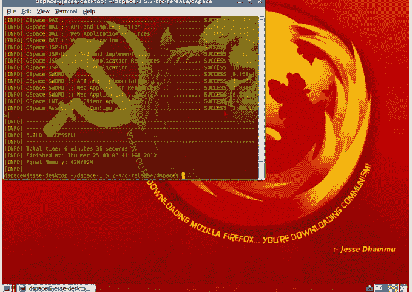

这意味着 Maven 包已成功编译。现在是时候在 dspace 中制作 webapps 了。首先移动到 Dspace 的 target 文件夹，然后是 dspace build.dir，这是在编译 mvn package 时创建的。

转到终端窗口并运行此命令，以移动到 target 文件夹中的 dspace build 目录。

```
sh
dspace@jesse-desktop:~$ cd /home/dspace/dspace-1.5.2-src-release/dspace/target/dspace-1.5.2-build.dir/
```

现在在终端窗口中运行 **ANT FRESH_INSTALL**，输入以下命令。

```
sh
dspace@jesse-desktop:~/dspace-1.5.2-src-release/dspace/target/dspace-1.5.2-build.dir$ ant fresh_install
```

如果它显示“构建成功”如下所示。

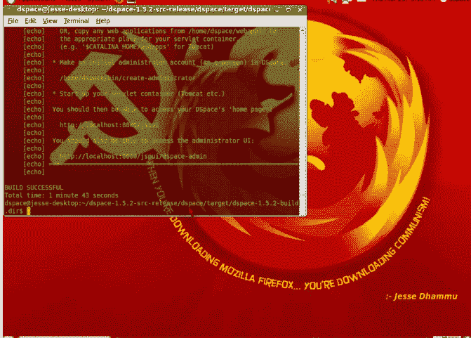

那么，我的朋友，你离成功只有一步之遥了。

我们只需要复制 webapps 文件，这将为我们提供 dspace 的 Web 界面。这些文件需要复制到 tomcat 目录中。

逐个输入以下命令，将 dspace JSPUI、XMLUI 和 OAI 文件复制到 tomcat 的 webapps 文件夹。

```
dspace@jesse-desktop:~$ cp -r /home/dspace/webapps/jspui /home/dspace/apache-tomcat-6.0.18/webapps/
```

```
dspace@jesse-desktop:~$ cp -r /home/dspace/webapps/xmlui /home/dspace/apache-tomcat-6.0.18/webapps/
```

```
dspace@jesse-desktop:~$ cp -r /home/dspace/webapps/oai /home/dspace/apache-tomcat-6.0.18/webapps/
```

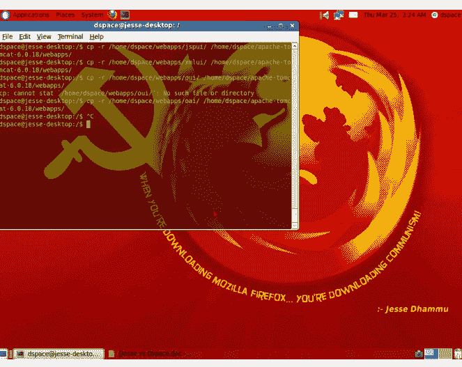

现在通过输入此命令来 **启动你的 Webserver Tomcat**

```
dspace@jesse-desktop:~/home/dspace/apache-tomcat-6.0.18/bin/startup.sh
```

它将在屏幕上给你以下输出，并且 webserver 将启动。

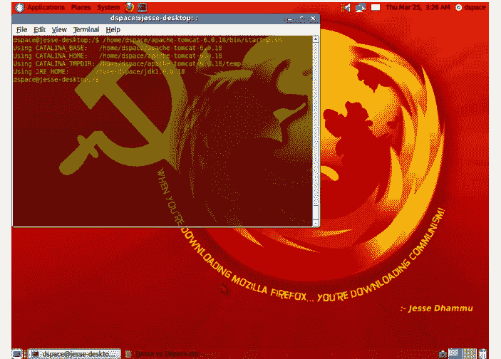

好，现在 ..... 说哈利路亚...!!!

然后打开你的 web 浏览器，访问以下任一 URL

http://localhost:8080/ispui

http://localhost:8080/xmlui

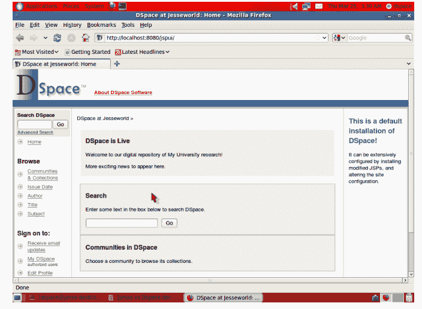

首先感谢主，然后说 ...哦是的...!! 它起作用了！

最后，创建一个管理员帐户以监视和管理存储库站点：

在终端窗口中给出此命令。

```
$ home/dspace/bin/create-administrator
```

它将提示你输入一些额外信息。如用户名、邮箱地址、密码等。

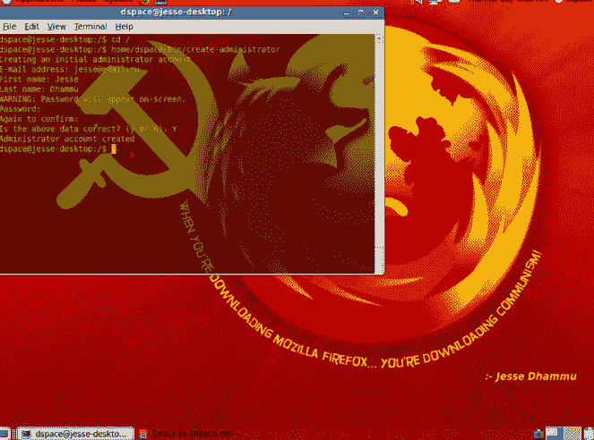

但在输入管理员密码时要小心，因为终端窗口会将其显示在屏幕上。

之后你就完成了。

这是 Dspace 管理员 URL

http://localhost:8080/ispui/password-login

你可以使用在创建管理员时提供的邮箱地址和密码登录 Dspace，并创建社区、集合，并可以上传内容。

## DSpace™

登录 DSpace

现在用户？点击这里注册。

请在以下表格中输入你的电子邮件地址和密码。

电子邮件地址: **jesse@email.ru**

密码: **••••••**

登录

忘记密码？

WSG

XHTML 1.0 ✓

DSpace 软件 版权所有 © 2002-2009 The DSpace Foundation - 反馈

Dspace 现在属于你了。享受吧!!

**文档作者：**

Rupinder singh Dhammu

IIAS | Shimla

jesse@email.ru

