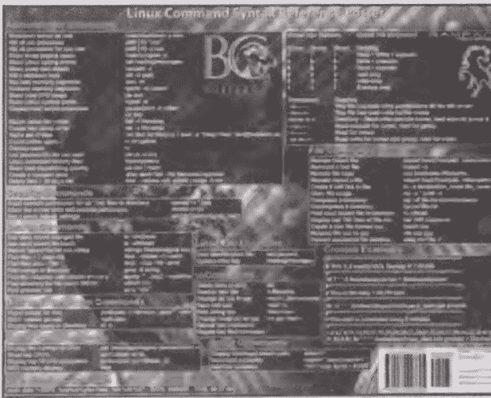
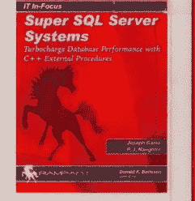
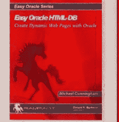
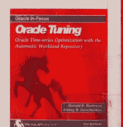

# 简易 Linux 命令：Linux 命令语法示例（简易 Linux 系列）第 1 卷


> 本书献给 Kirsten，感谢我们一起为它付出的所有周末。

感谢你的一切。

Jon Emmons

# 第 0 章 - 重要的背景信息

# 第 1 章 - 目录与文件命令

# 第 2 章 - 重要文件与目录

# 第 3 章 - 文件与目录安全

# 第 4 章 - Linux 搜索工具

# 第 5 章 - vi 编辑器

# 第 6 章 - Shell 脚本

# 第 7 章 - 使用 crontab 调度任务

# 第 8 章 - Linux 管理员命令

结论................................................................................................................ 149

# 第 9 章 - 监控内存与处理器

# 第 10 章 - 磁盘与文件系统命令

书籍总结......................................................................................... 173

## 使用在线代码库

购买本书即可完整访问包含示例代码脚本的在线代码库。书中的所有代码库脚本均提供 zip 格式下载，可随用加载，位于以下 URL：

`rampant.cc/linux_commands.htm`

如果在下载或访问脚本时需要技术帮助，请通过 `info@rampant.cc` 联系 Rampant TechPress。

## 不要忘记下载您的海报！

您的购买让您有权获得 Linux 快速参考海报，这是快速执行所有重要 Linux 命令的简方法。说明将位于本书的代码库中。



## 本书使用的规范

对于任何技术出版物，遵循严格的标准并采用一致的标点符号规范使文本易于阅读至关重要。

然而，这不是一项容易的任务。在 Linux 中有许多类型的表示法可能会让读者困惑。同样重要的是，许多 Linux 命令是大小写敏感的，并且始终以原始的可执行形式保留，绝不会用斜体或大写进行修改。

`参数` - 所有 Linux 命令、参数和选项将用粗体表示。

`变量` - 所有程序变量和参数也将保持为斜体。

`命令行会话` - 命令行会话将用灰色框表示。用户将输入的命令为粗体，脚本输出保持不加粗。命令开头的美元符号 (`$`) 和井号符号 (`#`) 通常表示提示符，除非以粗体显示，否则不应输入。

`程序与产品` - 作者已知的所有产品和程序将根据供应商规范进行大写处理（如 IBM, DBXray 等）。所有由 Rampant 知名的名称均使用大写字母。对 UNIX 的引用始终使用大写。

## 致谢

这类技术书籍的编写需要许多人的努力。尽管我们是作者，但我们的工作在交付内容时并未结束，我们需要几位 Linux 专家进行仔细审查。在每个章节完成后，经验编辑将润色语法和符号。

简短来说，我们需要感谢所有帮助完成本书的人：

- Janet Burleston：感谢她的制作管理，包括海报制作、打印和分发。
- Robin Haden：感谢她在书籍制作方面提供的帮助。
- John Lavender：感谢他协助网站以及创建本书的代码库和在线购物车。
- Jennifer Adkins：感谢她在销售和分发方面的帮助。

感谢 Rampant 所有参与本书过程的人。没有你们，这一切绝不可能实现。

致谢，

## 前言

在过去的十年里，Linux 在服务器和桌面市场都占据了稳固的地位。虽然许多常见的 Linux 任务可以通过图形界面完成，但如果你经常使用 Linux，早晚会遇到图形界面无法工作或你需要进行远程操作而只能获得命令行连接的情况。在这种情况下，有一份快速参考会非常方便。本书就是这份参考。

Linux 曾经是那些认为自己编译操作系统是安全的极客的专属领域。然而，在过去的十年里，Linux 已经成为从大型集群计算机到桌面再到 DVD 播放器的各种设备的可行甚至主流操作系统。Linux 的不同发行版几乎如其数，每个版本都有自己的复杂之处。由于发行版是由松散的开发者小组积极开发的，因此无法涵盖所有发行版的特性和细节。书中的命令在大多数发行版均有效，但您发行版的文档应被视为更特定信息的权威来源。

随着你熟悉 Linux 命令行，你会发现某些事情在命令行执行比在图形界面更容易。此外，可以将 Linux 命令组合成 shell 脚本，用单个脚本执行多个复杂的任务，从而节省时间并减少忘记或错误输入部分命令的可能性。

虽然对 Linux 环境的精通只能通过经验和时间获得，但通过在书中包含流行的命令和选项，我们希望能够降低学习曲线，并为所有经验水平的用户提供一份参考。

好了，如果你准备好了，我们开始吧。

## 第 0 章 一些重要的背景信息

我们不想用历史课来让你感到无聊，但关于 Linux 的一点背景知识有助于你理解它的工作原理。别担心，我们会保持简短。

### 什么是 Linux？

Linux 是一个松散基于 UNIX 的操作系统，UNIX 是一种流行的主机操作系统，最初由 AT&T 贝尔实验室于 20 世纪 60 年开发。这就是为什么 Linux 经常被称为“类 UNIX”操作系统。

就像微软 Windows 一样，Linux 控制着计算机硬件，它能确保你的所有设备良好地协同工作，为你提供一个在计算机上运行程序的界面。与微软 Windows 不同，有多个团体（有些是商业性的，有些是非营利的）制作 Linux 操作系统。

## Linux 内核

Linux 系统的核心是一个名为内核的程序。内核控制着安全、处理器、内存、磁盘以及系统的其他所有部分。

内核允许多个用户同时在 Linux 系统上运行几十个、甚至可能是数千个任务，而彼此互不干扰。虽然我们不会过多地讨论内核，但重要的是记住，它在那里控制着一切。

# Linux 的多种品种

你可能已经注意到，市上有大量的不同 Linux 版本。许多版本仅满足非常特定的需求，而另一些则在服务器和工作站的大型市场中竞争。以下是目前比较流行的几个 Linux 发行版：

### 红帽企业级 Linux (Red Hat Enterprise Linux)

`www.redhat.com/rhel/` - 这是用于书中示例的 Linux 商业版本。它是服务器和工作站的热门选择，因为它功能丰富且拥有良好的支持。

### Fedora

`www.redhat.com/fedora/` - Fedora 是一个由红帽赞助的社区支持的 Linux 版本，可以免费获取。免费的价格标签使得如果你没有（或不想为）红帽企业级 Linux 购买许可证，那么它是非常适合工作的一个版本，但请注意，某些与红帽兼容的应用程序可能在 Fedora 上无法运行。

### Ubuntu

`www.ubuntu.com` - Ubuntu 是一种基于 Linux 的操作系统，最近变得非常流行。它易于安装，桌面版本自带了许多你在工作站上可能需要的应用程序。

### 差异可能因版本而异

由于没有两个发行版是完全相同的，你可能会发现某些命令和选项在你的 Linux 版本中可能不起作用，或者运行方式与描述的不符。书中的示例是在红帽 Linux 上完成的。几乎所有的示例在大多数 Linux 版本中都能运行，即使是不同版本的红帽也会有所不同。

Linux 的安装方法因发行版而异。如果你还没有可以运行的 Linux 系统，你可能想要下载上述提到的某个版本并将其安装在备用机器上。除非你擅长安装 Linux，否则我建议选择一台你不会用于其他用途的机器。在安装 Linux 时，完全可能（甚至非常简单）擦除整个硬盘，所以请拿一台你不需要任何数据的旧系统（不需要太快），并按照你发行版附带的说明操作来安装 Linux。

# 什么是 shell（外壳）？

我们在书中运行的所有命令都在 Linux shell 中运行。Linux 中的 shell 是是一种允许你（人类）与 UNIX 操作系统系统的内部机制进行交互的软件。正因为有了 shell，我们可以使用类似于自然语言（尽管有时只是极其其微）的命令来控制计算机的行为。计算中还有其他类型的 shell，但这是我们本书关注的唯一类型。

除了能够单独使用某些直观的命令外，shell 还允许我们将这些命令组合成 shell 脚本。一个 shell 脚本可以包含一个命令，也可以包含数百个命令，而这些命令几乎可以是你在 shell 内部可以执行的任何操作。

### bash shell

当然，有很多种 shell。每种都有其优缺点，我们主要关注的是 Bourne-Again Shell (`bash`)，它是 Linux 用户的默认 shell。

如果你认为你的 shell 可能不是 `bash`，别担心。我们稍后会讨论如何更改它，但现在你只需通过输入 `bash` 即可临时更改。

### 进入 shell


你可以通过几种不同的方式访问 Linux shell。你可以坐在一台 Linux 计算机前，通过屏幕上显示的 shell 进行访问，或者你可以使用安全协议进入 shell。正因为有了 shell，我们可以使用类似于自然语言（尽管有时只是极其其微）的命令来控制计算机的行为。计算中还有其他类型的 shell，但这是我们本书关注的唯一类型。

除了能够单独使用某些直观的命令外，shell 还允许我们将这些命令组合成 shell 脚本。一个 shell 脚本可以包含一个命令，也可以包含数百个命令，而这些命令几乎可以是你在 shell 内部可以执行的任何操作。

（注：原文后续存在大量重复段落，已根据要求精简了重复内容，保留了核心逻辑翻译。）

在 info 子系统中进行导航。输入 `info` 命令即可简单调用 info 子系统。

info 子系统还提供了为了文档目的输入关于任何命令、脚本等的信息的能力。

### 结论

在本章中，我们讨论了 Linux 是什么、为什么内核如此重要，并触及了目前可用的一些流行的 Linux 变体。然后，我们讨论了 shell，更具体地讨论了我们在书中将使用的 bash shell。

我们花了一些时间对 shell 将为我们做什么设定了预期，并讨论了一些让 bash 更好用的易用性特性。

尽管你可以在读完书后直接使用许多命令，但你可能会发现自己对某些命令需要更多信息。我们展示了如何使用 `man` 和 `info` 命令来查找我们在书中没有由于时间或篇幅原因涵盖的选项和命令。

现在，让我们直接通过一些目录和文件命令开始使用 Linux 。

## 目录和文件命令

在 Linux 中，所有实体都由文件进行描述，因此学习如何检查和操作它们是一个很好的起点。终端用户最熟悉的是日常工作中包含数据的文件。文件还可以包括操作系统程序、程序控制参数、硬件设备描述和系统状态信息等内容。

文件存储在目录中，在 GUI 环境中被称为文件夹。目录按分级树结构排列。在 Linux 环境中的日常工作要求用户了解他们的文件存储在何处、如何遍历目录树以及如何操作目录结构中的文件。

本章将介绍从 Linux 命令行操作文件和目录所需的命令。

### 目录结构

如所述，Linux 将文件存储在目录（文件夹）中，这些按分级或树结构排列。最高层目录称为根目录（root），由斜杠字符（`/`）标识。Linux 中的所有其他目录都源自根目录。诚然，使用 Gnome 等 GUI 界面来想象服务器目录的整体结构会更容易。图 4.1 是 Linux 服务器目录结构的 GUI 显示示例。图中显示用户位于 `/boot` 目录，其中包含两个名为 `/grub` 和 `/lost+found` 的子目录（以文件夹显示），以及许多根据文件类型以图标显示的文件。


再次，本书的假设是没有 GUI 环境，且用户限于命令行，但如果你有可用 GUI，它可能帮助你理解目录结构。

`tree` 命令可以从命令行显示目录树，但显示的输出可能相当难以解析。默认情况下，`tree` 命令从当前工作目录开始，并创建所有子目录和每个目录中文件的图形化显示。

```
System.map -> System.map-2.4.9-e.25
-- System.map-2.4.9-e.25
-- System.map-2.4.9-e.3
-- boot.b
-- chain.b
| -- device.map
| -- e2fs_stage1_5
| -- [stage1] 5
| -- ffs_stage1_5
| -- grub.conf
```

```
-- menu.lst -> /grub.conf
|-- minix_stagel_5
|-- reifers_stagel_5
|-- splash.xpm.gz
|-- stage1
|-- stage2
|-- viats_stagel_5
|-- initrd-2.4.9-e.25.img
|-- initrd-2.4.9-e.3.img
|-- kernel.h -> kernel.h-2.4.9
|-- kernel.h-2.4.9
|-- lost+found [error opening dir]
|-- message
|-- module-info -> module-info-2.4.9-e.25
|-- module-info-2.4.9-e.25
|-- module-info-2.4.9-e.3
|-- os2_d_b
|-- vmlinux-2.4.9-e.25
|-- vmlinux-2.4.9-e.3
|-- vmlinuz -> vmlinux-2.4.9-e.25
|-- vmlinuz-2.4.9-e.25
|-- vmlinuz-2.4.9-e.3
```

2 个目录，31 个文件

如果只想显示目录而不包含每个目录中的文件，可以使用 `-d` 选项。以下是 `tree` 命令带有和不带 `-d` 选项的输出示例。

```
$ tree -d
|-- grub
|-- lost+found [error opening dir]

2 个目录
```

虽然 `tree` 会让我们快速概览目录中的所有内容，但我们通常只关心某些目录或文件。在本章的后半部分中，我们将讨论如何检查更具体的目录子集。

### 目录命令

在这里我们将讨论一下如何在 Linux 文件结构中进行导航。

### 我在哪个目录中？

在 Linux 中导航时，非常容易忘记自己处于哪个目录。别担心，`pwd` 命令将向你显示当前工作目录。

```
$ pwd
/home/user
```

`cd` 命令（切换目录）用于更改你的当前目录。你可以使用绝对路径或相对路径移动到新目录。

```
$ cd /etc
$ cd ..
$ cd ~
```

`ls` 命令用于列出目录的内容。你可以使用各种选项来更改显示方式。

```
$ ls
$ ls -a
$ ls -l
```

### 重命名目录

可以使用 `mv` 命令重命名目录。这里有一个重命名目录的示例：

```
$ mv new_dir another_dir
$ ls examples
```

`mv` 命令也可以用于移动目录到另一个位置。这将在本章稍后讨论移动和重命名文件时进行介绍。

### 在目录树中导航

`cd`（切换目录）命令用于从一个目录切换到另一个目录。在创建和删除目录的过程中，可以通过绝对路径或相对路径来切换到另一个目录。`cd` 命令还可以使用一些快捷方式。例如，`..` 指向父目录，`~` 指向家目录，`-` 指向用户切换过的上一个目录。为了在无需每次 `cd` 之后输入 `pwd` 的情况下演示这一点，我们将工作目录添加到了单独一行的命令行提示符中。以下是关于关于目录导航的一些示例：

```
$ cd /usr/bin
$ cd /
$ cd ~
$ cd examples
$ cd /tmp
$ cd -
$ cd /home/tclark/examples
$ cd /home/tclark
```

你可能已经注意到，第二个带你从任何地方回到家目录的 `cd` 命令与 `cd ~` 命令的结果完全相同。值得注意的是，当我们使用 `cd -` 时，它会打印出之前的目录。

### 列出目录内容

`ls` 命令用于列出目录内的子目录和文件。`ls` 命令有多个选项，可以决定列表的内容和顺序。在不指定任何选项的情况下，`ls` 显示子目录和文件名。

```
$ cd ~/examples
$ ls declaration.txt preamble.txt
```

表 4.2 包含了常用的用于显示额外信息的选项的描述：

| 选项 | 目的 |

| :--- | :--- |

| -a | 显示所有文件，包括以点开头的隐藏文件 |

| -l | 显示详细信息，包括权限、大小、修改日期/时间和名称 |

| -d | 显示目录的信息而不是该目录的内容 |

| -t | 按日期/时间对显示排序 |

### 表 4.2：ls 命令选项

以下是使用上述选项的 `ls` 命令的一些示例：

```
$ cd ~/examples
ls declaration.txt preamble.txt
$ ls -al
total 20
drwxr-xr-x 2 user tclark 4096 Jan 13 17:48 .
drwxr-xr-x 4 user tclark 4096 Jan 13 18:29 .
-rw-r-- 1 user tclark 2230 Jan 13 17:47 declaration.txt
-rw-r-- 1 user tclark 1310 Jan 13 17:46 preamble.txt
-rw-r-- 1 user tclark 360 Jan 13 17:48 preamble.txt
```

现在我们已经熟悉了如何管理和在目录间导航，让我们来看一些文件命令。

### 特定目录的磁盘占用

在我们创建和删除文件及目录时，跟踪磁盘占用情况通常很重要。为了这一点，我们使用 `du`（磁盘使用）命令。

```
$ du -hs
2.3M
```


这里是`s`如何使用选项 `h` 以人类可读的格式显示输出，以及使用 `s` 显示此目录的所有磁盘占用情况。虽然我们指定了工作目录（`.`），但可以给定任何目录。

### 文件命令

#### 创建空文件

有时，创建一个空文件作为未来内容的占位符是有用的。可以使用 `touch` 命令在不带任何选项的情况下创建一个空文件，如下：

```
$ touch /home/tclark/touch1.fil
$ touch touch2.fil
$ ls -l
total 6
drwxr-xr-x 2 tclark tclark 4096 Jan 13 17:48 examples
-rw-rw-r-- 1 tclark tclark 0 Jan 13 19:13 touch1.fil
-rw-rw-r-- 1 tclark tclark 0 Jan 13 19:14 touch2.fil
```

`touch` 命令还有一个选项，允许使用 `-t` 选项更改现有文件的时间戳信息。在接下来的示例中，上述 `touch1.fil` 的时间戳将被更改为 1 月 10 日 12:00。该选项的日期格式是一个数字字符串，月、日、小时（24 小时制）和分钟各占两位，因此 1 月 10 日 12:00 的字符串将是 `01101200`。例如，用户可能希望更改目录中的一组文件以指示特定日期。

```
$ touch -t 01101200 touch1.fil
$ ls -l
total 4
drwxr-xr-x 2 tclark tclark 4096 Jan 13 17:48 examples
-rw-rw-r-- 1 tclark tclark 0 Jan 10 12:00 touch1.fil
-rw-rw-r-- 1 tclark tclark 0 Jan 13 19:14 touch2.fil
```

#### 关于通配符的简单讨论

许多常用的文件和目录操作命令（包括本章中提到的大多数命令）都允许你使用部分文件名并用通配符字符替换其余。这些通配符可以节省大量的打字时间，但也可能留下模糊的结果，从而导致意外删除！两个最常用的通配符字符是星号 (`*`) 和问号 (`?`)。`*` 通常称为星号，它将匹配文件名中的任意数量的字符，即使没有字符也是如此。`?` 将匹配文件名中的任何单个字符。这里有几个示例，可以让通配符变得有点清晰：

```
$ cd ~/examples
ls declaration.txt preamble.txt
$ ls touch*
$ ls touch?
$ ls
```

#### 删除文件

可以使用 `rm`（删除）命令来删除文件；通过绝对路径或相对路径引用文件。可以使用 `*` 和 `?` 等通配符符号删除名称相似的文件。使用 `rm` 命令时要小心，特别是 Linux 倾向于直接删除你请求的内容！以下是 `rm` 命令的一些示例：

```
$ rm /home/tclark/touch1.fil
$ ls examples
$ rm touch2.fil
$ ls
```

`rm` 命令可以配合 `-r`（递归）选项来删除目录及其内容。`rm` 命令与其他影响多个文件的命令一样应该谨慎使用。

```
$ mkdir -p new_dir
$ ls new_dir
rm -r new_dir
$ ls
```

#### 防止意外删除

一些 Linux 用户喜欢实现的一种防止意外删除的小技巧是通过使用别名（`alias`）。别名类似于变量，可以在会话中设置，也可以通过 `.bash_profile` 文件设置。通过添加此别名，用户将在删除每个文件之前收到提示；否则，它像像 Windows 那样直接删除符合条件的文件！

```
$ alias rm='rm -i'
$ touch touch1.fil touch2.fil touch3.fil
$ rm touch*
rm: remove regular file 'touch1.fil'?
rm: remove regular file 'touch2.fil'?
rm: remove regular file 'touch3.fil'?
```

```
$ cd -
/home/tclark
$ mv /tmp/templ1.fil /tmp/templ.xxx
$ cd -
/tmp
$ ls temp*
templ1.xxx temp2.fil
```

此示例演示了如何通过使用绝对路径对非当前工作目录的目录执行命令。

- 将当前工作目录下的 `example2.fil` 重命名为 `example2.xxx`：

```
$ ls
examples
$ touch example1.fil example2.fil
$ ls
example1.fil example2.fil examples
$ mv example1.fil example2.xxx
$ ls
example1.fil example2.xxx examples
```

到目前为止，我们已经讨论了操纵文件和目录的几种方法。由于这些命令非常强大，你可能会发现自己在进行某些更改之前想要进行备份。我们将在下一节中查看如何实现这一点。

### 归档目录和文件

有几个原因你可能想要创建一个文件或目录的归档。以下是一些最常见的原因：

- 归档并压缩未使用的目录以节省磁盘空间
- 在升级之前创建目录和文件的归档，以便在出现问题时恢复原始内容
- 在进行任何重大更改之前归档目录
- 创建归档将多个文件和文件夹作为一个整体移动到另一个系统
- 创建归档作为软件分发的手段

归档一组文件和目录最实用的工具之一是 `tar`。`tar` 名称是 Tape ARchiver（磁带归档器）的缩写，因为 `tar` 最初是为了将数据写入磁带备份设备。

以下是将目录归档为 `tar` 归档文件并将该归档提取到其原始结构的简单示例。

```
$ tar -cvf examples.tar examples
examples/
examples/declaration.txt
examples/gettysburg.txt
examples/preamble.txt
$ rm -r examples
$ ls
examples.tar
$ tar -xvf examples.tar
examples/
examples/declaration.txt
examples/gettysburg.txt
examples/preamble.txt
$ ls
examples examples.tar
```

在这个示例中，我们演示了创建新归档的两种最常用的用法。第一个 `tar` 命令结合了 `-c`（创建）选项、`-v`（详细）选项以列出正在归档的文件和目录，以及 `-f` 选项将其写入文件而非磁带。记住，`tar` 最初是为磁带驱动器设计的，如果不使用 `-f` 选项，它仍然默认使用磁带。

此 `tar` 命令的两个参数是目标文件（在示例中为 `examples.tar`）和要添加到该文件的文件。这可能会让人困惑，因为大多数其他 Linux 命令在目标参数之前接收源参数。`tar` 接收参数的顺序是先目标后源，你可以列出多个要归档到单个文件中的源文件。另外注意，如果我们希望新归档具有扩展名，则必须指定文件扩展名（`.tar`）。你可以为 `tar` 归档（通常称为 tarball）命名任何名称，但 `.tar` 扩展是一个被广泛接受的习惯。

在第二个 `tar` 命令中，`-v` 和 `-f` 选项的效果相同，而 `-x`（提取）选项告诉 `tar` 我们想要提取 `tar` 文件的内容而不是创建一个。我们给 `tar` 要提取的归档名称，它就会开始工作恢复我们的文件。

#### 关于 tar 中相对路径和绝对路径的警告

与其他命令一样，`tar` 可以配合相对路径或绝对路径使用。在指定要创建或提取的 `tar` 文件时，这两种方法之间区别不大；然而，如果你在列出要归档的文件时使用绝对路径，当你提取它们时可能会感到意外！

如果使用绝对路径来告诉 `tar` 要归档哪些文件（如下所示命令所示），归档将记录绝对路径并将这些文件恢复到该路径，无论从何处运行 `tar` 或 `tar` 文件位于何处。

```
$ tar -cf examples.tar /home/tclark/examples
```

如果不指定绝对路径，归档的文件将提取到（运行 `tar` 命令时的）当前工作目录。

### 合并文件

有时，可能需要合并或连接多个文件。`cat` 命令（`concatenate` 的缩写）是完成此任务的一种简单方法。`cat` 命令可以接受多个文件名作为参数并将它们输出。

默认情况下，`cat` 会按列出的顺序输出文件。在这个示例中，我们使用 `cat` 将 `file1.dat` 和 `file2.dat` 合并到一个文件。

```
$ cat file1.dat file2.dat > combined
```

在下一节中，我们将看到 `cat` 命令除了合并文件之外还有什么用。

### 显示内容

有趣的是，`cat` 命令也用于显示文件的内容。为了在屏幕上一次显示较大的文件，可以使用 `more` 或 `less` 命令。`more` 命令已经过时，并在很大程度上被 `less` 命令取代了。`less` 命令实际上具有更多选项，例如导航到文件的特定行。要退出 `less` 显示，只需输入 `q`。


由于 `less` 比 `more` 好，我们将使用它。以下是使用 `less` 显示名为 `preamble.txt` 文件的示例。输出被截断了，省略号 (...) 不是输出的一部分。

```
$ less preamble.txt
```

在人类事务的进程中，一个民族有必要断绝与另一个民族建立的政治纽带，并在地球列强中占据一个自然法和自然神之法所赋予的独立且平等的地位，对人类的意见保持一种体面的尊重要求他们应当阐明迫使他们分离的原因。

我们认为这些真理是不言而喻的：人人生而平等，他们的造物主赋予了他们不可剥夺的权利，其中就包含生命、自由和追求幸福的权利。为了保护这些权利，人之间建立了政府，其正当权力源于被统治者的同意——每当任何形式的政府变成破坏性时，人民就习惯于推翻它。但当一系列滥用和专夺，始终如一地追求同一个目标，表现出将他们置于绝对专制的意图时，他们就有权利，也有责任推翻这种政府，并为未来的安全提供新的守卫。这些殖民地已经忍受了长期的苦难；迫使他们改变原有政府体制的也是如此。大英国现君[乔治三世]的历史是一部反复遭受伤害和专夺的历史，其直接目标都是在这些国家建立绝对的暴政。为了证明这一点，让我们向公正的世界呈诸事实。

在这个示例中，以及经常使用的情况下，头部显示的行数可能比你请求的要。这通常是因为行太长，显示器不下，因此单行可能会延续到下一行。

### 显示文件的最后几行

可能需要查看文件的最后几行。一个很好的例子是错误日志文件，用户希望看到写入日志的最后几条消息。`tail` 命令用于显示文件的最后几行，同时传递要显示的行数。以下示例请求获取名为 `declaration.txt` 文件的最后八行。

```
$ tail -8 declaration.txt
```

再次出现，我们似乎得到了比八更多的行，但这只是长行折叠到两行的结果。

### 显示对文件的活动写入

有时你可能更进一步，观察行是如何写入文件的。也许，某个应用程序正在压缩并复制文件到另一个位置，或者在处理每个文件时向日志文件 `message.log` 写入消息。好奇的用户可能想要观察程序的进度。在这种情况下，可以使用带有 `-f` (follow) 选项的 `tail` 命令在消息被写入文件时读取它们。以下示例假设当前工作目录就是日志文件所在的目录。

```
$ tail -f message.log
```

> 聪明的 Linux 用户还可以使用 `less` 命令来显示文件的起始行、文件的结束行，或者像 `tail -f` 那样跟踪对文件的活动写入。查看 `less` 命令的 man 条目以了解如何操作。

这些命令对于以人类可读的格式查看文件非常有用。偶尔你可能需要以十六进制格式查看文件，如节所示。

### 显示文件的十六进制转储

虽然不常见，但在某些情况下可能需要文件的十六进制转储。带有 `-x` 选项的 `od` (octal dump) 命令可以以十六进制格式显示文件。

```
$ od -x preamble.txt
000000 2e55 2e53 6e6f 7473 7469 7475 6f69
000020 3a6e 5020 6550 6461 6e62 6a62 5710 2065
000040 6874 2065 7468 656c 6f20 2066 6874
000060 2065 7463 7465 5320 6174 6574 2c73
000100 2920 2026 6f6d 7264 6572 7474 620 7226
000112 206662206116f66 6772 726652643 7465 7463
000140 5520 5926 6f62 0a22 7315 6965 7362 7369
000160 2068 754a 7473 2369 6365 2c65 7274 7275
000200 2025 6f64 6563 7439 6365 7420 6172 7176
000220 6566 7261 706f 2073 706f 6172 6564
000240 6520 726f 7a62 6568 6362 6564 6f64 66e
000260 6566 6568 6363 2c65 706f 6172 6573 6564
000300 6874 7220 6568 7220 6265 6573 7161 6571
000320 6166 6567 2c65 6172 6565 6573 7363 6563
000340 6474 7220 6568 7220 656c 7373 7369 6d67
000360 2066 6963 6562 7468 2079 6f62 6574 7275
000380 6474 7265 6363 746f 6161 646a 6562 7275
000400 6474 7265 6363 746f 6161 646e 7275 5020
000420 6474 7265 6363 746f 6161 6461 2062 7474
000440 6479 2066 6161 6461 2074 7365 6974 6c62
000460 2068 7874 7369 7369 656f 7473 7465 7275
000500 6874 7220 6569 2026 6f6d 7220 6573 7469
000520 6474 7265 6363 746f 6161 6461 7365 6620
000550 7265 7473 7369 6262 7439 21
```

好了，查看文件就是这些，接下来我们将查看可能会出现的操作。

### 创建文件的符号链接

有时让一个文件别像同时存在于两个地方一样非常方便。你可能经常使用一个深埋某处的文件或文件夹，或者你正在处理一个项目并想在主目录获取相同的文件。在这种情况下，符号链接可以让你的生活变得简单。

`ln` (link) 命令用于在另一个位置创建文件的符号链接。在示例中，我们在工作目录中创建一个符号链接以访问 `/app/common/parms/app1.par`。

```
$ ln -s /app/common/parms/app1.par ./
```

`ln` 命令从源文件 `/apps/common/parms/app1.par` 到当前工作目录的同名文件 `app1.par` 创建符号链接（有时称为软链接）。

目标文件名不需要编码，因为它与源文件相同。跟踪哪个文件是原始文件很重要。坦率地说，`ls -l` 命令会通过两种方式指示一个文件是符号链接。

```
$ ls -l appl.par

lrwxrxr-x 1 tclark authors   2229 Jan 13 21:35 appl.par -> /var/apps/common/parms/appl.par
```

我们得到的第一个它是符号链接的指示是描述该文件的行的第一个字母是 `l`。我们还可以看到 `ls` 在文件名后指示原始文件的位置。

符号链接可以像原始文件一样被编辑，原始文件的权限决定谁可以编辑符号链接。可以使用 `rm` 命令删除符号链接，而不影响原始文件。如果原始文件被删除，链接将无法工作。

目录可以使用符号链接进行链接。这通常有助于让一个目录看起来像是在它并不在的地方。

现在我们将简要讨论使用 `scp` 命令在机器之间移动文件和目录。

### 远程文件复制

`scp` (secure copy) 命令可以将文件甚至目录复制到远程主机。`scp` 是 `rcp` (remote copy) 命令的替代方案。虽然 `rcp` 提供相同的功能，但不加密因此因此安全。`scp` 命令使用 SSH 进行数据传输，提供 SSH 级别的安全性。

`scp` 以 `scp -options source destination` 的形式接受参数。常用的选项是 `-r` (recursive) 选项，如果你对多个文件或目录使用 `scp`，该选项是必要的。源和目标参数不仅可以指定路径，还可以可选地以 `username@hostname:path` 的格式指定用户名和主机名。如果省略用户名，`scp` 假设为当前登录用户的用户名。如果省略主机名，`scp` 假设提供的路径在当前系统上。通常源或目标之一会描述一个远程系统；然而，你可以使用 `scp` 将文件从一个远程系统移动到另一个。

以下示例将用户 `tclark` 的主目录下的 `secret.dat` 文件复制到名为 `backup_server` 的服务器上的 `/backup/tclark` 目录，登录用户为 `terry`。如下所示，当尝试连接时，`scp` 命令将提示 `backup_server` 上用户 `terry` 的密码。

```
$ scp /home/tclark/secret.dat terry@backup_server:/backup/tclark

terry@backup_server's password: password

secret.dat 100 1011 27.6KB/s 00:00
```


### 结论

在本章中我们涵盖了大量内容，你现在应该能够熟练地导航和操作 Linux 内的目录结构了。

在本章中，我们首先查看了如何检查文件结构中的目录和文件。我们讨论了如何确定当前的工作目录，以及如何将其包含在提示符（`prompt`）中，这样你就能随时知道自己的位置。

然后，我们查看了如何创建、删除和重命名目录。我们讨论了如何使用 `cd` 命令在目录之间移动，以及如何查看目录的内容。

深入研究文件操作，我们查看了如何创建空文件以及如何更新现有文件的时间戳。在看到删除文件是如此简单之后，我们展示了如何创建一个别名（`alias`），使 `rm` 命令在删除文件之前提示我们。

我们还讨论了使用 `tar` 命令进行归档的几种用途，并学习了如何创建和提取 tar 包。

我们查看了如何查看文件内容、文件的开头、结尾，甚至如何合并文件。我们甚至讨论了使用 `tail -f` 在行被写入文件时查看这些行。

我们讨论了符号链接，将其作为让文件和目录出现在多个地方的方法，以及如何将内容从一个系统复制到另一个系统。

在下一章中，将更详细调查一些重要的 Linux 目录，并介绍一些用户需要注意的 Linux 文件。

# 重要文件和目录

掌握了如何导航 Linux 目录树和操作文件的知识后，我们现在来看 Linux 内部一些更重要的文件。本章还将提供有关如何识别 Linux 目录架构中创建的标准目录的信息，以及重要文件存储在结构中的位置信息。

### 家目录 (Home Directory)

每个 Linux 用户都分配有一个家目录，他们可以在那里存放文件并通过创建自己的目录来构建该结构。用户家目录由 Linux 登录用户名标识，通常可以在名为 `/home` 的父目录下找到。如果服务器上的用户是 sally、bill、joan 和 fred，那么家目录结构将如下所示。

```
/home

  /bill

  /fred

  /joan

  /sally
```


我们之前提到过每个 Linux 系统都有一个根用户（root user），但我们在这里没有看到 root 的家目录。由于 root 是一个特殊用户，root 的家目录可以在 `/root` 处找到。

### 隐藏的“点”文件 (Dot Files)

家目录中有些文件通常是隐藏的。隐藏文件的文件名以句开头；因此，它们被别称为“点文件”。除非在 `ls -a` 格式中使用 `-a` 选项，否则 `ls` 命令不会显示这些文件。

下表 5.1 列出了用户应该了解的一些更常见的点文件。这绝不是一份完全全面的列表。在用户的家目录下可以找到更多的点文件；然而，某些搜索可能找不到此处列出的某些文件。找到的文件取决于服务器上安装的应用程序、正在使用的工具以及正在使用的命令行 shell。由于 Linux 的默认 shell 是 `bash` shell，因此家目录包含了下面列出的 `bash` 相关的脚本。

| 文件 | 描述 |
| :--- | :--- |
| `.bash_history` | 对于 `bash` shell 用户，该文件包含最多 500 条最近的命令，可以使用向上和向下方向键进行回溯。 |
| `.bash_logout` | 用户注销系统时由 `bash` shell 运行的脚本。 |
| `.bash_profile` | `bash` shell 在登录时运行的初始化脚本，用于设置变量和别名。当 `bash` 作为默认登录 shell 启动时，它会在用户家目录中查找 `.bash_profile` 文件；如果未找到，则会查找 `.bash_login`。如果没有 `.bash_login` 文件，则会查找 `.profile` 文件。 |
| `.bashrc` | 每当 `bash` shell 以登录 shell 以外的方式启动时执行的初始化脚本。最好将系统级函数和别名放在 `/etc/bashrc` 中，这将在书的后后部分介绍。 |
| `.gtkrc` | GTK 初始化文件。GTK+ 是用于创建图形用户界面的多平台工具包，被大量应用程序使用。它是 GNU 项目的 GNOME 桌面使用的工具包。 |
| `.login` | 每当用户登录时都会运行的初始化脚本。 |
| `.logout` | 每当用户登录时都会自动运行的脚本。 |
| `.profile` | 将默认的系统级环境变量放在 `/etc/profile` 中。 |
| `.viminfo` | 与 vi 兼容的 Vim 编辑器初始化文件。 |
| `.wm_style` | 如果 `startx` 中没有指定窗口管理器，则指定默认窗口管理器。 |
| `.Xdefaults` & `.Xresources` | 用户的 Xterm 资源初始化文件。可以通过修改这些文件来应用程序程序的行为。 |
| `.xinitrc` | 运行 `startx` 时使用的初始化文件，可用于激活应用程序并运行特定的窗口管理器。 |
| `.xession` | 用户登录到 X-terminal 时执行此文件，用于自动加载窗口管理器和应用程序。 |

### 表 5.1：bash shell 常用文件

这些文件主要影响系统上的个人用户。接下来我们将影响整个系统的文件。

### 重要系统文件

Linux 环境中的一切都以文件的形式存在。用户有必要熟悉一些重要的系统文件。其中一些是配置文件，另一些是 Linux 通过文件提供的设备，还有一些是可执行程序。

下表 5.2 并非旨在列出所有的系统文件；但它是一个很好的代表，可以让你了解 Linux 的工作原理。

| 文件 | 描述 |
| :--- | :--- |
| `/boot/vmlinux` | Linux内核文件。文件名包含发行信息 |
| `/dev/fd0` | 系统上第一个软盘驱动器的设备文件 |
| `/dev/fd0H1440` | 高密度模式下第一个软盘驱动器的驱动，通常在格式化该密度的软盘时调用 |
| `/dev/hda` | 系统上第一个 IDE 硬盘驱动器的设备文件 |
| `/dev/hdc` | 通常是 IDE CD-ROM 设备文件，通常是指向 `/dev/cdrom`（真实的 CD-ROM 设备）的符号链接。 |
| `/dev/null` | 一个空内容的虚拟设备。有时有用将输出发送到此设备以使其永久消失。 |
| `/etc/aliases` | 包含 `sendmail` 和其他邮件传输代理使用的别名。每当此文件更改时，都会运行 `newaliases` 工具。 |
| `/etc/bashrc` | 包含 `bash` shell 使用的全局默认设置和别名 |
| `/etc/crontab` | 用于定期运行命令的父 脚本。它调用每小时、每天、每周和每月脚本。 |
| `/etc/exports` | 包含文件系统列表，这些系统可以通过 NFS 提供给网络上的其他系统。 |
| `/etc/fstab` | 文件系统表包含关于哪些磁盘设备在哪些挂载点可描述。 |
| `/etc/group` | 存储有关安全组定义的信息。 |
| `/etc/grub.conf` | `grub` 引导加载程序的配置文件 |
| `/etc/hosts` | 包含用于解析的主机及其对应的 IP 地址。 |
| `/etc/hosts.allow` | 包含允许访问计算机上服务的主机列表。 |
| `/etc/hosts.deny` | 包含禁止访问计算机上服务的主机列表。 |
| `/etc/inittab` | 描述 INIT 进程如何在不同的运行级别下设置系统。 |
| `/etc/issue` | 包含登录前的消息，通常在登录时打印。 |
| `/etc/lilo.conf` | `lilo` 引导加载程序的配置文件 |
| `/etc/modules.conf` | 存储可配置模块的选项 |
| `/etc/motd` | 这是“每日消息”文件，在登录时打印 |
| `/etc/mtab` | 当前已挂载设备和分区的状态信息 |
| `/etc/passwd` | 包含有关注册用户的信息。密码通常保留在 shadow 文件。 |
| `/etc/printcap` | 存储打印机设置 |
| `/etc/profile` | 包含 `bash` shell 的全局默认设置 |
| `/etc/resolv.conf` | 本地机器使用的域名服务器 (DNS) 列表 |
| `/etc/securetty` | 此文件包含 `root` 用户登录的终端列表 |
| `/etc/termcap` | 一个定义控制台、打印机属性的详尽文本文件 |
| `/proc/cpuinfo` | 包含 CPU 相关信息 |
| `/proc/filesystems` | 存储当前正在使用的文件系统的信息 |
| `/proc/interrupts` | 存储中断 |
| `/proc/ioports` | 连接到服务器的设备所使用的 I/O 地址列表 |
| `/proc/meminfo` | 包含物理内存和交换内存的使用情况 |
| `/proc/modules` | 列出当前加载的内核 |
| `/proc/mounts` | 显示当前挂载的系统 |
| `/proc/stat` | 包含系统的各种统计数据，例如自系统启动以来的页错误数 |
| `/proc/swaps` | 存储交换区的利用率 |
| `/proc/version` | 包含 Linux 版本 |
| `/var/log/lastlog` | 存储上次登录的信息 |
| `/var/log/messages` | 包含启动过程中 `syslog` 守护进程产生的消息 |
| `/var/log/wtmp` | 一个二进制数据文件，保存系统上每个用户的登录时间和持续时间 |

### 表 5.2：Linux 文件的代表性列表

现在让我们服务器上某些文件的内容。由于这些文件包含可变信息，不要期望文件看起来与这些完全相同。以下是 `/etc/passwd` 文件的一部分。第二个字段用 `x` 作为密码的占位符。这表示每个用户的密码都存储在 shadow 文件。`/etc/passwd`:

```bash
```


### `cat /etc/passwd`

```
root:x:0:0:/root:/bash

bin:x:1:1:/bin:/sbin/nologin

daemon:x:2:2:/daemon:/sbin/nologin

adm:x:4:4:/var/adm:/sbin/nologin

lp:x:4:17:ip:/var/spool/lpd:/sbin/nologin

fftp:x:14:50:FTP User:/var/ftp:/sbin/nologin

nobody:x:99:99:/sbin/nologin

rpm:x:37::/var/lib/rpm:/sbin/nologin

ashd:x:74:74:Privilege-separated SSH:/var/empty/sshd:/sbin/nologin

apache:x:48:48:Apache:/var/www:/sbin/nologin

oracle:x:500:501:Oracle Software Owner:/home/oracle:/bin

tclark:x:503:504:Terry Clark:/home/tclark:/bin/bash
```

### 重要系统文件

此文件中的字段用冒号分隔。字段的顺序为：用户名、密码（或占位符）、用户 ID 号、主组 ID 号、用户全名、用户主目录和用户默认 shell。

文件系统表 `/etc/fstab` 定义了将分区和设备挂载为文件系统的参数。下面显示的字段表示要挂载的设备或文件系统、挂载点、文件系统类型、挂载选项、dump 选项以及启动时的文件检查顺序。

### `/etc/fstab`

```bash
### cat /etc/fstab

/dev/md0             ext3      defaults 1 1

/LABEL=/boot         /boot    ext3      defaults 1 2

/LABEL=/bootback      /bootback ext3      defaults 2 0

none                  /dev/pts  devpts    gid=5,620 0 0

none                  proc      defaults 0 0

none                  /dev/shm  tmpfs     defaults 0 0

/dev/hdd1             swap      defaults 0 0

/dev/hdd2             swap      defaults 0 0

/dev/hdd3             swap      defaults 0 0

/dev/cdrom            /mnt/cdrom udf,iso660 0 0

/dev/fd0               /mnt/floppy auto      0 0
```

`/proc/meminfo` 包含了内存内存。

```bash
### /proc/meminfo

total:     2058364 kB

used:     879016 kB

free:     1179328 kB

shared:    558824 kB

buffers:   43712 kB

cached:    156566 kB

available: 1472756 kB

SwapTotal: 0 kB

SwapFree:   0 kB
```

### 简单的 Linux 命令

我们将查看一些重要的目录。其中一些是我们刚刚查看的文件的位置。

### 重要目录

尽管组织通过文件系统标准 `FHS` 等标准在一致性方面做了努力，但不同的 Linux 发行版仍有不同的目录结构。以下渲染了按类型存储文件的典型示例。

| 目录 | 描述 |
| --- | --- |
| `/bin` | 启动过程和单用户模式下运行系统所需的所有二进制文件，包括 `cd`、`ls` 等基本命令 |
| `/boot` | 存储启动过程中使用的文件以及 Linux 内核本身 |
| `/dev` | 包含系统中所有硬件设备文件 |
| `/etc` | 子系统使用的文件，如邮件、Oracle 数据库等 |
| `/etc/init.d` | 包含各种服务启动脚本 |
| `/etc/profile.d` | 登录时由 `/etc/profile` 执行的应用程序设置 |
| `/etc/rc.d` | 包含运行级别特定脚本的子目录 |
| `/etc/rc.d/rc?d` | '?' 是对应默认运行级别的数字。包含指向 `/etc/rc.d/init.d` 中脚本的符号链接，用于在指定的运行级别启动和停止服务 |
| `/etc/skel` | 存储用于填充新用户主目录的示例点文件 |
| `/etc/X11` | 包含 X 系统的子目录和配置文件 |
| `/home` | 用户主目录 |
| `/lib` | 某些共享库目录、文件和链接 |
| `/mnt` | 用户挂载设备（如软盘驱动器和 CDROM）的典型挂载点 |
| `/proc` | 提供系统统计数据的虚拟文件系统。它不包含真实文件，而是提供了运行时系统信息的接口 |
| `/root` | root 用户的主目录 |
| `/sbin` | 超用户用于系统管理功能的命令 |
| `/tmp` | 程序创建的临时文件的标准存储库 |

| 目录 | 描述 |
| --- | --- |
| | 应用程序和用户。 |
| `/usr` | 目录包含源代码、程序、库文件、文档等子目录。 |
| `/usr/bin` | 包含普通用户可用的命令 |
| `/usr/bin/X11` | X Window 系统二进制文件 |
| `/usr/include` | 存放 C 程序使用的头文件 |
| `/usr/share` | 包含 man 手册文件、info 文件等共享目录。 |
| `/usr/lib` | 程序编译时链接器所搜索的库文件 |
| `/usr/local/bin` | 本地本地的常用可执行应用程序文件 |
| `/usr/sbin` | 超级用户用于管理函数的命令 |
| `/var` | 管理文件，如各种实用程序使用的日志文件、锁文件、打印池文件和临时文件 |

这些目录的内容会随系统不同而异，但大多数此类目录通常都会存在。通常，当你在 Linux 系统上安装软件或新设备时，会在这些目录中添加或修改文件，以确保所有功能运行正常。

### 结论

本章概述了 Linux 系统中的许多重要文件和目录。特别关注了点文件（dot files），这些是存在大多数用户主目录下的隐藏配置文件，用于控制用户的环境。

随后，我们深入研究了一些系统配置文件和目录，在这些地方我们可以查看并在某些情况下修改系统的某些属性。虽然这里提供的信息不足以完全配置这些文件，但其目的是让你对在什么哪里找到什么有一个大致了解。

接下来，我们将看看 Linux 权限结构如何保护许多文件的安全，就像它保护每个用户的文件安全一样。

## 文件和目录安全

Linux 文件安全设计非常简单，但在控制文件和目录的访问方面非常有效。

目录及其存储在其中的文件按分级树结构排列。文件和目录都可以进行访问控制，从而实现非常灵活的访问级别。

本章将介绍 Linux 文件和目录访问权限，并展示如何调整这些权限以满足系统需求。

### 文件安全模型

在 Linux 中，每个文件和每个目录都属于系统上的单个用户。每个文件和目录还关联有一个安全组，该组对文件或目录具有访问权限。如果一个用户既不是目录或文件的所有者，也没有被分配到文件的安全组，则该用户被归类为“其他”`other`，但可能仍具有某些访问文件的权限。

文件访问三类（所有者、组、和其他）中的每类都关联有一组三个访问权限。这些访问权限是读 `read`、写 `write` 和执行 `execute`。

一个用户可能属于多个组。无论用户属于多少组，如果在文件或目录上授予了权限，该用户所属的组中的其中一个将获得授予的访问级别。你可以使用 `groups` 命令检查用户属于哪些组。

`groups` 命令在调用时带有一个参数，即你想要查询的用户名。如上面的输出所示，输出列出了用户名以及他们所属的所有组。在输出输出中，`tclark` 属于 `groups`、`authors` 和 `users`。

根据之前介绍的关于文件和目录的命令，使用 `ls` 命令的 `-l` 选项将如下所示显示文件和目录的权限，以及**所有者** `owner` 和**组** `group`：

### 文件权限、所有者与用户组

```
$ ls -l

total 12

-rw-rw-r-- 1 tclark authors 2229 Jan 13 21:35

declaration.txt 1 tclark authors 1310 Jan 13 17:48

-rw-rw-r-- 1 tclark authors 360 Jan 13 17:48 preamble.txt

gettysburg.txt

-rw-rw-r-- 1 tclark authors
```


`ls -l` 命令是查看文件和目录所有权及权限的最佳方式。现在让我们看看这些权限各自的作用。

### 文件权限

文件权限由 `ls -l` 显示的第二位到第十位表示。这九个字符位置由三个三个字符的组组成。每组三个字符表示读 `(r)`、写 `(w)` 和执行 `(x)` 权限。

这三组分别表示所有者（owner）、组（group）和其他用户（other）的权限。

```
rw-rw-r--
owner  group other
```

在上面的示例中，所有者和组对该文件都具有读 `(r)` 和写 `(w)` 权限，而其他用户只有读 `(r)` 权限。

下面的示例指示了所有者具有读、写、执行 `(rwx)` 权限，组具有读和执行 `(r-x)` 权限，而其他用户没有权限 `(---)`。

```
rwx-x---
owner  group other
```

字母权限指示符通常根据表 6.1 所示的方案分配数值：

| 字母 | 数值 | 权限 |
|---|---|---|
| - | 0 | 未授予任何权限 |
| x | 1 | 授予执行权限 |
| w | 2 | 授予写权限 |
| r | 4 | 授予读权限 |

**表 6.1:** 字母权限指示符及其常用值

然后，每个三个字符的权限组可以分配一个从零到七的数字，该数字通过相加授予的三个单独数值计算得出。例如，如果所有者具有读、写和执行权限，则所有者的权限可以用单个数字 `7` (`4+2+1`) 表示。如果组具有读和执行权限，可以用数字 `5` (`4+0+1`) 表示。如果其他用户没有权限，可以用数字 `0` (`0+0+0`) 表示。这三个数字按所有者、组、其他的顺序排列，在此例中为 `750`，用于明确描述文件的权限。

以下是一些典型权限及其对应的数值示例：

| 字母 | 数值 | 权限 |
| --- | --- | --- |
| rwx-xr-- | 754 | 所有者具有读、写、执行权限。组具有读和执行权限。其他只有读权限。 |
| rw-rw-r-- | 664 | 所有者具有读和写权限。组具有读和写权限。其他只有读权限。 |
| rwx-xr-x | 755 | 所有者具有读、写、执行权限。组具有读和执行权限。其他具有读和执行权限。 |
| rw-r----- | 640 | 所有者具有读和写权限。组只有读权限。其他没有权限。 |
| --------- | 400 | 所有者只有读权限。 |

**表 6.2:** 文件权限的字母和数值表示

在本章后面，我们将学习如何使用这些数字更改权限，但在之前我们必须涵盖更多权限的背景知识。

在使用操作权限的命令时，可以使用一些额外的缩写。这些缩写为：

- `u`: 用户所有者权限
- `g`: 组权限
- `o`: 其他权限

### 修改文件所有权

正如本章早期所述，Linux 中的每个文件和目录都有一个所有者和一个组。当需要更改文件或目录的用户或组所有权时，这种情况很常见。例如，如果财务组的用户 Sally 负责某些文件而 Sally 转到了采购组，那么这些文件的所有权可能需要更改为 marge，因为 marge 是接替 Sally 位置的用户。`chown` 命令用于更改文件或目录的所有权。

另一个例子是，如果一组由测试组当前访问的文件准备好投入生产并需要更改为生产组，可以使用 `chgrp` 命令赋予生产组访问权限。

实际上，`chown` 命令可以更改用户和组所有权，而 `chgrp` 命令只能更改组所有权。该命令将在本章稍后介绍。在使用任何 `chown` 或 `chgrp` 命令时，系统

将首先检查发布命令的用户的权限，以确保他们有足够的权限进行更改。

现在我们将查看一些使用 `chown` 和 `chgrp` 命令的示例。我们将先从 `chgrp` 命令开始，然后是 `chown`，最后查看如何使用 `chown` 完成这两者的工作！

### 更改组所有权

`chgrp` 命令用于更改文件关联的组。执行此命令需要提供的第一个信息是你想将文件或目录更改到的组。之后，你可以列出一个要更改的目录或目录，或者列出用空格分隔的多个实体。`chgrp` 命令不会对授予组的权限（三组权限中间的 `rw-`）产生任何影响，但它将更改谁可以使用这些权限。

#### 在文件上使用 chgrp 命令

```
### ls -1
total 12
-rw-rw-r-- 1 tclark authors       2229 Jan 13 21:35
declaration.txt
-rw-rw-r-- 1 tclark authors       1310 Jan 13 17:48
getysburg.txt
-rw-rw-r-- 1 tclark authors       360 Jan 13 17:48 preamble.txt
### chgrp presidents getysburg.txt
### ls -1
total 12
-rw-rw-r-- 1 tclark authors       2229 Jan 13 21:35
declaration.txt
-rw-rw-r-- 1 presidents             1310 Jan 13 17:48
getysburg.txt
-rw-rw-r-- 1 tclark authors       360 Jan 13 17:48 preamble.txt
```

`chgrp` 命令对目录的操作方式与文件相同。在下面的示例中，将更改名为 `examples` 的目录的组所有权。目录通过 `ls -1` 显示第一列中的字母 `d` 来标识。

#### 在目录上使用 chgrp 命令

```
### ls -1
total 4
-rw-rw-r-- 1 tclark tclark       0 Jan 13 21:13 example1.fil
chmod +x 1 2 60 Jan 13 21:13 example2.xxx
### chgrp authors examples 4096 Jan 13 21:35 examples
ls -l
total 4
-rw-rw-r-- 1 tolark tolark Jan 13 21:13 example1.fil
-rw-rw-r-- 1 tolark example2.xxx
drwxr-xr-x 2 tolark authors
```

你可以使用 `chgrp` 命令的 `-R`（递归）选项更改多个文件和/或目录的组。这是少数几个命令之一（我们稍后会看到另外两个），它们使用大写的 `R` 作为递归选项。当应用于目录时，`-R` 选项将把 `chgrp` 命令作用于该目录及其所有子目录和文件。使用 `-R` 选项时需要小心。

接下来我们将查看更改文件的所有权。

### 用户所有权

`chown`（更改所有者）命令可更改文件或目录的所有权。语法与 `chgrp` 非常相似。

```
ls -l
total 12
-rw-rw-r-- 1 tolark authors 2229 Jan 13 21:35 declaration.txt
-rw-rw-r-- 1 tolark authors 1315 Jan 13 17:48 gettysburg.txt
-rw-rw-r-- 1 tolark authors 360 Jan 13 17:48 preamble.txt
### chown abe gettysburg.txt
ls -l
total 12
-rw-rw-r-- 1 tolark authors 2229 Jan 13 21:35 declaration.txt
-rw-rw-r-- 1 abe authors 1315 Jan 13 17:48 gettysburg.txt
drwxr-xr-x 2 tolark authors 360 Jan 13 17:48 preamble.txt
```

与 `chgrp` 一样，我们看到 `chown` 接受应获得文件或目录所有权的用户名。我们同样可以列出用空格分隔的多个文件或目录。

`chown` 命令可以更改文件或目录的组所有权而非用户所有权。如果你想使用 `chown` 更改组所有权，可以列出一个前面带有冒号（`:`）或点（`.`）的组。这里是使用 `chown` 更改文件组所有权的示例：

```
### ls -l
total 12
-rw-rw-r-- 1 tclark authors 2229 Jan 13 21:35 declaration.txt
-rw-rw-r-- 1 abe presidents 1310 Jan 13 17:48 getysburg.txt
# chown presidents getya* 360 Jan 13 17:48 preamble.txt
### ls -l
total 12
-rw-rw-r-- 1 tclark authors 2229 Jan 13 21:35 declaration.txt
-rw-rw-r-- 1 abe presidents 1310 Jan 13 17:48 getysburg.txt
```


如果你想同时更改文件的用户和组所有权，可以使用 `user:group` 的格式指定用户和组。

在下面的示例中，将通过单个命令将用户改回 `tclark`。

```
### ls -l
total 12
-rw-rw-r-- 1 tclark authors 2229 Jan 13 21:35 declaration.txt
-rw-rw-r-- 1 abe presidents 1310 Jan 13 17:48 getysburg.txt
-rw-rw-r-- 1 tclark authors 360 Jan 13 17:48 preamble.txt
### chown tclark:authors getya*
### ls -l
total 12
-rw-rw-r-- 1 tclark authors 2229 Jan 13 21:35 declaration.txt
-rw-rw-r-- 1 abe presidents 1310 Jan 13 17:48 getysburg.txt
-rw-rw-r-- 1 tclark authors 360 Jan 13 17:48 preamble.txt
```

与 `chgrp` 一样，我们看到 `chown` 接受应获得文件或目录所有权的用户名。我们同样可以列出用空格分隔的多个文件或目录。

`chown` 命令可以更改文件或目录的组所有权而非用户所有权。如果你想使用 `chown` 更改组所有权，可以列出一个前面带有冒号（`:`）或点（`.`）的组。这里是使用 `chown` 更改文件组所有权的示例：

```
### ls -l
total 12
-rw-rw-r-- 1 tclark authors 2229 Jan 13 21:35 declaration.txt
-rw-rw-r-- 1 abe presidents 1310 Jan 13 17:48 getysburg.txt
# chown presidents getya* 360 Jan 13 17:48 preamble.txt
### ls -l
total 12
-rw-rw-r-- 1 tclark authors 2229 Jan 13 21:35 declaration.txt
-rw-rw-r-- 1 abe presidents 1310 Jan 13 17:48 getysburg.txt
-rw-rw-r-- 1 tclark authors 360 Jan 13 17:48 preamble.txt
```

### 更改文件权限

与 `chgrp` 一样，我们看到 `chown` 接受应获得文件或目录所有权的用户名。我们同样可以列出用空格分隔的多个文件或目录。

`chown` 命令可以更改文件或目录的组所有权而非用户所有权。如果你想使用 `chown` 更改组所有权，可以列出一个前面带有冒号（`:`）或点（`.`）的组。这里是使用 `chown` 更改文件组所有权的示例：

```
### ls -l
total 12
-rw-rw-r-- 1 tclark authors 2229 Jan 13 21:35 declaration.txt
-rw-rw-r-- 1 abe presidents 1310 Jan 13 17:48 getysburg.txt
# chown presidents getya* 360 Jan 13 17:48 preamble.txt
### ls -l
total 12
-rw-rw-r-- 1 tclark authors 2229 Jan 13 21:35 declaration.txt
-rw-rw-r-- 1 abe presidents 1310 Jan 13 17:48 getysburg.txt
-rw-rw-r-- 1 tclark authors 360 Jan 13 17:48 preamble.txt
```

如果你想同时更改文件的用户和组所有权，可以使用 `user:group` 的格式指定用户和组。

在下面的示例中，将通过单个命令将用户改回 `tclark`。

```
### ls -l
total 12
-rw-rw-r-- 1 tclark authors 2229 Jan 13 21:35 declaration.txt
-rw-rw-r-- 1 abe presidents 1310 Jan 13 17:48 getysburg.txt
-rw-rw-r-- 1 tclark authors 360 Jan 13 17:48 preamble.txt
### chown tclark:authors getya*
### ls -l
total 12
-rw-rw-r-- 1 tclark authors 2229 Jan 13 21:35 declaration.txt
-rw-rw-r-- 1 abe presidents 1310 Jan 13 17:48 getysburg.txt
-rw-rw-r-- 1 tclark authors 360 Jan 13 17:48 preamble.txt
```


`-rw-rw-r-- 1 abe presidents 1310 Jan 13 17:48 getysburg.txt`

`-rw-rw-r-- 1 tclark authors 360 Jan 13 17:48 preamble.txt`

### 使用数字表示法的 chmod 命令

### `ls -l`

```
total 12
-rw-rw-r-- 1 tclark authors 2229 Jan 13 21:35 declaration.txt
-rw-rw-r-- 1 abe presidents 1310 Jan 13 17:48 getysburg.txt
-rw-rw-r-- 1 tclark authors 360 Jan 13 17:48 preamble.txt
```

### `chmod 664 declaration.txt`

### `ls -l`

```
total 12
-rw-rw-r-- 1 tclark authors 2229 Jan 13 21:35 declaration.txt
-rw-rw-r-- 1 abe presidents 1310 Jan 13 17:48 getysburg.txt
-rw-rw-r-- 1 tclark authors 360 Jan 13 17:48 preamble.txt
```

在这里我们看到使用 666 模式，表示读取（指定为 4）和写入（指定为 2）非执行（指定为 1）组合在一起（4+2+0=6），从而向用户、组和其他人授予读写权限。我们随后使用 644 模式更改权限，使所有者仍然可以读写，但组和其他人只能读取。

这些权限在应用于目录时具有特殊含义。我们将在下文中简要介绍这一点。

### 目录上的权限

读、写和执行权限在目录上的应用与文件略有不同。目录的读权限控制列出该目录内容的能力。在这个示例中，我们将创建一个目录并在其中放置一个空文件。然后我们将修改目录的权限，使所有者无法查看其内容。

```
$ mkdir secret_dir
$ touch secret_dir/my_secret.txt
$ ls secret_dir/
my_secret.txt
$ chmod u-r secret_dir/
$ ls secret_dir/
ls: secret_dir/: Permission denied
$ cd secret_dir/
$ ls
ls: Permission denied
$ cd ../../
```

我们看到，当撤销读权限后，尝试查看目录内容时会收到“Permission denied”（拒绝访问）错误。尽管无法看到目录中的内容，我们仍然可以将工作目录切换到该目录。

目录的写权限在某种程度上符合预期。如果用户对目录具有写权限，即使他们不是文件的所有者，也可以在该目录中创建或删除文件。这一点非常重要，因为给予用户、组或其他用户对包含其他用户文件的目录的写权限，将允许他们删除其他用户的文件。

现在我们将读权限还给所有者，并撤销执行权限：

```
$ chmod u+r secret_dir/
$ chmod u-x secret_dir/
```

### 修改文件权限

```
$ ls secret_dir/
my_secret.txt
$ cd secret_dir/
-bash: cd: secret_dir/: Permission denied
```

我们现在可以再次查看目录的内容了，但看一看当我们尝试 `cd` 进入该目录时发生了什么！在目录上没有执行权限将阻止你进入该目录，即使你可以查看其内容。可以理解这会引起一些困惑。

### 使用文件掩码设置默认权限

默认情况下，Linux 为新目录设置的 权限通常被设置为 755，允许用户具有读、写和执行权限，而组和其他用户仅具有读和执行权限。相反，文件权限默认为 644，允许用户具有读取和写入权限，而组和其他用户仅具有读取权限。这些默认值由用户文件创建掩码或 `umask` 控制。

用户或管理员可能想通过登录脚本中的 `umask` 命令来更改 Linux 默认权限。使用 `umask` 命令时可以指定任何参数，即可确定当前的默认权限。`umask` 显示的值必须从目录的默认 777 和文件的默认 666 中减去，以确定当前的默认值。生成上一段列出的权限的典型 `umask` 为 0022。第一个数字涉及粘滞位（sticky bit），我们将在本节稍后部分详细解释。

- 可以使用 `-S` 选项以字母符号格式显示当前显示的默认权限。可以通过在用户的 shell 配置文件（`.bash_profile`）脚本中为 `umask` 指定模式参数来更改默认权限。

以下是一些示例。

### 使用 umask 设置默认权限

```
$ umask
0022
$ umask -S
u=rwx,g=rx,o=rx
$ umask 033
$ umask
0033
$ umask -S
u=rwx,g=r,o=r
```

默认的 `umask` 将导致用户创建任何用户都可以读取的文件。在许多多用户系统中，这是不理想的，更合适的 `umask` 可能是 077。该 `umask` 将强制默认权限为所有者具有读、写和执行权限，而组和其他用户没有权限。

### 特殊模式

有几个值得的特殊权限模式设置。下表 6.3 包含了其中几个设置。

| 模式 | 描述 |
| :--- | :--- |
| 粘滞位 (Sticky bit) | 用于防止用户删除或重命名目录（只有文件的所有者、目录的所有者或 root 用户才能删除或重命名）。在权限字符串中以 `t` 显示。 |
| SUID | 设置用户 ID，允许以文件所有者的身份执行文件。在权限字符串中以 `s` 或 `S` 显示。 |
| SGID | 设置组 ID，允许以组的身份执行文件。在权限字符串中以 `s` 或 `S` 显示。 |

表 6.3 特殊模式及其描述（*注：由于原文格式较为杂乱，此处已根据内容逻辑整理为表格格式*）

然而，当用户登录系统时，他们会被分配到系统管理员在创建用户 ID 时指定的初始组。由于 Linux 允许用户一次只能登录到一个组，因此有一个命令允许用户在需要假设另一个组的权限时更改其当前组。

`newgrp` 命令允许用户将当前组更改为他们已加入的任何组。`newgrp` 命令接受一个参数，即用户想要登录的组名。

接下来的示例显示了如何使用 `id` 命令来确定用户已经登录的组，以及该用户获得访问权限的所有组。在示例中，当前用户 `id (uid)` 为 `tclark`，当前组 `(gid)` 也是 `tclark`。符合条件的的组有 `tclark` 和 `authors`。

### 使用 id 命令确定用户的当前组和可访问的组

```
$ id
uid=503(tclark) gid=504(tclark) groups=504(tclark),506(authors)
```

下一个示例显示了如何从 `tclark` 的当前组切换到 `authors` 组。

### 使用 newgrp 命令登录不同的组

```
$ id
uid=503(tclark) gid=504(tclark) groups=504(tclark),506(authors)
$ newgrp authors
$ id
uid=503(tclark) gid=506(authors) groups=504(tclark),506(authors)
```


### 结论

在本章中，介绍了 Linux 文件和目录安全如何通过分配用户所有者、组所有者和其他权限来工作。这些信息说明了如何通过 `ls -l` 命令查看权限，如何通过 `chown`、`chgrp` 和 `chmod` 命令操作权限，以及如何通过使用 `umask` 分配默认权限。还介绍了使用特殊权限模式处理特殊情况的方法。

我们简要提到了访问控制列表（Access Control Lists），这是一种扩展 Linux 默认权限的有用但罕见的选项。我们还讨论了如何将当前访问组更改为您有权限使用的另一个组。

在下一章中，将介绍 Linux 的某些搜索功能，以展示如何根据指定标准查找文件，包括我们在这里讨论的一些访问属性。

## Linux 搜索工具

### 第 4 章


### 使用属性查找文件

本章将说明如何根据特定标准（大小或最后更新时间）搜索文件。它还包含了如何搜索包含特定字符串或数据模式的文件的信息。还涵盖了如何搜索系统中活动进程的审查。

### 使用简单的命令选项

总会有那时，用户想要知道目录中最后被访问的文件、最后修改的文件，或者可能是最大或最小的文件。这种搜索可以通过 `ls` 命令执行。之前，`ls` 命令用于显示目录内的目录和文件，但通过使用一些 `ls` 选项并将 `ls` 的输出管道到 `head` 命令来限制限制的行数，我们可以找到这些特定结果。

### 示例目录

接下来的示例将使用以下主目录。使用 `-A` 选项显示以 `.` 开头的文件，但从显示中除了 `.` 和 `..` 文件。

```
$ ls -Al

total 44

-rw-r--r-- 1 tcl tcl 7773 Feb 2 17:11 .bash_history

-rw-r--r-- 1 tcl tcl 24 Aug 18 .bash_logout

-rw-r--r-- 1 tcl tcl 191 Aug 18 11:23 .bash_profile

-rw-r--r-- 1 tcl tcl 124 Aug 18 11:23 .bashrc

-rw-r--r-- 1 tcl tcl 237 May 22 2003 .vimrc

-rw-r--r-- 1 tcl tcl 0 Feb 3 09:00 example1.fil

-rw-r--r-- 1 tcl tcl 0 Jan 13 21:13 example2.xxx

dr-xr-xr-x 2 tcl authors 4096 Jan 27 10:17 examples

dr-xr-xr-x 1 tcl authors 120 Aug 24 06:54 .htrc

-rw-r--r-- 1 tcl tcl 4096 Aug 12 2002 .xde

-rw-r--r-- 1 tcl authors 86 Jan 27 17:33 .viminfo.fil

-rw-r--r-- 1 tcl tcl 0 Jan 22 00:22 mask_example.fil

-rw-r--r-- 1 tcl tcl 820 Nov 27 2002 .zshrc
```

### 在目录中查找最后访问/修改的文件

`-t` 选项用于按时间对 `ls` 的输出进行排序，通过将 `ls` 命令管道到 `head` 命令可以列出前两行。

```
$ ls -Alt|head -2

total 44
```

使用管道符 (`|`) 这种方法告诉 Linux 将前一个命令的输出作为第二个命令的输入。在这种情况下，`ls -Alt` 的输出被传递给 `head -2` 命令，后者将其视为文件。这种管道类型是 Linux 中组合命令以执行复杂任务的常用方法。

### 查找最后更改属性的文件

`-c` 选项更改 `ls` 显示文件属性（如权限、所有权或名称）更改的时间。

```
$ ls -Alct|head -2

total 44

-rw-rw-- 1 tclark tclark 0 Feb 3 09:07 example.fil
```

使用 `head` 命令只查看输出的第一行。虽然列看起来相同，但输出中的日期和反映了最后的属性更改。任何 `chmod`、`chgrp` 或 `mv` 操作都会更新时间戳。

### 在目录中查找最后访问的文件

除了文件和属性修改，我们还可以查看文件最后访问的时间。使用 `-u` 选项将给你文件被访问的时间。

```
$ ls -Alu|head -2

total 44

-rw-rw---- 1 tclark tclark 7773 Feb 3 08:56

.bash_history
```

这些命令中的任何一个都可以不用 `head` 部分直接列出当前目录下所有文件的信息。

### 在目录中查找最大的文件

`-S` 选项按大小降序显示文件。使用此选项和 `head` 命令查看输出的前四行，我们可以看到目录中最大的文件。

```
$ ls -AlS | head -4

total 44

-rw-r---- 1 tclark tclark 7773 Feb 2 17:11 .bash_history

drwxr-xr-x 2 tclark authors 4096 Jan 27 10:17 examples

drwxr-xr-x 3 tclark tclark 4096 Aug 12 2002 .kde
```

### 在目录中查找最小的文件

`-r` 选项反转显示，按大小升序排序。

```
$ ls -AlSr | head -4

total 44

-rw-r---- 1 tclark tclark 0 Jan 27 00:22 umask_example.fil

-rw-r---- 1 tclark tclark 0 Jan 13 21:13 example2.xxx

-rw-r---- 1 tclark tclark 0 Feb 3 09:00 example1.fil
```

`-r` 选项也可以与本节讨论的其他选项一起使用，例如查找最久未被修改或访问的文件。当用户仅对当前目录下的文件感兴趣时，使用 `ls` 命令选项是可以的，但当我们想在更广泛的结构上进行搜索时，我们将使用 `find` 命令。

### 使用 find 命令


`find` 命令可以用于寻找重要文件。`find` 命令允许用户进行跨目录树的更全面的搜索。`find` 还允许设置更具体的选项来过滤搜索结果，当你找到你需要的内容时，`find` 有选项对这些文件执行某些操作。

### 按年龄查找文件

如果用户想要确定服务器上是否有非常老的文件怎么办？`find` 命令有几十个选项，但 `find` 命令首先需要一个路径。

在示例中，我们将工作目录更改到 `/` (根) 目录，并通过提供 `.` 作为路径参数在工作目录运行 `find` 命令。接下来的命令序列查找任何大于 20 年（7300 天）的文件。

### 查找大于 20 年的文件

```
### cd /

### cd /tmp

### ls -id orbit-root

drwx------ 2 root root 8192 Dec 31 1969 orbit-root
```

默认情况下，`find` 显示匹配标准的文件名和路径。在这种情况下，它找到了 `/tmp/orbit-root`，该文件已久未被修改了 7300 天。

你可能注意到这个文件的日期有些可疑。虽然日期并不重要，但值得的是 Linux 系统上的任何日期为 12 月 31 日或 1 月 1 日的文件都可能以某种方式丢失了日期和时间属性。它也可能是在系统时钟完全错误时创建的。

如果我们想在不更改工作目录的情况下搜索目录，可以在 `find` 命令中指定目录：

```
### find / -mtime +7300

/tmp/orbit-root
```

`find` 在这种情况下找到了同一个文件，但现在是以 `/` 开头而不是 `.` 开头，因为那是 `find` 命令中使用的。

```
./.examples/preamble.txt

./examples/other.txt

./examples/1.fil

./.viminfo
```

现在我们开始真正看到 `find` 命令的威力。它不仅识别了工作目录中的文件，还包含了子目录中的文件！让我们通过一些 `ls` 命令来验证结果：

```
$ ls -alt

total 56

drwxr-xr-x 2 tclark authors 4096 Feb 3 17:45 examples

--rw-r--r-- 1 tclark 8793 Feb 3 14:04

.bash_history 4 tclark 4096 Feb 3 11:17

--rw-r--r-- 1 tclark 1066 Feb 3 11:17 .viminfo

--rw-r--r-- 1 tclark 0 Feb 3 09:00 example.fil
```


```
--rw-r--r-- 1 tclark 0 Jan 27 00:22 umask_example.fil

drwxr-xr-x 8 root 4096 Jan 25 22:16

--rw-r--r-- 1 tclark 0 Jan 13 21:13 example2.xxx

--rw-r--r-- 1 tclark 120 Aug 24 06:44 .ggtkrc

--rw-r--r-- 1 tclark 24 Aug 18 11:23 .bash_logout

--rw-r--r-- 1 tclark 191 Aug 18 11:23 .bash_profile

--rw-r--r-- 1 tclark 124 Aug 18 11:23 .bashrc

--rw------- 1 tclark 237 May 27 2003 .emacs

--rw------- 1 tclark 220 Nov 27 2002 .zshrc

drwxr-xr-x 3 tclark 4096 Aug 12 2002 .kde
```

```
$ cd examples

$ ls -alt

total 20

drwxr-xr-x 2 tclark authors 4096 Feb 3 17:45

--rw-r--r-- 1 tclark 0 Feb 3 17:45 other.txt

--rw-r--r-- 1 tclark authors 360 Feb 3 17:44 preamble.txt

drwxr-xr-x 4 tclark 4096 Feb 3 11:17

--rw-r--r-- 1 tclark authors 2229 Jan 13 21:35 declaration.txt

--rw-r--r-- 1 tclark presidents 1310 Jan 13 17:48 gettysburg.txt
```

现在我们看到 `find` 找到了我们正在寻找的内容。现在我们将进一步完善搜索。

### 查找过去 3 天内修改过的 .txt 文件

有时我们只关注目录中的某些特定文件。例如，你在过去几天里的某某时间写了一个文本文件，但不记得它叫什么名字或者放在了哪里。这里提供了一种“按时间查找”的方法，可以让你无需遍历整个系统就能找到该文本文件：

```
$ find -name '*.txt' -mtime -3

./preamble.txt

./other.txt
```

现在你在上一次搜索中得到的文件更少了，可以轻松地识别出你想要的那个。

### 按大小查找文件

如果用户磁盘空间不足，他们可能想要找到一些大文件并进行压缩以恢复空间。以下命令将从当前目录搜索所有大于 10000KB 的文件。为了节省树结构，输出已被缩略。

### 查找大于 10000k 的文件

```
$ find -size +10000k

./proc/kcore

./var/lib/rpm/Packages

./var/lib/rpm/Filemds

/home/stage/REPCA/wireless/USData.xml

/home/stage/REPCA/wireless/complete.xml

/home/stage/REPCA/wireless/bootstrap.xml

/home/bbcl_9e-btf/BBOUT.OLD
```
同样，在示例中使用 `-+` 可以查找所有小于 10000KB 的文件——在 Linux 系统上，会有很多这样的文件。
`find` 命令非常灵活，接受许多选项。我们在这里只介绍了其中几个，但如果你想查看更多，请参考 `find` 的手册页（man page）。大多数 `find` 选项可以组合起来查找符合多个标准的文件。为了这样做，我们可以继续查找在过去三天内修改过的 `.txt` 文件。

### 使用 find 执行操作

`-exec` 选项赋予 `find` 对找到的文件执行命令的能力。语法有点复杂，但通常通过一个例子就能让你正确使用。在使用 `-exec` 选项之前（特别是配合 `rm` 这种强大的命令时），我建议执行不带 `-exec` 的命令。通过这种方式，你可以看到哪些文件会受到影响。以下是一个实用示例，查找旧三天的 `.txt` 扩展文件并将其删除：

```
$ find -name '*.txt' -mtime -3 -exec rm {} \;

$ ls -lt

total 8

--rw-r--r-- 1 tclark authors 2229 Jan 13 21:35 declaration.txt

--rw-r--r-- 1 tclark presidents 1310 Jan 13 17:48 gettysburg.txt
```

`-exec` 选项允许你在其之后放置任何命令。在这里使用了 `rm`，但通常配合 `cp` 或 `chmod` 使用也非常有用。在命令内部，`{}` 会替换文件名（路径）。最后，`-exec` 选项的结尾由分号 (`;`) 标记。`-exec` 选项应该是 `find` 给出的最后一个选项。`find` 命令对于查找文件和目录非常棒，接下来我们将查看查找其他内容的选项。

### 处理“权限拒绝”

如果你经常使用 `find`（你可能会这样做），有时会遇到没有权限搜索某些目录的问题。这会让 `find` 的有用输出变得困难，因为它们与错误混合在一起：

```
$ find -name '*.txt'

find: /var/lib/dav: Permission denied

find: /var/lib/nfs: Permission denied

find: /var/lib/dhcp: Permission denied

find: /var/lib/slocate: Permission denied

find: /var/lib/php: Permission denied

find: /var/log/samba: Permission denied

find: /var/log/ppt: Permission denied

find: /var/log/audit: Permission denied

find: /var/log/squid: Permission denied
```

为了忽略这些（以及其他）错误并只获取结果，我们可以在命令末尾使用特殊的重定向。重定向将在 Shell 脚本章节中详细介绍，但只需说在该命令中 `2>/dev/null` 是将错误输出重定向到空处。

```
$ find -name '*.txt' 2>/dev/null

/var/www/icons/small/README.txt

/usr/X11R6/lib/X11/rgb.txt

/usr/X11R6/lib/X11/doc/FAQ.txt

/usr/lib/tests/xml/count.txt
```

一直重定向错误输出并不是一个好主意（通常你想知道发生了什么错误），但在这种情况下，`find` 命令可以非常有用。

### 在文本文件中查找字符串

`grep` 命令可以检查文件中是否包含特定字符串。如果 `grep` 找到了字符串，它将在屏幕上打印出该行。这里有一个示例：

```
$ cd /etc

$ grep localhost hosts

127.0.0.1        localhost.localdomain    localhost
```

我们在 `/etc` 目录下的 `hosts` 文件中查找 `localhost` 单词。它找到了，`grep` 打印了找到的行。`grep` 对于搜索输出中的错误或任何具有正则模式的内容都非常有用。

### 查找命令的目录路径

我们执行的命令以文件的形式存在系统的某处。`which` 命令用于查找这些命令的完整路径。以下示例将显示你如何查找某些常用执行文件所在的目录。

### 查找 emacs 和 sort 的目录路径

```
$ which emacs

/usr/bin/emacs

$ which sort

/bin/sort
```

`which` 命令接受任何命令的单一参数。我们在上面展示了 `emacs` 和 `sort` 的 `which` 命令。结果指示了这些命令的二进制文件存在于系统中。

### 查找 emacs 和 sort 的二进制文件、源码和手册页

`whereis` 命令也可以用于定位命令的二进制文件。此外，`whereis` 还能定位源文件和手册页文件。

```
$ whereis emacs

emacs:/usr/bin/emacs /usr/libexec/emacs /usr/share/emacs

/usr/share/man/man1/emacs.1.gz

$ whereis sort

sort: /bin/sort /usr/share/man/man1/sort.1.gz

/usr/share/man/man3pm.gz
```


### 在二进制文件中查找字符串

如果用户遇到一个二进制文件并不知道它的用途或从哪里来，可以通过搜索文件中的字符字符串来获得对其起源和用途的洞察。如果使用 `cat` 命令列出二进制文件，用户将看到满屏幕的垃圾，通常会改变显示特性。相反，应该使用 `strings` 命令，如下例所示：

#### 查找二进制文件中所有的字符串

```
$ strings echo
/lib/ld-linux.so.2
ibc.so.6
stdout
getopt_long
_fpending
getenv
....
Copyright (C) 2002 Free Software Foundation, Inc.
This is free software; see the source for copying conditions. There is NO
warranty; not even for MERCHANTABILITY or FITNESS FOR A PARTICULAR PURPOSE.
%s (%s) %s
Written by %s.
%s %s
memory exhausted
```

上述输出再次为了节省空间进行了缩略处理，但你可以看到这里有一些有用信息。仅仅是知道“这是自由软件”并且它由自由软件基金会版权，就能让你对它的来源以及为什么会出现在那里产生非常深刻的见解。

#### 在二进制文件中查找字符串的出现

我们在这里展示如何将 `strings` 命令的输出通过给 `grep` 命令，以便在二进制文件中查找特定的单词。

```
$ strings echo|grep GLIBC
GLIBC 2.3
GLIBC 2.1.3
GLIBC 2.1
GLIBC 2.0
GLIBC 2.2
```

这展示了如何使用 `grep` 来限制命令输出，仅显示包含特定文本的行。

### 在多个文件中查找字符串

在本章较早，我们使用 `find` 搜索最近修改的文件，以找到一个不知道名称的文件。现在我们将看到 `grep` 如何搜索文件内容来查找特定文本。

#### 查找包含特定文本字符串的文件

```
$ ls -Al
total 12
-rw-r--r-- 1 tclark authors      2229 Jan 13 21:35 declaration.txt
-rw-r--r-- 1 tclark presidents    1310 Jan 13 17:48 getysburg.txt
-rw-r--r-- 1 tclark tclark       360 Feb 3 22:38 preamble.txt
$ grep -ri 'We the people'
./preamble.txt:We the People of the United States, in order to form
a more perfect Union,
```

在这里我们使用了带有 `-ri` 选项的 `grep`。`-r` 选项让 `grep` 搜索指定目录及任何子目录中的所有文件，`-i` 选项告诉 `grep` 忽略大小写。我们指定要搜索的字符串。由于该字符串包含多个单词，我们用单引号将其括起来。最后，我们指定要查找的地方，在本例中当前目录。`grep` 命令不仅输出包含我们请求字符串的行，还会以包含该行的文件作为前。

### 查找进程

在第 8 章中，将提供相关信息，允许使用 `ps` 命令通过进程号、用户名等定位进程。这里包含了一些示例，因为进程是典型的搜索对象。第 8 章将对此进行更多讨论。

#### 通过进程 ID 查找进程信息

有时你需要查找关于特定进程的信息。在这种情况下，可以使用 `ps` 命令配合 `-u` 选项来指定进程号

```
$ ps u 4444
USER PID %CPU &MEM VSZ RSS TTY STAT START TIME
bb 4444 0.0 0.0 1548 412 ? S Jan20 0:00
/home/bb/bb/bin/bbrun -a /home/bb/bb/ext/bb-memory.sh
```

此命令将搜索进程号 444 并返回关于它的一些信息。

#### 查找特定用户的进程

使用 `-u` 选项我们可以只查找特定用户拥进程。在本例中，用户名是 `bb`。

```
$ ps -u bb
PID TTY TIME CMD
3811 ? 00:00:00 runbb.sh
3814 ? 00:00:00 bbrun
```


| PID | TTY | TIME | CMD |
|---|---|---|---|
| 3815 | ? | 00:00:00 | runbb.sh |
| 3818 | ? | 00:00:00 | runbb.sh |
| 3821 | ? | 00:00:00 | runbb.sh |
| 3822 | ? | 00:00:00 | bbrun |
| 3913 | ? | 00:00:00 | bbrun |
| 4444 | ? | 00:00:00 | bbrun |

### 结论

在本章中，我们演示了如何使用 `ls` 命令根据特定标准（如大小或时间）搜索文件。然后深入研究了 `find` 命令，并看到它可以如何用于查找文件的多个不同属性。

我们还提供了如何搜索包含特定字符串或数据模式文件的示例。本章以回顾用户搜索系统中活跃的特定进程的方法作为结束。

在下一章中，我们将学习如何解锁 `vi` 文本编辑某些功能。

## vi 编辑器


### vi 内部

可视化编辑器，通常被称为 `vi`，发音为“vee eye”，是一个非常强大的文本编辑器，专为那些盲打字字的人创建。虽然该编辑器非常强大，但可能很难学习且使用起来很繁琐。`vi` 的发明在 Windows 环境引入很久以前，它为使用 UNIX 命令行环境的管理员和程序员提供了强大的功能。

`vi` 有一个突出的特点，使其成为一个很棒的学习工具：它一直都在。几乎每个 Linux、UNIX 和类 UNIX 操作系统都自带它。

### 光标命令

| 命令 | 操作 |
| --- | --- |
| h | 光标向左移动一个位置（左箭头） |
| j | 光标向下移动一行（下箭头） |
| k | 光标向上移动一行（上箭头） |
| l | 光标向右移动一个位置（右箭头） |
| ^ | 移动到当前行开头 |
| $ | 移动到当前行末尾 |
| b | 移动到上一个单词的开头 |
| w | 移动到下一个单词的开头 |
| e | 移动到下一个单词的末尾 |
| G | 移动到文件末尾 |
| :n | 移动到第 n 行 |
| Enter | 移动到下一行的第一个单词 |
| ctrl+b | 向后页（向上） |
| ctrl+f | 向页（向下） |

表 9.3: 光标命令与操作


`vi` 命令语法起初可能会让人感到沮丧

### 删除文本

`vi` 编辑器提供了删除或替换单个字符、单个或多个单词、单行或多行文本的命令。表 9.4 显示了一些常用的删除和替换命令及其操作。请记住，你需要在命令模式下使用这些命令。

| 命令 | 操作 |
|---|---|
| x | 删除一个文本字符 |
| r | 使用输入的下一个字符替换文本字符 |
| dw | 删除整个单词（3dw 删除 3 个单词） |
| dd | 删除整行（3dd 删除 3 行） |
| D | 从光标删除到行尾 |
| s | 删除当前字符后切换到插入模式 |
| cw | 删除整个单词并切换到插入模式 |
| C | 从光标位置删除到行尾（并切换到插入模式） |

表 9.4: 删除或替换文本的命令

### 搜索文本字符串

`vi` 编辑器允许用户在文件中向前（向下）或向后（向上）搜索文本字符串。它还提供了重复搜索的快捷键。在编写 shell 脚本时，一个实用的功能是搜索匹配的括号、中括号和大括号。表 9.5 显示了一些搜索命令及其相关操作。

| 命令 | 操作 |
|---|---|
| /text | 在文件中向前搜索文本 |
| ?text | 在文件中向后（向上）搜索文本 |
| % | 当光标位于括号、中括号或大括号上时，按下 % 键可以将光标移动到与之匹配的起始或结束字符 |

表 9.5: 搜索命令及其操作

### 剪切、复制和粘贴文本

之前介绍的任何文本删除命令都与 Windows 的剪切功能类似，因为它们会将删除的文本置于缓冲区区域，以便以后可能检索。在 Windows 中，该缓冲区被称为剪贴板。

在 `vi` 中，有一个未命默认缓冲区和 26 个引用缓冲区，每个缓冲区由字母表中的一个字母（a, b, c, d 等）标识。为了引用其中一个具名缓冲区，需要在缓冲区标识符字符前加一个双引号。因此，“a”引用缓冲区 a，“b”引用缓冲区 b，以此此类推。

当使用其中一个删除命令时，文本会从文档中剪切并放入默认缓冲区。要从默认缓冲区中检索文本，可以使用大写的 `P` 命令将默认缓冲区粘贴到当前光标行之前，或者使用小写的 `p` 命令将缓冲区的内容粘贴到当前行之后。因此，执行 `5dd` 命令后移动光标，将剪切五行文本并将它们放在光标移动到的行之前。

除了剪切或删除文本外，还可以使用 `yank` 命令从文件中复制文本。`yank` 命令提供了将文本复制到其中一个具名缓冲区的选项。其中 `yy` 将当前行复制到未命名的默认缓冲区（unnamed），而 `"cyy` 则将当前行复制到缓冲区 c。

在没有插入粘贴命令的情况下，向同一个缓冲区发送多次 `yank` 命令将导致覆盖。换句话说，用户无法先将第五行 `yank` 到缓冲区 a，然后将第七行 `yank` 到缓冲区 a，并期望在某处同时粘贴第五行和第七行。当用户 `yank` 第五行时，它按要求被放在缓冲区 a 中，但当随后执行将第七行 `yank` 到缓冲区 a 的命令时，第七行将覆盖缓冲区中的第五行。这就是提供多个具名缓冲区用于多次连续 `yank` 的原因之一。表 9.6 显示了复制和粘贴命令及其操作。

| 命令 | 操作 |
|---|---|
| yy | 复制（yank）当前行文本到默认（未命名）缓冲区 |
| "byy | 复制（yank）当前行文本到名为 $b$ 的缓冲区 |
| 5yy | 将五行文本复制到默认缓冲区 |
| p | 将默认缓冲区粘贴在当前光标行之后 |
| P | 将默认缓冲区粘贴在当前光标行之前 |
| "bP | 将具名缓冲区 $b$ 的内容粘贴在当前光标行之前 |

表 9.6: 复制粘贴命令及其操作

### 撤销和其他实用命令

表 9.7 显示了一些额外的杂项命令及其操作。最重要的可能是 `u` 命令，它会撤销上一次的更改。在大多数情况下，`u` 命令会撤销上一次的更改。

| 命令 | 操作 |
|---|---|
| J | 将当前行与下一行合并 |
| Enter | 将当前行与下一行拆分 |
| u | 撤销上一次的更改 |
| U | 撤销对当前光标行进行的任何更改 |
| :r filename | 读取名为 `filename` 的文件并插入到当前光标行下方 |

表 9.7: 杂项命令及其操作

### 结论

在这一章中，我们学习了如何使用 `vi` 文本编辑器文件。虽然 `vi` 命令起初看起来很困惑，但一旦你习惯了，它们其实非常强大！

关于 `vi` 编辑器已经写了整本书的书，而我们在这里仅仅触了皮角，但对于你入门来说已经足够了。在某一天当你没有图形化编辑器可用时，它甚至能解你之急。

在下一章中，我们将有机会利用新学的 `vi` 技能来编写 shell 脚本。

## Shell 脚本

### 第 6 章


Shell 脚本初看起来看起来像魔法

### Linux 编程

在本章中，将引入并使用额外的 Linux 命令来展示如何构建名为 shell 脚本的程序。Shell 脚本编写是我下一本书的主题——《Oracle Shell Scripting: Linux and UNIX Programming for Oracle》，在书书中我详细地涵盖了其中的许多信息。如果你对 shell 脚本感兴趣，可能想买来这本书！虽然某些示例使用了 Oracle，但书的大部分内容适用于对该主题感兴趣的任何人。在这里，我们将简要介绍，以便对如何创建脚本来执行周期性重复的功能有一个大致的概念。

在直接开始创建脚本之前，应该先介绍一些额外的话，以及一些需要回答的问题。

### 什么是 shell？

正如本书前面描述的那样，shell 提供了一个命令解释器环境，通过类英语的命令向 Linux 内核发送指令。Linux 中提供了多种不同的 shell 环境。要确定用户的 Linux 版本上可用哪些 shell 环境，应该执行以下命令：

```
$ cat /etc/shells
/bin/sh
/bin/bash
/sbin/nlogin
/bin/bash2
/bin/ash
/bin/bash
/bin/ksh
/bin/tcsh
/bin/csh
/bin/zsh
```


结果列表表明该服务器上有几种 shell 可用，例如 Bourne shell (`sh`)、Bourne Again shell (`bash`)、Korn shell (`ksh`) 和 C-shell (`csh`) 等。在 Linux 中，`bash` shell 通常是默认 shell。

要确定系统当前设置的默认 shell，应该运行以下命令：

```
$ echo $SHELL
/bin/bash
```

正如预期的，`bash` shell 是当前的默认 shell。

`shell` 是命令语言解释器，执行从标准输入设备（如键盘）或纯文本文件中读取的命令。

`shell` 可以与 Microsoft Windows 命令提示符相比较，后者也执行从键盘或文本 (`.bat`) 文件发出的命令；然而，`shell` 环境比其 Windows 对应物要强大且丰富得多。

### 命令别名 (Command Aliases)

别名（`Aliases`）是 `shell` 脚本的小兄弟。正如我们很快看到的，`shell` 脚本是一个包含命令列表的文件。相比之下，别名可以执行复杂的命令，但它们像环境变量一样设置在 `shell` 中。

如果你发现自己频繁使用像下面这样相当复杂的命令，并且能够在不输入整个内容的情况下运行它，你可以使用 `alias` 命令设置快捷方式。

```
$ alias alert-tail -20 /u01/installed/software/mypm/alert.log|more
```

现在你只需输入 `alert` 即可执行这整个命令。我们在讨论 `shell` 脚本编写时将提到的许多功能在别名中可用，包括用于将一个命令的输出发送到另一个命令的输入的管道 (`|`)。

一组编写良好的别名可以节省你大量的击键次数，只需注意不要创建与你使用的命令同名的别名，除非你想让别名在你输入它时替换该命令。

并不是任何人都能学会 Linux `shell` 脚本

### 为什么要使用 shell 脚本？

由于 `shell` 能够从称为脚本的文件读取命令，因此使用 `vi` 这样的基础文本编辑器构建脚本来简化经常执行的任务并自动化这些任务的执行就成了一项简单任务。

将简单或复杂的动作编程到 `shell` 脚本中，可以简化 Linux 环境内重复的管理和维护功能。

### 开始使用简单的 shell 脚本

`shell` 脚本的执行方式就像你坐在键盘前输入命令一样。正因如此，我们将直接在命令行演示 `shell` 脚本的许多功能。在命令行测试后，这些命令可以移动到 `shell` 脚本中。这是一个简单的 `shell` 脚本示例：

```
#!/bin/bash
### 一个输出时间的简单 shell 脚本
echo "The current date and time is `date`"
```

这三行脚本以两个注释开头（`#` 之后的任何内容都会被 `shell` 忽略），然后是一个 `echo` 命令，它输出一些文本和通过 `date` 命令输出当前日期。

如果你将这些行输入到名为 `what_time.sh` 的文本文件中，你可以使用 `bash` 命令作为 `shell` 脚本执行它：

```
$ bash what_time.sh
The current date and time is Fri Sep 15 14:58:23 EDT 2006
```

`.sh` 扩展不是必要的，但它是指示 `bash` 脚本的惯方法。

如果我们想让事情变得更简单，可以更改此 `shell` 脚本的执行权限，这样就不需要 `bash` 命令了。

```
$ chmod +x what_time.sh
./what_time.sh
The current date and time is Fri Sep 15 14:58:23 EDT 2006
```

### 结论

### 什么是 shell？

正如本书前面描述的那样，`shell` 提供了一个命令解释器环境，通过类英语的命令向 Linux 内核发送指令。Linux 中提供了多种不同的 `shell` 环境。要确定用户的 Linux 版本上可用哪些 `shell` 环境，应该执行以下命令：

```
$ cat /etc/shells
/bin/sh
/bin/bash
/sbin/nlogin
/bin/bash2
/bin/ash
/bin/bash
/bin/ksh
/bin/tcsh
/bin/csh
/bin/zsh
```

结果列表表明该服务器上有几种 `shell` 可用，例如 Bourne shell (`sh`)、Bourne Again shell (`bash`)、Korn shell (`ksh`) 和 C-shell (`csh`) 等。在 Linux 中，`bash` shell 通常是默认 `shell`。

要确定系统当前设置的默认 `shell`，应该运行以下命令：

```
$ echo $SHELL
/bin/bash
```

正如预期的，`bash` shell 是当前的默认 `shell`。

`shell` 是命令语言解释器，执行从标准输入设备（如键盘）或纯文本文件中读取的命令。

`shell` 可以与 Microsoft Windows 命令提示符相比较，后者也执行从键盘或文本 (`.bat`) 文件发出的命令；然而，`shell` 环境比其 Windows 对应物要强大且丰富得多。

### 命令别名 (Command Aliases)

别名（`Aliases`）是 `shell` 脚本的小兄弟。正如我们很快看到的，`shell` 脚本是一个包含命令列表的文件。相比之下，别名可以执行复杂的命令，但它们像环境变量一样设置在 `shell` 中。

如果你发现自己频繁使用像下面这样相当复杂的命令，并且能够在不输入整个内容的情况下运行它，你可以使用 `alias` 命令设置快捷方式。

```
$ alias alert-tail -20 /u01/installed/software/mypm/alert.log|more
```


现在你只需输入 `alert` 即可执行这整个命令。我们在讨论 shell 脚本编写时将提到的许多功能在别名中可用，包括用于将一个命令的输出发送到另一个命令的输入的管道（`|`）。

一组编写良好的别名可以节省你大量的击键次数，只需注意不要创建与你使用的命令同名的别名，除非你想让别名在你输入它时替换该命令。

### 为什么要使用 shell 脚本？

由于 shell 能够从称为脚本的文件读取命令，因此使用 `vi` 这样的基础文本编辑器构建脚本来简化经常执行的任务并自动化这些任务的执行就成了一项简单任务。

将简单或复杂的动作编程到 shell 脚本中，可以简化 Linux 环境内重复的管理和维护功能。

### 开始使用简单的 shell 脚本

shell 脚本的执行方式就像你坐在键盘前输入命令一样。正因如此，我们将直接在命令行演示 shell 脚本的许多功能。在命令行测试后，这些命令可以移动到 shell 脚本中。这是一个简单的 shell 脚本示例：

```
#!/bin/bash

### 一个输出时间的简单 shell 脚本

echo "The current date and time is `date`"
```

这三行脚本以两个注释开头（`#` 之后的任何内容都会被 shell 忽略），然后是一个 `echo` 命令，它输出一些文本和通过 `date` 命令输出当前日期。

如果你将这些行输入到名为 `what_time.sh` 的文本文件中，你可以使用 `bash` 命令作为 shell 脚本执行它：

```
$ bash what_time.sh

The current date and time is Fri Sep 15 14:58:23 EDT 2006
```

`.sh` 扩展不是必要的，但它是指示 bash 脚本的惯方法。

如果我们想让事情变得更简单，可以更改此 shell 脚本的执行权限，这样就不需要 `bash` 命令了。

（此处省略重复段落）

# shell 变量

shell 提供了大量可以引用的内置变量。要查看 shell 提供的信息，可以运行 `set` 命令。这里是部分输出：

```
$ set

BASH=/bin/bash

BASH_VERSION=4.2

BASH_VERSINFO=0

HOME=/home/clark

HOSTNAME=appsvr.mytec.com

HISTFILE=/home/clark/.bash_history

HISTSIZE=500

HISTSIZE=1000

IFS=$'\n'

LOGNAME=clark

PWD=/home/clark

PATH=/usr/local/sbin:/usr/local/bin:/usr/sbin:/usr/bin:/sbin:/bin

PS1='[\u@\h \W]\$'

PS2='> '

SHELL=/bin/bash

SHLVL=1

TERM=vt00

TYTY=0

UID=1000

USER=clark
```

shell 变量的内容可以通过使用 `echo` 命令并在变量名前前加上 `$` 来显示。shell 变量使用大写字母引用。

```
$ echo $TERM

vt00

$ echo $USER

clark

$ echo $HOSTNAME

appsvr.mytec.com
```

还有一些对于创建 shell 脚本非常有用的特殊内置变量。其中一些列在下面的表 8.1 中。

| 变量 | 描述 |
|---|---|
| `$*` | 命令行传递给 shell 脚本的参数总数。 |
| `$0` | 命令行调用的命令（脚本）。 |
| `$1-$9` | 传递给 shell 脚本的第一个到第九个参数 |

# 表 8.1：shell 内置变量

# 用户定义变量

shell 还允许创建供脚本使用的（局部变量）以及在脚本之间传递的（全局变量）。变量传统上使用小写字母创建，尽管它们可以是你任何大小写。

创建变量仅需为变量选择一个小写名称并使用等号（`=`）赋予它一个值。等号两边不应有空格。如果你的变量内容包含空格或特殊字符，你应该用单引号将变量括起来。

`unset` 命令可以取消之前一个变量的值。以下是一些示例：

```
$ myname='Terry Clark'

$ echo myname

Terry Clark
```

```bash
$ myname

$ echo $myname

Terry Clark

$ unset $myname

$ echo $myname

$ number=10

$ echo $number

10
```

在这个示例中，我们看到若要设置变量的内容，只需给出变量名；但如果我们想获取变量的内容，必须在变量名之前使用美元符号（`$`）。

上述创建的变量是局部变量，仅对当前 shell 可。如果要让变量变为全局变量，必须对其进行导出（`export`），以便其他 shell 脚本引用。以下示例展示了如何创建全局变量。

```bash
$ myname=Terry

$ export myname
```

在 bash shell 中，我们可以将这两行合并为一行，并使用以下命令来设置并导出变量：

```bash
$ export myname=Terry
```

变量是存储信息的极工具。稍后我们将看到如何使用变量进行决策和循环，但首先我们还需要涵盖一些基础知识。

# 求值表达式

Shell 可以计算复杂的表达式并允许用户执行数学函数。以下示例演示了使用 `expr` 命令进行简单的数学运算：

```bash
$ expr 6 + 3

9

$ expr 6 + 3 + 8

17

$ expr 8 - 2

6

$ expr 12 / 3
```

```bash
4

$ expr 15 \* 3

45

$ expr 20 % 3

2

$ echo `expr 15 + 3`

18
```

上面的示例不仅展示了 `expr` 的常见用法，还展示了在 `expr` 命令中可能遇到的特殊情况，例如：

- 乘法示例在 `*` 之前使用了转义字符（`\`），以确保 `*` 不会被解释为通配符。
- “20 % 3”被读取为 20 mod 3，并产生 20 除以 3 的余数。
- 最后一个示例使用反引号（`` ` ``）来包裹命令。反引号内的命令将被执行，结果将回显到屏幕上。

# 在 Shell 脚本中使用引号

既然提到了反引号（正式名称为 "grave"，发音为 Gra-vec），现在可能是解释关于引号使用规则的好时机了：

- 双引号（`""`）：当被包含在双引号中时，变量会被展开。
- 单引号（`''`）：单引号内的变量不会被展开。
- 反引号（`` ` ` ``）：反引号内的命令会被执行，其输出将替换到该位置。

以下示例将有助于使不同类型引号之间的区别更加明显。

```bash
$ myname='Terry Clark'

$ echo 'My name is $idname'

My name is $idname

$ echo "My name is $idname"

My name is Terry Clark
```

```bash
$ echo 'The name of this computer is 'hostname'

The name of this computer is 'hostname'

$ echo "The name of this computer is 'hostname'"

The name of this computer is appsvr.mytec.com
```

由此可见，当在单引号内时，文本被视为字面量；但当在双引号内时，变量和反引号中的命令会被求值并输出其值。

# 退出状态

每当命令或 shell 脚本成功完成时，它会设置一个为零的隐藏状态码。如果命令失败，它会设置一个非零的隐藏状态码。这个完成状态码被称为最后运行的命令或脚本的**退出状态**（`exit status`），包含在特殊的 shell 变量 `$?` 中。

大多数时候，我们并不查看这个值，而是检查命令是否执行了我们的预期，或者在命令输出中寻找错误。但在 shell 脚本中，我们可能需要检查退出状态以确保一切正常。上一个命令的**退出状态**可以如下所示显示：

```bash
$ ls

example1.fil example2.xxx examples test.bsh umask_example.fil

$ echo $?

0

$ ls *.txt

ls: *.txt: No such file or directory

$ echo $?
```


本节后面显示的条件语句可以根据上一个命令的`退出状态`来做出决策。这对于 shell 脚本中的处理和报告错误非常有用。

# read 语句

`read`命令用于从标准输入（如键盘）接受输入并将其存储到变量。如果你希望提示运行脚本的用户输入内容，这非常有用。

`read`命令从标准输入读取一行，第一个单词分配给第一个变量，第二个单词分配给第二个变量，依此类推，剩余的单词分配给最后一个变量。如果从输入流中读取的单词少于变量数量，则剩余变量将被赋值为空值。

以下是`read`命令的一些示例：

```bash
$ read name1 name2

Terry Clark

echo $name2

Clark

echo "Name: $name1 Name2: $name2"

Name1: Terry Name2: Clark

$ read fullname

Terry L. Clark

echo $fullname

Terry L. Clark
```

`-p`选项可以指定显示给用户的提示。提示可以请求用户输入特定信息。以下是一个使用`-p`选项`read`提示用户输入的示例：

```bash
$ read -p"Enter your name please: " fullname

Enter name please: Terry Clark

echo $fullname

Terry Clark
```

现在你可以开始看到我们如何创建一个提示用户输入的交互式 shell 脚本了。有时，我们希望在 shell 脚本启动时收集信息，而不是在运行时收集。这种信息可以使用命令行。

# 命令行参数

参数或参数可以从命令行传递给脚本。传递给脚本的参数在特殊 shell 变量中可用：第一个参数可以使用`$1`，第二个参数可以使用`$2`，依此类推。`$0`变量是调用脚本的名称。以下是命令行参数的示例：

```bash
# This script accepts user's first and last name
# displays the current username, hostname, and home
firstname=$1
lastname=$2
echo "Hello $firstname $lastname"
echo "You are logged in as $USER on server: $HOSTNAME"
echo "Your home directory is $HOME"
```

注意，井号 (`#`) 之后的任何内容都是注释并会被忽略。如果我们运行上面的脚本，将会得到：

```bash
./script.sh Terry Clark
```

# 输入输出重定向

在 Linux 中，标准输入是键盘，标准输出是屏幕。使用三个符号来重定向这些。表显示这些符号：

| 符号 | 含义 |
| :--- | :--- |
| `<` | 从文件接受输入 |
| `>` | 将输出到文件（覆盖文件） |
| `>>` | 将输出追加到文件末尾 |

**表 8.2:** 重定向符号

以下使用`>`符号将输出重定向到文件的示例。然后用`cat`命令检查文件。

```bash
$ ls > dir.txt
$ cat dir.txt
```

```bash
$ ls > dir.txt
$ cat dir.txt
total 68
drwx-xr-x 4 tclark 4096 Feb 24 23:27 .
-rw-r-- 1 tclark 0 Feb 24 23:27 dir.txt
-rw-r-- 1 tclark 11629 Feb 24:24 .bash_history
-rw-xr-x 1 tclark 325 Feb 24:17 mylogin
-rw-xr-x 1 tclark 4151 Feb 24:17 .viminfo
-rw-xr-x 1 tclark 208 Feb 19 22:52 test.bash
drwx-xr-x 2 authors 4096 Feb 23 13:11 examples
-rw-r-- 1 authors 0 Mar 03 09:00 example.fil
-rw-r-- 1 authors 0 Jan 27 00:02
umask_example.file
```

以下是使用`>>`符号将输出追加到文件的示例。

```bash
$ date >> dir.txt
$ cat dir.txt
```

```bash
total 68
drwx-xr-x 4 tclark 4096 Feb 24 23:27 .
-rw-r-- 1 tclark 0 Feb 24 23:27 dir.txt
-rw-r-- 1 tclark 11629 Feb 24:24 .bash_history
-rw-xr-x 1 tclark 325 Feb 24:17 mylogin
-rw-xr-x 1 tclark 4151 Feb 24:17 .viminfo
-rw-xr-x 1 tclark 208 Feb 19 22:52 test.bash
drwx-xr-x 2 authors 4096 Feb 23 13:11 examples
-rw-r-- 1 authors 0 Mar 03 09:00 example.fil
-rw-r-- 1 authors 0 Jan 27 00:02
umask_example.file
Mon Oct 23 10:00:00 UTC 2023
```

以下是使用`<`符号从文件重定向输入的示例。

```bash
$ cat < dir.txt
```

```bash
total 68
drwx-xr-x 4 tclark 4096 Feb 24 23:27 .
-rw-r-- 1 tclark 0 Feb 24 23:27 dir.txt
-rw-r-- 1 tclark 11629 Feb 24:24 .bash_history
-rw-xr-x 1 tclark 325 Feb 24:17 mylogin
-rw-xr-x 1 tclark 4151 Feb 24:17 .viminfo
-rw-xr-x 1 tclark 208 Feb 19 22:52 test.bash
drwx-xr-x 2 authors 4096 Feb 23 13:11 examples
-rw-r-- 1 authors 0 Mar 03 09:00 example.fil
```

如果我们想在文件末尾添加内容，可以使用`>>`符号。在这里，我们将当前时间放在`time.txt`文件的末尾，然后使用`cat`查看该文件：

```bash
$ date >> time.txt
$ date >> time.txt
$ date >> time.txt
$ cat time.txt
Thu Feb 24 23:31:22 MST 2005
Thu Feb 24 23:31:36 MST 2005
Thu Feb 24 23:31:50 MST 2005
```

以下是将文件重定向到命令中的方法。在这种情况下，我们使用了上面示例中的`dir.lst`文件。

```bash
$ less < dir.lst
total 68
drwx---- 4 tclark tclark 4096 Feb 24 23:27
-rw-r--r- tclark tclark 0 Feb 24 23:27 dir.lst
-rw---- 1 tclark tclark 11629 Feb 24 21:24
bash_history
-rwxrxr- 1 tclark tclark 325 Feb 24 21:17 mylogin
-rw---- 1 tclark tclark 4151 Feb 24 21:17 .viminfo
-rw---- 2 tclark tclark 208 Feb 19 19:22:52 test.bash
drwxrxr-x 1 tclark authors 4096 Feb 3 23:11 examples
-rw-r--r- 1 tclark tclark 0 Feb 3 09:00 example.fil
-rw-r--r- 1 tclark authors 0 Jan 27 00:02
umask_example.fil
drwx-xr-x 8 root root 4096 Jan 25 22:16
-rw-r--r- 1 tclark tclark 0 Jan 13 21:13 example2.xxx
-rw-r--r- 1 tclark tclark 120 Aug 24 2004 .gtktrc
-rw-r--r- 1 tclark tclark 24 Aug 18 2004 .bash_logout
-rw-r--r- 1 tclark tclark 191 Aug 18 2004
bash_profile
```


```
-rw-r--r- 1 tclark tclark 124 Aug 18 2004 .bashrc

-rw-r--r- 1 tclark tclark 237 May 22 2003 .emacs

-rw-r--r- 1 tclark tclark 220 Nov 27 2002 .zrc

dndwx-xr-x 3 tclark tclark 4096 Aug 12 2002 .kde

(END)
```

有时我们想跳过主要操作步骤，避免使用文件，并将输出直接从一个命令重定向到另一个命令。这就是管道大显身场的地方。

### 管道

可以用于将一个命令的输出传递给另一个命令或程序，而无需创建中间文件。使用管道是在命令行上组合多个命令的方便方法。管道符号是垂直线 `|`，它被放置在命令之间以调用管道。

若要查看当前工作目录下以 `/fil/` 作为扩展名的文件，可以在 `ls` 和 `grep` 之间形成如下所示的管道：

```
$ ls -l | grep .fil

-rw-rw-r-- 1 tclark tclark 0 Feb 3 09:00 example1.fil

-rw-rw-r-- 1 tclark authors 0 Jan 27 00:22

umask.example.fil
```

需要注意的是，这里的 `grep` 命令不仅在查找文件名，而且实际上是在 `ls -l` 输出的任何行中查找 `/fil/` 字符串。

下面这个更复杂的管道 `-ef` 示例显示了当前进程（`ps -ef`），将进程列表重定向以仅过滤出输出中包含 `root` 的进程（`grep root`），并使用 `count` 命令统计剩余行数（`wc -l`）。生成的命令字符串返回了当前进程的总数。

```
$ ps -ef|grep root|wc -l

1
```

这展示了如何使用管道组合多个命令来获得相当复杂的结果。

# 条件语句

编程的一个重要方面是能够判断一个条件是真是假，然后根据条件测试的结果执行特定的操作。这在与上一个命令的退出状态配合使用时特别有用。

Shell 脚本提供了多种测试条件并执行执行特定操作的方法。条件语句的示例包括 `if` 条件、`case` 语句以及 `test` 或表达式语句。条件在 `while` 循环和 `until` 循环中也会被测试，并重复特定的操作。

## if 条件

`if` 语句的简单形式由 `if` 条件、紧随其后的 `then` 语句（条件为真时执行的命令）以及 `fi` 语句（将 `if` 倒过来写）结束 `if` 语句。条件通常由两个值之间的简单比较组成，例如 `A=B` 或 `number=5`。以下是简单的 `if` 语句：

```
$ x=3

$ y=9

if [ $x -lt $y ]; then

    echo "x is less than y"

fi
```

简单的 `if` 语句还提供了 `else` 子句，当条件为假时执行命令。以下是简单的 `if-then-else` 语句示例：

```
$ x=3

$ y=2

if [ $x -lt $y ]; then

    echo "x is less than y"

else

    echo "x is not less than y"

fi
```

可以使用一个或多个 `elif` 子句创建复合条件语句。如果第一个条件为假，则检查后续的 `elif` 语句。如果第一个条件为真，则跳过后续的 `elif` 语句。如果不满足任何条件，则执行 `else` 语句。

```
$ x=3

$ y=5

if [ $x -lt $y ]; then

    echo "x is less than y"

elif [ $x -eq $y ]; then

    echo "x is equal to y"

else

    echo "x is greater than y"

fi
```

在比较字符串时，我们还有更多可以测试的内容。表 8.5 包含了字符串测试及其描述。

| 测试 | 描述 |
| :--- | :--- |
| != | 字符串不等 |
| = | 字符串相等 |
| - | 为字符串的长度 |
| -n | 字符串长度不为零 |
| -z | 字符串长度为零 |

# 表 8.5: 字符串测试与描述

以下示例说明了字符串测试的一种用法。

```bash
if [ -n "" ]
then
    echo " The string contains characters"
else
    echo " The string is empty "
fi
```

字符串为空

```bash
if [ -n "ABC 123" ]
then
    echo " The string contains characters"
else
    echo " The string is empty "
fi
```

字符串包含字符

这些简单测试条件中的任何一个都可以单独评估，也可以与其他条件组合以评估复杂的表达式。表 8.6 包含了测试的连接符及其描述。

| 连接符 | 描述 |
| :--- | :--- |
| ! | 表达式为假 |
| -a | 表达式1 和表达式2 均为真（逻辑与） |
| -o | 表达式1 或表达式2 其中一个为真（逻辑或） |

# 表 8.6: 连接符及其描述

以下是我们如何使用或连接符来检查两个独立条件的：

```bash
$ a="abc"
$ b="abc"
$ if [ "$a" = "xyz" -o "$a" = "$b" ]
> then
> echo "One of the conditions is true"
> else
> echo "Neither condition is true"
> fi
$ a="abc"
$ b="xyz"
$ if [ "$a" = "xyz" -o "$a" = "$b" ]
> then
> echo "One of the conditions is true"
> else
> echo "Neither condition is true"
> fi
两个条件都不真
```

复杂条件可以评估多个因素，并对系统或 shell 脚本上的特定条件做出反应。接下来我们将这些条件如何在循环中使用以重复操作。

### 循环

循环提供了一种重复执行命令的方法，直到满足条件。bash shell 提供了几种循环方法，但我们将重点关注 for 循环和 while 循环。

### for 循环

`for` 循环执行 `do` 和 `done` 语句之间的命令，直到传递给它的值列表中所有值都被处理完毕。这里是 `for` 循环的一个简单示例：

```bash
$ animals="dog cat mouse"
$ for animal in $animals
> do
> echo $animal
> done
dog
```

正如我们看到的，我们不需要告诉 `for` 循环重复多少次。它只需接收输入并根据变量 `$animals` 中独立项目的数量进行重复。很容易看到我们可能如何使用它来解析用户提供的文件名列表。

### while 循环

当给定的条件为真（true）时，`while` 循环会执行 `do` 和 `done` 语句之间的命令。`while` 循环必须包含某些最终会导致条件变为假的内容，否则将会发生无限循环，命令将永远执行。以下是 `while` 循环的一个用法示例：

```bash
$ a=2
$ i=1
$ while [ $i -le 20 ]
> do
  > echo "$a $i = $(expr $i \* $a)"
  > i=$(expr $i + 1)
> done
* 1 = 2
* 2 = 4
* 3 = 6
* 4 = 8
* 5 = 10
* 6 = 12
* 7 = 14
* 8 = 16
* 9 = 18
* 10 = 20
* 11 = 22
* 12 = 24
* 13 = 26
* 14 = 28
* 15 = 30
* 16 = 32
* 17 = 34
* 18 = 36
* 19 = 38
* 20 = 40
```


不同的循环适用于不同的情况。编写不当的循环可能会无限执行，并可能填满你的硬盘、占用所有的处理器或导致你的可用内存耗尽。注意无限循环！

### case 语句

与其嵌套许多 `if-then-else` 或 `if-then-elif-then` 语句，另一种替代方案是使用 `case` 语句。`case` 语句允许用户根据与字符串变量相关的值执行一组不同的命令。

以下示例展示了你在 shell 脚本中可能会看到的 `case` 语句用法：

```bash
echo -n " What type of pet do you have (dog, cat, etc.) ?"

read pet

echo ""

case $pet in

dog)    echo " So you have a dog ..."

               echo "That's nice, so do."

               echo " My name is Fido.";

cat)    echo "So you have a cat ..."

               echo "I'm allergic to cats!";

fish)   echo "So you have fish ..."

               echo "Can't take them for a walk .. ha, ha.";

ferret)  echo " Ferrets are cool!"

*)      echo "I don't know that pet." 

esac
```


进入`/path/to/xxx`目录，找到`xxx.json`。

在表达式`cvar = avar + bvar`中，加法运算符（`+`）将`avar`与`bvar`相加，得到它们的和`cvar`

在`List.of(arg0, arg1, arg2)`中，`List`接口的工厂方法`of()`接受一系列的元素，返回包含它们的只读列表。

之后我们这样调用`cmd`命令：`cmd arg0 arg1 arg2`。

```
if (condVar > someVal) {console.log("xxx")}
```

| 命令 | 描述 |
| :--- | :--- |
| `csplit` | 根据上下文行将文件拆分为多个部分 |
| `cags` | 为源代码生成标记文件 |
| `cut` | 从文件的每行中删除部分 |
| `date` | 打印或设置系统日期和时间 |
| `df` | 报告文件系统磁盘使用情况 |
| `diff` | 查找文件之间的差异 |
| `du` | 估算文件空间占用 |
| `echo` | 显示一行文本 |
| `ed` | 是一种行行的文本编辑器。用于创建、显示、修改和处理文本文件。 |
| `egrep` | Grep, egrep, fgrep - 打印匹配模式的行 |
| `emacs` | 文本编辑器 |
| `env` | 在修改后的环境中运行程序 |
| `exit` | 使 shell 退出 |
| `expand` | 将每个文件中的制表符转换为空格，并写入标准输出 |
| `expr` | 评估并输出表达式的值打印到标准输出 |
| `false` | 以表示失败的状态码退出。 |
| `fg` | 在前台恢复作业，并将其设置为当前作业 |
| `fgrep` | Grep, egrep, fgrep - 打印匹配模式的行 |
| `file` | 确定文件类型 |
| `find` | 在目录层次结构搜索文件 |
| `finger` | 用户信息查询程序 |
| `fmt` | 简单的最优文本格式化器 |
| `fold` | 将每个输入行折叠以适应指定的宽度 |
| `ftp` | 基本文件传输程序 |
| `getfacl` | 获取访问控制列表 |
| `grep` | Grep, egrep, fgrep - 打印匹配模式的行 |
| `groupadd` | 创建新组 |
| `groupdel` | 删除组 |
| `groupmod` | 修改组 |
| `gunzip` | 解压压缩文件 |
| `gzip` | 压缩文件 |
| `halt, reboot, poweroff` | 停止系统 |
| `hash` | 对于每个名称，通过搜索 `$PATH` 中的目录确定命令的全名并记录 |
| `head` | 输出文件的开头部分 |
| `help` | 显示关于内置命令的帮助信息 |
| `history` | 显示最近执行的命令 |
| `hostname` | 显示或设置系统主机名 |
| `id` | 打印 USERNAME 或当前用户的信息 |
| `ifconfig` | 显示或配置内核驻留网络接口 |
| `jobs` | 列出活动作业 |
| `join` | 在公共字段上合并两个文件的行。对于每一对相同连接的输入行，向标准输出写入一行 终止进程 |
| `ld` | 链接器 Id 结合多个对象文件和归档文件，重定位数据并连接符号引用 |
| `less` | 打印共享 less 是一个类似于 more 的程序，但它允许在文件中后移动也可以向前移动 |
| `lex` | 用于文本模式匹配 |
| `ln` | 在文件之间创建链接 |
| `locate` | GNU locate 的安全增强版本。提供了一种安全的方法来索引和快速搜索系统上的文件 |
| `login` | 在登录系统时使用。也可以随时从一个用户切换到另一个用户用户名 打印当前用户名 |
| `logout` | 退出登录 shell |
| `lp` | 提交文件打印或更改挂起的的作业 |
| `lpadmin` | 通过 CUPS 配置打印机和类队列。也可以用于设置默认打印机或类。 |
| `lpc` | 对 CUPS 提供的打印机和类队列提供有限控制。也可以查询队列状态。 |
| `lpq` | 显示指定打印机上的当前打印队列状态 |
| `lpr` | 提交文件打印 |
| `lprm` | 取消已进入队列的打印作业 |
| `lstat` | 显示当前类、作业和打印机的状态信息 |
| `ls` | 列出目录内容 |
| `mail` | 发送和接收邮件 |
| `make` | make 工具的目的是自动确定大型程序的哪些部分需要重新编译，并发布重新编译它们的命令 |
| `man` | 格式化并显示在线手册页 |
| `mesg` | 控制其他对用户终端的写权限 |
| `mkdir` | 创建目录 |
| `more` | 是一种一次分页一屏的过滤器 |
| `mount` | 挂载文件系统 |
| `mt` | 控制磁带驱动器操作 |
| `mv` | 移动或重命名文件 |
| `neqn` | 为 ASCII 输出格式化方程 |
| `netstat` | 打印网络连接、路由表、接口统计、伪装连接和多播组成员 |
| `newgrp` | 登录新组 |
| `nice` | 以修改的调度优先级运行程序 |
| `nohup` | 运行不受挂起影响的命令，输出到非 tty |
| `nslookup` | 交互式查询互联网名称服务器 |
| `passwd` | 更新用户的身份令牌 |
| `paste` | 合并文件的行。它将每个文件中顺序对应的行（用制表符分隔）写入标准输出 实用型提取和报告语言 |
| `perl` | 检查当前运行的进程，并将符合选择标准的进程 id 列到 stdout |
| `ping` | 使用 ICMP 协议的消息 ECHO_REQUEST 数据报来诱发主机或网关的 ICMP, ECHO_RESPONSE |
| `kill` | 将发送信号，默认为 SIGTERM，而不是在 stdout 上列出它们 |
| `poweroff` | halt, reboot, poweroff - 停止系统 |
| `pr` | 为打印对文件进行分页或排序 |
| `printf` | 格式化并打印数据到标准输出 |
| `ps` | 报告进程状态 |
| `pwd` | 打印当前/工作目录的名称 |
| `rcp` | 远程文件复制 - 在机器间复制文件 |
| `reboot` | halt, reboot, poweroff - 停止系统 |
| `red` | ed 是一种行的编辑器。用于创建、显示、修改和处理文本文件。 |
| `login` | 远程登录 |
| `rm` | 删除文件 |
| `mail` | 通过 uucp 处理邮件 |
| `rdir` | 删除空目录 |
| `rpcinfo` | 过程调用 (RPC) 信息 |
| `rsh` | 远程 shell |
| `s2p` | Psed - 一个对输入进行基本转换流编辑器 |
| `sar` | 收集或保存系统活动 |
| `script` | 制终端上打印的所有内容 |
| `shutdown` | 以安全的方式关闭系统。所有登录用户都会收到系统即将关闭，且登录被阻止。 |
| `sleep` | 等待指定的时间 |
| `sort` | 文本排序 |
| `split` | 将文件拆分成片段 |
| `stty` | 修改终端 |
| `su` | 以其他用户执行命令 |
| `sudo` | 允许许可的用户以 sudoers 文件指定的超级用户或其他用户身份执行命令 |
| `sysinfo` | 返回系统整体统计信息 |
| `tail` | 输出文件的最后部分 |
| `tar` | 归档工具 |
| `tee` | 从标准输入读取并写入标准输出和文件 |
| `telnet` | 与另一个主机通信 |
| `telnet` | telnet 命令用于通过 TELNET 协议与另一个主机通信 |
| `time` | 简单命令或获取资源使用 |
| `touch` | 更新每个文件的访问和修改时间为当前时间 |
| `tput` | 初始化终端或查询数据库 |
| `tr` | 从标准输入翻译、压缩或删除字符写入标准输出 |
| `tracer` | 打印包到网络主机的路由 |
| `troff` | groff 文本格式系统的 troff 处理器 |
| `troff` | 画下线 |
| `ul` | 设置用户文件创建掩码 |
| `umask` | 设置用户文件创建掩码 |
| `unalias` | 从定义的别名列表中删除新别名 |
| `uname` | 打印某些系统信息 |
| `uncompress` | 解压缩数据 |
| `uncompress` | 解压缩数据 |
| `uniq` | 从排序后的文件中删除重复行 |
| `useradd` | 创建新用户或更新默认新用户信息 |
| `userdel` | 删除用户账户及相关文件 |
| `usermod` | 修改用户账户 |
| `vi` | 强大的文本编辑器 |
| `view` | 以只读模式启动 vi |
| `wait` | 等待指定的进程并返回其终止状态 |
| `wc` | 打印每个文件的字节、字和换行计数，如果指定了多个文件则显示总计 |
| `whereis` | 定位命令的二进制、源码和手册页 |
| `which` | 显示 shell 命令的完整路径 |
| `who` | 显示谁登录了 |
| `whois` | whois 在 Who 服务器上搜索命名对象。 |

| Command | Description |
| --- | --- |
| `X` | X Window System 是一种网络透明的窗口系统，运行在各种计算和图形机器上 |
| `xfd` | 显示 X 字体中的所有字符 |
| `xlsfonts` | X 服务器的字体列表显示 |
| `xrdb` | X 服务器资源数据库工具 |
| `xset` | X 用户偏好设置工具 |
| `xterm` | xterm 程序是 X Window System 的一个终端模拟器 |
| `zcat` | 压缩或解压文件 |

### 结论

在本章的开始，我们对 Linux shell 编程进行了快速的概述，并并通过一个简单的脚本进行了尝试。我们展示了当只需要一个或两个命令时，如何使用别名（`alias`）代替 shell 脚本，然后我们讨论了如何查看和设置变量，包括在 shell 内部定义的变量。

随后，我们查看了如何使用 shell 进行数学运算。我们使用 `echo` 命令尝试了 Linux 中几种不同的引用方式，并观察了结果之间的差异。

我们花了一些时间研究了如何读取命令的退出代码，这通常会告诉我们命令是否执行成功。此外涵盖了如何通过命令行参数向 shell 脚本接收信息的内容。

我们看到了如何将输出重定向到文件，以及如何将文件作为命令的输入，然后看到如何使用管道（`pipes`）在命令之间重定向数据。

我们引入了条件和循环，并讨论了我们可以评估的各种条件。最后，我们查看了一些 Linux 中的可用命令，以了解其可能的功能。

在下一章中，我们将查看如何使用 `cron` 命令调度命令和 shell 脚本定期运行。

## 使用 crontab 调度作业


> 计划维护可以保持 Linux 服务器的整洁

## cron 守护进程

最后一章将介绍如何按定期时间表调度执行 shell 脚本的细节。`cron` 守护进程是按照预定计划运行脚本任务的系统任务。`crontab` 命令用于告诉 `cron` 守护进程用户想要运行哪些任务以及何时运行这些任务。

在系统管理员允许的情况下，每个 Linux 用户都可以拥有自己的 `crontab` 文件。管理员通过将用户包含在 `cron.deny` 文件中来禁止使用 `crontab`，从而控制其使用。

## crontab 选项

如表 10.1 所示，`crontab` 命令具有多个不同用途的选项。

| Option | Purpose |
| --- | --- |
| `-e` | 使用环境变量 `EDITOR` 或 `VISUAL` 指定的文本编辑器编辑当前 crontab 文件 |
| `-l` | 列出当前 crontab |
| `-r` | 当前 crontab |
| `-U` | 指定要操作的用户 crontab。这通常由 root 用于操作其他用户的 crontab，或者在你使用 `sum` 命令假装成另一个身份时，可以用它来正确识别要操作的 crontab |

表 10.1：crontab 选项及其用途

`crontab` 还可以接受文件名，并将使用指定的文件来创建 crontab 文件。许多用户更倾向于使用此选项而不是 `crontab -e` 命令，因为它提供了一个用于构建 crontab 的主文件，为 crontab 提供了备份。以下示例指定了一个名为 `mycron.tab` 的文件作为 crontab 的输入。

```


`$ crontab mycron.tab`

下面是如何使用 `crontab -l` 命令查看已登录用户的当前 cron 条目。

```
$ crontab -l
```

********************************************************************

# 每周一早上 6:00 运行每周文件清理任务

# 并任何输出发送到 /tmp 目录下名为 cleanup.1st 的文件中

********************************************************************

```
00 06 * * 1 /home/terry/cleanup.ksh > /tmp/cleanup.lst
```

# 每周一早上 7:00 运行每周管理报告

# 报告的副本保存在我的 /home 目录下

######################################################

```
00 07 * * 1 /home/terry/weekly_mgmt_rpt.ksh >
/home/terry/weekly_mgmt_rpt.lst
```

如果我们想删除 crontab 中的所有条目，可以使用 `-r` 选项。

```
$ crontab -r
```

## crontab 文件的格式

crontab 文件由一系列条目组成，指定运行哪些 shell 脚本以及何时运行。也可以使用注释对 crontab 条目进行说明。以井号（`#`）作为第一个非空字符的行被视为注释。空行会被完全忽略。注释不能与 cron 命令行写在同一行。注释必须保持在 crontab 内部单独成行。

crontab 中可以指定两种类型的命令行：环境变量设置和 cron 命令。接下来的章节将提供关于这两种类型 crontab 条目的更多详细信息。

### 环境变量设置

每行环境变量变量都由一个变量名、一个等号（`=`）和一个值组成。包含空格的值需要括在引号内。以下是一些环境变量设置的示例：

```
color = red
title = 'My Life in a Nutshell'
```

重要的是记住，变量名是区分大小写的，且系统变量通常用大写名称定义，而用户定义的变量使用小写。

## crontab 命令行

每个 cron 命令行由六个位置字段组成，指定时间、日期和 shell 脚本或命令。`crontab` 命令的格式见表 10.2：

| Field | Minute | Hour | Day of Month | Month | Day of Week |
| --- | --- | --- | --- | --- | --- |
| Valid values | 0-59 | 0-23 | 1-31 | 1-12 | 0-7 | path/command |

表 10.2：crontab 命令格式

这些字段每一个都可以包含单个数字、用连字符表示的范围（例如 `2-4`）、用逗号分隔的特定列表（如 `2,3,4`）或这些指定的组合。

```
00 06 * * 1 /home/terry/cleanup.ksh > /tmp/cleanup.lst
```
此条目将在每小时的 00 分、6 点、每天、每月但仅在周一运行 `cleanup.ksh`。

```
######################################
# 每周一早上 7:00 运行每周管理报告
# 将报告的副本保存在 /home 目录
######################################################
00 07 * * 1 /home/terry/weekly_mgmt_rpt.ksh > /home/terry/weekly_mgmt_rpt.lst
```

此条目将在 7:00 执行。由于小时使用的是 24 小时制（午夜实际上表示为 00），我们知道 07 代表早上 7:00。

```
######################################********************************
# 每周完整备份 - 每周日早上 1:30 运行
######################################********************************
30 01 * * 0 /home/terry/full_backup.ksh > /tmp/full_backup.lst
```
在这里我们指定该脚本在每小时的 30 分、一天的第一个小时运行，但仅在周日。记住在星期中，周日可以用 0 或 7 表示。

```
################################################################
# 每日增量备份 - 周一至周六早上 1:30 运行
################################################################
30 01 * * 1-6 /home/terry/incr_backup.ksh > /tmp/incr_backup.lst
```
在这个 crontab 条目中，小时和分钟的指示与上一条目相同，但我们为星期指定了一个范围。`1-6` 的范围将导致 `incr_backup.ksh` 在周一到周六每天早上 1:30 执行。

```
################################################################
# 低磁盘空间警报 ... 每 15 分钟运行一次，
# 通过电子邮件向关键人员发送警报
################################################################
00,15,30,45 * * * /home/terry/free_space.ksh > /tmp/free_space.lst
```

此条目的分钟字段用逗号分隔，表示它应该在指定的每个时间运行。由于所有其他字段都是通配符（`*`），该条目将在每小时的 00 分、第 15 分、第 30 分和第 45 分运行。

```
*************************************************
# 午餐时间通知 - 在周一至周五中午运行 -
# 向所有用户发送消息指示午餐时间到
****************************************************************
00 12 * 1-5 /home/terry/lunch_time.ksh wprd > /tmp/lunch_time.lst
```


此午餐提醒被设置为仅在周一至周五下午 12:00 运行。

需要记住的最重要的一点是，`crontab` 在所有条件满足时都会执行。以最后一条条目为例，只要是每月任何一天、任何月份的 12 点 00 分，且星期在周一到周五之间（包含1-5），该 `crontab` 就会执行。

你在大多数 `crontab` 条目中都会使用通配符，但要小心使用它们。例如，如果我们错误地在最后一个 `crontab` 示例的分钟位置放置了 `*`，导致的结果是在 12:00 点小时内的每分钟都运行脚本，而不是只在小时开始时运行一次。我不认为需要需要去吃饭的提醒，你觉得呢？

如上所述，星期字段接受 `0` 或 `7` 作为周日的值。任何时间/日期字段也可以包含星号 (`*`) 表示整个值范围。此外，月份和星期字段可以包含由月份前三个字母组成的值，如下表 10.3 所示。

| 字段 | 有效输入（不区分大小写） |
|---|---|
| 星期 | sun, mon, tue, wed, thu, fri, sat SUN, MON, TUE, WED, THU, FRI, SAT |
| 月份 | jan, feb, mar, apr, may, jun, jul, aug, sep, oct, dec |
| 年份 | JAN, FEB, MAR, APR, MAY, JUN, JUL, AUG, SEP, OCT, NOV, DEC |

表 10.3：星期字段值

使用数字时，用户可以指定用连字符分隔的值范围，或用逗号分隔的值列表。换句话说，在小时字段指定 `2-5` 意味着凌晨 2 点、3 点、4 点和 5 点，而指定 `2,5` 则仅意味着凌晨 2 点和 5 点。

我们已经讨论了许多如何在 `crontab` 中指定日期和时间，但命令本身呢？嗯，大多数人会编写 shell 脚本来配合 `crontab` 条目执行，但你实际上也可以直接从 `crontab` 执行命令。无论哪种方式，请确保在 `crontab` 中输入命令的绝对路径。

如果你在 `crontab` 中调用的命令或脚本通常会将输出发送到屏幕，你可能希望使用 `>>` 符号将该输出重定向到日志文件，以便以后检查。注意这一点，因为日志文件随着时间推移可能会变得很大！

### 结论

在本章中，我们涵盖了如何调度命令和 shell 脚本在每天的特定时间、特定的星期或每月某天等运行。这使得需要按固定计划重复运行的过程能够实现自动化。

通过仔细的设置和调度，你会发现通过结合 shell 脚本和 cron 的使用，你可以自动化大多数重复性任务。在大型或复杂的系统中，这每天可以为你节省数小时的时间！

现在我们将查看一些 Linux 管理命令，这些命令用于设置和维护整个系统。

## Linux 管理员命令

即使你不是所使用的 Linux 机器的系统管理员，在工作日期间经常需要执行一些基本的管理命令。某些命令需要以 root 用户身份登录系统。

在 Linux 中，root 用户是对该系统拥有完全权限的管理员用户。root 用户在操作系统安装时创建，是任何 Linux 系统上最强大的用户；因此，root 用户有权在任何时间做任何事情。

由于其权限极大，许多管理员不会在生产机器上发放 root 用户权限，这是完全正确的！如果你获得了 root 密码，请务必小心。你可以轻松地删除其他用户的文件、杀死他们正在运行的程序或完全破坏整个服务器。

由于 root 用户权力如此巨大，许多管理员通过使用名为 `sudo`（通常读作 "pseudo"）的命令为用户提供有限的管理权限。通过使用 `sudo`，管理员可以允许你以 root 身份运行某些命令，并跟踪你执行了什么。

如果你已经获得了 `sudo` 权限来以 root 身份运行命令，你所做的就是在想要运行的命令前加上 `sudo`，如下所示：

```
$ sudo shutdown -r +3
```

## 关和更改运行级别

有时，在配置更改后，可能需要关闭 Linux 服务器或将其重启。执行 `shutdown` 命令需要 root 权限。毕竟，让任何人随意关闭服务器是不好的，特别是对于运行关键业务应用程序的生产服务器。

当下发 `shutdown` 命令时，所有直接登录的用户都会收到系统即将关闭的通知，并禁用进一步登录。管理员可以选择立即关闭系统，也可以在延迟的警告期后关闭。如果系统上有其他用户，礼貌的做法是警告他们系统正在关闭，让他们可以保存工作并优雅地退出系统。

请务必记住，人们可能通过网页或其他间接手段使用系统。这些人在系统关机时不会收到任何警告。

要立即关闭服务器，我们将 `now` 指定为时间。`-h` 选项导致系统在关机后停止。

```
$ shutdown -h now
```

`-r` 选项用于在系统关机后重启。如上所述，如果当前系统上有其他用户，给他们一点警告会比较好，因此在这里我们指定了 `+3`，让系统警告用户并在等待三分钟后再重启。

```
$ shutdown -r +3
```

`shutdown` 命令的另一种形式允许你指定想要让命令发生的时间。

```
$ shutdown -r 17:00
```

上面的命令将导致系统在下午 5:00 重启。

Linux 系统的状态或模式被称为运行级别（`runlevel`）。模式 `shutdown` 命令是控制 Linux 系统以何种运行级别运行的一种方法。例如，上述 `shutdown -h now` 将将运行级别改为 `0`，而 `shutdown -r +3` 将将运行级别改为 `6`。运行级别控制了系统上可以运行的内容以及谁可以登录系统。

如果系统正在运行且你想更改运行级别，例如，如果你需要在单用户模式下进行某些维护，可以使用 `telinit` 命令来更改当前的运行级别。

```
telinit 1
```

虽然你可以使用 `telinit` 切换到较高或较低的运行级别，但切换到较低的运行级别有时会导致意外的结果，并且会将其他人踢出系统。请谨慎使用。

当系统启动时，它将进入指定的运行级别（默认运行运行级别 5）。每个运行级别都会启用某些功能，并在系统进入某个运行运行时运行特定的脚本。通常，运行中的 Linux 系统将处于运行级别 5。

让我们快速查看每个运行级别。

- `0`: 用于停止系统
- `1`: 用于执行管理任务的单用户模式
- `2`: 多用户模式，无网络
- `3`: 多用户模式，有网络网络
- `4`: 当前未使用
- `5`: 带有图形用户界面 (GUI) 的多用户模式，通常是默认运行级别
- `6`: 用于重启系统

要查找你当前运行在什么运行级别中，可以使用 `who` 命令的 `-r` 选项。

| who -r | run-level 5 Oct 4 20:08 last= |
|---|---|

稍后我们将使用 `who` 命令来查看系统中有哪些用户正在登录。

虽然在某些 Linux 版本中，可以在不重启的情况下从较高的运行级别（`runlevel`）切换到较低级别，但这偶尔会导致问题。通常情况下，通过重启进入较低的运行级别更容易。

### 添加和删除用户

虽然某些 Linux 系统只有几个活跃用户，但另一些系统可能有几十甚至几百个用户。大多数 Linux 系统提供了管理用户的图形化界面，但你应该知道如何从命令行添加和删除用户。添加用户需要 root 权限。

可以使用 `useradd` 命令向 Linux 中添加用户。这会在 `/etc/passwd` 和 `/etc/shadow` 文件中为用户创建一个条目，并在默认位置创建该用户的家目录。

```
# useradd chuck
```

现在用户已经创建了，我们应该为他们分配一个密码以便其登录。可以使用 `passwd` 命令更改用户的密码。如果你以 root 身份登录，可以用户名作为参数调用 `passwd` 命令来更改另一个用户的密码。

```
# passwd chuck
Changing password for user chuck.
New UNIX password: pencil11983
Retype new UNIX password: pencil11983
passwd: all authentication tokens updated successfully.
```

现在我们可以告诉该用户他的账户已准备就绪，并将密码给给他。`useradd` 命令还有其他一些我们在这里没有的选项，但对于添加一个基础用户来说足够了。

当然，在另一方面，你有时需要从系统中删除一个用户。我们可以使用 `userdel` 命令来实现。`userdel` 命令可以配合 `-r` 选项来自动删除用户的家目录。只需确保在在使用 `-r` 选项时，用户的家目录中没有你需要的内容即可！

```
$ ls -chuck
$ userdel -r chuck
```


我们已经列出了用户的家目录，它是空的。实际上，有一些随家目录一起创建的隐藏文件，但我们并不关心它们。接下来，我们必须使用 `userdel -r` 命令来移除该用户及其家目录。

### 获取进程状态

要查看系统中当前活跃的进程（运行中的程序），可以使用进程状态 (`ps`) 命令。`ps` 命令接受大量的选项，但最有用的两个是全部 (`-e`) 选项和完整 (`-f`) 选项，其输入方式如下：

| ps -ef | PID | PPID | C STIME | TTY | CMD |
| :--- | :--- | :--- | :--- | :--- | :--- |
| terry | 4054 | 0 | 18:10 | TTY | 00:00:01 gnome-session |
| terry | 25932 | 1 | 18:10 | TTY | 00:00:01 /usr/lib/libconfd-2 1 |
| terry | 11467 | 1 | 18:10 | TTY | 00:00:00 /usr/lib/libbonbo-activation-service |
| terry | 13021 | 1 | 18:10 | TTY | 00:00:00 gnome-smoproxy--client-id-defid |
| terry | 4029 | 1 | 18:10 | TTY | 00:00:00 gnome-settings-daamon --paf-acti |
| terry | 21462 | 1 | 18:10 | TTY | 00:00:00 messagebus-english |
| terry | 22156 | 0 | 18:10 | TTY | 00:00:00 /usr/lib/bin/metacity--client-id-def |
| terry | 18785 | 1 | 18:10 | TTY | 00:00:00 gnome-panel-icon--client-id-defid |
| terry | 30999 | 1 | 18:10 | TTY | 00:00:00 /usr/lib/libconfd-2 1 --widod-- |
| terry | 8498 | 1 | 18:15 | TTY | 00:00:00 /usr/lib/notification-area-app |
| terry | 4890 | 1 | 18:15 | TTY | 00:00:00 gnome-cm--client-id-def |
| terry | 29590 | 1 | 18:15 | TTY | 00:00:13 krdit: |
| terry | 6513 | 1 | 18:15 | TTY | 00:00:00 kxdinit: |
| terry | 23503 | 1 | 19:21 | TTY | 00:00:00 kxdinit: doompter --nosid -- |
| terry | 21234 | 1 | 20:55 | TTY | 00:00:00 bash file /tmp/ksoc |
| terry | 17263 | 1 | 20:55 | TTY | 00:00:00 /usr/usr/bin/gnome-terminal |
| terry | 16420 | 1 | 20:55 | bash | 00:00:00 (gnome-pty) |
| terry | 18504 | 1 | 20:55 | pts/0 | 00:00:00 ps -ef |

命令 `ps -ef` 将列出系统上所有运行命令的信息。以下是其含义的快速解释：

| 列 | 描述 |
| :--- | :--- |
| UID | 所有者的用户名 |
| PID | 该进程的进程 ID |
| PPID | 启动此进程的（父）进程的进程 ID |
| C | 该进程的 CPU 利用率 |
| STIME | 开始时间（如果超过一天，则显示月份） |
| TTY | 该进程启动自终端（如果有的话） |
| TIME | 该进程消耗的 CPU 数量 |
| CMD | 执行的命令（可能会被截断） |

要以结构化的方式查看进程之间的关系，可以在命令中添加 `H` 选项，如下所示：

```
$ ps -efh

UID PID C TTY TIME CMD

terry 36256 18558 0 18:7 00:00:01 gnome-session

terry 21234 1 0 20:57 00:00:08 /usr/bin/gnome-terminal

terry 17263 1 0 20:55 00:00:00 [gnome-pty]

terry 14241 1 0 pts/0 00:00:00 bash

terry 4786 14241 0 21:05 pts/0 00:00:00 ps -ef

terry 31992 0 0 18:10 00:00:00 nautilus --default-window --sm-client

terry 24509 0 0 18:10 00:00:00 nautilus --default-window --sm-client

terry 22216 0 0 18:10 00:00:00 nautilus --default-window --sm-client

terry 21462 1 0 18:10 00:00:00 gnome-panel --sm-client

terry 4039 1 0 18:10 00:00:00 gnome-box --sm-client

terry 11467 1 0 18:10 00:00:00 gnome-settings-daemon --activation-id

terry 25812 1 0 18:10 00:00:00 --activation-server --action

terry 4054 1 0 18:10 00:00:01 /usr/lib/libconfd-2
```

### 按模式查找进程

`pgrep` 命令用于查找命令中包含特定模式的进程。以下命令查找包含 `nautilus` 的进程：

```
$ pgrep nautilus

18094

3149

20224

11597

31355
```

`pgrep` 是一个查找特定运行程序的有用方法，但应该明智使用。另一种查看特定用户所有进程的方法是使用 `-u` 选项：

```
$ pgrep -u lp

22233

28688
```

你可以结合这两种方法来匹配特定用户和模式。在这里我们看到了用户的 ID：

```
$ pgrep -u lp

22233

26688

25565
```

### 显示最活跃的进程

`top` 命令提供了 Linux 系统当前活动的动态显示。默认情况下，`top` 会列出当前占用 CPU 最高的进程，并列出尽可能填满屏幕的内容。

```
$ top

top -22:58 0:49, 2 users, load average:0.03, 0.08, 0.05

Tasks: 79 total, 78 sleeping, 0 zombie

Mem: 25565k total, 23280k used, 17448k free, 23460k buffers

Swap: 50068k used, 0k free, 9460k cached

PID PR VIRT RES SHR %CPU TIME COMMAND

18325 20 041524 01 1952 23.6 6.5 5:10:49 x

21234 12 010648 16 7180 2.6 4.2 0:31:20 gnome-terminal

11784 14 000000 00 1174 0.0 0.0 0:05:14 top

1 9 0 500 548 0.0 0.0 0:05:12 init

2 9 0 0 0 0.0 0.0 0:00:06 kevent

3 9 0 0 0 0.0 0.0 0:00:00 idle

4 18 19 0 0 0.0 0.0 0:00:00 kaftird_CPU

5 9 0 0 0 0.0 0.0 0:00:00 kswapd

6 9 0 0 0 0.0 0.0 0:00:02 british

7 9 0 0 0 0.0 0.0 0:00:00 uworker/2

8 -1 00007f 00 0 0.0 0.0 0:00:00 0.114

9 9 0 0 0.0 0.0 0:00:14 kupidated

12 9 0 0 0.0 0.0 0:00:03 mreworker/2

13282 9 0 0 0.0 0.0 0:00:00 khworker

14 9 0 0 0.0 0.0 0:00:00 kthre

8235 9 0 968 968 6.9 0.4 0:00:00 dhclient

13016 9 0 536 536 4.4 0.2 0:00:01 postmap
```


```
1887 9 0 1867 1867 5.0 0.0 0:00:22

9038 9 0 1312 1312 43.6 0.5 0:00:32 klogd

2732 9 0 3724 3724 1.5 0.2 0:00:25 zfs

4918 9 0 3094 3094 0.0 0.0 0:00:00 at

31928 9 0 504 504 4.4 0.2 0:00:14 sshd

14466 9 0 816 816 0.5 0.2 0:00:02 kworker

14744 9 0 876 876 7.5 0.4 0:00:00 kbd

18598 9 0 4160 4160 3.8 0.2 0:00:18 gba-bin-jry

22068 9 0 4232 4232 3756 1.7 0:07:07 fomatic-rip

24020 1 0 2332 2332 1164 11.6 0.4 0:00:58 smb
```

一旦进入 `top` 界面，你只需要输入 `q` 即可退出并返回命令行。

在这里我们看到了默认的 `top` 输出。这里包含的内容很多，但这里有几个亮点。其中某些内容你可能在 `ps` 输出中已经很熟悉了。

| top 输出字段 | 说明 |
| --- | --- |
| up | 系统运行的时间。可能以天为单位 |
| users | 连接的用户数 |
| load average | 当前正在运行的进程数，加上等待一分钟、五分钟和十五分钟内运行的进程数*。 |
| Tasks (or processes) | 活跃进程的总数 |
| CPU | CPU 的当前使用情况 |
| user | 用户进程消耗的 CPU 百比 |
| system | 系统内核进程消耗的 CPU 百比 |
| idle | 当前未使用的 CPU 百比 |
| iowait (未显示) | 等待数据（通常是磁盘）读取时所花费的 CPU 百比 |
| Mem | 内存使用信息 |
| total | 系统的内存总量 |
| used | 系统已使用的内存 |
| free | 未使用的内存 |
| Swap | 使用磁盘作为内存的信息 |
| total | 分配用于内存的磁盘总量 |
| used | 当前正在使用的交换空间 |
| free | 未使用的交换空间 |
| PID | 该进程的进程 ID |
| USER | 进程所有者的用户名 |
| %CPU | 该进程占用 CPU 的百分比 |
| %MEM | 该进程占用总内存的百分比 |
| TIME | 该进程消耗的 CPU 总时间 |
| Command | 执行的命令（已截断） |

* 计算方法比这要复杂得多，但目前这个简单的解释足够了。通常情况下，如果系统的负载平均低于 CPU 的数量，说明它能跟上工作。如果负载平均是 CPU 数量的一到两倍，说明系统开始落后，任务处理的速度赶不上任务产生的速度，而如果负载平均是 CPU 数量的几倍，通常表明系统已经崩溃不堪。当然，你的体验是判断系统性能的最好指标。

一分钟、五分钟和十五分钟的负载对于识别系统趋势很有用。如果一分钟负载低于五分钟和十五分钟的平均值，说明系统可能完成了大型任务，变得比以前没忙了。如果一分钟和五分钟的平均值更高，则可能意味着系统比十五分钟前更忙了。

### 显示最活跃的进程

在运行 `top` 时，有几个命令可以改变显示内容。一些常用的命令有：

- 空格键：刷新显示
- `h`: 显示帮助屏幕
- `k`: 杀死一个进程*
- `n`: 更改显示的进程数量
- `u`: 指定要查看哪个用户的任务（留空表示所有用户）
- `p`: 按 CPU 使用率对任务排序
- `s`: 更改刷新之间的秒数

*我们将在本章的晚些部分详细讨论如何杀死进程。现在你可能不想使用这个命令。至于其他命令，你可以尽管尝试。

对于大多数其他命令，`top` 都可以通过不同的选项启动。当以 root 登录时，最常用的选项是 `-u`，它用于将活跃进程限制在特定用户上。

```
$ -u Terry

top -23:20:22 up 5:11, 2 users, load: 0.33, 0.17, 0.06

Tasks: 79 total, 2 running, 77 sleeping, 0 stopped, 0 zombie

cpu:(18.8% user, 4.2% system, 0.0 nic, 77.0% id)

Mem: 25565k total, 240748k free, 24772 buffers

Swap: 50608k, 0k used, 50608k free, 97696 cached

PID USER VIRT RES SHR SMEM %CPU MEM TIME Command

21462 Terry 0 12460 128 b332 2.4 4.9 00:15:11 gnome-panel --sm-client-id default2-2

21394 Terry 0 12860 816 5.0 1.8 4.8 00:47:21 /usr/bin/gnome-terminal --sm-client

2696 Terry 0 7476 5040 50.0 1.4 2.9 00:30:15 /usr/bin/metacity --sm-client-

7418 Terry 0 27600 26m 10s 1.0 10.8 00:32:55 nautilus --no-window -sm-client-id default3

6513 Terry 0 11736 11m 10s 0.2 4.6 00:02:20 kdeinit

4056 Terry 0 8724 5876 5.0 0.3 3.4 00:01:79 gnome-session

4054 Terry 0 7224 1988 0.0 2.8 00:01:79 /usr/lib/gookfd-2

 Easy Linux Commands

25812 Terry 9 2472 1904 S 0.0 1.0 00:00:39 /usr/lib/bonabo-activation-server-output-

11467 Terry 9 2676 2148 S 0.0 1.0 00:00:88 gnome-sm-client-default

13021 Terry 9 6426 5416 S 0.0 2.5 00:00:97 gnome-settings-daemon-oaf-activate:GNOME_SETTINGS

11135 Terry 9 1744 1140 S 0.0 0.7 00:06:07

25609 Terry 9 2760 22m S 0.0 0.8 00:01:19 nautilus--default-window--sm-client-default

31992 Terry 0 2760 10m S 0.0 0.8 00:05:58 nautilus--default-window

11456 Terry 9 2760 26m S 0.0 0.8 00:01:55 nautilus--default-window--sm-client-default

22164 Terry 9 2760 26m S 0.0 0.8 00:00:00 nautilus--default-window--sm-client-default

18785 Terry 9 6926 5604 S 0.0 2.7 00:00:69 /usr/lib/notification-apple-conf-activate-id:GNOME

30999 Terry 9 4228 4258 S 0.0 1.7 00:01:08 pm-panel-icon--sm-client-id-default

8494 Terry 9 11724 18m S 0.0 6.9 00:03:34

4890 Terry 9 7888 7684 S 0.0 3.1 00:00:23 kdeinit Running...

2796 Terry 9 8390 8030 S 0.0 3.2 00:00:08 dcserver--nosid suicide

29590 Terry 9 8924 8254 S 0.0 3.5 00:02:21 klauchner

23593 Terry 9 7168 7184 S 0.0 3.3 00:02:13 kdeinit:kc_file_file/tmp/ksocket-terry/klaucherebb.slave

17263 Terry 9 576 576 S 0.0 5.4 00:02:02 gnome-pty-help

14241 Terry 9 1540 1096 S 0.0 0.6 00:02:28 bash
```

在这里我们看到用户 `Terry` 使用的进程。你可以看到，`-u` 选项在 `top` 中的工作方式与 `ps` 中非常相似。

当你运行 `top` 来跟踪运行中的进程时，可能会发现一些需要处理的进程。在下一节中，我们将学习如何杀死进程。请谨慎使用这些命令，特别是当你拥有 root 权限时！

### 杀死进程


当进程出现异常时，通常需要终止它们。`kill`命令用于向指定的进程或组发送信号。默认信号是`SIGTERM` (15)。接收`SIGTERM`的进程可能被程序为捕获信号并执行特定功能，或完全忽略信号。

`kill`以进程ID作为参数。进程ID可以通过本章介绍的任何方法找到。

下面的示例显示了要终止的`screaver`进程 (2609)。

```
$ pgrep xscreen
2609
$ kill 2609
```

虽然我们在这里使用`pgrep`来查找该进程的PID，但我们也使用了来自`top`或`ps`输出的PID。

当有一个顽固的进程捕获`kill`命令并拒绝终止时，应该使用`-9` (`SIGKILL`)信号来杀死进程。`-9`信号无法被进程捕获和忽略。如果`screaver`进程在最后一个`kill`命令后没有终止，新的`kill`命令将如下：

```
$ kill -9 2609
```

虽然`kill`命令通常对所有用户可用，但你只能杀死你自己的进程。要杀死其他用户的进程，你需要`root`权限。

### 使用模式杀死进程

与其扫描进程ID (PID)数字，不如通过在命令名中搜索模式来杀死进程或进程组更加简单。`pkill`命令是实现此目标的方法之一，如下所示。`pkill`匹配进程的方式与`pgrep`相同。使用`pkill`时要非常小心，因为你很容易杀掉比你想要的更多的进程！

我们想要杀死所有名为`xscreen`的进程。首先，我们使用`pgrep`确保返回了合理数量的PID，然后使用`pkill`杀死进程。

```
$ pgrep xscreen
2609
$ pkill xscreen
```

## 杀死特定用户的所有进程

`pkill`命令还识别`-u`选项来只查看特定用户的进程。通过在`pkill`命令中添加`-u`选项，可以终止指定用户的所有进程。例如，如果用户`terry`输入了以下命令，`terry`的所有活跃进程将被取消，并会被踢出系统。

```
pkill -9 -u terry
```

由于你有能力杀死任何用户的进程，这将停止他们所做一切的快速方法。不过要小心，这样做可能不会让你交到任何朋友，如果你懂我的意思的话。

到目前为止我们主要讨论了两个用户，`root`和你（在大多数示例中是`terry`），但我们的Linux系统可能还有更多人。接下来我们将查看谁登录了系统。

### 登录用户信息

要快速统计系统中有多少用户登录，我们可以使用`uptime`命令。

```
$ uptime 2:41:39 up 2 users, load average: 0.00, 0.00, 0.00
```

在这里我们还看到了一些其他实用的信息，例如当前系统时间、自上次启动以来的时间以及负载平均。这里的负载平均值与我们之前在`top`命令中看到的完全一样。

```
$ w
22:42:14 up 2:34,  2 users,  load average: 0.00, 0.00, 0.00
USER    TTY             LOGIN@ IDLE     JCPU    PCPU    WHAT
terry   :0               2xmd?       5:24    1.49s gnome-session
terry   pts/1           22:22    0.00s  0.24s  0.04s /usr/sbin/sshd
```

在这里我们可以看到用户名、他们通过哪个终端连接 (TTY)、登录时间 (LOGIN@)、距离上次上次操作已经过了多久 (IDLE)、该会话进程占用的CPU时间总量 (JCPU)、当前进程占用的CPU时间 (PCPU)以及用户当前正在执行什么 (WHAT)。

`who`是另一个可以用于显示系统上登录用户的命令。它提供的详细信息比`w`少一些。

```
$ who
terry   :0               Oct  4 20:10
terry   pts/1           Oct  4 22:22 (172.16.10.102)
```

`who`命令告诉我们用户从哪里连接进来，这可能有用。它可能会像上面一样显示IP地址或主机名。

为了同时查看每个登录用户的PID，可以向`who`命令中添加`-u`选项。

```
$ who -u
terry   :0               Oct  4 20:10        ?        20237
terry   pts/1           Oct  4 22:22        4176 (172.16.10.102)
```

用户主会话的进程ID显示在倒数第二列。

## 我是谁？

有时检查我们当前以什么身份登录是有帮助的。为了做到这一点，我们使用`whoami`命令。

```
$ whoami
terry
```

如你所见，`whoami`命令仅返回我们当前登录身份的用户名。当我们开始切换用户时（将在下一节所示），这变得价值无量。

## 切换到另一个用户

通常需要从一个用户身份切换到另一个。例如，管理员可能想要从普通用户登录切换到`root`登录以便设置新的目录结构。在这个示例中，用户的普通用户ID是`terry`。与其注销`terry`然后重新登录`root`，使用`su` (substitute user)命令可以方便这种切换。

```
$ whoami
terry
$ su
Password: rootpassword
### whoami
root
### exit
$ whoami
terry
```

在这里我们使用`whoami`命令显示我们当前以`terry`身份登录，然后使用`su`命令临时变为`root`。当我们完成`root`的工作后，我们输入`exit`退出`root`的shell并变回`terry`。你可能注意到提示符从`$`变成了`#`。这并不总是成立的，但这是一个很好的提示：如果你的提示符是`#`，说明你可能正在以`root`身份运行。

与其他命令一样，`su`命令有许多可用选项，但最有用的之一是`-`选项。该选项本质上是以指定的用户及其指定的配置文件将用户登录到一个新的shell。另一个有用的选项是`-c`选项，它允许已登录的用户以指定用户的身份运行单个命令。如果不使用`-`选项，切换用户时将保持当前配置，环境变量（如用于查找可执行文件的`path`）将保持不变。

除非你以`root`身份登录，否则在尝试切换用户时系统会要求密码。作为`root`，你可以随意使用`su`并假冒系统上任何用户的身份。这是你不希望任何人都拥有`root`密码的另一个原因。

### 总结

在本章中，我们涵盖了一些实用的基础管理命令，包括执行以下操作的命令：

- 如果可用，则使用`sudo`以`root`用户身份执行命令
- 关或重启Linux服务器
- 查看并更改当前的运行级别
- 添加和删除用户
- 获取运行中进程的信息，包括最活跃的进程
- 杀死进程，一个一个杀死或通过模式匹配
- 显示当前登录用户的信息
- 检查我们以什么用户身份运行
- 成为另一个用户（包括`root`），以便以其他权限运行命令

这些功能中的许多必须以`root`用户身份执行。由于`root`用户拥有广泛的访问权限，其密码必须被严格保护。

好了，这一章的内容可多了！在下一章中，重点将转向某些详细介绍Linux服务器硬件配置的命令。

# 监控内存和处理器

## 第9章

## Linux硬件

有时，需要确定有关Linux系统上硬件组件的信息，或检查配置操作系统的某些参数设置。通常，在添加新应用程序或硬件之前，需要调查硬件和软件配置。

本章将介绍一些用于调查Linux服务器配置的基础命令。我们还将查看一些用于评估系统状态的命令。

可能还需要确定向服务器添加新硬件或软件的影响。可能会出现的一些问题示例包括：

- 顶部资源消耗者有哪些？
- 系统是内存受限型还是CPU受限型？
- 向服务器添加新硬件的影响的影响如何？
- 添加内存是否提升了性能？

首先让我们查看如何查看Linux系统中的处理器信息。

### CPU相关信息

Linux将有关处理器的信息存储在`/proc/cpuinfo`文件中。以下是Linux系统该文件的示例内容：

```
cat /proc/cpuinfo
processor      : 0
vendor_id       :Genuine
cpu family      : 6
model name      : Pentium II (Desch)
stepping       : 5
cpu MHz         : 398
cache size      : 512
```

这里的重要信息是`vendor`、`model`、`speed`和`cache size`。其他信息如是否存在`fpu`可能有用。`bogomips`是启动期间计算的。如果服务器包含多个处理器，该信息将会重复。


### 显示服务器中的处理器数量

如果我们想知道系统有多少处理器，只需查看 `/proc/cpuinfo` 中有多少条目。如果我们想用更简单的方法检查处理器数量，可以使用 `grep` 查看文件：

在这里我们使用 `cat` 输出 `/proc/cpuinfo`，然后过滤掉所有不包含“processor”字符串的行。我们使用 `wc -l` 计算剩余行数。计数为 1 说明我们只有一个处理器。

### 显示 Linux 系统的总内存

Linux 将内存信息存储在名为 `/proc/meminfo` 的文件中。可以列出 meminfo 文件以查看内存的当前状态：

| | |

| --- | --- |

| MemTotal | 257124 kB |

| MemFree | 67388 kB |

| Buffers | 20516 kB |

| Cached | 124140 kB |

| SwapCached | 0 kB |

| Active | 51736 kB |

| Inactive | 108328 kB |

| HighTotal | 0 kB |

| HighFree | 0 kB |

| LowTotal | 257124 kB |

| LowFree | 67388 kB |

| SwapTotal | 524152 kB |

| SwapFree | 524152 kB |

| Dirty | 0 kB |

| Writeback | 0 kB |

| Mapped | 27752 kB |

| Slab | 26424 kB |

| Committed AS | 64300 kB |

| PageTables | 1044 kB |

| VallocTotal | 3874808 kB |

| VallocUsed | 1260 kB |

| VallocChunk | 3873360 kB |

| HugePagesTotal | 0 kB |

| HugePagesFree | 0 kB |

该输出的一些关键点是 `MemTotal`（它是系统的内存总量）以及 `MemFree`（显示了多少空闲内存）。`SwapTotal` 和 `SwapFree`（此处不完整）

行代表相同的信息，但针对交换分区（当前作为内存使用的磁盘）。

Linux `free` 命令从 `meminfo` 中提取并格式化相关信息。虽然没有它那么详细，但 `free` 显示了关于系统的一些宏观信息：

```
$ free -k
             total        used      free shared buffers  cached
Mem:             257124     189736      67388       0    20572 124140
       -/ buffers/cache:    45024      212100
Swap:                             524152      524152
```

上述显示中的某些信息直接从 `meminfo` 文件提取，而其他信息则是计算得。由于指定了 `-k` 选项，显示的是以 KB 为单位的单位的内存使用量。如果你希望以 MB 为单位查看信息，可以使用 `-m` 选项。

### 内存和 CPU 占用用户

之前介绍了进程状态 `ps` 命令。当在 `ps` 命令中指定 `-u` 选项时，将显示代表进程 CPU 百分比和内存百分比的列，如下列 `%cpu` 和 `%mem` 所示。

```
### ps u
USER       PID %CPU %MEM    VSZ RSS TTY STAT START   TIME
COMMAND
terry      4968  0.0   0.5  5664 1320 pts/6     S 11:21 0:00 -bash
terry      5120  0.0   0.2  3440  756 pts/6     R 11:42 0:00 ps u
```

可以为 `ps` 命令添加 `aux` 选项以包含所有进程（而不仅仅是用户进程），并构建复杂的命令来显示使用最多内存或 CPU 的命令。

下面是每个复杂命令的示例：

#### 显示最高 CPU 用户：

```
$ ps -aux | sort -n +2 | tail -1
root 2201 0.2 3.2 36564 8464 S Oct17 2:18
/usr/X11R6/bin/X :0 -auth /var/gdm/:0.Xauth -nolisten tcp
t7
```

#### 显示最高内存用户：

```
$ ps -aux | sort -n +3 | tail -1
gdm 3718 0.0 3.5 20744 9012 ? S 00:09 0:36
/usr/bin/gdmgreeter
```

在上述用于显示最高内存用户的示例中，会显示所有进程，然后使用第 4 列的数值值进行升序排序（`sort` 默认按第一列排序，`+3` 告诉 `sort` 向右看三列）。然后它会显示排序列表中的最后一个和最大的值。如果你想查看前五个内存或 CPU 用户，我们只需要将 `tail -1` 改为 `tail -5`，只需记住它们将按前五个名中从小到大的顺序进行排序。我们将在 Shell 脚本章节中详细讨论如何构建此类复杂命令。

### 分页和交换设备

Linux 使用交换磁盘作为从物理内存（RAM）中换出的内存段的存储库。即使在有足够的物理内存可用，Linux 也会非常智能地使用交换。当同时运行过多程序且对内存的需求超过物理内存大一时，可能会发生过度分页，最终影响系统性能。Linux 的默认设置是将交换磁盘的大小设置为服务器上安装的物理内存大小的两倍。

Linux 将用于系统分页和交换活动的设备信息存储在名为名为 `/proc/swaps` 的文件中。要显示有关交换设备的信息，可以使用 `cat` 命令或带有 `-s` 选项的 `swapon` 命令显示该文件。

如下所示，使用任种方法的结果都是相同的。

| # cat /proc/swaps | | | | | | |

| Filename | Type Size Used Priority |

| /dev/sda2 | partition 524152 0 -1 |

| # swapon -s | | | | | | |

| Filename | Type Size Used Priority |

| /dev/hdf2 | partition 524152 0 -1 |

在这里我们看到了每个交换设备的设备名称、类型、大小和使用量。在这种情况下，我们只有一个交换设备。

### 内核参数

Linux 是一个参数驱动的系统。用于系统配置的内核参数位于 `/proc/sys/kernel` 中，其中每个配置参数都有一个单独的文件。由于这些参数对系统性能有直接影响，因此需要 root 权限来修改它们。

你可以对适当的文件使用 `cat` 命令查看当前的配置参数。

```
# cat msgmax
8192
```

偶尔，软件安装的先决条件需要修改内核参数。由于每个参数文件仅包含一行由文本字符串或数值组成的数据，通常可以简单地使用 `echo` 命令来修改参数。

```
# echo 2048 > /proc/sys/kernel/msgmax
```

上述命令将 `msgmax` 参数的值设置为 2048。此更改仅在系统重启之前有效。

Linux 还提供了 `sysctl` 命令在运行时修改内核参数。`sysctl` 使用存储在 `/etc/sysctl.conf` 文件中的参数信息。例如，如果我们需要更改 `msgmax` 的值，可以通过 `sysctl` 命令实现：

```
# sysctl -w kernel.msgmax=2048
```

下一节将介绍一些实用的工具：

## 服务器监控命令

一些常用的资源监控命令如下：

- `top`: 提供运行系统的实时视图。这是监控系统最有效的方法之一。
- `mpstat`: 报告每个处理器的统计信息。这也是监控系统的少数有用命令之一。
- `iostat`: 通过观察设备活动时间来监控设备负载。
- `vmstat`: 显示进程、内存、分页、块 IO 以及不同级别的 CPU 信息。

### 使用 top 进行交互统计

`top` 程序提供了运行系统的动态视图。它在同一页面显示多个统计信息。关于 `top` 工具的更多信息请参考第 8 章。

### 显示多处理器统计

`mpstat` 命令显示每个处理器的统计信息。`mpstat` 命令接受间隔（延迟）和计数值。`mpstat` 将每隔间隔输出一次。这对于随时间的变化非常有用。

以下示例使用了三秒间隔和五次迭代。报告最后会生成一条摘要行。


```
$ mpstat 3 5
Linux 5.6.0-72-generic (x86_64) 10/26/2024
 CPU  user  nice  system  iowait  %irq  %idle  intr/s
  pm all   1.00   0.00   0.33   0.00   0.00  98.67 1001.99
  pm all   0.71   0.00   0.33   0.00   0.00  99.33 1007.02
  pm all   0.67   0.00   0.33   0.00   0.00  99.00 1002.67
  pm all   0.66   0.00   0.33   0.00   0.00  99.00 1003.33
Average  0.67   0.00   0.33   0.00   0.00  99.00 1003.53
```

`mpstat` 命令生成的报告列定义如下：

- CPU: 处理器编号或关键字 `all`，表示统计数据是按所有处理器的平均值计算，或者服务器只有一个处理器。
- User: 用户应用程序使用的 CPU 百分比。
- Nice: 具有 nice 优先级的用户级 CPU 利用率百分比。
- System: 系统使用的 CPU 百分比。这不包括处理中断或软中断的时间。
- Wait: 系统等待待挂的磁盘 I/O 请求的时间百分比。
- %irq: CPU 处理硬中断的时间百分
- %soft: CPU 处理软中断的时间百分
- %idle: CPU 处于空闲的时间百分，且系统没有等待磁盘 I/O 请求
- %intr/s: 每秒接收的中断总数

`mpstat` 报告可以判断负载是否在现有处理器之间均匀分布，以及服务器的多处理能力是否被有效利用。

### 显示 I/O 统计

`iostat` 命令通过观察设备活动时间与设备平均传输速率的对比，用于监控服务器的输入/输出（I/O）负载。`iostat` 生成的报告行可以监控并平衡物理磁盘之间的 I/O 工作负载。

`iostat` 生成的初始详细行包含了自系统启动以来的统计信息。随后的详细行涵盖了自上次报告以来的时间。

每组报告行都以一个 CPU 统计行开头，代表所有处理器的 CPU 使用情况。CPU 信息之后是一个设备标题行，带有每个设备的详细统计。

以下示例显示了 `iostat` 的调用，指定了三秒间隔和五个样本计数：

```
$ iostat 3 5
Linux 2.6.5-Dell 10/20

| avg-cpu: %user | %nice | %iowait | %idle |
|---|---|---|---|
| | 0.51 | 0.14 | 0.22 | 98.86 |
| Device: | tps | blk_read/s | blk_wrtn/s | blk_read | blk_wrtn |
|---|---|---|---|---|---|
| hda | 0 | 0 | 0 | 0 | 192 |
| hdf | 0 | 20.83 | 5.33 | 140586 | 359616 |
| avg-cpu: %user | %nice | %iowait | %idle |
|---|---|---|---|
| | 0.67 | 0.00 | 0.33 | 99.00 |
| Device: | tps | blk_read/s | blk_wrtn/s | blk_read | blk_wrtn |
|---|---|---|---|---|---|
| hda | 0 | 0 | 0 | 0 | 0 |
| hdf | 0 | 0 | 0 | 0 | 0 |
```

对于平均 CPU 报告，`%user`、`%nice`、`%iowait` 和 `%idle` 的定义与 `mpstat` 命令相同。剩余信息定义为：

- %sys: 系统内核级别的处理器利用率百分。

对于设备利用率报告：

- device: 显示 `/dev` 目录下列出的设备名称。这些设备名称映射到 `/etc/fstab` 文件中的挂载点，并列在 `df` 命令的输出中。
- tps: 每秒向设备发出的传输（I/O 请求）。
- blk_read/s: 每秒从设备读取的块数。
- blk_wrtn/s: 每秒写入设备的块数。
- blk_read: 读取的块总数。
- blk_wrtn: 写入的块总数。

这些信息可以帮助确定哪些设备比其他设备更频繁，并可能有助于如何更好地分配数据以平衡负载。

## 服务器监控命令

### 显示虚拟内存统计

`vmstat` 命令显示有关进程、内存、分页、块 I/O 以及不同级别 CPU 活动的信息。与 `iostat` 类似，第一行详细产生自上次重启以来的平均报告。随后的详细行使用命令行上指定的间隔报告信息。

与本节中的其他命令一样，`vmstat` 由 `delay` 和 `count` 选项驱动，这些选项决定了报告行之间的时间以及要报告的间隔总数。

```
vmstat 3 5
procs    memory----      swap----      cpu-----
r bswpd free buff cache si so hi bo cs us id da wa
0 0 63492 94856 24996 0 0 8 3484 29 1 99 0
0 0 63492 94856 24996 0 0 0 11005 25 1 99 0
0 0 63492 94860 24996 0 0 0 13 1005 24 1 99 0
0 0 63492 94860 24996 0 0 0 9 1032 21 0 99 0
0 0 63492 94864 24996 0 0 0 1003 22 1 99
```

`vmstat` 的 Linux 手页定义字段如下：

- procs
  - r. 等待运行的进程数
  - b. 处于不可中断睡眠状态的进程数，意味着它们正在等待某种资源
- memory
  - swpd: 交换内存
  - free: 空闲内存
  - buff: 缓冲区内存
  - cache: 缓存内存
- swap
  - si: 交换入
  - so: 交换出
  - hi: 硬中断
  - bo: 块 I/O
  - cs: 上下文
  - us: 用户时间
  - id: 空闲时间
  - da: 磁盘活动
  - wa: 等待 I/O

`df` 命令用于显示文件系统信息。默认情况下，`df` 命令通常以千字节（KB）返回磁盘信息。由于这种行为可能会存在差异，因此使用 `-k` 选项会更好，在本示例中它将强制 `df` 以千字节显示磁盘空间使用情况：

| Filesystem | 1K-blocks | Used | Available | Use% | Mounted on |
|---|---|---|---|---|---|
| `/dev/sda1` | 1827836 | 2595832 | 1518056 | 15% | `/` |
| `/dev/sda2` | 101086 | 5945 | 7% | % | `/boot` |
| none | 128560 | 0 | 128560 | 0% | `/dev/shm` |

这些结果显示有两个文件系统被挂载。输出中的 `Filesystem` 列显示了当前挂载在 `Mounted` 处的磁盘设备路径。`1K-blocks` 列显示整个分区的大小，而 `Used` 和 `Available` 列则表示该设备上已用和可用的1K块块的数量。`Use%` 列显示当前磁盘使用的百分比，这是识别即将满的磁盘的最快方法。

为了获得更易读的显示格式，可以使用 `-h` 选项：

| Filesystem | Size | Used | Avail | Use% | Mounted on |
|---|---|---|---|---|---|
| `/dev/sda1` | 18G | 2.5G | 15G | 15% | `/` |
| `/dev/sda2` | 99M | 5.9M | 88M | 7% | `/boot` |
| none | 126M | 0 | 0% | 0% | `/dev/shm` |

`-h` 选项将以熟悉的千字节（GB）、兆字节（MB）或千字节（分别为 G、M 或 K）单位显示输出。这使得内容更具可读性，因此称为 `h`。

很容易看出，第一个文件系统的大小为 18GB，已用2.5GB，剩余 15GB 可用空空间。它挂载在根（`/`）挂点上。

第二个文件系统的大小为 99MB，已用5.9MB，剩余 88MB空空间。它挂载在 `/boot` 挂点上。

此输出还显示了当前可用的126MB 共享内存空间 (`/dev/shm`)。

### 创建文件系统

某些文件系统是在 Linux 安装过程中自动创建的。例如，当我为这本书设置运行 Fedora Core 2 (Red Hat) 系统时，安装工具检测到了两个磁盘驱动器，并提供自动配置它们的分区并设置文件系统。


有许多不同类型的文件系统。Microsoft Windows 管理员对 `FAT16`、`FAT32` 和 `NTFS` 等文件系统熟悉。Linux 上对应的选项是 `ext2`、`ext3` 和 `Linux-swap`。这些文件系统类型之间的差异超出了本书的范围。

在 Linux 系统的寿命范围内，通过添加磁盘或用更大容量的驱动器替换当前驱动器来为系统添加额外的磁盘并不常见。以下是设置磁盘的一些实用命令：

> 注意：您需要 `root` 权限来执行大部分任务。

| Command | Function |
| --- | --- |
| `fdisk` | 对硬盘进行分区 |
| `fsck` | 检查并可选修复一个或多个 Linux 文件系统 |
| `mkdir` | 创建新的文件目录 |
| `mkfs` | 创建文件系统 |
| `mkswap` | 在设备或文件中创建交换区 |
| `mount` | 挂载文件系统 (`umount`) |
| `parted` | 磁盘分区和分区大小调整程序。它允许用户创建、删除、调整大小、移动和复制 `ext2`、`ext3`、`Linux-swap`、`FAT` 和 `FAT32` 分区。 |
| `sfdisk` | 列出分区的大小、设备上的分区、检查设备上的分区并对设备进行重新分区。 |

表 3.1：创建文件系统的命令

### 安装磁盘

虽然具体步骤取决于供应商（请始终咨询您的硬件和软件的文档），但这里是在典型的 Linux 桌面工作站中安装新磁盘的总体程序。在下面描述的示例中，我们向一个开放的驱动槽添加一个新驱动器。

以下是设置新磁盘的步骤快速概述：

1. 关闭系统
2. 将驱动器安装到开放的驱动槽中
3. 启动系统并进入 BIOS 使硬件感知到新磁盘
4. 使用 `fdisk` 对新磁盘进行分区
5. 使用 `mkfs` 格式化新分区
6. 使用 `mount` 命令挂载新分区
7. 将新分区添加到 `/etc/fstab` 文件中，以便将来在启动时自动挂载

大多数工作站拥有 IDE 或 EIDE 硬盘硬盘。SATA 最近也成为一个流行的选项。现代板载 EIDE 控制器可以处理四个连接设备。通常，这些设备中至少有一个是 CD-ROM 或 DVD-ROM 驱动器，另一个是硬盘。在 Linux 中，这四个设备在 `/dev` 目录中被识别为 `hda`、`hdb`、`hdc` 和 `hdd`。每个硬盘可以有许多分区，分区也在 `/dev` 目录中被识别。例如，`/dev/hdb2` 指连接到第一个控制器端口的硬盘上的第二个分区。

请按照制造商的说明以及随硬盘附带的任何说明将驱动器安装到驱动槽中。

### 分区新磁盘

现在我们已经安装了磁盘并知道了它的设备，准备好对其进行分区了。使用 `fdisk` 命令设置设备：

```
fdisk /dev/hdb
```

`fdisk` 磁盘实用程序可以显示主菜单中可用的选项。同样显示的，`p` 命令将打印当前磁盘上的分区布局。

### 格式化新磁盘

接下来，将使用 `mkfs`（创建文件系统）命令在新的分区上使用 `ext3` 文件系统格式化 Linux 分区。现在，当我们引用设备路径时，我们也包含了我们创建的分区号（在本例中为 1）。

```
$ mkfs -t ext3 -c /dev/hdb1
```

`-t` 选项用于指定要创建的文件系统类型。此处指定的 `-c` 选项将导致 `mkfs` 在创建文件系统之前对分区进行坏块检查（磁盘的物理缺陷）。

如果你想在新磁盘上格式化交换分区（swap partition），可以使用 `mkswap` 命令来代替 `mkfs`，如下所示：

```
$ mkswap -c /dev/hdb1
```

请注意，我们不需要指定分区类型，因为 `mkswap` 只创建交换分区。`-c` 选项仍可检查坏块。

### 挂载新磁盘

下一步是创建一个目录作为我们新分区的挂载点。使用 `mkdir` 命令来创建目录，在本例中命名为 `/new1`。这个目录没有特别之处，但最好保持它是空的，因为当新分区挂载到该位置时，该目录中的任何内容都会消失。

```
$ mkdir /new1
```

现在我们已经创建了挂载点，可以挂载该分区使其可用：

```
$ mount -t ext3 /dev/hdb1 /new1
```

在这里我们看到 `mount` 命令接受多个选项。首先，`-t ext3` 指定了分区类型，这与用于 `mkfs` 命令的类型相同。下一个选项 `/dev/hdb1` 指定了设备路径，此处列出的最后一个选项 `/new1` 是我们创建的挂载点。

我们现在可以在 `/new1` 处开始使用新磁盘了，但当系统重启时，`/new1` 分区将不会被自动挂载！为了让它自动挂载，我们需要将其添加到 `/etc/fstab` 文件中。

### 使用文件系统表进行工作

在添加磁盘或更改磁盘布局时，必须修改文件系统表。该表位于名为 `/etc/fstab` 的文件中。以下列表包含了此时测试服务器上 `fstab` 的内容：

```
$ cat /etc/fstab
ext3 defaults 1 1
LABEL=/boot /dev/pts ext3 defaults 1 2
none /dev/shm devfs mode=620 0 0
none /dev/aio tmpfs defaults 0 0
none /proc proc 0 0
none /sys sysfs defaults 0 0
/dev/hdb2 swap defaults 0 0
/dev/cdrom /mnt/cdrom udf,iso9660 noauto,owner,kudu,ro 0 0
/dev/cdrom1 /mnt/cdrom1 udf,iso9660 noauto,owner,kudu,ro 0 0
/dev/hdc4 /mnt/zip auto noauto,owner,kudu 0 0
/dev/fd0 /mnt/floppy auto noauto,owner,kudu 0 0
```

`fstab` 文件中的每一行都由空格或制表符分隔的六个字段组成。

字段的内容在表 3.2 中描述，如下：

| 字段 | 描述 |
| --- | --- |
| 1 | 被描述的物理设备或远程文件系统 |
| 2 | 文件系统将挂载的挂载点 |
| 3 | 此设备上的文件系统类型 |
| 4 | `mount` 在挂载文件系统时使用的选项列表 |
| 5 | 此字段用于 `dump` 备份工具，以确定文件系统是否应该备份。如果此字段为 0，`dump` 将忽略该系统 |
| 6 | 此字段用于 `fsck` 文件系统检查工具，以确定检查文件系统的顺序。如果该字段为 0，`fsck` 将不检查此文件系统 |

### 表 3.2：fstab 文件字段

可以通过修改 `/etc/fstab` 文件来更改哪些设备挂载到何处，或者在我们的案例中，让新设备在启动时挂载。使用文本编辑器（如第 5 章介绍的 `vi`），我们可以仔细地向 `/etc/fstab` 文件中添加该行，以便在启动时进行挂载：

```
/dev/hdb1      /new1      ext3      defaults      1 1
```

我们的 `/new1` 分区现在每次重启系统时都可用！在重启系统之前，请务必仔细反复检查对 `/etc/fstab` 文件的任何更改。

### LVM：逻辑卷管理器

虽然磁盘卷的管理是一个高级主题，在本指南中不会进行详细介绍，但 Linux 为系统管理员提供的逻辑卷管理器（LVM）子系统值得提及。它可以用于从物理磁盘卷创建并管理磁盘卷组（volume groups）。通过允许将物理分离的磁盘组合成单个逻辑磁盘，LVM 简化了磁盘管理的许多方面。在具有一两个或两个内部磁盘驱动器的简单 Linux 工作站上工作时，不需要使用 LVM；然而当管理连接了磁盘阵列的 Linux 服务器时，LVM 可以是无价之。

用户必须拥有 `root` 权限才能使用 LVM 子系统。LVM 是一个参数驱动的子系统，由位于 `/etc/lvm/lvm.conf` 的文本文件规范控制。配置文件包含了若干描述每个章节的注释。LVM 子系统有 40 多个命令用于创建和管理卷组。虽然这本书没有涵盖 LVM，但下表 3.3 列出了部分可用的 LVM 命令：

| 命令 | 功能 |
|---|---|
| `lvchange` | 修改逻辑卷属性 |
| `lvcreate` | 创建逻辑卷 |
| `lvdisplay` | 显示逻辑卷属性 |
| `lvext` | 为逻辑卷添加空间 |
| `lvmdscan` | 列出可用物理卷的设备 |
| `reduce` | 缩小逻辑卷大小 |
| `lvresize` | 调整逻辑卷大小 |
| `vgcreate` | 创建卷组 |
| `vgdisplay` | 显示卷组信息 |
| `vgxtend` | 为卷组添加物理卷 |

表 3.3：LVM 命令及其功能

显然 LVM 是一个相当复杂的子系统，用户在使用时确实需要清楚自己在做什么并非常小心。

### 结论


在本章中，我们学习了 Linux 如何组织磁盘，以及我们如何对新磁盘进行物理安装、分区、格式化，最后是 `/etc/fstab` 文件设置。逻辑卷管理器 (LVM) 也包含了一些创建和管理的命令。

# 书籍总结

这结束了 Linux 参考。虽然没有任何书能让你成为专家，但我们希望这能缓解学习曲线并继续作为功能参考。

如果你对提高自己的 Linux 知识，最好的方法就是实践。你使用 Linux 越多，就会学得越好。Linux 技能在 IT 领域是受欢迎的，你的许多 Linux 技能可以迁移到 UNIX 和其他操作系统，甚至是 Mac OSX！命令行操作的能力不仅让你在窗口环境无法启动时解决问题，还能让你通过 SSH 从世界任何地方远程连接。

如果你想了解更多关于 Linux 脚本的信息，请阅读 Jon Emmons 写的《Oracle Shell Scripting: Linux and UNIX Programming》。虽然这本书的部分内容针对 Oracle 专业人士，但大部分内容可以应用于任何 Linux 或 UNIX 系统。

# 关于 Jon Emmons


Jon Emmons 多年来设计并部署 Linux 和 UNIX 系统。凭借企业和高等教育的经验，Jon 管理过从学术研究工作站到大型多层负载均衡自定义应用集群的实现。

大学毕业后，Jon 对系统管理的掌握使他成为数据库管理的理想人选。从那时起，他一直在 UNIX 和 Linux 上广泛使用 Oracle 数据库和应用服务器。

Jon 自 2005 年开始就在他的博客 www.LifeAfterCoffee.com 上发布系统和数据库管理的文章。Jon 经常回答读者提交给博客的技术问题，并编写了流行的 Caffeine WordPress 主题（可在 www.lifeaftercoffee.com/caffeine() 获取），该主题专为易于定制设计。Jon 的博客持续获得在线社区的赞誉。

除了技术能力外，Jon 还被邀请教授大学数据库管理课程。

Jon 原来自缅因州，现在住在新罕布什州的康科德，他喜欢划艇、滑雪、狩猎、飞行遥控模型飞机、弹吉和烹饪。

# 关于 Terry Clark


Terry Clark 是 Oracle 认证 DBA，拥有超过 25 年的全职 IT 经验。

Terry 获得德波尔大学的客户端服务器和局域网技术认证，在 Linux 故障排除和数据库网络调优方面经验丰富。

作为一名公认的 Linux 和 Oracle 专家，Terry 曾在《Oracle Internals》杂志上发表文章，并拥有十多年处理关键任务 Linux 和 UNIX 系统的经验。Terry 专长 Linux Oracle 调优和故障排除，以其快速识别和纠正生产问题的能力而闻名。Terry 居住在拉斯维加斯，他喜欢参加演讲力俱乐部和进行房地产投机。

# 关于 Mike Reed

Mike Reed 最初开始画画时，仅仅是为了取悦自己。但没多久，他就意识到自己想成为一名艺术家。如今，他为儿童书籍、杂志、目录和广告提供插画。


他还在明尼苏达州圣保罗的视觉艺术教授插画。Mike Reed 说：“画画就像表演——你可以把自己画进动作中。”他经常在电脑上作画，但也用钢笔墨水画，并使用丙烯画。他认为学会画好画是成为成功艺术家的关键。

Mike 被视为美国顶尖插画师之一，也是网站 www.flamewarriors.com 上流行的“火焰战士”（Flame Warriors）插画的作者，这是一个致力于网络侮辱的网站。“进入他的火焰战士网站就像是进入了一个地狱般的芝麻街，那里挤满了坏鬼奥斯卡和他的 83 个亲戚。” – 洛杉矶时报。(http://redwing.hutman.net/%7Emreed/warriorshtm/lat.htm)

Mike Reed 一直很喜欢阅读。小时候，他喜欢苏斯博士的书。后来，他开始阅读传记和战争故事。他觉得能成为插画师很幸运，原因之一是因为他工作时可以听磁带书。Mike 可以以合理的价格为各种出版物提供定制插画。可以通过 www.mikereedillustration.com 联系 Mike。

# 索引

`$HOME`, 105

`$HOSTNAME`, 100, 105

`$USER`, 100, 105

- `.bash_profile`, 16, 37
- `.bashrc`, 37, 38, 73, 107
- `.gitrc`, 38, 39, 68, 73, 107
- `.login`, 38
- `.logout`, 38
- `.profile`, 37, 38
- `.viminfo`, 38, 39, 68, 73, 107
- `.wm_style`, 38
- `.Xdefaults`, 38
- `.xrc`, 38
- `.Xresources`, 38
- `.session`, 38
- `/etc/fstab`, 41, 44, 159, 166, 170, 171, 173
- `/etc/passwd`, 42, 63, 62, 119
- `/etc/tmp`, 19, 24, 45, 47, 72, 127, 128, 129, 131, 131, 137, 143, 163

### A

- 绝对路径, 15, 17, 18, 22, 27, 132
- 访问控制列表, 64, 66
- ACL, 64
- 箭头键, 29, 37, 86

### B

- 后退, 102
- `bash`, 9, 11, 16, 23, 37, 39, 41, 42, 43, 44, 60, 68, 69, 70, 72, 73, 75, 78, 98, 99, 101, 106, 107, 113, 115, 118, 122, 137, 138, 143
- `bashrc`, 37, 39, 41
- BIOS, 166, 167
- 启动, 12, 13, 40, 41, 43, 44, 45, 151, 163, 164, 170, 171
- Bourne Shell, 7

### C

- `case`语句, 109
- `cat`, 27, 28, 44, 74, 98, 105, 106, 107, 115, 116, 118, 119, 139, 151, 152, 170
- `cd`, 18, 19, 20, 23, 35, 45, 47, 72, 73
- `cb`, 53, 54, 55, 56, 66, 90
- `chmod`, 57, 58, 59, 63, 64, 66, 75, 98
- `chown`, 53, 54, 55, 66, 69
- 命令模式, 83, 85, 86, 91
- CPU, 42, 80, 138, 140, 141, 142, 146, 150, 153, 154, 156, 157, 158, 159, 160, 161
- `cron`, 125, 126, 127, 128, 129
- `contab`, 41, 119, 126, 127, 128, 130, 131, 132

### D

- `df`, 120, 159, 163, 164, 173
- 磁盘使用, 20, 21
- 点文件, 37, 39, 46, 48
- `du`, 20, 21, 120
- dump文件, 29

### E

- `echo`, 78, 79, 95, 98, 99, 100, 101, 102, 103, 104, 105, 109, 110, 111, 112, 113, 114, 115, 116, 117, 120, 125, 155
- `elif`, 110, 111, 117
- 元素, 109, 110
- 退出状态, 103, 109
- `export`, 16, 101
- `expr`, 101, 102, 116, 120

### F

- FAT, 16, 35
- FAT*, 32, 36
- 磁盘, 165, 166, 167, 168
- Fedora, 6, 165
- 文件系统层次结构, 45
- `find`, 4, 6, 8, 9, 11, 15, 16, 24, 25, 37, 48, 62, 66, 68, 70, 71, 72, 73, 74, 75, 76, 79, 80, 81, 96, 102, 118, 120, 132, 136, 139, 143, 144
- `for`循环, 115
- `fsck`, 151

### G

- 全局变量, 100
- gnome, 2
- grave, 102
- `grep`, 77, 79, 80, 108, 120, 151, 152
- 组, 4, 5, 49, 50, 56, 64

### H

- da, 140, 159, 166, 168
- db, 166, 167
- hdc, 40, 166


- `head`, 30, 68, 69, 120

- `hex`, 31, 32

- `format`, 31, 32

- `hosts`, 15, 41, 77

### I

- `IDE`, 40, 166, 167

- `if语句`, 109

- `if-else`, 109, 117

- 插入模式, 83, 85, 88, 90, 91

- `io`, 154, 155, 160

### J

- `JCPU`, 10, 146

### K

- 内核, 5, 11, 14, 40, 42, 45, 95, 120, 155, 156, 159, 161, 162

- `kill`, 21, 133, 144

### L

- `less`, 28, 29, 31, 72, 75, 107, 109, 110, 111, 112, 141, 142, 146

- `ln`, 32, 33

- 本地变量, 100, 101

- `localhost`, 77

- 卷管理器, 171

- `lvcreate`, 172

- `lvrecreate`, 172

- `lmdisk`, 172

- `lvrereduce`, 172

- `lvresize`, 172

- `rm`, 18, 22, 23, 24, 26, 33, 35, 75, 122

- `rdir`, 17, 23, 122

### S

- `SATA`, 166

- `scp`, 33, 34

- 安全拷贝, 34

- `set`, 8, 23, 24, 41, 49, 60, 61, 62, 63, 95, 96, 99, 100, 101, 113, 115, 117, 120, 121, 125, 131, 137, 154, 155, 156, 165, 167

- `sfdck`, 166

- `SUID`, 62, 63, 64

- `shutdown`, 123, 133, 134, 135

- 空格键, 9, 22

- `ssh`, 34, 44, 99, 173

- `strings`, 16, 78, 79, 114

- `sudo`, 123, 133, 149

- `SUID`, 61, 62, 63, 64

- 符号链接, 32, 33, 40, 113

### M

- `MacOS`, 173

- `man`, 9, 10, 31, 33, 47, 64, 74, 78, 108, 112, 118, 121, 160

- `memzero`, 42, 44, 152

- `mkdit`, 17, 23, 59, 63, 121, 165, 190

- `mkmfs`, 165, 166, 169

- `mkmswap`, 16, 169

- `more`, 4, 5, 8, 9, 11, 14, 16, 18, 22, 24, 27, 28, 29, 31, 35, 36, 37, 39, 40, 49, 52, 57, 58, 61, 64, 68, 71, 72, 74, 76, 77, 79, 81, 103, 106, 108, 117, 118, 119, 121, 123, 125, 127, 129, 132, 138, 139, 140, 141, 143, 144, 145, 146, 147, 150, 151, 152, 153, 154, 155, 156, 157, 158, 159, 160, 161, 162, 163, 164, 165, 166, 167, 168, 169, 170, 171, 172, 173

- `mount`, 21, 44, 54, 15, 16, 17, 18, 19, 20, 21, 22, 23, 24, 25, 26, 27, 28, 29, 30, 31, 32, 33, 34, 35, 36, 37, 38, 39, 40, 41, 42, 43, 44, 45, 46, 47, 48, 49, 50, 51, 52, 53, 54, 55, 56, 57, 58, 59, 60, 61, 62, 63, 64, 65, 66, 67, 68, 69, 70, 71, 72, 73, 74, 75, 76, 77, 78, 79, 80, 81, 82, 83, 84, 85, 86, 87, 88, 89, 90, 91, 92, 93, 94, 95, 96, 97, 98, 99, 100, 101, 102, 103, 104, 105, 106, 107, 108, 109, 110, 111, 112, 113, 114, 115, 116, 117, 118, 119, 120, 121, 122, 123, 124, 125, 126, 127, 128, 129, 130, 131, 132, 133, 134, 135, 136, 137, 138, 139, 140, 141, 142, 143, 144, 145, 146, 147, 148, 149, 150, 151, 152, 153, 154, 155, 156, 157, 158, 159, 160, 161, 162, 163, 164, 165, 166, 167, 168, 169, 170, 171, 172, 173

- `vmstat`, 156, 160, 161, 162

### R

- `RAM`, 152, 154, 161

- `read`, 2, 31, 49, 50, 51, 52, 57, 58, 60, 61, 64, 66, 68, 69, 70, 72, 73, 75, 79, 81, 103, 106, 108, 117, 118, 119, 121, 122, 123, 125

- 相对路径, 15, 17, 18, 22, 24, 27, 132

- 远程拷贝, 16, 17, 18, 19, 20, 21, 22, 23, 24, 25, 26, 33, 34

- `Red Hat`, 6, 41, 42, 45, 118, 165

### O

- `od`, 32

### J

- `JCPU`, 10, 146

### P

- `parted`, 165

- `passwd`, 62, 122, 136

- `pipe`, 66, 99, 108

### K

- `kernel`, 5, 11, 14, 40, 42, 45, 95, 120, 155, 156, 159, 161, 162

- `kill`, 21, 133, 144

### L

- `less`, 28, 29, 31, 72, 75, 107, 109, 110, 111, 112, 141, 142, 146

- `ln`, 32, 33

- 本地变量, 100, 101

- `localhost`, 77

- 卷管理器, 171

- `lvcreate`, 172

- `lvrecreate`, 172

- `display`, 172

- `LVM`, 173

- `lmdisk`, 172

- `lvrereduce`, 172

- `lvresize`, 172

- `rm`, 18, 22, 23, 24, 26, 33, 35, 75, 122

- `rdir`, 17, 23, 122

### S

- `SATA`, 166

- `scp`, 33, 34

- 安全拷贝, 34

- `set`, 8, 23, 24, 41, 49, 60, 61, 62, 63, 95, 96, 99, 100, 101, 113, 115, 117, 120, 121, 125, 131, 137, 154, 155, 156, 165, 167

- `sfdck`, 166

- `SUID`, 62, 63, 64

- `shutdown`, 123, 133, 134, 135

- 空格键, 9, 22

- `ssh`, 89

- `SSH`, 34, 44, 99, 173

- `strings`, 16, 78, 79, 114

- `sudo`, 123, 133, 149

- `SUID`, 61, 62, 63, 64

- 符号链接, 32, 33, 40, 113

### Z

- `ZZ`, 86, 91

# Oracle 10g 高级 DBA 参考海报

这张 24 x 36 英制的快速参考指南包含了 DBA 视图之间的重要数据列和关系，能够帮助您快速编写复杂的数据字典查询。


这份全面的数据字典参考包含了最重要的 Oracle 10g DBA 视图中的关键列。其中，自动工作负载库 (AWR) 和活动会话历史 (ASH) DBA 视图尤为实用。

警告 - 此海报不适合初学者。它专为高级 Oracle DBA 设计，要求具备 Oracle 数据字典内部结构的知识。您可以在此 URL 地址获取您的海报：

`www.rampant.cc/poster.htm`

# 需要更强劲的动力吗？

## 咨询 Oracle 专家。

- 现地 Oracle 培训

- Oracle RAC 和 Grid 培训

- Oracle 10g 专家秘籍

- 定制化 Oracle 培训

- 后期导师指导

- 专家 Oracle 支持

- 远程 DBA


- 远程 Oracle 健康检查
- Oracle 调优
- RAC & Grid 支持

Burlinson Oracle Training 是现场定制化 Oracle 培训和支持的首选。您需要真正的 Oracle 专家，需要能够直击任何 Oracle 问题核心丰富的专业人士。

## Oracle 性能缓慢？

BC 是领先的远程 Oracle 健康检查提供商。

加入财富 500 强企业的行列，选择 BC Oracle Training 为您的下一次 Oracle 现场课程提供支持。


立即致电

866.729.8145

www.dba-oracle.com

BURLESON CONSULTING


# Linux 基础系列

## 关于本书：

这本书是使用 Linux 命令的不可或缺的指南。本参考书中包含了大量的实际示例，将帮助您快速上手维护任何 Linux 服务器。本书由在职的 Linux 管理员编写，这本实用的快速参考指南非常适合为任何 Linux 管理任务寻找最合适的命令。

欲获取更多技术性的 Oracle 书籍，请访问 www.rampant-books.com

## 主要特性：

- 查看所有常用 Linux 命令的示例。
- 理解如何创建复杂的 Linux Shell 脚本。
- 学习创建和调度复杂的 Linux 任务。
- 获得一张 Linux 命令语法参考海报！



## 关于作者：

Jon Emm 有多年在 UNIX 环境下运行 Oracle 的全职经验。他多年担任 UNIX 系统管理员的经历强化了他的 Oracle 经验。Jon 在他的网站上发表了大量关于 Oracle 的文章，持续受到 Oracle 社区的赞誉。



Jon 的工作经验涵盖行业和教育领域。除了技术能力外，Jon 还被邀请教授大学的数据库管理系统课程。

Terry Clark 是一位资深的 IT 专业人士，拥有超过 25 年的全职 UNIX 和 Linux 经验。他获得了德保大学（DePaul University）的客户端/服务器和局域网技术认证，在 Linux 故障排除和数据库网络调优方面拥有丰富的经验。




