# Linux 入门指南：全彩图解，即学即做

- **执行编辑**
  - Christopher Will
- **策划编辑**
  - Christopher Will
- **开发编辑**
  - Sarah Robbins
- **管理编辑**
  - Thomas F. Hayes
- **项目编辑**
  - Tonya Simpson
- **索引员**
  - Greg Pearson
- **校对员**
  - Jeanne Clark
- **技术编辑**
  - Greg Green
- **媒体开发员**
  - Aaron Price
- **内页设计**
  - Jean Bisesi
- **封面设计**
  - Anne Jones
- **文案**
  - Eric Borgert
- **排版技术员**
  - Jeannette McKay

# 如何使用本书

## 简单三步走

本书的每个部分都由一系列简短的教学课程组成，旨在帮助您理解充分利用计算机硬件和软件所需的基本信息。

- **单击**：单击鼠标左键一次。
- **双击**：快速连续单击鼠标左键两次。
- **右键单击**：单击鼠标右键一次。
- **指针箭头**：突出显示屏幕上您需要在步骤或任务中指向或关注的项目。
- **选中区域**：突出显示步骤或任务中讨论的屏幕区域。
- **单击并输入**：在指示的位置单击一次，然后开始键入以输入您的文本或数据。

提示和警告为您提供任何可能需要额信息，以便您在执行任务时使用。

每个任务都包含一系列快速、简单的步骤，旨在引导您完成操作。

如何拖动：指向起始位置或对象。按住鼠标按钮（根据说明使用右键或左键），将鼠标移动到新位置，然后释放按钮。

每个步骤都有完整的插图，向您展示屏幕上的样子。

您在菜单、对话框、选项卡和窗口中选择或单击的项目以**粗体**显示。您输入的信息也以**粗体**显示。

**下一步**：如果您看到这个符号，意味着您正在操作的任务在下一页继续。

**任务结束**：任务已完成。

## 关于作者

**Lisa Lee**在过去10年中撰写和合著了许多计算机类书籍。她还在过去10年间以员工和顾问的身份为硅谷的几家硬件和软件公司工作。

## 献辞

谨以此书献给Jos Claerbout，他为"sex on your head"一词赋予了全新的含义（请访问http://www.toessel.com）。

## 致谢

衷心感谢Linus Torvald以及加州大学伯克利分校从事BSD开发的工作人员，是他们将Linux带到了这个世界。

感谢Chris Will、Sarah Robbins以及Macmillan出版社出色的员工们，是你们的努力让本书得以问世。同时感谢Mike Neil、Lisa Chapman、Bruce Gay、Paul Rybicki、Yun Shin、Sairam Suresh、Michael Wu、Val Liborski、Rob Moore、Chris Berarducci、Joe Britt、Jos Claerbout，以及我的妈妈、爸爸、姐妹和兄弟，感谢他们给予我的所有支持。

## Easy Linux简介

Linux是当今PC上最受欢迎的操作系统之一。它由Linus Torvald创建，并与全球众多开发者合作，这些开发者自愿投入时间为OpenLinux源代码库添加功能。OpenLinux是Caldera 2.2版本Linux的一部分，包含在本书所附的CD-ROM中。Linux不仅价格实惠、可从万维网轻松获取，而且具有许多吸引人的特性、运行速度快，并且占用的内存相对较少。由于OpenLinux是开源产品，除了Caldera 2.2版本之外，还有许多其他版本的Linux可供选择。本书中的大部分信息可以应用于通用Linux版本，尤其是当它使用K开发环境作为Linux的用户界面时。

*Easy Linux*提供简洁、可视化、分步的指导，说明如何使用Caldera 2.2版本Linux中一些最基本、最引人注目的功能，该版本包含在本书所附的CD-ROM中。你无需阅读大段说明，即可学会如何安装Linux、使用KDE用户界面连接互联网、发送电子邮件、打印，以及使用终端窗口或文字处理应用程序。如果你之前从未使用过电脑，可能会发现本书中的许多任务需要一些关于PC或软件工作原理的更深入知识。

对于Linux新手，一个小提醒：它是开源产品，因此如果某个功能无法按照本书所述方式工作，你可能需要注销并重新登录你的账户、重启计算机，或者在第一次尝试未成功时重复执行某项任务。

*Easy Linux*不包含Linux的许多高级主题或技术内部工作原理，例如应用程序编程接口。如果你想学习如何为Linux开发应用程序，或者如何添加或自定义Linux的源代码，请访问`http://www.linux.org`。

你可以从头到尾阅读本书，从CD安装Linux，然后在想要弄清楚如何执行特定任务时将其作为参考，或者与想要学习Caldera 2.2版本Linux一些基本功能的朋友分享。无论怎样，*Easy Linux*都让你看到操作过程并亲自实践。

## 告诉我们您的想法！

作为本书的读者，*您*是我们最重要的批评家和评论员。我们重视您的意见，想知道我们做得好的地方、哪些地方可以做得更好、您希望我们出版哪些领域的书籍，以及您愿意与我们分享的其他任何金玉良言。

作为Que出版社的副出版人，我欢迎您的评论。您可以通过传真、电子邮件或写信直接联系我，告诉我您对本书的喜好与不喜——以及我们可以如何让我们的书籍更加出色。

*请注意，我无法帮助您解决与本书主题相关的技术问题，并且由于我收到的邮件数量庞大，我可能无法回复每一封邮件。*

您来信时，请务必注明本书的书名和作者，以及您的姓名和电话或传真号码。我将仔细审阅您的意见，并与本书的作者和编辑分享。

- 传真：317-581-4666
- 电子邮件：`consumer@mcp.com`
- 邮寄：Greg Wiegand，副出版人，Que出版社，201 West 103rd Street, Indianapolis, IN 46290 USA

## 开始使用

Caldera Linux 2.2是目前最便于安装的OpenLinux版本。市场上还有许多其他版本的OpenLinux。Caldera Linux 2.2最出色的地方在于Lizard；这是将Linux安装到PC上最简便的方式。Caldera Linux 2.2可以安装在任何基于386、486或Pentium的计算机上，至少需要300MB硬盘和32MB内存。

如果你首次安装Linux，可以从运行Windows的PC开始，或者直接从本书所附的CD开始安装。安装Linux后，你可以恢复PC的Windows CD并配置双启动系统，或者直接启动进入Linux和KDE。本部分向你展示如何安装Linux，并熟悉K开发环境（KDE）中的窗口控制和菜单。

## 任务

| # | 任务 | 页码 |
|---|------|------|
| 1 | 从Windows开始 | 4 |
| 2 | 安装OpenLinux | 6 |
| 3 | 登录 | 10 |
| 4 | 打开和关闭窗口 | 12 |
| 5 | 最小化和最大化窗口 | 13 |
| 6 | 移动窗口 | 14 |
| 7 | 调整窗口大小 | 15 |
| 8 | 滚动窗口 | 16 |
| 9 | 使用菜单 | 17 |
| 10 | 使用快捷菜单 | 18 |
| 11 | 使用对话框窗口控件 | 19 |
| 12 | 在KDE中查找帮助主题 | 20 |
| 13 | 在终端窗口中查找帮助主题 | 21 |
| 14 | 注销 | 22 |
| 15 | 关闭计算机 | 23 |

### 任务1：从Windows开始

OpenLinux可以在广泛的PC上运行，其中大多数可能已经安装了Windows。虽然你可以直接从OpenLinux CD启动并开始安装OpenLinux，但你同样可以轻松地从Windows准备硬盘以进行OpenLinux安装。要开始此任务，请先用Windows启动你的PC，然后将OpenLinux CD插入PC的CD-ROM驱动器中。

- **硬盘空间**
  Partition Magic使你能够将未使用的硬盘空间转换为OpenLinux安装所需空间。
- **完整安装准备选项**
  点击"完整安装准备"，然后选择语言。这会将可启动软盘镜像安装到你的硬盘上。如果你的PC没有CD-ROM驱动器，或者无法从本书所附的CD启动，请尝试从软盘安装OpenLinux。

1. 双击**我的电脑**，然后双击**OpenLinux 22 CD**图标。
2. 点击**安装产品**。
3. 点击**分区并启动Linux安装**以创建Linux分区。

在Partition Magic安装向导中，点击**下一步**。按照屏幕上的指示将Partition Magic安装到你的硬盘上。

点击**完成**。然后从CD-ROM驱动器中取出OpenLinux CD。

点击**确定**。你的PC将以DOS模式重启，并要求你为OpenLinux选择分区和分区大小。如果你计划使用KDE（本书推荐使用），请选择1GB分区大小选项。

**双启动PC**

有关如何配置以启动至Windows或Linux的更多信息，请参阅第9部分，任务3，"配置双启动PC"。

**删除OpenLinux分区**

要删除OpenLinux分区，只需选择"开始"、"程序"、Partition Magic: Caldera Edition，然后选择**删除Linux分区**。

**选择分区大小**

你可以在Caldera安装程序中选择三种分区大小选项：300MB、1GB和整个磁盘（即4GB）。如果你不打算使用KDE，并且希望进行OpenLinux最小安装，请选择300MB。如果要用本书所附的CD进行安装，请选择1GB；如果你有足够的磁盘空间，并计划使用OpenLinux编辑或创建大型文件，则选择4GB。

### 任务2：安装OpenLinux

在安装Linux的过程中，你将拥有一段难忘的体验。OpenLinux兼容一系列通用PC硬件，但也有不少小问题和安装程序或OpenLinux本身不太兼容。本任务将引导你完成一次成功的安装。

**配置信息**

在开始安装Linux之前，请确保准备好显示器、显卡、网卡、打印机、调制解调器和硬盘的相关信息。如果要在已运行Windows的PC上安装Linux，大部分信息可以通过查看**控制面板**信息来获取。

``

1. 将本书附带的CD插入PC并启动电脑。
2. 等待Lizard应用程序加载。点击你想在安装过程中使用的语言（本例中为**英语**）。点击**下一步**。
3. 选择你要使用的鼠标。Lizard会尝试自动检测你的鼠标并为你选择相应的设置。点击**下一步**继续。
4. 选择硬盘并选择其上的一个分区。点击**为Linux准备所选磁盘**。等待Lizard格式化该分区，然后点击**下一步**。

**Lizard还是Lisa**

如果你无法使用Lizard应用程序安装，请在基于Windows的PC上从本书附带的CD-ROM创建一张可启动软盘，然后选择创建可启动软盘的选项。

**从CD启动**

在PC首次使用本书附带的CD启动后，按**Tab**键。输入`boot`以从CD启动PC。输入`install`以运行Linux Lizard安装程序。

**配置双启动PC**

有关配置双启动PC的更多信息，请参见第9部分，任务3，"配置双启动PC"。

**黑屏？**

如果在安装过程中看到黑屏，Lizard可能未能继续Linux安装。尝试从可启动软盘安装，或从步骤1重新开始安装。

5. 选择安装目标。我已选择**整个硬盘**。如果你在Windows中使用CD创建了Linux分区，请选择**已准备的分区**。然后点击**下一步**。
6. 选择硬盘上的一个分区。点击**为Linux准备所选磁盘**（这里我选择了**格式化所选分区**）。等待Lizard格式化该分区，然后点击**下一步**。
7. 点击**推荐软件包，外加商业软件**。然后点击**下一步**。然后点击你的键盘和布局格式。点击**下一步**继续。
8. 在"选择视频卡"页面点击**探测**，以确定你的计算机有多少显存可用。Lizard将自动检测你PC上安装的显卡品牌和型号。点击**下一步**。

``

#### 任务2：安装OpenLinux（续）

**设置你的硬盘**

我在一块没有其他软件的硬盘和一块已安装Windows 98的硬盘上都安装了Caldera的Linux。如果你的磁盘上已有操作系统，不要选择将整个磁盘用于Linux的选项。

**硬盘选项**

在安装OpenLinux之前，你可以将硬盘分区配置为300MB、1GB或4GB大小。

**WordPerfect 8**

WordPerfect 8随本书附带的CD一起捆绑提供。要在Lizard中安装此应用程序，请确保选择安装包**所有推荐软件包外加商业软件**。

**使用col**

在安装过程中使用`col`作为用户登录账户的名称。在以`root`身份登录Linux或KDE后，创建额外的账户。

``
``
``
``

9. 点击显示器定义并查看显示器设置。Lizard自动检测连接到显卡上的显示器类型。点击**下一步**。
10. 点击视频模式。然后选择你要使用的颜色深度。点击**下一步**。
11. 输入计算机`root`账户的密码。点击**下一步**。
12. 输入`col`账户的用户名/密码。点击**添加用户**。然后点击**下一步**。

---

**安装状态**

在你选择要安装到硬盘上的软件包后，Lizard开始将文件放置到你的计算机上。安装窗口底部会出现一个进度条，显示安装进度。

**KWizard**

首次登录KDE时，KDE配置向导将启动。借助此向导，你可以创建图标来访问软盘、CD-ROM驱动器或打印机，以及创建到Caldera网站的快捷方式。

13. 输入以太网的IP信息，如果你的计算机没有安装网卡，则选择**无以太网**。点击**下一步**继续。
14. 点击**硬件时钟使用GMT时间**。点击下拉列表并选择最接近你所在区域的时区。然后点击**下一步**。
15. 等待Lizard安装程序完成。点击**完成**。PC将重新启动进入KDE。选择一个登录账户并输入密码以登录你的KDE会话。

``

### 任务3：登录

你会逐渐习惯的一个功能就是登录你的PC。你可以使用多个账户登录同一台计算机。登录过程包括输入用户名和密码。本任务向你展示如何通过KDE以及终端窗口登录你的计算机。

**账户访问**

如果你是唯一使用这台计算机的人，你可以创建多个账户来帮助组织你的工作或提高工作效率。两个登录极端是`root`和`guest`。`Root`对系统中的所有文件和文件夹拥有完全访问权限，而`guest`的访问权限最有限。

**启动KDE**

你的计算机将始终启动进入KDE。如果你选择以控制台模式启动，请输入`startkde`以启动K开发环境。

``
``

1. 打开你的计算机。按`Tab`键，然后输入`linux`启动进入Linux。
2. 点击**Root**。
3. 输入账户的登录名和密码。
4. 点击**Go!**。
5. 要使用命令行提示符登录，请点击KDE登录窗口中的**关机**。
6. 选择**控制台模式**，然后点击**OK**。

### 任务4：打开和关闭窗口

K开发环境可以在窗口中显示文件夹内容。要在KDE中处理文件和文件夹，请点击图标以打开其窗口。你可以在计算机屏幕上打开一个或多个窗口。你可以点击窗口的关闭按钮来关闭窗口。

- **活动窗口和非活动窗口**
  如果你有多个窗口打开，只有最前面的窗口是活动的。这意味着你只能对屏幕上最前面（活动）窗口中的菜单、文件和文件夹进行更改。
- **Ctrl+O和Alt+F4**
  打开和关闭窗口也有键盘快捷键。按`Ctrl+O`打开窗口，`Alt+F4`关闭窗口。
- **控制台命令**
  按`Ctrl+T`从KDE窗口打开一个控制台窗口。输入`exit`关闭控制台或终端窗口。

``
``
``

1. 点击KPanel栏上的主目录图标。
2. 点击主目录窗口中的任意文件夹图标以打开它。你也可以选择一个文件夹，点击**文件**，然后选择**打开**。
3. 点击窗口的关闭框。你也可以右键点击窗口标题栏，然后从弹出菜单中选择**关闭**。

### 任务5：最小化和最大化窗口


当窗口打开时，有多种方式可以使其保持打开但隐藏状态。例如，你可以通过点击最小化按钮将打开的窗口隐藏到任务栏中。打开的窗口会在任务栏上显示一个按钮，但窗口不会在桌面上显示。

1. 在要最小化的窗口中点击最小化按钮。
2. 窗口从桌面消失，而窗口的按钮保留在任务栏上。点击任务栏按钮以恢复最小化的窗口。
3. 点击最大化按钮将窗口扩展至填满整个屏幕。再点击一次最大化按钮，将窗口恢复至先前的大小。

**折叠和展开**

你可以通过在窗口的标题栏上双击来折叠窗口。折叠窗口时，只有标题栏可见。再次在标题栏区域双击即可展开窗口。

## 任务 6：移动窗口

当你打开两个或三个窗口时，请注意最前面的窗口会挡住后面任何不活动的窗口。点击任意窗口即可选中它并查看其内容。点击并拖动窗口，将其移动到桌面的任何位置。

- **整理窗口命令**

  在桌面上右键单击并选择**整理窗口**，将其带到前景并调整为适合屏幕的大小。

- **层叠窗口**

  在桌面上右键单击并选择**层叠窗口**，以调整桌面上所有窗口的大小。这样可以查看每个打开窗口的标题栏。

- **缩放所有窗口**

  在桌面上右键单击并选择**缩放所有窗口**，以调整桌面上所有窗口的大小。这样可以查看每个打开窗口的标题栏。

1. 点击一个窗口的标题栏。按住鼠标按钮。
2. 将窗口拖动到桌面的新位置。
3. 松开鼠标按钮，将窗口放置在新位置。如果你关闭一个窗口，它会重新打开并以桌面上的前一个大小和位置显示。

## 任务 7：调整窗口大小

移动或折叠窗口仍可能阻止你查看桌面上想要使用的窗口。你可以在 KDE 中调整任何窗口的大小，以只显示部分窗口项目，或显示尽可能多的适合屏幕的项目。

1. 指向任意窗口边框。会出现一个带线的箭头光标。
2. 拖动边框以放大或缩小窗口的侧边。松开鼠标以调整窗口大小。

- **调整任意窗口边**

  抓住窗口的顶部、底部或侧面来放大或缩小它。

- **窗口角**

  你可以通过点击并拖动窗口的一个角来按比例放大或缩小窗口。

## 任务 8：滚动窗口

如果你在窗口中存储了许多项目，可能无法同时在屏幕上查看窗口的所有内容。你可以使用窗口的滚动条来查看图标行或文件名。

1. 点击向上箭头以向上滚动窗口。点击向下箭头以向下滚动窗口。
2. 点击向左箭头以向左滚动窗口。点击向右箭头以向右滚动窗口。
3. 拖动滚动滑块按钮以向上或向下滚动窗口。
4. 在滚动条槽中点击以向上、下、左或右翻页浏览窗口。

**窗口列表**

点击 K 按钮，选择**面板**，然后选择**添加窗口列表**，将窗口列表图标添加到 KPanel 栏上。如果你点击窗口列表图标，会弹出一个菜单，显示所有打开窗口的列表。

## 任务 9：使用菜单

就像任何一家伟大的餐厅一样，OpenLinux 提供了丰富多样的菜单，每个菜单都包含一组独特的菜单命令。你可以将命令输入到控制台或终端窗口中，或者点击菜单并选择菜单命令。使用菜单的好处之一是，你无需记住哪些窗口有哪些命令可用。相反，KDE 将 Linux 命令方便地呈现在菜单中。

##### 子菜单

如果菜单命令后面跟着一个箭头，该菜单命令包含一个子菜单。如果菜单命令后面跟着省略号，选择它会显示一个对话框。

##### 取消选择菜单

如果你点击了一个菜单但决定不想使用其中的任何命令，点击桌面上的任意位置，菜单就会关闭。

1. 点击窗口中的菜单名称（在本例中，我选择了**视图**）。
2. 点击你想要的命令（在此示例中为**图标视图**）。
3. 窗口视图更改为图标视图。

## 任务 10：使用快捷菜单

快捷菜单，也称为上下文菜单、弹出菜单或快速菜单，安排一组与你在其上右键单击的桌面或窗口元素相关联的命令。例如，在窗口标题栏上右键单击以关闭、最小化、最大化或恢复任何窗口的状态。

1. 右键单击一个项目以查看其快捷菜单。在本例中，我在桌面上右键单击。
2. 选择你要使用的命令。

**不同的命令**

快捷菜单中可用的菜单命令因你右键单击的屏幕元素而异。

## 任务 11：使用对话框控件

当你选择某些菜单命令时，会出现一个对话框，使你能够更改 OpenLinux 控件或自定义设置。KDE 中使用了多种不同的对话框；然而，大多数对话框的工作方式几乎相同。

##### 对话框控件

对话框包含各种控件，例如单选按钮、滑块、复选框、选项卡、按钮、上下箭头和文本字段。如果你在对话框中选择的设置，点击确定按钮后会被保存。

1. 要使用列表框，滚动浏览列表并点击你想要的项。
2. 要使用下拉列表框，点击箭头，然后选择你想要的项。
3. 要使用单选按钮，点击它。

## 任务 12：在 KDE 中查找帮助主题

KDE 使用 HTML 页面来呈现有关 OpenLinux 以及与 Caldera Linux 2.2 一起安装的应用程序的有用信息。使用 KDE 帮助类似于浏览网页。在任何 KDE 窗口中选择帮助会打开 KFM 手册。你也可以搜索特定的帮助主题。

- **打印帮助**

  点击文件并选择打印，以打印窗口中显示的任何帮助页面。

- **互联网上的更多帮助**

  有关 Caldera Linux 的更多信息，请访问 `http://www.caldersystems.com`。

1. 点击 KPanel 菜单中的主目录按钮。
2. 点击**帮助**并选择**目录**，或按 F1。
3. 向下滚动 KFM 手册页面。点击链接以查看有关帮助主题的更多信息。
4. 点击**文件**并选择**退出**，以关闭帮助窗口。

## 任务 13：在终端窗口中查找帮助主题

#### 从这里开始

1. 点击 **K** 按钮，选择**工具**，然后选择**终端**。
2. 输入 `man ls` 以查看有关 `ls`（列表）命令的帮助。
3. 按向上或向下箭头键浏览帮助信息。
4. 按 `q` 退出 `man` 页面。

几乎所有可以输入到控制台或终端窗口的命令都有帮助。要查看任何命令的帮助，输入 `man` 后跟你要获取帮助信息的命令。使用 `man` 页面是快速找出使用特定命令的最佳方法的一种快速方式。

##### 打印 man 页面

点击 **K** 按钮，选择**工具**，然后选择**控制台**。输入你想要的 `man` 命令，然后点击**文件，打印**。

**警告**

如果你不确定某个特定命令会做什么，请先在非关键文件或文件夹上测试它，然后再大规模执行该命令。

**任务结束**

## 任务 14：注销

当你使用完 OpenLinux 后，请注销你的账户。如果你和其他用户共用一台电脑，注销可以让其他人在你不在时使用电脑。关闭 Linux 电源是一个两步操作。首先注销，然后关闭电脑。

**警告**

务必注销并关闭电脑。不要直接从电脑背面拔掉电源线来关机。如果你没有正确关闭电脑，可能会损坏硬件或软件设置。

1. 单击 **K** 按钮，然后选择 **注销**，或者单击 KPanel 栏中的 **X** 按钮。
2. 一个对话框将出现，显示你桌面上打开的应用程序。单击 **注销**。登录对话框将出现。

## 任务 15：关闭电脑

由于电脑由硬件和软件共同组成，当你要关闭电源时，必须在关闭硬件之前先关闭或关闭你的软件。在 Linux 中，关闭电脑电源是一个两步操作。首先注销你的 Linux 账户，然后从登录窗口选择 **关机**。

- **控制台模式**

  选择 **控制台模式** 以启动 Linux 而不自动启动 KDE。

- **shutdown 命令**

  如果你没有使用 KDE，可以通过输入几条命令行来关闭电脑。首先，输入 `sync`，按 Enter，再输入 `sync`，按 Enter。最后，输入 `shutdown -h now` 来结束你的 OpenLinux 会话。

- **重启命令**

  按 `Command+Alt+Delete` 或输入 `shutdown -r now` 来热启动 Linux。

1. 在登录/注销提示处，单击 **关机** 按钮。
2. 选择 **关机**。
3. 单击 **确定**。

# 使用磁盘、文件夹和文件

无论你是使用命令行还是 KDE，学习如何处理文件和文件夹都是使用 Linux 的重要部分。文件和文件夹共同存储在硬盘的文件系统中。你可以创建文件夹——也称为目录——来整理你的文件。你可以打开、关闭、移动、重命名以及查看文件夹或文档文件的内容。你还可以创建、移动或删除文件夹和文件。

随着你在电脑上不断工作，你会创建更多的文件和文件夹。最终，你需要一种方法来整理这些文件。你可以通过复制、移动和删除不必要的文件来整理文件。本部分介绍如何使用终端窗口和 KDE 来处理文件和文件夹。

## 任务

| 任务 # | | 页码 # |

|--------|---------------------------------------------|--------|

| 1 | 使用文件夹窗口中的工具栏按钮 | 26 |

| 2 | 更改窗口内容视图 | 27 |

| 3 | 打开文件或文件夹 | 28 |

| 4 | 重命名文件或文件夹 | 29 |

| 5 | 删除文件或文件夹 | 30 |

| 6 | 复制文件或文件夹 | 31 |

| 7 | 移动文件或文件夹 | 32 |

| 8 | 创建文件夹 | 33 |

| 9 | 查找文件和文件夹 | 34 |

| 10 | 执行高级搜索 | 35 |

### 任务 1：使用文件夹窗口中的工具栏按钮

每个文件夹窗口都包含一个工具栏，你可以用它来浏览文件夹、查看窗口状态、导航到 previously viewed pages（先前查看的页面），以及查看窗口的位置路径。工具栏实际上由四个部分组成：菜单栏、状态栏、工具栏和位置栏。

**移除工具栏**

你可以通过单击要更改窗口中的"选项"菜单来移除窗口中的任何工具栏。

**更改你的工具栏**

单击并拖动任何工具栏组件，以你喜欢的方式组织工具栏。每个工具栏组件还可以成为每个文件夹窗口的浮动工具栏。

**位置工具栏**

在位置工具栏中输入文件或文件夹的路径名，以快速查看特定文件夹的内容。

1. 单击"向上"按钮，在文件夹目录中向上移动一级。
2. 单击"后退"和"前进"按钮，导航到先前查看的页面或下一个页面。
3. 单击"主页"按钮，返回到原始窗口视图。
4. 单击"重新加载"按钮，更新窗口。

### 任务 2：更改窗口内容视图

有多种不同的方式可以查看窗口内容。Caldera Linux 默认使用大图标视图。如果你想查看有关窗口内容的更多信息，可以切换到以下几种视图格式之一：图标视图、文本视图、长视图和短视图。此外，你还可以自定义任何窗口以显示隐藏文件、目录树或缩略图。

1. 双击桌面上的文件夹图标，或选择你要更改的窗口。单击 **视图** 菜单并选择你想要的视图（这里，单击 **长视图**）。
2. 窗口以新视图显示内容（在本例中，长视图）。

- **默认视图**：任何文件夹窗口的默认视图是 HTML 视图。
- **命令行小知识**：长视图等同于 `ls -l` 命令。短视图等同于 `ls` 命令。

### 任务 3：打开文件或文件夹

文件夹可以包含文件、应用程序和其他文件夹，你可以用它们来整理你的工作。文件可以是应用程序、文档或资源。

- **cd 命令**

  双击文件夹等同于使用 `cd` 命令。

- **打开文件**

  双击文件等同于在终端窗口中输入文件名。两种方法都可以用来打开文件。

- **警告**

  如果你的登录账户对硬盘上的文件访问权限有限，你可能无法打开文件。

- **关闭文件夹**

  要关闭文件或文件夹窗口，双击窗口左上角的关闭框，或右键单击窗口的标题栏并从弹出菜单中选择关闭。

1. 双击桌面上的 **模板** 文件夹。
2. 双击模板文件夹窗口中的一个文件夹。在本例中，我在模板文件夹中创建了一个文件夹。
3. 每个文件夹图标代表硬盘上的一个文件夹。每个文件图标代表可以由应用程序打开的文档。

### 任务 4：重命名文件或文件夹

1. 显示你要重命名的文件夹或文件。
2. 右键单击该文件夹并选择 **属性**。
3. 为文件夹输入新名称，然后单击 **确定**。
4. 文件夹或文件被重命名。

当你创建文件夹和文件时，可能需要重命名它们。

#### 绝对路径与相对路径

你可以在 KDE 窗口的命令行中，或在 OpenLinux 的"查找文件"窗口中访问文件或文件夹。如果你在路径开头加上 `/`，例如 `cd /root/Desktop/sample.txt`，你输入的就是要访问的文件或文件夹的完整路径，即绝对路径。如果你输入 `cd home/chapter01`，你输入的就是要访问的文件或文件夹的相对路径。

#### 警告

如果你没有管理员权限，可能无法重命名文件或文件夹。通常，你可以重命名你创建的任何文件或文件夹。

#### 更改名称

在属性窗口中更改文件夹或文件的名称等同于在终端窗口中使用 `mv` 命令。

### 任务 5：删除文件或文件夹

你可以通过将文件或文件夹移到回收站，然后清空回收站来删除它们。当你从硬盘删除文件夹时，你也会删除其内容。你可以通过将回收站窗口中的项目拖出并单击移动来恢复回收站中的项目。

1. 选择你要删除的文件夹或文件。
2. 右键单击该文件夹或文件并选择 **移到回收站**。
3. 右键单击 **回收站** 图标并选择 **清空回收站**。
4. 文件夹或文件被删除。

#### 警告

你无法从 CD-ROM 删除文件。

#### 删除快捷方式

你可以通过右键单击文件或文件夹并选择删除来删除任何文件或文件夹。如果你想永久删除该项目，请单击 **是**，或者如果你不想从磁盘移除该项目，请单击 **否**。

## 任务 6：复制文件或文件夹

Linux 让从命令行和 KDE 复制文件都变得简单。你可以将文件或文件夹复制到硬盘上的其他位置或软盘上。复制文件或文件夹会保持原始项目不变。你可以复制文件或文件夹来备份你的工作。

**cp 命令**

从"编辑"菜单选择"复制"和"粘贴"等同于使用 `cp` 命令。

**创建快捷方式**

你可以通过将文件拖到目标窗口并在弹出菜单中选择"链接"来创建指向该文件的链接或快捷方式。新创建的链接是一个指向其原始文件/文件夹的文件。

**删除副本**

请记住，你复制的是整个文件夹及其内容。如果不需要该副本，可以将其删除。更多信息请参阅任务 5"删除文件或文件夹"。

- 选择你要复制的文件夹或文件。
- 将文件或文件夹拖到你要复制到的文件夹图标或窗口上。
- 在上下文菜单中选择**复制**。
- 文件夹或文件被复制到新位置。

## 任务 7：移动文件或文件夹

你可以将文件或文件夹移动到其他文件夹或桌面，以便重新组织目录结构。例如，你可能希望将所有相关文件和文件夹移动到硬盘上的同一个文件夹中，以便更容易找到它们。

- **移动文件夹**

  移动文件夹会同时将其内容移动到新位置。

- **使用 mv 命令**

  从"编辑"菜单选择**移动**命令等同于在终端窗口中使用 `mv` 命令。

- 选择你要移动的文件夹或文件。
- 将文件或文件夹拖到你要移动到的文件夹图标或窗口上。
- 在上下文菜单中选择**移动**。
- 文件被移动。

## 任务 8：创建文件夹

如果将相关文件分组到文件夹中，处理文件和文件夹会更加容易。例如，你可能希望在文字处理程序的文件夹中创建一个文件夹，以存放使用该应用程序创建的所有文档。创建文件夹可以让你将文档文件与硬盘上的应用程序文件分开。

- **mkdir 命令**

  从**文件**菜单选择**新建文件夹**命令等同于在终端窗口中使用 `mkdir` 命令。

- **修改权限**

  右键单击任何文件或文件夹，选择**属性**以查看和修改其权限。文件和文件夹权限允许不同用户对文件或文件夹具有读取或写入访问权限。

- 打开你要在其中创建新文件夹的窗口。
- 单击**文件**，选择**新建**命令，然后单击**文件夹**。
- 输入新文件夹的名称。单击**确定**。
- 新文件夹出现在驱动器窗口中。

## 任务 9：查找文件和文件夹

在你使用了多个应用程序、浏览了数百个网站、创建了数不尽的文档之后，你的计算机将充满许多文件和文件夹，这会使在磁盘上找到特定文件或文件夹非常耗时。"查找"命令非常有用，可以帮你按名称、日期、位置等查找特定的文件或文件夹。

- **grep 命令**

  你可以在终端窗口中使用 `grep` 命令搜索文件的内容。你还可以使用管道命令与 `grep` 一起搜索文件或进程；例如，`ps -ef | grep kde`。

- **查找命令**

  在终端窗口中使用"查找"命令等同于在"查找文件"应用程序中使用"查找"命令。

- 单击 KPanel 菜单中的 **K** 图标，选择**查找文件**。
- 输入你要搜索的一个或两个词。输入你要搜索的路径或目录。
- 单击"开始查找"按钮，或按 `Ctrl+F`。
- 搜索结果出现在"查找文件"窗口的下半部分。双击结果窗口中的项目以打开文件夹或文件。

## 任务 10：执行高级搜索

如果你曾在互联网上搜索过某些内容，你可能看到过一长串项目，其中大多数项目与你正在寻找的文件或文件夹完全没有关系。高级搜索帮助你将搜索重点放在文件或文件夹的特定条件上。

**查找文件**

如果你为文件和文件夹使用更长或更具描述性的名称，定位文件和文件夹会更加容易。

**定位与访问**

你可以找到你没有打开权限的文件或文件夹。有关配置登录账户的更多信息，请参阅第 7 部分任务 4"管理用户"。

**至少/至多**

如果你想搜索一定范围的文件大小，请从弹出菜单中选择"至少"、"至多"或"(无)"，然后输入文件大小。然后单击"开始查找"按钮开始搜索。

- 在"查找文件"中单击**高级**选项卡。
- 从**类型**下拉列表中选择特定的搜索条件。
- 输入你要搜索的一个或两个词。单击"开始查找"按钮。
- 查看结果窗口中的项目。双击某个项目进行查看，或单击"属性"按钮查看有关某个项目的更多信息。

## 3

# 在 Linux 中使用应用程序

你在 Linux 中运行的任何程序都是应用程序。例如，命令行窗口是一个 Bash shell 应用程序。WordPerfect 是可用于 Caldera Linux 2.2 的商业应用程序。使用 WordPerfect，你可以创建与其他 Linux 或 Windows 文字处理应用程序兼容的文字处理文档。


在K开发环境中运行的Linux应用程序类似于Windows和Mac应用程序。它们易于打开和使用，并允许你创建和保存文档。你还可以重命名任何文档文件，或保存到硬盘或软盘上的各种位置。你可以随时打开文件以查看、编辑或打印。本部分介绍一些应用程序基础知识，然后重点介绍如何使用`WordPerfect`以及`Caldera Linux 2.2`安装的其他应用程序。有关如何安装`WordPerfect`的更多信息，请参阅第7部分任务3"安装应用程序"。

## 任务

| 任务 # | 页码 # |
| --- | --- |
| 1 | 从K菜单启动应用程序 \| 38 |
| 2 | 从快捷图标启动应用程序 \| 39 |
| 3 | 在应用程序之间切换 \| 40 |
| 4 | 关闭应用程序 \| 41 |
| 5 | 保存文档 \| 42 |
| 6 | 打开文档 \| 43 |
| 7 | 创建新文档 \| 44 |
| 8 | 关闭文档 \| 45 |
| 9 | 选择文本 \| 46 |
| 10 | 复制文本 \| 47 |
| 11 | 截屏 \| 48 |
| 12 | 处理文档 \| 50 |
| 13 | 处理图形文件 \| 52 |
| 14 | 隐藏文档 \| 54 |
| 15 | 在应用程序之间移动数据 \| 56 |
| 16 | 搜索文档 \| 58 |
| 17 | 使用Emacs \| 60 |
| 18 | 使用vi \| 62 |

## 任务1：从K菜单启动应用程序

您使用计算机时，大部分时间都在使用应用程序，也称为程序。启动应用程序的方式有多种，包括从K菜单启动。K菜单包含`Lizard`安装向导安装的所有Linux应用程序。

- **关闭K菜单**

要在不选择项目的情况下关闭K菜单，**只需单击菜单外部**。

- **使用终端窗口**

您还可以通过单击**文件**并选择**运行**，从终端窗口启动应用程序。输入应用程序的文件名（例如`xwp`），然后单击**确定**以启动该应用程序。

1. 单击**K**按钮。
2. 将光标移动到**Applications**菜单命令（或任何其他带有子菜单的菜单命令）。
3. 单击包含要启动的应用程序的程序组（在本例中为**WordPerfect**）。
4. 应用程序在其自己的窗口中启动。

## 任务2：从快捷方式图标启动应用程序

如果您经常使用某个应用程序或文档，您可能希望能够从桌面访问它。为此，您可以设置一个快捷方式图标（在第7部分"设置应用程序"中介绍），然后通过双击其图标来启动应用程序或文档。

#### 双击帮助

如果双击图标时没有任何反应，或者图标移动了，可能是因为您点击得不够快，或者不小心点击并拖动了。**请务必快速按两次鼠标按钮**。

1. 双击桌面上的快捷方式图标（在本例中，是`WordPerfect`的快捷方式）。
2. 应用程序启动并显示在其自己的窗口中。

## 任务3：在应用程序之间切换

虽然在Linux中可以使用`emacs`或`vi`创建、编辑和查看任何文档，但在KDE中最有可能处理多种类型的文档。例如，您可能想要将电子表格中的一些软件价格与网站上的信息进行比较。在应用程序之间切换使您能够共享和比较数据。

- **多个桌面**

与Windows或Mac OS不同，在Linux中您可以拥有两到八个桌面。这使您能够运行多组不同的任务，而不会使桌面变得杂乱。

- **使用任务栏**

您可以通过查看任务栏来了解哪些程序处于打开状态。每个打开的程序都有一个按钮，显示应用程序的图标和路径。

1. 启动两个应用程序并查看任务栏。您应该看到每个应用程序都有一个按钮。在这种情况下，**StarOffice** 按钮被选中。
2. 单击要切换到的程序的按钮（在本例中为`Netscape Communicator`）。
3. `Netscape Communicator`成为活动应用程序。

## 任务4：关闭应用程序

完成应用程序的使用后，请将其关闭。打开过多的应用程序会降低保存、打开或打印文档时的整体软件性能。打开过多的应用程序也会使任务栏变得杂乱。

单击**File**，然后选择**Exit**命令。

应用程序被关闭。请注意，`Navigator`的任务栏按钮已经消失。

#### 警告

`StarOffice`不包含在本书附带的CD-ROM中。它可以从`Star Division`以象征性费用获取，网址为`http://www.stardivision.com`。

#### 警告

在退出应用程序之前，请务必保存所有打开的文档。

# 快捷方式

您也可以按**Alt+F4**或单击应用程序标题栏中的**关闭**按钮来关闭应用程序。

## 任务5：保存文档

您保存文档和文件，以便日后编辑、打印、屏幕查看等。第一次保存文件时，必须为文件指定名称和硬盘上的位置。

#### 警告

您不能将文档保存到没有写入权限的文件夹中。

#### 另存为命令

要使用不同的名称或位置保存文件，请使用**Save As**命令并输入不同的文件名或文件夹。

#### 通过命令行重定向

您可以使用`command > filename`将命令行窗口或终端窗口中的文本重定向到文件。

1. 单击**File**，然后选择**Save As**命令。
2. 输入文件名称，并在下拉菜单中选择文件类型。
3. 要将文件保存在另一个文件夹中，请单击**上一级**按钮，或在导航窗口中单击某个文件夹。然后单击**Save**按钮。
4. 应用程序保存文件并返回文档窗口。文档名称显示在标题栏中。

## 任务6：打开文档

保存文档的目的是为了以后使用。您可以通过双击文档的图标或选择**File**并选择**Open Location**命令来打开任何已保存的文档。

#### 查找您的文档

如果找不到要处理的文件，可能是因为您没有保存在您认为的位置。尝试在其他驱动器或文件夹中查找。如果仍然找不到，请尝试搜索文件（有关搜索文件的更多信息，请参阅第2部分"使用磁盘、文件夹和文件"）。

#### 双击打开文件

打开文件最快的方法是双击文档的图标。

#### 命令行

您可以使用`more`、`less`或`cat`命令加上文件名，在终端窗口中查看任何文档。

1. 单击**File**，然后选择**Open Location**命令。
2. 输入要打开的文件的路径名。然后单击**OK**。
3. 文件被打开。

## 任务7：创建新文档

当您想从头开始时，可以创建新文档。对于大多数应用程序，您只需选择**File**、**New**或选择一个模板。模板是预先设计好的文档。

- **保存新文件**

新文档不会自动保存。请务必在退出应用程序之前单击**File**，然后**Save**以保存文档。

- **拆分文档**

如果您对在终端窗口中创建或修改文档感到满意，可以使用`split`命令拆分文件。输入**man split**以获取有关此命令的更多信息。

1. 单击**File**，然后单击**New**命令。
2. 显示一个新文档。

## 任务8：关闭文档

1. 单击**关闭**按钮。
2. 文档被关闭，但程序保持打开状态。要创建新文档，请单击新文档快捷方式；单击**File**、**New**；或打开现有文档。

保存文档时，它会保持打开状态，以便您可以继续工作。如果要关闭文档，只需单击文档窗口上的**关闭**按钮。您应该关闭不再使用的文档，以减少桌面混乱并释放内存。

#### 不止一个关闭按钮？

如果单击应用程序窗口上的**关闭**按钮，您可以退出应用程序。如果要保持在应用程序中且仅关闭文档窗口，请务必使用文档窗口的**关闭**按钮。

#### Ctrl+F4和关闭命令

您可以按**Ctrl+F4**关闭大多数应用程序中的文档窗口，或者单击**File**并选择**Close**命令。

## 任务9：选择文本

处理数据所需的基本技能之一就是知道如何选择要处理的内容。选中文本后，可以删除、复制、更改其外观等。

**警告**

本书附带的CD-ROM中不包含`StarOffice`。它可从`Star Division`处以少量费用获取，网址为`http://www.stardivision.com`。

#### 使用键盘

如果你更喜欢用键盘选择文本，按住`Shift`键并使用方向键来高亮显示你要选择的文本。

#### 取消选择文本

要取消选择文本，请在文本区域外单击。

1. 在要选择的文本开头单击。
2. 按住鼠标左键并拖动跨越文本，然后释放鼠标按钮。选中的文本会高亮显示。

## 任务10：复制文本

最常见的编辑任务之一就是复制文本。你可以复制文本，然后将副本粘贴到当前文档或另一个文档中。

**警告**

本书附带的CD-ROM中不包含`StarOffice`。它可从`Star Division`处以少量费用获取，网址为`http://www.stardivision.com`。

1. 选择要复制的文本。
2. 单击**编辑**并选择**复制**。
3. 单击文档中想要放置复制数据的位置。
4. 单击**编辑**并选择**粘贴**命令。数据被粘贴到文档中。

#### 处理多个文档

要将数据从一个打开的文档复制到另一个，选择文本并使用**窗口**菜单移动到要粘贴文本的文档。

## 任务11：捕获屏幕

创建图像文件的一种方法是截取桌面屏幕截图。`KSnapshot`是Linux自带安装的应用程序之一，可让你捕获KDE桌面并保存为GIF文件。本任务展示如何使用`KSnapshot`创建屏幕截图。

#### 图像粗糙？

如果你的图形图像看起来有块状或颜色不正确，你可能需要更改X11服务器的颜色深度设置。打开终端窗口并输入`kde --bpp 16`以将颜色深度更改为数千色。

#### xwd和屏幕捕获

打开终端窗口并输入`xwd -in capture.xwd`，然后按`Enter`键使用命令行捕获屏幕。

1. 单击**K**按钮，选择**图形**，然后选择**截图**。
2. 在**秒数**字段中输入数字（此处我输入了**2**）。
3. 单击**抓取**。

`KSnapshot`面板消失。等待两秒钟并听提示音。

`KSnapshot`面板出现。注意缩略图窗口中的屏幕截图。输入要在硬盘上保存文件的路径。

单击**保存**。

#### 文件格式

`KSnapshot`可以将屏幕截图保存为多种文件格式。请务必选择与你将要使用的图像查看器或图像编辑应用程序兼容的格式。

## 任务12：处理文档

通常，文档用于存储数据。本任务中使用`Klyx`的步骤通常适用于任何类型的文本文档。

#### 转换文档

如果你创建作品时更喜欢使用特定类型的文档，你随时可以`另存为`命令将一种类型的文档（如文本）转换为另一种类型（如HTML）。转换后某些文本可能需要微调。

#### 删除文本

如果打字时出错，按`Backspace`键逐个删除字符。然后重新输入文本。

1. 打开终端窗口并输入`klyx`。
2. 单击**文件**并选择**新建**。
3. 在文档窗口中输入一些文本。要结束段落，按`Enter`键。插入点移动到下一行。
4. 选择一些文本并单击**布局**。选择**字符**以选择字体、字号或字体样式来格式化所选文本。单击**确定**保存更改。
   - 单击**布局**并选择**段落**以缩进、对齐或设置页码或边框样式。
   - 单击**确定**返回文档。
   - 要拼写检查文档，单击**编辑**并选择**拼写检查**。

**警告**

你可以从本书附带的**CD-ROM**中安装**WordPerfect 8**，一款文字处理器，用于Linux 2.2。单击K按钮，选择**应用程序**，然后选择**WordPerfect**启动应用程序。本任务中介绍的命令可能位于略有不同的菜单中，但在大多数文本编辑应用程序（如**WordPerfect**）中会产生类似的结果。

#### 撤销

单击**编辑**并选择**撤销**以将编辑恢复到之前的状态。

#### 重复

单击**编辑**并选择**重复**以重做之前的任务。

## 任务13：处理图形文件

如果你已经熟悉处理文本文档、发送电子邮件和打开文件，你可能还想处理图像。你可以使用两种类型的应用程序处理图形文件：创作应用程序和查看应用程序。`Paint`是Linux包含的一个应用程序，可让你打开现有图像并编辑，或创建你自己的图形文件。`Kview`应用程序允许你查看图像文件，但不允许修改。

#### 兼容性

某些应用程序显示某些图形文件格式的效果优于其他应用程序。Linux以及其他计算机平台最常见的一些图形文件格式有`.gif`、`.jpg`、`.ps`、`.bmp`和`.xbm`。

#### 演示文稿

给基于文字的创意增添图像是一种让演示文稿更加生动的方法。

1. 单击**K**按钮，选择**图形**，然后选择**Paint**。
2. 单击某个工具并在`Paint`主窗口中创建形状。添加线条和形状以绘制图像或创建图表。
3. 单击**文件**并选择**保存图像**。
4. 单击**K**按钮，选择**图形**，然后选择**图像查看器**。
5. 单击**文件**并选择**打开**。
6. 选择图形文件，然后单击**确定**。
7. 文件在`Kview`窗口中打开。

> **WordPerfect**
> 
> 许多文字处理应用程序支持打开图形文件以及文本文档文件。请查看软件文档，了解特定应用程序支持哪些图形文件格式。

## 任务14：隐藏文档

尽管你在KDE中最多可以有八个桌面，但你也可以在一个桌面上轻松使用多个文档和文件系统窗口。单击KDE窗口中的最小化按钮以将文档窗口隐藏到任务栏中。

#### 折叠窗口

除最小化或图标化窗口外，还可以双击窗口标题栏或折叠窗口。

1. 单击硬盘上的文档文件以打开它。
2. 单击文档窗口中的最小化按钮。
3. 选中的窗口出现在任务栏中。

点击该窗口的任务栏按钮。

选中的任务栏项会在桌面上打开一个窗口。

#### 桌面菜单

你可以通过右键单击窗口，将其从一个桌面移动到另一个桌面。然后选择“移至桌面”，并选择要将窗口移动到的目标桌面。

## 任务15：在应用程序之间移动数据

你可以将文本或图形数据从一个应用程序移动到另一个应用程序。例如，你可以从图形文件中剪切一个图标图像，并将其添加到文本文档中。你甚至可以从电子表格中剪切和复制数字，例如，插入到演示文稿和文档中。

#### 从这里开始

#### 键盘快捷键

剪切、复制和粘贴命令在所有计算机平台上具有相同的键盘命令。`Ctrl+C`复制任何选中的数据，`Ctrl+X`剪切数据，`Ctrl+V`将剪贴板中存储的任何数据粘贴到文档窗口中。

1. 选择你要移动的数据。
2. 单击**编辑**菜单，选择**剪切**命令。
3. 单击代表你要切换到的程序的任务栏按钮。
4. 在文档中单击你要放置数据的位置。
5. 单击**编辑**菜单，然后选择**粘贴**命令。
6. 数据被添加到文档中。

**内存限制**

你可以复制和粘贴的数据量受计算机上安装的内存量以及Linux可用内存量的限制。此外，移动大量数据可能会影响软件性能。

## 任务16：搜索文档

除了搜索硬盘上的文件或文件夹外，你还可以使用`KPanel`菜单中的“查找文件”应用程序在文档中搜索文本。本任务向你展示如何在文本文档中搜索文本，这是一种节省时间的文件定位方法，尤其在你记不起要查找的文件名称时特别有用。

> **查找文件**
> 
> 有关查找文件和文件夹的更多信息，请参阅第2部分，任务9，"查找文件和文件夹"。

> **Find命令的帮助**
> 
> 有关`Find`的更多信息，请在终端窗口中输入`man find`。按`Enter`键滚动浏览信息。你还可以按照`find /root -name "*.txt"`的一般参数来搜索根路径中的文本文档。

1. 单击K按钮，选择`ylab云端`查找文件。
2. 在“名称”字段中输入星号（`*`）。然后输入你要搜索的路径。
3. 单击“高级”选项卡，然后输入你要搜索的一个或两个词。
4. 单击“开始搜索”图标。
5. 查看结果窗口中找到的文件列表。双击文件路径可打开目录窗口。双击文件可打开并查看其内容。
6. 查看选中的文件。

#### grep命令

你可以使用`grep`、`egrep`或`fgrep`搜索文件内容。有关如何使用`grep`命令的更多信息，请在终端窗口中输入`man grep`。

#### 更多Find命令

你还可以使用`whereis`、`which`、`updatedb`和`locate`命令来搜索文件和文件内容。

## 任务17：使用Emacs

大多数程序员认为`emacs`（发音为`e-max`）是你使用Linux时唯一需要的应用程序。你可以使用`emacs`编辑器浏览网页、阅读新闻、发送电子邮件、管理日程、创建应用程序和编辑文本文档。

- **Emacs教程**

  单击**帮助**菜单，然后单击**基础知识**，选择**教程**以了解更多关于`emacs`的信息。

- **Emacs工具栏**

  `Emacs`拥有任何应用程序可能具备的最强大的工具栏之一。你不仅可以使用其工具栏按钮进行剪切、复制和粘贴，还可以进行拼写检查、电子邮件、编译、调试和阅读新闻。

- **上下箭头键**

  你不需要重新输入命令。按上箭头或下箭头键可滚动浏览先前输入终端窗口的文本。

1. 打开终端窗口并输入`emacs`。
2. 按`Enter`或`Return`键。在草稿窗口中，输入`(setq default-major-mode 'textmode) (setq text-mode-hook 'turn-on-autofill)`。单击**文件**，**另存为**。
3. 将文件命名为`~/.emacs`。单击**确定**。
4. 单击**文件**菜单，选择**退出XEmacs**。
5. 在终端窗口中，输入`emacs mynewdoc.txt &`。`xemacs`中会打开一个新文档窗口。
6. 在新文档窗口中输入一些文本。


7. 要格式化文本，请单击`选项`菜单，为文档窗口选择字体、字体样式或字体大小。

> **分割窗口**
>
> 如果你想在查看文本文档的同时查看日历，请在`emacs`文档窗口中右键单击，选择`分割窗口`。然后单击`应用程序`，选择`日历`，再选择`3 个月日历`。

## -excuse18：使用`vi`

`vi`，发音为 vee-eye，是 Linux 自带的文本编辑应用程序之一。你可以从终端窗口启动`vi`。`vi`在两种模式下运行：命令模式和插入模式。在命令模式下，你可以控制光标、删除字符和保存文件。在插入模式下，你可以插入字符（或替换、删除字符）。本任务仅涵盖一些基本的`vi`命令。

- **`vi`帮助**：输入`man vi`查看`vi`的帮助文件。
- **`vim`**：Linux 包含`vim`，即改进版`vi`。它与`vi`向上兼容，可用于编辑任何 ASCII 文本。
- **Tab 键**：按 Tab 键可在 Bash 终端窗口中自动补全文件名。

1. 在终端窗口中，输入`vi`后跟文件名，以使用`vi`编辑器打开文档。
2. 按向下、向上、向左或向右箭头键在文档中移动。
3. 将光标移到单词末尾，然后按`a`，接着向文档中添加任何文本。按 Escape 键退出追加模式。
4. 将光标放在字符前面，输入`x`删除你不想要保存到文档中的任何字符。
5. 输入`Shift+ZZ`保存并退出`vi`。

### 跳转到指定行

你可以通过输入行号并按`Shift+G`直接跳转到文档中的任意一行。

# 连接到互联网

如果你有调制解调器、电话线或网络，以及互联网服务提供商（ISP）的账户，你就可以超越桌面，进入信息高速公路。Caldera Linux 2.2 会将 Netscape Communicator 安装到你的硬盘上。Netscape Communicator 是一款 Web 浏览器和电子邮件应用程序，使你能够查看网页、下载和上传软件，并向世界上任何人发送电子邮件。

## 任务

| 任务 # | | 页码 # |
| --- | --- | --- |
| 1 | 阅读 HTML 和 PostScript 文件 | 66 |
| 2 | 设置调制解调器连接 | 68 |
| 3 | 设置互联网连接 | 70 |
| 4 | 检查互联网连接 | 73 |
| 5 | 设置以太网连接 | 74 |
| 6 | 启动 Netscape Communicator | 76 |
| 7 | 输入地址 | 77 |
| 8 | 使用链接和工具栏按钮浏览 | 78 |
| 9 | 创建书签 | 79 |
| 10 | 管理书签 | 80 |
| 11 | 使用 RealPlayer | 82 |
| 12 | 启动 Netscape Messenger | 84 |
| 13 | 阅读电子邮件 | 86 |
| 14 | 发送电子邮件 | 88 |
| 15 | 回复电子邮件 | 90 |
| 16 | 阅读新闻 | 92 |
| 17 | 发布到新闻组 | 94 |
| 18 | 回复新闻组 | 95 |

### 任务 1：阅读 HTML 和 PostScript 文件

如果你已经熟悉 Web 浏览器，你可能已经注意到 KDE 的窗口与 Web 浏览器窗口的工作方式类似。文件夹和文件名是链接到硬盘上实际文件的链接。你可以在共享同一工具栏的窗口中打开 HTML 或 PostScript 文件，该窗口也用于浏览硬盘上的文件夹和文件。

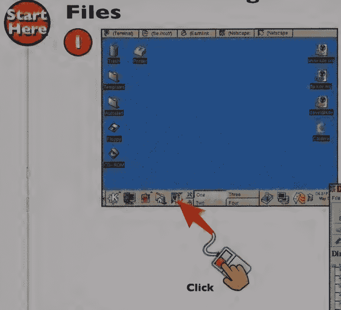

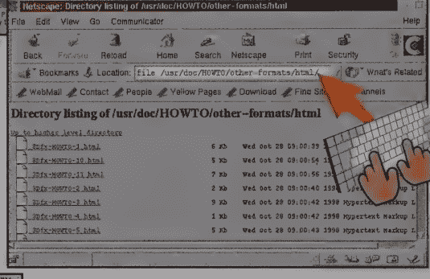

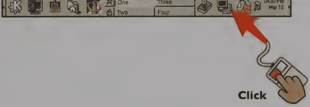

#### Ghostview 应用程序

你可以使用 Ghostview（`gv`）应用程序在桌面上查看 PostScript 文件。点击`K`按钮，选择`Applications`，然后选择`GV`来启动 Ghostview。

1. 点击 KPanel 栏上的 Netscape Communicator 图标。
2. 输入你想查看的 HTML 文件的路径。在本例中，我输入了`file:/usr/doc/HOWTO/other-formats/html/`。在 Netscape 浏览器窗口中点击一个文件名。
3. 点击 KPanel 栏上的 Terminal 按钮。

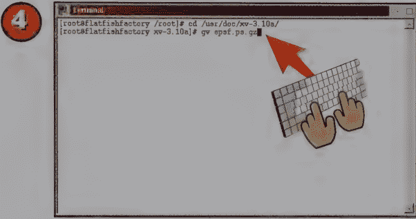

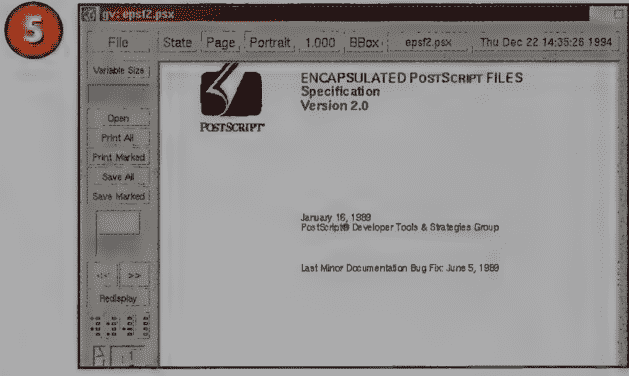

```bash
cd /usr/doc/xv-3.10a/
gv epsf.ps.gz
```

输入 PostScript 文件的路径。在本例中，我输入了`cd /usr/doc/xv-3.10a/`。输入`gv epsf.ps.gz`来查看 PostScript 文件。

文件随即打开。

#### Lynx

你也可以使用`lynx`命令从命令行查看`HTML`文件。点击`K`按钮，选择`Utilities`，然后选择`Terminal`打开终端窗口。输入`lynx`，后跟文档或`HTML`文件名来查看文件。例如，输入`lynx mynewdoc.txt`在`lynx`应用程序中查看文档`mynewdoc`。

## 4

有两种方法可以将你的 PC 连接到互联网。更快更简单的方法是在你的 PC 上安装网卡，然后将你的 PC 连接到支持互联网的网络。如果你在家里使用 PC，你很可能需要一个调制解调器。OpenLinux 对可以使用的调制解调器非常挑剔。请确保拥有与 Hayes 兼容的调制解调器。

#### PCI 和 WinModem

目前，OpenLinux 不兼容 PCI 调制解调器卡或 WinModem。这意味着什么？OpenLinux 目前没有支持这些调制解调器的驱动程序。你可能需要购买一个外置调制解调器，才能使用 Linux 连接到你的 ISP。

### 任务 2：设置你的调制解调器连接

#### 从这里开始

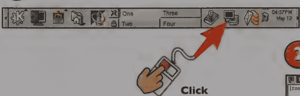

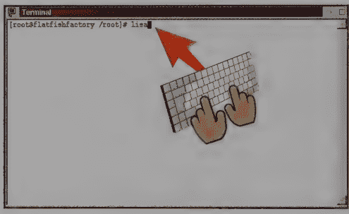

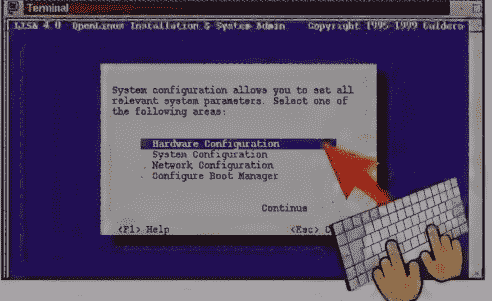

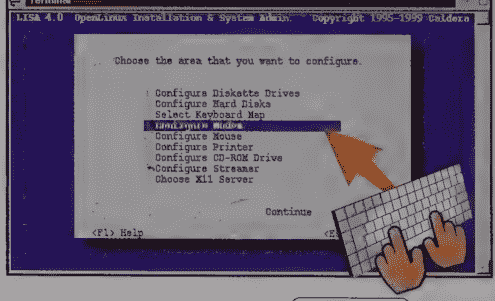

1. 点击 KPanel 栏上的 Terminal 按钮。
2. 在终端窗口中输入`lisa`。然后按 Enter 键。
3. 选择`System Configuration`，然后选择`Hardware Configuration`。使用上下箭头在屏幕菜单中选择项目。
4. 选择`Configure Modem`。

#### 下一步

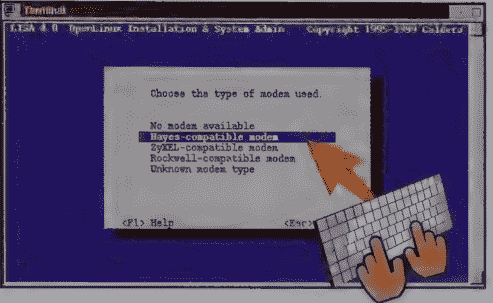

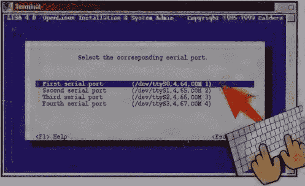

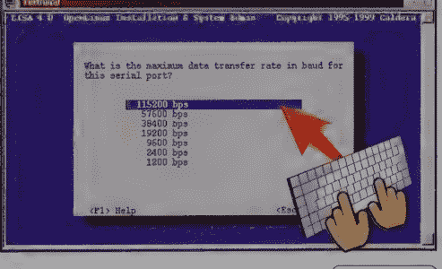

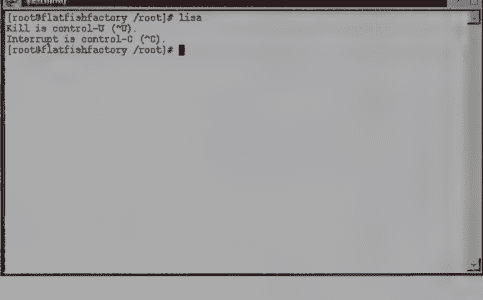

#### 选择串行端口

如果你的 PC 上安装了 Windows，点击`Start`菜单，选择`Control Panels`，然后选择`Systems`。点击`Devices`选项卡，然后选择调制解调器以查看 PC 上连接的调制解调器所使用的端口。在 OpenLinux 调制解调器配置中选择相同的端口。

#### PCMCIA 调制解调器

如果你在笔记本电脑上安装了 OpenLinux，请以`root`操作员身份登录，然后使用文本编辑器在`/etc/sysconfig`中创建一个名为`pcmcia`的文件。有关 PC 卡的更多信息，请转到`/usr/doc/pcmcia-cs`。

文件应包含以下行：

```ini
PCMCIA=yes
PCIC=i82365
OPTS="poll_interval=300"
```

5. 选择`Hayes-compatible modem`，然后按 Enter 键。
6. 选择调制解调器连接的串行端口。按 Enter 键。
7. 选择调制解调器支持的数据传输速率。然后按 Enter 键。
8. 按 Escape 键直到退出`lisa`并返回到终端窗口。

### 任务 3：设置你的互联网连接

如果你有调制解调器，你必须有一个互联网服务提供商才能将你的 PC 连接到互联网。与互联网的连接使用点对点协议，称为 PPP。Linux 使用一个名为 KPPP 的应用程序来存储 Linux 连接到互联网所需的所有信息。

1. **KPPP 日志**：有关互联网连接的更多详细信息，点击 Connecting to: 对话框中的`Log`按钮。
2. **多个 ISP**：如果你有多个互联网服务提供商，你可以配置 KPPP 连接到你在 KPPP 应用程序中创建的任意多个账户之一。每次切换到不同的互联网服务提供商账户时，你都需要输入相应的登录名和密码。

点击`K`按钮，选择`Internet`，然后选择`Kppp`。

点击`Setup`按钮。

点击`New`。

点击`Dial`选项卡，然后输入你的 ISP 名称以及你将用于拨入 ISP 的电话号码。你的 ISP 应该提供这些信息。

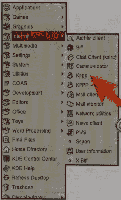

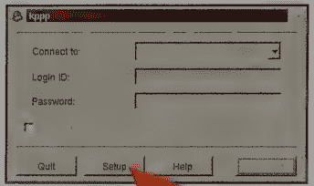

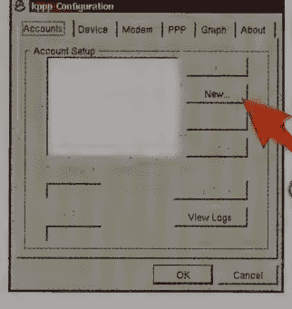

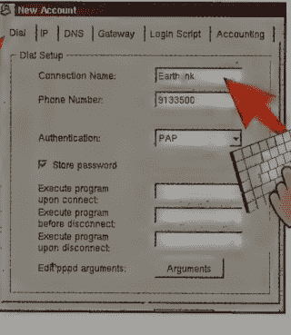

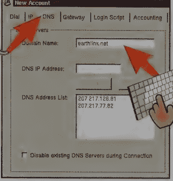

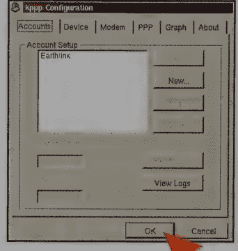

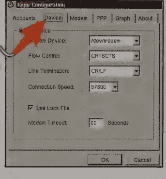

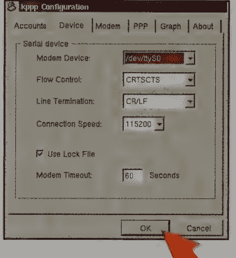


5. 点击`DNS`选项卡，然后输入你的服务提供商的域名。将 ISP 的 DNS 地址添加到`DNS Address List`中。
6. 点击`OK`返回 kppp Configuration 窗口。
7. 点击`Device`选项卡。确保使用`Modem Device`菜单为你的调制解调器选择正确的串行端口。
8. 再次点击`OK`返回 kppp 窗口。

#### 登录脚本

如果你使用的是全国性 ISP，如 Earthlink 或 Netcom，你可能不需要使用登录脚本进行连接。如果你的 ISP 需要登录或聊天脚本，它很可能在其网站上提供了示例。以下是一个通用的登录脚本，可能有效也可能无效：

```text
Expected: login:
Send: mylogin
Expected: password:
Send: mypassword
```

#### 继续设置你的互联网连接

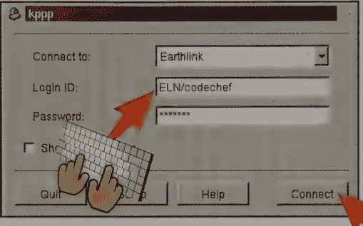

#### 查询你的调制解调器

点击`Modem`选项卡并点击`Query Modem`，检查 KPPP 是否能看到你的调制解调器。调制解调器特性列表会出现在`Modem Query Results`窗口中。如果 KPPP 无法看到你的调制解调器，或者 KPPP 认为调制解调器正忙，Linux 可能不兼容该调制解调器。

#### 不要放弃！

如果你第一次尝试时未能成功登录到你的 ISP 账户，没关系。再尝试连接几次。即使你拥有 56K 调制解调器，你也可以尝试将连接速度设置为 38600，看看这是否有助于 Linux 连接到 ISP 的远程服务器。

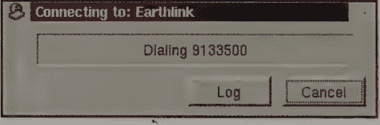

9. 在 kppp 的`Login ID`和`Password`字段中输入你的账户名和密码。
10. 点击`Connect`按钮。
11. 等待调制解调器连接到你的互联网服务提供商。当你的 PC 连接后，连接窗口和任何打开的日志窗口将自动关闭。

### 任务 4：检查你的互联网连接

连接到互联网后，你可以打开其他应用程序、浏览网页、阅读电子邮件或查看互联网连接的状态。本任务向你展示如何查看有关互联网连接的信息。这有助于优化你的互联网体验，或排查未来系统可能出现的问题。

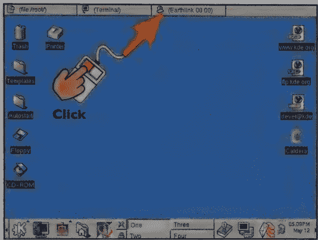

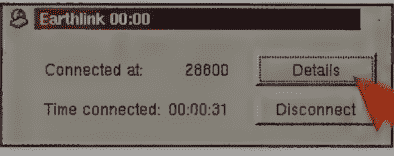

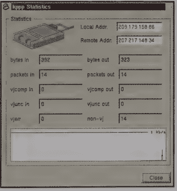

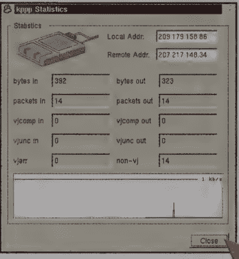

1. 点击任务栏中的`Earthlink`（或你的 ISP）按钮。
2. 点击`Details`按钮。
3. 在 kppp Statistics 窗口中查看信息。
4. 点击`Close`按钮退出窗口。

#### 停止连接

在`Connect to:`框中按 Cancel，以停止调制解调器拨入互联网。

### 任务 5：设置以太网连接

连接互联网最快的方式之一就是接入已经联网的网络。大多数 PC 网络使用 10BASE-T 或 100BASE-T 以太网卡和网络连接器。

- **以太网电缆**
  
  网线另一端连接到以太网集线器。

- **IP 地址**
  
  如果不打算连接互联网，以太网配置中不需要使用真实的 IP 地址。

1. 按照制造商说明将以太网卡安装到 PC 中。然后将 10BASE-T 或 100BASE-T 以太网电缆连接到以太网端口。
2. 打开终端窗口并输入`lisa`。
3. 选择**系统配置（System Configuration）**，然后选择**配置网络访问（Configure Network Access）**。输入 IP 信息，然后按 Enter。
4. 选择**配置网卡（Configure Network Card）**，然后按 Enter。
5. 输入以太网卡接口信息，然后按 Enter。
6. 输入网卡的 IP 地址，然后按 Enter。
7. 按 Escape。选择**输入路由器/网关（Enter Router/Gateway）**，然后按 Enter。
8. 输入以太网网关的 IP 地址并按 Enter。按 Escape 直到返回到终端窗口提示符。

#### DSL、ISDN 和 T1 连接

DSL、ISDN 和 T1 连接的配置方式与本任务中以太网的配置方式类似。请务必检查是否需要安装额外的 OpenLinux 软件才能使用这些互联网连接线路。

Netscape Communicator 是 Netscape 浏览器产品的名称。然而，Netscape 为 Netscape Communicator 中的每个主要组件都取了独特的名称。Netscape Navigator 是 Netscape 对 Netscape Communicator 中浏览器功能的命名。其他功能包括 Messenger、新闻组和 Composer。本任务介绍如何启动 Netscape Communicator。默认情况下，它会打开 Netscape Navigator。

### 任务 6：启动 Netscape Communicator

#### 命令行

可以在终端窗口中输入`netscape`启动 Netscape Communicator。输入`netscape -help`查看有关 Netscape 命令的帮助信息。

1. 点击 K 面板栏中的 Netscape Communicator 图标。
2. Netscape 浏览器窗口打开。

### 任务 7：输入地址

1. 在地址栏中输入想要访问的站点地址。然后按 Enter。
2. Netscape Navigator 显示与输入的 URL 相关联的页面。

互联网地址，也称为统一资源定位符或`URL`，标识连接到互联网的服务器的位置。`URL`由多个部分组成。首先，必须包含 Web 协议`http://`，然后是域名，例如`www.linux.org`。域名扩展名（通常是`.com`、`.net`、`.gov`或`.edu`）表示网站类型（分别为商业、网络、政府或教育机构）。域名还可以包含指向互联网服务器上文件夹或文件的路径。

**大小写敏感性**

务必在浏览器地址文本字段中正确输入 URL。必须按准确顺序输入句点、斜杠和其他字符，否则无法加载目标网站。某些 URL 也是区分大小写的。

### 任务 8：使用链接和工具栏按钮浏览


在互联网上浏览信息很容易，因为文档包含指向其他页面和网站的链接。点击链接可以查看链接指向的页面。可以使用后退和前进箭头按钮返回上一页，并移动到浏览器窗口中后续的页面。可以使用浏览器工具栏中的按钮作为快捷方式，快速访问主页或搜索页面，或打印网页。

1. 访问一个网站，例如 `http://www.yahoo.com`。点击一个链接（在此例中，我选择了 **Star Wars**）。
2. 网页加载到浏览器窗口中。
3. 点击 **后退（Back）** 按钮返回之前的页面，点击 **前进（Forward）** 按钮返回到此页面。
4. 点击 **主页（Home）** 返回 Caldera 信息页面。

### 移动工具栏

在浏览器窗口中点击并拖动工具栏到另一个工具栏的上方或下方，以更改工具栏的位置。

## 任务 9：创建书签

找到喜欢的网站或想要保存以便将来访问时，可能希望有一种快速返回的方式，而无需记住输入的所有其他地址。Netscape Communicator 允许您为站点创建书签。

1. 访问想要创建书签的站点。
2. 点击工具栏中的 **书签（Bookmarks）** 按钮。
3. 选择 **添加书签（Add Bookmark）** 或按 `Alt+K`。
4. 书签出现在 **书签（Bookmarks）** 菜单中。

### 不同命令

快捷菜单中的可用命令因右键点击的屏幕元素而异。

### KDE 书签

也可以在 KDE 窗口中创建书签。只需点击任意目录中的 **书签（Bookmarks）**，然后选择 **添加书签（Add Bookmarks）**，即可将其添加到书签菜单。

## 任务 10：管理书签

将站点添加到书签列表后，点击 **书签（Bookmarks）** 按钮，然后从弹出菜单中选择站点即可访问。如果向书签列表中添加了多个站点，可能需要整理它们，以便快速找到所需的站点。

### 收藏夹

在其他浏览器应用程序中，书签也被称为收藏夹。

### 删除书签

点击 **书签（Bookmarks）** 并选择 **编辑书签（Edit Bookmarks）**。点击要删除的书签，按 `Alt+D` 从书签列表中删除书签。

1. 点击 **书签（Bookmarks）** 按钮，然后选择想要使用的书签。
2. 要整理书签，点击 **书签（Bookmarks）**，然后选择 **编辑书签（Edit Bookmarks）**。
3. 在书签窗口中查看书签列表。
4. 点击书签或包含书签的文件夹，并将其拖动到书签列表中的新位置。
5. 书签或文件夹出现在书签列表的新位置中。

## 任务 11：使用 RealPlayer

互联网上提供了多种技术，让您可以在连接网站时收听音频文件。Real Networks 于数年前推出了 RealAudio。您可以将文件下载到 PC，或使用 RealPlayer 通过互联网播放相同的音频文件。

### 下载问题？

如果遇到错误，请尝试以 `root` 用户身份登录，或在尝试从互联网下载文件之前关闭 Kpackage。

### 流式音频

不下载到 PC 而直接播放 RealAudio 文件时，音频文件是从 Web 服务器播放的。这种技术称为流式音频；也就是说，音频数据在文件于计算机上播放的同时，从 Web 服务器流式传输到您的 PC。

1. 访问 `http://www.real.com` 并下载适用于 Red Hat Linux 5.x 的最新 RealAudio 播放器。在此例中是 RealPlayer 5。按照安装说明进行操作。
2. 点击 K 面板栏或任务栏中的 Netscape 按钮。
3. 点击编辑并选择首选项。
4. 点击首选项窗口中 Navigator 旁边的箭头，然后选择应用程序。
5. 点击 **New** 按钮。
6. 在 **Description** 字段中输入 `RealAudioPlayerG2`，在 **MIMEType** 字段中输入 `audio/x-pn-realaudio`。
7. 在 **Suffixes** 字段中输入 `.rm, .ra, .ram`，在 **Application** 字段中输入 `rvplayer %s`。
8. 点击 RealPlayer 应用程序，或在终端窗口中输入 `rvplayer &`。

### RealAudio 网站

访问 `http://www.npr.org` 或 `http://www.cnet.com/radio` 来收听一些最新的网络电台广播。

### 服务器繁忙

RealAudio 是网络上流行的音频格式。有时，当你点击网站上的 RealAudio 文件时，你会看到一条错误消息，提示服务器太忙无法播放该文件。如果遇到这种情况，你可以将文件下载到计算机上，或者为该网站创建书签，稍后再回来播放音频文件。

Netscape Communicator 包含许多强大的功能。本书介绍的三个功能是浏览器、电子邮件和新闻组功能。Netscape Communicator 的电子邮件功能统称为 Messenger。Email 即电子邮件。使用 Linux，你可以通过终端窗口或使用精美的用户界面（如 Netscape Messenger）来阅读邮件。

> **警告**
>
> 当你浏览网页、发送电子邮件或在网站上填写表单时，请注意不要随意向他人透露你的电子邮件地址。垃圾邮件类似于现实生活中的垃圾信件。如果你不希望邮箱被大量无用邮件塞满，请尽量不要让你的电子邮件地址轻易被他人获取。

1. 点击 **K** 按钮，选择 **Internet**，然后选择 **Communicator**。
2. 点击 **Communicator** 菜单并选择 **Messenger** 菜单命令。
3. 点击 **Edit** 并选择 **Preferences**。
4. 点击 **Mail & Newsgroups** 旁边的箭头，然后点击 **Identity**。

### 签名

要添加签名，请在 Netscape Communicator 的 Preferences 窗口的 Identity 面板中输入签名文件的路径。

当你发送或回复电子邮件时，可以添加签名以提供更多关于你自己的信息。签名通常包含你的姓名、电子邮件地址和公司名称或组织名称。有些人会在签名中附加一段引言或 HTML 代码，从其网站播放歌曲，以在基本信息之外自定义签名。

5. 在相应字段中输入你的姓名和完整的电子邮件地址。
6. 点击 **Mail Servers**。
7. 在相应字段中输入你的用户名、 SMTP 和 POP 服务器信息。然后按回车键退出 Preferences 窗口。

## 任务 13：阅读电子邮件

配置 Messenger 以识别你的邮件服务器和电子邮件账户后，你就可以下载并阅读电子邮件了。当然，阅读电子邮件只是使用电子邮件的第一步。随着你收到的邮件越来越多，你几乎会自然而然地学会发送和回复邮件。

> **警告**
>
> 如果你收到一封电子邮件但不认识发件人，请极其谨慎地打开该邮件。一些垃圾邮件可能包含软件病毒或其他恶意代码作为附件。病毒的破坏程度各不相同，从完全无害的代码到潜伏在硬盘上、在特定日期删除磁盘上所有数据的代码，有时甚至不会有警告提示。

1. 点击 **Communicator**，然后选择 **Messenger**。
2. 点击 **Get Msg**。
3. 在 Netscape: Password 对话框中输入你的密码。点击 **OK** 并等待电子邮件下载完成。

> **全尺寸窗口**
>
> 要在独立窗口中打开某封邮件，只需在邮件列表中双击该邮件即可。

4. 点击你想阅读的电子邮件。
5. 邮件内容将显示在预览窗格中。

## 任务 14：发送电子邮件

获得更多邮件的一种方式是向你的朋友或业务伙伴发送电子邮件。你可以向互联网上的任何人发送邮件。更棒的是，你可以同时向多人发送同一条消息。使用 `cc`（抄送）和 `bcc`（密送）来组织邮件的发送方式。

### 格式化电子邮件

你可以使用纯文本编写邮件，使用 HTML 来格式化文本，甚至可以在邮件中包含图片文件。

### 保存草稿

如果你想保存尚未准备好发送的邮件草稿，请点击 **Save** 按钮。

1. 点击 **Communicator**，然后选择 **Messenger**。
2. 点击 **New Msg**。
3. 输入收件人地址以及任何抄送和密送地址。地址格式为 `username@domainname.ext`（例如，`afclisa@aol.com`）。
4. 输入你的邮件内容。
5. 准备好发送时，点击 **Send**。

### 新消息

你也可以通过点击 File，选择 **New**，然后选择 **New Message** 来开始撰写新消息。

### 菜单快捷键

按 `Alt+M` 创建新的邮件消息窗口。

### 转发邮件

另一种发送邮件的方式是转发已收到的邮件。打开任意邮件并点击 **Forward** 按钮，即可创建一封包含原始邮件所有内容的新邮件。

## 任务 15：回复电子邮件

你可以轻松地回复收到的消息。Netscape Messenger 会为你自动填写地址和主题信息。你可以回复原始邮件的部分或全部内容，也可以回复邮件的一个或所有收件人。

> **引用**
>
> 在电子邮件中澄清你所指内容的最佳方式之一是引用之前的邮件内容。你可以从一封邮件中剪切和粘贴文本到另一封邮件，也可以从邮件中选择文本然后点击 Reply 按钮。选中的文本将以引用的形式出现在你的回复邮件中。

1. 点击 **Communicator**，然后选择 **Messenger**。
2. 点击 **Get Msg**。
3. 点击你想阅读的电子邮件。
4. 点击 **Reply**。
5. 在主窗口中输入你的回复内容。
6. 回复完成后，点击 **Send**。

### 回复与全部回复

你可以回复邮件中的所有收件人，也可以只回复发件人。点击 **Reply** 回复发件人。点击 **Reply All** 回复邮件的所有收件人。

## 任务 16：阅读新闻

互联网上的新闻组与现实世界中的报纸类似。你首先需要订阅，然后才能接收新闻。互联网上的新闻组涵盖了几乎所有你能想到的话题。此外，任何人都可以发布消息，订阅该新闻组的人都可以阅读这些消息。

### 讨论串

当有人回复新闻组的第一个帖子时，就形成了一个讨论串。通常，讨论串包含两到八条消息。有些讨论串可以持续很长时间。

### 求同存异

带有愤怒或对立语气的新闻组讨论串被称为“火焰帖”。由于互联网上有各种各样的观点，有时最好的做法是就某个话题求同存异。

1. 点击 **Communicator**，然后选择 **Newsgroups**。
2. 选择一个新闻服务器，然后点击 **Subscribe**。
3. 使用现有的新闻服务器，或点击 **Add Server**。
4. 输入你要使用的新闻服务器名称，然后点击 **OK**。
5. 点击讨论组文件夹以查看相关的新闻组。
6. 点击一个新闻组，然后点击 **订阅**。
7. 点击一个讨论主题以阅读新闻组消息。

### Linux 新闻组

了解更多关于 Linux 的信息的一种方法是订阅专注于 Linux 问题的新闻组。以下是一些你可能想要订阅的 Linux 新闻组：

- `comp.os.linux.answers`
- `comp.os.linux.setup`
- `comp.os.linux.x`
- `comp.os.linux.music`
- `comp.os.linux.hardware`
- `comp.os.linux.announce`
- `comp.os.linux.advocacy`

## 任务 17：向新闻组发帖

使用新闻组与回复和发送电子邮件类似。请记住，你在新闻组中发布的任何内容都可以被世界上任何其他人阅读。大多数新闻组都有系统管理员，他们试图使讨论集中在特定主题上。

### 取消订阅

如果你发现某个新闻组已经变得不活跃，或者讨论主题并不符合你的预期，请选择该新闻组并点击**取消订阅**。

### 新消息和旧消息

粗体显示的消息尚未阅读；带有可折叠箭头的消息表示有回复。

### 打印消息

你可以打印网页、电子邮件或新闻组消息。转到网页、电子邮件或新闻组消息，点击**文件**，然后选择**打印**。

1. 点击**新消息**。
2. 在收件人字段中输入新闻组。输入主题和消息。
3. 点击**发送**将其发布到新闻组。

## 任务 18：回复新闻组

如果你遇到想要回复的新闻组消息，你可以发布对该消息的回复。

### 保存消息

你可以保存任何网页、电子邮件或新闻组消息。转到网页、电子邮件或新闻组消息，点击文件，然后选择保存。然后选择硬盘上的一个位置来保存网页或消息。

### 私人回复

如果你不想将消息发布给全世界，请在字段中输入你想要回复的人的电子邮件地址，而不是回复新闻组的电子邮件地址。

1. 打开一条新闻组消息。
2. 点击**回复**。
3. 输入你对新闻组消息的回复。
4. 添加新闻组消息的任何其他收件人。然后点击**发送**。

# 打印

无论你是从控制台窗口还是从应用程序打印，所有 Linux 应用程序都使用相同的打印机设置。你可以使用 Lisa 来配置你的打印机端口，然后运行 KDE 向导来创建桌面打印机图标。你可以使用 Linux 来管理所有应用程序的打印。

通常，你从创建文档的应用程序中打印文档。当你将文件发送到打印机时，文件会从屏幕图像转换为可打印图像。然后它进入打印队列或等待区域。打印队列在任何时候都可以包含一个或几个文件，你可以在文档正在打印时对打印队列进行更改。本部分向你展示如何在 KDE 中控制和管理打印。

## 任务

| 任务 # | 页码 # |
| --- | --- |
| 1 添加打印机 | 98 |
| 2 打印文本文件 | 100 |
| 3 打印图形文件 | 101 |
| 4 监控打印队列 | 102 |
| 5 向桌面添加打印机图标 | 104 |

### 任务 1：添加打印机

打印文档除了将打印机电缆连接到计算机之外，还需要几个步骤。本任务向你展示如何使用 Lisa 系统管理工具在 Linux 中配置打印机。

#### 挂载 CD

如果你的打印机软件在 CD-ROM 上，双击 KDE 向导安装的 CD 图标，或者在终端窗口中输入 `mount /mnt/cdrom`。

#### 打印机帮助

有关打印的更多信息，请在浏览器窗口中转到 `file:/usr/doc/HOWTO/other-formats/html`，然后选择 Printing-HOWTO 或 Printing-Usage-HOWTO。

提示：你也可以访问 Caldera's 网站 `http://www.calderasystems.com` 获取关于 Linux 2.2 的最新信息。

将打印机连接到 PC。然后打开打印机和 PC 的电源并登录到 Linux。点击**K**菜单，选择**工具**，然后选择**终端**。

输入 `dmesg | less` 并滚动查找类似于 `lp0 at 0x0378 (polling)` 的行。这意味着 Linux 在 `lp0` 端口（`/dev/lp0`）检测到打印机。输入 `q` 退出文档。

在终端窗口中输入 `lisa`。选择**系统配置**，然后在接下来的屏幕上选择**硬件配置**。然后选择**配置打印机**。

选择一个打印机驱动程序（在本例中，我选择了**本地 PostScript 打印机**）。

#### 无法打印？

我不得不两次重启系统和打印机，才能实际开始在 Linux 上向 PostScript 打印机打印。有关 `lpr` 应用程序的更多信息，请在终端窗口中输入 `man lpr`，或输入以下路径并在 `/usr/doc/LPRng` 阅读文档，以确保 `lpd` 打印机守护进程设置正确。

#### lpd 守护进程

在打印之前，Linux 必须运行 `lpd` 守护进程。点击 K 按钮并选择 COAS，选择系统，然后选择守护进程。点击打印服务器（LPD）复选框。点击确定激活 `lpd` 守护进程，然后重启 Linux。

1. 选择一个打印机端口（我选择了步骤 2 中的**LP0**）。
2. 选择默认的打印机分辨率（在本例中，我选择了**300x300**）。
3. 选择默认的纸张大小（在本例中，我选择了**Letter**）。按回车键，然后按 Escape 键直到返回终端窗口。
4. 输入 `ls -l | lpr` 并按回车键打印测试页。

### 任务 2：打印文本文件

Linux 为你提供了两个计算世界的最佳体验。也就是说，你可以从命令行或用户友好的 K 开发环境中打印文本。文本和图形文件都可以是位图或基于 PostScript 的文档。要打印 PostScript 文档，你必须使用 Linux 配置的 PostScript 打印机。本任务向你展示如何从命令行以及使用文本编辑器应用程序进行打印。

#### 打印手册页

你可以通过在 Konsole 或终端窗口中输入以下命令来打印手册页：

```bash
man man | <program name> -b } lpr
```

#### 取消按钮

如果你决定还不想打印文档，请点击 Kview 窗口中的**取消**按钮。

1. 点击文本文档。在本例中，我选择了**FreeTheory.txt**。
2. 点击**文件**并选择**打印**。
3. 点击**确定**。
4. 要从命令行打印同一文件，请打开终端窗口并输入 `lpr FreeTheory.txt`。

### 任务 3：打印图形文件

如果你在 KDE 中，打印图形文件与打印文本文件类似。大多数图像文件都可以用 Kview 应用程序打开。你也可以使用 `gv`、`gimp`、`xv`、`xfig`、`tgif` 和 `display` 等工具来处理并最终打印图形文件。本任务向你展示如何使用 Kview 打印 JPEG 文件。

#### 取消按钮

如果你改变了打印的主意，可以随时点击 Kview 窗口中的取消按钮。

#### gv 工具

你也可以从终端窗口打印图形。命令的一般格式是 `gv /opt/kde/share/wallpapers/berries.jpg`。输入 `man gv` 以获取有关如何使用 `gv` 工具打印的更多信息。


点击一个图像文件，例如`.jpg`或`.gif`文件。在本例中，我选择了`berries.jpg`。

文件打开。

点击**文件**并选择**打印**。

选择纸张格式和纸张类型，然后点击 Kview 窗口中的**确定**。

## 任务 4：监控打印队列

打印队列列出了已发送到打印机的文档。它会显示哪些打印作业当前正在前往打印机，以及作业等待打印的顺序。本任务将向你展示如何使用打印队列查看和取消打印作业。

### 打印命令

你可以在**终端**窗口中输入`cat <文档名称> | lpr`来打印文本文档。也可以输入`lpr <文件名>`。

### 打印队列命令

在**终端**窗口中输入`lpq`来查看打印队列，从而控制打印队列。输入`lpc`来控制你的打印机，输入`lprm`来停止队列中的任何打印作业。

1. 点击打开多个文档。对每个文档点击**文件**并选择**打印**。

2. 点击**K**按钮并选择**实用工具**。然后选择**打印机队列**。

3. 点击**更新**来更新打印机队列中的文档列表。

4. 点击**移除**按钮来取消打印队列中的一个作业。

5. 点击**退出**按钮来退出应用程序。

## 任务 5：添加打印机图标到桌面

为了快速访问你的打印机，你可以将打印机图标添加到桌面。然后你可以双击此图标来查看打印队列。你也可以将文档从文件窗口拖到打印机图标上来打印文档。

1. 点击**K**按钮，选择**实用工具**，然后选择**KDE 配置向导**来启动 KDE 安装向导。

2. 点击**下一步**按钮，直到看到**打印机集成**页面。

**提示**

### 删除桌面打印机图标

要删除桌面打印机图标，右键单击它并从弹出菜单中选择**删除**。

**KDE 安装向导**

第 4 页，共 5 页

打印机集成

你可能有一台打印机，不是吗？那为什么不创建一个打印机小图标，让你可以拖放文件到打印机，并调用打印机队列工具呢？

3. 点击**打印机图标**按钮。点击**下一步**，然后点击**确定**退出 KDE 安装向导。

4. 打印机图标出现在桌面上。

# 个性化 KDE

你可以通过自定义 K 开发环境（KDE）来优化你的工作效率。你可以移动或隐藏任务栏，也可以移动 KPanel 按钮。你还可以调整屏幕上元素使用的颜色，例如窗口标题栏。你可以更改鼠标设置、桌面背景、屏幕保护程序等。Caldera Linux 2.2 包含许多选项，让你可以按自己的方式设置桌面。本部分将向你展示如何自定义 KDE。

## 任务

| 任务 # | | 页码 # |
|--------|--------------------------------|--------|
| 1 | 显示和隐藏任务栏 | 108 |
| 2 | 配置 KPanel | 110 |
| 3 | 使用字体 | 112 |
| 4 | 使用颜色 | 114 |
| 5 | 更改桌面背景 | 116 |
| 6 | 更改鼠标设置 | 118 |
| 7 | 更改显示属性 | 119 |
| 8 | 更改窗口外观 | 120 |
| 9 | 配置键盘 | 122 |
| 10 | 更改 X11 服务器 | 123 |
| 11 | 更改系统日期和时间 | 126 |
| 12 | 编辑菜单 | 128 |

### 任务 1：显示和隐藏任务栏

KDE 的默认设置是始终在桌面上显示任务栏。但是，你可以隐藏任务栏，以便在桌面上为其他窗口、文件夹和应用程序留出更多空间。

**KPanel 快捷方式**

右键单击 K 菜单栏并选择配置，打开 KPanel 配置窗口。

**在任何桌面上使用任务栏**

当任务栏可见时，你可以从任何可用桌面访问工具栏上的任何项目。

**任务栏设置**

你可以让任务栏在桌面上消失，或自动隐藏。在 KPanel 配置窗口中点击**选项**，然后点击**自动隐藏任务栏**复选框来启用自动隐藏行为。

1. 点击**K**按钮，选择**面板**，然后选择**配置**。

2. 在 KPanel 配置窗口的**任务栏**部分，如果你想隐藏任务栏，点击**隐藏**单选按钮。

3. 点击**确定**或按回车键。

4. 点击**顶部**、**底部**或**顶部/左侧**来移动任务栏位置。

5. 点击**确定**或按回车键。

6. 对话框关闭，任务栏消失。

### 任务 2：配置 KPanel

KDE 最强大的视觉组件是 KPanel。它是一个位于桌面底部的可移动任务栏。你可以启动应用程序、访问多个桌面，并按自己的喜好配置 KDE 会话。面板上有几个控件：K 菜单应用程序启动器、应用程序快捷方式、弹出菜单、注销、锁屏和虚拟桌面按钮，以及条带两端的面板隐藏按钮。

**警告**

在 Linux 中，有可能多次打开同一个应用程序或文件。如果你双击一个图标后没有任何反应，请等待几秒钟。每次双击图标都会启动一个新的应用程序窗口，而且很可能会减慢每个应用程序的启动时间。

1. 点击 KPanel 图标，选择**面板**，然后选择**配置**。

2. 在**位置**或**样式**部分点击一个单选按钮来选择你想要的设置。点击**选项**或**磁盘导航器**选项卡来更改其他 KPanel 设置。

3. 点击**桌面**选项卡来选择你想要的虚拟桌面数量。

4. 点击**确定**保存你的设置。

5. 右键单击 KPanel 中的任何按钮并选择**移动**，将图标移动到 KPanel 条中的新位置。

6. 选择一个应用程序图标并将其拖到 KPanel 条。KPanel 条上会创建一个快捷图标，使你能够从桌面启动该应用程序。

#### 将应用程序添加到 K 菜单

左键单击**K**按钮并选择**面板**，然后选择**添加应用程序**。点击你想添加到 KPanel 菜单的应用程序。下次你点击**K**按钮时，该应用程序将出现在 K 菜单中。

#### 将图标添加到 KPanel 条

点击一个应用程序图标并将其拖到 KPanel 菜单。KDE 会创建该应用程序的快捷方式，并将图标放在 KDE 工具栏中以便快速访问。

**默认按钮**

在 KPanel 配置窗口中点击**默认**按钮，将 KPanel 恢复为原始设置。

### 任务 3：使用字体

字体在 Linux 和 KDE 中的工作方式与在 Windows 和 Mac OS 中类似。与 Windows 和 Mac OS 一样，Linux 支持屏幕字体和打印机专用字体。您可以在 Linux、KDE、终端窗口和 X11 服务器的多个不同区域自定义字体设置。

**所有桌面变化**

当您对“显示设置”窗口进行更改时，所有虚拟桌面都会受到任何已保存更改的影响。

**取消按钮**

如果您对 KDE 显示设置窗口进行了更改，但决定不想保存任何更改，请单击“取消”按钮。

1. 按 `Ctrl+T` 或单击 KPanel 栏中的“主目录”按钮打开终端窗口。单击**文件**并选择**打开终端**。

2. 单击**选项**并选择**字体**，然后选择字体大小。默认为“中”。

3. 单击**K**按钮并选择**设置**。然后单击**桌面**并选择**字体**。

4. 在窗口列表中为选定的字体组从下拉菜单中选择一种字体。

5. 单击**应用**以在 KDE 中查看字体更改。

6. 单击关闭框退出“字体”对话框窗口。

#### 什么是 BASH？

BASH 是 Bourne-Again Shell 的伪首字母缩略词，它是您可以与 Linux 配合使用的几种终端窗口应用程序之一。终端窗口应用程序位于`file:///bin/bash`。BASH 是此任务中使用的终端窗口类型。

### 任务 4：使用颜色

KDE 使您能够更改用于某些屏幕元素（如标题栏和背景）的颜色集。这些颜色集称为方案，您可以选择最适合您和您的显示器的颜色。例如，ighter 颜色可能会使某些应用程序的工作对您的眼睛更轻松。另一方面，您可能更喜欢鲜艳、活泼的颜色来搭配您的衣服或工作心情。

**警告**

如果您关闭窗口而不是单击 **OK** 或 **应用**，您的更改将不会被保存。

**取消按钮**

如果您对 KDE 显示设置窗口进行了更改，但决定不想保存您的更改，请单击 **取消** 按钮。

1. 单击**K**按钮并选择**设置**。然后选择**桌面**并选择**颜色**。

2. 在“显示设置”窗口的 **组件颜色** 部分中，从下拉菜单中单击一个背景。组件颜色会随着您单击下拉菜单项而更改。

3. 单击所选组件的颜色条。

4. 在“选择颜色”窗口右侧的颜色调色板上单击以选择一种颜色。

5. 单击 **确定** 保存任何更改。

6. 单击 **应用** 以查看对桌面的颜色更改。

### 任务 5：更改您的桌面图片

您可以通过添加墙纸（也称为桌面图片）来个性化您的 KDE 桌面。许多彩色墙纸图像随 Caldera Linux 2.2 一起安装，包括 `ruins`、`fudge_chunks`、`berries` 和 `water`。

**虚拟桌面**

您可以为每个虚拟桌面选择独特或通用的墙纸图案。选中 **通用背景** 复选框以在所有虚拟桌面上共享相同的墙纸。

**常规背景**

要恢复为纯色背景，请按照以下步骤操作，但从“墙纸”下拉列表中选择 **无墙纸**。

1. 单击**K**按钮并选择**设置**。然后选择**桌面**并选择**背景**。

2. 从列表中选择一个桌面。

3. 单击 **墙纸** 下拉列表，然后选择一个墙纸图案。

#### 添加墙纸

桌面图案会显示在“显示设置”窗口中的显示器图像中。

单击 **应用** 以在您的桌面上查看墙纸。

单击 **确定** 保存墙纸设置并退出“显示设置”窗口。所选墙纸图案会显示在虚拟桌面上。

您可以通过从互联网下载图像或使用绘图程序创建图像来创建自己的墙纸图案。将墙纸图像文件保存到`file:/opt/kde/share/wallpapers`。

### 任务 6：更改您的鼠标设置

您可以调整鼠标按钮和双击速度，以使鼠标使用更加舒适。例如，假设您是左撇子。交换右键和左键可能会让您的工作更轻松一些。同样，如果您在屏幕上移动鼠标时遇到困难，您可以调整鼠标设置，以便轻松使用 Linux。

**选择鼠标**

如果您想在 Linux 中使用不同的鼠标，请打开终端窗口并输入 `lisa`。选择 **系统配置** 和 **硬件配置**。然后选择 **配置鼠标**。大多数 PC 使用 PS/2 鼠标。

**更改您的光标**

您可以通过打开终端窗口并输入 `xsetroot -cursor_name sailboat` 来更改光标外观。

1. 从 **K** 菜单中选择 **KDE 控制中心**。

2. 切换 **输入设备** 图标并选择 **鼠标**。

3. 单击单选按钮以调整 **按钮映射**。调整滑块以更改鼠标的 **加速** 和 **阈值** 设置。

4. 切换 **窗口** 图标并选择 **鼠标**。更改关联窗口设置的鼠标行为。

### 任务 7：更改您的显示属性

如果您选择“显示属性”菜单命令，您可以在一个窗口中查看所有显示设置。背景、屏幕保护程序、颜色、字体和样式控件都位于此对话框窗口中。本文介绍“显示设置”窗口的“屏幕保护程序”和“样式”选项卡。

**选项卡快捷方式**

您可以通过按 `Ctrl+` 选项卡项目的下划线字母来选择选项卡项目。例如，`Ctrl+C` 在“显示设置”窗口中选择“颜色”选项卡。

**无屏幕保护程序**

在“屏幕保护程序”窗口列表中选择“无屏幕保护程序”以关闭 KDE 中的此功能。

### 任务 8：更改窗口外观

尽管窗口的默认设置工作得很好，但您可能对最小化按钮和关闭按钮的位置有一些偏好，或者您可能想更改标题栏行为或大小。本文介绍如何管理您的桌面窗口。

**命令行窗口**

在命令行窗口中右键单击以调整窗口设置，例如滚动字体和字体大小。

**窗口背景**

在 KDE 窗口中右键单击并选择“属性”以打开 `kfm` 窗口。单击 `Dir` 选项卡并为一个或所有 KDE 窗口选择墙纸图像。

1. 单击 **K** 按钮并选择 **KDE 控制中心**。

2. 单击 **窗口** 的展开按钮。然后单击 **按钮** 以更改任何窗口按钮设置。

3. 单击 **标题栏** 并更改标题栏外观、鼠标操作或标题动画。

### 任务 9：配置键盘

处理数据的基本技能之一就是知道如何选择要操作的内容。选中所需文本后，你可以删除、复制、更改外观等操作。

**默认键盘设置**

你可能已经选择了 101 键键盘。你也可以选择 104 键和 105 键键盘。如果不确定自己使用的是什么键盘，请查阅文档，或直接选择默认的 101 键键盘。

**使用 `lisa` 更换键盘**

如果你决定为电脑连接另一款键盘，请打开命令行窗口并输入 `lisa`。选择**系统配置**，然后选择**硬件配置**。选择你要使用的键盘类型。然后按 `Esc` 键，直到返回到命令行提示符。

1. 点击 **K** 按钮并选择 **KDE 控制中心**。

2. 选择**输入设备**，然后选择**键盘**。

3. 拖动滑块调整**按键音量**，或点击**开**或**关**来设置**键盘重复**速率。

### 任务 10：更换 X11 服务器

X11 服务器使 Linux 能够与显卡和显示器配合工作，并让 KDE 以特定分辨率显示桌面。你在使用 Lizard 应用程序安装 Caldera Linux 2.2 时已配置过这些设置。你也可以使用 Lisa 应用程序更改分辨率、显卡或显示器设置。

#### 使用 Lisa 更换 X11 服务器

你可以使用 Lisa 应用程序安装额外的 X11 服务器。在命令行窗口中输入 `lisa`，然后选择软件包管理。使用上下箭头键选择安装附加软件包。然后插入随书附带的 CD-ROM，将任何附加的 X11 软件包安装到硬盘上。

1. 点击 **K** 按钮，选择**工具**，然后选择**终端**。

2. 在终端窗口中输入 `lisa`。然后按键盘上的 `Enter` 键。

3. 按 **3** 选择**系统配置**，然后按 `Enter` 键。

4. 按 **1** 选择**硬件配置**，然后按 `Enter` 键。

**警告**

请务必准备好显卡和显示器的信息。如果在 X11 服务器软件中选择了不兼容的设置，可能会导致显示器无法使用。

**X11 网站**

获取有关 X11 服务器软件的最新信息，请访问 `http://www.xfree86.org`。

5. 按 **9** 选择**选择 X11 服务器**，然后按 **OK**。

6. 按 **1** 或 **2** 为你的 Linux 配置选择 X11 服务器。在接下来的屏幕中选择 **是**。

7. 点击**显示器**按钮。

#### 继续更换 X11 服务器

8. 选择与电脑连接的显示器兼容的显示器同步频率。

9. 按 `Tab` 或 `Shift+Tab` 选择 X11 窗口中的其他按钮。为显示器选择分辨率。

10. 按 `Return`（或 `Enter`）键，或点击**完成**按钮保存配置。按 `Esc` 直到返回到终端窗口的命令行提示符。

> **警告**
>
> 如果选择了显示器不支持的分辨率，可能会损坏显示器。最坏的情况下，你需要使用正确的显示器设置重新安装 Linux，这样才能真正看到自己在电脑上输入的内容。

### 任务 11：更改系统日期和时间

当前日期和时间显示在 KPanel 栏中。你可以使用 Lisa 应用程序更改 Linux 的时间设置。KDE 还允许你自定义日期和时间在 KPanel 栏中的显示方式。

**使用 Lisa 更改时间**

如果你决定更改电脑的时区，请打开命令行窗口并输入 `lisa`。选择系统配置，然后选择配置时区。选择 GMT 或本地时间，并使用上下箭头键选择你所在位置的时区。

**快捷方式**

按 `Ctrl+O` 选择 KPanel 配置窗口中的选项卡。

1. 右键点击 KPanel 栏底部，选择面板、配置。

2. 点击选项卡。

3. 如果你不希望 KPanel 栏显示 24 小时制时间，请点击时钟以 `AM/PM` 格式显示时间。

4. 如果你希望在 KPanel 栏中查看网络时间，请点击**时钟以网络节拍显示时间**。

5. 点击 **OK** 保存更改并退出窗口。

#### 网络时间

网络时间是由多家精通互联网的公司（如 Swatch 和 CNN）创建的一种时间格式。网络时间将传统的 24 小时一天划分为 1000 个相等的部分，以确定互联网事件的特定时间。

#### 默认按钮

点击**默认**将所有 KPanel 配置恢复为原始设置。

### 任务 12：编辑菜单

KPanel 栏使你可以通过单击按钮访问应用程序、虚拟桌面或注销。在使用应用程序和文档时，你可能希望自定义 K 按钮菜单或 KPanel 栏中的可选项目。本任务介绍如何个性化 KPanel 菜单。

**菜单编辑器**

打开菜单编辑器的另一种方法是点击 K 按钮，选择工具，然后选择菜单编辑器。

**警告**

你可以在菜单编辑器中将一个文件夹移动到另一个文件夹中。这可以缩短 K 按钮菜单的长度，并帮助你整理菜单项以便更快找到所需内容。

1. 点击 **K** 按钮，选择**面板**，然后选择**编辑菜单**。

2. 点击**选项**并选择**更改菜单名称**。

3. 输入菜单的新名称。然后点击 **OK**。

右键点击任意菜单项以编辑 **K** 按钮菜单中的任何项目。

点击**文件**并选择**退出**以退出应用程序。点击**是**保存任何更改。

**警告**

在菜单编辑器中将文件夹或项目移动到新位置后，无法将菜单恢复为其原始配置。

**警告**

菜单编辑器的更改会影响任意特定登录账户的所有桌面。

**Ctrl+Q**

按 `Ctrl+Q` 退出菜单编辑器。

## 7 设置应用程序


应用程序是你将在电脑上使用和消费的最常见、最丰富、最熟悉的软件类型。在你可以运行的所有操作系统中，`Linux` 提供了从命令行界面（如 `Konsole` 或终端窗口）以及图形用户界面（如 K 开发环境）访问应用程序的途径。你可以从 K 菜单中添加、移动和删除应用程序。你还可以从硬盘安装和卸载应用程序，创建新的登录账户，以及管理使用 `Linux` 的其他进程和服务。

# 任务

| 任务 # | 页码 # |

|--------|--------|

| 1. 添加快捷方式 | 132 |

| 2. 删除快捷方式 | 133 |

| 3. 安装应用程序 | 134 |

| 4. 管理用户 | 136 |

| 5. 配置额外处理器 | 138 |

| 6. 使用 KPackage 管理软件 | 140 |

| 7. 卸载应用程序 | 141 |

| 8. 管理文件和文件夹访问权限 | 142 |

| 9. 使用 Lisa 管理软件 | 144 |

| 10. 管理服务 | 146 |

| 11. 使用 BASH Shell | 148 |

| 12. 调度应用程序 | 150 |

| 13. mouth = yield from _mouth()  # type: ignore()

## 后续步骤

请遵循**为 Caldera Open Linux 重新构建 Linux 内核**中的说明。务必在 make config 文件中启用**实时时钟支持**。重新编译 Linux，然后重启系统。

### 检查处理器使用情况

要确定是否检测到两个处理器且都在使用中，请键入 `cat /proc/cpuinfo`。如果报告中列出了多个处理器，则表示您正在使用 SMP 支持运行。

- 3. 键入`vi make config` 为 Linux 创建 makefile。

- 4. 键入`a`，然后键入`time -v sh -c 'make dep ; make clean install modules modules_install'`。按 `Escape` 键，然后按 `Shift+ZZ` 保存文件并退出 `vi` 编辑器。

## 任务 6：使用 KPackage 管理软件

由于大多数软件都是通过 rpm 安装的，因此管理软件相对简单，尤其是当您使用 KPackage 时。除了安装或卸载软件之外，您可能还想知道哪些文件属于哪个软件包，或者您可能想要删除一些您的特定 Linux 配置未使用的文件。

#### 警告

在安装或卸载软件之前，请务必阅读有关该软件的任何文档，并删除或安装任何相关的软件包。在向 PC 添加软件之前，您可能想要查找新闻组或留言板，以最大程度地减少丢失现有软件或使 Linux 不稳定的可能性。

#### 拖放操作

您可以将文件拖放到 KPackage 的**查找包含文件的软件包**窗口中，以定位它所属的程序包。

- 1. 单击`K`按钮，选择**实用工具**，然后选择`kpackage`。

- 2. 单击"查找已安装的软件包"按钮。键入软件包名称以进行搜索。

- 3. 单击**软件包**并选择**多重选择模式**，以便同时安装或卸载多个软件包。

## 任务 7：卸载应用程序

您可以从桌面上删除快捷图标或从 K 菜单中删除项目，但该应用程序仍然安装在您的硬盘上。如果您不使用某个特定应用程序，则应将其从硬盘上卸载，以释放硬盘空间并减少文件和文件夹的混乱。在大多数情况下，例如，一个文本文件可以由多个应用程序打开。

#### 删除与卸载的区别

Rpm 的工作原理类似于 Windows 中的注册表。Rpm 使用数据库来跟踪硬盘上已安装和已卸载的应用程序。如果您删除该应用程序，它将仍然保留在 rpm 数据库中。从长远来看，您应该卸载应用程序而不是删除它，以减少软件问题。

#### Root 权限

以 root 身份登录以更改计算机的软件服务。

- 1. 单击`K`按钮，选择**实用工具**，然后选择`kpackage`。

- 2. 选择您要删除的软件包。然后单击**卸载**按钮。

- 3. 在卸载窗口中单击**卸载**按钮。

- 4. 注意该软件包已从您的 OpenLinux 配置中移除。

## 任务 8：管理文件和文件夹访问

使用 Linux 管理文件和文件夹时比较繁琐的任务之一是为 PC 上的特定文件和文件夹提供组或用户访问权限。无论您是在网络上使用计算机还是作为独立系统使用，都很可能需要更改文件夹和文件的读取、写入或锁定权限。三种权限设置分别是`r`、`w`和`x`（分别代表读取、写入和执行）。root 账户可以添加或删除其中任何权限。

#### ls -l 命令

您可以在任何目录中查看文件和文件夹权限。进入一个目录并键入`ls -l`。该目录中的文件和文件夹列表将会显示，列表中每个项目都会显示其权限设置。

- 1. 单击 KPanel 栏中的"主目录"图标。

- 2. 右键单击文件或文件夹并选择**属性**。

- 3. 单击**权限**选项卡，查看访问权限和所有权设置。

- 4. 文件夹的访问权限是**显示条目**、**写入条目**和**更改到**。单击复选框以更改文件的权限。

- 5. 右键单击应用程序（在本例中，我选择了`soffice`）并单击**属性**。

- 6. 单击**权限**选项卡。查看访问权限和所有权设置。注意该应用程序具有读取、写入和执行访问权限。

- 7. 在**读取**、**写入**或**执行**复选框中单击以设置应用程序的权限。键入**所有者**或**组**以更改应用程序的所有权。

> **chown 命令**

> 当您创建文件夹或目录（例如 FTP 目录）但希望 root 拥有它时，请键入`chown root /home/ftp/bin`。

> **chmod 命令**

> 您可以使用终端窗口更改文件或文件夹的权限。键入`chmod +r-w FreeTheory.txt`以添加读取权限并删除对文本文件 FreeTheory 的写入权限。

## 任务 9：使用 Lisa 管理软件

`Lisa`是另一个软件包管理应用程序。它可用于安装 Linux，以及在安装 Linux 后管理 rpm 软件包。KPackage 和 lisa 之间的主要区别是您必须从终端或 Konsole 窗口运行 lisa。但是，您也可以将 lisa 作为 Lizard 的替代方案来安装 Linux 2.2。

#### 使用 Lisa 安装

您可以创建能够安装 Linux 2.2 的软盘。将本书附带的 CD-ROM 插入运行 Windows 的 PC。CD 挂载到 PC 上后，Caldera 动画将播放。单击**安装产品**，然后选择**创建软盘安装磁盘**。按照屏幕上的说明创建可启动软盘。将软盘和 CD 插入要安装 Linux 的 PC，然后开机。

- 1. 单击`K`按钮，选择**实用工具**，然后选择**终端**。

- 2. 键入`lisa`并按`Enter`键。

- 3. 选择**软件包管理**，然后按`Enter`键。

- 4. 插入本书附带的 CD，然后选择**选择安装源**。选择您的 CD-ROM 设备，然后按`Enter`键继续到下一个屏幕。

- 5. 选择**安装附加软件包**以将 CD 中的任何软件添加到您的 PC。按`Enter`键，然后按照屏幕上的说明完成安装。

- 6. 选择**删除已安装的软件包**以卸载软件。按`Enter`键，然后按照屏幕上的说明完成卸载。

> **更多信息**

> 您还可以使用 lisa 管理服务、重新配置硬件和软件。有关 lisa 的更多信息，请参阅第 5 部分，任务 1"添加打印机"、第 9 部分，任务 7"添加硬件"或第 4 部分，任务 2"设置调制解调器连接"。

## 任务 10：管理服务

系统的几乎任何方面都可以使用 lisa 进行管理。与**Windows NT**类似，Linux 使用进程来管理操作系统中的功能（如网络）以及管理应用程序。Linux 中服务的一个例子是**X11 服务器**，它为 Linux 提供图形服务。本节向您展示如何在 PC 上配置不同的软件服务。

#### 服务列表

单击 KPanel 栏中的 COAS 按钮，选择**系统**，然后选择**守护进程**以查看 PC 上运行的系统服务列表。

- 1. 单击`K`按钮并选择**实用工具**，然后选择**终端**。

- 2. 在终端窗口中键入`lisa`。然后按键盘上的`Enter`键。

- 3. 按`3`选择**系统配置**。按`Enter`键继续到下一页。

- 4. 按`2`选择**系统配置**，然后按`Return`或`Enter`键。

按`6`选择**配置守护进程/服务器自动启动**。然后按**确定**。

查看已安装的软件服务。至少应有四个服务在启动时运行：**Cron**（用于调度事件）、**Print Server**（打印服务器）、**Mail Transfer Agent**（邮件传输代理）和**System Loggers**（系统日志记录器）。

按空格键选择或取消选择某个服务。完成后按`Enter`。如果不确定该用哪些，请选择默认项。

按`Enter`保存更改。然后按`Escape`直至返回到终端提示符以退出 lisa。

## 选择服务

安装 Linux 后，您的 PC 上会预装若干服务。您可以打开或关闭任何服务。单击**KPanel**栏中的**COAS**按钮，选择**System**（系统），然后选择**Daemons**（守护进程）。单击复选框以打开或关闭任何服务。

## 任务 11：使用 BASH Shell

安装 Linux 或创建用户账户时，您可以在三种不同的 shell 应用程序中选择一种用作终端窗口：Bourne Again shell（BASH）、Public Domain Korn shell（PDKSH）和 TCSH shell（它是 CSH 或称为 C shell 的表亲，也是可用于 Linux 的另一种 shell）。尽管这些 shell 彼此工作方式相似，但本书所有示例仅使用 BASH shell。

#### BASH 提示符

虽然可以更改提示符字符，但 BASH shell 使用井号提示符（#）来标记命令行的开始。BASH 拥有一组出色的简单功能，例如使用 Tab 键进行名称补全、命令行编辑以及 shell 中已输入命令的历史记录。

- 1. 要打开 BASH shell，请单击**K**按钮，选择**Utilities**（实用工具），然后选择**Terminal**（终端）。

2. 输入`cat Fre`，然后按`Tab`。命令行自动补全并显示`cat FreeTheory.txt`。或者，输入`cat .Pr`。自动补全显示`.Profile`。

3. 按`Backspace`键删除命令行上的一个字符。输入以添加字符，或按`Tab`自动补全文件名。按`Enter`打开文档。

#### 取消和停止命令

输入`Ctrl+C`或`Ctrl+D`退出命令。在 BASH shell 中输入`Ctrl+Z`停止命令。输入`fg`（前台命令）恢复已停止的命令。

#### kill 命令

使用`kill`命令结束任何正在运行的进程。输入`man kill`获取有关`kill`命令的更多信息。输入`ps -u <username>`查看您当前的进程 ID。然后使用`kill`命令终止进程。

#### exit 命令

您可以在命令行提示符处输入`exit`来退出 BASH shell。

#### 关于 BASH 的更多信息

本书中使用的所有终端窗口命令都在 BASH shell 中运行。本书中的许多任务包含提示，这些提示使用命令行作为 KDE 界面的替代来执行命令。

单击终端窗口。然后输入`history`并按`Enter`。

先前输入的命令列表将显示在终端窗口中。

## 任务 12：调度应用程序

Crontab 是 Linux 自带的一个方便工具，可让您调度重复性任务，例如启动应用程序或检查硬盘可用空间量。本任务将向您展示如何创建一个 cron 任务，使用 tar 应用程序备份特定目录。

#### 自动启动

对于特定登录账户，您可以将应用程序放入 AutoStart 文件夹。当快捷方式或应用程序位于 AutoStart 文件夹中时，它将在账户登录到 Linux 后启动。

**警告**

在将任何脚本添加到 Crontab 之前，请务必手动运行它们以验证脚本是否按预期工作。

- 1. 单击**K**按钮，选择**Utilities**（实用工具），然后选择**Terminal**（终端）。

2. 转到目录路径`/etc`并输入`ls`。

3. 输入`crontab -e`打开 crontab 文件。它将在 vi 编辑器中打开。有关如何使用 vi 的更多信息，请参阅第 3 部分，任务 18，"Using vi"（使用 vi）。

4. 输入`a`，然后输入`0 0 1-5 * * tar cf /home/guest3/backp /home/guest3/CH*`。按`Esc`。然后按`Shift+ZZ`保存并退出 crontab 文件。

5. 在提示符处，输入`crontab -l`查看 crontab 文件的内容。前两个字段**0**和**0**表示运行任务的分钟（0-59）和小时（0-23）。我已选择午夜。

#### 读取 Crontab 文件

除了步骤 5 中提到的`0`和`0`，第三个字段（1-5）是月份中的日期（1-31），第四个字段是月份（1-12）。第五个字段是星期几（0-6）。星号表示任何月份和任何星期几。任务本身调用`tar`应用程序在第一个路径中创建新归档，并对第二个路径进行归档。

#### 脚本

例如，您可以创建 shell 脚本或 Perl 脚本来监控系统配置。然后创建一个 cron 任务以定期运行该 Perl 脚本。

#### 步骤 4 注释

此命令行在`/home/guest3`处创建名为`backp`的 tar 归档，包含所有以 CH 开头的文件。

## 任务 13：使用 Shell 脚本实现应用程序自动化

包含 shell 命令的文件称为 shell 脚本。您可以使用 KDE 中的文本编辑器，也可以在终端窗口中使用 vi。您可以使用 shell 脚本在 shell 应用程序打开文件时自动运行命令行。

**Perl**

Linux 附带的另一种流行且非常实用的脚本语言是 Perl 5.0。您可以创建新脚本或修改现有 Perl 脚本以自动化您的工作。要在 BASH 窗口中运行 Perl 脚本，请键入 Perl 脚本的路径，然后输入`perl`后跟要运行的 Perl 脚本的名称。

**警告**

除了查找工具更新外，请记住在更新 Linux 中的一个或多个应用程序时，确保您的脚本仍然有效。

- 1. 单击**K**按钮，选择**Utilities**（实用工具），然后选择**Terminal**（终端）。

2. 输入`vi myshellscript`创建一个新的文本文件。

3. 输入`a`追加到`overview.mdx`文件。然后输入`ls *.txt`。

4. 按`Escape`退出追加模式。然后按`Shift+ZZ`保存并退出 vi 编辑器。

5. 输入`sh myshellscript`。在终端窗口中查看`.txt`文件列表。

- **自动启动 BASH Shell**

如果不希望输入`sh`来启动脚本，请在任何 BASH shell 脚本的第一行输入`#!/bin/sh`。

- **警告**

要运行 shell 脚本，登录账户必须有权访问该文件。右键单击文件并选择**Properties**（属性），然后选择**Permissions**（权限）选项卡以配置 shell 脚本的文件访问权限。

- **Ctrl 命令**

在终端窗口中按`Ctrl+C`取消脚本。按`Ctrl+Z`停止脚本。

# 使用 Linux 附件

除了 WordPerfect 之外，Caldera 的 Linux 还安装了许多附件应用程序。这些附件执行特定任务，例如播放音频 CD、存储笔记或查看图像文件。本部分涉及的附件包括计算器、记事本、绘图程序、游戏和媒体播放器。

## 任务

| 任务 # | | 页码 # |

|--------|---|--------|

| 1 | 使用 KJots 做笔记 | 156 |

| 2 | 键入文本 | 157 |

| 3 | 使用 KNotes | 158 |

| 4 | 使用个人时间追踪器 | 160 |

| 5 | 使用计算器 | 162 |

| 6 | 使用 Plan 安排预约 | 164 |

| 7 | 播放音频 CD | 166 |

| 8 | 播放 MIDI 或卡拉 OK 文件 | 168 |

| 9 | 播放声音或影片文件 | 170 |

| 10 | 使用画图 | 172 |

| 11 | 使用 Gimp 转换图像 | 174 |

| 12 | 玩游戏 | 176 |

## 任务 1：使用 KJots 做笔记

当你浏览互联网或阅读 man 手册页时，你可能希望将一些信息片段存储在一个易于访问的文档中。KJots 让你能够创建一本笔记册，类似于纸质记事本。你可以在 KJots 记事本中输入、编辑和删除文本，还可以选择字体。

- **记事本菜单（Book）**

  单击“记事本（Book）”菜单查看硬盘上可用的当前记事本列表。单击某个记事本以在 KJots 中打开它。

- **快捷键**

  按`Ctrl+N`创建新记事本。按`Ctrl+S`保存当前记事本。

1. 单击**K**按钮，选择**Utilities（实用工具）**，然后选择**KJots**。

2. 单击**File（文件）**并选择**New Book（新建记事本）**，然后为你的笔记输入一个名称。

3. 单击**Edit（编辑）**并选择**New Page（新建页面）**以向你的记事本添加一页。


4. 单击 **Options（选项）** 并选择 **Config（配置）**。单击 **Fonts（字体）** 选项卡，然后单击 **Select（选择）** 为当前记事本选择一种字体。

### 任务 2：键入文本

要创建新文档，请在打开的文档窗口中输入你想要包含的文本。插入点指示你键入时文本将被输入的位置。

键入一些文本。按 `Backspace` 键删除一个字符。你必须在每行末尾按 `Enter`。

要结束一个段落并开始新的段落，请按 `Enter` 或 `Return`。插入点会移动到新的一行。

**保存你的文档**

在编辑文档时务必定期保存。请参阅第 3 部分“在 Linux 中使用应用程序”中的任务 5“保存文档”。

### 任务 3：使用 KNotes

`KNotes` 是一种不同类型的笔记工具。它的用户界面比 `KJots` 更简单，而且还可以让你为要保存的每个笔记选择颜色。`KNotes` 的工作方式类似于纸质便利贴。

- **右键单击笔记**

  右键单击任意笔记并选择 `Sticky（置顶）`，该笔记将出现在每个 `KDE` 虚拟桌面上。

  右键单击 `KNote`，选择 `To Desktop（发送到桌面）`，然后选择特定的虚拟桌面，以将 `KNote` 发送到指定桌面。

- **选项（Options）**

  要更改字体、背景颜色、前景颜色或 `KNotes` 命令，请右键单击 `Operations（操作）` 并选择 `Options（选项）`，然后选择你想要使用的菜单命令。

1. 单击 **K** 按钮，选择 **Utilities（实用工具）**，然后选择 **KNotes**。

2. 在笔记上右键单击并选择 **Insert Date（插入日期）**。日期将出现在 `KNote` 页面上。

3. 在笔记上右键单击，选择 **Operations（操作）**，然后选择 **Alarm（闹钟）**。

4. 单击箭头控件来更改要为所选笔记设置闹钟的 **Day（日）**、**Month（月）**、**Year（年）** 或 **Time（时间）**。然后单击 **Set（设置）** 按钮。

5. 在笔记上右键单击，选择 **Operations（操作）**，然后选择 **New Note（新建笔记）**。

6. 键入一些文本。注意当你添加文本时滚动条会出现。按 `Enter` 开始新的段落（`KNotes` 不会自动换行）。单击关闭按钮以保存并退出笔记。

#### 笔记颜色

`KNote` 中的每个笔记页面都可以有独特的颜色。要更改 `KNote` 页面的颜色，请右键单击笔记，选择 **Operations（操作）**，选择 **Options（选项）**，然后选择 **Colors（颜色）**。然后选择 **Background Color（背景颜色）**。在颜色选择器窗口中单击一种颜色。单击 **OK** 保存更改。所选笔记将变为你新选择的颜色。

### 任务 4：使用个人时间追踪器

如果你想测量 Linux 运行一项任务所需的时间，或者你需要一个简单的工具来追踪不同项目的计费工时，不妨看看 `Personal Time Tracker（个人时间追踪器）`。

#### 给自己发送提醒

你可以使用 `at` 命令给自己发送提醒。例如，要在 9:00 提醒自己开会，请输入 `at 9:00`，然后按 `Enter`。然后输入 `xmessage -display :0.0 "Time for the weekly meeting"`，并按 `Enter`。按 `Ctrl+D` 保存提醒。

#### 删除任务

要移除任务，请选择任意任务，单击 `Task（任务）`，然后选择 `Delete（删除）`，或者按 `Ctrl+D`。

1. 单击 **K** 按钮，选择 **Utilities（实用工具）**，然后选择 **Personal Time Tracker（个人时间追踪器）**。

2. 单击 **Task（任务）** 并选择 **New（新建）**，或按 `Ctrl+N`。

3. 输入任务名称。然后单击 **OK**。

4. 新任务将出现在 `Personal Time Tracker` 窗口中。

#### 自定义快捷键

单击 `File（文件）` 并选择 `Preferences（首选项）` 或按 `Ctrl+P` 查看 `Preferences（首选项）` 窗口。你可以在这里修改菜单命令快捷方式。单击 `OK` 关闭 `Preferences（首选项）` 窗口。

#### Crontab

使用 `Crontab` 文件安排定期任务。有关如何使用 `Crontab` 的更多信息，请参阅第 7 部分“设置应用程序”中的任务 12“Scheduling Applications（安排应用程序）”。

5. 在主窗口中单击一个任务。然后单击工具栏上的 `Start Clock（开始计时）` 按钮。

6. 单击 `Stop Clock（停止计时）` 按钮停止追踪所选任务。

7. 单击 `File（文件）` 并选择 `Exit（退出）` 退出应用程序。

#### 日历

如果你有使用日历做笔记或安排提醒的习惯，请参阅任务 6“使用 Plan 安排预约”。

### 任务 5：使用计算器

如果你需要进行简单或复杂的计算，请使用 `Caldera Linux 2.2` 附带的 `Calculator（计算器）` 应用程序。你可以进行简单的数学运算，如加法、减法、乘法和除法，也可以将十进制转换为十六进制，或计算正弦、余弦等。

**X Calc**

如果你想试试 `Caldera Linux 2.2` 附带的另一款多功能计算器，请单击 **K** 按钮，选择 **Utilities（实用工具）**，然后选择 **X Calc**。

**统计和三角模式**

你可以通过单击 `kCalc` 按钮并选择 `Defaults（默认值）` 选项卡，在 `Trigonometry（三角学）` 和 `Statistical（统计）` 模式之间切换。

1. 单击 **K** 按钮，选择 **Utilities（实用工具）**，然后单击 **Calculator（计算器）**。

2. 单击计算器上的按钮输入方程式。

3. 单击 **=** 计算方程式总和。查看方程式结果。

4. 单击一览表单击 **kCalc** 按钮查看计算器首选项。

5. 在标题栏上右键单击并选择 **Close（关闭）** 退出应用程序。

**数字锁定键**

按键盘上的 `Num Lock` 键以使用数字小键盘向计算器应用程序输入数字。

### 任务 6：使用 Plan 安排预约

`Caldera` 的 `Linux 2.2` 附带了一个完整的日历，让你能够安排预约、提醒自己，以及打印一天或一个月的信息量。本任务向你展示如何设置当前日期并使用 `Plan` 安排预约。

1. 单击 **K** 按钮，选择 **Office（办公）**，然后选择 **Plan**。

2. 如果你想用 `Plan` 追踪预约，请单击 **Start daemon now（立即启动守护进程）**。

3. 单击 **Config（配置）** 并选择 **Adjust time（调整时间）**。

**打印**

单击 `File（文件）` 并选择 `Print（打印）` 以打印单日或整月的日历。

4. 在 **Timezone is GMT** 字段中输入格林尼治标准时间。接下来，选择你的 **Daylight Saving is** 时间偏好。然后点击 **Done**。

5. 点击 **View** 并选择 **Day**。

6. 在日历上点击某一天，然后在日视图窗口中点击一个时间。输入约会或其他日历事件。点击 **Done** 直到返回主日历窗口。

使用 Linux 播放音频 CD，即可在工作时听音乐。如果你的电脑配有 `CD` 或 `DVD` 播放器、耳机插孔，或带有外接音箱的声卡，插入音频 `CD` 并打开 `CD` 播放器应用程序，即可在工作时享受音乐。

#### 音频 CD 控制

如果你使用过消费级音频 `CD` 播放器，`CD` 播放器应用程序中的控件操作方式类似。按播放键开始播放 `CD`。按停止或暂停键停止 `CD`。点击循环播放按钮可连续播放 `CD`。

### 任务 7：播放音频 CD

1. 将音频 `CD` 插入电脑的 `CD-ROM` 或 `DVD-ROM` 驱动器。点击 **K** 按钮，选择 **Multimedia**，然后选择 **CD Player**。

2. 点击播放按钮开始播放音频 `CD` 的第一首曲目。

3. 点击跳转按钮切换到上一曲或下一曲。

4. 点击对话按钮编辑专辑标题和曲目信息。

5. 在 `CD Database Editor` 窗口的相应文本字段中输入音频光盘标题和各曲目名称。然后点击 **Save** 按钮。

6. 从下拉菜单中选择一个曲目。

7. 通过拖动滑块旋钮调整音频音量。

#### 更多 CD 播放器

Linux 上还有其他音频 `CD` 播放器。请访问 `ftp://sunsite.unc.edu/pub/Linux/apps/sound/cdrom` 获取更多适用于你电脑的 `CD` 播放器应用程序链接。

### 任务 8：播放 MIDI 或卡拉 OK 文件

除了收听音频 `CD`，你还可以从互联网下载乐器数字接口（`MIDI`）和卡拉 `OK` 文件。`Caldera Linux` 使你能够使用 `Midi/Karaoke Player` 播放这些文件。

**KMidi 播放器**

点击 **K** 按钮，选择 **Multimedia**，然后选择 **Midi player**。`KMidi Player` 拥有与 `CD Player` 应用程序类似的用户界面。你也可以右键点击 `MIDI` 文件，使用 `KMidi` 打开它。

1. 点击 **K** 按钮，选择 **Multimedia**，然后选择 **Midi/Karaoke Player**。

2. 点击一个卡拉 `OK` 文件并将其拖入 `KMid` 窗口。本例中我选择了 **1999.KAR**。

3. 卡拉 `OK` 文件信息将显示在 `KMid` 窗口中。

4. 点击播放按钮收听卡拉 `OK` 或 `MIDI` 文件。

5. 点击显示音量按钮调整所选文件的播放音量。

#### 更多卡拉 OK 和 MIDI 文件

请访问 `ftp://ftp.midifarm.com/pub/midifiles/karaoke/albums/` 获取更多卡拉 `OK` 文件。如需 `MIDI` 文件，请访问 `http://www.midifarm.com/pub/midifiles`。

### 任务 9：播放声音或影片文件

使用 **Media Player** 或终端窗口来播放声音或影片文件。互联网上还有更多媒体播放器应用程序可用。本节将向你展示如何使用 `Media Player` 和 **Xanim** 播放声音文件和 `QuickTime` 影片文件。

**什么是 MPEG？**

`MPEG` 是一种用于在计算机上创建和播放动态图像文件的标准格式。**MPEG1** 是该标准的原始格式。**MPEG2** 最常用于 `DVD-Video` 影片光盘。**MP3** 是 `MPEG2` 的音频部分。你可以在电脑上播放 `CD` 音质的 **MP3** 文件。

1. 点击 **K** 按钮，选择 **Multimedia**，然后选择 **Media Player**。

2. 点击 **File** 并选择 **Open**。

3. 选择要播放的音频文件。本例中我选择了 **organum.wav**。点击 **OK** 按钮并聆听音乐播放。

4. 点击 **K** 按钮，选择 **Utilities**，然后点击 **Terminal**。

5. 进入包含 `QuickTime` 文件的目录。本例中为 `/root/Desktop/Sample.mov`。输入 `xanim sample.mov`。

6. 观看 `QuickTime` 影片播放。点击 `Stop` 停止影片，或点击 `Play` 开始播放影片。

#### 为什么影片效果不好？

你可能需要将显示器的颜色深度设置为数千种颜色，以改善影片文件的播放效果。

要更改分辨率，请退出 `KDE`，点击 `Shutdown`，然后选择控制台模式。输入 `kde --bpp 16` 将颜色深度更改为数千种颜色。你也可以尝试 `-bpp 24` 或 `-bpp 32` 以增加屏幕上可显示的颜色数量。

### 任务 10：使用画图

使用画图工具创建艺术作品或编辑图形文件，例如网页用的 `JPEG` 图片或其他应用程序的艺术文件。你可以添加线条、形状和颜色，也可以修改文件中的原始元素和颜色。

1. 点击 **K** 按钮并选择 **Graphics**，然后选择 **Paint**。

2. 点击工具栏中的工具或点击 **Tool** 菜单选择工具。在画图窗口中使用所选工具进行绘制。

3. 点击颜色按钮打开选择颜色对话框。

4. 点击你想要使用的颜色，然后点击 **OK**。

5. 点击 **File** 并选择 **Save Image As**。

6. 输入要保存的文件名。然后点击 **OK**。

7. 点击 **File** 并选择 **Exit** 关闭应用程序。

> ### 图片格式

> 选择 `File` 并点击 **Image Format** 可选择你想要保存的图片文件类型。画图支持 `GIF`、`JPEG`、`BMP`、`XBM`、`XPM` 和 `PNM` 图形文件格式。

#### 探索和尝试

如同大多数艺术创作一样，这里没有固定规则。不要害怕尝试画图工具或颜色。使用在线帮助系统了解更多关于画图工具的使用方法。

### 任务 11：使用 GIMP 转换图形

在使用图形文件时，请注意某些图形文件格式包含更高颜色深度的图像，适用于网页使用。你可能会决定需要更小的文件体积，并在网站上使用 `JPEG` 文件替代 `GIF` 文件。本任务将向你展示如何使用 `GIMP`（GNU 图像处理程序）。

- **xv 命令**

  你也可以使用 **xv** 工具来转换图形文件。

- **关于 GIMP 的更多信息**

  如需了解更多关于 `GIMP` 的信息，请访问 `http://www.gimp.org`。

1. 点击 **K** 按钮，选择 **Graphics**，然后选择 **GIMP**。在 `GIMP` 安装窗口中点击 **OK**。然后点击 **Continue** 启动应用程序。

2. 点击 **File** 并选择 **Open**。在欢迎对话框中，点击 **Prev. Tip** 或 **Next Tip** 了解更多关于 `GIMP` 的使用方法。点击 **Close** 关闭欢迎对话框。

3. 浏览目录列表，选择一个文件，然后点击 **OK**。

4. 从工具栏中选择工具，或在 `Gimp` 窗口中右键单击鼠标。

5. 右键单击 **文件**，然后选择 **另存为** 将图像保存到您的硬盘。为您的文件选择一种文件格式，然后单击 **确定**。

6. 从菜单中为您的文件选择一种文件格式，然后单击 **确定**。再次单击 **确定** 以完成文件保存。

#### 系统性能和图像文件

您可能会注意到，如果用任何应用程序打开大型图像或文本文件，系统速度会变慢。在退出应用程序之前，请务必备份所有关键文件。

#### 退出命令

按 `Ctrl+Q` 或选择 **文件** 并选择 **退出** 以退出应用程序。

## 任务12：玩游戏

游戏是学习如何使用鼠标和键盘来控制屏幕光标的绝佳工具。当然，您也可以玩个游戏来打破忙碌的工作日，或作为一种轻松的娱乐方式。`Caldera` 会在您的硬盘上安装15个游戏。但是，这个任务只向您展示如何使用其中的四个。

#### 警告

大多数与 Linux 一起安装的游戏需要 `800×600` 大小的屏幕。如果您使用的是 `640×480` 屏幕，游戏窗口将会超出显示器的可视区域。

1. 单击 **K** 按钮，选择 **游戏**，然后选择 **纸牌**。

2. 单击 **游戏** 并选择 **重新开始游戏**。

3. 现在您可以玩纸牌了。单击 **帮助** 阅读说明。

4. 单击 **K** 按钮，选择 **游戏**，然后选择 **扑克**。

5. 单击 **文件** 并选择 **新游戏**。

6. 单击 **抽牌** 开始游戏。然后单击一张牌以保留它。

#### 继续玩游戏

#### 警告

如果游戏在视觉上显示不正确，请尝试更改与 `X11` 服务器配置的色数。

7. 再次单击 **抽牌**。查看游戏结果（在这种情况下，我赢了 `$5`）。

8. 单击 **K** 按钮，选择 **游戏**，然后选择 **麻将**。

9. 单击 **游戏**，选择 **开始新游戏**，然后选择 **经典**。

10. 单击任意行末尾的一张牌，然后单击窗口中任意其他行末尾的匹配牌。当所有牌都配对在一起时，游戏结束。

11. 单击 **K** 按钮，选择 **游戏**，然后选择 **扫雷**。

12. 单击一个方块。如果您单击的方块下有炸弹，游戏结束。右键单击一个方块以标记炸弹。

**更多游戏**

当然，互联网上有更多适用于 `Linux` 的游戏。请访问 `http://www.linuxgames.com`。

# 维护您的系统

维护 Linux 系统类似于维护 `Windows` 或 `Macintosh` 电脑。与任何计算机平台一样，过程相似，但软件略有不同。本节介绍一些基本的维护技术，例如备份数据、检查硬盘以及其他有助于保持系统高效运行的任务。

## 任务

| 任务编号 | 描述 | 页码 |
|---|---|---|
| 1 | 备份文件 | 182 |
| 2 | 还原备份 | 183 |
| 3 | 配置双启动PC | 184 |
| 4 | 在双启动PC上备份文件 | 186 |
| 5 | 显示您的配置 | 188 |
| 6 | 查看当前任务 | 190 |
| 7 | 添加硬件 | 192 |
| 8 | 清理不必要的文件 | 193 |
| 9 | 维护网络和用户帐户 | 194 |
| 10 | 检查您的硬盘 | mirrorring |

## 任务1：备份文件

作为对不可预见的计算灾难的预防措施，您应该定期制作文件的额外副本。这称为备份。您可以使用 `tar` 或 `gzip` 来备份文件。此任务向您展示如何使用 `GNU tar` 创建备份归档。

#### 使用多张软盘备份

要使用 `tar` 将文件夹备份到多个软盘，请键入 `tar cMf /dev/fd0 backups`。键入命令时，不要忘记 Linux 是区分大小写的。

#### gzip

您也可以使用 `gzip` 创建文件夹或文件的备份归档，`gzip` 是随 `OpenLinux` 安装的文件压缩应用程序。键入 `man gzip` 以获取有关如何使用 `gzip` 的更多信息。

#### 警告


GNU tar不会在您尝试归档的同一文件夹中创建归档。

1. 选择要备份的文件或文件夹，并将它们移动到硬盘上的一个文件夹中。

2. 单击KPanel栏中的"终端窗口"按钮。

3. 将磁盘插入PC，然后在终端窗口中键入`tar cf /dev/fd0 backups`。这将使用软盘存储备份文件，创建Backups文件夹的新tar归档。

4. 键入`tar uf /dev/fd0 backups`以将任何新文件添加到软盘上的备份归档中。

## 任务2：还原备份

备份文件以一种特殊文件格式存储在您的软盘上。如果将其插入运行Windows的PC或Macintosh计算机中，您将无法查看软盘的内容。您可以使用一些`tar`选项来还原一个文件或备份会话中的所有文件。要查看`tar`选项，请在终端窗口中键入`tar --help`。此任务向您展示如何还原单个软盘上`tar`归档中的所有文件。

1. 单击KPanel栏中的"终端窗口"按钮。

2. 插入带有备份文件的软盘。键入`tar xf /dev/fd0`。此命令从软盘上的`tar`归档中提取文件。

3. 单击KPanel栏上的"主目录"按钮。

4. 在硬盘上查看还原的备份文件。使用这些文件来验证它们在从备份还原后仍能正常工作。

### 还原多磁盘归档

使用GNU tar还原由多个软盘组成的归档。键入`tar xMf /dev/fd0`。此命令使用`M`选项在当前磁盘满时请求新的存储组件，例如软盘。

### 查看Tar归档

您可以查看存储在`tar`归档中的文件。例如，键入`tar tf /dev/fd0`以查看软盘上`tar`归档中存储的文件。

## 任务3：配置双启动PC

如果您的PC不在网络上，或者您想在Linux和Windows之间共享文件，则可以配置LILO（LInux LOader）以在启动PC时选择DOS或Linux。如果使用Linux启动，您可以将硬盘的DOS分区挂载到Linux分区。然后您可以将文件从Linux复制到DOS，以便在使用Windows启动时，可以使用在Linux中创建的任何文件。

> **mount命令**

> 挂载DOS分区类似于在Linux中挂载软盘或CD-ROM。键入`mount -t msdos /dev/hda1 /mnt/dos`以挂载硬盘的第一个分区，该分区恰好是DOS分区。

1. 在主目录窗口中按`Ctrl+T`或单击KPanel栏上的"终端窗口"按钮来打开终端窗口。

2. 在终端窗口中键入`lisa`。然后按`Enter`键。

3. 选择**系统配置**，然后按`Enter`键。

4. 选择**配置启动管理器**，然后按`Enter`键。

## 修改 fstab

您可以修改位于`file:/etc/fstab`的`fstab`文件，以便使用COAS挂载您的DOS卷。在`fstab`文件中添加`/dev/hda1 /mnt/dos/ dos msdos defaults 0 0`。单击**K**按钮，选择**COAS**，选择**System**，然后选择**FileSystem**。单击`/dev/hda`，然后单击**Mount**。

### 双处理器

双启动PC与双处理器PC不同。有关设置双处理器PC的更多信息，请参见第7部分，任务5，"配置附加处理器"。

5. 按`Enter`键继续到下一页。选择**The first IDE hard disk**。按`Enter`键。

6. 选择Windows分区（在本例中为`/dev/hda1`）。按`Enter`键。

7. 按`Enter`键。选择`/boot/vmlinuz-2.2.5-modular`，然后按`Enter`键。在接下来的屏幕中再按三次`Enter`键以保存配置。

8. 输入`reboot`。在`boot:`提示符下，按`Tab`键查看硬盘上的可引导分区。您应该看到`dos`和`linux`。输入`linux`以启动到Linux。

## 任务4：在双启动PC上备份文件

创建文件或文件夹备份的一种方法是将文件或文件夹复制到硬盘上的另一个分区。例如，如果您将文件和文件夹备份到您的DOS分区，而您的Linux分区发生了故障，您随时可以重新安装Linux并将文件复制回Linux。

当然，备份文件和文件夹的最佳方法是将文件和文件夹存储在单独的软盘、硬盘或计算机上。但是，如果您需要备份的安全性，同时又需要快速访问文件，那么使用DOS分区来存储您的Linux文件和文件夹是最佳选择。

### 备份您的DOS分区

如果您已经投资了基于Windows的备份系统，您可以使用它来备份您的Windows和Linux文件，但前提是您需要将Linux文件复制到DOS分区。

1. 单击COAS按钮，选择**System**，然后选择**Filesystem**。

2. 在欢迎对话框中单击**OK**。

3. 单击`dev/hda`，然后单击**Mount**。单击**OK**。

**警告**

在将文件从Linux分区复制到DOS分区之前，请务必确保DOS分区上有足够的可用空间。如果磁盘空间不足，您将无法成功备份文件。

### 命名备份文件夹

如果您使用描述性名称来命名添加到备份存档中的文件夹，您可以更轻松地跟踪备份文件和文件夹。

## 以Root身份登录

您必须以`root`身份登录才能挂载DOS目录。挂载后，任何其他登录帐户都可以访问DOS目录。

1. 单击**K**按钮，选择**Utilities**，然后选择**Terminal**。

2. 转到您要备份的目录。然后键入`cp <directory name> /mnt/dos`。

3. 文件夹和文件将被复制到DOS分区。转到`/mnt/dos`并键入`ls`以查看DOS分区上的文件。

第187页

## 任务5：显示您的配置

**从这里开始**

在Linux中有多种方式可以查看您的硬件和软件配置。

例如，您可能希望查看连接到PC的设备或Linux安装的设备驱动程序。本任务向您展示如何使用KDE控制中心和Caldera Open Administrative System (COAS)来查看您的系统配置。

**自定义设置**

您可以从K按钮菜单访问各个设置。单击**K**按钮，选择**Settings**，然后选择任意子菜单以查看或更改您的系统配置。

**COAS设置**

您可以从K按钮菜单访问各个COAS设置。单击**K**按钮，选择**COAS**，然后选择任意菜单以访问您要查看或更改的设置。

> **KDE控制中心**

> 文件 选项 帮助

> KDE版本：1.1

> 用户：root

> 主机名：lisalee.flattishactory.com

> 系统：Linux

> 发行版：2.2.5

> 版本：#1 Sat Apr 3 21:49:22 MST 1999

> 机器：i686

> 单击KPanel栏上的KDE控制中心图标。

> 单击任意图标旁边的`+`图标，然后单击任意图标，以查看所选图标的系统设置。

> 单击`-`图标以折叠控制中心窗口中的视图。

> 单击KPanel栏中的COAS图标，选择**System**，然后选择**Daemons**。

5. 在系统服务窗口中查看活动守护进程的列表。

6. 单击KPanel栏中的COAS图标，选择**System**，然后选择**Resources**。

7. 在欢迎窗口中单击**OK**。查看您系统上已配置资源的列表。

8. 右键单击窗口标题栏并选择**Close**以关闭配置窗口。

## 任务6：查看当前任务

您在Linux中打开的每个进程、应用程序和文件都可以在任务管理器窗口中查看。如果您的系统性能似乎较慢，或者您想要终止文档窗口或应用程序，请使用任务管理器窗口。

> **警告**

> 某些任务可能依赖于其他正在运行的任务。如果您终止依赖于一个或多个其他任务的任务，Linux可能会变得不稳定。在终止任务之前，请务必保存任何文档或文件。

1. 单击**K**按钮，选择**System**，然后选择**Task Manager**。

2. 单击**Processes List**选项卡以查看部分或所有当前正在运行的进程。

3. 单击一个进程，例如`Konsole`，然后单击**Kill task**以终止任务。单击**Refresh Now**以刷新进程列表。

4. 单击**Processes Tree**选项卡以按文件结构查看正在运行的进程。

5. 单击**Performance**选项卡以查看**CPU load history**和**Memory usage history**。

6. 单击**OK**以保存更改并退出任务管理器窗口。

### 查看信息

您还可以使用任务窗口来查看有关Linux中正在运行的任务的常规信息。例如，您可以查看进程已经运行了多长时间、它正在使用处理器的百分比，以及特定进程是活动的还是在休眠。

## 任务7：添加硬件

Caldera的Linux 2.2版本支持标准PC硬件，例如内置IDE硬盘或CD-ROM驱动器。它还支持大多数PC键盘和鼠标。您可以使用`lisa`应用程序中的硬件配置功能来更改键盘、鼠标、硬盘、CD-ROM、打印机或与视频相关的硬件设置。

- **Root访问权限**

  如果您没有Linux的`root`访问权限，您将无法配置或添加硬件。以`root`身份登录以修改您的硬件配置。

- **软件安装程序**

  大多数硬件设备都包含软件驱动程序，必须安装这些驱动程序，Linux才能识别硬件。请务必为连接到PC的任何附加硬件运行软件安装应用程序。

1. 单击KPanel菜单栏中的KDE控制中心图标。

2. 单击**Information**并单击**IO-Ports**。查看连接到PC的设备列表。

3. 打开终端窗口并键入`lisa`。选择**System Configuration**，然后选择**Hardware Configuration**。

4. 选择您要添加到OpenLinux的硬件设备配置。

## 任务8：清理不必要的文件

一段时间后，您可能会注意到可用磁盘空间不断减少，这是由于您运行应用程序、创建文档以及将网页保存到本地硬盘所致。常驻浏览器应用程序或废纸篓文件夹中存储了您想要删除但尚未从硬盘移除的文件。您可以轻松删除这些文件以增加可用磁盘空间。

1. 点击**K**按钮，选择**实用工具**，然后选择**终端**。

2. 在终端窗口中输入`df -k`。将显示卷列表。每个卷末尾显示已用磁盘空间的数量。

3. 输入`rm -rf`和路径名，以永久删除您不需要的任何文件夹和文件。

4. 输入`ls`。注意文件夹和文件已被删除。

> **Root权限**

> 以`root`身份登录以清理硬盘上的所有文件。如果您没有PC的管理权限，请通知系统管理员硬盘上是否存在文件杂乱或磁盘空间不足的情况。

## 任务9：维护网络和用户账户

每个使用Linux的人都应该拥有独立的账户，并且不要共享他或她的密码。如果某人不再使用Linux，则应删除该账户。

### 文件夹和文件访问

创建独立的登录账户可以使文件和文件夹访问更加高效。例如，您可以在Linux分区上创建备份副本，但不允许任何用户访问这些文件以保持其完整性。相反，您可以授予访客访问权限，让所有人都能查看或修改您希望共享的文件。

1. 点击KPanel栏中的COAS按钮，选择**系统**，然后选择**账户**。

2. 在欢迎对话框中点击**确定**。

3. 点击**查看**并选择**所有用户**。

4. 点击一个用户账户。点击**操作**并选择**编辑用户**以查看这些账户设置。

5. 点击任何用户设置进行更改。点击**确定**保存更改并退出窗口。

6. 点击密码字段以编辑账户密码。

7. 选择任何其他文本字段以更改您希望用户账户拥有的设置。

### 创建或编辑用户账户

以`root`身份登录以创建或编辑用户账户。如果您没有Linux的管理权限，则可能无法使用此任务。

## 维护网络和用户账户（续）

### 管理访问权限

创建账户后，不同用户可能会遇到访问由不同账户创建的文件或文件夹的问题。有关如何管理用户账户以及文件或文件夹访问权限的更多信息，请参阅第7部分，任务4，"管理用户"。

### 删除账户

要永久删除登录账户，请点击**操作**并选择**删除用户**。在删除之前，请务必备份该账户中的任何文件。

8. 点击**操作**，然后选择**创建用户**以在您的PC上创建新账户。

9. 输入登录名。点击文本编辑字段以更改您希望用户账户拥有的任何设置。

10. 点击**文件**并选择**退出**以保存更改并终止应用程序。

## 任务10：检查您的硬盘

文件和文件夹使用Linux的`ext2`文件系统存储在硬盘上。如果您使用磁盘将大量文件复制到磁盘上，或者频繁移动或删除文件，则应每隔一到两周运行一次`fsck`，以修复文件系统中可能出现的任何错误。

1. 点击**K**按钮，选择**实用工具**，然后选择**终端**。

2. 输入`fsck /dev/hda3`（如果您有三个分区）以检查硬盘。输入`df -k`以查找Linux驱动器名称。输入`fsck /dev/<驱动器名>`以检查这些磁盘。

3. 输入`Y`以继续检查。输入`Y`以修复发现的任何问题，或输入`N`以取消检查。

4. 将软盘插入软盘驱动器。然后输入`fsck /dev/fd0`。

**从软盘启动**

为获得最佳效果，请从软盘启动PC，然后在硬盘上运行`fsck`。

**fsck手册页**

有关`fsck`功能的完整列表，请在终端窗口提示符中输入`man fsck`。

- `#` 井字号，或磅符号。在OpenLinux配置文件中用作注释字符。

- `$HOME` 指向登录目录的环境变量。

- `$PATH` shell环境变量，包含可使用Linux命令搜索的一个目录或一组目录。

- `/` 斜杠，与文件夹名称结合使用以定义目录路径，如`/root/desktop/`。标识根目录。

- `.c` C源文件。

- `.cc` C++源文件。

- `.gif` GIF图形文件。

- `.gz` 使用GNU gzip应用程序压缩的文件。

- `.h` C或C++头文件。

- `.html` HTML文档。

- `.jpg` JPEG图形文件。

- `.o` 编译后的目标文件。

- `.pdf` Adobe Acrobat文件。

- `.ps` PostScript文件。

- `.tar` Tar（磁带归档）文件。

- `.txt` 文本文件。

- `accessory`（附件） 随Caldera Linux 2.2免费提供的应用程序之一。例如KJot、Paint、Audio CD和KNotes。

- `active window`（活动窗口） 您当前正在使用的窗口。您可以通过查看其标题栏来判断窗口是否处于活动状态：如果标题栏显示深灰色背景上的深色文字，则该窗口处于活动状态。非活动窗口显示浅灰色背景上的灰色文字。

- `application`（应用程序） 完成特定任务集或功能的软件。该术语与`program`（程序）或`executable`（可执行文件）互换使用。

- `application window`（应用程序窗口） 包含正在运行的应用程序的窗口，例如Netscape Communicator或文本编辑器。

- `ASCII text file`（ASCII文本文件） 仅使用美国信息交换标准代码字符集的文件（技术术语，即您在键盘上看到的字符）。

- `back up`（备份） 制作文件副本的过程。可以恢复备份副本以替换原始文件。

- `background processes`（后台进程） 在没有用户界面的情况下运行，或作为操作系统优先级较低的任务运行的进程。

- `BASH` GNU Bourne Again Shell。基于Bourne shell (`sh`)的终端窗口应用程序，一种命令解释器。

- `bookmark`（书签） 网络浏览器使用的术语，表示经常访问的网站或存储在您的书签文件夹中的网站。

- `boot`（启动） 启动您的计算机。术语`booting`来自短语"pulling oneself up by one's bootstraps"（自力更生），指的是您的计算机可以在没有任何帮助的情况下加载它需要正常运行的所有内容。

- `bps` 每秒位数。调制解调器或其他通信设备通过电话线或电缆传输数据的速率。

- `browser`（浏览器） 用于浏览万维网站上网站的应用程序。Caldera Linux 2.2安装的浏览器是Netscape Communicator。

- `BSD` Berkeley Software Distribution（伯克利软件套件）。

- `BSD UNIX` 加州大学伯克利分校编写的Berkeley Software Distribution版UNIX。

- `byte`（字节） 单个字符的信息。

`C` 一种高级语言，通常用于为所有计算机平台创建应用程序。

`C++` C编程语言的一个超集。


# 计算机与网络术语表

**CD-ROM drive（CD-ROM 驱动器）** 一种特殊的计算机磁盘驱动器，设计用于处理 CD-ROM 光盘，其外观类似于音频 CD。CD-ROM 具有巨大的容量（约为典型软盘的 500 倍），因此通常用于存储大型应用程序、图形库、大量共享软件集合，或者如果您有 CD 刻录机，则用于本地备份。

**CGI** Common Gateway Interface（通用网关接口）。网页使用它来在脚本或 Web 应用程序之间传输数据，然后将数据返回到网页或浏览器。您可以使用 Perl 语言创建 CGI 脚本。

**character formatting（字符格式化）** 通过更改文本字符的字体、大小、样式、颜色等来改变其外观。

**chat room（聊天室）** 由互联网和 Web 浏览器推广的功能。您可以使用聊天应用程序或 Web 浏览器进入互联网上的公共或私人聊天室。您可以通过基于文本的会话一次与一个或多人聊天。

**check box（复选框）** 一种方形开关，用于打开或关闭对话框选项。当框中出现勾选标记时，选项处于打开状态。

**click（点击）** 快速按下并释放鼠标按钮。

**Clipboard（剪贴板）** 内存中的一个区域，在剪切和粘贴操作期间临时保存数据。

**collapse（折叠）** 隐藏窗口的所有内容，只留下窗口标题栏。双击窗口的标题栏以折叠其内容。

**command line（命令行）** 执行应用程序和一项或多项任务的方法，通过输入应用程序名称，后跟应用程序预定义的一组参数。

**commands（命令）** 您在拉式菜单中看到的选项。您使用命令告诉应用程序您希望它下一步做什么。

**configuration file（配置文件）** 用于初始化或设置特定环境的一种文件，例如一个或多个守护进程或 shell 环境。

**control keys（控制键）** 通常与一个或多个键结合使用，以提供对 KDE 菜单中标识的菜单命令的快捷方式。

**CPU** Central Processing Unit（中央处理器）。计算机的主要处理引擎。

**daemon（守护进程）** 与操作系统相关的后台进程。

**data files（数据文件）** 您在程序中使用的文件。另请参阅 `program files`（程序文件）。

**desktop（桌面）** KDE 屏幕的隐喻。使用 OpenLinux，您可以拥有 1 个或最多 8 个桌面。通过点击 KPanel 栏中的一个、两个、三个或四个来选择桌面。桌面是 KDE 用户界面的主窗口。您无法关闭桌面窗口，但可以将文件复制到桌面上。

**device driver（设备驱动程序）** 一个控制设备（如鼠标）与 OpenLinux 配合工作方式的小程序。

**dialog box（对话框）** 屏幕上弹出的窗口，用于向您询问信息或确认您请求的操作。

**directory（目录）** 操作系统文件系统的一个元素。目录是硬盘上创建的文件结构，以便您可以使用文件夹和文件。根目录是目录树的顶层。所有其他目录，也称为子目录，都包含在根目录内。

## DNS

**DNS** 域名服务器。用于将互联网上的计算机名称转换为数字地址（如 IP 地址）。

**文档窗口** 在应用程序中打开的窗口。文档窗口包含你在该应用程序中处理的任何内容。

**DOS** 磁盘操作系统。一种最常与 Windows 一起使用的操作系统。

**双击** 快速连续两次按下并释放鼠标左键。

**dpi** 每英寸点数。

**拖动** 按下并按住鼠标左键，然后移动鼠标。

**拖放** 一种可用于运行命令或移动物品的技术。使用鼠标将文件或文件夹拖动到文档窗口或桌面，然后将其放置到那里，以添加或将其转换为与应用程序兼容的格式。

**DVD 驱动器** DVD 代表*数字多功能光盘*。DVD 驱动器类似于 CD-ROM 驱动器，但能够存储多达 15GB 的数据。另见 `CD-ROM 驱动器`。

**emacs** 使用宏进行编辑。一种随 OpenLinux 安装的文本编辑器。

**电子邮件** *电子信函*的简称。电子邮件是一种在网络以及互联网上进行通信的工具。电子邮件应用程序使其用户能够相互交换消息。

**以太网** 一种常用于在两台或多台计算机之间传输数据的网络协议。OpenLinux 可与特定的 10BASE-T 或 100BASE-T 以太网卡配合使用。访问 Caldera 的网站获取兼容网卡的完整列表。

**收藏夹** Web 浏览器使用的术语，表示经常访问的网站或存储在"收藏夹"文件夹中的网站。Netscape Communicator 使用`书签`一词而非收藏夹。

**文件** 存储在硬盘上的有组织的信息单元。

**文件系统** 用于创建、跟踪和修改存储在硬盘上的文件和文件夹的技术。OpenLinux 使用 `ext2` 文件系统格式。它还可以挂载来自软盘上或作为硬盘上单独分区的 DOS 文件系统。

**finger** 用于查找用户信息的应用程序。

**软盘** 一种便携式存储介质，由受塑料外壳保护的柔性磁盘组成。软盘有多种尺寸和容量可供选择。

**文件夹** 硬盘上的一个存储位置，用于将相关文件放在一起。

**字体** 特定字样、字型和大小的字符集。

**格式栏** 一系列文本框和按钮，使您能够设置文档中字符的格式。格式栏通常出现在工具栏下方。

**格式化** 设置磁盘的过程，以便驱动器能够读取其信息并向其写入信息（不要与字符格式化混淆）。

**碎片化** 当单个文件被切碎并存储在硬盘周围分散的独立块中时。您可以通过从终端窗口运行 `fsck` 应用程序来修复此问题。

**ftp** 文件传输协议或文件传输程序。互联网上常用的一种协议，用于在连接的系​​统之间传输文件。

## 千兆字节

1,024 兆字节。口语中称为 gig，书面缩写为 GB。另见字节、千字节和兆字节。

## grep

用于搜索文件模式的工具。

## GUI

图形用户界面。

## 硬盘

PC 内部的主要存储区域。

## 主页

启动浏览器时加载的第一个页面，或网站的首页。

## 悬停

将鼠标指针放在对象上几秒钟。例如，如果您开启了"帮助提示"，对于大多数 Finder 项目（如图标和窗口控件），帮助提示气球将会出现。

## HTML

超文本标记语言。这是用于创建网页的语言。

## 超链接

网页上指向该文档中其他位置或不同文档的突出显示的文本或图形。

## 图标

KDE 用于表示应用程序、文件夹和文件的小图片。

## 增量备份

仅备份自上次完整备份以来在当前备份作业中已更改的文件。

## 红外端口

一种通信端口，通常出现在笔记本电脑和某些打印机上。红外端口使两个设备能够使用红外光而不是电缆进行通信。

## 插入点光标

您在文本框或文字处理应用程序（如 SimpleText）中看到的闪烁竖线。它指示您键入的下一个字符将出现的位置。

## 互联网

一个扩展到全球的网络之网络。您可以通过与互联网服务提供商（ISP）建立账户来访问此网络。

## 内联网

将互联网技术用于企业内部组织内部，而非连接到整个互联网。

## IRC

互联网中继聊天。互联网上常用的基于服务器的聊天应用程序。互联网上有许多基于 IRC 的聊天室。

## ISP

互联网服务提供商。通常是一家企业，如 AT&T 或 Earthlink，使人们能够连接到互联网。

## Java

一种互联网技术，使一个应用程序能够为各种计算机平台创建。

## Kbps

每秒一千位（bps）。当今的现代调制解调器以 28.8Kbps 或 56Kbps 的速度传输数据。

## KDE

代表 K 开发环境的缩写。它是与 OpenLinux 一起运行的窗口环境。

## 内核

操作系统的核心组件。内核管理操作系统的核心任务，如设备输入和输出、内存分配、安全性和用户访问。Linux 是 Caldera Linux 发行版的内核。

## 千字节

1,024 字节。通常缩写为 K 或 KB。另见兆字节和千兆字节。

## Korn

提供广泛脚本支持的 shell 环境。它接受为 Bourne shell 编写的脚本，并支持命令行编辑等功能。Linux 版本 `pdksh` 随 OpenLinux 一起提供。

## 局域网

**LAN** 参见 `局域网`。

**链接** 参见 `超链接`。

**列表框** 显示项目列表（如文件名或指令）的小窗口。

**局域网** 所有计算机占据相对较小地理区域的网络，如部门、办公室、住宅或建筑物。所有计算机之间的连接都通过网络电缆进行，而非通过调制解调器或其他硬件设备进行。

**登录** 通过输入有效的用户名和密码连接到互联网或网络。

**注销** 断开与互联网或网络的连接。

**最大化** 将窗口增大到其最大形式。最大化的应用程序窗口填满整个屏幕，但任务栏除外。最大化的文档窗口填满整个应用程序窗口。

**Mbps** 每秒一百万位（bps）。

**兆字节** 1,024 千字节，或 1,048,576 字节。书面常缩写为 *M* 或 *MB*，口语中常称为 *meg*。另见 `千兆字节`。

**菜单栏** KDE 窗口顶部的栏。菜单栏包含下拉菜单，使您能够执行命令。

**最小化** 缩小窗口的大小。

**调制解调器** 一种使两台计算机能够通过电话线交换数据的电子设备。

**多任务处理** 同时运行多个程序的能力。

**网络** 通过特殊电缆或其他网络硬件（如调制解调器或红外端口）连接的计算机集合，用于共享文件、文件夹、磁盘、外围设备和应用程序。另见 `局域网`。

**新闻组** 一个专注于单一主题的互联网讨论组。这些讨论通过向该组发布消息来进行。

**插件** 一种常用于软件应用程序的软件组件。具体用于互联网浏览器以增加功能，如播放 RealAudio 文件的能力。

**指向** 放置鼠标指针，使其停留在特定的屏幕位置。

**弹出窗口** 位于桌面底部的 Finder 窗口。

**端口** 插入鼠标或打印机等设备电缆的连接口。

**程序文件** 运行程序的文件。另见 `数据文件`。

**下拉菜单** 从应用程序的菜单栏打开的隐藏菜单，用于访问应用程序的命令和功能。

**单选按钮** 对话框选项，显示为小圆圈，通常两个或更多为一组。

**RAM** 随机存取存储器的缩写。PC 中 OpenLinux 用于运行应用程序的内存。

**RAM 磁盘** 用作桌面硬盘的一定数量的内存。您可以在 RAM 磁盘上运行应用程序或存储文件。

**重复速率** 初始延迟后，按住某个键时字符出现的速率。

**分辨率** 桌面的每英寸点数；例如，800×600。

## X Window System

**scrollbar** 当窗口太小而无法显示所有内容时，出现在窗口底部或右侧的条形控件。

**superuser** 通常用作 root 操作员的同义词。

**surf** 在万维网上从一个站点浏览到另一个站点。

**symbolic link** 类似于别名或快捷方式。一种包含指向硬盘或网络上另一个文件路径的文件。

**Terminal window** 针对 Linux 安装所选的 shell 环境（如 bash shell）的 KDE 窗口。

**text editor** 允许您编辑纯文本文件的应用程序。

**title bar** 窗口顶部显示窗口标题的区域。

**toolbar** 一系列通常出现在菜单栏下方的应用程序特定按钮。

**type size** 字体高度的度量。字号以*点*为单位测量；一英寸有 72 点。

**type style** 字符属性，例如常规、**粗体**和*斜体*。其他字体样式包括下划线、阴影和轮廓。

**typeface** 字母、数字和其他符号的独特图形设计。

**uncollapse** 如果窗口区域已折叠，单击其标题栏可在窗口标题栏下方显示先前隐藏的窗口区域。

**URL** 统一资源定位符，或您在 Web 浏览器的地址文本字段中输入的 Internet 地址，用于从一个网站跳转到另一个网站。

**virtual memory** OpenLinux 中用于管理内存的一种方法，使用硬盘将数据交换到可用内存（RAM）以便在 OpenLinux 上运行软件应用程序。Caldera Linux 2.2 中虚拟内存始终处于打开状态。

**window** KDE 用于显示应用程序和文档的矩形屏幕区域。

**word wrap** 一种文字处理功能，当您的输入到达当前行末尾时自动开始新行。

**World Wide Web** Internet 和信息高速公路的一部分。一个全球计算机网络，提供您能想到的几乎任何事物的信息、娱乐和服务。

**X Window System** 用于客户端/服务器环境中的窗口和图形系统。KDE 的子系统。

### Symbols

- 1GB size option (partitions), 5

- 300MB size option (partitions), 5

### A

- absolute paths, 29

- access permissions (files/folders), 142-143

- accounts

  - network accounts, managing, 194-196

  - user accounts

    - groups, creating, 137

    - managing, 136-137, 194-196

- active windows, 12

- addresses (Internet addresses), typing into browsers, 77

- applications

  - adding to K menu, 111

  - automating with shell scripts, 152-153

  - Calculator, 162-163

  - CD Player, 166-167

  - closing, 41

  - emacs, 60-61

  - Find Files, 58

  - Ghostview, 66

  - installing, 134

  - KPPP, 70-72

  - lpr, 99

  - moving data between, 56-57

  - running

    - from K menu, 38

    - from shortcut icons, 39

    - from Terminal window, 38

  - scheduling, 150-151

  - switching between, 40

  - taskbar buttons, 40

  - uninstalling, 141

  - vi, 62-63

  - see also documents; files

- appointments, scheduling, 164-165

- archives (tar archives), viewing, 183

- audio

  - audio files, playing, 170-171

  - CDs, playing, 166-167

  - streamed audio, 82

- auto-starting BASH shell, 153

- automating applications with shell scripts, 152-153

- AutoStart folder, 150

### B

- backing up files, 182

  - dual-boot PCs, 186-187

- backup files, restoring, 183

- BASH (Bourne Again shell), 113idi, 113, 148-149

  - auto-starting, 153

  - number-sign prompt, 148

- bookmarks

  - creating, 79

  - deleting, 80

  - organizing, 80-81

- bootable floppy disks, creating, 7

- booting from the CD, 7

- booting into console mode, 10

- browsers, see Web browsers

### C

- Calculator application, 162-163

- Caldera Open Administrative System (COAS)

  - system configuration, viewing, 188-189

  - user accounts, managing, 136-137

- Caldera Systems Web site, 20

- calendars, printing, 164

- Cancel button, 101, 112

- Cancel command, 149

- capturing screenshots, 48-49

- Cascade Windows command, 14

- `cd` command, 28

- CD Player application, 166-167

- CDs

  - audio CDs, playing, 166-167

  - booting from, 7

- checking hard disks, 197

- `chmod` command, 143

- `chown` command, 143

- cleaning up hard disks, 193

- clock, setting, 126-127

- Close command, 45

- closing

  - applications, 41

  - documents, 45

  - files, 28, 45

  - folders, 28

  - K menu, 38

  - windows, 12

- COAS (Caldera Open Administrative System)

  - system configuration, viewing, 188-189


- user accounts, managing, 136-137
- col account, 8
- collapsing windows, 13, 54
- color depth settings, changing, 48
- color schemes, 114-115
- color settings (KNotes), 159
- commands
  - Cancel, 149
  - Cascade Windows, 14
  - `cd`, 28
  - `chmod`, 143
  - `chown`, 143
  - Close, 45
  - Copy, 31, 47
    - keyboard shortcut, 56
  - `cp`, 31
  - Cut, 56
  - Display Properties, 119
  - `egrep`, 59
  - `exit`, 149
  - `fgrep`, 59
  - Find, 34, 58
  - `fsck`, 197
  - `grep`, 34, 59
  - Halt, 149
  - help information, 21
  - `kill`, 149
  - `ls`, 27
  - `ls-l`, 27, 142
  - `lynx`, 67
  - menu commands, 17
    - shortcut menus, 18
  - `mkdir`, 33
  - `mount`, 184
  - Move, 32
  - `mv`, 32
  - New, 44
  - New Folder, 33
  - Open Location, 43
  - `passwd`, 137
  - Paste, 31, 47, 57
    - keyboard shortcut, 56
  - Reboot, 23
  - Shutdown, 23
  - Repeat, 51
  - Save As, 42
  - Save Image, 52
  - Scale All Windows, 14
  - Shutdown, 23
  - Spellchecker, 51
  - Split, 44
  - Split Window, 61
  - Unclutter, 14
  - Undo, 51
  - `userdel`, 137
  - `usermod`, 137
  - `xv`, 174
- Communicator (Netscape), starting, 76
- computers, see PCs
- configuration information (installing OpenLinux), 6
- configuring
  - dual-boot PCs, 184-185
  - Ethernet connections, 74-75
  - hardware, 192
  - keyboard, 122
  - KPanel, 110-111
  - modems, 68-69
  - monitors, 8
  - printers, 98-99
  - processors, 138-139
- connections
  - DSL connections, 75
  - Ethernet connections, setting up, 74-75
  - Internet connections
    - checking, 73
    - setting up, 70-72
  - ISDN connections, 75
  - modem connections, setting up, 68-69
  - T1 connections, 75
- console mode, booting into, 10
- console windows, opening/closing, 12
- content views (windows), changing, 27
- contextual menus, 18
- Control Center, 视频会议 documentary system configuration, 188-189
- converting
  - document types, 50
  - graphics files (GIMP), 174-175
- Copy command, 31, 47
  - keyboard shortcut, 56
- copying
  - files, 31
  - folders, 31
  - text, 47
- `cp` command, 31
- Crontab, 150-151
- cursor, changing appearance, 118
- Cut command, 56

### D

- daemons, lpd daemon, 99
- date and time, changing, 126-127
- Default button (KPanel Configuration window), 111
- deleting
  - bookmarks, 80
  - desktop printer icons, 104
  - files, 30, 193
  - folders, 30
  - login accounts, 196
  - partitions, 5
  - shortcut icons, 133
  - tasks (Personal Time Tracker), 160
  - text, 50
  - toolbars, 26
- deselecting
  - menus, 17
  - text, 46
- desktop printer icons
  - adding, 104-105
  - deleting, 104
- desktop shortcuts
  - creating, 132
  - deleting, 133
- desktops
  - color schemes, 114-115
  - moving windows between, 55
  - multiple desktops, 40
  - screenshots, creating, 48-49
  - taskbar, hiding/showing, 108-109
  - wallpaper, changing, 116-117
- dialog boxes
  - controls, 19
  - login dialog box, 22
- display properties, changing, 119
- Display Properties menu command, 119
- Display Settings window, Cancel button, 112
- documents
  - closing, 45
  - converting to another type, 50
  - creating, 44
  - formatting, 50-51
  - hiding, 54-55
  - opening, 43
  - saving, 42
  - searching, 58-59
  - spell-checking, 51
  - templates, 44
  - text, see text
  - see also applications; files
- domain names (URLs), 77
- DOS partitions
  - backing up files, 186-187
  - mounting, 184-187
- double-clicking (mouse), 39
- down-arrow key, 60
- downloading files, troubleshooting, 82
- drawing with Paint, 172-173
- drop-down list boxes, 19
- DSL再加入 connections, 75
- dual-boot PCs
  - backing up files, 186-187
  - configuring, 184-185

### E

- Edit menu
  - Copy command, 31, 47
  - Cut command, 56
  - Move command, 32
  - Paste command, 31, 47, 57
  - Repeat command, 51
  - Spellchecker command, 51
  - Undo command, 51
- editing menus, 128-129
- `egrep` command, 59
- emacs application, 60-61
- email
  - drafts, saving, 88
  - forwarding, 89
  - Netscape Messenger, see Netscape Messenger
  - quoting previous email, 90
  - reading, 86-87
  - replying to, 90-91
  - sending, 88-89
  - signatures, 85
  - spam, 84
  - viruses, 86-87
- entire disk size option (partitions), 5
- Ethernet connections, setting up, 74-75
- Exit command, 149

## 收藏夹

- 收藏夹，80

### F

- `fgrep`命令，59
- 文件菜单
  - 关闭命令，45
  - 退出命令，41
  - 新建命令，44
  - 新建文件夹命令，33
  - 打开位置命令，43
  - 另存为命令，42
  - 保存图像命令，52
- 文件
  - 绝对路径，29
  - 访问权限，142-143
  - 备份，182
    - 双系统PC，186-187
  - 备份文件，恢复，183
  - 关闭，28，45
  - 复制，31
  - 创建，44
  - 删除，30，193
  - 下载，82
  - 查找，34-35
  - `fstab`文件，修改，185
  - 图形文件，52-53
    - 使用GIMP转换，174-175
    - 格式，52
    - 打印，101
  - HTML文件，查看，66-67
  - 图像文件，保存，173
  - 卡拉OK文件，播放，168-169
  - MIDI（乐器数字接口）文件，播放，168-169
  - 电影文件，播放，170-171
  - 移动，32
  - 打开，28，43
  - 权限，33
  - PostScript文件，查看，66-67
  - 相对路径，29
  - 重命名，29
  - 保存，42
  - 搜索，58-59
  - 快捷方式，创建，31
  - 声音文件，播放，170-171
  - 文本文件，打印，100
  - 另见应用程序；文档
- 查找命令，34，58
- 查找文件应用程序，34-35，58
- 查找
  - 文档，58-59
  - 文件，34-35，58-59
  - 文件夹，34-35
  - 帮助主题，20
    - 在终端窗口中，21
- 火焰帖（新闻组），92
- 文件夹窗口，工具栏，26
- 文件夹
  - 绝对路径，29
  - 访问权限，142-143
  - 自动启动文件夹，150
  - 关闭，28
  - 复制，31
  - 创建，33
  - 删除，30
  - 查找，34-35
  - 移动，32
  - 打开，28
  - 权限，33
  - 相对路径，29
  - 重命名，29
- 字体设置，112-113
- 格式化
  - 文档，50-51
  - 分区，6-7
- 转发电子邮件，89
- `fsck`命令，197
- `fstab`文件，修改，185
- 完全安装准备选项，4

### G

- 游戏，176-179
- Ghostview应用程序，66
- GIMP（GNU图像处理程序）
  - 转换图形文件，174-175
  - 网站，174
- GNU tar
  - 创建备份存档，182
  - 恢复磁盘存档，183
- 图形
  - 使用画图创建，172-173
  - 屏幕截图，创建，48-49
- 显卡，更改X11服务器，123-125
- 图形数据，在应用程序之间移动，56-57
- 图形文件，52-53
  - 使用GIMP转换，174-175
  - 格式，52
  - 打印，101
- `grep`命令，34，59
- 组，创建，137
- 放大窗口，15
- `gv`工具，101

### H

- 关机命令，149
- 硬盘空间，安装OpenLinux，4
- 硬盘
  - 检查，197
  - 清理不必要的文件，193
  - 安装OpenLinux，8
- 硬件，添加，192
- 硬件配置功能，192
- 帮助主题
  - 查找，20
  - 在终端窗口中，21
  - `man`手册页，21
  - 打印，20
- 隐藏
  - 文档，54-55
  - 任务栏，108-109
- HTML文件，查看，66-67

### I-J

- 图标
  - 桌面打印机图标
    - 添加，104-105
    - 删除，104
  - 快捷方式图标
    - 创建，132
    - 删除，133
    - 运行应用程序，39
  - 回收站图标，30
  - 窗口列表图标，16
- 图像文件，保存，173
- 图像查看器，52
- 图像
  - 使用画图创建，172-173
  - 屏幕截图，创建，48-49
- 非活动窗口，12
- 安装
  - 应用程序，134-135
  - OpenLinux，4-9
    - col账户，8
    - 配置信息，6
    - 完全安装准备选项，4
    - 硬盘设置，8
    - 硬盘空间，4
    - 安装状态，9
    - Lizard应用程序，6-9
    - 分区，5
    - root账户，8
    - 使用Lisa安装软件，144-145
    - WordPerfect，8，134

### K

- K菜单
  - 添加应用程序，111
  - 关闭，38
- 卡拉OK文件，播放，168-169
- KDE（K开发环境），9
  - 控制中心，系统配置，188-189
  - 桌面配色方案，更改，114-115
  - 桌面壁纸，更改，116-117
  - 对话框控件，19
  - 显示属性，更改，119
  - 字体设置，112-113
  - 帮助主题
    - 查找，20-21
    - 打印，20
  - 键盘配置，122
  - KPanel，配置，110-111
  - 登录，10-11
  - 注销，22
  - 菜单，17-18
  - 鼠标设置，更改，118
  - 系统日期和时间，更改，126-127
  - 任务栏，隐藏/显示，108-109
  - 窗口
    - 书签，创建，79
    - 层叠窗口命令，14
    - 关闭，12
    - 折叠，13
    - 最大化，13
    - 最小化，13
    - 移动，14
    - 打开，12
    - 属性，更改，120-121
    - 调整大小，15
    - 缩放所有窗口命令，14
    - 滚动，16
    - 整理窗口命令，14
    - 展开，13
    - X11服务器，更改，123-125
- KDE配置向导，9
- KDM配置工具，136-137
- 键盘
  - 配置，122
  - 向下箭头键，60
  - 数字锁定键，163
  - 选择文本，46
  - 快捷键
    - 关闭窗口，12
    - 复制命令，56
    - 剪切命令，56
    - 创建电子邮件，89
    - 打开窗口，12
    - 粘贴命令，56
    - Tab键，62
    - 向上箭头键，60
- 终止命令，149
- KJots记事本，156
- KMidi播放器，168-169
- KNotes（便利贴），158-159
- KPackage，134-135
  - 软件，管理，140
  - 启动，134
- KPanel，配置，110-111
- KPanel配置窗口，108
  - 默认按钮，111
- KPPP应用程序，70-72
- Kview窗口，取消按钮，101

### L

- LILO（Linux加载器），184-185
- 链接
  - 浏览网站，78
  - 创建，31

### M

- Messenger（网景）
- Linux游戏网站，179
- Lisa
  - 硬件配置功能，192
  - 键盘配置，122
  - 打印机，配置，98-99
  - 服务，管理，146-147
  - 软件，管理，144-145
  - 时间设置，更改，126
  - X11服务器，更改，123
- 列表框，19


# L

- Lizard应用程序，6-9
- 位置工具栏，26
- 登录，10-11
- 注销，22
- 登录账户
  - 删除，196
  - 维护，194-196
- 登录对话框，22
- 登录脚本，71
- `lpd`守护进程，99
- `lpr`应用程序，99
- `ls`命令，27
- `ls-l`命令，27，142
- `Lynx`命令，67

# M

- 麻将，178
- `man`手册页，21
  - 打印，21，100
- 最大化窗口，13
- 媒体播放器，170-171
- 菜单编辑器，128-129
- 菜单，17
  - 取消选择，17
  - 编辑，128-129
  - K菜单
    - 添加应用程序，111
    - 关闭，38
  - 快捷菜单，18
  - 子菜单，17
- Messenger（网景）
  - 转发电子邮件，89
  - 引用先前电子邮件，90
  - 阅读电子邮件，86-87
  - 回复电子邮件，90-91
  - 保存电子邮件草稿，88
  - 发送电子邮件，88-89
  - 启动，84-85
- Internet地址，输入到浏览器，77
- Internet连接
  - 检查，73
  - 以太网连接，设置，74-75
  - 设置，70-72
- Internet下载，故障排除，82
- Internet时间，127
- ISDN连接，75
- ISP（Internet服务提供商），70-72
  - 登录脚本，71

## MIDI（乐器数字接口）文件

- MIDI（乐器数字接口）文件，播放，168-169
- 扫雷，179
- 最小化窗口，13
- `mkdir`命令，33
- 调制解调器
  - 连接，设置，68-69
  - PCMCIA调制解调器，69
- 显示器
  - 配色方案，114-115
  - 配置，8
  - 分辨率，更改，171
  - X11服务器，更改，123-125
- 挂载命令，184
- 挂载DOS分区，186-187
- 鼠标
  - 双击，39
  - 设置，更改，118
- 移动命令，32
- 电影文件，播放，170-171
- 移动
  - 文件，32
  - 文件夹，32
  - 图形数据在应用程序之间，56-57
  - 文本在应用程序之间，56-57
  - 窗口，14
    - 在桌面之间，55
- MPEG格式（电影文件），170-171
- 多个桌面，40
- 音乐CD，播放，166-167
- 乐器数字接口（MIDI）文件，播放，168-169
- `mv`命令，32

# N

- 命名文件/文件夹，29
- Navigator（网景），76-78
  - 书签
    - 删除，80
    - 组织，80-81
  - 书签，创建，79
  - 使用链接/工具栏按钮浏览，78
  - 输入网址，77
- Netscape Communicator，启动，76
- Netscape Messenger
  - 转发电子邮件，89
  - 引用先前电子邮件，90
  - 阅读电子邮件，86-87
  - 回复电子邮件，90-91
  - 保存电子邮件草稿，88
  - 发送电子邮件，88-89
  - 启动，84-85
- Netscape Navigator，76-78
  - 书签
    - 创建，79
    - 删除，80
    - 组织，80-81
  - 链接，78
  - 工具栏按钮，78
  - 输入网址，77
- Netscape新闻组
  - 火焰帖，92
  - 发布到新闻组，94
  - 打印新闻组消息，94
  - 回复新闻组，95
  - 保存新闻组消息，95
  - 订阅新闻组，92-93
  - 主题线程，92
  - 取消订阅新闻组，94
- 网络账户，维护，194-196
- 新建命令，44
- 新建文件夹命令，33
- 新闻组
  - 火焰帖，92
  - 发布到，94
  - 打印消息，94
  - 回复，95
  - 保存消息，95
  - 订阅，92-93
  - 主题线程，92
  - 取消订阅，94
- 便笺
  - KJots记事本，156
  - KNotes，158-159
- 数字锁定键，163
- 井号提示符（BASH shell），148

# O

- 打开位置命令，43
- 打开
  - 文档，43
  - 文件，28，43
  - 文件夹，28
  - 窗口，12
- OpenLinux
  - 安装，4-9
    - col账户，8
    - 配置信息，6
    - 完全安装准备选项，4
    - 硬盘设置，8
    - 硬盘空间，4
    - 安装状态，9
    - Lizard应用程序，6-9
    - root账户，8
  - 分区，5
    - 格式化，6-7
    - 删除，5
    - 大小选项，5

# P

- 软件包管理器（`rpm`），134-135
- 画图，172-173
- 画图窗口，52
- Partition Magic安装向导，5
- 分区，5
  - DOS分区
    - 备份文件，186-187
    - 挂载，184-187
  - 格式化，6-7
  - 删除，5
  - 大小选项，5
- `passwd`命令，137
- 粘贴命令，31，47，57
  - 键盘快捷键，56
- 路径，29
- 纸牌（游戏），176
- PCMCIA调制解调器，69
- PC
  - 从CD启动，7
  - 启动到控制台模式，10
  - 双系统PC
    - 备份文件，186-187
    - 配置，184-185
  - 登录，10-11
  - 注销，22
  - 关机，23
- Perl，152
- 权限，33
- 权限设置（文件/文件夹），142-143
- 个人时间跟踪器，160-161
- 计划，安排约会，164-165
- 扑克，177
- 弹出菜单，18
- 端口，串行端口，69
- 发布到新闻组，94
- PostScript文件，查看，66-67
- 关闭计算机电源，23
- 打印队列，102-103
- 打印机图标
  - 添加到桌面，104-105
  - 删除，104
- 打印机，配置，98-99
- 打印
  - 日历，164
  - Cancel按钮，101
  - 文件
    - 图形文件，101
    - 文本文件，100
  - `gv`工具，101
  - 帮助页面，20
  - `man`页面，21，100
  - 新闻组消息，94
  - 打印队列，102-103
- 处理器，138-139
- 程序按钮（任务栏），40
- 属性
  - 显示属性，更改，119
  - 鼠标属性，更改，118
  - 窗口属性，更改，120-121

# Q

- 队列（打印队列），102-103
- 快速菜单，18
- QuickTime电影文件，播放，170-171
- 引用之前的电子邮件，90

# R

- 单选按钮，19
- 阅读电子邮件，86-87
- RealNetworks网站，82
- RealPlayer，82-83
- Reboot命令，23
- 将文本重定向到文件，42
- 相对路径，29
- 提醒，发送，160
- 移除，参见删除
- 重命名文件/文件夹，29
- Repeat命令，51
- 回复
  - 电子邮件，90-91
  - 新闻组，95
- 调整窗口大小，15
- 分辨率（显示器），更改，171
- 恢复备份，183
- root账户，8
- `rpm`（包管理器），134-135
  - 卸载应用程序，141
- 运行应用程序
  - 从K菜单，38
  - 从快捷方式图标，39
  - 从终端窗口，38

# S

- Save As命令，42
- Save Image命令，52
- 保存
  - 文档，42
  - 电子邮件草稿，88
  - 文件，42
  - 图像文件，173
  - 新闻组消息，95
- Scale All Windows命令，14
- 调度应用程序，150-151
- 安排约会，164-165
- 方案，114-115
- 屏幕保护程序设置，119
- 屏幕截图，创建，48-49
- 滚动窗口，16
- 搜索，参见查找
- 选择文本，46
- 发送电子邮件，88-89
- 串行端口，69
- 服务器
  - 颜色深度设置，更改，48
  - X11服务器，更改，123-125
- 服务，使用Lisa管理，146-147
- 对称多处理器（SMP），138-139
- shell应用程序，148
- shell脚本，自动化应用程序，152-153
- 快捷方式图标
  - 创建，31，132
  - 删除，133
  - 运行应用程序，39
- 快捷菜单，18
- 快捷键（键盘快捷键）
  - 关闭应用程序，41
  - 关闭窗口，12
  - 键盘快捷键
    - Copy命令，56
    - Cut命令，56
    - 电子邮件消息，创建，89
    - Paste命令，56
  - 打开窗口，12
- 缩小窗口，15
- Shutdown命令，23
- 关闭计算机，23
- 签名（电子邮件），85
- 大小选项（分区），5
- 调整窗口大小，15
- SMP（对称多处理器），138-139
- 软件
  - 使用KPackage管理，140
  - 使用Lisa管理，144-145
- 声音，流媒体音频，82
- 声音文件，播放，170-171
- 垃圾邮件，84
- 拼写检查文档，51
- Spellchecker命令，51
- Split命令，44
- Split Window命令，61
- Star Division网站，41
- 启动
  - KPackage，134
  - Netscape Communicator，76
  - Netscape Messenger，84-85
- 统计模式（计算器应用程序），162
- 便利贴（KNotes），158-159
- 流媒体音频，82
- 子菜单，17
- 订阅新闻组，92-93
- 在应用程序之间切换，40
- 系统配置，查看，188-189
- 系统日期和时间，更改，126-127

# T

- T1连接，75
- Tab键，62
- `tar`
  - 归档，查看，183
  - 备份文件，182
  - 恢复备份文件，183
- 任务管理器窗口，190-191
- 任务栏
  - 隐藏/显示，108-109
  - 程序按钮，40
- 任务
  - 删除（个人时间追踪器），160
  - 查看，190-191
- 模板，44
- 终端窗口
  - 关闭，12
  - 查找帮助主题，21
  - KPackage，启动，134
  - 打开，12
  - 打印文档，102
  - 运行应用程序，38
  - 用户，管理，136-137
  - 查看文档，43
- 文本
  - 复制，47
  - 删除，50
  - 取消选择，46
  - 字体设置，112-113
  - 在应用程序之间移动，56-57
  - 重定向到文件，42
  - 选择，46
  - 输入，157
- 文本文件，打印，100
- 线程（新闻组），92
- 时间和日期，更改，126-127
- 工具栏
  - 浏览器工具栏，78
  - `emacs`工具栏，60
  - 移除，26
  - 窗口工具栏，26
- 回收站图标，30
- 三角函数模式（计算器应用程序），162
- 故障排除下载，82
- 输入文本，157

# U

- Unclutter命令，14
- 展开窗口，13
- Undo命令，51
- 统一资源定位符（URLs），输入到浏览器，77
- 卸载应用程序，141
- 取消订阅新闻组，94
- 向上箭头键，60
- URLs（统一资源定位符），输入到浏览器，77
- 用户账户
  - 组，创建，137
  - 管理，136-137，194-196
- `userdel`命令，137
- `usermod`命令，137

# V

- `vi`应用程序，62-63
- 查看
  - HTML文件，66-67
  - PostScript文件，66-67
  - 系统配置，188-189
  - 任务，190-191
  - 窗口内容，27
- 视图（窗口），更改，27
- 病毒，86-87

# W

- 壁纸（桌面），更改，116-117
- Web浏览器，78
  - 书签
    - 创建，79
    - 删除，80
    - 组织，80-81
  - 链接，78
  - 工具栏，78
  - 输入URL，77
- Web协议（URLs），77
- 网站
  - Caldera Systems，20
  - GIMP，174
  - Linux游戏，179
  - RealNetworks，82
  - Star Division，41
  - X11服务器软件，124
  - Yahoo!，78
- 窗口列表图标，16
- 窗口
  - 活动窗口，12
  - 书签，创建，79
  - Cascade Windows命令，14
  - 关闭，12
  - 折叠，13，54
  - 内容视图，更改，27
  - Display Settings窗口，Cancel按钮，112
  - 文件夹窗口，工具栏，26
  - 非活动窗口，12
  - 安装OpenLinux，4
    - 分区，5
  - KPanel Configuration窗口，108
    - Default按钮，111
  - Kview窗口，Cancel按钮，101
  - 最大化，13
  - 最小化，13
  - 移动，14
    - 在桌面之间，55
  - 打开，12
  - Paint窗口，52
  - 调整大小，15
  - Scale All Windows命令，14
  - 滚动，16
  - 设置，更改，120-121
  - 任务管理器窗口，190-191
  - 终端窗口
    - 帮助主题，查找，21
    - KPackage，启动，134
    - 打印文档，102
    - 运行应用程序，38
    - 用户，管理，136-137
    - 查看文档，43
  - Unclutter命令，14
  - 展开，13
- 向导
  - KDE配置向导，9
  - Partition Magic安装向导，5
- WordPerfect，51
  - 安装，8，134

# X-Z

- X Calc，162
- Xanim，170-171
- X11服务器
  - 更改，123-125
  - 网站，124
- `xv`命令，174
- Yahoo!网站，78

---

在线注册即可加入我们的*免费个人书架计划*……无限量访问超过200本完整计算机书籍的电子版——立即获得！这意味着您将拥有100,000页的宝贵信息尽在屏幕指尖之间！

此外，您还可以获得产品支持，包括免费下载、技术支持文件、书籍相关链接、配套网站、作者网站等！

而且，您将自动注册获得*免费订阅我们的每周电子邮件通讯*，帮助您随时了解新闻、公告、书籍样章和特别活动，包括抽奖、竞赛和各种产品赠品！

我们重视您的意见！最重要的是，整个注册过程只需几分钟即可完成，所以立即上网获取最大的价值——完全免费！

## 不要错过这个绝佳的机会！

QUE® 是 Macmillan USA 旗下的品牌。如需更多信息，请访问 *www.mcp.com*

版权所有 ©1999 Macmillan USA

**Easy** 系列能让你快速获得想要的结果！按照基于任务的步骤操作，快速轻松地学会你需要了解的一切。它是你寻找信息时最称手的资源。

## Easy Adobe Photoshop 5

**Kate Binder**

ISBN: 0-7897-1770-0

涵盖 Photoshop 基础、选择工具、颜色、编辑与处理、滤镜、打印及故障排除。

$19.99 美元 / $28.95 加元 / £14.50 英镑

## Que 其他 *Easy* 系列图书

### Easy Web Pages

Ned Snell

ISBN: 0-7897-1796-4

介绍模板驱动工具、设计、创建以及从零开始在互联网上发布页面。

$19.99 美元 / $28.95 加元 / £14.50 英镑

### Easy PCs 第六版

Nat Gertler

快速学习如何使用电脑、使用最新版本的 Windows、掌握基本软件技能、使用多媒体功能、使用互联网等等！

$19.99 美元 / $29.95 加元 / £14.50 英镑

### Easy Internet 第三版

Joe Kraynak

ISBN: 0-7897-1639-9


快速学习如何使用互联网和万维网，以及访问有趣、有用或娱乐性的特定网站。

`$19.99` 美元 / `$28.95` 加元 / `£14.50` 英镑

## 安装说明

从 CD-ROM 启动：

1. 将 CD-ROM 插入 CD-ROM 驱动器。
2. 重新启动电脑。
3. 你可能需要更改 BIOS 设置以从 CD-ROM 启动。通常，你可以按 `F2` 或 `Del` 键进入 BIOS 设置程序。
4. 进行更改（如有），然后退出 BIOS 设置实用程序。
5. 如果你的 CD-ROM 驱动器支持从 CD-ROM 启动，你将进入 Caldera 安装程序。
6. 按照屏幕提示完成安装。

从 DOS 或 Windows 95 或 98 安装：

1. 如果你正在使用 Windows 95 或 Windows 98，请转到**开始**，**重新启动计算机进入 MS-DOS 模式**。
2. 导航到你的 CD-ROM 驱动器，进入 `\COL\LAUNCH\DOS` 目录。
3. 输入 **INSTALL** 并按回车键。
4. 你的电脑将启动 Caldera 安装程序。
5. 按照屏幕提示完成安装。

从启动软盘安装：

1. 在 DOS 或 Windows 中，格式化两张 `1.44MB` 软盘或一张 `2.88MB` 软盘。
2. 导航到你的 CD 驱动器，进入 `\COL\LAUNCH\FLOPPY` 目录。
3. 输入 **RAWWRITE3** 并按回车键。
4. 在提示时，如果你使用的是 `1.44MB` 软盘，输入 **INSTALL.144**；如果你使用的是 `2.88MB` 软盘，输入 **INSTALL.288**，然后按回车键。
5. 在提示时，输入你要准备的磁盘的驱动器字母，然后按回车键。由于你将从此磁盘启动，通常是 **A:**。
6. 如果你正在创建 `1.44MB` 启动盘，你必须创建第二张磁盘。重复步骤 3。在提示时，输入 **MODULES.144** 并按回车键。
7. 重复步骤 5。
8. 如果启动软盘尚未放入磁盘驱动器，请现在插入。
9. 重新启动你的电脑。
10. 你可能需要更改 BIOS 设置以从软盘驱动器启动。通常，你可以按 `F2` 或 `Del` 键进入 BIOS 设置程序。
11. 进行更改（如有），然后退出 BIOS 设置实用程序。
12. 如果你的电脑设置正确，你将进入 Caldera 安装程序。
13. 按照屏幕提示完成安装。

本软件由版权所有者和贡献者按“原样”提供，任何明示或暗示的保证（包括但不限于对适销性和特定用途适用性的暗示保证）均不予认可。在任何情况下，版权所有者或贡献者均不承担任何直接、间接、偶然、特殊、惩戒性或后果性损害赔偿责任（包括但不限于采购替代商品或服务；使用、数据或利润的损失；或业务中断），无论以何种方式引起及基于何种责任理论，无论是合同、严格责任还是侵权（包括疏忽或其他原因），因使用本软件而产生，即使已被告知此类损害的可能性。

电气电子工程师学会和美国国家标准委员会 X3 信息处理系统分部已准许我们重印其部分文档。

在以下声明中，短语“本文本”指系统文档的部分内容。

本文本的部分内容以电子形式重印并复制于第二版 BSD 网络软件发行版中，源自 `IEEE Std 1003.1-1988`，`IEEE` 标准便携式操作系统接口（`POSIX`）计算机环境，版权所有 © 1988 电气电子工程师学会。如果这些版本与原始 `IEEE` 标准之间存在任何差异，以原始 `IEEE` 标准为准。

在以下声明中，短语“本材料”指系统文档的部分内容。

本材料经美国国家标准委员会 X3 信息处理系统分部许可复制。计算机与商业设备制造商协会（`CBEMA`），地址：`311 First St., NW, Suite 500, Washington, DC 20001-2178`。C 语言编程语言的开发工作由 `X3J11` 技术委员会完成。

软件和文档中包含的观点和结论仅代表作者本人，不应被解释为代表加州大学校董会的官方政策，无论是明示还是暗示的政策。

### `www@FreeBSD.ORG`

版权所有 © 1995-1997 `FreeBSD` Inc. 保留所有权利。

这还会导致其他问题——甚至妨碍软件维护方面的合作。通常情况下，当用户修改 GNU 程序使其在特定系统上更好地工作时，他们会将修改发送给该程序的维护者；然后他们与维护者合作，解释修改、为其争辩，有时还会重写修改，以使其被采纳。

但那些自认为“Linux 用户”的人更可能发布一个分支的“仅适用于 Linux”的 GNU 程序版本，并认为工作已经完成。我们希望每个 GNU 程序都能在基于 Linux 的系统上“开箱即用”地工作；但如果用户不帮忙，实现这一目标就会困难得多。

那么 GNU 项目应该如何应对？我们现在应该做些什么来传播计算机用户自由很重要的理念？

我们应该继续谈论共享和更改软件的自由——并教会其他用户重视这些自由。如果我们喜欢拥有免费的操作系统，那么考虑长期保护这些自由是有意义的。如果我们喜欢拥有各种免费软件，那么考虑鼓励他人编写更多的免费软件，而不是更多的专有软件，是有意义的。

我们不应该接受社区一分为二的分裂。相反，我们应该宣传“Linux 系统”是 GNU 系统的变体——这些系统的用户是 GNU 用户，他们应该思考将这些系统带入存在的 GNU 理念。

这篇文章就是这样做的一种方式。另一种方式是使用术语“基于 Linux 的 GNU 系统”（或简称“GNU/Linux 系统”或“Lignux”）来指 Linux 内核和 GNU 系统的组合。

版权所有 © 1996 Richard Stallman

（在保留本声明的前提下，允许逐字复制和再分发，无需版税。）

Linux 内核版权所有 © 1991, 1992, 1993, 1994 Linus Torvalds（一些驱动程序、文件系统和其他内核部分由其他人持有版权），并根据 GNU 通用公共许可证的条款获得许可。

### FreeBSD 版权声明

4.4BSD 和 4.4BSD-Lite 发行版中包含的所有文档和软件版权归加州大学校董会所有。

版权所有 © 1979, 1980, 1983, 1986, 1988, 1989, 1991, 1992, 1993, 1994 The Regents of the University of California. 保留所有权利。

在满足以下条件的前提下，允许以源代码和二进制形式进行再分发和使用，无论是否经过修改：

1. 源代码的再分发必须保留上述版权声明、本条件列表以及以下免责声明。
2. 以二进制形式再分发时，必须在随分发提供的文档和/或其他材料中复制上述版权声明、本条件列表以及以下免责声明。
3. 所有提及本软件特性或用途的广告材料必须显示以下致谢：

   本产品包含由加州大学伯克利分校及其贡献者开发的软件。

4. 未经事先书面特别许可，不得使用大学或其贡献者的名称来认可或宣传衍生自本软件的产品。

## 免责声明

11. 由于本程序是免费授权的，因此在适用法律允许的范围内，本程序不提供任何担保。除非另有书面声明，版权持有人和/或其他各方按“原样”提供本程序，不提供任何明示或暗示的担保，包括但不限于对适销性和特定用途适用性的暗示担保。本程序质量和性能的全部风险由您承担。如果本程序被证明存在缺陷，您将承担所有必要的维修、修复或更正的费用。

12. 除非适用法律要求或经书面同意，任何版权持有人，或任何被允许修改和/或重新分发本程序的其他方，均不对您承担任何损害赔偿责任，包括因使用或无法使用本程序而引起的任何一般性、特殊性、附带性或后果性损害（包括但不限于数据丢失、数据不准确，或您或第三方遭受的损失，或本程序无法与任何其他程序一起运行），即使该持有人或其他方已被告知此类损害的可能性。

### 条款和条件结束

### Linux 与 GNU 系统

GNU 项目于 12 年前启动，目标是开发一个完整的自由类 UNIX 操作系统。“自由”指的是自由，而非价格；它意味着您可以自由地运行、复制、分发、研究、更改和改进软件。

类 UNIX 系统由许多不同的程序组成。我们发现一些组件已经作为自由软件可用——例如，X Window 和 TeX。我们通过帮助说服其他开发者将其变为自由软件而获得了一些组件——例如，伯克利网络工具包。还有一些组件是我们专门为 GNU 编写的——例如，GNU Emacs、GNU C 编译器、GNU C 库、Bash 和 Ghostscript。这最后一类组件是“GNU 软件”。

GNU 系统由这三类组件共同组成。

GNU 项目不仅仅是开发和分发自由软件。GNU 项目的核心是一种理念：软件应该是自由的，用户的自由值得捍卫。因为如果人们拥有自由却不珍视它，他们终究无法长久保持它。为了让自由得以延续，我们必须教会人们珍视它。

GNU 项目的方法是自由软件和用户自由的理念相互支持。我们开发 GNU 软件，当人们接触 GNU 程序或 GNU 系统并开始使用它们时，他们也会思考 GNU 理念。软件证明了这一理念在实践中可行。认同这一理念的人可能会编写更多的自由软件。因此，软件体现理念、传播理念，并从理念中成长。

这一方法运作良好——直到有人将 Linux 内核与 GNU 系统（当时仍缺少内核）组合在一起，并将这种组合称为“Linux 系统”。

Linux 内核是由 Linus Torvalds 编写的自由类 UNIX 内核。它不是专门为 GNU 项目编写的，但 Linux 内核和 GNU 系统能够很好地协同工作。事实上，将 Linux 加入 GNU 系统使系统得以完善：它使一个自由的类 UNIX 操作系统可供使用。

但具有讽刺意味的是，将其称为“Linux 系统”的做法，破坏了我们传播 GNU 理念的方法。乍一听，“Linux 系统”听起来像是与“GNU 系统”完全不同的东西。而大多数用户正是这样认为的。

大多数关于“Linux 系统”的介绍都承认 GNU 软件组件所发挥的作用。但它们没有说明整个系统与 GNU 项目十年来一直在编译的 GNU 系统基本相同。它们没有说明自由类 UNIX 系统的理念源自 GNU 项目。因此大多数用户不知道这些。这导致许多用户将自己认定为与 GNU 用户社区不同的“Linux 用户”群体。他们使用所有 GNU 软件；事实上，他们几乎使用了整个 GNU 系统；但他们不认为自己是 GNU 用户，也可能不去思考 GNU 理念。

4. 除非本许可证明确规定，您不得复制、修改、再许可或分发本程序。任何试图以其他方式复制、修改、再许可或分发本程序的行为均属无效，并将自动终止您在本许可证下的权利。但是，从您处根据本许可证获得副本或权利的他方，只要该等各方仍完全遵守本许可证，其许可证将不会被终止。

5. 您无须接受本许可证，因为您尚未签署它。但是，没有任何其他文件授予您修改或分发本程序或其衍生作品的权限。如果您不接受本许可证，这些行为在法律上是被禁止的。因此，通过修改或分发本程序（或任何基于本程序的作品），您表明您接受本许可证并同意这样做，以及同意其中规定的复制、分发或修改本程序或基于它的作品的全部条款和条件。

6. 每次您重新分发本程序（或任何基于本程序的作品）时，接收方自动从原始许可方获得许可，有权根据这些条款和条件复制、分发或修改本程序。您不得对接收方行使本许可证授予的权利施加任何进一步的限制。您不负责强制第三方遵守本许可证。

7. 如果由于法院判决、专利侵权指控或任何其他原因（不限于专利问题），对您施加了与本许可证条件相冲突的条件（无论是法院命令、协议还是其他方式），这些条件并不能免除您遵守本许可证的义务。如果您无法通过分发同时满足您在本许可证下的义务和任何其他相关义务，那么作为后果，您根本不得分发本程序。例如，如果专利许可不允许所有直接或间接通过您获得副本的人免版税地重新分发本程序，那么您同时满足该专利许可和本许可证的唯一方式就是完全停止分发本程序。

如果本条任何部分在任何特定情况下被认定为无效或不可执行，本条其余部分仍旨在适用，且本条整体旨在适用于其他情况。

本条的目的不是诱导您侵犯任何专利或其他财产权利主张，也不是让您质疑任何此类主张的有效性；本条的唯一目的是保护通过公共许可实践实施的自由软件分发系统的完整性。许多人依靠该系统的一致应用，对该系统分发的大量软件做出了慷慨贡献；是否愿意通过任何其他系统分发软件应由作者/捐赠者决定，被许可方不能强加这种选择。

本条旨在彻底澄清被认为是本许可证其余部分后果的事项。

8. 如果本程序的分发和/或使用在某些国家因专利或版权接口而受到限制，则放置本程序受本许可证管辖的原始版权持有人可以添加明确的地理分发限制，排除这些国家，以便分发仅在不包含在内的国家或被排除国家之间进行。在这种情况下，本许可证将该限制纳入，如同写在本许可证正文中一样。

9. 自由软件基金会可能不时发布通用公共许可证的修订版和/或新版本。此类新版本在精神上与当前版本相似，但可能在细节上有所不同，以解决新问题或关切。

每个版本都有独特的版本号。如果本程序指定了适用于它的本许可证版本号以及“任何后续版本”，您可以选择遵循该版本的条款和条件，或自由软件基金会发布的任何后续版本的条款和条件。如果本程序没有指定本许可证的版本号，您可以选择自由软件基金会曾经发布的任何版本。

10. 如果您希望将本程序的部分内容纳入分发条件不同的其他自由程序中，请写信给作者请求许可。对于自由软件基金会拥有版权的软件，请写信给自由软件基金会；我们有时会为此破例。我们的决定将遵循两个目标：一是保持我们自由软件的所有衍生作品的自由地位，二是总体上促进软件的共享和重用。

#### GNU 通用公共许可证

第二版，1991年6月

版权所有 © 1989, 1991 自由软件基金会（Free Software Foundation, Inc.）

`675 Mass Ave, Cambridge, MA 02139, USA`

允许任何人复制和分发本许可证文档的逐字副本，但不允许对其进行修改。

##### 序言

大多数软件许可证的设计目的是剥夺您分发和修改软件的自由。与此相反，GNU 通用公共许可证旨在保证您分享和修改自由软件的自由——确保该软件对其所有用户都是自由的。本通用公共许可证适用于自由软件基金会的大部分软件，以及任何承诺使用它的其他程序。（自由软件基金会的另一些软件则受 GNU 库通用公共许可证的保护。）您也可以将其用于您的程序。

当我们谈及自由软件时，我们指的是自由，而不是价格。我们的通用公共许可证旨在确保您拥有以下自由：分发自由软件的副本（并就此服务收费，如果您愿意的话）；获得源代码或可以在需要时获取源代码；修改该软件或将其部分用于新的自由程序；并且您知道您可以做这些事情。

为了保护您的权利，我们需要做出限制，禁止任何人否认您这些权利或要求您放弃这些权利。请人这些限制转化为您的某些责任，如果您分发该软件的副本，或者对其进行修改。

例如，如果您分发此类程序的副本，无论是免费还是收费，您必须将您拥有的所有权利授予接收者。您必须确保他们也能收到或可以获取源代码。并且您必须向他们展示这些条款，使他们了解自己的权利。

我们通过两个步骤保护您的权利：(1) 对软件进行版权保护，以及 (2) 向您提供本许可证，赋予您复制、分发和/或修改软件的法律许可。

此外，为了每位作者和我们的保护，我们希望确保每个人都明白，此自由软件没有担保。如果软件被他人修改并传递下去，我们希望其接收者知道他们所拥有的不是原始版本，以便他人引入的问题不会影响原始作者的声誉。

最后，任何自由程序都不断受到软件专利的威胁。我们希望避免自由程序的分发者单独获得专利许可，从而使该程序成为专有软件的危险。为了防止这种情况，我们已经明确声明，任何专利都必须授权给每个人的自由使用，否则就不能获得许可。

以下是有关复制、分发和修改的精确条款和条件。

#### GNU 通用公共许可证

#### 复制、分发和修改的条款和条件

0. 本许可证适用于任何包含版权持有人声明可以按照本通用公共许可证条款进行分发的程序或其他作品。下文的“程序”指任何此类程序或作品，“基于程序的作品”指根据版权法衍生的程序或其任何衍生作品：即包含该程序或其一部分的作品，无论是逐字复制还是经过修改和/或翻译成另一种语言。（在下文中，翻译在不加限制的情况下包含在“修改”一词中。）每位被授权人都称为“您”。

除复制、分发和修改之外的活动不在本许可证覆盖范围内；它们超出了本许可证的范围。运行程序的行为不受限制，程序的输出仅在构成基于程序的作品时才受覆盖（独立于运行程序而产生）。这是否成立取决于程序的功能。

1. 您可以按收到的形式，在任何介质上复制和分发程序源代码的逐字副本，前提是您必须在每份副本上显著且适当地发布适当的版权声明和免责声明；保留所有涉及本许可证和任何担保缺失的声明；并将本许可证的副本与程序一起提供给程序的任何其他接收者。

您可以就转移副本的物理行为收取费用，您也可以自愿选择提供担保保护以换取费用。

2. 您可以修改程序的一份或多份副本或其任何部分，从而形成基于程序的作品，并按照上述第1节的条款复制和分发此类修改或作品，前提是您还必须满足以下所有条件：

- a) 您必须让修改后的文件带有显著的通知，说明您更改了文件以及任何更改的日期。
- b) 您必须让任何您分发或发布的作品，如果全部或部分包含或衍生自该程序或其任何部分，则作为整体免费授权给所有第三方，依据本许可证的条款。
- c) 如果修改后的程序在运行时通常以交互方式读取命令，您必须使其在以最普通的方式开始此类交互使用时，打印或显示包含适当版权声明的通知，说明没有担保（否则，说明您提供担保）用户可以在这些条件下重新分发该程序，并告知用户如何查看本许可证的副本。(例外情况：如果程序本身是交互式的，但通常不打印此类通知，则您的基于程序的作品无需打印通知。)

这些要求适用于修改后的作品整体。如果该作品中可明确识别的部分不是源自该程序，并且可以合理地被视为独立的独立作品，那么当您将其作为独立作品分发时，本许可证及其条款不适用于这些部分。但当您将这些相同部分作为基于程序的作品整体的一部分进行分发时，整体的分发必须按照本许可证的条款进行，本许可证对其他被授权人的权限延伸至整个整体，从而延伸至每个部分，无论谁撰写了它。

因此，本节的目的不是主张权利或质疑您对自己完全编写的作品的权利；相反，目的是行使对基于程序的衍生作品或集体作品的分控制权。

此外，将另一部非基于程序的作品与程序（或基于程序的作品）共同存放在存储或分发介质的一个卷上，不会使另一部作品纳入本许可证的范围。

3. 您可以根据上述第1节和第2节的条款，以目标代码或可执行形式复制和分发程序（或根据第2节基于它的作品），前提是您还必须执行以下其中一项：


- a) 随附完整的相应机器可读源代码，该源代码必须根据上述第1节和第2节的条款，在通常用于软件交换的介质上进行分发；或者，

- b) 随附书面要约，有效期至少为三年，向任何第三方提供相应源代码的完整机器可读副本，收费不超过您实际执行源代码分发的成本，并根据上述第1节和第2节的条款，在通常用于软件交换的介质上进行分发；或者，

- c) 随附您收到的关于提供相应源代码的要约的信息。（此选项仅允许用于非商业性分发，并且仅当您根据上述`b`小节以目标代码或可执行形式收到程序时适用。）

作品的源代码指对其进行修改的首选形式。对于可执行作品，完整的源代码指其包含的所有模块的所有源代码，以及任何相关的接口定义文件，以及用于控制可执行文件编译和安装的脚本。但是，作为特殊例外，分发的源代码无需包含运行可执行文件的操作系统主要组件（编译器、内核等）通常随附的任何东西（无论是源代码还是二进制形式），除非该组件本身随可执行文件一起提供。

如果可执行文件或目标代码的分发是通过提供从指定地点复制的途径实现的，那么提供从同一地点复制源代码的等效途径即视为源代码的分发，即使第三方未被强制要求随目标代码一起复制源代码。

`easy Linux`

全彩印刷

KDE 使用 HTML 页面来展示有关 OpenLinux 以及与 Caldera Linux 2.2 一起安装的应用程序的有用信息。使用 KDE 帮助与浏览网页类似。在任何 KDE 窗口中选择帮助即可打开 KFM 手册。您也可以搜索特定的帮助主题。

## 任务 12：在 KDE 中查找帮助主题

单击 KPanel 菜单中的“主目录”按钮。

单击**帮助**并选择**目录**，或按 `F1`。

向下滚动 KFM 帮助手册页面。单击链接以查看有关帮助主题的更多信息。

单击**文件**并选择**关闭**以关闭帮助窗口。

- 打印帮助

  单击**文件**并选择**打印**，即可打印窗口中显示的任何帮助页面。

- 互联网上的更多帮助

  有关 Caldera Linux 的更多信息，请访问 `http://www.calderasystems.com`。

第 20 页

可视化图标引导您完成每个配有插图的步骤

易于遵循的编号分步说明

关键词高亮显示，便于快速查阅

一目了然，快速获取您需要了解的提示、快捷方式和警告

## 用最 EASY 的方式学习 Linux……

1. **获取**超过 130 个任务的更多功能覆盖

2. **找到**可视化的分步说明和支持性文字，帮助您在 PC 上启动并运行 Linux

3. **发现**安装 Linux 并开始使用、连接到网络和互联网以及发送电子邮件的最简单方法

4. **掌握**使用磁盘、文件夹和文件、设置 WordPerfect 等应用程序以及个性化 KDE 所需的基本技能

5. **学习**维护基于 Linux 的系统的基本知识

这本别具一格的可视化指南使用图片而非冗长的解释来教您 Linux——最简单的方式。

新品

类别：操作系统

涵盖：Linux

用户级别：入门

`que`

`www.quecorp.com`

注册本书即可获得 Macmillan Online 个人书架的免费订阅

`register.quecorp.com`

包含 Caldera OpenLinux 2.2

`$24.99` 美元 / `$37.95` 加元 / `£17.99` 英国净价

`ISBN 0-7897-2108-2`
