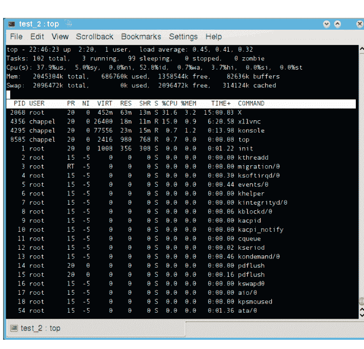
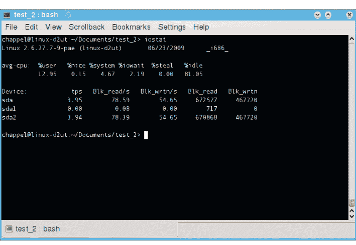
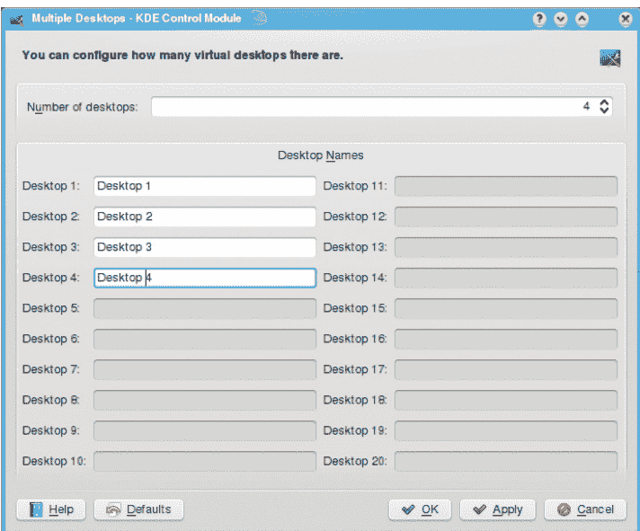

# Linux+ Eleventh Hour：考试 XK0-003 学习指南

## 通知


## 主作者

Graham Speake (CISSP #56073, M.Inst. ISP) 是 BP（全球最大的能源公司之一）的风险管理顾问。他目前为全球 BP 运营部门提供风险评估和修复咨询。他的专业领域包括工业自动化和过程安全、渗透测试、网络和网络设计。Graham 是安全会议的频繁演讲者，经常为全球 BP 员工提供安全培训。Graham 的背景包括曾担任 ATOS/Origin 的顾问以及福特汽车公司的工程师。

Graham 拥有威尔士斯尼西大学的学士学位，并是 ISA 成员。Graham 出生于英国，现与妻子 Lorraine 和女儿居住在德克萨斯州休斯顿。

## 贡献作者

Brian Barber (Linux+, MCSE, MCSA, MCP+I, MCNE, C CNA,-GW) 在加拿大存款保险公司 (CDIC) 担任项目经理和架构师，负责 CDIC 服务管理计划。他最初在家开始使用 Linux，一直是开源软件的坚定支持者，自2001年来加入了渥太华 Linux 用户小组 (OCLUG) 和渥太华 Python 作者小组。他主要感兴趣的领域是操作系统、基础设施设计、多平台集成、目录服务和企业消息传递。过去，他曾担任 Sierra Systems Group Inc. 的首席顾问、LG Group Inc.（现为 IBM 全球服务的一部分）的高级协调员以及 MetLife Canada 的高级技术分析师。

他一直是 15 多本书和认证指南的合著者、技术编辑或负责人。他是一位丰富的导师和课程软件开发人员。最近，他担任了《思科路由器交换机取证：调查与分析恶意网络活动》（ISBN: 978-15979-418-2, Syngress）以及《Cisco CCNA/CCENT 考试 640-802, 640-822, 640-816 准备包》（ISBN: 978-15979-306-2, Syngress）的贡献技术编辑。

Terrence V. Lillard (Linux, CISSP) 是 IT 安全架构师，网络犯罪和网络取证专家。他积极参与妥入、入侵、网络和网络安全取证案件，包括国内外的调查、安全审计和评估。Terrence 曾作为美国地区方法院的计算机取证/安全专家证人作词。他曾为各种政府、军事和跨国公司设计并实施安全架构。Terrence 的背景包括担任微软的首席顾问、哥伦比亚特区政府 IT 安全运营经理，以及国防网络中心 (DC3) 计算机调查培训学院项目的讲师。他在本科和研究生阶段教授过 IT 安全和网络/网络取证课程。

他拥有电气工程学士学位、工商管理硕士 (MBA)，目前正在攻读信息安全博士学位。

Chris Happel 拥有20多年的语音和数据网络及安全方面的经验。他目前是 Liberty Trio, LLC 的管理顾问，也是 GNU/Linux 和开源软件的热衷支持者。

## 技术编辑

Kevin Riggins (CISSP, CCNA) 是一位高级信息安全分析师，拥有20多年的信息技术经验和10多年的信息安全经验。Kevin 自1995年起一直使用和管理 Linux 系统。Kevin 在广泛的技术和系统方面拥有技术和战略经验。Kevin 目前领导 Principal Financial Group 安全审查与咨询团队，该团队为 Principal 的所有业务部门提供信息安全风险评估和信息安全咨询服务。他拥有爱荷华州印第奥拉辛普森学院的计算机科学学士学位，是 ISSA 和 Infragard 的成员，也是博客 Infosec Ramblings 的作者。

# 第一章 安装 Linux

## 引言

操作系统的初始安装需要理解重要的概念，包括计算机硬件、环境设置、分区和网络设置。

## 关于硬件的说明

硬件兼容性架构分为四类：

- 支持的中央处理器 (`CPU`) 架构不断扩展，包括 32 位和 64 位的 Intel 和 AMD 架构以及 SPARC。
- 硬件抽象层 (`HAL`) 设计用于作为物理硬件和软件之间的层级。其目的是从系统中隐藏硬件的复杂性和差异。
- 单内核架构设计为动态运行，并支持加载模块和指令以实现所有操作系统服务。硬件组件以设备驱动程序呈现，对于每个 Linux 发行版都会创建一个唯一的硬件兼容列表。

对于 Linux+ 考试，你需要对以下组件有基础的了解：

- 电源 (`PSU`) 是为你的系统内的各种硬件组件提供直流 (`DC`) 的设备。
- 主板是系统单元内部的电路板，包含 `CPU`、`内存 (RAM)` 芯片和用于扩展卡的插槽。其他扩展板与之界面，以接收电源并提供双向通信。
- `CPU` 负责数据处理和控制各种硬件组件执行的功能，处理所有发出的软件指令，并决定速度。
- 内存存储 `CPU` 处理的数据或程序。
- 扩展板通过允许一系列不同设备来扩展计算机能力的设备。
- 视频适配器是将二进制数据翻译成计算机显示器上可见的图像的扩展卡。
- 存储设备是用于存储数据和信息的内部和外部设备。

## 从本地媒体安装

本节的目的是向你介绍在操作系统安装过程中所需的重大 Linux 安装决策。

## Linux 安装过程

Linux 可以从各种本地和网络源进行安装。除了少数独特的设置外，每个安装源的安装过程本质上是相同的。Linux 本地介质安装可以使用 `CD`、`DVD` 或 `.iso` 源进行。当安装程序从本地源启动时，系统将完成板载自检并显示初始屏幕，允许用户选择各种选项，例如安装、修复、救援等。提供的选项将根据 Linux 发行版的不同而异，但通常遵循以下项：

- 从硬盘启动：用于自动启动现有的 Linux 操作系统。
- 修复已安装的系统：此选项用于修复之前安装的系统。
- 安装：此选项从 Linux 发行版中加载微型 Linux 内核并启动安装过程。
- 救援系统：此选项将启动一个没有图形用户界面的特殊 Linux 内核。它将 Linux 内核加载到内存中，并可能加载配置文件、检查文件系统的缺陷、和/或修改引导加载程序配置、调整分区大小，以及可能必要的其他关键修改。
- 检查安装介质：用于确保镜像的完整性。
- 内存测试：此选项使用 `memtest86` 对您的系统进行句法测试。

安装过程分为三个不同的阶段：准备、安装和配置。准备阶段帮助您配置系统的语言、日期和时间、桌面环境、用户帐户信息、`root` 密码验证方法以及磁盘分区信息类型。安装阶段是非交互式过程，负责安装软件并为系统的初始启动序列做好准备。最后一个阶段是配置阶段，取决于您选择的是自动配置还是手动配置，安装程序软件将能够预配置各种网络设置，要么允许您输入网络配置信息。例如，您的系统主机名、域名和其他网络配置设置（例如接口、`DHCP`、防火墙）。

## 准备

第一阶段是准备，它从您的系统环境和偏好中收集信息。默认语言和键盘设置为英语（美国）。选择语言和键盘设置将自动为您切换到预设设置。安装程序通过执行系统探测对您的系统进行系统分析，搜索各种存储设备（例如 `USB`、`Firewire`、软盘、硬盘驱动器）、现有 Linux 分区和系统文件，确定系统是否可以更新，并启动包管理器。

时钟和时区设置允许您设置区域、时区以及系统日期和时间信息。此外，您可以决定是否要使用本地时间或 `UTC`（协调世界时）。在安装过程完成后，可以配置系统使用网络时间协议（`NTP`）。某些发行版允许您选择想要安装的桌面环境（如果有），其中 `GNOME` 和 `KDE` 是最流行的。

## 分区

分区是根据您的磁盘布局选择并实施分区和文件系统的过程。系统通常会提供基于默认分区的选项或基于逻辑卷管理（`LVM`）的选项供选择。此外，用户可以选择编辑现有分区或创建新分区。创建新分区或编辑现有分区的决定取决于系统是否将与另一个操作系统（例如 Microsoft Windows）共存，或者是否包含多个磁盘驱动器，或者您是否想调整文件系统分区（例如，新建文件系统 (`NTFS`)）。


正确对硬盘进行分区以安装并支持 Linux 是关重要的。推荐的分区方案代表了最常用的方法，通常包含两个分区和一个扩展分区。

两个主分区支持根分区（`root`）和交换分区（`swap`）。扩展分区支持家分区（`home`）。硬盘最多可以有四个主分区。

## 用户设置

可以与本地或网络认证一起创建用户帐户。您可能可以为系统管理员 `root` 分配相同的密码。您可以选择是否自动登录，但出于安全考虑，建议不要使用此功能。系统可以配置为在安装过程完成后使用 `NTP`。用户可能需要输入用户名和密码。


用户信息将包括：

- 用户全名：用户的姓和名。
- 用户名：登录系统的用户名。
- 密码：区分大小写。

## 安装设置

在安装期间，将根据您的选择安装 Linux。`openSUSE` 等某些 Linux 发行版将根据您之前选择的选项进行配置。

安装阶段的最后一步是配置阶段，这将从网络源进行安装，并为系统的初始启动做好准备。


## 跨网络安装

由于带宽限制，网络安装比从本地介质安装要慢。

> 知识点
> 对于网络安装，您需要记住：
> - 可用的网络协议有超文本传输协议 (HTTP)、文件传输协议 (FTP)、网络文件系统 (NFS) 以及服务器块协议 (SMB)。
> - 安装可以从网络启动的 CD 或 DVD 进行。
> - 需要服务器的 IP 地址或名称以进行 HTTP、NFS 或 FTP 安装。
> - 可以匿名 FTP 服务器。

网络安装源的类型取决于网络带宽。对于 Linux+ 认证考试，我们将重点关注 HTTP、FTP 协议。

| 网络安装类型 | 域名/IP 地址 | 发行版源/文件夹 | 用户名 | 密码 |
| :--- | :--- | :--- | :--- | :--- |
| HTTP | 需要 | 需要 | N/A | N/A |
| FTP | 需要 | 需要 | 需要（匿名登录为空） | 需要 |
| NFS | 需要 | 需要 | N/A | N/A |

表 1.1 总结了网络安装的类型以及您需要提供的参数值。

在选择了所需的网络安装方法后，安装程序将按照“从本地介质安装”部分所述的方式工作。


网络安装涉及制作一个小小的 Linux 启动盘并下载大部分代码，这比从本地介质安装要慢得多。尽管您可以同时在多个系统上安装 Linux，但请确保有足够的带宽。

## 布局文件系统

布局文件系统有两种选项：基于分区的（默认）或基于 LVM 的。


在决定如何布局系统之前，您需要考虑以下因素：
- 物理硬盘受到磁盘制造商的限制（例如，磁盘几何结构）以及系统制造商的限制（例如，BIOS）。
- 主分区（每个磁盘最多四个）将硬盘驱动器划分为物理组。
- 扩展分区可以细分为逻辑分区（组）。

### 布局文件系统

- 对于任何可启动的操作系统，必须至少有一个主分区，操作系统将使用该分区存储内核和一些相关文件。
- 剩余三个分区可以全是主分区、扩展分区，或者两者的结合。
- 对于双启动系统，必须有两个主分区（每个操作系统各一个）。

在安装过程中，可以创建或编辑分区。创建新分区或编辑现有分区的决定取决于多种因素，例如 Linux 系统是否将与现有分区共存，或者是否包含多个块磁盘，或者你是否想要调整其他操作系统的分区（例如 NTFS）。

另一种编辑和创建分区的方法是使用 `fdisk` 命令行。`fdisk -l` 命令显示所有连接到系统的磁盘驱动器及其相应的几何结构。输出显示磁盘设备名称、磁盘几何结构、磁盘标识符和分区表（如果磁盘可访问）。

`fdisk` 命令用于创建或修改分区，通过输入 `fdisk` 和感兴趣的磁盘驱动器来进入。系统会显示 `fdisk` 命令模式界面，可以使用命令 `m` 显示列可用命令的列表。

创建的分区（无论是主分区还是扩展分区（带有逻辑子分区））都必须分配一个分区类型，用于托管特定的文件系统。分区类型 83 用于支持 Linux 文件系统，分区类型 swap 用于支持交换分区（类型 82）。要选择并配置分区类型，请执行 `fdisk` 命令。然后输入 `t`，并在提示时输入你想要更改的分区号。

用户、应用程序和系统文件及文件夹必须存储在物理磁盘上并具有良好的文件系统结构。Linux 环境支持许多文件系统（例如 ext2, ext3, ReiserFS, JFS, VFAT/NTFS），每个文件系统都有其独特的存储文件夹方式，以便快速访问和索引。日志记录（Journaling）是某些文件系统中实现的一种功能，提供了一种在日志（journal）中临时存储信息的机制。更改在实施到文件系统之前会存储在日志中，如果数据未更新到文件系统，这可以缩短系统从崩溃中恢复所需的时间。

有三种常见的文件系统类型：
- 第二扩展文件系统 (`ext2`) 是最老且最流行的 Linux 文件系统之一，也是行业标准。它是一个非常可靠的文件系统。缺乏日志支持是 `ext2` 最大的弱点。

## 第 1 章 安装 Linux

- `ext3`: 第三扩展文件系统 (`ext3`) 扩展了 `ext2` 文件系统。`ext3` 提供日志支持，是许多较新版本 Linux 的默认文件系统。
- `ReiserFS`: 它的性能比 `ext3` 和 `ext2` 快，并支持更大的最大文件结构 (8TB)。

另一种将文件系统分配给分区的方法是使用 `mkfs` 命令行工具。该命令行工具将文件系统（例如 ext2, ext3 和 ReiserFS）分配给分区。要使用 `mkfs` 命令分配文件系统，请附加 `-t` 选项并跟随所需的文件系统类型。例如：

```
mkfs -t ext /dev/sda
```

在硬盘上分配分区和文件系统可能会导致文件系统或分区损坏，或者你可能需要从空且未挂载的分区回收磁盘空间。为了完成此任务，你可以使用 `parted` 命令工具，它可以回收磁盘空间，也可以将文件系统从一个分区复制到另一个分区。

要使用此工具，启动系统并从显示的选项中选择 `Rescue System`（救援系统）。系统允许你以 root 身份登录（不需要密码）。要进入 `parted` 命令模式，输入 `parted` 和感兴趣的磁盘驱动器。例如：`parted /dev/sda`。

## 磁盘类型

还有两个需要讨论的磁盘类型：逻辑卷管理器 (`LVM`) 和独立磁盘冗余阵列 (`RAID`)。`LVM` 用于创建逻辑卷，而 `RAID` 用于提高磁盘子系统的性能和容错能力。基于 `LVM` 的分区的实现可以配置在 RAID 或非 RAID 系统之上。

## LVM

基于 `LVM` 的安装为创建虚拟分区（也称为逻辑卷）提供了一种独特的方法。标准的基于分区的方法在实施后很难更改。`LVM` 方法提供了对磁盘环境的更强的控制能力，因为你可以创建虚拟分区，将多个物理分区或磁盘驱动器组合成一个。`LVM` 的命令行工具如下：
- `vgcreate` 为 LVM 使用准备物理卷。
- 创建并命名卷组。
- `lvcreate` 创建并命名文件系统使用的逻辑卷。

## RAID

`RAID` 使用你的磁盘子系统提供增强的读写性能、防止磁盘故障导致的数据丢失保护，或两者兼顾。它可以使用特定的硬件 RAID 控制器（硬件 RAID）或操作系统内置的功能（软件 RAID）来实现。

## 你知道吗？

`RAID` 子系统需要两个或多个磁盘形成一个虚拟磁盘。软件和硬件 RAID 解决方案的差异如下：
- 硬件 RAID 的性能比软件 RAID 快，因为软件 RAID 需要更多的 CPU 时间并有额外的要求。
- 软件 RAID 取决于操作系统，而硬件 RAID 独立于厂商。
- 硬件 RAID 可能比软件 RAID 贵，因为它可能需要额外的硬件组件（例如 RAID 控制器），除非已集成在主板上。

`RAID` 技术需要理解三个基本概念：条带（striping）、镜像（mirroring）和校验（parity）。

+ 3. `parted` 命令的目的是什么？
A. 回收未使用的磁盘空间。
B. 建立磁盘条带（striping）。
C. 实现 RAID 5。
D. 测试系统板内存是否存在缺陷。

+ 4. 你正在为机构的服务器安装 Linux。这是一次全新的安装。你必须为 Linux 安装划分分区。对于根（root）、交换（swap）和家目录（home）分区，哪种磁盘分区架构最佳？
A. 根分区和交换分区应使用主分区架构，家目录分区应使用扩展分区架构。
B. 根分区、交换分区和家目录分区都应该是扩展分区。
C. 根分区和家目录分区应该放在扩展架构上，而交换分区应该放在主分区上。
D. 仅交换和家目录分区应该放在主分区上，不使用根分区。

+ 5. 在初始 Linux 安装过程中，使用哪种应用程序来测试基于 x86 架构 CPU 的系统 RAM？
A. testmemx86
B. memtest86
C. memtestX86
D. memx86test

# ANSWERS

+ 1. 正确答案和解释：答案 C 是正确的。使用 `mkfs` 命令分配文件系统的参数是 "-t"。例如，`mkfs-ext3 /dev/sda`。
错误答案和解释：A、B 和 D。答案 A、B 和 D 是错误的；这三个说法都是错误的。

+ 2. 正确答案和解释：答案 C 是正确的。`fdisk -l` 命令用于查看当前磁盘驱动器和磁盘几何结构。
错误答案和解释：A、B 和 D。答案 A 是错误的；`mkfs -t` 是用于为磁盘分区分配文件系统的命令。答案 B 和 D 是虚构的 Linux 命令。

+ 3. 正确答案和解释：答案 A 是正确的。`parted` 命令用于回收磁盘分区上未使用的磁盘空间。
错误答案和解释：B、C 和 D。答案 B 和 C 在空间回收后执行。D 是使用 `memtest86` 应用程序执行的系统程序。


4. 正确答案和解释：答案 A 是正确的。根分区和交换分区应采用主分区，以对分区设置限制和边界。家目录分区应该是扩展的，以便随着用户家目录的增长或系统添加更多用户时允许增长。此外，为了让操作系统启动，其中分区必须是主分区，以支持并存储系统启动软件和操作系统文件。

错误答案和解释：B、C 和 D。答案 B、C 和 D 是错误的；这三个说法都是错误的，因为系统将永远无法启动。在每种情况下，根分区都被放置在扩展分区上。这种方法会阻止系统启动。将交换分区放在扩展分区上是允许的，但不是良好的系统设计。

5. 正确答案和解释：答案 B 是正确的。`memtest86` 是适用于 x86 系统的独立内存测试应用程序。

错误答案和解释：A、C 和 D。答案 A、C 和 D 是错误的；这三个都是虚构的应用程序名称。

# 第 2 章

管理文件系统

## 本章考试目标

- 文件系统类型
- 挂载和卸载文件系统
- 分区
- 目录
- 文件系统管理

## 引言

本章介绍了文件系统的创建策略、不同类型的文件系统、用于创建文件系统的工具以及用于管理文件系统的工具。

## 文件系统类型

文件系统为操作系统提供了一个数字信息组织、修改、删除和检索的框架。为了实现这些要求，文件系统负责组织和维护文件、文件夹、元数据和残留数据，作为存储数字信息的容器。无论选择何种文件系统类型，数据容器的大小可以从数太字节（TB）到小到扇区（sector）。扇区的大小在不同文件系统类型之间可能有所不同；但它是可以分配给用于存储文件的最小磁盘空间单位。扇区的默认大小通常为 512 字节。

> 快速概览

文件系统组织并维护以下数据：

- 文件是文件系统内分配的空间扇区，用于存储数字信息。
- 文件是文件系统内分配的空间扇区，用于存储数字信息。分配的空间可以是连续的，也可以是非连续的。有四种不同类型的文件：普通文件、链接、先进先出（FIFO）和套接字（sockets）。
- 目录（或文件夹）是文件系统内分配的空间扇区，用于对分组。这种关联在文件分配表（FAT）中执行并维护。目录是分级结构，目录包含子目录。
- 元数据是操作系统用于进一步描述文件和文件夹的数据。通常，会创建并使用某种形式的索引文件。索引信息可以包含文件大小、文件时间戳、扇区位置以及与访问权限和设备类型的信息。
- 残留数据是在文件、文件名、文件夹和名称关系断开后留在文件系统中的一种形式的数据，大小不异。这通常发生在删除文件或文件夹之后，可能小到一个扇区。空隙（Slack space）是磁盘上任何当前未与特定文件关联的残留数据。

对于各种类型的文件系统，存储容器（也称为存储介质类型）可以位于许多不同的存储设备上。

# 第 2 章 管理文件系统

## 你知道吗？

- 硬盘媒体类型用于内部或外部驱动器的数据。
- 光存储媒体类型分为 CD 和 DVD。CD 和 DVD 都支持 ISO 9660 标准，也称为 CDFS。
- 网络型类型由服务器消息块（SMB）和网络文件系统（NFS）组成。客户端建立网络连接。
- 移动存储类型是为闪存内存设计的。内存设备主要用于闪存卡。
- 随机访问存储器（RAM）类型作为内存的一部分运行。压缩文件系统（cramfs）用于许多 Linux 发行版。
- 特殊用途文件系统通过应用程序或系统工具处理文件、文件夹和元数据。

## 本地文件系统

本地文件系统缓解了与网络文件系统、内存磁盘和移动文件系统相关的许多挑战。这包括由于网络带宽引起的性能挑战、由于网络连接导致的访问失败，以及在电源恢复后需要重新配置的持久系统（例如内存磁盘）。

本节介绍了一些常用的文件系统：FAT、新建文件系统（NTFS）和虚拟文件表（VFAT）。这些总结在表 2.1 中。

> 考试警告

使用 FAT 文件系统的早期操作系统允许仅使用八个字母字符命名，并用点分隔名称和三个字母字符扩展名。VFAT 支持长文件名，允许文件名长达 255 个字母字符。VFAT 是挂载外部文件系统的首选文件系统。

## 网络

Linux 文件系统还可以跨网络，允许它们作为客户端/服务器模型为远程系统提供文件共享服务。服务器组件提供通过网络连接的共享目录。客户端组件在获取访问后，将目录连接到本地文件系统的挂载点上。在 Linux 环境中，两种主要的网络文件系统是 NFS 和服务器消息块文件系统（SMB）。

NFS 是一个框架，允许客户端工作站通过网络访问网络化服务器上的远程文件。在这种模型中，服务器共享一个或多个目录供网络客户端访问。NFS 使用端口 TCP 2049 和 UDP 2049。

## 表 2.1 FAT 簇和分区大小

| 名称 | 簇地址大小 | 分区大小 |
| :--- | :--- | :--- |
| FAT12 | 12 位 | 16 MB |
| FAT16 | 16 位 | 2 GB |
| FAT32 | 32 位 | 2 TB |

# 第 2 章 管理文件系统

SMBFS 是一个旨在允许工作站访问服务器上目录/文件共享共享的框架。该模型以客户端/服务器架构实现，由两个组件组成。第一个组件是 SMB 协议，它为执行进程间通信和在 TCP 445 上的监听器提供了机制。第二个组件是 SMB 服务，它是同时存在于客户端和服务器端的应用程序。SMB 服务与系统的认证机制和本地文件系统互操作，这允许 SMB 环境与许多其他服务器进行互操作。微软版本的 SMBFS 被称为通用网络文件系统（CIFS）。Samba 应用是一个开源的客户端/服务器实现，它对 SMBFS 和 CIFS 提供支持。


需要理解本地文件系统与远程文件系统的区别，以及两者的优缺点。

- 常见的网络（远程）文件系统有 NFS 和 SMB。
- 与微软系统的连接通常使用 SMB。
- 本地文件系统可以存在于内部或外部连接设备上。
- 本地文件系统的性能通常优于网络文件系统。

## 挂载和 U(N)MOUNTING 文件系统

挂载是将独立的存储设备附加或连接到根目录层次结构的形式。它使得本地或远程机器上物理分离的磁盘和/分区可用，在客户端上的附加位置被称为挂载点。Linux 用户可以手动挂载文件系统，也可以让文件系统在系统初始启动时自动挂载。

## mount 和 umount 命令

要手动将文件系统挂载到现有的根目录结构，可以使用 `mount` 命令建立到本地挂载点的连接，该命令可以带参数也可以不带参数。不带参数执行 `mount` 命令会列出系统中所有已挂载的文件系统。Linux 的一个独特特性是将设备（例如存储设备和终端）视为目录（文件夹），并使用 `/dev` 目录挂载设备。要挂载设备，请使用带有两个参数的 `mount` 命令。第一个参数表示你希望附加到根目录结构中的存储设备。第二个参数表示你想要附加其下方的目录位置，即挂载点。大多数 Linux 系统的通用目录位置是 `/mnt` 和 `/media` 目录。`/media` 目录通常用于挂载可移动媒体（例如软磁盘、CD/DVD 驱动器）。此外，在挂载任何存储设备之前，执行 `mount` 命令前需要存在一个挂载点目录。

```
mount /dev/sdb1 /mnt/morestore
```

`mount` 命令确实包含额外的参数（例如用于超级块的 `sb` 和关闭日志的 `noad`）。要指定特定的文件系统类型，应使用 `-t` 参数。通常，Linux 内核会自动检测你正在附加的存储设备的文件系统类型。

要断开设备，请使用 `umount` 命令并指定挂载点。

```
umount /mnt/morestore
```

## 快速入门

挂载和卸载分区是系统管理员经常使用的过程。了解命令和选项非常重要。

- 卸载设备的命令是 `umount`。
- Linux 通常会检测你正在附加的文件系统类型。
- 将需要永久挂载的系统添加到 `/etc/fstab` 文件中。

## /etc/fstab

`/etc/fstab` 文件是文本格式的，它列出了每次系统启动时永久挂载的文件系统。将文件系统添加到 `/etc/fstab` 以便在启动时自动挂载的结构包含了要挂载的分区、挂载点、文件系统类型和其他文件系统选项（例如 `nolist`、`noatime` 和 `auto`）。典型的结构如图2.1 所示。

| LinuxExpert1@linux-01vc:~etc cat fstab | defaults | 0 0 |
| :--- | :--- | :--- | :--- |
| /dev/sda | swap | swap | 0 0 |
| /dev/sda2 | ext3 | acl,user_xattr | 1 1 |
| /dev/sda3 | /home | ext3 | acl,user_xattr | |
| proc | /proc | proc | defaults | 0 0 |
| sysfs | /sys | sysfs | noauto | 0 0 |
| debugfs | /sys/kernel/debug | debugfs | noauto | 0 0 |


| usbfs | /proc/bus/usb | usbfs | noauto | 0 0 |

| devpts | /dev/pts | devpts | mode=0620,gid=5 | 0 0 |

图 2.1

`/etc/fstab` 文件

## 分区

分区是在存储设备内将电子存储空间分配为特定文件系统类型的独立数据区域的过程。无论是通过分区编辑器工具实现还是通过 `fdisk` 命令实现，都可以创建、删除或修改分区。在对存储设备进行分区和格式化之前，无法进行文件夹和文件的创建和放置。对每个设备实现一个或多个分区的决定是基于某些优缺点的。

## 快速入门

在存储设备上创建多个分区：

- 改进了位于同一分区上的数据和应用程序的访问时间
- 支持用户文件和操作系统文件的分离
- 提供专用的操作系统交换（swap）或分页（paging）文件空间
- 防止操作系统文件受系统数据文件快速增长（例如日志和系统缓存）的影响，这些文件可能会迅速耗尽所有可用磁盘空间
- 支持多系统启动（multiboot）
- 通过隔离分区保护操作系统文件免受快速消耗所有可用磁盘空间的系统数据文件的影响
- 提供多启动支持

# 第 2 章 管理文件系统

SMBFS 是一个旨在允许工作站访问服务器上目录/文件共享的框架。该模型以客户端/服务器架构实现，由两个组件组成。第一个组件是 SMB 协议，它为执行进程间通信和在 TCP 445 上的监听器提供了机制。第二个组件是 SMB 服务，它是同时存在于客户端和服务器端的应用程序。SMB 服务与系统的认证机制和本地文件系统互操作，这允许 SMB 环境与许多其他服务器进行互操作。微软版本的 SMBFS 被称为通用网络文件系统（CIFS）。Samba 应用是一个开源的客户端/服务器实现，它对 SMBFS 和 CIFS 提供支持。


需要理解本地文件系统与远程文件系统的区别，以及两者的优缺点。

- 常见的网络（远程）文件系统有 NFS 和 SMB。
- 与微软系统的连接通常使用 SMB。
- 本地文件系统可以存在于内部或外部连接设备上。
- 本地文件系统的性能通常优于网络文件系统。

## 挂载和 U(N)MOUNT 文件系统

挂载是将独立的存储设备附加或连接到根目录层次结构的形式。它使得本地或远程机器上物理分离的磁盘和/分区可用，在客户端上的附加位置被称为挂载点。Linux 用户可以手动挂载文件系统，也可以让文件系统在系统初始启动时自动挂载。

## mount 和 umount 命令

要手动将文件系统挂载到现有的根目录结构，可以使用 `mount` 命令建立到本地挂载点的连接，该命令可以带参数也可以不带参数。不带参数执行 `mount` 命令会列出系统中所有已挂载的文件系统。Linux 的一个独特特性是将设备（例如存储设备和终端）视为目录（文件夹），并使用 `/dev` 目录挂载设备。要挂载设备，请使用带有两个参数的 `mount` 命令。第一个参数表示你希望附加到根目录结构中的存储设备。第二个参数表示你想要附加其下方的目录位置，即挂载点。大多数 Linux 系统的通用目录位置是 `/mnt` 和 `/media` 目录。`/media` 目录通常用于挂载可移动媒体（例如软磁盘、CD/DVD 驱动器）。此外，在挂载任何存储设备之前，执行 `mount` 命令前需要存在一个挂载点目录。

```
mount /dev/sdb1 /mnt/morestore
```

`mount` 命令确实包含额外的参数（例如用于超级块的 `sb` 和关闭日志的 `noadoad`）。要指定特定的文件系统类型，应使用 `-t` 参数。通常，Linux 内核会自动检测你正在附加的存储设备的文件系统类型。

要断开设备，请使用 `umount` 命令并指定挂载点。

```
umount /mnt/morestore
```

## 快速入门

挂载和卸载分区是系统管理员经常使用的过程。了解命令和选项非常重要。

- 卸载设备的命令是 `umount`。
- Linux 通常会检测你正在附加的文件系统类型。
- 将需要永久挂载的系统添加到 `/etc/fstab` 文件中。

## /etc/fstab

`/etc/fstab` 文件是文本格式的，它列出了每次系统启动时永久挂载的文件系统。将文件系统添加到 `/etc/fstab` 以便在启动时自动挂载的结构包含了要挂载的分区、挂载点、文件系统类型和其他文件系统选项（例如 `nolist`、`noatime` 和 `auto`）。典型的结构如图2.1 所示。

| LinuxExpert1@linux-01vc:~etc cat fstab | defaults | 0 0 |

| :--- | :--- | :--- | :--- |

| /dev/sda | swap | swap | 0 0 |

| /dev/sda2 | ext3 | acl,user_xattr | 1 1 |

| /dev/sda3 | /home | ext3 | acl,user_xattr | |

| proc | /proc | proc | defaults | 0 0 |

| sysfs | /sys | sysfs | noauto | 0 0 |

| debugfs | /sys/kernel/debug | debugfs | noauto | 0 0 |

| usbfs | /proc/bus/usb | usbfs | noauto | 0 0 |

| devpts | /dev/pts | devpts | mode=0620,gid=5 | 0 0 |

图 2.1

`/etc/fstab` 文件

## 分区

分区是在存储设备内将电子存储空间分配为特定文件系统类型的独立数据区域的过程。无论是通过分区编辑器工具实现还是通过 `fdisk` 命令实现，都可以创建、删除或修改分区。在对存储设备进行分区和格式化之前，无法进行文件夹和文件的创建和放置。对每个设备实现一个或多个分区的决定是基于某些优缺点的。

## 快速入门

在存储设备上创建多个分区：

- 改进了位于同一分区上的数据和应用程序的访问时间
- 支持用户文件和操作系统文件的分离
- 提供专用的操作系统交换或分页文件空间


- 防止操作系统文件受系统数据文件快速增长（例如日志和系统缓存）的影响，这些文件可能会迅速耗尽所有可用磁盘空间
- 支持多系统启动
- 通过隔离分区保护操作系统文件免受快速消耗所有可用磁盘空间的系统数据文件的影响
- 提供多启动支持

在对存储设备进行分区和格式化之前，文件夹和文件的创建和放置过程无法发生。对每个设备实现一个或多个分区的决定是基于某些优缺点的。

# 第 2 章 管理文件系统

| 表 2.2 Linux 目录与分区 |

| Linux 目录 | 独立分区的用处 |

|---|---|

| `/swap` | `/swap` 目录被用作交换空间，并充当虚拟内存。此目录为您的系统提供额外的内存以运行大型程序。 |

| `/boot` | `/boot` 目录包含 Linux 启动过程中需要的文件和配置。在不同的分区下实现 `/boot` 可以使系统救援和修复变得更加容易。 |

| `/home` | `/home` 目录通常存放用户的账户目录和用户特定文件。此目录应被分配一个独立分区，因为多用户可能会可能会填满分区。此外，如果更改用户文件存储在独立的分区上，执行备份和恢复功能将简单得多。 |

| `/tmp` | `/tmp` 目录用于支持需要易失性临时文件空间的程序。它可以存在于根目录下，但如果临时文件的增长速度快于您的根目录，它们可能会耗尽磁盘空间，可能是由系统转储或核心转储引起的。 |

| `/var` | `/var` 目录包含由于打印、日志记录和系统临时文件生成的系统和应用程序信息。如果可能，`/var` 目录应该放在独立分区上。它通常是根目录下的子目录。应该将其分离的主要原因是日志文件和用户邮箱可能存在的增长。 |

## 目录

本节的目的是提供关键目录的概述，如表 2.3 所示。作为一个分级树形结构，文件系统的顶端由正斜杠指示的目录称为根目录，它包含了所有的底层文件和目录。

Linux 文件系统可以被视为：

- 一种组织文件和目录的分级结构
- 一个基于文件系统层次结构标准 (`FHS`) 的目录结构
- 排序一致（由于 `FHS`），以便用户和应用程序能够轻松地找到文件和目录

## 表 2.3 关键 Linux 目录

| Linux 目录 | 用途 |

|---|---|

| `/` | 根目录是顶层目录，是 Linux 系统中最重要的目录。它包含了核心目录和文件，包括初始化 Linux 系统所需的实用程序、配置文件、引导加载程序信息和启动信息。 |

| `/bin` | 包含系统管理员和用户使用的 Linux 命令，这些命令在系统处于单用户模式时也是可以访问的。 |

| `/dev` | 在 Linux 环境中用于挂载设备。 |

| `/etc` | 用于控制程序执行并支持动态 Linux 环境的 `/etc` 目录。它包含了系统和应用程序配置文件。 |

| `/media` | 用于为系统管理员和用户挂载可移动介质（例如软磁盘、CD/DVD 驱动器和 USB 闪盘）。 |

| `/mnt` | 与 `/media` 目录类似，用于临时挂载文件系统。 |

| `/proc` | 作为系统进程和 Linux 内核的虚拟文件系统运行。 |

| `/root` | 根目录（不要与根目录 `/` 混淆）是分配给 root 用户账户的家目录。 |

| `/sbin` | 用于包含仅供系统管理员（即 root）使用的 Linux 实用程序。它包含了用于关键启动、恢复、故障恢复和/或修复 Linux 系统的可执行文件。 |

| `/usr/bin` | 包含系统上的主要可执行命令。Linux 用户和 root 用户可以执行此目录中的命令。 |

| `/usr/lib` | 包含程序所需的软件库和包，包括特定平台的对象文件和内部二进制文件。 |

| `/usr/lib64` | 执行与 `/usr/lib` 目录相同的功能，但支持 64 位架构。 |

| `/usr/local` | 本地安装应用程序的位置。安装在此目录中的软件通常不受系统软件更新的影响。此外，安装在此目录中的软件是可以共享的。 |

| `/usr/share` | 用于存储只读的架构中性文件。此目录包含的文件是平台无关的。 |

| `/var/log` | 包含由于打印、日志记录和系统临时文件生成的数据文件 |

在处理所有其他二级目录和文件时，使用全路径命名规范，所有后续文件和文件夹都通过正斜杠指示其分级位置，以防止与其他具有相同名称但位于不同子层级（例如第三级和第四级）的目录混淆。

### 文件系统管理

有工具可以本地或远程管理文件系统，这些工具将被所有系统管理员使用，通常每天或每周使用一次。

### 快速上手知识

你为了考试需要学习并可能经常使用的文件系统工具：

- `du` 提供当前目录中每个文件使用的磁盘空间摘要，以及任何子目录下包含的文件分配的磁盘空间摘要。
- `df` 通过不同的参数，以多种方式提供文件系统可用磁盘数量的摘要。
- `df -i` 显示关于 inode 而非文件块的信息。
- `df -h` 使用易于理解的输出（以千字节、兆字节和/或吉字节为单位）呈现磁盘空间摘要。
- 文件系统需要维护，并并在必要时使用 `fsck` 命令进行检查和修复。
- 在运行 `fsck` 之前，需要卸载文件系统。

### 配额

用户和出错错误的应用程序在没有限制的情况下，可以继续向文件夹添加数据，最终会用尽分区上所有的可用磁盘空间。一旦分区被数据填满，用户和应用程序不仅无法将信息保存到磁盘，还可能导致系统或应用程序文件的损坏。磁盘配额的实施可以提供宝贵的文件系统管理支持，允许您限制存储。

要实现磁盘配额，必须在 `/etc/fstab` 文件中为每个的文件系统添加 "`usrquota`" 和 "`grpquota`" 限定符并重启系统。最后，使用 `edquota` 命令（配额编辑器）来显示和更改用户或组的配额设置。

### 文件系统管理

在实施配额后，可以使用 `repquota` 命令获取文件系统的磁盘配额报告。在系统崩溃或其他文件系统故障时，使用 `quotacheck` 命令扫描文件系统的配额使用情况并在必要时创建。

### 回环设备

Linux 支持回环设备，它可以将包含文件系统镜像的特殊文件转换为像分区一样的设备。回环设备通常用于 CD/DVD ISO 镜像。创建的磁盘包含 UDF 或 ISO960 文件系统格式。在访问回环设备之前，必须下载并挂载镜像。使用 Linux `mount` 命令附加虚拟文件系统。

### NFS

`NFS` 是一种客户端/服务器模型，旨在为网络上的部分或所有客户端提供特定的目录。服务器端必须配置共享目录（称为导出），客户端必须配置挂载导出。通过 `/etc/exports` 文件提供的共享。该文件包含了挂载导出的客户端机器列表。每行代表一个共享目录及其关联选项。

每行的参数如下：

`exported_directory <client> <options> <clientN> (<options>)`

- `exported_directory` 是服务器上的导出目录。
- `<client1>` 是共享访问的主机或网络。`client1` 参数可以基于互联网协议 (`IP`) 地址、主机或名称用于单个主机；通配符 (`*`) 用于了一组机器；或 IP 范围。
- `<options>` 是施加在连接上的选项，包括只读 (`ro`)、读写 (`rw`)、`root_squash`（防止移除 root 权限）、`no_squashing`（允许移除 root 权限）等。

为了激活共享目录（导出）的访问，可以使用 `exports` 命令。这组参数可以配合以下命令使用：

- `a` 加载并导出 `/etc/exports` 文件列出的所有目录
- `r` 在对共享权限进行更改后重新读取 `/etc/exports` 文件
- `i` 忽略 `/etc/exports` 文件并对未在文件中列出的目录进行导出
- `u` 移除（取消设置）当前列出的导出目录
- `au` 移除所有导出目录

`showmount` 命令可确定服务器上共享目录（导出）的信息，并列出 `/etc/exports` 文件中列出的所有正在服务器上共享的导出项。`showmount` 命令的语法为 `showmount [options] [server1]`。

`server1` 的默认值为 `hostname` 返回的值。在不带任何选项的情况下，`showmount` 显示从主机挂载目录的客户端。表 2.4 显示了一些可用选项。

要与服务器建立连接，客户端可以使用 `mount` 命令。以下演示了客户端如何建立 NFS 连接：

```
mount server1:share /mount_point
```

这使得切换到 `/mount_point` 目录后就可以访问 server1 上 `/share` 目录下的所有文件。通过在 `/etc/fstab` 文件中插入一行，可以在启动时建立到 NFS 共享的自动挂载连接。

### Swap（交换）

Linux 需要虚拟内存来确保其成功运行，虚拟内存可以文件或整个分区的形式存在。虚拟内存通过将系统的物理 RAM 分为称为“页”（`pages`）的单元，并通过一种被称为“交换”（`swapping`）的过程将较少使用的物理 RAM 单元（页）传输到硬盘驱动器来实现。当系统将内存页交换到硬盘时，系统的 RAM 会被释放以执行额外的功能。


虽然交换通过扩展对更多内存的访问提供了优势，但存储和检索在硬盘上的页的访问速度比仅位于物理内存（RAM）中的页慢。Linux 系统要使用交换空间，必须先创建一个特殊文件或交换分区。创建交换文件涉及创建一个特殊文件，该文件必须被指定作为交换文件使用，并使用 `dd` 命令创建。以下是创建空空间的示例。

```
dd if=/dev/zero of=newfile bs=1024 count=1048576
```

| 表 2.4 Showmount 选项 |  |
|---|---|
| Showmount 选项 | 目的 |
| `-a`, `--all` | 使用 hostname:directory 格式，其中 hostname 是客户端名称，directory 是挂载的目录 |
| `-d`, `--directories` | 列出客户端挂载的目录 |
| `-e`, `--exports` | 打印服务器导出的文件系统列表 |
| `-h`, `--help` | 提供帮助摘要 |

该命令创建了一个名为 `newswapfile` 的交换文件。输入文件 `/dev/zero` 是提供空字符的特殊 Linux 文件。新创建的交换文件大小为 1 GB。

要指定一个分区或特殊文件作为交换空间，使用 `mkswap` 命令。该命令在分区或特殊文件上设置交换区域。以下命令首先准备一个分区，然后准备一个特殊文件作为交换文件：

```
mkswap /dev/hdb1
mkswap /newswapfile
```

`swapon` 命令用于指定进行分页和交换的特定设备或文件。对于分区，您需要以 root 身份使用 `swapon` 命令对其进行准备：

`swap/dev/hdb1`

要禁用或关闭交换文件或交换分区，`swapoff` 命令会禁用指定分区或文件上的交换。当使用 `-a` 标志时，将禁用所有已知交换设备和文件的交换。`swapoff -s` 命令将显示当前状态。

## 考试目标总结

Linux 文件系统为操作系统提供了一个存储、组织、删除和检索数字信息的框架。文件系统负责通过组织和维护文件、文件夹、元数据和残留数据，作为存储数字信息的容器。此外，你还学习了用于本地和网络访问的不同文件系统类型（例如 SMB 和 NFS）。

你学习了使用 `mount` 命令挂载和卸载文件系统。文件系统在 `/etc/fstab` 文件中自动定义。在创建分区后，必须将文件系统分配给分区。Linux `mkfs` 命令将文件系统分配给分区。Linux 文件系统是一种用于组织目录（文件夹）和文件的分级结构，并基于 FHS（文件层次结构）。文件系统管理描述了管理本地和远程文件系统所需的工具。讨论了确定已用和剩余磁盘空间（例如 `du` 和 `df`）以及实施和管理用户磁盘空间限制的各种命令（例如 `edquota`、`quotacheck` 和 `repquota`）。此外，还描述了使用 `fsck` 命令修复损坏的文件系统、挂载唯一的回环文件系统、访问 NFS 文件系统以及使用 Linux 命令 `mkswap`、`swapon`、`swapoff` 和 `swapinfo` 准备交换文件或分区。

## 五大难题

- 1. 你需要使用 `fdisk` 为你想要添加额外存储空间的新 SCSI 磁盘驱动器建立分区。原始驱动器都是 IDE 驱动器。正确的语法是哪个？

  A. `fdisk /dev/SCSI1`

  B. `fdisk /dev/IDE`

  C. `fdisk /dev/sda`

  D. `fdisk /dev/sdb`

- 2. 系统初始启动时，哪个文件会自动挂载文件系统？

  A. `/etc/fstab`

  B. `/boot/fstab`

  C. `/dev/devices.map`

  D. `/etc/grub.conf`

- 3. 什么是 ISO 回环设备（loopback device）？

  A. 将特殊文件转换为虚拟 Linux 文件系统

  B. 向显示器返回反馈测试的设备

  C. /null 驱动设备

  D. IP 地址 127.0.0.1

- 4. 哪个 Linux 命令用于指定进行分页和交换的特定设备或文件？

  A. `/swap`

  B. `swap`

  C. `swapon`

  D. GRUB

- 5. Linux `export` 命令的目的是什么？

  A. 作为 Linux 启动加载器运行

  B. 分区存储设备

  C. 指定特定文件或分区用于交换

  D. 激活共享目录的共享

## 答案

- 1. 正确答案及解释：答案 C 是正确的；第一块磁盘的 SCSI 设备表示法为 `/dev/sda`。

  错误答案及解释：A、B 和 D。答案 A 和 B 是错误的，因为它们不存在作为设备名称。答案 D 是错误的；第二块磁盘的 SCSI 设备表示法为 `/dev/sdb`。

- 2. 正确答案及解释：答案 A 是正确的；`/etc/fstab` 文件用于定义和自动挂载文件系统。

  错误答案及解释：B、C 和 D。答案 B 是错误的，因为该文件不存在。答案 C 和 D 是 GRUB 加载内核时使用的文件。

- 3. 正确答案及解释：答案 A 是正确的。Linux 操作系统支持一种称为回环设备的特殊类型文件系统。这允许挂载 ISO 镜像，以便你可以在刻录 CD 或 DVD 之前查看/编辑文件。

  错误答案及解释：B、C 和 D。答案 B 是错误的，因为 Linux `echo` 命令会向显示器返回反馈。答案 C 不存在。答案 D 是测试网络连接的网络适配地址。

- 4. 正确答案及解释：答案 C 是正确的；`swapon` 是用于指定特定文件或分区交换的 Linux 命令。

  错误答案及解释：A、B 和 D。答案 A 是错误的；`/swap` 是初始安装时创建的交换分区。答案 B 是错误的，这是一个无效 Linux 命令。

- 5. 正确答案及解释：答案 D 是正确的；`exportfs` 是用于在 NFS 服务器上激活共享目录共享的 Linux 命令。

  错误答案及解释：A、B 和 C。答案 A 是错误的；GRUB 是 Linux 启动加载程序。答案 B 是错误的；`fdisk` 是用于分区存储设备的 Linux 命令。答案 C 是错误的；`swapon` 是用于指定特定文件或分区交换的 Linux 命令。

# 第3章

## 启动 Linux

- 本章的考试目标
- GRUB
- 运行级别 (Runlevels)
- 启动问题排排除

## 引言

Linux 启动过程始于系统上电，系统 BIOS 对硬件进行检查，然后确定使用何种设备（例如，软驱驱动器、硬盘、CD/DVD 驱动器）来启动系统。启动设备的第一个扇区包含 Linux 引导程序（例如 LILO、GRUB、NTILOADER），尽管我们将描述贯穿本书使用的统一引导加载程序 (GRUB) 程序。系统 BIOS 将 GRUB 加载到内存并执行该程序，此时系统控制权已移交给引导加载程序。接下来的章节将描述各种过程。

> 考试警告
>
> 对于 Linux+，Linux 启动过程基于 Intel x86 CPU 架构。Linux 也支持其他 CPU 硬件架构的启动（例如 AMD, Alpha, ARM, IA-64, m68k, MIPS, PA-RISC, PowerPC, S/390, SPARC），但启动过程是不同的。

## GRUB

GRUB 用于启动现代 Linux 操作系统，是计算机在任何存储设备上执行的第一个程序。引导加载程序的目的是在你的计算机上执行一系列操作以加载主操作系统。本质上，引导加载程序从系统 BIOS 进程接收控制权，执行一系列操作，然后将控制权移交给操作系统内核。

大多数现代引导加载程序都是动态可配置的，并可以在系统启动期间和之后执行。引导加载程序可以在启动时读取预定义的配置文件，也可以通过启动命令提示符支持启动时的更改（例如，选择不同的内核、虚拟文件系统）。此外，在控制权移交给操作系统内核后，引导加载程序可以对启动时的配置文件以及之前的文件进行修改。

## 安装 GRUB 并启动 Linux

在执行 GRUB 之前，系统 BIOS 将主引导记录 (MBR) 加载到内存并执行其内容。MBR 的总大小为 512 字节，包含引导加载程序和磁盘分区信息。GRUB 程序的预安装形式分为两个阶段，以及 MBR 阶段 1。阶段 1 程序使用前 446 字节，剩余的 64 字节分配给硬盘的分区表。GRUB 阶段 1 的目的是找到并加载 GRUB 阶段 2（它可能位于硬盘的其他位置）。GRUB 阶段 1 必须足够灵活以访问许多不同的文件类型。这种灵活性是因为 GRUB 阶段 1 拥有大量的质存储设备驱动程序。一旦加载，GRUB 阶段 2 可以执行以下三个功能：

- 加载预定义的 Linux 内核（例如 vmlinuz-version.gz）。
- 在双系统系统中允许选择启动哪个操作系统。
- 输入启动参数。

一旦 GRUB 阶段 2 加载了 Linux 内核，它还必须加载虚拟文件系统并执行 Linux 内核。

> 快速入门知识
>
> Linux 使用引导加载程序启动，通常使用 GRUB，其可以总结如下。
>
> - 由 BIOS 加载并存在于 MBR 中。


- 可以访问许多不同的文件系统（`ext3`、`文件分配表 (FAT)`、`VFAT` 等）。

- 在你安装 Linux 后可以进行动态配置。

- 主配置文件为 `/etc/grub.conf`。

- GRUB 启动菜单为 `/boot/grub/menu.1st.`。

## GRUB 配置文件和命令

GRUB 是一个动态可配置的引导加载程序应用程序，允许在安装后对系统进行更改，以确保成功的启动过程、设备更改或 Linux 内核修改。GRUB 应用程序允许对三个重要的配置文件进行更改。

第一个文件 `/etc/grub.conf` 包含用于查找和加载 GRUB 阶段 2 的磁盘信息，如图 3.1 所示。该文件指示 GRUB 阶段 1 查找用于加载的 GRUB 阶段 2 (`/boot/grub/stage2`)。

第二个文件 `/boot/grub/menu.list` 是一个功能作为 GRUB 菜单的文件。它包含关于启动的分区和操作系统的内容、内核的加载、建立不同的默认内核以及其他启动选项的修改，如图 3.2 所示。本章稍后介绍的“启动问题排除”章节提供了 GRUB 提示符，用于输入可以动态修改 Linux 内核加载和运行级别过程的命令。

`/boot/grub/menu.list` 文件用于修改和/或选择不同内核和其他功能的选项如表 3.1 所示

```bash
linux-01vc:/etc # cat grub.conf
setup --stage2=/boot/grub/stage2 --force-lba (hd0,1) (hd0,0)
quit
linux-01vc:/etc #
```


```bash
linux-01vc:/boot/grub # cat menu.list
# Modified by YAST2. Last modification on May 11 12:50:48 UTC 2009
default 0
  timeout 0
##Yast
  rootmenu generic_sbr
    qfedmenu (hd0,1)/boot/message
##Yast
```

第一个文件 `/etc/grub.conf` 包含用于查找和加载 GRUB 阶段 2 的磁盘信息，如图 3.1 所示。该文件指示 GRUB 阶段 1 查找用于加载的 GRUB 阶段 2 (`/boot/grub/stage2`)。

第二个文件 `/boot/grub/menu.list` 是一个功能作为 GRUB 菜单的文件。它包含关于启动的分区和操作系统的内容、内核的加载、建立不同的默认内核以及其他启动选项的修改，如图 3.2 所示。本章稍后介绍的“启动问题排除”章节提供了 GRUB 提示符，用于输入可以动态修改 Linux 内核加载和运行级别过程的命令。

`/boot/grub/menu.list` 文件用于修改和/或选择不同内核和其他功能的选项如表 3.1 所示

| 选项 | 描述 |
| :--- | :--- |
| `default` | 指定要启动的默认项。 |
| `timeout` | 指定在加载默认项之前等待的秒数。 |
| `root` | 指定根文件系统的分区。 |
| `kernel` | 指定内核镜像及其参数。 |
| `initrd` | 指定初始内存磁盘。 |

最后一个文件 `/boot/grub/device.map` 是一个唯一文件，其目的是将设备名称映射到 GRUB/BIOS 设备命名规范，如下：

```
(fd0)/dev/fd0
(hd0)/dev/sda
```

GRUB 是一个可执行程序（称为 GRUB Shell），可以通过根提示符访问，并提供以下功能：

- 检查磁盘顺序
- 查看其他引导程序
- 查看硬盘分区详情
- 修改分区设置
- 启动自定义配置文件
- 在启动过程中对系统进行密码保护

使用此命令，你可以在将其应用到系统之前安装或测试 GRUB 配置设置。要实施对 GRUB 配置 `device.map` 的更改，请从 Linux 提示符执行以下命令以重新加载 `device.map` 并执行 `/etc/grub.conf` 中列出的命令。

```bash
grub -batchfile</etc/grub.conf
```

在某些情况下，你可能需要在运行中的系统上将 GRUB 预安装应用程序重新安装到硬盘上。要完成此任务，你可以使用 `grub-install` 命令，如图 3.3 所示。该命令将 GRUB 安装到 MBR 或其他分区，并检查错误。

```
grub-install /dev/sda
```

## 运行级别 (RUNLEVELS)

本节介绍了 `init` 程序的功能和七个运行级别。

### init 命令

`init` 命令负责执行运行级别，是启动过程的最后一步。它将通过进程 ID 1 来标识。它负责启动在 `/etc/inittab` 文件定义的系统进程。

### 运行级别 (Runlevels)

运行级别是特殊的脚本，通过执行 root 管理和用户访问的各种服务或进程来定义计算机系统的启动或停止。通过特权用户运行 `teleinit` 或 `init` 来更改运行级别，这会向 `init` 发送相应的信号。

共有七种不同的运行级别，编号从 0 到 6，尽管运行级别 4 并不经常使用。


了解运行级别及其每个级别的设计用途非常重要，最重要的描述如下：

- 0 终止所有程序并关闭系统。
- 1 用于单用户模式；也可以使用 s 或 S。
- 2 用于不带网络连接的多用户模式。
- 3 用于带网络连接的多用户模式，并在命令行模式下启动。
- 5 启动带有网络连接的运行级别，并启动图形形图形化用户界面 (GUI)。
- 6 重启系统。

大多数系统将默认运行级别设置为 3 或 5。

为了执行运行级别，`/etc/init.d` 目录中有两类脚本，通过符号链接进行调用。第一组脚本由 `init` 命令执行，在系统启动过程中或每当你启动关闭过程时启动。这些脚本包含在 `/etc/initab` 文件中，如图 3.4 所示。默认运行级别位于 `/etc/initabb`。默认运行级别项在文件中的格式如下：

```
id:5:initdefault:
```

对于图 3.4 所示的文件，运行级别配置为在多用户模式下启动，并提供网络连接和窗口管理器的 X 支持。该文件还指示了搜索要执行特定服务或程序的子目录。对于默认运行级别，`/etc/init.d/rc5d` 是包含默认和服务程序脚本的目录。每个运行级别都包含在运行级别启动和停止时执行的脚本。包含用于停止运行级别的脚本的文件以大写字母 "S" 开头。第二组以 "K" 开头的脚本在运行级别从一个切换到另一个时每次都会执行。调用 `/etc/init.d/rc` 文件是为了确保脚本按正确的顺序执行。

## 启动问题排排除

```
linux-01vc:home/LinuxExpert1 # grub-install /dev/sda

GRUB GRUB 0.97 (640K lower / 3072K upper memory)

[ Minimal BASH-like line editing is supported. For the first word, TAB
lists possible commands. 在其他任何地方按 TAB 会列出设备/文件名的可能补全项。
grub-install --device=/sda=/boot/grub/stage2 --force (hd0,1) (hd0,0)
Checking if "/boot/grub/stage1"... yes
Checking if "/boot/grub/stage2"... yes
Checking if "/boot/grub/stage_5" exists... yes
Running "/boot/grub/stage_5" (hd0,1)\... failed (这不是致命错误)
Running "/boot/grub/stage_5" (hd0,1)\... failed (这不是致命错误)
Running "install -Force la --stage2=/boot/grub/stage2 /boot/grub/stagel (hd0,1) /boot/grub/stage2 p /boot/grub/ub... successful.
Done.
grub> quit
linux-01vc:home/LinuxExpert1 #
```

图 3.3

Grub-install /dev/sda。


本节提供了解决 Linux 启动问题的可用选项概述。`dmesg` 用于将内核消息发送到标准输出（例如控制台）。内核可以向计算机显示器发送消息，代表启动期间检测和配置的硬件设备。`dmesg` 通过能够打印或控制内核环缓冲区来实现这一点，并协助故障排除或获取有关系统硬件的信息。`dmesg` 的语法如下：

```
dmesg [-c] [-n level] [-s bufsize]
```

# 第 3 章 启动 Linux

```
LinuxExpert1@linux-0vc /etc/initstab cat instab
#
# /etc/initstab
#
# Copyright (c) 1996-2002 SuSE Linux AG., Nuremberg, Germany. 保留所有权利。
# 作者 Florian La Roche, 1996
# 请向 http://www.suse.de/feedback 反馈。
#
# 这是 /sbin/init 的配置文件，
# 它由内核在启动时执行。它描述了
# 用于不同运行级别的脚本
#
# 所有用于运行级别变化的脚本都在 /etc/init.d/ 中

# 此文件可能被 SuSEconfig 修改，除非 /etc/sysconfig/suseconfig 中的
# CHECK_INITTAB 被设置为 "no"
#
# 默认运行级别在此定义
id:5 default

# 如果不是以紧急模式 (-b) 启动，第一个执行的脚本
# shell:bootroot=/etc/init/dboot

# /etc/init/drc 处理运行级别
# 运行级别 0 系统停止 (不要将其用于 initdefault!)
# 运行级别 1 单用户模式
# 运行级别 2 无远程网络本地多用户 (例如 NFS)
# 运行级别 3 带网络的全多用户
# 运行级别 4 未使用
# 运行级别 5 带网络和 xdm的全多用户
# 运行级别 6 系统重启 (不要将其用于 init!)

10.0 wait /etc/init/drc 0
11.1 wait /etc/init/drc 1
12.2 wait /etc/init/drc 2
13.3 wait /etc/init/drc 3
14.4 wait /etc/init/drc 4
15.5 wait /etc/init/drc 5
16.6 wait /etc/init/drc 6
```

图 3.4

Init 脚本文件。

- "`c`" 清除内核环缓冲区。
- "`sbuf`" 确定从内核环缓冲区查询的缓冲区大小。默认大小为 16392。
- "`n level`" 发送到计算机显示器的消息类型。当使用 "`-n 1`" 时，只有 panic 消息出现在计算机显示器上。所有其他消息都会显示。使用 "`-n`" 选项时，`dmesg` 命令不会打印或清除内核环缓冲区。

在不带任何参数输入 `dmesg`（或 `dmesg | more`）将显示发送到标准输出的内核消息完整列表。

## 关键时刻

在解决启动时间问题时使用 `dmesg` 非常有用，考试中记住这一点很重要。该命令将向你显示内核检测到的硬件设备以及它是否可以配置它们。

## 考试目标总结

下一个选项是内核选项（kernel options），允许你输入在 Linux 系统启动期间由内核执行的信息。可以通过编辑 `/boot/menu.lst` 或在启动提示符处输入信息来添加内核参数。`/boot/menu.lst` 提供了默认内核参数，如前文 3.2 所示。此外，可以预定义故障安全内核参数，以便 Linux 在出现问题的情况下启动。要使用 GRUB 动态修改启动过程，你可以输入运行级别参数。

# 第 3 章 启动 Linux

运行级别（Runlevels）使用一组脚本，通过执行各种服务或进程，来定义计算机系统的启动或停止，以及 root 管理权限和用户访问的级别。运行级别编号从 0 到 6，系统的默认运行级别设置位于 `/etc/initstab` 文件中。

最后一个章节“故障排除启动问题”介绍了解决启动问题的方法。`dmesg` 命令可以协助故障排除或获取有关系统硬件的信息，它通过能够打印或控制内核环形缓冲区（ring buffer），将 Linux 内核消息发送到标准输出。

内核选项的动态修改允许你输入在系统启动期间由 Linux 内核执行的信息。可以通过编辑 `/boot/grub/grubmenu.lst`、在启动提示符（prompt）处输入信息，或在启动过程中使用 GRUB 动态修改内核来添加内核参数。

救援（Rescue）方法会启动一个没有图形界面的特殊 Linux 内核。所加载的 Linux 内核可以从可启动设备（例如 LiveCD）获取。一旦内核加载到内存（RAM），你就可以配置文件、检查文件系统缺陷、验证和/或修改引导程序配置、调整分区大小，以及其他可能必要的系统修改。

## 五大最难级问题

1. 你是部门 Linux 系统的 IT 系统管理员。你需要更改默认运行级别设置。哪一个文件包含默认运行级别设置？

   A. `/etc/initstab`

   B. `/etc/grub/boot/initab`

   C. `/boot/grub/device.map`

   D. `/etc/init.d`

2. 你的 IT 部门进行了若干次严重的硬件设备更改。这些包括对硬盘驱动器的修改。你需要修改 GRUB 引导加载程序。你应该编辑哪个文件来配置 GRUB 2 阶段镜像？

   A. `/etc/menu.lst`

   B. `/boot/grub/menu.lst`

   C. `/etc/grub.conf`

   D. `/boot/grub/grub.conf`

3. 你是部门 Linux 系统的 IT 系统管理员。你需要更改 GRUB 设备命名规范。哪个文件包含默认运行级别设置？

   A. `/etc/device.map`

   B. `/etc/grub.boot/device.map`

   C. `/boot/grub/device.map`

   D. `/etc/init.d`

4. Linux 内核是 Linux 启动过程中的关键组件。它位于系统的哪个位置？

   A. `/kernel` 目录

   B. `/grub/boot/kernel` 目录

   C. `/boot` 目录

   D. `/boot/kernel` 目录

5. Linux 引导加载程序是 Linux 启动过程中的关键组件。它位于系统的哪个位置？

   A. 它位于主引导记录（MBR）中

   B. 它位于 Linux 内核内部

   C. `/etc` 目录

   D. 在系统 BIOS 内部

## 答案

- 1. 正确答案及解释：A。答案 A 是正确的，因为 `/etc/initstab` 包含默认运行级别设置。运行级别 5 的默认设置如下：

```
5:initdefault
```

错误答案及解释：B、C 和 D。答案 B 是错误的，因为路径 `/etc/grub` 不存在。答案 C 是错误的，因为 `/boot/grub/device.name` 用于将 Linux 设备名称映射到 GRUB 命名规范。答案 D 是错误的，因为 `/etc/init.d` 是包含运行级别脚本的目录。

- 2. 正确答案及解释：C。答案 C 是正确的，因为 `/etc/grub.conf` 包含了用于查找和加载 GRUB stage2 镜像的磁盘分区信息。

错误答案及解释：A、B 和 D。答案 A 是错误的，因为 `menu.list` 不位于 `/etc` 目录中，且该文件用于确定在选定的菜单项上加载并启动哪个操作系统。答案 B 是错误的，因为该文件用于确定在选定的菜单项上加载并启动哪个操作系统。答案 D 是错误的，因为 `grub.conf` 不位于 `/boot/grub` 目录。

- 3. 正确答案及解释：C。答案 C 是正确的，因为 `/boot/grub/device.name` 用于将 Linux 设备名称映射到 GRUB 命名规范。

例如：

```
(hd0)->~/dev/sda
```

错误答案及解释：A、B 和 D。答案 A 是错误的，因为路径 `/etc` 不包含 `device.map`。答案 B 是错误的，因为目录 `/boot/grub` 不存在。答案 D 是错误的，因为 `/etc/init.d` 是包含运行级别脚本的目录。

- 4. 正确答案及解释：C。答案 C 是正确的，因为 Linux 内核位于 `/boot` 目录。

错误答案及解释：A、B 和 D。答案 A、B 和 D 是错误的，因为这些目录不存在。

- 5. 正确答案及解释：A。答案 A 是正确的，因为 Linux 引导加载程序位于主引导记录（MBR）中。MBR 是引导扇区。系统 BIOS 读取启动设备的第一个扇区。该扇区的大小为 512 字节。对于硬盘驱动，这个特殊扇区被称为 MBR。

错误答案及解释：B、C 和 D。答案 B 是错误的，因为 Linux 引导加载程序用于检索 Linux 内核。答案 C 是错误的，因为 `/etc` 是 Linux 内核获取控制权后挂载的文件夹。

## 第3章 启动 Linux


运行级别使用一组脚本，通过执行各种服务或进程，来定义计算机系统的启动或停止，以及 root 管理权限和用户访问的级别。运行级别编号从 0 到 6，系统的默认运行级别设置位于 `/etc/initstab` 文件中。

最后一个章节“故障排除启动问题”介绍了解决启动问题的方法。`dmesg` 命令可以协助故障排除或获取有关系统硬件的信息，它通过能够打印或控制内核环形缓冲区，将 Linux 内核消息发送到标准输出。

内核选项的动态修改允许你输入在系统启动期间由 Linux 内核执行的信息。可以通过编辑 `/boot/grub/grubmenu.lst`、在启动提示符处输入信息，或在启动过程中使用 GRUB 动态修改内核来添加内核参数。

救援（Rescue）方法会启动一个没有图形界面的特殊 Linux 内核。所加载的 Linux 内核可以从可启动设备（例如 LiveCD）获取。一旦内核加载到内存（RAM），你就可以配置文件、检查文件系统缺陷、验证和/或修改引导程序配置、调整分区大小，以及其他可能必要的系统修改。

## 五大最难级问题

- 1. 你是部门 Linux 系统的 IT 系统管理员。你需要更改默认运行级别设置。哪一个文件包含默认运行级别设置？
   A. `/etc/initstab`
   B. `/etc/grub/boot/initab`
   C. `/boot/grub/device.map`
   D. `/etc/init.d`
- 2. 你的 IT 部门进行了若干次严重的硬件设备更改。这些包括对硬盘驱动器的修改。你需要修改 GRUB 引导加载程序。你应该编辑哪个文件来配置 GRUB 2 阶段镜像？
   A. `/etc/menu.lst`
   B. `/boot/grub/menu.lst`
   C. `/etc/grub.conf`
   D. `/boot/grub/grub.conf`
- 3. 你是部门 Linux 系统的 IT 系统管理员。你需要更改 GRUB 设备命名规范。哪个文件包含默认运行级别设置？
   A. `/etc/device.map`
   B. `/etc/grub.boot/device.map`
   C. `/boot/grub/device.map`
   D. `/etc/init.d`
- 4. Linux 内核是 Linux 启动过程中的关键组件。它位于系统的哪个位置？
   A. `/kernel` 目录
   B. `/grub/boot/kernel` 目录
   C. `/boot` 目录
   D. `/boot/kernel` 目录
- 5. Linux 引导加载程序是 Linux 启动过程中的关键组件。它位于系统的哪个位置？
   A. 它位于主引导记录（MBR）中
   B. 它位于 Linux 内核内部
   C. `/etc` 目录
   D. 在系统 BIOS 内部

## 答案

- 1. 正确答案及解释：A。答案 A 是正确的，因为 `/etc/initstab` 包含默认运行级别设置。运行级别 5 的默认设置如下：
```
5:initdefault
```
错误答案及解释：B、C 和 D。答案 B 是错误的，因为路径 `/etc/grub` 不存在。答案 C 是错误的，因为 `/boot/grub/device.name` 用于将 Linux 设备名称映射到 GRUB 命名规范。答案 D 是错误的，因为 `/etc/init.d` 是包含运行级别脚本的目录。
- 2. 正确答案及解释：C。答案 C 是正确的，因为 `/etc/grub.conf` 包含了用于查找和加载 GRUB stage2 镜像的磁盘分区信息。
错误答案及解释：A、B 和 D。答案 A 是错误的，因为 `menu.list` 不位于 `/etc` 目录中，且该文件用于确定在选定的菜单项上加载并启动哪个操作系统。答案 B 是错误的，因为该文件用于确定在选定的菜单项上加载并启动哪个操作系统。答案 D 是错误的，因为 `grub.conf` 不位于 `/boot/grub` 目录。
- 3. 正确答案及解释：C。答案 C 是正确的，因为 `/boot/grub/device.name` 用于将 Linux 设备名称映射到 GRUB 命名规范。
例如：
```
(hd0)->~/dev/sda
```
错误答案及解释：A、B 和 D。答案 A 是错误的，因为路径 `/etc` 不包含 `device.map`。答案 B 是错误的，因为目录 `/boot/grub` 不存在。答案 D 是错误的，因为 `/etc/init.d` 是包含运行级别脚本的目录。
- 4. 正确答案及解释：C。答案 C 是正确的，因为 Linux 内核位于 `/boot` 目录。
错误答案及解释：A、B 和 D。答案 A、B 和 D 是错误的，因为这些目录不存在。
- 5. 正确答案及解释：A。答案 A 是正确的，因为 Linux 引导加载程序位于主引导记录（MBR）中。MBR 是引导扇区。系统 BIOS 读取启动设备的第一个扇区。该扇区的大小为 512 字节。对于硬盘驱动，这个特殊扇区被称为 MBR。
错误答案及解释：B、C 和 D。答案 B 是错误的，因为 Linux 引导加载程序用于检索 Linux 内核。答案 C 是错误的，因为 `/etc` 是 Linux 内核获取控制权后挂载的文件夹。

## 第3章 启动 Linux

运行级别使用一组脚本，通过执行各种服务或进程，来定义计算机系统的启动或停止，以及 root 管理权限和用户访问的级别。运行级别编号从 0 到 6，系统的默认运行级别设置位于 `/etc/initstab` 文件中。

最后一个章节“故障排除启动问题”介绍了解决启动问题的方法。`dmesg` 命令可以协助故障排除或获取有关系统硬件的信息，它通过能够打印或控制内核环形缓冲区，将 Linux 内核消息发送到标准输出。

内核选项的动态修改允许你输入在系统启动期间由 Linux 内核执行的信息。可以通过编辑 `/boot/grub/grubmenu.lst`、在启动提示符处输入信息，或在启动过程中使用 GRUB 动态修改内核来添加内核参数。

救援（Rescue）方法会启动一个没有图形界面的特殊 Linux 内核。所加载的 Linux 内核可以从可启动设备（例如 LiveCD）获取。一旦内核加载到内存（RAM），你就可以配置文件、检查文件系统缺陷、验证和/或修改引导程序配置、调整分区大小，以及其他可能必要的系统修改。

## 五大最难级问题

- 1. 你是部门 Linux 系统的 IT 系统管理员。你需要更改默认运行级别设置。哪一个文件包含默认运行级别设置？
   A. `/etc/initstab`
   B. `/etc/grub/boot/initab`
   C. `/boot/grub/device.map`
   D. `/etc/init.d`
- 2. 你的 IT 部门进行了若干次严重的硬件设备更改。这些包括对硬盘驱动器的修改。你需要修改 GRUB 引导加载程序。你应该编辑哪个文件来配置 GRUB 2 阶段镜像？
   A. `/etc/menu.lst`
   B. `/boot/grub/menu.lst`
   C. `/etc/grub.conf`
   D. `/boot/grub/grub.conf`
- 3. 你是部门 Linux 系统的 IT 系统管理员。你需要更改 GRUB 设备命名规范。哪个文件包含默认运行级别设置？
   A. `/etc/device.map`
   B. `/etc/grub.boot/device.map`
   C. `/boot/grub/device.map`
   D. `/etc/init.d`
- 4. Linux 内核是 Linux 启动过程中的关键组件。它位于系统的哪个位置？
   A. `/kernel` 目录
   B. `/grub/boot/kernel` 目录
   C. `/boot` 目录
   D. `/boot/kernel` 目录
- 5. Linux 引导加载程序是 Linux 启动过程中的关键组件。它位于系统的哪个位置？
   A. 它位于主引导记录（MBR）中
   B. 它位于 Linux 内核内部
   C. `/etc` 目录
   D. 在系统 BIOS 内部

## 答案

- 1. 正确答案及解释：A。答案 A 是正确的，因为 `/etc/initstab` 包含默认运行级别设置。运行级别 5 的默认设置如下：
```
5:initdefault
```
错误答案及解释：B、C 和 D。答案 B 是错误的，因为路径 `/etc/grub` 不存在。答案 C 是错误的，因为 `/boot/grub/device.name` 用于将 Linux 设备名称映射到 GRUB 命名规范。答案 D 是错误的，因为 `/etc/init.d` 是包含运行级别脚本的目录。
- 2. 正确答案及解释：C。答案 C 是正确的，因为 `/etc/grub.conf` 包含了用于查找和加载 GRUB stage2 镜像的磁盘分区信息。


错误答案及解释：A、B 和 D。答案 A 是错误的，因为 `menu.list` 不位于 `/etc` 目录中，且该文件用于确定在选定的菜单项上加载并启动哪个操作系统。答案 B 是错误的，因为该文件用于确定在选定的菜单项上加载并启动哪个操作系统。答案 D 是错误的，因为 `grub.conf` 不位于 `/boot/grub` 目录。

- 3. 正确答案及解释：C。答案 C 是正确的，因为 `/boot/grub/device.name` 用于将 Linux 设备名称映射到 GRUB 命名规范。

例如：

```
(hd0)->~/dev/sda
```

错误答案及解释：A、B 和 D。答案 A 是错误的，因为路径 `/etc` 不包含 `device.map`。答案 B 是错误的，因为目录 `/boot/grub` 不存在。答案 D 是错误的，因为 `/etc/init.d` 是包含运行级别脚本的目录。

- 4. 正确答案及解释：C。答案 C 是正确的，因为 Linux 内核位于 `/boot` 目录。

错误答案及解释：A、B 和 D。答案 A、B 和 D 是错误的，因为这些目录不存在。

- 5. 正确答案及解释：A。答案 A 是正确的，因为 Linux 引导加载程序位于主引导记录（MBR）中。MBR 是引导扇区。系统 BIOS 读取启动设备的第一个扇区。该扇区的大小为 512 字节。对于硬盘驱动，这个特殊扇区被称为 MBR。

错误答案及解释：B、C 和 D。答案 B 是错误的，因为 Linux 引导加载程序用于检索 Linux 内核。答案 C 是错误的，因为 `/etc` 是 Linux 内核获取控制权后挂载的文件夹。

## 第3章 启动 Linux

运行级别使用一组脚本，通过执行各种服务或进程，来定义计算机系统的启动或停止，以及 root 管理权限和用户访问的级别。运行级别编号从 0 到 6，系统的默认运行级别设置位于 `/etc/initstab` 文件中。

最后一个章节“故障排除启动问题”介绍了解决启动问题的方法。`dmesg` 命令可以协助故障排除或获取有关系统硬件的信息，它通过能够打印或控制内核环形缓冲区，将 Linux 内核消息发送到标准输出。

内核选项的动态修改允许你输入在系统启动期间由 Linux 内核执行的信息。内核参数可以通过编辑 `/boot/grub/grubmenu.lst`、在启动提示符处输入信息，或在启动过程中使用 GRUB 动态修改内核来添加内核参数。

救援（Rescue）方法会启动一个没有图形界面的特殊 Linux 内核。所加载的 Linux 内核可以从可启动设备（例如 LiveCD）获取。一旦内核加载到内存（RAM），你就可以配置文件、检查文件系统缺陷、验证和/或修改引导程序配置、调整分区大小，以及其他可能必要的系统修改。

## 五大最难级问题

- 1. 你是部门 Linux 系统的 IT 系统管理员。你需要更改默认运行级别设置。哪一个文件包含默认运行级别设置？

   A. `/etc/initstab`

   B. `/etc/grub/boot/initab`

   C. `/boot/grub/device.map`

   D. `/etc/init.d`

- 2. 你的 IT 部门进行了若干次严重的硬件设备更改。这些包括对硬盘驱动器的修改。你需要修改 GRUB 引导加载程序。你应该编辑哪个文件来配置 GRUB 2 阶段镜像？

   A. `/etc/menu.lst`

   B. `/boot/grub/menu.lst`

   C. `/etc/grub.conf`

   D. `/boot/grub/grub.conf`

- 3. 你是部门 Linux 系统的 IT 系统管理员。你需要更改 GRUB 设备命名规范。哪个文件包含默认运行级别设置？

   A. `/etc/device.map`

   B. `/etc/grub.boot/device.map`

   C. `/boot/grub/device.map`

   D. `/etc/init.d`

- 4. Linux 内核是 Linux 启动过程中的关键组件。它位于系统的哪个位置？

   A. `/kernel` 目录

   B. `/grub/boot/kernel` 目录

   C. `/boot` 目录

   D. `/boot/kernel` 目录

- 5. Linux 引导加载程序是 Linux 启动过程中的关键组件。它位于系统的哪个位置？

   A. 它位于主引导记录（MBR）中

   B. 它位于 Linux 内核内部

   C. `/etc` 目录

   D. 在系统 BIOS 内部

## 答案

- 1. 正确答案及解释：A。答案 A 是正确的，因为 `/etc/initstab` 包含默认运行级别设置。运行级别 5 的默认设置如下：

```
5:initdefault
```

错误答案及解释：B、C 和 D。答案 B 是错误的，因为路径 `/etc/grub` 不存在。答案 C 是错误的，因为 `/boot/grub/device.name` 用于将 Linux 设备名称映射到 GRUB 命名规范。答案 D 是错误的，因为 `/etc/init.d` 是包含运行级别脚本的目录。

- 2. 正确答案及解释：C。答案 C 是正确的，因为 `/etc/grub.conf` 包含了用于查找和加载 GRUB stage2 镜像的磁盘分区信息。

错误答案及解释：A、B 和 D。答案 A 是错误的，因为 `menu.list` 不位于 `/etc` 目录中，且该文件用于确定在选定的菜单项上加载并启动哪个操作系统。答案 B 是错误的，因为该文件用于确定在选定的菜单项上加载并启动哪个操作系统。答案 D 是错误的，因为 `grub.conf` 不位于 `/boot/grub` 目录。

- 3. 正确答案及解释：C。答案 C 是正确的，因为 `/boot/grub/device.name` 用于将 Linux 设备名称映射到 GRUB 命名规范。

例如：

```
(hd0)->~/dev/sda
```

错误答案及解释：A、B 和 D。答案 A 是错误的，因为路径 `/etc` 不包含 `device.map`。答案 B 是错误的，因为目录 `/boot/grub` 不存在。答案 D 是错误的，因为 `/etc/init.d` 是包含运行级别脚本的目录。

- 4. 正确答案及解释：C。答案 C 是正确的，因为 Linux 内核位于 `/boot` 目录。

错误答案及解释：A、B 和 D。答案 A、B 和 D 是错误的，因为这些目录不存在。

- 5. 正确答案及解释：A。答案 A 是正确的，因为 Linux 引导加载程序位于主引导记录（MBR）中。MBR 是引导扇区。系统 BIOS 读取启动设备的第一个扇区。该扇区的大小为 512 字节。对于硬盘驱动，这个特殊扇区被称为 MBR。

错误答案及解释：B、C 和 D。答案 B 是错误的，因为 Linux 引导加载程序用于检索 Linux 内核。答案 C 是错误的，因为 `/etc` 是 Linux 内核获取控制权后挂载的文件夹。

## 第3章 启动 Linux

运行级别使用一组脚本，通过执行各种服务或进程，来定义计算机系统的启动或停止，以及 root 管理权限和用户访问的级别。运行级别编号从 0 到 6，系统的默认运行级别设置位于 `/etc/initstab` 文件中。

最后一个章节“故障排除启动问题”介绍了解决启动问题的方法。`dmesg` 命令可以协助故障排除或获取有关系统硬件的信息，它通过能够打印或控制内核环形缓冲区，将 Linux 内核消息发送到标准输出。

内核选项的动态修改允许你输入在系统启动期间由 Linux 内核执行的信息。内核参数可以通过编辑 `/boot/grub/grubmenu.lst`、在启动提示符处输入信息，或在启动过程中使用 GRUB 动态修改内核来添加内核参数。

救援（Rescue）方法会启动一个没有图形界面的特殊 Linux 内核。所加载的 Linux 内核可以从可启动设备（例如 LiveCD）获取。一旦内核加载到内存（RAM），你就可以配置文件、检查文件系统缺陷、验证和/或修改引导程序配置、调整分区大小，以及其他可能必要的系统修改。

## 五大最难级问题

- 1. 你是部门 Linux 系统的 IT 系统管理员。你需要更改默认运行级别设置。哪一个文件包含默认运行级别设置？

   A. `/etc/initstab`

   B. `/etc/grub/boot/initab`

   C. `/boot/grub/device.map`

   D. `/etc/init.d`

- 2. 你的 IT 部门进行了若干次严重的硬件设备更改。这些包括对硬盘驱动器的修改。你需要修改 GRUB 引导加载程序。你应该编辑哪个文件来配置 GRUB 2 阶段镜像？

   A. `/etc/menu.lst`

   B. `/boot/grub/menu.lst`

   C. `/etc/grub.conf`

   D. `/boot/grub/grub.conf`

- 3. 你是部门 Linux 系统的 IT 系统管理员。你需要更改 GRUB 设备命名规范。哪个一个文件包含默认运行级别设置？

   A. `/etc/device.map`


### 问题

- 4. Linux 内核是 Linux 启动过程中的关键组件。它位于系统的哪个位置？

  A. `/kernel` 目录

  B. `/grub/boot/kernel` 目录

  C. `/boot` 目录

  D. `/boot/kernel` 目录

- 5. Linux 引导加载程序是 Linux 启动过程中的关键组件。它位于系统的哪个位置？

  A. 它位于主引导记录（MBR）中

  B. 它位于 Linux 内核内部

  C. `/etc` 目录

  D. 在系统 BIOS 内部

## 答案

- 1. 正确答案及解释：A。答案 A 是正确的，因为 `/etc/initstab` 包含默认运行级别设置。运行级别 5 的默认设置如下：

```
5:initdefault
```

错误答案及解释：B、C 和 D。答案 B 是错误的，因为路径 `/etc/grub` 不存在。答案 C 是错误的，因为 `/boot/grub/device.name` 用于将 Linux 设备名称映射到 GRUB 命名规范。答案 D 是错误的，因为 `/etc/init.d` 是包含运行级别脚本的目录。

- 2. 正确答案及解释：C。答案 C 是正确的，因为 `/etc/grub.conf` 包含了用于查找和加载 GRUB stage2 镜像的磁盘分区信息。

错误答案及解释：A、B 和 D。答案 A 是错误的，因为 `menu.list` 不位于 `/etc` 目录中，且该文件用于确定在选定的菜单项上加载并启动哪个操作系统。答案 B 是错误的，因为该文件用于确定在选定的菜单项上加载并启动哪个操作系统。答案 D 是错误的，因为 `grub.conf` 不位于 `/boot/grub` 目录。

- 3. 正确答案及解释：C。答案 C 是正确的，因为 `/boot/grub/device.name` 用于将 Linux 设备名称映射到 GRUB 命名规范。

例如：

```
(hd0)->~/dev/sda
```

错误答案及解释：A、B 和 D。答案 A 是错误的，因为路径 `/etc` 不包含 `device.map`。答案 B 是错误的，因为目录 `/boot/grub` 不存在。答案 D 是错误的，因为 `/etc/init.d` 是包含运行级别脚本的目录。

- 4. 正确答案及解释：C。答案 C 是正确的，因为 Linux 内核位于 `/boot` 目录。

错误答案及解释：A、B 和 D。答案 A、B 和 D 是错误的，因为这些目录不存在。

- 5. 正确答案及解释：A。答案 A 是正确的，因为 Linux 引导加载程序位于主引导记录（MBR）中。MBR 是引导扇区。系统 BIOS 读取启动设备的第一个扇区。该扇区的大小为 512 字节。对于硬盘驱动，这个特殊扇区被称为 MBR。

错误答案及解释：B、C 和 D。答案 B 是错误的，因为 Linux 引导加载程序用于检索 Linux 内核。答案 C 是错误的，因为 `/etc` 是 Linux 内核获取控制权后挂载的文件夹。

## 第3章 启动 Linux

运行级别使用一组脚本，通过执行各种服务或进程，来定义计算机系统的启动或停止，以及 root 管理权限和用户访问的级别。运行级别编号从 0 到 6，系统的默认运行级别设置位于 `/etc/initstab` 文件中。

最后一个章节“故障排除启动问题”介绍了解决启动问题的方法。`dmesg` 命令可以协助故障排除或获取有关系统硬件的信息，它通过能够打印或控制内核环形缓冲区，将 Linux 内核消息发送到标准输出。

内核选项的动态修改允许你输入在系统启动期间由 Linux 内核执行的信息。内核参数可以通过编辑 `/boot/grub/grubmenu.lst`、在启动提示符处输入信息，或在启动过程中使用 GRUB 动态修改内核来添加内核参数。

救援（Rescue）方法会启动一个没有图形界面的特殊 Linux 内核。所加载的 Linux 内核可以从可启动设备（例如 LiveCD）获取。一旦内核加载到内存（RAM），你就可以配置文件、检查文件系统缺陷、验证和/或修改引导程序配置、调整分区大小，以及其他可能必要的系统修改。

## 五大最难级问题

- 1. 你是部门 Linux 系统的 IT 系统管理员。你需要更改默认运行级别设置。哪一个文件包含默认运行级别设置？

  A. `/etc/initstab`

  B. `/etc/grub/boot/initab`

  C. `/boot/grub/device.map`

  D. `/etc/init.d`

- 2. 你的 IT 部门进行了若干次严重的硬件设备更改。这些包括对硬盘驱动器的修改。你需要修改 GRUB 引导加载程序。你应该编辑哪个文件来配置 GRUB 2 阶段镜像？

  A. `/etc/menu.lst`

  B. `/boot/grub/menu.lst`

  C. `/etc/grub.conf`

  D. `/boot/grub/grub.conf`

- 3. 你是部门 Linux 系统的 IT 系统管理员。你需要更改 GRUB 设备命名规范。哪一个文件包含默认运行级别设置？

  A. `/etc/device.map`

  B. `/etc/grub.boot/device.map`

  C. `/boot/grub/device.map`

  D. `/etc/init.d`

- 4. Linux 内核是 Linux 启动过程中的关键组件。它位于系统的哪个位置？

  A. `/kernel` 目录

  B. `/grub/boot/kernel` 目录

  C. `/boot` 目录

  D. `/boot/kernel` 目录

- 5. Linux 引导加载程序是 Linux 启动过程中的关键组件。它位于系统的哪个位置？

  A. 它位于主引导记录（MBR）中

  B. 它位于 Linux 内核内部

  C. `/etc` 目录

  D. 在系统 BIOS 内部

## 答案

- 1. 正确答案及解释：A。答案 A 是正确的，因为 `/etc/initstab` 包含默认运行级别设置。运行级别 5 的默认设置如下：

```
5:initdefault
```

错误答案及解释：B、C 和 D。答案 B 是错误的，因为路径 `/etc/grub` 不存在。答案 C 是错误的，因为 `/boot/grub/device.name` 用于将 Linux 设备名称映射到 GRUB 命名规范。答案 D 是错误的，因为 `/etc/init.d` 是包含运行级别脚本的目录。

- 2. 正确答案及解释：C。答案 C 是正确的，因为 `/etc/grub.conf` 包含了用于查找和加载 GRUB stage2 镜像的磁盘分区信息。

错误答案及解释：A、B 和 D。答案 A 是错误的，因为 `menu.list` 不位于 `/etc` 目录中，且该文件用于确定在选定的菜单项上加载并启动哪个操作系统。答案 B 是错误的，因为该文件用于确定在选定的菜单项上加载并启动哪个操作系统。答案 D 是错误的，因为 `grub.conf` 不位于 `/boot/grub` 目录。

- 3. 正确答案及解释：C。答案 C 是正确的，因为 `/boot/grub/device.name` 用于将 Linux 设备名称映射到 GRUB 命名规范。

例如：

```
(hd0)->~/dev/sda
```

错误答案及解释：A、B 和 D。答案 A 是错误的，因为路径 `/etc` 不包含 `device.map`。答案 B 是错误的，因为目录 `/boot/grub` 不存在。答案 D 是错误的，因为 `/etc/init.d` 是包含运行级别脚本的目录。

- 4. 正确答案及解释：C。答案 C 是正确的，因为 Linux 内核位于 `/boot` 目录。

错误答案及解释：A、B 和 D。答案 A、B 和 D 是错误的，因为这些目录不存在。

- 5. 正确答案及解释：A。答案 A 是正确的，因为 Linux 引导加载程序位于主引导记录（MBR）中。MBR 是引导扇区。系统 BIOS 读取启动设备的第一个扇区。该扇区的大小为 512 字节。对于硬盘驱动，这个特殊扇区被称为 MBR。

错误答案及解释：B、C 和 D。答案 B 是错误的，因为 Linux 引导加载程序用于检索 Linux 内核。答案 C 是错误的，因为 `/etc` 是 Linux 内核获取控制权后挂载的文件夹。

普通用户有两个相似的文件，它们也被称为：

- `/home/user/.bash_profile`: 个人启动文件，在用户登录系统时执行。

- `/home/user/.bashrc`: 个人交互式启动文件。

在 bash (Bourne-again shell) 中创建和修改环境变量的格式始终如下：

```
NAME=value
```

变量的设置仅在当前 shell 中有效。要将变量从 shell 移动到环境变量，一直使用 `export` 命令：


```
export NAME=value
```

这允许 shell 以外的程序（例如文件编辑器）访问此变量。

# PS1

当用户首次登录时，会收到一个提示符的欢迎。用户提示符最初定义在 `/etc/bash.bashrc` 文件中，作为环境变量 `PS1`，并可以显示大量数据。

常用的典型变量包括：

| variable | 描述 |
| :--- | :--- |
| `d` | "Wed Sep 09" 格式的日期 |
| `h` | 主机名的第一部分 |
| `u` | 用户名 |
| `t` | 24小时制格式的时间 |

# PS2

`PS2` 变量与 `PS1` 变量非常相似，不同之处在于用户输入不完整的命令时显示，系统将等待用户完成命令并再次按下 **Enter**。此默认提示符是 `>` 符号，可以通过修改 `PS2` 变量来更改。

# PATH

`PATH` 变量用于命令来定位特定的命令或应用程序。当你输入一个命令时，shell 会在 `PATH` 命令指定的每个目录中查找。`PATH` 变量包含由冒号分隔的目录列表，例如 `/bin:/usr/bin:/usr/local/bin`。

你可以使用许多 Linux 命令来获取系统中安装的硬件信息。这些命令可以显示丰富的信息，以便你调试任何问题。

- `lsusb` 显示 USB 信息。
- `lspci` 显示外设组件互连接口 (PCI) 设备的信息。
- `lsmod` 提取并显示已加载模块的信息。
- `/sys` 包含与内核相关的文件。
- `/proc` 促进内核与用户进程之间的通信。

# lsusb

`lsusb` 列出系统上所有的 USB 总线，并显示连接其上的任何设备的信息。`-v` 选项提供详细输出。

```
$ lsusb
Bus 004 Device 001: ID 1db6:0001 Linux Foundation 1.1 root hub
Bus 003 Device 001: ID 1db6:0001 Linux Foundation 1.1 root hub
Bus 002 Device 001: ID 1db6:0001 Linux Foundation 1.1 root hub
Bus 001 Device 005: ID 0204:6025 Chipbank Microelectronics Co., Ltd CBM2080 Flash driver controller
Bus 001 Device 003: ID 04d6:c517 Logitech, Inc. LX710 Cordless Desktop Laser
Bus 001 Device 002: ID 413c:0058 Dell Computer Corp. Replicator
Bus 001 Device 001: ID 1db6:0002 Linux Foundation 2.0 root hub
```

# lspci

`lspci` 命令显示有关系统中 PCI 总线的所有信息以及连接到其上的所有设备。该命令也可以配合 `-x` 选项使用，显示 PCI 配置的初始 64 字节以查看加载了什么。

```
$ lspci -x
00:00.0 Host bridge: Intel Corporation 82855PM Processor to I/O Controller (rev 03)
00: 86 80 40 33 06 01 90 20 03 00 00 06 00 00 00 00
10: 08 00 00 e0 00 00 00 00 00 00 00 00 00 00 00 00
20: 00 00 00 00 00 00 00 00 00 00 00 00 00 00 00 00
30: 00 00 00 00 e4 00 00 00 00 00 00 00 00 00 00 00
00:01.0 PCI bridge: Intel Corporation 82855PM Processor to AGP Controller (rev 03)
00: 86 80 41 33 07 01 a0 00 03 00 04 06 20 01 00
10: 00 00 00 00 00 00 00 00 01 21 20 c0 c0 22
20: 00 fc f0 fd 00 e8 f0 ef 00 00 00 00 00 00 00
30: 00 00 00 00 00 00 00 00 00 00 00 00 0c 00
```

此外，`-b` 命令可用于显示各个显卡看到的中断请求行 (IRQ) 地址。

```
$ lspci -b
00:00.0 Host bridge: Intel Corporation 82855PM Processor to I/O Controller (rev 03)
00:01.0 PCI bridge: Intel Corporation 82855PM Processor to AGP Controller (rev 03)
00:1d.0 USB Controller: Intel Corporation 82801DB/DBL/DBM (ICH4/
ICH4-L/ICH4-M) USB UHCI Controller #1 (rev 01)
```

# lsmod

`lsmod` 命令从 `/proc/modules` 文件提取所有关于已加载模块的信息，并如所示显示：

```
$ lsmod
Module Size Used by
ls_iso8859_1 3768 1
ls_cp437 5432 1
vfat 9764 1
fat 46376 1 vfat
usb_storage 86620 1
ip6t_LOG 6212 7
```

# /sys

`/sys` 目录包含所有与内核、固件以及其他系统相关的文件。`/sys` 下有许多目录，以确保其结构是已知。可以使用 `ls` 命令查看整体结构。

```
$ ls -l /sys
total 0
drwxr-xr-x 2 root root 2009-05-23 10:53 block
drwxr-xr-x 16 root root 2009-05-23 08:47 bus
drwxr-xr-x 2 root root 2009-05-23 10:53 class
drwxr-xr-x 16 root root 2009-05-23 08:47 dev
drwxr-xr-x 2 root root 2009-05-23 10:53 firmware
drwxr-xr-x 16 root root 2009-05-23 08:47 kernel
drwxr-xr-x 2 root root 2009-05-23 10:53 module
drwxr-xr-x 16 root root 2009-05-23 08:47 power
```

`/proc` 文件系统促进了内核与用户进程之间的通信。`/proc` 文件系统是一个虚拟文件系统，为内核数据结构提供接口。`/proc` 目录包含许多代表运行系统信息的文件和目录。可以从 `/proc` 读取或对其写入虚拟文件。`/proc` 中有很多文件，提供了关于内核和用户进程的信息。

# /etc/modules.conf 配置文件

`modprobe` 的行为可以通过可选的 `/etc/modules.conf` 文件进行更改。该文件由一组行组成，看起来类似于 shell 脚本。通常只有在你安装内核模块时，该文件才会存在，这些模块没有被直接编译到内核中，也没有由 `modprobe` 在其他地方处理。

## 网络

现代计算机系统没有连接到某种形式的网络是非常罕见的，这通常要求在你的系统上设置网卡和 TCP/IP。

### 配置接口

如果你正在安装网络接口卡 (NIC) 或硬件模块，请确保它位于你正在安装的 Linux 内核支持的设备列表中。大多数网卡将有一个或多个指示灯，用于指示其正在工作并连接。如果你遇到错误，请使用任何可用的诊断工具检查设备。

当你安装了网卡并确认其工作正常后，需要对网卡进行配置。配置网卡时所需的两个命令是 `ifconfig` 和 `ifup`。需要注意的是，`ifconfig`、`ifup` 和 `ifdown` 命令中的某些选项需要超级权限。`ifconfig` 命令对于显示网卡状态非常有用，部分输出所示：


```
$ /sbin/ifconfig
eth0 Link encap:Ethernet Hardware 00:0D:56:E7:9D:B1
  inet addr:192.168.1.38 Bcast:192.168.1.255
  inet6 addr:fe80::20d:56ff:fee7:9db1/64 Scope:Link
  UP BROADCAST RUNNING MULTICAST MTU:1500 Metric:1
  RX packets:8773 errors:5 dropped:0 overflows:0 frame:5
  TX packets:2722 errors:0 dropped:0 overflows:0 carrier:0 collisions:0 txqueue:1000
  RX bytes:5185021 (4.9 Mb) TX bytes:226856 (221.5 Kb)
Interrupt:11
```

下面列出了查找未正常工作网卡的若干操作。如果有多个网卡，网卡按顺序编号为 `eth0`、`eth1` 等，你必须确保操作的是正确的设备。

网卡必须开启系统才能识别它，你可以像下面所示使用 `ifconfig` 或 `ifup` 实现：

```
ifconfig eth0 up
```

```
ifup eth0
```

重新配置设备的 IP 地址和子网掩码可能需要网卡处于非活动状态或反复开关。可以通过 `ifconfig` 或 `ifdown` 实现：

```
ifconfig eth0 down
```

```
ifdown eth0
```

> 考试警告
>
> 请记住 `ifconfig`、`ifup` 和 `ifdown` 通常位于 `/sbin` 目录，该目录不是大多数用户定义的 PATH 路径的一部分。因此，执行这些命令时可能需要完整的目录路径。

与网卡关联的 IP 地址可以从 DHCP 服务器动态分配，也可以为其分配静态地址。要将网卡设置为特定的 IP 地址，命令是：

```
ifconfig eth0 10.10.10.3 netmask 255.255.255.0
```

# DHCP 设置与配置

对于大多数设备，使用 DHCP 是首选方案。运行 DHCP 的主机通过联系中央服务器来获取 IP 地址，该服务器维护一个或多个客户端的地址。一旦客户端联系了服务器，它将获得一个 IP 地址、子网掩码，以及可能的其他信息，如默认路由和默认 DNS IP 地址。请求的信息存储在配置文件 `/etc/dhclient.conf` 中。

也可以使用命令行 DHCP 客户端 (`/etc/dhcpcd`) 来配置网络接口。从服务器获取的域名服务器 (DNS) 信息将写入 `resolv.conf`，或者在不可用时直接写入 `/etc/resolvconf`。在较大的网络中，DHCP 服务器还可以为网络信息服务 (NIS) 和网络时间协议 (NTP) 提供配置数据，这些将存储在 `/etc/yp.conf` 和 `/etc/ntpd.conf` 中。这些服务将由 `dhcpcd` 停止和启动，以确保它们收到更改。

出于支持原因，`dhcpcd` 命令还有许多有用选项：

- `-release` 释放当前租约并取消配置。
- `-renew` 尝试续租。这两个命令通常按顺序执行，以检查与 DHCP 服务器的连接。

## 网络

- `-nogateway` 限制默认路由的任何更新。
- `-nontp` 停止更新 ntp。
- `-nodes` 停止在 `/etc/resolconf` 中更新 DNS 信息。

DHCP 替代客户端是 `dhclient`，它在启动时运行并读取 `/etc/dhclient.conf` 文件。该文件包含当前系统中要配置的所有网络接口列表。如果使用此客户端配置接口，它会将 DHCP 租约存储在 `/var/lib/dhcp/dhclient.leases`。

# 配置无线接口

要显示系统上所有无线接口的状态，请使用不带参数的 `iwconfig` 或 `/usr/sbin` 中的 `iwlist` 命令。无线统计从 `/proc/net/wireless` 文件获取。


要设置无线网卡，参数如下：

- `-SSID` 设置网络名称。
- `-Mode` 用于访问点。
- `-Key` 以 ASCII 格式用于加密。

# 网络配置文件

网络配置文件可以自动或手动修改。它们包含 `#` 符号。

# 主机文件 /etc/hosts

主机文件将 IP 地址映射到主机名，包含 IPv4 和 IPv6。

# 服务 /etc/services

服务文件将端口号映射到服务。端口特定于应用程序。

# 域名切换服务 /etc/switch.conf

名称切换服务用于告诉系统使用，通常会有密码、主机和网络的条目：

- `-nis:` 使用 NIS 或 YP
- `-dns:` 使用域名服务器
- `-files:` 使用本地文件

# 解析文件 /etc/resolv.conf

`resolv.conf` 文件自动构建，无需更改。它包含从 DHCP 服务获取的 NS 列表，格式为 `nameserver=IP_ADDRESS`。

# TCP/IP 端口

有很多常用的网络端口。0 到 1023 端口定义为已知端口。注册端口为 1024 到 49151。剩余的 49152 到 65535 端口由应用程序动态定义。端口描述如下：

- 端口 20 和 21：分别用于 FTP 数据和 FTP 控制
- 端口 22：安全远程登录协议 (SSH)
- 端口 23：Telnet，用于远程访问系统但不安全
- 端口 25：邮件服务器使用的简单邮件传输 (SMTP)
- 端口 53：DNS 协议
- 端口 80：用于访问 Web 服务器
- 端口 110：本地邮件客户端从服务器获取邮件时使用的 POP 协议
- 端口 123：NTP 用于与远程时间服务器同步时间
- 端口 143：邮件客户端可以使用互联网消息访问协议 (IMAP) 从服务器获取邮件
- 端口 443：安全超文本传输协议 (HTTPS)，它结合了 HTTP 和加密协议，可用于交易和网页数据的其他安全传输
- 端口 631：用于在网络上远程打印机的互联网打印协议 (IPP)
- 端口 3306：MySQL 标准端口

这些端口定义在 Linux 系统的 `/etc/services` 文件中

# 管理连接

上述描述概述了网络连接的基础知识以及如何向系统中安装网卡。接下来的部分将基于这些知识，并定义如何管理网络中系统之间的连接。

# 路由

系统内部每个网卡（NIC）的 IP 地址和相关数据的设置仅是所需网络配置的一部分。系统需要知道将数据包路由到何处，这是通过在接口设置后使用位于 `/sbin` 下的 `route` 命令来实现的。

任何网络接口将有一个 IP 地址和一个子网掩码。IP 地址将是 `192.168.1.1`（IPv4）或 `2001:db9:0:567:1:1`（IPv6）。子网掩码标识该网络中有多少节点，例如，C 类网络有 254 个节点。当一台机器与另一台机器通信时，它将决定如何路由这些数据包。如果它在本地网络上，可以直接进行。否则，将使用中间路由器发送数据包。不带参数使用的 `route` 命令将显示当前路由表，如下所示：

```
$ syngress > /sbin/route
```

| 目的 (Destination) | 通用掩码 (Genmask) | 标志 (Flags) | 度量 (Metric) | 引用 (Ref) | 使用 (Use) | 接口 (Iface) |
| :--- | :--- | :--- | :--- | :--- | :--- | :--- |
| 192.168.1.0 * | 255.255.255.0 | U | 1 | 0 | eth0 |
| loopback * | 255.0.0.0 | U | 0 | 0 | lo |
| default | 192.168.1.1 | UG | 0 | 0 | eth0 |

第一列显示 IP 或主机名。该机器的默认网关是默认项，当不存在指向目的地的路由时，数据包将发送此处。Genmask 定义了该特定网络的网络掩码（Netmask）。标志列可以有多个选项，U 表示路由启用，G 指定目的地需要网关。另一个值得注意的列是 Iface。该列指定了用于该路由的接口。

`route` 命令可以向路由表添加并指定主机或网络作为目的，默认为主机。最常见的添加路由是默认网关，如下：

```
$ /sbin/route add default 1921168.1.1
```

如果接口刚刚使用 `ifconfig` 命令进行配置，可能必须手动添加网络：

```
$ /sbin/route add -net 192.168.1.0 netmask 255.255.255.0 dev eth1
```

# IPTABLES


# iptables 概述

`iptables` 是一个用于系统管理员的用户空间程序，通常安装为 `/usr/sbin/iptables`。它用于配置表、规则和过滤器，以控制进入和离开系统的数据包的处理。它使用 `Xtables` 框架，该框架由 `Netfilter` 使用。`Xtables` 是内核级组件，为内核级扩展提供应用程序接口（API）。表与许多特定类型的数据包处理相关。数据包通过链（chain）中的系统规则进行处理，每条规则在必要时会将数据包发送到另一个规则。进入和离开系统的所有网络数据包至少经过一个链。

表中三个预定义的链链：输入（`input`）、输出（`output`）和转发（`forward`）。数据包在链中遍历，直到它匹配到数据包并决定如何处理它（例如接受或丢弃数据包），或者将规则处理返回给调用链，或者遍历到链的末尾。可以使用 `iptables -l` 命令显示当前规则，必须以 root 身份运行，因为需要权限。网络地址翻译（NAT）通过数据包过滤规则集配置，包含在 `iptables` 中。

## DNS 记录类型和 DNS 解析

域名服务器使用解析器过程将名称转换为其实际 IP 地址。这些服务器在上述定义的 `/etc/resolv.conf` 文件中。每个 NS 都是树形结构的一部分，其域（如 `foo.com`）将有一个权威 NS。为了方便和速度，每个 NS 可能会将其区域的部分委托给其他 NS。从根域名开始，可以通过遵循委托链找到某个域的权威 NS 服务器。

## 快速概览

每个 DNS 都会在资源记录中包含该域的数据。这些记录持有关于该域的单一事实，常见的记录定义如下：

- `A`（地址）记录定义了与名称关联的实际 IP 地址。
- `NS`（服务器名称）记录定义了该域的权威 NS。
- `MX`（邮件交换器）记录定义了该区域的主服务器。
- `PTR`（指针）记录定义了特定 IP 主机的真实名称。
- `CNAME`（规范名称）是一个名称到另一个名称的别名。
- `TXT`（文本）主要用于人类可读文本，但也包含机器可读的数据。

关于 DNS 的更多信息见第 8 章“安装与配置”。

## 网络连接故障排除

以下内容将引导用户进行基础网络故障排除。当出现问题时，需要系统的方法来确保快速解决。如果机器是新构建的，建议使用已知完全正常的网络连接，以确保物理电缆以及路由器、交换机和 DHCP 服务器等上设备完全运行。最初，确保网卡配置正确，然后连接网络机器应该用 IP 地址和相关信息初始化。应执行带参数的 `ifconfig` 命令来显示网卡状态。要获得更全面的输出，使用 `ifconfig` 和 `netstat`。`netstat` 的常用选项见表 4.1。在测试两台计算机之间的连接时，在单独窗口中使用 `netstat` 通常很有用。此外，`/proc/net/arp` 中有一个地址解析协议（ARP）表，将 IP 地址转换为媒体访问控制（MAC）地址或嵌入在每个网卡中的硬件地址。要测试各种系统，最初使用 `PING` 命令，并使用 `-c` 选项限制 ping 次数为 3，如下：

```
$ ping -c 3 127.0.0.1
PING 127.0.0.1 (127.0.0.1) 56(84) bytes of data.
```

```
$ /sbin/route
2
3 ge-37-ur02.grant.tx.houston.comcast.net (68.85.250.25) 7.015 ms 7.898 ms 7.332 ms
4 te-8-1ar01.royalton.tx.houston.comcast.net (68.85.244.101) 10.504 ms 10.304 ms 9.740 ms
5 po-11-ar02.royalton.tx.houston.comcast.net (68.85.244.98) 11.640 ms 11.836 ms 11.808 ms
6 po-17-ar02.greenspoint.tx.houston.comcast.net (68.85.244.130) 13.299 ms 13.271 ms 13.276 ms
7 te-0-1-0-cr01.dallas.tx.ibone.comcast.net (68.86.91.57) 17.153 ms 17.074 ms 16.860 ms
8 64.132.69.249 (64.132.69.249) 16.837 ms 16.660 ms 16.243 ms
```

--- 127.0.0.1 ping statistics

3 packets transmitted, 3 received, 0% packet loss, time 2000 ms

rtt min/avg/max/mdev = 0.064/0.065/0.066/0.000 ms

```

| 选项 | 输出 |
| :--- | :--- |
| -a | 显示套字状态；路由表 |
| -g | 显示多播组 |
| -i | 显示所有配置的 ifconfig |
| -v | 详细输出 |
| -s | 每个协议的摘要 |
| -c | 每秒输出；这在测试中有用 |
| -e | 仅活动连接的详细输出 |
| -C | 显示路由缓存信息 |

此外，可以使用 `hostname` 命令显示本地主机名。该命令可以显示主机及其 IP 地址。这将进一步澄清本地 IP 设置是否正确。当本地机器运行正常时，可以使用该命令测试其他机器。`PING` 命令将回显名称，如果返回“ping: unknown host”错误且名称已解析，则说明基础 NS 解析正常。

要了解更多从你的机器到目标的路由包，可以使用位于 `/usr/bin` 的 `traceroute`。指向 Synergy Web 输出的第一部分如下：

```
$ /usr/bin/traceroute www.synergy.com
```

```
traceroute to www.synergy.com (145.36.40.200), 30 hops max, 40 byte packets using UDP

1 192.168.1.1 (192.168.1.1) 1.117 ms 0.595 ms 0.621 ms

2 * *

3 ge-37-ur02.grant.tx.houston.comcast.net (68.85.250.25) 7.015 ms 7.898 ms 7.332 ms

4 te-8-1ar01.royalton.tx.houston.comcast.net (68.85.244.101) 10.504 ms 10.304 ms 9.740 ms

5 po-11-ar02.royalton.tx.houston.comcast.net (68.85.244.98) 11.640 ms 11.836 ms 11.808 ms

6 po-17-ar02.greenspoint.tx.houston.comcast.net (68.85.244.130) 13.299 ms 13.271 ms 13.276 ms

7 te-0-1-0-cr01.dallas.tx.ibone.comcast.net (68.86.91.57) 17.153 ms 17.074 ms 16.860 ms

8 64.132.69.249 (64.132.69.249) 16.837 ms 16.660 ms 16.243 ms
```

追踪到该服务器的路由。如果你无法对这些服务器执行基础路由，那么将不会发生域名解析。

Domain Information Groper 或 `dig` 命令可以查询 `/etc/resolve.conf` 文件列出的名称服务器（NS）并执行 NS 查询。`dig` 命令的示例及其输出所示：

```
$ dig syngress.com

>>> DIG 9.5.0-P2 <<< syngress.com

:: global options: printcmd

:: Got answer:

:: ->HEADER<< opcode: QUERY, status: NOERROR, id: 54845

:: flags: qr rd ra: QUERY: 1, ANSWER: 0, ADDITIONAL: 0

:: QUESTION SECTION:

syngress.com.               IN      A

:: ANSWER SECTION:

syngress.com.              300    IN      A       145.36.40.200

n:: Query time: 207 msec

:: SERVER: 68.87.85.98#53(68.87.85.98)

:: WHEN: Thu May 14 14:58:26 2009

:: MSG SIZE rcvd: 46
```

它还可以执行反向查找，即使用 IP 地址代替名称。这会产生略不同的结果。

```
$ dig 9.5.0-P2 <<< 145.36.40.200

:: global options: printcmd

:: Got answer:


:: ->HEADER<< opcode: QUERY, status: NXDOMAIN, id: 1949

:: flags: qr rd ra: QUERY: 1, ANSWER: 0, AUTHORITY: 1, ADDITIONAL: 0

:: QUESTION SECTION:

`145.36.40.200.`               IN      A

# 第 4 章 配置基础系统

:: AUTHORITY SECTION:

`. 900 IN SOA A.ROOT-SERVERS.NET.`

`NSTLD.VERIGN-GRS.COM. 2009051401 1800 900 604800 86400`

:: Query time: 144 msec

:: SERVER: `68.87.85.98#53`(68.87.85.98)

:: WHEN: May 14 14:59:37 2009

:: MSG SIZE rcvd:106

稍微过时的命令 `nslookup` 在交互模式和非交互模式下仍然很有用。

```
$ nslookup
> www.syngress.com
Server: 68.87.85.98
Address: 68.87.85.98#53
```

非权威应答：

```
www.syngress.com canonical name = syngress.com.
```

```
Name: syngress.com
Address: 145.36.40.200
```

## 考试目标总结

在本章中，你学习了如何配置基础 Linux 系统。解释了用户和系统环境变量的基础知识，以及如何对这些变量进行全局和针对用户的配置。解释了常用的定义的几个主要环境变量。

设备管理非常重要，而且对许多个人来说往往很复杂。如何向内核添加和删除模块以及配置文件的位置，是任何管理员的必不可少的知识。这些命令值得尝试，通过更多了解它们，你就能掌握它们。

大多数系统都是网络连接的，本章探索了网络基础知识。解释了路由表以及如何操作这些路由表。在现代系统中，通常是由于路由错误会导致问题的发生。此外，还讨论了如何设置带有静态和 DHCP IP 地址的网卡（NIC），以及对 DNS 的介绍。

## 五大最难题

- 1. 用户希望确保其在系统中正确安装的网卡仅连接到公司网络。该网络的 SSID 为 mycorp，并使用 WPA2 增加安全性。你如何确保这种情况的发生？
  - A. `iwconfig edit mycorp`
  - B. `iwconfig default mycorp`
  - C. `iwconfig default_ssid mycorp`
  - D. `iwconfig noroam mycorp`

- 2. 你希望将环境中的默认编辑器设置为 vim 编辑器，而不是当前的 vi 设置。哪种方案是实现这一点的最佳方案？
  - A. 修改 `/etc/env.conf` 文件以将默认编辑器环境变量设置为 vim
  - B. 修改 `/etc/env.conf` 文件以将默认编辑器环境变量设置为 vim
  - C. 修改 `~/.bashrc` 文件以将默认编辑器环境变量设置为 vim
  - D. 修改 `/etc/.bashrc` 文件以将默认编辑器环境变量设置为 vim

- 3. 用户在某个网络端口上遇到了连接问题，该端口已成功工作了几个月。你通过将另一台笔记本连接到同一端口测试了网络，结果正常。查看硬件，你可以发现他们有一个旧网卡，你想将其替换为新的。内核在重启后没有识别该网卡。你如何手动添加该网卡？
  - A. `modprobe 8139100`
  - B. `modprobe enable 8139100`
  - C. `modprobe up 8139100`
  - D. `add_dep 8139100`

- 4. 哪些目录包含了已检测并安装的设备信息？
  - A. `/sbin`
  - B. `/proc`
  - C. `/lib`
  - D. `/`

- 5. 哪些是通常与登录相关的配置文件？
  - A. `~/.bashrc`
  - B. `/etc`
  - C. `~/.profile`
  - D. `/etc`

## 答案

- 1. D
- 2. C
- 3. A
- 4. B
- 5. A

- `mkdir` 创建目录。
- `rmdir` 删除目录。
- `cd`（更改目录）切换当前工作目录。
- `pushd` 将当前目录推入栈中。
- `popd` 从栈中检索顶部的目录。
- `touch` 将创建一个空文件，也可以修改现有文件的访问时间和及修改时间。
- `cp` 复制文件。
- `mv` 移动（或重命名）文件。
- `rm` 删除文件。
- 命令提示符通常以“$”结尾表示普通用户，如果你以“root”身份运行，则以“#”结尾。

## 使用文件命令

你在命令行中输入的命令是程序，你可以根据你提供的选项（options）来控制它们。BASH 命令的通用格式为 `命令-选项(s) 参数(s)`。

请特别注意大小写，因为在 Linux 发行版中 `ls -S` 是按大小排序。同样，`FILE1`、`File1` 和 `file1` 是三个不同的文件，而 `ls` 可以是有效的命令、选项和文件名。例如 `ls -s file` 会显示文件。

`ls` 可用的选项列表非常庞大，最常用的如表 5.1所示。下面是 `ls -l` 输出的一个示例，并在表 5.2 中进行了解释。

```
drwxr-xr-x 7 chappel users 4096 2009-06-23 21:36 Documents
```


| 表 5.1 `ls` 命令常用选项 |
| 选项 | 描述 |
| :--- | :--- |
| `-R` | 递归列出子目录 |
| `-l` | 显示目录的详细列表 |
| `-a` | 不忽略以 `.` 开头的隐藏文件 |

### 表 5.2 `ls -l` 输出的解释

| 字段 | 描述 |
| :--- | :--- |
| `drwxr-xr-x` | 类型和权限。类型字段的第一个字符是文件类型，接下来九个字符显示文件或目录的访问权限或`模式`。这些将在稍后描述。 |
| `7` | 链接数 |
| `chappel` | 文件所有者 |
| `users` | 文件所属的组 |
| `4096` | 字节大小 |
| `2009-06-23 21:36` | 最后修改日期 |
| `Documents` | 文件名 |

### 表 5.3 类型和权限字段的解释

| 1 | 2 | 3 | 4 | 5 | 6 | 7 | 8 | 9 | 10 |
| :--- | :--- | :--- | :--- | :--- | :--- | :--- | :--- | :--- | :--- |
| 文件类型 | 用户权限 | 组权限 | 其他权限 | | | | | | |
| `d` | `r` | `w` | `x` | `r` | `w` | `x` | `r` | `w` | `x` |

类型和权限的长度为 10 个字符：第一个字符是文件类型，接下来的九位分别代表用户、组和其他人员的读、写或执行权限，如表 5.3 所示。

类型和权限字段中的第一个字符是文件类型，可以是：

- `d`（目录）
- `-`（普通文件）
- `s`（套接字）
- `p`（命名管道）
- `l`（符号链接）
- `c`（字符设备特殊文件）
- `b`（块设备特殊文件）

用户、组和其他权限将包含以下五个字符中的之一：

- `r`（读）
- `w`（写）
- `x`（执行）
- `s`（setuid；仅出现在执行字段中）
- `-`（表示权限未设置的字段中）

命令的参数也可以使用通配符 `*` 和 `?`。这些是用来代表多种模式的符号；`*` 代表任意数量的任意字符，而 `?` 仅代表一个任意字符。

有很多命令可以帮助你查找文件。`find` 非常灵活，需要一个起始位置和查找内容，例如 `find /home -name "file1"` 会在 `/home` 目录中查找名为 `"file1"` 的文件，并继续查找每个子目录。

`locate` 创建一个文件名数据库并进行搜索，这使其速度更快。它只能在数据库中找到信息，因此自上次计划的数据库更新以来的更改将无法找到，并且它可以根据文件名搜索。`slocate` 版本的 `locate` 工作相同，但它增加了额外的安全性，防止用户搜索他们没有访问权限的文件。

`whereis` 用于搜索命令及其相关文件——源文件、二进制文件、配置文件帮助文件。它完全不查找用户目录，而是遍历你的路径（`path`）并告诉你如果你给出某个命令将运行哪个程序。

## 文件类型

正确理解链接文件需要一些技术背景信息。目录包含存储其中的文件名，以及指向 `inode`（索引节点）的指针。`inode` 存储了每个文件的元数据——所有者、大小、访问权限、修改时间以及每个文件中数据在物理上的位置。`inode` 提供的额外抽象层意味着可能有两个不同的名称指向完全相同的文件信息。这被称为“硬链接”，通过以下方式创建：`ln file_name hard_link_name`。

硬链接与原始文件名一样具有同样的有效性，并且在释放文件占用的空间之前，必须删除所有硬链接。硬链接的性质不允许创建目录的硬链接，也不允许指向位于单独驱动器上的文件硬链接。

软链接（符号链接）是一个实际的文件，有它自己的 `inode`，并包含文件链接的对象的路径。软链接允许指向目录和其他系统上的文件，但由于它们是独立的文件，可能会删除软链接并导致文件“损坏”，指向一个不存在的文件。`ls -l` 命令显示的符号链接在行的最左侧位置有一个 `L`，并带有一个指向目标文件的箭头（→）。符号链接通过以下方式创建：`ln -s file_name soft_link_name`。

## 设备文件

任何能够向你的 Linux 系统进出移动信息的设备，在 `/dev` 目录下都有一个设备文件。这种处理设备的方式让用户很容易发送或接收信息；他们只需要写入（或读取）适当的文件。

块设备文件以大块在连接到系统的硬件之间进出，并使用缓冲区提高效率，例如硬盘、USB 和带带器。字符设备文件一次移动一个字符且无缓冲。注意，`dev` 中的并不是每个文件都对应当前连接的设备；大多数只是等待新设备指向的占位符。

命名管道 `FIFO`（先进先出）是用于计算机内运行程序之间通信的缓冲区。一个打开管道写入，另一个读取，数据在它们之间传输。

特殊文件使用 `mknod` 命令创建，分别用于字符、块和管道文件：

```
mknod new_device_c [major_device_number] [minor_device_number]

mknod new_file_b [major_device_number] [minor_device_number]

mknod new_pipe_name p
```


通常，只有在手动安装设备驱动程序时才会手动创建特殊文件，安装时应该包含带有附加信息的详细说明。

## 测试文件

文件通常有扩展名来指示其内容，这可能并不显而易见，且文件可以使用语法 `[filename]` 进行排序。如图 5.1 所示。

测试评估类似于 `test -1 -gt 2`，结果以退出值的形式返回，可以在脚本中检查以做出决策。`test` 命令的力量展示了更多有趣的选项，例如 `test -e [filename]` 用于检查文件是否存在以便覆盖它，以及 `test -d [directory_name]` 查看它是否为目录。

`ls -F` 命令列出带有各种类型标记的文件以便识别。虽然 `file` 和 `test` 命令在脚本更有用，但 `ls -F` 对人类更有帮助，并用特殊字符分类文件，例如 `/` 表示目录，`@` 表示链接，`*` 表示可执行文件。

## 使用 vi 编辑文件

良好的文本编辑器被称为 `vi`，增强版本称为 `vim`。处理 `vi` 的关键在于理解它的三种模式：命令模式、Ex 模式和编辑模式。启动 `vi` 时，你处于 Ex 模式，该模式允许你在编辑的文件中移动并执行复制粘贴命令以及录制和播放宏等高级功能。要实际输入文本，你需要通过输入一个编辑键切换到编辑模式，然后按 `Esc` 键返回 Ex 模式。

要切换到编辑模式，使用 `i` 在光标位置前插入文本，或使用 `o` 在光标所在下方新起一行插入文本。进入编辑模式后，你可以像平常一样输入文本。按 `Esc` 键回到 Ex 模式。

# 第 5 章 使用 BASH


图 5.1 `file` 命令示例

当你正在移动和编辑内容时，可以按下冒号（`:`）进入命令模式。在命令模式下，你可以搜索并替换文本、保存文件并退出 `vi`。

## 管理进程

在 Linux 机器上后台运行的每个程序、实用程序或代码都被称为进程，它们由内核自动处理。用户可以监控和管理自己的进程；系统管理员有权访问几乎所有的进程。

### PS

`ps` 将向你显示在执行它的终端窗口中正在运行的程序，该窗口通常只是 `bash` 和 `ps` 命令本身。`ps -A` 将显示机器当前识别的所有进程。`ps` 命令的输出被格式化为四列。第一列是进程标识符或 `PID`，系统用它来唯一标识每个进程。下一列是进程运行的地方 - 它的“控制终端”，它决定了程序的输入和输出应该去向何处。

### BASH 命令

接下来是处理器在进程上花费的时间。最后是进程的“人类可读”名称。其他有用的选项包括：

- `-u` 或 `--user` (用户名或用户 ID) 将显示与给定用户相关的进程。
- `-C` (`command_name`) 将显示具有给定命令名的进程。
- `-p`, `-pp`, 或 `-pid` (`process_id`) 将显示具有列出的进程 ID 的进程。如果 `ps` 仅接受一个数字作为参数，它将假设该数字为进程 ID。
- `-t`, `-tty` (`ttylist`) 将显示给定 tty 接口上的进程。单独的 `"-w"` 将显示未与端口相关的进程，而不带 tty 编号的 `-t` 将假设显示与你当前正在使用的端口相关的进程。

### KILL

`kill` 将使用进程 ID 强制结束进程，而 `killall` 将通过名称 own PID 终止进程。

`kill` 命令通过向进程发送信号来工作，默认是 `TERM` 信号。信号的语法为 `-s [signal] PID`，常见信号如表 5.4 所示。信号也可以用于进程之间的通信，或由内核向进程报告事件或问题。

### TOP

一个更通用的实用程序是 `top`，它能动态实时显示进程，并如图 5.2 所示按它们使用的 CPU 时间量进行排序。`top` 显示的上半部分显示系统摘要，包括运行时间、当前用户（每个 `bash` 会话均为一个用户）以及各种负载和内存使用统计。显示的下半部分显示进程 ID、所有者、每个进程消耗的各种内存和 CPU 资源。一个实用的功能是内置的 `kill` 选项；要终止进程，只需按下 `k` 并输入进程 ID。

| | 信号名称 | 数字 | 描述 |
|---|---|---|---|
| Kill | 9 | 强制杀死进程 |
| INT | 2 | 中断，类似于输入 control-c |
| TERM | 15 | 优雅地终止程序 |
| HUP | 1 | 通常用于让程序重新读取配置 |
| QUIT | 3 | 类似于 TERM 但可以导致程序将其正在使用的内存复制到诊断文件中 |

# 第 5 章 使用 BASH



图 5.2 *the top Command*

### PSTREE

`pstree` 以分级视图显示父进程和子进程的关系，`pstree -p` 还会显示进程 ID。`init` 进程是所有进程的父进程，PID 始终为 1。每个子进程都知道其父 ID (`PPID`)，这就是 `pstree` 在进程之间显示的内容。`ps -al` 不仅查看 CPU，还可以查看物理和网络驱动器使用情况，可以使用图 5.3 所示的 `iostat` 命令。报告顶部显示的各种 CPU 相关统计数据如下：

- `%user` 花在用户应用程序上的 CPU 时间百分比
- `%nice` 花在低优先级运行的用户应用程序上的 CPU 时间百分比
- `%system` 系统使用的处理器部分比例
- `%iowait` 当挂载到系统的驱动器忙碌时处理器空闲的时间百分比
- `%idle` 空闲时间
- `%ps` (每秒传输数) 每次传输被视为一次数据请求
- `%blk_read/s` 每秒读取的块数
- `%blk_write/s` 每秒写入的块数
- `%steal` 与虚拟化系统相关

### NICE

进程有一个于 –20 到 19 之间的优先级值，称为 niceness（谦值）。值越低，运行越快，且 niceness 会从父进程继承。进程的所有者可以使其变慢以释放资源，而只有系统管理员可以使其变快。调整文件的 niceness 有两种方法：`nice` 和 `renice`。要用调整后的 niceness 启动进程，请输入：`nice -n 10 find/-name my_file`。一旦进程运行，可以使用 root 权限通过 `renice` 将其重置为特定值，如下： 图 5.3 `iostat` 示例

## 利用 I/O 重定向

有许多小而实用的工具，I/O 重定向是让这些程序结合的胶水，你可以将一个程序的输出重定向到另一个程序的输入。重定向的常见用法见 5.5。警告：使用 `>` 要小心，它会覆盖文件；使用 `>>` 则追加到文件末尾。

| 表 5.5 | 三种通信流 |
| 名称 | 数字 | 符号 |
|---|---|---|
| STDIN | 0 | `<` |
| STDOUT | 1 | `>` |
| STDERR | 2 | `2` |

| 表 5.6 | 重定向的常见用法 |
| 命令 | 结果 |
|---|---|
| `command > file` | 输出重定向到文件或设备 |
| `command < file` | 输入来自文件或设备 |
| `command &> file` | 输出和错误流都重定向到文件 |
| `command 2>&1` | 将标准错误重定向到标准输出 |
| `command | another_command` | 将一个程序的输出发送到另一个程序的输入 |
| `ls -al | tee file` | `tee` 复制流并将一份发送到显示，另一份发送到文件 |

### BASH 命令

某些命令一次只能接受一定数量的输入，解决方法是使用 `xargs`，它会将输入流分成块并反复运行下游命令。以下示例将 Bob 的所有音乐文件移动到音乐目录：

```bash
find -name "*.mp3" -u bob | xargs -i mov {} ./_music
```

如果你在两个命令之间放置 `";"`，它们将顺序执行：

```bash
do_this_first; then_do_this; and_final_this
```


`==` 用于比较两个变量的等效性，通常用于脚本。

## 特殊设备

`/dev/null` 文件通常被称为“黑洞”，通常用于隐藏脚本中程序不必要的输出。`/dev/random` 是系统随机数生成器的接口，它通过来自各种设备的噪声产生随机数来创建加密密钥，维护一个“熵池”来生成数字。可以使用伪随机数的应用程序可以使用 `/dev/urandom`。`/dev/zero` 文件向其发送数据时类似于 `/dev/null`，但你可以将其作为输入流创建零填充。

## 使用系统文档

Linux 提供了许多方法获取所有命令的附加信息。最快速、最基本的帮助来自任何给定命令的帮助选项——通常 `-t` 和 `-help` 都有效。

> 考试 记住在参加 Linux+ 考试时，你必须了解 Linux 文档系统，但遗憾你无法访问它们。

# 第 5 章 使用 BASH

- `apropos` 和 `whatis` 是由 `mandb` 创建的数据库。
- 在某些发行版中，由 `mandb` 创建的数据库可以通过 `makewhatis` 进行处理。
- `info` 旨在作为一种改进的方法，用于管理 GNU 工具的文档，并以线程化的分块节点的形式提供信息。

## 访问内核和架构信息

Linux 使用位于 `/proc` 的虚拟文件系统来表示计算机内的活动，并允许与各种内核和驱动组件进行通信。如果你比较 `ps -a` 和 `ls /proc`，你会发现每个进程在 `/proc` 下都有自己的子目录。还有用于系统硬件的文件：`cat /proc/cpuinfo` 会告诉你关于处理器的所有你想知道的信息，而 `/proc/version` 则包含所有已安装的 Linux 版本。检查已安装版本的另一种略有不同的方法是 `uname -a`。注意，`/proc/version` 显示的是具体的发行版名称，而 `uname -a` 则会显示你运行的是 32 位还是 64 位进程。

`/proc/sys` 目录树中的所有设置都可以使用 `sysctl` 进行调整。更改在系统重启后会丢失，必须将其添加到 `/etc/sysctl.conf` 中以永久生效。使用 `sysctl -p` 可以让系统重新读取 `sysctl.conf` 文件，而无需重启。

## 基础脚本

脚本是一个包含行程序和选项的纯文本文件，这些可以作为一个组运行。每行都会逐个读取并解释，这可能导致脚本运行缓慢。除非使用 `sh` 命令，否则脚本需要具有执行权限，该命令使 `sh` 变为可执行，而脚本仅作为一个参数。

`bash` 脚本文件期望第一行是 `#!/bin/bash`，此脚本希望使用 `/bin` 目录下的 bash shell 运行。

## 使用 Shell 特性

`bash` shell 提供历史功能，可以记住你之前输入的命令，这些命令存储在家目录下的隐藏文件中：`.bash_history`，通过输入 `history` 可以查看整个列表。输入 `!!` 将重复上一个命令。当你输入 `history` 时，命令行前面会有一个数字；输入 `<command-number>` 就会重新执行对应的命令。另一个命令行功能是 Tab 键补全。Bash 会尝试使用 Tab 键猜测你正在尝试输入的内容。如果你已经输入了足够的字符来唯一标识下一个单词，bash 将为你填充它。如果你输入的单词还不够，再次按下 Tab 键将显示可能的匹配项列表。

## 任务调度

在接下来的章节中，你将学习如何使用 `cron` 将常规任务放在自动化调度上，以及使用 `at` 处理临时任务。

## cron

对于需要定期或按预定义间隔执行的常规任务，有一个调度服务 `cron`，它允许你按照自己的设计对这些任务安排计划并在后台运行，每分钟检查一次是否有计划运行的任务。`/etc/cron.allow` 文件列出了唯一能够编辑 cron 配置（crontab）文件的用户。如果该文件为空，系统会查找 `/cron.deny` 文件，该文件列出了禁止编辑 cron 文件的用户。`root` 用户不受这两者的影响。

## crontab 命令语法

`crontab` 文件（cron 表）告诉系统运行什么以及何时运行，它们为用户存储在 `/var/spool/cron` 中，其中 crontab 名称与用户名匹配。管理员的文件保留在 `/etc/crontab` 中，并且有一个 `/etc/cron.d` 目录，程序可以使用它来存储自己的调度文件。

`crontab` 文件使用 `crontab -e` 进行编辑，每行有六或七个字段并指定一个命令。

- 每行的前五个字段告诉在几分、几小时、几、每月以及星期几运行命令。
- 接下来是指定在谁的权限下运行命令。
- 最后是命令本身。
- 调度字段的有效选项是 `*`（匹配任何内容）、精确数字、两个之间用连字符连接的数字（表示范围），或用逗号分隔的值列表以匹配每个单独值。
- `crontab -l` 显示你的 crontab 文件的内容。
- `crontab -r` 删除它。

## atq

如果你只想在稍后运行某些东西，请使用 `at` 命令。它接受来自文件 (`-f`) 或标准输入的命令，并以 `<ctrl> d` 结束。如果行尾没有内容，按一次 Ctrl + d 就足够了。如果行尾还有内容，则需要两次 Ctrl + d。使用 `at` 查看队列中的作业及其作业编号。要取消作业，请使用 `at` 加上你想要取消的作业编号。

## 管理服务

作为系统管理员，你的主要工作之一是管理运行在系统上的服务。

## 快速入门

- 服务（守护进程）只是在后台启动并运行为用户提供服务的程序。
- 服务在分配的运行级别（runlevel）初始化时启动。
- 启动服务的脚本位于 `etc/init.d`。
- 脚本可以使用 `start`、`stop`、`restart` 参数手动使用。

## inetd 和 xinetd

为了节省资源，较小且使用频率较低的网络服务被组合在一个超级服务中，在后台等待直到某个服务被需要并加载它。这种方法防止了服务在实际被需要之前一直占用内存。Linux 中有两个超级服务器守护进程——`inetd` 和较新的“扩展” `xinetd`，后者具有一些功能和增强的安全性。更改由 inetd 或 xinetd 管理的服务通过编辑相应的配置文件（`/etc/inetd.conf` 或 `/etc/xinetd.conf`）完成。

## chkconfig

`chkconfig` 是一个查看状态的方便工具。它可以用于在启动时启用或禁用服务。

## 目标总结

在 BASH 部分中，我们涵盖了足够入门的内容，甚至触及了一些工具。在任务调度章节中，我们学习了如何使用 cron 或在稍后自动运行程序。在管理服务部分中，我们学习了如何启动、重启和停止服务。

## 答案

- 1. 正确答案及解析：B。答案 B 是正确的，因为它将列出 `/home` 目录的内容，并将其置于 `user_dirs` 文件中。请注意，B 将覆盖任何现有文件。如果需要，使用 `-l` 将将输出格式化为单列。

错误答案及解析：A、C 和 D。答案 A 是错误的，因为 `echo` 不会列出文件夹的内容；你将得到一个不包含 "home" 文本的 users_dirs 文件。命令 C 虽然会将目录列表追加到 `user_dirs` 文件的末尾，但如果文件中的信息是在较早日期采集的且该信息发生了变化，你最终将得到一个既包含最近执行命令的当前信息又包含之前执行的旧信息的文件。答案 D 是错误的，因为 `cp` 命令将尝试将 `/home` 文件夹复制到新的目的地。由于没有目的地，控制台将生成错误信息（因为没有重定向 stderr），并且会创建一个空的 `user_dirs` 文件。

- 2. 正确答案及解析：A 是正确的，因为它将列出所有运行中的进程，搜索包含 "ntp" 的行并在屏幕上显示。请注意，它只会确认进程正在运行，而不会确认是否已同步。

错误答案及解析：B、C 和 D。答案 B 是错误的，因为 `ps -C ntp` 会寻找 "ntp" 的精确匹配。实际的服务是 `nptd`，因此找不到匹配项。答案 C 是错误的，因为 `ps` 将 ntp 解释为一个选项，这是无效的。答案 D 是错误的，因为 bap init 脚本支持 status 标志，该标志可以确认其正在运行并显示同步状态；它位于 `/etc/init.d` 而不是 `/usr/init.d`。

- 3. 正确答案及解析：答案 B 是正确的，因为关键字现在理解使用符号和指令时间单位来添加时间。回车是为了开始输入要运行的哪些命令，并且需要在另一行输入 `<ctrl-d>` 来结束输入。

错误答案及解析：A、C 和 D。答案 A 是错误的，因为时间参数错误且没有给出单位。答案 C 是错误的，因为时间格式错误且脚本不在单独的一行。答案 D 是错误的，因为运行的时间参数必须以整数形式给出。

- 4. 正确答案及解析：C。答案 C 是正确的，因为 `^` 标识要搜索的文本，第二个 `^` 标识将插入到找到文本位置的文本。

错误答案及解析：A、B 和 D。答案 A 是错误的，因为 `!` 期望历史文件中的单个行号或起始字符；它不接受选项。答案 B 中的语法是错误的；“大于”应该是正斜杠；正确的语法是 `!!s/new_stuff/new_stuff`。答案 D 是错误的，因为 `history` 命令选项 `-r` 不用于替换。

- 5. 正确答案及解析：A。答案 A 是正确的，因为它设置了文件权限，允许所有者读取、写入和执行，但组和其他人仅有读取权限。

错误答案及解析：B、C 和 D。答案 B 是错误的，因为它将用户、组和其他人的权限设置为读取和写入，但没有执行权限。答案 C 是错误的，因为它为文件所有者增加了写入权限，但没有执行权限，而这是所需的。答案 D 是错误的，因为它为文件组增加了执行权限。请注意，即使你是文件组的成员，如果你是所有者，也需要用户执行权限来执行该文件。

# 第 6 章

## 安装应用程序

## 本章学习目标

- 安装、删除和更新程序
- 添加和删除存储库

## 引言

一旦安装并配置了 Linux，作为管理员，大部分时间将花在安装、配置、支持和删除应用程序上。本章将通过各种方法和工具带你了解这些过程，其中两种最常用的软件包管理工具是 APT 和 Red Hat 包管理器 (RPM)。当你需要安装未打包的应用程序时，将需要从源代码进行编译和安装。

## 安装、删除和更新程序

在 Linux 系统中，有许多方法安装程序或软件包，正如 Linux 中已的主要方法一样。软件包可以被视为打包成一个归档文件的组，你使用的软件包格式完全取决于你运行的 Linux 发行版。通常需要安装一个或多个库或支持包才能运行。这些额外的包被称为依赖项，因为主程序依赖它们才能工作。如果你已经安装了这些依赖项，则不需要重新安装。

原则上，软件包有两种类型：二进制包和源码包。源码包需要为你的系统进行编译和构建，而二进制包已经针对特定的安装进行了编译。分发和管理特定发行版二进制文件的实用程序称为包管理器。表 6.1 显示了最常见的管理器。

| 表 6.1 主要 Linux 软件包格式 |
| :--- | :--- |
| .rpm | RPM 包管理器被 Red Hat、openSUSE、Mandriva Linux、Mandra 等许多系统使用。 |
| .deb | Debian 包被 Debian 和 Ubuntu、Knoppix 使用。 |
| tgz 或 tar.gz | tar 和 gzip 软件包被 Slackware 使用。 |

可以在各种网站或安装磁盘上单独找到软件包，也可以在软件存储库中找到，存储库是查找下载软件包的地方。这些存储库的软件包从很少（一个）到一个整个系统不等。

## 关键点

你需要知道并理解以下内容：

- 软件包包含一组（通常是）相关文件。
- 软件包通常包含库文件。
- 软件包可以是二进制或源码文件。
- 依赖项是程序所需的其他软件包。
- 存储库是软件包所在的位置。

RPM 代表 Package Manager，是 Red Hat Linux 类似发行版的特性。基本的 rpm 文件是一个预编译的二进制包，包含一个脚本用于安装、升级或删除软件。RPM 系统使用数据库来跟踪所有信息，这些基本信息存储在 `/var/lib/rpm` 目录中，该目录的示例所示：

```


```
$ ls -l

total 46184

-rw-r--r-- 1 root root 294176 2009-06-23 12:29 Basenames

-rw-r--r-- 1 root root 12288 2009-06-23 12:29 Conflictname
```

## 安装、删除和更新程序

```
-rw-r--r-- 1 root root 0 2009-06-23 12:13 __db.000

-rw-r--r-- 1 root root 24576 2009-06-23 12:31 __db.001

-rw-r--r-- 1 root root 180224 2009-06-23 12:31 __db.002

-rw-r--r-- 1 root root 131892 2009-06-23 12:31 __db.003

-rw-r--r-- 1 root root 352256 2009-06-23 12:31 __db.004

-rw-r--r-- 1 root root 150732 2009-06-23 12:29 Dirnames

-rw-r--r-- 1 root root 530022 2009-06-23 12:29 Fileests

-rw-r--r-- 1 root root 32768 2009-06-23 12:29 Group

-rw-r--r-- 1 root root 24576 2009-06-23 12:29 Installtid

-rw-r--r-- 1 root root 450560 2009-06-23 12:29 Name

-rw-r--r-- 1 root root 355408 2009-06-23 12:29 Packages

-rw-r--r-- 1 root root 118784 2009-06-23 12:29 Providename

-rw-r--r-- 1 root root 270336 2009-06-23 12:29 Provideversion

-rw-r--r-- 1 root root 122888 2008-11-19 14:17 Pubkeys

-rw-r--r-- 1 root root 503808 2009-06-23 12:29 Requireename

-rw-r--r-- 1 root root 331776 2009-06-23 12:29 Requireversion

-rw-r--r-- 1 root root 163840 2009-06-23 12:29 Shalheader

-rw-r--r-- 1 root root 86016 2009-06-23 12:29 Sigmds

-rw-r--r-- 1 root root 122888 2009-06-23 12:29 Triggername
```

`var/lib/rpm/packages` 文件是系统中所有已安装软件的主数据库，它会根据软件包的数量而增长。对于一个完全加载的系统来说，40 MB 或更大的文件并不罕见。此目录被 `RPM` 用于管理所有软件。

`rpm` 软件包名采用标准格式并包含：

- 软件包软件名称
- 软件版本
- 软件包发布版本号
- 构建软件包的架构。

实际格式将为：

```
<package_name>-<version>-<arch>.rpm
```

例如，Telnet 软件包文件的 `rpm` 文件，版本为 0.17，发布号为 23，为 `i386` 平台构建，它看起来像 `telnetd-0.17-23.i386.rpm`。

## 命令行工具

图形用户界面 `GUI` 和命令行界面在某方面是相似的——它们都需要由超级用户 `superuser` 账户执行。`rpm` 命令的基本格式为：

```
rpm option package_name
```

## 快速入门

以下显示了 `rpm` 命令使用的基础选项，任何系统管理员都需要学习这些内容：

- `-i` 安装软件包。
- `-e` 移除 `擦除` 软件包。
- `-U` 先移除已安装的软件包，然后安装新版本。
- `-V` 验证软件包的安装情况。
- `-q` 查询软件包。

这些每个选项都可以与其他许多选项结合，使得 `rpm` 命令变得非常强大。

## 软件包安装

使用 `-i` 选项安装软件包。对上述 Telnet 包进行简单安装的操作如下：

```
rpm -i telnetd-0.17-23.i386.rpm
```

有一些实用的选项经常与安装选项或其他选项结合使用，即 `-v` 和 `-h`。`-v` 选项用于详细模式 `verbose`，会在过程中提供一些有用的反馈。`-h` 选项会在工作进行在屏幕上打印一系列哈希标记，其唯一目的是让你意识到某些操作仍在进行。

## 软件包更新

系统中已安装的软件包可以使用 `-U` 选项升级到较后的版本。此选项将移除旧版本，并保留任何修改过的文件 `如配置文件`。然后将安装新版本。将上述 Telnet 包升级到版本 18 发布 5，要使用的命令是：

```
rpm -U telnetd-0.18-5.i386.rpm
```

要在详细模式下查看并在解压存档时打印哈希标记，命令看起来如下：

```
rpm -Uvh telnetd-0.18-5.i386.rpm
```

## 安装、移除和更新程序

## 软件包查询

查询命令 `-q` 查询 `rpm` 数据库并提供有关该软件包的数据。可以使用 `rpm -qa` 轻松地显示所有已安装软件包的信息，但输出会非常长，应该通过管道 `多` 或重定向到文件。

## 移除软件包

系统中已安装的软件包可以使用 `-e` 选项移除或擦除。例如，移除上述 Telnet 包可以这样实现：

```
rpm -e telnetd-0.17-23.i386
```

> ### 你知道吗？
> Linux 中最广泛使用的两种软件包类型是 `rpm` 和 `deb`。
> - 两者都允许用户安装、更新、移除和查询软件。
> - 可以使用额外工具解决依赖关系 `例如 yum 和 APT`。
> - 使用 `rpm` 的 `"e"` 选项移除或擦除软件包。
> - 使用 `dpkg` 的 `"r"` 选项移除软件包。

## YUM

有一个用于 `rpm` 软件包的自动安装、移除和更新实用，称为 `yellowdog updater modified` `yum`。使用 `yum` 的优点是它可以自动解决依赖关系。Fedora 提供了若干软件仓库，并预配置为与三个仓库工作：

- Base 仓库 `基础仓库` 包含 Fedora 版本，通常位于您的安装介质上。
- Updates `更新` 包含基础包的所有更新。
- Extras `额外` 包含用户可能想要安装的大量额外软件。

此外，还有开发仓库可用，其中包含最新的代码，这些代码可能并不稳定。和 `rpm` 一样，执行 `yum` 需要超级用户权限。

## 使用 yum 安装软件

你可以使用 `yum` 安装新的软件软件包或包组。以下显示了单个软件包 `firefox` 和包组 `MySQL database` 的命令。

```
su -c 'yum install firefox'

su -c 'yum groupinstall "MySQL Database"'
```

当 `yum` 命令执行时，它会检查任何依赖关系，解决它们，然后安装指定的软件包。依赖检查需要是递归的，因此会对要安装的新软件包进行依赖关系检查，以此此类推。

> 考试警告
> 当你安装一个服务时，Linux 系统不会启动。你必须配置该服务在启动时运行，这可以通过命令行使用 `chkconfig` 和 `service` 命令来实现。

## 更新软件

要更新已安装的软件软件包，可以使用 `yum` 中的 `update` 选项。例如，要更新 `tclient` 软件包，你需要输入命令 `su -c yum update tclient`。

如果正在更新的软件当前被系统使用，则在进行更新之前需要重启应用程序或服务。内核也可以使用 `yum` 更新，这些更新只有在系统重启后才会生效。当内核更新时，`yum` 将保留旧版本，以便在新内核出现错误时可以进入旧内核。当前版本和之前的版本会被保留。

包组也可以进行更新，对于 `MySQL Database` 包组，使用命令 `su -c yum groupinstall "MySQL Database"` 进行更新。

## 移除软件

软件的移除通过 `remove` 选项实现。同样，软件包和包组都可以被移除。当调用此命令时，`yum` 会检查软件软件包及其依赖关系并移除两者。

```
su -c 'yum remove firefox'

su -c 'yum groupinstall "MySQL Database"'
```


当 `yum` 移除软件软件包时，它会保留任何用户数据，但可能会移除配置文件。

## deb

基于 Debian 的 Linux 发行版基于 GNU 项目，Debian 软件包可能类似于 `rpm` 软件包。有类型的仓库：

- Stable（稳定版）：包含最稳定且经过测试的软件包。
- Testing（测试版）：包含为未来稳定版本进行测试的软件包。
- Unstable（不稳定版）：包含最新的、可能不稳定的软件包。

## 安装、移除和更新程序（续）

Debian 软件包管理器称为 `dpkg`。安装软件包请使用：

```
dpkg -i package_name
```

移除软件包请使用：

```
dpkg -r package_name
```

更新软件包请使用：

```
dpkg -U package_name
```

## 安装、移除和更新程序

`libfreezethaw-perl` `libfribidi0` `libgome2-0` `libgome2-cpp-smart0c2aliboffice-0-4` `liboffice-0-common` `libgsf-gnome-1-114libgtkmathview0c2a`

`liblink-grammar4` `libloudmouth1-0` `libm1dbm-perl` `libots0libtl1-5` `libuid-perl`

`libwv-1.2-3` `lib-grammar-dictionaries-`

0 个升级，27 个已安装，0 个移除，0 未升级。
需要获取 0B/985kB 的存档。

在此此操作后，将使用 31.3MB 的额外磁盘空间。

您想要继续吗 [Y/n]? y

正在选择之前取消的包 `libiksaurus-1.2-data`。

（读取数据库 ... 当前已安装 95088 个文件和目录。）

正在解压 `libiksaurus-1.2-data`（从 ...`libiksaurus-1.2-data_1.2+dev-0.12-6_all.deb`）...

这将调用 `apt-get` 在数据库中搜索软件包的最新版本，然后从 `/etc/apt/sources.list` 中指定的位置检索，如果存在任何依赖项，也将安装这些软件包。可以使用 `install` 选项配合 `-y` 选项，假设对所有查询均回答“是”，以减少用户交互。

## 移除软件包

使用 `remove` 选项从系统中移除软件包。

```
apt-get remove package_name(s)
```

该软件包将被移除，以及所有依赖于它的软件包。配置文件将不会移除，但添加 `-purge` 选项将移除与该包相关的所有文件。如果您知道将来将不再使用此软件包，则使用此选项是的，因为它可以清理磁盘且不会在文件系统中留下不需要文件的痕迹。

## 升级软件包

在 APT 系统中可以很容易地完成软件包升级。当前发行版中的所有软件包可以通过一个命令进行升级：

```
apt-get upgrade
```

要将软件包升级到新的发行版，最好使用下面的命令以确保所有包之间的关系都得到更新：

```
apt-get dist-upgrade
```

对于这两个命令，值得添加 `-u` 选项，以确保有足够的输出让您看到正在升级的内容。输出的初始部分所示：

读取软件包列表... 完成
构建依赖树
读取状态信息... 完成
以下软件包将要升级：
`libucimage2` `libucpsys2` `libdnas45` `libbook1.2-9` `libecal1-2-7`
`libedata-book1.2-2` `libedata-call.2-6` `libedataserver1.2-9`
`libataserveruil1.2-8` `libgroupwise1.2-13` `libexchange-storage1.2-3`
`libfreetype6` `libgdata-google1.2-1` `lib2.2-1`
`libgl2.0-0` `libicu38`
`libisc45` `libisscc40` `libissccfg40` `libkrb53` `liblwres40` `libmozjsld1`
`libmysqlclient15-off` `libnss3-id` `libpango1.0` `libpango1.0-common`
`libpoppler-glib3` `libpoppler3` `libpostproc51` `libpurple0` `libsas12-2`
`libsas12-modules` `libsmbcclient` `libssl10.9.8` `libvolume-id0` `libwbcient0`

## 获取软件包信息

您可能想安装一个软件包但不确定该软件包的名称。找到这些软件包的方法之一是使用 `apt-cache`。要搜索软件包，您需要使用：

```
apt-cache search name
```

例如，假设您想搜索 `abiword`，将执行命令 `apt-cache search abiword`，输出如下所示：

```
abiword - 高效、功能强大的协作式文字处理器

abiword-common - 高效、功能强大的协作式文字处理器 -- 普通文件
```

## 安装、移除和更新程序

`abiword-help` - AbiWord 的在线帮助
`libgtview0` - MathML 文档的渲染引擎
`abiword-plugin-grammar` - AbiWord 的语法检查插件
`abiword-plugin-mathview` - AbiWord 的方程编辑器插件
`abiword-plugin-gofice` - AbiWord 的 GOffice 交互插件

## 解决应用程序依赖关系

当您尝试从 `rpm` 包安装应用程序时，可以手动下载依赖的应用程序包，或者使用 `Yum`。`Yum` 用于基于 RPM 的系统，例如 Red Hat 和 Fedora。对于 Linux 发行版，`apt` 原生解决应用程序依赖关系。尽管 APT 是一个极其强大的命令行工具，但在 GUI 环境中工作时，您并不强制打开终端窗口或更改运行级别（`runlevels`）切换到命令行。

## 从源码编译并安装应用程序

从源码编译和安装提供了根据您的特定硬件和软件平台调整应用程序的绝佳机会。本节从描述如何包含这些特定的硬件和软件参数开始，然后介绍编译和安装应用程序的过程。最后以用于归档和打包源代码的常用工具作为结尾：`tar`、`bzip` 和 `gzip`。

## 配置源码

我们将在本节稍后的部分讨论下载软件包存档，但现在假设您已经在硬盘上的合适目录中拥有了源码。首先要查看的是目录中是否有任何 `readme` 或 `install` 文件并阅读它们。这些文件通常包含非常有用的信息，关于如何安装软件。为了使用您可能需要的依赖项，可以使用压缩工具压缩这些 `tar` 文件，通常包含软件的信息，以及您可能需要的特定选项。在阅读完文档后，需要切换到软件包存储的目录。然后通常通过 `./configure` 使用 `configure` 脚本来配置软件包。

`configure` 脚本是一个 `shell` 脚本，它配置 `Makefile`，并由编译工具 `make` 使用。

## MAKE

`make` 工具用于自动确定软件包的哪些组件需要编译，并引导此编译过程。`make` 使用 `Makefile` 以及文件之间的关系。可执行文件通常由对象文件组成。运行编译后有了 `Makefile`，该 `shell` 脚本通常无选项运行并解析 `Makefile` 并在必要时更新文件。如果 `make` 完成，这将构建软件包的二进制文件。这并没有安装二进制文件；最后一步是使用 `make install` 命令完成，并且必须以超级权限运行。

如果此退出且没有显示错误，说明软件已正确安装。`configure` 脚本决定程序安装的位置，通常在 `/usr/local/bin`。为了清理 `make` 留在系统的临时文件，可以运行 `make clean`。

## AUTONCONF

`autoconf` 工具是一个 `M4` 宏包，用于构建一组 `shell` 脚本来自动配置软件包。该工具从模板文件创建配置脚本，列出软件包使用的操作系统功能。生成配置文件主要是为了让用户体验更简单，确保配置过程更容易且不易出错。

## 存档文件

`tar` 格式自 UNIX 早期一直存在，使用这种文件格式的工具最初是为磁带存档设计的。`tar` 现在是归档或收集大量文件到一个大文件的常用方法，同时保留所有文件信息，如目录结构、日期和组权限。打包成这种格式的文件具有命名结构 `filename.tar`。这些大文件可以使用压缩工具（如 `gzip`、`bzip` 或 `compress`）进行压缩。根据使用的压缩工具，`tar` 文件将被重命名。

如果使用 `gzip`，`filename.tar` 将变为 `filename.tar.gz`。
如果使用 `bzip/bzip2`，`filename.tar` 将变为 `filename.tar.bz2`。

要创建 `tar` 文件，可以使用以下通用语法：

```
tar -cvf filename.tar files|directories
```


## 安装、删除和更新程序

使用的选项中 `c` 用于创建 tar 文件，`v` 用于详细输出，`f` 用于将输出写入指定的文件。`tar` 归档将根据末尾指定的一个或多个文件和/或目录创建。同一条命令行上可以指定多个文件或目录。例如，假设你想压缩目录文件夹中的所有内容，比如 `/home/synergy/work`。在当前目录下创建 `work.tar` 归档的命令为：

```
tar -cvf work.tar /home/synergy/work
```

一旦创建了 tar 文件，你可以使用 `tar -tvf work` 列出其内容。可以使用 `-xvf work` 解压 tar 文件或提取文件。此提取过程不会删除 tar 文件，而是将文件放置在当前工作目录中。

`tar` 工具还可用于压缩已创建的 tar 文件。在上面的示例中，为了压缩 `work` 目录的 tar 文件，你将使用：

```
tar -czvf work.tar
```

这些文件将使用 `gzip` 进行压缩，并赋予 `.tgz` 扩展名。可以使用以下命令解压压缩文件：

```
tar -xzvf work.tar
```

## 压缩工具

某些压缩工具在特定类型的文件上效果最好，但我们将重点介绍几个。我们提到了 `gzip` 可以配合 `tar` 使用。它也是一个独立的程序，可以随时调用来压缩文件。该命令的格式为：

```
gzip filename.ext
```

这将压缩 `filename.ext` 并将其保存为 `filename.ext.gz`。原始文件在此过程中会被删除。可以使用以下命令解压：

```
gzip filename.ext.gz
```

再次，该命令将删除 `filename.ext.gz` 并仅留下 `filename.ext`。`gzip` 工具可以将文件压缩为 1 到 9 的不同级别，其中 1 最快但效率最低，9 效率极高，默认级别为 6。对于 `gzip` 和 `unzip`，都可以使用 `-r` 参数，它将递归地压缩或解压当前目录及其子目录中的所有文件。

`bzip2`/`bunzip` 工具是另一对压缩和解压缩工具，通常能提供略高的压缩率。命令行选项与 `gzip`/`gzip` 非常相似。压缩后的文件通常具有 `bz2`/`bz` 或 `tb`/`tb2` 扩展名。

# 第 6 章 安装应用程序

## 添加和删除仓库

Linux 有数千个软件软件包存储在软件仓库中，主仓库通常在安装时设置。如果你在 Linux 初始加载期间没有连接互联网，这些仓库可能未设置或被标记为非活动。

### yum 仓库

软件仓库可以定义在远程服务器上，也可以在本地。仓库定义在 `/etc/yum.conf` 文件和 `/etc/yum.repos` 目录中。你可以通过从其他仓库下载软件并建立本地仓库，为网络中的多台机器保存这些下载内容。当你下载完包后，需要为仓库生成正确的信息。这是通过使用 `createrepo` 实现的，它从 `rpm` 文件中提取所有数据以生成 `yum` 的元数据。从 `/rpm_directory` 创建元数据的命令为：

```
createrepo /rpm_directory
```

这可以被包含在 `/etc/yum.repo.d` 目录下的文件中。

> 快速事实
> 根据你的环境，你可能根据系统的实际用途使用不同的仓库。

- 对于服务器和普通用户，建议使用稳定发行版的仓库。
- 如果你需要新的、开发版或不稳定版仓库的额外功能，请在部署前留出足够的时间。
- 从任何仓库添加包的用户可能会导致系统不稳定，并为系统管理员增加工作量。

### 在 Debian 中添加仓库

添加仓库的方法是：在 `/etc/sources.list` 文件中添加行，或者在 `/etc/sources.list.d/` 目录下创建文件。仓库的格式如下：

```
deb http://deb.debian.org/debian focal main
```

添加安全源：

```
deb http://deb.debian.org/debian focal-updates main
deb http://security.debian.org/debian-security focal-security main
```

添加后，你可以使用 `apt update` 更新软件包列表，使用 `apt install` 安装软件包，使用 `apt remove` 移除软件包。

## 总结

在本章中，我们学习了如何安装、删除和更新 Linux 应用程序。我们学习了如何使用 `tar`、`gzip`、`bzip2` 等压缩和解压缩工具。我们还了解了如何管理软件仓库，如 `yum` 和 `apt`。这些技能对于管理 Linux 系统来说至关重要。

- 3. 正确答案与解释：D。答案 D 是正确的，因为 `apt-get update` 执行的是 APT 数据库的更新，不会升级任何已安装的应用程序本身。此外，该语法是错误的，因为 `apt-get update` 不使用包名。

错误答案及解释：A、B 和 C。答案 A、B 和 C 都是错误的，因为所有这些命令都可以用于安装或升级已安装的 .deb 软件包。

- 4. 正确答案与解释：A。答案 A 是正确的，因为分号命令允许命令连接，并且在这里是行得通的。

错误答案及解释：B、C 和 D。答案 B 是错误的，因为正斜杠 `/` 不是用于连接命令的有效字符。它被用于指定文件路径，例如根目录 `/`。答案 C 是错误的，因为使用双符号 `&&` 而不是单个 `&` 允许命令连接，且这允许所有命令按顺序执行。答案 D 是错误的，因为管道命令 `|` 允许将第一个命令的输出作为第二个命令的输入，但上面的字符串将导致错误而不是编译后的程序。

- 5. 正确答案与解释：B。答案 B 是正确的，因为 `apt-get upgrade` 使用 APT 数据库中的信息（通过 `apt-get update` 更新）将所有安装的应用程序更新到最新版本。

错误答案及解释：A、C 和 D。答案 A 是错误的，它是更新 APT 数据库的命令。答案 C 是错误的，因为 `dist-upgrade` 选项将整个发行版升级到最新版本，而问题要求仅更新已安装的应用程序。答案 D 是错误的，因为它指定了包名，它是安装单个应用程序的命令。

# 第 7 章 安装、配置为工作站

本章考试目标
- 打印
- X11

## 引言

任何系统的用户都将执行许多基本任务：与显示器上的应用程序交互（例如，文字处理、任务调度）以及打印。用户界面和打印机的标准设置将使用户体验更加丰富，同时减少支持工作。关于打印机的章节将描述如何配置和使用通用 UNIX 打印系统 `CUPS`。

大多数最新的 Linux 发行版都提供一个或多个图形用户界面 `GUI` 来与用户进行交互。这些界面通常运行在 X Windows 系统之上，最常用的窗口管理器由 KDE 和 GNOME 提供。`X11` 是 Windows 的最新形式，是一个真正的客户端/服务器应用程序，本文将描述其实现方式，以及所需主要配置文件的说明。

## 打印

设备管理和设置可能会令人困惑，因为厂商对 Linux 打印驱动的支持各异，并不是所有厂商都有兼容的 Linux 驱动。`CUPS` 是一种通常部署在现代 Linux 发行版中的打印服务程序。

### CUPS 概述

`CUPS` 应用将应用程序的页面描述转换为打印机可以理解的格式，然后管理发送到实际打印机的过程。打印机制造商会开发不同的打印方法，即使在其产品线内部。`CUPS` 应用将执行这种转换，并对终端用户隐藏。

`CUPS` 应用可以总结为执行以下操作：

- 为每个打印机创建并管理队列。
- 用户向 `CUPS` 发送打印请求，`CUPS` 将作业放入相应的队列。
- 每个作业都关联有一个作业请求。
- 用户可以取消或暂停他们的作业。
- `CUPS` 为每个作业分配一个程序将其转换为可打印格式。
- 作业按照先入先出的原则激活。
- 完成的任务由 `CUPS` 从队列中移除。

## 启用和禁用队列

每个打印机都有自己的队列，并将其进行管理以确保作业按顺序打印。这些队列可以被启用或禁用，即使队列中有项目。当打印机出现需要修复的问题且系统管理员希望在问题修复之前禁用队列时，这通常是必要的。系统管理员还可以发布注释告诉用户打印机被禁用的原因。

```
# cupsdisable -r "Printer maintenance is being performed" CANONMX
```

可以使用以下命令启用打印机：

```
# cupsenable CANONMX
```


## Web 管理端口 (端口 631)
CUPS 的接口是通过 Web 界面实现的，允许您查看打印作业和安装了哪些打印机，并对它们进行管理。可以通过本地或远程通过端口 631 Web 界面访问 CUPS。在本地机器上，可以使用 URL `http://localhost:631` 访问界面。界面如图 7.1 所示。此外，还有一个 CUPS 程序，它不使用浏览器，但外观和感受是完全相同的。

GUI 上的某些页面需要用户名和密码才能执行操作，例如添加打印机。在大多数 Linux 发行版中，只有 `root` 用户可以添加、修改或删除打印机或打印机类。

## 通用 UNIX 打印系统 1.3.9
欢迎！
这些页面允许您监控打印机和作业以及执行系统管理任务。点击上方或下方的任何标签页来执行任务。

如果要求输入用户名和密码，请输入您的用户名和密码或 `"root"` 用户名和密码。

## 关于 CUPS
CUPS 为基于 UNIX 的操作系统提供了一个可移动打印层。它由 Apple 公司开发和维护，旨在推广标准的打印解决方案。CUPS 是以互联网打印协议 (`"IPP"`) 为基础的打印系统接口。

## 打印机驱动与辅助
图 7.1
浏览器中的 CUPS 界面

## 关键时刻
打印机管理部分非常强大，允许用户：
- 打印测试页
- 停止/启动打印机
- 启用和禁用队列

## 管理打印机、作业和队列
CUPS 界面易于理解，对于大多数用户来说，命令行更容易。由于系统管理员可以防止未经授权的用户更改功能，它提供了一个简单安全的 GUI 给用户使用。

## 快速事实
- 将作业从一个队列移动到另一个队列
- 取消所有作业
- 设置打印机选项
- 允许指定用户
- 设置为默认

### CUPS 打印类
CUPS 允许用户将打印机分组，这种打印机集合被称为 `class`。这对于拥有多个打印机的公司特别有用，可以按区域分组，例如财务、行政等。这允许打印机离线维护，用户不会遇到任何中断，也不需要记住区域内不同打印机的名称。打印类的添加和管理在 CUPS GUI 的管理标签页中进行。

> > 你知道吗？
尽管我们从 Linux 的角度讨论了 CUPS，但它是一个跨平台应用程序。
- CUPS 也可以在 Microsoft Windows 和 Apple 平台上运行。
- 该应用程序可以管理本地和远程打印机——即使跨互联网。
- 基于 Web 的 GUI 允许远程管理。
- Web 端口为 631。

## 打印命令
一旦安装并正确配置了打印机，用户就可以从任何打印功能的图形客户端进行打印。命令行界面也可以打印。这些基本命令将在后续章节中描述。

## LPR
`lpr` 命令将打印作业提交到指定的打印机，如果没有指定，则提交到默认打印机。用户需要的主要选项如表 7.1 所示。

## 表 7.1 lpr 打印选项

| | |
|---|---|
| `-P destination` | 发送任务的打印机名称。 |
| `-# number` | 打印指定份数（默认为 1 份）。 |
| `-T title` | 在输出的横幅页打印标题。 |
| `-h` | 不打印横幅页。 |
| `-w cols` | 以特定的宽度打印文件。 |
| `-m` | 任务打印后发送邮件。 |
| `Filename` | 你想要打印的文件名。 |

此命令用于 BSD 系统。

## LP

`lpr` 命令与之前描述的 `lpr` 命令非常相似，但它运行在 V 系统上。语法上有许多不同，因为 `lp` 的 `-o` 参数有许多不同的选项，如 `nobann`、`cpi=pitch` 和 `width=chas`。根据你工作的系统，你应该理解每个命令的语法。

## LPQ

`lpq` 用于查看一个或多个打印队列的状态，它可以运行一次，也可以按指定的间隔持续显示，直到队列为空。运行该命令将显示默认打印机的队列。该命令的主要选项如下：

- `-a` 显示所有打印机的状态
- `-P` 显示特定打印机的状态
- `-interval` 每隔几秒显示一次队列，直到为空

## LPSTAT

`lpstat` 命令可以像 `lpq` 命令一样显示打印机和队列的状态；但是它有更多选项，例如查询网络中特定 CUPS 服务器的状态。选项如表 7.2 所示。这对于可以从中心位置管理打印服务器和队列的系统管理员非常有用。

## CANCEL

管理员可以取消特定打印机队列中的作业。如果用户具有相应权限，可以取消单个作业或删除所有作业。如果没有定义特定的打印机，将检查默认打印机队列。

## 表 7.2 Ipstat 选项

| `-a` | 显示所有打印机目标的队列 |
| `-d` | 显示默认目标 |
| `-h server` | 指定要通信的 CUPS 服务器 |
| `-o printer` | 显示打印机上的队列 |
| `-p printer` | 显示打印机状态 |
| `-r` | CUPS 服务器状态 |

## X11

X11 是 X Windows 系统的通用名称，它是今天大多数 Linux 发行版中使用的 GUI。

## 启动和停止 X11

有多种方法可以启动和停止 X Windows 系统。通常情况下，显示管理器会在启动时自动加载，可选是通过设置 `/etc/initab` 文件以便在使用多用户模式（运行级别 5）时加载 X Windows 系统。在 `/etc/system/displaymanager` 配置文件中使用的实际显示管理器如下（以 KDE 环境为例）：

```
DISPLAYMANAGER="kdm4"
```

当 Linux 在不使用显示管理器进行图形登录的情况下进入多用户模式时（例如 `/etc/initab` 文件中的运行级别 3），你必须从命令行启动 X 会话。必须启动 X 服务器和 X 会话，可以使用不带任何参数的 `startx` 完成。

`startx` 命令将使用在 `.xinit` 文件中的配置设置，默认位于 `/etc/X11/xinit` 目录；然而，用户可以使用位于家目录下的 `.xinit` 文件来自定制 X 会话并启动默认客户端。如果你打算使用随系统安装的显示管理器，则不需要使用自定义的 `.xinit` 文件。

`startx` 命令本身可以传递参数，这些参数会在启动 X 会话之前传递给 X 服务器。其中一个参数是 `-depth` 选项，它将更改使用的颜色数量。这可以在 X 客户端的开发或测试期间使用，以确定在不同硬件解决方案上的外观。如果你计划在各种不同的硬件上进行大规模部署，这可能会很有用。这将启动一个深度为 1670 万颜色的 X 会话。

```
$ startx --depth 24
```


`startx` 命令还可以用于在多个虚拟控制台上启动多个 X 会话。多个 X 会话的复杂性使得它并不是日常发生的事件，在你在此之前，你可能希望非常熟悉 X 会话。每个 X 会话将被单独关闭，或者如前所述，在运行级别 3 下重启系统。

## X11 客户端与服务器的区别

X Window 系统使用客户端/服务器模型开发，这意味着这两个组件可以分布在不同的系统上。在典型的 Linux 配置中，这些组件位于同一台机器上；然而它们通过标准进程进行通信。在客户端/服务器应用程序中，客户端软件将发起通信会话，而服务器等待来自其中一个客户端的请求。大多数人经常使用客户端/服务器程序但却没有意识到这一点。例如，浏览器就是一个从 Web 服务器请求数据的客户端程序。

在 X11 中，X 服务器与各种客户端程序通信。该服务器接受图形输出请求（即屏幕上的普通显示窗口），并接受来自键盘和鼠标的用户输入并将这些输入发回客户端。服务器可以将输出发送到另一个系统的显示器上，也可以控制本地系统的视频输出。因此，用户的终端是服务器，而应用程序是客户端，这通常会让作为终端用户的新用户感到困惑。他们的感知是客户端运行在用户的计算机上，而服务器是远程的。

GDM 的外观和感觉可以通过大量的主题进行配置，这些主题包含在主包中，也可以从各种网站下载。

## KDM 与 GDM 的区别

乍看之下，GDM 和 KDM 之间的区别仅仅是视觉上的（颜色、屏幕底部是否有工具栏或主菜单等）。总的来说，可以说带有 GNOME 的系统比带有 KDE 的系统更像 Microsoft Windows。

GDM 默认在顶部和底部有两个工具栏，它还将其分为三个子部分：*应用程序、位置和系统*。KDM 仅在底部有一个工具栏，其菜单分为收藏、*应用程序和计算机*。在用户输入方面，KDM 的默认是单击，而 GDM 是双击。此外，与 GDM 相比，KDM 的系统配置菜单通常更加复杂。

你可以在一个系统上安装两个窗口管理器并在它们之间切换（或者，在你有足够的计算能力和动力支持的情况下，让它们同时显示在不同的显示器上）。这可以通过许多方式实现，像 Fedora 这样常见的发行版使用 `switchdesk` 命令。

## 多虚拟桌面

在 Windows 系统中，具有拥有多个桌面的能力。每个桌面在系统中被称为虚拟桌面，每个桌面都可以独立于另一个桌面运行。这个概念允许用户创建一个或多个分离的环境，在其中可以同时执行任务。这可能涉及在一个桌面上运行文字处理器，在另一个桌面上打开电子邮件客户端，可能在另一个桌面的终端会话中运行一些脚本。使用虚拟桌面可以提供应用程序的整洁视图，并能够点击按钮即可切换到另一个桌面。

## KDE 虚拟桌面

KDE 默认安装了四个虚拟桌面，并可以选择安装总共 36 个。这些桌面显示在底部的工具栏上，初始编号为 1 到 4。

在桌面之间切换只需点击相应的数字即可。标准桌面最初安装在所有桌面上。为了方便导航，可以使用图 7.2 所示的多虚拟桌面控制模块对其进行重命名。

工具栏将如图 7.3 所示显示。

## GNOME 工作空间

在 GNOME 系统中，这些被称为工作空间，并有一个*工作空间切换器*来控制它。你可以设置不同的偏好，包括你想要的工作空间数量（最多 36 个）。用户可以使用小组件移动到不同的工作空间，你也可以通过按 `Ctrl` 键并滚动鼠标来突出显示所需的工作空间。图 7.4 显示了带有四个编号工作空间的典型 GNOME 屏幕。与其使用 Desk 1、Desk 2 等名称，你可以将工作空间重命名为更有意义的名称，也许邮件、脚本、Internet 等。一个桌面内的单个应用程序可以移动到另一个桌面，或者在所有工作空间中可见。

## X Window 系统目录

由 X.org 基金会（`www.x.org`）控制的 X 当前实现是通常称为 `Xorg` 的发行版，大小通常大于 100 MB。



图 7.2
多桌面控制模块

图 7.3
显示命名命名虚拟桌面的 KDE 工具栏


图 7.4
默认 GNOME 工作空间


## 快速事实

`/usr` 目录及其子目录包含了 `Xorg` 的大部分软件，其中最重要的目录是：

- `/usr/bin`
- `/usr/lib`
- `/usr/include`
- `/usr/share`
- `/usr/local/bin`
- `/usr/local/lib`
- `/usr/local/include`
- `/usr/local/share`
- `/etc/X11`
- `/var/X11`

## 五大难题

- 1. 用户在启动系统启动时遇到问题，用户希望以单用户模式启动系统，然后启动 X Windows。实现此目标的最佳方法是？
   A. 在运行级别 1 下启动系统，然后运行 `startx`。
   B. 在运行级别 5 下启动系统，然后运行 `startx`。
   C. 重启系统，当初始加载屏幕出现时，同时按下 `Ctrl+S`。
   D. 重启系统，当初始加载屏幕出现时，按下 `Ctrl+1`。

- 2. 你刚刚下载并安装了最新版本的 GNOME 桌面。这是一个测试版本，当启动它时系统似乎冻住了。哪种选项是最佳选择？
   A. 按下重置按钮并进入带有命令行输入的单用户模式。然后删除该测试版本。
   B. 打开终端窗口并输入 `shutdown -now`，进入带有命令行输入的单用户模式。然后删除测试版本。
   C. 按下 `Ctrl+Alt+F2` 并使用提示的 root 用户和密码。查看 `PID` 并杀死所有与 X Terminal 相关的进程。你现在可以卸载测试版本了。
   D. 按下 `Ctrl+Alt+F7` 并使用提示的 root 用户和密码。使用 rollback X11 回滚到之前的 X Windows 版本。

- 3. 你希望在以运行级别 5 启动系统时运行 GNOME 管理器，在以运行级别 4 启动系统时运行 Openbox 窗口管理器。如何才能实现这一目标？
   A. 你无法根据运行级别启动不同的窗口管理器。
   B. 修改家目录下的 `.xinitrc` 并包含 shell 代码，以根据当前运行级别执行 `exec gnome-session` 或 `exec openbox-session` 命令。
   C. 直接启动系统进入终端会话并运行脚本根据适当的运行级别启动 X。
   D. 在家目录下的 `.xinitrc` 中添加行来切换窗口管理器。

- 4. 你是一家大公司的系统管理员，一个用户想为他的行政助理购买一台新的彩色打印机来制作销售资料。这台打印机不是你通常购买的那种。为了确保新打印机与他们的 Linux 系统兼容，你给用户的最佳建议是什么？
   A. 找出他考虑购买的打印机品牌和型号，并检查 `www.cups.org` 网站查看是否可以下载打印机驱动。
   B. 查看打印机制造商网站，查看打印机是否列为“即插即用”设备并能无缝工作。
   C. 告诉用户可以购买任何包装上印有“CUPS Compatible”标志的打印机。
   D. 告诉用户可以购买任何 HP 打印机，因为它们都可以通过 HP 网站上的下载与 Linux 兼容。

- 5. 你将一个作业发送到了默认打印机，发现它前面有很多作业。由于你急需打印件，最佳选项是哪个？
   A. 使用 CUPS GUI 寻找空闲打印机并将你的作业移动到该打印机。
   B. 使用 CUPS GUI 将你的作业移动到默认打印机队列的顶端。
   C. 在 CUPS GUI 上以超级用户身份登录。在每个作业现在开始后后暂停打印机上的所有作业。
   D. 使用 `lpr` 命令的 `-priority` 选项重新发送作业到打印机，这将把作业插入队列头部。

## 答案

- 1. 正确答案及解析：A。答案 A 是正确的，因为这将在大多数 Linux 发行版上以单用户模式启动 Linux，然后在命令提示符出现后允许用户启动 X Windows。
错误答案及解析：B、C 和 D。答案 B 是错误的，因为运行级别 5 通常在启动过程结束时启动 Windows。答案 C 和 D 是错误的，因为这些命令不存在。

- 2. 正确答案及解析：C。答案 C 是正确的。这将让你回到终端窗口，你可以在那里优雅地杀死错误的 Windows 会话并删除测试软件。
错误答案及解析：A、B 和 D。答案 A 是错误的，因为会导致未写入磁盘的文件丢失并可能导致磁盘损坏。它应该只作为最后手段。答案 B 也是错误的，因为这将立即关闭系统，产生与 A 相同的后果。答案 D 是错误的，因为没有 rollback 命令可以将软件回滚到之前的版本。

- 3. 正确答案及解析：B。答案 B 是正确的，因为你可以在此 shell 脚本中测试适当的运行级别并使用 `exec` 命令调用适当的窗口管理器。
错误答案及解析：A、C 和 D。答案 A 是错误的，因为你可以启动不同的窗口管理器。答案 C 可以实现，但这不是实现结果的最佳方法，因为它不是自动的。答案 D 是错误的，因为代码是错误的且没有 `exec` 命令。

- 4. 正确答案及解析：A。答案 A 是正确的，因为你可以从 CUPS 网站下载大量驱动程序并轻松检查该打印机是否有为其编写的驱动。
错误答案及解析：B、C 和 D。答案 B 是错误的因为“即插即用”指的是 Microsoft Windows。答案 C 是错误的，因为并不是所有盒子都定义了“CUPS Compatible”标志。答案 D 是错误的，因为许多 HP 打印机有驱动，但并非所有都有。

- 5. 正确答案及解析：A。答案 A 是正确的，因为这将在大多数 Linux 发行版上以单用户模式启动 Linux。

# 第 7 章 安装、配置工作站

## 本章目标
- 网络服务
- 应用程序

## 引言

服务器提供网络服务，如域名系统 (`DNS`) 和动态主机配置协议 (`DHCP`)，或者作为应用程序。本章将介绍主要的网络和应用程序。

## 网络服务

有很多可以部署的网络服务，本节将查看最常用的：`DHCP`、`DNS`、网络时间协议 (`NTP`) 以及与 Windows 系统的交互性。

# 第 8 章 DHCP

## 服务器配置

在开始配置 DHCP 服务器之前，了解网络以及你要配置的参数非常重要。

> 你知道吗？
你要为 DHCP 配置的基本参数有：
- 域名
- `DNS`
- 租约
- 路由
- 静态 IP 地址
- 日志
- 主备用 DHCP 服务器

DHCP 配置文件为 `/etc/dhcpd.conf`。每个提供 DHCP 服务的子网都必须在文件中定义。使用的主要选项说明如下：

```bash
```


## dhcpd 示例配置文件

### 设置客户端保留 IP 地址的时间
`default-lease-time` 600;

`max-lease-time` 7200;

### 设置客户端使用的默认网关
`option routers` 10.254.239.1;

### 设置 NTP 服务器
`option ntp-server` 10.254.239.6;

### 设置客户端使用的 DNS 服务器
`option domain-name-servers` 10.254.239.5

### 网络服务
```
subnet 10.254.239.0 netmask 255.255.255.224 (
  range 10.254.239.10 10.254.239.20;
  option routers rtr-239-0-1.example.org, rtr-239-0-2.example.org;
)
```

### 也可以为主机指定固定地址。
# 可以使用名称或 IP 地址
```
host adminprinter(
  hardware ethernet 08:00:07:26:c0:a5;
  fixed-address adminprinter.fugue.com;
)
```

此设置通过 DHCP 分配若干 IP 地址，包括租赁地址和固定地址。

## DNS

DNS 将机器名称解析为 IP 地址，或者将 IP 地址转换为名称。原则上讲，DNS 将名称解析到其 IP 地址。


域名命名空间可以看作是树形结构。

- 树中的每个域都是节点，每个节点都关联有一组资源记录 (`RRs`)。
- `RR` 将定义（至少）所有权、名称和 IP 地址。
- 域名可以有子域，通常称为子节点。
- 根节点命名为 `.`（点），这是文件系统中根目录 `/` 的推论。
- 子域将其名称置于根名称之前，并用另一个 `\` 隔开。
- 每个域中的实际机器通过其机器名和在完全限定域名 (`FQDN`) 中所属的域来定义。

域名系统是一个分布式数据库，该数据库的节点是名称服务器，每个服务器拥有一个或多个权威 DNS，发布有关该域的所有信息，这些信息包含在 DNS 的区域文件（`zone files`）中。正向区域和反向区域定义为：反向区域将 IP 地址与主机名关联，正向区域将名称与 IP 地址关联。DNS 解析器是客户端-服务器架构中的客户端部分，是执行查询解析的进程，例如将 `FQDN` 翻译为其实际 IP 地址。

# 第 8 章 安装、配置为服务器

## DNS RR

`RR` 是域名系统最基本的部分，并包含若干基本元素：类型 (`type`)

## 缓存名称服务器
缓存名称服务器将构建已解析域名的本地缓存列表，并为你网络上的其他主机提供服务。大量的 DNS 请求是相同的，这将提高解析速度并减少发送到由 `named` 提供的另一个名称服务器的流量。下面是一个示例列表，显示了如何设置主名称服务器，该设置位于 `named.conf` 文件中（通常在 `/etc` 或 `/etc/named.d`）。

```
zone "mydomain.com" IN {
  type master;
  file "mydomain.com.xzone";
  allow-update [ none ];
};
```

有一个名为 `rndc` 的控制工具，它允许你管理 `named` 守护进程。`rndc` 的配置文件位于 `/etc/rndc.conf`，此外，你需要在 `/etc/rndc.conf` 和 `/etc/named.conf` 中指定身份验证密钥，且两者必须匹配。你需要使用以下命令为两个配置文件生成 HMAC-MD5 密钥：

```
dnssec-keygen -a hmac-md5 -b <bit-length> -n HOST <key-file-name>
```

`rndc` 连接的默认端口为 953。一旦设置好命令，可以使用表 8.1 所示的选项配合 `rndc` 命令。

## NTP

NTP 在网络上同步计算机时

| 表 8.1 rndc 选项 | |
| :--- | :--- |
| Refresh | 刷新数据库 |
| Reload | 重新加载区域文件但保留缓存文件 |
| Stop | 优雅地停止服务 |

## 表 8.2 date 选项

| 选项 | 描述 |
| :--- | :--- |
| -a | 在时间偏移时调整日期 |
| -u | 显示或设置 GMT 时间 |
| -s datetime | 设置时间和日期 |

NTP 客户端实现为一个持续运行的守护进程，由于其计时特性，它运行在内核空间中。主配置文件是 `/etc/ntp.conf`，定义了要同步的服务器，以及允许同步到你服务器的网络。需要定义若干服务器以确保冗余，如下所示：

```
server lerc-dns.lerc.nasa.gov # Stratem 1 server
server ntp.time.edu               # Stratem 2 server
```

实用型程序 `ntpq` 用于监控 NTP 守护进程以确定性能，`ntpq -p` 有助于查看当前正在轮询哪些服务器。本地日期和时间可以使用 `ndate` 或 `ntppd` 设置。

## 日期
`date` 显示或设置没有 NTP 的系统上的日期，常用选项如表 8.2 所示。

## Windows 互操作性

Linux 和 Windows 之间的互操作性通常是任何系统管理员需要完成的一项基本任务。

## 远程桌面
`rdesk` 使用远程桌面协议 (`RDP`) 并可以显示远程桌面。连接到远程主机。

## 紧迫时间
`rdesk` 使用远程桌面协议 (`RDP`) 并可以显示远程桌面。连接到远程主机。

## 虚拟网络计算
`rdesk` 使用远程桌面协议 (`RDP`) 并可以显示远程桌面。连接到远程主机。

## SAMBA
`rdesk` 使用远程桌面协议 (`RDP`) 并可以显示远程桌面。连接到远程主机。

## 快速事实

Samba 服务器有若干守护进程（特别是 `nmmbd` 和 `smbd`）：

- `smbd` 处理文件和打印机，包括身份验证。
- `nmbd` 承担名称解析，使用点对点。
- Samba 的网络公告也由 `nmbd` 处理。
- 网络上有一个本地主浏览器 (`LMB`)，持有服务列表。
- 这些列表可以通过域主浏览器 (`DMB`) 填充。

## 配置

Samba 的主配置文件是 `smb.conf`，通常位于 `/etc/samba/smb.conf`。`smb.conf` 的布局类似于旧版 Windows `.ini` 文件，由若干节组成，用括号 `[]` 隔开。节将包含有关共享、打印机和服务的信息。有一个特殊的节 `global`，指定适用于 `smb.conf` 中所有节的参数。可以定义一个简单的 `smb.conf` 文件，仅定义全局参数和一些共享。

```
[global]
workgroup = mycorp
netbios name = computer_name

[share1]
path = /etc
comment = 向所有人共享 /etc 文件夹

[share2]
path = /documents
comment = 向所有人共享全局文档
```

如果你正在设置服务器并想共享所有人的主目录，有一个特殊的节称为 `homes`，这将启用默认的主目录。

```
[homes]
comment = 主目录
browseable = yes
Comment = 仅允许用户连接到自己的目录，\\server\username
valid users = %S
comment = 允许用户写入
writable = yes
```


## Inhosts 文件

Inhosts 文件内置于 Samba 并包含了 NetBIOS 名称到 IP 地址的映射，格式与 `/etc/hosts` 文件类似。该文件位于 `/etc/usr/local/samba/lib`。

## 管理 Samba 服务器

Samba 服务器有若干守护进程（特别是 `nmmbd` 和 `smbd`），它们需要启动，通常在自引导时启动，并读取 `smb.conf` 文件。一旦启动，可以通过命令行或图形界面管理服务器。

| 表 8.3 | smbstatus 选项 |
| :--- | --- |
| -b | 显示当前连接到 Samba 服务器的用户列表 |
| -s | 显示已连接的共享列表 |
| -L | 显示当前锁定的文件 |
| -u username | 显示用户用户名的信息 |
| -p | 显示 smbd 进程列表 |

界面（GUI）。命令行界面非常易使用，主命令是 `smbstatus`，它可以显示服务器和连接客户端的完整状态。表 8.3 所示了一些可用选项。

## 连接到 Samba 服务器

假设在名为 `syngress` 的服务器上有一个 Samba 服务器，并有一个名为 `rosie` 的共享目录；你可以通过命令行在 Windows 上映射驱动器到该目录：`net h: \syngress\rosie`。

Linux 拥有一个用于访问 Samba 服务器的客户端称为 `smclient`，语法为：`smclient://servername/sharename`。该客户端将向用户显示新提示符（通常为 `smb:>`），并且其功能与文件传输协议（FTP）会话非常相似，包含 `get`、`put`、`ls` 等操作。

## winbind

Linux 和微软 Windows 的集成可能非常耗时，因为没有真正的底层统一。Samba 的 `winbind` 组件尝试通过允许 Windows 域用户以 Linux 用户身份出现并操作来解决这个问题。Linux 和微软用户 ID 之间的映射由 `winbind` 存储。

## WEB 服务

后续章节将展示如何配置 Web 服务以及客户端如何访问它们。

## 快速事实

在 Linux 服务器上设置 Web 服务包括 FTP 服务器、代理服务器以及如 Java 服务器等插件。

- Web 服务器将使用超文本传输协议（HTTP）向请求者提供页面。
- FTP 服务器将使用 FTP 协议在远程客户端和服务器之间传输数据。
- 代理服务器将作为客户端与其他网络（通常是 互联网）之间的中间服务器，以减少连接的负载。

## 从命令行远程访问

常用的工具包括 `telnet`、`curl` 和 `wget`。`telnet` 是一种运行在端口 23 上的客户端-服务器协议，语法为 `telnet hostname | IP address`，它将连接到主机或 IP 地址处的 Telnet 服务器。

`curl` 和 `wget` 使用 HTTP、HTTPS 和 FTP 检索文件。`wget` 下载 URL 的语法为 `wget URL`，下载 FTP 的语法为 `wget ftp://URL`。

对于具有用户名和密码的站点，可以在命令行中指定，例如 `-ftp-user-user`。由于该命令不是交互式的，它可以被构建到脚本中以实现过程自动化。

`curl` 可以使用多种协议传输数据，并设计为无需用户交互即可工作，以便于在脚本中使用。语法为 `curl URL`。

## Apache (HTTP) 和 Tomcat

Apache 的默认安装路径为 `/usr/local/apache2`，大小为 50 MB。后续章节将展示如何配置服务器。

### APACHE 配置

服务器安装的实际目录在 `configure` 任务期间配置，并使用 `-prefix=PREFIX` 改变默认值，其中 `PREFIX` 将定义为安装目录。该目录被称为 `ServerRoot`。

```
apachectl
```

Apache 服务器作为 `http` 守护进程运行，应使用控制脚本 `apachectl` 来调用 `httpd`，以确保设置正确的环境变量。语法为 `apachectl [http-argument]`，主要参数为 `start`、`stop`、`restart` 和 `status`。

```
httpd
```

启动时，`httpd` 会读取其配置文件 `httpd.conf`，该文件相对于 `conf/httpd.conf` 中的 `ServerRoot`。一旦启动，它将创建一个进程池来处理服务器生成的所有请求。主要选项见表 8.4。

## Apache 模块

Apache 服务器可以通过模块进行自定义，模块可以为 Apache 服务器添加各种功能，如带宽管理、通用

# 第 8 章 安装、配置为服务器

| 表 8.4 | httpd 参数 |
| :--- | --- |
| -d ServerRoot | 如果 `ServerRoot` 与默认值不同，则设置其值 |
| -k start stop restart | 启动或停止守护进程 |
| -v | 显示当前版本 |
| -X | 在调试模式下运行 |

网关接口（CGI）或身份验证。可以使用以下命令列出当前加载的模块：

```
apache2 -l (显示编译在代码中的模块)
```

```
apache2 -t -D DUMP_MODULES (显示所有加载的模块)
```

可以使用 `a2enmod` 和 `a2dismod` 容器启用或禁用模块。

## Apache 容器

在 Apache 文件中，存在包含更改配置的指令的独立单元，称为 Apache 容器。`filesystem` 容器包含所有关于目录和文件的指令，例如 `location` 和访问权限。`Webspace` 容器包含所有关于你正在开发的 Web 站点的信息，例如 URL 名称。

例如，要为 `/var/web/dir` 目录启用目录索引，需要包含以下内容：

```
<Directory /var/web/dir>
Options +Indexes
</Directory>
```

当从同一台机器为多个主机服务时，可以使用虚拟主机（virtual host），允许为每个虚拟主机配置不同的配置选项。虚拟主机可以是基于 IP 的（每个网站一个 IP）或基于名称的（单个 IP 地址对应多个名称）。

> 考试警告
> 你应该知道 Apache Web

## .htaccess 文件

`.htaccess` 文件允许按目录进行配置。

## 超文本处理器

超文本处理器 (PHP) 是一种用于创建动态 Web 页面的通用语言。

## CGI 脚本

Apache 可以配置为运行 CGI 脚本。

## 配置服务器日志

Apache 日志由 `Log` 指令设置。

## TOMCAT 配置

Tomcat 是一个 servlet 和 JavaServer Pages (JSP) 容器。

## FTP

FTP 服务器用于从服务器上传和下载文件。

## Squid

Squid 可以配置为缓存 HTTP 和 FTP 流量，以减少通往互联网的流量。

## 应用服务

## SQUID 配置文件

配置文件为 `/etc/squid/squid.conf`，软件安装在 `/usr/local/squid`。Squid 可以配置为监听任何端口，当您尝试从常规浏览中隐藏某些服务器时，这通常非常有用。Squid 的默认端口为 3128，尽管有许多人将其更改为 80 端口。要允许 squid 监听 3128、80 和 8080 端口，请修改 `squid.conf`：

```
http_port 3128 80 8080
```


访问控制列表（ACLs）可用于限制允许连接到服务器的网络以及使用的协议。Squid 代理可以过滤单个网站，使用户无法访问这些网站。

### 考试警告
Squid 可以作为代理服务器，也可以作为缓存服务器。当它作为缓存服务器使用时，它会向客户端显示它已经在缓存中的数据，例如 Web 页面。当它作为代理服务器使用时，它充当客户端到目标服务器请求之间的中间人。因此，目标服务器将无法与客户端直接通信。

## 应用服务

下一节将解释打印和电子邮件的常用应用服务。

### 打印

Linux 中常用的打印服务器是 CUPS，通过使用端口 631 的 Web 浏览器访问 `http://localhost:631` 进行访问；如果您正在访问远程 CUPS 实例，请将 `localhost` 部分替换为机器名称或 IP 地址。某些页面需要 root 用户名和密码。

### 网络打印机

网络打印机需要 IP 地址，或者可以使用 CUPS 内置的简单网络管理协议（SNMP）找到它们。CUPS 支持三种网络协议：

- AppSocket 协议，通常与 HP JetDirect 关联
- 互联网打印协议 (IPP)，通常端口 631
- 线路打印机守护进程 (LPD) 协议，端口 515

### 管理操作策略

CUPS 内置了规则，允许管理员定义许多策略，例如用户必须提供密码，这些策略存储在 `cupsd.conf` 中，并通过 CUPS 界面使用“管理”选项卡上的“编辑配置文件”进行更改。

## 第 8 章 安装并配置为服务器

### 打印机类

管理员可以将打印机分组形成一个类，允许用户向此组发送文档，CUPS 将决定使用哪个最佳打印机。

### 邮件

电子邮件服务器可以有多个不同的客户端无缝地连接到它。域的邮件服务器需要配置 DNS 以确保有有效的 MX 记录。

邮件服务器之间的主要传输机制是简单邮件传输协议 (SMTP)，它运行在端口 25 上。邮件通过邮件传输代理 (MTA，如 `sendmail`）从一个邮件服务器传输到另一个，或者电子邮件客户端使用邮局协议 (POP) 和互联网消息访问协议 (IMAP) 从服务器检索邮件。

#### 邮件如何工作

用户将拥有一个一个域的用户名，例如 `username@your_domain`，邮件将发送到 DNS MX 记录指定的该域的邮件服务器。当用户发送发给本地用户的邮件时，邮件服务器将直接将邮件放在相应用户的邮箱中。如果是发送给域外的人员，邮件服务器将查找目标域的 MX 记录，然后尝试将邮件发送或中继到服务器。

#### Sendmail

接下来的章节将概述如何设置 sendmail 服务器。

##### 启动和停止 SENDMAIL

Sendmail 通常在启动时启动，此时它会读取配置文件。对配置文件的更改需要重启它。

```
service sendmail start
service sendmail stop
service sendmail restart
```

##### SENDMAIL 配置

主配置文件是 `sendmail.cf`，通常位于 `/etc/mail/sendmail.cf` 或 `/etc/sendmail/sendmail.cf`。生成 sendmail cf 文件的常用方法是使用 m4 宏处理器，它作用于 `/etc/mail/sendmail.mc` 文件中的配置参数。

##### 邮件中继

需要设置邮件中继，以确保您的服务器不被垃圾邮件邮件发送者使用。您希望中继（或交付）所有源自您的域的邮件到目标域。如果您的域是 `mycorp.com`，则您需要将其添加到 `/etc/mail/relay-domains` 文件中。由于伪造发件地址相对容易，可以使用 `/etc/mail/access`，它对谁可以使用中继服务器规定得具体。该文件可以配置中继、拒绝和丢弃等许多操作。该文件是一个简单的两列列表，需要转换为 sendmail 兼容的文件。

#### POSTFIX

sendmail 的替代方案是 postfix，它的设计比 sendmail 更简单。尽管有几百个参数由配置文件 `/etc/postfix/main.cf` 控制，但这些变量的定义和使用方式类似于 shell 变量。

```
parameter = value
new_parameter = $parameter
```

用于出站邮件的域是 `myorigin` 参数，默认是本地机器。服务器可以接受多个域的邮件，这些将在 `mydestination` 参数中指定。与 sendmail一样，您必须确保只中继来自已知并信任的主机或网络的邮件。这是通过 `mynetworks` 参数实现的。

postfix 守护进程将所有错误报告给 syslog 守护进程，该进程本身按类别和严重程度对事件进行排序。日志类别、级别和日志文件名必须输入 `/etc/syslog.conf` 以确保这些记录正确。

您需要通过别名来配置电子邮件地址。

- 别名适用于 sendmail 和 postfix。
- 别名文件通常为 `/etc/aliases`。
- 别名可以配置为 root。
- 别名文件需要转换为邮件服务器解析的格式，使用 `newaliases`。
- 别名可以设置简单的邮件列表。

### MySQL

MySQL 是一个关系型数据库管理系统 (RDBMS)，并将数据存储在表中，可以相互链接以便方便操作数据。

#### MySQL 配置

主配置文件是 `/etc/my.cnf`，数据库位于 `/var/lib/mysql` 的子目录下。MySQL 数据目录需要由运行 MySQL 的用户所有，并使用 `chown` 设置 700。

#### 表 8.5 mysql 命令行选项

| 选项 | 描述 |
| :--- | :--- |
| `-u username` | 连接用户名到数据库 |
| `-p` | 提示密码 |
| `-h hostname` | 连接到远程主机的 MySQL 服务器 |

#### 启动和停止 MySQL

可以使用以下命令启动和停止 MySQL 服务：

```
service mysqld start
service mysqld stop
```


## 测试连接

可以使用内置的解释器非常方便地测试 MySQL 服务器。基本命令是 `mysql`，选项如表 8.5 所示。`mysql` 将尝试通过端口 `3306` 连接到数据库服务器。

## 考试目标总结

在本章中，您学习了当 Linux 系统作为服务器时如何配置。DHCP 服务为客户端提供 IP 地址和其他数据，例如本地名称服务器。讨论了 DNS 配置的基础知识，并概述了如何设置用于正向和反向解析的不同文件。定义了使用 Samba 服务器与 Microsoft Windows 的互操作性，以及如何修改各种配置文件来完成此任务。

Web 服务部分围绕 Apache Web 服务器展开，展示了如何配置服务器。介绍了主配置文件的位置、属于 Apache 配置的模块和容器定义，并解释了 PHP 和 CGI 脚本。展示了 Squid 代理服务器的配置，以及它在网络中使用。描述了 FTP 服务器的配置，以及如何配置以进行不同的文件传输（如纯 ASCII 文本或二进制格式的程序）。

最后，讨论了邮件服务器以及如何配置两个流行的邮件服务器 `sendmail` 和 `postfix`。

## 五大难题题

1. 你被告知你的邮件 MTA（邮件传输代理）正被垃圾邮件发送者用作中继。你想停止这种情况的发生。最佳行动方案是什么？
   A. 将邮件服务器移动到公司防火墙之后，并仅允许该服务器进出 TCP 端口 `25` 的流量。
   B. 通过配置 `/etc/mail/access` 文件，确保你允许中继的主机位于本地网络上。
   C. 通过配置 `relay-domains` 文件，确保你的域名可以被中继。
   D. 配置邮件服务器停止所有邮件中继，并确保所有用户通过批准的客户端连接到它。

2. 你的新 Apache Web 服务器已经设置完毕，其中一个开发人员想要从哪个目录加载 Web 。需要在 `httpd.conf` 中访问哪个指令？
   A. WebRoot 指令
   B. DocumentRoot 指令
   C. ServerName 指令
   D. WebBase 指令

3. 你想设置 Apache 服务器来捕获日志，因为你在应用程序上遇到了问题。你会设置什么种日志级别以获得最详细的日志？
   A. emerg
   B. error
   C. info
   D. alert

4. 你办公室的 Samba 服务器已命名为 `samserv`。你想连接到已设置并共享的目录。如果你想以名为 `juliet` 的用户身份连接，终端 shell 中的正确命令是什么？
   A. `smbclient //samserv/sammy juliet`
   B. `smbclient //samserv/sammy -u juliet`
   C. `smbclient //samserv/sammy -U juliet`
   D. `smbclient //samserv/sammy -U juliet`

5. 你想使用命令管理你的 DNS，但无法连接到服务器。你 ping 了服务器，它有响应。你刚刚安装了配置。最可能的错误是什么？
   A. 你没有在 `named.conf` 文件中为目标输入你的 IP 地址。
   B. 你没有在 `named.conf` 文件中插入正确的密钥。
   C. 你在发布命令之前立即运行了 `dnssec-keygen`。
   D. 你必须在新主机和目标主机上运行 `dnssecign` 以确保它们之间可以通信。

## 答案

1. 正确答案和解释：B。答案 B 是正确的，因为这将指定你的哪些网络可以连接到此邮件服务器并进行邮件中继。如果你正确配置了网络，邮件将不会被中继。错误答案和解释：A、C 和 D。答案 A 是错误的，因为将邮件服务器移动到防火墙后没有帮助。服务器必须开放 `25` 端口，垃圾邮件发送者会利用此强制邮件服务器进行中继。如果完成了 B 中指定的正确配置，此选项将非常有用。答案 C 是错误的，因为这会允许域名发送电子邮件。答案 D 是错误的，因为如果停止邮件服务器的中继，用户将无法发送任何邮件。

2. 正确答案和解释：B。答案 B 是正确的，因为 `DocumentRoot` 参数正确定义了存储 Web 页面的目录。错误答案和解释：A、C 和 D。答案 A 是错误的，因为没有 `WebRoot` 参数。答案 C 是正确的（注：此处原文可能有误，通常 ServerName 仅用于定义站点名称）。答案 D 是错误的，因为没有 `WebBase` 参数。

3. 正确答案和解释：C。答案 C 是正确的，因为 `info` 是最低日志级别，将提供最详细的输出。也可以使用 `debug`，它提供的输出比 `info` 更多。错误答案和解释：A、B 和 D。答案 A 是错误的，因为这只会作为锁文件提供紧急消息。答案 B 是错误的，虽然这可能用于调试，但不会提供大量的错误。答案 D 是错误的，因为这只会提供必须采取行动的日志消息。

4. 正确答案和解释：C。答案 C 是正确的，因为这将调用 `smbclient` 并连接到目标服务器上的共享 (`sammy`)。错误答案和解释：A、B 和 D。答案 A 是错误的，因为缺少了指定用户名的选项 (`-U`)。答案 B 是错误的，因为没有使用 `-u`。答案 D 是错误的，因为这没有正确指定用户。

5. 正确答案和解释：B。答案 B 是正确的，因为 `rndsec` 命令需要与目标服务器匹配的身份验证密钥。错误答案和解释：A、C 和 D。答案 A 是错误的，因为你不需要在该文件中插入目标的 IP 地址。答案 C 是错误的，虽然你需要使用 `dnssecign` 获取正确的密钥，但该值必须放入 `rndc.conf` 中。

## 第 9 章 安全 Linux 安全

## 本章考试目标
- 管理和监控用户账户
- 文件权限和所有权
- SELinux 基础
- 实现特权提升
- 安全应用和工具
- 实现远程访问
- 身份验证方法

## 引言
Linux 被认为是一个安全的操作系统；然而，即使是安全的系统也存在缺陷。在本章中，我们将查看确保 Linux 系统名副其实的必要任务。

## 管理和监控用户和组账户
控制谁可以访问什么对于维护安全性至关重要。限制用户账户可以保护信息，并保护系统本身免受恶意和简单错误的影响。

### 工具
使用以下工具创建和管理用户账户：

### USERADD
添加用户涉及许多步骤，这些可能包括以下内容：
1. 定义新用户，这些可能包括在 `/etc/passwd` 中定义新用户 (`UID`)。
2. 在 `/etc/shadow` 中创建密码。
3. 在 `/etc/group` 中定义新组 (`GID`)。
4. 创建用户的主目录并设置其权限。
5. 设置用户账户。
虽然可以手动执行这些步骤，但 `useradd` 工具实现了这些操作。语法为 `useradd [options] username`。常用的选项包括：
- `-b` 或 `--base-dir`：主目录位置。
- `-m` 或 `--create-home`：创建主目录并从 `/etc/skel` 拷贝设置。

在 `/etc/login.defs` 中可以设置许多其他参数，`useradd`：
- UID 范围
- 用户位置

### USERDEL
`userdel` 删除用户，语法为 `userdel [options] username`。选项包括：
- `-r` 或 `--remove`：删除用户的主目录和邮件池。
- `-f` 或 `--force`：即使用户当前登录也删除用户，即使其他用户正在共享它。

注意，这些这些命令都不会删除用户主目录之外的文件。

### USERMOD
`usermod`（修改）用户账户，语法为 `usermod [options] username`。选项包括：
- `-l` 或 `--login`：更改用户名。
- `-d` 或 `--home`：更改主目录；使用 `-m` 将文件移动到新位置。
- `-u` 或 `--uid` 和 `-g` 或 `--gid`：更改 UID 和默认组号，但不会实际更改现有文件的所有权。
- `-G` 或 `--group[1,group2,...]`：更改用户所属的组。除非使用了 `-a` 或 `--append`，否则用户将从未列出的组移除。
- `-L` 或 `--lock` 和 `-U` 或 `--unlock`。

### 时间
除了上述命令，还有一些针对组的命令：
- `groupadd` 创建组，使用未使用的 GID 编号；`-g` 或 `--gid` 允许指定特定的数字。
- `groupdel` 删除组，将其从 `/etc/group` 和（如果使用）`/etc/gshadow` 中删除，但不会让你删除用户的主组。`groupdel` 不更改现有文件的实际 GID 信息，如果 GID 被重用，可能会导致意外访问或其他安全问题。
- `group` 更改组的 GID 或组名，使用 `-g` 或 `--gid` 更改 GID，使用 `-n` 或 `--newname` 更改名称。

### PASSWD
用户可以使用 `passwd` 更改自己的密码，或者系统管理员可以代表他们更改密码或通过提供用户名重置忘记的密码。`passwd` 还可以用 `-l` 和 `-u` 锁定和解锁账户。

> 考试警告
`passwd` 并没有列在 CompTIA 的考试主题列表中，但他们提到了“锁定”，因此建议熟悉 `usermod -l` 和 `passwd -l`。

#### WHO AND WHOAMI
`who` 列出登录到系统的用户名，并可以显示远程用户的登录位置以及用户数量。`who` 通过查看 `/var/run/utmp` 文件工作，该文件跟踪了谁登录了系统。
`whoami` 命令简单打印你的用户名。

# 第 9 章 Linux 安全

## 快速上手

`w`（语法：`w [options] user`）提供当前登录用户的信息，外还包括：

- 谁登录了什么设备？
- 他们从哪里登录（控制台、互联网协议 (IP) 地址或远程）？
- 他们是什么时候登录的？
- 他们的会话已经空闲了多久？
- 他们使用了多少处理器时间？
- 他们正在运行什么程序？

`last` 命令通过查阅 `/var/log/wtmp` 文件来显示自该文件创建以来谁登录（及注销）的信息。语法为 `last [options] [name] [tty]`。

选项包括：
- `-t YYYYMMDDHMMSS` 显示在特定时间登录的用户。
- `name [伪用户]` 账户在系统每次重启时都会记录一次，因此 `last reboot` 会显示自创建 `/var/log/wtmp` 文件以来，系统重启的时间列表。

## 文件

我们已经提到了许多用于维护用户信息的文件；现在，我们将仔细查看其中的几个。

### /etc/skel

每个用户账户都有一个家目录，用于存放其账户设置和偏好。`useradd` 将 `/etc/skel`（“skeleton”的缩写）目录下的set模板文件复制到新用户的家目录。这些模板文件可以为用户提供 BASH shell 的易用默认值、公司首选文本编辑器的标准化选项，或其他标准化设置。它甚至可以用于提供公司标准的浏览器书签或公司目录。

### /etc/passwd

`/etc/passwd` 文件是一个文本文件，只有具有高权限的用户才能编辑。每个用户都有自己的一，字段由冒号分隔。字段按顺序为：

- 用户名
- 密码
- UID
- GID
- 注释
- 用户家目录
- 用户的默认 shell：`"/bin/false"` 意味着该用户没有 shell 访问权限

### /etc/shadow

许多常用工具会使用 `/etc/passwd` 来交叉引用用户名和 UID/GID 信息。能够轻松访问每个用户的密码（即使是经过加密的）也是是一件危险的事。为了解决这个问题，存在一种名为“影子密码文件”的机制；`/etc/shadow` 只能由系统管理员读取，并包含实际密码。它也可以被设置了 setuid 0 的进程和工具读取。

> 考试警告
如果你手动编辑 `/etc/passwd` 文件，请务必不要将密码字段留。这将清除密码，使得任何人都可以不带密码以该用户名连接。即使对该账户采取了其他措施，这被认为是一种糟糕的安全实践。

### /etc/group

`/etc/group` 包含组的列表和相关信息，每行一个组，字段由冒号分隔：

- 组名
- 密码
- GID
- 成员：用逗号分隔

组使用与用户类似的机制来设置密码，这可以将组管理权委托给成员用户。`passwd` 管理密码，密码可以安全地存储在 `/etc/gshadow` 文件中。

## 文件权限与所有权
下面描述了操作权限和所有权的基本工具。

### 工具

有很多命令用于管理权限位和其他文件属性。

### CHMOD

`chmod` 用于更改权限位，语法为：`chmod [options] MODE FILE`。

两个实用的选项：

- `-R` 或 `--recursive` 在整个子目录树中更改。
- `--reference=file1` 将 file2 的权限位设置为与 file1 匹配。

还有两种非常不同的模式表示方法：使用数字和字母。

数字使用三位数的八进制（octal）数，第一位用于所有者，第二位用于组，第三位用于其他人（other），如表 9.1 所示。将文件设置为仅允许所有者和组读写，可以使用数字。

当使用数字时，可以一次性设置所有位；使用字母可以单独调整。


`chmod 755 file`

`chmod`的模式由两部分组成：要执行的动作以及权限。

`chmod u+x file`

`chmod 644 file`


## CHOWN

`chown` 用于更改文件的所有者和组，语法为：`chown [options] [user[:group]] file`。

表 9.1 进制值
| 进制 | 权限 |
|---|---|---|
| 0 | | |
| 1 | | |
| 2 | | |
| 3 | | |
| 4 | | |
| 5 | | |
| 6 | | |
| 7 | | |

表 9.2 选项描述
| 谁 | 动作 | 权限 |
|---|---|---|
| u | + | r |
| g | - | r |
| o | = | r |
| u | + | w |
| g | - | w |
| o | = | w |
| u | + | x |
| g | - | x |
| o | = | x |
| u | + | rw |
| g | - | rw |
| o | = | rw |
| u | + | rwx |
| g | - | rwx |
| o | = | rwx |

## CHGRP

`chgrp` 工作方式与 `chown` 具有相同的 `-R` 和 `--reference` 选项。语法为 `chgrp [OPTION] groupname`。

## CHROOT

`chroot` 与之前的命令有点不同，它不更改文件的属性，而是重新定义程序允许访问的目录结构。语法为 `chroot [directory]`。这通常在脚本中作为一种函数使用。

## LSATTR

`lsattr` 显示在文件和目录上设置的属性。

## 你知道吗？

文件的属性包括多种类型，描述如下：

- i 意味着文件*不可变的*：只有 root 用户或特权进程可以对其更改。这实际上锁定了你不更改的文件。
- a 使文件变为只追加，因此只能添加；对于日志文件非常有用。
- d 标记跳过目录。
- c 标记在内核层面进行压缩。
- s 标记文件在删除时会被零填充，以增强安全性。
- A 告诉系统不要使用 atime 更新文件的访问时间，而是缓存。
- D 对目录与 S 相同。
- u 标记文件允许被取消删除。
- R 表示文件使用特殊的块大小，允许其大于 2 TB。

`lsattr` 的语法为 `lsattr [OPTIONS] [filename]`。
选项包括

- d 列出目录但不列出内容。
- R 递归列出子目录。

你也可以在使用与 `chmod` 字母的 `umask`，通过 `-S` 参数，该参数告诉系统设置哪些位，而不是在数字表示中不设置哪些位。要使更改永久生效，你可以将命令添加到 shell 启动脚本中，这样每次启动 shell 时它都会执行。

## 特殊权限

还有额外的特殊权限，用在普通三个数字前面的第四个八进制数表示。八进制值 4 代表 setuid，2 代表 setgid，1 设置粘滞位（sticky bit）。它们使用与普通位相同的 `chmod` 命令进行设置，可以使用四位八进制值，也可以使用相同的字母方法，并带有以下额外的字母：

- + X 设置用户或组 ID
- s 限制删除标记
- t 粘滞位

### Fast Facts

setuid 或 setgid 位可以设置在目录或可执行文件上。

- 在目录上，目录内的所有文件都具有与目录相同的 UID 或 GID。
- 设置这些位允许实现共享目录。
- 在可执行文件上，程序将以程序所有者的权限或程序组的身份运行。
- 使用 setuid 位允许文件以管理员权限运行。

## 粘滞位 (STICKY BIT)

当目录上设置了粘滞位时，目录内的文件只能由其所有者、目录所有者或系统管理员重命名或删除。如果没有粘滞位，任何在目录下具有写和执行权限的用户都可以删除文件。

## SELINUX 基础

操作系统是复杂的模块集合，不可避免地包含某些在生命周期某个时期需要打补丁的缺陷。真正的风险是，在你有机会修补之前，甚至在软件供应商意识到问题并进行修复之前，有人就发现了利用你系统中缺陷或漏洞的方法。

## 第 9 章 加固 Linux

SELinux 通过实现一个限制程序可操作内容的系统来降低这些问题的风险。理想情况下，没有任何用户或程序应该访问其完成工作所需的任何内容——这种标准的安全范式被称为*最小权限原则*（least privilege）。SELinux 不是另一个 Linux 发行版，因为它是内置在内核中的（从 2.6 版本开始）。它结合了强制访问控制（MAC），这是一种通过程序强制最小权限原则的机制。通常，Linux 系统使用自主访问控制（DAC），它依赖于用户来设置安全级别。

使用 DAC，由用户运行的程序将拥有该用户拥的所有权限。因此，如果 root 账户（或以该权限运行的进程）被攻破，整个系统都会被破解。使用 MAC，安全策略是强制性的，并由系统所有者设置。即使具有特权，对文件和程序的安全策略也无法被覆盖。

### Fast Facts

为了使设置更简单，SELinux 提供了三种运行模式：

- **enabled（已启用）**：SELinux 正在运行，任何被禁止的操作都会被拦截。
- **disabled（已禁用）**：SELinux 存在但未开启。
- **permissive（许可模式）**：SELinux 正在运行，规则已生效，但当尝试执行被禁止的操作时，SELinux 会允许其通过。
- **Initially（初始）**，SELinux 设置为许可模式以便于识别冲突。

## 实现权限提升

作为系统管理员，你需要小心你的操作；即使是一个微小的拼写错误也可能导致毁灭性后果。考虑 `rm -r /tmp/test` 和 `rm -r /tmp/test` 之间的区别。一个空格的区别会导致系统尝试删除你机器上的每一个文件。为了保护你的系统并遵循“最小权限”的理念，建议尽可能使用普通用户权限操作系统。当需要额外权限时，你可以使用权限提升。

### Fast Facts

提升权限有两种方法：*su* 和 *sudo*。

- **sudo** 放在命令前面，在你按下 **Enter** 键后，它会要求你输入普通用户密码并以管理员身份运行命令。一旦你通过身份验证，*sudo* 会记住密码几分钟，因此后续使用不再需要输入密码。

只有列在 `/etc/sudoers` 文件中的用户才能使用权限提升。建议使用 root 身份运行 `visudo` 来进行任何更改，这会在 vi 中打开 sudoers 文件并防止其被同时编辑。

使用 `su` 命令启动一个具有管理员权限的新命令 shell 通常更简单。`su` 使用管理员密码。

## 安全应用与实用程序

以下工具都是开源的且可以在网上获得，它们都非常复杂且功能丰富。对于考试来说，了解每个工具的用途是非常重要的。

> 考试警告
> 这些工具对于保护你的系统非常有用，但像任何动力工具一样，它们也同样很容易被误用。请确保你拥有授权——最好是在你自己的测试环境之外使用它们之前。发送数据包的工具能够发送可能瘫痪或重启系统的信息，这是测试系统是否存在漏洞的极佳方法，但可能会导致很多问题。请谨慎使用这些工具。

### Fast Facts

有许多工具可以测试系统的漏洞并确定哪些端口正在被监听。主要的工具是：

- nmap 是一个网络扫描工具，对于查看连接到你网络的设备具有不可估的价值。它可以测试服务或开放的网络端口，发现未授权的网络设备和服务，并进行防火墙测试。
- nessus 测试系统的安全漏洞，其工作原理是使用当前已知安全问题的列表，该列表通过下载插件来保持更新。

## wireshark

wireshark 是一个基于 `tcpdump` 工具构建的图形化流量分析器，监控接口进出的所有网络流量。对于修复网络应用程序非常有用，例如客户端/服务器数据库问题、远程访问认证问题以及打印错误。通常客户端软件会隐藏错误细节，需要底层的视图来隔离问题。

## snort

snort 是一种网络入侵检测系统 (NIDS)，它监控流量并允许你下载特征列表。如果有有趣的数据包经过，snort 可以发出警报以便你进一步调查。

Tripwire 是一种基于主机的入侵系统，在首次安装时它会获取关键文件的数字“指纹”（详细信息见下一节），并定期检查以确保这些文件没有被篡改。

## 校验和与文件验证工具

一个复杂的安全问题涉及到能够信任你赖的文件没有被篡改。通过每个路由器的每个传输控制协议 (TCP) 数据包都会经过检查；路由器会“相加”位，如果结果与发送设备声称的一符，则假设一切正常。但在安全方面，它需要防止可能的恶意行为而不仅仅是随机错误。

### Fast Facts

目前有许多方法用于证明文件未被篡改。

- md5sum 使用 MD5 算法计算下载文件的校验和，并与文件创建者提供的校验和进行比较。如果匹配，说明你拥有正确的副本。
- sha1sum 功能与 md5sum 类似，但使用的是 SHA-1 算法。
- md5sum 使用 128 位加密，sha1sum 使用 160 位加密。

## gpg

gpg (Gnu Privacy Guard) 使用 pretty good privacy (PGP) 的开放实现，使用公/私钥对对文件进行加密和签名。尽管它通常用于对电子邮件进行签名和加密以确保其未被读取或更改，但也可以用于签名文件。工作原理如下：

- 文件的发送者创建一个公/私钥对，将私钥保密并将公钥分享给任何需要解密或的人。

# 实现远程访问

从他那里核实信息。密钥生成过程只需执行一次。密钥共享可以通过面对面或使用密钥托管服务完成。

- 文件的接收者获取发送者的公钥并将其导入其系统。
- 当接收者收到文件时，他或她使用存储的发送者公钥对文件进行解密或仅进行身份验证。

# 实现远程访问

下面定义了安全的远程访问方法。

## SSH

尽管 Telnet 仍然可用，但访问远程系统上命令行 shell的首选方法是安全外壳（SSH）。使用 ssh 客户端连接到运行 ssh 守护进程的远程系统。ssh 的语法为 `[OPTIONS] [username@]hostname [command]`。

连接 server1 的基本连通方法是输入 `ssh server1`，这假设你想在远程系统上使用相同的用户名，就像你使用本地用户名一样。若要使用不同的用户名登录远程系统，可以使用 `-l username` 选项，或者将用户名放在主机之前，中间用 `@` 隔，例如：`ssh bob@server1`。

第一次使用 ssh 连接到主机时，会显示新主机的签名，ssh 会询问你是否想将签名添加到已知主机列表中。

## 安全隧道

ssh 可以捕获发往 TCP 端口的流量，通过其加密连接传递，并将其交给远程端的 TCP 端口（无论是加密的还是未加密的网络流量）。这被称为转发或隧道化。

要创建一个隧道，你需要知道远程服务器上你想要选择的服务 TCP 端口，并在你的本地服务上选择一个未使用的 TCP 端口。语法如下：

```


`ssh -Local_tcp_port:localhost:remote_tcp_port remote_host_name`


## SFTP

可以使用 `sftp` 代替文件传输协议（FTP），因为后者不使用任何加密技术。一旦你登录到远程系统，就可以使用 `sftp` 命令发送和接收文件。通过这种方式连接的语法与普通 `ssh` 相同。

## 快速上手点

`SFTP` 命令与 `BASH` 和 `FTP` 均相似，包括：

- `cd path` 更改远程目录。
- `ls` 查看远程目录的内容。
- `put` 将文件从本地复制到远程机器。
- `get` 将文件从远程机器复制到本地。
- `bye` 或 `quit` 退出 `sftp`。

## X11 转发

`ssh` 的一个功能是 X11 转发，它本质上与之前讨论的 TCP 端口转发相同。它允许将你的 `ssh` 服务器连接到远程客户端，使得运行在终端的程序可以在你的本地屏幕上绘制图形界面。要测试它，使用 `ssh` 登录远程主机（如果未启用 X11 转发则使用 `ssh -X`），并执行具有图形界面的程序。你可能想在命令末尾添加 `&` 以在后台运行。

## 密钥生成

`ssh-keygen` 命令用于创建公/私钥对。一旦将公钥放置在远程主机上，`ssh` 就会使用这些密钥验证你的登录，不再需要密码。步骤如下：

- 1. 使用 `ssh-keygen` 创建密钥对。
- 2. 从你的用户家目录 `.ssh/id_rsa.pub` 将公钥复制到远程用户家目录 `.ssh/authorized_keys`。
- 3. `ssh` 在登录时会检查匹配的密钥，如果找到，则不会询问密码。

一旦密钥到位，可以配置 `ssh` 要求使用公/私钥进行远程登录，只要你的密钥保持安全且不丢失，这就是一个非常安全的系统。

## 身份验证方法

身份验证是系统在你输入用户名和密码时用于确定你是否应该获得访问权限的过程。它分为两种基本因素：

- 本地身份验证限于单台计算机。它知道你是谁，但其他计算机并不知道。在几台计算机上易于设置和管理，但扩展性较差。
- 集中式身份验证允许将用户信息和其他设置收集到单一仓库中，然后从受信任的计算机进行访问。集中式系统的配置可能复杂得多，但它使大型计算机网络的管理变得简单得多。

## PAM

可插身份验证模块（PAM）为 Linux 程序和服务提供动态的身份验证请求。模块化设计意味着实现某些新的身份验证技术（如指纹扫描仪）或策略（如强制密码复杂性）与插入适当模块并通过更新相应的配置文件告诉系统使用它们一样简单。每个身份验证程序都有自己的 PAM 配置文件。配置文件存储在 `/etc/pam.d` 目录下。

## 快速上手点

PAM 涵盖了四组管理任务：

- 身份验证模块（Authentication modules）验证用户。
- 账户模块（Account modules）检查账户仍然有效，跟踪密码、账户过期时间和当天等项。
- 会话模块（Session modules）处理与用户会话启动和关闭相关的任务。在用户通过验证之前，会话无法启动。
- 密码模块（Password modules）用于更新密码或其他身份验证机制，并可以强制密码强度。

每个 PAM 配置文件列出了管理任务的类型、执行任务时检查哪些模块，以及一个指示通过模块测试是否为强制或可选（或其他等）的控制项。实际的 PAM 模块存储在 `/lib/security/` 中。

## LDAP

轻量目录访问协议（LDAP）用于在 TCP/IP 上查询和修改目录服务。目录可以被视为一组对象，每个对象都有自己的属性，这些属性按层次结构组织。LDAP 目录树使用 DNS 来构建这种层次结构，而这种结构之下可以是组织、系统、个人甚至是打印机。

LDAP 系统通常使用独立的 LDAP 守护进程；`slapd` 提供存储用户信息的服务器功能。个人工作站需要通过 PAM 插件或邮件客户端访问 `slapd` 目录。

## NIS

网络信息系统（NIS）是存储集中用户和其他配置文件的另一种选择。它最初被称为“黄页”，因此许多 NIS 命令以 `yp` 开头。NIS 有一个包含用户、组、主机名、电子邮件地址以及大量信息的数据库。`/etc/passwd`、`/etc/group` 和 `/etc/shadow` 在网络范围内共享，用户可以在不同的工作站登录。

远程认证拨入用户服务（RADIUS）最初为通过调制解调器的拨入访问开发，现在用于网络的集中认证和授权系统。它是一种客户端/服务器协议，将请求转发给 RADIUS 服务器以授予或拒绝请求。

## 双因素身份验证

双因素身份验证是指登录时需要提供两种东西，通常是“你知道的”（密码）和“你拥有的”（某种访问令牌）。双因素身份验证让破解他人的账户变得困难得多，因为仅猜密码已经不够了。

## 考试目标总结

尽管“安全”经常与“限制”联系在一起，但从“允许”的角度来考虑会有帮助。总结一下，记住 `adduser` 命令允许访问系统，`chmod` 修改用户对文件的操作权限，`groupadd` 可创建用于共享信息的组。`su` 和 `sudo` 命令扩展用户权限以执行管理任务，`ssh` 允许访问其他系统。用户账户信息可以通过 `ldap` 和 `nis` 在系统间共享，身份验证要求可以通过 `pam` 在 Linux 系统进行自定义。

许多应用程序用于观察 Linux 系统环境，包括：

- Nessus 和 `nmap` 用于扫描网络
- Wireshark 用于在网络接口捕获数据包
- Snort 用于监控网络可疑流量
- Tripwire 用于监控可疑的文件更新

## 难题

- 1. 你需要创建一个新组来支持新产品的发布。哪条或哪些命令可以让你创建一个新账户？
  A. `addgroup project_x`
  B. `groupadd -g project_x`
  C. `newgroup project_x`
  D. `groupadd project_x`

- 2. 你想通过限制使用 `sudo` 命令的用户来增强特定 Linux 计算机的安全性。你应该编辑哪个文件来锁定此功能？
  A. `/etc/users`
  B. `/etc/shadow`
  C. `/etc/sudoers`
  D. `/etc/passwd`

- 3. 你需要设置一个共享文件，允许所有者和文件组成员读写权限，而其他人没有访问权限。哪个命令可以实现预期的结果？
  A. `chmod 440 shared_file`
  B. `chmod 660 shared_file`
  C. `chmod u=rw,o=shared_file`
  D. `chmod og=r,e=shared_file`

- 4. 你正在测试 SELinux 以增强 Linux 计算机的安全性。你会使用哪种模式让所有程序运行，但记录任何如果锁定它将会失败的操作日志？
  A. enabled
  B. allowed
  C. permissive
  D. test

- 5. 你的备份系统空间不足，想标记一个大型临时文件，让磁带备份系统跳过它。你通过什么方法做到这一点？
  A. `chmod -s temp_file`
  B. `settattr -d temp_file`
  C. `chatter -d temp_file`
  D. `attr -d temp_file`

## 答案

- 1. 正确答案及解析：A 和 D。答案 A 是对的，因为 `addgroup` 命令用于某些发行版中创建新组。答案 D 是对的，因为 `groupadd` 用于其他发行版中创建新组。它比 `addgroup` 支持得广，但选项较少。

## 第9章 加固 Linux

错误答案及解析：B 和 C。答案 B 是错误的，因为 `-g` 选项用于指定数字 GID 而不是字母名称。答案 C 是错误的，因为 `newgroup` 不是有效的 Linux 命令。

2. 正确答案及解析：答案 C 是正确的，因为 `sudo` 安全性是由 `/etc/sudoers` 文件控制的。

错误答案及解析：A、B 和 D。答案 A 是错误的，因为 `/etc/users` 不是标准的 Linux 文件。答案 B 是错误的，因为 `/etc/shadow` 用于存储加密的用户密码。答案 D 是错误的，因为 `/etc/passwd` 用于存储用户账户信息，但不包含 `sudo` 访问权限。

3. 正确答案及解析：B 和 C。答案 B 是正确的，因为八进制模式 660 等于读 (4) 和写 (2)，用户（第一位）和组（第二位）均为 6，而其他人（第三位）无权限 (0)。答案 C 也是正确的缩写形式，因为它为用户 (u) 和组 (g) 设置了读 (r) 和写 (w) 权限，并将其他人 (o) 设置为空（留空字段）。注意不同的用户组之间需要用逗号分隔。

错误答案及解析：A 和 D。答案 A 是错误的，因为八进制模式 440 将所有者和组的权限设置为读取。答案 D 是错误的，因为文件所有者用 "u"代表 user），其他人用 "o”（代表 other）表示，而不是 "e"。

4. 正确答案及解析：答案 C 的 permissive 模式是正确的。SELinux 已启动但不会阻止程序运行，仅记录那些如果设置为 "enabled" 时会被拦截的操作。

错误答案及解析：A、B 和 D。答案 A 是错误的，因为在 enabled 模式下，SELinux 会阻止违反策略的程序运行。答案 B 和 D 是错误的，因为 allowed 和 test 模式不是有效的 SELinux 运行模式。

5. 正确答案及解析：C 是正确的，因为 `chattr` 命令用于在 Linux 中设置文件属性，`-d` 选项用于设置某些属性（注：原文写的是 -d，但通常使用 +i；此处保留原文：“the -d option is used to set file attributes”）。

错误答案及解析：A、B 和 D。答案 A 是错误的，因为 `/etc/users` 不是标准的 Linux 文件。答案 B 是错误的，因为 `/etc/shadow` 用于存储加密的用户密码。答案 D 是错误的，因为 `/etc/passwd` 用于存储用户账户信息，但不包含 `sudo` 访问权限。

# 第10章 故障排除与 Linux

- 导言
- 监控工具
- 日志分析
- 命令
- SAR
- IOSTAT
- VMSTAT

## 导言
本章涵盖了用于管理和-

## 监控工具
Linux 提供了实用的工具来查看和-

## 命令
- 第一是过去几分钟的系统负载。
- 第二是采集频率。
- 第三个是-

## SAR
`sar` 命令用于收集和显示-

## IOSTAT
`iostat` 命令显示 CPU 和磁盘-

## VMSTAT
`vmstat` 命令显示内存和 CPU-

## UPTIME
`uptime` 命令提供快速的行显示显示-

## 第 10 章 Linux 的故障排除与维护

| 表 10.1 Syslog 事件级别 |
| 级别 | 描述 |
| --- | --- |
| Emerg | 恐慌情况 |
| Alert | 紧急情况 |
| Crit | 关键状态 |
| Err | 其他错误状况 |
| Warning | 警告消息 |
| Notice | 可能值得调查的事项 |
| Info | 信息消息 |
| Debug | 仅用于调试 |

系统事件分为八个事件级别，如表 10.1 所示，并可以由 21 个预定义的设施或系统程序之一产生。

## 关键时刻

以下日志文件及其用途对考试非常重要。

- `/var/log/messages`: 它是大多数系统事件的标准位置。默认情况下会发送所有信息、通知和警告消息，以及一些授权和 cron 任务。
- `/var/log/syslog`: 如果你安装了 sysstat 包，它会收集有关授权事件、时间更改和系统统计事件的信息。
- `/var/log/mail`: 它是与邮件服务相关的事件。
- `/var/log/secure`: 基于 Red Hat 的发行版用它记录 ssh、sudo 和其他授权事件的授权消息。
- `/var/log/lastlog`: 它是关于用户登录时间的信息，是一个二进制文件。`lastlog` 文件显示用户上次登录系统的时间。

## 日志轮转

随着时间的推移，日志文件会不断增长并最终会填满写入它们的任何硬盘，因此实施日志管理方案至关重要。轮转日志的标准程序是 `logrotate`，默认情况下，它通过 cron 计划每天运行。它可以根据指定的时间对日志文件进行轮转、压缩、删除和/或 `/etc/logrotate.conf` 文件包含了 `logrotate` 使用的选项。

## 搜索和解释日志文件

大多数日志文件都是简单的文本，包含有价值的数据，可以使用你喜喜欢的分页应用程序（如 `less`）进行读取。如果你正在搜索特定类型的事件或排排除特定问题，所有其他事件将变得杂乱无章并干扰视线。

## 快速知识

有很多实用的命令可以搜索日志文件。

- 命令的输出可以管道到 `grep` 并用于过滤屏幕上显示的内容，或者你可以直接将文件输入给 `grep`。语法为 `grep [options] PATTERN [file]`。使用时，`grep` 将搜索命名文件（或标准输入）匹配 PATTERN 的行并打印任何匹配行。可用选项有很多，可以使用表达式。
- `tail` 显示文件中的10 行文本，或者使用 `-n NUM` 选项显示最后 NUM 行。`-f` 选项表示跟踪（follow），会在日志文件更新时用新信息刷新屏幕。打开一个单独的终端窗口来运行 `tail -f` 可能会很方便。
- `awk` 实用程序是一种专门用于文本和字符串函数的编程语言。通用语法为 `awk [options] -f script-file filename`。如果省略文件名，`awk` 将使用标准输入 (STDIN)。`awk` 比 `grep` 灵活得多。
- `sed` 是一个流编辑器，旨在使用脚本编辑文件，对于在多个文件中执行批量搜索和替换功能非常有用，并且它一次处理一行。语法为 `sed [options] -f script_file filename`。

## 备份与恢复

可以在不同级别进行备份。分级备份在操作系统级别运行，方便处理单个文件，但它们需要一个运行中的操作系统来进行恢复。某些在线备份使用数据库或电子邮件系统读取每个记录或邮箱并制作副本。离线备份需要关闭管理数据库或电子邮件系统的系统。还可以通过从备设备启动对整个硬盘系统和计算机本身进行离线备份。

## 快速知识

有两种类型的备份——完整备份和部分备份。

- 完整备份备份所有你选择的数据。
- 部分备份仅备份自上一次完整备份以来发生更改的数据。
- 部分备份分为差异备份和增量备份。
- 差异备份包含自上一次完整备份以来发生更改的所有内容。
- 增量备份复制自上一次备份以来更改的所有内容。
- 要从增量备份中恢复数据，你需要上一次完整备份和所有的增量备份。

## 复制数据

可以使用 `rsync` 和 `FTP` 在网络上完成数据的文件级复制。通过网络复制，可以很容易地将备份发送到异地，尽管带宽可能会成为问题。

## RSYNC

`rsync` 不仅仅是复制数据，它还同步数据，如果你在目录上使用 `rsync`，另一个将成为原始目录的精确副本。它可以按块读取数据并仅复制文件中发生变化的部分，这被称为增量传输（delta-transfer），这意味着如果文件的一小部分被修改了，它将不会复制整个文件。`rsync` 可以使用远程 shell 或作为服务运行，使用其传输控制协议 (TCP) 套接和传输系统。

使用 `rsync` 移动文件的基本同步如表 10.2 所示。

## FTP

另一种常见的文件传输方法是使用 `FTP`，可用于备份。`FTP` 需要客户端和服务器，客户端连接到服务器，这在第 8 章“安装、配置为服务器”中进行了更深入的讨论。

| 文件操作 | rsync 命令语法 |
| --- | --- |
| 从一个目录本地复制文件到另一个目录 | `rsync [OPTIONS...] SRC... [DEST]` |
| 通过远程 shell 取文件 | `rsync [OPTIONS...] HOST:SRC...` |
| 通过远程 shell 推送文件 | `rsync [OPTIONS...] SRC... HOST:DEST` |
| 通过守护进程拉取文件 | `rsync [OPTIONS...] HOST::SRC...` |
| 通过守护进程推送文件 | `rsync [OPTIONS...] SRC... HOST::DEST` |

## 归档与恢复

以下命令是备份数据的标准工具；每种都有自己的优缺点。

## CPIO

`cpio` 程序使用二进制归档文件。它有三种基本模式：

- copy-out 模式创建归档。
- copy-in 模式从归档读取文件。
- copy-pass 模式将文件传输到另一个地方而不创建中间步骤的归档。

在 copy-out 模式下，`cpio` 接受要放入存档的文件列表。在 copy-in 模式下，`cpio` 从归档读取文件。在 copy-pass 模式下，将文件传输到另一个地方而不创建中间步骤的归档。

## TAR

`tar` 用于创建归档和提取文件。以下是创建 `tar` 文件的语法：
```


`tar cf archive_file [files]`

`tar` 最常用的选项如表 10.3 所示。

| 选项 | 描述 |
| --- | --- |
| `-A`, `--append` | 追加到归档 |
| `-c`, `--create` | 创建新归档 |
| `-d`, `--diff` | 查找归档与文件之间的差异 |
| `--delete` | 从归档删除 |
| `-r`, `--append` | 追加到归档末尾 |
| `-t`, `--list` | 列出归档内容 |
| `-u`, `--update` | 仅追加比归档新的文件 |
| `-x`, `--extract` | 从归档提取文件 |

## DUMP

`dump` 可以归档整个文件系统，其原理是检查目标文件系统的文件并确定需要备份的文件。这些文件被复制到备份介质（通常是硬盘或磁带），如果 `dump` 大于备份介质，则拆分并复制到多个卷。以下是 `dump` 的基本语法：

```
dump -0 -A [archive file] -f [destination file or device]
```

## RESTORE

`restore` 执行由 `dump` 备份的文件，并用于恢复文件系统的完整备份并应用随后的所有增量备份。`restore` 可以跨完整或部分备份文件恢复单个文件或目录，并跨网络恢复远程系统上的文件系统和目录。

以下是 `restore` 的基本语法，它将恢复当前目录中识别出的归档的所有文件：

```
restore rf archive_file
```

## DD

`dd` 用于制作和复制磁盘映像、备份移动磁盘以及复制文件系统，因为它对硬盘进行精确克隆，包括所有空白区域。使用它时，源磁盘必须未卸载，且输出目标至少与源一样大。

## 备份与还原

为了说明

```
dd if=/dev/cdrom of=/home/brian/cdbbackup.iso
```

选项 `if` 指定输入文件（挂载在我的 CD-ROM 驱动器中的 CD），而 `of` 指定输出文件，即我主目录下的 `cdbackup.iso`。

## 写入可移动介质 (CD-RW, DVD-WR)

制作 CD 和 DVD 是人们出于各种原因而进行的常见活动，例如：备份计算机上的文件、制作照片 CD 以及传输音乐和视频等。从高级层面来看，刻录 CD 或 DVD 有两个步骤：

- 1. 为 CD 或 DVD 创建镜像文件，这涉及在介质上创建文件系统并将数据添加到镜像文件中。
- 2. 将镜像应用到 CD 或 DVD 上。

无论使用何种介质，在介质上创建文件系统之前，任何内容都无法存储。与硬盘不同，CD 或 DVD-R 只能写入一次，这意味着如果你将创建空文件系统作为其中一个步骤，它将永远保持为空状态。刻录 CD 或 DVD 涉及在传输介质的同时创建文件系统。完成该过程第一部分——创建一个包含文件系统和将传输到介质的实际文件的镜像文件（iso 文件）的命令是 `mkisofs`。你可以使用以下语法创建典型的 CD 或 DVD：

```
mkisofs -r o [CD 或 DVD 镜像的 .iso 文件名] [要复制文件的目录]
```

`-r` 选项将 CD 或 DVD 上所有文件的权限设置为可读，并启用 RockRidge 扩展。如果你不使用 `-r` 选项，文件将按照它们在原始位置被分配的权限创建。第二步是使用单独程序 `cdrecord` 将镜像应用到 CD 或 DVD 上。以下语法将你的镜像挂载到挂载点：

```
mount -t iso9660 -o ro, loop=/dev/loop0 [CD 或 DVD 镜像文件名]
/cdrom
```

`-t` 选项 `iso9660` 标识镜像文件的文件系统为 CD 或 DVD 系统。一旦挂载了 CD 或 DVD 镜像，你就可以进入 `cdrom` 目录（使用 `cd cdrom`）并验证你是否包含了所有想要的文件，以及该目录是否正常。你需要确定你的 CD 或 DVD 刻字机的 SCSI 设备地址。作为 root 用户，可以使用命令 `cdrecord -scanbus`（替换为正确的设备）并在必要时指定：

```
cdrecord dev=0,0,0 [CD 或 DVD 镜像的 .iso 文件名]
```


## 第 10 章 Linux 的故障排除与维护

### 考试目标摘要

Linux 上有许多监控和测量工具，因此没有理由不监控你的系统。`sar` 和 `top` 程序分别产生详细报告，说明你的系统中不同组件在指定间隔和实时情况下的性能情况。你可能需要特别关注计算并显示平均负载的程序：例如 `top`、`w` 和 `uptime` 等。

虽然监控可以帮助你检查系统的运行情况，但当不可避免的问题发生且情况变得非常糟糕时，你需要知道去哪里寻找信息。有很多日志文件；它们位于 `/var/log` 目录结构下，了解 `/var/log` 中的各种日志是非常重要的。由于每个日志中记录的数据量巨大，你需要良好的搜索和过滤工具，如 `grep`、`sed`、`awk` 和 `tail`。

硬性崩溃或用户错误导致的数据丢失是不可避免的。使用 `tar` 和 `dump` 创建备份集，使用 `tar` 和 `restore` 还原文件，以及使用 `dd` 命令创建磁盘镜像并将其应用到其他介质，均在涵盖范围内。

### 五大最难题

- 1. 你被要求在核心应用程序升级之前备份特定服务器上的用户数据。由于数据量很大，你必须确保这些文件能够存放在远程硬盘中。你会使用哪种命令来确保备份文件的尺寸尽可能小？
  A. `tar -cvf userdata.tar /home/*`
  B. `tar -xjvf userdata.tar /home/*`
  C. `tar -cjvf userdata.tar /home/*`
  D. `tar -xvf -A userdata.tar /home/*`

- 2. 你正在更换 Michael 的电脑，并已使用以下语法将硬盘备份到外部硬盘（`/mount/usbhdd`）：`dump -0 -A michaelhdd.archive -f /mount/usbhdd/michaelhdd.backup / .`（原文如此）。你想在新电脑的另一个硬盘上还原备份。在启动新电脑并挂载外部硬盘后，你会使用哪种命令？
  A. `restore -rf /mount/usbhdd/michaelhdd.backup`
  B. `dump -xf /mount/usbhdd/michaelhdd.backup`
  C. `tar -xvf /mount/usbhdd/michaelhdd.backup`
  D. `restore -rf /mount/usbhdd/michaelhdd.archive`

- 3. 最近你听到报告说你的 Linux 服务器响应缓慢，你怀疑某些应用程序消耗了超过其应份额的服务器内存。在 `top` 运行时，你会按下哪个组合键组合，使运行中的程序按各自的内存使用百分比进行排序？
  - A. F，然后 M
  - B. F，然后 n
  - C. F，然后 k
  - D. F，然后 I

- 4. 用户报告说某个特定的公司服务器在每天上午 10:30 到 11:00 之间响应缓慢。你决定在此期间定期运行 `sar` 以捕获有关服务器网络性能的统计数据。你会使用什么语法来每 10 分钟采集六组此类指标？
  A. `sar -A DEV 600 6`
  B. `sar -n DEV 600 6`
  C. `sar -n DEV 600 6`
  D. `sar -A DEV 600 6`

- 5. 你正准备设置一个主动模式 FTP 服务器。每当你尝试连接时，都可以连接到服务器，但无法建立数据连接。最可能的原因是什么？
  A. TCP 端口 22 以下是关闭的
  B. TCP 端口 1023 以上是开启的
  C. TCP 端口 21 开启
  D. TCP 端口 1023 以下是关闭的

### 答案

- 1. 正确答案及解释：C。答案 C 是确的，因为 `-j` 选项使用 bzip2 压缩文件。
  错误选项及解释：A、B、D。答案 A 是错误的，因为 `-c` 选项创建 tar 包；答案 B 是错误的，因为 `-x` 用于解压而非创建最小尺寸包；答案 D 是错误的，因为 `-x` 选项用于解压。

- 2. 正确答案及解释：D。答案 D 是正确的，因为使用 `restore` 命令配合 `-f` 选项可以还原文件。
  错误选项及解释：A、B、C。答案 A 是错误的，因为 `-f` 选项需要指定存档文件；答案 B 是错误的，因为 `dump` 用于备份而非还原功能；答案 C 是错误的，因为只有 `restore` 可以还原用 `dump` 创建的备份集。

- 3. 正确答案及解释：B。答案 B 是正确的，因为 `n` 将显示内存使用百分比。
  错误选项及解释：A、C、D。答案 A 是错误的，因为 `M` 以分钟为单位显示 CPU 时间；答案 C 是错误的，因为 `k` 会按 CPU 利用率进行排序；答案 D 是错误的，因为 `l` 显示 CPU 时间。

- 4. 正确答案及解释：B。答案 B 是正确的，因为该选项和参数用于采集所需的统计数据：`-n DEV 600 6`。`-n` 切换告诉 `sar` 采集网络统计数据，下一个参数 `600` 指定间隔为秒，最后一个参数 `6` 指定采集六组统计数据。
  错误选项及解释：A、C、D。答案 A 是错误的，因为 `-A` 告诉 `sar` 采集所有可用的系统统计数据；答案 C 是错误的，因为最后两个参数反反了，这意味着每 6 秒采集 600 组统计数据；答案 D 是错误的，因为使用了 `-A` 切换。

- 5. 正确答案及解释：D。答案 D 是正确的，因为 TCP 端口 1023 以上必须开启以确保主动模式所需的所有连接都能建立。
  错误选项及解释：A、B、C。答案 A 和 C 是错误的，因为主动模式 FTP 使用 TCP 端口 1023 以上，而不是以下；答案 B 是错误的，因为如果端口开启连接可以建立。

以下术语贯穿本书，结合其附带的定义，将成为备考时非常有用的资源。

- **Apache 容器 (Apache containers)**：Apache Web 服务器配置文件中的节。
- **Apache 模块 (Apache modules)**：Apache Web 服务器的附加组件。
- **属性 (Attributes)**：文件的属性，如大小、修改日期、所有者和权限。
- **二进制包 (Binary package)**：一组以编译格式存储的文件，设计用于在相应的 Linux 发行版上运行。
- **子进程 (Child process)**：从父进程派生的进程。每个父进程可以有多个子进程。
- **打印机类 (Class (of printer))**：链接在一起作为一个整体工作的打印机组。
- **命令行解释器或命令行界面 (Command Line Interpreter or Command Line Interface (CLI))**：全屏窗口文本模式会话，用户通过输入带或带参数的命令来执行程序。
- **通用 UNIX 打印系统 (CUPS)** 基于标准的开放打印系统。
- **依赖关系 (Dependencies)** 安装另一个包时需要安装的包。
- **动态主机配置协议 (DHCP)**：一种用于自动配置使用 TCP/IP 计算机的协议。
- **自主访问控制 (Discretionary Access Control (DAC))** 一访问控制类型，系统权限由对象的所有者指定，所有者可以应用、修改或删除这些权限。
- **权威 DNS 服务器 (DNS server, authoritative)**：为 DNS 查询提供确定答案的 DNS 服务器，而不是来自另一个服务器的缓存答案。
- **域主主浏览器 (Domain Master Browser (DMB))** 个工作组内的域主主服务器。
- **退出值 (Exit value)** 显示 shell 和命令的退出状态。
- **防火墙 (Firewall)**：用于隔离网络的安全设备。
- **转发与隧道 (Forwarding and tunnelling)**：一种封装了另一种协议的网络协议。
- **FTP 服务器，主动模式 (FTP server, active mode)**：FTP 客户端使用 PORT 命令。
- **FTP 服务器，匿名服务器 (FTP server, anonymous server)**：用户不需要在服务器上拥有账户的 FTP 服务器。
- **FTP 服务器，被动模式 (FTP server, passive mode)**：FTP 客户端使用 PASV 命令。
- **完全限定域名 (Fully Qualified Domain Name (FQDN))**：主机的完整定义，例如 host.test.com。
- **全局统一引导加载程序 (Grand Unified Bootloader (GRUB))** 用于大多数现代版本 Linux 操作系统的引导加载程序。
- **组标识符 (Group Identification number (GID))** Linux 组的标识号。
- **硬件抽象层 (Hardware Abstraction Layer (HAL))** 计算机硬件与软件之间的抽象层。
- **主机名 (Hostname)**：特定主机的名称。
- **不可变文件 (Immutable Files)**：root无法删除的文件。
- **互联网消息访问协议 (Internet Message Access Protocol (IMAP))** 电子邮件协议，允许用户使用 IMAP 邮件客户端，所有邮件、文件夹等存储在服务器上，而不是客户端本地计算机上。
- **索引节点 (Inode)**：Unix 文件系统中存储文件信息的数据结构。
- **Iostat** 报告 I/O 系统统计信息的程序。
- **日志文件系统 (Journaling Filesystems)** 记录更改，并允许在系统意外关机后快速重启。
- **内核 (Kernel)** 操作系统系统的核心运行代码。
- **租约 (Lease)** DHCP 服务器向主机临时分配 IP 地址。
- **最小权限原则 (Least privilege)** 以尽可能少的权限运行程序。
- **库 (libraries)**：文件组。
- **Linux 发行版 (Linux distribution)** Linux 的特定版本，如 OpenSUSE、Red Hat 等。
- **平均负载 (Load average)** 系统在一段时间内的平均负载情况。
- **本地主主浏览器 (Local Master Browser (LMB))** 子网上的主主浏览器。
- **逻辑分区 (Logical partition)** 对主分区的再次划分。
- **Makefile** 描述文件之间的依赖关系。
- **强制访问控制 (Mandatory Access Control (MAC))** 访问控制类型，系统权限由系统指定。
- **主引导记录 (Master Boot Record (MBR))** 保存磁盘分区表并可以包含可执行代码。
- **元数据 (Metadata)** 关于数据的数据。
- **模式 (Mode)** 文件权限。
- **邮件传输代理 (Mail Transport Agent (MTA))** 负责递送邮件的程序。
- **网络时间协议 (Network Time Protocol (NTP))** 用于同步网络跨计算机时钟的 TCP/IP 协议。
- **包管理器 (Package manager)** 用于自动安装、升级和配置软件包的工具集合。
- **包 (Packages)** 以二进制或源文件形式存储的文件集合。
- **父进程 (Parent process)** 派生（启动）新进程的进程。
- **邮局协议 (Post Office Protocol (POP))** 邮件客户端用于从远程服务器检索邮件的应用程序层标准。
- **权限提升 (Privilege Escalation)** 将你的权限提升到管理员权限的过程。
- **重定向 (Redirection)** 将 I/O 重定向到或来自不同的设备。
- **正则表达式 (Regular Expression (regex))** 一种用于描述搜索模式的方法。
- **中继 (Relay)** 转发邮件的方法。
- **残余数据 (Residual data)** 磁盘上含有过时数据的小部分。
- **Root (Root)** 通常称为超级用户。
- **运行级别 (Runlevel)** 启动不同服务的特殊脚本。
- **Samba** 一套开源程序包，为 SMB/CIFS 客户端提供文件和打印服务，并允许 Linux/Unix 服务器与 Windows 客户端之间的互操作性。
- **服务器块 (Server Block (SMB))** 可用于接口的协议。
- **影子密码 (Shadow password)** 加密密码文件。
- **软件存储库 (Software repositories)** 存放软件包的位置。
- **源包 (Source package)** 需要编译的文件集合。
- **段 (Stanza)** 配置文件中的一个节。
- **粘滞位 (Sticky bit)** 具有所有者权限的程序。
- **流编辑器 (Stream editor)** 非交互式编辑器。
- **Syslog** 用于记录系统消息的实用工具。
- **终端 (Terminal)** 可以运行输入命令的实用工具。
- **用户 ID (User ID (UID))** 代表用户的数字标识符。
- **窗口管理器 (Window Manager)** 控制窗口系统内窗口位置和外观的程序或软件。
- **X Window 系统 (X Window System (or simply, X))** 实现显示协议、管理键盘鼠标功能以为网络计算机提供 GUI 的开源项目。

### 词表
（注：词汇表文本已根据 OCR 的结构和语义流集成到上述列表中。）

### 索引

- 目录访问控制 (DAC), 142
- 访问控制列表 (ACLs), 125
- 地址解析协议 (ARP), 55
- 高级软件包工具 (API), 82–89
- Apache de-itchever, 121–123
- 应用依赖关系，解析, 89
- 应用程序接口 (API), 53
- 应用服务：邮件服务器, 126, MySQL 服务器, 127–128, 打印, 125–126, sendmail 服务器, 126–127
- API: 服务包封装工具
- 归档文件, 90–91
- Arp. 地址解析协议
- at 命令, 73
- 身份验证
- 缓存, 156
- CDNs, 139
- 中央处理器 (CPU), 1, 68
- 集中式身份验证, 146
- chart 命令, 35
- 安装介质, 3
- chgrp 命令, 139
- chconfig 命令, 74
- chmod 命令, 138, 139
- chroot 命令, 138–139
- chroot 用户, 139
- chroot 网络, 139
- 命令行界面 (CLI), 61, 82
- 通用文件系统 (CIFS), 16
- 通用 UNIX 打印系统 (CUPS), 97, 100, 101, 102, 103, 104, 105, 106, 107, 108, 109, 110, 111, 112, 113, 114, 115, 116, 117, 118, 119, 120, 121, 122, 123, 124, 125, 126, 127, 128, 129, 130, 131, 132, 133, 134, 135, 136, 137, 138, 139, 140, 141, 142, 143, 144, 145, 146, 147, 148, 149, 150, 151, 152, 153, 154, 155, 156, 157, 158, 159, 160, 161, 162, 163, 164, 165, 166, 167, 168, 169, 170, 171, 172, 173, 174, 175, 176, 177, 178, 179, 180, 181, 182, 183, 184, 185, 186, 187, 188, 189, 190, 191, 192, 193, 194, 195, 196, 197, 198, 199, 200, 201, 202, 203, 204, 205, 206, 207, 208, 209, 210, 211, 212, 213, 214, 215, 216, 217, 218, 219, 220, 221, 222, 223, 224, 225, 226, 227, 228, 229, 230, 231, 232, 233, 234, 235, 236, 237, 238, 239, 240, 241, 242, 243, 244, 245, 246, 247, 248, 249, 250, 251, 252, 253, 254, 255, 256, 257, 258, 259, 260, 261, 262, 263, 264, 265, 266, 267, 268, 269, 270, 271, 272, 273, 274, 275, 276, 277, 278, 279, 280, 281, 282, 283, 284, 285, 286, 287, 288, 289, 290, 291, 292, 293, 294, 295, 296, 297, 298, 299, 300, 301, 302, 303, 304, 305, 306, 307, 308, 309, 310, 311, 312, 313, 314, 315, 316, 317, 318, 319, 320, 321, 322, 323, 324, 325, 326, 327, 328, 329, 330, 331, 332, 333, 334, 335, 336, 337, 338, 339, 340, 341, 342, 343, 344, 345, 346, 347, 348, 349, 350, 351, 352, 353, 354, 355, 356, 357, 358, 359, 360, 361, 362, 363, 364, 365, 366, 367, 368, 369, 370, 371, 372, 373, 374, 375, 376, 377, 378, 379, 380, 381, 382, 383, 384, 385, 386, 387, 388, 389, 390, 391, 392, 393, 394, 395, 396, 397, 398, 399, 400, 401, 402, 403, 404, 405, 406, 407, 408, 409, 410, 411, 412, 413, 414, 415, 416, 417, 418, 419, 420, 421, 422, 423, 424, 425, 426, 427, 428, 429, 430, 431, 432, 433, 434, 435, 436, 437, 438, 439, 440, 441, 442, 443, 444, 445, 446, 447, 448, 449, 450, 451, 452, 453, 454, 455, 456, 457, 458, 459, 460, 461, 462, 463, 464, 465, 466, 467, 468, 469, 470, 471, 472, 473, 474, 475, 476, 477, 478, 479, 480, 481, 482, 483, 484, 485, 486, 487, 488, 489, 490, 491, 492, 493, 494, 495, 496, 497, 498, 499, 500, 501, 502, 503, 504, 505, 506, 507, 508, 509, 510, 511, 512, 513, 514, 515, 516, 517, 518, 519, 520, 521, 522, 523, 524, 525, 526, 527, 528, 529, 530, 531, 532, 533, 534, 535, 536, 537, 538, 539, 540, 541, 542, 543, 544, 545, 546, 547, 548, 549, 550, 551, 552, 553, 554, 555, 556, 557, 558, 559, 560, 561, 562, 563, 564, 565, 566, 567, 568, 569, 570, 571, 572, 573, 574, 575, 576, 577, 578, 579, 580, 581, 582, 583, 584, 585, 586, 587, 588, 589, 590, 591, 592, 593, 594, 595, 596, 597, 598, 599, 600, 601, 602, 603, 604, 605, 606, 607, 608, 609, 610, 611, 612, 613, 614, 615, 616, 617, 618, 619, 620, 621, 622, 623, 624, 625, 626, 627, 628, 629, 630, 631, 632, 633, 634, 635, 636, 637, 638, 639, 640, 641, 642, 643, 644, 645, 646, 647, 648, 649, 650, 651, 652, 653, 654, 655, 656, 657, 658, 659, 660, 661, 662, 663, 664, 665, 666, 667, 668, 669, 670, 671, 672, 673, 674, 675, 676, 677, 678, 679, 680, 681, 682, 683, 684, 685, 686, 687, 688, 689, 690, 691, 692, 693, 694, 695, 696, 697, 698, 699, 700, 701, 702, 703, 704, 705, 706, 707, 708, 709, 710, 711, 712, 713, 714, 715, 716, 717, 718, 719, 720, 721, 722, 723, 724, 725, 726, 727, 728, 729, 730, 731, 732, 733, 734, 735, 736, 737, 738, 739, 740, 741, 742, 743, 744, 745, 746, 747, 748, 749, 750, 751, 752, 753, 754, 755, 756, 757, 758, 759, 760, 761, 762, 763, 764, 765, 766, 767, 768, 769, 770, 771, 772, 773, 774, 775, 776, 777, 778, 779, 780, 781, 782, 783, 784, 785, 786, 787, 788, 789, 790, 791, 792, 793, 794, 795, 796, 797, 798, 799, 800, 801, 802, 803, 804, 805, 806, 807, 808, 809, 810, 811, 812, 813, 814, 815, 816, 817, 818, 819, 820, 821, 822, 823, 824, 825, 826, 827, 828, 829, 830, 831, 832, 833, 834, 835, 836, 837, 838, 839, 840, 841, 842, 843, 844, 845, 846, 847, 848, 849, 850, 851, 852, 853, 854, 855, 856, 857, 858, 859, 860, 861, 862, 863, 864, 865, 866, 867, 868, 869, 870, 871, 872, 873, 874, 875, 876, 877, 878, 879, 880, 881, 882, 883, 884, 885, 886, 887, 888, 889, 890, 891, 892, 893, 894, 895, 896, 897, 898, 899, 900, 901, 902, 903, 904, 905, 906, 907, 908, 909, 910, 911, 912, 913, 914, 915, 916, 917, 918, 919, 920, 921, 922, 923, 924, 925, 926, 927, 928, 929, 930, 931, 932, 933, 934, 935, 936, 937, 938, 939, 940, 941, 942, 943, 944, 945, 946, 947, 948, 949, 950, 951, 952, 953, 954, 955, 956, 957, 958, 959, 960, 961, 962, 963, 964, 965, 966, 967, 968, 969, 970, 971, 972, 973, 974, 975, 976, 977, 978, 979, 980, 981, 982, 983, 984, 985, 986, 987, 988, 989, 990, 991, 992, 993, 994, 995, 996, 997, 998, 999, 1000

## 168

### 索引

- DVDs, 刻录, 199
- 动态主机配置协议 (DHCP), 41, 113
- 设置和配置, 50–51, 114–115

# E

- 电子邮件服务器, 126
- 编辑器变量, 44
- edquota 命令, 22
- 模拟器，终端, 108
- 环境变量, 42
- 扩展板, 2
- exports 命令, 23
- 扩展分区, 4, 6, 7, 19

# F

- fish –l 命令, 7
- FIFO (先入后出), 65
- 文件分配表 (FAT), 14, 30
  - 簇和分区大小, 15
- 文件级备份, 155
- 文件权限，用于管理的命令, 138–141
- 文件传输协议 (FTP), 120, 2, 145–146
- 文件(s), 13
  - 存档, 90–91
  - 命令, 62–65
  - 设备, 64
  - 使用 vi 命令编辑, 55–66
  - 硬链接，用于维护用户
  - /etc/group, 137
  - /etc/passwd, 136
  - /etc/shadow, 127
  - hexd, 36
  - 软链接, 64
  - 测试, 65
  - 类型, 64
- 文件系统
  - /proxs, 47
  - 容器, 122
  - 日志，在 7
  - 布局, 6–8
  - 本地, 15
  - 管理, 22–25
  - 挂载和卸载, 16–17
  - 用于组织和维护数据, 13–14
- FTP。见文件传输协议
- 全限定域名 (FQDN), 115

# G

- GNOME 显示管理器 (GDM), 104–105
- 是。KDM, 105
- GNOME 工作区, 105–106
- PGP (GNU 隐私守护), 144–145
- 统一引导加载程序 (GRUB) 程序, 29
  - 配置文件和命令
  - 阻塞, 30
- 图形网络流量分析器。见 WireShark
- 图形界面 (GUIs), 34, 42, 88, 103
- 组账户及管理
- GRUB。见统一引导加载程序
- grub-reconfig 命令, 34
- GUIs。见图形界面
- gzip 压缩工具, 91

# Hard

- 硬分区，在, 4
- 存储媒体, 14
- 硬链接文件, 64
- 硬件抽象层 (HAL), 1
  - 硬件兼容性组件, 2
  - CPU, 1
  - HAL, 1
  - 单体内核, 1
- 基于主机的网络入侵系统。见 Tripwire
- hostname 命令, 56
- Hosts 文件, 51
- htcace, 122–123
- 超文本传输协议 (HTTP), 1/重定义, 70–71

# I

- ifconfig 命令, 49, 53, 55
- ifndown 命令, 49
- ifup 命令, 49
- Inet 服务器, 74
- ismit 命令, 34
- 互联网消息访问协议 (IMAP), 126
- 中断请求线 (IRQ), 46
- iostat 命令, 152
- Iptables, 53
- nlist 命令, 51

# J

- JavaScript 页面 (JS), 123
- 文件系统中的日志, 7

# K

- KDE 显示管理器 (KDM), 104
- 是。GDM, 105
- KDE 虚拟桌面, 105
- 内核, 37
- kill 命令, 67

# L

- last 命令, 136
- 轻量级目录访问协议 (LDAP), 147
- Lmhost 文件, 119
- 平均负载, 153
- 本地认证, 146
  - 文件系统, 15
- 本地主浏览器 (IMB), 118
- 本地多媒体安装过程设置, 5
  - 准备, 3
  - 时钟和时区设置, 4
  - 默认语言和键盘设置, 3
  - 分区，在 4
  - 用户设置, 4
- 日志文件, 19
  - 分析, 153–155
  - 日志轮转, 154
  - 搜索和解释, 154–155
- 逻辑卷管理器 (LVM), 回环设备, 23
- lcp 命令, 101
- lpq 命令, 101
- lpr 命令, 100–101
- lstat 命令, 101
- lis 命令, 46
- lsattr 命令, 139–140
- lmod 命令, 46
- lspci 命令, 45
- lsub 命令, 45

# M

- 邮件服务器, 126
- 邮件传输代理 (MTA), 126
- Make 工具, 90
- man 命令, 44
- 强制访问控制 (MAC), 142
- 主引导记录 (MBR), 30
- md5sum 命令, 144
- 介质访问控制 (MAC), 55
- 内存测试, 3
- 元数据, 14
- mfconfig 命令, 8
- mlked 命令, 65
- mkswap 命令, 25
- 监控工具, 151
  - 命令, 151–153
  - 平均负载, 153
- 单体内核架构, 1
  - 其他, 2
- mount 命令, 116
- 多重检测, 105
- KDB 内核模块, 106
- 多分区，或创建旧设备, 18
- MySQL 服务器, 127–128

# N

- 节点 (NNs), 41
- 名称服务, 52
- Nessus, 143
- NetBIOS 名称服务 (NBNS), 10
- netstat 命令, 55
- 网络地址转换 (NAT), 54
- 基于网络的存储介质, 124
- 网络文件系统 (NFS), 23–24, 152
- 网络信息系统 (NIS), 148
- 网络接口卡 (NIC), 49, 51
- 网络入侵检测 (IDS)。见 Snort
- 网络打印机, 125
- 网络服务, 113
- 网络源安装过程, 5–6
- 网络时间协议 (NTP), 50, 113–116
- 网络配置, 51–52
  - 接口配置, 49
  - 连接管理, 52–58
  - 端口，连接性排错, 54–58
- NFS。见网络文件系统
- NIC。见网络接口卡
- nice 命令, 69
- nslookup 命令, 58

# O

- 离线备份, 155
- 在线备份, 155

# P

- 软件包
  - 二进制, 79
  - 依赖, 79
  - 格式, 80
  - 安装, 82, 85, 86
  - 管理器, 79
  - 获取信息, 88
  - 查询, 83
  - 移除, 83–85, 77
  - 源, 79
  - 更新, 82
  - 挂载, 87
- 分页器, 44
- 可插拔模块 (PAMs), 147
- 父级进程 ID (PPID), 68
- 密码命令, 8
- 分区
  - 扩展, 6, 7, 19
  - 硬盘, 4
  - 在存储设备上创建
  - 主, 6, 7
- 外围接口 (PCI), 53
- TCP/IP, 52–145
- 电源单元, 2
- 主分区, 6, 7
- 打印机, 44
- 启用和禁用, 98
- 队列, 99
- 管理, 138–141
- 打印, 125
- 权限提升, 142
- 命令, 101
- 配额, 22–23

# R

- RAID。见磁盘阵列
- 随机内存 (RAM), 14
- 磁盘阵列, 9
- 远程包管理器 (RPM), 80
- 关系数据库系统 (RDBMS), 127
- 远程访问, 121
- 实现, 146
- 远程桌面协议 (RDP), 117
- 可移动存储介质, 14
- 写入, 159
- 救援系统, 3
- 遗留数据, 17
- 解析器, 52
- 资源记录 (RRs), 115
- 资源配置, 158
- 根目录, 20
- 路由, 53
- , 53
- rpm 命令, 226
- sync 命令, 156
- 运行级别, 34

# S

- Samba 服务器, 118
- 配置文件, 108
- 连接, 120
- Linux, 119
- 管理, 133
- 任务调度, 7
- 脚本, 72
- 安全外 (SSH), 145–146
- 第二扩展文件系统 (ext3), 8
- 安全隧道, 145
- Sendmail 服务器, 126
- Setgid, 21
- Setuid, 141
- Shadow 密码文件, 137
- show 命令, 153
- 简单邮件传输协议 (SMTP), 126
- 简单网络管理协议 (SNMP), 113–125
- Snort, 144
- 软件包, 79
- 软件仓库, 92
- 源配置, 51
- Squid 服务器, 124
- 粘滞位, 25
- 存储容器, 142
- 存储设备, 2
- 子网掩码, 53
- sudo 命令, 134
- swoff 命令, 25
- swapon 命令, 25
- switch 命令, 24
- Syslog 配置, 151
- 系统文档, 19

# T

- Telnet 软件包, 82
- 终端模拟器, 108
- 生存 (TTL), 116
- Tomcat 服务器, 74
- top 命令, 67–68
- 传输控制协议 (TCP/IP), 41, 113
- 排错问题, 35
- 网络连接, 54–58
- 双因子认证, 148
- umask 命令, 140
- umount 命令, 17
- uptime 命令, 153
- 用户账户文件, 136–137
- 用户管理和监控, 133–137
- 用户信息, 4–5
- 用户配置文件, 41–44
- Useradd 命令, 134
- Userdel 命令, 134
- usermod 命令, 134–135
- vi 命令, 65–66
- 视频适配器, 2
- 虚拟文件分配 (VFAT), 15
- 虚拟网络计算 (VNC), 117
- vstat 命令, 152
- 易性数据, 19

# W

- CUPS 的 Web 管理, 98
- Web 服务, 120–125
- Web空间容器, 122
- who 命令, 135–136
- whoami 命令, 135–136
- Winbind, 120
- 窗口管理器控制, 103, 105
- GDMA, 104, 105
- KDM, 104, 105
- 堆叠, 103
- 平铺铺, 103
- X 会话管理器命令, 104
- XDM, 104
- Windows 服务名称 (WINS), 118
- Windows 互操作性, 117–120
- 远程桌面, 117
- 虚拟网络计算, 118
- 无线接口，配置, 51
- Wreshark, 143

# X

- X11。见 X Windows 系统
- X 服务器, 103
- X 会话管理器命令, 104
- X Windows 显示管理器 (XDM), 104
- X Windows 系统, 97
  - 客户端：服务器, 103
  - 目录, 106–107
  - 转发, 146
  - 启动和停止, 102–103
- XDM。见 X Windows 显示管理器
- Xinet 服务器, 74
- xorgconf 文件, 107
- Xtables, 53

# Y

- 黄页页。见网络信息系统 (NIS)
- Yellowdog 更新修程序 (yum), 83
  - 安装软件, 83–84
  - 仓库, 92
