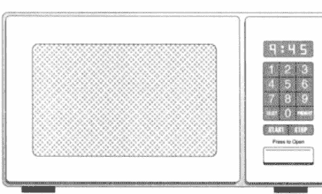
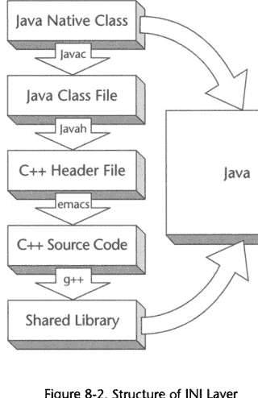

# 嵌入式 FreeBSD 秘籍

# 前言

泛论嵌入系统是一项困难的任务，因为每个嵌入系统都是独特的。本书并没有列出一系列处理嵌入式开发问题的通用原则，而是通过真实的硬件和软件展示了所遇到的问题以及相应的解决方案。从这个意义上说，它是一本为开发者提供的“食谱”，提供了设计“配方”，这些配方可以根据需要进行详细说明或修改，以解决其他设计问题。

除了用于开发 DIO 设备提供的源代码外，本书还包含了关于获取开源软件发布版的真实“如何做”信息，并描述了安装、配置和编程的步骤。无论你是在开发一个真实的设备，还是在对操作系统进行实验，这本书都将帮助你熟悉所有的开发问题，而不仅仅是开发概念。

本书介绍了在开发嵌入式 Web 设备过程中遇到的一系列常见问题。每一章涵盖一个特定主题，讨论了该主题的背景信息，并为该主题提供了一个设计解决方案。章节的目的并不是介绍所有可能的解决方案，而是提供可以用于开发你自己的解决方案的信息。

开发嵌入系统涉及许多编写源代码之外的技能。识别可以用于解决问题的技术、安装、配置和打包都是同样重要但经常被忽视的技能。本书涵盖了所有这些问题，以给你提供嵌入式开发过程的全景。

# 前提条件和其他资源

这是一本关于使用 FreeBSD 和 FreeBSD 发行版包含的软件工具开发网络设备的书。因此，它假设读者在环境方面具有某些 C 和 C++ 编程的背景。除了基础编程技能外，如果你对数据结构和系统编程有基本的了解将大有帮助。本书面向那些已经知道如何编写和编译 Unix 的读者，并让他们学习更多关于 FreeBSD 环境的内容，探索与典型编程书籍不同的主题。其中几个主题并不要求你具有详细的计算机硬件背景，但假设你具备某些知识并愿意学习必要的技能。

我写这本书是为了那些想要进一步深入研究 FreeBSD 操作系统的朋友。书中介绍的许多问题超出了 C 或 C++ 编程的范围，展示了嵌入式系统在产品开发过程中面临的问题。这不是一本关于 FreeBSD 内部以及如何破解内核的书。FreeBSD 根深蒂固，已经有很多优秀的资源可以学习 FreeBSD 操作系统和系统管理。我推荐《The Design and Implementation of the 4.4 BSD Operating System》、《The Complete FreeBSD》以及《The FreeBSD Handbook》，地址位于 `http://www.bsd.org/doc/en_US.ISO8859-1/books/handbook/index.html`。除了这些资源外，FreeBSD 网站包含许多列表、用户组、新闻和网络资源。还有编程 Unix 的优秀参考文献，如《Advanced Programming in the Environment》和《The C Programming Language》，两者在 `amazon.com` 上都有。

# 结构

本书包含 12 章和 3 个附录。

第 1 章“入门”介绍了嵌入系统，并描述了网络设备和 FreeBSD。此外，涵盖了构建书中描述的网络设备的主要硬件和软件。

第 2 章“系统编程”介绍了 Unix 进程和守护进程（daemons）。进程是 Unix 编程的基础。守护进程是一种特殊的进程。书中讨论了从 Unix 进程创建守护进程的细节。

第 3 章“系统调用”准确描述了什么是系统调用以及它如何在 FreeBSD 中实现。

第 4 章“设备驱动”描述了 FreeBSD 设备驱动及其数据结构。讨论了驱动程序编写者可工具，并将其用于为 PCI 数据采集控制器开发实际设备驱动。

第 5 章“中间件接口库”讨论了共享库以及用户代码如何访问设备驱动。

第 6 章“守护进程”在第 2 章主题的基础上，实现了一个 Unix 守护进程，该进程使用 sockets 提供一个简单的协议，用于读写数据采集板。

第 7 章“远程管理”讨论了如何为远程管理提供安全方法。开发了一个配置 shell，可以通过 SSH 进行远程访问。

第 8 章“JNI 层”向用户介绍了 JNI，这是一个允许 Java 程序员调用 C 代码的接口。

第 9 章“使用 Tomcat 进行 Web”提供了显示动态内容的步骤。讨论了配置 Tomcat（一个 JSP 服务器）以及编写显示采集器状态的 JSP。

第 10 章“构建内核”讨论了基于硬件和 DIO 设备特性构建自定义内核。

第 11 章“系统启动”提供了 FreeBSD 启动过程讨论以及 DIO 设备所需的启动脚本修改，如 Tomcat 和加载自定义 KLD。

第 12 章“CompactFlash 启动设备”描述了对 flash 设备进行分区，并将书中章节开发的代码加载到 flash 中，使其成为一个运行的设备服务器。

附录 B“PCI 配置”讨论了 PCI 配置空间。为 PCI 控制器开发驱动程序需要 PCI 配置寄存器的知识。附录描述了配置空间中的寄存器及其。

附录 C“内核加载模块”涵盖了第 2 章和第 4 章中使用的 KLD。附录提供了关于构成 KLD 的组件及其用途的讨论。

为了充分利用本书的内容，我建议不要纠结于细节，而是通过研究实现该主题的方法来获得对该主题的通用理解。通过熟悉开发嵌入系统涉及的每个步骤，你应该能够将这些概念应用于可能遇到的任何开发任务。

# 光盘里有什么？

随附的光盘包含了书中用到的程序的源代码，以及全文可搜索的 pdf 版本。

# 约定

宏文本

宏文本用于源代码。

粗体宏文本

粗体宏文本用于程序输出和 shell 输入。

# 入门

## 概述

嵌入式系统渗透到我们日常生活的各个方面。闹钟、咖啡机、数字表、手机和汽车只是使用嵌入系统的设备设备。此类系统的设计和开发是独特的，因为每个系统的设计限制都不同。

## 嵌入系统

嵌入式系统由用于解决特定应用的硬件和软件组成。许多应用程序包含的不仅仅是简单的计算机硬件和软件。例如，用于控制机械臂的工业视觉系统由嵌入式计算机、相机、显示器和机械臂组成。这些组件本身都是嵌入式系统。

## 网络设备

今天开发的许多嵌入式系统就是几年前被称为服务器的。这些系统使用 PC 硬件开发，运行嵌入式应用程序，具有互联网连接功能，并运行用于远程配置的网络服务。这些嵌入式系统的最新形态被称为网络设备。

网络连接需要添加网络协议、服务和网络硬件。Web 服务需要添加更复杂的应用软件。这些额外需求显著增加了嵌入式系统开发的硬件成本、工作量和复杂性。

增加的性能需求将可扩展性列入系统需求列表，进一步限制了计算机设计解决方案的选择。此外，开发嵌入式系统的投资必须受到保护；随着硬件的演进，最终的硬件和软件选择在每个版本之间必须保持兼容。由于高科技行业快速的发展节奏，硬件和软件解决方案必须足够灵活，以满足不断变化的市场和客户的需求。

为了解决嵌入式系统日益复杂的问题，一个新的类别变得流行——设备服务器。设备服务器是一种网络嵌入式计算机，旨在执行单一任务，并提供比通用服务器更优的性能更高的可靠性。适用于设备服务器的应用程序包括 VPN、网络附属存储（NAS）和负载均衡。

## 开发问题

虽然计算机组件的成本和上市时间不断减少，但典型嵌入式系统的功能和特征持续在增加。为了应对这一点，许多项目开发者选择使用第三方硬件和开源软件，并仅开发那些提供增值功能的组件。使用自定义硬件和自研操作系统的嵌入式系统开发经典模型在今天许多正在开发的系统中已被取代。让我们来看一些与依赖第三方某些核心组件的嵌入式系统相关的开发问题。

### 升级的兼容性

通过选择第三方硬件和开源软件，系统设计人员确保了访问多个供应商的兼容技术，并允许以更快、更低的成本完成系统的开发。系统设计人员可以将资源放在开发应用程序上，而不是将资源集中在维护操作系统或开发下一个硬件平台上。

### 上市时间

开源操作系统缩短了软件解决方案的验证和开发时间。服务器设备通过使用日益丰富的第三方硬件和软件集，解决了日益增加的上市压力和硬件灵活性。通过依靠现成的硬件和软件，设备服务器开发者可以专注于解决应用问题。

### 人才池

网络设备复杂性的增加，要求从简单的嵌入式工具转向现成的集成开发环境（IDE），这些工具有助于开发安全、可靠且长时间运行的系统。此外，现成的集成开发环境缩短了上市时间，也缩短了培训时间。

### 许可

传统的实时操作系统许可证将源代码限制为被许可者，并可能要求在发行时支付版税。相比之下，开源软件许可证允许被许可者对软件进行修改。

## FreeBSD

由于 BSD 许可证，由于许多嵌入式系统需要包含这些系统中的专有技术，FreeBSD 运行在嵌入式系统中，由于许多嵌入式系统需要包含这些系统中的专有技术

## Java

使用 Java，系统设计人员可以开发出可以在任何地方浏览器上运行的应用程序。除了开发设备网络部分简单之外，通过使用 Java 接口（JNI），系统开发者可以将遗留系统与以网络为中心的嵌入式系统的需求连接起来。

## 硬件

书中开发的服务器设备仅使用第三方硬件。硬件要求包括一个具备网络能力的 PC 硬件平台、一个基于 PCI 的数字 IO 控制器，以及一个固态启动设备和 ATAPI 接口卡。

### 服务器

Network Engines Roadster 是一款高性能 1U 网络设备，可为任何应用程序提供易于自定义的解决方案。Network Engines Roadster 包括一个 Intel Celeron 处理器、32 MB RAM、双以太网端口、一个 PCI 插槽和两个串口。

### 数据采集

我们将使用的 DIO 网络设备硬件——Measurement Computing PCI-DIO24 数字 IO 控制器，可以读取和写入数字 IO 信号。它是一个提供 24 位数字 IO 的 PCI 控制器。除了 PCI-DIO24 控制器外，DIO 服务器设备还使用 C37FF-2 线缆和 CIO-MINI 37 终端子来连接来自控制器的数字信号。

### 启动设备

嵌入式系统通常部署在比典型桌面电脑更严苛的环境中。在这种环境中，硬盘可能会损坏或耗尽。嵌入式系统开发的一个趋势是使用 CompactFlash。CompactFlash 设备类似于标准的 IDE 驱动器。为了将 CompactFlash 设备作为启动设备，需要一个 CompactFlash 适配器。有很多 CompactFlash 转 IDE 的适配器可用。

#### TAPR CompactFlash 适配器 II

图森逊业余数据包无线俱乐部 (TAPR) 销售一种 IDE CompactFlash 适配器，可用于通用 CompactFlash 卡。CompactFlash 适配器插入 IDE 插槽和电源连接器。一旦连接好适配器并插入 CompactFlash 设备，该设备就可以像 IDE 硬盘一样使用。

#### Sandisk 32 MB CompactFlash Disk

Sandisk CompactFlash 是一种小型闪存设备，作为我们的嵌入式启动设备。结合 TAPR CompactFlash 适配器，我们能够将 Sandisk 设备作为 IDE 启动设备。Sandisk 设备可以在任何办公用品商店买到；这些与数字相机和便携式 MP3 播放器使用的设备。

## 总结

在本章中，我们讨论了使用第三方硬件和开源软件来开发网络设备。书的其余部分重点关注使用 FreeBSD 开发 DIO 网络设备。每一章都讨论一个与嵌入式系统开发相关的话题并提供解决方案。到书结束时，我们将开发出一个可以工作的设备。

# 系统编程

## 概述

FreeBSD 中任何编程任务的基础都是进程，它是一个正在执行的程序。它可以是一个提供文件的网络文件系统 (NFS) 守护进程、一个 gcc 编译或显示日期的 shell——所有这些任务都在进程上下文中执行。理解进程对于掌握后续章节中介绍的概念至关重要。本章介绍了使用进程的系统编程。

许多系统服务由一种被称为守护进程（daemon process）的特殊类型进程提供。作为进程讨论的一部分，我们将查看守护进程的特征并为守护进程编写骨架源码。在本章中我们将涵盖以下主题：

- FreeBSD 进程
- 进程的与终止
- 进程属性
- 守护进程

## 进程

运行中的程序是进程的一个实例。FreeBSD 内核提供的众多特性之一是称为用户模式（User Mode）的保护环境。在用户模式下，进程无法访问硬件或受保护的系统变量。如果进程尝试访问受保护的内存，该进程将被终止。运行在内存中的进程由五个段组成：文本段、初始化数据段、未初始化数据段、栈和堆。

文本段通常是只读，包含程序的机器指令。初始化数据段包含由程序文本预初始化的变量。未初始化数据（传统称为 bss）是未初始化的数据。栈用于在函数之间传递参数，并包含局部变量和函数返回地址。堆是操作系统提供的区域，用于动态内存分配。

我们可以通过调用 `size` 命令查看程序各个段的大小。`hostname` 的 `size` 命令输出如列表 2-1 所示。



| size hostname | data | bss | dec | hex |
|---|---|---|---|---|
| 39452 | 4020 | 1968 | 45440 | b1b80 |

列表 2-1

输出显示文本大小为 39452 字节，数据段为 4020 字节，bss 大小为 1968 字节。栈和堆由操作系统为每个进程分配。文本段和数据段包含数据。由于 bss 段是未初始化的，镜像仅包含其大小；当程序加载时，操作系统会将内存设置为零。

## 进程创建

当创建一个进程时，会创建一个原始进程（称为父进程）的完整拷贝。新创建的进程被称为子进程。一旦进程创建完成，子进程就会被调度执行。这产生了同一程序的两个运行实例。进程之间只能通过进程标识符进行区分。

### fork 系统调用

当运行中的进程调用 `fork` 系统调用时，会创建一个新进程。`fork` 系统调用是创建新进程的唯一方法。

```c
#include <sys/types.h>
#include <unistd.h>
```

```c
pid_t fork(void);
```

`fork` 返回子进程的标识符 (PID) 给父进程，向新创建的子进程返回 0。进程继承以下属性：进程组 ID、访问组、工作目录、控制终端、资源、定时器、资源限制、文件模式掩码和信号掩码。

### execve 系统调用

`execve` 系统调用用于运行新程序。

```c
#include <unistd.h>
int execve(const char *path, char *const argv[], char *const envp[]);
```


`execve` 系统调用三个参数；`path` 是新程序的路径和文件名；`argv` 传递给程序的参数字符串；`envp` 环境变量列表。`execve` 系统调用在出错时返回 -1。`execve` 系统调用在标准 C 库中有许多封装，被称为 exec 系列。

## 进程终止

进程可以通过调用 `exit` 故意终止，也可以通过接收信号意外终止。无论原因如何，当进程终止时，都会向父进程返回通知。如果父进程没有接收通知，子进程将变成僵尸。直到父进程检索孩子的退出状态。

## _exit 系统调用

当程序调用 `_exit` 系统调用时，进程将终止。`_exit` 系统调用会导致父进程抛出 `SIGCHLD` 信号。

```c
#include <unistd.h>

void _exit(int status);
```

`_exit` 系统调用永远不会返回。`_exit` 系统调用通常由库函数 `exit` 调用。

## wait 系统调用

`wait` 系统调用允许父进程检查子进程的终止信息是否可用。`wait` 将挂起执行直到子进程返回。

```c
#include <sys/types.h>
#include <sys/wait.h>

pid_t wait(int status);
```

成功时，子进程标识符 (PID) 返回给父进程，如果出错则返回 -1。孩子的退出状态通过 `status` 参数返回。

## 示例

列表 2-1 阐述了 `fork`、`wait`、`execve` 和 `exit` 调用的用法。父进程通过 `fork` 系统调用创建子进程。主程序中有两个路径，一个用于父进程，另一个用于子进程。

```c
int main(int argc, char **argv) {
    pid_t pid;
    int status;

    if ((pid = fork()) > 0) {
        printf("%d: waiting for the child\n", pid);
        wait(&status);
    }
    printf("%d: child status = %d\n", pid, status);
}
else if (pid == 0)
{
    execve("/bin/date", NULL, NULL);
}
exit(0);
```

列表 2-1

`fork` 系统调用会同时返回给父进程和子进程。父进程调用 `wait` 系统调用，使父进程进入睡眠，直到子进程退出。子进程执行并运行 `date` 程序并将日期显示在控制台上。

在我的系统上，列表 2-1 中程序的输出看起来如下所示：

```
./process
542: waiting for the child
Mon Jan 7 19:54:46 EST 2002
542: child status = 0
```

## 进程 ID (Process IDs)

每个进程在创建时都有一个唯一的 ID，称为进程标识符或 PID。除了它自己的 PID 之外，每个进程还包含其父进程 ID，或 PPID。可以使用 `ps -aj` 命令获取进程、PID 和 PPID 的列表。这是我系统中的部分列表。

| USER | PID | PPID | PGID | SESS | JOB | STAT | TT | TIME | COMMAND |
| :--- | :--- | :--- | :--- | :--- | :--- | :--- | :--- | :--- | :--- |
| root | 453 | 451 | 453 | bf0700 | 0 | Is+ | p0 | 0:00:01 | /bin/cat |
| root | 456 | 454 | 456 | bf6d00 | 0 | Is+ | p1 | 0:00:04 | /bin/csh |
| root | 458 | 458 | 458 | bf6d00 | 1 | S | p1 | 0:08:21 | emacs |
| root | 459 | 459 | 459 | fc7dc0 | 0 | S | p2 | 0:00:06 | /bin/csh -i |

## getpid 和 getppid 系统调用

进程可以通过分别调用 `getpid` 和 `getppid` 函数获取其 PID 和 PPID。

```c
#include <sys/types.h>
#include <unistd.h>

pid_t getpid(void);
pid_t getppid(void);
```

## 嵌入式 FreeBSD 食谱

每个进程都有父进程。当进程被创建时，会分配父进程 ID，以便其返回终止状态。

## 安全

进程在创建时会被分配两个用户：真实用户和有效用户。

## 用户 ID 和 组 ID

每个进程都有一个用户标识符 (UID) 和一个组标识符 (GID)。进程的 UID 和 GID 是调用该程序的用户名和组名。UIDs 映射到 `/etc/passwd` 中的用户名。GIDs 映射到 `/etc/group` 中的组名。进程可以通过调用 `getuid` 和 `getgid` 系统调用来获取其用户 ID 和组 ID。

## getuid 和 getgid 系统调用

`getuid` 和 `getgid` 系统调用返回运行中进程的 UID 和 GID。这两个系统调用总是成功的。

```c
#include <unistd.h>
#include <sys/types.h>

uid_t getuid(void);
uid_t getgid(void);
```

## 有效用户 ID 和 有效组 ID

进程在创建时，会被分配一个有效用户 ID 和一个有效组 ID。在大多数情况下，有效 ID 和真实 ID 是相同的。程序可以被配置为以不同的用户或组身份执行。例如，`passwd` 工具需要 root 权限才能编辑 `/etc/passwd` 文件。`passwd` 工具被配置为以其有效用户 ID（即 root）的身份执行，并为编辑 `/etc/passwd` 文件提供正确的权限。

## geteuid 和 getegid 系统调用

`geteuid` 和 `getegid` 系统调用分别返回有效用户 ID 和有效组 ID。

```c
#include <unistd.h>
#include <sys/types.h>

uid_t geteuid(void);
uid_t getegid(void);
```

`geteuid` 和 `getegid` 系统调用总是成功的。

进程可以通过调用 `setuid` 和 `setgid` 系统调用来更改有效用户 ID 或有效组 ID。`setuid` 和 `setgid` 系统调用可以设置有效用户 ID 和有效组 ID。

```c
#include <unistd.h>
#include <sys/types.h>

int setuid(uid_t uid);
int setgid(gid_t gid);
```

`setuid` 和 `setgid` 系统调用成功时返回 0，错误时返回 -1。

## 示例

使用描述的用户 ID 和组 ID 的函数，列表 2-2 打印了进程的真实和有效用户及组 ID。

```c
int main(int argc, char **argv)
{
    printf("UID = %d\n", getuid());
    printf("GID = %d\n", getgid());
    printf("EUID = %d\n", geteuid());
    printf("EGID = %d\n", getegid());

    exit(0);
}
```

列表 2-2

程序在我系统上的输出如下：

```
./ids
UID = 1001
GID = 1001
EUID = 1001
EGID = 1001
```

快速查看 `/etc/passwd` 和 `/etc/group` 文件可以看出，该程序是以用户 paul 和组 paul 的身份执行的，这是我的登录名和组。

这是 `/etc/passwd` 文件中我的登录名；第三列包含我的 UID。

```
paul:*:1001:1001:Paul Cevoli:/bin/sh
```

这是 `/etc/group` 文件中我的组；第三列包含我的 GID。

```
paul:*:1001:
```

## 进程组

进程组由一组相关的进程组成。除了 PID 和 PPID 之外，进程组还包含进程组 ID。进程组是一个进程集合。每个进程组有一个唯一的进程组，由进程组 ID 指定。

## setpgid 和 getpgid 系统调用

进程可以通过调用 `setpgid` 和 `getpgid` 系统调用来设置和获取有效进程组 ID。

```c
#include <unistd.h>

int setpgid(pid_t pid, pid_t pgrp);
pid_t getpgid(pid_t pid);
```

进程可以设置自身及其子进程组。

## 文件

进程从父进程继承文件描述符。

## 文件描述符

文件描述符是访问的底层接口。文件描述符实现为 `int`。每个进程包含描述符。

## 权限

进程包含一组由掩码定义的权限。掩码代表了所有者、组和其他人的读、写和执行权限。进程继承掩码。

## umask 系统调用

文件权限掩码通常由登录 shell 设置。掩码可以通过 `umask` 修改。`umask` 系统调用将掩码设置为指定的值。

```c
#include <sys/stat.h>
mode_t umask(mode_t nmask);
```

返回之前的掩码值。

## 工作目录

每个进程都有一个工作目录，即进程启动的地方。

## chdir 系统调用

进程可以通过调用 `chdir` 系统调用来更改其工作目录。参数包含作为工作目录的路径。

```c
#include <unistd.h>
int chdir(const char *path);
```

`chdir` 系统调用成功返回 0，错误时返回 -1。

## 资源

进程从父进程继承资源。资源可以通过 `setrlimit` 和 `getrlimit` 系统调用读取或修改。

## setrlimit 和 getrlimit 系统调用

`setrlimit` 和 `getrlimit` 系统调用读取并修改资源限制。这两个调用接受一个资源参数，指定要读取或写入的资源；资源列表包含在 `sys/resource.h` 中。第二个参数是 `struct rlimit` 指针。

```c
struct rlimit {
    rlim_t rlim_cur; /* 当前（软）限制 */
    rlim_t rlim_max; /* rlim_cur 的最大值 */
};
```

用于资源值。

```c
#include <sys/types.h>
#include <sys/time.h>
#include <sys/resource.h>

int getrlimit(int resource, struct rlimit *rlp);
int setrlimit(int resource, const struct rlimit *rlp);
```

## 会话

一组进程组可以被收集到一个会话中，会话是关联控制终端的进程集合。会话用于分组用户登录 shell 及其创建进程，或为守护进程创建一个隔离的环境。

## setsid 系统调用

```c
#include <unistd.h>

pid_t setsid(void);
```

`setsid()` 函数创建一个会话。调用进程是新会话的会话领导者，是新进程组的组长，且没有控制终端。调用进程是该会话或该进程组中的唯一进程。

## 控制终端

一个会话可能有一个控制终端；这是用于登录的设备。启动控制终端连接的会话领导进程被认为是控制进程。当我们登录时，系统为我们建立控制终端。有时，程序想要与控制终端进行通信。

## 调度

### 优先级

系统根据进程优先级为进程提供执行时间。优先级的范围从 0 到 127。进程优先级定义在 `/usr/include/sys/param.h` 中。进程优先级越低，获得的调度优先级越高。

### getpriority 和 setpriority 系统调用

可以使用 `setpriority` 和 `getpriority` 系统调用来读取和修改进程优先级。

```c
#include <sys/time.h>
#include <sys/resource.h>

int getpriority(int which, int who, int prio);
int setpriority(int which, int who, int prio);
```

`getpriority` 和 `setpriority` 系统调用的工作方式根据 `which` 参数而不同。

| which | 定义 |
| :--- | :--- |
| PRIO_PROCESS | 进程标识符 |
| PRIO_PGRP | 进程组标识符 |
| PRIO_USER | 用户 ID |

`setpriority` 和 `getpriority` 系统调用在成功时返回 0，错误时返回 -1。

## 状态

进程在任何时候都处于五种状态之一。进程状态由 FreeBSD 内核内部用于组织进程。进程状态及其定义描述如下。

| 状态 | 描述 |
| :--- | :--- |
| SIDL | 进程创建时的初始状态，等待分配资源 |
| SRUN | 进程已就绪运行 |
| SSLEEP | 进程挂起并等待事件发生 |
| SSTOP | 进程正在调试或挂起 |
| SZOMB | 进程已退出并等待通知其父进程。 |

## 信号

信号是通知进程发生了系统事件的机制。每个进程都包含一个表，定义了处理传递给该进程的信号的关联动作；在进程创建时，所有信号都包含一个默认动作。信号的处理有三种方式：被忽略、被捕获、或由内核设置的默认动作处理。

用户可以定义一个在进程接收到信号时调用的函数；这被称为信号处理器。这被称为捕获了该信号。信号定义在 `/usr/include/sys/signal.h` 中。需要注意的是，两个信号 `SIGSTOP` 和 `SIGKILL` 不能被捕获，并且会终止进程。

## signal 函数

`signal` 函数用于为特定信号指定用户定义的信号处理器。`signal` 函数是 `sigaction` 系统调用的封装。

```c
#include <signal.h>

void (*sig_t) (int);

sig_t signal(int sig, sig_t func);
```

`sig` 参数指定信号处理器将捕获哪个信号。`func` 参数允许用户指定用户定义的信号处理器。可以通过指定 `SIG_DFL` 为信号处理器来重置信号的默认动作。可以通过指定 `SIG_IGN` 为信号处理器来忽略某个信号。忽略信号会导致后续的该信号实例被忽略，并且待处理的实例被丢弃。

如果执行成功，`signal` 返回之前的动作；否则，返回 `SIG_ERR` 并设置全局变量 `errno` 以指示错误。

## kill 系统调用

`kill` 系统调用向进程或进程组发送信号。

```c
#include <sys/types.h>
#include <signal.h>

int kill(pid_t pid, int sig);
```

`pid` 参数是要发送信号的进程 ID。大于 0 的进程 ID 发送到该特定进程。PID 为 0 的进程 ID 将信号发送给发送进程进程组的所有成员。PID 为 -1 的进程 ID 将向所有进程发送信号（除非是超级用户）。执行成功时，`kill` 返回 0，错误时返回 -1。

## 守护进程 (Daemons)

守护进程是一个在后台运行的特殊进程。守护进程通常在启动时创建并持续运行。

### Fork

守护进程的第一步是通过 `fork` 创建子进程。

### 创建新会话

接下来的步骤是创建一个新会话。创建一个新会话的好处是，进程将通过 `setsid()` 成为新会话的领导者并失去控制终端。

### 关闭文件描述符

关闭所有打开的文件描述符，需要通过 `getrlimit` 获取最大打开数量。

### 更改工作目录

当前工作目录被内核在进程生命周期内保持打开，因此文件系统无法卸载，将当前工作目录重置为根目录。

### 设置权限掩码

进程继承自创建它的进程的文件访问权限，重置用户访问掩码。

### 处理进程退出

通过安装 `SIGCHLD` 处理器来避免产生僵尸进程。

## 守护进程骨架

### handle_chld 函数

示例 2-2 展示了处理子进程退出的代码。

```c
void handle_chld()
{
    int pid;
    int status;

    while ((pid = wait3(&status, WNOHANG, (struct rusage *)NULL)) > 0)
        ;
}
```

注意 `handle_chld` 函数调用了 `wait3` 系统调用并带有 `WNOHANG`。这样父进程就不会阻塞等待子进程退出，允许父进程继续响应请求或执行任务。

### init_daemon 函数

示例 2-3 中的 `init_daemon` 函数处理将子进程变为守护进程的细节。

```c
void init_daemon()
{
    int childpid = 0;
    int fd = 0;
    struct rlimit max_files;

    /*
     * 创建子进程
     */

    if ((childpid = fork()) < 0)
    {
        /* 处理错误情况 */
        exit(-1);
    }
```


```c
else if (childpid > 0)
{
    /* 这是父进程，我们可以成功退出 */
    exit(0);
}
}

/* 现在作为子进程执行 */

/* 成为会话领导者 */
setid();

/*
** 关闭所有文件描述符，需要从 getrlimit 获取
** 最大打开文件数量
*/
bzero(&max_files, sizeof(struct rlimit));
ngetrlimit(RLIMIT_NOFILE, &max_files);
for (fd = 0; fd < max_files.rlim_max; fd++)
{
    close(fd);
}

/*
** 当前工作目录被内核在进程生命周期内保持打开
** 所以文件系统无法卸载，将当前工作
** 目录重置为根。
*/
chdir("/");

/*
** 进程继承自创建它的进程的文件访问权限，
** 重置用户访问掩码
*/
umask(0);

/*
** 我们不关心退出状态，但我们需要在
** 每个处理请求的进程后进行清理，以免
** 系统被僵尸进程淹没
*/
signal(SIGCHLD, handle_chld);
```

## 总结

在本章中，我们涵盖了 FreeBSD 中的进程属性，以及用于创建、终止和管理进程的常用系统调用。我们对进程的讨论通过引入一种特殊类型的进程而结束，这种进程已经过介绍并封装到了一个通用函数 `init_daemon` 中。

我们将在第 6 章再次讨论守护进程，届时我们将实现一个使用 Socket 处理 DIO 查询的守护进程。现在，让我们进入 FreeBSD 系统调用的实现。

### 系统调用

## 概述

如上一节所述，FreeBSD 内核为进程提供了一个称为用户模式的执行环境。在用户模式下执行的进程无法直接访问内核内存、内核数据结构或硬件。对内核内存和硬件资源的访问仅限于 FreeBSD 内核，内核运行在底层处理器的特权模式下。FreeBSD 为用户进程提供了一个详细的接口，用于从内核获取基本服务，这被称为系统调用。

将某些任务限制在内核中的好处有两个：首先，它让系统工程师从硬件编程的细节中解放出来；其次，通过提供并强制执行的系统调用接口，内核可以确保用户程序传递的参数是正确的，且不会导致系统崩溃。内核中增加的保护为应用程序提供了稳定的运行环境。

在本章中，我们将讨论 FreeBSD 系统调用的细节。在完成系统调用的讨论后，我们将实现一个读写内核内存的系统调用，以及一个提供简单调试能力的应用程序。

## 库函数与系统调用

标准 C 库提供了由头文件和库组成的 API，包含了许多常用函数和 IO 例程的实现。标准 C 库以库函数和系统调用的形式实现。

对于系统设计人员来说，库函数和系统调用看起来是相同的。它们都有定义的函数原型和返回值。对于应用程序程序员来说，函数的具体实现并不重要，接口、函数名、参数和返回值才是重要的。区别在于实现方式。

当程序调用库函数时，执行权将传递给库函数，执行请求的操作，并将控制权返回给调用函数。这一切都在运行进程的上下文和地址空间内发生。

图 3-1 库函数调用

系统调用是对内核的请求，用于代表用户进程执行特权操作。当程序发出系统调用时，程序执行从用户模式切换到内核模式，内核执行请求的操作，然后程序执行从内核模式切换回用户模式。为了执行该操作，进程必须向内核发出请求。

图 3-2 系统调用

## 系统调用实现

系统调用通过两个步骤实现。第一步是从用户模式转换到内核模式，这是通过使用软件中断完成的。此外，数据必须从用户模式传递到内核。在本节中我们将查看这些细节。

## 软件中断

在 Intel x86 处理器上，在用户模式下执行的程序通过执行软件中断来切换到内核模式。软件中断是由处理器使用中断处理程序异步处理的事件。中断处理程序是在响应硬件或软件中断调用时调用的。软件中断与硬件中断不同，因为它在运行的进程内部同步发生。

在 Intel x86 处理器上，通过执行 `INT` 指令来调用软件中断。`INT` 指令接受一个 0 到 255 之间的数字，指定中断向量。系统调用被分配到中断向量 128 (0x80)。进程通过执行 `INT $0x80` 指令调用系统调用。

每个中断向量包含中断描述符表（IDT）中的一个条目。IDT 是一个包含 256 个长型的表。每个字代表特定中断向量的中断处理程序。对于系统调用，系统中断处理程序位于 0x200。0x200 是通过中断向量 0x80 * 4 = 0x200 得出的。

一旦进程遇到软件或硬件中断，它将从中断描述符表（IDT）获取特定中断向量的地址并执行该中断处理程序。在中断处理程序完成后，执行返回到进程。

图 3-3 中断处理

## 数据传递

内核实现了许多不同的系统调用。为了区分不同的系统调用，会传递一个数字来指定正在进行哪一个系统调用；这个数字被称为系统调用号。定义的系统调用列表可以在 `/sys/kern/syscalls.master` 中找到。在进行系统调用之前，系统调用号会被推入程序栈中。

除了系统调用号，许多系统调用还带有参数。参数使用 C 调用约定传递给内核。调用者按逆序、从右到左一个一个将系统参数推入栈中，因此函数指定的第一个参数是最后入栈。从系统调用返回时，调用者将栈恢复到调用前的原始值；这被称为出栈。

| arg # | n |
| :--- | :--- |
| 系统调用号 | 首先推入 |
| 参数 | 后推入 |

图 3-4 系统调用号

## 示例

为了演示编译器如何生成系统调用，让我们来看看执行系统调用程序的输出。列表 3-1 包含一个调用 `open` 和 `close` 的程序。

```c
#include <stdio.h>
#include <fcntl.h>

int main(int argc, char **argv) {
    int fd;
    fd = open("file.dat", O_RDWR);
    close(fd);
}
```

为了简化输出，关闭了优化，以便我们使用 `objdump` 反汇编代码。命令是：

```bash
gcc -O0 -static -o open open.c
```

程序的反汇编如列表 3-2：

```
0804c4 <main>:
    6a 02              push 0x2
0801cf:    68 01 84 00  push 0x8401
0801d4:    e8 7f 00 00  call 804258
0801d9:    83 c4 10         add 0x10,%esp
0804258 <open>:
0804258:    8d 05 05 05 00  lea 0x5,%eax
080425e:    cd 80              int 0x80
080462:    c3              ret
```

列表 3-2 显示了编译器生成执行系统调用汇编代码的步骤。位于 0801cd 的指令将模式和文件名推入栈。主程序调用系统调用。`open` 在 804258 处将其系统调用号 5 推入栈，然后调用软件中断。从 `open` 返回后，栈在 801d9 处恢复到原始值。

## truss

在前面的节中，我们详细查看了系统调用是如何实现的。在本节中，我们将展示标准工具如何使用系统调用完成此任务。`truss` 是一个 FreeBSD 命令，包含一个跟踪调用和查看进程接收信号的工具。使用 `truss` 命令，查看 `pwd` 命令如何调用系统调用。`pwd` 命令显示进程当前的工作目录。列表 3-3 显示了使用 `truss` 分析 `pwd` 命令时的输出。

```
readlink("/etc/malloc.conf", 0xbbffff57, 63)      ERR#2 'No such file or directory'
mmap(0x0, 0x4096, 0x3, 0x1002, -1, 0x0)    = 671432704
break(0x8058000)                    = 0 (0x0)
break(0x8059000)                    = 0 (0x0)
sigaction(SIGSYS, 0xbbffff660, 0xbbffff648) = 0 (0x0)
_getcwd(0x8058000, 0x3fc)         = 0 (0x0)
sigaction(SIGSYS, 0xbbffff648, 0x0)     = 0 (0x0)
fstat(1, 0xbbffff388)                = 0 (0x0)
ioctl(1, TIOCGETA, 0xbbfff3bc)      = 0 (0x0)
write(1, 0x8058400, 6)               = 6 (0x6)
exit(0x0)                             process exit, rval  = 0
```

列表 3-3 truss 输出

truss 生成的输出显示了 `pwd` 命令执行的系统调用。特别感兴趣的是对 `sigaction` 的系统调用。回想上一章，`sigaction` 用于安装信号处理程序。这段代码是为了防止一个不存在的系统调用。

一旦安装了 `SIGSYS` 信号处理器，程序就会调用 `getcwd`，这是一个用于返回当前进程当前工作目录的内部系统调用。从 `getcwd` 返回后，`SIGSYS` 的信号处理器将得到恢复。

在程序退出之前，会调用 `write` 系统调用将当前工作目录写入控制终端。

## 创建系统调用

系统调用可以作为内核可加载模块（KLD）进行开发。附录 C 概述了内核可加载模块。在本节中，我们将讨论 KLD 的组成部分，以及我们对 `copymem` 系统调用的实现。

## 添加系统调用

在之前的节中，我们涵盖了系统调用实现和实际用途。在本章的后续章节中，我们将开发一个名为 `copymem` 的系统调用，用于读取或写入内核内存。`copymem` 系统调用接收四个参数：内核地址、用户地址、字节数和拷贝方向。其原型为：

```c
int copymem(int kernel_addr, int user_addr, int nbytes, int direction);
```

一旦 `copymem` 系统调用实现完成，我们将通过实现一个简单的实用程序来完成使用 `copymem` 系统调用读取和写入内核内存的命令，完成系统调用的讨论。

## 加载处理器

KLD 系统调用所需的第一个代码部分是加载处理器。加载处理器负责处理模块加载、卸载或系统关机时的任何初始化或清理工作。每个 KLD 都要求有一个加载处理器。列表 3-4 实现了 `copymem` 系统调用的加载处理器。

```c
static int32_t
load(struct module *module, int cmd, void *arg)
{
    int32_t err = 0;
    switch (cmd)
    {
        case MOD_LOAD:
            uprintf("copymem system call loaded successfully\n");
            break;
        case MOD_UNLOAD:
            uprintf("copymem system call unloaded successfully\n");
            break;
        default:
            err = EINVAL;
            break;
    }
    return(err);
}
```

加载处理器接受三个参数。第一个是当前加载到系统中的模块链表。第二个参数是 `cmd` 参数，代表调用加载处理器的条件。定义的命令有：

| 命令 | 动作 |
|---|---|
| `MOD_LOAD` | 模块加载时传递 |
| `MOD_UNLOAD` | 模块卸载时传递 |
| `MOD_SHUTDOWN` | 系统关机时传递 |

表 3-1 加载模块命令

最后一个参数是传递给加载处理器的用户定义参数。这将在 `SYSCALL_MODULE` 部分进行进一步讨论。

## 系统调用参数

在系统调用的讨论中，我们展示了用户程序如何通过栈将参数传递给系统调用。在内核实现中，参数作为结构体参数传递。结构体的每个元素都是从用户程序传递的一个参数。

列表 3-5 定义了 `copymem_args` 结构体。`copymem` 结构有四个元素，对应传递给 `copymem` 系统调用的四个参数。

```c
struct copymem_args
{
    int32_t kernel_addr;   /* 内核地址 */
    int32_t user_addr;     /* 用户提供的缓冲区 */
    int32_t len;           /* 传输长度 */
    int32_t direction;     /* 到内核为1，从内核为0 */
};
```

列表 3-5

`copymem` 系统调用接受四个参数：内核态地址、用户态地址、拷贝长度以及表示拷贝的数字。`copymem` 实现的两个方向是从内核态到用户态，或从用户态到内核态。

## copymem 系统调用

现在我们已经定义了加载处理器参数，可以实现真正的 `copymem` 系统调用。系统调用接受两个参数。第一个是 `proc` 结构体，它包含了内核进程当前的状态和设置；`proc` 结构体定义在 `/usr/include/sys/proc.h` 中。

第二个参数是参数结构体；在我们的情况下，它将是上一节定义的 `copymem_args` 结构体。列表 3-6 包含了 `copymem` 的源码列表。

```c
static int32_t
copymem(struct proc *p, struct copymem_args *uap)
{
    int stat;
    #include <sys/types.h>
    #include <sys/stat.h>
    int copyin(const void *uaddr, void *kaddr, size_t len);
    int copyout(const void *kaddr, void *uaddr, size_t len);
}
```

`copyin` 函数从用户态地址 `uaddr` 拷贝 `len` 字节数据到内核态地址 `kaddr`。`copyout` 函数从内核态地址 `kaddr` 拷贝 `len` 字节数据到用户态地址 `uaddr`。

## sysent 结构

在系统调用讨论中，我们展示了用户程序如何通过栈向系统调用传递参数。FreeBSD 内核中的每个系统调用都有一个 `sysent` 结构，定义在 `/usr/include/sys/sysent.h` 中。`sysent` 结构包含两个元素：参数数量（由 `copymem_args` 定义）以及系统调用函数名。

```c
static struct sysent copymem_sysent =
{
    4, /* 参数数量 */
    copymem /* 系统调用 */
}
```

列表 3-7

系统调用包含在定义于 `/sys/kern/init_sysent.c` 的 `sysent` 结构中。创建一个 KLD 系统调用会在全局 `sysent` 结构中添加一个新条目。列表 3-8 包含了 `sysent` 结构的部分列表。

```c
/* 类型是错误的，但目前可以使用 */
struct sysent syst[] = {
    { 0, (sys_call_t*) nosys },
    { (rexit_args), (sys_call_t*) exit },
    { 0, (sys_call_t*) fork },
    { (read_args), (sys_call_t*) read },
    { (write_args), (sys_call_t*) write },
    { (open_args), (sys_call_t*) open },
    { (close_args), (sys_call_t*) close },
}
```

列表 3-8

## 系统调用号

系统调用号必须声明；由于没有定义系统调用号，该值应设置为 `NO_SYSCALL`。内核动态定义系统调用号。

```c
static int32_t syscall_num = NO_SYSCALL;
```

当 KLD 系统调用加载到内核时，`sysent` 条目 `copymem_sysent` 被分配给全局 `sysent` 结构的第一个索引。`syst` 数组的索引就是系统调用号。

安装新系统调用的细节位于 `/sys/kern/kern_syscalls.c` 中的 `syscall_register` 函数。列表 3-9 包含了 `syscall_register` 函数。

```c
int
syscall_register(int *offset, struct sysent *new_sysent,
               struct sysent *old_sysent)
{
    if (*offset == NO_SYSCALL) {
        int i;
        for (i = 1; i < SYS_MAXSYSCALL; ++i)
            if (sysent[i].sys_call == (sys_call_t*) lkmnosys)
                break;
        if (i == SYS_MAXSYSCALL)
```


# 第三章
### 系统调用

```c
return ENFILE;

*offset = i;

} else if (*offset < 0 || *offset >= SYS_MAXSYSCALL)

    return EINVAL;

else if (systent[*offset].sys_call != (sys_call_t*)lkmnosys)

    return EEXIST;

*old_systent = systent[*offset];

systent[*offset] = *new_systent;

return 0;

}
```

## SYSCALL_MODULE 宏

创建系统调用模块的最后一个任务是声明该模块。用于定义系统调用的宏是定义在 `/usr/include/sys/systent.h` 中的 `SYSCALL_MODULE`。`SYSCALL_MODULE` 宏传递以下参数：

| 参数 | 说明 |
|---|---|
| name | name 是系统调用的通用名称。 |
| offset | offset 是系统调用号。它是内核全局 `systent` 结构体的索引。 |
| systent | 为此系统调用定义的 `systent` 结构体。 |
| evh | 加载处理程序的函数名称。 |
| arg | 此参数为保留用，通常设置为 NULL。 |

`copymem` 的 `SYSCALL_MODULE` 声明位于列表 3-10 中。

```c
/* 声明系统调用 */
SYSCALL_MODULE(copymem, &syscall_num, &copymem_systent, load, NULL);
```

列表 3-10

`SYSCALL_MODULE` 宏接受五个参数：

Copymem 是该 KLD（内核加载模块）的唯一名称。第二个参数是 syscall 调用号，它表示包含系统调用的内核全局 `systent` 结构中的偏移量。第三个参数包含新系统调用的 `systent` 结构。第四个参数是指向该 KLD 加载处理器的指针。第五个也是最后一个参数表示传递给加载处理器的用户自定义 KLD 数据的指针。

## 一个简单的调试器

在上一节中，我们创建了一个新的系统调用，为用户程序提供了读取和写入内核内存的机制。本章的剩余部分定义了一个实现简单命令解析器的程序，为我们提供读取和修改内核内存的工具。

## 命令定义

`copymem` 工具是由命令驱动的。为了简化命令解析，定义了一个结构体类型 `command_t`，它包含一个 ASCII 命令字符串、一个函数指针和一个帮助字符串。

```c
/*
 ** 命令定义
 */
typedef struct {
    char *command;        /* 表示命令的字符串 */
    fptr functionptr;     /* 指向命令实现的指针*/
    char *helpstring;     /* 帮助文本字符串 */
} command_t;
```

列表 3-11

命令元素包含一个 ASCII 字符串，用于与用户输入进行命令比较。函数指针包含指向实现该命令的例程指针。

```c
/*
 ** 命令函数指针定义
 */
typedef void (*fptr)(int, char *);
```

列表 3-12

命令类型 `fptr` 被定义为所有命令处理器的原型。每个命令都通过两个参数传递。第一个参数是系统调用号。由于 `copymem` 是一个 KLD 系统，因此没有系统调用封装器，系统是通过使用 `syscall` 系统调用来实现的。它接收系统调用号和系统调用参数，并执行上一节中定义的系统调用。

```c
#include <sys/syscall.h>
#include <unistd.h>
int syscall(int number, ...);
```

第二个参数是用户输入的命令字符串。每个命令处理器都是自包含的，因此每个命令处理器都负责从命令字符串中解析属于自己的参数。

## 命令表

命令表表示由 `copymem` 工具实现的所有命令。我们对 `copymem` 工具实现了四个命令：读取内核内存、写入内核内存、退出和帮助。

定义了一个命令表，以便解析器在接收到用户输入后可以遍历所有命令。所有命令处理器都进行了前向声明，以便我们可以声明命令表。

```c
/*
 **
 */
void table definition
void read_handler(int num, char* args);
void write_handler(int num, char* args);
void quit_handler(int num, char* args);
void help_handler(int num, char* args);

command_t commands[] = {
  "read", read_handler, "read address length - reads memory",
  "write", write_handler, "write address length - writes memory",
  "quit", quit_handler, "quit - exits program",
  "help", help_handler, "help - displays command help", /* 终止记录 */
  NULL, 0, NULL
};
```

列表 3-13

命令表包含了所有实现的命令。表中的每个项将 ASCII 命令与其命令处理器和帮助字符串链接起来。

添加新命令非常简单。声明命令处理器，并将 ASCII 字符串、命令处理器和帮助字符串添加到命令表中。在命令表中添加条目后，实现该命令处理器。

## dumpmem 函数

位于列表 3-14 中的 `dumpmem` 函数是一个实用函数，以十六进制和 ASCII 字符格式导出内存。`dumpmem` 由 `read_handler` 函数调用以显示请求的内核内存。

```c
/*
** 名称: dumpmem
** 效果：以十六进制和 ASCII 格式导出内存
 */
static int32_t
dumpmem(uint32_t kernp, uint8_t* user, uint32_t len)
{
    int32_t i, j;
    int32_t rows = len / CHARS_PER_ROW;
    uint8_t *ptr = (uint8_t *)user;
    printf("\n\n");
    for (i = 0; i < rows; i++) {
        uint32_t kernaddr;
        kernaddr = kernp + (i * CHARS_PER_ROW);
        printf("%08x: %s", kernaddr);
        for (j = 0; j < CHARS_PER_ROW; j++) {
            printf("%08x: %s", kernaddr);
        }
        for (j = 0; j < CHARS_PER_ROW; j++) {
            if (isprint(ptr[j])) {
                printf("%c", ptr[j]);
            } else {
                printf(".");
            }
        }
        printf("\n");
    }
    return(0);
}
```

列表 3-14

`dumpmem` 用于显示内存。第一列是内核地址，第二列是十六进制格式，第三列是 ASCII 格式。

## 命令处理器

每个命令处理器都是自包含的，负责解析其参数并执行命令。

### 读取命令

读取命令用于读取内核内存。读取命令接收两个参数：内核地址和长度。读取的最大限制由 `BUFFER_MAX` 定义为 406 字节。这个值是任意的。

```c
void read_handler(int num, char* iobuf) {
    int32_t stat = 0;
    uint32_t kerneladdr;
    uint32_t length;
    /* 验证命令参数 */
    i = sscanf(iobuf, "%s %x", &kerneladdr, &length);
    if (i != 2)
        return;
    /* 限制命令到缓冲区大小 */
    if (length > BUFFER_MAX)
        length = BUFFER_MAX;
    /* 执行命令 */
    stat = syscall(num, kerneladdr, iobuf, length, KERNEL_READ);
    if (stat != 0) {
        printf("syscall failed\n");
        return;
    }
    dumpmem(kerneladdr, iobuf, length);
}
```

### 写入处理器

写入命令用于写入内核内存。写入命令接收两个参数：内核地址和长度。

```c
void write_handler(int num, char* iobuf)
{
    int32_t      stat = 0;
    int32_t      i;
    uint32_t kerneladdr;
    uint32_t length;
    /* 验证命令参数 */
    i = sscanf(iobuf, "%s %x", &kerneladdr, &length);
    if (i != 2)
        return;
    /* 限制命令到缓冲区大小 */
    if (length > BUFFER_MAX)
        length = BUFFER_MAX;
    /* 读取输入缓冲区 */
    printf("\n");
    for (i = 0; i < length; i++)
        iobuf[i] = getchar();
    printf("\n");
    /* 执行命令 */
    stat = syscall(num, kerneladdr, iobuf, length, KERNEL_WRITE);
    if (stat != 0)
    {
        printf("syscall failed\n");
    }
}
```

列表 3-15

在解析写入参数后，写入命令接受来自用户的额外输入，即要写入该位置的数据。一旦数据输入，写入处理程序将调用 `copymem` 系统调用将其写入内核内存。

### 退出处理程序

退出处理程序用于清理并退出程序。退出命令处理程序未使用输入参数；这些参数会被忽略。

```c
void quit_handler(int num, char* args)
{
/*
 ** 由于程序正要退出，我们必须释放在主程序中
 ** 使用 malloc 分过的用户缓冲区
 */
free(args);
exit(0);
}
```

列表 3-16

退出处理程序释放了用于命令的用户缓冲区，然后正常退出程序。

### 帮助处理程序

命令处理程序用于显示帮助文本字符串。帮助命令处理程序未使用输入参数；这些参数会被忽略。

```c
/*
 ** 显示帮助命令
 */
void help_handler(int num, char* args)
{
command_t* cmdptr;
/* 解析用户的命令 */
cmdptr = &commands[0];
while (cmdptr->command != NULL)
{
printf("\t%s\n", cmdptr->helpstring);
cmdptr++;
}
}
```

列表 3-17

每个命令条目都包含一个帮助文本字符串。帮助命令处理程序遍历所有命令并显示每个命令的帮助字符串。

## 主程序

`copymem` 程序处理初始化和命令解析。由于 `copymem` 系统调用是一个 KLD（内核可加载模块），且系统调用号是动态分配的，因此必须通过查询模块子系统来确定系统调用号。这可以通过调用 `modfind` 和 `modstat` 实现。`modfind` 调用接收内核模块名称；`copymem` 系统调名为 `copymem`；`modfind` 返回模块 ID。

```c
#include <sys/param.h>
#include <sys/module.h>
int modfind(const char *modname);
```

一旦获取了模块 ID，就会调用 `modstat` 来获取 `module_stat` 结构体。`module_stat` 结构体将系统调用号包含在 `module_stat.data.interval` 元素中。

```c
#include <sys/param.h>
#include <sys/module.h>
int modstat(int in, struct module_stat *stat);
```

现在我们已经有了 `copymem` 动态分配的系统调用号，该调用号被传递给处理函数，以便它们执行相应的系统调用。

一旦确定了系统调用号，就会分配一个用户缓冲区来将命令参数传递给命令处理函数。用户缓冲区的大小 `BUFFER_MAX` 是任意的。下面是主函数的代码列表。

```c
int main(int argc, char** argv)
{
    int err;
    int syscall_num;
    char* userp = NULL;
    struct module_stat stat;
    /* 验证模块已加载 */
    memset(&stat, 0, sizeof(struct module_stat));
    stat.version = sizeof(struct module_stat);

    err = modstat(modfind("copymem"), &stat);
    if (err != 0)
    {
        printf("%s unable to obtain dumpmem system call\ninformation\n", argv[0]);
        exit(0);
    }

    /* 获取系统调用号 */
    syscall_num = stat.data.intval;

    userp = (uint_t *)malloc(BUFFER_MAX);
    if (userp == NULL)
    {
        printf("%s: unable to allocate user buffer\n");
        exit(-1);
    }

    while (1)
    {
        command_t* cmdptr;
        printf("\n> ");
        gets(userp);
        /* 解析用户的命令 */
        cmdptr = &commands[0];
        while (strncmp(userp, cmdptr->command, strlen(cmdptr->command)) == 0)
        {
            cmdptr->handler(syscall_num, userp);
        }
        cmdptr++;
    }
    /* 退出程序 */
    return(err);
}
```

列表 3-18

初始化后，分配一个用户缓冲区来将命令参数传递给命令处理函数。用户缓冲区的大小 `BUFFER_MAX` 是任意的。


# 第三章：系统调用

## 主程序

`copymem` 程序处理初始化和命令解析。由于 `copymem` 系统调用是一个 KLD（内核可加载模块），且系统调用号是动态分配的，因此必须通过查询模块子系统来确定系统调用号。这可以通过调用 `modfind` 和 `modstat` 实现。`modfind` 调用接收内核模块名称；`copymem` 系统调用名为 `copymem`；`modfind` 返回模块 ID。

```c
#include <sys/param.h>
#include <sys/module.h>
int modfind(const char *modname);
```

一旦获取了模块 ID，就会调用 `modstat` 来获取 `module_stat` 结构体。`module_stat` 结构体将系统调用号包含在 `module_stat.data.intval` 元素中。

```c
#include <sys/param.h>
#include <sys/module.h>
int modstat(int in, struct module_stat *stat);
```

现在我们已经有了 `copymem` 动态分配的系统调用号，该调用号被传递给处理函数，以便它们执行相应的系统调用。

一旦确定了系统调用号，就会分配一个用户缓冲区来将命令参数传递给命令处理函数。用户缓冲区的大小 `BUFFER_MAX` 是任意的。下面是主函数的代码列表。

```c
int main(int argc, char** argv)
{
    int err;
    int syscall_num;
    char* userp = NULL;
    struct module_stat stat;

    /* 验证模块已加载 */
    memset(&stat, 0, sizeof(struct module_stat));
    stat.version = sizeof(struct module_stat);

    err = modstat(modfind("copymem"), &stat);
    if (err != 0)
    {
        printf("%s unable to obtain dumpmem system call\ninformation\n", argv[0]);
        exit(0);
    }

    /* 获取系统调用号 */
    syscall_num = stat.data.intval;

    userp = (uint_t *)malloc(BUFFER_MAX);
    if (userp == NULL)
    {
        printf("%s: unable to allocate user buffer\n");
        exit(-1);
    }

    while (1)
    {
        command_t* cmdptr;

        printf("\n> ");
        gets(userp);

        /* 解析用户的命令 */
        cmdptr = &commands[0];
        while (cmdptr->command != NULL && strncmp(userp, cmdptr->command, strlen(cmdptr->command)) == 0)
        {
            cmdptr->handler(syscall_num, userp);
        }
        cmdptr++;
    }

    /* 退出程序 */
    return(err);
}
```

## 写入处理程序

在解析写入参数后，写入命令接受来自用户的额外输入，即要写入该位置的数据。一旦数据输入，写入处理程序将调用 `copymem` 系统调用将其写入内核内存。

## 退出处理程序

退出处理程序用于清理并退出程序。退出命令处理程序未使用输入参数；这些参数会被忽略。

```c
void quit_handler(int num, char* args)
{
    /*
     ** 由于程序正要退出，我们必须释放在主程序中
     ** 使用 malloc 分配的用户缓冲区
     */
    free(args);
    exit(0);
}
```

列表 3-16

退出处理程序释放了用于命令的用户缓冲区，然后正常退出程序。

## 帮助处理程序

命令处理程序用于显示帮助文本字符串。帮助命令处理程序未使用输入参数；这些参数会被忽略。

```c
/*
 ** 显示帮助命令
 */
void help_handler(int num, char* args)
{
    command_t* cmdptr;

    /* 解析用户的命令 */
    cmdptr = &commands[0];

    while (cmdptr->command != NULL)
    {
        printf("\t%s\n", cmdptr->helpstring);
        cmdptr++;
    }
}
```

列表 3-17

每个命令条目都包含一个帮助文本字符串。帮助命令处理程序遍历所有命令并显示每个命令的帮助字符串。

# 第四章：设备驱动

## 驱动程序环境

FreeBSD 驱动程序包含两个主要组件：自动配置、`device_method_t` 以及设备切换表。在讨论数据结构的实现之前，让我们看看驱动程序的环境以及每个数据结构在运行系统中的作用。

### 自动配置

自动配置代码在加载时检测硬件，负责在加载期间分配硬件资源，在卸载时释放硬件资源，并在响应电源事件时将硬件处于一致状态。自动配置代码通常在加载和卸载时使用。


自动配置是 FreeBSD 内核执行的一种程序，用于动态发现启用硬件。对于发现的每个总线，设备会被挂载、初始化并配置。在自动配置期间，会调用设备探测程序。探测负责检测硬件以确定是否挂载了其他设备。

### 设备切换表

设备切换表由一组程序组成，构成了驱动程序的上半和下半部分。上半部分提供了系统实现，例如 `read`、`write`、`open`、`ioctl` 和 `close`。上半部分函数与用户进程同步执行，是可抢占，允许阻塞。下半部分程序与设备寄存器交互并实现硬件中断服务程序。下半部分程序不可抢占且不能阻塞。

典型的设备驱动程序接受来自上半部分的请求，然后将请求放入队列由下半部分处理。每个请求都存放入一个由上下两半部分共享的公共数据结构中。由于设备驱动程序的上半部分和下半部分独立运行；因此，对设备驱动程序上下部分共享的任何数据进行适当的同步至关重要。

### 重新回顾 KLD

与第 3 章中提到的系统一样，FreeBSD 提供了对动态加载设备驱动的支持。除了 FreeBSD 设备驱动程序所需的典型设备驱动数据结构外，还描述并实现了用于 DIO 设备驱动程序的动态加载和卸载功能的 KLD 框架数据结构。

## 驱动程序结构

FreeBSD 驱动程序由各种驱动函数或方法的入口组成，当 FreeBSD I/O 子系统希望驱动程序执行特定功能时会调用这些入口。为 FreeBSD 设备驱动编写者提供了两个结构用于实现驱动函数。`device_method_t` 是用于自动配置函数的结构，而 `cdevsw` 用于系统调用和中断。接下来的章节将讨论更多的函数回调以及导致这些函数调用的条件。

| device_method_t | cdevsw |
| :--- | :--- |
| probe | open |
| attach | close |
| detach | read |
| shutdown | write |
| suspend | ioctl |
| resume | |

图 4-2. 设备驱动

## 驱动程序数据结构

### device_method_t 结构

驱动程序的 `device_method_t` 是一个包含驱动程序自动配置方法函数的列表。`device_method_t` 包含一个为该驱动实现的配置函数列表，并以空项结束。`device_method_t` 结构定义在 `/usr/include/sys/bus.h`。

```c
typedef struct device_op_desc *device_op_desc;
typedef struct device_method *device_method;
typedef int (*devop_t) (void);

struct device_method {
    device_op_desc desc;
    int func;
};
```

以下是更常见的设备方法函数列表及其每个函数的简要描述。

```c
int probe(device_t dev)
```

`probe` 方法在驱动程序加载时被调用，用于判断设备是否存在。如果 `probe` 成功找到设备，则应返回 0；否则可以返回适当的错误代码。

```c
int attach(device_t dev)
```

如果 `probe` 成功，则会调用 `attach` 驱动方法，该方法负责初始化硬件、分配系统资源并将设备交换表条目添加到内核设备交换表中。`attach` 在成功时应返回 0。

```c
int detach(device_t dev)
```

当驱动程序即将从系统移除时，会调用 `detach`。`detach` 负责将硬件置于一致状态、释放系统资源并从内核设备交换表中移除设备交换表条目。`detach` 方法在成功时应返回 0。

```c
int shutdown(device_t dev)
```

`shutdown` 方法在系统关机期间调用，允许驱动程序将其硬件置于静止状态。

```c
int suspend(device_t dev)
```

`suspend` 方法被电源管理子系统使用，允许驱动程序在断电前保存配置。

```c
int resume(device_t dev)
```

`resume` 方法被电源管理子系统使用，允许驱动程序在供电前初始化。

### cdevsw 结构

除了设备驱动程序的自动配置组件外，每个驱动程序包含一个设备表结构，由 `cdevsw` 结构表示。`cdevsw` 表包含了实现标准系统调用的函数，如 `open`、`close`、`read` 和 `ioctl`。

`cdevsw` 结构定义了 FreeBSD 内核设备交换表中的项。设备交换表 `cdevsw` 是内核数据结构，包含内核中每个驱动程序的条目。`cdevsw` 结构定义在 `/usr/include/sys/conf.h`。

```c
/*
 * Character device switch table
 */
struct cdevsw {
    d_open_t *d_open;
    d_close_t *d_close;
    d_read_t *d_read;
    d_write_t *d_write;
    d_ioctl_t *d_ioctl;
    d_poll_t *d_poll;
    d_mmap_t *d_mmap;
    d_strategy_t *d_strategy;
    const char *d_name; /* base device name, e.g. 'vn' */
    int d_maj;
    d_dump_t *d_dump;
    d_size_t *d_psize;
    u_int d_flags;
    int d_bmaj;
    /* additions below are not binary compatible with 4.2 and
    below */
    d_kqfilter_t *d_kqfilter;
};
```

我们将查看 `cdevsw` 的每一个独立元素。

```c
static int d_open(dev_t dev, int flags, int devtype, struct proc *p)
```

当进程使用设备特殊文件名调用 `open` 系统调用时，执行 `open`。它负责执行设备可能具有的任何规则或限制。

```c
static int d_close(dev_t dev, int flags, int devtype, struct proc *p)
```

当进程使用设备特殊文件名调用 `close` 系统调用时，执行 `close`。

```c
static int d_read(dev_t dev, int flags, int devtype, struct proc *p)
```

当进程使用设备特殊文件名调用 `read` 系统调用时，执行 `read`。它负责执行设备可能具有的任何规则或限制。

```c
static int d_write(dev_t dev, int flags, int devtype, struct proc *p)
```

当进程使用设备特殊文件名调用 `write` 系统调用时，执行 `write`。

```c
static int d_ioctl(dev_t dev, int flags, int devtype, struct proc *p)
```

当进程使用设备特殊文件名调用 `ioctl` 系统调用时，执行 `ioctl`。


当进程使用设备特殊文件名调用 `write` 系统调用时，执行 `write`。它负责执行设备可能具有的任何规则或限制。

```c
static int d_ioctl(dev_t dev, int flags, int devtype, struct proc *p)
```

当进程使用设备特殊文件名调用 `ioctl` 系统调用时，执行 `ioctl`。它负责执行设备可能具有的任何规则或限制。

```c
static int d_poll(dev_t dev, int flags, int devtype, struct proc *p)
```

当进程使用设备特殊文件名调用 `poll` 系统调用时，执行 `poll`。它负责执行设备可能具有的任何规则或限制。

```c
static int d_mmap(dev_t dev, int flags, int devtype, struct proc *p)
```

当进程使用设备特殊文件名调用 `mmap` 系统调用时，执行 `mmap`。它负责执行设备可能具有的任何规则或限制。

```c
static void d_strategy(dev_t dev, int flags, int devtype, struct proc *p)
```

当进程使用设备特殊文件名调用 `strategy` 系统调用时，执行 `strategy`。它负责执行设备可能具有的任何规则或限制。

```c
static int d_dump(dev_t dev)
```

当进程使用设备特殊文件名调用 `dump` 系统调用时，执行 `dump`。它负责执行设备可能具有的任何规则或限制。

```c
static int d_psize(dev_t dev)
```

当进程使用设备特殊文件名调用 `psize` 系统调用时，执行 `psize`。它负责执行设备可能具有的任何规则或限制。

还有一个函数是中断处理程序——在加载时分配，并被认为是设备的下半部分。

```c
static void d_intr(void* arg);
```

`intr` 代表中断处理程序。它负责响应硬件的任何操作。

## device_t 结构

设备对象是硬件的抽象表示。连接到 FreeBSD 内核的每个硬件都由一个成功探测并连接的设备对象表示，该对象包含类和驱动对象。设备对象通过 set/get 例程访问。有添加和遍历父节点的函数。我们正在为一个简单的控制器开发驱动程序，因此我们的重点是与之相关的例程。

```c
typedef struct device *device_t;
```

设备结构列在 `/usr/include/sys/bus_private.h` 中，如下所示：

```c
struct device {
    /*
     * Device hierarchy.
     */
    TAILQ_ENTRY(device) link;    /* list of devices in parent */
    device_t parent;
    device_list_t children;     /* list of subordinate devices */
    /*
     * Details of this device.
     */
    device_ops_t ops;
    driver_t        *driver;
    devclass_t devclass;        /* device class we are in */
    int unit;
    char* nameunit;             /* name+unit e.g. foodev0 */
    char* desc;                 /* driver specific description */
    int busy;                   /* count of calls to device_busy() */
    device_state_t state;
    u_int32_t devflags;         /* api level flag device_get_flags() */
    u_short flags;
    u_char  order;              /* order from device_add_child_ordered() */
    u_char  pad;
    void    *ivars;
    void    *softc;
};
```

# 第章：设备驱动程序

对定义的访问函数的调用。每个函数的命名都恰当，表示其对 `device_t` 结构体执行的操作。这种命名约定有助于我们描述和理解 DIO 驱动程序代码。

### driver_t 结构

FreeBSD 内核中的每个驱动程序都由其驱动对象表示。驱动对象包含了驱动程序的名称、驱动方法函数列表、设备类型以及私有数据结构的大小。驱动对象在驱动源文件中进行声明。

```c
typedef struct driver    driver_t;
struct driver {
    const char *name; /* 驱动名称 */
    device_method_t *methods; /* 方法表 */
    size_t softc; /* device softc 结构的大小 */
    void *priv; /* 驱动私有数据 */
    device_ops_t ops; /* 编译后的方法表 */
    int refs; /* 包含驱动的 devclasses 数量 */
};
```

### softc

除了内核数据结构外，每个驱动都包含一个用于本地状态信息、配置信息或任何必须保存的数据的数据结构。该结构被称为驱动 softc 结构。每个驱动程序都会声明自己的 softc 结构。softc 结构的标准用法是在驱动程序的上半部分和下半部分之间传递数据。

### struct devclass_t

devclass 对象表示类设备。它有两个目标：第一个是提供从名称到设备的映射；第二个是维护驱动程序列表。例如，名称为 `pci` 的 devclass 将保留所有 PCI 硬件的驱动程序列表。

```c
typedef struct devclass *devclass_t;
```

### DRIVER_MODULE 宏

```c
DRIVER_MODULE(name, busname, driver_t driver, devclass_t devclass,
modeventthand evh, void *arg);
```

FreeBSD 支持驱动程序的动态加载和卸载。自动配置代码是与 FreeBSD 动态内核链接器（KLD）子系统通信的方法。

### dev_t 结构

系统中的每个设备都由一个 `dev_t` 结构表示，它包含了设备切换表、最大 IO 大和设备标志。`dev_t` 负责将上层单元映射到实际的设备驱动实现。`dev_t` 和 `specinfo` 的声明位于 `/usr/include/sys/conf.h` 中。

```c
typedef struct specinfo *dev_t;

struct specinfo {
    u_int           si_flags;
    #define SI_STASHED 0x0001  /* 在 stashed 存储中创建 */
    udev_t          si_udev;
    LIST_ENTRY(specinfo) si_hash;
    SLIST_HEAD(vnode) si_hlist;
    char            si_name[SPECIMEN + 1];
    void            *si_drvl, *si_drv2;
    struct cdevsw   *si_cdevsw;
    int             si_iosize_max;      /* 最大 I/O 大小 (针对 physio &all) */
    union {
        struct {
            struct tty *_sit_tty;
            _si_tty;
            struct {
                struct disk *_sid_disk;
                struct mount *_sid_mountpoint;
                int         _sid_bsize_phys; /* 最小物理块大小 */
                int         _sid_bsize_best; /* 最佳块大小 */
            };
        } _si_disk;
        _si_u;
    };
};
```

### make_dev 函数

`make_dev` 函数创建一个 `dev_t` 结构并将其置于系统的设备列表中。所有加载的设备在 `dev_t` 列表中都有条目。

```c
dev_t make_dev(struct cdevsw *cdevsw, int minor, uid_t uid, gid_t
gid, int perms, char *name, ...)
```

- `cdevsw` 代表设备驱动程序的设备切换表。
- `minor` 指定正在创建的是哪个从设备号。
- `uid` 是拥有创建的 `dev_t` 设备的用户 ID。
- `gid` 是拥有创建的 `dev_t` 设备的组 ID。
- `perms` 代表分配给创建的 `dev_t` 设备的权限。
- `name` 包含正在创建的设备名称。

`make_dev` 创建一个新的 `dev_t` 结构。如果成功，将在 `/dev` 目录中创建由 `name` 表示的设备名称。该设备由调用 `make_dev` 时包含的用户和组所有，并将包含调用 `make_dev` 时包含的权限。

### destroy_dev 函数

`destroy_dev` 函数销毁系统可用设备列表中的 `dev_t` 条目。

```c
void destroy_dev(dev_t dev);
```

`destroy_dev` 接收一个参数：

- `dev`，`make_dev` 的返回值。

`destroy_dev` 没有返回值。

### DIO24 设备驱动程序

在本节中，我们将开发一个 FreeBSD 字符设备驱动程序，访问 PCI-DIO24 控制器的功能。在编写驱动代码之前，创建一个设备驱动程序将执行的任务列表是一个好主意。设备驱动程序需要实现的任务列表包括：

- 探测 PCI-DIO24 硬件
- 在加载时分配硬件资源
- 在卸载时释放硬件资源
- 读写 PCI DIO24 硬件寄存器
- 处理 PCI-DIO24 中断

### 骨架驱动源

在开发设备驱动程序时，通常从骨架驱动代码开始，这是一个与正在开发的驱动程序类似的基础。

### DIO 驱动函数

#### dio_pci_probe 函数

设备驱动程序的第一个任务是检测其硬件是否存在。这被称为探测设备。设备探测由探测方法执行。`dio.c` 包含一个用于探测 PCI 设备的函数。

`dio_pci_probe` 调用内核函数 `pci_get_dev` 来返回厂商 ID 和设备 ID。`pci_get_dev` 返回一个 32 位长字，其中高 16 位包含 PCI 设备 ID，低 16 位包含该卡的 PCI 厂商 ID。以下代码显示了 PCI-DIO24 的 `pci_ids` 结构的修改：

```c
static struct _pcisid
{
    u_int32_t type;
    const char *desc;
} pci_ids[] = {
    { 0x00281307, "Measurement Computing PCI-DIO24 Digital\nI/O Card" },
    { 0x00000000, NULL }
};
```

现在可以编译、加载驱动程序并识别 PCI-DIO24 卡。完整的 `dio_pci_probe` 函数列如下：

```c
static int
dio_pci_probe (device_t device)
{
    u_int32_t type = pci_get_devid(device);
    struct _pcisid *ep=pci_ids;

    while (ep->dev && ep->type != type)
        ++ep;
    if (ep->desc) {
        device_desc(device, ep->desc);
        return 0; /* 如果可能有更好的驱动程序，返回 -2 */
    } else {
        return ENXIO;
    }
}
```

`dio_pci_probe` 扫描 `pci_ids` 结构尝试匹配厂商和设备 ID。当找到匹配项时，将使用内核函数 `device_set_desc` 更新设备的描述。

> **提示**
>
> FreeBSD 有一个名为 `pciconf` 的实用工具可以导出 PCI 设备的信息。`pciconf` 等工具用于在开发设备驱动之前调试并验证硬件是否工作正常。
>
> `pciconf` 工具用于检测硬件是否被 FreeBSD 成功加载并识别。`pciconf -l` 将为你列出系统中存在的 PCI 设备列表。一旦安装了硬件外设，它应该始终出现在 `pciconf` 命令的输出中。

## dio_pci_attach 函数

一旦设备成功探测到硬件，内核会调用驱动程序的 `attach` 方法。`attach` 方法负责分配硬件资源，并使 PCI-DIO24 匹配字符设备。`PCI_DIO24` 板有三个硬件资源：一个中断和两个 IO 端口。`dio.c` 包含了 `dio_pci_attach` 方法。

```c
static int dio_pci_attach(device_t device) {
    int error;
    struct dio_softc *scp = DEVICE2SOFTC(device);
    error = dio_attach(device, scp);
    if (error) {
        dio_pci_detach(device);
    }
    /* 处理 softc 初始化 */
    dio_softc_init(device);

    return (error);
}
```

`dio_pci_attach` 使用两个实用例程来完成任务：

- `dio_attach`
- `dio_allocate_resources`

`dio_attach` 负责在分配中断后将中断添加到系统中断处理列表中。

`dio_allocate_resource` 函数处理中断和硬件寄存器资源的分配。

## dio_attach 函数

如果找到了控制器硬件，就会调用挂载设备处理函数。该设备处理程序负责创建 `dev_t` 结构、分配硬件资源并设置设备中断。

```c
dio_attach(device_t device, struct softc * scp)
{
  device_t parent = device_get_parent(device);
  int unit = device_get_unit(device);

  scp->dev = make_dev(&dio_cdevsw, 0,
    UID_ROOT, GID_OPERATOR, 0600, "dio%d", unit);
  scp->dev->dev_drvl = scp;

  if (dio_allocate_resources(device)) {
    goto erxit;
  }
}
```

```c
/* 注册中断处理程序 */
/*
* 类型应该是以下者之一：
* INTR_TYPE_TTY
* INTR_TYPE_BIO
* INTR_TYPE_CAM
* INTR_TYPE_NET
* INTR_TYPE_MISC
* 这可能会随着 SMPng 改变。INTR_TYPE_FAST 可能会
+ * 加入此类型以标记中断为快速中断。然而，快速中断完全无法共享，因此在编写快速中断例程时需要特别措施。
*/

if (scp->res_irq) {
    /* 注册时默认使用 tty 掩码 */ /* XXX *
    if (BUS_SETUP_INTR(parent, device, scp->res_irq,
    INTR_TYPE_TTY,
        diointr, scp, &scp->intr_cookie) == 0) {
        /* 如果成功则执行某些操作 */
    } else {
        goto erxit;
    }
}
return 0;
}

erxit:
/*
* 取消我们可能做的任何操作
*/
detach(device, scp);
return (ENXIO);
```

`dio_attach` 调用内核函数 `make_dev` 在 dev-t 列表中创建 `dev_t` 项，然后调用 `dio_allocate_resource` 预留 PCI-DIO24 控制器的硬件资源。

成功分配硬件资源（包括 IO 寄存器和中断）后，`dio_attach` 调用内核宏 `BUS_SETUP_INTR`，负责在请求的 IRQ 级别安装中断处理程序 `diointr`。IRQ 级别在资源分配期间获取。

此外，如果在挂载设置期间发生错误，通常最好卸载所有资源并让系统保持与调用相同的状态。

## dio_alloc_resources 函数

`dio_alloc_resources` 分配所有三个 PCI_DIO24 资源。

在分配 PCI 资源时，传递给 `bus_alloc_resources` 的 ID 值应该是 PCI 配置寄存器的偏移量。


# dio_allocate_resources 函数

```c
static int
dio_allocate_resources(device_t device)
{
    int error;
    struct dio_softc *scp = DEVICE2SOFTC(device);

    /* 分配中断状态/控制端口，总地址 1 */
    scp->rid_badrl1 = 0x04;
    scp->res_badrl1 = bus_alloc_resource(device, SYS_RES_IOPORT);
    if (scp->res_badrl1 == NULL) {
        error = ENXIO;
        goto errxit;
    }

    scp->rid_badrl2 = 0x08;
    scp->res_badrl2 = bus_alloc_resource(device, SYS_RES_IOPORT);
    if (scp->res_badrl2 == NULL) {
        error = ENXIO;
        goto errxit;
    }

    scp->rid_badrl3 = 0x0c;
    scp->res_badrl3 = bus_alloc_resource(device, SYS_RES_IOPORT);
    if (scp->res_badrl3 == NULL) {
        error = ENXIO;
        goto errxit;
    }

    scp->rid_badrl4 = 0x10;
    scp->res_badrl4 = bus_alloc_resource(device, SYS_RES_IOPORT);
    if (scp->res_badrl4 == NULL) {
        error = ENXIO;
        goto errxit;
    }

    scp->res_irq = bus_alloc_resource(device, SYS_RES_IRQ);
    if (scp->res_irq == NULL) {
        error = ENXIO;
        goto errxit;
    }

    return 0;

errxit:
    /* 释放我们可能分配的任何资源 */
    /* ... 释放逻辑 ... */
    return error;
}
```

# The dio_pci_detach 函数

当设备关闭时（无论是卸载还是重启），会调用驱动程序的 `detach` 例程。该例程负责卸载并释放资源。

```c
static int
dio_pci_detach(device_t device)
{
  struct dio_softc *scp = DEVICE2SOFTC(device);

  error = dio_detach(device, scp);
}
```

卸载结构与 `attach` 流程类似。有两个实用例程：`dio_detach` 负责从系统列表中移除中断。此外，`dio_allocate_resources` 用于将寄存器和中断返回系统。

# The dio_detach 函数

卸载处理程序响应导致硬件关闭的事件而被调用——例如系统管理员请求卸载你的驱动程序时。

```c
static int
dio_detach(device_t device, struct softc * scp)
{
  device_t parent = device_get_parent(device);

  /* 从可以处理此 irq 的列表中取出我们的中断处理程序。 */
  if (scp->intr_cookie != NULL) {
    if (BUS_TEARDOWN_INTR(parent, device,
        scp->res_irq, scp->intr_cookie) != 0) {
        printf("intr teardown failed..\n");
    }
  }
  scp->intr_cookie = NULL;

  /* 释放我们可能分配的任何资源 */
  /* ... 释放逻辑 ... */

  return 0;
}
```

`dio_attach` 调用内核函数 `make_dev` 在 dev-t 列表中创建 `dev_t` 项，然后调用 `dio_allocate_resource` 预留 PCI-DIO24 控制器的硬件资源。

成功分配硬件资源（包括 IO 寄存器和中断）后，`dio_attach` 调用内核宏 `BUS_SETUP_INTR`，负责在请求的 IRQ 级别安装中断处理程序 `diointr`。IRQ 级别在资源分配期间获取。

此外，如果在挂载设置期间发生错误，通常最好卸载所有资源并让系统保持与调用相同的状态。

# The dio_alloc_resources 函数

`dio_alloc_resources` 分配所有三个 PCI_DIO24 资源。

在分配 PCI 资源时，传递给 `bus_alloc_resources` 的 ID 值应该是 PCI 配置寄存器的偏移量。

```c
static int
dio_allocate_resources(device_t device)
{
    int error;
    struct dio_softc *scp = DEVICE2SOFTC(device);

    /* 分配中断状态/控制端口，总地址 1 */
    scp->rid_badrl1 = 0x04;
    scp->res_badrl1 = bus_alloc_resource(device, SYS_RES_IOPORT);
    if (scp->res_badrl1 == NULL) {
        error = ENXIO;
        goto errxit;
    }

    scp->rid_badrl2 = 0x08;
    scp->res_badrl2 = bus_alloc_resource(device, SYS_RES_IOPORT);
    if (scp->res_badrl2 == NULL) {
        error = ENXIO;
        goto errxit;
    }

    scp->rid_badrl3 = 0x0c;
    scp->res_badrl3 = bus_alloc_resource(device, SYS_RES_IOPORT);
    if (scp->res_badrl3 == NULL) {
        error = ENXIO;
        goto errxit;
    }

    scp->rid_badrl4 = 0x10;
    scp->res_badrl4 = bus_alloc_resource(device, SYS_RES_IOPORT);
    if (scp->res_badrl4 == NULL) {
        error = ENXIO;
        goto errxit;
    }

    scp->res_irq = bus_alloc_resource(device, SYS_RES_IRQ);
    if (scp->res_irq == NULL) {
        error = ENXIO;
        goto errxit;
    }

    return 0;

errxit:
    /* 释放我们可能分配的任何资源 */
    /* ... 释放逻辑 ... */
    return error;
}
```

```c
}

if (scp->res_badrl != 0) {
    bus_deactivate_resource(device, SYS_RES_IOPORT,
    scp->rid_badrl, scp->res_badrl);
    bus_release_resource(device, SYS_RES_IOPORT,
    scp->rid_badrl, scp->res_badrl);
}

if (scp->res_badr2 != 0) {
    bus_deactivate_resource(device, SYS_RES_IOPORT,
    scp->rid_badr2, scp->res_badr2);
    bus_release_resource(device, SYS_RES_IOPORT,
    scp->rid_badr2, scp->res_badr2);
}

if (scp->dev) {
    destroy_dev(scp->dev);
}
return (0);
```

# dioopen 函数

当进程打开设备特殊 `/dev/dio0` 时，会调用 `dioopen` 函数。当调用 `open` 时，会调用字符设备驱动函数。

```c
static int
dioopen(dev_t dev, int oflag, int devtype, struct proc *p)
{
    struct dio_softc *scp = DEV2SOFTC(dev);

    /*
     * 进行处理
     */
    if (scp->open_count == 0)
    {
      /*任何不需要打开文件描述符的初始化 */
    }

    scp->open_count++;

    return (0);
}
```

`open` 函数的作用仅仅是增加一个计数器以跟踪打开次数。如果没有错误，`open` 函数应该返回 0。

## diolocle 函数

当最后一个打开 DIO 驱动程序的文件描述符被关闭时，会调用 `diolocle` 函数。我们的实现只是简单地清空打开计数器。如果没有错误，`close` 函数应该返回 0；如果发生错误，则返回相应的错误代码。

```c
static int
diolocle(dev_t dev, int flag, int devtype, struct proc *) {
  struct dio_softc *scp = DEV2SOFTC(dev);

  /*
   * 进行处理
   */
  scp->open_count = 0;

  return (0);
}
```

有一个常见的误区认为 `close` 与 `open` 调用是配对的——即每个 `open` 都有对应的 `close`。事实并非如此。

## dioioctl 函数

`ioctl` 是设备驱动程序的设备特定接口。每个 `ioctl` 可用于从用户应用程序发送或接收数据，或控制设备行为。`ioctl` 的定义确保每个命令在你的驱动程序中是一个唯一的数字。

`dioioctl` 设备方法函数处理四个 `ioctl` 代码，每个代码用于读写 PCI-DIO24 控制器寄存器。

```c
static int
dioctl (dev_t dev, u_long cmd, caddr_t data, int flag, struct
proc *)
{
    /* 检查参数 * */
    struct dio_softc *scp = DEV2SOFTC(dev);
    struct dioreg_t *arg = (struct dioreg_t*) data;
    volatile int port = 0;

    if ((arg)->size != sizeof(struct dioreg_t))
    {
        return (ENXIO);
    }

    switch (cmd) {
        case DHIOPORTREAD:
            if ((arg)->reg != CONFIG)
            {
                port = scp->res_badr2->r_start + arg->reg;
                arg->val = DIO_INB(port);
            }
            else
            {
                /* 拷贝 CONFIG 寄存器的影子值 * */
                arg->val = scp->config;
            }
            break;

        case DHIOPORTWRITE:
            port = scp->res_badr2->r_start + arg->reg;
            DIO_OUTB(port, arg->val);

            /* 影子 CONFIG 寄存器，reg 是只写的 * */
            if ((arg)->reg == CONFIG)
            {
                scp->config = arg->val;
            }
            break;

        case DHIOCLTRREADREAD:
            port = scp->res_badr1->r_start + arg->reg;
            arg->val = DIO_INL(port);
            break;

        case DHIOCTLWRITE:
            port = scp->res_badrl->r_start + arg->reg;
            DIOUTL(port, arg->val);
            break;

        default:
            return (ENXIO);
    }
    return (0);
}
```

# 寄存器影子（Register Shadowing）

此代码中的一个显著异常是配置寄存器（config register）。配置寄存器是一个只写寄存器。任何读取配置寄存器的尝试都会返回未定义的结果。为了提供配置寄存器的读取能力，对配置寄存器的每次写入都会保存或缓存。通过缓存配置寄存器写入的副本，驱动程序在执行配置寄存器读取操作时，可以提供给应用程序的值。这种技术被称为寄存器影子。

# 定义 ioctl 代码

DIO 设备定义了四个 `ioctl`，一个用于读写两个定义的 PCI-DIO24 寄存器基地址的 `ioctl`。注意的是，从 PCI 基地址 2 偏移有多个寄存器。每个 `ioctl` 都提供了一个设置偏移的机制，允许访问任何 PCI-DIO24 寄存器。

在定义你的 `ioctl` 之前，有必要理解它们的定义细节。这些细节可以在 `/usr/include/sys/ioctl.h` 文件中找到，其中包含了定义 `ioctl` 的宏。这些宏汇总如下：

| 宏 | 描述 |
| :--- | :--- |
| `_IO(g, n)` | 定义 void `ioctl` |
| `_IOR(g, n, t)` | 定义读取数据的 `ioctl` |
| `_IOW(g, n, t)` | 定义写入数据的 `ioctl` |
| `_IOWR(g, n, t)` | 定义读写数据的 `ioctl` |

这些宏中的每一个都作为定义 `ioctl` 的基础。例如，`dioio.h` 中提供的 `DHIOCRESET` 使用 `_IO`，它不从驱动读取或写入数据，而是发出重置命令。`ioctl` 宏参数如下：

| 参数 | 描述 |
| :--- | :--- |
| g | 唯一代码，通常为 ASCII 'D' |
| n | 该 `ioctl` 的唯一数字 |
| t | 数据的大小 |

定义了四个 `ioctl`，分别对应基一和基二中列出的读寄存器：

```c
#define DHIOPORTREAD      _IOR('D', 1, dioreg_t)  /* 基二 */
#define DHIOPORTWRITE     _IOW('D', 2, dioreg_t)  /* 基二 */
#define DHIOPCTLREAD      _IOR('D', 3, dioreg_t)  /* 基一 */
#define DHIOPCTLWRITE     _IOW('D', 4, dioreg_t)  /* 基一 */
```

每个 `ioctl` 代表对定义寄存器之一的读操作。除了上述 `ioctl` 代码外，必须定义应用程序与设备之间传递的数据格式。读写寄存器时传递给设备驱动的数据应包含寄存器偏移和要读写的值。为了数据完整性，该结构在 `dioio.h` 中定义，名为 `dioreg_t`。

```c
struct dioreg_t {
    int32_t size;
    int32_t reg;
    int32_t val;
};
```

`dioreg_t` 包含三个元素：`size` 代表结构的大小；`reg` 是被读或写的寄存器；最后是 `val`，如果 `ioctl` 是写操作，包含写入寄存器的值。

## diointr 函数

当 PCI-DIO24 控制器产生中断时，调用 `diointr` 函数。我们应用程序中中断处理的要求是——如果有中断，则清除它并继续。


```c
static void
diointr(void *arg)
{
    struct dio_softc *scp = (struct dio_softc *) arg;

    uint32_t interrupt_stat;
    volatile uint32_t port = scp->res_badrl->r_start + INTRSR;

    /* 读取中断寄存器 */
    interrupt_stat = DIO_INL(port);

    /*
     * 如果有中断，清除它，否则
     * 什么都不做。控制器是 PLX Technologies 9052，
     * 详情请参见 http://www.plxtech.com 的规格书。
     */
    if (interrupt_stat & 0x04)
    {
        /* 中断激活状态，清除它 */
        DIO_OUTL(port, interrupt_stat | 0x0400);
    }

    return;
}
```

从 PLX 9052 规范了解到，为了检查是否有中断，需要读取中断状态寄存器（Interrupt Status）。DIO 中断处理器读取中断状态寄存器，测试中断位 `0x04`。如果确定存在中断，通过向中断状态寄存器写中断清除位 `0x0400` 来清除中断。

典型的中断处理器会执行某些操作，从寄存器读取值并存储在数组中，或者响应某些外部事件设置事件。中断处理器是应用程序和设备特定的源代码。

### 设备文件

设备文件是应用程序用于访问设备驱动的特殊文件。应用程序像普通文件一样打开设备文件，但 FreeBSD 在文件中访问设备驱动。设备位于 `/dev` 目录，并使用 `mknod` 命令创建。

`mknod` 根据为 `mknod` 命令提供的的主号和次号创建特殊文件。`mknod` 命令的语法如下：

`mknod name c major minor`

主号定义在 `/usr/src/sys/conf/majors` 文件中。对于 DIO 设备文件，次号为零。提供次号是为了让驱动程序（如终端驱动程序）拥有单个设备驱动的多个实例。每个驱动程序实例由不同的次号表示。

创建 DIO 设备文件的语法如下：

```bash
## mknod DIO c 200 0
```

创建设备文件后，驱动程序开发完成。然而，还有一个额外的步骤。FreeBSD 提供了一个名为 `MAKEDEV` 的实用程序，为管理员创建设备文件提供了方便的方法。在创建新设备驱动程序时，将你的设备文件创建添加到 `MAKEDEV` 脚本是通接受的做法。针对 DIO 设备驱动对 `MAKEDEV` 的修改如下：

```bash
dio*)
unit=`expr $i : 'dio\(.*\)'`
mkmod dio$unit c 200 `unit2minor $unit`
;;
```

调用 `MAKEDEV` 时，会在设备名称后附加设备设备号。例如：

```
# MAKEDEV dio0
```

`MAKEDEV` 脚本会剥离 `mknod` 命令所用设备名称中的设备号。这通过 `unit2minor $unit` 语法表示。

### 编译、加载与卸载

`make_device_driver.sh` 脚本提供了一个完整的内核可加载驱动程序构建环境。Makefile 包含了构建、清理、安装和卸载设备驱动程序的命令。让我们更详细地查看构建环境以及每个命令。

```
make_device_driver.sh 在 /sys/modules/dio 目录下为 DIO 驱动创建了一个 KLD 构建目录。在尝试下文描述的任何命令之前，请切换到 /sys/modules/dio 目录。
```

```bash
# cd /sys/modules/dio
```

驱动开发过程中产生 Bug 和不一致的常见原因源于使用过时的对象文件编译驱动程序。`make clean` 命令会删除所有对象文件和驱动程序文件，强制所有组件重新编译并链接。

```bash
# make clean
```

设备驱动程序由包含文件和其他离散的源代码组成，这些代码必须按照特定顺序进行编译。KLD 构建环境包含一个计算并解析构建依赖的命令。`make depend` 命令处理计算设备驱动程序构建依赖项的细节。

```bash
# make depend
```

一旦构建依赖得到解析并更新到最新状态，就可以构建设备驱动程序的下一个版本。`make` 命令用于构建设备驱动程序的所有组件并将它们链接在一起，创建设备驱动程序模块。

```bash
# make
```

构建过程的输出文件是 `dio.ko`，即驱动程序 KLD。

在开发过程中，驱动程序会经过构建、测试、修改和添加功能。KLD 是动态加载和卸载的。为了迭代设备驱动程序的版本，必须卸载当前版本。`make uninstall` 命令会卸载当前正在运行的版本。`make uninstall` 调用 `kldunload` 将驱动程序从内核中移除。

```bash
# make uninstall
```

要安装某个版本的驱动程序，`make install` 会将驱动程序动态加载到运行中的系统中。`make install` 调用 `kldload` 将驱动程序加载到运行的内核中。

```bash
# make install
```

每个驱动开发者可以添加额外的命令。然而，FreeBSD 提供的工具为驱动开发者提供了一套强大的工具，使其能够快速开始设备驱动开发。

## 总结

本章介绍了设备驱动程序开发者实现完善的 FreeBSD 设备驱动程序所需的细节。涵盖了主要数据结构、可用工具以及驱动构建环境的描述，为驱动开发者提供了实现性 FreeBSD 设备驱动程序的必要信息。

# 第六章

## 中级接口库

### 概述

在上一章中，我们开发了一个 FreeBSD 设备驱动程序，用于读写 PCI-DIO24 硬件寄存器并处理控制器中断。在本章中，我们将开发一个共享库，该库使用 DIO 设备驱动，并作为编程 PCI-DIO24 数据采集卡的软件接口。

提供应用程序接口库可以将设备编程细节和操作系统特定特性隔离在库和设备驱动中。这种设计使得系统工程师能够使用简单的 C 接口与 PCI-DIO24 控制器交互，并最大限度地减少更改底层硬件或操作系统的影响。

本章讨论的主题包括：

- 共享库
- 创建和使用共享库
- 访问 FreeBSD 设备驱动程序
- 低级系统调用
- PCI-DIO24 寄存器定义
- 数字 IO 接口共享库的设计与实现

### 共享库

共享库是分组的代码，用于提供可在多个程序中重用的特定功能。例如，如果没有标准 C 库 `libc`，每位软件工程师都需要编写低级 I/O 例程、字符串例程、数学例程等。

系统工程师通常开发两种类型的库：静态库和共享库。如果程序链接到静态库，库的组件将成为最终可执行文件的一部分，使输出成为单体结构。所有的链接器符号都在链接时解析，且程序是自包含的。如果为了修复 Bug 或添加新功能而修改库，则必须重新编译应用程序以包含静态库的更改。

当与共享库链接时，最终的可执行文件包含对共享库的引用。共享库在程序运行时被加载，符号在运行时解析。如果修改了共享库，只需替换库本身。程序在下次运行时即可使用更新后的库。

### 创建和使用共享库

共享库在运行时加载，不链接到特定地址。共享库使用与静态库相同的命名约定；共享库的名称以 `lib` 开头，但扩展名为 `.so`，而不是用于静态库的 `.a`。

在编译共享库的源代码时，代码必须链接为位置无关代码（PIC）。这是通过为 gcc 指定 `-fpic` 选项来实现的。

```bash
# gcc -c -fpic -o dioif.o dioif.c
```

在构建共享库时，gcc 需要知道输出是一个共享库。这通过指定 `-shared` 选项来实现。例如，本章所示的代码包含 `dioif.c` 文件中。为了构建共享库，使用以下命令行：

```bash
# gcc -shared -o libdioif.so dioif.o
```

### 加载共享库

加载共享库有两种方法：第一种是设置环境变量 `LD_LIBRARY_PATH`。这为动态链接器提供了搜索路径。

```bash
export LD_LIBRARY_PATH=/usr/lib
```

另一种方案是在链接时使用 `rpath` 参数。这告诉可执行文件在运行时去哪里查找库。

```bash
# gcc -Wl,-rpath,/usr/lib -o main
```

### 访问设备驱动程序

设备驱动程序是用户无法直接访问的内核扩展。驱动访问通过特殊文件提供。在上一章中，我们开发了 PCI-DIO24 的驱动。在本节中，我们将查看访问设备驱动所需的细节。

### 设备文件

在 FreeBSD 中，所有的输入输出都通过文件操作完成。设备由特殊文件表示。设备文件对应用程序显示为普通文件名，但通过设备号绑定到特定设备。设备号由主号和设备号派生。

让我们查看标准 ATAPI 磁盘 ad0 的设备文件。如果你在 `/dev` 目录下执行 `ls -l ad0*` 命令，将看到以下带有主号和设备号的内容：

```
crw-r-- 2 root operator 116 0 Oct 24 17:07 ad0a
crw-r-- 2 root operator 116 1 Oct 24 17:07 ad0b
crw-r-- 2 root operator 116 2 Oct 24 17:07 ad0c
crw-r-- 2 root operator 116 3 Oct 24 17:07 ad0d
crw-r-- 2 root operator 116 4 Oct 24 17:07 ad0e
crw-r-- 2 root operator 116 5 Oct 24 17:07 ad0f
crw-r-- 2 root operator 116 6 Oct 24 17:07 ad0g
crw-r-- 2 root operator 116 7 Oct 24 17:07 ad0h
```

设备 ad0 是主号为 116 的 ATAPI 硬盘。设备号 0 到 7 代表硬盘上的不同分区。

### 设备系统调用

FreeBSD 设备驱动程序通过一组标准的低级 I/O 系统调用进行访问。一旦程序打开了特定设备的设备文件，程序就可以访问设备驱动程序和 FreeBSD 中的标准低级 I/O 系统调用。这些调用列在后续章节中。

### 系统调用

#### open 系统调用

在程序访问设备描述符和物理硬件之前，必须获取一个文件描述符。文件描述符是通过通过 `open` 系统调用打开设备文件来获得的。

```c
#include <fcntl.h>
open(const char *path, int flags, ...);
```

`path` 参数是特定设备驱动程序的设备文件名称。

`flags` 参数是一个掩码，用于指定打开文件的方式。

`flags` 定义在头文件 `fcntl.h` 中。

`open` 系统调用如果执行成功，则返回一个文件描述符，否则返回 -1。

如果文件不存在或用户没有访问该文件的权限，则无法打开文件。如果发生错误，系统变量 `errno` 将设置为适当的值。

#### close 系统调用

在程序完成设备访问后，应该关闭文件描述符。这允许文件描述符被重用。如果设备驱动程序提供独占访问，关闭设备将允许另一个程序访问该设备。

```c
#include <unistd.h>
int close(int d);
```

该系统调用接受一个参数，即通过 `open` 系统调用获取的文件描述符。`close` 在成功时返回 0，否则返回 -1。如果发生错误，系统变量 `errno` 将设置为适当的值。

#### ioctl 系统调用

`ioctl` 是用于控制器硬件的全能接口。设备驱动程序可以通过 `ioctl` 函数提供特定功能。

使用 `ioctl` 函数通常需要对所使用的设备有详细的了解。

```c
#include <sys/ioctl.h>
int ioctl(int d, unsigned long request, char* argp);
```

在这里，`ioctl` 接受由 `open` 系统调用返回的文件描述符。第二个参数是由所用设备定义的请求代码。第三个参数是一个指向缓冲区的指针，用于请求所需的参数。

如果发生错误，`ioctl` 返回 -1。如果发生错误，系统变量 `errno` 将设置为适当的值。

#### read 系统调用

通过调用 `read` 系统调用执行输入。`read` 系统调用接受一个缓冲区并从设备驱动接收数据。

```c
#include <sys/types.h>
#include <sys/uio.h>
#include <unistd.h>
ssize_t read(int d, void *buf, size_t nbytes);
```

`read` 的第一个参数是由 `open` 系统调用提供的文件描述符。第二个参数是用于返回所读数据的缓冲区。最后一个参数是读取的字节数。

`read` 返回读取的字节数，如果发生错误则返回 -1。如果发生错误，系统变量 `errno` 将设置为适当的值。如果遇到文件尾，`read` 将返回 0。

#### write 系统调用

通过 `write` 系统调用执行输出。`write` 系统调用接受缓冲区指针和长度，并将其传递给驱动程序。

```c
#include <sys/types.h>
#include <sys/uio.h>
#include <unistd.h>
ssize_t write(int d, const void *buf, size_t nbytes);
```

第一个参数是由 `open` 系统调用提供的文件描述符。第二个参数是用于返回（写入）所写入数据的缓冲区。最后一个参数是写入的字节数。`write` 返回写入的字节数，如果发生错误则返回 -1。如果发生错误，系统变量 `errno` 将设置为适当的值。

### PCI-DIO24 硬件寄存器

为 PCI-DIO24 板卡开发接口库，我们必须对硬件寄存器有深入的理解。硬件寄存器是控制器提供的或用于控制硬件的特殊内存位置。PCI-DIO24 包含五个硬件寄存器。每个寄存器位于 PCI 配置空间中。

寄存器的编程细节见于 Measurement Computing 随控制器一同提供的 PCI-DIO24 用户手册。PCI-DIO24 控制器使用 PLX 9052 PCI 从机接口控制器。更多细节请参阅 PLX Technology 提供的 PCI 9052 数据手册。

PCI 控制器使用硬件资源，如 IO 端口寄存器、内存映射寄存器和中断。所用资源的细节包含在设备的 PCI 配置寄存器中。PCI 配置包含 6 个基地址寄存器（0–5）。关于 PCI 配置寄存器的更多细节请见附录 C。

每个 PCI-DIO24 寄存器的名称、位置、寄存器空间和描述包含在表 5-1 中。

| 寄存器 | 寄存器空间 | 字节偏移 | 功能 |
|---|---|---|---|
| 配置寄存器 | 基地址 2 | 3 | 控制 IO 数据线方向 |
| 端口 A 数据 | 基地址 2 | 0 | 端口 A 数据线 0 – 7 |
| 端口 B 数据 | 基地址 2 | 1 | 端口 B 数据线 8 – 15 |
| 端口 C 数据 | 基地址 2 | 2 | 端口 C 数据线 16 – 23 |
| 中断状态/控制 | 基地址 1 | 4C | 中断控制 |

表 5-1. PCI-DIO24 寄存器

每个寄存器的细节在以下章节中提供。

#### 配置寄存器

配置寄存器负责编程数字数据端口的方向。数据端口是数字线的子集。配置寄存器是一个位于 PCI 基地址寄存器 2 偏移 3 处的 8 位寄存器。

PCI-DIO24 有四个数据端口，每个端口包含一个 PCI-DIO24 数字线的子集。特定端口中的所有数字线必须以相同的方向进行编程。

（注：源文件中第 86-87 页的 OCR 文本似乎重复或乱码。我已根据提供的片段重构了逻辑流和表格以确保清晰度。）

##### 配置寄存器位定义

| 位 | 描述 |
|---|---|
| 0 | 端口 C 低 |
| 1 | 端口 B 方向 |
| 2 | 保留 |
| 3 | 端口 C 高 |
| 4 | 端口 A 方向 |
| 5 | 保留 |
| 6 | 保留 |
| 7 | 保留 |

表 5-2. 配置寄存器

#### 端口 A 数据

| 位 | 描述 |
|---|---|
| 0 | 数字线 0 |
| 1 | 数字线 1 |
| 2 | 数字线 2 |
| 3 | 数字线 3 |
| 4 | 数字线 4 |
| 5 | 数字线 5 |
| 6 | 数字线 6 |
| 7 | 数字线 7 |

表 5-3. 端口 A 数据

#### 端口 B 数据

| 位 | 描述 |
|---|---|
| 0 | 数字线 8 |
| 1 | 数字线 9 |
| 2 | 数字线 10 |
| 3 | 数字线 11 |
| 4 | 数字线 12 |
| 5 | 数字线 13 |
| 6 | 数字线 14 |
| 7 | 数字线 15 |

表 5-4. 端口 B 数据

#### 端口 C 数据

| 位 | 描述 |
|---|---|
| 0 | 数字线 16 |
| 1 | 数字线 17 |
| 2 | 数字线 18 |
| 3 | 数字线 19 |
| 4 | 数字线 20 |
| 5 | 数字线 21 |
| 6 | 数字线 22 |
| 7 | 数字线 23 |

表 5-5. 端口 C 数据

#### 中断状态寄存器

中断状态寄存器是一个 32 位寄存器，位于 PCI 基寄存器 1 偏移十六进制 4C 处。该寄存器负责编程中断启用/禁用、中断极性、中断状态、以及 PCI 中断禁用。中断状态寄存器（Interrupt Status）的每一位定义见表 5-6。

| 位 | 描述 | 值 |
|---|---|---|
| 0 | 中断允许 (Interrupt Enable) | 0 禁用，1 启用 |


| 序号 | 位域名称 | 说明 |
| :--- | :--- | :--- |
| 1 | 中断极性 | 0 低电平有效，1 高电平有效 |
| 2 | 中断状态 | 0 中断无效，1 中断有效 |
| 3 | 预留 | NA |
| 4 | 预留 | NA |
| 5 | 预留 | NA |
| 6 | PCI 中断允许 | 0 禁用，1 启用 |
| 7 | 预留 | NA |
| 8 | 预留 | NA |
| 9 | 预留 | NA |
| 10 | 中断清除 | 写入 1 清除此中断 |
| 31:11 | 预留 | NA |

表 5-6. 中断状态寄存器

中断状态寄存器包含用于编程控制器中断、启用和禁用控制器中断以及提供中断状态的位。

中断允许位（第 0 位）用于启用或禁用控制器中断；设置为 1 时启用中断；否则禁用中断。

中断极性位（第 1 位）控制中断的类型。此位控制中断在何种边沿有效，是从低到高的转换还是从高到低的转换。默认为高电平有效。

中断状态位（第 2 位）为我们提供状态位，用于判断中断是否有效。

PCI 中断位（第 6 位）控制 PCI 中断允许。值为 1 时启用 PCI 中断；0 时禁用 PCI 中断。

写入中断清除位（第 10 位）可以清除挂起的中断。

## DIO24 应用接口库

DIO24 接口库的实现由四个功能类别组成。每个功能类别与编程控制器的不同功能有关。这些类别包括：寄存器实用、读写数字 I/O 线、编程配置寄存器以及预编程中断控制器。接下来的每个节将介绍对应功能类别的函数。

## `dio_get` 和 `dio_set` 函数

对 PCI-DIO24 硬件寄存器的所有访问均通过两个内部库函数 `dio_get` 和 `dio_set` 提供。这两个函数负责在必要时获取设备的文件描述符；将数据封装到 `ioctl` 结构中；并向驱动程序发出相应的 `ioctl` 调用。

```c
static int32_t dio_get(int32_t reg, int32_t *pval)
static int32_t dio_set(int32_t reg, int32_t val)
```

这两个函数的实现相似。列表 5-1 展示了如何驱动指向设备的文件描述符。如果内部文件描述符 `diofd` 未设置，函数将尝试使用以下代码打开设备并获取文件描述符。

```c
/* 如果设备未打开，则打开它 */
if (diofd == -1)
{
    diofd = open("/dev/dio0", O_RDWR);
    if (diofd == -1)
    {
        return(-1);
    }
}
```

一旦获取了有效的文件描述符，代码会将请求封装到相应的 `ioctl` 结构中。回想上一章，向 DIO 设备驱动程序的 `ioctl` 接受一个 `dioreg_t` 结构，其中包含 `ioctl` 的 `dioreg_t` 大小、寄存器和值。DIO 设备驱动程序使用的寄存器结构见列表 5-2。

```c
struct dioreg_t
{
    int32_t size;
    int32_t reg;
    int32_t val;
}
```

列表 5-2

`dio_set` 和 `dio_get` 函数设置本地 `dioreg_t` 结构，并执行列表 5-3 的 `ioctl` 代码来填充内容并调用驱动程序。

```c
/* 填充设备结构 */
regt.size = sizeof(struct dioreg_t);
regt.reg = reg;
regt.val = val;
/* 将请求发送给驱动程序 */
if (reg == INTRS)
{
    ioctl(diofd, DIOCTLWRITE, &reg);
}
else
{
    ioctl(diofd, DIOOPORTWRITE, &reg);
}
```

列表 5-3

`dio_set` 和 `dio_get` 必须区分发送哪种寄存器访问请求 `ioctl`。回想有两个寄存器空间：基地址 1 和基地址 2。由于中断状态寄存器 `INTRS` 是唯一访问 PCI 基地址 1 的寄存器，如果指定的寄存器是 `INTRS`，则 `ioctl` 将发送到 PCI 基地址 1 中的控制寄存器；否则，将发送到端口写入 `ioctl`，后者访问 PCI 基地址 2。

## 访问数字 IO 线

访问数字 IO 线通过两个函数提供：`dio_set_line` 和 `dio_get_line`。PCI-DIO24 包含 24 条数字线。为了识别每条线，提供了一个 C 枚举来表示每一条。

### `dioline_t` 枚举

`enum` 数据类型在整个数字 IO 库中反复使用。通过定义枚举，我们强制编译器对我们的函数执行类型检查，这在调试期间非常有用。列表 5-4 显示了 `dioline_t` 枚举。

```c
typedef enum dioline_t {
    line0 = 0,
    line1 = 1,
    line2 = 2,
    line3 = 3,
    line4 = 4,
    line5 = 5,
    line6 = 6,
    line7 = 7,
    line8 = 8,
    line9 = 9,
    line10 = 10,
    line11 = 11,
    line12 = 12,
    line13 = 13,
    line14 = 14,
    line15 = 15,
    line16 = 16,
    line17 = 17,
    line18 = 18,
    line19 = 19,
    line20 = 20,
    line21 = 21,
    line22 = 22,
    line23 = 23
} dioline_t;
```

列表 5-4

`dioline_t` 枚举为我们提供了一个方便的类型，由于 `dio_set_line` 和 `dio_get_line` 的第一个参数是 `dioline_t`，这将强制编译器进行参数检查。此外，如果底层硬件发生变化并需要修改线路，则源代码的变化仅限于头文件和重新编译。

### `diestate_t` 枚举

配合线路类型，有一个状态枚举 `diestate_t` 定义了数字 IO 线的所有可能状态。由于 PCI-DIO24 只提供数字 IO 线，状态为 `set`（设置）或 `clear`（清除），分别表示高电平有效和低电平有效状态。

```c
typedef enum diestate_t {
  clear = 0,
  set = 1
} diestate_t;
```

列表 5-5

### `dio_set_line` 和 `dio_get_line` 函数

读写数字 IO 线通过 `dio_set_line` 和 `dio_get_line` 完成。

```c
#include <dioif.h>
int32_t dio_set_line(dioline_t line, diestate_t val)
int32_t dio_get_line(dioline_t line, diestate_t val)
```

在这里，`dio_set_line` 和 `dio_get_line` 负责将用户传递的线路映射到相应的端口。映射通过列表 5-6 中的 `switch` 语句实现。

```c
/* 将线路转换为寄存器 */
switch (line)
{
  case line0:
  case line1:
  case line2:
  case line3:
  case line4:
  case line5:
  case line6:
  case line7:
    reg = PORTADATA;
    break;
  case line8:
  case line9:
  case line10:
  case line11:
  case line12:
  case line13:
  case line14:
  case line15:
    reg = PORTDATA;
    break;
  case line16:
  case line17:
  case line18:
  case line19:
  case line20:
  case line21:
  case line22:
  case line23:
    reg = PORTCDATA;
    break;
  default:
    return(-1);
    break;
}
```

列表 5-6

`switch` 语句接收线路输入。一旦确定了正确的寄存器，寄存器和值将传递给 `dio_set` 或 `dio_get` 例程。在以下 `dio_get` 用例中：

```c
/* 读取寄存器 */
dio_get(reg, &val);
```

此函数调用寄存器读取程序处理读取数字 IO 线值的细节。

## 编程中断控制器

中断控制器函数用于启用和禁用本地中断、启用和禁用 PCI 中断以及编程中断极性。DIO 接口库包含读写中断状态寄存器中这些位的函数。

与线路设置一样，使用枚举来定义特定状态的值。

### `diointate_t` 枚举

为了帮助定义接口库 API 的细节，定义了枚举 `diointate_t`，它表示中断和 PCI 中断的状态。启用中断和 PCI 中断的两组函数都接受 `diointate_t` 参数。列表 5-7 显示了 `diointate_t` 数据类型。

```c
typedef enum diointate_t {
  disable = 0,
  enable = 1
} diointate_t;
```

列表 5-7

在这里，`diointate_t` 有两个值，定义为 `disable` 和 `enable`。这些值对应于中断控制器寄存器中这些位的设置。

### `dio_set_int` 和 `dio_get_int` 函数

PCI-DIO24 包含一个编程本地中断的位。中断可以启用或禁用。

```c
#include <dioif.h>
int32_t dio_set_int(diointate_t state)
int32_t dio_get_int(diointate_t* state)
```

本地中断通过编程状态控制寄存器中的第 0 位来控制。本地中断由字面量 `INT_BIT` 定义。

```c
#define INT_BIT 0x01
```

设置本地中断涉及读取控制状态寄存器，修改本地中断位，然后将新值写回控制寄存器。列表 5-8 展示了设置中断位的代码。

```c
/* 读取寄存器的当前值 */
if (dio_get(INTSR, &val) < 0)
{
  return(-1);
}
```

```c
/* 仅设置中断位 */
if (state == enable)
    val |= INT_BIT;
else
    val &= ~INT_BIT;
```

```c
/* 将更新后的值写回寄存器 */
if (dio_set(INTSR, val) < 0)
{
  return(-1);
}
```

列表 5-8

要读取本地中断位的状态，需要读取中断状态控制寄存器，然后读取位 0 的状态。以下代码演示了读取本地中断状态的方法。在读取中断状态控制寄存器后，检查位 0 以确定本地中断的状态。列表 5-9 展示了读取中断位的代码。

```c
/* 读取状态寄存器的当前值 */
if (dio_get(INTSR, &val) < 0)
{
  return(-1);
}
```

```c
/* 获取中断位的状态 */
if (val & INT_BIT)
  *state = enable;
else
  *state = disable;
```

列表 5-9

`INT_BIT` 定义为：

```c
#define INT_BIT 0x01
```

`if` 语句测试状态并相应地设置用户的输入参数。

## `dio_set_pciint` 和 `dio_get_pciint` 函数

除了本地中断外，PCI-DIO24 还包含一个用于编程 PCI 中断的位。通过 `dio_set_pciint` 和 `dio_get_pciint` 函数可以对 PCI 中断位访问。

```c
#include <dio.h>
int32_t dio_set_pciint (diointate_t state)
int32_t dio_get_pciint(diointate_t* state)
```

PCI 中断存储在中断状态控制寄存器的第 6 位。PCI 中断位的本地定义为：

```c
#define PCIINT_BIT 0x40
```

设置 PCI 中断位包括读取中断状态控制寄存器的当前值、修改 PCI 中断位的值，然后将新值写入中断状态控制寄存器。列表 5-10 展示了写入 PCI 中断位的代码。

```c
if (dio_get (INTRS, &val) < 0)
{
    return (-1);
}
```

```c
if (state == enable)
    val |= PCIINT_BIT;
else
    val &= ~PCIINT_BIT;
```

```c
if (dio_set (INTRS, val) < 0)
{
    return (-1);
}
```

列表 5-10

与本地中断一样，读取中断状态控制寄存器，然后测试 PCI 中断位的状态并相应地设置用户参数。列表 5-11 列出了读取状态寄存器以获取 PCI 中断位的代码。

```c
/* 读取状态寄存器的当前值 */
if (dio_get(INTRS, &val) < 0)
{
  return(-1);
}
```

```c
if (val & PCIINT_BIT)
  *state = enable;
else
  *state = disable;
```

列表 5-11

## `diopolarity_t` 枚举

中断极性决定了中断是在中断信号的上升沿还是下降沿产生。选项有高电有效（active high），即在上升沿产生中断；或低电有效（active low），即在下降沿产生中断。这些状态由 `diopolarity_t` 枚举定义。列表 5-12 定义了 `diopolarity_t` 枚举。

```c
typedef enum diopolarity_t
{
  activelo = 0,
  activehi = 1
} diopolarity_t;
```

列表 5-12

## `dio_set_polarity` 和 `dio_get_polarity` 函数

`dio_set_polarity` 和 `dio_get_polarity` 函数程序中断产生。

```c
#include <dio.h>
int32_t dio_set_polarity(diopolarity_t pol)
int32_t dio_get_polarity(diopolarity_t* pol)
```

中断极性位在中断状态寄存器中，定义如下：

```c
#define POL_BIT 0x02
```

设置极性位包括读取中断状态寄存器的当前值、修改极性位的值，然后将新值写回中断状态寄存器。列表 5-13 展示了读取极性位的代码。

```c
/* 读取寄存器 */
if (dio_get(INTSR, &val) < 0)
{
    return(-1);
}

/* 仅更新极性位 */
if (pol == activehi)
    val |= POL_BIT;
else
    val &= ~POL_BIT;

/* 写入寄存器 */
if (dio_set(INTSR, val) < 0)
{
    return(-1);
}
```

列表 5-13

要获取极性状态，读取中断状态控制寄存器并测试位 2 以获取当前的极性。列表 5-14 展示了读取极性寄存器的代码。

```c
/* 读取状态寄存器的当前值 */
if (dio_get(INTSR, &val) < 0)
{
  return(-1);
}

if (val & POL_BIT)
  *state = enable;
else
  *state = disable;
```

列表 5-14

## 配置寄存器

配置寄存器程序端口的方向。DIO 接口包含。

### `dioconfig_t` 枚举

`dioconfig_t` 枚举定义了数字线路状态。列表 5-15 显示了 `dioconfig_t` 类型。这些定义与配置寄存器对应。

```c
typedef enum dioconfig_t
{
  porta_in = 0x10, /* 端口 A 输入 */
  portb_in = 0x02, /* 端口 B 输入 */
  portc_in = 0x01, /* 端口 C 输入 */
  portd_in = 0x08  /* 端口 D 输入 */
} dioconfig_t;
```

列表 5-15

## `dio_set_config` 和 `dio_get_config` 函数

`dio_set_config` 和 `dio_get_config` 函数用于写入配置寄存器。

```c
#include <dio.h>
int32_t dio_set_config(dioconfig_t config)
int32_t dio_get_config(dioconfig_t* config)
```

## `diirection_t` 枚举

`diirection_t` 枚举定义每个 IO 线被程序为输入或输出。列表 5-17 展示了 `diirection_t` 枚举。

```c
typedef enum diirection_t
{
  lineout = 0,
  linein = 1
} diirection_t;
```

列表 5-17

## `dio_get_direction` 函数

`dio_get_direction` 函数返回指定线路的方向。


```c
#include <dio.h>
int32_t dio_get_direction(dioline_t line, diirection_t* dir)
```

# 100 嵌入式 FreeBSD 菜谱

```c
case line12:
case line13:
case line14:
case line15:
    value = ((direction & portb_in) != 0) ? linein : lineout;
    break;
case line16:
case line17:
case line18:
case line19:
    value = ((direction & portcl_in) != 0) ? linein : lineout;
    break;
case line20:
case line21:
case line22:
case line23:
    value = ((direction & portch_in) != 0) ? linein : lineout);
    break;
}
```

列表 5-19

0 到 7 对应端口 A，8 到 15 对应端口 B，16 到 19 对应端口 C Low，20 到 23 对应端口 C High。一旦我们获取了正确的端口寄存器值，只需要检查它是否被设置。如果值为 0，则端口被程序化为输出，否则端口被程序化为输入。列表 5-20 显示了设置数字线路正确方向的代码。

```c
if (value == 0)
    *val = lineout;
else
    *val = linein;
```

列表 5-20

`dio_get_direction` 函数在成功时返回 0，失败时返回 -1。

## 总结

在本章中，我们连接了位于内核的 DIO 设备驱动程序与位于用户空间的共享库。正如之前所描述的那样，系统程序员现在有了一个直观的 C 接口，可以对其进行编程，而无需担心驱动程序编程和操作系统内部的位（bits）、字节（bytes）和半字节（nibbles）。

在接下来的章节中，我们将继续在此基础上提供更高层次的接口，以便我们通过 Internet 和万维网监控 PCI-DIO24 数字线路。

# 守护进程 (Daemons)

## 概述

网络应用设备（Internet appliances）的一个特性是它们可以通过 Internet 进行监控和配置。本章开始了一系列章节，重点关注如何通过 sockets、SSL 和 Java Server Pages 等网络接口和协议实现对 DIO 设备的远程访问。本章展示了如何实现一个基于 socket 的守护进程，以及用于远程客户端与 DIO 设备通信的自定义协议。涵盖的主题包括：

- TCP/IP 简介
- sockets
- 数字 IO 协议
- DIOD 服务器守护进程

## TCP/IP 简介

TCP/IP 是计算机用于在网络上交换信息的协议。TCP/IP 的开发由 20 世纪 70 年代美国国防部（DoD）资助，旨在为国防部提供一种共享研究信息。从那时起，TCP/IP 已成为互联网的主要协议。TCP/IP 的主要优点之一是它为异构系统提供了一种交换信息的定义方法。

在深入研究 TCP/IP 的细节之前，让我们来看一些定义和背景信息。连接到网络的每台计算机或终端称为主机（host）。TCP/IP 协议定义了主机之间传输数据过程的一组规则。由于该协议的复杂性，它是分层定义的。TCP/IP 包含四层，每层负责通信的不同方面并有其自己的协议。这些组合的层通常被称为 TCP/IP 栈。

| 应用层 |
| :--- |
| 传输层 |
| 网络层 |
| 链路层 |

图 6-1. TCP/IP 栈

## TCP/IP 栈

发送主机上的每一层与接收主机之间都有对等关系。每一层都负责通信的特定方面，如数据的物理传输、地址、路由、流量控制以及数据组织/重组。

| 应用 |
| :--- |
| 传输 |
| 网络 |
| 链路 |


图 6-2. 对等关系

接下来的章节将详细描述 TCP/IP 的四层。

## 链路层

在 TCP/IP 栈的底部是链路层。它处理数据传输的物理方面，并提供可靠的、无错误的传输介质。链路层由网络接口适配器（NIC）和操作系统中的设备驱动程序等硬件和软件组成。每个 NIC 都使用唯一的硬件地址进行独立寻址。

链路层有许多硬件实现，包括但不限于以太网（Ethernet）、令牌环（token ring）、FDDI 和串口。每种不同的硬件实现都使用独立的地址方案。链路层提供了一种独立的机制，用于发送高层协议数据并解析高层协议地址。

## 网络层

TCP/IP 栈的网络层使用网际协议（IP）实现。IP 是一种无连接的、不可靠的协议。它是无连接的，因为没有为连续的数据包维护状态信息；它是不可靠的，因为无法保证包到达目的地。IP 层的目的是为发送和接收数据包提供恒定的地址方案，并提供在 IP 地址与底层链路层地址之间映射的机制。

在上一节中，我们提到链路层由各种不同的硬件地址方案组成。IP 协议定义了一种一致的地址方法——IP 地址，以及将 IP 地址映射到底层硬件地址的协议。这些协议被称为地址解析协议（ARP）、反地址解析协议（RARP）和互联网控制消息协议（ICMP）。

## IP 节点

IP 地址是一个用于寻址的唯一 32 位数字。IP 地址写为四个字节——例如 `192.0.0.1`。

IP 地址有五种不同的类型：A 类、B 类、C 类、D 类和 E 类。每类通过地址的高位位区分。不同的类别用于在网络 ID 和主机 ID 之间分配不同数量位。

IP 层使用三类地址：单播、组播和广播。单播地址的目标是单个主机。组播地址指向特定的主机组。广播地址的目标是给定网络上的所有主机。

## ARP

ARP 是将链路层地址映射到主机 IP 地址的机制。当包被发送到另一个 IP 地址时，必须解析 IP 地址与硬件地址之间的映射。ARP 协议向网络发送带有目标 IP 地址的广播请求。每个主机接收数据包并检查请求的 IP 地址是否与自己的 IP 地址匹配。如果 IP 地址不匹配，则忽略该包。如果 IP 地址匹配，主机用其 IP 地址和硬件地址进行响应。

## RARP

RARP 是无磁盘主机用于确定其 IP 地址的协议。当主机启动时，它通常从主机本地磁盘上的配置文件中读取 IP 地址。如果启动的主机是无磁盘的，它将向网络发送 RARP 请求，请求他人回复其 IP 地址。

## ICMP

ICMP 用于通信错误消息和特殊情况。ICMP 消息可能会被 IP 层或 TCP/IP 协议的上层处理。

## 传输层

传输层提供了将网络数据寻址到特定应用程序的方法。TCP/IP 栈包含两种发送包的协议：传输控制协议（TCP）和用户数据报协议（UDP）。无论使用哪种协议（TCP 或 UDP），客户端和服务器机器必须对于传输数据的地址（或端口）达成一致。

## 端口

将网络数据寻址到特定应用程序的主要机制是端口。端口是一个 16 位整数。预留端口列在 `/etc/services` 文件中。

## UDP

UDP 提供了一种无连接的、不可靠的协议。UDP 传输由发送一个包组成，没有建立连接的开销，也不验证数据是否成功到达目的地。

## TCP

TCP 提供了一种可靠的、面向连接的协议。面向连接意味着两个应用程序在开始交换数据之前必须建立 TCP 连接。TCP 通过将每次传输拆分为可管理的分段，并验证每个分段是否正确到达目的地来提供可靠性。除了数据验证外，TCP 还包含流量控制，因此目的主机不会因为缺乏缓冲区空间而丢失数据。

## 应用层

应用层由感知网络的应用程序组成，这些应用程序使用 UDP 和 TCP 端口发送和接收数据包。应用层并不是 TCP/IP 栈中的特定某一层，而是 TCP/IP 栈的客户。作为应用层的一部分，用户会发现提供网络文件和打印共享服务、域名解析服务以及用户界面的服务。

# Socket 系统调用

使用 FreeBSD 开发基于 socket 的解决方案的编程接口是 socket。基于 socket 的应用程序通常编写在两个网络应用程序之间。网络应用程序通常被编写成交互组件：客户端和服务器。服务器处理来自多个客户端的请求。客户端（或应用程序）向服务器发出请求。客户端-服务器模型的一个例子是万维网（World Wide Web）。你的浏览器是一个客户端应用程序；网站或托管网站的计算机就是服务器。

服务器的实现包括建立监听 socket、等待客户端连接、接受客户端请求、执行客户端请求以及关闭连接。本章后面开发的 DIO 守护进程就是一个基于 socket 的服务器示例。

客户端创建一个连接 socket，向服务器发送请求，处理收到的任何数据并关闭连接。每个服务器可能会处理来自许多客户端的请求。

## 网络字节序

任何从一台计算机传输数据到另一台计算机的应用程序必须关心数据如何被读取。不同的处理器以不同的格式表示数据。两种最广泛接受的数据表示方式被称为大端（big endian）和小端（little endian）。大端系统首先存储最高字节，而小端系统首先存储最低字节。对于 socket 应用程序，数据的标准传输方法是大端，也称为网络字节序。

| 字节 0 | 字节 1 | 字节 2 | 字节 3 |
| --- | --- | --- | --- |

## 大端

| 字节 3 | 字节 2 | 字节 1 | 字节 0 |
| --- | --- | --- | --- |

## 小端

socket 系统调用接口提供了在主机字节序和网络字节序之间转换短整数（shorts）和长整数（longs）的函数。下面描述了这些每一个调用。

### htonl 系统调用

`htonl` 系统调用将主机长整数（32 位）转换为网络字节序。

```c
#include <sys/param.h>
u_long htonl(u_long hostlong);
```

返回值为转换后的长字值。

### htons 系统调用

`htons` 系统调用将主机短整数（16 位）转换为网络字节序。

```c
#include <sys/param.h>
u_short htons(u_short hostshort);
```

返回值为转换后的短字值。

### ntohl 系统调用

`ntohl` 系统调用将网络长整数（32 位）转换为主机字节序。

```c
#include <sys/param.h>
u_long ntohl(u_long netlong);
```

返回值为转换后的长字值。

### ntohs 系统调用

`ntohs` 系统调用将网络短整数（16 位）转换为主机字节序。

```c
#include <sys/param.h>
u_short ntohs(u_short netshort);
```

返回值为转换后的短字值。

# Sockets

FreeBSD 提供了一组用于 socket 通信的系统调用。在本节，将根据用途对 socket 系统调用进行描述和分类。后续章节将演示 socket 系统调用的用法。

## 连接建立

在客户端和服务器之间传输数据之前，必须建立连接。Socket 连接通过调用 socket 系统调用创建。创建连接的 socket 系统调用对于客户端和服务器都是相同的。在接下来的章节中将介绍用于创建 socket 和建立 socket 连接的 socket 系统调用。

## socket 系统调用

在网络进行通信的基本手段是 socket，它是通信的端点。socket 通过调用 `socket` 系统调用来创建。

```c
#include <sys/types.h>
#include <socket.h>

int socket(int domain, int type, int protocol);
```

在这里，`socket` 返回一个用于后续 socket 调用的描述符。

`socket` 接受三个参数。第一个是域（domain），用于选择进行通信的域；为 socket 定义了许多域。我们对 diod 守护进程的实现是基于互联网的，因此 `PF_INET` 是代表互联网协议族的域。

第二个参数类型（type）定义了连接的语义。定义的类型列如下表所示。

| 类型 | 备注 |
| --- | --- |
| SOCK_STREAM | 有序可靠的全双工字节流 |
| SOCK_DGRAM | 无连接的不可靠通信 |
| SOCK_RAW | 内部互联网协议的接口 |
| SOCK_RDDGM | 可靠交付有序数据包流 |

第三个参数协议（protocol）用于选择连接的协议。大多数 socket 对每个指定的连接仅支持一种协议；协议参数通常为 0。

`socket` 如果成功则返回有效的 socket，如果发生错误则返回 -1。

## bind 系统调用

在使用 socket 传输数据之前，必须将 socket 与服务端口关联。`bind` 系统调用用于绑定 socket。

```c
#include <sys/types.h>
#include <socket.h>

int bind(int s, struct sockaddr* addr, socklen_t len);
```

`bind` 系统调用接受三个参数。第一个是 `socket` 调用返回的 socket 描述符。第二个参数是地址。第三个参数是结构的长度。

## listen 系统调用

`listen` 系统调用将 socket 标记为被动 socket，用于接受传入的连接请求。

```c
#include <sys/types.h>
#include <socket.h>

int listen(int s, int backlog);
```

`listen` 接受两个参数。第一个是 `socket` 系统调用返回的套接字描述符。第二个参数是待处理连接队列的最大长度。`listen` 在成功时返回 0，失败时返回 -1。

## accept 系统调用

`accept` 系统调用从待处理连接队列中提取第一个连接请求，为该连接创建一个新的 socket，并返回该新 socket 的描述符。

```c
#include <sys/types.h>
#include <socket.h>

int accept(int s, struct sockaddr* addr, socklen_t* len);
```

`accept` 接受三个参数。第一个参数是 `socket` 系统调用返回的套接字描述符。第二个参数是特定协议的参数。在我们的用法中，它包含了服务器的 IP 地址和客户端请求的服务的套接字号。最后一个参数是作为第二个参数传递的结构的长度。`accept` 在成功时返回非负整数，失败时返回 -1。

## connect 系统调用

`connect` 系统调用用于客户端发起与服务器的连接。

```c
#include <sys/types.h>
#include <socket.h>

int connect(int s, struct sockaddr* addr, socklen_t len);
```

第一个参数是 `socket` 系统调用返回的套接字描述符。

第二个参数是特定协议的参数。在我们的用法中，它包含了服务器的 IP 地址和客户端请求的服务的套接字号。最后一个参数是作为第二个参数传递的结构的长度。`connect` 在成功时返回 0，失败时返回 -1。

## 连接数据传输

在客户端和服务器建立连接后，使用 `send` 和 `recv` 系统调用进行数据交换。

## send 系统调用

通过 `send` 系统调用通过套接字发送数据。

```c
#include <sys/types.h>
#include <sys/socket.h>

size_t send(int s, void* msg, size_t len, int flags);
```

第一个参数是 `socket` 系统调用返回的套接字描述符。第二个参数是指向待发送数据的指针。第三个参数是发送数据的长度（字节）。最后一个参数包含用于数据传输的标志位。

| Flag | 说明 |
| :--- | :--- |
| MSG_OOB | 带外数据 |
| MSG_PEEK | 检查即将到达的消息 |
| MSG_DONTWAIT | 直接发送消息 |
| MSG_EOR | 数据包完成记录 |
| MSG_EOF | 数据包传输完成 |

`send` 在成功时返回发送的字符数，失败时返回 -1。

## recv 系统调用

通过调用 `recv` 系统调用从套接字检索数据。

```c
#include <sys/types.h>
#include <sys/socket.h>

int recv(int s, void* msg, size_t len, int flags);
```

第一个参数是 `socket` 系统调用返回的套接字描述符。第二个参数是用于存储数据的缓冲区。第三个参数包含要从套接字读取的字节数。最后一个参数包含一个或多个标志位。

| Flag | 说明 |
| :--- | :--- |
| MSG_OOB | 处理带外数据 |
| MSG_PEEK | 数据被复制到缓冲区，但未从输入队列中移除。 |
| MSG_WAITALL | 等待完整请求或错误 |

`recv` 返回接收到的字节数，失败时返回 -1。

## 无连接数据传输

面向连接的服务器的替代方案是无连接服务器。无连接服务器与众不同，因为它在传输数据之前不会建立连接。在无连接协议中，服务器会阻塞直到从客户端接收到端口数据。

## recvfrom 系统调用

`recvfrom()` 系统调用从套接字接收消息并捕获发送数据的地址。与只能用于已连接流式套接字或绑定的数据报套接字的 `recv()` 调用不同，`recvfrom()` 可用于套接字上接收数据，无论其是否已连接。如果套接字上没有消息，`recvfrom()` 调用将阻塞直到消息到达，除非套接字是非阻塞的。

```c
#include <sys/types.h>
#include <sys/socket.h>

ssize_t recvfrom(int s, void *buf, size_t len, int flags, struct sockaddr *from, socklen_t *fromlen);
```

如果套接字是非阻塞的，则返回 -1 并设置外部变量 `errno` 为 `EWOULDBLOCK`。

## sendto 系统调用

调用 `sendto` 向套接字传输数据。`sendto()` 调用通过面向连接或无连接的套接字传输消息。如果是无连接套接字，消息将发送到 `to` 指定的地址。如果 `s` 是面向连接的套接字，则 `to` 和 `tolen` 参数被忽略。

```c
#include <sys/types.h>
#include <sys/socket.h>

ssize_t sendto(int s, const void *msg, size_t len, int flags,
const struct sockaddr *to, socklen_t tolen);
```

`sendto` 系统调用返回传输的字符数，如果发生错误则返回 -1。

## DIO 进程

现在我们已经介绍了套接字系统调用，并将使用它们来创建 DIO 进程。DIO 进程是一个基于套接字的面向连接守护进程，用于处理与 PCI-DIO24 采集板相关的请求。DIO 进程结合本节开发的简单协议，用于为客户端提供一种简单的机制来查询服务器上的数字 IO 线。

## 协议

在深入研究数字 IO 进程的细节之前，我们将定义客户端和服务器之间使用的协议。该协议由 DIO 进程执行的操作和请求格式组成。完整的协议包含一个定义了进程提供的操作集的枚举，以及一个用于在 DIO 服务器和客户端之间传输数据的结构。

## operation_t 枚举


# DIO 进程操作

DIO 进程执行三个操作：读取线路方向、读取线路和写入线路。这些操作由枚举 `operation_t` 定义。

```c
/*
** 定义数字 IO 协议的操作
 */
typedef enum operation_t
{
  read_line = 0,      /* 读取数字 IO 线的值（注释可能有误） */
  write_line,         /* 向数字 IO 线写入一个值*/
  read_direction,     /* 请求 IO 线的方向 */
} operation_t;
```

DIO 接口库具有比这三个操作更多的功能。为了简单起见，我们仅提供查询线路状态以及读取或写入这些线路的能力。

## diod_request 结构

在上一节中，我们定义了 DIO 进程执行的操作；现在我们定义请求的格式。`diod_request` 包含了数据。

```c
typedef struct diod_request
{
  int32_t size;        /* 结构的大小 */
  uint32_t magic;      /* 预定义的魔数 */
  int32_t sequence;    /* 服务器发送的序列号 */
  operation_t operation/* 请求的服务 */
  int32_t line;        /* 数字线路 */
  int32_t value;       /* 读取或写入的值 */
} diod_request;
```

`size` 和 `magic` 两个元素用于验证数据包含有效的请求。`size` 元素包含 `diod_request` 的大小。`magic` 元素包含 `diod_request` 特有的值。

`sequence` 元素包含服务器传递给客户端的非零值。客户端使用该字段验证请求已被接收并处理。

`operation` 元素包含请求类型。有效的操作在上一节中介绍。

最后两个元素包含特定于请求的数据。`line` 元素包含执行操作的数字线路。

最后一个字段是值；如果是写入操作，这是要写入的值；如果是读取操作，这是从 DIO 线读取的值。

## 服务器

本节介绍了 diod 服务器的细节。服务器分为几个基本函数，用于初始化进程、读取、处理和返回客户端请求。diod 进程以守护进程运行；除了这里描述的函数外，还使用了第 2 章中开发的 `init_daemon` 函数和 `handle_sigld` 函数。

## process_request 函数

`process_request` 是处理每个客户端请求的实用函数。一旦建立连接，`process_request` 函数将读取请求，验证数据包含有效的 diod 请求，调用相应的 DIO 接口库函数，封装结果并将其返回给客户端。

```c
{
    return(-1);
}
```

```c
/* verify the data and contents of the request */
if (preq->magic != DLOG_MAGIC)
{
    printf("incorrect magic number, n = %#x\n", preq->magic);
    return(-1);
}
```

```c
if (preq->size != sizeof(diod_request_t))
{
    printf("invalid request\n");
    return(-1);
}
```

```c
/* this is a valid request, parse and handle it */
switch (preq->operation)
{
    case read_line:
        dio_get_line((dioline_t)preq->line, (diolinestate_t*)preq->value);
        break;

    case write_line:
        dio_set_line((dioline_t)preq->line, (diolinestate_t)preq->value);
        break;
    case read_direction:
        dio_get_direction((dioline_t)preq->line, (diodirection_t*)preq->value);
        break;
```

```c
/*
** set a non-zero value so we can verify this request has
** been serviced
 */
preq->sequence = sockfd;
```

```c
/*
** the request is completed send the results back to the
** client process
 */
send(socketfd, preq, sizeof(diod_request_t), 0);

return(0);
}
```

`process_request` 函数在 socket 连接建立后被调用。`process_request` 的作用有三点：通过 `recv` 系统调用从客户端读取请求；如果请求有效，则通过 DIO 接口库执行请求的操作；通过系统调用将结果返回给调用的客户端。

# init_dio 函数

`init_dio` 函数处理了为我们的特定应用程序编程 PCI-DIO24 控制器的细节。我们的应用程序由轮询数字 IO 线组成；`init_dio` 函数负责对中断，并配置数字 IO 端口以满足我们的设计需求。

```c
void
init_dio()
{
/*
** before setting up the socket, program the board to suit the
** needs of our application.
**
** for this application we will be polling only, disable the
** interrupts
 */
dio_set_int(disable);
dio_set_pciint(disable);

/* set the digital lines, ports a and cl are input, b and ch
are output / */
dio_set_config(diconfig_t)(porta_in | portcl_in);
}
```

调用 `dio_set_int` 和 `dio_set_pciint` 会禁用 PCI-DIO24 控制器的中断。禁用中断后，会对数字 IO 端口进行编程。数字 IO 端口 A 和 CL 被配置为输入；B 和 CH 留作输出。这种配置为我们提供了 12 条数字输入线和 12 条数字输出线。

## main 函数

`main` 函数负责初始化、创建 socket 连接以及处理客户端请求。主程序调用在第二章中创建的 `init_daemon` 函数来创建一个守护进程。从 `init_daemon` 函数返回后，会调用 `init_dio` 函数；`init_dio` 负责为我们的应用程序编写 PCI-DIO24 控制器。

初始化完成后，主程序侧重于建立连接。创建并绑定用于 DIO 客户端请求的 socket。一旦 socket 成功建立，diod 守护进程就会监听客户端请求。

我们现在在线并等待客户端请求；每个到达的请求都会被接收，创建一个新进程，并将请求交给子进程完成完成。父进程返回并等待下一个请求。子进程确实需要将请求交给 `process_request` 函数并退出。`process_request` 接收 socket 的文件描述符，因此它读取客户端请求，然后发送响应返回。

```c
int main(int argc, char** argv) {
    int fd = 0;
    int32_t sockfd = -1;
    int32_t stat = 0;
    struct sockaddr_in server_addr;

    /* turn ourselves into a daemon */
    init_daemon();

    /* handle the controller initialization */
    init_dio();

    /*
     ** create a TCP/IP socket
     */
    sockfd = socket(AF_INET, SOCK_STREAM, 0);
    if (sockfd < 0)
    {
        printf("unable to create socket\n");
        exit(-1);
    }
```

```c
/*** bind the socket to our Internet address and service port */
bzero(&server_addr, sizeof(struct sockaddr_in));
server_addr.sin_family = AF_INET;
server_addr.sin_addr = htonl(INADDR_ANY);
server_addr.sin_port = htons(DIOD_TCP_PORT);

stat = bind(sockfd, (struct sockaddr *)&server_addr, client_len);
if (stat < 0)
{
    exit(-1);
}
```

```c
/* wait for client requests */
listen(sockfd, 5);

while (1) {
    int32_t child_pid = 0;
    int32_t sockfd_new = 0;
    uint32_t client_len = sizeof(struct sockaddr_in);
    struct sockaddr_in client_addr;

    bzero(&client_addr, sizeof(struct sockaddr_in));
    client_len = sizeof(struct sockaddr_in);

    sockfd_new = accept(sockfd, (struct sockaddr *)&client_addr, &client_len);
    if (sockfd_new < 0)
    {
        continue;
    }
```

```c
/*
** fork a child process to handle the request, then go
** back and wait for more
 */
child_pid = fork();
if (child_pid < 0)
{
    exit(-1);
}
else if (child_pid == 0)
{
    close(sockfd);
    /*
     ** handle the client request
     */
    process_request(sockfd_new);
    exit(0);
}

dio_shutdown();
exit(0);
```

`main` 函数将无限运行，创建子进程来处理客户端请求。

## 总结

在本章中，我们涵盖了 TCP/IP 的基础知识和 socket 系统调用的细节，并开发了一个面向连接的 socket 守护进程来处理 DIO 线的网络请求。使用本章提供的代码以及前几章的代码，我们开发了一台可以通过互联网进行监控的数据采集设备。

在接下来的章节中，我们的重点将从系统的编程细节转向开发应用程序软件，允许通过互联网进行监控和配置 DIO 设备。

# 远程管理

## 概述

许多网络设备安装在较容易访问的远程位置。网络设备通常需要的功能是远程管理。远程管理通常使用 telnet、login 和 rsh 实现。虽然这些工具很可靠，但它们是不安全的。Secure Shell (SSH) 的开发是为了为系统提供远程访问，并使用加密在系统之间传递数据以确保安全。标准的 FreeBSD 安装包含 SSH 的开源实现，称为 OpenSSH。

虽然 SSH 可以保护网络设备免受 IP 伪骗和数据包嗅探，一旦有人获得了登录权限，它就无法保护系统。为了提供额外的安全性，我们将开发一个自定义 shell，仅允许用户访问与 DIO 设备相关的功能。这限制了黑客在获得访问后可能造成的破坏。

在本章中，我们将涵盖以下主题：

- SSH
- 配置 SSH
- 创建管理登录账户
- 开发自定义的 DIO 管理 shell

# 使用安全 Shell (SSH)

远程配置并不是网络设备的新概念。多年来，系统工程师使用 rsh、login 和 telnet 提供远程访问。这些工具提供了远程配置的方法，但由于传输的数据（包括用户名和密码）没有加密，很容易被破解。SSH 提供了一种通过加密远程访问另一机器的方法，它还对系统间交换的数据进行了加密。

## 获取 SSH

OpenSSH 是 FreeBSD 标准发行版的一部分。然而，如果你需要补丁或想运行最新版本的 SSH，它包含在与 FreeBSD 分发的端口包中。要更新已安装的版本，你必须进入 SSH 端口目录并执行更新端口的标准命令。通过执行以下命令可以获取最新版本的 SSH：

```
# cd /usr/ports/security/openssh
# make
# make install
# make clean
```

这些命令编译、安装并清理最新的 OpenSSH FreeBSD 软件。

## 运行 SSH

SSH 守护进程 `sshd` 作为 FreeBSD 标准发行版的一部分。为了在系统启动时运行 `sshd`，必须向 `/etc/rc.conf` 文件添加以下行。`rc.conf` 文件用于提供自定义启动配置。

```bash
sshd_enable="YES"
```

`rc.conf` 文件是一个脚本文件，其中包含了用于自定义系统启动的变量。该文件并不是作为脚本执行的，而是被其他文件包含以便对系统启动进行条件判断。

`rc` 脚本是一个用于控制重启的命令脚本；`rc` 会读取 `rc.conf` 脚本的内容来决定启动系统所需的自定义组件。仔细观察 `rc` 脚本可以看到 `rc.conf` 文件是如何被读取的。

```bash
if [ -r /etc/defaults/rc.conf ]; then
    /etc/defaults/rc.conf
elif [ -r /etc/rc.conf ]; then
    /etc/rc.conf
fi
```

进一步查看 `rc` 脚本，你会发现显示启动 ssh 守护进程的代码，其启动取决于 `sshd_enable` 变量。如果 `sshd_enable` 变量设置为 `yes`，`rc` 脚本就会启动 ssh。我的 `rc` 脚本中的代码就是执行此操作；如下所示。

```bash
case ${sshd_enable} in
    [Yy][Ee][Ss])
        if [ -x ${sshd_program:-/usr/sbin/sshd} ]; then
            echo -n `sshd`
            ${sshd_program:-/usr/sbin/sshd} ${sshd_flags}
        fi
        ;;
esac
```

一旦系统启动，它就准备好接受 SSH 连接。

## 配置 SSH

用于配置 SSH 标准文件是 `/etc/ssh/sshd_config`。`sshd_config` 文件是一个简单的配置文件，包含“值名 值”对的文件格式，并使用简单的空格作为分隔符。列表 7-1 包含一个默认 `sshd_config` 的副本。

```ssh
# 这是 ssh 服务器系统级配置文件。
#
# $FreeBSD: src/crypto/openssh/sshd_config,v 1.4.2.5 2001/01/18
22:36:53 green Exp $
```

```ssh
Port 22
#Protocol 2,1
#ListenAddress 0.0.0.0
#ListenAddress :
HostKey /etc/ssh/ssh_host_key
HostDsaKey /etc/ssh/ssh_host_dsa_key
ServerKeyBits 768
LoginGraceTime 120
KeyRegenerationInterval 3600
PermitRootLogin no
# ConnectionsPerPeriod 已完全废弃
```

```ssh
# 在 10 个未身份验证的连接后，拒绝 30% 的新
# 连接，并且总数拒绝超过 60 个。
MaxStartups 10:30:60
# 不读取 ~/.hosts 和 ~/.shosts 文件
IgnoreRhosts yes
# 如果你不信任 ~/.ssh/known_hosts，请取消注释
RhostsRSAAuthentication yes
#IgnoreUserKnownHosts yes
StrictModes yes
X11Forwarding yes
X11DisplayOffset 10
PrintMotd yes
KeepAlive yes
```

```ssh
# 日志
SyslogFacility AUTH
LogLevel INFO
#废时的 QuietMode 和 FascistLogging
```

```ssh
RhostsAuthentication no
#
# 要使此项工作，你还需要在
/etc/ssh_known_hosts 中提供主机密钥
RhostsRSAAuthentication no
#
RSAAuthentication yes
```

```ssh
# 要禁用隧道明文密码，请在此处改为 no！
PasswordAuthentication yes
PermitEmptyPasswords no
```


```ssh
# 取消注释以禁用 s/key 密码
#SkeyAuthentication no
#KbdInteractiveAuthentication yes
```

```ssh
# 更改 Kerberos 选项
#KerberosAuthentication no
#KerberosOrLocalPasswd yes
#AFSTokenPassing no
#KerberosTGTCleanup no
```

```ssh
# Kerberos TGT 传递仅对 AFS kaserver 起效
#KerberosTgtPassing yes
```

`CheckMail yes`

`#UserLogin no`

# 如果你想启用 sftp，请取消注释

`#Subsystem sftp /usr/libexec/sftp-server`

# 列表 7-1

`ssh_config` 文件选项在后续章节中描述。

## Port 22

`Port` 选项指定 ssh 守护进程监听入站连接的端口号。

## ListenAddress 192.168.1.1

`ListenAddress` 选项指定 ssh 守护进程服务器套接字绑定接口 IP 地址。默认值为 `0.0.0.0`。

## HostKey /etc/ssh/ssh_host_key

`HostKey` 选项指定包含私有主机密钥的位置。

## ServerKeyBits 1024

`ServerKeyBits` 选项指定服务器密钥使用的位数。这些位数在守护进程启动时用于生成其 RSA 密钥。

## LoginGraceTime 600

`LoginGraceTime` 选项指定在连接请求后，如果用户未成功登录，服务器断开连接之前等待的时间（秒）。

## KeyRegenerationInterval 3600

`KeyRegenerationInterval` 选项指定服务器在自动重新生成密钥之前应等待的时间（秒）。

## PermitRootLogin no

`PermitRootLogin` 选项指定哪个 root 用户可以使用 ssh 登录。

## IgnoreRosts yes

`IgnoreRosts` 选项指定是否应在身份验证中使用 rhosts 或 shosts 文件。出于安全考虑，建议不使用 rhosts 或 shosts 文件进行身份验证。

## IgnoreUserKnownHosts yes

`IgnoreUserKnownHosts` 选项指定是否不使用 `IgnoreUserKnownHosts`。

## X11Forwarding yes

`X11Forwarding` 选项指定是否启用 X11 转发。

## PrintMotd yes

`PrintMotd` 选项指定是否打印每日公告（motd）。

## KeepAlive yes

`KeepAlive` 选项指定是否保持连接活跃。

## SyslogFacility AUTH

`SyslogFacility` 选项指定用于日志的设施。

## LogLevel INFO

`LogLevel` 选项指定日志的详细程度。

## RhostsAuthentication no

`RhostsAuthentication` 选项指定是否使用 rhosts 身份验证。

## RSAAuthentication yes

`RSAAuthentication` 选项指定是否使用 RSA 身份验证。

## PasswordAuthentication yes

`PasswordAuthentication` 选项指定是否使用密码的身份验证。

## PermitEmptyPasswords no

`PermitEmptyPasswords` 选项指定是否允许空密码账户。

# 第七章 远程管理

如果匹配到命令，将调用命令处理函数来完成命令处理。

```c
void    readline_handler(char* args, uint8_t* p);
void    writeline_handler(char* args, uint8_t* p);
void    config_handler(char* args, uint8_t* p);
void    int_handler(char* args, uint8_t* p);
void    pciint_handler(char* args, uint8_t* p);
void    setpolarity_handler(char* args, uint8_t* p);
void    getpolarity_handler(char* args, uint8_t* p);
void    getdirection_handler(char* args, uint8_t* p);
void    quit_handler(char* args, uint8_t* p);
void    help_handler(char* args, uint8_t* p);
```

```c
command_t    commands[] = {
    "read",        readline_handler,   "[0-23] 读取指定的数字 IO 线",
    "write",       writeline_handler,  "[0-23] [0 | 1] 写入指定的数字 IO 线",
    "config",      config_handler,     "配置数字 IO 端口",
    "int",         int_handler,        "[A,B,CL,CH] [in | out] 启用或禁用中断",
    "pciint",      pciint_handler,     "[enable | disable] 启用或禁用 PCI 中断",
    "setpol",      setpolarity_handler, "[hi | lo] 设置中断极性",
    "getpol",      getpolarity_handler, "获取中断极性",
    "getdir",      getdirection_handler, "读取指定线的方向",
    "quit",        quit_handler,       "退出程序",
    "help",        help_handler,       "显示命令帮助",
    NULL,          0,                  /* 终止记录 */
};
```

列表 7-3 命令表，列表 7-3 中的 DIOShell 实现的所有命令。包含的命令有读行、写行、配置端口、配置中断、配置 PCI 中断、设置和获取中断极性。后续章节将详细描述每条命令。

由于 DIOShell 命令是表驱动的，最后一个条目包含一个终止记录。这是为了表示列表的结束。如果没有终止记录，我们需要其他机制来确定何时到达列表末尾，以防止命令解析循环在进程内存中过度运行。

## readline_handler 函数

读处理函数用于读取数字 IO 线。读行命令使用以下语法输入：

> `read line`

其中 `line` 是 0 到 23 之间的值。`Read` 将打印所请求线的数值（0 或 1）。

```c
void
readline_handler(char* args, uint8_t* p)
{
    DIOline_t      line;
    DIOLinestate_t state;
    sscanf(args, "%*s %d %d", &line, &state);

    /* 检查参数 */
    if ((line < line0) || (line > line23))
    {
        printf("illegal line number\n");
        return;
    }

    if (dio_get_line(line, &state) == 0)
    {
        printf("line %d = %d\n", line, state);
    }
    else
    {
        printf("read line failed\n");
    }
}
```

列表 7-4

在这里，`readline_handler` 解析用户提供的输入。如果输入有效，则调用 `dio_get_line` 函数读取数字 IO 线的状态。

## writeline_handler 函数

`writeline_handler` 函数用于写入数字 IO 线。写行命令使用以下语法输入：

> `write line value`

其中 `line` 是 0 到 23 之间的值，且 `value` 是 0 或 1。`Write` 将所请求线的输出设置为用户输入的值。

```c
void
writeline_handler(char* args, uint8_t* p)
{
  DIOline_t line;
  DIOlinestate_t state;
  sscanf(args, "%*s %d %d", &line, &state);

  /* 检查参数 */
  if ((line < line0) || (line > line23))
  {
    printf("illegal line number\n");
    return;
  }

  /* 检查参数 */
  if ((state != set) && (state != clear))
  {
    printf("illegal state\n");
    return;
  }

  if (dio_set_line(line, state) != 0)
  {
    printf("write line failed\n");
  }
}
```

列表 7-5

写处理函数使用 `sscanf` 解析用户的输入。如果命令参数正确，则调用 `dio_set_line` 设置请求的线的输出。

## config_handler 函数

`config_handler` 函数用于更改端口配置。`config` 命令使用以下语法输入：

> `config port`

其中 `ports` 是 A、B、CL 和 CH 的任意组合。指定的端口被配置为数字输入。

```c
void
config_handler(char* args, uint8_t* p)
{
  char port[32];
  DIOconfig_t cfg = 0;
  sscanf(args, "%s %s", port);

  /* 扫描字符串查找端口 */
  if ((strstr(port, "A") != NULL) || (strstr(port, "a") != NULL))
  {
    cfg |= porta_in;
  }

  if ((strstr(port, "B") != NULL) || (strstr(port, "b") != NULL))
  {
    cfg |= portb_in;
  }

  if ((strstr(port, "CL") != NULL) || (strstr(port, "cl") != NULL))
  {
    cfg |= portcl_in;
  }

  if ((strstr(port, "CH") != NULL) || (strstr(port, "ch") != NULL))
  {
    cfg |= portch_in;
  }

  /* 我们已经构建了 cfg 掩码，将其写入寄存器 */
  if (dio_set_config(cfg) != 0)
  {
    printf("config failed");
  }
}
```

列表 7-6

`config` 函数使用 `sscanf` 解析用户的输入。`config` 命令的参数可以由字母 A、B、CL、CH 表示的多个端口。端口字母可以出现在输入字符串的任何位置。唯一的要求是端口列在一起，且没有空格。一旦确定了端口，就会调用 `dio_set_config` 函数来配置端口。

## int_handler 函数

`int_handler` 函数用于启用或禁用中断。`int` 命令使用以下语法输入：

```c
int value
```

其中 `value` 是启用或禁用。

*(注：原文中后续部分存在大量重复和损坏，此处已根据可见片段进行重构。)*

## getdirection_handler 函数

`getdirection_handler` 函数用于读取数字 IO 线的方向。使用以下语法输入获取方向命令：

> `getdir line`

其中 `line` 是 0 到 23 之间的值。

```c
void
getdirection_handler(char* args) {
    DIOLine_t line;
    DIOdirection_t direction;
    sscanf(args, "%*s %d", &line);

    /* 检查参数 */
    if ((line < 0) || (line > 23))
    {
        printf("illegal line number\n");
        return;
    }

    if (dio_get_direction(line, &direction) == 0)
    {
        printf("line %d %s\n", direction, (direction == 1 ? "in" : "out"));
    }
    else
    {
        printf("error reading direction\n");
    }
}
```

列表 7-11

`getdirection_handler` 函数解析用户输入以查找行号，调用 `dio_get_direction`，并根据端口配置的方向显示数字 IO 方向（输入 `in` 或输出 `out`）。

## quit_handler 函数

`quit_handler` 函数用于退出 shell。使用以下语法输入退出 命令。

> `quit`

`quit` 不接受参数。

```c
void
quit_handler(char* args, uint8_t* p)
{
    /*
     ** 由于这里是程序退出，我们必须释放在主程序中
     ** malloc 分配的用户缓冲区
    */
    free(args);
    exit(0);
}
```

列表 7-12

`quit` 命令处理器释放资源并退出 shell。

## help_handler 函数

`help_handler` 函数用于显示命令帮助。使用以下语法输入帮助 命令。

> `help`

`help` 不接受参数。

```c
void
help_handler(char* args, uint8_t* p)
{
    command_t* cmdptr;
    cmdptr = &commands[0];

    while (cmdptr->command != NULL)
    {
        printf("%s %s\n", cmdptr->command, cmdptr->helpstring);
        cmdptr++;
    }
}
```

列表 7-13

`help` 处理器遍历命令表，显示每个命令的帮助字符串。

## DIOShell 工具

DIOShell 主程序处理所有初始化和资源分配，然后进入命令解析循环，直到调用 `quit` 命令。该工具的初始化相当于分配一个大小为 `BUFFER_MAX` 字节的命令缓冲区。一旦缓冲区成功分配，就会进入解析循环。

```c
int main(int argc, char *argv)
{
    uint8_t *userp = NULL;
    userp = (uint8_t *)malloc(BUFFER_MAX);

    if (userp == NULL)
    {
        printf("%s: unable to allocate user buffer\n");
        exit(-1);
    }

    while (1)
    {
        command_t *cmdptr;
        printf("\n ");
        gets(userp);

        /* 解析用户的命令 */
        cmdptr = &commands[0];

        while (cmdptr->command != NULL)
        {
            if (strncmp(userp, cmdptr->command, strlen(cmdptr->command)) == 0)
            {
                cmdptr->functionptr(userp, (char *)NULL);
            }
            cmdptr++;
        }

        if (cmdptr->command == NULL)
        {
            printf(" invalid command\n");
        }
    }

    /* 由于 quit 处理清理和退出，我们永远不会到达这里 */
    exit(0);
}
```

命令解析循环包括显示 `>` 提示符、读取用户输入，然后解析命令。命令解析通过将用户输入的第一个字符串与命令表中每个条目的命令元素进行匹配来实现。如果匹配，则调用命令处理器函数。所有额外的解析和操作都由每个单独的命令处理器处理。

## Makefile

```makefile
```


# Makefile 示例

```makefile
BASE=DIOShell
DEST=/usr/local/bin
INCLUDES=-I../inc
LIBRARIES=-L /usr/local/lib -ldioif

DIOShell: DIOShell.c
	gcc $(INCLUDES) -o $(BASE) $(LIBRARIES) $(BASE).c
	cp $(BASE) $(DEST)

clean:
	rm -f $(BASE)
	rm -f $(DEST)/$(BASE)
	rm -f *.o
```

# 总结

本章涵盖了使用 FreeBSD 安装、构建和配置 OpenBSD 的基础。在讨论过 OpenBSD 后，我们开发了一个框架用于实现一个基础命令行解析器，解析器使用回调根据用户输入实现操作。该框架用于实现 `DIOShell`，一个针对数字 IO 的特定 shell。

# JNI 层

## 概述

DIO 项目开发的下一阶段是使其感知 Java。实现此点的第一步是为 DIO 库开发 Java 原生接口（JNI）。JNI 是一种编程接口，包含在 FreeBSD 的 Java 开发工具包（JDK）中，用于编写调用 C/C++ 根程序的 Java 方法。

- 安装 FreeBSD 的 JDK
- 定义 JNI 特性
- 在 Java 中实现原生类型
- 为 DIO 库实现 JNI 接口层

## JDK

在我们开始为 DIO 库开发 JNI 层之前，首先要安装 FreeBSD 的 JDK。

### 获取 FreeBSD 的 JDK

在开始为 DIO 库开发 JNI 层之前，必须配置开发环境。开发 JNI 的第一步是获取 JDK 副本。为了获取 JDK，切换到 ports 目录并执行以下命令：

```bash
cd /ports/java
```

### 定义 JNI 特性

在我们开始为 DIO 库开发 JNI 层之前，必须配置开发环境。开发 JNI 的第一步是获取 JDK 副本。为了获取 JDK，切换到 ports 目录并执行以下命令：

```bash
cd /ports/java
```

### 在 Java 中实现原生类型

在我们开始为 DIO 库开发 JNI 层之前，必须配置开发环境。开发 JNI 的第一步是获取 JDK 副本。为了获取 JDK，切换到 ports 目录并执行以下命令：

```bash
cd /ports/java
make
make install
make clean
```

### 为 DIO 库实现 JNI 接口层

在我们开始为 DIO 库开发 JNI 层之前，必须配置开发环境。开发 JNI 的第一步是获取 JDK 副本。为了获取 JDK，切换到 ports 目录并执行以下命令：

```bash
cd /ports/java
make
make install
make clean
```

### 设置 JDK_HOME 变量

在我们开始为 DIO 库开发 JNI 层之前，必须配置开发环境。开发 JNI 的第一步是获取 JDK 副本。为了获取 JDK，切换到 ports 目录并执行以下命令：

```bash
export JDK_HOME=/usr/local/jdk
export PATH=$JDK_HOME/bin:$PATH
```

将以下行添加到 `.cshrc` 文件中：

```bash
setenv JDK_HOME /usr/local/jdk
set path=$JDK_HOME/bin $path
```

### 设置 CLPATH 变量

在我们开始为 DIO 库开发 JNI 层之前，必须配置开发环境。开发 JNI 的第一步是获取 JDK 副本。为了获取 JDK，切换到 ports 目录并执行以下命令：

```bash
export CLPATH=/usr/local/jdk/class:$CLPATH
```

### 设置 LD_LIBRARY_PATH 变量

在我们开始为 DIO 库开发 JNI 层之前，必须配置开发环境。开发 JNI 的第一步是获取 JDK 副本。为了获取 JDK，切换到 ports 目录并执行以下命令：

```bash
export LD_LIBRARY_PATH=/usr/local/jdk/lib:$LD_LIBRARY_PATH
```

## 创建 JNI 层

在本节中，我们正在开发一个 JNI 层用于读写 IO 线并读取方向。由于我们已经开发了执行这些任务的 C 接口，因此开发了一个中间层即 JNI，它提供了从 Java 代码调用 C 代码的机制。

在我们转动引擎并产生大量的 Java 源码之前，让我们查看开发 JNI 的过程。首先，我们需要识别从 Java 调用的功能。如之前提到的，它们是读取行、写入行和读取方向。这三个功能已由 DIO 接口实现 `set_line`、`get_line` 和 `read_direction`。除了函数外，我们将在 Java 中实现这些函数使用的枚举。

```java
package dio;

public class DIO {

    static {
        System.loadLibrary("diojni");
    }

    public native void setLine(int line, int direction);
    public native int getLine(int line);
    public native int readDirection(int line);
}
```

接下来，我们将使用 `javac -h` 生成头文件。然后创建一个 `Direction.java` 类：

```java
package dio;

public class Direction {

    public static final int in = 1;
    public static final int out = 2;
    private final int value;

    private Direction(int value) {
        this.value = value;
    }

    public static Direction from(int value) {
        return new Direction(value);
    }

    public int getValue() {
        return value;
    }

    @Override
    public String toString() {
        return value == in ? "in" : "out";
    }
}
```

现在，我们将使用 `javac -h` 生成头文件。

```bash
javac -h . DIO.java Direction.java
```

这将生成 `DIO.h` 文件如下：

```c
/* DO NOT MODIFY BY FILE */
#include <jni.h>

/*
 * Header for class dio.DIO
 */

#ifndef _DIO_H
#define _DIO_H

#ifdef __cplusplus
extern "C" {
#endif

JNIEXPORT void JNICALL Java_dio_DIO_setLine(JNIEnv *, jobject, jint, jint);
JNIEXPORT jint JNICALL Java_dio_DIO_getLine(JNIEnv *, jobject, jint);
JNIEXPORT jint JNICALL Java_dio_DIO_readDirection(JNIEnv *, jobject, jint);

#ifdef __cplusplus
}
#endif

#endif /* _DIO_H */
```

现在我们将编写 `diojni.c` 文件：

```c
#include <jni.h>
#include "DIO.h"
#include "dio.h"

JNIEXPORT void JNICALL Java_dio_DIO_setLine(JNIEnv *env, jobject obj, jint line, jint direction) {
    dio_set_line((int)line, (int)direction);
}

JNIEXPORT jint JNICALL Java_dio_DIO_getLine(JNIEnv *env, jobject obj, jint line) {
    return (jint)dio_get_line((int)line);
}

JNIEXPORT jint JNICALL Java_dio_DIO_readDirection(JNIEnv *env, jobject obj, jint line) {
    return (jint)dio_read_direction((int)line);
}
```

现在，我们将编译共享库：

```bash
gcc -shared -fPIC -I$JAVA_HOME/include -I$JAVA_HOME/include/freeBSD diojni.c -o diojni.so
```

最后，我们将编写 `Main.java` 来测试 JNI：

```java
import dio.*;

public class Main {
    public static void main(String[] args) {
        DIO dio = new DIO();
        int line = 5;
        dio.setLine(line, Direction.in);
        System.out.println("Line " + line + " direction: " + Direction.from(dio.readDirection(line)));
    }
}
```

编译并运行程序：

```bash
javac Main.java
java -Djava.library.path=. Main
```

Java 类文件被作为 JDK 中另一个工具 `javah` 的输入。`javah` 为 Java 类中声明为 `native` 的函数生成头文件。生成的头文件用于包含在实现原生函数的 C 文件中。

最后，一旦 Java 对象完成，原生实现也完成，代码将被编译成类文件和共享库，并放置在 `LD_LIBRARY_PATH` 和 `CLASSPATH` 环境变量指向适当目录下，这样就可以执行了。



## 在 Java 中实现 C 枚举

尽管 Java 大量借鉴了 C++ 语法，但 C++ 语言的某些特性在 Java 中并没有实现。其中一个特性就是枚举（enums）。由于 `dio_set_line`、`dio_get_line` 和 `dio_read_direction` 函数都使用了它们，我们将在 Java 中定义相应的类型。

C 语言中枚举的定义略有不同。最初，它们只是整数，没有类型检查。在随后的定义中，它们变成了真正的类型，但具有极少的类型代数。为了清晰起见，我将定义我对枚举的预期用途，然后我们进行 Java 实现。语言枚举是将对象分组到固定集合中的对象列表。列表中的每个对象都有定义的值。

在 Java 中，我们可以使用带有私有构造函数的类来创建这种分组。通过将构造函数设为私有，限制了类的创建。由于我们创建了一个带有私有构造函数的类，新对象的创建被限制在该类内部。现在我们可以在该类中创建枚举的成员。让我们来看下 `DIOLineState` 类。

# 第八章

## DIOLineState 类

行状态的 C 实现是一个包含两个状态（`clear` 清除和 `set` 设定）的枚举。让我们再次查看列表 8-1 中在 `diof.h` 中定义的 `diolinetate_t`。

```c
typedef enum diolinetate_t {
    clear = 0,
    set = 1
} diolinetate_t;
```

列表 8-1

`diolinetate_t` 枚举包含两个成员：值为 0 的 `clear` 和值为 1 的 `set`。

列表 8-2 中的 `DIOLineState` 类提供了由 `DIOLineState` 作用域定义的两个状态实现。`DIOLineState` 构造函数是私有的，将 `DIOLineState` 对象的实例化限制在类中。本质上，我们创建了一个作用域 `DIOLineState`，类似于 C 的命名作用域 `diolinetate_t`。现在我们解决了命名作用域，剩下的任务是定义行状态。`set` 和 `clear` 都被定义为 `public static final` 成员，使它们成为 `DIOLineState` 类公开访问的固定值。

```java
public final class DIOLineState {
    public static final DIOLineState clear = new DIOLineState(0);
    public static final DIOLineState set = new DIOLineState(1);

    public int state() {
        return state_;
    }

    private DIOLineState(int state) {
        state_ = state;
    }

    private int state_;
}
```

列表 8-2

使用列表 8-2 中定义的 `DIOLineState` 类，我们创建了由 `DIOLineState` 命名作用域定义的两个状态，可以被 Java 程序使用：`DIOLineState.set` 和 `DIOLineState.clear`。

## DIOLineNumber 类

与 `DIOLineState` 类一样，`DIOLineNumber` 类使用私有构造函数来限制 `DIOLineNumber` 类成员函数的作用范围。`DIOLineNumber` 类为 C 枚举中的每个值都包含一个 `static final` 方法，从而实际上地模拟了 C 枚举。列表 8-3 包含了 `DIOLineNumber` 类的完整列表。

```java
public final class DIOLineNumber {
    public static final DIOLineNumber line0 = new DIOLineNumber(0);
    public static final DIOLineNumber line1 = new DIOLineNumber(1);
    public static final DIOLineNumber line2 = new DIOLineNumber(2);
    public static final DIOLineNumber line3 = new DIOLineNumber(3);
    public static final DIOLineNumber line4 = new DIOLineNumber(4);
    public static final DIOLineNumber line5 = new DIOLineNumber(5);
    public static final DIOLineNumber line6 = new DIOLineNumber(6);
    public static final DIOLineNumber line7 = new DIOLineNumber(7);
    public static final DIOLineNumber line8 = new DIOLineNumber(8);
    public static final DIOLineNumber line9 = new DIOLineNumber(9);
    public static final DIOLineNumber line10 = new DIOLineNumber(10);
    public static final DIOLineNumber line11 = new DIOLineNumber(11);
    public static final DIOLineNumber line12 = new DIOLineNumber(12);
    public static final DIOLineNumber line13 = new DIOLineNumber(13);
    public static final DIOLineNumber line14 = new DIOLineNumber(14);
    public static final DIOLineNumber line15 = new DIOLineNumber(15);
    public static final DIOLineNumber line16 = new DIOLineNumber(16);
    public static final DIOLineNumber line17 = new DIOLineNumber(17);
    public static final DIOLineNumber line18 = new DIOLineNumber(18);
    public static final DIOLineNumber line19 = new DIOLineNumber(19);
    public static final DIOLineNumber line20 = new DIOLineNumber(20);
}
```

列表 8-3


# 第八章

## 在 Java 中实现 C 枚举

尽管 Java 大量借鉴了 C++ 语法，但 C++ 语言的某些特性在 Java 中并没有实现。其中一个特性就是枚举。由于 `dio_set_line`、`dio_get_line` 和 `dio_read_direction` 函数都使用了它们，我们将在 Java 中定义相应的类型。

C 语言中枚举的定义略有不同。最初，它们只是整数，没有类型检查。在随后的定义中，它们变成了真正的类型，但具有极少的类型代数。为了清晰起见，我将定义我对枚举的预期用途，然后我们进行 Java 实现。语言枚举是将对象分组到固定集合中的对象列表。列表中的每个对象都有定义的值。

在 Java 中，我们可以使用带有私有构造函数的类来创建这种分组。通过将构造函数设为私有，限制了类的创建。由于我们创建了一个带有私有构造函数的类，新对象的创建被限制在该类内部。现在我们可以在该类中创建枚举的成员。让我们来看下 `DIOLineState` 类。

## DIOLineState 类

行状态的 C 实现是一个包含两个状态（`clear` 清除和 `set` 设定）的枚举。让我们再次查看列表 8-1 中在 `diof.h` 中定义的 `diolinetate_t`。

```
typedef enum diolinetate_t {
  clear = 0,
  set = 1
} diolinetate_t;
```

列表 8-1

`diolinetate_t` 枚举包含两个成员：值为 0 的 `clear` 和值为 1 的 `set`。

列表 8-2 中的 `DIOLineState` 类提供了由 `DIOLineState` 作用域定义的两个状态实现。`DIOLineState` 构造函数是私有的，将 `DIOLineState` 对象的实例化限制在类中。本质上，我们创建了一个作用域 `DIOLineState`，类似于 C 的命名作用域 `diolinetate_t`。现在我们解决了命名作用域，剩下的任务是定义行状态。`set` 和 `clear` 都被定义为 `public static final` 成员，使它们成为 `DIOLineState` 类公开访问的固定值。

```
public final class DIOLineState {

  public static final DIOLineState clear = new DIOLineState(0);

  public static final DIOLineState set = new DIOLineState(1);

  public int state() {
    return state_;
  }

  private DIOLineState(int state) {
    state_ = state;
  }

  private int state_;
}
```

列表 8-2

使用列表 8-2 中定义的 `DIOLineState` 类，我们创建了由 `DIOLineState` 命名作用域定义的两个状态，可以被 Java 程序使用：`DIOLineState.set` 和 `DIOLineState.clear`。

## DIOLineNumber 类

与 `DIOLineState` 类类似，`DIOLineNumber` 类使用私有构造函数来限制 `DIOLineNumber` 类成员函数的作用范围。`DIOLineNumber` 类为 C 枚举中的每个值都包含一个 `static final` 成员，从而有效地模拟了 C 枚举。列表 8-3 包含了 `DIOLineNumber` 类的完整实现。

```
public final class DIOLineNumber {

    public static final DIOLineNumber line0 = new DIOLineNumber(0);
    public static final DIOLineNumber line1 = new DIOLineNumber(1);
    public static final DIOLineNumber line2 = new DIOLineNumber(2);
    public static final DIOLineNumber line3 = new DIOLineNumber(3);
    public static final DIOLineNumber line4 = new DIOLineNumber(4);
    public static final DIOLineNumber line5 = new DIOLineNumber(5);
    public static final DIOLineNumber line6 = new DIOLineNumber(6);
    public static final DIOLineNumber line7 = new DIOLineNumber(7);
    public static final DIOLineNumber line8 = new DIOLineNumber(8);
    public static final DIOLineNumber line9 = new DIOLineNumber(9);
    public static final DIOLineNumber line10 = new DIOLineNumber(10);
    public static final DIOLineNumber line11 = new DIOLineNumber(11);
    public static final DIOLineNumber line12 = new DIOLineNumber(12);
    public static final DIOLineNumber line13 = new DIOLineNumber(13);
    public static final DIOLineNumber line14 = new DIOLineNumber(14);
    public static final DIOLineNumber line15 = new DIOLineNumber(15);
    public static final DIOLineNumber line16 = new DIOLineNumber(16);
    public static final DIOLineNumber line17 = new DIOLineNumber(17);
    public static final DIOLineNumber line18 = new DIOLineNumber(18);
    public static final DIOLineNumber line19 = new DIOLineNumber(19);
    public static final DIOLineNumber line20 = new DIOLineNumber(20);
    public static final DIOLineNumber line21 = new DIOLineNumber(21);
    public static final DIOLineNumber line22 = new DIOLineNumber(22);
    public static final DIOLineNumber line23 = new DIOLineNumber(23);
}
```

列表 8-3

## DIOLineDirection 类

```
public final class DIOLineDirection {

    public static final DIOLineDirection lineout = new DIOLineDirection(0);
    public static final DIOLineDirection linein = new DIOLineDirection(1);

    public int direction() {
        return direction_;
    }

    private DIOLineDirection(int direction) {
        direction_ = direction;
    }

    private int direction_;
}
```

列表 8-4

## 编译与执行

Java 类文件被作为 JDK 中另一个工具 `javah` 的输入。`javah` 为 Java 类中声明为 `native` 的函数生成头文件。生成的头文件用于包含在实现原生函数的 C 文件中。

最后，一旦 Java 对象完成，原生实现也完成，代码将被编译成类文件和共享库，并放置在 `LD_LIBRARY_PATH` 和 `CLASSPATH` 环境变量指向适当目录下，这样就可以执行了。


# 第八章
## JNI 层

```java
public static final DIOLineNumber line0 = new DIOLineNumber(0);
public static final DIOLineNumber line1 = new DIOLineNumber(1);
public static final DIOLineNumber line2 = new DIOLineNumber(2);
public static final DIOLineNumber line3 = new DIOLineNumber(3);
public static final DIOLineNumber line4 = new DIOLineNumber(4);
public static final DIOLineNumber line5 = new DIOLineNumber(5);
public static final DIOLineNumber line6 = new DIOLineNumber(6);
public static final DIOLineNumber line7 = new DIOLineNumber(7);
public static final DIOLineNumber line8 = new DIOLineNumber(8);
public static final DIOLineNumber line9 = new DIOLineNumber(9);
public static final DIOLineNumber line10 = new DIOLineNumber(10);
public static final DIOLineNumber line11 = new DIOLineNumber(11);
public static final DIOLineNumber line12 = new DIOLineNumber(12);
public static final DIOLineNumber line13 = new DIOLineNumber(13);
public static final DIOLineNumber line14 = new DIOLineNumber(14);
public static final DIOLineNumber line15 = new DIOLineNumber(15);
public static final DIOLineNumber line16 = new DIOLineNumber(16);
public static final DIOLineNumber line17 = new DIOLineNumber(17);
public static final DIOLineNumber line18 = new DIOLineNumber(18);
public static final DIOLineNumber line19 = new DIOLineNumber(19);
public static final DIOLineNumber line20 = new DIOLineNumber(20);
public static final DIOLineNumber line21 = new DIOLineNumber(21);
public static final DIOLineNumber line22 = new DIOLineNumber(22);
public static final DIOLineNumber line23 = new DIOLineNumber(23);
```

```java
public native int SetLineNative(int line, int value);

public void SetLine(DIOLineNumber line, DIOLineState value) {
    int stat = SetLineNative(line.Number(), value.State());
}
```

```java
public native int GetLineNative(int line);

public DIOLineState GetLine(DIOLineNumber line) {
    int value;
    DIOLineState state;
    value = GetLineNative(line.Number());
    if (value == 0)
        return DIOLineState.clear;
    else
        return DIOLineState.set;
}
```

```java
public native int GetDirectionNative(int line);

public DIOLineDirection GetDirection(DIOLineNumber line) {
    int dir;
    DIOLineDirection direction;
    dir = GetDirectionNative(line.Number());
    if (dir == 0)
        return DIOLineDirection.lineout;
    else
        return DIOLineDirection.linein;
}
```

- 列表 8-5

`DIOJNI` 库定义了三个 Java 成员函数，它们通过 JNI 调用 DIO 接口库，分别为 `GetLine`、`SetLine` 和 `GetDirection`。每个 Java 函数都有一个对应的原生（native）函数，该函数将用于对应的 C 函数：`GetLineNative`、`SetLineNative` 和 `GetDirectionNative`。

## 生成类文件

在定义了初始 Java 类后，需要使用 Java 编译器 `javac` 对该类进行编译。Java 编译器的输出结果即 Java 类文件是下一步操作的必不可少的，如果不进行编译，我们将无法继续操作。使用以下命令编译 Java 类：

```bash
# javac DIOfJNI.java
```

该命令的输出将是 `DIOfJNI.class`。从 Java 编译器输出的字节码代表了 `DIOfJNI` 类的实现。在处理原生方法时，字节码还用于为要开发的原生类生成头文件。我们将在开发 JNI 层的下一步中学习更多相关内容。

## 生成头文件

Java 类文件作为 `javah` 工具的输入。`javah` 工具使用 `java.class` 文件并为定义的原生成员函数生成 ANSI 函数原型。确保类文件位于 `CLASSPATH` 环境变量包含的目录中是至关重要的。

```bash
# javah -jni DIOfJNI
```

示例中的 `-jni` 选项告诉 `javah` 生成 JNI 函数原型头文件。`javah` 工具的输出是文件 `DIOfJNI.H`；列表 8-6 包含了该文件的完整内容。`DIOfJNI.h` 可供包含原生源码实现的文件包含。

```c
/* 请勿编辑此文件 - 它是机器生成的 */
#include <jni.h>

/* 类 DIOfJNI 的头文件 */
#ifndef Included_DIOfJNI
#define _Included_DIOfJNI
#ifdef __cplusplus
extern "C" {
#endif

/*
 * 类: DIOfJNI
 * 方法: SetLineNative
 * 签名: (II)I
 */
JNIEXPORT void JNICALL Java_DIOIFJNI_SetLineNative
(JNIEnv *, jobject, jint, jint);

/*
 * 类: DIOIFJNI
 * 方法: GetLineNative
 * 签名: (I)I
 */
JNIEXPORT void JNICALL Java_DIOIFJNI_GetLineNative
(JNIEnv *, jobject, jint);

/*
 * 类: DIOIFJNI
 * 方法: GetDirectionNative
 * 签名: (I)I
 */
JNIEXPORT void JNICALL Java_DIOIFJNI_GetDirectionNative
(JNIEnv *, jobject, jint);

#ifdef __cplusplus
}
#endif
#endif
```

列表 8-6

三个函数原型中的每一个除了原生方法函数中包含的形式参数外，还接收两个参数。第一个参数是指向 `JNIEnv` 对象的指针，其中包含了 JVM 执行环境。第二个参数 `jobject` 类似于 C++ 中的 `this` 引用。

一个重要的注意事项是，生成的头文件包含了 `jni.h`。该文件包含了所有必要的 JNI 定义。将 C 编译器的包含路径指向 JDK 头文件是非常关键的。我们将在本章的 Makefile 部分详细讨论这一点。

## 原生代码

现在是编写原生函数实现的时间。原生函数代表了从 Java 到 C 的桥梁。原生函数使用 C++ 编写，并由 `DIOIFNI` 对象中的 Java 成员调用。这些函数反过来直接调用 DIO 接口库的 C 实现。原生函数的主要目标是提供“胶水”，将 Java 数据类型转换为 C 类型，在层之间传递适当的数据，并提供从 Java 访问 C 库。

## Java_DIOfJNI_SetLineNative 函数

`Java_DIOfJNI_SetLineNative` 函数用于调用 DIO 接口库的 `dio_set_line`，后者又用于写入数字 I/O 线。

```c
JNIEXPORT jint JNICALL Java_DIOfJNI_SetLineNative
(JNIEnv *env, jobject thisObj, jint line, jint value)
{
    dioline_t dioline = static_cast<dioline_t>(line);
    diolinestate_t diastate;
    dio_set_line(dioline, diastate);
}
```

列表 8-7

`Java_DIOfJNI_SetLineNative` 接收调用者传递的参数，并将其传递给 `dio_set_line` 函数，该函数由 DIO 接口库实现。

## Java_DIOfJNI_GetLine 函数

`Java_DIOfJNI_GetLine` 函数用于调用 DIO 接口库的 `dio_get_line`，后者又用于读取数字 I/O 线。

```c
JNIEXPORT jint JNICALL Java_DIOIFJNI_GetLine
(JNIEnv *, jobject, jint line)
{
    dioline_t dioline = static_cast<dioline_t>(line);
    diolinestate_t diastate;
    dio_get_line(dioline, &diastate);
    return diastate;
}
```

列表 8-8

`Java_DIOfJNI_GetLine` 接收调用者传递的参数，并将其传递给 `dio_get_line` 函数，该函数由 DIO 接口库实现。

## Java_DIOfJNI_GetDirectionNative 函数

`Java_DIOfJNI_GetDirectionNative` 函数用于调用 DIO 接口库的 `dio_get_direction`，后者又用于读取数字 I/O 线。

```c
JNIEXPORT jint JNICALL Java_DIOIFJNI_GetDirectionNative
(JNIEnv *, jobject, jint line)
{
    dioline_t dioline = static_cast<dioline_t>(line);
    diodirection_t direction;
    dio_get_direction(dioline, &direction);
    return direction;
}
```

列表 8-9

与之前的函数一样，`Java_DIOfJNI_GetDirection` 将请求的线直接传递给 `dio_get_direction` 函数；方向包含在局部变量中。

## Makefile

在开发 JNI 时，有必要包含 JDK 目录。两个目录是 `include` 和 `include/freebsd`。在 JNI 层 Makefile 中，这些目录被添加到 `CFLAGS` 变量中。列表 8-10 显示了开发 JNI 接口的完整 Makefile。

```makefile
CFLAGS=-fpic -shared -I../src/ -I$(JDK_HOME)/include -I$(JDK_HOME)/include/freebsd

all: libdioifjni.so

DIOIFJNI.h: DIOIFJNI.java DIOLineNumber.java DIOLineState.java DIOLineDirection.java
	javac DIOIFJNI.java
	javah -jni DIOIFJNI

libdioifjni.so: DIOIFJNI.h DIOJNI.cpp
	g++ $(CFLAGS) -o libdioifjni.so DIOJNI.cpp -L/usr/local/lib -ldiof
	cp libdioifjni.so /usr/local/lib

clean:
	rm -f libdioifjni.so
	rm -f DIOJNI.h
```

# 第九章
## 使用 Tomcat Web

## 概述

在上一章中，我们为 DIO 应用程序库开发了 JNI 层。这是实现用于监控 DIO 数字 I/O 线的 Web 接口的两个步骤中的第一步。第二步是开发一个 Java 页面（JSP），它使用第 8 章开发的 JNI 对象，通过网页读写 DIO I/O 线。

JSP 是一项允许我们开发显示动态内容网页的技术。通过使用第 8 章开发的 JNI 对象以及本章中开发的 JSP 页面，我们能够开发出一个动态显示 DIO 状态的网页。为了显示 JSP 页面，我们将安装并配置包含 Tomcat 的 JSP 端口程序集，Tomcat 是一个支持 JSP 的基于 Java 的 Web 服务器。

在本章中，我们将讨论与 JSP 开发相关的问题，包括：

- 在 FreeBSD 上安装 Tomcat 服务器。
- 设置 Tomcat 环境。
- JSP 页面的元素。
- 开发 DIO JSP 接口。

## Tomcat

与上一章中的 JDK 类似，我们的第一步是下载并安装提供 JSP 支持的 Tomcat 服务器。Tomcat 位于端口程序集中，并可以使用标准的端口安装程序进行下载、安装和配置。让我们现在回顾一下这些步骤。

## 安装 Tomcat

在我系统中安装的 Tomcat 版本是 Tomcat 3.2.3。

```bash
# cd /usr/ports/www/jakarta-tomcat
# make
# make install
# make clean
```

这些指令可用于更新、构建和安装任何 FreeBSD 端口包。`make` 命令检索并构建特定端口的最新版本。下一步 `make install` 将二进制文件安装到你的系统中。在端口更新并安装后，清理二进制文件和临时构建文件是一个好习惯，防止磁盘空间耗尽；`make clean` 会处理清理构建文件的细节。

## TOMCAT_HOME 环境变量

一旦编译并安装了 Tomcat 端口，就需要设置环境。这包括设置 `TOMCAT_HOME` 环境变量。`TOMCAT_HOME` 的正确值是 Tomcat 安装的目录。在我的系统中，该目录是 `/usr/local/tomcat`。

## 启动和停止 Tomcat

作为 Tomcat 端口安装的一部分，脚本 `tomcat.sh` 被安装在 `/usr/local/etc/rc.d` 目录下。该脚本负责在系统启动时启动 Tomcat。一旦安装了 Tomcat，你可以重启系统，并通过启动浏览器并指向以下 URL 来验证其运行正常：

```
http://localhost:8080
```


你应该会在浏览器中看到 Tomcat 主页。

| Jakarta Project - Tomcat - Microsoft Internet Explorer | | |
| 文件 | 编辑 | 查看 | 工具 | 帮助 |
| :--- | :--- | :--- | :--- | :--- |
| 后退 | 前进 | 停止 | 刷新 | 首页 | 搜索 | 收藏 | 历史 | 邮件 |
| 地址 `C:\tomcat\index.html` | | | |

Tomcat
Version 4.0.4

The Jakarta Project
http://jakarta.apache.org/ |

| Web Applications |
| JSP Examples |
| Servlet Examples |
| WebDAV capabilities |
| Documentation |
| Tomcat Documentation |
| Miscellaneous |
| Sun's Java Pages Site |
| Sun's Servlet Site |

如果你通过浏览器看到此页面，说明你已成功设置了 Tomcat。恭喜！

正如你现在猜想的，这是默认的 Tomcat 主页。你可以在本地文件系统中找到：

```
CATALINA_HOME=/webapps/ROOT/index.html
```

其中 `CATALINA_HOME` 是 Tomcat 安装目录的根。如果你看到了此页面，而你认为你不应该看到，要么你是一个到达了新安装 Tomcat 的用户，要么你是一个没有设置好配置的管理员。如果是后者，请参考 Tomcat 文档，更详细的设置和管理信息可以在 `INSTALL` 文件中找到。

此发行版本包含了大量的示例 Servlets 和 JSPs（带有 My Computer）

## Tomcat 目录结构

一旦安装了 Tomcat，它会在 `TOMCAT_HOME` 中创建一系列目录。让我们快速查看并熟悉每个目录及其内容。

### bin

在安装期间，Tomcat 在 `TOMCAT_HOME/bin` 目录下安装了一系列用于 Tomcat 管理的脚本。用到的两个脚本是 `startup.sh` 和 `shutdown.sh`。这些脚本用于启动和停止 Tomcat。

启动 Tomcat 通过以下命令执行：

```
# cd $CATALINA_HOME/bin
# startup.sh
```

停止 Tomcat 通过以下命令执行：

```
# cd $TOMCAT_HOME/bin
# shutdown.sh
```

### doc

`doc` 目录包含 html 格式的 Tomcat 文档，你可以将浏览器指向那里并查阅文档。

### lib

`lib` 目录包含 Tomcat 使用的 jar 文件。此 `lib` 目录会自动添加到 `CLSPATH` 环境变量中。

### logs

`logs` 目录用于存储 Tomcat 的日志。

### webapps

在深入研究 JSP 语法之前，还有一个重要的细节。既然 Tomcat 已经成功运行，那么其位置就是 `TOMCAT_HOME/webapps`。

### conf

`conf` 目录包含配置文件。最常用的两个文件是 `server.xml` 和 `web.xml`。

## JSP 概述

JSP 是一项允许我们开发显示动态内容网页的技术。通过使用第 8 章开发的 JNI 对象以及本章中开发的 JSP 页面，我们能够开发出一个动态显示 DIO 状态的网页。为了显示 JSP 页面，我们将安装并配置包含 Tomcat 的 JSP 端口程序集，Tomcat 是一个支持 JSP 的基于 Java 的 Web 服务器。

在本章中，我们将讨论与 JSP 开发相关的问题，包括：

- 在 FreeBSD 上安装 Tomcat 服务器。
- 设置 Tomcat 环境。
- JSP 页面的元素。
- 开发 DIO JSP 接口。

## JSP 语法

正如上一节提到的，JSP 页面看起来如下：

```html
<%@ page language="java" contentType="text/html" %>

<html>
<head>
  <title>DIO Page</title>
</head>
<body>
  <% out.println("Hello DIO!"); %>
</body>
</html>
```

## 注释

像所有编程语言一样，JSP 也提供了添加注释的元素。注释标记为：

`<%-- JSP 非常酷 --%>`

## 指令

JSP 指令用于指定如何处理 JSP 页面。指令不产生可见输出。指令通过 `<%@ %>` 标签指定。例如，在列表 9-1 中选择了语言：

```html
<%@ page language="java" contentType="text/html" %>
```

## 声明

声明允许程序员定义页面级变量，用于存储页面可能的信息。

```jsp
<%! jspvar = 27; %>
```

## 表达式

JSP 表达式用于评估表达式并转换为文本显示在输出页面中。JSP 表达式使用 `<%= %>` 标签。

## 代码脚本

脚本（由 `<% %>` 标签标记）用于在由 Web 服务器提供服务时运行 Java 代码。在列表 9-1 中，我们使用一个 JSP 脚本将 Hello DIO! 输出到页面中。

```jsp
<% out.println("Hello DIO\n"); %>
```

## DIO JSP 页面

现在我们已经查看了 JSP 语法，是时候开发我们的 DIO JSP 页面，用于在你最喜欢的浏览器中显示 DIO 线的状态。让我们看看列表 9-2。JSP 从声明语言和 contentType 开始。再次，这些设置是默认值，但通过在这里声明可以更好地理解 JSP 代码。在页面指令之后，JSP 页面包含几行 html 用于为你的浏览器设置标题页。

# 163 第九章
## 使用 Tomcat 进行 Web 访问

JSP 页面的主体包含了生成显示数字 I/O 线输出所需的代码。首先，我们加载 DIO 接口库。注意，我们在使用系统加载器，因为我们正在使用原生库。加载 DIO 接口库后，代码包含几个输出语句，并使用 `DIOJNI` 接口来确定线的方向。如果是输入，则它将重新加载并显示值。

```jsp
<%- Copyright (c) 2002 Paul Cevoli and Butterworth Heinemann --%>

<%@ language="java" contentType="text/html" %>

<html>
<head>
<title>DIO 设备 JSP 页面 </title>
</head>
<body>
<%
System.loadLibrary("diojfni");
%>

<%-- 声明 DIO JNI 对象的实例 --%>

DIOJNI dio = new DIOJNI();

<%
out.println("\n");
out.println("DIO 设备 JSP 监控\n");

<-- 显示线路状态，使用线路 0 到 7 --%>

if (dio.GetDirection(DIOLineNumber.line0) == DIOLineDirection.linein){
    if (dio.GetLine(DIOLineNumber.line0) == DIOLineState.clear) {
        out.println("0");
    } else {
        out.println("1");
    }
}

if (dio.GetDirection(DIOLineNumber.line1) == DIOLineDirection.linein) {
    if (dio.GetLine(DIOLineNumber.line1) == DIOLineState.clear) {
        out.println("0")
    } else {
        out.println("1")
    }
    if (dio.GetDirection(DIOLineNumber.line2) == DIOLineDirection.linein) {
        if (dio.GetLine(DIOLineNumber.line2) == DIOLineState.clear) {
            out.println("0")
        } else {
            out.println("1")
        }
    }
    if (dio.GetDirection(DIOLineNumber.line3) == DIOLineDirection.linein) {
        if (dio.GetLine(DIOLineNumber.line3) == DIOLineState.clear) {
            out.println("0")
        } else {
            out.println("1")
        }
    }
    if (dio.GetDirection(DIOLineNumber.line4) == DIOLineDirection.linein) {
        if (dio.GetLine(DIOLineNumber.line4) == DIOLineState.clear) {
            out.println("0")
        } else {
            out.println("1")
        }
    }
    if (dio.GetDirection(DIOLineNumber.line5) == DIOLineDirection.linein) {
        if (dio.GetLine(DIOLineNumber.line5) == DIOLineState.clear) {
            out.println("0");
        } else {
            out.println("1");
        }
    }
    if (dio.GetDirection(DIOLineNumber.line6) == DIOLineDirection.linein)
        if (dio.GetLine(DIOLineNumber.line6) == DIOLineState.clear)
            out.println("0");
    else
        out.println("1");
    }
    if (dio.GetDirection(DIOLineNumber.line7) == DIOLineDirection.linein)
        if (dio.GetLine(DIOLineNumber.line7) == DIOLineState.clear)
            out.println("0");
    else
        out.println("1");
%>
</body>
</html>
```

列表 9-2

为了简洁起见，JSP 页面显示了线路 0–7。显示其他线路可以通过添加测试相关线路的代码，或者扩展 `DIOJNI` 类以使用迭代器，然后遍历所有线路。

## 总结

在本章中，我们回顾了 JSP 页面的语法，并开发了一个用于显示 DIO 设备数字 I/O 线的 JSP 页面。DIO 设备的编程任务已经完成。在剩余的章节中，我们将重点关注构建内核并确保我们的组件能够正常启动。

## 构建内核

## 概述

内核是 FreeBSD 操作系统的核心。它负责管理资源、执行安全策略、网络、磁盘访问等。默认内核位于 `/kernel` 文件中。

在嵌入式系统的设计和开发中，磁盘空间和内存是关键资源。与装满 RAM 的典型桌面电脑不同，嵌入式计算机在软件和硬件方面只需要最小的支持即可执行其任务。

在安装 FreeBSD 期间，你的计算机上安装了一个名为 `GENERIC` 的内核。创建 `GENERIC` 内核是为了支持尽可能多的计算机和配置以简化安装过程。本章将讨论如何配置和构建自定义 FreeBSD 内核以适应我们的硬件和 DIO 应用。

## 内核配置文件

构建内核的第一步是创建一个自定义配置文件，这允许我们为特定硬件定制内核。创建自定义内核配置文件的一种推荐方法是从位于 `/usr/i386/conf/GENERIC` 的通用配置文件开始，并移除多余的外围设备。我们将使用这种方法创建配置文件，但首先先查看 `GENERIC` 文件。

`GENERIC` 内核提供了对 PC 中包含的许多流行外围设备的支持。


```java
if (dio.GetDirection(DIOLineNumber.line1) == DIOLineDirection.linein) {

  if (dio.GetLine(DIOLineNumber.line1) == DIOLineState.clear) {
    out.println("0");
  } else {
    out.println("1");
  }

  if (dio.GetDirection(DIOLineNumber.line2) == DIOLineDirection.linein) {
    if (dio.GetLine(DIOLineNumber.line2) == DIOLineState.clear) {
      out.println("0");
    } else {
      out.println("1");
    }
  }

  if (dio.GetDirection(DIOLineNumber.line3) == DIOLineDirection.linein) {
    if (dio.GetLine(DIOLineNumber.line3) == DIOLineState.clear) {
      out.println("0");
    } else {
      out.println("1");
    }
  }

  if (dio.GetDirection(DIOLineNumber.line4) == DIOLineDirection.linein) {
    if (dio.GetLine(DIOLineNumber.line4) == DIOLineState.clear) {
      out.println("0");
    } else {
      out.println("1");
    }
  }

  if (dio.GetDirection(DIOLineNumber.line5) == DIOLineDirection.linein) {
    if (dio.GetLine(DIOLineNumber.line5) == DIOLineState.clear) {
      out.println("0");
    } else {
      out.println("1");
    }
  }

  if (dio.GetDirection(DIOLineNumber.line6) == DIOLineDirection.linein) {
    if (dio.GetLine(DIOLineNumber.line6) == DIOLineState.clear) {
      out.println("0");
    } else {
      out.println("1");
    }
  }

  if (dio.GetDirection(DIOLineNumber.line7) == DIOLineDirection.linein) {
    if (dio.GetLine(DIOLineNumber.line7) == DIOLineState.clear) {
      out.println("0");
    } else {
      out.println("1");
    }
  }
}
```

列表 9-2

JSP 页面为了简洁起见，显示了线路 0–7。显示其他线路可以通过添加测试相关线路的代码，或者扩展 `DIO[NI]` 类以使用迭代器，然后遍历所有线路。

## 总结

在本章中，我们回顾了 JSP 页面的语法，并开发了一个 JSP 页面来显示 DIO 设备的数字 IO 线。DIO 设备的编程任务已经完成。在剩余的章节中，我们将重点关注构建内核并确保我们的组件能够正常启动。

## 构建内核

## 概述

内核是 FreeBSD 操作系统的核心。它负责管理资源、执行安全策略、网络、磁盘访问等。默认内核位于 `/kernel` 文件中。

在嵌入式系统的设计和开发中，磁盘空间和内存是关键资源。与装满 RAM 的典型桌面电脑不同，嵌入式计算机在软件和硬件方面只需要最小的支持即可执行其任务。

在安装 FreeBSD 期间，你的计算机上安装了一个名为 `GENERIC` 的内核。`GENERIC` 内核的创建是为了支持尽可能多的计算机和配置以简化安装过程。本章将讨论如何配置和构建自定义 FreeBSD 内核以适应我们的硬件和 DIO 应用。

## 内核配置文件

构建内核的第一步是创建一个自定义配置文件，这允许我们为特定硬件定制内核。创建自定义内核配置文件的一种推荐方法是从位于 `/usr/i386/conf/GENERIC` 的通用配置文件开始，并移除多余的外围设备。我们将使用这种方法创建配置文件，但首先先查看 `GENERIC` 文件。

`GENERIC` 内核提供了对 PC 中包含的许多流行外围设备的支持。

## 构建 SMP 内核

要构建 SMP 内核，需要以下两项：

```text
options SMP        # 对称多处理器内核 (SMP Kernel)
options APIC_IO    # 对称 (APIC) I/O
```

## 控制器与设备驱动程序

### 总线

下节提供了系统总线的支持。数据日志器使用 ISA 和 PCI 总线；EISA 将被移除。

```text
device isa
device eisa
device pci
```

### 软驱驱动器

数据日志器最多支持单个软驱驱动器；第二个设备可以被移除。

```text
device fdc0 at isa? port IO_FD1 irq 6 drq 2
device fd0 at fdc0 0
device fd1 at fdc0 1
```

### ATAPI 控制器

下节提供了对 ATA 和 ATAPI 设备的支持。DIO 设备使用 ATA 磁盘和 ATAPI CDROM 支持来启动并访问外设，用于调试和升级。

```text
device ata0 at isa? port IO_WD1 irq 14
device ata1 at isa? port IO_WD2 irq 15
device ata
device atadisk        # ATA 磁盘驱动
device atapicd        # ATAPI CDROM 驱动
device atapifd        # ATAPI 软驱驱动
device atapist        # ATAPI 磁带驱动
options ATA_STATIC_ID # 静态设备编号
```

### SCSI 控制器

`GENERIC` 内核提供了许多 SCSI 控制器和设备的支持。DIO 设备未使用任何 SCSI 外设，所有这些都可以被移除。

```text
device ahb        # EISA AHA1742 系列
device ahc        # AHA2940 和板载 AIC7xxx 设备
device amd        # AMD 53C974 (Tekram DC-390(T))
device isp        # Qlogic 系列
device ncr        # NCR/Symbios Logic
device sym        # NCR/Symbios Logic (较新的芯片组)
options SYM_SETUP_LP_PROBE_MAP=0x40
device adv0 at isa?
device adw
device bt0 at isa?
device aha0 at isa?
device aic0 at isa?
device ncv        # NCR 53C5000
device nsp        # Workbit Ninja SCSI-3
device stg        # TMC 1803/1850

# SCSI 外设
device scbus      # SCSI 总线 (必需)
device da         # 直接访问 (磁盘)
device sa         # 顺序访问 (磁带)
device cd         # CD
device pass       # 透传设备 (直接 SCSI 访问)
```

### RAID 控制器

像 SCSI 一样，`GENERIC` 内核提供了许多 RAID 外设的支持。数据日志器未使用任何 RAID 设备，因此所有这些都可以被移除。

```text
# 接口到 SCSI 子系统的 RAID 控制器
device asr        # DPT SmartRAID, VI, 和 Adaptec SCSI RAID
device dpt        # DPT Smartcache - 查看链接获取选项！
device mly        # Mylex AccelerRAID/extREMERAID

# RAID 控制器
device aac        # Adaptec FSA RAID, Dell PERC2/PERC3
device ida        # Compaq Smart RAID
device amr        # AMI MegaRAid
device mlx        # Mylex DAC960 系列
device twe        # 3ware Escalade
```

### 键盘和鼠标

下节构建了键盘、控制台、鼠标以及 FreeBSD 启动屏的支持。我们将保留所有这些支持以用于 DIO 的调试和管理，但启动屏将被移除。

```text
# atkbd0 同时控制键盘和 PS/2 鼠标
device atkbd0 at isa? port IO_KBD
device atkbd0 at atkbd0? irq 1 flags 0x1
device psm0 at atkbd0? irq 12
```

```text
device vga0 at isa?
```

```text
# 启动屏/屏幕保护程序
pseudo-device splash
```

```text
# syscons 是默认控制台驱动，类似于 SCO 控制台
device sc0 at isa? flags 0x100
```

```text
# 启用此项和 PCVT_FREEBSD 以获得兼容 vt220 的控制台
#device vt0 at isa?
#options XSERVER        # 在 vt 控制台上支持 X 服务器
#options FAT_CURSOR     # 使用块光标启动
# 如果你使用的是 ThinkPAD，请取消注释此行以及其余 PCVT 行
#options PCVT_SCANSET=2 # IBM 键盘是非标准的
```

> 内核需要浮点设备；请勿移除此行。

```text
# 浮点支持 - 请勿禁用。
device npx0 at nexus? port IO_NPX irq 13
```

### 电源管理

FreeBSD 有提供电源管理的选项。数据日志器未使用电源管理，可以移除。

```text
# 电源管理支持（参见 LINT 更多选项）
device apm0 at nexus? disable flags 0x20    # 高级电源管理
```

### PCCARD 支持

`GENERIC` 内核提供了对 PCCARD 外设的支持。这些可以被移除。

```text
# PCCARD (PCMCIA) 支持
device card
device pcic0 at isa? irq 0 port 0x3e0 iomem 0xd0000
device pcic1 at isa? irq 0 port 0x3e2 iomem 0xd4000 disable
```

### 串口

默认支持四个串口。Roadster 硬件有两个串口；保留前两个串口以用于支持、管理和调试。

```text
# 串口 (COM) 端口
device sio0 at isa? port IO_COM1 flags 0x10 irq 4
device sio1 at isa? port IO_COM2 irq 3
device sio2 at isa? disable port IO_COM3 irq 5
device sio3 at isa? disable port IO_COM4 irq 9
```

### 并口

并口包含打印机支持、TCP/IP 支持和 SCSI 支持。我们保留打印机支持用于调试和管理。

```text
# 并口
device ppc0 at isa? irq 7
device ppbus        # 并口总线 (必需)
device lpt          # 打印机
device plip         # 并口上的 TCP/IP
device ppi          # 并口接口设备
device vpo          # 需要 scbus 和数据
```

### 以太网控制器

FreeBSD 内核内置了许多网络网卡。数据日志器使用一个 Intel EtherPro 100；其他控制器可以被移除。

```text
# PCI 以太网
device de
device fxp          # Intel 100
device rtl
device wi
```

## 构建 DIO 内核

### 硬件清单

首先，对你的硬件进行清单。用于此项目的 Network Engines Roadster 是一个基础的 Intel PC 克隆机。我们的清单结果如表 10-1 所示的硬件列表。

表 10-1. 硬件清单

| 外设 | 选项 |
| --- | --- |
| CPU | 366 MHz Celeron |
| 内存 | 32 MB SDRAM |
| 软驱 | AT Floppy |
| CD-ROM | IDE CD-ROM |
| 并口 | Port 1 |
| 总线 | ISA, PCI |
| 串口 | 2 个 |
| 启动设备 | 32 MB ATAPI Flash, 支持 MFS |
| 网络 | Intel EtherExpress Pro 100 |

接下来，我们需要创建一个简单的内核配置文件。我建议复制 `GENERIC` 配置文件，并根据之前章节中的讨论，移除代表硬件的关键词以及不代表 DIO 设备的选项。我将我的配置文件命名为 `DIO`。

### DIO 内核配置文件

这里是更新后的配置文件 `DIO` 的副本。你会发现许多无关的设备已被删除，许多其他系统设置已经过调整，以代表列出的硬件。

```text
# DIO - 数字设备内核配置文件
#
# 有关此文件的更多信息，请阅读手册中
# 关于内核配置文件的章节：
#
# http://www.FreeBSD.org/handbook/kernelconfig-config.html
#
# 如果你安装了文档发行版，手册也可以在本地 /usr/share/doc/handbook 查看，否则请访问
# FreeBSD Web 服务器 (http://www.FreeBSD.org/) 获取最新信息。
#
# 选项的完整列表以及设备行的更详细解释也存在于 ./LINT 配置
# 文件中。如果你对某行的目的或必要性有疑问，请先在 LINT 中检查.
#
# $FreeBSD: src/sys/i386/conf/GENERIC,v 1.246.2.34 2001/08/12 13:13:46 joerg Exp $

machine     i386
cpu         i686_CPU
ident       DIO
maxusers    8

#makeoptions      DEBUG=-g      # 使用 gdb(l) 调试编译内核符号

options      MATH_EMULATE        # 支持 x87 仿真
options      INET                # 网络互联
options      FFS                 # Berkeley 文件系统
options      FFS_ROOT            # FFS 可作为根设备使用 [保留此项!]
options      MFS                 # 内存文件系统
options      MD_ROOT             # MD 是潜在的根设备
options      NFS                 # 网络文件系统
options      NFS_ROOT            # NFS 可作为根设备使用，需要 NFS
options      MSDOSFS             # MSDOS 文件系统
options      CD9660              # ISO 9660 文件系统
options      CD9660_ROOT         # CD-ROM 可作为根，需要 CD9660
options      PROCFS              # 进程文件系统
options      COMPAT_43           # 兼容 BSD 4.3 [保留此项]
options      SCSI_DELAY=15000    # SCSI 之前的延迟（毫秒）
options      UCONSOLE           # 允许用户获取控制台
options      USERCONFIG         # boot -c editor
```


options SYSVSHM             # SYSV 风格共享内存
options SYSVMSG             # SYSV 风格消息队列
options SYSVSEM             # SYSV 风格信号量
options P1003_1B            # Posix P1003_1B 实时扩展
options KPOSIX_PRIORITY_SCHEDULING
options ICMP_BADLIM         # 限制错误响应
options KBD_INSTALL_CDEV    # 安装 /dev 中的 CDEV

```
# 要制作 SMP 内核，需要以下两个
#options SMP # 多处理器内核
#options APIC_IO # (APIC) I/O
```

```
device isa
device eisa
device pci
```

```
# 软驱
device fdc0 at isa? port_FD1 irq 6 drg 2
device fd0 at fdc0
```

```
# 如果你使用的是带有 PCMIA 的软驱，
# 不要使用上面的 fdc0 行，而使用以下行：
#device fdc0
```

```
# ATA 和 ATAPI 设备
device ata0 at isa? port_WD1 irq 14
device ata at isa? port_WD2 irq 15
device ata
device atadisk # ATA 磁盘
device apicid # ATAPI CDROM
device atapfid # ATAPI 软驱
device atapist # ATAPI 磁带
options ATA_STATIC_ID # 静态设备编号
```

```
# atkbd0 同时控制键盘和 PS/2 鼠标
device atkbd0 at isa? port_KBD
device atkbd0 atkbd2? irq 12 flags 0x1
device psm0 at atkbdc?
```

```
device vga0 at isa?
```

```
# syscons 是默认控制台驱动程序，类似于 con
device sc0 at isa? flags 0x100
```

```
# 浮点支持 - 不要禁用
device npx0 at nexus? port_NPX irq 13
```

```
# 串口 (COM) 端口
device sio at isa? port_COM1 flags 0x10 irq 4
device siol at isa? port_COM2 irq 3
```

```
# 并口
device ppc0 at isa? irq 7
device ppbus # 并口总线（需要）
device lpt # 打印机
device ppi # 并口接口设备
```

```
# PCI 以太网网卡

# 使用通用 MIB 总线控制器的 PCI 以太网网卡。
# 注意：确保保留 'device miibus' 行以使用这些网卡！
device miibus # MIB 总线支持
device fxp # Intel EtherExpress PRO/100 (82558)
```

```
# 伪设备 - 数字表示分配多少个单元。
pseudo-device loop # 网络回环
pseudo-device ether # 以太网支持
pseudo-device sl 1 # 内核 SLIP
pseudo-device ppp 1 # 内核 PPP
pseudo-device tun # 数据隧道
pseudo-device pty # 终端 (telnet 等)
pseudo-device md # 内存“磁盘”
pseudo-device gif # IPv6 和 IPv4 隧道
pseudo-device faith 1 # IPv6 到 IPv4 的中继（翻译）
```

# 构建 FreeBSD 内核

现在你已经调整了内核配置文件以适应你的硬件，该是构建 FreeBSD 内核了。这是一个多步骤但简单直接的过程。它包含以下步骤。

## 配置

首先，你必须切换到内核配置目录。对你的配置文件运行 `config`。

```
# cd /sys/i386/conf
# config DIO
```

如果你看到错误信息，必须修复你的内核配置文件。

## 开始清理

从清洁构建开始并删除旧文件总是好主意。清理目录会增加构建时间，但从一组新的对象文件开始更好。清理对象文件包括在内核构建目录中运行 `make clean` 命令。

- `make clean`

## 生成依赖项

内核是一个复杂的程序，`make` 需要生成依赖项。`config` 已经为你完成了大部分工作，并将生成依赖项的方法存储在 `Makefile` 中。在内核目录中运行 `make depend` 即可生成依赖项。

## 构建内核

你快成功了！现在是构建内核的时间了。`make` 已准备好构建所有源码并链接必要的文件和库来创建你的自定义内核。要做到这一点，在内核构建目录中运行 `make` 命令。

```
# make
```

与之前的内核构建命令一样，`make` 将产生大量输出。在此过程中注意错误信息是非常关键的；尽管如果出现任何严重的错误信息，构建过程就会停止。

## 安装内核

内核成功构建后，必须对其进行安装。`makefile` 包含一个 `install` 选项，用于安装内核以及作为内核构建过程中构建的任何内核模块。在内核构建目录中输入 `install` 将安装内核和任何相关的内核模块。

```
# make install
```

在这里，`make install` 执行两个重要步骤。首先，它将新内核安装到根分区。其次，更重要的是，它在根分区创建一个当前内核的副本，命名为 `kernel.old`。这样做是为了防止你的新内核无法启动或包含致命错误。在启动过程中，你可以在系统启动时的 `boot:` 提示处选择从 `kernel.old` 启动。

## 总结

在本章，我们讨论并回顾了 `GENERIC` 内核配置文件的组件。此外，我们查看了 DIO 设备硬件并为我们的设备创建了自定义内核配置文件。在下一章中，我们将查看启动和 FreeBSD 系统启动。

# 系统启动

## 概述

嵌入式系统开发中最重要的方面之一是系统启动和引导过程。理解引导和系统启动过程有许多原因，例如：在引导序列中添加自定义组件的初始化、了解对于系统规范来说哪些类型的设备是可引导的，或者启动组件或确保嵌入式系统的组件已启动（例如 DIO 设备的情况）。本章将侧重于 FreeBSD 的引导过程。

首先，快速查看 PC 引导过程将为 FreeBSD 的三个引导阶段提供背景。在讨论 FreeBSD 引导过程之后，本章将继续讨论 FreeBSD 引导阶段组件和系统启动。完成引导过程的讨论后，我们将添加代码来启动 DIO 进程，并加载之前的章节中开发的 `copymem` 系统调用和 DIO 设备驱动程序。

## 磁盘几何结构

每个不同设备的引导过程略有不同。DIO 设备的启动设备由一个 CompactFlash 卡组成，它显示为硬盘。由于我们的讨论假设从硬盘启动，因此这些内容是针对该技术定制的。在开始讨论引导过程之前，了解磁盘的布局以及加载程序的碎片在磁盘上的位置将会有帮助。

### 盘片

硬盘由称为盘片的扁平圆盘组成。每个盘片都涂有一层特殊材料，设计用于以磁模式的形式存储信息。它们由两种主要物质组成：形成盘片主体并提供结构和刚性的基底材料，以及实际上承载代表数据的磁脉冲的磁介涂层。

### 磁头

硬盘的读写头是存储数据的磁物理介质与组成硬盘其余部分的电子元件之间的接口。磁头处理将位转换为磁脉冲并存储在盘片上，并反转该过程以读取数据。

### 柱

盘片被组织成特定的结构，以实现数据的组织存储和检索。每个盘片包含在称为柱的同心圆中记录信息。柱的结构类似于树的年轮。

### 扇区

每个柱被进一步分为称为扇区的小块。每个扇区持有 512 字节的信息。

### 寻址

磁盘上的每个扇区使用头、柱和扇区的格式进行寻址。例如，磁盘上的第一个扇区位于头 0、柱 0、扇区 1。

### 主引导记录

硬件磁盘的第一个扇区是主引导记录 (MBR)。MBR 是一个包含加载操作系统信息的特殊记录。MBR 位于硬盘的第一个扇区（头 0、柱 0、扇区 1），为一个扇区（512 字节）。MBR 包含三个组件：引导加载程序、分区表和魔数。MBR 中包含的引导加载程序是 BIOS 执行的第一段代码。

### 引导加载程序

引导加载程序从偏移量 0 开始，长度为 446 字节。引导代码读取 MBR 中的分区表，并尝试加载分区表中活动分区的第一个扇区。只能分区可以是活动的。

### 分区表

| 偏移量 | 内容 |
|---|---|
| 00H | 分区状态：未激活为 00H，激活为 80H |
| 01H | 分区开始的头 |
| 02H | 分区开始的柱 |
| 03H | 分区类型 |
| 04H | 分区结束的头 |
| 05H | 分区结束的扇区 |
| 06H | 分区结束的柱 |
| 07H | 从 MBR 到分区第一个扇区的距离（单位为扇区） |
| 0CH | 分区长度（单位为扇区） |

从偏移量 1BEH 开始是分区表。分区表包含四个每个 16 字节的条目，描述磁盘的分区情况。分区表条目位于 MBR 中的 1BEH、1CEH、1DEH 和 1EEH。

每个条目包含有关分区的信息，例如在磁盘上的起始和结束位置、分区类型以及以扇区为单位的长度。每个分区条目的描述包含在表 11-1 中。

分区表包含磁盘至多四个不同的区域；分区不能重叠。分区的常见用途是配置计算机启动多个操作系统。每个分区可以加载不同的操作系统。

#### 状态

分区的第一个条目是状态，其值为 0 或 80H。值 80H 表示该分区是激活的并可以启动。

#### 分区起始位置

接下来的三个字节包含头、扇区、柱格式的分区起始位置。磁盘传统通过头、柱和扇区偏移量访问存储。随着硬盘容量的不断增加，MBR 中预留的空间变得太小，无法标识整个硬盘。为了解决这个问题，开发了一种新的寻址方案，它使用头、柱和扇区字段中的位。这种新方案被称为逻辑块寻址 (LBA)。

让我们看一个例子，分区起始偏移为 2，扇区为 3，起始扇区的地址是使用分区表中的偏移量 2 和 3 以及一些位运算计算的。

```
Cylinder = (Offset(3) | (Offset(2) & C0H) << 2);
Sector = Offset(2) & 3FH;
Start = Cylinder | Sector;
```

扇区的地址通过组合偏移量 3 中包含的 8 位柱数据与扇区值的高 2 位来计算。这 10 位位包含了扇区地址的前 10 位。偏移量 2 中扇区的低 6 位包含柱内的扇区。地址是计算出的柱和计算出的扇区的组合。

#### 类型

| 类型 | 描述 |
|---|---|
| 00H | 空 |
| 01H | DOS 12 bit FAT |
| 04H | DOS 16 bits |
| 05H | 扩展分区 |
| 82H | Linux Swap |
| 83H | Linux Native |
| A5H | BSD |
| B7H | BSDI |
| B8H | BSDI swap |

分区类型代表文件系统类型。常见的分区类型包含在表 11-2 中。

#### 分区结束

接下来的三个字节包含头、扇区、柱格式的分区结束。分区结束的逻辑块地址 (LBA) 使用与分区起始相同的方法计算。

#### 与 MBR 的距离

接下来的四个字节表示分区结束的 LBA。LBA 是从磁盘开始到分区的扇区偏移。

#### 长度

最后四个字节是以扇区为单位的分区长度。

#### 魔数

魔数为 AA55H，位于偏移量 FE。每当读取 MBR 时，都会检查魔数是否为 AA55H。

#### 示例

让我们查看开发机器上的第一个扇区。我们将使用 `dd` 和 `hexdump` 显示扇区 0（MBR）。

```
dd if=/dev/sda1 of=boot.bin count=1
512 bytes transferred in 0.026 secs (1870)
hexdump -c boot.bin
```

# 188 嵌入式 FreeBSD 菜指南

| 000019 ff 81 55 aa 0f 85 64 | ff f6 c1 01 84 5d ff | |...U..d......| |
| 000001a0 89 ee 42 cd 13 c3 52 | 65 61 64 00 42 6f 67 74 | |...B..Read.Boot!| |
| 000001b0 20 00 65 72 72 6f 72 0d | 00 0a 80 90 90 90 00 00 | | error. | |
| 000001c0 00 00 00 00 00 00 00 00 | 00 00 00 00 00 00 00 00 | | | |
| 000001d0 00 00 00 00 00 00 00 00 | 00 00 00 00 00 00 00 00 | | | |
| 000001e0 00 00 00 00 00 00 00 00 | 00 00 00 00 00 00 80 00 | | | |
| 000001f0 01 a5 ff ff ff 00 00 | 00 | 00 50 c3 00 55 aa | |...P..U.| |

我们可以看到最后两个字节包含一个有效的魔数 AA55H。它们在显示时是反转的，这是因为 x86 是小端架构，而 `hexdump` 以字节形式显示输出，这反转了字节顺序。

让我们使用更具针对性的 `hexdump` 命令来转储分区的字节。

```
# hexdump -c -s 0x1be -v boot.bin
000001be 00 00 00 00 00 00 00 00 | 00 00 00 00 00 00 00 00 | |................|
000001ce 00 00 00 00 00 00 00 00 | 00 00 00 00 00 00 00 00 | |................|
000001de 00 00 00 00 00 00 00 00 | 00 00 00 00 00 00 50 c3 | |.......P|
000001ee 80 01 00 a5 ff ff ff | | |...................P..U.| |
```

从我机器的 MBR 中可以看出，分区表中的最后一项包含一个活跃的 FreeBSD 分区，其长度为整个磁盘的长度。让我们详细查看位于偏移 1EE 处的分区。

偏移 0 显示这是活动分区 80H，偏移 4 显示这是一个 FreeBSD 分区 A5H。偏移 1、2 和 3 给出了分区在“磁头, 柱面”（head, cylinder）格式下的起始位置。这告诉我们分区从 MBR 开始。偏移 5、6 和 7 给出了分区在“磁头, 柱面”格式下的结束扇区。所有这些字段中的 FFF 值表示分区使用了整个磁盘。偏移 8-B 给了我们从 MBR 到分区起始位置的距离；此值为 0。再次表明——分区从 MBR 开始。分区表的最后四个字节包含了该分区中的扇区数量。

# 启动切片

现在我们已经识别了分区表，将看看 FreeBSD BSD 是如何使用它的。在磁盘分区内部，FreeBSD 创建了一个切片，FreeBSD 通过 f 使用切片来实现传统的 8 个分区的 Unix 文件系统。正如你可能注意到的，“分区”一词用于表示许多事物，这就是为什么引入“切片”术语的原因。

# 189 第十一章

## 系统启动

为了避免混淆，让我们定义几个术语。

切片是磁盘的一个区域；每个磁盘最多包含四个切片。切片由 MBR 中包含的表定义。

分区是切片的一个区域。在 FreeBSD 中，每个分区可以包含一个文件系统或交换空间。

| 主引导分区表 | a |
|---|---|
| | b |
| | c |
| FreeBSD 分区 | d |
| | e |
| | f |
| FreeBSD 切片 | g |

主引导分区表 (Master Boot Partition Table) | a

切片是磁盘的一个区域；每个磁盘最多包含四个切片。切片由 MBR 中包含的表定义。

分区是切片的一个区域。在 FreeBSD 中，每个分区可以包含一个文件系统或交换空间。

| 主引导分区表 | a |
|---|---|
| | b |
| | c |
| FreeBSD 分区 | d |
| | e |
| | f |
| FreeBSD 切片 | g |

主引导分区表 (Master Boot Partition Table) | a

切片是磁盘的一个区域；每个磁盘最多包含四个切片。切片由 MBR 中包含的表定义。

分区是切片的一个区域。在 FreeBSD 中，每个分区可以包含一个文件系统或交换空间。

| 主引导分区表 (Master Boot Partition Table) | a |
|---|---|
| | b |
| | c |
| FreeBSD 分区 | d |
| | e |
| | f |
| FreeBSD 切片 | g |

主引导分区表 (Master Boot Partition Table) | a

切片是磁盘的一个区域；每个磁盘最多包含四个切片。切片由 MBR 中包含的表定义。


# 引导分区表 (Partition Table)

## 术语定义

让我们定义几个术语以避免混淆。

**切片（slice）** 是磁盘的一个区域；每个磁盘最多包含四个切片。切片由 `MBR` 中包含的表定义。

**分区（partition）** 是切片的一个区域。在 FreeBSD 中，每个分区可以包含一个文件系统或交换空间。

## 分区表结构

| 主引导分区表 (Master Boot Partition Table) | a |
|---|---|
| | b |
| | c |
| FreeBSD 分区 | d |
| | e |
| | f |
| FreeBSD 切片 | g |

主引导分区表 (Master Boot Partition Table) | a

## MBR 分析示例

我们可以看到最后两个字节包含一个有效的魔数 `AA55H`。它们在显示时是反转的，这是因为 `x86` 是小端架构，而 `hexdump` 以字节形式显示输出，这反转了顺序。

让我们使用更具针对性的 `hexdump` 命令来转储分区的字节。

```
# hexdump -c -s 0x1be -v boot.bin
000001be 00 00 00 00 00 00 00 00 | 00 00 00 00 00 00 00 00 | |................|
000001ce 00 00 00 00 00 00 00 00 | 00 00 00 00 00 00 00 00 | |................|
000001de 00 00 00 00 00 00 00 00 | 00 00 00 00 00 00 50 c3 | |.......P|
000001ee 80 01 00 a5 ff ff ff | | |...................P..U.| |
```

从我机器的 `MBR` 中可以看出，分区表中的最后一项包含一个活跃的 FreeBSD 分区，其长度为整个磁盘的长度。让我们详细查看位于偏移 `1EE` 处的分区。

偏移 `0` 显示这是活动分区 `80H`，偏移 `4` 显示这是一个 FreeBSD 分区 `A5H`。偏移 `1`、`2` 和 `3` 给出了分区在“磁头, 柱面”（head, cylinder）格式下的起始位置。这告诉我们分区从 `MBR` 开始。偏移 `5`、`6` 和 `7` 给出了分区在“磁头, 柱面”格式下的结束扇区。所有这些字段中的 `FFF` 值表示分区使用了整个磁盘。偏移 `8-B` 给了我们从 `MBR` 到分区起始位置的距离；此值为 `0`。再次表明——分区从 `MBR` 开始。分区表的最后四个字节包含了该分区中的扇区数量。

## 启动切片 (Boot Slice)

现在我们已经识别了分区表，将看看 FreeBSD 是如何使用它的。在磁盘分区内部，FreeBSD 创建了一个切片（slice），FreeBSD 通过 `f` 使用切片来实现传统的 8 个分区的 Unix 文件系统。正如你可能注意到的，“分区（partition）”一词用于表示许多事物，这就是为什么引入“切片（slice）”术语的原因。

## Unix 分区

Unix 分区 (Unix 分区)

## MBR 原始数据

| 000019 ff 81 55 aa 0f 85 64 | ff f6 c1 01 84 5d ff | |...U..d......| |
|---|---|
| 000001a0 89 ee 42 cd 13 c3 52 | 65 61 64 00 42 6f 67 74 | |...B..Read.Boot!| |
| 000001b0 20 00 65 72 72 6f 72 0d | 00 0a 80 90 90 90 00 00 | | error. | |
| 000001c0 00 00 00 00 00 00 00 00 | 00 00 00 00 00 00 00 00 | | | |
| 000001d0 00 00 00 00 00 00 00 00 | 00 00 00 00 00 00 00 00 | | | |
| 000001e0 00 00 00 00 00 00 00 00 | 00 00 00 00 00 00 80 00 | | | |
| 000001f0 01 a5 ff ff ff 00 00 | 00 | 00 50 c3 00 55 aa | |...P..U.| |


# 189 引导第十一章

## 188 嵌入式 FreeBSD 菜指南

| 000019 ff 81 55 aa 0f 85 64 | ff f6 c1 01 84 5d ff | |...U..d......| |
| 000001a0 89 ee 42 cd 13 c3 52 | 65 61 64 00 42 6f 67 74 | |...B..Read.Boot!| |
| 000001b0 20 00 65 72 72 6f 72 0d | 00 0a 80 90 90 90 00 00 | | error. | |
| 000001c0 00 00 00 00 00 00 00 00 | 00 00 00 00 00 00 00 00 | | | |
| 000001d0 00 00 00 00 00 00 00 00 | 00 00 00 00 00 00 00 00 | | | |
| 000001e0 00 00 00 00 00 00 00 00 | 00 00 00 00 00 00 80 00 | | | |
| 000001f0 01 a5 ff ff ff 00 00 | 00 50 c3 00 55 aa | |...P..U.| |

我们可以看到最后两个字节包含一个有效的魔数 `AA55H`。它们在显示时是反转的，这是因为 x86 是小端架构，而 `hexdump` 以字节形式显示输出，这反转了顺序。

让我们使用更具针对性的 `hexdump` 命令来转储分区的字节。

```
# hexdump -c -s 0x1be -v boot.bin
000001be 00 00 00 00 00 00 00 00 | 00 00 00 00 00 00 00 00 | |................|
000001ce 00 00 00 00 00 00 00 00 | 00 00 00 00 00 00 00 00 | |................|
000001de 00 00 00 00 00 00 00 00 | 00 00 00 00 00 00 50 c3 | |.......P|
000001ee 80 01 00 a5 ff ff ff | | |...................P..U.| |
```

从我机器的 MBR 中可以看出，分区表中的最后一项包含一个活跃的 FreeBSD 分区，其长度为整个磁盘的长度。让我们详细查看位于偏移 `1EE` 处的分区。

偏移 `0` 显示这是活动分区 `80H`，偏移 `4` 显示这是一个 FreeBSD 分区 `A5H`。偏移 `1`、`2` 和 `3` 给出了分区在“磁头, 柱面”（head, cylinder）格式下的起始位置。这告诉我们分区从 MBR 开始。偏移 `5`、`6` 和 `7` 给出了分区在“磁头, 柱面”格式下的结束扇区。所有这些字段中的 `FFF` 值表示分区使用了整个磁盘。偏移 `8-B` 给了我们从 MBR 到分区起始位置的距离；此值为 `0`。再次表明——分区从 MBR 开始。分区表的最后四个字节包含了该分区中的扇区数量。

# 启动切片

现在我们已经识别了分区表，将看看 FreeBSD BSD 是如何使用它的。在磁盘分区内部，FreeBSD 创建了一个切片（slice），FreeBSD 通过 `f` 使用切片来实现传统的 8 个分区的 Unix 文件系统。正如你可能注意到的，“分区（partition）”一词用于表示许多事物，这就是为什么引入“切片（slice）”术语的原因。

# 189 第十一章

## 系统启动

让我们定义几个术语以避免混淆。

切片（slice）是磁盘的一个区域；每个磁盘最多包含四个切片。切片由 MBR 中包含的表定义。

分区（partition）是切片的一个区域。在 FreeBSD 中，每个分区可以包含一个文件系统或交换空间。

### 系统启动

在内核加载并系统启动后，内核会创建一个用户守护进程来完成初始化调用 `init`，其 PID 为 1。

#### init

内核加载完成后，控制权将移交给 `init` 守护进程。`init` 守护进程负责切换不同的用户模式级别，并启动资源、文件系统、网络守护进程和配置。`init` 负责根据资源配置文件确保文件系统的一致性，启动系统守护进程并为用户登录初始化终端。

资源配置文件由主 Bourne Shell 脚本 `/etc/rc` 执行。`rc` 会读取一系列包含系统配置代码的文件。`rc` 文件本身不需要修改；其行为可以通过在 `/etc/rc.conf` 和 `/etc/defaults/rc.conf` 文件中设置和清除变量来更改。让我们详细查看与 DIO 设备（appliance）相关的 `rc` 文件组成部分。

#### 配置

`init` 守护进程的任务之一是读取两个包含系统全局配置的文件，这些文件用于启用或禁用由 `init` 启动的系统。第一个文件 `/etc/defaults/rc.conf` 是全局配置文件，不应进行修改。第二个文件 `/etc/rc.conf` 是系统可调优文件。可以在 `/etc/rc.conf` 中设置变量以覆盖 `/etc/defaults/rc.conf` 中的值。

```bash
# 如果有全局系统配置文件，则将其读入。
if [ -r /etc/defaults/rc.conf ]; then
  /etc/defaults/rc.conf
  source _rc_conf
elif [ -r /etc/rc.conf ]; then
  /etc/rc.conf
fi
```

我们看到 `rc` 文件检查 `rc.conf` 文件是否存在。如果存在，则会被读取。

#### 系统设置

配置文件之一用于系统调优。`sysctl` 工具用于在运行的系统中调优 FreeBSD 内核参数。`rc` 脚本读取 `/etc/rc.sysctl` 中的设置并使用 `sysctl` 执行这些语句。

```bash
# 尽早设置 sysctl 变量
if [ -r /etc/rc.sysctl ]; then
  /etc/rc.sysctl
fi
```

`sysctl` 工具用于参数调优。在我们案例中，由于是从闪存设备启动的，必须限制写入次数。实现此点的方法之一禁用交换（swapping）。交换是将未使用的内存页移动到磁盘，以为执行程序释放内存。由于 DIO 设备是专用系统，因此交换是不必要的。

我们的 `rc.sysctl` 文件包含以下行：

```bash
swap_enabled=0
```

#### 自定义

`rc` 执行的任务之一是寻找用户定义的启动脚本。`rc` 脚本会在定义的目录中搜索以 `.sh` 为后缀名结尾的文件。`local_startup` 变量由 `/etc/rc.conf` 设置，它定义了搜索的本地路径。默认值为 `/usr/local/etc/rc.d`。

```bash
# 对于 $local_startup 中的每个有效目录，搜索匹配 *.sh 的初始化脚本
case ${local_startup} in
  [Nn][Oo] | *)
    ;;
*)
  echo -n 'Local package initialization:'
  slist=""

for dir in ${local_startup}; do
  if [ -d "${dir}" ]; then
    for script in ${dir} /*.sh; do
      slist="${slist} ${script_name_sep} ${script}"
    done
  fi
done
script_save_sep="${IFS}"
IFS="${script_name_sep}"
for script in ${slist}; do
  if [ -x "${script}" ]; then
    set -T
    trap 'exit 1' 2
    ${script}
  fi
done
IFS="${script_save_sep}"
echo '.'
esac
```

#### 启动 DIO 组件

到为止，我们讨论了 FreeBSD 的启动过程。为了让 DIO 设备正确运行，必须加载并启动在前面的章节中开发的组件。从上一节中，我们已经了解到 `rc` 脚本会在 `/usr/local/etc/rc` 中查找具有 `.sh` 后缀的脚本并在系统启动时运行它们。让我们来看：

```text
-r-xr-xr-x 1 root wheel 504 Dec 10 07:39 tomcat.sh
```

我们将创建一个文件 `diosh.sh` 并将其放入 `/etc/local/etc`。所有本地脚本都包含相同的格式。每个脚本都是 Bourne Shell 脚本。

#### diosh 脚本

除了标准系统守护进程外，DIO 设备还将加载 `copymem` 系统调用、DIO 设备驱动程序并启动 `diod` 守护进程。为了实现这一点，我们在 `/usr/local/etc/rc.d` 目录下添加了一个名为 `diosh` 的脚本。让我们来看代码。

```bash
#!/bin/sh

case "$1" in
start)
    if [ -f /modules/copymem.ko ]; then
        kldload copymem.ko
    fi
    if [ -f /modules/dio.ko ]; then
        kldload dio.ko
    fi
    if [ -f /usr/local/sbin/diod ]; then
        /usr/local/sbin/diod &
    fi
    ;;
stop)
    kldunload copymem.ko
    kldunload dio.ko
    killall diod
    ;;
*)
    echo "Usage: $0 {start|stop}"
    ;;
esac
```

DIO 设备使用此脚本来确保所有必要的驱动程序和守护进程已加载。这对于该设备的专用硬件关重要。

#### 总结

在本章中，我们查看了系统启动，并添加了 DIO 组件。现在我们将进入下一章。

## CompactFlash 设备

### 概述

本章重点关注 CompactFlash 设备。将涵盖的内容包括：

- 固态设备
- 安装 TARC CompactFlash
- 配置 CompactFlash

### 固态设备

CompactFlash 设备是用于存储的非易失性设备。对于 FreeBSD 内核，它表现为 IDE 磁盘。使用固态设备的一个考虑因素是其写入能力有限。

### 安装 TARC CompactFlash 适配器

为了将 CompactFlash 作为 FreeBSD 启动设备，DIO 设备必须配备 TARC 适配器。无线俱乐部（TARC）分发此类适配器。关于该适配器的更多信息可以在 `http://www.tapr.org` 找到。TARC CompactFlash 适配器允许任何 I 型或 II 型 CompactFlash 设备作为 IDE 设备使用。

### 配置 CompactFlash 设备

配置 CompactFlash 设备与为 FreeBSD 配置任何其他启动设备类似。我们正在使用的开发硬件将开发磁盘安装为主主设备 (`ad0`)，并将 CompactFlash 安装为次级主设备 (`ad2`)。

为了为 CompactFlash 设备创建初始配置，我们将使用创建 FreeBSD 安装的标准工具。由于 CompactFlash 设备被显示为 IDE 磁盘，因此所有工具都能正常运行。对于我们的第一项任务，我们将对 CompactFlash 进行分区和格式化，以便加载 DIO 固件软件。要开始操作，请切换目录到 `/stand` 目录并运行 `sysinstall`。

```
# cd /stand
# ./sysinstall
```

#### 对 CompactFlash 设备进行分区

启动 `sysinstall` 后，在安装菜单中选择 `custom`（自定义），然后选择 `partition`（分区）。`sysinstall` 将要求你选择要进行分区的驱动器。选择 `ad2`，即 CompactFlash 设备。

在分区菜单中，选择将分区信息写入 CompactFlash 后，系统将提示你安装启动管理器。你应该选择 FreeBSD Boot Manager。此时，CompactFlash 设备已完成分区。你可以通过选择 `q` 选项退出分区菜单。

#### 创建磁盘标签

下一步是在现有分区中创建磁盘标签。从 `sysinstall` 菜单中选择 `label` 选项。在 label 菜单中，创建一个将挂载为根分区 `/` 的分区，该分区应包含所有可用空间。

`/dev/ad2sla / 30MB UFS`

完成后，将其写入 CompactFlash 设备。你可以退出 `sysinstall` 工具。通常，FreeBSD 安装使用多个分区，如根分区、`swap`（交换分区）和 `var`。但由于 DIO 设备不使用 `swap` 或 `var` 文件系统，因此这些分区并不是必要的。

#### 格式化文件系统

CompactFlash 现在已准备就绪。下一步是格式化文件系统，这将使用 `newfs` 命令完成。

```
# newfs /dev/ad2sla
Warning: 2848 sectors in in last cylinder unallocated
/dev/ad2sla: 62688 sectors in 16 cylinders of 1 tracks, 4096 sectors
30.6MB in 1 cyl groups (16 c/g, 32.0MB/g, 7616 i/g)
super-block backups (for fsck -b #) at:
32
```

执行 `newfs` 命令完成后，CompactFlash 设备即可被挂载。一旦挂载完成，就可以复制文件并开始系统启动测试。

#### 挂载文件系统

在 CompactFlash 完成分区和文件系统格式化后，现在可以挂载它。使用 `mount` 命令完成设备挂载。

```
# mount /dev/ad2sla /flash
```

挂载设备后，我们可以使用 `df` 命令显示文件系统以验证其是否已正确挂载。

```
# df /flash
Filesystem 1K-blocks Used Avail Capacity Mounted on
/dev/ad2sla 30359 1 27930 0% /flash
```

通过 `df` 的输出，可以看到 CompactFlash 设备 `/dev/ad2sla` 已挂载在 `/flash` 上，并且包含略低于 30 MB 的磁盘容量。

#### 将文件复制到启动设备

我们现在到了创建启动设备的最后一步。CompactFlash 已完成分区、格式化和挂载，现在是时候将文件从开发磁盘复制到 CompactFlash 设备了。为嵌入式设备创建系统镜像某种程度上是一种“黑术”。有多种方法可以确定嵌入式系统的组件。我将简要描述两种方法，作为创建你最终镜像的指南。无论你使用这些方法还是创建自己的方法，任何经验都无法跳过创建最终镜像这一步往往被忽视且被低估——但至关重要（特别是对于嵌入式系统而言）的步骤。无论准备得多么充分，都无法取代耗时的迭代和测试过程。

##### 迭代方法

我们的系统经过了配置，我们可以对 CompactFlash 设备进行迭代和测试。将所需文件复制到闪存磁盘中。当你准备好测试 CompactFlash 设备时，在启动提示符处按空格键并输入 `ad(2,a)`。这将导致从 CompactFlash 设备启动。如果缺少文件，请正常重启系统，进行必要的更改并重试。

##### 安装方法

开发发布镜像的另一种方法是以传统方式将 FreeBSD 安装到硬盘上，添加你的应用程序软件，然后验证系统运行符合预期。然后，根据启动设备所需的大小精简你的系统。在按要求精简并测试系统后，使用 `dd` 将整个文件系统传输到你的启动设备。

### 启动配置

大部分无盘启动由 `rc.diskless2` 脚本处理。无盘 FreeBSD 系统的控制由 `/etc/rc.diskless2` 处理。为了调用 `rc.diskless2`，必须在 `/etc/rc.conf` 中添加以下行：

```
diskless_mount=/etc/rc.diskless2
```

让我们查看代码列表 12-1 中的 `rc.diskless2` 脚本。

# 202 EmbeddedFreeBSD Cookbook

# Copyright (c) 1999 Matt Dillon

# All rights reserved.

# 允许源代码和二进制形式的重新分发和使用，无论
# 是否修改，只要满足以下
# 条件均被许可：
# 1. 重新分发源代码必须保留上述
#    版权声明、此条件列表以及后续
#    免责声明。
# 2. 以二进制形式重新分发必须在分发随附的
#    文档和其他材料中复制上述
#    版权声明、此条件列表以及
#    免责声明。
# 本软件由作者和贡献者提供，
# 不作任何明确或暗示的保证，包括但
# 限于对商品销性和针对
# 特定用途的适用性的暗示保证，在任何情况下，
# 作者或贡献者均不对任何直接、
# 间接、特殊或后果性损害承担责任，
#（包括但不限于购买
# 货物；使用、数据或利润的损失；
# 中断）无论由于何种理论
# 引起，无论是在合同、严格责任还是
# （包括由于疏忽或其他）由于使用本
# 软件的任何方式引起，即使已告知可能
# 发生此类损害。

# FreeBSD: src/etc/rc.diskless2, v1.5.2 07/24:49 $

# rc.diskless2

# 为挂载内存
# 文件系统提供一个函数。这应该允许此处的其他代码
# 在当前和稳定版本之间尽可能保持。

# $1 = 大小
# $2 = 挂载点
# $3 = 单元（在 prealloc 中忽略）
# $4 = （可选）每个节点的字节数

mount_md() {


```sh
if [ -n "$4" ]; then
    bpi="-i $4"
    /sbin/mount_mfs -s $1 -T $bpi dummy $2
fi
```

# 如果存在全局配置文件，则将其加载。

```sh
if [ -r /etc/defaults/rc.conf ]; then
    /etc/defaults/rc.conf
    source_rc_configs
elif [ -r /etc/rc.conf ]; then
    /etc/rc.conf
fi
```

```sh
mount_md ${varsize:=65536} /var
```

# 使用 /etc/mtree/BSD.dist 填充 var

```sh
usr/sbin/mtree -deU -f /etc/mtree/BSD.dist -p /var
```

# 根据 /etc/newsyslog.conf 的内容创建日志文件

```sh
LOGFILES=$(usr/bin/awk '$1 != "" { printf "%s", $1 }' /etc/newsyslog.conf)
if [ -n "$LOGFILES" ]; then
    usr/bin/touch $LOGFILES
fi
```

Listing 12-1

## 第十二章

### CompactFlash 启动设备

```sh
tmpsize=8192
```

随着 `/var` 和 `/tmp` 目录在内存中创建完成，我们现在可以将根目录的大小更改为只读。更改根目录的挂载选项需要修改 `/etc/fstab` 文件。

```text
/dev/ad2s1a / ufs ro 1 1
```

将根分区 `/` 挂载为只读模式，可以确保 DIO 设备的应用程序不会向 CompactFlash 设备写入数据。

### 总结

本章介绍了创建从 CompactFlash 启动的 FreeBSD 镜像的细节。使用 CompactFlash 作为启动设备使启动镜像的过程变得简单，因为内核不需要任何特殊的设备驱动程序或配置选项。CompactFlash 设备结合 TAPR CompactFlash 适配器显示为 IDE 磁盘。根据应用程序和产品，还有其他设备可以作为启动设备，例如 PCCard 内存和 M System 的 DiskOnChip 内存。这些设备可以与 FreeBSD 使用，但需要更多的配置步骤。

我们的 DIO 开发现在已经完成，你应该已经熟练使用 FreeBSD 的许多强大功能了。总之，让我们来看看其他使用 FreeBSD 作为核心嵌入式操作系统的嵌入式设备。

AMI StorTrends NAS 是一种网络附属存储设备，使用 FreeBSD 作为其嵌入式操作系统。StorTrends NAS 从闪存设备启动，并通过 SMB/CIFS 和 NFS 提供存储访问。其他功能包括 TCP/IP、DHCP、DNS、NTP、SMTP 和 SNMP 连接配置。StorTrends NAS 通过 Web 浏览器进行远程管理和配置。

IBM InterJet II 是另一个使用 FreeBSD 作为其嵌入式操作系统的网络设备。InterJet II 是一款小型网络设备，功能包括：电子邮件服务器、Apache、防火墙、FTP、DNS 和 DHCP 服务。与 StorTrends NAS 类似，InterJet II 使用网络连接和 Web 浏览器进行配置管理。

Juniper Networks 开发电缆 IP 服务和系统。FreeBSD 为他们开发下一代路由架构提供了基础，因为 FreeBSD 具有扩展性并支持互联网巨大增长预测的能力。

这些商业产品展示了 FreeBSD 用于嵌入式应用时的丰富功能和灵活性。

## FreeBSD 许可证

Copyright 1994-2002 FreeBSD, Inc. 保留所有权利。

允许以源和二进制形式重新分发和使用（无论经过修改），但必须遵守以下条件通知：

源代码的重新发行必须保留上述版权声明、本条件列表以及下免责声明。

二进制形式的重新发行必须在随分发提供的文档和/或其他材料中复制上述版权声明、本条件列表以及下免责声明。

> 本软件由 FreeBSD 项目“按样”提供，不附带任何明示或暗示的保证，包括但不限于对商业性和特定用途的适用性的暗示保证均不予放弃。在任何情况下，FreeBSD 项目或贡献者对因使用本软件而引起的任何直接、间接、意外、特殊、示例性或后果性的损害（包括但不限于替代商品或服务的采购；使用、数据或利润的损失；或业务中断）均不负责，无论这些损害是如何引起的，也无论基于合同、严格责任还是侵权（包括过失或其他），即使已告知此类损害的可能性。

软件和文档中包含的观点和结论代表作者，不应解释为 FreeBSD 项目或 FreeBSD, Inc. 的官方或暗示官方政策。

## PCI 配置

本章描述了 PCI 总线和 PCI 配置寄存器。PCI-DIO24 数字输入输出卡是一个 PCI 总线数据采集控制器。为了让 FreeBSD DIO 设备驱动程序正确检测到 PCI-DIO24 控制器的存在，设备驱动程序必须读取 PCI 配置寄存器。通过使用 PCI 内核子系统，FreeBSD 设备驱动程序编写者方便地隐藏了 PCI 配置寄存器的访问。

## PCI 总线

PCI 是外围组件互连（Peripheral Component Interconnect）的缩写。PCI 总线规范定义了需要快速访问彼此和/或系统内存的计算机组件系统互连。典型的 PCI 设备由 PCI 扩展卡上的 PCI 接口控制器组成。PCI 扩展卡的示例包括网络控制器、显示适配器、SCSI 控制器和光纤通道主机适配器。PCI 规范的一个优点是其厂商和平台独立性。PCI 总线于 Intel、Apple 和 Sun 计算机。

PCI 总线规范由 PCI 特别小组（PCI-SIG）管理。有关 PCI 规范的信息，请联系：

PCI Special Interest Group (PCI-SIG)
5440 SW Westgate Dr., #217
Portland, OR 97221
Phone: 503-291-2569
FAX: 503-297-1090
administration@pcisig.com

## PCI 配置寄存器

本节提供了 PCI 设备配置头和 PCI 配置寄存器的描述。任何功能性 PCI 设备都包含一个 64 个双字的块，称为 PCI 配置头。前 16 个双字由 PCI 规范定义，称为配置头区域。

PCI 配置头区域可以有两种格式，称为类型 0 或类型 1。头类型 1 用于 PCI-to-PCI 桥接器。头类型 0 用于所有其他设备。图 B-1 展示了类型 0 PCI 设备寄存器的格式。

| 偏移量 | Byte3 | Byte2 | Byte1 | Byte0 |
|---|---|---|---|---|
| 0 | 设备 ID | 厂商 ID | | |
| 4 | 状态寄存器 | 命令寄存器 | | |
| 8 | 类代码 | 修版本 ID | | |
| 12 | 延迟计时器 | 缓存行大小 | | |
| 16 | | | | |
| 20 | | | | |
| 24 | | | | |
| 28 | | | | |
| 32 | | | | |
| 36 | | | | |
| 40 | | | | |
| 44 | 子系统 ID | 子系统厂商 ID | | |
| 48 | 扩展 ROM 基址地址 | | | |
| 52 | | | | |
| 56 | | | | |
| 60 | 中断引脚 | 中断 own | | |

图 B-1. PCI 配置头

### 延迟计时 (Latency Timer)

延迟时间是一个 8 位寄存器，定义了总线主可以在 PCI 时钟周期内保留所有权的最小时间。

### 头部类型 (Header Type)

头部类型寄存器是一个 8 位寄存器，用于定义设备类型。位 7 设置为 0 或 1，定义单功能或多功能。

### BIST

BIST 寄存器是一个 8 位寄存器，可用于实现内置自检（BIST）的 PCI 设备。

### 基地址寄存器 (Base Address Registers)

基地址寄存器是 32 位寄存器，用于确定设备使用的 PCI 内存映射和 IO 空间。PCI 设备可能有 6 个基地址寄存器，用于利用内存映射或 IO 地址空间。

### CardBus CIS 指针 (CardBus CIS Pointer)

CardBus CIS 指针寄存器是一个 32 位寄存器，由在 CardBus 和 PCI 总线之间共享硅设备的实现。

### 子系统厂商 ID (Subsystem Vendor ID)

子系统厂商 ID 是一个 16 位寄存器，用于唯一标识扩展卡。子系统厂商 ID 从 PCI-SIG 获取。

### 子系统 ID (Subsystem ID)

子系统 ID 是一个 16 位寄存器，用于为 PCI 设备定义额外功能。子系统 ID 由厂商定义。

### 扩展 ROM 地址 (Expansion ROM Address)

对于包含上电自检（POST）代码、BIOS 和中断服务例程的设备，扩展 ROM 地址寄存器是一个 32 位寄存器，包含 ROM 代码的起始地址和大小。

### 最大延迟 (Maximum Latency)

最大延迟寄存器是一个 8 位寄存器，指定设备访问 PCI 总线的频率。

### 最小授予 (Minimum Grant)

最小授予寄存器是一个 8 位寄存器，定义了主设备在每次发起操作时希望保留 PCI 总线所有权的时间。

### 中断引脚 (Interrupt PIN)

中断引脚寄存器是一个 8 位寄存器，定义 PCI 设备连接 4 个 PCI 中断请求引脚中的一个。

### 中断线 (Interrupt Line)

中断线寄存器是一个 8 位寄存器，用于识别 PCI 设备中断路由到系统中断控制器上的哪条系统中断线。

## 内核可加载模块 (Kernel Loadable Modules)

### 概述 (Overview)

FreeBSD 的特性之一是动态内核链接器，它为系统工程师和系统管理员提供了在运行系统中加载和卸载系统调用的能力。本附录为编写内核可加载模块（KLD）提供了必要的背景信息。除了涵盖不同类型 FreeBSD KLD 的细节外，在本附录结束时，你将获得可以用于自己 KLD 的骨架代码。

在本章中，我们将涵盖：

- KLD 的核心组件
- 作为 KLD 的系统调用
- 作为 KLD 的设备驱动
- KLD 命令

### 内核可加载模块 (Kernel Loadable Modules)

每个 KLD 包含三个核心组件：`Makefile`，为构建 KLD 提供了一个简单的环境，并为开发者提供快速原型和构建环境；加载处理函数（load handler function），为 KLD 的加载、卸载和系统关闭行为以及模块数据结构提供了入口；以及模块数据结构，包含加载函数的名称和入口点。

当新的 KLD 加载到运行的系统时，将根据模块数据结构中的入口点开始 KLD 的动态加载执行。

#### Makefile

构建 KLD 是一个简单的过程，KLD 构建的细节位于 `/usr/share/mk/bsd.kmod.mk` 中的系统包含 makefile 中。你的 `Makefile` 通过变量 `SRCS` 声明组成 KLD 的源文件，并通过包含 `/usr/share/mk` 目录下的系统 makefile，在变量 `KMOD` 中声明 KLD 的名称；其余细节将由你处理。下面列出了一个骨架 KLD 的示例 make。

```makefile
SRCS=kld_generic.c
KMOD=kld_generic

.include <bsd.kmod.mk>
```

在声明 `SRCS` 和 `KMOD` 变量后，标准的 KLD makefile 会包含 KLD makefile 模板 `bsd.kmod.mk`。

#### 加载处理函数 (The Load Handler Function)

加载处理函数在模块加载、卸载或系统关闭时由内核动态链接器调用。加载处理函数的原型定义在 `/usr/include/sys/module.h` 中。

```c
typedef int (*modeventhand_t)(module_t mod, int /*modeventype_t*/ what, void* arg);
```

加载处理函数接受三个参数：模块、事件和用户定义的参数。

```c
static int load_handler(struct module *m, int cmd, void* arg)
{
    int stat = 0;

    switch(cmd)
    {
        case MOD_LOAD:
            break;

        case MOD_UNLOAD:
            break;

        case MOD_SHUTDOWN:
            break;

        default:
            stat = EINVAL;
    }

    return(stat);
}
```

模块指针是当前加载模块的链表，包含与加载模块相关的信息。命令由 `/usr/include/sys/module.h` 中定义的 `modeventype` 定义。`cmd` 参数代表调用加载处理函数的原因。KLD 加载处理函数在三种条件下被调用。

```c
typedef enum modeventype {
    MOD_LOAD,
    MOD_UNLOAD,
    MOD_SHUTDOWN
} modeventype;
```

| 命令 (Command) | 说明 (Description) |
| :--- | :--- |
| `MOD_LOAD` | KLD 被加载 |
| `MOD_UNLOAD` | KLD 被卸载 |
| `MOD_SHUTDOWN` | 系统正在关闭 |

最后一个参数是用户定义的参数。

#### moduata 结构 (The moduata Structure)

`moduata` 结构包含三个元素。

```c
typedef struct moduata {
    char *name;
    modeventype_t handler;
    void *priv;
} moduata_t;
```

名称是内核使用的字符串。第二个元素是处理函数。最后一个元素是私有数据。

```c
static moduata_t kld_generic = {
    "kld_generic",
    load_handler,
    NULL
};
```

#### DECLARE_MODULE 宏 (The DECLARE_MODULE Macro)

KLD 的核心部分通过 `DECLARE_MODULE` 宏统一。它接受四个参数。第一个参数代表模块的唯一名称。第二个参数是类型的数据；第三个参数是子系统类型，最后一个参数表示加载顺序。

```c
#define DECLARE_MODULE(name, data, sub, order) \
    SYSINIT(name##module, sub, order, \
    &data)
```

下面的列表包含一个示例：

```c
DECLARE_MODULE(kld_generic, kld_generic, SI_SUB, SI_ANY);
```

### 系统调用 (System Calls)

系统调用是一种特殊的 KLD 模块。本节描述了 KLD 系统调用所需的额外组件。

#### 系统调用函数 (The System Call Function)

系统 KLD 包含系统调用函数，它包含两个参数：`proc` 结构和系统调用参数。原型如下所示。

```c
typedef int (*sy_call_t)(struct proc *, void *);
```

示例系统调用 `kld_syscall` 所示：

```c
static int
kld_syscall (struct proc *p, void *arg)
{
    uprintf("KLD System Call\n");
    return(0);
}
```

系统调用的第一个参数总是 `proc` 结构，它代表调用进程当前的状态并定义在 `/usr/include/sys/proc.h` 中。第二个参数包含系统调用的参数。对于 `kld_syscall` 示例，没有参数。

#### sysent 结构 (The sysent Structure)

每个系统调用在内核全局 `sysent` 表中包含一个 `sysent` 条目。`sysent` 结构包含两个元素。第一个元素是传递给系统调用的参数数量，第二个元素是指向系统调用函数的指针。

```c
struct sysent {
    /* system call table */
    int sy_narg;        /* 参数个数 */
    sy_call_t *sy_call; /* 实现函数 */
};
```

```c
static struct sysent kld_syscall_sysent = {
    0,                 /* 参数个数 */
    kld_syscall         /* 系统调用函数指针 */
};
```

KLD 系统调用会创建一个 `sysent` 结构并将其插入到内核全局 `sysent` 表中。

#### offset 变量

FreeBSD 内核包含一个所有系统调用的表。每个 KLD 系统调用都定义了一个静态全局变量 `offset`，用于表示系统调用号。系统调用值代表该调用在内核全局 `sysent` 表中的索引。KLD 系统调用会将 `offset` 值赋值为 `NO_SYSCALL`。当系统调用加载时，内核链接器会在 `sysent` 表中找到第一个可用槽位并将系统调用分配给该槽位。

```c
#define NO_SYSCALL (-1)
static int offset = NO_SYSCALL;
```

#### SYSCALL_MODULE 宏


`SYSCALL_MODULE` 宏是之前定义的 `DECLARE_MODULE` 宏的 KLD 系统调用版本。`SYSCALL_MODULE` 宏定义在 `/usr/include/sys/sysent.h` 中，包含五个参数。

```c
#define SYSCALL_MODULE (name, offset, new_sysent, evh, arg) \
static struct syscall_module_data name##syscall_mod = { \
    evh, arg, offset, new_sysent \
};
```

# 内核可加载模块

第一个参数是该系统调用的通用名称。第二个参数是表示系统号的 `offset`。第三个参数包含要添加到内核全局 `sysent` 结构的 `sysent` 条目。第四个参数是系统调用加载处理函数。最后一个参数是用户定义的参数，将传递给第四个参数中的系统调用加载处理程序。

你可能注意到我们开发的系统调用示例并不包含 `moduli_t` 结构。对 `SYSCALL_MODULE` 宏的进一步分析表明，`module_t` 结构是由 `SYSCALL_MODULE` 声明生成的。

对于我们的示例 KLD 系统调用，该声明采用以下形式：

```c
SYSCALL_MODULE(kld_syscall, &offset, &kld_syscall_sysent, load_handler, NULL);
```

# 设备驱动程序

动态内核链接器支持动态加载和卸载设备驱动。本节介绍了 KLD 设备驱动所需的组件。

## cdevsw 结构

每个设备驱动程序都包含一个设备切换条目。设备切换表定义在 `/usr/include/conf.h` 中，它包含了设备处理函数、设备主号和标志。

```c
struct cdevsw {
    d_open_t        *d_open;
    d_close_t      *d_close;
    d_read_t       *d_read;
    d_write_t      *d_write;
    d_ioctl_t      *d_ioctl;
    d_poll_t       *d_poll;
    d_mmap_t       *d_mmap;
    d_strategy_t   *d_strategy;
    const char     *d_name; /* 基准设备名称，例如 'vn' */
    int             d_maj;
    d_dump_t      *d_dump;
    d_psize_t     *d_psize;
    u_int           *d_flags;
    int             d_bmaj;
    /* 以下添加的内容与 2 及以下版本不兼容 */
    d_kqfilter_t  *d_kqfilter;
};
```

在为 KLD 设备驱动程序声明 `cdevsw` 条目之前，需要进行一些背景工作。让我们看看声明 `cdevsw` 条目之前的这些步骤。

KLD 设备驱动的第一部分组件是设备切换表。KLD 驱动包含 `open`、`close`、`read` 和 `write` 的处理函数。每个函数都是前向声明的，以便在设备切换列表中。

```c
d_open_t    kld_open;
d_close_t  kld_close;
d_read_t   kld_read;
d_write_t  kld_write;
```

在创建切换表之前，需要一个设备主号。`/sys/conf/majors` 文件包含了定义的主号。32 到 38 是预留给 KLD 设备驱动的；35 是一个合理的值。

```c
#define KLD_DRIVER_MAJOR  35
```

现在有了切换表所需的组件，我们可以声明 KLD 驱动的 `cdevsw` 条目。示例 `cdevsw` 条目如下：

```c
static struct cdevsw kld_devsw = {
    kld_open,      /* open 函数 */
    kld_close,     /* close 函数 */
    kld_read,      /* read 函数 */
    kld_write,     /* write 函数 */
    ioctl,         /* ioctl 函数 */
    nopoll,             /* poll 函数 */
    nommap,              /* mmap 函数 */
    ostrategy,          /* strategy 函数 */
    "kld driver",       /* 驱动名称 */
    KLD_DRIVER_MAJOR,   /* 主号 */
    odump,              /* dump 函数 */
    opsize,              /* psize 函数 */
    D_TTY,               /* 驱动标志 */
    -1                   /* 块主号 */
};
```

## dev_t 变量

除了 `cdevsw` 条目外，每个 KLD 驱动还必须声明一个设备类型的 `dev_t` 变量。`dev_t` 变量持有加载时的 `dev_t`。每个 `dev_t` 变量在驱动源码中静态定义。

```c
static dev_t kld_dev;
```

## Driver load_handler 函数

KLD 驱动加载处理程序与通用处理程序相比需要额外的步骤。在 KLD 驱动加载期间，必须创建一个设备。该设备在驱动加载时通过调用 `make_dev` 创建。因此，当模块卸载时，必须销毁它。

```c
static int load_handler(struct module *m, int cmd, void* arg) {
    int stat = 0;

    switch(cmd) {
        case MOD_LOAD:
            /*
             * make_dev 为新设备创建一个 dev_t 结构
             */
            kld_dev = make_dev(&kld_devsw, /* 设备切换表 */
            0, /* 此设备的从设备号 */
            UID_ROOT, /* 用户所有者 */
            GID_WHEEL,      /* 组所有者 */
            0600,                /* 设备权限 */
            "klddriver");         /* 设备名称 */
            break;

        case MOD_UNLOAD:
            /*
             * 卸载时销毁设备
             */
            destroy_dev(kld_dev);
            break;

        case MOD_SHUTDOWN:
            break;

        default:
            stat = EINVAL;
    }

    return(stat);
}
```

## DEV_MODULE 宏

KLD 设备驱动声明定义在 `/usr/include/sys/conf.h` 中的 `DEV_MODULE` 宏，包含三个参数。

第一个参数是设备名称。第二个参数是加载处理程序，最后一个参数是传递给加载处理程序的自定义参数。

```c
#define DEV_MODULE(name, evh, arg)             \
static moduledata_t name##_mod = { \
    name, \
    evh, \
    arg \
};
DECLARE_MODULE(name, name##_mod, SI_SUB_DRIVERS, SI_ORDER_MIDDLE);
```

与系统调用 KLD 一样，`DEV_MODULE` 宏声明了 KLD 使用的 `module_data_t` 结构。

我们的 KLD 示例设备驱动声明如下：

```c
DEV_MODULE(kld_driver_sample, load_handler, NULL);
```

# Driver Functions

现在定义了 KLD 组件，剩余的工作包括实现驱动处理函数。这个通用的 KLD 设备驱动每个函数中只包含打印语句。函数列如下。

## open 函数

当应用程序调用设备节点的 `open` 系统调用时，调用 `open` 函数。

```c
int kld_open(dev_t dev, int offlags, int devtype, struct proc *p) {
  uprintf("kld driver: open\n");
  return (0);
}
```

## close 函数

当设备驱动的最后一个 `open` 句柄关闭时，调用 `close` 函数。

```c
int kld_close(dev_t dev, int flag, int devtype, struct proc *p) {
  uprintf("kld driver: close\n");
  return (0);
}
```

## read 函数

当应用程序使用设备驱动的 `open` 句柄调用 `read` 系统调用时，调用 `read` 函数。

```c
int kld_read(dev_t dev, struct uio *uio, int iflag) {
  uprintf("kld driver: read\n");
  return (0);
}
```

## write 函数

当应用程序使用设备驱动的 `open` 句柄调用 `write` 系统调用时，调用驱动函数。

```c
int kld_write(dev_t dev, struct uio *uio, int ioflag)
{
  printf("kld driver: write\n");
  return (0);
}
```

## 设备文件

驱动函数的最后一步是创建设备文件。设备文件使用 `mknod` 命令创建。

```bash
# mknod kld c 35 0
```

# 命令

KLD 使用三个系统命令来加载、卸载和显示 KLD 的状态。每个命令的简要描述如下。

## kldstat 命令

`kldstat` 命令列出当前加载的模块。

| Id | Refs | Size | Name |
|---|---|---|---|
| 1 | 2 | 0xc0100000 | 19fe48 kernel |
| 2 | 1 | 0xc146c000 | 19000 usb.ko |

## kldload 命令

`kldload` 命令用于将 KLD 加载到内核中。`kldload` 接受一个参数，即 KLD 文件名，通常以 .ko 结尾。

```bash
# kldload -v ./kld_driver.ko
Loaded ./kld_driver.ko, id=5
# kldstat
```

| Id | Refs | Address | Size | Name |
|---|---|---|---|---|
| 1 | 3 | 0xc0100000 | 19fe48 | kernel |
| 2 | 1 | 0xc146c000 | 19000 | usb.ko |
| 5 | 1 | 0xc148e000 | 2000 | kld_driver.ko |

## kldunload 命令

`kldunload` 命令用于从内核中卸载模块。

`kldunload` 可以使用模块 ID 或模块名称来卸载。

```bash
# kldunload -n kld_driver.ko
# kldstat
```

| Id | Refs | Address | Size | Name |
|---|---|---|---|---|
| 1 | 2 | 0xc0100000 | 19fe48 | kernel |
| 2 | 1 | 0xc146c000 | 19000 | usb.ko |

# 索引

## 数字与符号

- `_exit` 系统调用, 12

## A

- `accept` 系统调用, 112
- 适配器, CompactFlash, 198
- 设备服务器, 3
- 设备, 互联网, 2-3, 123
- 应用程序接口库, 77–101
- ARP, 105
- ATAPI 磁盘驱动程序, 80, 171
- 自动配置代码, 50
- `close` 系统调用, 81, 111
- 命令处理器, 39
- `command_t` 结构, 130
- CompactFlash, 7
- 适配器, 7–8
- 启动设备, 197–205
- 兼容性问题, 3
- 配置寄存器, 71, 97
- `config_handler` 函数, 134
- `connect` 系统调用, 112
- 无连接数据传输, 114–115
- 控制终端, 19
- `copyin` 和 `copyout` 函数, 36
- copymem 系统, 32–38
- 命令表, 39
- cpu 关键字, 168
- 当前工作目录, 17
- cVSUP, 60
- 柱体, 184

## B

- 大端序, 108
- `bind` 系统调用, 110
- BIOS, PC, 189–190
- 启动设备, 7
- 启动加载程序, 185, 190–191
- 启动分区, 188–190
- boot1, 191
- boot2, 191
- Bourne Shell, 129, 192
- BSD 许可证, 6
- bss, 10
- 字节序, 108

## D

- 守护进程 (demon), 21–24, 103–122, 115–117
- 依赖, 181
- `destroy_dev` 函数, 58
- `dev_t` 结构, 58
- devclass, 57
- 设备驱动程序, 49–76
- 环境, 49–51
- 结构, 79
- 访问,
- 系统调用, 80
- 设备文件, 74–75
- 设备切换 solace, 50
- `device_method_t` 结构, 52
- `device_t` 结构, 55–57

## C

- 37FF–2 线缆, 7
- `cdevsw` 结构, 53
- `chdir` 系统调用, 17
- 子进程, 10
- CIO–MINI 37 终端, 7
- CLPATH 环境变量, 144
- 数字输入输出服务器设备,
- DIO 服务器设备
- DIO 守护进程, 115
- DIO JSP 页面, 162–165
- DIO 内核, 177–180
- DIO 服务器设备, 4–5
- 硬件要求, 6–7
- `dio.sh` 脚本, 194
- `dio_alloc_resources` 函数, 64–66
- `dio_attach_function`, 63–64
- `dio_deallocate_resources` 函数, 67
- `dio_detach_function`, 66
- `dio_get_and_set_functions`, 87
- `dio_pci_attach_function`, 62–63
- `dio_pci_detach_function`, 66
- `dio_pci_probe_function`, 61
- `dio_set_line` 和 `dio_get_line`, 88, 90
- `dio_set_polarity` 和 `dio_get_polarity`, 95
- `dioclose`, 函数, 69
- `DIOfJ` 类, 150
- `diointr`, 函数, 73
- `diioctl`, 函数, 69–71
- `dioopen`, 函数, 68–69
- DIOShell, 130–144
- 命令表, 130–132
- 磁盘几何结构, 183–184
- `driver_t` 结构, 57
- `dumpmem` 函数, 40

## F

- 文件描述符, 17, 22
- 权限, 17
- 文件系统调用, 格式化, 200
- `fork` 系统调用, 10–11, 21
- FreeBSD, 定义, 5

## G

- GENERIC 内核, 167
- `get_direction_handler` 函数, 139
- `getgid` 系统调用, 14–16
- `getpgid` 系统调用, 16
- `getpid` 系统调用, 13
- `gettop_handler` 函数, 138
- `getppid` 系统调用, 13
- 优先级, 19
- `getrlimit` 系统调用, 17–18
- `getuid` 系统调用, 14–16
- GID, 4
- GNU 开发套件, 4, 6
- 组标识符, see GID

## H

- `handle_sig` 函数, 202
- 硬件清单, 177
- 磁盘头, 184
- `help_handler`, 44

## E

- 嵌入式系统定义, 1
- 下代, 2
- 枚举类型, 88–90, 95
- 以太网控制器, 174
- 以太网交换机, 2
- `execve` 系统调用, 1

## I

- 互联网设备, 2–3
- `it_daemon` 函数, 23
- 实现系统调用, 28–29

## 索引

- 中断软件, 29
- INT, 29
- 中断描述符, see IDT
- IDT, 29
- ioctl, 69, 71
- 中断控制器, 91
- 互联网协议, 105
- `init_dio` 函数, 69
- `int_handler` 函数, 135
- ident 守护进程, 192
- ICMP, 106
- `kldstat` 命令, 226


# 索引

## K

- `kldload` 命令, 227
- `kldunload` 命令, 227

## L

- `LD_LIBRARY_PATH` 变量, 145
- 许可证, 27
- `listen` 系统调用, 111
- 小端序, 108
- Java Development Kit, see JDK
- Java Native Interface, see JNI
- Java Page, see JSP
- Java, 6
- Java-to-C 接口, 150
- `JAVA_HOME` 环境, 148
- JNI 层, 143
- JSP 类, 157–162

## M

- `main` 函数, 44–45
- `make_dev` 函数, 58–59
- `make_ev` 命令, 74
- `make clean` 命令, 74
- `make` 命令, 75
- `machine` 关键字, 168
- `max_dev` 命令, 169
- 主记录, see MBR
- MBR, 185
- 魔幻数, 187
- `mod_t` 结构, 57

## N

- 原生, 153
- 网络连接, 155–156

## O

- `open` 系统调用, 80

## P

- 父子进程, 10
- 磁盘分区表, 185
- `passwd`, 14
- PCI 总线, 209
- PCI 配置, 210
- PCI 寄存器, 214
- 伪设备, 176
- 进程, 10
- 终止, 20
- `pwd` 命令, 31

## Q

- quit handler, 40

## R

- RAID 控制器, 172

## S

- `read` 命令, 42
- `readline_handler` 函数, 133
- `recv` 系统调用, 113
- `recvfrom` 系统调用, 114
- 远程管理帐户, 129
- 资源, 17–18
- `root_bus`, 50
- Sanisk CompactFlash, 7
- 调度, 19–20
- 优先级, 19
- 脚本, 162
- SCSI 控制器, 171
- 硬盘扇区, 184–186
- 状态, 184
- Secure Shell, see SSH
- `send` 系统调用, 113
- `sendto` 系统调用, 115
- 服务器, DIO, 117–122
- 会话, 18–24
- `setpgid` 系统调用, 16
- `setpolarity_handler` 函数, 125
- `setpriority` 系统调用, 19
- `sids` 系统调用, 18
- 共享库, 77–79
- shell 设备驱动程序, 60
- `sigaction` 系统调用, 27
- `signal` 函数, 20
- `size` 命令, 10
- `socket` 系统调用, 107–109
- sockets, 109–111
- `softc` 结构, 57
- 软件中断, 29
- 固态设备, 197
- SSH, 123–129
- `sshd`, 124
- `SYSCALL_MODULE` 宏, 37
- `sysent` 结构, 36
- 系统调用号, 30
- 系统调用, 27–47
- 数字, 36
- 系统启动, 192

## T

- TAP CompactFlash Adapter II, 7
- TCP/IP, 103–107
- 应用层, 107
- 链路层, 104
- 网络层, 105
- 传输层, 106
- Tomcat 服务器, 157–165
- 目录结构, 159–160
- `truss` 命令, 31

## U

- 用户模式, 10, 27
- 用户标识符, see UID
- UID, 14
- `umask` 系统调用, 17
- UDP
- Unix 分区, 189

## V

- 虚拟专用网络 (VPN), 2
- VPN, see 虚拟专用网络
