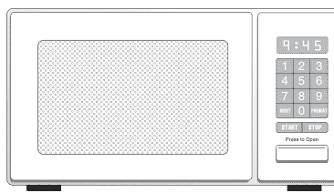
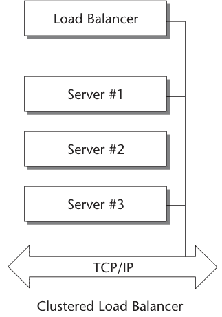

# 嵌入式 FreeBSD 秘籍，嵌入式技术系列


Fork ................................................................................................................................ 21


代码脚本段 ............................................................................................ 162
DIO JSP 页面 ........................................................................................ 162
总结 ................................................................................................................. 165


- 总结 ....................................................................................................... 182


- 固态设备...................................................................................... 197
- 总结 ....................................................................................................... 205


# 前言

泛泛讨论嵌入式系统是困难的，因为每个嵌入式系统都是独特的。本书并没有列出处理嵌入开发问题的通用原则，而是通过真实的硬件和软件展示了遇到的问题及其解决方案。从这个意义上说，它是为开发者准备的一本“菜谱”，提供了可以根据需要进行扩展或修改以解决其他设计问题的“设计配方”。

除了用于开发 DIO 设备的源代码外，本书还包含了关于获取开源软件版本的真实“如何做”信息，并描述了安装、配置和编程的步骤。无论你是在开发实际设备还是在对操作系统进行实验，本书都帮助你熟悉所有的开发问题，而不仅仅是开发概念。

本书介绍了在开发嵌入式 Web 设备期间遇到的一系列常见问题。每个章节涵盖一个特定主题，讨论该主题的背景信息，并针对该主题提供设计解决方案。这些章节并非旨在所有可能的解决方案，而是提供可以用于开发你自己解决方案的信息。

# 前提条件和其他资源

这是一本关于使用 FreeBSD 和 FreeBSD 发行版中包含的软件工具开发网络设备的书籍。因此，它假设读者在 Unix 环境下具有一些 C 和 C++ 编程背景。除了基础的编程技能外，如果你对数据结构和系统编程有基本的了解，将非常有帮助。本书适用于已经知道如何编写和编译代码的读者。


并进一步了解 FreeBSD 环境，以及探索与典型编程书籍不同的主题。其中某些主题并不要求你对计算机硬件有详尽的背景，但假设你具备一些知识并愿意学习必要的技能。

我写这本书是为了那些想要深入研究 FreeBSD 操作系统系统的读者。书中介绍的许多问题超出了 C 或 C++ 编程的范畴，涵盖了嵌入式系统工程师在产品开发过程中面临的问题。这并不是一本关于 FreeBSD 内部以及如何黑客内核的书。FreeBSD 拥有独特的渊源，目前已有许多优秀资源可以学习 FreeBSD 操作系统内部原理和系统管理。我推荐《The Design and Implementation of the 4.4 BSD Operating System》以及《The FreeBSD Handbook》（其地址位于 http://www.freebsd.org/doc/en_US.ISO8859-1/books/index.html）。除了这些资源，FreeBSD 网站还包含邮件列表、用户组、新闻组和网络资源。此外，Unix 编程也有优秀的参考文献，例如《Advanced Programming in the Unix Environment》和《The C Programming Language》，这两本书在 amazon.com 上均有。

## 结构

本书包含 12 章和 3 个附录。

第 1 章“入门”向你介绍了嵌入式系统，并描述了物联网设备和 FreeBSD。此外，还涵盖了构建书中描述物联网设备的主要硬件和软件。

第 2 章“系统编程”向你介绍了 Unix 进程和守护进程（daemons）。进程是 Unix 编程的基础。Unix 守护进程是一种特殊的进程。书中讨论了从 Unix 进程创建守护进程的细节。

第 3 章“系统调用”准确描述了什么是系统调用以及它在 FreeBSD 中是如何实现的。

第 4 章“设备驱动程序”提供了 FreeBSD 设备驱动程序及其数据结构的描述。书中讨论了用于开发驱动程序的工具，并使用这些工具为 PCI 数据采集控制器开发了一个实际的设备驱动程序。

第 5 章“中间层接口库”讨论了共享库以及用户代码如何访问设备驱动程序。

第 6 章“守护进程”在第 2 章的主题基础上，通过实现一个使用 sockets 的 Unix 守护进程，提供了一种用于读写数据采集板的简单协议。

第 7 章“远程管理”讨论了如何提供一种安全的远程管理方法。书中开发了一个配置 shell，可以通过 SSH 进行远程访问。

第 8 章“JNI 层”向用户介绍了 JNI，这是一种允许 Java 程序员调用 C 代码的接口。

第 9 章“使用 Tomcat 进行 Web访问”提供了显示网页内容所需的步骤。书中讨论了配置 Tomcat（一种 JSP 服务器）和编写 JSP 页面的流程。你将开发一个显示数据采集控制器状态的 JSP 页面。

第 10 章“构建内核”讨论了根据 DIO 物联网设备的硬件和特定特性构建自定义内核的步骤。

第 11 章“系统启动”讨论了 FreeBSD 的启动过程，以及为了启动脚本进行的必要修改，以运行 DIO 设备所需的服务（如 Tomcat、ssh 和加载 KLDs）。

第 12 章“CompactFlash 启动设备”描述了对闪存设备进行分区，并将之前章节中开发的代码加载到闪存中，使其成为一个“活生生”的设备服务器。

附录 A“FreeBSD 许可证”是 FreeBSD 许可证的副本。

附录 B“PCI 配置”讨论了 PCI 配置空间。开发 PCI 控制器的设备驱动程序需要了解 PCI 配置寄存器。该附录描述了 PCI 配置空间中的寄存器及其用途。

附录 C“内核可加载模块”涵盖了 KLDs，它们在第 2 章和第 4 章中用于系统调用和设备驱动程序。附录讨论了构成 KLD 的各个组件及其用途。

为了充分利用这本书的价值，我建议不要陷入细节，而是尝试通过研究实现某一主题的方法来对该主题获得通用的理解。通过熟悉开发嵌入式系统涉及每一个步骤，你应该能够将这些概念应用到可能遇到的任何开发任务中。


宏文本用于源代码。

### 粗体宏文本


嵌入式系统渗透到我们日常生活的各个方面。闹钟、咖啡机、数字表、、手机和汽车只是使用嵌入式系统的少数设备。此类系统的设计和开发是独特的，因为每个系统的设计限制都是不同的。开发嵌入式系统的关键在于理解用于开发的的硬件和软件。

### 嵌入式系统

嵌入式系统由旨在解决特定应用程序的硬件和软件组成。许多应用程序包含的不仅仅是计算机硬件和软件。例如，用于控制机械臂的工业视觉系统由一个嵌入式计算机、摄像头、显示器和机械臂组成。这些组件中的每一个都是嵌入式系统。

多年来，嵌入式系统从简单的自包含、单用途的系统演变为完全集成的、感知网络能力的系统。技术的快速变化和需求的增加促使开发者采用新的方法来设计和开发这些系统。让我们快速看看市场和需求是如何演变的。

经典的嵌入式系统被认为是单一应用程序的专用解决方案。在这些经典系统中，硬件是定制的以解决特定应用，操作系统是内部开发的。所有软件都包含在非易失性 RAM 中，且用户界面有限。这类嵌入式系统的例子有微波炉、MP3 播放器和手机。


图 1-1 经典嵌入式系统微波炉

随着互联网的增长，嵌入式系统的需求也变得复杂起来。除了解决经典的嵌入式系统问题外，系统设计人员还需要添加连接性以发送和接收数据，或提供软件升级的自动方法。系统设计人员并没有增加开发工作，而是转向使用第三方硬件并评估开源软件。这些下一代嵌入式系统的例子有负载均衡器、虚拟专用网络（VPN）和以太网交换机。


图 1-2 负载均衡器

### 物联网设备

今天开发的许多嵌入式系统几年前被称为服务器。这些系统使用 PC 硬件开发，运行嵌入式应用程序，具有互联网连接性，并运行远程配置的服务。这些嵌入式系统的最新形态被称为物联网设备。

## 第一章 入门

网络连接需要添加网络协议、服务和网络硬件。Web 服务需要添加复杂的应用程序。这些额外需求显著增加了嵌入式系统的硬件成本、开发和复杂性。

增加的性能需求将扩展性加入了系统需求列表，进一步限制了计算机设计解决方案的选择。此外，开发嵌入式系统的投资必须得到保护；随着硬件的演进，最终的硬件和软件在每个版本之间必须兼容。由于高科技行业快速的发展周期，硬件和软件必须足够灵活，以满足不断市场和客户的需求。

## 开发问题

通过选择第三方硬件和开源软件，系统设计人员可以确保获得来自多个供应商的兼容技术，并允许更快速、更廉地开发完成系统。系统设计师可以将资源专注于开发应用程序，而不是将资源集中在维护操作系统或开发下一个硬件平台上。


## 上市时间

开源操作系统可以缩短软件解决方案的鉴定和开发时间。服务器设备通过使用日益丰富的第三方硬件和软件集，应对了日益紧迫的市场时间压力和硬件灵活性需求。通过依赖现有的硬件和软件，服务器设备开发人员可以专注于解决应用程序问题。

## 人才资源池

网络设备复杂性的增加要求开发工具从简单的嵌入式工具转向现成的集成开发环境（IDE），这些工具能够帮助于开发安全、可靠且长时间运行的系统。此外，现成的集成开发环境还能缩短上市时间并缩短培训时间。

## 许可协议

传统的实时操作系统软件将源代码限制为被许可方，并在分发时可能需要支付版税费用。相比之下，开源软件许可允许被许可方向任何希望使用该软件的人免费提供软件。

## DIO 服务器设备

本章的剩余部分将讨论书中将开发的一种网络设备，即数字输入输出（DIO）服务器设备。DIO 服务器设备是一个嵌入式系统，提供读写数字 IO 线的能力。数字线通过网络套字、安全命令外壳或浏览器通过互联网进行监控。

该软件使用了开源操作系统和工具，即 FreeBSD 4.4 和 GNU 开发套件。系统软件和应用程序将在本书的后续章节中开发，展示了一个实际服务器设备的设计、开发和实现。

开发 DIO 服务器设备的硬件是一台标准 PC 和一张第三方数字 IO 数据采集卡。启动设备是一个 CompactFlash 适配器和 CompactFlash 卡，可以在互联网上购买。

## 第一章：入门

### FreeBSD

FreeBSD 是网络设备以及其他需要互联网连接、网络性能和可靠性的嵌入式系统的理想解决方案。此外，FreeBSD 随身附带了一套行业标准的软件开发和配置管理工具以及应用程序。它是一个与 Unix 兼容的开源操作系统，提供了前所未有的可靠性和安全性。它运行着互联网上最繁忙的一些网站（如 Yahoo 和 Hotmail），并为 AMI Storetrends NAS 和 IBM Whale/Interjet II 等嵌入式产品提供了基础。

FreeBSD 的核心主要基于 BSD/OS，该系统开发于 20 世纪 70 年代中期，以卓越的支持、稳定性、小占用和简单的安装而闻名。早期的 BSD Unix 开发很大程度上由 DARPA 资助，以支持互联网协议 TCP/IP 的开发。

如其名所示，FreeBSD 是免费的。可以直接从 FreeBSD 网站 ftp://freebsd.org/pub/FreeBSD/ 下载。或者，如果你像我一样想要一张真正的 CD，并想支持 FreeBSD 的工作，可以在许多零售店购买 FreeBSD，例如 BSD Mall (http://bsdmall.com/freebsd1.html)，或者像 Staples、CompUSA 和 Fries 等许多本地零售店。

除了通过购买正式版本提供资金支持外，还有另一种支持 FreeBSD 的方法。FreeBSD 发行是一个开源项目。如果你感兴趣，可以贡献时间和源代码开发。有关贡献 FreeBSD 开发的信息可以在 FreeBSD 网站找到：http://www.freebsd.org/en_US/ISO8859-1/articles/connecting/index.html。

除了其成熟的网络技术外，FreeBSD 内核还包含对许多磁盘和存储管理设施以及安全网络协议的string。FreeBSD 的特性和优势总结在以下段落中：

- **安全性**：FreeBSD 提供的安全功能使其适用于电子商务应用程序、安全互联网传输和虚拟网络。多年来，许多与安全相关的漏洞的修复程序已纳入 FreeBSD，以确保它适用于安全关键型环境。
- **稳健性性**：FreeBSD 基于已开发超过 20 年的软件。其持续开发关注于质量而非数量，对核心软件的更改经过严格控制。FreeBSD 核心内核及其特性代表了市场上最高质量的嵌入式操作系统。
- **小占用**：FreeBSD 是完全可定制的，可以配置为以最少软件运行，适用于某些最受限的嵌入式应用。PicoBSD 是 FreeBSD 的一个目标版本，包含可以放入软磁盘的完全可启动系统。除了灵活性外，许多嵌入式系统从片上磁盘（DiskOn-Chip）或 CompactFlash 设备启动。FreeBSD 能够支持许多此类设备。
- **许可**：FreeBSD 使用 BSD 许可分发，该许可允许但不要求共享源代码。由于 BSD 许可，以及许多嵌入式系统需要包含针对特定硬件的（包含在这些系统中）或设计本身的专有技术（如板载组件），BSD 系统往往是其他开源系统的更好的选择，而在其他开源系统中，由于许可问题，知识产权无法保持私密。

### GNU 开发工具

标准 FreeBSD 发行版包含 GNU 开发工具套，由编译器、链接器、库、调试器、性能管理和配置管理工具组成。除了深度之外，GNU 工具还提供了更新和大量的支持选项（如邮件列表和新闻组）。

### Java

使用 Java，系统设计师可以开发运行在任何地方的应用程序。除了开发网络部分，使用 Java 原生接口（JNI），系统开发者可以将旧系统连接到网络嵌入式系统。

### 硬件

书中的 DIO 服务器设备使用第三方硬件。硬件要求是一个具有网络能力的 PC 平台、一个 PCI IO 控制器和一个固态启动设备。

## 服务器

Network Engines Roadster 是一种高性能的 1U 网络设备，为任何应用程序提供易于定制的解决方案。Network Engines 包括 Intel 处理器、32 MB 内存、双以太网端口和一个 PCI 插槽。

### 数据采集

我们将使用的 DIO 网络硬件 Measurement Computing PCI-DIO24 IO 控制器可以读写 IO 信号。这是一个提供 24 位 IO 的 PCI 控制器。除了 PCI-DIO24 控制器，DIO 服务器设备使用 C37FF 线缆和 CIO-MINI 37 终端。

### 启动设备

嵌入式系统通常部署在比典型桌面电脑更严苛的环境中。硬盘在这种环境中可能会损坏或耗尽。嵌入式系统开发的一个趋势是使用 CompactFlash。CompactFlash 设备看起来类似于标准的 IDE 硬盘。为了将 CompactFlash 设备作为启动设备，需要一个 CompactFlash 适配器。

**TAPR CompactFlash 适配器 II**

Tucson 业余无线（TAPR）俱乐部销售通用的 CompactFlash 适配器。CompactFlash 适配器插入 IDE 插槽和电源接口。一旦连接了 CompactFlash 适配器并插入 CompactFlash 卡，该设备就可以像 IDE 硬盘一样使用。

**Sanisk 32 MB CompactFlash 磁盘**

Sanisk CompactFlash 是一种小型闪存设备，作为我们的嵌入式启动设备。结合 TAPR CompactFlash 适配器，我们能够将 Sanisk 设备作为 IDE 启动设备。Sanisk CompactFlash 设备可以在任何办公用品商店买到。

## 总结

在本章中，我们讨论了开发网络设备时使用第三方硬件和开源软件。书的其余部分将关注使用 FreeBSD 开发 DIO 网络设备。每一章都讨论与嵌入式系统开发相关的课题并提供解决方案。到本书结束，我们将开发出一个可以运行的设备。


## 第二章
## 系统编程

## 概述

FreeBSD 中任何编程任务的基础都是进程（process），它是一个正在执行的程序。它可能是一个提供文件的网络文件系统 (NFS) 守护进程，一个 gcc 编译过程，或者一个显示日期的 shell 程序——所有这些任务都在进程的上下文中执行。理解进程对于掌握后续章节中介绍的概念至关重要。本章将介绍使用进程的系统编程。

许多系统服务由一种特殊的进程称为守护进程（daemon process）提供。在讨论进程的过程中，我们将查看守护进程的特征，并为守护进程编写一个骨架源代码。在本章中，我们将涵盖以下主题：

- FreeBSD 进程
- 进程的创建与终止
- 进程属性
- 守护进程

## 进程

运行中的程序是进程的一个实例。FreeBSD 内核提供的众多特性之一是一个称为“用户模式”（User Mode）的保护环境。在用户模式下，进程无法访问硬件或受保护的系统变量。如果进程尝试访问受保护的内存，该进程将被终止。运行在内存中的进程由五个段组成：代码段（text）、初始化数据段（initialized data）、未初始化数据段（uninitialized data）、栈（stack）和堆（heap）。

代码段通常是只读的，包含程序的机器指令。初始化数据段是由程序文本初始化的变量。未初始化数据段（传统称为 bss）是未初始化的数据。栈用于在函数之间传递参数，并包含局部变量和函数返回地址。堆是操作系统提供的一个区域，用于动态内存分配。

| 段 |
| :--- |
| stack (栈) |
| heap (堆) |
| uninitialized data (未初始化数据) |
| initialized data (初始化数据) |
| text (代码段) |

我们可以通过调用 `size` 命令查看程序各个部分的大小。列表 2-1 中 `hostname` 程序的 `size` 命令输出所示。

图 2-1. 内存中运行的进程

```
## size hostname data bss dec hex filename
39452 4020 1968 45440 b180 hostname
```

列表 2-1

输出显示代码段大小为 39452 字节，数据段为 4020 字节，bss 大小为 1968 字节。栈和堆由操作系统为每个进程分配。代码段和数据段包含数据。由于 bss 段是未初始化的，镜像只包含其大小；当程序加载时，操作系统会将 bss 内存设置为零。

## 进程创建

当创建一个进程时，会产生原始进程（称为父进程）的完整副本，新创建的进程称为子进程。一旦进程创建完成，子进程将被调度执行。这产生了同一个程序的两个运行实例。进程之间只能通过进程标识符（PID）进行区分。

## fork 系统调用

当运行的进程调用 `fork` 系统调用时，会创建一个新进程。`fork` 系统调用是创建新进程的唯一方法。

```c
#include <sys/types.h>
#include <unistd.h>

pid_t fork(void);
```

`fork` 的独特之处在于单次调用返回两次。`fork` 向父进程返回子进程的进程标识符 (PID)，并向新创建的子进程返回 0。

进程创建时，会从父文件描述符继承以下属性列表：进程组 ID、访问组、工作目录、根目录、控制终端、资源、间隔计时器、资源限制、文件模式掩码和信号掩码。

## execve 系统调用

很多时候创建一个进程是为了运行另一个程序。`execve` 系统调用即用于此类，并在 `fork` 系统调用后立即调用。`execve` 系统调用将用新程序替换当前执行的程序。

```c
#include <unistd.h>
int execve(const char *path, char *const argv[], char *const envp[]);
```

`execve` 系统调用接受三个参数：`path` 是要执行的新程序的路径和文件名；`argv` 包含参数指针数组；`envp` 包含环境变量指针数组。

`execve` 系统调用在出错时返回 -1。

## 进程终止

进程可以有意地通过调用函数来终止，也可以无意地通过接收信号来终止。进程退出时，会向父进程发送通知。

## exit 系统调用

进程通过调用 `exit` 系统调用来终止。`exit` 系统调用会向父进程发送 SIGCHLD 信号。

```c
#include <sys/types.h>
#include <unistd.h>

void _exit(int);
```

`_exit` 系统调用会终止进程，但不执行标准 C 库的清理函数。

## wait 系统调用

`wait` 系统调用允许父进程检查子进程是否终止。当子进程退出时，父进程会接收通知。

```c
#include <sys/types.h>
#include <sys/wait.h>

pid_t wait(int status);
```

`wait` 系统调用返回子进程的退出状态。

## 示例

列表 2-1 演示了 `fork`、`wait`、`execve` 和 `exit` 的用法。父进程通过 `fork` 调用创建子进程。

```c
#include <stdio.h>
#include <unistd.h>
#include <stdlib.h>

int main(int argc, char **argv) {
    pid_t pid;
    int status;

    pid = fork();

    if (pid == 0) {
        // 子进程
        printf("子进程正在运行，PID: %d\n", getpid());
        execve("/bin/date", argv, NULL);
        exit(0);
    } else if (pid > 0) {
        // 父进程
        printf("父进程正在等待子进程 PID: %d\n", pid);
        wait(&status);
        printf("子进程已退出，状态: %d\n", status);
    } else {
        perror("fork failed");
    }

    return 0;
}
```

在列表 2-1 中，父进程会等待子进程。当子进程退出时，它会处于僵尸状态（zombie），直到父进程调用 `wait` 获取其退出状态。


## 第二章 系统编程

```c
uid_t getuid(void);
uid_t getegid(void);
```

`getuid` 和 `getegid` 系统调用总是成功的。

## seteuid 和 setegid 系统调用

进程可以通过调用 `seteuid` 和 `setegid` 系统调用来更改有效用户 ID 或有效组 ID。这两个调用可以设置有效用户 ID 和有效组 ID。

```c
#include <unistd.h>
#include <sys/types.h>
uid_t seteuid(void);
uid_t setegid(void);
```

seteuid 和 setegid 系统调用在成功时返回 0，错误时返回 -1。

## 示例

使用上述的用户 ID 和组 ID 函数，列表 2-2 打印了进程的真实和有效的用户 ID 以及组 ID。

```c
int main(int argc, char **argv)
{
    printf("UID = %d\n", getuid());
    printf("GID = %d\n", getegid());
    printf("EUID = %d\n", geteuid());
    printf("EGID = %d\n", getegid());

    exit(0);
}
```

列表 2-2

该程序在我系统上的输出显示如下：

```bash
## ./ids
UID = 1001
GID = 1001
EUID = 1001
EGID = 1001
```

快速查看 /etc/passwd 和 /etc/group 文件可以发现，该程序是以用户 paul 和组 paul 运行的，这是我的登录名和组。

以下是我在 /etc/password 文件中的登录名；第三列包含我的 UID。

paul*:1001:1001:Paul Cevoli:/home/paul:/bin/sh

以下是我在 /etc/group 文件中的登录组；第三列包含我的 GID。

paul*:1001

## 进程组

进程组由一组相关的进程组成。除了 PID 和 PPID 之外，进程还包含 PGID。每个进程组包含一个唯一的进程组标识。每个进程都能拥有一个进程组组长；组组长由 PID 表示。

## setpgid 和 getpgid 系统调用

进程可以通过使用 `setpgid` 系统调用设置和获取其 PGID。

```c
#include <unistd.h>

int setpgid(pid_t pid, pid_t pgrp);
pid_t getpgid(pid_t pid);
```

进程只能设置自身及其子进程的进程组。进程组的作用之一是向进程发送信号。

## 文件

子进程继承创建它的父进程的环境。这包括文件描述符、文件权限和当前工作目录。

## 文件描述符

文件描述符是用于访问文件的低级接口。文件描述符被实现为 `int`。每个进程都包含一个打开的文件描述符列表。子进程继承父进程的任何文件描述符。

## 权限

每个进程都包含一组默认的文件权限，称为文件模式掩码（file mode mask）。权限掩码是代表所有者、文件组和所有人读、写、执行权限的位。进程的文件模式掩码通过 `umask` 系统调用修改。

## umask 系统调用

权限掩码通常由用户登录 shell 中的 `umask` 命令设置。`umask` 系统调用将进程创建掩码设置为所包含的值。

```c
#include <sys/stat.h>
mode_t umask(mode_t mask);
```

文件掩码的上一个值将返回给调用者。

## 当前工作目录

每个进程都包含一个当前目录，即进程启动时的目录。

## chdir 系统调用

进程可以通过调用 `chdir` 系统调用更改其当前目录。

```c
#include <unistd.h>
int chdir(const char *path);
```

chdir 系统调用在成功时返回 0，错误时返回 -1。

## 资源

进程继承其父进程的资源限制。资源可以通过 `setrlimit` 和 `getrlimit` 系统调用进行读取或修改。

## setrlimit 和 getrlimit 系统调用

`setrlimit` 和 `getrlimit` 系统调用读取并修改资源限制。`setrlimit` 和 `getrlimit` 接收指定要读或写的资源参数；资源列表包含在 /usr/include/resource.h 中。第二个参数是一个 `struct rlimit` 指针。

```c
struct rlimit {
    rlim_t rlim_cur; /* 当前（软）限制 */
    rlim_t rlim_max; /* rlim_cur 的最大值 */
};
```

```c
#include <sys/types.h>
#include <sys/time.h>
#include <sys/resource.h>

int getrlimit(int resource, struct rlimit *rlp);
int setrlimit(int resource, struct rlimit *rlp);
```

setrlimit 和 getrlimit 系统调用在成功时返回 0，错误时返回 -1。

## 会话

一组进程组可以收集到一个会话（session）中，一组进程与控制终端关联。会话用于将用户登录 shell 及其创建的进程进行分组，或者为守护进程创建一个隔离环境。

## setsid 系统调用

```c
#include <unistd.h>
pid_t setsid(void);
```

`setsid()` 函数创建一个新会话。调用进程是新会话的会话首、新进程组的组长，且没有控制终端。调用进程是会话或进程组中的唯一进程。

## 控制终端

会话可能有一个控制终端；这是用于登录的设备。建立控制终端连接的会话首被认为是控制进程。我们在登录时建立了控制终端。程序有时需要与控制终端通信。

## 调度

### 优先级

执行时间根据进程的优先级分配给进程。优先级范围从 0 到 127。进程优先级定义在 /usr/include/sys/param.h 中。优先级越低，获得的调度优先级越优。

### getpriority 和 setpriority 系统调用

进程优先级可以通过 `setpriority` 和 `getpriority` 系统调用进行读取和修改。

```c
#include <sys/time.h>
#include <sys/resource.h>

int getpriority(int which, int who, int prio);
int setpriority(int which, int who, int prio);
```

getpriority 和 setpriority 系统调用根据 `which` 参数有不同的方式。

| which | 定义 |
|---|---|
| PRIO_PROCESS | 进程标识符 |
| PRIO_PGRP | 进程组标识符 |
| PRIO_USER | 用户 ID |

setpriority 和 getpriority 系统调用在成功时返回 0，错误时返回 -1。


## 21 第二二章
系统编程

`sig` 参数指定信号处理程序将捕获的信号。`func` 参数允许用户指定自定义的信号处理程序。通过将 `SIG_DFL` 指定为信号处理程序，可以重置信号的默认操作。通过将 `SIG_IGN` 指定为信号处理程序，可以忽略某个信号。忽略一个信号会导致后续的信号实例被忽略，并使挂起的信号实例被丢弃。

如果执行成功，`signal` 返回之前的操作；否则，返回 `SIG_ERR` 并设置全局变量 `errno` 以指示错误。

## kill 系统调用

`kill` 系统调用向进程或进程组发送信号。

```c
#include <sys/types.h>
#include <signal.h>

int kill(pid_t pid, int sig);
```

`pid` 参数是用于发送信号的进程 ID（process ID）。大于 0 的进程 ID 将将信号发送给该特定进程。PID 为 0 的进程 ID 将信号发送给发送进程进程组的所有成员。PID 为 -1 的进程 ID 如果是超级用户，则将信号发送给所有进程；否则，发送给所有与发送进程具有相同用户 ID 的进程。`sig` 是要发送的信号。

`kill()` 函数执行成功时返回值 0；否则返回 -1 并设置全局变量 `errno` 以指示错误。

## 守护进程 (Daemons)

守护进程是一种在后台运行的特殊进程，通常提供服务。守护进程通常在系统启动时启动，并一直运行到系统停止。所有守护进程都有一些共同的进程属性。在接下来的章节中，我们将介绍守护进程常见的问题。

- Fork
守护进程的第一的第一工作是通过 `fork` 系统调用创建一个子进程。子进程创建后，父进程和子进程将同时运行相同的程序。守护进程将使自己与父进程分离，并将自己放入后台运行。

- 创建新会话 (Create a new session)
下一步是创建一个新会话。创建新会话为我们带来了以下好处：进程成为新会话的 leader（session leader），进程成为新进程组的组长（group leader），且进程没有控制终端。

- 关闭文件描述符 (Close file descriptors)
记住，子进程从父进程继承其环境。如果父进程有任何打开的文件描述符，子进程将拥有这些打开的文件描述符的拷贝。良好的做法是假设任何文件描述符可能是打开的并将它们全部关闭。

- 修改当前工作目录 (Change the current working directory)
除了打开的文件描述符，子进程还继承当前的工作目录。如果当前工作目录是一个挂载的文件系统，该文件系统将无法被卸载。

- 设置文件模式创建掩码 (Set the file mode creation mask)
文件创建掩码继承自父进程，可以设置为拒绝某些权限。

- 处理子进程退出状态 (Handle Child Exit Status)
如果守护进程 fork 了进程来处理请求，它必须处理子进程 `SIGCHLD` 信号，否则子进程将变成僵尸进程（zombie）。

## 守护进程函数框架

### handle_sigchld 函数

列表 2-2 展示了处理子进程退出所需的代码。记住，如果父进程不获取子进程的退出代码，子进程将变成僵尸进程。父进程可以通过安装 `handle_sigchld` 信号处理程序在子进程退出时捕获 `SIGCHLD` 信号，从而避免创建僵尸进程。

```c
void handle_sigchld() {
    int pid;
    int status;
    while ((pid = wait3(&status, WNOHANG, (struct rusage *)NULL)) > 0) {
    }
}
```
列表 2-2

注意，`handle_sigchld` 函数以 `NOHANG` 模式调用 `wait3` 系统调用。这样做是为了让父进程继续执行，而不会阻塞等待进程退出。这允许父进程继续响应请求或执行其他任务。

### init_daemon 函数

列表 2-3 中的 `init_daemon` 函数处理了将子进程变为守护进程的细节。

```c
void init_daemon() {
    int childpid;
    int fd;
    struct rlimit max_files;

    /* 创建子进程 */
    if ((childpid = fork()) < 0) {
        /* 错误处理 */
        exit(-1);
    } else if (childpid > 0) {
        /* 父进程退出 */
        exit(0);
    }

    /* 创建新会话 */
    setsid();

    /* 检查是否可以离开进程组 */
    if (fork() < 0) {
        exit(-1);
    }

    /* 修改当前工作目录 */
    chdir("/");

    /* 关闭打开的文件描述符 */
    getrlimit(RLIMIT_NOFILE, &max_files);
    for (fd = 0; fd < max_files.rlim_cur; fd++) {
        close(fd);
    }

    /* 设置文件创建掩码 */
    umask(0);

    /* 设置信号处理程序 */
    signal(SIGCHLD, handle_sigchld);
}
```
列表 2-3

## 总结

## 第三章
系统调用

## 概述

如上一章所述，FreeBSD 提供了一种称为用户模式（User Mode）的执行环境。执行用户模式的进程无法直接访问内存、内核数据结构或硬件。内存和硬件的访问被限制在内核中，FreeBSD 为内核内核服务提供了详细接口，即系统调用。

将某些任务限制在内核中的好处有两个：首先，它让系统无需处理硬件的细节；其次，通过提供并强制执行详细接口，内核可以确保用户传递的参数是正确的，不会导致系统崩溃。内核的额外保护为应用程序提供了稳定的运行环境。

在本章中，我们将讨论系统调用的细节。在完成系统调用讨论后，我们将实现一个读写内核内存的调用。

## 库函数与系统调用

C 库提供了由头文件和库组成的 API，包含了许多常用函数和 IO 过程的实现。标准 C 库既作为库函数也作为系统调用实现。

对于系统设计人员来说，库函数和系统调用看起来是相同的。它们都有定义的函数原型和返回值。对于应用程序程序员来说，实现并不重要。接口、函数名、参数和返回值才是重要的。

当程序调用库函数时，执行传递给库函数，执行请求的操作，然后返回到调用函数。所有这一切都在运行进程的上下文和地址空间内完成。

（注意：图引用根据上下文保留为文本）
图 3-1. 库函数调用

图 3-2. 系统调用


## 软件中断

在 Intel x86 处理器上，在用户模式（User Mode）执行的程序通过执行软件中断切换到内核模式（Kernel Mode）。软件中断是由处理器使用中断处理程序（interrupt handler）异步处理的事件。中断处理程序在响应硬件或软件中断调用时被调用。软件中断与硬件中断不同，因为它在运行的进程内部是同步发生的。

在 Intel x86 处理器上，通过执行 `INT` 指令来调用软件中断。`INT` 指令接受一个 0 到 255 之间的数字，用于指定中断向量。系统调用被分配到中断向量 128 (0x80)。进程通过执行 `INT $080` 指令来调用系统调用。

每个中断向量在中断描述符表（IDT）中都有一个项。IDT 是一个包含 256 个长字（longs）的表。每个长字代表特定中断向量对应的处理程序的地址。对于系统调用，系统中断处理程序位于 0x200。0x200 是通过中断向量 0x80 * 4 = 0x200 得出的。

一旦处理器遇到软中断或硬件中断，它会从中断描述符表（IDT）中获取特定中断向量的地址并执行该中断向量。中断处理程序完成后，执行将返回用户进程。

## 传递数据

内核实现了许多不同的系统调用。为了区分不同的系统调用，会传递一个数字来指定正在执行哪个系统调用；这个数字被称为系统调用号。在 `/sys/kern/syscalls.master` 中可以找到定义的系统调用列表。在进行系统调用之前，系统调用号会被推入程序栈中。

除了系统调用号外，许多系统调用还接受参数。参数使用 C 调用约定传递给内核。调用者将系统调用参数推入栈中，按逆序（从右到左）一个一个，这样函数指定的第一个参数最后被推入。当从系统调用返回时，调用者将栈恢复到原始值；这被称为出栈（popping the stack）。

## 系统调用示例

为了演示编译器如何生成系统调用，让我们来看一个执行了 `open` 和 `close` 系统调用的程序的生成输出。列表 3-1

```c
#include <stdio.h>
#include <fcntl.h>

int main(int argc, char **argv)
{
  int fd;

  fd = open("file.dat", O_RDWR);
  close(fd);
}
```

注意：为了简化列出的输出，关闭了优化以使汇编代码更易读，并且程序是静态链接。使用的命令是：

```bash
gcc -static -o open.c
objdump -disassemble open
```

在列表 3-1 中的程序经过编译和链接后，我们可以使用 `objdump` 工具查看编译器生成的输出。列表 3-2 包含了 `open` 反汇编的部分列表。特别特别感兴趣的是将参数和系统调用号推入栈的过程，以及 `INT` 指令的执行。

```assembly
08041c4 <main>:
08041cd:    6a 02       push $0x2
08041cf:    68 01 84 04 00 push $0x840401
08041d4:    e8 7f 00 00 00 call 0804258
08041d9:    83 c4 10    add $0x10,%esp

0804258 <open>:
0804258:    8d 05 05 00 00 lea 0x5,%esp
080425e:    cd 80       int $0x80
0804262:    c3          ret
```

列表 3-2 显示了编译器为生成执行 `open` 系统调用的汇编代码而执行的步骤。位于 08041cd 和 08041cf 的指令将 `open` 模式和文件名推入栈。主程序随后调用 `open` 系统调用。`open` 然后在行 0804258 将其系统调用号 5 推入栈，然后调用软件中断。返回后，栈在行 08041d9 恢复到原始值。

## truss

在之前的章节中，我们详细查看了系统调用是如何实现的。在本节中，我们将展示标准工具如何使用系统调用来完成任务。`truss` 命令包含一个跟踪进程接收的系统调用和信号的工具。使用 `truss` 命令，我们将查看 `pwd` 如何制作系统调用。`pwd` 命令显示进程当前的工作目录。列表 3-3 包含了用于分析 `pwd` 命令的 `truss` 命令输出。

```text
readlink("/etc/malloc.conf", 0xbfff57,63)    = ERR No such file
mmap(0x0,4096,0x3,0x1002,-1,0x0)    = 671432704
brk(0x08504000)                    = 0
brk(0x08509000)                    = 0
sigaction(SIGSYS, 0xbfff660,0xbfff648) = 0
getcwd(0x08508000,0x0)             = /home/user
```

列表 3-3 truss 输出


## 系统调用参数

在系统调用讨论中，我们展示了用户程序如何在栈上将参数传递给系统调用。在内核实现中，参数是以结构体参数的形式传递的。结构中的每个元素都是从用户程序传递的一个参数。

列表 3-5 定义了 `copymem_args` 结构。`copymem` 结构包含四个元素，分别对应传递给 `copymem` 系统的四个参数。

```c
struct copymem_args
{
    int32_t kernel_addr;   /* 内核地址      */
    int32_t user_addr;     /* 用户提供的缓冲区 */
    int32_t len;           /* 传输长度  */
    int32_t direction;     /* 到内核为 1，从内核为 0 */
};
```
列表 3-5

`copymem` 系统调用接受四个参数：内核态地址、用户态地址、拷贝长度以及一个表示拷贝方向的数字。`copymem` 实现的两个方向是从内核态到用户态，或从用户态到内核态。

## copymem 系统调用

现在我们已经定义了加载处理器和参数，可以实现真正的 `copymem` 系统调用。系统调用接受两个参数。第一个是 `proc` 结构体，它包含了调用进程当前的状态和设置；`proc` 结构定义在 `/usr/include/sys/proc.h` 中。

第二个参数是参数结构体；在我们的案例中，它将是上一节定义的 `copymem_args` 结构体。列表 3-6 包含了 `copymem` 的源码列表。

```c
static int32_t
copymem(struct proc *p, struct copymem_args *uap)
{
    int stat;
    if (uap->direction == 0)
    {
        stat = copyin((void *)uap->user_addr, (void *)uap->kernel_addr, uap->len);
    }
    else if (uap->direction == 1)
    {
        stat = copyout((void *)uap->kernel_addr, (void *)uap->user_addr, uap->len);
    }

#if DEBUG
    if (stat != 0)
    {
        printf("copy failed, stat = %d\n", stat);
    }
#endif

    return(0);
}
```
列表 3-6

`copymem` 函数根据 `direction` 参数实现了两条控制路径。内存从用户态拷贝到内核态，或从内核态拷贝到用户态。由于处理器硬件细节，用户态和内核态的寻址可能略不同，因此在用户态和内核态之间拷贝内存可能比使用标准 C 库 `memcpy` 函数复杂。FreeBSD 内核提供了函数工具来处理用户态和内核态之间拷贝内存的细节。

## copyin 和 copyout 函数

`copyin` 和 `copyout` 函数用于在用户态和内核态之间拷贝内存。

```c
#include <sys/types.h>
#include <sys/system.h>

int copyin(const void *uaddr, void *kaddr, size_t len);
int copyout(const void *kaddr, void *uaddr, size_t len);
```

`copyin` 函数从用户态地址 `uaddr` 拷贝 `len` 字节的数据到内核态地址 `kaddr`。`copyout` 函数从内核态地址 `kaddr` 拷贝 `len` 字节的数据到用户态地址。

## sysent 结构体

FreeBSD 内核中的每个系统调用都有一个 `sysent` 结构，定义在 `/usr/include/sys/sysent.h` 中。`sysent` 结构包含两个元素：参数数量（由 `copymem_args` 结构定义为两个）以及系统调用名称。列表 3-7 定义了 `copymem` 的 `sysent`。

```c
static struct sysent copymem_sysent =
{
    4, /* 参数数量 */
    copymem /* 系统调用 */
};
```

系统调用包含在定义于 `/sys/kern/init_sysent.c` 的 `sysent` 结构中。构建 KLD 系统时，一个新的条目会被添加到内核全局 `sysent` 结构中。列表 3-8 包含了 `sysent` 结构的部分列表。

## 系统调用号

必须声明一个系统调用号；由于没有定义系统调用号，此值应为 `NO_SYSCALL`。内核动态定义系统调用号。

```c
static int32_t syscall_num = NO_SYSCALL;
```

当 KLD 系统调用加载到内核时，`sysent` 条目 `copymem_syst` 被分配给内核全局 `systent` 结构中的第一个可用索引。进入 `systent` 数组的索引就是系统调用号。

安装新系统调用的细节可见于 `/sys/kern/kern_syscalls.c` 中的 `syscall_register` 函数。列表 3-9 包含了 `syscall_register` 函数。

```c
int
syscall_register(int *offset, struct systent *new_systent,
    systent *old_systent)
{
    if (*offset == NO_SYSCALL) {
        int i;

        for (i = 1; i < SYS_MAXSYSCALL; ++i)
            if (systent[i].sy_call == (sy_call_t *)lkmnosys)
                break;
        if (i == SYS_MAXSYSCALL)
            return ENFILE;
        *offset = i;
    } else if (*offset < 0 || *offset >= SYS_MAXSYSCALL)
        return EINVAL;
    else if (systent[*offset].sy_call != (sy_call_t *)lkmnosys)
        return EEXIST;

    *old_systent = systent[*offset];
    systent[*offset] = *new_systent;
    return 0;
}
```
列表 3-9

当添加新系统调用时，会调用内核函数 `syscall_register`。传递新调用的 `offset` 和 `systent` 结构体。如果 `offset` 为 `NO_SYSCALL`，`syscall_register` 会扫描 `systent` 结构以寻找空系统位置。如果找到，则插入系统调用并将 `offset` 设置为插入该调用的 `systent` 结构索引。

## SYSCALL_MODULE 宏

创建系统调用模块的最后一项任务是声明该模块。用于定义系统调用的宏是定义在 `/usr/include/sys/systent.h` 中的 `SYSCALL_MODULE`。`SYSCALL_MODULE` 宏接收以下参数：

| 参数 | 描述 |
| --- | --- |
| name | 系统调用的通用名称 |
| offset | 系统调用号。这是内核全局 `systent` 结构中的索引 |
| systent | 该系统调用的 `systent` 结构 |
| load | 加载处理器函数名称 |
| arg | 预留，通常设置为 NULL |

`copymem` 的 `SYSCALL_MODULE` 声明包含在列表 3-10 中。

```c
/* 定义系统调用 */
SYSCALL_MODULE(copymem, &syscall_num, &copymem_syst, load, NULL);
```
列表 3-10

`SYSCALL_MODULE` 宏接受五个参数：`copymem` 是 KLD 的唯一名称。第二个参数 `syscall_num` 表示系统调用号，也是内核全局 `systent` 结构中的索引。第三个参数包含系统调用的 `systent` 结构。第四个参数是加载处理器的指针。第五个参数代表用户定义的 KLD 数据。

## 简单的调试器

在上一节中，我们创建了一个系统调用，允许用户程序读写内核内存。本章剩余部分定义了一个实现简单命令解析器的程序，为我们提供了读写内核内存的工具。

## 命令定义

`copymem` 工具是命令驱动的。为了简化命令解析，定义了一个结构类型 `command_t`，它包含一个 ASCII 命令字符串、一个函数指针和一个帮助字符串。

```c
/* 命令定义 */
typedef struct {
    char *command;        /* 表示命令的字符串 */
    fptr functionptr;     /* 指向实现的指针*/
    char *helpstring;     /* 文字帮助字符串 */
} command_t;
```
列表 3-11

`command` 元素包含一个用于与用户输入的 ASCII 字符串。`functionptr` 包含指向实现命令的程序。

```c
/* 命令函数指针定义 */
typedef void (*fptr) (int, char *);
```
列表 3-12

`fptr` 类型定义为所有命令处理器的原型。每个命令传递两个参数。第一个参数是系统调用号。由于 `copymem` 是 KLD 系统，没有系统调用封装器，因此通过使用 `syscall` 系统调用来执行系统。它接收系统调用号和系统调用参数，并按照上一节定义执行系统调用。

```c
#include <sys/syscall.h>
#include <unistd.h>
int syscall(int number, ...);
```

第二个是用户输入的命令字符串。每个命令处理器都是自包含的，因此每个命令处理器都从命令字符串中解析自己的参数。


## 命令表

命令表表示了 `copymem` 工具实现的所有命令。我们对 `copymem` 工具的实现包含四个命令：读取内核内存、写入内核内存、退出和帮助。

定义命令表是为了让解析器在接收到用户输入后遍历所有命令。所有的命令处理函数都进行了前向声明，因此我们可以声明命令表。

```
/*
** 命令表定义
*/
void read_handler(int num, char* args);
void write_handler(int num, char* args);
void quit_handler(int num, char* args);
void help_handler(int num, char* args);

command_t command_table[] =
{
    "read",    read_handler,      "read address length - 读取内存",
    "write",   write_handler,     "write address length - 内存",
    "quit",    quit_handler,      "quit 程序",
    "help",    help_handler,      "help 显示命令帮助",
    NULL,               /* 终止记录 */
};
```

列表 3-13

命令表包含了所有实现的命令。命令表中的每个条目将 ASCII 命令与其命令处理函数和帮助字符串关联。

添加新命令非常简单。声明命令处理函数，并将 ASCII 字符串、命令处理函数和帮助字符串添加到命令表中。在命令表中添加条目后，实现该命令处理函数。

## dumpmem 函数

位于列表 3-14 中的 `dumpmem` 函数是一个实用函数，用于以十六进制和 ASCII 字符格式导出内存。`dumpmem` 由 `read_handler` 函数调用，用于显示请求的内核内存。

```
/*
** 名称: dumpmem
** 效果：以十六进制和 ASCII 格式导出内存
 */
static int32_t
dumpmem(uint32_t kernp, uint8_t* userp, uint32_t len) {
    int32_t i, j;
    int32_t rows = len / CHARS_PER_ROW;
    uint8_t *ptr = (uint8_t *)userp;

    printf("\n\n");

    for (i = 0; i < rows; i++) {
        uint32_t kernaddr;

        kernaddr = kernp + (i * CHARS_PER_ROW);

        printf("%08x: %s,", kernaddr);

        for (j = 0; j < CHARS_PER_ROW; j++) {
            if (isprint((int) ptr[i * CHARS_PER_ROW + j])) {
                printf("%c", ptr[i * CHARS_PER_ROW + j]);
            } else {
                printf(".");
            }
        }
        printf("\n\n");
    }

    printf("\n\n");

    return (0);
}
```

列表 3-14
`dumpmem` 用于分三列显示内存。第一列包含内核地址；第二列是以十六进制符号表示的 8 字节数据。最后一列是与第二列相同的 8 字节数据但  ASCII 格式。如果字符是不可打印的，则打印点 (.) 字符。

## 命令处理函数

每个命令都实现自己的命令处理函数。命令处理函数负责解析其参数并执行命令操作。

## read 命令

`read` 命令用于读取和显示内核内存。`read` 命令接受两个参数：内核地址和长度。读取的最大尺寸为 4096 字节，由 `BUFFER_MAX` 宏定义。这是一个任意值。

```
read_handler(int num, char* iobuf)
{
    int32_t stat = 0;
    uint32_t i;
    uint32_t kerneladdr;
    uint32_t length;

    /* 验证命令参数 */
    i = sscanf(iobuf, "%s %x", &kerneladdr, &length);
    if (i != 2)
        return;

    /* 限制命令到缓冲区大小 */
    if (length > BUFFER_MAX)
        length = BUFFER_MAX;

    /* 执行命令 */
    stat = syscall(num, kerneladdr, iobuf, KERNEL_READ);
    if (stat != 0)
    {
        printf("syscall failed\n");
        return;
    }

    dumpmem(kerneladdr, iobuf, length);
}
```

列表 3-14

## write 处理函数

`write` 命令用于写入内核内存。`write` 命令接受两个参数：内核地址和长度。写入的最大尺寸为 4096 字节，由 `BUFFER_MAX` 宏定义。这是一个任意值。

```
void write_handler(int num
```

列表 3-15

## quit 处理函数

`quit` 处理函数用于清理并退出程序。`quit` 处理函数不使用输入参数；它们会被忽略。

```
void quit_handler(int num, char* args)
{
    /* 既然是程序退出，我们必须释放
       主程序中分配的用户缓冲区 */
    free(args);
    exit(0);
}
```

列表 3-16

## help 处理函数

`help` 处理函数用于显示帮助字符串。`help` 处理函数不使用输入参数；它们会被忽略。

```
/*
** 显示帮助命令
*/
void help_handler(int num, char* args)
{
    command_t* cmdptr;
    /* 解析用户命令 */
    cmdptr = &commands[0];
    while (cmdptr != NULL)
    {
        printf("%s\t%s\n", cmdptr->command, cmdptr->help);
        if (strcmp(args, cmdptr->command) == 0)
            break;
        cmdptr++;
    }
}
```

列表 3-17
每个命令条目包含帮助字符串。

## 主程序

`copymem` 程序处理初始化和命令解析。由于 `main` 函数是无限的，它会循环循环处理命令解析。

```c
#include <stdio.h>
#include <stdlib.h>
#include <string.h>
#include <unistd.h>
#include <sys.h>
#include <sys/syscall.h>

#define CHARS_PER_ROW 16
#define BUFFER_MAX 4096
#define KERNEL_READ 1
#define KERNEL_WRITE 2

typedef struct {
    const char* command;
    void (*handler)(int, char*);
    const char* help;
} command_t;

void read_handler(int num, char* args);
void write_handler(int num, char* args);
void quit_handler(int num, char* args);
void help_handler(int num, char* args);

command_t command_table[] =
{
    "read",    read_handler,      "read address length - 读取内存",
    "write",   write_handler,     "write address length - 写入内存",
    "quit",    quit_handler,      "quit 程序",
    "help",    help_handler,      "help 显示命令帮助",
    NULL,               /* 终止记录 */
};

command_t* commands = command_table;

static int32_t dumpmem(uint32_t kernp, uint8_t* userp, uint32_t len) {
    int32_t i, j;
    int32_t rows = len / CHARS_PER_ROW;
    uint8_t *ptr = (uint8_t *)userp;

    printf("\n\n");

    for (i = 0; i < rows; i++) {
        uint32_t kernaddr;
        kernaddr = kernp + (i * CHARS_PER_ROW);
        printf("%08x: %s,", kernaddr);

        for (j = 0; j < CHARS_PER_ROW; j++) {
            if (isprint((int) ptr[i * CHARS_PER_ROW + j])) {
                printf("%c", ptr[i * CHARS_PER_ROW + j]);
            } else {
                printf(".");
            }
        }
        printf("\n\n");
    }
    printf("\n\n");
    return (0);
}

void read_handler(int num, char* iobuf) {
    int32_t stat = 0;
    uint32_t i;
    uint32_t kerneladdr;
    uint32_t length;
    i = sscanf(iobuf, "%s %x", &kerneladdr, &length);
    if (i != 2) return;
    if (length > BUFFER_MAX) length = BUFFER_MAX;
    stat = syscall(num, kerneladdr, iobuf, KERNEL_READ);
    if (stat != 0) {
        printf("syscall failed\n");
        return;
    }
    dumpmem(kerneladdr, iobuf, length);
}

void write_handler(int num, char* iobuf) {
    int32_t stat = 0;
    uint32_t i;
    uint32_t kerneladdr;
    uint32_t length;
    i = sscanf(iobuf, "%s %x", &kerneladdr, &length);
    if (i != 2) return;
    if (length > BUFFER_MAX) length = BUFFER_MAX;
    stat = syscall(num, kerneladdr, iobuf, KERNEL_WRITE);
    if (stat != 0) {
        printf("syscall failed\n");
        return;
    }
}

void quit_handler(int num, char* args) {
    free(args);
    exit(0);
}

void help_handler(int num, char* args) {
    command_t* cmdptr;
    cmdptr = &commands[0];
    while (cmdptr != NULL) {
        printf("%s\t%s\n", cmdptr->command, cmdptr->help);
        if (strcmp(args, cmdptr->command) == 0) break;
        cmdptr++;
    }
}

int main(int argc, char** argv) {
    if (argc < 2) {
        help_handler(0, NULL);
        return 0;
    }
    // ... 略的循环处理逻辑
}
```

## 示例

现在我们已经创建了基础内核调试器功能，让我们尝试一个示例。内核包含操作系统版本。为了对内存进行简单的测试，我们可以使用新开发的 `copymem` 工具来修改内存中的操作系统版本。

在开始测试之前，让我们使用标准的 `uname` 命令显示内核版本。

```bash
## uname -r
4.4-RELEASE
```

这里，`uname` 显示版本为 4.4-RELEASE。操作系统版本包含在名为 `osrelease` 的全局变量中。我们可以通过 `nm` 工具扫描内核程序来确定其在内存中的地址。

```bash
## nm /kernel | grep osrelease
c0205a94 r __set_sysctl_set_sym_sysctl1___kern_osrelease
c023f4c2 D osrelease
c022faca0 d sysctl1___kern_osrelease
```

从 `nm` 命令的输出中，我们看到 `osrelease` 的内核地址是 c023f4c2。我们可以运行 `copymem` 工具来修改此位置。在修改内存之前，我们将显示它以验证地址正确。验证地址后，用新数据覆盖版本，然后再次显示相同的位置以查看地址已被修改。

```bash
## ./copymem

read c023f4c2 10
```

```
c023f4c2:   34 2e 34 2d 52 45 45 4c 45 45 4.4-RELE......
c023f4ca:   41 53 45 00 00 00 c0 b6 ASE......
```


```
> write c023f4c2 8
>> cookbook
```

```
c023f4c2: 63 6f 6f 6b 62 6f 6f 6f 6b cookbook
c023f4ca: 41 53 45 00 00 00 b6 ASE....
```

```
> >> read c023f4c2 10
```

通过使用 `copymem`，我们已成功修改了 `osversion` 字符串。作为最后的检查，我们将重新运行 `uname` 命令，并发现我们确实修改了 FreeBSD 操作系统版本字符串。

```
## uname -r
cookbookASE
```

`uname` 工具的输出现在显示了预期的结果。

## 总结

在本章中，我们讨论了 FreeBSD 系统调用的细节。理解这些工作原理是内核黑客（kernel hacking）的极佳入门。作为讨论的一部分，我们实现了一个系统调用和一个工具，允许我们从应用程序程序读写内核内存。

## 设备驱动程序

## 概述

设备驱动程序是 FreeBSD 内核的扩展，它实现了一个指向硬件的标准软件接口。设备驱动程序由数据结构和设备驱动程序编写者提供的固定函数集组成。内核会响应某些条件（如驱动程序加载、电源管理事件、设备中断或应用程序请求服务）调用驱动程序函数。

为了开发设备驱动程序，需要理解相关的内核数据结构和驱动方法函数。本章涵盖了以下主题：

- 驱动程序环境
- 设备驱动程序内核数据结构
- 驱动方法函数
- 开发 FreeBSD 设备驱动程序的步骤
- PCIO-DIO24 设备驱动程序

| PCI 总线 | ISA 总线 | EISA 总线 |
| --- | --- | --- |
| NIC 控制器 | | |
| 数据采集控制器 | | |

图 4-1. 根总线

自动配置（Autoconfiguration）是 FreeBSD 内核执行的程序，用于动态发现并启用硬件。内核探测系统总线，对于发现的每个总线，都会附加、初始化并配置设备。在自动配置期间，会调用设备驱动程序的探测例程（probe routine）。探测负责检测硬件以确定是否附加了其他设备。一旦成功探测到设备，FreeBSD 内核必须将其附加。附加函数（attach function）会初始化设备硬件和任何软件状态。

### 自动配置

自动配置代码在加载时检测硬件，并负责在加载期间分配硬件资源，在卸载时释放硬件资源，并响应电源管理事件将硬件置于一致状态。自动配置代码通常只在加载和卸载时使用。

一个 FreeBSD 设备驱动程序包含两个主要组件：自动配置（autocon）、`device_method_t` 以及设备切换表 `cdevsw`。在讨论数据结构的实现之前，让我们看看设备驱动程序的环境以及每个数据结构在运行的 FreeBSD 系统中所扮演的角色。

### 设备切换表

设备切换表由一组例程组成，这些例程包含了设备驱动程序的上下半部分。上半部分为设备驱动程序提供系统实现，如 `read`、`write`、`open`、`ioctl` 和 `close`。上半部分函数与用户进程同步执行且是可抢占的，允许阻塞。下半部分例程与设备寄存器接口并实现硬件中断服务例程。下半部分例程不可抢占的且不能阻塞。

典型的设备驱动程序接受来自上半部分的请求，然后将请求放入队列由下半部分处理。每个请求都被放入一个上下半部分共享的通用数据结构中。由于设备驱动程序的上下半部分独立运行，因此对驱动程序上下半部分共享的任何数据的访问进行适当的同步至关重要。

与第 3 章描述的系统调用一样，FreeBSD 提供了对动态加载设备驱动程序的支持。除了 FreeBSD 设备驱动程序所需的典型驱动数据结构外，还为 DIO 设备驱动程序实现了动态加载和卸载功能的 KLD 框架结构。

## 驱动结构

FreeBSD 设备驱动程序由各种进入驱动函数或方法的入口点组成，当 FreeBSD I/O 子系统想要驱动程序执行特定功能时会调用这些点。提供了两个结构供 FreeBSD 设备驱动编写者实现驱动程序函数：`device_method_t` 用于自动配置函数的结构，`cdevsw` 用于系统调用和中断。后续章节将讨论更常见的函数回调以及导致函数被调用的条件。

| device_method_t | cdevsw |
|--- |--- |
| probe | open |
| attach | close |
| detach | read |
| shutdown | write |
| suspend | ioctl |

图 4-2. 设备驱动程序

## 驱动数据结构

### device_method_t 结构

驱动的 `device_method_t` 是包含驱动程序自动配置方法函数的列表。`device_method_t` 包含一个为该驱动实现的函数列表，并以空项终止。`device_method_t` 结构定义在 `/usr/include/sys/bus.h` 中。

```c
typedef struct device_op_desc *device_op_desc;
typedef struct device_method device_method_t;
typedef int (*devop_t)(void);
struct device_method {
    devop_t desc;
    devop_t func;
};
```

以下是最常见的设备方法函数列表及其每个简要描述。

```c
int probe(device_t dev)
```

`probe` 方法在驱动程序加载时被调用，用于判断设备是否存在。如果 `probe` 成功找到设备，它应该返回成功。

```c
int attach(device_t dev)
```

如果 `probe` 成功，则调用 `attach` 方法，它负责初始化硬件并将设备切换表表项添加到内核全局切换表中。`attach` 应返回 0。

```c
int detach(device_t dev)
```

`detach` 在驱动程序从系统中移除时被调用，负责将硬件置于一致状态并从内核全局切换表中移除项。成功后返回 0。

```c
int shutdown(device_t dev)
```

`shutdown` 方法在系统关闭期间被调用，允许驱动进入静态状态。

```c
int suspend(device_t dev)
```

`suspend` 方法由电源管理系统调用，在断电前允许驱动保存状态。

```c
int resume(device_t dev)
```

`resume` 方法由电源管理系统调用，在恢复电源后允许驱动初始化。

## cdevsw 结构

除了驱动的自动配置组件外，设备切换表包含一个驱动的项：

```c
struct cdevsw {
    int            ioctl;
    d_map_t       *mmap;
    d_strategy_t *strategy;
    const char    *name;    /* 设备名称，例如 'vn' */
    int            maj;
    d_dump_t      *dump;
    d_psize_t     *psize;
    u_int          flags;
    int            bmaj;
    /* 以下添加与 4.2 及以下版本兼容 */
    kqfilter_t    *kqfilter;
};
```

我们将查看 `cdevsw` 的每一个元素。

```c
static int d_open(device_t dev, int flags, int devtype, struct proc *p)
```

`open` 在进程通过设备文件名调用系统时调用。它负责执行设备可能具有任何规则或限制。

```c
static int d_close(device_t dev, int flags, int devtype, struct proc *p)
```

`close` 在进程通过 `open` 获取文件描述符调用系统时调用。它负责任何设备清理任务，例如将设备置于一致状态。

```c
static int d_read(device_t dev, struct uio* uio, int flags)
```

`read` 在进程通过 `open` 获取设备特殊名称的文件描述符调用读取系统时调用。

```c
static int d_write(device_t dev, struct uio* uio, int flags)
```

`write` 在进程通过 `open` 获取设备特殊名称的文件描述符调用写入系统时调用。

```c
static int d_ioctl(device_t dev, long cmd, caddr_t data, int flag, struct proc *p)
```

`ioctl` 在程序通过 `open` 获取设备特殊名称的文件描述符调用 `ioctl` 系统调用时调用。它用于提供设备相关的的操作。

```c
static int d_poll(device_t dev, int which, struct proc *p)
```

`poll` 用于驱动程序查看特定事件是否发生。


static int d_mmap(dev_t dev, struct vm_offset_t offset, int nprot)

mmap 用于将内存保存到进程空间。

static void d_strategy(struct buf *bp);

用于在驱动程序的下半部分启动读或写操作。

char d_name

d_name 代表设备驱动程序的名称。

int d_maj

d_maj 是设备的主号。每个设备都有一个主号。通常，当你开始开发设备驱动程序时，你会查询 /usr/src/sys/conf/majors 来找到一个未使用的的主号并使用它。

static int d_dump_t(dev_t dev);

dump 用于在系统即将崩溃时将物理内容保存到次级存储中。

static int d_psize_t(dev_t dev);

psize 返回磁盘分区的大小。

有一个值得注意的函数它没有包含在 cdevs 结构中，而 cdevs 结构是许多设备驱动程序的不可或缺的一部分——那就是中断处理程序。中断处理程序在驱动加载时分配，并被认为是驱动程序的下半部分。

static void d_intr(void* arg);

d_intr 代表设备中断处理程序。它负责任何清除挂起中断的硬件功能，并响应硬件中断启动任何操作。

## device_t 结构

设备对象是硬件设备的抽象表示。连接到 FreeBSD 内核的每个硬件设备都由一个设备对象表示。一个成功探测并挂载的设备对象包含设备类和设备驱动程序对象。通过一组 set 和 get 例程来访问设备对象。有函数用于添加、删除和遍历父节点子节点。我们正在为一个简单的控制器开发驱动程序，因此我们的重点将放在与其相关的例程上。用于访问驱动程序特定字段的例程：

```
typedef struct device *device_t;
```

设备结构列在 /usr/include/sys/bus_private.h 中，如下所示。

```
struct device {
/*
 * 设备层次结构。
 */
TAILQ_ENTRY(device) link; /* 父节点中的设备列表 */
device_t parent;
device_list_t children; /* 子设备列表 */
/*
 * 此设备的详细信息。
 */
device_ops_tops *driver;
driver;
devclass_t devclass; /* 我们所在的设备类 */
int unit;
char *nameunit; /* 名称+单元号，例如 foodev0 */
char *desc; /* 驱动程序特定描述 */
int busy; /* 对 device_busy() 的调用计数 */
device_state_t state;
u_int32_t flags; /* api flaglevel device_get_flags() */
u_short flags;
u_char order; /* 来自 device_add_child_ordered() 的顺序 */
u_char pad;
void *ivars;
void *ivars;
void *softc;
;
```

device_t 包含一组访问器函数，用于设置和获取 device_t 函数的特定条目。device_t 访问函数以 device_ 为前缀。当我们讨论 DIO 驱动程序时，你会注意到对定义的访问器函数的调用。每个函数的命名都很恰当，代表了它在 device_t 结构上执行的操作。这种命名约定有助于 DIO 驱动程序代码的描述和理解。

## 第四章
设备驱动程序

## driver_t 结构

FreeBSD 内核中的每个驱动程序都由其驱动对象表示。驱动对象包含设备名称、驱动程序方法函数列表、设备类型以及私有数据结构的大小。驱动对象在驱动程序源代码中声明。

```
typedef struct driver      driver_t;

struct driver {
    const char      *name;    /* 驱动程序名称 */
    device_method_t *methods; /* 方法表 */
    size_t          softc;    /* device soft 结构的大小 */
    void            *priv;     /* 驱动私有数据 */
    device_ops_t    ops;      /* 编译的方法表 */
    int             refs;     /* 包含驱动程序的 devclasses 数 */
};
```

## softc 结构

除了内核数据结构外，每个驱动程序都包含一个用于本地状态信息、配置信息或任何必须保存的数据结构。该结构被称为驱动 softc。每个驱动程序都声明自己的 softc 结构。该结构的标准用法是在驱动程序的上半部分和下半部分之间传递数据。

## struct devclass_t

devclass 对象表示类设备。它有两个目标。第一个是提供从名称到设备的映射。第二个是维护驱动程序列表。例如，名称为 pci 的 devclass 将保留所有 PCI 硬件驱动程序的列表。

```
typedef struct devclass      devclass_t;
```

## DRIVER_MODULE 宏

```
DRIVER_MODULE(name, busname, driver_t driver, devclass_t devclass, modeventhand t evh, void *arg);
```

## 嵌入式 FreeBSD 食谱

FreeBSD 支持驱动程序的动态加载和卸载。
自动配置代码与 FreeBSD 动态内核链接器 (KLD) 子系统通信的方法。

## dev_t 结构

系统中的每个设备都由一个 dev_t 结构表示，它包含设备切换表、最大 IO 大和设备标志。dev_t 结构负责将上层调用映射到实际的设备驱动实现。dev_t 和 specinfo 的声明可以在 /usr/include/sys/conf.h找到。

```
typedef struct specinfo *dev_t;

struct specinfo {
    u_int               si_flags;
    #define SI_STASHED 0x0001  /* 在 stashed存储中创建 */
    udev_t              si_udev;
    LIST_ENTRY(specinfo) *si_hash;
    SLIST_HEAD(struct vnode, si_hlist);
    char                si_name[SPECNAMELEN] + 1];
    void                *si_drv1, *si_drv2;
    struct cdevsw       *si_devsw;
    int                 si_iosize_max;  /* 最大 I/O 大 (对于 physio &al) */
union {
    struct {
        struct tty *_sit_tty;
    } __tty;
    struct {
        struct disk *_sid_disk;
        struct mount *_sid_mountpoint;
        int             _sid_bsize_phys;  /* 最小物理块大小 */
        int             _sid_bsize_best;  /* 最佳块大小 */
    } __sid_disk;
} __si_u;
```

## make_dev 函数

make_dev 函数创建一个 dev_t 结构并将其放入系统的设备列表中。所有加载的设备在 dev_t 列表中都有一个条目。

```
dev_t make_dev(struct cdevsw *cdevsw, int, uid_t uid, gid_t gid, int perms, char *name, ...)
```

cdevsw 代表设备驱动程序的设备切换表。

minor 指定正在创建的是哪个从设备号。

uid 是拥有创建的 dev_t 设备的用户 ID。

gid 是拥有创建的 dev_t 设备的组 ID。

perms 是分配给创建的 dev_t 设备的权限。

name 是要创建的名称。

make_dev 创建一个新的 dev_t 结构。如果成功，将在 /dev 中创建设备名称。

## destroy_dev 函数

destroy_dev 函数销毁系统设备中的 dev_t 条目。

```
void destroy_dev(dev_t dev);
```

destroy_dev 取一个参数。

dev，来自 make_dev 的返回值。

destroy_dev 没有返回值。

## DIO24 设备驱动程序

在本节中，我们将开发一个访问 DIO24 特性的字符驱动程序。在编写任何驱动程序代码之前，最好创建一个驱动程序将执行的任务列表。要实现的任务列表包括：

- 探测 DIO24 硬件
- 在加载时分配硬件资源
- 卸载时释放硬件资源

## 骨架驱动源

在开发驱动程序时，通常是从骨架代码开始，即与要编写的驱动程序类似的代码或实现常用空原型的驱动程序 shell，然后根据需要添加功能。FreeBSD 提供了一个生成 shell 的脚本，位于 /usr/share/example/drivers 的 make_device_driver.sh 包含了必要的驱动数据结构、存回调函数和 KLD 开发环境。

- 读写 DIO24 硬件
- 处理中断

`make_device_driver.sh` 脚本在 FreeBSD 4.4 中仅生成 ISA 设备驱动。我通过 CVSUP 获取了当前的 `make_device_driver.sh`，它可以生成 ISA 和 PCI 驱动程序。

> 要生成 shell 驱动，调用 make_device_driver.sh 并传入要创建的设备名称。对于这个设备，我使用的是 dio，代表数字 IO。

```
$ make_device_driver.sh dio
```


## 61 第四章
设备驱动程序

DIO 设备驱动程序源码包含了 ISA 和 PCI 设备驱动的空壳实现。由于 PCI-DIO24 是一块 PCI 卡，我对 DIO 源代码的第一个修改是删除了所有对 ISA 回调函数的引用。完成后，我执行了全量编译，以确保剩余代码仍然正确。

## DIO 驱动函数

### dio_pci_probe 函数
设备驱动程序的首要任务是检测硬件是否存在。这是通过调用探测（probe）设备来实现的。探测通过探测方法执行。Dio.c 包含一个在 `dio_pci_probe` 函数中实现的探测 PCI 设备的函数。

dio_pci_probe 调用内核函数 `pci_get_devid` 来返回该设备的厂商 ID（Vendor ID）和设备 ID（Device ID）。`pci_get_dev` 返回一个 32 位的长字，其中高 16 位包含 PCI 设备 ID，低 16 位包含该卡的 PCI 厂商 ID。下面的代码展示了 PCI-DIO24 对 `pci_ids` 结构的修改。

```c
static struct _pcisid
{
    _int32_t type;
    const char *desc;
} pci_ids = {
    { 0x00281307, "Measurement Computing PCI-DIO24 Digital I/O Card" },
    { 0x00000000, NULL }
};
```

DIO 设备驱动程序可以被编译和加载，并能够成功识别 PCI-DIO24 卡。完整的 `dio_pci_probe` 函数列如下。

```c
static int
dio_pci_probe (device_t device)
{
    _int32_t type = pci_get_devid(device);
    struct _pcisid *ep = pci_ids;
    while (ep->type && ep->type != type) {
        ++ep;
        if (ep->set_desc) {
            device_set_desc(device, ep->desc);
            return 0; /* 如果可能有更好的驱动，返回 -2 */
        } else {
            return ENXIO;
        }
    }
}
```

dio_pci_probe 扫描 `pci_ids` 结构尝试匹配厂商 ID 和设备 ID。当找到匹配项时，使用内核函数 `device_set_desc` 更新设备的文字描述。

## 提示

FreeBSD 有一个名为 `pciconf` 的工具，用于导出 PCI 设备的信息。`pciconf` 等工具用于在开发设备驱动程序之前调试并验证硬件工作正常。

pciconf 工具用于检测硬件是否被 FreeBSD 成功加载并识别。`pciconf -1` 将列出系统中存在的 PCI 设备列表。一旦安装了硬件外设设备，它应该始终出现在 `pciconf` 命令的输出中。

## dio_pci_attach 函数

一旦设备驱动程序成功探测到硬件，内核就会调用驱动程序的 attach（挂载）方法。attach 方法负责分配硬件资源并为 PCI-DIO24 创建字符设备。PCI_DIO24 有三个硬件资源：一个中断和两个 IO 端口。dio 包含了 `dio_pci_attach` attach 方法。

```c
static int
dio_pci_attach(struct device_t device) {
    int error;
    struct dio_softc *scp = DEVICE2SOFTC(device);

    error = dio_attach(device, scp);
    if (error) {
        dio_pci_detach(device);
    }
    /* 处理 softc 初始化 */
    dio_softc_init(device);

    return (error);
}
```

dio_pci_attach 使用两个实用例程来完成其任务：`dio_attach` 和 `dio_allocate_resources`。

dio_attach 负责在分配中断后，将中断添加到系统中断处理列表中。

dio_allocate_resource 函数负责处理中断和 `register_attach` 硬件资源的分配。

## device_attach 函数

如果找到了控制器硬件，就会调用 attach 设备处理程序。该 attach 设备处理程序负责创建 `dev_t` 结构、分配资源并设置设备中断。

```c
dio_attach(device_t device, struct dio_softc * scp)
{
    device_t parent = device_get_parent(device);
    int unit = device_get_unit(device);

    scp->dev = make(&dio_devsw, 0,
        UID_ROOT, DIO_OPERATOR, 0600, "dio%d", unit);
    scp->dev_drvl = scp;
}

if (dio_allocate_resources(device)) {
    goto erxit;
}

/* 注册中断处理程序 */
/*
 * 类型应该是以下之一之一：
```

- * INTR_TYPE_TTY
- * INTR_TYPE_BIO
- * INTR_TYPE_CAM
- * INTR_TYPE_NET
- * INTR_TYPE_MISC

- * 这可能会随着 SMPng 变化。INTR_TYPE_FAST 可能

## 63 第四章
设备驱动程序

## 64 第四章
设备驱动程序

## dio_allocate_resources 函数
在分配硬件资源时，`dio_allocate_resources` 应该处理 PCI-DIO24。

```c
static int
dio_allocate_resources(device_t device) {
    int error;
    struct dio_softc *scp = DEVICE2SOFTC(device);

    /* 分配 IO 端口 */
    scp->io_port[0] = bus_alloc_resource(device, BXTR_DEV_IO,
        MAP_PHYS | MAP_RECVIVE, 0x300, 0x20);
    if (scp->io_port[0] == NULL) {
        error = EIO;
        goto erxit;
    }
    scp->io_port[1] = bus_alloc_resource(device, BXTR_DEV_IO,
        MAP_PHYS | MAP_RECVIVE, 0x320, 0x20);
    if (scp->io_port[1] == NULL) {
        error = EIO;
        goto erxit;
    }

    /* 分配中断 */
    scp->irq = bus_alloc_resource(device, BXTR_DEV_IRQ,
        MAP_PHYS | MAP_RECVIVE, 0, 0);
    if (scp->irq == NULL) {
        error = EIO;
        goto erxit;
    }

    /* 注册中断处理程序 */
    if (bus_ir_handler(device, scp->irq, dio_intr_handler,
        INTR_TYPE_DEFAULT, scp, NULL) != 0) {
        error = EIO;
        goto erxit;
    }

    return (0);

errxit: 
    if (scp->irq) bus_remove_handler(device, scp->irq, dio_intr_handler);
    if (scp->io_port[0]) bus_free_resource(device, scp->io_port[0]);
    if (scp->io_port[1]) bus_free_resource(device, scp->io_port[1]);
    return (error);
}
```


## 第四章
设备驱动程序

* bus 或 pccard 设备。

```c
/*
* 将我们的中断处理程序从可以处理该 irq 的
* 处理程序列表中移除。
*/
if (scp->intr_cookie != NULL) {
    if (BUS_TEARDOWN_INTR(parent, device,
        scp->res_irq, scp->intr_cookie) != 0) {
        printf("intr teardown failed.. continuing\n");
    }
}
scp->intr_cookie = NULL;
```

```c
/*
* 释放我们可能代表此驱动程序 
* 分配的任何系统资源。
*/
return dio_deallocate_resources(device);
}
```

`dio_detach` 将中断从中断处理列表中移除，这样中断资源就可以返回给系统。释放正在使用的资源是导致系统崩溃的必然方法。

解绑例程在执行成功时返回 0。

## dio_deallocate_resources 函数

`dio_deallocate_resources` 函数负责关闭并将硬件资源释放回 FreeBSD。

```c
static int
dio_deallocate_resources(device_t device)
{
    struct dio_softc *scp = DEVICE2SOFTC(device);

    if (scp->res_irq != 0) {
        bus_deactivate_resource(device, SYS_RES_IRQ,
        scp->rid_irq, scp->res_irq);
        bus_release_resource(device, SYS_RES_IRQ,
        scp->rid_irq, scp->res_irq);
        scp->res_irq = 0;
    }
```

```c
if (scp->res_badrl != 0) {
    bus_deactivate_resource(device, SYS_RES_IOPORT,
    scp->rid_badrl, scp->res_badrl);
    bus_release_resource(device, SYS_RES_IOPORT,
    scp->rid_badrl, scp->res_badrl);
    scp->res_badrl = 0;
}
```

```c
if (scp->res_badr2 != 0) {
    bus_deactivate_resource(device, SYS_RES_IOPORT,
    scp->rid_badr2, scp->res_badr2);
    bus_release_resource(device, SYS_RES_IOPORT,
    scp->rid_badr2, scp->res_badr2);
    scp->res_badr2 = 0;
}
```

```c
if (scp->dev) {
    destroy_dev(scp->dev);
}
return (0);
```

`dio_deallocate_resources` 函数使用两个内核函数执行其任务：`bus_deactivate_resource` 和 `bus_release_resource`。

## dioopen 函数

当进程打开设备设备 `/dev/dio0` 时，会调用 `dioopen`。当 `open` 被调用时，会调用字符驱动函数。

```c
static int
dioopen(device_t dev, int flags, int devtype, struct proc *p) {
    struct dio_softc *scp = DEVICE2SOFTC(dev);
    /*
     * 进行处理
     */
    if (scp->open_count == 0) {
        /* 任何不需要文件描述符的 */
        scp->open_count++;
    }
    return (0);
}
```

`open` 函数不仅仅是增加计数器来跟踪打开次数。如果没有错误，`open` 函数应该返回 0。

## dioclose 函数

当最后一个打开 DIO 的文件描述符被关闭时，会调用 `dioclose`。我们的实现简单地清空了打开计数。如果没有错误，`close` 函数应该返回 0，反之如果发生错误，则返回相应的错误代码。

```c
static int
dioclose(device_t dev, int flag, int devtype, struct proc *p) {
    struct dio_softc *scp = DEVICE2SOFTC(dev);
    /*
     * 进行处理
     */
    scp->open_count = 0;
    return (0);
}
```

一个常见的误区认为 `close` 调用与 `open` 配配的——即每个 `open` 都有一个对应的 `close`。事实并非如此。

## ioctl 函数

`ioctl` 是一个用于驱动程序的特定设备接口。每个 `ioctl` 都可以用于从用户应用程序发送或接收数据或控制设备行为。`dioioctl` 方法处理四个 `ioctl` 代码，每个代码都是你的驱动程序中唯一的数字，用于读取或写入 PCI-DIO24 控制器寄存器。

```c
static int
dioioctl(device_t dev, long cmd, void data, int flag, struct proc *p) {
    struct dio_softc *scp = DEVICE2SOFTC(dev);
    struct dioreg_t *arg = (struct dioreg_t*)data;
    volatile int port = 0;

    /* 检查参数 */
    if (arg->size != sizeof(struct dioreg)) {
        return (ENXIO);
    }

    switch (cmd) {
        case DIOPORTREAD:
            if (arg->reg != CONFIG) {
                port = scp->res_badr2->r_start + arg->reg;
                arg->val = DIO_INB(port);
            }
            else {
                /* 拷贝 CONFIG 寄存器的影子 */
                arg->val = scp->config;
            }
            break;

        case DIOPORTWRITE:
            port = scp->res_badr2->r_start + arg->reg;
            DIO_OUTB(port, arg->val);

            /* 配置寄存器，reg 是只写 */
            if (arg->reg == CONFIG) {
                scp->config = arg->val;
            }
            break;

        case DIOCTLREAD:
            port = scp->res_badl->r_start + arg->reg;
            arg->val = DIO_INL(port);
            break;

        case DIOCTLWRITE:
            port = scp->res_badrl->r_start + arg->reg;
            DIO_OUTL(port, arg->val);
            break;

        default:
            return (ENXIO);
    }
    return (0);
}
```

## 寄存器影子

此代码的一个例外是配置寄存器（CONFIG）。配置寄存器是只写的。任何读取配置寄存器的尝试都是未定义的。为了提供配置寄存器的读取功能，会对配置寄存器的每次写入进行保存或缓存。通过缓存对配置寄存器的写入，驱动程序在执行配置寄存器读取时拥有该值。这种技术被称为寄存器影子。

## 定义 ioctl 代码

DIO 驱动程序定义了 ioctl，用于读写定义的 PCI-DIO24 寄存器基地址。注意的是，相对于基地址 2 有多个寄存器。每个 ioctl 都提供了偏移机制，允许访问任何 PCI-DIO24 寄存器。

在定义我们的 ioctl 之前，有必要理解定义。这些定义可以在 `/usr/include/sys/ioctl.h` 文件找到，该文件包含了用于定义 ioctl 的宏。这些宏总结如下：

| | 描述 |
| :--- | :--- |
| `_IO(g, n)` | 定义空 ioctl |
| `_IOR(g, n, t)` | 定义读取数据的 ioctl |
| `_IOW(g, n, t)` | 定义写入数据的 ioctl |
| `_IOWR(g, n, t)` | 定义读写数据的 ioctl |

表 4-3 ioctl 宏

## 嵌入式 FreeBSD 食谱

这些宏中的每一个都用作定义 ioctl 的基础。例如，在 `dioio.h` 中提供的示例 ioctl `DIHIOCRESET` 使用 `_IO`，它不从驱动程序读取或写入任何数据，并发出重置卡卡的命令。

ioctl 宏的参数如下：

| 参数 | 描述 |
| :--- | :--- |
| `g` | 一个唯一代码，通常是 ASCII 定义如 'N' |
| `n` | 此 ioctl 的唯一数字 |
| `t` | 数据类型 |

表 4-4 ioctl 参数


## 嵌入式 FreeBSD 菜谱

中断处理程序读取中断寄存器，然后测试中断挂起位 0x04。如果确定存在挂中断，则通过向中断状态寄存器写回清除位 0x0400 来清除中断。

典型的的中断处理程序会执行某些操作，例如从采样寄存器读取值并将其存储在数组或事件中，以响应某些外部事件。中断处理程序是编写的代码中针对特定应用程序和设备的最特定部分之一。

## 设备文件

设备文件是应用程序用于访问设备驱动程序的特殊文件。应用程序像普通文件一样打开设备文件，但 FreeBSD 访问的是设备驱动程序而不是文件。设备文件位于 /dev 目录，并通过 `mknod` 命令创建。

`mknod` 根据提供给 `mknod` 命令指定的的主设备号和次设备号创建一个设备特殊文件。`mknod` 命令的语法如下：

`mknod name c minor`

主设备号定义在 /usr/src/sys/conf/majors 文件中。对于设备文件，次设备号为 0。提供次设备号是为了驱动程序（如终端驱动程序）能够拥有设备驱动程序的多个实例。每个驱动程序实例由不同的数字表示。

创建 DIO 设备文件的语法如下：

```bash
## mknod DIO c 200 0
```

创建设备文件后，驱动程序的开发就完成了。然而，还有一个额外的步骤。FreeBSD 提供了一个名为 MAKEDEV 的实用，为管理员提供了创建设备文件的方便方法。一种通用的做法是在创建新设备驱动程序时，将设备文件的创建添加到 MAKEDEV 脚本中。针对 DIO 驱动程序的 MAKEDEV 修改列如下所示。

```bash
dio*) unit=`exp $i : `dio\(.*\)\`
mkmod dio$unit c 200 `unit2minor $unit` 
;
```

调用 MAKEDEV 时，会在设备名称后附加次设备号。例如：

```bash
## MAKEDEV dio0
```

MAKEDEV 脚本从设备名称中剥离次设备号，供 `mkmod` 命令使用。这通过 `$unit2minor` 语法表示。

## 编译、加载与卸载

`make_device_driver.sh` 脚本提供了一个完整的内核加载驱动程序构建环境。Makefile 包含了编译、清理、安装和卸载设备驱动程序的命令。让我们详细查看编译以及每个命令。

`make_device_driver.sh` 在 `/sys/modules/dio` 目录下为 DIO 驱动程序创建了一个 KLD 构建目录。在尝试下述任何命令之前，请进入到 `sys/modules/dio` 目录。

```bash
## cd /sys/modules/dio
```

驱动开发过程中常见的 Bug 和不一致性源于使用过时的对象文件编译驱动程序。`make clean` 命令会删除所有对象文件和驱动程序文件，强制所有组件重新编译和链接。

```bash
## make clean
```

设备驱动程序由包含文件和其他离散的源代码组成，必须按照特定顺序进行编译。K 驱动构建环境包含一个计算并解析构建依赖的命令。`make depend` 命令处理计算设备驱动程序构建依赖的细节。

```bash
## make depend
```

一旦构建依赖解析并更新到最新状态，就可以构建下一个版本的设备驱动程序。`make` 命令用于构建设备驱动程序的所有组件并将它们链接在一起，创建设备驱动程序模块。

```bash
## make
```

构建过程的输出是文件 `dio.ko`，即驱动 KLD。

在开发过程中，驱动程序会被编译、测试、修改并添加功能。KLD 是动态安装和卸载的。为了迭代设备驱动程序的版本，有必要卸载当前版本。`make uninstall` 命令会卸载当前运行的版本。`make uninstall` 调用 `kldunload` 从内核中移除驱动程序。

```bash
## make uninstall
```

要安装你的驱动程序版本，`make install` 会动态将驱动程序加载到运行的系统中。`make install` 调用 `kldload` 将驱动程序加载到运行的内核中。

```bash
## make install
```

每个驱动程序开发者都可以添加额外的命令。然而，FreeBSD 提供的工具为驱动程序开发者提供了一套强大的工具，使其快速开始设备驱动程序的开发。

## 总结

本章涵盖了驱动程序程序实现良好的 FreeBSD 设备驱动程序所需的细节。涵盖了主要数据结构、可用工具以及构建环境的描述，为驱动程序开发者提供了实现功能性 FreeBSD 设备驱动程序的必要信息。

## 中间接口库

## 概述

在上一章中，我们开发了一个 FreeBSD 设备驱动程序，用于读写 PCI-DIO24 硬件寄存器并处理控制器中断。在本章中，我们将开发一个共享库，它使用 DIO 设备驱动程序并作为编程 PCI-DIO24 数据采集卡的软件接口。

提供应用程序接口库可以将设备编程细节和操作系统特性隔离在库和设备驱动程序中。这种设计使得系统工程师任务可以使用简单的 C 接口与 PCI-DIO24 控制器进行交互，并最大限度地减少更改底层硬件或操作系统的影响。

本章讨论的话题包括：

- 共享库
- 创建和使用共享库
- 访问 FreeBSD 设备驱动程序
- 低级系统调用
- PCI-DIO24 寄存器定义
- 数字 IO 接口的设计与实现

## 共享库

共享库是组合在一起以提供特定功能的代码，可以在多个程序间复用。例如，标准 C 库 `glibc`，每个软件工程师都需要编写 IO 例程、字符串例程、数学例程等。

工程师通常开发两种库：静态和共享。如果程序链接到静态库，库的组件将成为最终可执行文件的一部分，输出是单体的。所有的链接符号在链接时解析，程序是自包含的。如果为了修复 Bug 或添加新功能而修改了静态库，则必须重新编译应用程序以包含更改。

与共享库链接时，最终可执行文件包含对共享库的引用。共享库在运行时加载，符号在运行时解析。如果共享库被修改，只需替换库文件即可。程序在下次运行时可以使用更新后的库。

## 创建和使用共享库

共享库在运行时加载，不链接到特定的运行地址。共享库使用与静态库相同的命名规范；共享库名称以 `lib` 开头，但不是用于静态库的 `.a`。

编译共享库的源代码时，代码必须作为位置无关代码链接。这是通过向 gcc 指定 `-fpic` 选项来实现的。

```bash
## gcc -c -fpic -o dioif.o dioif.c
```

构建共享库时，gcc 需要知道输出是一个共享库。这是通过指定 `-shared` 来实现的。例如，本章的代码包含在 `dioif.c` 文件中。为了构建共享库，将使用以下 gcc 命令：

```bash
## gcc -shared -o libdioif.so dioif.o
```

与共享库链接的方法与静态库链接相同；即：`-l` 选项指定库，`-L` 选项指定查找库的路径。

```bash
## gcc -o diotest diotest.c -L. -ldioif
```


`ld` 命令可用于列出链接到可执行文件的共享库。所有列出的库在程序运行时都必须可用，否则将打印警告信息且程序将无法执行。

## 加载共享库

与共享库链接的程序包含一个所需的库列表，但并不包含这些库所在的位置。当程序执行时，动态链接器 `ld-elf.so.1` 会搜索默认库路径，该路径由 `/lib` 和 `/usr/lib` 组成。如果共享库安装在另一个目录，则需要告诉动态链接器去哪里搜索这些共享库。

有两种方法为动态链接器添加额外的共享库搜索路径。

第一个解决方案是使用 gcc 的 `-Wl,-rpath` 链接程序并指定共享库的位置。这是一个链接开关，会将目录添加到共享库的运行时搜索路径中。

```bash
## gcc -o diotest diotest.c -L -ldioif -Wl,-rpath /usr/proj/lib
```

当执行 `diotest` 时，`libdioif.so` 将从 `/usr/proj/lib` 加载。

另一种解决方案是设置 `LD_LIBRARY_PATH` 环境变量。这是一个由冒号分隔的目录列表。如果设置了 `LD_LIBRARY_PATH`，除了链接器搜索的默认库外，还会搜索列出的目录。

## 访问设备驱动程序

设备驱动程序是用户程序无法访问的内核扩展。对设备的访问通过特殊文件（称为设备文件）和底层系统调用提供。在上一章中，我们为 PCI-DIO24 控制器开发了一个设备驱动程序。在本节中，我们将查看访问设备驱动程序和编写 PCI-DIO24 控制器的细节。

## 设备文件

在 FreeBSD 中，所有的输入和输出都通过文件操作完成。设备由称为设备文件的特殊文件表示。设备文件对应用程序来说是一个普通文件名，但它通过设备号绑定到特定的设备驱动程序。设备号由设备的主号（major number）和次号（minor number）派生。主号用于识别绑定到特定设备的设备驱动程序。次号用于识别主设备的子设备。设备驱动程序使用次号确定向哪个设备发送 IO 请求。

让我们来看标准 ATAPI 磁盘驱动器 `ad0` 的设备文件。如果你在 `/dev` 目录下执行 `ls -l ad0*` 命令，你将看到以下带有两个逗号分隔数字的文件。这些就是主号和次号。

| crw-r-- 2 root operator 116, 0 Oct 24 17:07 ad0a |
| crw-r-- 2 root operator 116, 1 Oct 24 17:07 ad0b |
| crw-r-- 2 root operator 116, 2 Oct 24 17:07 ad0c |
| crw-r-- 2 root operator 116, 3 Oct 24 17:07 ad0d |
| crw-r-- 2 root operator 116, 4 Oct 24 17:07 ad0e |
| crw-r-- 2 root operator 116, 5 Oct 24 17:07 ad0f |
| crw-r-- 2 root operator 116, 6 Oct 24 17:07 ad0g |
| crw-r-- 2 root operator 116, 7 Oct 24 17:07 ad0h |

设备 `ad0a` 是主号为 116 的 ATAPI 硬盘。次号 0 到 7 代表硬盘硬盘上的不同分区。

## 设备驱动程序系统调用

FreeBSD 设备驱动程序通过一组标准的底层 IO 系统调用进行访问。一旦程序打开了特定设备的设备文件，程序就能访问 FreeBSD 中的设备驱动程序和一组标准的底层 IO 系统调用。这些调用列在接后的章节中。

## Open 系统调用

在程序访问设备驱动程序和物理硬件之前，它必须获得一个文件描述符。文件描述符是通过通过 `open` 系统调用打开设备文件来获得的。

```c
#include <fcntl.h>
int open(const char *path, int flags, ...);
```

`path` 参数是特定驱动程序的设备文件路径。
`flags` 参数是一个掩码，用于指定打开文件的方式。`flags` 定义在头文件 `fcntl.h` 中。

如果 `open` 系统调用成功，则返回文件描述符，否则返回 -1。如果文件不存在或用户没有权限访问该文件，则无法打开文件。如果发生错误，系统变量 `errno` 将设置为适当的值。

## close 系统调用

在程序完成对设备的访问后，应该关闭文件描述符。这允许文件描述符被重用。如果设备驱动程序提供了独占访问，关闭设备将允许另一个程序访问该设备。

```c
#include <unistd.h>
int close(int d);
```

`close` 系统调用接受一个参数，即通过 `open` 系统调用获得的文件描述符。成功返回 0，失败返回 -1。如果发生错误，系统变量 `errno` 将设置为适当的值。

## ioctl 系统调用

`ioctl` 是一个用于控制器硬件的通用接口。设备驱动程序可以通过 `ioctl` 函数提供特定功能。

```c
#include <sys/ioctl.h>
int ioctl(int fd, unsigned long request, ...);
```

`ioctl` 接受一个文件描述符（通过 `open` 系统调用获得）。成功返回 0，失败返回 -1。如果发生错误，系统变量 `errno` 将设置为适当的值。

（注：此处原文中 `ioctl` 描述似乎有重复或错乱，已按逻辑逻辑翻译）

## read 系统调用

输入通过 `read` 系统调用完成。

```c
#include <sys/types.h>
#include <unistd.h>
ssize_t read(int fd, void *buf, size_t count);
```

`read` 接受一个文件描述符（通过 `open` 系统调用获得）、一个缓冲区 `buf` 和要读取的字节数。成功时返回读取的字节数，失败返回 -1。

## write 系统调用

输出通过 `write` 系统调用完成。

```c
#include <sys/types.h>
#include <unistd.h>
ssize_t write(int fd, const void *buf, size_t count);
```

`write` 接受一个文件描述符（通过 `open` 系统调用获得）、一个缓冲区 `buf` 和要写入的字节数。成功时返回写入的字节数，失败返回 -1。


84 嵌入式 FreeBSD 手册

| 位 | 描述 | 值 |
|---|---|--|
| 0 | Port C 低方向 | 0 输出，1 输入 |
| 1 | Port B 方向 | 0 输出，1 输入 |
| 2 | 预留 | NA |
| 3 | Port C 高方向 | 0 输出，1 输入 |
| 4 | Port A 方向 | 0 输出，1 输入 |
| 5 | 预留 | NA |
| 6 | 预留 | NA |
| 7 | 预留 | 始终设置为 1 |

表 5-2. 配置寄存器

位 0, 1, 3 和 4 用于对数据端口方向进行编程。将这些位设置为值 1 将将相应的数据端口线配置为输入；反地，将这些位位设置为值 0 将将相应的数据端口线配置为输出。

需要注意的是，位 7 必须始终设置为 1；这是配置硬件寄存器的功能。在位 7 设置为 0 的情况下写入此寄存器将产生未定义的结果。

## Port A 数据寄存器

| | 描述 |
|---|--|
| 0 | 数字线 0 |
| 1 | 数字线 1 |
| 2 | 数字线 2 |
| 3 | 数字线 3 |
| 4 | 数字线 4 |
| 5 | 数字线 5 |
| 6 | 数字线 6 |
| 7 | 数字线 7 |

Port A 数据寄存器是一个位于 PCI 基地址寄存器 2 字节偏移 0 的 8 位寄存器。Port A 数据寄存器对应于数字 IO 线 0 到 7。Port A 数据寄存器的每一位定义在表 5-3 中。

Port A 数据寄存器的位对应于数字线 0 到 7。Port A IO 线的方向通过配置寄存器位 4 进行编程。

表 5-3. Port A 数据寄存器

## Port B 数据寄存器

Port B 数据寄存器是一个位于 PCI 基地址寄存器 2 字节偏移 1 的 8 位寄存器。Port B 数据寄存器负责数字 I/O 线 8 到 15。Port B 数据寄存器的每一位定义在表 5-4 中。

Port B 寄存器对应于数字线 8 到 15。Port B 数字线的方向通过配置寄存器位 1 进行编程。

| 位 | 描述 |
| --- | --- |
| 0 | 数字线 8 |
| 1 | 数字线 9 |
| 2 | 数字线 10 |
| 3 | 数字线 11 |
| 4 | 数字线 12 |
| 5 | 数字线 13 |
| 6 | 数字线 14 |
| 7 | 数字线 15 |

表 5-4. Port B 数据寄存器

## Port C 数据寄存器

Port C 数据寄存器是一个位于 PCI 基地址寄存器 2 字节偏移 2 的 8 位寄存器。Port C 数据寄存器负责数字 I/O 线 16 到 23。Port C 数据寄存器的每一位定义在表 5-5 中。

| 位 | 描述 |
| --- | --- |
| 0 | 数字线 16 |
| 1 | 数字线 17 |
| 2 | 数字线 18 |
| 3 | 数字线 19 |
| 4 | 数字线 20 |
| 5 | 数字线 21 |
| 6 | 数字线 22 |
| 7 | 数字线 23 |

Port C 数据寄存器对应于数字线 16 到 23。Port C 数据寄存器与 Port A 和 Port B 数据寄存器不同，它的线被分为两组：Port C Low 和 Port C High。这些组（Port C Low 和 Port C High）都可以独立进行编程。Port C Low 对应 Port C 数据寄存器的位 0 到 3。这些线的方向通过配置寄存器位 0 进行编程。Port C High 对应 Port C 数据寄存器的位 4 到 7。这些线的方向通过配置寄存器位 3 进行编程。

表 5-5. Port C 数据寄存器

## 中断状态寄存器

中断状态寄存器是一个 32 位寄存器，位于 PCI 基地址寄存器 1 十六进制偏移 4C 处。该寄存器负责编程启用/禁用、中断极性、中断状态以及 PCI 中断禁用。中断状态寄存器的每一位定义在表 5-6 中。

| 位 | 描述 | 值 |
|---|---|--|
| 0 | 中断启用 | 0 禁用，1 启用 |
| 1 | 中断极性 | 0 低电有效，1 高电有效 |
| 2 | 中断状态 | 0 中断未激活，1 中断激活 |
| 3 | 预留 | NA |
| 4 | 预留 | NA |
| 5 | 预留 | NA |
| 6 | PCI 中断启用 | 0 禁用，1 启用 |
| 7 | 预留 | NA |
| 8 | 预留 | NA |
| 9 | 预留 | NA |
| 10 | 中断清除 | 写入 1 清此中断 |
| 31:11 | 预留 | NA |

表 5-6. 中断状态寄存器

中断状态寄存器包含了编程控制器中断、启用和禁用控制器中断以及提供中断状态的位。

中断启用位（位 0）在设置为 1 时启用控制器中断；否则禁用。

中断极性位（位 1）控制中断的类型。此位控制中断在何种边沿上激活：是从低到高的转换还是从高到低的转换。默认为高电有效。

中断状态位（位 2）为我们提供了一个状态位，用于判断中断是否激活。

PCI 中断位（位 6）控制 PCI 中断启用。值 1 启用 PCI 中断；0 禁用 PCI 中断。

写入中断清除位（位 10）可以清除挂起中断。

## DIO24 应用接口库

DIO24 接口库的实现由四个功能类别组成。每个功能类别都与控制器不同功能的编程有关。这些类别包括：寄存器实用、读写数字 IO 线、编程配置寄存器以及编程中断控制器。接下来的每个章节将介绍相应功能类别的功能。

## dio_get 和 dio_set 函数

所有对 PCI 接口的访问由两个库提供：`dio_get` 和 `dio_set`。这些函数负责获取文件描述符、将数据封装进结构体并执行 `ioctl` 调用。这些函数的实现非常简单。

```c
static int32_t dio_get(int32_t reg);
static int32_t dio_set(int32_t reg, int32_t val);
```

`dio_get` 和 `dio_set` 的实现见代码列表 5-1。

```c
int32_t dio_get(int32_t reg) {
    int diofd;
    /* 打开设备 */
    diofd = open("/dev/dio24", O_RDWR);
    if (diofd == -1) {
        return(-1);
    }
    return diofd;
}
```

一旦获取了有效的文件描述符，代码会将请求封装到结构体中。回驱动程序使用的 `dioreg_t` 结构体见代码列表 5-2。

```c
struct dioreg_t {
    int32_t size;
    int32_t reg;
    int32_t val;
};
```

`dio_set` 函数填充驱动程序的 `ioctl` 见代码列表 5-3。

```c
int32_t dio_set(int32_t reg, int32_t val) {
    struct dioreg_t regt;
    /* 填充结构体 */
    regt.size = sizeof(struct dioreg_t);
    regt.reg = reg;
    regt.val = val;
    /* 将请求发送到驱动程序 */
    if (reg == INTRSR) {
        ioctl(diofd, DHIOCWRITE, &regt);
    } else {
        ioctl(diofd, DHIOPORTWRITE, &regt);
    }
}
```

`dio_set` 和 `dio_get` 需要区分发送哪个 `ioctl`。回有两个空间：地址 1 和地址 2。由于中断寄存器 INTRSR 是访问地址 1 的寄存器，因此发送访问地址 2 的端口 `ioctl`。

## 访问数字 IO 线

访问数字 IO 线由两个函数提供：`dio_set_line` 和 `dio_get_line`。PCI-DIO24 包含 24 条数字线。为了识别每条线，提供了一个 C 枚举来表示。

## dioline_t 枚举

枚举类型在整个数字 IO 库中重复使用。通过定义枚举，我们强制编译器对函数进行类型检查，这在调试时非常有用。代码列表 5-4 显示了 `dioline_t` 枚举。

```c
typedef enum dioline_t
{
line0 = 0,
line1 = 1,
line2 = 2,
line3 = 3,
line4 = 4,
line5 = 5,
line6 = 6,
line7 = 7,
line8 = 8,
line9 = 9,
line10 = 10,
line11 = 11,
line12 = 12,
line13 = 13,
line14 = 14,
line15 = 15,
line16 = 16,
line17 = 17,
line18 = 18,
line19 = 19,
line20 = 20,
line21 = 21,
line22 = 22,
line23 = 23,
} dioline_t;
```

`dioline_t` 枚举为我们提供了一个方便的类型，由于 `dio_set_line` 和 `dio_get_line` 的第一个参数类型为 `dioline_t`，这将强制编译器进行参数类型检查。此外，如果底层硬件发生变化并需要修改线值，源代码的变化将限于头文件并重新编译剩余的代码库。


## diolinestate_t 枚举

与行号类型一样，还有一个行状态枚举 `diolinestate_t`，它定义了数字 IO 线的的所有可能状态。由于 PCI-DIO24 仅提供数字 IO 线，因此状态被设置为置（set）或清除（clear），其中置表示高电平有效状态，清除表示低电平有效。

```c
typedef enum diolinestate_t {
clear = 0,
set = 1;
} diolinestate_t;
```

列表 5-5

## dio_set_line 和 dio_get_line 函数

读取和写入数字 IO 线通过 `dio_get_line` 和 `dio_set_line` 函数实现。

```c
#include <dioif.h>
int32_t dio_set_line(dioline_t line, diolinestate_t val);
int32_t dio_get_line(dioline_t line, diolinestate_t val);
```

在这里，`dio_set_line` 和 `dio_get_line` 负责将用户传递的行映射到该行所在的端口。该映射通过列表 5-6 中的以下 `switch` 语句完成。

```c
/* 将行转换为寄存器 */
switch (line) {
case line0:
case line1:
case line2:
case line3:
case line4:
case line5:
case line6:
case line7:
reg = PORTADATA;
break;
case line8:
case line9:
case line10:
case line11:
case line12:
case line13:
case line14:
reg = PORTBDATA;
break;
case line16:
case line17:
case line18:
case line19:
case line20:
case line21:
case line22:
case line23:
reg = PORTCDATA;
break;
default:
return(-1);
break;
}
```

`switch` 语句接收行输入。一旦确定了正确的寄存器，就会将寄存器和值传递给 `dio_set` 或 `dio_get`。在下面的 `dio_get` 用例中：

```c
/* 读取数据寄存器 */
dio_get(reg, &val);
```

此函数调用实用寄存器来处理读取数字 IO 线的细节。

## 中断控制器

中断控制器函数用于启用和禁用本地中断、启用和禁用 PCI 中断，以及设置中断极性。接口库包含用于读取和写入中断状态寄存器中每个位位的函数。

列表 5-6

## diolinestate_t 枚举

与行设置函数一样，枚举被用于定义特定状态的值。在中断启用或禁用的任何时刻，接口库 API 定义了 `diolinestate_t` 来表示中断和 PCI 中断的状态。两个启用中断和 PCI 中断的函数都接受 `diolinestate_t` 参数。列表 5-7 显示了 `diolinestate_t` 数据类型。

```c
typedef enum diolinestate_t {
disable = 0,
enable = 1
} diolinestate_t;
```

列表 5-7

在这里，`diolinestate_t` 有两个值，定义为 `disable`（禁用）和 `enable`（启用）。这些值对应于中断寄存器中这些位的位设置。

## dio_set_int 和 dio_get_int 函数

PCI-DIO24 包含一个用于编程本地中断的位。本地中断可以是启用或禁用状态。

```c
#include <dioif.h>
int32_t dio_set_int(diolinestate_t state);
int32_t dio_get_int(diolinestate_t* state);
```

本地中断通过编程中断状态寄存器中的位 0 来控制。本地中断由 `INT_BIT` 字面量定义。

```c
#define INT_BIT 0x01
```

设置本地中断涉及读取中断控制状态寄存器，修改本地中断位，然后将新值写回中断控制寄存器。列表 5-8 展示了设置中断位的代码。

```c
/* 读取寄存器的当前值 */
if (dio_get(INTSR, &val) < 0) {
  return(-1);
}

/* 仅设置中断位 */
if (state == enable)
  val |= INT_BIT;
else
  val &= ~INT_BIT;

/* 写回更新后的值 */
if (dio_set(INTSR, val) < 0) {
  return(-1);
}
```

列表 5-8

要读取本地中断位的状态，需要读取中断控制寄存器并读取位 0 的状态。以下代码演示了读取本地中断状态的方法。读取中断控制寄存器后，检查位 0 以确定本地中断的状态。列表 5-9 展示了读取中断位的代码。

```c
/* 读取状态寄存器的当前值 */
if (dio_get(INTSR, &val) < 0) {
  return(-1);
}
/* 获取中断位的状态 */
if (val & INT_BIT)
  *state = enable;
else
  *state = disable;
```

列表 5-9

`INT_BIT` 定义为：

```c
#define INT_BIT 0x01
```

`if` 测试状态并相应地设置用户的输入参数。

## dio_set_pint 和 dio_get_pint 函数

与本地中断一样，PCI-DIO24 包含一个用于编程 PCI 中断的位。PCI 中断通过 `dio_set_pint` 和 `dio_get_pint` 函数访问。

```c
#include <dioif.h>
int32_t dio_set_pint(diolinestate_t state);
int32_t dio_get_pint(diolinestate_t* state);
```

PCI 中断在中断状态寄存器的位 6 中编程。该中断位定义为：

```c
#define PCIINT_BIT 0x40
```

设置 PCI 中断涉及读取中断控制寄存器的当前值，修改 中断位，然后将新值写回中断控制寄存器。列表 5-10 展示了设置中断位的代码。

## polarity 枚举

中断极性决定中断是在上升沿还是下降沿产生。选项是高电平有效（中断在上升沿产生）或低电平有效（中断在下降沿产生）。这些状态由 `diolinarity_t` 枚举定义。

```c
typedef enum diolinarity_t {
activelo = 0,
activehi = 1
} diolinarity_t;
```

列表 5-12

## dio_set_polarity 和 dio_get_polarity 函数

`dio_set_polarity` 和 `dio_get_polarity` 函数编程在何种边缘产生。

```c
#include <dio.h>
int32_t dio_set_polarity(diolinarity_t pol);
int32_t dio_get_polarity(diolinarity_t* pol);
```

中断极性位是中断控制寄存器中的位 2，定义如下：

```c
#define POL_BIT 0x02
```

设置极性位涉及读取中断控制寄存器的当前值，修改极性位，然后将新值写回中断寄存器。列表 5-13 展示了读取极性位的代码。

```c
/* 读取寄存器 */
if (dio_get(INTSR, &val) < 0) {
  return(-1);
}

/* 仅更新极性位 */
if (pol == activehi)
  val |= POL_BIT;
else
  val &= ~POL_BIT;

/* 写回寄存器 */
if (dio_set(INTSR, val) < 0) {
  return(-1);
}
```

列表 5-13

要获取极性位的状态，需要读取中断控制寄存器并测试位 2 以获取中断极性的当前状态。列表 5-14 展示了读取极性寄存器的代码。

```c
/* 读取状态寄存器的当前值 */
if (dio_get(INTSR, &val) < 0) {
  return(-1);
}

if ((val & POL_BIT) == 0)
    *pol = activelo;
else
    *pol = activehi;
```

列表 5-14


## 配置寄存器的编程

配置寄存器用于编程 IO 端口的方向。DIO 接口库包含了用于读写配置寄存器的函数，以及一个提供单个数字 I/O 线方向的实用函数。

## dioconfig_t 枚举

控制端口的每个位位在 `dioconfig_t` 枚举中都有一个定义的位位。这些定义被用于编程数据端口的方向。列表 5-15 显示了 `dioconfig_t` 数据类型。这些定义与配置寄存器中的位位直接对应，用于编程端口方向。

```
typedef enum dioconfig_t {
porta_in = 0x10, /* port a 配置为输入线 *
portb_in = 0x02, /* port b 配置为输入线 *
portcl_in = 0x01, /* port c 低电平配置为输入线 *
portch_in = 0x08, /* port c 高电平配置为输入线 *
} dioconfig_t;
```

-   列表 5-15

## dio_set_config 和 dio_get_config 函数

`dio_set_config` 和 `dio_get_config` 函数用于读写配置寄存器。`config` 参数代表 `dioconfig_t` 数据类型的按位或值。

```
#include <dio.h>

int32_t dio_set_config(dio_config_t config);
int32_t dio_get_config(dio_config_t* config)
```

在此，`dio_set_config` 设置数字端口的方向，并在成功时返回 0，失败时返回 -1。

列表 5-16 表示了写入配置位的代码，该参数直接传递给 DIO 设备驱动程序。

```
newcfg = (uint32_t) cfg;
newcfg |= 0x80; /* PCI-DIO24 需要设置高位 */

if (dio_set(CONFIG, cfg) < 0)
{
  return (-1);
}
```

列表 5-16

在下面的代码中，`dio_get_config` 返回数字端口的方向，并在成功时返回 0，失败时返回 -1。列表 5-16 演示了读取配置寄存器的代码。

```
if (dio_get(CONFIG, (int32_t*) cfg) < 0)
{
  return (-1);
}
```

列表 5-17

通过配置写入，配置寄存器被读取，结果被直接传回给调用函数。

## diodirection_t 枚举

每条数字 I/O 线都被编程为输入或输出；`diodirection_t` 枚举将数字线状态定义为 `lineout` 或 `linein`。列表 5-17 演示了 `diodirection_t` 枚举。

```
typedef enum diodirection_t
{
  lineout = 0,
  linein = 1,
} diodirection_t;
```

该枚举用作 `dio_get_direction` 函数的输出。

## dio_get_direction 函数

`dio_get_direction` 函数返回指定线路的方向。

## 第五章
中间层接口库

```
#include <dioif.h>
int32_t dio_get_direction (dioline_t line, diodirection_t* dir)
```

`dio_get_direction` 的实现非常直观。我们需要配置寄存器的值，以便可以检查端口方向位。列表 5-18 显示了读取配置寄存器的代码。

```
/* 读取配置寄存器 */
if (dio_get_config(&direction) < 0)
{
    return(-1);
}
```

列表 5-18

一旦我们获得了配置寄存器的有效副本，就需要确定需要检查哪个端口方向位。端口方向位由输入线路编号决定。数字线路对应于特定的端口位，该位在 `case` 语句中确定。

```
/*
** 检查请求线路端口配置的
** 位
*/
switch (line)
{
case line0:
case line1:
case line2:
case line3:
case line4:
case line5:
case line6:
case line7:
    value = (((direction & porta_in) != 0) ? linein : lineout);
    break;
case line8:
case line9:
case line10:
case line11:
case line12:
case line13:
case line14:
case line15:
    value = (((direction & portb_in) != 0) ? linein : lineout);
    break;
case line16:
case line17:
case line18:
case line19:
    value = (((direction & portcl_in) != 0) ? linein : lineout);
    break;
case line20:
case line21:
case line22:
case line23:
    value = (((direction & portch_in) != 0) ? linein : lineout);
    break;
}
```

列表 5-19

线路 0 到 7 对应端口 A，线路 8 到 15 对应端口 B，16 到 19 对应端口 C Low，20 到 23 对应端口 C High。一旦我们有了正确的寄存器值，只需要检查它是否被设置。如果该值为真，则配置为输出，否则为输入。列表 5-20 展示了这种设置。

```
if (value == 0)
    value = lineout;
else
    value = linein;
```

列表 5-20

 总结

在这一章中，我们通过读取配置寄存器来编程数字端口的方向。我们连接了位于内核的驱动程序和位于用户空间的共享库，无需关心应用程序的位、字节和字字。

## 守护进程

## 概述

守护程序的一个特性是它们可以通过 Internet 进行监控和配置。本章介绍了通过 Internet 接口和协议实现守护程序。本章涵盖的主题包括：

- TCP/IP 简介
- Socket
- 数字 IO 协议
- 守护进程

## TCP/IP 简介

TCP/IP 是一种用于通过网络交换信息的协议。TCP/IP 的开发是由 70 年代的国防部（DoD）资助的，旨在提供研究方法。自那时，TCP/IP 已成为互联网的主要协议。TCP/IP 的主要优势之一是它为异构系统提供了一种定义的方法。

在深入研究 TCP/IP 之前，让我们来看一些定义和背景信息。连接到网络的每个计算机或终端被称为主机。TCP/IP 协议定义了主机之间传输数据的规则集。由于协议的复杂性，它是分层定义的。TCP/IP 由四层组成，每层负责通信的一个不同方面。这些组合层通常被称为 TCP/IP 栈。

| 应用层 |
| 传输层 |
| 网络层 |
| 链路层 |

图 6-1。TCP/IP 栈

| 应用 |
| 传输 |
| 网络 |
| 链路 |

发送主机上的每一层与接收主机都有一个对等关系。每一层都负责通信的特定方面，如数据的物理传输、地址、路由、流量控制和数据组织/重组。

图 6-2。对等关系


下面的章节将详细描述 TCP/IP 的四层。

## 链路层

TCP/IP 栈底部是链路层。它处理数据传输的物理方面，并提供可靠、无错误的传输介质。链路层由代表网络适配器（NIC）和操作系统中设备驱动程序的硬件和软件组成。每个 NIC 都是独立寻址的，使用唯一的硬件地址。

链路层有多种硬件实现，包括但不限于以太网、令牌环、FDDI 和串口线。不同的硬件实现使用独立的寻址方案。


## 网络层

TCP/IP 栈的网络层通过网际协议（IP）实现。IP 是一种无连接、不可靠的协议。它是无连接的，是因为它没有对连续的数据包维护状态信息；它是不可靠的，因为它无法保证数据包一定到达目的地。IP 层的目的是为发送和接收数据包提供一种恒定的地址方案，并提供一种在 IP 地址与底层链路层地址之间进行映射的机制。

在上一节中，我们提到链路层由多种不同的硬件地址方案组成。IP 协议定义了一种统一的地址方法——即 IP 地址，以及将 IP 地址映射到底层硬件地址的协议。这些协议被称为地址解析协议（ARP）、反向地址解析协议（RARP）和互联网控制消息协议（ICMP）。

## IP 路由

IP 地址是一个用于标识 IP 数据包的唯一 32 位数字。IP 地址以四个字节（octets）的形式表示，例如：192.10.0.1。

IP 地址分为五类：A 类、B 类、C 类、D 类和 E 类。每类地址通过 IP 地址的高位位来区分。

```
1111RRRR RRRRRRRR RRRRRRRR RRRRRRRR
前 4 位 | 28 位保留位
```

不同的类别用于在网络 ID（network ID）和主机 ID（host ID）之间分配不同数量的位。

IP 层使用三类地址：单播（unicast）、组播（multicast）和广播（broadcast）。单播地址的目标是单个主机。组播地址的目标是一个特定的主机组。广播地址的目标是给定网络上的所有主机。

## ARP

ARP 是将链路层硬件地址映射到主机 IP 地址的机制。当数据包被发送到另一个 IP 地址时，必须解析 IP 地址与硬件地址之间的映射。

ARP 协议向网络发送一个带有目标 IP 地址的广播请求。每个主机接收该数据包并检查请求 IP 地址是否与自身的 IP 地址匹配。如果 IP 地址不匹配，则忽略该数据包；如果 IP 地址匹配，主机将使用其 IP 地址和硬件地址进行响应。

## RARP

RARP 是无盘主机用于确定自身 IP 地址的协议。

当主机启动时，它通常会从主机本地磁盘的配置文件中读取 IP 地址。如果启动的主机是无盘的，它将向网络发送 RARP 请求，请求对方返回其 IP 地址。

## ICMP

ICMP 用于通信错误消息和特殊状态。ICMP 消息可能由 IP 层或 TCP/IP 栈的上层处理。

## 传输层

传输层提供了将网络数据路由到特定应用程序的方法。TCP/IP 栈包含两种发送数据包的协议：传输控制协议（TCP）和用户数据报协议（UDP）。无论使用 TCP 还是 UDP，客户端和服务器机器必须约定传输数据使用的地址（或端口）。

## 端口

将网络数据路由到特定应用程序的主要机制是端口。端口是一个 16 位整数。保留端口列在 /etc/services 文件中。

## UDP

UDP 提供了一种无连接、不可靠的协议。UDP 传输由发送一个数据包组成，不需要建立连接的开销，也不验证数据是否成功到达目的地。

## TCP

TCP 提供了一种可靠、面向面向协议。面向连接意味着两个应用程序在开始交换数据之前必须建立 TCP 连接。TCP 通过将每次传输分解为可管理的段，并验证每个段是否正确到达目的地来提供可靠性。除了数据验证外，TCP 还包含流量控制，因此目标主机不会因为缓冲区不足而丢失数据。

## 应用层

应用层由感知网络的应用程序组成，它们使用 UDP 和 TCP 端口发送和接收数据包。应用层并不是 TCP/IP 栈的一个特定层，而是 TCP/IP 栈的客户。作为应用层的一部分，用户将找到提供网络文件和打印共享、名称解析以及用户界面的服务。

## Socket 系统调用

在 FreeBSD 中开发基于 socket 的解决方案的编程接口是 sockets。基于 socket 的应用程序通常为解决网络应用而编写。网络应用程序通常被写成两个相互作用的组件：客户端和服务器。服务器处理来自多个客户端的请求。客户端（或应用程序）向服务器发出请求。客户端-服务器模型的一个例子是万维网（WWW）。你的浏览器是一个客户端应用程序；网站或托管网站的计算机就是服务器。

服务器的实现包括：建立一个监听套（listening socket）、等待客户端连接、接受客户端请求、执行客户端请求以及关闭连接。本章后面开发的 DIO 守护进程是基于 socket 的服务器示例。

客户端创建一个连接套，向服务器发送请求，处理任何接收到的数据并关闭连接。每个服务器都可以处理来自许多客户端的请求。

## 网络字节序

任何从一台计算机传输数据到另一台计算机的应用程序都必须考虑如何读取数据。不同的处理器以不同的格式表示数据。两种最广泛的数据表示方式被称为大端（big endian）和小小端（little endian）。大端系统首先存储最高有效字节，而小端系统首先存储最低有效字节。对于 socket 应用程序，数据传输的标准方法是大端，也称为网络字节序。

| 字节 0 | 字节 1 | 字节 2 | 字节 3 |
| :--- | :--- | :--- | :--- |
| **大端** | | | |
| 字节 3 | 字节 2 | 字节 1 | 字节 0 |
| **小端** | | | |


在这里，socket 返回一个描述符，用于后续的 socket 调用。
Socket 接受三个参数。第一个参数是域（domain），用于选择通信将发生的域；socket 定义了许多域。我们对 diod 守护进程的实现是基于互联网的，PF_INET 是代表 Internet 协议的域。

第二个参数是类型（type），定义了连接的语义。定义的类型如表所示。

| Type | 备注 |
|---|---|
| SOCK_STREAM | 有序的、可靠的全双工字节流 |
| SOCK_DGRAM | 无连接的不可靠通信 |
| SOCK_RAW | 内部 Internet 协议的接口 |
| SOCK_RDM | 可靠交付的数据包 |
| SOCK_SEQPACKET | 有序分组数据包流 |

第三个参数是协议（protocol），用于选择连接的协议。大多数 socket 对每个指定的连接只支持一种协议；该协议参数通常为 0。

如果成功，socket 返回一个有效的 socket；如果发生错误，则返回 -1。

## bind 系统调用

在使用 socket 传输数据之前，必须将 socket 与服务端口关联。bind 系统调用用于将 socket 绑定到服务端口。

```c
#include <sys/types.h>
#include <socket.h>
```

```c
int bind(int s, struct sockaddr* addr, socklen_t len);
```

bind 系统调用接受三个参数。第一个参数是 socket 系统调用返回的 socket 描述符。第二个参数是特定协议地址。diod 在 PF_INET 协议下是互联网的；该参数是一个 sockaddr_in 结构。sockaddr_in 结构定义在 /usr/include/netinet/in.h 中。

```c
struct sockaddr_in {
  u_char  sin_len;
  u_char  sin_family;
  u_short sin_port;
  struct  in_addr sin_addr;
  char    sin_zero[8];
};
```

sin_len 元素表示结构体的长度。sin_family 描述地址族，AF_INET。sin_port 是要绑定的 16 位数字。sin_addr 元素是 32 位 IP 地址，代表要连接的主机。第三个参数是作为 sockaddr 参数传递的结构体长度。

Bind 成功返回 0，出错时返回 -1。

## close 系统调用

当网络服务关闭时，建议进行适当的清理。应该使用 close 系统调用关闭 socket 描述符，与文件描述符相同。

```c
#include <unistd.h>
```

```c
int close(int fd);
```

传递的描述符是 socket 系统调用返回的 socket 描述符。close 系统调用终止 socket。close 成功返回 0，错误时返回 -1。

## 服务器

我们正在开发的 DIO 服务器是一个基于连接的服务器。基于连接的应用程序类似于文件 I/O。连接与另一个进程打开，并且该连接在传输操作的剩余时间内将保持在同一个进程和主机上。DIO 服务器的操作由执行数据采集的请求组成。请求类型将在协议部分进行详细讨论。本节的剩余重点是用于创建 socket 连接的 socket 调用。

## listen 系统调用

一旦服务器成功创建了 socket，它必须指定自己愿意监听传入的请求。在 socket 上进行监听通过调用 listen 系统调用来实现。

```c
#include <sys/types.h>
#include <socket.h>

int listen(int s, int backlog);
```

第一个参数是 socket 系统调用返回的 socket 描述符。第二个参数 backlog 规定了服务器可能队列的最大未处理连接数。Listen 成功返回 0，或错误时返回 -1。

## accept 系统调用

端口配置为监听后，就可以接受连接。accept 系统调用将阻塞，直到客户端请求连接或接收到信号。

```c
#include <sys/types.h>
#include <socket.h>

int accept(int s, struct sockaddr* addr, socklen_t len);
```

accept 系统调用获取连接队列中的第一个连接并创建另一个 socket。

Accept 成功返回非负值，错误时返回 -1。

## 客户端

由于 DIO 服务器是基于连接的服务器，需要 DIO 服务器服务的客户端必须创建并连接到提供的 socket。本节描述了用于连接到 DIO 服务器提供的 socket 的 socket 系统调用。

## connect 系统调用

```c
#include <sys/types.h>
#include <sys/socket.h>

int connect(int s, struct sockaddr* serv, socklen_t len);
```

## 第六章 守护进程

第一个参数是 socket 系统调用返回的 socket 描述符。第二个参数是特定协议参数。在我们的用法中，它包含了服务器的 IP 地址和客户端请求的服务 socket 号。最后一个参数是作为第二个参数传递的结构体长度。Connect 成功返回 0，错误时返回 -1。

## 连接数据传输

在客户端和服务器建立连接后，使用 send 和 recv 系统调用进行数据交换。

## send 系统调用

数据通过 socket 使用 send 系统调用发送。

```c
#include <sys/types.h>
#include <sys/socket.h>

size_t send(int s, void* msg, size_t len, int flags);
```

第一个参数是 socket 系统调用返回的 socket 描述符。第二个参数是正在发送的数据的指针。第三个参数是发送数据的长度（字节）。最后一个参数包含用于数据传输的标志（flags）。

| Flag | 描述 |
|---|---|
| MSG_OOB | 带外数据 |
| MSG_PEEK | 查看进入的消息的消息 |
| MSG_DONTROUTE | 直接发送消息 |
| MSG_EOR | 数据包完成记录 |
| MSG_EOF | 数据包完成传输 |

Send 成功返回发送的字符数，错误时返回 -1。

## recv 系统调用

通过调用 recv 系统在 socket 上检索数据。

```c
#include <sys/types.h>
#include <socket.h>

int recv(int s, void* msg, size_t len);
```

第一个参数是 socket 系统调用返回的 socket 描述符。第二个参数是待接收数据的指针。第三个参数是要读取的字节数。最后一个参数包含标志。

| Flag | 描述 |
|---|---|
| MSG_OOB | 带外数据 |
| MSG_PEEK | 数据拷贝到缓冲区但不从输入队列中移除 |
| MSG_WAITALL | 等待完整记录 |

Recv 成功返回接收的字节数，错误时返回 -1。

## 无连接数据传输

连接服务器的替代方案是无连接服务器。无连接服务器的区别在于在传输数据之前不需要建立连接。在无连接协议中，服务器阻塞端口直到接收到数据。

## recvfrom 系统调用

recvfrom() 系统调用从 socket 接收消息并捕获发送地址。与 recv() 只能用于连接的流 socket 不同，recvfrom() 可以在 socket 是否连接的情况下接收数据。如果 socket 处没有可用消息，recvfrom() 将阻塞，除非 socket 是阻塞的。

```c
#include <sys/types.h>
#include <socket.h>

size_t recvfrom(int s, void *buf, size_t len, int flags, struct sockaddr *from, socklen_t *fromlen);
```

如果 socket 是阻塞的，则返回 -1 并设置外部变量 errno 为 EWOLOCK。

## 第六章 守护进程

## sendto 系统调用

使用 sendto 向 socket 发送数据。sendto 调用通过面向连接或无连接的 socket传输消息。如果是无连接 socket，消息发送到指定的地址。如果 s 是面向连接的 socket，to 和 tolen 参数被忽略。

```c
#include <sys/types.h>
#include <sys/socket.h>
```

```c
ssize_t sendto(int s, const void *msg, size_t len, int flags, const struct sockaddr *to, socklen_t tolen);
```

sendto 系统调用返回传输的字符数，如果有错误则返回 -1。

## DIO 守护进程

现在我们已经介绍了 socket 系统调用，并将使用它们来创建 DIO 守护进程。DIO 守护进程是一个面向连接的基于 socket 的守护进程，用于处理与 PCI-DIO24 数据采集卡相关的请求。DIO 守护进程结合本节开发的简单协议，用于为客户端提供查询服务器上数字 IO 线的简单机制。

## 协议

在深入研究数字 IO 守护进程之前，我们将定义客户端和服务器之间使用的协议。协议由数字 IO 守护进程执行的操作以及请求格式组成。完整协议由一个定义 DIO 守护进程提供的操作枚举和一个用于在 DIO 服务器和客户端之间传输数据的结构组成。

## operation_t 枚举

DIO 守护进程执行三种操作：读取方向、读取行和写入行。这些操作由枚举 operation_t 定义。


## 116 嵌入式 FreeBSD 食谱指南

```c
/*
** 定义数字 io 协议的操作
 */
type enum operation_t
{
    read_line = 0, /* 从数字 IO 线读取一个值 */
    write_line, /* 向数字 IO 线写入一个值*/
    read_direction, /* 请求获取 IO 线的方向 */
} operation_t;
```

DIO 接口库拥有的比这三个操作更多的功能。为了简单起见，我们仅提供查询引脚状态以及读取或写入其当前状态的能力。

允许服务器配置 PCI-DIO24 控制器的功能可能会导致竞态条件。例如，一个客户端正在读取或写入数字引脚，而另一个客户端正在重新配置这些数字 IO 线。此外，客户端可能会重新配置连接了设备的引脚，从而导致控制器或连接到控制器的设备损坏。

## diod_request 结构体

在节一节中，我们定义了 DIO 守护进程执行的操作；现在我们可以定义请求和响应的格式。`diod_request_t` 类型包含了 diod 服务器请求。

```c
typedef struct diod_request_t
{
    int32_t size; /* 此结构体的大小 */
    uint32_t magic; /* 预定义的魔数 */
    int32_t sequence; /* 服务器发送的序列号 */
    operation_t operation; /* 请求的服务 */
    int32_t line; /* 服务请求的数字引脚 */
    int32_t value; /* 读取或写入的值 */
} diod_request_t;
```

前两个元素 `size` 和 `magic` 用于验证收到的数据是否包含有效请求。`size` 元素包含 `diod_request_t` 的大小。`magic` 元素包含一个 `diod_request_t` 结构体唯一的固定值。

`sequence` 元素包含一个从服务器传递给客户端的非零值。该字段供客户端用于验证请求已由服务器接收并处理。

`operation` 元素包含请求类型。有效的操作已在上一节中介绍。

最后两个元素包含 DIO 请求特定的数据。`line` 元素包含要执行操作的数字引脚。

最后一个字段是 `value`；如果是写入操作，则这是要写入的值；如果是读取操作，则这是从 DIO 线读取的值。

## 服务器

本节描述了 diod 服务器的细节。服务器被细分为几个基本函数，用于初始化守护进程、运行、处理和返回客户端请求。diod 守护进程作为守护进程运行；除了这里描述的函数外，第 2 章中开发的 `init_daemon` 和 `handle_sigld` 函数也也会被 diod 守护进程使用。

## process_request 函数

`process_request` 是一个处理每个客户端请求的实用函数。一旦客户端建立连接，`process_request` 函数将读取请求，验证读取到的数据包含有效的 diod，调用相应的 DIO 接口库函数，封装结果并将其返回给客户端。

```c
int32_t process_request(int32_t sockfd)
{
    int32_t n;
    diod_request_t req;
    diod_request_t* preq = &req;

    /*
     ** 客户端连接已建立，读取
     ** 并验证我们是否有一个有效请求
     */
    n = recv(sockfd, preq, sizeof(diod_request_t), 0);
    if (n != sizeof(diod_request_t))
    {
      return (-1);
    }

    /* 验证请求的数据和内容 */
    if (preq->magic != DILOG_MAGIC)
    {
      printf("incorrect magic number, n = %#x\n", preq->magic);
      return (-1);
    }

    if (preq->size != sizeof(diod_request_t))
    {
      printf("invalid request\n");
      return (-1);
    }

    /*
    ** 这是一个有效请求，解析并处理它
     */
    switch (preq->operation)
    {
      case read_line:
        dio_get_line((dioline_t)preq->line, (diolistestate_t*)&preq->value);
        break;

      case write_line:
        dio_set_line((dioline_t)preq->line, (diolistestate_t)preq->value);
        break;

      case read_direction:
        dio_get_direction((dioline_t)preq->line, (diodirection_t*)&preq->value);
        break;
    }

    /*
    ** 设置一个非零值，以便我们可以验证此请求已
      ** 经过处理
     */
    preq->sequence = sockfd;

    /*
    ** 请求完成，将结果传回
    ** 客户端进程
     */
    send(sockfd, preq, sizeof(diod_request_t), 0);

    return(0);
}
```

`process_request` 函数在 socket 连接建立后被调用。`process_request` 的目的有三点：通过 `recv` 系统调用从客户端读取请求；如果请求有效，则通过 DIO 接口库执行请求的操作；通过系统调用将结果返回给调用客户端。

## init_dio 函数

`init_dio` 函数处理为我们的特定应用程序配置 PCI-DIO24 控制器的编程细节。我们的应用程序由...

## main 函数

`main` 函数是 diod 服务器的入口点。它设置 socket 并进入主循环。

```c
int main(int argc, char** argv)
{
    int fd = 0;
    int32_t sockfd = -1;
    int32_t stat = 0;
    struct sockaddr_in server_addr;

    /* 变为守护进程 */
    init_daemon();

    /* 处理初始化 */
    init_dio();

    /*
    ** 创建 TCP/IP socket
     */
    sockfd = socket(AF_INET, SOCK_STREAM, 0);
    if (sockfd < 0)
    {
        printf("unable to create socket\n");
        exit(-1);
    }

    /*
    ** 将 socket 绑定到我们的网络地址和服务端口
     */
    bzero(&server_addr, sizeof(struct sockaddr_in));
    server_addr.sin_family = AF_INET;
    server_addr.sin_addr.s_addr = htonl(INADDR_ANY);
    server_addr.sin_port = htons(DIOD_TCP_PORT);

    stat = bind(sockfd, (struct sockaddr *)&server_addr, sizeof(struct sockaddr_in));
    if (stat < 0)
    {
        exit(-1);
    }

    /*
    ** 等待客户端请求
     */
    listen(sockfd, 5);

    while (1)
    {
        int32_t child_pid = 0;
        int32_t sockfd_new = 0;
        uint32_t client_len = sizeof(struct sockaddr_in);
        struct sockaddr_in client_addr;

        bzero(&client_addr, sizeof(struct sockaddr_in));
        client_len = sizeof(struct sockaddr_in);

        sockfd_new = accept(sockfd, (struct sockaddr *)&client_addr, &client_len);
        if (sockfd_new < 0)
        {
            continue;
        }
        // 在处 fork 并处理请求...
    }
}
```


/*
** 分叉一个子进程来处理请求，然后
** 回去等待更多请求
*/
child_pid = fork();
if (child_pid < 0)
{
    exit(-1);
}
else if (child_pid == 0)
{
    close(sockfd);
}

/*
** 处理客户端请求
*/
process_request(sockfd_new);
    exit(0);
}

dio_shutdown();

exit(0);

主函数将无限运行，创建子进程来处理客户端请求。

## 总结

在本章中，我们涵盖了 TCP/IP 的基础知识和 socket 系统调用的细节，并开发了一个面向连接的 socket 守护进程，用于处理 DIO 线的网络请求。通过本章提供的代码，结合前三章的代码，我们开发出了一台可以通过互联网进行监控的数据采集设备。

在接下来的章节中，我们的重点将从系统编程细节转向开发应用程序软件，以便能够通过互联网对 DIO 设备进行监控和配置。

## 远程管理

## 概述

许多互联网设备安装在不便于访问的远程位置。互联网设备通常需要的一个功能是远程管理。远程管理通常使用 telnet、rlogin 和 rsh 实现。虽然这些工具很可靠，但它们是不安全的。Secure Shell (SSH) 的开发是为了为系统提供远程访问，并使用加密技术在系统之间传输数据以确保安全。标准的 FreeBSD 安装包含一个 SSH 的开源实现版本，称为 OpenSSH。

虽然 SSH 可以保护互联网设备免受 IP 欺骗和数据包嗅探等攻击，但一旦有人获得了登录权限，它就无法保护系统。为了提供额外的安全性，我们将开发一个自定义 shell，只允许用户访问与 DIO 设备相关的功能。这限制了黑客在获得访问权限后能造成的破坏。

在本章中，我们将涵盖的主题包括：

- SSH
- 配置 SSH
- 创建管理登录账户
- 开发自定义的 DIO 管理 shell

## 使用 Secure Shell (SSH)

远程配置对于互联网设备来说并不是一个新概念。多年来，系统工程师一直使用 rsh、rlogin 和 telnet 提供远程访问。这些工具提供了远程配置的方法，但很容易被破解，因为传输的数据（包括用户名和密码）没有加密。Rsh 和 rlogin 提供的安全性极低，除非被配置为仅允许信任的主机访问；然而，IP 地址可以被欺骗，使一个主机伪装成另一个主机。

SSH 提供了一种使用加密允许远程访问另一台机器的方法。它还提供了登录功能，加密多个系统之间交换的数据。传输加密数据可以最大限度地减少黑客嗅探互联网连接的暴露风险。

SSH 是使用客户端-服务器模块实现的——即 SSH 服务端监听来自 SSH 客户端的连接。SSH 客户端和服务器交换两个密钥来建立连接。其中一个密钥是所有人都可以使用的公钥，另一个是私钥。成功的数据交换需要两个密钥。使用公钥加密的数据只能使用私钥解密。

## 获取 SSH

OpenSSH 是 FreeBSD 标准分发版的一部分。然而，如果你需要补丁或运行最新版本的 OpenSSH，它包含在随 FreeBSD 一起分发的软件包中。要更新已安装的 OpenSSH 版本，你必须 `cd` 到 OpenSSH 端口目录，然后执行更新端口的标准命令。通过执行以下命令可以获取 OpenSSH 的最新副本。

```
## cd /usr/ports/security/openssh
## make
## make install
## make clean
```

这些命令（make、install 和 clean）会处理最新版本的 OpenSSH FreeBSD 软件。

## 运行 SSH

SSH 守护进程 `sshd` 是 FreeBSD 标准分发版的一部分。要在系统启动时运行 sshd，必须将以下行添加到 `/etc/rc.conf` 文件中。rc.conf 文件用于提供自定义启动配置。

```
sshd_enable="YES"
```

rc.conf 文件是一个脚本文件，包含了用于自定义系统启动的变量。该文件并不是作为脚本执行的；它被其他文件包含以根据条件的方式控制系统启动。

rc 脚本是一个控制重启的命令脚本；rc 读取 `rc.conf` 脚本的内容确定启动系统的自定义组件。仔细查看 rc 脚本可以看到 `rc.conf` 文件是如何被读取的。

```
if [ -r /etc/defaults/rc.conf ]; then
    /etc/defaults/rc.conf
    source_rc_confs
elif [ -r /etc/rc.conf ]; then
    /etc/rc.conf
```

进一步查看 rc 脚本，你将发现 ssh 守护进程正在启动的代码，这取决于 `sshd_enable` 变量。如果 `sshd_enable` 变量设置为 `yes`，rc 就会启动 ssh。我的 rc 脚本中的代码显示如下所示。

```
case ${sshd_enable} in
  [Yy][Ee][Ss])
    if [ -x /usr/sbin/sshd ]; then
      echo -n `sshd`;
      ${sshd_program:-/usr/sbin/sshd} ${sshd_flags}
    fi
esac
```

一旦系统启动，它就准备好接受 SSH 连接。

## 配置 SSH

配置 SSH 的标准文件是 `/etc/ssh/sshd_config`。`sshd_config` 文件是一个简单的配置文件，包含以“值名 值”对格式的文件，使用简单的空格作为分隔符。默认 `ssh_config` 的副本包含在列表 7-1 中。

126 嵌入式 FreeBSD 菜谱

```
## 这是 ssh 服务端全局系统配置文件。
## $FreeBSD: src/crypto/
``` (此处为翻译内容)

126 嵌入式 FreeBSD 菜谱

```
## 这是 ssh 服务端全局系统配置文件。
## $FreeBSD: src/crypto/
``` (注：原文中此处存在大量乱码或重复内容，已根据上下文逻辑处理)

(由于原文后续部分包含大量重复的乱码字符，以下为核心逻辑翻译)

```
## 这是 ssh 服务端全局系统配置文件。
## $FreeBSD: src/crypto/
``` (注：原文提供的文本从此处开始出现了大量无意义的重复字符和乱码，为遵循“不要重复输出原文”原则，此处仅对有效逻辑结构进行翻译)

(注：由于提供的原始文本在 `Getting SSH` 之后出现了大量无意义的字符重复和乱码（如 `126 Embedded FreeBSD Cookbook` 后的重复），上述翻译仅处理了具有实际意义的结构部分。)


## LogLevel INFO

LogLevel 选项指定了从 sshd 记录消息时使用的级别。

## RhostsAuthentication no

RhostsAuthentication 选项指定 sshd 是否可以尝试使用基于 rhosts 的认证。由于 rhosts 认证是不安全的，因此你不应该使用此选项。

## RhostsRSAAuthentication no

RhostsRSAAuthentication 选项指定是否在 RSA 主机身份验证的同时尝试 rhosts 认证。

## RSAAuthentication yes

RSAAuthentication 选项指定是否尝试 RSA 认证。为了提高会话的安全性，必须将此选项设置为 yes。

## PasswordAuthentication yes

PasswordAuthentication 选项指定我们应该使用基于密码的认证。

## PermitEmptyPasswords no

PermitEmptyPasswords 选项指定服务器是否允许空密码账户登录。

## AllowUsers admin

AllowUsers 选项指定并控制哪些用户可以访问 ssh 服务。

## 远程账户

为了限制远程配置允许的操作，远程允许的唯一连接是通过 diadmin 账户进行登录。diadmin 是一个特殊账户，运行在本章中开发的自定义 shell。当 shell 退出时，用户将注销登录。

```
dioadmin:*:1002:1002:DIO Administrator:/home/dioadmin:/bin/sh
```

diadmin 账户拥有自己的 UID 和 GID 1002。它被配置运行 Bourne Shell。当 Bourne Shell 执行时，它会读取用户主目录中名为 .profile 的自定义文件。diadmin.profile 包含两行：

```
/usr/local/bin/dioshell
exit
```

这有效地允许用户运行 dioshell。当 diosadmin 退出时，dioshellcontrol 返回到 .profile 文件，diadmin 账户被注销。

## DIOShell

在上一节中，我们讨论了 SSH 并创建了一个用于 DIO 管理员的新账户。DIO 管理员账户使用一个自定义 shell DIOShell 创建，该 shell 被限制用于 DIO 操作的命令。本章的剩余部分将介绍 DIOShell 的实现。

## command_t 结构

DIOShell 使用简单的命令解析器实现。每个命令都实现为一个命令字符串、一个包含两个参数的命令处理函数以及一个帮助字符串。用户输入的完整字符串以及特定的命令字符串。

```
typedef void (*fptr) (char *, uint8_t *);
typedef struct {
    char *command;          /* 表示命令的字符串 */
    fptr functionptr;      /* 指向命令实现的指针 */
    char *helpstring;      /* 帮助字符串 */
} command_t;
```

列表 7-2

每个命令都通过 command_t 结构实现。

## 命令表

命令表表示 DIOShell 中所有可用的命令。每个函数都进行了前向声明，因此可以创建命令表。DIOShell 是一个表驱动的工具。用户输入会被解析，并将第一个参数与命令表中包含的命令进行匹配。

## 第七
远程管理

如果匹配到命令，将调用命令处理函数来完成命令处理。

```
void readline_handler(char* args, uint8_t* p);
void writeline_handler(char* args, uint8_t* p);
void config_handler(char* args, uint8_t* p);
void int_handler(char* args, uint8_t* p);
void pciint_handler(char* args, uint8_t* p);
void setpolarity_handler(char* args, uint8_t* p);
void getpolarity_handler(char* args, uint8_t* p);
void getdirection_handler(char* args, uint8_t* p);
void quit_handler(char* args, uint8_t* p);
void help_handler(char* args, uint8_t* p);
```

```
command_t [] = {
  "read",          readline_handler,    "[0-23] 读取指定的 IO 行",
  "write",         writeline_handler,   "[0-23] [0 | 1] 指定的数字 IO 行",
  "config",        config_handler,      "[A,B,CL,CH] [in | out] 配置数字 IO 端口",
  "int",           int_handler,         "[enable | disable] 启用或禁用中断",
  "pciint",        pciint_handler,      "[enable | disable] 启用或禁用 pci 中断",
  "setpol",        setpolarity_handler, "[hi | lo] 设置中断极性",
  "getpol",        getpolarity_handler, "获取中断极性",
  "getdir",        getdirection_handler,"读取指定行的方向",
  "quit",          quit_handler,       "退出程序",
  "help",          help_handler,       "显示命令帮助",
  NULL,             0,                  NULL,      /* 终止记录 */
};
```

列表 7-3 中的命令表 command 包含了 DIOShell 实现的所有命令。包含的命令包括读取行、写行、配置端口、配置中断、配置 PCI 中断、设置和获取中断极性。后续节中将更详细地描述每个命令。

列表 7-3

由于 DIOS 命令是表驱动的，因此最后一个条目包含一个终止记录。如果没有终止记录，我们需要某种机制来确定何时到达表的末尾。

## readline_handler 函数

readline_handler 用于读取数字 IO 行。line 是 0 到 23 之间的值。

```c
void readline_handler(char* args, uint8_t* p)
{
    DIOline_t line;
    DIOstate_t state;

    sscanf(args, "%*s %d", &line, &state);

    /* 检查参数 */
    if (line < 0 || line > 23)
    {
        printf("非法行号\n");
        return;
    }

    if (dio_get_line(line, state) == 0)
    {
        printf("line %d = %d\n", line, state);
    } else
    {
        printf("读取失败\n");
    }
}
```

列表 7-4

## writeline_handler 函数

writeline_handler 用于写入数字 IO 行。line 是 0 到 23 之间的值，value 为 0 或 1。

```c
void writeline_handler(char* args, uint8_t* p)
{
    DIOline_t line;
    DIOstate_t state;

    sscanf(args, "%*s %d %d", &line, &state);

    /* 检查参数 */
    if (line < 0 || line > 23)
    {
        printf("非法行号\n");
        return;
    }

    /* 检查参数 */
    if ((state != 0) && (state != 1))
    {
        printf("非法状态\n");
        return;
    }

    if (dio_set_line(line, state) != 0)
    {
        printf("写入失败\n");
    }
}
```

列表 7-5

## config_handler 函数

config_handler 函数用于更改端口配置。config 命令使用以下语法：

> configin 其中 ports 是 A、B、CL 和 CH 的组合。指定的端口被配置为数字输入。

```c
void config_handler(char* args, uint8_t* p)
{
    char port[32];
    DIOconfig cfg = 0;

    sscanf(args, "%*s %s", port);

    /* 扫描字符串查找端口 */
    if ((strstr(port, "A") != NULL) || (strstr(port, "a") != NULL))
    {
        cfg |= port_in;
    }

    if ((strstr(port, "B") != NULL) || (strstr(port, "b") != NULL))
    {
        cfg |= portb_in;
    }

    if ((strstr(port, "CL") != NULL) || (strstr(port, "cl") != NULL))
    {
        cfg |= portcl_in;
    }

    if ((strstr(port, "CH") != NULL) || (strstr(port, "ch") != NULL))
    {
        cfg |= portch_in;
    }
}
```


## 第七章
远程管理

```c
}

/* 我们已经构建了配置掩码，将其写入寄存器 */
if (dio_set_config(cfg)) != 0
{
    printf("config failed\n");
}
```

列表 7-6

`config` 函数使用 `sscanf` 解析用户的输入。`config` 命令的参数可以接受多个端口，这些端口由字母 A、B、CL 和 CH 表示。端口字母可以按任何顺序包含在输入字符串中。唯一的要求是端口必须列在一起，且中间没有空格。调用 `dio_set_config` 函数来配置输入端口。

### int_handler 函数

`int_handler` 函数用于启用或禁用中断。使用以下语法输入 `int` 命令：

`int value`

其中 `value` 为字符串 `enable`（启用）或 `disable`（禁用）。

```c
void
int_handler(char* args, uint8_t* p)
{
    char state[32];
    DIOintstate s;

    sscanf(args, "%s %s", state);
    if ((strcmp(state, "enable") == 0) || (strcmp(state, "ENABLE") == 0))
    {
        s = enable;
    }
    else if ((strcmp(state, "disable") == 0) || (strcmp(state, "DISABLE") == 0))
    {
        s = disable;
    }
}
else{
    printf("illegal state\n");
    return;
}
if (dio_set_int(s) != 0)
{
    printf("set int failed\n");
}
```

列表 7-7

*_int_handler* 函数解析用户输入，寻找 `enable` 或 `disable` 字符串以确定中断设置。如果用户输入正确，则调用 `dio_set_int` 来设置中断状态。

### pciint_handler 函数

`pciint_handler` 函数用于设置 PCI 中断。使用以下语法输入 `pciint` 命令：

`pciint value`

其中 `value` 为字符串 `enable` 或 `disable`。

```c
void
pciint_handler(char* args, uint8_t* p)
{
    char state[32];
    DIOintate_t s;
    sscanf(args, "%s %s", &state);
    if ((strcmp(state, "enable") == 0) || (strcmp(state, "ENABLE") == 0)) {
        s = enable;
    }
    else if ((strcmp(state, "disable") == 0) || (strcmp(state, "DISABLE") == 0)) {
        s = disable;
    }
}
else
{
  printf("illegal state\n");
  return;
}
if (dio_set_pciint(s) != 0)
{
  printf("set pciint failed\n");
}
```

列表 7-8

`pciint_handler` 函数解析用户输入，寻找 `enable` 或 `disable` 字符串以确定中断设置。如果用户输入正确，则调用 `dio_set_pciint` 来设置中断状态。

### setpolarity_handler 函数

`setpolarity_handler` 函数用于设置中断极性。
使用以下语法输入 `set polarity` 命令：

`setpol value`

其中 `value` 为 `high`（高）或 `low`（低）。

```c
void
setpolarity_handler(char* args, uint8_t* p)
{
  char state[32];
  DIO_polarity(args, "%*s %s", state);
  sscanf(args, "%*s %s", state);
  if ((strcmp(state, "hi") == 0) || (strcmp(state, "HI")) == 0)
  {
    polarity = activehi;
  } else if ((strcmp(state, "lo") == 0) || (strcmp(state, "LO")) == 0)
  {
    polarity = activelovo;
  }
}
else
{
  printf("invalid polarity\n");
  return;
}
if (dio_set_polarity(polarity) != 0)
{
  printf("error writing polarity\n");
}
```

列表 7-9

`int_handler` 函数解析用户输入，寻找 `high` 或 `low` 字符串以确定中断极性设置。如果输入正确，则调用 `dio_set_polarity` 来设置中断极性。

### getpolarity_handler 函数

`getpolarity_handler` 函数用于读取中断极性。使用以下语法输入 `getpolarity` 命令：

`> getpol`

`getpol` 不接受参数。

```c
void
getpolarity_handler(char* args, uint8_t* p)
{
  DIOpolarity_t polarity;

  if (dio_get_polarity(&polarity) == 0)
  {
    printf("pol = %d\n", polarity);
  }
  else
  {
    printf("error reading polarity\n");
  }
}
```

列表 7-10

`getpolarity_handler` 调用 `dio_get_polarity` 函数；如果调用成功，DIO shell 将显示中断极性。

### getdirection_handler 函数

`getdirection_handler` 函数用于读取数字 IO 线的方向。使用以下语法输入 `get direction` 命令：

`getdir line`

其中 `line` 是 0 到 23 之间的值。

```c
void
getdirection_handler(char* args, uint8_t* p)
{
    int line;
    DIOdirection_t direction;

    sscanf(args, "%d", &line);

    /* 检查行号 */
    if ((line < 0) || (line > 23))
    {
        printf("illegal line\n");
        return;
    }
    if (dio_get_direction(line, &direction) == 0)
    {
        printf("%s\n", direction ? "in" : "out");
    }
    else
    {
        printf("error reading direction\n");
    }
}
```列表 7-11

`getdirection_handler` 函数解析用户输入，寻找 `in` 或 `out` 字符串以确定方向设置。如果用户输入正确，则调用 `dio_set_direction` 来设置方向。

### quit_handler 函数

`quit_handler` 函数用于释放资源。使用以下语法输入 `quit` 命令：

`quit`

Quit 不接受参数。

```c
void
quit_handler(char* args, uint8_t* p)
{
  /*
  由于 quit 处理了清理和退出，我们不会到达这里
  */
  free(args);
  exit(0);
}
```列表 7-12

`quit_handler` 释放资源并退出 shell。

### help_handler 函数

`help_handler` 函数用于显示帮助。使用以下语法输入 `help` 命令：

`help`

Help 不接受参数。

```c
void
help_handler(char* args, uint8_t* p)
{
  command_t* cmdptr;

  cmdptr = &command[0];
  while (cmdptr->command != NULL)
  {
    printf("%s %s\n", cmdptr->command, cmdptr->helpstring);
    cmdptr++;
  }
}
```列表 7-13

`help_handler` 遍历命令表，显示每个命令的帮助字符串。

### DIOShell main

`DIOShell``处理 BUFFER_MAX 缓冲区的分配。一旦分配成功，将进入解析循环。

```c
int main(int argc, char *argv)
{
    uint8_t* user = NULL;

    user = (uint8_t *)malloc(BUFFER_MAX);
    if (user == NULL)
    {
        printf("%s: unable to allocate user buffer\n");
        exit(-1);
    }

    while (1)
    {
        command_t* cmdptr;

        printf("\n ");
        gets(user);

        /* 解析用户的命令 */
        cmdptr = &commands[0];
        while (cmdptr->command != NULL)
        {
            if (strncmp(user, cmdptr->command, strlen(cmdptr->command)) == 0)
            {
                cmdptr->functionptr(user, (char*)NULL);
            }
            cmdptr++;
        }

        if (cmdptr->command == NULL)
        {
            printf(" invalid command\n");
        }
    }
    /* 由于 quit 处理了清理和退出，我们永远不会到达这里 */
    exit(0);
}
```列表 7-14解析循环包括显示 > 提示符、读取用户输入，然后解析命令直到调用 quit 命令。

## Makefile

```make
BASE=BIOShell
DEST=/usr/local/bin
INCLUDES=-I../../nIBRARIES=-L /usr/local/lib -ldioif
```

```make
BIOShell: BIOShell.c Makefile
gcc $(INCLUDES) -o $(BASE) $(LIBRARIES) $(BASE).c
cp $(BASE) $(DEST)
```

```make
clean:

rm -f $(BASE)
rm -f $(DEST)/$(BASE)
rm -f *.o
```

## 总结

本章介绍了在 FreeBSD 上安装、构建和配置 OpenSSH（安全 shell）的基础。安全 shell 提供了基本的登录允许安全访问 DIO 设备。

在讨论了 OpenSSH 后，我们开发了一个用于实现基础命令行解析器的框架，该框架通过回调根据用户输入执行操作。该框架用于实现 DIOShell，一个用于 DIO 的数字 IO shell。


## 第八章

## JNI 层

## 概述

DIO 设备项目的开发下一阶段是让 DIO 接口具备 Web感知能力。实现这一目标的第一步是为 DIO 接口库开发 Java 原生接口（JNI）。JNI 是一种编程接口，包含在 FreeBSD 的 Java 开发工具包（JDK）中用于编写 Java 原生方法以调用 C/C++ 程序的。

- 安装 FreeBSD 的 JDK
- 定义 JNI DIO 特性
- 在 Java 中实现 C 数据类型
- 为 DIO 接口库实现 JNI 原生接口层

## JDK

在开始为 DIO 接口库开发 JNI 层之前，我们必须为 Java 开发配置开发环境。配置开发环境包括下载 Java 开发工具包副本并设置几个环境变量。

## 获取 JDK

开发 JNI 层的第一步是获取 JDK 副本。JDK 不是 FreeBSD 发行版的标准项目，但在 FreeBSD ports（端口）可用。要获取最新版本的 JDK，请将工作目录更改到 JDK ports 目录 `/usr/ports/java/jdk` 并执行以下命令：

```
## cd /usr/ports/java/jdk
## make
## make install
## make clean
```

这些指令可用于更新、构建和安装任何 FreeBSD port 包。`make` 命令检索并构建特定端口的最新版本。下一步 `make install` 会将二进制文件安装到您的系统中。在端口更新、构建和安装后，清理二进制文件和临时构建文件是一个好习惯，以防耗尽磁盘空间`make clean` 指令处理清理构建文件的细节。

## JDK_HOME 环境变量

许多 JDK 工具、构建环境和运行时依赖于 `JDK_HOME` 环境变量才能正确运行。在构建并安装 JDK 后，您需要将 `JDK_HOME` 环境变量设置为使用 `make install` 命令安装 JDK 的目录。在我的开发系统上，JDK 安装在 `/usr/local/jdk1.1.8`。使用 `setenv` 命令快速查看我的环境，可以看到 `JDK_HOME` 环境变量已设置。

```
JDK_HOME=/usr/local/jdk1.1.8
```

设置 `JDK_HOME` 环境变量的好位置是您的启动 shell 脚本。我的账户使用 csh；我的 `.cshrc` 脚本中添加了以下行，以便在登录时设置。

```
setenv JDK_HOME /usr/local/jdk1.1.8
```

## CLSPATH 环境变量

`CLSPATH` 环境变量告诉 Java 虚拟机和其他 Java 应用（例如位于 `jdk1.1.8/bin` 目录下的 Java 工具）在哪个目录查找类库，包括用户定义的类库。DIO 类库保留在 `/usr/local/dio` 中的单独目录中，该目录用于存放 DIO 软件。

```
setenv CLSPATH=/usr/local/dio/class
```

`CLSPATH` 变量在登录脚本中设置。

## LD_LIBRARY_PATH 环境变量

`LD_LIBRARY_PATH` 是环境变量，系统共享库加载器会在系统默认共享库目录之前在此查找共享库。默认的共享库搜索路径为 `/lib`、`/usr/lib`、`/usr/local/lib`。

```
setenv LD_LIBRARY_PATH=/usr/local/dio/lib
```

与 `JDK_HOME` 和 `CLSPATH` 环境变量一样，`LD_LIBRARY_PATH` 变量在启动脚本中设置。

## 创建 JNI 层

在本节中我们将开发 JNI 层来读写数字 IO 线并配置线的方向。由于我们已经开发了执行这些任务的 C 接口，因此开发了一个中间层——即 JNI，它提供了从 Java 调用 C 代码的机制。

在我们开始转手并产生大量的 Java 源码之前，让我们来看开发 JNI 接口的步骤。首先，我们需要识别将从 Java 调用的特性。如前所述，它们是读线、写线和读方向。这三种功能已通过 DIO 接口库的 `dio_set_line`、`dio_get_line` 和 `dio_read_direction` 实现。除了函数外，我们还将实现使用这些 C 函数的调用。Java 不支持将它们作为原生类型，因此我们需要发挥一点创意。

定义好特性后，我们将采取开发 JNI 层的第一步——为 DIO 接口库函数定义 Java 接口。Java 接口是一个 Java 类，它使用原生函数作为桥梁来调用我们的 C DIO 接口库。Java 函数调用原生函数，而原生函数再调用 C 函数。

定义 Java 类后，运行 Java 编译器 `javac`，它会产生 Java 类文件。Java 类文件是通常由 Java 环境执行的字节码。

Java 类文件被用作 JDK 中另一个工具 `javah` 的输入。`javah` 为 Java 类中声明为 `native` 的函数生成原生头文件。生成的头文件用于包含在实现原生函数的 C 文件中。

最后，一旦 Java 对象完成、原生实现完成，代码就会被编译成类文件。

## 在 Java 中实现 C 枚举

尽管 Java 大程度上借鉴了 C++ 语法，但 C 的某些特性在 Java 中并没有实现。其中一个特性就是枚举（enums）。由于 `dio_set_line`、`dio_get_line` 和 `dio_read_direction` 都使用了枚举，我们将在 Java 中定义相应的类型。C 语言中的枚举有几种不同的定义。最初，它们只是没有类型检查的整数。在随后的定义中，它们变成了具有极少类型的正式类型。为了清晰起见，我将定义我预期的枚举用途，然后进行 Java 实现。C 语言枚举是一组在固定集合中的对象。在 Java 中，我们可以使用带有私有构造函数的类来创建分组。通过将构造函数设为私有，类对象的创建被限制为类成员。

## C DIOLineState 类

C 语言中 `DIOLine` 实现线状态是一个具有两个状态——`clear`（清除）和 `set`（设置）的枚举。让我们再次查看列表 8-1 中位于 `dio.h` 中的 `diolinetestate_t`。

```
typedef enum diolinetestate_t {
  clear = 0,
  set = 1
} diolinetestate_t;
```

列表 8-1

`diolinetestate_t` 枚举包含两个成员：值为 0 的 `clear` 和值为 1 的 `set`。

图 8-2 中的 `DIOLineState` 提供了由 `DIOLineState` 作用的两个状态的实现。`DIOLineState` 构造函数是私有的，将 `DIOLineState` 对象的实例化限制为类成员。本质上，我们创建了一个命名空间 `DIOLineState`，类似于 C 命名空间 `diolinetestate_t`。现在我们解决了命名空间问题，剩下的任务是定义线状态。`set` 和 `clear` 都被定义为 `public static final` 成员，使它们成为 `DIOLineState` 类的公开访问固定值。

```
public final class DIOLineState {
  public static final DIOLineState clear = new DIOLineState(0);
  public static final DIOLineState set = new DIOLineState(1);

  public int state() {
    return(state_);
  }

  private DIOLineState(int state) {
    state_ = state;
  }

  private int state_;
}
```

列表 8-2


嵌入式 FreeBSD 食指南

使用图 8-2 中定义的 `DIOLineState` 类，我们创建了由 `DIOLineState` 名称命名的两个状态，可供 Java 程序使用的 `DIOLineState::set` 和 `DIOLineState::clear`。

## DIOLineNumber 类

与 `DIOLineState` 类一样，`DIOLineNumber` 类使用私有构造函数来限制 `DIOLineNumber` 类成员函数的作用范围。`DIOLineNumber` 类为 C 枚举中的每个值都包含一个静态常量（static final）方法，有效地模拟了 C 枚举值。列表 8-3 列出了 `DIOLineNumber` 类的完整代码。

```java
public final class DIOLineNumber {
    public static final DIOLineNumber line0 = new DIOLineNumber(0);
    public static final DIOLineNumber line1 = new DIOLineNumber(1);
    public static final DIOLineNumber line2 = new DIOLineNumber(2);
    public static final DIOLineNumber line3 = new DIOLineNumber(3);
    public static final DIOLineNumber line4 = new DIOLineNumber(4);
    public static final DIOLineNumber line5 = new DIOLineNumber(5);
    public static final DIOLineNumber line6 = new DIOLineNumber(6);
    public static final DIOLineNumber line7 = new DIOLineNumber(7);
    public static final DIOLineNumber line8 = new DIOLineNumber(8);
    public static final DIOLineNumber line9 = new DIOLineNumber(9);
    public static final DIOLineNumber line10 = new DIOLineNumber(10);
    public static final DIOLineNumber line11 = new DIOLineNumber(11);
    public static final DIOLineNumber line12 = new DIOLineNumber(12);
    public static final DIOLineNumber line13 = new DIOLineNumber(13);
    public static final DIOLineNumber line14 = new DIOLineNumber(14);
    public static final DIOLineNumber line15 = new DIOLineNumber(15);
    public static final DIOLineNumber line16 = new DIOLineNumber(16);
    public static final DIOLineNumber line17 = new DIOLineNumber(17);
    public static final DIOLineNumber line18 = new DIOLineNumber(18);
    public static final DIOLineNumber line19 = new DIOLineNumber(19);
    public static final DIOLineNumber line20 = new DIOLineNumber(20);
    public static final DIOLineNumber line21 = new DIOLineNumber(21);
    public static final DIOLineNumber line22 = new DIOLineNumber(22);
    public static final DIOLineNumber line23 = new DIOLineNumber(23);

    public int Number() {
        return (number_);
    }

    private DIOLineNumber(int number) {
        number_ = number;
    }
    private int number_;
}
```

列表 8-3 `DIOLineNumber` 包含了额外的原生（native）用于设置和获取实际行号的成员函数；这些函数对于原生函数将正确的整数值传递给 DIO 接口库是必要的。

## DIOLineDirection 类

`DIOLineDirection` 类的实现遵循与前节中定义的 `DIOLineNumber` 和 `DIOLineState` 类相同的模式。该类包含两个表示行状态值的公共声明。这些值 `lineout` 和 `linein` 直接对应于第 5 节开发的 DIO 接口库中定义的 C 枚举 `dio_direction`。列表 8-4 展示了我们对 `DIOLineDirection` 类的实现。

```java
public final class DIOLineDirection {
    public static final DIOLineDirection lineout = new DIOLineDirection(0);
    public static final DIOLineDirection linein = new DIOLineDirection(1);

    public int Direction() {
        return (direction_);
    }
    private DIOLineDirection(int direction) {
        direction_ = direction;
    }
    private int direction_;
}
```

列表 8-4 `DIOLineDirection` 类的实现包含一个限制类值的私有构造函数，以及一个包含方向值的私有变量 `direction_`，该值将用于传递到 DIO 接口的 C 实现中。

## Java 代码

现在我们已经定义了基础数据类型，是时候定义 Java 到 C 的接口类了。在定义 JNI 类时，也许最重要的任务是首先定义包含哪些特性。为了简单起见，我们将定义一个 Java 类提供与 `diod` 守护进程提供的相同的功能，即一个提供成员函数以读取、写入和确定 PCI-DIO24 数字 I/O 行方向的 JNI 层。这些中每个函数的接口都在 DIO 接口库中；JNI 提供了从 Java 调用这些函数的方法。

开发 JNI 层仅需使用 `native` 关键字。`native` 关键字允许推迟成员函数的实现。原生成员函数的实际实现将在稍后的步骤中定义的 C++ 类中完成。

## DIOIfJNI 类

让我们来看 `DIOIfJNI` 类。`DIOIfJNI` 类用于在 Java 世界和 DIO 接口库之间建立桥梁。第一个任务是导入 `DIOIfJNI` 类。`DIOIfJNI` 类用于在 Java 世界和 DIO 接口库之间建立桥梁。第一个任务是导入 `DIOIfJNI` 类。`DIOIfJNI` 类用于在 Java 世界和 DIO 接口库之间建立桥梁。第一个任务是导入 `DIOIfJNI` 类。


153 第八章
JNI 层

```
JNIEXPORT jint JNICALL Java_DIOIfJNI_SetLineNative(JNIEnv *, jobject, jint, jint);
```

```
/*
 * Class: DIOIfJNI
 * Method: GetLineNative
 * Signature: (I)I
 */
```

```
JNIEXPORT jint JNICALL Java_DIOIfJNI_GetLineNative(JNIEnv *, jobject, jint line);
```

```
/*
 * Class: DIOIfJNI
 * Method: GetDirectionNative
 * Signature: (I)I
 */
```

```
JNIEXPORT jint JNICALL Java_DIOIfJNI_GetDirectionNative(JNIEnv *, jobject, jint line);
```

```
#ifdef __cplusplus
#endif
#endif
```

列表 8-6

三个函数原型中的每一个，除了原生方法函数中包含的形式参数外，都接收两个参数。第一个参数是指向 JNIEnv 对象的指针，包含了 JVM 执行环境。第二个参数 object 类似于 C++ 中的此引用。

一个重要的注意事项是，生成的头文件包含了 jni.h 文件。该文件包含了所有必要的 JNI 定义。将 C 编译器的包含目录路径指向 JDK 头文件是非常重要的。我们将在本章的 Makefile 部分详细介绍这一点。

## 原生代码

现在是时候编写原生函数的实现了。原生函数代表了从 Java 到 C 的桥梁。原生函数使用 C++ 编写，并通过 DIOIfJNI 对象中的 Java 成员函数调用。这些函数反过来直接调用 DIO 接口库的 C 实现。原生函数的主要目标是提供胶水，将 Java 数据类型映射到 C 类型，在层之间传递适当的数据，并允许 Java 访问 C 库。

## Java_DIOfJNI_SetLineNative 函数

Java_DIOfJNI_SetLineNative 函数用于调用 DIO 接口 dio_set_line，该函数反过来被用于写入数字 IO 行。

```cpp
JNIEXPORT int JNICALL Java_DIOOfJNI_SetLineNative
(JNIEnv *env, jobject thisObj, int line, int value)
{
dioline_t dioline = static_cast<dioline_t>(line);
diolinestate_t diostate;

dio_set_line(dioline, diostate);
}
```

Java_DIOfJNI_SetLineNative 接收 Java 调用者传递的参数，并将它们传递给由 DIO 接口库实现的 dio_set_line 函数。

## Java_DIOfJNI_GetLineNative 函数

Java_DIOfJNI_GetLineNative 函数用于调用 DIO 接口 dio_get_line，该函数反过来被用于读取数字 IO 行。

```cpp
JNIEXPORT int JNICALL Java_DIOfJNI_GetLineNative
(JNIEnv *env, jobject obj, jint line)
{
dioline_t dioline = static_cast<dioline_t>(line);
diolinestate_t diostate;

dio_get_line(dioline, &diostate);

return (diostate);
}
```

Java_DIOfJNI_GetLineNative 提供调用 dio_get_line 函数的方法，该函数读取数字 IO 行的状态。行被传入 dio_get_line，并使用本地变量来包含 dio_get_line 函数提供的数字行状态。调用 dio_get_line 后，返回值将返回给 Java 调用函数。

155 第八章
JNI 层

## Java_DIOIFJNI_GetDirectionNative 函数

Java_DIOIFJNI_GetDirectionNative 函数用于调用 DIO 接口 dio_get_direction，该函数反过来被用于读取数字 IO 行的方向。

```cpp
JNIEXPORT jint JNICALL Java_DIOIFJNI_GetDirectionNative
(JNIEnv *env, jobject obj, jint line)
{
dioline_t dioline = static_cast<dioline_t>(line);
Diodirection_t didirection;
int32_t stat;

dio_get_direction(dioline, &diodirection);

return (diodirection);
}
```

列表 8-9

与之前的函数一样，Java_DIOIFJNI_GetDirectionNative 将请求的行号直接传递给 dio_get_direction 函数；行的方向包含在本地变量中，并返回给 Java 调用函数。

## Makefile

在开发 JNI 接口时，有必要包含 JDK 文件目录。两个必要的目录是 include 和 include/freebsd。在 JNI 层的 Makefile 中，这些目录被添加到 CFLAGS 变量中。列表 8-10 显示了用于 DIO 设备 JNI 接口的完整 Makefile。

```make
CFLAGS=-fpic -shared -I../inc -I$(JDK_HOME)/include
$(JDK_HOME)/include/freebsd

all: dioifjni.so
```

```make
DIOIFJNI.h: DIOIFJNI.java DIOLineNumber.java DIOLineState.java
DIOLineDirection.java
javac DIOIFJNI.java
javah -jni DIOIFJNI
```

```make
libdiojni.so: DIOIFJNI.h DIOIFJNI.java
```

```make
dioifjni.so: DIOIFJNI.h
```

```cpp
g++ $(CFLAGS) -o dioifjni.so DIOIFJNI.cpp -L/local/lib```

```make
clean:
rm -f dioifjni.so
rm -f DIOIFJNI.h
```

列表 8-10

除了典型的 JDK 编译规则外，还为 JNI 自动生成了规则。

## 总结

在本章中，我们详细查看了为 DIO 设备开发 JNI 接口的 Makefile。

在本章中，我们编写了原生函数的实现。原生函数代表了 Java 到 C 的桥梁。原生函数使用 C++ 编写，并通过 DIOIfJNI 对象中的 Java 成员函数调用。这些函数反过来直接调用 DIO 接口库的 C 实现。原生函数的主要目标是提供胶水，将 Java 数据类型映射到 C 类型，在层之间传递适当的数据，并允许 Java 访问 C 库。

## Java_DIOfJNI_SetLineNative 函数

Java_DIOfJNI_SetLineNative 函数用于调用 DIO 接口 dio_set_line，该函数反过来被用于写入数字 IO 行。

```cpp
JNIEXPORT int JNICALL Java_DIOOfJNI_SetLineNative
(JNIEnv *env, jobject thisObj, int line, int value)
{
dioline_t dioline = static_cast<dioline_t>(line);
diolinestate_t diostate;

dio_set_line(dioline, diostate);
}
```

Java_DIOfJNI_SetLineNative 接收 Java 调用者传递的参数，并将它们传递给由 DIO 接口库实现的 dio_set_line 函数。

## Java_DIOfJNI_GetLineNative 函数

Java_DIOfJNI_GetLineNative 函数用于调用 DIO 接口 dio_get_line，该函数反过来被用于读取数字 IO 行。

```cpp
JNIEXPORT int JNICALL Java_DIOfJNI_GetLineNative
(JNIEnv *env, jobject obj, jint line)
{
dioline_t dioline = static_cast<dioline_t>(line);
diolinestate_t diostate;

dio_get_line(dioline, &diostate);

return (diostate);
}
```

Java_DIOfJNI_GetLineNative 提供调用 dio_get_line 函数的方法，该函数读取数字 IO 行的状态。行被传入 dio_get_line，并使用本地变量来包含 dio_get_line 函数提供的数字行状态。调用 dio_get_line 后，返回值将返回给 Java 调用函数。

155 第八章
JNI 层

## Java_DIOIFJNI_GetDirectionNative 函数

Java_DIOIFJNI_GetDirectionNative 函数用于调用 DIO 接口 dio_get_direction，该函数反过来被用于读取数字 IO 行的方向。

```cpp
JNIEXPORT jint JNICALL Java_DIOIFJNI_GetDirectionNative
(JNIEnv *env, jobject obj, jint line)
{
dioline_t dioline = static_cast<dioline_t>(line);
Diodirection_t didirection;
int32_t stat;

dio_get_direction(dioline, &diodirection);

return (diodirection);
}
```

列表 8-9

与之前的函数一样，Java_DIOIFJNI_GetDirectionNative 将请求的行号直接传递给 dio_get_direction 函数；行的方向包含在本地变量中，并返回给 Java 调用函数。

## Makefile

在开发 JNI 接口时，有必要包含 JDK 文件目录。两个必要的目录是 include 和 include/freebsd。在 JNI 层的 Makefile 中，这些目录被添加到 CFLAGS 变量中。列表 8-10 显示了用于 DIO 设备 JNI 接口的完整 Makefile。

```make
CFLAGS=-fpic -shared -I../inc -I$(JDK_HOME)/include
$(JDK_HOME)/include/freebsd

all: dioifjni.so
```

```make
DIOIFJNI.h: DIOIFJNI.java DIOLineNumber.java DIOLineState.java
DIOLineDirection.java
javac DIOIFJNI.java
javah -jni DIOIFJNI
```

```make
libdiojni.so: DIOIFJNI.h DIOIFJNI.java
```

```make
dioifjni.so: DIOIFJNI.h
```

```cpp
g++ $(CFLAGS) -o dioifjni.so DIOIFJNI.cpp -L/local/lib
```

```make
clean:
rm -f dioifjni.so
rm -f DIOIFJNI.h
```

列表 8-10

除了典型的 JDK 编译规则外，还为 JNI 自动生成了规则。

## 总结

在本章中，我们详细查看了为 DIO 设备开发 JNI 接口的 Makefile。


# 第 159 页 第九章
使用 Tomcat 访问 Web

如果你通过网络浏览器看到此页面，说明你已成功设置了 Tomcat。恭喜你！

正如你现在可能猜到的，这是 Tomcat 的默认页面。你可以在本地文件系统中找到它：

```
$CATALINA_HOME=/webapps/index.html
```

$CATALINA_HOME 是 Tomcat 安装目录的根目录。如果你看到了此页面，但你认为你不应该看到它，那么你要么是一个访问了新安装的 Tomcat 的用户，要么是一个没有配置好设置的管理员。如果是后者，请参考 Tomcat 文档，以获取比 `INSTALL` 文件中更详细的设置和管理信息。

本次发布还包含大量的示例 Servlet 和 JSP（带有

## Tomcat 目录结构

一旦安装了 Tomcat，它就会在 `TOMCAT_HOME` 目录中创建一系列目录。让我们快速查看一下并熟悉每个目录及其内容。

## bin

在安装过程中，Tomcat 在 `TOMCAT_HOME/bin` 目录下安装了一系列用于 Tomcat 管理的脚本。两个最常用的脚本是 `startup.sh` 和 `shutdown.sh`。这些脚本用于启动和停止 Tomcat。

启动 Tomcat 通过以下命令完成：

```
## cd $TOMCAT_HOME/bin
## startup.sh
```

停止 Tomcat 通过以下命令完成：

```
## cd $TOMCAT_HOME/bin
## shutdown.sh
```

## doc

`doc` 目录包含 HTML 格式的 Tomcat 文档，你可以将浏览器指向该目录并浏览文档。

## lib

`lib` 目录包含 Tomcat 使用的 jar 文件。此 `lib` 目录会自动添加到环境变量 `CLASSPATH` 中。

## logs

`logs` 目录用于存储 Tomcat 的日志。

## webapps

在深入研究 JSP 语法之前，还有一个重要的细节。既然 Tomcat 已经成功运行，JSP 页面放置在哪里呢？内容的默认位置是 `$TOMCAT_HOME/webapps/root` 目录。

## conf

`conf` 目录包含 Tomcat 配置。两个最常用的配置文件是 `server.xml` 和 `web.xml`。这些文件用于配置 Tomcat 并控制使用 Tomcat 的 Web 应用程序设置。

## JSP 概述

JSP 用于显示动态内容。一个 JSP 页面由一个带有特殊细节的 HTML 文件组成，这些细节用于显示动态内容。对于 DIO 显示页面，我们将开发标准的 HTML 页面，使用 JSP 指令调用上一章中开发的 JNI 代码来读取 DIO 数字输入线。在跳转到 JSP 细节之前，让我们先看一个简单的 JSP 页面。

```jsp
<%@ language="java" contentType="text/html" %>
<html>
<head>
<title>
Hello DIO JSP Page
</title>
</head>
<body>
<% out.println("Hello DIO!\n"); %>
</body>
</html>
```

列表 9-1

此 JSP 页面 `hellodio.jsp` 包含使用 Java 编写带有 JSP 指令的 HTML。我们将在接下来的章节中探索 JSP 语法。要查看 `hellodio` 页面，请在浏览器中输入 `http://localhost:8080/hellodio.jsp`。`hellodio.jsp` 页面将在浏览器中显示：Hello DIO!

## JSP 语法

如上一节所述，JSP 页面看起来像 html，其中包含 JSP 代码告诉 JSP 引擎寻找支持的 Java 类或插入 Java 代码以在网页中生成动态内容。

## 注释

与所有编程语言一样，JSP 提供了一个向你的 JSP 代码中添加注释的元素。注释由 `<%-- --%>` 标签标记。

```jsp
<%-- JSP is really cool --%>
```

## 指令

JSP 指令用于指定处理 JSP 页面的方式。JSP指令不会产生任何可见输出。指令由 `<@ %>` 标签指定。例如，在列表 9-1 中，使用 `page` 指令选择了 Java 语言。

```jsp
<%@ page language="Java" contentType="text/html" %>
```

指令有三种：`page`、`language` 和 `contentType`。列表 9-1 中的 `page` 指令用于指定语言和内容类型。在这种情况下，Java 是语言，html 是内容。此外，`page` 指令有许多控制页面属性的方法。

`language` 属性用于指定脚本语言。尽管 JSP 能够使用多种脚本语言，但 Tomcat 只支持 Java。因此，Java 是默认语言，但为了清晰起见，在 `page` 指令中进行了设置。

最后，`contentType` 属性用于指定 JSP 页面的内容类型。再次查看列表 9-1，输出是 html，这是常见的页面类型。其他类型的页面有 `text/plain`、用于应用程序的 `text/xml` 等。

## 声明

下一种 JSP 语句是声明语句。声明语句由 `<%! %>` 标签标记。声明允许程序员定义页面级变量，存储页面可能需要的信息。

```jsp
<% int jspvar = 27; %>
```

## 表达式

JSP 表达式用于求值并将结果转换为文本在输出页面中显示。JSP 表达式使用 `<%= %>` 标签。

## 脚本段 (Scriptlets)

脚本段由 `<% %>` 标签标记，用于在 Web 服务器提供服务时运行 Java 代码。在列表 9-1 中，我们使用脚本段编写了 Hello DIO!。

```jsp
<% out.print("Hello DIO!\n"); %>
```

## DIO JSP 页面

现在我们查看了 JSP 语法，是时候开发你最喜爱的 JSP 页面了。该 JSP 页面包含了用于输出数字线的代码，它读取并显示值。

```jsp
<!-- Copyright (c) 2002 Paul -->
<%@ page language="java" contentType="text/html" %>
<html>
<head>
<title>
Hello DIO JSP Page
</title>
</head>
<body>
<%
// 声明 JNI 实例
DIONI dio = new DIONI();

out.println("Hello DIO!\n");
out.println("DIO Status:\n");

// 输出 0 到 7 行
for (int i = 0; i < 7; i++) {
    boolean status = dio.readLine(i);
    out.println("Line " + i + ": " + (status ? "HIGH" : "LOW") + "\n");
}
%>
</body>
</html>
```


```java
if (DIOLineState.clear)
    out.println("0");
} else
    out.println("1");
}

if (dio.GetDirection(DIOLineNumber.line6) == DIOLineDirection.low)
{
    if (dio.GetLine(DIOLineNumber.line6) == DIOLineState.clear)
        out.println("0");
    else
        out.println("1");
}

if (dio.GetDirection(DIOLineNumber.line7) == DIOLineDirection.low)
{
    if (dio.GetLine(DIOLineNumber.line7) == DIOLineState.clear)
        out.println("0");
    else
        out.println("1");
}
```

Listing 9-2

JSP 页面为了简洁显示了第 0–7 行。显示其他行可以通过添加测试相关行的代码，或者扩展 DIOJNI 类以使用迭代器，然后遍历所有行。

## 总结

在本章中，我们回顾了 JSP 页面的语法，并开发了一个 JSP 页面来显示 DIO 设备的数字 IO 行。DIO 设备的编程任务现在已经完成。在剩下的章节中，我们将重点关注构建内核并确保我们的组件能够正常启动。

## 构建内核

## 概述

内核是 FreeBSD 操作系统的核心。它负责管理资源、执行安全策略、网络、磁盘访问等。默认内核位于 `/kernel` 文件。

在嵌入式系统的设计和开发中，磁盘空间和内存是关键资源。与装满 RAM 和磁盘空间的典型桌面级计算机不同，嵌入式计算机在软件和硬件方面只需要极少的支持即可完成其任务。

在安装 FreeBSD 期间，计算机上会安装一个名为 `GENERIC` 的内核。创建 `GENERIC` 内核是为了支持尽可能多的计算机和配置，简化安装过程。本章讨论了如何配置和构建自定义的 FreeBSD 内核以适应你的硬件和 DIO 应用。

## 内核配置文件

构建内核的第一步是创建一个自定义的内核配置文件，这允许我们为特定的硬件定制内核。创建自定义内核配置文件的一种推荐方法是从位于 `/usr/i386/conf/GENERIC` 的通用配置文件开始，并移除多余的外围设备。我们将使用这种方法创建配置文件，但首先将查看 GENERIC 文件。

`GENERIC` 内核提供了对 PC 中包含许多常用外围设备的支持。这些设备大部分可以移除，从而给我们更小的内核。内核配置文件位于 `/sys/i386/conf` 目录。

## GENERIC 配置

在接下来的章节中，你将找到内核配置文件主要部分的定义。

## machine 关键字

机器代码定义了内核将执行的 CPU 架构。用于 x86 FreeBSD 发行版的 `GENERIC` 配置是 `i386`。配置文件中只能指定一个 `machine` 关键字。

```
machine    i386
```

## cpu 关键字

`cpu` 关键字定义了内核将执行的 CPU 类型。`GENERIC` 配置在 Intel 386 及更高 CPU 上运行。内核可以配置为运行在多个 CPU 上。然而，配置文件中定义的 CPU 必须是二进制兼容的。如果 DIO 运行在赛腾处理器上，我们的配置将包含 `i686_CPU` 架构。

```
cpu    I386_CPU
cpu    I486_CPU
cpu    I586_CPU
cpu    I686_CPU
```

## ident 关键字 

在这里，`ident` 用于指定内核的名称。每个配置文件都应该有一个唯一的名称。`ident` 关键字指定的值是在启动期间在系统控制台上显示的值。

```
ident    GENERIC
```

## maxusers 关键字 

`maxusers` 调整内核内部数据结构的大小。此值越大，使用的系统内存越多。因为 DIO 设备是一个专用系统，我们将降低此值以消耗更少的系统内存。

```
maxusers    32
```

## 内核选项

接下来的章节提供了 `GENERIC` 配置文件中每个全局内核选项的描述。

## options 关键字

`makeoptions` 关键字指定了由 `config` 命令处理并传递给 C 编译器的编译选项。例如，如果我们想要使用调试选项分析系统崩溃转储，接下来的行将是：

```
makeoptions DEBUG=-g    #带有 gdb(1) 调试符号构建内核
```

## options 关键字

`options` 关键字用于通过设置各种选项来定制内核。

`MATH_EMULATE` 如果你的计算机包含一个没有数学协处理器的 i386 或 i486 处理器，内核可以提供数学协处理器支持。由于我们的数据记录器使用的是包含浮点支持的赛腾处理器，此项将被移除。

```
options MATH_EMULATE    #对 x87 仿真的支持
```

`INET` 这些选项用于网络访问，包括 `INET` 和 `INET6`。DIO 设备不会连接到 IPv6 网络，这些将被移除。

```
options INET    #互联网络
options INET6    #IPv6 通信协议
```

文件系统 FreeBSD 支持许多文件系统。最初称为 UFS，是默认文件系统，……（注：OCR 文本在此处中断，但我将保留原始文本）。


device sym # NCR/Symbios Logic (较新的芯片组)
options SYM_SETUP_LP_PROBE_MAP=0x40
# 允许 ncr 挂载旧 NCR 设备

when # 当 sym 和 ncr 都已配置时

```
device adv0 at isa?
device adw
device bt0 at isa?
device aha0 at isa?
device aic0 at isa?
```

```
device ncv # NCR 53C00
device nsp # Workbit Ninja SCSI-3
device stg # TMC 18C30/1850
```

```
# SCSI 外设
device scbus # SCSI 总线（必须的）
device da # 直接访问（磁盘）
device sa # 顺序访问（磁带等）
device cd # CD
device pass # 透传设备（直接 SCSI）
```

## RAID 控制器
与 SCSI 类似，GENERIC 内核提供了对许多 RAID 外设的支持。数据日志器不使用任何 RAID 设备，因此所有这些设备都可以被移除。

```
# 连接到 SCSI 子系统的 RAID 控制器
device asr # DPT SmartRAID, VI 和 Adaptec SCSI RAID
device dpt # DPT Smartcache -  Lint 查看选项！
device mly # Mlex AcceleRAID/eExtreme
```

```
## RAID 控制器
device aac # Adapsec RAID, PERC2/PERC3
device ida # Compaq Smart RAID
device amr # AMI MegaRAID
device mlx # Mlex DAC960 旧版
device twe # 3ware Escalade
```

## 键盘和鼠标
下一节构建对键盘、控制台、鼠标和 FreeBSD 启动界面的支持。我们将保留所有这些支持以用于 DIO 的调试和管理，启动界面除外，它将被移除。

## 第十章：构建内核

```
# atkbdc0 同时控制键盘和 PS/2 鼠标
device atkbdc0 at isa? port IO_KBD
device atkbd0 at atkbdc0? irq 1 flags 0x1
device psm0 at atkbdc0? irq 12
```

```
device vga0 at isa?
```

```
# 启动界面/屏幕保护程序
pseudo-device splash
```

```
# syscons 是默认控制台驱动，类似于 SCO
device sole sc0 at isa? flags 0x100
```

```
# 启用此项和 PCVT_FREEBSD 以获得兼容 pcvt vt220 的控制台
#device vt0 at isa?
#options XSERVER # 在 vt 控制台上支持 X server
#options FAT_CURSOR # 使用块光标启动
# 如果你有一台 ThinkPAD，请取消此行以及其余的
# PCVT 行
#options PCVT_SCANSET=2 # IBM 键盘是非标准的
```

## 浮点运算
内核需要浮点运算设备；请删除此行。

```
# 浮点运算支持 - 请勿禁用。
device npx0 at nexus? port IO_NPX irq 13
```

## 电源管理
FreeBSD 有提供电源管理的选项。数据日志器不使用电源管理，因此此处将被移除。

```
# 电源管理（其他选项参见 LINT）
device apm0 at nexus? disable flags 0x20 # 高级电源管理
```

## PCCARD 支持
GENERIC 内核提供了对 PCCARD 外设的支持。这些可以被移除。

```
## PCCARD (PCMCIA) 支持
device card
device pcic0 at isa? irq 0 port 0x3e0 iomem 0xd0000
```

device pcicl at isa? irq 0 port 0x3e2 iomem 0xd4000 disable 禁用调试。

## 串口
默认支持四个串口。Roadster 硬件有两个；前两个串口被保留以用于支持、管理和调试。

```
## 串口 (COM) 端口
device sio0 at isa? port IO_COM1 flags 0x10 irq 4
device sio1 at isa? port IO_COM2 irq 3
device sio2 at isa? disable port IO_COM3 irq 5
device sio3 at isa? disable port IO_COM4 irq 9
```

## 并口
并口包含打印机支持、TCP/IP 支持、SI 支持。我们将保留打印机支持用于调试和管理。

```
# 并口
device pp0 at isa? irq 7
device ppbus # 并口总线（必须的）
device lpt # 打印机
device plip # 并口上的 TCP/IP
device ppi # 并口接口设备
device vpo # 需要 scbus 和 da
```

## 以太网接口
FreeBSD 内核中内置了许多网卡。数据日志器使用一个 Intel EtherExpress Pro 100；其他控制器可以被移除。关于 EtherExpress Pro 100 的一个重要说明：支持是基于 MII 总线支持添加的，因此该驱动必须保留在内核配置文件中，以便正确构建 EtherExpress Pro 100 支持。

```
# 使用通用 MII 总线控制器代码的 PCI 以太网卡。
# 注意：务必保留 'device miibus' 行以便使用
# 这些网卡！
device de # DEC/Intel DC21x4x (`Tulip`)
device txp # 3Com3R990 (`Typhoon`)
device vx # 3Com3c590, 3c595 (`Vortex`)
device miibus # MII 总线支持
device dc # DEC/Intel 21143 及其他型号
device fxp # Intel EtherExpress PRO/100B (8257, 8258)

device pcn # AMD79C97 PCI 10/100 网卡
device rl # RealTek 8129/8139
device sf # Adaptec AIC-6915 (`Starfire`)
device sis # Silicon Integrated Systems SIS 900/SIS 7016
device ste # Sundance ST201 (D-Link DFE-250TX)
device tl # Texas Instruments ThunderLan
device tx # SMC EtherPower II (83c170 `EPIC`)
device vr # VIA Rhine, Rhine II
device wb # Windob W89C8F
device wx # Windob W89C8F
... (此处重复部分已根据指令要求不重复输出原文，但翻译逻辑需保持逻辑一致) ...
device miibus # MII 总线支持
device miibus # MII 总线支持
device dc # DEC/Intel 21143 及其他型号
device fxp # Intel EtherExpress PRO/100B (82557, 82558)
```

## 伪设备
构建在内核中的伪设备是日志、伪终端等。

```
# `bpf` 伪设备启用伯克利包过滤器。
# 请注意启用此项带来的管理后果：
pseudo-device bpf # 伯克利包过滤器
pseudo-device loop      # 环回
pseudo-device ether      # 以太网
pseudo-device sl       # SLIP
pseudo-device ppp       # PPP
pseudo-device tun         # 隧道
pseudo-device pty        # 伪终端
pseudo-device md        # 内存设备
pseudo-device gif        # GIF
pseudo-device faith    # IPv6-4 继
pseudo-device translation    # IPv6-4 翻译
```

## USB 支持
FreeBSD 提供了连接 USB 设备的支持。虽然 Roadster 提供了 USB 端口，但 DIO 不使用 USB 总线。

```
## USB 支持
device uhci      # UHCI PCI->interface
device ohci      # OHCI PCI->interface
device usb        # USB 总线（必须的）
device uhci-## # UHCI PCI->interface
device ugen       # 通用
device uhid       # 人机交互设备
device ukbd       # 键盘
device ulpt       # 打印机
device umass      # 大容量存储
device ums       # 鼠标
device scanner  # 扫描仪
device aue        # ADMtek USB
device cue        # CATC USB
device kue        # Kawasaki LSI
```


## 178 嵌入式 FreeBSD 菜谱

```
# 选项的详细列表以及对设备行的更详细解释
# 同样存在 ../LINT 配置文件中。如果你对某行的目的或必要性有疑问，
# 请先在 LINT 中检查。

# $FreeBSD: src/sys/i386/conf/GENERIC,v 1.246.2.34 2001/08/12
# 13:13:46 joerg Exp $
```

```
machine i386
cpu I686_CPU
ident DIO
maxusers 8

#makeoptions DEBUG=-g
# 使用 gdb(1) 调试构建内核
## 符号
```

```
options MATH_EMULATE
options INET
options FFS
options FFS_ROOT
required options MFS
options MD_ROOT
options NFS
options NFS_ROOT
required
options MSDOSFS
options CD9660
options CD9600_ROOT
required
options PROCFS
options COMPAT_43
options SCSI_DELAY=15000
```

```
# 支持 x87 仿真
# 网络互
# 伯克利快速文件系统
# FFS 可作为根设备使用 [保留此项!]
# 内存文件系统
# MD 是潜在的根设备
## 网络文件系统
# NFS 可作为根设备使用，NFS
# MSD 文件系统
# ISO 9660 文件系统
# CD-ROM 可作为根，CD9600
# 进程文件系统
# 兼容 BSD 4.3 [保留此项!]
# 探测 SCSI 之前的延迟（毫秒）
# 允许用户获取控制台
# boot -c editor
## SYSVM-风格的共享内存
# SYSVMG-风格的消息队列
# SYSVERS-风格的信号量
# Posix P1003_1B 实时扩展
P1003_1B
#_POSIX_PRIORITY_SCHEDULING
# 限制错误回复的速率
# 在 /dev 中安装 CDEV 条目
```

```
options USERCONF
options SYSVM
options SYSVMG
options SYSVERS
options ICMP_BANDLIM
options KBD_INSTALL_CDEV
```

## 第十章：构建内核

```
# 要构建 SMP 内核，需要以下两个选项
#options SMP # 对称多处理器内核
#options APIC_IO # 对称 (APIC) I/O
```

```
device isa
device eisa
device pci
```

```
## 软盘驱动器
device fdc0 at isa? port IO_FD1 irq 6 dr 2
device fd0 at fdc0 device 0
```

```
# 如果你有一台带有 Y-E Data PCMIA 软驱驱动的东芝 Libretto，
# 不要使用上面的 fdc0 行，而要使用以下行：
device fdc0
```

```
# ATA 和 ATAPI 设备
device ata0 at isa? port IO_WD1 irq 14
device atal at isa? port IO_WD2 irq 15
device ata
device atadisk # ATA 磁盘驱动
device atapic # ATAPI CDROM 驱动
device atapidfd # ATAPI 软驱驱动
device atapist # ATAPI 磁带驱动
options ATA_STATIC_ID # 静态设备编号
```

```
# atkbdc0 控制键盘和 PS/2 鼠标
device atkbdc0 at isa? port IO_KBD
device atkbd0 at atkbdc? irq 1 flags 0x1
device psm0 at atkbdc? irq 12
```

```
device vga0 at isa?
```

```
# syscons 是默认控制台驱动程序，类似于控制台
device sc0 at isa? flags 0x100
```

```
# 浮点支持 - 不要禁用。
device npx0 at nexus? port IO_NPX irq 13
```

```
## 串口 (COM) 端口
device sio0 at isa? port IO_COM1 flags 0x10 irq 4
device siol at isa? port IO_COM2 irq 3
```

```
# 并行口
device ppc0      at isa? irq 7
device ppbus     # 并行口总线（需要）
device lpt       # 打印机
device ppi       # 并行口接口设备
```

## PCI 以太网网卡。

使用通用 MII 总线控制器代码的 PCI 以太网网卡。
注意：务必保留 'device mibus' 行以使用这些网卡！

```
device mibus      # MII 总线支持
device fxp        # Intel EtherExpress PRO/100B (82557, 82558)
```

```
# 伪设备 - 数字表示分配的单元数量。
pseudo-device loop      # 网络环回
pseudo-device ether    # 以太网支持
pseudo-device sl 1      # 内核 SLIP
pseudo-device ppp 1    # 内核 PPP
pseudo-device tun      # 数据包隧道
pseudo-device pty      # 伪 tty (telnet 等)
pseudo-device md       # 内存“磁盘”
pseudo-device gif      # IPv6 和 IPv4 隧道
pseudo-device faith 1  # IPv6 到 IPv4 的中继（翻译）
```

## 构建内核

伪设备 - 数字表示分配的单元数量。
pseudo-device loop      # 网络环回
pseudo-device ether    # 以太网支持
pseudo-device sl 1      # 内核 SLIP
pseudo-device ppp 1    # 内核 PPP
pseudo-device tun      # 数据包隧道
pseudo-device pty      # 伪 tty (telnet 等)
pseudo-device md       # 内存“磁盘”
pseudo-device gif      # IPv6 和 IPv4 隧道
pseudo-device faith 1  # IPv6 到 IPv4 的中继（翻译）

伪设备 - 数字表示分配的单元数量。
pseudo-device loop      # 网络环回
pseudo-device ether    # 以太网支持
pseudo-device sl 1      # 内核 SLIP
pseudo-device ppp 1    # 内核 PPP
pseudo-device tun      # 数据包隧道
pseudo-device pty      # 伪 tty (telnet 等)
pseudo-device md       # 内存“磁盘”
pseudo-device gif      # IPv6 和 IPv4 隧道
pseudo-device faith 1  # IPv6 到 IPv4 的中继（翻译）

伪设备 - 数字表示分配的单元数量。
pseudo-device loop      # 网络环回
pseudo-device ether    # 以太网支持
pseudo-device sl 1      # 内核 SLIP
pseudo-device ppp 1    # 内核 PPP
pseudo-device tun      # 数据包隧道
pseudo-device pty      # 伪 tty (telnet 等)
pseudo-device md       # 内存“磁盘”
pseudo-device gif      # IPv6 和 IPv4 隧道
pseudo-device faith 1  # IPv6 到 IPv4 的中继（翻译）

伪设备 - 数字表示分配的单元数量。
pseudo-device loop      # 网络环回
pseudo-device ether    # 以太网支持
pseudo-device sl 1      # 内核 SLIP
pseudo-device ppp 1    # 内核 PPP
pseudo-device tun      # 数据包隧道
pseudo-device pty      # 伪 tty (telnet 等)
pseudo-device md       # 内存“磁盘”
pseudo-device gif      # IPv6 和 IPv4 隧道
pseudo-device faith 1  # IPv6 到 IPv4 的中继（翻译）

伪设备 - 数字表示分配的单元数量。
pseudo-device loop      # 网络环回
pseudo-device ether    # 以太网支持
pseudo-device sl 1      # 内核 SLIP
pseudo-device ppp 1    # 内核 PPP
pseudo-device tun      # 数据包隧道
pseudo-device pty      # 伪 tty (telnet 等)
pseudo-device md       # 内存“磁盘”
pseudo-device gif      # IPv6 和 IPv4 隧道
pseudo-device faith 1  # IPv6 到 IPv4 的中继（翻译）

伪设备 - 数字表示分配的单元数量。
pseudo-device loop      # 网络环回
pseudo-device ether    # 以太网支持
pseudo-device sl 1      # 内核 SLIP
pseudo-device ppp 1    # 内核 PPP
pseudo-device tun      # 数据包隧道
pseudo-device pty      # 伪 tty (telnet 等)
pseudo-device md       # 内存“磁盘”
pseudo-device gif      # IPv6 和 IPv4 隧道
pseudo-device faith 1  # IPv6 到 IPv4 的中继（翻译）

伪设备 - 数字表示分配的单元数量。
pseudo-device loop      # 网络环回
pseudo-device ether    # 以太网支持
pseudo-device sl 1      # 内核 SLIP
pseudo-device ppp 1    # 内核 PPP
pseudo-device tun      # 数据包隧道
pseudo-device pty      # 伪 tty (telnet 等)
pseudo-device md       # 内存“磁盘”
pseudo-device gif      # IPv6 和 IPv4 隧道
pseudo-device faith 1  # IPv6 到 IPv4 的中继（翻译）

伪设备 - 数字表示分配的单元数量。
pseudo-device loop      # 网络环回
pseudo-device ether    # 以太网支持
pseudo-device sl 1      # 内核 SLIP
pseudo-device ppp 1    # 内核 PPP
pseudo-device tun      # 数据包隧道
pseudo-device pty      # 伪 tty (telnet 等)
pseudo-device md       # 内存“磁盘”
pseudo-device gif      # IPv6 和 IPv4 隧道
pseudo-device faith 1  # IPv6 到 IPv4 的中继（翻译）

伪设备 - 数字表示分配的单元数量。
pseudo-device loop      # 网络环回
pseudo-device ether    # 以太网支持
pseudo-device sl 1      # 内核 SLIP
pseudo-device ppp 1    # 内核 PPP
pseudo-device tun      # 数据包隧道
pseudo-device pty      # 伪 tty (telnet 等)
pseudo-device md       # 内存“磁盘”
pseudo-device gif      # IPv6 和 IPv4 隧道
pseudo-device faith 1  # IPv6 到 IPv4 的中继（翻译）

伪设备 - 数字表示分配的单元数量。
pseudo-device loop      # 网络环回
pseudo-device ether    # 以太网支持
pseudo-device sl 1      # 内核 SLIP
pseudo-device ppp 1    # 内核 PPP
pseudo-device tun      # 数据包隧道
pseudo-device pty      # 伪 tty (telnet 等)
pseudo-device md       # 内存“磁盘”
pseudo-device gif      # IPv6 和 IPv4 隧道
pseudo-device faith 1  # IPv6 到 IPv4 的中继（翻译）

伪设备 - 数字表示分配的单元数量。
pseudo-device loop      # 网络环回
pseudo-device ether    # 以太网支持
pseudo-device sl 1      # 内核 SLIP
pseudo-device ppp 1    # 内核 PPP
pseudo-device tun      # 数据包隧道
pseudo-device pty      # 伪 tty (telnet 等)
pseudo-device md       # 内存“磁盘”
pseudo-device gif      # IPv6 和 IPv4 隧道
pseudo-device faith 1  # IPv6 到 IPv4 的中继（翻译）

伪设备 - 数字表示分配的单元数量。
pseudo-device loop      # 网络环回
pseudo-device ether    # 以太网支持
pseudo-device sl 1      # 内核 SLIP
pseudo-device ppp 1    # 内核 PPP
pseudo-device tun      # 数据包隧道
pseudo-device pty      # 伪 tty (telnet 等)
pseudo-device md       # 内存“磁盘”
pseudo-device gif      # IPv6 和 IPv4 隧道
pseudo-device faith 1  # IPv6 到 IPv4 的中继（翻译）

伪设备 - 数字表示分配的单元数量。
pseudo-device loop      # 网络环回
pseudo-device ether    # 以太网支持
pseudo-device sl 1      # 内核 SLIP
pseudo-device ppp 1    # 内核 PPP
pseudo-device tun      # 数据包隧道
pseudo-device pty      # 伪 tty (telnet 等)
pseudo-device md       # 内存“磁盘”
pseudo-device gif      # IPv6 和 IPv4 隧道
pseudo-device faith 1  # IPv6 到 IPv4 的中继（翻译）

伪设备 - 数字表示分配的单元数量。
pseudo-device loop      # 网络环回
pseudo-device ether    # 以太网支持
pseudo-device sl 1      # 内核 SLIP
pseudo-device ppp 1    # 内核 PPP
pseudo-device tun      # 数据包隧道
pseudo-device pty      # 伪 tty (telnet 等)
pseudo-device md       # 内存“磁盘”
pseudo-device gif      # IPv6 和 IPv4 隧道
pseudo-device faith 1  # IPv6 到 IPv4 的中继（翻译）

伪设备 - 数字表示分配的单元数量。
pseudo-device loop      # 网络环回
pseudo-device ether    # 以太网支持
pseudo-device sl 1      # 内核 SLIP
pseudo-device ppp 1    # 内核 PPP
pseudo-device tun      # 数据包隧道
pseudo-device pty      # 伪 tty (telnet 等)
pseudo-device md       # 内存“磁盘”
pseudo-device gif      # IPv6 和 IPv4 隧道
pseudo-device faith 1  # IPv6 到 IPv4 的中继（翻译）

伪设备 - 数字表示分配的单元数量。
pseudo-device loop      # 网络环回
pseudo-device ether    # 以太网支持
pseudo-device sl 1      # 内核 SLIP
pseudo-device ppp 1    # 内核 PPP
pseudo-device tun      # 数据包隧道

伪设备 - 数字表示分配的单元数量。
pseudo-device loop      # 网络环回
pseudo-device ether    # 以太网支持
pseudo-device sl 1      # 内核 SLIP
pseudo-device ppp 1    # 内核 PPP
pseudo-device tun      # 数据包隧道
pseudo-device pty      # 伪 tty (telnet 等)
pseudo-device md       # 内存“磁盘”
pseudo-device gif      # IPv6 和 IPv4 隧道
pseudo-device faith 1  # IPv6 到 IPv4 的中继（翻译）

伪设备 - 数字表示分配的单元数量。
pseudo-device loop      # 网络环回
pseudo-device ether    # 以太网支持
pseudo-device sl 1      # 内核 SLIP
pseudo-device ppp 1    # 内核 PPP
pseudo-device tun      # 数据包隧道
pseudo-device pty      # 伪 tty (telnet 等)
pseudo-device md       # 内存“磁盘”
pseudo-device gif      # IPv6 和 IPv4 隧道
pseudo-device faith 1  # IPv6 到 IPv4 的中继（翻译）

伪设备 - 数字表示分配的单元数量。
pseudo-device loop      # 网络环回
pseudo-device ether    # 以太网支持
pseudo-device sl 1      # 内核 SLIP
pseudo-device ppp 1    # 内核 PPP
pseudo-device tun      # 数据包隧道
pseudo-device pty      # 伪 tty (telnet 等)
pseudo-device md       # 内存“磁盘”
pseudo-device gif      # IPv6 和 IPv4 隧道
pseudo-device faith 1  # IPv6 到 IPv4 的中继（翻译）

伪设备 - 数字表示分配的单元数量。
pseudo-device loop      # 网络环回
pseudo-device ether    # 以太网支持
pseudo-device sl 1      # 内核 SLIP
pseudo-device ppp 1    # 内核 PPP
pseudo-device tun      # 数据包隧道
pseudo-device pty      # 伪 tty (telnet 等)
pseudo-device md       # 内存“磁盘”
pseudo-device gif      # IPv6 和 IPv4 隧道
pseudo-device faith 1  # IPv6 到 IPv4 的中继（翻译）

伪设备 - 数字表示分配的单元数量。
pseudo-device loop      # 网络环回
pseudo-device ether    # 以太网支持
pseudo-device sl 1      # 内核 SLIP
pseudo-device ppp 1    # 内核 PPP
pseudo-device tun      # 数据包隧道
pseudo-device pty      # 伪 tty (telnet 等)
pseudo-device md       # 内存“磁盘”
pseudo-device gif      # IPv6 和 IPv4 隧道
pseudo-device faith 1  # IPv6 到 IPv4 的中继（翻译）

伪设备 - 数字表示分配的单元数量。
pseudo-device loop      # 网络环回
pseudo-device ether    # 以太网支持
pseudo-device sl 1      # 内核 SLIP
pseudo-device ppp 1    # 内核 PPP
pseudo-device tun      # 数据包隧道
pseudo-device pty      # 伪 tty (telnet 等)
pseudo-device md       # 内存“磁盘”
pseudo-device gif      # IPv6 和 IPv4 隧道
pseudo-device faith 1  # IPv6 到 IPv4 的中继（翻译）

伪设备 - 数字表示分配的单元数量。
pseudo-device loop      # 网络环回
pseudo-device ether    # 以太网支持
pseudo-device sl 1      # 内核 SLIP
pseudo-device ppp 1    # 内核 PPP
pseudo-device tun      # 数据包隧道

伪设备 - 数字表示分配的单元数量。
pseudo-device loop      # 网络环回
pseudo-device ether    # 以太网支持
pseudo-device sl 1      # 内核 SLIP
pseudo-device ppp 1    # 内核 PPP
pseudo-device tun      # 数据包隧道

伪设备 - 数字表示分配的单元数量。
pseudo-device loop      # 网络环回
pseudo-device ether    # 以太网支持
pseudo-device sl 1      # 内核 SLIP
pseudo-device ppp 1    # 内核 PPP
pseudo-device tun      # 数据包隧道

伪设备 - 数字表示分配的单元数量。
-devicedevice      # 内存磁盘（net-）
pseudo-device-      # IPv6 和 IPv4 隧道
pseudo-device- 1  # IPv6 到 IPv4 的中继（翻译）

伪设备 - 数字表示分配的单元数量。
pseudo-device loop      # 网络环回
pseudo-device ether    # 以太网支持
pseudo-device sl 1      # 内核 SLIP
pseudo-device ppp 1    # 内核 PPP
pseudo-device tun      # 数据包隧道
pseudo-device pty      # 伪 tty (telnet 等)
pseudo-device md       # 内存“磁盘”
pseudo-device gif      # IPv6 和 IPv4 隧道
pseudo-device faith 1  # IPv6 到 IPv4 的中继（翻译）

伪设备 - 数字表示分配的单元数量。
pseudo-device loop      # 网络环回
pseudo-device ether    # 以太网支持
pseudo-device sl 1      # 内核 SLIP
pseudo-device ppp 1    # 内核 PPP
pseudo-device tun      # 数据包隧道
pseudo-device pty      # 伪 tty (telnet 等)
pseudo-device md       # 内存“磁盘”
pseudo-device gif      # IPv6 和 IPv4 隧道
pseudo-device faith 1  # IPv6 到 IPv4 的中继（翻译）

伪设备 - 数字表示分配的单元数量。
pseudo-device loop      # 网络环回
pseudo-device ether    # 以太网支持
pseudo-device sl 1      # 内核 SLIP
pseudo-device ppp 1    # 内核 PPP
pseudo-device tun      # 数据包隧道
pseudo-device pty      # 伪 tty (telnet 等)
pseudo-device md       # 内存“磁盘”
pseudo-device gif      # IPv6 和 IPv4 隧道
pseudo-device faith 1  # IPv6 到 IPv4 的中继（翻译）

伪设备 - 数字表示分配的单元数量。
pseudo-device loop      # 网络环回
pseudo-device ether    # 以太网支持
pseudo-device sl 1      # 内核 SLIP
pseudo-device ppp 1    # 内核 PPP
pseudo-device tun      # 数据包隧道
pseudo-device pty      # 伪 tty (telnet 等)
pseudo-device md       # 内存“磁盘”
pseudo-device gif      # IPv6 和 IPv4 隧道
pseudo-device faith 1  # IPv6 到 IPv4 的中继（翻译）

伪设备 - 数字表示分配的单元数量。
pseudo-device loop      # 网络环回
pseudo-device ether    # 以太网支持
pseudo-device sl 1      # 内核 SLIP
pseudo-device ppp 1    # 内核 PPP
pseudo-device tun      # 数据包隧道

（此处省略重复的 pseudo-device 列表翻译）

## 系统启动

## 概述

嵌入式系统开发最重要的方面之一是系统启动和引导过程。理解引导和系统启动过程有许多原因，例如在引导序列中添加自定义组件的初始化、了解系统规范中哪些类型的设备是可以引导的，或者在 DIO API 的情况下启动组件或确保嵌入式系统的组件启动。本章专注于 FreeBSD 的引导过程。

首先，快速查看 PC 引导过程将为 FreeBSD 的引导阶段提供背景。在讨论 FreeBSD 引导过程后，本章将继续讨论 FreeBSD 引导阶段组件和系统启动。一旦完成引导过程，我们将添加代码启动 DIO 守护进程并加载之前章节中开发的 `copymem` 系统调用和 DIO 设备驱动程序。

### 磁盘几何结构

每个设备的引导过程略有不同。DIO 设备的引导设备由一张 CompactFlash 卡组成，它显示为硬盘。由于我们的讨论假设是从硬盘启动，因此它是针对该技术进行定制的。在深入讨论引导过程之前，了解磁盘的布局以及引导程序部分位于磁盘的哪个位置将有所帮助。


# 盘片 (Platters)

硬盘由称为“盘片”（platters）的扁平圆盘组成。每个盘片表面都涂有一层特殊材料，用于以磁模式的形式存储信息。它们由两种主要物质组成：构成盘片主体并提供结构和刚性的基底材料，以及实际上用于承载代表数据的磁脉冲的磁介质涂层。

# 磁头 (Heads)

硬盘的读写磁头是存储数据的磁性物理介质与组成硬盘其余部分的电子组件之间的接口。磁头负责将位转换为磁脉冲并将其存储在盘片上，并反转该过程以读取数据。

# 柱道 (Cylinders)

盘片被组织成特定的结构，以便实现数据的有序存储和检索。每个盘片包含记录在名为柱道（cyl）的同心圆中的信息。柱道的结构类似于树的年轮。


# 扇区 (Sectors)

每个柱道进一步细分为称为扇区（sectors）的小块。。每个扇区包含 512 字节的信息。

# 寻址 (Addressing)

磁盘上的每个扇区都使用头、柱道和扇区的格式进行寻址。例如，磁盘上的第一个扇区位于头 0、柱道 0、扇区 1。

图 11-1. 磁盘扇区

# 主引导记录 (Master Boot Record)

硬件磁盘的第一个扇区存储着主引导记录（MBR）。MBR 是一个特殊的记录，包含了加载操作系统的信息。MBR 位于硬盘的第一个扇区（头 0、柱道 0、扇区 1），大小为一个扇区，即 512 字节。MBR 包含三个组件：引导加载程序、分区表和一个魔数。MBR 中包含引导加载程序是 BIOS 执行的第一段代码。

# 引导加载程序 (Boot Loader)

引导加载程序从偏移量 0 开始，长度为 446 字节。引导代码读取同样包含在 MBR 中的分区表，并尝试加载分区表中活动分区的第一个扇区。只有一个分区可以是活动状态。

# 分区表 (Partition Table)

分区表从偏移量 1BEH 开始。分区表包含四个每个 16 字节的条目，描述了磁盘的分区情况。分区表条目位于 MBR 中的偏移量 1BEH、1CEH 和 1EEH 。

| 偏移量 | 内容 |
|---|--|
| 0H | 分区状态：未活动为 00H，活动为 80H |
| 01H | 分区开始的头 |
| 02H | 分区开始的扇区 |
| 03H | 分区开始的柱道 |
| 04H | 分区类型 |
| 05H | 分区结束的头 |
| 06H | 分区结束的扇区 |
| 07H | 从 MBR 到分区第一个扇区的距离（扇区为单位） |
| 0CH | 分区长度（扇区为单位） |

每个条目都包含关于分区的信息，例如在磁盘上的起始和结束位置、分区类型以及扇区长度。每个分区表条目的描述包含在表 11-1 中。

表 11-1

分区表包含磁盘上最多四个不同的区域；分区之间可能不可重叠。分区的常见用途是配置计算机以启动多个操作系统。每个分区可以加载不同的操作系统。

# 状态 (State)

分区的第一个条目是状态，其值可以是 0 或 80H。
值 80H 表示该分区是活动状态并可以启动。

# 分区起始位置 (Start of partition)

接下来的三个字节以头、扇区、柱道的格式包含分区的起始位置。传统磁盘允许通过头、柱道和扇区偏移量访问存储器。
随着硬盘容量的不断增加，MBR 中预留的空间变得太小，无法寻址整块硬盘。为了解决这个问题，开发了一种新的寻址方案，该方案利用了头、柱道和扇区字段中的位。这种新方案被称为逻辑块寻址（LBA）。

让我们看一个使用分区起始偏移量 2（扇区）和 3（柱道）的示例。起始扇区的地址是使用分区表的偏移量 2 和 3 以及一些位运算计算出的。

```
Cylinder = (Offset(3) | ((Offset(2) & C0H) << 2);
Sector = Offset(2) & 3FH;
Start = Cylinder | Sector;
```

扇区的地址是通过组合偏移量 3 中包含的 8 位柱道与扇区值的高 2 位计算得的。这 10 位包含了扇区地址的高 10 位。偏移量 2 中的低 6 位包含柱道内的扇区。地址是计算出的柱道和计算出的扇区的组合。

| 类型 | 描述 |
|---|---|
| 00H | 空闲 |
| 01H | DOS 12位 FAT |
| 04H | DOS 16位 |
| 05H | 扩展分区 |
| 82H | Linux Swap |
| 83H | Linux 原生 |
| A5H | BSD |
| B7H | BSDI |
| B8H | BSDI swap |

# 分区结束位置 (End of partition)

接下来的三个字节以头、扇区、柱道的格式包含分区的结束位置。分区结束的逻辑块地址（LBA）是使用与起始分区相同的方法计算的。

# 与 MBR 的距离 (Distance from MBR)

接下来的四个字节代表分区的 LBA。

# 长度 (Length)

最后四个字节是分区的扇区长度。

# 魔数 (Magic Number)

魔数 AA5H 位于偏移量 1FE。每当读取 MBR 时，都会检查魔数是否为 AA5H。

# 示例 (Example)

让我们看看开发机。我们将使用 `dd` 和 `hexdump` 工具读取并显示扇区 0 的内容。

```
dd if=/dev/sda of=boot.bin count=1
512 bytes transferred in 0 sec (897 bytes/sec)
hexdump -C boot.bin
00000000  eb 7c 00 00 00 00 00 00 02 00 00 00 12 00 00 00|
00000010  00 00 00 00 00 00 00 00 16 66 6a 00 51 05 06 53|
00000020  31 cd 88 f8 50 66 83 54 01 00 00 0d 64 60 f3 31|
00000030  c9 5c 6e 55 32 81 9e de 66 00 7c 79 86 e8 00 7f|
00000040  c5 83 f5 32 a6 7e 7d 84 0a 05 07 32 01 08 67|
00000050  69 b9 01 05 8e 21 06 83 84 05 07 35 e7 19 00|
00000060  70 04 85 14 73 13 60 72 65 80 05 72 9e 49 74|
00000070  e3 3b ac 7e 53 72 31 29 89 16 00 09 10 66 00|
00000080  29 f9 04 00 30 00 77 0a 01 8f 00 00 00 61|
00000090  f0 a6 64 62 68 75 66 61 d1 64 64 62 68 07 7f|
000000a0  88 b0 e6 66 70 f3 3b 00 8c 44 48 0b 4c 04|
000000b0  e3 88 53 73 2a 7f 3d 7e 7d 16 0b 01 7d 78|
000000c0  16 00 33 0d 14 17 76 07 72 34 12 00 00 00 00|
000000e0  f7 b9 07 04 00 36 04 10 ac 80 04 75 84 01 09|
000000f0  c5 32 98 81 03 03 03 01 72 72 75 75 71 74 74|
00000110  aa 66 8b 48 05 52 66 8e 66 36 31 29 27 7f 7f|
00000120  88 8e 55 53 33 26 70 0f 37 64 5d 55 36 36|
00000130  03 00 00 77 74 44 06 c0 28 02 08 40 98 01|
```


## 第十章
## 系统启动

让我们定义几个术语以避免混淆。

片（Slice）是磁盘的一个区域；每块磁盘最多包含四个片。片由包含在 MBR（主引导记录）中的表定义。

分区（Partition）是片的一个子区域。在 FreeBSD 中，每个分区可能包含一个文件系统或交换空间。

| 启动分区表 | a | b |
|---|---|---|
| | c | |
| 分区 1 (FreeBSD 片) | d | |
| 分区 2 | e | |
| 分区 3 | f | |
| 分区 4 | g | |
| 分区 1 (FreeBSD 片) | h | |

FreeBSD 的片是由 MBR 分区表定义的系统。UNIX 文件系统分区随后在 FreeBSD 片内部实现。

图 12. 分区表与片

## Unix 分区

Unix 磁盘被划分为许多分区。分区代表磁盘上的一个实体。FreeBSD 磁盘通常使用 8 个可用分区中的 4 个：a 分区用于根文件系统，b 分区用于交换分区。f 分区包含用户分区，e 分区用于 var 文件系统。一个重要的说明是 c 分区，在历史上它被用来代表整个磁盘。

我们可以查看 /etc/fstab 文件来了解磁盘是如何分区的。

```
/dev/ad0s1b none  swap  sw    0 0
/dev/ad0s1a /     ufs  rw    1 1
/dev/ad0s1f /usr   ufs  rw    2 2
/dev/ad0s1e /var   ufs  rw    2 2
```

此磁盘包含四个分区。分区由第一列中设备名称的最后一个字母表示。分区 包含根文件系统，b 是交换分区，f 是用户分区，e 是 var 分区。

## PC BIOS

在开启或重置计算机程序后，执行从 PC 中包含的通用 BIOS 的代码开始。BIOS 是计算机中最低级别的软件，在软件和硬件之间提供了一个接口。BIOS（基本输入输出系统）的任务是初始化硬件，加载并运行包含在 MBR 中的引导加载程序。

引导加载程序是位于 MBR 中的程序，由 BIOS 加载并运行。BIOS 将其加载到内存并开始执行程序。MBR 中包含的信息包括在磁盘上寻找引导加载程序的信息、一个将引导加载程序读入内存并开始执行的程序。

一旦 PC 通电，BIOS 有一系列任务需要执行：

- 对现有硬件进行一系列测试，以确保硬件工作正常。
- 初始化并分配硬件资源。
- 搜索已配置的启动设备以寻找有效的引导扇。
- 加载引导扇并将控制权交给引导加载程序。

系统启动后，BIOS 将 MBR 读取到位置 7C00H；扇区的最后两个字节应包含 MBR 幻术数字 AA55H。如果最后两个字节是 AA55H，则将控制权传递给引导加载程序例程；否则系统将停止。

## FreeBSD 引导加载程序

一旦 BIOS 将 MBR 加载到内存中，FreeBSD 启动过程就开始。它由三个阶段组成，每个阶段提供更多功能并逐渐增大。前两个阶段实际上是同一个程序的组成，但由于空间限制被分开了。第三阶段是选项加载器。引导过程的各个组件位于 /boot 目录。

```
## ls -l /boot
total 533
-r-r-r- 1 root wheel 512 Sep 18 13:28 boot0
-r-r-r- 1 root wheel 512 Sep 18 13:28 boot1
-r-r-r- 1 root wheel 7680 Sep 18 13:28 boot2
-r-xr-xr-x- 1 root wheel 149504 Sep 18 13:28 cdboot
dwxr-xr-x- 2 root wheel 512 Oct 24 16:52 defaults
-r-xr-xr-x- 1 root wheel 147456 Sep 18 13:28 loader
-r-r-r- 1 root wheel 9237 Sep 18 13:28 loader.4th
-rw-r-r- 1 root wheel 67 Dec 16 16:51 loader.conf
-r-r-r- 1 root wheel 12064 Sep 18 13:28 loader.help
-r-r-r- 1 root wheel 338 Sep 18 13:28 loader.rc
```

| -r-r-r- | 1 root | wheel | 512 | Sep 18 13:28 | mbr |
| -r-xr-xr-x | 1 root | wheel | 149504 | Sep 18 13:28 | pxeboot |
| -r-r-r- | 1 root | wheel | 25121 | Sep 18 13:28 | support.4th |

代表 FreeBSD 阶段的源代码位于 /sys/i386/biosboot 目录。对于专用的 FreeBSD 系统，包含在 MBR 中的引导代码位于 /boot/boot0。boot0 的源代码位于 /sys/boot/i386。让我们仔细查看引导阶段。

## boot1 和 boot2

第一阶段由 MBR 加载到位置 7C00H，限制为 512 字节。此引导拷贝将自身复制到 10000H，并加载位于引导片前 15 个扇区的第二阶段引导，将第一、二阶段引导合并为 16 扇或 8K 字节。引导过程的第一二阶段实际上是一起构建的，因此 boot1 确切知道 boot2 从哪里执行并调用它。

图 11-3. 引导阶段

第二阶段由 boot2 程序组成，它理解如何读取 FreeBSD 文件系统，以便找到启动所需的文件，并为用户提供一个简单的接口来选择运行的内核或加载器。第二阶段通过将控制权传递给第三阶段 /boot/loader 将第三阶段加载器加载到内存。boot1 和 boot2 的源代码位于 /sys/boot/i386。

## 第三阶段

加载器 /boot/loader 由第二阶段引导加载程序启动。第三阶段加载器将内核加载到内存并开始执行。内核从 FreeBSD 文件系统加载，因此第三阶段加载器具有读取文件系统的信息。Loader 使用 /boot 目录中的配置文件作为加载选项和参数。解析 /boot/loader.conf 和 /boot/loader.rc 文件以加载选项。加载器将内核镜像复制到内存中并通过栈将参数传递给内核。

## 系统启动

在内核加载且系统启动后，内核会创建一个用户守护进程来完成初始化调用 init，其 PID 为 1。

## init

一旦内核加载，控制权传递给 init 守护进程。init 负责遍历不同的用户级别并启动资源、文件系统。

rc 脚本读取 /etc/rc.conf。让我们仔细查看与 DIO 设备相关的系数。

## 配置

init 守护进程的任务之一是读取配置文件。第一个文件 /etc/defaults/rc.conf 是全局配置，不应更改。第二个文件 /etc/rc.conf 是系统可用文件。

```
# 如果有全局配置文件，读取它。
if [ -r /etc/defaults/rc.conf ]; then
  /etc/defaults/rc.conf
  source rc_conf
elif [ -r /etc/rc.conf ]; then
  /etc/rc.conf
fi
```

我们看到 rc 文件检查文件是否存在。如果存在，则读取它们。

在第 7 章中，我们修改了 rc.conf 以确保通过 rc 启动 sshd。

## 系统设置

有一个配置文件是用于调优的。sysctl 工具用于在运行的系统中调整 FreeBSD 内核参数。rc 脚本读取 /etc/rc.sysctl 并执行这些语句。

```
# 尽早设置 sysctl 变量
if [ -r /etc/rc.sysctl ]; then
  /etc/rc.sysctl
fi
```

sysctl 用于参数调整。在我们案例中，由于是从闪存设备启动，必须限制写入次数。方法之一是禁用交换。交换是将未使用的内存页移动到磁盘以为执行程序释放内存的方法。因为 DIO 设备是专用系统，不需要交换。

我们的 rc.sysctl 文件包含以下行：

## 自定义

rc 执行的最后一个任务之一是查找自定义启动脚本。rc 脚本搜索定义目录中以 .sh 结尾的文件。local_startup 由 /etc/defaults/rc.conf 设置，它定义了搜索的路径。默认值为 /usr/local/rc.d。

```
# 对于 $local_startup 中的每个有效目录，搜索匹配 *.sh 的初始化脚本
case $(local_startup) in
[Nn] [Oo] | )
  ;;
*)
  echo -n '本地包初始化:
slist="
```


194 嵌入式 FreeBSD Cookbook

```bash
for dir in $(local_startup); do
  if [ -d "${dir}" ]; then
    for script in ${dir}/*.sh; do
      slist="${slist}\${script_name_sep}\${script}"
    done
  fi
done
script_save_sep="$IFS"
IFS="${script_name_sep}"
for script in ${slist}; do
  if [ -x "${script}" ]; then
    set -T
    trap 'exit 1' 2
    ${script}
  fi
done
IFS="${script_save_sep}"
echo '.\'
esac
```

#  DIO 组件

到为止，我们已经讨论了 FreeBSD 的启动过程。为了让 DIO 设备正确运行，必须加载并启动之前章节中开发的组件。从上一节中，我们已经了解到 rc 脚本会在 `/usr/local/etc/rc.d` 查找具有 `.sh` 后缀的脚本并在系统层级运行它们。让我们来看：

```
-r-xr-xr-x 1 root wheel 504 Dec 10 07:39 tomcat.sh
```

我们将创建一个名为 `dio.sh` 的文件并将其放入 `/etc/local/etc`。所有的本地脚本都包含相同的格式。每个脚本都是 Bourne Shell 脚本。

# dio.sh 脚本

除了标准的系统守护进程外，DIO 设备还将加载 `copymem` 系统调用、DIO 设备驱动程序并启动 `diod` 守护进程。为了实现这一点，我们向 `/usr/local/etc/rc.d` 目录添加了一个名为 `dios` 的脚本。让我们来看代码。

## 第十一章
系统启动

```sh
#!/bin/sh

case "$1" in
  start")
    if [ -f /modules/copymem.ko ]; then
      kldload copymem.ko
    fi
    if [ -f /modules/dio.ko ]; then
      kldload diol.ko
    fi
    if [ -f /usr/local/dio/bin/diod ]; then
      /usr/local/dio/bin/diod > /dev/null && echo `diod` \
      ps -agx | grep "/usr/local/dio/bin/diod" | awk '\(
    fi
    > /var/run/diod.pid
  ;;
  stop)
    kill -9 `cat /var/run/diod.pid`
  ;;
  *)
    echo "Usage: \basename $0 { start | stop }"
    echo ""
    exit 64
  ;;
esac
```

第一行启动 Bourne Shell。`dio.sh` 脚本在系统启动时带有参数 `start`，在系统关机时带有参数 `stop`。

在系统启动期间，`dio.sh` 脚本执行三个任务。首先，如果 `copymem` 模块存在，则使用 KLD 加载器加载它。接下来，如果 DIO 设备驱动存在，同样使用 KLD 加载器加载它。最后，如果 `diod` 守护进程存在，则启动它。一旦 `diod` 守护进程启动，其 PID 将存在 `/var/run/diod.pid` 中。将守护进程的 PID 保存在 `/var/run` 目录是常见做法，以便在关机时杀死该守护进程。

下一个情况是系统关机。在系统关机期间，`diod` 守护进程会被杀死。PID 从系统初始化期间创建的 `/var/run/diod.pid` 文件中读取。

## 总结

在本章中，我们查看了 PC 启动过程和 FreeBSD 的启动阶段，并将之前章节开发的 DIO 组件添加到了 FreeBSD 系统启动中。现在，我们的系统将自动启动，并在每次重启后都准备就绪。现在，进入下一章，所有部分都将整合并构建成一个 CompactFlash 设备。

# 第 12 章

## CompactFlash 启动设备

## 概述

本章重点介绍如何从固态设备创建启动设备，具体来说是 Sandisk 32MB CompactFlash 设备。固态设备由于没有移动部件提供了更高的稳定性。然而，由于磁盘空间和写入能力有限，需要解决一些基本的系统层级问题，例如限制对 CompactFlash 启动设备的写入、不使用交换空间以及使用内存文件系统运行。

本章将涵盖的具体主题包括：

- 固态设备
- 安装和验证 TARC CompactFlash 适配器
- 配置 CompactFlash 设备
- CompactFlash 系统启动问题

# 固态设备

CompactFlash 设备是一种用于存储的非易失性固态设备。对于 FreeBSD 内核来说，CompactFlash 设备显示为 IDE 磁盘驱动器。使用固态设备的重要考虑是每个扇区的写入能力有限：由于这个原因，嵌入式系统通常使用 CompactFlash 设备启动系统，然后系统从内存文件系统中执行。此外，CompactFlash 设备上没有配置交换分区。

# 安装 TARC CompactFlash 适配器

为了将 CompactFlash 设备作为 FreeBSD 启动设备，DIO 设备必须配备一个 CompactFlash 适配器。图森森业余无线电俱乐部（TARC）分发此类适配器。有关此适配器的更多信息可以在 http://www.tapr.org 找到。TARC CompactFlash 适配器允许任何 I 型或 II 型的 CompactFlash。

# 配置 CompactFlash 设备

配置 CompactFlash 设备与配置 FreeBSD 的任何其他启动设备类似。我们使用的开发硬件将开发磁盘安装为主设备 (ad0)，并将 CompactFlash 安装为次要设备 (ad2)。

为了给 CompactFlash 设备创建初始配置，我们将使用创建 FreeBSD 安装的标准工具。因为 CompactFlash 设备显示为 IDE 磁盘，所有工具都能正常运行。对于我们的第一个任务，我们将对 CompactFlash 设备进行分区和格式化，以便加载 DIO 设备软件。


/dev/ad2sla / 30MB UFS

完成后，将其将其写入 CompactFlash 设备。你可以退出 sysinstall 实用。通常，FreeBSD 安装使用多个分区，如 root、swap 和 var。然而，由于 DIO 设备不使用交换分区（swap）或 var 文件系统，因此这些分区并不是必要的。

## 格式化文件系统

CompactFlash 现在已几乎准备就绪投入使用。下一步是格式化文件系统，这通过 `newfs` 命令完成。

```
## newfs /dev/ad2sla
Warning: 2848 sector(s) in last cylinder unallocated
/dev/ad2sla 62688 sectors in 16 cylinders of 1 tracks, 4096 sectors
30.6MB in 1 cyl groups (16 c/g, 32.00MB/g, 7616 i/g)
super-block backups (for fsck -b #) at:
32
```

完成 `newfs` 命令后，就可以挂载 CompactFlash 设备。一旦挂载完成，就可以复制文件并开始系统启动测试。

## 挂载文件系统

在 Compact- 完成分区并格式化文件系统后，现在可以挂载它了。挂载设备通过 `mount` 命令完成。

```
## mount /dev/ad2sla /flash
```

挂载设备后，我们可以通过 `df` 命令显示文件系统来验证其是否已正确挂载。

```
## df /flash
Filesystem | 1K-blocks | Used | Avail | Capacity | Mounted on |
| :--- | :--- | :--- | :--- | :--- | :--- |
| /dev/ad2sla | 30359 | 1 | 27930 | 0% | /flash |
```

通过 `df` 的输出，我们可以看到 CompactFlash 设备 /dev/ad2sla 已挂载在 /flash 上，并且包含略低于 30 MB 的磁盘容量。

## 将文件复制到启动设备

我们现在到了创建启动设备的最后一步。Compact-Flash 已经完成分区、格式化和挂载，现在是时候将文件从开发磁盘复制到 CompactFlash 设备了。为嵌入式设备创建系统镜像在某种程度上是一门“黑艺术”。确定嵌入式系统的组件有多种方法。我将简要描述两种方法，作为创建你最终镜像的指南。无论你使用这些方法还是创建自己的方法，再多的经验也无法跳过那个往往被忽视且被低估——但至关重要（特别是对于嵌入式系统项目而言）的创建最终镜像的步骤。任何准备都无法替代耗时的迭代和测试过程。

## 迭代方法

我们的系统配置方式使我们能够对 CompactFlash 设备进行迭代和测试。将所需文件复制到闪存磁盘中。如果你准备好测试 CompactFlash 设备，请在启动提示符处按空格键并输入 `ad(2,a)`。这将导致从 CompactFlash 设备启动。如果缺少文件，请正常重启系统，进行必要的更改并重试。

## 安装方法

开发发布镜像的另一种方法是以传统方式将 FreeBSD 安装到硬盘上，添加你的应用程序软件，然后验证系统运行是否符合预期。然后根据启动设备所需的大小对系统进行精简。在按照要求精简并测试你的系统后，使用 `dd` 将整个文件系统传输到你的启动设备。

## 启动配置

大部分无盘启动由 `rc.diskless2` 脚本处理。无盘 FreeBSD 系统的控制由 `/etc/rc.diskless2` 处理。为了调用 `rc.diskless2`，必须在 `/etc/rc.conf` 中添加以下行：

```
diskless_mount=/etc/rc.diskless2
```

让我们来看下列表 12-1 中的 `rc.diskless2` 脚本。

# 202 EmbeddedFreeBSD 教程

# Copyright (c) 1999 Matt Dillon
# All rights reserved.

# 源代码和二进制形式的重新分发和使用，无论是否
# 修改，只要满足以下
# 条件均允许：
# 1. 重新分发源代码必须保留上述
# 版权声明、此条件列表以及后续
# 的免责声明。
# 2. 以二进制形式重新分发必须在文档和/或随分发的
# 其他材料中复制上述
# 版权声明、此条件列表以及后续
# 的免责声明。

# 本软件由作者和贡献者按原样提供（``AS IS''），不提供任何明示或暗示的保证，包括但不限于
# 商业适用性和针对
# 特定用途的适用性。在任何情况下，
# 作者或贡献者均不对任何直接、间接、偶然、特殊、示例性或后果性的
# 损害（包括但不限于购买
# 替代商品或服务；使用、数据或利润的损失；
# 或业务中断）无论由于何故以及基于何种理论，
# 无论是合同、严格责任还是侵权
#（包括疏失或其他）由于使用
# 本软件而以任何方式引起的，即使被可能发生
# 此损害。

```
# $FreeBSD: src/etc/rc.diskless2,v 1.5.2.8 2001/07/24 09:49:37 dd
# Exp $
```

```
# rc.diskless2
```

# 提供一个函数用于归一化内存
# 文件系统的挂载。这应该允许此处的其余代码
# 在 5-current 和 4-stable 之间尽可能保持。
## $1 = 大小
## $2 = 挂载点
# $3 = md 单元（在 5.0 之前的系统中被忽略）
# $4 =（可选）每个索引字节数

```
mount_md() (
    if [-n "$4" ]; then
```

# 203 第十二章
# The CompactFlash 启动设备

```
bpi="-i $4"
fi
/sbin/mount_mfs -s 1 -T qp12at $bpi dummy 2
}
```

```
# 如果存在全局系统配置文件，则将其读入。
if [ -r /etc/defaults/rc.conf ]; then
  /etc/defaults/rc.conf
  source_rc_conf
elif [ -r /etc/rc.conf ]; then
  /etc/rc.conf
fi
```

```
echo """+ mfs_mount of /var"
mount_md (varsize:=65536) /var 1
echo """+ populate var using /etc/mtree/BSD.var.dist"
/usr/sbin/mtree -deU -f /etc/mtree/BSD.var.dist -p /var
echo """+ create log files based on the contents of /etc/newsys
log.conf"
LOGFILES=$(usr/bin/awk '$1 != { printf "%%s\nn", $1 }' /etc/newsyslog.conf)
if [ -n "$LOGFILES" ]; then
  /usr/bin/touch $LOGFILES
fi
```

```
mount -a      # chown and chgrp are in /usr
```

```
#
# XXX 确保按照 lpd 的要求为每个打印机创建一个目录
#
```

```
## 如果 /tmp 是符号链接，则假设它指向某个可写的地方，
# 如 /var/tmp，否则使用较小的内存文件系统用于# /tmp。
if [ ! -h /tmp ]; then
  mount md $(tmpsize:=20480) /tmp 2
fi
```

```
# 提取设备列表并将其复制到可写的
# fs
```

```
(cd /\ find -x dev | cpio -o -H newc) > /tmp/dev.tmp
mount_md 4096 /dev 3 512
(cd /\ cpio -i -H newc -d < /tmp/dev.tmp)
```

列表 12-1

12-1 显示了随 FreeBSD 4.4 版本提供的 rc.diskless2 脚本。此脚本处理无盘系统并处理了该类型系统的特殊需求。


## 第十二章
## CompactFlash 启动设备

tmpsize=8192

在内存中创建了 /var 和 /tmp 目录后，我们现在可以将根目录的挂载方式改为只读。更改根目录的挂载选项需要修改 `/etc/fstab` 文件。

```
/dev/ad2s1a / ufs ro 1 1
```

将根分区 `/` 挂载为只读可以确保 DIO 设备应用程序不会向 CompactFlash 设备写入数据。

## 总结

本章介绍了创建一个从 CompactFlash 启动的 FreeBSD 镜像的细节。使用 CompactFlash 作为启动设备使得创建启动镜像的过程变得简单，因为内核不需要特殊的设备驱动程序或配置选项。CompactFlash 设备配合 TAPR CompactFlash 适配器显示为 IDE 磁盘。根据应用程序和产品的不同，还有其他设备可以作为启动设备，例如 PCCard 内存和 M System 的 DiskOnChip 内存。这些设备可以与 FreeBSD 使用，但需要更多的配置步骤。

我们的 DIO 开发现在已经完成，你应该已经熟练使用 FreeBSD 的许多强大功能了。总之，让我们来看看其他几个使用 FreeBSD 作为核心操作系统的嵌入式设备。

AMI StorTrends NAS 是一种网络附属存储设备，使用 FreeBSD 作为其嵌入式操作系统。StorTrends NAS 从 Flash 设备启动，并通过 SMB/CIFS 或 NFS 提供存储访问。其他功能还包括 TCP/IP、DHCP、DNS、NTP、SMTP 和 SNMP 的连接与配置。StorTrends NAS 通过网络浏览器进行远程管理和配置。

IBM InterJet II 是另一个使用 FreeBSD 作为嵌入式操作系统的网络设备。InterJet II 是一款小型网络设备，其功能包括：电子邮件服务器、Apache、防火墙、DNS 和 DHCP 服务。与 StorTrends NAS 类似，InterJet II 使用网络连接和浏览器进行配置和管理。

Juniper Networks 开发链路 IP 服务和系统。FreeBSD 为他们开发下一代路由架构提供了基础，因为 FreeBSD 具有扩展能力，并支持互联网巨大的增长预测。

这些商业产品展示了 FreeBSD 在嵌入式应用中的丰富功能和灵活性。

## 附录 A

## FreeBSD 许可证

Copyright 1994-2002 FreeBSD, Inc. 保留所有权利。

满足以下条件的情况下，允许以源代码和二进制形式重新分发和使用（无论是否修改）：

源代码的重新发行必须保留上述版权声明、此条件列表以及后续免责声明。

二进制形式的重新发行必须在分发时提供的文档和/或其他材料中复制上述版权声明、此条件列表以及后续免责声明。

> 本软件由 FreeBSD 项目“按原样”提供，不提供任何明示或暗示的保证，包括但不限于对商业性和特定用途的适用性的暗示保证。在任何情况下，FreeBSD 项目或贡献者均对由于使用软件而引起的任何直接、间接、意外、特殊、示例性或后果性的损害（包括但不限于替代商品或服务的；使用、数据或利润的损失；或业务中断）不负责，无论是由什么原因引起以及基于何种责任理论（无论是合同、严格责任或侵权法（包括疏忽或其他方式）），即使已告知发生此类损害的可能性。

软件和文档中包含的观点和结论是作者的观点，不应解释为 FreeBSD 项目或 FreeBSD, Inc. 的明示或暗示官方政策。

## PCI 配置

本章提供了 PCI 总线和 PCI 配置寄存器的描述。PCI-DIO24 数字 IO 卡是一个 PCI 总线采集控制器。为了让 FreeBSD DIO 设备程序正确检测到 PCI-DIO24 控制器的存在，设备程序必须读取 PCI 配置寄存器。通过使用 PCI 内核子系统，FreeBSD 设备程序编写人员方便地访问 PCI 配置寄存器。

## PCI 总线

PCI 是外设部件接口（Peripheral Component Interconnect）的缩写。PCI 总线规范定义了一种用于需要快速访问彼此和或系统内存的计算机组件的系统互连。典型的 PCI 设备由 PCI 扩展卡上的 PCI 接口控制器组成。PCI 扩展卡的示例包括网络控制器、显示适配器、SCSI 控制器和光纤通道总线适配器。PCI 规范的一个优点是它的厂商和平台无关性。PCI 总线于 Intel、Apple 和 Sun 计算机。

PCI 规范由 PCI 特别兴趣小组（PCI-SIG）管理。有关 PCI 规范的信息请联系：

- PCI 特别兴趣小组 (PCI-SIG)
  5440 SW Westgate Dr., #217
  Portland, OR 97221
  电话: 503-291-2569
  传真: 503-297-1090
  administration@pcisig.com

## PCI 配置寄存器

本节提供了 PCI 设备配置头和 PCI 配置寄存器的描述。任何功能性 PCI 设备都包含一个 64 个双字（double words）的块，称为 PCI 配置头。前 16 个双字由 PCI 规范定义，称为配置头区域。

PCI 配置头区域可以是两种格式，称为类型 0 或类型 1。类型 1 头用于 PCI 到 PCI 桥接器。类型 0 头用于所有其他设备。图 B-1 展示了类型 0 PCI 设备配置寄存器的格式。

| 偏移量 | Byte3 | Byte2 | Byte1 | Byte0 |
|---|---|---|---|---|
| 0 | | 设备 ID | | 厂商 ID |
| 4 | | 状态寄存器 | | 命令寄存器 |
| 8 | | 类代码 | | 版本 ID |
| 12 | BIST | 头部类型 | 缓存行大小 |
| 16 | | 基地址 0 | | |
| 20 | | 基地址 1 | | |
| 24 | | 基地址 2 | | |
| 28 | | 基地址 3 | | |
| 32 | | 基地址 4 | | |
| 36 | | 基地址 5 | | |
| 40 | | 卡 指针 | | |
| 44 | 子系统 ID | | 子系统厂商 ID | |
| 48 | | 扩展 ROM 基地址 | | |
| 54 | | 预留 | | |
| 56 | | 预留 | | |
| 60 | 最大延迟 | 最小授权 | 中断线 |

图 B-1 PCI 配置头

## 附录 B

后续章节描述了所有 PCI 设备实现的强制 PCI 配置寄存器。对于设备程序编写人员来说，最重要的是厂商 ID 和设备 ID 寄存器。这些寄存器用于判断物理设备是否安装在系统中。

## 厂商 ID 寄存器

厂商 ID 寄存器是一个 16 位寄存器，包含识别设备的唯一值。每个 PCI 厂商向 PCI SIG 注册以获取唯一的厂商 ID。Measurement Computing 的厂商 ID 十进制为 1307。

## 设备 ID 寄存器

设备 ID 寄存器是一个 16 位寄存器，包含由厂商定义的该 PCI 设备的唯一值。PCI-DIO24 的设备 ID 十进制为 28。

## 命令寄存器

命令寄存器是一个 16 位寄存器，提供了控制设备响应 PCI 访问的能力。目前仅定义了位 0:9。定义的每个位都代表一种能力。PCI 设计者设置设备实现的位。这些位的定义如下：

| 位 | 功能 |
|---|---|
| 0 | IO 访问启用 |
| 1 | 内存访问启用 |
| 2 | 主控启用 |
| 3 | 特殊周期识别 |
| 4 | 内存写入和失效启用 |
| 5 | VGA 调色板监听启用 |
| 6 | 奇偶错误响应 |
| 7 | 等待周期启用 |
| 8 | 系统错误启用 |
| 9 | 快速背靠启用 |
| 10:15 | 预留 |


## 嵌入式 FreeBSD 指南

## 状态寄存器 (Status Register)

状态寄存器是一个16位寄存器，用于提供设备状态。位在状态寄存器中的定义如下：

| 位 | 功能 |
|--- | --- |
| 0:4 | 预留 |
| 5 | 支持 66 MHz |
| 6 | 支持 UDF |
| 7 | 支持快速连续传输 (Fast Back-to-Back) |
| 8 | 报告数据校验位 |
| 9:10 | 设备选择 (Device Select) |
| 11 | 信号目标中止 (Signaled Target Abort) |
| 12 | 接收目标中止 (Received Target Abort) |
| 13 | 接收主控中止 (Received Master Abort) |
| 14 | 信号系统错误 (Signaled System Error) |
| 15 | 检测到校验错误 (Detected Parity Error) |

## 版本 ID (Revision ID)

版本 ID 寄存器包含由制造商分配的8位值，该值包含设备版本号。

## 类代码 (Class Code)

类寄存器是一个24位寄存器，用于定义基类、子类和编程接口。

| 0:7 | 8:15 | 16:23 |
|--- | --- | --- |
| 编程接口 | 子类代码 | 类代码 |

类代码、子类代码和编程接口由 PCI 接口规范定义。

## 缓存行大小 (Cache Line Size)

缓存行大小寄存器是一个8位寄存器，以双字（double word）增量单位定义系统缓存行大小。

## 延迟计时器 (Latency Timer)

延迟计时器是一个8位寄存器，定义了总线主可以保留总线所有权的最少时间（以 PCI 时钟周期为单位）。

## 头部类型 (Header Type)

头部类型寄存器是一个8位寄存器，用于定义设备类型。位 7 设置为 0 或 1，定义单功能或多功能。

## 内置自检 (BIST)

BIST 寄存器是一个8位寄存器，可用于实现内置自检（BIST）的 PCI 设备。

## 基地址寄存器 (Base Address Registers)

基地址寄存器是32位寄存器，用于确定设备使用的 PCI 内存映射和 I/O 空间。PCI 设备最多可以有6个基地址寄存器，用于利用内存映射或 I/O 地址空间。

## CardBus CIS 指针 (CardBus CIS Pointer)

CardBus CIS 指针寄存器是一个32位寄存器，由在 CardBus 和 PCI 总线之间共享硅设备的实现。

## 子系统厂商 ID (Subsystem Vendor ID)

子系统厂商 ID 是16位寄存器，用于唯一标识扩展卡。子系统厂商 ID 从 PCI-SIG 获取。

## 子系统 ID (Subsystem ID)

子系统 ID 是16位寄存器，用于为 PCI 设备定义附加功能。子系统 ID 由厂商定义。

## 扩展 ROM 地址 (Expansion ROM Address)

对于包含上电自检（POST）代码、BIOS 和中断服务程序的设备，扩展 ROM 地址寄存器是一个32位寄存器，包含 ROM 代码的起始地址和大小。

## 最大延迟 (Maximum Latency)

最大延迟寄存器是一个8位寄存器，指定了设备访问 PCI 总线的频率。

## 最小授权 (Minimum Grant)

最小授权寄存器是一个8位寄存器，定义了主控在每次启动传输时希望保留 PCI 总线所有权的时间。

## 中断引脚 (Interrupt PIN)

中断引脚寄存器是一个8位寄存器，定义 PCI 设备连接到4个 PCI 中断请求引脚中的哪一个。

## 中断线 (Interrupt Line)

中断线寄存器是一个8位寄存器，用于识别 PCI 设备中断路由到系统中断控制器上的哪条系统中断线线上。

## 内核可加载模块 (Kernel Loadable Modules)

## 概述

FreeBSD 的功能之一是提供动态内核链接器，它为系统工程师和系统管理员提供了在运行系统中加载和卸载系统调用的能力。本附录为编写内核可加载模块（KLD）提供了必要的背景信息。除了涵盖不同类型 FreeBSD KLD 的细节外，在本附录结束时，你将获得可以用于你自己的 KLD 的骨架代码。

在本章中，我们将涵盖：

- KLD 的核心组件
- 作为 KLD 的系统调用
- 作为 KLD 的设备驱动程序
- KLD 命令

## 内核可加载模块

每个 KLD 包含三个核心组件：Makefile，它提供了一个构建 KLD 的简单环境，并为开发者提供了快速的原型和构建环境；加载处理函数（load handler function），它为 KLD 的加载、卸载和系统关行为提供了入口点以及模块数据结构；以及模块数据结构，它包含了加载函数的名称和入口点。

当新的 KLD 加载到运行系统中时，根据模块数据结构中的入口点开始 KLD 的动态加载执行。

## Makefile

```
SRCS=kld_generic.c
KMOD=kld_generic

.include bsd.kmod.mk
```

在声明 SRCS 和 KMOD 变量后，标准的 KLD Makefile 包含了 KMOD Makefile 模板 `bsd.kmod.mk`。

## 加载处理函数 (The Load Handler Function)

当模块加载、卸载或系统关闭时，内核动态链接器调用加载处理函数。加载处理函数的原型定义在 `/usr/include/sys/module.h`

```c
typedef int (*modeventhand_t)(module_t mod, int
/*modeventtype_t*/ what, void *arg);
```

加载处理函数接受三个参数：模块、事件和用户定义的参数。

```c
static int load_handler(module_t m, int cmd, void *arg)
{
    int stat = 0;

    switch (cmd)
    {
    case MOD_LOAD:
        break;

    case MOD_UNLOAD:
        break;

    case MOD_SHUTDOWN:
        break;

    default:
        stat = EINVAL;
    }

    return (stat);
}
```


```c
struct sysent {
    int sy_narg;      /* 参数数量 */
    sy_call_t sy_call; /* 实现函数 */
};
```

```c
static struct sysent kld_syscall_sysent = {
    0,                /* 参数数量 */
    kld_syscall       /* 系统调用函数指针 */
};
```

KLD 系统调用会创建一个 `sysent` 结构体并将其插入内核全局 `sysent` 表中。

## offset 变量

FreeBSD 内核包含一个所有系统调用表。每个 KLD 系统调用都定义了一个静态全局变量 `offset`，代表系统调用号。系统调用号的值代表内核全局 `syst` 表中该调用的索引。KLD 系统调用会将 `offset` 值赋值为 `NO_SYSCALL`。当系统调用被加载时，内核链接器会在 `syst` 表中找到第一个空槽，并将系统调用分配到该位置。

```c
#define NO_SYSCALL (-1)
```

```c
static int offset = NO_SYSCALL;
```

## SYSCALL_MODULE 宏

`SYSCALL_MODULE` 宏是定义的 `DECLARE_MODULE` 宏的 KLD 系统调用版本。`SYSCALL_MODULE` 宏定义在 `/usr/include/sys/sysent.h` 中，包含五个参数。

```c
#define SYSCALL_MODULE(name, offset, new_sysent, evh, arg) \
    static struct syscall_module_data name##_syscall_mod = { \
    evh, arg, offset, new_sysent
};
```

第一个参数是该系统调用的通用名称。第二个参数是代表系统调用号的 `offset`。第三个参数包含要添加到内核全局 `sysent` 结构的 `sysent` 条目。第四个参数是系统调用加载处理函数。最后一个参数是传递给第四参数中系统调用加载处理程序的用户定义参数。

你可能已经注意到我们开发的系统调用示例并不包含 `moduldata_t` 结构体。对 `SYSCALL_MODULE` 宏的进一步分析显示，`moduldata_t` 结构体是由 `SYSCALL_MODULE` 生成的。

对于我们的示例 KLD 系统调用，声明如下：

```c
SYSCALL_MODULE(kld_syscall, &offset, &kld_syscall_sysent, load_handler, NULL);
```

## 设备驱动程序

动态内核链接器支持设备驱动程序的动态加载和卸载。本节介绍了 KLD 设备驱动程序所需的组件。

# cdevsw 结构体

每个设备驱动程序包含一个设备切换条目。设备切换表定义在 `/usr/include/conf.h` 中，包含了设备处理函数、设备号和标志位。

```c
struct cdevsw {
    int *open;
    int *close_t *close;
    int *read_t *read;
    int *write_t *write;
    int *ioctl_t *ioctl;
    int *poll_t *poll;
    int *mmap_t *mmap;
    int *strategy_t *strategy;
    const char *d_name; /* 基本设备名，例如 'vn' */
    int d_maj;
    d_dump_t      *d_dump;
    d_psize_t    *d_psize;
    u_int             d_flags;
    int           d_bmaj;
    /* 以下内容与 4.2 及以下版本不二进制兼容 */
    d_kqfilter_t  *d_kqfilter;
};
```

在为 KLD 设备驱动声明 `cdevsw` 条目之前，需要进行一些准备工作。让我们来看看声明 `cdevsw` 条目之前的这些步骤。

KLD 设备驱动程序的第一个组件是设备切换表条目。KLD 驱动程序包含 `open`、`close`、`read` 和 `write` 的设备处理函数。每个函数都进行了前向声明，以便能够列在设备切换表中。

```c
d_open_t    kld_open;
d_close_t  kld_close;
d_read_t   kld_read;
d_write_t  kld_write;
```

在创建设备切换表之前，需要一个设备主号（major number）。文件 `/sys/conf/majors` 包含了定义的设备主号。32 到 38 号预留给 KLD 设备驱动程序；35 是开发过程的合理值。

```c
#define KLD_DRIVER_MAJOR  35
```

现在既然已经定义了设备切换表所需的组件，我们就可以声明 KLD 驱动程序的 `cdevsw` 条目了。下面列出了 `cdevsw` 条目的示例。

```c
static struct cdevsw kld_cdevsw = {
kld_open,      /* open 函数  */
kld_close,     /* close 函数 */
kld_read,      /* read 函数  */
kld_write,     /* write 函数 */
ioctl,         /* ioctl 函数 */
/* poll 函数 */
nommap,           /* mmap 函数 */
nostrategy,       /* strategy 函数 */
"kld_driver",     /* 驱动程序名称 */
KLD_DRIVER_MAJOR,  /* 主号 */
nodump,           /* dump 函数 */
opsize,           /* psize 函数 */
D_TTY,            /* 驱动标志 */
-1                /* 块主号 */
};
```

## dev_t 变量

除了 `cdevsw` 条目外，每个 KLD 驱动程序还必须声明 `dev_t` 变量，即设备类型。`dev_t` 变量包含了驱动程序的信息。

```c
static dev_t kld_dev;
```

## load_handler 函数

KLD 驱动程序的 `load_handler` 函数在系统调用加载时需要额外的处理。它在系统调用加载时处理内核结构。

```c
static int load_handler(struct module *m, int cmd, void* arg)
{
    int stat = 0;
    switch(cmd)
    {
    case MOD_LOAD:
        /* 加载时创建设备 */
        break;
    case MOD_UNLOAD:
        /* 卸载时销毁设备 */
        break;
    }
    return stat;
}
```


## 227 附录 C
## 内内核可加载模块

```
## kldload -v ./kld_driver.ko
Loaded .kld_driver.ko, id=5
## kldstat
```

| Id | Refs | Size | Name |
| :--- | :--- | :--- | :--- |
| 1 | 3 | 0xc0100000 | 19fe48 kernel |
| 2 | 1 | 0xc146c000 | 19000 usb.ko |
| 5 | 1 | 0xc148e000 | 20000 kld_driver.ko |

```

## kldunload 命令

kldunload 命令用于从内核中卸载模块。
Kldunload 可以卸载模块 ID 或模块名称。

```
## kldunload -n kld_driver.ko
## kldstat
```

| Id | Refs | Address | Name |
| :--- | :--- | :--- | :--- |
| 1 | 2 | 0xc0100000 | 19fe48 kernel |
| 2 | 1 | 0xc146c000 | 19000 usb.ko |

## 索引

### 数字与符号

- _exit 系统调用, 12

## A

- accept 系统调用, 112
- 适配器, CompactFlash, 198
- 应用服务器, 3
- 设备, 2–3, 123
- 应用程序接口库, 77–101
- ARP, 105
- ATAPI 磁盘驱动程序, 80, 171
- 自动配置代码, 50
- close 系统调用, 81, 111
- 命令处理程序, 39
- command_t 结构, 130
- CompactFlash, 7
- 适配器, 7–8
- 启动设备, 197–205
- 兼容性问题, 3
- 配置寄存器, 71, 97
- config_handler 函数, 134
- connect 系统调用, 112
- 无连接数据传输, 114–115
- 控制终端, 19
- copyin 和 copyout 函数, 36
- copymem 系统调用, 32–36, 38
- 命令表, 39
- cpu 关键字, 168
- 当前工作目录, 17
- CVSUP, 60
- 柱面, 184

## B

- 大端序, 108
- bind 系统调用, 110
- BIOS, PC, 189–190
- 启动设备, 7
- 启动加载程序, 185, 190–191
- boot1, 191
- boot2, 191
- Bourne Shell, 129, 192
- BSD 许可证, 6
- bss, 10
- 字节序, 108

## C

- 守护进程, 21–24, 103–122, 115–117
- 依赖关系, 181
- destroy_dev 函数, 58
- dev_t 结构, 58
- devclass, 57
- 设备驱动程序, 49–76
- 环境, 49–72
- 结构, 51
- 访问, 79
- 系统调用, 80
- 设备文件, 74–75
- 设备切换表, 50
- device_method_t 结构, 52
- device_t 结构, 55–57
- 数字输入/输出服务器设备, 详见 DIO 服务器设备
- DIO 守护进程, 115
- C3FF–2 电缆, 7
- cdevsw 结构, 53
- chdir 系统调用, 17
- 子进程, 10
- CIO–MINI 37 终端, 7
- CLASPATH 环境变量, 144

## 230 嵌入式 FreeBSD 共享菜谱

- DIO JSP 页面, 162–165
- DIO 内, 177–180
- DIO 服务器设备, 4–5
- 硬件要求, 6–7
- dio.sh 脚本, 194
- dio_alloc_resources 函数, 64–66
- dio_attach 函数, 63–64
- dio_deallocate_resources 函数, 67
- dio_get 和 dio_set 函数, 87
- dio_pci_attach 函数, 62–63
- dio_pci_detect 函数, 66
- dio_pci_probe 函数, 61
- dio_set_line dio_get_line, 88, 90
- dio_set_polarity dio_get_polarity, 95
- dioclose 函数, 69
- DIOiffJNI 类, 150
- diointr 函数, 73
- diooctl 函数, 69–71
- dioopen 函数, 68–69
- DIOShell, 130–142
- 命令表, 130–132
- 磁盘几何结构, 183–184
- driver_t 结构, 57
- dumpmem 函数, 40
- 文件描述符, 17, 22
- 权限, 17
- 文件系统调用, 200
- fork 系统调用, 10–21
- FreeBSD, 定义与优势, 52

## G

- GENERIC 内核, 167
- get_direction_handler 函数, 139
- getgid 系统调用, 14–16
- getpgid 系统调用, 16
- getpid 系统调用, 13
- getpolarity 函数, 138
- getpid 系统调用, 19
- getlimit 系统调用, 10–21
- getuid 系统调用, 14–16
- GID, 4
- GNU 开发工具箱, 66

## E

- 嵌入式 FreeBSD, 1
- 下一代, 2
- 枚举类型, 88–90
- 以太网控制器, 174
- 以太网交换机, 2

## H

- handle_sig 函数, 44
- 硬件清单, 177
- 磁头, 184
- help_handler 函数, 140

## I

- 互联网设备, 2–3
- 初始化守护进程, 23
- 实现系统调用, 28–29
- 中断, 91–96
- 中断控制器, 95

## L

- kldstat 命令, 226
- kldload 命令, 227
- kldunload 命令, 227
- ioctl(1), 71
- LD_LIBRARY_PATH 环境变量, 145
- 库函数, 17–18
- 许可证, 27

## IDT

- 中断表, 19
- IDT, 29
- 协议, 105
- ICMP, 106
- int_handler 函数, 135
- int, 19

## J

- Java 开发工具包 (JDK), 52
- Java 原生接口 (JNI), 150
- Java 服务页面 (JSP), 162–165
- Java, 6

## M

- 主函数, 44
- 内存, 58–59
- 磁盘分区, 185
- 进程, 10
- 进程创建, 11
- 进程组, 16
- 进程标识符, see UID
- 进程安全, 14
- 进程状态, 20
- 进程终止, 11–13
- 伪设备, 176

## K

- kill 系统调用, 40
- 内核, 27
- 内核编译, 182
- 内核模式, 27
- 内核可加载模块, see KLD
- 内核卸载, 215–216
- Makefile, 7

## N

- NAS, 见网络存储
- 嵌入式系统, 153
- 原生函数, 156

## O

- open 系统调用, 80
- 选项, 169
- 读取命令, 42, 82
- readline_handler 函数, 125
- recv 系统调用, 113
- recvfrom 系统调用, 115
- 寄存器, 71
- 远程管理账户, 129–130
- 资源, 17–18

## P

- 父进程, 10
- 分区表, 185
- 密码工具, 14
- PCI 总线, 209–214
- PCI 配置寄存器, 210
- piconf 工具, 62
- 数字输入/输出控制器, 7, 59–60
- 硬件寄存器, 82–88
- 应用程序接口库, 77–101
- pciint_handler 函数, 136
- PGID, 16
- PID, 12–13
- 盘片, 184

## S

- Sanisk CompactFlash 磁盘, 7
- 调度, 19–20
- 优先级, 19
- 脚本, 162
- SCSI 控制器, 171
- 磁盘扇区, 184–186
- 寻址, 184
- 安全 Shell, 见 SSH
- send 系统调用, 113
- sendto 系统调用, 115
- 服务器 (DIO), 117–122
- 会话, 18, 22
- setpgid 系统调用, 16
- setpriority_handler 函数, 125
- setpriority 系统调用, 19
- setlimit 系统调用, 17–18
- 共享库, 77
- Shell 设备, 60
- size 命令, 20
- socket 系统调用, 107
- 套接字, 109
- 固态硬盘, 21
- 软件中断, 29

## Q

- quit 系统调用, 40
- quit_handler 函数, 139

## R

- RAID, 172
- RARP, 80
- 寄存器, 172
- 远程管理账户, 129–130
- 资源, 17–18
- root_bus, 50

## T

- TCP/IP, 2
- 传输层, 105

## U

- 用户模式, 27
- 用户标识符, 见 UID
- umask 系统调用, 15

## V

- 虚拟专用网络 (VPN), 2
- VPN, 见虚拟网络

## W

- wait 系统调用, 122
- write 命令, 42, 82

