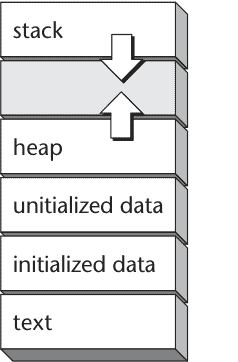
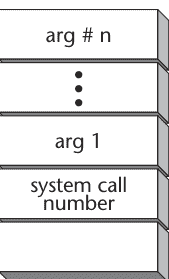
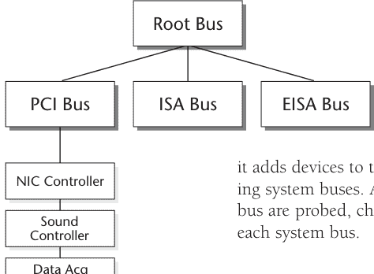
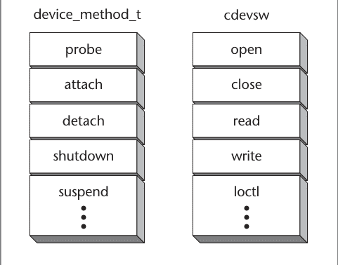
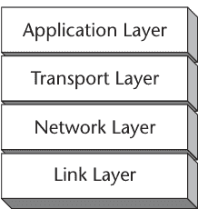
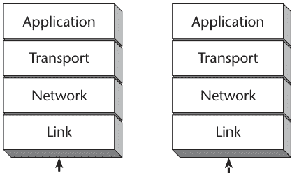
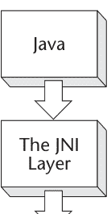
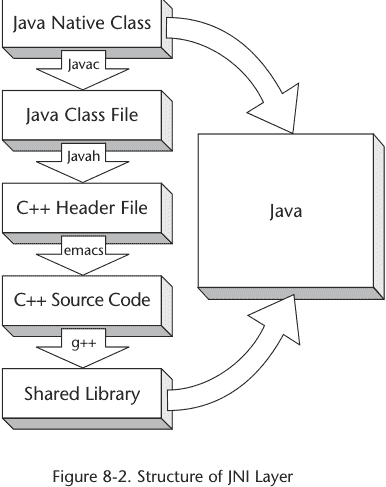
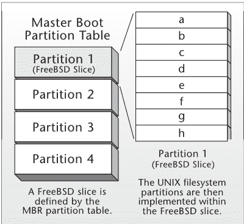
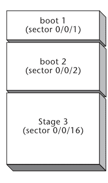

# 嵌入式 FreeBSD 秘籍（嵌入式技术）

## 目录

### C 内核可加载模块

- 概述：215
- 内核可加载模块：215
- 系统调用：219
- 设备驱动程序：221
- `open` 函数：225
- `close` 函数：225
- `read` 函数：225
- `write` 函数：226
- 命令：226

## 前言

泛泛而谈地讨论嵌入式系统是很困难的，因为每个嵌入式系统都是唯一的。本书并非提供一套处理嵌入式开发问题的通用原则列表，而是通过真实的硬件和软件，展示所遇到的问题实例及其解决方案。从这个意义上说，它是一本为开发人员准备的“食谱”，提供了设计“配方”，可根据需要进行详细阐述或修改，以解决其他设计问题。

除了提供用于开发 DIO 设备的源代码外，本书还包含了关于如何获取开源软件版本的真实“操作指南”，并描述了安装、配置和编程的步骤。无论您是在开发一个实际的设备，还是在尝试操作系统，本书都将帮助您熟悉所有的开发问题，而不仅仅是开发概念。

本书介绍了一组在开发嵌入式 Web 设备过程中经常遇到的常见问题。每一章涵盖一个特定主题，讨论该主题的背景信息，并为该主题提供一个设计解决方案。这些章节并非旨在提供所有可能的解决方案，而是提供可用于帮助您开发自有解决方案的信息。

开发嵌入式系统涉及许多除编写源代码之外的技能。识别可用于解决问题的技术、安装、配置和打包都是同样重要但经常被忽视的技能。所有这些问题都将在书中涵盖，以便为您提供嵌入式开发过程的完整全貌。

## 先决条件和其他资源

这是一本关于使用 FreeBSD 以及 FreeBSD 发行版中所含软件工具开发互联网设备的书。因此，它假设读者在 Unix 环境下具有一定的 C 和 C++ 编程背景。除了基本的编程技能外，如果您对数据结构和系统编程有基础了解，将会非常有帮助。本书面向已经知道如何编写和编译代码的读者。

并且希望进一步了解 FreeBSD 环境，并探索与典型编程书籍不同的主题。其中一些主题不需要你具备详细的计算机硬件背景，但假设你已经具备一定的基础知识并愿意学习必要的技能。

我写这本书是为那些希望更深入地研究 FreeBSD 操作系统的人编写的。书中提出的许多问题超出了 C 或 C++ 编程的范畴，而是呈现了嵌入式系统工程师在产品开发过程中会面临的问题。这不是一本关于 FreeBSD 内部结构以及如何修改内核的书。FreeBSD 拥有卓越的渊源，目前已有大量优秀的资源可供学习 FreeBSD 操作系统的内部结构和系统管理。

我推荐 The Design and Implementation of the 4.4 BSD Operating System、《Complete FreeBSD》以及 [FreeBSD Handbook](http://www.freebsd.org/doc/en_US.ISO8859-1/books/handbook/index.html)。除了这些资源外，FreeBSD 网站还包含大量的邮件列表、用户组、新闻组和网络资源。

此外，关于 Unix 编程的优秀参考书也很多，例如 Advanced Programming in the Unix Environment 和 The C Programming Language，这两本书都可以在 amazon.com 上买到。

## 组织结构

本书包含 12 个章节和 3 个附录。

第 1 章 Getting Started（入门）将向你介绍嵌入式系统，并描述互联网设备（Internet appliances）和 FreeBSD。此外，还将涵盖用于构建本书所述互联网设备的主要硬件和软件。

第 2 章 Systems Programming（系统编程）向你介绍 Unix 进程和守护进程（daemons）。进程是 Unix 编程的基础。Unix 守护进程是一种特殊类型的进程。本章将讨论如何从 Unix 进程创建守护进程的细节。

第 3 章 System Calls（系统调用）准确地描述了什么是系统调用以及它在 FreeBSD 中是如何实现的。

第 4 章 Device Drivers（设备驱动程序）提供了 FreeBSD 设备驱动程序及其数据结构的描述。本章讨论了驱动程序编写者可用的工具，并将其用于开发一个实际的 PCI 数据采集控制器的设备驱动程序。

第 5 章 Midlevel Interface Library（中级接口库）探讨了共享库以及用户代码如何访问设备驱动程序。

第 6 章 Daemons（守护进程）在第 2 章主题的基础上，通过实现一个使用套接字（sockets）提供简单协议以读写数据采集板的 Unix 守护进程。

第 7 章 Remote Management（远程管理）讨论了如何提供一种安全的远程管理方法。本章将开发一个配置 Shell，并可以通过 `SSH` 远程访问。

第 8 章 JNI Layer（JNI 层）向用户介绍 JNI，这是一个允许 Java 程序员调用 C 代码的接口。

第 9 章 Web Access using Tomcat（使用 Tomcat 进行 Web 访问）提供了显示动态 Web 内容所需的步骤。本章讨论了配置 JSP 服务器 Tomcat 的过程以及编写 JSP 页面的方法。你将开发一个显示数据采集控制器状态的 JSP 页面。

第 10 章 Building the Kernel（构建内核）讨论了根据 DIO 互联网设备的硬件和特定功能构建自定义内核的步骤。

第 11 章 System Startup（系统启动）讨论了 FreeBSD 的启动过程，以及为了运行 DIO 设备所需的服务（如 Tomcat、`ssh` 和加载自定义 KLD）而对启动脚本进行的必要修改。

第 12 章 The CompactFlash Boot Device（CompactFlash 启动设备）描述了如何对闪存设备进行分区，并将本书前几章开发的代码加载到闪存中，从而打造一个真实运行的设备服务器。

附录 A The FreeBSD License 是 FreeBSD 许可证的副本。

附录 B PCI Configuration（PCI 配置）讨论了 PCI 配置空间。开发 PCI 控制器的设备驱动程序需要了解 PCI 配置寄存器。该附录描述了 PCI 配置空间中的寄存器及其用途。

附录 C Kernel Loadable Modules（内核可加载模块）涵盖了 KLD，它们用于第 2 章和第 4 章中的系统调用和设备驱动程序。该附录讨论了构成 KLD 的单个组件及其用途。

为了从本书中获得最大收益，我建议不要陷入细节，而是通过学习一种实现该主题方案的方法来获得对该主题的概括性理解。通过熟悉开发嵌入式系统涉及的每一个步骤，你应该能够将这些概念应用于你可能遇到的任何开发任务。

## CD-ROM 中包含什么？

随书附带的 CD-ROM 包含书中使用的程序的源代码以及全文的可搜索 PDF 版本。

## 约定

`Macro Text`

内联代码用于源代码。

`Bold Macro Text`

粗体文本用于程序输出和 Shell 输入。

# 第 1 章 入门

## 概述

嵌入式计算机系统渗透到我们日常生活的方方面面。闹钟、咖啡机、数字手表、手机和汽车只是利用嵌入式系统的少数设备。此类系统的设计和开发是独特的，因为每个系统的设计约束都不同。开发嵌入式系统的关键在于理解用于开发的硬件和软件。

## 嵌入式系统

嵌入式系统由旨在解决特定应用的硬件和软件组成。许多应用不仅仅由简单的计算机硬件和软件组成。例如，一个旨在控制机器人手臂的工业视觉系统由嵌入式计算机、摄像头、显示器和机器人手臂组成。这些组件中的每一个本身都是一个嵌入式系统。

多年来，嵌入式系统已经从简单的独立、单一目的系统演变为完全集成、具备网络感知能力的系统。技术的快速变化和需求的增加促使开发人员在这些系统的设计和开发中采取新的方法。让我们快速回顾一下产品市场和需求的演变过程。

经典的嵌入式系统被认为是针对单一应用的专用解决方案。在这些经典系统中，硬件是为解决特定应用而定制设计的，操作系统则在内部开发。所有软件都自包含在非易失性 RAM 中，且用户界面有限。这类嵌入式系统的例子包括微波炉、MP3 播放器和手机。

（图 1-1. 经典嵌入式系统：微波炉）

随着互联网的发展，嵌入式系统的需求复杂度也开始增加。除了解决经典嵌入式系统的问题外，系统设计人员还需要添加用于发送和接收数据的连接能力，或提供软件升级的自动化方法。为了避免增加开发工作量，系统设计人员开始倾向于使用第三方硬件并评估开源软件。这些下一代嵌入式系统的例子包括负载均衡器、虚拟专用网络（VPN）和以太网交换机。

（图 1-2. 负载均衡器：集群负载均衡器）

## 互联网设备

如今开发的许多嵌入式系统在几年前会被称为服务器。这些系统使用 PC 硬件开发，运行嵌入式应用程序，具有互联网连接，并运行用于远程配置的网络服务。嵌入式系统的这些最新演变形式被称为“互联网设备”（Internet appliances）。

网络连接需要增加网络协议、服务和网络硬件。Web 服务需要增加更复杂的应用软件。这些额外需求显著增加了嵌入式系统开发的硬件成本、开发量和复杂度。

增加的性能需求将“可扩展性”列入了系统需求清单，进一步限制了计算机设计的解决方案选择。此外，开发嵌入式解决方案的投资必须得到保护；随着硬件的演进，最终选择的硬件和软件必须在不同版本之间保持兼容。在高科技领域快速的开发周期下，硬件和软件解决方案必须足够灵活，以满足不断演变的市场和客户需求。

为了应对嵌入式系统日益增加的复杂度，一个新类别变得流行起来——设备服务器（appliance server）。设备服务器是一个启用网络的嵌入式计算机，旨在执行单一任务，并提供比通用服务器更卓越的性能和更高的可靠性。适合设备服务器的应用包括 VPN、网络附属存储（NAS）和负载均衡。

## 开发问题

虽然计算机组件的成本和上市时间在持续降低，但典型嵌入式系统的功能和特性却在不断增加。为了应对这一趋势，许多项目开发人员选择使用第三方硬件和开源软件，仅开发那些能够提供附加值的功能组件。使用定制硬件和自研操作系统的经典嵌入式系统开发模式，在今天开发的许多系统中已被取代。让我们来看看一些与依赖第三方核心组件的嵌入式系统相关的开发问题。

### 升级的兼容性

通过选择第三方硬件和开源软件，系统设计人员确保能够获得来自多个供应商的兼容技术，并使完成的系统能够更快、以更低的成本开发。系统设计人员可以将资源集中在开发其应用程序上，而不是将资源用于维护操作系统或开发下一个硬件平台。

# 第 4 章 嵌入式 FreeBSD 食谱

## 上市时间

开源操作系统缩短了软件解决方案的鉴定和开发时间。服务器设备通过使用日益丰富的第三方硬件和软件，解决了日益增加的上市时间压力和硬件灵活性问题。通过依赖现成的硬件和软件，服务器设备开发人员可以将精力集中在解决应用程序问题上。

## 人才库

互联网设备日益增加的复杂性要求从简单的嵌入式工具过渡到现成的集成开发环境（IDE），并配备能够促进开发安全、可靠且长期运行系统的工具。此外，现成的集成开发环境还缩短了上市时间以及培训时间。

## 许可协议

传统的实时操作系统软件许可将源代码限制在被许可方手中，并且在分发时可能需要支付特许权使用费。相比之下，开源软件许可允许被许可方将软件免费提供给任何希望使用它的人。

## DIO 服务器设备

本章的其余部分将讨论本书将要开发的一种互联网设备——数字输入输出（DIO）服务器设备。DIO 服务器设备是一个能够提供读写数字 IO 线能力的嵌入式系统。这些数字线通过套接字（sockets）、安全命令 shell 或浏览器在互联网上进行监控。

该软件使用开源操作系统和工具：FreeBSD 4.4 和 GNU 开发套件。系统软件和应用程序将在本书的后续章节中开发，旨在展示一个实际服务器设备的设计、开发和实现。

（图 1-3. DIO 服务器设备）

开发 DIO 服务器设备所需的硬件是一台标准 PC 和一个第三方的数字 IO 数据采集卡。启动设备是一个 CompactFlash 适配器和 CompactFlash 卡，可通过互联网购买。

## 软件

### FreeBSD

对于需要互联网连接、网络性能和可靠性的互联网设备及其他嵌入式系统，FreeBSD 是一个最佳解决方案。此外，FreeBSD 附带了一套工业标准的软件开发、配置管理工具和应用程序软件。它是一个兼容 Unix 的开源操作系统，提供了前所未有的可靠性和安全性。它运行着一些互联网上最繁忙的网站（如 Yahoo 和 Hotmail），并为 AMI Stortrends NAS 和 IBM Whistle/InterJet II 等嵌入式产品提供了基础。

FreeBSD 的核心在很大程度上基于 BSD/OS，后者开发于 20 世纪 70 年代中期，以出色的支持、稳定性、小的内存占用和简单的安装而闻名。早期的许多 BSD Unix 开发资金由 DARPA 提供，以支持互联网协议 TCP/IP 的开发。

正如其名，FreeBSD 是免费提供的。它可以直接从 FreeBSD 网站 `ftp://ftp.FreeBSD.org/pub/FreeBSD/` 下载。或者，如果你像我一样想要一张实体的 CD，并支持 FreeBSD 的工作，可以通过许多零售 outlet 购买，例如 BSD Mall（http://www.bsdmall.com/freebsd1.html），或者许多当地零售店如 Staples、CompUSA 和 Frys。

除了通过购买官方发行版提供资金支持外，还有另一种支持 FreeBSD 的方式。FreeBSD 发行版是一个开源项目。如果你感兴趣，可以贡献时间并参与源代码开发。关于贡献 FreeBSD 开发的信息可以在 FreeBSD 网站上找到：http://www.freebsd.org/doc/en_US.ISO8859-1/articles/contributing/index.html。

除了成熟的网络技术外，FreeBSD 内核还包含对许多磁盘和存储管理设施以及安全网络协议的支持。FreeBSD 的特性和优势总结在以下段落中：

- **安全性**：FreeBSD 提供了使其适用于电子商务应用、安全互联网传输和虚拟专用网络的安全性特性。多年来，许多针对安全相关漏洞的修复已被纳入 FreeBSD，以确保其适用于安全关键型环境。
- **鲁棒性**：FreeBSD 基于已开发 20 多年的软件。其持续开发侧重于质量而非数量，对核心软件的更改受到严格控制。FreeBSD 核心内核及其特性代表了市场上最高质量的嵌入式操作系统。
- **小内存占用**：FreeBSD 完全可定制，可以配置为仅运行绝对最少量的软件，使其适用于一些极其受限的嵌入式应用。PicoBSD 是 FreeBSD 的一个定制版本，包含可完全引导并容纳在软盘中的系统。除了灵活性之外，许多嵌入式系统从 DiskOn-Chip 或 CompactFlash 设备启动，FreeBSD 现已广泛支持这些设备。
- **许可协议**：FreeBSD 使用 BSD 许可证分发，该许可证允许（但不要求）共享源代码。由于 BSD 许可证，以及许多嵌入式系统需要包含针对特定硬件的私有技术（如随系统附带的专用硬件或设计本身固有的板载自定义组件），BSD 系统相对于其他开源系统来说往往是更优的选择，因为在其他系统中，由于许可问题，此类知识产权无法保密。

### GNU 开发工具

标准 FreeBSD 发行版包含 GNU 开发工具套件，由编译器、链接器、库管理器、调试器、性能管理和配置管理工具组成。除了功能深度之外，GNU 工具还通过邮件列表和新闻组的形式提供更新和大量的支持选项。

### Java

利用 Java，系统设计者可以开发能在任何地方的浏览器上运行的应用程序。除了简化设备网络部分的开发外，系统开发人员还可以使用 Java 本地接口（JNI），将遗留系统桥接到以网络为中心的嵌入式系统的附加需求中。

## 硬件

本书中开发的 DIO 服务器设备仅使用第三方硬件。硬件要求包括一个具备网络能力的 PC 硬件平台、一个基于 PCI 的数字 IO 控制器，以及一个固态启动设备和 ATAPI 接口卡。

### 服务器

Network Engines Roadster 是一款高性能 1U 互联网设备，可为任何应用提供易于定制的解决方案。Network Engines Roadster 包括一个 Intel Celeron 处理器、32 MB RAM、双以太网端口、一个 PCI 插槽和两个串口。

### 数据采集

我们将使用的 DIO 互联网设备硬件是 Measurement Computing PCI-DIO24 数字 IO 控制器，它可以读写数字 IO 信号。这是一个提供 24 位数字 IO 的 PCI 控制器。除了 PCI-DIO24 控制器外，DIO 服务器设备还使用 C37FF-2 电缆和 CIO-MINI 37 端子来连接来自控制器的数字信号。

### 启动设备

嵌入式系统部署的环境通常比典型的台式电脑更严苛。在这种环境下，硬盘可能会损坏或磨损。嵌入式系统开发的一个趋势是使用 CompactFlash。CompactFlash 设备看起来类似于标准 IDE 驱动器。为了将 CompactFlash 设备用作启动设备，需要一个 CompactFlash 适配器。目前有许多 CompactFlash-to-IDE 适配器可用。

### TAPR CompactFlash 适配器 II

Tucson Amateur Packet Radio（TAPR）俱乐部销售一种 IDE CompactFlash 适配器，可与市面上常见的 CompactFlash 卡配合使用。该 CompactFlash 适配器插入 IDE 插槽和电源连接器。一旦连接适配器并插入 CompactFlash 设备，该设备就可以像 IDE 硬盘一样使用。

### Sandisk 32 MB CompactFlash 磁盘

Sandisk CompactFlash 是一个小型闪存设备，用作我们的嵌入式启动设备。结合 TAPR CompactFlash 适配器，我们能够将 Sandisk 设备用作 IDE 启动设备。Sandisk CompactFlash 设备在任何办公用品店都有售；这些设备与数码相机和便携式 MP3 播放器中使用的设备相同。

## 总结


在本章中，我们讨论了使用第三方硬件和开源软件开发互联网设备。本书的其余部分将集中于使用 FreeBSD 开发 DIO 互联网设备。每一章将讨论一个与嵌入式系统开发相关的主题并提供解决方案。到本书结束时，我们将开发出一个可以运行的设备。

## 系统编程

### 概述

在 FreeBSD 的任何编程任务中，最基础的概念就是`进程（process）`，即一个正在执行的程序。它可以是一个提供文件服务的网络文件系统（NFS）守护进程，一个`gcc`编译过程，或者一个显示日期的 shell——所有这些任务都是在进程的上下文中执行的。理解进程对于掌握后续章节中介绍的概念至关重要。本章将介绍使用进程的系统编程。

许多系统服务由一种特殊类型的进程提供，称为守护进程（daemon process）。在讨论进程的过程中，我们将研究守护进程的特点并开发一个守护进程的骨架源代码。在本章中，我们将涵盖以下主题：

- FreeBSD 进程
- 进程的创建与终止
- 进程属性
- 守护进程

### 进程

一个运行中的程序就是进程的一个实例。FreeBSD 内核提供的众多特性之一是一个称为“用户模式（User Mode）”的保护环境。在用户模式下，进程不能访问硬件或受保护的系统变量。如果进程试图访问受保护的内存，该进程将被终止。运行在内存中的进程由五个段组成：文本段（text）、已初始化数据段（initialized data）、未初始化数据段（uninitialized data）、栈（stack）和堆（heap）。

文本段通常是只读的，包含程序的机器指令。已初始化数据段包含由程序文本预先初始化的变量。未初始化数据段（传统上称为`bss`）包含未初始化的数据。栈用于在函数之间传递参数，并包含局部变量和函数返回地址。堆是由操作系统提供的一个用于动态内存分配的区域。



我们可以通过调用`size`命令来查看程序的各段大小。Listing 2-1 展示了`hostname`程序执行`size`命令的输出。

```text
# size hostname
   text     data      bss      dec      hex  filename
   39452     4020     1968    45440      b180  hostname
```

输出显示文本段大小为 39452 字节，数据段为 4020 字节，`bss`段大小为 1968 字节。栈和堆由操作系统为每个进程分配。文本段和数据段包含实际数据。由于`bss`段是未初始化的，镜像中仅包含其大小；当程序加载时，操作系统会将`bss`内存设置为零。

#### 进程创建

当创建一个进程时，会创建原进程（称为父进程）的一个完整副本。新创建的进程称为子进程。一旦进程创建完成，子进程将被调度执行。这产生了同一个程序的两个运行实例。这些进程只能通过进程标识符来区分。

##### `fork`系统调用

当一个运行中的进程调用`fork`系统调用时，会创建一个新进程。`fork`系统调用是创建新进程的唯一方法。

```c
#include <sys/types.h>
#include <unistd.h>

pid_t fork(void);
```

`fork`的独特之处在于，单次调用`fork`会返回两次。`fork`向父进程返回子进程的进程标识符（PID），并向新创建的子进程返回 0。

当进程创建时，以下属性列表从父进程继承：文件描述符、进程组 ID、访问组、工作目录、根目录、控制终端、资源、间隔定时器、资源限制、文件模式掩码和信号掩码。

##### `execve`系统调用

很多时候创建进程是为了运行另一个程序。`execve`系统调用就用于此目的，并且在`fork`系统调用之后立即被调用。`execve`系统调用将用一个新程序替换当前执行的程序。

```c
#include <unistd.h>
int execve(const char *path, char *const argv[], char *const envp[]);
```

`execve`系统调用接受三个参数：`path`是要执行的新程序的路径和文件名；`argv`包含传递给程序的参数字符串指针；`envp`包含环境变量列表。

`execve`系统调用在出错时返回 −1。标准 C 库中为`execve`系统调用提供了许多封装函数，统称为`exec`系列函数。

##### 进程终止

进程可以通过调用`exit`有意终止，或者通过接收来自另一个进程的信号无意终止。无论原因如何，当进程终止时，都会向父进程返回一个通知。如果父进程没有接收该通知，子进程就会变成僵尸进程（zombie）。子进程将保持僵尸状态，直到父进程检索其退出状态。

#### `_exit`系统调用

当程序调用`_exit`系统调用时，进程将终止。`_exit`系统调用会导致`SIGCHLD`信号被发送给父进程。

```c
#include <unistd.h>
void _exit(int status);
```

`_exit`系统调用永远不会返回。`_exit`系统调用更常被标准 C 库函数`exit`调用。

#### `wait`系统调用

`wait`系统调用允许父进程检查子进程是否有可用的终止信息。`wait`将挂起执行，直到子进程返回。

```c
#include <sys/types.h>
#include <sys/wait.h>

pid_t wait(int *status);
```

成功时，子进程标识符（PID）返回给父进程；如果出错，则返回 −1。子进程的退出状态通过`status`参数返回。

#### 示例

Listing 2-1 展示了`fork`、`wait`、`execve`和`exit`调用的用法。父进程发起`fork`系统调用来创建子进程。主程序中有两条控制路径，一条给父进程，另一条给子进程。

```c
int main(int argc, char **argv)
{
    pid_t  pid;
    int  status;

    if ((pid = fork()) > 0)
    {
        printf("%d: waiting for the child\n", pid);
        wait(&status);
        printf("%d: child status = %d\n", pid, status);
    }
    else if (pid == 0)
    {
        execve("/bin/date", NULL, NULL);
    }
    exit(0);
}
```

Listing 2-1

`fork`系统调用向父进程和子进程同时返回。

父进程调用`wait`系统调用，导致父进程休眠直到子进程退出。子进程调用`execve`来运行`date`程序并在控制台显示日期。

Listing 2-1 中的程序在我的系统上的输出如下：

```bash
# ./process
542: waiting for the child
Mon Jan 7 19:54:46 EST 2002
542: child status = 0
```

#### 进程 ID

每个进程在创建时都被分配一个唯一的 ID，称为进程标识符或 PID。除了自己的 PID，每个进程还包含其父进程 ID，或 PPID。可以使用`ps -aj`命令获取进程及其 PID 和 PPID 的列表。以下是我系统中的部分列表。

| 用户 | PID | PPID | PGID | SESS | JOBC | STAT | TT | 时间 | 命令 |
|------|-----|------|------|------|------|------|----|------|------|
| root | 453 | 451 | 453 | fb0700 | 0 | Is+ | p0 | 0:00.01 | `/bin/cat` |
| root | 456 | 454 | 456 | fb6d00 | 0 | Is+ | p1 | 0:00.04 | `/bin/csh` |
| root | 458 | 456 | 458 | fb6d00 | 1 | S | p1 | 0:08.21 | `emacs` |
| root | 459 | 458 | 459 | fc7dc0 | 0 | Ss | p2 | 0:00.06 | `/bin/csh -i` |

##### `getpid`和`getppid`系统调用

进程可以通过分别调用`getpid`和`getppid`函数来获取其 PID 和 PPID。

```c
#include <sys/types.h>
#include <unistd.h>

pid_t getpid(void);
pid_t getppid(void);
```

每个进程都有一个父进程。进程创建时会分配父进程 ID，以便能够返回终止状态。

#### 安全

进程在创建时被分配两个用户：真实用户（real user）和有效用户（effective user）。

##### 用户 ID 和组 ID

每个进程都有一个用户标识符 UID 和一个组标识符 GID。进程的 UID 和 GID 是调用该程序的用户的用户名和组。UID 在`/etc/passwd`中映射到用户名。GID 在`/etc/group`文件中映射到组名。进程可以通过调用`getuid`和`getgid`系统调用来检索其用户 ID 和组 ID。

##### `getuid`和`getgid`系统调用

`getuid`和`getgid`系统调用返回运行进程的 UID 和 GID。这两个系统调用总是成功的。

```c
#include <unistd.h>
#include <sys/types.h>

uid_t getuid(void);
uid_t getgid(void);
```

##### 有效用户 ID 和有效组 ID

当进程创建时，它被分配一个有效用户 ID 和一个有效组 ID。在大多数情况下，有效 ID 和真实 ID 是相同的。但可以配置程序使其以不同的用户或组身份执行。例如，`passwd`工具需要 root 用户权限，以便有权限编辑`/etc/passwd`文件。`passwd`工具被配置为以 root 作为其有效用户 ID 执行，从而赋予`passwd`编辑`/etc/passwd`文件的正确权限。

##### `geteuid`和`getegid`系统调用

`geteuid`和`getegid`系统调用分别返回有效用户和有效组。

```c
#include <unistd.h>
#include <sys/types.h>
```

```c
uid_t geteuid(void);
```

```c
uid_t getegid(void);
```

`geteuid`和`getegid`系统调用总是执行成功。

##### `setuid`和`setegid`系统调用

进程可以通过调用`seteuid`和`setegid`系统调用来更改有效用户 ID 或有效组 ID。`seteuid`和`setegid`系统调用可以设置有效用户 ID 和有效组 ID。

```c
#include <unistd.h>
#include <sys/types.h>

uid_t seteuid(void);
uid_t setegid(void);
```

`seteuid`和`setegid`系统调用在成功时返回 0，在出错时返回 −1。

#### 示例

利用前文描述的用户和组 ID 函数，代码清单 2-2 打印了进程的真实用户/组 ID 和有效用户/组 ID。

```c
int main(int argc, char **argv)
{
    printf("UID   = %d\n", getuid());
    printf("GID   = %d\n", getgid());
    printf("EUID = %d\n", geteuid());
    printf("EGID = %d\n", getegid());

    exit(0);
}
```

代码清单 2-2

该程序在我的系统上的输出如下：

```text
# ./ids
UID   = 1001
GID   = 1001
EUID = 1001
EGID = 1001
```

快速查看`/etc/passwd`和`/etc/group`文件可知，该程序是以用户 paul 和组 paul 的身份执行的，这正是我的登录名和组名。

以下是`/etc/passwd`文件中我的登录名；第三列包含我的 UID。

```text
paul:*:1001:1001:Paul Cevoli:/home/paul:/bin/sh
```

以下是`/etc/group`文件中我的登录组条目；第三列包含我的 GID。

```text
paul:*:1001:
```

#### 进程组

进程组由一组相关的进程组成。除了 PID 和 PPID 之外，进程还包含进程组 ID（PGID）。每个进程组包含一个唯一的进程组标识符。每个进程组都可以有一个进程组组长；进程组组长的标志是其进程组 ID 与 PID 相同。

##### `setpgid`和`getpgid`系统调用

进程可以通过使用`setpgid`和`getpgid`系统调用来设置和获取其 PGID。

```c
#include <unistd.h>

int setpgid(pid_t pid, pid_t pgrp);
pid_t getpgid(pid_t pid);
```

进程只能设置自身及其子进程的进程组。进程组的一个用途是向一组进程发送信号。

#### 文件

子进程继承创建它的父进程的环境。这包括文件描述符、文件权限和当前工作目录。

##### 文件描述符

文件描述符是用于访问 IO 接口的底层接口。文件描述符实现为`int`类型。每个进程都包含一个打开的文件描述符列表。子进程继承父进程的所有打开的文件描述符。

##### 权限

每个进程都包含一组默认的文件权限，称为文件创建模式掩码（file creation mode mask）。文件创建模式掩码由 9 位组成，分别代表文件所有者、文件组以及其他所有人的读、写和执行权限。进程的文件创建模式掩码可通过`umask`系统调用进行修改。

##### `umask`系统调用

文件权限掩码通常由用户登录 shell 中的`umask`命令设置。文件权限掩码可以通过`umask`系统调用进行修改。`umask`系统调用将进程的文件创建掩码设置为`umask`中包含的值。

```c
#include <sys/stat.h>
mode_t umask(mode_t numask);
```

文件创建掩码的先前值将返回给调用者。

##### 当前工作目录

每个进程都有一个当前工作目录，即进程启动时的目录。

##### `chdir`系统调用

进程可以通过调用`chdir`系统调用来更改其当前工作目录。`path`参数包含将用作当前工作目录的路径。

```c
#include <unistd.h>
int chdir(const char *path);
```

`chdir`系统调用在成功时返回 0，在出错时返回 –1。

#### 资源

进程从其父进程继承资源限制。资源可以通过`setrlimit`和`getrlimit`系统调用进行读取或修改。

##### `setrlimit`和`getrlimit`系统调用

`setrlimit`和`getrlimit`系统调用用于读取和修改进程资源限制。`setrlimit`和`getrlimit`接收一个资源参数，用于指定要读取或写入的资源；资源列表包含在`/usr/include/sys/resource.h`中。第二个参数是一个`struct rlimit`指针：

```c
struct rlimit {
    rlim_t rlim_cur; /* current (soft) limit */
    rlim_t rlim_max; /* maximum value for rlim_cur */
};
```

该结构体用于表示资源值。

```c
#include <sys/types.h>
#include <sys/time.h>
#include <sys/resource.h>

int getrlimit(int resource, struct rlimit *rlp);
int setrlimit(int resource, const struct rlimit *rlp);
```

`setrlimit`和`getrlimit`系统调用在成功时返回 0，在出错时返回 -1。

#### 会话

一组进程组可以被收集到一个会话中，会话是一组与控制终端相关联的进程。会话用于将用户登录 shell 及其创建的进程分组，或者为守护进程创建隔离环境。

##### `setsid`系统调用

```c
#include <unistd.h>

pid_t setsid(void);
```

`setsid()`函数创建一个新会话。调用进程成为新会话的会话组长，成为一个新进程组的进程组组长，且没有控制终端。调用进程是该会话或进程组中唯一的进程。

#### 控制终端

会话可以有一个控制终端；这就是用于登录的设备。发起控制终端连接的会话组长被认为是控制进程。当我们登录时，控制终端会被为我们建立。有时程序需要与控制终端通信。

#### 调度

##### 优先级

执行时间根据进程优先级分配给进程。优先级范围从 0 到 127。进程优先级在`/usr/include/sys/param.h`中定义。进程优先级越低，获得的调度优先级越高。

##### `getpriority`和`setpriority`系统调用

可以使用`setpriority`和`getpriority`系统调用来读取和修改进程优先级。


```c
#include <sys/time.h>
#include <sys/resource.h>

int getpriority(int which, int who);
int setpriority(int which, int who, int prio);
```

`getpriority` 和 `setpriority` 系统调用的工作方式取决于`which`参数。

| `which` | 定义 |
|---------|------|
| `PRIO_PROCESS` | 进程标识符 |
| `PRIO_PGRP` | 进程组标识符 |
| `PRIO_USER` | 用户 ID |

`setpriority` 和 `getpriority` 系统调用在成功时返回 0，在出错时返回 -1。

## 状态

进程在任何时刻都处于五种状态之一。进程状态由 FreeBSD 内核内部用于组织进程。进程状态及其定义描述如下。

| 状态 | 描述 |
|------|------|
| `SIDL` | 进程创建时的初始状态，等待资源分配。 |
| `SRUN` | 进程准备运行。 |
| `SSLEEP` | 进程被挂起，等待某个事件。 |
| `SSTOP` | 进程正在被调试或被挂起。 |
| `SZOMB` | 进程已退出，正在等待通知其父进程。 |

## 信号

信号是通知进程系统事件已发生的机制。每个进程都包含一个表，定义了处理发送到该进程之信号的相关操作；在进程创建时，所有信号都包含默认操作。信号的处理方式有三种：被忽略、被捕获，或由内核设置的默认操作处理。

用户可以定义一个在进程接收到信号时被调用的函数，这被称为信号处理函数。信号处理函数被认为“捕获”了信号。信号定义在`/usr/include/sys/signal.h`中。需要注意的是，`SIGSTOP` 和 `SIGKILL` 这两个信号不能被捕获，并且会终止进程。

### signal 函数

`signal` 函数用于为特定信号指定用户定义的信号处理函数。`signal` 函数是 `sigaction` 系统调用的封装。

```c
#include <signal.h>

void (*sig_t) (int);
sig_t signal(int sig, sig_t func);
```

`sig` 参数指定信号处理程序将捕获哪个信号。`func` 参数允许用户指定一个用户定义的信号处理程序。可以通过将 `SIG_DFL` 指定为信号处理程序来重置信号的默认动作。可以通过将 `SIG_IGN` 指定为信号处理程序来忽略信号。忽略信号会导致该信号随后的实例被忽略，且待处理的实例被丢弃。

如果执行成功，`signal` 返回之前的动作；否则，返回 `SIG_ERR` 并且全局变量 `errno` 被设置以指示错误。

### kill 系统调用

`kill` 系统调用向一个进程或进程组发送一个信号。

```c
#include <sys/types.h>
#include <signal.h>

int kill(pid_t pid, int sig);
```

`pid` 参数是要发送信号的进程 ID。如果进程 ID 大于零，信号将被发送给该特定进程。如果进程 ID 为零，则将信号发送给发送进程所属进程组的所有成员。如果进程 ID 为 -1，且为超级用户，则向所有进程发送信号；否则，向与发送进程具有相同用户 ID 的所有进程发送信号。`sig` 是发送的信号。

如果`kill()`函数执行成功，则返回值为 0；否则返回值为 -1，并且全局变量 `errno` 被设置以指示错误。

## 守护进程 (Daemons)

守护进程是一种在后台运行的特殊进程，通常用于提供某种服务。守护进程通常在系统启动时启动，并一直运行直到系统停止。所有守护进程都具有一些共同的进程属性。在接下来的章节中，我们将涵盖守护进程常见的相关问题。

- **Fork**：守护进程做的第一件事是通过`fork`系统调用创建一个子进程。子进程创建后，父进程和子进程同时运行同一个程序。守护进程将使自己与父进程脱离关系，并将自己置于后台。
- **创建新会话**：下一步是创建新会话。创建新会话为我们带来以下好处：该进程成为一个新会话的会话首领，该进程成为一个新进程组的组首领，且该进程没有控制终端。
- **关闭文件描述符**：回想一下，子进程从父进程继承其环境。如果父进程有任何打开的文件描述符，子进程将拥有这些打开文件描述符的副本。假设任何文件描述符都可能是打开的并将其全部关闭是一个好主意。
- **更改当前工作目录**：除了打开的文件描述符，子进程还继承当前工作目录。如果当前工作目录是一个已挂载的文件系统，那么该文件系统将无法被卸载。
- **设置文件模式创建掩码**：文件模式创建掩码从父进程继承，并可能被设置为拒绝某些权限。
- **处理子进程退出状态**：如果守护进程 fork 子进程来处理请求，它必须处理子进程的`SIGCLD`信号，否则子进程将变成僵尸进程。

### 守护进程骨架函数

#### handle_sigcld 函数

Listing 2-2 展示了处理子进程退出过程所需的代码。回想一下，如果父进程不获取子进程的退出码，子进程就会变成僵尸进程。父进程可以通过安装`handle_sigcld`信号处理程序来捕获子进程退出时的`SIGCLD`信号，从而避免创建僵尸进程。

```c
void handle_sigcld()
{
    int pid;
    int status;

    while ((pid = wait3(&status, WNOHANG, (struct rusage *)NULL)) > 0)        ;
}
```

Listing 2-2

请注意，`handle_sigcld` 函数以 `NOHANG` 方式调用 `wait3` 系统调用。这样父进程就可以继续执行，而不会阻塞等待子进程退出。这使得父进程能够继续响应请求或执行其他任务。

#### init_daemon 函数

Listing 2-3 中的 `init_daemon` 函数处理了本节所述的将子进程变为守护进程的具体细节。

```c
void
init_daemon()
{
    int    childpid  = 0;
    int    fd        = 0;
    struct rlimit    max_files;

    /*
     **  create a child process
     */
    if ((childpid = fork()) < 0)
    {
        /* handle the error condition */
        exit(-1);
    }
    else if (childpid > 0)
    {
        /* this is the parent, we may successfully exit */
        exit(0);
    }

    /* now executing as the child process */

    /* become the session leader */
    setsid();

    /*
     **    close all open file descriptors, need to get the maximum
     **    number of open files from getrlimit.
     */
    bzero(&max_files, sizeof(struct rlimit));
    getrlimit(RLIMIT_NOFILE, &max_files);
    for (fd = 0; fd < max_files.rlim_max; fd++)
    {
        close(fd);
    }

    /*
     **    the current working directory is held open by the
     **    kernel for the life of a process so the file system
     **    cannot be unmounted, reset the current working
     **    directory to root.
     */
    chdir("/");

    /*
     **    a process inherits file access permissions from the
     **    process which created it, reset the user access mask
     */
    umask(0);

    /*
     **    we don’t care about the exit status but we need to
     **    cleanup after each process that handles a request so
     **    the system isn’t flooded with zombie processes
     **/
    signal(SIGCHLD, handle_sigcld);
}
```

## 总结

在本章中，我们涵盖了 FreeBSD 中的进程属性，以及用于创建、终止和管理进程的常用系统调用。通过引入一种称为守护进程的特殊进程类型，我们完成了对进程的讨论。创建守护进程的细节已经呈现并被封装到一个通用函数 `init_daemon` 中。

我们将在第 6 章再次讨论守护进程，届时我们将实现一个使用套接字处理 DIO 查询的守护进程。接下来，让我们深入研究 FreeBSD 系统调用的实现。

## 系统调用

### 概述

正如前一章提到的，FreeBSD 内核为进程提供了一个称为“用户模式”（User Mode）的执行环境。在用户模式下执行的进程不能直接访问内核内存、内核数据结构或硬件。对内核内存和硬件资源的访问仅限于 FreeBSD 内核，内核在底层处理器的特权模式（称为“内核模式”，Kernel Mode）下执行。FreeBSD 为用户进程提供了一个详细的接口以从内核获取基本服务，该接口被称为“系统调用”。

将某些任务限制在内核中的好处有两个。首先，它使系统工程师无需关注设备硬件编程的细节。其次，通过提供并强制执行详细的系统调用接口，内核可以确保用户程序传递的参数是正确的，且不会导致系统崩溃。内核中增加的保护为应用程序提供了一个稳定的运行环境。

在本章中，我们将讨论 FreeBSD 系统调用的细节。在完成系统调用的讨论后，我们将实现一个能够读写内核内存的系统调用，以及一个提供简单调试功能的应用程序。

### 库函数与系统调用

标准 C 库提供了一个由头文件和库组成的 API，其中包含了许多常用函数和 IO 例程的实现。标准 C 库既通过库函数实现，也通过系统调用实现。

对于系统设计者来说，库函数和系统调用看起来是一样的。两者都有定义的函数原型和返回值。对于应用程序程序员来说，具体的功能实现并不重要，重要的是接口、函数名、参数和返回值。区别在于实现方式。

当程序调用库函数时，执行权传递给库函数，执行请求的操作，然后将控制权返回给调用函数。这一切都发生在运行进程的上下文和地址空间中。

系统调用是请求内核代表用户进程执行特权操作。当程序发起系统调用时，程序执行从用户模式转换到内核模式，内核执行请求的操作，然后程序执行从内核模式转换回用户模式。为了执行该操作，进程必须向内核发起请求。

### 系统调用的实现

系统调用的实现分为两个步骤。第一步是从用户模式转换到内核模式，这是通过使用软件中断来实现的。此外，必须将数据从用户模式传递到内核。在本节中，我们将研究这些细节。

### 软件中断

在 Intel x86 处理器上，运行在用户模式（User Mode）下的程序通过执行软件中断来切换到内核模式（Kernel Mode）。软件中断是由处理器使用中断处理程序异步处理的一个事件。中断处理程序是在响应硬件或软件中断的调用时被调用的。软件中断与硬件中断的不同之处在于，它同步地发生在运行的进程内部。

在 Intel x86 处理器上，通过执行`INT`指令来调用软件中断。`INT`指令接收一个 0 到 255 之间的数字，用于指定中断向量。系统调用被分配到中断向量 128 (`0x80`)。进程将通过执行`INT $0x80`指令来调用系统调用。

每个中断向量在中断描述符表（IDT）中都有一个条目。IDT 是一个包含 256 个长字（longwords）的表格。每个长字代表特定中断向量的中断处理程序地址。对于系统调用，系统调用中断处理程序位于 `0x200`。`0x200` 是由中断向量 `0x80 * 4 = 0x200` 推导而出的。

一旦处理器遇到软件或硬件中断，它会从中断描述符表（IDT）中获取特定中断向量的地址并执行该中断向量。中断处理程序完成后，执行权返回给用户进程。


图 3-3. 中断处理

### 传递数据

内核实现了许多不同的系统调用。为了区分不同的系统调用，会传递一个指定正在调用哪个系统调用的数字；这个数字被称为系统调用号。定义好的系统调用列表可以在`/sys/kern/syscalls.master`中找到。在发起系统调用之前，系统调用号会被压入程序栈中。

除了系统调用号，许多系统调用还需要参数。参数使用 C 调用约定传递给内核。调用者将系统调用参数一个接一个地、按从右到左的逆序压入栈中，这样传递给函数的第一个参数最后被压入。在从系统调用返回时，调用者将栈恢复到调用前的原始值；这被称为弹出栈（popping the stack）。



图 3-4. 系统调用号

### 示例

为了演示编译器如何生成系统调用，让我们看看一个发起系统调用的程序的生成输出。代码清单 3-1 包含一个调用`open`和`close`系统调用的程序。

```c
#include <stdio.h>
#include <fcntl.h>

int main(int argc, char **argv)
{
  int fd;

  fd = open("file.dat", O_RDWR);
  close(fd);
}
```

代码清单 3-1

> 注意：为了简化列出的输出，关闭了优化以便于阅读汇编代码，且程序采用静态链接。使用的编译命令行如下：
> ```bash
> # gcc -O0 -static -o open open.c
> ```

在代码清单 3-1 中的程序被编译和链接后，我们可以使用`objdump`工具对输出进行反汇编，以查看编译器生成的系统调用。

```bash
# objdump -disassemble open
```

代码清单 3-2 包含了`open`程序反汇编的部分列表。特别值得关注的是将参数和系统调用号压入栈的操作以及`INT`指令的执行。

```
080481c4 <main>:
   80481cd:    6a 02                push   $0x2
   80481cf:    68 01 84 04 08        push   $0x8048401
   80481d4:    e8 7f 00 00 00        call   8048258 <_open>
   80481d9:    83 c4 10             add    $0x10,%esp

08048258 <_open>:
   8048258:    8d 05 05 00 00 00     lea    0x5,%eax
   804825e:    cd 80                int    $0x80

   8048262:    c3                   ret
```

代码清单 3-2

代码清单 3-2 展示了编译器生成用于发起`open`系统调用的汇编代码的步骤。位于 `80481cd` 和 `80481cf` 的指令将打开模式和文件名压入栈中。随后主程序调用`open`系统调用。`open` 在 `8048258` 行将其系统调用号 5 压入栈中，然后调用软件中断。在从`open`返回后，栈在 `80481d9` 行被恢复到原始值。

### truss

在前面的章节中，我们详细研究了系统调用是如何实现的。在本节中，我们将展示一个标准工具如何使用系统调用来完成其任务。`truss` 是一个 FreeBSD 命令，包含一个用于跟踪系统调用并查看命名进程接收到的信号的工具。使用`truss`命令，我们将研究`pwd`命令是如何发起系统调用的。`pwd`命令显示进程的当前工作目录。代码清单 3-3 包含了使用`truss`命令分析`pwd`命令时的输出。


```text
readlink("/etc/malloc.conf",0xbfbff578,63)             ERR#2 'No such file or directory'
mmap(0x0,4096,0x3,0x1002,-1,0x0)         = 671432704
  (0x28054000)
break(0x8058000)                           = 0 (0x0)
break(0x8059000)                           = 0 (0x0)
sigaction(SIGSYS,0xbfbff660,0xbfbff648)    = 0 (0x0)
__getcwd(0x8058000,0x3fc)                  = 0 (0x0)
sigaction(SIGSYS,0xbfbff648,0x0)           = 0 (0x0)
fstat(1,0xbfbff388)                        = 0 (0x0)
ioctl(1,TIOCGETA,0xbfbff3bc)              = 0 (0x0)
write(1,0x8058400,6)                      = 6 (0x6)
exit(0x0)         process exit, rval      = 0
```

代码清单 3-3 `truss` 输出

`truss` 生成的输出显示了 `pwd` 命令发起的系统调用。特别值得关注的是对 `sigaction` 的系统调用。回想前一章，`sigaction` 用于安装信号捕获器。这段代码是为了防止出现不存在的系统调用。

一旦安装了 `SIGSYS` 信号捕获器，程序就会调用 `getcwd`（这是返回当前进程当前工作目录的内部系统调用）。在从 `getcwd` 返回后，`SIGSYS` 的信号捕获器被恢复。

在程序退出之前，调用 `write` 系统调用将当前工作目录写入控制终端。

### 创建系统调用

系统调用可以被开发为一个内核可加载模块（KLD）。附录 C 介绍了内核可加载模块的概述。在本节中，我们将讨论 KLD 的组成部分，以及我们对 `copymem` 系统调用的实现。

#### 添加系统调用

在之前的章节中，我们涵盖了系统调用的实现和实际用途。在本章的接下来的章节中，我们将开发一个名为 `copymem` 的系统调用，用于读取或写入内核内存。`copymem` 系统调用接收四个参数：内核地址、用户地址、字节数和拷贝方向。其原形为：

```c
int copymem(int kern_addr, int user_addr, int nbytes, int direction);
```

一旦 `copymem` 系统调用的实现完成，我们将通过实现一个简单的实用程序来结束对系统调用的讨论，该程序可接收命令，使用 `copymem` 系统调用来读取和写入内核内存。

#### 加载处理程序

KLD 系统调用所需的第一段代码是加载处理程序（load handler）。加载处理程序负责在模块加载、卸载或系统关闭时处理任何初始化或清理工作。每个 KLD 都必须有一个加载处理程序。代码清单 3-4 实现了 `copymem` 系统调用的加载处理程序。

```c
static int32_t
load (struct module *module, int cmd, void *arg)
{
    int32_t err = 0;

    switch (cmd)
    {
    case MOD_LOAD:
        printf("copymem system call loaded successfully\n");
        break;

    case MOD_UNLOAD:
        printf("copymem system call unloaded successfully\n");
        break;

    default:
        err = EINVAL;
        break;
    }
    return(err);
}
```

代码清单 3-4

加载处理程序接收三个参数。第一个是当前系统中已加载模块的链表。第二个参数是 `cmd` 参数，代表调用加载处理程序的条件。定义的命令如下：

| 命令 | 动作 |
| :--- | :--- |
| `MOD_LOAD` | 模块加载时传递 |
| `MOD_UNLOAD` | 模块卸载时传递 |
| `MOD_SHUTDOWN` | 系统关闭时传递 |

表 3-1 加载模块命令

最后一个参数是传递给加载处理程序的用户定义参数。这将在 `SYSCALL_MODULE` 章节中进一步讨论。

### 系统调用参数

在关于系统调用的讨论中，我们展示了用户程序如何通过栈将参数传递给系统调用。在内核实现中，参数是以结构体参数的形式传递的。结构体的每个元素就是从用户程序传递过来的一个参数。

代码清单 3-5 定义了 `copymem_args` 结构体。`copymem` 结构体包含四个元素，分别对应传递给 `copymem` 系统调用的四个参数。

```c
struct copymem_args
{
    int32_t kernel_addr;  /* kernel address       */
    int32_t user_addr;    /* user provided buffer */
    int32_t len;          /* length of transfer   */
    int32_t direction;    /* to kernel 1, from 0  */
};
```

代码清单 3-5

`copymem` 系统调用接受四个参数：内核模式地址、用户模式地址、拷贝长度以及一个代表拷贝方向的数字。`copymem` 实现的两个方向是：从内核模式到用户模式，或从用户模式到内核模式。

### `copymem` 系统调用

现在我们已经定义了加载处理程序和参数，可以实现实际的 `copymem` 系统调用了。系统调用接受两个参数。第一个是 `proc` 结构体，其中包含调用进程的当前状态和设置；`proc` 结构体定义在 `/usr/include/sys/proc.h` 中。

第二个参数是参数结构体；在我们的案例中，它将是前一节中定义的 `copymem_args` 结构体。代码清单 3-6 包含了 `copymem` 的源代码清单。

```c
static int32_t
copymem(struct proc *p, struct copymem_args *uap)
{
    int stat;

    if (uap->direction == 0)
    {
        stat = copyin((void *)uap->user_addr, (void *)uap->kernel_addr, uap->len);
    }
    else if (uap->direction == 1)
    {
        stat = copyout((void *)uap->kernel_addr, (void *)uap->user_addr, uap->len);
    }

#ifdef DEBUG
    if (stat != 0)
    {
        uprintf("copy failed, stat = %d\n", stat);
    }
#endif

    return(0);
}
```

代码清单 3-6

`copymem` 函数根据方向参数实现两条控制路径。内存要么从用户模式拷贝到内核模式，要么从内核模式拷贝到用户模式。由于处理器硬件细节的限制，用户模式和内核模式下的寻址可能略有不同，因此在用户模式和内核模式之间拷贝内存可能比使用标准 C 库的 `memcpy` 函数更复杂。FreeBSD 内核提供了函数实用程序来处理用户模式和内核模式之间拷贝内存的细节。

### `copyin` 和 `copyout` 函数

`copyin` 和 `copyout` 函数用于在用户模式和内核模式之间拷贝内存。

```c
#include <sys/types.h>
#include <sys/systm.h>

int copyin(const void *uaddr, void *kaddr, size_t len);
int copyout(const void *kaddr, void *uaddr, size_t len);
```

`copyin` 函数将 `len` 字节的数据从用户模式地址 `uaddr` 拷贝到内核模式地址 `kaddr`。`copyout` 函数将 `len` 字节的数据从内核模式地址 `kaddr` 拷贝到用户模式地址 `uaddr`。

### `sysent` 结构体

FreeBSD 内核中的每个系统调用都有一个 `sysent` 结构体，定义在 `/usr/include/sys/sysent.h` 中。`sysent` 结构体包含两个元素：参数数量（由 `dumpmem_args` 结构体定义，此处为 2）以及系统调用函数的名称。代码清单 3-7 定义了 `copymem` 的 `sysent`。

```c
static struct sysent copymem_sysent =
{
    4,    /* number of parameters */
    copymem    /* system call        */
};
```

代码清单 3-7

系统调用包含在定义于 `/sys/kern/init_sysent.c` 的 `sysent` 结构体中。当进行 KLD 系统调用时，内核全局 `sysent` 结构体中会添加一个新条目。代码清单 3-8 包含了 `sysent` 结构体的部分清单。

```c
/* The casts are bogus but will do for now. */
struct sysent[] = {
    { 0, (sy_call_t *)nosys },                /* 0 = syscall */
    { AS(rexit_args), (sy_call_t *)exit },     /* 1 = exit */
    { 0, (sy_call_t *)fork },                  /* 2 = fork */
    { AS(read_args), (sy_call_t *)read },      /* 3 = read */
    { AS(write_args), (sy_call_t *)write },    /* 4 = write */
    { AS(open_args), (sy_call_t *)open },      /* 5 = open */
    { AS(close_args), (sy_call_t *)close },    /* 6 = close */
};
```

代码清单 3-8

#### 系统调用号

必须声明一个系统调用号；由于目前没有定义系统调用号，该值应设置为 `NO_SYSCALL`。内核会动态定义系统调用号。

```c
static int32_t syscall_num = NO_SYSCALL;
```

当 KLD 系统调用被加载到内核时，`sysent` 条目 `copymem_sysent` 将被分配给内核全局 `sysent` 结构体中第一个开放的索引。`sysent` 数组的索引即为系统调用号。

安装新系统调用的具体细节可以在 `/sys/kern/kern_syscalls.c` 中列出的 `syscall_register` 函数中找到。代码清单 3-9 包含了 `syscall_register` 函数。

```c
int
syscall_register(int *offset, struct sysent *new_sysent,
                struct sysent *old_sysent)
{
    if (*offset == NO_SYSCALL) {
        int i;

        for (i = 1; i < SYS_MAXSYSCALL; ++i)
            if (sysent[i].sy_call == (sy_call_t
                *)lkmnosys)
                break;
        if (i == SYS_MAXSYSCALL)
            return ENFILE;
        *offset = i;
    } else if (*offset < 0 || *offset >= SYS_MAXSYSCALL)
        return EINVAL;
    else if (sysent[*offset].sy_call != (sy_call_t *)lkmnosys)
        return EEXIST;

    *old_sysent = sysent[*offset];
    sysent[*offset] = *new_sysent;
    return 0;
}
```

代码清单 3-9

当添加一个新系统调用时，会调用内核函数 `syscall_register`。新调用的偏移量（offset）和 `sysent` 结构体将被传递。如果偏移量是 `NO_SYSCALL`，`syscall_register` 会扫描 `sysent` 结构体以寻找一个空的系统调用位置。如果找到了，系统调用将被插入，且偏移量被设置为该调用在 `sysent` 结构体中的索引。

### `SYSCALL_MODULE` 宏

创建系统调用模块的最后一步是声明该模块。

用于定义系统调用的宏是定义在 `/usr/include/sys/sysent.h` 中的 `SYSCALL_MODULE`。`SYSCALL_MODULE` 宏传递以下参数：

| 参数 | 描述 |
| :--- | :--- |
| `name` | 名称是用于系统调用的通用名称。 |
| `offset` | 偏移量是系统调用号。这是内核全局 `sysent` 结构体中的索引。 |
| `sysent` | 为此系统调用定义的 `sysent` 结构体。 |
| `evh` | 加载处理函数的名称。 |
| `arg` | 此项为预留，通常设置为 `NULL`。 |

`copymem` 的 `SYSCALL_MODULE` 声明包含在代码清单 3-10 中。

```c
/* declare the system call */
SYSCALL_MODULE(copymem, &syscall_num, &copymem_sysent, load, NULL);
```

代码清单 3-10

`SYSCALL_MODULE` 宏接受五个参数：

`copymem` 是 KLD 的唯一名称。第二个参数 `syscall_num` 代表系统调用号，它同时也代表了包含系统调用的内核全局 `sysent` 结构体中的偏移量。第三个参数包含新系统调用的 `sysent` 结构体。第四个参数是指向该 KLD 加载处理程序的指针。第五个也是最后一个参数代表一个指向用户定义 KLD 数据至加载处理程序的指针。

#### 一个简单的调试器

在上一节中，我们创建了一个新系统调用，为用户程序提供读取和写入内核内存的机制。本章的其余部分将定义一个实现了简单命令解析器的程序，从而为我们提供一个读取和修改内核内存的实用工具。

### 命令定义

`copymem` 工具是由命令驱动的。为了简化命令解析，定义了一个结构数据类型 `command_t`，其中包含一个 ASCII 命令字符串、一个函数指针和一个帮助字符串。

```c
/*
** command definition
*/
typedef struct
{
    char *command;        /* string representing command      */
    fptr functionptr;     /* pointer to command implementation*/
    char *helpstring;     /* text help string                */
} command_t;
```

代码清单 3-11

命令元素包含一个 ASCII 字符串，用于将命令与用户输入进行比较。函数指针包含一个指向实现该命令的例程的指针。

```c
/*
** command function pointer definition
*/
typedef void (*fptr) (int, char *);
```

代码清单 3-12

函数类型 `fptr` 被定义为所有命令处理程序的原型。每个命令通过两个参数传递。第一个参数是系统调用号。因为 `copymem` 是一个 KLD 系统，没有系统调用包装函数，所以通过使用 `syscall` 系统调用来执行。它接受系统调用号和系统调用参数，并执行前一节中定义的系统调用。

```c
#include <sys/syscall.h>
#include <unistd.h>
int syscall(int number, ...);
```

第二个参数是用户输入的命令字符串。每个命令处理程序都是自包含的，因此每个命令处理程序从命令字符串中解析自己的参数。

### 命令表

命令表代表了 `copymem` 工具实现的所有命令。我们的 `copymem` 工具实现包含四个命令：读取内核内存（read kernel memory）、写入内核内存（write kernel memory）、退出（quit）和帮助（help）。

定义命令表是为了让解析器在接收到用户输入后能够遍历所有命令。所有的命令处理函数都进行了前向声明，以便我们可以声明命令表。


```c
/*
** command table definition
*/
void read_handler(int num, char* args);
void write_handler(int num, char* args);
void quit_handler(int num, char* args);
void help_handler(int num, char* args);

command_t    commands[] =
{
    "read",    read_handler,    "read address length - reads memory",
    "write",   write_handler,   "write address length - writes memory",
    "quit",    quit_handler,    "quit - exits program",
    "help",    help_handler,    "help - displays command help",
    NULL,      0,               NULL,                 /* terminating record */
};
```

代码清单 3-13

命令表包含了所有已实现的命令。命令表中的每个条目将 ASCII 命令与其对应的命令处理函数和帮助字符串相关联。

添加新命令非常简单。声明命令处理函数，并将 ASCII 字符串、命令处理函数和帮助字符串添加到命令表中。在将条目添加到命令表后，实现该命令处理函数即可。

#### dumpmem 函数

包含在代码清单 3-14 中的`dumpmem`函数是一个实用函数，用于以十六进制和 ASCII 字符格式转储内存。`dumpmem`由`read_handler`函数调用，以显示请求的内核内存。

```c
/*
**  name:    dumpmem
**  effect: dumps memory in hexadecimal and ASCII formats
*/
static int32_t
dumpmem(uint32_t kernp, uint8_t* userp, uint32_t len)
{
    int32_t i, j;
    int32_t rows = len / CHARS_PER_ROW;
    uint8_t *ptr = (uint8_t *)userp;

    printf("\n\n");

    for (i = 0; i < rows; i++)
    {
        uint32_t    kernaddr;

        kernaddr = kernp + (i * CHARS_PER_ROW);

        printf("%08x:  ", kernaddr);

        for (j = 0; j < CHARS_PER_ROW; j++)
            printf("%02x ", ptr[i * CHARS_PER_ROW + j]);

        for (j = 0; j < CHARS_PER_ROW; j++)
        {
            if (isprint((int) ptr[i * CHARS_PER_ROW + j]))
                printf("%c", ptr[i * CHARS_PER_ROW + j]);
            else
                printf(".");
        }

        printf("\n");
    }

    printf("\n");

    return(0);
}
```

代码清单 3-14

`dumpmem`用于将内存显示为三列。第一列包含内核地址；第二列是以十六进制表示的 8 字节数据。最后一列是与第二列相同的 8 字节数据的 ASCII 格式。如果字符不可打印，则打印点号 (.)。

#### 命令函数处理程序

每个命令实现自己的命令处理程序。命令处理程序负责解析其参数并执行命令动作。

##### Read 命令

`read`命令用于读取并显示内核内存。`read`命令接受两个参数：内核地址和长度。读取的最大尺寸由`BUFFER_MAX`宏定义为 4096 字节。这个最大值是一个任意值。

```c
void read_handler(int num, char* iobuf)
{
    int32_t        stat = 0;
    int32_t        i;
    uint32_t       kerneladdr;
    uint32_t       length;

    /* verify the command arguments */
    i = sscanf(iobuf, "%*s %x %x", &kerneladdr, &length);
    if (i != 2)
        return;

    /* limit the command to our buffer size */
    if (length > BUFFER_MAX)
        length = BUFFER_MAX;

    /* perform the command */
    stat = syscall(num, kerneladdr, iobuf, length, KERNEL_READ);
    if (stat != 0)
    {
        printf("syscall failed\n");
        return;
    }

    dumpmem(kerneladdr, iobuf, length);
}
```

代码清单 3-14

解析参数后，将调用`copymem`。由于`copymem`是一个用户定义的系统调用，因此该调用是通过`syscall`函数实现的。

##### Write 处理程序

`write`命令用于写入内核内存。`write`命令接受两个参数：内核地址和长度。写入的最大尺寸由`BUFFER_MAX`宏定义为 4096 字节。这个最大值是一个任意值。

```c
void write_handler(int num, char* iobuf)
{
    int32_t        stat = 0;
    int32_t        i;
    uint32_t       kerneladdr;
    uint32_t       length;

    /* verify command arguments */
    i = sscanf(iobuf, "%*s %x %x", &kerneladdr, &length);
    if (i != 2)
        return;

    /* limit the command to our buffer size */
    if (length > BUFFER_MAX)
        length = BUFFER_MAX;

    /* read the input buffer */
    printf(">> ");
    for (i = 0; i < length; i++)
        iobuf[i] = getchar();

    printf("\n");

    /* perform the command */
    stat = syscall(num, kerneladdr, iobuf, length, KERNEL_WRITE);
    if (stat != 0)
    {
        printf("syscall failed\n");
    }
}
```

代码清单 3-15

在解析写入参数之后，`write`命令会接受来自用户的额外输入，即要写入该位置的数据。一旦数据输入完成，写入处理程序将调用`copymem`系统调用来写入内核内存。

##### Quit 处理程序

`quit`处理程序用于清理并退出程序。`quit`命令处理程序不使用输入参数，它们将被忽略。

```c
void quit_handler(int num, char* args)
{
    /*
    **         since this is the program exit we must free the user
    **         buffer mallocked in the main program
    */
    free(args);
    exit(0);
}
```

代码清单 3-16

`quit`处理程序释放用于命令的用户缓冲区，然后正常退出程序。

##### Help 处理程序

`help`命令处理程序用于显示帮助文本字符串。`help`命令处理程序不使用输入参数，它们将被忽略。

```c
/*
**         display help commands
*/
void help_handler(int num, char* args)
{
    command_t*  cmdptr;

    /* parse the users command */
    cmdptr = &commands[0];
    while (cmdptr->command != NULL)
    {
        printf("\t%s\n", cmdptr->helpstring);
        cmdptr++;
    }
}
```

代码清单 3-17

每个命令条目都包含一个帮助文本字符串。`help`命令处理程序会遍历所有命令并显示每个命令的帮助字符串。

#### main 程序

`copymem`程序处理初始化和命令解析。由于`copymem`系统调用是一个 KLD（内核加载模块）且系统调用号是动态分配的，因此必须通过查询内核模块子系统来确定系统调用号。这可以通过调用`modfind`和`modstat`来实现。`modfind`调用接受内核模块的名称；`copymem`系统调用的名称为`copymem`；`modfind`返回模块 ID。

```c
#include <sys/param.h>
#include <sys/module.h>
int modfind(const char *modname);
```

一旦我们获得了模块 ID，就调用`modstat`来获取`module_stat`结构体。`module_stat`结构体在`module_stat.data.intval`元素中包含系统调用号。

```c
#include <sys/param.h>
#include <sys/module.h>
int modstat(int modid, struct module_stat *stat);
```

现在我们已经获得了动态分配给`copymem`的系统调用号，该号码将被传递给处理函数，以便它们可以执行相应的系统调用。

确定系统调用号后，将分配一个用户缓冲区，用于将命令参数传递给命令处理函数。用户缓冲区`BUFFER_MAX`的大小是任意的。主函数清单如下。

```c
int main(int argc, char** argv)
{
    int    err;
    int    syscall_num;
    char* userp = NULL;
    struct module_stat stat;

    /* verify the module is loaded */
    memset(&stat, 0, sizeof(struct module_stat));
    stat.version = sizeof(struct module_stat);

    err = modstat(modfind("copymem"), &stat);
    if (err != 0)
    {
        printf("%s unable to obtain dumpmem system call information\n", argv[0]);
        exit(0);
    }

    /* retrieve the system call number */
    syscall_num = stat.data.intval;

    userp = (uint8_t *)malloc(BUFFER_MAX);
    if (userp == NULL)
    {
        printf("%s: unable to allocate user buffer\n", argv[0]);
        exit(-1);
    }

    while (1)
    {
        command_t*  cmdptr;

        printf("\n> ");
        gets(userp);

        /* parse the users command */
        cmdptr = &commands[0];
        while (cmdptr->command != NULL)
        {
            if (strncmp(userp, cmdptr->command, strlen(cmdptr->command)) == 0)
            {
                cmdptr->functionptr(syscall_num, userp);
            }

            cmdptr++;
        }
    }

    /* since quit handles cleanup and exit we'll never get here */
    return(err);
}
```

初始化完成后，*主*程序进入一个无限循环，处理命令并调用相应的命令处理函数。当用户输入退出命令时，程序终止。随后，退出命令处理函数执行清理工作并退出。

#### 一个示例

既然我们已经创建了基本的内核调试器功能，让我们尝试一个示例。内核中包含了操作系统版本。为了进行一个简单的、无害的修改内核内存测试，我们可以使用新开发的 *copymem* 工具来修改内核内存中的操作系统版本。

在开始测试之前，让我们使用标准的`uname`命令显示操作系统版本。

```
# uname -r
4.4-RELEASE
```

这里，`uname`显示操作系统版本为 4.4-RELEASE。操作系统版本包含在名为 *osversion* 的内核全局变量中。我们可以通过使用`nm`工具扫描内核程序并查找 *osversion* 变量，来确定 *osversion* 在内存中的地址。

```
# nm /kernel | grep osrelease
c0205a94 r __set_sysctl_set_sym_sysctl___kern_osrelease
c023f4c2 D osrelease
c022aca0 d sysctl___kern_osrelease
```

从`nm`命令的输出中，我们看到 *osrelease* 的内核地址是 c023f4c2。现在我们可以运行 *copymem* 工具来修改内存中的这个位置。在修改内存之前，我们将先将其显示出来以验证地址是否正确。验证地址后，我们用新数据覆盖该版本，然后再次显示同一位置，以确认地址已被修改。

```
# ./copymem

> read c023f4c2 10

c023f4c2: 34 2e 34 2d 52 45 4c 45 4.4-RELE
c023f4ca: 41 53 45 00 00 00 00 c0 b6 ASE......

> write c023f4c2 8
>> cookbook

> 
> read c023f4c2 10

c023f4c2:  63 6f 6f 6b 62 6f 6f 6b cookbook
c023f4ca:  41 53 45 00 00 00 c0 b6 ASE.....

> quit
```

通过使用`copymem`，我们成功修改了`osversion`字符串。作为最后的检查，我们将重新运行`uname`命令，可以看到我们实际上已经修改了 FreeBSD 的操作系统版本字符串。

```
# uname -r
cookbookASE
```

`uname`工具的输出现在显示了预期的结果。

#### 总结

在本章中，我们讨论了 FreeBSD 系统调用的细节。理解这些调用的工作原理是进入内核 hacking 的绝佳入门方式。作为讨论的一部分，我们实现了一个系统调用和一个工具，允许我们从应用程序中读写内核内存。

### 设备驱动程序

### 概述

设备驱动程序是 FreeBSD 内核的扩展，它实现了硬件的标准软件接口。设备驱动程序由数据结构和由驱动程序编写者提供的一组固定函数组成。内核会根据特定条件调用驱动函数，例如驱动程序加载、电源管理事件、设备中断或应用程序请求服务。

为了开发设备驱动程序，需要了解相关的内核数据结构和驱动方法函数。本章涵盖的主题包括：

- 驱动环境

- 设备驱动内核数据结构

- 驱动方法函数

- 开发 FreeBSD 设备驱动程序的步骤

- PCIO-DIO24 设备驱动程序

### 驱动环境

FreeBSD 设备驱动程序包含两个主要组件：自动配置 (`device_method_t`) 和设备开关表 (`cdevsw`)。在讨论这些数据结构的实现之前，让我们先看看设备驱动程序的运行环境，以及每个数据结构在运行中的 FreeBSD 系统中扮演的角色。

#### 自动配置

自动配置代码在加载时检测硬件，负责在加载期间分配硬件资源，在卸载时释放硬件资源，并在响应电源管理事件时将硬件置于一致状态。自动配置代码通常仅在加载和卸载时使用。



*图 4-1. 根总线 (Root Bus)*


FreeBSD 内核维护一个设备对象树。系统启动时，会创建一个名为 `root_bus` 的根设备。当内核代码引导时，它将代表系统总线的设备添加到根设备中。随着每个系统总线上的设备被探测，子设备将被添加到每个系统总线上。

自动配置是 FreeBSD 内核执行的一种动态寻找并启用硬件的程序。内核探测系统总线，对于找到的每个总线，设备会被附加、初始化并配置。在自动配置期间，会调用设备驱动程序的探测（`probe`）例程。`probe` 负责检测硬件以确定是否有任何其他设备被附加。一旦设备被成功探测，FreeBSD 内核必须将其附加（`attach`）。`attach` 函数初始化设备硬件和任何软件状态。

## 设备开关表

设备开关表由一组例程组成，构成了设备驱动程序的上半部分和下半部分。上半部分为设备驱动程序提供系统调用实现，如 `read`、`write`、`open`、`ioctl` 和 `close`。上半部分函数与用户进程同步执行，并且是可抢占的，允许阻塞。下半部分例程与设备寄存器接口，并实现硬件中断服务例程。下半部分例程不可抢占且不能阻塞。

典型的设备驱动程序接受来自上半部分的请求，然后将请求入队，由下半部分处理。每个请求都被入队到由上半部分和下半部分共享的公共数据结构中。由于设备驱动程序的上半部分和下半部分独立运行，因此必须对上半部分和下半部分共享的任何数据的访问进行适当的同步。

## 重温 KLD

与第 3 章描述的系统调用一样，FreeBSD 为动态可加载的设备驱动程序提供了支持。除了 FreeBSD 设备驱动程序所需的典型设备驱动数据结构外，还描述并实现了用于 DIO 设备驱动程序动态加载和卸载功能的 KLD 框架数据结构。

## 驱动结构

FreeBSD 设备驱动程序包含各种进入驱动函数或方法的入口点，当 FreeBSD I/O 子系统希望驱动程序执行特定功能时会调用这些接口。为 FreeBSD 设备驱动程序编写者提供了两种结构来实现驱动函数：`device_method_t` 是用于自动配置函数的结构，而 `cdevsw` 用于系统调用和中断。以下部分将讨论更常见的函数回调以及触发这些函数被调用的条件。



图 4-2. 设备驱动程序

### 驱动数据结构

#### device_method_t 结构

驱动程序的 `device_method_t` 是一个包含驱动程序自动配置方法函数的列表。`device_method_t` 包含为此驱动程序实现的函数列表，并以空条目终止。`device_method_t` 结构定义在`/usr/include/sys/bus.h`中。

```c
typedef struct device_op_desc    *device_op_desc_t;
typedef struct device_method    device_method_t;
typedef int (*devop_t)(void);

struct device_method {
    device_op_desc_t   desc;
    devop_t            func;
};
```

以下是较常见的设备方法函数列表及其简要描述。

`int probe(device_t dev)`

`probe` 方法在驱动程序加载时被调用，用于确定设备是否存在。如果 `probe` 成功找到设备，则应返回 0；否则应返回相应的错误代码。

`int attach(device_t dev)`

如果 `probe` 成功，则调用 `attach` 驱动方法，它负责初始化硬件、分配系统资源并将设备开关表条目添加到内核全局设备开关表中。成功时 `attach` 应返回 0。

`int detach(device_t dev)`

当驱动程序即将从系统中移除时调用 `detach`。`detach` 负责将硬件置于一致状态，释放系统资源并从内核全局设备开关表中删除设备开关表条目。成功时 `detach` 方法应返回 0。

```c
int shutdown(device_t dev)
```

`shutdown` 方法在系统关闭期间被调用，以允许驱动程序将其硬件置于静默状态。

```c
int suspend(device_t dev)
```

`suspend` 方法由电源管理子系统使用，以允许驱动程序在断电前保存配置。

```c
int resume(device_t dev)
```

`resume` 方法由电源管理子系统使用，以允许驱动程序在通电前进行初始化。

#### The cdevsw 结构体

除了设备驱动程序的自动配置组件外，每个驱动程序还包含一个设备表结构，由 `cdevsw` 结构体表示。`cdevsw` 表包含实现标准系统调用（如 `open`, `close`, `read`, `write` 和 `ioctl`）的函数。

`cdevsw` 结构体定义了 FreeBSD 内核设备开关表中的一个条目。设备开关表 `cdevsw` 是一个内核数据结构，其中包含内核中每个设备驱动程序的条目。`cdevsw` 结构体定义在`/usr/include/sys/conf.h`中。

```c
/*
 * Character device switch table
 */
struct cdevsw {
    d_open_t      *d_open;
    d_close_t     *d_close;
    d_read_t      *d_read;
    d_write_t     *d_write;
    d_ioctl_t     *d_ioctl;
    d_poll_t      *d_poll;
    d_mmap_t      *d_mmap;
    d_strategy_t   *d_strategy;
    const char     *d_name;      /* base device name, e.g. 'vn' */
    int            d_maj;
    d_dump_t       *d_dump;
    d_psize_t      *d_psize;
    u_int          d_flags;
    int            d_bmaj;
    /* additions below are not binary compatible with 4.2 and
       below */
    d_kqfilter_t   *d_kqfilter;
};
```

我们将逐一查看 `cdevsw` 的每个元素。

```c
static int d_open(dev_t dev, int flags, int devtype, struct proc *p)
```

当进程使用设备特殊文件名调用 `open` 系统调用时，会调用 `open`。它负责执行设备可能具有的任何规则或限制。

```c
static int d_close(dev_t dev, int flags, int devtype, struct proc *p)
```

当进程使用通过调用 `open`（使用设备特殊名称）获得的文件描述符调用 `close` 系统调用时，会调用 `close`。它负责任何设备清理任务，例如将设备置于一致状态。

```c
static int d_read(dev_t dev, struct uio* uio, int flags)
```

当进程使用通过调用 `open`（使用设备特殊名称）获得的文件描述符调用 `read` 系统调用时，会调用 `read`。

```c
static int d_write(dev_t dev, struct uio* uio, int flags)
```

当进程使用通过调用 `open`（使用设备特殊名称）获得的文件描述符调用 `write` 系统调用时，会调用 `write`。

```c
static int d_ioctl(dev_t dev, ulong cmd, caddr_t data, int flag, struct proc *p)
```

当程序使用通过调用 `open`（使用设备特殊名称）获得的文件描述符调用 `ioctl` 系统调用时，会调用 `ioctl`。它用于提供任何依赖于设备的特定操作。

```c
static int d_poll(dev_t dev, int which, struct proc *p)
```

`poll` 由驱动程序用于检查特定事件是否已发生。

```c
static int d_mmap(dev_t dev, struct vm_offset_t offset, int nprot)
```

`mmap` 用于将内存映射到进程空间。

```c
static void d_strategy(struct buf *bp);
```

用于在驱动程序的下半部分启动读或写操作。

```c
char d_name
```

`d_name` 代表设备驱动程序名称。

```c
int d_maj
```

`d_maj` 是设备主设备号。每个设备都有一个主设备号。通常，在开始开发设备驱动程序时，您会参考`/usr/src/sys/conf/majors`以寻找一个未使用的主设备号并使用它。

```c
static int d_dump_t(dev_t dev);
```

`dump` 用于在系统即将崩溃时将物理内容保存到辅助存储器中。

```c
static int d_psize_t(dev_t dev);
```

`psize` 返回磁盘驱动器分区的尺寸。

还有一个值得注意的函数，虽然它不包含在 `cdevsw` 结构体中，但它是许多设备驱动程序不可或缺的一部分——那就是中断处理程序。中断处理程序在驱动程序加载时分配，被认为是设备驱动程序的下半部分。

```c
static void d_intr(void* arg)
```

`d_intr` 代表设备中断处理程序。它负责执行任何硬件功能以清除待处理的中断，并启动响应硬件中断的任何操作。

#### The device_t 结构体

设备对象（`device object`）是硬件设备的抽象表示。连接到 FreeBSD 内核的每件硬件都由一个设备对象表示。一个经过成功探测（`probed`）并附加（`attached`）的设备对象包含设备类对象和设备驱动程序对象。设备对象通过一组 `set` 和 `get` 例程进行访问。设有用于添加、删除和遍历父节点及子节点的函数。由于我们正在为简单的控制器开发驱动程序，因此我们将重点关注与此相关的例程。用于访问驱动程序特定字段的例程是：

```c
typedef struct device        *device_t;
```

`device` 结构体列在`/usr/include/sys/bus_private.h`中，如下所示。

```c
struct device {
    /*
     * Device hierarchy.
     */
    TAILQ_ENTRY(device)  link;    /* list of devices in parent */
    device_t            parent;
    device_list_t       children; /* list of subordinate devices */

    /*
     * Details of this device.
     */
    device_ops          *ops;
    driver_t            *driver;
    devclass_t          devclass; /* device class which we are in */
    int                 unit;
    char*               nameunit; /* name+unit e.g. foodev0 */
    char*               desc;    /* driver specific description */
    int                 busy;    /* count of calls to device_busy() */
    device_state_t      state;
    u_int32_t           devflags; /* api level flag device_get_flags() */
    u_short             flags;
    u_char              order;  /* order from device_add_child_ordered() */
    u_char              pad;
    void                *ivars;
    void                *softc;
};
```

`device_t` 结构体包含一组访问函数，用于设置和获取 `device_t` 函数的特定条目。`device_t` 访问函数以 `device_` 为前缀。在我们讨论 DIO 设备驱动程序时，您会注意到对这些定义的访问函数的调用。每个函数的命名都恰当地代表了它对 `device_t` 结构体执行的操作。这种命名约定有助于对 DIO 驱动程序代码的描述和理解。

#### The driver_t 结构体

FreeBSD 内核中的每个驱动程序都由其驱动程序对象表示。驱动程序对象包含设备名称、驱动程序方法函数列表、设备类型以及私有数据结构的大小。驱动程序对象在驱动程序源代码文件中声明。

```c
typedef struct driver        driver_t;
```

```c
struct driver {
    const char   *name;         /* driver name */
    device_method_t *methods;   /* method table */
    size_t        softc;        /* size of device softc struct */
    void          *priv;        /* driver private data */
    device_ops_t  ops;          /* compiled method table */
    int           refs;         /* # devclasses containing driver */
};
```

#### The softc 结构体

除了内核数据结构外，每个驱动程序还包含一个用于本地状态信息、配置信息或任何必须保存的其他数据的数据结构。这个结构被称为驱动程序 `softc` 结构体。每个驱动程序声明自己的 `softc` 结构体。`softc` 结构体的标准用途是在设备驱动程序的上半部分和下半部分之间传递数据。

#### struct devclass_t

`devclass` 对象代表一类设备。它有两个目标：第一是提供从名称到设备的映射；第二是维护一个驱动程序列表。例如，名为 `pci` 的 `devclass` 将保留所有 PCI 硬件驱动程序的列表。

```c
typedef struct devclass       *devclass_t;
```

#### The DRIVER_MODULE 宏

```c
DRIVER_MODULE(name, busname, driver_t driver, devclass_t devclass,
    modeventhand_t evh, void *arg);
```

FreeBSD 提供了对驱动程序动态加载和卸载的支持。自动配置代码是与 FreeBSD 动态内核链接器 (`KLD`) 子系统通信的方法。

#### dev_t 结构

系统中的每个设备都由一个 `dev_t` 结构表示，该结构包含设备切换表、最大 IO 大小和设备标志。`dev_t` 结构负责将上层调用映射到实际的设备驱动实现。`dev_t` 和 `specinfo` 的声明位于`/usr/include/sys/conf.h`中。

```c
typedef struct specinfo *dev_t;

struct specinfo {
    u_int             si_flags;
#define SI_STASHED  0x0001  /* created in stashed storage */
    udev_t            si_udev;
    LIST_ENTRY(specinfo) si_hash;
    SLIST_HEAD(, vnode) si_hlist;
    char              si_name[SPECNAMELEN + 1];
    void              *si_drv1, *si_drv2;
    struct cdevsw    *si_devsw;
    int               si_iosize_max;  /* maximum I/O size (for physio &al) */
    union {
        struct {
            struct tty *__sit_tty;
        } __si_tty;
        struct {
            struct disk *__sid_disk;
            struct mount *__sid_mountpoint;
            int __sid_bsize_phys; /* min physical block size */
            int __sid_bsize_best; /* optimal block size */
        } __si_disk;
    } __si_u;
};
```

#### make_dev 函数

`make_dev` 函数创建一个 `dev_t` 结构并将其放入系统的设备列表中。所有加载的设备在 `dev_t` 列表中都包含一个条目。


```c
dev_t make_dev(struct cdevsw *cdevsw, int minor, uid_t uid, gid_t gid, int perms, char *name, ...)
```

- `cdevsw` 表示设备驱动程序的设备切换表。
- `minor` 指定正在创建哪个次设备号。
- `uid` 是拥有所创建 `dev_t` 设备的用户 ID。
- `gid` 是拥有所创建 `dev_t` 设备的组 ID。
- `perms` 表示分配给所创建 `dev_t` 设备的权限。
- `name` 包含正在创建的设备名称。

`make_dev` 创建一个新的 `dev_t` 结构。如果成功，由 `name` 表示的设备名称将在 `/dev` 目录中创建。该设备由 `make_dev` 调用中包含的用户和组所有，并将具有 `make_dev` 调用中包含的权限。

#### `destroy_dev` 函数

`destroy_dev` 函数销毁系统中可用设备列表中的一个 `dev_t` 条目。

```c
void destroy_dev(dev_t dev);
```

`destroy_dev` 接收一个参数：

- `dev`，由 `make_dev` 返回的值。

`destroy_dev` 没有返回值。

### DIO24 设备驱动程序

在本节中，我们将开发一个 FreeBSD 字符设备驱动程序，用于访问 PCI-DIO24 控制器的功能。在编写任何驱动代码之前，最好先列出设备驱动程序将要执行的任务清单。DIO 设备驱动程序需要实现的任务清单如下：

- 探测 PCI-DIO24 硬件
- 在加载期间分配硬件资源
- 在卸载期间释放硬件资源
- 对 PCI DIO24 硬件寄存器进行读写
- 处理 PCI-DIO24 中断

#### 驱动程序骨架源码

在开发设备驱动程序时，通常从骨架设备驱动代码库开始——这是一个与正在编写的驱动程序相似的驱动程序，或者是实现了常见驱动函数空原型的驱动外壳，然后根据需要添加功能。FreeBSD 提供了一个生成外壳设备驱动程序的 shell 脚本，位于 `/usr/share/example/drivers` 中的 `make_device_driver.sh`。该 shell 脚本的输出包含所有必要的驱动数据结构、桩（stub）驱动回调函数和一个 KLD 开发环境。

**注意**

FreeBSD 4.4 中包含的 `make_device_driver.sh` 脚本仅生成 ISA 设备驱动程序。我使用 CVSUP 获取了当前版本的 `make_device_driver.sh`，它可以同时生成 ISA 和 PCI 驱动程序。

CVSUP 是一个用于在网络上分发和更新文件集的软件工具包。`/usr/share/examples/drivers` 目录中提供了所有必要的文件和选项，用于更新 `make_device_driver.sh` 脚本。

要生成外壳设备驱动程序，请调用 `make_device_driver.sh` 并提供要创建的设备名称。对于该设备，我将其命名为 `dio`（代表数字 IO）。

```bash
# make_device_driver.sh dio
```

`make_device_driver.sh` 脚本的输出包含在三个目录中。这些目录及其内容汇总在表 4-2 中。

**表 4-2：`make_device_driver.sh` 输出**

| 目录 | 内容 |
| --- | --- |
| `/sys/dev/dio` | 包含驱动程序的源代码 `dio.c` |
| `/usr/src/sys/sys` | 包含用于定义驱动 ioctl 码的文件 `dioio.h` |
| `/sys/modules/dio` | 包含完整的 KLD 构建环境 |

示例 DIO 设备驱动源码包含 ISA 和 PCI 设备驱动的外壳实现。由于 PCI-DIO24 是一个 PCI 卡，我对 DIO 源码所做的第一个修改就是删除所有对 ISA 回调函数的引用。完成后，我执行了完整构建以确保剩余代码仍然正确。

#### DIO 驱动函数

##### `dio_pci_probe` 函数

设备驱动程序的第一项任务是检测其硬件是否存在。这被称为探测设备。设备探测由 probe 设备方法执行。`dio.c` 包含一个在 `dio_pci_probe` 函数中实现的 PCI 设备探测函数。

`dio_pci_probe` 调用内核函数 `pci_get_devid` 以返回该设备的供应商 ID（Vendor ID）和设备 ID（Device ID）。`pci_get_devid` 返回一个 32 位长字，其中高 16 位包含 PCI 设备 ID，低 16 位包含该卡的 PCI 供应商 ID。以下代码显示了针对 PCI-DIO24 对 `pci_ids` 结构的修改。

```c
static struct _pcsid
{
    u_int32_t   type;
    const char  *desc;
} pci_ids[] = {
    { 0x00281307,    "Measurement Computing PCI-DIO24 Digital I/O Card"  },
    { 0x00000000,    NULL                    }
};
```

现在可以构建并加载 DIO 设备驱动程序，它能成功识别 PCI-DIO24 卡。完整的 `dio_pci_probe` 函数列在下面。

```c
static int
dio_pci_probe (device_t device)
{
    u_int32_t   type = pci_get_devid(device);
    struct _pcsid   *ep = pci_ids;

    while (ep->type && ep->type != type)
        ++ep;

    if (ep->desc) {
        device_set_desc(device, ep->desc);
        return 0; /* If there might be a better driver, return -2 */
    } else {
        return ENXIO;
    }
}
```

`dio_pci_probe` 扫描 `pci_ids` 结构以尝试匹配供应商和设备 ID。当找到匹配项时，使用内核函数 `device_set_desc` 更新设备的文字描述。

**提示**

FreeBSD 有一个名为 `pciconf` 的实用程序，可以转储关于 PCI 设备的信息。在开发设备驱动程序之前，可以使用 `pciconf` 等工具进行调试并验证硬件是否正常工作。

`pciconf` 实用程序用于检测硬件是否已成功加载并被 FreeBSD 识别。`pciconf -l` 将向您列出系统中存在的 PCI 设备。一旦您安装了硬件外设，它应该始终出现在 `pciconf` 命令的输出中。

##### `dio_pci_attach` 函数

一旦设备驱动程序成功探测到硬件，内核就会调用驱动程序的 attach 方法。attach 方法负责分配硬件资源，并为 PCI-DIO24 创建字符设备。PCI_DIO24 板具有三个硬件资源：一个中断和两个 IO 端口。`dio.c` 包含 attach 方法 `dio_pci_attach`。

```c
static int
dio_pci_attach(device_t device)
{
    int error;
    struct dio_softc *scp = DEVICE2SOFTC(device);
    
    error = dio_attach(device, scp);
    if (error) {
        dio_pci_detach(device);
    }
    /* handle softc initialization */
    dio_softc_init(device);
    return (error);
}
```

`dio_pci_attach` 使用两个实用例程来完成其任务：`dio_attach` 和 `dio_allocate_resources`。

`dio_attach` 负责在中断分配后将其添加到系统中断处理程序列表中。

`dio_allocate_resource` 函数处理中断和寄存器硬件资源的分配。

##### `dio_attach` 函数

如果找到了控制器硬件，则调用 attach 设备处理函数。attach 设备处理函数负责创建 `dev_t` 结构、分配硬件资源并设置设备中断。

```c
dio_attach(device_t device, struct dio_softc * scp)
{
    device_t parent = device_get_parent(device);
    int unit     = device_get_unit(device);

    scp->dev = make_dev(&dio_cdevsw, 0,
        UID_ROOT, GID_OPERATOR, 0600, "dio%d", unit);
    scp->dev->si_drv1 = scp;

    if (dio_allocate_resources(device)) {
        goto errexit;
    }

    /* register the interrupt handler */
    /*
     * The type should be one of:
     * INTR_TYPE_TTY
     * INTR_TYPE_BIO
     * INTR_TYPE_CAM
     * INTR_TYPE_NET
     * INTR_TYPE_MISC
     * This will probably change with SMPng. INTR_TYPE_FAST may be
```

```c
/*
 * OR'd into this type to mark the interrupt fast. However,
 * fast interrupts cannot be shared at all so special precautions
 * are necessary when coding fast interrupt routines.
 */

if (scp->res_irq) {
    /* default to the tty mask for registration */  /* XXX */
    if (BUS_SETUP_INTR(parent, device, scp->res_irq,
            INTR_TYPE_TTY,
            diointr, scp, &scp->intr_cookie) == 0) {
        /* do something if successful */
    } else {
        goto erexit;
    }
}

return 0;

erexit:
/*
 * Undo anything we may have done
 */
dio_detach(device, scp);
return (ENXIO);
}
```

`dio_attach` 调用内核函数 `make_dev` 在 dev-t 列表中创建 `dev_t` 条目，然后调用 `dio_alloc_resource` 来预留 PCI-DIO24 控制器的硬件资源。

在成功分配硬件资源（包括 IO 寄存器和中断）后，`dio_attach` 调用内核宏 `BUS_SETUP_INTR`，该宏负责在请求的 IRQ 级别安装中断处理函数 `diointr`。IRQ 级别在资源分配期间获取。

此外，如果在 attach 设置过程中出现错误，通常的做法是卸载所有资源，使系统恢复到调用前的状态。

##### `dio_alloc_resources` 函数

`dio_alloc_resources` 分配所有三个 PCI_DIO24 硬件资源。

在分配 PCI 资源时，传递给 `bus_alloc_resources` 的 ID 值应该是 PCI 配置寄存器的偏移量。

```c
static int
dio_allocate_resources(device_t device)
{
    int error;
    struct dio_softc *scp = DEVICE2SOFTC(device);

    /* allocate the interrupt status/control port, bus address 1 */
    scp->rid_badr1 = 0x14;
    scp->res_badr1 = bus_alloc_resource(device, SYS_RES_IOPORT,
                    &scp->rid_badr1, 0ul, ~0ul, 1, RF_ACTIVE);
    if (scp->res_badr1 == NULL) {
        scp->res_badr1 = 0;
        goto errexit;
    }

    /* allocate the data/configuration port, bus address 2 */
    scp->rid_badr2 = 0x18;
    scp->res_badr2 = bus_alloc_resource(device, SYS_RES_IOPORT,
                    &scp->rid_badr2, 0ul, ~0ul, 1, RF_ACTIVE);
    if (scp->res_badr2 == NULL) {
        scp->res_badr2 = 0;
        goto errexit;
    }

    /* allocate the interrupt */
    scp->res_irq = bus_alloc_resource(device, SYS_RES_IRQ,
                    &scp->rid_irq, 0ul, ~0ul, 1, RF_SHAREABLE|RF_ACTIVE);
    if (scp->res_irq == NULL) {
        goto errexit;
    }

    return (0);

errexit:
    error = ENXIO;
    /* cleanup anything we may have assigned. */
    dio_deallocate_resources(device);
    return (ENXIO); /* for want of a better idea */
}
```

`dio_allocate_resources` 通过使用内核函数 `bus_alloc_resource` 来执行其功能。

##### `dio_pci_detach` 函数

当设备驱动程序关闭时（无论是在卸载还是重启期间），都会调用驱动程序的 detach 例程。detach 例程负责清理并释放硬件资源。

```c
static int
dio_pci_detach (device_t device)
{
    int error;
    struct dio_softc *scp = DEVICE2SOFTC(device);

    error = dio_detach(device, scp);
    return (error);
}
```

detach 流程的结构与 attach 流程的设计类似。这里有两个实用例程：`dio_detach` 负责从系统中断处理程序列表中移除中断；而 `dio_deallocate_resources` 则用于将寄存器和中断资源归还给系统。

##### `dio_detach` 函数

detach 处理函数是在响应导致硬件关闭的事件时被调用的——例如，当系统管理员请求卸载驱动程序或 PCcard 硬件被移除时。


```c
static int
dio_detach(device_t device, struct dio_softc *scp)
{
    device_t parent = device_get_parent(device);

    /*
     * At this point stick a strong piece of wood into the
     * device to make sure it is stopped safely. The alternative
     * is to simply REFUSE to detach if it's busy. What you do
     * depends on your specific situation.
     *
     * Sometimes the parent bus will detach you anyway, even if
     * you are busy. You must cope with that possibility. Your
     * hardware might even already be gone in the case of card
     * bus or pccard devices.
     */

    /*
     * Take our interrupt handler out of the list of handlers
     * that can handle this irq.
     */
    if (scp->intr_cookie != NULL) {
        if (BUS_TEARDOWN_INTR(parent, device,
            scp->res_irq, scp->intr_cookie) != 0) {
            printf("intr teardown failed.. continuing\n");
        }
        scp->intr_cookie = NULL;
    }

    /*
     * deallocate any system resources we may have
     * allocated on behalf of this driver.
     */
    return dio_deallocate_resources(device);
}
```

`dio_detach` 处理从中断处理程序列表中移除中断，以便将中断资源归还给系统。释放一个处于活动状态的中断是导致系统崩溃的必然原因。

如果 detach 例程执行成功，应返回 0。

### dio_deallocate_resources 函数

`dio_deallocate_resources` 函数处理关闭硬件资源并将其释放回 FreeBSD。

```c
static int
dio_deallocate_resources(device_t device)
{
    struct dio_softc *scp = DEVICE2SOFTC(device);

    if (scp->res_irq != 0) {
        bus_deactivate_resource(device, SYS_RES_IRQ,
            scp->rid_irq, scp->res_irq);
        bus_release_resource(device, SYS_RES_IRQ,
            scp->rid_irq, scp->res_irq);
        scp->res_irq = 0;
    }

    if (scp->res_badr1 != 0) {
        bus_deactivate_resource(device, SYS_RES_IOPORT,
            scp->rid_badr1, scp->res_badr1);
        bus_release_resource(device, SYS_RES_IOPORT,
            scp->rid_badr1, scp->res_badr1);
        scp->res_badr1 = 0;
    }

    if (scp->res_badr2 != 0) {
        bus_deactivate_resource(device, SYS_RES_IOPORT,
            scp->rid_badr2, scp->res_badr2);
        bus_release_resource(device, SYS_RES_IOPORT,
            scp->rid_badr2, scp->res_badr2);
        scp->res_badr2 = 0;
    }

    if (scp->dev) {
        destroy_dev(scp->dev);
    }
    return (0);
}
```

`dio_deallocate_resources` 函数使用两个内核函数来完成任务：`bus_deactivate_resource` 和 `bus_release_resource`。

### dioopen 函数

当进程打开设备特殊文件 `/dev/dio0` 时，会调用 `dioopen` 函数。当 open 被调用时，字符驱动程序的 open 函数会被执行。

```c
static int
dioopen(dev_t dev, int oflags, int devtype, struct proc *p)
{
    struct dio_softc *scp = DEV2SOFTC(dev);
    
    /*
     * Do processing
     */
    if (scp->open_count == 0)
    {
        /* any inits that require no open file descriptors */
    }

    scp->open_count++;

    return (0);
}
```

该 open 函数除了增加一个计数器以跟踪打开次数外，没有执行其他操作。如果没有错误，open 函数应返回 0。

### dioclose 函数

当打开 DIO 驱动程序的最后一个文件描述符被关闭时，会调用 `dioclose` 函数。我们的实现简单地清空了打开计数。如果没有错误，close 函数应返回 0；如果发生错误，则返回相应的错误代码。

```c
static int
dioclose(dev_t dev, int fflag, int devtype, struct proc *p)
{
    struct dio_softc *scp = DEV2SOFTC(dev);
    
    /*
     * Do processing
     */
    scp->open_count = 0;
    
    return (0);
}
```

一个常见的误区是认为 close 调用与 open 调用是成对出现的——即每个 open 都有一个对应的 close。事实并非如此。

### dioioctl 函数

`ioctl` 是设备驱动程序的一个设备特定接口。每个 `ioctl` 都可以用于从用户应用程序发送或接收数据，或者控制设备行为。`ioctl` 的定义确保了每个 `ioctl` 在你的驱动程序中都是一个唯一的数字。

`dioioctl` 设备方法函数处理四个 `ioctl` 代码，每个用于读取或写入 PCI-DIO24 控制器寄存器。

```c
static int
dioioctl (dev_t dev, u_long cmd, caddr_t data, int flag, struct
proc *p)
{
    struct dio_softc *scp = DEV2SOFTC(dev);
    struct dioreg_t *arg = (struct dioreg_t*) data;
    volatile int port = 0;

    /* check the args */
    if (arg->size != sizeof(struct dioreg_t))
    {
        return (ENXIO);
    }

    switch (cmd) {

    case DHIOPORTREAD:
    if (arg->reg != CONFIG)
    {
        port = scp->res_badr2->r_start + arg->reg;
        arg->val = DIO_INB(port);
    }
    else
    {
        /* copy the shadow value of the CONFIG register */
        arg->val = scp->config;
    }

        break;

    case DHIOPORTWRITE:
    port = scp->res_badr2->r_start + arg->reg;
    DIO_OUTB(port, arg->val);

    /* shadow the CONFIG register, reg is write only */
    if (arg->reg == CONFIG)
    {
        scp->config = arg->val;
    }

        break;

    case DHIOCTRLREAD:
        port = scp->res_badr1->r_start + arg->reg;
        arg->val = DIO_INL(port);
        break;

    case DHIOCTRLWRITE:
        port = scp->res_badr1->r_start + arg->reg;
        DIO_OUTL(port, arg->val);
        break;

    default:
        return (ENXIO);
    }
    return (0);
}
```

#### 寄存器镜像 (Register Shadowing)

这段代码中一个显著的例外是 `config` 寄存器。`config` 寄存器是一个只写寄存器。任何尝试读取 `config` 寄存器的操作都会返回未定义的结果。为了提供 `config` 寄存器的读取能力，每次对 `config` 寄存器的写入操作都会被保存（或缓存）一份副本。通过缓存 `config` 寄存器的写入副本，驱动程序在执行 `config` 寄存器读取操作时，就有值可以提供给应用程序。这种技术被称为寄存器镜像 (register shadowing)。

#### 定义 `ioctl` 代码

DIO 设备驱动程序定义了四个 `ioctl`，一个用于读取和写入定义的两个 PCI-DIO24 寄存器基地址。需要注意的是，PCI 基地址 2 偏移量有多个寄存器。每个 `ioctl` 都提供了一种设置偏移量的机制，从而允许访问任何 PCI-DIO24 寄存器。

在定义 `ioctl` 之前，有必要了解定义它们的细节。这些细节可以在 `/usr/include/sys/ioccom.h` 文件中找到，该文件包含了用于定义 `ioctl` 的宏。这些宏汇总在下表中：

**表 4-3：ioctl 宏**

| 宏 | 描述 |
| :--- | :--- |
| `_IO(g, n)` | 用于定义一个 void 类型的 ioctl |
| `_IOR(g, n, t)` | 用于定义一个读取数据的 ioctl |
| `_IOW(g, n, t)` | 用于定义一个写入数据的 ioctl |
| `_IOWR(g, n, t)` | 用于定义一个既读取又写入数据的 ioctl |

这些宏中的每一个都用作定义 `ioctls` 的基础。例如，在 `dioio.h` 中提供的示例 `ioctl` `DHIOCRESET` 使用了 `_IO`，它不从驱动程序读取或写入任何数据，而是发出重置卡的命令。

`ioctl` 宏的参数为：

**表 4-4**

| 参数 | 描述 |
| :--- | :--- |
| `g` | 一个唯一代码，通常是 ASCII 定义，例如 `'N'` |
| `n` | 该 ioctl 的唯一编号 |
| `t` | 该 ioctl 使用的数据大小 |

已经定义了四个 `ioctls`，分别用于读取或写入列在基地址寄存器 1 和 2 中的 PCI 配置寄存器。

```c
#define DHIOPORTREAD   _IOWR('D', 1, struct dioreg_t)  /* read bar2 */
#define DHIOPORTWRITE  _IOW('D',  2, struct dioreg_t)  /* write bar2 */
#define DHIOCTRLREAD   _IOWR('D', 3, struct dioreg_t)  /* read bar1 */
#define DHIOCTRLWRITE  _IOW('D',  4, struct dioreg_t)  /* write bar1 */
```

每个 `ioctl` 代表对定义的两个寄存器空间（`bar1` 和 `bar2`）之一的读取或写入操作。

除了上述定义的 `ioctl` 代码外，还必须定义应用程序与设备驱动程序之间传递的数据格式。由于 `ioctls` 定义了读取和写入寄存器，传递给设备驱动程序的数据至少应包含寄存器空间的偏移量以及要读取或写入的值。为了保证数据完整性，还添加了被传递结构的尺寸。用于在应用程序和设备之间传递数据的结构定义在 `dioio.h` 中，称为 `dioreg_t`。

```c
struct dioreg_t
{
  int32_t   size;
  int32_t   reg;
  int32_t   val;
};
```

`dioreg_t` 包含三个元素：`size` 表示结构体的大小；`reg` 是正在被读取或写入的寄存器；最后是 `val`，如果 ioctl 是写入操作，它包含要写入寄存器的值；如果是读取操作，它则是寄存器的值。

### diointr 函数

当 PCI-DIO24 控制器产生中断时，会调用 `diointr` 函数。我们应用程序中中断处理程序的方案非常简单——如果有中断，清除它然后继续。

```c
static void
diointr(void *arg)
{
    struct dio_softc *scp = (struct dio_softc *) arg;

    uint32_t interrupt_stat;
    volatile uint32_t port = scp->res_badr1->r_start + INTSR;

    /* read the interrupt status register */
    interrupt_stat = DIO_INL(port);

    /*
     * if there is an interrupt pending clear it otherwise
     * do nothing. The controller is the PLX Technologies
     * 9052, see the spec sheet at http://www.plxtech.com
     * for details.
     */

    if (interrupt_stat & 0x04)
    {
        /* interrupt is active clear it */
        DIO_OUTL(port, interrupt_stat | 0x0400);
    }

    return;
}
```

我们从 PLX 9052 规范中了解到，要检查是否有待处理的中断，需要读取中断状态寄存器。DIO 中断处理程序读取中断状态寄存器，然后测试中断待处理位 `0x04`。如果确定有中断待处理，则通过将中断清除位 `0x0400` 写回中断状态寄存器来清除中断。

典型的中断处理程序会执行某些操作，例如从示例寄存器读取值并将其存储在数组中，或者响应某些外部事件来设置事件。中断处理程序是编写过程中最依赖于具体应用程序和设备的源代码部分之一。

### 设备文件

设备文件是应用程序用来获取设备驱动程序访问权限的特殊文件。设备文件由应用程序像打开普通文件一样打开，但 FreeBSD 访问的是设备驱动程序而非文件。设备文件位于 `/dev` 目录中，并使用 `mknod` 命令创建。

`mknod` 根据提供给 `mknod` 命令的指定主号和次号创建设备特殊文件。`mknod` 命令的语法如下：

**mknod** name c major minor

主号定义在 `/usr/src/sys/conf/majors` 文件中。对于 DIO 设备文件，次号为零。提供次号是为了让驱动程序（如终端驱动程序）可以拥有单个设备驱动程序的多个实例。每个驱动程序实例由不同的次号表示。

创建 DIO 设备文件的语法如下：

```bash
# mknod DIO c 200 0
```

随着设备文件的创建，驱动程序开发已完成。不过，还有一个额外步骤。FreeBSD 提供了一个实用程序 `MAKEDEV`，为管理员创建设备文件提供了一种便捷的方法。在创建新设备驱动程序时，将设备文件的创建添加到 `MAKEDEV` 脚本中是一种普遍接受的做法。针对 DIO 设备驱动程序的 `MAKEDEV` 修改列在下面。

```bash
dio*)
    unit=`expr $i : `dio\(.*\)`'
    mknod dio$unit c 200 `unit2minor $unit`
;;
```

调用 `MAKEDEV` 时使用设备名称并在名称后附加次号。例如：


```bash
# MAKEDEV dio0
```

`MAKEDEV` 脚本从设备名称中剥离次号，供 `mknod` 命令使用。这由 `unit2minor $unit` 语法表示。

## 构建、加载和卸载

`make_device_driver.sh` 脚本提供了一个完整的内核可加载驱动程序构建环境。`make` 文件包含构建、清理、安装和卸载设备驱动程序的命令。让我们更详细地看看构建环境和每个命令。

`make_device_driver.sh` 在 `/sys/modules/dio` 目录中为 DIO 设备驱动程序创建了一个 KLD 构建目录。在尝试执行下面描述的任何命令之前，请先进入 `/sys/modules/dio` 目录。

```bash
# cd /sys/modules/dio
```

驱动程序开发过程中，由于使用陈旧的对象文件构建驱动程序而导致 Bug 和不一致的情况很常见。`make clean` 命令删除所有对象文件和驱动程序文件，强制重新构建并链接所有组件。

```bash
# make clean
```

设备驱动程序由包含文件和其他不连续的源代码片段组成，这些片段必须按特定顺序编译。KLD 驱动程序构建环境包含一个计算并解决构建依赖关系的命令。`make depend` 命令处理计算设备驱动程序构建依赖关系的细节。

```bash
# make depend
```

一旦构建依赖项已解析且为最新版本，即可构建设备驱动程序的下一个修订版本。使用 `make` 命令来构建设备驱动程序的所有组件，并将它们链接在一起以创建设备驱动程序模块。

```bash
make
```

构建过程的输出文件是 `dio.ko`，即驱动程序的 KLD。

在开发过程中，驱动程序会经历构建、测试、修改以及添加功能的循环。KLD 是动态安装和卸载的。为了迭代设备驱动程序的修订版本，必须卸载当前版本。`make uninstall` 命令用于卸载当前运行的版本。`make uninstall` 会调用 `kldunload` 将驱动程序从内核中移除。

```bash
make uninstall
```

要安装一个版本的驱动程序，`make install` 会将驱动程序动态加载到运行中的系统中。`make install` 会调用 `kldload` 将驱动程序加载到运行中的内核中。

```bash
make install
```

每个单独的驱动程序开发人员可能会添加额外的命令。然而，FreeBSD 提供的工具为驱动程序开发人员提供了一套强大的实用程序，使其能够快速上手开发设备驱动程序。

## 总结

本章涵盖了设备驱动程序开发人员实现一个可工作的 FreeBSD 设备驱动程序所需的细节。已经介绍了主要的数据结构、可用工具以及驱动程序构建环境的描述，为驱动程序开发人员提供了实现功能完备的 FreeBSD 设备驱动程序所需的信息。

# 中层接口库

## 概述

在上一章中，我们开发了一个 FreeBSD 设备驱动程序，用于读写 PCI-DIO24 硬件寄存器并处理控制器中断。在本章中，我们将开发一个共享库，该库使用 DIO 设备驱动程序，并作为对 PCI-DIO24 数据采集板进行编程的软件接口。

提供应用程序接口库可以将设备编程细节和操作系统的特性隔离在库和设备驱动程序中。这种设计使得系统工程师能够使用简单的 C 接口与 PCI-DIO24 控制器进行交互，并最大限度地减少更改底层硬件或操作系统所带来的影响。

本章讨论的主题包括：

- 共享库
- 创建和使用共享库
- 访问 FreeBSD 设备驱动程序
- 低级系统调用
- PCI-DIO24 寄存器定义
- 数字 IO 接口共享库的设计与实现

## 共享库

共享库是将代码分组在一起以提供特定功能，以便在多个程序中重复使用。例如，如果没有标准 C 库（`libc`），每个软件工程师都需要编写低级 IO 例程、字符串例程、数学例程等等。

系统工程师通常开发两种类型的库：静态库和共享库。如果程序链接到静态库，库的组件将成为最终可执行文件的一部分，使输出结果成为一个整体程序。所有链接器符号在链接时解析，程序是自包含的。如果为了修复 Bug 或添加新功能而修改了库，则必须重新构建应用程序以包含对静态库所做的更改。

在与共享库链接时，最终的可执行文件包含对共享库的引用。共享库在程序运行时加载，符号在运行时解析。如果共享库被修改，只需替换该库即可。程序在下次运行时可以使用更新后的库。

## 创建和使用共享库

共享库在运行时加载，不链接到特定的运行时间地址。共享库使用与静态库相同的命名约定；共享库的名称以 `lib` 为前缀，但扩展名是 `.so`，而不是静态库使用的 `.a`。

在编译共享库的源代码时，代码必须被链接为位置无关代码（Position Independent Code）。这可以通过向 `gcc` 指定 `-fpic` 开关来实现。

```bash
# gcc -c -fpic -o dioif.o dioif.c
```

在构建共享库时，`gcc` 需要知道输出结果是一个共享库。这通过指定 `-shared` 开关来完成。例如，本章中展示的代码包含在文件 `dioif.c` 中。为了构建共享库，可以使用以下 `gcc` 行。

```bash
# gcc -shared -o libdioif.so dioif.o
```

与共享库链接与与静态库链接相同；即，`-l` 开关指定库，`-L` 开关指定查找库的路径。

```bash
# gcc -o diotest diotest.c -L. -ldioif
```

`ldd` 命令可用于列出链接到可执行文件的共享库。所有列出的库在程序运行时必须可用，否则将打印警告消息且程序无法执行。

## 加载共享库

与共享库链接的程序包含所需共享库的列表，但不包含库所在的具体位置。当程序执行时，动态链接器 `ld-elf.so.1` 会搜索默认库路径（由 `/lib` 和 `/usr/lib` 组成）。如果共享库安装在另一个目录中，则需要告诉动态链接器在哪里搜索这些共享库。

有两种方法可以将额外的共享库搜索路径添加到动态链接器中。

第一种解决方案是在链接程序时指定共享库的位置，使用 `gcc` 的 `-Wl,-rpath` 选项。这是一个链接器开关，它将指定的目录添加到共享库的运行时搜索路径中。

```bash
# gcc -o diotest diotest.c -L. -ldioif -Wl,-rpath /usr/proj/lib
```

当执行 `diotest` 时，`libdioif.so` 将从 `/usr/proj/lib` 加载。

另一种解决方案是设置 `LD_LIBRARY_PATH` 环境变量。这是一个以冒号分隔的目录列表。如果设置了 `LD_LIBRARY_PATH`，则除了链接器搜索的默认库之外，还会搜索列出的目录。

## 访问设备驱动程序

设备驱动程序是一个内核扩展，用户程序无法直接访问。对设备驱动程序的访问是通过特殊文件（称为设备文件）和低级系统调用提供的。在上一章中，我们为 PCI-DIO24 控制器开发了一个设备驱动程序。在本节中，我们将研究访问设备驱动程序并对 PCI-DIO24 控制器进行编程所需的细节。

### 设备文件

在 FreeBSD 中，所有输入和输出都通过文件操作完成。设备由称为设备文件的特殊文件表示。对于应用程序来说，设备文件看起来像一个普通文件名，但它通过设备号绑定到特定的设备驱动程序。设备号由设备主号（major number）和次号（minor number）组成。主号用于标识绑定到特定设备的设备驱动程序。次号用于标识主设备下的子设备。设备驱动程序使用次号来确定将 IO 请求发送到哪个设备。

让我们来看看标准 ATAPI 磁盘驱动程序 `ad0` 的设备文件。如果你在 `/dev` 目录下执行 `ls -l ad0*` 命令，你会看到以下文件，其中包含两个由逗号分隔的数字。这些就是主号和次号。

```text
crw-r---- 2 root operator 116,  0 Oct 24 17:07 ad0a
crw-r---- 2 root operator 116,  1 Oct 24 17:07 ad0b
crw-r---- 2 root operator 116,  2 Oct 24 17:07 ad0c
crw-r---- 2 root operator 116,  3 Oct 24 17:07 ad0d
crw-r---- 2 root operator 116,  4 Oct 24 17:07 ad0e
crw-r---- 2 root operator 116,  5 Oct 24 17:07 ad0f
crw-r---- 2 root operator 116,  6 Oct 24 17:07 ad0g
crw-r---- 2 root operator 116,  7 Oct 24 17:07 ad0h
```

设备 `ad0a` 是一个主号为 116 的 ATAPI 硬盘。次号 0 到 7 代表硬盘上的不同分区。

### 设备驱动程序系统调用

FreeBSD 设备驱动程序通过一套标准的低级 IO 系统调用进行访问。一旦程序打开了特定设备的设备文件，该程序就能够访问设备驱动程序以及 FreeBSD 中一套标准的低级 IO 系统调用。这些调用在以下章节中列出。

#### `open` 系统调用

在程序能够访问设备驱动程序和物理硬件之前，它必须获得一个文件描述符。通过使用 `open` 系统调用打开设备文件来获得文件描述符。

```c
#include <fcntl.h>
int open(const char *path, int flags, ...);
```

`path` 参数是特定设备驱动程序设备文件的名称。`flags` 参数是一个掩码，用于指定如何打开该文件。这些标志在头文件 `fcntl.h` 中定义。

如果调用成功，`open` 系统调用返回一个文件描述符，否则返回 –1。如果文件不存在或用户没有访问该文件的权限，则无法打开文件。如果发生错误，系统变量 `errno` 将被设置为相应的值。

#### `close` 系统调用

```c
#include <unistd.h>
int close(int d);
```

`close` 系统调用接收一个参数，即由 `open` 系统调用获得的文件描述符。成功时 `close` 返回 0，否则返回 –1。如果发生错误，系统变量 `errno` 将被设置为相应的值。

#### `ioctl` 系统调用

`ioctl` 是一个用于控制器硬件的通用接口。设备驱动程序可以通过使用 `ioctl` 函数提供特定的功能。使用 `ioctl` 函数通常需要对所使用的设备有详细的了解。

```c
#include <sys/ioctl.h>
int ioctl(int d, unsigned long request, char* argp);
```

这里，`ioctl` 接收一个由 `open` 系统调用返回的文件描述符。第二个参数是由所使用的设备定义的一个请求码。第三个参数是一个指向缓冲区的指针，用于提供请求所需的参数。

如果发生错误，`ioctl` 返回 –1。如果发生错误，系统变量 `errno` 将被设置为相应的值。

#### `read` 系统调用

输入是通过调用 `read` 系统调用来执行的。`read` 系统调用接收一个缓冲区和长度，并从设备驱动程序接收数据。

```c
#include <sys/types.h>
#include <sys/uio.h>
#include <unistd.h>
ssize_t read(int d, void *buf, size_t nbytes);
```

`read` 的第一个参数是由 `open` 系统调用提供的文件描述符。第二个参数是用于返回所读取数据的缓冲区。最后一个参数是要读取的字节数。

`read` 返回读取的字节数，如果发生错误则返回 –1。如果发生错误，系统变量 `errno` 将被设置为相应的值。如果遇到文件末尾，`read` 将返回 0。

#### `write` 系统调用

输出是通过 `write` 系统调用执行的。`write` 系统调用接收一个缓冲区指针和长度，并将其传递给驱动程序。

```c
#include <sys/types.h>
#include <sys/uio.h>
#include <unistd.h>
ssize_t write(int d, const void *buf, size_t nbytes);
```

`write` 的第一个参数是由 `open` 系统调用提供的文件描述符。第二个参数是用于返回待写入数据的缓冲区。最后一个参数是要写入的字节数。`write` 返回写入的字节数，如果发生错误则返回 –1。如果发生错误，系统变量 `errno` 将被设置为相应的值。

## PCI-DIO24 硬件寄存器

在为 PCI-DIO24 板开发接口库之前，我们必须深入了解硬件寄存器。硬件寄存器是由控制器提供或用于控制硬件的特殊内存位置。PCI-DIO24 包含五个硬件寄存器。每个寄存器都位于 PCI 配置空间中。

有关编程寄存器的详细信息，请参阅 Measurement Computing 在随控制器一起提供的 PCI-DIO24 用户手册。PCI-DIO24 控制器使用了 PLX 9052 PCI 从机接口控制器。更多详细信息可见于 PLX Technology 提供的 PCI 9052 数据手册。

PCI 控制器使用硬件资源，例如 IO 端口寄存器、内存映射寄存器和中断。所使用资源的具体细节包含在设备 PCI 配置寄存器中。PCI 配置包含 6 个基址寄存器（BAR），编号 0–5。关于 PCI 配置寄存器的更多详细信息包含在附录 C 中。

五个 PCI-DIO24 寄存器的名称、位置、寄存器空间和描述包含在表 5-1 中。

| 寄存器 | 寄存器空间 | 字节偏移 | 功能 |
|---|---|---:|---|
| 配置寄存器 | 基地址 2 | 3 | 控制 IO 数据线方向 |
| 端口 A 数据 | 基地址 2 | 0 | 端口 A 数据线 0–7 |
| 端口 B 数据 | 基地址 2 | 1 | 端口 B 数据线 8–15 |
| 端口 C 数据 | 基地址 2 | 2 | 端口 C 数据线 16–23 |
| 中断状态/控制 | 基地址 1 | 4C | 中断控制 |

表 5-1. PCI-DIO24 寄存器

每个寄存器的详细信息在以下章节中提供。

### 配置寄存器

配置寄存器负责对数字数据端口的方向进行编程。数据端口是数字线的子集。配置寄存器是一个 8 位寄存器，位于 PCI 基地址寄存器 2 的字节偏移 3 处。

PCI-DIO24 有四个数据端口，每个端口包含 PCI-DIO24 数字线的一个子集。特定端口中的所有数字线必须被编程为相同的方向：输入或输出。然而，每个端口可以独立于其他端口进行编程。配置寄存器的每一位在表 5-2 中定义。

| 位 | 描述 | 值 |
|---:|---|---|
| 0 | 端口 C 低位方向 | 0 输出，1 输入 |
| 1 | 端口 B 方向 | 0 输出，1 输入 |
| 2 | 保留 | NA |
| 3 | 端口 C 高位方向 | 0 输出，1 输入 |
| 4 | 端口 A 方向 | 0 输出，1 输入 |
| 5 | 保留 | NA |
| 6 | 保留 | NA |
| 7 | 保留 | 始终设置为 1 |

表 5-2. 配置寄存器

第 0、1、3 和 4 位用于对数据端口方向进行编程。将这些位设置为 1 将把相应的数据端口数字线编程为输入；反之，将这些位设置为 0 将把相应的数据端口数字线编程为输出。

需要注意的是，第 7 位必须始终设置为 1；这是配置硬件寄存器的一个特性。如果将第 7 位设置为 0 写入此寄存器，将产生未定义的结果。

### 端口 A 数据寄存器

| 位 | 描述 |
|---:|---|
| 0 | 数字线 0 |
| 1 | 数字线 1 |
| 2 | 数字线 2 |
| 3 | 数字线 3 |
| 4 | 数字线 4 |
| 5 | 数字线 5 |
| 6 | 数字线 6 |
| 7 | 数字线 7 |

表 5-3. 端口 A 数据寄存器

端口 A 数据寄存器是一个 8 位寄存器，位于 PCI 基地址寄存器 2 的字节偏移 0 处。端口 A 数据寄存器对应于数字 IO 线 0 到 7。端口 A 数据寄存器的每一位在表 5-3 中定义。

端口 A 数据寄存器的位对应于数字线 0 到 7。端口 A 数字 IO 线方向由配置寄存器的第 4 位编程。

### 端口 B 数据寄存器

端口 B 数据寄存器是一个 8 位寄存器，位于 PCI 基地址寄存器 2 的字节偏移 1 处。端口 B 数据寄存器负责数字 I/O 线 8 到 15。端口 B 数据寄存器的每一位在表 5-4 中定义。

端口 B 数据寄存器对应于数字线 8 到 15。端口 B 数字 IO 线方向由配置寄存器的第 1 位编程。

| 位 | 描述 |
|---:|---|
| 0 | 数字线 8 |
| 1 | 数字线 9 |
| 2 | 数字线 10 |
| 3 | 数字线 11 |
| 4 | 数字线 12 |
| 5 | 数字线 13 |
| 6 | 数字线 14 |
| 7 | 数字线 15 |

表 5-4. 端口 B 数据寄存器

### 端口 C 数据寄存器

端口 C 数据寄存器是一个 8 位寄存器，位于 PCI 基地址寄存器 2 的字节偏移 2 处。端口 C 数据寄存器负责数字 I/O 线 16 到 23。端口 C 数据寄存器的每一位在表 5-5 中定义。

端口 C 数据寄存器的位对应于数字线 16 到 23。端口 C 数据寄存器与端口 A 和端口 B 数据寄存器的不同之处在于，它的线路被分为两组：端口 C 低位和端口 C 高位。这两组（端口 C 低位和端口 C 高位）都可以独立编程。端口 C 低位对应于端口 C 数据寄存器中的第 0 到 3 位，这些线的方向由配置寄存器的第 0 位编程。端口 C 高位对应于端口 C 数据寄存器中的第 4 到 7 位，这些线的方向由配置寄存器的第 3 位编程。

| 位 | 描述 |
|---:|---|


# 第五章 中层接口库

## 5.1 端口 C 数据寄存器

| 位 | 描述 |
|----|------|
| 0 | 数字线 16 |
| 1 | 数字线 17 |
| 2 | 数字线 18 |
| 3 | 数字线 19 |
| 4 | 数字线 20 |
| 5 | 数字线 21 |
| 6 | 数字线 22 |
| 7 | 数字线 23 |

表 5-5. 端口 C 数据寄存器

## 5.2 中断状态寄存器

中断状态寄存器是一个 32 位寄存器，位于 PCI 基地址寄存器 1 的十六进制字节偏移 `4C` 处。该寄存器负责编程中断使能/禁用、中断极性、中断状态以及 PCI 中断禁用。中断状态寄存器的每一位定义在表 5-6 中。

| 位 | 描述 | 值 |
|-----|-------------|-------|
| 0 | 中断使能 | 0 禁用, 1 使能 |
| 1 | 中断极性 | 0 低电平有效, 1 高电平有效 |
| 2 | 中断状态 | 0 中断未激活, 1 中断激活 |
| 3 | 保留 | NA |
| 4 | 保留 | NA |
| 5 | 保留 | NA |
| 6 | PCI 中断使能 | 0 禁用, 1 使能 |
| 7 | 保留 | NA |
| 8 | 保留 | NA |
| 9 | 保留 | NA |
| 10 | 中断清除 | 写入 1 可清除此中断 |
| 31:11 | 保留 | NA |

表 5-6. 中断状态寄存器

中断状态寄存器包含用于编程控制器中断、使能和禁用控制器中断以及提供中断状态的各位。

中断使能位（第 0 位）用于使能或禁用控制器中断；当设置为 1 时，中断被使能；否则被禁用。

中断极性位（第 1 位）控制中断的类型。该位控制中断在哪个边沿激活：低到高的跃迁或高到低的跃迁。默认值为高电平有效。

中断状态位（第 2 位）为我们提供一个状态位，用于确定中断是否激活。

PCI 中断位（第 6 位）控制 PCI 中断使能。值为 1 使能 PCI 中断；0 禁用 PCI 中断。

写入中断清除位（第 10 位）可清除待处理的中断。

## 5.3 DIO24 应用接口库

DIO24 接口库的实现由四个功能类别组成。每个功能类别都与编程控制器的不同特性相关。这些类别包括：寄存器实用程序、数字 IO 线的读写、配置寄存器的编程以及中断控制器的编程。以下各节将详细介绍每个功能类别的函数。

### 5.3.1 `dio_get` 和 `dio_set` 函数

所有对 PCI-DIO24 硬件寄存器的访问都由两个内部库函数 `dio_get` 和 `dio_set` 提供。这两个函数负责在必要时获取设备的文件描述符；将数据打包到 `ioctl` 结构中；并向驱动程序发起相应的 `ioctl` 调用。

```c
static int32_t dio_get(int32_t reg, int32_t *pval)
static int32_t dio_set(int32_t reg, int32_t val)
```

这两个函数的实现非常相似。代码清单 5-1 展示了如何获取设备驱动程序的文件描述符。如果内部文件描述符变量 `diofd` 未设置，函数将尝试使用以下代码打开设备并获取文件描述符。

```c
/* if the device is not open, open it */
if (diofd == -1)
{
    diofd = open("/dev/dio0", O_RDWR);
    if (diofd == -1)
    {
        return(-1);
    }
}
```

代码清单 5-1

一旦获得有效的文件描述符，代码就会将请求打包到相应的 `ioctl` 结构中。回想前一章，所有发送给 DIO 设备驱动程序的 `ioctl` 都接收一个 `dioreg_t` 结构，其中包含 `ioctl` 的 `dioreg_t` 大小、寄存器和值。DIO 设备驱动程序使用的寄存器结构如代码清单 5-2 所示。

```c
struct dioreg_t
{
    int32_t    size;
    int32_t    reg;
    int32_t    val;
};
```

代码清单 5-2

`dio_set` 和 `dio_get` 函数设置一个本地 `dioreg_t` 结构并进行 `ioctl` 调用。填充 `ioctl` 并调用驱动程序的代码包含在代码清单 5-3 中。

```c
/* fill in the device structures */
regt.size = sizeof(struct dioreg_t);
regt.reg  = reg;
regt.val  = val;
/* send the request to the driver */
if (reg == INTSR)
{
    ioctl(diofd, DHIOCTRLWRITE, &regt);
}
else
{
    ioctl(diofd, DHIOPORTWRITE, &regt);
}
```

代码清单 5-3

在这里，`dio_set` 和 `dio_get` 必须区分将寄存器访问请求发送到哪个 `ioctl`。请记得有两个寄存器空间：基地址 1 和基地址 2。由于中断状态寄存器 `INTSR` 是唯一访问 PCI 基地址 1 的寄存器，因此如果指定的寄存器是 `INTSR`，则 `ioctl` 将被发送到 PCI 基地址 1 的控制寄存器；否则，`ioctl` 将被发送到端口写入 `ioctl`，该 `ioctl` 访问 PCI 基地址 2。

### 5.3.2 访问数字 IO 线

对数字 IO 线的访问由 `dio_set_line` 和 `dio_get_line` 两个函数提供。PCI-DIO24 包含 24 条数字 IO 线。为了标识每条线，提供了一个 C 枚举来分别表示。

#### `dioline_t` 枚举

枚举数据类型在整个数字 IO 库中被反复使用。通过定义枚举，我们强制编译器对函数执行类型安全检查，这在调试期间非常有用。代码清单 5-4 显示了 `dioline_t` 枚举。

```c
typedef enum dioline_t
{
  line0  = 0,
  line1  = 1,
  line2  = 2,
  line3  = 3,
  line4  = 4,
  line5  = 5,
  line6  = 6,
  line7  = 7,
  line8  = 8,
  line9  = 9,
  line10 = 10,
  line11 = 11,
  line12 = 12,
  line13 = 13,
  line14 = 14,
  line15 = 15,
  line16 = 16,
  line17 = 17,
  line18 = 18,
  line19 = 19,
  line20 = 20,
  line21 = 21,
  line22 = 22,
  line23 = 23,
  totallines
} dioline_t;
```

代码清单 5-4

`dioline_t` 枚举为我们提供了一个方便的类型，且由于 `dio_set_line` 和 `dio_get_line` 的第一个参数类型为 `dioline_t`，这将强制编译器进行参数类型检查。此外，如果底层硬件发生变化且线路值需要修改，源代码的更改将仅限于头文件，并对剩余的代码库进行重新编译即可。

#### `diolinestate_t` 枚举

与线路号类型一样，还有一个线路状态枚举 `diolinestate_t`，它定义了数字 IO 线所有可能的状态。由于 PCI-DIO24 仅提供数字 IO 线，因此状态要么是 `set`（置位）要么是 `clear`（清除），`set` 表示高电平有效状态，`clear` 表示低电平有效状态。

```c
typedef enum diolinestate_t
{
  clear = 0,
  set = 1
} diolinestate_t;
```

代码清单 5-5

#### `dio_set_line` 和 `dio_get_line` 函数

数字 IO 线的读写由 `dio_get_line` 和 `dio_set_line` 函数执行。

```c
#include <dioif.h>
int32_t dio_set_line(dioline_t line, diolinestate_t val)
int32_t dio_get_line(dioline_t line, diolinestate_t *val)
```

这里，`dio_set_line` 和 `dio_get_line` 负责将用户传入的线路映射到该线路所在的端口。映射是通过代码清单 5-6 中的以下 `switch` 语句完成的。

```c
/* convert the line to the register */
switch (line)
{
case line0:
case line1:
case line2:
case line3:
case line4:
case line5:
case line6:
case line7:
  reg = PORTADATA;
  break;

case line8:
case line9:
case line10:
case line11:
case line12:
case line13:
case line14:
case line15:
    reg = PORTBDATA;
    break;

case line16:
case line17:
case line18:
case line19:
case line20:
case line21:
case line22:
case line23:
    reg = PORTCDATA;
    break;

  default:
    return(-1);
    break;
}
```

代码清单 5-6

`switch` 语句接收线路输入。一旦确定了正确的寄存器，寄存器和值将被传递给 `dio_set` 或 `dio_get` 例程。在以下 `dio_get` 的情况下：

```c
/* read the data register */
dio_get(reg, &val);
```

该函数调用实用寄存器读取例程来处理读取数字 IO 线值的详细操作。

### 5.3.3 编程中断控制器

中断控制器函数用于使能和禁用本地中断，使能和禁用 PCI 中断，以及编程中断极性。DIO 接口库包含用于读写中断控制器状态寄存器中这些位的函数。

与线路设置函数一样，使用枚举来定义特定状态的值。

#### `diointstate_t` 枚举

为了帮助定义接口库 API 的细节，定义了 `diointstate_t` 来表示中断和 PCI 中断的使能或禁用状态。使能中断和 PCI 中断的两组函数都接收 `diointstate_t` 参数。代码清单 5-7 显示了 `diointstate_t` 数据类型。

```c
typedef enum diointstate_t
{
   disable = 0,
   enable = 1
} diointstate_t;
```

代码清单 5-7

这里，`diointstate_t` 有两个值，定义为 `disable` 和 `enable`。这些值对应于中断控制器寄存器中这些位的位设置。

#### `dio_set_int` 和 `dio_get_int` 函数

PCI-DIO24 包含一个用于编程本地中断的位。本地中断要么被使能，要么被禁用。

```c
#include <dioif.h>
int32_t dio_set_int (diointstate_t state)
int32_t dio_get_int (diointstate_t* state)
```

本地中断通过编程中断状态控制寄存器的第 0 位来控制。本地中断位由 `INT_BIT` 字面量定义。

```c
#define INT_BIT 0x01
```

设置本地中断位涉及读取中断控制状态寄存器，修改本地中断位，然后将新值写回中断控制寄存器。代码清单 5-8 展示了设置中断位的代码。

```c
/* read the current value of the register */
if (dio_get(INTSR, &val) < 0)
{
  return(-1);
}

/* set only the interrupt bit */
if (state == enable)
  val |= INT_BIT;
else
  val &= ~INT_BIT;

/* write the updated value back */
if (dio_set(INTSR, val) < 0)
{
  return(-1);
}
```

代码清单 5-8

为了读取本地中断位的状态，需要读取中断状态控制寄存器，然后读取第 0 位的值。以下代码演示了读取本地中断状态的方法。在读取中断状态控制寄存器后，通过检查第 0 位来确定本地中断的状态。代码清单 5-9 展示了读取中断位的代码。

```c
/* read the current value of the status register */
if (dio_get(INTSR, &val) < 0)
{
  return(-1);
}
/* get the status of the interrupt bit */
if (val & INT_BIT)
  *state = enable;
else
  *state = disable;
```

代码清单 5-9

`INT_BIT` 定义为：

```c
#define INT_BIT 0x01
```

`if` 语句测试状态并适当地设置用户输入参数。

#### `dio_set_pciint` 和 `dio_get_pciint` 函数

与本地中断一样，PCI-DIO24 包含一个用于编程 PCI 中断的位。通过 `dio_set_pciint` 和 `dio_get_pciint` 函数可以访问 PCI 中断位。

```c
#include <dioif.h>
int32_t dio_set_pciint (diointstate_t state)
int32_t dio_get_pciint (diointstate_t* state)
```

PCI 中断被编程在中断状态控制寄存器的第 6 位。PCI 中断位在本地定义为：

```c
#define PCIINT_BIT 0x40
```

设置 PCI 中断位包括：读取中断状态控制寄存器的当前值，修改 PCI 中断位的值，然后将新值写回中断状态控制寄存器。代码清单 5-10 展示了写入 PCI 中断位的代码。

```c
if (dio_get(INTSR, &val) < 0)
{
  return (-1);
}

if (state == enable)
  val |= PCIINT_BIT;
else
  val &= ~PCIINT_BIT;

if (dio_set(INTSR, val) < 0)
{
  return(-1);
}
```

代码清单 5-10

与本地中断类似，先读取中断状态控制寄存器，然后测试 PCI 中断位的状态，并适当地设置用户参数。代码清单 5-11 列出了读取状态寄存器以获取 PCI 中断位的代码。

```c
/* read the current value of the status register */
if (dio_get(INTSR, &val) < 0)
{
    return(-1);
}

if (val & PCIINT_BIT)
    *state = enable;
else
    *state = disable;
```

代码清单 5-11

#### `diopolarity` 枚举

中断极性决定了中断是在中断信号的上升沿还是下降沿产生。选项包括高电平有效（中断在上升沿产生）或低电平有效（中断在下降沿产生）。这些状态由 `dio_polarity_t` 枚举定义。代码清单 5-12 定义了 `diopolarity` 枚举。

```c
typedef enum diopolarity_t
{
    activelo = 0,
    activehi = 1
} diopolarity_t;
```

代码清单 5-12

#### `dio_set_polarity` 和 `dio_get_polarity` 函数

`dio_set_polarity` 和 `dio_get_polarity` 函数用于编程中断在哪个边沿产生。

```c
#include <dioif.h>
int32_t dio_set_polarity(diopolarity_t pol)
int32_t dio_get_polarity(diopolarity_t* pol)
```

中断极性位是中断控制状态寄存器中的第 2 位，定义如下：

```c
#define POL_BIT 0x02
```

设置极性位包括：读取中断状态控制寄存器的当前值，修改极性位，然后将新值写回中断状态寄存器。代码清单 5-13 演示了读取（及设置）极性位的代码。

```c
/* read the register */
if (dio_get(INTSR, &val) < 0)
{
  return(-1);
}

/* update the polarity bit only */
if (pol == activehi)
  val |= POL_BIT;
else
  val &= ~POL_BIT;

/* write the register */
if (dio_set(INTSR, val) < 0)
{
  return(-1);
}
```

代码清单 5-13

为了获取极性位的状态，需要读取中断状态控制寄存器并测试第 2 位，以获得中断极性的当前状态。代码清单 5-14 演示了读取极性寄存器的代码。


```c
/* read the current value of the status register */
if (dio_get(INTSR, &val) < 0)
{
  return(-1);
}

if ((val & POL_BIT) == 0)
  *pol = activelo;
else
  *pol = activehi;
```

代码清单 5-14

## 编程配置寄存器

配置寄存器用于编程数据 IO 端口的方向。DIO 接口库包含用于读写配置寄存器的函数，以及一个提供单个数字 IO 线方向的实用函数。

### `dioconfig_t` 枚举

在 `dioconfig_t` 枚举中，为每个控制端口的位定义了一个位。这些定义用于编程数据端口的方向。代码清单 5-15 显示了 `dioconfig_t` 数据类型。这些定义与配置寄存器中用于编程端口方向的位直接对应。

```c
typedef enum dioconfig_t
{
  porta_in  = 0x10, /* port a configured as input lines */
  portb_in  = 0x02, /* port b configured as input lines */
  portcl_in = 0x01, /* port c low configured as input lines */
  portch_in = 0x08, /* port c high configured as input lines */
} dioconfig_t;
```

代码清单 5-15

### `dio_set_config` 和 `dio_get_config` 函数

`dio_set_config` 和 `dio_get_config` 函数用于读写配置寄存器。`config` 参数代表 `dioconfig_t` 数据类型的按位或（OR）值。

```c
#include <dioif.h>
int32_t dio_set_config(dio_config_t config)
int32_t dio_get_config(dio_config_t* config)
```

在这里，`dio_set_config` 设置数字端口的方向，成功时返回 0，失败时返回 -1。

代码清单 5-16 代表了写入配置位的代码，参数直接传递给 DIO 设备驱动程序。

```c
newcfg = (uint32_t) cfg;
newcfg |= 0x80;  /* PCI-DIO24 needs high bit set */

if (dio_set(CONFIG, cfg) < 0)
{
    return(-1);
}
```

代码清单 5-16

在下面的代码中，`dio_get_config` 返回数字端口的方向，成功时返回 0，失败时返回 -1。代码清单 5-16（此处原文序号重复）演示了读取配置寄存器的代码。

```c
if (dio_get(CONFIG, (int32_t*)cfg) < 0)
{
    return(-1);
}
```

代码清单 5-16

与配置写入一样，读取配置寄存器并将结果直接传递回调用函数。

### `diodirection_t` 枚举

每个数字 IO 线都被编程为输入或输出；`diodirection_t` 枚举将数字线状态定义为 `lineout` 或 `linein`。代码清单 5-17 展示了 `diodirection_t` 枚举。

```c
typedef enum diodirection_t
{
    lineout = 0,
    linein = 1,
} diodirection_t;
```

代码清单 5-17

此枚举用作 `dio_get_direction` 函数的输出。

### `dio_get_direction` 函数

`dio_get_direction` 函数返回指定线的方向。

```c
#include <dioif.h>
int32_t dio_get_direction(dioline_t line, diodirection_t* dir)
```

`dio_get_direction` 的实现非常简单。需要获取配置寄存器的值，以便我们可以检查端口方向位。代码清单 5-18 显示了读取配置寄存器的代码。

```c
/* read the configuration register */
if (dio_get_config(&direction) < 0)
{
	return(-1);
}
```

代码清单 5-18

一旦我们有了配置寄存器的有效副本，就需要确定需要检查哪个端口方向。端口方向位由输入的数字线号决定。数字线对应于一个特定的端口位，该位在 `case` 语句中确定。

```c
/*
** check the direction of the request lines port configuration
** bit
*/
switch (line)
{
case line0:
case line1:
case line2:
case line3:
case line4:
case line5:
case line6:
case line7:
	value = (((direction & porta_in) != 0) ? linein : lineout);
	break;

case line8:
case line9:
case line10:
case line11:
```

```c
case line12:
case line13:
case line14:
case line15:
    value = (((direction & portb_in) != 0) ? linein : lineout);
    break;

case line16:
case line17:
case line18:
case line19:
    value = (((direction & portcl_in) != 0) ? linein : lineout);
    break;

case line20:
case line21:
case line22:
case line23:
    value = (((direction & portch_in) != 0) ? linein : lineout);
    break;
}
```

代码清单 5-19

第 0 到 7 线对应端口 A，第 8 到 15 线对应端口 B，第 16 到 19 线对应端口 C 低位，第 20 到 23 线对应端口 C 高位。一旦我们获得了正确的端口寄存器值，只需检查其是否被设置即可。如果值为 0，则该端口被编程为输出；否则，该端口被编程为输入。代码清单 5-20 展示了设置数字线正确方向的代码。

```c
if (value == 0)
    *val = lineout;
else
    *val = linein;
```

代码清单 5-20

`dio_get_direction` 函数在成功时返回 0，失败时返回 -1。

## 总结

在本章中，我们将驻留在内核中的 DIO 设备驱动程序与驻留在用户空间中的共享库结合了起来。如前所述，系统程序员现在可以使用一个直观的 C 接口进行编程，而无需担心驱动程序编程和操作系统内部机制中的位（bits）、字节（bytes）和半字节（nibbles）。

在接下来的章节中，我们将在此基础上继续构建更高层级的接口，以便我们可以通过互联网和万维网监控 PCI-DIO24 的数字线。

# 守护进程

## 概述

互联网设备的一个特点是通过互联网即可对其进行监控和配置。本章开始了一系列专注于通过互联网接口和协议（如 `sockets`、SSL 和 Java Server Pages）实现对 DIO 互联网设备进行互联网访问的章节。本章将介绍如何实现一个基于 socket 的守护进程，以及远程客户端用于与 DIO 设备通信的自定义协议。涵盖的主题包括：

- TCP/IP 简介
- `sockets`
- 数字 IO 协议
- DIOD 服务器守护进程

## TCP/IP 简介

TCP/IP 是计算机在网络上交换信息所使用的协议。TCP/IP 的开发由国防部（DoD）在 20 世纪 70 年代资助，旨在为 DoD 提供一种共享研究信息的方法。从那时起，TCP/IP 已发展成为互联网的主要协议。TCP/IP 的主要优点之一是它为异构系统交换信息提供了一种定义明确的方法。

在深入探讨 TCP/IP 的细节之前，让我们先看几个定义和背景信息。连接到网络的每台计算机或端点被称为一个主机（host）。TCP/IP 协议定义了主机之间传输数据的过程规则集。由于该协议的复杂性，它被定义为分层结构。TCP/IP 由四层组成，每层负责通信的不同方面及其自身的协议。这些组合而成的层通常被称为 TCP/IP 协议栈。



TCP/IP 协议栈



图 6-2. 点对点关系

发送端主机的每一层与接收端主机具有点对点关系。每一层负责通信的一个特定方面，例如数据的物理传输、寻址、路由、流量控制以及数据的组织/重组。

以下章节将更详细地描述 TCP/IP 的四个层。

### 链路层

TCP/IP 协议栈的底层是链路层（Link Layer）。它处理数据传输的物理方面，并提供可靠、无误的传输介质。链路层由硬件和软件组成，分别由网络接口控制器（NIC）和操作系统中的设备驱动程序表示。每个 NIC 使用唯一的硬件地址，可被独立寻址。

链路层有许多硬件实现，包括但不限于以太网（Ethernet）、令牌环（token ring）、FDDI 和串行线。每种不同的硬件实现使用独立的寻址方案。链路层提供了一种独立机制，用于发送高层协议数据并解析高层协议地址。

### 网络层

TCP/IP 协议栈的网络层使用互联网协议（IP）实现。IP 是一种无连接且不可靠的协议。它之所以是无连接的，是因为它不为连续的数据包维护状态信息；而不可靠，是因为无法保证数据包一定能到达目的地。IP 层的作用是为发送和接收数据包提供一个恒定的寻址方案，并提供一种在 IP 寻址与底层链路层寻址之间进行映射的机制。

在上一节中，我们提到链路层包含多种不同的硬件寻址方案。IP 协议定义了一种一致的寻址方法——IP 地址，以及将 IP 地址映射到底层硬件地址的协议。这些协议被称为地址解析协议（ARP）、反向地址解析协议（RARP）和互联网控制消息协议（ICMP）。

#### IP 寻址

IP 地址是一个唯一的 32 位数字，用于 IP 数据包的寻址。IP 地址写成四个八位组，例如 `192.10.0.1`。

IP 地址分为五个不同的类：A 类、B 类、C 类、D 类和 E 类。每类通过 IP 地址的高位进行区分。


不同的类用于在网络 ID 和主机 ID 之间分配不同数量的位数。

IP 层使用了三类地址：单播（unicast）、组播（multicast）和广播（broadcast）。单播地址的目标是单个主机；组播地址的目标是一组特定的主机；广播地址的目标是给定网络上的所有主机。

#### ARP

ARP 是将链路层硬件地址映射到主机 IP 地址的机制。当数据包被发送到另一个 IP 地址时，必须解析 IP 地址与硬件地址之间的映射。ARP 协议向网络发送一个包含目标 IP 地址的广播请求。每个主机接收到该数据包并检查请求的 IP 地址是否与自己的 IP 地址匹配。如果不匹配，则忽略该数据包；如果匹配，则主机以其 IP 地址和硬件地址进行响应。

#### RARP

RARP 是无盘主机用于确定其 IP 地址的协议。当主机启动时，通常从包含在主机本地磁盘上的配置文件中读取其 IP 地址。如果启动的是无盘主机，它将向网络发送 RARP 请求，请求有人回复其 IP 地址。

#### ICMP

ICMP 用于传递错误消息和特殊情况。ICMP 消息可由 IP 层或 TCP/IP 协议的高层处理。

### 传输层

传输层提供了将网络数据定向到特定应用程序的方法。TCP/IP 协议栈包含两种发送数据包的协议：传输控制协议（TCP）和用户数据报协议（UDP）。无论使用哪种协议（TCP 或 UDP），客户端和服务器机器必须对用于传输数据的地址（即端口）达成一致。

#### 端口

将网络数据定向到特定应用程序的主要机制是端口（port）。端口是一个 16 位整数。保留端口列在 `/etc/services` 文件中。

#### UDP

UDP 提供一种无连接且不可靠的协议。UDP 传输由发送一个数据包组成，无需建立连接的开销，也无需验证数据是否已成功到达目的地。

#### TCP

TCP 提供了一种可靠的、面向连接的协议。面向连接意味着两个应用程序在开始交换数据之前必须建立 TCP 连接。TCP 通过将每次传输分解为可管理的段，并验证每个段是否正确到达目的地来提供可靠性。除了数据验证外，TCP 还包含流量控制，以便目的主机不会因缺乏缓冲区空间而丢失数据。

### 应用层

应用层由网络感知应用程序组成，这些应用程序使用 UDP 和 TCP 端口来发送和接收数据包。应用层并非专门地 TCP/IP 协议栈的一层，而是 TCP/IP 协议栈的客户。作为应用层的一部分，用户可以找到提供网络文件和打印共享服务、名称解析服务以及用户界面的服务。

## Socket 系统调用

在 FreeBSD 中开发基于 socket 的解决方案的编程接口是 `sockets`。基于 socket 的应用程序通常编写用于解决网络化应用问题。网络化应用程序通常被编写为两个相互作用的组件：客户端（client）和服务器（server）。服务器处理来自多个客户端的请求。客户端（或应用程序）向服务器发送请求。客户端-服务器模型的一个例子是万维网（World Wide Web）。您的计算机浏览器是一个客户端应用程序；网站或托管网站的计算机则是服务器。

服务器的实现包括：建立一个监听 socket，等待客户端连接，接受客户端请求，执行客户端请求，以及关闭连接。本章后面开发的 DIOD 守护进程就是一个基于 socket 的服务器示例。

客户端创建一个连接 socket，将请求发送到服务器，处理任何接收到的数据，并关闭连接。每个服务器可以处理来自许多客户端的请求。

### 网络字节序

任何在计算机之间传输数据的应用程序都必须关注数据是如何被读取的。不同的处理器以不同的格式表示数据。两种最广泛接受的数据表示方法被称为大端序（big endian）和小端序（little endian）。大端系统先存储最高有效字节，而小端系统先存储最低有效字节。对于 socket 应用程序，标准的数据传输方法是大端序，也称为网络字节序（network byte order）。

#### 大端序

（图片：大端序）

#### 小端序

socket 系统调用接口提供了将 `short` 和 `long` 类型在主机字节序和网络字节序之间进行转换的函数。这些调用分别描述如下。

#### `htonl` 系统调用

`htonl` 系统调用将主机长字（32 位）转换为网络字节序。

```c
#include <sys/param.h>
u_long htonl(u_long hostlong);
```

返回值为转换后的长字。

#### `htons` 系统调用

`htons` 系统调用将主机短字（16 位）转换为网络字节序。

```c
#include <sys/param.h>
u_short htons(u_short hostshort);
```

返回值为转换后的短字。

#### `ntohl` 系统调用

`ntohl` 系统调用将网络长字（32 位）转换为主机字节序。

```c
#include <sys/param.h>
u_long ntohl(u_long netlong);
```

返回值为转换后的长字。

#### `ntohs` 系统调用

`ntohs` 系统调用将网络短字（16 位）转换为主机字节序。

```c
#include <sys/param.h>
u_short ntohs(u_short netshort);
```

返回值为转换后的短字。

### Sockets

FreeBSD 提供了一组用于 socket 通信的系统调用。在本节中，将根据用途对 socket 系统调用进行描述和分类。后续章节将演示 socket 系统调用的用法。

#### 连接初始化

在客户端和服务器之间传输数据之前，必须建立连接。通过调用 `socket` 系统调用来创建 socket 连接。

创建连接的 socket 系统调用对于客户端和服务器来说是相同的。在接下来的章节中，将介绍用于创建 socket 和建立 socket 连接的 socket 系统调用。

#### `socket` 系统调用

网络通信的基本手段是 socket，它是通信的一个端点。通过调用 `socket` 系统调用来创建 socket。

```c
#include <sys/types.h>
#include <socket.h>

int socket(int domain, int type, int protocol);
```

这里，`socket` 返回一个描述符，用于后续的 socket 调用。`socket` 接收三个参数。第一个是 `domain`（域），用于选择通信发生的域；socket 定义了许多域。我们实现的 diod 守护进程是基于互联网的，因此 `PF_INET` 是代表互联网协议族的域。

第二个参数 `type`（类型）定义了连接的语义。定义的类型列在下表中。

| 类型 | 注释 |
|------|------|
| `SOCK_STREAM` | 有序、可靠的全双工字节流 |
| `SOCK_DGRAM` | 无连接的不可靠通信 |
| `SOCK_RAW` | 内部互联网协议的接口 |
| `SOCK_RDM` | 可靠交付数据包 |
| `SOCK_SEQPACKET` | 有序数据包流 |


第三个参数`protocol`（协议）用于为连接选择协议。大多数 socket 对每个指定的连接仅支持一种协议；协议参数通常为 0。

如果成功，`socket`返回一个有效的 socket；如果发生错误，则返回 -1。

## bind 系统调用

在使用 socket 传输数据之前，必须将 socket 与服务端口关联。`bind`系统调用用于将 socket 绑定到服务端口。

```c
#include <sys/types.h>
#include <socket.h>

int bind(int s, struct sockaddr* addr, socketlen_t len);
```

`bind`系统调用接收三个参数。第一个参数是由`socket`系统调用返回的 socket 描述符。第二个参数是协议特定的地址。diod 在`PF_INET`协议中基于互联网；该参数是一个`sockaddr_in`结构体。`sockaddr_in`结构体定义在`/usr/include/netinet/in.h`中。

```c
struct sockaddr_in {
    u_char  sin_len;
    u_char  sin_family;
    u_short sin_port;
    struct  in_addr sin_addr;
    char    sin_zero[8];
};
```

`sin_len`元素表示结构体的长度。`sin_family`描述地址族，即`AF_INET`。`sin_port`是要绑定的 16 位端口号。`sin_addr`元素是一个 32 位 IP 地址，代表要连接的主机。第三个参数是作为`sockaddr`参数传递的结构体的长度。如果成功，`bind`返回 0，如果出错则返回 -1。

## close 系统调用

当网络服务关闭时，建议进行适当的清理。应该使用`close`系统调用关闭 socket 描述符，这与文件描述符相同。

```c
#include <unistd.h>

int close(int fd);
```

传递的描述符是由`socket`系统调用返回的 socket 描述符。`close`系统调用终止该 socket。成功时返回 0，出错时返回 -1。

## 服务器

我们正在开发的 DIO 服务器是一个基于连接的服务器。基于连接的应用程序类似于文件 IO。与另一个进程打开一个连接，并且该连接在其余传输操作期间一直与同一个进程和主机保持。DIO 服务器的操作包括执行数据采集操作的请求。请求的类型将在协议部分更详细地讨论。本节的其余部分重点介绍用于创建 socket 连接的 socket 调用。

### listen 系统调用

一旦服务器成功创建了 socket，它必须指定自己愿意监听传入的请求。通过调用`listen`系统调用在 socket 上执行监听。

```c
#include <sys/types.h>
#include <socket.h>

int listen(int s, int backlog);
```

第一个参数是由`socket`系统调用返回的套接字描述符。第二个参数`backlog`指定了服务器可以排队的待处理连接的最大数量。`listen`在成功时返回 0，在出错时返回 –1。

### accept 系统调用

端口配置为监听状态后，可以接受连接。`accept`系统调用将阻塞，直到客户端请求连接或接收到信号。

```c
#include <sys/types.h>
#include <socket.h>

int accept(int s, struct sockaddr* addr, socketlen_t len);
```

`accept`系统调用从连接队列中取出第一个连接并创建另一个套接字。

`accept`在成功时返回一个非负值，在出错时返回 –1。

### 客户端

由于 DIO 服务器是一个基于连接的服务器，需要使用 DIO 服务器服务的客户端必须创建并连接到提供的套接字。本节介绍了用于连接到 DIO 服务器提供的套接字的套接字系统调用。

### connect 系统调用

```c
#include <sys/types.h>
#include <socket.h>

int connect(int s, struct sockaddr* serv, socketlen_t len);
```

第一个参数是由`socket`系统调用返回的套接字描述符。第二个参数是协议特定参数。在我们的使用场景中，它包含服务器的 IP 地址和客户端所请求服务的套接字号。最后一个参数是作为第二个参数传入的结构的长度。`connect`在成功时返回 0，在出错时返回 -1。

## 连接数据传输

客户端与服务器之间建立连接后，使用`send`和`recv`系统调用交换数据。

### send 系统调用

使用`send`系统调用通过套接字发送数据。

```c
#include <sys/types.h>
#include <sys/socket.h>

ssize_t send(int s, void* msg, size_t len, int flags);
```

第一个参数是由`socket`系统调用返回的套接字描述符。第二个参数是指向待发送数据的指针。第三个参数是待发送数据的字节长度。最后一个参数包含用于数据传输的标志。

| 标志 | 描述 |
|-------|-------------|
| MSG_OOB | 带外数据 |
| MSG_PEEK | 查看接收到的消息 |
| MSG_DONTROUTE | 直接发送消息 |
| MSG_EOR | 数据包完成记录 |
| MSG_EOF | 数据包完成传输 |

`send`在成功时返回发送的字符数，在出错时返回 -1。

### recv 系统调用

通过调用`recv`系统调用从套接字检索数据。

```c
#include <sys/types.h>
#include <sys/socket.h>

int recv(int s, void* msg, size_t len, int flags);
```

第一个参数是由`socket`系统调用返回的套接字描述符。第二个参数是用于存储数据的缓冲区。第三个参数包含要从套接字读取的字节数。最后一个参数包含一个或多个标志。

| 标志 | 描述 |
|------|-------------|
| MSG_OOB | 处理带外数据 |
| MSG_PEEK | 数据被复制到缓冲区中，但不会从输入队列中删除。 |
| MSG_WAITALL | 等待完整的请求或错误 |

`recv`返回接收到的字节数，或在出错时返回 –1。

### 无连接数据传输

面向连接服务器的另一种替代方案是无连接服务器。无连接服务器有所不同，因为在传输数据之前不需要建立连接。在无连接协议中，服务器在某个端口上阻塞，直到从客户端接收到数据。

### recvfrom 系统调用

`recvfrom()`系统调用从套接字接收消息，并捕获发送数据的地址。与只能用于已连接流套接字或已绑定数据报套接字的`recv()`调用不同，`recvfrom()`可以用于在套接字上接收数据，无论该套接字是否已连接。如果套接字上没有可用消息，`recvfrom()`调用将阻塞直到消息到达，除非该套接字是非阻塞的。

```c
#include <sys/types.h>
#include <sys/socket.h>

ssize_t recvfrom(int s, void *buf, size_t len, int flags, struct sockaddr *from, socklen_t *fromlen);
```

如果套接字是非阻塞的，则返回 –1，并且外部变量`errno`被设置为`EWOULDBLOCK`。

### sendto 系统调用

调用`sendto`将数据传输到套接字。`sendto()`调用通过面向连接或无连接的套接字传输消息。如果是无连接套接字，消息将被发送到`to`指定的地址。如果`s`是面向连接的套接字，则`to`和`tolen`参数被忽略。

```c
#include <sys/types.h>
#include <sys/socket.h>

ssize_t sendto(int s, const void *msg, size_t len, int flags, const struct sockaddr *to, socklen_t tolen);
```

`sendto`系统调用返回传输的字符数，如果出错则返回 –1。

## DIO 守护进程

现在我们已经介绍了套接字系统调用，我们将使用它们来创建 DIO 守护进程。DIO 守护进程是一个基于套接字的面向连接的守护进程，用于处理与 PCI-DIO24 数据采集卡相关的请求。DIO 守护进程结合本节开发的简单协议，旨在为客户端提供一种简单的机制来查询服务器上的数字 IO 线。

### 协议

在深入研究数字 IO 守护进程的细节之前，我们将定义客户端和服务器之间使用的协议。该协议由数字 IO 守护进程执行的操作和请求的格式组成。完整的协议包含一个定义 DIO 守护进程提供的操作集的枚举，以及一个用于在 DIO 服务器和客户端之间传输数据的结构。

### operation_t 枚举

DIO 守护进程执行三种操作：读取线的方向、读取线和写入线。这些操作由枚举`operation_t`定义。

```c
/*
** define the operations for the digital io protocol
*/
typedef enum operation_t
{
    read_line = 0,    /* read a value to a digital IO line    */
    write_line,       /* write a value to a digital IO line    */
    read_direction,   /* request the direction of an IO line   */
} operation_t;
```

DIO 接口库的功能比这三种操作更多。为了简单起见，我们将仅提供查询线状态以及根据其当前状态读取或写入线的功能。

由服务器提供配置 PCI-DIO24 控制器的能力可能会导致竞态条件。例如，一个客户端可能正在读取或写入数字线，而另一个客户端正在重新配置数字 IO 线。此外，客户端可能会在连接设备的情况下重新配置线，从而导致控制器或连接到控制器的设备损坏。

### diod_request 结构体

在上一节中，我们定义了 DIO 守护进程执行的操作；现在我们可以定义请求和响应的格式。`diod_request_t`类型包含 diod 服务器请求。

```c
typedef struct diod_request_t
{
    int32_t  size;            /* size of this structure              */
    uint32_t magic;           /* predefined magic number              */
    int32_t  sequence;         /* sequence sent by server             */
    operation_t operation;    /* requested service                   */
    int32_t  line;            /* digital line for service request    */
    int32_t  value;           /* read or write value                  */
} diod_request_t;
```

前两个元素`size`和`magic`用于验证接收到的数据是否包含有效的请求。`size`元素包含`diod_request_t`的大小。`magic`元素包含一个`diod_request_t`结构体特有的固定值。

`sequence`元素包含一个由服务器传递给客户端的非零值。客户端使用此字段来验证请求是否已被服务器接收并处理。

`operation`元素包含请求的类型。有效的操作已在上一节中涵盖。

最后两个元素包含特定于 DIO 请求的数据。`line`元素包含要执行操作的数字线。

最后一个字段是`value`；如果这是一个写操作，这是要写入的值；如果这是一个读操作，这是从 DIO 线读取的值。

### 服务器

本节详细介绍了 diod 服务器。服务器被分解为几个基本函数，用于初始化守护进程、读取、处理并返回客户端请求。diod 守护进程作为守护进程运行；除了此处描述的函数外，diod 守护进程还使用了在第 2 章中开发的`init_daemon`和`handle_sigcld`函数。

#### process_request 函数

`process_request`是一个用于处理每个客户端请求的实用函数。一旦客户端建立连接，`process_request`函数将读取请求，验证读取的数据是否包含有效的 diod 请求，调用相应的 DIO 接口库函数，打包结果并将其返回给客户端。

```c
int32_t process_request(int32_t sockfd)
{
    int32_t        n;
    diod_request_t req;
    diod_request_t* preq = &req;

    /*
    **    a client connection has been made, read
    **    and verify we have a valid request
    */
    n = recv(sockfd, preq, sizeof(diod_request_t), 0);
    if (n != sizeof(diod_request_t))
    {
        return(-1);
    }

    /* verify the data and contents of the request */
    if (preq->magic != DLOG_MAGIC)
    {
        printf("incorrect magic number, n = %#x\n", preq->magic);
        return(-1);
    }

    if (preq->size != sizeof(diod_request_t))
    {
        printf("invalid request\n");
        return(-1);
    }

    /*
    **     this is a valid request, parse and handle it
    */
    switch(preq->operation)
    {
    case read_line:
        dio_get_line((dioline_t)preq->line, (diolinestate_t
            *)&preq->value);
        break;

    case write_line:
        dio_set_line((dioline_t)preq->line, (diolinestate_t)preq
            ->value);
        break;

        case read_direction:
        dio_get_direction((dioline_t)preq->line,
    (diodirection_t*)&preq->value);
        break;
    }

    /*
    **     set a non-zero value so we can verify this request has
    **     been serviced
    */
    preq->sequence = sockfd;

    /*
    ** the request is completed send the results back to the
    ** client process
    */
    send(sockfd, preq, sizeof(diod_request_t), 0);

    return(0);
}
```

进程请求函数在套接字连接建立后被调用。`process_request`的目的有三：通过`recv`系统调用从客户端读取请求；如果请求有效，则通过 DIO 接口库执行请求的操作；通过`send`系统调用将结果返回给调用客户端。

#### init_dio 函数

`init_dio`函数处理为我们的特定应用程序编程 PCI-DIO24 控制器的详细工作。我们的应用程序由轮询数字 IO 线组成；`init_dio`函数先编程中断，然后配置数字 IO 端口以满足我们的设计要求。

```c
void
init_dio()
{
	/**
	 ** before setting up the socket, program the board to suit
	 ** the needs of our application.
	 **
	 ** for this application we will be polling only, disable the
	 ** interrupts
	 */
	 dio_set_int(disable);
	 dio_set_pciint(disable);
	 
	 /* set the digital lines, ports a and cl are input, b and ch
	 are output */
	 dio_set_config((dioconfig_t)(porta_in | portcl_in));
}
```


对`dio_set_int`和`dio_set_pciint`的调用禁用了 PCI-DIO24 控制器的中断。中断禁用后，对数字 IO 端口进行编程。数字 IO 端口 A 和 CL 被编程为输入；B 和 CH 保留为输出。此配置为我们提供了 12 条数字输入线和 12 条数字输出线。

## The main 函数

`main`函数负责初始化、创建套接字连接以及处理客户端请求。主程序调用在第二章中创建的`init_daemon`函数来创建一个守护进程。从`init_daemon`函数返回后，调用`init_dio`函数；`init_dio`负责为我们的应用程序编程 PCI-DIO24 控制器。

初始化完成后，主程序重点在于建立连接。创建套接字并将其绑定到 DIO 客户端请求。一旦套接字成功建立，`diod`守护进程将监听客户端请求。

现在我们已上线并等待客户端请求；每一个到达的请求都会被接受，创建一个新进程，并将请求移交给子进程完成。父进程则返回并等待下一个请求。

子进程实际上只需要将请求移交给`process_request`函数然后退出。`process_request`接收套接字的套接字文件描述符，因此它读取客户端请求，然后发送回响应。

```c
int main(int argc, char** argv)
{
    int fd                   = 0;
    int32_t sockfd   = -1;
    int32_t stat     = 0;
    struct sockaddr_in server_addr;
    
    /* turn ourselves into a daemon */
    init_daemon();
    
    /* handle the controller initialization */
    init_dio();
    
    /**
     *      create a TCP/IP socket
     */
    sockfd = socket(AF_INET, SOCK_STREAM, 0);
    if (sockfd < 0)
    {
        printf("unable to create socket\n");
        exit(-1);
    }

    /*
    **     bind the socket to our Internet address and service port
    */
    bzero(&server_addr, sizeof(struct sockaddr_in));
    server_addr.sin_family     = AF_INET;
    server_addr.sin_addr.s_addr   = htonl(INADDR_ANY);
    server_addr.sin_port         = htons(DIOD_TCP_PORT);

    stat = bind(sockfd, (struct sockaddr *) &server_addr, sizeof(struct sockaddr_in));
    if (stat < 0)
    {
        exit(-1);
    }

    /*
    **     wait for client requests
    */
    listen(sockfd, 5);

    while (1)
    {
        int32_t child_pid = 0;
        int32_t sockfd_new = 0;
        uint32_t client_len = sizeof(struct sockaddr_in);
        struct sockaddr_in client_addr;

        bzero(&client_addr, sizeof(struct sockaddr_in));
        client_len = sizeof(struct sockaddr_in);

        sockfd_new = accept(sockfd, (struct sockaddr *)&client_addr, &client_len);
        if (sockfd_new < 0)
        {
            continue;
        }

        /*
        **    fork a child process to handle the request, then go
        **    back and wait for more
        */
        child_pid = fork();
        if (child_pid < 0)
        {
            exit(-1);
        }
        else if (child_pid == 0)
        {
            close(sockfd);

            /*
            **    handle the client request
            */
            process_request(sockfd_new);
            exit(0);
        }
    }

    dio_shutdown();

    exit(0);
}
```

`main`函数将永久运行，不断创建子进程来处理客户端请求。

## 总结

在本章中，我们涵盖了 TCP/IP 的基础知识和套接字系统调用的细节，并开发了一个面向连接的套接字守护进程来处理 DIO 线的网络请求。利用本章提供的代码以及前三章的代码，我们开发了一个可以通过互联网进行监控的数据采集设备。

在接下来的章节中，我们将把重点从系统的编程细节转移到开发应用程序软件上，使 DIO 设备能够在互联网上被监控和配置。

# 第六章：守护进程

## 远程管理

### 概述

许多互联网设备安装在不易访问的远程位置。互联网设备通常需要的一项功能就是远程管理。远程管理通常使用`telnet`、`rlogin`和`rsh`实现。虽然这些工具很可靠，但它们并不安全。Secure Shell (SSH) 的开发是为了提供对系统的远程访问，它使用加密在系统之间传输数据以确保安全。标准的 FreeBSD 安装包含一个名为 OpenSSH 的开源 SSH 实现。

虽然 SSH 可以保护互联网设备免受 IP 欺骗和数据包嗅探等攻击，但一旦有人获得了登录权限，它就无法保护系统。为了提供额外的安全性，我们将开发一个自定义 shell，仅允许用户访问与 DIO 设备相关的功能。这样可以限制黑客在获得访问权限后能造成的破坏。

在本章中，我们将涵盖以下主题：

- SSH
- 配置 SSH
- 创建管理登录账户
- 开发自定义 DIO 管理 shell

### 使用 Secure Shell (SSH)

远程配置对于互联网设备来说并不是一个新概念。多年来，系统工程师一直使用`rsh`、`rlogin`和`telnet`提供远程访问。这些工具提供了远程配置的方法，但很容易被破解，因为传输的数据（包括用户名和密码）未加密。`Rsh`和`rlogin`可以通过配置仅允许受信任的主机访问来提供极低的安全性；然而，IP 地址可以被欺骗，使一个主机看起来像另一个。

SSH 提供了一种使用加密允许远程访问另一台机器的方法。它还提供登录功能，同时对多个系统之间交换的数据进行加密。传输加密数据可以将黑客嗅探互联网连接的风险降至最低。

SSH 采用客户端-服务器模块实现——也就是说，SSH 服务器监听来自 SSH 客户端的 SSH 连接。SSH 客户端和服务器交换两个密钥以建立连接。一个密钥是所有人都可以访问的公钥，另一个是私钥。成功进行数据交换需要这两个密钥。使用公钥加密的数据只能使用私钥解密。

#### 获取 SSH

OpenSSH 是 FreeBSD 标准发行版的一部分。但是，如果你需要补丁或想运行最新版本的 OpenSSH，它包含在 FreeBSD 分发的 ports 软件包中。要更新已安装的 OpenSSH 版本，你必须`cd`到 OpenSSH port 目录，然后执行更新 port 的标准命令。可以通过执行以下命令获取最新版本的 OpenSSH。

```bash
# cd /usr/ports/security/openssh
# make
# make install
# make clean
```

这些命令会对最新版本的 OpenSSH FreeBSD 软件进行编译、安装和清理。

#### 运行 SSH

SSH 守护进程`sshd`是标准 FreeBSD 发行版的一部分。要在系统启动时运行`sshd`，必须在`/etc/rc.conf`文件中添加以下行。`rc.conf`文件用于提供自定义的启动配置。

```
sshd_enable="YES"
```

`rc.conf`文件是一个脚本文件，包含了用于自定义系统启动的变量。该文件并不作为脚本执行，而是被其他文件包含，用以实现系统启动的条件化条件。

`rc`脚本是一个用于控制重启的命令脚本；`rc`读取`rc.conf`脚本的内容，以确定启动系统时的自定义组件。仔细查看`rc`脚本可以了解`rc.conf`文件是如何被读取的。

```
if [ -r /etc/defaults/rc.conf ]; then
   ./etc/defaults/rc.conf
   source_rc_confs
elif [ -r /etc/rc.conf ]; then
   ./etc/rc.conf
fi
```

进一步查看`rc`脚本，你会发现一段代码，显示`ssh`守护进程的启动取决于`sshd_enable`变量。如果`sshd_enable`变量被设置为 yes，则`rc`将启动`ssh`。我的`rc`脚本中实现此功能的代码如下所示。

```
case ${sshd_enable} in
[Yy][Ee][Ss])
   if [ -x ${sshd_program:-/usr/sbin/sshd} ]; then
      echo -n ' sshd';
      ${sshd_program:-/usr/sbin/sshd} ${sshd_flags}
   fi
   ;;
esac
```

一旦系统启动，它就准备好接受 SSH 连接了。

#### 配置 SSH

用于配置 SSH 的标准文件是`/etc/ssh/sshd_config`。`sshd_config`文件是一个简单的配置文件，其格式包含以简单空格作为分隔符的“值名称 值”对。默认的`sshd_config`副本包含在清单 7-1 中。

```ssh_config
# This is ssh server systemwide configuration file.
#
# $FreeBSD: src/crypto/openssh/sshd_config,v 1.4.2.5 2001/01/18
22:36:53 green Exp $

Port 22
#Protocol 2,1
#ListenAddress 0.0.0.0
#ListenAddress ::
HostKey /etc/ssh/ssh_host_key
HostDsaKey /etc/ssh/ssh_host_dsa_key
ServerKeyBits 768
LoginGraceTime 120
KeyRegenerationInterval 3600
PermitRootLogin no
# ConnectionsPerPeriod has been deprecated completely

# After 10 unauthenticated connections, refuse 30% of the new
# ones, and refuse any more than 60 total.
MaxStartups 10:30:60
# Don't read ~/.rhosts and ~/.shosts files
IgnoreRhosts yes
# Uncomment if you don't trust ~/.ssh/known_hosts for
RhostsRSAAuthentication
#IgnoreUserKnownHosts yes
StrictModes yes
X11Forwarding yes
X11DisplayOffset 10
PrintMotd yes
KeepAlive yes

# Logging
SyslogFacility AUTH
LogLevel INFO
#obsoletes QuietMode and FascistLogging

RhostsAuthentication no
#
# For this to work you will also need host keys in
#/etc/ssh_known_hosts
RhostsRSAAuthentication no
#
RSAAuthentication yes

# To disable tunneled clear text passwords, change to no here!
PasswordAuthentication yes
PermitEmptyPasswords no
# Uncomment to disable s/key passwords
#SkeyAuthentication no
#KbdInteractiveAuthentication yes

# To change Kerberos options
#KerberosAuthentication no
#KerberosOrLocalPasswd yes
#AFSTokenPassing no
#KerberosTicketCleanup no

# Kerberos TGT Passing does only work with the AFS kaserver
#KerberosTgtPassing yes

CheckMail yes
#UseLogin no

# Uncomment if you want to enable sftp
#Subsystem  sftp    /usr/libexec/sftp-server
```

**清单 7-1**

`sshd_config`文件的选项在以下节中进行了描述。

##### Port 22

`Port`选项指定 ssh 守护进程监听传入连接的端口号。

##### ListenAddress 192.168.1.1

`ListenAddress`选项指定 ssh 守护进程服务器套接字绑定的接口网络 IP 地址。默认为 0.0.0.0。

##### HostKey /etc/ssh/ssh_host_key

`HostKey`选项指定包含私有主机密钥的位置。

##### ServerKeyBits 1024

`ServerKeyBits`选项指定服务器密钥中使用的位数。这些位数在守护进程启动时用于生成其 RSA 密钥。

##### LoginGraceTime 600

`LoginGraceTime`选项指定在连接请求后，如果用户尚未成功登录，服务器在断开连接前等待的时间（秒）。

##### KeyRegenerationInterval 3600

`KeyRegenerationInterval`选项指定服务器在自动重新生成其密钥前应等待的时间（秒）。

##### PermitRootLogin no

`PermitRootLogin`选项指定 root 是否可以使用 ssh 登录。

##### IgnoreRhosts yes

`IgnoreRhosts`选项指定在身份验证中是否不应使用`rhosts`或`shosts`文件。出于安全原因，建议不要使用`rhosts`或`shosts`文件进行身份验证。

##### IgnoreUserKnownHosts yes

`IgnoreUserKnownHosts`选项指定 ssh 守护进程在`RhostsRSAAuthentication`期间是否应忽略用户的`$HOME/.ssh/known_hosts`。

##### StrictModes yes

`StrictModes`选项指定 ssh 在接受登录前是否应验证用户在其主目录和`rhosts`文件中的权限。

##### X11Forwarding no

`X11Forwarding`选项指定此服务器是否应启用 X11 转发。由于 DIO 设备在没有安装 GUI 的情况下运行，我们可以安全地关闭此选项。

##### PrintMotd yes

`PrintMotd`选项指定 ssh 守护进程在用户交互式登录时是否应打印`/etc/motd`文件的内容。

##### SyslogFacility AUTH

`SyslogFacility`选项指定记录`sshd`消息时使用的设施代码。设施指定产生消息的子系统——在我们的案例中是`AUTH`。

##### LogLevel INFO

`LogLevel`选项指定记录`sshd`消息时使用的级别。

##### RhostsAuthentication no

`RhostsAuthentication`选项指定`sshd`是否可以尝试使用基于`rhosts`的身份验证。由于`rhosts`身份验证不安全，你不应使用此选项。

##### RhostsRSAAuthentication no

`RhostsRSAAuthentication`选项指定是否尝试将`rhosts`身份验证与 RSA 主机身份验证结合使用。

##### RSAAuthentication yes

`RSAAuthentication`选项指定是否尝试 RSA 身份验证。为了提高会话的安全性，必须将此选项设置为 yes。

##### PasswordAuthentication yes

`PasswordAuthentication`选项指定是否应使用基于密码的身份验证。


#### `PermitEmptyPasswords no`

`PermitEmptyPasswords` 选项指定服务器是否允许登录密码为空的账户。

#### `AllowUsers admin`

`AllowUsers` 选项指定并控制哪些用户可以访问 SSH 服务。

### 远程管理账户

为了限制远程配置所允许的操作，唯一允许的远程连接是通过 `dioadmin` 账户登录。`dioadmin` 是一个特殊账户，运行本章开发的自定义 Shell。当 Shell 退出时，用户将被登出。

```text
dioadmin:*:1002:1002:DIO Administrator:/home/dioadmin:/bin/sh
```

`dioadmin` 账户拥有自己的 UID 和 GID 1002。它被配置为运行 Bourne Shell。当 Bourne Shell 执行时，它会读取用户主目录中一个名为 `.profile` 的自定义文件。`dioadmin` 的 `.profile` 文件包含两行：

```text
/usr/local/bin/dioshell
exit
```

这有效地允许用户运行 `dioshell`。当 `dioadmin` 退出时，`dioshell` 的控制权返回到 `.profile` 文件，随后 `dioadmin` 账户被登出。

### DIOShell

在上一节中，我们讨论了 SSH 并创建了一个用于 DIO 管理员的新账户。DIO 管理员账户使用一个自定义 Shell——`DIOShell` 创建，该 Shell 仅限于执行 DIO 操作的命令。本章的其余部分将讨论 `DIOShell` 的实现。

#### `command_t` 结构体

`DIOShell` 是使用一个简单的命令解析器实现的。每个命令都实现为一个命令字符串、一个命令处理函数和一个帮助字符串。命令处理函数包含两个参数：用户输入的完整字符串和特定于命令的字符串。

```c
typedef void (*fptr) (char *, uint8_t *);

typedef struct
{
    char *command;        /* string representing command        */
    fptr functionptr;      /* pointer to command implementation   */
    char *helpstring;     /* text help string                   */
} command_t;
```

清单 7-2。

每个命令都由一个 `command_t` 结构体实现。

#### 命令表

命令表代表了 `DIOShell` 中所有可用的命令。每个函数都经过前向声明，以便创建命令表。`DIOShell` 是一个表驱动的实用程序。用户输入被解析，并且第一个参数与命令表中包含的命令进行匹配。

如果匹配到某个命令，则调用相应的命令处理函数来完成命令处理。

```c
void readline_handler(char* args, uint8_t* p);
void writeline_handler(char* args, uint8_t* p);
void config_handler(char* args, uint8_t* p);
void int_handler(char* args, uint8_t* p);
void pciint_handler(char* args, uint8_t* p);
void setpolarity_handler(char* args, uint8_t* p);
void getpolarity_handler(char* args, uint8_t* p);
void getdirection_handler(char* args, uint8_t* p);
void quit_handler(char* args, uint8_t* p);
void help_handler(char* args, uint8_t* p);
```

```c
command_t commands[] =
{
  "read",           readline_handler,      "[0-23] reads the specified digital IO line",
  "write",          writeline_handler,     "[0-23] [0 | 1] writes the specified digital IO lines",
  "configin",       config_handler,        "[A,B,CL,CH] [in | out] config the digital IO ports",
  "int",            int_handler,           "[enable | disable] enable or disable interrupts",
  "pciint",         pciint_handler,        "[enable | disable] enable or disable pci interrupts",
  "setpol",         setpolarity_handler,   "[hi | lo] set the interrupt polarity",
  "getpol",         getpolarity_handler,   "get the interrupt polarity",
  "getdir",         getdirection_handler,  "read the direction of the specified line",
  "quit",           quit_handler,          "exits program",
  "help",           help_handler,          "displays command help",
  NULL,             0,                     NULL,                /* terminating record */
};
```

**Listing 7-3**

Listing 7-3 中的命令表 `commands` 包含了 `DIOShell` 实现的所有命令。包含的命令有：读取行（read line）、写入行（write line）、配置端口（configure the ports）、配置中断（configure the interrupt）、配置 PCI 中断（configure the PCI interrupt）、设置和获取中断极性（set and get the interrupt polarity）。每个命令在随后的章节中会有更详细的描述。

由于 `DIOShell` 命令是表驱动的，因此最后一个条目包含一个终止记录。这是为了表示表的结束。如果没有终止记录，我们就需要其他机制来确定何时到达表的末尾，以防止命令解析循环在进程内存中肆意运行。

#### `readline_handler` 函数

`read` 处理函数用于读取数字 IO 行。读取行命令的输入语法为：

```text
> read line
```

其中 `line` 是 0 到 23 之间的一个值。`Read` 将打印所请求行的值（0 或 1）。

```c
void
readline_handler(char* args, uint8_t* p)
{
    DIOline_t      line;
    DIOlinestate_t  state;

    sscanf(args, "%*s %d %d", &line, &state);

    /* check the parameters */
    if ((line < line0) || (line > line23))
    {
        printf("illegal line number\n");
        return;
    }

    if (dio_get_line(line, &state) == 0)
    {
        printf("line %d = %d\n", line, state);
    }
    else
    {
        printf("read line failed\n");
    }
}
```

在这里，`readline_handler` 解析用户提供的输入。如果输入有效，则调用 `dio_get_line` 函数来读取数字 IO 行的状态。

#### `writeline_handler` 函数

`writeline_handler` 函数用于写入数字 IO 行。写入行命令使用以下语法输入：

```text
> write line value
```

其中 `line` 是 0 到 23 之间的一个值，`value` 为 0 或 1。`Write` 将把所请求行的输出设置为用户输入的值。

```c
void
writeline_handler(char* args, uint8_t* p)
{
    DIOline_t      line;
    DIOlinestate_t      state;

    sscanf(args, "%*s %d %d", &line, &state);

    /* check the parameters */
    if ((line < line0) || (line > line23))
    {
        printf("illegal line number\n");
        return;
    }

    /* check the parameters */
    if ((state != set) && (state != clear))
    {
        printf("illegal state\n");
        return;
    }

    if (dio_set_line(line, state) != 0)
    {
        printf("write line failed\n");
    }
}
```

写入处理函数使用 `sscanf` 来解析用户的输入。如果命令参数正确，则调用 `dio_set_line` 来设置请求行的输出。

#### `config_handler` 函数

`config_handler` 函数用于更改端口配置。`config` 命令使用以下语法输入：

```text
> configin port
```

其中 `port` 是 A、B、CL 和 CH 的任意组合。指定的端口将被配置为数字输入。

```c
void
config_handler(char* args, uint8_t* p)
{
  char port[32];
  DIOConfig_t cfg = 0;

  sscanf(args, "%*s %s", port);

  /* scan the string looking for ports */
  if ((strstr(port, "A") != NULL) || (strstr(port, "a") != NULL))
  {
    cfg |= porta_in;
  }

  if ((strstr(port, "B") != NULL) || (strstr(port, "b") != NULL))
  {
    cfg |= portb_in;
  }

  if ((strstr(port, "CL") != NULL) || (strstr(port, "cl") != NULL))
  {
    cfg |= portcl_in;
  }

  if ((strstr(port, "CH") != NULL) || (strstr(port, "ch") != NULL))
  {
    cfg |= portch_in;
  }

  /* we've built the cfg mask write it to the register */
  if (dio_set_config(cfg) != 0)
  {
      printf("config failed\n");
  }
}
```

**Listing 7-6**

`config` 函数使用 `sscanf` 来解析用户的输入。`config in` 命令的参数可以包含由字母 A、B、CL 和 CH 表示的多个端口。端口字母可以在输入字符串中以任何顺序出现。唯一的要求是端口必须列在一起，中间没有空格。一旦确定了端口，就会调用 `dio_set_config` 函数来配置输入端口。

#### `int_handler` 函数

`int_handler` 函数用于启用或禁用中断。`int` 命令使用以下语法输入：

```text
> int value
```

其中 `value` 是字符串 `enable` 或 `disable`。

```c
void
int_handler(char* args, uint8_t* p)
{
    char state[32];
    DIOintstate_t s;

    sscanf(args, "%*s %s", state);

    if ((strcmp(state, "enable") == 0) || (strcmp(state, "ENABLE") == 0))
    {
        s = enable;
    }
    else if ((strcmp(state, "disable") == 0) || (strcmp(state, "DISABLE") == 0))
    {
        s = disable;
    }
    else
    {
        printf("illegal state\n");
        return;
    }

    if (dio_set_int(s) != 0)
    {
        printf("set int failed\n");
    }
}
```

**Listing 7-7**

`int_handler` 函数解析用户输入，寻找 `enable` 或 `disable` 字符串以确定中断设置。如果用户输入正确，则调用 `dio_set_int` 来设置中断状态。

#### `pciint_handler` 函数

`pciint_handler` 函数用于设置 PCI 中断。`pciint` 命令使用以下语法输入：

```text
> pciint value
```

其中 `value` 是字符串 `enable` 或 `disable`。

```c
void
pciint_handler(char* args, uint8_t* p)
{
    char state[32];
    DIOintState_t s;

    sscanf(args, "%*s %s", state);

    if ((strcmp(state, "enable") == 0) || (strcmp(state, "ENABLE") == 0))
    {
        s = enable;
    }
    else if ((strcmp(state, "disable") == 0) || (strcmp(state, "DISABLE") == 0))
    {
        s = disable;
    }
    else
    {
        printf("illegal state\n");
        return;
    }

    if (dio_set_pciint(s) != 0)
    {
        printf("set pciint failed\n");
    }
}
```

**Listing 7-8**

`pciint_handler` 函数解析用户输入，寻找 `enable` 或 `disable` 字符串以确定中断设置。如果用户输入正确，则调用 `dio_set_pciint` 来设置中断状态。

#### `setpolarity_handler` 函数

`setpolarity_handler` 函数用于设置中断极性。设置极性命令使用以下语法输入：

```text
> setpol value
```

其中 `value` 为 `high` 或 `low`。

```c
void
setpolarity_handler(char* args, uint8_t* p)
{
    char state[32];
    DIOPolarity_t polarity;

    sscanf(args, "%*s %s", state);

    if ((strcmp(state, "hi") == 0) || (strcmp(state, "HI") == 0))
    {
        polarity = activehi;
    }
    else if ((strcmp(state, "lo") == 0) || (strcmp(state, "LO") == 0))
    {
        polarity = activelo;
    }
}
```

```c
else
{
    printf("invalid polarity\n");
    return;
}

if (dio_set_polarity(polarity) != 0)
{
    printf("error writing polarity\n");
}
}
```

代码清单 7-9。

`int_handler` 函数解析用户输入，寻找 `high` 或 `low` 字符串以确定中断极性设置。如果用户输入正确，则调用 `dio_set_polarity` 来设置中断极性。

#### `getpolarity_handler` 函数

`getpolarity_handler` 函数用于读取中断极性。获取极性命令的输入语法如下：

```text
> getpol
```

`getpol` 不接受任何参数。


```c
void
getpolarity_handler(char* args, uint8_t* p)
{
    DIOpolarity_t polarity;

    if (dio_get_polarity(&polarity) == 0)
    {
        printf("pol = %d\n", polarity);
    }
    else
    {
        printf("error reading polarity\n");
    }
}
```

代码清单 7-10

`getpolarity_handler` 调用 `dio_get_polarity` 函数；如果调用成功，DIO shell 将显示中断极性。

### `getdirection_handler` 函数

`getdirection_handler` 函数用于读取数字 IO 线的方向。获取方向命令的输入语法如下：

```c
> getdir line
```

其中 `line` 是 0 到 23 之间的一个值。

```c
void getdirection_handler(char* args, uint8_t* p)
{
    DIOline_t line;
    DIOdirection_t direction;
    sscanf(args, "%*s %d", &line);
    /* check the parameters */
    if ((line < line0) || (line > line23))
    {
        printf("illegal line number\n");
        return;
    }
    if (dio_get_direction(line, &direction) == 0)
    {
        printf("line %d %s\n", direction, (direction == linein ? "in" : "out"));
    }
    else
    {
        printf("error reading direction\n");
    }
}
```

代码清单 7-11

`getdirection_handler` 函数解析用户输入以寻找线路号。确定线路后，调用 `dio_get_direction`，并根据端口配置的方向显示数字 IO 线方向（输入 `in` 或输出 `out`）。

### `quit_handler` 函数

`quit_handler` 函数用于退出 shell。退出命令的输入语法如下：

`> quit`

Quit 不接受任何参数。

```c
void
quit_handler(char* args, uint8_t* p)
{
    /*
     ** since this is the program exit we must free the user
     ** buffer malloced in the main program
     */
    free(args);
    exit(0);
}
```

代码清单 7-12

退出命令处理程序释放资源并退出 shell。

### `help_handler` 函数

`help_handler` 函数用于显示命令帮助。`help` 命令的输入语法如下：

`> help`

Help 不接受任何参数。

```c
void
help_handler(char* args, uint8_t* p)
{
    command_t* cmdptr;

    cmdptr = &commands[0];
    while (cmdptr->command != NULL)
    {
        printf("\t%s %s\n", cmdptr->command, cmdptr->helpstring);
        cmdptr++;
    }
}
```

代码清单 7-13

`help` 处理程序遍历命令表，显示每个命令的帮助字符串。

## DIOShell 实用程序

DIOShell 主程序处理所有初始化和资源分配，然后进入命令解析循环，直到调用退出命令。实用程序的初始化相当于分配一个 `BUFFER_MAX` 字节的命令缓冲区。一旦缓冲区成功分配，即进入解析循环。

```c
int main(int argc, char *argv)
{
    uint8_t* userp = NULL;
    
    userp = (uint8_t *)malloc(BUFFER_MAX);
    if (userp == NULL)
    {
        printf("%s: unable to allocate user buffer\n", argv[0]);
        exit(-1);
    }
    
    while (1)
    {
        command_t*  cmdptr;
        
        printf("\n> ");
        gets(userp);
        
        /* parse the users command */
        cmdptr = &commands[0];
        while (cmdptr->command != NULL)
        {
            if (strncmp(userp, cmdptr->command, strlen(cmdptr->command)) == 0)
            {
                cmdptr->functionptr(userp, (char *)NULL);
                break;
            }
            cmdptr++;
        }
        
        if (cmdptr->command == NULL)
        {
            printf(" invalid command\n");
        }
    }

    /* since quit handles cleanup and exit we'll never get here */
    exit(0);
}
```

代码清单 7-14

命令解析循环包括显示 `>` 提示符、读取用户输入，然后解析命令。命令解析是通过将用户输入的第一个字符串与命令表中每个条目的命令元素进行匹配来完成的。如果匹配成功，则调用相应的命令处理函数。所有额外的解析和操作由每个独立的命令处理程序处理。

### `Makefile`

```makefile
BASE=DIOShell
DEST=/usr/local/bin
INCLUDES=-I../../inc
LIBRARIES=-L /usr/local/lib -ldioif

DIOShell: DIOShell.c Makefile
	gcc $(INCLUDES) -o $(BASE) $(LIBRARIES) $(BASE).c
	cp $(BASE) $(DEST)

clean:
	rm -f $(BASE)
	rm -f $(DEST)/$(BASE)
	rm -f *.o
```

### 总结

本章介绍了在 FreeBSD 上安装、构建和配置安全 shell（OpenSSH）的基础知识。安全 shell 提供了基础登录功能，允许安全地访问 DIO 设备。

在讨论 OpenSSH 之后，我们开发了一个框架，用于实现一个基础的命令行解析器和引擎，该引擎使用回调函数根据用户输入执行操作。此框架用于实现 DIOShell，这是一个专门为 DIO 设备设计的数字 IO shell。

## JNI 层

### 概述

DIO 设备项目开发的下一个阶段是使 DIO 接口具备 Web 感知能力。实现这一目标的第一步是为 DIO 接口库开发 Java 本地接口（JNI）。JNI 包含在 FreeBSD 的 Java 开发工具包（JDK）中，是一个编程接口，用于编写调用 C/C++ 程序的 Java 本地方法。

- 安装 FreeBSD 的 JDK
- 定义 JNI DIO 功能
- 在 Java 中实现原生 C 数据类型
- 为 DIO 接口库实现 JNI 原生接口层

### JDK

在开始为 DIO 接口库开发 JNI 层之前，必须配置 Java 开发环境。配置开发环境包括下载 Java 开发工具包（JDK）的副本并设置几个环境变量。

#### 获取 JDK

开发 JNI 层的第一步是获取 JDK 副本。JDK 不是 FreeBSD 发行版的标准项目，但可以在 FreeBSD ports 中找到。要获取最新版本的 JDK，请将工作目录更改为 JDK ports 目录 `/usr/ports/java/jdk` 并执行以下命令：

```bash
# cd /usr/ports/java/jdk
# make
# make install
# make clean
```

这些指令可用于更新、构建和安装任何 FreeBSD port 软件包。`make` 命令检索并构建特定 port 的最新版本。接下来的 `make install` 将二进制文件安装到系统中。在 port 更新、构建和安装后，建议清理二进制文件和临时构建文件，以免耗尽磁盘空间。`make clean` 指令处理清理构建文件的细节。

#### `JDK_HOME` 环境变量

许多 JDK 工具、构建环境和运行环境依赖于 `JDK_HOME` 环境变量才能正确运行。在构建并安装 JDK 后，您需要将 `JDK_HOME` 环境变量设置为使用 `make install` 命令安装 JDK 的目录。在我的开发系统上，JDK 安装在 `/usr/local/jdk1.1.8`。使用 `setenv` 命令快速查看我的环境，可以看到 `JDK_HOME` 环境变量已设置。

```bash
JDK_HOME=/usr/local/jdk1.1.8
```

设置 `JDK_HOME` 环境变量的一个好地方是在您的启动 shell 脚本中。我的账户使用 `csh`；以下行被添加到我的 `.cshrc` 脚本中，以便在登录时设置。

```bash
setenv JDK_HOME /usr/local/jdk1.1.8
```

#### `CLASSPATH` 环境变量

`CLASSPATH` 环境变量告诉 Java 虚拟机和其他 Java 应用程序（例如位于 `jdk1.1.8/bin` 目录中的 Java 工具）在哪个目录中查找类库，包括用户定义的类库。DIO 类库保存在 `/usr/local/dio` 的一个单独目录中，该目录用于存放 DIO 软件。

```bash
# setenv CLASSPATH=/usr/local/dio/class
```

`CLASSPATH` 变量在登录脚本中设置。

### `LD_LIBRARY_PATH` 环境变量

`LD_LIBRARY_PATH` 是一个环境变量，系统共享库加载器在查找系统默认共享库目录之前，会先在此变量指定的路径中查找共享库。默认的共享库搜索路径为 `/lib`、`/usr/lib`、`/usr/local/local/lib`。

```bash
# setenv LD_LIBRARY_PATH=/usr/local/dio/lib
```

与 `JDK_HOME` 和 `CLASSPATH` 环境变量一样，`LD_LIBRARY_PATH` 变量是在登录启动脚本中设置的。

### 创建 JNI 层

在本节中，我们将开发一个 JNI 层，用于读写数字 IO 线以及读取线的配置方向。由于我们已经开发了一个执行这些任务的 C 接口，因此需要开发一个中间层——JNI，它提供了从 Java 代码调用 C 代码的机制。

在开始大量编写 Java 源代码之前，让我们先看看开发 JNI 接口的步骤。首先，我们需要确定将从 Java 调用的功能。如前所述，它们是读取线（read line）、写入线（write line）和读取方向（read direction）。这三种能力已由 DIO 接口库分别实现为 `dio_set_line`、`dio_get_line` 和 `dio_read_direction`。除了这些函数外，我们还将实现这些 C 函数所使用的枚举（enums）。由于 Java 不支持将枚举作为原生类型，因此我们需要采取一些创新的方法。



图 8-1. JNI 层

在定义好功能后，我们将采取开发 JNI 层的第一步——为 DIO 接口库函数定义一个 Java 接口。Java 接口是一个 Java 类，它使用原生函数（native functions）作为桥梁来调用我们的 C DIO 接口库。Java 函数调用原生函数，而原生函数反过来调用 C 函数。

定义好 Java 类后，运行 Java 编译器 `javac`，生成 Java 类文件（`.class`）。Java 类文件是通常由 Java 环境执行的字节码。

Java 类文件被用作 JDK 中另一个工具 `javah` 的输入。`javah` 为 Java 类中声明为 `native` 的函数生成一个原生头文件。生成的头文件将包含在实现原生函数的 C 文件中。



最后，一旦 Java 对象完成，原生实现完成，代码被编译成类文件和共享库，并放置在 `LD_LIBRARY_PATH` 和 `CLASSPATH` 环境变量所指向的相应目录中，即可执行。

### 在 Java 中实现 C 枚举

尽管 Java 大量借鉴了 C++ 的语法，但 C++ 语言的一些特性在 Java 中并未实现，枚举就是其中之一。由于 `dio_set_line`、`dio_get_line` 和 `dio_read_direction` 函数都使用了枚举，我们将在 Java 中定义相应的类型。

C 语言中关于枚举有几种略有不同的定义。最初，它们只是没有类型检查的整数。在后来的定义中，它们变成了正式的类型，但类型代数（type algebra）极少。为了清晰起见，我将定义我对枚举的预期用途，然后进行 Java 实现。C 语言的枚举是将一组对象组合在一起的一个固定集合。列表中的每个对象都有一个定义的值。

在 Java 中，我们可以使用带有私有构造函数的类来创建这种分组。通过将构造函数设为私有，限制了类对象的创建。因为我们创建了一个带有私有构造函数的类，所以新对象的创建被限制在该类内部。我们现在可以在该类中创建枚举的成员。让我们来看看 `DIOLineState` 类。

#### `DIOLineState` 类

线状态（line state）的 C 实现是一个具有两种状态（clear 和 set）的枚举。让我们再次查看代码清单 8-1 中 `dioif.h` 中定义的 `diolinestate_t`。

```c
typedef enum diolinestate_t
{
    clear = 0,
    set = 1
} diolinestate_t;
```

> 代码清单 8-1

`diolinestate_t` 枚举包含两个成员：值为 0 的 `clear` 和值为 1 的 `set`。

图 8-2 中的 `DIOLineState` 类提供了由 `DIOLineState` 限定的两种状态的实现。`DIOLineState` 的构造函数是私有的，将 `DIOLineState` 对象的实例化限制在类成员中。本质上，我们创建了一个名为 `DIOLineState` 的名称作用域，类似于 C 的名称作用域 `diolinestate_t`。现在解决了命名作用域问题，剩下的任务就是定义线状态。`set` 和 `clear` 都被定义为 `public static final` 成员，使它们成为 `DIOLineState` 类中公开可访问的固定值。

```java
public final class DIOLineState
{
    public static final DIOLineState clear = new DIOLineState(0);
    public static final DIOLineState set  = new DIOLineState(1);

    public int State()
    {
        return(state_);
    }

    private DIOLineState(int state)
    {
        state_ = state;
    }

    private int state_;
}
```

> 代码清单 8-2

使用图 8-2 中定义的 `DIOLineState` 类，我们创建了由 `DIOLineState` 名称限定的两种状态，可供 Java 程序使用：`DIOLineState::set` 和 `DIOLineState::clear`。

#### `DIOLineNumber` 类

与 `DIOLineState` 类一样，`DIOLineNumber` 类使用私有构造函数来限制其成员函数的范围。`DIOLineNumber` 类为 C 枚举中的每个枚举值包含一个 `static final` 方法，从而有效地模拟 C 枚举值。代码清单 8-3 包含了 `DIOLineNumber` 类的完整列表。


```java
public final class DIOLineNumber 
{ 
    public static final DIOLineNumber line0  = new DIOLineNumber(0); 
    public static final DIOLineNumber line1  = new DIOLineNumber(1); 
    public static final DIOLineNumber line2  = new DIOLineNumber(2); 
    public static final DIOLineNumber line3  = new DIOLineNumber(3); 
    public static final DIOLineNumber line4  = new DIOLineNumber(4); 
    public static final DIOLineNumber line5  = new DIOLineNumber(5); 
    public static final DIOLineNumber line6  = new DIOLineNumber(6); 
    public static final DIOLineNumber line7  = new DIOLineNumber(7); 
    public static final DIOLineNumber line8  = new DIOLineNumber(8); 
    public static final DIOLineNumber line9  = new DIOLineNumber(9); 
    public static final DIOLineNumber line10 = new DIOLineNumber(10); 
    public static final DIOLineNumber line11 = new DIOLineNumber(11); 
    public static final DIOLineNumber line12 = new DIOLineNumber(12); 
    public static final DIOLineNumber line13 = new DIOLineNumber(13); 
    public static final DIOLineNumber line14 = new DIOLineNumber(14); 
    public static final DIOLineNumber line15 = new DIOLineNumber(15); 
    public static final DIOLineNumber line16 = new DIOLineNumber(16); 
    public static final DIOLineNumber line17 = new DIOLineNumber(17); 
    public static final DIOLineNumber line18 = new DIOLineNumber(18); 
    public static final DIOLineNumber line19 = new DIOLineNumber(19); 
    public static final DIOLineNumber line20 = new DIOLineNumber(20); 
    public static final DIOLineNumber line21 = new DIOLineNumber(21); 
    public static final DIOLineNumber line22 = new DIOLineNumber(22); 
    public static final DIOLineNumber line23 = new DIOLineNumber(23); 
    
    public int Number() 
    { 
        return(number_); 
    }; 

    private DIOLineNumber(int number)
    {
        number_ = number;
    };

    private int number_;
}
```

> 代码清单 8-3

`DIOLineNumber` 包含额外的成员函数，用于设置和获取实际的线号；这些函数对于原生函数将正确的整数值传递给 C DIO 接口库至关重要。

## DIOLineDirection 类

`DIOLineDirection` 类的实现遵循与前几节定义的 `DIOLineNumber` 和 `DIOLineState` 类相同的模式。该类包含两个公共声明，代表线状态的值。这些值 `lineout` 和 `linein` 直接对应于第 5 章开发的 DIO 接口库中定义的 C 枚举 `dio_direction`。代码清单 8-4 显示了我们对 `DIOLineDirections` 类的实现。

```java
public final class DIOLineDirection
{
  public static final DIOLineDirection lineout = new DIOLineDirection(0);
  public static final DIOLineDirection linein  = new DIOLineDirection(1);

  public int Direction()
  {
    return(direction_);
  };

  private DIOLineDirection(int direction)
  {
    direction_ = direction;
  };

  private int direction_;
}
```

> 代码清单 8-4

`DIOLineDirection` 类的实现包含一个私有构造函数用于限制该类的值，以及一个私有变量 `direction_` 用于包含方向的值，该值将被传递给 DIO 接口的 C 语言实现。

## Java 代码

既然我们已经定义了一些基础数据类型，现在是时候定义 Java 到 C 的接口类了。定义 JNI 类最重要的一步可能是首先确定包含哪些功能。为了简单起见，我们将定义一个 Java 类，它提供与 `diodd` 守护进程相同的功能，即一个提供成员函数的 JNI 层，用于读取、写入和确定 PCI-DIO24 数字 IO 线的方向。这些函数的接口包含在 DIO 接口库中；JNI 提供了一种从 Java 调用这些函数的方法。

开发 JNI 层仅需要使用 `native` 属性关键字。`native` 关键字允许延迟成员函数的实现。native 成员函数的实际实现将在随后的步骤中定义的 C++ 类中完成。

### DIOIfJNI 类

让我们来看看 `DIOIfJNI` 类。`DIOIfJNI` 类用于在 Java 世界和 DIO 接口库之间创建一座桥梁。第一项任务是导入我们在 Java 中用于实现 DIO 接口枚举的类：`DIOLineNumber`、`DIOLineState` 和 `DIOLineDirection`。

我们每个函数的 Java 实现（读取线路、写入线路和读取方向）都非常相似；它们调用一个 native 函数，该函数调用 DIO 接口库，并将从 DIO 接口库获取的任何数据返回给调用函数。代码清单 8-5 包含了 DIO 接口库的一个子集接口以及 `DIOIfJNI.java` 文件的内容。

```java
import DIOLineNumber;
import DIOLineState;
import DIOLineDirection;

public class DIOIfJNI
{
    public native int SetLineNative(int line, int value);
    public void SetLine(DIOLineNumber line, DIOLineState value)
    {
        int stat = SetLineNative(line.Number(), value.State());
    }

    public native int GetLineNative(int line);
    public DIOLineState GetLine(DIOLineNumber line)
    {
        int value;
        DIOLineState state;

        value = GetLineNative(line.Number());
        if (value == 0)
            return DIOLineState.clear;
        else
            return DIOLineState.set;
    }

    public native int GetDirectionNative(int line);
    public DIOLineDirection GetDirection(DIOLineNumber line)
    {
        int dir;
        DIOLineDirection direction;

        dir = GetDirectionNative(line.Number());
        if (dir == 0)
            return DIOLineDirection.lineout;
        else
            return DIOLineDirection.linein;
    }
}
```

- 代码清单 8-5

`DIOIfJNI` 库定义了三个通过 JNI 调用 DIO 接口库的 Java 成员函数：`GetLine`、`SetLine` 和 `GetDirection`。对于每个 Java 函数，都有一个相应的 native 函数将用于调用相应的 C 函数：`GetLineNative`、`SetLineNative` 和 `GetDirectionNative`。

### 生成类文件

定义好初始 Java 类后，需要使用 Java 编译器 `javac` 对该类进行编译。Java 编译器的输出结果（Java 类文件）对于下一步至关重要，因此如果不进行编译就无法继续。使用以下命令编译 Java 类：

```bash
# javac DIOIfJNI.java
```

该命令的输出将是 `DIOIfJNI.class` 文件。`javac` 编译器输出的字节码代表了 `DIOIfJNI` 类的实现。在处理 native 方法时，字节码还用于为待开发的 native 代码生成头文件。我们将在开发 JNI 层的下一步中详细了解这一点。

### 生成头文件

Java 类文件被用作 `javah` 工具的输入。`javah` 工具利用 `.class` 文件为定义的 native 成员函数生成 ANSI 函数原型。重要的是，类文件必须位于 `CLASSPATH` 环境变量包含的目录中。

```bash
# javah -jni DIOIfJNI
```

示例中的 `-jni` 选项告诉 `javah` 生成一个 JNI 函数原型头文件。`javah` 工具的输出是 `DIOIfJNI.h` 文件；代码清单 8-6 包含了该文件的完整列表。`DIOIfJNI.h` 可被包含在含有 native 源代码实现的文件中。

```c
/* DO NOT EDIT THIS FILE - it is machine generated */
#include <jni.h>
/* Header for class DIOIfJNI */

#ifdef __cplusplus
extern "C" {
#endif
/*
 * Class:     DIOIfJNI
 * Method:    SetLineNative
 * Signature: (II)I
 */
JNIEXPORT jint JNICALL Java_DIOIfJNI_SetLineNative
    (JNIEnv *, jobject, jint, jint);

/*
 * Class:       DIOIfJNI
 * Method:       GetLineNative
 * Signature:  (I)I
 */
JNIEXPORT jint JNICALL Java_DIOIfJNI_GetLineNative
    (JNIEnv *, jobject, jint);

/*
 * Class:       DIOIfJNI
 * Method:       GetDirectionNative
 * Signature:  (I)I
 */
JNIEXPORT jint JNICALL Java_DIOIfJNI_GetDirectionNative
    (JNIEnv *, jobject, jint);

#ifdef __cplusplus
}
#endif
#endif
```

- 代码清单 8-6

除了 native 方法函数中包含的正式参数外，这三个函数原型 each 都接收两个参数。第一个参数是指向 `JNIEnv` 对象的指针，其中包含 JVM 执行环境。第二个参数 `jobject` 类似于 C++ 中的 *this* 引用。

另一个重要注意事项是，生成的头文件包含了 `jni.h` 文件。该文件包含所有必要的 JNI 定义。将 C 编译器的 `include` 目录路径指向 JDK 头文件非常重要。我们将在本章的 Makefile 部分更详细地讨论这一点。

### Native 代码

现在是时候编写 native 函数的实现了。native 函数代表了从 Java 到 C 的桥梁。native 函数使用 C++ 编写，并由 `DIOIfJNI` 对象中的 Java 成员函数调用。这些函数反过来又直接调用 DIO 接口库的 C 语言实现。native 函数的主要目的是提供“粘合剂”，将 Java 数据类型转换（massage）为 C 数据类型，在各层之间传递适当的数据，并提供从 Java 访问 C 库的途径。

#### Java_DIOIfJNI_SetLineNative 函数

`Java_DIOIfJNI_SetLineNative` 函数用于调用 DIO 接口库的 `dio_set_line`，而后者用于写入数字 IO 线。

```cpp
JNIEXPORT jint JNICALL Java_DIOIfJNI_SetLineNative
    (JNIEnv *env, jobject thisObj, jint line, jint value)
{
    dioline_t     dioline = static_cast<dioline_t>(line);
    diolinestate_t diostate;

    dio_set_line(dioline, diostate);
}
```

- 代码清单 8-7

`Java_DIOIfJNI_SetLineNative` 接收由 Java 调用者传递的参数，并将其传递给由 DIO 接口库实现的 `dio_set_line` 函数。

#### Java_DIOIfJNI_GetLineNative 函数

`Java_DIOIfJNI_GetLineNative` 函数用于调用 DIO 接口库的 `dio_get_line`，而后者用于读取数字 IO 线。

```cpp
JNIEXPORT jint JNICALL Java_DIOIfJNI_GetLineNative
    (JNIEnv *, jobject, jint line)
{
    dioline_t     dioline = static_cast<dioline_t>(line);
    diolinestate_t diostate;

    dio_get_line(dioline, &diostate);

    return (diostate);
}
```

- 代码清单 8-8

`Java_DIOIfJNI_GetLineNative` 提供了调用 `dio_get_line` 函数的手段，该函数读取数字 IO 线状态。线路被传递到 `dio_get_line` 中，并使用一个局部变量来存储由 `dio_get_line` 函数提供的数字线状态。在调用 `dio_get_line` 之后，返回值将被返回给 Java 调用函数。

#### Java_DIOIfJNI_GetDirectionNative 函数

`Java_DIOIfJNI_GetDirectionNative` 函数用于调用 DIO 接口库的 `dio_get_direction`，而后者用于读取数字 IO 线的方向。

```c
JNIEXPORT jint JNICALL Java_DIOIfJNI_GetDirectionNative
    (JNIEnv *, jobject, jint line)
{
    dioline_t        dioline = static_cast<dioline_t>(line);
    diodirection_t    diodirection;
    int32_t            stat;

    dio_get_direction(dioline, &diodirection);

    return (diodirection);
}
```

- 代码清单 8-9

与之前的函数一样，`Java_DIOIfJNI_GetDirectionNative` 将请求的线路号直接传递给 `dio_get_direction` 函数；线路方向存储在局部变量中，并返回给 Java 调用函数。

## Makefile


在开发 JNI 接口时，必须包含 JDK 的 `include` 文件目录。必要的两个目录是 `include` 和 `include/freebsd`。在 JNI 层 Makefile 中，这些目录被添加到 `CFLAGS` 变量中。清单 8-10 展示了开发 DIO 设备 JNI 接口的完整 Makefile。

```makefile
CFLAGS= -fpic -shared -I../inc -I$(JDK_HOME)/include -I$(JDK_HOME)/include/freebsd

all: libdioifjni.so

DIOIfJNI.h: DIOIfJNI.java DIOLineNumber.java DIOLineState.java DIOLineDirection.java
	javac DIOIfJNI.java
	javah -jni DIOIfJNI

libdioifjni.so: DIOIfJNI.h DIOIfJNI.cpp
	g++ $(CFLAGS) -o libdioifjni.so DIOIfJNI.cpp -L/usr/local/lib -ldioif
	cp libdioifjni.so /usr/local/lib

clean:
	rm -f libdioifjni.so
	rm -f DIOIfJNI.h
```

`清单 8-10`

除了典型的 C 编译器规则外，还创建了用于执行 Java 编译器并使用 `javah` 自动生成 JNI 头文件的额外规则。

### 本章小结

在本章中，我们详细研究了为 Java 和 JNI 开发安装 JDK，以及搭建开发和调试环境。在设置好 JDK 开发环境后，我们通过实现 `DIOIfJNI` 对象，开发了一个支持调用 DIO 接口库中几个基本功能的 JNI 接口。以 `set line`、`get line` 和 `get direction` 函数的实现为基础，您可以在 JNI 层实现 DIO 接口类的其余部分。

通过使用 `DIOIfJNI` 对象的实现，我们现在能够开发一个 JSP 页面，并从网页端监控数字 IO 线状态，这将是我们下一章讨论的主题。

## 使用 Tomcat 进行 Web 访问

### 概述

在上一章中，我们为 DIO 设备库开发了一个 JNI 层。这代表了实现监控 DIO 数字 IO 线 Web 接口的两个步骤中的第一步。第二步是开发一个 Java Server Page (JSP)，利用在第 8 章中开发的 JNI 对象，通过网页对数字 IO 线进行读写。

JSP 是一种允许我们开发显示动态内容网页的技术。利用第 8 章开发的 JNI 对象以及本章开发的 JSP 页面，我们将能够开发一个动态显示 DIO 线路的网页。为了显示 JSP 页面，我们将安装并配置一个 JSP 引擎。FreeBSD 的 ports 集合中包含了 Tomcat，这是一个基于 Java 的 Web 服务器，提供对 JSP 的支持。

在本章中，我们将讨论与 JSP 开发相关的问题，包括：

- 在 FreeBSD 上安装 Tomcat JSP 服务器。
- 设置 Tomcat 环境。
- JSP 页面的组成元素。
- 开发 DIO JSP 接口。

### Tomcat

与上一章的 JDK 一样，我们的第一步是下载并安装提供 JSP 支持的 Tomcat 服务器。Tomcat 包含在 ports 集合中，可以使用标准的 ports 安装程序进行下载、安装和配置。现在让我们回顾这些步骤。

#### 安装 Tomcat

在我系统中安装的 Tomcat 版本是 Tomcat 3.2.3。

```bash
# cd /usr/ports/www/jakarta-tomcat
# make
# make install
# make clean
```

这些指令可用于更新、构建和安装任何 FreeBSD port 软件包。`make` 命令检索并构建特定 port 的最新版本。接下来的 `make install` 步骤将二进制文件安装到您的系统中。在 port 更新、构建并安装后，建议清理二进制文件和临时构建文件，以免耗尽磁盘空间；`make clean` 负责处理清理构建文件的细节。

#### `TOMCAT_HOME` 环境变量

一旦 Tomcat port 编译并安装完成，就需要设置环境。这包括设置 `TOMCAT_HOME` 环境。`TOMCAT_HOME` 的正确值是 Tomcat 安装所在的目录。在我的系统中，这是 `/usr/local/tomcat`。

#### 启动和停止 Tomcat

##### `bin`

作为 Tomcat port 安装的一部分，一个脚本 `tomcat.sh` 被安装在 `/usr/local/etc/rc.d` 目录中。该脚本负责在系统启动时启动 Tomcat。安装完成后，您可以重启系统，启动浏览器并访问以下 URL 以验证其是否正常工作：

`http://localhost:8080`

您应该在浏览器中看到 Tomcat 主页。

#### Tomcat 目录结构

Tomcat 安装后，会在 `TOMCAT_HOME` 目录下创建一系列目录。让我们快速浏览一下，熟悉每个目录及其内容。

##### `bin`

在安装过程中，Tomcat 在 `TOMCAT_HOME/bin` 目录中安装了一系列用于 Tomcat 管理的脚本。最常用的两个脚本是 `startup.sh` 和 `shutdown.sh`。这些脚本用于启动和停止 Tomcat。

启动 Tomcat 的命令如下：

```bash
# cd $TOMCAT_HOME/bin
# startup.sh
```

停止 Tomcat 的命令如下：

```bash
# cd $TOMCAT_HOME/bin
# shutdown.sh
```

##### `doc`

`doc` 目录包含 html 格式的 Tomcat 文档，因此您可以将浏览器指向那里阅读文档。

##### `lib`

`lib` 目录包含 Tomcat 使用的 jar 文件。此 `lib` 目录会自动添加到 `CLASSPATH` 环境变量中。

##### `logs`

`logs` 目录用于存储 Tomcat 的日志。

##### `webapps`

在深入研究 JSP 语法之前，还有一个重要的细节。既然 Tomcat 已成功运行，那么 JSP 页面放在哪里？内容的默认位置是 `$TOMCAT_HOME/webapps/root` 目录。

##### `conf`

`conf` 目录包含 Tomcat 的配置文件。最常用的两个配置文件是 `server.xml` 和 `web.xml`。这些文件用于配置 Tomcat 并控制使用 Tomcat 的 Web 应用程序的设置。

### JSP 概述

JSP 用于显示动态内容。典型的 JSP 页面由一个 HTML 文件组成，其中包含用于显示动态内容的特殊指令。对于 DIO 显示页面，我们将开发一个标准 html 页面，使用 JSP 指令调用上一章开发的 JNI 代码来读取 DIO 数字输入线。在深入探讨 JSP 细节之前，让我们先看一个简单的 JSP 页面。

```jsp
<%@ page language="java" contentType="text/html" %>
<html>
  <head>
    <title>
      Hello DIO JSP Page
    </title>
  </head>
  <body>
      <% out.println("Hello DIO!\n"); %>
  </body>
</html>
```

`清单 9-1`

这个 JSP 页面 `hellodio.jsp` 由 HTML 和用于使用 Java 的 JSP 指令组成。我们将在接下来的章节中探讨 JSP 语法。要查看 hellodio 页面，请在浏览器中输入：

`http://localhost:8080/hellodio.jsp`。`hellodio.jsp` 页面将在浏览器中显示：

```text
Hello DIO!
```

#### JSP 语法

如前一节所述，JSP 页面看起来像 html，但带有 JSP 代码，这些代码告诉 JSP 引擎在哪里查找支持的 Java 类，或者插入 Java 代码以在网页中生成动态内容。

##### 注释

与所有编程语言一样，JSP 提供了一个在 JSP 代码中添加注释的元素。注释由 `<%-- --%>` 标签表示。

```jsp
<%-- JSP is really cool %>
```

##### 指令

JSP 指令用于指定如何处理 JSP 页面。JSP 指令不会产生任何可见的输出。指令由 `<%@ %>` 标签指定。例如，在清单 9-1 中，使用了 `page` 指令来选择 Java 语言。

```jsp
<%@ page language="java" contentType="text/html" %>
```

指令有三种类型：`page`、`language` 和 `contentType`。清单 9-1 中的 `page` 指令用于指定语言和内容类型。在这种情况下，Java 是语言，html 是内容。此外，`page` 指令有许多用于控制页面属性的方法。

`language` 属性用于指定脚本语言。虽然 JSP 能够使用多种脚本语言，但 Tomcat 仅支持 Java。因此，Java 是默认语言，但为了清晰起见，它被设置在页面指令中。

最后，`contentType` 属性用于指定由 JSP 页面产生的内容类型。再次回顾代码清单 9-1，其输出为 html，这是最常见的页面类型。其他页面类型还包括 `text/plain`、用于应用程序的 `text/xml` 等。

##### 声明（Declarations）

下一类 JSP 语句是声明语句。声明语句由 `<%! %>` 标签表示。声明允许程序员定义页面级变量，用于存储页面可能需要的信息。

```jsp
<%! int jspvar = 27; %>
```

##### 表达式（Expressions）

JSP 表达式用于计算表达式并将结果转换为文本，以便在输出页面中显示。JSP 表达式使用 `<%= %>` 标签。

##### 代码脚本段（Code Scriptlets）

代码脚本段由 `<% %>` 标签表示，用于在 Web 服务器服务页面时运行 Java 代码。在代码清单 9-1 中，我们使用 JSP 脚本段在输出页面中写入 Hello DIO!。

```jsp
<% out.println("Hello DIO!\n"); %>
```

#### DIO JSP 页面

现在我们已经了解了 JSP 语法，是时候开发我们的 DIO JSP 页面，以便通过您喜欢的 Web 浏览器显示数字 IO 线的状态了。让我们来看一下代码清单 9-2。该 JSP 首先声明 `language` 和 `contentType`。同样，这些设置虽然是默认值，但在 JSP 代码中明确声明它们会让代码更容易理解。在页面指令之后，JSP 页面包含几行 html 来设置浏览器的页面标题。

JSP 页面的主体包含生成用于显示数字 IO 线输出的必要代码。首先，我们加载 DIO 接口库。请注意，因为我们使用的是原生库，所以使用的是系统加载器。加载 DIO 接口库后，代码由几个输出语句以及使用 `DIOIfJNI` 接口来确定线路方向组成。如果线路是输入方向，它将读取并显示其值。

```jsp
<%-- Copyright (c) 2002 Paul Cevoli and Butterworth Heinemann --%>

<%@ page language="java" contentType="text/html" %>

<html>
   <head>
      <title> DIO Appliance JSP Page </title>
   </head>

   <body>
      <%
      System.loadLibrary("dioifjni");
      %>

      <%-- declare an instance of the DIO JNI object --%>
      <%!
      DIOIfJNI dio = new DIOIfJNI();
      %>

      <%
      out.println("\n");
      out.println("DIO Appliance JSP Monitor\n");

      <%-- display the line status, using lines 0 thru 7 --%>

      if (dio.GetDirection(DIOLineNumber.line0) ==
                                    DIOLineDirection.linein)
      {
         if (dio.GetLine(DIOLineNumber.line0) ==
                                    DIOLineState.clear)
            out.println("0");
         else
            out.println("1");
      }

      if (dio.GetDirection(DIOLineNumber.line1) ==
                    DIOLineDirection.linein)
      {
          if (dio.GetLine(DIOLineNumber.line1) ==
              DIOLineState.clear)
              out.println("0");
          else
              out.println("1");
      }
      else
      {
          out.println("1");
      }

      if (dio.GetDirection(DIOLineNumber.line2) ==
                    DIOLineDirection.linein)
      {
          if (dio.GetLine(DIOLineNumber.line2) ==
              DIOLineState.clear)
              out.println("0");
          else
              out.println("1");
      }

      if (dio.GetDirection(DIOLineNumber.line3) ==
                    DIOLineDirection.linein)
      {
          if (dio.GetLine(DIOLineNumber.line3) ==
              DIOLineState.clear)
              out.println("0");
          else
              out.println("1");
      }

      if (dio.GetDirection(DIOLineNumber.line4) ==
                    DIOLineDirection.linein)
      {
          if (dio.GetLine(DIOLineNumber.line4) ==
              DIOLineState.clear)
              out.println("0");
          else
              out.println("1");
      }

      if (dio.GetDirection(DIOLineNumber.line5) ==
                    DIOLineDirection.linein)
      {
          if (dio.GetLine(DIOLineNumber.line5) ==
              DIOLineState.clear)
              out.println("0");
          else
              out.println("1");
      }

      if (dio.GetDirection(DIOLineNumber.line6) == 
              DIOLineDirection.linein)
      {
          if (dio.GetLine(DIOLineNumber.line6) == 
              DIOLineState.clear)
              out.println("0");
          else
              out.println("1");
      }

      if (dio.GetDirection(DIOLineNumber.line7) == 
              DIOLineDirection.linein)
      {
          if (dio.GetLine(DIOLineNumber.line7) == 
              DIOLineState.clear)
              out.println("0");
          else
              out.println("1");
      }
      %>
   </body>
</html>
```

`代码清单 9-2`

为了简洁起见，该 JSP 页面仅显示 0–7 号线路。要显示其他线路，可以通过添加测试相关线路的代码，或者扩展 `DIOIfJNI` 类以使用迭代器，然后遍历所有线路。

#### 总结


在本章中，我们回顾了 JSP 页面的语法，并开发了一个用于显示 DIO 设备数字 IO 线的 JSP 页面。目前，DIO 设备的编程任务已经完成。在接下来的章节中，我们将专注于构建内核并确保我们的组件能够正确启动。

## 第十章：构建内核

### 概述

内核是 FreeBSD 操作系统的核心。它负责管理资源、执行安全策略、网络通信、磁盘访问等。默认内核位于`/kernel`文件中。

在嵌入式系统的设计和开发中，磁盘空间和内存是关键资源。与配备大量 RAM 和磁盘空间的典型桌面计算机不同，嵌入式计算机在软件和硬件方面仅需要最少的支持来执行其任务。

在安装 FreeBSD 期间，您的计算机上会安装一个名为 GENERIC 的内核。GENERIC 内核旨在支持尽可能多的计算机和配置，以简化安装过程。本章将讨论如何配置和构建一个自定义的 FreeBSD 内核，以适应我们的硬件和 DIO 应用程序。

### 内核配置文件

构建内核的第一步是创建自定义内核配置文件，这使我们能够针对特定的硬件量身定制内核。创建自定义内核配置文件的一种推荐方法是从位于`/usr/i386/conf/GENERIC`的通用配置文件开始，并删除多余的外设。我们将使用此方法创建配置文件，但首先让我们看看 GENERIC 文件。

GENERIC 内核为 PC 中许多常用的外设提供支持。其中大多数设备都可以被删除，从而让我们获得一个小得多的内核。内核配置文件位于`/sys/i386/conf`目录中。

#### GENERIC 配置文件

在接下来的章节中，您将找到内核配置文件的主要部分的定义。

##### machine 关键字

`machine`关键字定义内核将执行的 CPU 架构。x86 FreeBSD 发行版的 GENERIC 配置文件为`i386`。配置文件中只能指定一个`machine`关键字。

```
machine     i386
```

##### cpu 关键字

`cpu`关键字定义内核将执行的 CPU 类型。GENERIC 配置为在 Intel 386 及更高版本的 CPU 上运行。一个内核可以配置为在多个 CPU 上运行。但是，配置文件中定义的 CPU 必须是二进制兼容的。如果 DIO 运行在 Celeron 处理器上，我们的配置将由`I686_CPU`架构组成。

```
cpu     I386_CPU
cpu     I486_CPU
cpu     I586_CPU
cpu     I686_CPU
```

##### ident 关键字

这里，`ident`用于指定内核的名称。每个配置文件都应该有一个唯一的名称。`ident`关键字指定的值是在启动期间显示在系统控制台上的值。

```
ident       GENERIC
```

##### maxusers 关键字

`maxusers`关键字调节内核内部数据结构的大小。该值越大，使用的系统内存就越多。因为 DIO 设备是一个专用系统，我们将降低此值以减少系统内存的消耗。

```
maxusers    32
```

### 内核选项

以下章节提供了 GENERIC 配置文件中每个全局内核选项的说明。

#### makeoptions 选项关键字

`makeoptions`关键字指定了由`config`命令处理并传递给 C 编译器的编译器选项。例如，如果我们想要调试选项来分析系统崩溃转储 (crash dump)，则需要添加以下行。

```
makeoptions DEBUG=-g     #Build kernel with gdb(1) debug symbols
```

#### options 关键字

`options`关键字用于通过设置各种选项来定制内核。

- **MATH_EMULATE** 如果您的计算机包含一个没有数学协处理器的 i386 或 i486 处理器，内核可以提供数学协处理器支持。由于我们的数据记录仪使用 Celeron 处理器，该处理器包含浮点支持，因此此项将被移除。

```
options        MATH_EMULATE        #Support for x87 emulation
```

- **INET** 这些选项用于网络访问，包括 INET 和 INET6。DIO 设备将不会连接到 IPV6 网络，因此这些将被移除。

```
options        INET                #InterNetworking
options        INET6               #IPv6 communications protocols
```

- **文件系统** FreeBSD 提供了对众多文件系统的支持。FFS（最初称为 UFS）是数据记录仪使用的默认文件系统。此外，我们将从闪存设备启动并使用内存文件系统运行，且希望保留对 MSDOS 软盘和 CD-ROM 的支持，以便未来的升级路径。

```
options        FFS                 #Berkeley Fast Filesystem
options        FFS_ROOT            #FFS usable as root device [keep this!]
options        SOFTUPDATES         #Enable FFS soft updates support
options        MFS                #Memory Filesystem
options        MD_ROOT             #MD is a potential root device
options        NFS                #Network Filesystem
options        NFS_ROOT           #NFS usable as root device, NFS required
options        MSDOSFS            #MSDOS Filesystem
options        CD9660              #ISO 9660 Filesystem
options        CD9660_ROOT         #CD-ROM usable as root, CD9660 required
options        PROCFS              #Process filesystem
options        COMPAT_43           #Compatible with BSD 4.3 [KEEP THIS!]
```

- **SCSI 延迟** 内核有一个用于探测 SCSI 总线的可调值。数据记录仪没有任何 SCSI 外设，因此此项将被移除。

```
options     SCSI_DELAY=15000 #Delay (in ms) before probing SCSI
```

- **控制台** 这允许用户抢占控制台；这对 X Windows 特别有用。由于 DIO 设备不运行 X Windows，因此此项将被移除。

```
options     UCONSOLE    #Allow users to grab the console
```

- **Ktrace** 对`ktrace`系统调用的支持。该功能对于调试和对系统实用程序进行逆向工程非常有用。此项将被移除。

```
options     KTRACE      #ktrace(1) support
```

- **System V 进程间通信** 这些选项提供了对 System V 进程间通信、共享内存、消息和信号量的支持。这些对 X Windows 最有用，但其他系统实用程序也可能使用它们。

```
options     SYSVSHM      #SYSV-style shared memory
options     SYSVMSG      #SYSV-style message queues
options     SYSVSEM      #SYSV-style semaphores
```

- **多处理器支持** 这些选项提供多处理器支持；由于数据记录仪运行在单 CPU Celeron 上，因此这些将被移除。

```
# To make an SMP kernel, the next two are needed
#options        SMP          # Symmetric MultiProcessor Kernel
#options        APIC_IO      # Symmetric (APIC) I/O
```

#### 控制器与设备驱动程序

**总线** 下一节提供对系统总线的支持。数据记录仪使用 ISA 和 PCI 总线；EISA 将被移除。

```
device      isa
device      eisa
device      pci
```

**软盘驱动器控制器** 数据记录仪最多支持单个软盘驱动器；第二个设备可以被移除。

```
# Floppy drives
device      fdc0     at isa? port IO_FD1 irq 6 drq 2
device      fd0 at fdc0 drive 0
device      fd1 at fdc0 drive 1
```

**ATAPI 控制器** 下一节提供对 ATA 和 ATAPI 设备的支持。DIO 设备使用 ATA 磁盘和 ATAPI CD-ROM 支持来启动以及在调试和升级时访问外设。

```
device      ata0     at isa? port IO_WD1 irq 14
device      ata1     at isa? port IO_WD2 irq 15
device      ata
device      atadisk          # ATA disk drives
device      atapicd          # ATAPI CDROM drives
device      atapifd          # ATAPI floppy drives
device      atapist          # ATAPI tape drives
options     ATA_STATIC_ID    #Static device numbering
```

**SCSI 控制器** GENERIC 内核提供了对许多 SCSI 控制器和设备的支持。DIO 设备不使用任何 SCSI 外设，因此所有这些都可以被移除。

```
device      ahb             # EISA AHA1742 family
device      ahc             # AHA2940 and onboard AIC7xxx devices
device      amd             # AMD 53C974 (Tekram DC-390(T))
device      isp             # Qlogic family
device      ncr             # NCR/Symbios Logic
device      sym             # NCR/Symbios Logic (newer chipsets)
options     SYM_SETUP_LP_PROBE_MAP=0x40
              # Allow ncr to attach legacy NCR devices
when
              # both sym and ncr are configured

device      adv0    at isa?
device      adw
device      bt0 at isa?
device      aha0    at isa?
device      aic0    at isa?

device      ncv      # NCR 53C500
device      nsp      # Workbit Ninja SCSI-3
device      stg      # TMC 18C30/18C50

# SCSI peripherals
device      scbus    # SCSI bus (required)
device      da       # Direct Access (disks)
device      sa       # Sequential Access (tape etc)
device      cd       # CD
device      pass     # Passthrough device (direct SCSI access)
```

**RAID 控制器** 与 SCSI 一样，GENERIC 内核提供了对众多 RAID 外设的支持。数据记录仪不使用任何 RAID 设备，因此所有这些都可以被移除。

```
# RAID controllers interfaced to the SCSI subsystem
device asr   # DPT SmartRAID V, VI and Adaptec SCSI RAID
device dpt   # DPT Smartcache - See LINT for options!
device mly   # Mylex AccelRAID/eXtremeRAID

# RAID controllers
device aac   # Adaptec FSA RAID, Dell PERC2/PERC3
device ida   # Compaq Smart RAID
device amr   # AMI MegaRAID
device mlx   # Mylex DAC960 family
device twe   # 3ware Escalade
```

**键盘与鼠标** 下一节构建对键盘、控制台、鼠标和 FreeBSD 启动画面 (splash screen) 的支持。为了对 DIO 进行调试和管理，我们将保留所有这些支持，但启动画面将被移除。

```
# atkbdc0 controls both the keyboard and the PS/2 mouse
device     atkbdc0 at isa? port IO_KBD
device     atkbd0  at atkbdc? irq 1 flags 0x1
device     psm0    at atkbd0? irq 12

device     vga0    at isa?

# splash screen/screen saver
pseudo-device  splash

# syscons is the default console driver, resembling an SCO console
device     sc0 at isa? flags 0x100

# Enable this and PCVT-FREEBSD for pcvt vt220 compatible console driver
#device    vt0 at isa?
#options   XSERVER      # support for X server on a vt console
#options   FAT_CURSOR   # start with block cursor
# If you have a ThinkPAD, uncomment this along with the rest of
# the PCVT lines
#options   PCVT_SCANSET=2      # IBM keyboards are non-std
```

### 浮点运算

内核需要浮点设备；请勿删除此行。

```
# Floating point support - do not disable.
device     npx0    at nexus? port IO_NPX irq 13
```

### 电源管理

FreeBSD 提供了电源管理选项。数据记录仪不使用电源管理，因此此项将被移除。

```
# Power management support (see LINT for more options)
device     apm0    at nexus? disable flags 0x20 # Advanced Power Management
```

### PCCARD 支持

GENERIC 内核提供了对 PCCARD 外设的支持。这些可以被移除。

```
# PCCARD (PCMCIA) support
device     card
device     pcic0   at isa? irq 0 port 0x3e0 iomem 0xd0000
```

```
device pcic1 at isa? irq 0 port 0x3e2 iomem 0xd4000 disable
```

### 串口

默认支持四个串口。Roadster 硬件有两个；前两个串口保留用于支持、管理和调试。


# 串行（COM）端口

```
device    sio0     at isa? port IO_COM1 flags 0x10 irq 4
device    sio1     at isa? port IO_COM2 irq 3
device    sio2     at isa? disable port IO_COM3 irq 5
device    sio3     at isa? disable port IO_COM4 irq 9
```

## 并口 (Parallel Port)

并口包含打印机支持、TCP/IP 支持和 SCSI 支持。我们将保留打印机支持以用于调试和管理。

```
# Parallel port
device    ppc0     at isa? irq 7
device    ppbus           # Parallel port bus (required)
device    lpt             # Printer
device    plip            # TCP/IP over parallel
device    ppi             # Parallel port interface device
#device   vpo             # Requires scbus and da
```

## 以太网控制器 (Ethernet Controllers)

FreeBSD 内核中内置了大量的网络接口卡。数据记录器使用 Intel EtherExpress Pro 100；其他控制器可以被移除。关于 EtherExpress Pro 100 的一个重要注意事项：其支持是建立在 MII 总线支持之上的，因此必须将此驱动程序保留在内核配置文件中，以便正确构建 EtherExpress Pro 100 的支持。

```
# PCI Ethernet NICs.
device    de             # DEC/Intel DC21x4x (``Tulip'')
device    txp            # 3Com 3cR990 (``Typhoon'')
device    vx             # 3Com 3c590, 3c595 (``Vortex'')
```

```
# PCI Ethernet NICs that use the common MII bus controller code.
# NOTE: Be sure to keep the `device miibus' line in order to use
# these NICs!
device    miibus         # MII bus support
device    dc             # DEC/Intel 21143 and various workalikes
device    fxp            # Intel EtherExpress PRO/100B (82557, 82558)
```

```
device      pcn         # AMD Am79C97x PCI 10/100 NICs
device      rl          # RealTek 8129/8139
device      sf          # Adaptec AIC-6915 (``Starfire'')
device      sis         # Silicon Integrated Systems SiS 900/SiS 7016
device      ste         # Sundance ST201 (D-Link DFE-550TX)
device      tl          # Texas Instruments ThunderLAN
device      tx          # SMC EtherPower II (83c170 ``EPIC'')
device      vr          # VIA Rhine, Rhine II
device      wb          # Winbond W89C840F
device      wx          # Intel Gigabit Ethernet Card (``Wiseman'')
device      xl          # 3Com 3c90x (``Boomerang'', ``Cyclone'')

# ISA Ethernet NICs.
# `device ed' requires `device miibus'
device      ed0 at isa? port 0x280 irq 10 iomem 0xd8000
device      ex
device      ep
device      fe0 at isa? port 0x300
# Xircom Ethernet
device      xe
# PRISM I IEEE 802.11b wireless NIC.
device      awi
# WaveLAN/IEEE 802.11 wireless NICs. Note: the WaveLAN/IEEE really
# exists only as a PCMCIA device, so there is no ISA attachment
# needed and resources will always be dynamically assigned by the
# pccard code.
device      wi
# Aironet 4500/4800 802.11 wireless NICs. Note: the declaration
# below will work for PCMCIA and PCI cards, as well as ISA cards
# set to ISA PnP mode (the factory default). If you set the
# switches on your ISA card for a manually chosen I/O address and
# IRQ, you must specify those parameters here.
device      an
# The probe order of these is presently determined by
i386/isa/isa_compat.c.
device      ie0 at isa? port 0x300 irq 10 iomem 0xd0000
#device     le0 at isa? port 0x300 irq 5 iomem 0xd0000
device      lnc0     at isa? port 0x280 irq 10 drq 0
device      cs0 at isa? port 0x300
device      sn0 at isa? port 0x300 irq 10
```

## 伪设备 (Pseudo Devices)

伪设备是内置于内核中但不包含任何硬件的设备。伪设备的常见用途包括日志记录、伪终端、vnode 和 snoop 设备。DIO 设备使用了网络回环和以太网支持伪设备。

```
# Pseudo devices - the number indicates how many units to allocate.
pseudo-device     loop     # Network loopback
pseudo-device     ether    # Ethernet support
pseudo-device     sl 1     # Kernel SLIP
pseudo-device     ppp 1    # Kernel PPP
pseudo-device     tun      # Packet tunnel.
pseudo-device     pty      # Pseudo-ttys (telnet etc)
pseudo-device     md       # Memory "disks"
pseudo-device     gif      # IPv6 and IPv4 tunneling
pseudo-device     faith    1   # IPv6-to-IPv4 relaying (translation)

# The `bpf' pseudo-device enables the Berkeley Packet Filter.
# Be aware of the administrative consequences of enabling this!
pseudo-device     bpf      #Berkeley packet filter
```

## USB 支持 (USB Support)

提供 USB 支持是为了将 USB 设备连接到 FreeBSD。虽然 Roadster 硬件提供了 USB 端口，但 DIO 设备并不使用 USB 总线。因此，USB 支持将被移除。

```
# USB support
device            uhci     # UHCI PCI->USB interface
device            ohci     # OHCI PCI->USB interface
device            usb      # USB Bus (required)
device            ugen     # Generic
device            uhid     # "Human Interface Devices"
device            ukbd     # Keyboard
device            ulpt     # Printer
device            umass    # Disks/Mass storage - Requires scbus and da
device            ums      # Mouse
device            uscanner # Scanners
# USB Ethernet, requires mii
device            aue      # ADMtek USB ethernet
device            cue      # CATC USB ethernet
device            kue      # Kawasaki LSI USB ethernet
```

## 构建 DIO 内核 (Building the DIO Kernel)

### 硬件清单

首先，对您的硬件进行清点。本项目中使用的 Network Engines Roadster 是一款基础的 Intel PC 克隆机。我们的清点结果如表 10-1 所示。

| 外设 | 选项 |
| --- | --- |
| CPU | 366 MHz Celeron |
| 内存 | 32 MB SDRAM |
| 软盘驱动器 | AT Floppy |
| CDROM | IDE CD-ROM |
| 并口 | Port 1 |
| 总线 | ISA, PCI |
| 串口 | 2 |
| 启动设备 | 32 MB ATAPI Flash, MFS Support |
| 网络 | Intel EtherExpress Pro 100 |

表 10-1. 硬件清单

接下来，我们需要创建一个简单的内核配置文件。我建议复制一份 `GENERIC` 配置文件，并根据前几节的讨论，删除那些不代表 DIO 设备的硬件和选项关键字。我将我的配置文件命名为 `DIO`。

### DIO 内核配置文件

这里是更新后的配置文件 `DIO` 的副本。您会注意到许多无关的设备已被删除，且许多其他系统设置已针对列出的硬件进行了优化。

```
#
# DIO - Digital Appliance Kernel Configuration File
#
# For more information on this file, please read the handbook
# section on Kernel Configuration Files:
#
#      http://www.FreeBSD.org/handbook/kernelconfig-config.html
#
# The handbook is also available locally in /usr/share/doc/hand
# book if you've installed the doc distribution, otherwise always
# see FreeBSD World Wide Web server (http://www.FreeBSD.org/) for
# the latest information.
#
# An exhaustive list of options and more detailed explanations
# of the device lines is also present in the ./LINT configuration
# file. If you are in doubt as to the purpose or necessity of a
# line, check first in LINT.
#

# $FreeBSD: src/sys/i386/conf/GENERIC,v 1.246.2.34 2001/08/12
# 13:13:46 joerg Exp $

machine i386
cpu I686_CPU
ident DIO
maxusers 8

#makeoptions DEBUG=-g    #Build kernel with gdb(1) debug
                          #symbols

options MATH_EMULATE     #Support for x87 emulation
options INET             #InterNETworking
options FFS               #Berkeley Fast Filesystem
options FFS_ROOT          #FFS usable as root device [keep this!]
options MFS               #Memory Filesystem
options MD_ROOT           #MD is a potential root device
options NFS               #Network Filesystem
options NFS_ROOT          #NFS usable as root device, NFS required
options MSDOSFS           #MSDOS Filesystem
options CD9660            #ISO 9660 Filesystem
options CD9660_ROOT       #CD-ROM usable as root, CD9660 required
options PROCFS            #Process filesystem
options COMPAT_43         #Compatible with BSD 4.3 [KEEP THIS!]
options SCSI_DELAY=15000 #Delay (in ms) before probing SCSI
options UCONSOLE          #Allow users to grab the console
options USERCONFIG        #boot -c editor
options SYSVSHM           #SYSV-style shared memory
options SYSVMSG           #SYSV-style message queues
options SYSVSEM           #SYSV-style semaphores
options P1003_1B          #Posix P1003_1B real-time extensions
options _KPOSIX_PRIORITY_SCHEDULING
options ICMP_BANDLIM       #Rate limit bad replies
options KBD_INSTALL_CDEV   #install a CDEV entry in /dev
```


```text
# 要构建 SMP 内核，需要以下两项
#options    SMP          # 对称多处理器 (Symmetric MultiProcessor) 内核
#options    APIC_IO      # 对称 (APIC) I/O

device    isa
device    eisa
device    pci

# 软盘驱动器
device    fdc0     at isa? port IO_FD1 irq 6 drq 2
device    fd0 at fdc0 drive 0
#
# 如果你使用的是配备 Y-E Data PCMCIA 软盘驱动器的 Toshiba Libretto，
# 请不要使用上述 fdc0 行，而应使用以下行：
#device    fdc0

# ATA 和 ATAPI 设备
device    ata0     at isa? port IO_WD1 irq 14
device    ata1     at isa? port IO_WD2 irq 15
device    ata
device    atadisk       # ATA 磁盘驱动器
device    atapicd       # ATAPI CDROM 驱动器
device    atapifd       # ATAPI 软盘驱动器
device    atapist       # ATAPI 磁带驱动器
options   ATA_STATIC_ID  # 静态设备编号

# atkbdc0 同时控制键盘和 PS/2 鼠标
device    atkbdc0 at isa? port IO_KBD
device    atkbd0  at atkbd? irq 1 flags 0x1
device    psm0    at atkbd? irq 12

device    vga0    at isa?

# syscons 是默认的控制台驱动程序，类似于 SCO 控制台
device    sc0 at isa? flags 0x100

# 浮点支持 - 请勿禁用。
device    npx0    at nexus? port IO_NPX irq 13

# 串行 (COM) 端口
device    sio0    at isa? port IO_COM1 flags 0x10 irq 4
device    sio1    at isa? port IO_COM2 irq 3

# 并口
device    ppc0     at isa? irq 7
device    ppbus    # 并口总线 (必需)
device    lpt      # 打印机
device    ppi      # 并口接口设备

# PCI 以太网网卡。

# 使用通用 MII 总线控制器代码的 PCI 以太网网卡。
# 注意：为了使用这些网卡，请务必保留 'device miibus' 行！
device    miibus   # MII 总线支持
device    fxp      # Intel EtherExpress PRO/100B (82557, 82558)

# 伪设备 - 数字表示要分配的单元数量。
pseudo-device   loop     # 网络回环
pseudo-device   ether    # 以太网支持
pseudo-device   sl  1    # 内核 SLIP
pseudo-device   ppp 1    # 内核 PPP
pseudo-device   tun      # 数据包隧道。
pseudo-device   pty      # 伪终端 (telnet 等)
pseudo-device   md       # 内存“磁盘”
pseudo-device   gif      # IPv6 和 IPv4 隧道
pseudo-device   faith   1 # IPv6 到 IPv4 中继 (转换)
```

### 构建 FreeBSD 内核

现在你已经调整了内核配置文件以适应你的硬件，是时候构建 FreeBSD 内核了。这是一个包含多个步骤但非常简单的过程，具体包含以下步骤。

#### Config（配置）

首先，你必须将目录切换到内核配置目录。然后对你的配置文件运行 `config`。

```sh
# cd /sys/i386/conf
# config DIO
```

如果你看到错误信息，在进入下一步之前必须修复内核配置文件。通常，如果你看到以下信息，就可以进入下一步。

```text
# Don't forget to do a `make depend`
# Kernel build directory is ../../compile/DIO
```

为了继续构建内核，请将目录切换到 DIO 内核构建目录。

```sh
# cd ../../compile/DIO
```

#### Starting Clean（从干净状态开始）

从干净的构建开始并删除任何过时的对象文件总是一个好主意。我们将清理之前构建中创建的所有对象文件。清理构建目录会导致内核构建时间增加，但最好使用一套全新的对象文件开始，以防新内核出现问题。这样可以消除使用过时文件进行构建的可能性。

清理对象文件是指在内核构建目录中运行 `make clean` 命令。

```sh
# make clean
```

运行 `make clean` 会显示大量输出。这是正常的，因为它正在清理内核的对象文件和依赖文件。

#### Generating Dependencies（生成依赖关系）

内核是一个复杂的程序；`make` 需要生成文件依赖关系。`Config` 已经为你完成了大部分工作，并将生成依赖的方法存储在 make 文件中。在内核构建目录中运行 `make depend` 将生成依赖关系。

```sh
# make depend
```

运行 `make depend` 同样会产生大量输出。

#### Building the Kernel（构建内核）

快要完成了！现在是构建内核的时候了。`make` 已经准备好构建所有源代码，并链接必要的文件和库来创建你的自定义内核。为此，请在内核构建目录中运行 `make` 命令。

```sh
# make
```

与之前的内核构建命令一样，`make` 将产生大量输出。在此过程中注意错误信息非常重要；不过，如果出现任何严重的错误信息，构建过程将会停止。

#### Installing the Kernel（安装内核）

内核成功构建后，必须对其进行安装。makefile 包含一个安装选项，用于安装内核以及在内核构建过程中可能构建的任何内核模块。在内核构建目录中输入 `make install` 将安装内核及任何相关的内核模块。

```sh
# make install
```

在这里，`make install` 执行了两个重要步骤。第一，它将新内核安装到根分区。第二，更重要的是，它在根分区中创建了一个当前内核的副本，命名为 `kernel.old`。这样做是为了防止新内核无法启动或包含致命错误。在启动过程中，你可以在系统启动时的 `boot:` 提示符处选择从 `kernel.old` 启动。如果出现错误，这可以避免你必须重新安装整个系统。

#### Summary（本章小结）

在本章中，我们讨论并回顾了 `GENERIC` 内核配置文件的组成部分。此外，我们查看了 DIO 设备的硬件，并为我们的设备创建了自定义内核配置文件。在下一章中，我们将研究 FreeBSD 的引导和系统启动。

## 系统启动

### Overview（概述）

嵌入式系统开发中最重要的方面之一就是系统启动和引导过程。了解引导和系统启动过程有许多原因，例如在引导序列中添加自定义组件的初始化、了解哪些类型的设备可用于系统规范的引导，或者启动组件或确保嵌入式系统的组件已启动（如 DIO 设备的情况）。本章重点讨论 FreeBSD 的引导过程。

首先，快速了解 PC 的引导过程将为 FreeBSD 的三个引导阶段提供背景知识。在讨论完 FreeBSD 引导过程后，本章将继续讨论 FreeBSD 引导阶段的组件和系统启动。一旦完成引导过程的讨论，我们将添加代码来启动 DIO 守护进程，并加载在前面章节中开发的 `copymem` 系统调用和 DIO 设备驱动程序。

### Disk Geometry（磁盘几何结构）

每种不同设备的引导过程略有不同。DIO 设备的引导设备是一个 CompactFlash 卡，它表现为一块硬盘。由于我们的讨论假设从硬盘引导，因此是针对该技术量身定制的。在我们深入讨论引导过程之前，了解磁盘的布局以及引导加载程序（loader）的片段在磁盘上的位置会有所帮助。

#### Platters（盘片）

硬盘由被称为盘片的扁平圆盘组成。每个盘片都涂有一层特殊材料，旨在以磁图案的形式存储信息。它们由两种主要物质组成：构成盘片主体并提供结构和刚性的基底材料，以及实际保存代表数据的磁脉冲的磁介质涂层。

#### Heads（磁头）

硬盘的读/写磁头是存储数据的磁性物理介质与构成硬盘其余部分的电子组件之间的接口。磁头负责将位（bits）转换为磁脉冲并将其存储在盘片上，以及执行反向过程以读回数据。

#### Cylinders（柱面）

盘片被组织成特定的结构，以实现数据的有序存储和检索。每个盘片包含记录在被称为柱面的同心圆中的信息。柱面的结构类似于树的年轮。

#### Sectors（扇区）

每个柱面进一步细分为称为扇区的较小部分。每个扇区持有 512 字节的信息。

#### Addressing（寻址）

磁盘上的每个扇区都使用磁头（head）、柱面（cylinder）和扇区（sector）的格式进行寻址。例如，磁盘上的第一个扇区位于磁头 0、柱面 0、扇区 1。

# 第十一章 系统启动

## 主引导记录

在硬件磁盘的第一个扇区是主引导记录（MBR）。MBR 是一个包含加载操作系统信息的特殊记录。MBR 位于硬盘的第一个扇区（磁头 0，柱面 0，扇区 1），长度为一个扇区，即 512 字节。MBR 包含三个组件：引导加载程序（boot loader）、分区表和一个魔数（magic number）。MBR 中包含的引导加载程序是 BIOS 执行的第一段代码。

## 引导加载程序

引导加载程序从偏移量 0 开始，长度为 446 字节。引导代码读取同样包含在 MBR 中的分区表，并尝试加载分区表中活动分区的第一个扇区。只能有一个分区处于活动状态。

## 分区表

分区表从偏移量 `1BEH` 开始。分区表包含四个条目，每个条目 16 字节，描述了磁盘的分区方式。分区表条目在 MBR 中的起始偏移量分别为 `1BEH`、`1CEH`、`1DEH` 和 `1EEH`。

每个条目包含有关分区的信息，例如在磁盘上的起始和结束位置、分区类型以及以扇区为单位的长度。每个分区表条目的详细描述见表 11-1。

**表 11-1**

| 偏移量 | 内容 |
|---|---|
| 00H | 分区状态：如果不活动为 `00H`，如果活动为 `80H` |
| 01H | 分区开始处的磁头 |
| 02H | 分区开始处的扇区 |
| 03H | 分区开始处的柱面 |
| 04H | 分区类型 |
| 05H | 分区结束处的磁头 |
| 06H | 分区结束处的扇区 |
| 07H | 分区结束处的柱面 |
| 08H | 从 MBR 到分区第一个扇区的距离（以扇区为单位） |
| 0CH | 分区的长度（以扇区为单位） |

分区表最多包含四个不同的磁盘区域；分区之间不能重叠。分区的常见用途是配置计算机以启动多个操作系统。每个分区都可以加载不同的操作系统。

### 状态

分区的第一个条目是状态，其值为 `0` 或 `80H`。`80H` 表示该分区处于活动状态且可以启动。

### 分区起始位置

接下来的三个字节包含以“磁头、扇区、柱面”格式表示的分区起始位置。传统上，磁盘通过磁头、柱面和扇区偏移量访问存储。随着硬盘容量的不断增加，MBR 中预留的空间变得太小，无法寻址整个硬盘。为了解决这个问题，开发了一种新的寻址方案，利用磁头、柱面和扇区字段中的位。这种新方案被称为逻辑块寻址（LBA）。

让我们看一个例子，使用分区起始位置的偏移量 2（扇区）和 3（柱面）。起始扇区的地址是使用分区表中的偏移量 2 和 3 以及一些位运算计算得出的。

```c
Cylinder = (Offset(3) | ((Offset(2) & C0H) << 2));
Sector = Offset(2) & 3FH;
Start = Cylinder | Sector;
```

扇区地址的计算方法是将偏移量 3 中包含的柱面的全部 8 位与扇区值的高 2 位相结合。这 10 位包含了扇区地址的高 10 位。偏移量 2 中扇区的低 6 位包含柱面内的扇区。最终地址是计算出的柱面和计算出的扇区的组合。

### 类型

分区的类型代表文件系统类型。表 11-2 列出了几种常见的分区类型。

**表 11-2**

| 类型 | 描述 |
|---|---|
| 00H | 空 |
| 01H | DOS 12 位 FAT |
| 04H | DOS 16 位 |
| 05H | 扩展分区 |
| 82H | Linux Swap |
| 83H | Linux Native |
| A5H | BSD |
| B7H | BSDI |
| B8H | BSDI swap |

### 分区结束位置

接下来的三个字节包含以“磁头、扇区、柱面”格式表示的分区结束位置。分区结束位置的逻辑块地址（LBA）使用与分区起始位置相同的方法计算。

### 距离 MBR 的距离

接下来的四个字节代表分区的 LBA。LBA 是从磁盘开始到分区开始的扇区偏移量。

### 长度

最后四个字节包含以扇区为单位的分区大小。

### 魔数

魔数是 `AA55H`，位于偏移量 `1FEH` 处。每当读取 MBR 时，都会读取并测试魔数，以确保读取的扇区包含值 `AA55H`。

### 示例

让我们看看我开发机上的第一个扇区。我们将使用两个实用程序 `dd` 和 `hexdump` 来读取并显示 0 轨道 1 扇区（即 MBR）的内容。

```text
# dd if=/dev/ad0sla of=boot.bin count=1
1+0 records in
1+0 records out
512 bytes transferred in 0.026990 secs (18970 bytes/sec)

# hexdump -C -v boot.bin
00000000  eb 3c 00 00 00 00 00 00  00 00 00 00 02 00 00 00  |<..............|
00000010  00 00 00 00 00 00 00 00  12 00 02 00 00 00 00 00  |................|
00000020  00 00 00 00 00 16 1f 66  6a 00 51 50 06 53 31 c0  |......fj.QP.S1.|
00000030  88 f0 50 6a 10 89 e5 e8  c7 00 8d 66 10 cb fc 31  |.Pj........f..1|
00000040  c9 8e c1 8e d9 8e d1 bc  00 7c 89 e6 bf 00 07 fe  |........|......|
00000050  c5 f3 a5 be ee 7d 80 fa  80 72 2c b6 01 e8 67 00  |.....}...r,...g.|
00000060  b9 01 00 be be 8d b6 01  80 7c 04 a5 75 07 e3 19  |........|..u...|
00000070  f6 04 80 75 14 83 c6 10  fe c6 80 fe 05 72 e9 49  |...u.........r.I|
00000080  e3 e1 be ac 7d eb 52 31  d2 89 16 00 09 b6 10 e8  |....}.R1........|
00000090  35 00 bb 00 90 8b 77 0a  01 de bf 00 b9 00 ac  |5......w........|
000000a0  29 f1 f3 a4 29 f9 30 c0  f3 aa e8 03 00 e9 60 13  |)...).0.......`.|
000000b0  fa e4 64 a8 02 75 fa b0  d1 e6 64 e4 a8 02 75  |..d..u...d...u|
000000c0  fa b0 df e6 60 fb c3 bb  00 8c 8b 44 08 8b 4c 0a  |......D..L.....|
000000d0  0e e8 53 ff 73 2a be a7  7d e8 1c 00 be b1 7d e8  |..S.s*..}.....}.|
000000e0  16 00 30 e4 cd 16 c7 06  72 04 34 12 00 ea 00 ff  |..0.....r.4.....|
000000f0  ff bb 07 00 b4 0e cd 10  ac 84 c0 75 f4 b4 01 f9  |........u......|
00000100  c3 52 b4 08 cd 13 88 f5  5a 72 f5 80 e1 3f 74 ed  |.R......Zr...?t.|
00000110  fa 66 8b 46 08 52 66 0f  b6 d9 66 31 d2 66 f7 f3  |.f.F.Rf...f1.f.|
00000120  88 eb 88 d5 43 30 d2 66  f7 f3 88 d7 5a 66 3d ff  |....C0.f...Zf=.|
00000130  03 00 00 fb 77 44 86 c4  c0 c8 02 08 e8 40 91 88  |....wD.......@..|
```


00000140  fe 28 e0 8a 66 02 38 e0  72 02 88 e0 bf 00 05 c4  |.(..f.8.r.......|

00000150  5e 04 50 b4 02 cd 13 5b  73 0a 4f 74 1c 30 e4 cd  |^.P....[s.Ot.0..|

00000160  13 93 eb eb 0f b6 c3 01  46 08 73 03 ff 46 0a d0  |.......F.s..F..|

00000170  e3 00 5e 05 28 46 02 77  88 c3 2e f6 06 ba 08 80  |..^.(F.w........|

00000180  0f 84 79 ff bb aa 55 52  b4 41 cd 13 5a 0f 82 6f  |..y...UR.A..Z..o|

00000190  ff 81 fb 55 aa 0f 85 64  ff f6 c1 01 0f 84 5d ff  |...U....d%}#|Read.Boot|

000001a0  89 ee b4 42 cd 13 c3 52 65 61 64 42 6f 6f 74 74  |...B...ReadBoot|

000001b0  00 20 65 72 72 6f 72 0d 00  80 90 90 90 00 00 00 00  |. error...........|

000001c0  00 00 00 00 00 00 00 00  00 00 00 00 00 00 00 00  |...................|

000001d0  00 00 00 00 00 00 00 00  00 00 00 00 00 00 00 00  |...................|

000001e0  00 00 00 00 00 00 00 00  00 00 00 00 00 80 00 00  |................€.|

000001f0  01 00 a5 ff ff ff 00 00  00 50 c3 00 55 aa          |......P...U.     |

```
我们可以看到最后两个字节包含一个有效的魔数`AA55H`。由于 x86 是小端序（little endian）架构，且`hexdump`以字节为单位显示输出，因此顺序在显示时被反转了。

让我们使用一个更精准的`hexdump`命令来仅转储分区表的字节。

```
# hexdump -C -s 0x1be -v boot.bin

000001be  00 00 00 00 00 00 00 00  00 00 00 00 00 00 00 00  |................|

000001ce  00 00 00 00 00 00 00 00  00 00 00 00 00 00 00 00  |................|

000001de  00 00 00 00 00 00 00 00  00 00 00 00 00 00 00 00  |................|

000001ee  80 00 01 00 a5 ff ff ff  00 00 00 50 c3 00          |......P...     |
```

从我机器上的 MBR 转储中可以看出，分区表的最后一个条目包含一个活动且长度为整个磁盘的 FreeBSD 分区。让我们更详细地查看位于偏移量`1EEH`处的启动分区。

偏移量 0 显示这是活动分区（`80H`），偏移量 4 显示这是一个 FreeBSD 分区（`A5H`）。偏移量 1、2 和 3 告诉我们该分区的起始扇区（磁头、扇区、柱面格式）。这表明分区从 MBR 开始。偏移量 5、6 和 7 给出分区的结束扇区。这些字段中的`FFH`值表示该分区使用了整个磁盘。偏移量 8-B 给出从 MBR 到分区开始的距离；该值为 0，再次表明分区从 MBR 开始。分区表的最后四个字节包含该分区中的扇区数量。

## 引导切片 (Boot Slice)

现在我们已经识别了分区表，接下来看看 FreeBSD 如何使用它。在磁盘分区内，FreeBSD 创建了一个“切片”（slice），FreeBSD 利用它来实现传统的 Unix 文件系统（由 a 到 f 共 8 个分区组成）。正如你可能已经注意到的，“分区”（partition）这个词被用于代表许多不同的东西，这就是引入“切片”（slice）一词的原因。

为了避免混淆，我们先定义几个术语。

切片（slice）是磁盘的一个分区；每个磁盘最多包含四个切片。切片由 MBR 中包含的一张表定义。

分区（partition）是切片的一个片段。在 FreeBSD 中，每个分区可以包含一个文件系统或交换空间。



## Unix 分区

一个 Unix 磁盘最多可分为 8 个分区。一个分区代表磁盘上的一个独立实体。FreeBSD 磁盘通常使用 8 个可用分区中的 4 个：a 分区用于根文件系统，b 分区用于交换分区。f 分区包含用户分区，e 分区用于 var 文件系统。一个重要的注意事项是 c 分区，在历史上它被用来代表整个磁盘。

我们可以查看`/etc/fstab`文件来了解磁盘是如何分区的。

```
/dev/ad0s1b    none    swap    sw    0    0

/dev/ad0s1a    /       ufs     rw    1    1

/dev/ad0s1f    /usr    ufs     rw    2    2

/dev/ad0s1e    /var    ufs     rw    2    2
```

该磁盘包含四个分区。分区由第 1 列设备名称的最后一个字母表示。分区 a 包含根文件系统，b 为交换分区，f 为用户分区，e 为 var 分区。

## PC BIOS

在开启或重置计算机程序后，执行从 PC 中包含的通用代码开始，该代码称为 BIOS。BIOS 是计算机中最低级别的软件，提供了软件与硬件之间的接口。BIOS（基本输入输出系统）的任务是初始化硬件，加载并运行 MBR 中包含的引导加载程序（boot loader）。

引导加载程序是一个驻留在 MBR 中并由 BIOS 加载和运行的程序。BIOS 将其加载到内存中并开始程序执行。MBR 中包含的信息包括在磁盘上查找引导加载程序的信息，以及将引导加载程序读入内存并开始执行的程序。

一旦 PC 上电，BIOS 有一系列需要执行的任务：

1. 对现有硬件执行一系列测试，以确保硬件正常工作。
2. 初始化并分配硬件资源。
3. 在配置的启动设备中搜索有效的启动扇区。
4. 加载启动扇区并将控制权移交给引导加载程序。

系统启动后，BIOS 将 MBR 读取到位置`7C00H`；该扇区的最后两个字节应包含 MBR 魔数`AA55H`。如果最后两个字节是`AA55H`，则将控制权传递给引导加载程序例程；否则系统停止。

## FreeBSD 引导加载程序

一旦 BIOS 将 MBR 加载到内存中，FreeBSD 的启动过程便开始了。它由三个阶段组成，每个阶段提供的功能更多且体积更大。前两个阶段实际上是同一个程序的一部分，但由于空间限制而分为两个。第三阶段是一个选项引导加载程序。启动过程的各个组件位于`/boot`目录中。

```
# ls -l /boot

total 533

-rw-r--   1 root wheel      512 Sep 18 13:28 boot0

-rw-r--   1 root wheel      512 Sep 18 13:28 boot1

-rw-r--   1 root wheel     7680 Sep 18 13:28 boot2

-r-xr-xr-x 1 root wheel   149504 Sep 18 13:28 cdboot

drwxr-xr-x 2 root wheel      512 Oct 24 16:52 defaults

-r-xr-xr-x 1 root wheel   147456 Sep 18 13:28 loader

-rw-r--   1 root wheel      9237 Sep 18 13:28 loader.4th

-rw-r--r-- 1 root wheel        67 Dec 16 16:51 loader.conf

-rw-r--r-- 1 root wheel    12064 Sep 18 13:28 loader.help

-rw-r--r-- 1 root wheel      338 Sep 18 13:28 loader.rc

-r-r--r--    1 root  wheel      512  Sep 18 13:28 mbr

-r-xr-xr-x  1 root  wheel   149504  Sep 18 13:28 pxeboot

-r-r--r--    1 root  wheel    25121  Sep 18 13:28 support.4th
```

代表 FreeBSD 启动阶段的源代码位于`/sys/i386/biosboot`目录中。对于专用的 FreeBSD 系统，MBR 中包含的启动代码位于`/boot/boot0`。`boot0`的源代码位于`/sys/boot/i386`。让我们详细看看启动阶段。

### boot1 和 boot2

第一阶段由 MBR 加载到位置`7C00H`，限制在 512 字节内。这个第一阶段启动程序将自身复制到`10000H`并将第二阶段启动程序加载到内存中。第二阶段启动程序驻留在启动切片的前 15 个扇区中，使得第一和第二阶段启动程序共计 16 个扇区或 8K 字节。启动过程的第一和第二阶段实际上是共同构建的，因此`boot1`准确知道`boot2`从哪里开始执行，并调用该入口点。

第二阶段由`boot2`程序组成，它了解如何读取 FreeBSD 文件系统，以便它可以找到启动所需的文件，并为用户提供一个简单的接口来选择要运行的内核或加载程序。第二阶段在将控制权移交给第三阶段`/boot/loader`之前，将第三阶段加载程序加载到内存中。`boot1`和`boot2`的源代码可以在`/sys/boot/i386`中找到。


图 11-3. 启动阶段

### 第三阶段

加载程序`/boot/loader`由第二阶段引导加载程序启动。第三阶段加载程序将内核复制到内存中并开始执行。内核从 FreeBSD 文件系统加载，因此第三阶段加载程序具有读取文件系统的信息。加载程序使用`/boot`目录中包含的配置文件来获取加载选项和参数。`/boot/loader.conf`和`/boot/loader.rc`文件被解析以获取加载选项。加载程序将内核镜像复制到内存中，并通过栈将参数传递给内核。

## 系统启动

内核加载且系统启动后，内核会创建一个用户守护进程来完成初始化，调用`init`，其 PID 为 1。

### init

一旦内核加载，控制权就传递给了`init`守护进程。`init`守护进程负责在不同的用户模式级别之间进行转换，并启动资源、文件系统、网络守护进程和配置。`init`负责确保文件系统的一致性，启动系统守护进程，并根据资源配置文件初始化用户登录终端。

资源配置文件由一个主 Bourne Shell 脚本`/etc/rc`执行。`rc`脚本读取一系列包含系统配置代码的文件。`rc`文件不需要修改；可以通过在`/etc/rc.conf`和`/etc/defaults/rc.conf`文件中设置和清除变量来改变其行为。让我们详细看看`rc`文件中与 DIO 设备相关的组件。

### 配置

`init`守护进程的首要任务之一是读取两个包含系统全局配置的文件，这些文件用于启用和禁用由`init`启动的系统守护进程。第一个文件`/etc/defaults/rc.conf`是全局配置文件，不应更改。第二个文件`/etc/rc.conf`是系统可调文件。可以在`/etc/rc.conf`中设置变量以覆盖`/etc/defaults/rc.conf`中的值。

```
# If there is a global system configuration file, suck it in.
#
if [ -r /etc/defaults/rc.conf ]; then
	. /etc/defaults/rc.conf
	source_rc_confs
elif [ -r /etc/rc.conf ]; then
	. /etc/rc.conf
fi
```

我们可以看到`rc`文件会检查`rc.conf`文件是否存在。如果存在，则将其读取。

在第 7 章中，我们修改了`rc.conf`以确保 SSH 守护进程`sshd`由`rc`启动。

### 系统设置

其中一个配置文件用于系统调优。`sysctl`工具用于在运行的系统中调优 FreeBSD 内核参数。`rc`脚本读取`/etc/rc.sysctl`中的设置，并使用`sysctl`执行这些语句。

```
# Set sysctl variables as early as we can
#
if [ -r /etc/rc.sysctl ]; then
    . /etc/rc.sysctl
fi
```

`sysctl`工具用于参数调优。在我们的案例中，由于我们从闪存设备启动，必须限制写入次数。实现这一点的方法之一是禁用交换（swapping）。交换是将内存中不使用的页面移动到磁盘上的方法，以释放内存用于执行程序。因为 DIO 设备是一个专用系统，所以不需要交换。

我们的`rc.sysctl`文件包含以下行：

```
swap_enabled=0
```

### 自定义

`rc`执行的最后一项任务之一是查找用户定义的启动脚本。`rc`脚本在定义目录中搜索以后缀`.sh`结尾的文件。`local_startup`变量由`/etc/defaults/rc.conf`设置，它定义了要搜索的本地路径。默认值为`/usr/local/etc/rc.d`。

```
# For each valid dir in $local_startup, search for init scripts
# matching *.sh
#
case ${local_startup} in
[Nn][Oo] | '')
    ;;
*)
    echo -n 'Local package initialization:'
    slist=""
```

```bash
for dir in ${local_startup}; do
    if [ -d "${dir}" ]; then
        for script in ${dir}/*.sh; do
            slist="${slist}${script_name_sep}${script}"
        done
    fi
done
script_save_sep="$IFS"
IFS="${script_name_sep}"
for script in ${slist}; do
    if [ -x "${script}" ]; then
        (set -T
        trap 'exit 1' 2
        ${script} start)
    fi
done
IFS="${script_save_sep}"
echo '.'
;;
esac
```

## 启动 DIO 组件

到此为止，我们已经讨论了 FreeBSD 的启动过程。为了使 DIO 设备正确运行，必须加载并启动在前几章中开发的组件。从上一节中我们发现，rc 脚本会在`/usr/local/etc/rc.d`中寻找后缀为`.sh`的脚本并在系统启动时运行它们。让我们来看一下：

```
-r-xr-xr-x  1 root  wheel  504 Dec 10 07:39 tomcat.sh
```

我们将创建一个名为`dio.sh`的文件，并将其放入`/etc/local/etc`中。所有本地脚本都采用相同的格式，每个脚本都是一个 Bourne Shell 脚本。

### dio.sh 脚本

除了标准的系统守护进程外，DIO 设备还将加载`copymem`系统调用、DIO 设备驱动程序，并启动`diod`守护进程。为了实现这一点，我们在`/usr/local/etc/rc.d`目录下添加了一个脚本`diosh`。让我们来看看代码。

```bash
#!/bin/sh

case "$1" in
    start)
        if [ -f /modules/copymem.ko ]; then
            kldload copymem.ko
        fi
        if [ -f /modules/dio.ko ]; then
            kldload dio.ko
        fi
        if [ -f /usr/local/dio/bin/diod ]; then
            /usr/local/dio/bin/diod > /dev/null && echo `diod`
            ps -agx | grep "/usr/local/dio/bin/diod" | awk '{
            print $1 }' > /var/run/diod.pid
        fi
        ;;
    stop)
        kill -9 `cat /var/run/diod.pid`
        ;;
    *)
```


```sh
echo ""

echo "Usage: `basename $0` { start | stop }"

echo ""

exit 64

;;

esac
```

第一行启动了 Bourne Shell。在系统启动期间，`dio.sh` 脚本通过参数 `start` 被调用；在系统关闭期间，则通过参数 `stop` 被调用。

在系统启动期间，`dio.sh` 脚本执行三项任务。首先，如果 `copymem` 模块存在，则使用 `KLD` 加载器对其进行加载。接着，如果 `DIO` 设备驱动程序存在，同样使用 `KLD` 加载器对其进行加载。最后，如果 `diod` 守护进程存在，则将其启动。一旦 `diod` 守护进程启动，其 `PID` 将被保存在`/var/run/diod.pid`中。将守护进程的 `PID` 保存在`/var/run`目录下是通用做法，以便在系统关闭时杀死该守护进程。

下一个 `case` 用于系统关闭。在系统关闭期间，`diod` 守护进程将被杀死。`PID` 从系统初始化期间创建的`/var/run/diod.pid`文件中获取。

## 本章小结

在本章中，我们了解了 PC 的启动过程和 FreeBSD 启动的各个阶段，并将前几章开发的 DIO 组件添加到了 FreeBSD 的系统启动中。现在，我们的系统在每次重启后都将自动启动并准备就绪。接下来进入下一章，我们将把所有碎片整合在一起并构建到一个 CompactFlash 设备中。

# CompactFlash 启动设备

## 概述

本章重点介绍如何使用固态设备（具体为 Sandisk 32MB CompactFlash 设备）创建启动设备。由于没有机械运动部件，固态设备提供了更高的稳定性。然而，由于磁盘空间和写入容量有限，需要解决一些基本的系统级问题，例如限制对 CompactFlash 启动设备的写入、不使用交换空间以及运行内存文件系统。

本章将涵盖的具体主题包括：

- 固态设备
- 安装并验证 TARC CompactFlash 适配器
- 配置 CompactFlash 设备
- CompactFlash 系统启动问题

## 固态设备

CompactFlash 设备是一种用于存储的非易失性固态设备。对于 FreeBSD 内核来说，CompactFlash 设备表现为一块 IDE 磁盘驱动器。使用固态设备的一个重要考虑因素是每个扇区的写入次数有限。因此，嵌入式系统通常使用 CompactFlash 设备引导系统，然后系统在内存文件系统中执行。此外，CompactFlash 设备上不配置交换分区。

## 安装 TARC CompactFlash 适配器

为了将 CompactFlash 设备用作 FreeBSD 启动设备，DIO 设备必须配备 CompactFlash 适配器。Tucson Amateur Radio Club (TARC) 分发此类适配器。有关此适配器的更多信息可以在`http://www.tapr.org`找到。TARC CompactFlash 适配器允许将任何 Type I 或 Type II Compact Flash 设备用作标准 IDE 驱动器。

TARC CompactFlash 适配器使用 IDE 连接、标准的 3.5 英寸软盘驱动器电源连接器和一个 CompactFlash 设备。在开发过程中，我选择将 CompactFlash 适配器连接为主从设备（primary slave），因为这种配置允许简单的配置和测试设置。一旦开发生命周期完成，Compact Flash 启动适配器将被配置为主启动设备。

在进行任何连接之前，请确保关闭并切断系统电源。IDE 连接完成后，将 3.5 英寸电源连接器连接到 TARC CompactFlash 适配器。电源和 IDE 连接完成后，将 CompactFlash 存储卡插入 TARC 适配器。

物理安装完成后，我们将验证 CompactFlash 是否已安装并正常工作。由于 CompactFlash 设备表现为标准 IDE 设备，FreeBSD 应该能够使用标准内核识别该设备。我们可以使用`dmesg`命令并通过查看系统启动期间探测设备的输出结果来验证这一点。

```text
# dmesg

[选出的输出]

ata0-master: DMA limited to UDMA33, non-ATA66 compliant cable

ad0: 12419MB <ST313021A> [25232/16/63] at ata0-master UDMA33

ad2: 30MB <SunDisk SDCFB-32> [490/4/32] at ata0-master PIO1

acd0: CDROM <CD-912E/ATK> at ata0-slave using PIO3
```

观察选出的输出，我们可以看到 CompactFlash 已被检测到并存在于设备`ad2`中。现在我们已成功安装 CompactFlash 适配器，接下来我们将研究如何配置该设备并加载我们的 DIO 设备软件。

## 配置 CompactFlash 设备

配置 CompactFlash 设备与配置 FreeBSD 的任何其他启动设备类似。我们使用的开发硬件将开发磁盘安装为主设备（`ad0`），将 CompactFlash 安装为次主设备（`ad2`）。

为了为 CompactFlash 设备创建初始配置，我们将使用创建 FreeBSD 安装的标准工具。因为 CompactFlash 设备表现为 IDE 磁盘，所有工具均能正常运行。我们的第一个任务是对 CompactFlash 设备进行分区和格式化，以便加载 DIO 设备软件。首先，切换到`/stand`目录并运行`sysinstall`。

```sh
# cd /stand

# ./sysinstall
```

## 对 CompactFlash 设备进行分区

启动`sysinstall`后，从安装菜单中选择 `custom`，然后选择 `partition`。`Sysinstall` 将要求您选择要分区的驱动器。选择`ad2`（CompactFlash 设备）。

在分区菜单中，使用`d`选项删除任何现有分区。在所有现有分区被删除后，使用`c`选项创建新分区。分区大小应为默认大小 62720 个扇区，类型应为 165（FreeBSD 分区）。创建分区后，选择`w`选项将其写入闪存设备。当系统提示且您完全确定时，选择`[ Yes ]`。

选择将分区信息写入 CompactFlash 后，系统将提示您安装引导管理器。您应该选择 FreeBSD Boot Manager。此时 CompactFlash 设备已完成分区。您可以通过选择`q`选项退出分区菜单。

## 创建磁盘标签（Disklabel）

下一步是在现有分区中创建磁盘标签。从`sysinstall`菜单中选择 `label` 选项。在标签菜单中，创建一个将作为根分区`/`挂载的分区，该分区包含所有可用空间。

```text
/dev/ad2s1a /        30MB    UFS
```

完成后，将其写入到 CompactFlash 设备中。此时你可以退出`sysinstall`工具。通常，FreeBSD 安装会使用多个分区，例如 root、swap 和 var。然而，由于 DIO 设备不使用 swap 或 var 文件系统，因此这些分区是不必要的。

## 格式化文件系统

CompactFlash 现在几乎准备就绪了。下一步是格式化文件系统，这可以通过使用`newfs`命令来完成。

```text
# newfs /dev/ad2s1a

Warning: 2848 sector(s) in last cylinder unallocated

/dev/ad2s1a:    62688 sectors in 16 cylinders of 1 tracks, 4096 sectors

30.6MB in 1 cyl groups (16 c/g, 32.00MB/g, 7616 i/g)

super-block backups (for fsck -b #) at:

 32
```

在`newfs`命令完成后，即可挂载 CompactFlash 设备。挂载完成后，就可以复制文件并开始系统启动测试。

## 挂载文件系统

在对 CompactFlash 完成分区和文件系统格式化后，现在可以挂载 CompactFlash 了。挂载设备是通过使用`mount`命令完成的。

```sh
# mount /dev/ad2s1a /flash
```

挂载设备后，我们可以通过`df`命令显示文件系统，来验证它是否已正确挂载。

```sh
# df /flash
```

| 文件系统 | 1K-blocks | 已用 | 可用 | 容量 | 挂载点 |
|------------|-----------|------|-------|----------|------------|
| /dev/ad2s1a | 30359     | 1    | 27930 | 0%       | /flash     |

通过`df`的输出，我们可以看到 CompactFlash 设备`/dev/ad2s1a`已挂载在`/flash`上，且包含略低于 30 MB 的磁盘容量。

## 将文件复制到启动设备

我们现在来到了创建启动设备的最后一步。CompactFlash 已经完成了分区、格式化和挂载，现在是将文件从开发磁盘复制到 CompactFlash 设备的时候了。为嵌入式设备创建系统镜像在某种程度上是一门“黑艺术”。确定嵌入式系统组件的方法多种多样。我在这里简要描述两种方法，作为创建最终镜像的指南。无论你是使用这些方法还是创建自己的方法，任何经验都无法绕过那个经常被忽视且未被充分重视——但极其关键（尤其是对于嵌入式系统项目）的步骤：创建最终镜像。任何准备都无法替代耗时的迭代和测试过程。

### 迭代法

我们的系统配置允许我们对 CompactFlash 设备进行迭代和测试。将所需文件复制到闪存磁盘。当你准备好测试 CompactFlash 设备时，在启动提示符处按下空格键并输入`ad(2,a)`。这将触发从 CompactFlash 设备启动。如果缺少文件，请正常重启系统，进行必要的修改并再次尝试。

### 安装法

另一种开发发行版镜像的方法是将 FreeBSD 以常规方式安装到硬盘上，添加你的应用程序软件，然后验证系统是否按预期工作。接着，将系统削减到启动设备所需的尺寸。在根据需要削减并测试系统后，使用`dd`将整个文件系统传输到你的启动设备中。

## 启动配置

大部分无盘启动由`rc.diskless2`脚本处理。无盘 FreeBSD 系统的控制由`/etc/rc.diskless2`处理。为了调用`rc.diskless2`，必须在`/etc/rc.conf`中添加以下行：

```sh
diskless_mount=/etc/rc.diskless2
```

让我们看看列表 12-1 中的`rc.diskless2`脚本。

```bash
# Copyright (c) 1999  Matt Dillon
# All rights reserved.
#
# Redistribution and use in source and binary forms, with or
# without modification, are permitted provided that the following
# conditions are met:
# 1. Redistributions of source code must retain the above
#    copyright notice, this list of conditions and the
#    following disclaimer.
# 2. Redistributions in binary form must reproduce the above
#    copyright notice, this list of conditions and the
#    following disclaimer in the documentation and/or other materials
#    provided with the distribution.
#
# THIS SOFTWARE IS PROVIDED BY THE AUTHOR AND CONTRIBUTORS ``AS
# IS'' AND ANY EXPRESS OR IMPLIED WARRANTIES, INCLUDING, BUT
# NOT LIMITED TO, THE IMPLIED WARRANTIES OF MERCHANTABILITY AND
# FITNESS FOR A PARTICULAR PURPOSE ARE DISCLAIMED. IN NO EVENT
# SHALL THE AUTHOR OR CONTRIBUTORS BE LIABLE FOR ANY DIRECT,
# INDIRECT, INCIDENTAL, SPECIAL, EXEMPLARY, OR CONSEQUENTIAL
# DAMAGES (INCLUDING, BUT NOT LIMITED TO, PROCUREMENT OF
# SUBSTITUTE GOODS OR SERVICES; LOSS OF USE, DATA, OR PROFITS;
# OR BUSINESS INTERRUPTION) HOWEVER CAUSED AND ON ANY THEORY OF
# LIABILITY, WHETHER IN CONTRACT, STRICT LIABILITY, OR TORT
# (INCLUDING NEGLIGENCE OR OTHERWISE) ARISING IN ANY WAY OUT OF
# THE USE OF THIS SOFTWARE, EVEN IF ADVISED OF THE POSSIBILITY
# OF SUCH DAMAGE.
#
# $FreeBSD: src/etc/rc.diskless2,v 1.5.2.8 2001/07/24 09:49:37 dd
# Exp $
#
#
# rc.diskless2
#
#
# Provide a function for normalizing the mounting of memory
# filesystems. This should allow the rest of the code here to
# remain as close as possible between 5-current and 4-stable.
#  $1 = size
#  $2 = mount point
#  $3 = md unit number (ignored in pre 5.0 systems)
#  $4 = (optional) bytes-per-inode
mount_md() {
    if [ -n "$4" ]; then
        bpi="-i $4"
    fi

    /sbin/mount_mfs -s $1 -T qpl20at $bpi dummy $2
}

# If there is a global system configuration file, suck it in.
#
if [ -r /etc/defaults/rc.conf ]; then
    . /etc/defaults/rc.conf
    source_rc_confs
elif [ -r /etc/rc.conf ]; then
    . /etc/rc.conf
fi

echo "+++ mfs_mount of /var"
mount_md ${varsize:=65536} /var 1

echo "+++ populate /var using /etc/mtree/BSD.var.dist"
/usr/sbin/mtree -deU -f /etc/mtree/BSD.var.dist -p /var

echo "+++ create log files based on the contents of /etc/newsyslog.conf"
LOGFILES=`/usr/bin/awk '$1 != "#" { printf "%s ", $1 } ' /etc/newsyslog.conf`

if [ -n "$LOGFILES" ]; then
    /usr/bin/touch $LOGFILES
fi

mount -a          # chown and chgrp are in /usr
#
# XXX make sure to create one dir for each printer as requested
#by lpd
#
# If /tmp is a symlink, assume it points to somewhere writable,
# like /var/tmp, otherwise, use a small memory filesystem for
# /tmp.
if [ ! -h /tmp ]; then
    mount_md ${tmpsize:=20480} /tmp 2
fi

# extract a list of device entries, then copy them to a writable
# fs
(cd /; find -x dev | cpio -o -H newc) > /tmp/dev.tmp

mount_md 4096 /dev 3 512

(cd /; cpio -i -H newc -d < /tmp/dev.tmp)
```


## 列表 12-1

列表 12-1 展示了 FreeBSD 4.4 版本提供的 `rc.diskless2` 脚本代码。该脚本处理无盘系统的启动，并处理该类型系统的特殊要求。

首先，`rc.diskless2` 读取全局配置 `rc.conf` 文件。接着，`/var` 目录以 65536 个扇区的默认大小被挂载。在内存中创建 `var` 之后，由 `mtree` 命令创建 `var` 的目录结构，并根据 `/etc/newsyslog.conf` 的内容创建必要的日志文件。在 `var` 文件系统和必要的日志文件创建完成后，可以通过 `mount` 命令挂载文件系统。接着，`/tmp` 目录在内存中创建，默认大小为 20480 个扇区。最后，`/dev` 在内存中创建并填充内容。

如你所见，无盘系统启动的许多细节都由 `rc.diskless2` 脚本处理。经过少量的自定义修改，我们的系统就准备就绪了。让我们详细看看一些设置。

### 配置只读文件系统

`/var` 目录用于存储许多临时文件和日志文件。一旦你配置系统运行 `rc.diskless2` 系统，`/var` 目录将被挂载为内存文件系统。`rc.diskless2` 脚本中包含的参数之一是 `varsize`。`varsize` 变量代表 `/var` 目录的大小（以扇区为单位）。默认值为 65536，这比可用内存还要大。我们将 `varsize` 设置为一个更能代表 DIO 设备需求的数值。

```
varsize=8192
```

与 `/var` 目录一样，`/tmp` 目录也是由 `rc.diskless2` 脚本创建的。默认大小为 10480 个扇区。我们将此值设置为 8192 个扇区，因为这个值更能代表 DIO 设备的需求。`tmp` 目录的大小由 `tmpsize` 变量控制。

### CompactFlash 启动设备

```
tmpsize=8192
```

由于 `/var` 和 `/tmp` 目录已在内存中创建，我们现在可以将根目录的挂载方式更改为只读。更改根目录的挂载选项需要修改 `/etc/fstab` 文件。

```
/dev/ad2s1a / ufs ro 1 1
```

将根分区 `/` 挂载为只读可以确保 DIO 应用程序不会写入 CompactFlash 设备。

### 总结

本章详细介绍了创建从 CompactFlash 启动的 FreeBSD 镜像的过程。使用 CompactFlash 作为启动设备使创建启动镜像的过程更加简单，因为内核不需要任何特殊的设备驱动程序或配置选项。CompactFlash 设备结合 TAPR CompactFlash 适配器在系统中显示为 IDE 磁盘。根据应用程序和产品的不同，还有其他可用的启动设备，例如 PCCard 内存和 M Systems 的 DiskOnChip 内存。这些设备也可以与 FreeBSD 配合使用，但需要更多的配置步骤。

我们的 DIO 开发现已完成，您现在应该能够熟练使用 FreeBSD 的许多强大功能。总而言之，让我们看看其他几个使用 FreeBSD 作为核心嵌入式操作系统的嵌入式设备。

AMI StorTrends NAS 是一款使用 FreeBSD 作为嵌入式操作系统的网络附属存储设备。StorTrends NAS 从 Flash 设备启动，并通过 SMB/CIFS 或 NFS 提供存储访问。其他功能包括 TCP/IP、DHCP、DNS、NTP、SMTP 和 SNMP 的连接与配置。StorTrends NAS 通过 Web 浏览器进行远程管理和配置。

IBM InterJet II 是另一款使用 FreeBSD 作为嵌入式操作系统的网络设备。InterJet II 是一款小型网络设备，其功能包括：电子邮件服务器、Apache、防火墙、FTP、DNS 和 DHCP 服务。与 StorTrends NAS 类似，InterJet II 使用 Web 连接和 Web 浏览器进行配置和管理。

Juniper Networks 开发电缆 IP 服务和系统。FreeBSD 为其开发下一代路由架构提供了基础，因为 FreeBSD 具有扩展能力，能够支持互联网巨大的增长预测。

这些商业产品证明了 FreeBSD 在嵌入式应用程序中使用的丰富功能和灵活性。

## FreeBSD 许可证

Copyright 1994-2002 FreeBSD, Inc. All rights reserved.

在满足以下条件的情况下，允许以源代码和二进制形式重新分发和使用（无论是否经过修改）：

源代码的重新分发必须保留上述版权声明、本条件列表以及以下免责声明。

二进制形式的重新分发必须在随分发提供的文档和/或其他材料中重现上述版权声明、本条件列表以及以下免责声明。

> THIS SOFTWARE IS PROVIDED BY THE FREEBSD PROJECT ``AS IS'' AND ANY EXPRESS OR IMPLIED WARRANTIES, INCLUDING, BUT NOT LIMITED TO, THE IMPLIED WARRANTIES OF MERCHANTABILITY AND FITNESS FOR A PARTICULAR PURPOSE ARE DISCLAIMED. IN NO EVENT SHALL THE FREEBSD PROJECT OR CONTRIBUTORS BE LIABLE FOR ANY DIRECT, INDIRECT, INCIDENTAL, SPECIAL, EXEMPLARY, OR CONSEQUENTIAL DAMAGES (INCLUDING, BUT NOT LIMITED TO, PROCUREMENT OF SUBSTITUTE GOODS OR SERVICES; LOSS OF USE, DATA, OR PROFITS; OR BUSINESS INTERRUPTION) HOWEVER CAUSED AND ON ANY THEORY OF LIABILITY, WHETHER IN CONTRACT, STRICT LIABILITY, OR TORT (INCLUDING NEGLIGENCE OR OTHERWISE) ARISING IN ANY WAY OUT OF THE USE OF THIS SOFTWARE, EVEN IF ADVISED OF THE POSSIBILITY OF SUCH DAMAGE.

软件和文档中所包含的观点和结论是作者的观点，不应被解释为代表 FreeBSD 项目或 FreeBSD, Inc. 的官方政策（无论是明示还是暗示）。

## PCI 配置

本章介绍了 PCI 总线和 PCI 配置寄存器。PCI-DIO24 数字 IO 卡是一个 PCI 总线数据采集控制器。为了让 FreeBSD DIO 设备驱动程序能够正确检测到 PCI-DIO24 控制器的存在，设备驱动程序必须读取 PCI 配置寄存器。通过使用 PCI 内核子系统，FreeBSD 设备驱动程序编写者可以方便地屏蔽对 PCI 配置寄存器的直接访问。

### PCI 总线

PCI 是 Peripheral Component Interconnect（外围组件互连）的缩写。PCI 总线规范定义了一种系统互连方式，适用于需要相互快速访问和/或访问系统内存的计算机组件。一个典型的 PCI 设备由 PCI 扩展卡上的 PCI 接口控制器组成。PCI 扩展卡的示例包括网络控制器、显示适配器、SCSI 控制器和光纤通道主机总线适配器。PCI 规范的一个优点是它的厂商独立性和平台独立性。PCI 总线可见于 Intel、Apple 和 Sun 计算机。

PCI 总线规范由 PCI 特别兴趣小组 (PCI-SIG) 管理。有关 PCI 规范的信息，请联系：

- PCI Special Interest Group (PCI-SIG)
- 5440 SW Westgate Dr., #217
- Portland, OR 97221
- 电话：503-291-2569
- 传真：503-297-1090
- administration@pcisig.com

### PCI 配置寄存器

本节介绍了 PCI 设备配置头和 PCI 配置寄存器。任何功能性 PCI 设备都包含一个由 64 个双字组成的块，称为 PCI 配置头。前 16 个双字由 PCI 规范定义，称为配置头区域。

PCI 配置头区域有两种格式，分别称为类型 0 (type 0) 或类型 1 (type 1)。头类型 1 用于 PCI-to-PCI 桥接。头类型 0 用于所有其他设备。图 B-1 展示了类型 0 PCI 设备配置寄存器的格式。

| 偏移量 | Byte3 | Byte2 | Byte1 | Byte0 |
| :--- | :--- | :--- | :--- | :--- |
| 0 | 设备 ID | | | 供应商 ID |
| 4 | 状态寄存器 | | | 命令寄存器 |
| 8 | 类代码 | | | 修订 ID |
| 12 | BIST | 头类型 | 延迟定时器 | 缓存行大小 |
| 16 | 基地址 0 | | | |
| 20 | 基地址 1 | | | |
| 24 | 基地址 2 | | | |
| 28 | 基地址 3 | | | |
| 32 | 基地址 4 | | | |
| 36 | 基地址 5 | | | |
| 40 | 卡 CIS 指针 | | | |
| 44 | | 子系统 ID | | 子系统供应商 ID |
| 48 | | 扩展 ROM 基地址 | | |
| 54 | | 保留 | | |
| 56 | | 保留 | | |
| 60 | 最大延迟 | 最小授权 | 中断引脚 | 中断线 |

*图 B-1. PCI 配置头*

## 附录 B PCI

接下来的章节将描述所有 PCI 设备都实现的每个强制性 PCI 配置寄存器。对于设备驱动程序编写者来说，最重要的是供应商 ID (vendor ID) 和设备 ID (device ID) 寄存器。这些寄存器用于确定物理设备是否安装在系统中。

### 供应商 ID 寄存器

供应商 ID 寄存器是一个 16 位寄存器，包含一个用于标识设备制造商的唯一值。每个 PCI 制造商都向 PCI SIG 注册以获得唯一的供应商 ID。Measurement Computing 的供应商 ID 为十六进制 1307。

### 设备 ID 寄存器

设备 ID 寄存器是一个 16 位寄存器，包含由制造商为该 PCI 设备定义的唯一值。PCI-DIO24 的设备 ID 为十六进制 28。

### 命令寄存器

命令寄存器是一个 16 位寄存器，用于控制设备响应 PCI 访问的能力。目前仅定义了 bit 0:9。每个定义的位代表一种能力。PCI 设计者会设置设备所实现的功能位。位的定义如下：

| 位 | 功能 |
| :--- | :--- |
| 0 | IO 访问启用 |
| 1 | 内存访问启用 |
| 2 | 主设备启用 |
| 3 | 特殊周期识别 |
| 4 | 内存写入和无效化启用 |
| 5 | VGA 调色板侦听启用 |
| 6 | 奇偶校验错误响应 |
| 7 | 等待周期启用 |
| 8 | 系统错误启用 |
| 9 | 快速背对背启用 |
| 10:15 | 保留 |

### 状态寄存器

状态寄存器是一个 16 位寄存器，用于提供设备状态。状态寄存器中的位定义如下：

| 位 | 功能 |
|-----|----------|
| 0:4 | 保留 |
| 5 | 支持 66 MHz |
| 6 | 支持 UDF |
| 7 | 支持快速背对背 (Fast Back-to-Back) |
| 8 | 数据奇偶校验报告 |
| 9:10 | 设备选择 |
| 11 | 已发出目标终止 (Signaled Target Abort) |
| 12 | 已接收目标终止 (Received Target Abort) |
| 13 | 已接收主设备终止 (Received Master Abort) |
| 14 | 已发出系统错误 |
| 15 | 检测到奇偶校验错误 |

### 修订版本 ID (Revision ID)

修订版本 ID 寄存器包含一个由制造商分配的 8 位值，其中包含设备修订号。

### 类代码 (Class Code)

类代码寄存器是一个 24 位寄存器，定义了基类、子类和编程接口。

| 0:7 | 8:15 | 16:23 |
|-----|------|-------|
| 编程接口 | 子类代码 | 类代码 |

类代码、子类代码和编程接口由 PCI 接口规范定义。

### 缓存行大小 (Cache Line Size)

缓存行大小寄存器是一个 8 位寄存器，以双字 (double word) 为增量定义系统缓存行大小。

### 延迟定时器 (Latency Timer)

延迟时间是一个 8 位寄存器，定义了总线主设备可以保留总线所有权的最小时间（以 PCI 时钟周期为单位）。

### 标头类型 (Header Type)

标头类型寄存器是一个 8 位寄存器，用于定义设备类型。第 7 位设置为 0 或 1，定义为单功能或多功能。

### BIST

BIST 寄存器是一个 8 位寄存器，可用于实现了内置自检 (BIST) 的 PCI 设备。

### 基地址寄存器 (Base Address Registers)

基地址寄存器是 32 位寄存器，用于确定设备使用的 PCI 内存映射和 IO 空间。一个 PCI 设备最多可以有 6 个基地址寄存器，用于利用内存映射或 IO 地址空间。

### CardBus CIS 指针

CardBus CIS 指针寄存器是一个 32 位寄存器，由在 CardBus 和 PCI 总线之间共享硅片的设备实现。

### 子系统供应商 ID (Subsystem Vendor ID)

子系统供应商 ID 是一个 16 位寄存器，用于唯一标识一个插件卡。子系统供应商 ID 从 PCI-SIG 获取。

### 子系统 ID (Subsystem ID)

子系统 ID 是一个 16 位寄存器，用于定义 PCI 设备的附加功能。子系统 ID 由供应商定义。

### 扩展 ROM 地址 (Expansion ROM Address)

对于包含上电自检 (POST) 代码、BIOS 和中断服务程序的设备，扩展 ROM 地址寄存器是一个 32 位寄存器，包含 ROM 代码的起始地址和大小。

### 最大延迟 (Maximum Latency)

最大延迟寄存器是一个 8 位寄存器，指定设备访问 PCI 总线的频率。

### 最小授权 (Minimum Grant)

最小授权寄存器是一个 8 位寄存器，定义了主设备在启动事务时希望保留 PCI 总线所有权的时长。

### 中断引脚 (Interrupt PIN)

中断引脚寄存器是一个 8 位寄存器，定义了 PCI 设备连接到 4 个 PCI 中断请求引脚中的哪一个。

### 中断线 (Interrupt Line)

中断线寄存器是一个 8 位寄存器，用于识别 PCI 设备中断被路由到系统中断控制器上的哪一条系统中断线。

## 内核可加载模块 (Kernel Loadable Modules)

### 概述

FreeBSD 的特性之一是动态内核链接器，它为系统工程师和系统管理员提供了在运行中的系统中加载和卸载驱动程序及系统调用的能力。本附录为编写内核可加载模块 (KLD) 提供了必要的背景信息。除了涵盖不同类型 FreeBSD KLD 的细节外，在完成本附录后，您将拥有可用于编写自定义 KLD 的骨架代码。

在本章中，我们将涵盖：

- KLD 的核心组件
- 作为 KLD 的系统调用
- 作为 KLD 的设备驱动程序
- KLD 命令

### 内核可加载模块

每个 KLD 包含三个核心组件：`Makefile`，它提供了一个简单的环境来构建 KLD，并为开发人员提供快速原型设计和构建环境；加载处理函数 (load handler function)，它为 KLD 的加载、卸载和系统关闭行为以及模块数据结构提供入口点；以及模块数据结构 (module data structure)，它包含加载函数的名称和入口点。

当一个新的 KLD 被加载到运行中的系统时，KLD 的动态加载执行将基于模块数据结构中的入口点开始。

#### Makefile

构建 KLD 是一个简单的过程，KLD 构建的细节由位于 `/usr/share/mk/bsd.kmod.mk` 的系统可包含 makefile 提供。您的 makefile 通过在 `/usr/share/mk` 目录中包含系统 makefile，在 makefile 变量 `SRCS` 中声明组成 KLD 的源文件，并在变量 `KMOD` 中声明 KLD 的名称；其余细节将为您处理。下面是一个骨架 KLD 的示例 makefile。

```makefile
SRCS=kld_generic.c
KMOD=kld_generic
.include <bsd.kmod.mk>
```

在声明 `SRCS` 和 `KMOD` 变量之后，标准的 KLD makefile 会包含 KMOD makefile 模板 `bsd.kmod.mk`。

#### 加载处理函数

当模块被加载、卸载或系统关闭时，内核动态链接器会调用加载处理函数。加载处理函数的函数原型定义在 `/usr/include/sys/module.h` 中：

```c
typedef int (*modeventhand_t)(module_t mod, int /*modeventtype_t*/ what, void *arg);
```

加载处理函数接收三个参数：一个模块、一个事件和一个用户定义参数。

```c
static int load_handler(struct module *m, int cmd, void* arg)
{
    int stat = 0;
    switch(cmd)
    {
    case MOD_LOAD:
        break;
    case MOD_UNLOAD:
        break;
    case MOD_SHUTDOWN:
        break;
    default:
        stat = EINVAL;
    }
}
```


    }

    return(stat);

}

```

模块指针是一个当前加载模块的链表，包含与加载模块相关的信息。命令由`/usr/include/sys/module.h`中定义的`modeventtype`定义。`cmd`参数代表调用加载处理函数的原因。KLD 加载处理函数在三种条件下被调用。

```c
typedef enum modeventtype {

    MOD_LOAD,

    MOD_UNLOAD,

    MOD_SHUTDOWN

} modeventtype_t;
```

| 命令 | 描述 |
|---------|-------------|
| `MOD_LOAD` | KLD 正在被加载 |
| `MOD_UNLOAD` | KLD 正在被卸载 |
| `MOD_SHUTDOWN` | 系统正在关闭 |

最后一个参数是用户定义参数。`arg`参数代表一个`void`指针，KLD 开发人员可以用它将信息传递到 KLD 中。

#### moduledata_t 结构体

`moduledata_t`结构体包含用于与动态内核加载器接口的数据。`moduledata_t`结构体中有三个元素。

```c
typedef struct moduledata {

    char        *name;  /* module name */

    modeventhand_t  evhand; /* event handler */

    void        *priv;  /* extra data */

} moduledata_t;
```

`name`是内核链接器用于该模块的字符串。加载处理函数在上一节中已经讨论过，它包含 KLD 加载函数。最后一个元素是一个指针，用于将用户定义的数据传递给加载处理函数。

```c
static moduledata_t kld_generic_module = 

{

    "kld_generic",              /* KLD name */

    load_handler,               /* event handler */

    NULL,                       /* private data passed to event handler */

};
```

#### DECLARE_MODULE 宏

KLD 的核心部分全部通过`DECLARE_MODULE`宏统一起来。`DECLARE_MODULE`接收四个参数。第一个参数代表内核模块的唯一名称。第二个参数是加载模块类型的数据；第三个参数是子系统类型，最后一个参数表示加载顺序。

```c
#define DECLARE_MODULE(name, data, sub, order) \

    SYSINIT(name##module, sub, order, module_register_init, &data) \

    struct __hack
```

下面的列表包含了我们通用模块的一个示例声明。

```c
DECLARE_MODULE(kld_generic, kld_generic_module, SI_SUB_KLD, SI_ORDER_ANY);
```

第一个参数是 KLD 的通用名称`kld_generic`。第二个参数包含定义的`moduledata_t`结构体。第三个参数是系统类型。系统类型定义在`/usr/include/sys/kernel.h`中。最后一个参数包含 KLD 的加载顺序`SI_ORDER_ANY`。

`DECLARE_MODULE`根据所开发 KLD 的类型（系统调用或设备驱动程序）而有不同的调用方式。接下来的章节将分别介绍`DECLARE_MODULE`宏的不同调用方式。

### 系统调用

系统调用是一种特定类型的 KLD 模块。本节描述 KLD 系统调用所需的附加组件。

#### 系统调用函数

一个系统调用 KLD 包含一个系统调用函数，该函数包含两个参数：`proc`结构体和系统调用参数。下方列出了一个示例原型。

```c
typedef int sy_call_t __P((struct proc *, void *));
```

系统调用的第一个参数始终是`proc`结构体。第二个参数是一个用户定义结构体，代表系统调用参数。

下方列出了一个系统调用示例`kld_syscall`。

```c
static int

kld_syscall (struct proc *p, void *arg)

{

  printf("KLD System Call\n");

  return(0);

}
```

`kld_syscall`的第一个参数是`proc`结构体，它代表调用进程的当前状态，定义在`/usr/include/sys/proc.h`中。第二个参数包含传递给系统调用的参数。对于`kld_syscall`示例，没有参数。

#### sysent 结构体

每个系统调用在内核全局`sysent`表中都有一个`sysent`条目。`sysent`结构体包含两个元素。第一个元素是传递给系统调用的参数数量，第二个元素是指向该系统调用的函数指针。

```c
struct sysent {        /* system call table */

    int sy_narg;       /* number of arguments */

    sy_call_t *sy_call; /* implementing function */

};
```

```c
static struct sysent kld_syscall_sysent =

{

    0,                 /* number of arguments */

    kld_syscall        /* system call function pointer */

};
```

KLD 系统调用会创建一个`sysent`结构体，以便插入到内核全局`sysent`表中。

#### offset 变量

FreeBSD 内核包含一张所有系统调用的表格。每个 KLD 系统调用都定义一个静态全局变量`offset`，代表系统调用号。系统调用号的值代表该系统调用在内核全局`sysent`表中的索引。KLD 系统调用将`offset`值赋值为`NO_SYSCALL`。当系统调用被加载时，内核链接器会在`sysent`表中寻找第一个可用槽位，并将该系统调用分配到该槽位。

```c
#define NO_SYSCALL (-1)

static int offset = NO_SYSCALL;
```

#### SYSCALL_MODULE 宏

`SYSCALL_MODULE`宏是之前定义的`DECLARE_MODULE`宏在 KLD 系统调用中的版本。`SYSCALL_MODULE`宏定义在`/usr/include/sys/sysent.h`中，包含五个参数。

```c
#define SYSCALL_MODULE(name, offset, new_sysent, evh, arg)     \

static struct syscall_module_data name##_syscall_mod = {       \

    evh, arg, offset, new_sysent                                \

};                                                             \
```

## 附录 C：内核可加载模块

第一个参数是该系统调用的通用名称。第二个参数是代表系统调用号的`offset`。第三个参数包含要添加到内核全局`sysent`结构中的`sysent`条目。第四个参数是系统调用加载处理函数。最后一个参数是传递给第四个参数中系统调用加载处理函数的用户定义参数。

你可能已经注意到，我们开发的系统调用示例不包含`moduledata_t`结构体。进一步分析`SYSCALL_MODULE`宏可以发现，`moduledata_t`结构体是由`SYSCALL_MODULE`声明生成的。

对于我们的示例 KLD 系统调用，其声明形式如下：

```c
SYSCALL_MODULE(kld_syscall, &offset, &kld_syscall_sysent,

load_handler, NULL);
```

### 设备驱动程序

动态内核链接器支持设备驱动程序的动态加载和卸载。本节涵盖 KLD 设备驱动程序所需的组件。

#### cdevsw 结构体

每个设备驱动程序都包含一个设备开关（device switch）条目。设备开关表定义在`/usr/include/conf.h`中，包含设备处理函数、设备主设备号（major number）和标志位。

```c
struct cdevsw {

    d_open_t      *d_open;

    d_close_t     *d_close;

    d_read_t      *d_read;

    d_write_t     *d_write;

    d_ioctl_t     *d_ioctl;

    d_poll_t      *d_poll;

    d_mmap_t      *d_mmap;

    d_strategy_t   *d_strategy;

    const char *d_name;   /* base device name, e.g. 'vn' */

    int        d_maj;

    d_dump_t     *d_dump;

    d_psize_t    *d_psize;

    u_int        d_flags;

    int          d_bmaj;

    /* additions below are not binary compatible with 4.2 and below */

    d_kqfilter_t    *d_kqfilter;

};
```

在为 KLD 设备驱动程序声明`cdevsw`条目之前，需要进行一些准备工作。让我们看看在声明`cdevsw`条目之前的这些步骤。

KLD 设备驱动程序的第一个组件是设备开关表条目。KLD 驱动程序包含用于 open、close、read 和 write 的驱动处理函数。每个函数都进行了前向声明，以便能够列在设备开关表中。

```c
d_open_t   kld_open;

d_close_t  kld_close;

d_read_t   kld_read;

d_write_t  kld_write;
```

在创建设备开关表之前，需要一个设备主设备号。文件`/sys/conf/majors`包含了定义的主设备号。32 到 38 号预定义给 KLD 设备驱动程序；35 是一个适合开发的数值。

```c
#define KLD_DRIVER_MAJOR    35
```

现在设备开关表所需的组件已定义，我们可以声明 KLD 驱动程序的`cdevsw`开关条目。下方列出了一个`cdevsw`条目示例。

```c
static struct cdevsw kld_cdevsw =

{

    kld_open,                  /* open function          */

    kld_close,                 /* close function         */

    kld_read,                  /* read function          */

    kld_write,                 /* write function         */

    noioctl,                   /* ioctl function         */

    nopoll,                    /* poll function          */

    nommap,                    /* mmap function         */

    nostrategy,                /* strategy function     */

    "kld_driver",              /* driver name            */

    KLD_DRIVER_MAJOR,          /* major number           */

    nodump,                    /* dump function         */

    nopsize,                   /* psize function        */

    D_TTY,                     /* driver flags           */

    -1                         /* block major number    */

};
```

#### dev_t 变量

除了`cdevsw`条目外，每个 KLD 驱动程序还必须声明一个`dev_t`变量，即设备类型。`dev_t`变量持有驱动加载条目的`dev_t`。在模块卸载时，需要`dev_t`值来销毁驱动程序。每个`dev_t`变量在驱动程序源文件中静态定义。

```c
static dev_t kld_dev;
```

#### 驱动程序 load_handler 函数

与通用加载处理程序相比，KLD 驱动程序加载处理程序需要额外的步骤。在 KLD 驱动加载期间必须创建一个设备。该设备是在驱动加载期间通过调用`make_dev`获得的句柄。因此，当模块卸载时，必须销毁该驱动程序。

```c
static int load_handler(struct module *m, int cmd, void* arg)

{

    int stat = 0;

    switch(cmd)

    {

    case MOD_LOAD:

        /*

         ** make_dev creates a dev_t structure for a new device

         */

        kld_dev = make_dev(&kld_cdevsw, /* device switch table */

                           0,           /* minor number for this device */

                           UID_ROOT,    /* user device owner          */

                           GID_WHEEL,   /* group device owner        */

                           0600,        /* device permissions       */

                           "klddriver"); /* device name             */

        break;

    case MOD_UNLOAD:

        /*

        ** destroy device registration on module unload

        */

        destroy_dev(kld_dev);

        break;

    case MOD_SHUTDOWN:

        break;

    default:

        stat = EINVAL;

    }

    return(stat);

}
```

#### DEV_MODULE 宏

KLD 设备驱动程序声明一个`DEV_MODULE`宏，该宏定义在`/usr/include/sys/conf.h`中，包含三个参数。

第一个参数是设备名称。第二个参数是加载处理函数，最后一个参数是传递给加载处理函数的用户定义参数。

```c
#define DEV_MODULE(name, evh, arg)                                    \

static moduledata_t name##_mod = {                                   \

    #name,                                                           \

    evh,                                                             \

    arg                                                              \

};                                                                   \

DECLARE_MODULE(name, name##_mod, SI_SUB_DRIVERS, SI_ORDER_MIDDLE)
```

与系统调用 KLD 一样，`DEV_MODULE`宏声明了 KLD 所使用的`moduledata_t`结构体。

我们针对 KLD 示例设备驱动程序的声明如下：

```c
DEV_MODULE(kld_driver_sample, load_handler, NULL);
```


### 驱动程序函数

现在所需的 KLD 组件已经定义完毕，驱动程序开发的剩余部分由实现驱动程序处理函数组成。这个通用的 KLD 设备驱动程序在每个函数中仅包含打印语句。这些函数列在下方。

#### open 函数

当应用程序对驱动程序设备节点调用`open`系统调用时，会调用`open`函数。

```c
int kld_open(dev_t dev, int oflags, int devtype, struct proc *p)
{
	uprintf("kld driver: open\n");
	return (0);
}
```

#### close 函数

当设备驱动程序的最后一个打开句柄被关闭时，会调用`close`函数。

```c
int kld_close(dev_t dev, int fflag, int devtype, struct proc *p)
{
	uprintf("kld driver: close\n");
	return (0);
}
```

#### read 函数

当应用程序使用设备驱动程序的打开文件句柄调用`read`系统调用时，会调用`read`驱动程序函数。

```c
int kld_read(dev_t dev, struct uio *uio, int ioflag)
{
	uprintf("kld driver: read\n");
	return (0);
}
```

#### write 函数

当应用程序使用设备驱动程序的打开文件句柄调用`write`系统调用时，会调用`write`驱动程序函数。

```c
int kld_write(dev_t dev, struct uio *uio, int ioflag)
{
	uprintf("kld driver: write\n");
	return (0);
}
```

#### 设备文件

驱动程序函数的最后一步是创建设备文件。设备文件使用`mknod`命令创建。

```bash
# mknod kldd c 35 0
```

设备节点是用于访问设备驱动程序的用户空间名称。

#### 命令

KLD 使用三个系统命令来加载、卸载和显示 KLD 的状态。以下是每个命令的简要描述。

##### kldstat 命令

`kldstat`命令列出当前加载的模块。

```bash
# kldstat
```

| Id | Refs | Address | Size | Name |
| --- | --- | --- | --- | --- |
| 1 | 2 | 0xc0100000 | 19fe48 | kernel |
| 2 | 1 | 0xc146c000 | 19000 | usb.ko |

##### kldload 命令

`kldload`命令用于将 KLD 加载到内核中。`kldload`接收一个参数，即 KLD 文件的名称，通常扩展名为`.ko`。

```bash
# kldload -v ./kld_driver.ko
Loaded ./kld_driver.ko, id=5
# kldstat
Id Refs Address    Size Name
 1   3 0xc0100000 19fe48 kernel
 2   1 0xc146c000 19000 usb.ko
 5   1 0xc148e000  2000 kld_driver.ko
```

##### kldunload 命令

`kldunload`命令用于从内核中卸载模块。`kldunload`可以使用模块 ID 或模块名称进行卸载。

```bash
# kldunload -n kld_driver.ko
# kldstat
Id Refs Address   Size Name
 1   2 0xc0100000 19fe48 kernel
 2   1 0xc146c000 19000 usb.ko
```


## 索引

### 数字与符号

- `_exit` 系统调用，12

### A

- `accept` 系统调用，112
- 适配器，CompactFlash，198
- 应用服务器，3
- 应用设备，互联网，2–3，123
- 应用程序接口库，77–101
- ARP，105
- ATAPI 磁盘驱动程序，80，171
- 自动配置代码，50

### B

- 大端序，108
- `bind` 系统调用，110
- BIOS，PC，189–190
- 启动设备，7
- 引导加载程序，185，190–191
- 启动分片，188–190
- `boot1`，191
- `boot2`，191
- Bourne Shell，129，192
- BSD 许可证，6
- `bss`，10
- 字节序，108

### C

- C37FF–2 线缆，7
- `cdevsw` 结构体，53
- `chdir` 系统调用，17
- 子进程，10
- CIO–MINI 37 终端，7
- CLASSPATH 环境变量，144

### D

- `close` 系统调用，81，111
- 命令处理程序，39
- `command_t` 结构体，130
- CompactFlash，7
  - 适配器，7–8
  - 启动设备，197–205
  - 兼容性问题，3
- 配置寄存器，71，97
- `config_handler` 函数，134
- `connect` 系统调用，112
- 无连接数据传输，114–115
- 控制终端，19
- `copyin` 和 `copyout` 函数，36
- `copymem` 系统调用，32–36，38
- 命令表，39
- `cpu` 关键字，168
- 当前工作目录，17
- CVSUP，60
- 柱面，184
- 守护进程，21–24，103–122，115–117
- 依赖关系，181
- `destroy_dev` 函数，58
- `dev_t` 结构体，58
- `devclass`，57
- 设备驱动程序，49–76
  - 环境，49–51
  - 结构，51
  - 访问，79
  - 系统调用，80
- 设备文件，74–75，80
- 设备切换表，50
- `device_method_t` 结构体，52
- `device_t` 结构体，55–57
- 数字输入输出服务器设备，见 DIO 服务器设备
- DIO 守护进程，115
- DIO JSP 页面，162–165
- DIO 内核，177–180
- DIO 服务器设备，4–5
  - 硬件要求，6–7
- `dio.sh` 脚本，194
- `dio_alloc_resources` 函数，64–66
- `dio_attach` 函数，63–64
- `dio_deallocate_resources` 函数，67
- `dio_detach` 函数，66
- `dio_get` 和 `dio_set` 函数，87
- `dio_pci_attach` 函数，62–63
- `dio_pci_detach` 函数，66
- `dio_pci_probe` 函数，61
- `dio_set_line` 和 `dio_get_line`，88，90
- `dio_set_polarity` 和 `dio_get_polarity`，95
- `dioclose` 函数，69
- `DIOIfJNI` 类，150
- `diointr` 函数，73
- `dioioctl` 函数，69–71
- `dioopen` 函数，68–69
- DIOShell，130–142
  - 命令表，130–132
- 磁盘几何结构，183–184
- `driver_t` 结构体，57
- `dumpmem` 函数，40

### E

- 嵌入式系统
  - 定义，1
  - 下一代，2
- `enum` 数据类型，88–90，92，95
- 以太网控制器，174
- 以太网交换机，2
- `execve` 系统调用，11

### F

- 文件
  - 描述符，17，22
  - 权限，17
- 文件系统，格式化，200
- `fork` 系统调用，10–11，21
- FreeBSD，定义与优势，5

### G

- GENERIC 内核，167
- `get_direction_handler` 函数，139
- `getgid` 系统调用，14–16
- `getpgid` 系统调用，16
- `getpid` 系统调用，13
- `getpolarity_handler` 函数，138
- `getppid` 系统调用，13
- `getpriority` 系统调用，19
- `getrlimit` 系统调用，17–18
- `getuid` 系统调用，14–16
- GID，4
- GNU 开发套件，4，6
- 组标识符，见 GID

### H

- `handle_sigcld` 函数，22
- 硬件清单，177
- 磁头，硬盘，184
- 帮助处理程序，44
- `help_handler` 函数，140

### I

- 互联网设备，2–3
- `init_daemon` 函数，23
- 实现系统调用，28–29
- 中断，软件，29
- INT，29
- 中断描述符表，见 IDT
- IDT，29
- `ioctl`，69，71，81
- 中断控制器，91–96
- 互联网协议，105
  - 地址分配，105
- IP，见互联网协议
- ICMP，106
- `init_dio` 函数，119
- `int_handler` 函数，135
- `ident` 关键字，168
- `init` 守护进程，192

### J

- Java 开发工具包，见 JDK
- Java 本地接口，见 JNI 层
- Java 服务器页面，见 JSP
- Java，6
- `javah` 工具，152
- Java-to-C 接口类，150
- JDK，143–145
- JDK_HOME 环境变量，148
- JNI 层，143–156
- JSP，157，160–165
  - 语法，161–162

### K

- `kill` 系统调用，21
- 内核，27
  - 构建，167–182
- 内核模式，27
- 内核可加载模块，见 KLD
- KLD，32，51，215–227
  - Makefile，216
  - 设备驱动程序，221–223

### L

- `kldstat` 命令，226
- `kldload` 命令，227
- `kldunload` 命令，227

### M

- LD_LIBRARY_PATH 环境变量，145
- 库函数，27–28
- 许可证，FreeBSD，207
- 许可，4
- `listen` 系统调用，111
- 小端序，108
- 加载处理程序，33，216

### N

- `main` 函数，44–45，120–122
- `make_dev` 函数，58–59
- `mknod` 命令，74
- MAKEDEV 工具，74
- `make clean` 命令，74
- `make depend` 命令，75
- `make` 命令，76
- `machine` 关键字，168
- `maxusers` 关键字，168
- `make options` 关键字，169
- 主引导记录，见 MBR
- MBR，185，190
- 魔数，187
- `moduledata_t` 结构体，218
- NAS，见网络附属存储
- 原生函数，153–156
- 网络附属存储（NAS），3
- Network Engines Roadster，7

### O

- `open` 系统调用，80
- `options` 关键字，169

### P

- 父进程，10
- 分区表，磁盘，185
- `passwd` 工具，14
- PCI 总线，209–214
- PCI 配置寄存器，210
- `pci_conf` 工具，62
- PCI-DIO24 数字 IO 控制器，7，59–60
  - 硬件寄存器，82–86
  - 应用程序接口库，87–88
- `pciint_handler` 函数，136
- PGID，16
- PID，12，13
- 盘片，184
- 进程
  - 创建，10
  - 定义，10
  - 组，16
  - 标识符，见 PID
  - 安全，14
  - 状态，20
  - 终止，11–13
- 伪设备，176
- `pwd` 命令，31

### Q

- `quit` 处理程序，40，44
- `quit_handler` 函数，139–140

### R

- RAID 控制器，172
- RARP，106
- `read` 命令，42，82
- `readline_handler` 函数，132
- `recv` 系统调用，113
- `recvfrom` 系统调用，114
- 寄存器镜像，71
- 远程管理账户，129–130
- 资源，17–18
- `root_bus`，50

### S

- Sandisk CompactFlash 磁盘，7
- 调度，19–20
  - 优先级，19
- 脚本片段，162
- SCSI 控制器，171
- 扇区，硬盘，184–186
  - 地址分配，184
- Secure Shell，见 SSH
- `send` 系统调用，113
- `sendto` 系统调用，115
- 服务器，DIO，117–122
- 会话，18，22
- `setpgid` 系统调用，16
- `setpolarity_handler` 函数，125
- `setpriority` 系统调用，19
- `setrlimit` 系统调用，17–18
- `setsid` 系统调用，18
- 共享库，77–79
- shell 设备驱动程序，60
- `sigaction` 系统调用，27
- `signal` 函数，20
- 信号，20
- `size` 命令，10
- `socket` 系统调用，107，109
- 套接字，109–111
- `softc` 结构体，57
- 软件中断，29
- 固态设备，197
- SSH，123–129
- `sshd`，124
- `SYSCALL_MODULE` 宏，37，220
- `sysent` 结构体，36，220
- 系统调用号，30
- 系统调用，27–47，219
  - 编号，36
- 系统启动，192

### T

- TAPR CompactFlash 适配器 II，7
- TCP/IP，协议，103–107
  - 应用层，107
  - 链路层，104
  - 网络层，105
  - 传输层，106
- Tomcat 服务器，157–165
  - 目录结构，159–160
- `truss` 命令，31

### U

- 用户模式（User Mode），10，27
- 用户标识符，参见 UID
- UID，14
- `umask` 系统调用，17
- UDP，106
- Unix 分区，189

### V

- 虚拟专用网络（VPN），2
- VPN，参见虚拟专用网络

### W

- `wait` 系统调用，12
- `write` 命令，42，82
- `writeline_handler` 函数，133

## 有限保修与免责声明

NEWNES 以及任何参与随附代码（“本产品”）创建或生产的人员，不能也不保证通过使用本产品可能获得的性能或结果。本产品按“原样”销售，不提供任何形式的保证（除非下文另有说明），无论是明示的还是暗示的，包括但不限于任何性能保证，或任何关于适销性或针对特定用途适用性的暗示保证。NEWNES 仅保证在正常使用和服务情况下，记录代码的磁性 CD-ROM 在交付之日起九十（90）天内不存在材料缺陷和工艺缺陷。如果出现缺陷，购买者的唯一且排他的补救措施明确限于由 NEWNES 自行决定更换 CD-ROM 或退还购买价格。

在任何情况下，无论是由于违约、保证还是侵权（包括过失），NEWNES 或任何参与本产品创建或生产的人员，均不对购买者承担任何损害赔偿责任，包括任何利润损失、储蓄损失或其他由于使用或无法使用本产品或对其进行任何修改而引起的附带或后果性损害，或由于代码内容引起的损害，即使 NEWNES 已被告知此类损害的可能性，或由任何其他第三方提出的任何索赔。

任何更换缺陷 CD-ROM 的请求必须预付邮资，并且必须随附原始缺陷 CD-ROM、您的邮寄地址和电话号码，以及购买日期和购买价格的证明。请将此类请求（注明问题性质）发送至 ELSEVIER SCIENCE CUSTOMER SERVICE, 6277 SEA HARBOR DRIVE, ORLANDO, FL 32887, 1-800-321-5068。NEWNES 没有义务根据对本产品性质或操作缺陷的指控退还购买价格或更换 CD-ROM。

某些州不允许限制暗示保证的有效期，也不允许排除或限制附带或后果性损害，因此上述限制和排除可能不适用于您。本保修赋予您特定的法律权利，而且您还可能拥有因管辖区域不同而异的其他权利。

美国原产软件的再出口受经修订的 1969 年《出口管理法》下的美国法律约束。对本产品的任何进一步销售应符合美国商务部管理条例。遵守此类条例是您的责任，而非 NEWNES 的责任。
