# Embedded Linux 入门指南

总编辑：Mark L. Taub

执行作者：Debra Williams Casey

开发编辑：Michael Thurston

主编：Kristy Hart

项目编辑：Alexandra Mauter 和 Jovana San Nicolas-Shirley

校对：Gayle Johnson

索引：Heather McNeill

校样：Sarah Kearns

技术协调员：Robert P. Day, Kurt Lloyd, Jon Masters, Sandra Terrace 以及 Mark A. Yoder

出版协调员：Kim Boedhigemer

封面设计：Alan Clements

排字：Tricia Bronkella

> 献给我的奶奶 Edythe Diorio Ricciuti，她已百零五岁且仍在增长，通过她深厚的信仰、不可撼的道德准则对他人的无私奉献继续为她爱的家人提供灵感。

本页故意留白

关于作者

## 第一章 引言

1.1 为什么选择 Linux？

1.2 今天的嵌入式Linux

1.3 开源与 GPL

1.3.1 免费（Free）与自由（Freedom）

1.4 标准及相关机构

1.4.1 Linux 标准基地 (LSB)

1.4.2 Linux 基金会 (Linux Foundation)

1.4.3 运营商级 Linux (Carrier-Grade Linux)

1.4.4 移动 Linux 计划：Moblin

1.4.5 服务可用性论坛 (SAF)

1.5 总结

## 第二章 整体概念

2.1 是嵌入式的还是不是？

2.1.1 BIOS 与引导程序 (Bootloader)

2.2 嵌入式系统的剖析

2.2.1 典型的嵌入式 Linux 配置

2.2.2 启动目标板

2.2.3 启动内核

2.2.4 内核初始化：概述

2.2.5 第一个用户空间进程：init

2.3 存储考虑

2.3.1 闪存

2.3.2 NAND 闪存

2.3.3 闪存使用

2.3.4 闪存文件系统

2.3.5 内存空间

2.3.6 执行上下文

2.3.7 进程虚拟内存

2.3.8 交叉开发环境

2.4 嵌入式 Linux 发行版

## 第三章 处理器基础

3.1 独立处理器

3.1.1 IBM 970FX

3.1.2 英特尔 Pentium M

3.1.3 Intel Atom™

3.1.4 Freescale MPC7448

3.1.5 协处理器芯片组

3.2 集成式处理器：片上系统


### 3.2.1 功率架构（Power Architecture） 44
### 3.2.2 Freescale 功率架构 44
### 3.2.3 Freescale PowerQUICC I 45
### 3.2.4 Freescale PowerQUICC II 46
### 3.2.5 PowerQUICC II Pro 47
### 3.2.6 Freescale PowerQUICC III 48
### 3.2.7 Freescale QorIQ™ 48
### 3.2.8 AMCC 功率架构 50
### 3.2.9 MIPS 53
### 3.2.10 Broadcom MIPS 54
### 3.2.11 其他 MIPS 55
### 3.2.12 ARM 55
### 3.2.13 TI ARM 56
### 3.2.14 Freescale ARM 58
### 3.2.15 其他 ARM 处理器 59
### 3.3 其他架构 59
### 3.4 硬件平台 60
#### 3.4.1 CompactPCI 60
#### 3.4.2 ATCA 60
### 3.5 总结 61
#### 3.5.1 扩展阅读建议 62

# 第 4 章 Linux 内核：不同的视角 63

## 4.1 背景 64
### 4.1.1 内核版本 65
### 4.1.2 内核源码仓库 67
### 4.1.3 使用 git 下载内核 68

## 4.2 Linux 内核构建 68
### 4.2.1 顶层源码目录 69
### 4.2.2 编译内核 69
### 4.2.3 内核主体：vmlinux 72
### 4.2.4 内核镜像组件 73
### 4.2.5 子目录布局 77

## 4.3 内核构建系统 78
### 4.3.1 Dot-Config 文件 78
### 4.3.2 配置编辑器 80
### 4.3.3 Makefile 目标 83

## 4.4 内核配置 89
### 4.4.1 自定义配置选项 91
### 4.4.2 内核 Makefiles 95

## 4.5 内核文档 96

## 4.6 获取自定义 Linux 内核 96
### 4.6.1 我还需要什么？ 97

## 4.7 总结 97
### 4.7.1 扩展阅读建议 98

# 第 6 章 用户空间初始化 131

# 第 7 章 引导加载程序 159

# 第 8 章 设备驱动基础 201

## 8.1 设备驱动概念 202

# 第 10 章 MTD 子系统 261

## 10.1 MTD 概述 262

## 10.2 MTD 分区 267
### 10.2.1 Redboot 分区表 269


# 第 11 章 BusyBox................................................289

## 11.1 BusyBox 简介............................................................... 290

下载访问 www.wowowebook.com

## 第12章 嵌入式开发环境 ............................................................305

## 第13章 开发工具 ................................................................325

## 第14章 内核调试技术 ................................................ 367

## 第15章 嵌入式 Linux 调试 .......................................... 423

15.5 额外的远程调试选项 ................................................................................ 442

## 第 16 章 开源构建系统 ...................................................................... 445

## 第 17 章 Linux 与实时 ................................................................................465

18.6 USB 调试 ................................................................. 516

18.6.1 usbmon ..................................................................... 517

## 第 19 章 udev ................................................... 521

D.4.1 额外阅读建议........................................................ 580

# 第一版序言

计算机无处不在。

对于对于过去25年左右没有住在洞里的人来说，这并不意外。你可能知道，计算机不仅出现在我们的桌面、厨房里，而且越来越多地出现在客厅里，承载着我们的音乐收藏。它们还存在于微波炉、普通烤箱、手机以及便携式数字音乐播放器中。

如果你手里拿着这本书，你可能已经了解很多，或者对进一步学习这些嵌入式计算机系统感兴趣。

直到不久前，嵌入式系统并不强大，它们运行着特殊用途的专有操作系统，这些系统与行业标准系统大相同。（此外，它们的开发也要困难得多）。今天，嵌入式计算机的性能与现代家用电脑相当，甚至更强。（例如考虑高端游戏机）。

伴随这种性能而来的是运行如 Linux 等完整操作系统的能力。在嵌入式产品中使用 Linux 这样的系统非常有意义。巨大的开发者社区让这一切成为可能。开发环境和部署环境可以惊人地相似，这让开发者的工作变得简单得多。而且你既拥有基于虚拟内存的系统提供的保护空间安全性，又拥有多用户进程系统的强大和活性。总而言之，这是一个非常划算的交易。

正因如此，全世界的公司都在许多设备上使用 Linux，如 PDA、家庭娱乐系统，甚至——你可能不相信——手机手机！

我对这本书感到非常兴奋。它为想要使用 Linux 开发其或嵌入式系统的开发者提供了一个极佳的“学习曲线指南”。它内容清晰、编写良好且组织严谨；Chris 的知识和理解渗透在每一个细节中。它不仅信息丰富且有帮助，读起来也很有趣。

我希望你在这里学到东西，同时也获得乐趣。我了解你。

Arnold Robbins

丛书编辑

# 第二版序言

手机。PDA。家用路由器。智能电视。智能蓝光播放器。智能悠悠球。好吧，也许没有那种。在我们家里和办公室中，越来越多用于工作和娱乐的日常用品都嵌入了计算机。而这些计算机运行着 GNU/Linux。

你可能是一个习惯于在桌面（或笔记本电脑）Intel 架构系统上工作的 GNU/Linux 开发者。或者你可能是一个习惯于更传统的嵌入式和/或实时操作系统的嵌入式系统开发者。无论你的背景如何，如果你正在进入嵌入式 Linux 开发世界，Dothy 的那句“多萝西丝，我觉得我们不再堪萨斯州了”就适用于你。

Dorothy 有目标，有一些好朋友，但没有指南。然而，你的情况更好，因为你手里拿着一本关于嵌入式 Linux 开发世界的实地指南。Christopher Hallinan 为你阐述了一——如何做、在哪里做、为什么做，以及“不要做什么”。这本书将让你避开社会的毒打，并让你轻松快速地走上构建产品的道路。

这本书一直是市场上的领导者，这并不意外。这个新版本更好。它内容最新，并将作者的所有额外经验应用到该主题上。

我非常自豪这本书能出现在我的丛书中。但更重要的是，你会因为读了它并构建了更好的产品而为自己自豪！享受阅读吧！

Arnold Robbins

丛书编辑

# 前言

虽然有很多优秀的书籍涵盖了 Linux，但本书提供了专门针对嵌入式 Linux 开发者的多个维度信息和建议。事实上，关于 Linux 内核、Linux 系统管理等已经写了一些非常优秀的书籍。本书引用了我认为处于该领域顶尖的作品。

书中介绍的大部分材料来源于我作为嵌入式 Linux 顾问收到的问题，以及我直接参与商业嵌入式 Linux 市场的经验。

嵌入式 Linux 给经验软件工程师带来了几个独特的挑战。首先，那些拥有多年遗留实时操作系统（RTOS）经验的人发现，很难将思维从这些环境转换到 Linux。其次，经验丰富的应用程序开发人员往往难以理解交叉开发环境的相对复杂性。

虽然这是一本面向新接触嵌入式 Linux 开发者的入门读物，但我相信即使是经验丰富的嵌入式 Linux 开发者，也会从我多年来学到的实用技巧和技术中受益。

# 给实践嵌入式开发者的实用建议

本书描述了我对嵌入式工程师在嵌入式 Linux 环境中快速上手所需的看法。本书的章节并没有关注 Linux 内核内部，而是关注内核的项目性质，将内部细节留给该主题的其他优秀著作。你将学习内核源码树的组织和布局。你将发现组成内核镜像的二进制组件、它们是如何加载的，以及它们在嵌入式系统中起到什么作用。

在书中，你将学习 Linux 内核构建系统的工作原理，以及如何整合项目所需的自定义更改。你将学习从内核到用户空间初始化的 Linux 系统初始化细节。你将学习许多嵌入式项目的实用技巧，从启动加载程序、系统初始化、文件系统、闪存内存到高级内核和应用程序调试技术。第二版包含了许多新增和更新的内容，以及关于开源构建系统、USB 和设备的新章节，强调了如何在你的嵌入式 Linux 项目中配置和使用这些复杂系统。

# 目标读者

本书面向具有 C 语言编程知识的程序员。我假设你对局域网和互联网有基本的了解。你应该理解并识别 IP 地址以及它在简单局域网中如何使用。我假设你还理解十六进制和八进制计数系统以及它们在此类书籍中的常见用法。

- 探讨了几个与 C 编译和链接相关的高级概念，如果你对普通 C 编程中链接器的作用至少有初步了解，你将从中受益。GNU make 操作和语义知识都将证明是有益的。

# 本书不是什么

本书不是详细的硬件教程。嵌入式开发者面临的困难之一是今天使用的设备种类繁多。一个集成了一些外设的现代 32 位处理器用户手册很容易超过 3000 页。没有捷径可走。如果你需要从程序员的角度理解硬件设备，你需要花费大量时间阅读硬件数据表和参考指南，并花费更多时间为这些硬件设备编写和测试代码！

这也不是一本关于 Linux 内核内部的书。在书中，你不会学到内存管理单元（MMU）的复杂细节。

用于实现 Linux 的虚拟内存管理策略和程序；关于这个主题已经有几本优秀的书籍。鼓励你利用每章末尾的“扩展阅读建议”部分。

## 惯例

文件名、目录、实用程序、工具、命令和代码语句均采用等宽字体显示。用户输入的命令以**粗体等宽字体**显示。新术语或重要概念用*斜体*表示。

当你使用以三个点开头的路径时，这指的是一个已知但未指明的顶层目录。顶层目录取决于上下文，但几乎普遍指 Linux 源码的顶级目录。例如，`../../arch/powerpc/kernel/setup_32.c` 指向 Linux 源码树架构分支（architecture branch）下的 `setup_32.c` 文件。实际路径可能类似于 `~/sandbox/linux.2.6.33/arch/powerpc/kernel/setup_32.c`。

## 本书的结构

第 1 章“引言”简要介绍了推动 Linux 在嵌入式环境中快速采用的因素。介绍了几个个与嵌入式 Linux 相关的重要标准和组织。

第 2 章“大局观”介绍了许多构建嵌入式 Linux 的概念，后续章节将基于这些概念。


# 第 3 章“处理器基础”

高层次概述了用于构建嵌入式 Linux 系统的流行处理器和平台。我们检查了来自所有主要处理器制造商的选产品。涵盖了所有主要的架构族。

# 第 4 章“Linux 内核：不同的视角”

从略微不同的视角检查了 Linux 内核。我们没有关注内核理论或内部原理，而是关注它的结构、布局和构建组成，以便你开始熟悉这个大型软件项目，更重要的是，学习你自己的定制工作必须集中在何处。包括对内核构建系统的详细介绍。

# 第 5 章“内核初始化”

详细描述了 Linux 内核的初始化过程。你将学习如何将特定架构和引导加载程序的镜像组件拼接成内核自身的镜像，以便下载到 Flash 并由嵌入式引导加载程序启动。你在这里获得的知识将帮助你根据嵌入式应用需求对内核进行定制。

# 第 6 章“用户空间初始化”

继续对初始化过程进行详尽检查。当 Linux 内核完成自身的初始化后，应用程序将按照预定的方式继续初始化过程。完成第 6 章后，你将拥有定制自己的用户态启动序列所需的知识。

# 第 7 章“引导加载程序”

专门介绍引导加载程序及其在嵌入式 Linux 系统中的作用。我们检查了流行的开源项目 `U-Boot` 并提供了一个移植示例。我们简要介绍了其他的引导加载程序，以便你根据自己的特定需求做出明智选择。

# 第 8 章“设备驱动程序”

介绍了 Linux 设备驱动模型，并提供了足够的背景知识，让你能够阅读章末“扩展阅读建议”中列出的设备驱动经典著作。

# 第 9 章“文件系统”

描述了嵌入式系统中常用的文件系统。我们包含了对 `JFFS2` 的介绍，这是一种用于 Flash 内存设备的重要嵌入式文件系统。本章还简要介绍了如何构建自己的文件系统镜像，这是嵌入式 Linux 开发者面临的最困难的任务之一。

# 第 10 章“MTD 子系统”

探索了存储技术设备 `MTD` 子系统。`MTD` 是 Linux 文件系统与硬件内存设备（主要是 Flash 内存）之间极其有抽象层。

# 第 11 章“BusyBox”

介绍了 `BusyBox`，它是构建小型嵌入式系统最有用的实用程序之一。我们描述了如何根据你的特定需求配置和构建 `BusyBox`，并对 `BusyBox` 环境特有的系统初始化进行了详细介绍。附录 C“BusyBox 命令”列出了最新 `BusyBox` 版本中提供的 `BusyBox` 命令。

# 第 12 章“嵌入式开发环境”

详细查看了典型交叉开发环境的独特需求。介绍了几种提高你作为嵌入式开发者生产力的技术，包括强大的 `NFS` 根挂载配置。

# 第 13 章“开发工具”

检查了许多实用的开发工具。引入了使用 `gdb` 进行调试，包括核心转储（core dump）分析。介绍了并解释了更多工具，示例包括 `strace`、`ltrace`、`top` 和 `ps`，以及内存分析器 `mtrace` 和 `dmalloc`。本章介绍了更重要的二进制工具，包括强大的 `readelf` 工具。

# 第 14 章“内核调试技术”

详细检查了许多用于 Linux 内核内部调试的技巧。我们引入了内核调试器 `KGDB` 的使用，以及结合 `gdb` 和 `KGDB` 作为调试工具的许多实用调试技术。还包含了使用硬件 `JTAG` 的介绍，以及在内核无法启动时分析失败的一些技巧。

# 第 15 章“调试嵌入式 Linux 应用”

将调试上下文从内核转移到你的应用程序。我们继续基于前两章的 `gdb` 示例，并展示了多线程和多进程调试技术。

# 第 16 章“开源构建系统”

替换了第一版中的内核移植章节。旧章节的内容已经严重过时，而且在现代内核中正确处理该主题需要专门写一本书。我认为你会对新的第 16 章满意，它涵盖了用于构建完整嵌入式 Linux 发行版的流行构建系统。在其他系统之外，我们还介绍了 `OpenEmbedded`，这是一个在商业和其他开源项目中获得极大关注的构建系统。

# 第 17 章“实时与实时”

引入了嵌入式 Linux 中最有趣的挑战之一：通过 `PREEMPT_RT` 选项进行实时配置。我们涵盖了 RT 可用功能以及如何在设计中使用它们。我们还展示了测量应用程序中延迟的技术。

# 第 18 章“通用串行总线”

用易懂的语言描述了 USB 子系统。我们引入了 USB 概念和拓扑结构，并展示了几个 USB 示例。我们还介绍了一些理解和排除 USB 故障的工具。

# 第 19 章“udev”

让你掌握这个强大的系统。我们检查了 `udev` 的默认行为，将其作为定制的基础。展示了几个真实世界的示例。对于 `BusyBox` 用户，我们检查 `BusyBox` `mdev`。

## 动手实践

如果你能在本书和你喜欢的 Linux 工作站之间分配时间，你将从书中受益。获取一台 x86 计算机并在嵌入式系统上实验。更好的是，如果你有基于其他架构的单板计算机，请使用它。`BeagleBoard` 是极好的低成本实验平台。书中的示例基于该平台。

查看代码并理解书中生成的示例。通过对不同的设置、配置选项和硬件设备进行实验，你可以在知识方面获得很多收获，而且，这非常有趣。如果你愿意，请登录并为本书的专用网站 `www.embeddedlinuxprimer.com` 做出贡献。欢迎创建账户，为其他贡献添加内容和评论，并在这一不断增长的 Linux 社区领域积累经验时分享你的成功案例和解决方案。你的投入将帮助他人学习。这是一个正在进行的工作，你的贡献将帮助它成为宝贵的社区资源。

书中复制的开源代码部分版权归所有大量个人和公司贡献者。此处复制的代码已根据通用公共许可证（GPL）的条款许可。

## 第一版致谢

我不断对开源开发者们的慷慨相助感到惊讶。我们社区中出的才华往往远超我个人，这让我深感自卑。在项目进行期间，我曾向 Linux 和开源社区的许多人士请教问题。大多数情况下，我的问题都得到了快速的回答和鼓励。在不分顺序的情况下，我想对以下来自 Linux 和开源社区的成员表示感谢，他们为我的问题提供了答案：

- Dan Malek 为第 2 章的一些内容提供了灵感。
- Dan Kegel 和 Daniel Jacobowitz 耐心地解答了我的关于工具链的疑问。
- Scott Anderson 为第 14 章中介绍的 `gdb` 宏提供了原始想法。

Brad Dixon 通过他自己的努力不断挑战并拓展我的技术愿景。

- George Davis 回答了我的关于 ARM 的问题。
- Jim Lewis 对 MTD 覆盖提供了意见和建议。
- Cal Erickson 回答了我的关于 `gdb` 使用的问题。

John Twomey 就第 3 章向我提供了建议。Lee Revelle、Sven-Thorsten Dietrich 和 Daniel Walker 在实时 Linux 内容方面向我提供了建议。Klaas van Gend 为我的开发工具和调试内容提供了极好的反馈和想法。

感谢 AMCC、Embedded Planet、Ultimate Solutions 和 United Electronic Industries 为示例提供硬件。非常感谢我的雇主 Monta Vista Software 宽容我的分心，并为某些示例提供了软件。在项目过程中，还有许多人提供了想法、鼓励和支持。我也对他们表示感谢。

我向我的主要评审团队表示诚挚的谢意，他们及时阅读了每一章，并提供了极好的反馈、评论和想法。感谢 Arnold Robbins、Sandy Terrace、Kurt Lloyd 和 Rob Farber。还要感谢 David Brief，他审阅了提案并对书籍的结构提供了宝贵建议。非常感谢 Arnold 帮助这个新手学会了编写技术书籍的门道。尽管我已经尽一切努力消除错误，但留下的错误完全是我自己的责任。

我要感谢 Mark L. Taub 让这个项目得以实现，并感谢他的鼓励和无限耐心。我要感谢制作团队，包括 Kristy Hart、Jennifer Cramer、Krista Hansing 和 Cheryl Lenser。

最后，向 Cary Dillman 表示非常特殊且衷心的感谢，她在每一章写完就对其进行了阅读，并在整个项目期间提供了不断的鼓励和偶尔的牺牲。

## 第二版致谢

首先，我必须感谢执行编辑 Debra Williams Cauley 提供的指导、经验和无尽耐心，如果没有她，这个项目永远不会发生。

非常感谢我尽职的主要评审团队：Robert P.J. Day、Sandy Terrace、Kurt Lloyd、Jon Masters 以及系列编辑 Arnold Robbins。对于他们个人对本书质量所做出的贡献，我怎么感谢都不为过。

还要感谢 Mark Yoder 教授和他的嵌入式 Linux 类对手稿进行了彻底的课堂测试。

特别感谢 Freestyle Semiconductor 提供了作为书中许多示例基础的硬件。如果没有 Kalpesh Gala 为这些示例促成安排所付出的努力，我将无法享受到这种支持。

感谢 Embedded Planet 和 Tim Van de Walle，他们在项目期间提供了硬件。

在项目期间，有几个人在提供建议和回答问题方面特别有帮助。在不分顺序的情况下，我向 Cedric Hombourer、Klaas van Gent、George Davis、Sven-Thorsten Dietrich、Jason Wessels 和 Dave Anders 表示谢意和感谢。


我还想感谢制作团队，他们忍了我有时忙乱的日程。他们包括 Alexandra Maurer、Michael Thurston、Jovana San Nicolas-Shirley、Gayle Johnson、Heather McNeill、Tricia Bronkella 和 Sarah Kearns。

在每一个这种规模的项目中，都有无数的人以回答问题的形式投入，或者也许是对话中的一个想法。他们的人多到无法一一列举，但仍因其价值和有时不为人知的支持而值得感谢。

在第一版中，我特别感谢了 Dillman，感谢她在每一章写完时就付出的不懈努力进行审阅工作。她现在是我亲爱的妻子 Cary Hallinan。在整个第二版期间，Cary 通过提供所需的灵感、耐心和偶尔的牺牲继续支持我。

## 关于作者

Christopher Hallinan 是一位技术工程师，在嵌入式行业工作了25年多年。在加入 Monta Vista Software 之前，他做了七年的独立顾问。他曾工作于许多公司，包括 Embedded Division 这样的顶级硬件制造商。他在 Linux、平台和设备方面拥有深厚的背景。他目前任职 Monta Vista Software。Hallinan 是多本关于嵌入式 Linux 书籍的作者。

# 第一章 引言

### 1.1 为什么选择 Linux？

放弃闭源操作系统的趋势正在引起董事会的震动。出于许多原因，我们正看到 Linux 被应用于常见的家庭用品中，从高清电视到手机手机。Linux 很有可能已经存在于你的家中了。

由于许多经济和技术优势，我们正看到嵌入式市场的强劲增长。现在有数千万部手机以 Linux 作为首选操作系统出厂。

由于这些及其他原因，我们看到 Linux 在许多家庭用品中的采纳率正在加快，范围从高清电视到手机手机。

### 1.2 今天的嵌入式 Linux

Linux 在嵌入式领域经历了显著增长这并不意外。事实上，你正在阅读这本书说明 Linux 已经触及了你的生活。很难估算市场规模，因为许多公司继续构建自己的嵌入式 Linux 发行版。

`LinuxDevices.com` 是由 Rich Lebaum 创立的热门新闻和信息门户（现由 Ziff Davis 所有），它对嵌入式 Linux 市场进行年度调查。在最新的调查中，它报告说 Linux 已成为每年数千个新设计中使用的主操作系统。事实上，近一半的受访者表示曾在嵌入式设计中使用过 Linux。其次流行的操作系统据报道仅有八分之一的人使用。主导嵌入式市场的商业操作系统据报道使用率低于十分之一。即使你找到理由质疑这些结果，也没有人能忽视嵌入式 Linux 市场的势头。

### 1.3 开源与 GPL

驱动 Linux 采用的一个根本因素之一是它是开源的。如需对开源运动的历史和文化进行迷人且深刻的观察，请阅读 Eric S. Raymond 的书籍（参考在本章末尾）。

Linux 内核根据 GNU GPL¹（通用许可证）的条款许可，这导致了“Linux 是免费的”这一流行迷信。事实上，第二

¹ 请访问 `http://www.gnu.org/licenses/gpl.html` 查看许可证全文。

GNU GPL 第3 版的条款中规定：“当我们谈论自由软件时，指的是自由，而不是价格。”大多数专业的开发经理都同意这一点：你可以免费下载 Linux，但在嵌入式平台上使用操作系统进行开发和部署会产生（相当的）成本。Linux 在这方面并不例外。

GPL 非常简短且易于阅读。以下是它的一些重要特征：

- 许可协议是自我延续的。
- 许可授予用户运行程序的自由。
- 许可授予用户研究和修改源代码的权利。
- 许可允许用户分发原始代码和修改后的代码。
- 许可具有病毒性。换句话说，它向任何从你那里获得 GPL 软件的人授予相同的权利。

当软件根据 GPL 条款发布时，它必须永久携带该许可。即使代码经过了大幅修改（这是许可协议所允许并鼓励的），GPL 也规定必须在相同的许可下发布。该特性的意图是保证访问软件的自由，包括软件的修改版本（通常称为派生作品）。

无论如何获取该软件，GPL 都授予了无限分发权，且无需支付版税或按单位付费。这并不意味着供应商可以对他们的 GPL 软件收费——这是一种合理且常见的商业做法。这意味着一旦拥有 GPL 软件，就可以对其进行修改和重新分发，无论其是否为派生（修改过的）作品。然而，根据 GPL 的规定，修改作品的作者如果决定这样做，则有义务根据 GPL 条款发布该作品。任何对派生作品的分发或向客户发货都会触发这一义务。

#### 1.3.1 免费 (Free) 与 自由 (Freedom)

在关于开源自由性的讨论中，经常重复两个流行的短语：“像自由一样自由”（free as in freedom）和“像啤酒一样免费”（free as in beer）。（作者特别喜欢后者）。GPL 的存在是为了保证特定软件的“像自由一样自由”。

> 如果所有版权所有者都同意，可以在新的许可下发布软件。这确实是一个极不可能的情况，特别是对于拥有数千名贡献者的大型软件库。

它保证了你使用、研究和更改它的自由。它也保证了任何从你那里获得修改代码的人的这些自由。这个概念已经得到了广泛理解。

经常听到的误解之一是 Linux 是“像啤酒一样免费”。你可以免费获得 Linux。你可以在几分钟内下载 Linux 内核。然而，正如任何专业开发经理所理解的，任何要纳入设计的软件都与某些成本相关。这些包括获取、集成、修改、维护和支持的成本。再加上获取和维护配置良好的工具链、库、应用程序以及与你选择的架构兼容的专用交叉开发工具的成本，你可以很快发现，开发所需的软件组件以及开发和部署你的基于 Linux 的嵌入式系统所需的开发环境，是一项非同易举的任务。

### 1.4 标准与相关机构

随着 Linux 在桌面、企业和嵌入式市场分领域不断获得市场份额，新的标准和组织应运而生，以影响 Linux 的使用和接受。本节介绍了你可能想要熟悉的某些标准。

#### 1.4.1 Linux 标准基础 (Linux Standard Base)

对于 Linux 发行版维护者来说，最相关的单一标准可能是 Linux 标准基础 (`LSB`)。`LSB` 的目标是建立一套标准，旨在增强不同 Linux 发行版之间应用程序的可操作性。目前，`LSB` 涵盖了多种架构，包括 `IA32/64`、`Power Architecture` 32 位和 64 位、`AMD64` 等。该标准分为核心组件和各个特定的架构组件。

`LSB` 规定了 Linux 发行版的通用属性，包括格式、标准库接口、最小命令和工具集及其行为、文件系统布局、系统初始化等。

你可以在本书末尾提供的链接中了解更多关于 `LSB` 的信息。

#### 1.4.2 Linux 基金会 (Linux Foundation)

根据其网站，Linux 基金会“是一个致力于促进 Linux 成长的非营利联盟”。Linux 基金会赞助 Linux 创始人 Linus Torvalds 的工作。Linux 基金会赞助多个工作组来定义标准并参与针对许多重要 Linux 平台属性的功能开发。接下来的两节介绍了这些倡议的一部分。

#### 1.4.3 载波级 Linux (Carrier-Grade Linux)

世界上大量最大的网络和电信设备制造商正在开发或出交付运行 Linux 作为操作系统的运营商级设备。运营商级设备的显著特征包括高可靠性、高可用性和快速可维护性。这些供应商在设计产品时采用了冗余热插拔架构、容错特性、集群技术，并且通常具有实时性能。

Linux 基金会运营商级 Linux 工作组产生了一份规范，定义了运营商级设备的一系列需求。该规范的版本涵盖了七个功能领域：

- **可用性 (Availability)**——提供增强可用性的需求，包括在线维护操作、冗余和状态监控
- **集群 (Clusters)**——促进冗余服务的，例如集群成员管理和数据检查点
- **可维护性 (Serviceability)**——远程服务和维护的需求，例如 SNMP 以及对风扇和电源的诊断监控
- **性能 (Performance)**——定义性能和可扩展性、对称多处理、延迟等的需求
- **标准 (Standards)**——定义符合 CGL 标准设备必须遵循的标准
- **硬件 (Hardware)**——与高可用性硬件相关的需求，例如刀板式服务器和硬件管理接口
- **安全性 (Security)**——提高系统整体安全性并保护系统免受各种外部威胁的需求

#### 1.4.4 移动 Linux 倡议：Moblin

全球市场上几款移动终端（手机手机）是基于嵌入式 Linux 构建的。据广泛报道，数千万部手机已以 Linux 作为操作系统平台出货。可以确定未来会有更多。对于过去专有实时操作系统所的角色来说，这有望成为最具爆炸力的细分市场之一。


Linux 基金会支持一个最初称为 Mobile Linux 倡议的工作组，现在称为 Moblin。根据 Linux 基金会网站，其目的是加速 Linux 在下一代手机和其他融合语音数据的移动设备上的应用。该工作组的关注领域包括开发工具、输入输出和网络、内存管理、多媒体、性能、电源管理、安全存储。Moblin 网站可以在 http://moblin.org 获取。你可以尝试一个 Moblin 版本，例如位于 http://fedoraproject.org/wiki/Features/FedoraMoblin 的，或者作者 Dell Mini 10 笔记本电脑上的 Ubuntu Moblin 版。

嵌入式 Linux 领域正在不断演变。在本版版准备期间，Moblin 和 Maemo 项目合并为 MeeGo。你可以通过 http://meego.com/ 了解更多关于 MeeGo 的信息，并下载 MeeGo 镜像进行尝试。

#### 1.4.5 服务可用性论坛 (Service Availability Forum)

如果你致力于在对可靠性、可用性和维护性 (RAS) 要求较高的环境中构建产品，你应该关注服务可用性论坛 (SA Forum)。该组织在定义用于运营商级及其他商业设备系统管理的通用接口集方面发挥着领导作用。SA Forum 网站为 www.saforum.org。

### 1.5 总结

嵌入式 Linux 赢得了这场竞赛。事实上，你可能在汽车或家里已经使用了嵌入式 Linux。本章探讨了原因，并为后续内容提供了视角：

- 嵌入式产品开发者和制造商对 Linux 的采用继续加速。
- Linux 在嵌入式设备中的使用继续以惊人的速度增长。
- 许多因素驱动着 Linux 在嵌入式市场的增长。
- 若干标准和相关组织影响着嵌入式 Linux。

#### 1.5.1 扩展阅读

大教堂与巴集 (The Cathedral and the Bazaar)

Eric S. Raymond

O'Reilly Media, Inc., 2001

Linux 标准基础项目 (Linux Standard Base Project)

http://www.linuxfoundation.org/collaborate/workgroups/lsb

Linux基金会 (Linux Foundation)

http://www.linuxfoundation.org/

# 第 2 章

## 全局观

### 本章内容

- 2.1 是嵌入式还是否？ 10
- 2.2 嵌入式系统的剖析 12
- 2.3 存储考量 20
- 2.4 嵌入式 Linux 发行版 32
- 2.5 总结 34

理解某项任务的最佳路径通常是良好地掌握全局。许多基础概念对于嵌入式系统开发的新手来说充满了挑战。本章将带你遍历典型的嵌入式系统和开发环境，重点介绍使这些系统开发具有独特性且往往具有挑战性的概念和组件。

### 2.1 是嵌入式还是否？

嵌入式系统与若干关键属性相关。你不一定会将你的台式 PC 称为嵌入式系统。但考虑一个位于远程数据中心的台式 PC 平台，它执行着关键的监控和报警任务。假设该数据中心通常没有配备现场人员。这对该硬件平台提出了一套不同的需求。例如，如果断电后又恢复，你希望该平台能够在没有人工干预的情况下恢复工作。

嵌入式系统有各种形状和大小，从最大的多机架数据存储或网络动力枢纽，到像个人 MP3 播放器或手机之类的微型模块。以下是嵌入式系统的一些常见特征：

- 包含处理引擎，例如通用微处理器。
- 通常为特定的应用程序或用途设计。
- 包含简单的（或没有）用户界面，例如汽车发动机点火控制器。
- 通常是资源受限的。例如，它可能内存占用很小且没有硬盘。
- 可能有电源限制，例如要求使用电池运行。
- 通常不被用通用计算平台。
- 通常内置了应用程序软件，而非由用户选择。
- 出厂时已预集成了所有预期的应用硬件和软件。
- 通常用于无需人工干预的应用程序。

最常见的是，与典型的台式 PC 相比，嵌入式系统的资源受限。嵌入式系统通常具有有限的内存、某些或没有硬盘，有时没有外部网络连接。通常，唯一的用户界面是串口和一些 LED 灯。这些以及其他问题会给嵌入式系统开发人员带来挑战。

#### 2.1.1 BIOS 与引导程序 (Bootloader)

当台式计算机首次通电时，一个名为 BIOS 的软件程序会立即接管处理器。（从历史上看，BIOS 是基本输入输出软件（Basic Input/Output Software）的缩写，但由于其执行的功能比原始实现复杂得多，该术语已经有了了自己的含义。）BIOS 实际上可能存储在闪存（稍后描述）中，以便于 BIOS 程序本身的现场升级。

BIOS 是一组复杂的系统配置软件例程，这些程序对硬件架构的底层细节了如指掌。大多数人对 BIOS 的范围及其功能并不完全了解，但它是台式计算机至关重要的部分。BIOS 在通电时获得处理器的控制权。它的主要责任是初始化硬件（尤其是内存子系统），并从 PC 硬盘上加载操作系统。

在典型的嵌入式系统中（假设它不是基于行业标准的 x86 PC 硬件平台），引导程序（bootloader）是执行等功能的软件程序。在你的自定义嵌入式系统中，你的开发计划的一部分必须包含针对你的板卡开发特定的引导程序。幸运的是，有几个良好的开源引导程序可用，你可以根据项目对其进行定制。这些内容将在第 7 章“引导程序”中介绍。

以下是你的引导程序在上电时执行的一些重要任务：

- 初始化关键硬件组件，如 SDRAM 控制器、I/O 控制器和图形控制器。
- 初始化系统内存，为将控制权交给操作系统做准备。
- 根据需要将系统资源（如内存和中断电路）分配给外设控制器。
- 提供一种定位和加载你操作系统的机制。
- 加载并传递控制权给操作系统，传递任何所需的启动信息。这可能包括总内存大小、时钟频率、串口速度以及其他底层硬件特定的配置数据。

这是对典型嵌入式系统引导程序所执行任务的简要总结。需要记住的重要点是：如果你的嵌入式系统将基于自定义设计的平台，这些引导程序功能必须由你（系统设计者）提供。如果你的嵌入式系统是基于商业现货（COTS）平台（例如 ATCA 机箱，¹），引导程序（通常还包括 Linux 内核）通常会更详细地讨论引导程序。

### 2.2 嵌入式系统的剖析

图 2-1 是典型嵌入式系统的框图。这是无线访问点中可能发现的高级架构的简单示例。该系统围绕 32 位 RISC 处理器构建。闪存用于非易失性内存和数据存储。主内存是同步动态存存储器（SDRAM），根据应用的不同，可能包含几兆字节到数百兆字节不等。实时时钟模块（通常由电池备份）保持当天时间（日历/墙上钟）。此示例包含以太网和 USB 接口，以及用于控制台访问的串口。802.11 芯片组或模块实现无线调制调器功能。

嵌入式系统中的处理器通常执行许多核心指令处理之外的功能。图 2-1 所示的假设处理器包含用于串口接口的集成 UART 以及 USB 和以太网控制器。许多处理器包含集成外围。有时它们被称为片上系统（SOC）。我们在第三章“处理器基础”中查看集成处理器的示例。

¹ ATCA 平台将在第 3 章介绍。

#### 2.2.1 典型的嵌入式 Linux 配置

嵌入式 Linux 新手提出的第一个问题通常是：开始开发需要什么？为了回答这个问题，图 2-2 显示了典型的嵌入式 Linux 开发配置。

图 2-2 是一种常见的布局。它显示了一个开发主机，运行你喜欢的桌面 Linux 发行版，如 Red Hat、SUSE 或 Ubuntu Linux。嵌入式 Linux 目标板通过 RS-232 串口线连接到开发主机。你将目标板以太网接口插入本地以太网集线器或交换机，开发主机也通过以太网连接到该设备。开发主机包含你的开发工具和实用程序以及目标文件，这些文件通常从嵌入式 Linux 发行版中获取。

## 第2章 概览

## 主机开发系统

## 以太网集线器

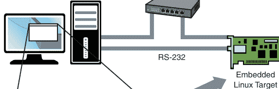

## RS-232

## 嵌入式 Linux 目标

```
<ethernet eth0: MAC address 00:00:00:00:00:78
IP: 192.168.0.5/255.255.255.0, Gateway: 192.168.0.1
Default route to 192.168.0.1 via eth0 metric 100
Reboot (initial bootstrap and debug environment) [OK]
Linux version 2.6.0-2-generic (x86_64)
[Serial/Parallel] Port TTY version: 1.4
Copyright (C) 1999-2002 Red Hat, Inc.
IRQ: 0x00000000:0x00000000, 0x0001f560:0x03f1000
Flags: 0x00000000:0x00000000
```

## 串口终端

图 2-2 嵌入式 Linux 开发设置


## 2.2 嵌入式系统的体系结构

在本示例中，我们与嵌入式 Linux 目标的主要连接是通过 RS-232 连接。使用串口终端程序来与目标板通信。`Minicom` 是最常用的串口终端应用程序之一，几乎在所有的桌面 Linux 发行版中均可用。作者已切换到使用 `screen` 作为他的首选终端，取代了 `minicom` 的功能。它在捕捉跟踪（`traces`）方面提供了更大的灵活性，并且对于系统启动或故障排除过程中遇到的串口线垃圾数据更具容忍性。要在连接 USB 的串口线缆上使用 `screen`，只需在你的串口终端上调用它并指定速度即可：

```
$ /dev/ttyUSB0 115200
```

### 2.2.2 启动目标板

当首次上电时，目标板提供的引导加载程序（`bootloader`）会立即接管处理器。它执行一些非常底层的硬件初始化，包括处理器和内存设置、控制串口的 UART 初始化以及以太网控制器的初始化。列表 2-1 显示了从串口接收到的字符，这些字符源于目标板的上电。

> 你可能需要从发行版的仓库中安装 `minicom`。例如，在 Ubuntu 上，你需要执行 `sudo apt-get install minicom` 在你的桌面上安装 `minicom`。

在本示例中，我们选择了一块来自 Freescale 半导体公司的公司的目标板，即 `PowerQUICC III MPC8548` 可配置开发系统 (`CDS`)。它包含了 `MPC8548 PowerQUICC III` 处理器。它从 Freescale 出厂时已预装了 `U-Boot` 引导加载程序。

#### 列表 2-1 初始引导加载程序串口输出

```
U-Boot 2009.01 (May 20 2009 - 09:45:35)
CPU: 8548E, Version: 2.1, (0x80390021)
Core: E500, Version: 2.2, (0x80210022)
Clock Configuration:
  CPU:990 MHz, CCB:396 MHz,
  DDR:198 MHz (39 MT/s data rate), LBC:49.500 MHz
  D-cache 32 kB enabled
L1:  I-cache 32 kB enabled
Board: CDS Version 0x13, PCI Slot 1
CPU Board Revision 0.0 (0x0000)
I2C: ready
DRAM: Initializing
SDRAM: 64 MB
  DDR: 256 MB
FLASH: 16 MB
L2: 512 kB enabled
Invalid ID: (ff ff ff ff), unknown MHz, async, host, external-arbiter
  PCI: 64 bit, unknown MHz, async, Scanning PCI bus 00
PCI on bus 00 - 02

  PCIE connected to slot as Root Complex (base address e000a000)
PCIE on bus 3 - 3
In: serial
Out: serial
Err: serial
Net: eSEC0, eSEC1, eTSEC2, eSEC3
=>
```

当 `MPC8548CDS` 板板上电时，`U-Boot` 执行底层硬件初始化，包括配置串口。然后它会打印一行横幅（`banner line`），如列表 2-1 第一行所示。接下来显示 CPU 和内核，随后是一些配置数据时钟和时钟配置。之后是一个描述开发板的文本字符串。

当初始硬件配置完成后，`U-Boot` 根据其静态配置的指示配置任何硬件-软件子系统。在这里我们看到 `U-Boot` 正在配置 `I2C`、`DRAM`、`FLASH`、`L2` 缓存、`PCI` 和网络子系统。最后，`U-Boot` 等待来自串口控制台的输入，如 `=>` 提示符所示。

### 2.2.3 启动内核

现在 `U-Boot` 已经初始化了硬件、串口和以太网接口，它在短暂而实用的生命中只剩下一个工作：加载并启动 Linux 内核。所有的引导加载程序都有一个用于加载和执行操作系统的命令。

当 `U-Boot` 初始化了硬件、串口和以太网接口后，它在短暂而实用的生命中只剩下一个工作：加载并启动 Linux 内核。所有的引导加载程序都有一个用于加载和执行操作系统的命令。

地址 `192.168.0.9`。通常情况下，这是你的开发工作站。根文件系统包含了构成 Linux 系统的应用程序、系统库和实用程序。

本文讨论的一个重要点不应被忽视：Linux 需要一个文件系统。对于从传统嵌入式操作系统转向嵌入式 Linux 的工程师来说，这一事实经常让他们感到。文件系统由硬盘或其他介质上特定布局的定义的系统目录和文件组成，Linux 内核将其挂载为根文件系统。

注意，Linux 可以从其他设备挂载根文件系统。当然，最常见的是将硬盘分区挂载为根文件系统，就像你的 Linux 笔记本或工作站上做的那样。事实上，除非你将嵌入式 Linux 离开你的环境运行，否则 NFS 几乎毫无用处。然而，随着本书的深入，你将发现 NFS 挂载作为开发环境的力量和灵活性。

#### 2.2.5 第一个用户空间进程：init

在继续之前，还应该说明另一个重要点。注意列表 2-3 中的这一行：

```
INIT: version 2.86 booting
```

在此之前，内核本身正在执行代码，在被称为“内核上下文”的上下文中执行大量的初始化步骤。在这种运行状态下，内核拥有所有系统内存，并对所有系统资源具有完全权限。内核可以访问所有物理内存和所有 I/O 子系统。它在内核虚拟地址空间中执行代码，使用内核创建并拥有的栈。

当内核完成初始化并挂载根文件系统后，默认行为是产生一个名为 `init` 的应用程序。当内核启动 `init` 时，被称为运行在用户空间或用户空间环境中。在这种运行模式下，用户空间进程对系统的访问受到限制，必须使用内核调用来请求内核服务（如设备和 I/O）。这些用户空间进程（或程序）在随机选择并由内核管理的内存空间中运行。内核与处理器中特殊的内存管理硬件协作，为用户空间进程执行从虚拟到物理地址的翻译。这种架构最大的益处是：

> 它实际上不是随机的，但出于本文讨论的考虑，它可能是随机的。这个主题将在后以后详细介绍。

一个进程中的错误无法破坏另一个进程的内存空间。这是传统嵌入式操作系统中的常见陷阱，可能会导致最难追踪的错误。

如果这些概念看起来很陌生，请不要惊慌。本节的目的是勾勒出一个大画面，随着阅读书籍，你将从中获得更详细的知识。这些或其他概念在后面的章节中会有详细介绍。

## 2.3 存储考虑

嵌入式 Linux 开发最具挑战性的方面之一是大多数嵌入式系统的物理资源有限。虽然你桌面上的 `Core™ 2 Duo` 机器可能有 `500GB` 的硬盘，但发现容量仅为其部分的嵌入式系统并不罕见。在许多情况下，硬盘通常被更小、更便宜的非易失性存储设备取代。硬盘体积大、有旋转部件、对物理冲击敏感并且需要多个电压，这使得它们不适用于任何嵌入式系统。

### 2.3.1 闪存

几乎每个人都熟悉用于各种消费设备（如数码相机和 PDA，它们都是嵌入式系统的绝佳示例）的 `CF` 和 `SD` 卡。这些基于闪存技术的模块可以被看作固态硬盘，能够在极小的占用空间内存储数兆字节甚至数十 GB 的数据。它们没有移动部件，相对坚固，并在单一的通用电源电压下运行。

市场上存在好几家闪存制造商。闪存具有多种电气格式、物理封装和容量。嵌入式系统仅有 `4MB` 或 `8MB` 的非易失性存储并不罕见。嵌入式 Linux 系统更典型的存储需求范围从 `16MB` 到 `256MB` 或更多。越来越多的嵌入式 Linux 系统的非易失性存储达到了 GB 级别。

闪存可以使用软件控制进行写入和擦除。旋转硬盘技术仍然是最快的可写介质。尽管闪存写入速度随时间推移显著提高，但闪存写入和擦除时间仍然慢得多。你必须理解硬盘和闪存技术之间的一些基本差异。

闪存被分为相对较大的可擦除单元，称为擦除块（`erase blocks`）。闪存的一个定义特征是闪存中数据的写入和擦除方式。在典型的 `NOR` 闪存芯片中，在软件控制下可以通过直接向单元地址写入简单数据（一次一个位或一个字），将数据从二进制 `1` 变为二进制 `0`。然而，要将一个位从 `0` 改回 `1`，必须使用向闪存芯片的特殊控制指令序列擦除整个擦除块。

典型的 `NOR` 闪存设备包含许多擦除块。例如，一个 `4MB` 的闪存芯片可能包含 `64` 个每个 `64KB` 的擦除块。闪存也有非均匀的擦除块大小，以方便数据管理。这些通常被称为启动块（`boot blocks`）。通常引导加载程序（`bootloader`）存储在较小的块中，而内核和其他数据存储在较大的块中。图 2-3 显示了典型的块大小布局。

| 闪存顶部 | 8 KB |
| --- | --- |
| | 8 KB |
| | 参数块 | 64 KB |
| 闪存底部 | 64 KB |

图 2-3 启动块架构

> 有多种闪存技术。`NOR` 闪存是小型嵌入式系统中最常用的类型之一。


在闪存（Flash）中，要修改存储在闪存阵列中的数据，所在的块必须完全擦除。即使只需要更改块中的 1 字节，也必须擦除并重写整个块。与硬盘扇区大小相比，闪存块的大小较大。典型的高性能硬盘扇区为 512 或 1024 字节。其影响显而易见：由于必须对闪存中的相对大量数据进行擦除和重写，更新闪存数据的时间可能是硬盘的许多倍。在最坏的情况下，这些写入周期可能需要几秒钟。

闪存的另一个限制是闪存单元的写入寿命。`NOR` 闪存单元在失效前有有限的写入周期。虽然次数相当大（每个块典型为 100,000 次），但很容易想象一个糟糕设计的闪存算法（甚至是错误）会迅速损坏闪存设备。不说当然，你不应该配置系统日志输出到闪存设备。

## 2.3.2 NAND 闪存

`NAND` 闪存是一种相对新的闪存技术。当 `NAND` 闪存上市时，前节提到的传统闪存被称为 `NOR` 闪存。这些区别涉及到内部闪存单元架构。`NAND` 闪存通过提供更小的块大小，改进了传统（`NOR`）闪存的某些局限性，从而提高了单元的效率。

- `NOR` 闪存设备与处理器的接口类似于许多处理器外设。即它们具有直接连接到处理器的并行数据和地址总线。闪存阵列中的每个字节或字都可以以随机方式单独寻址。相比之下，`NAND` 设备通过一种随供应商变化的复杂接口进行串行访问。`NAND` 设备的操作模型更类似于传统硬盘关联控制器。数据以串行突发方式访问，这种方式远小于 `NOR` 闪存块的大小。`NAND` 闪存的写入周期寿命高出一个数量级，尽管其擦除单元小得多。

⁸ 记住，你可以一次一个字节地将 1 改为 0，但必须擦除整个块才能将任何位从 0 改为 1。

⁹ 逻辑直接。实际电路可能包含缓冲或桥接设备等。

总而言之，微处理器可以直接访问 `NOR Flash`，甚至可以直接从 `NOR Flash` 执行代码。（然而，出于性能考虑，这种做法非常罕见，且仅在资源极度匮乏的系统中进行）。事实上，许多处理器无法像缓存 `DRAM` 那样对 `Flash` 的指令存取进行缓存。这进一步降低了执行速度。相比之下，`NAND Flash` 更适合以文件系统格式进行大容量存储，而不是存储原始的二进制可执行代码和数据。

## 2.3.3 Flash 使用

嵌入式系统设计人员在 `Flash` 存储器的布局和使用上有许多选择。在资源未受过度限制的简单系统中，原始二进制数据（可能是经过压缩的）可以存储在 `Flash` 设备上。系统启动时，存储在 `Flash` 中的文件系统镜像被读取到 `Linux` 内存型磁盘（`ramdisk`）块设备中，并挂载为文件系统，且仅从 `RAM` 访问。当 `Flash` 中的数据很少需要更新时，通常这是一个良好的设计选择。与 `ramdisk` 相比，任何需要更新的数据都相对较小。重要的一是，`ramdisk` 中文件的任何更改在重启或断电循环后都会丢失。

图 2-4 展示了一种常见的 `Flash` 存储器组织结构，常见于简单的嵌入式系统，此类动态数据的非线性存储需求较小且不利。

| Flash 顶部 | 引导程序与配置 |
| :--- | :--- |
| | `Linux` 内核 |
| | `Ramdisk` 文件系统镜像 |
| | 升级空间 |

图 2-4 典型的 `Flash` 存储器布局

引导程序通常位于 `Flash` 存储器数组的顶部或底部。在引导程序之后，会为 `Linux` 内核镜像和 `ramdisk` 文件系统镜像分配空间，¹⁰，后者持有根文件系统。通常，`Linux` 内核镜像和 `ramdisk` 文件系统镜像是压缩的，引导程序在启动周期期间处理解压任务。

对于需要在重启和断电循环之间保存的动态数据，可以专门划分出 `Flash` 的另一个较小区域，或者使用另一种类型的非易失性存储器¹¹。这是具有存储配置数据需求的嵌入式系统的典型配置，例如针对夏季市场的无线访问点等。

## 2.3.4 Flash 文件系统

上述简单 `Flash` 布局方案的局限性，可以通过使用 `Flash` 系统来管理 `Flash` 设备上的数据得以克服，其管理方式类似于硬盘上组织数据的方式。早期 `Flash` 设备文件系统的实现由一个简单的块设备组成，模拟常用硬盘的 512 字节扇区布局。这些简单的仿真允许以文件格式访问数据，而不是未格式化的块状存储，但它们也存在一些性能局限性。

`Flash` 文件系统的增强之一是引入了磨损均衡（`wear leveling`）。正如之前讨论的，`Flash` 块具有有限的寿命。使用磨损均衡算法将写操作均匀地分布在 `Flash` 存储器的物理擦除块上，以延长 `Flash` 内存芯片的寿命。

`Flash` 架构带来的另一个局限性是断电或过早关机期间数据丢失的风险。考虑到 `Flash` 块的大小相对较大，而写入的平均文件大小通常远小于块大小。你之前学过 `Flash` 必须一个块一次地写入。要写一个 8KB 的小文件，必须擦除并重写整个 `Flash` 块，大小可能为 64KB 或 128KB；在最坏的情况下，这可能需要几秒钟完成。这为断电导致的数据丢失风险打开了巨大的窗口。

今天使用的最流行的 `Flash` 文件系统之一是 `JFFS2`，即日志 `Flash` 文件系统 2。它具有几个重要特性，旨在提高性能、增加 `Flash` 寿命并减少断电情况下数据丢失的风险。最新 `JFFS2` 文件系统中更重大的改进包括改进的磨损均衡、为了在给定的 `Flash` 大内挤入更多数据而进行的压缩解压缩，以及对 `Linux` 硬链接的支持。该主题在第 9 章和第 10 章“`MTD` 子系统”讨论内存技术设备（`MTD`）子系统时会有详细介绍。

¹⁰ 我们在第 9 章“文件系统”中详细讨论了 `ramdisk` 文件系统。

¹¹ 实时时钟模块和串行 `EEPROM` 通常是小量数据非易失性存储的选择。

## 2.3.5 内存空间

几乎所有的旧版嵌入式操作系统都将系统内存视为一个单一的大扁平地址空间进行管理。也就是说，微处理器的地址空间从 0 到其物理地址范围的顶部。例如，如果一个微处理器有 24 个物理地址，那么它的内存顶部将是 16MB。因此，它的十六进制地址范围将从 `0x00000000` 到 `0x0ffffff`。硬件设备通常将 `DRAM` 放在范围底部，`Flash` 存储器从顶部向下。`DRAM` 顶部和 `Flash` 底部之间的未用地址范围将分配给板上各种外围芯片的地址。这种设计方法通常由微处理器的选择决定。图 2-5 显示简单嵌入式系统的典型内存布局。

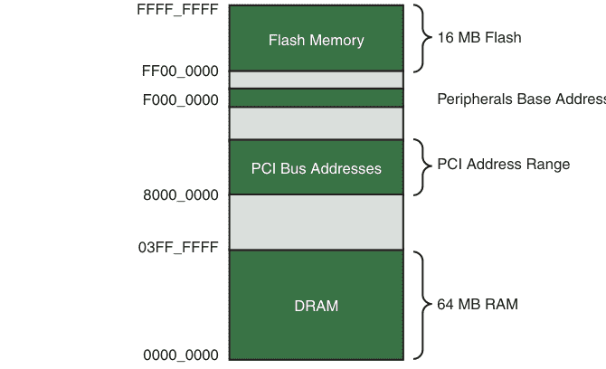

图 2-5 典型的嵌入式系统内存

## 第 2 章 大局

在基于传统操作系统的嵌入式系统中，操作系统查看并管理系统内存为一个单一的大扁平地址空间。也就是说，微处理器的地址空间从 0 到其物理地址范围的顶部。高性能的微处理器包含复杂的硬件单元，称为内存管理单元（`MMU`）。其目的是允许操作系统对地址空间行使控制，这种控制主要以两种形式出现：访问权限和内存。`Linux` 内核利用这些 `MMU` 来虚拟化内存。虚拟内存系统的最大优势之一是让系统拥有比物理存在的更多的内存。另一个优势是允许内核在不同的进程之间安全访问内存。² 虚拟内存允许，无论它属于内核、操作系统还是另一个任务，在系统的任何地方执行代码。

`Linux` 内核执行的首要任务之一是配置处理器上的硬件 `MMU` 以及支持它的数据结构，并启用地址转换。当这一步骤完成后，内核在自己的虚拟内存空间运行。近期 `Linux` 内核内核选择的虚拟内核地址默认为 `0xC000000`。⁴ 如果我们查看内核的符号表，我们会发现以 `0xC0xxxx` 开头的内核符号。结果是，每当内核在内核空间执行代码时，处理器的指令指针（程序计数器）包含该范围内的值。

在 `Linux` 中，根据给定线程¹⁵ 执行的环境，我们引用两个不同的操作上下文。完全在内核执行的线程被认为在内核上下文中。应用程序被认为在用户空间运行。用户空间进程只能访问它拥有的内存，并且需要内核系统调用来访问特权资源，如文件和设备 I/O。一个例子可能会这更清楚。

考虑一个打开文件并发出读取请求的应用程序，如图 2-6 所示。`read` 函数位于用户空间，在 C 库 `read()` 函数中。C 库向内核发出读取请求。读取请求导致从用户的程序到内核的切换，以处理对文件数据的请求。在内核内部，读取请求导致硬盘访问，请求包含文件数据的扇区。

² 在此讨论中，任务（`task`）一词泛指任何指令执行流。

³ 许多优秀的书籍涵盖了虚拟系统的细节。请参见本章最后一节的建议。

⁴ 然而，很少有理由更改它。

通常情况下，硬盘请求是异步发送给硬件本身的。也就是说，请求被发送到硬件处，当数据就绪时，硬件会触发中断处理该进程。等待数据的应用程序会被阻塞在等待队列中，直到数据可用。随后，当硬硬盘准备好数据时，它会发送一个硬件中断。（为了说明起见，此描述特意简化了。）当内核接收到硬件中断时，它会挂起正在执行的进程，并继续从驱动器读取等待中的数据。

总结这段讨论，我们识别了两个执行上下文——用户空间和内核空间。当应用程序执行导致上下文切换并进入内核的系统调用时，它是代表进程在执行内核代码。你经常会听到这被称为内核中的“进程上下文”。相比之下，处理 `IDE` 驱动器（或任何其他 `ISR`）的中断服务程序（`ISR`）不是代表任何特定进程执行的内核代码。这通常被称为“中断上下文”。


在这种操作上下文中存在若干局限性，包括 ISR 不能阻塞（睡眠）或调用可能导致阻塞的任何内核函数。有关这些概念的进一步阅读，请参考本章末尾的参考文献。

### 2.3.7 进程虚拟内存

当进程被创建时——例如，当用户在 Linux 提示符下输入 `ls`——内核会为该进程分配内存，并为进程分配一个虚拟内存地址范围。生成的地址值与内核或任何其他运行的进程都没有直接关系。此外，主板上的物理内存地址与进程所看到的虚拟内存之间也没有直接关联。事实上，由于分页和交换，一个进程在其生命周期内占用主内存中多个不同物理地址的情况并不少见。

列表 2-4 是著名的“Hello World”，经过了修改以说明所讨论的概念。该示例的目标是说明内核分配给进程的地址空间。该代码是在一个包含 256MB `D` 内存的嵌入式系统上编译并运行的。

#### 列表 2-4 Hello World，嵌入式风格

```c
#include <stdio.h>

int bss_var;      /* 未初始化的全局变量 */

int data_var = 1;   /* 已初始化的全局变量 */

int main(int argc, char **argv)
{
    void *stack_var;    /* 栈上的局部变量 */

    stack_var = (void *)main; /* 不要让编译器 */
                                 /* 将其优化掉 */

    printf("Hello, World! Main is executing at %p\n");
    printf("This address (%p) is in our stack frame\n", &stack_var);

    /* bss 段包含未初始化数据 */
    printf("This address (%p) is in our bss section\n", &bss_var);

    /* data 段包含初始化数据 */
    printf("This address (%p) is in our data section\n", &data_var);

    return 0;
}
```

列表 2-5 显示了该程序产生的控制台输出。注意，名为 `hello` 的进程认为它正执行在位于 256MB 边界之上的高位 RAM 某处（0x10000418）。同样注意，栈地址大约位于 32 位地址的一半处，远超我们的 256MB RAM（0x7ff8ebb0）。这如何可能呢？在这些类系统中，DRAM 通常是连续的。对于普通观察者来说，似乎我们有近 2GB 的 DRAM 可供使用。*虚拟地址*是由内核分配的，并由我们嵌入式板上 256MB 可用内存范围某处的物理 RAM 支持。

#### 列表 2-5 Hello 输出

```text
root@192.168.4.9:~#hello
Hello, World! Main is executing at 0x10000418
This address (0x7ff8ebb0) is in our stack frame
This address (0x1001a1c) is in our bss section
This address (0x10010a18) is in our data section
root@192.168.4.9:~#
```

30 第 2 章 概览

虚拟内存系统的特征之一是，当可用 RAM 降至指定阈值以下时，内核可以将内存页交换到批量存储介质中（通常是硬盘，如果可用）。内核检查其活动内存区域，确定内存中哪些区域最少使用，并将这些内存区域交换到磁盘，为当前进程释放。嵌入式系统的开发者经常由于性能或资源限制而禁用嵌入式系统上的交换。例如，在大多数情况下，使用写寿命有限且速度较慢的 Flash 内存设备作为交换设备是愚蠢的。如果没有交换设备，你必须仔细设计你的应用程序，使其存在于物理内存的限制之内。

### 2.3.8 交叉开发环境

在我们为嵌入式系统开发应用程序和设备驱动程序之前，我们需要一组工具（编译器、实用程序）来为目标机生成代码。这些工具存在的首要原因是，由于资源（通常是内存和 CPU）限制，在目标机上原生开发软件通常是不切实际或不可可能的。在交叉开发环境中开发软件需要交叉编译器来生成与目标机兼容的二进制执行文件。

现在假设你正在构建一个针对 Power 架构嵌入式系统的应用程序。显显然，你需要一个交叉编译器来生成与 Power 架构处理器兼容的二进制执行文件。如果你使用台式机执行类似的编译，它将为编译所在的机器生成一个镜像。

# 嵌入式 Linux 发行版

什么是 Linux 发行版？在 Linux 内核启动后，它期望找到并挂载根文件系统。当挂载了合适的根文件系统后，启动脚本（`start-scripts`）会启动系统所需的程序和实用程序。这些程序通常调用其他程序来执行特定任务，例如启动登录 shell、初始化网络接口以及启动用户的应用程序。每个这些程序都有特定的要求（通常称为依赖项），这些要求必须由系统的其他组件满足。大多数 Linux 应用程序依赖于一个或多个系统库。其他程序需要配置和日志，在某些情况下，每个微型嵌入式 Linux 系统都需要在相应的目录结构中填充几十个文件。

完整的桌面系统在根文件系统上有成千上万个文件。这些文件来自通常按功能分组的包。这些包使用包管理器进行安装和管理。红帽的包（`rpm`）是一个流行的例子，被广泛用于在 Linux 系统上安装、删除和更新包。如果你的工作站基于红帽系统（包括 Fedora 系列），在命令行提示符中使用 `rpm -qa` 可以列出系统上安装的所有包。如果你使用的是基于 Debian 的发行版（如 Ubuntu），输入 `dpkg -l` 具有相同的结果。

一个包可以包含许多文件；事实上，某些包包含数百个文件。一个完整的 Linux 发行版可以包含数百或数千个包。以下是你可能在嵌入式 Linux 发行版中找到的一些示例及其用途：

- `initscripts` 包含了基本的系统启动和关闭脚本。
- `apache` 实现了流行的 Apache Web 服务器。
- `telnet-server` 包含了实现 telnet 服务器功能所需的文件，它允许你向嵌入式目标机建立 telnet 会话。
- `glibc` 实现了标准 C 库。
- `busybox` 包含了在 UNIX/Linux 系统中常见的数十种流行命令行实用程序的紧凑版本。

这就是“Linux 发行版”一术语的含义。一个典型的 Linux 发行版附带几张光盘，里面装满了实用的程序、库、工具、实用程序和文档。发行版的安装通常会为用户留下一个基于一组合理的默认配置选项的完整功能系统，这些选项可以根据特定的需求进行定制。你可能熟悉某些流行的桌面 Linux 发行版，例如红帽或 Ubuntu。

用于嵌入式目标机的 Linux 发行版在几个方面有显著不同。首先，如果嵌入式发行版的可执行二进制文件针对你的嵌入式系统的架构和处理器，那么它们将无法在你的 PC 上运行。（当然，如果你的嵌入式 Linux 发行版针对的是 x86 架构，这种情况并不适用。）桌面 Linux 发行版倾向于拥有许多面向典型桌面用户的 GUI 工具，例如华丽的图形时钟、计算器、个人时间管理工具、电子邮件客户端等。嵌入式 Linux 发行版通常会省略这些组件，转而采用面向开发者的专用工具，例如内存分析工具、远程调试设施等。

桌面和嵌入式 Linux 发行版之间的另一个显著区别是，嵌入式发行版通常包含交叉工具（`cross tools`），而不是原生工具（`native tools`）。例如，随你 x86 桌面 PC 上的嵌入式 Linux 发行版提供的 `gcc` 工具链生成的二进制代码运行在你的目标系统上，该系统通常是非 x86 架构。工具链中的许多其他工具也具有类似的配置：它们运行在开发主机（通常是 x86 PC）上，但设计用于生成或操纵针对 ARM 或 Power Architecture 等异地架构的对象。

### 2.4.1 商业嵌入式 Linux 发行版

存在几家商业嵌入式 Linux 发行版供应商。领先的嵌入式 Linux 供应商多年一直提供嵌入式 Linux 发行版。寻找领先嵌入式 Linux 供应商的信息相对容易。在互联网上快速搜索“embedded Linux distributions”会指向几个汇编。一个特别好的汇编可以在 `http://elinux.org/Embedded_Linux_Distributions` 找到。

### 2.4.2 自制 Linux 发行版

你可以为自己的嵌入式项目自己组装所需的所有组件。你必须决定这些风险是否值得付出的精力。如果你发现自己参与嵌入式 Linux 纯粹是为了兴趣，例如出于业余爱好或大学项目，那么这种方法可能是一个好方法。然而，要计划花费大量时间来组装项目所需的所有工具和实用程序，并确保它们能够相互协同工作。


首先，你需要一个工具链。可以从 `wsf.org` 以及全球其他镜像站点获取 `gcc` 和 `binutils`。这两者都用于编译你项目的内核和用户空间应用程序。这些工具主要以源码形式分发，你必须编译这些工具以适应你特定的交叉开发环境。当这些实用程序被用在 x86/IA32 架构之外时，通常需要对它们最新的“稳定”源码树进行打补丁。补丁可以在与基础包相同的位置找到。挑战在于发现你针对特定问题或架构需要哪些补丁集合。

一旦你的工具链能够正常工作，你就需要下载并编译许多应用程序包以及它们所需的依赖项。这可能是一项艰巨的，因为现在的许多包并不适合交叉编译。许多包在离开它们开发时所在的原生 x86 环境后，仍然会出现构建失败或其他问题。

除了这些挑战之外，你可能还想组装一个胜任的开发环境，其中包含图形化调试器、内存分析工具、系统跟踪和性能分析工具等工具。你可以从这段讨论中看出，构建自己的嵌入式 Linux 发行版可能是非常有挑战性的。

### 2.5 总结

本章以宽泛的方式涵盖了许多主题。现在你对后续内容有了正确的视角。在随后的章节中，这种视角将得到扩展，帮助你培养在下一个嵌入式项目中取得成功所需的技能和知识。

- 嵌入式系统具有共同特征。通常资源有限，用户界面简单或不存在，且通常是为特定目的设计的。
- 引导加载程序（`bootloader`）是典型嵌入式系统的关键组件。如果你的嵌入式系统基于自定义设计板，你必须作为设计的一部分提供引导加载程序。这通常是对现有引导加载程序的移植工作。
- 启动定制板需要若干软件组件，包括引导加载程序、内核和文件系统镜像。
- 闪存被广泛用作嵌入式 Linux 系统的存储媒介。本章介绍了闪存的概念。第 9 章和第 10 章对此进行了扩展。
- 应用程序也称为进程，运行在内核分配的虚拟内存空间中。应用程序被认为运行在用户空间。
- 一个配置配置良好的交叉开发环境对于嵌入式开发者至关重要。第 12 章专门介绍这一重要主题。
- 开发嵌入式目标需要一个嵌入式 Linux 发行版。嵌入式发行版包含了许多针对你所选架构进行编译和优化的组件。

# 第3章 处理器基础

## 本章介绍

- 3.1 独立式处理器 38
- 3.2 集成处理器：片上系统 43
- 3.3 其他架构 59
- 3.4 硬件平台 60
- 3.5 总结 61

本章介绍了一些基础信息，帮助你从海量的嵌入式处理器选择中进行挑选。我们将介绍市场上的一些处理器以及它们包含的特性类型。首先重点介绍了独立式处理器。这些处理器通常是性能强大的处理器，需要外部芯片组来形成完整的系统。接下来，我们将介绍 Linux 支持的许多集成处理器之一。最后，我们查看了目前常用的一些硬件平台。

对于给定的嵌入式设计，有数十种嵌入式处理器可供选择。在本章中，我们将讨论限制在包含硬件内存管理单元（`MMU`）的处理器，当然，还包括受 Linux 支持的处理器。Linux 的基本架构特性之一是作为一个虚拟操作系统¹。在不包含 `MMU` 的处理器上运行 Linux 将放弃了内核最有价值的架构特性之一，这超出了本书的范围。

### 3.1 独立式处理器

独立式处理器是专用于处理功能的处理器芯片。与集成处理器不同，独立式处理器在其基础运行需要额外的支持电路。在许多情况下，这意味着处理器周围需要一个芯片组或自定义逻辑，用于处理诸如 DRAM 控制器、系统总线配置以及外部外设设备（如键盘控制器和串口口）。独立式处理器通常提供最高的整体 CPU 性能。

存在大量的 32 位和 64 位实现²的处理器，它们在嵌入式系统中被广泛使用。这些包括 IBM Power Architect-970/970FX、英特 Pentium M 以及飞世半尔（Freescale）`MPC74xx` 热处理器等。英特 Atom 系列处理器在嵌入式应用中找到了一席之地。

接下来的章节描述了来自各主要独立式处理器制造商的处理器。这些处理器在 Linux 下得到了良好的支持，并已用于许多嵌入式 Linux 设计中。

#### 3.1.1 IBM 970FX

`IBM 970FX` 处理器核心是一个高性能的 64 位能力独立式处理器。`970FX` 采用超流水架构。这意味着核心可以同时取取、发射并获取多条指令的结果。这是通过流水线架构实现的，在理想情况下，它提供了多条指令流同时执行的效果。`IBM 970FX` 包含多达 25 级流水线，取决于其中包含的指令流和操作。`970FX` 的一些关键特性如下：

- 流行的 Power 架构的 64 位实现
- 深流水线设计，适用于极高性能计算应用
- 静态和动态电源管理功能
- 多种睡眠模式，以最小化功耗需求并最大化电池寿命
- 动态可调时钟频率，支持低功耗模式
- 针对高性能、低延迟存储管理进行了优化

`IBM 970FX` 已集成到许多高端服务器刀片和计算平台中，包括 IBM 的刀片服务器平台。

#### 3.1.2 英特尔奔腾 M (Intel Pentium M)

x86 架构在 32 位和 64 位模式下都非常受欢迎，这无疑是最受欢迎的架构之一，它被应用于各种应用中的嵌入式设备。最常见的形式是，这些平台基于多种商业现货（COTS）硬件实现。许多制造商提供各种外型的 IA32/64 单板机和完整平台。第 3.2 节讨论了目前常用的常用的平台。

英特尔奔腾 M 已用于各种笔记本电脑，并嵌入嵌入式产品中找到了一席之地。与 `IBM 970FX` 处理器一样，奔腾 M 也是超流水架构。这些特性使其在嵌入式应用中极具吸引力：

- 奔腾 M 基于流行的 x86 架构，因此得到了由大量硬件和软件供应商构成的庞大生态系统的广泛支持。
- 它的功耗比其他 x86 处理器更低。
- 高级电源管理功能实现了低功耗运行模式和多种睡眠模式。
- 动态时钟速度能力增强了电池供电的操作（如待机）。
- 片内热监控能够自动切换到低功耗模式，以减少过热下的功耗。
- 设计了多个频率和电压工作点（动态可选），以最大限度地延长便携设备的电池寿命。

这些功能中的许多对于嵌入式应用特别有用。嵌入式产品需要便携或电池供电的配置并不罕见。奔腾 M 因其功耗和热管理功能，在这一应用领域广受欢迎。

#### 3.1.3 英特尔 Atom™

英特尔 `Atom` 在笔记本（Netbooks）和一系列嵌入式系统中取得了成功。英特尔 `Atom` 系列处理器具有低功耗和与旧版 32 位英特尔处理器的二进制兼容性，能够实现广泛的现有软件解决方案。与本节描述的其他独立式处理器一样，`Atom™` 与配套芯片组配以构建完整的解决方案。`N270` 和 `Z5xx` 系列处理器已广泛用于低功耗产品。作者的 Dell Mini 10（本第二版手稿部分内容在其编写）包含了英特尔 `Atom™ Z530` 处理器。

关于英特尔 `Atom™` 处理器的更多信息可以通过本章最后一节提供的 URL 找到。

#### 3.1.4 飞世半尔 MPC7448

飞世半尔 `MPC7448` 包含一个被称为第四代 Power 架构核心的 `G4`³。这种高性能 32 位处理器常见于网络和电信应用。几家公司制造符合 `ATCA`（一种行业标准规范）的刀片，包括此类和其他类似的独立式飞世半尔处理器。第 3.3 节将检查这些平台。

`MPC7448` 因其先进特性集而在各种信号处理和网络应用中受欢迎：

- 超过 1.5GHz 的频率
- 1MB 板载 L2 缓存
- 高级管理功能，包括多种睡眠模式
- 高级 `AltVec` 矢量单元
- 用于低功耗配置的电压缩放

`MPC7448` 包含一种名为 `AltVec` 技术，用于快速算法计算和其他数据处理应用。`AltVec` 单元由一个包含 32 个 128 位宽寄存器的寄存器文件组成。这些寄存器中的每个值都可以被视为多个元素的向量。`AltVec` 定义了一组指令，可在内核 CPU 指令处理的同时有效地处理这些数据。`AltVec` 操作包括跨累加、乘加、同步数据分发（存储）和数据采集（加载）指令。

程序员利用 `AltVec` 硬件来实现常见于信号处理和网络元素的快速软件计算。示例包括快速傅里叶变换、数字信号处理（如滤波）、MPEG 视频编码和解码以及快速加密协议 DES、MD5 和 SHA1。

飞世半尔独立式处理器产品中的其他芯片还包括 `MPC7410`、`MPC7447`、`MPC745x` 和 `MPC77xx` 系列。

#### 3.1.5 配套芯片组

上述独立式处理器需要支持，以连接并启用外部外设设备，如主系统内存（DRAM）、ROM 或闪存器、系统总线（如 PCI）以及其他外设，如键盘控制器、串口、IDE 接口等。这种支持逻辑通过配套芯片组实现，这些芯片组甚至是专门为某系列处理器设计的。

例如，`Pentium M` 由一种这样的芯片组支持，称为 `855GM`。`855GM` 芯片组是图形和内存的主要接口——因此后缀为 GM。`855GM` 经过了优化，作为 `Pentium M` 的伴侣使用。图 3-1 阐述了此类硬件设计中处理器与芯片组之间的关系。

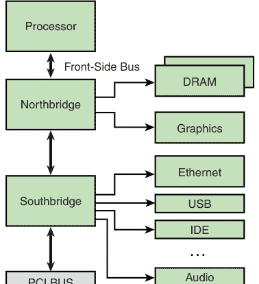

图 3-1 处理器/芯片组关系

¹ 支持一些不包含 `MMU` 的基础处理器，但这并不被认为是主流用法。
² 32 位和 64 位指的是处理器主要设施（如执行单元、寄存器文件和地址总线）的原生宽度。
³ 飞世半尔文献现在将 `G4` 核心称为 `e600` 核心。


用于描述这些芯片组的术语已变得通用。`Intel 855GM`是通常所谓的“北桥”（`northbridge`）芯片的一个示例，因为它直接连接到处理器的高速前备侧总线（`FSB`）。另一个提供 I/O 和 PCI 连接的伴侣芯片同样由于其在架构中的位置被被称为“南桥”（`southbridge`）芯片。这些硬件架构中的南桥芯片（实际上是一个 I/O 控制器）负责如图 3-1 所示的接口，包括以太网、`USB`、`IDE`、音频、键盘和鼠标控制器。

在 `Power Architecture` 架构方面，用于 `Power Architecture` 的 `Tundra Tsi110` 主桥是支持独立 `Power Architecture` 处理器的芯片组示例。`Tsi110` 为许多常见的独立 `Power Architecture` 处理器支持多种接口功能。`Tundra` 芯片支持 `Freescale MPC74xx` 和 `IBM PPC 750xx` 系列处理器。这些处理器可以使用 `Tundra` 芯片提供与以下外围设备的直接接口：

- 双数据速率 (`DDR`) `DRAM` 存储器，集成内存控制器
- 以太网（`Tundra` 提供四个千兆比特以太网端口）
- `PCI Express`（支持两个 `PCI Express` 端口）
- `PCI/X`（`PCI 2.3`、`PCI-X` 和紧凑型 `PCI` [`cPCI`]）
- 串口
- `I2C`
- 并行口

存在许多芯片组制造商，包括 `VIA Technologies`、`Marvell`、`Tundra`（现为 `IDT`）、`nvidia`、`Intel` 等。`Marvell` 和 `Tundra` 主要为 `Power Architecture` 市场提供服务，而其他公司专精于英特尔架构。基于许多独立处理器（如 `Intel x86`、`IBM` 或 `FreeBSD Power Architecture`）的硬件设计需要一个伴侣芯片组来与系统设备接口。

`Linux` 作为嵌入式操作系统的优势之一是对新芯片的快速支持。`Linux` 目前支持这里提到的芯片组以及许多其他芯片组。请咨询 `Linux` 源码和配置工具以获取有关芯片组的信息。

### 3.2 集成处理器：片上系统（SoC）

上一节强调了独立处理器。尽管它们被用于许多应用（包括一些高功率处理引擎），但大多数较小的嵌入式系统采用某种类型的集成处理器或片上系统（`SOC`）。有许多 `SOC` 可供选择。本节将研究行业领先者的少数 `SOC`，并观察使每个组脱颖而出的特征。

存在多种处理器架构，每种架构都有集成 `SOC` 的示例。`Power Architecture` 在许多网络和电信相关的嵌入式应用中一直是传统的领导者，而 `MIPS` 在低端消费级设备中可能处于市场领先地位。`ARM` 用于许多移动手机。这些架构，当然还有 `IA32/64`，代表了主要的架构

> ⁴ 这些是作者的观点，基于市场观察，而非科学数据。

在嵌入式 `Linux` 系统中被广泛使用。然而，正如你将在第 4 章中看到的，“`Linux` 内核：不同的视角”，`Linux` 今日支持超过 20 种不同的硬件架构。

#### 3.2.1 Power Architecture

`Power Architecture` 是指符合各种版本 `Power Architecture` 指令集架构（`ISA`）的技术和产品族的现代术语。许多优秀的文档详细地描述了 `Power Architecture`。请参考本章的最后一节作为起点。

`Power Architecture` 处理器已进入各种描述的嵌入式产品。从汽车、消费和网络应用到最大的数据和电信交换机，`Power Architecture` 是嵌入式应用中最流行且成功的架构之一。由于这种流行，存在由许多制造商针对 `Power Architecture` 的大量硬件和软件解决方案。

#### 3.2.2 Freescale Power Architecture

`Freescale Semiconductor` 拥有一系列集成外设的 `Power Architecture` 处理器。`Freescale Power Architecture` 处理器在网络市场领域取得了巨大成功。这一系列处理器在从产品空间低端到高端各种网络设备中具有广泛吸引力。

根据任何衡量标准，`Freescale` 在嵌入式市场取得了巨大的成功。这种成功的一部分可以追溯到著名的 `68K` 系列产品，这些产品今天仍以 `Coldfire` 处理器的形式占据市场份额。最近，`Freescale` 在其 `PowerQUICC` 系列上取得了成功。`PowerQUICC` 架构已经出货了多年。它基于特定版本的 `Power Architecture` 核心，并集成 `QUICC` 引擎（在 `Freescale` 文中也称为通信处理器模块或 `CPM`）。`QUICC` 引擎是一个独立的 `RISC` 处理器，旨在将通信处理从主 `Power Architecture` 核心中卸载，从而释放 `Power Architecture` 核心专注于控制和管理应用。`QUICC` 引擎是一个复杂但高度灵活的通信外设控制器。

在目前的形态中，`PowerQUICC` 包含五个通用组。尽管有些过时，但 `PowerQUICC I` 系列 (`8xx`) 仍然存在。`PowerQUICC II` (`82xx`) 仍然非常流行，`PowerQUICC II Pro` (`83xx`) 如此。`PowerQUICC III` (`85xx`) 在网络和其他领域非常受欢迎。`PowerQUICC III` 演变为新的 `QorIQ` 系列处理器，该系列采用了高性能的 `e5` 核心。

### 3.2.3 Power Architecture

`Power Architecture` 是一个现代术语，指的是符合各种版本 `Power Architecture` 指令集架构的技术和产品族。许多优秀的文档详细描述了 `Power Architecture`。请参考本章的最后一节作为起点。

`Power Architecture` 处理器已进入各种描述的嵌入式产品。从汽车、消费和网络应用到最大的数据和电信交换机，`Power Architecture` 是嵌入式应用中最流行且成功的架构之一。由于这种流行，存在由许多制造商针对 `Power Architecture` 的大量硬件和软件解决方案。

#### 3.2.4 Freescale Power Architecture

`Freescale Semiconductor` 拥有一系列集成外设的 `Power Architecture` 处理器。`Freescale Power Architecture` 处理器在网络市场领域取得了巨大成功。这一系列处理器在从产品空间低端到高端各种网络设备中具有广泛吸引力。

根据任何衡量标准，`Freescale` 在嵌入式市场取得了巨大的成功。这种成功的一部分可以追溯到著名的 `68K` 系列产品，这些产品今天仍以 `Coldfire` 处理器的形式占据市场份额。最近，`Freescale` 在其 `PowerQUICC` 系列上取得了成功。`PowerQUICC` 架构已经出货了多年。它基于特定版本的 `Power Architecture` 核心，并集成了一个 `QUICC` 引擎（在 `Freescale` 文中也称为通信处理器模块或 `CPM`）。`QUICC` 引擎是一个独立的 `RISC` 处理器，旨在将通信处理从主 `Power Architecture` 核心中卸载，从而释放 `Power Architecture` 核心专注于控制和管理应用。`QUICC` 引擎是一个复杂但高度灵活的通信外设控制器。

在目前的形态中，`PowerQUICC` 包含五个通用组。尽管有些过时，但 `PowerQUICC I` 系列 (`8xx`) 仍然存在。`PowerQUICC II` (`82xx`) 仍然非常流行，`PowerQUICC II Pro` (`83xx`) 如此。`PowerQUICC III` (`85xx`) 在网络和其他领域非常受欢迎。`PowerQUICC III` 演变为新的 `QorIQ` 系列处理器，该系列采用了高性能的 `e5` 核心。

### 3.2.5 Southbridge

由于其在架构中的位置，另一个提供 I/O 和 PCI 连接的伴侣芯片同样被称为“南桥”（`southbridge`）。`southbridge` 芯片（实际上是一个 I/O 控制器）在这些硬件架构中负责如图 3-1 所示的接口，包括以太网、`USB`、`IDE`、音频、键盘和鼠标控制器。

## 3.2 集成处理器：片上系统 47

表 3-2 续表

| 特性 | `MPC8250` | `MPC8260` | `MPC8272` | `MPC8280` |
| :--- | :--- | :--- | :--- | :--- |
| `SMC` 控制器 | 2 | 2 | 2 | 2 |
| `FCC` 控制器 | 3 | 3 | 2 | 3 |
| `MCC` 控制器 | 1 | 2 | 0 | 2 |


### 3.2.5 PowerQUICC II Pro

PowerQUICC II Pro 基于 Freestyle Power Architecture `e300` 核心（由 G2/603e 演而来），运行频率为 266 到 667MHz，并支持千兆以太网、DDR SDRAM 控制器、PCI、高速 USB、安全加速等特性。这些属于 `MPC83xx` 系列处理器。PowerQUICC II 和 PowerQUICC II Pro 系列处理器已用于各种设备，例如局域网和广域网交换机、集线器器和网关、PBX 系统以及许多其他具有相似复杂性和性能要求的系统。

PowerQUICC II 包含三个系列成员，其中两个基于更新版本的 QUICC 引擎。`MPC8358E` 和 `MPC8360E` 都增加了一个新的通用通信控制器（`UCC`），支持多种协议。

表 3-3 总结了 PowerQUICC II Pro 系列中选定成员的亮点。

表 3-3 Freescale PowerQUICC II Pro 亮点

| | `MPC8343E` | `MPC8347E` | `MPC8349E` | `MPC8360E` |
| :--- | :--- | :--- | :--- | :--- |
| 核心 | `e300` | `e300` | `e300` | `e300` |
| 时钟频率 | 266 to 400MHz | 266 to 667MHz | 400 to 667MHz | 266 to 667MHz |
| DRAM 控制器 | Y-DDR | Y-DDR | Y-DDR | Y-DDR |
| USB | 是 | 2 | 2 | 是 |
| SPI 控制器 | 是 | 是 | 是 | 是 |
| I2C 控制器 | 2 | 2 | 2 | 2 |
| 以太网 10/1000 | 2 | 2 | 2 | 通过 UCC |
| UART | 2 | 2 | 2 | 2 |
| PCI 控制器 | 是 | 是 | 是 | 是 |
| 安全引擎 | 是 | 是 | 是 | 是 |
| MCC | 0 | 0 | 0 | 1 |
| UCC | 0 | 0 | 0 | 8 |

### 3.2.6 Freescale PowerQUICC 系列

PowerQUICC 系列的顶端是 PowerQUICC III 处理器。它们运行在 600MHz 到 1.5GHz 之间。它们基于 `e500` 核心，支持千兆以太网、DDR SDRAM、RapidIO、PCI 和 PCI/X、ATM、HDLC 等。该家族包含了 `MPC85xx` 产品线。这些处理器已应用于无线基站控制器、光边缘交换机、市端交换机和类似设备等高端产品。

表 3-4 突出了 PowerQUICC III 系列的一些成员。

表 3-4 Freescale PowerQUICC III 亮点

| 特性 | `MPC8540` | `MPC8548E` | `MPC8555` | `MPC8560` |
| :--- | :--- | :--- | :--- | :--- |
| 核心 | `e500` | `e500` | `e500` | `e500` |
| 时钟频率 | 高达 1.0GHz | 高达 1.5GHz | 高达 1.0GHz | 高达 1.0GHz |
| DRAM 控制器 | Y-DDR | Y-DDR | Y-DDR | Y-DDR |
| USB | 否 | 否 | 通过 SCC | 否 |
| SPI 控制器 | 否 | 否 | 是 | 是 |
| I2C 控制器 | 是 | 是 | 是 | 是 |
| 以太网 10/100 | 1 | 通过千兆以太网 | 通过 SCC | 通过 SCC |
| 千兆以太网 | 2 | 4 | 2 | 2 |
| UART | 2 | 2 | | 通过 SCC |
| PCI 控制器 | PCI/PCI-X | PCI/PCI-X | PCI | PCI/PCI-X |
| RapidIO | 是 | 是 | 否 | 是 |
| 安全引擎 | 否 | 是 | 否 | 否 |
| SCC | — | — | 3 | 4 |
| FCC | — | — | 2 | 3 |
| SMC | — | — | 2 | 0 |
| MCC | — | — | 0 | 2 |

### 3.2.7 Freescale QorIQ™

QorIQ 读作“core eye queue”，是 Freescale 基于架构的最新技术。QorIQ 系列中的许多芯片是基于 `e500` 和 `e500mc` 核心的多核处理器。Freescale 在其官方网上描述了 QorIQ 系列的三个平台。这些信息在这里进行了总结。

> ⁵www.freescale.com/QorIQ

## 3.2 集成处理器：片上系统 49

P1 包含了 `P1011`/`P1020` 以及 `P1013`/`P1022`。这些处理器包含 `e500` 架构核心，每个都有一组专门的外设，旨在面向网络、通信和控制平面应用。它们具有一个或两个核心，功耗极低，大约为 3.5 瓦。表 3-5 总结了 P1 系列的主要亮点。

表 3-5 Freescale QorIQ P1 系列

| 特性 | `P1011` | `P1020` | `P1013` | `P1022` |
| :--- | :--- | :--- | :--- | :--- |
| 核心 | `e500` | `e500` | `e500` | `e500` |
| 时钟频率 | 高达 800MHz | 高达 800MHz | 高达 1055MHz | 高达 1055MHz |
| 核心数量 | 1 | 2 | 1 | 2 |
| USB | 2.0 | 2.0 | 2.0 | 2.0 |
| SPI 控制器 | 是 | 是 | 是 | 是 |
| I2C 控制器 | 是 | 是 | 是 | 是 |
| 以太网 | 3 × 千兆以太网 | 3 × 千兆以太网 | 2 × 千兆以太网 | 2 × 千兆以太网 |
| DUART | 2 | 2 | 2 | 2 |
| PCI | 2 × PCI Express | 2 × PCI Express | 3 × PCI Express | 3 × PCI Express |
| SATA | | | 2 × SATA | 2 × SATA |
| 安全引擎 | 是 | 是 | 是 | 是 |
| SD/MMC | 是 | 是 | 是 | 是 |

P2 系列由 `P2010` 和 `P2020` 组成。该系列也包含一个或两个核心。它们的性能高于 P1 系列，核心频率高达 1.2 GHz，并且具有更大的缓存。它们的典型功耗需求在 6 瓦范围内。表 3-6 列出了 P2 系列的亮点。

表 3-6 Freescale QorIQ P2 系列

| 特性 | `P2010` | `P2020` |
| :--- | :--- | :--- |
| 核心 | `e500` | `e500` |
| 核心频率 | 高达 1.2GHz | 高达 1.2GHz |
| 核心数量 | 1 | 2 |
| USB | 2.0 | 2.0 |
| SPI 控制器 | 是 | 是 |
| I2C 控制器 | 是 | 是 |
| 以太网 | 3 × 千兆以太网 | 3 × 千兆以太网 |
| DUART | 2 | 2 |
| PCI | 3 × PCI Express | 3 × PCI Express |
| Serial RapidIO | 2 × SRIO | 2 × SRIO |
| 安全引擎 | 可选 | 可选 |
| SD/MMC | 是 | 是 |

P4 系列由 `P440` 和 `P4080` 组成。该系列处理器最多拥有八个核心，基于名为 `e500mc` 的特殊多核核心。这些核心支持硬件虚拟机管理器（hypervisor）、私有缓存和浮点运算。该家族的独特之处是用于高速数据面的数据路径架构（DPAA）。表 3-7 显示了 P4 系列。

| | `P4040` | `P4080` |
| :--- | :--- | :--- |
| 核心 | `e500mc` | `e500mc` |
| 核心频率 | 高达 1.5GHz | 高达 1.5GHz |
| 核心数量 | 4 | 8 |
| USB | 2 × 2.0 | 2 × 2.0 |
| SPI 控制器 | 是 | 是 |
| I2C 控制器 | 是 | 是 |
| 以太网 | 8 × 10/100/1000 | 8 × 10/100/1000 |
| 千兆以太网 | 2 | 2 |
| DUART | 2 | 2 |
| PCI | 3 × PCI Express V2 | 3 × PCI Express V2 |
| Serial RapidIO | 2 | 2 |
| 安全引擎 | 是 | 是 |
| SD/MMC | 是 | 是 |

### 3.2.8 AMCC 架构

书中的某些示例基于 AMCC 架构 `440EP` 嵌入式处理器。`440EP` 是在许多网络和通信产品中常见的集成处理器。以下列表列出了 `440EP` 的某些特性：

- 片内双速率 (DDR) SDRAM 控制器
- 集成 NAND Flash 控制器
- PCI 总线接口


- 双 10/100Mbps 以太网端口
- 片内 USB 2.0 接口
- 最多四个可配置串口端口
- 双 I2C 控制器
- 可编程中断控制器
- 串行接口 (SPI) 控制器
- 可编程定时器
- 用于调试的 JTAG 接口

这是一个完整的 SOC。图 3-2 是 AMCC 架构 440EP 嵌入式处理器的框图。通过内存芯片和物理 I/O 硬件，可以围绕这个集成微处理器构建一个完整的嵌入式系统。

 感谢 AMCC

图 3-2 AMCC 440EP

许多制造商提供参考平台，以便开发者探索处理器或其他硬件的功能。图 3-2 所示的 440EP 非常适用于不需要浮点运算单元（FPU）的应用。AMCC 的 405 系列包含了带有和不带以太网控制器的多种配置。所有 405 核心集成了 SDRAM 控制器、双 UART、用于板级管理的 I2C、通用 IO 引脚以及定时器。

405 核心提供双核心配置。基于 440EP 的产品提高了性能水平并增加了外设。440GX 增加了三速 10/100/1000Mbps 接口（除了两个 10/100Mbps 端口）以及用于高性能网络的 TCP/IP 硬件加速。440SP 增加了用于 RAID 5/6 应用的硬件加速。所有这些处理器都有成熟的 Linux 支持。表 3-8 总结了 AMCC 405xx 系列的亮点。

### 表 3-8 AMCC 架构 405xx 亮点

| 特性 | 405CR | 405EP | 405GP | 405Gpr |
| :--- | :--- | :--- | :--- | :--- |
| 核心 | PPC 405 | PPC 405 | PPC 405 | PPC 405 |
| 核心频率 | 133 to 266MHz | 133 to 333MHz | 133 to 266MHz | 266 to 400MHz |
| DRAM 控制器 | SDRAM/133 | SDRAM/133 | SDRAM/133 | SDRAM/133 |
| 以太网 100 | 否 | 2 | 1 | 1 |
| GPIO 线 | 23 | 32 | 24 | 24 |
| UARTs | 2 | 2 | 2 | 2 |
| DMA 控制器 | 4 通 | 4 通 | 4 通 | 4 通 |
| I2C 控制器 | 是 | 是 | 是 | 是 |
| PCI 主机控制器 | 否 | 是 | 是 | 是 |
| 中断控制器 | 是 | 是 | 是 | 是 |

## 3.2 集成处理器：片上系统 53

表 3-9 总结了 AMCC 440xx 系列处理器的特性。

### 表 3-9 AMCC Power 架构 440xx 特性

| 特性 | 440EP | 440GP | 440GX | 440SP |
|---|---|---|---|---|
| 核心 | PPC 440 | PPC 440 | PPC 440 | PPC 440 |
| 核心频率 | 333 to 667MHz | 400 to 500MHz | 533 to 800MHz | 533 to 667MHz |
| DRAM 控制器 | DDR | DDR | DDR | DDR |
| 10/100 以太网 | 2 | 2 | 2 | 1 |
| 千兆以太网 | 否 | 否 | | 通过千兆以太网 |
| GPIO 内联 | 64 | 32 | 32 | 32 |
| UARTs | | 4 | 2 | | 3 |
| DMA 控制器 | 4 通道 | 4 通道 | 4 通道 | |
| I2C 控制器 | 2 | 2 | 2 | 2 |
| PCI 主控制器 | | PCI-X | PCI-X | PCI-X |
| SPI 控制器 | 是 | 否 | 否 | 否 |
| 中断控制器 | 是 | 是 | 是 | 是 |

### 3.2.9 MIPS

你可能会惊讶地发现，基于 MIPS 架构的 32 位处理器已经上市了 20 多年。MIPS 架构由 John Hennessy 博士领导的斯斯坦福大学工程团队于 1981 年设计，Hennessy 博士后来创立了 MIPS Computer Systems, Inc. 公司。该公司现已演变为现今的 MIPS Technologies，其主要角色是 MIPS 架构和内核的设计以及随后的授权。

MIPS 核心已被许多公司授权，其中几家已成为嵌入式处理器市场的主力军。MIPS 是一种精简指令集计算 (RISC) 架构，其 32 位和 64 位实现版本都应用于许多流行产品中。MIPS 处理器广泛用于各种产品，从高端设备到消费级设备。众所周知，MIPS 处理器为许多流行且知名的消费产品提供动力，例如索尼高清电视机、Linksys 无线访问点以及流行的游戏机。

MIPS Technology 网站列出了 73 个使用 MIPS 处理器内核制造产品的授权厂商。这些公司中有些家喻户晓，包括索尼（Sony）、德州仪器（Texas Instruments）、思科 Scientific Atlanta（领先的电缆电视顶盒制造商）、摩托罗拉（Motorola）等。其中最大且最成功的之一是博通（Broadcom Corporation）。

### 3.2.10 博通 MIPS

博通是电缆电视顶盒、电缆调制解调器、高清TV、无线网络、千兆以太网和 IP 语音 (VoIP) 等市场的领先 SOC 解决方案供应商。博通的 SOC 在这些市场上非常受欢迎。我们之前提到过，即使你不知道，你的家里也可能有 Linux。如果你有，它很可能运行在基于博通 MIPS 的 SOC 上。

2000 年，博通收购了 SiByte Inc.，这导致了该公司目前营销的通信处理器系列。这些处理器以单核、双核和四核配置出货。该公司仍称它们为 SiByte 处理器。

单核 SiByte 处理器包括 BCM1122 和 BCM1125H。它们基于 MIPS64 核心，时钟频率在 400 到 900MHz 之间。它们包含了片上外设控制器，如 DDR SDRAM 控制器、10/100Mbps 以太网和 PCI 主控制器。这两者都包含一个 SMBus 配置接口、PCMCIA 和两个用于串口连接的 UART。BCM1125H 包含一个三倍速 10/100/1000Mbps 以太网控制器。这些处理器最人注目的特征之一是它们的功耗。两者在 400MHz 运行频率下均具有 4W 的功耗预算。

双核 SiByte 处理器包括 BCM1250、BCM1255 和 BCM1280。这些处理器也基于 MIPS64 核心，其时钟频率从 600MHz (BCM1250) 到高达 1.2GHz (BCM1255 和 BCM1280)。这些双核芯片包含了集成的外设控制器，如 DDR SDRAM 控制器；各种组合的千兆以太网控制器；64 位 PCI-X 接口以及 SMBus、PCMCIA 和多个 UART 接口。作为单核版本的兄弟，这些双核实现具有低功耗的特点。例如，BCM1255 在 1GHz 运行下具有 3W 的功耗预算。

四核 SiByte 处理器包括 BCM1455 和 BCM1480 通信处理器。与其他 SiByte 处理器一样，这些都是基于 MIPS64 核心。核心运行频率可以从 800MHz 到 1.2GHz。这些 SOC 包含了 DDR SDRAM 控制器、四个千兆以太网 MAC 控制器和 64 位 PCI-X 主控制器。它们还包含 SMBus、PCMCIA 和四个串口 UART。

### 3.2.11 其他 MIPS

正如前面指出的，目前的 MIPS 授权厂商显示在 MIPS Technologies 网页上。由于它们基于 MIPS64 核心，核心运行频率从 800MHz 到 1.2GHz。这些 SOC 包含了 DDR SDRAM 控制器、四个千兆以太网 MAC 控制器和 64 位 PCI-X 主控制器。它们还包含 SMBus、PCMCIA 和四个串口 UART。由于它们基于 ARM 核心，无法覆盖所有。Input Device Technology (IDT) 使用了 ARM 核心。Cavium Networks 使用 ARM 核心并支持 Linux。

### 3.2.12 ARM

ARM 架构由 ARM Holdings 开发，并授权给全球制造商。ARM 核心在这些市场上非常受欢迎。

### 3.2.13 TI ARM

德州仪器（TI）是电缆电视顶盒、电缆调制解调器、高清TV、无线网络、千兆以太网和 IP 语音 (VoIP) 等市场的领先 SOC 解决方案供应商。TI 的 SOC 在这些市场上非常受欢迎。我们之前提到过，即使你不知道，你的家里也可能有 Linux。如果你有，它很可能运行在基于德州仪器 ARM 的 SOC 上。

许多流行的产品基于 ARM 核心。表 3-11 比较了 TI 的的一些 ARM 处理器。

### 表 3-11 ARM 特性

| 特性 | OMAP-L138 | OMAP6467 | OMAP3515/03 | OMAP3530 |
|---|---|---|---|---|


| ARM 核心 | ARM926EJ-S | ARM926EJ-S | ARM Cortex A8 | ARM Cortex A8 |
| 时钟频率 | 300MHz | 365MHz | 720MHz | 550MHz |
| DRAM 控制器 | DDR2 | DDR2 | DDR2 | 是 |
| 板载 DSP | 300MHz C674x | 300MHz C64X | | C64X 视频/图像加速器系统 |
| UARTs | 3 | 3 | 3 | 3 |
| USB | USB 1.1 主机 USB 2.0 OTG | USB 2.0 主机 USB 2.0 客户端 | USB 2.0 客户端 | USB 2.0 客户端 |
| I2C 控制器/总 | 2 | 1 | 是 | 是 |
| MMC-SD 接口 | | | 是 | 是 |
| 摄像头接口 | 视频端口 | 视频端口 | | |
| 视频端口 | 2 入2 出 | 2 入输出 | S-Video 或 CVBS | S-Video 或 CVBS |
| 视频加速硬件 | | 2 HD 视频协处理器 | POWERVR SGX 显示控制器 | 视频加速器 (IVA+ 2) |
| 音频解码器支持 | AC97 接口 | AC97 接口 | 通过 DSP | 通过 DSP |
| LCD 控制器 | | | 是 | 是 |
| 显示控制器 | LCD 控制器和视频输出 | LCD 控制器和视频输出 | 双层显示处理器 | 双层显示处理器 |

### 3.2.13.1 BeagleBoard

如果你接触嵌入式 Linux 有久，一定听过 BeagleBoard。它的受欢迎源于廉廉的价格、易于获取以及广泛的社区支持。流行的 U-Boot 引导程序支持该开发板，使得内核集成变得简单。它提供了键盘和显示器的连接、用于内核和根文件系统的 SD 卡、用于控制台的串口连接以及双模式 USB 2.0 端口。BeagleBoard 的唯一缺点是缺少以太网端口。幸运的是，这个问题被名为 Tin Can Tools 的公司解决了。他们开发了一个名为 BeagleBuddy Ethernet Board 的扩展板。通过增加以太网端口，它又增加了一个 SD/MMC 接口和另一个串口。

## 3.2.14 飞思 ARM

ARM 架构的成功通过领先计算架构制造商都授权 ARM 技术这一事实变得更加明显。一个典型的例子是，飞思半导体（Freescale Semiconductor）已为其 i.MX 应用处理器系列授权了 ARM 技术。这些流行的基于 ARM 的集成处理器在多媒体消费设备（如便携式游戏平台、PDA 和手机）中已取得了广泛的行业成功。

飞思的 ARM 产品组合目前包括九系列应用处理器。其范围从 i.MX21 到 i.MX51 系列。所有的 i.MX 产品都可以在 www.freescale.com/webapp/site/homepage.jsp?code=IMX_HOME 找到。

i.MX21 具有 ARM9 核心，而 i.MX31 具有 ARM11 核心。与 TI 的对应产品一样，这些 SOC 包含了具有多媒体需求的便携消费电子设备所需的许多集成外围。i.MX21/31 包含以下某些集成接口：

- 图形加速器
- MPEG-4 编码器
- 键盘和 LCD 控制器
- 摄像头接口
- 音频复用器
- IrDA 红外 I/O
- SD/MMC 接口
- 许多外部 I/O，如 PCMCIA、USB、DRAM 控制器和用于串口连接的 UART

i.MX35 系列处理器用于汽车、消费和工业应用。它们具有频率为 532 MHz 的 ARM11 核心，并带有与 i.MX21/31 系列类似的许多集成功能。以下是 i.MX35 集成外围的一些示例：

- LCD 控制器（i.MX351 除外）
- OpenVG 图形加速器（i.MX356/7）
- 高速以太控制器
- CAN 总线控制器
- USB 2.0 主和 OTG 加 PHY
- SD/MMC 接口
- I2C 控制器
- UART、SPI 和 SSI/I2S

i.MX37 系列处理器目前由单个 i.MX37 应用处理器组成。它非常适合便携多媒体应用。i.MX37 ARM117JF-S ARM 核心；图像处理单元；以及对 H.264、VC-1、MPEG-2 和 MPEG-4 解码器的集成支持。它们具有所有常用的连接，包括 SD/MMC、USB、UART、音频输入/输出、GPIO、键盘控制器等。关于此处理器的更多信息可以从 www.freescale.com/webapp/sps/site/taxonomy.jsp?code=iMX37-FAMILY 获得。

i.MX51 系列处理器目前由五个产品组成，范围从 i.MX512 到 i.MX516。根据飞思关于 i.MX51 的摘要页面，这些产品用于消费、工业和汽车应用。它们的 CPU 速度从 600MHz 到 800MHz 不等。这些芯片与其兄弟一样具有高水平的集成度。它们具有各种硬件加速器，如集成视频加速器、集成硬件编解码器和安全加速器。这些处理器都包含了常用 I/O 阵的组合，包括 USB、以太网、视频输入/输出、SD/MMC 和 UART。

## 3.2.15 其他 ARM 处理器

超过 100 家半导体公司正在基于 ARM 技术开发集成解决方案——多到无法在此列举。许多公司为垂直市场提供专用处理器，如手机市场、存储区域网络、网络处理、汽车市场等。这些公司包括 Altera、PMC-Sierra、三星电子、飞利浦半导体、富士等等。请访问 www.arm.com 的 ARM Technologies 网站获取更多 ARM 授权商和信息。

### 3.3 其他架构

我们已经涵盖了嵌入 Linux 系统中广泛使用的主要架构。然而，为了完整性，您应该了解 Linux 支持的其他架构。最近的 Linux 快照显示了超过 20 多个架构分支（子目录）。

Linux 源码树包含了 Sparc 和来自 Tensica 的 Xtensa（仅列举两个）。花几分钟时间查看 Linux 内核的架构分支，看看 Linux 已移植的架构范围。但请注意，在任何特定的快照中并非所有这些架构都是最新的。你可以合理地认为主要架构是实时的，但唯一确定的方法是关注 Linux 社区的发展，或咨询您喜欢的嵌入式 Linux 供应商。附录 E，“开源资源”包含了一份您可以咨询的资源列表，帮助跟上 Linux 开发。

### 3.4 硬件平台

通用硬件参考平台的想法并不新鲜。悠久的 PC/104 和 VMEbus 是嵌入式市场经受住时间考验的硬件平台示例。近期成功的平台包括 CompactPCI 及其衍生产品。

#### 3.4.1 CompactPCI

CompactPCI (cPCI) 硬件平台基于 PCI 电气标准和 Eurocard 物理规范。cPCI 具有以下通用特性：

- 高为 3U 或 6U 的垂直卡
- 用于固定和弹出卡卡的锁紧系统
- 前面板或后面板 I/O 连接已加固
- 高密度背板连接器
- 支持热插拔的错位电源针
- 许多厂商的支持
- 与标准 PCI 芯片组兼容

您可以在 PCI 工业计算机制造商协会 (PICMG) 的 cPCI 网页 www.picmg.com/compact 查看 cPCI 架构的亮点并获取规格。

#### 3.4.2 ATCA

作为 cPCI 的继者，高级电信架构（Advanced Telecommunications Architecture）是根据几个 PICMG 规范定义的平台名称。

| PICMG | 说明 |
| :--- | :--- |
| PICMG 3.0 | 机械规范、互连、电源、冷却和基础系统管理 |
| PICMG 3.1 | 以太网和光纤接口 |
| PICMG 3.2 | Infiniband 接口 |
| PICMG 3.3 | StarFabric 接口 |
| PICMG 3.4 | PCI Express 接口 |
| PICMG 3.5 | RapidIO 接口 |

本节描述的平台对于任何讨论嵌入式 Linux 都非常有意义。特别是 ATCA，行业正在向 COTS 技术发展。

### 3.5 总结

Linux 支持许多独立处理器。最广泛支持的是 IA32/IA64 和 Power 架构。这些独立处理器被用构建高性能计算引擎的组件。本章介绍了来自 Intel、IBM 等示例。

集成处理器或系统级（SoC）主导了嵌入式领域。许多厂商和几种流行的架构被用于嵌入式 Linux 设计。本章通过架构和制造商介绍了其中一些。

#### 3.5.1 建议额外阅读

大型系统中日益流行的趋势是从专有硬件和软件平台转向商用现货 (COTS) 解决方案。在嵌入式 Linux 中广泛使用的两个流行平台是 cPCI 和 ATCA。

# 第 4 章

# Linux 内核：不同的视角

本章

- 4.1 背景 64
- 4.2 Linux 内核构建 68
- 4.3 内核构建系统 78
- 4.4 内核配置 89
- 4.5 内核文档 96
- 4.6 获取自定义 Linux 内核 96
- 4.7 总结 97


如果你想学习内核内部，有很多关于内核设计和运行的优秀书籍。其中几本在本本书的最后章节以及其他章节中介绍。然而，关于如何从项目角度组织和构建内核的描述寥寥无几。如果你正在寻找合适的地方来为你的新嵌入式项目添加自定义支持该怎么办？你如何知道哪些文件对你的架构很重要呢？

初一看，理解 Linux 内核以及如何为特定平台配置它似乎是一项几乎不可能的任务。在最近的 Linux 内核快照中，内核源码树包含超过 28000 个文件，包含 1000 万到 1100 万行代码（取决于你如何计算实际代码行数）。这仅仅是开始。你仍然需要工具（最明显的是编译器）和一个包含许多 Linux 应用程序的根文件系统来构建一个可用的系统。

本书介绍了 Linux 内核以及源码树的结构。我们检查了构成内核镜像的组件，并讨论了内核源码树的布局。随后，我们介绍了内核构建系统的细节，以及驱动内核配置和构建系统的文件。最后最后通过检查完整的嵌入式 Linux 系统的要求来结束。

### 4.1 背景

林斯·托瓦尔斯（Linus Torvalds）在芬兰赫尔辛基大学上学期间编写了最初版本的 Linux。他的工作始于 1991 年。在那年的 8 月，托瓦尔斯在 comp.os.minix 上发布了这则现在著名的公告：

> ¹ 有趣的是，这比本书第一版在准备期间多出的 8,000 个文件！

> ² 这比第一版报告的多了 400 万行代码！

> ³ 大致上，这个数字是通过计算头文件、C 语言和汇编源码、makefile 和 Kconfig 的原始行得出的。不包括脚本。

发件人：torvalds@klaava.Helsinki.FI (Linus Benedict Torvalds)

新闻组：comp.os.minix

主题：你最想在 minix 中看到什么？

总结：关于我新操作系统的小调查

消息 ID：<1991Aug25.205708.951@klaava.Helsinki.>

日期：1991年8月25日 20:57:08 GMT

机构：赫尔辛基大学

所有正在使用 minix 的大家好：

我正在为 386 (86) AT 兼容机开发一个（免费的）操作系统（只是一个嗜爱好，不会是大型且专业的 gnu）。这从 4 月就开始酝酿了，现在正准备就绪。我希望对 minix 中喜欢或不喜欢的地方提供任何反馈，因为我的操作系统由于等原因，在某种程度上类似于文件系统的物理布局。

我目前移植了 bash(1.08) 和 gcc(1.40)，它们看起来运行良好。这意味着我将在几个月内就能得到一些实用的东西，我想知道大多数人最想要什么功能。欢迎任何建议，但我不会向你保证我会它们 :-

Linus (torvalds@kruuna.helsinki.fi)

是的 - 它不包含任何 minix 代码，并且具有多线程文件系统。它不是可移植的（使用了 386 任务切换等），而且它可能永远不会支持 AT 硬盘以外的任何东西，因为我只有这些：-(。

自最初发布以来，Linux 已经成熟为一个功能齐全的操作系统，具有健壮性、可靠性和高端特性，可以与最好的商业操作系统相媲美。根据某些估计，互联网上超过一半的流量是由 Linux 服务器驱动的。这并不是秘密，搜索引擎 Google 使用大量运行容错版 Linux 的廉价 PC 集合来实现其受欢迎的搜索引擎。

#### 4.1.1 内核版本

你可以在许多地方获取 Linux 内核及其辅助组件的源码。你的本地书店可能有几个版本作为 Linux 相关书籍的附带 CD-ROM。你也可以从互联网上的许多地方下载内核本身甚至 Linux 发行版。Linux 内核的官方网站是 `kernel.org`。你经常会听到主线源码（mainline source）或主线内核（mainline kernel）等术语，指的是 `kernel.org` 源码树。

在很长一段时间内，Linux 2.6 版本一直是当前版本。在开发周期早期，开发者选择了一种数字系统，用于区分用于开发和实验的源码树以及用于稳定生产内核的源码树。该命名方案包含一个主版本号、一个次版本号和一个序列号。在 Linux 2.6 版本之前，如果次版本号是偶数，则表示生产内核；如果是奇数，则表示开发内核。例如：

- Linux 2.4.x—生产内核

- Linux 2.5.x—实验性（开发性）

- Linux 2.6.x—生产内核

是的 - 它不包含任何 minix 代码，并且具有多线程文件系统。它不是可移植的（使用了 386 任务切换等），而且它可能永远不会支持 AT 硬盘以外的任何东西，因为我只有这些：-(。

自最初发布以来，Linux 已经成熟为一个功能齐全的操作系统，具有健壮性、可靠性和高端特性，可以与最好的商业操作系统相媲美。根据某些估计，互联网上超过一半的流量是由 Linux 服务器驱动的。这并不是秘密，搜索引擎 Google 使用大量运行容错版 Linux 的廉价 PC 集合来实现其受欢迎的搜索引擎。

等等，让我重新对齐文本逻辑。

你可以像这样从运行中的 Linux 系统检查内核发布版本：

```
$ cat /proc/version
Linux version 2.6.13 (chris@pluto) (gcc version 4.0.0 (DENX ELDK 4.0.0)) #2 Feb 16 19:30:13 EST 2006
```

关于内核版本的最后一点：你可以通过自定义 `EXTRAVERSION` 字段，以便在你自己的内核项目中轻松地跟踪内核版本。例如，如果你正在为某些新内核功能开发增强，你可以将 `EXTRAVERSION` 设置为内容：

```
EXTRAVERSION--foo
```

稍后，当你使用 `/proc/version` 时，你会看到 Linux version 2.6.13-foo，这将帮助你区分你内核的不同版本。

#### 4.1.2 内核源码仓库

Linux 源码的官方所在地是 `www.kernel.org`。你可以在这里找到 Linux 的当前和历史版本，以及许多补丁。位于 `ftp.kernel.org` 的主要 FTP 仓库包含了一直追溯到 Linux 1.0 的子目录。内核是 Linux 内核开发活动的核心关注。

如果你从 `kernel.org` 下载最近的 Linux 内核，将在源码树中找到针对 20 个不同架构的文件。其他开发树支持主要的架构。原因之一是开发者和内核更改的规模巨大。如果每个架构的每个开发者都向单一源码树提交补丁，维护者将淹在更改和补丁管理的淹没中，永远无法进行任何功能开发。正如任何参与内核开发的人告诉你的那样，这已经非常忙了！

在主线 `kernel.org` 之外还有其他公共源码树，主要用于特定架构的开发。例如，在 MIPS 架构上工作的开发者可能会找到合适的内核 `aww.linux-mips.org`。通常，在架构树中完成的工作最终提交给主线内核维护者。大多数架构开发者尝试与主线内核同步，以保持更新。

68 第 4 章 Linux 内核：不同的视角

尽可能跟进新进展。然而，要将自己的补丁纳入主线内核并不总是易的。事实上，在任何给定时间点，架构内核树（architecture kernel trees）与主线内核之间总是存在差异。

如果你在想如何为你的特定应用程序寻找内核，最好的方法是获取最新的稳定 Linux 源码树。检查是否存在对你特定处理器的支持，然后在内核邮件列表中搜索与你的应用程序相关的任何补丁或问题。此外，找到与你兴趣最匹配的邮件列表，并搜索其归存档。

附录 E，“开源资源”包含了若干个与内核源码仓库、邮件列表等相关的良好参考资料和信息源。

#### 4.1.3 使用 git 下载内核

下载最新 Linux 内核的最简单方法是使用 `git`。该工具已成为 Linux 内核社区中源码控制管理的首选工具。大多数现代桌面发行版的仓库都包含一个版本的 `git`。例如，在 Ubuntu 上，⁵ 输入以下命令在你的桌面电脑或笔记本电脑 PC 上安装 `git`：

```
$ sudo apt-get install git-core⁶
```

在 `git` 在系统中正确安装后，你可以使用 `git clone` 命令来克隆 `git` 源码树：

```
$ git clone
https://git.kernel.org/pub/scm/linux/kernel/git/torvalds/linux-2.6.git linux-2.6
```

这会在输入该命令的当前目录下创建一个名为 `linux-2.6` 的新目录。它包含了从 `kernel.org` 克隆的树。许多优秀的教程和网页都致力于学习 `git`。你可能会从 Jeff Garzik 网站上的这篇教程开始：`http://linux.yyz.org/git-howto.html`。

### 4.2 Linux 内核构建

接下来的几节将探索 Linux 内核的布局、组织和构建。掌握了这些知识，你会发现导航这个庞大复杂的源码库将容易得多。

⁵ 请咨询你的 Linux 发行版文档以了解如何在你的系统中安装 `git`。

⁶ 注意，你的发行版可能会使用不同的名称。遗憾的是，`git` 这个名字与另一个同名的软件包冲突，即 GNU 交互工具！

下载请访问 `www.woweobook.com`

4.2 Linux 内核构建 69


随着时间的推移，源码树的组织已经有了显著改进，特别是在架构分支（architecture branch），它包含了对许多架构和机器类型的支持。

### 4.2.1 顶层源码目录

本书经常提到顶层源码目录。在任何情况下，我们指的内核源码树中最高级别的目录。在任何给机器上，它可能位于任何地方，但在桌面工作站上，它通常位于 `/usr/src/linux-x.y.z`，其中 `x.y.z` 代表内核版本。在整书中，我们使用简写 `...` 来表示顶层内核源码目录。

顶层内核源码目录包含以下子目录。（为了清晰和简洁，我们在列表中列出了许多条目，并包含了用于源码控制的目录）。

```
arch/ firmware/ scripts/
block/ fs/ lib/ security/
crypto/ include/ mm/ sound/
Documentation/ init/ net/ usr/
drivers/ ipc/ samples/ virt/
```

这些目录中的许多一个都包含几层额外的子目录，其中包含源代码、makefile 和配置文件。到目前为止，Linux 内核源码树最大的分支位于 `.../drivers` 下。在这里，你可以找到对各种以太网卡、USB 控制器以及 Linux 内核支持的众多设备的支持。正如你所想象的，`.../arch` 子目录是下一个，包含了对 20 多个唯一处理器架构的支持。

顶层内核源码中找到的其他文件包括顶层 makefile、一个隐藏配置文件（`.dot-config`，在第 4.3.1 节“Dot-Config”中引入）以及不参与构建本身的其他信息文件。最后，在成功构建后，可以在顶层内核源码树中找到两个重要的构建目标：System.map 和内核本身 `vmlinux`。两者在下一节中都有描述。

### 4.2.2 编译内核

理解像 Linux 这样的大型软件是一项艰巨的任务。它太大了，无法简单地“单步执行”代码来跟踪发生了什么。多线程和预处理增加了分析的复杂性。事实上，即使是定位入口点（进入内核时执行的第一行代码）都具有挑战性。理解大型二进制镜像结构的最有用方法之一是检查它的构建组件。

内核构建系统的输出会产生几个常见文件，以及一个或多个特定架构的二进制模块。无论什么架构，常见文件都会被构建。两个常见文件是 `System.map` 和 `vmlinux`。前者在内核调试期间非常有用且特别有趣。它包含一个人类可读的内核符号列表及其相应的地址。后者是一个可执行格式的特定架构 ELF 文件。它是顶层内核 `myfile` 为每个架构生成的。如果编译时带有符号调试信息，它将包含在 `vmlinux` 镜像中。在实践中，尽管这是一个 ELF 可执行文件，但该文件几乎从不直接引导，正如你看到的那。

列表 4-1 是在内核中执行 `make` 的输出片段。

下载请访问 www.wowebook.com

70 第 4 章 Linux 内核：不同的视角

首先，是构建的调用。目标架构（`ARCH=arm`）和工具链（`CROSS_COMPILE=xscale-be-`）都在命令行中指定。这强制 `make` 工具使用 Xscale 工具链构建内核镜像，并使用内核源码树的 arm 分支进行架构相关的构建。我们还指定了一个目标 `zImage`。这是许多架构共，并在第 5 章“内核初始化”中描述。

在列表 4-1 中，输出的前几行和最后几行显示：

**列表 4-1 内核输出**

```
$ make ARCH=arm CROSS_COMPILE=xscale-be- zImage
CHK include/version.h
UPD include/version.h
Generating include/asm-arm/types.h
CHK include/utsrelease.h
UPD include/utsrelease.h
SYMLINK include/asm -> include/arm
```

你可能可能注意到每个步骤使用的实际命令被隐藏并替换为简写。这样做的目的是清理构建输出，以关注中间问题，特别是编译器警告。在早期的内核源码中，每个编译或链接命令都会输出到控制台，这通常需要很多行。

列表 4-1 继续

```
CC      kernel/bounds.s
GEN     include/linux/bounds.h
CC      arch/kernel/asm-offsets.s

    <省略数百行输出>

LD      vmlinux
SYSMAP  System.map
SYSMAP  .tmp.System.map
OBJCOPY arch/arm/boot/Image is ready
Kernel:  arch/arm/boot/compressed/head.o
AS      arch/arm/boot/compressed/piggy.o
GZIP    arch/arm/boot/compressed/piggy.o
AS      arch/arm/boot/compressed/misc.o
CC      arch/arm/boot/compressed/head-xscale.o
AS      arch/arm/boot/compressed/big-endian.o
LD      arch/arm/boot/compressed/vmlinux
OBJCOPY arch/arm/boot/zImage
Kernel:  arch/arm/boot/zImage is ready
```

此命令并没有构建内核；它为 Xscale 架构准备内核源码树，包括一个默认（dot-config 文件）。我们将在 4.3 节“内核构建”中对配置过程进行更多说明。

可执行和链接格式，二进制文件的事实标准。

下载请访问 www.wow.com

> ⁸ 当然，你的工具链前缀可能不同。

⁹ 实际上，这只是让 `CROSS_COMPILE` 的值优于 makefiles 中的 `CC`、`LD`、`AR` 等。

# 72 第 4 章 Linux 内核：不同的视角

每一步。最终结果几乎无法使用，而且编译器警告在杂音中被忽略未察觉。新系统无疑是一个改进，因为构建过程中的任何异常都能被发现。如果你想或需要查看完整的构建步骤，可以在 `make` 命令行中定义 `V=1` 来强制输出详细输出信息：

```
$ make ARCH=arm CROSS_COMPILE=arm-eabi- V=1 zImage
```

为了清晰起见，我们在列表 4-1 中省略了大部分实际的编译和链接步骤。这次特定的构建包含了 1000 多个独立的代码、链接和其他命令。这会让阅读变得非常冗长。在所有中间文件和库归文件构建并编译完成后，它们被组合成一个大型的 ELF 构建目标，称为 `vmlinux`。它是特定架构的，但 `vmlinux` 是一个通用目标。它是为所有支持的 Linux 架构生成的，并位于内核源码的顶层目录下，方便引用。

### 4.2.3 内核主体：vmlinux

注意列表 4-1 中的这一行：

```
LD vmlinux
```

`vmlinux` 文件是真正的内核主体。它是一个完整的、独立的单体 ELF 镜像。也就是说，`vmlinux` 二进制文件不包含未解析的外部引用。当它在正确的上下文执行（通过引导加载程序启动 Linux 内核）时，它会启动运行它的板卡，留下一个功能完整的内核。（实际上，这个 `vmlinux` ELF 目标很少被直接使用。它几乎总是压缩的形式使用，这种格式是由列表 4-1 所示的最后步骤生成的。我们很快将对此进行说明。）

遵循“理解系统必须首先理解各个部分”的哲学，让我们来看 `vmlinux` 内核对象的构建。列表 4-2 重现了构建过程的实际链接阶段，该阶段产生了 `vmlinux` ELF 对象。我们对其进行了换行处理（用 UNIX 换行连接符 `\` 表示），使其更具可读性，但除此之外，它就是列表 4-1 构建过程中 `vmlinux` 链接步骤产生的精确输出。如果你要手动构建内核，这就是你从命令行要发出的链接命令。

## 4.2 Linux 内核构建 73

### 列表 4-2 链接阶段：vmlinux


```
$ xscale_be-ld -EB -p --no-undefined -X -o vmlinux \
-T arch/arm/kernel/mlinux.lds \
arch/arm/kernel/head.o \
arch/arm/kernel/init_task.o \
init/built-in.o \
--start-group \
usr/built-in.o \
arch/arm/kernel/built-in.o \
arch/arm/mm/built-in.o \
arch/arm/mach-ixp4xx/built-in.o \
arch/arm/nwfpe/built-in.o \
kernel/built-in.o \
mm/built-in.o \
fs/built-in.o \
ipc/built-in.o \
security/built-in.o \
crypto/built-in.o \
block/built-in.o \
arch/arm/lib/lib.a \
lib/lib.a \
arch/arm/lib/built-in.o \
lib/built-in.o \
drivers/built-in.o \
sound/built-in.o \
firmware/built-in.o \
net/built-in.o \
--end-group \
.tmp_kallsym2.o
```

### 4.2.4 内核镜像组件

从列表 4-2 中，你可以看到 `vmlinux` 镜像由几个复合二进制文件组成。现在，理解每个组件的用途并不重要。重要的是理解哪些组件构成了内核。列表 4-2 中链接命令的第一行指定了输出文件（`-o vmlinux`）。第二行指定了链接脚本文件（`-T vmlinux.lds`），它是内核二进制镜像如何链接的详细配方¹

> ¹⁰ 链接脚本有一种特殊的语法。可以在 GNU 链接器的文档中找到。

列表 4-2 的第三行及后续行指定了形成二进制镜像的对象模块。注意指定的第一个对象是 `head.o`。该对象是由 `.../arch/arm/kernel/head.S` 汇编而成的，这是一个特定架构的源文件，用于执行非常低级的初始化。如果要在此处开始搜索，即由内核执行的第一行代码，你最终将在该二进制镜像中找到它。我们将在第 5 章详细检查内核初始化。

下一个对象 `init_task.o` 设置了内核所需的初始线程和任务结构。随其后的是大量的对象模块，每个都命名为 `built-in.o`。你会发现，每个 `built-in.o` 对象都来自内核树的特定部分，如 `built-in.o` 之前的路径所示。这些是包含在内核镜像中的二进制对象。插图可能有助于这一点。

图 4-1 展示了 `vmlinux` 镜像的二进制映射。它为链接阶段的每一行包含一个部分。由于空间考虑，它并不是比例的，但你可以看到每个功能组件的相对大小。某些组件非常小。例如，在本次构建中，sound 和固件组件只有 8 字节，因为它们是空对象文件（sound 被编译为模块，而此构建没有固件）。

并不意外的是，三个最大的二进制组件是文件系统代码、网络代码和内置驱动程序。如果你将内核代码和特定架构的内核代码放在一起，这就是下一个最大的二进制组件。在这里你找到了调度器、进程和线程管理、定时器管理以及其他内核功能。自然，内核包含某些特定架构的功能，例如低级上下文切换、硬件级中断和定时器处理、处理器异常处理，这些位于 `.../arch/arm/kernel`。

请记住，我们看到的是内核构建的一个特定示例。在这个特定的示例中，我们正在构建一个针对 ARM XSScale 架构的内核，更具体地说，是为 AD Engineering 参考板上的 Intel IXP425 网络处理器构建的。你可以看到机器特定的二进制组件。

## 4.2 Linux 内核构建

### 4.2.5 子目录布局

现在你已经了解了构成内核映像的组件，让我们来看一个具有代表性的内核子目录。列表 4-3 详细列出了 `mach-ix-p4xx` 子目录的内容。该目录位于源码树的 `.../arch/arm` 架构特定分支下。

#### 列表 4-3 内核子目录

```
$ ls -l /arch/arm/mach-1p4xx
total 204
-rw-r-- 1 chris chris 1817 2009-11-19 17:12 avila-pci.c
-rw-r-- 1 chris chris 4610 2009-11-19 17:12 avila-setup.c
-rw-r-- 1 chris chris 11812 2009-11-19 17:12 common-pci.c
-rw-r-- 1 chris chris 12799 2009-11-19 17:12 common-pci.c
-rw-r-- 1 chris chris 1459 2009-11-19 17:12 coyote-pci.c
-rw-r-- 1 chris chris 3158 2009-11-19 17:12 coyote-setup.c
-rw-r-- 1 chris chris 1898 2009-11-19 17:12 dsmg600-pci.c
-rw-r-- 1 chris chris 7030 2009-11-19 17:12 dsmg600-setup-pci.c
-rw-r-- 1 chris chris 1625 2009-11-19 17:12 fsg-pci.c
-rw-r-- 1 chris chris 6622 2009-11-19 17:12 fsg-setup.c
-rw-r-- 1 chris chris 1490 2009-11-19 17:12 gateway701-pci.c
-rw-r-- 1 chris chris 2646 2009-11-19 17:12 gateway701-setup-pci.c
-rw-r-- 1 chris chris 12280 2009-11-19 17:12 goramo-mlr.c
-rw-r-- 1 chris chris 2623 2009-11-19 17:12 gtwx5715-pci.c
-rw-r-- 1 chris chris 3935 2009-11-19 17:12 gtwx5715-setup-pci.c
drwxr-xr-x 3 chris chris 4096 2009-11-19 17:12 include
-rw-r-- 1 chris chris 1794 2009-11-19 17:12 ixdp425-pci.c
-rw-r-- 1 chris chris 7430 2009-11-19 17:12 ixdp425-setup-pci.c
-rw-r-- 1 chris chris 1354 2009-11-19 17:12 idxpg425-pci.c
-rw-r-- 1 chris chris 21560 2009-11-19 17:12 isp4xx_npe-pci.c
-rw-r-- 1 chris chris 9350 2009-11-19 17:12 isp4xx_qmgr.c
-rw-r-- 1 chris chris 6422 2009-11-19 17:12 Kconfig
-rw-r-- 1 chris chris 1319 2009-11-19 17:12 Makefile
-rw-r-- 1 chris chris 57 2009-11-19 17:12 Makefile.boot
-rw-r-- 1 chris chris 1751 2009-11-19 17:12 ns100d-pci.c
-rw-r-- 1 chris chris 7764 2009-11-19 17:12 ns100d-setup-pci.c
-rw-r-- 1 chris chris 1562 2009-11-19 17:12 nslu2-pci.c
-rw-r-- 1 chris chris 6732 2009-11-19 17:12 nslu2-setup-pci.c
-rw-r-- 1 chris chris 1468 2009-11-19 17:12
-rw-r-- 1 chris chris 1751 2009-11-19 17:12 ns
```


```
1412
    显示了内核了的的的config。
```

### 4.3 内核构建系统

要理解 `.config` 文件，你需要了解 Linux 内核的一个基本方面。Linux 是单体内核。换句话说，整个内核被编译并链接成一个执行文件。然而，也可以编译并增量链接一组源码，以便动态插入运行内核。在 Linux 中，这些被称为可加载模块。它们通常是设备驱动程序。在内核启动后，会调用特殊的程序将可加载模块插入内核中。

#### 4.3.1 .config

具备了这些知识，让我们再次查看列表 4-4。`.config` 文件的片段显示了 USB 子系统的配置部分。第一个配置项 `CONFIG_USB=m` 声明 USB 子系统将包含在该内核的配置中，并且将被编译为动态可加载模块 `=m`，在内核启动后的某个时刻加载。另一种选择是 `=y`，在这种情况下，USB 模块将编译并静态链接到内核映像本身。它将出现在你在列表 4-2 和图 4-1 中看到的 `../drivers/built-in.o` 复合文件中。敏锐的读者会意识到，如果驱动配置为可加载模块，代码就不会包含在内核中，而是作为一个独立的对象模块 `可加载模块` 在启动后插入内核。

> 增量链接是一种用于生成旨在再次链接到另一个对象的的技术。通过这种方式，增量链接后剩余未解析符号不会产生错误——它们将在链接阶段被解析。

注意列表 4-4 中的 `CONFIG_USB_DEVICES` 声明。该配置项的行为略有不同。在这种情况下，`USB_DEVICES` `配置选项的缩写` 并不是一个独立的模块，而是 USB 驱动中要启用或禁用的功能。它并不意味着会生成一个编译进内核的模块。相反，它启用了某些功能，这些功能通常以包含在整体 USB 设备模块中的额外对象模块的形式存在。

#### 4-4 来自 Linux 2.6 的 .config 片段

```
...

# USB support

CONFIG_USB=m

# CONFIG_USB_DEBUG is not set

# 杂项 USB 

CONFIG_USB_DEVICES=y

# CONFIG_USB_BANDWIDTH is not set

# USB Host Controller Drivers

CONFIG_EHCI_HCD=m

# CONFIG_USB_SPLIT_HUB is not set

# CONFIG_USB_ROOT_HUB_TT is not set

CONFIG_OHCI_HCD=m

CONFIG_UHCI_HCD=m

...
```

### 4.3 内核构建系统

- `gconfig`—使用基于 GTK 的前端更新当前配置
- `oldconfig`—使用提供的 `.config` 作为基准更新当前配置
- `silentoldconfig`—与 `oldconfig` 相同，但是静默执行
- `randconfig`—对所有选项使用随机答案的新配置
- `defconfig`—对所有选项使用默认答案的新配置
- `allmodconfig`—尽可能可能选择模块的新配置
- `allyesfconfig`—所有选项均接受为 yes `是` 的新配置
- `allnoconfig`—最小化配置

你的 `myfile` 配置任务中的前四项会调用某种形式的配置编辑器，如列表所示。由于篇幅考虑，我们倾向于在本章中进行讨论，本书的其余部分将仅介绍基于 GTK 的图形前端。请注意，你可以使用任选的配置编辑器并获得相同的结果。

你通过在内核顶层目录中输入 `make gconfig` 命令来调用配置编辑器。图 4-2 显示了运行 `gconfig` 时向开发者显示的顶层配置菜单。从这里，你可以访问每个可用配置参数以生成自定义内核配置。

| 选项名称 | N | M | Y | 值 |
|---|---|---|---|---|
| > 代码成熟度级别选项 | | | | |
| 通用设置 `General setup` | | | | |
| 可加载模块支持 | | | | |
| 系统类型 `System Type` | | | | |
| Bios 支持 | | | | |
| 内核特性 `Kernel Features` | | | | |
| 启动选项 `Boot options` | | | | |
| 浮点仿真 | | | | |
| 用户空间二进制格式 | | | | |
| 电源管理选项 | | | | |
| 网络 `Networking` | | | | |
| 设备驱动 `Device Drivers` | | | | |
| 文件系统 `File systems` | | | | |

图 4-2 顶层内核配置

13 如所述，你可以使用任选的配置编辑器，例如 `make xconfig` 或 `make menoconfig`。

当你退出配置编辑器时，系统会提示保存更改。如果你选择保存更改，全局配置文件 `.config` 将被更新 `如果它尚不存在，则创建`。之前介绍的这个 `.config` 文件通过顶层 `Makefile` 驱动内核构建。

大多数内核软件模块还通过以下方式通过 `.config` 文件间接读取配置。在构建过程中，`.config` 文件将被处理为位于 `.../include` 目录下的 C 头文件，命名为 `autoconf.h`。该文件是自动生成的。你不永远应该直接编辑它，因为每次更改配置并启动新构建时，这些编辑都会丢失。许多内核源文件使用 `#include` 预处理器指令直接包含此文件。列表 4-5 重现了该头文件中与 USB 支持相关的部分。内核构建文件使用 `-include gcc` 指令将此 `autoconf.h` 包含到每条内核命令行中：

```gcc
gcc ... -include include/linux/autoconf.h ... <some.c>
```

这就是各种内核模块访问内核配置的方式。

# 列表 4-5 Linux autoconf.h

```bash
$ cat include/linux/autoconf.h | grep CONFIG_USB
#define CONFIG_USB_ARCH_HAS_EHCI 1
#define CONFIG_USB_HID 1
#define CONFIG_USB_EHCI_BIG_ENDIAN_DESC 1
#define CONFIG_USB_ARCH_HAS_OHCI 1
#define CONFIG_USB_EHCI_BIG_ENDIAN_MMIO 1
#define CONFIG_USB_STORAGE 1
#define CONFIG_USB_SUPPORT 1
#define CONFIG_USB_EHCI_HCD 1
#define CONFIG_USB_DEVICES 1
#define CONFIG_USB_OHCI_HCD 1
#define CONFIG_USB_UHCI_HCD 1
#define CONFIG_USB_OHCI_LITTLE_ENDIAN 1
#define CONFIG_USB_ARCH_HAS_HCD 1
#define CONFIG_USB_USB 1
```


如果你还没有这样做，请在内核顶层目录中执行 `make gconfig`，并尝试研究这个配置工具，以查看 Linux 开发者可以使用的大量章节和配置选项。只要你不显式地保存更改，它们在你执行配置编辑器时就会丢失，因此你可以安全地探索而无需修改你的内核配置。¹⁴ 许多配置参数包含有帮助的解释性文本，这可以加深你对各种配置选项的理解。

## 4.3.3 Makefile 目标

如果你在 Linux 源码顶层输入 `make help`，你将看到一个可以从源码树生成的目标列表。`make` 最常用的用法是不指定任何目标。这会生成内核 ELF 文件 `vmlinux` 以及你所选架构的默认二进制镜像（例如，x86 的 `bImage`）。指定不带目标的 `make` 将构建配置中指定的所有设备驱动模块（内核可加载模块）。

许多架构和机器类型都需要架构及其内部引导加载程序的二进制目标。常见的特定架构目标之一是 `Image`。在许多架构中，这是可以在目标嵌入式系统上加载并运行的默认目标镜像。新手常犯的常见错误之一是将 `bImage` 指定为 `make` 目标。`bImage` 目标特定于 x86/PC 架构。与流行的说法相反，`bImage` 并不是 `bzip2` 压缩镜像。它是一个大的 zImage。

86 第 4 章 Linux 内核：一个不同的视角

# 列表 4-6 续

- `at91cap9adk_defconfig` - 为 at91cap9adk 构建
- `at91rm920dk_defconfig` - 为 at91rm9200dk 构建
- `at91rm920ek_defconfig` - 为 at91rm9200ek 构建
- `at91sam9260lek_defconfig` - 为 at91sam9260lek 构建
- `at91sam9261lek_defconfig` - 为 at91sam9261lek 构建
- `at91sam9263lek_defconfig` - 为 at91sam9263lek 构建
- `at91sam9g20ek_defconfig` - 为 at91sam9g20ek 构建
- `at91sam9rlek_defconfig` - 为 at91sam9rlek 构建
- `ateb9200_defconfig` - 为 ateb9200 构建
- `badge4_defconfig` - 为 badge4 构建
- `cam60_defconfig` - 为 cam60 构建
- `carameva_defconfig` - 为 carameva 构建
- `cerfcube_defconfig` - 为 cerfcube 构建
- `cm_x2xx_defconfig` - 为 cm_x2xx 构建
- `cm_x300_defconfig` - 为 cm_x300 构建
- `colibri_pra270_defconfig` - 为 colibri_pra270 构建
- `colibri_px300_defconfig` - 为 colibri_px300 构建
- `collie_defconfig` - 为 collie 构建
- `corgi_defconfig` - 为 corgi 构建
- `csb337_defconfig` - 为 csb337 构建
- `csb637_defconfig` - 为 csb637 构建
- `davinci_all_defconfig` - 为 davinci_all 构建
- `ebsa110_defconfig` - 为 ebsa110 构建
- `ecbat91_defconfig` - 为 ecbat91 构建
- `edb7211_defconfig` - 为 edb7211 构建
- `em_x270_defconfig` - 为 em_x270 构建
- `ep93xx_defconfig` - 为 epx93xx 构建
- `eseries_pxa_defconfig` - 为 eseries_pxa 构建
- `ezx_defconfig` - 为 ezx 构建
- `footbridge_defconfig` - 为 footbridge 构建
- `forunet_defconfig` - 为 forunet 构建
- `h3600_defconfig` - 为 h3600 构建
- `h5000_defconfig` - 为 h5000 构建
- `h7201_defconfig` - 为 h7201 构建
- `h7202_defconfig` - 为 h7202 构建
- `hackkit_defconfig` - 为 hackkit 构建
- `integrator_defconfig` - 为 integrator 构建
- `iopl33xx_defconfig` - 为 iopl33xx 构建
- `iop32xx_defconfig` - 为 iop32xx 构建
- `iop33xx_defconfig` - 为 iop33xx 构建
- `xp2000_defconfig` - 为 ixp2000 构建
- `xp23xx_defconfig` - 为 ixp23xx 构建

4.3 内核构建系统 87

# 列表 4-6 续

- `ixp4xx_defconfig` - 为 ixp4xx 构建
- `jornada720_defconfig` - 为 jornada720 构建
- `kafa_defconfig` - 为 kafa 构建
- `kb9202_defconfig` - 为 kb9202 构建
- `kirkwood_defconfig` - 为 kirkwood 构建
- `ks8695_defconfig` - 为 ks8695 构建
- `lart_defconfig` - 为 lart 构建
- `littleton_defconfig` - 为 littleton 构建
- `loki_defconfig` - 为 loki 构建
- `l1pd270_defconfig` - 为 l1pd270 构建
- `l1d7a400_defconfig` - 为 l1d7a400 构建
- `l1d7a404_defconfig` - 为 l1d7a404 构建
- `lubbock_defconfig` - 为 lubbock 构建
- `lsl17200_defconfig` - 为 lsl17200 构建
- `magician_defconfig` - 为 magician 构建
- `mainstone_defconfig` - 为 mainstone 构建
- `msm_defconfig` - 为 msm 构建
- `mv78xx_defconfig` - 为 mv78xx0 构建
- `mxlads_defconfig` - 为 mxlads 构建
- `mx1_defconfig` - 为 mx1 构建
- `mx27_defconfig` - 为 mx27 构建
- `m31pdk_defconfig` - 为 mx31pdk 构建
- `mx3_defconfig` - 为 mx3 构建
- `n770_defconfig` - 为 n770 构建
- `necore926_defconfig` - 为 necore926 构建
- `neponset_defconfig` - 为 neponset 构建
- `netwider_defconfig` - 为 netwider 构建
- `netx_defconfig` - 为 netx 构建
- `s99xx_defconfig` - 为 ns99xx 构建
- `omap_2430sdp_defconfig` - 为 omap_2430sdp 构建
- `omap_3430sdp_defconfig` - 为 omap_3430sdp 构建
- `omap3_beagle_defconfig` - 为 omap3_beagle 构建
- `omap3_pandora_defconfig` - 为 omap3_pandora 构建
- `omap_apollon_2420_defconfig` - 为 omap_apollon_2420 构建
- `omap_generic_1510_defconfig` - 为 omap_generic_1510 构建
- `omap_generic_1610_defconfig` - 为 omap_generic_1610 构建
- `omap_generic_1710_defconfig` - 为 omap_generic_1710 构建
- `omap_generic_2420_defconfig` - 为 omap_generic_2420 构建
- `omap_h2_1610_defconfig` - 为 omap_h2_1610 构建
- `omap_h4_2420_defconfig` - 为 omap_h4_2420 构建
- `omap_innovator_1510_defconfig` - 为 omap_innovator_1510 构建
- `omap_innovator_1610_defconfig` - 为 omap_innovator_1610 构建
- `omap_ldp_defconfig` - 为 omap_ldp 构建
- `omap_osk_5912_defconfig` - 为 omap_osk_5912 构建
- `omap_perseus_730_defconfig` - 为 omap_perseus_730 构建
- `onearm_defconfig` - 为 onearm 构建
- `orion5x_defconfig` - 为 orion5x 构建
- `overo_defconfig` - 为 overo 构建
- `palmette_defconfig` - 为 palmette 构建
- `paltt_defconfig` - 为 paltt 构建
- `palmz71_defconfig` - 为 palmz71 构建
- `palmz72_defconfig` - 为 palmz72 构建
- `pcm027_defconfig` - 为 pcm027 构建
- `picotux200_defconfig` - 为 picotux200 构建
- `pleb_defconfig` - 为 pleb 构建
- `pnx4008_defconfig` - 为 pnx4008 构建
- `pxa168_defconfig` - 为 pxa168 构建
- `px255-isp_defconfig` - 为 px255-isp 构建
- `px910_defconfig` - 为 px910 构建
- `qil-a9260_defconfig` - 为 qil-a9260 构建
- `realview_defconfig` - 为 realview 构建
- `realview-smp_defconfig` - 为 realview-smp 构建
- `rpc_defconfig` - 为 rpc 构建
- `rx51_defconfig` - 为 rx51 构建
- `s3c2410_defconfig` - 为 s3c2410 构建
- `s3c6400_defconfig` - 为 s3c6400 构建
- `sam9_19260_defconfig` - 为 sam19260 构建
- `shannon_defconfig` - 为 shannon 构建
- `shark_defconfig` - 为 shark 构建
- `simpad_defconfig` - 为 simpad 构建
- `spitz_defconfig` - 为 spitz 构建
- `sxl1_defconfig` - 为 sxl1 构建
- `tct_hammer_defconfig` - 为 tct_hammer 构建
- `trizeps4_defconfig` - 为 trizeps4 构建
- `usb-a9260_defconfig` - 为 usb-a9260 构建
- `usb-a9263_defconfig` - 为 usb-a9263 构建
- `versatile_defconfig` - 为 versatile 构建
- `viper_defconfig` - 为 viper 构建
- `w0p9910_defconfig` - 为 w0p9910 构建
- `yl9200_defconfig` - 为 yl9200 构建
- `zylonite_defconfig` - 为 zylonite 构建

```
make V=0|1 [targets] 0 => 静默构建（默认），1 => 详细构建
make V=2 [targets] 2 => 输出目标重新构建的理由

列表 4-6 续

make O=dir [targets] 在 "dir" 中定位所有输出文件，包括 .config
make C=1 [targets] 使用 $CHECK 检查所有 c 源（默认使用 sparse）
make C=2 [targets] 使用 $CHECK 强制检查所有 c 源

执行 "make" 或 "make *" 来构建所有标记为 [*] 的目标
更多信息请参阅 .README 文件
```

这些目标中有很多是你永远不会用到的。但是，知道它们的存在是有好的。从列表 4-6 可以看出，带有星号的目标是默认构建的。请注意以 `*_defconfig` 形式列出的默认配置。回想第 4.2.2 节“编译内核”，我们使用的用于预配置原始内核源码树的命令：我们带有架构和默认配置调用了 `make`。该默认配置是 `ip4xx_defconfig`，它出现在这个 ARM 目标列表中。这是发现特定内核发布版本和架构可用的所有默认配置的好方法。

### 4.4 内核配置

Kconfig（或具有类似根名称后跟扩展名的文件，如 Kconfig.ext）存在于几乎 300 个内核子目录中。Kconfig 驱动其子目录内包含的功能配置过程。Kconfig 的内容由配置子系统解析，该子系统向用户呈现配置选项，并包含与给定配置参数相关的帮助文本。

之前介绍的使用 gconfig 的配置从架构特定的 Kconfig 文件开始读取 Kconfig 文件。它通过通过类似下面的条目从 Makefile 中调用的：


```make
ifdef KBUILD_CONFIG

Kconfig := $(KBUILD_CONFIG)

else

Kconfig := arch/$(SARCH)/Kconfig

endif

gconfig: $(obj)/gconfig
```

### 4.4 内核配置

`net/Kconfig`文件会包含如下的一行：

`source net/ipv4/Kconfig`

以及此类内容。

如前所述，这些`Kconfig`文件共同决定了在内核配置期间向用户显示的配置菜单结构和配置选项。图 4-3 是 ARM 架构的配置工具（`gconfig`）的示例。

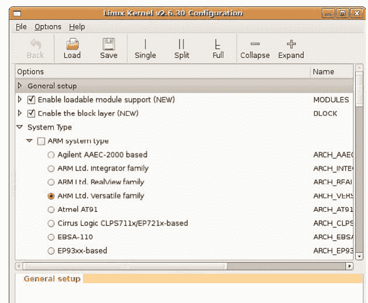

图 4-3 gconfig 配置屏幕

#### 4.4.1 自定义配置选项

许多嵌入式开发者会向 Linux 内核添加功能支持以支持特定的自定义硬件。配置管理架构使得自定义和添加功能变得非常容易。快速查看一个典型的`Kconfig`文件，可以看到配置脚本语言的结构。例如，假设你有两个基于 IXP425 网络处理器的硬件平台，你的工程团队将它们命名为 Vega 和 Constellation。每块板卡都有必须在内核启动阶段早期初始化的专用硬件。让我们看看在内核配置期间向开发者展示的选项选项中添加这些配置选项有多简单。列表 4-8 是来自顶层 ARM Kconfig 文件的片段。

#### 列表 4-8 节 .../arch/arm/Kconfig 的片段

```
source "init/Kconfig"

menu "System Type"

choice

    prompt "ARM system type"

    default ARCH_RPC

config ARCH_CLPS7500

    bool "Cirrus-CL-PS5500FE"

config ARCH_CLPS711X

    bool "CLPS711x/EP721x-based"

...

source "arch/arm/mach-ixp4xx/Kconfig"
```

在这个 Kconfig 片段中，你看到了 System Type（系统类型）菜单项。在 ARM System type 提示之后，你看到一组与 ARM 架构相关的选项列表。在文件的后面，你看到包含了 IXP4xx 特定的 Kconfig 定义。在这个文件中，你添加了自定义的配置开关。列表 4-9 重现了该文件的片段。同样，为了可读性和方便，我们省略了无关的文本，如省略号所示。

#### 列表 4-9 节 .../arch/arm/mach-ixp4xx/Kconfig 的片段

```
menu "Intel IXP4xx Implementation Options"

comment "IXP4xx Platforms"

config ARCH_AVILA
```

#### 列表 4-9 继续

```
bool "Avila"

help

    如果你想让你的内核支持...请在此处输入 'Y'
```

```
config ARCH_ADI_COYOTE

bool "Coyote"

help

    如果你想让你的内核支持

    ADI Engineering Coyote...请在此处输入 'Y'
```

```
# (这些是我们新增的自定义选项)

config ARCH_VEGA

bool "Vega"

help

    选择此选项以支持 "Vega" 硬件
```

```
config ARCH_CONSTELLATION

bool "Constellation"

help

    选择此选项以支持 "Constellation"

    硬件支持
```

4-4 显示了这些更改在当你运行 gconf 工具（通过`make ARCH=arm gconfig`）时出现的结果。由于这些简单的更改，配置编辑器现在包含了我们两个新硬件平台的选项。很快，你将看到如何使用源码树中的这些信息来条件条件选择支持你新板卡的对象。

在运行配置（这些示例中为 gconf）并为你的其中一个自定义硬件平台选择端口后，之前的`.config`文件中包含了你新选项的宏。每个内核配置选项前面都有`CONFIG_`前缀，以识别其为内核配置选项。结果是，定义了两个新的配置选项，并且它们的状态已记录在`.config`文件中。列表 4-10 显示了带有你新配置选项的`.config`文件。

> 15 我们删除了 ARM system type 和 Intel IP4xx Implementation Options 下的许多选项，以适应页面上的图片显示。

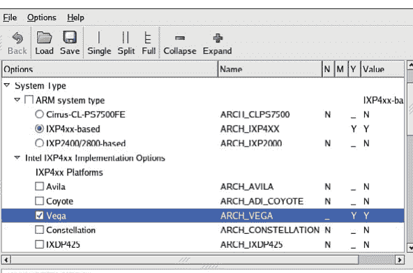

**Vega_VEGA**
选择此选项以支持 'Vega' 硬件

**图 4-4** 自定义配置选项

#### 列表 4-10 自定义 .config 文件片段

```
#
# IXP4xx Platforms
#

# CONFIG_ARCH_AVILA is not set
# CONFIG_ARCH_ADI_COYOTE is not set
# CONFIG_ARCH_VEGA=
# CONFIG_ARCH_CONSTELLATION is not set
# CONFIG_ARCH_IXDP425 is not set
# CONFIG_ARCH_PRMC1100 is not set
```

注意与 Vega 和 Constellation 硬件平台相关的两个新配置选项。如图 4-4 所示，我们选择了对 Vega 的支持；在`.config`文件中，你可以看到代表 Vega 板卡的新的`CONFIG_`选项被选中并设置为值 y。同样注意，与 Constellation 相关的`CONFIG_`选项存在但未被选中。

#### 4.4.2 内核 Makefile

在构建内核时，`makefile`会扫描并决定进入哪些目录。为了根据你的配置引入新的自定义内容，假设自定义内容由 de-com-ing-mach-ixp4xx 目录表示。与之前的讨论特别感兴趣的是，我们将这些 C 文件放置在了内核源码树中。列表 4-11 显示了结果：

```
#
# IXP4xx Platforms
#

# CONFIG_ARCH_AVILA is not set
# CONFIG_ARCH_ADI_COYOTE is not set
# CONFIG_ARCH_VEGA=
# CONFIG_ARCH_CONSTELLATION is not set
# CONFIG_ARCH_IXDP425 is not set
# CONFIG_ARCH_PRMC1100 is not set
```

对于需要添加自定义硬件的普通开发者，内核的设计使得这些自定义变得非常简单。查看 Makefile，必须执行什么可能是显而易见的。要完成你硬件的特定设置模块的添加，de----------------------------，只需在 Makefile 的底部添加两行即可：

```
#
# IXP4xx Platforms
#

# CONFIG_ARCH_AVILA is not set
# CONFIG_ARCH_ADI_COYOTE is not set
# CONFIG_ARCH_VEGA=
# CONFIG_ARCH_CONSTELLATION is not set
# CONFIG_ARCH_IXDP425 is not set
# CONFIG_ARCH_PRMC1100 is not set
```


### 4.5 内核文档

Linux 源码树中提供了丰富的信息。阅读所有内容是困难的，因为 `...Documentation` 目录包含 118 个子目录中的近 1300 个文件。考虑到内核开发和发布的快速节奏，这些文档往往会过时。尽管如此，它们通常为你建立特定内核子系统或组件的知识基础提供了良好的起点。

不要忽略位于 `www.tldp.org` 的 Linux 文档项目，那里你可能会找到特定文档或 man 手页的最新版本。与之前的讨论特别感兴趣的是位于 `...Documentation/kbuild` 子目录的 Kbuild 文档。

如果没有 Google，任何关于内核文档的讨论都是不完整的。很快，Google 将出现在韦氏词典中并作为一个动词出现！花些时间熟练在互联网上搜索答案。你将发现许多与你的特定项目或问题相关的邮件列表和其他资源存储库。附录 E 包含了一个实用的开源资源列表。

### 4.6 获取自定义 Linux 内核

通常，你可以通过三种方式为你的硬件平台获取嵌入式 Linux 内核：你可以购买合适的商业嵌入式 Linux 发行版；下载支持你的特定架构和处理器的免费嵌入式发行版；或者找到与你应用程序的开源 Linux 内核并自行迁移。

虽然将开源内核迁移到你的自定义板卡并不一定困难，但它代表了工程开发资源的重大投入。这种方法让你能够使用免费软件，但在你的开发项目中部署 Linux 远非免费，正如我们在第 1 章“引言”中所讨论的。

#### 4.6.1 我还需要什么？

本章重点关注了 Linux 内核本身的布局和构建。正如你可能发现的，Linux 只是基于 Linux 的嵌入式系统的一个组成组件。除了 Linux 内核，你还需要以下组件来开发、测试和启动你的嵌入式 Linux 模块：

- 移植并针对你的特定硬件平台配置的启动加载程序（bootloader）
- 针对你所选架构的交叉编译器及相关工具链
- 包含许多软件包的文件系统——这些为你的原生硬件架构/处理器编译的二进制可执行文件和库
- 你的板上任何自定义设备的设备驱动程序
- 开发环境，包括宿主机工具和实用程序
- 针对你的特定处理器和开发板已启用的 Linux 内核源码树

这些就是嵌入式 Linux 发行版的组件。

### 4.7 总结

本章涵盖了内核构建系统以及修改构建系统以方便调整的过程。我们将 Linux 内核的理论和操作留给其他优秀的书籍来描述。在这里，我们讨论了它是如何构建的，并识别了组成镜像的组件。将内核拆解为易理解的部分是学习如何导航这个大型软件项目的关键。

- Linux 内核已有近 20 年历史，并已成为许多架构的主流、支持良好的操作系统。
- Linux 开源家园位于 `www.kernel.org`。几乎每一个内核发布版本在곳可用，一直追溯到 Linux 1.0。
- 存在多个内核配置编辑器。我们选择了其中一个并研究了它是如何驱动的，以及如何修改其中的菜单和菜单项。这些概念适用于所有的图形前端。
- 内核本身带有一个充满有用内核文档的完整目录结构。这是理解和导航内核及其操作非常有帮助的资源。

本章以简要介绍获取嵌入式 Linux 发行版的选项作为结束。

#### 4.7.1 额外阅读建议

Linux Kernel HOWTO
`www.linuxdocs.org/HOWTOs/Kernel-HOWTO.html`

内核构建文档
Linux 内核源码树

```
.../Documentation/kbuild/*
```

Linux 文档项目：
`www.tdlp.org`

工具接口标准 (TIS) 可执行与链接格式 (ELF) 规范，版本 1.2
TIS 委员会，1995年5月
`http://refspecs.freestandards.org/elf/elf.pdf`

Linux 内核源码树
`.../Documentation/kbuild/makefiles.txt`

Linux 内核源码树
`.../Documentation/kbuild/kconfig-language.txt`

Linux内核开发，第3版
Robert Love
Addison-Wesley, 2010

## 第 5 章

## 内核初始化

在本章中

- 5.1 复合内核镜像：猪和朋友们 100
- 5.2 初始化控制流 109
- 5.3 内核命令行处理 115
- 5.4 子系统初始化 122
- 5.5 init 线程 125
- 5.6 总结 129

当嵌入式 Linux 系统接通电源时，会启动一个复杂的事件序列。在几十秒后，Linux 内核即可开始运行，并按照系统 init 脚本的规定产生系列应用程序。这些活动中的很大一部分由系统配置控制，并受嵌入式开发者的控制。本章将检查 Linux 内核中的初始事件序列。我们将详细查看内核初始化期间使用的机制和过程。然后我们将描述 Linux 内核命令行及其在启动时自定义 Linux 环境的用法。通过这些知识，你将能够自定义并控制初始化序列，以满足你特定嵌入式系统的要求。

### 5.1 复合内核镜像：猪和朋友们

启动后，嵌入式系统中的启动加载程序（bootloader）是第一个获取处理器控制权的软件。在加载程序执行了一些低级硬件初始化后，控制权将交给 Linux 内核。这可以是一个为了方便开发过程的手动事件序列（例如，用户在启动加载程序提示符输入交互式加载/启动命令），也可以是生产环境中典型的自动启动序列。我们专门在第 7 章“启动加载程序”讨论了这个主题，因此我们将任何关于启动的详细讨论推迟在该章节。

在第 4 章“Linux 内核：不同的视角”中，我们检查了组成 Linux 内核的组件。回想起为每个架构构建的常用文件之一是名为 `vmlinux` 的 ELF 二进制文件。这个二进制文件就是单体内核本身，或者我们一直所说的内核主体。事实上，当我们查看 `vmlinux` 在链接阶段的构建情况时，我们指出了可能在何处看到第一行代码。在大多数架构中，它位于一个名为 `head.s` 或类似文件名的汇源文件中。在内核的 Power Architecture (`powerpc`) 分支中，存在多个版本的 `head.s`，取决于处理器。例如，AMCC 440 系列处理器是从一个名为 `head_44x.s` 的文件初始化的。

### 5.1 复合内核镜像：猪和朋友们 101

某些架构和启动加载程序可以直接启动 `vmlinux` 内核镜像。例如，基于 Power Architecture 和 U-Boot 启动加载程序的平台通常直接启动 `vmlinux` 镜像（从 ELF 转换为二进制后，你很快就会看到）。在架构和启动加载程序的其他组合中，可能需要额外的功能来设置正确的上下文并提供必要的实用程序。在 5-1 的第三行中，内核主体在此状态下与对象链接。请参正文解释。

列表 5-1 最终内核序列：内核 (Coyote)

```
$ make=arm CROSS_COMPILE=xscale
- vmlinux
- System.map
- .tmp_System.map
- Image
- head.o
- piggy.gz
- piggy.o
- misc.o
- head-xscale.o
- big-endian.o
- vmlinux
- zImage
```


后续标记标识了每一行发生了什么。例如，`AS` 表示调用了汇编器，`GZIP` 表示压缩，以此此类推。通常，这些对象模块特定于特定的架构（ARM/XScale），包含了引导内核的底层实用程序。

插图将帮助你理解这种结构和后续讨论。图 5-1 显示了构建可引导镜像过程中的组件演变。后续章节将详细描述。

### 表 5-1 ARM/XScale 对象

| 组件 | 描述 |
| :--- | :--- |
| vmlinux | ELF格式内核主体，包括符号、注释、调试信息（如果使用了 -g）和架构通用组件。 |
| System.map | vmlinux 的文本内核符号表。 |
| .tmp_System.map | 仅用于检查 System.map；否则用于最终构建镜像。 |
| Image | 二进制内核模块，去除了符号和注释。 |
| head.o |  ARM 处理器的通用启动代码。此对象由启动加载程序传递控制权。 |
| piggy.gz | 使用 gzip 压缩的镜像。 |
| piggy.o | 汇编语言格式的文件 piggy.gz，以便与后续对象 misc.o 链接（见正文）。 |
| misc.o | 解压缩内核镜像 (piggy.gz) 的程序，以及熟悉的启动信息 Uncompressing Linux . . . Done 的来源。 |
| head-xscale.o | 针对 XScale 处理器的处理器初始化。 |
| big-endian.o | 将 XScale处理器切换到大端模式的微型汇编内核程序。 |
| vmlinux | 复合内核镜像。这是一个非常遗憾的命名，与内核主体的名称重复；两者不同。该二进制文件是内核主体在此状态下与对象链接后的结果。参见正文解释。 |
| zImage | 由启动加载程序加载的复合镜像。见后续文本。 |

## 5.1 复合内核镜像：Piggy 与小伙伴 103

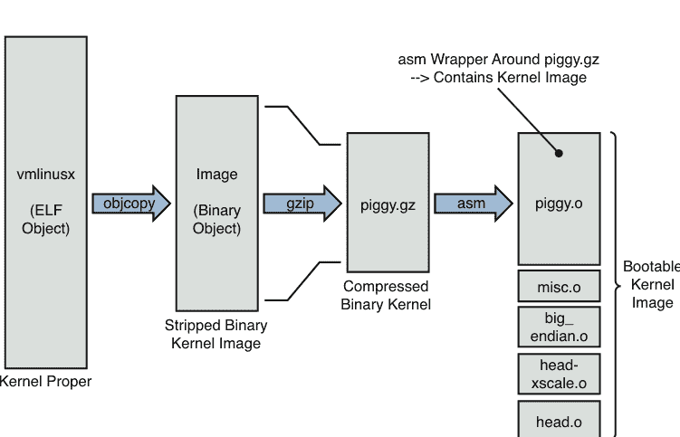

图 5-1 复合内核镜像的构建

### 5.1.1 Image 对象

在构建 `vmlinux` ELF 文件后，内核构建系统继续处理表 5-1 中描述的目标 `Image` 对象由 `vml-linux` 对象创建。`Image` 基本上是去除了冗余符号（注释和备注）的 `vmlinux` ELF 文件，并且去除了其中可能存在的任何调试符号。使用以下命令执行此操作：

```bash
xscale_be-objcopy -O binary -R .note -R .note.gnu.build-id -R .comment -S vmlinux arch/boot/Image
```

`-O` 选项告诉 `objcopy` 生成二进制文件；`-R` 选项移除名为 `.note`、`.note.gnu.build-id` 和 `.comment` 的 ELF 段；`-S` 选项是剥离调试符号的标志。注意，`objcopy` 以 `vmlinux` ELF 镜像作为输入并生成名为 `Image` 的目标二进制文件。总而言之，`Image` 仅仅是从 ELF 转换为二进制格式并剥离了调试符号以及上述 `.note*` 和 `.comment` 段的内核本身。

### 5.1.2 架构对象

继续后续构建序列，编译了许多小模块。每个模块包含几个汇编文件（`head.o`、`head-xscale.o` 等），用于执行低层架构和特定于处理器的任务。这些对象都总结在表 5-1 中。特别注意的是创建名为 `piggy.o` 对象的序列。首先，`Image`（二进制内核镜像）使用此 gzip 命令进行压缩：

```bash
cat Image | gzip -f -9 > piggy.gz
```

这创建了一个名为 `piggy.gz` 的新文件，它仅仅是二进制内核 `Image` 的压缩版本。接下来的步骤非常有趣。汇了一个汇编文件 `piggy.S`，它包含了对压缩后的 `piggy.gz` 的引用。从本质上说，二进制内核镜像被作为载荷（payload）附加到一个低层汇编引导加载器（bootstrap loader）中。该引导加载器初始化处理器和所需的内存区域，解压二进制内核镜像，将其加载到系统内存的正确位置并将控制权交给它。列表 5-2 完整重现了 ...arch/arm/boot/compressed/piggy.S。

# 列表 5-2 汇编文件 Piggy.S

```assembly
.section piggydata, #alloc
.global  input_data
input_data:
  .incbin "/arch/arm/boot/compressed/piggy.gz"
  .global  input_data_end
```

这个简单的汇编文件产生了一种并不显而易见的复杂性。该文件的目的是让汇器将二进制内核镜像输出名为 `.piggydata` 的 ELF 段。它是通过 `.incbin` 汇编预处理器指令触发的，可以将其视为汇器版本的 `#include` 文件，不同的是它期望的是二进制数据。总之，该汇编文件的最终结果是将压缩的二进制镜像作为载荷包含在另一个镜像——引导加载器中。注意标签 `input_data` 和 `input_data_end`。引导加载器使用它们来识别二进制载荷（内核镜像本身）的边界。

> 不要与启动程序（bootloader）混淆，引导加载器可以被视为第二阶段加载器，而启动程序本身可以被认为是第一阶段加载器。

### 5.1.3 引导加载器 (Bootstrap Loader)

不要与启动程序混淆，许多架构使用引导加载器（或第二阶段加载器）将 Linux 内核镜像加载到内存中。某些引导加载器会对内核镜像进行校验和，并解压和重定位内核镜像。在这里，启动程序和引导加载器的区别在于：启动程序在上电时控制板，完全不依赖 Linux 内核。相反，引导加载器的主要作用是作为裸机启动程序与 Linux 内核之间的胶水。引导加载器的责任是为内核运行提供适当的环境，并执行解压和重定位内核二进制镜像的必要步骤。这与 PC 架构中发现的主、次加载器的概念类似。

图 5-2 明确了这一概念。引导加载器与内核镜像连接在一起进行加载。

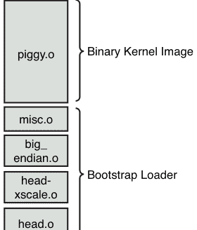

图 5-2 用于 ARM XScale 的复合内核镜像

106 第 5 章内核初始化

在我们研究的示例中，引导加载器由图 5-2 所示的二进制镜像组成。该引导加载器的功能包括：

- 低层汇编语言处理器初始化，包括启用处理器的内部指令和数据缓存、禁用中断以及设置 C 运行时环境。这些包括 `head.o`、`head-xscale.o`。
- 解压缩和重定位代码，体现在 `misc.o` 中。
- 其他特定处理器的初始化，例如 `big-endian.o`，它为此特定处理器启用大端模式。

值得注意的是，我们检查的细节适用于 ARM/XScale 内核实现。每个架构都有不同的细节，尽管概念是相似的。使用与此处类似的分析，你可以学习你自己的架构的要求。

### 5.1.4 启动消息

也许你见过 PC 工作站启动如 Red Hat 或 SUSE Linux 等桌面 Linux 发行版。在 PC 自身的 BIOS 消息之后，你会看到 Linux 在初始化各种内核子系统时显示出一系列控制台消息。输出的大部分在不同的架构和方法之间是通用的。两个最有趣的早期启动消息是内核版本和稍后描述的内核命令行。列表 5-3 重现了 AD Engineering Coyote Platform 在 Intel XScale IPX425 处理器上启动 Linux 的内核启动消息。列表已通过行号格式化。

# 列表 5-3 IPX425 启动消息

```
1 Using base address 0x0010000 and length 0x001cell14
2 Uncompressing Linux....... done, booting the kernel.
3 Linux version 2.6.32-07750-0-82ea67
```
（注：列表 5-3 的 OCR 文本在提示中是不完整的，我仅包含存在的内容。）

## 列表 5-3 继续

```
50 在 MTD 设备 IPX4XX-Flash.0 上找到 5 个 RedBoot 分区
51 在 "IPX4XX-Flash.0" 上创建 5 个 MTD 分区：
52 0x000000000000-0x000000600000 : "RedBoot"
53 0x000001000000-0x000002600000 : "MyKernel"
54 0x000003000000-0x000009000000 : "RootFS"
55 0x00000fc0000-0x0000ffc1000 : "RedBoot config"
56 0x00000fe00000-0x0000010000 : "FIS directory"
57 e100: Intel(R) PRO/100 Network Driver, 3.54-k2-NAPI
```


## 内核启动日志

58 `e100`: Copyright(c) 1999-2006 Intel Corporation

59 `ehci_hcd`: USB 2.0 “Enhanced”主机控制器 (`EHCI`) 驱动

60 `ohci_hcd`: USB 1.1 ‘Open’主机控制器 (`OHCI`) 驱动

61 `uhci_hcd`: USB 通用主机接口驱动

62 正在初始化驱动...

63 `usbcore`: 注册新的接口驱动 `usb-storage`

64 USB 批量存储已注册。

65 IPX4xx 狗狗定时器: 心跳 60 秒

66 `uscore`: 注册新的接口驱动 `ushid`

67 `ushid`: USB HID 核心驱动

68 注册 TCP cubic

69 NET: 注册协议族 17

70 检测到 XScale DSP 处理器。

71 `drivers/rtc/htosys.c`: 无法打开 rtc 设备 (`rtc0`)

72 `e100`: `0000:00:0f:0` 固件: 使用内置固件 `e100/d01lm_ucode.bin`

73 `e100`: `eth0` 网卡链路已开启 100 Mbps 双工

74 IP-Config: 完成：

75 device=`eth0` addr=192.168.0.29, mask=255.255.255.0, gw=255.255.255.255,

76 host=`coyotel`, domain=nis-domain=(none),

77 bootstrap=192.168.0.103, rootserver=192.168.0.103, rootpath=

78 正在 192.168.0.103 上查找 RPC 100003/2 的端口

79 正在 192.168.0.103 上查找 RPC 100005/1 的端口

80 VFS: 已在设备 0.11 上挂载根文件系统 (`nfs` 文件系统)。

81 释放初始化内存: 120K

82 INIT: 版本 2.86 正在启动

83 <省略某些用户初始化消息>

84 `coyotel` 登录：

内核在启动过程中会产生大量有用信息，如列表 5-3 所示。我们在接下来的几节中详细研究这些输出。第 1 行是由板卡上的 Redboot 引导程序产生的。第 2 行是由我们在本章之前进入的引导加载程序产生的。此消息是由位于 `.../arch/arm/boot/compressed/misc.c` 中的解压加载程序产生的，位于名为 `decompress_kernel()` 的函数中。

列表 5-3 的第 3 行是内核版本字符串。它是内核本身输出的第一行。内核在进入 `start_kernel()` 之后（在 `...init/main.c` 中）执行的第一行 C 代码之一如下：

```
printk(KERN_NOTICE "%s", linux_banner);
```

此行产生了上述的输出——内核版本字符串，即列表 5-3 的第 3 行。该版本字符串包含了许多与内核相关的相关数据点：

- 内核版本：Linux 版本 2.6.32-07500-g8bea867⁴
- 编译内核的用户名/机器名
- 工具链信息：`gcc` 版本 4.2.0，由 MontVista Software 提供
- 内核镜像编译的日期和时间

这些在开发和生产过程中非常有用。除了一条外，所有条目都是自言自语的。构建号只是开发者添加到版本字符串中的工具，用于指示从上一次构建到下一次构建发生了比时间之外的重要变化。这是开发者以通用且自动的方式跟踪构建的方法。你会在示例中注意到这是该系列中的第十二构建，正如列表 5-3 第 3 行的 #12 所示。构建号存储在 Linux 根目录下的隐藏文件 `.version` 中。它由 `...scripts/mkversion` 中的构建脚本自动递增。简而言之，每当内核发生实质性重新构建时，它就是一个自动递增的数字标记。请注意，在执行 `make mrproper` 时，它会被重置为 #1。

## 5.2 初始化控制流

现在你已经理解了复合内核的结构和组件，让我们检查从引导加载程序到内核的控制流。正如我们在第 2 章“大局”中所讨论的，引导加载程序是非易失性存储器（Flash 或 ROM）中的低级组件，在通电后立即被调用。它通常包含低级初始化、操作系统加载以及系统诊断的一小部分程序。它可能包含对内存进行转储和填充的程序。作为本章示例基础的 ARM 平台包含引导加载程序。在通电时，该加载程序被调用并加载操作系统（可能位于 Flash、硬盘或通过网络）。在这个特定平台上，引导加载程序将控制交给 `head.o`，如图 5-3 所示。

（图 5-3 ARM 启动流）

### 5.2.1 内核入口：head.o

内核开发者的意图是将体系特定的 `head.o` 模块通用化，不包含机器依赖。该模块源自汇编文件 `head.s`，位于 `.../arch/<ARCH>/kernel/head.s`，其中 `<ARCH>` 被替换为给定的架构。本章的示例基于 ARM，正如你所看到的。

`head.o` 模块执行架构特定的、且通常是 CPU 特定的初始化，为内核主体做准备。CPU 特定的任务在处理器族之间尽可能保持通用。机器特定的初始化在其他地方进行，正如你很快将发现的。除了其他低级任务，`head.o` 执行以下操作：

- 检查处理器和架构是否有效
- 创建初始页表项
- 启用处理器内存管理单元 (`MMU`)
- 建立有限的错误检测和报告
- 跳转到内核起始位置，`start_kernel()`

这些函数包含一些隐藏的复杂性。许多新手嵌入式开发者尝试单步执行这些代码，结果发现调试器完全迷失了。虽然对汇编语言复杂性和虚拟内存硬件细节的讨论超出了本书的范围，但关于这个复杂的模块有几点值得注意。

当控制首次从引导加载程序传递给内核的 `head.o` 时，处理器运行在我们在 x86 中称为实模式的模式。实际上，程序计数器（或任何其他寄存器）中包含的逻辑地址就是驱动到处理器上的实际物理地址。

>⁴ 这里使用的“机器”指的是特定的硬件平台。
6 通常指指令指针，存储内存中下一条机器指令地址的寄存器。

下载访问 www.wovebook.com

内存引脚。在处理器的寄存器和内核数据结构初始化以启用内存转换后，处理器的 `MMU`（内存管理单元）会被开启。突然，处理器所看到的地址空间被抽离，取而代之的是由内核开发者定义的任意虚拟寻址方案。这产生了一个复杂度，只有通过对汇编语言结构和逻辑流的详细分析，并对 CPU 及其硬件翻译机制有深入了解，才能很好地理解。简而言之，当启用 `MMU` 时，物理地址会被逻辑地址取代。这就是为什么调试器无法像处理普通代码那样对这部分代码进行单步执行。

第二个值得注意的点是，在内核进程的早期阶段，可用的映射是有限的。许多开发者在尝试为特定平台修改 `head.o` 时会在这个局限性上碰跟头。其中一种场景可能是这样的：如果你有一个在启动周的极早期阶段就需要固件的硬件设备。一种可能的解决方案是将固件静态编译到内核镜像中，然后通过指针引用它并下载到你的设备。然而，由于此阶段执行的内存映射有限，你的固件可能超出了该阶段已映射的范围，因此你得到的只是一个不明其妙的崩溃。当你的代码执行时，它会产生页异常，因为你尝试访问一个在处理器内部尚未创建有效映射的内存区域。更糟糕的是，在这个早期阶段尚未安装页异常处理程序，因此你得到的只是一个不明其妙的崩溃。在启动周期的这个早期阶段，几乎几乎无法获得任何错误信息来帮助你判断出了什么。

如果可能，考虑将任何自定义硬件初始化延迟到内核启动之后，这是明智的。通过这种方式，你可以依赖成熟的设备驱动程序模型来访问硬件，而不是尝试自定义要复杂得多的汇编启动代码。有许多未记录的技术可以规避硬件错误（errata），这些错误可能记录也可能未记录。如果你必须修改早期的启动汇编代码，将在开发时间、成本和复杂性上付出高昂的代价。硬件和软件工程师在硬件开发的早期就应该讨论这些事实，因为通常一个微小的硬件变化就能节省大量的软件开发时间。

> 极力不建议为自定义平台修改 `head.S`。几乎总有更好的方法。

识别虚拟内存环境对开发者施加的限制是非常重要的。许多经验丰富的嵌入式开发者对这种环境几乎没有或没有经验，而刚刚介绍的场景只是新虚拟虚拟内存架构开发者面临的陷阱的一个小例子。几乎所有现代 32 位及更大的微处理器都使用了内存管理硬件来实现리虚拟内存架构。虚拟内存机器最大的优势之一是，它们帮助分离编写大型复杂应用的开发者团队，同时保护其他软件模块以及内核免受编程错误的影响。

### 5.2.2 内核启动：main.c

内核自身的 `head.o` 模块执行的最后一个任务是将控制权交给用 C 语言编写的主内核启动文件。我们在本章剩余的大部分内容放在这个重要的文件中。
每个架构都有不同的语法和方法，但每个架构的 `head.o` 在将控制权交给内核本身方面具有类似的结构。对于 ARM 架构，`start_kernel` 看起来如下：

```
start_kernel^8
```

对于 Power 架构，它看起来如下：

```
lis r4,start_kernel@h
or r4,r4,start_kernel@l
is r3,MSR_KERNEL@h
or r3,MSR_KERNEL@l
mtspr SR0,r4
```


`mtspr SR1,r3`

`rfi`

在不涉及特定汇编语言语法细节的情况下，这两个示例产生相同的结果。控制权从内核的第一个对象模块（`head.o`）传递到位于 `../init/main.c` 中的 C 语言程序 `start_kernel()`。在这里，内核开始拥有它自己的生命。

^8 现代 Linux 内核在 `head-common.S` 中分离了一些通用代码，这些代码通过 `include` 指令合并到 `head.S` 中。这就是找到调用 `start_kernel()` 的地方

# 第 5 章 内核初始化

`main.c` 文件由哪些组件组成，以及它们是如何初始化和/或实例化的。`main.c` 承担了 Linux 内核大部分的汇编之后的启动工作，从初始化第一个内核线程到挂载根文件系统并执行第一个用户空间 Linux 应用程序。

`start_kernel()` 函数是 `main.c` 中最大的函数。Linux 内核的大部分初始化都发生在这个例心中。我们这里的目的是突出在嵌入式系统开发背景下证明有用的特定元素。值得重复的是，如果你想从系统的角度更好地理解 Linux 内核，研究 `main.c` 是花费时间的极佳方式。

#### 5.2.3 架构设置

在 `../init/main.c` 的 `start_kernel()` 函数中发生的前几件事之一是调用位于 `../arm/kernel/setup.c` 中的 `setup_arch()`。该函数接受一个参数——指向内核命令行的指针（之前和下一节中介绍过）：

```
setup_arch(&command_line);
```

该语句调用一个特定于架构的设置程序，负责执行跨主要架构的通用任务。除了其他函数外，`setup_arch()` 调用了识别特定 CPU 并为高层 CPU 特定初始化程序提供机制的函数。其中一个由 `setup_arch()` 用的函数是 `setup_processor()`，位于 `../arm/kernel/setup.c` 中。

该输出的示例可以在列表 5-3 中找到：

-   CPU: XScale 板卡版本 1 (ARM)
-   CPU: IVT 数据缓存，IVT 指令缓存
-   机器: Coyote

## 5.3 命令行处理

架构设置的最终动作之一是执行任何依赖机器的初始化。具体的机制在不同架构之间有所不同。对于 ARM，你将在 `arch/arm/mach-*` 系列目录中找到特定机器的初始化。MIPS 架构也包含了特定于平台的目录。对于 Power 架构，一个平台目录包含了特定机器的程序。

## 5.3 命令行处理

架构设置之后，`main.c` 执行通用内核初始化并显示命令行。列表 5-3 的第 9 行在此复制：

```
Kernel command line: console=ttyS0,115200 root=/dev/nfs ip=dhcp
```

在这个简单的示例中，启动的内核被指示在 tty0（通常是第一个串口）上以 115Kb 的波特率打开控制台。从 DHCP 服务器获取初始 IP 地址并通过 NFS 协议挂载文件系统。（我们在第 12 章“嵌入式开发环境”中介绍 DHCP，在第 9 章“文件系统”中介绍 NFS。）

Linux 通常由加载程序（或引导程序）通过一系列参数启动，这些参数变成了命令行。虽然你实际上不是从 shell 提示符调用内核，但对于许多不感知 Linux 的加载程序，内核命令行可以在编译时定义并硬编码为内核二进制镜像。在其他平台上（例如运行红帽 Linux 的桌面式电脑），用户无需重新编译内核即可修改命令行。引导程序（桌面式电脑情况下为 Grub 或 Lilo）从配置文件构建命令行，并在启动过程中将其传递给内核。这些命令行参数是一种启动机制，用于设置给定机器正确启动所需的初始配置。

内核中定义了许多命令行。内核源码包含一个名为 `kernel-parameters.txt` 的文件，其中包含了内核命令行参数列表。

## 116 第 5 章 内核初始化

顺序。请记住之前关于内核文档的警告：内核的变化速度远快于文档的更新。请将此文件作为指南，而不是最终的参考依据。此文件中记录了数百个不同的内核命令行参数，但它不能被视为一份完整的列表。要做到这一点，你必须直接参考源代码。

内核命令行参数的基本语法相当简单，大部分内容从列表 5-3 第 9 行的示例中显而易见。内核命令行参数可以是单个文本单词、一个 `key=value` 对，或者 `key=value1,value2,....` 多值格式。如何处理传递过来的数据取决于信息的接收者。命令行始终是全局可见的，并根据需要由许多模块进行处理。如前所述，`main.c` 中的 `setup_arch()` 被调用时，内核命令行是其唯一的参数。这是为了解析特定特定的参数和配置，并将它们传递给与架构和机器相关的特定代码部分。

驱动程序编写人员和内核开发者可以根据自己的特定需求添加额外的命令行参数。让我们来看一下机制。不幸的是，使用和处理内核参数涉及一些复杂性。首先，原始机制正在被弃用；第二个复杂性是，你需要理解链接脚本文件（linker script）的复杂性才能完全理解该机制。

### 5.3.1 __setup 宏

作为内核命令行参数使用的一个示例，考虑控制台设备的规范。我们希望在启动周期的早期初始化控制台，以便在启动期间有一个消息的输出目标。这种初始化发生在 `...kernel/printk.c` 中一个名为 `printk.o` 的内核对象中。控制台初始化程序称为 `console_setup()`，它将内核命令行字符串作为其唯一参数。

挑战在于如何以模块化且通用的方式将内核命令行上指定的控制台参数传递给需要这些数据的设置和设备驱动程序。进一步增加问题难度的是，通常命令行

> 不一定全是这样，但我们大多数人永远不需要理解链接脚本文件。嵌入式工程师则需要。在本章末尾引用的 GNU LD 手书中有详细记录。

参数需要在需要它们的模块之前（或恰好在它们需要时）被要求。`main.c` 中的启动代码是每个内核命令行主处理发生的地方，如果不被来自这些参数的每个接收者的知识所严重污染，它就不可能的知道数百个命令行参数中每一个的目标函数。我们需要一种灵活且通用的方法将这些内核命令行参数传递给它们的接收者。

在 `.../include/linux/init.h` 中定义的一个特殊宏用于将内核命令行字符串的一部分与处理该部分字符串的函数关联起来。我们现在以列表 5-3 中的内核命令行作为示例，演示 `_setup` 宏是如何工作的。

从之前的内核命令行（列表 5-3 第 9 行）来看，这是传递给内核的第一个完整命令行参数：

```
console=ttyS0,115200
```

就本示例而言，参数的实际意义并不重要。我们的目标是说明这种机制，所以如果你理解了参数或其值，请不要担心。

列表 5-4 是来自 `.../kernel/printk.c` 的代码片段。函数体已被剥离，因为它与讨论无关。列表 5-4 最相关的部分是最后一行，即对 `_setup` 宏的调用。该宏期望两个参数；在这种情况下，它被传递了一个字符串字面量和一个函数指针。传递给 `_setup` 宏的字符串字面量与控制控制相关的内核命令行的前八个字符 `console=` 相同并非巧合。

# 列表 5-4 控制台设置片段

```
/*
 * 设置控制台列表。从 init/main.c 调用
 */
static int __init console_setup(char *str)
{
    char buf[sizeof(console_cmdline[0]) + 4]; /* 4 用于索引 */
    char *s, *options, *brl_options = NULL;
    int idx;
    ...
    <body>...为了清晰起见省略了正文...>
    ...
```

# 列表 5-4 继续

```
return 1;
}
```

```
__setup("console=", console_setup);
```

你可以将 `__setup` 宏认为是内核命令行控制台参数的注册函数。实际上，它表示：当在内核命令行参数上遇到 `console=` 字符串时，调用第二个 `__setup` 宏参数所代表的函数——在这种情况下是 `console_setup()` 函数。但这些信息是如何传递给该模块之外、不了解控制台函数的早期设置代码的？这种机制既聪明又有些复杂，它依赖于由链接器构建的列表。

细节隐藏在一组宏中，这些宏旨在隐藏向对象代码部分添加属性（或其他属性）的语法繁琐性。目标是构建一个与函数指针关联的字符串字面量静态列表。该列表由编译器在最终 vmlinux ELF 镜像中单独命名的 ELF 段中输出。理解这种技术至关重要；它在内核的多个地方用于特殊目的的处理。

让我们看看在 `__setup` 宏的情况下是如何实现的。列表 5-5 是来自头文件 `.../include/linux/init.h` 的代码片段，定义了 `__setup` 宏族。

# 列表 5-5 来自 init.h 的 __setup 宏族定义


#define `__setup_param`(str, unique_id, early) \
static const char `__setup_str_unique_id`[] `__initconst` \
aligned(1) = str; \
static struct obs_kernel_param `__setup_unique_id` \
    `__used` `__section`(init.setup) \
    `__attribute__((aligned(sizeof(long))))` \
    = { `__setup_str_unique_id`, fn, early }

#define `__setup`(str, fn) \
    `__setup_param`(str, fn, 0)

```
*(注：此处根据上下文对宏定义的逻辑进行了对齐，原文此处可能存在排版导致的显示显示断裂)*
```

## 5.3 命令行处理 119

列表 5-5 是作者对语法繁琐的定义。回想列表 5-4，对 `__setup` 宏的调用如下：

```
__setup("console", console_setup);
```

经过适当简化，这是宏展开后编译器产生的内容：

```
static const char __setup_str_console_setup[] __initconst \
aligned(1) = "console";
static struct obs_kernel_param __setup_console_setup \
    __used __section(init.setup) = { __setup_str_console_setup, console_setup, early };
```

为了可读性，我们按照 UNIX 字符（`\`）分了行。

这里使用了几个宏，我们将简要描述。`__used` 宏告诉编译器输出函数或变量，即使优化器发现它未被使用¹。因为这些变量没有被显式引用，如果没有此指令，将产生警告。`__attribute__((aligned))` 告诉编译器在特定边界上对齐结构——在这种情况下是 `sizeof(long)`。如果我们为了简化而移除它们，剩下的将是：

```
static struct obs_kernel_param __setup_console_setup \
    __section(init.setup) = { __setup_str_console_setup, console_setup, early };
```

简化后剩下的就是机器的核心。首先，编译器生成了一个字符数组（字符串指针）`__setup_str_console_setup[]`，初始化为字符串 console。接下来，编译器生成了一个包含三个成员的结构：指向命令行字符串的指针（定义的数组）、指向设置函数的指针以及一个简单的标记。关键在于段属性指示编译器将此结构嵌入 ELF 对象模块中的特定段，即 `.init.setup`。在链接阶段，所有使用 `__setup` 宏定义的结构都会收集并放置在此 `.init.setup` 段中，形成这些结构的数组。列表 5-6 来自 `...init/main.c` 的片段展示了如何访问和使用这些数据。

> ¹ 通常情况下，如果变量是静态的且在编译中没有引用，编译器会标记。因为这些变量没有被显式引用，如果没有此指令，将产生警告。

### 列表 5-6 内核命令行参数处理

```c
extern struct obs_kernel_param __setup_start(), __setup_end[];
static int __init obsolete_checksetup(char *line)
{
struct obs_kernel_param *p;
int had_early_param = 0;

p = __setup_start;
do {
int n = strlen(p->str);
if (!strncmp(line, p->str, n)) {
if (p->early) {
/* 已经在 parse early_param 中完成了吗？
* 需要对参数部分进行精确匹配)。
* 保留迭代，因为我们可以有
* 同名的参数和设置 (/)
if (line[n] == '\0' || line[n] == '=')
had_early_param = 1;
} else if (p->setup_func) {
printk("KERN_WARNING Parameter %s is obsolete,\n
* ignored\n", p->str);
return 1;
} else if (p->setup_func(line + n))
return 1;
}
p++;
} while (p < __setup_end);

return had_early_param;
}
```

对这段代码的检查相当直观，只需要几处解释。该函数通过一个参数被调用，即内核命令行，该参数在 `.../kernel/params.c` 中解析。在我们讨论的示例中，`line` 指向字符串 `"consoletty0"`, 它是内核命令行的一部分。两个外部结构体指针 `__setup_start` 和 `__setup_end` 定义在链接器脚本文件中，而不是 C 源文件或头文件中。这些标签标记了位于对象文件中的 `obs_kernel_param` 结构体数组的开始和结束，该数组被放置在对象文件的 `.init.setup` 段中。

## 5.3 内核命令行参数处理

列表 5-6 中的代码通过指针 `p` 寻找这些结构体，以便为特定的内核命令行参数找到匹配项。在这种情况下，内核正在搜索字符串 `console=` 并找到了匹配项。从相关的结构体中，函数指针返回指向 `console_setup()` 函数的指针，该函数以参数的剩余部分（字符串 `ttyS,115200`）作为唯一参数被调用。此过程对内核中的每个元素重复执行，直到 `line` 耗尽。

上述描述的技术（将对象收集到唯一命名的 ELF 段中）用于内核的许多地方。该技术的另一个示例是使用 `_init` 族宏来对对象文件中的监控段执行一次性初始化例程。它们的亲戚 `_initcost` 用于标记一次性使用的项目，被 `__setup` 宏使用。标记为初始化函数的函数和数据带有 `__init`。随后，在使用这些一次性初始化函数和数据对象后，内核会释放由这些项目所占用的内存。你可能在启动过程的最后阶段见过熟悉的内核消息，使用 `Free memory: 296K`。你的情况可能因人而异，但 1/3 兆字节值得投入使用 `_init` 族宏的精力。这正是早先声明的 `_setup_str_console[]` 中 `_initcost` 宏的意图。

你可能在好奇奇以 `obsolete_` 开头的符号名称的使用。这是因为内核开发者正在用一种更通用的机制来替换内核行处理机制，以同时注册时间和可加载模块参数。目前，参数的处理程序是用 `__setup` 声明的。预计新开发将使用内核头文件 `.../include/linux/moduleparam.h` 定义的函数族，特别是 `module_param*` 族。这些将在第 8 章“设备驱动基础”在我们介绍设备时进行更详细的解释。

新机制通过在解析例程中包含一个未知指针参数来保持兼容性。因此，对于 `module_param` 基础设施未知的参数被视为未知的，并在开发者的控制下回退到旧机制。通过检查 `.../kernel/params.c` 中众名的代码以及 `.../init/main.c` 中的 `parse_args()` 调用可以很容易理解这一点。

最后一个值得提到的是 `__setup` 宏创建的 `obs_kernel_param` 结构体中 `flag` 成员的用途。检查列表 5-6 中的代码应该就会一目了然。结构体中名为 `early` 的标志用于指示此特定的命令行参数是否在启动过程早期已经被过过。某些命令行参数旨在在启动过程极早期被消费，此标志为早期解析算法提供了一种机制。你将在 `main.c` 中找到一个名为 `do_early_param()` 的函数，它遍历由链接器生成的 `_setup` 结构体数组，并处理每个被标记为早期消费的项目。这让开发者对该启动过程正在执行的操作有一定的控制。

## 5.4 子系统初始化

许多内核子系统是通过 `main.c` 中的代码初始化的。某些子系统被显式初始化，通过调用 `init_timers()` 和 `console_init()`，这些调用需要在非常早的时候进行。其他子系统使用与之前描述的 `_setup` 宏非常相似的技术进行初始化。简而言之，链接器构建指向初始化例程的函数指针列表，并使用简单的循环顺序执行每一个。列表 5-7 显示了如何工作。

### 列表 5-7 示例初始化例程

```c
```


## 5.4 子系统初始化

许多内核子系统是通过 `main.c` 中的代码初始化的。某些子系统被显式初始化，通过调用 `init_timers()` 和 `console_init()`，这些调用需要在非常早的时候进行。其他子系统使用与之前描述的 `_setup` 宏非常相似的技术进行初始化。简而言之，链接器构建了指向初始化例程的函数指针列表，并使用简单的循环顺序执行每一个。列表 5-7 显示了如何工作。

### 列表 5-7 示例初始化例程

```c
static int __init customize_machine(void)
{
    /* 定制设备，或添加新设备 */
    if (init_machine)
        init_machine();
    return 0;
}

arch_initcall(customize_machine);
```

这段代码片段来自 `.../kernel/params.c`。注意 5.4 关于 `initcall` 的两个重要点：关于以 `obsolete_` 开头的符号名称的使用。这是因为内核开发者正在用一种更通用的机制来替换内核行处理机制，以同时注册时间和可加载模块参数。目前，参数的处理程序是用 `__setup` 声明的。预计新开发将使用内核头文件 `.../include/linux/moduleparam.h` 定义的函数族，特别是 `module_param*` 族。这些将在第 8 章“设备驱动基础”在我们介绍设备时进行更详细的解释。

新机制通过在解析例程中包含一个未知指针参数来保持兼容性。因此，对于 `module_param` 基础设施未知的参数被视为未知的，并在开发者的控制下回退到旧机制。通过检查 `.../kernel/params.c` 中众名的代码以及 `.../init/main.c` 中的 `parse_args()` 调用可以很容易理解这一点。

最后一个值得提到的是 `__setup` 宏创建的 `obs_kernel_param` 结构体中 `flag` 成员的用途。检查列表 5-6 中的代码应该就会一目了然。结构体中名为 `early` 的标志用于指示此特定的命令行参数是否在启动过程早期已经被过过。某些命令行参数旨在在启动过程极早期被消费，此标志为早期解析算法提供了一种机制。你将在 `main.c` 中找到一个名为 `do_early_param()` 的函数，它遍历由链接器生成的 `_setup` 结构体数组，并处理每个被标记为早期消费的项目。这让开发者对该启动过程正在执行的操作有一定的控制。

### 5-8 initcall 族

```c
#define initcall(fn) \
    static initcall_t initcall_##fn __attribute__ ((section(".initcall"))) = fn;

#define core_initcall(fn) \
    static initcall_t core_initcall_##fn __attribute__ ((section(".initcall0"))) = fn;

#define postcore_initcall(fn) \
    static initcall_t postcore_initcall_##fn __attribute__ ((section(".initcall1"))) = fn;

#define arch_initcall(fn) \
    static initcall_t arch_initcall_##fn __attribute__ ((section(".initcall2"))) = fn;

#define device_initcall(fn) \
    static initcall_t device_initcall_##fn __attribute__ ((section(".initcall3"))) = fn;

#define subs_initcall(fn) \
    static initcall_t subs_initcall_##fn __attribute__ ((section(".initcall4"))) = fn;

#define russian_initcall(fn) \
    static initcall_t russian_initcall_##fn __attribute__ ((section(".initcall5"))) = fn;

#define late_initcall(fn) \
    static initcall_t late_initcall_##fn __attribute__ ((section(".initcall6"))) = fn;

#define early_initcall(fn) \
    static initcall_t early_initcall_##fn __attribute__ ((section(".initcall7"))) = fn;
```

## 5.5 init 线程

在 `.../init/main.c` 中找到的代码负责让内核运行。在 `start_kernel()` 执行了一些基础内核初始化并按名称调用了早期初始化函数后，第一个内核线程被创建了。该线程最终会变成名为 `init()` 的内核线程，其进程 ID（PID）为 1。正如我们将学到的，`init()` 成为用户空间所有 Linux 进程的父进程。在启动序列的此时，有两个不同的线程正在运行：一个是 `start_kernel()`，另一个是 `init()`。前者在完成工作后将变为空闲进程（idle process）。后者变为 init 进程。这如列表 5-9 所示。

### 列表 5-9 内核 init 线程的创建

```c
static inline void __init_refok rest_init(void)
  __releases(kernel_lock)
{
  int pid;
  rcu_scheduler_starting();
  kernel_thread(kernel_init, NULL, CLONE_FS | CLONE_SIGHAND);
  numa_default_policy();
  pid = kernel_thread(kthread, NULL, CLONE_FS | CLONE_FILES);
  kthread_add_task = find_task_by_pid_ns(pid, &init_pid_ns);
  unlock_kernel();
  /*
   * 空闲线程必须执行 schedule();
   * 至少执行一次以让流程运行：
   */
  init_idle_bootstrap_task(current);
  preempt_enable_no_resched();
  schedule();
  preempt_disable();
  /* 在禁用抢占的情况下进入 cpu_idle */
  cpu_idle();
}
```


`start_kernel()` 函数调用 `rest_init()`，如列表 5-9 所示。内核的 init 进程通过调用 `kernel_thread()` 创建，并将函数 `kernel_init` 作为其第一个参数。`init` 继续完成剩余的系统初始化，而由 `start_kernel()` 的执行线程在 `cpu_idle()` 调用中无限循环。

这种结构的原因非常有趣。你可能注意到 `start_kernel()` 是一个相对较大的函数，它标记了 `__init` 宏。这意味着它所占内存将在初始化化的最后阶段被回收。在回收其内存之前，必须退出该函数及其所占用的地址空间。答案是让 `start_kernel()` 调用 `rest_init()`（如列表 5-9 所示），这块小得得内核变成了空闲进程。

### 5.5.1 通过 initcalls 初始化

当 `kernel_init()` 被创建时，最终会调用 `initcalls()`，该函数负责调用大多数通过 `initcall` 宏族注册的初始化函数。代码重现在于列表 5-10 中。

列表 5-10 通过 initcalls 初始化

```
extern initcall_t __initcall_start, __initcall_end;

static void initcalls(void)
{
    initcall_t *fn;
    for (fn = __initcall_start; fn < __initcall_end; fn++)
        do_one_initcall(*fn);
/* 确保 initcall 序列中没有待处理的工作 */
flush_work();
```

注意存在两个块相似的代码。在初始化过程的早期，一个名为 `do_smp_initcalls()` 的类似函数会处理列表的一部分，从 `__initcall_start` 到 `__initcall_end`。这段代码是自言自明的，除了标记边界的两个标签：`__initcall_start` 和 `__initcall_end`。这些标签在任何 C 源代码头文件中都找不到。它们定义在 `vmlinux` 链接阶段使用的链接器脚本中。这些标签标记了使用 `initcall` 宏族填充的初始化函数列表的开始和结束。你可以通过查看顶级目录下的 `System.map` 来看到每个标签。它们都以字符串 `__initcall` 开头，如列表 5-8 所示。

### 5.5.2 initcall_debug

一个非常有趣的命令行参数允许你在启动期间观察这些任务的执行情况。它通过设置命令行参数 `initcall_debug` 来启用。只需在启动内核时带有 `initcall_debug` 参数即可启用此诊断输出。以下是你启用调试语句时将看到的内容示例：

```
calling usb_hcd_init+0x0/0x00 @ 1
usb_hcd_init: USB Host Controller Interface driver
initcall usb_hcd_init+0x0/0x00 returned 0 after 5639 usecs
```

你可以看到 USB Host Controller Interface 驱动正在被调用。第一行宣布了要调用 `usb_hcd_init` 函数的意图，这是一个设备驱动初始化调用。在该声明之后，将执行对函数的调用。第二行由驱动程序本身打印。第三行的跟踪信息包含了返回结果和调用持续时间。这是查看内核初始化细节的有用方法，特别是各个子系统和模块被调用的顺序。更有趣的是调用持续时间。如果你关心系统启动时间，这是隔离启动期间耗时间位置的极佳方法。

即使在配置中等的嵌入式系统上，也有几十个初始化函数以这种方式被调用。此示例取自 ARM XScale 嵌入式目标，使用默认配置编译。默认配置导致了对各种初始化例程的 206 次此类调用。

### 5.5.3 最后启动步骤

在创建 `kernel_init()` 线程后，在所有各种初始化调用完成后，内核在启动序列中执行最后步骤。这些步骤包括释放初始化函数使用的内存、打开系统控制设备以及启动第一个用户进程。列表 5-11 重现了 `main.c` 中的内核最后步骤。

列表 5-11 main.c 中的内核最后步骤

```
static noinline int init_post(void)
  __releases(kernel_lock)
{
  <... 为了清晰省略了行 ...>
  if (execute_command) {
    run_init_process(execute_command);
    printk(KERN_WARNING "执行 %s 失败。尝试默认...\n", execute_command);
  }
  run_init_process("/sbin/init");
  run_init_process("/etc/init");
  run_init_process("/bin/init");
  run_init_process("/bin/sh");
  panic("未找到 init。尝试传递 init 选项。");
}
```

注意，如果代码执行到函数的结尾（`init_post`），就会发生内核恐（`panic`）。如果你花过时间实验嵌入式系统或自定义根文件，你一定在控制台输出的最后遇到过这个常见的错误信息。它是 Linux 和嵌入式系统各种公共论坛上最常的问题（FAQs）之一。

无论何种方式，这些 `run_init_process()` 命令中的一个必须无错误地执行。`run_init_process()` 在成功调用时不返回。它用新进程覆盖调用进程，实际上是用新进程替换当前进程。熟悉的 `execve()` 系统调用用于此功能。最常见的系统配置启动 `/sbin/init` 作为用户land 初始化进程。我们将在下一章学习此功能。

³ Userland 是用户空间中任何程序、库、脚本或任何其他内容的常用术语。

```
initcall_debug init=/sbin/myinit console=ttyS1,115200 root=/dev/hda1
```


此命令行指令内核在调用所有初始化程序时显示它们，将初始控制设备配置为波特率为115200的`/ttyS1`，执行根文件系统中`/sbin`目录下的自定义用户空间初始化进程`myinit`。它引导内核从设备`/dev/hda1`（第一个IDE硬盘）挂载根文件系统。请注意，通常命令行上给出的参数顺序无关。下一章将涵盖用户空间初始化的细节。

## 5.6.1 额外阅读建议

GNU编译器集文档
http://gcc.gnu.org/onlinedocs/gcc¹⁴

使用LD的GNU链接器
http://sourceware.org/binutils/docs/ld/index.html

内核文档
.../Documentation/kernel-parameters.txt

> ¹⁴ 特别关于函数属性、类型属性和变量属性的章节。

# 第6章

## 用户空间初始化

**本章内容**

- 6.1 根文件系统 132
- 6.2 内核的最后启动步骤 137
- 6.3 init进程 140
- 6.4 内存磁盘 146
- 6.5 使用initramfs 153
- 6.6 关机 156
- 6.7 总结 156

在第2章“概览”中，我们指出Linux内核本身是任何嵌入式Linux系统的一个小部分。内核完成初始化后，它必须挂载根文件系统并执行一组开发者定义的初始化例程。在本章中，我们将检查内核后系统初始化的细节。

我们首先查看根文件系统及其布局。接下来，我们开发并研究一个最小系统配置。在本章的后半部分，我们为最小系统配置添加功能，以生成实用的示例系统配置。通过引入初始内存磁盘（ramdisk）、initrd和initramfs及其操作和使用，完成了对系统初始化的覆盖。本章最后简要介绍了Linux的关机逻辑。

### 6.1 根文件系统

在第5章“内核初始化”中，我们检查了Linux内核在初始化过程中的行为。我们多次提到挂载根文件系统。Linux与许多其他高级操作系统一样，需要根文件系统来实现其服务的优势。虽然在没有文件系统的环境中使用Linux确实是可能的，但这样做意义不大，因为Linux的大部分功能和价值将丢失。这类似于将整个系统应用程序放入一个臃肿的设备驱动程序或内核线程中。你能想象在没有文件系统的情况下运行你的Windows电脑吗？

根文件系统是指挂载在文件系统层次结构基础的文件系统，简单指定为`/`。正如你在第9章“文件系统”中发现的，即使是微小的嵌入式Linux系统通常也会挂载文件系统层次结构中的几个位置。这些包括真实和虚拟文件系统，如`/proc`和`/sys`。第9章介绍的proc文件系统就是一个例子。它是挂载在根文件系统`/proc`下的特殊用途文件系统。根文件系统只是挂载在文件系统层次结构顶部的第一个文件系统。

你很快就会看到根文件系统对Linux系统有特殊要求。Linux希望根文件系统包含启动系统的程序和工具、初始化网络和系统控制台等服务、加载驱动程序以及挂载设备。

#### 6.1.1 FHS：文件系统标准

几个开发者编写了一个管理文件系统布局的标准。文件系统层次标准（FHS）为Linux发行版建立了基准。你将在本章的下一节找到其中的原理。许多Linux发行版遵循FHS，它为目录提供了通用的组织方式。该标准是为了确保不同Linux发行版之间的兼容性。

#### 6.1.2 文件系统布局

在空间有限的情况下，许多嵌入式系统在Flash内存上创建一个非常小的根系统。事实上，在这些情况下使用较大的内存磁盘（initramfs）并不常见。一个简单的根文件系统可能包含以下顶级目录：

- `/bin`
- `/dev`
- `/etc`
- `/home`
- `/lib`
- `/sbin`
- `/usr`
- `/var`
- `/tmp`

表6-1 顶级目录

| 目录 | 内容 |
| :--- | :--- |
| bin | 所有用户使用的二进制执行文件 |
| dev | 设备节点 |
| etc | 配置文件 |
| home | 用户账户 |
| lib | 系统库，如C库 |
| sbin | 为超级用户保留的二进制执行文件 |
| tmp | 临时文件 |
| usr | 应用程序 |
| var | 变量文件 |

根文件系统以斜杠字符（`/`）开始。

#### 6.1.3 最小文件系统

为了说明根文件系统的要求，我们创建了一个最小文件系统。此示例是在ADI工程板上使用XScale处理器生成的。列表6-1是在该最小文件系统上运行`tree`命令的输出。

> 通常嵌入式系统除了单个root用户外，没有其他用户账户。

列表6-1 最小文件系统的内容

```
/bin
-- busybox
-- sh -> busybox
/dev
-- console
/etc
-- init.d
-- rcs
/lib
-- ld-2.3.so
-- ld-linux.so.2 -> ld-2.3.so
-- libc-2.3.so
-- libc-so.6 -> libc-2.3.so
```
5个目录，8个文件

136 第6章 用户空间初始化

so.2，指向`ld-2.3.2.so`，以及`libc.so.6`，引用`libc-2.3.2.so`。
这些链接为库本身提供了版本免疫和向后兼容性，并且可以在所有Linux系统中找到。

这个简单的根文件系统产生了一个功能完整的系统。在我们测试此系统的ARM/XScale板卡上，这个小型根文件系统的大小约为1.7MB。有趣注意的是，该大小的80%以上包含在C库本身。如果你需要为你的嵌入式系统减小其体积，可能会调查http://libraryopt.sourceforge.net上的库优化工具（Library Optimizer Tool）。

#### 6.1.4 嵌入式根文件系统的挑战

嵌入设备根文件系统的挑战解释起来简单，但克服并不容易。除非你足够幸运，开发一个带有足够大硬盘或Flash存储的嵌入式系统，否则你可能会发现很难将应用程序和实用程序放入单个Flash存储设备中。虽然Flash存储的成本不断下降，但始终存在降低成本和缩短上市时间的竞争压力。Linux作为嵌入式操作系统持续流行的最大原因之一是巨大且不断增长的Linux应用程序软件库。

精简根文件系统以适应特定的存储空间要求可能是项艰巨的任务。许多软件包和子系统包含几十或数百个文件。除了应用程序本身，许多软件包还包含配置文件、库、配置实用程序、图标、文档文件、与国际化相关的本地化文件、数据库文件等。来自Apache Software Foundation的Apache Web服务器是嵌入式系统中常见的知名应用程序示例。某一个流行Linux发行版的基础Apache软件包包含254个不同的文件。此外，它们并不是全部复制到文件系统中的单个目录中。它们需要在文件系统的几个不同位置填充，以便Apache应用程序在不经过修改的情况下运行。

这些概念是发行工程的一些基本方面，它们可能非常乏味。Linux发行版公司如Red Hat（在桌面和企业市场领域）和Mentor Graphics（在嵌入式市场领域）投入大量的工程资源用于此：打包一组程序、库、工具、实用程序和应用程序，它们共同构成一个Linux发行版。由于需要，构建根文件系统采用了较小规模的发行工程元素。

#### 6.1.5 试错法

直到最近，填充根文件系统内容的唯一方法是使用试错法。也许可以通过为此目的创建一组脚本来使该过程自动化，但对于给定功能需要哪些文件的知识仍然必须来自开发者。可以使用Red Hat包管理器(`rpm`)等工具在你的根文件系统上安装软件包。`rpm`在软件包内部具有合理的依赖关系解析能力，但它是复杂的并涉及显著的学习曲线。此外，使用`rpm`并不易于构建小型根文件系统。它在移除安装中不必要文件（如文档和特定软件包的未使用实用程序）方面的能力有限。

#### 6.1.6 自动化文件系统构建工具

领先的嵌入式Linux发行版供应商提供了强大的工具，旨在自动化在Flash或其他设备上构建根文件系统的任务。这些工具通常是图形化的，允许开发者按应用程序或功能进行选择。它们具有剥离软件包中文档等不必要文件的功能。许多工具允许你在单个文件级进行选择。这些工具可以产生各种文件系统格式，以便稍后安装在你选择的设备上。联系你喜欢的嵌入式Linux发行版供应商获取这些强大工具的详情。

一些开源构建工具实现了自动化构建根文件系统的任务。一些最著名的包括来自OpenEmbedded项目的`bitbake` (www.openembedded.org/) 和 `buildroot` (http://buildroot.uclibc.org/)。第16章“开源构建系统”介绍了一些流行构建系统的详细信息。

## 6.2 内核的最后步骤

上一章介绍了内核在系统启动最后阶段所采取的步骤。为了方便起见，在列表6-2中重现了最后的代码片段`..../init/main.c`。

列表6-2 来自`main.c`的最终启动步骤

```c
...
```


进入`/path/to/xxx`目录，找到`xxx.json`。

在表达式`cvar = avar + bvar`中，加法运算符（`+`）将`avar`与`bvar`相加，得到它们的和`cvar`

在`List.of(arg0, arg1, arg2)`中，`List`接口的工厂方法`of()`接受一系列的元素，返回包含它们的只读列表。

之后我们这样调用`cmd`命令：`cmd arg0 arg1 arg2`。

```
if (condVar > someVal) {console.log("xxx")}
```
[/content]

Wait that's example. Need process given text.

Let's produce final.

[content]
## 第 6 章 用户空间初始化

### 列表 6-2 继续

```c
if (execute_command) {
    run_init_process(execute_command);
    printk(KERN_WARNING "Failed to execute %s. Attempting \n""defaults...\n", execute_command);
}
```

`run_init_process("/sbin/init");`
`run_init_process("/etc/init");`
`run_init_process("/bin/init");`
`run_init_process("/bin/sh");`
`panic("No init found. Try passing init=option to kernel.");`

这是由内核在启动第一阶段创建的名为 `kernel_init` 的内核线程的最后一个事件序列。`run_init_process()` 是 `execve()` 函数的一个微小封装，`execve()` 是一个具有相当行为的内核系统调用。如果调用没有遇到任何错误，`execve()` 函数永远不会返回。调用线程执行的内存空间会被被调用程序的内存映像覆盖。实际上，被调用的程序直接替换了调用线程，继承了它的 PID（标识）。

在 Linux 内核开发过程中，此初始化序列的基本结构已经长期没有变化。事实上，Linux 版本 1.0 就包含了类似的构造。本质，这是用户空间的开始。正如你从列表 6-2 中看到的，`run_init_process()` 调用必须成功。如果这些一个都没有成功，内核将发出 `panic` 并终止。这段来自 `...init/main.c` 的代码超出了本书的范围。

在启动时仅执行一次。如果执行失败，内核几乎只能抱怨并停止，它通过 `panic` 函数实现。

### 6.2.1 第一个用户空间程序

在大多数 Linux 系统上，`/sbin/init` 由内核在启动时产生。这是第一个用户空间程序。回顾一下，序列如下：

- 挂载根文件系统。
- 产生第一个用户空间程序，在我们的讨论中它是 `/sbin/init`。

在我们列表 6-1 中的极简根文件系统中，产生用户空间进程的尝试失败了，因为我们没有在文件系统的任何地方提供名为 `init` 的执行文件。回想列表 6-1，我们有一个指向 `busybox` 的 `shget` 链接。你现在应该意识到软链接的作用：它导致 `busybox` 作为初始进程被执行，同时满足了用户空间 shell 的需求。

### 6.2.2 解决依赖关系

仅仅包含执行文件是不够的。对于你放在根文件系统上的每个进程，你还必须满足它的依赖关系。大多数进程具有两类依赖：满足动态链接可执行文件中未解析引用所需的，以及应用程序可能需要的外部配置或数据文件。我们有一个工具可以寻找前者，但后者可以通过对相关应用程序的简要了解提供。

示例将有助于这一点。`init` 进程是一个动态链接的可执行文件。为了运行 `init`，我们需要满足它的依赖关系。为此开发了 `ldd` 工具：要了解给定应用程序需要哪些库，只需在二进制文件上运行交叉版本的 `ldd` 即可：

```
$ PPC_4xx-ldd init
  libc.so.6 => /opt/ldk/ppc_4xxFP/lib/libc.so.6
  ld.so.1 => /opt/ldk/ppc_4xxFP/lib/ld.so.1
```

从此 `ldd` 输出中，我们可以看到示例中的 Power Architecture 初始化可执行文件依赖于两个库：标准 C 库 (`libc.so.6`) 和 Linux 动态加载器 (`ld.so.1`)。

为了满足可执行文件的依赖以及它可能需要的配置和数据文件，关于子系统如何运行的某些知识是不可替代的。例如，`init` 期望从位于 `/etc` 的名为 `inittab` 的数据文件中读取其运行配置。除非你使用的是内置了这些知识的工具（如第 16 节介绍的工具），否则你必须自己提供这些知识。

### 6.2.3 自定义初始化进程

值得注意的是，系统用户可以控制启动时执行哪种初始化进程。这是通过内核命令行参数实现的。列表 6-2 中 `panic()` 函数调用中包含的文本暗示了这一点。基于第 5 节中的内核命令行，以下是使用用户指定的 `init` 进程时可能呈现的格式：

```
console=ttyS0,115200 ip=boot root=/dev/nfs init=/sbin/myninit
```

通过这种方式在内核命令行中指定 `init=`，你必须在根文件系统的 `/sbin` 目录下提供一个名为 `myinit` 的二进制可执行文件。这将是内核启动过程完成后获得控制权的进程。

### 6.3 init 进程

除非你在进行非常特殊的操作，否则你永远不需要提供自定义的初始化进程，因为标准 `init` 进程的能力非常灵活。`init` 程序与稍后我们将检查的一系列启动脚本共同实现了通常所说的 System V Init，该方案源于最初使用此架构的原始 UNIX System V。我们现在来检查这个强大的系统配置和控制工具。

在上一节中你已经看到，`init` 是内核在启动完成后创建的第一个用户进程。正如你将学到的，运行的 Linux 系统中的每个进程与系统中运行的另一个进程都存在父子关系。`init` 是 Linux 系统所有用户进程的终极父进程。此外，`init` 为所有其他进程提供了一套默认的环境参数以便继承，例如初始系统 `PATH`。

它的主要作用是在特殊配置文件的指导下派生额外的进程。该配置文件通常存储为 `/etc/inittab`。`init` 具有运行级别（runlevel）的概念。运行级别可以被视为系统状态。每个运行级别都由进入该级别时启用的服务和派生的程序定义。

`init` 在任何时候都可以存在于单个运行级别中。`init` 使用的运行级别包括 0 到 6 的运行级别以及一个特殊的运行级别 `s`。运行级别 0 指令 `init` 停止系统，运行级别 6 导致系统重启。对于每个运行级别，通常会提供一组启动和关机脚本，定义了系统在每个运行级别应采取的操作。针对给定运行级别执行的操作由 `/etc/init` 配置文件决定，稍后将描述。

在许多发行版中，几个运行级别已为特定用途预留。表 6-2 描述了许多 Linux 发行版中的运行级别及其用途。

#### 表 6-2 运行级别

| 运行级别 | 用途 |
| :--- | :--- |
| 0 | 系统关闭（停止） |
| 1 | 用于维护的单用户配置 |
| 2 | 用户定义 |
| 3 | 通用多用户配置 |
| 4 | 用户定义 |
| 5 | 启动时带有图形界面的多用户 |
| 6 | 系统重启（重启） |

运行级别脚本通常位于名为 `/etc/rc.d` 的目录下。在这里，你会找到大多数启用和禁用单个服务的脚本。可以通过调用脚本并传递 `start`、`stop` 或 `restart` 参数中的一个来手动配置服务。列表 6-3 显示了重启 NFS 服务的示例。

#### 列表 6-3 重启 NFS

```
$ /etc/rc.d/nfs restart
```

### 列表 6-6 续

```
# 这是第一个运行的进程（实际上是一个脚本）。
si:sysinit:/etc/rc.sysinit
```

```
# 在进入运行级别 0 时执行我们的关机脚本
10:wait:/etc/init.d/sys.shutdown
```

```
# 在进入运行级别 2 时执行我们的正常启动脚本
12:2:wait:/etc/init.d/runlv12.startup
```

```
# 这一行执行一个重启脚本（运行级别 6）
16:6:wait:/etc/init.d/sys.reboot
```

```
# 此条目在控制台上派生一个登录 shell
# Respawn 意味着它在每次被杀掉时都会重新启动
con2:respawn:/bin/sh
```

这个简单的 *inittab* 脚本描述了三个独立的运行级别。每个运行级别都与一个脚本关联，开发者必须为每个运行级别所需的的操作创建该脚本。当 *init* 读取此文件时，第一个执行的脚本是 `/etc/rc.sysinit`。这由 *sysinit* 标签表示。*init* 进入运行级别 2 并执行为运行级别 2 定义的脚本。从这个示例来看，这将是 `/etc/init.runlv12.startup`。正如从列表 6-6 中的 *:wait* 标签所猜测的那样，*init* 会等待脚本完成后再继续。当运行级别 2 的脚本完成后，*init* 在控制台上启动一个 shell（通过 `/bin/sh` 符号链接），如列表 6-6 的最后一行所示。*respawn* 关键字指示 *init* 在每次检测到它退出时重启该 shell。列表 6-7 显示了启动期间的情况。

#### 列表 6-7 示例启动消息

```
VFS: 已挂载根目录 (nfs 文件系统)
释放 init 内存：304K
INIT: 版本 2.78 正在启动
```


这是 `rc.sysinit`

INIT: 正在进入运行级别：2

这是 `runlv12.startup`

> ^5 这个 `inittab` 是小型、专用的嵌入式系统的良好示例。

# 6.3 init 进程

示例中的启动脚本除了说明目的外，什么都没做。当然，在实际系统中，这些脚本启用了执行有用工作的功能和服务！鉴于示例中的简单配置，你会在 `/etc/init.d/runlv2.startup` 脚本中为你的特定部件启用服务和应用程序。你会在关机和/或重启脚本中执行相反操作——禁用你的应用程序、和服务设备。下一节将介绍典型的系统配置以及在启动脚本中启用这些配置所需的条目。

## 6.3.2 示例 Web 服务器启动脚本

尽管简单，但此启动脚本旨在说明机制，并引导你设计自己的系统启动和关机行为。这是基于 `busybox` 的，它的初始化行为与 `init` 略有不同。这些差异在第 11 章中有详细介绍。

在包含 Web 服务器的典型嵌入式设备中，你可能希望有几个服务器用于维护和远程访问。在示例中，我们启用了用于 HTTP 和 Telnet 访问（通过 `inetd`）的服务器。列表 6-8 包含一个我们假设的 Web 服务器设备的简单 `rc.sysinit` 脚本。

### 列表 6-8 Web 服务器 rc.sysinit

```
#!/bin/sh

echo "This is rc.sysinit"

busybox mount -t proc none /proc

# 加载系统日志器

/sbin/syslogd

/sbin/klogd

# 为 telnet 旧 PTY 支持

busybox mkdir /dev/pts

busybox mknod /dev/ptmx c 5 2

busybox mount -t devpts devpts /dev/pts
```

在这个简单的初始化脚本中，我们首先启用了 `proc` 文件系统。这个有用子系统的细节在第 9 章介绍。接下来我们启用系统日志器，以便我们能够在运行期间捕捉系统信息。这在出现问题时特别有用。最后几个条目启用对 UNIX PTY 子系统的支持，这是本示例中使用的 Telnet 服务器所要求的。

列表 6-9 包含了运行级别 2 启动脚本中的命令。该脚本包含了我们希望为设备运行的任何服务的命令。

### 列表 6-9 示例运行级别 2 启动脚本

```
#!/bin/sh

echo "This is runlvl2.startup"

echo "Starting Internet Superserver"

inetd

echo "Starting web server"

webs &
```

注意这个运行级别 2 启动脚本有多简单。首先我们启用了所谓的“互联网超级服务器” `inetd`，它拦截并为常见的 TCP/IP 请求派生服务。在我们的示例中，我们从配置文件 `/etc/inetd.conf` 启用了 Telnet 服务。然后我们执行 Web 服务器，在这里称为 `webs`。仅此而已。虽然极简，但它是 Telnet 和 Web 服务的可用配置。

为了完成此配置，你可能会提供一个关机脚本（参考列表 6-6），在这种情况下，它将在系统关机之前终止 Web 服务器和互联网超级服务器。在我们的示例场景中，这对于干净关机已经足够了。

# 6.4 初始内存磁盘

Linux 内核包含两个挂载早期根文件系统的机制。首先我们将讨论旧有的方法，`initrd`。下一节将涵盖较新的方法，`initramfs`。启用用户空间的旧方法被称为初始内存磁盘（initial ram disk）。

Linux 内核包含两个挂载早期根文件系统的机制。首先我们将讨论旧有的方法，`initrd`。下一节将涵盖较新的方法，`initramfs`。启用用户空间的旧方法被称为初始内存磁盘（initial ram disk），它被编译进内核。你将在 `General Setup` 中找到该选项。图 6-1 显示了内核配置示例。

| 特性 | 描述 |
| :--- | :--- |
| `INIT_RD_` | 内存磁盘支持 |
| `INIT_RD_SOURCE` | 内存磁盘源 |
| `INIT_RD_SIZE` | 内存磁盘大小 |
| `INIT_RAMFS_` | initramfs 支持 |
| `INIT_RAMFS_SOURCE` | initramfs 源 |
| `INIT_RAMFS_SIZE` | initramfs 大小 |

## 6.4.1 使用 initrd 启动

Linux 内核包含两个挂载早期根文件系统的机制。首先我们将讨论旧有的方法，`initrd`。下一节将涵盖较新的方法，`initramfs`。启用用户空间的旧方法被称为初始内存磁盘（initial ram disk），它被编译进内核。你将在 `General Setup` 中找到该选项。图 6-1 显示了内核配置示例。

Linux 内核包含两个挂载早期根文件系统的机制。首先我们将讨论旧有的方法，`initrd`。下一节将涵盖较新的方法，`initramfs`。启用用户空间的旧方法被称为初始内存磁盘（initial ram disk），它被编译进内核。你将在 `General Setup` 中找到该选项。图 6-1 显示了内核配置示例。

## 6.4.2 对 initrd 的引导器支持

让我们来看一个基于 ARM 处理器上流行的 `U-Boot` 引导器的简单示例。该引导器设计用于支持直接启动 Linux 内核。使用 `U-Boot`，可以与内核镜像一起包含 `initrd` 镜像。列表 6-10 显示了包含初始内存磁盘的典型启动序列。

> 6 这种技术在很大程度上已被弃用，取而代之的是 `initramfs`，如接文所述。

### 列表 6-10 使用带 Ramdisk 支持启动内核

```
[uboot]> tftp 0x01000000 kernel-uImage

..

Load address: 0x01000000

Loading: ########################### done

Bytes transferred = 1069092 (105024 hex)

[uboot]> tftp 0x01080000 initrd-uboot

..

Load address: 0x01080000

Loading: ########################### done

Bytes transferred = 228575 (44fcf hex)

[uboot] bootm 0x01000000 0x01080040

Uncompressing kernel................done.

RAMDISK driver initialized: 16 RAM disks of 16384K size 1024 blocksize

RAMDISK: Compressed image found at block 0
VFS: Mounted root (ext2 filesystem)
Greetings: this is linux from Initial RAMDISK
Mounting /proc filesystem

BusyBox v1.00 (2005.03.14-16:37+0000) Built-in shell (ash)
Enter 'help' for a list of built-in commands.
```

# (<<<< Busybox command prompt


在这里我们得以一览 U-Boot 加载程序，将在下一章中进行详细检查。`tftp` 命令导致 U-Boot 从 TFTP 服务器下载内核镜像。内核镜像被下载并放置在该系统内存的 256MB 地址处（十六进制 `0x01000000`）。然后，第二个镜像（即初始 ramdisk 镜像）从 TFTP 服务器下载到内存中较高的内存地址（在本例中为 256MB + 8MB）。最后，我们使用 U-Boot `bootm` 命令，这是“从内存启动”的命令。`bootm` 命令接受两个参数：Linux 内核的地址，可选跟随一个代表初始 ramdisk 镜像位置的地址。

> 恰好在特定的特定的板上，我们的物理 SDRAM 从 256MB 开始。

特别注意 U-Boot 加载程序的一个特性：它完全支持通过以太网加载内核和 ramdisk 镜像。这是一种非常有用的开发配置。你也可以通过其他方式将内核和 ramdisk 镜像获取开发板。你可以使用硬件 Flash 编程工具将其烧录到 Flash 内存中，或者使用串口通过 RS-232 下载内核和文件系统镜像。然而，这些镜像通常很大（内核约为 1MB，ramdisk 可达几十 MB），如果你投资于这种基于以太网的 TFTP 下载方法，将节省大量的工程时间。无论你选择哪种加载程序，请确保它支持开发镜像的下载下载。

## 6.4.3 initrd 魔法：linuxrc

当内核启动时，它首先检测 initrd 镜像是否存在。然后，它将压缩二进制文件从 RAM 中指定的物理位置复制到内核 ramdisk 中，并将其挂载为根文件系统。initrd 的魔力源于 initrd 镜像的内容。当内核挂载初始 ramdisk 时，它会寻找一个名为 `linuxrc` 的特定文件。它将此文件视为脚本文件并执行其中包含的命令。这种机制允许系统设计人员指定 initrd 的行为。列表 6-11 显示了一个示例的 `linuxrc` 文件。

### 列表 6-11 示例 linuxrc 文件

```
#!/bin/sh

echo 'Greetings: this is 'linuxrc' from Initial Ramdisk'

echo 'Mounting /proc filesystem'

mount -t proc /proc /proc
```

`busybox sh`

在实践中，此文件将包含我们在挂载根文件系统之前所需的指令。一个可能是加载 CompactFlash 驱动程序以从 CompactFlash 设备获取真实的根文件系统。为了本例的目的，我们简单启动一个 busybox shell 并停止启动过程以便检查。你可以看到来自列表 6-10 的由于此 busybox shell 产生的 `#` 命令提示符。如果你输入 `exit` 命令，内核将继续其启动过程直到完成。

在内核将 ramdisk 从物理内存复制到内核 ramdisk 后，它会将该部分物理内存返回可用内存池。你可以将其认为是将 initrd 镜像从物理内存传输到内核自身的硬编码虚拟内存地址中（以 ramdisk 设备的形式）。

关于列表 6-11 的最后一个注释：`mount` 命令中的 `/proc` 文件系统在使用 `proc` 一词似乎是冗余的。该命令可以写作：

```
mount -t proc none /proc
```

注意 `mount` 命令的设备字段已更改为 `none`。`mount` 命令忽略设备字段，因为没有物理设备与 proc 文件系统相关。`-t proc` 就足够指示 `mount` 在 `/proc` 挂载点上挂载 `/proc` 文件系统。我使用前一种调用方式作为心理提醒，我们实际上是将内核伪设备（`/proc` 文件系统）挂载到 `/proc`。`mount` 命令忽略了这个参数。使用你喜欢的方法。稍后，当你在命令行输入 `mount` 时，设备字段将显示 `proc` 而不是 `none`，提醒你这是一个虚拟系统。

## 6.4.4 initrd 机制

作为启动过程的一部分，内核必须定位并决定在哪里挂载根系统。在启动过程后期，内核在名为 `prepare_namespace()` 的函数中决定什么以及在哪里，该函数位于 `../init/do_mounts.c`。如果内核启用了 initrd，内核会从物理内存解压压缩的 initrd 镜像，并最终将其复制到 ramdisk 设备（`/dev/ram`）中。此时，ramdisk 上有了一个正确的文件系统。在文件系统读入 ramdisk 后，内核挂载该 ramdisk 设备作为其根系统。最后，内核产生一个线程执行 initrd 镜像。当 initrd 脚本完成后，内核卸载 initrd 并继续系统的最后阶段。如果真实的根系统有一个 `/init` 目录，这是事件的简化描述。实际机制类似，但为了清晰省略了一些细节。更多细节请咨询内核源码，见 `../init/main.c`。

如果内核命令行包含指定 ramdisk（例如 `root=/dev/ram0`），之前描述的 initrd 行为会发生两种变化：首先，跳过 `linuxrc` 的处理。其次，不再尝试挂载另一个文件系统。这意味着你可以拥有一个以 initrd 作为唯一根系统的 Linux 系统。在命令行中放置 `/dev/ram0` 允许带有 initrd 完成初始化。如果最终根系统中不存在该目录，initrd 镜像将直接丢弃。

## 6.4.5 构建 initrd 镜像

构建合适的根系统是嵌入式系统最具挑战性的方面之一。创建一个正确的 initrd 镜像更具挑战性，因为它需要很小且专门化。本节检查 initrd 的要求和内容。列表 6-12 是在本章的示例 initrd 镜像上运行工具产生的。

### 列表 6-12 示例 initrd 内容

```
-- bin
-- echo -> busybox
-- mount -> busybox
-- sh -> busybox
-- dev
-- console
-- ram0
-- ttyS0
-- etc
-- linuxrc
-- proc
```
4 个目录，8 个文件

正如你看到的，它非常小；压缩格式略大于 500KB。由于基于 busybox，它有很多功能。由于 busybox 是静态链接的，它不依赖系统库。你将在第 11 章学习 busybox。

## 6.5 使用 initramfs

initramfs 是执行早期用户程序的首选机制。它在概念上与上一节描述的 initrd 相似。它使用图 6-1 所示相同配置启用。其目的是在挂载（最后的）根系统之前加载所需的驱动程序。然而，initrd 和 initramfs 之间存在显著差异。例如，initramfs 在调用 `do_basic_setup()` 之前加载，该调用提供了在驱动之前加载固件的机制。更多细节请参见该子系统的内核文档 `../Documentation/filesystems/ramfs-rootfs-initramfs.txt`。

从实用角度来看，initramfs 更容易使用。initramfs 是 cpio 存档，而 initrd 是 gzipped 文件镜像。这种简单的差异有助于使用 initramfs 并消除了必须以 root 身份创建它的要求。它集成在 Linux 内核源码树中，构建内核镜像时自动构建一个默认（几乎为空）镜像。对其进行更改比构建和加载新的 initrd 镜像容易得多。

列表 6-13 显示内核 目录的内容，initramfs 镜像在此构建。内核构建后显示列表 6-13 的内容。

### 列表 6-13 内核 initramfs 构建目录

```
$ ls -l usr
total 72
-rw-r--r-- 1 chris chris 1146 2009-09-12 12:36 built-in.o
-rwxr-xr-x 1 chris chris 15567 2009-09-12 12:36 gen_init_cpio
-rw-r--r-- 1 chris chris 12543 2009-09-12 12:35 gen_init_cpio.c
-rw-r--r-- 1 chris chris 1024 2009-09-24 10:57 initramfs_data.bz2
-rw-r--r-- 1 chris chris 512 2009-09-12 12:36 initramfs_data.cpio
-rw-r--r-- 1 chris chris 1023 2009-09-24 10:57 initramfs_data.gz.S
-rw-r--r-- 1 chris chris 1025 2009-09-24 10:57 initramfs_data.lzma.S
```

> `do_basic_setup` 从 `../init/main.c` 调用并执行 `do_initcalls()`。这导致驱动初始化例程被调用。这在第 5 章进行了详细描述并在列表 5-10 中显示。

154 第 6 章 用户空间初始化

# 列表 6-13 续接
```rw


```
rw-r--r-- 1 chris chris 1158 2009-12-16 12:36 initramfs_data.o

rw-r--r-- 1 chris chris 1021 2009-06-24 10:57 initramfs_data.S

rw-r--r-- 1 chris chris 4514 2009-06-24 10:57 Kconfig

rw-r--r-- 1 chris chris 2514 2009-12-16 12:35 Makefile
```

在 `../scripts gen_initramfs_list.sh` 中的构建脚本定义了将包含在 initramfs 存档中的文件列表。最近 Linux 内核的默认设置如列表 6-14 所示。

# 列表 6-14 示例 initramfs 文件规范

```
dir /dev 0755 0 0

od /dev/console 0600 0 0 5 1

dir /root 0700 0 0
```

这产生了一个示例默认目录结构，包含 `/root` 和 `/dev` 顶级目录，以及一个代表控制台的单个设备节点。如何指定 initramfs 文件系统项目的细节请见内核文档 `../Documentation/filesystems/ramfs-rootfs-init.txt`。简而言之，上述列表生成了一个名为 `/dev` 的目录项 `dir`，`/dev` 具有 0755 权限，用户 ID 和组 ID 为 0 `root`。第二行定义了一个名为 `/dev/console` 的设备节点 `nod`，文件权限为 0600，用户和组 ID 为 0 `root`，是一个主设备号为 5、次设备号为 1 的字符设备 `c`。第三行创建了另一个 `/root` 目录，其与 `/dev` 规范类似。

## 6.5.1 自定义 initramfs

有两种方法可以根据你的特定需求自定义 initramfs。可以创建一个包含所需文件的 cpio 存档，或者指定一个目录列表，其内容将与 `gen_initramfs_list.sh` 创建的默认内容合并。你通过内核配置启用来指定 initramfs 文件的源。在内核配置中启用 `INITRAMFS_SOURCE`，并将其指向开发工作站上的位置。该配置参数在图 6-1 中突出。内核构建系统将使用这些文件作为你的 initramfs 镜像的源。让我们看看使用类似于列表 6-1 中的极简文件系统看起来是是什么样的。

> 10 如果你不熟悉设备节点以及主设备号和次设备号的概念，这些主题将在第 8 章中介绍。

下载地址：www.wobebook.com

首先，我们将构建一个包含极简系统所需文件的文件集合。由于 initramfs 应该是小巧精简的，我们将围绕一个静态编译的 busybox 来构建它。静态编译 busybox 意味着它不依赖于任何系统库。除了 busybox 之外，我们需要的东西很少：`/dev` 目录下的一个控制台设备节点，以及一个指向 busybox 的名为 `init` 的符号链接。最后，我们将包含一个 busybox 启动脚本，为我们生成一个 shell，以便与进入该 initramfs 的系统交互。列表 6-15 详细说明了这个极简文件系统。

# 列表 6-15 极简 initramfs 内容

```
$ tree /usr/minitramfs_root/

|-- bin
|   |-- busybox
|   '-- sh -> busybox
|-- dev
|   '-- console
|-- etc
|   |-- init.d
|     |'-- rcs
init -> /bin/sh
```


当内核配置参数 `INITRAMFS_SOURCE` 指向该文件所在的目录时，它会自动构建 initramfs 压缩 cpio 存档并将其链接到内核镜像。

应该注意 init 符号链接的原因。当内核配置为 initramfs 时，它会在 initramfs 镜像的根目录下搜索一个可执行文件 `/init`。如果找到了，它将其作为 init 进程执行，PID（进程 ID）设置为 1。如果没找到，它将跳过 initramfs 并继续进行正常的根文件系统处理。此逻辑位于 `...init/main.c` 中。一个名为 `ramdisk_execute_command` 的字符指针指向此初始化命令。默认情况下，它被设置为字符串 `"/init"`。

内核命令行参数 `rdinit=` 在设置时，会以与 `init=` 极其相同的方式覆盖此 init 规范符。要使用它，只需将其添加到你的内核命令行中。例如，我们可以在内核命令行中设置 `rdinit=/bin/sh` 来直接调用 busybox 的 shell 小型程序。

## 6.6 关机

嵌入式系统的有序关机在设计中经常被忽视。不当的关机可能会影响启动时间，甚至可能损坏某些文件系统类型。使用 EXT2 文件系统（多年来许多桌面 Linux 发行版的默认选择）最常见的投诉之一是，在意外断电后启动时进行 `fsck`（文件系统检查）所需的时间。具有大型磁盘系统的服务器，可能需要数小时才能对一组大型 EXT2 分区完成适当的 `fsck`。

每个嵌入式项目可能都有自己的关机流程。适用于一个项目的方法对另一个项目可能无效。关机的规模可以从完整的 System V 等范围不等。

## 6.7 总结

嵌入式系统的有序关机在设计中经常被忽视。不当的关机可能会影响启动时间，甚至可能损坏某些文件系统类型。使用 EXT2 文件系统（多年来许多桌面 Linux 发行版的默认选择）最常见的投诉之一是，在意外断电后启动时进行 `fsck`（文件系统检查）所需的时间。具有大型磁盘系统的服务器，可能需要数小时才能对一组大型 EXT2 分区完成适当的 `fsck`。

每个嵌入式项目可能都有自己的关机流程。适用于一个项目的方法对另一个项目可能无效。关机的规模可以从完整的 System V 等范围不等。

*(注：原文存在大量重复段落，已根据要求保留核心逻辑并翻译)*

## 7.2 Bootloader 的挑战

当然，在 bootloader 完成这些基本的处理器和平台初始化后，它的主要作用是获取并启动一个完整的操作系统。它负责定位、加载并将控制权移交给操作系统。此外，bootloader 可能具有高级功能，例如验证操作系统镜像、升级镜像，或根据开发者定义的策略从多个操作系统镜像中选择。与传统的 PC BIOS 模型不同，当操作系统接管权时，bootloader 就会被覆盖并消失。

即使是用 C 语言编写的简单“Hello World”程序也需要大量的硬件和软件资源。应用程序开发者不需要知道或关心这些细节，因为 C 运行时环境透明地提供了这些基础设施。bootloader 需要的每个资源在使用之前都必须经过仔细初始化。这最直观的例子就是动态随机存储器（DRAM）。

### 7.2.1 DRAM 控制器

DRAM 芯片不能像其他微处理器资源那样直接读取或写入。它们需要特殊的硬件控制器来实现读写周期。为了进一步增加复杂性，DRAM 必须不断刷新，否则其中的数据将会丢失。刷新是通过按照 DRAM 厂商设定的时序顺序读取 DRAM 中的每个位置来实现的。现代 DRAM 芯片支持许多工作模式，例如突发模式和用于高性能应用的双数据速率。DRAM 控制器的职责是在这些规范内配置 DRAM 并响应处理器的各种读写命令。

设置 DRAM 控制器是嵌入式开发新手感到困惑的根源。它要求对 DRAM 架构、控制器本身、使用的特定 DRAM 芯片以及整体设计有深入了解。这个主题超出了本书的范围，但你可以通过参考结尾的参考文献了解更多关于这个重要概念。

> 某些嵌入式设计保护了 bootloader 并为 bootloader 例程回调，但这几乎不是良好的设计。Linux 比 bootloader 强大得多，因此这样做意义不大。

“SDRAM 接口考虑”提供了关于这一重要主题的更多背景。

在 DRAM 控制器和 DRAM 本身正确初始化之前，嵌入式系统中几乎发生不了什么。bootloader 必须的操作之一是启用内存子系统。初始化后可以使用内存。事实上，bootloader 执行内存初始化之一是将自己复制到 DRAM 中以便快速执行。

### 7.2.2 Flash 与 RAM

bootloader 的另一个内在复杂度是它们需要存储在非易失性存储中，但通常被加载到 RAM 中执行。同样，复杂性源于 bootloader 可运行的资源级别。在运行 Linux 操作系统的完全正常的计算机系统中，编译程序并从非易失性存储中调用它是相对容易的。运行时库、操作系统和编译器共同工作，创建出将程序从非易失性存储加载到内存并控制它的所需基础设施。上述“Hello World”程序就是一个完美的例子。编译后，只需在命令行中输入可执行文件 `hello` 的名称即可将其加载到内存并执行（假设可执行文件存在于 PATH 某处）。

当 bootloader 在上电获得控制权时，这些基础设施并不存在。相反， bootloader 必须创建自己的运行上下文并将自己（根据需要）移动到 RAM 中的合适位置。此外，从只读介质执行引入了额外的复杂度。

### 7.2.3 镜像复杂度

作为应用程序开发者，当我们为喜爱的平台开发应用时，不需要担心二进制可执行文件的布局。编译器和二进制工具经过预配置，用于构建包含给定架构所需的正确组件的二进制可执行文件。链接器将启动（prologue）和关闭（epilogue）代码放入镜像中。这些对象为你的应用程序设置了正确的执行上下文，程序通常从 `main()` 开始。

对于典型的 bootloader 来说，情况完全完全如此。当 bootloader 获得控制权时，没有上下文或先前的执行环境。在 bootloader 初始化处理器和相关硬件之前，典型系统可能没有任何 DRAM。考虑这意味着：在典型的 C 函数中，任何局部变量都存储在栈上，因此像列表 7-1 所示的简单函数是不可用的。

# 列表 7-1 带有局部变量的简单函数

```c
int setup_memory_controller(board_info_t *p)
{
    unsigned int *dram_controller_register = p->dc_reg;
```


当 bootloader 在上电获得控制权时，没有栈也没有栈指针。因此，类似于列表 7-1 的简单 C 函数将导致处理器崩溃，因为编译器将生成代码在尚未存在的栈上创建并初始化处理器的 `dram_controller_register`。bootloader 必须在调用任何 C 函数之前创建这个上下文。

通过 `CONFIG_*` 宏，会生成一个无条件跳转指令（在 Power Architecture 汇编语法中为 `b`）到代码正文中相应的起始位置。该跳转位置是一个 4 字节的 Power Architecture 指令。正如我们在列表 7-2 所示的链接器命令脚本片段中所看到的，这个简单的跳转被放置在输出镜像中 `0xFFFF_FFFC` 的绝对 Flash 地址处。如前所述，405GP 处理器从这个硬编码地址抓取其第一条指令。这就是开发者为这种特定的架构和处理器组合定义并提供第一段代码的方式。

## 7.2.4 执行上下文

导致引导加载程序（bootloader）镜像复杂的另一个主要原由于缺乏执行上下文。当列表 7-3 中的指令序列开始执行时（回想这些是上电后的第一条机器指令），运行程序可用的资源几乎为零。硬件设计中设计的默认值确保了某些默认值的存在。这也确保了每个处理器都能正确地从 Flash 存储器获取数据，但此外无法做出任何其他假设。每个处理器的重位状态通常由制造商良好定义，但板载的重位状态由硬件设计者定义。

事实上，大多数处理器在启动时没有可用于临时存储变量的 DRAM，或者更糟糕，没有用于使用 C 语言编程规范所需的栈。如果你被迫在在没有 DRAM（因此没有栈）的情况下编写一个“Hello World”程序，它将与传统的“Hello World”示例不同。

这种局限性对旨在初始化硬件的初始代码构成了巨大挑战。因此，引导加载程序启动时执行的任务的任务之一是配置足够的硬件以启用至少少量的 RAM。一些为嵌入式使用设计的处理器提供了少量的片上静态 RAM。我们正在讨论的 405GP 就是这种情况。当 RAM 可用时，可以使用部分 RAM 分配一个栈，并构建一个适当的上下文来运行如 C 等高级语言。这使得处理器的其余部分和平台初始化可以使用汇编以外的其他语言来编写。

> ² 细节取决于架构、处理器以及硬件设计的细节。

## 7.3 通用引导加载程序：Das U-Boot

目前有许多开源和商业引导加载程序可用，还有许多独一无二的自定义设计被广泛使用。这些程序大部分在功能上具有某种程度的共性。例如，它们都具有加载和执行其他程序（特别是操作系统）的能力。大多数程序通过串口与用户进行交互。对各种网络子系统（如以太网）的支持是一个非常强大但并不常见的功能。

许多引导加载程序针对特定架构。引导加载程序支持多种架构和处理器的能力对于大型开发组织来说可能是一项重要特性。一个组织拥有多个处理器或多个一个架构的处理器这并不罕见。在多个平台上投资单一的引导加载程序最终将降低开发成本。

本节研究一种在嵌入式 Linux 社区中变得非常流行的引导加载程序。该引导加载程序的正式名称是 U-Boot。它由 Wolfgang Denx 维护，并托管在 `www.den.de/wiki/U-Boot`。U-Boot 支持多种架构，并拥有大量的嵌入式开发者和硬件制造商追随者，他们已将其应用于自己的项目中，并为其开发贡献了力量。

### 7.3.1 获取 U-Boot

获取 U-Boot 源码简单的方法是通过 `git`。如果你在台式电脑或笔记本电脑上安装了 `git`，只需执行此命令：

```bash
$ git clone git://git.denx.de/u-boot.git
```

这会在你执行此命令的目录中创建一个名为 `u-boot` 的目录。

如果你没有 `git`，或者更倾向于下载快照，可以通过 denx.de 的 git 服务器进行。将浏览器指向 `http://git.denx.de/` 并点击第一个项目 `u-boot.git` 上的“summary”（摘要）链接。这将带你进入摘要页面并提供一个“snapshot”（快照）链接，该链接会生成并下载一个可以安装在系统上的 tar 包（tarball）。选择位于“shortlog”（短日志）列表顶部的最快快照即可。

在 `www.wowebebook.com` 下载

### 7.3.2 配置 U-Boot

为了让引导加载程序在许多处理器和架构上都有用，需要某种配置引导加载程序的方法。与 Linux 内内核一样，引导加载程序是在编译时配置的。这种方法显著降低了二进制引导加载程序镜像的复杂性，这本身就是一个重要特性。

在 U-Boot 中，特定板板的配置是由特定目标平台的单个头文件驱动的，加上源码树中的几个软链接，用于根据目标、板卡、架构和 CPU 选择正确的子目录。当为其支持的平台之一配置 U-Boot 时，执行此命令：

```bash
$ make <platform>_config
```

在这里，`platform` 是 U-Boot 支持的许多平台之一。这些平台配置列在顶层的 U-Boot Makefile 中。例如，要为包含 TI OMAP 5912 处理器的 Spectrum Digital OSK 配置，请执行此命令：

```bash
$ make omap5912os_config
```

这为 U-Boot 源码树配置了相应的软链接，以选择 ARM 作为目标架构、ARM926 核心以及 5912 OSK 作为目标平台。

为该平台配置 U-Boot 的下一步是编辑特定板板的配置文件。U-Boot 源码树包含一个存放特定板级配置头文件的目录。可以在 `../include/configs` 中找到它们。

通过向板级配置文件添加定义，可以选择多种功能和模式。列表 7-4 是基于 AMCC 440 处理器的部分配置头文件。U-Boot 使用板级文件中的变量进行配置。配置选项有两种形式：`CONFIG_XXX` 宏形式和 `CONFIG_SYS_XXX` 设置形式。通常情况下，配置选项（`CONFIG_XXX`）是用户可配置的，而设置（`CONFIG_SYS_XXX`）是硬件特定的。

为该平台配置 U-Boot 的下一步是编辑特定板板的配置文件。该文件名为 `omap5912.h`。README 随 U-Boot 源码提供并描述了配置细节。有时需要微调以更新内存或闪 大，因为许多板卡购买时的配置各异。

#### 列表 7-4 U-Boot 配置头文件

```c
/*
 * 高级配置选项
 */

/* 此配置文件用于 Yosemite (440EP) 和 Yellowstone (440GR) */

#ifdef CONFIG_YOSEmite
#define CONFIG_440EP      1 /* 特定 440EP 支持 */
#define CONFIG_HOSTNAME    yosemite
#else
#define CONFIG_440GR       1 /* 特定 440GR 支持 */
#define CONFIG_HOSTNAME    yellowstone
#endif

#define CONFIG_440        1 /.. ... 440 系列 */
#define CONFIG_4xx         1 /.. ... 44xx 系列 */
#define CONFIG_SYS_CLK_FREQ 66666666 /* * 外部频率到时 */

/*
 * 基地址 -- 注意这些是资源
 * 映射的有效地址（而不是物理地址）
 */

#define CONFIG_SYS_FLASH_BASE  0x0fc00000 /* Flash 起始位置 */
#define CONFIG_SYS_PCI_MEMBASE   0xa0000000 /* 映射的 PCI 内存 */
#define CONFIG_SYS_PCI_MEMBASE1  CONFIG_SYS_PCI_MEMBASE + 0x01000000
#define CONFIG_SYS_PCI_MEMBASE2  CONFIG_SYS_PCI_MEMBASE1 + 0x01000000
#define CONFIG_SYS_PCI_MEMBASE3  CONFIG_SYS_PCI_MEMBASE2 + 0x01000000

#ifdef CONFIG_440EP
#define CONFIG_CMD_USB
#define CONFIG_CMD_FAT
#define CONFIG_CMD_EXT2
#endif
```

## 7.3 通用引导加载程序：U-Boot

### 列表 7-4 续

```c
* 外部总线控制器 (EBC) 设置
*----------------------------------------------------*/
#define CONFIG_SYS_FLASH CONFIG_SYS_FLASH_BASE
#define CONFIG_SYS_CPLD 0x08000000
/* 存储库 0 (NOR-FLASH) 初始化       */
#define CONFIG_SYS_EBC_PB0AP 0x03017300
```


`#define CONFIG_SYS_EBC_PB0CR (CONFIG_SYS_FLASH | 0x0da00)`

/* 存储库 2 (CPLD) 初始化 */

`#define CONFIG_SYS_EBC_PB2AP 0x04814500`

`#define CONFIG_SYS_EBC_PB2CR (CONFIG_SYS_CPLD | 0x18000)`

<...>

列表 7-4 展示了 U-Boot 如何为特定板卡配置。实际的板卡配置文件可能包含数百行类似于此处显示的内容。在此示例中，你可以看到 CPU（`CONFIG_440EF`）、板卡名称（`CONFIG_HOSTNAME`）、时钟频率以及 Flash 和 PCI 基础内存地址的定义。我们包含了配置变量（`CONFIG_XXX`）和配置设置（`CONFIG_SYS_XXX`）的示例。最后几行是初始化存储库 0 和 1 的外部总线控制器所需的实际处理器寄存器值。你可以看到，这些值只能通过对板卡和处理器的详细了解来获得。

U-Boot 的许多方面都可以使用这些机制进行配置，包括哪些功能被编译到 U-Boot 中（支持 DHCP、内存测试、调试支持等）。这种机制可以用于告诉 U-Boot 特定板卡上有多少以及什么类型的内存，以及这些内存映射在何处。你可以通过直接查看 U-Boot 代码获取更多信息，特别是非常优秀的 README 文件。

### 7.3.3 U-Boot 监控命令

U-Boot 支持超过 70 组标准命令集，通过 `CONFIG_CMD*` 可以启用超过 150 条唯一命令。U-Boot 通过配置设置宏（`CONFIG_*` 宏）启用宏命令。要查看来自近期 U-Boot 快照的完整列表，请参见附录 B，“U-Boot 可配置命令”。表 7-1 仅显示了其中几个，以便让你对可用功能有一个大致了解。

#### 表 7-1 某些 U-Boot 可配置命令

| 命令集 | 命令描述 |
|---|---|
| `CONFIG_CMD_FLASH` | Flash 存储器命令 |
| `CONFIG_CMD_MEMORY` | 内存转储、填充、拷贝、比较等 |
| `CONFIG_CMD_DHCP` | DHCP 支持 |
| `CONFIG_CMD_PING` | Ping 支持 |
| `CONFIG_CMD_EXT2` | EXT2 文件系统支持 |

要启用特定命令，请定义与你想要启用的命令对应的宏。这些宏定义在你的板卡特定的配置文件中。列表 7-4 显示了在板卡特定的配置文件中启用的几条命令。你可以看到，如果板卡是 440EP，则会条件地定义 `CONFIG_CMD_USB`、`CONFIG_CMD_FAT` 和 `CONFIG_CMD_EXT2`。

与其在板卡特定的配置头文件中指定每个单独的 `CONFIG_CMD*` 宏，不如从 `.../include/config_cmd_all.h` 中定义的全量命令集开始。该头文件定义了所有可用的命令。第二个头文件 `.../include/config_cmd_default.h` 定义了一列表默认的 U-Boot 命令集，例如 `ftpboot`（从 ftps 服务器启动镜像）、`bootm`（从内存启动镜像）、如 `md`（显示内存）之类的内存工具等。要启用你特定的命令组合，你可以从默认设置开始，并根据需要添加或删除。列表 7-4 在默认基础上添加了 USB、FAT 和 EXT2 命令集。你也可以以类似的方式进行减法，从 `config_cmd_all.h` 开始：

```
#include "config_cmd_all.h"

#undef CONFIG_CMD_DHCP

#undef CONFIG_CMD_FAT

#undef CONFIG_CMD_FDOS

<...>
```


请查看 `.../include/configs/` 下的任何板卡配置头文件以获取示例。

### 7.3.4 网络操作

许多引导加载程序包含了对以太网接口的支持。在开发环境中，这可以节省大量时间。通过串口加载一个中等内核镜像可能需要几分钟，而通过以太网链路仅需几秒钟，特别是当你的板卡支持快速或千兆以太网时。此外，串口链路更容易受到表现不佳的串口终端、线路噪声等错误的影响。

引导加载程序中需要寻找的一些较重要的特性包括对 `BOOTP`、`DHCP` 和 `TFTP` 协议的支持。如果你不熟悉这些，`BOOTP`（引导引导协议）和 `DHCP`（动态主机配置协议）允许带有以太网端口的目标设备从中央服务器获取 IP 地址和其他网络相关的配置信息。`TFTP`（简易文件传输协议）允许目标设备从 `TFTP` 服务器下载文件（如 `Linux` 内核镜像）。这些协议规范的引用列在本章末尾。这些服务的服务器描述于第 12 章“嵌入式开发环境”。

图 7-1 展示了目标设备与 `BOOTP` 服务器之间的信息流。客户端（在此例中为 `U-Boot`）通过发送广播包来搜索 `BOOTP` 服务器以启动交换。服务器用回复包进行响应，其中包含了客户端的 IP 地址和其他信息。


`BOOTP` 和 `DHCP` 允许带有以太网端口的目标设备从中央服务器获取 IP 地址和其他网络相关的配置信息。`TFTP` 允许目标设备从 `TFTP` 服务器下载文件（如 `Linux` 内核镜像）。这些协议规范的引用列在本章末尾。这些服务的服务器描述于第 12 章，“嵌入式开发环境”。


### 7.3.5 存储器子

许多引导加载程序支持从各种存储设备启动镜像，而不仅仅是 `Flash` 内存。支持这些类型的困难在于硬件和软件的相对复杂性。例如，为了访问硬盘，引导加载程序必须具有 `IDE` 接口的设备驱动，并了解底层分区方案和文件系统。

即使底层很复杂，也有从这类设备加载镜像的方法。最简单的方法仅支持硬件。在这种方案中，不假设文件系统。引导加载器只是从兼容 `IDE` 的设备（如 `CompactFlash`）上的未分区扇区 0 进行加载，而不对数据强加任何结构。这是从块存储设备加载内核镜像或其他二进制镜像的简单配置。设备上的额外分区可以为特定的文件系统格式化，并在内核启动后访问，`Linux` 设备驱动可以访问这些额外分区。


# 外部总线控制器 (EBC) 设置

```c
#define CONFIG_SYS_FLASH CONFIG_SYS_FLASH_BASE

#define CONFIG_SYS_CPLD 0x08000000

/* 存储库 0 (NOR-FLASH) 初始化 */
#define CONFIG_SYS_EBC_PB0AP 0x03017300

#define CONFIG_SYS_EBC_PB0CR (CONFIG_SYS_FLASH | 0x0da00)

/* 存储库 2 (CPLD) 初始化 */
#define CONFIG_SYS_EBC_PB2AP 0x04814500

#define CONFIG_SYS_EBC_PB2CR (CONFIG_SYS_CPLD | 0x18000)

<...>
```

列表 7-4 展示了 U-Boot 如何为特定板卡配置。实际的板卡配置文件可能包含数百行类似于此处显示的内容。在此示例中，你可以看到 CPU（`CONFIG_440EF`）、板卡名称（`CONFIG_HOSTNAME`）、时钟频率以及 Flash 和 PCI 基础内存地址的定义。我们包含了配置变量（`CONFIG_XXX`）和配置设置（`CONFIG_SYS_XXX`）的示例。最后几行是初始化存储库 0 和 1 的外部总线控制器所需的实际处理器寄存器值。你可以看到，这些值只能通过对板卡和处理器的详细了解来获得。

U-Boot 的许多方面都可以使用这些机制进行配置，包括哪些功能被编译到 U-Boot 中（支持 DHCP、内存测试、调试支持等）。这种机制可以用于告诉 U-Boot 特定板上有多少以及什么类型的内存，以及这些内存映射在何处。你可以通过直接查看 U-Boot 代码获取更多信息，特别是非常优秀的 `README` 文件。

### 7.3.3 U-Boot 监控命令

U-Boot 支持超过 70 组标准命令集，通过 `CONFIG_CMD*` 可以启用超过 150 条唯一命令。U-Boot 通过配置设置宏（`CONFIG_*` 宏）启用宏命令。要查看来自近期 U-Boot 快照的完整列表，请参见附录 B，“U-Boot 可配置命令”。表 7-1 仅显示了其中几个，以便让你对可用功能有一个大致了解。

## 表 7-1 某些 U-Boot 可配置命令

| 命令集 | 命令描述 |
|---|---|
| `CONFIG_CMD_FLASH` | Flash 存储器命令 |
| `CONFIG_CMD_MEMORY` | 内存转储、填充、拷贝、比较等 |
| `CONFIG_CMD_DHCP` | DHCP 支持 |
| `CONFIG_CMD_PING` | Ping 支持 |
| `CONFIG_CMD_EXT2` | EXT2 文件系统支持 |

要启用特定命令，请定义与你想要启用的命令对应的宏。这些宏定义在你的板卡特定的配置文件中。列表 7-4 显示了在板卡特定的配置文件中启用的几条命令。你可以看到，如果板卡是 440EP，则会条件地定义 `CONFIG_CMD_USB`、`CONFIG_CMD_FAT` 和 `CONFIG_CMD_EXT2`。

与其在板卡特定的配置头文件中指定每个单独的 `CONFIG_CMD*` 宏，不如从 `.../include/config_cmd_all.h` 中定义的全量命令集开始。该头文件定义了所有可用的命令。第二个头文件 `.../include/config_cmd_default.h` 定义了一列表默认的 U-Boot 命令集，例如 `ftpboot`（从 ftp 服务器启动镜像）、`bootm`（从内存启动镜像）、如 `md`（显示内存）之类的内存工具等。要启用你特定的命令组合，你可以从默认设置开始，并根据需要添加或删除。列表 7-4 在默认基础上添加了 USB、FAT 和 EXT2 命令集。你也可以以类似的方式进行减法，从 `config_cmd_all.h` 开始：

```
#include "config_cmd_all.h"

#undef CONFIG_CMD_DHCP

#undef CONFIG_CMD_FAT

#undef CONFIG_CMD_FDOS

<...>
```


请查看 `.../include/configs/` 下的任何板卡配置头文件以获取示例。

### 7.3.4 网络操作

许多引导加载程序包含了对以太网接口的支持。在开发环境中，这可以节省大量时间。通过串口加载一个中等内核镜像可能需要几分钟，而通过以太网链路仅需几秒钟，特别是当你的板卡支持快速或千兆以太网时。此外，串口链路更容易受到表现不佳的串口终端、线路噪声等错误的影响。

引导加载程序中需要寻找的一些较重要的特性包括对 `BOOTP`、`DHCP` 和 `TFTP` 协议的支持。如果你不熟悉这些，`BOOTP`（引导引导协议）和 `DHCP`（动态主机配置协议）允许带有以太网端口的目标设备从中央服务器获取 IP 地址和其他网络相关的配置信息。`TFTP`（简易文件传输协议）允许目标设备从 `TFTP` 服务器下载文件（如 Linux 内核镜像）。这些协议规范的引用列在本章末尾。这些服务的服务器描述于第 12 章，“嵌入式开发环境”。

图 7-1 展示了目标设备与 `BOOTP` 服务器之间的信息流。客户端（在此例中为 `U-Boot`）通过发送广播包来搜索 `BOOTP` 服务器以启动交换。服务器用回复包进行响应，其中包含了客户端的 IP 地址和其他信息。


`BOOTP` 和 `DHCP` 允许带有以太网端口的目标设备从中央服务器获取 IP 地址和其他网络相关的配置信息。`TFTP` 允许目标设备从 `TFTP` 服务器下载文件（如 Linux 内核镜像）。这些协议规范的引用列在本章末尾。这些服务的服务器描述于第 12 章，“嵌入式开发环境”。

# 列表 7-5 DHCP 规范

```
host {

  hardware ethernet 00;

  netmask 255.255.255;

  server-name 192.168.1;

  filename "zImage";

  option root-path

}
```


BOOTP 和 DHCP 允许带有以太网端口的目标设备从中央服务器获取 IP 地址和其他网络相关的配置信息。TFTP 允许目标设备从 TFTP 服务器下载文件（如 Linux 内核镜像）。这些协议规范的引用列在本章末尾。这些服务的服务器描述于第 12 章，“嵌入式开发环境”。

# 表 7-2 DHCP目标参数

| DHCP 参数 | 目的 |
|---|---|
| host | 主机名 |
| hardware ethernet | 以太网硬件地址 |
| netmask | 目标掩码 |
| server-name | TFTP 服务器地址 |
| filename | DHCP 文件名 |

## 7.3.6 从磁盘启动

如上所述，U-Boot 支持多种从磁盘子系统启动内核镜像的方法。下面这个简单的命令说明了受支持的方法之一：

```
=> diskboot 0x4000000 0:0
```

要理解这种语法，你必须首先理解 U-Boot 如何对磁盘设备进行编号。示例中的 `0:0` 指定了设备和分区。在这个简单的示例中，U-Boot 会从第一个 IDE 设备（IDE 设备 0）上的第一个分区（分区 0）找到镜像并进行原始二进制加载。该镜像被加载到物理地址为 `0x4000000` 的系统内存中。

将内核镜像加载到内存后，使用 U-Boot 的 `bootm` 命令（从内存启动）来启动内核：

```
=> bootm 0x4000000
```

### 7.4 移植 U-Boot

U-Boot 受受欢迎的原因之一是能够轻松支持新平台。每个板卡移植都必须提供一个子 Makefile，为构建过程提供特定于板卡的定义。这些文件均被命名为 `config.mk`。它们存在于 U-Boot 顶级源码目录下的 `.../board/vendor/boardname` 子目录下，其中 `boardname` 指定特定的板卡。

根据 U-Boot 的快照（snapshot），在 `.../boards` 子目录下有超过 460 个命名为 `config.mk` 的不同板卡配置文件。在当前的 U-Boot 版本中，支持了 49 种 CPU 配置（以相同方式计算）。请注意，在某些情况下，CPU 配置涵盖了一系列芯片，例如 `PPC4xx`，它支持当今使用的 Power Architecture 4xx 家族中的多个处理器，以及基于这些处理器的更庞大的参考板卡集合。

如果你的板卡包含受支持的 CPU，U-Boot 的工作会非常简单。如果你必须添加新的 CPU，请准备投入更多的精力。好消息是，可能在你之前已经有人完成了大部分工作。由于你正在移植到一个新 CPU 或基于现有 CPU 的新板卡上，请研究现有源码以获取特定指导。确定哪个 CPU 与你的最接近，并克隆该 CPU 特定目录中的功能。最后，修改生成的源码以添加对你新 CPU 要求的特定支持。

#### 7.4.1 EP405 U-Boot 板卡

移植到不同 CPU 的逻辑同样适用于移植 U-Boot 到新板卡。让我们来看一个例子。我们将使用嵌入式面板 EP405 板卡，它包含 AMCC Power Architecture 405GP 处理器。本示例使用的特定板卡由 Embedded Planet 感谢，带有 64MB 的 SDRAM 和 16MB 的板载 Flash。许多其他设备完成了该设计。

第一步是查看我们如何找到现有的板卡。U-Boot 源码树中的许多板卡支持 405GP 处理器。对板卡配置头文件进行快速 grep 搜索可以看到支持 405GP 处理器的选项：

```
$ cd ../u-boot/include/configs

$ grep -l CONFIG_405GP *
```

在最近的 U-Boot 快照中，有 28 个板卡配置文件为 405GP 配置的。在检查几个后，我们选择 `AR405.h` 配置作为基准。它支持 LXT971 以太网收发器，该收发器也在 EP405 上。目标是秉持开源精神，通过借鉴类似的架构来尽量减少开发工作。

我们先处理简单的步骤。我们需要为我们的 EP405 板卡创建一个自定义板卡配置头文件。将板卡配置文件复制到适用于你板卡名称的新文件中。我们将其命名为 `EP405.h`。这些命令从 U-Boot 顶级源码执行：

```
$ cp .../include/configs/AR405.h .../include/configs/EP405
```

拷贝配置头文件后，你必须创建板卡特定目录并复制 AR405 板卡文件。我们不知道是否需要所有文件，这将在稍后考虑。将文件拷贝到你的新板卡目录后，根据你的板卡名称适当修改文件名：

```
$ cd board      <<< 从 U-Boot 顶级源码目录进入

$ mkdir ep405

$ cp esd/ar405/* ep405
```

现在到了困难的部分。Jerry Van Baren（一名开发者和 U-Boot 贡献者）在 U-Boot 邮件列表帖子中详细描述了一个幽默但真实的移植 U-Boot 过程。他的完整过程以伪 C 语言记录在 U-Boot 的 README 文件中。以下以 Jerry 的风格和精神总结了该过程最艰辛的部分：

```
while (!running) {

    do {

        Add / modify source code

    until (compiles);

    Debug;

}
```

这里总结的 Jerry 的过程是简单的真理。当你选择了一个用于移植的基准后，你必须添加、删除和修改源码，直到它通过编译，然后调试它直到它无错误运行！没有魔术公式。将任何引导程序移植到新板卡都需要硬件和软件许多领域的知识。其中某些学科（例如设置 SDRAM 控制器）相当专业且复杂。几乎所有这些工作都涉及对底层硬件的详细了解。因此，准备准备花费大量时间研究处理器的手手册以及数据表。

#### 7.4.2 U-Boot Makefile 配置

现在我们有了一个可以移植的基准，必须对顶级 Makefile 进行一些修改，以为新板卡添加支持。检查 Makefile 后，我们找到了配置新板卡的 section。由于我们是从 ESD405 派生的，我们将使用该规则作为模板。如果你遵循操作，会发现这些规则按字母顺序放在 Makefile 中。我们将成为开源公民并遵循这一领先。我们在配置文件中调用 `EP405_config`。列表 7-6 详细说明了需要在顶级 Makefile 中进行的修改。

##### LISTING 7-6 Makefile 修改

```makefile
config:
	$(MKCONFIG) -n $(CONFIG_FILE)

+EP405_config:
	$(MKCONFIG) -n $(CONFIG_FILE)
```

完成这些步骤后，得到了带有候选文件的源码树。它可能无法编译，至少配置可以为我们提供一些指导。

#### 7.4.3 EP405 首次构建

我们已经有了带有候选文件的源码树。第一步是为新安装的 EP405 板卡配置树。使用我们刚刚添加到顶级 Makefile 的配置目标来配置树。列表 7-7 提供了你需要关注的起点。

##### LISTING 7-7 为 EP405 进行配置和构建

```
$ make ARCH=ppc CROSS_COMPILE=ppc_405- EP405_config

# 现在开始构建

Configuring for EP405...

$ make ARCH=ppc CROSS_COMPILE=ppc_405-

<大量构建>

make[1]: Entering directory '/home/chris/sandbox/u-boot/board/ep/ep405'
```


# 列表 7-7 `c.c`: 继续：函数 'fpga_boot' 的隐式声明

```
ep405.c:75: warning: 'ERROR_FPGA_PRG_INIT_LOW' undeclared (first use in this function)

ep405.c:91: error: (Each undeclared identifier is reported only once

ep405.c:91: error: for each function it appears in.)

ep405.c:94: error: 'ERROR_FPGA_PRG_INIT_HIGH' undeclared (first use in this function)

ep405.c:97: error: 'ERROR_FPGA_PRG_DONE' undeclared (first use in this function)

make[1]: *** ep405.0) Error 1

make[1]: Leaving directory '/home/chris/sandbox/u-boot/board/ep/ep405'

make: *** [board/ep/ep405/libep405.a] Error 2
```

简单来说，我们需要在我们克隆的 `ep405.c` 文件中编辑几处引用。这些包括板级头文件以及对 FPGA 的引用。我们可以消除它们，因为这个 FPGA 板并不包含像我们推导的 AR405 那样的 FPGA。这些编辑将非常简单，所以我们将它们留给读者作为练习。再次强调，没有比 Jerry 的方法更好的公式了：编辑-编译-重复，直到文件编译通过。接下是困难的部分——实际实现它。这并不困难，花不到一小时编辑文件且编译没有出现错误。

## 4.4.4 EP405 处理器初始化

你的新 U-Boot 后必须执行的第一项任务是初始化处理器和内存（DRAM）子系统。重置后，`405GP` 处理器被设计为从 `0xFFFF_FFFC` 获取指令。核心尝试执行在此找到指令。由于这是内存范围的顶部，在此找到的指令必须是一条无条件分支指令。

该处理器还硬编码了对上方 `2MB` 内存区域的配置以便不编程外部总线控制器（通常连接 Flash 存储器）的情况下访问。要求跳转到该地址空间内的某个位置，是因为在我们的引导程序代码初始化额外的内存区域之前，处理器无法访问内存的任何地方。我们必须跳转到 `0xFFFE0_000` 或更高的地方。我们如何知道这些？因为我们阅读了 `405GP` 用户手册！

正如上述，`405GP` 处理器核心的行为对硬件提出了要求，以确保在上电时，易失性内存（Flash）映射到所需的上方 `2MB` 内存区域。该初始内存区域的某些属性在重置时假设默认值。例如，此上方 `2MB` 区域将配置为 `256` 个等待状态、三个周期的地址到片选延迟、三个周期的片选到输出使能延迟，以及七个周期的保持时间。这为硬件设计人员在重置后选择合适的设备或获取指令代码到处理器的方法提供了最大的自由。

我们已经在列表 7-2 中看到重置向量是如何安装到 Flash 顶部的。当配置 `405GP` 时，你的前几行代码将在文件 `.../ppc4xx/start.s` 中。U-Boot 开发者希望这段代码是处理器通用的。理论上，该文件中不需要特定于板的代码。你将看到是如何实现这一点的。

你不需要深入理解 Power Architecture 汇编语言就能理解 `start.s` 中的逻辑流。U-Boot 邮件列表已发布了许多关于修改底层汇编代码的常见问题解答（FAQs）。在几乎所有情况下，如果你是移植到许多支持的处理器之一，则没有必要修改这段代码。它是成熟的，有许多成功的移植正在运行。你可能需要为你的移植修改（至少）特定于板的代码。如果你发现自己正在调试或修改一个已经存在很久处理器的早期启动汇编代码，你很可能走错路了。

列表 7-8 重现了 `4xx` 架构 `start.s` 的部分。

## 列表 7-8 U-Boot 4xx 启动代码

```
#if defined(CONFIG_405GP) || defined(CONFIG_405CR) ||

defined(CONFIG_405) || defined(CONFIG_405EP)

/*****************************************/

/* 清并设置一些寄存器。 */

/*****************************************/

addi    r4,r0,0x0000

mtspr   sgr,r4

mtspr   dcwr,r4

mteres   r4                /* 清异常状态寄存器 */

mttcr   r4                /* 清定时器控制寄存器 */

mtxer   r4                /* 清固定异常寄存器 */

mtevpr  r4                /* 清异常向量前缀寄存器 */

addi    r4,r0,0x1000      /* 设置 ME 位（机器异常） */ /

oris    r4,r4,0x0002      /* 设置 CE 位（严重异常） */ /

mtsr   r4                /* 修改 MSR */
```

> 3 这些数据直接取自 `405GP` 用户手册，引用在本章末尾。

## 7.4 移植 U-Boot 179

## 列表 7-8 继续

```
addi      r4,r0,(0xFFFFFFFF-0x1000)    /* 将 r4 设置为 0xFFFFF00 */

mmtdbsr    r4                          /* 清除 dbsr */

---------------------------------------

/* 刷新缓存。为了加速暂时 */

/* 禁用 D cache。稍后将根据用户 */

/* 选项启用它。查看 main.c。          */

*/

bl                        invalidate_icache

bl                        invalidate_dcache

addis     r4,r0,0x8000

addi      r4,r4,0x0000

mtdccr    r4
```

`405GP` 处理器核心正如上述行为对硬件提出了要求，以确保在上电时，易失性内存（Flash）映射到所需的上方 `2MB` 内存区域。该初始内存区域的某些属性在重置时假设默认值。例如，此上方 `2MB` 区域将配置为 `256` 个等待状态、三个周期的地址到片选延迟、三个周期的片选到输出使能，以及七个周期的保持时间。这为硬件设计人员在重置后选择合适的设备或获取指令代码到处理器的方法提供了最大的自由。我们已经在列表 7-2 中看到重置向量是如何安装到 Flash 顶部的。当配置 `405GP` 时，你的前几行代码将在文件 `.../ppc4xx/start.s` 中。U-Boot 开发者希望这段代码是处理器通用的。理论上，该文件中不需要特定于板的代码。你将看到是如何实现这一点的。你不需要深入理解 Power Architecture 汇编语言就能理解 `start.s` 中的逻辑流。U-Boot 邮件列表已发布了许多关于修改底层汇编代码的常见问题解答（FAQs）。在几乎所有情况下，如果你是移植到许多支持的处理器之一，则没有必要修改这段代码。它是成熟的，有许多成功的移植正在运行。你可能需要为你的移植修改（至少）特定于板的代码。如果你发现自己正在调试或修改一个已经存在很久处理器的早期启动汇编代码，你可能走错路了。列表 7-8 重现了 `4xx` 架构 `start.s` 的部分。

## 4.4.4 EP405 处理器初始化

新 U-Boot 后必须执行的第一项任务是初始化处理器和内存（DRAM）子系统。重置后，`405GP` 处理器被设计为从 `0xFFFF_FFFC` 获取指令。核心尝试执行在此找到指令。由于这是内存范围的顶部，在此找到的指令必须是一条无条件分支指令。

该处理器还硬编码了对上方 `2MB` 内存区域的配置以便不编程外部总线控制器（通常连接 Flash 存储器）的情况下访问。要求跳转到该地址空间内的某个位置，是因为在我们的引导程序代码初始化额外的内存区域之前，处理器无法访问内存的任何地方。我们必须跳转到 `0xFFFE0_000` 或更高的地方。我们如何知道这些？因为我们阅读了 `405GP` 用户手册！

正如上述，`405GP` 处理器核心的行为对硬件提出了要求，以确保在上电时，易失性内存（Flash）映射到所需的上方 `2MB` 内存区域。该初始内存区域的某些属性在重置时假设默认值。例如，此上方 `2MB` 区域将配置为 `256` 个等待状态、三个周期的地址到片选延迟、三个周期的片选到输出使能，以及七个周期的保持时间。这为硬件设计人员在重置后选择合适的设备或获取指令代码到处理器的方法提供了最大的自由。


我们已经在列表 7-2 中看到重置向量是如何安装到 Flash 顶部的。当配置 405GP 时，你的前几行代码将在文件 `.../ppc4xx/start.s` 中。U-Boot 开发者希望这段代码是处理器通用的。理论上，该文件中不需要特定于板的代码。你将看到是如何实现这一点的。

你不需要深入理解 Power Architecture 汇编语言就能理解 `start.s` 中的逻辑流。U-Boot 邮件列表已发布了许多关于修改底层汇编代码的常见问题解答（FAQs）。在几乎所有情况下，如果你是移植到许多支持的处理器之一，则没有必要修改这段代码。它是成熟的，有许多成功的移植正在运行。你可能需要为你的移植修改（至少）特定于板的代码。如果你发现自己正在调试或修改一个已经存在很久处理器的早期启动汇编代码，你很可能走错路了。列表 7-8 重现了 4xx 架构 `start.s` 的部分。

## 7.4.5 板级初始化

任何板级初始化的第一个机会出现在可缓存区域初始化后的 `.../ppc4xx/start.S` 中。在这里我们找到名为 `ext_bus_cntlr_init` 的外部例程调用：

```
bl ext_bus_cntlr_init
```

该例程定义在 `.../board/ep405/init.S` 中，位于我们板的新板级特定方向。它为极早的基于硬件的初始化提供钩子。这是为 EP405 平台定制的文件之一。该文件包含了为我们的应用程序初始化 405GP 外部控制器的板级代码。列表 7-9 包含了该文件功能的核心。这是初始化 405GP 外部控制器的代码。

### 列表 7-9 外部控制器初始化

```
.glob      ext_bus_cntlr_init
extext_bus_cntlr_init:
mlfr      r4              /* 保存链接寄存器 */
bl        .getAddr
.getAddr:
mlfr      r3              /* 获取此地址 */
mtlr      r4              /* 恢复链接寄存器 */
addi      r4,0,14         /* 预取 14 缓存             */
mtctr     r4              /* ...适应此函数      */
cache (8x4-112) instr      */
.ebcloop:
icbt      r0,r3           /* 预取 [r3] 缓存行 */
addi      r3,3,32         /* 移动到下一缓存行     */
bdnz      .ebcloop       /* 继续执行 14 个缓存行  */
/*
/* 在更改 bank 0 序之前之前确保所有对 ROM 的访问已完成  */
/* 200us 应该足够。                    */
/* 200,000,000 (周期/秒) X .000200 (sec) =  */
/* 0x9C40 周期                                */
/*
addis     r3,0,0x0
ori       r3,3,0xA00      /* 确保已通过 200us t  */
```

182 第 7 章 引导程序

### 列表 7-9 续

```
mtctr  r3

..spinlp:
  bdnz      .spinlp    / * 自旋循环               */
/----------------------------------------------------------------------/
*/
/* 现在执行该函数的实际工作               */
/* 存储库 0（Flash 和 SRAM）初始化      */
/----------------------------------------------------------------------/

addi    r4,0,pb0ap      / *ebccfga = pb0ap;           */
mtdcr   ebccfg,r4
addis   r4,0,EBC_B0AP   / *ebccfgd = EBC_B0AP;      */
ori     r4,4,EBC_B0AP@1
mtdcr   ebccfgd,r4

addi    r4,0,pb0cr      / *ebccfga = pb0cr;           */
mtdcr   ebccfg,r4
addis   r4,0,EBC_B0CR   / *ebccfgd = EBC_B0CR;      */
ori     r4,4,EBC_B0CR@1
mtdcr   ebccfgd,r4
/----------------------------------------------------------------------/
/* 存储库 4（NVRAM 和 BCSR）初始化         */
/----------------------------------------------------------------------/

addi    r4,0,pb4ap      / *ebccfga = pb4ap;           */
mtdcr   ebccfg,r4
addis   r4,0,EBC_B4AP   / *ebccfgd = EBC_B4AP;      */
ori     r4,4,EBC_B4AP@1
mtdcr   ebccfgd,r4

addi    r4,0,pb4cr      / *ebccfga = pb4cr;           */
mtdcr   ebccfg,r4
addis   r4,0,EBC_B4CR   / *ebccfgd = EBC_B4CR;      */
ori     r4,4,EBC_B4CR@1
mtdcr   ebccfgd,r4

blr                    / 返回                     */
```

列表 7-9 被选中是因为它体现了底层处理器初始化中涉及的微妙复杂性。意识到这段代码运行的上下文至关重要。它是从极少的可用 DRAM 中执行的。此时没有栈。这段代码准备对控制器进行根本性更改，而该控制器控制着对正在执行代码的 Flash 的访问。对于这种特定处理器，文档详细说明了从 Flash 中执行代码的同时修改连接到 Flash 的外部总线控制器，可能会导致错误读取并引发进程崩溃。

解决方案在该汇编语言程序中显示。从标签 `..getAddr` 开始，对于接下来的汇编语言指令，代码本质上是使用 `ic` 指令将自身预取到指令缓存中。当整个子程序被成功读入指令缓存后，它就可以继续对外部总线控制器进行所需的更改，而无需担心崩溃，这很聪明！随后紧跟的是一个简短的延迟，以确保所有请求的缓存读取已完成。

当预取和延迟完成后，代码将继续为我们的板卡适当配置存储库 0 和存储库 4。这些值源于对底层组件及其在 tboard 上互连情况的详细了解。请参阅本章最后节，获取有关 Power Architecture 和 405GP 处理器的所有细节。

考虑在不完全理解这里发生了什么的情况下对此代码进行更改。也许你已经将内容预取到了缓存中。这可能会导致崩溃（更糟糕的是，可能会导致预取范围错误并使其大小超过唯一的时间限制），但使用调试器单步执行此代码将无法提供关于问题的任何线索。

下一次特定板卡的初始化机会出现在从处理器的数据缓存中分配了临时栈之后。这是在 `.../cpu/ppc4xx/start.S` 第 727 行附近初始化 SDRAM 控制器：

```
bl sdram_init
```

现在的执行计数包含一个指针和一些用于本地数据存储的临时内存——即部分 C 上文，允许开发者使用 C 语言处理设置系统 SDRAM 控制器和其他初始化任务等相对复杂的任务。在我们的 EP405 文章中，`sdram_init()` 代码位于 `...board/ep405/ep405.c` 中，该文件针对此特定板卡和 DRAM 配置进行了定制。由于该板卡没有使用市售的内存 SIMM，因此无法动态确定 DRAM 的配置，尽管 U-Boot 支持了许多其他板卡。它是硬编码在 `sdram_init` 中的。

许多现成的 DDR 模块具有一个 SPD（串行存在检测）PROM，其中包含了标识内存模块及其架构和组织的参数。这些参数可以通过 I2C 在程序控制下读取，并可作为输入确定内存控制器的正确参数。U-Boot 支持这种技术，但可能需要修改以适配你的特定板卡。在 U-Boot 源码中可以找到许多示例。配置选项 `CONFIG_SPD_EEPROM` 可启用此功能。

### 7.4 移植 U-Boot

#### 7.4.6 总结


到目前，你已经可以理解移植硬件的一些困难。当然，我们希望尽量减少时间投入。毕竟，我们已经为板卡获得了一个工作的引导程序。这里要强调的（尽管听起来可能有些冗余）是，对硬件和软件的详细知识是不可替代的。我们之所以为 EP405 获得了一个引导程序，并不是因为我们是处理器专家，而是因为我们借鉴了人的工作。列表 10 是 U-Boot 新或修改的文件。如果你从框架开始，你将在合理的时间内获得结果。回想一下，我们从 `...board/ep405` 目录派生的所有文件都不是凭空创建。

## 列表 7-10 U-Boot 的新增或修改文件

`git diff --stat`

| 文件 | 更改 |
| :--- | :--- |
| `Makefile` | 3 + |
| `board/ep405/Makefile` | 53 ++++ |
| `board/ep405/config.mk` | 30 + |
| `board/ep405/ep405.c` | 329 +++++++++++++++++ |
| `board/ep405/ep405.h` | 272 +++++++++ |
| `board/ep405/flash.c` | 749 ++++++++++++++++++ |
| `include/configs/EP405.h` | 44 +++ |

7 个文件，1480 行插入

### 7.4.7 U-Boot 格式

现在我们有了 EP405 的引导程序，可以运行程序。理想情况下，我们希望运行像 Linux 这样的系统。为了实现这一点，我们需要理解 U-Boot 要求的格式。U-Boot 在镜像上提供了一个小型头部，标识镜像的若干属性。U-Boot 提供了 `mkimage` 工具（U-Boot 源码的一部分）来构建此头部。

最近 Linux 内核发行版支持通过 U-Boot 直接构建。内核源码的 arm 和 powerpc 分支都支持名为 `uImage` 的目标。让我们看看 Power Architecture 情况。通过遍历 `...arch/powerpc/boot/Makefile`，我们看到 `uImage` 目标定义了对外部包装脚本的调用，你猜对了，就是 `wrapper`。深入研究语法，包装脚本设置了默认值并最终调用了 `mkimage`。

#### 列表 7-11 从包装脚本调用 mkimage

```
case "$platform" in
uboot)
rm -f "$ofile"
mkimage -A appc -O linux kernel -T gzip -a $mbase -e $mbase \
$uboot_version -d "$vmz" "$ofile"
if [ -z "$cacheit" ]; then
rm -f "$vmz"
fi
exit 0
esac
```

`mkimage` 工具创建 U-Boot 头部并将其附加到提供的内核镜像之前。它将生成的镜像写入传递给 `mkimage` 的最后一个参数——在本例中为 `$ofile` 变量的值，它将被称为 `uImage`。参数如下：

- `-A` 指定目标镜像架构。
- `-O` 指定目标镜像操作系统——在本例中为 Linux。
- `-T` 指定目标镜像类型——在这种情况下是内核。
- `-C` 指定目标镜像压缩类型——在这种情况下是 gzip。
- `-a` 将 U-Boot 加载地址设置为指定值。
- `-e` 将 U-Boot 镜像入口点设置为指定值。
- `-n` 是文本字段，用于向人类用户标识镜像（在 `uboot_version` 变量中提供）。
- `-d` 是可执行镜像文件，在其头部会附加头文件。

多个 U-Boot 命令使用这些头部数据来验证镜像的完整性（U-Boot 在头文件中也放置了 CRC）并识别镜像类型。U-Boot 有一个命令 `iminfo`，它可以读取镜像并显示目标镜像的镜像属性。列表 7-12 显示了通过 U-Boot 的 `tftp` 命令向 EP405 加载一个 `uImage`（为 U-Boot 格式化的可启动 Linux 内核镜像）并对该镜像执行 `iminfo` 命令的结果。

#### 列表 7-12 U-Boot iminfo 命令

```
=> tftp 40000 uImage-ep405
ENET is speed 100 Mbps - FULL duplex connection
TFTP from server 192.168.1.9; our IP address is 192.168.1.33
Filename 'Image-ep405'.
Load address: 0x400000
Loading: ######## done
Bytes transferred = 891228 (d995c hex)
=> iminfo

## Checking Image at 04000000 ...
Image Name: Linux-2.6.11.6
Image Type: PowerPC Kernel Image (gzip compressed)
image-type-PowerPC Kernel Image (gzip compressed) 
Data Size: 891164 Bytes = 870.3 kB
Load Address: 00000000
Entry Point: 00000000
Verifying Checksum .. OK
=>
```

> 我们更改了 `uImage` 的名称以反映它所对应的目标。在这个例中，我们附加了 `-ep405` 以表示它是该目标的内核。

### 7.5 设备树节点（扁平设备树）

将 Linux（以及 U-Boot）移植到新板上更具挑战性的方面之一是近期对设备树节点（DTB）的要求。它也被扁平设备树、设备树二进制文件或简单设备树。在整个讨论中，这些术语是通用的。DTB 是一个表示给定板卡硬件组件的数据库。它源自 IBM OpenFirmware 规范，被选择为从引导加载程序向内核传递底层硬件信息的默认机制。

在要求 DTB 之前，U-Boot 会向内核传递一个板结构，该结构源自 U-Boot 中的一个头文件，该头文件必须与内核中类似的头文件内容完全匹配。要保持它们同步非常困难，而且扩展性不好。这在某种程度上是引入扁平设备树作为从引导加载程序向内核通信底层硬件细节的方法的动机。

与 U-Boot 或其他底层固件类似，精通 DTB 需要对底层硬件完全了解。你可以在互联网上搜索一些描述设备树的介绍性文档。一个很好的起点是 Denx Software Engineering 的 wiki 页面。本章最后提供了参考文献。

首先，让我们看看 DTB 在典型的启动序列期间是如何使用的。列表 7-13 显示了在 Power Architecture 目标上使用 U-Boot 的启动序列。示例使用了 Freescale MPC8548CDS。

#### 列表 7-13 使用来自 U-Boot 的设备树节点启动 Linux

```
=> tftp $loadaddr 8548/uimage
Speed: 1000, full duplex
Using eSEC0 device
TFTP from server 192.168.11.103;
Filename: '8548/uImage'
Load address: 0x600000
Loading: ####################################################
################################################

done
Bytes transferred = 1383553 (1c0dd9) hex
=> tftp $fdtaddr 8548/dtb
Speed: 1000, full duplex
Using eSEC0 device
TFTP from server 192.168.11.103; our IP address is 192.168.11.118
```

#### 列表 7-13 续


```
Filename '8548/dtb'.
Load address: 0xc00000
Loading: ##
done
Bytes transferred = 16384 (4000 hex)
=> bootm loaddaddr = $fdtaddr
## Booting kernel from Legacy Image at 00600000 ...
Image Name: Montavista Linux 6/2.66/freesc
Image Type: PowerPC Linux Kernel Image (gzip compressed)
Data Size: 1838489 Bytes = 1.8 MB
Load Address: 0000000
Entry Point: 0000000
Verifying Checksum ... OK
## Flattened Device Tree blob at 0xc00000
Booting using fdt blob at 0xc00000
Uncompressing Kernel Image ... OK
Loading Device Tree to 0xff7f000, OK
<... Linux begins here...>
and away!
```

区别在于我们加载了两个镜像。较大的镜像（1.8MB）是内核。较小的镜像（16KB）是扁平设备树。注意我们将内核和 DTB 分别放在 `0x600000` 和 `0xc0000`。当我们使用 `bootm` 命令启动内核时，添加了第三个参数，它告诉 U-Boot DTB 在哪里。

现在你可能在想它来自哪里。简单的答案是它是作为开发者提供的一部分提供的。如果你查看内核树，将看到它所在的地方。困难的答案是，你必须深入硬件细节并熟练编写设备节点及其相应的属性。希望这部分将带你入门。

### 7.5.1 设备树源

设备树节点由特殊的编译器编译成二进制格式，供 U-Boot 和 Linux 使用。可以在网上找到它。列表 7-14 显示了设备树源码。

```dts
/*
* MPC8548 Device Tree Source
* Copyright 2006, 2008 Freescale Inc.
* This program is free software; you can redistribute it or modify it
* under the terms of the GNU Public License as published by
* Software Foundation; either version 2 of the License, or
* any later version).
*/
```

```dts
/dts-v1;
/{
  model = "MPC8548CDS";
  compatible = "MPC548CDS", "MPC85xx";
  #address-cells = <1>;
  #size-cells = <1>;
  aliases {
    ethernet0 = &ethernet0;
    ethernet1 = &ethernet1;
    ethernet2 = &ethernet2;
    ethernet3 = &ethernet3;
    serial0 = &serial0;
    serial1 = &serial1;
    pci0 = &pci0;
    pci1 = &pci1;
    pci2 = &pci2;
    uart0 = &uart0;
  }
cpus {
  #address-cells = <1>;
  #size-cells = <0>;
  PowerPC,85480 {
    device_type = "cpu";
    reg = <0x0>
    d-cache-size = <32>; // 32 bytes
    i-cache-size = <32>; // 32 bytes
    d-cache-size = <0x8000>; // L1, 32K
    i-cache-size = <0x8000>; // L1, 32K
    timebase-frequency = <0>; // 33 MHz, from uboot
    bus-frequency = <0>; // 166 MHz
    clock-frequency = <0>; // 825 MHz, from uboot
    next-level-cache = <L2>;
  };
}
memory {
  device_type = "memory";
  reg = <0x0 0x80000000>; // 128M at 0x
};
localbus@0e000000 {
  #address-cells = <2>;
  #size-cells = <1>;
  compatible = "simple-bus";
  reg = <0xe000000 0x0500000>;
  interrupt-parent = &ic;
};
ranges = <0x0 0x0 0xff000000 0x01000000>; // *16MB Flash*/
flash@0,0 {
  #address-cells = <1>;
  #size-cells = <1>;
  compatible = "cfi-flash";
  bank-width = <2>;
  device-partition@0x0 {
    label = "free space";
    reg = <0x00000000 0x00f80000>;
  };
};
```

# 列表 7-14 续

```dts
partition@0x10000 {
    label = "bootloader";
    reg = <0x00f80000 0x08000>;
    read-only;
};
<...此处省略...>
```

这是一个很长的列表，但研究它是非常值得的。尽管这看起来显而易见，但值得注意的是，此设备树源码是针对 Freescale MPC8548CDS 的。作为自定义 Linux 开发人员，你的工作部分是将此 DTS 采用到你自己的基于 MPC8548 的系统中。

列表 7-14 显示的部分数据是自言自明的。扁平设备树由设备节点组成。节点是设备树中的条目，通常描述单个设备或总线。每个节点包含一组描述它的属性，实际上这是一个树结构。它可以很容易地用熟悉的树的形式表示，如列表 7-15 所示。

# 列表 7-15 DTS 的树视图

```
|/ Model = "MPC8548CDS", etc.
|--- cpus: #address-cells = <1>, etc.
|   |
|   |--- PowerPC,PC85480, etc.
|--- Memory: device_type = "memory", etc.
|--- localbus@00000000: #address-cells = <2>, etc.
|   |
|   |--- flash@0,0: #address-cells = <1>, etc.
|...>
```

32 字节，且这些缓存的大小均为 32KB (`0x8000` 字节)。我们看到几个显示时钟频率的属性，例如 `timebase-frequency` 和 `clock-frequency`，它们表明这些是由 U-Boot 设置的。这很自然，因为 U-Boot 配置了硬件时钟。

名为 `address-cells` 和 `size-cells` 的属性非常值得解释。在此语文中，“单元”（cell）是一个简单的 32 位数值。`address-cells` 和 `size-cells` 仅表示在子节点中指定地址（或大小）所需的单元（32 位字段）数量。

内存设备节点并没有奥秘。从该节点可以明显看出，平台包含一个从地址 0 开始的单体内存库，大小为 128MB。

关于平坦设备树（flat device tree）语法的完整细节，请参阅本章末尾的结果。最有用的之一是 Power.org 生成的文档，位于 `www.power.org/resources/downloads/Power_ePAPR_APPROVED_v1.0.pdf`。

### 7.5.2 设备树编译器

早期引入的设备树编译器（`dtc`）将人类可读的设备树源码转换为 U-Boot 和 Linux 内核都能理解的机器可读二进制文件。虽然 `kernel.org` 上托管了 `dtc` 的 git tree，但设备树源码已合并到内核源码中，并使用 `.../powerpc` 分支的任何 Power 架构内核进行构建。

使用设备树编译器非常简单。一个转换为二进制文件的典型命令如下：

```
$ dtc -O dt -o myboard.dt -b 0 myboard.dt
```


在该命令中，`myboard.dt`是由此调用创建的二进制文件。`-o`标志指定输出格式——在这种情况下是设备树 blob 二进制文件。`-o`标志命名输出文件，`-b`参数在多核情况下指定物理启动 CPU。

注意，`dtc`编译器允许你进行双向操作。刚才示例命令执行了从源码到设备树二进制的编译，而类似这样的命令可以从二进制文件生成源码：

```
$ dtc -I dtb -O dts mpc8548.dt > mpc8548.dt
```

你还可以直接从内核源码为著名的参考板构建 DTB。命令类似于以下：

```
$ make ARCH=powerpc mpc8548cds.dtb
```

这通过具有相同基名`mpc8548cds`和`.dts`扩展名的源文件生成二进制设备树。这些文件位于`...arch/powerpc/boot/dts`。内核源码树针对一系列 Power 架构板卡有 120 个设备树源码文件。

## 7.5.3 使用 DTB 的替代内核镜像

在 Linux 源码树顶层输入 `make ARCH=powerpc help` 会输出几行有用的帮助，描述许多可构建的目标。几个针对特定架构的目标将设备树 blob 与内核镜像结合。这样做的一个很好的理由是，如果你正尝试在不支持设备树 blob 的旧版本 U-Boot 上构建较新的内核。在最近的 Linux 内核中，列表 7-16 重现了为 powerpc 架构定义的目标。

### 列表 7-16 Powerpc 架构特定目标

- `zImage` - 构建由内核配置选择的默认镜像
- `zImage.*` - 压缩的内核镜像 (`arch/powerpc/boot/zImage.*`)
- `uImage` - U-Boot 原生镜像格式
- `cuImage.<dt>` - 用于不支持设备树的旧版本的后兼容 U-Boot 镜像
- `dtbImage.<dt>` - 嵌入设备树 blob 的 zImage
- `simpleImage.<dt>` - 固件无关镜像
- `treeImage.<dt>` - 支持旧的 IBM 4xx 固件（非 U-Boot）
- `install` - 使用（你的）`/bin/installkernel` 或（发行版的）`/sbin/installkernel` 安装内核，或安装到 `$INSTALL_PATH` 并运行 `lilo`
- `_defconfig` - 从 `arch/powerpc/configs` 选择默认配置

`zImage`是默认的，但许多目标使用 `uImage`。注意，这些目标中的某些已将设备树二进制文件包含在复合内核镜像中。你需要决定哪种最适合你的特定平台和应用。

## 7.6 其他启动加载程序

在这里我们介绍更流行的启动加载程序，描述它们可能被的地方，并总结它们的特征。这并不是为了做一个详尽的教程；那样需要专门的一本书。请参阅本章最后一节进行进一步学习。

### 7.6.1 Lilo

Linux 加载器（或 Lilo）广泛用于桌面 PC 平台的商业 Linux 发行版；因此，它源自 Intel x86/IA32 架构。Lilo 有几个组件。它有一个位于可启动驱动器第一个扇区的引导程序。主加载器限于磁盘扇区大小，通常为 512 字节。因此，它的主要目的是加载并将控制权交给次级加载器。二级加载器可以跨越多个扇区，并执行 lilo 的大部分工作。

Lilo 由一个配置文件和作为 Lilo 可执行文件一部分的实用程序驱动。该配置文件可以在主机操作系统的控制下进行读取或写入。也就是说，早期启动代码（无论是主加载器还是二级加载器）都不会引用该配置文件。

列表 7-17 示例 Lilo 配置：`lilo.conf`

```
# 这是全局的 lilo 配置

timeout=5

default=0
```


## 7.6.3 更多启动加载程序

许多其他启动加载程序进入了特定的领域。例如，`Redboot` 是一个 Intel 和 XScale 社区采用的开源启动加载程序，适用于基于 Intel IXP 和 Marvel PXA 处理器家族的各种评估板。`Micromonitor` 被板卡厂商 Cogent 等公司使用。`YAMON` 在 MIP 圈中很受欢迎。`LinuxBIOS` 主要用于 X86 环境。通常情况下，当你考虑启动加载程序时，应该提前考虑一些重要的因素：

- 它支持我选择的处理器吗？
- 它是否已经移植到与我的开发板类似的板卡上？
- 它支持我所需要的功能吗？
- 它支持我打算使用的硬件设备吗？
- 是否有一个庞大的用户社区可以让我获得支持？
- 是否有可以从那里购买服务的商业化供应商？

在考虑在嵌入式项目中使用哪种启动加载程序时，这些是你必须回答的一些问题。除非你正在处于技术的“尖端”并使用某种全新的处理器，否则你可能会发现，已经有人为你选择的平台完成了启动加载程序的大部分困难工作。请利用本章末列出的资源来帮助做出最终决策。

### 7.7 总结

本章研究了启动加载程序的作用，并发现了启动加载程序存在时所受限的执行上下文。我们详细介绍了最流行的启动加载程序之一——`U-Boot`。我们演示了将 `U-Boot` 移植到具有类似支持的板上的典型步骤。我们简要介绍了其他正在使用的启动加载程序，以便你根据自己的特定需求做出明智选择。

- 启动加载程序在嵌入式系统中的作用不言而喻。它是上电后获取控制权的第一段软件。

> 为了承认存在大量的启动加载程序，`YAMON` 用户指南自称为 "Yet Another MONonitor"（另一个监控器）。

- `U-Boot` 已经成为许多处理器架构流行的通用启动加载程序。它支持大量的处理器、参考硬件平台和自定义板卡。

- `U-Boot` 使用板卡特定头文件中的系列配置变量进行配置。附录 B 包含了最近 `U-Boot` 版本中支持的所有标准 `U-Boot` 命令集。

- 将 `U-Boot` 移植到基于已支持处理器的新板上相对简单。

- 在必须完成启动加载程序修改或移植时，对处理器和硬件平台的详细了解是不可替代的。

- 你可能需要你的板卡一个设备树，特别是它是 Power Architecture 且很快可能是 ARM 架构。

### 7.7.1 扩展阅读建议

应用说明：同步 DRAM Maxwell 技术介绍
`www.maxwell.com/pdf/me/app_notes/Intro_to_SDRAM.pdf`

使用 LD 的 GNU 链接器
Free Software Foundation
`http://sourceware.org/binutils/docs/ld/index.html`

针对 TQM86xl 的 DENX U-Boot 和 Linux 指南 (DLUG)
Wolfgang Dengx, et al., Denx Software Engineering
`www.denx.de/twiki/bin/view/DLUG/Manual`

RFC 793, “简单文件传输协议”
互联网工程任务组
`www.ietf.org/rfc/rfc783.txt`

RFC 951, “启动引导协议”
互联网工程任务组
`www.ietf.org/rfc/rfc951.txt`

RFC 1531, “动态主机控制协议”
互联网工程任务组
`www.ietf.org/rfc/rfc1531.txt`

PowerPC 405GP 嵌入式处理器用户手册
International Business Machines, Inc.

PowerPC 架构 32 位实现编程环境手册
Freescale Semiconductor, Inc.

Lilo 启动加载程序
`www.tldp.org/HOWTO/LILO.html`

GRUB 启动加载程序
`www.gnu.org/software/grub/`

设备树文档
Linux 源码树
`.../Documentation/powerpc/booting-without-of.txt`

无处不在设备树
David Gibson, Benjamin Herrenschmidt
`http://ozlabs.org/people/dgibson/papers/dtc-paper.pdf`

优秀的扁平设备树引用列表
`www.denx.de/wiki/U-Boot/UBootFdtInfo#Background_Information_on_Flatte`

本页特留白

## 第 8 章

## 设备驱动基础

本章内容

- 8.1 设备驱动概念 202
- 8.2 模块工具 212
- 8.3 驱动方法 217
- 8.4 整合一切 222
- 8.5 构建树外驱动 223
- 8.6 设备驱动与 GPL 224
- 8.7 总结 225

系统设计中更具挑战性的方面之一是以合理的方式对功能进行划分。在 UNIX 和 Linux 中常见的熟悉的设备驱动模型在你的应用程序代码与硬件或内核设备之间提供了功能的自然划分。本章将帮助你理解这种模型以及 Linux 设备驱动架构的基础。在读完本章后，你将为利用本章末列出的参考文献之一继续学习设备驱动打下坚实的基础。

本章从介绍 Linux 设备驱动和描述构建系统开始。我们检查了 Linux 驱动架构并提供了一个简单的示例。我们介绍了用于加载和卸载的内核实用程序。我们展示了应用程序与驱动程序之间的简单接口。我们通过对 GNU 通用许可证（GPL）的讨论结束本章。

### 8.1 设备驱动概念

许多经验丰富的开发者最初对虚拟内存中的设备驱动概念感到困惑。这是因为许多旧版操作系统没有类似的架构。

设备驱动的一个基本目的是将用户与硬件的可变性隔离开。例如，想要向硬盘写入数据的程序不需要知道硬盘使用的是 512 字节还是 1024 字节扇区。设备驱动会处理这些细节。

> 术语“模块”和“驱动程序”可以通用。

### 8.1.1 可加载模块

与其他某些操作系统不同，Linux 允许在运行时添加和删除组件。这一功能不仅为用户提供了灵活性，对设备驱动开发者来说也非常有价值。可加载模块在内核启动后安装。启动脚本可以加载设备驱动模块，模块也可以根据需要“按需加载”。当请求需要特定模块的服务时，Linux 会请求该模块。

可加载模块对于嵌入式系统具有特殊性。可加载模块增强了现场升级能力，模块本身可以在运行系统中进行更新而无需重启。模块可以存储在根（启动）设备以外的介质上，而启动设备的空间可能是有限的。

当然，设备驱动也可以静态编译到内核中，对于某些驱动程序来说，这是完全合适的。考虑一个配置为从网络连接 NFS 服务器挂载根文件系统的内核。在这种情况下，你将网络相关驱动（TCP/IP 和网络网卡驱动）配置为编译到主内核映像中，以便在启动期间能够挂载远程根文件系统。你可以使用第 6 章“空间初始化”中描述的初始磁盘功能，作为将这些驱动静态编译为内核部分的替代方案。在这种情况下，必要的模型和加载它们的脚本将包含在初始磁盘映像中。

在讨论内核模块时，术语从未标准化过。在讨论 Linux 时，许多术语一直以来并继续通用使用。在本章及后续章节中，“设备驱动程序”、“可加载模块 (LKM)”、“模块”和“模块”都被用来描述内核设备驱动模块。

该机制在第 19 章“udev”中有详细描述。

下载地址：`www.wowebook.com`

### 8.1.2 设备驱动程序架构

Linux 设备驱动模型对于 UNIX/Linux 系统开发者来说非常熟悉。尽管设备驱动模型在不断演进，但在 UNIX/Linux 的演变过程中，一些基本结构几乎保持不变。设备驱动程序大致分为两大类：字符设备和块设备。字符设备可以被看作顺序数据的串行流。字符设备的示例包括串口端口和键盘。块设备的特点是能够对可寻址介质上的随机位置读写数据块。块设备的示例包括硬盘和 USB 闪存驱动。

### 8.1.3 最小设备驱动程序架构

由于 Linux 支持加载式设备驱动，因此演示一个简单的设备驱动骨架相对容易。列表 8-1 显示了一个可加载设备驱动模块，它包含了被运行中的内核加载和卸载所需的最小结构。

列表 8-1 最小字符设备驱动程序

```
/* Example Character Device Driver */

#include <linux/module.h>

static int __init hello_init(void)

{

    printk(KERN_INFO "Hello Example Init\n");

    return 0;

}

static void __exit hello_exit(void)

{

    printk("Hello Example Exit\n");

}

module_init(hello_init);

module_exit(hello_exit);

MODULE_AUTHOR("Chris Hallinan");

MODULE_DESCRIPTION("Hello World Example");

MODULE_LICENSE("GPL");
```


## 8.1 设备驱动程序概念

列表 8-1 所示的骨架驱动程序包含了让内核加载和卸载驱动程序以及调用初始化和退出例程所需的结构。让我们来看看是如何实现的，因为这说明了一些对设备驱动开发非常有用的重要高级概念。

设备驱动程序是一种特殊的二进制模块。与独立的执行应用程序不同，设备驱动程序不能简单地从命令提示符执行。2.6 内核系列要求二进制文件必须为“内核对象”格式。在正确构建后，设备驱动程序二进制模块包含 `.ko` 后缀。创建 `.ko` 模块对象所需的构建步骤和编译器选项可能是复杂的。在这里，我们概述了一系列步骤，以利用 Linux 内核构建系统的力量，而不需要你成为该领域的专家，这超出了本书的涉及范围。

### 8.1.4 模块构建基础设施

设备驱动程序必须在其将执行的内核上进行编译。虽然加载并执行针对不同内核版本构建的内核模块，但除非你确定该模块不依赖于新内核的任何功能，否则这样做是有风险的。此的最简单方法是在内核自身的源码树中构建模块。这确保了随着开发者更改内核配置，你的自定义驱动程序会自动使用正确的内核配置重新构建。在内核源码树之外构建驱动程序也是完全可能的。但在这种情况，你需要负责确保你的设备驱动程序构建与你想要运行驱动程序的内核保持同步。这通常包括编译器开关、内核头文件的位置以及内核配置选项。

对于列表 8-1 中引入的示例驱动程序，对 Linux 内核源码树进行了以下更改以便构建此示例驱动程序。我们将详细解释每一步：

- 1. 从顶层 Linux 源目录开始，在 `.../drivers/char` 下创建一个名为 `examples` 的目录。
- 2. 在内核配置中添加一个菜单项，以启用构建示例并指定内置或可加载内核模块。
- 3. 根据步骤 2 中创建的菜单项，将新的 `examples` 子目录添加到 `.../drivers/char/Makefile` 中。
- 4. 为新的 `examples` 目录创建一个 makefile，并根据步骤 2 中创建的菜单项添加要编译的 `helloi.o` 模块对象。
- 5. 根据列表 8-1 创建驱动程序 `helloi.c` 源文件。

在 `.../drivers/char` 子目录下添加 `examples` 目录是显而易见的。在该目录创建后，该目录下会创建两个文件：来自列表 8-1 的它自身的模块源文件，而 `examples` 目录的 makefile 非常简单。它只包含这的一行代码：

```
obj-$(CONFIG_EXAMPLES) += helloi.o
```

向内核配置工具中添加菜单稍微有些。列表 8-2 包含一个补丁，当应用到近期 Linux 版本的 `.../drivers/char/Kconfig` 文件时，会添加配置菜单项以启用我们的示例配置选项。如果你不熟悉统一格式，列表 8-2 中每行前面的单个加号 `+` 所在的行将插入到文件中指定的行之间（不带加号）。

#### 列表 8-2 用于 examples 的 Kconfig 补丁

```
diff --git a/drivers/char/Kconfig b/drivers/char/Kconfig
index 631c9a..0805290 100664
--- a/drivers/char/Kconfig
+++ b/drivers/char/Kconfig
@@ -4,6 +4,13 @@
```

```
menu "Character devices"
+config EXAMPLES
+    tristate "Enable Examples"
+    default M
+    ----
+    Enable compilation option for Embedded Linux Primer
+    driver examples
+
```

```
config VT
    bool "Virtual terminal" if EMBEDDED
    depends on !S390
```

当应用到近期 Linux 内核 `.../drivers/char` 子目录下的 `Kconfig` 时，此补丁会产生一个新的配置选项。

当应用到近期 Linux 内核 `.../drivers/char` 子目录下的 `Kconfig` 时，此补丁会产生一个新的配置选项。

提醒一下我们关于构建内核的讨论，配置工具的调用方式如下：

```
$ ARCH=arm CROSS_COMPILE=xscale_be- gconfig
```

| Name | Choice |
| :--- | :--- |
| Enable Examples (NEW) | M |
| Virtual terminal | N |
| /dev/mem | Y |
| Non-standard serial port (NEW) | N |
| HSDPA Data Center | N |
| Drivers | | |
| Unix98 PTY support (NEW) | Y |

Enable Examples
Enable compilation option for Embedded Linux Primer
driver examples

图 8-1 带有示例的内核配置

## 208 第 8 章 设备驱动基础

现在我们已经添加了启用编译示例驱动程序的配置选项，我们需要修改 `../drivers/char` 中的 makefile，以指示构建系统在配置 `CONFIG_EXAMPLES` 存在时进入我们的 `examples` 目录。列表 8-3 列出了针对近期发布版本中 makefile 的补丁。

#### 列表 8-3 用于 examples 的 Makefile 补丁

```
diff --git a/drivers/char/Makefile b/drivers/char/Makefile
index F957edf..f1b37d 10664
--- a/drivers/char/Makefile
+++ b/drivers/char/Makefile
@@ -102,6 +102,7 @@
obj$(CONFIG_MWAVE)        += m/
obj$(CONFIG_AGP)           += agp/
obj$(CONFIG_PCMIA)        += pcmia/
obj$(CONFIG_IPMI_HANDLER)  += ipmi/
+obj$(CONFIG_EXAMPLES)     += examples/
-obj$(CONFIG_HANGCHECK_TIMER) += hangcheck-timer.o
-obj$(CONFIG_TCG_TPM)        += tpm/
```

列表 8-3 所示的补丁将单行（加号前）添加到 `../drivers/char` 中的 makefile。额外的上下文行是为了让补丁工具确定插入新行的位置。我们的新 `examples` 目录被添加到该 makefile 搜索的目录列表中，这似乎是一个合适的位置。除了为了可可读性外，位置无关紧要。

完成本节的步骤后，现在有了构建设备驱动程序的基础。这种方法的妙处在于，当调用内核时驱动程序会自动构建。只要选择了列表 8-3 中定义的配置选项（无论是 `M` 或 `Y`），驱动模块就会包含在构建中。

对于任意的 ARM 系统，构建模块的命令行可能如下：

```
$ ARCH=arm CROSS_COMPILE=xscale_be- modules
```

列表 8-4 显示了对模块进行典型编辑会话后的构建（所有其他模块已在该内核源码树中构建）。

#### 列表 8-4 模块构建输出

```
$ make ARCH=arm CROSS_COMPILE=xscale_be- modules
  CHK      include/linux/version.h
make[1]: `include/asm-arm/mach-types.h` is up to date.
  CHK      include/linux/utsrelease.h
  SYMLINK include/asm -> include/asm-arm
  CALL     scripts/checksys.sh
  CC [M]   drivers/char/examples/hello1.o
  Building modules, stage 2.
  MODPOST 76 modules
  LD [M]   drivers/char/examples/hello1.ko
```


## 8.1.5 安装设备驱动程序

现在驱动程序已经编译完成，我们可以在正在运行的内核上加载和卸载它，以观察其行为。在加载模块之前，我们需要将其拷贝到目标系统上的合适位置。虽然我们可以将其放在任何地方，但内核模块有一个通用的惯例，规定了它们在运行的 Linux 系统中的存放位置。对于模块编译，最简单的方法让内核构建系统为我们完成这一工作。`make target_install`目标会自动按照逻辑布局将模块放置在系统中。你只需要将所需的路径作为默认路径的前缀提供即可。

在标准的 Linux 安装中，你可能已经知道设备驱动程序存于`/lib/modules/<kernel-version>/`中，其排序方式类似于内核树中的设备驱动目录层次结构。`<kernel-version>`字符串是通过在目标系统上执行`uname -r`命令产生的。如果你没有为内核构建系统提供安装前缀，默认情况下，模块将安装在你工作站的`/lib/modules/...`目录。由于我们是嵌入式开发者，并且正在进行交叉编译，这并不是你的意图。你可以指向主目录中的某个位置，并手动将模块拷贝到目标的文件系统中。或者，如果你的目标嵌入式系统使用 NFS 根挂载目录，你可以直接将模块安装到目标文件系统。以下示例显示了后者：

```bash
$ make ARCH=arm CROSS_COMPILE=xscale_be- INSTALL_MOD_PATH=/home/chris/sandbox/coyote-target modules_install
```

> 3 此路径被 Red Hat 和 Fedora 发行版使用，并且在本章末尾引用的文件系统层次结构标准（FHS）中也有要求。其他发行版可能在文件系统的不同位置使用内核模块。

这将你的所有模块放在`coyote-target`目录中，在该示例系统中，该目录通过 NFS 导出并在目标系统中挂载为根。⁴

## 8.1.6 加载模块

完成所有必要步骤后，我们现在可以加载并测试设备驱动模块了。列表 8-5 显示了在嵌入式系统上加载和通常卸载设备驱动程序产生的输出。

### 列表 8-5 加载和卸载模块

```bash
# modprobe hello1 << 加载驱动，必须是 root 用户

Hello Example Init

# modprobe -r hello1 << 卸载驱动，必须是 root 用户

#
```

你应该能够将输出与我们在列表 8-1 中找到的设备驱动源代码对应起来。该模块除了通过`print()`向内核日志系统打印消息（我们在控制台上可以看到这些消息）外，没有其他功能。⁵ 当模块被加载时，会调用模块初始化函数。我们使用`module_init()`宏来指定在插入模块时执行的初始化函数。我们对其声明如下：

```c
module_init(hello_init);
```

在我们的初始化函数中，我们只需打印强制性的 hello 信息并返回。在真实的设备驱动程序中，这将为我们的模块执行任何初始资源分配。类似地，当我们卸载模块（使用`modprobe -r`命令）时，我们的模块退出程序通过`module_exit()`宏指定。在真实的驱动程序中，这是执行进入时所有工作的地方，例如释放内存或将设备恢复已知无害的状态。

这就是一个能够在实际内核中动态插入的骨架设备驱动程序的所有内容。后续章节将为我们的可加载设备驱动模块引入额外功能，展示用户空间程序如何与设备驱动程序交互。

⁴ 目标板的托管和 NFS 根挂载详见第 12 章“嵌入式开发环境”。

⁵ 如果你在控制台上没有看到消息，请禁用 syslog 日志器或控制台日志级别。我们将在第 14 章“内核调试技术”中描述如何操作。

下载地址：www.wovebook.com

## 8.1.7 模块参数

许多设备驱动模块可以接受参数来修改其行为。例如启用调试模式、设置详细报告以及指定模块特定的选项。`insmod`工具（以及后来引入的`modprobe`工具）通过在模块名称后指定参数来接受模块参数（在某些上下也称为选项）。列表 8-6 显示了我们修改后的`helloi.c`示例，添加了一个单模块参数以启用调试模式。

### 列表 8-6 带参数的示例驱动

```c
/* 示例最小字符设备驱动程序 */
#include <linux/module.h>

static int debug_enable = 0; /* 添加的驱动参数 */

module_param(debug_enable, int, 0); /* 以及这两行 */

MODULE_PARM_DESC(debug_enable, "Enable module debug mode.");

static int __hello_init(void)
{
    /* 打印新模块参数的值 */
    printf("Hello Example Init - debug mode is %s\n", debug_enable ? "enabled" : "disabled");
    return 0;
}

static void __hello_exit(void)
{
    printf("Hello Example Exit\n");
}

module_init(hello_init);
module_exit(hello_exit);
MODULE_AUTHOR("Chris Hall");
MODULE_DESCRIPTION("Hello World");
MODULE_LICENSE("GPL");
```

我们的示例驱动添加了三行代码。第一行声明了一个整数来存储调试标志。第二行是定义在`linux/module.h`中的宏，用于注册该参数。第三行是与模块相关的字符串。

如果我们使用`insmod`插入模块并添加`debug_enable`选项，我们应该能看到列表 8-6 的输出：

```bash
$ insmod drivers/char/examples/hello1.ko debug_enable=1

Hello Example Init - debug mode is enabled
```

或者，如果我们省略该参数：

```bash
$ insmod drivers/char/examples/hello1.ko

Hello Example Init - debug mode is disabled
```

## 8.1 设备驱动程序概念

## 8.2 模块工具

使用了许多小型工具来管理设备驱动模块。本节将介绍它们。如果你想了解更多关于可加载模块与内核如何交互的信息，请参考本章末尾的章节。

### 8.2.1 insmod

`insmod`工具是向内核插入模块的最简单方法。它需要完整路径，因为它没有搜索模块的逻辑。通常情况下，你会使用稍后介绍的`modprobe`，因为它具有许多功能，包括确定并加载可能需要的任何依赖项。

### 8.2.2 lsmod

`lsmod`工具也很简单。它只是显示已插入内核模块的格式化列表。最近的版本不带参数，仅格式化`/proc/modules`的输出。⁶列表 8-7 是`lsmod`输出的一个示例。

### 列表 8-7 lsmod 输出

| Module | Size | Used by |
|---|---|---|
| ext3 | 121096 | 0 |
| jbd | 49656 | 1 ext3 |
| loop | 12712 | 0 |
| hellol | 1412 | 0 |

注意最后一列“Used by”。它指示该设备驱动模块正在被使用并显示依赖链。在本示例中，jbd 模块（日志文件系统的日志程序）正被 ext3 模块（许多流行的 Linux 桌面发行版的默认日志文件系统）使用。这意味着 ext33驱动依赖于 jbd。

### 8.2.3 modprobe

这就是`modprobe`巧妙之处所在。列表 8-7 显示了 ext3 和 jbd 模块之间的关系。ext3 模块依赖 jbd 模块。`modprobe`工具可以发现这种关系并按正确的顺序加载依赖模块。以下命令同时加载 jbd.ko 和 ext3.ko 驱动：

```bash
$ modprobe ext3
```

⁶`/proc/modules`是`/proc`文件系统的一部分，该系统将在第 9 章“文件系统”中介绍。

给定模块所依赖的。这里有一个移除模块的示例，它同时移除了 jbd.ko 和 ext3.ko：

```bash
$ modprobe -r ext3
```


`modprobe` 工具由一个名为 `modprobe.conf` 的配置文件驱动。这允许系统开发者将设备与设备驱动关联起来。对于简单的嵌入式系统，`modprobe.conf` 可能是空的或包含极少数行。`modprobe` 工具编译时包含了一组默认规则，在缺少有效 `modprobe.conf` 的情况下建立默认设置。仅使用 `-c` 选项调用 `modprobe` 可以显示 `modprobe` 使用的默认规则。

列表 8-8 显示了一个典型的 `modprobe.conf`，它可能出现在包含两个以太接口的系统中。其中一个是基于 Prism2 芯片的无线适配器，另一个是典型的 PCI 以太卡。该系统还包含一个基于集成 Intel 音频芯片的声音子系统。

### 列表 8-8 典型的 modprobe.conf 文件

```bash
$ cat /etc/modprobe.conf

alias eth1 orinocno_pci

options eth1 orinocno_debug=9

alias eth0 e100

alias snd-card-0 snd-intel8x0

options snd-card-0 index=0

$
```

当内核启动并发现无线芯片时，该文件指示 `modprobe` 加载 `orinocno_pci` 设备驱动，该驱动绑定到内核设备 `eth1`。然后它将可选的模块参数 `orinocno_debug=9` 传递给驱动。发现声卡硬件时也会执行相同的操作。注意与声音驱动 `snd-intel8x0` 关联的可选参数。

注意，`modprobe.conf` 的功能在很大程度上已被 `udev` 的功能取代。这将在第 19 章中介绍。然而，你可能会在旧的嵌入式系统中发现 `modprobe.conf`，因此了解如何配置它可能会有所帮助。

## 8.2.4 depmod

`modprobe` 如何知道给定模块的依赖关系？`depmod` 工具在此过程中起着关键作用。当执行 `modprobe` 时，它会在模块安装的相同目录下搜索一个名为 `modules.dep` 的文件。`depmod` 工具会创建这个模块依赖文件。

该文件包含了内核构建系统已配置的所有模块列表，以及每个模块的依赖信息。这是一种简单的格式，每个设备模块占用文件中的一行。如果模块有依赖关系，它们将按顺序列在模块名称之后。例如，在列表 8-7 中，我们看到 `ext3` 模块对 `jbd` 模块有依赖。`modules.dep` 中的依赖行看起来如下：

```
ext3.ko: jbd.ko
```

在实际操作中，每个模块名称之前都有其在文件系统中的绝对路径以避免歧义。为了可读性，我们省略了路径信息。更复杂的依赖链（例如声音驱动）可能像这样：

```
snd-intel80.ko snd-ac97-codec.ko snd-pcm.ko snd-timer.ko \
snd.ko soundcore.ko snd-page-alloc.ko
```

同样，为了可读性我们删除了路径部分。`modules.dep` 文件中的每个模块文件名都是绝对文件名，具有完整的路径信息，并存在于单行中。之前的示例为了适应页面宽度被分成了两行。

通常，`depmod` 在内核构建期间自动运行。然而，在交叉开发环境中，你必须有一个核心版本的 `depmod`，它能够读取以你目标架构原生格式编译的模块。或者，大多数嵌入式发行版都有方法和初始化脚本条目，在每次启动时运行 `depmod`，以确保模块依赖关系是最新的。

## 8.2.5 rmmod

`rmmod` 工具也很简单。它只是从运行中的内核中移除模块。将模块名作为参数传递给它。不需要包含路径或文件扩展。例如：

```bash
# rmmod hellol <<< 必须是 root
```

这里唯一值得理解的点是，当你使用 `rmmod` 时，它会执行模块的 `*exit()*` 函数，正如我们在列表 8-1 和 8-6 的 `hellol.c` 示例所示。

应该注意的是，与 `modprobe` 不同，`rmmod` 不要求依赖模块。请使用 `modprobe -r` 执行此操作。

## 8.2.6 modinfo

你可能注意到了列表 8-6 中骨架驱动的最后三行。这些宏的作用是在二进制模块中放置标签，以便于其管理和配置。列表 8-9 是对我们的 `hellol.ko` 模块执行 `modinfo` 的结果。

### 列表 8-9 modinfo 输出

```text
$ modinfo hellol

filename:      /lib/modules/../kernel/drivers/char/examples/hellol.ko

license:      GPL

description:  Hello World Example

author:       Chris Hallinan

depends:

vermagic:     2.6.32-0750-g8bea867 mod_load modversions ARMv5

arm:          debug_enable:Enable module debug mode. (int)
```

第一个字段显而易见：它是设备驱动模块的完整文件名。为了可读性，我们再次截断了路径。接几行是列表 8-6 结尾描述宏的直接结果——文件名、作者和许可证信息。这些仅仅是模块工具的标签；它们不会影响设备驱动插入的行为。你可以了解更多关于这些工具的信息。

# 列表 8-10 继续

```c
/* 在此处进行初始化... */

return 0;

hello_fail:

    return ret;

}

static void __exit hello_exit(void)

{

    printk("Hello Example Exit\n");

}

struct file_operations hello_fops = {

    owner: THIS_MODULE,

    read: hello_read,

    write: hello_write,

    ioctl: hello_ioctl,

    open: hello_open,

    release: hello_release,

};

module_init(hello_init);

module_exit(hello_exit);
```


`MODULE_AUTHOR("Chris Hallinan");`
`MODULE_DESCRIPTION("Hello World Example");`
`MODULE_LICENSE("GPL")`

这个扩展的设备驱动程序示例包含了许多新行。从顶部开始，我们必须添加一个新的内核头文件来获取文件系统操作的定义。我们还为设备驱动程序定义了一个主设备号：这不是分配设备驱动编号的正确方法。请参考 Linux 内核文档 `../Documentation/devices.txt` 或关于设备驱动的优秀书籍，以获得分配主设备号的指导。对于这个简单的示例，我们只是选择了一个我们知道在环境中未被使用的数字。

接下来我们看到了四个新函数的定义——我们的 open、close、read 和 write 方法。为了符合良好的编码规范，我们采用了一种有助于代码可读性和可维护性的命名方案。我们的新方法分别称为 `hello_open()`、`hello_release()`、`hello_read()` 和 `hello_write()`。对于这个简单的练习来说，它们是“无所事事”函数，只需向内核日志子系统打印一条消息。

注意，我们还添加了一个新函数来调用我们的 `hello_init()` 例程。这一行将我们的设备驱动程序注册到内核中。通过该注册调用，我们传递了一个包含所需方法指针的结构体。内核使用这个 `struct file_operations` 结构体将特定的设备函数与来自文件系统的适当请求绑定。当应用程序打开一个由我们的设备驱动程序表示的设备并请求 `read()` 操作时，文件系统会将通用的 `read()` 与我们模块的 `hello_read()` 函数关联起来。接下来的章节将详细检查这一过程。

## 8.3.2 设备号的分配

必须指出，书中的示例旨在让您对设备驱动程序的架构以及它们如何融入大局有一个整体的认识。它并不是关于设备驱动程序开发的教程。这个主题在本章末尾列出的两本优秀书籍中有介绍。

需要注意的是，我们在列表 8-10 中分配主设备号的方法已被一种更健壮的方法所取代。通常情况下，你不会在驱动程序中指定设备号。你将使用允许内核为你你指定设备号的方法。这避免了数字冲突，并且比手动分配自己的设备号具有更好的可扩展性。这一过程在《Linux 设备驱动程序》第三版的第 3 章中有详细描述，该书在本章末尾引用。

## 8.3.3 设备节点与 mknode

为了理解应用程序如何将其请求绑定到由我们的设备驱动程序表示的特定设备，我们必须理解设备节点的概念。设备节点是 Linux 中表示设备的特殊文件类型。几乎所有的 Linux 发行版都将设备节点放在公共位置（由文件系统层次结构标准指定），即 `/dev` 目录。使用一个专门的工具在文件系统上创建设备节点。该工具被称为 `mknode`。

> 该标准在本章末尾有所提及。

## 8.3 驱动方法

创建节点的示例是说明其功能及其传达信息的最佳方式。与我们简单的设备驱动程序示例一致，让我们创建一个正确的设备节点来运行它：

```bash
$ mknod /dev/hello1 c 234 0
```

在我们的目标嵌入式系统上执行此命令后，我们得到了一个新文件 `/dev/hello1`，它表示我们的设备驱动模块。如果我们列出这个文件，它看起来如下：

```bash
$ ls -l /dev/hello1
crw-r--r-- root root 234, 0 Jul 14 2005 /dev/hello1
```

我们传递给 `mknod` 的参数包括我们设备驱动程序的名称、类型、主号和次号。我们选择的名称是 `hello1`。由于我们正在演示字符驱动程序的使用，我们使用 `c` 来表示这一点。主号是 `234`（我们为此示例选择的名称），次号是 `0`。

设备节点本身只是我们文件系统上的另一个文件。但是，由于其作为设备节点的特殊状态，我们使用它将其绑定到已安装的设备驱动程序。如果应用程序进程通过 `open()` 系统调用并将我们的设备节点作为路径参数打开它，内核会搜索与设备节点匹配的主号已注册的有效设备驱动程序——在本例中为 `234`。这是内核将我们的特定设备关联到设备节点的机制。

正如 C 程序员所知，`open()` 系统调用或其变体返回一个引用（文件描述符），我们的应用程序使用它来发布后续的文件操作，如读、写和关闭。这个引用被传递给各种文件系统操作，如 `read` 和 `write` 或它们的变体。

如果你对次号的用途感兴趣，它是处理多个设备的机制。

## 8.4 整合

现在我们有了一个骨架驱动程序，可以运行这个驱动程序了。列表 8-11 是一个简单的用户空间应用程序。

### 列表 8-11 运行驱动程序

```c
#include <stdio.h>
#include <stdlib.h>
#include <sys/types.h>
#include <sys/stat.h>
#include <fcntl.h>
#include <unistd.h>
int main(int argc, char **argv) {
    /* 文件描述符 */
    int fd;
    int rc = 0;
    char buf[16];
    printf("%s: entered\n", argv[0]);
    /* 打开设备 */
    fd = open("/dev/hello1", O_RDWR);
    if (fd == -1) {
        perror("open failed");
        rc = fd;
        exit(-1);
    }
    printf("%s: open: successful\n", argv[0]);
    /* 执行读取操作 */
    rc = read(fd, buf, sizeof(buf));
    if (rc == -1) {
        perror("read failed");
        close(fd);
        exit(-1);
    }
    printf("%s: read: returning %d bytes!\n", argv[0], rc);
    close(fd);
    return 0;
}
```

## 8.5 构建树外驱动

在内核树之外构建设备驱动程序是非常方便的。使用模仿内核树中许多文件编写的简单 Makefile 可以让这项工作变得容易。内核树中的驱动程序 Makefile 非常简单。在 450 多个驱动程序 Makefile 中，超过一半的少于十行。5% 的仅只有一行！

如果我们为 `hello1` 示例构建一个 Makefile 以在内核树外构建它，它可能像这样：

```makefile
obj-$(CONFIG_EXAMPLES) += hello1.o
```

# 第 8 章 设备驱动基础

应包含如所示的单行内容。然后从该目录（你创建的目录）执行以下构建命令：

```
$ make ARCH=arm CROSS_COMPILE=xscale_be- -C \
<path/to/your/linux-2.6> SUBDIRS=$PWD modules
```


此时，你需要将 `<path/to/your/linux-2.6>` 替换为你自己的 Linux 源码树路径。当 `make` 命令被调用时，它通过 `-C` 参数切换到自己的内核源码树，并指示其构建 `SUBDIRS` 中定义的目标。这很简单。

一旦你理解了这些概念，就可以编写更具智能性的 Makefile 了。例如，如果你愿意，可以定义 `SUBDIRS` 和内核路径。重要在于，你的内核配置必须将 `CONFIG_EXAMPLES` 定义为 `=m` 或 `=y`。你可以在 `.config` 文件中检查这一点。正如预期的那样，如果没有定义 `CONFIG_EXAMPLES`，`hello1.c` 模块将不会被编译。

# 8.6 设备驱动与 GPL

免责声明：你可能见过网络缩写 IANAL。这个缩写在这里适用：我不是律师。最稳妥的建议是咨询精通知识产权和版权法的律师，最好是具有开源许可专业经验的法律人士。

关于设备驱动问题以及 GNU 通用公共许可证（GPL）条款如何适用于设备驱动，存在大量的讨论和争论。第一个测试点是众所周知的：如果你的驱动程序（或者说任何任何软件）部分基于现有的 GPL 软件，它被认为是一个派生作品。例如，如果你从一个当前的 Linux 设备驱动开始并对其进行修改以满足你的需求，这无疑被认为是派生作品。因此，你有义务根据其派生的源工作（假设为 GPL）的条款对此修改后的设备驱动进行许可，并遵守其所有要求。

这正是争论发生的地方。这些概念中的一些尚未在法庭上经过测试。法律界和开源社区的主流观点是，如果一个作品可以被证明是独立开发的，并且某个驱动程序没有假设对 Linux 内核有“密切知识”，开发者可以自由以他们认为合适的方式对其进行许可。如果为了适应驱动程序的特殊需求而对内核进行了修改，它被认为是派生作品，因此受 GPL 约束。

> ⁹ 这种做法并非开源特有。版权和专利侵权是所有开发者持续关注的问题。

开源社区中存在着关于这些问题的大量且不断增长的信息。很可能在未来的某个时间点，这些概念将在法庭上接受测试，并建立先例。这可能需要多久，无人能知。如果你兴趣进一步了解与 Linux 和开源相关的法律问题，你可能会喜欢 www.open-bar.org。

# 8.7 总结

本章介绍了设备驱动的高级概述，以及它们如何融入 Linux 系统的架构中。现在你已经掌握了基础知识，如果你是设备驱动的新手，可以跳转到列表部分列出的专为设备驱动编写者编写的优秀书籍。本章通过介绍内核设备驱动与开源 GNU Linux 许可证之间的关系作为结束。

- 设备驱动在低特权应用程序与硬件及其他设备等关键内核资源之间强制执行正式的分离。它们为应用程序提供了一个著名的统一接口。
- 加载设备驱动的最少基础设施仅需几行代码。我们展示了这种最少的基础，并在这些基础上构建了一个简单的驱动模块外壳。
- 配置为可加载模块的设备驱动可以在内核启动后插入或从运行的内核中移除。
- 模块工具用于管理设备驱动模块的插入、移除和列出。我们涵盖了用于这些功能的模块工具的细节。
- 文件系统上的设备节点提供了用户空间应用程序与设备驱动之间的胶水。
- 驱动方法实现了 UNIX/Linux 设备驱动中常见的 `open`、`read`、`write` 和 `close` 功能。这种机制通过示例进行了解释，包括一个用于这些驱动方法的简单用户应用程序。

# 8.7.1 扩展阅读建议

Linux Device Drivers, 3rd Edition
Alessandro Rubini and Jonathan Corbet
O'Reilly Publishing, 2005

Essential Linux Device Drivers
Sreekrishnan Venkateswaran
Prentice Hall, 2008

Filesystem Hierarchy Standard（文件系统层次结构）
http://en.wikipedia.org/wiki/Filesystem_Hierarchy_Standard

Rusty's Linux Kernel Page
Module Utilities for 2.6
Rusty Russell
http://kernel.org/pub/linux/kernel/people/rusty/

# 第 9 章

# 文件系统

本章

- 9.1 Linux 文件系统概念 228
- 9.2 ext2 230
- 9.3 ext3 235
- 9.4 ext4 237
- 9.5 ReiserFS 238
- 9.6 JFFS2 239
- 9.7 cramfs 242
- 9.8 网络文件系统 244
- 9.9 伪文件系统 248
- 9.10 其他文件系统 255
- 9.11 构建一个简单的文件系统 256
- 9.12 总结 258

也许开发者做出的最重要的决定之一就是部署哪种文件系统。某些文件系统针对性能进行优化，而另一些则针对空间进行优化。还有一些针对断电后的数据恢复进行优化。本章介绍了 Linux 上的主要文件系统。本章的意图并不是检查每个文件系统的内部细节。

从早期 Linux 发行版中最流行的文件系统开始，我们介绍了第二扩展文件系统 `ext2` 的概念以建立基础。接下来我们查看其继者第三扩展文件系统 `ext3`，它一直是许多发行版的默认文件系统。我们描述了导致 `ext4` 的改进。在介绍了一些基础后，我们检查了各种专用文件系统，包括为存储空间设计的。介绍了网络文件系统 `NFS`，随后讨论了更重要的伪文件系统，包括 `/proc` 文件系统和 `sysfs`。

# 9.1 Linux 文件系统概念

在深入研究文件系统的细节之前，让我们看看 Linux 系统上存储数据的大局。在第 8 章“设备驱动基础”中学习设备驱动时，我们查看了字符设备的结构。通常，字符设备以串流的形式存储和检索数据。字符设备最基本的例子是串口或鼠标。相比之下，块设备以等大小的数据块存储和检索数据，位于可寻介质的随机位置。例如，典型的 IDE 硬盘控制器每次传输 512 字节。

## 9.1.1 分区

在开始讨论文件系统之前，我们首先介绍分区，即存在文件系统的物理设备的逻辑划分。在最高层，数据存储在物理设备上的分区中。分区是物理介质的逻辑划分，其数据按照给定分区类型的规范进行组织。物理设备可以有一个覆盖其所有空间的分区，也可以划分为多个分区以适应特定任务。分区可以被视为一个可以写入完整文件系统的逻辑磁盘。

图 9-1 显示了分区与文件系统之间的关系。

列表 9-1 显示了 `fdisk` 工具针对连接 USB 端口的 CompactFlash 设备的输出。在这个特定的目标系统中，物理 CompactFlash 设备被分配给设备节点 `/dev/sdb`。

> 你将将在第 19 章“udev”中学习如何操作。

## 列表 9-1 使用 fdisk 显示分区信息

```
# fdisk /dev/sdb
```

命令 (m 帮助): p

```
Disk /dev/sdb: 49 MB, 49349120 bytes

4 heads, 32 sectors/track, 753 cylinders

Units = cylinders of 128 = 65536 bytes
```

| 设备 | 起 | 终 | 块 | Id | 系统 |
|---|---|---|---|---|---|
| `/dev/sdb1` | | 1 | 180 | 11504 | 83 | Linux |
| `/dev/sdb2` | | 181 | 360 | 11520 | 83 | Linux |
| `/dev/sdb3` | | 361 | 540 | 11520 | 83 | Linux |
| `/dev/sdb4` | | 541 | 753 | 13632 | 83 | Linux |

在本次讨论中，我们使用 `fdisk` 工具在设备上创建了四个分区。其中一个被标记为启动（boot），如 Boot 列中的星号 (*) 所示。这反映了表示设备上分区表的数据结构中的启动指示标志。从列表中可以看出，`fdisk` 使用的存储逻辑单元是磁道（cylinder）。在设备设备上，一个磁道包含 64KB。另一方面，Linux 将最小存储单元表示为逻辑块（logical block）。你可以从此列表中推断出一个块的大小为 1024 字节。

按照这种方式对 CompactFlash 进行分区，每个代表分区的设备都可以用选择的文件系统进行格式化。当分区用给定的文件系统类型格式化时，Linux 可以从分区挂载相应的文件系统。

## 9.2 ext2

基于列表 9-1，我们对使用 `fdisk` 创建的分区进行格式化。为此，我们使用 Linux 的 `mkfs.ext2` 工具。`mkfs.ext2` 类似于熟悉的 DOS 格式命令。它在指定的分区上创建一个 `ext2` 类型的文件系统。`mkfs.ext2` 适用于 `ext2` 文件系统；其他文件系统有它们自己版本的这些工具。列表 9-2 捕获了此过程的输出。

> 磁道（cylinder）一术语借自旋转介质上的存储单位。它由磁盘设备上给定扇区的一组磁头的数据组成。在这里使用它它是为了与现有的文件系统工具兼容。

## 列表 9-2 使用 mkfs.ext2 格式化分区

```


# `mkfs.ext2 /dev/sdb1 -L CFlash_Boot_Vol`

`mke2fs 1.40.8 (13-Mar-2008)`

Filesystem label=`CFlash_Boot_Vol`

OS type: Linux

Block size=1024 (log=0)

Fragment size=1024 (log=0)

2880 inodes, 11504 blocks

575 blocks (5.00%) reserved for the super user

First data block=1

Maximum filesystem blocks=1179648

2 block groups

8192 blocks per group, 8192 fragments per group

1440 inodes per group

Superblock backed on blocks:

8193

```
写入 inode 表：完成
写入超级块和文件系统计数信息：完成
```

此文件系统将在每 33 次挂载或每 180 天后自动检查，以先到者为准。使用 `tune2fs -c` 或 `-i` 进行覆盖。

列表 9-2 包含了许多与 ext2 文件系统相关的细节。这是开始理解 ext2 操作特性的极佳方法。此分区被格式化为 ext2 类型（我们知道这一点是因为我们使用了 ext2 `mkfs` 工具），卷标为 `CFlash_Boot_Vol`。它是在 Linux 分区上（OS 类型:Linux）创建的，块大小为 1024 字节。为 2,880 个 inode 分配了空间，占用了 11,504 个块。inode 是表示单个文件的基本数据结构。有关 ext2 文件系统内部结构的更多详细信息，请参阅本章的最后一节。

查看列表 9-2 中 `mkfs.ext2` 的输出，我们可以确定存储设备组织方式的某些特性。我们已经知道块大小是 1024 字节。如果你的特定应用程序需要，可以指示 `mkfs.ext2` 以不同的块大小格式化 ext2 文件系统。当前的实现允许 1024、2048 和 4096 块块大小。

块大小始终是性能的折中方案。在具有许多小文件的磁盘上，大的块大小会浪费更多磁盘空间，因为每个文件必须适应整数个块。在 `block_size * n` 之上的任何剩余碎片都必须占据另一个块，即使只有 1 字节。另一方面，较小的块大小会增加文件系统管理描述块到文件映射的元数据的开销。在你的特定硬件实现和数据格式上进行基准测试，是确保你选择了最佳块大小的唯一方法。

## 9.2.1 挂载文件系统

在创建文件系统后，我们可以将其挂载到运行中的 Linux 系统上。内核必须编译为对我们特定文件系统类型的支持，可以是编译进模块的形式，也可以是动态加载模块的形式。以下命令将之前创建的文件系统挂载到：

```
# mount /dev/sdb1 /mnt/flash
```

此示例假设我们有一个名为 `/mnt/flash` 的目录。挂载命令有很多选项，取决于目标系统。大多数选项在 `/etc/fstab` 中指定。我们在本章中提供挂载命令的示例。

### 列表 9-3 闪设备

```
$ ls -l /mnt/flash

total 24

drwxr-xr-x 2 root root 1024 bin

drwxr-xr-x 2 root root 1024 boot

drwxr-xr-x 2 root root 1024 dev

drwxr-xr-x 2 root root 1024 etc

drwxr-xr-x 2 root root 1024 home

drwxr-xr-x 2 root root 1024 lib

drwxr-xr-x 2 root root 1024 proc

drwxr-xr-x 2 root root 1024 root

drwxr-xr-x 2 root root 1024 sbin

drwxr-xr-x 2 root root 1024 tmp

drwxr-xr-x 2 root root 1024 usr

drwxr-xr-x 2 root root 1024 var

$
```

## 9.2.2 检查文件系统完整性

`fsck` 命令用于检查 ext2 文件系统的完整性。文件系统可能由于几个原因损坏。最常见的原因是意外故障。Linux 发行版在关机序列期间关闭所有打开的文件并卸载文件系统（假设系统正常关闭）。然而，当我们处理嵌入式系统时，意外断电很常见，因此我们需要针对这些情况提供一些防御措施。`fsck` 是我们的第一道防线。

列表 9-4 显示在之前示例的 CompactFlash 上运行 `efsck` 的输出。它已经过格式化并正确卸载，因此没有发生错误。

### 列表 9-4 清洁的文件系统检查

```
# efsck /dev/sdb1

fsck 1.40.8 (13-Mar-2008)

CFlash_Boot_Vol: clean, 112880 files, 471/11504 blocks

#
```

为了提供一个更有趣的示例，列表 9-5 是在 CompactFlash 设备处于挂载状态时将其从插槽中拔出创建的。我们特意在从系统中移除它之前创建了一个文件并对该文件启动了编辑会话。这可能会导致描述文件数据结构以及包含文件数据的实际块发生损坏。

### 列表 9-5 损坏的文件系统检查

```
# e2fsck -y /dev/db1

e2fsck 1.40.8 (13-Mar-2008)

/dev/db1 was not cleanly unmounted, check forced.

Pass 1: Checking inodes, blocks, and sizes

Inode 13, i_blocks is 16, should be 8. Fix?
```

Pass 2: Checking directory structure
Pass 3: Checking directory connectivity
Pass 4: Checking reference counts
Pass 5: Checking group summary information

```
/dev/db1: ***** FILE SYSTEM WAS MODIFIED *****

/dev/db1: 25/2880 files (4.0% non-contiguous), 488/11504 blocks

#
```


从列表 9-5 中，你可以看到 `e2fsck` 检测到 CompactFlash 已整洁地卸载。此外，我们还可以看到 `e2fsck` 检查期间对文件系统进行的处理。`e2fsck` 实用对文件系统进行五次扫描，检查内部文件系统数据结构的各种元素。与文件相关的错误（通过 `inode` 4 识别）被自动修复了，因为在 `e2fsck` 命令行中包含了 `-y` 标志。

当然，在实际系统中，你可能并不会那么幸运。某些类型的文件系统错误无法使用 `e2fsck` 修复。此外，嵌入式系统设计人员应该理解，如果电源在没有正常关机的情况下断除，启动周期可能会因为扫描启动设备和修复任何错误所需的时间而延迟。事实上，如果这些错误无法修复，系统启动将停止，并指示人工干预。此外，需要注意的是，如果你的文件系统很大，文件系统检查 `fsck` 对于大型数 GB 文件系统可能需要几分钟或几小时。

防止文件系统损坏的另一种防御方法是确保写入在写入时立即提交到磁盘。可以使用 `sync` 工具强制所有队列中的 I/O 请求提交到各自的设备。

> 4 文件系统上的文件由一个名为 `inode` 的内部 `ext2` 结构表示。

最小化因意外断电或驱动器故障导致数据损坏的脆弱性窗口的一种策略，是在每次文件写入后执行 `sync` 命令，或者根据应用程序需求策略性地执行该命令。当然，权衡是性能损失。延迟磁盘写入是所有现代操作系统中使用的一种性能优化。有效率使用 `sync` 会抵消这种优化。

`ext2` 文件系统已经成熟为 Linux 系统的一种快速、高效且健壮的文件系统。然而，如果你需要日志文件系统提供的额外可靠性，或者如果非正常关机后的启动时间是你设计中的一个问题，那么你应该考虑 `ext3` 文件系统。

## 9.3 ext3

`ext3` 文件系统已成为许多流行的桌面 Linux 发行版的一种强大、高性能且健壮的日志系统。

`ext3` 文件系统基本上是 `ext2` 文件系统的扩展，增加了日志功能。日志是一种技术，其中文件系统的每项更改都记录在一个特殊文件中，以便可以从已知的日志点进行恢复。`ext3` 文件系统的主要优势之一是它可以在非正常关机后（例如在掉电期间）直接挂载，系统会强制执行文件系统一致性检查，这是一项耗时的操作。使用 `ext3` 文件系统时需要一致性检查，因为只需重放日志即可确保文件系统的一致性。

在不涉及超出本书范围的细节的情况下，我们将快速解释日志文件系统的工作原理。日志文件系统包含一个特殊文件（通常对用户隐藏），用于存储文件系统元数据和文件数据本身。这个特殊文件被称为日志（journal）。当文件系统发生更改（如写入操作）时，更改首先写入日志。文件系统驱动程序会在实际更改发布并提交到存储介质（例如磁盘或 Flash）之前将该写入提交到日志。更改记录在日志后，驱动程序将更改发布到介质上的实际文件和元数据。

> 5 元数据是关于文件的数据，而不是文件数据本身。示例包括文件的日期、大小、使用的块等。

如果在向介质写入期间发生掉电并重启，那么恢复文件系统一致性唯一需要的只需重放日志中的更改即可。

`ext3` 文件系统最重要的设计目标之一是，能够将 `ext2` 文件系统向后和向前兼容地转换为 `ext3` 文件系统，反之亦然，而无需重新格式化或重写磁盘上的所有数据。列表 9-6 详细说明该过程。

### 列表 9-6 将 `/dev/sdb1` `/mnt/flash` 转换为 `ext3` 文件系统

```
# /dev/sdb1 /mnt/flash    <<< 挂载 ext2 文件系统

# tune2fs -j /dev/sdb1         <<< 创建日志

tune2fs 1.37 (21-Mar-2005)

Creating journal inode: done

This filesystem will be automatically checked every 23 days
```

注意，如果在 `/mnt/flash` 上挂载文件系统以创建日志，跟随点之后的文件被认为是隐藏的。在列表 9-7 中，我们可以看到使用 `-a` 参数列出所有文件。

### 列表 9-7 ext3 文件

```
$ ls -al /mnt/flash

total 103

drwxr-xr-x 5 root root 4096 Aug 25 ..

drwxr-xr-x 5 root root 4096 Jul 18 .

drwxr-xr-x 2 root root 1024 Aug 14 bin

drwxr-xr-x 2 root root 1024 Aug 14 boot

drwxr-xr-x 2 root root 1024 Aug 14 dev

drwxr-xr-x 2 root root 1024 Aug 14 etc

drwxr-xr-x 2 root root 1024 Aug 14 home

drwxr-xr-x 2 root root 1024 Aug 14 lib

-rw------- 1 root root 10856 Aug 25 .journal

drwxr-xr-x 2 root root 1024 Aug 14 proc

drwxr-xr-x 2 root root 1024 Aug 14 root

drwxr-xr-x 2 root root 1024 Aug 14 root

drwxr-xr-x 2 root root 1024 Aug 14 sbin

drwxr-xr-x 2 root root 1024 Aug 14 tmp

drwxr-xr-x 2 root root 1024 Aug 14 usr

drwxr-xr-x 2 root root 1024 Aug 14 var
```

> 以这种方式转换文件系统应被视为开发活动。下载访问 www.ebook.com

既然我们已经在 `/mnt/flash` 上挂载文件系统创建了日志，它实际上已格式化为 `ext3` 文件系统。下当系统重启或在新的 `ext3` 文件系统分区上运行 `e2fs` 工具时，日志文件将自动隐藏。它的元数据存储在保留的节点中。只要 `.journal` 文件在目录列表中可见，修改或删除它是危险的。

在不同的设备上创建日志文件是可能的，有时是有利的。例如，如果你的系统有多个物理设备，可以将 `ext3` 日志文件系统放在第一个驱动器上，并将日志文件放在第二个驱动器上。无论你的物理存储是基于 Flash 还是旋转介质，这种方法都适用。要从具有日志分区的 `ext2` 文件系统创建日志文件系统，请调用如下：

```
# tune2fs -J device=/dev/sda -j /dev/sdb1
```


为了使此工作，你必须先将日志文件所在的设备用日志文件进行格式化——它必须是 ext3 文件系统。

## 9.4 ext4

ext4 文件系统建立在 ext3 文件系统的成功基础上。和它的前身一样，它是一个日志文件系统。它是作为一系列补丁开发的，用以消除 ext3 文件系统的一些局限性。ext4 可能会成为许多流行的 Linux 发行版的默认文件系统。

ext4 文件系统消除了文件系统的 16TB 限制，将其大小扩展到 1 exibyte（如果你能数得出来的话，是²⁶ 字节！），并支持高达 1024 GB 的单个文件大小。（我甚至读不出 exibyte，更不用理解那个数字了）

（数量！）为了提高大型服务器和数据库系统预期的负载类型的性能，已经进行了其他改进，在这些系统中 ext4 预计将成为默认文件系统。

如果你的嵌入式系统需求包含对大型、高性能日志文件系统的支持，你可能需要考虑研究 ext4。

## 9.5 ReiserFS

ReiserFS 系统在 SuSE 和 Gentoo 等某些桌面发行版中已获得了足够的的人气。Reiser4 是这种日志文件系统的当前变体。与 ext3 文件系统一样，ReiserFS 保证文件系统操作要么完全完成，要么完全不执行。与 ext3 不同，Reiser4 引入了一个 API，让系统程序员可以使用它来保证文件系统事务的原子性。考虑以下示例：

一个数据库程序正忙于更新数据库中的记录。向文件系统发送了多次写入操作。在第一次写入之后、最后一次写入完成之前，掉电了。日志文件系统保证元数据更改已存储在文件中，以便当电源重新接通到系统时，内核至少会为文件系统建立一个一致的状态。也就是说，如果 A 在断电前报告为 16KB，那么在断电后它仍会被报告为 16KB，且代表该文件的目录条目（实际上是 inode）会正确记录文件的大小。这并不意味着文件数据已正确地写入文件；它仅表示文件系统上没有错误。事实上，在上述场景中，数据库程序很可能丢失了数据，而是否能够恢复最后一次写入（如果甚至可以恢复的话），将取决于数据库逻辑。

Reiser4 实现了高性能的“原子性”文件系统操作，旨在同时保护文件系统状态（其一致性）和涉及文件操作的数据。Reiser4 提供了一个用户级 API，使诸如数据管理器等程序能够发布文件系统写入命令，该命令被保证要么完全成功，要么以类似的方式失败。这些保证不仅维持了文件系统的一致性，还保证了在系统崩溃后，文件中不会遗留任何部分性数据或垃圾数据。

有关 ReiserFS 的更多详细信息和实际软件，请参阅本章末尾的参考文献。

## 9.6 JFFS2

Flash 内存已广泛应用于嵌入式产品。由于 Flash 内存技术的特性，其内生效率较低，且更容易受到因掉电导致的数据损坏影响。这是由于写入时间要长得多。低效源于块大小。Flash 内存设备的块大小通常以几十或数百 KB 为单位。Flash 内存一次只能擦除一个块，尽管通常可以一次执行 1 字节或一个字（word）。为了更新单个文件，必须擦除并重写整个块。

众所周知，在任何给定的 Linux （或其他操作系统）上，文件大小的包含的小文件多于大文件。图 9-2 显示的由 gnuplot 生成的直方图说明了典型 Linux 开发系统上的文件大小分布。

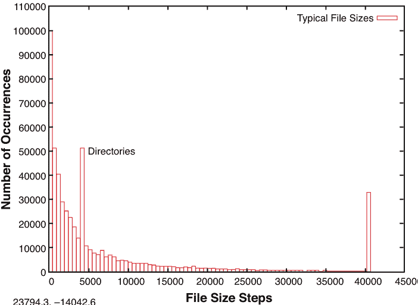

图 9-2 以字节字节的文件大小

图 9-2 显示，大多数文件的大小都远低于约 5KB。4096 处的尖峰代表目录。目录条目（文件本身）的长度恰好为 4096 字节，而且有很多这样的。40,000 字节以上的尖峰是测量产生的痕迹。它是对大于约 40KB（测量量子末端）的文件数量的统计。有趣注意的是，绝大多数文件都是非常小的。

小文件大小给 Flash 文件系统设计者带来了独特的挑战。因为 Flash 内存必须一次擦除整个块，而块的大小通常是小文件大小的许多倍，因此 Flash 受到耗时的块重写操作的影响。例如，假设使用一个 128KB 的 Flash 块来存放几十个 4096 字节或更小的文件。现在假设其中一个文件需要被修改。这会导致 Flash 文件系统使该 128KB 块失效，并将块中的每个文件重写到新擦除的块中。这可能是一个非常耗时的过程。

由于 Flash 写入可能非常耗时（比硬盘写入慢得多），这增加了因意外掉电导致数据损坏的窗口期。意外掉电在嵌入式系统中是常见现象。例如，如果在重写上述的 128KB 数据块期间发生掉电，那么所有那几十个文件都可能全部丢失。

第二代日志 Flash 文件系统（JFS2）登场了。通过 JFS2 的设计，讨论的问题和其他问题已经在很大程度上被移除或消除了。原始的 JFS2 是由瑞典的 Axis Communications AB 设计的，专门针对当时常见的内存设备。JFS2 了解 Flash 架构，更重要的是了解设备所施加的架构限制。

Flash 文件系统的另一个问题是 Flash 内存的寿命有限。典型的 Flash 内存设备规格说明为至少 100,000 次循环，而且最近这已变得常见。这一规范适用于 Flash 设备的每一个块。这种不寻常的限制要求写入分散到 Flash 内存设备的各个块中。JFS2 使用了一种名为“磨损均衡”（wear leveling）的技术来实现这一点。

### 9.6.1 构建 JFS2 镜像

构建 JFS2 镜像相对简单。虽然你可以在没有内核支持的工作站上构建一个 JFS2 镜像，但你无法挂载它。在继续之前，请考虑研究 ext4。

## 列表 9-10 续

```text
-n name 设置 cramfs 文件系统的名称
-p pad 为启动代码按 512 字节对齐
-s sort 目录条目（旧选项，已忽略）
-v 输出更详细的信息
-z make explicit holes 创建显式空洞（需要 >= 2.3.39）
dirname 压缩目录树的根目录
outfile 输出文件
```

```bash
# cramfs ../cramfs.image
warning: gids truncated to 8 bits (this may be a security concern)（这可能存在安全问题）
# ls -l ../cramfs.image
-rw-rw-r-- 1 chris 1019904 Sep 19 18:06 ../cramfs.image
```

在启动 `cramfs` 命令时没有带任何命令行参数，以便重复显示用法手册。由于该工具没有帮助页（page），这是理解其用法的最佳方法。随后我们发布了命令，指定当前目录（`.`）作为 cramfs 文件系统的文件源，并将名为 `cramfs.image` 的文件作为目标。最后，我们列出了刚刚创建的文件，看到了一个新文件 `cramfs.image`。

请注意，如果你的内核配置了 cramfs 支持，你可以在 Linux 开发工作站上挂载此文件映像并检查其内容。当然，因为它只读文件系统，你无法对其进行修改。9-11 展示了如何将 cramfs 文件系统挂载到名为 `/mnt/flash` 的挂载点。

## 列表 9-11 检查 cramfs 文件系统

```bash
# mount -o loop ... /mnt/flash
total 6
drwxr-xr-x 1 root 704 Dec 31 1969 bin
drwxr-xr-x 1 root 000 Dec 31 1969 dev
drwxr-xr-x 1 root 416 Dec 31 1969 etc
drwxr-xr-x 1 root 000 Dec 31 1969 home
drwxr-xr-x 1 root 172 Dec 31 1969 lib
drwxr-xr-x 1 root 000 Dec 31 1969 proc
drws------ 1 root 000 Dec 31 1969 root
drwxr-xr-x 1 root 272 Dec 31 1969 sbin
drwxrxrxrwt 1 root 000 Dec 31 1969 tmp
drwxr-xr-x 1 root 124 Dec 31 1969 usr
drwxr-xr-x 1 root 212 Dec 31 1969 var
#
```


你可能注意在执行 `mkramfs` 命令时，列表 9-10 中关于组 ID (GID) 的警告信息。`cramfs` 文件系统使用非常精简的元数据来缩小文件系统大小并提高执行速度。`cramfs` 文件系统的“特征”之一是将组 ID 字段截断为 8 位。Linux 使用的是 16 位组 ID 字段。结果是，用大于 255 的组 ID 创建的文件会被截断，并发出列表 9-10 中的警告。

尽管在文件大小、文件最大数量等方面存在局限性，但 `cramfs` 文件系统对于启动 ROM 来是理想的，因为只读操作和快速压缩是其理想的特征。

## 9.8 网络文件系统 (NFS)

如果你在 UNIX 环境下开发过，你无疑对网络文件系统 (`NFS`) 非常熟悉。配置得当，`NFS` 允许你在 `NFS` 服务器上导出目录，并将该目录挂载到远程客户端机器上，就像本地文件系统一样。这在大型 UNIX/Linux 机器网络中非常有用，可以是嵌入式开发者的万灵药。通过在目标板上使用 `NFS`，嵌入式开发人员可以在开发调试期间访问大量的文件、库、工具和实用程序，即使嵌入式系统资源受限。

与其他文件系统一样，你的内核必须配置 `NFS` 支持，包括服务器端和客户端功能。`NFS` 服务器和客户端功能在内核配置中是独立配置的。

配置和调优 `NFS` 的详细说明超出了本书的范围，但简短的介绍将有助于说明 `NFS` 在嵌入式环境开发期间有多用。请参本章中的章节以获取有关 `NFS` 详细信息的索引，包括完整的 `NFS` 使用指南。

在启用了 `NFS` 的开发工作站上，一个配置文件包含了一个指定你想要通过网络文件系统导出的目录列表。在 Red Hat、Ubuntu 和大多数其他发行版中，该文件位于 `/etc` 目录并命名为 `exports`。列表 9-12 是一个 `/etc/exports` 示例，可能会在嵌入式开发的工作站上找到。

### 列表 9-12 /etc/exports 的内容

```bash
$ cat /etc/exports

# /etc/exports

/coyote-target * (rw,sync,no_root_squash,no_all_squash,no_subtree_check)

/home/chris/workspace * (rw,sync,no_root_squash,no_all_squash,no_subtree_check)

$
```

该文件包含了 Linux 开发工作站上两个目录的名称。第一个目录包含一个用于 ADI Engineering Coyote 板板的目标文件系统。第二个目录是一个通用工作区，包含了针对嵌入式系统的项目。这些是随机的，你可以以任何方式配置 `NFS`。

### 9.8.1 NFS 上的根文件系统

当目标系统资源受限时，将你的项目挂载到目标机非常有用。当你对项目进行更改时，这特别有用。对于开发目的，如果你的嵌入式系统加载了你在 Linux 工作站上熟悉的全部工具和实用程序，它可以极大提高生产力。事实上，几十种命令行工具和开发实用程序可以帮助缩短开发进度。

配置嵌入式系统在启动时通过 `NFS` 挂载根文件系统相对简单。首先，你必须为目标内核配置 `NFS` 支持。还有一个配置选项用于启用挂载 `NFS` 远程目录。这如图 9-3 所示。

图 9-3 内核配置

### 列表 9-13 目标文件系统摘要

```bash
$ du -h --max-depth=1

724M /usr

4K /opt

39M /lib

12K /dev

27M /var

3.6M /boot

4K /workspace

1.8M /etc

4K /home

4K /mnt

4K /root

29M /bin

32M /sbin
```

### 列表 9-13 续

```bash
64K ./share

855M .

$ find -type f | wc -l

29430
```

剩下的就是以某种方式将信息传递给内核，以便它知道去哪里寻找 `NFS` 服务器。可以使用几种方法来实现这一点；其中某些取决于所选的架构和启动加载程序。至少，可以在上电时通过内核命令行向内核传递适当参数，以配置其 IP 端口和服务器信息。一个典型的内核命令行可能如下所示：

```
console=ttyS0.115200 ip=boot root=/dev/nfs
```

这告诉内核期望通过 `NFS` 根文件系统，并从 `BOOTP` 服务器获取参数（服务器名称、服务器 IP 地址和要挂载的根目录）。这在项目开发阶段是一种常见且极其有用的配置。如果你在静态地配置目标机的 IP，你的内核命令行可能如下：

```
console=ttyS0.115200                               \
ip=192.168.11.139:192.168.11.1:255.255.255.0:coyetel:eth0:off \
nfsroot=192.168.11.11::coyote-target \
root=/dev/nfs
```

当然，这应该是一行。`ip=` 参数定义在 `Documentation/files/nfsroot.txt` 中，并具有如下单行语法：

```
ip=<client-ip>:<server-ip>:<gw-ip>
:<netmask>:<hostname>:<device>:<autoconf
```

在这里，`client-ip` 是目标地址；`server-ip` 是 `NFS` 服务器的地址；`gw-ip` 是网关（路由器），以以防服务器位于不同的子网；`netmask` 定义 IP 地址的类别。`hostname` 是作为目标主机传递的字符串；`device` 是 Linux 设备名称，例如 `eth0`；`autoconf` 定义用于初始化 IP 参数的协议，例如 `BOOTP` 或 `DHCP`。将其设置为 `off` 则不进行配置。

## 9.9 伪文件系统

在内核配置菜单中，许多文件系统归属于“伪文件系统”（Pseudo File Systems）类别。它们提供了一系列广泛应用于应用程序中的设施。有关更多信息，特别是关于 `/proc` 文件系统，可以花一个下午时间研究这个实用的设施。在本章的最后一节可以找到额外阅读的参考文献。

### 9.9.1 /proc 文件系统

`/proc` 文件系统的命名源于其原始用途：一个允许内核通信 Linux 系统上每个运行进程信息的接口。随着时间的推移，它已经成长并成熟，提供了比进程信息多得的内容。我们在这里介绍亮点：`/proc` 文件系统的完整介绍留给你们作为练习。

`/proc` 文件系统已成为所有简单的、嵌入式 Linux 系统的虚拟必需。许多用户级函数依赖 `/proc` 文件系统的内容来工作。例如，不带任何参数执行的 `mount` 命令会根据 `/proc/mounts` 提供的信息列出运行系统上的所有当前挂载点。如果 `/proc` 文件系统不可用，`mount` 命令将静默返回。列表 9-14 展示了在 ADI 工程开发板上的这种情况。

列表 9-14 挂载对 /proc 的依赖

```
# mount

roots on / type roots (rw)

/dev/root on type nfs

(rw,v2,size=4096,hard,udp,nolock,addr=192.168.11.19)

tmpfs on /dev/shm type tmpfs (rw)

/proc on /proc type proc (rw,nodiratime)

< 现在卸载 proc 并重试 ...>
```

```
/proc
# mount
#
```

注意列表 9-14，`/proc` 本身被列为一个已挂载的文件系统，其类型为 `proc` 且挂载在 `/proc` 上。这不是双关语；你的系统在顶层目录树中必须有一个名为 `/proc` 的挂载点，作为 `/proc` 文件系统的挂载目标。要挂载 `/proc` 文件系统，像挂载任何其他文件系统一样使用 `mount` 命令：

```
# mount -t proc /proc /proc
```

> 你可以在文件系统的任意任何地方挂载 `/proc`，但所有需要 `proc` 的实用程序（包括 `mount`）都期望发现它挂载在 `/proc` 上。

根据 man 帮助页，`mount` 命令的一般形式为：

```
mount [-t ftype] somewhere
```

在前面的调用中，我们可以将 `/proc` 替换为 `none`，如下所示：

```
mount -t proc none /proc
```


这看起来没那么绕口子了。`something` 参数并不是严格必要的，`/proc` 是一个伪文件系统，而不是真实的物理设备。然而，像示例中那样指定 `/proc` 有助于我们我们将 `/proc` 文件系统挂载到 `/proc` 目录（或更准确地说，挂载到 `/proc` 挂载点）。

当然，到此时，让 `/proc` 文件系统运行可能是显而易见的，它必须在内核配置中启用。该内核配置选项可以在“伪文件系统”类别下的“文件系统”子菜单找到。

内核中运行的每个进程都由 `/proc` 文件系统中的条目表示。例如，第 6 节引入的 `init` 进程始终是 PID（ID） 1。`/proc` 文件系统中的进程用以 PID 数字命名的目录表示。例如，PID 为 1 的 `init` 进程将由 `/proc/1` 目录表示。列表 9-15 显示了该目录的 la。

列表 9-15 init `/proc` 条目

```
# ls -l /proc
total 0

drwxrxr-x  2 root root 4096 Jan  1 00:00 .
drwxr-xr-x  2 root root 4096 Jan  1 00:00 ..
drwxr-xr-x  20 root root 4096 Jan  1 00:00 aux
drwxr-xr-x  20 root root 4096 Jan  1 00:00 cmdline
drwxr-xr-x  20 root root 4096 Jan  1 00:00 cwd
drwxr-xr-x  20 root root 4096 Jan  1 00:00 fd
drwxr-xr-x  20 root root 4096 Jan  1 00:00 environ
drwxr-xr-x  20 root root 4096 Jan  1 00:00 status
drwxr-xr-x  20 root root 4096 Jan  1 00:00 maps
drwxr-xr-x  20 root root 4096 Jan  1 00:00 mount
drwxr-xr-x  20 root root 4096 Jan  1 00:00 task
```

课程，如果一个内存段没有与文件关联，inode 字段将包含 0。这些通常是数据段。

每个进程都列出了其他有用的条目。`status` 条目包含关于运行进程的信息，包括父进程 PID、用户 ID 和组 ID、虚拟内存使用情况、信号和能力。更多细节可以从本章末尾的参考文献获得。

一些常用的 `/proc` 条目有 `cpuinfo`、`meminfo` 和 `version`。`cpuid` 条目列出了内核发现的关于运行在系统上的处理器的属性。`meminfo` 条目提供了系统总内存的统计信息。`version` 条目镜像了 Linux 内核版本字符串，以及用于构建内核时所使用的编译器和机器的信息。

内核生成了许多其他有用的 `/proc` 条目；我们仅触及了这个子系统的冰角。许多工具被设计用于提取和报告包含在 `/proc` 文件系统中的的信息。两个流行的例子是 `top` 和 `ps`，每个嵌入式 Linux 开发者理想情况下都应该熟悉这两个工具。它们将在第 13 章中介绍。其他与 `/proc` 文件系统交互的有用工具还包括 `free`、`pkill`、`pmap` 和 `uptime`。更多详情请参阅 `procps` 包。

## 9.9.2 sysfs

与 `/proc` 文件系统一样，`sysfs` 并不代表实际物理设备。相反，`sysfs` 将特定的内核对象建模为物理设备，并提供了一种将设备与设备驱动关联的方法。典型 Linux 发行版中的某些代理依赖 `sysfs` 上的信息。

我们可以通过直接查看 `sysfs` 出的目录结构来大致了解导出了哪些类型的对象。列表 9-17 显示了 Coyote 板上的顶层 `/sys` 目录。

列表 9-17 顶层 `/sys` 目录内容

```
# ls -1 /sys
drwxr-xr-x 2 root 0 Jan 00:00 block
drwxr-xr-x 10 root 0 Jan 00:00 bus
drwxr-xr-x 23 root 0 Jan 00:00 class
drwxr-xr-x 4 root 0 Jan 00:00 dev
drwxr-xr-x 6 root 0 Jan 00:00 devices
drwxr-xr-x 2 root 0 Jan 00:00 firmware
drwxr-xr-x 2 root 0 Jan 00:00 fs
```

# 列表 9-17 延续

```
drwxr-xr-x 4 root root 0 Jan 1 00:00 kernel
drwxr-xr-x 20 root root 0 Jan 1 00:00 module
#
```

`sysfs` 为几个系统元素提供了一个顶层子目录，包括系统总线。例如，在 `block` 子目录下，每个块设备都由一个子目录条目表示。顶层的其他目录也是如此。

`sysfs` 存储的大部分信息在格式上更适合机器阅读，而不是人类阅读。例如，若要发现 PCI 总线上的设备，你可以直接查看 `/sys/bus/pci` 子目录。在我们的 Coyote 板上，它连接了一个 PCI 设备（一个以太网卡），该设备看起来如下：

```
# ls -l /sys/bus/pci/devices/
0000:00f.0 -> ../../../devices/pci0000/00:00:00f.0
```

为了清晰起见，输出内容经过了裁剪。该条目是一个指向 `sysfs` 目录树中另一个节点的符号链接。符号链接的名称是内核对 PCI 总线的表示，它指向一个名为 `pci0000:00` 的设备（PCI 总线的表示）。该子目录包含若干表示此特定 PCI 设备属性的子目录和文件。如你所见，这些数据相当难以发现和解析。

一个实用的工具可以帮助你浏览 `sysfs` 文件系统的目录结构。它被称为 `sysctl`，来自 `sourceforge.net` 上的 `the-utils` 包。以下是 `sysctl` 如何显示之前讨论过的 PCI 总线的示例：

```
$ sysctl -b pci
Bus = "pci"
0000:00f.0 8086:1229
```

我们看到了内核对总线和设备 (`0f`) 的表示，但此工具显示了从 `/sys/devices/pci0000:00` 分支中获取的厂商 ID (`8086` = Intel) 和设备 ID (`1229` = eepro 以太网卡)，这些属性就保在该处。在不带参数执行时，`sysctl` 显示顶层系统层次结构。列表 9-18 是我们 Coyote 板上的一个示例。

# 列表 9-18 systool 的输出

```
$ systool
Supported sysfs buses:
hid
hi2c
ide
mdio_bus
pci
platform
scsi
usb
Supported sysfs classes:
atm
bdi
block
firmware
hwmon
i2c-adapter
i2c-dev
ide_port
input
leds
mdio_bus
mem
misc
mtd
net
ppci_bus
rtc
scsi_device
scsi_disk
scsi_host
tty
Supported sysfs devices:
pci0000:00
platform
system
virtual
Supported sysfs modules:
8250
ecici_hcd
hid
ide_gd_mod
```

# 列表 9-18 延续

```
kernel
libata
lockd
mousedev
nfs
printk
scsi_mod
spurious
tcp
uhci
usb_storage
```

你可以从这里看到哪些对象被导出了。实用的工具可以帮助你浏览 `sysfs` 文件系统的目录结构。它被称为 `sysctl`，来自 `sourceforge.net` 上的 `the-utils` 包。以下是 `sysctl` 如何显示之前讨论过的 PCI 总线的示例：

```
$ sysctl -b pci
Bus = "pci"
0000:00f.0 8086:1229
```

我们看到了内核对总线和设备 (`0f`) 的表示，但此工具显示了从 `/sys/devices/pci0000:00` 分支中获取的厂商 ID (`8086` = Intel) 和设备 ID (`1229` = eepro 以太网卡)，这些属性就保在该处。在不带参数执行时，`sysctl` 显示顶层系统层次结构。列表 9-18 是我们 Coyote 板上的一个示例。

你可以从这里看到哪些对象被导出了。实用的工具可以帮助你浏览 `sysfs` 文件系统的目录结构。它被称为 `sysctl`，来自 `sourceforge.net` 上的 `the-utils` 包。以下是 `sysctl` 如何显示之前讨论过的 PCI 总线的示例：

```
$ sysctl -b pci
Bus = "pci"
0000:00f.0 8086:1229
```


此命令将文件 `my-new-fs-image` 作为文件系统挂载到名为 `/mnt/flash` 的挂载点。挂载点的名称并不重要；只要挂载点存在，你可以将其挂载到任何地方。使用 `mkdir` 创建你的挂载点。

在新创建的镜像文件作为文件系统挂载后，我们就可以对其进行更改。我们可以添加和删除目录、创建设备节点等。我们可以使用 `tar` 将文件拷贝到其中或从中取出。当更改完成后，它们将保存在文件中，前提是你没有超过设备的大小。请记住，使用这种方法，大小在创建时就是固定的，无法更改。

## 9.12 总结

本章介绍了在桌面/服务器 Linux 系统和嵌入式系统中使用的各种文件系统。描述了专门用于嵌入式系统的文件系统，特别是 Flash 文件系统。还涵盖了重要的伪文件系统。

- 分区（Partitions）是物理设备的逻辑划分。Linux 支持多种分区类型。
- 在 Linux 中，文件系统挂载在挂载点上。根文件系统挂载在文件系统层次结构的根部，被称为 `/`。
- 流行的 ext2 文件系统成熟且快速。它经常出现在嵌入式和其他 Linux 系统中，如 Red Hat 和 Fedora Core。
- ext3 文件系统在 ext2 文件系统之上增加了日志（journaling），以提供更好的数据完整性和系统可靠性。
- ReiserFS 是另一种在许多嵌入式和其他 Linux 系统中常见的流行且高性能日志文件系统。
- JFFS2 是专为 Flash 内存优化的文件系统。它包含了对 Flash 友好特性，例如用于延长 Flash 寿命的磨损均衡（wear leveling）。
- cramfs 是一种只读文件系统，非常适合小型启动 ROM 以及其他只读程序和数据。
- NFS 是嵌入式开发人员最强大的开发工具之一。它可以将工作站的功能带到你的目标设备。学习如何将 NFS 作为你嵌入式目标的根文件系统。这种便利性和节省的时间将证明这些是值得的。
- Linux 上有许多伪文件系统。这里介绍了其中几个较重要的，包括 `/proc` 文件系统和 sysfs。
- 基于 RAM 的 `tmpfs` 文件系统在嵌入式系统中有许多用途。它与传统内存磁盘（ramdisks）相比的最显著改进是能够动态调整大小以满足操作需求。

### 9.12.1 扩展阅读建议

第二扩展文件系统的设计与实现（Design and Implementation of the Second Extended Filesystem）
Rémy Card, Theodore Ts’o, Stephen Tweedie
首次发表于第一次荷兰 Linux 国际研讨会
http://e2fsprogs.sourceforge.net/ext2intro.html

EXT2 文件系统的非技术视角（A Non-Technical Look Inside the EXT2 File System）
Randy Appleton
www.linuxjournal.com/article/2151

Red Hat 的日志文件系统：ext3（Red Hat’s New Journaling File System: ext3）
Michael K. Johnson
www.redhat.com/support/papers/redhat/ext3/

Reiser4 文件系统
http://en.wikipedia.org/wiki/Reiser4

JFS：日志 Flash 文件系统（JFS: The Journaling Flash File System）
David Woodhouse
http://sources.redhat.com/jff2/jff2.pdf

cramfs 项目的 README 文件
未签名（假设为项目作者）
http://sourceforge.net/projects/cramfs/

NFS 首页
http://nfs.sourceforge.net

/proc 文件系统文档
www.ldp.org/LDP/lkkmg/2.6/c712.htm

文件系统性能：Solaris OS、UFS、Linux ext3 和 ReiserFS（File System Performance: The Solaris OS, UFS, Linux ext3, and ReiserFS）
技术白皮书
Dominic Kay
www.sun.com/software/whitepapers/solaris10/fs_performance.pdf

## 第 10 章

## MTD 子系统

本章内容

- 10.1 MTD 概述 262
- 10.2 MTD 分区 267
- 10.3 MTD 工具 279
- 10.4 UBI 文件系统 284
- 10.5 总结 287

存储器技术设备（MTD）子系统的出现是为了支持各种类内存设备，如 Flash 内存芯片。目前有许多不同类型的 Flash 芯片，以及许多为它们的编程方法，这部分是因为它支持许多专门化和高性能的模式。MTD 层架构使得低层设备复杂性与使用内存和 flash 设备的高层数据组织及存储格式分离开。

本章介绍了 MTD 子系统，并提供了一些简单的使用示例。首先，我们查看内核支持 MTD 服务需要哪些条件。我们在一个启用了 MTD 的开发工作站上展示了一些简单操作，以帮助你理解该子系统的基础。本章还整合了 MTD 和 JFS2 文件系统。

然后，本章讨论了与 MTD 层相关的分区概念。我们检查了从引导加载程序构建分区的细节以及 Linux 内核如何检测它们。本章继续对 MTD 工具进行了简要介绍。最后，我们把所有内容整合在一起，并使用内置 Flash JFS2 文件系统镜像启动目标设备。

### 10.1 MTD 概述

简单来说，MTD 是一个提供统一 API 与 Flash 设备交互的设备驱动程序。MTD 支持多种 Flash 设备。然而，MTD 不是块设备。MTD 处理的是 Flash 设备的单元。

与此配置选择相结合的是两个与 RAM 测试驱动程序相关的参数：设备大小和擦除大小。在本例中，我们指定了 8192KB 的总大小和 128KB 的擦除大小。该测试驱动的目的是模拟 Flash 设备，主要为了方便 MTD 子系统的测试和开发。由于 Flash 存储器的架构设计为固定大小的擦除块，因此该测试驱动也包含了擦除块的概念。稍后你看到这些参数是如何使用的。

#### 10.1. MTD 基础

Linux 内核发行版集成了 MTD，因此你不需要应用 MTD 补丁来启用它。如果你觉得需要处于 MTD 开发的最前沿，可以从 MTD 主页下载最新的源代码，该地址列在本章的最后一节。当然，无论哪种情况，都必须在你的内核配置中启用 MTD，如图 10-1 所示。

启用 MTD 后，我们可以在我们的 Linux 开发工作站上查看该子系统的工作原理。使用我们配置的 RAM 驱动，我们可以通过 MTD 设备挂载 JFFS2 镜像。假设你已经按照第 9 章“文件系统”中的详细说明创建了一个 JFFS2 镜像，你可能想挂载并检查它。第 9 章构建的镜像名为 `jffs2.bin`。回想第 9 章，我们构建了

```
# mkfs.jffs2 -d ./jffs2-image-dir -o jffs2.bin
```

Linux 内核不支持在回环设备（loopback device）上直接挂载 JFFS2 文件系统镜像，而 ext2 等其他文件系统镜像可以。因此，我们必须使用不同的方法。可以通过开发 Linux 工作站上的 MTD RAM驱动来实现来实现列表10-2 展示了这些步骤。

### 列表 10-2 在 MTD RAM 设备上挂载 JFFS2

```
# modprobe jffs2
# modprobe mtdblock
# modprobe mtdram
# dd if=jffs2.bin of=/dev/mtdblock0
4690+1 records in
4690+1 records out
# mkdir /mnt/flash
```

> ¹ 你可以使用列表 10-1 中的示例轻松地为本次练习追溯一个最小文件系统。

### 列表 10-2 继续

```
# mount -t jff2 /dev/mtdblock0 /mnt/flash
# ls -1 /mnt/flash
total 0
drwxr-xr-x 2 root root Sep 17 22:02 bin
drwxr-xr-x 2 root root Sep 17 21:59 dev
drwxr-xr-x 7 root root Sep 17 15:31 etc
drwxr-xr-x 2 root root Sep 17 22:02 lib
drwxr-xr-x 2 root root Sep 17 15:31 proc
drwxr-xr-x 2 root root Sep 17 22:02 sbin
drwxrxrxwt 2 root root Sep 17 15:31 tmp
```


`drwxr-xr-x 9 root root Sep 17 15:31 usr`

`drwxr-xr-x 14 root root Sep 17 15:31 var`

# 

```
```

在列表 10-2 中，我们首先安装 Linux 内核支持 JFF2 和 MTD 子系统所需的可加载模块。我们先加载 `jff2` 模块，然后加载 `mtdblock` 和 `mtdram` 模块。在加载必要的设备驱动后，我们使用 Linux 的 `dd` 命令通过 `mtdblock` 设备将我们的 JFFS2 文件系统镜像拷贝到 MTD 测试 RAM 驱动中。本质上，我们使用系统 RAM 作为备用设备来模拟 MTD 块设备。

将 JFFS2 文件系统镜像拷贝到 MTD 块设备后，我们可以按照列表 10-2 所示的方法使用 `mount` 命令对其进行挂载。MTD 伪设备已经创建，我们可以以任何选择的方式操作 JFFS2 文件系统。唯一的限制是我们无法更改镜像的大小。它的大小受两个因素限制：第一，当我们在 Linux 内核配置接口中配置 MTD RAM 测试设备时，我们给了它 8MB 的最大大小；第二，当我们创建 JFFS2 镜像时，我们使用 `mkfs.jff2` 工具固定了镜像的大小。镜像的大小取决于我们在创建它时指定的目录内容。参考第 9 章中的列表 9-9 以回想我们的 `jff2.bin` 镜像是如何构建的。

意识到通过这种方法检查 JFF2 文件系统二进制内容的局限性是非常重要的。考虑我们所做的：我们将一个文件的内容（JFF2 文件系统二进制镜像）拷贝到了内核设备（`/dev/mtdblock0`）。然后我们将内核块设备（`/dev/mtdblock0`）挂载为 JFF2 文件系统。在此此之后，我们可以使用所有传统的文件系统工具来检查甚至修改文件系统。诸如 `ls`、`df`、`dh`、`mv`、`rm` 和 `cp` 等工具都可用于检查和修改文件系统。然而，与回环设备不同，我们拷贝的文件与挂载的 JFFS2 文件系统镜像之间没有连接。因此，如果我们在做出更改后卸载文件系统，更改将会丢失。如果你想保存更改，必须将它们拷贝回文件。其中一种方法如下：

```
# dd if=/dev/mtdblock of=your-modified-fs.bin
```

该命令创建了一个 `your-modified-fs.bin` 文件，其大小与配置时指定的 `mtdblock` 相同。更重要的是，这是修改 JFF2 的一种有效方法。

### 10.1.3 在目标上配置 MTD

要在你的板上为 Flash 使用 MTD，必须正确配置 MTD。你必须执行以下操作来配置 Flash：

- 指定 Flash 分区。
- 指定 Flash 的类型和位置。
- 为选定的 Flash 配置适当的驱动程序。
- 配置内核。

这些的这些步骤将在后续章节中进行探讨。

### 10.2 MTD 分区

给定硬件上的大多数 Flash 设备被划分为多个，称为分区（partitions），类似于桌面工作站硬盘上的分区。MTD 子系统支持此类分区。MTD 子系统必须配置分区支持。图 10-2 显示了来自最新内核快照的 MTD 分区配置选项。

| 名称 | M | Y |
| --- | --- | --- |
| 存储技术设备 (MTD) 支持 (NEW) | | Y |
| 调试 (NFW) | N | N |
| MTD 测试支持 (NEW) | N | N |
| MTD 合并支持 (NFW) | N | N |
| MTD 分区支持 (NEW) | | Y |
| 用户模块与转换层 | | |
| 直接访问 MTD 设备 (NEW) | | Y |
| 块层的通用接口 (NFW) | | |
| 无缓存设备访问 MTD 设备 (NEW) | | Y |
| Flash 转换层 (FTL) 支持 (NFW) | N | N |
| (NAND Flash 转换层) (NEW) | | |
| 反向 NAND 转换层 (INFTL) | N | N |
| 驻留 Flash 磁盘 转换层支持 (NEW) | N | N |
| NAND 5x8C 只读转换层 (NFW) | N | N |
| MTD_OPS | N | N |

- 映射芯片驱动
- 支持芯片的非线性映射 (NFW)
- 物理内存中的 Flash 设备 (NFW)
- Flash 设备映射在基于 0x4x 的系统上 (NFW)
- MTD 设备映射在基于 0x4x 的系统上 (NFW)

```
CONFIG_MTD_00XX y
```

这使得 MTD 能够访问基于英特尔 0x40x 系列网络处理器（如 IXP425 和 Centrino）的平台上的 Flash 设备。如果你有一个基于 0x40x 的板，并想使用上面的 Flash 芯片，说 "

你可以通过多种方式将分区数据传递给 Linux 内核。你可以在图 10-2 中看到每种方法的配置选项。目前支持的方法有：

- Redboot 分区表解析

- 内核命令行分区表定义

- 板级特定的映射驱动

- TI AR 分区支持

MTD 也允许没有数据的情况下配置。在这种情况下，MTD 直接将整个 Flash 内存视为单个设备。

## 10.2.1 Redboot 分区表分区

定义和检测 MTD 分区的常用方法之一源于原始的实现之一：Redboot 分区。Redboot 是存在于许多嵌入式板卡上的引导加载程序，特别是 ARM XScale 板卡，如 ADI Engineering Coyote 参考平台。

MTD 子系统定义了一种在 Flash 设备本身上存储分区信息的方法，其概念类似于硬硬盘上的分区表。在 Redboot 分区的情况下，开发人员预留并指定一个 Flash 擦除块来存放分区信息。通过选择一个映射驱动程序，该驱动程序在启动期间调用分区解析函数，以检测 Flash 设备上的分区。图 10-2 显示了我们示例板的映射驱动程序；它是最后高亮显示的定义的 `CONFIG_MTD_IPXXXX`。

按照惯例，详细查看示例有助于说明这些概念。我们首先查看 Redboot 引导加载程序为 Coyote 平台提供的信息。列表 10-3 记录了 Redboot 引导加载程序通电后的部分输出。

列表 10-3 通电时的 Redboot 消息

```
Platform: ADI Coyote (XScale)
IDE/Parallel Port PLD Version: 1.0
Copyright (C) 2000, 2001, 2002, Red Hat, Inc.
```

```
RAM: 0x00000000-0x04000000, 0x0001f960-0x03fd1000 available
FLASH: 0x05000000-0x05100000, 128 blocks of 0x00020000 bytes each. ...
```

此控制台输出告诉我们，板板上的 RAM 物理起始地址为 0x00000000，Flash 映射在物理地址 0x05000000 到 0x05100000。我们还可以看到 Flash 拥有 128 块 0x00020000 (128KB) 的块。

Redboot 包含一个创建和显示存储在 Flash 上的分区信息的命令。列表 10-4 是 `fis list` 命令的输出，它是 Redboot 引导加载程序中可用的 Flash 系统命令的一部分。

列表 10-4 Redboot Flash 分区列表

```
RedBoot> fis list
Name FLASH addr Mem addr Length Entry point
RedBoot 0x05000000 0x50000000 0x00060000 0x00000000
```

# 列表 10-4 继续

| Name | FLASH addr | Mem addr | Length | Entry point |
| :--- | :--- | :--- | :--- | :--- |
| RedBoot config | 0x50FC0000 | 0x50FC0000 | 0x00001000 | 0x00000000 |
| FIS directory | 0x50FE0000 | 0x50FE0000 | 0x00020000 | 0x00000000 |
| RedBoot> | | | | |

从列表 10-4，我们看到 Coyote 板在 Flash 上定义了三个分区。名为 RedBoot 的分区包含可执行的 Redboot 引导加载程序镜像。名为 RedBoot config 的分区包含引导加载程序维护的配置参数。最后一个名为 FIS directory 的分区持有有关分区表的信息。

当配置得当时，Linux 内核可以检测并解析此分区表，并创建分区。列表 10-5 重现了从上述 ABI Engineering Coyote 板输出的部分启动消息，该板启动了一个配置了支持检测 RedBoot 分区的 Linux 内核。

# 列表 10-5 在 Linux 启动时检测 RedBoot 分区


```
IPX4XX-Flash.0: Found 1 x16 devices at 0x0 in 16-bit bank
Intel/Sharp Extended Query Table at 0x0031
Using buffer write method
Searching for RedBoot partition table in IPX4XX-Flash.0 at offset 0xfe0000
3 RedBoot partitions found on MTD device IPX4XX-Flash0
Creating 3 MTD partitions on "IPX4XX-Flash.0":
0x00000000-0x00060000 : "RedBoot"
0x00fc0000-0x00fc1000 : "RedBoot config"
0x00fe0000-0x00100000 : "FIS directory"
```

列表 10-5 中的第一个消息是在检测 Flash 芯片时打印的，通过通用 Flash 接口 `CFI` 驱动程序，其通过 `CONFIG_MTD_CFI` 启用。`CFI` 是一种确定 Flash 芯片特性的行业标准方法，例如制造商、设备类型、总大小和擦除块大小。请见最后章节的 `CFI` 规范。

`CFI` 通过内核配置工具使用存储技术设备 `MTD` 顶层菜单启用。在“RAM/ROM/Flash drivers”下选择“通过通用 Flash 接口 `CFI` 探测检测 flash chips”，如图 10-3 所示。

## 10.2 MTD 分区

### 通过通用 Flash 接口 `CFI` 探测检测 flash 芯片

通用 Flash 接口规范由 Intel 和其他 flash 制造商开发，提供了一种探测 flash 设备能力的通用方法。如果你希望支持该功能，你需要启用此 `CONFIG_MTD_REBOOT_PARTS`（参见列表 10-3）。注意该芯片已以设备名 `IPX4XX-Flash.0` 枚举。你可以从列表 10-5 中看到 Linux 内核使用 `fis list` 命令检测到 flash 芯片上的三个分区。当基础设施按照此处描述就绪时，Linux 内核会在 `/proc` 中自动代表发现的三个 flash 分区的数据结构，如列表 10-6 所示。

### 列表 10-6 内核 MTD 分区

```
root@coyote:~# cat /proc/mtd
dev:      size        name
mtd0: 00600000 00020000 "RedBoot"
mtd1: 00001000 00020000 "RedBoot config"
mtd2: 00020000 00020000 "FIS directory"
```

我们可以轻松创建分区。列表 10-6 显示了发现的三个 flash 分区的数据结构（注：此处原文描述略有重复，译文已根据逻辑对对齐）。Redboot 包含一个创建和显示存储在 Flash 上的分区信息的命令。列表 10-4 是 `fis list` 命令的输出，它是 Redboot 引导加载程序中可用的 Flash 系统命令的一部分。

### 274 第 10 章 MTD 子系统

指定一个唯一的 ID、分区大小以及从 Flash 起始的偏移量。你还可以为分区传递一个名称，可选地传递只读属性。参考列表 10-4 所示的 Redboot 分区定义，我们可以按照如下方式在内核命令行上静态定义这些内容：

```
mtdparts=MainFlash:384K(Redboot), 4K(config),128K(FIS), - (unused)
```

通过此定义，内核将实例化四个 MTD 分区，其 MTD ID 为 `MainFlash`，包含的大小和布局与列表 10-14 中的内容匹配。

### 10.2.3 映射驱动程序

定义特定板 Flash 布局的最后一种方法是使用专用的特定板映射驱动程序。Linux 内核源码树包含了许多映射驱动程序的示例，位于 `...drivers/mtd/maps`。其中任何一个都可以作为创建你自己的映射驱动程序的良好示例。实现细节随架构而异。

映射驱动程序是一个标准的内核模块，具有第 8 章“设备驱动程序基础”中所描述的 `module_init()` 和 `module_exit()`。典型的映射驱动程序很小且易于导航，包含不到几十行 C 代码。

列表 10-10 重现了 `...drivers/mtd/maps/pq2fads.c` 的部分内容。该映射驱动程序定义了支持 MPC8272和其他处理器的 Freescale PQ2FADS 评估板上的 Flash 设备。

#### 列表 10-10 PQ2FADS Flash 映射驱动程序

```c
static struct mtd_partition pq2fads_partitions[] = {
  {
#ifdef CONFIG_ADS8272
    .name = "HRCW",
    .size = 0x40000,
    .offset = 0,
    .mask_flags = MTD_WRITEABLE, /* force read-only */
},
  .name = "User FS",
    .size = 0x5c0000,
    .offset = 0x40000,
#else
  .name = "User FS",
    .size = 0x060000,
    .offset = 0,
#endif
},
  {
    .name = "uImage",
    .size = 0x010000,
    .offset = 0x060000,
    .mask_flags = MTD_WRITEABLE, /* force read-only */
  },
  {
    .name = "bootloader",
    .size = 0x040000,
    .offset = 0x070000,
    .mask_flags = MTD_WRITEABLE, /* force read-only */
  },
  {
    .name = "bootloader env",
    .size = 0x040000,
    .offset = 0x074000,
    .mask_flags = MTD_WRITEABLE, /* force read-only */
  },
};
```

```c
/* pointer to MPC885ADS board info data */
extern unsigned char __res[];
```

```c
static int __init_pq2fads_mtd(void)
{
    bd_t *bd = (bd_t *)__res;
    physmap_configure(bd->bi_flashstart, bd->bi_flashsize,
        PQ2FADS_BANK_WIDTH, NULL);

    physmap_set_partitions(pq2fads_partitions,
        sizeof(pq2fads_partitions) /
        sizeof(pq2fads_partitions[0]));
    return 0;
}
```

```c
static void __exit cleanup_pq2fads_mtd(void)
{
}
```

```c
module_init(init_pq2fads_mtd);
module_exit(cleanup_pq2fads_mtd);
...
```

这个简单但完整的 Linux 设备驱动程序通过 PQ2FADS Flash 映射与 MTD 子系统通信。回想第 8 章，当设备驱动程序中的函数使用 `module_init()` 宏声明时，它会在 Linux 内核启动期间被自动调用。在这个 PQ2FADS 映射驱动程序中，模块初始化函数 `init_pq2fads_mtd()` 只执行了两个简单的调用：

- `physmap_configure()` 将 Flash 物理地址、大小和库宽度传递给 MTD 子系统，以及访问 Flash 所需的任何特殊设置。
- `physmap_set_partitions()` 将此映射驱动程序开头的 `pq2fads_partitions[]` 数组定义的分区表将板的唯一分区信息传递给 MTD 子系统。

遵循这个简单的示例，你可以为你的板卡推导出映射驱动程序。

### 10.2.4 Flash 芯片驱动程序

MTD 支持各种 Flash 芯片和设备。你选择的芯片极可能也被支持。常见的 Flash 芯片支持之前提到的通用 Flash 接口 `CFI`。旧的 Flash 芯片可能具有 JEDEC 支持，这是一个较旧的 Flash 兼容标准。10-4 显示了最近 Linux 内核快照的配置。该版本支持许多 Flash 类型。


如果你的 Flash 芯片不受支持，你必须自己提供设备文件。以 `...drivers/mtd/chips` 中的许多示例之一作为起点，自定义或创建你自己的 Flash 设备驱动程序。

### 10.2.5 特定板初始化

除了映射驱动程序外，你的特定板设置必须提供底层定义。列表 10-11 重现了 `...arch/arm/coyote-setup.c` 的部分。

使用 MTD 工具，我们可以对新创建的分区进行许多操作。以下是在该分区上执行 `flash_erase` 命令的结果的结果：

```
# flash_erase /dev/mtd1
Erase Total 1 Units
Performing Flash Erase of length 131072 at offset 0x0 done
```

如需将新的内核镜像拷贝到此分区，我们使用使用 `flashcp` 命令：

```
root@coyote:~# flashcp /workspace/coyote-40-zImage /dev/mtd1
```

在处理根文件系统分区时，情况会变得稍微有趣一些。我们可以选择使用引导加载程序（bootloader）或 Linux 内核从 Redboot Flash 分区上取初始镜像。首先，我们使用 Redboot 创建一个用于存放根文件系统的新分区。以下命令在 Flash 设备上创建了一个名为 `RootFS` 的新分区，其起始内存地址为 `0x50300000`，长度为 30 个块（block）。请记住，块泛称为擦除单元（erase unit），在该 Flash 芯片上为 128KB。

```
RedBoot> fs create -f 0x50300000 -l 0x0600000 -n RootFS
```

接下来，我们启动内核并将根文件系统镜像拷贝到我们命名为 `RootFS` 的新分区中。这是在目标板的 Linux 提示符上通过以下命令实现的。注意，这假设你已经将文件系统镜像放置在开发板可以访问的目录中。正如书中多次提到的，NFS 根挂载是你在开发期间的好帮朋友。

```
root@coyote:~# flashcp /rootfs.ext2 /dev/mtd2
```

文件系统的大小从几兆字节到我们设备允许的最大 own不等，因此这可能需要一些时间。请记住，此操作涉及将镜像编程（有时称为闪存）到 Flash 内存中。拷贝完成后，我们可以将分区挂载为文件系统。列表 10-13 显示了这一序列。

列表 10-13 将 MTD Flash 分区挂载为 ext2 文件系统

```
root@coyote:~# mount -t ext2 /dev/mtdblock2 /mnt/remote remote
root@coyote:~# ls -l /mnt/remote/
total 16
```

# 列表 10-13 续

```
drwxr-xr-x 2 root root 1024 Nov 19 2005 bin
drwxr-xr-x 2 root root 1024 Oct 26 2005 boot
drwxr-xr-x 2 root root 1024 Nov 19 2005 dev
drwxr-xr-x 5 root root 1024 Nov 19 2005 etc
drwxr-xr-x 2 root root 1024 Oct 26 2005 home
drwxr-xr-x 3 root root 1024 Nov 19 2005 lib
drwxr-xr-x 2 root root 1024 Nov 19 2005 mnt
drwxr-xr-x 2 root root 1024 Oct 26 2005 opt
drwxr-xr-x 2 root root 1024 Oct 26 2005 proc
drwxr-xr-x 2 root root 1024 Oct 26 2005 root
drwxr-xr-x 2 root root 1024 Nov 19 2005 sbin
drwxr-xr-x 2 root root 1024 Oct 26 2005 srv
drwxr-xr-x 2 root root 1024 Oct 26 2005 tmp
drwxr-xr-x 6 root root 1024 Oct 26 2005 usr
drwxr-xr-x 2 root root 1024 Nov 19 2005 var
root@coyote:~#
```

10-13 本身具有其固有的微妙之处。注意我们在 `mount` 命令行中指定了 `/dev/mtdblock2`。这是 MTD 驱动，允许我们以块设备的方式访问 MTD 分区。指定 `/dev/mtd2` 则指示内核使用 MTD 字符设备。`mtdchar` 和 `mtdblock` 都是伪驱动，用于为底层 Flash 分区提供基于字符或基于块的访问。由于 `mount` 期望一个块设备，你必须使用块设备指定符。图 1-1 显示了启用这些访问方法的内核配置。相应的内核配置映射为 `CONFIG_MTD_CHAR` 和 `CONFIG_MTD_BLOCK`。

第二个微妙之处是在 `mount` 命令上使用了只读（`ro`）命令开关。使用 MTD 块仿真驱动从 Flash 挂载 ext2 镜像用于只读目的是完全可以接受的。然而，使用 `mtdblock` 驱动不支持向 ext2 设备进行写入。这是因为 ext2 并不了解 Flash 擦除块（erase blocks）。为了访问基于 Flash 的文件系统，我们需要使用具有 Flash 特性的文件系统，例如 JFFS2。

## 10.3.1 JFFS2 根文件系统

创建一个 JFFS2 根文件系统是一个简单的过程。除了压缩外，JFFS2 还支持磨损均衡（wear leveling），该功能旨在通过在设备块之间公平地分配写周期来增加 Flash 的寿命。第 9 章“Flash 内存”提到，Flash 是易损的。磨损均衡是设计用于通过在设备块之间公平地分配写周期来增加 Flash 寿命的功能。书中多次提到，磨损均衡是必要的。使用具有 Flash 特性的文件系统（如 JFFS2）来访问基于 Flash 的文件系统。

创建一个 JFFS2 根文件系统是一个简单的过程。除了压缩外，JFFS2 还支持磨损均衡，该功能旨在通过在设备块之间公平地分配写周期来增加 Flash 的寿命。第 9 章“Flash 内存”提到，Flash 是易损的。0损均衡是

## 10.4 UBI 文件系统

未排序块映像（UBI）文件系统设计用于克服 JFFS2 文件系统的某些局限性。它可以被认为是 JFFS2 的继者，尽管 JFFS2 在包含 Flash 存储器的嵌入式 Linux 设备上仍被广泛使用。UBI 文件系统 (`UBIFS`)构建在 UBI 设备之上，而 UBI 设备又依赖于 MTD 设备。

`UBIFS` 改进了 JFFS2 系统最主要的局限性之一：挂载时间。JFFS2 将索引元数据维护在系统内存中，并在每次启动时读取该索引以构建完整的目录。相比之下，`UBIFS` 将索引元数据维护在 Flash 设备本身，消除了每次挂载时扫描和重建这些数据的需要。因此，`UBIFS` 的挂载速度比 JFFS2 快许多倍。

`UBIFS` 还支持写缓存，你可以在 `www.linux-mtd.infradead.org/doc/ubifs.html` 了解更多关于 `UBIFS` 优势的信息。

### 10.4.1 配置 UBI

要使用 UBI，你的内核需要启用 UBI 支持。在内核配置中必须启用两个不同的内核配置菜单项才能启用 `UBIFS`。首先，启用对 `MTD_UBI` 的支持。你可以在内核配置的 Device Drivers（设备驱动）--> Memory Technology Device (MTD) support --> UBI -- Unsorted block images --> Enable UBI 下找到此选项。选择此项后，将启用位于 File Systems（文件系统）--> Miscellaneous- filesystems --> UBIFS file system support 下的文件系统支持配置选项。

### 10.4.2 构建 UBIFS 映像

构建 `UBIFS` 映像比构建 JFFS2 映像要稍微复杂一些。额外的复杂性来自于 NAND Flash 技术。构建 `UBIFS` 映像要求你了解目标系统的 NAND Flash 架构。这一点稍后会变得清晰。你还需要在开发工作站上安装较新版本的 MTD Utils。你可以在 `git://infradead.org/mtd-utils.git` 找到 MTD Utils。

列表 17 详细说明了在开发工作站上创建 `UBIFS` 映像的过程。在本次练习中，假设你已经在名为 `rootfs` 的目录中准备所需的文件系统内容。

#### 列表 10-17 构建 UBIFS 映像


```
$ mkfs.ubifs -m 2048 -e 129024 -c 1996 -o ubifs.img -r /rootfs
$ ubinize -m 2048 -p 128Kiib -s 512 -o ubi.img ubinize.cfg
$ ls -l
total 200880
drwxr-xr-x 7 chris chris 4096 2010-03-01 11:33 rootfs
drwxr-xr-r-- 1 chris chris 101799936 2010-03-01 11:55 ubifs.img
drwxr-xr-r-- 1 chris chris 103677952 2010-03-01 11:58 ubi.img
drwxr-xr-r-- 1 chris chris 112 2010-03-01 11:54 ubinize.cfg
```

原始 UBIFS 映像是使用 `mtd-utl` 包中的 `mkfs.ubifs` 工具构建的。该包生成目标文件 `ubifs.img`。向 `mkfs.ubifs` 传递正确的参数至关重要。`-m` 指定最小 I/O 单元——在此情况下为 2KB。`-e` 指定映像的逻辑擦除块（LEB）大小。输出映像名称由 `-c` 指定。在本例中，我们将其命名为 `ubifs.img`。

现在我们有了 UBIFS 映像，必须生成 UBI 卷映像。我们使用 `ubinize` 工具（`mtd-utl` 包的一部分）来完成此操作。再次，我们必须为目标环境使用正确的参数。此外，你会注意到 `ubinize` 需要一个配置文件。`ubinize.cfg` 文件指定了卷名称等其他信息，正如我们很快将看到的。

列表 10-17 指定了 I/O 大小，即 2KB。在我们的 `-p` 参数中，我们使用物理擦除块大小为 128KiB 的 NAND Flash。`-s` 参数指定子页大小，即最小 I/O 单元。我们使用 `-o ubi.img` 指定目标输出文件。我们将此映像烧录到设备中。

`ubinize` 使用的配置文件指定了由 `ubinize` 工具生成的卷。列表 10-18 详细说明了列表 10-17 中使用的配置。

### 列表 10-18 ubinize 配置文件

```
$ cat ubinize.cfg
[ubifs]
mode=ubi
image=ubifs.img
vol_id=0
vol_size=200MiB
vol_type=dynamic
vol_name=rootfs
```

在这里我们可以看到 `volumeFromUtf`，并且原始映像来自名为 `ubifs.img` 的文件。回列表 10-17，原始映像来自名为 `ubifs.img` 的文件。（注：原文在此处存在大量重复的 OCR 错误，已根据逻辑进行去重处理）。

## 10.4.3 使用 UBIFS 作为根文件系统

现在我们已经在 `/dev/mtd4` 上放置了映像，可以指示内核挂载该文件系统作为其根系统。要做到这一点，将向内核传递以下命令行参数：

```
ubi.mtd4 root=ubi0:rootfs rw roottype=ubifs
```

这组内核命令行参数指示内核将 `mtd4` 设备附加到 `ubi0`，并将生成的 UBI 设备作为根文件系统。如果你遇到困难，请确保在内核命令行中包含适当的 `rootdelay` 选项。在本练习中，需要 `rootdelay=1` 以确保在挂载 UBIFS 作为根文件系统时，UBI 和 UBIFS 层已经就绪。

## 10.5 总结

本章介绍了嵌入式开发者感兴趣的最重要且最困难的主题之一。MTD 在许多嵌入式系统中某种形式的形式。

- 内存技术设备（MTD）子系统为 Linux 内核中的 Flash 设备提供了支持。
- 在你的 Linux 内核配置中必须启用 MTD。本章中的几图详细说明了配置选项。
- 作为 MTD 内核配置的一部分，必须选择适用于你的 Flash 芯片的 Flash 驱动程序。图 10–4 显示了最近 Linux 内核快照支持的芯片驱动。
- 你的 Flash 内存设备可以作为一个大设备进行管理，也可以被划分为多个分区。
- 有多种方法可以将分区信息传递给 Linux 内核。这些方法包括 Redboot 分区信息、内核命令行参数和映射驱动程序。
- 映射驱动程序（mapping driver）配合由特定架构板级支持程序提供的定义，为内核定义了您的 Flash 配置。
- MTD 带有许多用户空间实用程序，用于管理您 Flash 设备上的镜像文件。
- 日志 Flash 文件系统 2 (`JFFS2`) 是 MTD 子系统对于小型、高效的基于 Flash 文件系统的良好伴侣。在本章中，我们构建了一个 `JFFS2` 镜像并将其作为根目录挂载到我们的目标设备上。
- UBIFS 改进了 `JFFS2`，并在嵌入式系统中迅速流行起来。

### 10.5.1 额外阅读建议

MTD Linux 主页

`www.linux-mtd.info.org/`

Redboot 用户文档

`http://ecos.sourceware.org/ecos/docs-latest/redboot/redboot-guide.html`

通用 Flash 内存接口规范

AMD 股份公司 (`AMD Corporation`)

`www.amd.com/us-en/assets/content_type/DownloadableAssets/cfi_r20.pdf`

# 第 11 章

# BusyBox

## 本章内容

- 11.1 BusyBox 290 简介
- 11.2 BusyBox 配置 291
- 11.3 BusyBox 操作 293
- 11.4 总结 303

BusyBox 的帮助页（man page）宣布 BusyBox 是“嵌入式 Linux 的瑞士军刀”。这是一个贴切的描述，因为 BusyBox 是大量标准 Linux 命令行实用程序的小型高效的替代品。它通常作为资源受限嵌入式平台的基础。本章介绍了 BusyBox，并为自定义自己的 BusyBox 安装提供了一个极佳的起点。

之前的章节提到过 BusyBox。本章将介绍该实用包的细节。在简要介绍 BusyBox 之后，我们将探索 BusyBox 配置实用程序。该程序用于根据您的特定需求定制 BusyBox。然后，我们讨论了交叉编译 BusyBox 包的要求。

本章还考虑了 BusyBox 的运行问题，包括它如何在嵌入式系统中使用。我们检查了 BusyBox 的初始化序列，并解释了它如何区别于标准的 System V 初始化。本章还展示了一个示例初始化脚本。在了解在目标系统上安装 BusyBox 的步骤后，您将学习一些关于 BusyBox 命令及其局限性。

## 11.1 BusyBox 简介

BusyBox 在嵌入式 Linux 社区中获得了极大的普及。它非常容易配置、编译和使用。此外，它具有显著减少支持大量常用实用程序所需的整体系统资源的潜力。BusyBox 为大多数桌面和嵌入式 Linux 发行版中许多传统的完整功能实用程序提供了紧凑的替代品。例如 `ls`、`cat`、`cp`、`head` 和 `tail` 等文件工具；`dmesg`、`kill`、`halt`、`fdisk`、`mount` 和 `umount` 等通用工具；BusyBox 还提供了更复杂的操作，如 `ifconfig`、`netstat`、`route` 以及网络工具。

BusyBox 是模块化且高度可配置的，可以根据特定需求进行定制。该包包含一个与配置 Linux 内核类似的配置实用程序，因此看起来会非常熟悉。

BusyBox 中的命令通常实现上比完整功能的对应品更简单。在某些情况下，仅支持常规命令行选项的子集。但在实践中，你会发现 BusyBox 的功能子集对于大多数通用嵌入式需求来说绰绰有余。

### 11.1.1 BusyBox 非常简单

如果你能配置和编译 Linux 内核，你就会发现 BusyBox 的配置、构建和安装非常直观。步骤类似：

- 1. 执行配置实用程序并启用您选择的功能。
- 2. 运行 `make` 来构建包。
- 3. 将二进制文件和一系列符号链接¹ 安装到您的目标系统上。

您可以在开发工作站或您的目标嵌入式系统上构建并安装 BusyBox。BusyBox 在两种环境中工作得同样良好。然而，在开发工作站上安装时，您必须小心保持在隔离的工作目录中，以避免覆盖系统的系统的启动文件或主要实用程序。

## 11.2 BusyBox 配置

要启动 BusyBox 配置，命令与用于 Linux 内核基于 curses 库的配置实用程序相同。请注意，与 Linux 内核类似，`make` 会针对可用目标产生大量有用信息。配置命令为：

```
$ make menuconfig
```


图 11-1 显示了顶层 BusyBox 配置。由于空间限制，无法涵盖每个配置选项。然而，某些选项值得提。一些最重要的 BusyBox 配置选项出现在 `Busybox Settings --> Build Options` 下。在这里您将找到交叉编译 BusyBox 应用所需的配置选项。列表 11-1 详细列出了最近 BusyBox 快照中 `Build Options` 下的选项。从顶层 BusyBox 配置实用程序选择 `Build Options` 进入此屏幕。

> ¹ 我们很快会介绍符号链接的细节。

# 第 11 章 BusyBox

文件 编辑 查看 终端 标签页 帮助 BusyBox 1.13.2 配置

```
方向键导航菜单。<Enter> 选择子菜单 ----。高亮的字母是热键。
按 ? 包含，<< 排除，<< 模块化功能。按 <ESC><ESC> 退出，<>
需帮助，? 搜索。图例：[* 内置 [ ] 排除 <M> 模块 <> 可
```


图 11-1 顶层 BusyBox 配置

## 列表 11-1 构建选项

- 将 BusyBox 构建为静态二进制文件（无共享库）
- 将 BusyBox 构建为位置无关可执行文件
- 带大型支持构建 BusyBox
- 构建 BusyBox
- 交叉编译器前缀

第一个选项对于构建最小嵌入式系统有用。它允许 BusyBox 进行静态编译和链接，因此不需要库。如果没有此选项，BusyBox 需要各种库才能运行。我们可以通过使用 `ldd` 轻松确定 BusyBox（或其他二进制文件）在目标系统上需要的库。列表 11-2 是为 xscale 交叉编译的 `ldd` 输出。

### 列表 11-2 `ldd busybox`

```
$ xscale_be-ldd busybox
linux-so.1 => (0xb808700)
libm.so.6 => /lib/tls/i686/cmov/libm.so.6 (0xb804d00)
libc.so.6 => /lib/tls/i686/cmov/libc.so.6 (0xb7efe00)
/lib/ld-linux.so.2 (0xb80
```

使用默认配置编译的 BusyBox 工具需要 11-2 所示的四个共享库。如果我们选择构建 BusyBox 为静态二进制文件，`ldd` 将简单地提示我们二进制文件不是动态执行文件。也就是说，它不需要共享库来解析任何依赖。静态链接产生了更小的整体占用。然而，在没有共享库的情况下构建嵌入式意味着您的应用程序无法使用 C 库函数。为了让您了解静态链接 BusyBox 与相同配置链接共享库之间的大小差异，静态链接的 `busybox` 大约为 1.5MB，而动态链接镜像为 78KB。

### 11.2.1 交叉编译 BusyBox

正如章节开头，BusyBox 的作者意图让该包用于交叉开发环境，因此在这样的环境中构建 BusyBox 非常容易。在早期的 BusyBox 版本中，唯一的要求是通过选择使用交叉编译器构建的选项来指定交叉编译器的缀。这已被更标准的方法所取代，即指定交叉编译环境变量，类似于构建其他包（如 Linux 内核）。要在您的开发环境中使用特定的交叉编译器进行交叉编译，只需在环境中定义 `CROSS_COMPILE`。`CROSS_COMPILE` 值的示例包括 `arm5vtl-le-`、`xscale_be-` 和 `ppc-linux-`。请注意，您也可以在上述的配置实用程序中指定交叉编译器前缀。

## 11.3 BusyBox 操作

当您构建 BusyBox 时，会得到一个名为——你猜的——BusyBox 的二进制文件。BusyBox 可以通过二进制文件本身调用，但它通常通过一个 `symlink`（符号链接）。当在不带命令行参数的情况下调用 BusyBox 时，它会生成一个通过配置启用的函数列表。列表 11-3 显示了此类输出（已根据页面宽度进行了格式化处理）。

### 列表 11-3 BusyBox 使用

```
root@coyote # busybox
BusyBox v1.13.2 (2010-02-24 16:04:14 EST) multi-call binary
Copyright (C) 1998-2008 Erik Andersen, Rob Landley, Denys Vlasenko and others. Licensed under GPLv2.
完整的函数说明请查看源码发行。
```

```
Usage: busybox [function] [arguments]
or: function [arguments]...
```

BusyBox 是一个多功能二进制文件，它将许多 Unix 工具程序组合在一个单一的可执行文件中。大多数人会为他们想要使用的每个函数为 `busybox` 创建一个列表，而 BusyBox 将会像它被调用的那种方式一样运行！

当前定义的函数：

[, ([addgroup, adduser, ar, ash, awk, basename, blkid, bunzip2, bscat, chattr, chrgrp, chmod, chown, chpasswd, chroot, chvt, clear, cp, cpio, cryptwp, cut, date, dd, dealloc, delgroup, deluser, df, dhpreplay, diff, dirname, dmesg, dumpmap, dumpellas, echo, egrep, env, expr, false, fbset, fbsplash, fdisk, fgrep, find, freeramisk, fsch, fsmink, fuser, getopt, get, grep, gunzip, gzip, halt, hexdump, hostname, http, wget, id, ifconfig, ifodown, if, insmod, loadmap, logger, logname, logread, lesut, ls, lmsod, makedvs, mdsum, mdev, microcmdk, mkfifo, mknod, mknod, mkswap, mktype, modify, mount, mv, nc, netstat, nice, nook, nslook, od, open, patch, pidof, ping, ping6, pivot_root, poweroff, print, ps, pwd, rdev, readahead, readlink, readprofile, realpath, reboot, repset, reset, rmdir, rmmmod, route, rtcwave, run-parts, sed, setconsole, setfont, sh, showley, sleep, sort, start-daemon, strings, stty, su, sulogin, swapon, switch_root, sync, syslog, tail, tar, telnet, telnetd, udhcpc, udhcp, unmount, uname, uniq, unzip, traceroute, true, tty, udpc, time, top, touch, uptime, vi, watch, wc, which, who, whoami, xargs, yes, zcat]可以看到 BusyBox 构建中启用的函数列表。它们按字母顺序排列（从 `addgroup` 到 `zcat`，用于解压缩文件的工具）。此列表代表了在该 BusyBox 构建中启用的工具集。

要调用特定函数，请通过命令行传递定义的函数来执行 `busybox`。例如，要显示根目录的文件列表，请执行：

```
[root@coyote]$ busybox ls /
```

列表 11-3 中显示的 BusyBox 使用信息是该程序的简短描述。它将 BusyBox 描述为一个将许多常用工具组合成单一可执行文件的多功能二进制文件。这就是前面提到的符号链接的作用。这消除了输入两个单词命令来调用给定函数的负担，并向用户提供了一组同名的工具命令。列表 11-4 和 11-5 说明了这一点。

### 列表 11-4 来自 `make install` 的 BusyBox 符号链接结构

```
[root@coyote]$ ls -l /
total 12
drwxr-xr-x 2 root 4096 Dec 3 bin
lrwxrwxrwx 1 root 41 Dec 3 linux -> /bin/busybox
drwxr-xr-x 2 root 4096 Dec 3 dev
drwxr-xr-x 4 root 4096 Dec 3 usr
```


可执行文件 `busybox` 位于 `/bin` 目录，在结构的其余部分都是指向 `/bin/busybox` 的符号链接。列表 11-5 扩展了列表 11-4 的目录结构。

# 列表 11-5 BusyBox 符号链接结构：详情

```
[root@coyote]$ tree
|-- bin
| |-- addgroup -> busybox
|-- busybox
```

```
列表 11-5 继续
| -- cat -> busybox
| -- cp -> busybox
<...>
| -- zcat -> busybox
| -- linuxrc -> /bin/busybox
| -- sbin
  | -- halt -> ../bin/busybox
  | -- ifconfig -> ../bin/busybox
  | -- init -> ../bin/busybox
  | -- klogd -> ../bin/busybox
<...>
| -- syslogd -> ../bin/busybox
-- user
  | -- bin
  | -- chroot -> ../bin/busybox
  | -- basename -> ../bin/busybox
<...>
  | -- xargs -> ../bin/busybox
  | -- yes -> ../bin/busybox
  | -- sbin
    | -- root -> ../bin/busybox
```

列表 11-5 显示的输出为了可读性已被大幅截断，省略号 (...) 表示该列表已修剪，仅显示目录的第一和最后一个条目。实际上，取决于你使用 BusyBox 配置启用的功能，这些目录可以填充超过 100 个符号链接。注意 BusyBox 可执行文件本身，它是 `/bin` 目录中的第二个条目。`/bin` 目录中还有指向 `busybox` 的 `addgroup`、`cat`、`cp` 等直到 `zcat` 的符号链接。再次，此列表中 `cp` 和 `zcat` 之间的条目已被省略。通过这种符号链接结构，用户只需输入工具的实际名称即可调用其功能。例如，要使用 BusyBox 工具配置网络接口，用户可能会输入类似的命令：

`$ ifconfig eth1 192.168.1.14`

这将通过 `ifconfig` 符号链接调用 BusyBox 可执行文件。BusyBox 会检查它是如何被调用的。换句话说，它读取 `argv[0]` 来确定请求的功能。注意列表 11-5 中名为 `init` 的符号链接。在第 6 章“用户空间”中，你学习了 `init` 程序及其在系统初始化中的作用。回想一下，内核在初始化最后一步尝试模拟名为 `/sbin/init` 的程序。没有理由 BusyBox 不能模拟 `init`，而这正是在列表 11-5 所示系统的配置方式。

BusyBox 处理系统初始化的方式与标准的 System V (SysV) 初始化不同，第 6 章描述的初始化需要一个 `/etc` 目录下可访问的 `inittab` 文件。BusyBox 也读取 `inittab` 文件，但 `inittab` 的语法是不同的。通常，如果你在使用 BusyBox，则不需要使用 `inittab`。如果你需要运行级别，使用 System V 初始化。

让我们看看这在嵌入式系统上的表现。11-7 捕捉了基于 BusyBox 的系统的开电输出。我们根据第 9 章“文件系统”节 9.11“构建简单文件系统”概述的步骤构建了这个小型文件系统。列表 11-6 是根文件系统。

# 列表 11-6 最小 BusyBox 根文件系统

```
$ tree
|-- bin
  |-- busybox
| -- cat -> busybox
| -- dmesg -> busybox
| -- echo -> busybox
| -- hostname -> busybox
| -- ls -> busybox
| -- ps -> busybox
| -- pwd -> busybox
```

第 6 章涵盖了 System V 化的细节。

4 个目录，10 个文件

基于 BusyBox 的根文件系统占据的空间仅比 `busybox` 本身多一点。在这种配置下，使用静态链接并支持近 100 个工具，BusyBox 可执行文件接近 2MB：

```
# ls -1 /bin/busybox
-rwxr-xr-x 1 chris 2531600 2020-01-28 15:54 /bin/busybox
```

## 11.3 BusyBox 操作

这是一个通过 BusyBox 配置的目标，该目标执行成功，并且 BusyBox 通过我们根文件系统的符号链接 `/bin/sh` 启动。

BusyBox 执行的第一件事是报错称找不到 `/etc/init.d/rcs`。这是初始化 BusyBox 的默认初始化脚本方法。与使用 `inittab` 不同，这是初始化基于 BusyBox 的嵌入式系统的首选方法。

当初始化完成后，BusyBox 会显示一个提示，要求用户按回车键（Enter）激活控制台。当 BusyBox 检测到回车键时，它会执行一个 `ash` shell 会话并等待用户输入。关于作业控制的最后信息是因为，特别在这个示例中（以及大多数典型的嵌入式系统中），我们正在串口终端上创建系统控制台。Linux 内核包含代码，在检测到控制台位于串口终端上时会禁用作业控制。

此示例产生了一个可以运行的系统，提供了近 100 种 Linux 工具，包括核心工具、文件工具、网络支持以及功能相当强大的 shell。你可以看到，这个简单的软件包提供了一个强大的平台，你可以在此基础上构建自己的系统应用程序。当然，需要注意的是，如果没有对 `libc` 和其他系统库的支持，实现你的应用程序将面临一项艰巨的任务。你必须为所有常用的标准 库调用以及典型 C 程序依赖的其它库函数提供支持。或者，你也可以将应用程序与它们依赖的库进行静态链接，但如果你有多个应用程序使用这种方法，你的应用程序很可能会超过动态链接并在目标机上使用共享库的 BusyBox 链接大小。

### 11.3.2 示例 rcs 初始化脚本

在 BusyBox 产生交互式 shell 之前，它会尝试执行来自名为 `/etc/init.d/rcs` 脚本的命令，如列表 11-7 所示。这就是你的应用程序在 BusyBox 系统中运行的地方。列表 11-8 提供了一个简单的 rcs 初始化脚本。

列表 11-8 简单的 rcs BusyBox 启动脚本

```sh
#!/bin/sh
echo "Mounting proc"
mount -t proc /proc /proc
echo "Starting system loggers"
syslogd
```

列表 11-8 续

```sh
klogd
echo "Configuring loopback interface"
ifconfig lo 127.0.0.1
echo "Starting inetd"
xinetd

# start a shell
busybox sh
```

该脚本大部分是自解释的。首先，将 `/proc` 文件系统挂载到其预留的挂载点 `/proc` 是重要的。这是因为许多工具从 `/proc` 文件系统获取信息。这在第 9 章有更详细的解释。接下来，我们启动系统日志守护进程，为系统配置回环接口。在系统日志守护进程之后，再次，许多传统的 Linux 假设存在回环接口，如果你的系统配置了套字，你应该启用此接口。我们在启动 shell 之前做的最后一件事是启动互联网服务器 `xinetd`。该程序在后台运行，处理来自任何已配置网络接口的请求请求。例如，为了向开发板发起 telnet 会话，`xinetd` 会拦截 telnet 连接请求并产生一个 telnet 服务器来处理该会话。

与其启动 shell，你的你的应用程序可以从 rcs 初始化脚本启动。列表 11-8 是一个启用 telnet 的目标运行系统和内核日志记录等基本服务的简单示例。

### 11.3.3 BusyBox 目标安装

只有当你理解符号链接的使用和用途后，才能继续讨论 BusyBox 的安装。BusyBox 的 Makefile 包含一个名为 `install` 的目标。执行 `install` 会创建一个包含 BusyBox 可执行文件和符号链接树的目录结构。此环境需要迁移到你的目标嵌入式系统的根目录，并包含完整的符号链接树。如前所述，符号链接消除了为每个命令都输入 `busybox` 命令的需求。相反，要查看目录下的文件列表，用户只需输入 `ls`。符号链接将如前所述执行 BusyBox 并调用 `ls` 功能。参见列表 11-4 和 11-5 查看符号链接树。注意，BusyBox 构建系统仅对你通过配置实用程序启用的功能创建链接。

向你的根文件系统填充必要的符号链接池的最简单方法是让 BusyBox 构建系统为你完成工作。只需在工作站上挂载你的根文件系统并向 BusyBox Makefile 传递 `CONFIG_PREFIX` 参数。列表 11-9 显示了该过程。

列表 11-9 在根文件系统上安装 BusyBox


```bash
$ mount -o root.ext2 /mnt/remote
$ make CONFIG_PREFIX=/mnt/remote install
/mnt/remote/bin/bash -> busybox
/mnt/remote/bin/cat -> busybox
/mnt/remote/bin/chgrp -> busybox
/mnt/remote/bin/chmod -> busybox
/mnt/remote/bin/chown -> busybox
...
/mnt/remote/usr/bin/xargs -> ../../bin/busybox
/mnt/remote/usr/bin/yes -> ../../bin/busybox
/mnt/remote/usr/bin/chroot -> ../../bin/busybox
```

你可能需要将你的 busybox 二进制文件设置为 `setuid root` 以确保所有工作正常进行。

```bash
$ chmod +s /mnt/remote/bin/busybox
-rwsr-xr-x 1 root root 552 Jan 1 00:00 /mnt/remote/bin/busybox
$ ls -l /mnt/remote/bin/busybox
-rwsr-xr-x 1 root root 552 Jan 1 00:00 /mnt/remote/bin/busybox
```

该脚本大部分是自解释的。首先，将 `/proc` 文件系统挂载到其预留的挂载点 `/proc` 是重要的。这是因为许多工具从 `/proc` 文件系统获取信息。这在第 9 章有更详细的解释。接下来我们启动系统日志守护进程，为系统配置回环接口。在系统日志守护进程之后，再次，许多传统的 Linux 假设存在回环接口，如果你的系统配置了套字，你应该启用此接口。我们在启动 shell 之前做的最后一件事是启动互联网服务器 `xinetd`。该程序在后台运行，处理来自任何已配置网络接口的请求。例如，为了向开发板发起 telnet 会话，`xinetd` 会拦截 telnet 连接请求并产生一个 telnet 服务器来处理该会话。

关于 `setuid` 的信息也会由安装脚本显示，提醒你可能需要将 BusyBox 设置 `setuid root`。这允许非 root 用户调用需要 root 权限的 BusyBox 函数。这并非必须，特别是在嵌入式 Linux 环境中，通常只有一个 root 账户。

此安装步骤的结果是 BusyBox 二进制文件和符号链接树已安装在你的目标系统中。最终结果与 11-4 非常相似。

值得注意的是 BusyBox 还具有一个在运行时创建此符号链接树的选项。该选项在 BusyBox 配置中启用，并通过执行带有 `-install` 参数的 BusyBox 在运行时调用。你必须在目标系统上挂载 `/proc` 文件系统才能使其生效。

### 11.3.4 BusyBox 应用

在最近的 BusyBox 快照中，282 个命令（也称为应用）已在 man 页中记录。对于复杂的 shell 脚本提供了足够的支持，包括对 Bash shell 脚本的支持。BusyBox 支持 `awk` 和 `sed`，这些在 Bash 脚本中很常见。BusyBox 支持 `ping`、`ifconfig`、`traceroute` 和 `netstat` 等网络工具。许多命令专门为脚本支持设计，包括 `true`、`false` 和 `yes`。

请阅读附录 C，“BusyBox 命令”，其中每个 BusyBox 命令都有摘要。完成后，你将更好地理解 BusyBox 的功能以及它如何适用于你自己的嵌入式 Linux 项目。

正如章节开头提到的，许多 BusyBox 命令仅包含与其全功能版本相比的有限功能集和选项。通常，你可以通过在运行命令时带有 `--help` 参数获取任何给定 BusyBox 命令的帮助。这将产生一条用法消息，并对每个支持的命令选项进行简要描述。BusyBox `gzip` 应用是一个支持有限选项的 BusyBox 命令的有用示例。列表 11-10 显示了 BusyBox 目标上的 `gzip-help` 输出。

## 11.4 总结 303

列表 11-10 BusyBox gzip Applet 用法

```
# gzip --help
BusyBox v1.13.2 (2010-02-24 16:04:14 EST) multi-call binary

Usage: gzip [OPTION]... [FILE]

Compress FILES (or standard input)

Options:\  -c    Write to standard output
  -d    Decompress
  -f    Force
```

BusyBox 版本的 gzip 仅支持三个命令行选项。全功能的对应版本支持超过 15 种不同的命令行选项。例如，全功能的 gzip 工具支持 `--list` 选项，该可以为命令中的每个文件生成统计信息。BusyBox gzip 不支持这种功能。这对于嵌入式系统来说通常不是一个重大的限制。我们提供这些信息是为了让您在决定使用 BusyBox 时做出明智的选择。当需要某个工具的所有功能时，解决方案非常简单：在 BusyBox 配置中删除对该特定工具的支持，并将标准的 Linux 工具添加到您的目标系统中。通过这种方式，您可以在同一个嵌入式系统中混合使用 BusyBox 工具和标准 Linux 工具。

## 11.4 总结

本章介绍了 BusyBox，它是嵌入式 Linux 领域最流行的工具之一。BusyBox 也在桌面和服务器发行版中占有一席，作为救援镜像以及这些发行版中常见的初始内存磁盘（ramdisk）。本章介绍了如何配置、构建和安装这个重要的工具。我们还研究了基于 BusyBox 的系统在系统初始化时的差异。

- BusyBox 是一个强大的嵌入式系统工具，它在一个多调用二进制文件中替换了许多常见的 Linux 工具。
- BusyBox 可以显著缩小根文件系统镜像的大小。
- BusyBox 易于使用，并具有许多有用功能。
- 配置 BusyBox 非常简单，使用的界面与 Linux 配置界面类似。
- 根据您的特定需求，可以将 BusyBox 配置为静态链接或动态链接应用程序。
- 使用 BusyBox 的系统系统初始化会有所不同；这些差异已在本章中涵盖。
- BusyBox 支持许多命令。附录 C 列出了最近发布版本中所有可用的 BusyBox 命令。

### 11.4.1 扩展阅读建议

BusyBox 项目首页

www.busybox.net/

BusyBox 手册页

www.busybox.net/downloads/BusyBox.html

## 第 12 章

## 嵌入式开发环境

在本章中

- 12.1 交叉开发环境 306
- 12.2 主机系统要求 311
- 12.3 托管目标板 312
- 12.4 总结 322

主机开发系统上可用的配置和服务对您作为嵌入式开发者产生巨大影响。本章研究了交叉开发环境的独特要求，以及嵌入式开发者为了高效所需的某些工具和技术。

我们首先研究一个典型的交叉开发环境。通过熟悉的“Hello World”示例，我们详细介绍了基于主机的应用程序与针对嵌入式系统的应用程序之间的区别。我们还查看了原生开发与嵌入式应用开发工具链的差异。我们介绍了主机系统要求，并详细说明了主机系统中某些重要元素的使用。我们以一个由基于网络的主机托管的目标板示例结束本章。

## 12.1 交叉开发环境

初接触嵌入式开发的开发者往往对原生环境和交叉开发环境之间的概念和差异感到困扰。事实上，一个系统有三个编译器和（或更多）版本的标准头文件（如 `stdlib.h`）。如果没有正确的工具和基于主机的程序，在目标嵌入式系统上调试应用程序可能会困难。您必须管理并将设计用于在主机系统运行的文件和工具与您打算在目标上使用的文件分开。

当我们在此背景未使用 *host*（主机）时，我们指的是放在您的桌面上运行您喜爱的 Linux 发行版的开发工作站。相反，当我们使用 *target*（目标）时，我们指的是您的嵌入式硬件平台。因此，原生开发表示在主机系统上并为主机系统编译和构建应用程序。交叉开发表示在主机系统上编译和构建将在嵌入式系统中运行的应用程序。这些定义将帮助您在整个章节保持思路。

> 韦氏词典将无意义定义为“荒谬或违背常理的想法”。作者认为，在非 Linux/Unix 主机上开发嵌入式 Linux 平台是没有意义的。

图 12-1 显示了典型的交叉开发环境布局。主机 PC 通过一个或多个物理连接连接到目标板。如果目标板上同时可用串口和以太网端口将最为方便。稍后当我们讨论内核调试时，您会发现第二个串口是一项宝贵的资产。

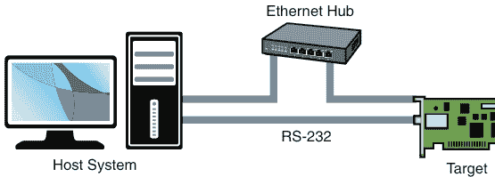

图 12-1 交叉开发设置


在最常见的情况下，开发者在主机上有一个连接到 RS-232 串口的串口终端，可能有一个或多个到目标板的 `telnet` 或 `SSH` 会话，并可能使用以太网作为连接媒介的一个或多个调试会话。这种交叉开发设置提供了很大的灵活性。基本思想是主机系统提供运行编译器、调试器和其他工具的算力，而目标机拥有更多资源，包括处理器、内存、磁盘存储和互联网连接。事实上，目标机没有人工输入设备或输出显示器并不罕见。

### 12.1.1 嵌入式“Hello World”

配置良好的交叉开发系统为普通开发者隐藏了大量的复杂性。查看一个简单的示例有助于揭示并解释当我们编译一个“Hello World”程序时，工具链（编译器、链接器和相关工具）对我们正在构建的主机系统和正在编译的程序做了许多假设。

#### 列表 12-1 Hello World

```
#include <stdio.h>

int main(int argc, char **argv)
{
    printf("Hello World\n");
    return 0;
}
```

即使是业余开发者也会意识到此源文件的某些重要点。首先，`printf()` 函数在该文件中被引用但没有定义。如果我们省略包含 `printf()` 函数原型的 `#include` 指令，编译器会发出这条熟悉的消息：

```
hello.c:5: warning: implicit declaration of function 'printf'
```

这引入了一些有趣的问题：

- `stdio.h` 文件位于何处，它是如何找到的？
- `printf()` 函数的对象代码存储在系统的哪个位置，该引用在二进制执行文件中是如何解析的？

似乎某个地方知道如何组合一个可以从命令行执行的正确二进制文件。此外，最终的可执行文件包含了我们看不见但链接器自动包含的启动和结束序言代码。为了构建“Hello World”应用程序，我们可以使用编译器的简单命令行调用，类似于：

```
$ gcc -o hello.c
```

这将产生一个名为 `hello` 的二进制执行文件，我们可以直接从命令行执行它。

## 12.1 交叉开发环境

我们可以查询工具链以获取使用的一些默认值。列表 12-2 列出了向 `cpp` 传递 `-v` 标志时的输出部分内容。你可能已经知道 `cpp` 是 GNU `gcc` 工具链中的预处理器组件。我们添加了一些格式化处理（仅限空格）以提高可读性。

### 列表 12-2 默认原生 cpp 搜索目录

```
$ cpp -v /dev/null
Reading specs from /usr/lib/gcc-lib/i386-redhat-linux/3.3.3/specs
Configured with: ../configure --prefix=/usr
--mandir=/usr/share/man --infidir=/usr/search/info
--enable-shared --enable-threads=posix --disable-checking
--disable-libunwind-exceptions --with-system-zlib
--enable-__cxa_atexit --host=i386-redhat-linux

Thread model:
gcc version 3.3.3 20040412 (Red Hat Linux 3.3.3-7)
/usr/lib/gcc-lib/i386-redhat-linux/3.3.3/cc1 -E -v
ignoring nonexistent directory "/usr/i386-redhat-linux/include"

#include "..." search starts:
#include <...> search starts here:
/usr/local/include
/usr/lib/gcc-lib/i386-redhat-linux/3.3.3/include
/usr/include
End of search list.
/usr/lib/
```

这个简单的查询产生了一些有用信息。首先，我们可以看到如何使用熟悉的 `./configure` 工具来配置编译器的。默认线程模型是 `posix`，它决定了当你使用线程函数时链接到你的程序的线程库。最后，你看到了 `#include` 指令的默认搜索目录。

但如果我们想为不同的架构（例如 Power 架构）构建 `hello.c` 应该怎么办？当我们在宿主机上使用交叉编译器为 Power 架构编译应用程序时，我们必须确保编译器不会使用默认的包含目录或库路径。使用一个配置恰当的交叉编译器是第一步，而拥有一个设计良好的交叉开发环境是第二步。

列表 12-3 是一个流行的开源交叉开发工具链的输出，被称为嵌入式 Linux 开发工具包（ELDK），由 Denx Software Engineering 组装并维护。此特定安装是为 Power 架构 82xx 工具链配置的。再次，我们在输出中添加了一些空格以提高可读性。

### 列表 12-3 默认交叉搜索目录

```
$ ppc_82xx-cpp -v /dev/null
Reading specs from /eldk/usr/bin/..
/lib/gcc-lib-ppc-linux/3.3.3/specs

Configured with: ../configure --prefix=/usr
--mandir=/usr/share/man --infadir=/usr/share/info
--enable-shared --enable-threads=posix --disable-checking
--with-system-zlib --enable-__cxa_atexit --with-newlib
--enable-languages=c,c++ --disable-libunwind-exceptions --host=i386-redhat-linux

Thread model:
gcc version 3.3.3 20040412 (Red Hat Linux 3.3.3-7)
/usr/lib/gcc-lib/i386-redhat-linux/3.3.3/cc1 -E -v
ignoring nonexistent directory "/usr/i386-redhat-linux/include"

#include "..." search starts:
#include <...> search starts here:
/usr/local/include
/usr/lib/gcc-lib/i386-redhat-linux/3.3.3/include
/usr/include
End of search list.
/usr/lib/
```

这个简单的查询产生了一些有用信息。首先，我们可以看到如何使用熟悉的 `./configure` 工具来配置编译器的。默认线程模型是 `posix`，它决定了当你使用线程函数时链接到你的程序的线程库。最后，你看到了 `#include` 指令的默认搜索目录。

但如果我们想为不同的架构（例如 Power 架构）构建 `hello.c` 应该怎么办？当我们在宿主机上使用交叉编译器为 Power 架构编译应用程序时，我们必须确保编译器不会使用默认的包含目录或库路径。使用一个配置恰当的交叉编译器是第一步，而拥有一个设计良好的交叉开发环境是第二步。

列表 12-3 是一个流行的开源交叉开发工具链的输出，被称为嵌入式 Linux 开发工具包（ELDK），由 Denx Software Engineering 组装并维护。此特定安装是为 Power 架构 82xx 工具链配置的。再次，我们在输出中添加了一些空格以提高可读性。

在现代 Ubuntu 和其他基于 Debian 的系统中，可以按照以下方式安装 HPA TFTP 服务器：

```bash
$ sudo apt-get install tftpd-hpa
```

配置此 TFTP 服务器非常简单。在 Ubuntu 和其他发行版中，有一个名为 `/etc/default/tftpd-hpa` 的配置文件。该文件需要根据你的特定需求进行自定义。列表 12-4 显示了该配置文件的一个典型示例。

#### 列表 12-4 TFTP 配置

```
# Defaults for tftpd-hpa
RUN_DAEMON="yes"
OPTIONS=-l -s /tftpboot
```


你必须执行的第一件事是启用该服务。当你首次安装 `tftpd-hpa` 软件包时，`RUN_DAEMON` 默认值为 `"no"`。要启用它，你必须将默认的 `"no"` 改为 `"yes"`，如列表 12-4 所示。第二行定义了守护进程本身的命令行选项，通常为 `/usr/sbin/in.tftpd`。`-s` 告诉 `inftpd` 在启动时切换到指定的目录 (`/tftpboot`)，这使得该目录成为你 TFTP 服务器的根目录。`-c` 标志允许创建新文件。这对于从目标向服务器写入文件非常有用。`BDI-3000`（本书后部分将介绍）具有这种能力，如果没有 `-c` 它将无法工作。`-l` 参数指示 TFTP 守护进程在后台运行并在 TFTP 端口上监听传入的 TFTP 数据包。

一旦对此配置文件进行了更改，你必须重启 TFTP 服务器以便更改生效：

```bash
$ sudo /etc/init.d/tftpd-hpa restart
```

在任何情况下，请咨询随发行版附带的文档，了解如何在你的特定发行版上启用 TFTP 服务器的选项。

## 12.3.2 BOOT/DHCP 服务器

在你的开发主机上拥有 DHCP 服务器可以简化嵌入式目标的配置管理。我们已经确定了为什么在目标硬件上使用太网接口是一个好主意。当 Linux 在你的目标板上启动时，它需要配置以太网接口后该才能投入使用。此外，如果你在目标板上使用 NFS 根挂载配置，Linux 需要在启动过程完成之前配置你目标的以太网接口。我们在第 9 章“文件系统”中详细介绍了 NFS。

通常情况下，Linux 可以在启动期间使用两种方法初始化其以太网/IP 接口：

- 在 Linux 内核命令行或默认配置中硬编码以太网接口参数，例如静态 IP 配置。
- 配置内核在启动时自动检测网络设置。

出于明显的原因，第二种选择更灵活。DHCP 或 BOOTP 是你的目标和服务器用于完成自动检测网络设置的协议。有关 DHCP 和 BOOTP 协议的详情，请参见本章的最后节。

DHCP 服务器控制其已配置的 IP 子网的 IP 地址分配，以及配置为参与的 DHCP 或 BOOTP 客户端。DHCP 服务器列出来自 DHCP 客户端（例如你的目标）的请求，并在启动过程中将地址和其他相关信息分配给客户端。典型的 DHCP 交换（见列表 12-5）可以通过带有 `-d` 调试开关启动你的 DHCP 服务器，并观察目标机器请求配置时的输出来检查。

### 列表 12-5 典型的 DHCP 交换

```
tgt DHCPDISCOVER from 00:09:5b:65:1d:d5 via eth0
svr DHCPPOFFER on 192.168.0.9 to 00:09:5b:65:1d:d5 via eth0
tgt DHCPREQUEST for 192.168.0.1 (192.168.0.1) from \
  00:09:5b:65:1d:d5 via eth0
svr DHCPACK on 192.168.0.9 to 00:09:5b:65:1d:d5 via eth0
```

该序列从客户端（目标）发送广播帧以发现 DHCP 服务器开始。这通过 `DHCPDISCOVER` 消息显示。服务器（如果已配置并启用）通过为客户端提供一个 IP 地址来响应。客户端随后通过在本地测试此 IP 地址来响应。测试包括向 DHCP 服务器发送 `DHCPREQUEST` 包，如所示。最后，服务器通过确认向客户端分配 IP 地址来响应，完成目标配置。

有趣的是，配置适当的客户端会记住它上次由 DHCP 服务器分配的地址。下次它启动时，它将跳过 DHCP-DISCOVER 阶段直接进入 DHCPPREREQUEST 阶段，假设它可以重用服务器之前分配的相同 IP 地址。启动的 Linux 内核不具备这种能力，并且每次启动都会发出相同的序列。

配置你的主机的 DHCP 服务器并不困难。像往常一样，我们的建议是咨询随你的桌面 Linux 发行版提供的文档。在 Red Hat 或 Fedora 发行版上，单个目标的配置条目可能看起来列表 12-6。

### 列表 12-6 示例 DHCP 服务器配置

```
# Example DHCP Server configuration
allow bootp;

subnet 192.168.1.0 netmask 255.255.255.0 (
  default-lease-time 120960
  option routers 192.168.1.1
  option domain-name-servers 8.8.8.8;
  option range 192.168.1.100 192.168.1.200;
    host target {
      hardware 00:30:bd:2a:26:1f;
      fixed-address 192.168.1.68;
      filename "/home/sandbox/uImage";
    }
  }
}
```

这是一个简单的示例，仅用于展示你可以传递给目标的信息。除了固定地址外，你还可以向目标传递其他信息，如列表 12-6 所示。

## 12.3.3 NFS 服务器

为你的目标板使用 NFS 根挂载是一个非常强大的开发工具。这种配置对开发的某些优势如下：

- 你的根文件系统不受你开发板有限资源（如 Flash 内存）的大小限制。
- 开发期间对应用程序文件的更改将立即供你的目标使用。
- 你可以在开发和调试根文件系统之前调试并启动内核。

设置 NFS 服务器的步骤取决于你使用的哪个桌面 Linux 发行版。结合本章描述的其他服务，你必须咨询你的 Linux 发行版文档以获取适用于你配置的详细信息。NFS 服务必须从启动脚本、图形菜单或命令行启动。例如，对于 Fedora Core Linux 桌面从根命令行启动 NFS 服务的命令如下：

```bash
$ /etc/init.d/nfs start
```

或

```bash
$ /etc/init.d/nfs restart
```

## 12.3 托管目标板卡

请注意，在较新版本的 Ubuntu 和其他发行版中，此命令已更改为 `/etc/init.d/nfs-kernel-server`。你每次启动桌面 Linux 工作站时都必须执行此操作。（其他服务可以在启动时自动启动。请参阅你的桌面 Linux 发行版的文档。）除了启用服务外，你的内核必须编译了对 NFS 的支持。虽然 DHCP 和 TFTP 都是用户空间程序，但 NFS 需要内核支持。这在你的开发工作站和目标板上都是如此。图 12-2 显示了内核中 NFS 的配置选项。注意，同时存在 NFS 服务器和客户端支持的配置选项。还要注意“Root file system on NFS”（NFS 根文件系统）选项。你的目标内核必须配置此选项以进行 NFS 根挂载操作。

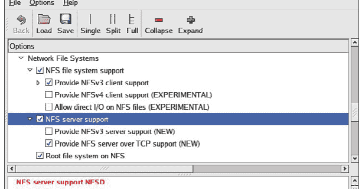

图 12-2 NFS 内核配置

NFS 服务器从位于开发工作站的 exports 文件获取指令。该文件通常位于 `/etc/exports`。列表 12-7 是一个简单的 exports 条目示例。

### 列表 12-7 简单的 exports 文件

```
$ /etc/exports
# /home/chris/sandbox/coyote-target \ *(rw,sync,no_root_squash,no_all_squash,no_subtree_check)
# /home/chris/sandbox/pdna-target \ *(rw,sync,no_root_squash,no_all_squash,no_subtree_check)
# /home/chris/workspace \ *(rw,sync,no_root_squash,no_all_squash,no_subtree_check)
```

这些条目允许客户端远程挂载所示的三个目录之一。目录规范后的属性指示 NFS 服务器允许来自任何 IP 地址 (*) 的连接，并使用给定的属性（读/写且带 `no_root_squash`）挂载相应的目录。后一个属性允许具有 root 权限的客户端在给目录上使用这些权限。在处理嵌入式系统时通常需要它，因为它们通常拥有 root 账户。

`no_all_squash` 属性确保传入的 NFS 请求的 uid 和 gid 得到尊重，而不是映射到默认的匿名账户。`no_subtree_check` 属性禁用了服务器上的子树检查。在某些情况下这可以提高性能和可靠性。详情请参考你的 NFS 服务器文档和描述 exports 文件的 man 页面。

你可以直接从工作站测试 NFS 配置。假设你已经启用了 NFS 服务（这需要 NFS 服务器和客户端组件都启用），你可以像挂载任何其他文件系统一样挂载本地导出：

```
# mount -t nfs localhost:/home/chris/workspace/mnt/remote
```

如果此命令执行成功且 .../workspace 中的文件在 `/mnt/remote` 上可用，则说明你的 NFS 服务器配置正常。


## 12.3.4 目标 NFS 根挂载

通过 NFS 根挂载监控你的目标并不困难，而且正如其他地方提到的，这是一种非常有用的开发配置。然而，在工作之前，某些细节必须正确。所需的步骤如下：
1. 配置 NFS 服务器，并为你的架构导出适当的目标文件系统。
2. 配置目标内核，启用 NFS 客户端服务和 NFS 根文件系统。
3. 启用目标以太网接口的内核级自动配置。
4. 使用内核命令行或静态内核配置选项提供你的目标以太网 IP 配置。
5. 提供启用了 NFS 的内核命令行。

## 12.3 托管目标

我们在解释 NFS 服务器配置时，已经在图 12-2 中介绍了内核配置。你必须确保你的目标内核配置启用了 NFS 客户端服务，特别是你必须启用 Root file system on NFS 选项。具体来说，确保你的内核具有 `CONFIG_FS=y` 和 `CONFIG_ROOT_NFS=y`。如果你打算通过 NFS 根挂载启动，显然你无法配置 NFS。内核级自动配置是在内核配置中 Networking 选项卡下的 TCP/IP 配置选项。启用目标上的 `CONFIG_PNP` 时，将看到之前提到的 BOOTP 或 DHCP 等若干选项。图 12-3 展示了内核配置。

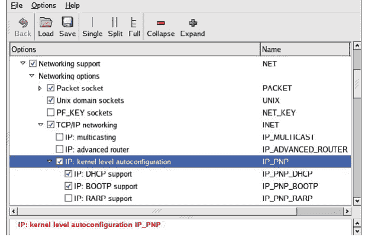

图 12-3 内核级自动配置

当你的服务器和内核配置好后，你需要使用之前描述的方法之一提供目标以太网配置。如果你的引导加载程序支持内核命令行，那是最简单的方法。支持 NFS 根挂载的内核命令行可能如下：

```
console=ttyS0,115200 root=/dev/nfs nfsroot=192.168.1.9:/home/chris/sandbox-target
```

## 12.3.5 U-Boot NFS 根挂载示例

U-Boot 是支持可配置内核命令行的引导加载程序示例。使用 U-Boot 的非易失性环境，可以将内核命令行存储在专门命名的参数中。在 U-Boot 中启用 NFS 命令行：

```
setenv bootargs console=ttyS0,115200 root=/dev/nfs nfsroot=192.168.1.9:/home/chris/sandbox/pdna-target
```

当我们启动目标时，会看到以下输出。列表 12-9 显示了其内容：

# 列表 12-9 NFS 根挂载输出

```
Sending DHCP requests ... OK
IP-Config: Got answer from 192.168.1.9
IP-Config: Complete:
  device=eth0, addr=192.168.1.68, mask=255.255.255.0,
  gw=255.255.255.255, host=192.168.1.68, domain=(none),
  bootserver=192.168.1.9, rootpath=/home/chris/sandbox/pdna-target)

Looking up port 10000/2 on 192.168.1.9
Looking up port 10005/1 on 192.168.1.9
VFS: Mounted root (nfs filesystem).
BusyBox v0.60.5 (2005.06.07-07:03+0000) Built-in shell (msh)
Enter 'help' for a list of built-in commands.
```

VFS（虚拟文件系统）消息宣布它已挂载了 NFS 根文件系统。在 NFS 根文件系统挂载后，初始化将按照第 5 章“内核初始化”中的描述完成。

也可以通过静态方式为内核指定 IP 设置，而不是让内核从 DHCP 或 BOOTP 服务器获取 IP 设置。可以使用内核命令行直接传递 IP 设置。在这种情况下，内核命令可能看起来如下：

```bash
console=ttyS0,115200 \
ip=192.168.1.68:192.168.1.9:255.255.255.0:pdna:eth0:off \
root=/dev/nfs rw nfs=192.168.1.9/home/chris/pdna-target
```

## 12.4 总结

本章为构建和配置嵌入式开发工作环境提供了背景知识。介绍了几个关键服务器，并提供了有关如何安装和配置它们的信息。最后，我们通过查看嵌入式开发者可以使用的最强大的工具之一：NFS 服务器，对本章进行了总结。

- 开发环境的许多功能极大地提高了嵌入式交叉开发的效率。其中大部分功能属于工具和实用程序类。我们将在下一章详细介绍这方面，在其中我们将描述开发工具。
- 配置良好的开发主机是嵌入式开发者的宝贵资产。
- 用于交叉开发的工具链必须正确配置，以匹配你系统的目标 Linux 环境。
- 你的开发主机必须安装目标组件，以便你的工具链和二进制实用程序可以引用这些组件。这些组件包括目标头文件、库、目标二进制文件及其相关的配置文件。简而言之，你需要组装或获取一个嵌入式 Linux 发行版。
- 配置 TFTP、DHCP 和 NFS 等目标服务器将极大提高你作为嵌入式 Linux 开发者的效率。本章介绍了每个配置示例。

### 12.4.1 扩展阅读建议

GCC 在线文档

http://gcc.gnu.org/onlinedocs/

构建和测试 gcc/glibc 交叉工具链

http://kegel.com/crosstool/

“TFTP Protocol, Version 2”

RFC 1350

www.ietf.org/rfc/rfc1350.txt?number=1350

“Bootstrap Protocol (BOOTP)”

RFC 951

www.ietf.org/rfc/rfc0951.txt?number=951

“Dynamic Host Configuration Protocol”

RFC 2131

www.ietf.org/rfc/rfc2131.txt?number=2131

# 第 13 章

# 开发工具

### 本章内容

- 13.1 GNU 调试器 (GDB) 326
- 13.2 数据显示调试器 (DD) 333
- 13.3 cbrowser/cscope 335
- 13.4 跟踪与分析工具 337
- 13.5 二进制实用程序 355
- 13.6 杂项二进制实用程序 361
- 13.7 总结 364

一个典型的嵌入式 Linux 开发环境包含许多有用工具。某些工具非常复杂，需要大量的熟练才能精通。另一些工具非常简单，几乎被嵌入式系统的开发者忽略了。某些工具可能针对特定环境需要定制。许多工具“开箱即用”，无需费费精力即可为开发者提供有用信息。本章介绍了嵌入式 Linux 工程师可以使用的最重要（且经常被忽视）的工具概览。

无法对本章介绍的工具和实用程序提供详尽细节，那本身就需要写一整本书！与其提供完整的参考，我们的目标是介绍每个工具的基本用法。我们鼓励你对这些及其他重要的开发工具进行进一步学习。每个工具的 man 手页（或其他文档）都是一个很好的起点。

我们首先介绍了 GNU 调试器 (GDB)，然后简要介绍了数据显示调试器（Data Display Debugger），它是 GDB 的图形化前端。接下来，我们介绍了一系列旨在让开发者查看程序和整个系统行为的实用程序。这些工具包括 `trace`、`ltrace`、`top` 和 `ps`，它们通常被缺乏经验的 Linux 开发者所忽略。然后，我们介绍了一些崩溃转储（crash dump）和内存分析工具。本章通过介绍一些更有实用的二进制实用程序作为结束。

## 13.1 GNU 调试器 (GDB)

如果你花费大量时间开发 Linux 应用程序，你无疑会花费数小时来了解 GNU 调试器。`GDB` 可疑是开发者工具箱中最重要的工具。它有悠久的历史，其功能已经发展到支持针对各种架构和微处理器的低级硬件特定调试支持。需要注意的是，`GDB` 手册几乎和这本书一样大。我们的意图是介绍 `GDB` 以让你入门。我们鼓励你使用上一节中引用的手册。

由于这是一本关于嵌入式 Linux 开发的书，我们使用了一个被编译为交叉调试器的 `GDB` 版本。也就是说，调试器本身运行在你的开发主机上，但它只理解其目标架构架构的二进制可执行文件。需要注意的是，`GDB` 手册几乎和这本书一样大。我们的意图是介绍 `GDB` 以让你入门。我们鼓励你使用上一节中引用的手册。

### 13.1.1 调试核心转储 (Core Dump)

使用 `GDB` 的原因之一是评估核心转储（core dump）。当应用程序产生段错误（例如，向其范围外的内存地址写入）时，Linux 会终止进程并生成核心转储。核心转储是段错误发生时运行进程的快照。

在二进制文件中启用调试符号会有帮助。在构建期间启用调试符号 (`-g`)，`GDB` 产生的输出会有用得多。然而，即使二进制文件是在没有启用调试符号的情况下编译的，仍然确定导致段错误的事件序列。在这种情况下，你必须手动将虚拟地址关联到程序内部的位置。


要启用核心转储的生成，请在初始化脚本中找到以下行：

```bash
ulimit -c unlimited
```

此 `BASH` 内置命令用于设置核心转储的大小限制。在前面的实例中，大小被设置为无限制。你可以从 shell 中发布此命令来显示当前设置：

```bash
$ ulimit
unlimited
```

## 13.1 GNU 调试器 (GDB) 329

```
LISTING 13-1 续
Reading symbols from /opt/montavista/pro/.../libc.so.6...done.
Loaded symbols for /opt/montavista/pro/.../libc.so.6
Reading symbols from /opt/montavista/pro/.../ld-linux.so.3...done.
Loaded symbols for /opt/montavista/pro/.../ld-linux.so.3
#0 0x00012ac4 in ClearBlock (RealBigBlockPtr=0x0, l=100000000) at led.c:43
43
	*ptr = 0;

(gdb) 1
38
39	static int ClearBlock(char * BlockPtr, int len)
40	{
41		char *ptr;
42		for (ptr = BlockPtr; (ptr - BlockPtr) < 1; ptr++)
43		*ptr = 0;
44		return 0;
45	}
46	static int InitBlock(char * ptr, int n)
47	{
(gdb) p ptr
$1 = 0x0
(gdb)
```

### 13.1.2 调用 GDB

列表 13-1 的第一行显示了如何从命令行调用 `GDB`。由于我们正在进行交叉调试，因此我们需要一个为我们的主机系统和目标系统编译的交叉版本 `GDB`。我们按照所示方法调用交叉版本的 `cross-gdb`，并向 `xscale_be-gdb` 传递二进制文件的名称，随后是核心文件的名称——在本例中，简单为 `core`。在 `GDB` 打印了几行描述其配置和其他信息的 banner 后，它显示了终止的原因：信号 11，这表示段错误（segmentation fault）。

当 `GDB` 加载二进制文件、其依赖的库以及核心文件时，会有几行输出。`GDB` 启动时打印的最后一行以 `#0` 字符串开头，表示栈帧（在虚拟地址 `0x00012ac4` 处调用的函数 `ClearBlock()` 的栈帧）。

> 信号及其关联的数字定义在 Linux 内源码树的 `../arch/<arch>/include/asm/signal.h` 中。

接下来以 `43` 开头的行是来自文件 `led.c` 的错误源文件行号。从那里开始，`GDB` 显示其命令提示符并等待输入。

为了提供上下文，我们输入了 `gdb list` 命令，使用了其缩写形式 `1`。`GDB` 可以识别没有歧义的命令缩写。在这里程序错误开始显现。根据 `GDB` 对核心储（core dump）的分析，错误位置如下：

```
43      *ptr = 0;
```

接下来，我们对 `ptr` 变量使用 `gdb print` 命令，缩写为 `p`。如你在列表 13-1 中所示，指针 `ptr` 的值为 `0`。因此我们得出结论，段错误的原因是经典的空指针解引用（null pointer dereference），这是许多编程语言中的常见错误。从这里开始，我们可以使用 `backtrack` 查看通往此错误的调用链，这可能会带我们回到错误的源头。列表 13-2 显示了这些结果。

### 列表 13-2 Backtrace 命令

```
(gdb) bt
#0 00012ac4 in ClearBlock(RealBlockPtr=0x0, l=100000000) at led.c:43
#1 00012b0d in InitBlock(ptr=0x0, n=100000000) at led.c:48
#2 00012b50 in ErrorInHandler(wp=0x325c8, urlPrefix=0x2f68 "/Error",
WebDir=0x2f660 "", arg=0, url=0x34f30 "/Error", path=0x346d8 "/Error",
query=0x32d18 " " at led.c:61
#3 000126cc in webHandlerRequestHandler(wp=0x325c8) at handler.c:273
#4 00012f58 in webGetInput(wp=0x325c8, ptext=0xbefffc40,
pbytes=0xbefffc33) at webs.c:664
#5 00011ed0 in webReadEvent(wp=0x325c8) at webs.c:362
#6 000123d4 in webSocketEvent(sid=1, mask=2, ipv=206820) at webs.c:319
#7 00019740 in socketEvent(sp=0x34fc8) at sock.c:903
#8 00019598 in socketProcess(sid=1) at sock.c:845
#9 00012be8 in main(argc=1, argv=0xbefffe14) at main.c:99
(gdb)
```

回溯（traceback）显示了一直追溯到 `main()`（用户程序的起点）的调用链。每个回溯行前面都有栈帧编号。你可以使用 `gdb frame` 命令切换任何给定的栈帧。列表 13-3 显示了这些结果。

### 列表 13-3 在 GDB 中移动栈帧

```
(gdb) frame 2
#2 00012b50 in ErrorHandler (wp=0x325c8, urlPrefix=0x2f648 "Error/",
webDir=0x2f660 "", arg=0x34f30 "Error/", path=0x34d68 "Error",
    query=0x321d8 "") at led.c:61
61
    return InitBlock(p, size);
(gdb) 1
56
57
    size = 100000000;
58
    p = NULL;
59
    if (p == NULL) {
60
        return -1;
61
    }
62
    ptr = 0;
63
    }
```

回溯显示了一直追溯到 `main()`（用户程序的起点）的调用链。每个回溯行前面都有栈帧编号。你可以使用 `gdb frame` 命令切换任何给定的栈帧。列表 13-3 是此操作示例。在这里我们切换到帧 2 并显示该帧的源代码。在之前的示例中，以 `(gdb)` 开头的行是我们正在使用的命令，其他行是 `GDB` 的输出。

# 334 第 13 章 开发工具

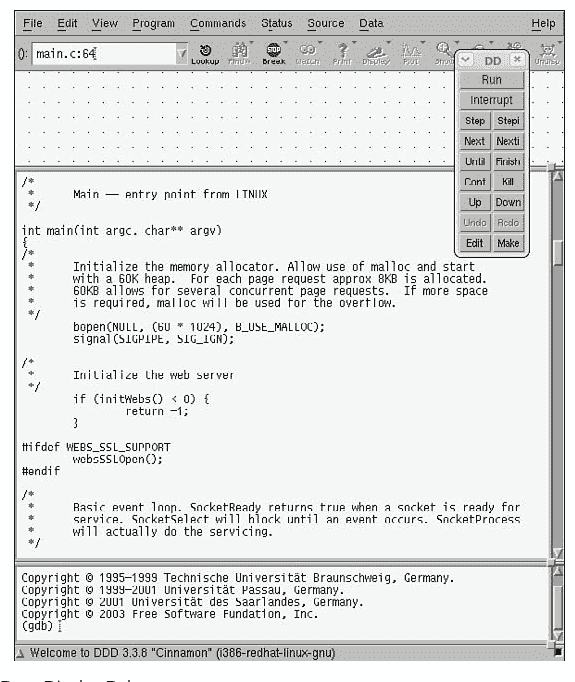

```c
main.c:64

/*
 * Main - 来自 ITINX 的入口点
 */
int main(int argc, char **argv) {
    /* 初始化内存分配器。允许使用 malloc 并从
     * 堆开始。对于每个页面请求，分配约 8KB，
     * 6KB 允许允许几个并发页面请求。如果需要更多
     * 空间，将使用 malloc 进行溢出。

    signal(SIGBUS, SIG_GDB);

    /*
     * 初始化 Web 服务器
     */
    if (initWeb() < 0) {
        return -1;
    }
    #ifdef MDB_WSS_SUPPORT
    initWebSslOpen();
    #endif
}

/*
 * 接收事件。当 socket 准备好写入
 * 数据时，SocketBody 返回。SocketSelect 将阻塞直到
 * 事件发生。SocketProcess 将实际
 * 执行服务。
 */
```

Copyright © 1995-1999 Technische Universität Braunschweig, Germany.

Copyright © 1999-2001 Universität Passau, Germany.

Copyright © 2001 Universität saarlandes, Germany.

Copyright © 2003 Free Software Foundation, Inc.

(gdb)

**图 13-1：数据显示调试器 (DDD)**

`DDD` 的调用方式如下：

```bash
$ ddd --debugger xscale_be_gdb webs
```


如果不使用 `--debugger` 标志，DDD 将尝试在你的开发宿主机上调用 GDB。如果你计划在目标系统上调试应用程序，这并不是你想要的。DDD 命令行的第二个参数是你要将要调试的程序。更多细节请参阅 DDD 手动页。

使用图 13-1 所示的命令行工具，你可以单步执行程序。你可以通过图形化界面设置断点，也可以通过 DDD 屏幕底部的 GDB 控制台窗口设置断点。对于目标调试，你必须像我们在列表 13-4 中所做的那样，使用 `target` 命令将你的调试器连接到目标系统。该命令在 DDD 主界面发出。

当你连接到目标时，可以执行类似于刚才所示的命令来隔离程序故障。图 13-2 显示了此调试会话后期的 DDD 显示。

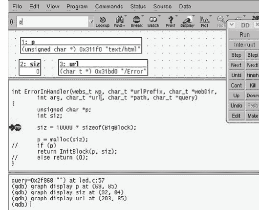

**图 13-2：DDD 中的调试会话**

注意在图 13-2 中，我们启动了一些重要变量的显示，这可以帮助我们找到段错误的原因。当我们使用图中所示的命令行工具单步程序时，可以监控这些变量。DDD 是 GDB 的一个强大前端。它相对容易使用，并被许多开发宿主机支持。本章的最后一部分提供了 GNU DDD 文档的链接。

需要注意的是，随着时间的推移，Eclipse 已经超越（此处是双关语！）成为了首选调试器。书中没有详细介绍 Eclipse。如果你想获得更多信息，在本章末尾包含了关于 Eclipse 的引用。

## 13.3 cbrowser/cscope

我们引入 cbrowser 是因为这个方便工具的支持已经进入 Linux 内核树。cbrowser 是一个简单的源码浏览工具，可以让你根据符号轻松在大型源码树中进行导航。某些发行版（如 Ubuntu）在它们的仓库中包含 cbrowser，但其他（如最近的 Fedora）则没有。在 Ubuntu 上，只需输入：

```bash
$ sudo apt-get install cbrowser
```

Linux 内核 Makefile 支持构建 cbrowser 使用的数据库。这里是最近 Linux 内核快照中的示例调用：

```bash
$ make ARCH=powerpc CROSS_COMPILE=ppc_82xx- cscope
```

这产生了 cbrowser 使用的 cscope 数据库。cscope 是引擎；cbrowser 是图形用户界面。如果你愿意，可以单独使用 cscope。它是命令行驱动且功能强大的，但在这种点点点击时代，导航大型源码树可能没有那么快速或方便。如果 `vi` 仍然是你最喜欢的编辑器，cscope 可能正是为你量身定制的！

要调用 cbrowser，进入包含 cscope 数据库的目录，直接输入不带任何参数的 `cbrowser` 命令。图 13-3 显示了一个示例会话。你可以在最后部分列出的引用中了解更多关于这些有用工具的信息。

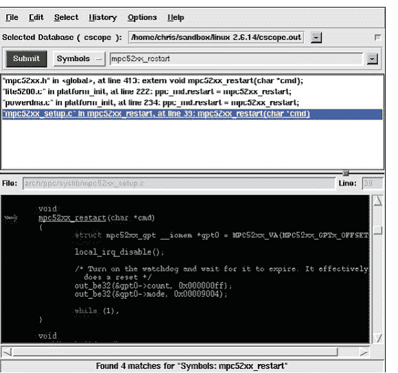

**图 13-3：运行 cbrowser**

## 13.4 跟踪与分析工具

许多实用的工具可以提供系统的各种视图。某些工具提供高层视角。你可以发现系统上运行着哪些进程，以及哪些进程消耗了最多的 CPU 带宽。其他工具提供详细分析，例如内存是在哪里分配的，甚至更多，是在哪里泄漏的。接下来的章节介绍了该类别中最重要的工具和实用程序。我们仅对这些工具进行了简要介绍；在适当的地方提供了引用。

### 13.4.1 strace

`strace` 是一个几乎所有 Linux 发行版都非常有用的跟踪工具。`strace` 捕获并显示程序执行的每一个系统调用信息。`strace` 特别方便，因为它可以处理没有源码的程序。在准备本章示例时，我们决定使用带有符号的早期版本 `strace`。通过跟踪系统调用，可以学到很多东西。

**列表 13-5：strace 输出**

```text
root@coyote$: strace ./webs
execve('./webs', ["webs"], ...) = 0
uname({"sys="Linux", "node="coyote", ...}) = 0
gettimeofday({3301, 549664}, NULL) = 0
getpid(1) = 156
open("/etc/resolv.conf", O_RDONLY) = 3
stat64(0x3, 0xfffd8) = 0
map(NULL, 4096, PROT_READ|PROT_WRITE, MAP_PRIVATE|MAP_ANMOUS, -1, 0) = 0x0031700
read(3, "#\nresolv.conf This file is th...", 4096) = 83
read(3, "*", 4096) = 0
close(3) = 0
<<< 第 30-81 行 >>>
socket(PF_INET, SOCK_DGRAM, IPPROTO_IP) = 3
connect(3, {sa_family=AF_INET, sin_port=htons(53),
sin_addr=inet_addr("0.0.0.0")), 28) = 0
send(3, "\x27s\x01\x00\x00\x00\x6lcoyote\x1\x0\x1*", 24, 0) = 24
gettimeofday({3301, 549664}, NULL) = 0
poll({fd3, events+POLLIN,POLLERR}, 1, 5000) = 1
ioctl(3, 0x4004667, 0xff7fe68) = 0
recvfrom(3, 0xffffff0, 1024, 0, 0xff7fe68, 0xff7fe6ac) = -1
ECONNREFUSED (Connection refused)
close(3) = 0
socket(PF_INET, SOCK_DGRAM, IPPROTO_IP) = 3
```

## 13.4 追踪与性能分析工具

### 列表 13-5 继续

```
92 send(3, "267s\1\0\1\0\0\0\0\6coyote\1\0\1\0\1", 24, 0) = 24
93 gettimeofday({3301, 552839}, NULL) = 0
94 poll({fd3, events=POLLIN, revents=POLLERR}, 1, 5000) = 1
95 ioctl(3, 0x400467f, 0x7ffe6a8) = 0
96 recvfrom(3, 0x7ffe7ff0, 1024, 0x7ffe668, 0x7ffe6ac) = -1
    ECONREFUSED (Connection refused)
97 close(3) = 0
98 exit(-1) = ?
99 root@coyote:/home/websdemo#
```

输出由 `strace` 生成的内容添加了行号，以便此列表更具可读性。程序在第 01 行通过 `strace` 启动。在最简单的形式下，只需将 `strace` 命令直接放在你想要检查的程序前面即可。列表 13-5 中的输出就是这样产生的。

此追踪的每一行都代表 `websdemo` 应用向内核发送的一个离散内核调用。我们不需要分析并理解追踪的每一行，尽管这样做是非常直观的。我们正在寻找可能帮助定位程序为何无法运行的异常情况。在前几行中，程序将执行的环境正在被准备就绪。我们看到好几次对 `/etc/ld.so.*` 的 `open()` 调用，这是 Linux 动态链接器-加载器 `ld.so` 正在工作。事实上，第 06 行显示了该链接器缓存本应该通过运行 `ldconfig` 来生成。（链接器缓存可以显著加快对共享库引用的查找。）这随后通过在目标机器上运行 `ldconfig` 解决了。

一直到第 19 行是更多的后续管理工作，主要由加载器和 `libc` 初始化完成。注意第 24 行，程序寻找一个配置文件但没有找到。当我们运行软件时，这可能是一个重要问题。从第 24 行开始，程序开始设置并配置它所需的适当网络资源。第 24 到 29 行打开并读取了一个 Linux 系统文件，其中包含 DNS 服务解析主机名的指令。本地网络配置持续到第 81 行。这些活动大部分由为程序本身构建网络基础设施所需的网络设置和配置组成。为了简洁，列表的这部分已被移除。

> 请参 `man ldconfig` 以获取有关为目标系统创建链接器缓存的详情。

特别注意从第 82 行开始的网络活动。在这里，程序尝试对全 0 IP 地址建立 TCP/IP 连接。为了方便起见，这里重复了第 82 行：

```
socket(PF_INET, SOCK_DGRAM, IPPRPROTO_IP) = 3
```


关于列表 13-5 有几个值得注意的点。我们可能不知道每个系统调用的所有细节，但我们可以对正在发生的情况大致了解。`socket()` 系统调用类似于文件系统的 `open()` 调用。返回值（在此例中由符号 `=` 表示）代表一个 Linux 文件描述符。我们知道可以将第 82 行开始的活动与 89 行的 `close()` 系统调用关联文件描述符 3。

我们对这组相关的系统调用感兴趣，因为我们在第 88 行看到了一条错误信息：`Connection refused`（连接被拒绝）。此时，我们仍然不知道程序为什么不运行，但这看起来是不正常的。让我们调查一下。第 82 行，系统调用 `socket()` 建立了 IP 通信的端点。第 83 行很奇怪，因为它尝试向包含全 0 IP 地址的远程端点 (socket) 建立连接。我们不需要网络专家也能怀疑这可能是个问题⁴ 第 83 行提供了另一个重要线索：端口号被设置为 53。在网上快速搜索 TCP/IP 端口号发现，端口 53 是域名服务 (DNS)。

第 84 行证明了另一个线索。我们的板卡主机名为 `coyote`。这可以在列表 13-5 第 01 行的命令提示符中看到。似乎这项活动是对我们板卡主机名的进行 DNS 查找，但该查找失败了。作为一项实验，我们在系统的 `/etc/hosts`⁵ 中添加条目，将本地定义的主机名与板卡分配的 IP 地址关联如下：

```
coyote  192.168.1.21      # 分配的 IP 地址
```

好了。我们的程序开始正常运行。尽管我们可能不确切知道为什么会导致程序失败（TCP/IP 网络专家），但我们的追踪输出引导我们发现了名称的 DNS 查找失败这一事实。当我们纠正了这一点，程序就顺利地启动并开始提供网页。总结一下，这是一个我们没有源代码可以引用的程序，而且它的二进制镜像中没有编译好的符号。使用 `trace`，我们能够确定程序失败的原因并实施解决方案。

⁴ 有时全 0 地址在这种语境下是合适的。然而，由于我们正在调查程序为何异常终止，所以我们应该考虑这一点。

⁵ 请参阅该系统的 `man hosts`。

### 13.4.2 strace 变体

`strace` 工具具有许多选项。最有用的选项之一是允许你跟踪特定的系统调用。例如，如果你只想查看网络相关的系统调用，可以使用以下命令：

```bash
$ strace -e trace=network
```

这会产生仅包含网络系统调用的追踪。你还可以使用 `-f` 选项来跟踪派生的子进程，这对于分析多进程程序非常有用：

```bash
$ strace -f ./my_program
```

此外，使用 `-o` 选项可以将输出重定向到文件，以便后续进行分析：

```bash
$ strace -o output.txt ./my_program
```

### 13.4.3 ltrace

`ltrace` 和 `strace` 之间之间密切相关。`ltrace` 工具对库调的作用与 `strace` 对系统调的作用相同。它们的调用方式也相似。你按照如下所示，将跟踪工具置于被跟踪的程序之前：

```
$ ltrace ./example
```

列表 13-7 重现了 `ltrace` 在一个执行标准 C 库函数的小示例程序上的输出。

#### 列表 13-7 示例 ltrace 输出

```
$ ltrace ./example
__start_main(0x8048594, 1, 0xffffff944, 0x80486b4, 0x80486fc <unsigned> ->)
  malloc(256)                                = 0x804a008
  getenv("HOME")                             = "/home/chris"
  strncpy(0x804a008, "/home", 5)             = 0x804a008
  fopen("foo.txt", "w")                    = 0x804a110
  printf("$HOME = %s\n", $HOME = /home/chris)
  = 20
  printf(0x804a110, "$HOME = %s\n", "/home/chris") = 20
  fclose(0x804a110)                           = 0
  remove("foo.txt")                          = 0
  free(0x804a008)                            = <void>
++ exited (status 0) +++
```

对于每个库调用，都会显示调用的名称，以及调用参数的不同部分。与 `strace` 类似，库调用的返回值也会被显示。与 `strace` 一样，该工具可以用于没有源代码的程序。

与 `strace` 类似，多种开关会影响 `ltrace` 的行为。你可以显示每个库调用时程序计数器的值，这有助于理解应用程序的流程。与 `strace` 一样，你可以使用 `-c` 来累积并报告计数和时间统计，使其成为有用且简单的分析工具。列表 13-8 显示了使用 `-c` 选项运行简单示例程序的结果。

#### 列表 13-8 使用 ltrace 进行分析

```
$ ltrace -c ./example
$HOME = /home/chris
% time seconds uses/call calls function
```


| time | seconds | uses/call | calls |
| :--- | :--- | :--- | :--- |
| 24.16 | 0.000231 | 231 | 1 `printf` |
| 16.53 | 0.000158 | 158 | 1 `fclose` |
| 16.00 | 0.000153 | 153 | 1 `fopen` |
| 13.70 | 0.000131 | 131 | 1 `malloc` |
| 10.67 | 0.000102 | 102 | 1 `remove` |
| 9.31 | 0.000089 | 89 | 1 `fprintf` |
| 3.35 | 0.000032 | 32 | 1 `getenv` |
| 3.14 | 0.000030 | 30 | 1 `free` |
| 3.14 | 0.000030 | 30 | 1 `strncpy` |
| 100.00 | 0.000956 | 9 | total |

`ltrace` 工具仅适用于已编译为使用动态链接共享库对象的程序。这通常是默认设置，除非你在编译时指定了 `-static`，否则你可以在生成的二进制文件上使用 `ltrace`。同样与 `strace` 类似，你必须使用针对你的架构编译的 `ltrace` 二进制文件。这些工具运行在目标机，而不是主机开发系统。

## 13.4.4 `ps`

除了 `strace` 和 `ltrace` 之外，嵌入式系统开发者忽视的工具没有比 `top` 和 `ps` 的。考虑到每个工具都有许多可用选项，我们可以轻松地为这些实用的系统分析工具专门写章。它们在嵌入式 Linux 发行版的你喜爱的目标机上几乎是处处可用。

这两个工具都使用了第 9 章“文件系统”中描述的 `/proc` 文件系统。如果你知道要找什么以及如何解析得到的信息，就可以从 `/proc` 文件系统中学习到它们大部分的信息。这些工具以方便的人类可读格式呈现信息。

`ps` 工具列出了机器上运行的所有进程。然而，它是非常灵活的，可以进行定制，以提供关于机器状态和运行在其上的进程的许多有用数据。例如，`ps` 可以显示每个进程的调度策略。这对于采用实时进程的系统特别有用。

在不带任何选项的情况下，`ps` 显示与调用命令的用户相同用户 ID 的所有进程，并且仅显示与发布命令的终端相关的进程。当该用户和终端产生了许多任务时，该工具非常有用。

向 `ps` 传递选项可能会令人困惑，因为 `ps` 支持多种标准（如 POSIX 与 UNIX）以及三种不同的选项样式：BSD、UNIX 和 GNU。通常，BSD 选项是单个或多个字母，不带横线。UNIX 选项是熟悉的横线-字母组合，而 GNU 使用双横线开头的长参数。参考 `man` 手页以了解 `ps` 的实现细节。一种通用调用是 `ps aux`。它显示目标上的每一个进程。

### 列表 13-9 进程

| USER | PID | %CPU | %MEM | VSZ | RSS | TTY | STAT | START | COMMAND |
| :--- | :--- | :--- | :--- | :--- | :--- | :--- | :--- | :--- | :--- |
| root | 1 | 0.0 | 0.8 | 1416 | 508 | | S | 00:00 | 0:00 | [init] |
| root | 2 | 0.0 | 0.0 | 0 | 0 | | S | 00:00 | 0:00 | [ksoft/0] |
| root | 3 | 0.0 | 0.0 | 0 | 0 | | S | 00:00 | 0:00 | [kthre/0] |
| root | 4 | 0.0 | 0.0 | 0 | 0 | | S | 00:00 | 0:00 | [events/0] |
| root | 5 | 0.0 | 0.0 | 0 | 0 | | S | 00:00 | 0:00 | [helper] |
| root | 10 | 0.0 | 0.0 | 0 | 0 | | S | 00:00 | 0:00 | [kthread] |
| root | 21 | 0.0 | 0.0 | 0 | 0 | | S | 00:00 | 0:00 | [klockd/0] |
| root | 62 | 0.0 | 0.0 | 0 | 0 | | S | 00:00 | 0:00 | [pdflush] |
| root | 63 | 0.0 | 0.0 | 0 | 0 | | S | 00:00 | 0:00 | [pdflush] |
| root | 65 | 0.0 | 0.0 | 0 | 0 | | S | 00:00 | 0:00 | [aio/0] |
| root | 36 | 0.0 | 0.0 | 0 | 0 | | S | 00:00 | 0:00 | [kapmd] |
| root | 64 | 0.0 | 0.0 | 0 | 0 | | S | 00:00 | 0:00 | [kswapd/0] |
| root | 617 | 0.0 | 0.0 | 0 | 0 | | S | 00:00 | 0:00 | [mm_block/0] |
| root | 638 | 0.0 | 0.0 | 0 | 0 | | S | 00:00 | 0:00 | [rpciod] |
| bin | 834 | 0.0 | 0.7 | 1568 | 444 | Ss | 00:00 | 0:00 | /sbin/portmap |
| root | 861 | 0.0 | 0.0 | 0 | 0 | | S | 00:00 | 0:00 | [lockd] |
| root | 868 | 0.0 | 0.9 | 1488 | 596 | Ss | 00:00 | 0:00 | /sbin/syslogd -r |
| root | 876 | 0.0 | 0.1 | 1416 | 456 | Ss | 00:00 | 0:00 | /sbin/klogd -x |
| root | 884 | 0.0 | 1.1 | 1660 | 700 | Ss | 00:00 | 0:00 | /usr/sbin/rpc.stat |
| root | 896 | 0.0 | 0.9 | 1668 | 584 | Ss | 00:00 | 0:00 | /usr/sbin/inetd |
| root | 909 | 0.0 | 2.2 | 2412 | 1372 | Ss+ | 00:00 | 0:00 | -bash |
| telnetd | 953 | 0.3 | 1.1 | 1736 | 732 | | S | 05:58 | 0:00 | in.telnetd |
| root | 954 | 0.2 | 2.1 | 2384 | 1348 | pts/0 | S | 05:58 | 0:00 | -bash |
| root | 960 | 0.0 | 1.2 | 2312 | 772 | pts/0 | R+ | 05:59 | 0:00 | ps |

虽然 `ps` 是当前系统的时间快照，而 `top` 则定期获取系统及其进程状态的快照。与 `ps` 类似，`top` 有许多命令行和配置选项。它是交互式的，可以在运行时进行重新配置，以定制显示以满足你的特定需求。`top` 屏幕的前几行显示系统信息，也每 3 秒更新一次。这包括

系统运行时间、用户数量、进程数量及其状态信息等。

列表 13-10 显示了默认配置下的 `top` 输出，这是通过在命令行执行不带参数的 `top` 命令得到的。

### 列表 13-10 默认 top 显示

| top | NI | VIRT | RES | SHR | %U | %MEM | | | |
|---|---|---|---|---|---|---|---|---|---|
| 06:23:14 | 6:23, | 2 用户, | 平均负载: 0.00, 0.00, 0.00 | | | | | | |
| 任务: | 总计24, | 运行1, | 23睡眠, | 停止, | 0僵尸 | | | | |
| CPU: | 0.00 us, | 0.3% sy, | 0.0%, 99.7% id, | 0.0% wa, | 0.0% si | | | | |
| 内存: | 已用62060k | 已用17292k, | 空闲44768k, | | | | | | |
| 交换: | 正常用, | 正常用, | 正常空, | 11840k缓存 | | | | | |
| PID 用户 | NI | VIRT | RES | SHR | %U | %MEM | 时间 | 命令 |
| 978 | root | 16 | 1924 | 952 | 780 | R | 0.3 | 1.5 | 0:01:22 | top |
| 1 | root | 16 | 1416 | 508 | S | 0.0 | 0.8 | 0:00:47 | ksoftirqd/0 |
| 2 | root | 5 | -10 | 0 | 0 | S | 0.0 | 0.0 | 0:00:25 | desched/0 |
| 3 | root | 5 | -10 | 0 | 0 | S | 0.0 | 0.0 | 0:00:00 | events/0 |
| 4 | root | 2 | -5 | 0 | 0 | S | 0.0 | 0.0 | 0:00:09 | khoper |
| 5 | root | 5 | -10 | 0 | 0 | S | 0.0 | 0.0 | 0:00:00 | kthread |
| 10 | root | 18 | -5 | 0 | 0 | S | 0.0 | 0.0 | 0:00:00 | kbblock/0 |
| 21 | root | 20 | -5 | 0 | 0 | S | 0.0 | 0.0 | 0:00:00 | pdflush |
| 62 | root | 20 | 0 | 0 | 0 | S | 0.0 | 0.0 | 0:00:00 | pdflush |
| 63 | root | 15 | 0 | 0 | 0 | S | 0.0 | 0.0 | 0 | pdflush |
| 65 | root | 19 | -5 | 0 | 0 | S | 0.0 | 0.0 | 0:00:00 | aio/0 |
| 36 | root | 25 | 0 | 0 | 0 | S | 0.0 | 0.0 | 0:00:00 | kapmd |
| 64 | root | 25 | 0 | 0 | 0 | S | 0.0 | 0.0 | 0:00:00 | kswapd |
| 617 | root | 25 | 0 | 0 | 0 | S | 0.0 | 0.0 | 0:00:00 | mdbtlock |
| 638 | root | 15 | 0 | 0 | 0 | S | 0.0 | 0.0 | 0:00:34 | rpclid |
| 834 | bin | 15 | 0 | 1568 | 344 | 364 | S | 0.0 | 0.7 | 0:00:00 | portmap |
| 861 | root | 20 | 0 | 0 | 0 | S | 0.0 | 0.0 | 0:00:00 | lock |
| 868 | root | 16 | 0 | 1488 | 596 | 504 | S | 0.0 | 1.0 | 0:00:11 | syslog |
| 876 | root | 19 | 0 | 1416 | 456 | 396 | S | 0.0 | 0.7 | 0:00:00 | klogd |
| 884 | root | 18 | 0 | 1660 | 700 | 612 | S | 0.0 | 1.1 | 0:00:02 | rpc.stat |
| 896 | root | 16 | 0 | 1668 | 584 | 504 | S | 0.0 | 0.9 | 0:00:00 | inetd |
| 909 | root | 15 | 0 | 2412 | 1372 | 1092 | S | 0.0 | 2.2 | 0:00:34 | bash |
| 953 | telnetd | 16 | 0 | 1736 | 736 | 616 | S | 0.0 | 1.2 | 0:00:27 | innetd |
| 954 | root | 15 | 0 | 2384 | 1348 | 1096 | S | 0.0 | 2.2 | 0:00:16 | bash |

列表 13-10 中的默认列包括 PID、用户、进程优先级（nice 值）、进程使用的虚拟内存、驻留内存、共享内存量，以及与前述相同的其他字段。这仅是对这些工具的简要介绍。建议你通过 `top` 的 `man` 页来探索它们的强大功能。

## 13.4 `mtrace`

`mtr` 是一个简单的工具，用于分析和报告应用程序中的 `malloc()`、`realloc()` 和 `free()` 调用。它易于使用，并可能帮助发现应用程序中的问题。与本章描述的其他工具相比，`mtr` 必须针对你的架构进行配置和编译。`mtr` 是一个安装在目标机上的 malloc 替换库。你的嵌入式 Linux 发行版应该包含 trace 包。为了演示这个工具，我们创建了一个在链表中创建动态数据的简单程序。每个列表项都是动态生成的并放置在列表中。列表 13-11 显示了该链表。

### 列表 13-11 链表

```c
```


```c
struct blist_s {

    struct blist_s *next;

    char *data_item;

    int item_size;

    int index;

};
```

每个列表项通过 `malloc()` 动态创建，并随后放置在列表末尾：

```c
struct blist_s *p = malloc(sizeof(struct blist_s));
```

列表中的每个变长数据项也是动态生成的，在放置在列表末尾之前添加到列表中。通过这种方式，每个列表项通过两次 `malloc()` 调用创建：一次用于 `struct blist_s` 列表项，一次用于变长数据项。我们在列表中生成了10,000条变长数据记录，导致了20,000次 `malloc()` 调用。要使用 `mtrace`，必须满足以下三个条件：

- 源文件中包含头文件 `mcheck.h`。
- 应用程序必须调用 `trace()` 来安装处理器。
- 环境变量 `MALLOC_TRACE` 必须指定写入 trace 数据的路径。

当这些条件满足时，对被跟踪函数的每次调用都会在 `MALLOC_TRACE` 定义的 trace 文件生成一行。trace 数据如下：

```
@ ./mt_ex:[0x80486ec] +0x80a5f8 0x10
```

符号表示 trace 行包含地址或函数名。程序正在执行方括号中的地址 `0x80486ec`。通过使用二进制工具或调试器，我们可以轻松地将此地址与函数关联。加号 `+` 表示内存分配调用。`free()` 调用将由减号 `-` 表示。下一个字段指示被分配或释放的内存位置的虚拟地址。最后一个字段是大小，包含在每次内存定位调用中。这种格式并不用户友好。因此，`mtr` 工具包含一个分析原始 trace 数据并报告任何不一致之处的工具。该分析工具是 `mtrace` 包提供的 Perl 脚本。在最简单的情况下，该 Perl 脚本打印一条显示“无内存泄漏”的消息。列表 13-12 显示了检测到内存泄漏的情况。

# 列表 13-12 mtrace 错误报告

```bash
$ mtrace ./mt_ex mtrace.log
```

```
未释放内存:
```

| 地址 | 大小 | 调用者 |
|---|---|---|
| 0x0804aa70 | 0xa0 | /home/chris/temp/mt_ex.c:64 |
| 0x0804abc0 | 0x10 | /home/chris/temp/mt_ex.c:26 |
| 0x0804ac60 | 0x10 | /home/chris/temp/mt_ex.c:26 |
| 0x0804acc8 | 0xa0 | /home/chris/temp/mt_ex.c:64 |

如你所示，这个简单的工具可以帮助你在问题发生之前排除故障，并找到问题发生的时间。Perl 脚本会显示文件名和调用次数。

## 13.4 dmalloc

`dmalloc` 接在 `mtrace` 停止的地方继续。`mtrace` 是一个简单且相对非侵入的包，最适用于简单检测 `malloc/free` 不平衡。`dmalloc` 包允许你检测更广泛的内存管理错误。相比 `mtrace`，`dmalloc` 具有很侵入性。根据配置的不同，`dmalloc` 可能会让你的应用程序运行极其缓慢。如果你怀疑由于竞态条件或其他问题导致内存错误，`dmalloc` 绝对不是正确的工具。`dmalloc` 是一个非常强大的内存分析工具。它是高度可配置的，因此相当复杂。需要一些时间来学习和掌握这个工具。然而，从 QA 测试到修复 Bug，它可能成为你最喜欢的开发工具之一。

`dmalloc` 是一个调试库替换品。使用 `dmalloc` 需要满足以下条件：

- 应用程序代码必须包含 `dmalloc.h` 头文件。
- 应用程序必须链接到 `dmalloc` 库。
- `dmalloc` 库和工具必须安装在你的嵌入式目标上。
- 在目标运行应用程序之前，必须定义 `dmalloc` 库引用的某些环境变量。

虽然不是严格必要的，但你应该在应用程序中包含 `dmalloc.h`。这允许 `dmalloc` 在输出中包含文件名和行号。将你的应用程序链接到选择的 `dmalloc` 库。根据你在配置包时的选择，`dmalloc` 包可以配置为生成多个不同的库。以下示例使用了 `libdmalloc` 共享对象。将库或其软链接放在编译器可以找到的路径中。编译应用程序的命令可能如下：

```bash
$ pp_82xx-gcc -g -Wall -o mtest_ex -L../dmalloc-5.4.2/ -ldmalloc mtest_ex.c
```

## 13.4 追踪与性能分析工具

要在你的目标机器上安装 `dmalloc` 库，请将其放置在你喜喜的位置（例如 `/usr/local/lib`）。你可能需要配置系统以找到该库。在我们 Power Architecture 示例系统上，我们将路径 `/usr/local/lib` 添加到 `/etc/ld.so.conf` 文件中，并调用 `ldconfig` 工具来更新库搜索缓存。

准备工作的最后一步是设置一个环境变量，`dmalloc` 库使用它来确定要启用的调试级别。该环境变量包含一个调试掩码，它将多个功能合并到一个方便的变量中。你的变量可能像这样：

```
DMALLOC_OPTIONS=debug=0x4f4ed03,inter=100,log=dmalloc.log
```

在这里，`debug` 是调试级别掩码，`inter` 设置 `dmalloc` 库对自身进行大量检查的间隔，`dmalloc` 库会将输出写入由 `log` 变量指定的文件。

`dmalloc` 包包含一个实用程序，可以根据传递给它的标志生成 `DMALLOC_OPTIONS` 环境变量。`dmalloc` 包中的文档对此进行了详细阐述，因此我们不再重复。上所示的示例是使用以下 `dmalloc` 调用生成的：

```
$ dmalloc -p check-fence -1 dmalloc.log -i 100 high
```

当完成这些步骤后，你应该能够配合 `dmalloc` 库运行你的应用程序。

`dmalloc` 会产生详细的输出日志。列表 13-13 显示了一个故意产生某些内存泄漏的示例程序的 `dmalloc` 日志输出。

### 列表 13-13 dmalloc 日志输出

```
2592: 4002: dmalloc version '5.4.2' from 'http://dmalloc.com/'
2592: 4002: flags = 0x4fe5e3, logfile 'dmalloc.log'
2592: 4002: interval = 100, addr = 0, seen # 0, limit = 0
2592: 4002: starting time = 2592
2592: 4002: process id = 442
2592: 4002: Dumping Chunk Statistics:
2592: 4002: basic-block 4096 bytes, alignment 8 bytes
2592: 4002: heap address range: 0x03015000 to 0x0304f000, 237568 bytes
2592: 4002:
2592: 4002: user blocks: 18 blocks, 73652 bytes (38%)
2592: 4002:
2592: 4002: admin blocks: 29 blocks, 117884 bytes (61%)
2592: 4002:
2592: 4002: total blocks: 47 blocks, 192512 bytes
2592: 4002: heap checked 41
```

### 列表 13-13 续


```
2592: 4002: alloc calls: malloc 2003, calloc 0, realloc 0, free 1999
2592: 4002: alloc calls: recall 0, malign 0, valloc 0
2592: 4002: alloc calls: new, delete 0
2592: 4002: current memory: 52 bytes (4 pnts)
2592: 4002: total memory allocated: 27546 bytes (2003 pnts)
2592: 4002: max in use one time: 27546 bytes (2003 pnts)
2592: 4002: max allocated with 1 call: 376 bytes
2592: 4002: max unused memory space: 37542 bytes (57%)
2592: 4002: top 10 allocations:
2592: 4002: total-size in-use count source
2592: 4002: 16000 1000 32 mtest_ex.c:36
2592: 4002: 10890 1000 20 mtest_ex.c:74
2592: 4002: 256 1 0 mtest_ex.c:154
2592: 4002: 27146 200 52 Total of 3
2592: 4002: Dumping Not-Freed Pointers Changed Since Start:
2592: 4002: not freed: '0x3002048s|si' (10 bytes) from 'mtest_ex.c:74'
2592: 4002: not freed: '0x3002058s|si' (16 bytes) from 'mtest_ex.c:74'
2592: 4002: not freed: '0x3002058s|si' (16 bytes) from 'mtest_ex.c'
2592: 4002: not freed: '0x3002068s|si' (10 bytes) from 'mtest_ex.c'
2592: 4002: total-size in-use count
2592: 4002: 16000 1000 32 mtest_ex.c:36
2592: 4002: 10890 1000 20 mtest_ex.c:74
2592: 4002: 256 1 0 mtest_ex.c:154
2592: 4002: 27146 200 52 Total of 3
2592: 4002:  time = 2592
2592: 4002:    0
```

## 13.5 二进制工具

`oops` 消息还包含任务指针和解码后的任务名称，帮助你快速确定发生 `oops` 此时正在运行哪个任务或线程。我们还能看到详细的处理器寄存器转储（dump），这可以用于提供额外的线索。再次，我们需要具备架构和编译器使用的知识才能理解寄存器值提供的线索。例如，PowerPC 架构使用 `r3` 寄存器作为 C 函数的返回值。

`oops` 消息的最后部分提供了带有符号解码的栈回溯，前提是内核中启用了符号支持。使用这些信息，我们可以构建出导致错误状况的事件序列。

在这个示例中，我们从这条 `oops` 消息中学习了大量信息。我们知道这是一个 Power Architecture 数据存储异常（Data Storage Exception），是由内存访问错误（而不是指令取内存访问）引起的。`DAR` 告诉我们产生此异常的地址是 `0x0000_0000`。我们知道是 `modprobe` 产生了错误。通过回溯和 `BIP`（下一条指令指针），我们知道它位于 `strcpy()` 的调用中，可以直接追溯到 `loop.ko` 模块中的 `loop_init()` 函数，而 `modprobe` 在发生异常时正尝试插入该模块。根据这些信息，追踪此错误指针解引的源应该是很容易的。

## 13.5 二进制工具

二进制工具（或 `binutils`）是任何工具链的关键组成部分。要构建编译器，你必须先成功构建 `binutils`。本节介绍了嵌入式开发人员需要了解的最实用工具。与本中的大多数其他工具不同，这些是交叉工具（cross-utilities），必须在你的开发主机上构建执行，同时针对你所选架构的文件操作。或者，你也可以编译或获取这些工具的版本运行在目标机上，但我们假设这些示例用的是交叉开发环境。

### 13.5.1 readelf

`readelf` 工具检查你的目标 ELF 二进制文件的组成。这对于构建针对 ROM 或 Flash 内存的镜像特别有用，因为这需要对镜像布局进行显式控制。它也是学习工具链如何构建镜像以及理解 ELF 格式的优秀工具。

例如，要显示 ELF 镜像中的符号表，使用此命令：

```
$ readelf -s <elf-image>
```

要发现并显示 ELF 镜像中的所有段（sections），使用此命令：

```
$ readelf -e <elf-image>
```

使用 `-s` 标志列出 ELF 镜像中的段头（section headers）。你可能会惊讶地发现，即使是一个简单的七行“Hello World”程序也包含了 38 个独立的段。其中一些对你来说是熟悉的，例如 `.text` 和 `.data` 段。列表 13-15 包含了我们“Hello World”示例中段的列表列表。为了简单起见，我们只列出了嵌入式开发人员可能熟悉或相关的段。

列表 13-15 readelf 段头

```
$ ppc_82xx -S hello-ex
```

有 38 个段头，从偏移量 `0x32f4` 开始：

段头（Section Headers）：

| Name | Type | Addr | Off | Size | ES | Lk | Inf |

| :--- | :--- | :--- | :--- | :--- | :--- | :--- | :--- |

| [11] .text | PROGBITS | 100002f0 0002f0 000568 | AX | 0 | 4 | |

| [13] .rodata | PROGBITS | 1000087 000878 000068 | A | 0 | 4 | |

| [15] .data | PROGBITS | 10018e0 0008e0 00000c | WA | 0 | 4 | |

| [22] .sdata | PROGBITS | 10019e0 0009e0 00001c | WA | 0 | 4 | |

| [23] .ssss | NOBITS | 10019fc 0009fc 000000 | WA | 0 | 1 | |

| [25] .bss | NOBITS | 1001a74 0009fc 00001c | WA | 0 | 4 | |

`.text` 段包含可执行的程序代码。`.rodata` 段通常包含 C 库序言使用的初始化全局数据，并可以包含来自应用程序的大型初始化数据项。`.sdata` 段对于初始化全局数据项来说较小，且仅存在于某些架构上。当内存区域的属性已知时，某些处理器架构可以使用优化的数据访问。`.sdata` 和 `.bss` 段包含程序中未初始化的数据。这些段在程序镜像中不占用空间。它们的内存空间在程序启动时由 C 库序言代码分配并初始化为 0。

我们可以转储任何段并显示其内容。给定你 C 程序中函数外部声明的这一行，我们可以检查它是如何放置在 `.rodata` 段中的：

执行指定我们要从列表 13-1 中要转储的段的 `readelf` 命令：

```
$ ppc_82xx-readelf -x 13 hello-ex .rodata:
```

段 01000078 100189e0 10004a88 10005c0 的十六进制转储（Hex dump）：

01000088 0002001 5468693 2069732....This is read-

01000089 6164d6c 207374 only data string

0100008a 696770 0000050 5468693 2069732....This is

0100008b 73747164 617141 000000 static data....

0100008c 4865c62 62f054d 62654a0 Embedded..

（此处省略部分内容）

s..

我们看到代表了 `.rodata` 段中的初始化变量，带有所有的常量字符串。

### 13.5.2 检查调试信息

`readelf` 功能之一是显示 ELF 文件中的调试信息。当编译时带有 `-g` 标志，编译器会在生成的 ELF 文件中的一系列段中生成调试信息。我们可以使用 `readelf` 显示这些段：

```
$ ppc-linux-readelf -s | grep debug
```


[28].debug_ar PROGBITS 00000000 00c30 b08 0 8

[29].debug_pubnames PROGBITS 00000000 00cf0 07a 0 1

[30].debug_info PROGBITS 00000000 0006a 079b 0 1

[31].debug_abbrev PROGBITS 00000000 0150 0207 0 1

[32].debug_line PROGBITS 00000000 017c 00354 0 1

[33].debug_frame PROGBITS 00000000 01a6 00080 0 4

[34].debug_str PROGBITS 00000000 01a0 0014d 0 1

使用带有 `--debug-dump` 选项的 `readelf`，我们可以显示这些 `.debug_*` 段的任何一个。在第 14 章“内核调试”中，你会看到这些信息是如何有用的。

调试信息可能非常大。在 Linux 内核 `vmlinux` 中显示所有调试信息会产生超过六百万行的输出。尽管看起来如此，至少熟悉调试信息会让你成为更好的嵌入式工程师。

列表 13-16 是来自小型程序的 `.debug_info` 段的内容列表。为了考虑空间，它只显示了几条记录。

# 列表 13-16 部分调试信息转储

```
$ ppc-linux-readelf --debug-dump=info -sync
```

1 `.debug_info` 段包含：

2

3 Compilation Unit @ 0:

4 Length: 109

5 Version: 2

6 Abbrev Offset: 0

7 Pointer Size: 4

8 <0>: Abbrev Number: 1 (`DW_TAG_compile_unit`)

9 `DW_AT_stmt_list` : 0

10 `DW_AT_low_pc` : 0x1000368

11 `DW_AT_high_pc` : 0x100038c

12 `DW_AT_name` :

13 `/sysdeps/dev/powerpc/powerpc32/elf/S`

14 `DW_AT_comp_dir` : `/var/tmp/build/glibc-2.3.3/csu`

15 `DW_AT_producer` : GNU AS 2.15.94

16 `DW_AT_language` : 32769 (MIPS assembler)

394 <1<5a>: Abbrev Number: 14 (`DW_TAG_subprogram`)

395 `DW_AT_sibling` : <5fa>

396 `DW_AT_external` : 1

397 `DW_AT_name` : main

398 `DW_AT_decl_file` : 1

399 `DW_AT_decl_line` : 9

400 `DW_AT_prototype` : 1

401 `DW_AT_type` : <248>

402 `DW_AT_low_pc` : 0x100004b8

403 `DW_AT_high_pc` : 0x10000570

404 `DW_AT_frame_base` : 1 byte block: 6 (`DW_OP_reg31`)

423 <2<59>: Abbrev Number: 16 (`DW_TAG_variable`)

424 `DW_AT_name` : mybuf

425 `DW_AT_decl_file` : 1

426 `DW_AT_decl_line` : 11

427 `DW_AT_type` : <600>

428 `DW_AT_location` : 1 byte block: 9 (`DW_OP_reg32`)

# 列表 13-16 继续

第一个被 `DW_TAG_compile_unit` 标识的记录是该 Power Architecture 可执行文件的第一个编译单元。这是一个名为 `start.S` 的文件，提供了程序的启动支持。下一个被 `DW_TAG_subprogram` 标识的记录是用户程序的起始，即熟悉的函数 `main()`。这条 Dwarf2 调试记录包含了对文件和行号的引用。你可以从这些信息推断出 `main()` 位于第 9 行，而 `mybuf` 位于第 11 行。ELF 文件中的其他调试记录通过 `DW_decl_file` 属性关联文件名。

### 13.5.3 objdump

`objdump` 工具与 `readelf` 工具有很大重叠。`objdump` 更有用的功能之一是其显示反汇编代码的能力。列表 13-17 提供了“Hello World”Power Architecture 版本 `.text` 段的反汇编示例。为了节省空间，我们只包含了 `main()` 程序。整个转储（包括 C 库序言和结尾）将占用大量页面。

# 列表 13-17 反汇编 objdump

```
$ PPC_82xx-objdump -S -m powerpc:common -j .text hello
```

# 列表 13-17 续

| | | | | |
| :--- | :--- | :--- | :--- | :--- |
| 100004a0: | 90 9f 00 0c | stw | r4,12(r31) |
| 100004a4: | 3d 20 10 00 | lis | r9,4096 |
| 100004a8: | 38 69 08 54 | addi | r3,99,2132 |
| 100004ac: | 4c c6 31 82 | crcl | 4*(cr11+eq) |
| 100004b0: | 48 01 05 11 | bl | 100109c |
| <bss_start+0x60> | | | | |
| 100004b4: | 38 00 00 00 | li | r0,0 |
| 100004b8: | 7c 0c 03 78 | mr | r3,0 |
| 100004bc: | 81 61 00 00 | lw | r11,0(r1) |
| 100004c0: | 80 0b 00 04 | lw | r0,4(r11) |
| 100004c4: | 7c 07 08 a3 | mtl | r0 |
| 100004c8: | 83 eb ff fc | | | r31,-4(r1) |
| 100004cc: | 7d 61 5b 78 | mr | r11,r11 |
| 100004d0: | 4e 80 20 00 | blr | | | |

简单 `main()` 例程中的大部分代码都是栈帧的创建和销毁。对 `printf()` 的实际调用由列表地址 0xc000b0 附近的分支链接 (`bl`) 指令表示。这是一个 Power Architecture（Power 架构）函数调用。由于此程序被编译为动态链接对象，在运行时我们无法获得 `printf()` 函数的地址，在运行时，它将与共享库 `printf()` 例程进行链接。如果我们将其编译为静态链接对象，我们就能看到调用 `printf()` 的符号和相应的地址。

## 13.5.4 objcopy

`objcopy` 用于格式化并（可选地）转换二进制对象文件的格式。该工具对于生成 ROM 或 Flash 驻留镜像非常有用。第 7 章引入的 U-Boot 引导加载程序利用 `objcopy` 从最终的 ELF 文件生成二进制和 s-record 输出。此示例用法说明了 `objcopy` 的功能以及其构建镜像的使用：

```
$ ppc_82xx-objcopy --gap-file=0xff -O binary u-boot u-boot.bin
```

此 `objcopy` 调用显示了如何为 Flash 内存准备镜像。输入文件——在本例中为 `u-boot`——是完整的 ELF U-Boot 镜像，包含符号和重定位信息。`objcopy` 工具仅提取包含程序代码和数据的相关部分，并将镜像放入输出文件中，此处指定为 `u-boot.bin`。

Flash 存储器在擦除状态下包含全 1。因此，用全 1 填充二进制镜像中的间隙可以提高编程效率并延长写次数有限的 Flash 存储器的寿命。这是通过对 `objcopy` 使用 `--gap-fill` 参数实现的。

这仅仅是 `objcopy` 的一个简单示例用法。该工具可以生成 s-records 并将一种格式转换为另一种格式。详细信息请参阅手册页（`man page`）。

## 13.6 杂项二进制工具

你的工具链包含若干个额外的实用工具。学习使用这些工具非常简单。你会发现这些有用的工具有许多用途。

## 13.6.1 strip

`strip` 工具可以从二进制文件中移除符号和调试信息。这在嵌入式设备上节省空间时被频繁使用。在交叉开发模型中，将剥离符号的二进制文件留在目标系统上，而将未剥离的版本留在你的开发主机上是非常方便的。使用这种方法，符号可以在你的开发主机上用于调试，同时节省目标机的空间。`strip` 有许多选项，已在手册页中进行了描述。

## 13.6.2 addr2line


当我们在列表 13-12 中突出显示 `mtrace` 时，你看到 `mtrace` 分析脚本的输出包含文件名和行号信息。`mtrace` Perl 脚本使用 `addr2line` 工具读取可执行 ELF 文件包含的调试信息，并显示与地址对应的行号。使用 `mtrace` 示例执行文件，我们可以为虚拟地址找到文件和行号：

```
$ addr2line -f -e mt_ex 0x80487c6
put_data
/home/chris/examples/mt_ex.c:64
```

注意，函数 `put_data()` 也与文件和行号一起列出。这意味着地址 `0x80487c6` 位于 `mt_ex.c` 文件的第 64 行。对于包含多个文件名的大型二进制文件（如 Linux 内核），这甚至更有用：

```
$ ppc52xx-addr2line -f -e vlinux c000d95c52xx_restart
arch/ppc/sys/52xx_setup.c:41
```

这个特定的示例强调了本章中反复提到的观点之一：这是一个特定架构的工具。你必须使用配置并编译为与目标二进制文件架构匹配的工具，该工具是二进制工具的一部分。

### 13.6.3 strings

`strings` 工具检查二进制文件中的 ASCII 数据。当可能无法源代码或调试符号时，这对于检查内存转储特别有用。你经常可以通过将字符串追溯到出错的二进制文件来发现崩溃的原因。尽管 `strings` 的选项很少，但很容易学习和使用。更多细节请参阅手册页。

### 13.6.4 ldd

虽然 `ldd` 不严格来说是一个二进制工具，但它是嵌入式开发人员另一个实用的工具。它是 C 库包的一部分，存在于每一个 Linux 发行版中。`ldd` 列出给定对象的共享库依赖项。

### 13.6.5 nm

`nm` 工具展示了对象文件中的符号。这对于许多任务非常有用。例如，在交叉编译库时，可以使用 `nm` 发现哪些符号是全局的或引用的。`nm` 工具为每个符号提供属性。在 U-Boot 镜像上运行的列表 13-18 显示了几行：

```
$ ppc_85xx-nm u-boot
...
fff23140 b base_address
fff24c98 B BootFile
fff06d64 T BootRequest
fff00118 t_warm
fff23000
```

注意这些 U-Boot 符号的链接地址。它们位于此特定板内存映射的高位。此列表仅包含几个用于讨论的符号。中间列是符号类型。大写字母表示全局符号，小写字母表示本地符号。B 表示符号位于 .bss 段。T 表示符号位于 .text 段。D 表示符号位于 .data 段。A 表示此地址是绝对的，不受额外链接阶段修改。A 符号表示 .bss 段的起始，被启动时清理 .bss 段的代码使用，正如 C 执行环境所要求的。

### 13.6.6 preload

`preload` 工具通常用于启动速度重要的系统。动态链接的 ELF 执行文件在首次加载时必须进行链接，这对于大型应用程序可能花费大量时间。`preload` 通过准备共享库及其依赖它们的对象文件来提供未解析引用的先验知识。实际上，这可以减少给定应用程序的启动时间。手册页提供了该方便工具的完整细节。

## 13.7 总结

本章检查了嵌入式 Linux 开发人员可用的一些重要工具。我们展示了如何以强大的方式使用普通工具分析系统行为。我们介绍了 binutils 中的许多工具，包括 `readelf`、`objdump`、`objcopy` 等。

- GNU 调试器 `GDB` 是一个具有许多功能的复杂且强大的调试器。我们介绍了基础知识以帮助你入门。
- GDB 的 DDD 图形前端将源代码和数据显示与 GDB 的命令行界面能力相结合。
- `browser` 是理解大型项目的有用助手。它使用 `cscope` 数据库快速查找和显示 C 源代码中的符号和其他元素。
- Linux 支持许多分析和跟踪工具。我们介绍了其中一些，包括 `strace`、`ltrace`、`top` 和 `ps`，以及内存分析器 `mtrace` 和 `dmalloc`。

### 13.7.1 扩展阅读建议

GDB: GNU 项目调试器

www.gnu.org/software/gdb/gdb.html

GDB 口袋参考

Arnold Robbins

O'Reilly Media, 2005

数据显示调试器

www.gnu.org/software/ddd/

cbrowser 首页

www.ziplink.net/~-felaco/browser/

cscope 首页

http://cscope.sourceforge.net/index.html

dmalloc 调试 Malloc 库

http://dmalloc.com/

工具接口标准 `TIS` 可执行文件与链接格式 `ELF` 规范版本 1.2

TIS 委员会，1995年5月

工具接口标准


DWARF 调试信息格式规范版本 2.0

TIS 委员会，1995年5月

Eclipse 项目

www.eclipse.org/

# 第 14 章 内核调试技术

## 本章内容

- 14.1 内核调试面临的挑战 368
- 14.2 使用 KGDB 进行内核调试 369
- 14.3 内核调试技术 381
- 14.4 硬件辅助调试 410
- 14.5 当无法启动时 417
- 14.6 总结 421

实现开发时间表的关键因素通常取决于你发现和修复 bug 的效率。在 Linux 内核内部调试可能非常有挑战性。无论你采用何种方法，内核调试总是复杂的。本章将探讨一些复杂性，并介绍提高内核和设备驱动程序内部调试技能的思路和方法。

### 14.1 内核调试面临的挑战

调试现代操作系统涉及许多挑战。虚拟内存操作系统有其独特的挑战。我们使用在电路仿真器替换处理器的时代已经过去了。处理器已经变得太快、太复杂了。此外，流水线架构隐藏了重要的代码执行细节。这是因为总线上的内存访问顺序可能与代码执行顺序不同，特别是由于指令流的内部缓存。除非在粗粒度的层次上，否则并不总是将外部总线活动与内部处理器指令执行关联起来。

以下是你在调试 Linux 代码时会遇到的一些挑战：

- Linux 内核代码在许多区域针对执行进行了高度优化。
- 编译器使用的优化技术使 C 源码与实际机器指令流之间的关联变得复杂。内联函数（`Inline functions`）就是一个很好的例子。
- 单步执行编译器优化的代码通常会产生异常和意料之外的结果。
- 虚拟内存从内核内存中使用用户空间内存，使得各种调试场景变得特别困难。
- 某些代码无法使用传统的调试器进行单步执行。
- 启动代码可能特别困难，因为它们接近硬件且资源有限（例如，没有控制台、内存映射限制等）。

Linux 内核已经成熟并成为一个非常高性能的操作系统，可以与最好的商业操作系统相竞争。内核中的许多区域并不易于通过简单阅读源代码来完成分析。为了理解特定区域的代码流，必须了解架构和详细设计。目前有几本优秀的书详细描述了内核内核设计。请参考本章的最后一节获取建议。

`GCC` 是一个优化编译器。默认情况下，Linux 内核使用 `-O2` 编译器标志编译。这启用了许多优化算法，这些算法可以改变代码的基础结构和顺序。例如，Linux 内核使用了内联函数。内联函数是使用 `inline` 关键字声明的小函数，结果是将函数直接包含在执行线程中，而不是生成带有相关开销的函数调用。内联函数要求至少达到 `-O1` 优化级别。因此，你无法关闭优化，而关闭优化对于便于调试来说是理想的。

在 Linux 内核的许多区域，单步执行代码是困难或不可能的。最明显的例子是修改虚拟内存设置的代码路径。当你的应用程序通过系统调用进入内核时，这会导致进程所看到的地址空间发生变化。事实上，涉及处理器异常的转换改变了操作上下文，可能很难或无法进行单步执行。

### 14.2 使用 KGDB 进行内核调试

两种流行方法可以在 Linux 内核中实现符号级源码级调试：

- 使用 `KGDB` 作为远程 `GDB` 代理
- 使用硬件 `JTAG` 探针控制处理器

`JTAG` 调试将在第 14.4 节“硬件辅助调试”中介绍。`KGDB`（内核 `GDB`）是一组内核补丁，通过其串行协议为 `GDB` 提供接口。`KGDB` 实现了一个 `GDB` stub，它与运行在你开发工作站上的交叉-`gdb` 通信。直到最近，目标机上的 `KGDB` 还需要到开发主机的串行连接。

> 详情请本章末尾引用的 `GCC` 手册中关于优化级别的详细信息。

² 内联函数类似于宏，但具有编译时检查的优势。

³ `KGDB` 的简化版本已合并到 Linux 2.6.26 主线，但不支持某些功能，包括通过以太网的 `KGDB` 以及其他功能。

某些目标支持通过以太网甚至 `USB` 连接 `KGDB`。`KGDB` 的完全支持尚未进入 `kernel.org` 的主线内核。你需要将 `KGDB` 移植到你选择的目标机，或者获取一个适用于你选择的架构和平台的包含 `KGDB` 支持的嵌入式 Linux 发行版。

值得注意的是，当平台专门启用 `KGDB` 时，你会发现架构和平台之间存在差异，它可能在你的平台上无法工作。保证支持 `KGDB` 的唯一方法是么移植它，要么获取你的 Linux 发行版。相关参考请参见本章的最后一节。

图 14-1 显示了 `KGDB` 设置。使用以太网启用目标机。如果你的板上有一个 Flash 内存磁盘并将其挂载为根系统，就可以消除以太网连接。


一个串口专门用于 `KGDB` 与运行在开发主机上的 `GDB` 之间的连接，另一个可选的串口作为控制台。只有一个串口的系统可能会让 `KGDB` 变得繁琐。如图 14-1 所示，调试器（你版本的 `GDB`）运行在开发主机上。`KGDB` 是运行在你目标系统内核的一部分。`KGDB` 实现 `GDB` 与目标板接口所需的钩，以启用设置断点、检查内存和单步执行等功能。

#### 14.2.1 KGDB 内核配置

如所述，架构之间的 `KGDB` 支持存在差异。以下示例基于 Freescale 平台的 Power Architecture `MPC8548` CPU，使用了商业 Montavista Linux 发行版，该版本增加了此 `KGDB` 支持。示例中的某些功能在主线内核中不可用，因为内核对 `KGDB` 的支持一直受到抑制，直到最近（`KGDB` 2.6.26）才开始以通用形式出现。

`KGDB` 是内核功能，必须在你的内核中启用。`KGDB` 从 Kernel hacking 菜单中选择的，如图 14-2 所示。（为了让该图适应页面，Kernel hacking 菜单中删除了许多项。你的在 `KGDB` 选项之前会有更多项目。）作为配置的一部分，你必须选择 `KGDB` 使用的 I/O 驱动。在示例中，我们选择了通过 `KGDB_8250` 使用串口。同样注意图 14-2，我们启用了带有调试信息编译内核的选项。在构建过程中使用 `-g` 标志以启用符号调试。


#### 14.2.2 支持 KGDB 的目标启动

在编译了带有 `KGDB` 支持的内核后，必须在运行时启用它。通常情况下，通过在命令行向内核传递命令行开关来启用 `KGDB`。如果 `KGDB` 支持已编译进内核，但没有使用命令行开关启用，则它将不会起任何作用。当启用 `KGDB` 时，你可以指示内核在启动周期的非常早阶段支持 `KGDB` 的断点处停止，从而允许你使用 `KGDB` 连接到目标机。图 14-3 显示了启用 `KGDB` 时生成初始断点的逻辑。

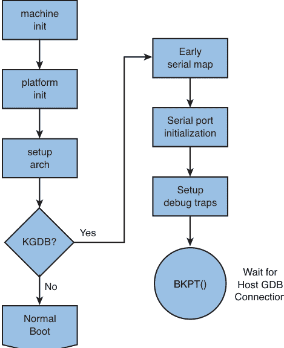

图 14-3 `KGDB` 逻辑

`KGDB` 需要一个串口来连接到主机.¹⁴ 设置 `KGDB` 的第一步是在启动过程的极早期启用串口。在许多架构中，硬件 `UART` 必须在访问之前映射到内核内存。映射地址范围后，将初始化串口。然后安装调试陷获处理程序，以允许处理器异常捕获到调试器中。

列表 14-1 显示了启用 `KGDB` 启动时的终端输出。此示例基于 Unesco `MPC8548CDS` 参考板，该板附带 `U-Boot` 引导加载程序。

# 列表 14-1 使用 U-Boot 启用 KGDB 启动


```
= setenv bootargs console=ttyS1,115200 root=/dev/nfs rs=ip-dhcp kgdbwait
kgdb8250=ttyS1,115200
= tfftp 000000 mpc8548.uImage
Speed: 1000, full duplex
Using etSECO device
TFTP from server 192.168.0.9; our IP address is 192.168.0.18
Filename `8548/uImage`.
Load address: 0x060000
Loading: #################################################################################################################################################################################
done
Bytes transferred = 1854347 (1c4b8 hex)
= tfftp 000000 mpc8548.dtb
Speed: 1000, full duplex
Using etSECO device
TFTP from server 192.168.0.9; our IP address is 192.168.0.18
Filename `8548/dtb`.
Load address: 0xc00000
##
done
Bytes transferred = 16384 (400 hex)
=> bootm 600000 - c000000
## Booting kernel from Legacy Image at 06000000 ...
Image Name: Montavista Linux Kernel 6/2.27/frees
Image Type: PowerPC Linux Kernel Image (gzip compressed)
Data Size: 1854283 Bytes = 1.8 MB
Load Address: 00000000
Entry Point: 00000000
Verifying Checksum ... OK
## Flattened Device Tree blob at 0xc00000
Booting using the fdt blob at 0xc00000
Uncompressing Kernel Image ... OK
Loading Device Tree to 0x07f9000, end 0x7ffffff ... OK
kgdb8250: ttyS1 init delayed, use io:/mmio/mbase syntax for early init.
Using MPC85xx CDS machine description
```

# 列表 14-1 继续 内存映射：CAM0=256Mb, CAM1=0Mb, CAM2=0Mb residual: 0Mb

```
Linux version 2.6.27.28.freescale-8548cds.0908109110 (chris@pluto) (gcc version 4.3.3 (MontVista Linux Sourcery G++ 4.3-2317) #1 PREEMPT Mon Mar 29 11:09:48 EDT
console [udbg0] enabled
setup_arch: bootmem
mpc85xx_cds_setup_arch()
<.. many messages deleted ..>
serial: 8250/16550 driver 4 ports, IRQ sharing enabled
serial8250.0: tty0 at MMIO 0xe004500 (irq = 42) is a 1650A
serial8250.0: tty1 at MMIO 0xe004600 (irq = 42) is a 1650A
console handler: [udbg0] -> real [tty1]
kgdb: Registered I/O driver kgdb8250.
kgdb: Waiting for connection from remote gdb...
```

大部分启动序列在第 7 章“引导加载程序”中关于 U-Boot 的介绍中非常熟悉。回想第 7 章，内核命令行由 U-Boot `bootargs` 环境变量定义。注意我们添加了 `kgdb` 参数，该参数指示内核强制执行早期断点并等待主机调试器（你的交叉调试器）连接。

请注意，启动序列并没有完成。由于我们在命令行中放置了 `kgdb`，内核一直完成初始化，直到串口驱动程序加载并命中了一个预定义的断点。在此处，它将无限期地等待外部调试器的连接。

你还应该注意新的内核命令行参数。这种特定的架构（Power）和平台（8548CDS）使用 8250 串口驱动以及由 `../drivers/serial/8250_kgdb.c` 实现的特殊 8250 基 KGDB 驱动。你必须告诉 KGDB 使用哪个串口进行调试，其语法与使用控制设备类似。

现在内核已就绪并正在等待主机调试器，我们可以开始调试会话。我们在开发工作站上调用交叉 `gdb` 并连接到目标机。

> ⁴ 在某些架构和平台上，你可以配置 KGDB 使用以太网甚至 USB。

一旦你设置了初始断点并执行了 `continue` 命令，你随时可以通过向你的交叉 `gdb` 发送 Ctrl-C 来停止执行。列表 14-4 展示了这种操作方法。

# 列表 14-4 进程内核调试话

```
(gdb) c
Continuing.

<<<<< 用户在此处输入 Ctrl-C >>>>>>>

Program received signal SIGTRAP, Trace/breakpoint trap.
0x0058048 in kgdb_breakpoint () at kernel/kgdb.c:1802
1802 wmb(); /* * 断点前的同步点 */
(gdb) bt
#0 0x0058048 in kgdb_breakpoint () at kernel/kgdb.c:1802
#1 0x019bcc in kgdb8250_interrupt (irq=<value optimized out>, dev_id=<value optimized out>) at drivers/serial/8250_kgdb.c:145
#2 0x005aa4f0 in handle_irq_event (irq42, action=0xc58af20) at kernel/irq/c:140
#3 0x005cc1c in handle_fast_io_irq (irq42, desc=0xc039a950) at kernel/irq/chip.c:424
#4 0x0004b04 in do_IRQ (regs=value optimized out) at include/linux/irq.h:289
#5 0x000f310 in ret_from_except_full ()
#6 0x0008144 in cpu_idle () at arch/powerpc/kernel/idle.c:59
#7 0x002d022c in rest_init () at init/main.c:481
#8 0x036e75c in start_kernel () at init/main.c:691
#9 0x0000030 in skip_inv()
(gdb)
```

你可以在列表 14-4 中看到编译器优化的效果。这将在 14.3.2 节中进一步讨论。

## 14.2.4 与 KGDB 共享控制台串口

虽然可以使用单个串口同时用于系统控制台和通过串口进行 KGDB，但这显然并非理想选择。取决于你的架构和平台，KGDB 的完善程度各异。一旦离开 x86 架构，情况就会变得不那么确定。KGDB 有许多连接选项，包括串口、以太网端口，在某些平台上甚至还有 USB。可以确定的是，这些选项中...

本书的其他地方提到过：如果你认为自己将需要使用 KGDB 进行内核调试，那么增加一个串口的成本是完全合理的，特别是如果为了满足成本目标，在可以在生产环境中将其移除。通过它所节省的烦恼（即开发者的时间）将远超增加的开发成本带来的回报。

要在控制台和 KGDB 之间共享串口，你需要两个命令行参数。使用内核命令行 `kgdb` 来指定要使用哪个串口，并使用 `kgdbcon` 指定你将把此端口与软控制台共享。在使用串口控制台时使用 `kgdboc` 参数，其方式类似于在内核命令行上描述设备：

```
kgdb kgdboc=tty1,115200
```


当启动内核并与 KGDB 连接时，任何控制台消息都会由你的交叉 `gdb` 显示。列表 14-5 展示了其外观。我们首先使用上述额外的内核命令行参数启动目标机。目标机启动到登录提示符。我们必须使用 SysRq 功能启用 KGDB。从控制台的串口执行此操作的最简单方法是使用 `/proc` 接口：

```
root@8548:~# echo g >/proc/sysrq-trigger
SysRq : KGDB
Enter KGDB
```

当我们断开串口终端与控制台的连接以便释放给 KGDB 使用时，我们启动交叉 `gdb`，会话如列表 14-5 所示。

### 列表 14-5 与 KGDB 共享串口控制台

```
$ pc_85xx-kgdb -q vmlinux
(kgdb) target remote /dev/tty0
Remote debugging using /dev/tty0
0xc0058098 in sysrq_handle_kgdb (key=0x111, tty0=0x8ddf) at kernel/kgdb.c:1802
1802 wmb();/* 断点前的同步点 */
(gdb) b sys_sync
Breakpoint 1 at 0x00cbaae2: file fs/sync.c, line 41.
(gdb) b panic
Breakpoint 2 at 0xc02d1a84: file archive/powerpc/include/asm/thread_info.h, line 87.
(gdb) c
Continuing.
<<<< 在通过另一个终端通过 SSH 登录后
<<<< 我们在此时执行 'modprobe ipv6='
```

## 列表 14-6 从 Kernel.org 使用通用 KGDB 启动

```
 <... 启动内核，使用 kgdboc=ttyS0,115200 kgdbwait ...
...（许多启动信息）
Serial: 8250/1650 驱动, 2 个端口，开启中断 共享
serial8250.0: ttyS0 at MMIO 0xff04500 (irq = 42) is a 16550A
console handler: boot [dbg] -> real [ttyS0]
serial8250.0: ttyS1 at MMIO 0ffe04600 (irq = 42) is a 16550A
kgdb: 已注册 I/O 驱动 kgdboc.
kgdb: 等待来自远程 gdb 的连接...
```

在此时，内核正在等待来自远程 GDB 会话的连接，即可开始调试。请注意，这处于内核启动序列中相当靠后的阶段。要在启动序列的更早阶段调试通用 Linux 内核，你必须使用 JTAG 探针进行硬件辅助调试。这将在稍后进行描述。

# 14.3 内核调试技术

你可能会发现自己单步执行内核代码的常见原因之一是修改或自定义针对你开发板的平台特定代码。让我们看看如何使用 AMCC Yosemite 板来实现这一点。我们在平台特定的架构设置函数处放置一个断点，然后继续直到遇到该断点。列表 14-7 显示了该序列。

## 列表 14-7 架构设置代码

```
(gdb) b yosemite_setup_arch
  断点 3 at 0xc021a488:
  file arch/ppc/platforms/4xx/yosemite.c, line 308.

(gdb) c
Continuing.
无法向此远程系统发送信号。未发送 SIGILL。

断点 3, yosemite_setup_arch () at arch/ppc/platforms/4xx/yosemite.c:308
308  yosemite_set_emacdata();
303
304  }
305
306  static void __init(void)
306  yosemite_setup_arch(void)
308    yosemite_set_emacdata();
```

## 列表 14-7 调试架构设置代码

```
309
310   ibm40gx_get_clocks(&clocks, YOSEMITE_SYSCLK, 6 * 1843200);
311   ocp_sys_info.opb_bus_freq = clocks.opb;
312
(gdb)
```

当遇到 `yosemite_setup_arch()` 断点时，控制权传递到 `yosemite.c` 第 308 行的 GDB。`list` 命令以第 308 行的断点为中心显示源码列表。GDB 在执行继续 `c` 命令后显示的关于 SIGILL 的警告信息可以安全忽略。它是 GDB 测试远程系统能力的一部分。它向目标发送了一个远程的 `continue_with_signal` 命令。该目标板的 KGDB 实现不支持此命令；因此，返回了 NAK。GDB 通过显示此信息消息并转而发布远程继续命令做出响应。

### 14.3.1 gdb 远程串口协议

GDB 包含一个调试开关，允许我们观察开发宿主机上的 GDB 与目标机之间使用的远程协议。这对于理解底层协议以及排除表现出异常或不稳定行为的目标机的故障非常有用。要启用此调试模式，请执行以下命令：

```
(gdb) set debug remote 1
```

启用远程调试后，观察 `continue` 命令的执行以及 GDB 采取的步骤非常有启发性。列表 14-8 说明了在启用远程调试时使用 `continue` 命令的情况。

## 列表 14-8 远程协议示例：continue 命令

```
(gdb) c
Continuing.
Sending packet: $mc00000000,4#80...Ack
Packet received: c022d200
Sending packet: $mc00000000,4:7d821008#68...Ack
Packet received: OK
Sending packet: $mc0016de8,4#f8......
```

## 列表 14-8 远程协议示例：continue 命令

```
Packet received: 38600001
Sending packet: $mc0016de8,4:7d821008#e0...Ack
Packet received: OK
Sending packet: $mc05bd5c,4#23...Ack
Packet received: 38600001
Sending packet: $mc005bd5c,4:7d821008#0b...Ack
Packet received: OK
Sending packet: $mc021a488,4#c8...Ack
Packet received: 4bffbad
Sending packet: $mc021a488,4:7d821008#b0...Ack
Packet received: OK
Sending packet: $c#63...Ack
<<< program running, gdb waiting for event
```

尽管看起来可能很复杂，但所发生的情况很容易理解。总而言之，GDB 正在恢复其所有的断点——一个在 *panic()* 处，一个在 *sys_sync()* 处。稍后在列表 14-7 中，我们在 *yosemite_setup_arch()* 处添加了第三个断点。因此，有三个激活的断点。可以通过执行以下命令显示每一个断点：

```
(gdb) i b
```

| 编号 | 类型 | 显示地址 |

| :--- | :--- | :--- |

| 1 | 0xc0016de8 | kernel.c:74 |

| 2 | 0xc005bd5c | kernel.c:296 |

| 3 | 0xc021a488 | yosemite.c:308 |

386 第 14 章 内核调试技术

## 列表 14-10 优化的架构设置代码


```assembly
$ ppc_44x-gdb --silent vmlinux
(gdb) target remote /dev/ttyS0
Remote debugging /dev/ttyS0
breakpoint () at arch/ppc/kernel/ppc-stub.c:825
825 )
(gdb) b panic
Breakpoint 1 at 0x00c16b18: file kernel/panic.c, line 74.
(gdb) b sys_sync
Breakpoint 2 at 0x00ca50a8c: file fs/buffer.c, line 296.
(gdb) b yosemite_setup_arch
Breakpoint 3 at 0x0c20f438: file arch/ppc/platforms/4xx/yosemite.c, line 116.
(gdb) c
Continuing.

Breakpoint 3, yosemite_setup_arch ()
at arch/ppc/platforms/4xx/yosemite.c:116
116     def = ocp_get_one_device(OCP_VENDER_IBM, OCP_FUNC_EMAC, 0);
(gdb) 1
111     struct ocp_def *def;
112     struct ocp_func_emac_data *emacdata;
113
114     /* Set mac_addr and phy mode for each EMAC */

116     def = ocp_get_one_device(OCP_VENDER_IBM, OCP_FUNC_EMAC, 0);
117     emacdata = def->additions;
118     memcpy(emacdata->mac_addr, __res.bi.enetaddr, 6);
119     emacdata->phy_mode = PHY_MODE_RMII;
120     )
(gdb) p yosemite_setup_arch
$1 = (void (void)) 0x0c20f41c <yosemite_setup_arch>
```

参考列表 14-7，函数 `yosemite_setup_arch()` 实际上位于 `yosemite.c` 文件的第 306 行。对比列表 14-10。我们命中了断点，但 GDB 返回的是文件 `yosemite.c` 第 116 行的断点。乍看之下，调试器与相应源代码之间的行号似乎不匹配。这是 GDB 的 bug 吗？首先，让我们确认编译器生成了调试信息。使用第 13 章描述的 `readelf` 工具^7，我们可以检查编译器生成的函数调试信息：

```bash
$ ppc_44x-readelf --debug-dump-info vmlinux | grep -u \yosemite_setup_arch : tail -n 7
DW_AT_name : (indirect string, offset: 0x9c04): yosemite_setup_arch
DW_AT_decl_file : 1
DW_AT_decl_line : 307
DW_AT_prototyped : 1
DW_AT_low_pc : 0xc020f41c
DW_AT_high_pc : 0xc020f794
DW_AT_frame_base : 1 byte block: 51 (DW_OP_reg1)
```

我们不需要精通阅读 DWARF 调试记录^8 就能看出该函数在我们的源文件中被报告为 307。我们可以使用第 13 章同样引入的 `addr2line` 工具来确认这一点。我们可以使用列表 14-10 中 GDB 得到的地址：

```bash
$ ppc_44x-addr2line -e vmlinux 0xc020f41c
arch/ppc/platforms/4xx/yosemite.c:307
```

此时，GDB 报告我们在 `yosemite.c` 文件第 116 行的断点。为了理解发生了什么，我们需要查看 GDB 报告的函数汇编输出。列表 14-11 是在对 `yosemite_setup_arch()` 函数执行 `disassemble` 命令后 GDB 的输出。

### 列表 14-11 disassemble yosemite_setup_arch

```assembly
(gdb) 0xc020f41c<yosemite_setup_arch:0>: mflr r0
0xc020f420<yosemite_setup_arch:4>: stwu r1,-48(r1)
0xc020f424<yosemite_setup_arch:8>: li r4,512
0xc020f428<yosemite_setup_arch:12>: li r5,0
0xc020f42c<yosemite_setup_arch:16>: li r3,4116
0xc020f430<yosemite_setup_arch:20>: stmw r25,20(r1)
0xc020f434<yosemite_setup_arch:24>: stw r0,52(r1)
0xc020f438<yosemite_setup_arch:28>: bl 0xc000d34 <ocp_get_device>
0xc020f43c<yosemite_setup_arch:32>: lwz r31,32(r3)
0xc020f440<yosemite_setup_arch:36>: lis r4,-16350
0xc020f444<yosemite_setup_arch:40>: li r28,2
0xc020f448<yosemite_setup_arch:44>: addi r4,4,2160
 (continued)
> ^7 对于 PowerPC 架构请使用交叉版本的 readelf，例如 `ppc_44x-readelf`。
> 8 DWARF 规范出现在本章末尾
```

### 列表 14-11 继续

```assembly

0xc020f44c<yosemite_setup_arch+48>: li r5,6

0xc020f450<yosemite_setup_arch+52>: lis r29,-16350

0xc020f454<yosemite_setup_arch+56>: addi r3,31,48

0xc020f458<yosemite_setup_arch+60>: lis r25,-16350

0xc020f45c<yosemite_setup_arch+64>: bl 0xc000c70 <memcpy>

0xc020f460<yosemite_setup_arch+68>: stw r28,44(r31)

0xc020f464<yosemite_setup_arch+72>: li r4,512

0xc020f468<yosemite_setup_arch+76>: lis r5,1

0xc020f46c<yosemite_setup_arch+80>: li r3,4116

0xc020f470<yosemite_setup_arch+84>: addi r26,25,1504

0xc020f474<yosemite_setup_arch+88>: bl 0xc000d344 <ocp_get_one_device>

0xc020f478<yosemite_setup_arch+92>: 

0xc020f47c<yosemite_setup_arch+96>: lwz r31,32(r3)

0xc020f480<yosemite_setup_arch+100>: addi r4,r4,2534

0xc020f484<yosemite_setup_arch+104>: li r5,6

0xc020f488<yosemite_setup_arch+108>: addi r3,31,48

0xc020f48c<yosemite_setup_arch+112>: bl 0xc000c70 <memcpy>

0xc020f490<yosemite_setup_arch+116>: li r4,1017

0xc020f494<yosemite_setup_arch+120>: lis r5,1618

0xc020f498<yosemite_setup_arch+124>: stw r28,44(r31)

0xc020f49c<yosemite_setup_arch+128>: ori r4,r4,16554

0xc020f4a0<yosemite_setup_arch+132>: ori r5,r5,4152

0xc020f4a4<yosemite_setup_arch+136>: addi r3,r29,-15380

0xc020f4a8<yosemite_setup_arch+140>: addi r29,r29,-15380
```


```
0xc020f4ac<yosemite_setup_arch+144>: bl 0xc020e338 <ibm4gx_clocks>

0xc020f4b0<yosemite_setup_arch+148>: li r0,0

0xc020f4b4<yosemite_setup_arch+152>: lis r11,-16352

0xc020f4b8<yosemite_setup_arch+156>: ori r0,r0,50000

0xc020f4bc<yosemite_setup_arch+160>: lwz r10,12(r29)

0xc020f4c0<yosemite_setup_arch+164>: lis r4,-16352

0xc020f4c4<yosemite_setup_arch+172>: stw r0,8068(r11)

0xc020f4c8<yosemite_setup_arch+176>: stw r0,84(r26)

0xc020f4cc<yosemite_setup_arch+180>: lis r10,8136(r9)

0xc020f4d0<yosemite_setup_arch+184>: mtcr r0

0xc020f4d4<yosemite_setup_arch+188>: bctrl

0xc020f4d8<yosemite_setup_arch+192>: li r5,64

0xc020f4dc<yosemite_setup_arch+196>: mr r31,r3

0xc020f4e0<yosemite_setup_arch+200>: lis r4,-4288

0xc020f4e4<yosemite_setup_arch+204>: li r3,0

0xc020f4e8<yosemite_setup_arch+208>: bl 0xc000c0f8 <ioremap>

End of assembler dump.

(gdb)
```

再次，我们需要成为 Power 架构汇编语言专家才能理解这里发生了什么。注意与 Power 架构 `bl` 指令相关的标签。这是 Power 架构汇编语中的函数调用。符号函数标签是重要的数据点。经过粗略分析，我们在此汇编列表开头看到了几个函数调用：

| 地址 | 函数 |
| :--- | :--- |
| 0xc020f438 | `ocp_get_device()` |
| 0xc020f45c | `memcpy()` |
| 0xc020f474 | `ocp_get_one_device()` |
| 0xc020f48c | `memcpy()` |
| 0xc020f4ac | `ibm40gx_clocks()` |

# 390 第 14 章 内核调试技术

列表 14-12 续

```
124   emacdata->phy_mode = PHY_MODE_RMII;

125 }

126

127...

304

305 static void __init

306   yosemite_setup_arch(void) {

307 

308     yosemite_set_emacdata();

309

310    ibm840xg_get(&clocks, YOSEMITE_SYSLCK, 6 * 1843200);

311    ocp_sys_info.opb_bus_freq = clocks.opb;

312

313    /* 在 calibrate_delay() 运行之前，初始化为一个合理值 */

314    loops_per_jiffy = 5000000/HZ;

315

316    /* 设置 PCI 主机桥 */

317    yosemite_setup_hose();

318

319  #ifdef CONFIG_BLK_DEV_INITRD

320      if (initrd_start)

321          ROOT_DEV = Root_RAM0;

322      else

323  #endif

324  #ifdef CONFIG_ROOT_NFS

325      ROOT_DEV = Root_NFS;

326  #else

327      ROOT_DEV = Root_HDA1;

328  #endif

329

330    yosemite_early_serial_map();

331

332    /* 识别系统 */

333    printk("AMCC PowerPC %s Platform\n" );

334 }
```

总结之前的讨论：

- 在 GDB 的 `yosemite_setup_arch()` 处设置了一个断点。
- 当命中断点时，我们发现自己处于源文件的第 116 行，这离我们定义断点的函数非常远。

- 我们对 `yosemite_setup_arch()` 处的代码生成了反汇编列表，发现该代码序列的标签是分支的。
- 将这些标签与我们的源代码对比，我们发现编译器将 `yosemite_set_emacdata()` 子程序内联到了我们进入断点的函数中，导致了潜在的混淆。

这解释了当 `yosemite_setup_arch()` 中的原始断点被命中时，GDB 报告的行号。

回想列表 14-4 包含了另一种类型优化的示例，调试器对某些变量报告了“值已优化”（value optimized out）。这些示例是局部变量在函数执行期间被替换为了处理器寄存器。因此，局部变量被编译器优化了。通过 `cmd_boot.c` 文件中的一段 U-Boot 代码片段可以很好地说明这一点。列表 14-13 显示了 `do_bootm()` 函数的几行。

# 列表 14-13 局部变量被优化的示例

```
584 int do_bootm (cmddt_t *cmdtp, int flag, int argc, char *argv[])

585 {

586     ulong iflag;

587     ulong load_end = 0;

588     int ret;

```

```
<...省略了许多行>

652     ret = bootm_load_os(images.os, &load_end, 1);

653

654     if (ret < 0) {

655         if (ret == BOOTM_ERR_RESET)

656             do_reset(cmdtp, flag, argc, argv);

657     ...
```

使用你的交叉 `gdb` 通过 BDI-2000/3000 单步执行这段代码，看起来如下：

```
(gdb) 1 654

649     dcache_disable();

650     #endif

651

652     ret = bootm_load_os(images.os, &load_end, 1);

```

```
654    if (ret < 0) {

655        if (ret == BOOT_ERR_RESET)

656            do_reset (cmdtp, flag, argc, argv);

657      if (ret == BOOT_ERR_OVERLAP) {

658          if (images.legacy_hdr_valid) {

(gdb) p ret

$2 = <value optimized out>
```

注意在调用 `bootm_load_os()` 之后，我们读取了函数返回的值，根据第 652 行的源代码，它存储在一个名为 `ret` 的局部变量中。尝试显示 `ret` 的值会导致那个熟悉的 `<value optimized out>` 消息。因为我们知道 Power Architecture 通过寄存器 R3 返回函数调用，因此我们可以在调用返回后立即通过调试 R3 来显示返回码：

```
(gdb) mon rd

GPR00: 0ff7c9ec 0ff4df40 0ff4df64 00000000

GPR04: 00000002 00000000 0ff50ac8 00002538

GPR08: 00001000 00000000 00005318 00000001

GPR12: 24040022 1001a5b8 00000000 00000000

GPR16: 0ff88af4 00000000 0ff10f40 00000000

GPR20: 00000000 00000000 0ff10f40 00000000

GPR24: 00000001 00000000 0ffab9d0 00000004

GPR28: 0ff7c9ec 0ff4df40 0ff4df64 00000000
```


## 14.3 内核调试技术

### GDB 定义命令

有很多自动化 GDB 任务的方法。一种是使用 `.gdbinit` 文件，它在 GDB 启动时加载。另一种是定义自定义宏。

最实用的功能之一是能够定义执行复杂命令序列的宏。例如，我们可以定义一个根据 PID 查找任务的宏。

#### 列表 14-14 初始化文件

``` 
# 给 PID 查找任务的辅助函数

define find_task

  # 设置

  set $t=init_task

  # 遍历列表查找它

  while ($t && $t->pid != $arg0)

    set $t=$t->next

  # 如果未找到：

  if ($t == &init_task)

    printf "Couldn't find task; using init_task\n"

  else

    printf "Task %s:\n", $t->comm

  end

end
```

将此文本放在你的 `.gdbinit` 文件中重启 GDB，或者加载它。在示例中，我们这样调用它：

```
(gdb) find_task 910
Task syslogd:
```

```
(gdb) find_task 0xcde470
Task bash:
```

### 14.3.4 有用的内核宏

基于列表 14-14 中的 `find_task` 宏，我们可以轻松创建一个 `ps` 命令，显示系统中运行的每个进程的有用信息。

#### 列表 14-15 ps 宏示例

```
define ps
  set $t=init_task
  while ($t)
    printf "Task: %s\tPID: %d\n", $t->comm, $t->pid)
    set $t=$t->next
    if ($t == &init_task)
      break
  end
end
```

注意你也可以向 `find_task` 宏传递一个地址：

```
(gdb) find_task 0xcde470
```

```
Task bash:
```

## 14.3 内核调试技术

#### 列表 14-17 续

| | | | |
|---|---|---|---|
| 0xC04AC030 | 4 睡眠 | 0xC0533E30 (none) | khelper |
| 0xC04CDB30 | 5 睡眠 | 0xC0535E30 (none) | kthread |
| 0xC04CD790 | 23 睡眠 | 0xC056FBE30 (none) | blockd/0 |
| 0xC04CD3F0 | 45 睡眠 | 0xC056FE50 (none) | pdflush |
| 0xC04CD050 | 46 睡眠 | 0xC066FE50 (none) | pdflush |
| 0xC054B7B0 | 48 睡眠 | 0xC0703E30 (none) | aio/0 |
| 0xC054BB50 | 47 睡眠 | 0xC0701E20 (none) | kswapdo |
| 0xC054B410 | 629 睡眠 | 0xC0781E60 (none) | kserid |
| 0xC054B070 | 663 睡眠 | 0xC05FC9E30 (none) | rpciod/0 |
| 0xFFCDE00 | 675 睡眠 | 0xFF06E85C 0xFF06DCE20 (none) | udevd |
| 0xFFC95B10 | 879 睡眠 | 0xFF08E858 0xFF571D80 (none) | portmap |
| 0xFFC24090 | 910 睡眠 | 0xFF06E85C 0xFF61BCE0 (none) | syslog |
| 0xFF80490 | 918 睡眠 | 0xFF65DD70 (none) | klogd |
| 0xFFCE3B50 | 948 睡眠 | 0xFF0EDE85C 0xFF67DCE0 (none) | rpc.stat |
| 0xFFCDE810 | 960 睡眠 | 0xFF06E85C 0xFF57C720 (none) | inet |
| 0xFFC2B470 | 964 睡眠 | 0xFF0EEBEAC (none) | mvldt |
| 0xFFC3B590 | 973 睡眠 | 0xFF066C70 0xFF67FEC70 tty1S getty |
| 0xFFC357F0 | 974 睡眠 | 0xFF04B85C 0xCF6BECE0 (none) | telnetd |
| 0xFFCDE470 | 979 睡眠 | 0xFFFEB6950 0xFF675DB80 typ0 bash |
| 0xFFCDEBB0 | 982<运行 | 0xFF06EB6C 0xFF67C3870 typ0 sync |

此任务执行的工作由 `task_struct_show` 宏完成。如列表 14-17 所示，`task_struct_show` 宏显示了每个 `task_struct` 的字段：

- *Address*—进程的 `task_struct` 地址
- *PID*—进程 ID
- *State*—进程的当前状态
- *User_NIP*—用户下一指令指针
- *Kernel_SP*—内核栈指针
- *device*—与此进程关联设备
- *comm*—进程名称（或命令）

修改该宏以显示你内核调试任务中感兴趣的项目是容易的。唯一的复杂性在于宏语言的简单性。由于 GDB 的用户定义语言中不存在像 `strlen` 这样的流畅函数，因此屏幕格式必须手动完成。

列表 14-18 显示了产生上述列表的 `task_struct_show` 宏。

#### 列表 14-18 GDB task_struct_show 宏

```
1 define task_struct_show

2 # task_struct_addr and PID

3 printf "("0x%8X %5d", $arg0, $arg0->pid)

4

5 # 在当前任务上放置 '<' 标记

6 # if ($arg0 == current)

7 # 对于 PowerPC，寄存器 r2 指向“当前”任务

8 if ($arg0 == $r2)

9 printf "<"

10 else

11 printf ""

12 end

13

14 # 状态

15 if ($arg0->state == 0)

16 printf "Running"

17 else

18 if ($arg0->state == 1)

19 printf "Sleeping"

20 else

21 if ($arg0->state == 2)

22 printf "Diskeeps"

23 else

24 if ($arg0->state == 4)

25 printf "Zombie"

26 else

27 if ($arg0->state == 8)

28 printf "Stopped"

29 else

30 if ($arg0->state == 16)

31 printf "paging"

32 else

33 printf "%2d", $arg0->state

34 end

35 end

36 end

37 end
```

#### 列表 14-18 续

```
39 end
40
41 # User NIP
42 if ($arg0->thread->regs)
43 printf "0x%8X", $arg0->thread->regs->nip
44 else
45 printf ""
46 end
47
48 显示内核栈指针
49 printf "0x%8X", $arg0->thread->ksp
50
51 # device
52 if ($arg0->signal->tty)
53 printf "%s", $arg0->signal->tty->name
54 else
55 printf "(none)"
56 end
57
58 # comm
59 printf "%s\n", $arg0->comm
60 end
```

第 1 行显示 `task_struct` 的地址。第 8 到 12 行显示进程 ID。如果这是当前进程（当前在此 CPU 上运行的进程），则会显示。

## 14.3 内核调试技术


这会在你的主机上启动 GDB 调试会话，并从 Linux 内核 `vmlinux` 中读取符号信息。当然，你将找不到任何可加载模块的符号。可加载模块是独立的编译单元，并被链接为独立的 ELF 对象。因此，如果我们打算对某个可加载模块进行任何源码级调试，我们需要从 ELF 文件加载符号。GDB 通过 `add-symbol-file` 命令提供了这种功能。`add-symbol-file` 命令从指定的对象加载符号，并假设该模块本身已经加载。然而，我们面临着“先有鸡还是有蛋”的困境：在可加载模块加载到内核并执行 `add-symbol-file` 命令读取其符号信息之前，我们无法获得任何信息。在模块加载之后，再设置断点并调试模块的 `*_init` `functions` 函数就太晚了，因为它们已经执行完毕。

解决这一困境的方案是在负责加载模块的内核代码中设置断点，在它的初始化函数被调用之前。这项工作由 `...kernel/module.c` 完成。列表 14-21 显示了 `module.c` 的相关部分。

### LISTING 14-21 module.c：模块初始化

```c
/* Drop lock so they can recurse */
mutex_unlock(&module_mutex);

blocking_notifier_chain(&module_list, MODULE_STATE_GOING);

/* Start the module */
if (mod->init != NULL) {
    ret = do_one_initcall(mod->init);
    if (ret < 0) {
        /* Init routine failed. Try to protect us from buggy refcounters. */
        mod->state = MODULE_STATE_GOING;
```

我们使用 `modprobe` 工具加载模块，这在第 8 章“设备驱动程序”中已经演示过。内核初始化如下：

```
$ modprobe loop
```

该命令发出一个系统调用，引导内核加载模块。模块加载从 `module.c` 中的 `load_module()` 开始。在模块加载到内核内存并进行动态链接后，控制权将交给模块的 `*_init*` 函数。这在 `module.c` 的最新副本第 229-2300 行显示，如列表 14-21 所示。我们在 GDB 中设置断点，随后在模块中设置断点。我们使用名为 `loop.ko` 的 Linux 回环驱动程序来演示这一过程。该模块没有其他模块依赖，易于演示。

### LISTING 14-22 初始化模块会话：loop.ko

```bash
$ linux-gdb --silent
(gdb) connect remote /dev/tty0
User-defined breakpoint at arch/kernel/stub:825
Breakpoint 1 at 0xc001b18: file kernel/panic.c, line 74.
Breakpoint 2 at 0xc05a5c8: file fs/buffer.c, line 296.
(gdb) b kernel.module:2299
Breakpoint 3 at 0xc055b28: file kernel/module.c, line 2299.
(gdb) c
Continuing.
>>> 这里我们让内核完成启动，然后在目标机上加载 loop.ko 模块
Breakpoint 3, sys_init_module (mod=0x4830000, len=optimized, uargs=value out) at kernel/module.c:2299
2299      ret = mod->init();
(gdb) lsmod
Address         Module
0xd1069a0      loop
(gdb) set sm=$(struct module *) 0xd1069a0
(gdb) p $sm->module_core
$1 = (void *) 0xd106600
(gdb) add-symbol-file ./drivers/block/loop.ko at
add symbol table from "./drivers/block/loop.ko" at
      .text_addr = 0xd106600
(y or n) y
Reading symbols from /home/chris/sandbox/linux-2.6.27/drivers/block/loop.ko...done.
(gdb)
```

从第 2 行开始，我们使用列表 14-14 中定义的 GDB 用户宏连接到目标并设置初始断点。随后我们在 `module.c` 的第 7 行添加断点，并执行 `continue (c)` 命令。现在内核完成启动过程，我们建立目标会话并加载 `loop.ko` 模块（此处）。当 `loop` 模块加载时，立即命中断点 3。GDB 随后显示第 14-16 行的信息。在此处，我们发现了 Linux 链接的模块 `*_text*` 部分地址。Linux 将此地址存储在 `module_core` 结构体中。使用列表 14-20 中定义的宏，我们获取 `loop.ko` 相关的结构地址。这位于第 17-19 行。现在我们使用此结构获取 `*_text*` 地址。我们将此地址传递给 GDB 的 `add-symbol-file` 命令，GDB 使用此地址调整模块链接到内核的位置。我们可以按照通常的方式设置断点、单步、检查数据并继续。

我们在 `loop` 的初始化函数中设置断点作为结束。复杂之处在于内核将模块的初始化代码加载到特殊分配的内存中，以便在之后释放。在初始化函数被调用后，内核会释放包含初始化函数的内存。由于模块是这样拆分的，我们需要告知 GDB 这种地址方案以使用符号数据调试初始化函数。列表 14-23 展示了这些步骤。

### LISTING 14-23 调试模块 init

```bash

$ gdb -q vmlinux

(gdb) target remote /dev/tty0

Remote debugging using /dev/tty0

break at arch/kernel/stub.c:825

825

<< 在调用模块前放置断点

(gdb) b kernel/module.c:2299

Breakpoint 1 at 0xc036418: file kernel/module.c, line 2299.

(gdb) c

Continuing.

[New Thread 2468]

[Switching to Thread 2468]

Breakpoint 3, sys_init_module (mod=0x483000, len=optimized, uargs=value out) at kernel/module.c:2299

if (mod->init != NULL)

<< 从 struct module 发现地址

(gdb) lsmod

Address         Module

0xD1069A0      loop

(gdb) set $m=(struct module *) 0xD1069A0

(gdb) p $m->module_core

$1 = (void *) 0xd106600

(gdb) p $m->module_init

$2 = (void *) 0xd101e00

<< 现在使用 core 和 init 地址加载符号文件

(gdb) add-symbol-file ./drivers/block/loop.ko 0xd106600 -s .init.text 0xd101e00

add symbol table from "./drivers/block/loop.ko" at

      .text_addr = 0xd106600

      .init_text_addr = 0xd101e00

(y or n) y

Reading symbols from /home/chris/sandbox/linux-2.6.27/drivers/block/loop.ko....

```

### LISTING 14-23 继续

```bash

(gdb) b loop_init

Breakpoint 4 at 0xd101e08: file drivers/block/loop.c, line 1517.

(gdb) c

Continuing.

```

<< 断点命中，进入调试模式 init 函数 >>

```c

Breakpoint 4, loop_init () at drivers/block/loop.c:1517

1517      part_shift = 0;

/*

+load, 用户可以通过自己创建设备节点来进一步扩展 loop 设备

+并让内核按需实例化实际

+设备。

*/

1517      part_shift = 0;


```c
if (max_part > 0)
    part_shift = fls(max_part);
if (max_loop > 1UL << (MINORBITS - part_shift))
```

## 14.6 printk 调试

使用 `printk()` 调试内核和设备驱动是一种流行的技术，因为 `printk` 演变成了一种非常健壮的方法。你可以在几乎任何上下文中调用 `printk`，包括中断处理程序中。`printk` 是内核版本的 `.../kernel/printk.c`。

理解 `printk` 调试的局限性很重要。此外，控制台设备在内核初始化期间尽早配置；许多 `printk` 调用发生在控制台设备初始化之前。我们稍后会介绍应对这种局限性的方法，见第 14.5 节“当无法启动时”。

`printk` 函数允许添加一个字符串标记，用于识别给定消息的严重程度。头文件 `.../include/linux/kernel.h` 定义了八个级别：

```c
#define KERN_EMERG "<0>" /* 系统不可用 */
#define KERN_ALERT "<1>" /* 必须采取采取 */
```

# 408 第14章 内核调试技术

```c
#define KERN_CRIT "<2>" /* 临界条件 */
#define KERN_ERR "<3>" /* 错误条件 */
#define KERN_WARNING "<4>" /* 警告条件 */
#define KERN_NOTICE "<5>" /* 正常但重要的条件 */
#define KERN_INFO "<6>" /* 信息 */
#define KERN_DEBUG "<7>" /* 调试消息 */
```

简单的 `printk` 消息可能如下所示：

```c
printk(<foo> entered with; %s, arg);
```

如果省略了严重性字符串（如所示），内核会分配一个默认级别；在最近的内核中，它被设置为级别 4 ，即 `KERN_WARNING`。指定带有严重性级别的 `printk`（推荐方法）可能如下所示：

```c
printk(KERN_CRIT "vmalloc failed in foo()\n");
```

不，这种不常见的 C 语法并不是类型。`KERN_CRIT` 本身就是一个文本字符串，因此不需要逗号来分隔参数。事实上，如果包含了逗号，函数将无法产生预期结果。编译器会自动将这些字符串连接成单个字符串。默认情况下，所有低于预定义级别的 `printk` 消息都会显示在系统控制台设备上。默认控制台级别定义在 `printk.c` 中。在最近的 Linux 内核中，它的值为 7。这意味着任何重要性高于 `KERN_DEBUG`（位于 `.../include/linux/kernel.h`）的 `printk` 消息都会显示在台上。

你可以通过多种方式设置默认控制台日志级别。在启动时，你可以为内核指定适当命令行参数。在 `main.c` 中定义的三个内核命令行选项影响默认日志级别：

- `-debug` 将控制台日志级别设置为 10。
- `quiet` 将控制台日志级别设置为 4。
- `loglevel=` 将控制台日志级别设置为你选择的值。

有效使用 `debug` 日志级别可以显示所有 `printk` 消息。使用严重性为 `KERN_ERR` 或更高的 `printk` 消息。

`printk` 消息可以记录到目标机上的文件或通过网络。使用 `klogd`（内核日志守护进程）和 `syslog`（系统日志守护进程）来控制 `printk` 消息的日志行为。这些常用的工具在 man 页和许多 Linux 参考书中都有描述，因此在此不再进行描述。

## 14.3.7 Magic SysReq 键

Magic SysReq 键是一个非常有用的调试辅助，通过一系列特殊的预定义键序列调用，这些序列向内核发送消息。对于许多目标架构和板卡，你使用串口端口上的简单终端仿真器作为系统控制台。对于这些架构，Magic SysReq 键被定义为一个中断字符（break character）后跟一个命令字符。咨询终端仿真器的文档以了解如何发送中断字符。许多 Linux 开发者使用 `minicom` 终端仿真器。对于 `minicom`，通过按下 `Ctrl-A F` 发送中断。如果你使用 `screen`，按下 `Ctrl-A B` 会发送中断。以这种方式发送中断后，你有 5 秒的时间输入命令字符，否则命令将超时。

这个实用的内核工具对开发和调试非常有帮助，但它可能会导致数据丢失和系统损坏。事实上，`b` 命令会立即重启你的系统，而没有任何通知或准备。打开的文件不会关闭，磁盘不会同步，文件系统也不会卸载。当发出重启 (`b`) 命令时，控制权将以最突兀且震惊的方式立即传递给你架构的重置向量。使用这个强大的工具请自担风险！

该功能在 Linux 内核文档子目录中名为 `sysreq.txt` 的文件中有详尽记录。你可以在可以找到许多架构的细节以及可用命令的描述。

刚刚讨论的设置内核日志级别的另一种方法是使用 Magic SysReq 键。命令是一个从 0 到 9 的数字，结果是将默认日志级别设置为传递的数字。在 `minicom` 中，按下 `Ctrl-A F` 后跟一个数字，例如 9。以下是你发送中断序列后在终端上显示的内容：

```
$ SysRq : Changing Loglevel
Loglevel set to 9
```


命令可以用于转储寄存器、转储进程列表、将当前内存信息转储到控制台等。详细信息请参阅任何近期 Linux 内核中的文档文件。

此功能最常用于某些导致系统锁死的情况。通常，Magic SysReq 键提供了一种从几乎死机的系统中学习某些知识的方法。

## 14.4 硬件辅助调试

到此时你可能已经意识到无法用 KGDB 调试非常早的内核启动代码。这是因为在执行了大部分底层硬件初始化代码之后，KGDB 还没有被初始化。此外，如果你被分配了启动一个全新的调试设计并移植引导程序和 Linux 内核的任务，那么拥有一个硬件调试探针无疑是这些在板卡移植早期阶段解决问题最有效的方法。

你可以从多种硬件调试探针中进行选择。在本节的示例中，我们使用了 Abatron 制造的 `BDI-2000`（见 `www.abatron.ch`）。这些单元通常被称为 JTAG 探针，因为它们使用了一种低级通信方法，该方法最初由联合测试动作小组（JTAG）用于集成电路的边界扫描。Abatron 此后发布了更新的 `BDI-3000`，它具有更快的（100MB）以太网接口。

JTAG 探针包含一个设计用于连接目标机的小连接器。大多数现代高性能 CPU 都包含一个 JTAG 接口，通常是一个简单的方形针脚插座和排线。JTAG 探针通过以太网、USB 或并行口连接到你的主机系统。图 14-6 详述了 Abatron 单元的设置。


JTAG 探针的设置非常复杂。这直接取决于连接的 CPU 的复杂度。当板卡上电且 CPU 从复位释放时，几乎没有任何初始化。事实上，许多处理器需要少量的初始化才能工作。有很多方法可以将这种初始配置导入 CPU。许多 CPU 读取硬件配置字或特定引脚的值。其他则读取 Flash 中的默认位置。

Abatron 使用配置文件来初始化目标机，并定义调试器的其他运行参数。该配置文件包含了初始化 CPU、内存系统和其他必要的板级硬件指令。开发者有责任为自己的板卡自定义配置文件。配置语法的细节可以在 JTAG 探针的文档中找到。然而，只有嵌入开发者才能为特定的设计创建所需的配置文件。这需要对 CPU 和板级设计特性有深入了解。就像为新板创建自定义 Linux 移植一样，这项任务没有捷径或替代方案。硬件探针通常有两种用法。大多数具有某种类型的用户界面，允许开发者使用探针的功能。这种用法示例包括编程 Flash 或下载二进制镜像。第二种用法是作为 GDB 或其他源码调试器的前端。我们将演示这两种使用场景。

### 14.4.1 使用 JTAG 探针编程 Flash

许多硬件探针包含编程各种 Flash 内存芯片的能力。Abatron `BDI-3000` 也不例外。`BDI-3000` 配置文件

### 14.4 硬件辅助调试

包含一个 `[FLASH]` 部分，用于定义目标 Flash 的特性。请参考附录 F 中的示例。`[FLASH]` 部分定义了特定设计中使用的 Flash 芯片的属性，如芯片类型、设备大小及其数据线宽度。还定义了其在内存中的位置以及芯片存储结构的描述。

在更新 Flash 的部分内容时，你通常希望保留同一 Flash 其他部分的内容。在这种情况下，你的硬件探头必须有一种方法来限制被擦除的扇区。对于 Abaton 单元，这是通过每个要擦除的扇区添加一行以 `ERASE` 关键字开头的行的。当使用 `telnet` 接口向 Abaton 单元发出擦除命令时，所有带有 `ERASE` 指定的扇区将被擦除。列表 14-24 展示了在目标板上擦除 Flash 部分并随后编写新的 U-Boot 引导程序镜像。

#### 列表 14-24 擦除和程序 Flash

```
$ tnet bdi

Trying 192.168.1.129...

Connected to bdi (192.168.1.129).

Escape character is '^'

BDI Debugger for Embedded PowerPC

====================================

...

(large volume of help text)

uei: erase

Erasing flash at 0xffff0000

Erasing flash at 0xffff1000

Erasing flash at 0xffff2000

Erasing flash at 0xffff3000

Erasing flash at 0xffff4000

Erasing flash passed

uei: prog 0xffff0000 u-boot.bin BIN

Programming u-boot.bin , please wait ...

....

Programming flash passed

uei:
```

首先，使用命令提示符与 Abaton 建立 `telnet` 会话。当发出擦除命令时，Abaton 会为配置文件中定义的每个部分显示一行输出。使用附录 F 所示的配置，我们定义了五个擦除扇区。这为 U-Boot 引导程序二进制文件预留了高达 256KB 的空间。

`prog` 命令显示了它的三个可选参数。它们指定了新镜像加载到内存中的位置、镜像文件的名称以及文件格式——在本例中为二进制文件。你可以在 `BDI-2000` 配置文件中指定这些参数。在这种情况下，该命令简化为不带参数的 `prog`。

此示例仅是这两个 `BDI-2000` 命令的冰角。支持许多用法和功能的组合。每个硬件 JTAG 探头都有其指定 Flash 擦除和编程能力的方法。细节请咨询你特定设备的文档。

### 14.4.2 使用 JTAG 探头进行调试

许多 JTAG 探头不是通过其用户界面直接交互，而是与你的源码级调试器接口。到目前为止，硬件探头支持 Linux 最流行的调试器是 GDB 调试器。在这种情况下，指示 GDB 使用外部以太连接与目标开始调试会话。调试器不是通过用户界面直接与 JTAG 探头通信，而是自行与 JTAG 探头之间传递命令。在这种模型中，JTAG 探头使用 GDB 远程协议代表调试器控制硬件。连接细节请参考图 14-6。

JTAG 探头对于引导程序和早期启动代码的源码调试特别有用。在本示例中，我们演示了使用 GDB 和 Abaton `BDI-2000` 在 Power Architecture 目标板上调试 U-Boot 引导程序的部分。

许多处理器包含调试寄存器，这些寄存器具有设置断点（当处理器到达特定地址时停止）作为数据断点（对指定内存的条件访问）的能力。在像 Flash 等只读内存中调试代码时，这是设置断点的唯一方法。然而，这些寄存器是有限的。许多处理器包含一个或两个这样的寄存器。在使用硬件断点之前必须理解这一点。下面的示例演示了这一点。

使用图 14-6 所示的设置，假设你的目标板在 Flash 中存储了 U-Boot。正如章节所示，U-Boot 和其他引导程序通常在启动后立即将自己复制到 RAM 中。这是因为对 Flash 等只读内存的读（写）周期差异是巨大的。这带来了两个特定的调试挑战：首先，无法修改只读内存的内容（插入软件断点），因此必须依赖处理器支持的寄存器。第二个挑战来自于，只有一种执行上下文（Flash 或 RAM）可以由 GDB 读取符号信息的 ELF 文件表示。在 U-Boot 中，它是在初始启动的 Flash 环境中链接的。这意味着我们需要在这两个执行上下文中使用 GDB 进行工作。列表 14-25 显示了这样的调试会话示例。

#### 列表 14-25 使用 JTAG 探头调试 U-Boot

```
$ pppc-linux-gdb -q u-boot

(gdb) target remote bdi:201

Remote debugging using bdi:

_start () /home/chris/sandbox/u-boot-1.1.4/cpu/mpcxxx/start.S:91

91 li r21, BOOTFLAG_COLD /* Normal-On *

Current language: auto; currently asm
```

```
<< Debug a flash resident code >>

(gdb) mon break_hard

(gdb) b board_init_f

Breakpoint 1 at 0xff0457c: file board.c, line 266.

(gdb) c

Continuing.
```

```
Breakpoint 1, board_init_f (bootflag=0x7fc3c) at board.c:366

366 gd = (gd_t *) (CFG_INIT_RAM_ADDR + CFG_GBL_DATA_OFFSET);

Current language: auto; currently c
```

```
(gdb) bt

# board_init_f (bootflag=0x1) at board.c:366
```


`0xff0456c` in `board_init_f` (`bootflag=0x1`) at `board.c:353`

```
(gdb) i frame
```

Stack level 0, frame at `0xf00bf50`:

`pc = 0xff0457c` in `board_init_f` (`board.c:366`); saved `pc 0xff04566`

called by frame at `0xf00bf78`

source language c.

Arglist at `0xf00bf50`, args: `bootflag=0x1`

Locals at `0xf00bf50`, Previous frame's sp is `0x0`

## 14.4 硬件辅助调试 415

### 列表 14-25 继续

```
<< Now debug a memory resident code after relocation >>
```

```
(gdb) del 1
```

```
(gdb) symbol-file
```

Discard symbol table from `/home/chris/sandbox/u-boot-1.1.4-powerdna/u-boot`?

`(y or n)` `y`

No symbol file now.

```
(gdb) add-symbol-file u-boot 0x7fa00
```

add symbol table from "`u-boot`" at

    `.text_addr = 0x7fa00`

`(y or n)` `y`

Reading symbols from `u-boot`...

```
(gdb) b board_init_r
```

Breakpoint 2 at `0x7fac60`: file `board.c`, line 608.

```
(gdb) c
```

Continuing.

Breakpoint 2, `board_init_r` (`id=0x7f8584`, `dest_addr=0x7f8584`) at `board.c:608`

    `gd = id;` /* initialize RAM version of global data */

```
(gdb) i frame
```

Stack level 0, frame at `0x7f85f38`:

`pc = 0x7fac60` in `board_init_r`(`board.c:608`); saved `pc 0x7fac50`

called by frame at `0x7f85f68`

source language c.

Arglist at `0x7f8584`, args: `id=0x7f8584`, `dest_addr=0x7f8584`

Locals at `0x7f85f38`, Previous frame's sp is `0x0`

```
(gdb) break soft
```

仔细研究这个示例。有些细微之处绝对值得花时间理解。首先，我们使用 `target remote` 命令连接到 Abaton BDI-2000。在这种情况下，IP 地址是 Abaton 单元的地址，用符号名称 `bdi` 表示.¹默认情况下，Abaton BDI-2000 使用端口 `201` 进行远程 GDB 协议连接。

接下来，使用 GDB `mon` 命令向 BDI-2000 发送命令。`mon` 命令告诉 GDB 将剩余命令直接传递给远程硬件设备。因此，`mon break hard` 将 BDI-2000 设置为硬件断点模式。

¹ 宿主机系统的 `/etc/hosts` 条目进入符号 IP 地址引用。

下载地址：`www.wobebook.com`

## 416 第 14 章 内核调试技术

一旦定义，我们就发出 `continue (c)` 命令来恢复执行。程序会立即遇到 `board_init_f` 处的断点，我们可以进行常规调试活动，如单步代码和编码数据。我们可以看到已经执行了 `bt` 命令来检查堆栈回溯，并执行 `i frame` 命令来查看当前栈帧的细节。

现在我们继续执行，但这次 U-Boot 会将自己复制到 RAM，并从 RAM 中的副本继续执行。因此，我们需要在保持调试会话活跃的同时更改调试上下文。为了实现这一点，我们丢弃当前的符号表（使用不带参数的 `symbol-file` 命令），并使用 `add-symbol-file` 命令重新加载相同的符号文件。这次，我们指示 GDB 对符号表进行偏移量处理，以匹配 U-Boot 重新位到内存的位置。这确保了我们的源代码和符号调试信息与实际驻留内存的镜像匹配。

加载加载新符号表后，我们可以在已知执行时将位于 RAM 中的位置添加断点。这里出现了一个细微的复杂问题。因为我们知道 U-Boot 目前运行在 Flash 中，但即将自己移动到 RAM 并跳转到其 RAM 副本，所以我们必须仍然使用硬件断点。考虑一下此时如果使用软件断点会发生什么：GDB 会尽职地将断点指令写入指定的内存位置，但 U-Boot 在复制自己到 RAM 时会覆盖它。结果是断点永远不会被触发，导致我们开始怀疑工具坏了。当 U-Boot 进入 RAM 副本且我们的符号表已更新以反映 RAM 的地址后，我们就可以使用基于 RAM 的断点了。这体现在列表 14-25 的最后一条命令中，该命令将 Abatron BDI-2000 设置为软模式。

为什么我们关心使用硬件断点还是软件断点？如果我们有无限的硬件断点寄存器，我们就不在乎。但事实并非如此。当我们在 4xx 处理器的调试会话中用尽处理器支持的硬件断点寄存器时，情况如下：

```
(gdb) b flash_init
```

Breakpoint 3 at `0x7fbebe0`: file `flash.c`, line 70

```
(gdb) c
```

Continuing...

warning: Cannot insert breakpoint 3:

Error accessing memory address `0x7fbebe0`: Unknown error 4294967295.

因为我们是在远程调试，在尝试在输入额外断点后恢复执行之前，并没有被告知资源限制。这是由于 GDB 处理断点的方式。当断点被触发时，GDB 会用该特定内存位置的原始指令恢复所有断点。当它恢复执行时，会在指定位置恢复断点指令。你可以像之前看到的那通过开启 GDB 的远程调试模式来观察这种行为：

```
(gdb) set debug remote 1
```

## 14.5 当启动失败时

在各种嵌入式 Linux 启动的邮件列表中，最常被问的问题类似于：

我正尝试在我的板子上启动 Linux，但在控制台打印出以下消息后就卡住了：
“Uncompressing Kernel Image . . . OK.”

嵌入式 Linux 漫长而沮丧的学习曲线就此开始！许多环节出错可能导致这种常见的失败。通过一些知识和 JTAG 调试器，有办法确定哪里出了问题。

### 14.5.1 早期串口调试输出

我们在书中第一版介绍过的 `CONFIG_SERIAL_TEXT_DEBUG` 在最近的 Linux 内核中已弃用。内核源码中删除了对该配置参数的引用。

然而，`CONFIG_EARLY_PRINT` 在大多数架构上都可用。此功能在大多数内核配置中是开启的。开启后，它比串口驱动注册早得多启用串口控制台输出。在大多数 Linux 平台上，不需要操作即可启用它；它是默认开启的。

### 14.5.2 转储 printk 日志缓冲区

当我们第 14.3.6 节讨论 `printk` 调试时，指出了这种方法的局限性。`printk` 本身是一个非常健壮的实现。它的缺点之一是，在启动序列的后期控制台设备初始化之前，你看不到任何 `printk` 消息。很多时候，当你的板在启动时挂起时，会有很多消息留在 `printk` 缓冲区中。如果你知道如何找到它们，通常可以确定导致挂起的的确切问题。事实上，很多时候你会发现内核遇到了错误并导致了 `panic()` 调用。`panic()` 的输出可能已经转储到 `printk` 缓冲区中，你通常可以确定导致问题的代码的确切行。

使用 JTAG 调试器完成此操作最好，但仍然可以使用引导加载程序及其内存转储能力在重位后显示 `printk` 缓冲区的内容。重位可能会导致内存内容的某些损坏，但日志缓冲区的文本通常是可读的。

`printk` 存储消息文本的实际缓冲区在 `.../kernel/printk.c` 文件中定义：
`static char __log_buf[__LOG_BUF_LEN];`

我们可以轻松地从 Linux 内核文件 `System.map` 中确定此缓冲区的位置：

```
$ grep __log_buf System.map
c022e55a4 __log_buf
```


如果系统在启动时恰好挂起，在出现“Uncompressing Kernel Image . . . OK”之后，重启，然后使用引导加载程序检查缓冲区。因为内核虚拟内存和物理内存之间的关系是固定的，我们可以进行简单的转换。之前显示的 `log_buf` 地址是虚拟地址；我们需要减去 `KERNELBASE (0xc00000)` 将其转换为物理地址以探测内存。列表 14-26 是 U-Boot 显示的日志示例。

### Listing 14-26 Raw printk Buffer

| | | |
|---|---|---|
| 0022e5a4 | 33534c696e78 |
| 0022e5b4 | 332e31336872 |
| 0022e5c4 | 756e6f722928 |
| 0022e5d4 | 332e342e32250 |
| 0022e5f4 | 3e703050393631 |
| 0022e604 | 2d3128292923 |
| 0022e611 | 4665222222223333 |
| 00022222 | 455554430363a |
| 0022e634 | 2032506f776572 |
| 0022e64a | 59ef73656d4a94 |
| 0022e65a | 60d4a3c62f6a65 |
| 0022e66a | 67f471c670167 |
| 0022e67a | 03a37322020a44 |
| 0022e68a | 365355333620701 |
| 0022e69a | 42f0226174632f3 |
| 0022e64a | 4e6e472d61c207a |
| 0022e6b4 | 61f6756320c42c4 |
| 0022e6c4 | 03a3a1a337c3020 |
| 0022e6d6 | 77f6fe652030201 |
| 0022e70a | 42f0226174632f3 |
| 0022e71a | 37d474796533207 |
| 0022e72a | 03a3c53e6465646 |
| 0022e73a | 206464656965747 |
| 0022e74a | 53202c313135320 |
| 0022e75a | 73f43d2e6465646 |
| 0022e76a | 703d64686533207 |
| 0022e77a | 676573c2204c949 |
| 0022e78a | 3a20203034b3202 |
| 0022e79a | 31c2e03334b3202 |
| 0022e80a | 000000000000000 |
| 0022e81a | 794000000000000 |

值得注意的是，某些平台的调试器在完成初始化之前会执行内核日志内容的初始化。

420 第 14 章 内核调试技术

## 14.5.3 Panic时的 KGDB

如果启用了 KGDB，内核会在发生错误异常时尝试将控制权交回 KGDB。在某些情况下，错误本身显而易见。要使用此功能，必须在 KGDB 和 GDB 之间建立连接。当异常发生时，KGDB 会向 GDB 发送停止回复（Stop Reply）数据包，指示进入调试处理程序的原因以及发生陷阱条件的地址。列表 14-27 阐了这一序列。

```
$ ppc_-4x-gdb -q vmlinux

(gdb) target remote /dev/ttyS0

Remote debugging using /dev/ttyS0
```

```
(gdb) c

Continuing.
```

```
<< KGDB 在崩溃时从 panic() 获取控制权 >>
```

```
Program received signal SIGSEGV. Segmentation fault.

0xc0215d6c in pcbios_init () at arch/ppc/kernel/pci.c:1263

    *(int *)-1 = 0;
```

```
(gdb) bt

#0 0xc0215d6c in pcbios_init () at arch/ppc/kernel/pci.c:1263

#1 0xc020e728 in do_initcalls () at init/main.c:563

#2 0xc020e7c4 in do_basic_setup () at init/main.c:605

#3 0xc0001374 in init (unused=0x20) at init/main.c:677

#4 0xc00049d0 in kernel_thread ()
```


上一个帧在此帧内部（堆栈损坏）？
`(gdb)`

此示例中的崩溃是通过向无效内存位置写入（所有 `ls`）人为构造的。我们首先建立 GDB 到 KGDB 的连接，并允许内核继续启动。注意，我们甚至没有费心设置断点。当崩溃发生时，我们可以看到引起错误的代码行，并获得一个良好的回溯（`backtrace`）来确定其原因。

## 14.6 总结

- Linux 内核调试具有许多复杂性，特别是在交叉开发环境中。理解如何应对这些复杂性是成功内核调试的关键。
- KGDB 是一个非常有用的内核级 GDB stub，允许在 Linux 内核和设备驱动内部进行符号源码级调试。它使用 GDB 远程协议与你基于主机的交叉 GDB 通信。
- 理解（并最小化）编译器优化有助于你在步进经过编译器优化的代码时，理解看似奇怪的调试行为。
- KGDB 支持用户定义命令，这对于自动化枯燥的任务（如遍历内核链表和访问复杂变量）非常有用。
- 内核加载模块为源码级调试带来了自身的挑战。你可以通过在 `module.c` 中调用 `mod->init()` 的地方放置断点来调试模块的初始化程序。
- `printk` 和 Magic SysReq 键提供了额外的工具，帮助在内核开发和调试期间隔离问题。
- 使用 JTAG 探头的硬件辅助调试可以调试 Flash 或 ROM 留代码，而其他调试方法可能非常繁琐或无法实现。
- 在支持此功能的架构上启用 `CONFIG_EARLY_PRINTK` 是调试新内核 panic 的强大工具。
- 在支持该功能的架构上，检查 `printk log_buf` 通常能找到启动时静默内核崩溃的原因。
- KGDB 在内核 panic 时将将控制权传递给 GDB，允许你检查回溯并隔离内核 panic 的原因。

### 14.6.1 建议阅读

Linux Kernel Development, 3rd Edition
Robert Love
Addison-Wesley, 2010

The Linux Kernel Primer
Claudia Salzberg Rodriguez et al.
Prentice Hall, 2005

“Using the GNU Compiler Collection”
Richard M. Stallman and the GCC Developer Community
GNU Press, a division of Free Software Foundation
http://gcc.gnu.org/onlinedocs/

Debugging with GDB
Richard Stallman, Roland Pesch, Stan Shebs, et al.
Free Software Foundation
www.gnu.org/software/gdb/documentation/

Using kgdb and the kgdb Internals
www.kernel.org/doc/htmdocs/kgdb.html

Tool Interface Standards
DWARF Debugging Information Format Specification
Version 2.0
TIS Committee, May 1995

## 第 15 章

## 调试嵌入式 Linux 应用程序

本章内容

- 15.1 目标机调试 424
- 15.2 远程（交叉）调试 424
- 15.3 使用共享库进行调试 429
- 15.4 调试多个任务 435
- 15.5 额外的远程调试选项 442
- 15.6 总结 443

上一章探讨了使用 GDB 调试内核代码以及驻留在 Flash 中的代码（如引导程序代码）。本章继续介绍使用 GDB 调试用户空间的应用程序代码。我们扩展了对远程调试以及用于这种特定调试环境的工具和技术的介绍。

## 15.1 目标机调试

我们在13章“开发工具”中探索了几个重要的调试工具。`strace` 和 `ltrace` 可用于观察和描述进程行为。`malloc` 可以帮助隔离泄漏并分析内存使用情况。`ps` 和 `top` 用于检查进程状态。较小的工具设计为直接在目标机上运行。在嵌入式系统上调试 Linux 应用程序有其挑战。你的目标机可能没有以太网端口、显示器或鼠标。这就是交叉开发工具发挥作用的地方。许多工具（尤其是 GDB）被设计在开发主机上执行，同时交互式地调试目标机代码或处理应用程序生成的 core 文件。我们在13章中涵盖了应用 dump 的细节。

## 15.2 远程调试

交叉开发工具主要是为了克服嵌入式平台的限制。带有调试信息的适尺寸应用程序很容易超过几 MB。通过交叉调试，大量工作可以在开发主机上完成。当你调用带有调试信息的 ELF 文件时，可以在目标机上去除所有非必要的调试信息以保持镜像体积最小。我们在13章中引入了 `readelf` 工具。在14章“内核调试”中，我们使用它检查带有符号信息的 ELF 文件。15-1 包含了小型应用程序的 readelf 输出：

```
$ scale_readelf -S
```


有 39 个节头，起始偏移为 `0xdf0`。

| Nr | Name | Type | Addr | Off | Size | Flags |
|---|---|---|---|---|---|---|
| 0 | NULL | | 000000 | 000000 | | 0 |
| 1 | .interp | PROGBITS | 0008154 | 000150 | A | 1 |
| 2 | .note.ABI | NOTE | 0008168 | 000168 | A | 4 |
| 3 | .note.num | NOTE | 0008188 | 000188 | A | 4 |
| 4 | .hash | HASH | 000818c | 0001fc | A | 5 |
| 5 | .dynym | DYNM | 0008428 | 000428 | A | 6 |
| 6 | .dynstr | | 0008888 | 000828 | A | 1 |
| 7 | .gnu.version | VERSYM | 0008a9a | 0000a9 | A | 5 |
| 8 | .gnu.version_r | VERNEED | 0008b2b | 00002b | A | 6 |
| 9 | .rel.pt | REL | 0008b48 | 00004b | A | 5 |
| 10 | .init | PROGBITS | 0008d60 | 0000d0 | A | 0 |
| 11 | .plt | PROGBITS | 0008d78 | 000d78 | A | 4 |
| 12 | .text | PROGBITS | 00099b0 | 0001b0 | A | 4 |
| 13 | .fini | PROGBITS | 000239a | 0001b9 | A | 4 |
| 14 | .rodata | | 00023b0 | 0001b0 | A | 8 |
| 15 | ARM.extab | PROGBITS | 0025480 | 0148d0 | A | 1 |
| 16 | ARM.exidix | ARM_EXIDX | 0025488 | 0148d8 | AL | 12 | | 4 |
| 17 | eh_frame_hdr | | 0025488 | 0148d8 | 00002c | A | 4 |
| 18 | eh_frame | PROGBITS | 00254b4 | 01d4b4 | 00007c | A | 4 |
| 19 | init_array | INIT_ARRAY | 0002d50 | 01d530 | WA | 4 |
| 20 | fini_array | FINI_ARRAY | 0002d54 | 01d534 | WA | 4 |
| 21 | jcr | PROGBITS | 0002d58 | 01d538 | 4 | WA | | 4 |

> 记得使用你交叉版本的 `strip`，例如 `pp_82xx-strip`。

# 列表 15-1 继续

| 节 | 类型 | 起始 | 虚拟 | 大小 | 标记 |
| :--- | :--- | :--- | :--- | :--- | :--- |
| [22] .dynamic | DYNAMIC | 0002d53c | 01d53c | 0000d | 08 WA 6 0 4 |
| [23] .got | PROGBITS | 0002d60c | 01d60c | 00018 | 04 WA 0 0 4 |
| [24] .data | PROGBITS | 0002f728 | 01d728 | 003c0 | 00 WA 0 8 |
| [25] .bss | NOBITS | 0002ae8 | 01dae8 | 00018 | 08 WA 0 0 4 |
| [26] .comment | PROGBITS | 00000000 | 01dae | 000940 | 00 O 0 1 |
| [27] .debug_ranges | PROGBITS | 00000000 | 01e428 | 0004a0 | 00 O 0 8 |
| [28] .debug_pubnames | PROGBITS | 00000000 | 01e8c | 001laee | 00 O 0 1 |
| [29] .debug_info | PROGBITS | 00000000 | 020376 | 01d327 | 00 O 0 1 |
| [30] .debug_abbrev | PROGBITS | 00000000 | 034099 | 0022de | 00 O 0 1 |
| [31] .debug_line | PROGBITS | 00000000 | 03e6f7 | 0037a4 | 00 O 0 1 |
| [32] .debug_frame | PROGBITS | 00000000 | 03a420 | 003380 | 00 O 0 4 |
| [33] .debug_str | PROGBITS | 00000000 | 03d7a0 | 000679 | 00 O 0 1 |
| [34] .note.gu.arm.id | NOTE | 00000000 | 03de19 | 00001c | 00 O 0 1 |
| [35] .debug_ranges | PROGBITS | 00000000 | 03de35 | 000018 | 00 O 0 1 |
| [36] .shstrtab | STRTAB | 00000000 | 03de43 | 000183 | 00 O 0 1 |
| [37] .symtab | SYMTAB | 00000000 | 03e5e4 | 0004b0 | 18 38 77 4 |
| [38] .strtab | STRTAB | 00000000 | 0431b8 | 0021bf | 00 O 0 1 |

标记含义：
W (写), A (分配), x (执行), M (合并), S (字符串)
I (信息), L (链接顺序), G (组), o (未知)
O (需要额外的操作系统处理) o (操作系统特定), p (处理器特定)
$

从列表 15-1 中你可以看到，许多节都包含调试信息。名为 `.comment` 的节包含了超过 2KB (`0x940`) 的信息，这些信息对于应用程序的运行是并不是必需的。该示例文件的大小（包含调试信息）超过 275KB，如下所示：

```
$ ls -l websdom

-rwxrxr-x 1 chris chris 283511 Nov 8 18:48 websdom
```

如果我们使用 `cross-strip` 工具对该文件进行剥离，我们可以将其缩小以保留目标机上的资源。列表 15-2 显示了结果。

# 列表 15-2 剥离目标应用程序

```
$ xscale-be_strip -s -R .comment -o websdom-stripped websdom

$ ls -l websdom*

-rwxrxr-x 1 chris chris 283491 Apr 9 09:19 websdom

-rwxrxr-x 1 chris chris 123156 Apr 9 09:22 websdom-stripped

$
```

# 15.2 远程（交叉）调试

在这里，我们从执行文件中剥离符号调试信息和 `.comment` 节。我们使用 `-o` 命令行开关来指定剥离后二进制文件的名称。你可以看到，剥离后的二进制文件小于原始大小的一半。当然，对于较大的应用程序，这种空间节省可能会更加显著。一个带有调试信息的最新编译 Linux 内核大于 18MB。在剥离后，生成的二进制文件略大于 2MB！

要以这种方式进行调试，你将剥离版本的二进制文件放在目标系统上，而在工作站上保留一个包含调试信息的未剥离副本。你使用目标板上的 `gdbserver` 为开发工作站提供接口，你在工作站上运行完整版本的 GDB（当然，是交叉版本的 `gdb`）。

## 15.2.1 gdbserver

使用 `gdbserver` 允许你在工作站而不是目标平台上运行 GDB。这种配置具有显而易见的优势。首先，开发工作的 CPU 性能、内存和存储通常远大于嵌入式平台。此外，应用程序的源代码通常位于开发工作站而不是嵌入式平台。`gdbserver` 是一个运行在目标板上的小型程序，允许对板上的进程进行调试。它在目标板上被调用，需要指定要调试的程序以及 GDB 监听连接的 IP 地址和端口。列表 15-3 显示了在目标板上启动 `gdbserver` 的序列。

# 列表 15-3 在目标板上启动 gdbserver

```
$ gdbserver localhost:2001 websdom-stripped

Process websdom-stripped created; pid = 197

Listening on port 2001
```


此示例启动了 `gdbserver` 以监听端口 `2001` 的 TCP/IP 连接，准备好调试我们的剥离二进制文件。从开发工作站启动 GDB，并传递我们要调试的二进制文件名称。在 GDB 初始化后，我们发出命令连接远程板。列表 15-4 显示了此序列。

# 列表 15-4 启动远程 GDB 会话

```
$ xscale-be-gdb -q websdom

(gdb) target remote 192.168.1.141:2001

Remote debugging using 192.168.1.141:2001

0x0400790 in ??

(gdb) p main             <<< 函数地址

$1 = (int, char **) 0x12b6<main>

(gdb) b main             <<< 在 main() 处设置断点

Breakpoint 1 at 0x12b0: file main.c, line 72.

(gdb)
```

列表 15-4 调用了开发宿主机上的交叉 `gdb`。当 GDB 运行时，我们发出 GDB `target remote` 命令。该命令引导 GDB 从你的开发工作栈通过指定的 IP 地址和端口 `2001` TCP/IP 连接。当 `gdbserver` 接受连接时，它会打印如下行：

`Remote debugging from host 192.168.0.10`

会话其余部分与本地调试应用程序完全相同。这是一个强大的工具。它允许你利用开发工作站的性能进行调试会话，而在目标板上仅留下较小的、不干扰的 GDB 存 和你的程序。如果你好奇，此特定 ARM 目标的 `gdbserver` 只有 `54KB`，如下所示：

```
root@coyote:~# ls -l /usr/bin/gdbserver

-rwxr-xr-x 1 root 54344 Jun 26 2009 /usr/bin/gdbserver
```

该限制通常是邮件列表常见问题集（FAQ）的主题。你必须在开发宿主机上使用配置为交叉调试器的 GDB。这是一个运行在你的开发工作站（通常是 x86）上的二进制程序，并理解为另一种架构编译的二进制执行文件。这是一个重要且经常忽略的事实。你不能使用典型 Ubuntu Linux 安装中的原生 GDB 来调试 Power Architecture。你必须为你的主机和目标组合配置 GDB。

当 GDB 被调用时，它会显示包含几行信息的 banner，然后显示其编译配置。列表 15-5 是书中某些示例使用的 GDB 示例。它是 MontVista Software 提供的针对 Power Architecture 交叉开发的嵌入式 Linux 发行版的一部分。

# 列表 15-5 交叉交叉 gdb

```
$ ppc_82hx-gdb

GNU gdb 6.0 (MontVista 6.0-8.0.4.0300532 2003-12-24)

Copyright 2003 Free Software Foundation, Inc.

GDB 是免费软件，受 GNU 通用许可证保护，欢迎您在某些条件下更改和/或分发其副本。输入 "show copying" 查看条件。

GDB 绝对没有任何担保。输入 "show warranty" 查看详情。

此 GDB 被配置为 --host=i686-pc-linux-gnu

--target=powerpc-hardhat-linux
```

注意此 GDB 启动信息的几行。它被编译为在运行 GNU/Linux 的 x86 (`i686`) PC 主机执行，并调试为运行 GNU/Linux 的 Power 处理器编译的二进制文件。这是由 banner 文字显示的 `--host` 和 `--target` 变量指定的。它也是构建 GDB 时传递给 `.configure` 的配置字符串的一部分。

# 15.3 使用共享库调试

现在你已经了解如何使用主机上的 GDB 和目标机上的 `gdbserver` 启动调试会话，我们现在转向共享库和调试符号的复杂性。除非你的应用程序是静态链接执行文件（使用 `-static` 链接命令行开关链接），否则应用程序中的许多符号将引用应用程序外部的代码。明显的例子包括使用标准 C 库程，如 `fopen`、`printf`、`malloc` 和 `\`。不明显的例子可能包括对应用程序特定函数的调用，例如 `jack_transport_locate()`（来自 JACK 低延迟音频服务器的例程），它调用了标准 C 库之外的库函数。

要可以使用这些例程的符号，你必须满足 GDB 的两个要求：

- 你必须拥有库的调试版本。
- GDB 必须知道去哪里找到它们。

如果你没有库的调试版本，你仍然可以调试你的应用程序：你将无法获得应用程序所调用的库例程的任何调试信息。这是完全可以接受的——除非，你正在作为嵌入式项目的一部分开发共享库对象。

回看列表 15-4，当时你在远程目标上调用了 GDB。在执行 `target remote` 命令后，GDB 给出了两行的响应：

```
Remote debugging using 192.168.1.141:2000

0x04000790 in ??
```

这确认了 GDB 已连接到指定 IP 地址和端口上的目标。GDB 返回的程序计数器位置为 `0x04000790`。为什么我们得到的是标记而不是符号位置呢？因为这是 Linux (`ld-linux.y.so`)，而该平台没有为此共享库提供调试符号。我们是如何知道的呢？

回想第 9 章“文件系统”中对 `/proc` 文件系统的讨论。最用的条目之一是进程目录结构中的 `maps`（参见第 9 章中的列表 9-6）。我们从列表 15-3 的 `gdserver` 输出中知道了目标应用程序的 ID (`PID`)。我们的进程被分配了 PID `197`。鉴于此，我们可以看到进程启动后的内存段，如列表 15-6 所示。

# 列表 15-6 初始目标内存映射

```
root@coye:-# cat /proc/197/maps

00008000-00026000 r-xp 0x00000000 00e 4852444

0002d000-0002e000 rw-p 0x00001000 00e 4852444

04000000-04017000 r-xp 0x00000000 00a 4982583

0401e000-04020000 rw-p 0x00116000 00a 4982583

bedf9000-bee0e000 r--xp 0xbdef9000 000 0

root@coye:-#                               /websdom-stripped

                                 /websdom-stripped

                               /lib/ld-linux2.3.3.so

                               /lib/ld-linux2.3.3.so

                               [stack]
```

在这里我们看到目标进程 `websdom-stripped` 占据了两个内存段。第一个是 `0x8000` 处的只读执行段，第二个是 `0x2d000` 处的读写数据段。第三个内存段是我们感兴趣的。它是 Linux 动态链接器的可执行代码段。注意它从地址 `0x4000000` 开始。如果我们进一步调查，可以确认 GDB 实际上位于动态链接器的第一行代码处，在我们应用程序的任何代码执行之前。使用我们交叉版本的 `readelf`，我们可以如下确认链接器的起始地址：

```
# xscale_be-readelf -s ld-2.3.3.so | grep \.text

[ 9 ] .text PROGBITS 0000790 0000790 012c6c 00 AX 0 0 16
```

从这些数据中，我们可以得出 GDB 在启动时报告的地址是 `ld-2.3.3.so`（Linux 链接器/加载器）的第一指令。如果你没有进程或共享库的符号调试信息，可以使用这种技术来大致了解代码的位置。

记住，我们在开发主机上执行此交叉 `readelf` 命令。因此，`ld-2.3.3.so` 文件本身是一个 XScale 二进制文件，必须被开发主机访问。通常，该文件位于你的开发主机上，是你安装在主机上的嵌入式 Linux 发行版的一部分。

## 15.3 GDB 中的共享库事件

GDB 可以对共享库事件提醒你。这对于理解应用程序的行为或 Linux 加载器的行为，或者在你想要调试或步过的共享库例程中设置断点非常有用。列表 15-7 阐述了这种技术。通常会显示库的完整路径。此列表为了更好的可读性进行了编辑。

列表 15-7 在共享库事件上停止 GDB

```
$ xscale_be-gdb -q websdemo

(gdb) target remote 192.168.141:2001

Remote debugging using 192.168.141:2001

0x40000790 in ? =
```


进入`/path/to/xxx`目录，找到`xxx.json`。

在表达式`cvar = avar + bvar`中，加法运算符（`+`）将`avar`与`bvar`相加，得到它们的和`cvar`

在`List.of(arg0, arg1, arg2)`中，`List`接口的工厂方法`of()`接受一系列的元素，返回包含它们的只读列表。

之后我们这样调用`cmd`命令：`cmd arg0 arg1 arg2`。

```
if (condVar > someVal) {console.log("xxx")}
```


## 15.5 额外的远程调试选项

有时你可能希望使用串口进行远程调试。对于其他任务，你可能会发现将调试器附加到已经在运行的进程很有用。这些简单实用的操作在这里进行了详细介绍。

### 15.5.1 使用串口调试

使用串口调试非常简单。当然，你必须在目标机上有一个未被其他进程（如串口控制台）使用的串口。你的主机也存在同样的局限性，必须有一个可用的串口。如果满足了这两个条件，只需将传递给`gdbserver`的`IP`地址:`端口号`替换为串口规范即可。从基于主机的`GDB`连接到目标时，使用相同的技术。

在目标机上：

```
root@coyote:/apps # gdbserver /dev/ttyS0 .tdemmo
Process .tdemmo created; pid = 698
Remote debugging using /dev/ttyS0
```

从你的主机上：

```
$ xscale_be-gdb -q tdemo
(gdb) target remote /dev/ttyS1
Remote debugging using /dev/ttyS1
0x40000790 in ?? ()
```

### 15.5.2 附加到运行中的进程

与其杀死进程并重新启动，连接到进程并在其运行时检查其状态通常更有利。

```
root@coyote:/apps # ps ax grep tdemo
698 S 0:00 .tdemmo
Remote debugging using /ttyS1
```

当你完成时，你的 Linux 发行版——或者说，任何 Linux 发行版——从零开始。从零构建一个嵌入式 Linux 发行版——或者说，任何 Linux 发行版——绝非易事。试想象尝试组装构成你的桌面 Linux 发行版的所有组件。不要忘记包含工具链，因为对于嵌入式应用程序，与流行观点相反，如果没有对所选架构的交叉工具链开发和测试的专门知识和经验，获取商业级的非 x86 架构工具链是非常困难的。

列出所需的组件列表可能是你的首要挑战。所需的系统库和引导程序将从何工具工具链？为了支持你产品中的各种硬件设备和软件应用程序，你需要哪些包？你计划使用的每个包的依赖关系是什么？你将使用哪些文件系统，以及如何构建它们？你将如何跟踪包版本及其依赖关系？你如何确定哪些版本的包和工具是兼容的？你将如何管理嵌入式 Linux 发行版及生成的嵌入式产品的更新和升级？补丁之后如何集成？

随着项目计划的成型，嵌入式系统开发者面临着这些等方面。一个设计良好且易于支持的嵌入式构建系统是帮助回答这些问题的完美工具，并引导快速且易于维护的项目部署。

接下来的章节将介绍几个比较流行的构建系统。我们将花费大量时间描述一种最有前景且受欢迎的嵌入式 Linux 构建系统——`OpenEmbedded`。

## 16.2 Scratchbox

`Scratchbox`是一个交叉编译工具包，它在针对诺基`N770`手持电脑的`Maemo`项目中使用而流行起来。`Maemo`项目自此已与`Moblin`合并成为`MeGo` (`www.meego.com`)。

根据`Scratchbox`网站，支持`ARM`和`X86`目标，并对`PowerPC`和`MIPS`提供实验性支持。最新的安装手册声称支持`PowerPC`目标。

### 16.2.1 安装 Scratchbox

按照`Scratchbox`网站上的说明进行安装非常简单。对于`Ubuntu`等基于`Debian`的系统，向`/etc/apt/sources.list`文件中添加此行：

```
deb http://scratchbox.org/debian stable main
```

然后执行更新，安装所需的包，并将你的用户名添加到`Scratchbox`。这一序列如列表 16-1 所示。

**列表 16-1 Scratchbox 安装**

```bash
$ apt-get update
$ apt-get install scratchbox-core
$ sudo sb-adduser <your username>
```

注意，此[[<sup>1</sup>]]指令序列需要`root`权限。只要你对构建机器拥有`root`权限，这就不是一个大问题。根据 IT 策略，大型企业中的许多开发者并没有`root`权限。你应该考虑这是否会对你的应用程序产生影响。

另外注意，当你使用`sb-adduser`将你的用户名添加到`Scratchbox`基础设施时，必须先注销然后用新`shell`重新登录以使组成员的变化生效。这在`Scratchbox`文档中有详细描述。

### 16.2.2 创建交叉编译目标

在安装`Scratchbox`之后，在开始构建之前必须遵循几个步骤。首先，你必须安装工具链和`qemu`（一个流行的处理器模拟器）用于目标仿真。你必须登录`Scratchbox`并使用`Scratchbox`菜单驱动实用程序进行初始设置。如果你使用的是像`Ubuntu`这样基于`Debian`的发行版，安装`Scratchbox`工具链并不困难。`Scratchbox`提供了多种工具链。请检查其网站的`Download`选项卡以获取当前版本。对于本示例，我们选择一个`ARM`编译器：

```bash
$ apt-get install scratchbox-toolchain-arm-linux-cs2010q1-202
$ apt-get install scratchbox-devkit-qemu
```

接下来，以`Scratchbox`用户身份登录并创建一个交叉编译目标。使用`Scratchbox`登录命令：

```bash
$ /scratchbox/login
```

以`Scratchbox`用户身份登录后，调用配置工具。你可以使用一个名为`sb-menu`的基于菜单的实用程序来完成。按如下方式调用配置菜单：

```bash
$ [sbox-NO-TARGET: ~] > sb-menu
```

[<sup>1</sup>] 这必须是你的 Linux 本地用户账号。

图 16-1 显示了该命令产生的主配置屏幕。

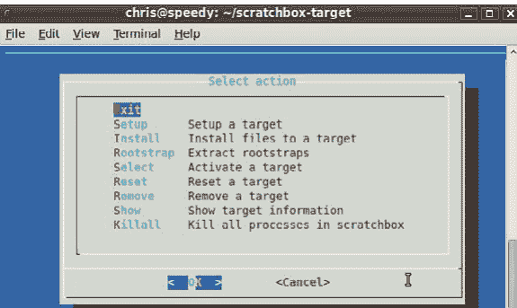

**图 16-1 Scratchbox menuconfig**

以`Scratchbox`网站上的安装文档 (`installdoc.pdf`) 为指南 (`www.scratch.org/documentation/docbook/instal.html`)，按照以下步骤设置你的`Scratchbox`环境：

- 1. 在`Setup`下创建一个名为`mytarget`的新目标。
- 2. 在选择目标后提示选择交叉编译器。
- 3. 选择`devkits`，然后选择`qemu`。
- 4. 选择`CPU transparency`，然后选择`qemu-arm-sb`。

完成这些步骤后，执行`sb-menu`实用程序。现在你准备好探索`Scratchbox`环境了。

在我们的简短演示中，我们将使用一个简单的`Hello World`程序。在`Scratchbox` `shell`内部使用你喜欢的编辑器创建一个类似于列表 16-2 的简单`Hello World`程序。

**列表 16-2 简单 Hello World 示例**

```c
#include <stdio.h>

int main(int argc, char **argv)
{
    printf("Hello world\n");
    return 0;
}
```

现在在`Scratchbox`环境中编译该程序：

```bash
[mbox-mytarget:~] > gcc -o hello-arm hello.c
```

这使用了你刚刚安装的`Scratchbox` `ARM`工具链编译`hello.c`。你可以验证生成的文件：

```bash
[mbox-mytarget:~] > file hello-arm
hello-arm: ELF 32-bit LSB executable, ARM, version 1 (SYSV), dynamically linked
[mbox-mytarget:~] > ./hello-arm
Hello
```

这使用了刚刚安装的`Scratchbox` `ARM`工具链编译`hello.c`。当然，`Scratchbox`的实际用例比这个示例复杂得多，但架构和方法是显而易见的。

`Scratchbox`包含一个远程`shell`功能，允许开发者直接在真实的硬件上执行某些操作（交互式和非交互式）。它的原理与熟悉的远程`shell` (`rsh`) 类似。它被称为`srsh`，作为`Scratchbox`安装的一部分可用。有关`srsh`的更多细节可以在`Scratchbox`文档中找到。

## 16.3 Buildroot

`Buildroot`是一套`Makefile`和补丁，设计用于构建完整的嵌入式 Linux 发行版。根据`Buildroot`网站，其主要特性包括：

- 它可以构建你的嵌入式 Linux 产品所需的所有组件，包括交叉编译器、根文件系统、内核镜像和引导加载程序。


- 它允许使用熟悉的 `kernel menuconfig` 和相关实用程序进行简单配置。

- 它支持数百个用户空间应用程序和库包，包括 `GTK2`、`Qt`、`GStreamer` 和许多网络工具。

- 它支持 `uClibc` 或 `glibc` 等其他目标库。

### 16.3.1 Buildroot 安装

你需要做的第一件事是找到并下载 Buildroot 快照。最简单的方法是使用 `git`。当然，使用 `git` 而不指定 `tag` 意味着你获取的是树的最新版本，这在任何开源项目中都存在不稳定的风险。对于不那么胆大的人，可以下载稳定的快照。它们列在 Buildroot 网站的下载页面上。对于这些示例，我们将使用 `git`：

```bash
$ git clone git://buildroot.net/buildroot
```

### 16.3.2 Buildroot 配置

安装快照（或 `git` 仓库）后，你就可以开始配置。进入安装 Buildroot 的目录，执行熟悉的配置命令：

```bash
$ make menuconfig
```

这引入了一个你到为止应该非常熟悉的配置实用程序。你曾在 Linux 内核配置以及 Scratch-box 中见过类似的配置菜单。图 16-2 显示了它的样貌。

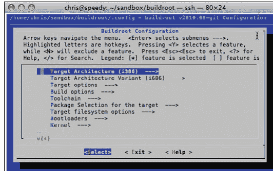

图 16-2 Buildroot 配置

Buildroot 的配置非常详尽。你有许多选项可以用于配置 Buildroot 创建的嵌入式 Linux 发行版的属性。以下是你必须选择的一些重要属性：

- 目标架构（Target architecture）

- 架构变体（Architecture variant），例如 PowerPC 603e 或 ARM 920t

- 目标选项（Target options），例如板级设备和串口

- 构建选项（Build options），定义与构建相关的选项，如构建和下载目录的位置、并行性（并发作业数）以及其他构建属性

- 工具链选项（Toolchain options），包括库类型（`uClibc` 或 `glibc`）和编译器版本。

- 软件包选择（Package selection），例如目标机器上将包含哪些软件软件包

### 16.3.3 Buildroot 构建

在完成简单配置后，只需输入 `make` 即可启动构建。如果你的配置正确且运气足够好，² 你将得到一个

> ² 这种类型的构建失败的原因有许多，我们稍后会进行描述。

一个完整的嵌入式 Linux 发行版。构建可能需要一些时间，因为它正在下载和构建许多软件组件，并执行许多步骤来实现该目标。在构建进行期间，会有大量的输出流式到你的串口终端中。Buildroot 正在执行以下通用步骤：

- 下载所有已配置软件包和工具链的源文件

- 构建交叉编译工具链

- 使用交叉工具链配置并编译所有请求的软件包

- 如果配置了，则构建内核镜像

- 以你选择的格式创建根文件系统

当构建失败时，可以在 `.../output` 目录中查看结果。如列表 16-3 所示。

列表 16-3 Buildroot 输出目录结构

```
chris@speedy~/sandbox/buildroot$ ls -l output
total 28
drwxr-xr-x 7 chris 4096 2010-07-31 16:45 build
drwxr-xr-x 3 chris 4096 2010-07-31 16:45 host
drwxr-xr-x 2 chris 4096 2010-07-31 16:35 images
drwxr-xr-x 5 chris 4096 2010-07-31 16:34 staging
drwxr-xr-x 2 chris 4096 2010-07-31 16:44 stamps
drwxr-xr-x 16 chris 4096 2010-07-31 16:45 target
drwxr-xr-x 18 chris 4096 2010-07-31 16:41 toolchain
```

正确的根文件系统位于 `.../output/images`。由于由于我们在配置构建时指定了 `ext2` 文件系统，因此在 `images` 子目录下有一个 `rootfs.ext2` 镜像：

```
chris@speedy~/sandbox/buildroot$ ls -l /output/images/
total 3728
-rw-r--r-- 1 chris 3817472 2010-07-31 16:45 rootfs.ext2
-rwxr-xr-x 1 chris 65656 2010-07-31 17:31 u-boot.bin
```

Buildroot 非常灵活，并拥有许多配置选项。只需在构建配置期间指定 U-Boot Makefile 中的启动名称（不带 `_config` 后缀），Buildroot 就可以为特定开发板构建 U-Boot。在本例中，指定了 `ap920t`，并生成了 U-Boot 镜像 (`u-boot.bin`)。Buildroot 文档对此有更多细节。

下载地址：www.wowebook.com

## 16.3 Buildroot

Buildroot 输出子目录中的其他目录（如列表 16-3 所示）包含了用于存放中间构建目标的目录。`staging` 子目录用于存放本身作为其他软件包依赖项的软件包构建目标。`toolchain` 目录包含交叉工具链编译所需的组件。`host` 目录包含为了支持 Buildroot 而构建的宿主机特定工具。这些包含了 `fakeroot`（用于在没有 root 权限的情况下构建文件系统）以及用于镜像生成的程序。`target` 目录是根文件系统的副本，但它不能直接作为根系统，因为用户、组、权限和设备节点是错误的。`Fakeroot` 使用此目标目录来构建最终镜像。最后，`build` 目录是所有组件（交叉工具链除外）被构建的地方。

Buildroot 是一个强大的构建系统，可以构建完整的 Linux 发行版。请参阅 `http://buildroot.uclibc.org/docs.html` 中的 Buildroot 文档。

## 第16章 开源构建系统

## 16.4 OpenEmbedded

OpenEmbedded 在商业和开源项目中都赢得了巨大的关注。许多嵌入式 Linux 的商业供应商（包括 Mentor Graphics 和 MontaVista Software）已采用 OpenEmbedded 作为其基础。

### 16.4.1 OpenEmbedded 的组成

OpenEmbedded 由两个主要元素组成，如 16-3 所示。`Bitake` 是构建引擎，是一个强大的工具。元是告诉 `Bitake` 构建什么内容的指令集。

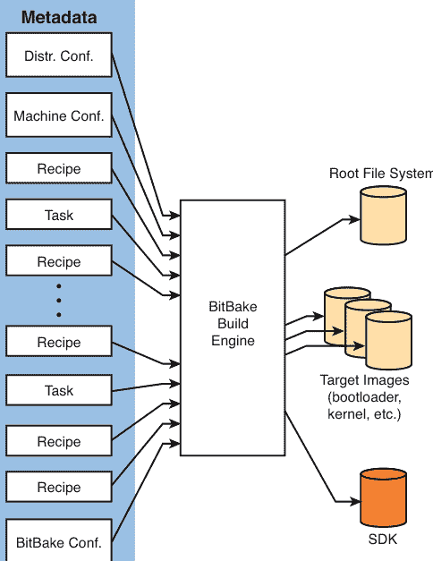

图 16-3 Bitake 与元

`Bitake` 处理元，提供描述构建内容的指令。在构建结束时，`Bitake` 生成所有请求的镜像，包括根文件系统、内核、引导程序以及中间设备树二进制文件。OpenEmbedded 最强大的功能之一是创建软件开发包 (`SDK`)。这些 `SDK` 可以包含工具链、库和头文件，供开发人员使用。

### 16.4.2 Buildake 元

元可以大致分为四类，每类都履行特定的角色：

- 配方（Recipes）

- 类（Classes）

- 任务（Tasks）

- 配置（Configuration）

最常见的元类型是配方文件。配方通常包含 `Bitake` 构建单个软件包的指令。配方描述了软件包、依赖项以及构建该软件包可能需要的任何特殊操作。

类的角色类似于 C++ 或 Java 等面向对象语言中的类。它们用于在大量配方之间封装通用功能。

任务通常用于分组软件包以构建根文件系统。它们通常是简单的文件，通常包含几行软件包依赖关系。

配置元在定义 `Bitake` 的整体行为方面起着重要作用。配置数据提供了全局变量，如构建路径、默认镜像构建命令以及特定机器的细节。它还定义了正在构建的发行版的特征，例如使用哪个工具链和 C 库（`uClibc`、`glibc` 等）。

### 16.4.3 配方基础

OpenEmbedded 元的基本单位是配方。配方通常是一个文件或一组小文件，用于构建单个软件包。检查一个简单的配方是理解 OpenEmbedded 元语言的一个好方法。

16.4 OpenEmbedded 457

列表 16-4 OpenEmbedded 版本的 Hello World。该配方（recipe）构建了一个简单的 Hello 应用，并为包含在最终根文件系统中做好准备。它在文件系统中名为 `hello_1.0.0.bb`。


``` 
LISTING 16-4 Simple OpenEmbedded Recipe: hello_1.0.0.bb
DESCRIPTION = "Hello demo project"
PR = "r0"
LICENSE = "GPL"

SRC_URI = "http://localhost/sources/hello-1.0.0.tar.gz"
SRC_URI[md5sum] = "90a8fd7d3e4b47b6bd24852fb95e493b"
SRC_URI[sha256sum] = "fd626b829cf1d265abfeac37c2b5629f2ba8fc389729f-9661caa40fe12"

do_install() {
    install -m 0755 -d $(bindir)
    install -m 0755 $()/hello $(bindir)/hello
}
```

前几个字段是较简单的元数据：

- `DESCRIPTION`—关于软件包本身的描述性信息
- `PR`—软件包（配方）版本号
- `LICENSE`—软件包许可证

`SRC_URI[md5sum]` 必须存在于每个配方中。它定义了 `BitBake` 将使用的方法（在本例中为 http）和位置（`localhost/sources/hello-1.1.0.tar.gz`），用于定位并获取组成软件包的文件。源码可以使用多种方法以多种形式获取。例如，源码可以从 `git`、`svn` 或0 仓库（本地或远程）获取。源码也可以从本地或互联网服务器上的文件或归档包（`tarball`）获取。

`SRC_URI[md5sum]` 是一种检查校验和的方法，用于验证获取的正确性。如果提供了远程 md5 或 sha256 签名文件，将将其与这些值进行对比，以确保下载正确。

`do_install` 方法是 `BitBake` 默认安装方法的函数覆盖。在示例配方中，`do_install` 方法使用 Linux `install` 命令定义了两个步骤：它创建了一个用于放置构建产物的输出目录

`BitBake` 的模块之一被称为“`fetcher`”（获取器）

在 `www.wobebook.com` 下载

（我们的 `hello` 二进制文件），并将该二进制文件放置在刚刚创建的目录中。目录使用了 autotools 脚本和构建文件中常见的语法。`$(bindir)` 指向目标上的 `/bin`。`S` 和 `D` 是 `OpenEmbedded` 元数据便利变量，分别引用源目录和目标目录。你可以在 Linux 桌面的主页 `man install` 上阅读更多关于 `install` 命令的信息。

`OpenEmbedded` 中的配方可以包含 Python 语言或 bash 脚本语言指令。我们在列表 16-4 中的示例仅包含 bash shell 脚本语言。关于 Python 的讨论超出了本节的范围。

你可能会好奇这个简单的配方如何能构建出 Hello World 应用。我们看到配方中定义了一个安装步骤，但在构建指令方面几乎没有其他内容。`BitBake` 使用以 `.bbclass` 结尾的 bitbake 来处理每个配方。大多数默认处理步骤来自一个名为 `base.bbclass` 的基础类。获取、解压、配置和安装的默认命令正在这里定义。

列表 16-5 显示了构建 Hello 软件包时的 `BitBake` 输出。`BitBake` 可以接受任何配方或任务作为构建目标。

# 列表 16-5 BitBake Hello 配方处理

```
chris@speedy:/sandbox/build01$ bitbake hello
...
NOTE: Executing running
NOTE: task 10 of 38 (ID: 5, Running task 10 of 38 (ID: 5,
/hello_1.0.0.bb, do_fetch)
NOTE: task 11 of 38 (ID: 0, /hello_1.0.0.bb, do_unpack)
NOTE: task 15 of 38 (ID: 1, /hello_1.0.0.bb, do_patch)
NOTE: task 16 of 38 (ID: 7, /hello_1.0.0.bb, do_configure)
NOTE: task 17 of 38 (ID: 8, /hello_1.0.0.bb, do_compile)
NOTE: task 18 of 38 (ID: 2, /hello_1.0.0.bb, do_install)
NOTE: task 19 of 38 (ID: 10, /hello_1.0.0.bb, do_package)
NOTE: task 25 of 38 (ID: 13, /hello_1.0.0.bb, do_package_write_ipk)
NOTE: task 26 of 38 (ID: 9, /hello_1.0.0.bb, do_package_write)
NOTE: task 29 of 38 (ID: 3, /hello_1.0.0.bb, do_populate_syroset)
NOTE: task 30 of 38 (ID: 12, /hello_1.0.0.bb, do_package_syroset)
NOTE: task 37 of 38 (ID: 11, /hello_1.0.0.bb, do_package)
NOTE: task 38 of 38 (ID: 14, /hello_1.0.0.bb, do_clean)
```

## 16.4.5 元数据类

`OpenEmbedded` 中的类与 C++ 和 Java 等面向对象的语言中的类类似。它用于封装可以被许多其他配方（`recipe`）共享的通用功能。`OpenEmbedded` 中的类被用于许多常用函数。

我们在列表 16-6 中看到了 `task-java.bb` 配方中的类示例。这个任务类存在于 `openembedded` 仓库中名为 `classes` 的子目录下的 `task.bbclass` 文件中。它为所有任务所需的函数执行管理工作。其中包含了一些指令，告诉 `BitBake` 此配方不会产生任何需要打包或整合到最终根文件系统的构建产物。它还包含了生成由任务本身集成的软件包的 `-dbg` 和 `-dev` 版本的逻辑。

最常用的类之一之一是 `autotools.class`。该类提供了熟悉的 autotools 环境，许多 Linux 软件包都是基于此构建。你可能对基于 autotools 的软件包很熟悉了。如果你下载了源代码，并在 Linux 桌面系统上按照 `./configure`、`make` 和 `make install` 的顺序进行解压和编译，那么你已经构建了一个基于 autotools 的项目。

`autotools.bbclass` 这种功能。如果你有一个使用 autotools 的源软件包，该配方可以非常简单，即使软件包本身并不简单。列表 16-7 显示了一个简单的基于 autotools 的配方。为了可读性，它进行了略微的格式调整，但没有丢失任何功能。

### 列表 16-7 简单的基于 autotools 的配方：rdesktop-1.5.0.bb

```bb
DESCRIPTION = "Rdesktop rdp client for X"
HOMEPAGE = "http://www.rdesktop.org"
DEPENDS = "virtual/libx1 opens"
SECTION = "x11/network"
LICENSE = "GPL"
PR = "x2"
```

```bb
inherit autotools

SRC_URI = "$(SOURCEFORGE_MIR)/rdesktop/rdesktop-${PV}.tar.gz"
```

```bb
EXTRA_OECONF = "--with-openssl=${STAGING_EXECPREFIXDIR} "
```

这几乎再简单不过了。这个配方为 `rdesktop`（一个用于 X 的 rdp 客户端）提供了构建指令。它包含了标准头：`DESCRIPTION`、`LICENSE`、`PR` 等。接下来是通过 `inherit` 关键字引入的 `autotools.bbclass` 提供的 autotools 功能。`SRC_URI` 告诉 `BitBake` 如何获取源代码。

最后一项说明了基于 autotools 项目的关键特性之一。如果你在构建基于 autotools 的项目时曾向 `~/.configure` 传递过参数，你会发现这很熟悉。`EXTRA_OECONF` 变量在执行 `configure` 步骤时被简单地传递给 `rdesktop` 的 `~/.configure`。这个特定的示例向 `rdesktop` 的 `~/.configure` 脚本传递了 `--with-openssl` 标志。这导致 `rdesktop` 配置了 `openssl` 功能，并告诉它哪里找到编译启用该功能时所需的 `openssl` 文件。

类在 `OpenEmbedded` 中有广泛用途。你可以在 `.../openembedded/classes` 目录下看到当前定义的所有类。


## 16.4.6 配置 OpenEmbedded

使用 OpenEmbedded 最困难的方面之一是获得可工作的配置。为了构建嵌入式 Linux 发行版，需要定义许多内容。以下是必须定义的一些明显的属性：

- 目标架构
- 处理器类型
- 机器特性，如串口、波特率和 Flash 组织结构
- C 库的选择，例如 `glibc` 或几个嵌入式优化后的替代方案之一
- 工具链和 `binutils` 版本（外部的或由 `BitBake` 构建）
- 根文件系统镜像类型
- 内核版本

当然，配置的内容比这里列出的要多得多。配置元数据可以概括为四大类：`BitBake`、`机器（machine）`、`发行版（distribution）` 和本地（local）。`BitBake` 配置 (`bitbake.conf`) 在许多方面类似于 BitBake 的底层管道工作。它定义了系统级变量，如路径、目标文件系统布局以及许多依赖于架构的变量。除非你正在进行特殊操作，否则你不应该编辑此文件。

机器配置放置在描述其的机器的配置文件中。最近的 OpenEmbedded 快照包含了描述 250 多个机器的配置文件。这里是定义机器特定特性（如串口配置以及对镜像格式、内核版本和引导加载程序版本的特定要求）的正确位置。目标架构通常在机器文件中指定。

发行版配置定义了你正在构建的整个嵌入式 Linux 发行的方面。当前版本的 OpenEmbedded 拥有超过 35 个不同命名发行版的发行版文件。`Angstrom` 和 `OpenMoko` 是两个受到 OpenEmbedded 开发者大量关注的示例。

在发行版文件中定义的发行版属性包括工具链类型、C 库类型和发行版版本。对于你在此配置中的基础根文件系统，你通常会放置一个最小规范。OpenEmbedded 元数据中的许多示例提供了更多详细信息。

最后一类配置是 `local.conf`。在这里你可以根据自己的喜好对发行版进行调优和自定义。根据需求，`local.conf` 可以简单也可以复杂。至少 `local.conf` 必须定义你的机器类型和发行版选择，这会将你自定义嵌入式 Linux 发行行的机器和发行版配置结合在一起。OpenEmbedded 元数据包含一个带有许多注释的 `local.conf` 示例，这是一个很好的起点。网上也有特定的 `local.conf` 示例。关于 BeagleBoard 的 OpenEmbedded 指南可以在 BeagleBoard 的 wiki 基中找到：http://elinux.org/BeagleBoard#OpenEmbedded。

## 16.4.7 构建镜像

OpenEmbedded 中最强大的配方是镜像配方。你可以使用一个构造良好的镜像配方构建整个 Linux 发行版。OpenEmbedded 元数据集中包含近百个镜像配方。你可以直接使用它们，也可以修改它们以满足你的需求。

常用的镜像配方包括 `console-image` 和 `x11-image`。前者构建一个启动到命令行提示符的基础镜像。后者产生一个驱动图形显示的镜像，包含了所需的图形支持库。

使用 `BitBake` 可以轻松地构建这些镜像：

```bash
$ bitbake console-image
```

这个简单的命令构建一个根文件系统，其中包含了让嵌入式设备启动到命令行提示符的软件包集合。没有任何阻止你向镜像配方添加其他输出。例如，你可以构建一个配方来生成你的根文件系统、内核镜像、引导加载程序镜像以及目标板所需的任何其他文件。

我们可以为 OpenEmbedded 主题编写一整本书。希望这段简短的介绍能帮助你开始使用这个强大的构建系统。亲身实践学习技术是不可替代的。

## 16.5 总结

有很多开源构建系统可用。我们对最流行的系统提供了介绍性覆盖。OpenEmbedded 是最新获得广泛采用并有大量开发者投入该项目的构建系统：

- `Scratchbox` 是一个模拟目标架构以简化交叉编译过程的环境。
- `Buildroot` 已经在许多项目中广受欢迎，并在开发社区中拥有良好的开发者和用户群。
- `OpenEmbedded` 基于最先进的技术，代表了嵌入式 Linux 构建系统的最新水平。

任何一种构建系统都能帮助你应对为产品构建自定义嵌入式 Linux 系统的巨大挑战。

### 16.5.1 阅读建议

`Scratchbox` 网站和文档

www.scratchbox.org/

`Buildroot` 主页

www.buildroot.org/

`OpenEmbedded` 主页

www.openembedded.org/

# 第 17 章

## Linux 与实时性

本章内容

- 17.1 什么是实时？ 466
- 17.2 内核抢占 469
- 17.3 实时内核补丁 473
- 17.4 实时内核性能分析 478
- 17.5 总结 485

当 Linux 最初在英特尔 i386 处理器上诞生时，没有人预料到它会在服务器应用中取得如此巨大的成功。这种成功导致 Linux 被移植到许多不同的架构，并被开发者用于从蜂手机到电信交换机的各种嵌入式系统。不久前，如果你的应用程序有实时性需求，你可能不会将 Linux 纳入操作系统的选择范围。这段历史从回顾实时 Linux（很大程度上如此）以及多媒体应用的发展开始说。

本章首先简要回顾实时 Linux 特性的历史发展。然后，我们将介绍实时程序员可以使用的设施以及如何使用这些设施。

## 17.1 什么是实时？

问五个人“实时”意味着什么，你可能会得到五个不同的答案。有些人甚至会引用具体的数字。为了讨论起见，我们将涵盖各种场景然后提出一个定义。许多需求可以被称为“软实时”，而另一些则被称为“硬实时”。

### 17.1.1 软实时

大多数人认为，软实时意味着操作有一个截止时间（deadline）。如果错过了截止时间，体验质量可能会下降，但不是致命的。你的桌面工作站就是软实时要求的完美示例。当你正在编辑文档时，你期望在屏幕上立即看到击击键的结果。当你播放你喜爱的 mp3 文件时，你期望获得高质量的音频，没有任何任何咔哒声、破音声或音乐间隙。

通而言之，人类看不到或听不到小于几十毫秒的延迟。当然，音乐家会告诉你，比这更小的延迟也会影响音乐的色彩。如果这些所谓的软实时事件错过了截止时间，结果可能不如人意，导致体验的“质量”水平降低，但不是灾难性的。

### 17.1.2 硬实时

硬实时的特征在于错过截止时间的结果；这些结果往往是灾难性的。在硬实时系统中，如果错过了截止时间，结果就是一个相对概念。如果你的嵌入式设备正在控制喷气式飞机引擎的燃料流量，错过响应飞行员输入或操作特性变化的截止时间可能会导致灾难性的结果。

注意，截止时间的持续长短与实时特性无关。处理原子钟的滴答（tick）就是这样一个例子。只要滴答在下一个滴答到来之前的 1 秒窗口内被处理，数据就是有效的。错过对某个滴答的处理可能会让我们的全球定位系统产生几英尺或几英里的偏差！

基于此，我们引用了一套常用的软实时和硬实时定义：如果错过了截止时间，计算或结果的值就会降低。对于硬实时系统，如果错过了任何一个截止时间，根据定义，该系统被认为已经失败了，这可能会导致灾难性的后果。

### 17.1.3 Linux 调度

`UNIX` 和 `Linux` 在设计进程调度时都是为了公平性。也就是说，调度器会尽力将可用资源分配给所有需要 CPU 的进程，并保证每个进程都能取得进展。这种设计目标本身与实时进程的要求是背道而驰的。实时进程在就绪绪时必须被赋予绝对优先级来运行。实时意味着具有可预测和可重复的延迟。

### 17.1.4 延迟

实时进程通常与物理事件相关，例如来自外围设备的中断到达。图 17-1 描述了 Linux 系统中的延迟组件。延迟测量从接收我们想要处理的中断开始。这如图 17-1 中的时间 `$t0$` 所示。有时中断发生并被传递给中断服务程序（ISR），如时间 `$t1$` 所示。这种中断延迟几乎完全由最大中断关闭（maximum interrupt off）决定——即在禁用硬件中断的执行线程中所花费的时间。

> 我们忽略了中断处理的上下文切换时间，因为与中断关闭相比，它通常是可以忽略不计的。

| 中断事件 | ISR 运行 | 向 RT 进程信号 | RT 进程运行 |
| :--- | :--- | :--- | :--- |
| | | | |

# 中断到进程的延迟

图 17-1 延迟组件

在实际的 ISR 中尽量减少处理工作被认为是良好的设计实践。事实上，这种执行上下文的能力是有限的（例如，ISR 不能调用阻塞函数，即可能会睡眠函数）。因此，理想的方法是简单地处理硬件设备，并将数据处理留给 Linux 下半部（bottom half），也称为 `softirqs`。下半部处理有几种类型；最好的描述见 Robert Love 的书籍《Linux Kernel Development》。参考资料请参见本章末尾的章节。


当 ISR/下半部完成处理后，通常的情况是唤醒等待数据的用户进程。这如图 17-1 中的时间 $t2$ 所示。稍后，调度器选择实时进程运行，并赋予该进程 CPU。这如图 17-1 中的时间 $t3$ 所示。在进程上设置实时属性（`SCHED_FIFO` 或 `SCHED_RR`）会使其具有比普通进程更高的优先级，并允许它成为下一个运行的进程，即使它之前在 I/O 上阻塞了。

## 17.2 内核抢占

在 Linux 早期，不存在内核抢占。这意味着当用户进程请求内核服务时，在进程进程阻塞（睡眠）之前，其他任务无法被调度。使内核变为可抢占意味着当一个进程在内核运行时，另一个进程可以抢占第一个进程并允许运行，即使第一个进程尚未完成内核处理。图 17-2 描述了这一序列。

| 图 17-2 |
| :--- |
| | |
图 17-2 内核抢占

### 17.2.1 抢占的障碍

使内核完全可抢占的挑战在于识别内核中所有必须免受抢占影响的地方。这些是内核中的关键区域，不允许发生抢占。例如，假设图 17-2 中的进程 A 正在内核中执行文件系统操作。在某个点，代码可能需要写入代表文件系统中文件的内核数据结构。为了保护该数据不受损坏，进程必须锁定其他进程无法访问共享数据。列表 17-1 使用 C 语法说明了这一概念。

> 有趣的是，关于“preable”的正确拼写有很大争议！我听从 Rick Lehrabaum 的调查。

#### 列表 17-1 锁定关键区域

```c
preempt_disable();
...
/* 关键区域 */
update_shared_data();
...
preempt_enable();
...
```

如果我们不以此方式保护共享数据，更新数据结构的进程可能会在更新过程中被抢占。如果另一个进程尝试更新同一个共享数据，数据损坏几乎是肯定的。经典的例子是两个进程直接对公共变量进行操作并根据其值做出决策。图 17-3 描述了这样的情况。

在图 17-3 中，进程 A 在更新共享数据后但在根据该数据做出决策之前被中断了。根据设计，进程 A 无法检测到自己已被抢占。在进程 A 再次运行之前，进程 B 修改了共享数据的值。如你所见，进程 A 将根据由进程 B 确定的值做出决策。如果这不是你所寻求的行为，你必须在进程 A 中处理共享数据时禁用抢占——在这种情况下，即对变量 `count` 的操作和决策。

### 17.2.2 抢占模型

内核抢占的第一种解决方案是在内核代码的战略位置放置检查，在这些位置上，已知抢占当前的执行线程是安全的。这些位置包括系统调用的进入和退出、内核锁的释放以及从中断处理中返回。在这些点中的每一个点，都使用了与列表 17-2 类似的代码来执行抢占。

#### 列表 17-2 类 Linux 2.4+ 抢占补丁的抢占检查

```
/*
 * 此代码在 Linux 内核的战略位置处执行，
 * 在这些位置上，已知抢占当前的
 * 执行线程是安全的
 */
if (kernel_is_preemptable() && current->need_resched)
    preempt_schedule();
```

```
/*
 * 此代码位于 ...kernel/sched.c 中，并被
 * 上述的战略位置调用
 */
#ifdef CONFIG_PREEMPT
asmlinkage void preempt_schedule(void)
{
    while (current->need_resched) {
        ctx_sw_off();
        current->state |= TASK_PREEMPTED;
        schedule();
        current->state &= ~TASK_PREEMPTED;
        ctx_sw_on_no_preempt();
    }
}
#endif
```

列表 17-2 中的第一个代码段（从实际代码简化而来）在前面描述的战略位置被调用，在这些位置上，内核内核抢占是安全的。列表 17-2 中的第二个代码段是应用了抢占补丁的早期 Linux 2.4 内核的实际代码。这个有趣的 `while` 循环通过调用 `schedule()` 导致上下文切换，直到所有的抢占请求都得到满足。

尽管抢占降低了 Linux 系统的延迟，但它并不是理想的。致力于低延迟的开发人员很快意识到需要“反转逻辑”。在早期的抢占模型中，我们有如下：

- Linux 内核从根本上是不可抢占的。
- 抢占检查散落在内核中已知对抢占是安全的战略位置。
- 仅在这些已知的安全点上启用抢占。
- Linux 内核在在任何地方都是完全可抢占的。
- 仅在临界区周围禁用抢占。

这是内核开发者自原始的可抢占内核补丁系列以来一直努力的方向。然而，这并不是一项轻而易的任务。它涉及仔细研究整个内核源码库，精确分析哪些数据必须免受并发影响，并仅在这些位置禁用抢占。用于此方法的方法是对内核进行延迟测量插桩，找到延迟最低的代码路径并对其进行修复。最近的 Linux 2.6 内核由于在这一“打破锁”方法论上付出的努力，可以配置用于极低延迟的应用。

### 17.2.3 SMP 内核

有趣的是，创建高效多处理器架构所涉及的大部分工作也使实时系统受益。对称多处理 `SMP` 是一种多处理架构，其中多个 CPU（通常位于同一块板上）共享相同的内存和其他资源。`SMP` 的挑战比单处理器挑战更复杂，因为多了一个额外的需要保护的并发元素。在单处理器模型中，同一时间只有一个任务可以在内核中执行。免受并发影响的保护仅涉及免受中断或异常处理的保护。在 `SMP` 模型中，除了来自中断和异常处理的威胁外，内核中还存在多个执行线程。

`SMP` 从早期的 Linux 2.x 内核开始就得到了支持。一个大内核锁（`BKL`）被用于保护内核从单处理器到 `SMP` 操作免受并发影响。`BKL` 是一个全局自旋锁，它防止任何其他任务在内核中执行。在《内核开发》一书中，Robert Love 将 `BKL` 描述为“内核的红弃子（redheaded stepchild）”。在描述 `BKL` 的特性时，Robert 幽默地在其属性列表中加入了“邪恶（evil）”属性。

基于 `BKL` 的 `SMP` 内核早期实现导致了调度效率的严重低下。发现其中一个 CPU 可能会长时间处于空闲。导致高效 `SMP` 内核的许多工作也使实时应用受益——主要是降低了延迟。用仅环绕需要保护的实际共享数据的更细粒度锁取代 `BKL` 导致了抢占延迟的降低。

### 17.2.4 抢占延迟的来源

实时系统必须能够在指定的时间边界内处理其实时任务。实现一致的低抢占延迟对于实时系统至关重要。导致抢占延迟的两个最大因素是中断上下文处理和禁用中断的临界区处理。你已经了解到，大量的精力已目标于减小临界区的大小（从而缩短持续时间）。这使得中断上下文处理成为下一个挑战。这通过 Linux 2.6 实时补丁得到了解决。

## 17.3 实时内核补丁

硬实时的支持仍不在主内核源码树中。要启用硬实时，必须应用补丁。实时补丁是减少 Linux 延迟的几项倡议的结果；你可以在 `kernel.org/pub/linux/projects/rt/` 找到它。2.6 内核的软实时性能自 2.6.12 版本起有所提高，在足够快的 x86 处理器上可以轻松实现重复的延迟。获得微秒级的延迟需要实时补丁。

实时补丁为 Linux 内核添加了许多重要功能。图 17-4 显示了应用补丁后的抢占配置选项。

| 选项帮助 | | |
|---|---|---|
| 名称 | | Y 值 |
| PC S/2 样式键盘 | `PC_KEYBOARD` | N - N |
| 对称多处理抢占 | `SMP*` | N - N |
| 抢占模式 | | |
| 无强制抢占（服务器） | `PREEMPT_NONE` | N - N |
| 自愿内核抢占（桌面） | `PREEMPT_VOLUNTARY` | N - N |
| 抢占内核（低延迟桌面） | `PREEMPT_DESKTOP` | N - N |
| 完全抢占（实时） | `PREEMPT_RT` | Y Y |
| 线程排序 | `PREEMPT_SOFTIRQS` | Y Y |
| 线程头部 | `PREEMPT_HARDDIQS` | Y Y |
| I KLU | `PKLE_HLU` | Y Y |
| 高内存支持 | `HIGHMEM` | N - N |
| 抢占模式 | | |
| 抱歉，此选项暂无可用帮助 | | |

图 17-4 带有实时补丁的抢占模式

实时补丁增加了第四种抢占模式 `PREEMPT_RT`，或抢占实时。这四种抢占模式如下：

- `PREEMPT_NONE`——无强制抢占。平均整体延迟良好，但偶尔会出现延迟。最适用于以整体吞吐量为最高设计标准的应用。
- `PREEMPT_VOLUNTARY`——减少延迟的第一阶段。在内核战略位置放置了额外的显式抢占点以降低延迟。牺牲部分整体吞吐量以换取更低的延迟。
- `PREEMPT_DESKTOP`——这在处理临界区外的内核任何地方启用抢占。这种模式适用于音频和多媒体等软实时应用。牺牲整体吞吐量以换取进一步降低延迟。


# PREEMPT_RT—添加了实时补丁的功能，包括将自旋锁（`spinlock`）替换为可抢占的互斥锁（`mutex`）。这使得除了受 `preempt_disable()` 的区域外，内核中的任何地方都可以进行非强制抢占。这种模式显著平滑了延迟波动，并为时间敏感的实时应用提供了低且可预测的延迟。

如果你的内核配置启用了内核调度，可以在启动时通过向内核命令行添加以下内核参数来禁用它：

```
preempt=0
```

## 17.3.1 实时特性

通过 `CONFIG_PREEMPT_RT` 启用新的 Linux 内核功能。图 17-4 显示了几个新的配置设置。这里描述了实时 Linux 内核补丁的这些或其他特性。

实时补丁将系统中的自旋锁转换为优先级继承互斥锁。这以增加自旋锁（互斥锁）处理开销为代价降低了整体延迟，从而导致系统整体吞吐量下降。将自旋锁转换为互斥锁的好处是它们是可以抢占的。如果进程 A 正持有一个锁，而高优先进程 B 需要同一个锁，那么当进程 A 持有互斥锁时，进程 B 可以抢占进程 A。

选择 `CONFIG_PREEMPT_HARDIQS` 后，中断服务程序（ISR）被强制在进程上下文中运行。这让开发者能够控制 ISR 的优先级，因为它们变成了可调度的实体。因此，它们也变得可抢占，以允许更高优先级的硬件中断被优先处理。由于它们可以被调度，你可以根据系统需求，类似于调度其他任务的方式为它们分配优先级。

`CONFIG_PREEMPT_SOFTIRQ` 通过在内核 `softirq` 守护进程（`ksoftirqd`）的范围内运行 `softirq` 来降低延迟。`ksoftirqd` 是一个真正的任务（进程）。因此，它会和其他任务一起被优先排序并调度。如果你的内核配置为实时，并且启用了 `CONFIG_PREEMPT_SOFTIRQ`，则 `ksoftirqd` 内核任务将提升到实时优先级，以处理 `softirq`。列表 17-3 显示了近期 Linux 内核中负责此操作的代码，位于 `...kernel/softirq.c`。

```
LISTING 17-3 提升至实时状态
static int ksoftirqd(void * __data)
{ /* 优先级需要低于硬中断 */
    struct sched_param param = { .sched_priority = MAX_USER_RT_PRIO/2 - 1 };
    struct softirqdata *data = __data;
    u32 softirqdq_mask = (1 << data->nr);
    struct softirq_action *h;
    int cpu = data->cpu;

    sys_sched_scheduler(current->pid, SCHED_FIFO, &param);
    current->flags |= PF_SOFTIRQ;
    ...
}
```

在这里我们看到 `ksoftirqd` 内核任务通过 `sys_sched_scheduler()` 内核函数提升为实时任务（`SCHED-FIFO`）。

## 17.3.2 O(1) 调度器

O(1) 调度器从 Linux 2.5 时代一直存在。提到它是因为实时解决方案的关键组件。O(1) 调度器相比之前的 Linux 调度器有了重大改进。它对于具有许多进程的系统具有更好的扩展性，并有助于降低延迟。

如果你好奇，O(1) 是一阶系统的数学表示法。在这种语下，意味着做出调度决策的时间不依赖于给定运行队列上的进程数量。旧的 Linux 调度器不具备这一特性，其性能随进程数量的增加而下降。

> 3 参见本章末尾引用的《内核开发》，了解更多关于 `softirqs` 的信息。

> 4 我们再次引用 Robert Love 的书，书中对 O(1) 调度器进行了极好的讨论，并对算法复杂度进行了美妙的批判，O(1) 符号法正是源于此。

## 17.3.3 创建实时进程

你可以通过设置调度器作为调度算法一部分使用的进程属性，将进程指定为实时。列表 17-4 显示了通用方法。

LISTING 17-4 创建实时进程

```
#include <sched.h>

#define MY_RT_PRIORITY MAX_USER_RT_PRIO /* 最高可能值 */

int main(int argc, char **argv) {
    int rc, old_scheduler_policy;
    struct sched_param my_params;
    ...
    /* 传递零表示指定调用者（我们）的策略 */
    old_scheduler_policy = sched_getscheduler(0);

    my_params.sched_priority = MY_RT_PRIORITY;
    /* 传递零指定调用者（我们）的 pid */
    rc = sched_setscheduler(0, SCHED_RR, &my_params);
    if ( rc == -1 )
        handle_error();
}
```

这段代码段在调用 `sched_setscheduler()` 时做了两件事。它将调度策略更改为 `SCHED_RR`，并将优先级提高到系统的最高级。Linux 支持三种调度策略：

- `SCHED_OTHER`—普通 Linux 进程，公平性调度。
- `SCHED_RR`—带有时间片的实时进程。换句话说，如果它阻塞，将在调度器给定的时间内运行。
- `SCHED_FIFO`—实时进程，直到它阻塞或显式让处理器，或者另一个更高优先级的进程变为就绪。

## 17.4 内核性能分析

检查实时性能的插桩曾是随意的。那个时代已经结束了。`Ftrace` 取代了本书出版时存在的旧版追踪机制。`Ftrace` 是一套强大的追踪工具，可以为开发者详细查看内核内部情况。关于 `Ftrace` 系统的完整文档可以在 `...Documentation/trace/ftrace.txt` 找到。

### 17.4.1 使用 Ftrace

在使用 `Ftrace` 之前必须在内核配置中启用。图 17-5 显示了近期内核的相关配置。

`Ftrace` 有许多可用模块。谨慎的做法是只选择特定测试期间可能需要的模块，因为每个模块都会增加一定程度的内核开销。

启用追踪的通用框架是通过导出到 `debugfs` 的接口。假设你已经在内核配置中正确启用了 `Ftrace`，你必须挂载 `debugfs`。操作如下：

```
# mount -t debugfs debug /sys/kernel/debug
```

完成后，你应该在 `/sys/kernel/debug` 下找到一个名为 `tracing` 的目录。该目录包含了 `Ftrace` 数据的所有控制和输出源。在我们随后的章节中与该系统交互时，这将变得更加清晰。正如内核文档建议的，我们将使用符号 `/tracing` 来简化报告和与 `Ftrace` 子系统的交互：

```
# ln -s /sys/kernel/debug/tracing /tracing
```

从现在开始，我们将引用 `/tracing` 而不是更长的 `/sys/kernel/debug/tracing`。

### 17.4.2 非抢占延迟测量

内核在处理关键共享数据结构时使用调用来禁用抢占。当禁用抢占时，中断仍然发生，但更高优先级的进程无法运行。你可以使用 `Ftrace` 的 `preemptoff` 功能来分析抢占时间。

要启用非抢占延迟的测量，请在内核配置的内核 hacking 子菜单启用 `PREEMPT_TRACER` 和 `PREEMPT_OFF_HIST`。这种追踪模式能够检测禁用抢占时的最延迟路径。准备 `Ftrace` 进行 `preemptoff` 量的通用方法如下：

```
# echo preemptoff /tracing/current_tracer
# echo latency-format > /tracing/trace_options
# echo 0 >/tracing/tracing_max_latency
# echo 1 > /tracing/tracing_enabled
<do some processing>
# echo 0 > /tracing/tracing_enable
```

## 第 17 章 Linux 与实时

列表 17-5 显示了由该系列命令产生的跟踪输出。注意头部中显示了 221 微秒（`microseconds`）的最大延迟。

## 列表 17-5 preemptoff 跟踪


```
# cat /tracing/trace
# tracer:preemptoff
#
# preemptoff latency trace v1.1.5 on 2.6.34-rt20
#
# latency: 221 us, #239/239, CPU#0 | (M:preemptoff VP:0, KP:0, SP:0 HP:0 #P:8)
#
#    | task: -0 (uid:0 nice:0 policy:0 rt_prio:0)
#
#    => started at: acpi_idle_enter_bm
#    => ended at:
#                               CPU#
                               /--> irqs-off
                / |------ need-resched
               /  |------ hardirq/softirq
              / /|------ preempt-depth
                             / /|--> lock-depth
                             /|--> delay
                               | \
# cmd      pid | time | caller
# /        | | | |
<idle>-0  0d.1. 0us | acpi_idle_do_entry <acpi_idle_enter_bm
<idle>-0  0d.1. 1us | ktime_get_real <-acpi_idle_enter_bm
<idle>-0  0d.1. 1us | getstimeofday <ktime_get_real
<idle>-0  0d.1. 1us | ns_to_timeval <-acpi_idle_enter_bm
<idle>-0  0d.1. 1us | ns_to_timespec <ns_to_timeval
<.. many lines omitted for brevity...
<idle>-0  0d.3. 220us | native_acpi_mem_write <-lapic_next_event
<idle>-0  0d.2. 220us | raw_spin_idle_irqrestore
<tick_broadcast_oneshot_control
<idle>-0  0d.2. 220us | raw_spin_idle_irqrestore <clockevents_notify
<idle>-0  0d.1. 220us | enter_idle <-cpu_idle
<idle>-0  0d.1. 220us | rcu_read_lock <--atomic_notifier_call_chain
<idle>-0  0d.1. 220us | rcu_read_unlock
<..atomic_notifier_call_chain
<idle>-0  0d.1. 220us | cpu_idle<-rest_init
<idle>-0  0d.1. 220us | stop_critical_timings <-rest_init
```

```
# cat /tracing/tracing_max_latency
```

### 17.4 实时内核性能分析

注意列表 17-5 的最后两行。在这里，我们通过显示 `tracing_max_latency` 的内容，展示了 Ftrace 捕获的最大延迟值。该值将始终根据记录的最大延迟以及与系统路径对应的跟踪文件输出（列表 17-5 的全部内容）进行更新，该路径与此最新的延迟相关联。

### 17.4.3 唤醒延迟测量

实时开发者感兴趣的最关键测量之一是高优先级任务在接收唤醒信号后到开始运行需要多久。当实时进程（具有 `SCHED_FIFO` 或 `SCHED_RR` 调度属性的进程）在系统中运行时，根据定义，它与其他进程共享处理器。当需要处理事件时，实时任务会被唤醒。换句话说，调度器被通知它需要运行。唤醒计时是指从唤醒事件到任务实际获取 CPU 并开始运行的时间。

Ftrace 拥有 `wakeup` 和 `wakeup_rt` 跟踪设施。该设施在跟踪器启用时会记录并跟踪从唤醒到运行的最长延迟。

列表 17-6 由一个简单的 C 测试程序生成，该程序创建并写入文件。在进行文件 I/O 之前，测试程序将自己提升为优先级为 99 的 `SCHED_RR`，并通过向 stdout 写入来设置跟踪系统，类似于从 shell 中发布命令：

```
# echo 0 > /tracing/tracing_enabled
# echo 0 > /tracing/tracing_max_latency
# echo wakeup > /tracing/tracing/current_tracer
# echo 1 > /tracing/tracing_enabled
```

在测试程序发布这些命令后，跟踪完成。列表 17-6 显示了结果。在这种情况下，报告的最大唤醒延迟为 7 微秒。

#### 列表 17-6 唤醒计时跟踪

```
root@speedy:~# cat /tracing/trace
# tracer: wakeup
#
# wakeup latency v1.1.5 on 2.6.33.4-rt20
#
# latency: 7 us, #35/35, CPU#4 | (M:preempt VP:0, KP:0, SP:0 HP:0 #P:8)
#
      | task: -6006 (uid:0 nice:0 policy:2 rt_priority:99)
#
      |       => CPU
      |      => irqs-off
      | |      => needed-requested
      | |      => hardirq
      | |      => preempt-depth
      | | |      => lock-depth
      cmd pid | time | caller
sshd-1789 0d.h3 0us | 1789:120:R [004] 6006:0S
sshd-1789 0d.h3 1us | wake_process <-htimer_wakeup
sshd-1789 0d.h3 1us | check_preempt_wakeup <<try_to_wakeup
sshd-1789 0d.h2 2us | rescheduled_task <-check_preempt_wakeup
sshd-1789 0d.h2 2us | task_w_rt <<try_to_wakeup
sshd-1789 0d.h2 2us | _raw_spin_unlock_irq <<try_to_wakeup
sshd-1789 0d.h1 2us | preempt_schedule <<-raw_spin_unlock
sshd-1789 0d.Nh.. 2us | preempt_schedule <<try_to_wakeup
sshd-1789 0d.Nh.. 2us | _raw_spin_lock <<-htimer_interrupt
sshd-1789 0d.Nh.. 3us | preempt_schedule <<-raw_spin_unlock
sshd-1789 0d.Nh.. 3us | tick_preempt_event <<htimer_interrupt
sshd-1789 0d.Nh.. 3us | tick_dev_event <<tick_dev_program
sshd-1789 0d.Nh.. 4us | ktime_get <<tick_dev_event
sshd-1789 0d.Nh.. 4us | clockevents_program_event --tick_dev_event
sshd-1789 0d.Nh.. 4us | lapic_next_event <<clockevents_program_event
sshd-1789 0d.Nh.. 4us | native_apic_mem_write <<lapic_next_event
sshd-1789 0d.Nh.. 4us | irq_exit <-sm_apic_interrupt
sshd-1789 0d.Nh1. 4us | rcu_irq_exit <-irq_exit
sshd-1789 0d.Nh1. 5us | idle_cpu <-irq_exit
sshd-1789 0d.Nh.. 5us | preempt_schedule_irq <<retint_kernel
sshd-1789 0d.Nh.. 5us | _schedule <-preempt_schedule_irq
```

#### 列表 17-6 继续


```
sshd-1789 4dN... 5us | rcu_sched_qs <---schedule
sshd-1789 4dN.1. 6us | __raw_spin_lock_irq <---schedule
sshd-1789 0d.h2 6us | put_prev_task_fair <---schedule
sshd-1789 0d.h2 6us | update_curr \<prev_task_fair
sshd-1789 0d.h2 6us | task_of \<update_curr
sshd-1789 0d.h2 6us | cpuacct_charge \<update_curr
sshd-1789 0d.h2 6us | rcu_read_lock \<cpuacct_charge
sshd-1789 0d.h2 7us | rcu_read_unblock \<cpuacct_charge
sshd-1789 0d.h2 7us | enqueue_entity \<prev_task_fair
sshd-1789 0d.h2 7us | pick_next_task_rt \<pick_next_task_rt
sshd-1789 0d.h2 8us | dequeue_pusable_task \<pick_next_task_rt
sshd-1789 0d.h3 8us | schedule \<preempt_schedule_irq
sshd-1789 0d.h3 8us | 1789:120:R == [004] 6006:0-Rt
```

当测试程序运行时，它执行 I/O 然后休眠。这保证了如果它没有在 I/O 上阻塞，它将让出处理器。列表 17-6 中的跟踪非常有趣。从头部可以看出，你看到测试以 PID 6006 运行，优先级为 99。你还看到报告的最大延迟为 7 微秒——这无疑是一个非常理想的值。

跟踪输出的第一行是唤醒事件。此时，一个 PID 为 1789 的进程正在运行（sshd 守护进程）。最后一次跟踪是从 sshd 切换到以 RT 优先级作为 6006 运行的测试程序。唤醒和上下文切换之间的行是经过的路径以及相对时间。更多细节请参阅 Linux 源码树中 `Documentation` 子目录下的 `trace/ftrace.txt`。

最大延迟单独位于另一个文件中。要在跟踪运行时显示它，请执行以下命令：

```
# cat /tracing/tracing_max_latency
```

### 17.4.4 中断关闭

要启用中断关闭测量，请确保你的内核配置中启用了 `IRQSOFF_TRACER`。此选项测量在禁用中断的情况下花费的时间。此功能与唤醒延迟类似。以 root 身份启用测量：

```
# echo irsoff >/tracing/current_tracer
# echo latency-format > /tracing/trace_options
# echo 0 > /tracing/tracing_max_latency
# echo 1 > /tracing/tracing_enabled
< ... 处理中 ...
# echo 0 > /tracing/max_latency
```

要读取当前最大值，只需显示 `/tracing/max_latency` 内容：

```
# cat /tracing/max_latency
```

你会注意到中断延迟使用同一个文件启用并显示。这意味着一次只能配置一种测量，否则结果可能会无效。由于这些测量会产生大量的运行时开销，同时启用它们是不智的。

### 17.4.5 死锁检测

要启用死锁检测，请在内核配置中启用 `DETECT_SOFTLOCKUP`。该功能允许检测在内核模式下长时间未进行上下文切换。此功能存在于非实时内核中，但有助于检测极高延迟路径或软死锁条件。要使用死锁检测，请启用该功能并观察控制台或系统日志中的报告。报告所示如下：

```
BUG: soft lockup detected on CPU
```

# 17.5 总结

Linux 越来越多地用于需要实时性能的系统。示例包括多媒体应用以及机器人、工业和汽车控制器。本章介绍了基本概念和分析技术，以帮助你开发和调试实时应用。

- 实时系统的特征是具有截止时间（deadlines）。当错过截止时间导致不便或客户体验下降时，这被称为`软实时`。相比之下，`硬实时`系统在错过截止时间时被认为任务失败。
- 内核抢占（Kernel preemption）是 Linux 内核中解决全系统延迟的第一个重大特性。
- 近期的 Linux 内核支持多种抢占模式，范围从无抢占到全实时抢占不等。
- 实时补丁（real-time patch）为 Linux 内核添加了若干实时特性，从而实现了可靠的低延迟。
- 实时补丁包含了几个重要的测量工具，有助于调试和表征实时 Linux 实现的特性。

## 17.5.1 建议阅读

《Linux Kernel Development》，第 3 版

Robert Love

Addison-Wesley, 2010

# 第 18 章

# 通用串行总 (USB)

### 本章内容

- 18.1 USB 概述 488
- 18.2 配置 USB 495
- 18.3 sysfs 与 USB 设备命名 500
- 18.4 有用的 USB 工具 502
- 18.5 常见的 USB 子系统 508
- 18.6 USB 调试 516
- 18.7 总结 519

从任何衡量标准来看，通用串行总（USB）都取得了巨大的成功。USB 最初的设计是为了克服 PC 架构中存在的各种 I/O 接口的缺点。如今，在当地的电子超级市场里，很难找到没有 USB 接口的电子设备。数码相机、打印机、手机、IP 电话，当然还有键盘和鼠标都是带有 USB 接口设备的典型示例。然而，这个列表比普通读者想象的要长得多。甚至我的一些吉他效果器也有 USB 接口！

为常用设备需要特殊用途输入输出硬件的时代已经过去了。与许多来来去去的技术不同，USB 的承诺实际上已经实现。事实上，在准备这个第二版时，第一批 USB 3.0 的实验性 Linux 驱动刚发布。值得注意的是，Linux 是第一个支持此类标准的操作系统！

## 18.1 USB 概述

USB 初看起来可能很复杂。它有大量的设备和种类很多的嵌入式主机控制器。它有多种工作模式，处理器上（或处理器外部）的特定控制器可能有多种工作模式。如果你查看最近 Linux 内核中 USB 配置选项的完整列表，你会很快发现配置它们可能会令人困惑。我们可以通过理解一些基本的 USB 概念来消除这种困惑。

## 18.1.1 USB 物理拓扑

USB 是一种主/从（master/slave）拓扑结构。每个 USB 总线只能有一个主设备，称为*主机控制器*（host controller）。图 18-1 展示了基本的拓扑结构。

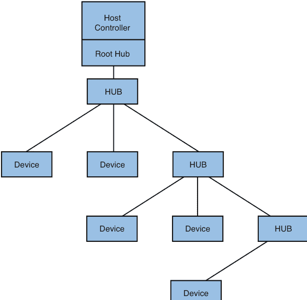

图 18-1 简单的 USB 拓扑

主机控制器始终与根集线器（root hub）相关联。根集线器为主机控制器提供连接点，并在 USB 层次结构的顶端提供集线器功能。常见的安排是将主机控制器和根集线器组合直接引到电路板边缘的连接器（通过收发器芯片）。终端用户看到的就是连接器。

图 18-1 所示的设备是插入 USB 集线器的端点设备单元（endpoint appliances）。一个设备可能支持多个功能，例如提供输入和输出功能的音频接口。这里的关键概念是，每个 USB 设备都连接到其拓扑结构位置上游的一个且仅一个集线器。

USB 总线上的设备以轮询（polled）方式运行，由主机控制器控制。在主机控制器的指导下，一次只有一个设备可以在总线上进行通信。规范中存在机制，可以为设备内的特定功能分配指定部分的带宽。

USB 最成功的特性之一是它是动态的且真正支持热插拔。设备可以随时插到 USB 总线。运行在包含主机控制器的计算机（当然是 Linux）上的软件负责在设备出现在拓扑结构中时对其进行配置。

## 18.1.2 USB 逻辑拓扑

为了更好地理解 USB 系统中的软件组件和数据流，理解 USB 的逻辑拓扑是有用的。图 18-2 显示了一个假设 USB 设备的逻辑结构。

| 设备 | 设备描述符 | | |

| --- | --- | --- |

| | bNumConfigurations | |

| 配置 | 配置 | |

| bNumInterfaces | | bNumInterfaces |

| 接口 | 接口 | 接口 |

| bNumEndpoints | bNumEndpoints | bNumEndpoints |

| EPO Ep[n] | EPO Ep[n] | EPO Ep[n] ... |

| 接口 | 接口 | 接口 |

| bNumEndpoints | bNumEndpoints | bNumEndpoints |

| EPO Ep[n] | EPO Ep[n] | EPO Ep[n] |

| 强制 可选 | | |

图 18-2 USB 设备功能图


每个 USB 设备都有描述符¹，允许软件发现并配置功能。每个设备都必须有一个设备描述符，其中包含制造商 ID（`idVendor`）、产品 ID（`idProduct`）和序列号（`iSerialNumber`）以及配置数量（`bNumConfigurations`）。括号中的标识符是 USB 2.0 规范中引用的字段名。

¹ 这些描述符在 USB 2.0 规范的第 9 章“描述符”中描述。

设备描述符中的每个配置都包含一个配置描述符。配置描述符包含该配置可用的接口数量（`bNumInterfaces`），并指示了在该配置下运行的最大功率（`bMaxPower`）。大多数 USB 设备只有一个配置。然而，某些设备具有高低功率模式，甚至在单个设备中具有不同的功能。这类设备包含多个配置。

配置描述符中的每个接口都有一个接口描述符。接口描述符包含设备有多少个端点（`bEndpoints`）。端点 0 总是存在且不包含接口计数内。接口描述符还包含描述接口类、子类和协议的信息。

端点是软件在 USB 设备运行时通信的实际逻辑元素。接口描述符中的每个端点（端点 0）都包含一个端点描述符。端点描述符定义了端点的通信参数，包括端点地址以及各种描述数据传输特性的属性。我们将介绍 `lsusb` 工具，它可以读取这些描述符。

更多细节可以在本章末尾的完整 USB 规范中找到。

## 18.3 USB 版本

USB 1.0 早在十多年前就引入了。目前的 USB 2.0 规范显示的版本历史最早可溯到 1994 年 11 月，那时已经是 0.7 版本。原始规范要求的传输率为 12 兆比特每秒（Mbps），低速定义为 1.5 Mbps。2.0 版本规范于 2000 年 4 月定稿。² USB 2.0 定义了 480 Mbps 的高速数据传输率。现在有一个 3.0 版本的 USB 规范，规定

² 根据当前 USB 2.0 规范的版本历史。

数据传输速率以每秒千比特计，并又增加了一个速度定义：

超级速（SuperSpeed）。

记住全速（full speed）和高速（high speed）之间的区别可能很难。

以下是总结：

| USB 1.0 低速 | 1.5 Mbps |

| USB 1.0 全速 | 12 Mbps |

| USB 2.0 高速 | 480 Mbps |

| USB 3.0 超速 | 5 Gbps |

## 18.1.4 USB 连接器

除非你是 USB 专家，否则各种 USB 连接器和电缆配置可能会让你感到困惑。由原始规范定义的最熟悉的连接器类型是 USB A 连接器。这是在笔记本电脑和台式电脑上常见的熟悉的矩形连接器。根据定义，USB A 插头的插件端指向上游，即主机控制器/根集线器。图 18-3 显示了一个标准的 USB A 插头。

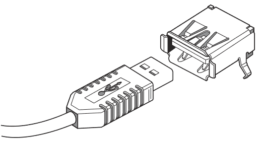

图 18-3 USB A 插头

外设（从设备）设备如打印机或扫描仪通常具有 USB B 插座，并接受 USB B 插头，后者也由原始 USB 规范定义。适用于主机（如 PC）和外设（如打印机）之间连接的电缆一端是插件，另一端是 B 插头。它比 A 插头窄，形状更像 D 形而不是矩形。

根据定义，它始终指向下游，或远离主机控制器/根集线器。

图 18-4 显示了一个 USB B 插头。

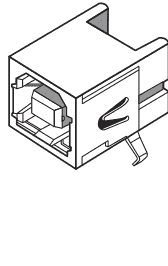

图 18-4 USB B 插头

还有几种微型插头配置。手机和 PDA 等较小的设备推动了对更小插头和插座的需求。USB Mini-A 连接器已被规范废弃，尽管它仍在使用。Micro-B 连接器广泛用于小型外设设备。

Micro-USB 规范定义了三个额外的连接器——Micro-B 插头和插座、Micro-AB 插座以及 Micro-A 插头。Micro-AB 插座仅用于 USB On-The-Go (OTG) 设备，后文将进行讨论。

总结一下标准的 A 和 B 连接器：A 插座始终位于主机端（A 插头指向上游），B 连接器始终位于外设端（B 插头指向下游）。表 18-1 总结了这些特性。

表 18-1 USB 连接器总结

| 连接器 | 插头 | 插座 |

|---|---|---|

| A 系列 | 指向主机（或集线器） | 功能作为主机（或集线器）输出 |

| B 系列 | 指向外设 | 功能作为外设（或集线器）输入 |

## 18.1.5 USB 电缆组件组件

最新的 USB 规范将表 18-2 列出的电缆组件定义为唯一标准的电缆。

表 18-2 USB 电缆及典型应用

| 电缆类型 | 典型应用 |

|---|---|

| 标准 A 插头到标准 B 插头 | 标准主机 (PC) 到打印机等外设设备 |

| 标准 A 插头到 Mini-B 插头 | 标准主机 (PC) 到手机或相机等小型外设 |

| 带标准 A 插头的固定电缆 | USB 鼠标、键盘连接线 |

| Micro-A 插头到 Micro-B 插头 | OTG 外设到外设，例如相机到打印机 |

| Micro-A 插头到标准 A 插座 | Micro-A，连接，例如将键盘连接到 PDA |

| Micro-B 插头到标准 A 插头 | 主机到 OTG 设备 |

| 带 Micro-A 插头的固定电缆 | 小型外设连接线 |

可以采购到未列出的其他类型电缆组件。这些通常用于解决特殊情况，例如过时的（设计错误的）硬件。例如，BeagleBoard 需要一种特殊的适配器，一端是 Mini-A 插头，另一端是 USB-B 插座。Mini-A 插头的第 4 和 5 引脚短路，这似乎是 BeagleBoard 收发器所需的，以便将其配置为主机模式运行。

## 18.1.6 USB 模式

对于初学者来说，USB 最令人困惑的方面之一是各种工作模式。我们听到 USB On-The-Go (OTG)、gadget 和 peripheral 等术语。希望我们已经消除了不同速率和连接器类型的困惑。本节简要介绍 USB 控制器和设备的各种模式。

标准台式 PC 上的 USB 控制器和插座是 USB主机。由于 USB 是主从总线，根据定义 USB 总线上的一个节点必须提供主功能。这就是主机。你会听到它被称为主机模式或简单的 USB 主。主机控制器配合根集线器是运行 USB 主从总线协议的底层硬件。USB 主机始终是总线主。

简单 USB 网络的另一端是设备端。有时这被称为 USB gadget.³Linux 内核中的 gadget 功能仅指以从模式作为设备运行的能力。一旦你进入嵌入式世界，你就不再假设处理设备作为主机。例如，嵌入式世界需要同时在主机和设备模式运行。这被称为 USB-The-Go (OTG)。作为一个额外的好处，OTG 规范允许动态切换角色，而无需重启。

## 18.2 配置 USB

像大多数辅助功能一样，USB 是可选的，必须在你的内核中启用。注意 USB 被选为 M（模块），这将使内核构建系统将 USB 驱动程序编译为可加载模块。

让我们看看在 iMX31 上使 USB 运行的最小配置。对于所有 USB 配置，都需要模块 `usbcore.ko`。当选择 `CONFIG_USB` 时，它会被选中。⁵你可以通过查看列表 18-1 中 USB 驱动支持核心部分的 Makefile 来看到这一点。该 Makefile 位于 `../drivers/usb/core/Makefile`⁶

图 18-5 显示了来自 ARM 架构和 Freescale i.MX31 PDK 板的 Linux 内核的 USB 配置位置。

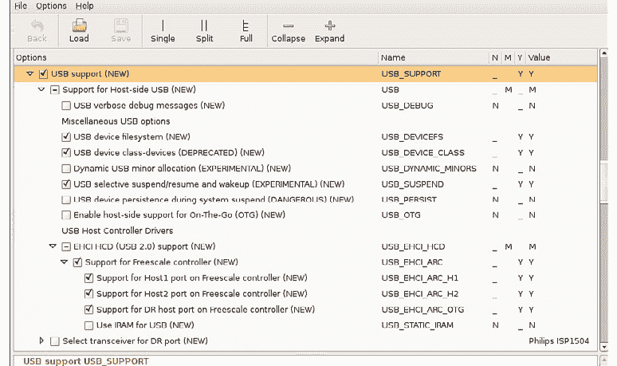

图 18-5 iMX31 的 USB 配置部分

### 列表 18-1 用于 USB Core 的 Makefile

```
#
# 用于 USB Core 文件和文件系统的 Makefile
#
```

```
usbcore-objects      := usb.o hub.o hcd.o urb.o message.o driver.o \
                       config.file buffer.o sysfs.o endpoint.o \
                       devio.o notify.o generic.o quirks.o
```

```
ifeq ($(CONFIG_PCI),y)
    usbcore-objects      += hcd-pci.o
endif
```

```
ifeq ($(CONFIG_USB_DEVICES),y)
    usbcore-objects      += inode.o devices.o
endif
```

```
obj-\$(CONFIG_USB)      += usbcore.o
ifeq ($(CONFIG_USB_DEBUG),y)
EXTRA_CFLAGS           += -DDEBUG
endif
```


通过观察驱动内核构建系统的各种 `Makefile`，总是了解需要哪些组件极极方法，或者反之——了解特定功能需要哪些配置选项。例如，在列表 18-1 中，你可以看到你需要启用 `CONFIG_USB` 才能在构建中包含 `usbcore`。正如第 4 章《Linux 内核：不同的视角》中所学到的，如果 `CONFIG_USB` 设置为 `m`，则该驱动程序被编译为可加载内核模块，并提供 USB 主机支持。

## 18.2. USB 初始化

将 i.MX31 以最小配置启动，我们可以按照如下方式加载 `usbcore` 模块：

```
# modprobe usbcore
```

这加载了 USB 核心模块，它负责为 USB 驱动程序集的其余部分处理通用功能。这些功能包括诸如管理工作（例如为各种元素注册和注册函数），并提供驱动 USB 硬件的接口。这消除了为 USB 硬件编写驱动程序的大部分复杂性。你可以使用交叉编译 `nm` 工具查看公共符号。你在第 13 章“开发工具”中学习了 `nm`。这里有一个使用交叉编译 `nm` 显示注册函数的示例：

```
$ arm_v6_vfp_le-nm uscore.ko | grep T.*register
0000adc0 T usb_register_dev
00094b0 T usb_register_device_driver
0009560 T usb_register_driver
0000cf8 T usb_register_notify
```

`uscore` 还包含处理缓冲的函数；支持 `usbfs`、hub 类驱动程序以及许多其他处理与底层 USB 控制器通信的函数。

`uscore` 本身并不很有用。它不包含任何低级主机控制器驱动程序。这些是独立的模块，并且根据你正在使用的硬件而不同。例如，包含 TI OMAP3530 应用处理器的 BeagleBoard 具有内置的*双角色*控制器。该控制器是 Inventra™ USB 高双控制器。该主机控制器的驱动程序称为 `musb_hdrc`。

在平台上，USB 主机控制器设计为符合增强型主机控制器接口 (EHCI)*，该接口描述了行业标准 USB 主机控制器的寄存器级接口。在这种情况下，当编译为可加载模块时，它被称为 `ehci-hcd.ko`。让我们看看在 Freescale i.MX31 上加载驱动程序会发生什么，如列表 18-2 所示。

### 列表 18-2 在 i.MX31 上安装 USB 主机控制器驱动

```
root@imx31# modprobe ehci-hcd
uscore: registered new interface driver usbfs
uscore: registered new interface driver hub
uscore: registered new device driver usb
fsl-ehci fsl-ehci.0: Freescale On-Chip EHCI Host Controller
fsl-ehci fsl-ehci.0: new usb registered, assigned bus number 1
fsl-ehci fsl-ehci.0: irq 35, io 0x43f88200
```

> 7 双角色控制器可以作为 USB 主机或外设，并在运行过程中在这两种功能之间切换。正如将很快学到的，这被称为 USB On-The-Go (OTG)。

EHCI 规范的引用出现在本章末尾。

### 列表 18-2 继续

```
fsl-ehci fsl-ehci.0: USB 2.0 started, EHCI 1.00, driver 10 Dec 2004
usb usbl: configuration #1 chosen from 1 choice
hub 1-01.0: USB hub found
hub 1-01.0: 1 port detected
fsl-ehci fsl-ehci.1: Freescale On-Chip EHCI Host Controller
fsl-ehci fsl-ehci.1: new usb bus registered, assigned bus number 2
fsl-ehci fsl-ehci.1: irq 36, io 0x43fe88400
fsl-ehci fsl-ehci.1: USB 2.0 started, EHCI 1.00, driver 10 Dec 2004
usb usdb2: configuration #1 chosen from 1 choice
hub 2-01.0: USB hub found
hub 2-01.0: 1 port detected
fsl-ehci fsl-ehci.2: Freescale On-Chip EHCI Host Controller
fsl-ehci fsl-ehci.2: new usb registered, assigned bus number 3
fsl-ehci fsl-ehci.2: irq 37, io 0x43fe88400
fsl-ehci fsl-ehci.2: USB 2.0 started, EHCI 1.00, driver 10 Dec 2004
usb usdb3: configuration #1 chosen from 1 choice
hub 3-01.0: USB hub found
hub 3-01.0: 1 port detected
```

这里有很多有用信息。注意我们在控制台级别，以便这些消息出现在控制台上。首先，我们看到 `uscore` 注册。我们看到 `usbfs` 接口、接口驱动程序和 EHCI 主机驱动。接下来我们看到三个主机控制器被初始化。回想 Freescale iMX31 应用处理器包含三个 USB 器。我们看到这些枚举为 `fsl-ehci.0`、`fsl-ehci.1` 和 `fsl-ehci.2`。你可以看到每个 USB 控制器的中断 (`IRQ`) 分配和基地址。注意，每个根集线器都是 USB 架构的一个组成部分，与主机控制器相关。将外设设备（集线器或其他 USB 设备）连接到主机控制器。

值得注意的是，在本节开始时我们不需要单独安装 `uscore`。`modprobe` 理解如何确定给定模块的依赖关系。只需执行以下命令：

```
modprobe ehci-hcd
```

这在加载 `ehci-hcd` 之前加载了依赖 `uscore`。这种机制在第 8 章“设备驱动程序”中解释。事实上，在许多平台上我们使用 `udev` 系统，这些步骤在第 19 章。

## 18.3 sysfs 和 USB 命名

正如第 9 章“文件系统”所述，`sysfs` 文件系统基本上是内核对象的视图。每个 USB 设备都呈现在 `sysfs` 中。查看任何 USB 系统的 `/sys/bus/devices`。列表 18-3 显示了它在我的 iMX31 样子。注意我删除了文件名以外的所有列，以 `ls -1` 格式适应页面宽度。

### 列表 18-3 iMX31 上 /sys/bus/devices 的输出

```
root@imx31# ls -1 /sys/bus/devices/
total 0
1-0:1.0 -> ../devices/platform/fsl-ehci.0/usb1
2-0:1.0 -> ../devices/platform/fsl-ehci.1/usb2
2-1 -> ../devices/platform/fsl-ehci.1/usb2
2-1:1.0 -> ../devices/platform/fsl-ehci.1/usb2/2-1/2-1.0
2-1:1.0 -> ../devices/platform/fsl-ehci.1/usb2/2-1/2-1.0
3-0:1.0 -> ../devices/platform/fsl-ehci.2/usb3
usb1 -> ../devices/platform/fsl-ehci.0/usb1
usb2 -> ../devices/platform/fsl-ehci.1/usb2
usb3 -> ../devices/platform/fsl-ehci.2/usb3
```

`/sys/bus/usb/devices` 中的所有条目都是 `sysfs` 层次结构其他部分的链接。注意这些数字名称，例如 `1-0:1.0`。在这种命名方案中，根集线器是该总线 USB 层次结构的顶层。第二个数字是给定设备连接的端口号。第三个数字（冒号后的那个）是 USB 设备的配置号，后面是设备的接口号。配置和接口元素是所有 USB 设备的逻辑组件，如第 18.1.2 节所述。

### 总结：

```
1-0:1.0
| | | ---- 接口号
| | | 配置号
| | ----- 端口
| |------ root_hub
```

如果向拓扑结构添加额外的集线器，则通过在设备号后添加点 (`.`) 和集线器端口号连接到上游端口。例如，如果我们向所示的拓扑结构添加一个集线器，我们可能会得到 `1-0.2:1.0`。这假设我们有一个至少两个端口的下游集线器，设备插入端口 2。


如果你检查每个目录链接的内容，就可以确定所引用的组件。例如，列表 18-3 中的第一个条目代表一个逻辑 USB 接口。你可以通过查看符号链接 `l-0:1.0` 指向的文件（也称为 `sysfs` 属性）来判断。它包含了来自接口描述符的条目，如 `binterfaceNumber` 和 `bNumEndpoints`，两者都是 USB 2.0 接口描述符的元素。列表 18-3 中的前两个条目代表 Freescale iMX31 中两个内部 USB 控制器/根集线器的单一接口。

列表 18-3 中的第三个条目 (`2-1`) 代表连接到第二个 USB 总线的外部集线器。特别是，它是该集线器 `struct usb_device` 的表示。

列表 18-3 中以 `usb` 开头的三个条目代表总线本身。你可以看到该系统有三个总线，因为 Freescale iMX31 处理器有三个 USB 控制器。总线号是总线名称的最后一个数字。USB 总线从 1 开始编号。

`usb2` 代表 USB 总线，编号 2（也是一个 `usb_device` 结构体）。

`2-1.3.4:1:0` 表示运行在配置 1 下的接口（my iPod），连接到其父级集线器的端口 4，该集线器连接到父级的端口 3 以及总线 2 根集线器！

## 18.4 有用的 USB 工具

许多实用的工具和程序可以帮助你更好地了解系统、配置驱动程序并获取有关 USB 子系统的详细信息。本节介绍了这些工具。

### 18.4.1 USB 文件系统

USB 文件系统 (`UBSFS`) 是另一种类型的虚拟文件系统。在挂载它之前它是不可用的。某些 Linux 系统会自动挂载 `UBSFS`，但许多系统不会。若要使用 `UBSFS`，还必须在内核中启用它。在内核配置的 USB Support 下选择 `CONFIG_USB_DEVICE`。请注意，该系统已弃用，但仍然包含在最近的内核中，对于理解你的 USB 系统配置非常有帮助。由于几个实用程序依赖于它，它可能还会存在一段时间。

在你的内核配置了 `USB_DEVICEFS` 后（大多数 Linux 发行版默认启用了此项），你必须挂载这个虚拟文件系统才能使用：

```
# mount -t ubsfs ubfs /proc/bus/usb
```

启用后，你应该会得到一个类似于列表 18-4 的输出。

```
列表 18-4 目录列表: /proc/bus/usb
root@lcm31:~# ls -l /proc/bus/usb
total 0
dr-xr-xr-x 2 root root 0 Jun 7 14:00 001
-r--r---- 1 root root 0 Jun 7 14:36 devices
```

挂载 `UBSFS` 后，你可以获得 USB 拓扑结构中发现的设备易读列表，如列表 18-5 所示。

#### 列表 18-5 /proc/bus/usb/devices 的输出

```
root@imx31:~# cat /proc/bus/usb/devices
T:
Bus=03 Lev=00 Port=00 Cnt=00 Dev#=1 Spd=480 MxCh=1
B:
Alloc=0/800 us (% %), #Int=0 #Iso=0
D:
Ver=2.00 Cls09(hub ) Sub=Prot 00 MxPS=64 #CFgs=1
P:
Vendor=0000 ProID=0000 Rev=2.06
S:
Manufacturer=Linux.2.6.24-335-g47af517 ehci_hcd
S:
Product=Freescale On-Chip Host Controller
S:
SerialNumber=fs-ehci.2
C*:
If#=1 Cfg#=1 Atr=e0 MxPwr=0mA
I*:
If#=0 Alt=0 #Eps=1 Cls09(hub ) Sub=Prot 00 Driver=driver
Ad=81(I) Atr=03(Int.) MxPS=4 Ivl=256ms
```

```
T:
Bus=02 Lev=00 Port=00 Cnt=00 Dev#=1 Spd=480 MxCh=1
B:
Alloc=0/800 us (% %), #Int=1 #Iso=0
D:
Ver=2.00 Cls09(hub ) Sub=Prot 00 MxPS=64 #CFgs=1
P:
Vendor=0000 ProID=0000 Rev=2.06
S:
Manufacturer=Linux.2.6.24-335-g47af517 ehci_hcd
S:
Product=Freescale On-Chip Host Controller
S:
SerialNumber=fs-ehci.1
C*:
If#=1 Cfg#=1 Atr=e0 MxPwr=0mA
I*:
If#=0 Alt=0 #Eps=1 Cls09(hub ) Sub=Prot 00 Driver=driver
Ad=81(I) Atr=03(Int.) MxPS=4 Ivl=256ms
```

```
T:
Bus=02 Lev=01 Port=00 Cnt=01 Dev#=2 Spd=480 MxCh=4
D:
Ver=2.00 Cls09(hub ) Sub=Prot 01 MxPS=64 #CFgs=1
P:
Vendor=0053 ProID=0608 Rev=7.02
S:
Product=USB2.Hub
C*:
If#=1 Cfg#=1 Atr=e0 MxPwr=100mA
I*:
If#=0 Alt=0 #Eps=1 Cls09(hub ) Sub=Prot 00 Driver=driver
Ad=81(I) Atr=03(Int.) MxPS=4 Ivl=256ms
```

```
T:
Bus=01 Lev=00 Port=00 Cnt=00 Dev#=1 Spd=480 MxCh=1
B:
Alloc=0/800 us (% %), #Int=0 #Iso=0
D:
Ver=2.00 Cls09(hub ) Sub=Prot 01 MxPS=64 #CFgs=1
P:
Vendor=0000 ProID=0000 Rev=2.06
S:
Manufacturer=Linux.2.6.24-335-g47af517 ehci_hcd
S:
Product=Freescale On-Chip Host Controller
S:
SerialNumber=fs-ehci.1
C*:
If#=1 Cfg#=1 Atr=e0 MxPwr=0mA
I*:
If#=0 Alt=0 #Eps=1 Cls09(hub ) Sub=Prot 00 Driver=driver
Ad=81(I) Atr=03(Int.) MxPS=4 Ivl=256ms
```

## 第 18 章 通用串行总线

这种格式的 `lsusb` 命令显示了总线 2 上的设备 3。添加 `-v` 标志将转储设备的所有描述符，这会产生大量数据，不适合在这里列出。我把这个留给你们练习。如果你有一个 iPod，它会产生非常有趣的输出，因为它有两个配置以及多个接口和端点。

## 18.5 常见的 USB 子系统

本节介绍了你可能会遇到的更常见的 USB 子系统。大多数都易于设置和使用。配合 `udev`（在第 19 章中介绍），在你插入喜爱的 USB 设备后，它们可以被自动配置并即插即用。

接下来的章节详细说明了由 USB 类规范文档定义的标准 USB 类。标准化 USB 类的目的是让可以使用一个通用类驱动程序支持各种不同厂商的设备。当设备符合该类时，不需要特定厂商的驱动程序即可操作该设备。

### 18.5.1 USB 存储类 (Mass Storage Class)

嵌入系统中最常见的 USB “类”或子系统是 USB 存储。它允许 Flash 驱动器和其他外设设备。USB 存储必须在你的内核中配置。USB 最令人困惑的方面之一是它需要 SCSI 子系统。事实上，在较新的内核中，当你选择 USB 存储支持时，`CONFIG_SCSI` 和 `CONFIG_BLK_DEV` 会被自动选择。

通常，这些模块可以静态编译到内核中，也可以配置为动态加载模块。在这些示例中，我们将使用模块，因为它们能更好地说明为了让正常工作所需的组件。因此，你应该知道你需要 `usbcore` 和 `ehci` 作为 Freescale iMX31 的基础。（注意：其他主板可能需要不同的控制器，例如 BeagleBoard。）

为了识别 USB 存储类，我们需要 `usb-storage` 驱动程序。然而，该驱动依赖 `scsi_mod`。如果你的系统配置正确，当你加载 `usb-storage` 时，`modprobe` 能够检测到并加载 `scsi_mod`。这些依赖位于你的 `modules.dep` 文件中，路径为 `/lib/modules/$(uname -r)/modules.dep`。只需搜索 `usb-storage`，就能看到它的依赖项。让我们看看它是什么样子。列表 18-8 显示了插入 `usb-storage` 模块的结果。

#### 列表 18-8 usb-storage 模块


```
root@imx31:~# modprobe usb-storage
SCSI 子系统初始化
初始化 USB 存储驱动...
usbcore: 注册新接口 usb-storage
USB 存储支持注册。
root@imx31:~# lsmod
Module | Size | Used by |
| :--- | :--- | :--- |
| usb_storage | 35872 | 0 |
| scsi_mod | 97552 | 1 usb_storage |
| hci_hcd | 30836 | 0 |
| usbcore | 129752 | 3 usb_storage,ehci_hcd |
```

现在如果我们将 USB 设备插入集线器端口，`usb-storage` 驱动程序将其识别为 usb-storage 设备：

```
usb 2-1.2: 使用 fsl-ehci 的高速 USB 设备，地址为 6
usb 2-1.2: 从 2 个选项中选择了配置 #1
scsi : USB 存储设备的 SCSI 模拟
scsi 1:0:0:0: 直接访问 Apple iPod 1.62 PQ: 0 ANSI: 0
```

然而，我们需要额外的驱动程序来访问 USB 存储设备上的分区。这就是 SCSI 模拟层的作用。`sd-mod` 驱动负责处理 SCSI 磁盘设备。加载此模块后，USB 存储设备内的磁盘设备将被枚举，以及设备上的任何所有分区。列表 18-9 显示了结果。

### 列表 18-9 添加 sd-mod 驱动

```
root@imx31:~# modprobe sd_mod
sd 1:0:0:0: [sda] 1948471 个 4096 字节扇区 (79825 MB)
sd 1:0:0:0: [sda] 写保护关闭
sd 1:0:0:0: [sda] 假设磁盘缓存直通过
```

### 列表 18-9 继续

```
sd 1:0:0:0: [sda] 1948471 个 4096 字节扇区 (79825 MB)
sd 1:0:0:0: [sda] 写保护关闭
sd 1:0:0:0: [sda] 假设磁盘缓存直通过
sda: sda1
sd 1:0:0:0: [sda] 已连接的 SCSI 移动式设备
root@imx31:-# lsmod
Module | Size | Used by |
| :--- | :--- | :--- |
| sd_mod | 20720 | 0 |
| usb_storage | 97552 | 2 sd_mod,usb_storage |
| scsi_mod | |
| hci_hcd | 30836 | 0 |
| usbcore | 129752 | 3 usb_storage,ehci_hcd |
```

我们有了挂载磁盘分区并访问其内容所需的一切。从列表 18-9 中我们可以看到该存储设备上的单个分区被枚举为 `sda1`。假设我们有一个设备节点 `/dev/sda` 且内核支持该文件系统，我们可以挂载此设备：`/dev/sda1`。

当你的设备安装并正确配置了 `udev` 时，所有的设备节点创建都完成了。我们将在下一章介绍 `udev`。为了完整性，如果系统中没有 `udev`，我们将展示如何在系统上创建此设备。sysfs 文件包含 `sda1` 的项：

```
root@imx31:-# find /sys -name sda1
/sys/block/sda/sda1
```

这个 sysfs 有一个名为 `dev` 的属性。它列出了内核分配给 `/dev/sda` 的主号和次号。在我的 Freescale i-MX31 上，分配的主号为8，次号为1。使用这些信息，我们可以创建设备节点并访问分区。列表 18-10 包含了结果。

### 列表 18-10 创建设备节点并挂载设备

```
root@imx31:-# cat /sys/block/sda/dev
8:1
root@imx31:-# mknod /dev/sda1 8 1
root@imx31:-# mkdir /media/disk
root@imx31:-# mount /dev/sda1 /media/disk
```

### 列表 18-10 继续

```
root@imx31:~# dir /media/disk
total 80
drwxr-xr-x 2 root root 16384 Oct 13 Calendars
drwxr-xr-x 2 root root 16384 Oct 13 Contacts
drwxr-xr-x 2 root root 16384 Oct 13 Notes
drwxr-xr-x 2 root root 16384 Oct 13 Recordings
drwxr-xr-x 2 root root 16384 Oct 13 Control
```

### 18.5.2 HID 类

USB HID（人机接口）可能是桌面 Linux 上常见的 USB 设备，有时在嵌入式系统中也是如此。HID 设备相对容易使用。在内核菜单 Device Drivers -> HID Devices 下找到 USB 支持的配置选项。你需要启用 `CONFIG_HID_SUPPORT`、`CONFIG_HID` 和 `CONFIG_USB_HID`。这是实现 USB 定义类的通用驱动程序。只需插入 `ushid` 模块，`modprobe` 会自动包含其依赖项 HID 核心驱动（`hid`）：

```
root@imx31:~# modprobe ushid
usbcore: 注册新接口 ushid
hid: v2.6:USB 核心驱动
root@imx31:~# lsmod
```

| Module | Size | Used By |
| :--- | :--- | :--- |
| ushid | 18980 | 0 |
| hid | 31428 | 1 ushid |
| ehci_hcd | 30836 | 0 |
| usbcore | 129752 | 3 ushid,ehci_hcd |

有了这些基础设施，大多数常见的 HID 设备（如鼠标、键盘和摇杆）都应该被识别并启用。当我插入我的 Kingston 旅行鼠标时，我看到了这些：

```
usb 2-1.4: 使用 fsl-ehci 的低速 USB 设备，地址为 4
usb 2-1.4: 从 2 个选项中选择了配置 #1
input: Kingston USB Mouse as /devices/platform/fsl-ehci.1/usb2/2-1/2-1.4/1:4/1:0/input/input2
input: USB HID v1.0 Mouse [Kingston USB Mouse] on
usb-ehci.1-1.4
```

正如处理 USB 存储一样，我们可以在 sysfs 文件系统中找到在枚举鼠标时分配的设备号。由于我们知道设备号包含在 `dev` 属性中，我们搜索：

```
root@imx31:~# find /sys -name dev | grep input
/sys/devices/platform/fsl-ehci.1/usb2/2-1/2-1.4/2-1.4.1:0/input/input2/event2/dev
/sys/devices/virtual/input/0/event0/dev
/sys/devices/virtual/input/1/event1/dev
```

由于我们将鼠标插入外部集线器的端口 4，我们选择了物理地址为 2-1.4:1-0 的设备：

```
root@imx31:~# cat /sys/devices/platform/fsl-ehci.1/usb2/2-1/2-1.4/2-1.4.1:0/input/input2/event2
```

最后，我们使用这些设备号创建设备节点：

```
root@imx31:~# mknod /dev/mouse c 13 66
```


你已经准备好使用该设备了。对于 USB 存储，如果你有一个工作良好的 `udev` 配置（如下一章所述），你就不需要手动创建设备节点。这是 `udev` 的工作。

### 18.5.3 USB CDC 类设备

USB 通信设备类（CDC）驱动程序旨在为整类常用通信提供通用驱动框架。已经定义了标准的 CDC 类，包括 ATM、以太网、ISDN PSTN（普通电话）、移动设备、电缆调制解调器及设备。

CDC 驱动的最佳用途之一是以太网 CDC 功能。在开发可能没有以太网接口的嵌入式设备期间，拥有以太网连接非常方便。这种设备有很多例子，例如手机和 PDA。

实现此功能有两种不同的方法。一种是直接使用一个在主机和外设设备之间建立点对点的链路

## 18.5 常见 USB 子系统

USB 线缆。另一种型号使用以太网“适配器（dongle）”，本质上是一个带有 USB 插头的以太网接口。我们将查看这两种方法。⁹

在主机和外围设备之间建立 USB 链路相对简单。当然，你必须拥有适当的硬件。例如，你不能仅用 USB 线缆将笔记本电脑连接到台式机电脑。这是因为每个 USB 链路必须是一个“上行”设备（主机或集线器），而另一端必须是“下行”设备（外围设备或“gadget”）。记住，USB 是一种主从协议。

我们将使用 Beagle 作为使用 CDC 驱动进行 USB-USB 直接联网的示例。你必须在内核中启用此功能。当然，你必须拥有控制器驱动，对于 BeagleBoard 来说，就是 `musb_hdrc.ko`。这通过在内核配置中选择 `USB_HDRC` 来启用。对于 BeagleBoard，你还必须选择 `TWL4030_USB*` 以启用 USB 收收发器。在 `USB Gadget support` 下选择 `USB_GADGET_MUSB_HDRC` 来启用外围设备。最后，在 `USB Drivers` 下选择 `Ethernet Gadget support` 作为链路的外围（设备）侧。

在你的桌面主机或笔记本电脑主机上，你需要加载 `usnet.ko`。在现代桌面发行版中，当你插上来自 BeagleBoard 的 USB 线缆后，`udev` 会自动完成此操作。这假定你已经启用了 Beagle 的 `g_ether` 驱动并配置了接口。让我们看看它是什么样的。列表 18-11 显示了相关步骤

### 列表 18 Beagle g_ether 配置

```bash
# modprobe twl4030_usb

twl4030_usb: twl4030_usb: Initialized TWL4030 USB module

# modprobe g_ether

musb_hdrc: version 6.0, musb-dma, peripheral, debug=0

musb_hdrc: USB Peripheral mode controller at d80ab000 using DMA, IRQ 92

g_ether gadget: using random self ethernet address

g_ether gadget: using random host ethernet address

usb0: MAC ae:9e:55:32:0a:c9

usb0: HOST MAC c2:de:61:36:21:9c

g_ether gadget: Ethernet Gadget, version: Memorial Day 2008

g_ether gadget: g_ether ready
```

> ⁹ 虽然你可能可以使用 CDC 的常用元素，但后续示例中的以太网适配器并非严格通过 CDC 驱动类

> ¹⁰ 将 `TWL4030_USB` 直接编译进内核 `=` 更方便，因为没有理由移除它。它是所有 USB 模式所需的，且占用空间极小。

### 列表 18-11 继续

```bash
# lsmod

Module        Size    Used by

g_ether         23664   0

musb_hcd       35524   1  g_ether

twl4030_usb    5744    0

# ifconfig usb0 192.168.4.2
```

在我们如列表 18-11 所示加载了两个设备驱动后，你会发现一个 `usb0` 接口已被创建并枚举。`lsmod` 显示了这些步骤后加载了哪些模块。注意 `modprobe` 自动加载了 `musb_hdrc` 模块。

最后一步是用有效的 IP 地址配置接口。现在通过 `usb0` 的以太网接口已准备就绪。当来自 BeagleBoard 的 USB 线缆连接到你的 Ubuntu 8.04 笔记本电脑时，请参考日志记录：

```
usb 7-3: high speed device using ehci_hcd and address 13

usb 7-3: configuration #1 chosen from 1 choice

usb0: register 'cdc_ether' at usb-0000:01id:7d-3, CDC Ethernet Device,
32:89:fb:38:00:04

usbcore: register new interface driver cdc_ether

ADRONCONF(NETTDV_CHANGE): usb0: link becomes ready
```

注意链路主机侧自动安装了 `cdc_ether.ko` 及其依赖模块 `usbnet.ko`。在你的 Ubuntu 8.04 笔记本电脑上：

```bash
$ lsmod | head -n 3

Module        Size    Used by

cdc_ether       7168    0

usbnet         20232   1  cdc_ether
```

现在为主机侧的 `usb0` 接口配置有效的 IP 地址（如果它在同一子网内），工作就完成了。现在我们有了一个从 BeagleBoard 到笔记本电脑的可用以太网接口。注意，如果你的笔记本/台式机发行版（由于某种原因）未运行或配置不当，你将需要在链路的主机端手动加载 `usbnet` 和 `cdc_ether`。如果像 BeagleBoard 这样配置妥的设备连接到你的笔记本主机，这些模块将创建并枚举一个 `usb0` 接口。

## 18.5.4 USB 网络

在带有 USB 端口的嵌入式设备上启用以太网另一种方法是使用插入 USB 端口的“适配器（dongle）”。这些适配器在许多商店和在线都能买到。我们在下一个示例中使用的那个是由 Radio Shack 购买的，一个在中国制造的单元，包含 ASIX 芯片。插入 USB 端口后，它就变成了一个完全工作的端口。你需要在内核中启用此功能支持。对于这个特定的适配器，你必须启用 `USB_NET` 和 `USB_NET_AX88772`（推测）。在 `USB Gadget support` 下选择 `USB_GADGET_MUSB_HDRC` 来启用外围设备。在 `USB Drivers` 下选择 `Ethernet Gadget support` 作为链路的外围（设备）侧。

在 `Device -> Network` 下找到这些选项。在加载了必要的内核驱动后，通过 USB 适配器插入以太网。ASIX 加载如下：

```bash
# modprobe asix

uscore: registered interface

usb 1-3: high speed device using musb_hdrc and address 3

usb 1-3: configuration #1 chosen from 1 (asix)

usb0: register 'asix' at usb-0000:01id:7d-3, CDC Ethernet Device,
32:89:fb:38:00:04

user 1-1 1:3
```

对于该适配器，就这些而已！

## 18.6 USB 调试

启用 USB 支持时，有许多调试选项。启用详细调试信息是查看系统发生什么的好方法。在内核配置中启用 `USB_DEBUG` 以查看来自 `uscore` 和集线器的调试信息。启用 `USB_ANNOUN_NEW_VICES` 会为每个插入的设备生成报告，列出厂商、产品和序列号字符串。这两个选项都会输出到 syslog，并位于 `USB Support -> Host-side`。

列表 18-12 显示了当你插入带有上述内核调试配置的以太网适配器后的 syslog 日目。

### 列表 18-12 以太网适配器的调试输出

```
user.info kernel: usb 1-3: high speed device using musb_hdrc and address 3

user.debug kernel: usb 1-3: default language 0x409
```


user.info (none) user.info kernel: usb 1-3 New USB device found, idVendor=0b95, idProduct=7720

Jan 1 00:02:38 (user) user.info kernel: usb 1-3: New USB strings:

Mfr=1,Product=2, SerialNumber=3

user.info kernel: usb 1-3: Product: AX8872

user.info kernel: usb 1-3: Manufacturer: ASIX Elec. Corp.

user.info kernel: usb 1-3: SerialNumber: 000001

user.debug kernel: usb 1-3: uevent

user.debug kernel: usb 1-3: usb_probe_device

user.info kernel: usb 1-3: configuration #1 chosen from 1 choice

user.debug kernel: usb 1-3: adding 1-3:1:0 (config #1, interface 0)

user.debug kernel: usb 1-3:1.0: uevent

user.debug kernel: drivers/usb/core/inode.c: creating file '003'

```
某些平台和驱动程序可能具有平台特定的调试选项。例如，使用 `musb_hdrc` 驱动的 BeagleBoard 内核可以编译调试功能。在内核配置中启用 `USB_MUS_DEBUG` 以获取此功能。要使用它，你必须在加载 `musb_hdrc` 驱动时为其传递一个调试级别。此特定选项可以产生详细的调试信息，包括设备之间发送的每个 USB 消息的信息。你可能记得，通过指定 `modprobe` 命令行或特定发行版的配置文件，来向模块传递模块参数。此示例将 `musb_hdrc` 驱动程序中的调试级别设置为 3：
```
# modprobe musb_hdrc debug=3
```

## 18.6.1 usbmon

如果你是一个硬核玩家，可以尝试使用 usbmon。这是一个类似于 tcpdump 的 USB 数据包嗅探器。USB 中并没有真正使用“数据包”（packet）一词，但概念是相同的。usbmon 允许你捕获 USB 总线上设备之间传输的原始轨迹。如果你正在从头开发一个 USB 设备，那么这可能会非常有帮助。

要使用 usbmon，你必须首先启用 `DEBUG_FS`，它位于内核配置中的 `Kernel Hacking` 菜单下。你必须启用 `USB_MON`，它位于 `Device Drivers -> USB Support -> Support for host side USB` 下。

启用后，你必须如下所示挂载调试文件系统：
```
# mount -t debugfs debugfs /sys/kernel/debug
```
然后加载 `usbmon.ko` 驱动：
```
# modprobe usbmon
```
完成后，跟踪功能已启用。你可以在 `/sys/kernel/debug/usbmon` 中看到 USB 驱动创建的调试套接字。内核将包转储到调试套接字中。像 tcpdump 一样，它们以文本格式转储，这使得它们（具有）人类可读性。只需在一个套接字上启动 `cat` 即可。列表 18-23 显示了将 USB 闪盘插入已启用 BeagleBoard 时的几行轨迹。

# 第 18 章 通用串行线

### 列表 18-13 usbmon 轨迹
```
# cat /sys/kernel/debug/usbmon/0u
c71ee40 1830790883 C:ii1:2002:1 0:2048 1 D
c71ee40 1830790944 S:ii1:2002:1 -115:2048 1 <
c71ee40 1830791005 S:ii1:2002:0 s a3 00 0000 0003 0004 4 <
c71ee40 1830791249 C:ii1:2002:0 4 = 0101010
c71ee40 1830791279 S:Co1:2002:0 s 23 01 0010 0003 0000 0
c71ee40 1830791524 C:Co1:2002:0 0 0
c71ee40 1830791554 S:Co1:2002:0 s 23 03 0016 0003 0000 0
```
`cat` 进程是在 USB 闪盘插入之前启动的。生成了五十三行输出，表示传输了 53 个 USB 包¹。深入讨论此输出轨迹的格式和细节超出了本书的范围。你可以参考内核源码树中 `.../Documentation/usb/usbmon.txt` 中的文章。然而，要完全理解它，需要对内部 USB 架构有更深入了解。如果你想在 USB 知识上更进一步，请参考本章末尾的参考文献。

## 18.6.2 有用的 USB 杂项

通常当你将 USB 设备插入主机时，并不会发生什么大变化。可能会出现很多问题，但最可能的情况是该设备没有可用的设备驱动程序。如果在插入 USB 设备时，你在 syslog 中看到类似下面的消息，这意味着设备已被识别，读取了其描述符并选择了一种配置，但 Linux 无法为该设备找到合适的设备驱动程序：
```
usb 1-1.1: high speed USB device using ehci_hcd and address 5
usb 1-1.1: configuration #1 choice from 1 choice
```
解决办法是找到并为你的 USB 插件启用正确的设备驱动程序。当然，作为嵌入式开发人员，你可能不得不自己写一个。

尽管这似乎显而易见，但依赖键盘或鼠标等 USB 设备系统应该将这些驱动程序配置为静态链接到内核（=y）。这可以防止在移除依赖模块时丢失控制台。

> “数据包”（packet）一词不在 USB 词汇中。然而，相关细节超出了本书的范围。如果你想深入研究，请查看本章末尾的参考文献。

## 18.7 总结

本章为理解相当复杂的 USB 子系统提供了基础。它描述了拓扑结构和概念，并检查了 USB 是如何配置和使用的。讨论了最常用的 USB 子系统。

- 通过检查物理和逻辑拓扑结构，你可以更好地理解 USB。
- 涵盖了不同类型的 USB 线缆和连接器。
- 展示了多个 USB 配置示例。
- sysfs 在第 9 章中介绍，并涵盖了其在 USB 中的用法。
- 详细介绍了多个用于理解和排错 USB 的有用工具。
- 引入了包括大存储、HID 和 CDC 在内的类驱动程序。
- 本章最后总结了一些有助于调试工具和技巧。

## 18.7.1 阅读建议

- Universal Serial Bus System Architecture, 2nd Edition
Don Anderson
Mindshare, Inc., 2001

Enhanced Host Controller Interface Specification for Universal Serial Bus Version 1.0
Intel Corporation
www.intel.com/technology/usb/download/ehci-r10.pdf

- Essential Linux Device Drivers
Chapter 11, “Universal Serial Bus"
Sreeakrishnan Venateswaran
Prentice Hall, 2008

- Linux Device Drivers, 3rd Edition
Chapter 13, “USB"
Jonathan Corbet, Alessandro Rubini, Greg Kroah-Hartman

在检测到硬件时，会运行“驱动程序”或“创建一个设备节点”。事实上，udev 经常默认执行这些操作，但你可以自定义在发现特定设备时所执行的动作。udev 的默认行为是根据内核提供的设备名称创建一个设备节点。

在 Linux 系统启动后，设备有许多方法可以突然出现在你的系统中的。一些例子包括将 USB 设备插到 USB 端口上，或者通过许多笔记本电脑上的开关启用无线接口。将硬盘热插到具有容错机箱中也可能是另一种方式。

## 19.2 设备发现

当内核发现新设备时，它会创建一个 uevent（用户事件），并将其传递给用户空间中 netlink 套接字¹ 上的监听器。该监听器就是 udev。列表 19-1 显示了内核传递的一个典型 uevent。它是通过如下方式使用 `udevadm` 工具捕获的，当时是将一个四口 USB 集线器插入到 BeagleBoard 的 USB 主机端口上：
```
# udevadm monitor --environment
```


> （注意，早期版本的 udev 使用单独命令，如 `udevmonitor` 或 `udevtrigger`。较新版本已将这些工具合并为一个管理程序 `udevadm`，如所示。如果此命令无法被识别，请检查你运行哪个版本。）

### 列表 19-1 典型 uevent：USB 设备

```
KERNEL[12443028.077331] add /devices/platform/musb_hrdc/usbl/1-1 (usb)

ACTION=add

DEVPATH=/devices/platform/musb_hrdc/usbl/1-1

SUBSYSTEM=usb

DEVTYPE=usb_device

DEVICE=/proc/bus/usb/001/002

PRODUCT=5ec3/608/702

TYPE=9/0/1

BUSNUM=001

DEVNUM=002

SEQNUM=321

MAJOR=189

MINOR=1
```

¹你可以在 `http://en.wikipedia.org/wiki/Netlink` 了解更多关于 netlink 套接字的信息。

列表 19-1 显示了当四口 USB 集线器插入 BeagleBoard 的 USB 端口时检测到后发出的第一个内核 uevent。第一行表示该 uevent 是一个“add”操作，意味着内核检测到了 USB 设备。其内核名称为：

```
/devices/platform/musb_hrd/usb1/1-1
```

当内核检测到新设备时，它的默认操作之一是在 udev 文件系统（几乎所有的 `/sys`）中创建一个条目。`DEVPATH` 属性代表它在 `/sys` 目录层次结构中的位置，并在 udev 和工具的许多地方被引用。其他属性指示设备类型、设备、产品（厂商和/或设备 ID）以及关于设备在 USB 总线上的物理位置的一些信息。`DEVICE` 属性是内核对该设备节点的构想。该设备在 USB 总线 `001` 上被检测到，并被内核分配了设备号 `002`。

在列表 19-1 中，产品厂商代码为 `5ec3`，设备 ID 为 `608`。参考 `www.linux-usb.org/usb.ids` 维护的列表，厂商 `5ec3` 是 Genesis Logic, Inc.，设备 ID `0608` 是一个 USB 2.0 四口集线器。

每发出一个 uevent，uevent 序列号就会递增。最后，设备驱动程序的主号和小次号包含在 uevent 中。在本例中，分配了主号 `189`，次号 `1`。

当 `udev` 接收到 uevent 时，它会扫描其规则数据库（在 19.4 节描述）。`udev` 寻找与设备属性匹配的规则，根据这些属性规定要采取的操作。在没有任何匹配规则的情况下，`udev` 的默认行为只是使用内核提供的名称创建设备节点，并带有内核 uevent 中指定的主号和小次号。在这种情况下，行为将创建设备节点，如 `ls` 所示：

```
crw-rw---- root 189, 0 Jun 4 16:33 udev1
```

`udev` 中存在规则，允许系统设计人员或发行版维护者实施适用于特定应用程序自定义操作。通常，默认规则指定在 `/dev` 中创建适当的设备节点。它们通常还包括创建一个指向此新创建的设备的符号链接，这可能是应用程序访问设备时的一种简写。稍后我们将详细查看 udev 规则。

## 默认 udev 行为

你可能会惊讶地发现，列表 19-1 中详细出的 uevent 是许多传递的内核 uevent 中的第一个。列表 19-2 详细列出了内核在插入此四口集线器时生成的每一个 uevent。该列表是使用以下 `udevadm` 命令生成的：

```
# udevadm monitor --kernel
```

### 列表 19-2 插入四口集线器时的内核 uevent

| 事件 | 路径 |
| :--- | :--- |
| KERNEL add | /devices/platform/musb_hdrc/usb1/1-1 (usb) |
| KERNEL add | /devices/platform/musb_hdrc/usb1/1-1/1-1:1.0 (usb) |
| KERNEL add | /class/usb/usbdev1_2_ep81 (endpoint) |
| KERNEL add | /class/usb_device/usbdev1_2 (_device) |
| KERNEL add | /class/usb_endpoint/usbdev1_2_ep00 (endpoint) |

注意，时间戳已被移除并替换为 `ts`，以便让此列表适应页面。每个事件都有像列表 19-1 所示的时间戳。你可以看到插入四口集线器产生了五个事件。这些代表 USB 设备层次结构的不同部分。USB 及其架构在第 18 节中描述。列表 19-3 显示了 udev 到此创建的设备节点。这些设备节点创建在 `/dev` 中。这些设备节点代表了 udev 的默认行为。对于此练习，没有向 udev 提供规则来自定义其行为。

### 列表 19-3 udev 创建的初始设备

| 权限 | 所有者 | 主号 | 次号 | 日期 | 名称 |
| :--- | :--- | :--- | :--- | :--- | :--- |
| crw-rw---- | root | 189 | 0 | Jan 02:03 | usb1 |
| crw-rw---- | root | 189 | 0 | Jan 02:03 | usbdev1.1 |
| crw-rw---- | root | 253 | 1 | Jan 02:03 | usbdev1_1_ep00 |
| crw-rw---- | root | 253 | 0 | Jan 02:03 | usbdev1_1_ep81 |
| crw-rw---- | root | 189 | 1 | Jan 02:04 | usbdev1.2 |
| crw-rw---- | root | 253 | 3 | Jan 02:04 | usbdev1.2_ep00 |
| crw-rw---- | root | 253 | 2 | Jan 02:04 | usbdev1.2_ep81 |

图 19-1 显示了产生列表 19-3 所示设备的硬件配置。

图 19-1 四口集线器设置

列表 19-3 中的第一行代表 BeagleBoard 上的主机控制器。正如我们在第 18 节中学到的，我们可以通过 `/sys` 查看其属性。它是 BeagleBoard 上德仪器 OMAP3530 芯片的高速双速率 控制器（通称为 USB 主机控制器）。以下是我们使用 `/sys` 检查设备的方法：

```bash
# cd /sys/devices/platform/mus_hdrc/usb1
# cat VendorProduct
1d6b0002
```


列表 19-3 中的接下来三行代表在架构上与 USB 主控制器关联的单口集线器。正如第 18 节所述，这是根集线器。你可以将物理连接器视为该单口集线器。正如第 18 节所述，USB 设备由称为接口（`interfaces`）和端点（`endpoints`）的逻辑实体组成。命名为 `us1.1` 的设备代表 USB 接口，命名为 `usdev1.1_ep00` 和 `usdev1.1_ep81` 的设备代表集线器中的逻辑端点——跨总线通信的实际逻辑实体。

我们将四口集线器插入 BeagleBoard 的 USB 端口后，列表 19-3 中的三个设备节点是 `udev` 使用默认行为生成的。注意设备节点的编号，`.2` 代表连接集线器层次结构中的第二个集线器。

你可能会想不同的名称是否能代表更好的此类设备。如果设备直接供程序使用（例如 USB 鼠标），诸如 `usdev1.3_ep00` 这样的名称将非常不友好。这就是 `udev` 规则大显身手的地方。

> 如果你将代表鼠标（或其他设备）的设备直接插入四口集线器，它会被这样命名。

## 理解 udev 规则

`udev` 的真正威力来自于它的引擎。系统设计人员和发行版维护者使用 `udev` 来组织 `/dev` 层次结构，并为其创建的设备节点分配用户友好的名称。通常情况下，会创建一个默认设备名称，并同时创建一个带有友好名称的符号链接，将内核名称与用户友好名称关联。

`udev` 引擎还可以用于加载设备驱动（模块）。事实上，使用 `udev` 规则，你可以在检测到设备插入或移除时执行你可以想象的任何操作。然而，`udev` 规则最常用的用途是设备重命名——创建具有可读名称的符号链接——以及设备加载。

让我们看看 `udev` 用于在接收到内核事件后决定采取哪些动作的典型规则集。在 `udev` 的最新版本中，`udev` 规则的默认位置是 `/lib/udev/rules.d`。在接后的讨论中，我们将此地作为默认位置。许多发行版将 `udev` 规则放在 `/etc/udev/rules.d`。文件通常由发行版维护者自定义。它们通常根据功能分组，以便于维护。如果你在阅读此内容时坐在 Linux 机器，你可以花点时间浏览一下它的规则文件。

尽管 `udev` 寻找规则的默认目录是 `/lib/udev/rules.d`，但在那里找到的任何规则都会覆盖 `/lib/udev/rules.d` 中同名的规则，允许你覆盖默认规则。

在现代 Linux 发行版中，规则文件构成了发现或移除时要采取的操作路线图。我的笔记本电脑有 311 个规则文件，包含近 1400 行代码和近 700 条独立规则！如果你扫描这些规则，你就会发现 `udev` 的灵活性威力。

当 `udev` 首次启动时，`/lib/udev/rules.d` 中找到的所有规则会构建一个内部规则表。当发现设备时，`udev` 将内核传递的设备和属性与其维护的全局规则表进行匹配。当找到匹配时，就会执行该规则（或一组规则）确动作。让我们来看一个例子。

继续之前的 BeagleBoard 示例，看看把一个普通鼠标插入 USB 端口时会发生什么。在没有规则的情况下，`udev` 使用内核 `uevent` 中提供的名称创建设备节点：

```bash
root@beagle#: ls -1 /dev/usbdev1.2*
crw-rw---- root 189, 1 Jan 00:21 /dev/usbdev1.2_ep00
crw-rw---- root 253, 3 Jan 00:21 /dev/usbdev1.2_ep00
crw-rw---- root 253, 2 Jan 00:21 /dev/usbdev1.2_ep81
```

# 528 第 19 章 udev

这些设备代表了基础 USB 基础设施。没有创建其他设备。如果你对 Linux 中的输入设备熟悉，你可能会期望找到一个名为 `mouse-something` 的设备。许多常用应用程序都期望找到具有此类设备名的鼠标。此外，没有设备加载来处理新插入的鼠标。在配置恰当的桌面系统中，假设使用现代且运行良好的 Linux 发行版，你会发现一个具有通用名称（如 `mouse`）的设备，并且你预期输入设备驱动程序和鼠标驱动程序已经加载。

回顾第 8 章，我们可以使用 `lmod` 命令检查加载了哪些模块：

```
root@beagle:~# lmod
Module Size Used by
musb_hdrc 36352 2 usb_hcdrc
usbcore 143324
```

请记住，这是一个带有 `udev` 规则的裸机系统。主机控制器驱动程序（`usb_hcdrc`）和 USB 子系统（`usbcore`）目前已加载，并且它们是为了本示例手动加载的。稍后我们将会看到 `udev` 如何自动加载这些平台。有趣的一点是，并没有设备驱动程序来处理鼠标（输入）设备！

现在让我们为 `udev` 添加几条要处理的规则，详见列表 19-4。

## 列表 19-4 简单的 udev 规则

```
DRIVER="*", ENV(MODELS)=**", RUN(ignore_error)+= /sbin/modprobe -b $env(MODELS)
KERNEL==="mouse|event*", NAME="input/%k", MODE="0640"
```

这两条规则被放置在 `/lib/udev.d` 中以 `.rules` 结尾的随机命名文件中。第一条规则包含了加载设备驱动程序的“魔法代码”。如果内核属性 `DRIVER` 未设置，则匹配该规则（表示内核不知道或未提供驱动程序名称）。该规则指示 `udev` **运行** `modprobe` 程序，并传递 `MODELS` 环境变量的内容。我们稍后会检查 `MODELS`，但目前它是 `modprobe` 用来加载适当设备驱动程序的“线索”。

> ³ 这假设你正在处理一个配置为动态加载驱动程序的系统。
> ⁴ 显然，在生产环境中，我们可能会对规则文件实施更合理的命名和组织结构。

设备驱动程序加载后，鼠标设备被识别为不仅仅是一个通用 USB 设备。驱动程序识别鼠标功能并将其自身注册为鼠标驱动程序。当驱动程序加载时，会生成另一系列内核事件（`uevents`），这会导致进一步的规则处理开始。这就是第二条规则派上用场的地方。

第二条规则匹配设备名为 `mouse*` 或 `event*` 的内核事件。当找到匹配项时，规则指示 `udev` 在名为 `input` 的子目录中创建一个设备节点。除非被覆盖，否则 `udev` 假设 `/dev` 是设备节点的根路径——但在生产系统中几乎不应该这样做。设备节点假设使用由 `%` 替换操作符指定的内核设备名称。创建设备节点时的权限为 `0640`，意味着用户仅可读/写，而其他用户没有权限。列表 19-5 显示了驱动程序加载后生成的设备节点，列表 19-6 显示了在此次鼠标插入事件和 `udev` 规则处理后加载并激活的模块。注意，`ushid`、`mousedev` 和 `evdev` 模块已经加载并准备好供应用程序设备使用。你可以通过输入以下命令在你的系统中双检模块是否已正确加载：

```
# /dev/input/mouse0
```

如果你在此命令激活时移动鼠标，你将控制在该设备上接收到的字符。当然，它们不是人类可读的字符，你的终端设备可能会抱怨！`tryUSB` 屏幕程序在我的 Ubuntu 8.4 主机上很好地显示了这些数据。

## 列表 19-5 鼠标设备的 /dev 条目

```
root@beagle:~# ls -l /dev/input/
total 0
crw-r---- 1 root 13 64 Jan 3 21:38 event0
crw-r---- 1 root 13 63 Jan 3 21:38 mice
cr-r---- 1 root 13 32 Jan 3 21:38 mouse0
```

名为 `event0` 的设备代表第一个事件流，它是输入事件的高级描述。名为 `mice` 的设备代表所有鼠标设备的混合输入——因此使用了 `mouse` 的复数形式！名为 `mouse0` 的设备是鼠标本身的低级设备设备。

## 列表 19-6 udev 处理后的 lmod

```
root@beagle:~# lmod
Module Size Used by
evdev 9080 0
mousedev 11692 0
usbhid 16548 0
hid 36944 1 ushid
musb_hdrc 36352 0
usbcore 143324 3 ushid,musb_hdrc
```

你可能在好奇列表 19-6 中的所有模块是如何通过列表 19-4 提供的两个简单规则加载的。这些设备驱动程序是通过模型的“魔法”被找到并加载的。

### 19.4.1 模态

当检测到设备时（例如我们一直在这里作为示例的 USB 鼠标），内核会发送一系列报告设备添加的事件。列表 19-7 详细列出了当 USB 鼠标插入 BeagleBoard USB 端口时的内核事件。列表 19-7 是使用以下命令产生的：

```
udev monitor --kernel
```

## 列表 19-7 platform/USB 插入处的内核事件


KERNEL add `/devices/platform/musb_hdrc/usb1-1-1` (usb)

KERNEL add `/devices/platform/musb_hdrc/usb1-1:0` (usb)

KERNEL add `/class/usb-endpoint/usbdev1.2_ep` (usb)

KERNEL add `/class/usb-device/usbdev1.2` (usb)

KERNEL add `/class/usb-endpoint/usbdev1.2_ep` (usb)

KERNEL add `/module/hid` (module)

KERNEL add `/bus/hid` (bus)

KERNEL add `/module/usbhid` (module)

KERNEL add `/bus/hid/generic-usb` (drivers)

KERNEL add `/devices/platform/musb_hdrc/usb1-1:0/003:04d:1035` (hid)

KERNEL add `/class/input/input0` (input)

KERNEL add `/bus/usbhid` (drivers)

KERNEL add `/module/mousedev` (module)

add `/class/input/mice` (input)

KERNEL add `/class/input/input0/mouse0` (input)

```
## 19.4 理解 udev 规则

### 列表 19-7 继续

```
KERNEL add `/class/misc/psaux` (misc)

KERNEL add `/module/evdev` (module)

KERNEL add `/class/input/input0/event0` (input)
```
时间戳已为阅读简化为 `ts`。每个内核事件都会包含一个与列表 19-1 显示类似的时间戳。你可能会对插入简单鼠标时看到 8 个事件感到惊讶。前五个事件报告了原始 USB 设备的添加，代表了 USB 实现的体系结构。这些是 USB 设备、接口和端点。让我们看看 udev 报告的 USB 接口 1-1:0 事件的完整文本。列表 19-8 包含了：

```
udevadm monitor --environment
```

## 列表 19-8 USB 接口 1-1:0 的内核事件

```
KERNEL add `/devices/platform/musb_hdrc/usb1-1:1.0` (usb)

ACTION=add

DEVPATH=/devices/platform/musb_hdrc/usb1-1:1.0

SUBSYSTEM=usb

DEVTYPE=usb_interface

DEVICE=/proc/bus/usb/001/002

PRODUCT=47d:1035

TYPE=0/0/0

INTERFACE=3/1/2

MODALIAS=usb:v047d1035d010dc00sc00dp00ic03is01ip2
```

注意 `MODALIAS` 字段。一眼看上去是乱码。该字符串可以解析为 USB 设备暴露的各个属性。某些字段是：

- `v047D` Vendor ID（047D 代表 Kensington）
- `1035` Product ID（1035 是无线鼠标的产品 ID）

其他字段是 device-、class- 和 subclass。这些属性为驱动程序提供了底层硬件细节。进入这些细节超出了讨论的范围。

讨论的重要部分是意识到 `modprobe` 工具可以从 `MODALIAS` 加载模块。让我们看看是如何工作的。

从 Beagle 的命令行，以下命令导致了两个驱动程序的加载。这假设你已经加载了平台 USB 驱动程序 (`musb_hdrc`) 和 `usbcore`，并且 udev 并没有运行。

```
# modprobe usb:v047d1035d010dc00sc00dp00ic03is01ip2
```

执行此 `modprobe` 命令会导致加载新模块——`hid` 和 `ushid`。你可以通过再次执行 `lmod` 命令看到这一点：

```
root@beagle:~# lmod
```

| Module | Size | Used by |
|---|---|---|
| ushid | 16548 | |
| hid | 36944 | 1 ushid |
| musb_hdrc | 36352 | 0 |
| usbcore | 143324 | 3 ushid,musb_hdrc |

这次 `modprobe` 调用调用 `modprobe` 来尝试加载 `ushid`。由于 `hid` 是 `ushid` 的依赖项，它会被先加载。当调用 `modprobe` 时，它会调用位于 `/lib/modules/uname/` 的 `modules.alias` 文件。该文件由一个名为 `depmod` 的工具创建，其目的是创建一个模块依赖数据库。如果你查看 `modules.alias` 的内容，你会发现与列表 19-8 中的 `MODALIAS` 字符串非常相似的行。`modprobe` 将命令行上的别名与 `modules.alias` 文件中的行进行匹配。如果找到匹配项，就会加载别名文件中的模块。以下是 `modules.alias` 中的匹配行：

```
alias ushid:v*p*d*dc*dsc*dp*ic0isc*ip* ushid
```

搞定！编译在你的 `modules.alias` 文件中的 modalias 条目来自设备驱动程序本身。在示例中，你会在内核的 `hid.mod.c` 源文件中发现以下行：

```
MODULE_ALIAS("usb:v*p*d*dc*dsc*dp*ic0isc*ip*");
```

## 19.4 理解 udev 规则

当模块被编译并放置在你的系统中时，`depmod` 工具会收集所有这些字符串并构建 `modules.alias` 文件，供 `modprobe` 引用。查看你 Linux 上的 `modules.alias` 文件，然后查看任何 Linux 内核的 `devs` 子目录，你就能发现条目是对应的。这就是 udev 通过 `MODALIAS` 自动加载模块的方式。在列表 19-4 所示的示例规则中，包含 `modprobe` 指令的第二行直接写道：如果 `DEVICE` 变量未设置，并且在内核事件传递的 `MODALIAS` 环境变量中，则将 `MODALIAS` 传递给 `modprobe` 来加载模块。任何模块依赖项（例如我们示例中的 `hid`）也会被加载。这是 udev 一个非常强大的功能。

### 19.4.2 典型的 udev 规则配置

如所述，控制你嵌入式 Linux 节点 udev 行为的规则集是系统设计人员或嵌入式 Linux 发行版提供者的。在某些情况下，包提供者会添加规则来支持其特定功能。任何最新的 Linux 发行版都提供了可以遵循的示例。列表 19-9 显示了 Moblin 发行版最新快照中找到的默认规则列表。

列表 19-9 Moblin 发行版的默认 udev 规则

```
$ ls -l /Moblin/lib/udev/rules.
total 60

-rw-r-- 1 root root 652 2009-05-10 04:02 10-moblin.rules

-rw-r-- 1 root root 348 2009-05-10 04:02 40-alsa.rules

-rw-r-- 1 root root 172 2009-05-10 04:02 50-firmware.rules

-rw-r-- 1 root root 458 2009-05-10 04:02 50-udev-default.rules

-rw-r-- 1 root root 141 2009-05-10 04:02 60-cdrom_id.rules

-rw-r-- 1 root root 715 2009-05-10 04:02 60-persistent-serial.rules

-rw-r-- 1 root root 1518 2009-05-10 04:02 60-persistent-storage-tape.rules

-rw-r-- 1 root root 708 2009-05-10 04:02 60-persistent-v4.rules

-rw-r-- 1 root root 525 2009-05-10 04:02 61-persistent-storage-edd.rules

-rw-r-- 1 root root 390 2009-05-10 04:02 75-cd-aliases-generator.rules

-rw-r-- 1 root root 2403 2009-05-10 04:02 75-persistent-net-generator.rules
```


`-rw-r-- 1 root root 137 2009-05-10 04:02 79-fstab_import.rules`

`-rw-r-- 1 root root 779 2009-05-10 04:02 80-drivers.rules`

`-rw-r-- 1 root root 234 2009-05-10 04:02 95-udev-late.rules`

注意规则文件的分组情况。类似于 Vinitscripts 的方式，使用数字来固定读取顺序。规则文件的处理顺序与列表 19-9 相同。其中有几个规则值得一探为快。

`50-udev-default.rules` 规则是 udev 包的一部分（来自当前的 udev 快照），并由 udev 团队提供，事实证明，Moblin 版本与 udev 包中找到的这个默认版本非常接近。该规则文件为许多常见的 Linux 设备建立了一组默认值，包括作为 `tty`、`ity` 的字符设备，如 `/dev/null` 和 `/dev/zero` 的内存设备，以及在任何 Linux 系统常见的许多其他设备。

其他规则提供了特定发行版的属性，并考虑了设备类。在 Moblin 规则集中，这些包含了用于音频设备的 ALSA 规则、CD-ROM 规则定义，以及几组为几类设备提供持久设备名称的规则。你可以在 udev 文档中找到更多细节，该文档在本章末尾有引用。

关于 udev 规则的另一个值得提到的注释是：引起其他行为的语法 规则是累积的。换句话说，你可能对单个设备有多个规则，跨越多个规则，每条规则根据不同的属性进行匹配。由这些规则定义的每个操作都会应用到相关的设备或子系统。例如，你可以将为设备命名的规则与应用权限的规则分开。最近的 Ubuntu 发行版在名为 `20-names.rules` 和 `40-basic-permissions.rules` 的规则中包含了这种想法的示例。

查看 `20-names.rules` 和 `40-basic-permissions.rules` 很容易说明 udev 规则的“堆叠”性质。单个设备可能有多个规则，跨越多个规则，每条规则匹配不同的属性。这些规则定义的每个操作都会应用到所涉及设备或子系统。

现在我们已经设置好了一切，是时候启动 udev 守护进程了。你可以在列表 19-10 中调用 `/sbin/udevd` 的那行看到。如果你研究过这个启动脚本，你可能会好奇最后几个操作的具体含义。

## 19.4.3.1 热插处理（Coldplug Processing）

在内核启动过程中，各种子系统会被初始化，许多设备会被发现并注册，同时在 `/sys` 中生成了相应的条目。在本章示例使用的 BeagleBoard 上，`/sys` 中报告了近 200 个设备，这些设备通常由 udev 处理以进行可能的设备节点创建或设备驱动加载。问题是，udev 在 init 运行一段时间后才会启动；因此，有近 200 个设备没有被 udev 处理。这就是 udev 中存在触发机制的原因。

来看列表 19-10 脚本中的最后两个 shell 命令。`udevadm trigger` 会导致 udev 处理 `/sys` 中的所有内容，播放内核事件并按正常方式进行处理。为了在不占用本书后续 12 页内容的情况下说明这种处理的范围，我们将使用以下命令显示 `/dev` 或 beagle 中的设备计数，以及触发事件后的计数：

```
root@beagle:-# find /dev -type c -o -type b -o -type l | wc -l

6
```

注意，此 `find` 命令找到的三个设备节点与列表 19-11 的内容完全匹配。我们的初始静态设备集正好有三个字符设备和三个符号链接，共六个条目。列表 19-11 中的最后两个条目是我们用刚才的 `find` 命令过滤掉的目录。

运行列表 19-10 示例启动脚本中的 `udevadm trigger` 命令（会导致 udev 回放所有内核 uevent），我们看到创建了 100 多个新设备和 400 多个符号链接。这可以通过命令序列所示：

```
root@beagle:-# udevadm trigger

root@beagle:-# udevadm settle

root@beagle:-# find /dev -type c -o -type b | wc -l

135

root@beagle:-# find /dev -type c -o -type b -o -type 1 | wc -l

410
```

现在 udev 已处理了内核在启动期间发现的所有设备，我们找到了 132 个新设备节点，总共 135 个（包括静态集合中的原始三个）。加上符号链接，我们现在在 `/dev` 中共有 410 个可以引用设备的文件。这就是 udev 如何“后处理”内核在启动期间创建的设备。从现在起，只要 udev 守护进程保持运行，内核就会向 udev 报告添加或删除的设备，udev 根据其设置的规则对其进行处理。

## 19.5 加载平台设备驱动

平台设备驱动可以使用 udev 轻松地动态加载。你的嵌入式系统中安装 udev 软件包中的默认规则。该规则应该类似于列表 19-4 中的第一个规则。为了方便起见，在此复制：

```
DRIVER="?", ENV(MODALIAS)=="?*", RUN(ignore_error)=+"/sbin/modprobe -b env $(MODALIAS)"
```

该规则表示在以下条件下运行 `modprobe`，并将 `MODALIAS` 的值传递给 `modprobe`：`MODALIAS` 被驱动设置，而 `DRIVER` 环境变量未设置。添加带有正确格式的 `MODULE_ALIAS` 宏后，它会被传递给 `modprobe`，以便与 `depmod` 生成的模块文件中收集进行匹配。这在第 19.4.1 节中进行了解释。

作为一个例子，让我们看看 BeagleBoard 上 OMAP3530 的 Inventral 双角色 USB 控制器的平台驱动。列表 19-2 显示了来自最近 Linux 内核的该 USB 主控制器的几行。最后一行包含了选择 `modules.alias` 文件条目的“魔法代码”，`modprobe` 使用它来加载。

```
LISTING 19-12 musb_hdrc.c 的部分
#define USB_DRIVER_NAME "musb_hdrc"

const char musb_driver_name[] = USB_DRIVER_NAME;
```

```
MODULE_DESCRIPTION(DRIVER_INFO);

MODULE_AUTHOR(DRIVER_AUTHOR);

MODULE_LICENSE("GPL");

MODULE_ALIAS("platform:" USB_DRIVER_NAME);
```

宏 `MODULE_ALIAS` 实际上创建了一个字符字符串（`const char`），该字符串被放置在设备驱动（模块）目标文件的特殊区域。此字符串类似于环境变量，并以 `alias="string"` 的形式存在。此特殊区域命名为 `.modinfo`，包含了描述驱动各个方面的属性。你可以使用 `readelf` 命令查看此节头。回想我们在第 13 章“开发工具”中讨论过 `readelf` 的细节。可以使用以下命令查看 `.modinfo` 节：

```
$ arm v7_vfp_le-readelf -e drivers/usb/musb/musb_hdrc.c | grep modinfo
[11] .modinfo         PROGBITS                0000000 0063dc 001ec00 A 0 0 4
```

要查看 `.modinfo` 节的人类可读内容，使用以下命令：

## 19.6 定制 udev

你对 udev 能做的事情的想象力可能是极限。对于其中一点，你可以在设备添加或删除时运行程序。例如，可以使用如下规则来启动：

```
ACTION="add", KERNEL="sd[a-d] [0-9]*", RUN="/bin/miloader"
```

### 19.6.1 udev 定制：USB 自动挂载

列表 19-13 展示了一组可以自动挂载插入你的嵌入式盒子的 USB Flash 的规则。

列表 19-13

```
# 处理从 sda<n> 到 sdb<n> 的所有 USB 存储设备

ACTION="add", KERNEL="sd[a-d] [0-9]*", SYMLINK="+udevsk%n", NAME="%k"

ACTION="add", KERNEL="sd[a-d] [0-9]*", RUN="/bin/miloader -p /media/usbdisk%n"
```


`ACTION="add", KERNEL="sd[a-d] [0-9]*", RUN="/bin/miloader /dev/%k /media/usbdisk%n"`

`ACTION="remove", KERNEL="sd[a-d] [0-9]*", RUN="/bin/umount /media/usbdisk%n"`

`ACTION="remove", KERNEL="sd[a-d] [0-9]*", RUN="/bin/rmdir /media/usbdisk%n"`

在检测到设备时，`udev` 会创建一个指向实际 `devicedbisk` 的符号链接，其中 `n` 是设备号。例如，考虑 `udev0`：当你有一个名为 `/dev/usbdisk0` 的符号链接指向实际设备后。接下来，`RUN` 指令将在 `/media` 下创建一个同名的目录。注意，由于 `-p` 选项被传递给 `mkdir`，所有路径上的

如果这些新路径不存在，则会创建它们。添加操作的最终动作是将新发现的设备挂载在 `/media` 中创建的新挂载点上。当设备稍后移除时，将执行 `umount` 并删除该目录。

在位于 `/lib/udev/rules/99-usb-automount.rules` 配置了上述规则的 BeagleBoard 上插入 USB 闪存盘，将得到如下结果：

```
# ls /media

usbdisk/

# ls /media/usbdisk/

u-boot.bin

  UiName-beagle
```

# 19.7 持久化设备命名

持久化设备命名默认在 `udev` 中实现，使用了最初由 Hannes Reinecke 提出的方案。持久化命名规则位于包含字符串“persistent”的文件中。让我们检查一下这一切是如何运作的。

如果你查看你基于 `udev` 的系统中的 `/dev` 目录，你可以看到它在磁盘设备上的应用。

列表 19-14 显示了在将 USB 闪存盘插入连接到 BeagleBoard 端口的集线器后，我的 BeagleBoard 上 `/dev/` 目录中的文件。

```
LISTING 19-14 符号链接 by-id /dev/disk

# ls -l /dev/disk/by-id/

mc-SDG02_0x509c7de8- -> ../mmblk0

mc-SDG02_0x509c7de8-part1 -> ../mmblk0p1

mc-SDG02_0x509c7de8-part2 -> ../mmblk0p2

usb-Flash_Drive_SM_USB20_AA0401270000008398-0:0 -> ../sdb

usb-Flash_Drive_SM_USB20_AA0401270000008398-0:0-part1 -> ../sdb1

usb-SanDisk_Cuzer_Mini_SNDK86A0428636704-0:0 -> ../sda

usb-SanDisk_Cuzer_Mini_SNDK86A0428636704-0:0-part1 -> ../sda1
```

`ls -l` 的输出已经经过裁剪，以清除无趣数据的干扰。此目录中的符号链接按 `by-id` 列出。每个符号链接都指向 `udev` 为目标设备创建的设备节点。我们在这里从上到下看到：一张 SD 卡、一个通用 USB 闪存盘和一个 Cruzer Mini USB 闪存盘。在每种情况下，磁盘驱动器和设备上的每个分区都被列举在出来。你可以看到 SD 卡上有两个分区（`mmblk0` 是磁盘设备，`mmcblk0p1` 和 `mmcblk0p2` 是分区），并且，以类似的方式，在每个 USB 闪存盘上各有一个分区。

### 19.7.1 udev 辅助工具

等等，上文文本在逻辑流上有一个中断。让我根据提供的页面进行重新对齐：

符号链接就是持久化名称。你现在可以移除 USB 闪存盘并将其重新插入到不同的集线器端口。`udev` 通过其辅助工具 `usb_id` 为设备分配相同的名称（符号链接），使其指向正确的设备节点，这并不一定与你第一次插入它们时的原始设备节点相同。

列表 19-14 中显示的唯一 ID 字符串要么通过读取相关的原始设备，要么通过查询 `/sys` 中的属性数据产生。这是通过在 `udev` 树的 `extras` 目录找到一小组辅助工具完成的。有几个，包括 `scsi_id`、`cdrom_id`、`path_id` 和 `volume_id`。请查看 `udev` 树的 `extras` 子目录以获取所有工具。我们将使用 `udev` 工具来了解它们是如何运作的。

控制持久化名称（唯一 ID）的规则来自 `udev` 源码中的 `60-persistent-storage.rules`：

```
KERNEL=sd*[0-9]*|sr*, ENV(ID_SERIAL)!="%%", SUBSYSTEM==="usb",

IMPORT(program)=usb_id --export %p
```

该规则表示，对于任何 `ACTION` 为 `add` 或 `change` 的内核设备，如果内核设备名为 `sd*` 或 `sr*` 且不包含设备号（基础磁盘设备本身，而不是分区），则调用程序 `usb_id` 并将其从 `stdout` 的输出捕获为环境变量。`%p` 是一个 `udev` 字符串替换，指向 `DEVPATH`——即 `/sys` 中的路径。当我们在控制台上手动执行它时，看起来像这样：

```
# /lib/udev/usb_id --export /devices/platform/usb_hrdc/udev1/1-1/1-1-1.2/1-1.2:1.0

/host1/target:0:0:0:0:0/block/sda/sda

ID_VENDOR=SanDisk

ID_VENDOR_ENC=SanDiskx

ID_ID=07881

ID_MODEL=Cruzer_Mini

ID_MODEL_ENC=Cruzer\x20Mini\x20\x20\x20\x20

ID_MODEL_ID=5150

ID_REVISION=0.1
```

> 查看 `60-persistent-storage.rules` 文件以查看具体是如何操作的。`add|change` 子句位于规则文件的顶部，采用伪语句的形式，如果 `ACTION` 不是 `add` 或 `change`，则将跳过整个规则文件。

```
ID_SERIAL=SanDisk_Cruzer_Mini_SNDKBA0402863070
```

`mdev` 使用旧版的热插（hotplug）基础架构来接收内核事件（uevents）。回顾关于 `udev` 的列表 19-10，我们确保了用于热插代理名称的 `/proc` 文件被置（禁用），这样内核就不会将 uevent 传递给该代理。`busy-box mdev` 要求热插代理为其自身，通过 `/bin/mdev` 调用。启动脚本中的首要任务是将此 `/proc` 文件指向 `mdev`：

```
echo "/bin/mdev" > /proc/sys/kernel/hotplug
```

当然，这应该在启动脚本中挂载 `/proc` 之后完成。不那么明显的要求是还需要挂载 `/sys`。完成这些步骤后，你就可以使用该工具了。列表 19-16 是使用 busybox `mdev` 的示例启动脚本。

#### 列表 19-16 busybox mdev 示例启动脚本

```bash
#!/bin/sh

# 挂载虚拟文件系统

mount -t proc /proc /proc

mount -t sysfs /sys /sys

mount -t tmpfs /tmp /tmp

mount -t devpts /pts /dev/pts

# 将 /dev 挂载为 tmpfs

mount -n -t tmpfs -o mode=0755 udev /dev

# 复制默认静态设备，它们在这里被复制了

cp -a -f /lib/udev/dev/* /dev/

# 设置热插代理

echo "/bin/mdev" > /proc/sys/kernel/hotplug

# 启动 busybox mdev

/bin/mdev -s
```

`mdev` 的默认行为简单地在 `/dev` 中创建一个设备节点，其名称与 uevent 中的内核设备名相同。如果你不需要独立版 `udev` 的灵活性，这非常有用。它通常会为相关设备设备产生一个广为人知的名称。

在列表 19-16 中，调用 `mdev` 时传递的 `-s` 标志类似于 `udevadm trigger` 动作。它导致 `mdev` 扫描 `/sys` 并为发现的设备创建设备节点。通过这种方式，在 init 运行（或在 busybox 情况中是 busybox init）之前，为内核已经发现的初始设备创建设备节点。

## 19.8 在 busybox 中使用 udev

启动一个移除了 `udev` 且尚未启动 `mdev` 的 busybox 配置系统，我们得到如下结果：

```bash
# find /dev -type b -o -type c | wc -l

3
```


执行 `/bin/mdev`（这是一个指向 `/bin/busybox` elf 文件的 busybox 链接或脚本）结果如下：

```bash
# find /dev -type b -o -type c | wc -l

130
```

### 19.8.2 配置 mdev

`busybox mdev` 可以通过一个名为 `/etc/mdev.conf` 的可选配置文件进行自定义。它主要用于自定义由 mdev 创建的设备节点的权限。默认情况下，mdev 创建的设备节点 `uid:gid` 设置为 `root:root`，权限为 `0660`。`/etc/mdev.conf` 中的条目非常简单，格式如下：

```
device uid:gid octal permissions
```

`device` 是设备名的简单正则表达式，类似于 udev 的设备规范。其余字段自言自懂，但注意 `uid` 和 `gid` 是数字，而不是 ASCII 用户/组名。

下面是一些示例。以下 mdev 规则将默认权限更改为 `777`，保留默认用户/组为 `root:root`。你可以用它来更改默认的用户/或组：

- `* 0:0 777`

你还可以使用 `/etc/mdev.conf` 重命名（并移动）设备节点。此规则将所有鼠标设备移动到 dev 中名为 `input` 的子目录：

```
mouse* 0:0 660 input/
```


你可以在 busybox 源码树包含的文档文件中学习更多关于 busybox `mdev` 的信息。

## 19.9 总结

本章介绍了 `udev` 的细节，这是一种为任何 Linux 发行版增加巨大价值的 Linux 工具。正确使用 `udev` 有助于创建一个非常友好的系统，该系统可以在无需人工干预的情况下发现并配置设备。

- 我们在本章开始介绍了 `udev` 并描述了它的目的。
- 我们介绍了 `udev` 的默认行为，作为理解如何自定义它的基础。
- 我们检查了一个典型的系统设置，以演示使用 `udev` 的复杂性。
- 我们讨论了自定义 `udev`，允许系统设计者和发行版维护者构建针对特定定制的系统。
- 对于 `busybox` 用户，我们检查了 `busybox mdev` 工具，它是 `udev` 的轻量替代方案。
- 我们通过查看一些 `busybox mdev` 配置的示例结束了本章。

### 19.9.1 延伸阅读

“Udev: A Userspace Implementation of devfs"
Greg Kroah-Hartman
www.kroah.com/linux/talks/ols_2003_udev_paper/Reprint-Kroah-Hartman-OLS2003.pdf

Linux Allocated Devices
Torben Mathiesen, maintainer
www.lanana.org/docs/device-list/devices.txt

Linux Device Drivers, 3rd Edition
（特别是第 14 章，“The Linux Device Model”）
Jonathan Corbet, Alessandro Rubini, and Greg Kroah-Hartman

“Udev: A Userspace Implementation of devfs"
Greg Kroah-Hartman
www.kroah.com/linux/talks/ols_2003_udev_paper/Reprint-Kroah-Hartman-OLS2003.pdf

Linux Allocated Devices
Torben Mathiesen, maintainer
www.lanana.org/docs/device-list/devices.txt

Linux Device Drivers, 3rd Edition
（特别是第 14 章，“The Linux Device Model”）
Jonathan Corbet, Alessandro Rubini, and Greg Kroah-Hartman

“Writing udev”
Daniel Drake
http://reactivated.net/rules

Persistent Device Names in Linux
Hannes Reinecke

“Writing udev”
Daniel Drake
http://reactivated.net/rules

2. 您可以修改程序或程序的任何副本或任何部分，形成基于该程序的作品，并根据上述第 1 条的条款复制并分发此类修改或此类作品，前提是您必须满足以下所有条件：

- a. 您必须使修改后的文件带有显著通知，说明您更改了这些文件以及更改的日期。

- b. 您必须确保您分发或发布的任何整体或部分包含或源自该程序或其任何部分的作品，都必须根据本许可证的条款，向所有第三方免费地整体许可。

- c. 如果修改后的程序在运行时通常以交互式方式读取命令，则您必须使其在按照普通方式运行以进行此类交互式使用时，打印或显示一份公告，其中包含适当的版权声明以及不提供任何保证的声明（或者，，说明您提供保证），并说明用户可以在这些条件下重新分发该程序，同时告知用户如何查看本许可证的副本。（例外情况：如果程序本身是交互式的，但没有打印此类公告，则您基于该程序的作品不需要打印此类公告。）

这些要求适用于修改后的作品整体。如果该作品中可识别的部分并非源自程序，并且本身可以被合理地认为是独立且分离的作品，则本许可证及其条款不适用于您作为独立作品分发的这些部分。但当您将这些部分作为基于该程序的作品的整体的一部分进行分发时，整个整体的分发必须遵守本许可证的条款，本许可证对其他被许可者的权限延伸到整体，因此延伸到每一个部分，无论其由谁编写。

因此，本节的意图并不是主张或控制您对完全由您编写的作品的权利；其意图是行使控制基于程序的衍生作品或集体作品分发的权利。

此外，在存储卷或分发介质上将不基于程序的程序与其他程序（或基于程序的作品）聚合，并不会使其他程序进入本许可证的范围。

3. 您可以根据上述第 1 条和第 2 条的条款，以目标代码或可执行形式复制并分发程序（或根据第 2 条基于它的作品），前提是您还执行以下操作之一：

- a. 附带完整的相应的机器可读源代码，必须根据上述第 1 条和第 2 条的条款在通常用于软件交换的介质上分发；或，

- b. 附带一份至少有效期为三年的书面报价，允许任何第三方以不高于物理分发源代码成本的费用，获得一份完整的机器可读的源代码副本，该副本应根据上述第 1 条和第 2 条的条款在通常用于软件交换的介质上分发；或，

- c. 附带您收到的作为分发相应源代码要约的信息（此备选方案仅适用于非商业分发，且仅当您根据 b 小节以目标代码或可执行形式接收程序并带有此类要约时方可被允许）。

作品的源代码是指对该进行修改的优选形式。对于可执行作品，完整的源代码意味着所有模块的所有源代码，加上任何相关的接口定义文件，加上控制可执行程序编译和安装的脚本。然而，作为一个特殊例外，源代码不需要包含与运行该可执行程序的操作系统主要组件（编译器、内核等）通常以（源代码或二进制形式）分发的任何内容，除非该组件本身随可执行程序一起提供。

如果通过提供访问指定位置的副本来分发可执行代码或目标代码，则提供从相同位置复制源代码的等效访问被视为源代码的分发，即使第三方并不被强制随目标代码一起复制源代码。

4. 除非本许可证明确规定，否则您不得复制、修改、分许可或分发程序。任何其他复制、修改、分许可或分发程序的尝试都是无效的，并将自动终止您根据本许可证的权利。然而，从您处获得程序副本、权利的方只要这些方保持完全符合规定，其许可就不会终止。

5. 您没有义务接受本许可证，因为您没有签署它。但没有其他其他授予您修改或分发程序或其衍生作品的许可。如果不接受本许可证，这些行为是法律禁止的。因此，通过修改或分发程序（或基于它的任何作品），您表示接受本许可证及其所有的条款和条件。

6. 如果重新分发程序或任何基于它的作品，您不能对接收者行使本许可证授予的权利施加进一步限制。每次重新分发程序或基于它的作品时，您都必须确保接收者收到许可证和/或以下确认：“此程序包含自由软件，根据 GNU 通用公共许可证它是免费的。您可以通过索取或访问 <https://www.gnu.org/licenses/> 获取许可证副本。”

7. 如果程序的分发/或使用在某些国家受到专利或版权接口的限制，则将程序置于本许可证下的版权所有者可以增加明确的地理限制以排除那些国家，以便仅在未被排除的国家之间允许分发。在这种情况下，许可证包含了该限制，如同写在本许可证正文中一样。

8. 自由软件基金可能会随时发布修订的/或新的公共许可证。此类新版本在精神上与当前版本相似，但可能为了解决新的问题或关注而有所不同。

每个版本都有一个不同的版本号。如果程序指定了适用于它的许可证版本号以及“任何后续版本”，您可以选择遵循该版本或自由软件基金发布的任何后续版本的条款和条件。如果程序未指定许可证版本号，您可以选择自由软件基金发布过的任何版本。

9. 如果您希望将程序的某些整合到其他分发条件不同的自由程序中，请写信作者请求许可。对于自由软件基金版权的软件，请写信自由软件基金；我们有时会对此破例。我们的决定将受两个目标的指导：维护我们自由软件的所有衍生品的自由状态，以及促进软件的共享和重用。

10. 由于程序是免费许可的，在适用法律允许的范围内对程序不提供任何保证。除非另有文字说明，版权所有者和/或其他其他人不提供任何保证。

按“现状”提供程序，不提供任何形式的保证，无论是明确还是暗示的，包括但不限于对可销性和适用于特定用途的暗示性保证。有关程序质量和性能的所有风险均由您承担。如果程序证明存在缺陷，您将承担所有必要的服务、维修或纠正费用。

12. 在任何情况下，除非适用法律要求或经此同意，任何版权所有者或任何根据上述许可修改/重新分发程序的其他方，均对您造成的损害承担责任，包括因使用或无法使用该程序而引起的任何一般、特殊、偶发或间接损害（包括但不限于数据丢失、数据被渲染不准确、您或第三方遭受的损失，或程序无法与任何其他程序运行），即使该所有者或其他方已被告知发生此类损害的可能性。

## 附录 B

## U-Boot 可配置命令

`U-Boot` 拥有超过 70 个可配置命令。这些命令汇总在最近的 `U-Boot` 快照表 B-1 中。此外，还有大量的非标准命令，其中某些取决于特定硬件或属于实验性命令。要获取完整且最新的列表，请查阅源代码。这些命令列在 `U-Boot` 源码根目录下的 `.../include/config_cmd_all.h` 头文件中。

### 表 B-1 U-Boot 可配置命令

| 命令集 | 命令 |
| --- | --- |
| CONFIG_CMD_AMBAPP | AMBA 总线即插用信息摘要 |
| CONFIG_CMD_ASKEN | 提示环境变量 |
| CONFIG_CMD_AT91_SPIMUX | 在最近的 U-Boot 源中未实现 |
| CONFIG_CMD_AUTOSCRIPT | 自动脚本支持 |
| CONFIG_CMD_BDI | Binfo: 显示板信息 |
| CONFIG_CMD_BEDBUG | IncludesBug 调试器 |
| CONFIG_CMD_BMP | BMP 支持 |
| CONFIG_CMD_BOOTD | Boot: 默认启动命令 |
| CONFIG_CMD_BSP | 板级功能 |
| CONFIG_CMD_CACHE | icache, dache 命令 |
| CONFIG_CMD_CDP | Cisco 发现协议 |
| CONFIG_CMD_CONSOLE | coninfo: 显示控制台信息 |
| CONFIG_CMD_DATE | 支持 RTC、日期/时间等 |
| CONFIG_CMD_DHCP | DHCP 支持 |
| CONFIG_CMD_DIAG | 诊断 |
| CONFIG_CMD_DISPLAY | 显示支持 |
| CONFIG_CMD_DOC | 片上磁盘支持 |
| CONFIG_CMD_DTT | 数字温度计和恒温器 |
| CONFIG_CMD_ECHO | echo 参数 |
| CONFIG_CMD_EDITENV | 交互式编辑环境变量 |
| CONFIG_CMD_EEPROM | EEPROM 读写支持 |
| CONFIG_CMD_ELF | ELF (VxWorks) 加载/启动命令 |

### 表 B-1 继续

| 命令集 | 命令 |
| --- | --- |
| CONFIG_CMD_EXT2 | EXT2 支持 |
| CONFIG_CMD_FAT | FAT 支持 |
| CONFIG_CMD_FDC | 软盘支持 |
| CONFIG_CMD_FDOS | 软盘 DOS 支持 |
| CONFIG_CMD_FLASH | 闪、擦除、保护 |
| CONFIG_CMD_FPGA | FPGA 配置支持 |
| CONFIG_CMD_HWFLOW | RTS/CTS 硬件流控 |
| CONFIG_CMD_I2C | I2C 序列总线支持 |
| CONFIG_CMD_IDE | IDE 硬盘支持 |
| CONFIG_CMD_IMI | imminfo |
| CONFIG_CMD_IMLS | 列出所有找到的镜像 |
| CONFIG_CMD_IMMAP | MMR dump 支持 |
| CONFIG_CMD_IRQ | irqjno |
| CONFIG_CMD_ITEST | 整数（及字符串）测试 |
| CONFIG_CMD_JFFS2 | JFFS2 支持 |
| CONFIG_CMD_KGDB | kgdb |
| CONFIG_CMD_LICENSE | 打印 GPL 许可证文本 |
| CONFIG_CMD_LOADB | loadb |
| CONFIG_CMD_LOADS | loads |
| CONFIG_CMD_MEMORY | md, mm, nm, mw, cp, cmpc, base, loop, mstest |
| CONFIG_CMD_MPSL | Microblaze FSL 支持 |
| CONFIG_CMD_MG_DISK | Mflash 支持 |
| CONFIG_CMD_MII | MII 支持 |
| CONFIG_CMD_MISC | 杂项功能，如每次 sleep |
| CONFIG_CMD_MMC | MMC 支持 |
| CONFIG_CMD_MTDPPARTS | 管理 MTD 分区的支持 |
| CONFIG_CMD_NAND | NAND 支持 |
| CONFIG_CMD_NET | bootop, tftpboot, rarboot |
| 命令集 | 命令 |
| --- | --- |
| CONFIG_CMD_NFS | NFS 支持 |
| CONFIG_CMD_ONENAND | OneNAND 子系统支持 |
| CONFIG_CMD_PCI | pciinfo |
| CONFIG_CMD_PCMIA | PCMCIA 支持 |
| CONFIG_CMD_PING | Ping 支持 |
| CONFIG_CMD_PORTIO | 端口 I/O |
| CONFIG_CMD_REGINFO | 寄存器 dump |
| CONFIG_CMD_RUNENV | 运行环境变量 |
| CONFIG_CMD_SAVEENV | 保存环境 |
| CONFIG_CMD_SETENV | 设置环境变量 |
| CONFIG_CMD_SETSD | 设置 SDRAM |
| CONFIG_CMD_GETD | 获取环境状态 |
| CONFIG_CMD_SNTP | SNTP 支持 |
| CONFIG_CMD_SOURCE | 运行脚本 (source) |
| CONFIG_CMD_SPI | SPI 支持 |
| CONFIG_CMD_TERMINAL | 启动终端 |
| CONFIG_CMD_UNIVERSE | 宇宙命令 |
| CONFIG_CMD_UNZIP | 解压文件 |
| CONFIG_CMD_VFD | VFD 支持 |
| CONFIG_CMD_XIMG | 镜像 |

### 有用命令

### 文档说明

| 命令 | 说明 |
| --- | --- |
| adduser | 添加用户 |
| adjtimex | 调整时间 |
| ar | 从归档提取 |
| arping | 发送 ARP 请求/响应 |
| ash | 小型 shell |
| basename | 从路径中去除目录 |
| bbconfig | 显示配置 |
| bbsh | bbsh shell (命令) |
| blkid | 输出文件系统的 UUID |
| brctl | 管理以太网桥 |
| bunzip2 | 解压 FILE |
| busybox | Hello world! |
| bzcat | 解压缩 bzip2 |
| cal | 显示日历 |
| cat | 连接文件(s) |
| chat | 用于与调制解调器交互 |
| clear | 清屏 |
| cksum | 计算文件的 CRC32 和 |
| cmp | 比较 FILE1 和 FILE2 |
| diff | 逐行比较并输出差异 |
| cp | 将 SOURCE 复制到 DEST |
| cpio | 从 cpio 归档提取或列表 |
| crond | 执行调度命令的守护进程 |
| crontab | 维护单个用户的 crontab |
| cryptpw | 从输入中打印选定字段 |
| ctyhack | 显示时间或设置时间 |
| dc | 小型 RPN 计算器 |
| de | 释放指定的设备 |
| deallocvt | 释放未使用的虚拟终端 |
| delgroup | 从系统删除组 |
| deluser | 从系统删除用户 |
| depmod | 管理 devfs 权限和旧 |
| devmem | 从物理地址读写 |
| df | 输出文件系统使用情况 |
| dhcprelay | 中继 DHCP 请求 |
| dnsd | 小型 DNS 服务器 |
| dosunix | 将 FILE 转换为 UNIX 格式 |
| dpkg | 安装、删除和管理 Debian 包 |
| dpkg-deb | 对 Debian 包执行操作 |
| du | 汇总每个文件使用的磁盘空间 |
| dumpmap | 打印二进制键盘表 |
| dumpleases | 显示 DHCP 租约 |
| e2fsck | 检查 ext2/ext3 文件系统 |
| echo | 将指定的参数 输出到 stdout |
| ed | 释放指定的设备 |
| env | 打印当前环境或运行程序 |
| envdir | 设置各种环境变量 |

# 表 C-1 续

| 命令 | 说明 |
| --- | --- |
| envuidgid | 将 UID 设置为账户的 UID，将 GID 设置为账户的 GID 并运行 PRO |
| ether-wake | 发送数据包以唤醒休眠机器 |
| expand | 将制表转换为空格，并写入标准输出 |
| expr | 将 EXPRESSION 的值打印到标准输出 |
| fakeident | 提供伪造身份（认证）服务 |
| FALSE | 返回退出码 FALSE (1) |
| fbset | 显示并修改缓冲区设置 |
| fbsplash | 启动屏显示 |
| fdflush | 强制软磁盘驱动器检测磁盘变化 |
| dfformat | 格式化软磁盘 |
| fdisk | 修改分区表 |
| grep | 搜索文件 |
| findfs | 根据标签或 UUID 查找系统设备 |
| fold | 对 FILE（默认标准输入）中的行进行折行 |
| free | 显示系统内存的空闲和使用量 |
| freeramdisk | 释放指定 ramdisk 使用的所有内存 |
| fsck | 检查并修复文件 |
| fsck.minix | 检查 MINIX 文件系统 |
| ftpget | 通过 FTP 获取文件 |
| ftpput | 通过 FTP 将本地文件存储在远程机器 |
| fuser | 查找使用 FILES 或 PORTS 的进程 |
| getenforce | 解析命令选项 |
| getboolean | 获取 SELinux 布尔值 |
| getty | 打开终端，提示输入名称并调用 /bin/login |
| grep | 在每个 FILE 或标准输入中搜索 PATTERN |
| gunzip | 解压缩 FILES（或标准输入） |
| gzip | 压缩 FILES（或标准输入） |
| halt | 停止系统 |
| hd | hexdump 的别名 |
| hdparm | 获取/设置硬盘参数 |
| head | 将 FILE 的前十行打印到标准输出 |
| hexdump | 以用户指定的格式显示文件或标准输入 |
| hostid | 输出机器唯一的 32 位标识符 |
| hostname | 获取或设置主机名或 DNS 域名 |
| httpd | 监听传入的 HTTP 请求 |
| hush | 查询并设置硬件时钟 (RTC) |
| id | 输出关于 USER 或当前用户的信息 |

# 表 C-1 续

| 命令 | 说明 |
| --- | --- |
| ifconfig | 配置网络接口 |
| ifdown | 禁用网络接口 |
| ifensslave | 为并行路由配置网络接口 |
| ifup | 启用网络接口 |
| inetd | 监听网络连接并启动程序 |
| init | init 是所有进程的父进程 |
| inotyd | 文件系统更改时产生用户空间代理 |
| insmod | 将指定的内核模块加载到内核 |
| install | 复制文件并设置属性 |
| ip | 显示/操作路由、设备、策略和隧道 |
| ipaddr | ipaddr [ | delete ] FFADDR dev STRING |
| ipcalc | 从 IP 地址计算 IP 网络设置 |
| ipcrm | 选项选项通过 shmkey 值移除对象 |
| ipcs | 提供 ip 设施的信息 |
| iplink | iplink set dev [ up | down | arp | multicast [ on | off ] |
| iproute | iproute [ list ] | SELECTOR |
| iprule | iprule [ add | del ] SELECT ACTION |
| iptunnel | iptunnel [ add | change | del | show ] [NAME] |
| kbd_mode | 报告或设置键盘模式 |
| kill | 向指定的 PID 发送信号（默认为 TERM） |
| killall | 向所有进程发送信号（默认为 TERM） |
| killall5 | 向当前会话之外的所有进程发送信号（默认为 TERM） |
| klogd | 内核日志记录 |
| lash | lash 已用，请使用 hush |
| last | 显示登录系统的用户列表 |
| length | 打印 STRING 的长度 |
| less | 查看文件或文件列表 |
| linux32 | 为指定的 TARGET 创建名为 LINK_NAME 或 DIRECTORY 的链接 |
| load_policy | 从标准输入加载控制字体 |
| loadmap | 从标准输入加载二进制键盘翻译表 |
| logger | 将 MESSAGE 写入系统日志 |
| login | 在系统上开启新会话 |
| logname | 输出当前用户名 |
| logread | 显示 syslogd 循环缓冲区中的消息 |
| losetup | 设置并控制循环设备 |
| lpd | SPOOLDIR 必须包含指向设备节点或目录的符号链接 |
| lpq | 行打印机守护进程 |

# 表 C-1 续

| 命令 | 说明 |
|---|---|
| lpr | 远程行打印 |
| ls | 列出目录内容 |
| lsattr | 列出 ext2 文件系统上的文件属性 |
| lsmod | 列出当前加载的内核模块 |
| lmacat | 解压缩到 stdout |
| makedevs | 根据设备表创建指定的特殊文件范围 |
| makemime | 创建 MIME 编码消息 |
| man | 格式化并显示手册页 |
| matchpath | 获取默认 SELinux 安全上下文 |
| md5sum | 输出或检查 MD5 校验和 |
| mdev | Mini-dev 实现 |
| mesg | 控制对终端的访问 |
| microcom | 通过 stdin 将字节拷贝到 TTY |
| mkdir | 创建 DIRECTORY |
| mke2fs | 创建 ext2/3 文件系统 |
| mkfifo | 创建命名管道（等同于 knod） |
| mkfs.minix | 创建 MINIX 文件系统 |
| knod | 创建特殊文件（块、字符或管道） |
| mswap | 准备作为交换区的块设备 |
| mtmp | 创建临时文件 |
| modprobe | 从内核添加或删除模块 |
| more | 查看 FILE 或标准输入 |
| mount | 挂载文件系统 |
| mountpoint | 检查目录是否为挂载点 |
| msh | 控制磁带操作 |
| mv | 重命名 SOURCE 到 DEST |
| nameif | 在关闭时重命名 |
| nc | TCP/IP 军刀 |
| netstat | 显示网络信息 |
| nice | 以修改后的优先级运行程序 |
| nmeter | 实时监控系统 |
| nohup | 运行不受挂起的输出到非终端 |
| nslookup | 查询 IP 地址的服务器 |
| od | 输出 FILE 的明确表示 |
| openvt | 在新的虚拟终端启动 COMMAND |
| parse | 解析标记 |
| passwd | 修改用户密码 |

# 表 C-1 续

| 命令 | 说明 |
| --- | --- |
| patch | 将 diff 应用到原始文件 |
| pgrep | 显示由正则匹配的进程 |
| pidof | 列出匹配 NAME 的所有进程 PID |
| ping | 向主机发送 ICMP ECHO_REQUEST 包 |
| ping6 | 向主机发送 ICMP ECHO_REQUEST 包 |
| pipe_progress | 将当前根移动到 NEW_ROOT |
| kill | 向正则匹配的进程发送信号 |
| popmaildir | 获取远程邮箱的计数 |
| poweroff | 停止并关闭电源 |
| printenv | 打印环境变量 |
| ps | 格式化并打印 ARGUMENT |
| pscan | 扫描主机和所有端口 |
| pwd | 输出工作目录的完整文件名 |
| raidautor | 通知内核自动搜索并启动 RAID 数组 |
| rdate | 获取并设置系统日期 |
| rdev | 输出与文件系统相关的设备节点 |
| reread | 在 RAM 缓存中预加载 FILE，以便后续读取阻塞磁盘 |
| readlink | 显示符号链接的值 |
| readprofile | 读取内核分析信息 |
| realpath | 返回文件的绝对路径 |
| reboot | 重启系统 |
| reformime | 解析 MIME 编码消息 |
| renice | 修改运行进程的优先级 |
| reset | 重置屏幕 |
| resize | 调整屏幕大小 |
| restorecon | 重置路径下的安全上下文 |
| rm | 删除（取消）文件 |
| rmdir | 如果 DIRECTORY 为空则删除 |
| mmmod | 从内核卸载模块 |
| route | 编辑内核路由表 |
| rpm | 操作 RPM 包 |
| rpm2cpio | 输出 rpm 文件 |
| rtcwake | 进入系统睡眠状态直到指定的唤醒时间 |
| run-parts | 运行目录中的脚本 |
| runcon | 在不同的安全上下运行程序 |

附录 C BusyBox 命令

# 表 C-1 续

| 命令 | 说明 |
| --- | --- |
| runlevel | 报告之前和运行级别 |
| runsv | 启动并监控服务，可选添加日志服务 |
| runsvdir | 为每个子目录启动 runsv 进程。如果退出，则重启。 |
| rx | 使用 xmodel 协议接收文件 |
| script | 创建终端会话的类型字 |
| sed | 用于过滤和转换文本的流编辑器 |
| selinuxenabled | 确定 SELinux 是否启用 |
| seq | 从 FIRST 到 LAST 按 INCREMENT 步打印数字 |
| sestatus | SELinux 状态工具 |
| setarch | 修改报告的架构 |
| setconsole | 将系统输出重定向到 DEVICE（默认：dev/tty） |
| setforce | 根据 spec_file 重置路径下的内容 |
| setfont | 加载控制台字体 |
| setkeycode | 设置内核扫描码到键映射 |
| setlogcons | 将内核输出重定向到控制台 N |
| setbool | 修改 SELinux 布尔设置 |
| setsid | 在新会话中运行 PG |
| setuid | 将 uid 和 gid 设置为账户的 uid 和 gid |
| sh | 打印或检查 SHA1 校验和 |
| showkey | 显示键 |
| slattach | 将接口连接到串口 |
| sleep | 延迟指定的时间 |
| softlimit | 设置软资源限制，然后运行 PRO |
| sort | 对文本行排序 |
| split | 将文件分成若干部分 |
| start-stop-daemon | 启动和停止系统守护程序 |
| stat | 显示文件（默认）或文件系统状态 |
| strings | 在二进制文件中显示可打印字符串 |
| stty | 更改并打印终端行设置 |
| su | 更改用户 ID 或变为 root |
| sulogin | 单用户登录 |
| sum | 校验和并计算文件中的块 |
| sv | 控制由 runsv 守护进程监控的服务 |
| svlogd | 从标准输入读取数据，可选过滤日志消息，并将数据写入一个或多个自动轮日的日志 |
| swapoff | 停止 DEVICE 上的交换 |
| swapon | 在 DEVICE 上开启交换 |

# 表 C-1 续

| 命令 | 描述 |
| --- | --- |
| switch_root | 到另一个文件系统作为挂载树的根节点 |
| sync | 将所有缓冲的文件块写入磁盘 |
| sysctl | 在运行时配置内核参数 |
| syslog | 系统日志工具 |
| tac | 合并文件(FILE)并反序打印 |
| tail | 将每个文件(FILE)的最后十行打印到标准输出 |
| tar | 创建、提取或列出 tar 文件 |
| taskset | 设置或获取 CPU 亲性 |
| tcpsvd | 创建 TCP 套接字，将其绑定到 ip:port 并监听 |
| tee | 将标准输入复制到每个文件(FILE)，同时也输出到标准输出 |
| telnet | 连接到网络服务器 |
| telnetd | 处理传入的 telnet 连接 |
| test | 检查文件类型、值等。返回 0/1 退出状态码 |
| tftp | 从/向 TFTP 节点传输文件 |
| tftpd | 根据 TFTP 客户端请求传输文件 |
| time | 运行程序并实时汇总资源使用 |
| top | 提供给定文件(FILE)的最后修改日期 |
| tr | 翻译、压缩和/或删除字符 |
| traceroute | 追踪到主机(HOST)的路由 |
| TRUE | 返回退出状态码 TRUE (0) |
| tty | 打印标准输入终端的文件 |
| tresize | 打印标准输入终端的尺寸 |
| tune2fs | 调整 ext[23] 文件系统的选项 |
| udhcpc | 极小的 DHCP 客户端 |
| udcpd | 极小的 DHCP 服务器 |
| udpsvd | 创建 UDP 套接字，将其绑定到 ip:port 并等待 |
| umount | 卸载文件系统 |
| uname | 打印系统信息 |
| uncompress | 解压 Z 文件 |
| unexpand | 将空格转换为制表符，写入标准输出 |
| uniq | 丢弃重复行 |
| unix2dos | 将文件(FILE)从 UNIX 格式转换为 DOS 格式 |
| unzma | 解压文件(FILE) |
| unzip | 从 ZIP 压缩包提取文件 |
| uptime | 显示自上次启动以来的时间 |

# 表 C-1 续

| 命令 | 描述 |
| --- | --- |
| usleep | 暂停 N 微秒 |
| uudecode | 解码文件 |
| uencode | 将文件编码到标准输出 |
| vconfig | 创建和删除虚拟以太网设备 |
| vi | 编辑文件(FILE) |
| vlock | 锁定虚拟终端 |
| watch | 定期执行程序 |
| watchdog | 定期向看门狗设备 DEV 写入 |
| wc | 打印每个文件(FILE)的行、字、字节数 |
| wget | 通过 HTTP 或 FTP 获取文件 |
| which | 定位命令(COMMAND) |
| who | 显示谁正在登录 |
| whoami | 打印与当前有效用户 ID 关联的用户名 |
| xargs | 对标准输入的每个项目执行命令(COMMAND) |
| yes | 重复输出字符串直到被杀死 |
| zcat | 解压到标准输出 |
| zcip | 管理 ZeroConf IPv4 链路本地地址

# SDRAM 接口考虑量

 在附录中

- D.1 SDRAM 基础 572
- D.2 时钟 574
- D.3 SDRAM 设置 575
- D.4 总结 580

初看之下，编写 SDRAM 控制器似乎是一项艰巨的任务。事实上，有许多同步动态随机访问存储器 (DRAM) 技术。在对性能和密度的无止追求中，已经开发出了许多不同的架构和工作模式。

我们将通过 AMCC PowerPC 405GP 处理器来讨论 SDRAM 接口的考虑量。在我们探索与 SDRAM 接口相关的问题时，你可能想准备一份《用户手册》作为参考。该文档在附录的最后部分被引用。

# D.1 SDRAM 基础

要理解 SDRAM 设置，你必须理解 SDRAM 运行的基本知识。在不涉及硬件设计细节的情况下，SDRAM 设备被组织成单元阵列，其中一些地址位用于行寻址，另一些用于列寻址，如图 D-1 所示。

在存储矩阵内部，电路非常复杂。读取操作的一个简化示例如下：通过在行地址线上放置行地址，然后在列地址线上放置列地址来引用指定的内存位置。经过一段时间后，存储在行和列输入所选位置的数据即可通过数据总线供处理器。

处理器在 SDRAM 地址总线上输出行地址，并断言其行选择 (RAS) 信号。在经过简短的预设延迟以允许 SDRAM 电路捕获行地址后，处理器输出列地址并断言其列地址选择 (CAS) 信号。是 SDRAM 控制器将实际物理内存地址转换为行地址和列地址。许多 SDRAM 控制器可以配置行和列宽度，PPC405GP 就是示例之一。稍后你将发现这必须作为 SDRAM 控制器设置的一部分进行配置。

# D.1 SDRAM 基础 573


图 D-1 简化 SDRAM 块图

这个示例被大大简化，但概念是相同的。例如，突发读取（burst read）会一次读取多个位置，处理器输出一个单 CAS 周期。内部 SDRAM 电路递增列地址用于突发读取。这只是性能优化的一个例子。理解这一点的最佳方法是查看实际的数据表。

# D.1.1 SDRAM 刷新

SDRAM 由单个晶体管和一个电容组成。晶体管提供充电，电容的工作是保持数值。由于超出本文讨论范围的原因，电容只能保持一段时间。动态内存的基本概念之一是每个单元必须定期充电。这被称为 SDRAM 刷新。

刷新周期是一种特殊的内存周期，既不读取也不写入数据。它只是执行所需的刷新。SDRAM 控制器的主要职责之一是保证及时刷新周期以满足需求。通常 SDRAM 控制器可以直接配置刷新间隔。这里介绍的 405GP 有此寄存器。

# D.2 时钟

同步意味着 SDRAM 设备的读写周期与 CPU 的时钟信号同步。单数据速率 (SDR) SDRAM 在每个 SDRAM 时钟周期进行读写。双数据速率 (DDR) SDRAM 在每个时钟周期内读写两次——一次在上升沿，一次在下降沿。

现代处理器具有复杂的子系统，不同部分使用不同的时钟。典型处理器使用相对低频率的晶振时源作为其主时钟信号。处理器内部的锁相环 (PLL) 生成 CPU 的主时钟（我们在比较处理器速度时所说的时钟）。由于 CPU 通常运行得比内存子系统快，处理器生成主 CPU 时钟的倍频以供给 SDRAM。我们需要根据特定的 CPU 和 SDRAM 组合配置此频率比例。

处理器和内存子系统必须正确配置，SDRAM 才能正常工作。你的处理器手册包含一个关于时钟设置的章节。

AMCC 405GP 功能功能具有典型性。它接受单个晶振时钟输入源，并为其子系统生成所需的多个内部和外部时钟。它为 CPU、PCI 接口、板载外设总线 (OPB)、处理器本地总线 (PLB)、内存时钟 (MemClk) 以及定时器和 UART 块等多个内部外设生成时钟。表 D-1 显示了典型配置的样子。

## 表 D-1 示例时钟配置

| 时钟 | 频率 | 注释 |
|---|---|---|
| 晶振参考信号 | 33MHz | 提供给处理器的基础参考。 |
| CPU 时钟 | 133MHz | 衍生自处理器内部 PLL。由硬件引脚拉接（strapping）和寄存器设置控制。 |
| PLB 时钟 | 66MHz | 衍生自 CPU 时钟，配置用于高速模块之间的内部处理器总线数据交换。 |
| OPB 时钟 | 66MHz | 衍生自 PLB 时钟和配置的寄存器设置。用于不需要高速连接的外围设备。 |
| PCI 时钟 | 33MHz | 衍生自 PLB 时钟和配置的寄存器设置。 |
| MemClk | 100MHz | 衍生自 SDRAM 芯片。衍生自 CPU 时钟并通过寄存器设置进行配置。 |

关于时钟设置的决策必须在硬件设计阶段做出。通过引脚拉接（strapping）选项，在处理器上电后确定初始时钟配置。你通常可以通过设置处理器内部专用的时钟和子系统控制寄存器的分频位，来获得衍生时钟的部分控制。在我们在这里提供的 40CGP 示例中，最终的时钟配置由引脚拉接和固件配置决定。由引导加载程序（bootloader）负责在上电后的极早阶段设置初始分频器以及任何可以通过寄存器位进行配置的其他时钟选项。

## D.3 SDRAM 设置

在配置时钟之后，下一步是配置 SDRAM 控制器。控制器在不同处理器之间差异很大，但结果始终是相同的；你必须提供正确的值和时序值，以启用并优化 SDRAM 子系统的性能。

与书中的其他材料一样，对于你试图配置的硬件，详尽的知识是不可替代的。这对于 SDRAM 来说尤其如此。探索 SDRAM 的设计超出了本附录的范围，但你需要了解一些基础知识。许多制造商关于 SDRAM 设备的数据表都包含有用的技术描述。我们敦促你熟悉这些数据表的内容。你不需要拥有硬件工程的学位来理解如何正确配置你的 SDRAM 子系统，但你需要达到某种程度的理解。

## 576 附录 D SDRAM 接口注意事项

我们将检查 405GP 处理器上如何配置 SDRAM 控制器，正如我们在第 7 章“引导加载程序”中所涵盖的 U-Boot 引导加载程序配置的那样。回顾第 7 章，U-Boot 提供了一个从位于 4xx-spec CPU 目录下的 `start.s` 中的汇编启动代码进行 SDRAM 化的钩子。参考第 7 章第 7.4.5 节“特定板卡的初始化”。列表 D-1 显示了来自 U-Boot `...cpu/ppc4xx/sdram.c` 文件的 `sdram_init()` 函数。

## 列表 D-1 源自 U-Boot 的 ppc4xx sdram_init

```


## D.3 SDRAM 设置

### 列表 D-1 续

```c
void sdr7m__init(void)
{
    ulong sdtr;
    ulong rtr;
    int i;

    /*
     * 支持 100MHz 和 133MHz SDRAM
     */
    if (get_bus_freq(0) > 100000000) {
        /*
         * 133 MHz SDRAM
        */
        sdtr = 0x01074015;
        rtr = 0x07f00000;
    } else {
        /*
         * 默认: 100 MHz SDRAM
        */
        sdtr = 0x0086400d;
        rtr = 0x05f00000;
    }

    for (i=0; i<N_MB0CF; i++) {
        /*
         * 禁用内存控制器。
        */
        mtsdram0(mem_mcoptl, 0x00000000);

        /*
         *为 bank 0 设置 MB0CF。
        */
    mtsdram0(mem_mb0cf, mb0cf[i].reg);
    mtsdram0(mem_sdtrl, sdtrl);
    mtsdram0(mem_rtr, rtr);

    udelay(200);

    /*
     * 设置内存控制器选项寄存器，MOPT1。
     * 将 DC_EN 设置为 '1'并将 BRD_PRF 设置为 '01' 以实现 16 字节突发
     * 读/预取；
     */
    mtsdram0(mem_mcopt1, 0x8080000);

    udelay(1000);
    if (get_ram_size(0, mb0cf[i].size) == mb0cf[i].size) {
    /*
     * OK，检测到大小
     */
    return;
    }
}
```

第一个操作是读取 405GP 上的引脚拉接情况，以确定 SDRAM 时钟的设计值。在这种情况下，我们可以看到兼容了两个可能的值：100MHz 和 133MHz。根据这一选择，选择了常量，这些常量将在稍后的函数中使用，用于在 SDRAM 控制器中设置正确的位。

从第 24 行开始，使用循环来为每种内存大小设置参数。目前 U-Boot 具有逻辑支持大小为 4MB、16MB、32MB、64MB 或 128MB 的单 bank 内存。这些大小定义在 `...cpu/ppc4xx/` 中的表里。

## 表 D-1 示例时钟配置

| 时钟 | 频率 | 注释 |
|---|---|---|
| 晶振参考信号 | 33MHz | 提供给处理器的基础参考。 |
| CPU 时钟 | 133MHz | 衍生自处理器内部 PLL。由硬件引脚拉接（strapping）和寄存器设置控制。 |
| PLB 时钟 | 66MHz | 衍生自 CPU 时钟，配置用于高速模块之间的内部处理器总线数据交换。 |
| OPB 时钟 | 66MHz | 衍生自 PLB 时钟和配置的寄存器设置。用于不需要高速连接的外围设备。 |
| PCI 时钟 | 33MHz | 衍生自 PLB 时钟和配置的寄存器设置。 |
| MemClk | 100MHz | 衍生自 SDRAM 芯片。衍生自 CPU 时钟并通过寄存器设置进行配置。 |

关于时钟设置的决策必须在硬件设计阶段做出。通过引脚拉接（strapping）选项，在处理器上电后确定初始时钟配置。你通常可以通过设置处理器内部专用的时钟和子系统控制寄存器的分频位，来获得衍生时钟的部分控制。在我们在这里提供的 40CGP 示例中，最终的时钟配置由引脚拉接和固件配置决定。由引导加载程序（bootloader）负责在上电后的极早阶段设置初始分频器以及任何可以通过寄存器位进行配置的其他时钟选项。

在配置时钟之后，下一步是配置 SDRAM 控制器。控制器在不同处理器之间差异很大，但结果始终是相同的；你必须提供正确的值和时序值，以启用并优化 SDRAM 子系统的性能。

与书中的其他材料一样，对于你试图配置的硬件，详尽的知识是不可替代的。这对于 SDRAM 来说尤其如此。探索 SDRAM 的设计超出了本附录的范围，但你需要了解一些基础知识。许多制造商关于 SDRAM 设备的数据表都包含有用的技术描述。我们敦促你熟悉这些数据表的内容。你不需要拥有硬件工程的学位来理解如何正确配置你的 SDRAM 子系统，但你需要达到某种程度的理解。

我们将检查 405GP 处理器上如何配置 SDRAM 控制器，正如我们在第 7 章“引导加载程序”中所涵盖的 U-Boot 引导加载程序配置的那样。回顾第 7 章，U-Boot 提供了一个从位于 4xx-spec CPU 目录下的 `start.s` 中的汇编启动代码进行 SDRAM 化的钩子。参考第 7 章第 7.4.5 节“特定板卡的初始化”。列表 D-1 显示了来自 U-Boot `...cpu/ppc4xx/sdram.c` 文件的 `sdram_init()` 函数。

## 列表 D-1 源自 U-Boot 的 ppc4xx sdram_init


```c
01 void sdr7m__init(void)
02 {
03     ulong sdtr;
04     ulong rtr;
05     int i;
06     
07     /*
08      * 支持 100MHz 和 133MHz SDRAM
09      */
10     if (get_bus_freq(0) > 100000000) {
11         /*
12          * 133 MHz SDRAM
13      */
14         sdtr = 0x01074015;
15         rtr = 0x07f00000;
16     } else {
17         /*
18          * 默认: 100 MHz SDRAM
19      */
20         sdtr = 0x0086400d;
21         rtr = 0x05f00000;
22     }

24     for (i=0; i<N_MB0CF; i++) {
25         /*
26          * 禁用内存控制器。
27      */
28         mtsdram0(mem_mcoptl, 0x00000000);

31         /*
32          *为 bank 0 设置 MB0CF。
33      */
34     mtsdram0(mem_mb0cf, mb0cf[i].reg);
35 mtsdram0(mem_sdtrl, sdtrl);
36 mtsdram0(mem_rtr, rtr);

38 udelay(200);

40 * 设置内存控制器选项寄存器，MOPT1。
41 * 将 DC_EN 设置为 '1'并将 BRD_PRF 设置为 '01' 以实现 16 字节突发
42 * 读/预取；
43 */
44 mtsdram0(mem_mcopt1, 0x8080000);

46 udelay(1000);
47 if (get_ram_size(0, mb0cf[i].size) == mb0cf[i].size) {
48 /*
49 * OK，检测到大小
50 */
51 return;
52
53 }
```

第一个操作是读取 405GP 上的引脚拉接情况，以确定 SDRAM 时钟的设计值。在这种情况下，我们可以看到兼容了两个可能的值：100MHz 和 133MHz。根据这一选择，选择了常量，这些常量将在稍后的函数中使用，用于在 SDRAM 控制器中设置正确的位。

从第 24 行开始，使用循环来为每种内存大小设置参数。目前 U-Boot 具有逻辑支持大小为 4MB、16MB、32MB、64MB 或 128MB 的单 bank 内存。这些大小定义在 `...cpu/ppc4xx/` 中的表里。

## D.4 总结

SDRAM 设备是非常复杂的。本附录提供了一个简单的示例，帮助你应对 SDRAM 控制器设置的复杂性。SDRAM 控制器执行着关键功能，必须经过正确设置。深入研究规格书并消化其中提供的信息是不可替代的。本附录引用的两个示例文档是一个极好的起点。

### D.4.1 建议阅读

AMCC 405GP 嵌入式处理器用户手册

AMCC Corporation

www.amcc.com/Embedded/

Micron Technology, Inc.

Synchronous DRAM MT48LC64M4A2 数据

http://download.micron.com/pdf/datasheets/dram/sdram/256MSDRAM.pdf

## 附录 E

## 开源资源

本附录为开源开发者汇集了许多实用资源。包含了源代码仓库和邮件列表。同时也列出了新闻和信息。

### 源代码仓库和开发者信息

Linux 开发集中在网络上的几个位置。以下是针对各种架构和项目最重要的位置列表：

- Linux 内核及许多相关项目的家园

www.kernel.org

- 主要内核 GIT 仓库

http://git.kernel.org/

- MIPS 相关的开发

www.linux-mips.org

- ARM 相关的 Linux 开发

www.arm.linux.org.uk

- 海量开源项目的主要聚集地

http://sourceforge.net

### 邮件列表

有数百甚至上千个邮件列表服务于 Linux 和源码开发的各个方面。这里有几个可以考虑的。在这些列表发布内容之前，请确保你熟悉邮件列表礼仪。

这些列表大部分都维护有可搜索的存档。这是你应该咨询的第一地方。在大多数情况下，你的问题已经被问过并回答了。

从这里开始阅读关于如何利用公共列表的建议：

- Linux 内核邮件列表常见问题解答

www.tux.org/lkml

- 提供各种 Linux 内核相关邮件列表的服务器

http://vger.kernel.org

- Linux 内核邮件：流量极高；仅限内核开发

http://vger.kernel.org/vger-kernel-lists.html#linux-kernel

### Linux 新闻与进展

这些网络资源可以帮助你跟踪开源社区快速变化的态势：

- LinuxDevices.com

www.linuxdevices.com

- PowerPC 新闻及其他信息

http://penguinppc

- Linux 最新新闻与进展

Linux Weekly News

www.lwn.net

### 开源法律洞察与讨论

该网站提供侧重于开源知识产权法的信息和教育：

- Open-Bar 网站

www.open-bar.org

## 附录 F

## BDI-2000 示例配置文件

```ini
; 用于 UEI PPC 5200 板板的 bdiGDB 配置文件
; 版本 1.0
; 版本 1.1 (增加了串口设置)
----------------------------------------------------------------------
; 4 MB Flash (Am29DL323)
; 128 MB Micron DDR DRAM
; NOP

[INIT]
; 初始化核心寄存器
WREG MSR 0x00003002 ;MSR : FP,ME,RI ;MBAR : 0x08000000 内部寄存器
WM32 0x08000000 0x00008000 ; 重置后的默认值，MBAR 位在 0x08000000
; 因为它的 POR 值为 0x00008000 (!)
```

WSPR 311 0x08000000 ; MBAR : 保存内部寄存器偏移量

WSPR 279 0x08000000 ;SPRG7: 保存内部内存偏移Reg: 279

```ini
; 初始化 CDM (时钟分发模块)
; 硬件重置配置 {
; ppc_llf_cfg[..4] = 01000b
XLB:Core -> 1:3
Core:f(VCO) -> 1:2
XLB:f(VCO) -> 1:6

xlb_clk_sel = 0 -> XLB_CLK=f(sys) / 4 = 132 MHz

sys_pllf_cfg_1 = 0 -> NOP
sys_pllf_cfg_0 = 0 -> f(sys) = 16x SYS_XTAL_IN = 528 MHz
}
```

```ini
; CDM 配置寄存器
WM32 0x0800020c 0x01000101
; 启用 DDR 
; ipb_clk_sel = 1 -> XLB_CLK / 2 (ipb_clk = 66 MHz)
; pci_clk_sel = 01 -> IPB_CLK/2
```

```ini
; CS0 Flash
WM32 0x08000004 0x0000ff00 ;CS0 起 = 0xff000000 - Flash 内存位于 CS0
WM32 0x08000008 0x0000ffff ;CS0 止 = 0xffff
```


## 附录 F

## BDI-2000 示例配置文件

```
; IPBI 寄存器和等待启用
WM32 0x08000054 0x00050001 ;启用 CSE, 禁用 CS0,等待状态
; 启用 CS2
WM32 0x08000300 0x00045d30 ;BOOT
; 位 0-7: WaitP (0xff)
; 位 8-15: WaitX (0xff)
; 位 16: 复用或非复用 (0x0 = 非复用)
; 位 17: 预留 (重置值 = 0x1)
; 位 18: 激活 (0x0)
; 位 19: CE (0x1)
; 位 20-21: 地址大小 (0x11 = 24位)
; 位 22-23: 数据大小字段 (0x01 = 16位)
; 位 24-25: Bank 位 (0x00)
; 位 26-27: WaitType (0x11)
; 位 28: 写交换 (0x0 = 不交换)
; 位 29: 交换 (0x0 = 不交换)
; 位 30: 仅读 (0x0 = 仅读)
; 位 31: 仅写 (0x0 = 仅写)
; CS2 逻辑 0x0000e0e
WM32 0x08000014 0x0000e0e
WM32 0x08000018 0x0000eff; LED:
; LED1 - 0-7
; LED2 - 8-15
; LED3 - 16-23
; LED4 - 24-31
; 关闭 = 0x01
; 开启 = 0x02
; mm 0xe00e2030 0x020202 1 (全部开启)
; mm 0xe00e2030 0x020102 1 (关闭)
WM32 0x08000308 0x00045b30 ; CS2 配置寄存器
; 位 0-7: WaitP (0xff)
; 位 8-15: WaitX (0xff)
; 位 16: 复用或非复用 (0x0 = 非复用)
; 位 17: 预留 (重置值 = 0x1)
; 位 18: 激活 (0x0)
; 位 19: CE (0x1)
; 位 20-21: 地址大小 (0x10 = 24位)
; 位 22-23: 数据大小字段 (0x11 = 32位)
```

; 位 24-25: Bank 位 (0x00)
; 位 26-27: WaitType (0x11)
; 位 28: 写交换 (0x0 = 不交换)
; 位 29: 交换 (0x0 = 不交换)
; 位 30: 仅读 (0x0 = 仅读)
; 位 31: 仅写 (0x0 = 仅写)

```
WM32 0x80000318 0x01000000 ; 主 LPC 启用
```

;
; 初始化 SDRAM 控制器
;
; 对于 UIP 5200 板，
; Micron 64KV32M16-75 (8 MEG x 16 x 4 组)
; 每个芯片 64 MB，总计 128 MB
; 布局为单个“空间”（即 1 个 CS）
; 使用以下配置：
; 8 Mb x 16 x 4 组
; 刷新计数 8K
; 行地址: 8K (A0..12) 13位
; 列地址: 1K (A0..9) 10位
; Bank地址: 4 (BA0..1) 2位
; 关键计时参数: (-75CE)
; 时钟 (CL=2) 133 MHz
; 窗口: 2.5 ns
; 访问窗口: +/- 75 ns
; DQS - DQ 偏斜: +0.5 ns
; t(REFI): 最大 7.8 us
; 初始化要求（一般备注）
; 内存/扩展模式寄存器必须
; 在系统启动期间进行初始化。但在写入
; 控制器 Mode 寄存器之前，控制寄存器中的
; mode_en 和 cke 位必须设置为 1。在
; 内存完成后，应清除控制寄存器的
; mode_en 位以防止后续
; 控制器 Mode 寄存器的操作。
;
; SDRAM 初始化序列
; 1) 设置并启用片选
; 2) 设置并启用
; 3) 设置 Tap
```

```
WM32 0x08000034 0x0000001a ;CS0, 128MB @ 0x00
WM32 0x08000038 0x00000000 ;CS1, 已禁用
WM32 0x08000108 0x00007732 ;SDRAM 配置 1
; CL=2
; 位 0-3: srd2rp -> 6
; 位 4-7: bwt2wp -> 6
; 位 8-11: brd2wt -> 6
; 位 12-15: burst_length -> 7 (bl - 1)
; 位 16-23: 预留

WM32 0x0800010c 0x00004677 ;SDRAM 配置 2
; 位 0-3: brd2rp -> 4
; 位 4-7: bwt2wp -> 6
; 位 8-11: brd2wt -> 6
; 位 12-15: burst_length -> 7
; 位 16-23: 预留

; 设置初始 Tap 延迟
WM32 0x08000204 0x18000000 ; 从范围末尾开始 (24 = 0x18)

WM32 0x08000104 0xf1f0f0f0 ;SDRAM 控制 (原 0xd14f0000)

; 位 0: mode_en (1=写)
; 位 1: cke (MEM_CLK_EN)
; 位 2: ddr (开启 DDR 模式)
; 位 3: ref_en (刷新启用)
; 位 4-6: 预留
; 位 7: hi_addr (XLA[4:7]) 作为行/列
; 必须设置为 '1'，因为上面的芯片
; 需要 13 位行地址
; 位 8: 预留
; 位 9: drive_rule -> 0
; 位 10-15: 刷新间隔，见 UM 0f
; 位 16-19: 预留
; 位 20-23: dgs_oe[3:0] (不明)
; 但认为这对于 DDR 0f 是需要的
; 位 24-28: 预留
```

# 590 附录 F  BDI-200 配置文件

; bit 29: 1 = 软刷新
; bit 30 1 = 软预充电
; bit 31: 预留

| 寄存器 | 地址 | 值 | 描述 |
| :--- | :--- | :--- | :--- |
| `WM32` | 0x80000104 | 0xf1f0f002 | SDRAM 控制: 全预充电 |
| `WM32` | 0x80000104 | 0xf1f0f004 | SDRAM 控制: 刷新 |
| `WM32` | 0x80000104 | 0xf1f0f004 | SDRAM 控制: 刷新 |

- `WM32` 0x80000100 0x018d0000 ; SDRAM 模式三星
- bits 0-1: MEM_MBA - 选择标准或扩展模式寄存器
- bits 2-13: MEM_MA（参见 DDR DRAM 数据手册）
- bits 2-7: 工作模式 -> 0x0 = 正常
- bits 8-10: CAS 延迟 (CL) -> 为 DDR 设置 CL=2
- bit 11: 突发设置: PMC5200 顺序突发 -> 0x0
- bits 12-14: MPC5200 设置为 8 -> 0x3
- bits 15: cmd = 1 用于模式寄存器写入

```
WM32 0x80000104 0xf710f000 ; SDRAM 控制: 锁定模式寄存器（原为 0x514f0000）
```

; ***** 初始化串口 ********
; 引脚配置
```
WM32 0x80000b00 0x00008004 ; UART1
```

; 重置 PSC
```
WM8 0x80002008 0x10 ; 重置 - 选择 MR1
WM16 0x80002004 0 ; 时钟选择寄存器 - 0 同时启用 Rx 和 Tx 时钟
WM32 0x80002040 0 ; SICR - UART 模式
WM8 0x80002000 0x13 ; 写入 MR1（重置后）
; 8位，无校验位
WM8 0x80002000 0x07 ; 写入 MR2（MR1 之后）（一个停止位）
WM8 0x80002018 0x0 ; 计数器/定时器高位寄存 (115.2KB)
WM8 0x8000201c 0x12 ; 计数器/定时器低位寄存（分频 = 18）
; 重置并启用串口 Rx/Tx
WM8 0x80002008 0x20
WM8 0x80002008 0x30
WM8 0x80002008 0x05
```

```
; 定义最大传输大小
TSZ4 0x80000000 0x80003FFF ; 内部寄存器

; 定义有效的内存映射
MMAP 0x00000000 0x7FFFFFFF ; SDRAM 内存范围
MMAP 0xFFF00000 0xFFFFFFFF ; ROM 空间

; PowerPC 逻辑
MMAP 0x80000000 0x8ffffff ; 默认 MBAR
MMAP 0xC0000000 0xFFFFFFFF ; Linux 内内核
```

```
[TARGET]

CPUTYPE 5200 ; CPU 类型

JTAGCLOCK 0 ; 使用 16 MHz JTAG 时钟

WORKSPACE 0x80008000 ; 快速下载的工作区

WAKEUP 1000 ; 给重置留出完成的时间
```


# STARTUP RESET

`MEMDELAY` 2000 ; 额外的内存访问延迟

`BOOTADR` `0xCff00100`

`REGLIST` `ALL`

`BREAKMODE` `SOFT` ; 或 `HARD`

`POWERUP` 1000

`WAKEUP` 500

`MMU` `XLAT`

`PTBASE` `0x000000f0`

## [HOST]

`IP` `192.168.1.9`

`FORMAT` `ELF`

`LOAD` `MANUAL` ; 重置后手动加载代码

`PROMPT` `u>`

## [FLASH]

`CHIPTYPE` `AM29BX16` ; Flash 类型（`AM29F` | `AM29BX8` | `AM29BX16` | `AM28BX16`）

`CHIPSIZE` `0x04000000` ; 单个芯片的大小（字节）

`BUSWIDTH` 16 ; Flash 内存的位宽（8 | 16 | 32）

`WORKSPACE` `0x80008000` ; 内部 SRAM 中的工作区

`FILE` `boot.bin`

`FORMAT` `BIN` `0xFF0000`

`ERASE` `0xFFF000` ; 擦除 Flash 扇区

`ERASE` `0xFF1000` ; 擦除 Flash 扇区

`ERASE` `0xFF2000` ; 擦除 Flash 扇区

`ERASE` `0xFF3000` ; 擦除 Flash 扇区

`ERASE` `0xFF4000` ; 擦除 Flash 扇区

## [REGS]

`FILE` `$reg5200.def`


# 索引

## EXT2 文件系统技术视角

- Linux 发布, 64
- 权限, 26
- 其他公司, 59
- 架构, 204
- 回溯, 330
- Beagle, 57, 62, 53
- 二进制工具
- BIOS, 11
- BitBake Hello World 配方, 458459
- BitBake (OpenEmbedded), 137, 456
- BKL (大内核锁), 473
- BusyBox 命令, 562
- 板级初始化, 181-184
- 启动块, 21-22
- 从磁盘启动, 174
- 内核, 16-18
- 使用 U-Boot 启用 KGDB, 373-374
- 消息, 106-109
- 故障排除, 417-420

## 启动 Linux：历史与未来，157

- 引导程序, 11
- DRAM 控制器, 161-162
- 执行上下文, 165
- 镜像复杂度, 162-165
- 存储, 162
- 调试, 441
- GRUB, 195-196
- 初始串口输出, 15
- initrd 支持, 148-150
- Lilo, 194-195
- Micromonitor, 197
- Redboot, 197
- 角色, 160-161
- 选择, 197
- 启动任务, 11
- U-Boot
- 从磁盘启动, 174
- BOOTP 客户端握手, 171
- 命令, 169-179
- 配置, 167-169
- DHCP 识别, 172-173
- 启动 DTBs, 187
- 以太网接口, 170
- 查找, 166
- 镜像格式, 185-186
- 分区, 174
- 参考网站, 98
- 存储子系统, 173
- 网站, 166
- BOOTP (启动引导协议), 17
- 服务器, 313-316
- U-Boot 引导加载程序, 171
- 网站, 198, 323
- 启动, 105-106
- 半部处理, 468
- brctl 命令, 562
- KGDB, 376
- 目标内存, 383
- Broadcom 处理器, 54-55
- 构建系统, 256-257
- JFS 镜像, 240-242
- UBIFS 镜像, 248-287
- Buildroot, 137, 451
- 配置, 451-452
- 安装, 451
- 输出, 452-454
- Buildroot, 454-451
- 优势, 446-447
- autoconf.h 文件, 82-83
- 配置编辑器, 80-82
- 自定义配置选项, 91-94
- dat-config 文件, 78-80
- 序列示例, 101
- Kconfig 文件, 89-91
- makefiles, 95
- makefile, 83-89
- OpenEmbedded, 454-463
- 临时, 447-450
- BusyBox 命令, 562
- 插件 (applets), 302-303
- 命令列表, 563-570
- 配置, 291-293
- 交叉编译, 293
- 默认启动, 298
- 描述, 295
- 启动, 296
- mdev, 545-547
- 输出, 294-295
- 概述, 290-291
- rcs 初始化, 299-200
- 符号链接, 300-302
- 系统初始化, 297-299
- 目标目录结构, 295
- 工具箱, 135
- 网站, 304
- busybox 命令, 562
- zcat BusyBox 命令, 562
- bzImage 目标, 83

## C

- 局部变量列表函数, 163
- 线缆组件 (USB), 494
- cal BusyBox 命令, 562
- 运营商级, 6
- cat BusyBox 命令, 562
- cat BusyBox 命令, 562
- 浏览器实用, 335-366, 365
- CDC (通信设备类) 驱动程序, 512-515
- 写入寿命 (Flash 内存), 22
- CFI (通用闪存接口), 270

## ARM

- 处理器, 55
- 其他公司, 59
-- Freescale, 58-59
- TI, 56-57
- 网站, 59
- arp BusyBox 命令, 562
- arping BusyBox 命令, 562
- ash BusyBox 命令, 562
- autocf.h, 82-83
- ATCA 硬件平台, 60-61
- 自动化根文件系统构建, 137
- tools.bb 类, 461

## 596 索引

## D
- OpenEmbedded, 462-463
- Scratchbox 环境, 449
- SDRAM 控制器, 575-579
- 存储库控制器寄存器, 578
- Timing要求, 578-579
- U-Boot sdram_init() 函数, 576-577
- TFTP 服务器, 312-313
- UBIS, 284
- U-Boot
  - 引导程序, 167-169
  - 编译树, 177-178
  - makefile 目标, 176-177
  - 开发规则, 533-535
  - USB, 495-497
    - 核心 makefile, 496-497
    - Fescale Semiconductor iMX31 应用处理器示例, 496
    - 选项数量, 495
  - Das U-Boot. 参见 U-Boot bootloader
- date BusyBox 命令, 563
- dc BusyBox 命令, 563
- dd BusyBox 命令, 563
- d dd 命令, 257
- DDD (数据显示调试), 335-335
- debugys 章节, 334
  - 调用, 334
  - 资源, 365
- deallocvt BusyBox 命令, 563
- 启动, 417
  - 早期串口调试输出, 417
  - KGDB 在 panic 时的崩溃跟踪, 420
  - printk 日志缓冲区，转储, 417-419
- boodooters, 441
- crowserver, 335-336
- 核心转储, 327-329
- 交叉, 424
- DDD, 333-335
- dmallocs, 365
- Flash 代码, 441
- GDB, 326
  - backtrace 命令, 330
  - 核心转储, 327-329
  - 调试话, 331-333
    - 调用, 321
    - 资源, 365
    - 会话, 331-333
  - 栈帧, 330
  - 网站, 422
  - 硬件辅助. 参见带有 JTAG 探针的 JTAG , 413-417
- kernel. 内核调试
  - 多进程, 435-438
  - 多线程应用程序, 438-441
  - 实时内核补丁, 473-475
  - 特性, 475-476
    - O(1) 调度器, 476
    - 抢占模式, 474-475
  - 实时处理, 477
  - 远程. 参见远程调试
  - 共享库, 429
  - 事件, 431-434
    - 查找, 433
    - 初始目标, 430-431
    - 调用 idle 命令, 432-433
    - 位置, 433
    - <proc/pid>/maps 内存段, 434
    - 要求, 430
    - 查看, 432
- connect 命令, 393
- 连接
  - 以太网, 512-515
  - KGDB, 374-375
  - 连接器 (USB), 492-493
  - 上文 (执行), 26
  - continue 命令, 382
  - 连接器 (SDRAM), 327-329
  - 核心转储, 327-329
  - cpu BusyBox 命令, 563
  - cpio BusyBox 命令, 563
  - cpp 搜索目录, 309
  - cramfile 文件系统, 224-244
  - cramfs 项目 README 文件网站, 259
  - crontub BusyBox 命令, 563
- 交叉耦合
  - BusyBox, 293
  - 目标, 448-450
  - cebugging, 424
  - 交叉开发环境, 30-31
    - 默认交叉源目录, 310
    - 灵活性, 307
    - Hello World 程序, 307-309
    - 主机, 306
    - 布局, 307
    - 概述, 306
    - 目标, 306
  - 交叉-strip 工具, 426-427
  - 交叉工具, 发行, 33
- cryptpwby BusyBox 命令, 563
- cthacky BusyBox 命令, 563
- 定制
  - initramfs, 154-155
  - udev, 540
  - 目标, 424
  - USB, 516-518
  - 资源, 226
  - 运行内核, 添加, 212
  - USB 支持, 调试, 518
  - 用户空间应用程序, 222-223
- 工具
  - 设备驱动支持, 518
  - 以太网 调试输出
  - 示例, 516
  - 平台特定选项, 517
  - usub 工具, 517-518
  - depmod, 214-215
  - insmod, 212
  - limod, 213
  - modinfo, 216
  - modprobe, 213-214
  - nrmod, 215-216
  - delgroup BusyBox 命令, 563
  - delux BusyBox 命令, 563
  - Denw, 166
  - depmod BusyBox 命令, 563
  - depmod 工具, 214-215
- 设备
  - 描述符, 490
  - 发现, 523-524
  - 节点, 220-221, 552
  - 持久映射, 541-545
  - 第二文件系统的设计与实现, 259
  - detach 命令, 443
- /dev 目录, 522
- 开发
  - 交叉开发环境. 参见交叉开发环境
  - 源, 189-192
  - 网站, 199
  - BOOT/DHCP 服务器, 配置, 313-316
  - NFS 服务器, 配置, 316-318
  - 目标挂载, 318-321
  - TFTP 服务器, 配置, 312-313
  - 服务器, 配置, 313-316
  - 设置, 134
- devmem BusyBox 命令, 563
- dBus BusyBox 命令, 563
- DHCP (动态主机配置), 171
- U-Boot 引导程序, 172-173
- wet, 198
- 架构, 204
- 构建配置, 205-208
- 调试, 402-406
- 初始化代码, 406-408
- 初始化, 403-404
- 环回点, 405
- 会话, 初始化, 404-405
- 符号调试信息, 访问, 402
- 动态, 214-215
- 动态, 80
- ext 和 f , 213-214
- GPL, 224
- dhlay BusyBox 命令, 563
- 目录, 522
- 根文件系统, 142
- 顶级内核源, 69
- 反汇编对象代码, 查看, 359
- 发现设备, 523-524
- 信息, 查看, 216
- 安装, 209-210
- 加载/卸载, 203, 210, 528
- 方法, 220-221
- 文件系统操作, 217-220
- 分配, 220
- 最小示例, 204-205
- 树外, 223-224
- 平台, 加载, 538-539
- 从内核中移除, 215-216
- 商业, 33
- 组件, 97
- 定义, 32
- 用户自定义, 33-34
- 文件大小, 239
- 安装, 33
- 软件包, 32
- 目标, 33
- dmalloc 工具, 350-353
- 库, 生成, 350
- 日志输出示例, 351-352
- 350
- dmesg BusyBox 命令, 563
- dnsd BusyBox 命令, 563
- 自制发行版, 33-34
- 适配器, 515
- dos2unix BusyBox 命令, 563
- .dot-config 文件, 78
- 代码段列表, 79-80
- 定制, 93-94
- 删除, 78
- 隐藏, 78
- 下载内核, 68
- dpkg BusyBox 命令, 563
- dpkg-deb BusyBox 命令, 563
- DRAM (动态随机访问存储), 161-162, 198, 161-162-2
- 设备. 参见设备驱动
- Flash 芯片, 513
- KGDB I/O, 379-380
- 映射, 274-276
- 平台设备, 538-539
- sd-mod, 添加, 509
- CDC, 512-515
- Hid 类支持, 511
- hid-installer, 安装, 498
- usb_storage, 508
- DTBs (设备树块), 187
- 架构特定目标, 193
- 启动序列角色, 188
- 编译, 192-193
- 设备树源, 189-192
- dtu (设备树源), 192-193
- dTS (设备树源), 189-192
- BusyBox 命令, 563
- dumpmap BusyBox 命令, 563
- dumases BusyBox 命令, 563
- 动态加载模块, 80
- 动态主机配置协议. 参见 DHCP

## E
- e2fsck BusyBox 命令, 563
- e2fsck 检查, 233-255
- echo BusyBox 命令, 563
- Eclipse 项目, 365
- EHCI (增强主机控制器), 498, 519
- ELF 文件, 356-359
- 嵌入式系统
  - 架构, 12
  - 用户空间进程, 19
  - 内核, 启动, 16-18
  - 内核初始化, 18-19
  - 目标, 启动, 15-16
  - 特性, 10-11
  - 端点, 489-491
  - 连接性 (USB), 512-515
  - 位置, 433
  - 共享库, 431-434
  - 执行上文, 26
  - env BusyBox 命令, 563
  - envir BusyBox 命令, 563
  - id BusyBox 命令, 564
  - U-Boot 端口, 175-176
- 擦除块, 221
- ether-wake BusyBox 命令, 564
- expand BusyBox 命令, 564
- expr BusyBox 命令, 563
- 2 文件系统, 257
- 3 文件系统, 235-237
- 4 文件系统, 233
- 外部总线初始化, 181-182
- faithful BusyBox 命令, 564
- FALSE BusyBox 命令, 563
- fsplash BusyBox 命令, 564
- dformat BusyBox 命令, 564
- disk BusyBox 命令, 564
- disk 工具, 229
- grep BusyBox 命令, 564
- FHS (文件系统层次结构), 133, 226
- 文件系统层次结构 (FHS), 133, 226
- 文件系统性能: Solaris OS, UFS, Linux ext3 和 Reiser FS, 259

## files
- autoconf.h, 82-83
- DI-2000 配置, 586-592
- re, 加载, 17
- .dot-config 文件, 78
- 代码段列表, 79-80
- 定制, 93-94
- 删除, 78
- hidm, 78
- ELF, 356-359
- GDB 初始化, 393
- GRUB 配置, 196
- initabb, 配置, 143-144
- Konfig, 89-92
- kernel-parameters.txt, 115
- linuxux, 150-151
- main., 113-114
- makefiles
- 目标, 83
- U-Boot 配置目标, 176-177
- 目标脚本, 185
- USB 核心, 496-497
- Vega 和 Constellation 示例, 95
- vmllinux, 70-72
- image 组件, 73-76
- 列表, 72-73
- find_next_task , 400
- find_task , 394-395
- findby BusyBox 命令, 564
- 查找
  - 内核, 96
  - 共享库, 433
  - U-Boot 引导程序, 166
- Flash, 24
  - 芯片驱动, 276
  - 代码, 调试, 431
  - 设备列表, 232
  - 内存, Ser memory, Flash
  - flash 擦除工具, 280
  - flashcp 工具, 280
  - 烧录, 280
- 平坦设备树网站
  - 引用, 199
  - 语法, 192
- 控制流, 109-111
- 架构设置, 114
- head.module, 111-113
- 启动文件, 113-114
- fold BusyBox 命令, 564
- fork() 命令, 435-437
- Linux 的自由, 6
- free BusyBox 命令, 564
- 自由与免费, 4-5
- freerandisk BusyBox 命令, 564
- Freescale 资源
  - ARM, 58-59
  - MPC748, 40-41
  - Power 架构, 44-48
  - PowerQUICK I, 45-46
  - PowerQUICK II, 46-47
  - PowerQUICK II. Pro, 47
  - PowerQUICK III, 47
  - QorL, 48-50
- Semiconductor IM31 应用处理器
  - USB 调试, 496
  - nbus 拓扑, 507
  - 配置选项, 496
  - 设备节点, 创建, 510
  - 主机控制器驱动, 安装, 498
  - 分区, 挂载, 510
  - sysfi 文件系统输出, 500-502
  - sw 输出, 504-507
  - 网站, 62
- 免费与自由, 4-5
- fsck BusyBox 命令, 564
- 对象
  - 格式, 转换, 360
  - 符号, 查看, 363-364
  - 组装, 104
  - 尺寸分布, 239
- 系统
  - 构建, 256-257
  - cramfi, 242-244
  - extwo2, 257
  - extwo3, 235-236
  - extwo4, 253
  - Flash, 24
  - tegrity, 检查, 233-235
  - JFS2 参见 JFFS2
  - 日志, 235
  - 挂载, 232-233
  - NFS, 244-248
  - 分区关系, 229
  - psudo. 参见 proc 文件系统; sysfi 文件系统
  - ramfs, 235-286
  - ReierFS, 238
  - 资源, 259
  - root. 参见根文件系统
  - sysfi, 252-255, 500-502
  - tmpf2, 256
  - UBI, 284
  - UBFS, 284-287, 500-502
  - USBFS, 502-504

# 600 索引

- fsck.minix BusyBox 命令, 564
- fget BusyBox 命令, 564
- fput BusyBox 命令, 564
- Fr 工具
- 中关闭测量, 484
- 内核性能分析, 478-479
- 抢占关闭测量, 479-481
- 唤醒延迟测量, 481-483
- functions. **另见**
- fork(), 435-437
- gethostname(), 432
- thread_create(), 438
- sdrum_init(), 576-577
- setup_arch(), 114
- start_kernel(), 111
- fuser BusyBox 命令, 564
- gdserver 工具程序, 427-429
- 通用公共许可协议。另见 GNU, GPL
- geten BusyBox 命令, 564
- gethostname() 函数, 432
- getsebook BusyBox 命令, 564
- getty BusyBox 命令, 564
- git 命令
- 内核下载, 68
- U-Boot 引导程序, 166
- GNU 编译器集合文档, 130
- PL (通用公共许可协议), 3-4, 550
- 设备驱动程序, 224
- 精确复制, 250-556
- 网站, 550
- linker_website, 130, 198
- Press 网站, 422
- grep BusyBox 命令, 564
- 嵌入式 Linux 的增长, 2
- GRUB (统一引导加载程序), 195-196
- gunzip BusyBox 命令, 564
- gzip 应用程序, 302
- gzip BusyBox 命令, 564

# G

- g_driver 示例, 513
- Garzik Jeff 的 git 工具网站, 68
- GCC 网站, 323
- GDB (GNU 调试器), 326. **另见** KGDB
- backtrace 命令, 330
- 核心转储, 327-329
- 交叉调试, 424
- 调试会话, 331-333
- detach 命令, 443
- Flash 代码, 441
- 调用, 329-331
- 多进程, 435-438
- 多线程应用程序, 438-441
- 远程调试
- 文件剥离, 426-427
- gdbserver 工具程序, 427-429
- 示例程序 ELF 文件调试信息, 425-426
- 远程串串口协议, 382-385
- 资源, 345
- 共享库, 429
- 事件, 431-434
- 资助, 433
- 初始目标内存段分段, 430-431
- 调用 dld 命令, 432-433
- 位置, 433
- /proc/maps 内存段, 434
- 要求, 430
- 查看, 432
- 栈帧, 330
- 网站, 444

# H

- halt BusyBox 命令, 564
- 硬实时, 467
- 硬件辅助调试, 312
- 硬件调试探针。另见 JTAG 探针
- 硬件平台, 60-61
- hd BusyBox 命令, 564
- hparam BusyBox 命令, 564
- head BusyBox 命令, 564
- head.module, 111-113
- Hello World 程序, 28-29
- 交叉开发环境, 307-310
- 搜索目录, 309
- 默认交叉搜索目录, 310
- 列出, 307
- OpenEmbedded 版本, 457-459
- Scratch 示例, 449
- hexdump BusyBox 命令, 564
- HID (人类输入设备), 511-512
- hosted BusyBox 命令, 564
- hostname BusyBox 命令, 564
- hosts
- 控制器, 489
- 交叉开发环境, 306
- 模式 (USB), 494
- 要求, 311-312
- 目标板
- BOOTP/DHCP 服务器, 配置, 313-316
- NFS 根挂载, 318-321
- NFS 服务器, 配置, 316-318
- TFTP 服务器, 配置, 312-313
- http BusyBox 命令, 564
- hush BusyBox 命令, 564
- 最后的启动步骤, 127-129
- 控制流, 109-114
- 内联宏, 126
- 用户空间进程, 19
- 库依赖, 解决, 129
- 处理器, 178-180
- 级别, 141-142
- 启动脚本, 144-145
- 子系统, 122-124
- System V Init, 见 System V Init
- devdev 设置, 535
- 热插处理, 537-538
- 默认设备节点, 536
- 启动脚本, 535-536
- USB, 499-500
- 热控制器, 498
- 内核模块, 加载, 497
- 用户空间进程, 199
- 用户指定的, 140
- Web 服务器示例, 145-146

# I

- 共享命令, 432
- IBM 970 处理器, 39
- id BusyBox 命令, 564
- config BusyBox 命令, 565
- ifdown BusyBox 命令, 565
- ifslave BusyBox 命令, 565
- ifup BusyBox 命令, 565
- 引导程序复杂性, 162-165
- 复合内核对象, 104
- 引导消息, 106-109
- 引导加载程序, 105-106
- 构建, 100-102
- 最终构建示例, 101
- Image 对象, 103
-  汇装文件, 104
- itrad, 148
- 解压缩, 151-153
- JFS2, 240-242
- OpenEmbedded 配方, 463
- U-Boot 引导程序格式, 185-186
- UBIFS, 284-287
- vmlin 文件, 73-76
- 模块 命令, 186
- inet BusyBox 命令, 565
- init BusyBox 命令, 565
- initcall_debug 参数, 122-126
- 初始化, 板特定, 181-184
- 控制流, 109-111
- 架构设置, 114
- head.o 模块, 111-113
- 启动文件, 113-114
- init 文件, 143-144
- 内核, 18-19
- 创建, 125-126
- ramfs, 153
- 定制, 154-155
- 文件规范, 154
- nded, 153
- 内核构建内容, 153
- 根文件系统, 146
- 启动, 147-150
- 引导程序启动, 148
- 创建, 152-153
- 解压缩, 151
- linux 文件, 150-151
- 挂载, 151
- initab 文件, 配置, 143-144
- inetab, 231
- identified BusyBox 命令, 565
- insmod BusyBox 命令, 565
- insmod 工具, 212
- install BusyBox 命令, 565
- Bootroid, 451
- 设备驱动程序, 209-210
- 发行版, 33
- Scratchbox, 447-448
- 集成 SOC 处理器, 43
- AM Power Architecture, 50-53
- ARM, 55-59
- Broadcom Si, 54-55
- Freescale, 见 Freescale 处理器
- MIPS, 53-555
- Power Architecture, 444
- Intel 处理器, Atom, 40, 62
- Pentium M, 39-90
- XScale 网站, 62
- 接口
- 描述符, 491
- 以太网, 170
- 中断上下文, 28
- 中断关闭测量, 483-484
- 中断服务程序 (ISR), 467
- 调用
- 配置编辑器, 81
- 核心转储, 334-339
- GDB, 329-331
- ps 宏, 395-396
- joined() 方法, 217-219
- ipadd BusyBox 命令, 565
- ip BusyBox 命令, 565
- ipcal BusyBox 命令, 565
- ipcm BusyBox 命令, 565
- ipcs BusyBox 命令, 565
- iplink BusyBox 命令, 565
- iproute BusyBox 命令, 565
- iprule BusyBox 命令, 565
- iptutambul BusyBox 命令, 565
- ISR (中断服务程序), 467
- 自定义配置选项, 91-94
- dot-config 文件, 78-80
- 最终序列示例, 101
- Kconfig 文件, 89-91
- makefiles, 95
- makefile 目标, 83-89
- 命令行处理, 115-116
- 代码列表, 119-121
- 参数, 115-116
- strap tracer, 116-118
- 编译, 72
- 复合镜像
- 架构对象, 104
- 引导消息, 106-109
- 引导加载程序, 105-106
- 构建, 102
- 最终构建示例, 101
- Image 对象, 103
- 汇装文件, 104
- 上下文, 19
- 调试. 见内核调试
- 使用 git 工具下载, 68
- 最终消息, 18
- 步骤, 137-138
- 查找, 96
- GDB. 见 KGDB
- HOWTO 网站, 98
- 初始化, 18-19, 125
- 会话, 发起, 404-405
- 创建, 126
- 最终启动步骤, 127-129
- 控制流, 109-114
- 内联宏, 126
- 用户空间进程, 19
- KGDB 配置, 371
- NFS 配置, 247
- oops, 353-355
- parameters.txt 文件, 115
- 抢占, 469
- 检查, 471
- 并发错误, 470-472
- 关键区, 锁, 470
- 延迟, 473
- 模型, 471-472
- 关测量, 479-481
- 实时补丁模式, 474-475
- SMP, 472
- 实时补丁, 473-475
- 特性, 475-476
- 调度器(1), 476
- JFFS: 日志文件系统, 259
- JFF2 (日志文件系统 2), 24, 239-240
- 布局, 241
- Flash 内存限制, 239-240
- 镜像, 240-242
- mkfs.jff 命令, 241
- 挂载到 MTD 驱动器, 265-266
- 日志, 235
- JTAG (联合测试) 探针, 410
- 调试, 413-417
- Flash 编程, 411-413
- 设置, 411
- kbd_mode BusyBox 命令, 565
- 构建文档网站, 98
- Kconfig 文件, 89-92
- 内核启动, 16-18
- autoconf.h 文件, 82-83
- 配置编辑器, 80-82
- 抢占模式, 474-475
- 实时进程, 创建, 477
- 实时性能分析, 478
- ftrace, 478-479
- 中断关闭测量, 483-484
- 抢占关闭测量, 479-481
- 软锁检测, 484
- 唤醒延迟测量, 481-483
- 源配方, 65-68
- 子目录, 77-78
- 子系统初始化, 122-124
- 层源目录, 69
- 版本, 66-67
- vmlinux 文件, 72-76
- 内核调试, 368-369
- KGDB (内核 DGB), 369
- 使用 U-Boot 启动, 373-374
- 断点, 376
- 连接, 374-375
- 控制台串口, 共享, 377-379
- 调试会话进行中, 377
- 早期内核代码支持, 379-380
- 启用, 372
- I/O 驱动, 379-380
- 内核配置, 371
- 可加载模块, 402-406
- init 代码, 406-407
- 初始化, 403-404
- 环回断点, 405
- 会话, 启动, 404-405
- 光学调试接口, 402
- 逻辑, 372
- 宏, 393-402
- find_next_task, 400
- find_task, 394-395
- ps, 395-397
- task_struct, 398-399
- 优化代码, 385-392
- 平台特定代码, 调试, 381-382
- 远程串口协议, 382-385
- 运行时配置, 380-381
- 串口, 372
- 设置, 370
- 在 panic 时捕获崩溃, 420
- 用户定义命令, 392-393
- 网站, 422
- Magic SysReq 键, 409
- 优化内核代码, 389
- 输出, 407-409
- 资源, 422
- KERNELRELEASE 宏, 67
- gdb82b50 I/O 驱动, 379-380
- gdboc 命令, 380
- gdbwait 命令, 380
- kill BusyBox 命令, 565
- killall5 BusyBox 命令, 565
- klgd BusyBox 命令, 565
- kroah-Hartman, Greg, 504
- koisirkd 任务, 提升, 476

# L

- lash BusyBox 命令, 565
- last BusyBox 命令, 565
- 延迟
- 中断关闭测量, 483-484
- 内核抢占源, 473
- 抢占关闭测量, 479-481
- 实时, 467
- 唤醒延迟测量, 481-483
- 布局
- 交叉开发环境, 307
- 根文件系统, 133-134
- dld 命令, 139, 362-363, 432-433
- Lehrbaum, Rick, 3
- length BusyBox 命令, 565
- lessBusyBox 命令, 565

# 604 索引

- 库优化工具网站, 136
- Lilo
- 引导程序 (bootloader), 194-195
- 网站, 199
- 链接器命令脚本, 163
- linux32BusyBox 命令, 565
- Linus
- 分配设备网站, 548
- 文档项目 (Documentation Project), 967
- 基金 (Foundation), 6-8
- 新闻与进展资源, 583
- 标准基础 (Standard Base), 5-8
- LinuxDevices.com, 3
- linuxfile, 150-151
- 库 (library)
- 特定架构目标, 193
- autoconf.f, 82-83
- 回溯命令 (backtrack command), 330
- BDI-2000 配置文件, 586-592
- 使用 DTBs 启动, 187-218
- 引导程序，初始串口输出, 15
- IPX425 上的启动消息, 106-108
- Buildroot 输出目录, 453
- BusyBox
- 编译选项, 291
- 默认启动, 298
- gzip 应用程序, 302
- 库依赖, 292
- mdev 标记脚本, 546
- 输出, 298-298
- rei 初始化脚本, 299-300
- 根文件系统示例, 297
- 根文件系统安装, 301
- 目标目录结构, 295
- 带有局部变量的 C 函数, 163
- 命令行 MTD 分区, 273
- crams 文件系统, 224-243
- 设备驱动程序 (device drivers)
- 构建配置, 206-208
- 文件系统操作方法, 217-219
- 加载/卸载, 210
- lismod 输出, 213
- 最小示例, 204
- 可修改输出, 216
- modprobe 配置文件, 214
- 参数示例, 211
- 用户空间应用程序, 222-223
- DHCP
- 交换, 314
- 服务器配置, 315
- 目标识别, 172
- dmallock 实用程序, 351-352
- dot-config 文件, 79-80
- DTBs, 189-192
- ext2 文件系统, 257
- extext3 文件系统, 236
- 文件系统检查, 233-234
- find_next_task, 400
- find_task_macro, 394
- 闪设备, 232
- fork(), 435-437
- GDB
- 核心转储分析, 328
- 调试会话，启动, 332
- 初始化文件, 393
- 堆栈帧, 330
- dbserver 实用程序
- 调用, 429
- 在目标板上启动, 427
- 目标板连接, 427-428
- GRUB 配置文件, 196
- Hello World, 28-29, 307-308
- cpp 搜索目录, 309
- 默认交叉搜索目录, 310
- 初始化进程 (init process), 125-126
- itcall 宏, 123-124
- 构建目录, 153
- 文件规范, 154
- 最小内容, 155
- initrd
- 启动序列, 148-150
- 镜像创建, 152
- initab 文件, 143
- JFFS2
- 增强根文件系统启动, 283
- 复制到根分区, 282
- 目标设备输出, 241
- libnff2 命令, 241
- ITAG, 412-414
- ARM 架构的 Konfig 文件, 90
- 内核 (kernel)
- 启动, 16-17
- 编译输出, 70-72
- 命令行处理, 119-121
- 配置文件自定义, 93-94
- 最终启动消息, 18
- 最终启动步骤, 127-129
- 最终构建序列示例, 101
- IPXxx 特有配置文件, 92
- 使用 TFTP 服务器加载, 320
- makefiles, 95
- sops, 353
- 抢占 (preemption), 470-472
- 子目录, 77-78
- 顶层 ARM Konfig, 92
- vmlinux, 72-73
- KGDB
- 使用 U-Boot 启动, 373-374
- 断点, 376
- 连接, 374-375
- 控制台串口，共享, 378-379
- 调试会话进行中, 377
- 运行时配置, 380-381
- 在 panic 时捕获崩溃, 420
- Lilo 引导程序, 194
- 链接器命令脚本, 163
- luxrc 文件, 150-151
- 可加载模块 (able modules)
- 调试会话，初始化, 404-405
- 调试代码, 406-407
- 初始化, 403-404
- Itrace, 343
- makefiles
- 目标, 83-89
- u-Boot 配置, 176
- 最小根文件系统, 134-135
- trace, 349
- MTD
- 分区 (partitions)
- 目标板卡特定配置, 276-278
- trace, 349
- MTD
- 配置, 263
- JFFS2 文件系统挂载, 265-266
- MTD 分区
- 板级特定配置, 276-278
- Flash 分区挂载, 280
- 内核分区列表, 279
- MTD
- PQ2F 驱动, 274-276
- trace, 348
- NFS
- 嵌入式应用程序, 438-439
- 导出文件, 244, 317
- 根启动, 320
- 目标示例, 246
- dump 实用程序, 359
- OpenEmbedded
- autools, 类, 461
- 配方程序, 458-459
- 任务, 460
- 优化后的内核代码, 385-386
- 局部变量输出, 391
- 源文件, 389-390
- 分区
- 格式化, 230-231
- 信息, 229
- 汇装文件, 104
- 抢占关闭, 480
- printk 日志缓冲区，导出, 418-419
- /proc 文件系统, 249-251
- 进程，列表, 345
- 宏, 395-397
- ramfs 系统, 255
- readelf 实用程序, 356-358
- 实时, 476-477
- Red 分区
- 创建, 272
- Flash 分区列表, 269
- Flash 分区, 271
- 上电消息, 269
- 远程调试
- 继续命令, 382
- ELF 调试信息, 425-426
- 文件剥离, 426-427
- 目标内存断点, 384
- 保留定义, 164
- 运行级别 (runlevels), 141-142
- Scratchbox, 448-449
- SDRAM 控制器，配置, 576-577
- 设置映射, 117-118
- 共享库 (shared libraries)
- 调试, 430-431
- 事件警报, 431
- 调用 ldd 命令, 432-433
- /proc/maps
- 内存段, 434
- 启动脚本, 144-145
- utrace
- 性能分析, 341
- u-trace
- Web 调试示例, 337-340
- 子系统初始化, 122
- sysfs 文件系统, 252-255
- task_struct_show, 398-399
- TFTP 配置, 313
- 实用程序默认配置, 347
- UBIFS 镜像，引导程序
- ux 源码, 179
- 构建树, 177
- 配置头文件, 168-169
- EP45 后摘要, 184
- 外部总线控制器, 181-182
- iminfo 命令, 186
- 镜像目标脚本, 185
- udev
- 默认设备节点, 536
- 设备发现, 523-524
- 设备节点，创建, 525-526
- 鼠标设备示例, 529
- 个设备命名, 541
- 平台设备驱动程序，加载, 538
- 规则配置, 533-535
- 规则示例, 528
- 启动脚本, 535-536
- uudev 设备查询, 543-554
- USB 鼠标插入产生的 uevents, 533
- USB 接口 1:1.0 的 uevents, 531
- 四端口 Hub 插入产生的 uevents, 525
- USB 认证, 540-541
- USB
- 核心文件, 496-497
- 设备节点，创建, 510
- 直接主机和对等链接, 513
- 以太网适配器调试, 516
- 主机控制器, 499
- lsub 实用程序, 507
- 分区，挂载, 510
- sd-mod 驱动程序，添加, 509
- sbf 文件系统挂载, 500-502
- USB 存储模块, 509
- USBFS 目录列表, 502
- usbmon 实用程序, 517
- usbview 实用程序, 504-507
- 唤醒延迟测量, 481-483
- Web 服务器启动脚本, 145-146
- load_policy BusyBox 命令, 563
- 可加载模块设备驱动程序, 522
- 加载
- 设备驱动程序, 210
- 平台设备驱动程序, 536-539
- loadmap BusyBox 命令, 565
- logger BusyBox 命令, 565
- logname BusyBox 命令, 565
- logread BusyBox 命令, 565
- loopback 设备, 256
- loset BusyBox 命令, 565
- ipd BusyBox 命令, 565
- ip2 BusyBox 命令, 565
- ipq BusyBox 命令, 565
- isattr BusyBox 命令, 565
- isBus BusyBox 命令, 566
- 5-6
- LSB (Linux Base), 2
- ismod BusyBox 命令, 566
- ismod 实用程序, 213
- ismod-, 命令, 507-508
- ismod-,- 命令, 566
- itrace 实用程序, 343-344
- izmac BusyBox 命令, 566
- 宏
- initcall, 122-126
- KERNEL, 67
- KGDB, 393-402
- find_next_task, 400
- find_task, 394-395
- task_struct_show, 398-399
- setup
- command-line-processing, 116-121
- console setup, 117
- disable clean command, 78
- main.c, 113-114
- make makeconfig, 81
- makefiles
- madekeys 目标, 83-89
- U-Boot 配置, 176-177
- ul target wrapper script, 185
- usr core, 496-497
- Vega and Constitution, 95
- maline BusyBox 命令, 566
- mapping drivers, 274-276
- marketplace, 2
- mass storage class (USB), 508-511
- device node,创建, 510
- partition,挂载, 510
- SCSI support, 508
- sd-mod 驱动程序，添加, 509
- usb_storage 驱动程序, 509
- matchpath BusyBox 命令, 566
- dms BusyBox 命令, 566
- mbox BusyBox 命令, 566
- memory
- analysis tool. See dmalloc utility
- cross-development environments, 30-31
- DRAM, 161-192, 198
- execution contexts, 26
- Flash, 20-22
- nout blocks, 21-22
- cell write lifetimes, 22
- erasing, 239
- file systems, 24
- lifetime, 240
- WAND, 22-23
- programming, 411-413
- typical layouts, 23
- writing erasing, 20-21
- layout, 25-26
- leaks, 349
- MMUs, 26
- process virtual, 28-30
- translation, 26
- Memory Management Units (MMUs), 26
- Memory Technology Devices (MTD), 262
- mes BusyBox 命令, 566
- methods. See also functions
- device opts, 277
- device node, 220-221
- file system operations, 217-220
- numbers, allocating, 220
- ioctl(), 217
- open(), 217-219
- nlease(), 217-219
- microbum BusyBox 命令, 566
- Microcontroller boot, 197
- mini connectors, 493
- dmimal device driver示例, 204-205
- minimal root systems, 134-336
- MIPS processes, 53-55
- mckramfs command, 242
- mkdir BusyBox 命令, 566
- mke2fs BusyBox 命令, 566
- mkmfo BusyBox 命令, 566
- kmsext2 实用程序, 230-251
- kmfs.ffs 命令, 241
- kmix BusyBox 命令, 566
- mkmage 实用程序, 185
- mkused BusyBox 命令, 566
- mkswap BusyBox 命令, 566
- mktemp BusyBox 命令, 566
- MMUs (Memory Management Units), 26
- Moblin (Linux Initiative), 7
- MODALIAS field, 522-533
- modprobe 实用程序, 216-539
- dmodprobe BusyBox 命令, 566
- dmodprobe 实用程序, 213-214, 522-533
- more BusyBox 命令, 566
- mount BusyBox 命令, 566
- mount 命令, 232
- initrd, 151
- 根文件系统, 18
- USB, 540-541
- USBFS, 502
- mountpoint BusyBox 命令, 566
- 根启动, 320
- 鼠标设备示例, 529
- msh BusyBox 命令, 566
- MTD (Memory Technology Device), 262
- import, 270
- 配置, 263-274
- JFFS2 文件系统, 265-266
- 概述, 262-263
- 分区, 267-268
- 板级特定配置, 276-278
- 命令行, 273-274
- 配置, 267
- 闪存, 276
- 内核分区列表, 279
- 映射驱动, 274-276
- Redboot, 269-273
- 资源, 288
- 启用, 263-265
- tilities, 279-283
- flash_erase, 280
- flashcp, 280
- JFFS2, 282-283
- 内核 MTD 分区列表, 279
- MTD Flash 分区挂载, 280
- trace 实用程序, 348-349
- 多进程进程, 调试, 435-438
- 多线程应用程序, 调试, 438-441
- vm BusyBox 命令, 566

# 608 索引

- 简单的 BusyBox 命令, 566
- nm 工具, 363-364
- netmeter BusyBox 命令, 566
- nohup BusyBox 命令, 566
- 北桥芯片, 42
- nslooklookup BusyBox 命令, 566

# O

- obcopy 工具, 360-361
- obdjump 工具, 350
- 对象 (objects)
    - 反汇编代码, 查看, 359
    - 格式, 转换, 360
    - Image. 见
    - piggy, 104
    - 符号, 查看, 363-364
- od BusyBox 命令, 566
- On-The-Go (OTG) USB, 495
- open(), 217-219
- 开源网站, 583
- OpenEmbedded, 454
    - 优势, 454
    - BitCache, 456
    - 配置, 462-463
    - 镜像配, 463
    - 元数据, 456
    - 类, 461-462
    - 配方, 456-459
    - 演讲, 460
    - 网站, 137, 454, 464
- enpy BusyBox 命令, 566
- 优化后的内核命令, 调试, 385-392
    - 代码示例, 385-386
    - 反汇编命令, 387-389
    - 本地变量输出示例, 391
    - 来源, 385-390
    - 选项. 参数
- OTG (On-The-Go) USB, 495
- 树外驱动 (out-of-tree drivers), 223-224

# P

- 软件包 (packages), 32
- 参数 (parameters)
  - 命令行, 115-116
  - 设备驱动程序, 211-212
  - intcall_debug, 127
  - dninit, 155
  - parse BusyBox 命令, 566
  - 分区, 229
      - 文件系统关系, 229
      - 格式化, 230-231
      - 信息, 查看, 229-230
      - MTD. 见 MTD, 分区
- passwd BusyBox 命令, 566
- patch BusyBox 命令, 567
- 性能实时分析, 478
  - Ftrace, 478-479
  - 中断关闭时序测量, (interrupt off timing measurements), 383-484
  - 抢占测量, 479-481
  - 软锁检测, 484
  - 唤醒延迟测量, 481-483
- 持久性设备命名, 541-542
- grep BusyBox 命令, 567
- pidof BusyBox 命令, 567
- PIDs (进程 ID), 250
- piggy 汇编文件, 104
- ping BusyBox 命令, 567
- ping BusyBox 命令, 567
- pipe_BusyBox 命令, 567
- pkill BusyBox 命令, 567
- 平台 (硬件), 60-61
    - 设备驱动程序, 538-539
    - 特定内核调试, 381-382
- podmaird BusyBox 命令, 567
- 移植根文件系统, 137
- 编译 U-Boot 引导程序, 174
    - 板级特定初始化, 181-184
    - 构建树, 配置, 177-178
    - EP405, 175-176
    - makefile 配置目标, 176-177
    - 处理器初始化, 178-180
    - 总结, 184-185
- Power 架构处理器, 44, 62
- Power.org 网站, 62
- poweroff BusyBox 命令, 567
- PowerPC 64 位架构参考手册
    - 网站, 62
- PowerQUICC, 处理器, 44
    - PowerQUICC I 处理器, 45-46
    - PowerQUICC II 处理器, 46-47
    - PowerQUICC II Pro 处理器, 47
    - PowerQUICC III 处理器, 48
- Q2FADS Flash 映射驱动程序, 274-276
- 抢占. 见内核抢占
- prelin 工具, 364
- prepare_namespace() 函数, 151
- printenv BusyBox 命令, 567
- printf BusyBox 命令, 567
- printk 调试, 407-409
- printk 日志缓冲区, 储储, 417-419
- /proc 文件, 249-252
    - 普通条目, 252
    - 使用 maps 条目调试, 251
    - 挂载依赖, 249
    - 原始目的, 249
    - 进程 ID, 250
    - 虚拟内存地址, 251
    - 网站, 259
    - 进程 ID (PIDs), 250
- pscan BusyBox 命令, 567
- 伪文件系统. 见 /proc 文件系统;
    - sys 系统
- thread_create() 函数, 438
- pwd BusyBox 命令, 567

# R

- 进程 (processes)
  - 下半部处理, 468
  - 上文, 28
  - init. 见 174
  - 列表, 345
  - 多重, 调试, 435-438
  - 实时, 创建, 477
  - 用户空间. 见用户进程,
  - 虚拟内存, 28-30
- QorIQ, 45-50
- raidautor BusyBox 命令, 567
- ram 文件系统, 255-256
- rc 初始化脚本, 299-300
- rate BusyBox 命令, 567
- rudev BusyBox 命令, 567
- rd parameter, 155
- readhead BusyBox 命令, 567
- Red Hat 的新日志文件系统: ext3
- 网站, 259
- Redboot 引导程序, 197
- 分区, 269-273
    - CFI 支持, 270
    - 创建, 272
    - 检测, 279
    - Flash 分区, 269-271
    - 新分区列表, 272
    - 启动上消息, 269
- 用户文档, 288
- reformime BusyBox 命令, 567
- 刷新 SDRAM, 573
- Reiser4 文件系统网站, 259
- Reiser5 文件系统, 238
- 发布方法, 217-219
- 远程调试
  - 文件剥离, 426-427
  - gdbserver 工具, 427-429
  - 内核, 382-385
  - 运行进程, 442-443
  - 示例程序 ELF 文件调试信息, 426
- 串口端口, 464
- renice BusyBox 命令, 567
- 要求 (requirements)
  - 依赖, 32
  - 开发, 13-14
  - 发行版组件, 97
  - 主机, 311-312
- reset BusyBox 命令, 567
- resize BusyBox 命令, 567
- 资源 (resources)
  - 二进制工具, 365
  - Buildroot, 464
  - BusyBox, 304
  - 浏览器, 365
  - DD, 365
  - 设备驱动程序, 226
  - dmalloc, 365
  - 文件系统, 259
  - GDB, 365
  - 内核调试, 422
  - Linux 内核开发, 380
  - Linux 新闻和开发, 583
  - 邮件列表, 582
  - MTD, 288
  - 开源洞察, 385
  - OpenEmbedded, 464
  - Scratch, 464
  - 存储库, 582
  - udev, 548
  - USB, 519
  - restore BusyBox 命令, 567
  - rmmod BusyBox 命令, 567
  - rmmod 工具, 215-216
  - 角色, 177-188
  - rc 初始化, 299-300
  - 启动, 144-146
  - ulmage 目标包装器, 185
  - sd-mod 驱动, 509
  - SDRAM 随机访问内存, 572
  - 时钟, 574-575
  - 控制器, 配置, 575-579
  - 内存寄存器, 578
  - 时序要求, 578-579
  - U-Boot dm_init() 函数, 576-577
  - 基础基础, 572-573
  - 刷新, 资源, 580
  - dram_init() 函数, 576-577
- sed BusyBox 命令, 568
- selinuxed BusyBox 命令, 568
- seq BusyBox 命令, 568
- 串口控制器 (SCCs), 45
- 串口管理控制器 (SMCs), 45
- 串口端口
  - KBDB, 442
  - 远程调试, 442
  - 与 KGDB 共享控制台, 377-379
  - 服务器, 568
- BOOTP, 313-316
- DHCP, 313-316
- NFS
  - 配置, 316-318
  - 目标根挂载, 318-321
- TFTP, 312-313
- 服务可用性论坛, 7
- 服务 (services)
  - MTD, 启用, 263-265
  - NFS, 重启, 141-142
  - setstatus BusyBox 命令, 568
  - setbox BusyBox 命令, 568
  - setconsole BusyBox 命令, 568
  - entforce BusyBox 命令, 568
  - setfont BusyBox 命令, 568
  - setkeys BusyBox 命令, 568
  - setlogons BusyBox 命令, 568
  - setbase BusyBox 命令, 568
  - setsid BusyBox 命令, 568
  - setuidgid BusyBox 命令, 568
- setup_arp() 函数, 114
- setup marco, 命令行处理, 116-118
    - 代码列表, 119-121
    - 控制台设置代码, 117
    - 哈希族类定义, 118
- sh BusyBox 命令, 568
- 共享库
  - 调试与, 429
  - 事件, 431-434
  - 初始目标内存映射, 430-431
  - 调用 lod 命令, 432-433
  - 位置, 437
  - 原拓信息内存段, 434
  - 段, 430
  - 查找, 433
  - 查看,
- showway BusyBox 命令, 568
- 关命令, 156
- 关闭机, 156
- slatted BusyBox 命令, 568
- sleep BusyBox 命令, 568
- SMP (对称多处理), 472
- OCS (片上系统), 43
    - AMCC Power 架构, 50-53
    - ARM, 55
    - 额外公司, 59
    - Frecale, 58-59
    - Broadcom SiByte, 54-55
    - Frecale PowerQUICC, 445
    - PowerQUICC I, 46-50
    - PowerQUICC II, 46-47
    - PowerQUICC II Pro, 47
    - PowerQUICC III, 48
    - Frecale QorIQ, 48-50
    - MIPS, 53-55
    - TI ARM, 56-57
    - 软锁检测, 484
    - 实时锁, 466
    - softlimit BusyBox 命令, 568
    - sort BusyBox 命令, 568
    - 子桥代码, 423
    - split BusyBox 命令, 568
- 栈帧 (GDB), 330

# 612 索引

- IBM 970FX, 39
- Intel, 39-40
- 概述, 38
- 标准
- 载体级，6
- Linux Foundation, 6-7
- LSB, 5
- Moblin, 7
- Service Availability Forum, 7
- `start_kernel()` 函数, 114
- 脚本, 144-116
- 任务, 11
- stat BusyBox 命令, 568
- stop-on-solid event 命令, 432
- 存储
- blooad, 162
- 交叉开发环境, 30-31
- 执行命令, 26
- 内存, 52
- MMUs, 26
- U-Boot 引导加载, 173
- 驱动程序, 527
- trace 工具, 337
- 命令行选项, 341-342
- 性能分析, 341
- web demo 应用程序示例, 337-340
- strings BusyBox 命令, 568
- strings 工具, 362
- strip 工具, 361
- stry BusyBox 命令, 568 (注：推测为 strings 或类似)
- 子目录 (内核), 77
- su BusyBox 命令, 568
- 子系统 (USB), 508
- CDC (通信设备类) 驱动程序, 521-515
- HID (人机设备), 511-512
- 初始化, 122-124
- 质质存储, 508-511
- 设备节点，创建, 510
- 挂载, 510
- 分区, 510
- SCSI 支持, 508
- d-driver 驱动, 添加, 509
- sub_storage 驱动, 508
- sulugin BusyBox 命令, 568 (注：推测为 clean)
- sum BusyBox 命令, 568
- sv BusyBox 命令, 568, vslogd BusyBox 命令, 568
- swapoff BusyBox 命令, 568
- swapon BusyBox 命令, 568
- switch_root BusyBox 命令, 569
- 符号链接, 300-302
- 对称多处理 (SMP), 472
- sync BusyBox 命令, 569
- 同步动态访问存储器，详见 SDRAM
- 语法
- 命令行参数, 116
- 扁平树设备, 192
- sysctl BusyBox 命令, 569
- sysfs 文件系统, 252-255
- 浏览, 253
- 目录结构, 252-253
- stdout 输出示例, 253-255
- USB 设备, 500-502
- syslog BusyBox 命令, 569
- 系统初始化, 297-299
- system.map 文件, 70
- 上的系统 SoCs
- System V Init, 140
- initab 文件, 143-144
- 运行级别, 141-142
- 启动脚本, 144-145
- web 服务器启动示例, 145-126
- systool, 253

# T

- tac BusyBox 命令, 569
- tail BusyBox 命令, 569
- tar BusyBox 命令, 569
- 目标板
- BOOTP/DHCP 服务器，配置, 313-316
- FS 根挂载, 318-321
- 服务器，配置, 316-318
- 开始, 15-16
- TFTP 服务器，配置, 312-313
- 目标
- 特定于架构, 193
- 镜像, 83
- 交叉编译, 448-450
- 交叉开发环境, 306
- 调试, 424
- DHCP 识别, 172-173
- 发行版, 33
- makefile, 83-89
- 内存断点, 383
- U-Boot makefiles, 176-177
- 镜像, 83

# task_struct_show 宏, 399-399

- 任务
- kconfigreqd, 476
- OpenEmbedded 元, 460
- 启动, 11
- taskset BusyBox 命令, 569
- tc BusyBox 命令, 569
- tcpsv BusyBox 命令, 569
- tee BusyBox 命令, 569
- telnet BusyBox 命令, 569
- test BusyBox 命令, 569
- 德仪器 (TI) ARM 处理器, 56-57
- TFTP (试验文件传输协议), 171
- 服务器，配置, 312-313
- 网站, 198, 323
- tftp BusyBox 命令, 569
- tftp 命令, 17
- time BusyBox 命令, 569
- TI (德仪器) ARM 处理器, 56-57
- tmpfs 文件系统, 256
- TI (德仪器) 可执行格式, 98
- 工具, 2
- 顶层内核目录, 69
- 拓扑 (USB), 361
- 逻辑, 490-491
- 物理的, 488-490
- top 工具, 346-348
- Torvalds, Linus, 6
- touch BusyBox 命令, 569
- try BusyBox 命令, 569
- route BusyBox 命令, 569
- dmalloc, 350-553
- 内核 oops, 353-355
- itrace, 344-349
- strace, 337
- 命令行选项, 341-342
- 性能分析, 341
- web demo 示例, 337-340
- 试验文件传输协议。详见 TFTP
- BusyBox 命令, 569
- TRUE BusyBox 命令, 569
- trysize BusyBox 命令, 569
- Tundra 芯片, 42
- tune2fs BusyBox 命令, 569
- 命令, 169-170, 558-560
- 从磁盘启动, 174
- 使用 JTAG 调试, 414
- 查找, 166
- 镜像格式, 185-186
- DTB 启动序列, 178-188
- KGDB 启用, 373-374
- 网络支持, 171
- DHCP 目标, 172-173
- 以太网接口, 170
- fs 根挂载示例, 320-321
- 移植, 174
- 特定于板初始化, 181-184
- 构建树，配置, 177-178
- EP45 板, 175-176
- makefile 配置, 176-177
- 处理器初始化, 178-180
- 总结, 181-182
- 存储子系统, 173
- 网站, 166
- UBFS (未签名块文件系统), 284
- 作为根文件系统, 287
- 配置, 284
- 镜像，构建, 284-287
- ubinize 配置文件, 285
- udev
- busysbox mdev, 545-547
- 自定义, 540
- 设备，发现, 523-524
- 节点，创建, 525-526
- 系统设置, 539
- 热插处理, 537-538
- 默认静态节点, 536
- 启动脚本, 535-536
- 持久设备命名, 541-542
- dev 目录内容, 541
- 辅助工具, 542-545
- 平台设备驱动程序，加载, 538-539
- 资源, 548
- 规则, 527-530
- 配置, 533-535
- 累计的, 534
- 发行特定属性/操作, 534
- 事件驱动, 535
- 示例, 528
- 加载设备驱动示例, 528
- MODALIAS 字段, 532-533
- 鼠标设备示例, 529
- 存储位置, 527
- USB 鼠标插入事件, 530-531
- USB 接口 1-1:1.0 的事件, 531
- 四口集线器插入事件, 525
- USB 自动挂载, 540-541

# "Udev: devfs 的超用户空间实现"
- 网站, 548
- udevam 命令, 523-524
- udevam info 命令, 534-544
- dhcp BusyBox 命令, 569
- uhd BusyBox 命令, 569
- udppd BusyBox 命令, 569
- 事件, 523-524
- 设备发现, 523
- 四口集线器插入, 525
- USB, 530-531
- mount BusyBox 命令, 569
- uname BusyBox 命令, 569
- uncompress BusyBox 命令, 569
- uniq BusyBox 命令, 569
- UNIX 换连续字符 (1), 119
- 未使用的块文件系统。详见 UBIFS
- unzip BusyBox 命令, 569
- uptime BusyBox 命令, 569
- 自动挂载, 540-541
- 总线拓扑, 507
- 示例, 494
- 核心 make, 496-497
- 选项卷, 495
- 连接器, 492-493
- 调试, 516
- 设备驱动支持, 518
- 以太网设备调试输出, 516
- 平台特定选项, 517
- usbmon 工具, 517-518
- EHCI, 498
- 以太网连接, 513-515
- 文件系统, 502-504
- Freescale i31
- 控制器, 498
- 内核模块，加载, 497
- 描述符, 491
- 版本, 491
- 子系统, 508
- CDC 驱动程序, 521-515
- HID, 511-512
- 存储, 508-511
- sysfs 文件系统, 252-255
- UBFS (未签名块文件系统), 284
- 作为根文件系统, 287
- 配置, 284
- 镜像，构建, 284-287
- ubinize 配置文件, 285
- udev
- busysbox mdev, 545-547
- 自定义, 540
- 设备，发现, 523-524
- 节点，创建, 525-526
- 系统设置, 539
- 热插处理, 537-538
- 默认静态节点, 536
- 启动脚本, 535-536
- 持久设备命名, 541-542
- dev 目录内容, 541
- 辅助工具, 542-545
- 平台设备驱动程序，加载, 538-539
- 资源, 548
- 规则, 527-530
- 配置, 533-535
- 累计的, 534
- 发行特定属性/操作, 534
- 事件驱动, 535
- 示例, 528
- 加载设备驱动示例, 528
- MODALIAS 字段, 532-533
- 鼠标设备示例, 529
- 存储位置, 527
- USB 鼠标插入事件, 530-531
- USB 接口 1-1:1.0 的事件, 531
- 四口集线器插入事件, 525
- USB 自动挂载, 540-541

# 616 索引

- BusyBox, 304
- 浏览器实用程序, 365
- 通用闪存接口规范, 228
- CompactPCI, 60
- cramfs 项目 README, 259
- DDD 资源, 365
- 使用 GDB 调试, 422
- 第二扩展文件系统的设计与实现, 259
- 设备树, 199
- DHCP 协议, 198
- dmalloc 实用程序, 365
- DRAM, 198
- dc 编译器, 199
- 动态主机配置, 323
- Edibus 项目, 365
- HECI, 519
- “文件系统性能：Solaris OS、UFS、Linux ext3 和 Reiser FS”，259
- 文件系统层次结构, 226
- 平坦设备树, 199
- 参考文献, 259
- vymac, 192
- 飞思半导体 (Freescale Semiconductor), 62
- FSH, 157
- Garzik, Jeff 的 git 实用程序, 68
- GCC, 323
- GDB: GNU 项目调试器, 444
- GDB 资源, 365
- GNU 编译器集文档, 130
- 链接器, 130-198
- 打印 (Press), 422
- GPL, 509
- GRUB, 199
- 英特尔 (Intel), 62
- JFFS: 日志闪存文件系统, 259
- 内核, 65
- 调试资源, 422
- HOWTO, 98
- KGDB, 422
- 库优化工具 (Library Optimizer Tool), 136
- Lilo, 199
- Linux 文档项目 (Linux documentation Project), 957
- 基金会 (Foundation), 8
- 新闻与进展, 583
- 标准基础项目 (Standard Base Project), 8
- LinuxDevices.com, 3
- 邮件列表, 582
- MIPS 架构, 67
- Moblin, 7
- MTD 资源, 288
- NFS, 259
- 开源法律洞察, 583
- OpenEmbedded, 137, 454, 464
- Power 架构 (Power Architecture), 62
- Power.org, 62
- PowerPC 64位架构参考手册, 62
- prove 文件系统 (prove file system), 259
- * Red 的新型日志文件系统：ext3, 259
- Redboot 用户文档, 288
- Reiser4 文件系统, 259
- Rusty 的 Linux 内核页面, 226
- Scorchbox, 449, 464
- SDRAM 资源, 580
- 服务可用性论坛 (Service Availability Forum), 7
- 源代码仓库, 582
- System V init, 157
- TFTP 协议, 198, 323
- 工具接口标准 (TIS) 可执行文件与 U-Box, 166, 198
- udex, 348
- USB 资源, 519
- wget BusyBox 命令, 570
- which BusyBox 命令, 570
- who BusyBox 命令, 570
- whoami BusyBox 命令, 570
- 包装脚本, 185
- “编写 udev 规则”网站, 548

# X-Z

- xargs BusyBox 命令, 570
- yes BusyBox 命令, 570
- zcat BusyBox 命令, 570
- czip BusyBox 命令, 570
- lzimage 目标, 83
