# 嵌入式系统：ARM 编程与优化

计算机科学与工程系

南卡罗来纳大学

南卡罗来纳州哥伦比亚比亚


献给 Lumi, Jade 和 Justin

# 前言

多年来，我一直致力于重构计算领域，其目标是开发工具和方法论，以促进现场可编程门阵列（FPGA）作为高性能计算机系统的协处理器使用。

该学科的主要挑战之一是“编程问题”，即 FPGA 的实际应用从根本上受限于其繁琐且易出错的编程模型。这特别引起关注，因为这是该技术优势的结果：FPGA 以细粒度并发运行，程序员可以控制芯片上每个电路的同步行为。遗遗憾的是，这种控制也要求程序员管理细粒度的约束，例如片上内存使用和路由拥塞。另一方面，CPU 程序员只需要考虑每行代码对应的 CPU潜在状态，而片上资源由硬件在运行时自动管理。

我最近意识到，现代嵌入式系统现在可能面临类似的编程问题。电池技术继续相对停滞，在 65nm 和 28nm 制造技术之间近六年的差距之后，摩尔定律的放缓变得显而易见。与此同时，消费者已开始期望嵌入式系统能力的提升，能够在放入眼镜框的处理器上运行实时增强软件。

鉴于对效率和性能的需求，任何嵌入式处理器供应商都在寻求更高效的微架构方法，这通常涉及无法从软件中自动提取的并行类型。这将要求……

# 使用本书

本书适用于计算机科学或计算机工程的大三或大四课程。虽然嵌入式系统课程可能侧重于控制理论、机器人、低功耗设计、实时系统等子课题，但本书旨在作为介绍……

在使用本书时，预计学生熟悉 C 编程语言，具备 Linux 操作系统的基础知识，并理解任务同步等基础并发。

# 教师支持

讲义幻灯片、练习题和勘误通过配套网站提供：

textbooks.elsevier.com/9780128003428

# 第 1 章 Linux/ARM 嵌入式平台

- 1.13.5 加载和存储指令 40
- 1.13.6 比较指令 42
- 1.13.7 分支指令 42
- 1.13.8 浮点指令 44
- 1.14 本章总结 44

习题 45

世界正日益被移动和可穿戴设备融合，这些设备提供了丰富的多媒体、高速无线宽带连接以及高分辨率传感和信号处理功能。这些设备的出现归于两项关键技术。

第一是 ARM 处理器技术，它驱动了几乎所有的此类设备。ARM 处理器于 20 世纪 80 年代引入消费电子领域，并已成为嵌入式处理器技术的标准。

与桌面和服务器处理器不同，ARM 处理器从不以独立芯片的形式制造，而是作为多样化且异构的嵌入式系统芯片（SoC）的组件，该 SoC 是针对每个特定产品进行定制的。

嵌入式 SoC 是单块芯片上互连硬件模块的集合。一个典型的 SoC 将包含一个或多个 ARM 处理器内核。这些处理器作为整个 SoC 的“主机”或中央控制器，负责用户界面以及维持对外设和特殊用途处理器的控制。

除了处理器内核外，典型的 SoC 还会包含一组不同类型的内存接口（用于 SDRAM、Flash 闪存等）、一组通信接口（用于 USB、蓝牙、WiFi 等）以及用于图形和视频的特殊用途处理器（如图形处理器单元）。

图 1.1 显示了 Apple A8 芯片的照片，该芯片位于 Apple iPhone 6 内部。标记为“CPU”的区域包含一个双核 ARM 处理器，标记为“GPU”的区域包含一组用于视频和图形的特殊用途处理器。未标记的大区域包含用于各种其他外设的模块，以支持 iPhone 的功能。

从能够执行任何编程语言的角度来看，ARM 处理器包含了 SoC 的“计算机”部分。遗憾的是，按照现代桌面和服务器计算机的标准，ARM 处理器的性能非常低，因为与桌面和服务器相比，它们的设计更强调能效而非性能。

## 1.1 性能导向型编程

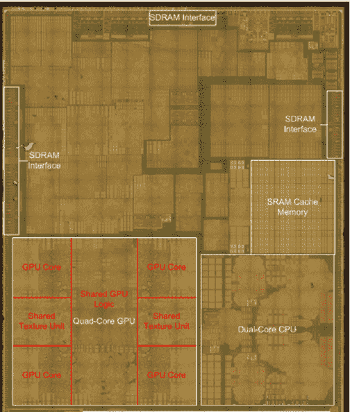

**图 1.1** Apple A8 封装内部的处理器集成电路。它有两个 ARM 处理器内核、四个 PowerVR GE640 内核、四个 DRAM 接口（连接到片外内存）、一个 LCD 接口、一个摄像头接口和一个 USB 接口。（照片来自 ChipWorks）

使现代消费电子成为第二种技术是 Linux 操作系统（OS），它运行在几乎所有的 ARM 处理器上。由于其免费可用、成功和广泛应用，Linux 已成为通用的嵌入式操作系统。作为一种嵌入式操作系统，Linux 极大地促进了跨不同嵌入式平台的代码开发和复用。

## 1.1 性能导向型编程

通常情况下，嵌入式处理器的设计目标与桌面和服务器处理器不同。**移动**嵌入式处理器特别将能效置于所有其他目标之上，为嵌入式系统编写高性能代码与为桌面和服务器处理器编写代码相比，通常需要程序员付出更多努力。

这是因为桌面和服务器处理器的设计旨在从遗留代码（很久以前为之前的版本处理器编写并编译的代码）和处理器无关代码（编写时未考虑任何特定处理器的代码）中提取最大性能。通过这种方式，将大量的面积和能耗转移到了两个特定特性上：

1. **指令级并行性的提取**：处理器尝试 (1) 在每个时钟周期内执行尽可能多的指令，(2) 改变指令的执行顺序以减少相关指令对之间的等待时间，以及 (3) 预测执行行为并在确定是否需要之前就执行指令，在需要时丢弃不需要的结果。这允许处理器在程序代码中的指令没有按照任何特定方式排序时，实现最大的指令执行率。

2. **庞大且复杂的缓存**：即使在程序访问连接内存的方式并非理想状态时，处理器也尝试最大化系统性能。这涉及智能预取、内存访问调度和高关联性，允许缓存避免重复访问同一块内存。

另一方面，嵌入式处理器通常放弃了大部分这些特征，这使得嵌入式处理器在经过“性能调优”的程序和未调优的程序之间表现出更大的性能差距。

但请记住，这种差异只对于计算密集型程序（compute bound programs）是可见的，即程序的速度或响应时间取决于处理器或内存速度，而不是输入和输出。例如，嵌入式处理器压缩视频显然比比服务器处理器需要更多时间，因为这种等待时间是由处理器和内存速度决定的。

另一方面，I/O 密集型程序（I/O bound program）的性能取决于通信通道或其他外设的速度。例如，一个强制用户等待下载数据的程序，无论处理器技术如何，其速度都不会变快。在这种情况下，响应时间取决于设备完成下载的速度。

因此，许多移动嵌入式程序是计算密集型的，而不是 I/O 密集型。SoC 厂商通过将这些任务卸载到特殊硬件而不是在处理器内核上运行软件来“破解”。

## 1.1 性能导向型编程

然而，下一代嵌入式应用（如计算机视觉）需要快速演进的算法，且大多数是计算密集型的。示例包括将单个图像拼接成全景图、人脸检测和识别、增强现实以及物体识别。

本教材提供了程序设计如何影响处理器性能的一些方法的概述——即程序员可以在不改变程序语义的情况下提高代码性能的方法。

这些技术通常要求程序员以暴露底层微架构特定特征编写代码。换句话说，程序员必须在低级别编写代码，使程序感知底层的处理器技术。这通常被称为性能调优或代码优化。

这些想法并不新；许多此类技术在高性能计算领域很常见。然而，本书将在嵌入式处理器（特别是 ARM 处理器）的背景下介绍这些内容。这将提供对计算机架构、应用设计和嵌入式系统的见解，并获得现代嵌入式系统嵌入式软件设计的实用知识。

在描述这些方法时，教材将使用几个示例应用，包括图像变换、分形生成、图像卷积和若干计算机视觉任务。这些示例将针对三个内核的 ARMv6 和 ARMv7-A 架构：

- 用于第一代树莓派的 ARM11
- 用于 Xilinx Zynq（用于 Zedboard、Adaptera Parallel 和 NI myRIO）的 Cortex-A9
- 用于 NVIDIA Tegra K1 的 Cortex-A15

本书还介绍了使用 OpenCL 编程模型对移动通用 GPU 进行编程的方法。

本教材将利用 Linux 提供的系统族，包括 Linux 的 GCC 编译器工具链和调试工具、性能监控支持、OpenMP 多核运行时环境、视频缓冲区帧以及视频捕获功能。

本教材旨在配合市面上的许多低成本 Linux/ARM 嵌入式开发板使用。这些示例包括：

# 第 1 章 Linux/ARM 嵌入平台

- 35 美元的树莓派，配备 700 MHz ARM11 处理器，以及更新的第二代树莓派，配备双核 Cortex-A9 处理器。
- 65 美元的 ODROID-U3，配备 1.7 GHz 四核 ARM Cortex A9 处理器。
- 90 美元的 Beagle Black，配备 1 GHz ARM Cortex A8 处理器。
- 99 美元的 Parallel，配备 1 GHz 双核 ARM Cortex A9 处理器。
- 169 美元的 ODROID-UX3，配备 1.6 GHz 四核 ARM Cortex A15 处理器。


# 第1章 Linux/ARM 嵌入平台

- 182 美元的 PandaBoard，配备 1.2 GHz 双核 ARM Cortex A9 处理器。
- 192 美元的 NVIDIA Jetson TK1，配备 2.23 GHz 四核 ARM Cortex A15 处理器。
- 199 美元的 Arandale Octa，配备 1.8 GHz 四核 ARM Cortex A15 处理器。
- 199 美元的 Avnet MicroZed，配备 666 MHz 双核 ARM Cortex A9 处理器。

这些平台中的每一个都允许程序员使用交互式登录会话进行编译、调试和代码表征，消除了对复杂的交叉编译器、远程调试器和/或架构仿真器的需求。

## 1.2 ARM 技术

ARM 处理器技术由 ARM Holdings 控制。ARM 代表“高级精简指令机器”`Advanced RISC Machine`，而 RISC 代表“精简指令集计算机”`Reduced Instruction Set Computer`。RISC 是一种设计哲学，其中处理器的原生语言即*指令集*被刻意设计成一组极其简单的指令汇编，这需要大量的简单指令来执行一个程序。这种方法的优势在于——即使一个程序需要执行的简单指令数量是单条指令就能完成更多任务的处理器的 N 倍，但简单指令的平均执行速度可以比复杂指令快 N 倍，从而提供了更好的整体性能。

RISC 指令通常被严格分为三大类：*算术指令、内存指令*和*控制指令*。算术指令是唯一执行任何数学计算的类型，而内存和控制指令是与外部内存交换数据以及实现依赖数据的行为所需的必要开销。内存和控制指令的数量平均远多于算术指令。特别是内存指令，通常比算术指令*慢10–20 倍*，尽管这取决于程序的*内存访问模式*和处理器的*存储器层次*性能。

## 1.3 ARM 简史

ARM 指令集架构最初由英国 Acorn 公司于 20 世纪 80 年开发，用于其 `ARM1`、`ARM2` 和 `ARM3` CPU。这些 CPU 原本设计用于桌面电脑 CPU，但在与当时的英特尔 x86 和摩托罗拉 68,000 CPU 竞争无果后，ARM 将其业务模式从销售 CPU 变为销售其处理器或指令集架构的使用权。他们的第一个大客户是苹果公司，他们为 Newton PDA 使用了 ARM 处理器。

如今，ARM 处理器作为可重用的宏单元 `macrocell` 出售，这是一种用作系统上芯片 `SoC` 模块的单元。这个 ARM 宏单元可以插入到现有设计的与其他宏单元中，形成一个定制的异构系统上芯片。或者，可以许可一种 ARM 指令集架构之一，并由被许可方从零设计其实现。无论何种情况，一致指令集架构的广泛使用允许程序员利用成熟的前端开发工具，如编译器、调试器和代码库。ARM 指令集架构和宏单元都有多个版本，但没有一个版本能够交付客户所预期的丰富多媒体功能，因此它们几乎总是与专门的协处理器相结合，代表 CPU 执行大部分多媒体算法。

ARM 指令集架构在不断演进。在 ARM ISA 第 6 个版本 `ARMv6` 之后，ARM ISA 分化为三个不同的版本，每个版本都针对特定用途进行了优化。目前，有三个版本，分别优化用于微控制器 `ARMv7-M`、实时应用 `ARMv7-R` 以及通用应用 `ARMv7-A`。

ARM 指令集架构在不断演进。本书关注 `ARMv6` 和 `v7`。`ARMv6` 应用于树莓派等嵌入式设备，而 `v7` 则用于智能手机和平电脑。在 ARM 架构中，`v6` 和 `v7` 的差异非常相似。理解汇编语言对于任何嵌入式开发者都至关重要。`ARMv8` 架构在 2013 年引入，并包含了 `v6` 和 `v7` 的重大差异。

## 1.4 ARM 编程

ARM 处理器可以使用各种高级语言进行编程。尽管如此，ARM 处理器甚至可以原生执行字节码。在嵌入系统的早期，使用汇编语言来节省内存和处理能力是常见的。然而，现代编译器已经非常复杂，可以生成比手写代码更好的代码。对于直接与硬件交互、编写引导程序和操作系统内核的汇编语言来说，理解汇编语言至关重要，因为它允许开发者精确地看到处理器正在做什么。

## 1.5 ARM 架构

ARM 是加载/存储架构 `load-store architecture`。这意味着在处理数据之前，程序员必须显式地从内存加载 `读取` 数据到寄存器。同样，处理后必须显式地存储到内存。算术指令使用寄存器的内容作为输入和输出。寄存器还可以用于存储临时结果，例如循环计数器或表达式值。程序员 `或使用高级语言的编译器` 对寄存器的状态拥有控制权。例如，在相两个值时，程序员必须决定将每个值分配给哪个寄存器。当寄存器的内容不再需要时，可以重复使用。

### 1.5.1 ARM 通用寄存器

ARM 是三地址器架构，这意味着单个指令可以引用三个寄存器地址。例如，“加法”等算术指令可以指定从两个寄存器读取输入值并在一个寄存器中存储和。在使用汇编器时，目标寄存器列在前。

共有 16 个用户用的整数寄存器，命名为 `r0` 到 `r15`。完全用汇编语言编写的程序可以自由使用任何寄存器而不受硬件干扰，特殊情况除：

- 寄存器 `r14` 的值是链接器 `也称为 lr 或 LR`，在执行分支链接指令时由硬件更新
- 寄存器 `r15` 的值是程序计数器 `也称为 pc 或 PC`，由硬件维护并用于控制程序流

在编写汇编语言例程——特别是嵌入或从 C 代码调用的例程时——程序员在使用根据过程调用标准 `APCS` 定义的具有特殊含义的寄存器时需要小心。需要注意，因为这些寄存可能会被编译器生成的代码或其他程序员编写的代码任意更改。

这些寄存器由以下组成：

- 寄存器 `r0` 和 `r1` 用于函数返回值。与 MIPS 指令集不同，寄存器 `r0` 并不连接到零值。
- 寄存器 `r0` 到 `r3` `也称为 a1-a4，参数寄存器` 用于向函数传递参数。程序员可以自由使用这些寄存器作为“临时寄存器”，但应意识到它们的状态在函数调用期间可能不会被保留。
- 寄存器 `r4` 到 `r11` `也称为 v1-v8，即变量寄存器` 通常是安全的，但某些冷门的编译器可能会使用 `r9` 作为静态基寄存器 `也称为 sb、SB 或 v6`，并将 `r10` 作为栈限限寄存器 `也称为 sl、Sl 或 v7`。
- 像 `gcc` 这样的编译器使用 `r11` 作为帧指针 `也称为 fp、FP 或 v8`，用于指向当前激活帧的基地址。激活帧包含局部数据，如局部变量。
- 寄存器 `r13` 栈指针 `也称为 sp 或 SP` 用于指向激活栈的顶部。

ARM 允许灵活的第二个操作数，这意味着算术指令允许在执行指令操作之前对第二个操作数寄存器进行移位或旋转。例如：

```
adr r1,r2,r3,lsl #2
```

...将在将寄存器 `r3` 的内容加到寄存器 `r2` 的内容之前对其进行左移，并且：

```
adr r1,r2,r3, as r4
```

...将根据寄存器 `r4` 内容低位字节指定的位数对寄存器 `r3` 的内容进行算术右移，并将其加到寄存器 `r2` 的内容。

有效的移位操作列表如下：

- `asr`：算术右移，将最后移出的位存储在进标志位中 `如果指令使用 S 后缀`
- `lsl`：逻辑左移，将最后移出的位存储在进标志位中 `如果指令使用 S 后缀`
- `lsr`：逻辑右移，将最后移出的位存储在进标志位中 `如果指令使用 S 后缀`
- `ror`：右旋转，将原始的第 n-1 位放入进标志位；
- `rrx`: 恰好旋转一位 `此操作不接受移位量`，将寄存器视为 33 位寄存器，进标志位作为最低位 `LSB`。

这些操作也有其对应的指令，当将这些作为指令使用时，无法使用灵活的第二个操作数。换句话说，不允许以下指令：

```
asr r1,r2,r3, asr #4
```

### 1.5.2 状态寄存器

ARM `v6/v7` 维护一个名为 `CPSR` `当前程序状态寄存器` 的状态寄存器，它持有四个状态位：负 `N`、零 `Z`、进位 `C` 和溢出 `O`。这些位可用于后续指令的条件执行。

这些位由最近一次执行的带有特殊 "`s`" 后缀的 ALU 指令设置。例如，“`adds`” 指令会修改状态位，但 "`add`" 指令则不会。

几乎所有的 ARM 指令都可以包含一个可选的条件码，用于判断指令将执行执行还是跳过。换句话说，条件码求值为假的指令将不会更改处理器的状态，例如写入寄存器或更改 PC 指。

例如，`ldreq` 指令仅在 `CPSR` 中的 `Z` 位置位时才会执行，如果最近一次计算指令的结果为零，则会满足此条件。

例如，以下序列：

```
subs r2,r2,#1
streq r3, [r0]
```

...只有在 `r2` 的新值为 0 时，才会递减寄存器 `r2` 并存储 `r3`。

比较 `cmp` 指令可以在不产生任何其他副作用的情况下设置状态位。

例如：

```
cmp r2,r3
streq r4, [r0]
```

...只有在寄存器 `r2` 和 `r3` 的内容相等时才会存储寄存器 `r4`。

当结合条件码和 "`s`" 后缀时，条件码在前，例如：

```
addeqs r0,r0,r1
```

完整的条件后缀列表见表 1.1。

### 表 1.1 条件码


| 后缀 | 标志位 | 含义 |
|---|---|---|
| `eq` | z set | 等于 |
| `ne` | c clear | 不等于 |
| `hs` | c set | 无符号大于 |
| `lo` | c clear | 无符号小于 |
| `mi` | n set | 负 |
| `pl` | n clear | 正或零 |
| `vs` | v set | 溢出 |
| `vc` | v clear | 无溢出 |
| `hi` | c set and z clear | 无符号大于 |
| `ls` | c clear and z set | 无符号小于 |
| `ge` | n and v same | 有符号大于 |
| `lt` | n and v different | 有符号小于 |
| `gt` | z clear, or n and v same | 有符号大于 |
| `le` | z set, or n and v different | 有符号小于 |

### 1.5.3 寻址模式

与其他加载存储架构一样，访问片内存的 ARM 指令只有加载和存储。有多种*寻址模式*，可以通过程序员或编译器指定片内存地址。

让我们从加载和存储指令的格式开始。

从内存加载，使用 `ldr` 指令后跟目标寄存器和内存地址：

```
<register>, <memory address>
```

存储到内存，使用 `str` 指令后跟源寄存器和内存地址：

```
<register>, <memory address>
```

注意与大多数指令不同，在存储指令中目标位置（内存地址）位于第二个。

`ldr` 和 `str` 指令还可以通过可选的类型修改符处理内存中的非 32 位值（如字节和半字）：

```
ldr/strd load/store double (64 bits)
ldrsh load halfword (16 bits)
```

### 表 1.2 ARM 内存模式

| 示例指令 | 有效地址计算 |
|---|---|
| `ldr r0, [r1]` | address = R[r1] |
| `ldr r0, [r1], #4` | 预增: address = R[r1] + 4 |
| `ldr r0, [r1], #4!` | 后增: address = R[r1] + 4, R[r1] = R[r1] + 4 |
| `ldr r0, [r1, r2]` | address = R[r1] + R2 |
| `ldr r0, [r1, r2, #4]` | address = R[r1] + R2 × 4 |
| `ldr r0, [r1, r2, lsl #2]` | address = R[r1] + R2 × 4 (地址左移 2 位) |
| `ldr r0, [pc, #8192]` | address = PC + 8192 |
| `ldrh/strh load/store halfword (16 bits)` |  |
| `ldrb load signed byte (8 bits)` |  |
| `lsb/strb load/store byte (8 bits)` |  |

加载和存储指令也可以是条件的。例如，`ldreq` 仅在 z 位置位时加载。内存地址使用括号中的寄存器指定。可以指定可选的常量偏移、索引寄存器和比例因子。ARM 还支持寄存器的自动递。该表总结了内存模式。

### 1.5.4 GNU 汇编器

本教程使用 GNU 汇编器来说明 ARM 指令集。GNU 汇编器使用的汇编语言与 ARM 自己的汇编器不同。例如：

- 表示跳转目标的标签以冒号结尾（例如，“`loop:` `ldr r2,[r3]`”）
- 汇编指令以点开头（例如“`.text`”）
- 注释以 & 开头（例如，“& outer loop”）

ARM 汇编的其他显著特征包括：

- 目标寄存器通常列在源寄存器 `r0` 到 `r15` 之后（例如，“`add r1, r2, r3` & add contents of r2 and store in r1”）
- 立即数（直接编码在指令中的常量值）用井号表示（例如，“`add r1, r2, #12`”）
- 使用 "`=`" 指令定义的常量在用时带有一个符号（例如，“`add r1, r2, =N`”）

## 1.6 汇编优化 1：排序

接下来的两个部分将介绍两个示例的 ARM 汇编编程、优化和性能分析。第一个示例是泡泡排序。

### 1.6.1 参考实现

首先在 `bubble_sort.c` 文件中编写一个 C 参考实现：

```c
#define N 32768

int data[N];

int main() {
    int i,j,temp;

    for (i=0; i<(N-1); i++) {
        for (j=0; j<(N-1); j++) {
            if (data[j]>data[j+1]) {
                temp=data[j];
                data[j]=data[j+1];
                data[j+1]=temp;
            }
        }
    }
    return 1;
}
```

前三行在全局内存中分配了一个 32K 整数数组。目前程序将不会初始化此数组。

回泡泡排序对每对值进行 $n-1$ 次比较，其中 $n$ 是元素个数。在每次比较后，如果值无序，则进行交换。

在外层循环的每次迭代中，每个值最多向数组开头移动一个位置，这可以想象为液体向表面移动。

将此文件保存为 `bubble_sort.c` 并使用 `gcc` 编译，使用“-O3”标志告诉编译器使用最大优化：

```bash
gcc bubble_sort.c -O3 -o bubble_sort
```

执行并计时程序：

```bash
time ./bubble_sort
```

在 ARM Cortex A15 上，程序执行需要 4.0 秒的用户 CPU 时间。从此对编译器的效率进行粗略估计。

程序比较了 $n^2=2^{15}\times 2^{15}$ 对值，这意味着处理器每次比较大约需要 $4.0^{30}=3.7$ 个周期。

在我们 2.3 GHz 的时频率（通常在 `/sys/devices/system/cpu0/cpufreq/cpuinfo_max_freq` 找到），这转化为

$2.3e9\times 3.7e-9=8$ 个周期每次比较

这包含了执行比较指令所需的时间以及事务（缓存停顿）所需。这合理吗？

为了找到答案，让我们在 `bubble_sort_asm.s` 中编写一个纯汇编实现。

### 1.6.2 汇编实现

使用 ".equ" 汇编指令定义常量 N：

# 16 第1章 Linux/ARM 嵌入式平台

```assembly
1 .equ N,32768
```

使用“.comm”汇编器指令为数据数组分配空间。这会创建一个名为“data”、大小为 N*4 的数组，且其起始地址对齐在 4 字节边界（能被 4 整除）。

```assembly
2 .comm data,N,4
```

接下来，使用“.global”指令告诉汇编器导出主函数（稍后定义），以便它可以被静态链接并由 Linux 运行时环境调用。

```assembly
3 .global main
```

最后，使用“.arch”指令告诉汇编器生成 ARMv7-A 机器语言。

```assembly
4 .arch armv7-a
```

使用“main”标签开始函数，使用前几条指令将 r1 设置为外层和内层 for 循环的迭代限制。我们的第一条指令将执行以下操作：

- 1. 将定义为 N 的值加载到寄存器 r1 中
- 2. 将 r1 减 1

```assembly
5 main: ldr r1,#N @r1=N-1
```

```assembly
6 sub r1,r1,#1 @r1=0
```

通过将外层循环计数器——变量 i——赋值给寄存器 r5 并初始化为 0 来开始外层循环：

```assembly
7 mov r5,#0 @i=0
```

外层和内层循环都是 for 循环。for 循环是预测试循环，因此它们从测试是否执行循环体开始。在这种情况下，比较外层循环计数器的值与分别赋值 r5 和 r1 的限制。如果这些值相等，则退出循环：

```assembly
8 oop:cmp r5,r1 @i==N-1
```

```assembly
9 be exit
```

外层循环体将由内循环组成，内循环可以专门为外层循环设置。使用寄存器 3 用于内循环：

```assembly
10 mov r3,#0 @j=0
```

## 1.6 汇编优化 #1：排序

除了将循环计数器初始化为 0 之外，还要为数组初始化一个基寄存器：

```assembly
11 ldr r2,=data @r2 &data
```

在 C 代码的字面翻译中，内循环将元素 j 和 j+1 加载到两个寄存器中，进行比较，并在必要时反序存回。内循环的每次迭代只需要加载元素 j+1，因为元素 j 在上一次迭代中已经可用。


内循环为元素 `j` 分配 `r11`，为元素 `j+1` 分配 `r10`。寄存器是反序的，因此使用多寄存器存储（`stm`）指令顺序存储寄存器，同时交换内存中的值（这是 `stm` 指令的要求）。

在启动内循环程序之前，预加载第一个元素。

```assembly
12 ldr r11,[r2]
```

添加我们的循环测试：

```assembly
13 iloop:cmp r3,r1 @j==N-1
14 beq exit
```

内体从数组中加载值（对应元素 `j+1`），将其与元素 `j` 比较，并在必要时反序存回数组。

使用寄存器 `2` 作为数组中当前位置的基寄存器。当加载元素 `j+1` 时，使用预增寻址模式，这会加载第二个值并将寄存器 `2` 更新为第二个值的地址：

```assembly
15 ldr r10,[r2,#4]
```

比较这些值。元素大于元素 `j+1` 值的条件将作为反序存回值的谓词。

存储元素时使用多寄存器存储指令。

```assembly
16 cmp r11,r10 @compare values
17 stm r2,(r10,r11) @store in reverse order
```

如果程序反序存回了值，`r11` 的当前值（原本代表元素 `j`）现在将会在数组中向上移动一位，有效地变为元素 `j+1`。该值将在下一次迭代中被视为元素 `j`，因此程序可以将其留在寄存器 `r11` 中供下次迭代使用。

如果值没有交换，将寄存器 `r10` 中的值复制到寄存器 `r11` 以供循环的下次迭代。此条件为等于（`le`），即大于逻辑取反。

```assembly
19 move r11,r10
```

在内循环体之后，增加索引寄存器和内循环计数器，然后跳转回循环开头。

```assembly
20 add r2,r2,#4
21 add r3,r3,#1 @++
22 b iloop
```

退出内循环后，对外层循环执行相同操作：

```assembly
23 exit:add r5,r5,#1 @++
24 bloop
```

退出外层循环后，通过跳转到链接寄存器中存储的位置从主函数返回：

```assembly
25 exit:bx lr
```

使用 `gcc` 汇编此代码并计时其执行：

```bash
gcc bubble_sort_asm.s -o bubble_sort -O3
time ./bubble_sort_asm
```

该汇编实现需要 3.6 秒，比编译器生成的版本快了 11%。

### 1.6.3 结果验证

汇编代码的可读性低于 C 代码，使其更容易出现编程错误。因此，在测试优化后的实现时，您始终通过第二个参考实现来验证其结果并进行比较。执行这两个实现提供了进行性能对比的能力，并且 bug 会通过输出数据的不匹配暴露出来。

为了继续进行，将参考实现转换为函数。这需要删除与数组和 `N` 值相关的代码，将函数名从 `main` 改为“`bubble_sort`”，并使用参数传递数组指针及其大小：

```c
int bubble_sort (int *data,int n) {
    int i,j,temp;
    for (i=0;i<n-1;i++) {
        for (j=0;j<n-1;j++) {
            if (data[j]>data[j+1]) {
                temp = data[j];
                data[j] = data[j+1];
                data[j+1] = temp;
            }
        }
    }
}
```

# 第22 章 第1 章 Linux/ARM 嵌入平台

开始内循环；将两个元素加载到 `r2` 和 `r1` 中。注意 `r3` 从数组的 4 字节处开始，因此第一次加载偏移了 -4 字节，第二次加载使用后增寻址来增加 `r3`。

9 `.L6`:

```
10 ldr r2, [r3,#-4]
11 ldr r1, [r3],#4
12 cmp r2, r1
13 stmgtb r3, (r1, r2)
```

比较值并在必要时交换（使用多寄存器存储指令）。

将 `r3` 与数组末尾及循环进行比较；如果不相等，则重复内循环：

```
14 cmp r3, ip
15 bne .L6
16 add r0, r0, #1
17 cmp r0, 1r
18 bne .L3
```

完成内循环后，增加计数器，将计数器与 `n` 比较，如果不相等则重复输出循环。

`.L2` 标签是退出点。

19 `.L2`:

内循环仅包含六条指令，而我们的有九条指令，我们必须假设我们的内循环所需的周期仅为编译器生成的内循环的 2/3。

# 1.7 汇编优化 #2：位操作

编译器的代码优化对于那些无法用高层语言自然表达的代码效果较差，例如那些涉及复杂位操作、特殊算术运算，或具有高延迟操作（如浮点指令或内存访问局部性低的内存指令）的代码。

考虑以下简单的 C 循环，它反转了字内的位顺序。在这段代码中，“`in`”和“`out`”被声明为无符号整数：

```
for (i=0;i<32;i++) in = in >> (31-i) << i;
```

使用 ARM GCC 4.8.2-19 并最大优化（使用 "`-O3`" 选项）进行编译，并强制编译器生成 ARM模式代码而非 THUMB 模式（通过使用 "`-mpu=cortex-a5-marm`" 选项），编译器生成了以下汇编代码，其中变量“`in`”被赋值给寄存器 `r0`：

| 编译器生成的汇编代码 | 目的 |
| :--- | :--- |
| 1 mov r3, #0 | i=0 |
| 2 mov r2, r3 | out=0 |
| 3 .L3: | 循环体开始 |
| 4 rsb r1, r3, #31 | temp = 31 - i |
| 5 mov r1, r0, lsr r1 | temp2 = in << (31-i) |
| 6 or r2, r2, r1.asl r1 | out = out (temp2 << i) |
| 7 add r3, r3, #1 | i++ |
| 8 cmp r3, #32 | 比较 i 和 32 |
| 9 bne .L3 | 如果不等，则重复 |

编译器生成的汇编代码看起来合理，但通过利用 C 语言无法描述的指令特性，减少循环体中的指令数量。

具体来说，回使用移位操作（无论是作为独立指令还是灵活的第二个操作数），最后移出的位将存储在进位标志（carry flag）中。此外，右循环扩展（RRX）操作允许将进位标志移入寄存器。这允许我们使用进位标志在原始寄存器和反转寄存器之间进行传输。一个额外的的好处是，当源的所有位都移出时，程序可以结束循环，从而消除增加 `i` 变量的指令。这种方法所示。

| 手写汇编代码 | 目的 |
| :--- | :--- |
| 1 mov r2, #0 | out=0 |
| 2 lsls r0,r0.#1 | in = in <= 1，将移出的位保存到 C 标志 |
| 3 or r0,r0.#1 | 将 in 的最低位置 1 以“标记”第 32 位 |

# 第24 章 第1 章 Linux/ARM 嵌入平台

| 手写汇编代码 | 目的 |
| :--- | -- |
| 4 .L3: | 循环体开始 |
| 5 rrx r2, r2 | out = >> 1，移入 C 标志 |
| 6 lsl1 r0,r0.#1 | in <<= 1，将移出的位保存到 C 标志 |
| 7 cmp r0, #0 | 比较 in 0 |
| 8 bne .L3 | 如果不等，则重复 |

在这个版本中，循环体减少了两条指令。假设每条指令的代价与上一个版本相同，这将带来 6/4=1.5 倍的加速，使代码快了 50%。

这种假设并不一定现实，因为改变指令序列可能还有许多其他性能因素。因此，实际的性能提升可能大于或小于 50%。具体来说，修改代码可能改变：

- 每条指令所需的时钟周期（每条指令周期数，CPI），
- 指令缓存缺失率，或
- 如果循环包含加载和存储指令，由于内存访问模式的可能改变导致数据缓存缺失率变化。

因此，静态代码并不意味着成比例的性能影响。为了准确捕捉代码更改的影响，程序员必须使用性能分析（profiling）测量程序的运行时行为。

性能分析的目标是在实际处理器上或使用周期精确的模拟器收集程序的运行时信息。周期精确的模拟器用于将性能相关的事件与代码中的行或特征关联，但它们很慢，限制了可以测试的程序和数据集范围。使用实际处理器快得多，但只能通过性能计数器聚合的方式收集信息。

本书使用性能计数器进行性能分析。性能计数器是低级体系特性，在没有一个或多个抽象层帮助的情况下很难使用。Linux 提供了系统级抽象，本章将描述如何在其之上构建用户级抽象。

## 1.8 代码优化目标

在选择要计数的事件时，我们的目标是识别出那些对程序性能有显著影响，但其发生率可以通过不改变程序语义的代码变换最容易操纵的事件。

## 1.8 代码优化目标 27

例如，下面的指令序列执行了一系列两个相互依赖的双精度加法指令，这是因为在第一条指令计算出 `d0` 的值之前，第二条指令无法开始执行。


```
1 faddd d0,d2,d4
2 faddd d4,d0,d2
```

在这种情况下，第二条指令在第一条指令执行完成之前，无法进入执行流水线。第一条指令与第二条指令启动之间的时间消耗在了执行停顿（stalls）上。大多数浮点程序都包含许多此类依赖关系，导致数据依赖停顿，并使得浮点功能单元的利用率较低。

减少停顿次数通常通过重新排列代码中的指令顺序来实现，允许在等待期间通过执行其他非依赖的浮点指令来“隐藏”浮点指令的延迟。

能够执行激进动态调度（也称为乱序执行）的处理器可以在运行时自动完成此操作，而无需更改程序代码。然而，大多数嵌入式处理器（包括 ARM 的处理器）在芯片成本或功耗方面无法承受这种代价，因此它们的动态调度能力有限或没有。

第 2 节描述了如何使用双缓冲（double buffering）、软件流水线（software pipelining）和 SIMD 指令来隐藏浮点指令的延迟并减少数据依赖的数量。

减少浮点延迟的另一种方法是将浮点指令转换为定点指令。定点表示允许使用低延迟的功能单元来处理分数。这种方法的主要缺点是动态范围的缩小，即可以表示的最大数值与较小数值之间的比例缩小。幸运的是，第 2 节也探索了这种技术。

加载和存储停顿（Load and store stalls）与处理器的缓存有效性有关，但可以通过更改内存访问数据的顺序来减少。目标是增加访问的局部性。为了做到这一点，程序员或编译器必须安排加载和存储指令的顺序，使得生成的有效地址序列有利于缓存。这意味着每当访问相同的相邻地址时，访问之间的时间应该减到最少。这通常需要对嵌套循环的结构进行重大修改。

实现此点的主要方法是通过循环变换，例如循环交换（loop interchange）、循环融合（loop fusion）和循环分块（loop tiling）。为了跟踪加载和存储停顿，程序员必须能够监控末级缓存（last-level cache）的引用次数和缺失次数。

本章描述了用于跟踪周期、指令、缓存引用和缓存缺失的性能计数器。周期将提供有关执行时间的信息，指令与周期的比例将提供 CPL（每周期指令数），而缓存缺失与引用的比例将提供缓存缺失率。注意，总 CPI（每周期指令数）包含了分支、数据依赖和缓存缺失引起的停顿周期，尽管无法区分每种类型的停顿。有足够的信息来做出优化决策，并理解代码变换的性能。

最后一点说明：ARM11 和 ARM Cortex-A9 PMU 可以计算依赖停顿，但该事件在 Cortex A15 PMU 中不再被支持（可计数）。为了在我们的所有目标处理器之间保持一致，本章将不使用这一特定的计数器。

# 1.9 使用性能计数器进行运行时分析

大多数现代处理器都包含一组称为性能计数器的寄存器，可以被编程以计算特定的事件，这些事件对于理解程序性能或诊断问题可能感兴趣。最常用的性能计数器是周期计数器（cycle counter），它是一个每周期自加 1 的简单计数器。周期计数器可用于提供单时钟周期粒度的计时信息。

## 1.9.1 ARM 性能监控单元

除了周期计数器，大多数处理器还提供了一组灵活的计数器，可以被编程以计算如缓存缺失、指令执行、浮点指令执行或分支预测错误等事件。这些计数器以及用于为每个计数器设置特定事件的关联逻辑被称为性能监控单元（PMU）。

## 1.9.2 Linux Perf-Event

Linux 提供了一个用于管理 PMU 的抽象层。除了周期计数器，大多数处理器还提供了一组灵活的计数器，可以被编程以计算如缓存缺失、指令执行、浮点指令执行或分支预测错误等事件。这些计数器以及用于为每个计数器设置特定事件的关联逻辑被称为性能监控单元（PMU）。

### `perf_event_open` 使用示例

```c
int group_fd,
unsigned long flags) {
    int ret;
    ret = syscall(__NR_perf_event_open, hw_event, pid, cpu,
    group_fd, flags);
    return ret;
}
```

`pid` 参数指定了进行测量的 Linux 进程 ID。有两个特殊值：如果 `pid` 为 0，则对当前进程进行测量；如果 `pid` 为 -1，则对所有进程进行测量。此代码将参数设置为 0 以测量当前进程。

`cpu` 参数允许用户将测量限制在单个 CPU 上。如果 `cpu` 为 -1，则在所有 CPU 上测量事件。

`group_fd` 参数允许创建事件组，从而允许单次调用 `perf_event_open` 计数多个事件。本章中的代码使用单独的 `perf_event_open` 调用来计算每个单独的事件，因此将此参数设置为 -1 以测量单个事件。

此外还需要一个函数，根据 `time_enabled`（已启用时间）与 `time_running`（运行时间）的比例来缩放 `perf_event` 给出的结果。使用 `perf_event` 读取计数器会返回一个 64 位整数数组，索引 0 的值代表计数器值，索引 1 的值代表已启用时间，索引 2 代表运行时间。

```c
static inline unsigned long long perf_count(unsigned long long *values) {
    return (unsigned long long)((float)values[0]*
    (float)values[1]/(float)values[2]);
}
```

在 `perf_event` 中，可以通过文件描述符访问单个性能计数器，因此首先声明一个文件描述符数组：

```c
int fd[5];
```

声明一个数组来存储从每个计数器读取的信息：

```c
unsigned long long cnts[4];
```

以下函数将打开四个计数器。该函数设计用于 ARM11、ARM Cortex A9 和 ARM Cortex A15 处理器。对于 ARM11，打开缓存缺失和引用计数器的方法略有不同，因此代码假设在为 ARM11 编译时已设置 `ARM11` 变量（使用 `-DARM11` 选项进行编译）。


```c
int cnts_open(int *event_attr, struct *attr) {
    memset(&attr, 0, sizeof(attr));
    attr.type = PERF_TYPE_HARDWARE;
    attr.size = sizeof(struct perf_event_attr);
    attr.read_format =
        PER_FORMAT_TOTAL_TIME_ENABLED|
        PER_FORMAT_TOTAL_TIME_RUNNING;
    attr.config = PERF_COUNT_EVENT_HW_CPU_CYCLES;
    fd[CYCLES] = perf_event_open(&attr, 0, -1, -1, 0);
    if (fd[CYCLES] == -1) 
        perror("cannot open perf_counter for cycles"); exit(0);
    attr.config = PERF_COUNT_HW_INSTRUCTIONS;
    fd[INSTRUCTIONS] = perf_event_open(&attr, 0, -1, -1, 0);
    if (fd[INSTRUCTIONS] == -1) 
        perror("cannot open perf_counter for instructions"); exit(0);
#ifdef ARM11
    attr.type = PERF_TYPE_RAW;
    attr.config = 0x9;
    fd[CACHFS] = perf_event_open(&attr, 0, -1, -1, 0);
    if (fd[CACHFS] == -1) 
        perror("cannot open perf_counter for cache refs"); exit(0);
    attr.config = 0x8;
    fd[CACHES] = perf_event_open(&attr, 0, -1, -1, 0);
    if (fd[CACHES] == -1)
        perror("cannot open perf_counter for cache misses"); exit(0);
#else
    attr.config = PERF_COUNT_HW_REFERENCES;
    fd[CACHFS] = perf_event_open(&attr, 0, -1, -1, 0);
    if (fd[CACHFS] == -1) 
        perror("cannot open perf_counter for cache refs"); exit(0);
    attr.config = PERF_COUNT_HW_MISSES;
    fd[CACHES] = perf_event_open(&attr, 0, -1, -1, 0);
    if (fd[CACHES] == -1)
        perror("cannot open perf_counter for cache misses"); exit(0);
#endif
}
```

添加 `tick` 和 `clock` 函数，它们可以在代码执行前后后调用：

```c
void cnts_tick(int *fd) {
    int i, ret;
    cnts_open(fd);
    for (i=0; i<4; i++) {
        ret = ioctl(fd[i], PERF_EVENT_IOC_RESET);
        if (ret==-1) perror("ioctl in cnts_tick() failed");
    }
}

void cnts_clock(int *fd, unsigned long long cnts[]) {
    int i, ret;
    for (i=0; i<4; i++) {
        ret = read(fd[i], cnts[i], sizeof(cnts[i]));
        if (ret!=8) perror("read in cnts_clock() failed");
    }
}
```

```c
void cnts_close(int *fd) {
  int i;
  for (i=0; i<4; i++) close(fd[i]);
}
```

## 1.10 测量带宽

为了开始使用 `perf_event`，让我们使用它来测量处理器写入连续块和读取连续块所需的时间。这种测试还允许我们测量内存带宽，读和写的情况通常不同。程序员可以使用这些值计算性能上限。

编写一个打印性能结果并计算带宽的打印程序：

```c
void cnts_dump(unsigned long long cnts[][3]) {
    float time, memb;
    time = ((float)cnts[CYCLES])/CLOCK_RATE;
    membw = (float)SIZE/time/(1024.0*1024.0);
    printf("[%perf_event] cycles = %llu (%0.0f us)\n",
           cnts[CYCLES],
           (float)cnts[CYCLES]/(CLOCK_RATE/1.0E-6));
    printf("[%perf_event] instructions = %llu (CPI=%0.2f)\n",
           cnts[INSTRUCTIONS],
           (float)cnts[INSTRUCTIONS])/(float)cnts[CYCLES]);
    printf("[%perf_event] misses = %llu, references = %llu\n"
           "(miss rate=%0.4f)\n",
           cnts[CACHES],
           cnts[CACHFS],
           (float)cnts[CACHES]/(float)cnts[CACHFS]);
}
```

接下来添加定义来指定拷贝的内存块大小（以字为单位）以及处理器频率。

```c
#define SIZE 128<<20 // 128MB

#if ARM11
#define CLOCK_RATE 700.0e6
#elif A9
#define CLOCK_RATE 666.0e6
#elif A15
#define CLOCK_RATE 2230.5e6
#endif
```


为了验证我们的频率设置并确保 `perf_event` 报告了正确的周期，请检查同时使用性能计数器和 Linux `gettimeofday()` 系统钟的代码段。系统钟测量的是**墙上时间**，而 `perf_event` 仅在进程运行时计算周期。正因如此，程序员可能会观察到系统钟值较大，因为它会在进程被操作系统挂起的临时期间累积时间。

为了使用 `gettimeofday()`，请声明两个存储时间的变量：

以下代码独立测试了吞吐量。你需要打印最终值，以确保该加和不会被编译器优化掉。

## 1.12 性能边界

占据执行时间大部分部分的程序循环或循环嵌套被称为内核（kernel）。相对简单内核的运行时行为可以用算术强度（arithmetic intensity）来表征，即每单位数据执行的原始 CPU 操作次数。当内核的算术强度已知时，就可以用它来计算一个作为处理器峰值内存带宽函数的性能上界。

内核从内存受限转变为计算密集型的确切算术强度值取决于处理器，但在实践中，极少数内核是计算密集型的。即使是具有极高算术强度的内核（例如矩阵乘法，对于每个 $O(n^2)$ 个输入输出值执行 $O(n^3)$ 次浮点运算），仍可能由于加载/存储停顿或数据依赖停顿而受到限制。这在 SGEMM 在特定处理器上达到峰值理论性能的 50-75% 的情况下可见。

算术强度的单位是每字节浮点操作数（flops/byte）。因此，内核的性能上界可以计算为 $P=A \times B$，其中 $A$ = 单位 flops/byte 的算术强度，$B$ = 单位 bytes/s 的内存带宽，$P$ = 单位 flops/s 的性能（flops）。

## 1.13 基础 ARM 指令集

本节提供了 ARM 指令集基础子集的简要总结。这里提供的信息仅足以让你开始编写 ARM 汇编程序，不包含任何特殊指令，例如系统指令和与协处理器相关的指令。

img/e6ebc663bbb86c6e7bf9ef22ad136e6f_44_0.png

注意，在接后的表中，指令助记符以大写显示，均可用大写或小写字母。

### 1.13.1 整数算术指令

表 1.4 显示了整数算术指令列表。所有这些指令都支持条件执行，并且都会根据指定的 S 后缀更新状态寄存器。这些指令中的某些（带有“operand2”的）支持本章早些描述的第二个操作数。这允许这些指令具有寄存器、偏移寄存器或立即数作为第二个操作数。

### 1.13.2 位运算逻辑指令

表 1.5 显示了位运算逻辑指令列表。所有这些指令都支持条件执行，在指定 S 后缀时均可更新标志，并且都支持灵活的第二个操作数。

### 1.13.3 移位指令

表 1.6 显示了移位指令列表。所有这些指令都支持条件执行，在指定 S 后缀时均可更新标志，但注意这些指令不支持灵活的第二个操作数。

| 指令 | 描述 | 功能 |
|---|---|---|
| ADCS | `<cond> Rd, Rn, operand2` | 带进加 | R[Rd] = R[Rn] + operand2 + Cflag |
| ADDS | `<cond> Rd, Rn, operand2` | 加法 | R[Rd] = R[Rn] + operand2 |
| MLA | `<cond> Rd, Rn, Ra` | 乘加 | R[Rd] = R[Rn] * R[Ra] |
| MULS | `<cond> Rn, Rm` | 乘法 | R[Rd] = R[Rn] * R[Rm] |
| RSBS | `<cond> Rd, Rn, operand2` | 反向减法 | R[Rd] = operand2 - R[Rn] |
| RSCS | `<cond> Rd, Rn, operand2` | 带进反向减法 | R[Rd] = operand2 - R[Rn] - (not C) |
| SBC | `<cond> Rd, Rn, operand2` | 带进减法 | R[Rd] = operand2 - R[Rn] - C |
| SMALS | `<cond> RdLo, RdHi, Rn, Rm` | 有符号累加 | R[RdHi] = upper32bits(R[Rn] * R[Rm]) + R[RdHi]<br>R[RdLo] = lower32bits(R[Rn] * R[Rm]) |
| SMULL | `<cond> RdLo, RdHi, Rn, Rm` | 符号长乘法 | R[RdHi] = upper32bits(R[Rn] * R[Rm])<br>R[RdLo] = lower32bits(R[Rn] * R[Rm]) |
| SUB | `<cond> Rd, Rn, operand2` | 减法 | R[Rd] = operand2 - R[Rn] |
| UMALS | `<cond> RdLo, RdHi, Rn, Rm` | 无符号累加 | R[RdHi] = upper32bits(R[Rn] * R[Rm]) + R[RdHi]<br>R[RdLo] = lower32bits(R[Rn] * R[Rm]) + R[RdLo] |
| UULL | `<cond> RdLo, RdHi, Rn, Rm` | 无符号长乘法 | R[RdHi] = upper32bits(R[Rn] * R[Rm])<br>R[RdLo] = lower32bits(R[Rn] * R[Rm]) |

# 第 1 章 Linux/ARM 嵌入式平台

| 表 1.5 整数位运算 |
| 指令 | 描述 | 功能 |
| --- | --- | --- |
| AND(S) | `<<cond > Rd, Rn, operand` | 位与 | R[Rd] = R[Rn] & operand |
| BIC(S) | `<<cond > Rd, Rn, operand` | 位置位 | R[Rd] = R[Rn] & not operand |
| EOR(S) | `<<cond > Rd, Rn, operand` | 位异或 | R[Rd] = R[Rn] ^ operand |
| OR(S) | `<<cond > Rd, Rn, operand` | 位或 | R[Rd] = R[Rn] |

| 表 1.6 整数位逻辑指令 |
| 指令 | 描述 | 功能 |
| --- | --- | --- |
| ASR(S) | `<<cond > Rd, Rn, Rs/#sh` | 算术右移 | R[Rd] = (int)R[Rn] >> [Rs] or #sh |
| LSR(S) | `<<cond > Rd, Rn, Rs/#sh` | 逻辑右移 | R[Rd] = unsigned(R[Rn]) >> [Rs] or #sh |
| LSL(S) | `<<cond > Rd, Rn, Rs/#sh` | 逻辑左移 | R[Rd] = R[Rn] << [Rs] or #sh |
| ROR(S) | `<<cond > Rd, Rn, Rs/#sh` | 循环右移 | R[Rd] = rotate R[Rn] by bits |

### 1.13.4 移动指令

表 1.7 显示了数据移动指令列表。这些指令中最用的是 MOV 指令，因为它的灵活操作数允许加载立即数和寄存器移位。

### 1.13.5 加载和存储指令

表 1.8 显示了加载和存储指令列表。`LDR/STR` 指令是 ARM 最基本的加载和存储指令。内存地址可以使用本章前面的任何模式。`LDR` 指令也可以用于加载到基寄存器，例如 `ldr r1,=data`。`LDM` 和 `STM` 指令可以加载和存储多个寄存器，通常用于访问栈。

| 表 1.7 数据移动指令 |
| 指令 | 描述 | 功能 |
| ------|---|---|
| MOV(S) | `<<cond> Rd, operand2` | 移动 | R[Rd] = operand2 |
| MRS | `(<cond> Rd, CPSR` | 将状态寄存器或保存的状态移动到通用寄存器 | R[Rd] = CPSR |
| MRS | `(<cond> Rd, SPSR` | 从 ARM 寄存器到状态寄存器 | R[Rd] = SPSR |
| MSR | `(<cond> PSR_f, #imm` | 从字段到状态寄存器 | |
| MSR | `(<cond> CPSR_<fields>, Rm)` | | |
| MSR | `(<cond> SPSR_<fields>, Rm)` | 补码移动 | |
| MVNIS | `(<cond> Rd, operand2)` | | R[Rd] = not operand2 |

| 表 1.8 ARM 加载和存储指令 |
| 指令 | 描述 | 功能 |
| ------|---|---|
| LDM | `(cond)< address mode > Rn(!), <reg list in braces >` | 加载多个 | 从 R[Rn] 处的连续字加载多个寄存器。(!) 会自动增加基寄存器。地址：IA = 后递增，IB = 前递增，DA = 后递减，DB = 前递减。例如：LDMIA r2, (r3-5-7) |
| LDR | `(cond)[B|H][SB][SH] Rd, <address>` | 加载寄存器 | 从内存加载到 Rd。可选大小标识：B = 字节，H = 半字，SB = 有符号，SH = 有符号 |
| STM | `(cond)< address mode > Rn, <registers>` | 存储多个 | 存储多个寄存器。(!) 会自动增加基寄存器。地址：IA = 后递增，IB = 前递增，DA = 后递减，DB = 前递减。例如：STMIA r2, (r3-5-7) |
| STR | `(cond){B|H} Rd, <address>` | 存储寄存器 | 从内存存储到 Rd。可选大小标识：B = 字节，H = 半字 |
| SWP | `(cond)< B> Rd, Rm, [Rn]` | 交换 | 在寄存器和内存之间交换字（或字节） |

### 1.13.6 比较指令

表 1.9 列出了比较指令。这些指令用于状态标志，用于条件指令，通常用于条件分支。

### 1.13.7 分支指令

表 1.10 列出了分支指令。`BX`（分支交换）指令用于跳转到寄存器值，通常用于跳转到链接寄存器返回函数。使用此指令时，目标寄存器的最低有效位（LSB）决定跳转后处理器处于 ARM 模式还是 THUMB 模式。

### 1.13.8 浮点指令

浮点指令有两种类型：向量浮点（VFP）指令和 NEON 指令。

ARMv6 处理器（如树莓派第一代的 ARM11）仅支持 VFP 指令。较新的架构（如 ARMv7）仅支持 NEON 指令。最常见的浮点操作映射到 VFP 指令和 NEON 指令。`FADD` 和 `VADD32`（与 s 寄存器一起使用）执行单精度浮点加法。

NEON 指令集比 VFP 指令更丰富，虽然大多数 VFP 指令都有等效的 NEON 指令，但有很多 NEON 指令可以执行 VFP 指令无法完成的操作。

## 1.13 ARM 指令集

为了描述适用于 ARM11 和 ARM Cortex 处理器的浮点以及单指令多数据 (SIMD) 编程技术，本节和第 2 章将涵盖 VFP 和 NEON 指令。

表 1.11 列出了常用浮点指令的 VFP 和 NEON 版本，类似于整数算术指令，它们支持条件执行，但浮点指令有一套独立的标志位，位于 32 位浮点状态控制寄存器 (`FPSCR`) 中；NEON 指令仅使用该寄存器的第 31 到 27 位，而 VFP 指令则使用额外的字段。

### 表 1.11 浮点指令

| VFP 指令 | 等效 NEON 指令 | 说明 |
| --- | --- | --- |
| FADD[S|D](cond) Fd, Fm | VADD[F32:64] Fd, Fm | 单精度和双精度相加 |
| FSUB[S|D](cond) Fd, Fm | VSUB[F32:64] Fd, Fm | 单精度和双精度相减 |
| FMUL[S|D](cond) Fd, Fm | VMUL[F32:64] Fd, Fm | 单精度和双精度相乘并取反 |
| FNUL[S|D](cond) Fd, Fm | VMNUL[F32:64] Fd, Fm | 单精度和双精度平方根 |
| FDIV[S|D](cond) Fd, Fm | VDIV[F32:64] Fd, Fm | 单精度和双精度除法 |
| FABS[S|D](cond) Fd, Fm | VABS[F32:64] Fd, Fm | 单精度和双精度绝对值 |
| FNEG[S|D](cond) Fd, Fm | VNEG[F32:64] Fd, Fm | 单精度和双精度取反 |
| FSQRT[S|D](cond) Fd, Fm | VSQRT[F32:64] Fd, Fm | 单精度和双精度平方根 |
| FCVTS[S|D](cond) Fd, Fm | VCVT[F32:64] Fd, VCVT[S|D][32][16], #fbits | 将双精度转换为单精度 |
| FCVTDS[S|D](cond) Fd, Fm | VCVT[F32:64] Fd, Fm, VCVT[S|U][32][16], #fbits | 将单精度转换为定点 |
| FMAC[S|D](cond) Fd, Fm | VMLA[F32:64] Fd, Fm | 单精度和双精度浮点乘累加，计算 Rd= Rm * Fm + Fn |
| FLD[S|D](cond) Fd, <address> | VLDR Rd, <address> | 单精度和双精度浮点加载/存储 |
| FST[S|D](cond) Fd, <address> | LSTR Rd, <address> | 单精度和双精度浮点加载/存储 |
| FLDM[S|D](cond) <address>, <<FPRegs> | VLDM Rn(l), <FPRegs> | 单精度和双精度浮点加载/存储 |
| FSTM[S|D](cond) <address>, <<FPRegs> | VSTM Rn(l), <FPRegs> | 单精度和双精度浮点加载/存储 |
| FMRX(cond) Rd | FMRX Rd | 从浮点状态和控制寄存器移动 |
| FMRR(cond) Rm | FMR Rm | |
| FCPY[S|D](cond) Fd, Fm | VMOV(cond) Fd, Fm | 复制浮点寄存器 |

浮点指令使用与整数指令不同的寄存器set。ARMv6/VFP 提供了 32 个浮点寄存器，可用作 32 个名为 `s0-s31` 的独立单精度寄存器，或 16 个名为 `d0-d15` 的双精度寄存器。

ARMv7/NEON 提供了 64 个浮点寄存器，可以用多种方式使用，例如：

- 64 个命名为 `s0-s63` 的单精度寄存器，
- 32 个包含两个元素的命名为 `d0-d31` 的单精度寄存器，
- 16 个包含四个元素的命名为 `q0-q15` 的单精度寄存器，
- 32 个命名为 `d0-d31` 的双精度寄存器，以及
- 16 个包含两个元素的命名为 `q0-q15` 的双精度寄存器。

在 VFP 和 NEON 中，`d0` 消耗的空间与寄存器 `s0` 和 `s1` 相同，`d1` 消耗的空间与寄存器 `s2` 和 `s3` 相同。

浮点寄存器中的值可以与通用寄存器交换，并且硬件支持单精度、双精度和整数之间的类型转换。

## 1.14 章节总结

本章涵盖了以下主题：

- ARM+Linux 嵌入式系统技术：ARM 处理器与 Linux 操作系统的结合，以及其标准化的编程和运行时抽象层，促进了许多包含强大嵌入式计算机的消费电子的发展。ARM+Linux 程序可以使用廉价的开发板（如随处可见的 35 美元树莓派）轻松进行原型设计。
- ARMv6 架构：虽然 ARMv6 提供了传统 MIPS 中未发现的功能，如条件执行、灵活的操作数和……
- 用于汇编的 GCC 工具链：本章介绍了编译器、汇编器和链接器。
- 使用 PerfEvent 使用性能计数器：本章介绍了用于衡量关键指标的性能分析方法。

## 练习题

1. 在不违反任何数据或控制依赖的情况下，以下序列有多少种重新排列方式？

```assembly
```


`add r3, r7, #88`

`subs r3, #76`

`mov r2, #0`

## 2. 考虑使用条件执行进行交换的泡排序代码

```assembly
cmp r10,r11 @ 比较值
strgt r10,[r2] @ 存储/序
```

让我们考虑另一种方法：

```assembly
cmp r10,r11 @ 比较值
bge skip
strgt r10,[r2] @ 存储/序
```

假设对于特定数据集，45% 的 `cmp` 测试确定 `R[0]>R[1]`。假设分支预测的正确率为 80%，正确预测的分支会有停顿，而预测错误的分支会增加 10 个周期的停顿。

假设数组大小为 `10000`，计算两种版本执行的指令数。将停顿计入指令。

## 3. 修改以下 C 代码，以消除运行时遇到的不必要的 if 语句

```c
if ((a[1])==0) {(a[1])>=10) {
  if (a[1]==0) sum=sum+1;
  if (a[1]>20) sum=sum+2;
} else {
  if (a[1]==5) sum=sum+4;
}
```

## 4. 将以下 C 函数翻译为汇编

```c
int reorder (int a) {
  return (a<<24)
  | ((a<<16) & 0xFF00)
  | ((a>>16) & 0xFF000)
  | ((a>>24) & 0xFF);
}
```


5. 编写一个短指令序列来加两个 128 位整数。最少需要多少指令？
编写一个短指令序列来相乘两个 128 位整数并产生 256 位的结果。最少需要多少指令？

7. 表 1.4–1.11 所示的指令中 C 编译器在编译 C 程序时最不可能被生成？为什么？

8. 编写一个完整的 ARM 汇编程序，计算随机生成的双精度值数组中每个值的双精度平方根。确保你使用了双精度指令。

将其性能与一个 C 实现进行对比，该实现使用数学库中的 `POSIX sqrt()` 函数来计算相同输入数组的平方根。此外，计算两个输出数组元素之间的平均相对差异。

# 多核与数据级优化：OpenMP 与 SIMD

## 章节大纲

- 2.1 本书涵盖的优化技术 50
- 2.2 阿姆达定律 (`Amdahl's Law`) 52
- 2.3 测试内核：多项式求值 53
- 2.4 使用多核：`OpenMP` 55
  - 2.4.1 `OpenMP` 指令 (`Directives`) 56
  - 2.4.2 作用域 (`Scope`) 58
  - 2.4.3 其他 `OpenMP` 指令 62
  - 2.4.4 `OpenMP` 同步 (`Synchronization`) 63
    - 2.4.4.1 临界区 (`Critical Sections`) 63
    - 2.4.4.2 锁 (`Locks`) 64
    - 2.4.4.3 屏障 (`Barriers`) 65
    - 2.4.4.4 原子区 (`Atomic Sections`) 65
- 2.5 调试 `OpenMP` 代码 66
- 2.6 `OpenMP` Parallel for Pragma 68
- 2.7 带有性能计数器的 `OpenMP` 70
- 2.8 `OpenMP` 对 `Horner` 内核的支持 71
- 2.5 性能界限 71
- 2.6 性能分析 73
- 2.7 `GCC` 中的内联汇编语言 74
- 2.8 优化 #1：减少循环中的归约 (`Reductions`) 76
- 2.9 优化 #2：减少 `CPI` 79
  - 2.9.1 软件流水线 81
  - 2.9.2 `Horner` 方法的软件流水线 84
- 2.10 优化 #3：通过单指令多数据流 (`SIMD`) 实现单条指令多次浮点运算 92
  - 2.10.1 `ARM11 VFP` 向量指令 94
  - 2.10.2 `ARM Cortex Neon` 指令 97
  - 2.10.3 `NEON` 内建函数 (`intrinsics`) 100
- 2.11 本章总结 101
- 练习题 102

# 第 2 章 多核与数据级优化：OpenMP 与 SIMD

桌面级和服务器级处理器包含许多特性，旨在运行时最大程度地利用指令级并行性和内存局部性，且通常不考虑这些特性在芯片面积或功耗方面的代价。它们的设计最强调标量无序推测性执行、准确的分支预测以及极其复杂的多级缓存。这使得它们即使在执行并非专为性能而编写的代码时，也能保持良好的性能。

相反，嵌入式处理器设计更强调能效而非性能，因此设计人员通常会放弃这些特性，以换取片上外设和针对特定任务的专用协处理器。由于这种原因，嵌入式处理器的性能对代码优化的敏感度高于桌面和服务器处理器。代码优化包括任何专门为提高性能设计的代码特征。代码优化可以通过编译器（自动转换代码的工具）添加，可以通过程序员（通过消除冗余代码与处理器无关）添加，也可以针对特定处理器（例如用简单指令序列替换复杂指令）来添加。

从概念上讲，代码优化的过程始于一个朴素实现（`naive implementation`），即一个功能正确但串行的的程序实现。程序员随后必须识别其内核（`kernels`），即消耗大部分执行时间的代码部分。之后，程序员必须识别每个内核的性能瓶颈，然后以在不改变底层计算的前提下提高性能的方式转换内核代码。这些更改通常涉及消除代码冗余、利用并行性、利用硬件特性，或者为了性能而牺牲数值准确性、精度或动态范围。

## 2 本书涵盖的优化技术

本章将涵盖两种由程序员驱动的优化技术：

- 1. 使用汇编语言提高指令级并行性并减少编译器开销

在某些情况下，手写的汇编代码比编译器生成的汇编代码具有性能优势。你应该预见到手写汇编的性能将始终优于编译器生成的代码。事实上，现代编译器内置的自动优化器对于整数代码通常非常有效，但对于密集的浮点运算内核，手写汇编往往更有效。

# 2.1 本书涵盖的优化技术 51

## 2. 多核并行
即使是服务器级处理器也无法自动将程序的负载分布到多个并发的处理器核心上。程序员必须在程序中添加显式的多核支持，并负责验证多核环境中是否存在数据竞态和数据共享错误等并发错误。尽管如此，实现高多核效率仍然很困难，但在嵌入式系统编程中正变得越来越重要。

后续章节涵盖了程序优化的其他主题，包括：

- 1. 定点算术
浮点指令通常比整数指令更昂贵，但对于多媒体和传感应用来说通常是不必要的。使用定点表示法允许整数表示分数，代价是与浮点数相比动态范围的收窄。大多数高级语言（包括 `C/C++` 和 `Java`）缺乏对定点的原生支持（`fixed point support`），程序员必须为定点操作包含显式支持。

- 2. 循环变换
缓存性能与程序的内存访问局部性有关，但在某些情况下，在不改变程序功能的情况下可以改进局部性。这通常涉及循环结构的变换，例如循环分块（`loop tiling`），程序员通过添加额外的循环级来改变程序数据的访问顺序。

- 3. 异构计算
许多嵌入式系统，甚至系统级芯片（`SoC`），都集成了协处理器，如图形处理器（`GPU`）、数字信号处理器（`DSP`）或现场可编程门阵列（`FPGA`），它们执行特定类型计算比通用处理器更快。协处理器通常被视为通用处理器的外设，程序员必须为协处理器编写特殊代码，并显式处理协处理器的控制、接口、内存管理和同步。

没有任何编译器或开发工具可以自动执行这些任何一种技术，每种技术都需要程序员进行实验和验证。换句话说，利用这些技术时，程序员必须遵循一个迭代过程：从功能性但未优化的代码开始，然后修改代码，验证修改没有破坏原始代码的功能，测量其对性能产生的影响，并可能重复此过程以提取更多性能。

幸运的是，程序员不需要优化整个程序，因为通常只有一小部分代码消耗了几乎所有的执行时间。这部分通常由循环嵌套中最内层的循环组成。这些循环被称为内核（`kernel`）。然后，程序员只需要对程序内核应用上述技术，即可实现显著的整体性能提升。

## 2.2 阿姆达定律 (`AMDAHL'S LAW`)

阿姆达定律如公式 (2.1) 所示，计算了优化程序一个或多个组件后产生的性能影响。

该公式计算了整体加速比 `$S_{overall}$`，它是关于执行时间中对应于改进代码的比例 `$time_{optimized}$` 以及改进幅度 `$S_{optimized}$` 的函数：

$$S_{overall} = \frac{1}{(1 - time_{optimized}) + \frac{time_{optimized}}{S_{optimized}}}$$ (2.1)

阿姆达定律有几个重要的启示。

首先，程序的整体改进取决于对执行时间常见情况的改进。在某些情况下，这可能源于程序中极小的一部分。

阿姆达定律一个令人沮丧的方面是：`$S_{overall}$` 远低于预期。例如，如果程序员将占据执行时间 10% 的代码（`$time_{optimized}=0.10$`）加速 10000 倍（`$S_{optimized}=10000$`），我们的整体加速比仅为 11%（`$S_{overall}=1.11$`）。在这种情况下，对某一方面的巨大加速收益极小。

另一个例子，如果程序员将占据执行时间 99% 的代码（`$time_{optimized}=0.99$`）加速 100 倍（`$S_{optimized}=100$`），我们的整体加速比仅为 50（`$S_{overall}=50$`）。换句话说，性能收益的 50% 来自于未受改进的 1% 执行时间！

另一个重要的实践方面是 `$time_{optimized}$` 相比 `$S_{optimized}$` 的重要性。例如，图 2.1 绘制了整体加速比 (`$S_{overall}$`) 与优化代码相对执行时间（`$time_{optimized}$`）的关系，针对非常

## 2.3 测试内核：多项式求值 53

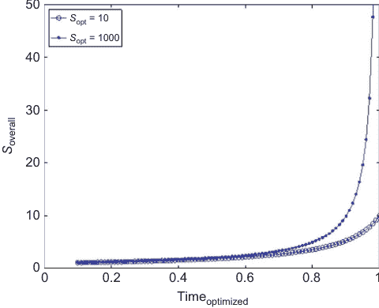

**图 2.1** `$S_overall$` 与时间，针对 `$S_optimized = 10$` 和 1000 进行了优化。

不同的优化速度因子，`$S_optimized = 10$` 和 `$S_optimized = 1000$`。如所示所示，在 `$time_optimized$` 达到 90% 之前，整体速度并没有显著发散，且曲线之间的相对差异在 `$time_optimized = 97%` 时仅为 4.1 倍！这基本上意味着当内核消耗了 97% 的执行时间时，整体速度比我们的内核速度慢了 250 倍。

## 2.3 测试内核：多项式求值

本节介绍了一个基准内核，该内核将在本章和第 5 章中用于描述和评估代码优化。该内核对向量 `x` 中的每个点评估一个八次多项式：

```
d(x) = \sum_{j=0} a_j x^j
```


秦纳法（Horner's method）是一种通过反复累加每一项并乘以 `x` 来评估多项式的迭代方法：

```
d_0(x) = a_7

d_1(x) = d_0(x)x + a_6

d_2(x) = d_1(x)x + a_5

d_3(x) = d_2(x)x + a_4

d_4(x) = d_3(x)x + a_3

d_5(x) = d_4(x)x + a_2

d_6(x) = d_5(x)x + a_1

d_7(x) = d_6(x)x + a_0
```

## 54 第 2 章 多核和数据级优化：OpenMP 和 SIMD

开始在 C 中实现秦纳法，以确定编译器自动优化的良好程度。将输入和输出数组的大小设置为 128 MB。

```c
#define N 128*1024*1024
```

首先，声明并初始化一个多项式系数数组。它们的值将不会影响性能（假设它们不会导致浮点异常）。假设系数从高阶到低阶排序：

```c
static float coeff[8] = {1.2,1,4.1,6,1.8,2.0,2.2,4.2,6};
```

由于 `N` 代表以字节为单位的数据集，数组的大小必须与 `float` 的大小匹配：

```c
static float x[N/4],d[N/4];
```

对于这个内核，用浮点吞吐量来衡量性能是有用的，因此请扩展第 1 章中的 `cnt_dump` 函数以计算每秒浮点运算次数（flops）。对于一个八次多项式，每个元素有 14 次浮点运算。

由于浮点运算是唯一直接有助于内核目标进展的操作，因此通过测量每次浮点运算执行的指令数来衡量代码效率可能会提供见解，测量代码可以计算并打印该值：

```c
float flops,mflops,ips;

flops = (float)N/4.0 * 14; // 每个输出值14次操作

mflops = flops/time/1.0e6;

ips = (float)(perf_count(cnts[INSTRUCTIONS])) / flops;
```

```c
printf("[perf_event] mflops%%0.2f, instructions per flop=\n%%0.2f\n",mflops, ips);
```

修改内存带宽计算，以反映代码现在读取和写入 `N` 指定的字节数：

```c
membw = (float)N*2.0/time/(1024.0*1024.0);
```

接下来，用随机数填充输入数组 `x`。与系数值一样，只要满足以下条件，输入值并不重要：

- 1. 数值具有多样性，以增加代码中的逻辑错误导致两种实现之间不匹配的机会，
- 2. 数值不会导致浮点异常：

```c
for (i=0;i<N/4;i++) x[i]=(float)rand()/(float)RAND_MAX;
```

使用性能计数器对秦纳法的初级版本进行插字：

```c
float *d, *x, *d_test;

int i,j;

int fd[5];

unsigned long long cnts[4][3];

float coeff[32] = {1.2,1.4,1.6,1.8,2.0,2.2,2.4,2.6};

d=(float*)malloc(N);

x=(float*)malloc(N);

if (id || !x) err("malloc())");

for (i=0;i<N/4;i++) x[i]=(float)rand()/(float)RAND_MAX;

nts_tick(fd);

for (i=0;i<N/4;i++) (
	(外层循环)
	d[i]=coeff[0];
	for (j=1;j<8;j++) (
		(内层循环)
		d[i]=d[i]*x[i] + coeff[j];
	)
)

nts_tick(fd);

for (i=0;i<N/4;i++) (
	(外层循环)
	d[i]=coeff[0];
	for (j=1;j<8;j++) (
		(内层循环)
		d[i]=d[i]*x[i] + coeff[j];
	)
)
```

## 2.4 使用多核：OpenMP

## 第 2 章 多核和数据级优化：OpenMP 和 SIMD

ARM11 有一个核心。ARM9 有两个核心。ARM15 有四个核心。树莓派有两个核心。树莓派有四个核心。树莓派有四个核心。树莓派有四个核心。树莓派有四个核心。树莓派有四个核心。树莓派有四个核心。树莓派有四个核心。树莓派有四个核心。树莓派有四个核心。树莓派有四个核心。树莓派有四个核心。树莓派有四个核心。树莓派有四个核心。树莓派有四个核心。树莓派有四个核心。树莓派有四个核心。树莓派有四个核心。树莓派有四个核心。树莓派有四个核心。树莓派有四个核心。树莓派有四个核心。树莓派有四个核心。树莓派有四个核心。树莓派有四个核心。树莓派有四个核心。树莓派有四个核心。树莓派有四个核心。树莓派有四个核心。树莓派有四个核心。树莓派有四个核心。树莓派有四个核心。树莓派有四个核心。树莓派有四个核心。树莓派有四个核心。树莓派有四个核心。树莓派有四个核心。树莓派有四个核心。树莓派有四个核心。树莓派有四个核心。树莓派有四个核心。树莓派有四个核心。树莓派有四个核心。树莓派有四个核心。树莓派有四个核心。树莓派有四个核心。树莓派有四个核心。树莓派有四个核心。树莓派有四个核心。树莓派有四个核心。树莓派有四个核心。树莓派有四个核心。树莓派有四个核心。树莓派有四个核心。树莓派有四个核心。树莓派有四个核心。树莓派有四个核心。树莓派有四个核心。树莓派有四个核心。树莓派有四个核心。树莓派有四个核心。树莓派有四个核心。树莓派有四个核心。树莓派有四个核心。树莓派有四个核心。树莓派有四个核心。树莓派有四个核心。树莓派有四个核心。树莓派有四个核心。树莓派有四个核心。树莓派有四个核心。树莓派有四个核心。树莓派有四个核心。树莓派有四个核心。树莓派有四个核心。树莓派有四## 2.4 使用多核：OpenMP 57

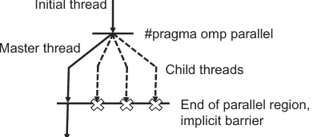

**图 2.2** OpenMP 线程创建。per_event 仅在主线程内跟踪性能事件（实线）。

最常用的 OpenMP 指令是 `parallel` 指令，它指定了*并行区域*的开始：

```c
#pragma parallel <directive options>
```

### 2.4.1 OpenMP 指令

OpenMP 包含一个允许

# 58 第 2 章 多核与数据级优化：OpenMP 和 SIMD

让程序员标记并行区域中仅应由主线程执行的部分（`#pragma omp master`）。

当主线程到达并行区域的末尾时，它将自动等待，直到所有工作线程也到达并行区域的末尾。此时，工作线程将终止，主线程将恢复执行。换句话说，在并行区域的末尾有一个隐式屏障（barrier）。

程序员可以使用嵌套指令来定义在每个线程中执行的独立代码块。示例如下：

```
#pragma omp parallel
{
  // 在每个线程中执行的代码
}
#pragma omp parallel
#pragma omp sections
{
  #pragma omp section
  {
    // 在第一个线程执行的代码
  }
  #pragma omp section
{
    // 在第二个线程执行的代码
  }
}
```

### 2.4.2 作用域

默认情况下，在并行区域外部声明并在并行区域内部使用的变量是“共享的”（shared）。这意味着：

- 在并行区域内，变量将继承其在主线程进入并行区域之前的初始状态，
- 并行区域内的任何状态变化对所有线程都是可见的，
- 在并行区域结束后，它在主线程中的值将反映所有线程中最近的写入值。

下面的示例说明了这一点，其中四个线程写入了共享变量 `b`。

```c
int a=1;
#pragma omp parallel num_threads(4)
{
  a=2;
}
printf("%d\n",a); // 打印的值为 2
```

与并行性和共享内存通常的情况一样，程序员在编写会被另一个线程读取的共享变量时，应该使用线程同步。下文将对此进行详细描述。

或者，程序员可以使用 "private" 指令选项将并行区域中外部声明的变量标记为私有（private）。在 C++ 中，程序员可以通过在并行区域内部声明变量来实现相同的效果。

私有变量是每个线程局部的，因此对变量的更改只对执行更改的线程可见，并且变量状态在线程销毁时会被删除。

下一个示例说明了私有作用域，在并行区域结束后，对私有变量的更新将会丢失。

```c
int a=1;
#pragma omp parallel num_threads(4) private(a)
{
  a=2; // a 将被销毁
}
printf("%d\n",a); // 打印的值为 1
```


变量也可以被标记为 `"firstprivate"`，此时 OpenMP 运行时以与共享变量相同的方式初始化并行区域中的变量，即使用该变量在并行区域之前的状态。

## 2.4 使用多核处理器：OpenMP

```c
int a=1;

#pragma omp parallel num_threads(4) firstprivate(a)
{
    a=omp_get_thread_num(); // a 的初始值为 1
    printf("%d\n",a);
}
```

# 60 第 2 章 多核与数据级优化：OpenMP 和 SIMD

程序员还可以使用 `"threadprivate"` 指令选项指示 OpenMP 运行时在每个单独线程中保留变量状态，即使在并行区域之间也是如此。`threadprivate` 变量必须分配为全局或静态变量，且 `threadprivate` 指令作为独立指令使用。例如：

```c
static int a;
// threadprivate
// 变量必须是
// 全局的
#pragma omp threadprivate(a)
// threadprivate() 必须
// 被用作
// 独立的 OMP
// 指令
#pragma omp parallel num_threads(4)
// 第一个并行区域
// 设置了四个
// 变量的
// 独立的“版本”
{
    a=omp_get_thread_num();
}
#pragma omp parallel num_threads(4) // 第二个并行区域
// 回调
// 变量的四个
// “版本”
{
    printf("%d\n",a);
}
```

`threadprivate` 变量可以使用 `"copyin"` 指令选项进行初始化，如下。

## 2.4 使用多核处理器：OpenMP

```c
a=1;
#pragma omp parallel num_threads(4) firstprivate(a)
{
    a=omp_get_thread_num(); // a 的初始值为 1
    printf("%d\n",a);
}
```

（注：由于原文中存在大量重复段落和 OCR 错误，此处已根据逻辑结构进行了整理和翻译。）

# 64 第 2 章 多核与数据级优化：OpenMP 和 SIMD

使用 `"fopenmp"` 选项编译此示例。执行时，主线程（线程 0）总是先到达临界区，但工作线程在每次运行时的到达打印语句的顺序不同。另外注意，紧随并行区之后的打印语句将在所有工作线程结束后才会打印。

运行 1：

```
thread 0 finished in position 1
thread 2 finished in position 2
thread 3 finished in position 3
thread 1 finished in position 4
parallel region ended
```

运行 2：

```
thread 0 finished in position 1
thread 3 finished in position 2
thread 2 finished in position 3
thread 1 finished in position 4
parallel region ended
```

运行 3：

```
thread 0 finished in position 1
thread 1 finished in position 2
thread 3 finished in position 3
thread 2 finished in position 4
parallel region ended
```

### 4.4.4.2 锁 (Locks)

锁提供了与临界区类似的功能。锁被指定为函数，因此程序员会调用 `omp_set_lock()` 来标记临界区的开始，并调用 `omp_unset_lock()` 来标记其结束。锁有一个关联的句柄，程序员必须在使用之前在主线程对其进行声明和初始化。

例如：

```
int a=0;
omp_lock_t mylock;
omp_init_lock(&mylock);
#pragma omp parallel num_threads(4)
{
omp_set_lock(&mylock);
a++;
```

## 2.4 使用多核：OpenMP 65

```
omp_unset_lock(&mylock);
```

```
}
printf("%d\n",a); // 输出的值始终为 4
```

### 2.4.4.3 屏障 (Barriers)

屏障是并行区域中的一点，所有线程在继续执行之前必须到达该点。屏障对于划分并行操作的不同阶段非常有用，因为线程总是会遇到负载不均衡。

例如，在视频处理应用中，多个线程将处理帧中的像素，但所有线程必须先完成移动到下一帧的操作。

屏障通过 pragma 指定，如下例所示：

```
int a;
#pragma omp parallel num_threads(4)
{
    if (omp_get_thread_num()==2) a=omp_get_thread_num();
    #pragma omp barrier
    if (omp_get_thread_num()==2) a=omp_get_thread_num();
}
```

```
printf("%d\n",a); // 输出的值始终为 4
```

### 2.4.4.4 原子区 (Atomic sections)

原子操作保证在任何给定时刻只有一个线程在执行。从这个意义上说，它们是不可分割的，就像真实的原子一样。在概念上它们与临界区相同，但原子区只能确保单个赋值操作的排他性，因此它们仅用于单个语句。它们的优势是开销比临界区低。

原子操作通过 pragma 指定，例如：

```
int a=0;
#pragma omp parallel num_threads(4)
{
    #pragma omp atomic
a++;
}
printf("%d\n",a); // 输出的值始终为 4
}
```

### 2.4.5 调试 OpenMP 代码

使用 GNU Debugger (`GDB`) 调试 OpenMP 程序时需要注意几点。GNU Compiler Collection (`GCC`) 会“提取”（outline）并行区域，这意味着它将并行代码块封装在一个函数中，该函数从每个线程中的主机函数调用。共享变量在通过引用传递给此函数之前会被复制到一个容器中。私有变量被声明为提取函数内的局部变量。

在之前的示例中，OpenMP 会生成一个容器类型：

```
struct .omp_data_s {
int place;
};
```

提取的函数看起来类似于所示（但不包含临界区）：

```
void main._omp_fn.0(struct omp_data_s* omp_data_i) {
    printf("thread %d finished in\nposition%d\n",omp_get_thread_num(),omp_data_i->place);
}
```

`GCC` 将 `main()` 中的并行区域替换为：

```
struct omp_data_s omp_data_o;
omp_data_o.place=place;
__builtin_GOMP_parallel_start(main._omp_fn.0,
&omp_data_o, 2);
main._omp_fn.0 (&omp_data_o);
__builtin_GOMP_parallel_end();
place = omp_data_o.place;
```

## 2.4 使用多核：OpenMP 67

使用调试选项 (`-g`) 重新编译示例并在 `GDB` 中执行：

```
gcc omp_test.c -fopenmp -g
gdb a.out
```

在包含 `#pragma omp parallel for` 的行上设置断点并单步一次：

```
(gdb) b11
Breakpoint 1 at 0x8600: /share/reconfig/arm_code/omp_test.c:11. (2 locations)
(gdb) r
...
Breakpoint 1, main () at omp_test.c:11
11		#pragma omp parallel shared(place)
(gdb) s
[New Thread 0xb66b1430 (LWP 23388)]
[New Thread 0x5beb1430 (LWP 23389)]
[New Thread 0x5b6b1430 (LWP 23390)]
[Switching to Thread 0x5beb1430 (LWP 23389)]
```


Breakpoint 1, `main__omp_fn()` at `omp_test.c:15`

`15			place++;`

```
注意在跳过 `#pragma` 行后，GDB 显示程序创建了三个新的工作线程。默认情况下，调试会话留在主线程中。程序员可以使用 `info threads` 命令查看活动线程列表，并将调试会话切换到另一个线程，例如使用 `thread 1` 命令切换到线程 1。
另外注意当前函数是 `main__omp_fn()`。由于调试会话不再 `main` 函数中，用户无法访问局部变量。
遗憾的是，GCC 没有为并行区域内的局部生成调试信息。在本章稍后的部分，你可能需要使用 `info registers`。
```

### 2.4.6 The OpenMP parallel for pragma

内核通常由包含嵌套循环的 `for` 循环组成。OpenMP 提供了一种简单的方法，使用 `for` 指令将 `for` 循环的迭代自动分配到多个线程。该指令可以写为：

```c
#pragma omp parallel
#pragma omp for
for (...)
```

或者作为简写形式：

```c
#pragma omp parallel for
for (...)
```

`parallel for` 指令要求终止条件必须是与循环变量的单个小于、小于等于、大于或大于等于比较，增量操作不能依赖于循环体中的代码，且循环体内不允许使用 `break`、`goto` 或 `throw` 语句。

默认情况下，循环变量被处理为私有。这很重要，因为每个线程将同时处理一组不同的循环迭代，因此每个线程的 `i` 变量值在同一时刻会有不同的值。

考虑以下示例：

```c
#pragma omp parallel for
for (i=0;i<12;i++) {
    printf("iteration %d, thread %d\n",
    i,omp_get_thread_num());
}
```

执行时，新代码将产生以下输出：

+   iteration 0, thread 0
iteration 1, thread 0
iteration 2, thread 0
iteration 9, thread 3
iteration 10, thread 3
iteration 11, thread 3

# 第 2 章 多核与数据级优化：OpenMP 与 SIMD

iteration 6, thread 2

iteration 7, thread 2

iteration 8, thread 2

iteration 3, thread 1

iteration 4, thread 1

iteration 5, thread 1

主线程已完成

如我们的输出所示，每个线程被分配了三次迭代。由于线程正在并行执行，所有线程的打印语句在控制台中是交替显示的。由于并行区域后存在屏障（barrier），主线程在并行区域后的打印消息始终出现在控制台输出的末尾。

OpenMP 支持多种分配迭代的线程策略。默认情况下，分配是静态的（static），这意味着每个线程执行大约相同数量的循环迭代。由于所有线程在程序离开循环之前必须完成分配的迭代集，因此分配的任务完成得比其他线程快的线程将经历比其他线程更长的等待时间。

为了避免这个问题，OpenMP 支持动态调度（dynamic scheduling），将较小的一批循环迭代（称为块，chunk）分配给每个线程。当某个线程完成上一个块时，会轮分配一个新的块。这允许负载均衡，并且当迭代之间的执行时间变化时效果最好。

通常情况下，调度适用于 `parallel for` 指令，并可以使用 `parallel` 指令的 `schedule` 选项进行指定。默认情况下，并行循环采用静态调度。指令选项可以指定动态调度。例如，`#pragma parallel (dynamic)` 开启自动块大小的动态调度；`#pragma parallel for schedule(dynamic,chunksize)` 允许程序员指定 `chunksize`。

### 2.4.7 结合性能计数器的 OpenMP

`Perf_event` 仅在主线程中记录事件，因此程序员在计算包含未由性能计数器报告的指标（例如浮点操作次数）时需要考虑到这一点。例如，`cnts_dump()` 函数仅统计主线程执行的指令数。要计算每个浮点运算（flop）的指令数，请将指令数乘以 `NUM_THREADS` 或将浮点操作次数除以 `NUM_THREADS`。

### 2.4.8 OpenMP 对 Horner 核的支持

Horner 核的最外层循环不包含跨迭代的依赖，这意味着每次迭代都与后续迭代无关。通过这种方式，程序员可以将最外层循环的工作负载分布到所有可用核心上。OpenMP 头文件以及一个设置线程数的定义（该值应设置为您特定处理器的核心数）：

```c
#include <comp.h>
```

```c
#define NUM_THREADS 4
```

在代码的初始化部分指定线程数：

```c
omp_set_num_threads(NUM_THREADS);
```

最后，告诉 OpenMP 运行时对外层循环进行并行化：

```c
#pragma omp parallel for
for (i=0;i<N/4;i++) {
    d[1]=coeff[0];
    for (j=1;j<8;j++) {
        d[1]*=x[i];
        d[1]+=coeff[j];
    }
}
```

## 2.5 性能边界

处理器的理论峰值性能至少为 $2 \times cores \times frequency \times n$，其中 $n$ 是处理器每个周期可以执行的浮点操作次数，且该处理器支持乘加运算。对于单精度浮点数，ARM11 处理器的 $n=1$，Cortex 处理器的 $n=4$。这使得树莓派上的 ARM11 处理器峰值容量达到 1.4 Gflops，Xilinx Zedboard 上的 Cortex-A9 处理器达到 2.7 Gflops，而 NVIDIA Jetson 上的 Cortex-A15 处理器达到 17.8 Gflops。

在实践中，任何处理器达到其峰值浮点性能几乎是不可能的，因为这需要供应商每个周期都向所有浮点单元提供输入，并消除所有延迟。延迟的一个重要来源是平均内存访问时间，这意味着浮点单元在访问计算所需数据的整个时间内都处于忙状态。由于浮点单元的吞吐量远高于片外内存，它们的有效性能取决于内核在执行过程中重用数据的程度。这种重用率通常通过测量的算术强度（arithmetic intensity）来表示，即每字节数据的平均浮点操作次数。

每个 CPU 都有一个理论算术强度阈值，在该阈值之下，内核性能受内存带宽限制；之上则受浮点吞吐量限制。这是一种过于简化，因为它没有考虑决定缓存性能的内存局部性或其他延迟源（如数据依赖引起的延迟）。

算术强度提供了一个比峰值浮点性能更紧密的性能上界。其计算方式为：

```
Upper bound = min \frac{2 \times cores \times frequency \times n}{intensity \times peak memory b/w} 浮点操作每字节
```


我们的基准内核在内层循环的每次迭代中执行两个浮点操作（乘法、加法），内层循环每次外层循环迭代运行七次，产生 14 次浮点操作。

外层循环体引用了 `x` 的一个元素、`d` 的一个元素以及所有八个系数。系数尺寸小且具有高时间局部性，处理器可以将它们留在寄存器或缓存中，因此此分析仅考虑组成 `d` 和 `x` 的 8 字节。这得到的算术强度为 14/8 = 1.75 次/字节。此分析将内存带宽计算为最外层循环每次读取和写入 4 字节的加权平均值——在这种情况下为 1.75 乘以带宽，$1.75 \times$ (读) + $0.5 \times$ (写)。因此，性能低于所有 CPU 的峰值浮点吞吐量。效率是实际性能与峰值浮点性能之比，它由内存带宽、每指令周期数（CPI）和缓存缺失率决定。理想 CPI 对于 ARM11 为 1，对于 Cortex 为 0.5。性能计数器可以为程序的问题提供一些见解。由于内核受内存限制的，其性能将与后续表中显示的结果相符。

# 第 2 章 多核与数据级优化：OpenMP 与 SIMD

缓存性能不佳，或者编译器、处理器或两者的指令调度不佳。

缓存命中率：缺失率（Miss rate）衡量缓存性能并决定内存指令的平均延迟。因此，它反映了 CPI 受缓存性能影响的程度。缺失率取决于内核访问模式的局部性。`d` 和 `x` 数组的访问同时具有空间和时间局部性（每个元素都会被重复且连续地访问），因此预计数据缓存在该内核中表现良好是合理的。

指令浮点运算数（Instructions flop）：该指标是另一种执行指令数量的方式，受编译器翻译高层代码效率的影响。

为了改进内核，程序员需要对其实施方式有更多的控制权。

## 2.7 GCC 中的内联汇编语言

GCC 提供了一个接口，允许程序员将内联汇编语言嵌入到 C/C++ 代码中。与用汇编编写整个函数不同，内联汇编允许程序员只编写那些需要用汇编代码编写的代码部分。

内联汇编允许程序员指定 C/C++ 变量、位置，以及通常使用寄存器或基于寄存器地址的指令的操作数。在这种情况下，编译器用寄存器替换变量，并自动添加任何临时分配所需寄存器所需的额外 `load immediate` 或 `load and store` 指令。程序员可以直接使用寄存器。在这种情况下，程序员必须在 clobber list（破坏列表）中指定受影响的寄存器，编译器可以确保寄存器状态不会受到内联指令的不利影响。

内联汇编的语法所示：

```
asm[volatile] : 输出操作数 : 输入操作数 : clobber list);
```

如果包含了 `volatile` 修饰符，编译器将排除该语句的优化优化。换句话说，编译器将按照编写的内容生成汇编代码，而不会为了优化而对其进行修改。

代码是包含在引号内的单条或多个指令。每条指令后面应该跟随 `"\n\t`（换行符加制表符），以确保编译器生成汇编代码时格式正确。

在编写短的内联汇编代码序列时，程序员可以选择将每条指令封装在一个 `asm` 语句中，或者在一个 `asm` 语句中组合多条指令。封装单个指令的优点是输入、输出和 clobbers 只与一条指令相关，使其更容易阅读。然而，当程序员使用寄存器存储 `asm` 语句之间的中间结果并覆盖寄存器中间结果时，应该小心。GCC 的内联汇编语法没有指定使用哪些寄存器的方法，如果内联汇编指令块包含涉及通用寄存器的依赖，程序员应该将整个指令块封装在单个 `asm` 语句中，而不是为每条指令使用单独的 `asm` 语句。在使用浮点寄存器时不需要担心这个问题，GCC 不会在 `asm` 语句之间复用这些寄存器。

输出操作数是作为汇编代码输出的 C/C++ 变量列表。

输入操作数是作为汇编代码输入的 C/C++ 变量列表。它的格式与输出列表相同。

输入和输出列表的格式为

`[name]"MC"(expression), ...`

- `name` 是汇编代码中符号的名称。在代码中，名称前面有一个百分号 (`%`)。
- `M` 是可选的约束修饰符，通常对于只写操作数为 `=`，对于读写输出为 `+`。
- `C` 是约束，通常是以下之一：`f`（浮点寄存器）、`i`（立即值）、`r`（通用寄存器）或 `m`（内存地址）。例如，使用 `"f"` 意味着编译器在取取指令之前将相应的操作数置于寄存器中，且其值在内联汇编中使用 C/C++ 表达式指定。
- `expression` 是表示输入或输出的 C/C++ 表达式、变量或指针。

`clobber list` 是将由指令修改的寄存器列表，当直接指定寄存器时使用。

例如，考虑以下内联汇编语句：

```
asm("mov %[outval],%[in], r #2" : [outval]=r(b) : [in]r(a));
```

如果 `a` 和 `b` 是存储在栈上的局部变量，此行可能被编译器翻译为以下 ARM 汇编：

```
ldr r3, [sp, #0          (分配寄存器 r3 并加载 a 的值)

mov r3, r3 #2           (执行 mov 指令)

str r3, [sp, #4]         (将结果存入变量 b)
```

## 2.8 优化 #1：减少每个浮点运算的指令数

GCC 对我们实现霍纳方法的 C 实现仅实现了 8% 的效率（观察到的性能百分比）。由于霍纳方法执行了相同数量的乘法和加法指令，程序员应该使用浮点累加指令，因为它在单条指令中执行了两次浮点运算。

ARMv6 浮点 (VFP) 指令集包含了单精度、双精度、乘累加（及其变体）、除法和平方根的指令。大多数浮点指令都是全流水线的，这意味着它们可以在连续周期内启动，除法、平方根以及执行双乘法的指令除外。ARM7 中 VFP 指令集被 NEON 指令集取代，但包含标量 VFP 指令的程序在 ARM7 处理器上仍然运行。后面提到的向量 VFP 指令不受 NEON 支持。VFP `fmac Fd, Fn` 指令在 ARM11 和 Cortex 处理器中均受支持。

霍纳方法基于累加每个系数并将结果乘以 `x`：

```
temp = (temp + coeff) * x
```

加法-乘法操作是 `fmac` 指令的逆操作。为了协调这一差异，程序员必须使用双缓冲区，代码交替使用寄存器 `Fd` 与下一个系数、`Fn` 与当前部分结果，以及 `Rd` 与 `x`，如下代码所示：

```
1 temp=coeff[0];
2 for (j=1;j<7;j+=2) {
3 temp2=coeff[j];
4 temp2=temp2+temp1*x;
5 temp1=coeff[j+1];
6 temp1=temp1+temp2*x;
7 }
8 d[i]=coeff[j+1];
9 d[i]=d[i]+temp2*x;
```

第 4、6 和 9 行直接映射到 `fmac` 指令。由于最内层循环具有固定的迭代次数，将其展开并翻译为内联汇编语言，如下所示：

```
for (i=0;i<N/4;i++) {
  asm ("flds s0,%[mem]\n\t" : [mem]"m" (coeff[0]) : "s0");
  asm ("flds s1,%[mem]\n\t" : [mem]"m" (x[i]) : "s1");
  asm ("flds s2,%[mem]\n\t" : [mem]"m" (coeff[1]) : "s2");
  asm ("fmacs s2, s0, s1\n\t" : "");
  asm ("flds s0,%[mem]\n\t" : [mem]"m" (coeff[2]) : "s0");
  asm ("fmacs s0, s2, s1\n\t" : "");
  asm ("flds s2,%[mem]\n\t" : [mem]"m" (coeff[3]) : "s2");
  asm ("fmacs s0, s2, s1\n\t" : "");
  asm ("flds s0,%[mem]\n\t" : [mem]"m" (coeff[4]) : "s0");
  asm ("fmacs s0, s2, s1\n\t" : "");
  asm ("flds s2,%[mem]\n\t" : [mem]"m" (coeff[5]) : "s2");
  asm ("fmacs s0, s2, s1\n\t" : "");
  asm ("flds s0,%[mem]\n\t" : [mem]"m" (coeff[6]) : "s0");
  asm ("fmacs s0, s2, s1\n\t" : "");
  asm ("flds s2,%[mem]\n\t" : [mem]"m" (coeff[7]) : "s2");
  asm ("fmacs s0, s2, s1\n\t" : "");
  asm ("flds s2,%[mem]\n\t" : [mem]"m" (d[i]) : "s2");
  asm ("fmacs s0, s2, s1\n\t" : "");
  asm ("fsts s2,%[mem]\n\t" : [%mem]"m" (d[i]));
}
```


为了验证实现的正确性，程序必须将优化代码的结果与原始 C 实现进行比较。在验证浮点代码时，不应期望结果逐位匹配，因为不同的汇编实现之间存在舍入误差差异。不要检查等效性，而是让结果的差异不超过 1%：

```c
for (i=0;i<N/4;i++) {
    d_test[i]=coeff[0];
    for (j=1;j<8;j++) {
        d_test[i]*=coeff[j];
        d_test[i]+=coeff[j];
    }
}
error = fabs(d[i]-d_test[i])/d_test[i];
```

## 2.9 优化 #2：降低 CPI

```c
if (error > 1.0e-2) {
    printf("verification error. d_test[%d]=%0.2e.\nd[%d]=%0.2e, error=%0.2f%%\n",
        i,d_test[i],d[i],error*1.0e2);
    return 0;
}
```

如表 2.2 所示，这种优化通过减少每个浮点操作的指令数，带来了 32-76% 的性能提升。通过减少不必要的指令，内核对内存系统产生了更大的压力，从而增加了缓存缺失率。

使用 `fmacs` 指令进行双缓冲处理减少了每个浮点运算的指令数，但效率仍然很低。本节重点关注降低 CPI（每周期指令数）的工作。

CPI 取于指令流中的停顿（stall）数量。停顿由多种事件触发，包括指令缓存缺失、分支预测错误和转换观察缓冲区（TLB）缺失，但大量的停顿是由程序可以间接控制速率的事件引起的：缓存缺失和数据依赖。本节重点关注数据依赖引起的停顿。

| 表 2.2 双缓冲与原始代码的性能提升对比 |
|---|---|---|
| 树莓派 | Xinx Zedboard | NVIDIA Jetson TK1 |
| ARM11 | 双 Cortex A9 | 四 Cortex A15 |
| 吞吐量/效率 | 1.32 倍加速 24.0% 效率 | 1.37 倍加速 12.0% 效率 | 1.76 倍加速 31.5% 效率 |
| CPI | 1.12 倍加速 | 1.41 倍加速 | 0.90 倍加速（变慢） |
| 缓存缺失率 | 0.97 加速（变慢） | 0.38 加速（变慢） | 0.66 加速（变慢） |
| 每个浮点操作指令数 | 1.18 倍加速 | 1.92 倍加速 | 1.96 倍加速 |

回想，当第一条指令产生的结果被第二条指令用输入操作数时，任何一对指令之间都存在数据依赖。这些是读后写（RAW）依赖。

例如，指令序列“`fads s0,s1,s2`”后跟随“`fads s1,s0,s2`”包含一个依赖，因为第二条指令需要第一条指令在 `s0` 中计算出的结果。假设浮点加法操作的延迟为四个周期。在这种情况下，每当这两条指令在四个周期内相互取取时，必须在它们之间插入停顿。

如图 2.3 所示，上一节中霍ner 方法的汇编实现包含许多涉及代码中相邻行指令的依赖。这些依赖可能导致我们内核的高 CPI。

`fmac` 指令的延迟为八个周期，这意味着任何在随后的七个周期内将该指令输出作为输入的后续指令都将由于数据依赖而停顿。同样，加载指令的延迟为四个周期（假设缓存命中）。存储指令的延迟取决于系统。

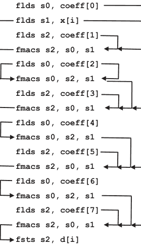

图 2.3 Horner 内核循环中的 RAW 依赖。

如果处理器能够识别并在依赖项之间移动其他非依赖指令，就可以避免停顿或减少停顿数量。这种技术被称为**动态乱序调度**。现代处理器（包括如 ARM Cortex-A15 等某些嵌入式处理器）提供了这一功能。

动态乱序调度引入了两种额外的依赖：写后读（WAR）和写后写（WAW），处理器必须通过寄存器重命名来解决这些问题。寄存器重命名需要增加额外的寄存器和数据路径。此外，动态调度依赖于维护一个缓冲区来存放潜在指令窗口，以及另一个用于跟踪所有执行中指令及其原始的缓冲区（称为重排序缓冲区）。这些资源是有限的，特别是对于嵌入式处理器，并限制了处理器重排指令的程度。因此，程序员或编译器对程序中的指令进行预处理（或静态调度）以分离依赖指令的任何努力都可能提高性能，即使对于支持动态调度的处理器也是如此。实现这一点的一种方法是通过**软件流水线**，其中循环被转换，使其循环体由不同循环迭代的指令组成。这并没有消除依赖，但它分离了依赖指令。这通常以增加持有中间结果的额外寄存器为代价。

### 2.9.1 软件流水线

考虑以下循环：

```
1: For i = 0 to n-1[
2: r0 = load A[i]
3: r0 = r0 + C
4: A[i] = store r0]
```

在这种情况下，循环体中的每对指令之间都存在 RAW 依赖。假设加载和加法的延迟为三个周期。假设是一个单发射、顺序执行的处理器，这将产生以下调度：

| 指令 | 周期 |
|---|---|
| Load A[0] | 0 |
| Add A[0] | 3 |
| Store A[0] | 6 |
| Load A[1] | 7 |
| Add A[1] | 10 |
| Store A[1] | 13 |

由于指令对之间存在 RAW 依赖。

## 2.9 优化 #2：降低 CPI 到 85

```asm
```


`asm ("fmacs s3, s9, s2\n\t" : : "s3");`

`asm ("fmacs s4, s9, s3\n\t" : : "s4");`

`asm ("fmacs s5, s9, s4\n\t" : : "s5");`

`asm ("fmacs s6, s9, s5\n\t" : : "s6");`

`asm ("fmacs s7, s6\n\t" : : "s7");`

`asm ("fsts s7,[mem]\n\t" : : [mem]="m (d[i++])");`

在每个指令之前，每一行代码都存在依赖关系。我们的目标是构建一个具有九阶段的软件流水线，对应加载-乘法之后的每条指令。序言部分（`prorolog`）将开始执行迭代 0 中除最后一条以外的所有指令，使 `s7` 留存最终要存储到 `d` 数组中的值。然后，它将执行所有的最后一条指令，使寄存器 `s6` 留下迭代 2 的值以此类推。

为了实现双缓冲技术（其中一组八个寄存器将交替持有原始系数和多项式值的运行和），像之前的实现一样将循环展开 2 次。

在外层循环的每次迭代中，从 `x` 数组加载一个值。然而，由于软件流水线在同一个体中执行所有七条 `fmac` 指令，因此需要始终维护 `x` 数组的七个不同值。为了做到这一点，使用寄存器 `s9-s15`。这些值在外层循环的每次迭代中必须相对于 `fmac` 指令进行移位。我们的主循环将执行原始外层循环的两个展开体，通过更改代码来实现这种移位。

之后，使用 `fcopy` 指令适当地重新排列值。`fcopy` 在两个浮点寄存器之间复制寄存器的内容。其延迟为四。

```c
for (i=0;i<N/4;i+=2) {
    asm ("fsts s7,[mem]\n\t" : : [mem]="m (d[i])");
    asm ("fmacs s23, s10, s6\n\t" : : "s23");
    asm ("fmacs s22, s11, s5\n\t" : : "s22");
    asm ("fmacs s21, s12, s4\n\t" : : "s21");
    asm ("fmacs s20, s13, s3\n\t" : : "s20");
    asm ("fmacs s19, s14, s2\n\t" : : "s19");
    asm ("fmacs s18, s15, s1\n\t" : : "s18");
}
```

## 第 2 章 多核与数据级优化：OpenMP 和 SIMD

```asm
asm ("fmacs s17, s9, s16\n\t" : : "s17");
asm ("fldmias %[mem],{s0,s1,s2,s3,s4,s5,s6,s7})\n\t" : : [mem]r" (&coeff[0]): "s0", "s1", "s2", "s3", "s4");
```

```asm
asm ("s5", "s6", "s7");
asm ("lds s10, %[mem]\n\t" : [mem]"m(x[i+8])" : "s10");
asm ("fts s23,%[mem]\n\t" : [mem]"m(d[i+1])");
```

```asm
asm ("fmacs s7, s11, s22\n\t" : : "s7");
asm ("fmacs s6, s12, s21\n\t" : : "s6");
asm ("fmacs s5, s13, s20\n\t" : : "s5");
asm ("fmacs s4, s14, s19\n\t" : : "s4");
asm ("fmacs s3, s15, s18\n\t" : : "s3");
asm ("fmacs s2, s9, s17\n\t" : : "s2");
asm ("fmacs s1, s0, s0\n\t" : : "s1");
```

```asm
"s16", "s17", "s18", "s19";
"s20", "s21", "s22", "s23");
```

```asm
// 保 s10
asm ("fcpys s31, s10\n\t" : : "s31");
asm ("fcpys s10, s12\n\t" : : "s10");
asm ("fcpys s11, s13\n\t" : : "s11");
asm ("fcpys s12, s14\n\t" : : "s12");
asm ("fcpys s13, s15\n\t" : : "s13");
asm ("fcpys s14, s9\n\t" : : "s14");
asm ("fcpys s15, s31\n\t" : : "s15");
asm ("lds s9, %[mem]\n\t" : [mem]"m(x[i+9])" : "s9");
)
```

无法在循环中添加 `OpenMP parallel-for`，因为每个线程必须包含它自己的序言（`prolog`）和结尾（`epilogue`）。这排除了 `OpenMP` 的

### 2.9 优化 #2：降低 CPI 到 87

对于循环的自动调度机制，只要将迭代手动分配到每个线程，`OpenMP` 仍然适用。为了做到这一点，请根据线程数计算每个线程中 `$i$` 的第一个值和最后一个值。

在序言部分之前添加 `#pragma omp parallel private(i)`，并将序言、循环和结尾封装在花括号中。这告诉 `OpenMP` 运行时在每个线程中运行整个软件流水线实现的一个实例，并允许每个线程拥有变量 `$i$` 的私有版本。

接下来，在并行区域的第一行插入以下内容：

```c
i=omp_get_thread_num() * N / NUM_THREADS;
```

这将初始化每个线程的 `$i$`。在序言和结尾中引用此 `$i$` 变量。

然后将循环改为：

```c
for(;i<(omp_get_thread_num()+1) * N / NUM_THREADS; i+=5) {
```

序言和结尾将位于循环之前之后。序言是：

```asm
// prolog
// it0
asm("fldmias %[mem],s0,s1,s2,s3,s4,s5,s6,s7)\n\t" : [mem]r(&coeff[0]); "s0", "s1", "s2", "s3", "s4", "s5", "s6", "s7");
asm("fldmias %[mem],s16,s17,s18,s19,s20,s21,s22,s23)\n\t" : [mem]r(&coeff[0]); "s16", "s17", "s18", "s19", "s20", "s21", "s22", "s23");
asm("flds s9,[mem],m(x[i])\n\t" : "s9");
asm("fmacs s1,s9,s0\n\t" : : "s1");
asm("fmacs s2,s9,s1\n\t" : : "s2");
asm("fmacs s3,s9,s2\n\t" : : "s3");
asm("fmacs s4,s9,s3\n\t" : : "s4");
asm("fmacs s5,s9,s4\n\t" : : "s5");
asm("fmacs s6,s9,s5\n\t" : : "s6");
```

结尾是：

```asm
// epilog
// it7
asm("fsts s7,[mem]\n\t" : [mem]d[i]);
```

多核与数据级优化：OpenMP 和 SIMD

```asm
asm ("fmacs s7, s9, s6\n\t" : : "s7");
// it1
asm ("fldmias %[mem],s10\n\t" : [mem]r(&x[i+1]);
asm ("fldmias %[mem],s0,s1,s2,s3,s4,s6\n\t" : [mem]r(&coeff[0]); "s0", "s1", "s2", "s3", "s4", "s6");
asm ("fmacs s1,s10\n\t" : : "s1");
asm ("fmacs s2,s10\n\t" : : "s2");
asm ("fmacs s3,s10,s2\n\t" : : "s3");
asm ("fmacs s4,s10,s3\n\t" : : "s4");
asm ("fmacs s5,s10,s4\n\t" : : "s5");
asm ("fmacs s6,s10,s5\n\t" : : "s6");
// it2
asm ("fldmias %[mem],s11\n\t" : [mem]r(&x[i+2]);
// it2
asm ("fldmias %[mem],s0,s1,s2,s3,s4,s5\n\t" : [mem]r(&coeff[0]); "s0", "s1", "s2", "s3", "s4", "s5");
asm ("fmacs s1,s11,s0\n\t" : : "s1");
asm ("fmacs s2,s11\n\t" : : "s2");
```


asm ("fmacs s3,s11,s2\n\t" : : "s3");

asm ("fmacs s4,s13,s3\n\t" : : "s4");

asm ("fmacs s5,s11,s4\n\t" : : "s5");

// it3

asm ("fldmias %[mem],s12\n\t" : [mem]r(&x[i+3]);

## 2.9 优化 #2：降低 CPI 到 89

```asm
asm ("fmacs s2, s12, s1\n\t" : : "s2");
asm ("fmacs s3, s12, s2\n\t" : : "s3");
asm ("fmacs s4, s12, s3\n\t" : : "s4");
// it 4
asm ("fldmias %[mem],s0,s1,s2,s3\n\t" : [mem]r(&coeff[0]); "s0", "s1", "s2", "s3");
asm ("fldmias %[mem],s13\n\t" : [mem]r(&x[i+4]) "s13");
asm ("fmacs s1,s0\n\t" : : "s1");
asm ("fmacs s2,s11\n\t" : : "s2");
asm ("fmacs s3,s13, s2\n\t" : : "s3");
// it 5
asm ("fldmias %[mem],s0,s1,s2\n\t" : : [mem]r(&coeff[0]) : "s0", "s1");
asm ("fldmias %[mem],s14\n\t" : [mem]r(&x[i+5]) : "s14");
asm ("fmacs s1,s0\n\t" : : "s1");
asm ("fmacs s2,s1\n\t" : : "s2");
// it 6
asm ("fldmias %[mem],s0,s1,s2,s3,s4,s5,s6,s7)\n\t" : [mem]r(&coeff[0]); "s0", "s1", "s2", "s3", "s4", "s5", "s6", "s7");
asm("fldmias %[mem],(s16,s17,s18,s19,s20,s21,s22,s23)\n\t" : [mem]r(&coeff[0]); "s16", "s17", "s18", "s19", "s20", "s21", "s22", "s23");
asm("flds s9,[mem],m(x[i])\n\t" : "s9");
asm("fmacs s1,s9,s0\n\t" : : "s1");
asm("fmacs s2,s9,s1\n\t" : : "s2");
asm("fmacs s3,s9,s2\n\t" : : "s3");
asm("fmacs s4,s9,s3\n\t" : : "s4");
asm("fmacs s5,s9,s4\n\t" : : "s5");
asm("fmacs s6,s9,s5\n\t" : : "s6");
```

## 2.9 优化 #2：降低 CPI

```asm
asm ("
```

表 2.3 显示了相对于我们的双缓冲器实现的性能提升。与我们之前的实现相比，软件流水线（software pipelining）降低了 CPI 和每个浮点运算的指令数（instructions per flop）。这提高了数据缓存的访问率，从而增加了缓存缺失率。

尽管如此，代码仍然实现了显著的改进，在 ARM11 和 Cortex A9 上的性能几乎提升了三倍，尽管 Cortex A15 具有动态调度循环的能力，其性能仍然实现了 62% 的提升。

| 表 2.3 软件流水线对比双缓冲器的性能提升 | 树莓派 | Xilinx Zedboard | NVIDIA Jetson Tegra TK1 |
| :--- | :--- | :--- | :--- |
| | ARM11 | 双核 Cortex A9 | 四核 Cortex A15 |
| 吞吐量/效率 | 2.34 倍加速 <br>44.4% 效率 | 2.71 倍加速 <br>44.3% 效率 | 1.62 倍加速 <br>51.3% 效率 |
| CPI | 1.75 倍加速 | 2.08 倍加速 | 1.35 倍加速 |
| 缓存缺失率 | 0.91 倍加速（慢） | 0.60 倍加速（慢） | 0.77 倍加速（慢） |
| 每个浮点运算的指令数 | 1.34 倍加速 | 1.30 倍加速 | 1.19 倍加速 |

## 2.10 优化 #3：单指令多浮点运算，多数据处理

几乎所有现代处理器都具有使用单条指令执行多个独立操作的能力。这些被称为单指令多数据（SIMD）指令或向量指令。SIMD 指令减少了每次操作执行所需的指令数量，从而增加了浮点吞吐量并降低了缓存缺失率。

某些处理器（如 ARM Cortex A9 和 A15）提供了以少于等量标量指令发射 SIMD 指令的能力。这些处理器具有多个 SIMD 通道，其中有一个寄存器文件可以同时访问所有必要的输入和输出寄存器。在这种情况下，使用 SIMD 指令与使用标量指令相比可以在单个时钟周期内执行多次。

其他处理器（如 ARM11）提供了 SIMD 指令，但它们发射所需的周期数与标量指令相同。换句话说，发射一条 $n$ 路 SIMD 指令需要 $n$ 个周期，而发射 $n$ 条普通的单路指令也需要 $n$ 个周期。虽然在在这种情况下，使用 SIMD 指令似乎毫无意义，但这些指令仍然可以通过减小代码大小和潜在减少缓存缺失来提供益处，更重要的是，它们可以隐藏在没有 SIMD 指令时依赖链所存的延迟中。例如，考虑以下循环：

```
for (i=0; i<n; i++) {
    fmacs s0, s1, s2 // 假设 $s1 是循环不变的
    fmacs s2, s1, s0 // $s0 决决于上一条指令的结果
...
}
```

## 2.10 优化 #3：单指令多数据下的单指令多浮点运算

为了本例，假设 `fmac` 指令的延迟为四个周期，则发射前两条指令将需要五个周期。假设无法从循环体中移动足够的其他指令来覆盖此延迟，将循环展开 4 倍，以找到更多指令来隐藏该延迟。通过这种方式，来自其他迭代的指令被“借用”来覆盖延迟：

```
for (i=0;i<n;i+=4) {
    facs s0, s1, s2
    facs s2, s1, s0
    ...
    facs s4, s1, s2
    facs s6, s1, s4
    ...
    facs s8, s1, s2
    facs s10, s1, s8
    ...
    facs s12, s1, s2
    facs s14, s1, s12
    ...
}
```

这并没有解决我们的的问题，因为指令流在每对指令之间会有四个周期的未被覆盖的延迟。现在将这四对指令交错排列：

```
for (i=0;i<n;i+=4) {
    facs s0, s1, $s2
    facs s4, s1, $s2
    facs s8, s1, $s2
    facs s12, s1, $s2
    facs s2, s1, $s0
    facs s6, s1, $s4
    facs s10, s1, $s8
    fmacs s14, s1, $s12
...
)
```

现在每对依赖的乱序执行指令之间都有三条插入指令。注意，能够动态乱序执行的处理器可能能够自动实现这种相同的重排序，但取决于其能力，当静态执行时，它可能无法获得相同的性能。

最后一步，将前四条和后四条指令分别替换为单条 SIMD 指令。

这种技术适用于霍纳法则（Horner's method）内核。然而，ARM11 和 ARM Cortex 处理器实现 SIMD 指令的方式存在主要差异。本节将分别检查这两者。

### 2.10.1 ARM11 VFP 短向量指令

Armv6 VFP 指令集通过一种名为“短向量指令”的功能提供了 SIMD 指令，在其中，程序员可以通过浮点状态和控制寄存器（FPSCR）指定向量宽度和步长字段（stride）。设置 FPSCR 将导致该线程随后的所有浮点指令都按照 FPSCR 中定义的步长执行相应的操作并访问寄存器。注意，Armv7 处理器不支持 VFP 短向量指令。在配备 NEON 的处理器上尝试更改向量宽度或步长将触发无效异常。

32 个浮点 VFP 寄存器排列成四个组，每组八个寄存器（如果使用双精度，则每个寄存器占用两个槽位）。在执行短向量指令时，每组都可以作为短向量使用。第一组寄存器 s0-s7（或 d0-d3）当指定为第二个输入操作数时，将在短向量指令中作为标量。例如，当向量宽度为 8 时，`fads s16,s8,s0` 指令将将寄存器 s8-15 中向量的每个元素与存储在 s0 中的标量相加，并将结果存储在 s16-s23。


`fmrx` 和 `fmnr` 指令允许程序员读取和写入 FPSCR。`fmrx` 指令的延迟为两个周期，`fbnr` 指令的延迟为四个周期。FPSCR 中的 18:16 位编码为 0 到 7 的长度。写入 FPSCR 时，你必须更改你想要更改的位并保持其他位不变。为了这样做，你必须首先使用 `fmrx` 指令读取值，更改 18:16 位，然后使用 `fbnr` 指令改回默认值 1，因为编译器不会自动这样做。

你可以使用以下函数来更改 FPSCR：

```c
void set_fpscr_reg (unsigned char len) {
    unsigned int fspcr;
    asm("fmxr %%[val], [val]\n" : [val]"=r(fspcr));

    len = len - 1;

    spspcr = fspcr & ~(0x7<<16);
    spspcr = fspcr | ((len&0x7)<<16);

    asm("fmxr fspcr, %%val]\n" : : [val]"r(spspcr));
}
```

为了最大化短向量指令的收益，通过将循环展开 8 倍来目标最大向量大小 8。在原始实现中，每个 `fmacs` 指令在两个迭代后被依赖的 `fmacs` 指令跟随。为了完全覆盖所有 `fmacs` 指令的八周期延迟，使用每个 `fmacs` 指令执行 8 次迭代的操作。

换句话说，展开外部循环以便每次迭代计算多项式值，并使用长度为 8 的短向量指令执行每个指令。

将短向量长度改为 8 并将循环展开 8 倍，因此将外部循环的迭代步长改为 4：

## 第2章 多核与数据级优化：OpenMP 与 SIMD

```c
set_fpscr_reg (8);
for (i=0;i<N/4;i+=8) (
```

现在将第一个系数加载到标量寄存器，并将 x 数组的八个值加载到向量寄存器 s15:s8：

```asm
asm("flds s0,%[mem]\n\t" : [mem]m"(coeff[0]) : "s0");
asm("fldias%%[mem],(s8,s9,s10,s11,s12,s13,s14)\n\t" : \
\t[mem]r"(&[x[i]])" : "s8","s9","s10","s11","s12","s13",
\t"s14","s15");
```

现在将第二个系数的八个副本加载到向量寄存器 s23:16 中，并通过将 x 乘以第一个系数并将结果加到第二个系数上，执行我们的第一次 fmac，将运行总和保留向量寄存器 s23:16 中

```asm
asm("fldias%%[mem],(s16,s17,s18,s19,s20,s21,s22,s23)\n\t" : \ \
\t[mem]r"(&coeff[8])" : \ \
\t"s16","s17","s18","s19","s20","s21","s22","s23");
asm("fmacs s16, s8,s0\n\t" : : \ \
\t"s16","s17","s18","s19","s20","s21","s22","s23");
```

现在重复此过程，同时交换向量寄存器 s23:16 与 s31:24：

```asm
asm("fldias%%[mem],(s24,s25,s26,s27,s28,s29,s30,s31)\n\t" : \ \
\t[mem]r"(&coeff[16])" : \ \
\t"s24","s25","s26","s27","s28","s29","s30","s31");
asm("fmacs s24, s8,s16\n\t" : : \ \
\t"s20","s17","s18","s19","s28","s29","s30","s31");
```

现在再次重复最后两个步骤。以以下代码结束：

```asm
asm("fldias%%[mem]
```

## 2.10 优化 #3：单指令多数据实现每条指令多个浮点运算次数

| 表格 2.4 短向量指令相对于软件流水线的性能提升 | | |

| :--- | :--- |

| 平台 树莓派 (Raspberry Pi) | |

| CPU ARM11 | |

| 吞吐量/效率 | 1.37 倍加速，55.2% 效率 |

| CPI | 0.43 倍加速（减速） |

| 缓存缺失率 | 1.89 倍加速 |

| 每个浮点运算的指令数 | 3.17 倍加速 |

```asm
asm("fstmias%[mem],[s16,s17,s18,s19,s20,s21,s22,s23]\n\t" : :
[mem]r" &(&d[i]);
set_fpscr_reg (1);
```

确保在外层循环后将短向量长度重置为 1：

表 2.4 显示了树莓派上最终性能提升。使用调度的 SIMD 指令比软件流水线提供了 37% 的性能提升。这种优化增加了 CPI，因为每个通道的 SIMD 指令需要八个周期来发射，但带来了每浮点运算指令数更大的相对减少（CPI 延迟倍数与每浮点运算指令数加速倍数的乘积得出总加速为 1.36）。

这种优化的另一个处是由于 SIMD 加载和存储指令降低了缓存缺失率。

### 2.10.2 ARM Cortex NEON 指令

ARM Cortex 处理器支持带有 NEON 指令的 SIMD 浮点运算。NEON 指令助码以字母 V 开。在使用 NEON 指令编译时，请确保使用 GCC 编译器标志 `-march -mfpu=neon`。

为了支持 SIMD NEON 指令，ARM 将重叠的 64 位 d 寄存器数量增加 32 个，并添加了一组新的 16 个重叠 128 位寄存器 q0-q15，每个寄存器重叠一对 d 寄存器。

与 VFP 类似，仍然只有 32 位的 s 寄存器和 16 个 64 位 d 寄存器用于标量单精度和双精度指令。扩展的 d 寄存器集和新的 q 寄存器集仅可用于 NEON SIMD 指令。

不需要在 FPSCR 中写入向量长度，向量大小直接编码在每个 NEON 指令中。向量长度通过助码后的操作数类型和操作数的寄存器大小组合确定。

向量长度通过操作数寄存器的大小除以类型的大小来隐含。例如，指令 `vaddf32 q4, q5, q6` 将执行四次浮点加，因为 32 位的浮点值可以放入单个 128 位的 q 寄存器中。换句话说，“f32”助码指定数据类型精度，而 q 寄存器指定 128 位寄存器，因此向量大小隐含为 128/32=4。

还有若干 NEON 指令允许操作寄存器内的单个子字段，如 `vext`、`vmov` 和 `vmvn`。

NEON 加载和存储指令使用不同的方法来指定宽度，因为它们支持 1、2、3 或 4 个值的内存访问并允许指定目标寄存器。它们使用格式：

```vld<元素大小><目标寄存器>,<基址寄存器>
```

例如，指令 vld2 (d0,d1), [r0 将从地址 r0 开始的每个 8 位值加载到 d0，并将 r0+1 处的每隔 8 位的值加载到 d1。

通过使用对齐地址（可以被 16、32、64、128 或 256 字节整除的内存访问）可以提高 NEON 的加载和存储性能。除了确保地址对齐外，必须通过在指令末尾添加后缀如 @64 来显式给出对齐要求。

虽然 ARM 短向量指令支持八个精度操作，但 NEON 限制为四个。因此，使用所示的对齐属性对系数数组进行适当调整：

```c
float __attribute__((aligned(16))) coeff_4vector[32] = {1.2,1.2,1.2,1.4,1.4,1.4,1.4,2.6,2.6};
d = (float*)malloc(N+16);
x = (float*)malloc(N+16);
```

## 2.10 优化 #3：单指令多数据实现每条指令多个浮点运算次数


```c
d = (float*)((unsigned int)d & ~0xF) + 16);
x = (float*)((unsigned int)x & ~0xF) + 16);
#pragma omp for
for (i=0;i<N/4;i+=4) {
    asm("fldias%%[mem],(s16,s17,s18,s19,s20,s21,s22,s23)\n\t" : \ \
    \t[mem]r"(&coeff[8])" : \ \
    \t"s16","s17","s18","s19","s20","s21","s22","s23");
    asm("fmacs s16, s8,s0\n\t" : : \ \
    \t"s16","s17","s18","s19","s20","s21","s22","s23");
    asm("fldias%%[mem],(s24,s25,s26,s27,s28,s29,s30,s31)\n\t" : \ \
    \t[mem]r"(&coeff[16])" : \ \
    \t"s24","s25","s26","s27","s28","s29","s30","s31");
    asm("fmacs s24, s8,s16\n\t" : : \ \
    \t"s20","s17","s18","s19","s28","s29","s30","s31");
    //
}
    asm("fstmias%[mem],[s16,s17,s18,s19,s20,s21,s22,s23]\n\t" : :
    [mem]r" &(&d[i]);
    }
    }
    set_fpscr_reg (1);
```

修正：

```asm
asm("fstmias%[mem],[s16,s17,s18,s19,s20,s21,s22,s23]\n\t" : :
[mem]r" &(&d[i]);
set_fpscr_reg (1);
```

确保在外层循环后将短向量长度重置为 1：

表 2.4 显示了树莓派上最终的性能提升。使用调度的 SIMD 指令比软件流水线提供了 37% 的性能提升。这种优化增加了 CPI，因为每个通道的 SIMD 指令需要八个周期来发射，但带来了每浮点运算指令数更大的相对减少（CPI 延迟倍数与每浮点运算指令数加速倍数的乘积得出总加速为 1.36）。

这种优化的另一个处是由于 SIMD 加载和存储指令降低了缓存缺失率。

### 2.10.2 ARM Cortex NEON 指令

ARM Cortex 处理器支持带有 NEON 指令的 SIMD 浮点运算。NEON 指令助码以字母 V 开。在使用 NEON 指令编译时，请确保使用 GCC 编译器标志 `-march -mfpu=neon`。

为了支持 SIMD NEON 指令，ARM 将重叠的 64 位 d 寄存器数量增加 32 个，并添加了一组新的 16 个重叠 128 位寄存器 `q0-q15`，每个寄存器重叠一对 d 寄存器。

与 VFP 类似，仍然只有 32 位的 s 寄存器和 16 个 64 位 d 寄存器用于标量单精度和双精度指令。扩展的 d 寄存器集和新的 q 寄存器集仅可用于 NEON SIMD 指令。

不需要在 FPSCR 中写入向量长度，向量大小直接编码在每个 NEON 指令中。向量长度通过助码后的操作数类型和操作数的寄存器大小组合确定。

向量长度通过操作数寄存器的大小除以类型的大小来隐含。例如，指令 `vaddf32 q4, q5, q6` 将执行四次浮点加，因为 32 位的浮点值可以放入单个 128 位的 q 寄存器中。换句话说，“f32”助码指定数据类型精度，而 q 寄存器指定 128 位寄存器，因此向量大小隐含为 128/32=4。

还有若干 NEON 指令允许操作寄存器内的单个子字段，如 `vext`、`vmov` 和 `vmvn`。

NEON 加载和存储指令使用不同的方法来指定宽度，因为它们支持 1、2、3 或 4 个值的内存访问并允许指定目标寄存器。它们使用格式：

```vld<元素大小><目标寄存器>,<基址寄存器>
```

例如，指令 `vld2 (d0,d1), [r0` 将从地址 `r0` 开始的每个 8 位值加载到 `d0`，并将 `r0+1` 处的每隔 8 位的值加载到 `d1`。

通过使用对齐地址（可以被 16、32、64、128 或 256 字节整除的内存访问）可以提高 NEON 的加载和存储性能。除了确保地址对齐外，必须通过在指令末尾添加后缀如 `@64` 来显式给出对齐要求。

虽然 ARM 短向量指令支持八个精度操作，但 NEON 限制为四个。因此，使用所示的对齐属性对系数数组进行适当调整：

```c
float __attribute__((aligned(16))) coeff_4vector[32] = {1.2,1.2,1.2,1.4,1.4,1.4,1.4,2.6,2.6};
d = (float*)malloc(N+16);
x = (float*)malloc(N+16);
```

## 2.10 优化 #3：单指令多数据实现每条指令多个浮点运算次数

```c
d = (float*)((unsigned int)d & ~0xF) + 16);
x = (float*)((unsigned int)x & ~0xF) + 16);
#pragma omp for
for (i=0;i<N/4;i+=4) {
    asm("fldias%%[mem],(s16,s17,s18,s19,s20,s21,s22,s23)\n\t" : \ \
    \t[mem]r"(&coeff[8])" : \ \
    \t"s16","s17","s18","s19","s20","s21","s22","s23");
    asm("fmacs s16, s8,s0\n\t" : : \ \
    \t"s16","s17","s18","s19","s20","s21","s22","s23");
    asm("fldias%%[mem],(s24,s25,s26,s27,s28,s29,s30,s31)\n\t" : \ \
    \t[mem]r"(&coeff[16])" : \ \
    \t"s24","s25","s26","s27","s28","s29","s30","s31");
    asm("fmacs s24, s8,s16\n\t" : : \ \
    \t"s20","s17","s18","s19","s28","s29","s30","s31");
    //
}
    asm("fstmias%[mem],[s16,s17,s18,s19,s20,s21,s22,s23]\n\t" : :
[mem]r" &(&d[i]);
set_fpscr_reg (1);
```

## 第2章 多核与数据级优化：OpenMP 与 SIMD

| 表格 2.5 NEON SIMD 指令相对于软件流水线的性能提升 | | |

| :--- | :--- | :--- |

| 平台 | Xilinx Zedboard | NVIDIA Jetson Tegra TK1 |

| CPU | Dual Cortex A9 | Quad Cortex A15 |

| 吞吐量/效率 | 1.05 倍加速 | 1.13 倍加速 |

| | 45.7% 效率 | 60.0% 效率 |

| CPI | 0.48 倍加速（减速） | 0.48 倍加速（减速） |

| 缓存缺失率 | 0.45 倍加速（减速） | 0.45 倍加速（减速） |

| 每个浮点运算的指令数 | 1.30 倍加速 | 2.36 倍加速 |

```c
[x_addr]m"x(x[i]).[next]m"x(i+16)).
[d_addr]m"d(d[i]),[coeff_addr]r"r(coeff_4vector):
"r0","r1","r2","r3","q1","q2","q3";
```

表 2.5 显示了 Cortex A9 和 Cortex A15 的 NEON 实现相对于软件流水线的性能结果。SIMD NEON 指令序列中的数据依赖导致了无法通过指令重排序完全隐藏的停顿，从而导致 CPI 增加。尽管如此，每浮点运算指令数的减少弥补了这种损失，并实现了微小的提升。


```c
#include <arm_neon.h>

#pragma omp parallel for private(x0,a,b)

for (i=0;i<N/4;i+=4) {
    x0 = vldq_f32((float32_t*)&x[i]);

    a = vldq_f32((float32_t*)&coeff_4vector[0]);

    b = vldq_f32((float32_t*)&coeff_4vector[4]);

    b = vmmaq_f32 (b,a,x0);

    a = vldq_f32((float32_t*)&coeff_4vector[8]);

    a = vmlaq_f32 (a,b,x0);

    b = vldq_f32((float32_t*)&coeff_4vector[12]);

    b = vmlaq_f32 (b,a,x0);

    a = vldq_f32((float32_t*)&coeff_4vector[16]);

    a = vmlaq_f32 (a,b,x0);

    b = vldq_f32((float32_t*)&coeff_4vector[20]);

    b = vmlaq_f32 (b,a,x0);

    a = vldq_f32((float32_t*)&coeff_4vector[24]);

    a = vmlaq_f32 (a,b,x0);

    b = vldq_f32((float32_t*)&coeff_4vector[28]);

    b = vmlaq_f32 (b,a,x0);

    vstq_f32((float32_t*)&d[i],b);
}
```

## 2.11 章节总结

本章描述了四种优化代码以提高内核性能的编程技术。

第一种优化是使用 `OpenMP` 来利用多核心优势。`OpenMP` 并非针对嵌入式系统或 `ARM` 处理器设计，但在多核嵌入式 `CPU` 上编写高性能代码时，它是必要的。

# 第 2 章 多体系与数据级优化：OpenMP 和 SIMD

第二种优化是使用内联汇编语言，旨在相对于执行指令总数增加浮点运算吞吐量。

第三种优化是软件流水线，它通过将循环体内的依赖关系转换为循环携带依赖来减少停顿率。这增加了依赖指令之间的距离，减少了停顿次数并增加了 `CPI`。这种优化即使对于支持动态指令调度的 `Cortex-A15` 也是有效的。

第四种优化是使用 `SIMD` 指令对循环体进行手动向量化。本章涵盖了适用于 `ARM11` 和 `ARM Cortex` 处理器的 `SIMD` 指令。

本章中的示例使用了性能计数器代码插桩，以便通过多种指标评估每种优化：每个浮点的指令数、`CPI`、有效内存带宽和浮点吞吐量。

每种优化技术都应用于一个简单的基准内核，该内核使用霍纳方法在 `1D` 数组上计算多项式。该内核对每个输入和输出字执行七次乘加操作，并且受内存带宽限制。我们的初始实现是一个相对简单的多线程循环嵌套，仅包含七行代码。以其性能为基准，优化在单发射、顺序的 `ARM11` 处理器上实现了 `11` 倍的加速（从 `35` 到 `380 Mflops`），在多发射的 `ARM Cortex A9` 和 `A15` 上实现了四倍加速（`A9` 从 `211` 到 `790 Mflops`，`A15` 为 `7.5 Gflops`）。

下一章将涵盖 Linux 帧缓冲区，并描述用于变换的新内核以及用于调优的新方法。

## 练习题

- 1. 考虑第 `2.1` 节中的位反转示例。可能可以使用手写汇编来修改高级代码以提高性能。具体而言，是否可以通过不同的循环终止条件来减少循环体中的指令数量？为什么或者为什么不？

- 2. 写一个结合了 `NEON` 指令和软件流水线的霍纳内核版本。在基于 `ARM` 的开发板上测试，并根据其内存带宽评估其效率。

考虑以下计算整数数组导数的整数循环：

```c
for (i=0;i<1023;i++) a[i]=a[i+1]-a[i];
```

- 使用 `ARM` 汇编语言实现此循环。假设代码运行在单发射、顺序处理器上，且每条指令与与其最近的依赖指令之间至少间隔三个周期。循环迭代间隔 `II` 是多少？

- 使用 `NEON` 指令以四为宽度对循环进行向量化。

- 软件流水线还是向量化，哪种方法在每周期输出元素方面实现了最高吞吐量？

考虑乘以两个单精度矩阵 `A` 和 `B` 的问题：

```c
C=C+AB
```

```c
这可以通过一个简单的顺序、三层嵌套循环完成：
for (i=0; i<A_rows;i++)
  for (j=0; j<B_cols;j++)
    for (k=0; k<A_rows;k++) C[i*A_cols+j] = A[i*A_cols+k]*B[k*B_cols+j]
```

矩阵乘法在计算上是 `O(n³)` 操作，但数据量只有 `O(n²)`。

尽管如此，现代处理器仅能达到 `2/3` 的浮点性能。实现高性能矩阵乘法需要对硬件进行映射并优化内存访问模式。在上面的代码中，任何三个循环都可以通过 `pragma parallel for` 进行并行化。或者，在 `OpenMP 3.0` 中，可以通过最外层循环添加 `pragma parallel for collapse()` 同时并行化。

当矩阵 `A` 和 `B` 为 `256×256`、`512×512` 和 `1024×1024` 时，从每秒浮点操作数评估所有这些情况。

5. 对于霍纳内核，将系数增加到 `16` 和 `32`。`SIMD` 方法相对于基准实现的加速效果如何？

6. 使用 `OpenMP parallel for` 指令将循环迭代动态调度到线程。这种方法允许程序员指定“块大小”，即每次分配给线程的迭代次数。测量块大小为 `8`、`32`、`64` 和 `128` 时动态调度霍纳循环的性能。与静态方法相比如何？

## 3.1 Linux Framebuffer

避免了复杂图形用户界面的开销，并消除了添加模板代码和链接库以使其运行的需求。

`framebuffer`（缓冲区）由设备文件 `/dev/fb0`（有时为 `/dev/fb1`）表示，且只能由超级用户（`root` 账户）以写模式打开。`framebuffer` 不是使用读写函数，而是使用系统调用 `ioctl()` 和 `mmap()` 来访问。

默认情况下，`framebuffer` 将采用所接显示器的原生分辨率，尽管分辨率和每个像素的颜色位数都可以使用 Linux `fb` 命令或对 `framebuffer` 设备文件进行 `ioctl()` 调用来更改。

`ioctl()` 系统调用用于访问设备文件的参数。参数集取决于具体的设备。在 `framebuffer` 的案例中，它用于获取和设置如分辨率、像素位深、行长度和偏移量等参数。为了说明这一点，使用 `open()` 系统调用以读写模式打开 `framebuffer`：

```c
int fd;
fd = open("/dev/fb0", O_RDWR);
if (fd == -1) {
  perror("Error: cannot open framebuffer device");
  exit(0);
}
```

注意 `open()` 打开的是文件，而不是 `fopen()`。这两个函数的区别在于 `open()` 返回一个整数文件描述符，而 `fopen()` 返回的是一个指向 `FILE` 数据结构体的指针。如果代码确实使用了 `open()`，它仍然可以使用 `fileno()` 函数来检索相应的文件描述符。

接下来，调用一次 `ioctl()` 从 `framebuffer` 中检索信息：

```c
struct fb_var_screen_info vinfo;
if (ioctl(fd, FBIOGET_SCREENINFO, &vinfo) == -1) {
  perror("Error reading variable information");
  exit(1);
}
```

此报告将返回 `x` 分率（列数）、`y` 分率（行数）以及每个像素的位数，这些可以用于计算屏幕字节大小以及每行的大小：

```c
screensize = vinfo.xres * vinfo.yres * vinfo.bits_per_pixel / 8
row_size = vinfo.xres * vinfo.bits_per_pixel / 8
```

现在将 `framebuffer` 本身映射到我们程序中的虚拟内存块中：

```c
char *fbp;

fbp = (char *)mmap(0, screensize, PROT_READ | PROT_WRITE,
MAP_SHARED, fd, 0);

if ((int)fbp == -1) err("Error: failed to map framebuffer device to memory");
```

现在程序可以通过向由 `fbp` 指针指向的内存区域写入数据来绘制像素。绘制像素的代码取决于像素的大小。例如，对于 `16` 位像素（其最高 `5` 位是红色强度，最低 `5` 位是蓝色强度，中间的 `6` 位是绿色强度）：


```c
((unsigned short *)(fbp + i*(row_size) + j*2) = (red << 11) | (green << 5) | blue);
```

Linux framebuffer 是一个零拷贝缓冲区，这意味着程序的单次写入就会更新显示器上的像素。根据第 1 节中的写内存带宽实验，我们的每秒帧数（fps）上限。

例如，树莓派的写带宽为 325 MB/s，而一个 $1920 \times 1080 \times 16$ 的帧由 $4,147,200$ 字节组成，因此程序可以达到 $1/(4,147,200/325 \times 20) = 82$ fps。

一旦完成 framebuffer 的操作，你应该取消映射并关闭文件：

```c
munmap(fbp, screensize);
close(fd);
```

## 3.2 仿射变换（AFFINE IMAGE TRANSFORMATIONS）

任何玩过视频游戏、在个人媒体设备上翻过虚拟封面或使用过图像编辑软件的人对图像变换的概念都很。图像变换描述了一种改变或扭曲图像的操作。特别是线性图像变换，用于旋转、缩放、剪切、反射或投影图像等操作。

假设像素的位置（表示为行和列值）存储为列向量 `c`。线性图像变换可以描述为 $2 \times 2$ 矩阵 `A`，并通过乘法应用到该像素上；`c' = A \cdot c` 是表示变换后图像中像素位置的列向量。

在*仿射变换（affine transformation）*中，矩阵 `A` 是 $3 \times 3$ 矩阵，并且必须向像素位置向量添加一个额外的元素。

例如，以下三个仿射矩阵允许图像绕 $X, Y, Z$ 维度顺时针旋转角度 $\theta$：

```
$A_x = \begin{bmatrix} 1 & 0 & 0 \\ 0 & \cos\theta & -\sin\theta \\ 0 & \sin\theta & \cos\theta \end{bmatrix}$
```

```
$A_y = \begin{bmatrix} \cos\theta & 0 & \sin\theta \\ 0 & 1 & 0 \\ -\sin\theta & 0 & \cos\theta \end{bmatrix}$
```

```
$A_z = \begin{bmatrix} \cos\theta & -\sin\theta & 0 \\ \sin\theta & \cos\theta & 0 \\ 0 & 0 & 1 \end{bmatrix}$
```

仿射变换的效果可以通过组合这些矩阵来合并。例如，`A_{XYZ} = A_x \cdot A_y \cdot A_z`。

## 3.3 双线性插值（BILINEAR INTERPOLATION）

执行逆变换时，变换图像中的许多像素将对应源图像中的分数位置。由于源图像是在整数像素位置离散采样的，程序必须使用某种技术来计算像素之间的颜色。这种插值有多种方法，但从最简单的方法开始：双线性插值。

当逆变换将目标像素映射到分数源像素时，程序必须根据周围的采样像素来估计这个“虚拟”值。双线性插值的基本思想是二维空间内的分数坐标位于 2x2 像素块内部。插值像素可以通过这四个像素的加权平均值来计算，其中每个像素的权重是根据两个维度上的分数部分的函数计算的。

图 3.1 描述了这种情况，假设逆变换给了我们 $(i,j)$ 且 $i_{int} = i, i_{rac} = i - int$，$j_{int} = j, j_{rac} = j - j$。

权重计算如下：

```
$weight(i_{int}, j_{int}) = (1 - i_{rac}) \cdot (1 - j_{rac})$
weight(i_{int}+1, j_{int}) = (1 - i_{rac}) \cdot j_{rac}$
weight(i_{int}, j_{int}+1) = i_{rac} \cdot (1 - j_{rac})$
weight(i_{int}+1, j_{int}+1) = i_{rac} \cdot j_{rac}$
```

## 3.4 浮点图像变换（FLOATING-POINT IMAGE TRANSFORMATION）

图像变换和插值计算必须使用分数值进行，浮点似乎是一个显而易见的选择。使用浮点的问题是，每个变换像素的开始和结束都是像素位置和颜色值，两者都是整数。这需要在整数和浮点数之间进行类型转换，以

## 3.4 浮点图像变换

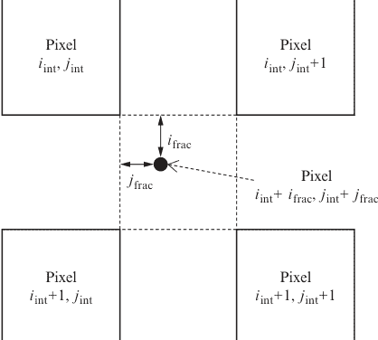

- 图 3.1 分数源像素。

中间计算。在整数和浮点数之间的类型转换需要使用高延迟的转换指令。

为了表征这些操作所增加的开销，首先使用浮点数实现图像变换，并使用性能计数器测量其性能。

我们的目标是生成一段视频，视频由一系列帧组成，描述图像绕所有三个轴平滑旋转。从图形上看，这将表现为 2D 图像在 3D 空间中旋转。

为了实现这一点，可以在每一帧中逐渐改变图像的 X、Y 和 Z 旋转角度。对于此程序，你需要在每一帧之前调用一个函数，根据给定的 X、Y 和 Z 旋转角计算变换矩阵。由于该函数每帧只调用一次（而不是每个像素调用一次），预计它对性能的影响是微乎其微的。

以下函数将作为 X、Y、Z 角的函数计算变换矩阵，并将变换矩阵的前两行和第一列作为数组 `c_row` 和 `c_col` 返回：

```c
void calc_coeffs(float c_row[2], float c_col[2], float scale, float rot_x, float rot_y, float rot_z) {
    int i, j, k;
    float rotm_x[3][3] = {{1.0, 0.0, 0},
                          (0, 1.0/cos(rot_x), tan(rot_x)},
                          (0, tan(rot_x), -1.0/cos(rot_x))};
    float rotm_y[3][3] = {{1.0/cos(rot_y), 0, -tan(rot_y)},
                          (0, 1.0, 0),
                          (tan(rot_y), 0, 1.0/cos(rot_y))};
    float rotm_z[3][3] = {{cos(rot_z), -sin(rot_z), 0},
                          (sin(rot_z), cos(rot_z), 0},
                          {0, 0, 1.0}};
    float tempm0[3][3], tempm1[3][3], tempm2[3][3], sum;

    for (i=0; i<3; i++) // (temp = Ax * Ay)
        for (j=0; j<3; j++) {
            sum=0.0;
            for (k=0; k<3; k++) sum+=rotm_x[i][k]*rotm_y[k][j];
            tempm0[i][j] = sum;
        }
    for (i=0; i<3; i++) // (temp = temp * Az)
        for (j=0; j<3; j++) {
            sum=0.0;
            for (k=0; k<3; k++) sum+=tempm0[i][k]*rotm_z[k][j];
            tempm1[i][j] = sum;
        }
    c_row[0] = tempm1[0][0];
    c_row[1] = tempm1[0][1];
    c_col[0] = tempm1[1][0];
    c_col[1] = tempm1[1][1];
}
```

### 3.4.1 加载图像

首先将源图像加载到内存中。在网上找一个合适的图像，例如常用于图像处理工作的著名的 512 像素 512 像素“Lena”图像的彩色版本。首先，你需要使用工作站上的图像编辑工具将图像转换为 PPM 格式。

PPM 文件格式是一种未压缩或“原始”格式，在不需要任何特殊图像库的情况下，在程序中读取和写入非常简单。

PPM 文件包含 ASCII 文本和二进制数据。文件开头有一个由 ASCII 文本组成的头部。头部之后是二进制数据，按行升序顺序（从上到下）表示图像的每一行。每一行由按列升序顺序（从左到右）排列的像素组成。每个像素通常存储为三个连续的字节，分别对应红、绿、蓝（RGB）颜色通道。

PPM 头部包含以下由空白字符（空格、制表符、换行符、行）分隔的 ASCII 值：

1. 格式的“魔数” P6，

2. 列数，

3. 行数，以及

4. 最大颜色值（通常为 255）。

PPM 文件还可以包含以 # 开头的注释行。


要读取 PPM 文件并将其转换为内存中的 16 位格式，请从以下声明开始：

```c
FILE *myFile; (文件指针)
int rows=0, cols=0, maxcolorvalue=0; (头部信息)
int i,j; (循环变量)
static unsigned short *src_image; (内存中图像的指针)
```

接下来，打开文件并读取头部。将图像转换为 PPM 文件的工具可能在头部之前插入了一行或多行注释。要跳过这些注释，反复使用 `fscanf()` 函数搜索整数，寻找第一个足够表示头部中每个值的整数：

```c
myFile = fopen("lena.ppm","r");  (打开文件，假设名为 lena.ppm)

if (!myFile) {
    perror("image file");
    exit(0);
}

fscanf(myFile,"%d",&cols);  (读取列数)

while (cols<160) {  (寻找合法的列数)
    fseek(myFile,1,SEEK_CUR);  (跳过一个字符)
    fscanf(myFile,"%d",&cols);  (再次读取)
}

fscanf(myFile,"%d",&rows);  (读取行数)

while (rows<120) {  (寻找合法的行数)
    fseek(myFile,1,SEEK_CUR);  (跳过一个字符)
    fscanf(myFile,"%d",&rows);  (再次读取)
}

fscanf(myFile,"%d",&maxcolorvalue); (读取最大颜色值)
```

在 PPM 文件，每个像素存储为三个表示 RGB 强度的字节。使用这种 24 位格式将图像存储在内存中。
现在程序有了行和列数，可以分配行 × 列 × 3 字节。`src_image` 被声明为无符号字符指针（`unsigned char *`）。

```c
src_image=(unsigned char*)malloc(rows*cols*3);  (分配图像内存)

if (!src_image) {
    perror("Allocating memory for source image");
    exit(0);
}
```

将指针移动一个字节以越过头部后的换行符。然后将图像内容直接读取到图像数组中。

```c
fseek(myFile,1,SEEK_CUR);   (移动一个字节)
read(src_Image,1,rows*cols*3,myFile);   (读取图像内容)
```

## 3.4 浮点图像变换

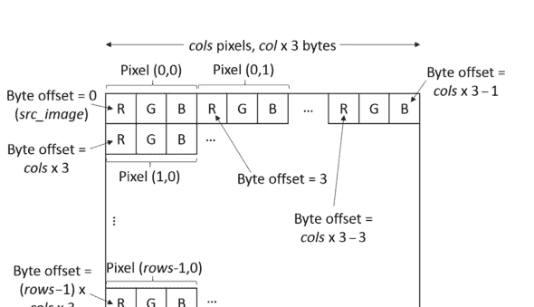

**图 3.2** 24位RGB帧中每个像素的每个颜色通道的字节偏移量。

`src_pixel` 数组记住位置 `(x,y)` 处的每个像素存储在像素位置 `(y × cols + x)`，因为到达某行需要跳过大小为 `cols` 的若干行，但此值必须乘以 3 才能达到字节偏移量。这为我们提供了：
- `(y × cols + x) × 3` 用于红色通道
- `(y × cols + x) × 3 + 1` 用于绿色通道
- `(y × cols + x) × 3 + 2` 用于蓝色通道

为每个颜色通道声明三个 4 元素的整数数组，即 `r[4]`, `g[4]`, `b[4]`。可以使用以下代码提取源像素周围四个像素的三色通道：

```
r[0] = src_image[(src_pixel_int[0]*cols+src_pixel_int[1])*3];ng[0] = src_image[(src_pixel_int[0]*cols+src_pixel_int[1])*3+1];nb[0] = src_image[(src_pixel_int[0]*cols+src_pixel_int[1])*3+2];nr[1] = src_image[(src_pixel_int[0]*cols+src_pixel_int[1]+1)*3];ng[1] = src_image[(src_pixel_int[0]*cols+src_pixel_int[1]+1)*3+1];nb[1] = src_image[(src_pixel_int[0]*cols+src_pixel_int[1]+1)*3+2];nr[2] = src_image((src_pixel_int[0]+1)*cols+src_pixel_int[1])*3];ng[2] = src_image((src_pixel_int[0]+1)*cols+src_pixel_int[1])*3+1];nb[2] = src_image((src_pixel_int[0]+1)*cols+src_pixel_int[1])*3+2];
```

```
r[3] = src_image[((src_pixel_int[0]+1)*cols+
src_pixel_int[1]+1)*3);
g[3] = src_image[((src_pixel_int[0]+1)*cols+
src_pixel_int[1]+1)*3+1);
b[3] = src_image[((src_pixel_int[0]+1)*cols+
src_pixel_int[1]+1)*3+2];
```

有了这四个像素，程序就可以计算插值。

```
red = (int)((float)(r[0]) * (weights[0]) + 
float(r[1]) * (weights[1]) + 
float(r[2]) * (weights[2]) + 
float(r[3]) * (weights[3]);
green = (int)((float)(g[0]) * (weights[0]) + 
float(g[1]) * (weights[1]) + 
float(g[2]) * (weights[2]) + 
float(g[3]) * (weights[3]);
blue = (int)((float)(b[0]) * (weights[0]) + 
float(b[1]) * (weights[1]) + 
float(b[2]) * (weights[2]) + 
float(b[3]) * (weights[3]);
```

帧缓冲区（`framebuffer`）的组织方式与我们的图像类似，但它可能比我们的图像大。然而，像素并不一定由24位组成。你可以使用命令行中的 `fbset` 工具进行检查。
在打开帧缓冲区程序时，计算行大小并将其赋值给变量 `row_size`。这将显示类似于下面的输出：

```
mode="1920x1200"
geometry 1920 1200 1200 1920 16
timings 0 0 0 0 0 0 0
rgba 5/11.6/5.5/0/16
endmode
```

### 3.4.2 渲染帧

初始化 X、Y 和 Z 角度为 0。在无限 while 循环内部，每帧分别增加 1、0.5 和 0.25 度（0.0175、0.0087 和 0.0044 弧度），并计算相应的变换矩阵。

```c
while (1) {
    rot_x += 0.0175; // 每帧 1 度
    rot_y += 0.0087; // 每帧 0.5 度
    rot_z += 0.0044; // 每帧 0.25 度
    calc_coeffs(c_row, c_col, scale, rot_x, rot_y, rot_z);
}
```

## 3.5 浮点性能分析

最后一行最后的值表示颜色深度。在我们的案例中，它是16位。第四行显示每个像素的格式，其中红色值从偏移量11开始为5位（跨越第15到第11位），绿色值从偏移量5开始为6位（跨越第10到第5位），蓝色值从偏移量0开始为5位（跨越第4到第0位），alpha（透明度）值使用24或32位颜色，你可以使用超级用户权限通过 `fbset` 命令更改为16位（详情见主页）。
要将插值绘制到帧缓冲区中，需要在计算帧缓冲区中的像素偏移的同时，将24位像素转换为16位像素。每个8位颜色通道都可以通过右移转换为5位或6位的值。结果必须根据帧缓冲区定义的偏移量左移：

```
((unsigned short *) (fbp + i*row_size + j*2)) = (red >> 3 << 5) | (green >> 2 << 5) | (blue >> 3));
```

最后，记住只有当所考虑的目标像素对应的源像素位于原始图像边界内时才会执行此代码。否则写入黑色（零）像素。

```
*((unsigned short *) (fbp + i*row_size + j*2)) = 0;
```

此类应用程序通常关注每秒帧数（或像素数的最大化。这一指标受每个像素执行的指令数、平均指令周期数（CPI）、每秒浮点运算数（flops）以及缓存缺失率的影响。
要测量这些指标的每一个，你可以使用第一章中的性能监控代码并自定义 `cnts_dump()` 函数。
关于浮点运算，每个

# 第3章 算术优化与Linux 帧缓冲区


# 第3章 算术优化与 Linux 帧缓冲区 (Framebuffer)

一个 $(n,m)$ 固定点值的范围为 $2^{n-m}-1$，对于我们的有符号 $(7,4)$ 示例来说，该值仅为 7。

IEEE 754 格式的浮点值范围为 $2^z$，其中 $e$ 是指数字段的宽度。单精度浮点值可以表示从大约 $-2^{-128}$ 到 $2^{128}$ 之间的值。

范围也可以定义为最大可表示值与最小可表示值之间的比例，通常称为动态范围。$(n,m)$ 固定点值的动态范围为 $(2^{n-m-1}-(-2)^{n-m-1})$，与任何其他整数相同。对于有符号 $(7,4)$ 示例，该范围为 63。

浮点数的动态范围为 $2^{127}/|(-2^{-127})(-2^{-127})| = 2^{127}-1$。

对于单精度浮点数，该值为 $2^{127}/(-2^{-127}) = 2^{255}$。

当程序所需的范围大于固定点所能提供的范围时，浮点数指令是必要的。图形、音频和信号处理代码通常需要根据位数或可用颜色来确定的范围，或者具有预定义的信号范围。例如，数字音频数据通常被限制在 $[-2,2)$ 范围内，因此数字音频使用 $(16,14)$ 固定点数据类型。

## 3.6.3 固定点与浮点数：精度

精度（或在固定点值中可以存储的最大有效位数）取决于其数值。由于小数点是固定的，包含 0 位的数值将导致无法使用格式中的所有可用位。对于 $(7,4)$ 示例，`011.1101` 有 6 位有效位，而 `000.0010` 只有 2 位有效位。

当有符号 $(n,m)$ 的值落在以下范围内时，其精度为 $n-1$ 位：

- $[2^{n-m-2}, 2^{n-m-1}-2^{-m}]$ 和 $[-2^{n-m-1}, -2^{n-m-2}-2^{-m}]$

例如，对于 $(7,4)$ 示例，范围 $[2, 3.9375)$ 和 $[-4$ 到 $-2.0625]$ 之间有 64 个值。

当其值落在以下范围内时，精度下降到 $n-2$ 位：

- $[2^{n-m-3}, 2^{n-m-2}-2^{-m}]$ 和 $[-2^{n-m-2}, -2^{n-m-3}-2^{-m}]$

例如，对于 $(7,4)$ 示例，范围 $[1, 1.9375)$ 和 $[-2$ 到 $-1.0625]$ 之间有 32 个值。

当其值落在以下范围内时，精度下降到 $n-3$ 位：

- $[2^{n-m-4}, 2^{n-m-3}-2^{-m}]$ 和 $[-2^{n-m-3}, -2^{n-m-4}-2^{-m}]$

例如，对于我们的 $(7,4)$ 示例，范围 $[0, 0.9375]$ 和 $[-1$ 到 $-0.0625]$ 之间有 16 个值。

...依此类推。

假设每个值的概率相等，$n$ 位有符号数在了一半的可表示值上提供 $n-1$ 位精度（除符号位外的所有位），另一半提供 $n-2$ 位精度，剩余部分中的另一半提供 $n-2$ 位，依此类推。

平均而言，这是 $\sum_{i=1}^n (n-i) \cdot 2^{-i}$ 位精度，因此我们的 $(7,4)$ 值提供大约 5 位精度。

相反，浮点值提供 $s+1$ 位精度，其中 $s$ 是有效数字字段（尾数字段）的位数。由于指数字段占据了浮点值中的某些位，固定点值提供的精度比相同位宽的浮点值更高。

通过这种方式计算，32 位固定点值具有大约 30 位精度，而 32 位单精度浮点值具有 24 位精度。

### 3.6.4 使用固定点

`C` 和 `C++` 缺乏对固定点的内置支持。希望使用固定点类型的程序员必须在代码中显式包含固定点算术的考虑，或使用预先编写的库。

使用固定点的一个挑战是跟踪每次固定点操作前后小数点的位置。

在相加或减法时

### 3.6.5 高效固定点加法

考虑以下预处理器宏，它相加并返回一个 `(32,min(dp1,dp2))` 之和。

在此基础上，创建一个期望使用的 `#define`：

```
ADDFP(<result>, <operand 1>, <operand 2>,
<radix point location in operand 1>,
<radix point location in operand 2>);
```

为了在相加之前对齐小数点，代码必须首先识别操作数的小数点靠左，并根据小数点位置的差异将其向右平移。之后，对值进行相加，和将具有相同的小数点

```
addpl r1,%[op2val]\n\
```

如果 `rp1<rp2`，则将原始操作数 1 加到偏移/舍入后的操作数 2。

```
addmi r1,%[op1val],r2\n\
```

如果相等，舍入操作将产生不可预测的结果，因此单独处理相等的小数点位置。

```
addeq r1,%[op1val],%[op2val]\n\
```

将计算出的和移回与结果相关的寄存器。

```
mov %[resval],r1\n\
```

唯一的输出是结果值。

```
[resval]="r(res) :\
```

输入值如下：

```
[op1val]"r(rp1), [op2val]"r(rp2),\n[op1val]"r(op1), [op2val]"r(op2) :\
```

添加 clobber 列表，确保编译器感知内联汇编中未分配的通用寄存器。

```
"r0","r1","r2";
```

在 `Cortex A15` 处理器内核上执行代码时，定点的内联汇编大约比编译器生成的代码快 7 倍。

### 3.6.6 高效定点乘法

与加减法不同，任何两个点值 `(n1,m1)` 和 `(n2,m2)` 可以在不需要先对齐小数点的情况下进行乘法，乘法会将结果的小数点定位在位 `m1+m2`。为了将结果的小数点重新定位在位 `m1` 或 `m2`，程序必须对结果进行调整。

通过这种方式，在定点加法中，其中一个操作数必须在执行操作*之前*进行调整；而在乘法中，结果必须在执行操作*之后*进行调整。

例如，一个 `(32,16)` 值和一个 `(32,32)` 值的积是一个 `(64,32)` 值。为了避免结果位宽增长，结果通常会向右移动并转换回 32 位值，为后续操作做准备。

任何结果位宽与操作数相同位数的整数乘法都存在溢出的风险。为了处理这种情况，`C` 编译器只有在操作数被强制转换为具有 `2n` 位宽的数据类型时，才会为 `n` 位操作数分配 `2n` 位的结果。这允许结果作为 `2n` 位值进行移动，并可选地转换回 `n` 位值。

使用 `gcc` 为 `ARM` 编译代码时，`long` 代表有符号的 32 位类型，`long long` 代表有符号的 64 位类型。例如，将两个类型为 `long` 的 `(32,16)` 位整数相乘，以下代码将保证存储到 `(32-16)` 结果时，结果中的非小数位不会丢失：

```
long a,b,c;
c=((long)a * (long)b) >> 16;
```

此代码生成了以下汇编代码。对两个 32 位寄存器进行符号乘法，并将结果的低有效字（word）存储在 `r4`，高有效字存储在 `r5` 中。

- `smull r4, r5, r4, r0`

将结果的低 32 位右移 16 位。尚不清楚为什么编译器在没有生成后续条件指令的情况下使用了 `s` 后缀。

- `lsr r2, r4, #16`

将之前左移 16 位的结果低 32 位组合。

- `orr r2, r5, lsl #16`

这两个移位操作的结果如图 3.3 所示。

注意，这里有两个移位操作。第一次是将 `r4` 中结果的低 32 位*右移* 16 位，这使小数点向右移动，以补偿乘法产生的新小数位。

第二次是将 `r5` 中结果的高 32 位*左移* 16 位。其目的是使那些在向*右移*时跨越结果上半部分和下半部分边界的位到位。这些是结果中的低位，将形成 32 位结果的高阶位。

为了给这段代码添加舍入功能，程序员可以再次利用移位操作将最后移出的位留在 `c` 标志中的优势。

## 3.6 定点算术 129

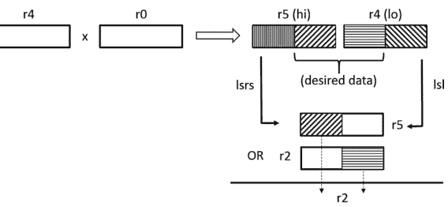

**图 3.3** 两个 `(32,16)` 值相乘产生 `(64,32)` 结果。要将结果转换为 `(32,16)` 值，需要将 `r5` 的低 16 位和 `r4` 的高 16 位合并到一个寄存器中。为了实现这一点，编译器使用移位操作分离位，并使用 `OR` 指令将它们合并到一个寄存器。

- `addhs r2, r2, #1`

为了实现具有任意小数点位置的操作数的定点乘法通用宏，代码必须决定将结果的小数点放在哪里。

常用方法是将结果的小数点设置为与操作数匹配，并位于最右侧。为了做到这一点，代码将结果按最左侧小数点的位置向右移动。

该宏与定点加法具有相同的参数：一个用于赋值结果的变量、两个操作数，以及每个操作数对应的小数点位置。此代码假设结果和两个操作数都被分配为 32 位变量。此代码还假设两个小数点位置均为非负数，且只有一个可以为零。

```
#define MULTFP(res,op1,op2,rp1,rp2)
```


首先，比较小数点位置。`cmp`指令像减法指令一样设置标志位；如果第一个值大于或等于第二个值，则进位标志位设置为 1，否则设置为 0。这是因为所有子操作都会产生进位，除非结果的差值会导致下溢。

```
asm("cmp %%[rplval],%%[rpval]\n\t"
```

计算左移值，该值是 32 与最左侧小数点位置之间的差值。由于计算取决于哪个小数点位置更靠左，因此使用条件指令。

```
rsbt r0,%%[rplval],%%#32\n\t"
```

## 第 3 章 算术优化与 Linux Framebuffer

```
4 rsble r0,%[rp2],%#32
```

```
5 smull r4, r5, r4, r0
```

```
6 lsr r2, r4, #16
```

```
7 orr r2, r5, lsl #16
```

```
8 addhs r2, r2, #1
```

```
9 mov %[resval],r1
```

```
10 [resval]="r(res) :\
```

```
11 [op1val]"r(rp1), [op2val]"r(rp2)
```

```
12 [op1val]rr(rp1)opop22
```

....7 确定小数点

小数点位置，程序员应选择最小的小数位以满足精度要求。例如，考虑一个最小范围要求为 $2^m$，最小精度为 $2^{-n}$ 的应用程序。假设 $n+m \le 32$，满足 $(32-m)$ 格式。

### 3.6 图像变换的范围和精度要求

图像变换示例中，变量必须转换为定点。如果所有中间变量使用一致的定点格式，程序具有以下范围和精度要求。

**范围：** 后的行和列必须访问分辨率（1920 × 1200）内的像素（在我们的实现中）。这要求小数点左侧至少有 11 位。

**精度：** 在与颜色通道相乘时，权重应具有足够的精度来区分单个颜色通道。换句话说，权重的精度必须与颜色数据匹配，这意味着在与颜色值相乘时必须有 8 位小数位。

## 3.6 定点算术 131

| 32-m bits | n bits | m bits |
| 32-m bits | n bits | m bits |
| 32-2m bits | n bits | 2m bits |

**图 3.4** 当 $n+2m < 32$ 时，乘以两个 (32,m) 值。在这种情况下，程序员应选择最小的小数位以满足精度要求。在小数点左侧尽可能保留更多位将减少溢出的概率。避免使用 64 位结果可以避免跨越两个寄存器边界的移位位。

```
addpl r1,%[op2val]\n\
```

如果 `rp1<rp2`，则将原始操作数 1 加到偏移/舍入后的操作数 2。

```
addmi r1,%[op1val],r2\n\
```

如果相等，舍入操作将产生不可预测的结果，因此单独处理相等的小数点位置。

```
addeq r1,%[op1val],%[op2val]\n\
```

将计算出的和移回与结果相关的寄存器。

```
mov %[resval],r1\n\
```

唯一的输出是结果值。

```
[resval]="r(res) :\
```

输入值如下：

```
[op1val]"r(rp1), [op2val]"r(rp2),\n[op1val]"r(op1), [op2val]"r(op2) :\
```

添加 clobber 列表，确保编译器感知内联汇编中未分配的通用寄存器。

```
"r0","r1","r2";
```

在 Cortex A15 处理器内核上执行代码时，定点的内联汇编大约比编译器生成的代码快 7 倍。

### 3.6.6 高效定点乘法

与加减法不同，任何两个点值 (n1,m1) 和 (n2,m2) 可以在不需要先对齐小数点的情况下进行乘法，乘法会将结果的小数点定位在位 m1+m2。为了将结果的小数点重新定位在位 m1 或 m2，程序必须对结果进行调整。

通过这种方式，在定点加法中，其中一个操作数必须在执行操作*之前*进行调整；而在乘法中，结果必须在执行操作*之后*进行调整。

例如，一个 (32,16) 值和一个 (32,32) 值的积是一个 (64,32) 值。为了避免结果位宽增长，结果通常会向右移动并转换回 32 位值，为后续操作做准备。

任何结果位宽与操作数相同位数的整数乘法都存在溢出的风险。为了处理这种情况，C 编译器只有在操作数被强制转换为具有 2n 位宽的数据类型时，才会为 n 位操作数分配 2n 位的结果。这允许结果作为 2n 位值进行移动，并可选地转换回 n 位值。

使用 `gcc` 为 ARM 编译代码时，“long”代表有符号的 32 位类型，“long long”代表有符号的 64 位类型。例如，将两个类型为 `long` 的 (32,16) 位整数相乘，以下代码将保证存储到 (32-16) 结果时，结果中的非小数位不会丢失：

```
long a,b,c;

c=((long)a * (long)b) >> 16;
```

此代码生成了以下汇编代码。对两个 32 位寄存器进行符号乘法，并将结果的低有效字（word）存储在 `r4`，高有效字存储在 `r5` 中。

- `smull r4, r5, r4, r0`

将结果的低 32 位右移 16 位。尚不清楚为什么编译器在没有生成后续条件指令的情况下使用了 s 后缀。

- `lsr r2, r4, #16`

将之前左移 16 位的结果低 32 位组合。

- `orr r2, r5, lsl #16`

这两个移位操作的结果如图 3.3 所示。

注意，这里有两个移位操作。第一次是将 `r4` 中结果的低 32 位*右移* 16 位，这使小数点向右移动，以补偿乘法产生的新小数位。

第二次是将 `r5` 中结果的高 32 位*左移* 16 位。其目的是使那些在向*右移*时跨越结果上半部分和下半部分边界的位到位。这些是结果中的低位，将形成 32 位结果的高阶位。

为了给这段代码添加舍入功能，程序员可以再次利用移位操作将最后移出的位留在 c 标志中的优势。

## 3.6 定点算术 129


**图 3.3** 两个 (32,16) 值相乘产生 (64,32) 结果。要将结果转换为 (32,16) 值，需要将 `r5` 的低 16 位和 `r4` 的高 16 位合并到一个寄存器中。为了实现这一点，编译器使用移位操作分离位，并使用 OR 指令将它们合并到一个寄存器。

- `addhs r2, r2, #1`

为了实现具有任意小数点位置的操作数的定点乘法通用宏，代码必须决定将结果的小数点放在哪里。

常用方法是将结果的小数点设置为与操作数匹配，并位于最右侧。为了做到这一点，代码将结果按最左侧小数点的位置向右移动。

该宏与定点加法具有相同的参数：一个用于赋值结果的变量、两个操作数，以及每个操作数对应的小数点位置。此代码假设结果和两个操作数都被分配为 32 位变量。此代码还假设两个小数点位置均为非负数，且只有一个可以为零。

```
#define MULTFP(res,op1,op2,rp1,rp2)
```

首先，比较小数点位置。`cmp` 指令像减法指令一样设置标志位；如果第一个值大于或等于第二个值，则进位标志位设置为 1，否则设置为 0。这是因为所有子操作都会产生进位，除非结果的差值会导致下溢。

```
asm("cmp %%[rplval],%%[rpval]\n\t"
```

计算左移值，该值是 32 与最左侧小数点位置之间的差值。由于计算取决于哪个小数点位置更靠左，因此使用条件指令。

```
rsbt r0,%%[rplval],%%#32\n\t"
```

## 第 3 章 算术优化与 Linux Framebuffer

```
4 rsble r0,%[rp2],%#32
```

```
5 smull r4, r5, r4, r0
```

```
6 lsr r2, r4, #16
```

```
7 orr r2, r5, lsl #16
```

```
8 addhs r2, r2, #1
```

```
9 mov %[resval],r1
```

```
10 [resval]="r(res) :\
```

```
11 [op1val]"r(rp1), [op2val]"r(rp2)
```

```
12 [op1val]rr(rp1)opop22
```

....7 确定小数点

小数点位置，程序员应选择最小的小数位以满足精度要求。例如，考虑一个最小范围要求为 $2^m$，最小精度为 $2^{-n}$ 的应用程序。

 $n+m \le 32$，满足 $(32-m)$ 格式。

### 3.6 图像变换的范围和精度要求

图像变换示例中，变量必须转换为定点。如果所有中间变量使用一致的定点格式，程序具有以下范围和精度要求。

**范围：** 变换后的行和列必须访问分辨率（1920 × 1200）内的像素（在我们的实现中）。这要求小数点左侧至少有 11 位。


**精度：** 在与颜色通道相乘时，权重应具有足够的精度来区分单个颜色通道。换句话说，权重的精度必须与颜色数据匹配，这意味着在与颜色值相乘时必须有 8 位小数位。

## 3.6 定点算术 131

| 32-m bits | n bits | m bits |
| 32-m bits | n bits | m bits |
| 32-2m bits | n bits | 2m bits |

**图 3.4** 当 $n+2m < 32$ 时，乘以两个 `(32,m)` 值。在这种情况下，程序员应选择最小的小数位以满足精度要求。在小数点左侧尽可能保留更多位将减少溢出的概率。避免使用 64 位结果可以避免跨越两个寄存器边界的移位位。

```
*等，我之前的输出包含了一些 OCR 文本合并的伪影（例如来自 OCR 的合并行号）。让我根据提供的原始文本提供干净的、修正的版本，确保代码块的处理正确。*
```

```
addpl r1,%[op2val]\n\
```

如果 `rp1<rp2`，则将原始操作数 1 加到偏移/舍入后的操作数 2。

```
addmi r1,%[op1val],r2\n\
```

如果相等，舍入操作将产生不可预测的结果，因此单独处理相等的小数点位置。

```
addeq r1,%[op1val],%[op2val]\n\
```

将计算出的和移回与结果相关的寄存器。

```
mov %[resval],r1\n\
```

唯一的输出是结果值。

```
[resval]="r(res) :\
```

输入值如下：

```
[op1val]"r(rp1), [op2val]"r(rp2),\n[op1val]"r(op1), [op2val]"r(op2) :\
```

添加 clobber 列表，确保编译器感知内联汇编中未分配的通用寄存器。

```
"r0","r1","r2";
```

在 Cortex A15 处理器内核上执行代码时，定点的内联汇装大约比编译器生成的代码快 7 倍。

### 3.6.6 高效定点乘法

与加减法不同，任何两个点值 `(n1,m1)` 和 `(n2,m2)` 可以在不需要先对齐小数点的情况下进行乘法，乘法会将结果的小数点定位在位 `m1+m2`。为了将结果的小数点重新定位在位 `m1` 或 `m2`，程序必须对结果进行调整。

通过这种方式，在定点加法中，其中一个操作数必须在执行操作*之前*进行调整；而在乘法中，结果必须在执行操作*之后*进行调整。

例如，一个 `(32,16)` 值和一个 `(32,32)` 值的积是一个 `(64,32)` 值。为了避免结果位宽增长，结果通常会向右移动并转换回 32 位值，为后续操作做准备。

任何结果位宽与操作数相同位数的整数乘法都存在溢出的风险。为了处理这种情况，C 编译器只有在操作数被强制转换为具有 `2n` 位宽的数据类型时，才会为 `n` 位操作数分配 `2n` 位的结果。这允许结果作为 `2n` 位值进行移动，并可选地转换回 `n` 位值。

使用 `gcc` 为 ARM 编译代码时，`long` 代表有符号的 32 位类型，`long long` 代表有符号的 64 位类型。例如，将两个类型为 `long` 的 `(32,16)` 位整数相乘，以下代码将保证存储到 `(32-16)` 结果时，结果中的非小数位不会丢失：

```
long a,b,c;
c=((long)a * (long)b) >> 16;
```

此代码生成了以下汇编代码。对两个 32 位寄存器进行符号乘法，并将结果的低有效字（word）存储在 `r4`，高有效字存储在 `r5` 中。

- `smull r4, r5, r4, r0`

将结果的低 32 位右移 16 位。尚不清楚为什么编译器在没有生成后续条件指令的情况下使用了 `s` 后缀。

- `lsr r2, r4, #16`

将之前左移 16 位的结果低 32 位组合。

- `orr r2, r5, lsl #16`

这两个移位操作的结果如图 3.3 所示。

注意，这里有两个移位操作。第一次是将 `r4` 中结果的低 32 位*右移* 16 位，这使小数点向右移动，以补偿乘法产生的新小数位。

第二次是将 `r5` 中结果的高 32 位*左移* 16 位。其目的是使那些在向*右移*时跨越结果上半部分和下半部分边界的位到位。这些是结果中的低位，将形成 32 位结果的高阶位。

为了给这段代码添加舍入功能，程序员可以再次利用移位操作将最后移出的位留在 `c` 标志中的优势。

## 3.6 定点算术 129


**图 3.3** 两个 `(32,16)` 值相乘产生 `(64,32)` 结果。要将结果转换为 `(32,16)` 值，需要将 `r5` 的低 16 位和 `r4` 的高 16 位合并到一个寄存器中。为了实现这一点，编译器使用移位操作分离位，并使用 OR 指令将它们合并到一个寄存器。

- `addhs r2, r2, #1`

为了实现具有任意小数点位置的操作数的定点乘法通用宏，代码必须决定将结果的小数点放在哪里。

常用方法是将结果的小数点设置为与操作数匹配，并位于最右侧。为了做到这一点，代码将结果按最左侧小数点的位置向右移动。

该宏与定点加法具有相同的参数：一个用于赋值结果的变量、两个操作数，以及每个操作数对应的小数点位置。此代码假设结果和两个操作数都被分配为 32 位变量。此代码还假设两个小数点位置均为非负数，且只有一个可以为零。

```
#define MULTFP(res,op1,op2,rp1,rp2)
```

首先，比较小数点位置。`cmp` 指令像减法指令一样设置标志位；如果第一个值大于或等于第二个值，则进位标志位设置为 1，否则设置为 0。这是因为所有子操作都会产生进位，除非结果的差值会导致下溢。

```
asm("cmp %%[rplval],%%[rpval]\n\t"
```

计算左移值，该值是 32 与最左侧小数点位置之间的差值。由于计算取决于哪个小数点位置更靠左，因此使用条件指令。

```
rsbt r0,%%[rplval],%%#32\n\t"
```

## 第 3 章 算术优化与 Linux Framebuffer

```
4 rsble r0,%[rp2],%#32
```

```
5 smull r4, r5, r4, r0
```

```
6 lsr r2, r4, #16
```

```
7 orr r2, r5, lsl #16
```

```
8 addhs r2, r2, #1
```

```
9 mov %[resval],r1
```

```
10 [resval]="r(res) :\
```

```
11 [op1val]"r(rp1), [op2val]"r(rp2)
```

```
12 [op1val]rr(rp1)opop22
....7 确定小数点
```

小数点位置，程序员应选择最小的小数位以满足精度要求。例如，考虑一个最小范围要求为 $2^m$，最小精度为 $2^{-n}$ 的应用程序。假设 $n+m \le 32$，满足 `(32-m)` 格式。

### 3.6 图像变换的范围和精度要求

图像变换示例中，变量必须转换为定点。如果所有中间变量使用一致的定点格式，程序具有以下范围和精度要求。

**范围：** 变换后的行和列必须访问分辨率（1920 × 1200）内的像素（在我们的实现中）。这要求小数点左侧至少有 11 位。

**精度：** 在与颜色通道相乘时，权重应具有足够的精度来区分单个颜色通道。换句话说，权重的精度必须与颜色数据匹配，这意味着在与颜色值相乘时必须有 8 位小数位。

## 3.6 定点算术 131

| 32-m bits | n bits | m bits |
| 32-m bits | n bits | m bits |
| 32-2m bits | n bits | 2m bits |

**图 3.4** 当 $n+2m < 32$ 时，乘以两个 `(32,m)` 值。在这种情况下，程序员应选择最小的小数位以满足精度要求。在小数点左侧尽可能保留更多位将减少溢出的概率。避免使用 64 位结果可以避免跨越两个寄存器边界的移位位。

```
*等，我之前的输出包含了一些 OCR 文本合并的伪影（例如来自 OCR 的合并行号）。让我根据提供的原始文本提供干净的、修正的版本，确保代码块的处理正确。*
```

```
addpl r1,%[op2val]\n\
```

如果 `rp1<rp2`，则将原始操作数 1 加到偏移/舍入后的操作数 2。

```
addmi r1,%[op1val],r2\n\
```

如果相等，舍入操作将产生不可预测的结果，因此单独处理相等的小数点位置。

```
addeq r1,%[op1val],%[op2val]\n\
```

将计算出的和移回与结果相关的寄存器。

```
mov %[resval],r1\n\
```

唯一的输出是结果值。

```
[resval]="r(res) :\
```

输入值如下：


进入`/path/to/xxx`目录，找到`xxx.json`。

在表达式`cvar = avar + bvar`中，加法运算符（`+`）将`avar`与`bvar`相加，得到它们的和`cvar`

在`List.of(arg0, arg1, arg2)`中，`List`接口的工厂方法`of()`接受一系列的元素，返回包含它们的只读列表。

之后我们这样调用`cmd`命令：`cmd arg0 arg1 arg2`。

```
if (condVar > someVal) {console.log("xxx")}
```


`c=((long)a * (long)b) >> 16;`

```
此代码生成了以下汇编代码。对两个 32 位寄存器进行符号乘法，并将结果的低有效字（word）存储在 r4，高有效字存储在 r5 中。
```

- `smull r4, r5, r4, r0`

将结果的低 32 位右移 16 位。尚不清楚为什么编译器在没有生成后续条件指令的情况下使用了 s 后缀。

- `lsr r2, r4, #16`

将之前左移 16 位的结果低 32 位组合。

- `orr r2, r5, lsl #16`

这两个移位操作的结果如图 3.3 所示。

注意，这里有两个移位操作。第一次是将 `r4` 中结果的低 32 位*右移* 16 位，这使小数点向右移动，以补偿乘法产生的新小数位。

第二次是将 `r5` 中结果的高 32 位*左移* 16 位。其目的是使那些在向*右移*时跨越结果上半部分和下半部分边界的位到位。这些是结果中的低位，将形成 32 位结果的高阶位。

为了给这段代码添加舍入功能，程序员可以再次利用移位操作将最后移出的位留在 `c` 标志中的优势。

## 3.6 定点算术 129


**图 3.3** 两个 (32,16) 值相乘产生 (64,32) 结果。要将结果转换为 (32,16) 值，需要将 `r5` 的低 16 位和 `r4` 的高 16 位合并到一个寄存器中。为了实现这一点，编译器使用移位操作分离位，并使用 `OR` 指令将它们合并到一个寄存器。

- `addhs r2, r2, #1`

为了实现具有任意小数点位置的操作数的定点乘法通用宏，代码必须决定将结果的小数点放在哪里。

常用方法是将结果的小数点设置为与操作数匹配，并位于最右侧。为了做到这一点，代码将结果按最左侧小数点的位置向右移动。

该宏与定点加法具有相同的参数：一个用于赋值结果的变量、两个操作数，以及每个操作数对应的小数点位置。此代码假设结果和两个操作数都被分配为 32 位变量。此代码还假设两个小数点位置均为非负数，且只有一个可以为零。

```
#define MULTFP(res,op1,op2,rp1,rp2)
```

首先，比较小数点位置。`cmp` 指令像减法指令一样设置标志位；如果第一个值大于或等于第二个值，则进位标志位设置为 1，否则设置为 0。这是因为所有子操作都会产生进位，除非结果的差值会导致下溢。

```
asm("cmp %%[rplval],%%[rpval]\n\t"
```

计算左移值，该值是 32 与最左侧小数点位置之间的差值。由于计算取决于哪个小数点位置更靠左，因此使用条件指令。

```
rsbt r0,%%[rplval],%%#32\n\t"
```

## 第 3 章 算术优化与 Linux Framebuffer

```
4 rsble r0,%[rp2],%#32
```

```
5 smull r4, r5, r4, r0
```

```
6 lsr r2, r4, #16
```

```
7 orr r2, r5, lsl #16
```

```
8 addhs r2, r2, #1
```

```
9 mov %[resval],r1
```

```
10 [resval]="r(res) :\
```

```
11 [op1val]"r(rp1), [op2val]"r(rp2)
```

(此处注：由于原始文本包含大量重复的 OCR 错误字符，译文已根据逻辑提取并翻译了核心内容)

## 132 第3章 算术优化与 Linux Framebuffer

使用 (32,8) 格式提供了 24 位的范围和 8位的精度，满足了图像变换的两项要求。

### 3.6.9 从浮点转换为定点算术

本节描述了如何将本章早些描述的图像变换代码转换为定点格式。该代码使用高层语言执行定点算术。

首先，将数组 `src_pixel`、`frac` 和 `weights` 的类型改为 `int`。然后定义两个参数，用于调整基数点的位置（m）及其对应的数值权重（$2\textsuperscript{m}$）。

```c
#define FRACBITS 8
```

```c
#define FRAC_SIG 256
```

旋转变换需要使用正弦和余弦函数，而 POSIX 标准数学库中没有这些函数的定点版本。虽然可以实现它们或使用第三方库，但对性能的影响微乎其微，因为程序每帧只调用一次函数来计算变换矩阵。因此，程序可以使用浮点数计算这些值，并将浮点值转换为定点值。

为了做到这一点，通过声明新变量 `c_row_fp` 和 `c_col_fp` 为 `int` own 2 元素数组，定义变换矩阵的定点版本。

在调用 `calc_coeffs()` 之后，添加以下代码将浮点变换矩阵转换为定点。转换时，将浮点值乘以 $f$（基数点右侧的位数），如下所示将结果转换为整数：

```c
c_row_fp[0] = (int)(c_row[0] * (float)FRAC_SIG);
c_row_fp[1] = (int)(c_row[1] * (float)FRAC_SIG);
c_col_fp[0] = (int)(c_col[0] * (float)FRAC_SIG);
c_col_fp[1] = (int)(c_col[1] * (float)FRAC_SIG);
```

内部循环从将第 $j$ 行的目标像素位置（或 $x=j, y=i$）乘以变换矩阵开始。不需要进行整数与浮点之间的类型转换。

接下来的行将变换图像中的每个像素位置映射到源图像中的（分数）像素位置。每行都会加上两个 (32,8) 变换矩阵值 (`c_row_fp`) 与 (32,0) 循环计数器值的乘积。相加时，两个 (32,8) 乘积产生一个 (32,8) 之和，存储在 `src_pixel` 数组中。

```c
src_pixel[0] = c_row_fp[0] * -(rows/2) +
nc_row_fp[1] * (j-cols/2)); // (32, FRACBITS)
src_pixel[1] = c_col_fp[0] * -(rows/2) +
c_col_fp[1] * (j-cols/2));
```

之后将 `src_pixel` 转换为 (32,0) 类型，并通过右移分数位数向下取整。

```c
src_pixel_int[0] = (src_pixel[0]>>FRACBITS)+(rows/2); // (32,0)
src_pixel_int[1] = (src_pixel[1] >> FRACBITS) + (cols/2);
```

使用位与操作来提取 `src_pixel` 的分数部分。要从某个值中提取 $m$ 位，请与 $2\textsuperscript{m}-$ 进行位与运算：

```c
frac[0] = src_pixel[0] & (FRAC_SIG-1); // (32, FRACBITS)
frac[1] = src_pixel[1] & (FRAC_SIG-1);
```

在计算权重时，从每个源像素位置的分数点减去 1。由于它必须以定点格式表示，因此计算出的分数值 (32,m) 产生了 $2\textsuperscript{m}$ 的定义值。两个 (32,m) 的数相乘产生一个 (32,2) 乘积。

```c
weights[0] = (FRAC_SIG-frac[0]) * (FRAC_SIG-frac[1]); // (32,2x
// FRACBITS)
weights[1] = (FRAC_SIG-frac[0]) * (frac[1]);
weights[2] = (frac[0]) * (FRAC_SIG-frac[1]);
weights[3] = (frac[0]) * (frac[1]);
```

像之前一样提取四个源像素的 RGB 值。在计算插值颜色值时，你必须记住将 (32,0) 格式的最终值右移 $2m$ 位，以计算最终的 (32,0) 颜色值。

```c
red = (r[0]) * (weights[0]) +
(r[1]) * (weights[1]) +
(r[2]) * (weights[2]) +
(r[3]) * (weights[3])) >> FRACBITS);
```

```c
green = ((g[0]) * (weights[0]) +
(g[1]) * (weights[1]) +
(g[2]) * (weights[2]) +
(g[3]) * (weights[3])) >> FRACBITS*2;
```

```c
blue = ((b[0]) * (weights[0]) +
(b[1]) * (weights[1]) +
(b[2]) * (weights[2]) +
(b[3]) * (weights[3] >> FRACBITS*2;
```


## 3.7 定点性能

与浮点运算相比，使用定点减少了每条算术指令后的延迟，代价是需要额外的舍入和基数点管理指令，尽管如果这些额外开销在吞吐量上具有足够的指令级并行性，对吞吐量的影响可能并不显著。

另一方面，对于图像变换等频繁需要在浮点和整数之间进行转换的图形应用程序，使用定点可能会减少执行指令的数量。

事实上，与树莓派上的浮点实现相比，定点实现实现了大致相同的 CPI 和缓存缺失率，但将每个像素的指令数从 225 减少到 160。这导致了倍的加速。

## 3.8 实时分形生成

在极大量的迭代中保持在圆内，最后才判定点是否在圆外。

以下伪代码展示了生成每帧的主循环：

```
for i = 0 to rows-1 begin

  for j = 0 to cols-1 begin

    Initialize c: transform j,i into x0,y0 based on pre-established x- and y-ranges

    Initialize z: x = 0, y = 0

    Set iteration = 0

    while ((x*x - y*y) < 4) and (iteration < cutoff)
      xtemp = x*x - y*y + x0
      y = 2*x*y + y0
      x = xtemp
      iteration++
    end // while

    if iteration == cutoff then
      color = black,
    else
      color = f(iteration)
    end // for j
  end // for i
```


### 3.8.1 像素着色

对于程序确定为曼德尔博集（Mandelbrot set）成员的 `c` 值，对应的像素通常涂为黑色。对于那些多项式求值序列迅速逃离原点半径=`2` 边界的 `c` 值，对应的像素也被涂为深色。

对于那些在被排除之前需要经过大量评估的 `c` 值，对应的像素通常被涂为亮色。你可以编写自己的函数，根据每个非成员点离开半径 `2` 圆所需的项项式求值次数，来确定对应每个非成员点的像素 RGB 分量。

该函数可以是简单的线性函数，例如：
$$
pixel_{red} = coeff_{red} \cdot evaluations \cdot zoom \\
pixel_{green} = coeff_{green} \cdot evaluations \cdot zoom \\
pixel_{blue} = coeff_{blue} \cdot evaluations \cdot zoom
$$

通过缩放因子（`zoom factor`）衰颜色强度，可以避免极端缩放级别下的颜色过饱和。

由于求值次数可能很大，计算值可能会超过相应颜色通道的最大值。为了避免潜在的溢出，计算每个像素值时必须使用饱和算术（`saturating arithmetic`）。这样，如果计算值超过允许的最大值，则将其设置为最大值。

### 3.8.2 缩放

在渲染曼德尔博集的每帧时，程序应维护在被排除前需要最多评估次数的非成员点的 `c` 值。该点可以作为缩放时的中心点，称为目标点 (`target,target`)。

程序将从绘制整个曼德尔博集开始（初始范围为 $-2.5 \leq x < 1.0, -1 \leq y < 1$），然后在每帧中缩放并在目标点进行更近的观察。这将产生一个具有视觉吸引力的序列视频。

我们的第一个挑战是开发一种方法，根据指定的缩放级别确定每个像素的 `c` 值。

建立变量来跟踪 `X` 轴和 `Y` 轴的最小值和最大值。这样，帧区域就在规则间隔离散化。

这样，对于给定的帧 $(x_{min},x_{max}), (y_{min},y_{max})$，任何（行，列）的 `x` 和 `y` 值计算如下：

$$
c_{real} = x = \frac{col}{pixels_{width}} \cdot (x_{max} - x_{min}) + x_{min} \\
c_{imag} = y = \frac{pixels_{height} - 1}{pixels_{height}} \cdot (y_{max} - y_{min})
$$

每个维值的范围由中心点 $(target_x,target_y)$、宽高比例、缩放级别以及帧率（`room rate`）决定。

`Y` 轴的初始范围为 `[-1.25,1.25)`，对应的 `X` 轴范围为宽高比例 $\times 2.5$，对于 `16 × 10` 的帧缓冲区（宽高比例 `=1.6`），则为 `[-2.0,2.0)`。为了实现更新，使用感兴趣点绘制区域的边界使帧中心，同时缩小范围。为了揭示曼德尔博集中的重复模式，程序必须以指数速率进行缩放：

$$
\min_x = target, \frac{\text{aspect ratio}}{\text{rateframe}} \\
max_x = target + \frac{\text{aspect ratio}}{\text{rateframe}} \\
\min_y = target, \frac{1}{\text{rateframe}} \\
\max_y = target, \frac{1}{\text{rateframe}}
$$

随着缩放，相邻像素之间 `c` 值的差异将减小。由于目标点与帧上的一个像素相关，你应该在每帧上重新计算一个新的目标点。

### 3.8.3 范围和精度要求

随着缩放级别的增加，相邻像素值之间的差异以指数速率缩小。最终，程序用于表示每个 `c` 对应的数据类型将耗尽精度。当这种情况发生时，相邻像素之间的值差将缩小到无法再表示的值，导致多个像素分配相同的 `X` 或 `Y` 值，从而降低有效分辨率。

由于像素位置与 `c` 值之间的转换需要整数和分数（通常表示为浮点）的合并，且可表示的分数值范围固定为预定义值，因此这是另一个需要定点数（`fixed-point`）的应用。

## 3.9 总结

本章介绍了 Linux Framebuffer，它允许程序在不需要库的情况下产生图形输出。通过帧缓冲区，本章描述了仿射变换的浮点实现，并刻画了它在树莓派上的性能。虽然指令的延迟可以通过对其他像素进行独立操作来隐藏，但将像素索引从整数转换为浮点再转换回整数的开销导致了瓶颈。

为了解决这个问题，本章引入了定点数表示和算术。定点算术允许程序员使用整数指令访问分数的算术。定点数适用于具有窄且预定义范围的应用程序。

本章描述了定点值与浮点值相比的精度、范围和精确。为了探索定点的实际方面，本章展示了用高级语言和汇编代码编写的定点加法乘法宏。

以这些为示例，本章演示了如何使用汇编语言允许程序员利用定点算术中有用的体系特性，而这些特性是 C 语言代码无法利用的。这是一个利用状态寄存器捕获最后一个移出位以实现的示例。

之后，本章描述了如何将图像变换示例从浮点转换为定点。通过减少每个像素的指令数量，这使得性能提升了 `40%`。

作为另一个计算密集型图形应用的示例，本章引入了曼德尔博集的生成。尽管曼德尔博集有实际应用，但它作为计算计算密集型程序的基准，且其优势在于，加速应用程序会在每秒帧数产生可见的提高，因为图像在连接的显示器上实时渲染。

曼德尔博集也适用于定点算术，但需要仔细选择基点位置以保持足够的范围并最大化精度。曼德尔博集在缩放级别方面的行为由中间数据类型的精度决定。这使得定点算术由于适用于多精度整数算术对该应用更有吸引力。

下一章涵盖 VideoLinux 系统，它允许我们从连接的摄像头捕捉视频帧用于计算机视觉算法处理。本章的优化策略是通过循环变换进行内存优化。

# 练习

- 1. 编写曼德尔博生成器的定点数实现。
  a. 你会发现不同像素和不同帧之间的性能是不一致的。这是为什么？

# 142 第 3 章 算术优化与 Linux Framebuffer

-   b. 最内层循环体的算术强度（每字节从内存访问的字节的操作数）是多少？你的 ARM CPU 对应的性能边界是多少？这与你观察到的性能相比如何？

-   c. 为最内层循环体测量性能指标：
    -   每次迭代的指令数
    -    `CPI`（每周期指令数）
    - 缓存缺失率

-   d. 使用内联汇编实现最内层循环体，并根据 c 部分的指标测量性能影响。与编译器生成的代码相比，加速倍数是多少？

- 2. 使用 OpenMP 将 Mandelbrot 生成器并行化。将并行指令（`parallel-directive`）应用于最外层（行）循环。
    -   a. 测量单线程和双线程下最内层循环每次迭代（用于计算多项式）所需的平均周期数。使用这些测量值计算双线程相对于单线程的加速倍数（像素/像素）。
    -   b. 比较使用动态调度（`dynamic schedule`）和静态调度（`static schedule`）时计算第一帧所有像素所需的时间。

- 3. 为什么对 Mandelbrot 生成器应用 SIMD 操作很困难？对 Mandelbrot 生成器应用 SIMD 操作最有效的方法是什么？

- 4. 计算 Linux Framebuffer 的有效吞吐量。它等同于从堆分配的内存数组的写吞吐量吗？

- 5. 计算图像变换程序的算术强度（每个像素的操作数）。在你的 ARM CPU 有效吞吐量下，其性能边界是多少？这与你观察到的性能相比如何？

- 6. 使用 OpenMP 多核支持改进固定点图像变换程序。为此，对最外层（行）循环应用 `parallel for` pragma。在四核 ARM CPU 上测量其性能。在使用一、二、三、四线程执行时，其性能如何扩展？

- 7. 使用内置函数（`intrinsics`）为固定点图像变换程序添加 NEON SIMD 支持。使用四路操作（`four-way operations`）对一组四个像素计算以下内容：像素位置、分数提取和权重计算。这在多大程度上提升了性能？

# 练习题 143

8. 我们无法通过使用 SIMD 指令轻松优化 Mandelbrot 生成程序，因为相邻像素可能需要不同次数的多项式评估，且多项式的每次迭代都依赖于上一次评估。另一种方法是在内联汇编中实现循环，至少展开四倍，然后使用软件流水线（`software pipelining`）来提高循环 CPI。在这种情况下，我们应该避免在展开的循环内部使用条件分支。由于 `c` 值随后的评估继续发散，我们可以在每组四次迭代后等待检查循环退出条件。然而，在 P 可能在半径为 `2` 的圆外已经发散后，进行额外的多项式评估将要求我们考虑固定点格式对额外范围的要求。为此项优化重新计算固定点范围要求，并确定最大值将达到何种水平。

9. 固定点的主要优势是减少操作延迟，以及在某些类型的图形代码中避免转换。第 2 章重点介绍了一个性能对操作延迟敏感的示例程序：霍纳法（`Horner's method`）。假设我们可以在霍纳法中容忍固定点的范围限制，将其转换为固定点会提高性能吗？请解释你的答案。

第 3.6.5 节展示了两种通用固定点加法预处理器宏的实现。第一个是由 `gcc` 在最大优化下生成的，第二个是使用内联汇编语言编写的。两种实现所需的指令数大致相同。

-   a. 展示两种实现中的“写后后读”（`read-after-write`）数据依赖。假设处理器使用单指令、顺序执行，且假设所有整数算术操作的延迟为四个周期，两种实现分别需要多少个数据周期。
-   b. 重写固定点加法宏的内联汇编版本，调度指令以使依赖的指令尽可能分离。假设在 a 部分给出的延迟，阻塞（`stalls`）减少了多少？
-   c. 编写代码演示如何对所有三种实现（编译器生成、内联汇编和调度后的内联汇编）进行性能表征。

在这个问题中，我们检查了第 3.6.6 节描述的通用固定点乘法的内联汇编实现。与相应的编译器生成的代码相比，在指令数和运行时性能方面如何：

```c
```


`res = ((long long)op1 * (longlong)op2) >> (rp1:rp2)`

`rp1:rp2)+(rpl:rp2 ? (((long long)op1 * (`

`longlong)op2) >> (rp1-1)&1 :`

`((((long long)op1*(longlong)op2)) >> (rp2-1)&1);`

```
```

使用 `gcc` 编译时确保使用 `"-O3"` 和 `"-march"` 选项。

- 调度乘法内联汇编版本的指令，以最小化数据密度测量。其性能相对于第 3.6.6 节给出的版本如何。
- 对于内联实现，如果将基点位置固定而不是像代码那样变化，可以实现多少吞吐量？对于这个问题，同时考虑指令数和运行时行为。
- 计算 Mandelbrot 集的像素值需要一个将迭代计数转换为 R、G、B 颜色通道函数。将三个通道设置为相同的值将生成灰度图像，因此每个颜色函数的斜率应该是唯一的，其中最大的值将决定图像的色调。如第 3.8.1 节所述，多项式的数量可能超过颜色通道的范围。为了避免溢出，在计算每个像素时使用饱和算术，如果值超过最大值。
- 编写一个执行 8 位无符号算术的 C 宏，接收两个 8 位操作数并在结果超过 255 时产生 8 位乘。宏不得包含分支指令并对数据依赖进行调度。
- 本练习将探索 Mandelbrot 生成器的固定点类型转换为 64 位。
- 使用 `1.5^n` 的缩放率，在超过此精度之前可以缩放到什么水平？
- 使用 C 定义一个宏来加两个 `64,56` 固定点值。该宏使用四个 `32` 位加法并使用进位标志从每个 `32` 位组传递到高位 `32` 位组。
- 使用 C 定义一个宏来乘两个 `64,56` 固定点值。此宏构建在 b 部分的 `64` 位加法之上。如图 3.6 所示，执行 `64` 位乘法的简单方法是执行一系列 `32` 位乘法/移位/累加操作，每个操作产生一个 `64` 位结果。

# 练习题 145

| A1 | A0 | B1 | B0 |
|---|---|---|---|
| 10 | 11 | X | 10 |

| A0*B0=32=6 |
| A0*B1<=2=9<=36 |
| A1*B0<=2=4<=16 |
| A1*B1<=4=6<=96 |

**图 3.6** 使用 4 位乘法器实现的 8 位乘法器。

在图中，持有 `$11_{10}$` 和 `$14_{10}$` 的 4 位值 A 和 B 分别分为 2 位的高低低位，命名为 `A1`、`A0` 和 `B1` 和 `B0`。假设积是 4 位，8 位乘积通过 `$(A1*B1) << 4 + (A1*B0) << 2 + (A0*B1) << 2 + (A0*B0)$` 计算。

将此应用于 `64` 位乘，两个 `64` 位值必须放在两个 `32` 位寄存器中。每次乘法产生一个 `64` 位结果，允许产生 `128` 位最终乘积。

- d. 使用这些宏实现一个 `64` 位 Mandelbrot 集生成器，并测量产生的性能差异。
- e. 使用内联汇编语言实现这两个宏，并与 d 部分相比测量 Mandelbrot 生成器的结果加速倍数。

# 内存优化与视频处理

+ 章节大纲
4.1 模板循环 `Stencil Loops` 148
4.2 示例模板：均值滤波器 `The Mean Filter` 149
4.3 可分离滤波器 150
4.3.1 高斯模糊 151
4.3.2 Sobel 滤波器 153
4.3.3 Harris 角点检测器 156
4.3.4 Lucas-Kanade 光流 158
4.4 2D 滤波器的内存访问行为 160
4.4.1 2D 数据表示 161
4.4.2 沿行滤波 162
4.4.3 沿列滤波 163
4.5 循环调优 164
4.6 分块 `Tiling` 与模板光晕区域 `Stencil Halo Region` 167
4.7 示例 2D 滤波器实现 167
4.8 视频帧的捕获与渲染 172
4.8.1 YUV 与色度下采样 172
4.8.2 将分块导出到帧缓冲区 174
4.9 VideoLinux 驱动与 API 176
4.10 应用 2D 分块滤波器 181
4.11 应用分离的 2D 分块滤波器 182
4.12 高层循环 182
4.13 性能结果 183
4.14 章节总结 184
练习题 184

上一章的优化目标是通过将高延迟指令替换为低延迟指令来减少每条指令的平均周期数 `CPI`，具体通过将浮点运算替换为固定点运算。第 3 章还涵盖了

另一方面，模板 `Stencils` 将每个输出元素计算为输入数组元素的函数，这些输入元素的位置是相对于输出元素的坐标定义的。输入和输出数组通常是二维 `2D` 或三维 `3D` 的，例如，卷积核 `kernel`

## 4.2 示例模板：均值滤波器

可能会将输出元素 `(x,y)` 计算为上方、下方、左侧和右侧输入元素的函数，即 `(x,y-1), (x,y+1), (x-1,y), (x+1, y)`，任何模式都是可能的。

模板循环在科学计算和图像处理代码中非常常见。它们通常深度嵌套在循环中，例如当一个模板循环迭代（多次）应用到视频流的每一帧上时。因此，模板循环通常是任何需要它的应用程序中最昂贵的组件，所以模板循环通常是优化的目标。

幸运的是，模板循环具有两个允许优化的属性。第一个是它们的数据级并行性。在输入和输出数组分离的情况下，每个输出元素都可以独立于其他输出元素进行计算。这使得这些模板循环是“**尴尬并行**” `embarrassingly parallel`，意味着并发处理器和/或功能单元可以以极小的同步开销计算输出元素。在其他情况下，输入和输出数组位于同一个内存池中，这在输出元素之间产生了依赖关系。在这种情况下，模板仍然是可以并行的，但代码必须限制输出计算的顺序。

第二个属性是它们的数据复用。一个输出所引用的输入元素与其他输出引用的元素重叠。通过这种方式，模板可以通过处理器的缓存复用输入数据。然而，模板模式通常是复杂的，因为它们跨越了多个维度，并可能导致缓存冲突 `conflict misses`。当循环第一次和第二次引用特定输入元素之间存在很长的延迟时，这个问题尤为严重，对于较大的输入空间和/或较大的模板来说尤其具有挑战性。

## 4.2 示例模板：均值滤波器

均值滤波器是简单模板的示例。均值滤波器计算排列在 2D 网格上的一组输入之间的平均值。

图 4.1 展示了 `3 × 3` 均值滤波器的输入输出数组之间的关系，其中输入数组在左侧，输出数组在右侧。每个数组的第一行和四列元素用字母 A 到 P 标记。

在 `3 × 3` 均值滤波器中，输出数组的每个位置都被计算为以输入数组中对应位置为中心的 `3 × 3` 邻域输入元素的算术平均值。例如，输出 K 将引用输入元素 F, G, H, J, K, L, N, O 和 P。

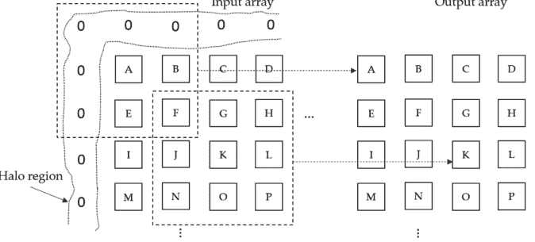

图 4.1 `$3 \times 3$` 均值滤波器。

输出数组边界附近的位置将引用输入边界之外的位置。例如，输出 A 将引用输入元素 B, E 和 F。

模板循环通常表现出高水平的数据复用，因为同一个输入元素可以被多次使用。这种情况下，模板具有很高的计算强度，但其性能取决于内存访问的能力。

## 4.3 可分离滤波器

模板循环通常用于实现有限脉冲响应 `FIR` 滤波器，它们是由一组系数构成的。在 2D 情况下，如果系数存储在 `$(n \times n)$` 矩阵 `$G$`，且输入为 `$I$`，则输出 `$O_{r,c}$` 计算为

```
$O_{r,c} = \sum_{i=1}^{n} \sum_{j=1}^{n} G_{i,j} I_{|r-i|,|c-j|}$
```


# 第 4 章 内存优化与视频处理

## 4.3 可分离滤波器

这需要 `$n^2$` 次乘法和 `$n$` 次加法，但有一种简单的方法可以减少这种工作量。任何 2D FIR 滤波器矩阵都可以计算为列向量和行向量的乘积是**可分离的** (separable)，这意味着先对 `I` 执行 1D 行滤波器得到中间矩阵 `I2`，然后对 `I2` 执行列滤波器得到输出 `O`。

图 4.2 展示了这两次通过。虚线矩形显示了使用的输入元素。阴影显示了已经计算输出。

### 4.3.1 高斯模糊

高斯模糊是一种加 weighted 平均滤波器，其系数是概率密度函数 (PDF) 的归一化采样。

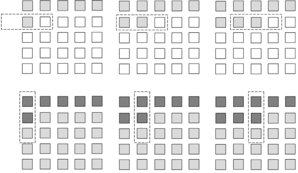

图 4.2 `$3 \times 3$` 滤波器的行通过（顶部）和列通过（底部）。


图 4.3 使用 7×7 系数数组应用于 图像的 2D 高斯模糊。注意底部和右侧边缘的黑线，这是由于滤波器与图像边界之外的隐式零相乘产生的。

如 4.3 所示，应用高斯模糊会让图像看起来模糊，产生一种软化边缘的效果。模糊程度取决于系数的数量。

图像格式通常以整数存储像素值，而高斯 PDF 定义在实数上。因此，在应用高斯模糊时，通常会将图像数据转换为浮点或固定点格式。

换说，高斯模糊是一种*低通滤波器*，它衰减图像中的高频信号，而高频信号使边缘变得锐利。高斯模糊是图像编辑和许多计算机视觉算法中的常用操作。

2D 高斯模糊是可分离的，因为 2D 高斯 PDF 等于 1D 高斯 PDF 的乘积。

高斯模糊使用以下算法实现：

**行通过：**

```
for i=1 to rows
for j=1 to columns
sum = 0;
for k=1 to n
image_j = j+k-floor(n/2);
if (image_j > 0) && (image_j <= columns)
```

```
sum = sum + image(i,image_j) * G(k)
end
end
blurred(i,j)=sum
end
end
```

列通过处理：

```
for i=1 to rows
  for j=1 to n
    sum = 0;
    for k=1 to n
      image_i = i+k-floor(n/2);
      if (image_i > 0) && (image_i <= n)
        sum = sum + blurred(image_i,j) * G(k);
      end
    end
    blurred2(i,j)=sum
  end
```

你可以使用 Linux Octave 命令计算系数：

```
g_1D = normpdf(-floor(N/2):floor(N/2),0,1)
g_1D = g_1D./sum(g_1D);
```

### 4.3.2 Sobel 滤波器

从概念上讲，灰度图像可以表示为函数 `$I(x,y)$`，该函数计算像素位置 `$(x,y)$` 处的像素强度。许多计算机视觉任务需要图像的偏导数，即 X 和 Y 方向上的 `$\partial(x,y)/\partial x$` 和 `$\partial(x,y)/\partial y$`。这些偏导数通常简写为 `$I_x(x,y)$` 和 `$I_y(x,y)$`。Sobel 滤波器是计算这些偏导数的常用方法。

图 4.4 显示了对原始 Lena 应用 Sobel 滤波器计算 X 和 Y 偏导数的效果。在这些图中，白色像素代表边缘。

如图 4.5 所示，Sobel 滤波器还具有提取图像中物体之间边界边缘的能力。要做到这一点，可以计算每个像素的 `X` 和 `Y` 导数的范，即：

$$\sqrt{\left(\frac{\partial(x,y)}{\partial x}\right)^{2}+\left(\frac{\partial(x,y)}{\partial y}\right)^{2}}$$

为了使用这种“边缘检测”方法，程序必须从源图像中完整计算 `X` 和 `Y` 导数，生成两幅


图 4.4 使用 Sobel 滤波器得到的 Lena 图像的 `$I_x$`（左）和 `$I_y$`（右）。


图 4.5 Lena 图像的 `$(I_x, I_y)$` 范数。

它必须使用范数操作结合这些中间图像以计算最终图像。

Sobel 滤波器的系数矩阵为：

```
$G_x = \begin{bmatrix} -1 & 0 & 1 \\ -2 & 0 & 2 \\ -1 & 0 & 1 \end{bmatrix}$
```

和

```
$G_y = \begin{bmatrix} 1 & 2 & 1 \\ 0 & 0 & 0 \\ -1 & -2 & -1 \end{bmatrix}$
```

它们可以分离为行通过和列通过滤波器：

```
$G_y = \begin{bmatrix} 1 & 2 & 1 \\ 0 & 0 & 0 \\ -1 & -2 & -1 \end{bmatrix} = \begin{bmatrix} 1 \\ 0 \\ -1 \end{bmatrix} \begin{bmatrix} 1 & 2 & 1 \end{bmatrix}$
```

如上面的图像所示，高频噪声会在滤波图像中产生伪边缘，因此通常在应用 Sobel 滤波器之前，先用高斯滤波器对图像进行滤波。

图 4.6 显示了在应用 Sobel 滤波器之前将高斯滤波作为预处理步骤的效果。注意到许多白点已被移除。


图 4.6 经过高斯预滤波的 Sobel 滤波器输出（`$I_x$`、`$I_y$` 和边缘）。

### 4.3.3 Harris 角点检测器

某些计算机视觉应用需要一种方法来识别图像中的锚点，以便在从不同角度拍摄的同一场景的图像之间建立对应关系。这对于视频跟踪、图像拼接和 3D 建模非常有用。

识别锚点的一种方法是寻找角点，即至少两条边缘的交点。更通俗地说，角点是图像上的任意一点，如果其斑块（patch）或以该点为中心的正方形子区域在任何方向移动，该斑块区域都会发生显著变化。

这在图 4.7 中所示。

检测图像中角点的方法有很多种。最常用的方法之一是 Harris 检测器。Harris 检测器寻找在移动 `$(u,v)$` 处具有较大“位移差异”的像素：

```
$E(u,v) = \sum_{x,y} w(x,y)|I(x+u,y+v) - I(x,y)|^2$
```

`$I$` 代表图像，`$w$` 代表斑块中像素的权重。

本节研究权重全部设为 1 的简单情况。因此，该项从公式中去除了。


**图 4.7** 对两个候选像素进行了评估。左侧像素靠近边缘，其对应的斑块仅会在水平或对角线移动时变化。右侧像素位于角点，其对应的斑块在任何移动下都会发生显著变化。

尽管可以直接获得像素值 `$I()$`，但 Harris 检测器通常被评估为上述表达式的一阶泰勒展开：

$$E(u, v) = \sum_{x,y} [I(x+u, y+v) - I(x, y)]^2$$

$$= \sum_{x,y} [I(x,y) + u I_x(x,y) + v I_y(x,y) - I(x,y)]^2$$

其中 `$I_x$` 和 `$I_y$` 是 `$I$` 对相对 `x` 和 `y` 的偏导数。

Harris 响应矩阵 `$M$` 定义为：

$$M = \sum_{x,y} w(x,y) \begin{bmatrix} I_x^2 & I_x I_y \\ I_x I_y & I_y^2 \end{bmatrix}$$

角点响应 `$R$` 为：

$$R = \det(M) - k(\text{trace}(M))^2$$

其中 `$k$` 是一个在 0.04 到 0.06 之间的常数。如果 `$R$` 很大，则该点是角点。如果 `$R$` 很小但迹（trace）很大，则是边缘。如果两者都很小，则是平坦区域。

该问题使用线性代数描述如下：

```
$A = \begin{bmatrix} I_x(x-1, y-1) & I_y(x-1, y-1) \\ I_x(x, y-1) & I_y(x, y-1) \end{bmatrix}$
```

以及

```
$b = \begin{bmatrix} -I_y(x-1, y-1) \\ -I_x(x, y-1) \end{bmatrix}$
```

那么：

```
$\begin{bmatrix} v_x \\ v_y \\ v_y \end{bmatrix} = b$
```


$\begin{bmatrix} v_x \\ v_y \\ v_y \end{bmatrix} = A^{-1}A^T b$

$\begin{bmatrix} v_x \\ v_y \\ v_y \end{bmatrix} = \left(\sum \begin{bmatrix} I_x(x,y)^2 & I_x(x,y)I_y(x,y) \\ I_y(x,y)I_x(x,y) & I_y(x,y)^2 \end{bmatrix}\right)^{-1}A^T b$

$2 \times 2$ 矩阵的逆矩阵是可以计算的。$A^T$ 是一个 $2 \times n$ 矩阵，$b$ 是一个 $n \times 1$ 向量，因此 $A^T b$ 是一个 $2 \times 1$ 向量。

这种光的光流法是另一个内存受限模板循环（stencil loop）示例。

## 4.4 两个滤波器的内存访问行为

作为 2D 滤波器的模板循环通常是内存受限的。好消息是，它们的内存访问行为涉及读取重叠的输入集合，有利于缓存利用时间性和空间局部性，并实现高数据复用率。挑战在于，程序代码隐含的内存访问行为可能需要优化，以获得最大的缓存性能。

回一下根据原因对缓存缺失进行分类：强制缺失（compulsory）、容量缺失（capacity）和冲突缺失（conflict）。

强制缺失发生在第一次访问缓存块时。减少强制缺失的主要方法是使用缓存预取技术。预取的有效性取决于访问模式的规则性和可预测性。幸运的是，图像过滤（以及一般的模板循环）既是规则的也是预测的。

容量缺失由于缓存容量不足以利用可用局部性而导致。减少容量缺失的主要方法是增加缓存尺寸。

冲突缺失发生在多个内存地址竞争同一个缓存行时。在图像过滤的情况下，当图像的行大小使得第 $r+n$ 行的像素与第 $r$ 行的像素映射到同一缓存行时，冲突缺失会导致缓存行被丢弃，并在程序下次访问 $r$ 时从内存重新读取。

在行扫描中计算的输出像素随后会在列扫描中读取。由于在列扫描开始之前，必须用行扫描处理整个图像，因此可以假设行扫描的没有任何输出像素留在缓存中的时间足够长到可以在列扫描中被复用。

减少冲突缺失有许多硬件方法，例如增加缓存关联性、改进替换策略以及使用受害者缓存（victim caches），但也有减少冲突缺失的软件方法。

在软件中，程序员可以使用内存分配和循环变换来优化访问模式，从而减少冲突缺失。内存分配技术包括将多个数组交替存储在一个数组中，或者改变数组的维度（例如矩阵转置）。

循环变换包括循环交换（交换内层和外层循环）、循环融合（两个循环合并为一个）、循环分裂（将一个循环分成两个）以及循环分块（loop tiling），有时称为循环阻塞（loop blocking）。

遗憾的是，标准编译器通常无法自动应用此类优化，因此取决于程序员。本章重点关注循环分块，因为它对模板循环非常有效。

### 4.4.1 2D 数据表示

2D 数据结构（如图像和矩阵）在存储于内存或跨通信通道传输时，必须叠加到 1D 元素数组上。对于内存来说这是一个重要的考虑因素，因为当连续访问具有连续地址时，缓存和 DRAM 都能获得更高的性能。

图 4.9 显示了将图像投影到 1D 内存空间的两种方法：行主序（row-major）和列主序（column-major）。行主序是最常见的。在这种情况下，每行的像素存储在连续的内存位置中。相反，每列的像素存储在间隔为行大小的位置中，遍历第三列需要像素地址 C、G、K、O。

| A | B | C | D | A | E | I | M |
|---|---|---|---|---|---|---|---|
| E | F | G | H | B | F | J | N |
| I | J | K | L | C | G | K | O |
| M | N | O | P | D | H | L | P |

**图 4.9** 使用行主序和列主序压缩的 4×4 数组。行主序将每行的元素存储在连续的内存位置中，而列主序将每列的元素存储在连续的内存位置中。图中字母代表连续的内存地址。

### 4.4.2 按行过滤

假设图像以行主序存储，对于每次滤波器评估，处理器将加载连续的像素。这种简单的模型如图 4.10 所示，假设输出按行主序处理。对于行滤波器，每隔两个元素就会进行一次行替换。换句话说，行滤波器和列滤波器读取每个输入元素 $n$ 次（其中 $n=$ 滤波器大小），复用之间的时间等同于处理一行输出元素所需的时间。在复用之间，除非缓存能够保留至少 $n \times c$ 个像素（其中 $c$ 是列数），否则输入元素将被替换。

对于每两个像素五次操作的算术强度，该滤波器很可能是内存受限的，其性能将取决于缺失率。程序员可以使用以下假设粗略估计缓存性能：

- 缓存是全关联的
- 在这种情况下，每隔四个元素就有一次行替换。乍看，这比行滤波器要好，行滤波器每隔三个元素就有行替换。然而，与行滤波器不同，每个缓存行只读取一个元素，这意味着垂直滤波器的时间局部性较差。这是一个问题，因为当第 1 行的所有输出处理完毕后，包含第 1 行和第 2 行较低列的缓存行可能已经被替换并需要重新加载。

### 4.4.3 按列过滤

对于列滤波器，处理器将从不同的行加载像素。这如图 4.11 所示。在这种情况下，每隔三个输入就会有一次行替换。由于滑动窗口移动一个元素，处理器将为每个输出读取三个像素。

## 4.5 循环分块 (LOOP TILING)

如图 4.12 所示，通过改变输出元素的评估顺序，可以将图像有效地划分为一系列垂直带。这将把有效列数从 $c$ 减少到 $c_n$，从而减少重复填充缓存行的次数。

这种划分方式的缺点是它阻止了跨越垂直带的缓存行中像素的复用。此外，对于像 Harris 角点检测器等 2D 模板（无法拆分为行扫描和列扫描），使用这种划分方法将防止左侧和右侧带中模板水平分部分的工作。

如图 4.13 所示，将图像划分为按行主序处理的矩形子图像可以解决这个问题。

## 4.5 循环分块 (Loop Tiling)

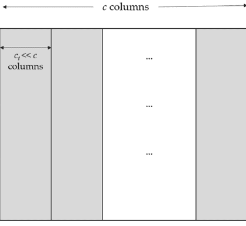

图 4.12 将图像分为垂直条带。

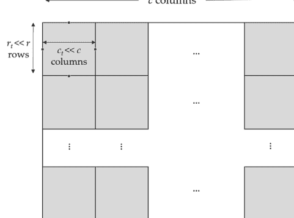

图 4.13 将图像分为矩形子图像。

这种划分是通过循环分块（loop tiling）实现的。循环分块是一种系统方法，它改变了在遍历多维数组时访问元素的顺序。它不是在增加下一个维度的索引之前遍历每个维度，而是将迭代空间分解为一系列较小的块，在移动到下一个块之前，每个块内的所有索引都会被处理。为了实现这一点，程序员必须添加额外的外层循环层级，以处理图像空间中的每个“瓦片（tile）”。

# 第 4 章 内存优化与视频处理

例如，考虑以下循环：

```
for (i=0;i<SIZE_Y;i++)
    for (j=0;j<SIZE_X;j++)
        do_something(i,j)
```

该循环可以通过添加两层嵌套来分分块：

```
for (i=0;i<ceiling(SIZE_Y/TILESIZE_Y);i++)
    for (j=0;j<ceiling(SIZE_X/TILESIZE_X);j++)
        for (ii=i*TILESIZE_Y;ii<(i+1)*TILESIZE_Y;ii++)
            if (ii<SIZE_Y)
                for (jj=j*TILESIZE_X;jj<(j+1)*TILESIZE_X;jj++)
                    if (jj<SIZE_X)
                        do_something(ii,jj)
```

分块如图 4.14 所示。左侧显示了行优先遍历的未分块访问模式。右侧是分块版本，它处理图像中的每个 2 × 2 像素瓦片。

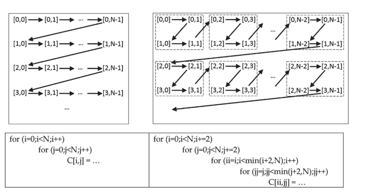

图 4.14 未分块与分块的访问模式。

## 4.6 分块与光晕区域 (STENCIL HALO REGION)

如图 4.15 所示，包含 $n$ 行 $m$ 列的二维卷积算子将访问瓦片边界上下的 $[n/2]$ 行以及瓦片边界左右的 $[m/2]$ 列。这些像素形成了围绕每个瓦片的*光晕（halo）* 区域。

在对卷积算子循环进行分块时，程序员可能希望将每个瓦片缓冲化在一个较小的数组中，该数组的行大小与瓦片宽度匹配。在这种情况下，程序员还需要拷贝光晕区域。

## 4.7 示例 2D 滤波器实现

本节描述了如何构建一个分块图像滤波器，以探索瓦片优化的性能影响。

首先定义一个结构体来存储 2D 值：

```
struct size {
    int x;
    int y;
};
```

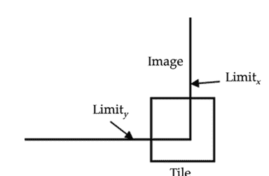

**图 4.16** 边界瓦片。

定义一个结构体来存储瓦片大小、在图像中的位置以及图像大小：
```


```c
struct tile {

    struct size tile_size, tile_loc, image_size;

};
```

在过滤每个瓦片之前，程序必须确定如何处理部分超出图像边界的瓦片，特别是图像边界处的瓦片，如图 4.16 所示。

为了做到这一点，确定程序是否正在处理边界瓦片。如果是，确定瓦片的右边缘或下边缘是否在图像限制之外。使用函数预先计算 X 和 Y 维的限制：

```c
void find_limit(struct tile *mytile,struct size *limit) {

    limit->x = ((mytile->tile_loc.x+1) * mytile->tile_size.x - 1 >

               mytile->image_size.x) ?

               mytile->image_size.x%mytile->tile_size.x :

               mytile->tile_size.x;

    limit->y = ((mytile->tile_loc.y+1) * mytile->tile_size.y - 1 >

               mytile->image_size.y) ?

               mytile->image_size.y%mytile->tile_size.y :

               mytile->tile_size.y;

}
```

## 4.7 示例 2D 滤波器实现

接下来，编写对瓦片应用 2D 和 1D 滤波器的函数。该函数接收输入为：
- (1) 一个瓦片对象，定义了瓦片的大小及其在图像中的位置
- (2) 指输入图像灰度点表示的指针
- (3) 指输出图像的指针
- (4) 指系数数组的指针
- (5) 每个滤波器维度的尺寸
- (6) 瓦片的可用部分，以避免在处理边界瓦片时写入图像边缘之外
- (7) 一个标志，用于指定输出图像是否已包含方向向量之一，在计算 Sobel 滤波器时有用。

```c
void filter_tile2d(struct tile *mytile,

    float *in,

    float *out,

    float *coeffs_2d,

    int fsize,

    struct size *limit,

    int vec) {

// 此分块方法计算输入像素的偏移量。

// 在这种情况下，瓦片被包含在尺寸与瓦片及其周围光晕区域匹配的缓冲区中。

int i, j, k, l;

float sum;

// 此分块方法遍历卷积算子中的每个值。

// 需要两层嵌套循环。

for (i=0;i<limit->y;i++) {

    img_y = mytile->tile_loc.y * mytile->tile_size.y + i;

    for (j=0;j<limit->x;j++) {

        img_x = mytile->tile_loc.x * mytile->tile_size.x + j;

        sum = 0.0;

        // 分块方法在像素与其对应的系数之间进行累加。

        // 使用 if 语句避免访问图像之外的像素：

        for (k=-coeff_radius;k<coeff_radius;k++) {

            if (img_y+k >= 0 && (img_y+k) < mytile->image_size.y) {

                for (l=-coeff_radius;l<coeff_radius;l++) {

                    if (img_x+l >= 0 && (img_x+l) < mytile->image_size.x) {

                        // 此处应使用 coeffs_2d 进行累加逻辑

                    }

                }

            }

        }

    }

}
```

接下来，编写对瓦片应用 2D 和 1D 滤波器的函数。该函数接收输入为：
- (1) 一个瓦片对象，它定义了瓦片的大小及其在图像中的位置
- (2) 指输入图像灰度点表示的指针
- (3) 指输出图像的指针
- (4) 指系数数组的指针
- (5) 每个滤波器维度的尺寸
- (6) 瓦片的可用部分，以避免在处理边界瓦片时写入图像边缘之外
- (7) 一个标志，用于指定输出图像是否已包含方向向量之一，在计算 Sobel 滤波器时有用。

```c
void filter_tile2d(struct tile *mytile,

    float *in,
```


## 4.5 循环分块 (Loop Tiling)


图 4.12 将图像分为垂直条带。


图 4.13 将图像分为矩形子图像。

这种划分是通过循环分块（loop tiling）实现的。循环分块是一种系统方法，它改变了在遍历多维数组时访问元素的顺序。它不是在增加下一个维度的索引之前遍历每个维度，而是将迭代空间分解为一系列较小的块，在移动到下一个块之前，每个块内的所有索引都会被处理。为了实现这一点，程序员必须添加额外的外层循环层级，以处理图像空间中的每个“瓦片（tile）”。

# 第 4 章 内存优化与视频处理

例如，考虑以下循环：

```
for (i=0;i<SIZE_Y;i++)
    for (j=0;j<SIZE_X;j++)
        do_something(i,j)
```

该循环可以通过添加两层嵌套来分块：

```
for (i=0;i<ceiling(SIZE_Y/TILESIZE_Y);i++)
    for (j=0;j<ceiling(SIZE_X/TILESIZE_X);j++)
        for (ii=i*TILESIZE_Y;ii<(i+1)*TILESIZE_Y;ii++)
            if (ii<SIZE_Y)
                for (jj=j*TILESIZE_X;jj<(j+1)*TILESIZE_X;jj++)
                    if (jj<SIZE_X)
                        do_something(ii,jj)
```

分块如图 4.14 所示。左侧显示了行优先遍历的未分块访问模式。右侧是分块版本，它处理图像中的每个 2 × 2 像素瓦片。


图 4.14 未分块与分块的访问模式。

## 4.6 分块与光晕区域 (STENCIL HALO REGION)

如图 4.15 所示，包含 $n$ 行 $m$ 列的二维卷积算子将访问瓦片边界上下的 $[n/2]$ 行以及瓦片边界左右的 $[m/2]$ 列。这些像素形成了围绕每个瓦片的*光晕（halo）* 区域。

在对卷积算子循环进行分块时，程序员可能希望将每个瓦片缓冲化在一个较小的数组中，该数组的行大小与瓦片宽度匹配。在这种情况下，程序员还需要拷贝光晕区域。

## 4.7 示例 2D 滤波器实现

本节描述了如何构建一个分块图像滤波器，以探索瓦片优化的性能影响。

首先定义一个结构体来存储 2D 值：

```
struct size {
    int x;
    int y;
};
```


**图 4.16** 边界瓦片。

定义一个结构体来存储瓦片大小、在图像中的位置以及图像大小：

```
struct tile {
    struct size tile_size, tile_loc, image_size;
};
```

在过滤每个瓦片之前，程序必须确定如何处理部分超出图像边界的瓦片，特别是图像边界处的瓦片，如图 4.16 所示。

为了做到这一点，确定程序是否正在处理边界瓦片。如果是，确定瓦片的右边缘或下边缘是否在图像限制之外。使用函数预先计算 X 和 Y 维的限制：

```
void find_limit(struct tile *mytile,struct size *limit) {
    limit->x = ((mytile->tile_loc.x+1) * mytile->tile_size.x - 1 >
               mytile->image_size.x) ?
               mytile->image_size.x%mytile->tile_size.x :
               mytile->tile_size.x;
    limit->y = ((mytile->tile_loc.y+1) * mytile->tile_size.y - 1 >
               mytile->image_size.y) ?
               mytile->image_size.y%mytile->tile_size.y :
               mytile->tile_size.y;
}
```

## 4.7 示例 2D 滤波器实现

接下来，编写对瓦片应用 2D 和 1D 滤波器的函数。该函数接收输入为：
- (1) 一个瓦片对象，它定义了瓦片的大小及其在图像中的位置
- (2) 指输入图像灰度点表示的指针
- (3) 指输出图像的指针
- (4) 指系数数组的指针
- (5) 每个滤波器维度的尺寸
- (6) 瓦片的可用部分，以避免在处理边界瓦片时写入图像边缘之外
- (7) 一个标志，用于指定输出图像是否已包含方向向量之一，在计算 Sobel 滤波器时有用。

```
void filter_tile2d(struct tile *mytile,
    float *in,
    float *out,
    float *coeffs_2d,
    int fsize,
    struct size *limit,
    int vec) {
// ... (此处为原文代码，保持不翻译)
```
*(注：由于原文文本中 `filter_tile2d` 之后的内容非常混乱，包含了描述和代码的混合，我将严格按照要求翻译所有文字，并保留代码块。)*

## 4.8 捕获与转换视频帧

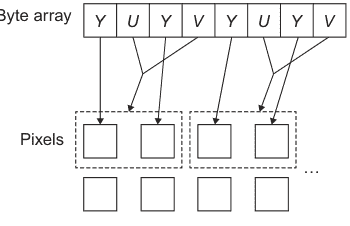

在 YUV 格式中，每个像素存储一个 Y 值，而每两个水平像素值存储一对 (U,V) 值。摄像头也可能使用某些技术来减少每个像素所需的位数。在这些技术中，YUYV 是 YUV 的变体，它以半的分率存储色彩信息。这使得每个像素的平均位数从 24 位（假设 Y、U、V 均为 8 位）减少到 16 位。

如图 4.17 所示，在此种格式中，每个像素都有亮度，但每两个水平相邻的像素只有一个色度值。以下函数将把每个像素块（tile）从 YUYV 转换为灰度浮点数，并将值存储在足够容纳该块的数组中。该函数的接口与滤波函数相似：

```c
void extract_tile(unsigned short *in_image, struct tile *mytile, float *out, int fsize, struct size *limit) {
    int i, j, offset, img_x, img_y, coeff_radius;
    float lum;
    coeff_radius = fsize >> 1;
    for (i = -coeff_radius; i < limit->y + coeff_radius; i++) {
        img_y = mytile->tile_loc.y * mytile->tile_size.y + i;
        if (img_y >= 0 && img_y < mytile->image_size.y) {
            for (j = -coeff_radius; j < limit->x + coeff_radius; j++) {
                img_x = mytile->tile_loc.x * mytile->tile_size.x + j;
                if (img_x >= 0 && img_x < mytile->image_size.x) {
                    // 在此点，程序必须计算单独偏移量以找到 YUV 图像中的亮度（每个字节）以及目标图像中的偏移量：
                    offset = img_y * mytile->image_size.x * 2 + img_x * 2;
                    // 注意：此处偏移量的 OCR 逻辑似乎略显碎片化，但根据上下文：
```


```
// 程序可以通过相对于其最大值进行归一化，将每个亮度转换为浮点数：

lum = (float)((unsigned char*)in_image + offset) / 255.0;

                }

            }

        }

    }

}
```

### 4.8.2 将像素块导出到帧缓冲区

在程序处理每个像素块后，它可以将每个像素转换为帧格式（在本例中为 16 位 RGB）并直接写入帧缓冲区。这需要一个新函数：

```c
void export_tile(struct tile *mytile, unsigned char *fbp, float *in, int fsize, struct size *limit) {
    int i, j, offset, img_x, img_y, coeff_radius;
    float lum;
    coeff_radius = fsize >> 1;
    for (i = 0; i < limit->y; i++) {
        for (j = 0; j < limit->x; j++) {
            offset = i * mytile->image_size.x + j;
            // 从单个灰度值转换为 RGB 时，程序可以通过乘以其最大值并转换回整数，将值赋值给所有三个分量。在 16 位 RGB 中，红色的最大值为 31，绿色的最大值为 63。
            int scaled_red = (int)(lum * 31);
            scaled_red = (scaled_red > 31) ? 31 : scaled_red;
            int scaled_green = (int)(lum * 63);
            scaled_green = (scaled_green > 63) ? 63 : scaled_green;
            // 下一个程序计算帧缓冲区并将像素写入帧缓冲区：
            location = (mytile->tile_loc.y * mytile->tile_size.y + i) * vinfo.line_length + (mytile->tile_loc.x * mytile->tile_size.x + j) * (vinfo.bits_per_pixel / 8);
            *((unsigned short*)(fbp + location)) = (scaled_red << 11) | (scaled_green << 5) | scaled_green;
        }
    }
}
```

## 4.9 Video4L 驱动与 API

Video4L 是内置在大多数 Linux 发行版中的驱动框架，为视频捕获提供了标准接口。由于大多数 ARM 平台带有 USB 接口，Video4L 提供了一种简单且廉价的方法来连接 USB 摄像头进行测试。

如果你没有摄像头，可以使用上一章介绍的 PPM 文件作为输入。如果你有摄像头，可能需要修改此代码以适配你的摄像头。本示例使用摄像头通过 YUV 色彩空间捕获 640×480 分率的图像。鼓励读者尝试更大的尺寸。然而，典型的 USB2 带会将每秒 30 帧未压缩视频的最大分辨率限制在 1024×768。某些 USB 摄像头支持压缩视频，软件需要使用第三方库进行解压缩。

要开始使用 Video4L，添加以下头文件：

- `#include <stdio.h>`
- `#include <stdlib.h>`
- `#include <sys/ioctl.h>`
- `#include <sys/select.h>`
- `#include <sys/mman.h>`
- `#include <linux/videodev2.h>`
- `#include <string.h>`

由于程序使用了 Linux 帧缓冲区，还需要以下头文件：

```c
#include <unistd.h>
#include <fcntl.h>
#include <linux/fb.h>
```

在程序从摄像头捕获帧之前，必须初始化 Video4L 摄像头接口。初始化函数将返回两个值，允许我们维护捕获状态：`struct v4l2_buffer` 变量和一个指向捕获缓冲区的指针。使用全局变量存储句柄。

```c
int open_cam(struct v4l2_buffer *buf, void **buffer) {
    struct v4l2_format fmt;
    struct v4l2_request_buffers req;
    // ... 实现代码 ...
}
```

## 4.9 Video4Linux 驱动程序与 API

下一步是查询驱动程序以确定用于将帧传回用户空间的缓冲区大小，并创建内存映射：

```c
memset(buf.0,sizeof(buf));
buf->type = V4L2_BUF_TYPE_VIDEO_CAPTURE;
buf->memory = V4L2_MEMORY_MMAP;
buf->index = 0;
if (ioctl(fd,VIDIOC_QUERYBUF,buf)==-1) {
  perror("queuing buffer");
  return 0;
}
*buffer = mmap(0,buf->length,PROT_READ|PROT_WRITE,MAP_SHARED,fd1,buf->m.offset);
if (ioctl(fd,VIDIOC_QBUF, buf)==-1) {
  perror("queuing buffer");
  return 0;
}
```

捕获之前的最后一步是开启摄像头的流式功能：

```c
if (ioctl(fd,VIDIOC_STREAMON,&buf->type)==-1) {
  perror("start capture");
  return 0;
}
return 1;
```

一旦初始化成功返回，程序就准备好开始接收摄像头的帧。

下一个函数将从摄像头捕获一帧。这是一个同步函数，意味着在帧被成功捕获之前不会返回。

```c
int capture_frame (struct v4l2_buffer *buf) {
    fd_set fds;
    int ret;
    struct timeval tv;
```

Linux 的 `select()` 系统可以将软件与摄像头的帧捕率同步。`select()` 用于阻塞程序的执行，直到有新数据可读。它通常用于使用 Sockets API 时等待传入的网络数据。

确保在打开捕获设备后打开帧缓冲区，以确保捕获设备的文件描述符值大于帧缓冲区。否则，`select()` 将失败。

```c
tv.tv_sec=0;
tv.tv_usec=0;
FD_ZERO(&fds);
FD_SET(fd1,&fds);
ret = select(fd1+1, &fds, NULL, NULL, &tv);
if(ret == -1) {
    perror("waiting for frame");
    return 1;
}
```

下一个 IO 控制将从 Video4Linux 解队列一个帧缓冲区，然后为该缓冲区提交另一个请求。

```c
if(ioctl(fd1, VIODOC_DQBUF, buf) == -1) {
    perror("retrieving frame");
    return 1;
}
if(ioctl(fd1, VIODOC_QBUF, buf) == -1) {
    perror("queuing buffer");
    return 0;
}
```

## 4.10 应用 2D 分块滤波器

下一步是编写一个循环，将滤波器应用于每个分块（tile）。该循环将对每个分块进行迭代，因此可以结构化为两级嵌套循环。

此函数应接受图像大小分块大小作为参数，因此在循环之前，初始化一个 `struct tile` 变量（在下面的代码中名为 `mytile`），它包含这些大小。

程序可以使用 OpenMP 将外层循环的负载分布到线程池中。这样一来，每个线程将处理一组分块行。

每个维度中的最后一个分块可能会跨越图像边界，因此循环边界必须“向上取整”部分分块。要做到这一点，使用三元表达式，当相应的模值非零时，给图像-分块数量加1。

```c
#pragma omp parallel for firstprivate(mytile)
for (i=0;i<mytile.image_size.y%mytile.tile_size.y;
    mytile.image_size.y/mytile.tile_size.y+1)
```


`mytile.image_size.y / mytile.tile_size.y;`

`i++;`

`mytile.tile_loc.y = i;`

```
for (j=0;j<mytile.image_size.x%mytile.tile_size.x
    mytile.image_size.x/mytile.tile_size.x+1)
    mytile.image_size.x / mytile.tile_size.x);j
    ++);
mytile.tile_loc.x = j;
```

对于每个分块，程序必须计算其内部限制，以防止滤波器循环对于任何右边缘或底延伸超出图像边界的分块在任何维度上超出边界。

接下来，从 YUV 帧中提取分块。从这些数据中执行 X 和 Y Sobel 算子的 2D 版本。计算每个像素的 X 和 Y 偏导数后，计算结果的范数。最后将分块转换为 16 位 RGB 并写入帧缓冲区。

```c
find_limit(&mytile,&limit);
extract_tile(in_image,&mytile.frame,3,&limit);
```

```c
filter_tile2d(&mytile.frame,filtered_x,
ysobel_2d,3,&limit,0);
filter_tile2d(&mytile.frame,filtered_xy,
ysobel_2d,3,&limit,1);
export_tile(&mytile.fbp,filtered_xy);
```

使用 `perf_event` 在此级别对代码进行插桩，以测量 OpenMP 区域前后的性能。这样你就可以测量每帧的性能指标。

## 4.11 应用分离式 2D 滤波器

从 Video4Linux 中解队列一个帧缓冲区，然后为该缓冲区提交另一个请求。

在开启 OpenMP 区域之前，使用 `perf_event` 在此级别对代码进行插桩，以测量 OpenMP 区域前后的性能。这样你就可以测量每帧的性能指标。

## 4.12 顶层循环

为了测量不同分块尺寸的性能，当使用 Sockets API 等待传入的网络数据时，确保在打开捕获设备后打开帧缓冲区，以确保捕获设备的文件描述符值大于帧缓冲区。否则，`select()` 将失败。

使用分离式 2D 滤波器时，分块尺寸通过一个数组：

```c
int dims[15] = {8,16,32,48,64,96,128,160,192,224,256,288,320,352};
```

## 4.13 性能结果

图 4.18 显示了在 Raspberry Pi 上应用滤波器的缓存缺失率和 CPI。注意在没有分块时，640 × 480 的分块尺寸的缓存缺失率最高。

```c
k = 0;
while (1) {
  size_size.x = 640;
  size_size.y = 480;
  if (dims[k] == 0) {
    // 处理分块逻辑
  } else {
    // 处理帧逻辑
  }
  k++;
}
```

缓存缺失率与平均 CPI 大致相关。性能最好的分块是 8×8，与分块版本相比，其缺失率提升了 1.7。

# 练习

计算此算子（stencil）每个字节的浮点运算次数（flops per byte），假设偏导数作为输入可用，并与 2D Sobel 滤波器相比。哪者的算术强度更高？

- 6. 如第 4.3.4 节所述，Lucas-Kanade 光流是一种用于确定帧与帧之间像素移动的光学算法。该算法的输入是由 Sobel 滤波器计算的 X 和 Y 偏导数。计算此算子每个字节的浮点运算次数（假设偏导数作为输入可用），并与 2D Sobel 滤波器相比。哪者的算术强度更高？

- 7. 对代码进行插桩，测量提取和过滤一个块（tile）所需的时间以及将块写入帧缓冲区（frame buffer）所需的时间。使用 OpenMP 实现双缓冲方案，使这些步骤并行执行。换句话说，当正在提取一个块时，将最近过滤的块写入帧缓冲区。这些步骤中的每一个都应该是独立进行多线程处理。测量这种方法实现的加速比。

- 8. Smith-Waterman 序列对齐算法用于对两个序列进行对齐，可以使用读取和写入同一个矩阵的算子循环（stencil loop）来实现。给定两个字符串 A 和 B，Smith-Waterman 算法可以实现为生成矩阵 H：

```
$H_{i,j} = \min \begin{cases} H_{i-1,j-1} + S(A_i,B_j) \\ H_{i-1,j} - d \\ H_{i,j-1} - d \end{cases}$
```


在这种情况下，算子读取输出元素左上方和方的输入元素。这创建了一组依赖关系，输出元素可以沿着对角线并行生成，并且在处理每个对角线后必须有`barrier`。

使用`OpenMP`和本章中`Sobel`示例描述的编码风格，编写该内核的分块实现。

- 9. 分离滤波器（Separate filters）降低了滤波器的算法复杂度，但分块时，内核的每次通过必须在整个图像上执行，以保证光晕区域（`halo region`）像素反映了上一次通过的更新。这可能会降低分块滤波器的局部性。

编写可分离高斯模糊的分块版本，并将其吞吐量和缓存缺失率与分块非分离滤波器进行比较。针对`$7 \times 7$`、`$9 \times 9$`和`$11 \times 11$`的滤波器尺寸进行此操作。

# 使用 OpenCL 的嵌入式异构编程

## 章节目录

- 5.1 GPU 微架构 189
- 5.2 OpenCL 190
- 5.3 OpenCL 编程模型、惯用法和抽象 191
- 5.3.1 宿主机/设备编程模型 191
- 5.3.2 错误检查 192
- 5.3.3 平台层：初始化平台 194
- 5.3.4 平台层：初始化设备 197
- 5.3.5 平台层：初始化上下文 199
- 5.3.6 平台层：内核控制 201
- 5.3.7 平台层：内核编译 202
- 5.3.8 平台层：设备内存分配 205
- 5.4 内核负载分配 207
- 5.4.1 设备内存 208
- 5.4.2 内核参数 210
- 5.4.3 内核向量化 213
- 5.4.4 Horner 内核的参数空间 214
- 5.4.5 内核属性 216
- 5.4.6 内核分发 216
- 5.5 使用 OpenCL 实现 Horner 算法：设备代码 222
- 5.5.1 验证 225
- 5.6 性能结果 227
- 5.6.1 参数探索 227
- 5.6.2 工作组数量 227
- 5.6.3 工作组大小 228
- 5.6.4 向量长度 229
- 5.7 章节总结 229
- 练习 230

## 第 5 章 使用 OpenCL 的嵌入式异构编程

大多数智能手机和平板电脑用户都理所当然地能够编解码高清视频并实时渲染三维（3D）图形。如果没有图形处理单元（GPU）等专用协处理器的帮助，这些任务将是不可能的。

即使是高性能的四核 ARM Cortex A15——具有其单指令多数据（SIMD）单元、乱序执行超标量架构和高级缓存——也无法独立完成这些任务。由于由于原因，所有现代的系统级芯片（SoC）协处理器都包含了一系列多样化的专用协处理器技术。其中最先进的是支持使用开放计算语言（OpenCL）进行通用编程。

例如，赛灵活凌（Xilinx）Zynq 其双 ARM Cortex-A9 处理器集成了可编程门阵列（FPGA）布线，可用于高吞吐量低延迟的自定义电路。

另一个例子是德州仪器 Keystone II，它在四核 Cortex A5 处理器的基础上配备了八个数字信号处理器（DSP）内核，这些内核具有长指令微结构，可提供 16 Gflops 的峰值浮点吞吐量。

智能手机和平板电脑 SoC 包含通常分类为 GPU 的协处理器。与桌面和服务器 GPU 市场被 NVIDIA、AMD 和 Intel 主导不同，低功耗移动 GPU 市场仍然竞争激烈、多样且充满活力：

- ARM Mali GPU
- Imagination PowerVR GPU
- Broadcom VideoCore GPU
- Qualcomm Adreno GPU
- NVIDIA Kepler GPU

嵌入式 GPU 通常与其宿主机 CPU 共享内存系统，因此它们在内存带宽上没有优势，但不受 GPU 开销的影响。

### 5.1 GPU 微架构

嵌入式 GPU 的通用编程仍然相对较新，相关的运行时库和编译器也尚未成熟。本章以 ODROID-X3 上的 ARM Mali-T62 GPU 作为案例研究。与其他嵌入式 GPU 一样，ARM Mali 支持使用 OpenCL 进行通用编程，这是一个独立的框架，用于为各种微架构编写性能导向、数据并行的代码。

在为嵌入式 GPU 编程时面临着若干挑战。首先，与异构平台（由一组不同的处理器组成的平台）一样，程序员必须手动识别应用程序的哪些组件映射到协处理器上。即使在仔细实现这些组件后，程序员也必须针对特定处理器的特性来调整影响性能的参数。幸运的是，OpenCL 提供了机制允许程序员查询运行时环境以获取有关如何设置这些参数的提示。

本章重新回顾 Horner 方法内核，以说明 OpenCL 编程中涉及的概念和性能因素。回顾我们的 Horner 方法内核执行以下循环：

```
1 for i = 0 to n-1
2 sum = coeff[0]
3 for j = 1 to
4 sum = sum * input_val[i]
5 sum = sum + coeff[j]
6 endfor
7 endfor
```


代码的性能瓶颈是第 4 行和第 5 行之间的依赖。在第 2 章中，我们通过两种方法解决了这个问题：软件流水线（关注内部循环）和显式 SIMD 并行（关注外部循环）。

# 依赖

| Cycle (周期) | 0 | 1 | 2 | 3 | 4 | 5 | 6 | 7 |
|---|---|---|---|---|---|---|---|
| Lane 0 | it 0, In 4 | it 4, In 4 | it 8, In 4 | it 12, In 4 | it 0, In 5 | it 4, In 5 | it 8, In 5 | it 12, In 5 |
| Lane 1 | it 1, In 4 | it 5, In 4 | it 9, In 4 | it 13, In 4 | it 1, In 5 | it 5, In 5 | it 9, In 5 | it 13, In 5 |
| Lane 2 | it 2, In 4 | it 6, In 4 | it 10, In 4 | it 14, In 4 | it 6, In 5 | it 10, In 5 | it 14, In 5 |
| Lane 3 | it 3, In 4 | it 7, In 4 | it 11, In 4 | it 15, In 4 | it 3, In 4 | it 7, In 5 | it 11, In 5 | it 15, In 5 |

图 5.1 流水线执行。“it”代表迭代次数，“In”代表行号。迭代 0 的第 4 行和第 5 行之间的四个周期延迟被其他迭代的指令所隐藏。

GPU 可以通过结合 SIMD 数据路径并动态地让最外循环不同迭代的指令留在同一个执行流水线中，同时使用这两种方法。这允许 GPU 使用其他线程的指令来隐藏数据依赖和加载指令所需的延迟，从而提供并行性。另一方面，执行的指令可以执行多次迭代中的一次操作，从而提供数据级（或 SIMD）并行。

# 5.2 OpenCL

与 `OpenMP` 一样，`OpenCL` 为程序员提供了一个多线程编程模型。在 `OpenCL` 中，线程被称为工作项（`work-items`）。与 `OpenMP` 一样，线程或工作项是一个串行流，与其他线程协作推进程序目标。同样与 `OpenMP` 一样，工作项共享公共内存空间并使用共享内存位置进行通信，并且可以具有变量

## 5.3 OpenCL 编程模型、惯用法与抽象

显式分配为私有。对共享内存的读-修改-写以及生产者-消费者类型的访问通常通过锁和屏障在 `work-item` 之间同步。然而，这也是 `OpenMP` 线程与 `OpenCL` `work-item` 相似性结束的地方。

在 `OpenMP` 中，程序员为每个处理器核心实例化一个线程，因为线程数超过 CPU 核心并没有优势。

在 `OpenCL` 中，目标是尽可能以最细粒度利用并行性，无论目标设备上的物理核心数量，调用尽可能多的 `work-item` 对程序员来说都有利。因此，在将 `OpenMP` 代码适配 `OpenCL` 代码时，通常会删除最外层的 `for` 循环，并用为最外层循环的每次迭代实例化 `work-item`。在这种情况下，每个线程执行最外层循环的一次迭代。

`OpenMP` 线程具有独立的控制流，而对于类似 GPU 的协处理器，由 32 或 64 个 `work-item` 组成组内的 `work-item` 被映射到 SIMD 通道上，这意味着它们的控制流将保持同步执行，或者两组 `work-item` 将发生分歧并相对于彼此序列化。这意味着为了实现最高性能，所有的 `if` 语句求值必须等价，且所有内部循环必须迭代相同的次数。

`OpenMP` 和 `OpenCL` 之间的另一个（且通常是令人沮丧的）区别是使用它与串行代码相比所需的代码量。程序员可以通过添加极少的额外代码为串行程序添加 `OpenMP` 支持，而程序员必须添加数百行额外代码才能添加 `OpenCL` 支持。幸运的是，这些额外代码大部分是样板代码，意味着它们在不同程序之间是可重用的。

## 5.3 OpenCL 编程模型、惯用法与抽象

本节简要总结了 `OpenCL` 术语、相关的应用程序接口（API）函数以及它们对于宿主机和设备端代码的相关性。

### 5.3.1 宿主机/设备编程模型

旨在在设备上执行的代码称为内核（`kernel`）。内核代表宿主机 CPU 执行计算或内存密集型计算。`OpenCL` 内核使用 C 语言编写，并辅以一些特殊的 `OpenCL` 特有类型和内置函数。

`OpenCL` 程序员必须显式地将程序分为由宿主机 CPU 执行的代码和由协处理器（即设备）执行的代码。

程序员必须编写特殊代码以使宿主机与 `OpenCL` 运行时环境交互。代码中调用的特殊函数构成了 `OpenCL_platform` 层。具体而言，平台层由一组用于初始化和与设备通信的 API 函数组成。API 函数接口是标准化的，这意味着它们可以在任何兼容 `OpenCL` 的设备上运行，但它们的实现由目标设备的厂商提供。一个 `OpenCL` 层的厂商实现被称为 `platform`（平台）。

接下来的几个子节描述了一组基础的 `OpenCL` 函数及其用法。每个子节都包含一个显示相关函数原型的节，以及一个显示来自运行示例的相关代码片段的节。将这些代码片段组合在一起，将形成一个完整的程序，执行第 2 章中 Horner 示例的 `OpenCL` 实现。

首先，包含必要的文件：

- `stdio.h`：用于基础控制台和 I/O。
- `stdlib.h`：用于创建数据集的随机数生成。
- `cl/cl.h`：用于 `OpenCL` 平台函数。
- `sys/time.h`：用于 POSIX `gettimeofday()` 函数。Linux 的 `perf_event` 将使用壁钟时间和 `OpenCL` 内置的分析功能来测量内核性能。

```c
#include <stdio.h>
#include <stdlib.h>
#include <cl/cl.h>
#include <sys/time.h>
```

### 5.3.2 错误检查

`OpenCL` 平台函数返回在 `cl.h` 中定义的错误码，以错误码的形式向用户反馈错误。代码中调用的特殊函数构成了 `OpenCL_platform` 层。具体而言，平台层由一组用于初始化和与设备通信的 API 函数组成。API 函数接口是标准化的，这意味着它们可以在任何兼容 `OpenCL` 的设备上运行，但它们的实现由目标设备的厂商提供。一个 `OpenCL` 层的厂商实现被称为 `platform`。

接下来的几个子节描述了一组基础的 `OpenCL` 函数及其用法。每个子节都包含一个显示相关函数原型的节，以及一个显示来自运行示例的相关代码片段的节。将这些代码片段组合在一起，将形成一个完整的程序，执行第 2 章中 Horner 示例的 `OpenCL` 实现。

首先，包含必要的文件：

- `stdio.h`：用于基础控制台和 I/O。
- `stdlib.h`：用于创建数据集的随机数生成。
- `cl/cl.h`：用于 `OpenCL` 平台函数。
- `sys/time.h`：用于 POSIX `gettimeofday()` 函数。Linux 的 `perf_event` 将使用壁钟时间和 `OpenCL` 内置的分析功能来测量内核性能。

```c
#include <stdio.h>
#include <stdlib.h>
#include <cl/cl.h>
#include <sys/time.h>
```

### 5.3.2 错误检查

`OpenCL` 平台函数返回在 `cl.h` 中定义的错误码，以错误码的形式向用户反馈错误。代码中调用的特殊函数构成了 `OpenCL_platform` 层。具体而言，平台层由一组用于初始化和与设备通信的 API 函数组成。API 函数接口是标准化的，这意味着它们可以在任何兼容 `OpenCL` 的设备上运行，但它们的实现由目标设备的厂商提供。一个 `OpenCL` 层的厂商实现被称为 `platform`。

接下来的几个子节描述了一组基础的 `OpenCL` 函数及其用法。每个子节都包含一个显示相关函数原型的节，以及一个显示来自运行运行示例的相关代码片段的节。将这些代码片段组合在一起，将形成一个完整的程序，执行第 2 章中 Horner 示例的 `OpenCL` 实现。

首先，包含必要的文件：

- `stdio.h`：用于基础控制台和 I/O。
- `stdlib.h`：用于创建数据集的随机数生成。
- `cl/cl.h`：用于 `OpenCL` 平台函数。
- `sys/time.h`：用于 POSIX `gettimeofday()` 函数。Linux 的 `perf_event` 将使用壁钟时间和 `OpenCL` 内置的分析功能来测量内核性能。

```c
#include <stdio.h>
#include <stdlib.h>
#include <cl/cl.h>
#include <sys/time.h>
```


### 5.3.2 错误检查

OpenCL 平台函数返回在 `cl.h` 中定义的错误码，以错误码的形式向用户反馈错误。代码中调用的特殊函数构成了 `OpenCL_platform` 层。具体而言，平台层由一组用于初始化和与设备通信的 API 函数组成。API 函数接口是标准化的，这意味着它们可以在任何兼容 OpenCL 的设备上运行，但它们的实现由目标设备的厂商提供。一个 OpenCL 层的厂商实现被称为 `platform`。

接下来的几个子节描述了一组基础的 OpenCL 函数及其用法。每个子节都包含一个显示相关函数原型的节，以及一个显示来自运行示例的相关代码片段的节。将这些代码片段组合在一起，将形成一个完整的程序，执行第 2 章中 Horner 示例的 OpenCL 实现。

首先，包含必要的文件：

- `stdio.h`：用于基础控制台和 I/O。
- `stdlib.h`：用于创建数据集的随机数生成。
- `cl/cl.h`：用于 OpenCL 平台函数。
- `sys/time.h`：用于 POSIX `gettimeofday()` 函数。Linux 的 `perf_event` 将使用壁钟时间和 OpenCL 内置的分析功能来测量内核性能。

```c
#include <stdio.h>
#include <stdlib.h>
#include <cl/cl.h>
#include <sys/time.h>
```

## 5.3 OpenCL 编程模型、惯用法与抽象

本节简要总结了 OpenCL 术语、相关的应用程序接口（API）函数以及它们对于宿主机和设备端代码的相关性。

### 5.3.1 宿主机/设备编程模型

旨在在设备上执行的代码称为内核（`kernel`）。内核代表宿主机 CPU 执行计算或内存密集型计算。OpenCL 内核使用 C 语言编写，并辅以一些特殊的 OpenCL 特有类型和内置函数。

OpenCL 程序员必须显式地将程序分为由宿主机 CPU 执行的代码和由协处理器（即设备）执行的代码。

程序员必须编写特殊代码以使宿主机与 OpenCL 运行时环境交互。代码中调用的特殊函数构成了 `OpenCL_platform` 层。具体而言，平台层由一组用于初始化和与设备通信的 API 函数组成。API 函数接口是标准化的，这意味着它们可以在任何兼容 OpenCL 的设备上运行，但它们的实现由目标设备的厂商提供。一个 OpenCL 层的厂商实现被称为 `platform`。

接下来的几个子节描述了一组基础的 OpenCL 函数及其用法。每个子节都包含一个显示相关函数原型的节，以及一个显示来自运行示例的相关代码片段的节。将这些代码片段组合在一起，将形成一个完整的程序，执行第 2 章中 Horner 示例的 OpenCL 实现。

首先，包含必要的文件：

- `stdio.h`：用于基础控制台和 I/O。
- `stdlib.h`：用于创建数据集的随机数生成。
- `cl/cl.h`：用于 OpenCL 平台函数。
- `sys/time.h`：用于 POSIX `gettimeofday()` 函数。Linux 的 `perf_event` 将使用壁钟时间和 OpenCL 内置的分析功能来测量内核性能。

```c
#include <stdio.h>
#include <stdlib.h>
#include <cl/cl.h>
#include <sys/time.h>
```

### 5.3.3 平台层：初始化平台

OpenCL 函数以 `clGetPlatformIDs` 开始。在实践中，平台函数用于以下目的：

- 查询特定设备信息
- 设备管理
- 向设备发送命令

某些 OpenCL 函数需要宿主机调用两次：第一次获取数据大小，再次获取其数据。例如，理论上的嵌入式 SoC 可能包含 CPU、GPU 和 FPGA 架构。在这种情况下，OpenCL 平台将包括一个对应 GPU 的平台、另一个对应 FPGA 架构的平台，以及可能的允许 OpenCL 内核在 CPU 上执行的第三方平台。然而，在实践中，大多数嵌入式 SoC 只有一个平台。

一旦宿主机获取了平台句柄，就可以查询名称、OpenCL 版本等信息。

相关函数：

```c
cl_int clGetPlatformIDs(cl_uint num_entries, cl_platform_id *platforms, cl_uint *num_platforms)
```

获取可用平台列表。将 `platforms` 参数设置为 `NULL` 以获取平台数量。

```c
cl_int clGetPlatformInfo(cl_platform_id platform_id, cl_platform_info param_name, size_t param_value_size, void *param_value, size_t *param_value_size_ret)
```

获取 OpenCL 平台的特定信息。

所需的声明：

```c
cl_platform_id platform_ids[8];
cl_int ret;
size_t length;
char str[1024];
```

示例代码：

```c
// query clGetPlatformIDs(0,0,&num_platforms);
ret = clGetPlatformIDs(0,0, &num_platforms);
CHECK_STATUS(ret);
printf("可用平台数量: %u\n", num_platforms);
// 获取平台句柄，限制为 8 个
ret = clGetPlatformIDs(num_platforms > 8 ? 8 : num_platforms, platform_ids, 0);
CHECK_STATUS(ret);
```

# 196 第5章 使用 OpenCL 的嵌入式异构编程

```c
// 查询每个平台
for (i = 0; i < num_platforms; i++) {
    ret = clGetPlatformInfo(platform_ids[i],
        CL_PLATFORM_PROFILE, 0, 0, &length);
    CHECK_STATUS(ret);
    ret = clGetPlatformInfo(platform_ids[i],
        CL_PLATFORM_PROFILE,
        length > 1024 ? 1024 : length, &str[0], 0);
    CHECK_STATUS(ret);
    printf("CL_PLATFORM_PROFILE: %s\n", str);
    // 显示平台版本
    ret = clGetPlatformInfo(platform_ids[i],
        CL_PLATFORM_VERSION,
        0.0, &length);
    CHECK_STATUS(ret);
    ret = clGetPlatformInfo(platform_ids[i],
        CL_PLATFORM_VERSION,
        length > 1024 ? 1024 : length, &str[0], 0);
    CHECK_STATUS(ret);
    printf("CL_PLATFORM_VERSION: %s\n", str);
    ret = clGetPlatformInfo(platform_ids[i],
        CL_PLATFORM_NAME, 0.0, &length);
    CHECK_STATUS(ret);
    ret = clGetPlatformInfo(platform_ids[i],
        CL_PLATFORM_NAME, length > 1024 ? 1024 : length,
        &str[0], 0);
    CHECK_STATUS(ret);
    printf("CL_PLATFORM_NAME: %s\n", str);
    ret = clGetPlatformInfo(platform_ids[i],
        CL_PLATFORM_VENDOR, 0, 0, &length);
```

## 5.3 OpenCL 编程模型、惯用法与抽象

```c
```


```c
CHECK_STATUS(ret);

ret = clGetPlatformInfo(platform_ids[i],
    CL_PLATFORM_VENDOR,
    length > 1024 ? 1024 : length,
    &str[0], 0);

CHECK_STATUS(ret);

printf("CL_PLATFORM_VENDOR: %s\n", str);

ret = clGetPlatformInfo(platform_ids[i],
    CL_PLATFORM_EXTENSIONS,
    0.0, &length);

CHECK_STATUS(ret);

ret = clGetPlatformInfo(platform_ids[i],
    CL_PLATFORM_EXTENSIONS,
    length > 1024 ? 1024 : length,
    &str[0], 0);

CHECK_STATUS(ret);

printf("CL_PLATFORM_EXTENSIONS: %s\n", str);
```

### 5.3.4 平台层：初始化设备

本节描述了平台层中特定于设备的函数。

**实践中：**

一旦主机（host）获取了平台的句柄，它必须获取设备的句柄。可选情况下，它可以查询设备的信息。

示例代码调用了 `clGetDeviceIds()` 和 `clDeviceInfo()` 来获取与每个平台关联的设备句柄。

**相关函数：**

```c
cl_int clGetDeviceIds(cl_platform_id platform,
    cl_device_type device_type,
    cl_uint num_entries,
    cl_device_id *devices,
    cl_uint *num_devices);
```

# 198 第5章 使用 OpenCL 的嵌入式异构编程

```c
cl_int clGetDeviceInfo(cl_device_id device,
    cl_device_info param_name,
    size_t param_value_size,
    void *param_value,
    size_t *param_value_size_ret);
```

获取有关 OpenCL 设备的信息。

**必要的声明：**

```c
cl_device_id devices;
```

**示例代码：**

```c
ret = clGetDeviceIds(platform_ids[0], CL_DEVICE_TYPE_ALL, 0, 0,
    &num_devices);
CHECK_STATUS(ret);
printf("Number of devices for platform 0: %d\n", num_devices);
for(i=0; i<num_devices; i++) {
    ret = clGetDeviceIds(platform_ids[0],
    CL_DEVICE_TYPE_ALL, 0, num_devices, &device[i]);
    CHECK_STATUS(ret);
}
for(i=0; i<num_devices; i++) {
    ret = clDeviceInfo(device[i],
    CL_DEVICE_NAME, 0, 0, &length);
    CHECK_STATUS(ret);
    ret = clDeviceInfo(device[i],
    CL_DEVICE_NAME, length>1024:length,
    &str[0], 0);
    printf("Device NAME: %s\n", str);
}
```

# 5.3 OpenCL 编程模型、惯用法与抽象 199

### 5.3.5 平台层：初始化上下文

上下文（context）是主机上的一个抽象，用于管理主机与设备之间的交互。每个与设备交互的 OpenCL 函数都需要上下文。

**实践中：**

在获取平台和设备的句柄后，主机调用 `clCreateContext` 或 `clCreateContextFromType` 来获取与设备关联的上下文句柄。

这两个函数相似，`clCreateContext()` 返回一个带有设备句柄的上下文，而 `clCreateContextFromType()` 返回一个与给定设备类型（如 GPU）关联的上下文。这两个函数都通过引用返回上下文。回调函数 `pfn_notify` 和关联的 `user_data` 用于运行时异步报告错误，但如果不需要这种行为，程序员可以设置为 NULL。示例代码使用 `clCreateContextFromType()` 为类型为 `CL_DEVICE_TYPE_GPU` 的设备请求上下文句柄，然后使用该句柄来发现内核构建并确定工作组大小。

**相关函数：**

```c
cl_context clCreateContext(cl_context_properties *properties,
    cl_int num_devices,
    cl_device_id *devices,
    void (*pfn_notify)(const char *errinfo,
    const void *private_info,
    size_t cb,
    void *user_data),
    cl_int *errcode_ret);
cl_context clCreateContextFromType(cl_context_properties *properties,
    cl_device_type device_type,
    void (*pfn_notify)(const char *errinfo,
    const void *private_info,
    size_t cb,
    void *user_data,
    cl_int *errcode_ret);
cl_int clReleaseContext(cl_context context);
```

创建一个 OpenCL 上文（从指定的设备）。从设备类型创建 OpenCL 上文。减少引用计数。当计数达到零时，OpenCL 运行时从内存中卸载上下文。

**必要的定义/声明：**

```c
#define DEVICE 0
cl_context context;
cl_context_properties context_props[] = {
    CL_CONTEXT_PLATFORM, (cl_context_properties)platform_ids[0], 0
};
```

**示例代码：**

```c
context = clCreateContextFromType(context_props,
    CL_DEVICE_TYPE_GPU, 0, 0, &ret);
CHECK_STATUS(ret);
ret = clGetContextInfo(context, CL_CONTEXT_DEVICES,
    0, NULL, &deviceBufferSize);
CHECK_STATUS(ret);
ret = clGetContextInfo(context, CL_CONTEXT_DEVICES,
    deviceBufferSize, &device[DEVICE], NULL);
CHECK_STATUS(ret);
```

### 5.3.6 平台层：内核控制

主机与设备之间的所有通信通过命令队列（command queue）处理。程序员使用命令队列设置内核数据集并向内核发送输入。

**实践中：**

程序通过将关联的上下文传递给 `clCreateCommandQueue()` 获取命令队列句柄。调用 `clCreateCommandQueue()` 时，指定 `CL_QUEUE_PROFILING_ENABLE` 选项，这将允许主机收集运行时信息。

**相关函数：**

```c
cl_command_queue clCreateCommandQueue(cl_context context,
    cl_device_id device,
    cl_command_queue_properties properties,
    cl_int *errcode_ret);
```

在特定设备上创建命令队列。

```c
cl_int clReleaseCommandQueue(cl_command_queue command_queue);
```

减少命令队列的引用计数。

**必要的声明：**

```c
cl_command_queue queue;
```

**示例代码：**

```c
```


`queue = clCreateCommandQueue(context, device, CL_QUEUE_PROFILING_ENABLE, &ret);`

`CHECK_STATUS(ret);`

# 202 第5章 使用 OpenCL 的嵌入式异构编程

## 5.3.7 平台层：内核编译

OpenCL 内核代码通常由主机程序在运行时编译。因此，OpenCL 使用的是即时编译（JIT）方法，而内核不是与主机代码一起编译（如在 NVIDIA 的 CUDA 框架中那样），主机代码必须包含一系列操作来读取内核代码并使用 API 调用对其进行编译。

**实践中：**

编译内核源码的平台层函数并不接收可能预期的源文件路径，而是接收一个指向零终止字符数组（C 字符串）的指针，其中包含了源代码。因此，程序员在调用编译函数之前必须使用标准系统将内核源码读取到字符串中。

要做到这一点，打开文件（使用 `fopen()`），确定其大小（使用 `fseek()`、`fell()`、`fseek()`），为字符串分配内存（使用 `malloc()`），然后将文件内容读取到字符串中（使用 `fread()`）。在将字符串传递给编译函数之前，确保为字符串分配额外的字符以进行零终止。

要编译程序，调用 `CreateProgramWithSource()` 获取程序句柄，调用 `clBuildProgram()` 编译程序，并使用 `clCreateKernel()` 创建内核实例。

构建时，程序可以传递存储在选项字符串中的编译器选项。此示例使用了“`cl-fast-relaxed-math`”。这些选项允许 GPU 执行不 100% 符合 IEEE 754 标准的浮点运算，但比保证合规时具有更高的吞吐量。

由于程序员（通常）无法在 OpenCL 主机 API 之外编译任何 OpenCL 内核，程序员需要一种方法来识别内核源码中的任何语法或语义错误。对于此程序，可以使用 `clGetProgramBuildInfo()` 结合协处理器的设备 ID。

## 5.3 OpenCL 编程模型、习用法与抽象

为上下文创建一个程序对象，并将字符串数组中指定的字符串源码加载到该程序对象中。

```
cl_int clBuildProgram(cl_program_program,
    cl_uint num_devices,
    const cl_device_id *device_list,
    const char *options,
    void (*pfn_notify)(cl_program, void *user_data),
    void *user_data)
```

从程序源代码或二进制文件构建（编译并链接）程序可执行文件。

```
cl_kernel clCreateKernel(cl_program_program,
    const char *kernel_name,
    cl_int *errcode_ret)
```

创建一个内核对象。

`cl_int clReleaseKernel(cl_kernel kernel)`

减少内核的引用计数。

```
cl_int clProgramBuildInfo(cl_program_program,
    cl_device_id device,
    cl_program_build_info param_name,
    size_t param_value_size,
    void *param_value,
    size_t *param_value_size_ret)
```

返回程序对象中每个设备的构建信息。

```
cl_int clReleaseProgram(cl_program_program)
```

减少程序的引用计数。

必要的声明：

```
cl_program_program;
cl_kernel kernel;
FILE *myFile;
```

```
char *program_source,*log;
size_t file_size, program_size;
const char options[50] = "-cl-fast-relaxed-math\0";
size_t log_length = 0, return_size;
work_item_sizes[3], max_wg_size[3];
```

示例代码：

```
myFile = fopen("horner.cl", "r+");
if (!myFile) {
    perror("Cannot open kernel source file");
    exit(0);
}
fseek(myFile,0,SEEK_END);
file_size = ftell(myFile);
fseek(myFile,0,SEEK_SET);
program_source=(unsigned char*)malloc(file_size+1);
fread((void*)program_source,1,file_size,myFile);
program = clCreateProgramWithSource(context,1,
    &program_source,0,&ret);
CHECK_STATUS(ret);
ret = clBuildProgram(program, 0, 0, options, 0, 0);
fclose(myFile);
program_source[program_size]=0;
if(ret==CL_BUILD_PROGRAM_FAILURE) {
    ret=clGetProgramBuildinfo(program,
        device,CL_PROGRAM_BUILD_LOG,
        0,0,&log_length);
}
CHECK_STATUS(ret);
log=(char*)malloc(log_length);
```

```
ret =clGetProgramBuildInfo(program,device,
CL_PROGRAM_BUILD_LOG,
log_length,&log[0]);
```

```
CHECK_STATUS(ret);
printf(stderr,"OpenCL build error: %s",log);
free(log);
return;
} else {
    CHECK_STATUS(ret);
    kernel = clCreateKernel(program,"horner",&ret);
    CHECK_STATUS(ret);
}
```

### 5.3.8 平台层：设备内存分配

桌面和服务器级 GPU 通常具有与 CPU 物理分离的 RAM。数据通过外设总线（如 PCI-express）在内存器之间进行交换。

嵌入式 GPU 通常与主机共享相同的内存位置，但可能会引用相同的地址，因为 GPU 使用物理地址，而 CPU 使用虚拟地址。

正因如此，OpenCL 1.1 和 1.2 要求主机和设备分别分配共享数组。程序员使用 `malloc()` 和 `new` 静态地或在堆上分配内存，并使用函数 `clCreateBuffer` 分配设备内存。

由于内核的输入数据源于主机控制的外设（如磁盘、网络或摄像头），数据会通过显式地（使用异步 `clEnqueueBuffer()` 函数）或隐式地（使用 `clCreateBuffer()` 函数）复制到设备内存中。

OpenCL 2.0 引入了虚拟内存，其中主机和设备之间的数据管理和交换从程序员中抽象了出来，但在编写本文时，嵌入式 GPU 通常只支持 2.0 之前的 OpenCL 版本。例如，本章使用的 ARM Mali-T62 GPU 仅支持 OpenCL 1.1。

实践中：

要在设备上分配内存，主机必须创建一个“内存对象”，分为两种：缓冲区（buffers）和图像（images）。图像用于以设备特定的方式封装数据，以便对图形数据进行优化。并不是所有设备都支持图像。

要分配设备缓冲区，需在主机上分配内存，然后使用 `clCreateBuffer()` 创建相应的设备缓冲区。此示例对输入数组 `inputBuffer` 和 `coeffBuffer` 使用了 `CL_MEM_HOST_PTR` 选项，这告诉 `clCreateBuffer()` 将数据复制到设备，从而避免了调用 `clEnqueueWriteBuffer()` 的需要。内核完成后，主机必须使用 `clEnqueueReadBuffer()` 将输出数组 `outputBuffer` 从设备复制到主机。

相关函数：

```
cl_mem clCreateBuffer(cl_context context,
cl_mem flags,
size_t size,
void *host_ptr,
cl_int *errcode)
```

创建一个缓冲区对象。


`cl_int clReleaseProgram(cl_program_program)`

减少程序的引用计数。

必要的声明：

```
cl_program_program;

cl_kernel kernel;

FILE *myFile;
```

```
char *program_source,*log;

size_t file_size, program_size;

const char options[50] = "-cl-fast-relaxed-math\0";

size_t log_length = 0, return_size;

work_item_sizes[3], max_wg_size[3];
```

示例代码：

```
myFile = fopen("horner.cl", "r+");

if (!myFile) {

    perror("Cannot open kernel source file");

    exit(0);

}

fseek(myFile,0,SEEK_END);

file_size = ftell(myFile);

fseek(myFile,0,SEEK_SET);

program_source=(unsigned char*)malloc(file_size+1);

fread((void*)program_source,1,file_size,myFile);

program = clCreateProgramWithSource(context,1,

    &program_source,0,&ret);

CHECK_STATUS(ret);

ret = clBuildProgram(program, 0, 0, options, 0, 0);

fclose(myFile);

program_source[program_size]=0;

if(ret==CL_BUILD_PROGRAM_FAILURE) {

    ret=clGetProgramBuildinfo(program,

        device,CL_PROGRAM_BUILD_LOG,

        0,0,&log_length);

}
```

```
CHECK_STATUS(ret);

log=(char*)malloc(log_length);
```

```
ret =clGetProgramBuildInfo(program,device,

CL_PROGRAM_BUILD_LOG,

log_length,&log[0]);
```

```
CHECK_STATUS(ret);

printf(stderr,"OpenCL build error: %s",log);

free(log);

return;

} else {

    CHECK_STATUS(ret);

    kernel = clCreateKernel(program,"horner",&ret);

    CHECK_STATUS(ret);

}
```

### 5.3.8 平台层：设备内存分配

桌面和服务器级 GPU 通常具有与 CPU 物理分离的 RAM。数据通过外设总线（如 PCI-express）在内存器之间进行交换。

嵌入式 GPU 通常与主机共享相同的内存位置，但可能会引用相同的地址，因为 GPU 使用物理地址，而 CPU 使用虚拟地址。

正因如此，OpenCL 1.1 和 1.2 要求主机和设备分别分配共享数组。程序员使用 `malloc()` 和 `new` 静态地或在堆上分配内存，并使用函数 `clCreateBuffer` 分配设备内存。

由于内核的输入数据源于主机控制的外设（如磁盘、网络或摄像头），数据会通过显式地（使用异步 `clEnqueueBuffer()` 函数）或隐式地（使用 `clCreateBuffer()` 函数）复制到设备内存中。

OpenCL 2.0 引入了虚拟内存，其中主机和设备之间的数据管理和交换从程序员中抽象了出来，但在编写本文时，嵌入式 GPU 通常只支持 2.0 之前的 OpenCL 版本。例如，本章使用的 ARM Mali-T62 GPU 仅支持 OpenCL 1.1。

实践中：

要在设备上分配内存，主机必须创建一个“内存对象”，分为两种：缓冲区（buffers）和图像（images）。图像用于以设备特定的方式封装数据，以便对图形数据进行优化。并不是所有设备都支持图像。

要分配设备缓冲区，需在主机上分配内存，然后使用 `clCreateBuffer()` 创建相应的设备缓冲区。此示例对输入数组 `inputBuffer` 和 `coeffBuffer` 使用了 `CL_MEM_HOST_PTR` 选项，这告诉 `clCreateBuffer()` 将数据复制到设备，从而避免了调用 `clEnqueueWriteBuffer()` 的需要。内核完成后，主机必须使用 `clEnqueueReadBuffer()` 将输出数组 `outputBuffer` 从设备复制到主机。

相关函数：

```
cl_mem clCreateBuffer(cl_context context,

cl_mem flags,

size_t size,

void *host_ptr,

cl_int *errcode)
```


创建一个缓冲区对象。

### 5.4.1 设备内存

CPU 与协处理器设备（如 GPU、FPGA 和 DSP）之间最重要的区别之一是它们的内存层次结构。

## 5.4 内核负载分布

CPU 的性能很大程度上源于其缓存，这些缓存通常支持丰富的功能集，例如复杂的替换策略、受害者缓存（`victim caches`）以及与其他缓存的一致性。这些特的设计旨在最大化平台无关代码的内存性能。

激进的多级缓存还允许 CPU 拥有较小的通用寄存器堆，因为编译器可以使用频繁的寄存器溢出（`register spilling`）来交换寄存器内容与内存之间的内容，而不会产生巨大的性能损失。

另一方面，GPU、FPGA 和 DSP 通常具有简单或没有缓存，而是依赖程序代码中的注释来显式地分配和管理片上内存。这些由程序控制的片上内存有时被称为暂存内存（`scratchpad memory`），尽管 GPU 有时将它们称为共享内存（`shared memory`），因为它们也被用作负载内不同工作项（`work items`）之间交换中间结果的机制。

在 CPU 上，任何内存地址的内容在任何时刻都可能存储在内存结构的多个层次中。换句话说，存储在特定地址的数据物理位置无法确定，因为片上缓存是由硬件自动管理的。

在 GPU 上，片上内存位置有其特殊的地址范围。这允许程序特异地访问片上内存，并显式地在片上和片外内存之间拷贝数据。

此外，GPU 通常具有大型寄存器堆，其编译器不会将寄存器值溢提到片外内存。寄存器作为工作项的私有内存，必须具有足够的容量来存储工作项在执行期间可能需要的活跃寄存器值的最大数量，乘以分配给 GPU 核心的工作项数量。

OpenCL 支持通过方式引用这些不同内存的编程惯用法。由于不同设备具有不同的片上内存结构，OpenCL 必须定义一组通用抽象，以便能够映射到不同的设备技术。

OpenCL 将全局内存（`global memory`）定义为所有处理器核心可访问的内存。全局内存通常是片外 RAM。全局内存容量最大，内核中的所有工作项均可全局访问，但延迟最高。OpenCL 关键字“`global`”用作前缀，用于指定指向全局内存的指针。

尽管 OpenCL 的目标是作为编程协处理器设备的不透明抽象，但该语言中存在一些特定于技术的元素。这些元素的渊源可以追溯到 GPU。其中之一就是常量内存（`constant memory`）的概念。许多 GPU 使用一种专门设计的内存路径，用于高带宽检索只读图形纹理数据，这些数据被绘制在 3D 渲染对象上。这部分内存空间可以由主机初始化，但不能由设备写入。在 OpenCL 中，用“`constant`”关键字声明的指针指向此内存空间的数据。常量内存物理上存储在全局内存中，但可以针对高带宽读取访问进行优化。

在 OpenCL 中，本地内存（`local memory`）指的是程序控制的片上暂存内存，在使用“`local`”前缀声明指针或数组时指定。本地内存容量有限，由单个工作组（`workgroup`）内的所有工作项共享，且延迟低于全局内存。本地内存可以通过在内核函数中声明本地数组，或通过主机使用 `clSetKernelArg()`（下文描述）在运行时分配。

程序员可以声明一个变量或小数组分配在私有内存中，该内存对于单个工作项是私有的。私有变量通常映射到寄存器。

表 5.1 总结了典型 GPU 的设备内存类型，尽管理论上所有内存类型都是抽象，在不同的设备技术上可能有不同的含义。

### 5.4.2 内核参数

程序员必须设置三个影响负载分布方式的主要参数：

| 表 5.1 设备内存类型总结 | 声明前缀 | 分配位置 | 容量 | 速度 | 共享性 | 用途 |
| :--- | :--- | :--- | :--- | :--- | :--- | :--- |
| global | 板载（片外）DRAM内存 | 大 | 慢 | 工作组内所有工作项 | 级输入输出数组 |
| constant | 板载（片外）DRAM内存 | 设备特定 | 设备特定 | 工作组内所有工作项 | 只读输入数组 |
| shared | 片上 SRAM | 小 | 快 | 每个工作组本地 | 中间数组 |
| private | 片上寄存器 | 极小 | 极快 | 每个工作项本地 | 中间标量 |

- 工作组数量（称为“`NWG`”）

对于大多数 GPU，分配给处理器核心的负载单元是工作组。这意味着程序员必须确定工作组的数量，以最大化硬件利用率。

- 工作组大小（称为“`WGS`”）

工作组大小（或称每个工作组的工作项数量）影响每个工作组可用的本地内存量。较大的工作组可以带来更好的资源共享，但可能会受限于可用本地内存容量和硬件架构的限制。

- 工作项向量大小（称为“`VS`”）

工作项向量大小是指可以同时执行相同指令的 SIMD 通道数量。这是一个硬件特定参数，为了获得最佳性能必须考虑考虑。

## 5.4 内核工作负载分布 213

相关函数：

```
cl_int clGetDeviceInfo(cl_device_id device_id,
cl_device_info param_name,
size_t param_value_size,
void *param_value,
size_t *param_value_ret)
```

获取有关 OpenCL 设备设备的信息。

### 5.4.3 内核向量化

OpenCL 内核代码使用一种优雅的方式来显式执行 SIMD 算术。与第 2 章中描述的 ARM NEON 所需的内置函数不同，当一个或多个操作数为 SIMD 类型时，OpenCL 编译器会自动为任何普通算术操作生成 SIMD 指令。这些 SIMD 类型的大小可以达到 16 个元素。

考虑以下变量声明和操作：

```
float4 a, b;
float c;
a = a * b;
b = a * c;
```

变量 `$a$` 和 `$b$` 将是 4 元素的浮点向量。此代码将导致 `$b$` 计算为 `$a$` 和 `$b$` 的逐元素向量积，即：

```
a = [a[3]]*c[2]*b[2] a[1]*b[1] a[0]*b[0],
```

而 `$b$` 将计算为 `$b$` 的每个元素与标量值 `$c$` 的积，即：

```
b = [a[3]]*c[2]*a[1]*c[1] a[0]*
```

对于使用 SIMD 类型声明的变量，浮点向量类型的单个元素可以这样引用：

```
<name>.s0 (元素 0)
<name>.s1 (元素 1)
...
<name>.se (元素 14)
<name>.sf (元素 15)
```

你甚至可以引用向量的子集，例如使用
`<name>.s02`（元素 0 和 2 拼接）
`<name>.s441`（两个元素 4 的拼接）

OpenCL 包含了对使用 SIMD 数据类型声明的变量执行操作的函数原，例如 `distance()`、`dot()` 和 `normalize()`，它们分别计算向量之间的距离、两个向量的积以及向量的归一化形式。

内核代码中有各种函数来确定工作项（`work-items`）、工作组（`workgroups`）的数量和偏移，如下：

```
size_t get_global_id(uint D)      获取维度 D 的全局工作项数
size_t get_local_id(uint D)               获取维度 D 的局部工作项数
size_t get_global_size(uint D)          获取维度 D 的全局大小
size_t get_local_size(uint D)           获取维度 D 的局部大小
size_t get_global_offset(uint D)      获取维度 D 的全局偏移
```

相关函数：

```
cl_int clGetDeviceInfo(cl_device_id,
cl_device_info param_name,
size_t param_value_size,
void *param_value,
size_t *param_value_size_ret)
```


获取有关 OpenCL 设备的信息。

### 5.4.4 Horner 内核的参数空间

Horner 内核的输入和输出数组是 1D 的，每个包含 `N` 个字节，被解释为 `N/4` 个浮点值的数组。

输入数组可能太大，无法将一个元素与一个工作项关联。在这个示例中，有 3200 万个元素，最大工作组大小为 `256 × 256 × 256 = 1600 万`。即使可以每个工作项关联一个元素，程序也可能无法利用多核并行性。

因此，程序员必须选择组大小 `WGS`、工作组数量 `NWG` 和内核向量大小 `VS`。

5.2 显示了这些参数如何影响与输入数据相关的负载在工作项之间的分层划分方式。

图顶部显示了 `$x$`，即输入数组。该数组被平均划分为每个工作组，而工作组本身又划分为工作项。每个工作项可以选择使用向量操作和/或 `for` 循环来处理输入元素。

`for` 循环执行的迭代次数是值 `N`、`WGS`、`NWG` 和 `VS` 的函数。也就是说，如果 `N/4 < NWG × WGS × VS`，则工作项内的 `for` 循环通过循环 `N/(4 × NWG × WGS × VS)` 次迭代来平衡过载。

### 5.4.5 内核属性

程序员使用内核前缀 `kernel` 声明内核函数。在以前缀和内核函数的返回类型之间，程序员可以使用 `__attribute(())` 限定符来设置设置可以为内核编译器提供提示的属性。

例如，考虑以下内核声明：

```
kernel

__attribute((reqd_work_group_size(8,8,1)))

void naive_opengl(global float *x,

global float *d,

global float *coeff)
```

`reqd_work_group_size` 指定了程序员在调度时必须使用的组大小。

## 5.4 内核工作负载分布 215

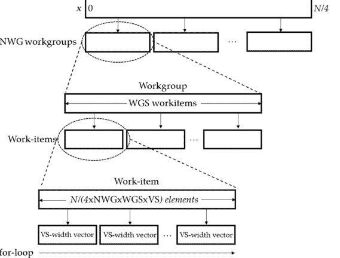

图 5.2 示例内核的分层负载分布。

## 5.4 内核工作负载分布

```c
const cl_event *event_wait_list,
cl_event *event)
```

入队从缓冲区对象读取到主机内存的命令。

```c
cl_int clFinish(cl_command_queue command_queue)
```

阻塞直到命令队列中之前队列的所有 OpenCL 命令已发布到关联设备并执行完成。

```c
cl_int clGetEventProfilingInfo(cl_event event),
cl_profiling_info param_name,
size_t param_value_size,
void *param_value,
size_t *param_value_size_ret
```

如果启用了性能分析，则返回与事件相关的命令的性能分析信息。

所需的定义/声明：以下定义将提供输入大小（字节）、内核向量大小、工作组大小（假设工作组为 1D）、工作组数量（假设工作组为 1D 数组）以及设备编号。

在本示例中，通过设置 `N/(4 × VS × WGS)` 使得工作组数量达到最大化。这将导致每个工作项 `work item` 仅执行一次循环迭代。

```c
#define N 1024*1024
#define VS 4
#define WGS 256
#define NWG N/(4*VS*WGS)
#define DEVICE 1
```

`localSize` 和 `globalSize` 是 1D 数组，向平台层指定工作组大小和工作组数量。

`localSize` 直接决定工作组大小，而 `globalSize` 决定工作项的总数。因此，工作组的数量被隐含为 `globalSize/localSize`。

```c
size_t localSize[1] = (WGS);
size_t globalSize[1] = (NWG*WGS);
struct timeval start, end;
```

示例代码：

```c
ret = clSetKernelArg(kernel, 0, sizeof(inputBuffer),
&inputBuffer);
CHECK_STATUS(ret);
ret = clSetKernelArg(kernel, 1, sizeof(outputBuffer),
&outputBuffer);
CHECK_STATUS(ret);
ret = clSetKernelArg(kernel, 2, sizeof(coeffBuffer),
&coeffBuffer);
CHECK_STATUS(ret);
```

由于这是调用内核之前的最后一步，请编写执行内核的计时代码。请注意 `clEnqueueNDRangeKernel()` 是异步的，这意味着它在队列内核后会立即返回。`clFinish()` 函数将一直阻塞直到内核完成执行，因此程序可以假设 `clEnqueueNDRangeKernel()` 标记了内核执行的开始，而 `clFinish()` 标记了执行的结束。注意，此时间并不一定包含主机与设备之间传输输入输出的时间。

```c
gettimeofday(&start, NULL);
ret = clEnqueueNDRangeKernel(queue,kernel,1,0,
globalSize,localSize,0,0,&event);
CHECK_STATUS(ret);
ret = clFinish(queue);
CHECK_STATUS(ret);
gettimeofday(&end, NULL);
float ndrangeDuration = (end.tv_sec + end.tv_usec * 1e-6) - (start.tv_sec + start.tv_usec * 1e-6);
float gflops = (float)(N/4 * 14) / ndrangeDuration / 1.0e9;
```

由于在创建命令队列时启用了性能分析支持，OpenCL 运行时将返回内核的执行时间（注意，主机代码也使用了它自己的计时）：

```c
ret = clGetEventProfilingInfo(horner,
CL_PROFILING_COMMAND_START,
sizeof(cl_ulong),&start_t,
&return_size);
CHECK_STATUS(ret);
ret = clGetEventProfilingInfo(horner,
CL_PROFILING_COMMAND_END,
sizeof(cl_ulong),&end_t,
&return_size);
CHECK_STATUS(ret);
float runtime = (float)(end_t - start_t) / 1.0e9;
```

内核必须使用 `EnqueueReadBuffer()` 获取内核的输出数组，以便使用第 2 章所示的 CPU 验证程序进行验证（ 5.5.1 节也显示了 `verify()` 函数）。

注意 `clEnqueueReadBuffer` 的第三个参数 `blocking_read` 设置为 `CL_TRUE`，以防止函数在拷贝完成之前返回。

```c
ret = clEnqueueReadBuffer(queue,outputBuffer,CL_TRUE,
0,N,d,0,0,0);
CHECK_STATUS(ret);
verify(x,d);
```

最后，释放数组并关闭 OpenCL 运行时：

```c
free(x);
free(d);
ret = clReleaseMemObject(coeffBuffer);
CHECK_STATUS(ret);
ret = clReleaseMemObject(inputBuffer);
CHECK_STATUS(ret);
ret = clReleaseMemObject(outputBuffer);
CHECK_STATUS(ret);
ret = clReleaseKernel(kernel);
CHECK_STATUS(ret);
ret = clReleaseProgram(program);
CHECK_STATUS(ret);
ret = clReleaseCommandQueue(queue);
CHECK_STATUS(ret);
ret = clReleaseContext(context);
CHECK_STATUS(ret);
```

## 5.5 霍纳法则的 OpenCL 实现：设备代码

从内核参数开始，这些参数必须与主机代码中的对应参数匹配：

```c
#define N 1024*1024
#define VS 4
#define WGS 256
#define NWG N/(4*VS*WGS)
```


顶层内核函数必须带有 `"kernel"` 前缀，其名称必须与 `clCreateKernel()` 调用中指定的名称匹配，且其参数必须与 `clSetKernelArg()` 调用中指定的参数匹配：

```c
kernel void horner(global float *x, global float *d, global float *coeff) {
```

内核需要两个局部变量来存储中间值。默认情况下，局部变量是私有的并分配在寄存器中。第一个变量 `temp` 在评估多项式时存储每个系数和部分和。另一个变量 `xtemp` 存储输入值 `x`。

这两个变量都必须与内核的向量大小匹配。因此，这些变量在五个版本的内核中显式声明，分别对应于向量大小 1, 2, 4, 8 和 16：

```c
#if VS == 1
float temp,xtemp;
#elif VS == 2
float2 temp,xtemp;
#elif VS == 4
float4 temp,xtemp;
#elif VS == 8
float8 temp,xtemp;
#elif VS == 16
float16 temp,xtemp;
#endif
```

使用预处理器指令可以避免为每个向量大小维护一个版本的内核代码。接下来，内核需要为循环迭代器以及起始和结束索引声明整数，循环将使用这些索引。注意，这些变量默认使用 OpenCL 的“私有”`private`存储类。由于内核将对大小为 `VS` 的向量进行操作，所有向量加载和存储操作必须假设元素大小为 $4 \times VS$。例如，当 `VS=4` 时，内核将对 16 字节的值的操作，因此所有索引操作必须除以此值。

如下声明并初始化这些整数：

```c
int i,
start = get_global_id(0) * N/(4*NWG*WGS*VS),
end = (get_global_id(0)+1) * N/(4*NWG*WGS*VS);
```

迭代 `N/(4 × NWG × WGS × VS)` 次的主循环开始：

```c
for (i=start;i<end; i++) {
```

循环体从将 `x` 的元素(s) 加载到 `xtemp` 开始。OpenCL 要求向量使用特殊的加载和存储，因此使用预处理器指令来区分不同的向量大小：

```c
#if VS == 1
xtemp = x[i];
#elif VS == 2
xtemp = load2(i,x);
#elif VS == 4
xtemp = load4(i,x);
#elif VS == 8
xtemp = load8(i,x);
#elif VS == 16
xtemp = load16(i,x);
#endif
```

循环体的主计算部分可以用通任何大小的方式编写。代码从将第一个系数的 `VS` 个拷贝加载 `temp` 开始：

```c
temp = coeff[0];
```

OpenCL `mad(a,b,c)` 内函数与向量类型兼容并执行操作 $a \times b+c$。该内函数可以将之前的和（初始为系数）乘以 `x`，加上下一个系数并将结果存回 `temp`：

```c
temp = mad(temp,xtemp,coeff[1]);
temp = mad(temp,xtemp,coeff[2]);
temp = mad(temp,xtemp,coeff[3]);
temp = mad(temp,xtemp,coeff[4]);
temp = mad(temp,xtemp,coeff[5]);
temp = mad(temp,xtemp,coeff[7]);
```

内核必须将 `temp` 的最终值存回 `d` 数组。此行代码取决于向量大小，所以像之前一样使用预处理器根据 `VS` 的值区分代码行为：

```c
#if VS == 1
d[i] = temp;
#elif VS == 2
vstore2(temp,i,d);
#elif VS == 4
vstore4(temp,i,d);
#elif VS == 8
vstore8(temp,i,d);
#elif VS == 16
vstore16(temp,i,d);
#endif
}
```

### 5.5.1 验证

与第 2 章一样，在开发和刻调优内核实现时，程序应使用相同操作的信任实现来验证结果。

```c
int verify(float *x,float *d) {
int i,j;
float error;
float *d_test;
```

## 226 第 5 章 使用 OpenCL 的嵌入式异构编程

```c
float coeff[8] = (1.2f,1.4f,1.6f,1.8f,2.0f,2.2f,2.4f,
2.6f);
```

```c
d_test = (float*)malloc(N);
if (id_test) {
    perror("malloc() in verify(");
    return 0;
}
for (i=0;i<N/4;i++) {
    d_test[i]=coeff[0];
    for (j=1;j<8;j++) {
        d_test[i]*=x[j];
        d_test[i]+=coeff[j];
    }
}
error = fabs(d[i]-d_test[i])/d_test[i];
if (error > 1.0e-2) {
    printf("verification error.\n"
           "d_test[%d]=%0.2e.\n"
           "d[%d]=%0.2e.\n"
           "error%0.2f%%n\n",
           i,d_test[i],d[i],error);
    error*1.0e2);
    free(d_test);
    return 0;
}
printf("results verified\n");
free(d_test);
return 1;
```


## 5.6 性能结果

示例代码中的一个令人惊讶的结果是，使用 `gettimeofday()` 测量的性能远低于使用 OpenCL 分析工具测量的性能——表明仅为 Gflops 性能的一半。
使用 `gettimeofday()` 时，程序在调用 `EnqueueKernel()` 之后立即开始测量，因此假设内核在调用该函数后就会开始执行。内核被队列到在设备上开始执行之间的延迟会导致这种感知到的性能差异。

### 5.6.1 参数探索

`WGS`、`NWG` 和 `VS` 参数的值会影响内核性能。为了分别检查每个参数的影响，在保持两个参数不变的同时，改变另一个参数。

### 5.6.2 工作组数量

OpenCL 运行时报告 ODROID-X3 板载上的两个 Mali T628 GPU 设备均包含四个计算单元，这是通过 `clGetDeviceInfo()` 配合 `CL_DEVICE_MAX_COMPUTE_UNITS` 选项报告的。
内核负载均衡的潜力较低，因为它具有均匀的循环迭代次数且缺少 `if` 语句。基于此，可以合理地认为实例化四个以上的工作组没有优势，因为四个工作组将利用所有可的多核并行性。
表 5.2 显示了 OpenCL 分析工具报告的性能结果，配置如下：

| 表 5.2 N=128 MB, NWG=256, VS=4 的内核性能 |
| NWG | 内核 FP 吞吐量 (Gflops) |
| :--- | :--- |
| 4 | 0.6 |
| 2048 | 5.8 |
| 4096 | 6.3 |
| 8192 | 7.1 |
| 16,384 | 14.4 |
| 32,768 | 15.6 |

- * `WGS`=256，内核在单维度上的最大数量（通过 `clGetKernelWorkGroupInfo()` 配合 `CL_KERNEL_WORK_GROUP_SIZE` 报告），
- * `VS`=4，该设备的首选向量长度（通过 `CL_DEVICE_PREFERRED_VECTOR_WIDTH_FLOAT` 报告），
- * 将 `NWG` 从 4 扫描到 32,768（`N`=128 MB 的最大值）。

结果显示，随着工作组的增加，性能有所提高。对于此测试，最大性能为 15.6 Gflops，通过 32,768 个工作组实现，这表明计算单元对理想工作负载数量没有影响。
回想第 2 章，相同的内核在四个频率为 2.23 GHz 的 ARM Cortex A15 核心上执行，经过最调优的实现实现了 17.8 Gflops。注意，这些结果是在 NVIDIA Jetson TK1 上获得的，它是一个比 ODROID-X3 更大、更实用的平台。

### 5.6.3 工作组大小

工作组大小影响 GPU 核心有效隐藏单个工作项指令延迟的效率。
表 5.3 显示了 OpenCL 分析工具报告的性能结果，配置如下：
- * `NWG`=`N`/(4 × `VS` × `WGS`)，使得内核的 `for` 循环仅执行一次的最大可能值，以及上一次测试中性能最好的设置，
- * `VS`=4，该设备的首选向量长度（通过 `CL_DEVICE_PREFERRED_VECTOR_WIDTH_FLOAT` 报告），
- 将 `WGS` 从 1 扫描到 256。

| 表 5.3 N=128 MB, NWG=N/(4 × VS × WGS), VS=4 的内核性能 |
| WGS | 吞吐量 (Gflops) |
| :--- | :--- |
| 1 | 6.9 |
| 16 | 13.8 |
| 32 | 13.9 |
| 64 | 13.8 |
| 128 | 15.3 |
| 256 | 15.6 |

| 表 5.4 N=128 MB, NWG=N/(4 × VS × WGS), WGS=256 的内核性能 |
| VS | 吞吐量 (Gflops) |
| :--- | :--- |
| 1 | 4.8 |
| 2 | 9.4 |
| 4 | 15.6 |
| 8 | 15.5 |
| 16 | 14.7 |

对于此测试，最大性能再次超过 15.6 Gflops，通过 256 的工作组大小实现，匹配上一个表的最后一行。

### 5.6.4 向量大小

无论 GPU SIMD 功能单元的原生宽度如何，内核中更宽向量可能为 GPU 架构提供更多利用数据并行性的机会。
表 5.4 显示了 OpenCL 分析工具报告的性能结果，配置如下：
- * `NWG`=`N`/(4 × `VS` × `WGS`)，使得内核的 `for` 循环仅执行一次的最大可能值，以及上一次测试中性能最好的设置，
- * `VS`=4，该设备的首选向量长度（通过 `CL_DEVICE_PREFERRED_VECTOR_WIDTH_FLOAT` 报告），
- 将 `WGS` 从 1 扫描到 256。

结果显示，随着工作组的增加，性能有所提高。对于此测试，最大性能为 15.6 Gflops，通过 32,768 个工作组实现，这表明计算单元对理想工作负载数量没有影响。

## 5.7 章总结

本章引入了 OpenCL，这是一个为 GPU、FPGA、DSP 等异构硬件架构开发程序的框架。在平台层面，程序员必须管理设备的初始化、通信和同步，分配设备内存并在运行时编译内核。OpenCL 提供了许多优化机会，例如本地内存、使用 SIMD 内建以及调整并行性。本章提供了一个运行示例，其中第 2 章的霍纳方法程序被适配并在 Mali T628 GPU 上进行嵌入式执行。

## 练习

1. 编写一个 OpenCL 内核来测量处理器的实际内存带宽。每组一个工作项，使用1024 个工作组。每个工作项应使用 `vload4(i)` 和 `vstore16(i)` 函数将数据块从一个位置复制到另一个位置。与主机 CPU 相比如何？

2. 绘制本章描述的霍纳示例的性能图，其中 `WGS`=1，`NWG`=`N`/(4 × `VS` × `WGS`)，且 `VS`={1, 2, 4, 8, 16}。

# 为第一代树莓派的 Raspbian 添加 PMU 支持

2014年12月发布的 Raspbian Linux 发行版所包含的 Linux 内核不支持通过 Linux `perf_event` API 使用 ARM11性能监控单元（PMU）。幸运的是，通过补丁内核启用此功能相对容易。该补丁由缅因大学的 Chad Paradis 和 Vincent M. Weaver 开发。
要检查你的内核是否支持 `perf_event`，请查看 `/sys/bus/event_source/` 目录是否包含除“breakpoint”和“software”之外的文件。在树莓派上，名为“v6”的符号链接的存在表示支持 `perf_event`。
要启用该支持，你必须对两个内核源文件进行细微修改并重新编译内核。在树莓派本身上编译 Linux 内核需要耗费大量时间，因此最好在性能良好的 Linux 工作站上进行交叉编译。

## A.1 下载 Linux 内核和交叉编译工具

Raspbian 内核可以在 GitHub `https://github.com/raspberrypypil/linux.git` 下载。你应该下载与当前在你的树莓派上运行的相同的内核版本。你可以在树莓派上使用 `uname -a` 命令来检查内核版本。
该内核仓库通常比最新版 Raspbian 中安装的内核高几个版本，但你可以使用 `git clone` 命令通过以下命令下载特定分支源码：

```
git clone-branch rpi-3.12.y https://github.com/raspberrypi/linux.git
```

你可以在 `https://github.com/raspberrypi/tools.git` 下载适用于 Intel 架构工作站的 ARM 交叉编译工具链。

## A.2 内核修改

在内核源码中，打开 `arch/arm/bcm2708/bcm2708.c` 文件。在第 468 行（或附近），添加以下代码：

```c
static struct platform_device bcm2708_pmu_device = {
    .name = "arm-pmu",
    .id = -1, /* Only one */
};
```

在 `bcm2708_init()` 函数中，在以下行代码之后：

```c
bcm_register_device(&bcm2708_powerman_device);
```

添加：

```c
bcm_register_device(&bcm2708_pmu_device);
```

接下来，打开 `arch/arm/kernel/perf_event_cpu.c` 文件。在 `cpu_pmu_request_irq(1)` 函数中，更改以下代码：

```c
if (irqs < 1) {
    pr_err("no irqs for PMUs defined\n");
    return -ENODEV;
}
```

为：

```c
if (irqs < 1) {
    printk_once("no irqs for PMUs defined, disabling sampled events\n");
```


```
    return 0;

}
```

## A.3 编译内核

在你的工作站上，定义环境变量 `$CCPREFIX` 为：

```
<tools directory root~/arm-bcm2708/arm-bcm2708-linux-gnueabi/bin/arm-bcm2708-linux-gnueabi-n
```

接下来，定义环境变量 `KERNEL_SRC` 指向你的内核源码根目录。

将你树莓派当前的内核构建复制并解压到内核源码目录，文件名为 `.config`。内核配置存储在树莓派的压缩文件 `/proc/config.gz` 中。

你可以使用 `zcat` 命令进行解压，即：

```
zcat config.gz > $KERNEL_SRC/.config
```

切换到内核源码根目录并执行以下命令，这将确保 `.config` 文件是正确的。由于你当前的内核与下载的内核之间存在细微差异，此命令可能会提示你进行几个构建选项。如果是这样，直接按回车键接受默认响应即可。

```
make ARCH=arm CROSS_COMPILE=$CCPREFIX oldconfig
```

使用以下命令构建内核。这一步骤可能花费大量时间。

```
make ARCH=arm CROSS_COMPILE=$CCPREFIX
```

使用以下命令构建模块。

```
make ARCH=arm CROSS_COMPILE=$CCPREFIX modules
```

最后，在树莓派本身上，在 Linux 内核根目录下执行以下命令。这将安装模块。

```
make modules_install
```


## A.4 安装内核

新的内核镜像将位于源码的 `/arm/boot/zImage`。将此文件复制到 `/boot/kernel.img` 并重启。

重启后，再次检查 `/sys/bus/event_source/devices` 目录以确认 `perf_event` 支持。

# NEON 内函数引用

`arm_neon.h` 头文件定义了 102 种数据类型和 2009 个内函数，它们允许程序员在高级源码中显式地包含对 ARM NEON 指令的支持。要使用内函数，程序员只需要调用特定的函数，但内函数不是普通函数。每个内函数都定义为一个内联函数，作为内置内容的封装器，强制编译器后端发出特定指令。

本附录提供了关于 ARM NEON 内函数的第 2 章提供之外的额外细节。感兴趣的读者应参考位于 `/usr/lib/gcc/arm-linux-gnueabi/<version>` 的实际头文件，并参考 ARM 的文档以获取有关 NEON 编程的更多细节。

## B1 数据类型

表 B1–B9 列出了 `arm_neon.h` 中定义的类型。NEON 内函数支持由符号整数、无符号整数和浮点值组成的 64 位和 128 位（quad-word）向量。64 位（double word）向量没有后缀，而 128 位（quad-word）向量在操作后通常带有 `q` 后缀，例如：

- `vmul_s8` 执行由 8 个 8 位符号整数组成的 64 位成对乘
- `vmul_qs8`（带有 `q` 后缀）执行由 16 个 8 位符号整数组成的 128 位成对乘

NEON 还支持特殊的整数多项式。多项式元素以整数格式存储，但当算术运算使用输入输出时，进位会被禁用。此类加法被位异操作取代。

### 表 B1 8 位 NEON 类型

| 符号 | 无符号 | 元素 | 总位数 |
| :--- | :--- | :--- | :--- |
| 1D 类型 | | | |
| `int8x8_t` | `uint8x8_t` | 8 | 64 |
| `int8x16_t` | `uint8x16_t` | 16 | 128 |
| 2D 类型 | | | |
| `int8x82_t` | `uint8x82_t` | 8 × 2 | 128 |
| `int8x83_t` | `uint8x83_t` | 8 × 3 | 192 |
| `int8x84_t` | `uint8x84_t` | 8 × 4 | 256 |
| `int8x162_t` | `uint8x162_t` | 16 × 2 | 256 |
| `int8x163_t` | `uint8x163_t` | 16 × 3 | 384 |
| `int8x164_t` | `uint8x164_t` | 16 × 4 | 512 |

### 表 B.2 16 位 NEON 类型

| 符号 | 无符号 | 元素 | 总位数 |
| :--- | :--- | :--- | :--- |
| 1D 类型 | | | |
| `int16x4_t` | `uint16x4_t` | 4 | 64 |
| `int16x8_t` | `uint16x8_t` | 8 | 128 |
| 2D 类型 | | | |
| `int16x42_t` | `uint16x42_t` | 4 × 2 | 128 |
| `int16x43_t` | `uint16x43_t` | 4 × 3 | 192 |
| `int16x44_t` | `uint16x44_t` | 4 × 4 | 256 |
| `int16x82_t` | `uint16x82_t` | 8 × 2 | 256 |
| `int16x83_t` | `uint16x83_t` | 8 × 3 | 384 |
| `int16x84_t` | `uint16x84_t` | 8 × 4 | 512 |

### 表 B.3 32 位整数 NEON 类型

| 符号 | 无符号 | 元素 | 总位数 |
| :--- | :--- | :--- | :--- |
| 1D 类型 | | | |
| `int32x2_t` | `uint32x2_t` | 2 | 64 |
| `int32x4_t` | `uint32x4_t` | 4 | 128 |
| 2D 类型 | | | |
| `int32x22_t` | `uint32x22_t` | 2 × 2 | 128 |
| `int32x23_t` | `uint32x23_t` | 2 × 3 | 192 |
| `int32x24_t` | `uint32x24_t` | 2 × 4 | 256 |
| `int32x42_t` | `uint32x42_t` | 4 × 2 | 256 |
| `int32x43_t` | `uint32x43_t` | 4 × 3 | 384 |
| `int32x44_t` | `uint32x44_t` | 4 × 4 | 512 |

## B.1 向量数据类型

### 表 B.4 64 位整数 NEON 类型

| 符号 | 无符号 | 元素 | 总位数 |
| :--- | :--- | :--- | :--- |
| 1D 类型 | | | |
| `int64x1_t` | `uint64x1_t` | 1 | 64 |
| `int64x2_t` | `uint64x2_t` | 2 | 128 |
| 2D 类型 | | | |
| `int64x12_t` | `uint64x12_t` | 1 × 2 | 128 |
| `int64x13_t` | `uint64x13_t` | 1 × 3 | 192 |
| `int64x14_t` | `uint64x14_t` | 1 × 4 | 256 |
| `int64x22_t` | `uint64x22_t` | 2 × 2 | 256 |
| `int64x23_t` | `uint64x23_t` | 2 × 3 | 384 |
| `int64x24_t` | `uint64x24_t` | 2 × 4 | 512 |

### 表 B.5 8 位多项式 NEON 类型

| 类型 | 元素 | 总位数 |
| :--- | :--- | :--- |
| `poly8_t` | | 8 |

原始类型

1D 类型

| | | |
| `poly8x8_t` | 8 | 64 |
| `poly8x16_t` | 16 | 128 |

2D 类型

| | | |
| `poly8x82_t` | 8 × 2 | 128 |
| `poly8x83_t` | 8 × 3 | 192 |
| `poly8x84_t` | 8 × 4 | 256 |
| `poly8x162_t` | 16 × 2 | 256 |
| `poly8x163_t` | 16 × 3 | 384 |
| `poly8x164_t` | 16 × 4 | 512 |

NEON 还支持最多具有 16 列和 4 行的小型矩阵类型。这些类型的变量仅用于 2D “重排”。

## 表 B.6 含有 16 位多项式元素的 NEON

| 类型 | 元素 | 总位 |
| --- | --- | --- |
| 基础类型 | | |
| `poly16_t` | 1 | 16 |
| 1D 类型 | | |
| `poly16x4_t` | 4 | 64 |
| `poly16x8_t` | 8 | 128 |
| 2D 类型 | | |
| `poly16x4x2_t` | 4 × 2 | 128 |
| `poly16x4x3_t` | 4 × 3 | 192 |
| `poly16x4x4_t` | 4 × 4 | 256 |
| `poly16x8x2_t` | 8 × 2 | 256 |
| `poly16x8x3_t` | 8 × 3 | 384 |
| `poly16x8x4_t` | 8 × 4 | 512 |

## 表 B.7 其他 NEON 多项式类型

| 类型 | 元素 | 总位 |
| --- | --- | --- |
| 基础类型 | | |
| `poly64_t` | 1 | 64 |
| `poly128_t` | 1 | 128 |
| 1D 类型 | | |
| `poly64x1_t` | 1 | 64 |
| `poly64x2_t` | 2 | 128 |
| 2D 类型 | | |
| `poly64x1x2_t` | 1 × 2 | 128 |
| `poly64x1x3_t` | 1 × 3 | 192 |
| `poly64x1x4_t` | 1 × 4 | 256 |
| `poly64x2x2_t` | 2 × 2 | 256 |
| `poly64x2x3_t` | 2 × 3 | 324 |
| `poly64x2x4_t` | 2 × 4 | 512 |

## B.2 读写向量变量

| 表 B.8 含有 16 位（半精度）浮点元素的 NEON 类型 |
| 类型 | 元素 | 总位 |
| --- | --- | --- |
| `float16x4_t` | 4 | 64 |

| 表 B.9 含有 32 位（单精度）浮点元素的 NEON 类型 |
| 类型 | 元素 | 总位 |
| 基础类型 | | |
| `float32_t` | 1 | 52 |
| 1D 类型 | | |
| `float32x2_t` | 2×2 | 64 |
| `float32x2x3_t` | 2×3 | 192 |
| `float32x2x4_t` | 2×4 | 256 |
| `float32x4_t` | 4×2 | 256 |
| `float32x4x3_t` | 4×3 | 384 |
| `float32x4x4_t` | 4×4 | 512 |

操作：转置、交错（拉链）以及 2D 加载和存储，尽管它们的 1D 组成向量可以与任何 NEON 操作一起。

在内联函数（intrinsics）之外，读写 NEON 向量变量有多种方法。最简单的方法将其视为任何标准的 C 数组。

例如：

- 在声明时初始化：
`int8x8_t a=(0,0,2,2,4,4,6,6);`

- 设置为数组：
`int8x8_t a;`
`for (i=0;i<8;i++) a[i]=i*2;`

- 读数组读取：
`for (i=0;i<8;i++) printf("%d",a[i]);`
`printf("\n");`

如下所示，NEON 内联函数有一个后缀，用于指定其元素的类型和大小。注意，这里明显缺少 64 位浮点数。

- `_s8` 有符号 8 位整数
- `_u8` 无符号 8 位整数
- `_s16` 有符号 16 位整数
- `_u16` 无符号 16 位整数
- `_s32` 有符号 32 位整数
- `_u32` 无符号 32 位整数
- `_p8` 8 位多项式
- `_p16` 16 位多项式
- `_f16` 16 位浮点
- `_f32` 32 位浮点

普通的、双字（double-word）内联函数假设总宽度为 64 位，因此向量大小由元素大小决定。例如，`_s8` 内联函数作用于一个 64/8=8 元素的向量。如上所述，“q”指定 128 位向量，因此以 `q_s8` 结尾的内联函数作用于一个 128/16=16 元素的向量。

某些内联函数用于实例化向量。例如，`vcreate` 内联函数将来自标量的每个 8 位字段映射到 8 元素向量的元素上：

```c
```


```
// 从低有效字节设置向量，

// 即 a[0]=55, a[7]=55

a = vcreate_s8(0x0D0C0C0A0806040200);
```

`vdup`内联函数将每个元素设置为指定的标量值：

```c
int8x16_t b;
a = vdup_n_s8(5); // 将所有 8 个元素设置为 5
b = vdup_n_s8(5); // 将所有 16 个元素设置为 5
```

你可以使用 `vld1`和 `vld1q`内联函数加载和存储 64 位和 128 位向量。例如：

```c
// 声明标准局部数组
// 演示 vld 和 vst
int8_t data_in[64]
```

NEON 支持使用 `vld4`和 `vst4`内联函数加载和存储步长为二和四个元素的向量。解释 `vld4`内联函数行为的一种方法是它将输入数组视为具有 n 行 4 列的行优先序矩阵，其中 n 是位宽，而内联函数以转置顺序返回数据。下面的代码使用 `vld4_s8`从 `data_in`加载数据。返回变量 `c`被声明为 8x4 数组。

```c
int8xx4_t c;
c=vld4_s8(data_in);
for (i=0;i<8;i++) {
    for (j=0;j<4;j++) printf("%d ", c[j][i]);
}
printf("\n");
```

## B.3 向量操作

有多种内联函数用于操作向量内的元素。

反转：可以使用 `vrev`内联函数反转向量：

```c
// 反转向量 a 中的八元素
b=vrev64(a);
```

合并：两个向量的范围可以使用 `vext`内联函数进行合并。假设 `a`和 `b`如下：

```
a = {0, 1, 2, 3, 4, 5, 6, 7}
b = {8, 9, 10, 11, 12, 13, 14, 15}
```

以下内联函数将从 `a`中提取五个元素，从 `b`中提取前三个：

```c
b=vext_s8(a,b,3);
```

设置向量 `b`的新状态为：

```
b={3, 4, 5, 6, 7, 8, 9, 10}
```

转置：`trn`内联函数取两个向量，将其视为 2×2 矩阵并进行转置，返回一个具有两行的 2D 向量。假设 `a`和 `b`如下：

```
a={0, 1, 2, 3, 4, 5, 6, 7}
b={8, 9, 10, 11, 12, 13, 14, 15}
```

以下内联函数将这些向量视为 2×2 矩阵并进行转置。结果为 `int8x2_t`类型：

```c
c=trn_s8(a,b);
c={0, 2, 4, 6, 8, 10, 12, 14};
```

交错：`vzip`内联函数取两个向量并将它们交错。结果为两行向量类型。假设 `a`和 `b`如下：

```
a = {0, 1, 2, 3, 4, 5, 6, 7}
b = {8, 9, 10, 11, 12, 13, 14, 15}
```

以下内联函数返回 `c`：

```c
c=vzip1_s8(a, b);
c={0, 8, 1, 9, 2, 10, 3, 11, 4, 12, 5, 13, 6, 14, 7, 15};
```

`vzip`内联函数取两个向量，并将偶数元素返回到一个向量中，奇数元素返回到另一个。从相同的输入向量开始：

```
a = {0, 1, 2, 3, 4, 5, 6, 7}
b = {8, 9, 10, 11, 12, 13, 14, 15}
```

以下内联函数返回 `int8x2_t`类型的值：

```c
c=vuzp_s8(a, b);
c={0, 2, 4, 6, 8, 10, 12, 14, 1, 3, 5, 7, 9, 11, 13, 15};
```

聚集：`vbtbl`内联函数执行“聚集”操作，它取两个向量并将第二个向量视为一组索引，从第一个向量加载一组元素。如果第二个向量的任何值超出范围，`vbtbl`在返回向量的相应位置插入零。相关的内联函数 `vbtlb`执行相同操作，但对第二个向量中的超出范围的值处理不同。对于这些，`vbtbx`从第一个向量拷贝原始值。假设 `a`和 `b`如下：

```c
a = {0, 1, 2, 3, 4, 5, 6, 7}
b = {0, 0, 2, 2, 4, 4, 6, 6}
```

将 `a`和 `b`传递给 `vtb1`返回 `c`的以下值：

```c
b=vtb1_s8(a,b);
c = {8, 8, 10, 10, 12, 12, 14, 14};
```

合并：`vcombine`内联函数连接两个向量，结果向量的宽度是输入向量的宽度。假设两个元素向量 `$a$`和 `$b$`具有以下值：

```c
a=[0,0,2,2,4,4,6,6];
b=[8,8,10,10,12,12,14,14];
```

内联函数调用将返回 16 元素向量：

```c
c=vcombine_s8(a,b);
c = {0, 0, 2, 2, 4, 4, 6, 6, 8, 8, 10, 10, 12, 12, 14, 14};
```

## B.4 使用 NEON 内联函数优化浮点代码

内联汇编不包含自己的一组数据类型，但 NEON 内联函数是“类型感知”的，因为它们期望输入是按值传递的 NEON 变量，并以返回值的形式输出。

对这些特殊向量变量的需求使得向使用 C 风格数组的现有代码中添加 NEON 支持的过程变得复杂，幸运的是，编译器可以将标准数组重新解释为 NEON 向量指针。然而，这需要 NEON 代码包含频繁的类型转换，使得代码看起来更加杂乱且可读性较低。

为了演示如何用 NEON 内联函数增强现有的浮点代码，本附录检查了使用高斯消法进行矩阵求逆简单实现。

该方法首先将输入矩阵（如下所示矩阵 A）与单位矩阵连接：

$A = \begin{bmatrix} 1 & 2 & 3 & 1 \\ 2 & 1 & 4 & 1 \\ 5 & 6 & 2 & 1 \\ 7 & 6 & 3 & 2 \end{bmatrix}$

高斯消元法对拼接矩阵进行连续行变换，其目标是将拼接矩阵的左侧（原始 A 矩阵）转换为单位矩阵，并将右侧转换为 A 的逆矩阵。

这需要三个离散的步骤。第一步是将矩阵转换为三角形式，其中变换会系统地将下三角形的每个元素设置为零，从左下角元素开始，以及每个左上到右下的对角线上的每个元素，如下所示


为了这个简单的示例，假设原始 A 矩阵不包含零元素。这允许通过以下行变换矩阵转换为三角形式：

- 1. 将元素 (3,0) 设置为零 R3 → R3−($A_{3,0}/A_{2,0}$)R2
- 2. 将元素 (2,0) 设置为零 R2 → R2−($A_{2,0}/A_{1,0}$)R1
- 3. 将元素 (3,1) 设置为零 R3 → R3−($A_{3,1}/A_{2,1}$)R1
- 4. 将元素 (1,0) 设置为零 R1 → R1−($A_{1,0}/A_{0,0}$)R0
- 5. 将元素 (2,1) 设置为零 R2 → R2−($A_{2,1}/A_{1,1}$)R1
- 6. 将元素 (3,2) 设置为零 R3 → R3−($A_{3,2}/A_{2,2}$)R1

得到如下结果：

| R0 | 1.0 | 2.0 | 3.0 | 1.0 | 0.0 | 0 | 0 |
| R1 | 0 | -3.0 | -2.0 | -1.0 | -2.0 | 1.0 | 0 | 0 |
| R2 | 0 | 0 | -10.3 | -2.7 | -2.3 | -1.3 | 1.0 | 0 |
| R3 | 0 | 0 | 0 | 0.9 | 1.2 | -1.0 | -1.2 | 1 |

假设输入矩阵以行主序存储在数组 `a`中，单位矩阵存储在数组 `b`中，执行此操作的代码如下：

```
for (i=3; i>0; i--) {
    for (j=0; j<4; j++) {
        coeff = -a[(i+j)*4+j]/a[((i+j)-1)*4+j];
        for (k=0; k<4; k++) {
            b[(i+j)*4+k] += coeff * b[((i+j)-1)*4+k];
            a[(i+j)*4+k] += coeff * a[((i+j)-1)*4+k];
        }
    }
}
```

# 附录 B NEON 内建引用

编译此代码时，`gcc 4.8.2`不生成 NEON SIMD 指令，即使请求了最大优化并明确指定了目标架构和 NEON 支持（使用 `-O3 -mfpu=neon -march=armv7-a`选项）。

程序员可以使用两个 4 宽（四）`VMLAQ`（四路乘加）内建函数替换整个最内层循环（k循环），使用：


```
*((float32x_t*)&bb((i+j)*4)));

vmlaq_f32(*(float32x_t*)&bb((i+j)*4));

*((float32x_t*)&ba((i+j)*4)));

dupq_n_f32(coeff));

*((float32x_t*)&a((i+j)*4)));

vmlaq_f32(*(float32x_t*)&a((i+j)*4));

*((float32x_t*)&a((i+j)*4)));

dupq_n_f32(coeff));
```

`a` 和 `b` 数组必须作为 `float32x4_t` 指针被引用，然后对向量输入和输出都进行解引用。此外，`coeff` 标量值必须使用重复（`vdupq`）内建函数从标量转换为向量。

高斯消元的下一步是使用类似的方法通过将上三角形的每个元素设置为零来完善矩阵：

- 1. 将元素 (2,3) 设置为零
- 2. 将元素 (1,2) 设置为零
- 3. 将元素 (1,3) 设置为零
- 4. 将元素 (0,1) 设置为零
- 5. 将元素 (0,2) 设置为零
- 6. 将元素 (0,3) 设置为零

| R0 | 1.0 | 0 | 0 | -0.6 | 0.3 | 0 | 0.1 |
| R1 | 0 | -3.0 | 0 | 0 | -0.9 | 0.7 | -0.8 | 0.5 |
| R2 | 0 | 0 | -10.3 | 0 | 1.1 | -4.3 | -2.5 | 2.9 |
| R3 | 0 | 0 | 0 | 0.9 | 1.2 | -1.0 | -1.2 |

得到结果：

| R0 | 1.0 | 0 | 0 | -0.6 | 0.3 | 0 | 0.1 |
| R1 | 0 | -3.0 | 0 | 0 | -0.9 | 0.7 | -0.8 | 0.5 |
| R2 | 0 | 0 | -10.3 | 0 | 1.1 | -4.3 | -2.5 | 2.9 |
| R3 | 0 | 0 | 0 | 0.9 | 1.2 | -1.0 | 0 |

## B.4 使用 NEON 优化浮点代码

可以使用以下循环进行操作：

```
for (i=2; i>=0; i--) {
    for (j=i+1; j<4; j++) {
        coeff = -a[i*4+j]/a[j*4];
        for (k=0; k<4; k++) {
            b[i*4+k]+=coeff * b[j*4];
            a[i*4+k]+=coeff * a[j*4];
        }
    }
}
```

再次，最内层循环可以用 NEON 内建函数替换：

```
*((float32x_t*)&b2[i*4]) =
    vmlaq_f32(*(float32x_t*)&b2[j*4]),
    *((float32x_t*)&b2[j*4]),
    dupq_n_f32(coeff));

*((float32x_t*)&a2[i*4]) =
    vmlaq_f32(*(float32x_t*)&a2[j*4]),
    *((float32x_t*)&a2[j*4]),
    dupq_n_f32(coeff));
```

最后一步是将每行除以其对角线值以完成单位矩阵：

- 1. 将元素 (0,0) 设置为 1 `R_{0,0}`
- 2. 将元素 (1,1) 设置为 1 `R_{1,1}`
- 3. 将元素 (2,2) 设置为 1 `R_{2,2}`
- 4. 将元素 (3,3) 设置为 1 `R_{3,3}`

得到如下结果：

| R0 | 1.0 | 0 | 0 | -0.6 | 0.3 | 0 | 0.1 |
| R1 | 0 | 1.0 | 0 | 0 | -0.2 | 0.3 | -0.2 |
| R2 | 0 | 0 | 1.0 | 0 | -0.1 | 0.4 | 0.2 |
| R3 | |00 | 0 |   .. | 1.. | -1.1 | -1.3 | 1.3 |

可以使用以下代码执行：

```
for (i=0;i<4;i++) for (j=0;j<4; j++) b[i*4+j] = a[i*4+j];
```

## B.5 NEON 内建函数总结

NEON 内建函数以字母 “v” 开头，并遵循以下命名方案：

```
v{prefix}{operation}{modifier}_{operand type}{operand width}
```

前缀是可选的，取决于内建函数，用于指定可用的舍入和饱和模式之一。

操作通常命名与内建函数的关联指令相同或相似。

修饰是可选的，用于不使用标准 64 位操作数和结果的内建函数。

操作数类型和宽度定义了每个向量的数据类型。

### B.5.1 前缀

允许的前缀值取决于操作。示例前缀包括：

- h（半）：将每个输出元素向右移
- d（双）：将每个输出元素向左移一位
- r（舍入）：对每个输出元素进行舍入（配合 hh 修饰使用）
- rh（舍入半）：将每个输出元素向右移一位并舍入
- q（饱和）：在溢出时将每个输出元素设置为最大值，在下溢时设置为最小值
- qd（饱和双倍）：饱和并双倍
- qrd（饱和、舍入和双倍）：饱和、舍入并双倍

### B.5.2 操作

NEON 操作可以分为几类基本类别：

算术：

- add, sub, mul：加、减、乘
- mla, mls：乘加、乘减
- padd, padd：（或加并累加）每个输入向量中的每对相邻元素
- recipe, rsqte：倒平方根估计（可以是浮点型）
- abs, neg：绝对值和取反（可以是浮点型）
- fma：融合乘加
- fms：融合乘减

位操作：

- shl, shr：左移、右移（逻辑的）？
- sra：位与移位累加。每个元素都移位。
- sli, sri：左移插入、右移插入。位不跨越元素边界。每个元素都移位。[这些支持前缀吗？]
- and（位与）、vbic（位清零）、veor（位异或）、vorn（位非或）、and vor（位或）：两个寄存器之间的位逻辑操作，并将结果置于目标器中
- mov, mvn：移动取反
- cls, cl, cnt：计算前导位、计算前导零、计算置位位

比较：

- ceq, cge, cgt, cle, clt：比较相等、大于或等于、大于、小于或等于、小于
- tst：对两个向量中的对应元素执行位与操作，如果与结果不为零，则将输出元素设置为全1，否则将输出元素设置为全零
- abd, aba：绝对差和累加
- max, min：将每个输出设置为两个对应元素的最大值或最小值
- pmin, pmax：将每个输出设置为两个向量中每对相邻元素的最大值或最小值

### B.5.3 修饰

默认情况下，内建函数使用 64 位输入和输出宽度，这意味着向量大小为 64/(操作数宽度)。以下是修饰：

- q 指定 128 位输入和输出宽度。

# 252 APPENDIX B NEON Intrinsic

* l specifies 64-bit input width but generates a 128-bit output width.
* hn stores the high half of each result element.
* q specifies 128-bit input and output width.
* l specifies 64-bit input width but generates a 128-bit output width.
* w allows the operation to accept one 128-bit operand and a second 64-bit operand and generate a 128-bit result.
* hn stores the high half of each result element.

### B.5.4 Operand type and width

operand width is:

* s8, s16, s32: signed integer
* u8, u16, u32: unsigned integer
* p8: integer
* f16, f32: floating point

# OpenCL reference

This appendix provides a reference for the most common features of OpenCL versions 1.1 and 1.2. These are older versions but are most likely to be supported on embedded GPUs at the time of writing.


**This appendix is intended only as a quick reference; it provides only a brief summary of relevant information.** For a more thorough description of any feature, the reader should refer to the official OpenCL documentation. Much of this information is from the Khronos Group, available at https://www.khronos.org.

# C OpenCL Reference

## C.1 PLATFORM LAYER

The platform layer includes a set of functions called by the host to query coprocessor communications and instantiate device channels. This section lists the most commonly used:

```c
cl_int GetPlatformIDs (cl_uint num_entries,
                         cl_platform_id *platform,
                         cl_uint *num_platforms);
```

Obtain the list of available platforms.

*This function retrieves the number of available platforms (if `platforms` is NULL) or retrieves handles to the actual platforms themselves (if `num_platforms` contains a value).*

```c
cl_int GetPlatformInfo (cl_platform_id platform,
                         cl_platform_info param_name,
                         size_t *param_value_size);
```

```c
void *param_value,
size_t *param_value_ret)
```

`param_name`: `CL_PLATFORM_(PROFILE, VERSION)`

Get information about the OpenCL platform.

This function retrieves information regarding the available platform(s), such as the OpenCL version and set of supported extensions. This is most useful for writing portable OpenCL applications, allowing the application to adapt to the capabilities of available platforms.

```c
cl_int GetDeviceIDs (cl_platform_id platform,
                      cl_device_type device_type,
                      cl_uint num_entries,
                      cl_device_id *devices,
                      cl_uint *num_devices)
```

`device_type`: `CL_DEVICE_TYPE_(ACCELERATOR, ALL, CPU, CUSTOM, DEFAULT, GPU)`

Obtain the list of devices available on a platform.

This function retrieves device handles. Every OpenCL application must call this function to access a device.

```c
cl_int GetDeviceInfo (cl_device_id device,
                      cl_device_info param_name,
                      size_t *param_value_size,
                      void *param_value,
                      size_t *param_value_ret)
```

`param_name`: `CL_DEVICE_(NAME, VENDOR, PROFILE, TYPE)`
`CL_DEVICE_NATIVE_VECTOR_WIDTH_(CHAR, INT)`
`CL_DEVICE_NATIVE_VECTOR_WIDTH_(LONG, SHORT)`
`CL_DEVICE_NATIVE_VECTOR_WIDTH_(DOUBLE, HALF)`
`CL_DEVICE_NATIVE_VECTOR_WIDTH_FLOAT`,

## C.1 Platform Layer

```c
CL_DEVICE_PREFERRED_VECTOR_WIDTH_(CHAR, INT),
CL_DEVICE_PREFERRED_VECTOR_WIDTH_(LONG, SHORT),
CL_DEVICE_PREFERRED_VECTOR_WIDTH_(DOUBLE, HALF),
CL_DEVICE_PREFERRED_VECTOR_WIDTH_FLOAT,
CL_DEVICE_PREFERRED_INTEROP_USER_SYNC,
CL_DEVICE_ADDRESS_BITS,
CL_DEVICE_AVAILABLE,
CL_DEVICE_BUILT_KERNELS,
CL_DEVICE_COMPILER_AVAILABLE,
CL_DEVICE_(DOUBLE, HALF)_FP_CONFIG,
CL_DEVICE_ENDIAN_LITTLE,
CL_DEVICE_EXTENSIONS,
CL_DEVICE_ERROR_SUPPORT,
CL_DEVICE_EXECUTION_CAPABILITIES,
CL_DEVICE_GLOBAL_MEM_CACHE_(SIZE, TYPE),
CL_DEVICE_GLOBAL_MEM_(CACHELINE_SIZE),
CL_DEVICE_HOST_UNIFIED_MEMORY,
CL_DEVICE_IMAGE_MAX_(ARRAY, BUFFER)_SIZE,
CL_DEVICE_IMAGE_SUPPORT,
CL_DEVICE_IMAGE2D_MAX_(WIDTH, HEIGHT),
CL_DEVICE_IMAGE3D_MAX_(WIDTH, HEIGHT, DEPTH),
CL_DEVICE_LOCAL_MEM_(TYPE, SIZE),
CL_DEVICE_MAX_(READ, WRITE)_IMAGE_ARGS,
CL_DEVICE_MAX_CLOCK_FREQUENCY,
CL_DEVICE_MAX_COMPUTE_UNITS,
CL_DEVICE_MAX_CONSTANT_(ARGS, BUFFER_SIZE),
CL_DEVICE_MAX_(MEM_ALLOC, PARAMETER)_SIZE,
CL_DEVICE_MAX_SAMPLERS,
CL_DEVICE_MAX_WORK_GROUP_SIZE,
CL_DEVICE_MAX_WORK_ITEM(DIMENSIONS, SIZES),
CL_DEVICE_MEM_BASE_ADDR_ALIGN,
CL_DEVICE_OPENCL_VERSION,
CL_DEVICE_PARENT_DEVICE,
```

## C.2 内存类型

表 C.1 从主机（host）和内核（kernel）角度的 OpenCL 缓冲区类型

| 全局 (Global) | 常量 (Constant) | 局部 (Local) | 私有 (Private) |
| --- | --- | --- | --- |
| 主机 (Host) | 动态分配，读写访问 | 动态分配，读写访问 | 动态分配，无访问 | 无分配，无访问 |
| 内核 (Kernel) | 无分配，读写访问 | 静态分配，只读 | 静态分配，读写访问 | 静态分配，读写访问 |

所有函数局部变量默认使用私有内存，通常用于标量，例如循环迭代器和索引计算的临时变量。


本地内存通常用作缺少缓存设备的替代品。因此，内核通常包含一个循环，其循环体首先将块输入数据拷贝到本地内存中的一个小型数组中，进行处理，然后将其写入全局内存。

表 C.1 列出了在 OpenCL 设备架构中可以分配缓冲区（数组）的四种内存类型。每种内存在主机和设备上都有不同的分配和访问限制。

### C.2.1 全局内存

全局内存只能通过 `clCreateBuffer()` 函数在主机上分配。主机通过 `clSetKernelArg()` 函数通过内核参数将每个全局缓冲区的指针发送给内核。

全局缓冲区用于向内核发送输入数据（主机使用 `clEnqueueWriteBuffer()` 写入数据）以及从内核检索输出结果（内核使用 `clEnqueueReadBuffer()` 读取）。

由于全局缓冲区通常分配在片外内存中，它通常具有最高的访问延迟。

### C.2.2 常量内存

常量内存在主机上分配，并以与全局内存相同的方式将其指针发送给内核。要定义缓冲区分配在常量内存中，内核参数必须带有 `const` 前缀。

与全局内存不同，内核可以通过 `const` 前缀静态分配并初始化常量数组。

常量内存在内核中是只读的，但通常存储在片外内存中。某些设备为常量内存提供了特殊缓存。

### C.2.3 本地内存

主机可以在本地内存中分配缓冲区，并使用全局和常量内存相同的方法将其指针发送给内核。在这种情况下，使用 `clSetKernelArg()` 设置参数时，主机必须为 `arg_value` 指定 `NULL`，因为主机无法初始化本地缓冲区。

内核可以通过 `local` 前缀静态分配并初始化本地数组。

本地内存通常存储在快速的片内内存中，其内容在工作组（`workgroup`）之间共享。

### C.2.4 私有内存

主机无法在私有内存中分配缓冲区。内核可以通过指定 `private` 前缀在私有内存中分配并初始化缓冲区。存储在私有内存中的缓冲区通常存储在寄存器中，每个工作项（`work-item`）专用。

## C.3 缓冲区管理

主机使用 `clCreateBuffer()` 函数分配全局、常量本地内存。主机随后可以使用 `clEnqueueWriteBuffer()` 和 `clEnqueueReadBuffer()` 写缓冲区。还有一些用于读写缓冲器的专用函数。

例如，`clEnqueueReadRect` 读取矩形缓冲区，它不是连续存储在主机内存中的，而是由一系列分离的数据块组成。`clEnqueueFillBuffer()` 允许将任意模式拷贝到缓冲区。`clEnqueueCopyBuffer()` 从一个缓冲区拷贝到另一个。`clEnqueueMapBuffer()` 将主机上的内存区域映射到缓冲区，该区域对设备可见。

```
cl_mem cl_CreateBuffer(cl_context context,
cl_mem flags,
size_t size,
void *host_ptr,
cl_int *errcode);
```

`flags`: `CL_MEM_READ_WRITE`,

`CL_MEM_(WRITE, READ)_ONLY`,

`CL_MEM_HOST_ACCESS`,

`CL_MEM_(READ, WRITE)_ONLY`,

`CL_MEM_(USE, ALLOC, COPY)_HOST_PTR`

以下标志在 OpenCL 1.2 中可用：

`CL_MEM_COPY_HOST_WRITE_ONLY`,

`CL_MEM_COPY_HOST_READ_ONLY`,

`CL_MEM_COPY_NO_ACCESS`

在使用此函数时程序员必须小心，因为其用法取决于主机和设备是否共享物理内存。例如，对于来自主机的设备，不应使用 `CL_MEM_HOST_PTR` 选项。此外，某些选项如 `CL_MEM_COPY_HOST_PTR` 会导致 OpenCL 运行时将数据拷贝到设备内存中，这意味着程序员不需要为对应的数组调用 `clEnqueueWriteBuffer()`。

```
cl_int clEnqueueReadBuffer(cl_command_queue command_queue,
cl_mem buffer,
cl_bool blocking_read,
size_t offset,
size_t size,
void *ptr);
```

# 附录 C OpenCL 参考

```
cl_uint *num_events_in_wait_list,
const cl_event *event_wait_list,
cl_event *event
```

从缓冲区到主机内存的读取命令。此函数的名称可能会引起误义。“Read”是从主机的角度定义的，因此此函数通常应用于内核的输出数组。换句话说，程序员将输出数组称为读缓冲区，因为它最终会被主机读取。

```
cl_int clEnqueueBufferRect(cl_command_queue command_queue,
cl_mem buffer,
cl_bool blocking_read,
const size_t *buffer_origin,
const size_t *host_origin,
const size_t *region,
size_t buffer_row_pitch,
size_t buffer_slice_pitch,
size_t host_row_pitch,
size_t host_slice_pitch,
void *ptr,
cl_uint *num_events_in_wait_list,
const cl_event **event_wait_list,
cl_event *event)
```

从缓冲区对象到主机内存的矩形区域读取。此函数用于将 2D 数组的子区域拷贝到主机。当拷贝整个主维度连续存储的 2D 数组时，这是不需要的，因为此类数组占用连续的内存块，可以使用 `clEnqueueReadBuffer()` 拷贝。

```
cl_int clEnqueueBuffer(cl_command_queue command_queue,
cl_mem buffer,
cl_bool blocking_write,
size_t offset,
size_t size,
const void *ptr,
cl_uint num_events_in_wait_list,
cl_event *event_wait_list,
cl_event *event)
```

从主机内存写入缓冲区对象的命令。此函数的名称可能会引起误义。“Write”是从主机的角度定义的，因此此函数通常应用于内核的输入数组。换句话，程序员将输出数组称为写缓冲区，因为它在发送到设备之前由主机写入。

```
cl_int clEnqueueWriteBuffer(cl_command_queue command_queue,
cl_mem buffer,
cl_bool blocking_write,
const size_t *buffer_origin,
const size_t *host_origin,
const size_t *region,
size_t buffer_row_pitch,
size_t buffer_slice_pitch,
size_t host_row_pitch,
size_t host_slice_pitch,
void *ptr,
cl_uint *num_events_in_wait_list,
const cl_event **event_wait_list,
cl_event *event)
```

从主机内存向缓冲区对象写入矩形区域的命令。

```
cl_int clEnqueueFillBuffer(cl_command_queue command_queue,
cl_mem buffer,
const void *pattern,
size_t pattern_size,
size_t offset,
size_t size,
cl_uint num_events_in_wait_list,
const cl_event *event_wait_list,
cl_event *event)
```

使用给定大小的模式填充缓冲区对象的命令。`OpenCL 1.2` 仅可用。此函数可用于初始化设备上的缓冲区。

```
cl_int clEnqueueFillImage(cl_command_queue command_queue,
cl_mem image,
const void *fill_color,
const size_t *origin,
const size_t *region,
cl_uint num_events_in_wait_list,
const cl_event *event_wait_list,
cl_event *event)
```

使用指定颜色填充图像对象的命令。`OpenCL 1.2` 仅可用。此函数可用于初始化设备上的图像对象。

## C3 缓冲区管理 265

```c
const cl_event *event_wait_list,
cl_event *event)
```


队列一个命令，将缓冲区对象拷贝到另一个缓冲区。

此函数类似于 Linux 的 `memcpy()` 函数，用于设备全局内存中的源数组和目标数组。

```c
cl_int clEnqueueCopyBuffer(cl_command_queue command_queue,
cl_mem src_buffer,
cl_mem dst_buffer,
const size_t *src_origin,
const size_t *dst_origin,
const size_t *region,
size_t src_row_pitch,
size_t src_slice_pitch,
size_t dst_row_pitch,
size_t dst_slice_pitch,
cl_uint num_events_in_wait_list,
const cl_event *event_wait_list,
cl_event *event)
```

队列一个命令，将缓冲区对象的矩形区域拷贝到另一个缓冲区对象。

此函数是 `clEnqueueCopyBuffer()` 的矩形版本。

```c
void *clEnqueueMapBuffer(cl_command_queue command_queue,
cl_mem buffer,
cl_bool blocking_map,
cl_map_flags map_flags,
size_t offset,
size_t size,
cl_uint num_events_in_wait_list,
const cl_event *event_wait_list,
cl_event *event;
cl_int *errcode_record;
```

```c
map_flags: CL_MAP_(READ, WRITE);
CL_MAP_WRITE_INVALIDATE_REGION [OpenCL 1.2]
```

队列一个命令，根据给定的主机地址空间映射缓冲区区域，并返回指向该映射区域的指针。

此函数允许主机内存中的数组和设备内存中的数组建立关联，使得对一个数组的更新会更新另一个数组。

```c
cl_int clRetainMemObject (cl_mem memobj);
```

增加内存对象的引用计数。

此函数防止 OpenCL 缓冲区被运行时删除。

```c
cl_int clReleaseMemObject (cl_mem memobj);
```

减少内存对象的引用计数。

此函数通常在程序清理期间调用，以释放所有 OpenCL 缓冲区。

```c
cl_int clSetObjectDestructorCallback (cl_mem memobj);
```

```c
void (CL_CALLBACK pfn_notify)(cl_mem memobj, void *user_data)
```

注册一个用户回调，当内存对象被删除并释放资源时将调用该回调。

此函数允许程序确定缓冲区何时被删除。

```c
cl_int clEnqueueUnmapMemObject (cl_command_queue command_queue,
cl_mem memobj,ptr);
void *mapped_ptr;
cl_uint num_events_in_wait_list,
cl_event *event_wait_list,
cl_event *event)
```

队列一个命令，取消之前对内存对象区域的映射。

此函数撤消由 `clEnqueueMapBuffer()` 执行的操作。

```c
cl_int clEnqueueMigrateMemObjects(cl_command_queue command,
cl_uint num_mem_objects,
const cl_mem *mem_objects,
cl_mem_migration_flags flags,
cl_uint num_events_in_wait_list,
cl_event *event_wait_list,
cl_event *event)
```

`flags`: `CL_MIGRATE_MEM_OBJECT_HOST`, `CL_MIGRATE_MEM_OBJECT_CONTENT_UNDEFINED`

队列一个命令，指示一组内存对象应该与哪个设备关联。`[仅限 OpenCL 1.2]`

OpenCL 1.2 的改进之一是一组为多设备系统设计的功能。此函数将缓冲区与特定设备关联。

```c
cl_int clGetObjectInfo(cl_mem memobj, cl_mem_info_t param_name,
size_t param_size, void *param_value, size_t *param_size)
```

```
param_name: CL_MEM_(TYPE, FLAGS, SIZE, HOST_PTR),
CL_MEM_COUNT, OFFSET, CONTEXT, ASSOCIATED_MEM,D310, D311_RESOURCE_KHR,
CL_MEM_ADAPTER_TYPE_KHR,_SURFACE_INFO_KHR
```

用于获取所有内存对象（缓冲区和图像对象）通用的信息。

此函数用于与 OpenCL 缓冲区关联的 host 地址。

```c
cl_int clCreateImage(cl_context context,
cl_mem_flags flags,
const cl_image_format *image_format,
const cl_image_desc *image_desc,
void *host_ptr,
cl_int *errcode_ret)
```

创建一个 1D 图像、1D 缓冲区、2D 图像数组、2D 图像或 3D 图像对象。`[仅限 OpenCL 1.2]`

此函数创建一个图像。已被 `clImage2D()` 替换。

```c
cl_mem clImage2D(cl_context context,
cl_mem_flags flags,
const cl_image_format *image_format,
size_t width,
size_t height,
size_t pitch,
void *host_ptr,
cl_int *errcode_ret)
```

创建一个 2D 图像。`[仅限 OpenCL 1.2]`

此函数创建一个图像。已被 `clImageBuffer()` 替换。

```c
cl_mem clImageBuffer(cl_context context,
cl_mem_flags flags,
const cl_image_format *image_format,
size_t width,
size_t height,
size_t pitch,
void *host_ptr,
cl_int *errcode_ret)
```

创建一个 1D 图像。`[仅限 OpenCL 1.2]`

此函数创建一个图像。已被 `clImage1D()` 替换。

```c
cl_mem clImage1D(cl_context context,
cl_mem_flags flags,
const cl_image_format *image_format,
size_t width,
size_t pitch,
void *host_ptr,
cl_int *errcode_ret)
```

## 附录 C OpenCL 参考

### C4 程序与编译

从程序源或二进制文件构建可执行文件。

此函数编译内核。程序员可以指定一个回调函数，在编译完成后通知程序。

```c
cl_int clBuildProgram(cl_program program),
    cl_uint num_devices,
    const cl_device_id *device_list,
    const char *options,
    void (CL_CALLBACK pfn_notify
        cl_program program,
        void *user_data), void *user_data);
```

为与程序相关的 OpenCL 上文中所有设备或特定设备编译程序源码。`[仅限 OpenCL 1.2]`

此函数在不进行链接的情况下编译程序。通常与 `clLinkProgram()` 一起使用。

## 附录 C OpenCL 参考

```c
cl_program clLinkProgram(cl_context context,
cl_uint num_devices,
const cl_device_id *device_list,
const char *options,
cl_uint num_input_programs,
cl_program *input_programs,
void (CL_CALLBACK*)pfn_notify)(cl_program program,
void *user_data,
cl_int *errcode_ret))
```


在 OpenCL 上文中为所有设备或特定设备链接一组已编译的程序对象和库，并创建一个可执行文件。`[仅限 OpenCL 1.2]`

此函数链接一个编译后的程序。它通常与 `clCompileProgram()` 一起使用。

```c
cl_int clUnloadCompiler(void)
```

允许实现释放由 OpenCL 编译器分配的资源。`[仅限 OpenCL 1.1]`

此函数是对运行时的一个提示，表示它可以卸载编译器，尽管调用此函数不会阻止程序执行后续编译。

此函数在 OpenCL 1.1 中被 `clUnloadPlatformCompiler()` 替换。

```c
cl_int clUnloadPlatformCompiler(cl_platform_id platform)
```

允许实现释放为平台由 OpenCL 编译器分配的资源。`[仅限 OpenCL 1.2]`

此函数是对运行时的一个提示，表示它可以卸载编译器，尽管调用此函数不会阻止程序执行后续编译。

此函数替换了 OpenCL 1.0 中的 `clUnloadCompiler()`。

```c
cl_int clGetProgramInfo(cl_program program,
cl_program_info_param_name,
size_t param_value_size,
void *param_value,
size_t *param_value_size_ret)
```

`param_name`: `CL_PROGRAM_REFERENCE_COUNT`, `CL_PROGRAM(CONTEXT, NUM_DEVICES, DEVICES)`, `CL_PROGRAM(SOURCE, BINARY_SIZES, BINARIES)`, `CL_PROGRAM(NUM_KERNELS, KERNEL_NAMES)` `[仅限 OpenCL 1.2]`

返回有关程序对象的信息。

此函数对于为不提供独立（离线）内核编译器的平台实现获取内核对象代码非常有用。

```c
cl_int clGetProgramBuildInfo(cl_program program,
cl_device_id device,
cl_program_build_info_param_name,
size_t param_value_size,
void *param_value,
size_t *param_value_size_ret)
```

`param_name`: `CL_PROGRAM_BINARY_TYPE`, `CL_PROGRAM_BUILD(STATUS, OPTIONS, LOG)`

返回程序对象中每个设备的构建信息。`[仅限 OpenCL 1.2]`

使用此函数从内核构建中检索潜在的警告和错误列表，在在使用即时编译（JIT）时是几乎必不可少的，因为否则对于程序员来说，识别和修复内核源码中的错误将非常不便。

## 编译选项

内核编译器接受使用 `gcc` 的程序员所熟悉的选项。某些选项允许程序员放宽设备浮点单元的准确性要求，以获得更高的性能。

**预处理器：(-D 按照 `clBuildProgram()` 或 `clCompileProgram()` 中列出的顺序进行处理)**

- `-D name`
- `-D name = definition`
- `-I dir`

**数学内联函数：-cl-single-precision-constant**

- `-cl-denorms-are-zero`
- `-cl-fp32-correctly-rounded-square-sqrt`

**优化选项：-cl-opt-disable**

- `-cl-mad-enable`
- `-cl-no-signed-zeros`
- `-cl-finite-math-only`
- `-cl-unsafe-math-optimizations`
- `-cl-fast-relaxed-math`

**警告请求/抑制：-w**

- `-Werror`

**控制 OpenCL C 语言版本：**

- `-cl-std=CL1.1` // OpenCL 1.1 规范
- `-cl-std=CL1.2` // OpenCL 1.2 规范

**查询内核参数信息：-cl-kernel-arg-info**

## 链接选项

库链接选项：`-create-library`

- `-enable-link`

程序链接选项：`-cl-denorms-are-zero`

- `-cl-no-signed-zeros`
- `-cl-unsafe-math-optimizations`

## 5.5 内核函数

```c
-cl-finite-math-only
-cl-fast-relaxed-math
```

内核函数允许程序员在内核执行之前准备内核的参数和参数。

```c
cl_kernel clCreateKernel(cl_program program,
const char *kernel_name,
cl_int *errcode_ret)
```

创建一个内核对象。使用此函数时，确保 `kernel_name` 与 `.cl` 源文件中的函数名匹配。否则内核将无法执行。

```c
cl_int clKernelsInProgram(cl_program program,
cl_uint num_kernels,
cl_kernel *kernels,
cl_uint *num_kernels_ret)
```

为程序中的所有内核函数创建内核对象。此函数允许程序员获取程序中所有函数的内核对象，而不是像 `clCreateKernel()` 那样仅通过名称获取一个内核。

```c
cl_int RetainKernel(cl_kernel kernel)
```

增加内核对象的引用计数。此函数防止内核被运行时释放。

```c
cl_int ReleaseKernel(cl_kernel kernel)
```

减少内核引用计数。此函数通常用于程序清理时释放内核。

```c
cl_int SetKernelArg(cl_kernel kernel,
cl_uint arg_index,
size_t arg_size,
const void *arg_value)
```

用于设置特定内核的参数。由于内核无法直接调用，此函数用于在执行前设置内核参数。此函数用于所有 OpenCL 程序。

```c
cl_int clGetKernelInfo(cl_kernel kernel,
cl_kernel_info_param_name,
size_t param_value_size,
void *param_value,
size_t *param_value_size_ret)
```

`param_name`: `CL_KERNEL_FUNCTION_NAME`, `CL_KERNEL_NUM_ARGS`, `CL_KERNEL_(ATTRIBUTES, PROGRAM)`

返回有关内核对象的信息。此函数可以从内核对象获取函数名称或程序对象的信息。

```c
cl_int clKernelGroupInfo(cl_kernel kernel,
cl_device_id device,
cl_kernel_group_info_param_name,
size_t param_value_size,
void *param_value,
size_t *param_value_size_ret)
```

`param_name`: `CL_KERNEL_GLOBAL_WORK_SIZE`, `CL_KERNEL_WORK_GROUP_SIZE`, `CL_KERNEL_(LOCAL, PRIVATE)_MEM_SIZE`, `CL_KERNEL_PREFERRED_WORK_SIZE_MULTIPLE`

返回特定于设备的内核信息。内核编译器能够从内核源码确定工作组大小和本地内存大小。例如，内核的寄存器可能会阻止其以设备最大工作组大小执行。此函数允许平台层在设置工作组大小等参数之前确定这些信息。

```c
cl_int clKernelArgInfo(cl_kernel kernel,
cl_uint arg_index,
cl_kernel_arg_info_param_name,
size_t param_value_size,
void *param_value,
size_t *param_value_size_ret)
```

`param_name`: `CL_KERNEL_ARG_(ACCESS, ADDRESS, TYPE)_QUALIFIER`, `CL_KERNEL_ARG_NAME`, `CL_KERNEL_ARG_TYPE`

返回内核参数的信息。`[仅限 OpenCL 1.2]`

此函数可以在设置后检索内核参数。

## 6.6 命令队列函数

OpenCL 命令队列是主机控制设备的方法。主机可以使用命令队列向设备发送简单的、顺序的命令，也可以将命令队列配置为无序队列，从而构建复杂的任务图。

任务图由内核节点组成，并使用事件根据图边定义的依赖关系来控制每个内核的执行。

命令队列可以包含执行代码或与缓冲区交换数据的命令。命令是内核、任务、原生内核、读取缓冲区或写入缓冲区。


命令队列还可以包含同步原语，强制执行设备上（对于原生内核为主机）命令之间的顺序。同步原语包括事件、标记和屏障。

事件允许命令等待另一个命令和命令的完成。执行以下执行函数：

- `clEnqueueReadBuffer()`
- `clEnqueueWriteBuffer()`
- `clEnqueueReadImage()`
- `clEnqueueWriteImage()`
- `clEnqueueMapBuffer()`
- `clEnqueueMapImage()`
- `clEnqueueNDRangeKernel()`
- `clEnqueueTask()`, 以及
- `clEnqueueNativeKernel()`

## C.6 命令队列函数

`cl_int clRetainCommandQueue(cl_command_queue command_queue)`

增加命令队列的引用计数。

此函数防止命令队列被运行时释放内存。

`cl_int clReleaseCommandQueue(cl_command_queue command_queue)`

减少命令队列的引用计数。

此函数通常用于程序中的“清理”代码，以释放命令队列。

`cl_int clGetCommandQueueInfo(cl_command_queue command_queue, cl_command_queue_infoparam_name param_name, size_t param_value_size, void *param_value, size_t *param_value_size_ret)`

`param_name`: `CL_QUEUE_CONTEXT`, `CL_QUEUE_DEVICE`, `CL_QUEUE_REFERENCE_COUNT`, `CL_QUEUE_PROPERTIES`

查询命令队列的信息。

此函数通常用于获取与命令队列相关的上下文或设备。

```c
cl_int clEnqueueNDRangeKernel (cl_command_queue command_queue,
cl_kernel kernel,
cl_uint work_dim,
const size_t *global_work_offset,
const size_t *global_work_size,
const size_t *local_work_size,
cl_uint num_events_in_wait_list,
const cl_event *event_wait_list,
cl_event *event)
```

将一个在设备上执行内核的命令放入队列。

这无疑是 OpenCL 平台层中最重要的函数，因为它指令设备执行具有 NDRRange 的内核。

将一个在设备上执行内核的命令放入队列。

此函数与 `clEnqueueNDRangeKernel()` 相同，但仅执行一个工作项（work-item），即等同于调用 `work_dim=1`、`global_work_offset=NULL`、`global_work_size[0]` 设置为 1 且 `local_work_size[0]` 设置为 1 的 `clEnqueueNDRangeKernel()`。

```c
cl_int clEnqueueNativeKernel(cl_command_queue command_queue,
void (*user_func)(void *),
void *args, size_t cb_args,
cl_uint num_mem_objects,
const cl_mem *mem_list,
const void **args_mem_loc,
cl_uint num_events_in_wait_list,
const cl_event *event_wait_list,
cl_event *event)
```

将执行未使用 OpenCL 编译器编译的本地 C/C++ 函数的命令放入队列。

此函数开启一个在主机上执行的内核，可以通过事件触发。

```c
cl_event clCreateUserEvent(cl_context context,
cl_int *errcode_ret)
```

创建一个用户事件对象。

此函数实例化一个事件对象。

```c
cl_int clSetUserEventStatus(cl_event,
cl_int execution_status)
```

设置用户事件的执行状态。

此函数可以手动触发事件，而不是等待命令完成，或者比通常情况更早触发。

```c
cl_int clWaitForEvents(cl_uint num_events,
cl_event *event_list)
```

在主机线程上等待由事件对象标识的命令完成。

此函数强制主机等待特定的事件。

另见：`clGetEventInfo()`, `clSetEventCallback()`

```c
cl_int clGetEventInfo(cl_event event,
cl_event_info * param_name,
size_t param_value_size,
void *param_value,
size_t *param_value_size_ret)
```

`param_name`: `CL_EVENT_COMMAND (QUEUE, TYPE)`, `CL_EVENT_(CONTEXT, REFERENCE_COUNT)`, `CL_EVENT_COMMAND_EXECUTION_STATUS`

返回关于事件的信息。

此函数获取与事件相关的信息。在等待事件触发时，使用轮询比使用 `clWaitForEvents()` 阻塞更有用。

另见：`clWaitForEvents()`, `clSetEventCallback()`

```c
cl_int clSetEventCallback(cl_event,
cl_int command_type,
void (*callback)(cl_event, void *),
void *user_data)
```

为命令状态注册回调函数。

此函数注册回调以通知命令完成。

另见：`clGetEventInfo()`, `clSetEventCallback()`

```c
cl_int clRetainEvent(cl_event event)
```

增加事件的引用计数。

此函数防止事件被运行时删除。

```c
cl_int clReleaseEvent(cl_event event)
```

减少事件的引用计数。

此函数通常用于程序中的“清理”代码。

# 表 C.2 OpenCL 类型

| 内核类型 | 描述 | 主机类型（如果适用） |
| --- | --- | --- |
| char | 8位符号整数 | cl_charn |
| uchar | 8位无符号整数 | cl_uchar |
| short | 16位符号整数 | cl_short |
| ushort | 16位无符号整数 | cl_ushort |
| int | 32位符号整数 | cl_int |
| uint | 32位无符号整数 | cl_uint |
| long | 64位符号整数 | cl_long |
| ulong | 64位无符号整数 | cl_ulong |
| float | 32位浮点数 | cl_float |
| double | 64位浮点数 | cl_double |
| image2d_t | 2D 图像句柄 |  |
| image3d_t | 3D 图像句柄 |  |
| image2d_array_t | 2D 图像数组 |  |
| image1d_t | 1D 图像句柄 |  |
| image1d_buffer | 1D 图像缓冲区 |  |
| image1d_array_t | 1D 图像数组 |  |
| sampler_t | 采样器句柄 |  |
| event_t | 事件句柄 |  |
| bool | 布尔向量 |  |
| half | 16位浮点数，向量 |  |
| quad, quadn | 128位浮点数，向量 |  |

# 附录 OpenCL 参考

## 表 C.2 OpenCL 类型 — 续

| 内核类型 | 描述 | 主机类型（如果适用） |
|---|---|---|
| complex_half,complex_half | 16位复数，向量 |  |
| imaginary_half,imaginary_half | 16位虚数，向量 |  |
| complex_float,complex_float | 32位复数，向量 |  |
| imaginary_float,imaginary_float | 32位虚数，向量 |  |
| complex_double,complex_double | 64位复数，向量 |  |
| imaginary_double,imaginary_double | 64位虚数，向量 |  |


| `complex_quad`, `complex_quad` | 128位复数，向量 | | |
| `imaginary_quad`, `imaginary_quad` | 128位虚数，向量 | | |
| `floatnxm` | nxm 个 32位浮点数的矩阵 | | |
| `doublenxm` | nxm 个 64位浮点数的矩阵 | | |

在这种情况下，程序员可以以属性的形式向内核提供工作组和向量大小信息，如下所示。

### 内核属性

```
__attribute__((vec_type_hint(type)))
__attribute__((work_group_size_hint(X, Y, Z)))
__attribute__((reqd_work_group_size(X, Y, Z)))
```

OpenCL 还允许为声明的变量赋予属性，用于对齐、紧凑和字节序。

### 类型属性

```
__attribute__((aligned(n)))
__attribute__((aligned))
```

```
__attribute__((packed))
__attribute__((endian(host)))
__attribute__((endian(device)))
__attribute__((endian))
```

# C.9 常量

OpenCL 定义了一组单精度浮点数常量，如表 C.3 所示。当 OpenCL 实现支持，每个以 "_F" 结尾的常量都有对应的不带 "_F" 后缀的双精度版本，以及通过将该后缀替换为 "_H" 得到的半精度版本。

# C.10 内置函数

OpenCL 提供了一组可在内核代码中使用的内置函数。其中一些函数是标准的数学原语，许多函数接受向量操作数。其他是用于工作项识别和向量加载/存储的实用函数。

### C.10.1 整数函数

表 C.4 列出了整数函数。这些函数接受向量操作数。

### C.10.2 浮点数函数

表 C.5 列出了浮点数函数。这些函数大部分接受向量操作数。

### C.10.3 向量函数

OpenCL 内核应始终使用向量加载和存储函数在向量变量和数组之间交换数据（表 C.6）。

### C.10.4 工作项函数

OpenCL 内核可以作为 1 、2 维 3 维的工作项数组进行调度。工作项数组可选地划分为 1 、2 或 3 维组（当调用 `get_local_id()` 并传入 `local_work_size` 参数时）。工作负载分布取决于每个工作项在该坐标系中自我识别的能力，而其全局 ID 是相对于其在所在工作组内的位置计算的（表 C.7）。工作组内的工作项可以通过屏障（barrier）操作进行同步，并对其内存操作进行顺序排序（表 C.8）。

## 表 C.3 OpenCL 常量

| 常量 | 描述 |
|---|---|
| `MAXFLOAT` | 最大有限单点数的值 |
| `HUGE_VAL` | 正数浮点数表达式，求值为 +infinity |
| `HUGE_VAL` | 正数双精度表达式，求值为 +infinity |
| `INFINITY` | 常数浮点数表达式，无符号 |
| `NAN` | 常数浮点数表达式，NaN |
| `M_E_F` | e 的值 |
| `M_LOG2E_F` | log$_2$ 的值 |
| `M_LOG10E_F` | log$_{10}$ 的值 |
| `M_LN2_F` | log$_e$ 的值 |
| `M_LN10_F` | log$_{10}$ 的值 |
| `M_PI_F` | $\pi$ 的值 |
| `M_PI_2_F` | $\pi$/2 的值 |
| `M_PI_4_F` | $\pi$/4 的值 |
| `M_1_PI_F` | $1/\pi$ 的值 |
| `M_2_PI_F` | $2/\pi$ 的值 |
| `M_2_SQRTPI_F` | $2/\sqrt{\pi}$ 的值 |
| `M_SQRT2_F` | $\sqrt{2}$ 的值 |
| `M_1_SQRT2_F` | $1/\sqrt{2}$ 的值 |

## 表 C.4 内置函数

| 函数 | 描述 |
|---|---|
| `abs(x)` | x (无符号) |
| `abs_diff(x)` | 不溢出的 x-y (无符号) |
| `add_sat(x,y)` | x+y 并饱和结果 |
| `hadd(x,y)` | (x+y)>>1 |
| `rhadd(x,y)` | (x+y)>>1 |
| `clamp(x,minval,maxval)` | x 在 minval 和 maxval 之间截断 |
| `clz(x)` | x 前导零个数 |
| `mad_hi(a,b)` | a*b 高位 |
| `mad_sat(a,b,c)` | a*b+c 饱和 |
| `expb(x)` | x 的指数部分 |
| `ld2(x)` | 加载2 个 32 位浮点数 |
| `mul_hi(a,b)` | a*b 高位 |
| `rotate(v)` | 旋转 v |
| `sub_sat(x,y)` | x-y 饱和 |
| `popcount(x)` | x 中 1 的个数 |
| `upsample(char[n])` | 扩展为 n 个 浮点数 |
| `upsample(uchar[n])` | 扩展为 n 个 浮点数 |
| `upsample(short[n])` | 扩展为 n 个 浮点数 |
| `upsample(int[n])` | 扩展为 n 个 浮点数 |
| `upsample(float[n])` | 扩展为 n 个 浮点数 |
| `upsample(double[n])` | 扩展为 n 个 浮点数 |
| `vload.1f(ptr)` | 加载 1 个 32 位浮点数 |
| `vload.2f(ptr)` | 加载 2 个 32 位浮点数 |
| `vload.4f(ptr)` | 加载 4 个 32 位浮点数 |
| `vload.1d(ptr)` | 加载 1 个 64 位浮点数 |
| `vload.2d(ptr)` | 加载 2 个 64 位浮点数 |
| `vstore.1f(ptr,v)` | 存储 1 个 32 位浮点数 2 次 |
| `vstore.2f(ptr,v)` | 存储 2 个 32 位浮点数 |
| `vstore.4f(ptr,v)` | 存储 4 个 32 位浮点数 |
| `vstore.1d(ptr,v)` | 存储 1 个 64 位浮点数 2 次 |
| `vstore.2d(ptr,v)` | 存储 2 个 64 位浮点数 |

## 表 C.5 内置函数

| 三角函数 | 描述 |
|---|---|
| `sin(x)`, `cos(x)`, `tan(x)` | 基本三角函数 |
| `asin(x)`, `acos(x)`, `atan(x)` | 反三角函数 |
| `sinh(x)`, `cosh(x)`, `tanh(x)` | 基本双曲三角函数 |
| `asinh(x)`, `acosh(x)`, `atanh(x)` | 反双曲三角函数 |
| `sinpi(x)`, `cospi(x)`, `tanpi(x)` | 基本三角函数，基于 pi |
| `asinpi(x)`, `acospi(x)`, `atanpi(x)` | 反三角函数，基于 pi |
| `atan2(x,y)` | atan2(x,y) |
| `atan2pi(x,y)` | atan2(x,y)，基于 pi |
| 对数、指数和幂函数 | |
| `log(x)`, `log2(x)`, `log10(x)` | 对数底 e, 2 和 10 |
| `log1p(x)`, `logb(x)` | log(1+x) 和提取指数 |
| `exp(x)`, `exp2(x)`, `exp10(x)` | 指数底 e, 2 和 10 |
| `expm1(x)` | e^x-1 |
| `pow(x,y)`, `pown(x,y)`, `powr(x,y)` | 计算 xʸ |
| `rootn(x,y)` | x¹/y |
| `ldexp(x,n)` | x*² |
| `frexp(x, *exp)` | 提取尾数和指数 |
| `modf(x, *iptr)` | 分解浮点数 |

## 表 C.5 内置函数 — 续

| 几何函数 | |
|---|---|
| `cbrt(x)` | 立方根 |
| `hypot(x,y)` | $x^2+y^2$ 的平方根 |
| `cross(p0,pl)` | 叉积（向量大小为3或4） |
| `distance(p0,pl)` | 距离 |
| `dot(p0,pl)` | 点积 |
| `length(p)` | 向量长度 1 |
| `normalize(p)` | 归一化 |
| `fast_distance(p0,pl)` | 距离 |
| `fast_length(p)` | 长度 |
| `fast_normalize(p)` | 向量长度 1 |
| 表 C.5 内置浮点函数 — 续 | |
|---|---|
| 除法操作 `fmod(x,y)` | x 和 y 的浮点取模 |
| `fract(x)` | x 的小数部分 |
| `remainder(x,y)` | x 和 y 的余数 |


| `remquo(x,y,*quo)` | x 和 y 的余数和商 |

| `tgamma(x)` | Gamma 函数 |

| `lgamma(x)` | 对数 Gamma |

| `nextafter(x,y)` | 在 y 方向上 x 的下一个可表示浮点值 |

| 表 C.6 向量加载和存储函数 |

|---|---|

| `vloadn(offset, *p)` | 加载大小为 n 的向量 |

| `vload_half(offset, *p)` | 加载半精度浮点值 |

| `vload_halfn(offset, *p)` | 加载半精度浮点值向量 |

| `vstoren(offset, *p)` | 存储大小为 n 的向量 |

| `vstore_half(offset, *p)` | 存储半精度浮点值 |

| `vstore_halfn(offset, *p)` | 存储半精度浮点值向量 |

| 表 C.7 工作项函数 |

|---|---|

| `get_work_dim()` | 维度数 |

| `get_global_size(D)` | 维度 D 中的全局工作项数 |

| `get_global_id(D)` | 维度 D 中的全局工作项编号 |

| `get_local_size(D)` | 维度 D 中的局部工作项数 |

| `get_local_id(D)` | 维度 D 中的局部工作项 ID |

| `get_num_groups(D)` | 维度 D 中的工作组数 |

| `get_group_id(D)` | 工作组 ID |

| `get_global_offset(D)` | 维度 D 中的全局偏移量 |

## C.10 内置函数

## 表 C.8 工作项同步

| | |

| `barrier(flags)` | 工作组内的所有工作项在继续执行前必须执行此操作 |

| `mem_fence(flags)` | 排序执行内核的工作项的加载和存储操作 |

| `read_mem_fence(flags)` | 排序内存加载 |

| `write_mem_fence(flags)` | 排序内存存储 |

### C.10.5 关系函数

OpenCL 提供了一组用于比较向量变量的函数。

| | |

| `isequal(x,y)` | 基础比较操作，返回向量 |

| `isnotqual(x,y)` | |

| `isgreater(x,y)` | |

| `isgreaterequal(x,y)` | |

| `isless(x,y)` | |

| `issequal(x,y)` | |

| `islessgreater(x,y)` | |

| `isfinite(x)` | 测试每个元素是否为特殊的浮点值 |

| `isinf(x)` | |

| `isnan(x)` | |

| `isnnormal(x)` | |

| `isordered(x,y) unordered(x,y)` | |

| `signbit(x)` | 返回每个元素的符号位 |

| `any(x)` | 测试任意一个元素的最高位（MSB）是否为 1 |

*续*

| `all(x)` | 测试是否所有元素的最高位都为 1 |

| `bitselect(a,b,c)` | 如果 c 的对应位为 0，则结果的该位对应 a 的对应位；否则对应 b 的对应位。 |

| `select(a,b,c)` | 对于向量类型的每个分量，result[i]=如果 c 的最高位被设置则为 b[i] : a[i]。对于标量类型，result=c? b : a |

## C10.6 原子函数

原子操作允许以不可中断的方式读取、修改和更新共享内存位置，允许工作项执行没有特定临界区的内存操作。注意 OpenCL 1.1 和 1.2 不包含用于内核的锁函数，但可以使用原子交换函数。

| `atomic_add(*p,val)` | 读取、加、存储，仅整数 |

| `atomic_sub(*p,val)` | 读取、减、存储，仅整数 |

| `atomic_xchg(*p,val)` | 读取、交换、存储，返回交换出的 *p 值 |

| `atomic_inc(*p)` | 读取、加、存储，仅整数 |

| `atomic_dec(*p)` | 读取、减、存储，仅整数 |

| `atomic_cmpxchg(*p,cmp,val)` | 如果内存内容匹配，读取、存储 |

| `atomic_min(*p,val)` | 读取、存储 min(*p,val)，仅整数 |

| `atomic_max(*p,val)` | 读取、存储 max(*p,val)，仅整数 |

| `atomic_and(*p,val)` | 读取、存储 (*p & val)，仅整数 |

| `atomic_or(*p,val)` | 读取、存储 (*p | val)，仅整数 |

| `atomic_xor(*p,val)` | 读取、存储 (*p ^ val) |

### C10.7 转换

OpenCL 支持 C99 风格的类型转换，以及支持饱和和舍入模式的扩展。

```
a = convert_T_R(b): 带有舍入模式转换为类型 T
a = convert_T_sat(b): 带有饱和模式转换为类型 T
```

其中 R 是以下之一：

- `_rte`（舍入）

- `_rtz`（趋向零）

- `_rtp`（趋向无穷）

- `_rtn`（趋向负无穷）

## 索引

## 高级 RISC 机器 (ARM)

- British company, 7

- Apple A8 芯片, 2

- ARM 指令集, 7

- ARMv6 和 ARMv7 架构, 7

- 汇编选项（参见 ARM 汇编）

- 代码优化

- ARM Cortex, 25 分支阻塞, 26

- 数据依赖阻塞, 26 倍, 27

- 浮点延迟, 27 循环转换, 28

- 序执行, 27 程序时间, 25 减少冲突, 27

- SIMD 指令, 27 软件流水线, 27 接口, 2

- CPSR, 11–12 嵌入式 SoC, 2 通用寄存器, 9–10

- 位逻辑, 39, 40

- 比较指令, 42, 42

- 比较指令, 42, 44

- 整数运算函数, 39, 39 加载和存储指令, 40–41, 移动指令, 40, 41 移位, 39, 40

- Linux 操作系统, 3 “加载-存储”架构, 8–14

- 内存寻址模式, 12–13, 17 内存带宽, 35

- `getimeday()`, 35 打印程序, 34 结果, 37 测试读取, 36 钟时间, 35 内存接口, 2 性能边界, 38 性能向编程, ARMCore, 5

- 仿射变换, 108–110

- 阿姆达尔定律, 52–53

- Apple A8 芯片包, 2, ARM11, 5 汇编选项位乘法, 22–24 排序汇编, 15–18 编译器生成的, 21–22 参考对齐, 14–15 结果, 18–21 ARM Cortex A9, 5, 32 ARM Cortex A15 处理器, 5 ARM Cortex NEON 指令, 97–100 ARM Mali GPU, 188 ARM过程调用标准 (APCS), 9

- ARM 编程, 8 ARMv6 和 ARMv7 架构, 7 ARMv8 架构, 7 ARM11 VFP 短指令, 94–97 ARMv6 向量浮点 (VFP) 指令, 76 Broadcom Video GPU, 188

## 双线性插值

- 110, 111

- 缓冲区对象创建, 261

- 来自主机内存的缓冲区对象, 263

- `glEnqueueCreateBuffer()`, 260

- `glEnqueueFillBuffer()`, 260

- `glEnqueueReadBuffer()`, 260

- `glEnqueueWriteBuffer()`, 260

- 拷贝缓冲区对象, 265

- 图像对象, 264, 268

- 2D 和 3D 图像空间, 268–269

- 内置函数，原子操作, 294

- 卷积, 295

- 浮点函数, 287–290

- 整数函数, 287–289

- 关系函数, 293

- 向量函数, 287–292–工作项函数, 287–292–293

## C

- 计算程序, 4

当前程序状态寄存器 (CPSR), 11, 12

## E

- 嵌入式系统上芯片 (SoC), 2

## F

- 定点数运算, 123–127 优势, 120

定点数运算（续）

缺点, 120

v.s. 浮点

精度, 121

小数/进制, 120–121

精度的, 122–135

范围, 121–128

类型转换, 120

浮点转换, 132–134

图像变换, 131

## 索引

- 缓冲区对象创建, 261

- 来自主机内存的缓冲区对象, 263

- 到主机内存的缓冲区对象, 262

- 回调函数, 266

- `clCreateBuffer(function)`, 260

- `clEnqueueOutListBuffer(function)`, 260

- `clEnqueueMapBuffer(function)`, 260


# 索引

- `clEnqueueReadBuffer(function)`, 260
- `clEnqueueWriteBuffer(function)`, 260
- 拷贝对象, 265
- 对象, 264
- 模式大小, 264
- 矩形区域, 262–263, 265
- 内存对象集, 267
- 2D和3D图像, 268–269
- umm, 267

## 内置函数

- 原子函数, 294
- 转换, 295
- 浮点函数, 287, 290
- 接口, 287, 289
- 关系函数, 293
- 向量函数, 292
- 工作项函数, 287, 292–293

## 命令队列函数

- 命令, 271
- 创建, 278
- 入队命令, 278
- 事件引用计数, 282
- 执行内核, 280
- 未来命令, 283
- 增量与减量, 279
- 标记命令, 283
- 原生 C/C+, 280
- 无序队列, 277
- 查询信息, 279
- 返回信息, 281
- 性能分析信息, 284
- 同步原语, 277–278
- 任务组, 277
- 用户回调函数, 282
- 用户事件对象, 281
- 常量, 287–288
- 错误跟踪, 192–194

## 霍纳法

- `clCreateKernel(arg)`, 222
- `clSetKernel(arg)`, 222
- 主机代码, 222
- 内核主池, 224
- 加载元素, 224
- 循环迭代器, 223
- 值, 225
- 验证, 225–226
- 主机/设备编程模型, 191–192
- 内核函数, 275–277
- 工作负载分布（见工作负载分布）, 259
- 常量内存, 259–260
- 全局内存, 259
- 本地内存, 263
- 私有内存, 260
- OpenCL 的 OpenMP 代码, 191
- 参数探索, 224
- 向量大小, 229
- 工作组大小, 228, 228–228
- 流水线, 253–258
- 上下文初始化, 199–201
- 设备内存分配, 205–207
- 设备尺寸, 271
- 内核编译, 202–205
- 平台, 194–197
- 构建函数, 271
- 内置内核, 270
- `clCreateProgram`, 269
- `clCreateProgramWithSource(Source)`, 269
- 内核编译器, 273
- 链接到程序对象和二进制数据, 270
- 源代码, 269
- 程序引用计数, 271
- 返回状态, 273
- 向量和图像类型, 284, 285
- 工作项, 190–191
- OpenMP 指令, 56–58, 57
- ARM 核心 (Core), 55–56
- CPU 使用率, 55–56
- 原子 pragma, 62–63
- 有序 pragma, 62–63
- 并行区域, 53, 56, 59
- 私有变量, 59
- 共享变量, 59
- 单维, 62–63
- 原子操作, 65
- 临界区, 63–64
- OpenMP 并行, 68–70
- 性能计数器, 70–71
- 优化技术, 60
- AMD-Dev, 52–53
- 定点算术, 51
- 异构计算, 51
- 内联汇编语言, 74–76
- C/C++, 74
- 手写汇编, 50
- 输入顺序, 输出顺序列表, 75
- 循环变换, 51
- 多核性能, 51
- 每条指令多次浮点运算 (SIMD), 76
- 性能分析, 73–74
- 性能边界, 71–73
- 浮点运算归约, 76
- 比较结果, 78
- 双缓冲方法, 77
- 内层循环, 77
- 位匹配 (match-for-bit), 78
- 动态乱序调度, 81
- RAW 依赖, 80
- 读后写 (RAW), 80, 80
- 停顿, 79
- 测试内核, 53–55

## P

- 性能计数器接口, 31
- 显式 C 封装, 30
- 头文件和常量定义, 30
- 可重用缓存, 30
- 性能导向编程, 3
- 受限计算程序, 4
- 高性能计算, 5
- 指令级并行性的提取
- I/O 密集型程序, 4
- 遗留代码, 4
- ARM 嵌入式开发, 5–6
- Linux 的 GCC 编译器, 5
- 微架构, 5
- 程序计数器, 5
- 逻辑, 4

## Q

- Adreno GPU, 18

## R

- 编译工具链, 23
- 链接, 234
- 安装, 235
- 修改, 234
- 下载, 233
- (RISC), 6

## S

- 应用, 148
- 基准并行, 182
- 缓存缺失率, 183
- 数据级并行, 182
- 数据复用, 149
- 帧缓冲区, 174–176
- 光晕 (halo), 167, 167
- 循环分块, 164–166
- 均值滤波器, 149–150
- 分 2D 滤波器, 182
- 2D 分块滤波器, 181–182
- Video4Linux 驱动和 API, 176–180
- 软件发布
- 双缓冲实现, 91, 92
- 缓冲区技术, 85
- fix 指令, 95
- fd 逻辑, 87
- 新循环, 84
- 循环迭代, 82

## T

- 边界, 168, 168
- 函数, 169–170
- 局限性, 168
- 1D 水平滤波器, 170
- 1D 垂直滤波器, 170
- 2D 滤波器, 182
- 2D 分块滤波器, 181–182
- 2D 滤波器
- 容量缺失, 161
- 列缺失, 163–164
- 冲突缓存缺失, 161–160
- 数据表示, 161, 162
- 循环变换, 161–163

## 向量数据类型

- 16 位（半精度）浮点元素, 241
- 32 位（单精度）浮点元素, 241
- 8 位整数, 238
- 16 位整数, 238
- 32 位整数, 238
- 64 位整数, 239
- 8 位多项式, 238
- 16 位多项式, 240
- 64 位（双字）向量, 237
- 128 位（四字）向量, 237
- 多项式元素, 237

## Y

- YUV 和色度采样. 172–174, 173

## Z

- 零拷贝帧缓冲区。见 Linux 帧缓冲区
- 行滤波, 162–163
